# 认知心理学：连接心智、研究与日常经验（第4版）

## 致芭芭拉

## 关于作者

**E. 布鲁斯·戈尔茨坦**是匹兹堡大学心理学荣休副教授和亚利桑那大学心理学兼职教授。他因课堂教学和教材写作获得匹兹堡大学校长杰出教学奖。他获得塔夫茨大学化学工程学士学位和布朗大学实验心理学博士学位。在加入匹兹堡大学教职之前，他曾在哈佛大学生物学系担任博士后研究员。布鲁斯发表了涉及广泛主题的论文，包括视网膜与皮层生理学、视觉注意和图片知觉。他是《感觉与知觉》第9版（Wadsworth/Cengage，2014）的作者，也是《布莱克韦尔知觉手册》（Blackwell，2001）和两卷本《塞奇知觉百科全书》（Sage，2010）的编辑。

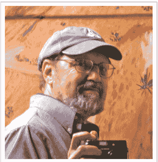

## 教师前言

### 认知心理学教材的演变

本书是一个始于2002年的过程的成果，当时我决定撰写第一版。通过对500多名教师的调查以及与同事的交谈，我明显发现，许多教师都在寻找一本既涵盖认知心理学领域、又易于学生理解的教材。从我的认知心理学教学经历中，我也明显发现，许多学生认为认知心理学抽象、过于理论化，并且与日常经验脱节。基于这些信息，我开始撰写一本书，以具体的方式讲述认知心理学的故事，帮助学生理解实证研究、认知心理学原理与日常经验之间的联系。

为实现这一目标，我做了许多事情。首先，我在每章中加入了大量**现实生活中的例子**，并在适当之处加入**神经心理学案例研究**。为了让学生亲身体验认知心理学现象，我纳入了40多个**演示**——这些是包含在正文叙述中的易于操作的小型实验——并在各章中额外提供了20条可尝试的建议。本版中的演示列于第xix页。

我避免的一件事是仅仅呈现实验结果。相反，只要可能，我就会描述**实验是如何设计的**以及被试在做什么，以便学生理解结果是怎样获得的。此外，这些描述大多配有插图，例如刺激图片、实验设计示意图或结果图表。

对于采用CogLab的教师所教的学生，还可以访问45个以上的在线**CogLab实验**（现在超过50个），他们可以自己运行这些实验，然后将自己的数据与班级平均数据以及文献中原始实验的结果进行比较。

因此，第一版（2005年）融合了许多要素，旨在以学生觉得有趣且易于理解的方式涵盖认知心理学的基本原理。我的目标是让学生在学习之后对认知心理学领域感到兴奋。

第一版受到欢迎令人欣慰，但从多年教学和教材写作中我学到的一件事是：总有一些解释可以更清晰，总有新的教学技巧可以尝试，也总有新的研究和思想需要描述。带着这一想法，我开始准备第二版（2008年），我征求了班上学生的反馈，并收到1,500多份书面回复，指出第一版中可改进之处。此外，我还收到使用过第一版的教师的反馈。这些反馈成为第二版的起点，而我在第三版和第四版中也重复了征求学生和教师反馈的过程。因此，除了更新科学内容外，我还修订了学生和教师指出需要澄清的许多章节。

### 保留的特色

上述所有特色都受到学生和教师的欢迎，因此在这一新的第四版中继续保留。从前几版保留下来的其他教学特色包括**自我测验**部分，帮助学生复习材料，以及章末**思考题**，要求学生思考超出材料范围的问题。

**方法**部分在第二版中引入，突出认知心理学家为研究心智所设计的巧妙方法。这29个方法部分融入正文，描述了脑成像、词汇判断任务和出声思维法等研究方法。这不仅突出了该方法的重要性，而且当正文后文再次提到该方法时，也更容易回看其描述。方法列表见第xx页。

章末**值得思考**部分描述前沿研究、重要问题或应用研究。该部分涵盖的主题示例包括*神经科学告诉我们关于认知的什么*（第2章）、*数学表现与工作记忆*（第5章）以及*思考的双系统取向*（第13章）。**本章小结**提供各章的简明提纲，但不能替代阅读章节本身。

### 第四版的新内容

与本书前几版一样，本版对全书材料进行了更新，并在少数情况下重写或重组了章节，以提高清晰度和教学效果。

本版变化的一个体现是80多个新关键术语，例如：注意捕获；贝叶斯推理；信念偏差；变化检测；共同基础；概念知识；语料库；弥散张量成像；思考的双系统取向；具身取向；群体头脑风暴；层级加工；轮毂-辐条模型；逆投影问题；意义优势；心理模型；我方偏见；神经读心；神经网络；个人语义记忆；加工容量；记得/知道程序；语义痴呆；感觉-功能假说；稀疏编码；句法协调；视觉世界范式。

以下逐章列出本版的一些关键变化。*斜体*文字表示本版新增的节标题。

## 第1章 认知心理学导论

- *认知心理学的现代研究*包括Beilock关于“压力下发挥失常”的研究，用以说明研究如何从一个问题推进到另一个问题。
- 关于模型在认知心理学中作用的论述已扩充。

## 第2章 认知神经科学

- *为什么研究认知神经科学？*介绍了分析层次的思想，并扩展讨论了从生理层面研究心智的理由。
- 描述了在被试观看电影时使用fMRI来确定语义脑图（Huth等，2012）。
- *综合起来：神经网络*包括弥散张量成像等新方法。
- *值得思考：神经科学告诉我们关于认知的什么*承接*为什么研究认知神经科学？*，通过举例说明神经科学如何有助于我们理解行为研究提示的机制。

## 第3章 知觉

- 本章已重写，聚焦于这样一个观点：尽管知觉看起来容易，但它建立在看不见的底层过程之上。本章开篇讨论为什么设计机器人视觉系统如此困难。

- 疼痛被用来阐明自上而下加工的效果。
- 新增了*贝叶斯推理*，以配合赫尔姆霍兹的无意识推理理论。
- *值得思考：知觉与记忆相遇之处*描述了海马体中的神经元如何对记忆中的知觉产生放电反应（Gelbard-Sagiv 等，2008）。

## 第4章 注意

- 新的开篇强调注意有若干不同方面这一观点。
- 对 Schneider 和 Shiffrin（1977）关于自动加工的实验的描述已作精简。
- 关于驾驶时分心的讨论已更新，纳入了发短信和使用互联网（Strayer 等，2013）。
- *值得思考：被大脑占据*是对注意生理学的新讨论，反映了威廉·詹姆斯关于注意“占据”心灵的观点（Datta & DeYoe，2009）。

## 第5章 短时记忆与工作记忆

- 新的开篇介绍了第5—8章将讨论的不同记忆类型。
- 关于短时记忆容量的讨论已更新，增加了以信息量来界定容量的观点（Alvarez & Cavanagh，2004）。
- *方法：变化检测*（Luck & Vogel，1997）承接第4章的变化检测演示。
- 新增了一项 fMRI 研究，表明视觉皮层参与在延迟期间保持信息（Harrison & Tong，2009）。
- *值得思考：数学表现与工作记忆*描述了书写如何防止压力下的失常表现（Ramirez & Beilock，2011）。这部分承接第1章关于“压力下失常表现”的讨论。

## 第6章 长时记忆：结构

- 新的开篇描述了本章主题“划分与交互”，反映出存在不同类型且相互作用的记忆机制。
- *随着时间推移，情景记忆和语义记忆会发生什么？*是对遥远记忆语义化的更新讨论（Petrican 等，2010）。
- *方法：记得/知道程序*配合 Petrican 等人的研究。
- *想象未来*概述了情景记忆与想象未来能力之间的联系（Addis 等，2007；Schacter，2012）。

## 第7章 长时记忆：编码与提取

- *巩固：记忆的生命史*是关于记忆与大脑的更新章节，扩展了对巩固生理学的讨论，包括关于多重痕迹假说的新研究（Viskontas 等，2009）以及巩固与睡眠（Wilhelm 等，2011）。
- *值得思考：有效学习*此前出现在正文较前部分。

## 第8章 日常记忆与记忆错误

- 关于记忆与情绪的讨论已更新，纳入了情绪如何增强巩固（Cahill 等，2003；Roozendaal & McGaugh，2011）以及情绪如何干扰记忆（Mather & Sutherland，2011）。
- 关于闪光灯记忆的讨论包括这一观点：情绪可以增强回忆，但会降低对细节的记忆（Rimmel 等，2011）。
- *值得思考：图片的力量*描述了图片如何制造虚假记忆（Nash & Wade，2009）。

## 第9章 知识

- 关于联结主义网络的讨论已简化。
- *概念在大脑中的表征*包括对大脑中类别的扩展讨论，以更准确地反映为解释概念如何表征而提出的各种方法（Hoffman & Lambon Ralph，2012；Mahon & Caramazza，2011；Pulvermüller，2013；Warrington & Shallice，1985）。
- 新增了*值得思考：枢纽与辐条模型*（Jefferies，2013；Pobric 等，2010；Pulvermüller，2013）。
- 新增了*方法：句子验证技术*。结合枢纽与辐条模型的研究，引入了*方法：经颅磁刺激（TMS）*。

## 第10章 视觉表象

- *值得思考：意象与食物渴求*描述了使用视觉意象来减少食物渴求（Harvey 等，2005）。

## 第11章 语言

- 关于词汇歧义的讨论已更新，纳入了获取词义如何受意义优势影响的讨论（Rayner & Frazier，1989）。
- 关于布罗卡和韦尼克的材料已从第2章移到本章。
- 在句子加工的讨论中，新增了基于环境知识作出预测（Ferreira & Kutas，1999）以及基于语言构式知识作出预测（Fine 等，2013）的材料。
- 情境模型已更新，加入了关于基于情境知识作出预测的新材料（Metusalem 等，2012）。
- 关于对话的部分已修订，纳入了关于共同基础的材料（Clark，1996）。

## 第12章 问题解决

- 关于创造性问题解决的讨论已扩展，增加了示例、关于实践创造性的部分，以及将问题解决视为过程的讨论。
- 关于知识过多如何可能成为坏事的讨论已修订（Smith 等，1993）。
- *值得思考：创造力、精神疾病与开放心灵*探讨了精神疾病与创造力之间是否存在联系（Carson，2011；Chi & Snyder，2012）。

## 第13章 判断、决策与推理

- 本章现在以判断与启发式的内容开篇。学生觉得更困难的演绎推理已移到本章末尾。
- 新增了更多示例，用来说明决策如何受到可用备选项数量（Shen 等，2010）以及决策者是否饥饿或疲倦（Danziger 等，2011）的影响。
- 关于演绎推理的讨论使用新示例，使三段论以及有效性与真值之间的区分更容易理解。
- *演绎推理的心理模型*描述了一种确定三段论有效性的方法（Johnson-Laird，1999）。
- *值得思考：思维的双系统取向*描述了基于两种思维系统这一观点的研究，一种快、一种慢（Evans & Stanovich，2013；Kahneman，2011）。

## 支持教学的辅助资源

所有这些补充资源均可在网上下载。请访问 **login.cengage.com** 创建账户并登录。

### 在线教师手册

教师手册包含多种资源，帮助教师以符合个人偏好和课程需求的方式准备和呈现教材内容。它提供逐章建议和资源，以增强和促进学习。

### 在线题库

题库包含多项选择题和论述题，用于挑战学生并评估其学习情况。

### Cengage Learning Testing（由 Cognero 提供支持）

题库也可通过 Cognero 使用，这是一个灵活的在线系统，允许你编写、编辑和管理测试内容，并可即时创建多个测试版本。你可以从学校的学习管理系统、教室或任何你想要的地方发布测试。

### 在线 PowerPoint

每章都有生动的 Microsoft PowerPoint 讲座幻灯片，使用教材中的图像、图表和表格提供概念覆盖，辅助你的讲授。

### CogLab 5.0

CogLab Online 是一系列虚拟实验室演示，旨在通过互动参与认知实验帮助学生理解认知。采用 CogLab 5.0 的教师所教学生还可访问 50 多个在线 CogLab 实验，学生可以自己运行这些实验，然后将自己的数据与班级平均值以及文献中原始实验的结果进行比较。要查看演示，请访问 coglab.cengage.com。

### CourseMate

Cengage Learning 的 Psychology CourseMate 通过互动学习、学习和备考工具支持纸质教材，使课程概念生动起来。CourseMate 包括集成电子书、术语表、闪卡、测验、视频等，以及 EngagementTracker——一种首创的监测学生课程参与度的工具。CourseMate 可与学生教材捆绑。请联系 Cengage 销售代表，了解如何获取 CourseMate 的访问权限。

## 致学生

当你开始阅读本书时，你可能已经从读过的材料、其他媒体以及自身经历中，对心智如何运作有了一些看法。在本书中，你将了解到，根据受控科学研究的结果，我们对心智实际知道什么、不知道什么。因此，如果你认为存在一个称为“短时记忆”的系统，能在短时间内保持信息，那么你是对的；当你阅读关于记忆的章节时，你会进一步了解这个系统，以及它如何与记忆系统的其他部分相互作用。如果你认为有些人能准确记住自己还是很小婴儿时发生的事情，你会发现，这些报告很可能并不准确。事实上，你可能会惊讶地了解到，即使是看似极其清晰生动的较近期记忆，也可能由于记忆系统运作方式的基本特征而并不完全准确。

但你将从本书中学到的，远不止是为你已有的心智知识增添更准确的信息。你会了解到，你的心智中正在进行的活动远比你意识到的多得多。你能意识到看见某物、回忆起过去事件或思考如何解决问题等体验——但在每一种体验背后，都有无数复杂且大多不可见的过程。阅读本书将帮助你体会心智中一些“幕后”活动，正是这些活动支撑着感知、记忆和思考等日常体验。

阅读本书时，你还会意识到，认知心理学研究结果与日常生活之间有许多实际联系。你会在全书中看到这些联系的例子。现在，我想重点谈一个尤其重要的联系——认知心理学研究能如何有助于改进你的学习方法。这一讨论见第7章第202—203页，但你可能希望现在就阅读这部分材料，而不是等到课程后面再看。我也邀请你思考以下两条原则，它们旨在帮助你从本书中获得更多收获。

### 原则1：知道自己知道什么很重要。

教授们常听到学生哀叹：“我来听了课，把章节读了好几遍，考试还是没考好。”有时这句话后面还会跟着：“……而且我走出考场时，还以为自己考得相当不错。”如果你有过这种经历，问题可能在于你并不清楚自己对材料知道什么、不知道什么。如果你以为自己掌握了材料，实际上却没有，你可能会停止学习，或者继续以低效的方式学习，最终结果是对材料的理解很差，到考试时也无法准确回忆。因此，重要的是针对读过的材料进行自我测试：写出或说出本章“自我测试”问题的答案，并利用 Psychology CourseMate 上提供的样题。要获取这些问题和其他有价值的学习辅助资源，请访问 *www.cengagebrain.com*。

### 原则2：不要把轻松和熟悉误认为已经掌握。

学生即使没有掌握材料，也可能以为自己掌握了，主要原因之一是他们把熟悉误认为理解。其运作方式如下：你读了一遍本章，也许边读边做标记。后来，你又读了一遍本章，也许重点看做了标记的材料。当你重读时，材料之所以显得熟悉，是因为你之前记得它，而这种熟悉感可能让你想：“好，我知道

## 致谢

这样一本教材的起点，是一位作者有了写书的构想，但其他人很快也会加入这一过程。写作会受到编辑和审稿人对写作和内容的反馈的指导。手稿完成后，制作过程开始，另一批人接手，把手稿变成书。这意味着本书是集体努力的成果，我在写作过程中以及提交最终手稿之后都得到了许多帮助。因此，我要感谢以下人士为支持本书所付出的非凡努力。

- **JOANN KOZYREV**，产品经理，感谢她支持本书纸质版和数字版的生产，并为本书在幕后所做的一切努力。感谢您提供我创作尽可能最好的书所需的资源，也感谢您在写作和生产过程中愿意听取我的意见。
- **SHANNON LEMAY-FINN**，内容开发人员，感谢她以不可思议的批判雷达审视我的写作，并在我写的内容讲不通、语句解析不顺或遗漏故事关键部分时告诉我。也感谢她欣赏我的写作并对认知心理学感兴趣。写书是一种孤独的追求，但我很幸运能让 Shannon 对我所写的一切发表意见。与 Shannon 合作，是让撰写这些书值得做的事情之一。
- **ANNE DRAUS**，来自 Scratchgravel Publishing Services，感谢她再次在本书推进制作流程的过程中负责照管本书。图书制作是一个复杂的过程，需要密切关注细节；就本书而言，还要与一位或许可被形容为对细节有执念的作者打交道。尽管 Anne 从本书第一版起就一直负责制作，但我依然惊叹于她的耐心和专业精神，并感谢自己能够放心，制作过程中的一切都会得到应有的处理。
- **MARGARET TROPP**，感谢她专业且极其细致的文字编辑工作，这项工作超越了单纯的“文字编辑”，还包括指出需要进一步澄清之处。
- **JENNIFER WAHL**，艺术总监，感谢她指导负责本书外观和版式的团队，并愿意接受建议，甚至包括来自作者的建议！
- **JEFF BANE**，感谢他设计了优雅美观的封面以及醒目而实用的内文版式。
- **LISA TORRI**，艺术编辑，感谢她再次指导我其中一本书的插图项目。Lisa，感谢你容忍我的修改，也感谢你建议改进一些插图。
- **CHARLENE CARPENTIER**，内容项目经理，感谢她确保制作过程中的一切工作都正确且按时完成。
- **DHARANIVEL BHASKER** 和 **VEERABHAGU NAGARAJAN**，来自 PreMediaGlobal，负责图片研究，感谢他们获取授权，并耐心等待我对他们问题的答复。
- **MARTHA GHENT**，感谢她承担了校对这一不可或缺的工作。
- **JAMES MINKIN**，感谢他编制索引。
- **JESSICA ALDERMAN**，助理内容开发人员，感谢她协调本书的配套资源。
- **MARY NOEL**，媒体开发人员，感谢她为本书配套媒体所做的工作。

除了从上述编辑和制作人员那里获得的帮助之外，我还从教师和研究人员那里得到了大量帮助，他们对我所写的内容给予反馈，并就这一领域的新研究提出建议。

首先，下列专家每人都阅读了第三版中的一章，并为第四版的内容更新提供了建议。这些审稿人为我指明了正确方向，但没有看到修订后的文本。因此，本版更新中的许多功劳应归于他们，但最终结果的责任不在他们。

### 第5章 短时记忆与工作记忆

| 审稿人 | 机构 |
|---|---|
| Stephen Emrich | *布罗克大学* |
| Geoffrey Woodman | *范德堡大学* |

### 第6章 长时记忆：结构

| 审稿人 | 机构 |
|---|---|
| Shayna Rosenbaum | *约克大学* |

### 第7章 长时记忆：编码与提取

| 审稿人 | 机构 |
|---|---|
| Almut Hupbach | *利哈伊大学* |
| Jeffrey Karpicke | *普渡大学* |

### 第8章 日常记忆与记忆错误

| 审稿人 | 机构 |
|---|---|
| Steve Lindsay | *维多利亚大学* |
| Karen Mitchell | *耶鲁大学* |

### 第9章 知识

| 审稿人 | 机构 |
|---|---|
| Gregory Murphy | *纽约大学* |
| Timothy Rogers | *威斯康星大学* |

### 第10章 视觉表象

| 审稿人 | 机构 |
|---|---|
| Giorgio Ganis | *普利茅斯大学* |

### 第11章 语言

| 审稿人 | 机构 |
|---|---|
| Sarah Brown-Schmidt | *伊利诺伊大学* |
| Tessa Warren | *匹兹堡大学* |
| Keith Rayner | *加利福尼亚大学圣迭戈分校* |

### 第12章 问题解决

| 审稿人 | 机构 |
|---|---|
| Miriam Bassok | *华盛顿大学* |

### 第13章 判断、决策与推理

| 审稿人 | 机构 |
|---|---|
| Ruth Byrne | *都柏林大学* |
| Ken Manktelow | *伍尔弗汉普顿大学* |
| Keith Holyoak | *加利福尼亚大学洛杉矶分校* |

以下审阅者阅读了部分章节，以核查其专业领域内的准确性，或抽时间回答了我提出的问题。

- 希安·贝洛克
  *芝加哥大学*
- 迪昂·本顿
  *卡内基-梅隆大学*
- 杰森·C. K. 陈
  *爱荷华州立大学*
- 玛琳·科恩
  *匹兹堡大学*
- 亚历克斯·法因
  *伊利诺伊大学*
- 杰克·加兰特
  *加州大学伯克利分校*
- 丹尼尔·戈德赖希
  *麦克马斯特大学*
- 罗伯特·戈德斯通
  *印第安纳大学*
- 亚历山大·胡斯
  *加州大学伯克利分校*
- 查尔斯·肯普
  *卡内基-梅隆大学*
- 丹尼尔·克尔斯滕
  *明尼苏达大学*
- 布拉德·马洪
  *罗切斯特大学*
- 林恩·纳德尔
  *亚利桑那大学*
- 托马斯·纳塞拉里斯
  *加州大学伯克利分校*
- 蒂姆·诺克斯
  *匹兹堡大学*
- 玛丽·彼得森
  *亚利桑那大学*
- 克里斯托弗·舒恩
  *匹兹堡大学*

此外，以下审阅者为第三版提供了“教学审阅”：

- 卡尔·G. D. 贝利
  *安德鲁斯大学*
- 克里斯蒂·钟
  *米尔斯学院*
- 克里斯汀·菲利
  *阿德尔菲大学*
- 斯蒂芬妮·福拉克
  *纽约州立大学布法罗州立学院*
- 拉尔夫·格林瓦尔德
  *中央华盛顿大学*
- 保罗·G. 赫尔顿
  *弗里德-哈德曼大学*
- 佩妮尔·海默
  *罗格斯大学*
- 伊丽莎白·A. 亨农
  *埃文斯维尔大学*
- 罗伯特·J. 海因斯
  *阿肯色大学小石城分校*
- 瓦妮莎·M. 麦金尼
  *纽约州立大学弗雷多尼亚分校*
- 凯瑟琳·摩尔
  *埃尔姆赫斯特学院*
- 特雷弗·莫里斯
  *犹他谷大学*
- 罗宾·奥利弗
  *罗斯福大学*
- 埃文·拉耶夫斯基
  *加州大学圣地亚哥分校*
- 托马斯·S. 希克斯
  *印第安纳大学—普渡大学哥伦布分校*
- 珍妮弗·K. 罗斯
  *康考迪亚学院—纽约*
- 斯泰西·肖
  *普雷森泰申学院*
- 约翰·R. 西尔维斯特罗
  *埃尔姆斯学院*
- 马杜·辛格
  *图加卢学院*
- 斯科特·辛尼特
  *夏威夷大学马诺阿分校*
- 艾琳·I. 史密斯
  *加州浸会大学*

我也感谢以下人士为本版新增插图捐赠照片和研究记录。

- 唐娜·罗斯·阿德斯
  *新西兰奥克兰大学*
- 亚历克斯·胡斯
  *加州大学伯克利分校*
- 罗伯托·卡贝萨
  *杜克大学*
- 罗伯特·纳什
  *萨里大学*
- 费尔南多·卡拉曼特
  *澳大利亚海德堡弗洛里研究所*
- 弗里德曼·普尔弗米勒
  *柏林大学*
- 弗朗西斯卡·卡罗塔
  *剑桥大学*
- SR Research Ltd.
  加拿大安大略省渥太华
- 杰克·加兰特
  *加州大学伯克利分校*
- 金伯利·韦德
  *华威大学*

## 认知心理学

一名徒步者走出洞穴，来到阳光下，期待着自己穿越一片奇妙而多样的风景的旅程。现在，你，这本书的读者，即将踏上一段智力旅程，它将带你领略心智非凡的内部运作。本章为这段旅程搭建舞台，追溯科学地研究心智的历史：从19世纪末欧洲少数几个实验室中的开端，到今天对心智是什么以及它做什么的广泛科学研究。

### 我们将考虑的一些问题

- 认知心理学如何与日常经验相关？（4）
- 认知心理学有实际应用吗？（4）
- 当我们无法真正直接看到心智时，如何可能研究其内部运作？（7）
- 模型在认知心理学中如何使用？（17）

拉斐尔走过校园，一边用手机和苏珊通话，商量下午晚些时候在学生活动中心见面；他想起自己把她借给他的书落在家里了（图1.1）。“真不敢相信，”他想，“我都能看见它就在书桌上，就是我放下的地方。昨晚我想到这事的时候，就该把它放进背包里。”

他结束与苏珊的通话，并在心里记下要准时赴约，随后思绪转向周三之后该怎么办——他的车预定要送进修理厂。租车最灵活，但很贵。依赖室友开车接送便宜，但限制多。“也许我可以在学生活动中心拿一份公交时刻表，”他一边想，一边把手机放进口袋。

走进人类学课堂时，他想起很快就要考试了。不幸的是，他还有很多阅读任务没完成，于是他决定今晚不能像原先计划和苏珊那样去看电影。讲座开始时，拉斐尔带着些许焦虑，期待着与苏珊的会面。

拉斐尔生活中这短暂的一幕值得注意，因为它很平常，但同时又有那么多事情在发生。在很短的时间里，拉斐尔做了以下与本书各章内容相关的事情：

- **感知**环境——看到校园里的人，听到苏珊在电话里说话（第3章：知觉）
- **注意**一件又一件的事情——从他左侧走近的人、苏珊在说什么、他还有多少时间赶到教室（第4章：注意）

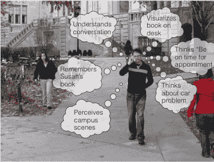

**图1.1** 拉斐尔走过校园时，他的心智中发生了什么？每个思考气泡都对应文中的一个情节。

- **记得**过去的一件事——他曾告诉苏珊今天要还她的书（第5—8章：记忆）
- **区分类别中的项目**，当他思考不同可能的交通方式——租车、室友的车、公交车（第9章：知识）
- **想象**前一晚书放在书桌上的样子（第10章：视觉意象）
- 与苏珊交谈时**理解并产生语言**（第11章：语言）
- 努力**解决问题**，当他思考车送修期间如何出行时（第12章：问题解决）
- **做出决定**，当他决定推迟与苏珊去看电影以便学习时（第13章：判断、决策与推理）

拉斐尔所做的这些事情不仅涵盖在本书中，而且还有一个非常重要的共同点：它们都涉及心智。**认知心理学**是心理学的一个分支，关注对心智的科学研究。当你阅读本书讲述的关于探索理解心智的故事时，你将了解心智是什么、它如何被研究，以及研究者已经发现了哪些关于心智如何运作的知识。在本章中，我们将首先更详细地描述心智，然后考察认知心理学领域背后的一些历史，最后开始思考现代认知心理学家是如何研究心智的。

### 认知心理学：研究心智

你可能已经注意到，我们一直在使用*心智*这个术语，却没有精确地定义它。正如我们将看到的，心智就像心理学中的其他概念（如智力或情绪）一样，可以从许多不同的方式来思考。

#### 什么是心智？

回答“什么是心智？”这个问题的一种方法，是考虑“心智”在日常对话中是如何使用的。以下是几个例子：

1. “他能够回想起事故发生那天自己在做什么。”（心智参与记忆）
2. “如果你用心去做，我相信你能解出那道数学题。”（心智用于解决问题）
3. “我还没下定决心”或“我对此犹豫不决。”（心智用于做出决定或权衡可能性）
4. “他身心健康”或“当他谈论遭遇外星人的经历时，听起来像是精神失常。”（健康的心智与正常功能相关，功能失常的心智与异常功能相关）
5. “浪费心智是一件可怕的事。”（心智宝贵，应当加以运用）
6. “他有一颗聪慧的心智。”（用于描述特别聪明或有创造力的人）

这些说法告诉我们一些关于心智是什么的重要信息。第1、2、3条说法突出了心智在记忆、问题解决和做出决定中的作用，它们与以下关于心智的定义相关：*心智创造并控制感知、注意、记忆、情绪、语言、决策、思维和推理等心理功能。* 这一定义反映了心智在决定我们各种心理能力中的核心作用，而这些能力也体现在本书各章的标题中。

另一个定义侧重于心智如何运作：*心智是一个创造世界表征的系统，使我们能够在其中行动以实现目标。* 这一定义反映了心智对功能和生存的重要性，也为描述心智如何实现这些目标提供了开端。创造表征这一观念是我们将在本书中反复回到的主题。

这两个关于心智的定义并不矛盾。第一个定义指出了不同类型的**认知**——即感知、注意和记忆等心理过程，这些是心智所做的事情。第二个定义说明了心智如何运作（它创造表征）及其功能（它使我们能够行动并实现目标）。第一个定义中的所有认知都在为实现目标的行动中扮演重要角色，这并非巧合。

第4、5、6条说法强调了心智对正常功能的重要性，以及心智的惊人能力。心智是应当被使用的东西，而某些人心智的产物被认为是非凡的。但本书传达的信息之一是，“心智是惊人的”这一观念并不专属于“非凡”的心智，因为即使是最“常规”的事情——认出一个人的脸、进行一次对话，或决定下学期选什么课——当我们考虑使这些熟悉活动得以实现的心智属性时，它们本身也会变得惊人。

心智的确切属性是什么？它有什么特征？它如何运作？说心智创造认知，并且对功能和生存很重要，告诉我们的是*心智做什么*，而不是*它如何实现其所做的事情*。心智如何实现其所做的事情，正是认知心理学要研究的问题。在本章余下部分，我们的目标是描述认知心理学领域如何从其早期开端演变到今天的样子，并开始描述认知心理学家如何着手对心智进行科学研究。

### 研究心智：认知心理学的早期工作

在19世纪，关于心智的观念被这样一种信念所主导：研究心智是不可能的。给出的一个原因是，心智不可能研究自身，但还有其他原因，包括这样一种观念：心智的属性

根本无法被测量。尽管如此，一些研究者挑战了普遍看法，仍然决定研究心灵。其中一位是荷兰生理学家弗朗西斯库斯·唐德斯；1868年，即第一个科学心理学实验室成立前11年，他完成了一项今天会被称作认知心理学实验的最早实验之一。（需要注意的是，“认知心理学”这一术语直到1967年才被创造出来，但我们将要描述的早期实验堪称认知心理学实验。）

#### 唐德斯的开创性实验：作出一个决定需要多长时间？

唐德斯想确定一个人作出决定需要多长时间。他通过测量反应时来确定这一点——即对刺激呈现作出反应所需的时间。他使用了两种反应时测量方法。他测量简单反应时的方法是：要求被试在看到灯亮时尽快按下按钮（图1.2a）。他测量选择反应时的方法是：使用两盏灯，要求被试看到左边的灯亮时按左按钮，看到右边的灯亮时按右按钮（图1.2b）。

简单反应时任务中发生的步骤如图1.3a所示。呈现刺激（灯光）引起心理反应（知觉到灯光），进而导致行为反应（按下按钮）。反应时（虚线）是刺激呈现与行为反应之间的时间。

但请记住，唐德斯想确定的是一个人作出决定需要多长时间。选择反应时任务增加了决策，因为它要求被试判断亮起的是左边的灯还是右边的灯，以及该按哪个按钮。该任务的示意图（图1.3b）在心理反应中加入了判断哪盏灯亮起以及按哪个按钮的决策。唐德斯推断，简单条件与选择条件之间的反应时差异，能说明作出导致按下正确按钮的决策花了多长时间。由于选择反应时比简单反应时长十分之一秒，唐德斯得出结论：决策过程耗时十分之一秒。

唐德斯的实验很重要，既因为它是首批认知心理学实验之一，也因为它说明了研究心灵的一个极其重要之处：心理反应（在这个例子中，即知觉到灯光并决定按哪个按钮）无法被直接测量，而必须从行为中推断。通过注意图1.3中的虚线，我们就能明白为什么会这样。这些线表明，当唐德斯测量反应时时，他测量的是刺激呈现与被试反应之间的关系。他并没有直接测量心理反应，而是从反应时推断它们花费了多长时间。心理反应无法被直接测量，而必须通过观察行为来推断，这一事实是一条不仅适用于唐德斯实验、也适用于所有认知心理学研究的原则。

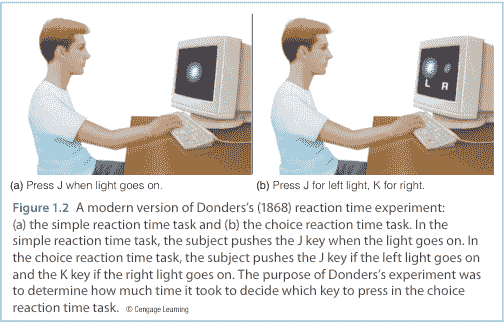

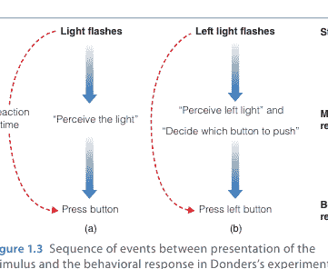

图1.3 唐德斯实验中刺激呈现与行为反应之间的事件序列：（a）简单反应时任务；（b）选择反应时任务。虚线表示唐德斯测量的是反应时——从灯光呈现到参与者作出反应之间的时间。© Cengage Learning

#### 冯特的心理学实验室：结构主义与分析性内省

1879年，即唐德斯反应时实验之后11年，威廉·冯特在德国莱比锡大学创立了第一个科学心理学实验室。冯特的方法在19世纪末和20世纪初主导了心理学，被称为结构主义。按照结构主义的观点，我们的整体经验由经验的基本元素组合而成，结构主义者将这些基本元素称为感觉。因此，正如化学发展出元素周期表，元素结合形成分子一样，冯特想创建一张“心灵周期表”，其中包含构成经验的所有基本感觉。

冯特认为，他可以通过分析性内省来实现对经验成分的这种科学描述；分析性内省是一种让受过训练的被试描述自己在面对刺激时的体验和思维过程的技术。分析性内省需要大量训练，因为被试的目标是用基本心理元素来描述自己的经验。例如，在一项实验中，冯特要求参与者描述他们听到钢琴上弹奏五音和弦时的体验。冯特希望回答的问题之一是，他的被试是否能够听到构成和弦的每一个单独音符。正如我们在第3章讨论知觉时将看到的那样，结构主义并不是一种富有成果的方法，因此在20世纪初被放弃。尽管如此，冯特致力于在受控条件下研究行为和心理，为心理学作出了重大贡献。此外，他培养了许多博士，这些人在其他大学建立了心理学系，包括美国的多所大学。

#### 艾宾浩斯的记忆实验：遗忘的时间进程是怎样的？

与此同时，在距莱比锡120英里的柏林大学，德国心理学家赫尔曼·艾宾浩斯（1885/1913）正在使用另一种方法测量心理的特性。艾宾浩斯想确定记忆与遗忘的性质——具体来说，就是学到的信息随时间流逝而丢失的速度有多快。艾宾浩斯没有使用冯特的分析性内省法，而是使用一种定量方法来测量记忆。他以自己为被试，以恒定速率一次一个地向自己重复由13个无意义音节组成的列表，如DAX、QEH、LUH和ZIF。他使用无意义音节，是为了避免记忆受到特定单词含义的影响。

艾宾浩斯测定了首次学习一个列表需要多长时间。然后，他等待一段特定时间（延迟），再测定重新学习该列表需要多长时间。由于延迟期间发生了遗忘，艾宾浩斯在第一次尝试回忆列表时出现了错误。但由于他保留了最初学习的一些内容，他重新学习该列表的速度比第一次学习时更快。

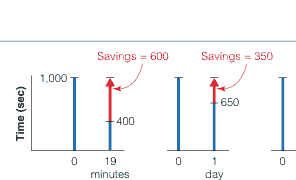

图1.4 计算艾宾浩斯实验中的节省分数。在这个例子中，首次学习该无意义音节列表用了1,000秒。这由0处的线表示。在延迟（a）19分钟、（b）1天和（c）6天后重新学习该列表所需的时间，由0线右侧的线表示。红线表示每个延迟对应的节省分数。注意，延迟越长，节省越少。节省的减少提供了一种遗忘的测量。© 2015 Cengage Learning

艾宾浩斯使用一种称为*节省*的指标来确定特定延迟后遗忘了多少，计算方法如下：节省 = （最初学习列表的时间）－（延迟后重新学习列表的时间）。因此，如果第一次学习该列表用了1,000秒，延迟后重新学习该列表用了400秒，那么节省为1,000－400＝600秒。图1.4展示了最初学习以及三种不同延迟后的重新学习，表明延迟越长，节省越小。

艾宾浩斯认为，节省的减少提供了一种遗忘的测量，节省越小意味着遗忘越多。因此，图1.5中节省百分比随时间变化的图——称为*节省曲线*——表明，在最初学习后的头2天里记忆迅速下降，之后趋于平稳。这条曲线很重要，因为它表明记忆可以被量化，而且像节省曲线这样的函数可以用来描述心理的一种特性——在这里，就是保持信息的能力。注意，尽管艾宾浩斯的节省法与唐德斯的反应时法非常不同，但两者都通过测量*行为*来确定*心理*的一种特性。

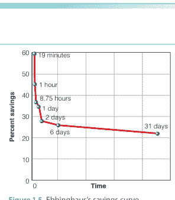

图1.5 艾宾浩斯的节省曲线。艾宾浩斯将节省百分比视为记忆量的指标，因此他将其与最初学习和测试之间的时间作图。随着延迟增加，节省（记忆）下降，表明遗忘在头2天迅速发生，之后发生得更慢。（来源：根据 H. Ebbinghaus，《记忆：对实验心理学的贡献》，H. A. Ruger & C. E. Bussenius 译，纽约：Teachers College, Columbia University，1885/1913。）

#### 威廉·詹姆斯的《心理学原理》

威廉·詹姆斯是美国早期心理学家之一（虽然不是冯特的学生），他在哈佛大学教授了第一门心理学课程，并在其教科书*《心理学原理》*（1890）中对心理作出了重要观察。詹姆斯的观察并非基于实验结果，而是基于对自己心理运作的观察。詹姆斯最著名的观察之一是关于注意本质的以下论述：

> 数百万个项目……呈现于我的感官，却从未真正进入我的经验。为什么？因为它们对我没有吸引力。我的经验是我同意去注意的东西。……人人都知道注意是什么。它是心灵以清晰而生动的方式，从若干似乎同时可能的对象或思绪中占据一个。……它意味着从某些事物中退出，以便有效地处理另一些事物。

注意一件事意味着从其他事物中退出，这一观察在今天仍然成立，并成为许多现代注意研究的主题。詹姆斯观察的准确性令人印象深刻，他所考虑的认知主题范围也同样令人印象深刻，包括思维、意识、注意、记忆、知觉、想象和推理。

冯特创立第一个心理学实验室、唐德斯和艾宾浩斯的定量实验，以及詹姆斯富有洞察力的观察，为心理研究提供了一个看似充满希望的开端（表1.1）。然而，对心理的研究很快就受到限制，主要原因是20世纪初的一些事件使心理学的关注点偏离了对心理和心理过程的研究。导致心理学拒绝研究心理过程的主要力量之一，是对冯特分析性内省技术的负面反应。

#### 表1.1：认知心理学的早期先驱

| 人物 | 程序 | 结果与结论 | 贡献 |
|---|---|---|---|
| 唐德斯（1868） | 简单反应时与选择反应时 | 选择反应时多出1/10秒；因此，做出决定需要1/10秒 | 首个认知心理学实验 |
| 冯特（1879） | 分析性内省 | 无可靠结果 | 建立了第一个科学心理学实验室 |
| 艾宾浩斯（1885） | 用节省法测量遗忘 | 在最初学习后的头1至2天，遗忘迅速发生 | 对心理过程的定量测量 |
| 詹姆斯（1890） | 没有实验；报告了对自身经验的观察 | 对广泛经验的描述 | 第一本心理学教科书；他的一些观察至今仍然有效 |

### 放弃对心智的研究

许多早期心理学系都沿袭冯特实验室的传统开展研究，使用分析性内省来分析心理过程。然而，由于约翰·华生的努力，这种强调研究心智的取向发生了变化。华生于1904年在芝加哥大学获得心理学博士学位。

#### 华生创立行为主义

约翰·华生如何创立一种名为行为主义的心理学取向，这个故事对心理学入门学生来说耳熟能详。由于它对认知心理学的历史十分重要，我们在此简要回顾。

在芝加哥大学读研究生时，华生对分析性内省的方法感到不满。他对这种方法的问题在于：（1）它产生的结果因人而异，差异极大；（2）这些结果难以验证，因为它们是以不可见的内部心理过程来解释的。针对他所认为的分析性内省的缺陷，华生提出了一种新取向，称为行为主义。华生的一篇论文《行为主义者眼中的心理学》用以下著名引文阐明了这种心理学取向的目标：

> 行为主义者眼中的心理学是自然科学中一个纯粹客观的实验分支。其理论目标是预测和控制行为。*内省不构成其方法的必要部分*，其数据的科学价值也不取决于这些数据是否易于用意识来解释……我们需要做的是开始研究心理学，把*行为而非意识*作为我们攻击的客观目标。（Watson, 1913, pp. 158, 176；强调为后加）

这段话提出两点：（1）华生拒绝将内省作为一种方法；（2）可观察的行为，而非意识（意识会涉及不可观察的过程，例如对中性刺激的反应）。

华生实验的灵感来自伊万·巴甫洛夫始于19世纪90年代的研究，该研究展示了狗的经典条件作用。在这些实验中（图1.6），巴甫洛夫将食物（使狗分泌唾液）与铃声（最初的中性刺激）配对，使狗在听到铃声时分泌唾液（Pavlov, 1927）。

华生用经典条件作用论证，行为可以在完全不参照心智的情况下进行分析。对华生而言，阿尔伯特头脑里（或巴甫洛夫的狗的头脑里！）在生理上或心理上发生了什么，都无关紧要。他只关心将一个刺激与另一个刺激配对如何影响行为。

#### 斯金纳的操作性条件作用

在行为主义主导美国心理学期间，B. F. 斯金纳提供了另一种研究刺激与反应关系的工具，这确保这种方法在随后几十年主导心理学。斯金纳于1931年在哈佛大学获得博士学位。斯金纳引入了**操作性条件作用**，它关注行为如何通过呈现正强化物（如食物或社会认可）而得到增强（或通过撤除负强化物，如电击或社会排斥）。例如，斯金纳表明，用食物强化老鼠按杆，维持或提高了老鼠的按杆率。像华生一样，斯金纳对心智中发生的事情不感兴趣，而只专注于确定行为如何受刺激控制（Skinner, 1938）。

通过研究刺激—反应关系可以理解行为这一观点影响了一整代心理学家，并从20世纪40年代到60年代主导了美国心理学。心理学家将经典条件作用和操作性条件作用技术应用于课堂教学、治疗心理障碍以及测试药物对动物的影响。**图1.7**是一张时间线，展示了早期心智研究和行为主义的兴起。但即便行为主义正主导心理学，一些事件也在发生，最终促成了心智研究的复兴。

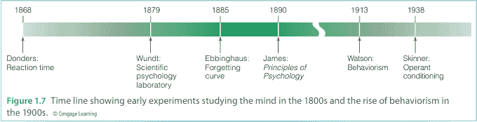

### 为心智在心理学中重新出现搭建舞台

尽管行为主义主导美国心理学数十年，一些研究者并未严格遵循行为主义路线。其中一位研究者是爱德华·钱斯·托尔曼。托尔曼从1918年到1954年在加州大学伯克利分校工作，他自称行为主义者，因为他关注的是测量行为。但实际上，他是早期认知心理学家之一，因为他用行为来推断心理过程。

在托尔曼（1938）的一项实验中，他把一只老鼠放入像图1.8那样的迷宫。最初，老鼠探索迷宫，在每条通道里跑上跑下（图1.8a）。经过这段初始探索期后，老鼠被放在A处，食物放在B处，老鼠很快学会在交叉口右转以获得食物。这正是行为主义者会预测的，因为右转得到了食物奖励（图1.8b）。然而，当托尔曼（在采取预防措施确保老鼠不能根据气味确定食物位置之后）把老鼠放在C处时，有趣的事情发生了。老鼠在交叉口左转，到达B处的食物（图1.8c）。托尔曼对这一结果的解释是，老鼠最初体验迷宫时正在形成认知地图——即老鼠心智中对迷宫布局的构想（Tolman, 1948）。因此，尽管老鼠先前曾因右转而得到奖励，它的心理地图却表明它应该左转才能到达食物。托尔曼对“认知”一词的使用，以及老鼠心智中可能发生刺激—反应联结之外的事情这一观点，使托尔曼处于主流行为主义之外。

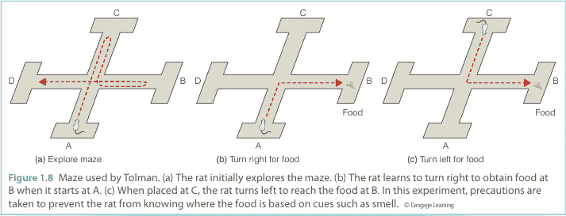

心智使心理学家提出新问题，并以新方式构建对这些问题的回答。受这种关于心智的新思考方式影响的首批实验之一，研究的是当同时呈现其他信息时，人们能在多大程度上将注意力集中于某些信息。

#### 心智流程图

从20世纪50年代开始，许多研究者开始对描述心智处理输入信息的能力产生兴趣。他们感兴趣回答的一个问题源于威廉·詹姆斯的思想：当我们决定注意一件事时，必须从其他事物中退出。以这一思想为出发点，英国心理学家科林·切里（Colin Cherry，1953）向被试呈现两条听觉信息，一条给左耳，一条给右耳，并告诉他们把注意力集中在其中一条信息（被注意信息）上，忽略另一条（未被注意信息）。例如，被试可能被告知注意左耳信息，该信息开头是“当苏珊开着她的新车沿路行驶……”，同时接收但不注意右耳信息“认知心理学，即对心理过程的研究……”

我们将在第4章讨论注意时详细描述这个实验，其结果是：当人们专注于被注意信息时，他们能听到未被注意信息的声音，但意识不到该信息的内容。这一结果促使另一位英国心理学家唐纳德·布罗德本特（Donald Broadbent，1958）提出了第一个心智流程图（图1.9b）。该图表示当人将注意指向环境中的一个刺激时，其心智中发生的过程。应用到切里的注意实验中，“输入”将是受注意信息和未受注意信息两者的声音；“过滤器”让受注意信息通过，并滤除未受注意信息；“检测器”记录通过过滤器的信息。

应用到你在嘈杂聚会上与朋友交谈的体验，过滤器让你的朋友的谈话进入，并滤除所有其他谈话和噪声。因此，尽管你可能意识到还有其他人在说话，但你意识不到诸如其他人在谈什么之类的详细信息。

布罗德本特的流程图提供了一种从一系列加工阶段的角度分析心智运作的方法，并提出了一个可通过进一步实验检验的模型。你将在本书中看到许多类似的流程图，因为它们已成为描绘心智运作的标准方式之一。但英国心理学家切里和布罗德本特并不是唯一寻找研究心智新方法的研究者。大约同一时期在美国，研究者组织了两场会议，这些会议从计算机中获得启发，将心智设想为信息处理器。

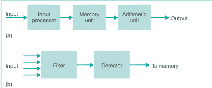

**图1.9**（a）早期计算机的流程图；（b）布罗德本特注意过滤模型的流程图。该图显示许多信息进入一个“过滤器”，它选择个人正在注意的信息，供检测器进一步加工，然后储存到记忆中。我们将在第4章更完整地描述该图。

#### 人工智能与信息论会议

20世纪50年代初，达特茅斯学院年轻的数学教授约翰·麦卡锡有了一个想法。麦卡锡想知道，是否可能通过编程让计算机模仿人类心智的运作？麦卡锡没有仅仅提出这个问题，而是决定1956年夏天在达特茅斯组织一场会议，为研究者提供一个论坛，讨论如何通过编程让计算机执行智能行为。会议名称*人工智能夏季研究项目*首次使用了“人工智能”这一术语。麦卡锡将人工智能方法定义为“使机器的行为方式在人类如此行为时会被称作智能”（McCarthy et al., 1955）。

来自多个不同学科的研究人员——心理学家、数学家、计算机科学家、语言学家和信息论专家——出席了这场为期两周的会议。许多人参加了会议的大部分议程，其他人则来来去去，但也许两位最重要的参会者——来自卡内基理工学院的赫布·西蒙和艾伦·纽厄尔——几乎完全不在场（Newell, 2006）。他们不在场的原因是，他们正忙于在匹兹堡试图创造麦卡锡所设想的人工智能机器。西蒙和纽厄尔的目标是创建一种计算机程序，能够为逻辑问题构造证明——而在此之前，这一直只有人类才能做到。

纽厄尔和西蒙成功地创建了这个程序，他们称之为**逻辑理论家**，并及时在会上进行了演示。他们的演示是革命性的，因为逻辑理论家程序能够为涉及逻辑原理的数学定理构造证明。尽管与现代人工智能程序相比，这个程序还很初级，但它是一台真正的“思维机器”，因为它不仅仅处理数字——它还使用类似人类的推理过程来解决问题。

达特茅斯会议后不久，同年九月，又召开了一场关键会议——*麻省理工学院信息论研讨会*。这次会议为纽厄尔和西蒙再次演示他们的逻辑理论家程序提供了机会，与会者还聆听了哈佛大学心理学家乔治·米勒介绍他刚发表的论文“神奇的数字七加减二”的一个版本（Miller, 1956）。在那篇论文中，米勒提出了一个观点：人类处理信息的能力是有限的——人脑的信息处理大约局限于七个项目（例如，一个电话号码的长度）。

正如我们将在第5章讨论这一观点时看到的，有些方法可以增强我们接收和记住信息的能力（例如，我们在许多电话号码的七位数字上加上区号并不困难）。尽管如此，米勒的基本原则——我们能够接收和记住的信息量是有限的——仍然是一个重要的观点，你可能已经注意到，这与大约同一时期布罗德本特提出的过滤器模型的论点相似。

### 认知“革命”经历了一段时间

我们描述的事件——彻里的实验、布罗德本特的过滤器模型，以及1956年的两次会议——代表了心理学从行为主义转向心智研究的开端。尽管我们称这一转变为*认知革命*，但值得注意的是，从斯金纳的行为主义到认知方法的转变虽然确实是革命性的，却是在一段时间内发生的。参加1956年会议的科学家们并不知道，多年以后，这些会议将被视为关于心智的新思维方式诞生中的历史性事件，也不知道科学史家们有一天会把1956年称为“认知科学的诞生年”（Bechtel et al., 1998; Miller, 2003; Neisser, 1988）。事实上，即使在这些会议结束多年之后，一本心理学史教科书仍然没有提及认知方法（Misiak & Sexton, 1966），直到1967年，乌尔里克·奈瑟才出版了一本题为*认知心理学*的教科书（Neisser, 1967）。**图1.10**展示了促成认知心理学领域建立的一些事件的时间线。

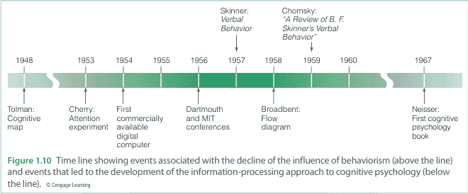

### 展望

奈瑟的教科书创造了*认知心理学*这一术语，并强调用信息加工的方法研究心智，从某种意义上说，它正是你现在所读这本书的“祖父”。正如通常发生的那样，每一代人都创造出解决问题的新方法，认知心理学也不例外。自1956年的会议和1967年的教科书以来，人们进行了许多实验，提出了新的理论，开发了新的技术；结果，认知心理学以及研究心智的信息加工方法成为心理学中的主流方法之一。

自从唐德斯测量反应时间与做出决定（我该按左边的按钮还是右边的按钮？）之间的关系以来，我们已经取得了长足的进步。但现代认知心理学实验仍然在测量关系。例如，我们将看到，人们更容易记住刚刚听到的20个单词列表中的第一个和最后一个，而不是中间的（第5章：记忆）；我们对语言中出现频率较高的词（如*house*）的反应速度快于出现频率较低的词（如*hike*）（第11章：语言）；人们往往会把听说过的原因（如龙卷风）导致的死亡可能性估计得高于那些不常听说的事件（如哮喘），尽管事实可能恰恰相反（哮喘导致死亡的可能性是龙卷风的20倍）（第13章：判断、决策与推理）。

所有测量这些关系的实验，其目标都是通过行为来揭示心智如何运作。但现代认知心理学研究的目标并不局限于测量单一关系，因为最终目标是理解心智，而心智是一个复杂的系统。

### 认知心理学的现代研究

认知心理学家如何看待心智的复杂性？这又如何影响他们提出的问题和进行的实验？对于不同的研究者和不同类型的问题，这些问题的答案可能不同，但我们将考虑认知心理学研究中普遍适用的两个方面：

- 研究如何从一个问题推进到另一个问题；以及
- 模型在认知心理学中的作用。

#### 循迹前行：研究如何从一个问题推进到另一个问题

认知心理学的研究与一般科学研究一样，始于对某个问题的已知认识。以此为起点，研究者提出问题、设计实验、获得并解释结果。这些发现随后又成为新问题、新实验和新结果的基础。因此，我们可以将研究过程看作是在循着一条线索前行，一件事引出另一件事。正如许多路径一样，有些地方需要在不同的道路之间做出选择。就研究而言，所走的路径取决于所提出的问题。因此，研究最大的挑战不是做实验，而是选择正确的问题。

为了说明研究如同循迹前行的观点，我们将描述西恩·贝洛克（Sian Beilock, 2010）关于“压力下失常”问题的研究。所谓*失常*（choking），是指一个人在感到需要高水平发挥的压力时，表现得比根据其技能水平所预期的更差。我们选择这项研究，是因为失常这一主题与许多人的经历相关，也是因为我们即将描述的实验为循迹前行、一个问题引出另一个问题提供了一个很好的例证。

失常现象在许多不同的情境中都能观察到。高尔夫球手错失一个本可锁定冠军的简单推杆，篮球运动员在关键比赛中“手感冰凉”，连续投丢10次，这些都是体育中的失常例子。失常也可能发生在学业情境中。乔希为一次重要考试努力学习，觉得自己掌握了材料，但在考试情境中变得紧张，结果考得很差。

贝洛克早期的一篇论文是在她于密歇根州立大学托马斯·卡尔实验室读研究生时写的，她在论文开头写道：“压力下失常的现象仍有待解释”（Beilock & Carr, 2001）。于是，研究线索的起点便是一个需要解释的现象（失常）。另一个起点是一种被称为*工作记忆*的记忆类型的提出，这种记忆涉及在操作信息时将其保存在记忆中，就像我们在脑中做数学题时那样（Baddeley & Hitch, 1974）。

为了寻找工作记忆与失常之间的联系，贝洛克和卡尔（2004）做了一个实验：他们向被试呈现数学问题，要求他们判断结果是否有余数。例如，对于下面的问题，如果有余数就回答“是”，没有就回答“否”。

(32 − 8) 除以 4 = ？

想想你是如何解决这个问题的（我们稍后还会回到这个问题），然后试试这一个：

(32 − 6) 除以 4 = ？

答案分别是：第一个问题“否”，第二个问题“是”。

当贝洛克在低压条件下（“这是一道题”）和高压条件下（“你会被录像，必须表现好才能获得现金报酬”）向被试呈现这类问题时，她发现，对于更困难、因而更依赖工作记忆的问题，被试的表现下降了（出现失常）。贝洛克假设，出现这一结果的原因是压力使被试产生焦虑，而这种焦虑消耗了他们的一部分工作记忆容量。

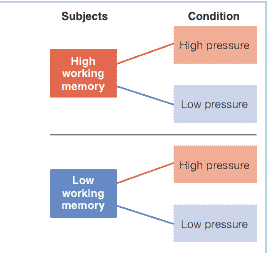

让我们稍作停顿，体会一下这一结论的含义。这项研究已经超越了简单地描述现象（“人们在压力下会失常”）或说明现象何时发生（“困难任务更容易导致失常”），进而对*心智中正在发生什么*提出了假说（“工作记忆正受到干扰”）。这听起来熟悉吗？这正是先测量行为、再推断心智中发生什么的技术精髓。

但请记住，我们正在循迹前行，要继续下去还需要另一个问题。贝洛克在下一篇论文中提出了这个问题（Beilock & Carr, 2005），她指出，要理解导致失常的因果机制，“必须识别出哪些特征的人最可能失败”。沿着这一思路，贝洛克再次建立在先前研究的基础上。二十五年前，梅雷迪思·丹尼曼和帕特里夏·卡彭特（1980）开发了一种测量工作记忆容量的测试，并发现根据这一测试，他们可以将被试分为两组：低工作记忆（LWM）被试和高工作记忆（HWM）被试。

基于将被试分为LWM和HWM的思路，贝洛克采用了*图1.11*所示的实验设计，其中LWM和HWM被试分别在低压或高压条件下完成数学问题。根据你现在所知，你认为哪类被试更可能在压力下失常？认为LWM被试更有可能失常是合理的，因为焦虑会耗尽他们本已有限的工作记忆容量。

**图1.11** 贝洛克和卡尔（2005）实验的实验设计。详见正文。

但请记住，研究建立在先前结果之上，而 Michael Kane 和 Randall Engle（2000）最近发表了一篇论文，他们在两种条件下向低工作记忆（LWM）和高工作记忆（HWM）被试呈现一项言语任务：低负荷（言语任务单独呈现）和高负荷（被试在执行言语任务的同时还要完成另一项任务）。在低负荷条件下，HWM 被试的表现优于 LWM 被试，但在高负荷条件下，两组的表现相同。因此，HWM 被试的优势在高负荷条件下消失了。

Kane 和 Engle 的结果及其原因（我们在此不展开）使 Beilock 预期，HWM 被试在高压力下更可能发挥失常，而图1.12表明事情正是如此。在低压力条件下，HWM 被试比 LWM 被试表现更好，但在高压力情境中，HWM 被试的表现下降了。换句话说，工作记忆储备最好的被试更可能发挥失常。

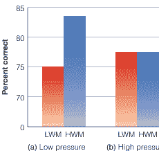

**图1.12** Beilock 和 Carr（2005）实验的结果显示了低工作记忆（LWM）和高工作记忆（HWM）被试在（a）低压力和（b）高压力条件下的数学解题表现。HWM 被试在低压力条件下表现更好，但在高压力条件下失去了优势。（来源：基于 S. L. Beilock & T. H. Carr，*当高能力者失败时*，*Psychological Science*，16，101–105，2005。）

在研究中，一个结果会引出另一个问题，下一个问题是为什么 HWM 被试更容易发挥失常。Beilock 认为，也许可以通过考察 LWM 和 HWM 被试解决数学问题时所使用的策略来找到答案。

如何确定一个人解决问题时使用的是什么策略？一种方法是问他们！当 Beilock 和 Marci DeCaro（2007）让被试解决问题，然后描述他们是如何解决的时，他们发现，在低压力情境下，HWM 被试更可能通过进行计算来得出答案。因此，在第16页的第一个例子中，他们会从32中减去8，再将结果除以4。这种方法总能得出正确答案，但会给工作记忆带来沉重负担。相比之下，LWM 被试更可能使用一种“捷径”，即如果所有数字都是偶数，答案就是“否”。这种策略对许多问题有效（如第一个问题），但并非对所有问题都有效（如第二个问题）。这种捷径策略给工作记忆带来的负担较低，但并不总能得出正确答案。

在低压力条件下，HWM 被试使用的策略在准确性上显然更好，这就是他们在低压力条件下得分更高的原因。但增加压力提高了 HWM 被试转向捷径策略的可能性。当他们这样做时，其表现下降到 LWM 被试的水平。与此同时，LWM 被试继续使用捷径策略，而这种策略由于不占用太多工作记忆，因此没有受到压力的影响。

当然，关于发挥失常还可以提出更多问题。其中之一是“如何防止发挥失常？”，Beilock（2010）在进一步实验中对此进行了研究。因此，理解行为背后的认知机制并不只是具有学术意义。诸如帮助人们应对压力的方法，或如何更有效地学习（我们将在第7章讨论）等实际应用，往往源自关于认知机制的基础研究。

从这个例子——先从一个现象出发，然后沿着提出问题、观察实验结果、提出进一步问题等形成的线索前进——我们可以体会到研究认知过程的研究者所面临的复杂性。认知心理学家应对这种复杂性的一种方法是创建模型，用以表征认知所涉及的结构和过程。

### 模型在认知心理学中的作用

模型是结构或过程的表征，帮助我们可视化或解释该结构或过程。我们将考虑两类模型：*结构模型*，表征参与特定功能的脑结构；以及*过程模型*，说明一个过程如何运作。

#### 结构模型

结构模型是物理结构的表征。模型可以模仿一个物体的外观，就像汽车模型或飞机模型代表真实汽车或飞机的外观一样。类似地，如图1.13中的塑料模型已被用来展示大脑不同结构的位置。结构也可以用示意图来表示，这些示意图并不像结构本身，而是指示大脑不同区域如何连接。例如，图1.14显示了视觉系统中各结构之间连接的复杂性。

模型的一个目的是简化。我们可以通过思考如何构建一个大脑模型来理解这一目的。图1.13中的塑料模型可以拆开，以显示不同结构。当然，这个模型与真实大脑完全不同，因为除了由塑料制成之外，它没有显示每个结构内部发生什么，也没有显示各结构之间如何相互连接。若要表示这些内容，我们就必须增加模型中的细节。事实上，如果我们真的想让模型像大脑一样，我们就会表征构成大脑的单个细胞——称为神经元（我们将在第2章描述）——以及它们如何连接。但这绝非易事，因为人脑中有超过1000亿个神经元，它们之间约有10万亿个连接（Horstman, 2012）。

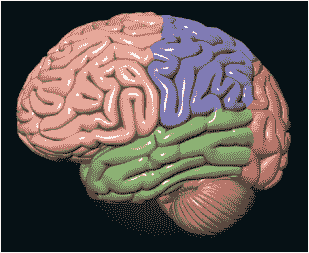

**图1.13** 一个塑料大脑模型可用于展示不同脑结构的位置。

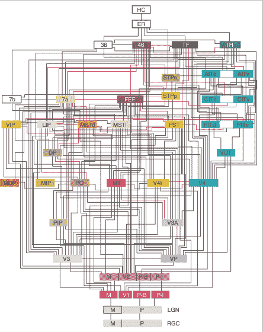

**图1.14** 视觉系统的一个模型。每个方框代表一个结构。线条代表结构之间的连接。*（来源：D. J. Felleman & D. C. Van Essen, Distributed hierarchical processing in the primate cerebral cortex, Cerebral Cortex, 1, 1–47, 1991）。*

我们假设的模型构建练习已经变得难以控制，因为表征每一个神经元和每一个连接远远超出了我们目前对大脑的认识。模型并非真实事物的完全复制品。它们是简化物，不包含那么多细节，但确实包含关于所表征结构的重要信息。甚至图1.14中复杂的视觉系统模型也是简化的，因为每个方框都代表一个复杂的结构。尽管如此，这个模型帮助我们想象一个系统的布局，以及不同组成部分如何连接并可能相互作用。大多数模型所具有的简化特征实际上是一种优势，因为它使研究和理解该系统变得更容易。

需要注意的是，大多数结构模型旨在表征参与特定功能的结构。因此，图1.14中的所有结构都参与视觉。在第3章中，我们将描述一个参与识别物体的系统模型。或者考虑图1.15，它展示了一个模型，描绘了一组称为“疼痛矩阵”的结构，这些结构参与我们对疼痛的感知。这个模型识别出产生疼痛体验不同成分的结构；这些结构被激活时会相互沟通，从而产生整体的疼痛体验。

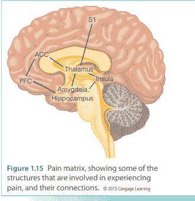

#### 过程模型

过程模型表征认知机制所涉及的过程，方框通常代表特定过程，箭头表示过程之间的连接。Broadbent 的注意过滤器模型就是过程模型的一个例子。在这个模型中，代表“过滤器”的方框表示将受到注意的信息与其他信息分开的过程。这个过程不一定位于大脑中某个特定位置，因此方框不一定代表特定结构；相反，它们表示一个可以由许多不同结构共同执行的过程。

图1.16展示了一个表征记忆运作的过程模型。这个记忆模型（我们将在第5章描述）于20世纪60年代提出，并在许多年里指导了记忆研究。感觉记忆将进入的信息保持几分之一秒，然后将其中大部分信息传递到短时记忆；短时记忆容量有限，可将信息保持数秒（比如你试图记住一个地址，直到能把它写下来）。弯曲箭头表示复述过程，当我们重复某样东西（如电话号码）以防遗忘时，就会发生复述。蓝色箭头表示短时记忆中的一些信息可以转移到长时记忆中；长时记忆是一个高容量系统，可以将信息保持很长时间（比如你对上周末所做事情的记忆，或对最近几位美国总统姓名的记忆）。绿色箭头表示长时记忆中的一些信息可以回到短时记忆。绿色箭头表示当我们回忆起存储在长时记忆中的某样东西时会发生什么，其依据是：回忆某样东西涉及将其带回短时记忆。

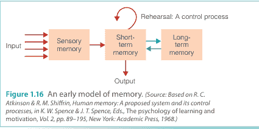

像这样的过程模型使复杂系统更容易理解，也为研究提供了一个起点。例如，对图1.16记忆模型中长时记忆成分的研究表明，长时记忆有多种不同类型，如图1.17所示（Tulving, 1972, 1985）。情景记忆是对你生活中事件的记忆（比如上周末做了什么）。语义记忆是对事实的记忆（例如最近几位

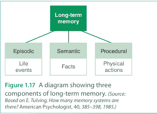

美国总统）。*程序性记忆* 是对身体动作的记忆（例如如何骑自行车或弹钢琴）。认识到长期记忆框可以细分为不同类型的长期记忆，这为模型增添了细节，而该模型为研究这些成分各自如何运作提供了基础。正如我们将在第6、7、8章中看到的，有证据表明这些成分由大脑的不同区域负责，其运作基于不同的机制，并且它们彼此相互作用，共同构成我们完整的记忆体验。因此，模型简化了复杂系统，但随着研究者研究模型的不同成分，模型往往会变得更详细。

本章我们强调了行为，因为行为是认知心理学家试图解释的对象。但除了测量行为之外，认知心理学家还测量作为行为基础的生理过程。例如，除了考虑记忆在行为层面如何运作之外，认知心理学家还对记忆在大脑中如何运作感兴趣。事实上，对每一个行为问题，都存在一个生理问题，因为大脑是负责产生行为的“机器”。在第2章“认知神经科学”中，我们将介绍大脑运作的原理，以及用于揭示认知生理机制的方法。

### 值得思考的问题

#### 从本书中学习

祝贺你！你现在已经知道，一些研究者如何在19世纪开始进行认知心理学实验，心智研究如何在20世纪中叶受到压制，心智研究如何在20世纪50年代光荣回归，以及当今心理学家为何要创建心智模型。本章的目的之一——让你熟悉认知心理学领域——已经实现。

本章的另一个目的是帮助你充分利用本书。毕竟，认知心理学是对心智的研究，而关于记忆的一些发现可以帮助你改进学习技巧，从而使你从本书和正在学习的课程中获得尽可能多的收获。要体会认知心理学如何应用于学习，一种方法是查看第7章第202—203页。现在就浏览这些材料是合理的，而不是等到以后。其中会有一些你可能不熟悉的术语，但它们对你想要实现的目标并不关键，你的目标是获得一些能让学习更高效、更有效的提示。阅读这些页面时，有两个术语值得了解：*编码*——这是你在学习材料时正在发生的事情；以及*提取*——这是你在回忆材料时正在发生的事情。诀窍在于，在学习过程中以某种方式对材料进行编码，使之后更容易提取它。（另见前言第xxvi页。）

还有一点可能有助于你从本书中学习，那就是了解本书是如何构建的。在阅读本书时，你会看到，通常是先提出一个基本观点或理论，然后由例子或实验加以支持。这种呈现信息的方式将某个主题的讨论分解为一系列“小故事”。每个故事都从一个观点或现象开始，接着展示该现象，通常还有支持它的证据。一个故事与下一个故事之间也常常存在联系。之所以将主题呈现为小故事，是因为如果若干事实作为故事的一部分呈现，而不是作为彼此独立、无关的事实呈现，就更容易记住它们。因此，在阅读本书时，请记住，你的主要任务是理解这些故事，每个故事都是一个基本前提，随后是支持性证据。以这种方式思考材料会使其更有意义，因而更容易记住。

还有一点：正如具体主题可以被描述为若干相互关联的小故事，认知心理学作为一个整体领域也由许多彼此相关的主题组成，即使它们出现在不同章节中。知觉、注意、记忆和其他认知过程都涉及同一个神经系统，因此具有许多相同的属性。许多认知过程共享的原理，是认知这一更大故事的一部分，而随着你学习本书，这个故事将逐渐展开。

### 自测 1.1

- 1. 定义心智有哪两种方式？
- 2. 尽管19世纪还没有被称为认知心理学的领域，为什么我们可以说唐德斯和艾宾浩斯是认知心理学家？描述唐德斯的实验及其背后的理由，以及艾宾浩斯的记忆实验。唐德斯和艾宾浩斯的实验有什么共同之处？
- 3. 谁创立了第一个科学心理学实验室？描述该实验室所使用的分析性内省法。
- 4. 威廉·詹姆斯用什么方法研究心智？
- 5. 描述行为主义的兴起，尤其是华生和斯金纳的影响。行为主义如何影响对心智的研究？
- 6. 描述促使行为主义在心理学中的重要性下降的事件，以及导致“认知革命”的事件。务必理解什么是信息加工取向。
- 7. 描述关于压力下失常的研究。这个例子如何说明研究如何从一个问题推进到另一个问题，以及如何用行为来推断心智中正在发生的事情？
- 8. 为什么模型在认知心理学中很重要？什么是结构模型？过程模型？过程模型中的方框是否对应大脑中的结构？
- 9. 提高从本书中学习的能力有哪两条建议？

### 本章小结

- 1. 认知心理学是心理学的一个分支，关注对心智的科学研究。
- 2. 心智创造并控制知觉、注意和记忆等心理能力，并创造世界的表征，使我们能够发挥作用。
- 3. 唐德斯（简单反应时与选择反应时）和艾宾浩斯（无意义音节的遗忘曲线）的工作，是早期心智实验研究的例子。
- 4. 由于心智的运作无法被直接观察，其运作必须从我们可以测量的内容中推断，例如行为或生理反应。这是认知心理学的基本原理之一。
- 5. 第一个科学心理学实验室由冯特于1879年创立，主要关注对心智的研究。结构主义是该实验室的主导理论取向，分析性内省是收集数据的主要方法之一。
- 6. 在美国，威廉·詹姆斯以对自身心智的观察作为其教科书《心理学原理》的基础。
- 7. 在20世纪最初几十年，约翰·华生创立了行为主义，部分是对结构主义和分析性内省法的反应。他的程序基于经典条件作用。行为主义的核心信条是：心理学应通过测量可观察的行为来恰当研究，而不可见的心智过程不是心理学研究的有效主题。
- 8. 从20世纪30年代和40年代开始，B. F. 斯金纳关于操作性条件作用的工作确保了行为主义在20世纪50年代一直是心理学的主导力量。
- 9. 20世纪50年代发生了若干事件，促成了所谓的认知革命——行为主义影响下降，心智研究重新兴起。这些事件包括：(a) 乔姆斯基对斯金纳《言语行为》一书的批评；(b) 数字计算机的引入，以及心智像计算机一样分阶段加工信息的观念；(c) 切里的注意实验，以及布罗德本特引入流程图来描述注意所涉及的过程；(d) 在达特茅斯学院和麻省理工学院举行的跨学科会议。
- 10. 西安·贝洛克研究的压力下失常现象，说明了研究如何从一个问题推进到下一个问题，以及行为实验的结果如何用于推断心智中正在发生的事情。
- 11. 模型通过表征结构或过程，在认知心理学中发挥重要作用。结构模型表征大脑中的结构及其连接方式。过程模型说明一个过程如何运作。模型使复杂系统更易理解，并常常为研究提供起点。
- 12. 有助于学习本书材料的两件事是：阅读第7章中基于我们对记忆研究的部分了解而写成的学习提示；以及认识到本书像故事一样构建，先有基本观点或原理，随后是支持性证据。

### 思考题

- 1. 根据你在媒体中看到或听到的内容，你认为认知心理学的“热门话题”有哪些？提示：寻找类似以下标题的报道：“科学家竞相寻找记忆丧失疗法”；“被告称不记得发生了什么。”
- 2. 我们有一种称为“心智”的东西负责我们的思想和行为，这一观念反映在 *心智* 一词的许多用法中。本章开头引用了一些日常语言中使用 *心智* 的例子。看看你还能想到多少例子来说明 *心智* 一词的不同用法，并判断每个例子与你将在认知心理学中学习的内容（如本书目录所示）有多大相关性。
- 3. 心智的运作可以被描述为发生在若干阶段，这一观念是信息加工取向的核心原理，而信息加工取向是20世纪50年代开始的认知革命的成果之一。如何用信息加工取向来概念化19世纪唐德斯的反应时实验？
- 4. 唐德斯比较了其简单反应时和选择反应时实验的结果，以推断当面临选择时，做出按哪个按钮的决定需要多长时间。但其他类型的决定呢？设计一个实验来确定做出更复杂决定所需的时间。然后将这个实验与 *图1.3* 中的图示联系起来。

### 关键术语

| 术语 | 页码 | 术语 | 页码 |
| --- | --- | --- | --- |
| 分析性内省 | 7 | 逻辑理论家 | 14 |
| 人工智能 | 13 | 心智 | 4 |
| 行为主义 | 9 | 操作性条件作用 | 10 |
| 选择反应时 | 6 | 过程模型 | 19 |
| 经典条件作用 | 10 | 反应时 | 6 |
| 认知 | 5 | 节省量 | 8 |
| 认知地图 | 11 | 节省曲线 | 8 |
| 认知心理学 | 4 | 简单反应时 | 6 |
| 认知革命 | 12 | 结构主义 | 7 |
| 信息加工取向 | 12 | 结构模型 | 18 |

### COGLAB 实验

括号中的数字指 CogLab 中的实验编号。

- 简单检测（2）

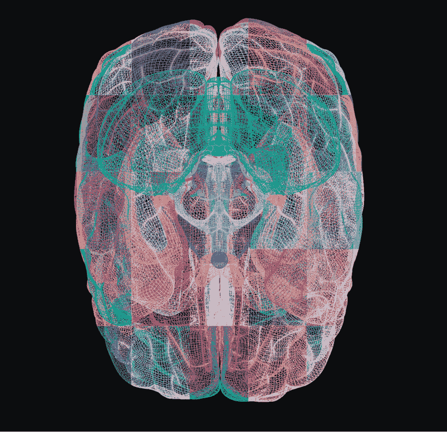

这张从底部观察大脑的图片，用真实大脑中并不存在的颜色和图案进行了艺术化修饰。这幅富有想象力的图像之美，在于它象征了大脑运作的奥秘。认知神经科学研究认知的生理机制，它揭示了认知过程中大脑内发生的情况，并提供了洞见，补充了研究者从纯行为实验中获得的知识。本章为理解后续章节中将要读到的生理学研究奠定基础。

### 为什么要研究认知神经科学？

### 神经元：通信与表征

#### 大脑的微观结构：神经元

#### 在神经元中传播的信号

- 方法：从神经元记录

#### 神经表征原理

### 神经元的表征

#### 单个神经元的表征

#### 感觉编码

自测 2.1

### 组织：神经心理学与神经元记录

#### 神经心理学证明的定位

- 方法：证明双分离

#### 神经元记录证明的定位

### 组织：脑成像

- 方法：脑成像

#### 功能定位的脑成像证据

#### 全脑分布式表征

### 综合起来：神经网络

### 值得思考：神经科学告诉我们关于认知的什么

自测 2.2

### 我们将考虑的一些问题

- 什么是认知神经科学，为什么有必要研究它？(27)
- 信息如何在神经系统中从一处传递到另一处？(30)
- 环境中的事物，如面孔和树木，如何在大脑中被表征？(34)
- 研究大脑能告诉我们关于认知的什么？(46)

早上7:00，胡安听到闹钟那熟悉却恼人的声音，便以熟练的弧线挥动手臂，感觉到手碰到贪睡按钮，在他创造的寂静中翻了个身，再睡几分钟。我们如何从生理学角度解释胡安的行为？胡安大脑内发生了什么，使他能够听到闹钟、采取适当行动关掉它，并知道自己可以再睡一会儿，还能准时赶上早课？

通过考察胡安关掉闹钟这一动作涉及的某些步骤，我们可以对这个问题给出一个概括性回答。听到闹钟的第一步发生在闹钟发出的声波进入胡安的耳朵并刺激感受器时，感受器将声能转化为电信号（图2.1a）。这些信号随后到达胡安大脑的听觉区，使他听到铃响（图2.1b）。然后，信号从大脑的多个部位发送到控制运动的运动区。运动区将信号发送到胡安手和手臂的肌肉（图2.1c），这些肌肉执行关掉闹钟的动作。

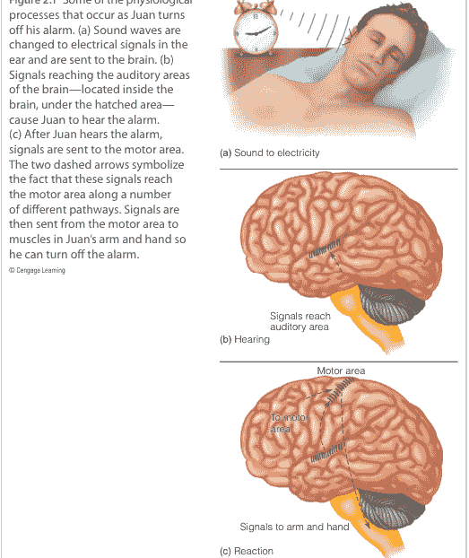

但事情不止这一系列事件。首先，胡安决定按闹钟的贪睡按钮，是因为他知道这会暂时让闹钟安静下来，而且闹钟会在10分钟后再次响起。他还知道，如果他在床上再待10分钟，他仍有时间赶到课堂。因此，要更完整地描绘闹钟响起时胡安大脑中发生的情况，就必须包括从记忆中提取知识以及基于该知识做出决策的过程。因此，像早上关掉闹钟这样一个看似简单的行为，涉及一系列复杂的生理事件。本章的目的是介绍**认知神经科学**的一些基本生理学原理——认知神经科学研究认知的生理基础。

### 为什么要研究认知神经科学？

一些第一次上认知心理学课程的学生惊讶地发现，研究心智既涉及行为实验，也涉及生理实验。他们问：“为什么有必要了解大脑的运作，才能理解人们如何感知或记忆？”但对其他学生，尤其是以前课程中研究过大脑的学生来说，显而易见的是，采用生理学方法能为心智如何运作提供重要洞见。

本书采取的观点是，要理解心智如何运作，我们需要同时进行行为实验和生理实验。这一结论背后的推理基于*分析层次*的思想。**分析层次**指的是一个主题可以用多种不同方式研究，每种方法都为我们理解贡献自己的维度。为了理解这意味着什么，让我们考虑认知心理学领域之外的一个主题：理解汽车。

我们解决这个问题的起点可能是把车开出去试驾。我们可以测定它的加速性能、制动性能、转弯性能和油耗。当我们测量了这些归在“性能”标题下的东西后，我们就会对所测试的那辆特定汽车了解很多。但要了解更多，我们可以考虑另一个分析层次：引擎盖下发生了什么。这将涉及考察负责汽车性能的机制：发动机以及制动和转向系统。例如，我们可以描述这辆车由4缸250马力内燃机驱动，并具有独立悬架和盘式制动器。

但通过考虑另一个旨在帮助我们理解汽车发动机如何工作的分析层次，我们可以更深入地了解汽车的运行。一种方法是观察气缸内部发生的情况。当我们这样做时，会看到当汽化汽油进入气缸并被火花塞点燃时，会发生爆炸，推动气缸向下，并将动力传递到曲轴，然后传递到车轮。显然，从驾驶汽车、描述发动机和观察气缸内发生情况等不同层次来考虑汽车，比仅仅测量汽车性能提供更多关于汽车的信息。

将分析层次的思想应用于认知，我们可以把测量行为看作类似于测量汽车性能，而把测量行为背后的生理过程看作类似于我们通过查看引擎盖下所学到的东西。正如我们可以在不同层次研究汽车引擎盖下发生的情况，我们也可以从整个大脑、到大脑内的结构、再到这些结构内产生电信号的化学物质等不同层次研究认知的生理学。

例如，考虑这样一个情境：吉尔在公园里与玛丽交谈（**图2.2a**），几天后他路过公园，想起她当时穿什么以及他们谈了什么（**图2.2b**）。这是对经历一次体验以及后来拥有该体验记忆的简单行为描述。

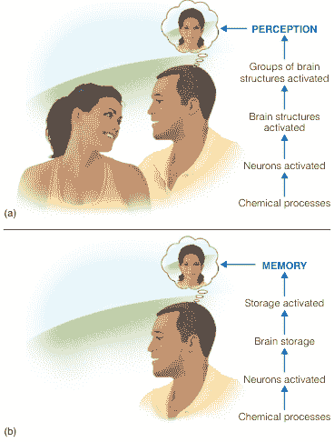

图2.2 生理分析层次。(a) 吉尔与玛丽交谈时感知到玛丽及其周围环境。吉尔感知所涉及的生理过程可以从化学反应到单个神经元、到大脑结构、再到大脑结构群等不同层次来描述。(b) 后来，吉尔记起他与玛丽的会面。记忆所涉及的生理过程也可以在不同分析层次上描述。

但在生理层面上发生了什么？在最初的体验中，即吉尔与玛丽交谈时感知到她，吉尔的眼和耳中发生化学过程，在神经元中产生电信号（我们很快会描述）；单个大脑结构被激活，然后多个大脑结构被激活，所有这些导致他对玛丽以及他们交谈时所发生事情的感知（图2.2a）。

与此同时，在吉尔与玛丽交谈期间以及交谈结束后，还有其他事情发生。吉尔与玛丽交谈时产生的电信号触发化学和电过程，导致吉尔的经历被存储在大脑中。然后，几天后吉尔路过公园时，另一系列生理事件被触发，提取先前存储的信息，使他能够记起与玛丽的交谈（图2.2b）。

我们绕了很远来阐明一个观点，但这是一个重要的观点。要完全理解任何现象，无论是汽车如何运行，还是人们如何记住过去的经历，都需要在不同分析层次上研究。因此，在本书中，我们将从行为和生理两个层面描述认知研究。

本章的计划是首先通过考察神经元的结构和功能来描述神经系统功能的一些基本原理，神经元是神经系统的构建单元和传输线。然后，我们描述认知如何由大脑中神经元的放电、大脑特定区域的活动以及大脑中相互连接区域群的活动来表征。在此过程中，我们将介绍三种用于研究认知神经科学的方法：单神经元记录；研究人类脑损伤的影响；以及创建大脑图像。

### 神经元：通信与表征

被称为大脑的3.5磅结构怎么可能成为心智的所在？大脑似乎是静态组织。它没有运动部件（像心脏那样）。它不扩张也不收缩（像肺那样），而且用肉眼观察时，它看起来几乎是实心的。事实证明，要理解大脑与心智之间的关系，特别是要理解我们所感知、记忆和思考的一切的生理基础，有必要观察大脑内部，观察称为神经元的小单元，它们创造并传递关于我们所经历和所知事物的信息。

#### 大脑的微观结构：神经元

许多年来，大脑组织的性质一直是个谜。用肉眼观察大脑内部，没有任何迹象表明它由数十亿个更小的单元组成。大脑中电信号的性质及其传播路径在19世纪才刚刚开始被发现。

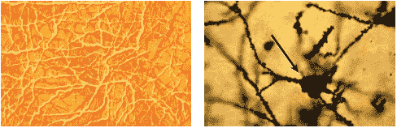

**图2.3** (a) 神经网理论认为信号可以在整个网络中向所有方向传递。(b) 经过高尔基染色处理的大脑区域显示了少数神经元的形态。箭头指向神经元的细胞体。细线是树突或轴突（参见**图2.4**）。

为了观察大脑的结构，19世纪的解剖学家对脑组织施加特殊染色，以增强脑内不同类型组织之间的对比。当他们用显微镜观察这种染色组织时，看到了一个他们称之为**神经网**的网络（**图2.3a**）。这个网络被认为是连续的，就像一个高速公路系统，一条街道直接连接到另一条街道，但没有停车标志或交通信号灯。以这种方式观察时，神经网为信号在该网络中不间断地传导提供了一条复杂的通路。

将大脑的微观结构描述为连续互连网络的一个原因是，当时使用的染色技术和显微镜无法分辨微小细节，而缺少这些细节便使神经网看起来是连续的。然而，在19世纪70年代，意大利解剖学家卡米洛·高尔基开发了一种染色技术，将脑组织的薄切片浸入硝酸银溶液中。这种技术产生了如**图2.3b**所示的图像，其中只有不到1%的细胞被染色，因此它们从其余组织中凸显出来。（如果所有细胞都被染色，就很难区分细胞，因为它们排列得太紧密。）而且，被染色的细胞是完整染色的，因此可以观察到它们的结构。

这让我们想到了西班牙生理学家拉蒙·伊·卡哈尔，他对探究神经网的本质很感兴趣。卡哈尔巧妙地运用了两种技术来实现他的目标。第一，他使用了高尔基染色法，这种方法只对脑组织切片中的部分细胞染色。第二，他决定研究新生动物的大脑组织，因为新生大脑中的细胞密度比起成年大脑中的密度要小。新生大脑的这一特性，加上高尔基染色法影响不到1%的神经元这一事实，使卡哈尔能够清晰地看到神经网并不是连续的，而是由连接在一起的独立单元组成（Kandel, 2006）。卡哈尔发现，被称为神经元的独立单元是大脑的基本构建单元，这一发现是神经元学说的核心——该学说认为，单个细胞在神经系统中传递信号，并且这些细胞并不像神经网理论所提出的那样与其他细胞连续。

**图2.4a**展示了神经元的基本组成部分。**细胞体**是神经元的新陈代谢中心；它包含维持细胞存活的机制。从细胞体分支出来的**树突**的功能是接收来自其他神经元的信号。**轴突**（又称**神经纤维**）通常是向其他神经元传递信号的较长突起。**图2.4b**显示了一个带有感受器的神经元，该感受器接收来自环境的刺激——在此例中为压力。因此，神经元有一个接收端和一个传递端，正如卡哈尔所观察到的，其作用是传递信号。

卡哈尔还得出了一些关于神经元的其他结论：（1）一个神经元的轴突末端与另一个神经元的树突或细胞体之间存在一个小间隙。这

## 经济全球化与中国的对外开放

> “开放带来进步，封闭必然落后。中国开放的大门不会关闭，只会越开越大。”

### 一、经济全球化的内涵与特征

经济全球化是指商品、服务、资本、技术和人才等生产要素跨越国界在全球范围内自由流动和优化配置的过程。其核心特征包括：

- 贸易自由化：国际贸易壁垒逐步降低，全球贸易规模持续扩大
- 金融全球化：国际资本流动加速，金融市场高度关联
- 生产国际化：跨国公司在全球布局产业链与供应链
- 科技全球化：科技创新成果在全球范围内快速传播与转化

### 二、中国对外开放的历程与成就

自1978年改革开放以来，中国的对外开放经历了从沿海到内地、从点到面、从局部到全局的渐进式推进过程。特别是加入世界贸易组织（WTO）后，中国全面融入世界经济体系，取得了举世瞩目的成就：

| 时间节点 | 标志性事件 | 意义 |
|----------|-----------|------|
| 1978年 | 中共十一届三中全会召开 | 开启改革开放伟大征程 |
| 1980年 | 设立深圳等经济特区 | 打开对外开放的窗口 |
| 2001年 | 加入世界贸易组织 | 全面融入全球经济体系 |
| 2013年 | 提出“一带一路”倡议 | 推动更高水平对外开放 |
| 2020年 | 签署RCEP协定 | 深化区域经济合作 |

神经元的内部电荷比外部负70毫伏，只要神经元处于静息状态，这种差异就会持续存在。

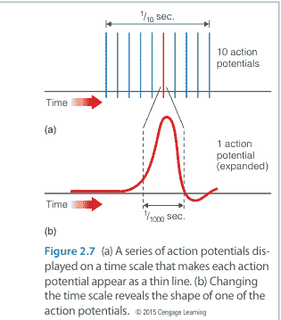

**图2.6b**显示了当神经元的感受器受到刺激，**神经冲动**沿轴突向下传递时发生的情况。当冲动经过记录电极时，轴突内部的电荷相对于外部上升到+40毫伏。当冲动继续通过电极时，纤维内部的电荷发生逆转，又开始变为负值（**图2.6c**），直到恢复到静息电位（**图2.6d**）。这种冲动，我们称之为**动作电位**，持续约1毫秒（1/1000秒）。

**图2.7a**在压缩的时间尺度上显示了动作电位。每条垂直线代表一个动作电位，一系列线表示多个动作电位正在经过电极。**图2.7b**在放大的时间尺度上显示了其中一个动作电位，如**图2.6**所示。神经系统中还有其他电信号，但我们这里将重点关注动作电位，因为它是信息在整个神经系统中传递的机制。

除了记录单个神经元的动作电位外，阿德里安还有其他发现。他发现每个动作电位在沿轴突全程传导时，其高度或形状均不改变。这一特性使动作电位非常适合远距离传递信号，因为这意味着一旦动作电位在轴突的某一点启动，信号到达另一端时仍将保持相同的大小。

大约在阿德里安记录单个神经元的同时，其他研究人员证明，当信号到达轴突末端的突触时，一种名为**神经递质**的化学物质会被释放。这种神经递质使信号能够跨越轴突末端与另一个神经元树突或细胞体之间的间隙（参见**图2.5b**）。

尽管这些关于神经元本质及其中所传递信号的发现极为重要（并为发现者赢得了一系列诺贝尔奖），但我们主要感兴趣的并非轴突如何传递信号，而是这些信号如何促进心智的运作。因此，我们描述信号传递的方式，类似于描述互联网如何传输电信号，而不描述这些信号如何转化为人们可以理解的文字和图片。阿德里安敏锐地意识到，仅仅描述神经信号是不够的，因此他进行了一系列实验，将神经信号与环境刺激联系起来，进而与人们的体验联系起来。

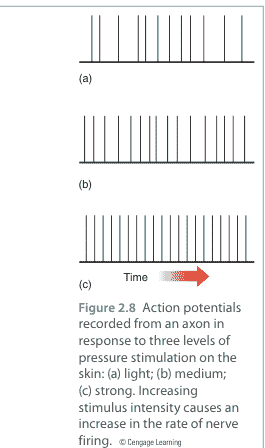

阿德里安通过测量皮肤感受器神经元的放电如何随他对皮肤施加更大压力而变化，来研究神经放电与感觉体验之间的关系。他发现，随着压力增大，动作电位的形状和高度保持不变，但神经放电的**速率**——即每秒沿轴突向下传导的动作电位数量——增加了（**图2.8**）。由此结果，阿德里安在神经放电与体验之间建立了联系。他在其著作*《感觉的基础》*（1928）中描述了这种联系，指出如果神经冲动“紧密地挤在一起，感觉就强烈；如果它们被长时间的间隔分开，感觉就相应地微弱”（第7页）。

阿德里安所说的是，电信号**表征**着刺激的强度，因此产生“密集”电信号的压力比产生长时间间隔信号的压力感觉更强。后来的实验在视觉方面也显示了类似结果。呈现高强度的光会产生高频率的神经放电，光看起来更亮；呈现较低强度的光会产生较低的神经放电频率，光看起来更暗。因此，神经放电的频率与刺激强度相关，而刺激强度又与体验的强度相关，例如感受皮肤上的压力或体验光的亮度。

我们可以通过探究神经冲动如何参与记忆、语言等认知的其他方面，以及许多特征检测器的想法如何类似于用乐高积木组合物体，来扩展神经放电与知觉体验之间存在联系的观点。但这些特征检测器位于视觉皮层，这是来自眼睛的电信号到达大脑的第一站。对视觉皮层之外区域的进一步研究揭示了神经元会对比较为复杂的刺激（而不仅仅是朝向线条）作出反应。

#### 对复杂刺激作出反应的神经元

大脑中神经元的放电如何表征复杂刺激？查尔斯·格罗斯（Charles Gross）的实验室开始浮现出这个问题的一个答案。格罗斯的实验需要研究者付出极大的耐力，因为实验通常持续3或4天；实验中，他记录了猴子大脑侧面颞叶中的单个神经元。在这些实验中，格罗斯的研究团队向麻醉的猴子呈现了各种不同的刺激，实验结果发表于1969年和1972年，如今已成为经典论文。在类似**图2.10a**的投影屏幕上，他们呈现了线条、正方形和圆圈，有些刺激是亮的，有些是暗的。

颞叶神经元对复杂刺激作出反应的发现出现在他们一次实验开始后的几天里，当时他们发现一个神经元对任何标准刺激（如朝向线条、圆圈或正方形）都没有反应。什么刺激都不起作用，直到一位实验者指着房间里某个东西，在屏幕上投下他手的影子。当这个手的影子引起一阵放电时，实验者意识到他们发现了重要线索，于是开始用各种刺激测试这个神经元，包括猴手剪影。经过大量测试，他们确定这个神经元对手指朝上的手形刺激有反应（图2.11）（Rocha-Miranda, 2011；另见Gross, 2002）。在扩展了呈现的刺激类型后，他们还发现一些神经元对脸部反应最佳；后来的研究者扩展了这些结果，提供了许多神经元的例子，这些神经元对脸部有反应，但对其他类型的刺激没有反应（图2.12）（Perrett et al., 1982; Rolls, 1981）。

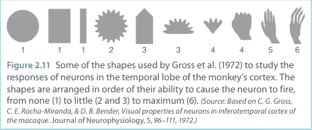

让我们稍作停顿，思考一下目前呈现的结果。我们看到，视觉皮层的神经元对简单刺激（如朝向条状物）作出反应，颞叶的神经元对复杂几何刺激作出反应，而颞叶另一个区域的神经元则对脸部作出反应。事实上，视觉皮层中响应相对简单刺激的神经元将其轴突投射到视觉系统的更高级区域，在那里来自许多神经元的信号相互结合和交互；这一更高级水平的神经元对更复杂的刺激（如几何物体）作出反应，然后向更高级区域发送信号，进一步结合和交互，并产生对更复杂刺激（如脸部）作出反应的神经元。这种从大脑较低级区域到较高级区域的递进被称为层级加工。层级加工能否解决神经表征的问题？是否可能视觉系统的高级区域包含专门只对特定物体作出反应的神经元，从而使该物体由那一类特化神经元的放电来表征？正如我们将看到的，神经表征的问题很可能涉及大量神经元协同工作。

### 感觉编码

感觉的神经表征问题被称为感觉编码问题，其中感觉编码是指神经元如何表征环境的各种特征。一个物体可以由一个只对该物体作出反应的特化神经元来识别的想法，被称为特异性编码。图2.13对此进行了说明，该图展示了多个神经元如何对三张不同的脸作出反应。只有神经元#4对比尔的脸作出反应，只有#9对玛丽的脸作出反应，只有#6对拉斐尔的脸作出反应。还要注意，那个只对比尔作出反应的特化神经元（我们可以称之为“比尔神经元”）不会对玛丽或拉斐尔作出反应。此外，其他面孔或类型的物体也不会影响这个神经元。它只对比尔的脸放电。

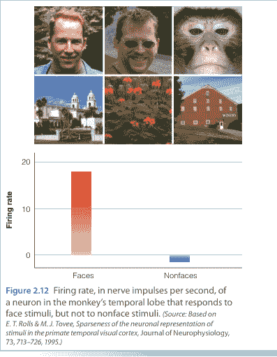

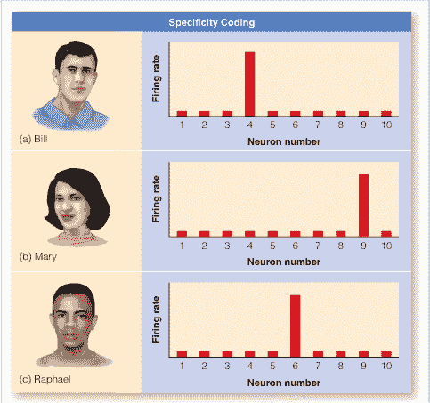

**图2.13** 特异性编码。图中显示了10个不同神经元对左侧每张面孔的反应。每张面孔都会使不同的神经元放电。© Cengage Learning

尽管特异性编码的思想很直接，但它不太可能是正确的。即使存在对脸作出反应的神经元，这些神经元通常也会对许多不同的脸作出反应（而不只是比尔的脸）。世界上有太多不同的面孔和其他物体（以及颜色、味道、气味和声音），不可能为每个物体都分配一个单独的神经元。特异性编码思想的一种替代观点是，许多神经元共同参与对一个物体的表征。

**群体编码**是用大量神经元的放电模式来表征特定物体。根据这一观点，比尔的脸可能由**图2.14a**所示的放电模式表示，玛丽的脸由另一种模式表示（**图2.14b**），拉斐尔的脸则由又一种模式表示（**图2.14c**）。群体编码的一个优点是，它可以表征大量刺激，因为大群神经元可以产生数量巨大的不同模式。感觉系统以及其他认知功能中都有支持群体编码的良好证据。但对某些功能而言，并不需要大量神经元。当只有小群神经元参与时，就发生*稀疏编码*。

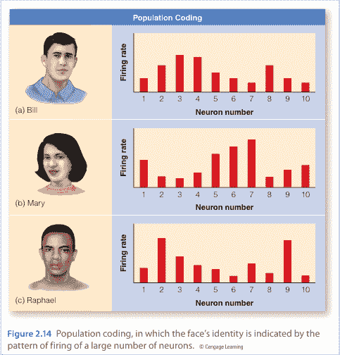

**稀疏编码**发生在特定物体仅由一小群神经元的放电模式表示、而大多数神经元保持沉默时。如**图2.15a**所示，稀疏编码会通过少数神经元（神经元2、3、4和7）的放电模式来表示比尔的脸。玛丽的脸会由少数不同神经元（神经元4、6和7；**图2.15b**）的放电模式发出信号，但可能与表示比尔的神经元有一些重叠；拉斐尔的脸则有另一种模式（神经元1、2和4；**图2.15c**）。注意，一个特定神经元可以对不止一个刺激作出反应。例如，4号神经元对三张脸都作出反应，不过对玛丽的脸反应最强。

最近，在对因癫痫接受脑外科手术的患者颞叶进行记录时，发现了神经元。（我们应当指出，对神经元进行刺激和记录是脑外科手术前和手术中的常见程序，因为这可以确定特定个体大脑的精确布局。）这些神经元对非常特定的刺激作出反应。**图2.16**显示了一个神经元的记录，该神经元对演员史蒂夫·卡瑞尔的照片有反应，而对其他人的脸没有反应（Quiroga et al., 2007）。然而，发现这个神经元（以及其他对其他人有反应的神经元）的研究人员指出，他们只有30分钟时间记录这些神经元；如果时间更充裕，他们很可能还会发现其他会使这些神经元放电的脸。鉴于即便这些特殊神经元也可能对不止一个刺激作出放电反应，Quiroga及其同事（2008）认为，他们记录的神经元很可能是稀疏编码的一个例子。

还有其他证据表明，视觉系统中物体、听觉系统中音调以及嗅觉系统中气味的编码，可能涉及相对少量神经元的活动模式，正如稀疏编码所提示的那样（Olshausen & Field, 2004）。

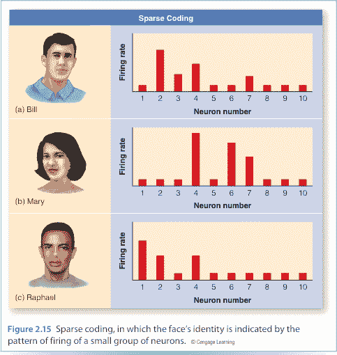

**图2.15** 稀疏编码，其中面孔的身份由一小群神经元的放电模式表示。

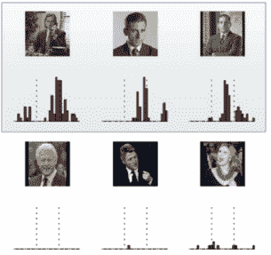

**图2.16** 颞叶中一个神经元的记录，该神经元对史蒂夫·卡瑞尔的不同视角有反应（上方记录），但不对其他知名人士的照片有反应（下方记录）。（来源：R. Q. Quiroga, L. Reddy, G. Kreiman, C. Koch, & I. Fried, Sparse but not “grandmother-cell” coding in the medial temporal lobe, Trends in Cognitive Sciences, 12, 87–91, 2008. 经许可转载。）

记忆也由神经元放电表示，但知觉表征与记忆表征之间存在差异。与体验知觉相关的神经放电，与知觉发生时正在发生的事情有关，正如**图2.9**中吉尔看着玛丽时的例子。与记忆相关的放电则与储存在大脑中的过去信息有关，例如吉尔回忆起看见玛丽时。我们对记忆储存信息的实际形式了解较少，但群体编码和稀疏编码的基本原则很可能也适用于记忆：特定记忆由特定的储存信息模式表示，当我们体验该记忆时，这些模式会导致特定的神经放电模式。

说单个神经元和神经元群包含用于知觉、记忆和其他认知功能的信息，是理解表征的第一步。下一步涉及考察组织：不同类型的神经元和功能如何在大脑内部组织起来。

### 自测 2.1

- 1. 描述分析层次的思想。这与回答“为什么研究认知神经科学？”这一问题有何关系？
- 2. 早期大脑研究者如何用神经网来描述大脑？单个神经元的思想与神经网的思想有何不同？
- 3. 描述使卡哈尔提出神经元学说的研究。
- 4. 描述神经元的结构。描述突触和神经回路。
- 5. 如何记录神经元的动作电位？这些信号看起来是什么样，动作电位与刺激强度之间有什么关系？
- 6. 不同知觉如何由神经元表示这一问题已经如何得到回答？请同时考虑涉及单神经元记录的研究以及关于感觉编码的观点。
- 7. 记忆的神经表征与知觉的表征有何不同？又有何相似之处？

### 组织：神经心理学与神经元记录

大脑组织的基本原则之一是功能定位——特定功能由大脑的特定区域承担。大多数认知功能由大脑皮层承担，大脑皮层是一层约3毫米厚的组织，覆盖着大脑（Fischl & Dale, 2006）。皮层是你观察完整大脑时看到的布满皱褶的覆盖层（图2.17）。功能定位的早期证据来自神经心理学——对脑损伤患者行为的研究。

#### 神经心理学所证明的功能定位

大量神经心理学研究涉及对因中风——通常由血凝块导致大脑供血中断——而遭受脑损伤的患者的研究。基于一名中风患者的功能定位早期报告，是保罗·布罗卡（1861）提出的：左额叶的一个区域（现在称为布罗卡区）专门负责言语（图2.17）。他的提议基于对一名额叶受损患者的研究，该患者被称为“Tan”，因为这是他唯一能说的词。1879年，卡尔·韦尼克研究了另一组颞叶某个区域受损的患者，该区域现在称为韦尼克区；这些患者的言语流利且语法正确，但往往缺乏连贯性。

因此，布罗卡和韦尼克确定了一个负责产生语言的区域（布罗卡区）和一个负责理解语言的区域（韦尼克区）。尽管这种按产生和理解进行的直接分类已被后来研究的结果修正（见 Novick et al., 2005，以及第11章第308页），但这两个大脑区域承担不同功能的观点仍然有效，并且是接受功能定位思想的一大推动力。

功能定位的进一步证据来自对战时脑损伤影响的研究。对1904—1905年日俄战争中的日本士兵以及第一次世界大战中协约国士兵的研究表明，大脑枕叶（视觉皮层所在处，图2.18）受损会导致失明，并且枕叶受损区域与患者视野中失明的部位之间存在联系（Glickstein & Whitteridge, 1987; Holmes & Lister, 1916; Lanska, 2009）。例如，枕叶左侧部分受损会导致视野右上部分出现失明区。

如前所述，大脑其他区域也与特定功能相关联。听觉皮层接收来自耳朵的信号，位于颞叶上部，负责听觉。躯体感觉皮层接收来自

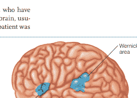

**图2.17** 额叶中的布罗卡区和颞叶中的韦尼克区在早期研究中被确定为分别专门负责语言产生和语言理解。© Cengage Learning

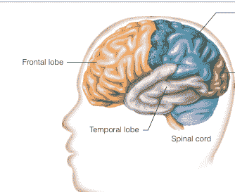

**图2.18** 人类大脑，显示感官主要接收区的位置：视觉=枕叶；皮肤感觉=顶叶（蓝色点状区域）；听觉=颞叶（位于颞叶内，大约在深色阴影区域下方）。味觉和嗅觉区域不可见。额叶对所有感官作出反应，并参与高级认知功能。© Cengage Learning

皮肤感觉位于顶叶，负责触觉、压力和疼痛的感知。额叶接收来自所有感官的信号，并负责感官的协调，以及像血红蛋白那样的高级认知功能。

图2.19a展示了fMRI实验的设置，人的头部位于扫描仪中。当一个人从事认知任务（例如感知一幅图像）时，会测定其大脑活动。活动记录在**体素**中，体素是大脑中边长约2或3毫米的小立方体状区域。体素不是大脑结构，而只是由fMRI扫描仪创建的小分析单元。理解体素的一种方式是，它们就像组成数码照片或电脑屏幕图像的小方形像素，但由于大脑是三维的，体素是小立方体而不是小方块。图2.19b显示了fMRI扫描的结果。与认知活动相关的大脑活动增强或减弱用颜色表示，特定颜色表示激活量。

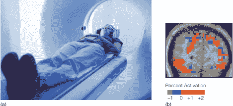

**图2.19**（a）人处于脑扫描仪中。（b）fMRI记录。颜色表示脑活动增强和减弱的位置。红色和黄色表示脑活动增强；蓝色和绿色表示减弱。*（来源：b部分来自 Almut H. ...；Leslie G. Ungerleider、Alex Martin 与 James V. Haxby，“人类枕叶和颞叶皮层中物体的表征”，《认知神经科学杂志》，12:2，35–51。© 2000 麻省理工学院。）*

需要强调的是，这些彩色区域并不会在扫描大脑时直接出现。它们是通过一种计算确定的：将认知任务期间发生的脑活动与任务前记录的基线活动进行比较。该计算结果表明大脑特定区域活动增强或减弱，随后被转换为如图2.19b所示的彩色显示。

### 功能定位的脑成像证据

大多数为功能定位提供证据的脑成像实验，都涉及确定人们在观看不同物体图片时哪些脑区被激活。

#### 观看图片

如图2.20a和2.20b所示，面孔会激活大脑中的一个特定区域（Kanwisher 等，1997；Kanwisher 与 Dilks，2013）。这个区域被称为梭状回面孔区（FFA），因为它位于颞叶下方的梭状回中（Kanwisher 等，1997）；它正是面孔失认症病例中受损的同一脑区。

功能定位的进一步证据来自fMRI实验：这些实验表明，感知如图2.21a所示的室内和室外场景图片会激活海马旁回位置区（PPA）（Aguirre 等，1998；R. Epstein 等，1999）。显然，对该区域而言重要的是关于空间布局的信息，因为观看空房间和布置齐全房间的图片时，激活都会增强（Kanwisher，2003）。另一个专门化区域是纹外身体区（EBA），它会被身体及身体部位的图片激活（但不会被面孔图片激活），如图2.21b所示（Downing 等，2001）。

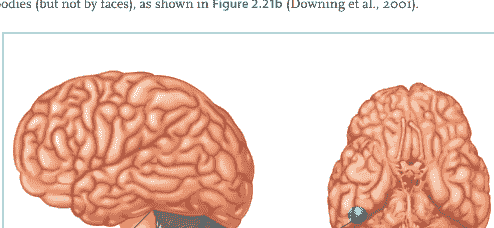

**图2.20**（a）大脑侧视图。梭状回面孔区在此视图中不可见，因为它位于大脑底部。（b）大脑底部，显示FFA的位置。© Cengage Learning

### 观看电影

在日常生活中，我们通常的经历包括看到包含许多不同物体的场景，其中一些物体还在移动。因此，Alex Huth 及其同事（2012）进行了一项 fMRI 实验，使用与环境中所见相似的刺激，让受试者观看电影片段。Huth 的受试者在脑扫描仪中观看了 2 小时的电影片段。为了分析这些受试者大脑中的体素如何对电影中的不同物体和动作作出反应，Huth 创建了一份包含 1,705 个不同物体和动作类别的列表，并确定每个电影场景中出现了哪些类别。

**图2.22** 显示了四个场景及与其相关的类别（标签）。通过确定每个体素如何对每个场景作出反应，然后用复杂的统计程序分析结果，Huth 能够确定每个体素对何种刺激作出反应。例如，一个体素在街道、建筑物、道路、室内和车辆出现时反应良好。

**图2.23** 显示了引起大脑表面体素作出反应的刺激类型。彼此相似的物体和动作在大脑中彼此邻近。人类有两个区域、动物有两个区域，原因是每个区域表征与人类或动物相关的不同特征。例如，大脑底部（实际上位于大脑下侧）标有“人类”的区域对应梭状回面孔区（**图2.20b**），该区域对面部的所有方面作出反应。大脑位置更高的人类区域则专门对面部表情作出反应。标有“说话”的区域对应布洛卡区和韦尼克区。

**图2.23** 中的结果呈现了一个有趣的悖论。一方面，这些结果证实了早期研究，即识别出了负责感知面孔、场景和身体等特定类型刺激的特定大脑区域。另一方面，这些新结果揭示了一张延伸至皮层大片区域的地图。正如我们接下来将看到的，尽管有大量证据支持功能定位，但为了理解认知的生理基础，我们需要把大脑作为一个整体来考虑。

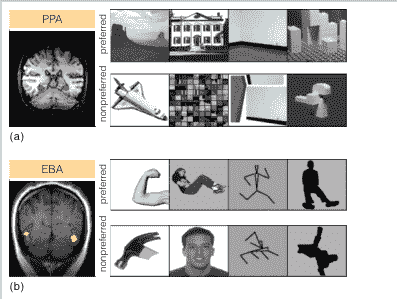

**图2.21** (a) 海马旁回位置区（PPA）被场景（上排）激活，但不被其他刺激（下排）激活。(b) 纹外身体区（EBA）被身体（上）激活，但不被其他刺激（下）激活。*来源：摘自 L. M. Chalupa 与 J. S. Werner 编，《视觉神经科学》，两卷本，图见第1179–1189页，© 2003 麻省理工学院，经麻省理工学院出版社许可。*

| 电影片段 | 标签 | 电影片段 | 标签 |
|---|---|---|---|
| [插图：山地电影画面] | 黄油.n 沙漠.n 天空.n 云.n 灌木丛.n | [插图：城市电影画面] | 城市.n 高速公路.n 摩天大楼.n 交通.n 天空.n |
| [插图：人物电影画面] | 女人.n 说话.v 打手势.v 书.n | [插图：野牛电影画面] | 野牛.n 行走.v 草.n 溪流.n |

**图2.22** Huth 等人（2012）实验中受试者观看的电影的四个画面。右侧的词表示画面中出现的类别（n = 名词，v = 动词）。*来源：摘自 A. G. Huth 等人，《连续语义空间描述人脑中数千个物体和动作类别的表征》，《神经元》，76，1210–1224，图 S1，补充材料，2012。*

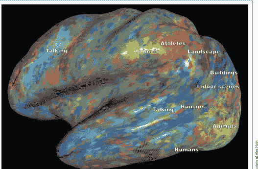

**图2.23** Huth 等人（2012）实验的结果，显示所示类别最可能激活大脑的部位。

### 大脑中的分布式表征

我们已经看到，脑成像研究使我们能够聚焦于大脑中专门服务于特定功能的特定区域。现在我们将描述一些研究，其中脑成像被用来表明特定认知可以影响大脑中的许多结构。特定认知功能激活大脑许多区域的观点被称为*分布式表征*。尽管分布式表征的观点乍看可能与前文所述的功能定位观点相矛盾，但我们将看到，这两种观点实际上是互补的。

例如，考虑面孔知觉在大脑中的定位。我们看到，脑成像实验已经识别出一个称为 FFA 的区域，它被面孔强烈激活，而对其他类型的刺激反应较弱。但是，仅仅因为存在一个专门对面孔作出反应的区域，并不意味着面孔*只*激活该区域。面孔会强烈激活 FFA，同时也会激活其他区域。

虽然大脑的许多区域参与对面孔的*知觉*，但其他区域也会对面孔的各种*反应*作出响应。例如，当你看到某人沿街走来时，注视这个人的脸会激活你 FFA 中的许多神经元，以及其他区域中对面部形态作出反应的神经元。但你对那个人面孔的反应可能不止于“那是一张人脸”。你还可能受到以下因素影响：那个人是否在看你、你认为那个人有多吸引人、那张脸可能引发的任何情绪，以及你对那个人面部表情的反应。结果表明，对面孔的每一种反应都会激活大脑中不同的区域（见图2.24）。因此，注视一张脸会激活许多参与面孔知觉的区域，以及与被面孔引发的反应相关的其他区域。

但是，如果遇到一个简单得多的刺激——一个不会看着你、没有情绪表情、也不会引发情绪反应的刺激——又会怎样呢？就像**图2.25**中那个人所做的那样，感知一个滚动的红球，情况又如何呢？即便是这个简单、中性的刺激，也会引起大脑中广泛分布的活动，因为球的每一种属性——颜色（红色）、运动（向右）、形状（圆形）、深度、位置——都在大脑的不同区域得到加工。

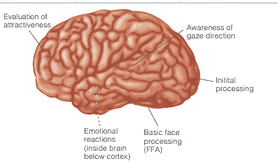

**图2.24** 被面孔不同方面激活的大脑区域。（来源：改编自 Ishai, 2008；基于 Calder 等人，2007；Gobbini & Haxby，2007；Grill-Spector 等人，2004；Haxby 等人，2000；Ishai 等人，2004 的数据。）© Cengage Learning

关于滚动的红球，值得注意的是，尽管它引起大脑中若干分离区域的活动，但我们的体验中几乎或完全没有这种广泛分布活动的迹象。我们只是看到了球！这一观察的重要性不仅限于感知滚动的红球，还延伸到其他认知功能，如记忆、语言、决策和解决问题，所有这些都涉及大脑中的分布式活动。

例如，关于记忆生理学的研究（我们将在第5章和第7章详细讨论）已经揭示，大脑每个叶中的多个区域都参与存储关于事实和事件的记忆，并在之后回忆它们。回忆一个事实或记住一个事件，不仅会引发与其他事实或事件的联想，还可能引发与该记忆相关的视觉、听觉、嗅觉或味觉知觉；由该记忆引发的情绪；以及其他思维过程。此外，记忆有不同类型——短期记忆、长期记忆、关于个人生活中事件的记忆、关于事实的记忆等等——它们都激活大脑中不同的、尽管有时部分重叠的区域。

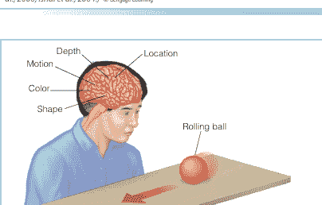

**图2.25** 当这个人看着红球滚过时，球的不同属性激活他皮层中的不同区域。这些区域位于不同位置，尽管它们之间存在交流。© Cengage Learning

分布式表征原则适用于知觉、记忆和其他认知过程，这一观点反映了负责认知的机制的一般性。尽管本书按不同类型的认知分成不同章节，但这种区分并不总是出现在心智或大脑中。毕竟，心智不是一本教科书；它不一定把我们的经验或认知细分成整齐的类别。相反，心智创造的认知过程可以涉及许多不同的功能。正如一首交响曲由许多不同的乐器共同在管弦乐队中演奏，创造出某一特定作品的和声与旋律，认知过程也由许多专门化的大脑区域共同创造一种分布式活动模式，从而产生某一特定认知的所有不同组成部分。

#### 协同运作：神经网络

大脑像一首交响曲，其中许多不同的大脑区域协同工作以产生各种认知，这一观点不仅由与认知不同方面相关的不同大脑区域的发现所提示，也由关于**神经网络**——相互连接的神经元或结构群体——的研究所提示。

**图2.26** 显示了我们在第1章为说明结构模型而介绍的神经网络（见**图1.15**，第19页）。这个网络称为*疼痛矩阵*，由若干参与疼痛知觉的相互连接的结构组成。在这张图中，我们用这些结构所服务的一些功能替换了结构的名称。因此，有一个区域参与确定疼痛的位置及其感觉方面（用*抽痛、刺痛和剧烈*等词描述）；一些区域参与情绪方面

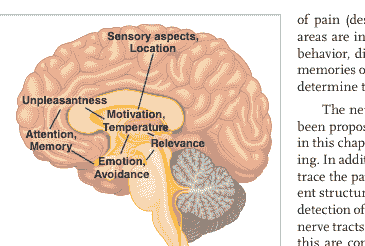

**图 2.26** 疼痛的感知是由一个称为疼痛矩阵的网络的激活引起的，该网络由许多相互连接的不同结构组成。许多结构具有多种功能。此处标出了与疼痛矩阵中结构相关的部分功能。© 2015 Cengage Learning

疼痛的某些方面（用*不愉快*、*折磨人*和*可怕*等词语描述）由某些脑区处理；其他脑区则参与评估疼痛刺激对当前行为的意义、将注意力引导至或远离疼痛刺激，以及记录对该刺激的记忆。这个网络中的所有结构协同工作，共同决定了整体疼痛体验的性质。

图 2.26 中的网络只是众多网络中的一个例子，这些网络是基于本章所述的所有研究方法（单神经元记录、神经心理学和脑成像）提出的。此外，新一代解剖技术已被开发出来，用于追踪在不同结构之间建立通信的神经纤维通路。其中一种技术称为弥散张量成像（DTI），它基于检测水沿神经纤维长度的弥散方式。图 2.27 显示了通过该技术确定的神经束（Calamante et al., 2013）。此类新技术不断被开发，以便更精确地确定大脑各区域之间如何相互通信。

在本章前面，我们介绍了*分析层次*——在不同层次上研究一个主题——以及*神经表征*——经验如何由神经系统中的表征所决定——的概念。大脑中各种结构相互通信和相互作用的方式同时说明了这两个概念。要理解认知的神经基础，我们需要考虑从单个神经元、由这些神经元构成的结构、再到协同工作的结构群等多个层次。我们还需要认识到，所有这些活动加在一起，就是在神经系统中创造我们认知表征的过程。

在下一章关于知觉的内容中，当我们看到我们所带入情境的知识如何与感觉受体接收到的信号所提供的信息相结合，从而创造出我们对环境的知觉时，我们将遇到这些相互作用的证据。

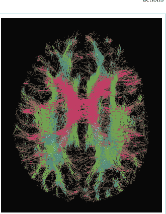

**图 2.27** 通过弥散张量成像确定的人脑神经束。来源：From F. Calamante, et al., Track-weighted functional connectivity (TW-FC): A tool for characterizing the structural-functional connections in the brain, NeuroImage 70, 199–210, Figure 2a, page 202, 2013.

### 思考与探讨

#### 神经科学关于认知的启示

我们已经看到，神经科学的贡献之一是确定不同能力在大脑中的位置——这是一个持续进行的研究项目，我们可以称之为大脑*地理学*的研究。但神经科学的贡献不仅仅限于确定不同功能的位置。许多神经科学研究关注的是大脑内部发生的动态过程，以及确定认知行为背后的机制。在第 4 章“注意”中，当我们重新审视图 2.23 中显示的皮层地图时，我们将看到一个令人印象深刻的动态过程演示。事实证明，这张地图并不是静止的，而是可以扩展或收缩的。因此，当你在寻找一只猫时，地图中与猫相关的方面会扩展，而与猫关系不大的方面会收缩。换句话说，大脑的地理学会进行调整，使你能够更有效地找到猫（Çukur, 2013）！

我们还将遇到一些实验，其中基于行为观察提出的假设得到了生理学研究结果的支持。例如，考虑 Endel Tulving（1985）的区分——我们在第 1 章（第 19 页）中介绍过，并将在第 7 章详细讨论——即两种类型的长时记忆：*情景记忆*和*语义记忆*。根据 Tulving 的说法，情景记忆是对个人经历的记忆。你对自己纽约之行的记忆以及你在那里做过的事情，就属于情景记忆。语义记忆是存储的知识和对事实的记忆。你知道纽约市在纽约州、每年除夕都有成群的人聚集在时代广场，以及纽约市地铁图布局，这些都是语义记忆的例子。

但是，尽管我们可以根据所记忆事物的类型来区分这两种记忆，我们能否说它们由不同的机制服务？对这个问题的一个答案来自神经心理学研究，该研究证明了情景记忆和语义记忆之间存在双重分离（见方法：证明双重分离，第 40 页）。正如我们将在第 7 章描述的，有些脑损伤患者丧失了回忆个人经历（情景记忆）的能力，但仍然保留着关于世界事实的记忆（语义记忆）。也有具有相反问题的患者：他们的脑损伤使他们无法获取事实知识，但仍然能够记住个人经历。这两类患者合在一起构成了双重分离，使我们能够得出结论：情景记忆和语义记忆由独立机制服务。这只是基于行为观察提出的假设如何得到生理学实验结果支持和扩展的一个例子。

本章中对认知神经科学的描述，使我们从单个神经元的放电，到覆盖大脑的地图，从将大脑区域与特定认知联系起来，到将许多大脑区域联系起来以产生更复杂的认知。但让我们不要忽视这些生理机制的目的，即决定从认出朋友到进行对话的各种认知。虽然了解神经元如何工作或大脑结构位于何处可能是件好事，但我们真正感兴趣的并不是仅仅研究神经元或大脑结构的特性。我们感兴趣的是确定神经元和大脑结构如何决定认知。换句话说，我们的主要焦点是解释与认知相关的行为，本书的方法基于这样一种理念：解释这些行为的最佳方式是同时进行行为实验和生理实验。当你阅读本书时，你会遇到许多例子，说明行为实验和生理实验的结果相结合，能比单独任何一种实验提供对心智更丰富的理解。

### 自测 2.2

- 1. 什么是功能定位？描述神经心理学和神经元记录如何证明功能定位。请确保你理解双重分离的原理。
- 2. 描述功能性磁共振成像的基本原理。
- 3. 描述支持功能定位的脑成像证据。描述涉及观看静态图片的实验和涉及观看电影的实验。每种类型的实验分别告诉我们关于功能定位的什么信息？
- 4. 什么是分布式表征？分布式处理如何通过大脑对脸的反应来说明？又如何通过大脑对滚动的红球的反应来说明？
- 5. 什么是神经网络？称为疼痛矩阵的网络与我们的疼痛感知之间有什么联系？
- 6. 描述神经科学可以告诉我们的关于认知的两件事。

### 本章小结

- 1. 认知神经科学是对认知生理基础的研究。对心智研究采取层次分析方法涉及在行为层面和生理层面同时进行研究。
- 2. 拉蒙·卡哈尔的研究导致神经网理论被放弃，转而支持神经元学说，该学说认为，被称为神经元的单个细胞在神经系统中传递信号。
- 3. 信号可以通过微电极从神经元记录。阿德里安首次记录了单个神经元的信号，他确定动作电位沿轴突传播时大小保持不变，并且增加刺激强度会增加神经放电频率。
- 4. 神经表征原理指出，一个人所体验的一切并非基于对刺激的直接接触，而是基于其神经系统中的表征。
- 5. 神经元表征可以通过考虑特征检测器、对复杂刺激做出反应的神经元，以及神经元如何参与特异性编码、群体编码和稀疏编码来解释。
- 6. 知觉中的功能定位观点得到以下事实的支持：每种感觉都有独立的初级接收区、脑损伤对知觉的影响（例如面孔失认症）、单神经元记录以及脑成像实验的结果。
- 7. 脑成像通过测量大脑中的血流量来测量脑激活。功能性磁共振成像（fMRI）被广泛用于确定认知功能过程中的脑激活。脑成像实验测量了对静态图片的反应，以识别人类大脑中对脸、地点和身体反应最强烈的区域，并测量了对电影的反应，从而创建了一幅大脑地图，指示哪些类型的刺激会激活大脑的不同区域。
- 8. 分布式处理的观点是，特定功能由大脑中许多不同区域共同处理。这一原理通过面孔激活大脑多个区域的发现，以及滚动的红球这一更简单的例子（它也激活了多个区域）得到了说明。
- 9. 分布式处理也发生在其他认知功能中，如记忆、决策和问题解决。认知的一个基本原理是，不同的认知功能通常涉及相似的机制。
- 10. 神经网络是相互连接的神经元或结构群。构成疼痛矩阵的结构合在一起就是神经网络的一个例子。
- 11. 神经科学对理解心智的贡献之一是确定不同能力在大脑中的位置。此外，基于行为研究的假设可以得到生理学研究结果的支持。一个例子是，基于行为提出的不同类型长时记忆的假设，已通过研究不同类型脑损伤患者的神经生理学研究得到了支持。

### 想一想

- 1. 一些认知心理学家称大脑为心智的计算机。计算机擅长哪些大脑不擅长的事情？你认为大脑和计算机在复杂性方面相比如何？大脑相比计算机有什么优势？
- 2. 人们通常觉得自己正在直接体验周围环境，尤其是在看、听或感受物体表面质地等感官体验时。然而，我们对神经系统运作方式的了解表明情况并非如此。为什么生理学家会说我们所有的体验都是间接的？
- 3. 在 fMRI 扫描仪中测量脑活动时，人的头部被一圈磁铁包围，并且必须保持完全不动。此外，机器运行时的噪音非常大。这些脑扫描仪的特点如何限制了可以用脑扫描研究的行为类型？
- 4. 有人主张，我们永远无法完全理解大脑是如何运作的，因为这需要利用大脑来研究自身。你对这个论点有什么看法？

### 关键术语

- 动作电位，32
- 轴突，29
- 脑成像，41
- 布罗卡区，39
- 细胞体，29
- 大脑皮层，39
- 认知神经科学，27
- 树突，29
- 弥散张量成像（DTI），46
- 分布式表征，44
- 双重分离，40
- 纹外身体区（EBA），42
- 特征觉察器，34
- 额叶，40
- 功能性磁共振成像（fMRI），41
- 梭状回面孔区（FFA），42
- 层级加工，35
- 分析水平，27
- 功能定位，39
- 磁共振成像（MRI），41
- 微电极，31
- 神经纤维，29
- 神经冲动，32
- 神经网，29
- 神经回路，30
- 神经网络，45
- 神经表征原理，33
- 神经元，28
- 神经元学说，29
- 神经心理学，39
- 神经递质，32
- 枕叶，39
- 海马旁回位置区（PPA），42
- 顶叶，40
- 群体编码，36
- 面孔失认症，40
- 感受器，30
- 记录电极，31
- 参考电极，31
- 静息电位，31
- 视网膜，33
- 感觉编码，35
- 稀疏编码，36
- 特异性编码，35
- 突触，30
- 颞叶，39
- 视觉皮层，33
- 体素，42
- 韦尼克区，39

### CogLab 实验

括号中的数字指的是 CogLab 中的实验编号。

- 大脑不对称性（15）

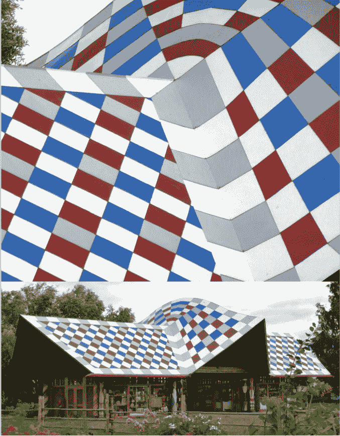

当你看着上方面板中的彩色图案时，你看到了什么？大多数人很难确切说出这个图像是由什么物体产生的。只有当看到下方面板时，才清楚那是建筑物的屋顶。我们的知觉系统每次看东西时都在解决类似的问题。尽管你可能认为这很简单，尤其是对于那些不像图中上方面板那样令人困惑的物体，但我们将看到，知觉过程绝非简单。即使是对“简单”物体的知觉也涉及复杂的机制，其中大部分发生在我们没有意识到的情况下，有些机制还类似于推理。

## 知觉的本质

- 知觉的一些基本特征
- 知觉一个场景
  - 演示：场景中的知觉谜题

## 为什么设计一台能感知的机器如此困难？

- 感受器上的刺激是模糊的
- 物体可能被遮挡或模糊不清
- 物体从不同视角看起来不同

## 人类知觉的信息

- 知觉物体
  - 演示：在风景中找到人脸
- 在句子中听到词语
- 体验疼痛
- 自测 3.1

## 物体知觉的概念

- 赫尔姆霍茨的无意识推理理论
- 格式塔组织原则
- 考虑环境的规律性
  - 演示：想象场景和物体
- 贝叶斯推理
- 比较四种方法
- 自测 3.2

## 神经元与环境知识

- 对水平和垂直方向做出反应的神经元
- 经验依赖性可塑性

## 知觉与行动之间的相互作用

- 运动促进知觉
- 知觉与行动的相互作用
- 知觉与行动的生理学
  - 方法：脑损毁术
- 拿起咖啡杯及其他行为

## 值得思考的问题：知觉与记忆的交汇之处

- 方法：在人类身上记录单个神经元
- 自测 3.3

- 章节小结
- 思考题
- 关键术语
- CogLab 实验

## 我们将考虑的一些问题

- 为什么两个人对同一刺激会产生不同的知觉？（60）
- 知觉如何依赖于一个人对环境特征的了解？（67）
- 大脑如何被调谐到对环境中可能出现的事物做出最佳反应？（73）
- 知觉和记忆在大脑中是如何表征的？（79）

太阳刚从海面升起，克里斯特尔就沿着海滩开始跑步。她喜欢一天中的这个时刻，既因为凉爽，也因为沙滩上升起的薄雾营造出一种神秘的氛围。她沿着海滩望去，注意到大约一百码外有一个昨天没有的东西。她想：“多么有趣的一块浮木，”尽管由于薄雾和昏暗的光线，很难看清（图3.1a）。当她走近那个物体时，她开始怀疑自己最初的知觉。正当她疑惑那是否不是浮木时，她意识到那其实是昨天放在救生员看台下面的那把旧沙滩伞（图3.1b）。当她意识到这一点时，她对所发生的事感到惊讶。“浮木就在我眼前变成了一把伞，”她想。

继续沿着海滩走，她经过一堆看起来被遗弃的盘绕绳索（图3.1c）。她停下来查看。抓住一端，她甩动绳子，发现正如她所怀疑的，这是一根连续的绳子。但她需要继续跑步，因为她约了一个朋友在Beach Java见面，那是一家海滩远处的咖啡馆。后来，坐在咖啡馆里，她告诉朋友那块变成伞的神奇浮木的事。

## 知觉的本质

### 知觉的一些基本特征

克里斯特尔的经历说明了关于知觉的若干方面。她与伞的经历说明了知觉如何能够基于新增信息而改变（克里斯特尔走近伞时看得更清楚了），以及知觉如何能够涉及类似于推理或问题解决的过程（克里斯特尔想出了那个物体是什么，部分基于她记得前一天见过那把伞）。（另一个最初错误的知觉随后被纠正的例子是这句话：“它是鸟。它是飞机。它是超人！”）克里斯特尔关于那根盘绕绳索是连续的猜测，说明了知觉如何能够基于一条知觉规则（当物体重叠时，底下的那个通常会延续到上面那个的后面），而这条规则可能基于人过去的经验。

**图 3.1** (a) 起初克里斯特尔认为她看到海滩远处有一大块浮木。(b) 最终她意识到她看到的是把伞。(c) 她在海滩上走着，经过一些盘绕的绳索。

克里斯特尔的经历还表明了达成知觉可以涉及一个过程。克里斯特尔花了一些时间才意识到她以为是浮木的东西其实是一把伞，因此可以将她的知觉描述为涉及一个“推理”过程。在大多数情况下，知觉发生得如此迅速和毫不费力，以至于它看起来是自动的。但是，正如我们将在本章中看到的，知觉远非自动的。它涉及复杂的、通常不可见的过程，这些过程不像推理，尽管它们比克里斯特尔意识到浮木其实是伞要快得多。

最后，克里斯特尔的经历还说明了知觉如何与行动同时发生。克里斯特尔一边跑步一边知觉；后来，在咖啡店里，她轻松地伸手去拿她的咖啡杯，这个过程涉及看到咖啡杯、确定其位置、伸手去够并抓住杯柄之间的协调。克里斯特尔经历的这一方面与日常知觉中发生的情况一样。我们通常处于运动状态，即使我们只是坐在一个地方看电视、电影或体育赛事，我们的眼睛也在不断移动，因为我们把注意力从一件事转移到另一件事以知觉正在发生的事情。我们一天中还会多次抓取和捡起东西，无论是咖啡杯、钢笔或铅笔，还是这本书。正如我们将在本章中看到的，知觉涉及伴随并支持我们行动的动态过程。

在描述这些过程之前，有必要指出，知觉的作用不仅限于识别物体或帮助我们在环境中采取行动。我们可以通过以下方式理解这一点：认知心理学是关于获取知识、将这些知识存储在记忆中，并在之后提取它来完成各种任务，例如记住过去的事件、解决问题、与他人交流、认出你上周遇到的某个人，以及回答认知心理学考试中的问题。没有知觉，这些认知壮举就不太可能实现。

请想一想。如果你失去了所有感官，从而失去了知觉能力，你对此刻正在发生的事情能有多大意识？你又能多好地完成上面提到的那些认知技能？从这个角度看，知觉是通往我们在本书其他章节中将要描述的所有其他认知活动的门户。

本章的目标是解释负责知觉的机制。首先，我们从海滩转到一个城市场景：从PNC公园上层看台看到的匹兹堡，那里是匹兹堡海盗队的主场。

### 知觉一个场景

坐在PNC公园的上层看台上，罗杰眺望这座城市（图3.2）。他看到左边有一组大约10栋建筑，并能轻松地将一栋与另一栋区分开来。向前看，他看到一栋小建筑在一栋大建筑前面，并且毫不费力地知道它们是两栋独立的建筑。向下朝河边望去，他注意到右外野看台上方有一条水平的黄色带。他显然知道这不是球场的一部分，而是位于河对岸。

罗杰的所有知觉对他来说都是自然而然的，几乎不需要费力。但当我们仔细观察这个场景时，就会明显看出这个场景提出了许多“谜题”。下面的演示指出了其中几个。

**图3.2** 很容易看出左侧有多栋不同的建筑，正前方有一栋低矮的矩形建筑位于一栋更高建筑的前面。还可以看出，看台上方横向的黄色部分在河对岸。这些感知对人类来说很容易，但对计算机视觉系统来说却相当困难。左侧的字母标出了“演示”部分所提及的区域。

## 演示

### 场景中的知觉谜题

以下问题涉及图3.2中标注的区域。你的任务是回答每个问题，并说明每个答案背后的推理：

- A处的深色区域是什么？
- B和C处的表面朝向相同方向还是不同方向？
- 区域B和C属于同一栋建筑还是位于不同建筑上？
- D处的建筑是否延伸到A处建筑的后面？

尽管回答这些问题可能很容易，但想象你的“推理”过程可能更具挑战性。例如，你如何知道A处的深色区域是阴影？它也可能是一栋位于浅色建筑前面的深色建筑。你凭什么判断D处建筑延伸到A处建筑的后面？毕竟，它也可能正好在A处建筑开始的地方就结束了。我们可以对场景中的每样东西提出类似的问题，因为正如我们将看到的，一种特定的形状模式可以由多种多样的物体造成。

这个演示传达的信息之一是，要确定“外面”有什么，就必须超越场景在视网膜上形成的光暗模式——视网膜是衬在眼球后部的结构，含有用于视觉的感受器。要体会这种“超越”过程的重要性，一种方法是想一想：即使是功能最强大的计算机，要完成人类轻而易举就能完成的知觉任务，编程起来有多么困难。

例如，考虑一下为参加2007年11月3日在加利福尼亚州维克多维尔举行的“城市挑战赛”而设计的机器人车辆。这项比赛由美国国防高级研究计划局（DARPA）赞助，要求车辆行驶55英里，穿过一个类似城市街道的路线，沿途还有其他行驶的车辆、交通信号灯和标志。车辆必须自行完成这一壮举，人的参与仅限于将路线布局的全球定位坐标输入车辆的导航系统。车辆必须在没有任何人工干预的情况下，仅依靠车载计算机系统的运行来保持在路线上并避开不可预测的交通。

比赛的获胜者是卡内基梅隆大学的一辆车辆，它成功保持在路线上并避开其他车辆，同时保持每小时14英里的平均速度。来自斯坦福大学、弗吉尼亚理工大学、麻省理工学院、康奈尔大学和宾夕法尼亚大学的车辆也成功完成了路线，这些队伍是进入决赛的11支队伍中的一部分。

无人驾驶汽车在环境中导航的能力，尤其是在包含移动障碍物的环境中导航的能力，极其令人印象深刻。机器人车辆的持续发展催生了谷歌无人驾驶汽车，它已累计行驶超过50万英里，并正在被开发为当今由驾驶员操作的车辆的替代方案。虽然这些无人驾驶车辆能够感知需要避开的物体，并能识别一些物体，如行人和汽车，但它们并非被设计用来识别人类毫不费力就能识别的大量不同物体（“那是一只暹罗猫”“那是弗雷德”“这是我住的房子”）。

能够做出细粒度判断（例如识别特定动物和植物物种）的计算机视觉系统的开发，是一个活跃的研究领域（Yang et al., 2012），但其表现仍低于人类通常达到的水平。例如，已经开发出一些程序，能以约90%的准确率区分猫和狗，并能以约60%的准确率识别猫和狗的不同品种（Parkhi et al., 2012）。这对计算机来说是一项困难的任务，涉及复杂的程序和对数千张不同图像的大量训练。当前许多计算机程序面临的问题之一是，即使它们能够识别某些物体，也常常会犯人类绝不会犯的错误，例如把相机镜头盖或茶壶顶部叫作网球（Simonyan et al., 2012）。（见**图3.3**。）

计算机视觉研究者极为关注的一个对象是人脸。随着大量研究投入计算机监控系统，已经开发出一些程序，它们能像人类一样判断两张正面看到的人脸（如**图3.4a**和**图3.4b**所示）是否属于同一个人（O’Toole, 2007; O’Toole et al., 2007; Simonyan et al., 2013; Yang, 2009）。然而，当其中一张脸是从某个角度看到时（如**图3.4c**所示），人类的表现优于计算机。

最后，专门设计用来确定房间墙壁位置并定位房间内家具的计算机视觉系统，能够对某些照片粗略地完成这些任务（如**图3.5a**所示），但它们常常犯下大错（如**图3.5b**所示）（Del Pero et al., 2011）。尽管**图3.5b**中床的位置和范围对人来说可能很明显，但对计算机来说却不那么明显，即使该计算机程序是专门设计用来检测像床这样由直线定义的物体的。即使程序能找到床的边缘，确定房间里其他物体的身份也远远超出了这个新近开发的程序的能力。

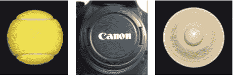

**图3.3** 即使是能够相当准确地识别物体的计算机视觉程序也会犯错，例如混淆具有共同特征的物体。在这个例子中，镜头盖和茶壶顶部被错误地归类为“网球”。*（来源：基于 K. Simonyan, Y. Aytar, A. Vedaldi, & A. Zisserman，在 ImageNet 大规模视觉识别挑战赛（2012，ILSVRC2012）上的报告。）*

**图3.4** 计算机或人都能判断(a)和(b)中的两个正面视图是否属于同一个人，但对于有角度的面部，如(c)所示，人的表现优于计算机。*（来源：摘自 A. J. O’Toole、J. Harms、S. L. Snow、D. R. Hurst、M. R. Pappas 与 H. Abd，《移动人脸与人视频数据库》，IEEE Transactions on Pattern Analysis and Machine Intelligence, 27, 5, 812–816, 2005。）*

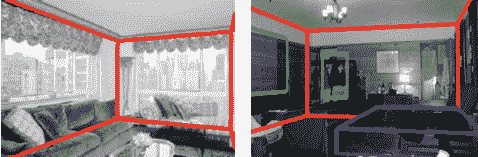

**图3.5** (a) 红线表示计算机视觉程序尝试确定房间的角落以及墙壁、天花板和地板相交的位置。在这个例子中，计算机做得相当不错。(b) 同一计算机视觉程序的另一个例子，其中程序对房间内直线轮廓位置的标示不准确。*（来源：摘自 L. Del Pero、J. Guan、E. Brau、J. Schlecht 与 K. Barnard，Sampling bedrooms，IEEE Computer Society Conference on Computer Vision and Pattern Recognition (CVPR), pp. 2090–2096, 2011. 经许可转载。）*

## 为什么设计一台感知机器如此困难？

现在我们将描述设计“感知机器”所涉及的几个困难。请记住，尽管我们描述的问题对计算机构成困难，但人类却能轻松解决它们。

### 感受器上的刺激是模糊的

当你看着本书的这一页时，书页边缘在你的视网膜上投射出的图像是一个图像。这样说可能显得奇怪，因为(1)书页的矩形形状显而易见；(2)一旦我们知道书页的形状及其与眼睛的距离，确定它在视网膜上的图像就是一个简单的几何问题，如图3.6所示，可以通过从书页四角（红色）向眼睛延伸“射线”来解决。

但知觉系统并不关心如何确定物体在视网膜上的图像。它以视网膜上的图像为起点，其任务是确定“外面”造成该图像的物体。确定视网膜上某一特定图像由哪个物体负责的任务，称为逆投影问题，因为它涉及从视网膜图像出发，从眼睛向外延伸射线。当我们这样做时，如图3.6中将线条从眼睛向外延伸所示，我们会看到，矩形书页产生的视网膜图像也可能由许多其他物体产生，包括一个倾斜的梯形、一个更大的矩形，以及位于不同距离的无数其他物体。当我们考虑到视网膜上的某一特定图像可以由环境中的许多不同物体产生时，就很容易理解为什么我们说视网膜上的图像是模糊的。尽管如此，人类通常能轻松解决逆投影问题，尽管它给计算机视觉系统带来了严峻挑战。

### 物体可能被遮挡或模糊

有时物体会被遮挡或模糊。在继续阅读之前，请在图3.7中寻找铅笔和眼镜。尽管可能需要稍微找一找，但人们能找到前景中的铅笔，以及从图片旁边计算机后面露出的眼镜，即使这些物体只有一小部分可见。人们也能轻松地

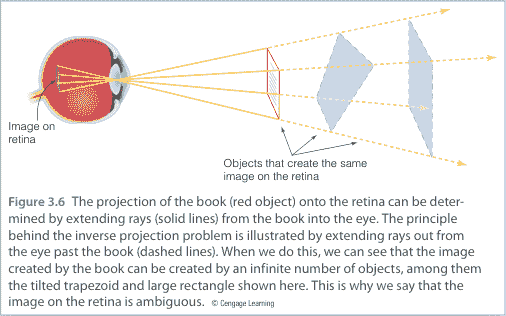

**图3.7** 作者书桌上杂乱物品的一部分。你能找到隐藏的铅笔（简单）和作者的眼镜（困难）吗？

将书、剪刀和纸感知为完整物体，尽管它们被其他物体部分遮挡。

只要一个物体遮挡了另一个物体的一部分，这种隐藏物体的问题就会发生。这种情况在环境中经常出现，但人们很容易理解，物体被遮盖的部分仍然存在，并且能够利用对环境的知识来判断可能有什么存在。

人们也能识别未处于清晰对焦状态的物体，例如**图3.8**中的面孔。看看你能认出其中多少人，然后查阅第83页的答案。尽管这些图像质量退化，人们通常仍能识别出其中大多数，而计算机在这项任务上表现很差（Sinha, 2002）。

## 物体从不同视角看会有所不同

任何感知机器面临的另一个问题是，物体常常从不同角度被观看。这意味着物体的图像会随着观看角度不断变化。因此，尽管人类仍将**图3.9**中的物体感知为从不同角度观看的同一把椅子，但这对计算机来说并不那么明显。识别从不同视角看到的同一物体的能力称为**视角不变性**。

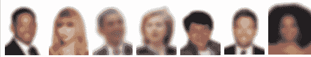

**图3.8** 这些人是谁？答案见第83页。*（来源：改编自 P. Sinha, Recognizing patterns, Nature Neuroscience, 5, 1093–1097, 2002。）*

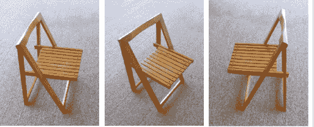

(a) (b) (c)

**图3.9** 你能认出这些视图中的每一个都是同一把椅子，这种能力是视角不变性的一个例子。

任何感知机器所面临的困难都说明，感知过程比看起来更复杂。因此，我们描述感知的任务就是解释这一过程，重点在于我们人类的感知机器如何运作。我们先考察人类感知系统所使用的两类信息。

## 人类感知的信息

因为感知的目的之一是告诉我们环境中“外面”有什么，所以感知建立在来自环境的信息基础之上是合理的。因此，正如我们在第2章所述，玛丽在吉尔的眼睛中由视网膜上的图像、通过视网膜传递的电信号，以及从眼球后部传送到大脑视觉接收区的信号来表征（**图3.10**）。

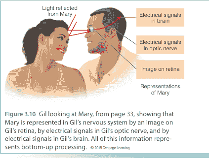

来自进入眼睛的光的这项信息以及大脑中的电信号，对于感知玛丽至关重要，因为如果没有它，玛丽就不会在吉尔的神经系统中得到表征。这一从眼睛到大脑的事件序列称为**自下而上加工**，因为它始于系统的“底部”或开端，即环境能量刺激感受器的时候。

但感知除了由感受器激活和自下而上加工提供的基础之外，还涉及信息。感知还涉及诸如个人对环境的知识、人们带入感知情境的期望，以及他们对特定刺激的注意等因素。这种额外信息是**自上而下加工**的基础——这种加工起源于大脑，即感知系统的“顶部”。

说明自上而下加工如何参与感知的一种方式，是考虑一些情境例子，在这些情境中，感知除了受到来自感受器刺激的自下而上信息影响之外，还受到其他因素的影响。我们将考虑三个不同的例子：（1）感知物体；（2）在句子中听到词语；（3）体验疼痛。

### 感知物体

**图3.11**展示了一个例子，说明自上而下加工如何参与物体感知，该图被称为“一团斑块的多种身份”（Oliva & Torralba, 2007）。尽管所有图片中的斑块完全相同，但根据其朝向和所见情境，它们会被感知为不同物体。这个斑块在（b）中看起来像是桌上的物体，在（c）中像是弯腰的人脚上的一只鞋，在（d）中像是一辆汽车和一个正在过街的人。我们之所以将其感知为不同物体，是因为我们了解不同类型场景中可能出现哪些种类的物体。因此，人类相对于计算机的优势，部分归因于人类可获得的额外自上而下知识。知识在感知中发挥作用这一观点，也由下面的演示加以说明。

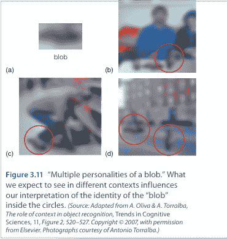

**图3.12** 贝夫·杜利特尔（Bev Doolittle，1985）的*《森林有眼睛》*。你能在这幅图中找到13张面孔吗？（答案见第83页。）*（来源：The Forest Has Eyes © 1984 Bev Doolittle，由 The Greenwich Workshop, Inc. 提供。）*

### 演示

### 在风景中寻找面孔

观察**图3.12**中的图片。乍看之下，这个场景似乎包含一个人和两匹马，以及树木、岩石和水。然而，仔细观察，你能看到背景中的树上有一些面孔；如果再仔细看，还能看到若干面孔是由不同岩石组合形成的。看看你能否找出这幅图中隐藏的全部13张面孔。

有些人起初很难感知到这些面孔，但随后会突然成功。感知从“溪流中的岩石”或“森林中的树木”转变为“面孔”，是因为我们熟悉面孔。在这种情境中，意义影响感知的显著之处在于，一旦你把某组岩石感知为一张面孔，往往就很难*不*以这种方式感知它们——它们已经永久地组合在一起，在场景中形成了面孔。

### 在句子中听到词语

我观看西班牙语电视频道Telemundo时发生的事情，提供了一个自上而下加工如何影响言语感知的例子。遗憾的是，我完全听不懂人们在说什么，因为我不懂西班牙语。事实上，对话在我听来像是一串连续不断的声音，只是偶尔会冒出一个熟悉的词，比如*gracias*。我的感知反映了这样一个事实：言语的声音信号通常是连续的，而当声音中出现间断时，这些间断不一定发生在词与词之间。你可以在**图3.13**中，通过将句子中每个词的起始位置与声音信号的模式进行比较来看到这一点。

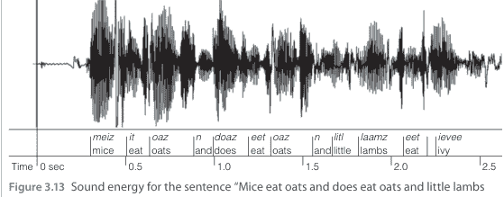

**图3.13** 句子“Mice eat oats and does eat oats and little lambs eat ivy.”的声音能量。声音记录正下方的斜体词表示说话者如何读出这个句子。词旁边的竖线表示每个词的起始位置。注意，从声音记录中很难或不可能判断一个词在哪里结束、下一个词在哪里开始。（语音信号由 Peter Howell 提供。）

但是，懂西班牙语的人会把这一串连续的声音感知为对话中一个个有意义的词。由于他们掌握该语言，他们能够判断一个词何时结束、下一个词何时开始，这种现象称为言语切分。只熟悉英语的听者和熟悉西班牙语的听者可以接收到相同的声音刺激，却体验到不同的感知，这一事实意味着每个听者的语言经验（或缺乏语言经验）都在影响他或她的感知。连续的声音信号进入耳朵并触发信号，这些信号被送往大脑的言语区（自下而上加工）；如果听者懂这种语言，那么这种知识（自上而下加工）就会产生对各个词的感知。

### 体验疼痛

疼痛感知也许是自上而下加工如何影响感知的最佳例子。我们先讨论早期研究者如何看待疼痛。20世纪50年代和60年代初，疼痛由直接通路模型来解释。根据该模型，当皮肤中称为伤害感受器的感受器受到刺激，并沿着从皮肤到大脑的直接通路发送信号时，疼痛就会发生（Melzack & Wall, 1965）。这是一个自下而上的过程，因为它依赖于感受器的刺激。但在20世纪60年代，一些研究者开始注意到一些情境，其中疼痛除了受皮肤刺激影响之外，还受到其他因素影响。

一个早期例子是Beecher（1959）的报告：在第二次世界大战安齐奥滩头阵地受伤的大多数美国士兵“完全否认其大面积伤口带来疼痛，或者疼痛如此轻微，以至于他们不想用任何药物来缓解”（第165页）。其原因之一是，这些士兵的伤口有一个积极方面：它们提供了从危险战场逃到后方医院安全环境的机会。

现代研究表明，疼痛会受到一个人的预期、其注意力的指向方式以及存在的分心刺激类型的影响（Wiech et al., 2008）。在一项医院研究中，外科患者被告知可以预期什么，并被指导放松以减轻疼痛；这些患者术后要求的止痛药更少，并且比未获得这些信息的患者早2.7天出院。研究还表明，相当一部分病理性疼痛患者通过服用安慰剂获得缓解；安慰剂是一种他们相信含有止痛药、但实际上不含活性成分的药片（Finniss & Benedetti, 2005; Weisenberg, 1977, 1999）。

这种由没有药理学作用的物质引起的疼痛减轻被称为**安慰剂效应**（placebo effect）。安慰剂效应的关键在于，患者相信该物质是一种有效的疗法。这种信念使患者预期疼痛会减轻，而事实上疼痛也确实减轻了。尽管人们提出了许多不同的机制来解释安慰剂效应，但预期是最有力的决定因素之一（Colloca & Benedetti, 2005）。

如果将注意力集中在疼痛上，疼痛感就会增强；如果忽视疼痛或将注意力从疼痛上转移开，疼痛感就会减弱。这种注意力对疼痛的影响早在20世纪60年代就已被注意到（Melzack & Wall, 1965）。下面是我班上一位学生所描述的最近发生的一个类似情形：

> 我记得大约五六岁时，我正在玩任天堂游戏机，我的狗跑过去把游戏机的线拽掉了。当我起身去把线插回去时，我被绊了一跤，额头撞在了客厅窗户下方的暖气片上。我爬起来，摇摇晃晃地走到任天堂前，把手柄重新插回端口，对自己那次小小的摔倒毫不在意……当我重新开始玩游戏时，突然感觉有液体从额头流下来，我伸手一摸，发现是血。我转过身，看着衣柜门上的镜子，只见一道伤口从额头延伸下来，鲜血直涌。我突然尖叫起来，疼痛感瞬间袭来。妈妈跑进来，带我去医院缝了针。（Ian Kalinowski）

这段描述传达的重要信息是，伊恩的疼痛并非发生在受伤时，而是发生在他*意识到*自己受伤时。从这个例子中我们可以得出的一个结论是，减轻疼痛的方法之一就是将人的注意力从疼痛源上转移开。医院已经采用了这种技术，利用虚拟现实技术作为工具，将注意力从痛苦的刺激上转移开。例如，詹姆斯·波科尔尼（James Pokorny）的案例：他在修理的汽车油箱爆炸时，全身42%的面积被三度烧伤。在华盛顿大学烧伤中心更换绷带时，他戴着一个黑色塑料头盔，头盔内有一个电脑显示器，他在上面看到一个由多彩三维图形组成的虚拟世界。这个世界把他带进了一个虚拟厨房，厨房里有一只虚拟蜘蛛，他可以把蜘蛛追到水槽里，然后用虚拟的垃圾处理器把它碾碎（Robbins, 2000）。

这个“游戏”的目的是通过将波科尔尼的注意力从绷带转移到虚拟现实世界来减轻他的疼痛。波科尔尼报告说，因为他专注于疼痛以外的事情，他的疼痛水平显著下降了。对其他患者的研究表明，在更换绷带时使用这种虚拟现实技术的烧伤患者，其疼痛减轻程度远高于对照组中通过玩电子游戏来分散注意力的患者（Hoffman et al., 2000），也远高于完全不分散注意力的患者（Hoffman et al., 2008；另见Bühle et al., 2012）。

所有这些例子——情境如何影响我们对那个色块的感知；关于言语的知识如何影响我们从连续的语音流中构造出词语的能力；以及预期和注意力如何影响一个人的疼痛体验——都表明知觉是由自下而上和自上而下的加工共同创造的。

这种认为知觉依赖于多种信息来源的观点，支持了知觉涉及复杂过程的看法。但识别知觉系统所使用的不同类型的信息只是其中的一部分。此外，我们还可以问：知觉者如何使用这些信息？毕竟，“自下而上”和“自上而下”都包含了“加工”一词，这意味着知觉系统正在对这些信息做一些处理。对于知觉系统究竟如何使用这些信息，不同的人有不同的构想。下面我们将描述四种主要的物体知觉方法，这将带领我们踏上一段从19世纪开始、以现代物体知觉观念结束的旅程。

### 自测 3.1

- 1. 克里斯特尔沿着海滩奔跑的例子说明了关于知觉的什么道理？请列出知觉的至少三个不同特征。为什么知觉的重要性不仅仅在于识别物体？
- 2. 基于“知觉谜题”演示和计算机视觉，举一些例子来说明确定外界事物需要超越感受器上的明暗模式。
- 3. 当今的计算机识别物体的能力如何？
- 4. 描述为什么设计一台知觉机器很困难的三个原因。
- 5. 什么是自下而上的加工？什么是自上而下的加工？描述以下几点如何表明知觉涉及的不仅仅是自下而上的加工：（a）一个色块的多重身份；（b）在风景中寻找面孔的演示；（c）在句子中听到单个词语；以及（d）体验疼痛。

## 物体知觉的构想

关于人们如何使用信息，19世纪的物理学家和生理学家赫尔曼·冯·亥姆霍兹（Hermann von Helmholtz, 1866/1911）提出了一个早期观点。

### 亥姆霍兹的无意识推理理论

赫尔曼·冯·亥姆霍兹（1821–1894）是19世纪的天才之一。他是一位物理学家，在热力学、神经生理学、视觉知觉和美学等不同领域都做出了重要贡献。他还发明了检眼镜，其各种版本至今仍被医生用来检查眼睛内部的血管。

亥姆霍兹对知觉的贡献之一源于他意识到视网膜上的图像是模糊的。我们已经看到，模糊意味着视网膜上特定模式的刺激可能由环境中许多不同的物体引起（见图3.14）。例如，图3.14a中的刺激模式代表什么？对大多数人来说，视网膜上的这种模式导致感知到的是一个蓝色矩形在红色矩形前面，如图3.14b所示。但如图3.14c所示，这个显示也可能由一个六边形红色形状造成，它可以位于蓝色矩形的前面、后面或紧挨着它。

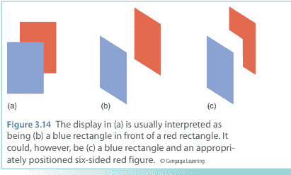

亥姆霍兹的问题是：知觉系统如何“决定”视网膜上的这个模式是由重叠的矩形造成的？他的答案是**似然原则**（likelihood principle），即我们感知到最有可能引起我们所接受的刺激模式的物体。根据亥姆霍兹的说法，这种关于什么最有可能的判断是通过一个称为**无意识推理**（unconscious inference）的过程发生的，在这个过程中，我们的知觉是我们对环境所做的无意识假设或推断的结果。因此，我们推断图3.14a很可能是一个矩形覆盖着另一个矩形，这是因为我们过去有类似情境的经验。

亥姆霍兹对知觉过程的描述类似于解决问题的过程。对于知觉而言，问题是确定哪个物体引起了特定的刺激模式，而这个问题是通过这样一个过程解决的：知觉系统运用观察者对环境的知识来推断物体可能是什么。

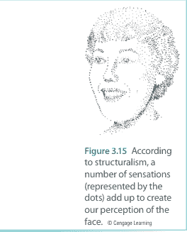

**图3.15** 根据构造主义，许多感觉（用点表示）叠加起来形成我们对面孔的知觉。© Cengage Learning

亥姆霍兹观点的一个重要特征是，这种感知最有可能引起视网膜上模式的过程是快速且无意识的。这些基于似然原则的无意识假设，使得知觉看起来是“自动的”，尽管它们是一个快速过程的结果。因此，尽管你可能能够“自动地”解决**图3.3**场景中的知觉谜题，但根据亥姆霍兹的说法，这种能力是我们意识不到的快速过程的结果。（关于这一观点的较新版本，参见Rock, 1983。）

### 格式塔组织原则

接下来我们将考虑一个由**格式塔心理学家**（Gestalt psychologists）群体提出的知觉方法，这是在亥姆霍兹提出无意识推理理论大约30年后提出的。格式塔方法的目标与亥姆霍兹相同——解释我们如何知觉物体——但他们处理问题的方式不同。

格式塔知觉方法在一定程度上起源于对威廉·冯特（Wilhelm Wundt）构造主义的反对（见第7页）。记得在第一章中，冯特提出，我们的整体体验可以通过组合称为*感觉*的基本经验元素来理解。根据这一观点，我们对**图3.15**中面孔的知觉是通过叠加许多感觉（图中用点表示）而产生的。

格式塔心理学家拒绝了知觉是通过“叠加”感觉而形成的观点。格式塔观点（即知觉不能通过叠加微小感觉来解释）的起源之一，归功于心理学家马克斯·韦特海默（Max Wertheimer）的经历。1911年，他在度假途中乘火车穿越德国（Boring, 1942）。当他在法兰克福下车伸展双腿时，从站台上的玩具小贩那里买了一个频闪观测器。这种频闪观测器是一种通过快速交替显示两幅略有不同的画面来产生运动错觉的机械装置，它让韦特海默不禁思考：经验由感觉构成的构造主义观点，如何能解释他所观察到的运动错觉？

**图3.16** 产生似动现象的条件。(a) 一束灯闪烁，接着(b) 一段短暂的黑暗，然后(c) 另一束灯在不同位置闪烁。(d)中所象征的最终知觉是一束从左向右移动的光。即使在两束灯之间的空间只有黑暗，人们仍然能看到两灯之间的运动。© Cengage Learning

**图3.16** 图解了频闪观测器所产生的运动错觉背后的原理，这种现象被称为**似动**（apparent movement），因为虽然感知到了运动，但实际上并没有什么东西在移动。产生似动的刺激有三个组成部分：（1）一束灯闪亮又熄灭（**图3.16a**）；（2）有一段持续几分之一秒的黑暗（**图3.16b**）；（3）第二束灯闪亮又熄灭（**图3.16c**）。因此，从物理上讲，是两束闪烁的灯被一段黑暗隔开。但我们看不到黑暗，因为我们的知觉系统在黑暗期间添加了一些东西——感知到一束光在闪烁的灯之间穿过空间移动（**图3.16d**）。似动的现代例子有显示移动广告或新闻标题的电子显示屏，以及电影。这些显示中的运动知觉如此强烈，以至于很难想象它们是由静止的灯闪烁（对于新闻标题）或一幅幅静止图像依次闪映（对于电影）构成的。

韦特海默从似动现象中得出了两个结论。他的第一个结论是，似动无法用感觉来解释，因为闪烁的灯之间的黑暗空间里什么都没有。他的第二个结论成为格式塔心理学的基本原则之一：**整体不同于部分之和**。这个结论源于知觉系统从静止图像中创造出运动知觉这一事实。这种整体不同于部分之和的观点，促使格式塔心理学家提出了许多**知觉组织原则**（principles of perceptual organization），用以解释元素如何被分组以形成更大的物体。例如，在**图3.17**中，一些黑色区域被分组形成一只斑点狗，而另一些则被视为背景中的阴影。下面我们将描述几条格式塔原则，首先从一条能让我们回到克里斯特尔沿着海滩奔跑的例子开始。

**图3.17** 一些黑白形状，在知觉上会被组织成一只斑点狗。（斑点狗的轮廓见图83页。）© Cengage Learning；© AnetaPics/Shutterstock.com，Scratcherval Publishing Services

## 良好延续性

良好延续性原则指出：*当连接某些点时，如果形成直线或平滑曲线，这些点就会被视为属于同一组，而且线条往往以遵循最平滑路径的方式被看到。* 此外，被其他物体重叠的物体，会被知觉为在重叠物体之后继续延伸。因此，当克里斯特尔看到**图3.31c**中盘绕的绳子时，她并不惊讶：当她抓住绳子的一端并翻转它时，它原来是一根连续的绳股（**图3.18**）。这没有让她感到惊讶的原因是，尽管绳子有许多地方一部分与另一部分重叠，她并没有把绳子知觉为由许多分离的片段组成；相反，她把绳子知觉为连续的。（也可以想想你的鞋带！）

## 普雷格南茨

*普雷格南茨（Prägnanz）* 从德语粗略翻译过来，意思是“良好图形”。**普雷格南茨定律**，也称为**良好图形原则**或**简洁原则**，指出：*每个刺激模式都是以使最终结构尽可能简单的方式被看到的。* **图3.19a**中熟悉的奥林匹克标志就是简洁原则发挥作用的一个例子。

**图3.18** （a）海滩上的绳子。（b）良好延续性帮助我们把这根绳子知觉为一根单股绳。

**图3.19** 奥林匹克标志被知觉为五个圆（a），而不是（b）中的九个形状。© Cengage Learning

我们看到这个图案是五个圆，而不是更多更复杂的形状，例如**图3.19b**中奥林匹克标志“分解”视图所示的那些形状。（良好延续性定律也有助于知觉到这五个圆。你能看出为什么会这样吗？）

## 相似性

大多数人把**图3.20a**知觉为水平的圆圈行、垂直的圆圈列，或两者兼有。但当我们改变某些列的颜色，如**图3.20b**所示，大多数人会知觉为垂直的圆圈列。这种知觉说明了**相似性原则**：相似的事物看起来会被分在一起。**图3.21**展示了一个按颜色相似性分组的醒目例子。分组也可能因大小、形状或朝向的相似性而发生。

最初的格式塔心理学家（Helson，1933）以及现代心理学家（Palmer，1992；Palmer & Rock，1994）提出了许多其他组织原则，但对我们讨论而言，主要信息是：格式塔心理学家认识到，知觉不仅仅基于视网膜上的明暗模式。在他们的构想中，知觉由特定的组织原则决定。

**图3.20** （a）这种圆点图案被知觉为水平行、垂直列，或两者兼有。（b）这种圆点图案被知觉为垂直列。© Cengage Learning

**图3.21** 这幅由 Wilma Hurskainen 拍摄的照片*《波浪》*，拍摄于白色水体的前缘与女子衣物上的白色区域恰好对齐的瞬间。颜色相似性导致分组；连衣裙上不同颜色的区域在知觉上与场景中相同颜色的区域分在一组。还要注意，水体的前缘如何通过良好延续性在女子连衣裙上形成分组。

但这些组织原则从何而来？Max Wertheimer（1912）将这些原则描述为“内在规律”，这意味着它们内建于系统中。原则是“内建的”这一观点与格式塔心理学家的观点一致：尽管一个人的经验可以影响知觉，但与知觉原则相比，经验的作用是次要的（另见Koffka，1935）。经验在知觉中只起次要作用这一观点，与Helmholtz的似然原则不同，后者提出，我们对环境的了解使我们能够确定最可能是什么在视网膜上造成了该模式。与Helmholtz一致，现代知觉心理学家也把我们对环境的经验视为知觉过程的核心组成部分。

## 考虑环境中的规律性

现代知觉心理学家提出了这样一种观点：知觉受到我们对环境中规律性——即环境中频繁出现的特征——的知识的影响。例如，蓝色与开阔天空相关联，景观常常是绿色而平滑的，垂直线和水平线常常与建筑物相关联。我们可以区分两类规律性：*物理规律性*和*语义规律性*。

### 物理规律性

物理规律性是环境中规律性出现的物理属性。例如，环境中的垂直和水平朝向比斜向（倾斜）朝向更多。这出现在人造环境中（例如，建筑物包含大量水平线和垂直线），也出现在自然环境中（树木和植物更可能是垂直或水平的，而不是倾斜的）（Coppola等，1998）（**图3.22**）。因此，人们比其他朝向更容易知觉到水平和垂直线，这并非巧合；这种效应被称为*斜向效应*（Appelle，1972；Campbell等，1966；Orban等，1984）。物理规律性的另一个例子是：当一个物体部分遮挡另一个物体时，被部分遮挡物体的轮廓会“从另一侧露出来”，正如**图3.18**中的绳子那样。

**图3.22** 在这两个自然场景中，水平和垂直朝向比斜向朝向更常见。这些场景是特殊例子，是因为垂直方向所占比例很大而被选出的。然而，随机选取的自然场景照片也包含比斜向朝向更多的水平和垂直朝向。人造建筑物和物体也是如此。

另一个物理规律性由**图3.23a**说明，它显示了从墙上突出的两个有纹理的凸起。但当图片倒过来时，如**图3.23b**所示，这些凸起看起来反转了——现在有纹理的表面看起来是凹陷的。我们在这两种情况下的知觉已由**光来自上方假设**解释：我们通常假定光来自上方，因为环境中的光，包括太阳和大多数人造光，通常来自上方（Kleffner & Ramachandran，1992）。**图3.23c**显示了来自上方的光如何照射到凸起的顶面，从而产生正立知觉。**图3.23d**显示了来自上方的光如何照射到凹陷的下表面，从而产生倒置知觉。

**图3.23** （a）一面带有突出纹理表面的墙。（b）同一张图片倒过来。（c）来自上方的光如何照射到凸起顶部，使有纹理的表面看起来是突出的。（d）来自上方的光如何照射到凹陷底部，使有纹理的表面看起来是凹陷的。© 2015 Cengage Learning

光照方向如何决定知觉的另一个例子，由**图3.24a**中的木雕面板展示，它是教堂长椅的侧面。在这个例子中，光来自上方和右侧。在这幅图中，中央有一块面板突出，周围有两个边框，边框包含八个小凹陷。我们把面板知觉为突出、把八个小区域知觉为凹陷，这与光来自上方假设一致。

但当我们把照片倒置时，事情就变得有趣了，如**图3.24b**所示。现在我们的知觉取决于我们假定光来自哪里。通常的光来自上方假设使内部面板看起来是凹陷的。但如果你想象光来自下方，面板就会凸出来。然后是那八个小凹陷。在倒置的图片中，它们看起来是“凹进去的”还是“凸出来的”？在这个例子中，把图片倒过来会使我们不确定光来自哪里，从而产生不稳定的知觉。幸运的是，当我们正常知觉整体场景时，光照方向通常很明显，而且通常来自上方。因此，我们的知觉系统关于光来自上方的假设，使得我们能够准确地知觉三维物体。

人类能够比计算机引导的机器人更好地知觉和识别物体与场景，原因之一是我们的系统适应于对环境物理特征作出反应，例如物体的朝向和光的方向。但这种适应超出了物理特征。它之所以发生，还因为正如我们在考虑一个斑块的多种“身份”时所见（第59页），我们已经了解到特定类型的场景中通常会出现哪些类型的物体。

### 语义规律性

在语言中，语义指词语或句子的意义。应用于场景知觉时，语义指一个场景的意义。这种意义常常与场景中发生的事情相关。例如，准备食物、烹饪以及也许进食发生在厨房里；等待、买票、托运行李和通过安全检查发生在机场里。语义规律性是与不同类型场景中所执行功能相关的特征。

证明人们意识到语义规律性的一种方法，就是直接让他们想象某一类特定场景或物体，如下面的演示所示。

**图3.24** （a）教堂长椅侧面的木雕。（b）同一张图片，倒过来。详情见正文。

## 演示

## 想象场景和物体

在这个演示中，你的任务很简单。闭上眼睛，然后想象或简单地思考以下场景和物体：

- 1. 办公室
- 2. 百货商店的服装区
- 3. 显微镜
- 4. 狮子

在现代社会长大的人，大多数都能毫不费力地想象出一间办公室或百货商店的服装区。就我们的目的而言，这种能力的重要之处在于，这种想象的一部分涉及这些场景中的细节。大多数人会看到一个场景中有一张办公桌，上面放着电脑、书架和一把椅子。百货商店的场景中则有衣架、试衣间，也许还有收银机。当你想象显微镜或狮子时，你看到了什么？许多人报告说，他们看到的不仅仅是一个孤立的物体，而是一个处于特定环境中的物体。也许你看到显微镜放在实验室的工作台上，狮子在森林、稀树草原或动物园里。这个演示的重点是，我们的想象包含了基于我们对不同类型场景的知识而产生的信息。这种关于某一特定场景通常包含什么内容的知识，被称为**场景图式**。

场景图式影响知觉的另一个例子是斯蒂芬·帕尔默（Stephen Palmer, 1975）的一项实验，该实验使用了如图3.25所示的刺激材料。帕尔默首先呈现一个背景场景（如左侧图片），然后短暂闪现右侧的某张目标图片。当他要求观察者辨认目标图片中的物体时，他们正确识别出面包（一个与厨房场景相符的物体）的几率为80%，但正确识别出邮箱或鼓（两个与场景不符的物体）的几率只有40%。显然，帕尔默的观察者是在利用他们对厨房的场景图式来帮助自己知觉到短暂闪现的面包。

**图3.25** 帕尔默（1975）实验中使用的刺激。首先呈现左侧的场景，然后要求观察者辨认右侧的某个物体。*（来源：S. E. Palmer, The effects of contextual scenes on the identification of objects, Memory and Cognition, 3, 519–526, 1975.）*

尽管人们会利用环境中的规律来帮助自己知觉，但他们往往意识不到自己正在使用的具体信息。知觉的这一方面类似于我们使用语言时发生的情况。尽管人们在交谈中能轻松地将词语串成句子，但他们可能并不知道规定这些词语如何组合的语法规则。同样，我们也会轻松地利用自己对环境规律的知识来帮助知觉，即使我们可能无法明确指出自己正在使用的具体信息。

## 贝叶斯推断

我们之前描述的两个观点——（1）赫尔姆霍茨的观点，即我们通过推断在给定情境下最可能的情况来解决视网膜像的模糊性；（2）环境中的规律提供了可用于解决模糊性的信息——是我们讨论的最后一种物体知觉方法的起点：*贝叶斯推断*（Geisler, 2008, 2011; Kersten et al., 2004; Yuille & Kersten, 2006）。

**贝叶斯推断**是以托马斯·贝叶斯（Thomas Bayes, 1701–1761）的名字命名的，他提出我们对某一结果概率的估计由两个因素决定：（1）**先验概率**，简称**先验**，即我们对某一结果概率的最初信念；（2）现有证据与结果一致的程度。第二个因素称为结果的**似然**。

为了说明贝叶斯推断，我们先来看**图3.26a**，其中显示了玛丽对三类健康问题的先验。玛丽相信感冒或胃灼热很可能发生，而肺病则不太可能。带着这些先验（以及许多其他与健康相关的信念），玛丽注意到她的朋友查尔斯咳嗽得很厉害。她猜想三种可能的原因可能是感冒、胃灼热或肺病。为了进一步探究可能的原因，她做了一些研究，发现咳嗽通常与感冒或肺病有关，但与胃灼热无关（**图3.26b**）。这一附加信息，即*似然*，与玛丽的*先验*相结合，得出了查尔斯可能感冒的结论（**图3.26c**）（Tenenbaum et al., 2011）。在实践中，贝叶斯推断涉及一个数学过程，即用先验乘以似然来确定结果的概率。因此，人们从先验开始，然后利用额外的证据更新先验并得出结论（Körding & Wolpert, 2006）。

将这一观点应用于物体知觉，让我们回到**图3.6**中的反向投射问题。请记住，反向投射问题之所以出现，是因为有大量可能的物体与视网膜上的特定图像相关联。因此问题在于如何确定“外部”是什么引起了特定的视网膜像。幸运的是，我们不必仅仅依赖视网膜像，因为我们带着基于过往经验的先验概率进入大多数知觉情境。

你头脑中的先验之一是书本是长方形的。因此，当你看到桌上的书时，你最初的信念是这本书很可能是长方形的。书本是长方形的*似然*由额外的证据提供，例如书本的视网膜像，再加上你对书本距离和观察角度的知觉。如果这些额外证据与你关于书本是长方形的先验一致，那么似然就高，“长方形”的知觉就会得到加强。通过改变观察角度和距离进一步检验，可以进一步加强“形状是长方形”的结论。请注意，你不一定意识得到这一检验过程——它是自动且迅速发生的。这个过程的重要之处在于，虽然视网膜像仍然是知觉书本形状的起点，但加入个体的先验信念后，可能造成该图像的形状范围就缩小了。

贝叶斯推断所做的是用概率来重新表述赫尔姆霍茨的观点——即我们知觉到的，是最有可能造成我们已接收到的刺激的事物。要明确这些概率并不总是容易的，尤其是在考虑复杂的知觉时。然而，由于贝叶斯推断提供了一种确定外部可能是什么的具体程序，研究人员已利用它开发计算机视觉系统，这些系统可以运用关于环境的知识，更准确地将传感器上的刺激模式转化为关于环境的结论。（另见 Goldreich & Tong, 2013，其中举例说明了贝叶斯推断如何应用于触觉知觉。）

## 比较四种方法

既然我们已经描述了物体知觉的四种方法（赫尔姆霍茨的无意识推理、格式塔组织法则、环境中的规律和贝叶斯推断），那么问题来了：哪一个与其他三个不同？在你得出答案后，请看本页底部的答案。*

赫尔姆霍茨、环境规律和贝叶斯的方法都有一个共同点，即我们利用通过过去知觉经验收集到的环境数据来确定外部有什么。因此，自上而下的加工是这些方法的重要组成部分。

相比之下，格式塔心理学家强调组织原则是内在固有的。他们承认知觉会受到经验的影响，但认为内在固有的原则可以凌驾于经验之上，从而使自下而上的加工在知觉中占据核心地位。格式塔心理学家马克斯·韦特海默（Max Wertheimer, 1912）提供了下面的例子来说明固有原则如何凌驾于经验之上：大多数人根据过去对字母的经验，会把**图3.27a**认作W和M。然而，当字母排列成**图3.27b**的样子时，大多数人会看到两根竖线以及它们之间的一个图案。由良好连续原则产生的这两根竖线成为主导知觉，并压过了我们过去对W和M的经验所产生的影响。

尽管格式塔心理学家用上述这类论证来不重视经验的作用，但现代心理学家指出，组织法则实际上可能是由经验创造出来的。例如，有可能

*答案：格式塔方法。

**图3.28** 环境中常见的一种情形：物体（男士们的腿）被另一个物体（灰色木板）部分遮挡。在这个例子中，男士们的腿沿直线延续，并且在木板上方和下方颜色相同，因此它们很可能在木板后继续延伸。

良好延续原则是由与环境相关的经验决定的。考虑**图3.28**中的场景。多年看到物体被其他物体部分遮挡的经验告诉我们，当一个物体的两个可见部分（如男士们的腿）颜色相同（相似性原则）并且“排成一线”（良好延续原则）时，它们属于同一物体，并延伸到遮挡物后面。因此，看待格式塔原理的一种方式是，它们描述了人类知觉系统的运行特征，而这些特征*恰好至少部分是由经验决定的*。事实上，有生理学证据表明，反复体验某些刺激实际上可以塑造知觉系统中神经元的反应方式。接下来我们将讨论这种研究知觉的生理学方法。

### 自测 3.2

- 1. 描述赫尔姆霍茨的无意识推理理论。什么是似然原理？
- 2. 描述格式塔知觉方法，重点关注组织原则。根据格式塔心理学家的观点，这些原则是如何产生的？
- 3. 什么是环境规律性，它们如何影响知觉？区分物理规律性和语义规律性。什么是场景图式？
- 4. 从如何解释“咳嗽”例子和逆投影问题的角度描述贝叶斯推理。
- 5. 格式塔方法与另外三种方法有何不同？现代心理学家如何解释经验与组织原则之间的关系？

## 神经元与环境知识

我们现在接着讨论经验可以塑造神经元反应方式这一观点。我们的起点是一项发现：动物和人类视觉皮层中，对水平和垂直方向作出反应的神经元多于对斜向（倾斜）方向作出反应的神经元。

### 对水平和垂直线作出反应的神经元

当我们描述环境中的物理规律性时，我们提到水平和垂直线是环境的常见特征（**图3.22**），行为实验表明，人们对这些方向比对其他不那么常见的方向更敏感（*斜向效应*，见第67页）。因此，当研究人员记录猴子和雪貂视觉皮层中单个神经元的活动时，发现对水平和垂直方向反应最佳的神经元多于对斜向反应最佳的神经元，这并非巧合（Coppola 等，1998；DeValois 等，1982）。脑扫描实验的证据表明，人类中也是如此（Furmanski & Engel，2000）。

为什么有更多神经元对水平和垂直线作出反应？一种可能的答案基于*自然选择理论*，该理论指出，增强动物生存能力、从而增强繁殖能力的特征会传递给后代。通过进化过程，视觉系统包含对环境中重要事物（例如森林中经常出现的垂直线和水平线）作出反应的神经元的生物，会比视觉系统不包含这些专门神经元的生物更可能存活，并将更强的感知垂直线和水平线的能力传递下去。通过这一进化过程，视觉系统可能已被塑造为包含对环境常见事物作出反应的神经元。

毫无疑问，知觉功能受到了进化的塑造；同时也有大量证据表明，*学习*可以通过一个称为**经验依赖性可塑性**的过程塑造神经元的反应特性。

### 经验依赖性可塑性

大脑因接触环境而发生改变，即被“塑造”，从而能够更有效地知觉环境。经验改变大脑结构的机制称为**经验依赖性可塑性**，已在许多动物实验中得到证明。这些实验表明，如果动物在特定环境中被饲养，其大脑中的神经元会发生变化，变得对环境中特定方面反应更强。例如，小猫出生时，其视觉皮层含有对朝向条状刺激作出反应的神经元，称为*特征检测器*（见第2章，第34页）。正常情况下，小猫的大脑含有对所有方向作出反应的神经元，从水平、倾斜到垂直；当小猫长成猫时，猫具有能够对所有方向作出反应的神经元。

但如果小猫只在由垂直线构成的环境中饲养，会发生什么？Colin Blakemore 和 Graham Cooper（1970）通过将小猫饲养在一个只能看到墙上垂直黑白条纹的空间中回答了这个问题。在这种垂直环境中饲养的小猫会拍打移动的垂直棍子，但忽略水平物体。记录小猫大脑神经元的活动后，这种对水平线缺乏反应的基础变得清楚：视觉皮层已被重塑，因此它主要含有对垂直线作出反应的神经元，而没有对水平线作出反应的神经元。类似地，只在由水平线构成的环境中饲养的小猫，最终其视觉皮层含有主要对水平线作出反应的神经元。因此，小猫的大脑已被塑造为对其所接触的环境作出最佳反应。

经验依赖性可塑性也已在人类中得到证明，使用的是*功能磁共振成像（fMRI）*的脑成像技术（见“方法：脑成像”，第41页）。这项研究的起点是一项发现：颞叶中有一个区域称为*梭状回面孔区*（FFA），其中包含许多对面孔反应最佳的神经元（见第2章，第42页）。Isabel Gauthier 及其同事（1999）通过测量 FFA 对面孔以及被称为*格里布尔*（Greebles）的物体作出反应时的活动水平，表明经验依赖性可塑性可能在决定这些神经元对面孔的反应中发挥作用（**图3.29a**）。格里布尔是计算机生成的一系列“生物”，它们都具有相同的基本构型，但各部分形状不同（就像面孔一样）。**图3.29b**中左侧的一对条形显示，对于“*格里布尔新手*”（很少知觉格里布尔的人），面孔引起的 FFA 活动多于格里布尔引起的活动。

Gauthier 随后在4天内对她的被试进行了“格里布尔识别”的广泛训练。这些训练要求给每个格里布尔标注特定名称，使参与者成为“格里布尔专家”。图3.29b中右侧的条形显示，训练后，FFA 对格里布尔的反应几乎与对面孔的反应一样好。重要的是，FFA 不仅包含对面孔作出反应的神经元，也包含对复杂物体作出反应的神经元。神经元反应最佳的特定物体是由对这些物体的经验确立的。事实上，Gauthier 还表明，在擅长识别汽车和鸟类的人中，FFA 的神经元不仅对人类面孔作出反应，也对汽车（对于汽车专家）和鸟类（对于鸟类专家）作出反应（Gauthier 等，2000）。正如在垂直环境中饲养小猫增加了对垂直线作出反应的神经元数量，训练人类识别格里布尔、汽车或鸟类会使 FFA 对这些物体反应更强。这些结果支持这样一种观点：FFA 中的神经元对面孔反应强烈，是因为我们一生都在知觉面孔。

这些在小猫和人类中展示经验依赖性可塑性的例子表明，大脑的功能可以被“调谐”以在特定环境中最佳运作。因此，持续接触环境中经常出现的事物，可以使神经元变得适应，从而对这些规律性作出最佳反应。从这个角度看，说神经元能够反映关于环境特性的知识并非不合理。

我们已经从感觉受体的激活走了很远。我们知道，知觉是自下而上的信息（从受体流向大脑）与自上而下的信息（通常涉及关于环境的知识或与情境相关的预期）之间相互作用的结果。

但我们之前描述的 James Pokorny 因注意力被虚拟现实游戏分散而疼痛减轻的例子（见第62页）表明，在解释知觉时还需要考虑另一个因素。想想 James 在做什么：他把注意力从更换绷带转移到在虚拟垃圾处理器中碾碎一只虚拟蜘蛛。这种注意是一种行动形式，操作虚拟现实游戏控制装置也是如此。正如我们现在将要看到的，行动几乎总是伴随着知觉，并且也可能影响知觉。

## 知觉与采取行动的相互作用

我们迄今描述的知觉研究方法可以称为研究知觉的“坐在椅子上”方法，因为我们描述的大多数情境都可以在一个人坐在椅子上观看各种刺激时发生。事实上，这很可能就是你阅读本书时正在做的事——读文字、看图片、做“演示”，同时坐着不动。我们现在将考虑运动如何帮助我们知觉，以及行动和知觉如何相互作用。

### 运动促进知觉

尽管运动给知觉增加了我们坐在一个地方时不存在的复杂性，但运动也帮助我们更准确地知觉环境中的物体。发生这种情况的一个原因是，移动会揭示从单一视角看不明显的物体方面。例如，考虑图3.30中的“马”。从一个视角看，这个物体看起来像一座相当正常的马的金属雕塑（图3.30a）。然而，绕着这匹马走一圈会发现，它并不像乍看时那样正常（图3.30b和图3.30c）。因此，从不同视角观看物体提供了额外信息，从而产生更准确的知觉，尤其是对于不寻常的物体，例如那匹扭曲的马。

## 知觉与行动的相互作用

我们对运动的关注并不仅限于注意到它通过揭示物体的额外信息来帮助我们感知物体。运动之所以重要，还因为在感知刺激与对这些刺激采取行动之间始终存在协调。例如，考虑一下Crystal跑步后在咖啡店休息时，伸手去拿咖啡杯会发生什么（图3.31）。她首先从桌上的花和其他物体中识别出咖啡杯（图3.31a）。一旦感知到咖啡杯，她便伸手去拿，并考虑到杯子在桌子上的位置（图3.31b）。在伸手时，她避开那些花，调整手指的位置以抓握杯子，并考虑到她对杯柄的感知（图3.31c）；然后，她根据自己对杯中咖啡多少的感知来估计杯子的重量，用恰到好处的力气举起杯子。这个简单的动作需要持续感知杯子的位置，以及她的手和手指相对于杯子的位置，同时校准她的动作，以便准确地抓住杯子，然后把它拿起来而不洒出咖啡（Goodale, 2019）。所有这些只是为了拿起一杯咖啡！这个过程的惊人之处在于它几乎是自动发生的，毫不费力。但正如知觉中的其他一切一样，这种轻松和表面上的简单是在复杂底层机制的辅助下实现的。我们现在将描述这些机制背后的生理学。

## 知觉与行动的生理学

心理学家早已认识到感知物体与物体互动之间的密切联系，但自20世纪80年代开始的生理学研究，使知觉与行动之间这种联系的细节变得更加清晰。这项研究表明，大脑中有两条加工通路——一条涉及感知物体，另一条涉及定位这些物体并对其采取行动。这项生理学研究涉及两种方法：*脑损毁术*——研究切除动物部分大脑的影响；以及*神经心理学*——我们在第2章（见第39页）中描述过的、研究脑损伤患者行为的学科。这两种方法都表明，研究脑损伤动物和人类的功能，可以揭示关于正常（完好）大脑功能的重要原理。

### “是什么”通路与“在哪里”通路

在一个经典实验中，Leslie Ungerleider和Mortimer Mishkin（1982）研究了切除猴子大脑的一部分如何影响其识别物体和确定物体位置的能力。这个实验使用了一种称为**脑损毁术**的技术——切除部分大脑。

### 方法

### 脑损毁术

脑损毁实验的目标是确定大脑特定区域的功能。实现这一目标的方法是，首先确定动物在行为上做出反应的能力。大多数研究知觉的损毁实验都使用猴子，因为猴子的视觉系统与人类相似，而且猴子可以经过训练展现出视敏度、色觉、深度知觉和物体知觉等知觉能力。

一旦测定了动物的知觉能力，就会通过手术或向待切除区域注射化学物质来损毁（切除或破坏）大脑的特定区域。理想情况下，只切除一个特定区域，而大脑的其余部分保持完好。损毁后，对猴子进行测试，以确定哪些知觉能力仍然保留，哪些已受到损毁的影响。脑损毁术也被称为*损毁法*。

Ungerleider和Mishkin给猴子布置了两项任务：（1）物体辨别问题和（2）路标辨别问题。在**物体辨别问题**中，先向猴子展示一个物体，例如一个长方体，然后呈现一个类似**图3.32a**所示的两选一任务，其中包括“目标”物体（长方体）和另一个刺激物，例如三棱柱。如果猴子推开目标物体，它就能获得藏在物体下方凹坑中的食物奖励。**路标辨别问题**如**图3.32b**所示。在这里，高圆柱体是路标，它指示含有食物的食物坑。如果猴子移开高圆柱体旁边的食物坑盖，它就能获得食物。

在实验的损毁部分，一些猴子被切除了部分颞叶。行为测试表明，当猴子的颞叶被切除后，物体辨别问题对它们来说变得非常困难。这一结果表明，到达颞叶的神经通路负责确定物体的身份。因此，Ungerleider和Mishkin将从纹状皮层通向颞叶的通路称为*“是什么”通路*（**图3.33**）。

其他被切除顶叶的猴子在解决路标辨别问题时遇到困难。这一结果表明，通向顶叶的通路负责确定物体的位置。因此，Ungerleider和Mishkin将从纹状皮层通向顶叶的通路称为*“在哪里”通路*（**图3.33**）。

**图3.32** Ungerleider和Mishkin使用的两类辨别任务。（a）物体辨别：选出正确的形状。损毁颞叶（紫色阴影区域）会使这项任务变得困难。（b）路标辨别：选出更靠近圆柱体的食物坑。损毁顶叶会使这项任务变得困难。（资料来源：改编自M. Mishkin, L. G. Ungerleider, & K. A. Macko, Object vision and spatial vision: Two central pathways, Trends in Neurosciences, 6, 414-417, Figure 2. 1983.）

将*“是什么”*和*“在哪里”*通路的观点应用于我们那个拿咖啡杯的例子，*“是什么”*通路参与对杯子的初始知觉，而*“在哪里”*通路则参与确定其位置——如果我们要执行伸手去拿杯子的动作，这就是重要的信息。在下一节中，我们考虑另一种研究知觉与行动的生理学方法，通过描述研究脑损伤患者的行为，来进一步洞悉人在伸手拿取物体时大脑中发生的情况。

### 知觉与行动通路

David Milner和Melvin Goodale（1995）使用神经心理学方法（研究脑损伤患者的行为）揭示了两个通路，一个涉及颞叶，另一个涉及顶叶。研究人员研究了D.F.，一位34岁的女性，她因家中煤气泄漏导致一氧化碳中毒而颞叶受损。脑损伤的一个结果在要求D.F.旋转手中的卡片以匹配不同方向的狭槽时显现出来（**图3.34a**）。她无法做到这一点，如**图3.34b**中左侧圆圈所示。圆圈中的每条线表示D.F.如何调整卡片的方向。完美的匹配表现应该是每次试验都是一条垂直线，但D.F.的反应却分散得很广。右侧圆圈显示的是正常对照组的准确表现。

由于D.F.在旋转卡片以匹配狭槽方向方面存在困难，那么她将卡片穿过狭槽也会有困难似乎是合理的，因为这需要她转动卡片使其与狭槽对齐。但当D.F.被要求将卡片“投递”穿过狭槽（**图3.35a**）时，她却能做到，如**图3.35b**中的结果所示。尽管D.F.无法转动卡片以匹配狭槽的方向，但一旦她开始将卡片移向狭槽，她就能旋转卡片以匹配狭槽的方向。因此，D.F.在静态方向匹配任务中表现很差，但一旦涉及*行动*，她就做得很好（Murphy, Racicot, & Goodale, 1995）。Milner和Goodale将D.F.的行为解读为：存在一个用于判断方向的机制，另一个用于协调视觉与行动的机制。

**图3.33** 猴子大脑皮层，显示了从枕叶到颞叶的*“是什么”*通路，即知觉通路，以及从枕叶到顶叶的*“在哪里”*通路，即行动通路。（资料来源：改编自M. Mishkin, L. G. Ungerleider, & K. A. Macko, Object vision and spatial vision: Two central pathways, Trends in Neurosciences, 6, 414-417, Figure 2. 1983.）

**图 3.34** (a) D.F. 的方向匹配任务。呈现了若干不同的方向。D.F. 的任务是旋转卡片以匹配每个方向。(b) 方向匹配任务的结果。正确的匹配由垂直线表示。*(来源：根据 A. D. Milner 和 M. A. Goodale 的《行动中的视觉脑》，纽约：牛津大学出版社，1995 年。)*

**图 3.35** (a) D.F. 的“投递”任务。呈现了若干不同的方向。D.F. 的任务是将卡片从槽中“投递”过去。(b) 投递任务的结果。正确的方向由垂直线表示。*(来源：根据 A. D. Milner 和 M. A. Goodale 的《行动中的视觉脑》，纽约：牛津大学出版社，1995 年。)*

基于这些结果，Milner 和 Goodale 提出，从视觉皮层到颞叶的通路（在 D.F. 的大脑中受损）应称为**知觉通路**，而从视觉皮层到顶叶的通路（在 D.F. 的大脑中完好）应称为**动作通路**。知觉通路对应于我们结合猴子实验所描述的*是什么*通路，动作通路则对应于*在哪里*通路。因此，一些研究者称之为*是什么*和*在哪里*通路，另一些则称之为*知觉*和*动作*通路。无论使用哪种术语，研究都表明知觉和动作在大脑中的两条独立通路中进行加工。

## 拿起咖啡杯及其他行为

由于我们知道知觉和动作涉及两种独立的机制，我们可以为我们对拿起咖啡杯的描述添加生理学注释，如下所示：第一步，在桌子上的花瓶和橙汁杯之间识别出咖啡杯（*知觉通路或是什么通路*）。一旦感知到咖啡杯，我们就会伸手去拿杯子（*动作通路或在哪里通路*），同时考虑它在桌子上的位置。在我们伸手时，避开花朵和橙汁，我们调整手指的位置以抓住杯子（*动作通路*），同时考虑我们对杯子把手的知觉（*知觉通路*），然后我们以恰到好处的力度提起杯子（*动作通路*），同时考虑我们基于对杯子容积的知觉所做出的重量估计（*知觉通路*）。

因此，即使是像拿起咖啡杯这样简单的动作也涉及大脑的许多区域，这些区域协调它们的活动以产生知觉和行为。大脑不同区域之间的类似协调也发生在听觉中。因此，听到有人叫你的名字然后转身去看是谁，会激活听觉系统中的两条独立通路——一条使你能够听到并识别声音（听觉的*是什么*通路），另一条帮助你定位声音来自哪里（听觉的*在哪里*通路）（Lomber & Malhotra, 2008）。

对知觉、定位和动作的不同通路的发现，说明了研究知觉生理学如何帮助我们将观念扩展到远远超出旧的“坐在椅子上”的方法。这些生理学发现，加上关注知觉主动性方面的行为实验（Gibson, 1979），意味着我们可以称知觉是“动态的”，不仅因为它涉及推理和考虑知识等过程，还因为知觉与动作的联系如此紧密。

## 值得思考的问题

### 知觉与记忆的交汇

知觉通过*创造*感官体验为我们提供了一扇了解世界的窗口。记忆则通过*提取*我们的经历创造了一扇通往过去的窗口。我们的许多记忆——尤其是近期记忆——具有很强的感官成分，在讨论记忆时，我们将会看到知觉与记忆之间存在着紧密的联系。

与知觉和记忆之间这种联系相关的一个问题是，当我们感知某事物，之后又产生与该知觉相关的记忆时，大脑中会发生什么？没有哪一个实验能够完全回答这个问题，但 Hagar Gelbard-Sagiv 及其同事（2008）已经证明，海马体——一个参与存储记忆的区域（见图 5.22）——中的某些神经元既对观看图像作出反应，也对之后记住这些图像作出反应。首先，让我们思考一下如何在人类身上记录单个神经元。

## 方法

### 记录人类单个神经元

绝大多数单个神经元记录都是在动物身上进行的。但在少数实验中，人类身上也记录了单个神经元的反应。在这些实验中，受试者是药物无法控制的顽固性癫痫患者。对这些患者来说，一种可能的治疗方法是手术切除大脑中称为*癫痫灶*的小区域，即癫痫发作的起源地。

为了确定这个病灶的位置，电极被植入这些患者的大脑中，然后在几天的时间内进行监测，希望自发性癫痫发作能帮助精确定位病灶的位置（Fried et al., 1999）。由于电极已植入，在患者同意的情况下，可以记录对知觉刺激的信号。这些实验不仅使得记录对刺激的神经反应成为可能（这在动物实验中是常规操作），而且还可以研究当患者之后记住这些刺激时，这些神经元如何反应。

Gelbard-Sagiv 让癫痫患者多次观看一系列 5 到 10 秒的视频片段，同时记录他们海马体中的神经元活动。这些片段展示了知名人物、地标以及从事各种动作的人和动物。当受试者观看片段时，一些神经元对某些片段的反应更好。例如，其中一位患者的一个神经元对来自电视节目*《辛普森一家》*的片段反应最强。

**图 3.36** 一位癫痫患者海马体中的神经元在该患者回忆起记录下方所示内容时的活动。当患者想起*《辛普森一家》*电视节目时，出现了响应。此前，已显示该神经元对观看*《辛普森一家》*的视频片段有响应。*(来源：摘自 H. Gelbard-Sagiv、R. M. Mamelak、M. Harel、R. A. Malach 和 I. Fried 的《人类海马体单个神经元在自由回忆过程中由内部产生的再激活》，Science，322，96–101，2008 年。)*

随后，实验者继续记录海马体神经元，同时要求患者回想他们看过的任何影片片段。图 3.36 所示的一个结果表明，该神经元对*《辛普森一家》*的视频片段产生了放电。患者对自己所回忆内容的描述显示在图底部。患者首先想起了“关于纽约的一些事”，然后是“好莱坞标志”。该神经元对这两个记忆反应很弱或没有反应。然而，想起*《辛普森一家》*引起了强烈反应，并且随着患者继续回忆该剧集（由笑声表示），反应持续存在。

这样的结果支持了以下观点：海马体中的这些神经元参与存储记忆的表征。然而，请注意，海马体中的神经元对视觉刺激作出反应这一事实表明，它在人感知时接收信息，但并不意味着它负责感知。在海马体神经元存储正在发生的事情的信息时，其他一些神经元负责处理知觉。之后，当人回忆发生的事情时，轮到海马体成为核心角色。

### 自测 3.3

1. 什么是倾斜效应？描述这种效应如何由进化或经验造成。
2. 什么是经验依赖性可塑性？描述小猫养育实验和 Greeble 实验。神经元能够反映环境属性知识这一观点背后的依据是什么？
3. 描述知觉与动作之间的相互作用，并给出日常知觉的一个具体例子。
4. 描述 Ungerleider 和 Mishkin 的实验。他们如何使用脑损毁术来证明皮层中的 *是什么* 和 *在哪里* 通路？
5. 描述 Milner 和 Goodale 对 D.F. 的测试如何证明了用于匹配方向和用于视觉与动作结合的通路。描述知觉通路和动作通路。这些通路与 Ungerleider 和 Mishkin 的 *是什么* 和 *在哪里* 通路有何对应关系？
6. 描述知觉通路和动作通路在诸如拿起一杯咖啡这样的动作中如何共同发挥作用。
7. 描述在癫痫患者身上记录单个神经元的实验。这些实验的结果表明知觉与记忆之间存在何种关系？

### 本章小结

- 1. Crystal 在沙滩上跑步、随后喝咖啡的例子，说明了知觉如何能根据新信息发生变化，知觉如何能基于与过去经验相关的原则，知觉是一个过程，以及知觉与行动如何相互联系。
- 2. 我们可以轻松描述城市场景各部分之间的关系，但往往难以说明导致该描述的推理过程。这说明，要描述知觉过程，就需要超越场景中的明暗模式。
- 3. 让计算机识别物体的尝试已经表明，要使计算机达到与人类相当的水平运行是多么困难。计算机面临的一些困难包括：(1) 感受器上的刺激是模糊的，正如逆投影问题所证明的那样；(2) 场景中的物体可能被遮挡或变得模糊；(3) 物体从不同视角看会显得不同。
- 4. 知觉始于自下而上的加工，这种加工涉及对感受器的刺激，产生到达大脑视觉接收区的电信号。知觉也涉及自上而下的加工，这种加工起源于大脑。
- 5. 自上而下加工的例子包括：一个斑块的多重身份以及在风景中寻找面孔；语言知识如何使人们能够知觉到单个词；疼痛知觉如何受到疼痛刺激以外因素的影响。
- 6. 知觉依赖于知识这一观点，由赫尔姆霍茨的无意识推断理论提出。
- 7. 知觉的格式塔取向提出了若干知觉组织定律，这些定律基于刺激在环境中通常出现的方式。
- 8. 环境规律性是环境中频繁出现的特征。我们在知觉时同时考虑物理规律性和语义规律性。
- 9. 贝叶斯推断是一种数学程序，用于确定“外界”可能是什么；它考虑一个人对某种知觉结果的先验信念，以及基于额外证据该结果出现的似然性。
- 10. 在物体知觉的四种取向——无意识推断、格式塔、规律性和贝叶斯——中，格式塔取向比其他取向更依赖自下而上的加工。现代心理学家提出，格式塔原则与过去经验之间存在联系。
- 11. 大脑的基本运作原则之一是，它包含一些对环境中规律出现的事物反应最佳的神经元。
- 12. 经验依赖性可塑性是造就对环境中的特定事物作出反应的神经元的机制之一。将小猫饲养在垂直或水平环境中，以及在人们学习 Greebles 时测量其大脑活动的实验，支持了这一观点。
- 13. 知觉与行动相互联系。观察者相对于物体的运动提供了关于该物体的信息。此外，知觉一个物体（如杯子）与对该物体采取行动（如拿起杯子）之间始终存在协调。
- 14. 涉及猴子脑毁损的研究以及对脑损伤患者行为的神经心理学研究，揭示了皮层中的两条加工通路——一条从枕叶到颞叶、负责知觉物体的通路，以及一条从枕叶到顶叶、负责控制朝向物体行动的通路。这些通路协同工作，以协调知觉和行动。
- 15. 对癫痫患者海马中单个神经元的记录发现了这样的神经元：它们在视觉刺激正被知觉时以及随后该刺激被记住时都会产生反应。

### 想一想

- 1. 描述一种情境：你起初以为自己看到或听到了某物，但后来意识到最初的知觉是错误的。（两个例子：在低能见度条件下错误地知觉一个物体；听错歌词。）在最初产生错误知觉、随后意识到实际存在什么的情境中，自下而上加工和自上而下加工分别起了什么作用？
- 2. 看 Figure 3.37 中的图片。这是一只准备抓起一匹马的巨大巨人的手，一只正常大小的手抓起一匹小塑料马，还是其他什么？请根据除该场景在视网膜上形成的图像之外我们还考虑的一些因素，解释为什么这张图片不太可能展示一只巨手或一匹小马。你的答案与自上而下加工有什么关系？
- 3. 在关于经验依赖性可塑性的章节中，文中指出神经元能够反映关于环境属性的知识。认为这些神经元的反应代表自上而下加工，这种说法有效吗？为什么有效或为什么无效？

试着把世界看作没有自上而下加工这回事。例如，如果没有自上而下加工的帮助，看到餐厅洗手间标牌上写着“员工必须洗手”，可能会被理解为我们应该等一名员工来给我们洗手！如果你尝试这个练习，请注意这极其困难，因为自上而下加工在我们的环境中如此普遍，以至于我们通常把它视为理所当然。

### 关键术语

- **动作通路**，78
- **表观运动**，64
- **贝叶斯推断**，70
- **自下而上加工**，59
- **脑毁损**，76
- **直接通路模型**，61
- **经验依赖性可塑性**，73
- **格式塔心理学家**，64
- **逆投影问题**，57
- **普拉格南茨定律**，65
- **地标辨别问题**，76
- **光来自上方假设**，67
- **似然**，70
- **似然原理**，63
- **物体辨别问题**，76
- **斜向效应**，67
- **知觉**，52
- **知觉通路**，78
- **物理规律性**，67
- **安慰剂**，61
- **安慰剂效应**，62
- **良好连续原则**，65
- **良好图形原则**，65
- **相似性原则**，66
- **简单性原则**，65
- **知觉组织原则**，64
- **先验**，70
- **先验概率**，70
- **环境中的规律性**，67
- **场景图式**，69
- **语义规律性**，68
- **言语分割**，61
- **自然选择理论**，73
- **自上而下加工**，59
- **无意识推断**，63
- **视点不变性**，59
- **“什么”通路**，76
- **“在哪里”通路**，76

- 信号检测 (1)
- 表观运动 (3)
- 加纳干扰：整体维度 (4)
- 加纳干扰：可分离维度 (5)
- 缪勒-莱耶错觉 (6)
- 盲点 (14)
- 元对比掩蔽 (16)
- 类别知觉：辨别 (39)
- 类别知觉：识别 (40)
- 统计学习 (47)

### 图3.8答案

从左到右的面孔：威尔·史密斯、泰勒·斯威夫特、巴拉克·奥巴马、希拉里·克林顿、成龙、本·阿弗莱克、奥普拉·温弗瑞。

这些人正全神贯注于某件事。这种将注意聚焦于特定物体或事件的现象称为**选择性注意**。选择性注意的一个结果是，被注意的事物会得到增强的加工。其他事物可能得不到那么多加工，甚至可能完全不被知觉。本章通过询问当我们把注意聚焦于一件事时会发生什么来考察选择性注意。本章还通过询问我们能否同时注意不止一件事来考察**分散注意**。这些问题的答案涉及考虑任务的性质、刺激的类型以及我们感觉系统的特性。

## 注意作为信息加工

- 布罗德本特的注意过滤器模型
  - 演示：聚焦一个信息
- 修改布罗德本特的模型：更多早期选择模型
- 晚期选择模型

## 加工容量与知觉负荷

- 演示：斯特鲁普效应
- 自我测试4.1

## 注意作为选择：外显注意与内隐注意

- 外显注意：通过眼动扫描场景
  - 演示：在人群中寻找面孔
  - 演示：看向一旁
- 内隐注意：不移动眼睛而引导注意
  - 方法：预提示

## 分散注意：我们能同时注意一件以上的事吗？

- 通过练习可以实现分散注意：自动化加工
- 当任务更难时，分散注意变得更困难
- 驾驶时的分心
- 自我测试4.2

## 当不注意时会发生什么？

- 非注意盲视
- 变化检测
  - 演示：变化检测
- 日常经验又如何？

## 注意与体验连贯的世界

- 为什么绑定是必要的？
- 特征整合理论
  - 演示：搜索联结特征

## 值得思考的问题：大脑的占有

- 自我测试4.3

## 我们将思考的一些问题

- 即使同时有许多其他事情发生，有没有可能只把注意集中在单一事物上？(88)
- 在什么条件下，我们可以同时注意一件以上的事情？(100)
- 关于开车时打电话的影响，注意研究告诉了我们什么？(102)
- 我们确实没有注意到环境中发生的很大一部分事情，这是真的吗？(107)

罗杰坐在图书馆里，正试图做数学作业，这时旁边一张桌子的人开始说话。他很恼火，因为图书馆里不应该有人说话，但他太专注于数学题了，谈话并没有让他分心（图4.1a）。然而，过了一会儿，当他决定放下数学作业休息一下，在手机上玩一个轻松的游戏时，他确实觉得他们的谈话让人分心（图4.1b）。“真有趣，”他想。“我做数学题时，他们的谈话并没有打扰我。”

决定不再抗拒谈话后，罗杰开始有意识地偷听，同时继续玩他的手机游戏（图4.1c）。但就在他开始弄清那对情侣在谈论什么时，他的注意力被房间对面传来的一阵响亮噪音和骚动所吸引，那里似乎有一辆书车翻了，书散落在地板上。当他注意到有一个人似乎心烦意乱，其他人正在收拾书时，他从一个人看向另一个人，断定自己一个也不认识（图4.1d）。

罗杰的经历说明了**注意**的不同方面——注意是聚焦于特定刺激或位置的能力。他试图在做数学作业的同时忽略说话的人，这是**选择性注意**的一个例子——注意一件事而忽略其他事。图书馆的谈话干扰他玩手机游戏的方式是**分心**的一个例子——一种刺激干扰对另一种刺激的加工。当罗杰决定一边玩游戏一边偷听谈话时，他表现出**分散注意**——同时注意一件以上的事情。后来，他偷听被翻倒的书车发出的噪音打断，这提供了**注意捕获**的一个例子——注意的快速转移，通常由响亮噪音、明亮光线或突然运动等刺激引起。最后，罗杰试图辨认房间对面的人，从一个面孔看到另一个面孔，这是**视觉扫描**的一个例子——眼睛从一个位置或物体移动到另一个位置。

牢记注意的这些不同方面，让我们回到我们在第1章中介绍的威廉·詹姆斯（1890）对注意的定义：

> 有数百万个项目……呈现在我的感官面前，但它们从未真正进入我的经验。为什么？因为它们对我没有兴趣。我的经验是我所同意去注意的东西……每个人都知道注意是什么。注意是心灵以清晰生动的形式占有一个看似同时可能的对象或思路……它意味着从某些事物中抽离，以便有效地处理其他事物。

尽管这个定义被认为是经典，而且确实抓住了注意的一个核心特征——从某些事物中抽离以有效处理其他事物——但我们如今可以看到，它并没有涵盖与注意相关的各种现象。事实证明，注意并不是单一的事物。注意有许多不同的方面，人们使用不同的方法对它们进行了研究。

因此，本章由若干小节组成，每一节讨论注意的一个不同方面。我们先从一点历史开始，因为早期对注意的研究帮助确立了认知的信息加工取向，这一取向后来成为认知心理学这一新领域的核心焦点（见第1章，第12页）。

## 注意作为信息加工

正如我们在第1章所看到的，心灵研究的历史经历过起伏。19世纪末和20世纪初的早期研究试图通过内省来研究心灵。内省应用于注意的一个例子是，向一个人展示一块由不同色块组成的显示屏，并指示他或她“尽可能强烈地注意中间的色块，并描述注意如何影响该色块颜色的清晰度。”不幸的是，这个任务很困难，并且会产生因人而异的结果。由于这些问题，行为主义的出现导致对注意的研究大约从1920年起基本消失（Moray, 1959）。然而，正如我们在第1章中提到的，1950年代唐纳德·布罗德本特引入了一种研究注意的新方法，该方法开启了认知的信息加工取向。我们就从这里开始。

### 布罗德本特的注意过滤器模型

注意在1950年代成为重要的研究课题，部分原因是一个实际问题：第二次世界大战期间发展起来的技术使人类处于被信息轰炸的境地。例如，飞机驾驶舱里的飞行员面对众多仪表、灯光和控制器。他或她如何知道该注意什么，如何在听塔台指令的同时从一件事切换到另一件事？这些由技术提出的问题，被研究人员利用一项新的技术发展——录音机——进行研究，他们通过实验测试人们在不同条件下接收信息的能力（Moray, 1959）。

布罗德本特正是在此时登场，他基于选择性注意的实验结果提出了他的**注意过滤器模型**，我们在第1章（第13页）中已经介绍过这一模型。你可以通过做下面的演示来理解这个模型试图解释什么。

**图4.2** 在跟读程序中，一个人大声重复刚才听到的话语。这样可以确保被试将注意集中在被注意的信息上。

#### 演示：聚焦一个信息

做这个演示，你需要两个音乐播放器，例如一台电脑和一台便携式音乐播放器。将独立的耳塞式耳机分别连接到每台播放器上，并找到两个不同人说话的音频文件。如果做不到，就找两首带歌词的不同歌曲，最好是你不太熟悉的。将一台播放器的耳塞插入左耳，另一台播放器的耳塞插入右耳，同时播放两个音轨。调整音量，使两个音轨听起来同样清晰。当你的双耳都接收到信息时，你就可以进行一个涉及**双耳分听**的实验了，其中dichotic指向左耳和右耳呈现不同的刺激。

你的任务很简单：把注意集中在一只耳朵听到的话语上，我们称之为*被注意的耳朵*，当你听到这些话语时，大声重复它们。这种重复所听到内容的程序叫做**跟读**（**图4.2**）。任务的第二部分是，*在不把注意力从被注意的耳朵移开的情况下*，注意你能从另一只未被注意的耳朵中接收到什么。你能分辨那是男性还是女性的声音吗？你能分辨出在说什么吗？

在早期的一项双耳分听实验中，科林·切里（1953）发现，尽管他的被试能轻松跟读呈现在被注意耳朵里的口语信息，也能报告未注意信息是男声还是女声，但他们无法报告在未被注意的耳朵里说了什么。其他双耳分听实验证实，被试意识不到呈现给未被注意耳朵的大部分信息。例如，内维尔·莫雷（1959）表明，被试意识不到一个在未被注意的耳朵中重复了35次的词。在过滤掉其他刺激的同时专注于一个刺激的能力被称为**鸡尾酒会效应**，因为在嘈杂的聚会上，即使同时有许多对话正在进行，人们也能专注于一个人所说的话。

基于这样的结果，唐纳德·布罗德本特（1958）创建了一个注意模型，旨在解释如何可能聚焦于一条信息，以及为什么不能从另一条信息中接收信息。这个模型将流程图引入认知心理学（见第13页），提出信息经过以下阶段（**图4.3**）：

1. **感觉记忆**将所有进入的信息保持几分之一秒，然后将所有这些信息传送到过滤器。我们将在第5章更详细地讨论感觉记忆。

**图4.3** 布罗德本特注意过滤器模型的流程图。

- 2. 过滤器根据信息的物理特征——如说话者的音色、音高、语速和口音——识别出当前被注意的信息，并只让这条被注意的信息传递到下一阶段的检测器。所有其他信息都被过滤掉。
- 3. 检测器加工来自被注意信息的内容，以确定该信息的更高层特征，例如其含义。由于只有重要的、被注意的信息被允许通过过滤器，检测器会加工进入它的全部信息。
- 4. 检测器的输出被送到*短时记忆*，短时记忆能将信息保持10—15秒，并且还会将信息转入*长时记忆*，长时记忆可以无限期地保持信息。我们将在第5—8章描述短时记忆和长时记忆。

Broadbent 的模型被称为**瓶颈模型**，因为过滤器限制信息流，就像瓶颈限制液体流动一样，所以即使瓶中有大量液体，液体也只能缓慢流出。然而，瓶颈与 Broadbent 的过滤器之间的一个重要区别是，过滤器并不只是减慢信息流。它还会阻止大部分信息通过。此外，瓶口只让最靠近瓶颈的液体通过，与此不同，Broadbent 的过滤器根据信息的具体物理特征，例如语速或说话者声音的音高，来让信息通过。例如，在我们的双耳分听实验中，如果一个声音是男性，另一个是女性，过滤器可以仅根据其较低的音高让男性声音通过。Broadbent 的模型被称为**早期选择模型**，因为过滤器在信息流的一开始就排除了未注意的信息。

## 修改 Broadbent 的模型：更多早期选择模型

Broadbent 的注意过滤器模型之美在于，它提供了关于选择性注意的可检验预测，从而激发了进一步研究。例如，根据 Broadbent 的模型，由于所有未注意的信息都被过滤掉，我们不应该意识到未注意信息中的内容。为了检验这一观点，Neville Moray（1959）进行了一项双耳分听实验，他指示被试复述呈现给一只耳朵的信息，并忽略呈现给另一只耳朵的信息（正如你在演示中所做的那样）。但是，当 Moray 向未注意的耳朵呈现听者的名字时，约三分之一的被试察觉到了它（另见 Wood & Cowan, 1995）。

Moray 的被试认出了自己的名字，尽管根据 Broadbent 的理论，过滤器本应只根据物理特征让一条信息通过。显然，这个人的名字并没有被过滤掉；最重要的是，它已经被充分分析，以确定其含义。如果你在嘈杂的房间里与某人交谈时，突然听到别人说出你的名字，你可能有过类似于 Moray 实验室演示的经历。

继 Moray 之后，其他实验者表明，呈现给未注意耳朵的信息得到了充分加工，足以使听者对其含义有一定意识。例如，J. A. Gray 和 A. I. Wedderburn（1960）在牛津大学读本科时做了以下实验，有时被称为“亲爱的简阿姨”实验。与 Cherry 的双耳分听实验一样，被试被告知要复述呈现给一只耳朵的信息。如图4.4所示，被注意（被复述）的耳朵接收到信息“Dear 7 Jane”，而未注意的耳朵接收到信息“9 Aunt 6”。然而，被试报告听到的是“Dear Aunt Jane”，而不是报告呈现给被注意耳朵的“Dear 7 Jane”。

切换到未注意通道说出“Aunt”，意味着被试的注意从一只耳朵跳到了另一只耳朵，然后又跳回来。这种情况之所以发生，是因为他们把词义纳入了考虑。（这是自上而下加工的一个例子！见第59页。）由于这类结果，Anne Treisman（1964）提出了对 Broadbent 模型的修改。

Treisman 提出选择发生在两个阶段，并用**衰减器**取代了 Broadbent 的过滤器（图4.5）。**衰减器**从以下方面分析传入信息：（1）其物理特征——是高音还是低音，是快还是慢；（2）其语言——信息如何组合成音节或词；（3）其含义——词序列如何构成有意义的短语。请注意，衰减器代表的是一个*过程*，而不是对应于某个特定的大脑结构。

Treisman 关于通道中的信息会被选择的想法与 Broadbent 的提议相似，但在 Treisman 的**注意的衰减模型**中，语言和意义也可以用来区分信息。然而，Treisman 提出，对信息的分析只进行到足以识别被注意信息所必需的程度。例如，如果有两条信息，一条是男性声音，一条是女性声音，那么在物理层面进行分析（Broadbent 强调的层面）就足以把低音高的男性声音与较高音高的女性声音区分开。然而，如果两个声音相似，那么可能有必要利用意义来区分这两条信息。

根据 Treisman 的模型，一旦被注意和未被注意的信息被识别出来，两条信息都会通过衰减器，但被注意的信息以全部强度显现，而未注意的信息被衰减——它们仍然存在，但比被注意的信息更弱。由于至少有一些未注意的信息通过了衰减器，Treisman 的模型被称为“漏过滤器”模型。

系统的最终输出在第二阶段确定，此时信息由**词典单元**进行分析。词典单元包含存储在记忆中的词，每个词都有一个被激活的阈限（图4.6）。阈限是几乎不能被检测到的最小信号强度。因此，一个阈限较低的词，即使被轻声呈现或被其他词遮蔽，也可能被检测到。

根据 Treisman 的看法，常见的词或特别重要的词，例如听者的名字，具有较低的阈限，因此即使未注意通道中只有微弱信号，也能激活那个词，我们会从房间另一头听到自己的名字。不常见的词或对听者不重要的词具有较高的阈限，因此需要被注意信息的更强信号才能激活这些词。因此，根据 Treisman 的观点，被注意的信息会通过，同时较弱的未注意信息的某些部分也会通过。

我们到目前为止所描述的研究极其重要，不仅因为它定义了注意的一些基本现象，而且因为它表明，认知的某个方面可以被概念化为一个信息加工问题，即来自环境的信息经过不同的加工阶段。与 Broadbent 的模型一样，Treisman 的模型被称为早期选择模型，因为它提出过滤器在信息流的早期阶段起作用。其他模型则提出选择可以发生在更晚的阶段。

## 晚期选择模型

其他理论被提出来，以考虑那些表明信息可以在加工较晚阶段被选择的实验结果，这些选择主要基于信息的意义。例如，在 Donald MacKay（1973）的一项实验中，被试听到一个歧义句，例如“They were throwing stones at the bank”，这个句子可以有不止一种解释。（在这个例子中，“bank”可以指河岸，也可以指金融机构。）这些歧义句呈现给被注意的耳朵，而偏向词呈现给另一只未注意的耳朵。例如，当被试复述“They were throwing stones at the bank”时，未注意的耳朵会呈现“river”或“money”这个词。

在听了若干歧义句之后，被试会看到成对的句子，例如“They threw stones toward the side of the river yesterday”和“They threw stones at the savings and loan association yesterday”，并被要求指出这两个句子中哪一个在意义上最接近他们之前听到的某个句子。MacKay 发现，偏向词的含义影响了被试的选择。例如，如果偏向词是“money”，被试更可能选择第二个句子。尽管被试报告说他们没有意识到呈现给未注意耳朵的偏向词，这种情况仍然发生了。

MacKay 提出，由于*river*或*money*这个词的含义影响了被试的判断，所以即使该词未被注意，它也一定已经被加工到了意义层面。诸如此类的结果使 MacKay 和其他理论家提出了*注意的晚期选择模型*，该模型提出，大多数传入信息在被选择出来进一步加工之前，就已经被加工到了意义层面（Deutsch & Deutsch, 1963; Norman, 1968）。

我们一直在描述的注意研究，基于 Broadbent 引入、随后由 Moray、Treisman 和 MacKay 等人遵循的信息加工方法，关注的是选择性注意何时发生（早期还是晚期）以及哪些类型的信息被用于选择（物理特征还是意义）。但随着选择性注意研究的进展，研究者意识到，对于所谓的“早期—晚期”争论，并没有唯一答案。早期选择可以在某些条件下得到证明，晚期选择可以在另一些条件下得到证明，这取决于观察者的任务和所呈现刺激的类型。因此，研究者开始转而关注理解控制注意的许多不同因素。

这让我们回到 Roger 在图书馆的经历。请记住，当他做数学作业时，他能够忽略说话的人，但当他玩简单的手机游戏时，却会被说话声分散注意力。Nilli Lavie 研究了这样一种观点：选择性注意某项任务的能力既取决于分心刺激，也取决于任务的性质；她引入了*加工容量*和*知觉负荷*这两个概念。

## 加工容量与知觉负荷

当人们试图把注意集中在某项任务上时，如何忽略分心刺激？Lavie 通过考虑两个因素来回答这个问题：（1）**加工容量**，指人们能够处理的信息量，并限制了他们加工传入信息的能力；（2）**知觉负荷**，与任务的难度有关。有些任务，尤其是简单、经过充分练习的任务，具有较低的知觉负荷

**图4.7** 在福斯特和拉维（2008）的实验中，任务是尽可能快地指出目标（X 或 N）的身份，目标出现在类似此处所示的显示画面中。(a) 容易条件下的反应时，如左侧显示画面中目标伴随小写字母 o，比困难条件下的反应时更快；在困难条件中，目标伴随其他字母。(b) 在显示画面附近闪现一个分散注意力的卡通人物，会使容易任务的反应时增加得比困难任务更多。每个任务的增加量由条形图的灰色延伸部分表示。*（来源：改编自 S. Forster & N. Lavie, Perceptual load theory and the role of entirely irrelevant distractors: The role of load, Journal of Experimental Psychology: Applied, 14, 73–83, 2008。）*

**图4.8** 注意的负荷理论：(a) 使用较少认知资源的低负荷任务可能留下可用资源，用于加工未被注意的任务无关刺激；而 (b) 使用一个人全部认知资源的高负荷任务不会留下任何资源来加工未被注意的任务无关刺激。© Cengage Learning

负荷；这些低负荷任务只消耗一个人加工容量的一小部分。困难且可能练习不足的任务是高负荷任务，会使用一个人更多的加工容量。

索菲·福斯特和拉维（2008）通过呈现类似**图4.7a**中的显示画面，研究了加工容量和知觉负荷在决定分心中的作用。被试的任务是尽可能快地作出反应，识别目标为 X 或 N。如果看到 X，被试按一个键；如果看到 N，则按另一个键。对于**图4.7a**左侧那样的显示画面，这个任务很容易，因为目标周围只有一种字母，比如小写字母 o。然而，当目标周围是不同字母时，如右侧显示画面所示，任务就变得更困难。这种差异反映在反应时上，困难任务比容易任务导致更长的反应时。然而，当一个任务无关刺激——如**图4.7b**中所示的不相关卡通人物——在显示画面旁闪现时，容易任务的反应变慢程度大于困难任务。

拉维用她的注意负荷理论解释诸如**图4.7b**中的结果，如**图4.8**所示；在该图中，圆圈代表一个人的加工容量，阴影区域代表一项任务所消耗的部分。**图4.8a**表明，在低负荷任务中，仍有加工容量剩余。这意味着仍有可用资源来加工任务无关刺激，而且即使这个人被告知不要注意任务无关刺激，它仍会被加工并减慢反应。

图4.8b 显示了这样一种情况：一个人的全部加工容量都被用于高负荷任务，例如实验中的困难任务。当这种情况发生时，没有资源留给其他刺激，因此无关刺激无法被加工，它们对任务表现几乎没有影响。因此，如果你正在执行一项困难的高负荷任务，就没有加工容量剩余，你就不太可能分心（正如罗杰专注于困难数学题时发现的那样）。然而，如果你正在执行一项容易的低负荷任务，剩余的加工容量就可用来加工任务无关刺激（正如罗杰从容易的手机游戏分心时发现的那样）。

忽略任务无关刺激的能力不仅取决于你试图完成的任务的负荷，还取决于任务无关刺激的强度。例如，当罗杰专注于困难数学题时，他能够忽略图书馆里的谈话，但表示火灾的响亮警报声很可能会吸引他的注意。斯特鲁普效应提供了任务无关刺激难以忽略的情境示例，下面的演示对此进行了描述。

### 演示：斯特鲁普效应

看图4.9。你的任务是尽可能快地说出用于打印每个形状的墨水颜色。例如，从左上角开始横向看，你会说“红色、蓝色……”等等。给自己计时（或给你请来执行此任务的朋友计时），确定报告所有形状的颜色需要多少秒。然后对图4.10重复同样的任务，记住你的任务是说出墨水的颜色，而不是拼写出来的颜色名称。

图4.9 说出用于打印这些形状的墨水颜色。© Cengage Learning

如果你发现说出单词的颜色比说出形状的颜色更难，那么你正在体验斯特鲁普效应，该效应最早由 J. R. Stroop 于1935年描述。这种效应之所以发生，是因为单词的名称会引起竞争性反应，从而减慢对目标——墨水颜色——的反应。在斯特鲁普效应中，任务无关刺激极其强大，因为阅读单词经过高度练习，已经变得非常自动化，以至于很难不读它们（Stroop, 1935）。

图4.10 说出用于打印这些单词的墨水颜色。

到目前为止，我们描述的注意研究方法——早期信息加工模型和拉维的负荷研究法——关注的是将注意集中于特定图像或任务的能力。但在日常经验中，你经常把注意从一个地方转移到另一个地方，要么通过移动眼睛，要么通过在不移动眼睛的情况下“在头脑中”转移注意。

### 自测 4.1

- 1. 举例说明以下情境：选择性注意、分心、分配性注意、注意捕获和扫描。
- 2. 双耳分听程序如何用于确定人们能在多大程度上专注于被注意的信息，以及能从未被注意的信息中接收多少信息？什么是鸡尾酒会效应，它证明了什么？
- 3. 描述布罗德本特的选择性注意模型。为什么它被称为早期选择模型？
- 4. 莫雷（未被注意耳中的单词）以及格雷和韦德伯恩（“亲爱的简阿姨”）的实验结果是什么？为什么这些实验结果难以用布罗德本特的注意过滤器模型来解释？
- 5. 描述特赖斯曼的衰减模型。首先说明她为什么提出该理论，然后说明她如何修改布罗德本特的模型，以解释布罗德本特模型无法解释的一些结果。
- 6. 描述麦凯的“银行”实验。为什么他的结果为晚期选择提供了证据？
- 7. 描述福斯特和拉维关于加工容量和知觉负荷如何决定分心的实验。什么是注意的负荷理论？
- 8. 什么是斯特鲁普效应？它说明了任务无关刺激的什么？

## 注意作为选择：外显注意与内隐注意

罗杰好奇书车翻倒时图书馆里发生了什么，这促使他通过移动眼睛来扫描场景。通过移动眼睛将注意从一个地方转移到另一个地方，称为外显注意。相反，在保持眼睛不动的同时将注意从一个地方转移到另一个地方，称为内隐注意。我们首先考虑一些外显注意的例子。

### 外显注意：通过眼动扫描场景

以下演示说明了眼动、注意和知觉之间的联系。

### 演示：在人群中找一张脸

在这个演示中，你的任务是在**图4.11**的人群中找到珍妮弗·哈德森的脸。注意完成这个任务需要多长时间。

**图4.11** 珍妮弗·哈德森在哪里？（附加题：麦莉·赛勒斯在哪里？罗宾·西克在哪里？）

除非你很幸运，恰好立刻看向珍妮弗·哈德森，否则你可能不得不扫描场景，依次检查每张脸，然后才能找到她。扫描是必要的，因为良好的细节视觉只存在于你直接注视的事物。以下演示说明了这一点。

### 演示：看向侧面

D I H C N R L A Z F W N S M Q P Z K D X

看向右边的 X，并在不移动眼睛的情况下，看看你能辨认出左边多少个字母。如果你没有作弊地做这件事（抵制住看向左边的冲动！），你会发现，虽然你能读出紧挨着 X 的字母，但只能读出位于更靠侧面的一小部分字母。

**图 4.12** 一个人在观看法国波尔多喷泉时的扫描路径。（眼动记录：约翰·亨德森。）

这一演示说明了中央视觉与周边视觉的区别。**中央视觉**是你正在注视的区域。**周边视觉**则是旁边的一切。由于视网膜的结构特点，中央视觉中的物体会落在称为**中央凹**的小区域上，该区域的细节视觉能力远比接收场景其余部分的周边视网膜要好。因此，当你在**图 4.11** 中扫描场景时，你是在将中央凹依次对准一张又一张面孔。每次你在某张面孔上短暂停顿时，你就在进行一次**注视**。当你移动眼睛去观察另一张面孔时，你就在进行一次**扫视眼动**——一种从一个注视点到下一个注视点的快速、急速的运动。

你会把眼睛从一个地方移到另一个地方并不令人惊讶，因为你当时有意识地寻找一个特定目标（詹妮弗·哈德森）。但你可能感到惊讶的是，即使你在自由观看某个物体或场景而并非搜寻目标时，你的眼睛每秒也会移动约三次。这种快速扫描显示在**图 4.12** 中，这是被试观看喷泉图片时发生的注视点（点）与扫视眼动（线）交替出现的模式。

**图 4.13** 这棵树具有很高的显著性，因为它是场景中唯一的树，并且与周围环境形成对比。

现在我们来考虑决定人们如何通过移动眼睛来转移注意力的两个因素：**自下而上**，主要基于刺激的物理特征；以及**自上而下**，基于认知因素，例如观察者对场景的知识和过去对特定刺激的经验。

## 基于刺激显著性的扫描

注意力会受到**刺激显著性**的影响——即刺激的物理属性，如颜色、对比度或运动。由刺激显著性捕获注意是一个自下而上的过程，因为它仅取决于刺激中明暗、颜色和对比度的模式。例如，在**图 4.11** 中寻找金发人物的任务就涉及自下而上的加工，因为它涉及对颜色这一物理属性的反应，而不考虑图像的意义（Parkhurst et al., 2002）。当刺激显著性引起的注意导致不由自主的注意转移时，就像图书馆里的巨响使罗杰转移注意力那样，这种转移被称为**注意捕获**（Anderson et al., 2011）。如果这种注意捕获起到对危险事物的警示作用，比如爆炸、危险的动物或快速向我们移动的物体，那么它可能非常重要。

确定显著性如何影响我们扫描场景的方式，通常需要分析场景中每个位置的颜色、朝向和强度等特征，然后将这些值组合起来创建场景的**显著图**（Itti & Koch, 2000; Parkhurst et al., 2002; Torralba et al., 2006）。例如，**图 4.13** 中高度显著的树会在显著图上以亮区表示。

**图 4.14** 显示了一个场景及其由德里克·帕克赫斯特及其同事（2002）确定的显著图。当帕克赫斯特计算多张图片的显著图，然后测量观察者观看图片时的注视时，他发现最初的几次注视与显著图上的亮区密切相关，高显著区域的注视概率更高。但在最初的几次注视之后，扫描开始受到自上而下或认知过程的影响，这些过程取决于观察者的目标、期望以及他们过去观察环境时的经验。

**图 4.14** (a) 场景照片与 (b) 该场景的显著图。亮区表示高显著性区域。（来源：D. Parkhurst, K. Law, & E. Niebur, Modeling the role of salience in the allocation of overt visual attention, Vision Research, 42, 107–123, 2002. 经 Elsevier 许可转载。）

## 基于认知因素的扫描

要证明我们注视的位置并非仅由显著性决定，一种方法是检查观看**图 4.12** 中喷泉的被试的眼动。请注意，这个人从未注视前景中的栅栏，而且大多数注视点都落在所描绘的对象上。这种注视模式与场景的语义内容有关，而不仅仅是物理显著性。为了直接测试语义在决定注视位置中的作用，Melissa Võ 和 John Henderson（2009）向观察者展示了一些场景，其中某个物体要么符合场景的预期（例如办公室中的打印机），要么与场景不一致（例如办公室中的花盆）。他们发现，当物体与场景语义不一致时，观察者会更早、更频繁地注视该物体。例如，观察者在图 **4.15b** 中注视打印机的时间比在图 **4.15a** 中注视花盆的时间更长，尽管两个物体的物理显著性相似。这一结果被称为**语义不一致效应**——观察者被与场景语义不一致的物体所吸引（Forster & Lavie, 2008; Gordon, 2004; Mudrik et al., 2010; Underwood & Foulsham, 2006）。

**图 4.15** Võ 和 Henderson（2009）使用的刺激。观察者在 (b) 中注视打印机的时间比在 (a) 中注视花盆的时间更长，两者显示在黄色矩形内（观察者看不到这些矩形）。（来源：M.-L. H. Võ, & M. Henderson, Does gaze matter? Effects of semantic and syntactic inconsistencies on the allocation of attention during scene perception, Journal of Vision, 9, 3:24, 1–15, Figure 1, 2009, http://journalofvision.org/9/3/24/, doi:10.1167/9.3.24.）

**图 4.16** 一个制作花生酱三明治的人的注视顺序。第一次注视在面包上。（来源：改编自 M. F. Land, N. Mennie, & J. Rusted, The roles of vision and eye movements in the control of activities of daily living, Perception, 28, 11, 1311–1328. Copyright © 1999 by Pion Ltd, London. Reproduced by permission. www.pion.co.uk and www.envpl.com.）

这些测量的关键发现，以及另一项测量人泡茶时眼动的实验（Land et al., 1999）的关键发现是，人的眼动主要由任务决定。该人很少注视与任务无关的物体或区域，眼动和注视与即将采取的动作紧密相连。此外，眼动通常先于动作几分之一秒发生，例如当人先注视花生酱罐，然后伸手去拿它时。这是“即时”策略的一个例子——眼动发生在我们刚好需要它们所提供的信息之前（Hayhoe & Ballard, 2005; Tatler et al., 2011）。

## 内隐注意：不移动眼睛地转移注意

除了通过移动眼睛来转移注意外，我们还可以在保持眼睛静止的同时转移注意，这一过程称为**内隐注意**。内隐注意是许多运动中的重要组成部分。例如，考虑**图 4.17** 中的篮球运动员，他看向右侧，但随后突然将球精准传给左侧的一位他正在内隐注意的队友。我们现在将考虑一个使用内隐注意任务的实验，以确定当一个人将注意力指向特定位置时会发生什么。

### 对位置的注意

在一系列经典研究中，迈克尔·波斯纳及其同事（1978）询问，注意某个位置是否会提高人对出现在该位置的刺激做出反应的能力。为了回答这个问题，波斯纳使用了**预提示**程序，如图 **4.18** 所示。

**图 4.17** 注意一个物体但看向另一个方向。图片来自运动情境。（来源：H. G. Wells, 1937.）

在**图 4.18** 中，被试注视着中央的 + 号。在每次试验中，会显示一个提示信号，即屏幕一侧的一个方框被点亮（图 4.18a）。在“有效提示”试验中，提示会出现在目标将要出现的位置（图 4.18b）。在“无效提示”试验中，提示会出现在目标不会出现的位置，即目标出现在另一侧。一个关键特征是，被试被告知将眼睛保持在中央 + 号上，因此注意是在不移动眼睛的情况下转移的——即内隐注意。在 80% 的试验中提示是有效的，因此被试被激励去关注提示位置。

**图 4.18** Posner 的预提示程序：(a) 被试注视着中央 + 号；(b) 提示出现，随后出现目标。被试在有效提示试验中反应更快。

当目标出现在提示位置时，被试比目标出现在其他位置时反应更快。因此，即使在眼睛未移动的情况下，注意某个位置也会提高对该位置刺激的反应速度。注意如何做到这一点？记住，注意到某个位置会提高知觉加工，并且**注意定向**也可能影响对目标的神经元反应。我们将在第 6 章回到这些机制。

### 对物体的注意

除了像波斯纳实验那样注意位置外，我们还可以内隐地注意特定物体。我们现在将考虑一些实验，它们表明：(1) 注意可以增强我们对物体的反应；(2) 当注意被指向物体上的一个位置时，该注意的增强效应会扩散到物体的其他位置。

例如，考虑图 4.19 中图示的实验（Egly et al., 1994）。当被试将眼睛保持在 + 号上时，矩形的一端被短暂高亮（图 4.19a）。这是提示信号，表明目标（一个深色方块，图 4.19b）可能出现的位置。在这个例子中，提示表明目标很可能出现在位置 A，即右侧矩形的上部，而目标实际上确实呈现在 A 处。（我们描述中用于说明位置的字母并未出现在实际实验中。）

被试的任务是当目标出现在显示器上任何位置时按下按钮。数字表示当提示信号呈现在 A 处时，三个目标位置的反应时间（毫秒）。毫不奇怪，当目标出现在 A 处（即提示出现的位置）时，被试反应最快。然而，最有趣的结果是，当目标出现在 B 处时（反应时间 = 358 毫秒），被试的反应比目标出现在 C 处时（反应时间 = 374 毫秒）更快。

为什么会这样？不能是因为 B 比 C 更接近 A，因为 B 和 C 与 A 的距离完全相同。相反，B 的优势是因为它位于正在接收被试注意的物体内部。注意 A 处（提示出现的位置）会在 A 处产生最大效果，但这种注意的效果会扩散到整个物体，因此 B 处也有一定增强。当增强效果在物体内部扩散时出现的更快反应被称为**同物优势**（Marino & Scholl, 2005; 另见 Baylis & Driver, 1993; Driver & Baylis, 1989, 1998; Katzner et al., 2009; 以及 Lavie & Driver, 1996，了解更多关于注意如何在物体内扩散的演示）。

**图 4.19** Egly 等人（1994）的实验：(a) 提示其中一个矩形的一端；(b) 目标（深色方块）出现在三个位置之一。当目标出现在与提示位置相同的物体上时（B 位置），被试的反应比出现在距离相同但位于不同物体上的位置（C 位置）时更快。

## 分散注意：我们能同时注意多件事吗？

到目前为止，我们的重点一直是注意作为一种一次聚焦于一件事的机制。我们已看到，有时我们会从与任务无关的刺激中接收信息，即使我们试图专注于一个任务，例如在 Forster 和 Lavie 的实验以及 Stroop 任务中。但如果你有意将注意力分配到几项任务上呢？是否可能同时注意不止一件事？尽管基于同时听两段对话的困难，你可能倾向于回答“不能”，但在许多情况下，分散注意——即注意分配到两项或更多任务之间——是可能发生的，就像罗杰能够一边玩手机游戏一边听附近的谈话一样。此外，人们可以同时开车、交谈、听音乐，并思考他们当天晚些时候要做的事情。

正如我们将看到的，分配注意的能力取决于多种因素，包括练习和任务的难度。

## 分配注意可通过练习实现：自动化加工

我们将描述沃尔特·施奈德（Walter Schneider）和罗伯特·希夫林（Robert Shiffrin，1977）的一些实验，这些实验涉及分配注意，因为它们要求被试同时执行两项任务：

- 在记忆中保持关于目标刺激的信息
- 注意一系列“干扰”刺激，并判断这些干扰刺激中是否存在某个目标刺激

图4.20展示了该程序。向被试呈现一个类似于图4.20a所示的记忆集，其中包含一到四个字符，称为目标刺激。记忆集之后快速呈现20个“测试帧”，每个测试帧都包含干扰刺激。在一半的试次中，其中一个测试帧包含来自记忆集的目标刺激。每个试次都会呈现一个新帧，因此目标刺激会随试次变化，随后又会出现新的测试帧。在本例中，记忆集中有一个目标刺激，每个测试帧中有四个刺激，目标刺激3出现在其中一个测试帧中。

实验开始时，被试的正确率仅为55%；经过900个试次后，正确率达到90%（图4.21）。被试报告称，在前600个试次中，他们不得不反复复述每个记忆集中的目标项目，才能记住它们。（尽管目标刺激始终是数字，干扰刺激始终是字母，但请记住，实际的目标刺激和干扰刺激会随试次变化。）然而，被试报告称，在大约600个试次之后，任务变得自动化了：测试帧出现后，被试无需有意识地关注它们就能作出反应——他们报告说自己在没有注意的情况下完成了任务。

自动化加工的另一个例子（有时令人害怕）发生在你开车到某地后，到达目的地却记不起这段路程。在许多情况下，这涉及因思考其他事情而“走神”，但驾驶已经变得如此自动化，似乎能够自行完成（至少直到出现交通“状况”，例如道路施工或另一辆车插到你前面）。最后，你可能无需注意就能自动执行许多运动技能，例如盲打或发短信。试着在打字时注意你的手指在做什么，并留意你的表现会发生什么变化。音乐会钢琴家报告说，如果他们在演奏时开始注意自己的手指，他们的演奏就会乱套。

## 任务越难，分配注意越困难

施奈德和希夫林的实验表明，对于某些经过充分练习的任务，分配注意是可能的。然而，在其他实验中，他们发现，如果增加任务难度——例如让目标和干扰刺激都使用字母，并且在每个试次中改变目标和干扰刺激，使得一个试次中的目标在另一个试次中可能成为干扰刺激——那么即使经过练习，也不可能实现自动化加工（另见 Schneider & Shiffrin, 2003）。

驾驶提供了一个例子，说明当任务变得过于困难时，分配注意会变得困难。如果在熟悉的道路上交通流量较小，你可能会觉得一边开车一边交谈很容易。但如果交通流量增加，你看到闪烁的“前方施工”标志，道路突然变得坑洼不平，你可能不得不停止交谈，把全部认知资源都用于驾驶。由于驾驶在我们的社会中十分重要，而且近年来出现了人们在驾驶时用手机通话和发短信的现象，研究人员已开始研究试图在驾驶和分心活动之间分配注意会带来什么后果。

## 驾驶时的分心

驾驶是需要持续注意的任务之一。因困倦或参与其他任务而不注意，可能造成灾难性后果。一项名为“100辆汽车自然驾驶研究”（100-Car Naturalistic Driving Study）的研究项目（Dingus 等，2006）证实了驾驶员不注意的严重性。在这项研究中，100辆车内的录像机记录了驾驶员当时在做什么，以及前后车窗外的景象。

这些录像记录了超过200万英里驾驶过程中的82起碰撞和771起险撞。在80%的碰撞和67%的险撞中，驾驶员在事发前3秒内以某种方式处于不注意状态。一名男子在走走停停的驾驶情况下不断向下和向右瞥，显然是在整理文件，直到他猛撞上一辆SUV。一名正在吃汉堡的女子在撞上前方汽车前，把头低到了仪表盘下方。最令人分心的活动之一是按手机或类似设备上的按钮。超过22%的险撞涉及这种分心。

这项自然驾驶研究证实了此前的发现，这些发现表明使用手机与交通事故之间存在联系。一项关于多伦多事故与手机使用情况的调查显示，驾驶员使用手机时发生碰撞的风险是不使用手机时的四倍（Redelmeier & Tibshirani, 1997）。多伦多研究也许最重要的结果是，免手持手机设备没有提供任何安全优势。

在一项关于手机影响的实验室实验中，David Strayer 和 William Johnston（2000）让被试完成一项模拟驾驶任务，要求他们看到红灯时尽可能快地踩刹车。在打手机的同时完成这项任务，使被试漏掉红灯的次数是未打手机时的两倍（图4.22a），并且延长了他们踩刹车所需的时间（图4.22b）。在多伦多研究中，无论被试使用的是免手持手机设备还是手持式手机，表现都出现了同样的下降。Strayer 和 Johnston 由此得出结论：打电话会占用原本可用于驾驶汽车的认知资源（另见 Haigney & Westerman, 2001; LaBerge 等，1999; Spence & Read, 2003; Strayer 等，2013; Violanti, 1998）。驾驶时使用手机所造成的问题与认知资源的使用有关，这一观点很重要。问题不在于单手驾驶，而在于驾驶时可用来集中注意力的认知资源更少。

学生常常对这类结果作出反应，问免手持手机通话与和车内乘客交谈之间有什么区别。事实上，有证据表明，与乘客交谈可能对驾驶产生不利影响，尤其是当乘客没有注意当前驾驶状况时（Strayer 等，2013）。但要体会手机通话与和乘客交谈时通常发生的情况之间的区别，一种方法是设想这样的情境：你坐着（不在车里），给你的朋友打手机。你的朋友接听，你们开始交谈。对你来说，你只是在通电话。但你并不知道，你打电话的那个人正在拥堵的车流中穿行，或者也许正在对一辆刚刚插到他前面的汽车作出反应，而他正以每小时70英里的速度在高速公路上行驶。你要问自己的问题是：如果你是坐在驾驶员旁边的乘客，你还会进行同样的交谈吗？作为乘客，你会意识到交通状况，并能够通过暂停交谈来作出反应，或者也许

提醒驾驶员即将到来的危险（有时称为“后座驾驶”）。考虑电话交谈的社会需求也很有必要。因为突然停止说话或在电话中长时间停顿通常被认为是不礼貌的，所以开车时打电话的人即使驾驶正变得具有挑战性，也可能继续说话。

全国互助保险公司 2008 年的一项调查结果揭示了一个与手机使用有关的有趣现象：该调查发现，尽管绝大多数开车时打手机的人认为自己是安全驾驶员，但其中 45% 的人报告说，自己曾被另一个打手机的驾驶员撞到或险些撞到。因此，人们认为开车时打手机有风险，但他们认为危险的是别人，而不是自己（Nationwide Insurance，2008）。

顺着这个思路，有些人觉得，尽管研究清楚地表明开车时打手机很危险，但这并不适用于他们。例如，针对一项课堂作业，我的一名学生写道：“我不认为打电话会影响我的驾驶。……我们这一代人学开车时手机已经普及了。我在开车之前就有了手机，所以在学开车的同时，我也学会了边说话边开车。”无论你对这个回答作何反应，重要的是这个人相信这一点，而这使他在开车时继续打手机。

或者看看另一名学生的回答：“如果我有足够的认知资源来驾驶，并且还能剩下一些用于手机，那两者同时做有什么问题？”这个问题的答案是：无论一个人一边打电话一边开车多少年没有发生过事故，打电话（当然还有发短信！）都可能比他们意识到的消耗更多认知资源。而且，也许最重要的是，开车时有时会突然发生一些事情，需要立刻占用一个人全部的认知资源。随着越来越多的人开始边开车边发短信，弗吉尼亚理工大学交通研究所的一项研究发现，边开车边发短信的卡车司机造成撞车或险些撞车的可能性，是不发短信的卡车司机的 23 倍（Hanowski et al.，2009）。由于此类研究结果，大多数州现在都有禁止开车时发短信的法律。

这里要传达的主要信息是：任何分散注意力的东西都会降低驾驶表现。而手机并不是车内唯一会吸引注意力的设备。《纽约时报》2004 年一篇题为《嗨，我是你的车。别让我分散你的注意力》的文章指出，许多汽车都配有产生分心的设备，例如 GPS 系统和用于计算机控制的菜单屏幕（Peters，2004）。在那篇文章发表后的十年里，汽车可用的分心设备数量大大增加。例如，现在有语音激活的应用程序，可以让驾驶员预订电影或晚餐、发送和接收短信或电子邮件，并在 Facebook 上发帖。一款名为 Joyride 的应用声称“在你开车时，把互联网上所有社交娱乐功能带给你”（Grant，2013）。虽然这听起来很有趣，但需要注意的是，AAA 交通安全基金会最近一项题为《测量汽车中的认知分心》的研究发现，语音激活活动比手持或免提手机更容易让人分心，因此可能更危险。该研究得出结论：“仅仅因为一项新技术不需要把眼睛从道路上移开，并不意味着在车辆行驶时使用它就是安全的”（Strayer et al.，2013）。

### 自测 4.2

- 1. 中央视觉与周边视觉有什么区别？这种区别与外显注意、注视和眼动有什么关系？
- 2. 什么是刺激显著性？它与注意有什么关系？
- 3. 描述一些例子，说明注意如何由认知因素决定。场景图式起什么作用？

**图 4.24** Simons 和 Chabris 播放的影片中的一帧，画面中一个穿着大猩猩服装的人从篮球比赛中穿过。*（来源：D. J. Simons 与 C. F. Chabris，《我们之中的大猩猩：对动态事件的持续性无意视盲》，《Perception》，28，1059–1074，1999。伦敦 Pion Limited。图片由 Daniel Simons 提供。）*

（1999）制作了一部 75 秒的影片，片中展示了两“队”各三名球员。其中一队身穿白色衣服，正在传球；另一队则通过跟着他们并在头顶举起手臂来“防守”该队，就像篮球比赛中的动作一样（**图 4.24**）。观察者被要求数传球次数，这项任务把他们的注意力集中在穿白色衣服的球队上。大约 45 秒后，发生了两种事件之一：要么是一位拿着雨伞的女士，要么是一个穿着大猩猩服装的人，从“比赛”中穿过，这一事件持续了 5 秒。

观看视频后，观察者被问及是否看到任何不寻常的事情发生，或者是否看到六名球员以外的任何东西。近一半的观察者——46%——没有报告说他们看到了那位女士或大猩猩。这个实验表明，当观察者注意一个事件序列时，他们可能注意不到另一个事件，即使它就发生在他们正前方（另见 Goldstein & Fink，1981；Neisser & Becklen，1975）。

## 变化检测

研究人员还通过先呈现一幅图片、再呈现另一幅略有不同的图片，展示了缺乏注意如何影响知觉。要理解这是如何起作用的，请尝试下面的演示。

**图 4.25** 变化检测演示所用的刺激图。

## 演示

### 变化检测

读完这些说明后，只看**图 4.25**中的图片片刻；然后翻到下一页，看看你能否确定**图 4.28**中有什么不同。现在就做。

**图 4.27** （a–c）Li 及其同事（2002）实验的流程。详见正文。（d）实验结果。绩效以执行中心任务时的正确率与不执行中心任务时的正确率相比较来表示。场景任务的绩效仅略有下降，但彩色圆盘任务的绩效降至接近随机水平。*（来源：改编自 F. Li, R. VanRullen, C. Koch, & P. Perona，《在几乎缺乏注意时快速进行自然场景分类》，《美国国家科学院院刊》，99，9596–9601，2002。人物照片：Barbara Goldstein。）*

满足日常生活提出的大部分知觉需求。事实上，有人认为，我们的知觉系统只关注环境中的一小部分，这一事实是它最具适应性的特征之一，因为通过关注重要的东西，我们的知觉系统正在最优地利用我们有限的处理资源。

但是，即使我们正专注于当下重要的东西，我们的知觉系统也有一个警报系统，它使我们迅速将注意转向可能预示危险的事物，例如冲过来的动物、即将与我们相撞的行人、明亮的闪光或巨大的响声。一旦注意发生转移，我们就可以评估新的注意中心正在发生什么，并决定是否需要采取行动。

同样重要的是要认识到，我们不需要意识到周围发生的一切细节。当你走在拥挤的人行道上时，你需要知道其他人在哪里，以便避免碰撞，但你不需要知道某个人戴着眼镜，或者另一个人穿着蓝色衬衫。你也不需要不断检查周围发生的事情的细节，因为根据过去的经验，你拥有关于城市街道、乡村道路或超市过道的场景图式，这些图式使你无需密切关注就能“填补”周围的信息（见第 3 章第 69 页）。最后，环境中的某些事物在不密切注意时也比其他事物更容易看到。李飞飞及其同事（2002）的一项实验证明了这一点，该实验考察了我们能从未被注意的刺激中获取什么信息。

**图 4.28** 变化检测演示所用的刺激图。

李的受试者注视屏幕上的“+”（图 4.27a），然后看到中央刺激——一个由五个字母组成的阵列（图 4.27b）。在一些试验中，所有字母都相同；在另一些试验中，其中一个字母与其他四个不同。字母之后紧接着呈现外周刺激——要么是一个半绿半红的圆盘，要么是一幅场景图片——它在屏幕边缘的随机位置闪现 27 毫秒（图 4.27c）。

被试的中心任务是判断中心刺激中的所有字母是否相同，外周任务是判断场景中是否包含动物（对于图片）或彩色圆盘是红-绿还是绿-红（对于圆盘）。尽管被试必须将注意力集中在中间的字母上才能完成字母任务，他们在外周图片任务上的成绩为90%，但在外周彩色圆盘任务上只有50%（图4.27d）。这意味着即使注意力集中在别处，也有可能接收场景中某些对象的信息，而不能接收其他对象的信息。另一项由Lila Reddy及其同事（2004）进行的实验在外周任务是判断一张人脸图片显示的是男性还是女性时，也证明了同样的事情。

所有这些意味着，我们的知觉系统通常很好地适应于接收我们生存所需的信息，尽管我们只能接收外界信息的一小部分。但在你断定集中注意、侧面的警示信号以及图式填充的组合能使你实现像开车和发短信这样的分配性注意壮举之前，请记住，开车、发短信和手机是环境中新近增加的事物，在你的知觉系统进化时并不存在。因此，尽管我们的知觉系统可能具有适应性，现代世界常常把我们置于我们并非被设计来应对的情境中，而且正如我们之前所见，这些情境可能导致挡泥板凹陷，或更糟。

## 注意与体验一个连贯的世界

我们已经看到，注意是我们知觉内容的重要决定因素。注意将事物带入我们的意识，并能增强我们知觉和反应的能力。我们现在考虑注意的另一个功能，一个从日常经验中并不明显的功能。注意的这个功能是帮助创建捆绑——即颜色、形状、运动和位置等特征被组合起来，以形成我们对一个连贯物体的知觉的过程。

### 为什么捆绑是必要的？

我们可以通过回忆第2章中关于功能定位的讨论来理解为什么捆绑是必要的，当时我们看到大脑的不同区域专门负责不同性质的知觉。因此，当图4.29中的人观察一个红球滚过时，对球形状敏感的细胞在他的颞叶皮层放电（见第76页），对运动敏感的细胞在专门负责运动的区域放电，而对深度和颜色敏感的细胞在其他区域放电。但是，尽管球的形状、运动、深度和颜色引起这个人皮层不同区域的放电，他并不会把球知觉为分离的形状、运动、深度和颜色知觉。他体验到的是对一个球的整合知觉，球的所有特征被捆绑在一起，形成对“滚动的红球”的连贯知觉。一个物体的各个特征如何被捆绑在一起的问题，被称为*捆绑问题*，Anne Treisman（1986, 1988, 1999）的*特征整合理论*对此进行了探讨。

### 特征整合理论

Treisman的*特征整合理论*通过提出一个两阶段过程来解决我们如何将各个特征知觉为同一物体的一部分这一问题，如图4.30所示。正如我们将看到的，注意在第二阶段变得重要。

**图4.30** Treisman特征整合的步骤。物体在前注意阶段被分析为它们的特征，之后这些特征在注意的帮助下被组合起来。

**前注意阶段** 根据Treisman，处理物体图像的第一步是前注意阶段。在前注意阶段，物体被分析为分离的特征。例如，滚动的红球会被分析为颜色（红色）、形状（圆形）和运动（向右滚动）等特征。因为这些特征各自在大脑的独立区域被加工，所以在这一加工阶段它们彼此独立存在。

物体被自动分解为特征的观点可能显得反直觉，因为当我们看一个物体时，我们看到的是整体物体，而不是一个被分成各个特征的物体。我们意识不到这一特征分析过程的原因是，它发生在知觉过程的早期，在我们意识到物体之前。因此，当你看到这本书时，你意识到它的矩形形状，但你没有意识到，在你看到这个矩形形状之前，你的知觉系统已将书分析为不同朝向的线条等各个特征。

**图4.31** 错觉性结合实验的刺激。详情见正文。*（来源：A. Treisman & H. Schmidt, Illusory conjunctions in the perception of objects, Cognitive Psychology, 14, 107–141, 1982。）*

为了提供一些知觉证据证明物体事实上被分析为特征，Anne Treisman和Hilary Schmidt（1982）做了一个巧妙的实验，表明在知觉过程早期，特征可能彼此独立存在。Treisman和Schmidt的显示由四个物体组成，两侧各有一个黑色数字（图4.31）。他们将这一显示在屏幕上闪现五分之一秒，随后呈现一个随机点掩蔽场，旨在消除刺激关闭后可能残留的任何知觉。被试被要求先报告黑色数字，然后报告他们在看到形状的四个位置中的每个位置所看到的内容。

在18%的试次中，被试报告看到了由来自两个不同刺激的特征组合而成的物体。例如，在呈现图4.31中的显示后，其中小三角形是红色、小圆形是绿色，他们可能报告看到一个小红圆和一个小绿三角形。这些来自不同刺激的特征组合被称为错觉性结合。即使刺激在形状和大小上差异很大，错觉性结合也可能发生。例如，一个小蓝圆和一个大绿方块可能被看成一个大蓝方块和一个小绿圆。

尽管错觉性结合通常在实验室实验中展示，它们也可能在其他情境中发生。最近，我进行了一次课堂演示，以说明观察者有时会在目击者证词中犯错。在演示中，一名穿绿色衬衫的男性冲进教室，抓起放在桌上的一个黄色钱包（钱包的主人事先参与了演示），然后离开了房间。这一事件发生得非常迅速，令班上学生感到意外。他们的任务是以“犯罪”目击者的身份描述发生了什么。有趣的是，其中一名学生报告说，一名穿黄色衬衫的男性从桌上抓起了一个绿色钱包！交换这些物体的颜色就是错觉性结合的一个例子（Treisman, 2005）。

**图4.32** 前注意阶段物体特征“自由漂浮”这一观念的图示。由于它们没有附着于特定物体，它们有可能与显示中的任何物体相关联。当这种情况发生时，就产生了错觉性结合。*（来源：A. Treisman & H. Schmidt, Illusory conjunctions in the perception of objects, Cognitive Psychology, 14, 107–141, 1982。）*

根据Treisman，错觉性结合之所以发生，是因为在前注意阶段，每个特征都独立于其他特征存在。也就是说，“红色”、“弯曲”或“倾斜线条”等特征在这一加工的早期阶段并不与特定物体相关联。用Treisman（1986）的话说，它们是“自由漂浮”的，如图4.32所示，因此如果有多个物体，它们可能被错误地组合，尤其是在实验室情境中，短暂闪现的刺激之后跟随一个掩蔽场时。

你可以把这些特征看作视觉“字母表”的组成部分。在过程的最开始，对这些组成部分中每一个的知觉都彼此独立存在，就像拼字游戏中的字母牌存在

当游戏开始时字母块散落时，它们是独立单元。然而，正如单个的拼字游戏字母块组合成单词一样，各个特征组合起来形成对整体物体的知觉。

## 集中注意阶段

根据Treisman的模型，这些“自由漂浮”的特征在第二阶段——集中注意阶段（图4.30）被组合。一旦特征在此阶段被组合，我们便知觉到物体。

在集中注意阶段，观察者的注意在组合特征以形成对整体物体的知觉中起着重要作用。为了说明注意对特征组合的重要性，Treisman使用图4.31中的刺激重复了错觉性结合实验，但这一次她要求被试忽略黑色数字，将所有注意力集中在四个目标项目上。这种注意的集中消除了错觉性结合，使所有形状都与正确的颜色配对。

当我在课堂上描述这个过程时，有些学生并不相信。一名学生说：“我认为人们看一个物体时不会把它分解成各个部分。他们只是看到所看到的东西。”为了说服这样的学生（以及许多在课程开始时还不习惯“知觉有时包含我们意识不到的快速过程”这一观点的其他人），我描述了R.M.的案例。R.M.是一位顶叶损伤患者，其损伤导致了一种称为巴林特综合征的疾病。巴林特综合征的一个关键特征是无法将注意力集中在单个物体上。

根据特征整合理论，缺乏集中注意会使R.M.难以正确组合特征，而这正是所发生的情况。当R.M.被呈现两个不同颜色的不同字母（如红色的T和蓝色的O）时，他在23%的试验中报告了错觉性结合，例如“蓝色的T”，即使他能观看这些字母长达10秒（Friedman-Hill et al., 1995; Robertson et al., 1997）。R.M.的案例说明，大脑的损伤可以揭示在大脑正常运作时不明显的加工过程。

特征分析方法主要涉及自下而上的加工，因为通常不涉及知识。然而，在某些情况下，自上而下的加工可能发挥作用。例如，当Treisman和Schmidt（1982）使用图4.33中那样的刺激进行错觉性结合实验，并要求被试识别物体时，通常的错觉性结合发生了；例如，一个橙色的三角形有时会被知觉为黑色。然而，当她告诉被试呈现的是胡萝卜、湖和轮胎时，错觉性结合就不太可能发生，被试更可能将三角形的“胡萝卜”知觉为橙色。在这种情况下，被试对物体常见颜色的知识影响了他们正确组合每个物体特征的能力。在我们的日常经验中，我们经常知觉到熟悉的物体，自上而下的加工与特征分析相结合，帮助我们准确地知觉事物。

研究注意在绑定中作用的另一种方法使用了称为视觉搜索的任务。视觉搜索是我们在众多其他物体中寻找某个物体时所做的事情，比如你在图4.11的音乐家群体中寻找詹妮弗·哈德森时，或者当你试图在“沃利在哪里？”图片中找到沃利时（Hanford, 1997）。一种称为联合搜索的视觉搜索类型在研究绑定时特别有用。

## 演示

### 寻找联合特征

我们可以通过首先描述另一种称为特征搜索的搜索类型来理解什么是联合搜索。在进一步阅读之前，请找出图4.34a中的水平线。这是一个特征搜索，因为你可以通过寻找单一特征——“水平”——来找到目标。

图4.34 在(a)中找出水平线，然后在(b)中找出绿色的水平线。哪项任务耗时更长？

现在找出**图4.34b**中绿色的水平线。这是一个**联合搜索**，因为你必须在同一个刺激中搜索两个或更多特征的组合（或联合）——“水平”和“绿色”。在**图4.34b**中，你不能只关注绿色，因为有垂直的绿色线条；你也不能只关注水平，因为有水平的红色线条。你必须寻找水平与绿色的联合。

联合搜索对研究绑定很有用，因为在联合搜索中寻找目标需要扫描整个屏幕，以便将注意力集中在特定位置。为了验证联合搜索需要将注意指向某个位置这一观点，一些研究人员测试了R.M.这位巴林特综合征患者，发现他在需要联合搜索时无法找到目标（Robertson et al., 1997）。这是我们所预期的，因为R.M.难以集中注意。然而，当只需要特征搜索时，R.M.可以找到目标，如图4.34a所示，因为这种搜索不需要注意指向某一位置。因此，特征整合理论认为注意是从许多不同特征中产生物体知觉的机制的一个必要组成部分。

## 值得思考的问题

### 大脑的占有

根据本章开头威廉·詹姆斯的引述，注意是心灵对某一个物体或思想的“占有”。但这种“占有”背后是什么？大量研究表明，注意会增强大脑活动。我们将描述两个实验，展示注意力从一个位置转移到另一个位置或从一个物体转移到另一个物体时，大脑活动如何受到影响。

第一个实验基于知觉研究的一个基本发现：视觉皮层上存在视觉刺激的空间图谱。这个图谱称为**拓扑图**，因为视觉刺激上的每个点都会引起视觉皮层特定位置的活动，而刺激上相邻的点会引起视觉皮层上相邻点的活动。

图4.35 一个人正在注视一个有图案的圆盘。圆盘上A、B、C处的图案在该人视网膜上形成A、B、C处的像，并在视觉皮层上引起A、B、C处的活动。

我们可以通过观察**图4.35**中的观察者来理解拓扑映射的原理，该观察者正注视一个有图案圆盘的中心。来自圆盘上A位置的光在观察者视网膜上的A处形成像，并在观察者的视觉皮层上的A处引起活动。类似地，来自圆盘上B和C位置的光在视网膜上的B和C处形成像，并在视觉皮层上的B和C处引起活动。当这种电活动传递到大脑中更高级的视觉区域时，观察者就会知觉到圆盘上A、B、C位置的图案。

但是，如果不是单纯地被动注视圆盘中心，而是观察者决定**注意**圆盘上的不同位置呢？在不将眼睛从中心移开的情况下，被试首先注意A处的图案，然后将其注意转移到B处的图案，再转移到C处的图案。（这些是内隐的注意转移，因为观察者没有移动眼睛。）Roberto Datta和Edgar DeYoe（2009）让观察者在fMRI扫描仪中进行内隐注意转移，将注意力转移到显示屏上的不同位置，同时测量其大脑活动，从而确定了这些注意转移如何影响大脑活动（**图4.36a**）。

**图4.36** （a）在Datta和DeYoe（2009）的实验中，被试将注意指向这个圆形显示的不同区域，同时将眼睛固定在显示中心。（b）当被试注意刺激圆盘上字母所指示的区域时，大脑出现的激活。每个圆的中心是大脑中对应于刺激中心的位置。黄色“热点”是被注意最大程度激活的大脑区域。*（来源：摘自 R. Datta & E. A. DeYoe，我知道你在秘密注意哪里！用fMRI揭示的人类视觉注意拓扑图，Vision Research, 49, 1037–1044, 2009。）*

**图4.36b**中圆圈里的颜色表示：当被试将注意指向**图4.36a**刺激上字母所指示的位置时，大脑中活动增强的区域。注意，黄色“热点”是活动增强最大的地方；当被试注意区域A时，它靠近中心，也就是他正在看的地方附近。但当他将注意转移到离他正在看的地方更远的区域B和C时，大脑活动的增强从中心向外移动。因此，注意会增强大脑拓扑图上代表被试活动位置的那些位置的活动。这是大脑“占有”被试正在将注意指向的位置的一种方式。

Datta和DeYoe通过收集刺激上所有位置的大脑激活数据，制作了“注意地图”，显示将注意指向空间中的特定区域如何激活大脑的特定区域。这个实验更有趣的地方在于，在确定某个被试的注意地图之后，实验者让该被试将注意指向一个实验者不知道的“秘密”位置。根据由此产生的黄色“热点”，实验者能够以100%的准确率预测被试正在注意的“秘密”位置。

让我们把注意增强大脑活动这一观点再推进一步，考虑专门对特定类型刺激作出反应的区域如何受到注意的影响。例如，我们可以问：当一个人将注意集中在两个重叠刺激中的一个时，会发生什么？Kathleen O’Craven及其同事（1999）的实验向被试呈现类似**图4.37a**的显示，其中面孔和房子重叠。被试被要求将注意指向其中一个刺激或另一个刺激。在每一对刺激中，一个刺激静止，另一个轻微地前后移动。观看一对刺激时，被试被告知要注意移动或静止的房子，或者移动或静止的面孔。当他们这样做时，O’Craven测量了他们梭状回面孔区（FFA）和海马旁回位置区（PPA）的活动（见**图2.20和2.21**）。

**图4.37** O’Craven等人（1999）实验中使用的重叠面孔和房子刺激。（b）当被试注意面孔或房子时FFA的激活。（c）注意面孔或房子时PPA的激活。*（来源：基于 K. M. O’Craven、P. E. Downing 和 N. Kanwisher 的数据，fMRI证据表明物体是注意选择的单位，Nature, 401, 584–587, 1999。）*

当被试注意移动或静止的面孔时，FFA的活动增强（**图4.37b**）；当他们注意移动或静止的房子时，PPA的活动增强（**图4.37c**）。因此，注意通过增强专门用于知觉该物体的区域的活动，使大脑*占有*被注意的物体。

到目前为止，我们讲述的故事是关于与环境中的事物互动。我们*知觉*视觉物体，听到声音，闻到气味，或体验某人触摸我们；在某些情况下，我们*注意*其中一些事物多于其他事物。知觉和注意都支持我们了解环境并在环境中行动的能力。但要让我们超越当下的经验，我们需要能够储存发生在我们身上的一些事情，以便以后能够记住它们。这一功能通过*记忆*过程实现；记忆不仅帮助我们生存，也决定我们作为人的身份。这一点如此重要，以至于我们将用接下来四章讨论记忆过程。正如你将看到的，我们在讨论知觉和注意时介绍的许多内容——表征原则、从经验中获得的知识的重要性、我们与观念和事物的主动互动——对于理解记忆都至关重要。

### 自测 4.3

- 1. 描述以下证据，说明注意有时对知觉是必要的：非注意盲视实验；“篮球”实验；变化检测实验。
- 2. 为什么我们可以说，我们不需要意识到周围发生的所有细节？
- 3. 描述Li的实验，该实验考察我们能获取关于未注意刺激的哪些信息。
- 4. 什么是绑定，为什么它是必要的？什么是绑定问题？
- 5. 描述特雷斯曼的特征整合理论。该理论试图解释关于知觉物体的什么？该理论有哪些阶段，注意在哪个阶段参与？
- 6. 什么是错觉关联，它们证明了关于特征分析的什么？错觉关联实验如何支持注意在特征分析中的作用？巴林特综合征患者的实验如何支持特征整合理论？
- 7. 什么是特征搜索？什么是联合搜索？巴林特患者觉得哪种搜索困难？这告诉我们注意在特征整合中的作用是什么？
- 8. 描述以下生理学研究，说明注意如何“被大脑占有”：Datta和DeYoe实验；O’Craven及其同事实验。

### 本章小结

- 1. 选择性注意，即在忽略所有其他信息的同时聚焦于一条信息的能力，已通过双耳分听程序得到证明。
- 2. 人们提出了若干模型来解释选择性注意过程。布罗德本特的过滤器模型提出，被注意的信息在信息分析的早期就与输入信号分离。特雷斯曼的模型提出分离发生得较晚，并增加了一个词典单元来解释未注意的信息有时如何能够通过。晚期选择模型提出，直到信息被加工到足以确定其意义时，选择才发生。
- 3. 拉维提出，我们忽略分心刺激的能力可以通过考虑加工容量和知觉负载来解释。她的注意负载理论指出，高负载任务中分心的可能性较低，因为仍有较多容量可用于加工潜在的干扰刺激。
- 4. 斯特鲁普效应证明，强大的任务无关刺激——例如会产生与观察者任务相竞争的反应的有意义词语——能够捕获注意。
- 5. 外显注意是通过眼动来转移注意。外显注意由自下而上加工（如刺激显著性）和自上而下加工（如场景图式和任务需求）决定，这些加工影响眼动如何指向场景的各个部分。
- 6. 内隐注意是在不进行眼动的情况下转移注意。即使没有眼动，视觉注意也可以指向场景中的不同位置。内隐注意的效应已通过预线索化实验得到证明，这些实验表明，对某一位置的内隐注意会增强该位置的加工。这被称为基于位置的注意。
- 7. 当注意指向特定物体时，就会发生基于物体的注意。注意的增强效应会扩散到整个物体——这种效应被称为同物体优势。
- 8. 对于容易的任务或经过高度练习的困难任务，分配性注意是可能的。在这些情况下自动化加工是可能的，但对于非常困难的任务则不可能。
- 9. 驾驶员注意缺失是汽车事故的主要原因之一。有证据表明，开车时使用手机与交通事故增加以及驾驶相关任务表现下降有关。免手持和声控设备与手持设备一样容易使人分心。
- 10. 非注意盲视和变化盲视实验提供证据表明，没有注意，我们可能无法知觉视野中清晰可见的事物。
- 11. 尽管非注意盲视和变化盲视表明我们不会注意到正在发生的一切，但我们的知觉系统很好地适应了生存。运动可以警告我们可能的危险，而知觉系统通过聚焦于正在被注意的内容，最佳地利用有限的加工资源。此外，有证据表明，我们可以在没有充分注意的情况下检测到重要刺激。
- 12. 绑定是将物体特征结合起来以产生对连贯物体知觉的过程。特征整合理论通过提出两个加工阶段——前注意加工和集中注意——来解释绑定如何发生。基本观点是，物体被分析为它们的特征，而注意是将这些特征结合起来以产生物体知觉所必需的。错觉关联、视觉搜索和神经心理学实验支持特征整合理论。
- 13. 注意“占有”大脑的证据由实验提供，这些实验表明，对物体或位置的内隐注意会增强与该物体或位置相关的大脑活动。

### 思考题

- 1. 从以下列表中挑选两项，判断同时做这两件事会有多难。有些事情由于身体限制而难以同时进行。例如，一边在电脑上打字一边开车是极其危险的。另一些事情则由于认知限制而难以同时进行。对于你挑选的每一对活动，判断为什么同时做它们会容易或困难。一定要考虑认知负荷的概念。
  - 开车
  - 为了消遣读书
  - 做数学题
  - 和朋友交谈
  - 思考明天的事
  - 攀岩
  - 打手机
  - 放风筝
  - 在树林中散步
  - 听故事
  - 写课程论文
  - 跳舞
- 2. 找一个愿意参加简短“观察练习”的人。用一张纸盖住一幅画（最好包含许多物体或细节），告诉对方你将揭开这幅画，他们的任务是报告看到的一切。然后非常短暂地揭开画（不到一秒），让此人写下或告诉你他们看到了什么。然后重复这个过程，将画暴露几秒钟，以便此人可以把注意力指向画的不同部分。也许再试第三次，允许更长的观察时间。从对方的回答中，你能得出什么关于注意在决定人们意识到环境中的什么时所起作用的结论？
- 3. 艺术构图书籍常常指出，可以安排绘画中的元素，从而控制一个人看画时看什么以及看东西的顺序。关于视觉注意的研究结果会如何看待这一观点？
- 4. 在环境中执行动作所涉及的注意，与在图片中扫描细节所涉及的注意（如前面的“观察练习”）有何不同？
- 5. 当你坐在体育场里看足球比赛时，比赛、看台和边线上都有很多事情发生。你可能会看哪些事物会涉及基于客体的注意，哪些会涉及基于位置的注意？
- 6. 当四分卫后退准备传球时，进攻锋线挡住了防守，因此四分卫有充足时间观察前场情况并击中一名无人防守的接球手。比赛后期，两名300磅的锋线球员突破到四分卫面前。当他仓皇跑动以保安全时，他没能看到前场无人防守的接球手，而是把球传向另一名接球手，结果几乎被拦截。这两种情况如何与任务负荷对选择性注意的影响方式相关？
- 7. 鉴于越来越多的证据表明开车时打手机（即使免提）会增加发生事故的几率，可以认为应该通过法律，规定开车时使用任何手机都违法。（目前大多数州都有禁止开车发短信的法律。）如果这真的发生，你会有什么反应？为什么？

### 关键术语

- **注意**，86
- **注意捕获**，87
- **注意衰减模型**，90
- **衰减器**，90
- **自动加工**，102
- **巴林特综合征**，111
- **绑定**，109
- **绑定问题**，109
- **瓶颈模型**，89
- **变化盲**，107
- **鸡尾酒会效应**，88
- **联合搜索**，112
- **内隐注意**，98
- **双耳分听**，88
- **词典单元**，90
- **分心**，87
- **分配性注意**，87
- **早期选择模型**，89
- **特征整合理论**，109
- **特征搜索**，111
- **注意过滤器模型**，88
- **注视**，96
- **聚焦注意阶段**，111
- **高负荷任务**，92
- **错觉性结合**，110
- **非注意盲**，105
- **注意的晚期选择模型**，91
- **注意负荷理论**，92
- **低负荷任务**，92
- **外显注意**，94
- **知觉负荷**，91
- **前注意阶段**，109
- **预线索化**，98
- **加工容量**，91
- **眼跳**，96
- **显著图**，96
- **同客体优势**，100
- **选择性注意**，87
- **追随**，88
- **刺激显著性**，96
- **斯特鲁普效应**，93
- **拓扑图**，112
- **视觉扫描**，87
- **视觉搜索**，111

### CogLab 实验

括号中的数字指 CogLab 中的实验编号。

- 视觉搜索（7）
- 注意瞬脱（8）
- 变化检测（9）
- 返回抑制（10）
- 西蒙效应（11）
- 空间线索化（12）
- 斯特鲁普效应（13）
- 冯·雷斯托夫效应（32）

如果你看这个台球架大约15秒，你能回忆起每一排的数字吗？前排球的数字很容易，但当试图记住更长的排时，事情就变得困难。或者考虑一下，当球散落在台球桌上后，你能在多大程度上记住这些球的数字和位置。像这样涉及短时记忆的任务之所以困难，是因为短时记忆持续时间短、容量小。尽管持续时间短、容量有限，短时记忆以及一个称为工作记忆的相关过程对于我们每时每刻与环境的互动都是必不可少的。

## 短时记忆与工作记忆

### 第5章

## 记忆的模态模型

## 感觉记忆

### 烟花棒的光轨与放映机的快门

### 斯珀林实验：测量感觉储存的容量和持续时间

## 短时记忆

- 方法：回忆

### 短时记忆的持续时间是多少？

- 演示：记住三个字母

### 短时记忆能保持多少个项目？

- 演示：数字广度
- 方法：变化检测
- 演示：记住字母

### 短时记忆能保持多少信息？

- 自我测验 5.1

## 工作记忆

- 演示：阅读文本并记住数字

### 语音环路

- 演示：词长效应
- 演示：发音抑制

### 视空间画板

- 演示：比较物体
- 演示：回忆视觉模式
- 演示：在头脑中保持空间刺激

### 中央执行系统

- 方法：事件相关电位

### 情景缓冲器

## 工作记忆与大脑

### 前额叶皮层损伤的影响

### 保持信息的前额叶神经元

### 在视觉皮层中保持信息

- 方法：神经读心

## 值得思考：数学表现与工作记忆

- 自我测验 5.2
- 章节摘要
- 思考一下
- 关键术语
- COGLAB 实验

## 我们将考虑的一些问题

- 为什么我们能记住一个电话号码足够久以拨打电话，但随后几乎立刻忘记它？（127）
- 记忆如何参与做数学题之类的过程？（133）
- 我们是否使用相同的记忆系统来记住我们看到过的事物和听到过的事物？（134）

关于记忆已经写了太多——拥有好记忆的好处、遗忘的陷阱，或者在最坏情况下丧失记忆能力——以至于似乎几乎没必要读认知心理学教科书来理解记忆是什么。但正如你在接下来四章中将看到的，“记忆”并不只是一样东西。记忆和注意一样，有许多形式。本章和下一章的目的之一是介绍不同类型的记忆，描述每种类型的特性以及负责它们的机制。让我们从记忆的两个定义开始：

- 记忆是涉及在原始信息不再存在之后保持、提取和使用关于刺激、图像、事件、想法和技能的信息的过程。
- 只要过去的某种经验对你现在或未来的思考或行为方式产生影响，记忆就是活跃的（Joordens, 2011）。

从这些定义可以清楚看出，记忆与过去影响现在、并可能影响未来有关。但尽管这些定义是正确的，我们需要考虑过去影响现在的各种方式，才能真正理解记忆是什么。当我们这样做时，我们会看到存在许多不同种类的记忆。在此向英国诗人伊丽莎白·巴雷特·布朗宁致歉，她写给丈夫的著名诗篇开头是“我怎样爱你？让我一一数来。”让我们看看克里斯蒂娜如何描述她生活中的一些事件，这些事件说明了一个相关问题：“我怎样记住你？让我一一数来。”（见图5.1。）

我对你的第一个记忆短暂而戏剧性。那是7月4日，每个人都在抬头看天空中的烟花。但我看到的是你的脸——被一道闪光照亮了仅仅一瞬间，然后就是黑暗。但即使在黑暗中，我也在脑海中把你的形象保持了一会儿。

当某物被短暂呈现时，比如被闪光照亮的一张脸，你的知觉会在黑暗中持续几分之一秒。这种短暂的图像持续，是使看电影成为可能的现象之一，被称为感觉记忆。

幸运的是，我镇定自若，后来“偶然”遇到你，这样我们就能交换电话号码。不幸的是，我当时没带手机，也没有任何可写的东西，所以我不得不一遍又一遍地重复你的号码，直到我能把它写下来。

在我们记忆中停留短暂时间的信息，如果我们不一遍又一遍地重复（像克里斯蒂娜那样），大约10到15秒，就是短时记忆或工作记忆。

剩下的就是历史了，因为我拥有无数关于我们一起做过的事情的记忆。我尤其记得那个秋高气爽的日子，我们骑自行车去树林里那个野餐的地方。

长时记忆负责长时间储存信息——时间可以从几分钟延伸到一生。对过去经历的长时记忆，比如那次野餐，是情景记忆。骑自行车的能力，或任何其他涉及肌肉协调的事情的能力，是一种称为程序性记忆的长时记忆。

但我必须承认，尽管我记得我们一起做过的许多事情，我却很难记住我们住过的第一套公寓的地址，不过幸运的是，我记得你的生日。

另一种长时记忆是语义记忆——对事实的记忆，比如地址、生日或不同物体的名称（“那是一辆自行车”）。

**图5.1** 克里斯蒂娜描述的五种记忆类型。详情见正文。

在本章中，我们将描述感觉记忆和短时记忆；在第6章开头，我们将比较短时记忆和长时记忆；然后，我们将在第6章余下部分以及第7、8章中讨论长时记忆。我们将看到，尽管人们常常错误地用“短时记忆”一词来指代对几分钟、几小时甚至几天前发生的事件的记忆，但它实际上要短暂得多。在第6章中，我们将指出，关于短时记忆时长的这种误解反映在电影对失忆的描述中。人们还常常低估短时记忆的重要性。当我让学生列出他们使用记忆的“十大”用途清单时，大多数项目都属于长时记忆的范畴。他们清单上的前五项如下：

- 1. 考试材料
- 2. 日常日程安排
- 3. 名字
- 4. 电话号码
- 5. 去往某地的路线

你的清单可能不同，但涉及短时记忆的项目很少出现在清单上，尤其是因为互联网和手机使得人们不必再反复重复电话号码来使其保持在记忆中。那么，感觉记忆和短时记忆的作用是什么？

感觉记忆在我们看电影时很重要（稍后将详述），但讨论感觉记忆的主要原因是为了展示一种巧妙的方法，用于测量我们能立即接收多少信息，以及半秒后这些信息中还有多少留存。

随着我们描述短时记忆的特征，它的用途将变得更加清晰，但请先停下来回答这个问题：你现在意识到了什么？是你正在阅读的关于记忆的材料？你周围的环境？背景中的噪音？无论你的答案是什么，你所描述的正是短时记忆中的内容。你在每一刻知道或想到的一切都是短时记忆。

三十秒后，你那些“旧的”短时记忆可能已经消退，但新的短时记忆会取而代之。你长时记忆中的“待办事项”清单可能很重要，但在你执行清单上的每一件事时，你都在不断使用短时记忆。

正如你将在本章看到的，短时记忆虽然持续时间短暂，但其重要性却十分突出。

我们首先描述一个早期且有影响力的记忆模型——模态模型，该模型将感觉记忆和短时记忆置于记忆过程的开端，以此开始我们对感觉记忆和短时记忆的描述。

## 记忆的模态模型

关于心智如何运作的模型是认知心理学大量研究的核心。回顾唐纳德·布罗德本特（Donald Broadbent）1958年提出的注意过滤器模型，我们就能理解这一点。该模型引入了流程图，帮助开创了认知的信息加工方法（第1章，第13页；第4章，第87页）。

在布罗德本特提出注意流程图十年后，理查德·阿特金森（Richard Atkinson）和理查德·希夫林（Richard Shiffrin）于1968年提出了如图5.2所示的记忆模态模型。该模型提出了三种类型的记忆：

- 1. *感觉记忆*是一个初始阶段，将所有传入信息保持数秒或不到一秒。
- 2. *短时记忆（STM）*能保持5到7个项目，持续约15到20秒。我们将在本章描述短时记忆的特征。
- 3. *长时记忆（LTM）*能保存大量信息达数年甚至数十年。我们将在第6、7、8章描述长时记忆。

**图5.2** 阿特金森和希夫林（1968）记忆模型的流程图。该模型在正文中有描述，之所以被称为模态模型，是因为它包含了20世纪60年代提出的许多记忆模型的特征。

上面列出的各种记忆类型，每种都对应模型中的一个方框，被称为模型的**结构特征**。我们将会看到，图中的短时记忆和长时记忆方框后来被研究者们加以扩展，他们修改了该模型，以区分不同类型的短时和长时记忆。但现在，让我们先以这个较简单的模型为起点，因为它说明了不同记忆类型如何运作和相互作用的重要原则。

阿特金森和希夫林还提出了**控制过程**，这些是与结构特征相关的动态过程，可由个体控制，且可能因任务而异。一个作用于短时记忆的控制过程示例是**复述**——一遍又一遍地重复一个刺激，就像你在电话簿或互联网上查到电话号码后，为了把它记在心里而不断重复它。复述在**图5.2**中用蓝色箭头表示。控制过程的其他示例包括：（1）你可能会用来帮助刺激物更容易被记住的策略，例如将电话号码中的数字与历史中某个熟悉的日期联系起来；（2）帮助你专注于特别重要或有趣信息的注意策略。

为了说明结构特征和控制过程如何运作，我们来考虑一下瑞秋（Rachel）在互联网上查找米尼奥比萨店（Mineo’s Pizza）电话号码时发生的情况（**图5.3**）。当她第一次看向屏幕时，所有进入她眼睛的信息都被登记在感觉记忆中（**图5.3a**）。瑞秋使用选择性注意这一控制过程来关注米尼奥比萨店的号码，于是该号码进入她的短时记忆（**图5.3b**），接着她又使用复述这一控制过程将其保持在短时记忆中（**图5.3c**）。

瑞秋知道她以后还会用到这个号码，所以她决定除了将号码存入手机外，还要记住这个号码，以便把它也存储在脑子里。她用来记忆这个号码的过程涉及我们将在第6章讨论的控制过程，该过程将号码转入长时记忆并储存起来（**图5.3d**）。将号码储存在长时记忆中的过程称为**编码**。几天后，当瑞秋再次想吃比萨时，她想起了这个号码。这种记住储存在长时记忆中的信息的过程称为**提取**（**图5.3e**）。

从这个例子中可以明显看出，记忆的各个组成部分并不是孤立运作的。因此，电话号码首先储存在瑞秋的短时记忆中，但由于信息很容易从短时记忆中丢失（比如你忘记一个电话号码时），瑞秋将电话号码转入了长时记忆（绿色箭头），在那里保存，直到她后来需要为止。当她后来想起这个电话号码时，它被返回到短时记忆（黑色箭头），瑞秋便意识到了这个号码。现在，我们将从感觉记忆开始，逐一考察该模型的各个组成部分。

## 感觉记忆

**感觉记忆**是对感觉刺激效应的短暂保持。我们可以通过两个熟悉的例子来演示视觉刺激效应的这种短暂保持：移动的烟花棒留下的轨迹，以及看电影的体验。

### 烟花棒的轨迹与放映机的快门

七月四日的夜晚，天已经黑了，你用火柴点燃烟花棒的顶端。当火花开始从顶端迸射而出时，你挥动烟花棒划过空中，形成一道光的轨迹（**图5.4**）。尽管看起来这条轨迹是由烟花棒在空中挥舞时留下的光形成的，但实际上这条轨迹上并没有光。这条发光的轨迹是

屏幕上的所有信息进入感觉记忆。

感觉 → STM ↔ LTM

专注于555-5100。它进入STM。

感觉 → STM ↔ LTM

复述  
555-5100  
555-5100  
555-5100

在打电话时复述这个号码，以将其保持在STM中。

感觉 → STM ↔ LTM  
复述  
记住号码以打电话

记忆  
将号码存储在LTM中。

感觉 → STM → LTM  
存储

提取  
555-5100

从LTM中提取号码。它回到STM并被记住。

感觉 → STM ↔ LTM  
意识  
提取  
记住号码以再次打电话

**图5.3** 瑞秋（a、b）查找电话号码、（c）给比萨店打电话、（d）记住号码时，她记忆的各个部分发生了什么。几天后，（e）她从长时记忆中提取该号码以再次订购比萨。图中以红色轮廓标出的模型部分表示瑞秋每采取一个动作时所激活的过程。

在你的头脑中形成，它会在几分之一秒内保留对仙女棒光亮的感知。这种对光感知在头脑中的保留被称为*视觉暂留*。

**视觉暂留**是视觉刺激即使不再存在后仍持续被感知的现象。这种暂留仅持续几分之一秒，因此在物体长时间存在的日常经验中并不明显。然而，视觉暂留效应对短暂刺激很明显，比如移动的仙女棒或电影院中快速闪烁的画面。

当你看电影时，你可能会看到动作在屏幕上平滑移动，但对于传统胶片电影，实际投射的内容却大不相同。首先，一个胶片帧被置于投影仪镜头前，当投影仪的快门打开和关闭时，胶片帧上的图像闪烁到屏幕上。当快门关闭时，胶片移动到下一帧，在此期间屏幕是暗的。当下一帧到达镜头前时，快门再次打开和关闭，将下一幅图像闪烁到屏幕上。这一过程快速重复，每秒24次，每秒有24幅静止图像闪烁到屏幕上，每幅图像之后都有一段短暂的黑暗（见表5.1）。观看电影的人看不到图像之间的黑暗间隔，因为视觉暂留通过保留前一帧的图像填补了黑暗。

**表5.1：电影中的视觉暂留**

| 发生什么？ | 屏幕上是什么？ | 你感知到什么？ |
|---|---|---|
| 胶片帧1被投射。 | 图像1 | 图像1 |
| 快门关闭，胶片移动到下一帧。 | 黑暗 | 图像1（视觉暂留） |
| 快门打开，胶片帧2被投射。 | 图像2 | 图像2 |

*这里所示的顺序适用于使用传统胶片放映的电影。较新的数字电影技术基于存储在光盘上的信息。*

## 斯珀林的实验：测量感觉存储的容量和持续时间

视觉暂留效应为我们对移动仙女棒的感知增添拖尾，并填补电影帧之间的黑暗空隙，这一效应自心理学早期就为人所知（Boring, 1942）。但乔治·斯珀林（1960）想知道人们能从短暂呈现的刺激中接收多少信息。他在一项著名实验中确定了这一点：他在屏幕上将一组字母（如**图5.5a**所示）闪现50毫秒（50/1000秒），并要求被试尽可能多地报告这些字母。实验的这一部分使用了**全部报告法**；也就是说，要求被试从整个12个字母的显示中尽可能多地报告字母。在这个任务中，他们平均能报告12个字母中的4.5个。

此时斯珀林本可以得出结论：由于呈现时间短暂，被试平均只看到12个字母中的4.5个。然而，斯珀林实验中的一些被试报告说，他们看到了所有字母，但在报告字母时他们的感知迅速消退，因此当他们报告了4或5个字母时，已经无法看到或记住其他字母。

**图5.5** 斯珀林（1960）三个实验的程序。（a）全部报告法：被试一次看到全部12个字母，持续50毫秒，并报告他或她能记住的尽可能多的字母。（b）部分报告法：被试像之前一样看到全部12个字母，但在它们关闭后立即，一个音调指示被试要报告哪一行。（c）延迟部分报告法：与（b）相同，但在字母熄灭和音调呈现之间有一段短暂延迟。© Cengage Learning

斯珀林推断，如果被试因为消退而无法报告12个字母的显示，那么如果告诉他们只报告一个4字母行中的字母，也许他们会表现得更好。斯珀林设计了部分报告法来检验这一想法。被试像之前一样看到12个字母的显示50毫秒，但在它闪现后立即听到一个音调，告诉他们要报告矩阵的哪一行。高音调表示顶行；中音调表示中间行；低音调表示底行（图5.5b）。

因为音调在字母关闭后立即呈现，被试的注意力不是指向实际字母（它们已不存在），而是指向字母关闭后留在被试头脑中的任何痕迹。当被试将注意力集中在其中一行时，他们平均正确报告该行4个字母中的约3.3个（82%）。因为无论报告哪一行都会出现这种情况，斯珀林得出结论：在12个字母的显示呈现后立即，被试平均看到了所有字母的82%，但无法报告所有这些字母，因为在报告最初几个字母时它们迅速消退。

斯珀林随后做了一个额外实验，以确定这种消退的时间进程。为此，斯珀林设计了一种延迟部分报告法：字母闪现并关闭，然后在短暂延迟后呈现提示音调（图5.5c）。延迟部分报告实验的结果是，当提示音调在闪现后延迟1秒时，被试只能报告一行中略多于1个字母。图5.6绘制了这一结果，显示被试从整个显示中可获得的字母百分比，作为刺激呈现后时间的函数。

**图5.6** 斯珀林（1960）部分报告实验的结果。成绩下降是由于图像记忆（模态模型中的感觉记忆）的快速衰退。© Cengage Learning

该图表明，刺激呈现后立即，全部或大部分刺激可供感知。这就是感觉记忆。然后，在接下来的一秒内，感觉记忆消退。

斯珀林从这些结果得出结论：一种短暂的感觉记忆登记了到达我们视觉受体的全部或大部分信息，但这些信息在不到一秒内衰退。这种对视觉刺激的短暂感觉记忆称为图像记忆或视觉图像（icon意为“图像”），对应于阿特金森和希夫林模态模型的感觉记忆阶段。使用听觉刺激的其他研究表明，声音也会在头脑中持续。这种声音的持续称为声像记忆，在原始刺激呈现后持续几秒钟（Darwin et al., 1972）。声像记忆的一个例子是：当你听到某人说了什么，但一开始没听懂并说“什么？”但甚至在对方重复所说内容之前，你已经在头脑中“听到”了它。如果这发生在你身上，你就体验过声像记忆。

因此，感觉记忆可以登记大量信息（也许是到达受体的所有信息），但它仅将这些信息保留几秒或几分之一秒。斯珀林的实验很重要，不仅因为它揭示了感觉记忆的容量（很大）和持续时间（短暂），还因为它再次展示了巧妙的实验如何揭示我们通常意识不到的极快认知过程。在下一节中，我们考虑模态模型的第二阶段——短时记忆，它也短暂保持信息，但比感觉记忆长得多。

### 短时记忆

我们在上文看到，尽管感觉记忆迅速消退，斯珀林的被试仍能报告一些字母。这些字母是刺激的一部分，在图5.2的流程图中已进入短时记忆。短时记忆（STM）是负责在短暂时间内存储少量信息的系统（Baddeley et al., 2009）。因此，无论你现在正在想什么，或从刚读过的内容中记住什么，都在你的短时记忆中。如下文所示，这些信息大部分最终会丢失，只有一部分到达更永久的长时记忆（LTM）存储。

由于短时记忆（STM）持续时间短暂，人们很容易在与长时记忆（LTM）比较时低估其重要性；但正如我们将看到的，短时记忆负责了我们心理生活中的大量内容。我们在某一特定时刻思考或知道的每一件事都涉及短时记忆，因为短时记忆是我们通向当下的窗口。（回想图5.3e：瑞秋之所以能意识到披萨店的电话号码，是因为她将其从存储该号码的长时记忆转回到了短时记忆中。）现在我们将描述一些关于短时记忆的早期研究，这些研究主要试图回答以下两个问题：（1）短时记忆的持续时间是多少？（2）短时记忆的容量是多少？这些问题的答案来自使用*回忆*法测试记忆的实验。

### 方法：回忆

本章将要描述的大多数实验都涉及*回忆*：先向被试呈现刺激，然后经过一段延迟，要求被试尽可能多地报告出这些刺激。记忆表现可以用记住的刺激百分比来衡量。（例如，学习一份包含10个单词的词表，之后回忆起其中3个，就是30%的回忆率。）还可以分析被试的反应，以确定项目的回忆方式是否存在某种模式。（例如，如果给被试一份由水果种类和汽车模型组成的列表，就可以分析他们的回忆，以确定他们在回忆时是否将汽车归为一组、将水果归为一组。）当要求一个人回忆生活事件（例如高中毕业）或回忆他们学过的事实（例如内布拉斯加州的首府）时，也会涉及回忆。

## 短时记忆的持续时间是多少？

关于短时记忆的主要误解之一是，它能持续相对较长的时间。人们常常把几天或几周前记住的事件说成是从短时记忆中记住的。然而，认知心理学家所理解的短时记忆持续15到20秒或更短。英国的约翰·布朗（1958）以及美国的劳埃德·彼得森和玛格丽特·彼得森（1959）使用回忆法确定了短时记忆的持续时间，从而证明了这一点。在他们的实验中，被试接受的任务与下面演示中的任务类似。

### 演示：记住三个字母

你需要另一个人作为本实验的被试。向这个人宣读以下指导语：

我会说出一些字母，然后说出一个数字。你的任务是记住这些字母。当你听到这个数字时，请重复它，并从该数字开始每次减3倒数。例如，如果我说ABC 309，那么你就说309、306、303，依此类推，直到我说“回忆”。当我说“回忆”时，立即停止计数，并说出你在听到数字之前刚听到的三个字母。

从下面试验1中的字母和数字开始。这个人必须大声计数，因为这样可以防止其复述字母。一旦这个人开始计数，就计时20秒，然后说“回忆”。注意这个人回忆三个字母的准确程度，然后继续下一个试验，并记录这个人在每个试验中的准确性。

| 试验 | 字母 | 结果 |
|---|---|---|
| 试验1 | F Z L | 45 |
| 试验2 | B H M | 87 |
| 试验3 | X C G | 98 |
| 试验4 | Y N F | 37 |
| 试验5 | M T | 54 |
| 试验6 | Q B S | 73 |
| 试验7 | K D P | 66 |
| 试验8 | R X M | 44 |
| 试验9 | B Y N | 68 |
| 试验10 | N T L | 39 |

我们稍后会回到你的结果。首先，让我们考虑彼得森和彼得森在做一个类似实验时的发现：他们改变了从说出数字到被试开始回忆字母之间的时间。彼得森和彼得森发现，如果被试只计数3秒后就开始回忆，他们能记住大约80%的三字母组；而在计数18秒后，他们只记住了大约12%的三字母组（图5.7a）。他们将这一结果解释为：被试忘记字母，是因为在听到字母后经过18秒的时间里，他们的记忆衰退了。也就是说，他们的记忆痕迹由于听到字母后经过一段时间发生的衰退而消失了。

但是，当杰弗里·凯佩尔和本顿·安德伍德（1962）仔细审视彼得森和彼得森的结果时，他们发现，即使在延迟18秒后测试，被试在试验1中对字母的记忆仍然很高（图5.7b）。然而，在几个试验之后，他们的表现开始下降，因此在后来的试验中，经过18秒延迟后的表现很差。这与你的结果相比如何？你的被试是否在第一个试验中表现很好，但在后面的试验中表现很差？显然，彼得森和彼得森报告的18秒时记忆很差的结果，是后面试验表现更差所致。

为什么几个试验之后记忆会变差？凯佩尔和安德伍德提出，记忆下降不是因为彼得森和彼得森所提出的记忆痕迹随时间衰退，而是由于**前摄干扰**——先前学习的信息干扰新信息学习时发生的干扰。

**图5.7** 彼得森和彼得森（1959）短时记忆实验方法的结果。（a）彼得森和彼得森最初呈现的结果，显示在呈现与测试之间延迟18秒时，对字母的记忆大幅下降。这些数据基于许多试验的平均表现。（b）凯佩尔和安德伍德对彼得森和彼得森结果的分析，显示如果只纳入第一个试验，表现几乎没有下降。

前摄干扰的影响可以用以下情况说明：学习大量法语词汇会使稍后学习一份西班牙语词汇变得更困难，因为你刚学会的法语单词干扰了西班牙语单词。因此，前摄干扰发生在旧学习干扰新学习时。另一种干扰是**倒摄干扰**，它发生在新学习干扰对旧学习的回忆时。例如，学习西班牙语使你更难记住先前学过的法语单词时，就发生了倒摄干扰。

凯佩尔和安德伍德提出，与前摄干扰一致，前几个试验中回忆字母产生了干扰，使后来试验中呈现的字母更难记住。因此，彼得森和彼得森观察到的快速遗忘并不是因为等待了18秒，而是因为被试学到的所有信息造成了干扰。

短时记忆下降的原因是前摄干扰，这意味着什么？从我们日常生活经验的角度来看，很容易看出，随着一个事件接着一个事件发生，我们一件接一件事地注意，干扰在不断发生。这种持续干扰的结果是，当阻止复述时，短时记忆的有效持续时间约为15到20秒或更短（Zhang & Luck, 2008）。

## 短时记忆能保持多少个项目？

不仅信息会很快从短时记忆中丢失，而且短时记忆能保持的信息量也有限。正如我们将看到的，对短时记忆能保持多少个项目的估计从4个到9个不等。

**数字广度** 短时记忆容量的一种测量指标是数字广度——一个人能记住的数字个数。你可以通过下面的演示来确定自己的数字广度。

### 演示：数字广度

用一张索引卡或纸片盖住下面的所有数字。将卡片向下移动，露出第一串数字。将第一组数字读一遍，盖住它，然后按正确顺序写下这些数字。然后将卡片移到下一串数字，重复此过程，直到你开始出错。你能无错误复现的最长数字串就是你的数字广度。

- 1. 2 1 4 9
- 2. 3 9 6 7 8
- 3. 6 4 9 7 8 4
- 4. 7 3 8 2 0 1 5
- 5. 8 4 2 6 4 1 3 2
- 6. 4 8 2 3 9 2 8 0 7
- 7. 5 8 5 2 9 8 4 6 3 7

如果你成功记住了最长的数字串，那么你的数字广度就是10个或更多。典型的广度在5到9个数字之间。

根据数字广度的测量，短时记忆的平均容量约为5到9个项目——大约是一个电话号码的长度。乔治·米勒（1956）提出了短时记忆的限度在5到9之间的观点，他在论文《神奇的数字七，加减二》中总结了支持这一限度的证据，该论文在第1章（第14页）中有所描述。

**变化检测** 更近期的短时记忆容量测量将限度设定为约4个项目（Cowan, 2001）。这一结论基于诸如史蒂文·勒克和爱德华·沃格尔（1997）的实验结果，他们使用一种称为变化检测的程序来测量短时记忆容量。

### 方法：变化检测

继第106页的“变化检测”演示之后，我们描述了这样一些实验：先接连闪现同一场景的两张图片，被试的任务是判断第一张和第二张图片之间发生了什么变化。这些实验的结论是，人们常常会漏掉场景中的变化。

变化检测也已用于更简单的刺激，以确定一个人能从短暂闪现的刺激中保留多少信息。图5.8展示了一个变化检测的例子，图中显示的刺激类似于勒克和沃格尔实验中所用的。左边的显示闪现100毫秒，接着900毫秒的黑暗，然后是右边的新显示。被试的任务是指出第二个显示与第一个显示是相同还是不同。（注意：第二个显示中有一个方块的颜色发生了变化。）当项目数量在短时记忆（STM）容量范围内时，这项任务很容易（图5.8a），但当项目数量超过STM容量时，任务就变得更加困难（图5.8b）。

**图5.8** (a) 勒克和沃格尔（1997）使用的刺激。被试先看第一个显示，然后指出第二个显示是相同还是不同。在此例中，第二个显示中有一个方块的颜色发生了变化。(b) 勒克和沃格尔刺激，显示更多项目。*（来源：改编自 E. K. Vogel, A. W. McCollough, & M. G. Machizawa, Neural measures reveal individual differences in controlling access to working memory, Nature 438, 500–503, 2005.）*

勒克和沃格尔实验的结果（见**图5.9**）表明，当阵列中有一到三个方块时，表现几乎完美；当有四个或更多方块时，表现开始下降。勒克和沃格尔由此得出结论：被试能够在短时记忆中保留约四个项目。其他使用言语材料的实验也得出了同样的结论（Cowan, 2017）。

这些关于四个项目或五到九个项目的估计，给短时记忆（STM）的容量设定了相当低的限制。如果我们在记忆中保存项目的能力如此有限，那么在某些情况下，例如当词语被组织成句子时，怎么可能在记忆中保存更多的项目呢？米勒回答了这个问题，他在“七加减二”论文中引入了组块的概念。

## 组块

米勒（1956）引入了**组块**的概念，用以描述这样一个事实：小单位（如单词）可以组合成更大的有意义单位，如短语，或者甚至更大的单位，如句子、段落或故事。例如，试着记住以下单词：*猴子，孩子，疯狂地，动物园，跳，城市，环尾，年幼的*。这个列表中有多少个单位？有八个单词，但如果我们以不同的方式分组，它们可以组成以下四对：*环尾猴，疯狂地跳，年幼的孩子，城市动物园*。我们可以更进一步，把这些词组排列成一个句子：*环尾猴在城市动物园为那个年幼的孩子疯狂地跳跃。*

组块被定义为这样一组元素：它们彼此紧密关联，但与其他组块中的元素关联较弱（Cowan, 2001; Gobet et al., 2010）。在我们的例子中，单词*环尾*与单词*猴*紧密关联，但与*孩子*或*城市*等其他单词的关联则不那么紧密。

因此，根据意义进行组块能提高我们在STM中保存信息的能力。我们可以回忆5到8个不相关的单词，但将这些单词组织成一个有意义的句子，使单词之间的关联更加紧密，可以将数量广度增加到20个单词或更多（Butterworth et al., 1999）。下面的演示说明了对一系列字母进行组块的过程。

## 演示

### 记住字母

以大约每2秒一个字母的速度阅读下面的字母串；然后遮住字母，按正确顺序尽可能多地写下你记住的字母。

B C I F C N C A S I B B

你做得怎么样？这项任务并不容易，因为它需要记住由12个独立字母组成的序列，这大于通常5到9的字母广度。

现在试着按顺序记住下面这个字母序列：

C I A F B I N B C C B S

你在这张列表上的表现与上面那张相比如何？

**图5.9** 勒克和沃格尔（1997）实验的结果，显示一旦显示中出现四个方块，表现便开始下降。*（来源：改编自 E. K. Vogel, W. M. Woodman, & M. G. Machizawa, Neural measures reveal individual differences in controlling access to working memory, Nature 438, 500–503, 2005.）*

虽然第二张列表与第一组字母相同，但如果你意识到这个序列由四个熟悉组织的名称组成，就能更容易记住。因此，你可以创建四个组块，每个组块都有意义，因而容易记住。

K. 安德斯·埃里克森及其同事（1980）通过展示一名记忆力平平的大学生如何实现惊人的记忆壮举，证明了组块效应。他们的被试S.F.被要求复述读给他听的随机数字串。尽管S.F.的典型记忆广度是7位数字，但经过大量训练（230次时长一小时的训练）后，他能够准确无误地复述长达79位数字的序列。他是怎么做到的？S.F.利用组块将数字重新编码为更大的单位，形成有意义的序列。S.F.是一名跑步运动员，因此有些序列是跑步用时。例如，3,492变成了“3分49.2秒，接近世界纪录的英里跑成绩。”他还用其他方式创造意义，于是893变成了“89.3，很老的人。”这个例子说明了STM和长时记忆（LTM）之间的相互作用，因为S.F.是根据存储在LTM中的跑步用时知识来创建部分组块的。

组块使容量有限的STM系统能够处理我们每天执行的许多任务中所涉及的大量信息，例如在阅读本文时把字母组块成单词、将熟悉的电话交换局前三位数字作为一个单位来记忆，以及将长对话转换成更小的意义单位。

## 短时记忆中能容纳多少*信息*？

如上所述，短时记忆的容量可以被指定为项目数量，这一观点引发了大量研究。但一些研究者提出，与其用“项目数量”来描述记忆容量，不如用“信息量”来描述。当涉及视觉对象时，信息被定义为存储在记忆中的对象的视觉特征或细节（Alvarez & Cavanagh, 2004）。

我们可以通过考虑在计算机闪存盘上存储图片来理解信息之所以重要的理由。可存储的图片数量取决于驱动器的容量和图片的大小。较大的图片文件包含更多细节，因此可存储的数量更少，因为它们在存储器中占据更多空间。

带着这一想法，乔治·阿尔瓦雷斯和帕特里克·卡瓦纳（2004）使用勒克和沃格尔所用的变化检测程序进行了一项实验。但除了彩色方块外，他们还使用了更复杂的物体，如图5.10a中的那些。例如，对于最复杂的刺激——带阴影的立方体，被试会看到一个包含多个不同立方体的显示，接着是一个空白间隔，然后是一个与第一个显示相同或其中一个立方体不同的显示。被试的任务是指出两个显示是相同还是不同。

图5.10 (a) 阿尔瓦雷斯和卡瓦纳（2004）的变化检测实验中使用的一些刺激。刺激从低信息量（彩色方块）到高信息量（立方体）不等。在实际实验中，每组包含六个不同的物体。(b) 结果显示每种类型刺激能够记住的平均物体数量。（来源：改编自 G. A. Alvarez & P. Cavanagh, The capacity of visual short-term memory is set both by visual information load and by number of objects, Psychological Science, 15, 106–111, 2004.）

结果（如图5.10b所示）表明，被试做出相同/不同判断的能力取决于刺激的复杂性。彩色方块的记忆容量是4.4，而立方体的容量仅为1.6。基于这一结果，阿尔瓦雷斯和卡瓦纳得出结论：图像中的信息量越大，视觉短时记忆能保存的项目就越少。

短时记忆容量应该用“项目数量”来衡量（Awh et al., 2007; Fukuda et al., 2010; Luck & Vogel, 1997），还是用“详细信息量”来衡量（Alvarez & Cavanagh, 2004; Bays & Husain, 2008; Brady et al., 2011）？支持这两种观点的实验都存在，研究者之间的讨论仍在继续。然而，人们一致认为，无论考虑项目还是信息，短时记忆容量的上限约为四个项目。

到目前为止，我们对STM的讨论集中在两个特性上：信息在STM中保持多长时间，以及STM能容纳多少信息。以这种方式看待STM，我们可以将其比作一个容器，比如一个漏水的桶，能在有限时间内容纳一定量的水。但随着STM研究的进展，人们发现模态模型中呈现的STM概念过于狭窄，无法解释许多研究发现。问题在于，STM被主要描述为一种短时存储机制。但正如我们在描述瑞秋订购披萨时看到的，记住一个电话号码涉及将该号码从STM转移到LTM，而回忆它则涉及将其从LTM转回STM。因此，STM的作用超出了存储范围。它还参与信息进出LTM的转移。STM涉及信息转移等动态过程的观点，引发了对STM本质的重新思考，并有人提出将这一短时过程称为工作记忆。

### 自测 5.1

- 1. 本章开头克里斯汀描述了五种不同类型的记忆。这些记忆是什么？哪些持续时间短？哪些持续时间长？为什么短时记忆很重要？

2. 请从结构（由箭头连接的方框）和控制过程两个方面描述阿特金森和希夫林的记忆模态模型。然后描述当你决定想订披萨却记不起披萨店电话号码时，该模型的每一部分是如何发挥作用的。

3. 描述感觉记忆以及斯珀林的实验：在该实验中，他短暂闪现一组字母，以测量感觉记忆的容量和持续时间。

4. 短时记忆中的信息是因衰退还是因干扰而丢失？务必理解彼得森和彼得森的实验以及凯佩尔和安德伍德对其所作的解释。短时记忆的时间跨度是多少？

5. 什么是数字广度？这说明了短时记忆容量的什么特点？

6. 描述勒克和沃格尔的变化检测实验。根据该实验的结果，短时记忆的容量是多少？

7. 什么是组块？它能解释什么？

8. 关于应如何测量短时记忆容量，人们提出了哪两种建议？描述阿尔瓦雷斯和卡瓦纳的实验及其结论。

## 工作记忆

工作记忆由巴德利和希奇（1974）在一篇论文中提出，其定义为“一个容量有限的系统，用于在理解、学习和推理等复杂任务中临时存储和操作信息”。该定义中斜体部分正是工作记忆不同于旧模态模型短时记忆概念之处。

短时记忆主要关注在短暂时间内存储信息（例如记住一个电话号码），而工作记忆关注在复杂认知过程中发生的信息操作（例如在阅读一段文字时记住数字）。我们可以通过考虑几个例子来理解工作记忆涉及信息操作这一观点。首先，让我们听听雷切尔与披萨店之间的一段对话：

雷切尔：“我想订一个大号披萨，加西兰花和蘑菇。”

回复：“很抱歉，我们的蘑菇用完了。您愿意用菠菜代替吗？”

雷切尔之所以能理解披萨店的回复，是因为她在听第二句话时把第一句话“很抱歉，我们的蘑菇用完了”保持在记忆中，然后把两句话联系起来。如果她只记住了“您愿意用菠菜代替吗？”，她就不知道替代的是西兰花还是蘑菇。在这个例子中，雷切尔的短时记忆不仅用于存储信息，还用于理解对话等主动过程。

另一个主动过程的例子发生在我们解决哪怕简单的数学题时，例如“在脑中计算43乘以6”。暂停片刻，试着做这道题，同时留意你脑中正在进行什么。

解决这个问题的一种方法包括以下步骤：

1. 想象：43 × 6。
2. 计算3 × 6 = 18。
3. 在记忆中保留8，同时把1进位到4。
4. 计算6 × 4 = 24。
5. 把进位的1加到24上。
6. 把结果25放在8旁边。
7. 答案是258。

很容易看出，这个计算同时涉及存储（在记忆中保留8，记住下一步乘法所需的6和4）和主动过程（进位1、计算6 × 4）。如果只涉及存储，这个问题就无法解决。还有其他方法可以完成这个计算，但无论你选择哪种方法，都既涉及在记忆中*保持*信息，也涉及*加工*信息。

短时记忆和模态模型没有考虑随时间展开的动态过程，这一事实促使巴德利和希奇提出用*工作记忆*而非*短时记忆*来命名短时记忆过程。当前研究者常用短时记忆和工作记忆这两个术语来指代短时记忆过程，但共识是，无论这个过程的名称是什么，其功能都超出了单纯的存储。

回到巴德利，他注意到的事情之一是，在某些条件下可以同时执行两项任务，如下面的演示所示。

## 演示

### 阅读文本并记住数字

在阅读以下段落时，把数字7、1、4和9记在脑中：

> 巴德利推理认为，如果短时记忆的存储容量有限，大约相当于一个电话号码的长度，那么填满存储容量就应当使依赖短时记忆的其他任务难以完成。但他发现，被试能够在执行另一项任务（例如阅读，甚至解决简单的应用题）时，在记忆中保持一串简短数字。你完成这项任务的情况如何？这些数字是什么？你刚才读到的内容大意是什么？

根据阿特金森和希夫林的模态模型，应该只能执行其中一项任务，而这项任务会占据整个短时记忆。但当巴德利进行与前面演示中类似的任务实验时，他发现被试能够在阅读的同时记住数字。

什么样的模型能够同时考虑以下两点：（1）理解和做数学题等认知活动所涉及的动态过程；（2）人们可以同时执行两项任务这一事实？巴德利得出结论：工作记忆必须是动态的，并且还必须由若干可以分别发挥作用的成分组成。他提出了三个成分：*语音回路*、*视觉空间画板*和*中央执行系统*（图5.11）。

**图5.11** 巴德利和希奇（1974；巴德利，2000a，2000b）工作记忆模型的三个主要成分示意图：语音回路、视觉空间画板和中央执行系统。

*语音回路*由两个成分组成：*语音存储*，其容量有限，只能将信息保持几秒钟；以及*发音复述过程*，负责通过复述使语音存储中的项目不至于衰退。语音回路保持言语和听觉信息。因此，当你试图记住一个电话号码或一个人的名字，或者理解心理学教授正在谈论的某个内容时，你正在使用你的语音回路。

*视觉空间画板*保持视觉和空间信息。当你在脑中形成一幅画面，或完成解谜、在校园里认路等任务时，你正在使用你的视觉空间画板。从图中可以看出，语音回路和视觉空间画板连接在中央执行系统上。

中央执行系统是工作记忆主要工作发生的地方。中央执行系统从长时记忆中提取信息，并通过聚焦任务的特定部分、决定如何在不同任务之间分配注意，来协调语音回路和视觉空间画板的活动。因此，中央执行系统是工作记忆系统的“交通警察”。

要理解这种“交通警察”功能，想象你正在一座陌生的城市里开车，副驾驶座上的朋友正在给你读去一家餐厅的路线，车载收音机正在播报新闻。你的语音回路正在接收言语路线；你的画板正在帮助你想象通往餐厅的街道地图；你的中央执行系统正在协调并整合这两类信息（图5.12）。此外，中央执行系统可能还在帮助你忽略收音机中的消息，以便把注意力集中在路线上。

我们现在将描述若干现象，以说明语音回路如何处理语言、视觉空间画板如何保持视觉和空间信息，以及中央执行系统如何利用注意在两者之间进行协调。

## 语音回路

我们将描述三种现象，它们支持存在一个专门处理语言的系统这一观点：语音相似效应、词长效应和发音抑制。

### 语音相似效应

语音相似效应是指听起来相似的字母或词语之间发生混淆。在该效应的一个早期演示中，R. 康拉德（1964）在屏幕上短暂闪现一系列目标字母，并指示被试按呈现顺序写下这些字母。他发现，当被试出错时，最可能把目标字母误认成另一个听起来像目标字母的字母。例如，“F”最常被误认成“S”或“X”，这两个字母听起来与“F”相似，但不太可能与“E”等看起来像目标字母的字母混淆。因此，尽管被试看到了字母，他们所犯的错误却是基于字母的声音。

这一结果与我们对电话号码的日常经验相符。尽管我们与电话号码的接触往往是视觉性的，我们通常还是通过一遍又一遍地重复其声音来记住它们，而不是通过想象数字在电脑屏幕上的样子来记忆（另见威克尔格伦，1965）。用当今的术语来说，康拉德的结果会被描述为语音相似效应的一个演示；当词语在语音回路的语音存储部分被加工时，就会发生这种效应。

**词长效应** 词长效应是指，对词表记忆而言，短词的记忆成绩优于长词。

## 演示

### 词长效应

任务1：阅读以下词语，移开视线，然后写下你记得的词语。

野兽、青铜、妻子、高尔夫、客栈、跛行、泥土、星星

**图5.12** 由语音回路加工的任务（听路线指引、听收音机）和由视觉空间画板加工的任务（想象路线）正由中央执行系统进行协调。中央执行系统还帮助驾驶员忽略收音机中的消息，以便注意能够集中在听路线指引上。© Cengage Learning

**任务2：** 现在对下面的列表做同样的事情。

- 酒精、财产、放大器、军官、画廊、蚊子、管弦乐队、砖匠

演示中的每个列表都包含八个单词，但根据词长效应，第二个列表会更难记住，因为这些单词更长。Baddeley 及其同事（1984）通过使用与演示类似的程序测试被试，证明了词长效应；他们发现被试记住了 77% 的短词，但只记住了 60% 的长词。词长效应的产生是因为复述长词以及在回忆时产生这些长词需要更长时间。

在另一项关于言语材料记忆的研究中，Baddeley 及其同事（1975）发现，人们能够记住自己大约在 1.5–2.0 秒内能读出的项目数量（另见 Schweickert & Boruff, 1986）。试着尽可能快地大声数数，持续 2 秒。根据 Baddeley 的说法，你能说出的单词数量应该接近你的数字广度。（不过请注意，一些研究者提出，词长效应在某些条件下不会发生；见 Lovatt 等，2000，2002。）

## 发音抑制

研究语音回路运作的一种方式，是确定当其运作受到干扰时会发生什么。当一个人通过重复无关声音（例如“the，the……”）而被阻止复述需要记住的项目时，就会发生这种情况（Baddeley, 2000b; Baddeley et al., 1984; Murray, 1968）。

这种对无关声音的重复会导致一种称为**发音抑制**的现象，它会降低记忆，因为说话会干扰复述。下面的演示基于 Baddeley 及其同事（1984）的一项实验，说明了发音抑制的效果。

### 演示

### 发音抑制

**任务1：** 阅读下面的列表。然后转过身去，尽可能多地回忆单词。

- 洗碗机、蜂鸟、工程、医院、无家可归、推理

**任务2：** 在尽可能大声重复“the，the，the……”的同时阅读下面的列表。然后转过身去，尽可能多地回忆单词。

- 汽车、公寓、篮球、数学、体育馆、天主教

当记住第二个列表变得更困难时，就出现了发音抑制，因为重复“the，the，the……”会使语音回路超负荷。

Baddeley 及其同事（1984）发现，重复“the，the，the……”不仅会降低记住单词列表的能力；它还会消除词长效应（图5.13a）。根据词长效应，单音节词列表应该比更长的词列表更容易回忆，因为较短的词在语音回路中留下更多空间用于复述。然而，通过说“the，the……”来消除复述，就消除了短词的这种优势，因此短词和长词都会从语音存储中丢失（图5.13b）。

## 视觉空间画板

视觉空间画板处理视觉和空间信息，因此参与**视觉意象**过程——即在没有外部物理视觉刺激的情况下在头脑中创造视觉图像。下面的演示说明了 Roger Shepard 和 Jacqueline Metzler（1971）早期的一项视觉意象实验。

**图5.13** （a）说“the，the……”会消除词长效应，因此短词和长词的表现几乎没有差异（Baddeley et al., 1984）。（b）说“the，the……”通过减少语音回路中的复述造成这种效应。

### 演示

### 比较物体

看**图5.14a**中的两幅图，并尽可能快地判断它们表示的是同一物体的两个不同视图（“相同”），还是两个不同的物体（“不同”）。再对**图5.14b**中的两个物体作出同样的判断。

当 Shepard 和 Metzler 测量被试判断成对物体相同或不同所需的反应时，他们得到了**图5.15**中所示的关系（针对相同物体）。从这个函数可以看出，当一个形状相对于另一个形状旋转 40 度时（如**图5.14a**），判断一对形状相同需要 2 秒。然而，对于由 140 度旋转造成的更大差异（如**图5.14b**），则需要 4 秒。基于这一发现——朝向差异越大，反应时越长——Shepard 和 Metzler 推断，被试是通过在头脑中旋转其中一个物体的图像来解决问题的，这种现象称为**心理旋转**。这种心理旋转是视觉空间画板运作的一个例子，因为它涉及在空间中的视觉旋转。

另一个关于视觉表征使用的演示是 Sergio Della Sala 及其同事（1999）的一项实验，其中向被试呈现一个类似下面演示中的任务。

**图5.14** “比较物体”演示的刺激。详见正文。*（来源：改编自 R. N. Shepard & J. Metzler, Mental rotation of three-dimensional objects, Science, 171, Figures 1 & 2, 701–703, 1971。）*

### 演示

### 回忆视觉图案

看**图5.16**中的图案 3 秒。然后翻页，并指出**图5.18**中哪些方格需要填上才能复制这个图案。

在这个演示中，这些图案很难用言语编码，因此完成图案依赖于视觉记忆。Della Sala 向被试呈现的图案从小型（一个 2×2 矩阵，有 2 个阴影方格）到大型（一个 5×6 矩阵，有 15 个阴影方格）不等，每个图案中有一半方格被涂阴影。他发现，被试在犯错之前能够完成平均由 9 个阴影方格组成的图案。

**图5.15** Shepard 和 Metzler（1971）心理旋转实验的结果。*来源：改编自 R. N. Shepard & J. Metzler, Mental rotation of three-dimensional objects, Science, 171, Figure 2a, 701–703, 1971。*

能够记住 Della Sala 矩阵中的图案这一事实说明了视觉意象。但被试如何能记住平均由 9 个方格组成的图案呢？这个数字处于 Miller 的 5 到 9 范围的上限，并且远高于 Luck 和 Vogel 实验中 4 个项目这一较低估计值（图5.9）。这个问题的一个可能答案是，单个方格可以组合成超级项目——一种组块形式，可以增加记住的方格数量。

正如语音回路的运作会被干扰（发音抑制，见第136页）打断一样，视觉空间画板也会被打断。Le Cocq（1968）做了一些实验，展示了干扰如何影响视觉空间画板的运作。下面的演示基于 Brooks 的任务之一。

### 演示

### 在头脑中保持空间刺激

这个演示涉及想象一个大的“F”，如**图5.17a**所示，它有两种角：“外角”和“内角”，其中两个角已被标注。

- **任务1：** 想象**图5.17b**中的 F 形状。然后遮住**图5.17**中的两个 F，在头脑中想象一个 F，从左上角（**图5.17b**中用 * 标记的那个角）开始，在头脑中沿 F 的轮廓顺时针移动（不要看图形！），如果是外角，就在表5.2中指向“Out”，如果是内角，就指向“In”。每遇到一个新角，就把你的回答在表5.2中向下移动一行。
- **任务2：** 再次想象这个 F，但这一次，当你在头脑中沿 F 的轮廓顺时针移动时，如果该角是外角就说“Out”，如果是内角就说“In”。

哪一种更容易：*指向*“Out”或“In”，还是说出“Out”或“In”？

大多数人发现指向任务更难。原因是，保持字母图像和指向都是视觉空间任务，因此视觉空间画板会超负荷。相比之下，说“Out”或“In”是由语音回路处理的发音任务，因此说话不会干扰想象 F。

## 中央执行系统

中央执行系统是使工作记忆“工作”的成分，因为它是工作记忆系统的控制中心。它的任务不是存储信息，而是协调语音回路和视觉空间画板如何使用信息（Baddeley, 1996）。

Baddeley 将中央执行系统描述为一个*注意控制器*。它决定注意如何集中于特定任务、如何在两个任务之间分配，以及如何在任务之间切换。因此，中央执行系统在诸如第4章（第102页）所述的情境中至关重要，例如当一个人试图同时开车和使用手机时。在这个例子中，执行系统会控制语音回路过程（打电话、理解对话）和画板过程（想象地标和街道布局、驾驶汽车）。

研究中央执行系统的方法之一，是评估脑损伤患者的行为。正如我们将在本章后面看到的，额叶在工作记忆中起着核心作用。因此，额叶损伤的患者在控制注意方面存在问题，这并不奇怪。额叶患者的一个典型行为是*持续症*——即使没有达到预期目标，也反复执行同一动作或想法。

**图5.16** 视觉回忆测试的测试图案。看这个图案 3 秒后，翻页。© Cengage Learning

**图5.17** (a)“在头脑中保持空间刺激”演示中用于说明外角和内角的“F”刺激。（引自 Brooks, 1968。）(b) 需要想象的“F”。阅读正文中的说明，然后遮住两个 F。

**表5.2：用于演示**

| 角 | 点 |
|---:|:---:|
| 1 | 外 / 内 |
| 2 | 外 / 内 |
| 3 | 外 / 内 |
| 4 | 外 / 内 |
| 5 | 外 / 内 |
| 6 | 外 / 内 |
| 7 | 外 / 内 |
| 8 | 外 / 内 |
| 9 | 外 / 内 |
| 10 | 外 / 内 |

例如，考虑一个通过遵循特定规则（“选择红色物体”）就能轻松解决的问题。额叶受损的人可能在每次试验中都能正确反应，因为规则保持不变。然而，当规则切换为（“现在选择蓝色物体”）时，即使被告知其反应现在已不正确，这个人仍会继续遵循旧规则。这种持续反应表明中央执行系统控制注意的能力出现了故障。

那么没有脑损伤的被试又如何呢？埃德蒙·沃格尔及其同事（2005）的研究首先根据这些被试在工作记忆测验中的表现将他们分为两组，以此考察这些被试的中央执行系统对注意的控制有多好。*高容量*组被试能够在工作记忆中保持多个项目；*低容量*组被试能够在工作记忆中保持的项目较少。（你可能还记得第1章第16页的内容：可以将被试分为高工作记忆容量或低工作记忆容量。）

被试使用变化检测程序进行测试（见“方法：变化检测”，第129页）。**图5.19a** 表明，他们首先看到一个线索，该线索指示应将注意指向随后显示中左侧的红色矩形，还是右侧的红色矩形。随后，他们看到一个持续十分之一秒的记忆显示，接着是短暂空白屏，然后是测试显示。他们的任务是判断测试显示中被线索提示的红色矩形与记忆显示中的红色矩形朝向相同还是不同。在他们作出这一判断时，测量了一种称为*事件相关电位*的大脑反应，该反应表明他们在执行任务时工作记忆占用了多少空间。

## 方法

### 事件相关电位

**事件相关电位（ERP）**通过放置在人头皮上的小圆盘电极记录，如**图5.20a**所示。每个电极接收来自同步放电的神经元群的信号。**图5.20b**所示的事件相关电位是在一个人于沃格尔实验中作判断时记录的。其他实验已表明，这种反应与放入工作记忆的项目数量有关，因此ERP反应越大，表明工作记忆中占用的空间越多。我们将在本书后面看到，ERP也被用于测量大脑对其他认知功能的反应。

加入两个蓝色条导致低容量组反应大幅增加，这一事实意味着这些被试无法忽略无关的蓝色刺激，因此蓝色条占用了工作记忆中的空间。这些被试的中央执行系统运行效率不如高容量被试的中央执行系统。沃格尔及其同事从这些结果中得出结论：有些人的中央执行系统比其他人更善于分配注意。这一点之所以重要，是因为其他实验表明，工作记忆更高效的人更有可能在阅读和推理能力测验以及旨在测量智力的测验中表现良好。

## 情景缓冲器

我们已经看到，巴德利的三成分模型可以解释许多结果。然而，研究表明，有些事情是该模型无法解释的。其中之一是，工作记忆能保持的信息量可以超过仅根据语音回路或视空间画板所预期的信息量。例如，人们可以记住由多达15到20个单词组成的长句子。做到这一点的能力与组块有关，即把有意义的单元组合在一起（第13页）；它也与长时记忆有关，长时记忆涉及知道句子中单词的含义，以及根据语法规则把句子的各部分相互联系起来。

这些观点并不新鲜。人们早就知道，组块可以增加工作记忆的容量，而且工作记忆与长时记忆之间存在信息交换。但巴德利认为，有必要提出工作记忆的一个额外成分来解释这些能力。这个新成分被他称为**情景缓冲器**，显示在**图5.21**中巴德利的新工作记忆模型里。情景缓冲器可以存储信息（从而提供额外容量），并与LTM相连（从而使工作记忆与LTM之间的交换成为可能）。注意，这个模型还表明，视空间画板和语音回路与长时记忆相连。

情景缓冲器的提出代表了巴德利模型演化中的又一步；该模型自首次提出以来的40多年里一直推动着工作记忆研究。如果情景缓冲器的确切功能似乎有些模糊，那是因为它是一项“正在进行中的工作”。就连巴德利（Baddeley et al., 2009）也指出：“情景缓冲器的概念仍处于非常早期的发展阶段。”（第57页）。关于情景缓冲器的主要“要点信息”是，它代表了一种增加存储容量并与LTM进行信息交流的方式。

尽管我们一直关注巴德利的模型，因为它催生了大量研究，但他的模型并不是唯一的工作记忆模型。例如，纳尔逊·考恩（Nelson Cowan，1988，1999，2005）提出的模型关注工作记忆如何与注意相关，并认为工作记忆与注意本质上是同一机制。其他研究者也提供了支持注意与工作记忆之间密切关系的证据（Awh et al., 2006; Awh & Jonides, 2008; Chun & Johnson, 2011; Gazzaley & Nobre, 2012; Ikkai & Curtis, 2011）。

## 工作记忆与大脑

从前几章我们已经看到，认知心理学家有许多可供使用的工具来确定认知功能与大脑之间的联系。主要方法有：

- 1. 分析人类或动物脑损伤后的行为（方法：演示双重分离，第2章，第40页；方法：脑消融，第3章，第76页）
- 2. 记录动物单个神经元的活动（方法：记录神经元活动，第2章，第31页）
- 3. 测量人脑活动（方法：脑成像，第2章，第41页）
- 4. 记录人脑的电信号（方法：事件相关电位，第139页）

使用这些方法研究工作记忆与大脑的研究者试图解释什么？要回答这个问题，我们只需回顾本章，就会认识到记忆的一个重要特征是它涉及延迟或等待。某件事发生了，随后是一段延迟——对工作记忆而言，这段延迟很短暂；然后，如果记忆成功，人就会记住所发生的事。因此，研究者一直在寻找生理机制，这些机制能在事件结束后保持关于事件的信息。

我们将描述使用上述前三种方法的研究，以确定这些信息在大脑中的何处以及如何被保持（图5.22）：(1) 脑损伤——前额叶皮层受损或被切除如何影响短时记忆的能力；(2) 神经元——猴子前额叶皮层中的神经元如何在短暂延迟期间保持信息；(3) 脑活动——工作记忆任务激活的大脑区域。

### 前额叶皮层损伤的影响

我们已经看到，人类额叶受损（见图5.22）会导致控制注意方面的问题，而控制注意是中央执行系统的一项重要功能（第39页）。早期关于额叶与记忆的研究是在猴子身上使用一种称为延迟反应任务的任务进行的，该任务要求猴子在延迟期间将信息保持在工作记忆中（Goldman-Rakic, 1992）。图5.23显示了该任务的装置。猴子看到两个食物槽中的一个里有食物奖励。然后两个槽都被盖住，屏幕降下，随后有一段延迟，之后屏幕再次升起。当屏幕升起时，猴子必须记住哪个槽里有食物，并且

**图5.22** 大脑横截面，显示记忆涉及的一些关键结构。关于工作记忆的讨论聚焦于前额叶皮层和视觉皮层。海马体、杏仁核和额叶皮层将在第6章和第7章讨论。

找到正确的食物槽以获得奖励。可以训练猴子完成这项任务。然而，如果切除它们的前额叶皮层，其表现会降至随机水平，因此它们只有约一半的次数能选对食物槽。

这一结果支持了前额叶（PF）皮层对于短暂保持信息具有重要作用的观点。事实上，有研究提出，我们之所以能把非常年幼婴儿的记忆行为描述为“眼不见，心不想”（当一个婴儿看得见的物体被藏起来后，婴儿会表现得好像该物体不再存在），原因之一是其额叶和前额叶皮层直到大约8个月大时才充分发育（Goldman-Rakic, 1992）。

## 保持信息的前额叶神经元

PF皮层对工作记忆很重要的观点，也得到了实验的支持：这些实验考察了PF皮层中的一些神经元如何在原始刺激不再存在后仍能保持信息，并在短暂延迟期间持续作出反应。Shintaro Funahashi及其同事（1989）进行了一项实验，在猴子执行延迟反应任务时记录其PF皮层神经元的活动。猴子首先稳定地注视一个注视点X，同时一个方块在屏幕上的某一位置闪现（图5.24a）。在这个例子中，方块在左上角闪现（在其他试次中，方块会在屏幕上的不同位置闪现）。这引起了该神经元的小幅反应。

方块消失后，有几秒钟的延迟。图5.24b中的神经放电记录显示，该神经元在这段延迟期间持续放电。这种放电是猴子对 方块位置 的工作记忆的神经记录。延迟结束后，注视点X消失。这是让猴子将眼睛移向方块曾闪现位置的信号（图5.24c）。猴子能够做到这一点，提供了行为证据，表明它确实记住了方块的位置。

这项实验的关键结果是，Funahashi发现了仅在方块于特定位置闪现时才作出反应的神经元，而且这些神经元在延迟期间持续反应。例如，有些神经元仅在方块于右上角闪现时以及随后的延迟期间作出反应；另一些神经元仅在方块出现在屏幕其他位置时以及随后的延迟期间作出反应。这些神经元的放电表明，某个物体曾在特定位置出现；只要这些神经元持续放电，关于物体所在位置的信息就仍然可用（另见Funahashi, 2006）。

## 在视觉皮层中保持信息

多年来，前额叶皮层被认为是工作记忆的主要脑区。但将工作记忆仅归因于前额叶皮层存在一个问题。使用fMRI，Harrison和Tong采用了一种称为*神经读心*的技术，以确定在11秒延迟期间样本光栅的方向信息是否保持在视觉皮层中。

## 方法

### 神经读心

**神经读心**是指利用神经反应（通常是由fMRI测量的大脑激活）来判断一个人正在感知什么，或判断8个体素所代表的内容。实验中监测了400个体素的活动。*来源：改编自Y. Kamitani & F. Tong, Decoding the visual and subjective contents of the human brain, Nature Neuroscience, 8, 679–685, 2005.*

**图5.27**展示了神经读心的基本流程。首先，通过测量大脑对若干方向刺激的反应，确定方向与体素模式之间的关系（图5.27a）。然后，利用这些数据创建一个“解码器”程序，该程序能够根据体素激活模式判断方向（图5.27b）。最后，通过测量一个人观看不同方向时的脑活动来测试解码器；与之前一样，但这一次使用解码器来预测此人正在感知的方向（图5.27c）。如果这种方法有效，就应当能够仅根据其大脑激活来预测一个人正在看哪个方向。

当Yukiyasu Kamitani和Frank Tong（2005）使用上述流程时，他们能够以75%到100%的准确率（随机水平为50%）预测被试正在观看两种方向中的哪一种；两种方向之间的差异越大，准确率越高。

**图5.27** 神经读心背后的原理。(a) 当被试观看不同方向时，使用fMRI确定每个方向对应的体素激活模式。(b) 根据(a)中收集的体素模式创建一个解码器。(c) 当被试观看某一方向时，解码器分析从其视觉皮层记录的体素模式。根据该体素模式，解码器预测被试正在观察的方向。© 2015 Cengage Learning

Kamitani和Tong使用读心流程来预测一个人正在*看*的方向，而Harrison和Tong则使用读心流程来确定被试在11秒延迟期间*保持在头脑中*的方向。根据延迟期间的fMRI测量结果，他们能够以83%的准确率预测被试保持在头脑中的测试方向。这意味着，关于一个人正在记住的方向的信息在延迟期间保持在视觉皮层中，因此视觉分析参与了工作记忆。

因此，尽管PFC皮层可能是与工作记忆联系最密切的脑区，但其他脑区也参与其中（Cabeza & Nyberg, 2000; Curtis & Esposito, 2003）。工作记忆涉及大脑多个脑区这一观点，是分布式表征的一个例子；我们已在第2章（第44页）介绍过这一概念。

## 值得思考的问题

### 数学表现与工作记忆

**图5.28** Ashcraft和Kirk（2001）实验的结果。“不进位”指不涉及进位的简单数学题。“进位”指涉及进位、因而需要更多工作记忆的更复杂数学题。左侧一对柱子：只做数学题时的表现。右侧一对柱子：双任务条件下的表现。*（来源：改编自M. H. Ashcraft & E. P. Kirk, The relationships among working memory, math anxiety, and performance, Journal of Experimental Psychology: General, 130, 224–237, 2001中的数据。）*

要在考试中取得好成绩，你不仅需要掌握材料，还需要在考试情境中具备良好发挥所需的资源。例如，充分休息很重要，这样你才能清楚地专注于面前的任务。同样重要的是，尤其是对于涉及工作记忆的任务（如解决复杂数学问题），你的全部工作记忆资源都应当可用。我们将描述两项实验，说明当因竞争性任务或担忧而无法获得完整的工作记忆资源时会发生什么。然后，我们将描述一项实验，该实验提出了一种尽量减少担忧、从而最大化工作记忆的方法。

回想第133页我们对工作记忆的定义：工作记忆涉及为复杂任务对信息进行操作。数学计算就是一项可能复杂且涉及操作的任务。简单的数学题，如4 + 3，对工作记忆的负荷很小。然而，涉及进位、数字更大的题目，如25 + 17，则需要工作记忆。

Mark Ashcraft和Elizabeth Kirk（2001）研究了必须执行另一项会占用部分工作记忆容量的任务时，数学表现会受到怎样的影响。*双任务条件*下的被试必须在做数学题的同时记住一串六个字母。*控制条件*下的被试只做数学题。**图5.28**中左侧一对柱子显示了控制条件下简单（不进位）和复杂（进位）数学题的错误数。当只涉及数学题时，两类题目的错误率都较低。右侧一对柱子显示了双任务条件下的错误数，此时被试同时在记忆中保持字母串。请注意，错误增加了，尤其是在需要更多工作记忆的进位组中。基于这项实验和其他实验的结果，Ashcraft和Kirk得出结论：进位题在双任务条件下出现大量错误，是因为字母记忆任务消耗了数学任务所需的部分工作记忆资源（Ashcraft & Krause, 2007; Ashcraft & Moore, 2009）。

**图5.29** Ramirez和Beilock（2011）实验的结果。写作组在参加后测之前写下了自己的担忧。*（来源：改编自G. Ramirez & S. L. Beilock, Writing about test taking worries boosts exam performance in the classroom, Science, 331, 211–213, 2011中的数据。）*

**图5.29**中的结果表明，控制组和写作组在前测中的表现相似（左侧一对柱子），但在压力下，控制组的错误增加了（右侧一对柱子）。这与Ashcraft和Kirk双任务条件下被试所出现的错误增加相似（**图5.28**右侧柱子）。增加工作记忆负荷——无论是通过引入第二项任务还是制造担忧——都会损害表现。

但最重要的结果是写作组的错误减少。Ramirez和Beilock认为，被试在参加测试时担忧较少，因为他们在测试前用文字表达了自己的担忧。支持这一观点的是

写与考试无关的内容没有效果——表现与对照组相同。因此，一个简单的程序——在考试前写下你对考试的担忧——可以释放工作记忆容量，而这些容量可能是考好所必需的，尤其是当考试涉及使用工作记忆时。

### 自测 5.2

- 1. 描述两个使巴德利开始考虑模态模型替代方案的研究发现。
- 2. 短时记忆（STM）和工作记忆之间有哪些差异？
- 3. 描述巴德利的工作记忆三成分模型。
- 4. 描述语音相似效应、词长效应和发音抑制效应。这些效应说明了语音环路的什么特点？
- 5. 描述视觉空间画板、谢泼德和梅茨勒心理旋转任务、德拉·萨拉的视觉模式任务以及布鲁克斯的“F”任务。务必理解每个任务说明了视觉空间画板的什么特点。
- 6. 什么是中央执行系统？当执行功能因额叶损伤而丧失时会发生什么？描述沃格尔的实验：该实验测量高工作记忆容量和低工作记忆容量被试在完成变化检测任务时的事件相关电位（ERP）。该实验结果说明了这两类被试的中央执行系统有什么特点？
- 7. 什么是情景缓冲器？为什么提出它，它有哪些功能？
- 8. 工作记忆的生理学已通过以下方法进行研究：（1）猴脑损伤；（2）猴神经记录；（3）人类脑成像。每种方法的结果分别告诉我们工作记忆与大脑的什么关系？务必理解脑成像实验中使用的神经读心程序。
- 9. 描述两个实验，它们展示了减少可用于某项任务的工作记忆量的方法。描述那个展示如何减少担忧并因此增加可用工作记忆的实验。

### 本章小结

- 1. 记忆是涉及在原始信息不再存在后保持、提取和使用关于刺激、图像、事件、想法和技能的信息的过程。五种不同类型的记忆是感觉记忆、短时记忆、情景记忆、语义记忆和程序性记忆。
- 2. 阿特金森和希夫林的记忆模态模型由三个结构特征组成：感觉记忆、短时记忆和长时记忆。该模型的另一个特征是控制过程，如复述和注意策略。
- 3. 斯珀林使用全部报告法和部分报告法两种方法来确定视觉感觉记忆的容量和时间进程。视觉感觉记忆（图像记忆）的持续时间不到1秒，听觉感觉记忆（回声记忆）的持续时间约为2–4秒。
- 4. 短时记忆是我们通往当下的窗口。布朗、彼得森和彼得森确定短时记忆的持续时间约为15–20秒。他们将短时记忆的短暂持续时间解释为衰退所致，但后来对其数据的重新分析表明，这是由前摄干扰造成的。
- 5. 数字广度是短时记忆容量的一种测量指标。根据乔治·米勒经典的“七加减二”论文，短时记忆的容量为五到九个项目。根据更近期的实验，容量约为四个项目。短时记忆中保持的信息量可以通过组块化来扩展，即把小单元组合成更大、更有意义的单元。跑步运动员S.F.的记忆表现提供了组块化的一个例子。
- 6. 有人提出，不应以项目数量来描述短时记忆容量，而应以信息量来描述。阿尔瓦雷斯和卡瓦纳使用从简单到复杂的刺激进行的一项实验支持了这一观点。
- 7. 巴德利修订了模态模型中的短时记忆成分，以处理随时间展开且无法由单一短时记忆过程解释的动态过程。在这个新模型中，工作记忆取代了短时记忆。
- 8. 工作记忆是复杂任务中用于存储和操作信息的容量有限系统。它由三个成分组成：语音环路，负责保持听觉或言语信息；视觉空间画板，负责保持视觉和空间信息；以及中央执行系统，负责协调语音环路和视觉空间画板的运作。
- 9. 以下效应可以用语音环路的运作来解释：（a）语音相似效应，（b）词长效应，（c）发音抑制。
- 10. 谢泼德和梅茨勒的心理旋转实验说明了视觉意象，这是视觉空间画板的功能之一。德拉·萨拉的视觉回忆任务使用视觉意象来估计工作记忆的容量。布鲁克斯的“F”实验表明，如果一项任务涉及视觉空间画板，另一项任务涉及语音环路，那么两项任务可以同时处理。如果工作记忆的某一成分被要求同时处理两项任务，表现就会下降。
- 11. 中央执行系统协调语音环路和视觉空间画板如何使用信息；它可以被视为一个注意控制器。额叶损伤患者在控制注意方面有困难，持续症现象即说明了这一点。沃格尔及其同事使用ERP来证明高工作记忆容量和低工作记忆容量被试的中央执行系统运作方式存在差异。
- 12. 工作记忆模型已更新，加入了一个额外成分，称为情景缓冲器，它有助于连接工作记忆与长时记忆（LTM），并且比语音环路或视觉空间画板具有更大的容量，可以保持信息更长时间。
- 13. 依赖工作记忆的行为可能因前额叶皮层损伤而受到破坏。这已通过让猴子完成延迟反应任务得到证明。
- 14. 前额叶皮层中有一些神经元会在刺激呈现时放电，并随着该刺激保持在记忆中而持续放电。
- 15. 使用神经读心程序的脑成像实验表明，视觉皮层参与工作记忆。
- 16. 可用于解决数学问题的工作记忆可以通过引入竞争任务或利用压力引起担忧来减少。帮助减少担忧的一种方法是在参加考试前写下你的担忧。

### 思考题

- 1. 以**图5.3**中雷切尔的披萨订购经历为指导，分析以下情形中模态模型的各个阶段是如何被激活的：（1）在课堂上听讲座、做笔记，并在之后复习笔记以备考；（2）观看詹姆斯·邦德电影中的一个场景，邦德抓住了他前一晚曾与之共度一夜的女敌方特工。她在听完单词后立即接受测试时，记不住列表中的任何单词，但在延迟后接受测试时记忆更好。有趣的是，当这位女士自己读列表时，她一开始记得很好，因此在这种情况下延迟并不是必需的。你能用模态模型解释这些观察吗？工作记忆模型呢？你能想到一个可能比这两个模型更好地解释这一结果的新模型吗？
- 2. 亚当刚刚测试了一位有脑损伤的女性，他很难理解结果。

### 关键术语

- **发音复述过程**，134
- **发音抑制**，136
- **中央执行系统**，135
- **变化检测**，129
- **组块**，130
- **组块化**，130
- **控制过程**，122
- **衰退**，128
- **延迟部分报告法**，126
- **延迟反应任务**，142
- **数字广度**，129
- **回声记忆**，126
- **情景缓冲器**，141
- **事件相关电位（ERP）**，139
- **图像记忆**，126
- **记忆**，120
- **心理旋转**，137
- **记忆的模态模型**，121

- 神经读心，145
- 部分报告法，125
- 持续反应，139
- 视觉暂留，124
- 语音环路，134
- 语音相似性效应，135
- 语音存储，134
- 前摄干扰，128
- 回忆，127
- 复述，122
- 倒摄干扰，128
- 感觉记忆，122
- 短时记忆（STM），126
- 结构特征，122
- 视觉图标，126
- 视觉表象，136
- 视空间画板，134
- 整体报告法，124
- 词长效应，135
- 工作记忆，133

### CogLab 实验

括号中的数字指CogLab中的实验编号。

- 模态效应（17）
- 部分报告（18）
- 布朗-彼得森任务（20）
- 位置错误（21）
- 斯滕伯格搜索（22）
- 无关言语效应（23）
- 记忆广度（24）
- 操作广度（25）
- 语音相似性效应（26）
- 词长效应（27）
- 冯·雷斯托夫效应（32）
- 邻域大小效应（42）

回想一下你的童年。哪些事件格外突出？全家去海滩旅行？生日聚会？和特别的朋友一起玩耍？这类事件，以及最近发生的日常琐事，都是你长时记忆的一部分。在比较短时记忆和长时记忆之后，本章将描述多种长时记忆类型，包括情景记忆——对特定经历的记忆；语义记忆——对事实的记忆；以及程序性记忆——对如何做事的记忆。我们将考察这些不同类型的记忆如何在心理和大脑中表征，它们如何相互作用，以及随着时间流逝这些记忆会发生什么。

## 我们将考虑的一些问题

- 脑损伤如何影响记住过去发生的事情的能力，以及形成关于正在发生经历的新记忆的能力？（160）
- 对个人经历的记忆（比如你去年夏天做了什么）与对事实的记忆（比如你所在州的首府）有何不同？（162）
- 不同类型的记忆在我们的日常经验中如何相互作用？（164）
- 记忆丧失在流行电影中是如何被描绘的？（172）

在第5章开头，克里斯汀问道：“我如何把你铭记，让我一一细数。”并给出了不同类型记忆的例子（**图5.1**，第120页）。克里斯汀的一些记忆是短暂的（一张短暂闪现的脸、一个迅速淡忘的电话号码），但许多记忆持续得更久（一次难忘的野餐、某人生日的日期、如何骑自行车）。本章是讨论长时记忆的三章中的第一章。

本章的主题是“区分与互动”。*区分*指的是辨别不同类型的记忆。我们在第5章引入了这一思想，当时把克里斯汀的记忆分为*短时记忆*和*长时记忆*，并进一步把长时记忆分为*情景记忆*（对过去特定经历的记忆）、*语义记忆*（对事实的记忆）和*程序性记忆*（对如何执行身体动作的记忆）。

区分不同类型的记忆是有用的，因为它把记忆划分为更小、更易研究的成分。但这种划分必须建立在各成分之间真实差异的基础上。因此，我们的目标之一将是考察这些不同成分基于不同机制的证据。我们将通过考虑以下结果来做到这一点：（1）行为实验，（2）脑损伤对记忆影响的神经心理学研究，以及（3）脑成像实验。

*互动*指的是不同类型的记忆可以相互作用并共享机制。我们将通过重新审视短时记忆来开始本章。然后，我们将仔细考察长时记忆中的情景、语义和程序性成分（以及另外两种长时记忆），目的是说明它们如何不同、有什么共同之处，以及它们如何相互作用以形成我们整体的记忆经验。

## 比较短时记忆与长时记忆过程

**长时记忆（LTM）**是负责长时间存储信息的系统。描述LTM的一种方式是，把它看作关于我们生活中过去事件和所学知识的“档案库”。这种存储尤其令人惊叹之处在于，它从刚刚过去的片刻一直延伸到我们所能记得的最早时光。

LTM长时间跨度如**图6.1**所示，该图展示了一名刚在教室里坐下的学生可能会记得过去不同时间发生的事件。他的第一个回忆——他刚刚坐下——会存在于他的短时记忆/工作记忆（STM/WM）中，因为这发生在最近30秒内。但在此之前的一切——从他5分钟前正走向教室的近期记忆，到他10年前上三年级时所就读小学的记忆——都属于长时记忆。

尽管所有这些记忆都包含在LTM中，但近期记忆往往更详细；随着时间流逝和其他经验的积累，其中许多细节、而且常常是具体记忆本身，会逐渐消退。因此，在2013年10月1日，这个人可能不会记得2012年10月1日走向教室时发生事情的细节，但会记得那段时间前后的一些总体经历。本章和下一章要关注的问题之一，就是为什么我们会保留某些信息而丢失另一些信息。

本章的目标是介绍长时记忆，首先说明除了持续时间（LTM = 长；STM/WM = 非常短）和容量（LTM = 非常大；STM/WM = 非常有限）这些基本事实之外，还可以如何将它与STM/WM区分开来。在对比LTM与STM/WM之后，本章其余部分将描述LTM的各种类型，包括对个人经历的记忆（你去年夏天做了什么）、知识或事实（美国第三任总统是谁），以及如何做事（你骑自行车或开车的能力）。

我们比较LTM与STM/WM的起点要回到对STM的讨论，当时我们指出，STM的问题之一是大多数研究强调其存储功能——它能容纳多少信息以及能保持多久。这促成了工作记忆的提出，工作记忆强调解释复杂认知所需的动态过程，例如理解语言、解决问题和做出决策。

LTM也存在类似情况。虽然保留关于过去的信息是LTM的一个重要特征，但我们还需要理解这些信息是如何被使用的。我们可以通过关注LTM运作的动态方面来做到这一点，包括它如何与工作记忆相互作用以形成我们持续进行的经验。

例如，考虑一下当托尼的朋友辛迪说“吉姆和我昨晚看了新的詹姆斯·邦德电影”时会发生什么（图6.2）。当托尼的工作记忆在脑中保持这句话的准确措辞时，它同时从LTM中提取词语的意义，这有助于他理解构成这句话的每个词的含义。

托尼的LTM还包含大量关于电影、詹姆斯·邦德和辛迪的额外信息。尽管托尼可能不会自觉地思考所有这些信息（毕竟，他必须注意辛迪接下来要告诉他的事情），但这一切都在他的LTM中，并有助于他理解所听到的内容以及解释其可能的含义。因此，LTM既提供了一个档案库，我们

可以指我们想要记住过去的事件时，以及当我们运用工作记忆与某一特定时刻正在发生的事情建立联系时不断查阅的大量背景信息。

我们在 Tony 和 Cindy 之间的互动中所描述的当下正在发生的事情与来自过去的信息之间的相互作用，是以 STM/WM 与 LTM 之间的区分为基础的。从 20 世纪 60 年代开始，人们进行了大量研究，旨在区分短时过程和长时过程。在描述这些实验时，对于使用“短时记忆”这一术语的早期实验，我们将把短时过程称为短时记忆（STM）；对于聚焦于工作记忆的较新实验，则称为工作记忆（WM）。B. B. Murdock, Jr.（1962）的一项经典实验使用以下方法来测量一种称为系列位置曲线的函数，从而研究 STM 与 LTM 之间的区别。

## 方法

### 测量系列位置曲线

以稳定的速率向一组被试呈现如下单词表。

- 1. 路障
- 2. 儿童
- 3. 饮食
- 4. 葫芦
- 5. 对开本
- 6. 仪表
- 7. 旅程
- 8. 马海毛
- 9. 番茄
- 10. 小屋
- 11. 凤凰
- 12. 弩
- 13. 门铃
- 14. 消音器
- 15. 老鼠
- 16. 菜单
- 17. 飞机
- 18. 扶手椅
- 19. 梳妆台
- 20. 棒球

在单词表结束时，被试按任意顺序写下他们能记住的所有单词。结果绘制成类似图 6.3 的曲线，该曲线表示回忆起每个单词的被试百分比与其在单词表中的位置之间的关系。例如，路障位于位置 1，棒球位于位置 20。这就是系列位置曲线。

## 系列位置曲线

图 6.3 中的系列位置曲线表明，对单词表开头和末尾单词的记忆，比对中间单词的记忆更好（Murdock, 1962）。被试更可能记住一个序列开头呈现的单词（例如我们列表中的路障、儿童和饮食），这一发现被称为首因效应。

对首因效应的一种可能解释是，被试有时间复述序列开头的单词，并将它们转入 LTM。根据这一观点，被试在第一个单词呈现后立即开始复述它；由于此时没有呈现其他单词，第一个单词获得了被试 100% 的注意。当第二个单词呈现时，注意便分散到两个单词上，依此类推；随着更多单词呈现，后面单词可获得的复述就更少。

Dewey Rundus（1971）检验了这一观点，即首因效应之所以发生，是因为被试有更多时间复述单词表开头的单词。Rundus 首先以每 5 秒 1 个单词的速率呈现一个包含 20 个单词的列表；在最后一个单词呈现后，他要求被试写下他们能记住的所有单词。由此得到的系列位置曲线是**图 6.4** 中的红色曲线，它显示出与**图 6.3** 中 Murdock 曲线相同的首因效应。但 Rundus 在实验中增加了一个变化：呈现另一个列表，并要求被试在单词之间的 5 秒间隔内大声重复这些单词。被试没有被告知要重复哪些单词——只是被告知他们应在单词之间的 5 秒间隔内持续重复这些单词。表示每个单词被重复多少次的蓝色虚线曲线，与系列位置曲线的前半部分惊人地相似。列表中较早呈现的单词被复述得更多，后来也更可能被记住。这一结果支持如下观点：首因效应与列表开头单词可获得的更长复述时间有关。

**图 6.3** 系列位置曲线（Murdock, 1962）。注意，对单词表开头呈现的单词（首因效应）和末尾呈现的单词（近因效应）的记忆更好。*（来源：B. B. Murdock, Jr., The serial position effect in free recall, Journal of Experimental Psychology, 64, 482–488.）*

**图 6.4** Rundus（1971）实验的结果。红色实线是通常的系列位置曲线。蓝色虚线表示被试对列表中每个单词复述（大声说出）了多少次。注意复述曲线如何与系列位置曲线的初始部分相吻合。*（来源：D. Rundus, Analysis of rehearsal processes in free recall, Journal of Experimental Psychology, 89, 63–77, Figure 1, p. 66, 1971.）*

对一个序列末尾呈现的刺激有更好的记忆，这被称为**近因效应**。对近因效应的解释是，最近呈现的单词仍在 STM 中，因此被试容易记住它们。为了检验这一观点，Murray Glanzer 和 Anita Cunitz（1966）首先以通常方式创建了一条系列位置曲线（**图 6.5** 中的红色曲线）。然后，在另一项实验中，他们让被试在听完单词表最后一个单词后立即倒数 30 秒，然后再回忆单词。这种数数阻止了复述，并让信息有时间从 STM 中丢失。结果如**图 6.5** 中的蓝色虚线曲线所示，正如我们所预测：数数造成的延迟消除了近因效应。因此，Glanzer 和 Cunitz 得出结论，近因效应是由于最近呈现的项目储存在 STM 中。**图 6.3、6.4 和 6.5** 中的系列位置结果总结在表 6.1 中。

**图 6.5** Glanzer 和 Cunitz（1966）实验的结果。当记忆测验立即进行时，系列位置曲线具有正常的近因效应（红色实线）；但如果记忆测验延迟 30 秒，则不会出现近因效应（蓝色虚线）。*（来源：M. Glanzer & A. R. Cunitz, Two storage mechanisms in free recall, Journal of Verbal Learning and Verbal Behavior, 5, 351–360, Figures 1 & 2. Copyright © 1966 Elsevier Ltd. Reproduced with permission.）*

**表 6.1：系列位置实验**

| 图 | 程序 | 说明 |
|---|---|---|
| **图 6.3** | 被试在听完单词表后立即开始回忆。 | 首因效应和近因效应。 |
| **图 6.4** | 呈现单词表，被试在单词之间的 5 秒间隔内大声复述单词。 | 单词表开头的单词被复述得更多，因此更可能进入 LTM。 |
| **图 6.5** | 被试在倒数 30 秒后开始回忆。 | 近因效应被消除，因为复述被阻止。 |

## 短时记忆和长时记忆中的编码

我们还可以通过比较两个系统对信息进行*编码*的方式来区分 STM 和 LTM。**编码**指刺激被表征的形式。例如，正如我们在第 2 章所讨论的，一个人的脸可以由许多神经元的放电模式来表征（见第 36 页）。确定刺激如何通过神经元放电来表征，是一种对编码的*生理学取向*。

在本节中，我们将采取一种*编码的心理取向*，追问刺激或经验如何在心理中得到表征。为了比较 STM 和 LTM 系统中信息在心理中的表征方式，我们描述 STM 和 LTM 中的视觉编码（在心理中以视觉图像的形式编码）、听觉编码（在心理中以声音的形式编码）和语义编码（在心理中按意义编码）。

### 短时记忆和长时记忆中的视觉编码

在短时记忆演示“回忆视觉图案”（第 5 章，第 137 页）中，你很可能使用了视觉编码；该演示要求你记住**图 5.17** 中的视觉图案。如果你通过在心理中对其进行视觉表征来记住该图案，这就是视觉编码。当你想象过去的某个人或某个地方时，你就在长时记忆中使用了视觉编码。例如，如果你在回忆五年级老师的面孔，你就在使用视觉编码。

### 短时记忆和长时记忆中的听觉编码

短时记忆中听觉编码的一个例子可见于 Conrad 对语音相似效应的演示（见第 135 页）；该演示表明，人们常把目标字母误认成另一个听起来像目标字母的字母（例如混淆“F”和“S”，这两个字母看起来并不相似，但听起来相似）。当你在脑海中“播放”一首歌时，长时记忆中便发生了听觉编码。听觉编码的另一个例子有时出现在聆听曲目之间有短暂静默的 CD 或播放列表时。有些人报告说，对于自己听过很多次的 CD 或播放列表，他们会在静默期间、下一首歌即将播放之前“听到”下一首歌的开头。这种情况之所以发生，是因为上一首歌的结束触发了来自长时记忆的听觉表征。

### 短时记忆中的语义编码：Wickens 实验

Delos Wickens 及其同事（1976）的一项实验提供了短时记忆中语义编码的一个例子。**图 6.6** 展示了实验设计。在每个试次中，向被试呈现与 (a) 水果（“水果组”）或 (b) 职业（“职业组”）相关的单词。每组被试听三个单词（例如，水果组听 *香蕉、桃、苹果*），倒数 15 秒，然后尝试回忆这三个单词。他们总共进行四个试次，每个试次呈现不同的单词。由于被试在听到单词后很快就回忆这些单词，他们使用的是短时记忆。

该实验背后的基本思想是：通过在一系列试次中呈现来自同一*类别*的单词，制造*前摄干扰*——即先前学习的信息干扰新信息的学习时所发生的记忆下降（见第 128 页）。例如，对于水果组，试次 1 呈现 *香蕉、桃* 和 *苹果*，试次 2 呈现 *李子、杏* 和 *青柠*。前摄干扰表现为每个试次中成绩的下降，如**图 6.7a** 中的蓝色数据点所示。

**图 6.7b** 中职业组的结果提供了证据，表明水果组的这种干扰可归因于单词的*意义*（所有单词都是水果）。与水果组一样，试次 1 的成绩很高，随后在试次 2 和 3 下降，因为所有单词都是职业名称。但在试次 4，呈现的是水果名称。因为这些词来自不同类别，随着职业名称不断呈现而积累起来的前摄干扰

**图 6.6** Wickens 等人（1976）实验的刺激。(a) 水果组的被试在每个试次中都会看到三个水果的名称。每次呈现后，被试倒数 15 秒，然后回忆这些水果的名称。(b) 职业组被试在试次 1、2 和 3 中看到三个职业的名称，在试次 4 中看到三个水果的名称。他们在每个试次回忆名称之前也倒数 15 秒。*（来源：根据 D. D. Wickens, R. E. Born, and F. T. Eggemeier, Multiple encoding of word attributes in memory, Memory & Cognition, 4, 307–310, 1976.）*

图6.7 Wickens等人（1976）前摄干扰实验的结果。（a）水果组在第2、3、4次试验中表现出成绩下降，这至少部分是由前摄干扰造成的（用深色点表示）。（b）职业组在第2、3次试验中也表现出类似的成绩下降。第4次试验中成绩的提高代表前摄干扰释放，因为第4次试验呈现的是水果名称，而不是职业名称。（来源：基于 D. D. Wickens, R. E. Dalezman, & F. T. Eggemeier, Multiple encoding of word attributes in memory, Memory & Cognition, 4, 307–310, 1976。）

当（职业）类别缺失时，第4次试验的成绩会提高。这种成绩的提高被称为**前摄干扰释放**。

前摄干扰释放对短时记忆中的编码说明了什么？回答这个问题的关键在于认识到，Wickens实验中发生的前摄干扰释放取决于单词的*类别*（水果和职业）。因为将单词归入类别涉及单词的*含义*，而且被试是在听到单词15秒后回忆它们，所以这代表了短时记忆中的语义编码效应。

## 长时记忆中的语义编码：萨克斯实验

杰奎琳·萨克斯（Jacqueline Sachs，1967）的一项研究证明了长时记忆中的语义编码。萨克斯让被试听一段文字的录音，然后测量他们的**再认记忆**，以确定他们记住的是文中句子的确切措辞，还是只记住了文段的大意。

## 方法

### 测量再认记忆

**再认记忆**是对先前遇到过的刺激的识别。测量再认记忆的程序是：在学习阶段呈现一个刺激，随后将同一刺激与未呈现过的其他刺激一起呈现。例如，在学习阶段可能呈现一个单词表，其中包含单词*房子*。随后，在测验中呈现一系列单词，其中包括*房子*，以及一些未呈现过的其他单词，例如*桌子*和*钱*。被试的任务是：如果该单词先前呈现过（本例中的单词*房子*），就回答“是”；如果没有呈现过（单词*桌子*和*钱*），就回答“否”。注意，这种方法不同于对回忆的测验（见“方法：回忆”，第5章，第127页）。在回忆测验中，被试必须产出所要回忆的项目。回忆测验的一个例子是填空题考试题。相反，再认的一个例子是多项选择题考试，其任务是从若干备选项中选出正确答案。Sachs将再认应用于长时记忆编码研究的方式，将在下一个演示中说明。

## 演示

### 阅读一段文字

阅读下面这段文字：

关于望远镜有一个有趣的故事。在荷兰，有一个名叫利珀希（Lippershey）的眼镜制造商。有一天，他的孩子们在玩一些镜片。他们发现，如果把两片镜片相隔约一英尺举起，物体看起来就非常近。利珀希开始进行实验，他的“窥镜”引起了很大关注。他把一封关于此事的信寄给了意大利伟大的科学家伽利略。伽利略立刻意识到这一发现的重要性，并着手建造自己的仪器。

现在遮住这段文字，并指出下列句子中哪一句与文中的句子完全相同，哪些句子被改动了。

- 1. 他把一封关于这件事的信寄给了意大利伟大的科学家伽利略。
- 2. 意大利伟大的科学家伽利略给他寄了一封关于这件事的信。
- 3. 一封关于这件事的信被寄给了意大利伟大的科学家伽利略。
- 4. 他给意大利伟大的科学家伽利略寄了一封关于这件事的信。

你选了哪一句？句子（1）是正确答案，因为它是唯一与文中某句完全相同的句子。Sachs的被试面临的任务更难，因为他们必须听一段长两三倍的文字，所以需要记住的材料更多，而且从听到句子到被要求回忆之间的延迟也更长。Sachs的许多被试正确识别出句子（1）与原文相同，并知道句子（2）被改动了。然而，不少人将句子（3）和（4）认定为与文中某句匹配，尽管措辞不同。这些被试显然记住了句子的意思，却没有记住其确切措辞。具体措辞会被遗忘，而总体含义可以长时间记住，这一发现已在许多实验中得到证实。这种从意义角度进行的描述，是长时记忆中语义编码的一个例子。

## 比较短时记忆与长时记忆中的编码

我们已经看到，信息在短时记忆和长时记忆中都可以通过视觉（视觉编码）、听觉（听觉编码）和意义（语义编码）来表征（表6.2）。特定情境中发生的编码类型在很大程度上取决于任务。例如，考虑记住一个刚刚听到的电话号码这一任务。将号码保持在记忆中的一种方式是反复重复它——这是听觉编码的一个例子。你不太可能通过电话号码的视觉形象或电话号码的意义来记住它。

**表6.2：短时记忆与长时记忆中的编码示例**

| 编码类型 | 短时记忆 | 长时记忆 |
| --- | --- | --- |
| 视觉 | 在头脑中保持一个图像，以再现刚刚看到的视觉模式（Della Sala，第138页） | 想象去年夏天你看到华盛顿特区林肯纪念堂时的样子 |
| 听觉 | 刚听到字母后，在头脑中表征这些字母的声音（Conrad，第135页） | 一首你以前听过很多次的歌在脑海中反复回响 |
| 语义 | 在短时记忆任务中，根据词义将单词归入不同类别（Wickens，第157页） | 回忆你上周读过的一部小说的总体情节（Sachs，第159页） |

由于许多短时记忆任务的性质，听觉编码是短时记忆中的主要编码类型。

现在考虑另一个例子。你上周读完了一个冒险故事，现在正在回忆你读过的内容。你不太可能记得阅读时单词的样子，而更可能记得故事中发生了什么。记住发生了什么就是语义编码，这种编码常常发生在长时记忆中。如果在回忆故事时，你脑海中浮现出阅读故事时想象过的某些地方的形象（如果书中有插图，也许是你看到过的形象），这将是长时记忆中视觉编码的一个例子。一般来说，语义编码是长时记忆任务中最可能出现的编码形式。

## 定位大脑中的记忆

在第5章末尾，我们看到前额叶皮层和视觉皮层参与工作记忆（图5.22，第142页）。本节的目标是描述一些比较短时记忆和长时记忆并在大脑中得到表征的实验。我们将看到，有证据表明短时记忆和长时记忆在大脑中是分离的，但也有一些证据表明二者存在重叠。分离的最强证据来自神经心理学研究。

### 神经心理学

1953年，亨利·莫莱森（Henry Molaison，直到2008年82岁去世前被称为H.M.病人）接受了一项旨在消除其严重癫痫发作的实验性手术。该手术涉及切除H.M.大脑两侧的海马体（见图5.22），成功减少了他的癫痫发作，但产生了意想不到的后果：他形成新长时记忆的能力被消除了（Corkin, 2002; Scoville & Milner, 1957）。

H.M.的短时记忆保持完整，因此他能记住刚刚发生的事情，但无法将这些信息中的任何一部分转入长时记忆。他无法形成新长时记忆的一个结果是：尽管心理学家布伦达·米尔纳（Brenda Milner）在几十年间多次对他进行测试，H.M.每次见到她，都像1953年第一次见到她一样。H.M.的病例虽然对他个人来说是悲剧性的，却促成了人们对海马体在形成新长时记忆中作用的理解。此外，他的短时记忆保持完整这一事实表明，短时记忆和长时记忆由不同的大脑区域负责。

另一个得出相同结论的著名病例是克莱夫·韦林（Clive Wearing）的病例。韦林曾是英格兰一位备受尊敬的音乐家和合唱指挥，他在40多岁时感染了病毒性脑炎，这破坏了他内侧颞叶的部分区域，内侧颞叶包括海马体、杏仁核以及颞叶中的其他结构（图5.22）。由于脑损伤，韦林完全生活在自己生命最近的1到2分钟里。他记得刚刚发生的事情，却忘记其他一切。如果他遇到某人，而那人离开房间，3分钟后又回来，韦林的反应就好像他之前没有见过这个人一样。由于无法形成新记忆，他总觉得自己刚刚醒来。与H.M.一样，韦林的病例证明了短时记忆与长时记忆的分离（Suddendorf et al., 2009; D. Wearing, 2005）。

也有人存在与H.M.和克莱夫·韦林相反的问题——也就是说，他们的长时记忆正常，但短时记忆很差。一个例子是K.F.病人，他在一次摩托车事故中遭受了顶叶损伤。K.F.较差的短时记忆表现为数字广度减小——即他能记住的数字个数减少（见第129页；Shallice & Warrington, 1970）。典型广度在5到9个数字之间，而K.F.的数字广度只有2；此外，与他短时记忆相关的系列位置曲线中的近因效应也减弱了。尽管K.F.的短时记忆严重受损，他的长时记忆却功能正常，这表现在他能够形成并保持关于自己生活中事件的新记忆。

这些病例合在一起的特殊之处在于：H.M.和克莱夫·韦林的短时记忆完整，但无法形成新的长时记忆；K.F.则有相反的问题（长时记忆完整，但短时记忆有缺陷）。因此，他们在短时记忆与长时记忆之间建立了一种双重分离（见“方法：证明双重分离”，第40页）（表6.3）。

- 5. 关于短时记忆与长时记忆的分离，涉及H.M.、克莱夫·韦尔林和K.F.的神经心理学研究得出了什么结论？
- 6. 更近期的实验，例如Ranganath和D’Esposito的实验，对服务于短时记忆和长时记忆的脑机制之间的分离表明了些什么？

## 情景记忆与语义记忆

为什么情景记忆（对经历的记忆）和语义记忆（对事实的记忆）被认为是两种不同类型的记忆？这个问题已通过考虑以下方面得到回答：(1) 与情景记忆和语义记忆相关的*体验*类型，(2) 脑损伤如何影响二者，以及(3) 对二者的fMRI反应。

### 情景记忆与语义记忆的区别

当我们说情景记忆是对经历的记忆、语义记忆是对事实的记忆时，我们是在根据所记住的*信息*类型来区分两种记忆。恩德尔·图尔文（1985）最先提出情景记忆和语义记忆处理不同类型的信息，他也提出可以根据各自相关的*体验*类型来区分情景记忆和语义记忆（另见Gardiner, 2001; Wheeler et al., 1997）。

**体验上的差异** 根据图尔文的观点，情景记忆体验的决定性特征是它涉及**心理时间旅行**——即回到过去、与过去发生的事件重新建立联系的那种体验。例如，我可以在脑海中回到过去，回忆起自己登上加利福尼亚海岸附近一座山顶，看到下方远处延伸至天际的太平洋。我记得自己坐在车里，看着海洋，对坐在旁边的妻子说“哇！”。我还记得当时感受到的一些情绪，以及其他细节，比如我的车内、阳光在水面上的反射，以及我们对下山途中会看到什么的期待。简而言之，当我回忆这件事时，我感觉自己仿佛正在*重新经历*它。图尔文将这种心理时间旅行/情景记忆的体验描述为*自我知晓*或*记得*。

与情景记忆的心理时间旅行特性不同，语义记忆的体验涉及获取关于世界的知识，而这种知识不必与记住个人经历相联系。这些知识可以是事实、词汇、数字和概念之类的东西。当我们*体验*语义记忆时，我们并不是回到过去的某个特定事件，而是在获取我们熟悉和了解的事物。例如，我知道关于太平洋的许多事实——它位于哪里、它很大、如果从旧金山向西旅行最终会到达日本——但我无法准确记得自己是什么时候学到这些的。我所知道的关于太平洋的各种事物都是语义记忆。图尔文将语义记忆的体验描述为*知道*，其观点是知道并不涉及心理时间旅行。我们现在来考虑支持“情景记忆和语义记忆由不同机制负责”这一观点的神经心理学证据。

**神经心理学** 正如神经心理学证据曾被用来区分短时记忆和长时记忆一样，它也被用来区分情景记忆和语义记忆。我们先考虑K.C.的案例：他在30岁时骑摩托车从高速公路出口匝道冲下，导致海马体及周围结构严重受损（Rosenbaum et al., 2005）。由于这次损伤，K.C.失去了情景记忆——他再也无法重新经历过去的任何事件。不过，他知道某些事情发生过，这对应于语义记忆。他知道他哥哥两年前去世了，但对个人经历却毫无记忆，比如他是如何得知哥哥去世的，或者在葬礼上经历了什么。K.C.还记得一些事实，比如厨房里餐具放在哪里，以及保龄球中全中（strike）和补中（spare）的区别。因此，K.C.失去了记忆中的情景部分，但他的语义记忆基本完好。

一位脑损伤导致其症状与K.C.相反的患者，是一名意大利女性；她一直身体健康，直到44岁时患上一次脑炎（De Renzi et al., 1987）。问题的最初迹象是头痛和发热，随后出现持续5天的幻觉。在医院住了6周后回家时，她难以认出熟悉的人；她购物时遇到困难，因为她不记得购物清单上词语的含义，也不记得商店里东西的位置；她再也认不出名人，也想不起诸如贝多芬是谁或意大利曾参与第二次世界大战之类的事实。所有这些都是语义记忆。

尽管对语义信息的记忆存在如此严重的障碍，她仍然能够记住自己生活中的事件。她能记得自己白天做了什么，以及几周或几个月前发生的事情。因此，虽然她失去了语义记忆，她仍然能够形成新的情景记忆。表6.4总结了我们所描述的两个案例。这些案例合在一起，展示了情景记忆与语义记忆之间的双重分离，这支持了以下观点：对这两种不同类型信息的记忆可能涉及不同的机制。

**表6.4：语义记忆与情景记忆的双重分离**

| 患者 | 语义 | 情景 |
|---|---|---|
| K.C. | 正常 | 差 |
| 意大利女性 | 差 | 正常 |

尽管表6.4所示的双重分离支持语义记忆和情景记忆由不同机制负责的观点，但对脑损伤患者研究结果的解释往往很棘手，因为脑损伤的范围常常因患者而异。此外，不同研究中对患者的测试方法也可能不同。因此，重要的是用其他类型的证据来补充神经心理学研究的结果。脑成像实验提供了这种额外证据。（关于情景记忆和语义记忆神经心理学的进一步讨论，见Squire & Zola-Morgan, 1998, 以及Tulving & Markowitsch, 1998。）

**脑成像** Brian Levine及其同事（2004）进行了一项脑成像实验，他们让被试在录音带上记日记，描述日常个人事件（示例：“那是我们萨尔萨舞班的最后一晚……人们在跳各种风格的萨尔萨舞……”）以及取自其语义知识的事实（“到1947年，已有5000名日裔加拿大人居住在多伦多。”）。当被试后来在fMRI扫描仪中听这些录音描述时，日常事件的录音引发了详细的情景自传体记忆（人们记得自己的经历），而其他录音只是让被试想起语义事实。图6.9显示了大脑横截面中的脑激活。黄色区域代表与情景记忆相关的脑区；蓝色区域代表与语义事实知识（个人和非个人）相关的脑区。这些结果及其他结果表明，虽然情景记忆和语义记忆引起的激活之间可能存在重叠，但也存在重大差异（另见Cabeza & Nyberg, 2000; Duzel et al., 1999; Nyberg et al., 1996）。

然而，我们能够区分情景记忆和语义记忆，并不意味着它们彼此完全独立运作。按照本章*分离与交互*的主题，我们现在将看到这两个系统之间存在大量交互。

情景记忆与语义记忆之间的另一种相互作用，已在罗宾·韦斯特马科特和莫里斯·莫斯科维奇（2003）的一项实验中得到展示。他们表明，人们关于公众人物（如演员、歌手和政治家）的知识可以同时包含语义成分和情景成分。例如，如果你知道奥普拉·温弗瑞的一些事实，并且知道她曾有一档电视节目，那么你的知识主要是语义性的。但如果你能记得看过她的一些电视节目，你对奥普拉·温弗瑞的记忆就会包含情景成分。

韦斯特马科特和莫斯科维奇将涉及个人情节的记忆称为具有自传重要性的语义记忆。当他们测试人们记住公众人物姓名的能力时，他们发现，对自传重要性更高的人名，回忆成绩更好。因此，在一次记忆测试中，如果你曾参加过某位流行歌手的演唱会，而不是仅仅在杂志上读到过这位歌手，你就更可能回忆起他或她的名字。

但当我们追问长时记忆随着时间流逝会发生什么时，情景记忆与语义记忆的这种交织就变得更加有趣。请记住，短时记忆只能持续约15秒（除非信息通过复述保持在其中），因此我们对一小时前、一天前或一年前事件的记忆都来自长时记忆。然而，正如我们接下来将看到的，所有长时记忆并非同等。我们更可能记住昨天发生的事情的细节，而不是一年前发生的事情的细节。

## 随着时间流逝，情景记忆和语义记忆会发生什么？

确定记忆随时间流逝会发生什么的一种程序是：呈现刺激，然后经过一段时间后，要求被试回忆这些刺激（如第154页的系列位置曲线实验），或指出他们是否认出这些刺激（如第158页的萨克斯实验）。这些实验的典型结果是，被试会忘记一些刺激，而且时间间隔越长，遗忘越多。但当我们更详细地考察遗忘过程时，会发现遗忘并不总是一个“全或无”的过程。例如，考虑以下情境：星期一，一位朋友在咖啡店把你介绍给罗杰，你们简短交谈。然后在这一周晚些时候，你在街对面看到罗杰。看到罗杰时，一些可能的反应是：

- 那个人看起来很面熟。我在哪里见过他？
- 那是罗杰。我在哪里见过他？
- 那是罗杰，我上周一在咖啡店见过他。我们聊了聊天气。

从这个例子可以清楚地看出，遗忘和记忆有不同的程度。示例1和2说明了熟悉感——这个人看起来很面熟，你可能记得他的名字，但记不起任何涉及这个人的具体经历细节。示例3说明了回想——记住与这个人相关的具体经历。熟悉感与语义记忆相关，因为它与知识获得时的情境无关。回想与情景记忆相关，因为它包括知识获得时正在发生什么的细节，以及对过去经历事件时的意识。这两种记忆方式已通过记得/知道程序进行测量。

### 方法

### 记得/知道程序

在记得/知道程序中，向被试呈现一个他们之前遇到过的刺激，并要求他们作出反应：（1）如果该刺激熟悉，而且他们也记得最初遇到它的情境，就回答“记得”；（2）如果该刺激看起来熟悉，但他们不记得之前经历过它，就回答“知道”；或（3）如果他们完全不记得该刺激，就回答“不知道”。该程序已用于要求被试记住刺激列表的实验室实验，也用于测量人们对过去实际事件的记忆。该程序之所以重要，是因为它区分了记忆中的情景成分（由*记得*反应表明）和语义成分（由*知道*反应表明）。

拉卢卡·佩特里坎及其同事（2010）向老年人（平均年龄=63岁）呈现过去50年间发生的事件的描述，并要求他们：如果自己与该事件有关的个人经历，或回想起曾在电视上或报纸上看到该事件的细节，就回答*记得*；以此确定人们对公共事件的记忆如何随时间变化。如果他们熟悉该事件，但回想不起任何个人经历或与该事件媒体报道相关的细节，就回答*知道*。如果他们完全不记得该事件，就回答*不知道*。

该实验的结果见**图6.10**，它显示了人们对最近10年内发生的公共事件的记忆，以及对40至50年前发生的事件的记忆。（实验中还使用了中间延迟。我们关注的是极端情况。）正如预期的那样，完全遗忘随时间增加（红色柱）。但有趣的结果是，*记得*反应比*知道*反应下降得多得多，这意味着对40至50年前事件的记忆已经失去了大部分情景特征。这一结果说明了**久远记忆的语义化**——久远事件记忆中的情景细节丧失。

这种情景细节的丧失既在佩特里坎实验那样的久远事件中得到证明，也在短至1周的时间段中得到证明（Addis 等，2008；D’Argembeau & Van der Linden，2004；Johnson 等，1988；Viskontas 等，2009）。当我们考虑个人经历时，这种较短期的语义化是合理的。你可能记得今天早些时候或昨天做了什么细节，但对一周前发生的事情记得的细节较少（除非一周前发生的事情特别重要）。

理解久远记忆语义化的另一种方式，是考虑你是如何获得构成语义记忆的知识的。当你上六年级时，你可能学过美国政府的立法部门由参议院和众议院组成。刚学到这一点后，你可能会觉得很容易记住课堂上发生的事，包括教室是什么样子、老师在说什么，等等。记住关于学习情境的所有这些细节，属于情景记忆的范畴。关于政府如何运作的事实则是语义记忆。

许多年后，在大学里，你关于美国政府结构的语义记忆仍然存在，但关于你学到那一信息的具体那天正在发生什么的情景细节很可能已经消失。因此，构成语义记忆的知识最初伴随着一般个人经历，而这些经历是情景记忆的基础；但你对这些经历的记忆常常会消退，只留下语义记忆。

## 想象未来

我们通常认为记忆就是把过去的事件或事实带回来。但是，想象未来可能发生的事情又如何呢？两者之间有联系吗？威廉·莎士比亚在*《暴风雨》*中的台词“过去只是序幕”，在過去、现在或许还有未来之间建立了直接联系。苹果电脑公司创始人之一史蒂夫·乔布斯在评论这种联系时指出：“你无法在向前看时把点连接起来；你只能在回头看时把它们连接起来；所以你必须相信这些点会在你的未来以某种方式连接起来”（乔布斯，2005）。

将“点”延伸至未来已成为记忆研究的重要课题。这项研究并不追问我们能多好地预测未来，而是追问我们能多好地建构关于未来的可能情景。这项研究之所以成为一个研究课题，是因为有证据表明，记住过去的能力与建构未来情景的能力之间存在联系。这种联系的证据来自因脑损伤而丧失情景记忆的患者。我们之前描述过因头部受伤而丧失情景记忆的摩托车手K.C.，他无法运用想象来描述未来可能发生的个人事件（Tulving, 1985）。另一名患者D.B.在回忆过去事件和想象未来事件方面也有困难。他不能想象未来事件这一缺陷仅限于可能发生在他个人身上的事情；他仍然能想象其他未来事件，例如政治或其他时事中可能发生的事情（Addis et al., 2007; Hassabis et al., 2007; Klein et al., 2002）。

这一行为学证据表明，记住过去的能力与想象未来可能发生之事的能力之间存在联系，这促使Donna Rose Addis及其同事（2007）寻找生理学联系：他们使用fMRI来确定回忆过去和想象未来时大脑如何被激活。当神经系统正常的被试默想过去事件或未来可能发生的事件时测量大脑激活，结果表明，在默默描述过去时活跃的所有脑区，在默默描述未来时也活跃（图6.11）。这些结果提示，回忆过去和预测未来涉及相似的神经机制（Addis et al., 2007, 2009; Schacter & Addis, 2009）。基于这些结果，Schacter和Addis（2007, 2009）提出了建构性情景模拟假说，该假说认为情景记忆被提取并重新组合，以建构对未来事件的模拟。

过去与未来之间的这种联系使Addis及其同事（2007）提出，情景记忆系统的主要作用也许不是记住过去，而是使人能够模拟可能的未来情景，以帮助预见未来需求并指导未来行为。例如，这可能有助于决定是接近还是回避某一特定情境（Addis et al., 2007; Schacter, 2012）。

然而有趣的是，一些语义性痴呆患者——语义记忆差但情景记忆完整——在描述未来可能发生之事的情景细节时也有困难（Duval et al., 2012; Irish et al., 2012）。这一结果提示——与我们关于分离与交互的主题一致——情景记忆和语义记忆系统都需要正常运作，我们才能思考个人未来（Duval et al., 2012; Irish et al., 2012; Irish & Piguet, 2013）。

### 自测 6.2

- 1. 情景记忆和语义记忆是如何被区分开的？请同时考虑定义和Tulving的心理时间旅行观点。
- 2. 描述情景记忆与语义记忆之间双重分离的神经心理学证据。
- 3. 描述Levine的“日记”实验。脑成像结果对情景记忆和语义记忆说明了什么？
- 4. 描述语义记忆中关于事件的图式如何影响情景记忆。
- 5. 描述个人意义如何使语义记忆更容易被记住。
- 6. 什么是自传体记忆？自传体记忆的定义如何同时纳入情景记忆和语义记忆？
- 7. 描述随着时间推移记忆会发生什么变化。什么是情景记忆的语义化？
- 8. 什么是记得/知道程序？它如何区分情景记忆和语义记忆？它如何被用于测量记忆随时间的变化？
- 9. 描述以下表明对过去的情景记忆与想象未来事件的能力之间存在重叠的证据：（1）遗忘症患者的记忆；（2）脑成像证据。
- 10. 什么是建构性情景模拟假说？Addis及其同事认为情景记忆起什么作用？
- 11. 描述语义性痴呆如何影响描述未来可能发生的个人事件的能力。这一结果意味着什么？

## 程序性记忆、启动与条件作用

图6.12是不同类型长时记忆的示意图。到目前为止，我们一直关注左侧的两种记忆——情景记忆和语义记忆，它们属于外显记忆这一类别。外显记忆是我们意识到的记忆。这听起来可能有些奇怪，因为我们不是对自己所有的记忆都有意识吗？当我们向别人讲述假期经历，或给迷路的旅行者指路时，我们不仅意识到自己的记忆（描述事件用情景记忆；知道方向用语义记忆），而且也在让别人意识到我们的记忆。

但事实上，有些记忆我们并未意识到，称为内隐记忆，如图右侧所示。内隐记忆发生在从经验中学习却没有伴随有意识回忆的时候。例如，我们做许多事情时无法解释自己是如何做到的。这些能力属于程序性记忆这一类别。

### 程序性记忆

程序性记忆也称为技能记忆，因为它是对通常涉及习得技能的行为的记忆。例如，考虑系鞋带。你可能很难向别人解释自己是怎么系的，但当你抓起鞋带时，你就是会系。人们能够做到却无法解释如何做到的其他技能例子包括打字、骑自行车、翻跟头和弹钢琴。正如我们在第4章指出的，某些钢琴家常常报告说，当他们试图有意识地注意自己在弹奏困难乐段时手指如何移动时，就不再能弹好这一乐段。

程序性记忆的内隐性质已在遗忘症患者身上得到证明，例如前面讨论过的音乐家Clive Wearing，他丧失了形成新的长时记忆的能力，但仍然能弹钢琴。遗忘症患者也能掌握新技能，尽管他们不记得任何导致这种掌握的练习。例如，H.M.的遗忘症是由切除海马引起的（见第16页），他练习了一项称为*镜像描画*的任务，该任务涉及复制在镜子中看到的一幅图（**图6.13**）。你可以通过完成下面的演示来体会这项任务。

**图6.13** 镜像描画。任务是在看着镜中图像的同时描摹星星的轮廓。

### 演示

### 镜像描画

在一张纸上画一个像**图6.13**中那样的星星。将镜子或其他反光表面（某些手机屏幕也可以）放在距离星星约一到两英寸处，使星星的倒影可见。然后，一边看着倒影，一边在纸上描摹星星的轮廓（不许偷看纸上实际画的图！）。你可能会发现这项任务起初很难，但通过练习会变得容易。

经过数天练习，H.M.变得相当擅长镜像描画，但由于他形成长时记忆的能力受损，他总是以为自己是在第一次练习镜像描画。H.M.能够在镜子中描摹星星，尽管他不记得自己以前做过，这说明了程序性记忆的内隐性质。

K.C.提供了另一个例子：一个人不能形成新的长时记忆，但仍然能学习新技能。在摩托车事故之后，他学会了如何在图书馆整理和堆放书籍。尽管他不记得学过这件事，他仍然能做到，而且他的表现可以通过练习得到改善。遗忘症患者能够保留过去的技能并学习新技能，这一事实促成了一种康复遗忘症患者的方法：教他们一些任务，例如分拣邮件或执行重复性的计算机任务，使他们能够成为专家，即使他们不记得自己的训练（Bolognani et al., 2000; Clare & Jones, 2008）。

到目前为止的例子都是涉及运动和肌肉活动的运动技能。你也发展出了许多纯认知技能，这些技能也属于程序性记忆。考虑一下，

例如，你进行对话的能力。尽管你可能无法描述语法规则，但这并不妨碍你进行语法正确的对话。从婴儿时期开始，我们就学习应用语法规则，而不一定能够陈述这些规则（尽管后来，当我们长大一些，我们可能会学习它们）。

## 启动

启动发生在当一个刺激（启动刺激）的呈现改变一个人对另一个刺激（测试刺激）的反应方式时。一种启动，重复启动，发生在测试刺激与启动刺激相同或相似时。例如，看到*鸟*这个词可能会使你后来对*鸟*这个词的反应比对你没见过的词更快，即使你可能不记得之前见过*鸟*。重复启动被称为内隐记忆，因为即使被试可能不记得启动刺激的原始呈现，启动效应也可能发生。

确保一个人不记得启动刺激呈现的一种方法是测试遗忘症患者。Peter Graf 及其同事（1985）通过测试三组被试来做到这一点：

- 患有科尔萨科夫综合征的遗忘症患者，该病与酗酒有关，并消除形成新的长时记忆的能力；
- 没有遗忘症但正在接受酗酒治疗的患者；以及
- 没有遗忘症且没有酗酒史的患者。

被试的任务是阅读一个10词词表，并评定他们对每个词的喜爱程度（1 = 极其喜欢；5 = 极其不喜欢）。这使被试把注意力集中在评定词语上，而不是把词语记入记忆。评定词语后立即用以下两种方式之一测试被试：

- 外显记忆测试，要求他们回忆读过的词；或
- 单词补全测试，这是一种内隐记忆测试。

单词补全测试包含被试先前见过的10个词的前三个字母，加上他们先前没见过的10个词的前三个字母。例如，三个字母*tab___*可以补全成单词*table*。向被试呈现三字母片段，并要求他们添加几个字母，组成他们脑海中出现的第一个单词。

回忆实验结果如图6.14a所示，表明遗忘症患者回忆出的词少于两个对照组。这种较差的回忆证实了与其遗忘症相关的较差外显记忆。但单词补全测试的结果（图6.14b）显示了被创造出的被启动词的百分比，表明遗忘症患者的表现与对照组一样好。这种成绩提高是启动的一个例子。这些结果值得注意的是，科尔萨科夫遗忘症患者的表现与两个非遗忘症组一样好，尽管他们在回忆测试中测得的记忆很差。

尽管遗忘症患者较差的外显记忆意味着这些患者不记得启动刺激的呈现，但我们怎么能确定记忆正常的被试在对测试刺激作出反应时没有记得启动刺激呢？毕竟，如果我们呈现*鸟*这个词，然后稍后测量一个人对再次呈现*鸟*这个词的反应有多快，这难道不可能是因为这个人记得*鸟*第一次呈现吗？如果这个人确实记得*鸟*的初始呈现，那么这将是外显记忆的例子，而不是内隐记忆。研究人员使用了许多方法来减少启动实验中被试记得启动刺激原始呈现的可能性。

## 方法

### 在启动实验中避免外显记忆

尽量减少记忆正常的被试记得启动刺激呈现的可能性的一种方法，是在一个看起来不像记忆任务的任务中呈现启动刺激。例如，如果启动刺激是动物名称，可以向被试呈现这些名称，并要求他们指出每种动物是否身高超过2英尺。这个任务使被试专注于估计身高的任务，并分散他们试图记住动物名称的注意力。

除了在实验的启动部分掩盖刺激的目的外，研究人员还使用不涉及记忆的测试程序，如Graf实验中的单词补全任务。回到该实验的结果，注意非遗忘症被试在单词补全任务上的表现与科尔萨科夫遗忘症患者相同。我们会预期，如果非遗忘症被试记得原始呈现，他们的表现会好于遗忘症患者（Roediger et al., 1994）。

避免明显记忆测试的另一种方法是测量被试对刺激反应的准确度或速度。例如，可以通过呈现一个词表并让被试每次看到四个字母的词时按一个键来测试他们。如果对与先前见过的启动刺激相对应的四字母词反应更快或更准确，就表明存在启动。这个测试的关键特征是速度。要求快速反应会降低被试花时间有意识回忆他们以前是否见过这个词的可能性。

使用诸如此类的方法，研究人员不仅在遗忘症患者中，而且在正常被试中也证明了内隐记忆（Graf et al., 1982; Roediger, 1990; Roediger et al., 1994; Schacter, 1987）。

当我在课堂上讨论重复启动时，一名学生问我们是否在日常生活中总是被启动。这是个好问题，答案是重复启动很可能确实发生在我们的日常经验中，尽管我们可能没有意识到。内隐记忆可能在我们没有意识的情况下影响我们行为的一个情境例子是，当我们接触到赞美产品优点或可能只是呈现产品名称的广告时。尽管我们可能认为自己不受某些广告影响，但它们可能因为我们接触过而产生影响。

这一观点得到T. J. Perfect和C. Askew（1994）实验结果的支持，他们让被试浏览杂志中的文章。每一页印刷内容都面对一则广告，但没有告诉被试要注意广告。后来当他们被要求从多个维度评价若干广告时，例如有多吸引人、有多醒目、有多独特、有多令人难忘，他们对接触过的广告评分高于从未见过的其他广告。这一结果可算作内隐记忆效应，因为当被试被要求指出实验开始时呈现了哪些广告时，他们平均只认出原始25则广告中的2.8则。

这一结果与*宣传效应*有关：在这种效应中，被试更可能将他们以前读过或听过的陈述评为真实，仅仅因为他们以前接触过这些陈述。即使当人们在第一次读到或听到这些陈述时被告知它们是假的，这种效应也可能发生（Begg et al., 1992）。宣传效应涉及内隐记忆，因为即使人们没有意识到自己以前听过或见过某一陈述，甚至可能在第一次听到时认为它是假的，它也能起作用。

## 经典条件作用

当以下两个刺激配对时，就会发生经典条件作用：

- 最初不会引起反应的中性刺激，以及
- 确实会引起反应的条件刺激（见第10页）。

实验室中经典条件作用的一个例子是，向一个人呈现一个声音，随后向眼睛吹一股气，使这个人眨眼。声音最初不会引起眨眼，但在与吹气多次配对后，这个人会对声音作出眨眼反应。这是内隐记忆，因为即使这个人已经忘记了声音和吹气的最初配对，它也可能发生。

现实生活中的条件作用往往与情绪反应有关。例如，我记得当我在乡间公路上开车时，从后视镜中看到警车闪烁的红灯时那种糟糕的感觉。我对收到超速罚单感到不高兴，但这件事确实提供了一个经典条件作用的例子，因为后来当我经过路上那个地点时，我重新体验到了警车闪烁红灯所触发的情绪。这个例子说明了情绪的经典条件作用，但没有说明内隐记忆，因为我知道是什么引起了我的条件反应。

经典条件作用导致内隐记忆的一个例子由我们之前描述的情境提供（第165页），在这个情境中你遇到一个似乎熟悉的人，但你想不起怎么认识他或她。你是否有过这种经历，并且对这个人有正面或负面的感觉，却不知道为什么？如果是这样，你的情绪反应就是内隐记忆的一个例子。

既然我们已经描述了认知心理学家如何区分不同类型的记忆，我们将通过考虑另一群人——拍电影的人——如何描述记忆来结束本章。

## 值得思考的事

### 电影中的记忆丧失

1993年9月18日，结婚仅10周的金和克里基特·卡彭特遭遇车祸。克里基特的头部受伤抹去了她与丈夫金的浪漫记忆，使她认为他完全是个陌生人。2012年电影*誓约*基于金和克里基特写的描述车祸后生活的书，准确描述了记忆丧失，因为它基于真实案例。然而，这部电影是个例外。大多数描述记忆丧失的电影的准确性范围从类似实际发生的记忆丧失的描绘，到从未发生过的完全虚构的记忆丧失类型。有时，即使电影中的记忆丧失类似真实案例，也会用不正确的术语来描述。我们将描述一些基于事实的记忆丧失、虚构的记忆丧失以及电影中使用不正确术语的例子。

在一些电影中，角色失去了对过去一切的记忆，包括他们的身份，但能够形成新记忆。这就是马特·达蒙在*谍影重重*（2002）中扮演的角色杰森·伯恩所经历的情况。在这部电影中，失去知觉且身受重伤的伯恩被一艘渔船从水中捞起。当他恢复意识时，他对自己的身份没有记忆。当他寻找自己先前的身份时，他意识到有人想杀他，但由于记忆丧失，他不知道为什么。尽管伯恩失去了对过去的情景记忆，但他的语义记忆似乎完好无损，而且最有趣的是，他没有失去任何作为中央情报局（CIA）特工训练获得的程序性记忆，包括智胜、跑赢和消灭对手的方法。

伯恩的情况与一种称为*心因性神游*的罕见病症有关。这种病症的症状包括离开居住地旅行，以及对……缺乏记忆

过去，尤其是姓名、关系、居住地和职业等个人信息。在已报道的少数案例中，一个人从正常的日常生活情境中消失，常常远走他乡，并采用与先前身份无关的新身份（Coons & Milstein, 1992; Loewenstein, 1991）。

另有多部电影围绕失去身份或采用新身份的中心人物展开。在 *《我是谁？》*（1998）中，成龙饰演一名绝密士兵，在直升机坠毁中失去记忆，从而踏上恢复身份的追寻。在 *《再世惊情》*（1991）中，艾玛·汤普森饰演的一名神秘女子无法记起自己生活的任何事情。在 *《特工狂花》*（1996）中，吉娜·戴维斯饰演一名郊区家庭主妇，头部受击后开始回忆起自己作为秘密特工的先前生活事件。

在其他电影中，主角难以形成新记忆。例如，盖·皮尔斯在 *《记忆碎片》*（2000）中饰演的莱尼不断忘记刚刚发生在他身上的事。这种情况基于H.M.和克莱夫·韦尔林等案例：他们无法形成新记忆，因此只能记住生命中当前的1或2分钟。莱尼的问题显然不像这些现实案例那样严重削弱能力，因为他能够在外部世界中活动，尽管有些困难。为了弥补无法形成新记忆的缺陷，莱尼用宝丽来相机记录自己的经历，并把关键事实纹在身上（图6.15）。

**图6.15** 盖·皮尔斯在电影 *《记忆碎片》* 中饰演的角色莱尼。为应对记忆问题，他把想要记住的关键事实纹在身上。

电影中术语的使用与心理学家使用的术语并不相同，正如 *《记忆碎片》* 所表明的那样：莱尼的问题被认定为短期记忆丧失。这反映了一种常见看法（至少在上过认知心理学课程的人当中）：忘记过去几分钟或几小时内发生的事情是短期记忆的故障。相比之下，认知心理学家将短期记忆界定为对过去5至20秒内发生的事情的记忆（如果事件被复述，则时间可以更长）。按照这个定义，莱尼的短期记忆没有问题，因为他能记住刚刚发生在他身上的事。他的问题在于无法形成新的长时记忆，因此，像克莱夫·韦尔林和H.M.一样，他能记住眼前的当下，却忘记了超过几分钟之前发生的一切。

尽管有些电影——如前面提到的那些——至少松散地基于真实的记忆障碍，但有些则更偏离到虚构之中。阿诺德·施瓦辛格在 *《全面回忆》*（1990）中饰演的道格拉斯·奎德生活在一个可以植入记忆的未来世界。奎德犯了一个错误：让人植入一段在火星度假的人造记忆，这引发了一系列噩梦般的事件。

*创造特定记忆* 的反面是选择性地 *忘记特定事件*。这种情况偶尔会发生，例如对特别创伤性事件的记忆丧失（尽管有时会发生相反的情况，因此创伤性事件在记忆中格外突出；Porter & Birt, 2001）。但 *《美丽心灵的永恒阳光》*（2004）中的人物将选择性遗忘的理念推向极端：他们特意接受高科技程序，以选择性消除对一段先前恋情的记忆。首先，凯特·温斯莱特饰演的克莱门汀对前男友乔尔（金·凯瑞饰演）的记忆被抹除。当乔尔发现她这样做后，他决定通过接受同样的程序把克莱门汀从他的记忆中抹除。这一程序的后果——我不会透露，以防你想看这部电影——既发人深省又富有娱乐性！

电影 *《初恋50次》*（2004）是一部记忆题材电影，其依据的是电影创作者想象出来的一种病症。德鲁·巴里摩尔饰演的露西记得某一天发生在她身上的事情（因此她的短期记忆和长时记忆在白天都正常），但每天早晨她都会出现逆行性遗忘症，抹去她对前一天所发生事情的记忆。她的记忆每天早晨“重置”这一事实似乎并不困扰亚当·桑德勒饰演的亨利，他爱上了她。亨利的问题是，因为露西每天早晨醒来都不记得前一天，所以她记不住他，因此片名是 *《初恋50次》*。

当这部电影于2004年上映时，尚没有已知案例表明有人患有一种记忆障碍：其某一天的记忆在一夜睡眠中消失。然而，最近一份报告记录了F.L.的案例：她是一名51岁女性，因车祸导致的头部损伤接受治疗；回家后，她报告说每次醒来都不记得前一天——就像 *《初恋50次》* 中的露西一样（Smith et al., 2010）！

但实验室测试揭示了一些有趣的现象。F.L.对当天学过的材料表现良好，而对她知道前一天呈现过的材料表现出没有记忆。但是，如果在F.L.不知情的情况下，把前一天学过的材料与新资料混合在一起，她能够记住旧材料。基于许多其他测试，研究人员得出结论：F.L.并非故意假装自己患有遗忘症，但提出她的症状可能受到她对 *《初恋50次》* 中遗忘症表现方式的认识的影响；该片在F.L.报告症状前15个月上映——如果属实，这是生活模仿电影的一个有趣例子！

### 自测 6.3

- 1. 区分外显记忆与内隐记忆。
- 2. 什么是程序性记忆？描述镜像绘画实验以及本章中的其他例子。为什么程序性记忆被认为是内隐记忆的一种形式？
- 3. 什么是启动？重复启动？描述Garfein实验，包括其结果以及这些结果如何支持启动是内隐记忆的一种形式这一观点。
- 4. 在旨在测试内隐记忆的实验中，采取哪些预防措施来确保记忆正常的人不会使用情景记忆？
- 5. 描述Perfect和Askew的广告实验。什么是宣传效应？为什么它可被视为启动的一种形式？
- 6. 什么是经典条件作用？为什么它是内隐记忆的一种形式？
- 7. 描述电影中如何描绘记忆丧失。这些描绘有多准确？

### 本章小结

- 1. 本章讨论的是 *划分*——区分不同类型的记忆——以及 *相互作用*——不同类型记忆如何相互作用。
- 2. 长时记忆是我们生活中过去经历的信息以及我们所学知识的“档案”。长时记忆与工作记忆协调，帮助我们形成持续进行的体验。
- 3. 系列位置曲线中出现的首因效应和近因效应分别与长时记忆和短期记忆相联系。
- 4. 视觉编码和听觉编码可以同时发生在短期记忆和长时记忆中。
- 5. Wickens通过证明从主动抑制中释放，在短期记忆中证明了语义编码。
- 6. Sachs使用再认记忆程序，在长时记忆中证明了语义编码。
- 7. 听觉编码是短期记忆中的主要编码类型。语义编码是长时记忆中的主要类型。
- 8. 神经心理学研究已经证明短期记忆和长时记忆之间存在双重分离，这支持短期记忆和长时记忆由不同的独立机制造成的观点。
- 9. 海马对形成新的长时记忆很重要。脑成像实验表明，海马也参与在短延迟内保持新信息。
- 10. 根据Tulving的观点，情景记忆体验的决定性属性是它涉及心理时间旅行（自知或记得）。语义记忆体验（知道）不涉及心理旅行。
- 11. 以下证据支持情景记忆和语义记忆涉及不同机制的观点：（1）脑损伤患者中情景记忆和语义记忆的双重分离；（2）脑成像，表明情景记忆和语义记忆激活重叠但不同的区域。
- 12. 尽管情景记忆和语义记忆由不同机制支持，但它们通过以下方式相互联系：（1）知识（语义记忆）可以影响成为情景记忆的体验的性质。（2）自传体记忆包括情景成分和语义成分。
- 13. 记得/知道程序基于这样的观点：回忆与情景记忆相关，熟悉性与语义记忆相关。
- 14. 随着时间推移，记忆会失去其情景性质。这被称为遥远记忆的语义化。
- 15. 记住过去的能力与想象未来的能力之间存在联系。这一点已在神经心理学和脑成像实验中得到证明，并导致人们提出：情景记忆的一项功能是帮助预测未来需求和未来行为。
- 16. 外显记忆，如情景记忆和语义记忆，是我们意识到的记忆。当从经验中学习没有伴随有意识回忆时，内隐记忆就会发生。程序性记忆、启动和经典条件作用涉及内隐记忆。
- 17. 程序性记忆，也称为技能记忆，已在遗忘症患者中进行了研究。他们能够学习新技能，尽管他们不记得学过这些技能。程序性记忆是我们已经学会的许多技能中的常见成分。
- 18. 当呈现一个刺激影响一个人之后对相同或相关刺激的反应时，就发生了启动。启动的内隐性质已在遗忘症患者和非遗忘症被试中得到证明。启动不仅是实验室现象，也发生在现实生活中。宣传效应是现实生活内隐记忆的一个例子。
- 19. 当中性刺激与能引发反应的刺激配对，从而使中性刺激随后也能引发该反应时，就发生了经典条件作用。经典条件作用情绪会出现在日常体验中。
- 20. 电影以多种方式描绘记忆丧失，其中一些至少与真实的遗忘症案例有相似之处，而另一些则完全是虚构的病症。

### 思考题

- 1. 你对过去5分钟还记得什么？你正在回忆的内容中有多少在回忆时属于你的短期记忆？这些记忆中有没有曾经进入过长时记忆？
- 2. 在第160页，我们描述了K.F.的案例：她的长时记忆正常，但短期记忆很差。K.F.的状况给记忆的模态模型带来了什么问题？你能想到一种修改该模型以处理K.F.状况的方法吗？
- 3. 并非所有长时记忆都一样。记住你10分钟前、1年前和10年前做了什么，这三者之间存在差异，尽管所有这些记忆都被称为“长时记忆”。你会如何扩展本章所描述的研究，以证明这些不同长时记忆的特性？
- 4. 租借 *《记忆碎片》*、*《初恋50次》* 或其他描绘记忆丧失的电影。（在互联网上搜索“Movies amnesia”，以找到除本书提到的电影之外的其他影片。）描述这些电影中描绘的记忆丧失类型，并将人物的问题与本章描述的记忆丧失案例进行比较。判断电影中对记忆丧失的描绘在多大程度上准确反映了实际创伤或脑损伤案例中发生的记忆丧失。你可能需要就记忆丧失做一些额外研究来回答这个问题。

### 关键术语

-   **自传体记忆**，164
-   **经典条件作用**，172
-   **编码**，157
-   **外显记忆**，168
-   **海马体**，160
-   **内隐记忆**，168
-   **长时记忆（LTM）**，152
-   **心理时间旅行**，162
-   **个人语义记忆**，164
-   **首因效应**，154
-   **启动效应**，170
-   **程序性记忆**，168
-   **宣传效应**，171
-   **近因效应**，156
-   **再认记忆**，158
-   **前摄干扰的释放**，158
-   **记得/知道程序**，165
-   **重复启动**，170
-   **遥远记忆的语义化**，166
-   **系列位置曲线**，154
-   **技能记忆**，168

### CogLab 实验

括号中的数字指CogLab中的实验编号。

-   后缀效应（19）
-   系列位置（31）
-   记得—知道（36）
-   内隐学习（45）

这位著名的学生是威廉王子，他当时在苏格兰圣安德鲁斯大学的图书馆学习，并于2005年在那里获得地理学学位。无论你是谁，做学生都涉及吸收信息并能够在之后记住它。本章介绍编码——如何将信息存入记忆——和提取——如何随后将信息取出。编码和提取可以从心理过程和生理过程两方面来描述。对这些过程的研究带来了关于更有效学习方法的洞见。

## 编码：将信息存入长时记忆

-   加工水平理论
-   形成视觉表象
-   将词语与自己联系起来
-   生成信息
-   组织信息
  -   演示：阅读清单
-   将词语与生存价值联系起来
  -   演示：记忆清单
-   提取练习
  -   自我测验 7.1

## 提取：从记忆中取出信息

-   提取线索
  -   方法：线索回忆
-   匹配编码与提取的条件
  -   自我测验 7.2

## 巩固：记忆的生命史

-   突触巩固：经验引起突触变化
-   系统巩固：海马体与皮层
-   巩固与睡眠：增强记忆
-   巩固与提取：再巩固

## 值得思考：有效学习

-   自我测验 7.3

## 我们将考虑的一些问题

-   将信息存入长时记忆的最佳方式是什么？（180）
-   我们可以使用哪些技术来帮助我们在需要时从长时记忆中提取信息？（187）
-   一生的经历和积累的知识怎么可能储存在数十亿个神经元中？（193）
-   记忆研究的结果如何用于创建更有效的学习技术？（202）

在我学生列出的他们使用记忆的“前十项”清单中（第5章，第121页），为考试记忆材料位居榜首。尽管记忆的用途远不止备考，但思考学习是开始讨论我们需要解释的长时记忆（LTM）某些问题的好方法。

学习时，你的目标之一是将信息存入长时记忆。我们在第5章描述雷切尔点比萨时看到，获取信息并将其转入长时记忆（LTM）的过程称为**编码**。注意，编码（encoding）这一术语类似于我们在第6章讨论短时记忆（STM）和长时记忆（LTM）时所说的编码（coding）。有些作者将这两个术语互换使用。我们用“编码（coding）”这一术语指信息被表征的形式。例如，一个词可以按视觉编码，也可以按其声音或意义编码。我们将用“编码（encoding）”这一术语指将信息存入长时记忆（LTM）的过程。例如，一个词可以通过反复重复、思考与其押韵的其他词，或将其用于句子中来编码。本章的主要信息之一是，有些编码方法比其他方法更有效。

想象你刚结束为考试而学习，并且相当确定自己已将考试可能涉及的材料编码进长时记忆。但关键时刻出现在考试中，你必须记住其中一些信息来回答问题。这种记忆涉及访问你已编码的一些信息，并将其从长时记忆转入工作记忆，从而有意识地觉察到它。将信息从长时记忆转入工作记忆的过程称为提取。当然，这对你考试成功至关重要，因为即使信息存在于长时记忆中，如果你无法提取它，它也不能帮助你回答考试问题。决定你能否从长时记忆中提取信息的主要因素之一，是你学习时信息被编码的方式。下一节我们将关注信息如何编码进长时记忆。然后我们会讨论提取及其与编码的关系。

## 编码：将信息存入长时记忆

将信息存入长时记忆有多种方式，其中一些比其他方式更有效。不同的信息复述方式提供了一个例子。例如，考虑通过一遍又一遍重复来记住一个电话号码。如果你这样做时不考虑意义，也不与其他信息建立联系，那么你进行的就是**维持性复述**。通常，这种复述会导致较差的记忆，所以当你以后想再打这个电话时，就记不住号码了。

但如果你不是机械地重复电话号码，而是找到一种方法把它与有意义的事物联系起来，会怎样呢？结果发现，前三个数字与你的电话号码相同，后四个数字恰好是你出生的年份！尽管这可能是巧合，但它提供了一个例子：通过考虑意义或与其他信息建立联系，你能够记住这个号码。当你这样做时，你进行的就是**精细复述**。通常，这种复述比维持性复述产生更好的记忆。

维持性复述与精细复述之间的这种对比，是编码如何影响记忆提取能力的一个例子。我们现在将考虑其他一些例子，其中许多表明，更好的记忆与基于意义和建立联系的编码有关。

### 加工水平理论

费格斯·克雷克和罗伯特·洛克哈特（1972）提出的一个早期想法，将编码类型与提取联系起来，称为**加工水平理论**。根据加工水平理论，记忆取决于一个项目所接受的**加工深度**。加工深度区分了*浅加工*和*深加工*。**浅加工**很少关注意义，例如一遍又一遍重复电话号码，或注意一个词的物理特征，如它是以小写还是大写字母印刷。**深加工**涉及密切注意，关注一个项目的意义并将其与其他事物联系起来。根据加工水平理论，深加工比浅加工产生更好的记忆。

在一项测试不同加工水平后记忆效果的实验中，克雷克和恩德尔·图尔文（1975）向被试呈现词语，并问他们三种不同类型的问题：

1.  关于词语物理特征的问题。例如，被试看到单词 *鸟*（bird），并被问它是否以大写字母印刷（**图7.1a**）。
2.  关于押韵的问题。例如，被试看到单词 *火车*（train），并被问它是否与单词 *疼痛*（pain）押韵。
3.  填空问题。例如，被试看到单词 *汽车*（car），并被问它是否适合句子“他在街上看见了一辆______。”。

这三类问题旨在创造不同的加工水平：（1）物理特征=浅加工；（2）押韵=较深加工；（3）填空=最深加工。被试回答这三类问题后，接受记忆测验，以考察他们对词语的回忆程度。**图7.1b**所示结果表明，较深的加工与更好的记忆相关。

加工水平的思想激发了大量研究，但当人们发现很难准确定义加工深度是什么时，这一思想变得不那么受欢迎。例如，我们怎么知道克雷克和图尔文的填空任务比押韵任务导致更深的加工？你可能会说，填空任务导致更深加工，是由克雷克和图尔文发现该任务产生更好记忆这一结果所表明的。但这是循环推理的一个例子：因为一个程序产生更好的记忆就把它定义为更深，然后用该程序来表明更深加工产生更好记忆，这实际上证明不了任何东西。需要的是一种独立于记忆测验来定义加工深度的方法，但这样的定义并不存在。

**图7.1** （a）克雷克和图尔文（1975）实验中的事件顺序。（b）该实验的结果。较深的加工（填空题）与更好的记忆相关。© Cengage Learning

尽管当今记忆研究者很少使用“加工水平”这一术语，但加工水平理论背后的基本思想——记忆提取受项目编码方式的影响——仍被广泛接受，大量研究已经证明了这种关系。例如，大约在加工水平理论提出同一时期的研究表明，形成表象可以改善对词对的记忆。

### 形成视觉表象

戈登·鲍尔和大卫·温岑兹（1970）决定检验使用视觉表象——在头脑中把词语在视觉上联系起来的“图像”——是否能建立增强记忆的联系。他们使用了一种称为**配对联想学习**的程序，其中呈现一个词对列表。之后，呈现每对中的第一个词，被试的任务是记住与它配对的词。

鲍尔和温岑兹向被试呈现一个包含15对名词的列表，例如 *船—树*（boat–tree），每对呈现5秒。一组被试被告知在每对词出现时默念重复它们，当它们被预—

## 有助于编码的因素

向一组呈现词对，另一组则被告知形成一幅心理图像，使两个项目在其中相互作用。后来，当被试看到第一个词并被要求回忆每对中的第二个词时，形成图像的被试记住的词数是仅重复词对的被试的两倍多（**图 7.2**）。

### 将词语与自身联系起来

记忆如何因编码而改善的另一个例子是**自我参照效应**：如果要求你将一个词与自身联系起来，记忆会更好。T. B. Rogers 及其同事（1977）通过使用 Craik 和 Tulving 在加工深度实验中使用的相同程序证明了这一点。Rogers 实验的设计见**图 7.3a**。被试阅读一个问题 3 秒，然后看到一个单词。如果该词与问题相关，他们回答“是”；如果不相关，则回答“否”。在**图 7.3a** 的示例中，问题是“描述你吗？”如果被试认为自己害羞，他们会对 *shy*（害羞）这个词回答“是”。以下是全部四类问题的示例，以及一个示例词：

- 1. 问题：“以小写字母印刷？”（单词的物理特征）单词：*happy*（快乐）
- 2. 问题：“与 *happy*（快乐）押韵？”（押韵）单词：*snappy*（轻快的）
- 3. 问题：“与 *happy*（快乐）意思相同？”（意义）单词：*upbeat*（乐观的）
- 4. 问题：“描述你吗？”（自我参照）单词：*happy*（快乐）

随后，Rogers 测试被试的回忆时，对于引起“是”反应的单词，他得到了**图 7.3b** 所示的结果。被试更可能记住他们评定为描述自己的词。

为什么被试更可能记住与自己联系起来的词？一种可能的解释是，这些词与被试非常熟悉的东西——他们自己——建立了联系。一般来说，能在人的头脑中产生更丰富、更详细表征的陈述会带来更好的记忆。

**图 7.2** Bower 和 Winzenz（1970）实验的结果。重复组被试重复词对。表象组被试形成代表这些词对的图像。

### 生成信息

自己生成材料，而不是被动接收材料，会增强学习和保持。Norman Slamecka 和 Peter Graf（1978）通过让被试以两种不同方式学习一组词对，证明了这种效应，称为**生成效应**：

- 1. *阅读组：* 阅读这些相关词对。king—crown；horse—saddle；lamp—shade；等等。
- 2. *生成组：* 用一个与第一个词相关的词填空。king—cr ______；horse—sa ______；lamp—sh ______；等等。

在阅读词对（阅读组）或根据第一个词及第二个词的前两个字母生成词对列表（生成组）之后，向被试呈现每对中的第一个词，并要求他们指出与之搭配的词。在每对中*生成*第二个词的被试，能够复现的词对比仅*阅读*词对的被试多 28%。你可能会猜到，这一发现对备考有一些重要启示。我们将在本章后面回到这一观点。

### 组织信息

电脑桌面上的文件夹、计算机化的图书馆目录，以及笔记本中分隔不同科目的标签，都是为了组织信息，以便更高效地获取信息。记忆系统也利用组织来获取信息。这一点已通过多种方式得到证明。

### 演示

### 阅读清单

准备好纸和笔。阅读下列单词，然后遮住它们，并尽可能多地写下来。

- 苹果、书桌、鞋、沙发、李子、椅子、樱桃、外套、灯、裤子、葡萄、帽子、甜瓜、桌子、手套

停！在继续阅读之前，遮住这些词，并写下你记得的单词。

看看你列出的清单，注意相似的项目（例如 *苹果、李子、樱桃；鞋、外套、裤子*）是否被归在一起。如果归在一起，你的结果就与一项研究结果相似，该研究表明被试在回忆时会自发地组织项目（Jenkins & Russell, 1952）。这一结果的一个原因是，记住某一特定类别中的词可能充当提取线索——一种帮助人记住存储在记忆中的信息的词或其他刺激。在这种情况下，某一特定类别（如水果）中的一个词会充当该类别中其他词的提取线索。因此，记住 *苹果* 这个词会成为其他水果（如 *葡萄* 或 *李子*）的提取线索，从而产生一个比你阅读的原始清单更有组织的回忆清单。

如果随机呈现的单词会在头脑中被组织起来，那么当编码时以有组织的方式呈现单词，会发生什么？Gordon Bower 及其同事（1969）通过以“组织树”的形式呈现要学习的材料来回答这个问题，这种组织树按照类别组织若干单词。例如，一棵树通过将宝石、稀有金属等分组，来组织不同矿物的名称（图 7.4）。

一组被试分别学习四棵独立的树，内容涉及矿物、动物、服装和交通工具，每棵学习 1 分钟，然后要求他们尽可能多地回忆所有四棵树中的单词。在回忆测试中，被试倾向于按照树的组织方式组织他们的回答，先说“矿物”，再说“金属”，然后说“常见”，等等。这一组被试平均从所有四棵树中回忆出 73 个单词。

**图 7.5** 本章本节所介绍的部分编码材料的组织树。

另一组被试也看到四棵树，但单词被随机化，因此每棵树都包含矿物、动物、服装和交通工具的随机组合。这些被试从所有四棵树中只能记住 21 个单词。因此，将要记住的材料组织起来会显著提高回忆效果。也许在为考试制作学习材料时，这一点值得记住。例如，你可能会发现，把为认知心理学考试复习的材料组织成图 7.5 那样的树状结构会很有用。

如果以有组织的方式呈现材料能改善记忆，那么我们可能会预期，*阻止*组织发生会降低记忆能力。John Bransford 和 Marcia Johnson（1972）说明了这种效应，他们让被试阅读以下段落：

> 如果气球爆了，声音就无法传过去，因为一切都会离正确的楼层太远。关着的窗户也会阻止声音传播，因为大多数建筑往往隔音良好。由于整个操作依赖稳定的电流，电线中间断裂也会造成问题。当然，那个人可以喊叫，但人的声音不够大，传不了那么远。另一个问题是，乐器上的弦可能会断。那样的话，信息就没有伴奏了。显然，最好的情况是距离更近。这样潜在问题就会更少。如果是面对面接触，可能出错的地方最少。（第 719 页）

那到底讲的是什么？尽管每个句子都说得通，但根据这段文字，可能很难想象正在发生什么。Bransford 和 Johnson 的被试不仅觉得很难想象发生了什么，而且发现*记住*这段文字极其困难。

要理解这段文字，请看第 187 页的图 7.8，然后重读这段文字。这样做之后，这段文字就更容易理解了。Bransford 和 Johnson（1972）的被试中，在阅读段落*之前*看到这幅图的人，对段落的记忆量是未看到图或阅读段落*之后*才看到图的被试的两倍。这里的关键是组织。这幅图为读者提供了一个心理框架，帮助读者把一句和下一句联系起来，形成一个有意义的故事。由此产生的组织使这段文字更容易理解，也更容易在之后记住。这个例子再次说明

**图 7.4** Bower 等人（1969）关于组织对记忆影响的实验中使用的矿物组织“树”。（来源：G. H. Bower 等，*分类词表回忆中的层级提取方案*，《言语学习与言语行为杂志》，8，323–343，图 1。版权所有 © 1969 Elsevier Ltd. 经许可重新发表。）

也就是说，记住材料的能力取决于该材料是如何被写入头脑中的。

## 将词语与生存价值联系起来

James Nairne（2010）提出，我们可以通过考虑记忆的功能来理解记忆如何运作，因为通过进化过程，记忆被塑造为增强生存能力。下面的记忆演示就基于这一观点。

### 演示

#### 记忆词表

*第1部分。* 遮住下面的词表，然后逐个揭开每个单词。你的任务是数出每个单词中元音的数量，然后直接继续下一个词。到达词表末尾后，遮住词表，并按照词表末尾的指导语操作。

- chair
- mathematics
- elephant
- lamp
- car
- elevator
- thoughtful
- cactus

指导语：遮住词表，从100开始每次减3倒数。数到76时，写下你记住的单词。现在就开始。

*第2部分。* 像上一部分那样遮住下面的词表，并逐个揭开每个单词。这一次，想象你被困在一片异国草原上，没有任何基本生存物资。请按1到5的量表评定下面每个单词对于找到稳定的食物和水供应以及躲避捕食者有多大相关性（1=完全不相关；5=极其相关）。到达词表末尾后，按照指导语操作。

- umbrella
- exercise
- forgiveness
- rock
- hamburger
- sunlight
- coffee
- bottle

指导语：遮住词表，从99开始每次减3倒数。数到75时，写下你记住的单词。现在就开始。

哪种程序带来了更好的记忆——数元音数量，还是评定一个项目的生存价值？当 Nairne 及其同事（2007，2008）进行了与这个类似的实验（使用更长的词表）时，他们发现，将词语与生存联系起来所形成的记忆，不仅优于通过数元音所形成的记忆，也优于通过我们描述过的“精细加工”任务所达到的记忆，例如形成视觉图像、将词语与自己联系起来以及生成信息。这种优势是否源于进化，在记忆研究者中仍有争议；但毫无疑问，将词语与某种有意义且可能重要的东西（如生存）联系起来，确实会增强记忆（另见 Klein 等，2011）。

## 提取练习

正如我们将在本章末尾讨论学习技术时所看到的，许多学生通过重读笔记或他们在教材中划出的信息来准备考试（Karpicke 等，2009）。然而，近期研究表明，通过编写并回答练习测验题来练习提取信息，比重读信息能带来更好的记忆（Karpicke，2012）。

**图7.6** Roediger 和 Karpicke（2006）“测验效应”实验的设计。

Henry Roediger 和 Jeffrey Karpicke（2006）使用**图7.6**中的实验设计证明了练习测验的优势。在实验的第一阶段，大学生用7分钟阅读散文段落，随后有2分钟休息，期间他们解数学题。然后一组（测验组）参加7分钟的回忆测验，要求他们尽可能多地写下记住的段落内容，顺序不限。另一组（重读组）有7分钟时间重读材料。

**图7.7** Roediger 和 Karpicke（2006）实验的结果。请注意，在学习后更长的时间间隔下，测验组的表现优于重读组。（来源：H. L. Roediger & J. D. Karpicke，测验增强学习：参加记忆测验可提高长期保持，Psychological Science，17，249–255，2006。经 SAGE Publications 许可转载。）

在实验的第二阶段（分别在延迟5分钟、2天或1周后进行），所有被试都接受回忆测验，写下他们记住的段落内容。**图7.7**中的结果显示，在延迟5分钟后，重读组和测验组之间几乎没有差异；但在1周后，测验组的表现远好于重读组。这种表现提升源于提取，被称为**测验效应**。大量实验室和课堂环境中的实验都证明了这一点（Karpicke 等，2009）。例如，对于八年级学生在历史测验中的表现（Carpenter 等，2009），以及大学生在“大脑与行为”课程考试中的表现（McDaniel 等，2007），测验都比重读带来了更好的成绩。

表7.1列出了我们描述过的所有能增强记忆的编码方法示例。这些程序有什么共同点？练习提取和生成信息都涉及主动创造和再创造材料。其他程序之间的相似性不那么明显，但或许可以准确地说，每一种程序都以自己的方式，通过在被记住的材料与记忆中的其他材料之间建立联系，增加了记忆中信息的丰富性。例如，当材料被组织起来时，就更容易在词表项目（如苹果、葡萄和李子）之间建立联系。这一切意味着编码与提取之间存在密切关系。在下一节讨论提取时，我们将考虑这种联系的进一步证据。

### 表7.1：影响提取的编码程序

| 条件 | 实验/结果 |
|---|---|
| 形成视觉图像 | 如果形成图像，成对词语的记忆效果更好（与仅仅阅读词对相比）。 |
| 将词语与自己联系起来 | 与自己相关联的词语记忆得更好（自我参照效应）。 |
| 生成信息 | 如果词对中的第二个词由被试自己生成，而不是仅仅呈现该词，记忆效果更好（生成效应）。 |
| 组织信息 | 学习经过组织的信息（如“树”状结构）会带来更好的记忆。若呈现信息的方式使组织变得困难（“气球”故事），则会导致较差的记忆。 |
| 将词语与生存价值联系起来 | 将词语与生存价值联系起来会增强记忆。其有效是因为这有助于把词语与有意义的事物联系起来。 |
| 练习提取 | 学习后进行测验比学习后重读材料能带来更好的记忆（测验效应）。 |

**图7.8** Bransford 和 Johnson（1972）用来说明组织对记忆影响的图片。*(来源：J. D. Bransford & M. K. Johnson，语境性理解前提：关于理解与回忆的一些研究，Journal of Verbal Learning and Verbal Behavior，11，717–726，图1。版权所有 © 1972 Elsevier Ltd. 经许可重新发表。)*

### 自测 7.1

1. 什么是编码？什么是提取？为什么二者对成功记忆都是必要的？
2. 就（a）与每种复述类型相关的程序，以及（b）它们形成长期记忆的有效性而言，精细复述和保持性复述之间有何区别？
3. 什么是加工水平理论？务必理解加工深度、浅加工和深加工。加工水平理论会如何解释保持性复述与精细复述之间的差异？
4. 说加工水平理论并非独立于记忆来定义加工深度，这是什么意思？
5. 举例说明如何通过以下方式增强对一个单词的记忆：（a）形成视觉图像；（b）将词语与自己联系起来；（c）在习得过程中生成该词；（d）组织信息；（e）从生存角度评定该词；（f）练习提取。这些程序有什么共同点？
6. 第5题中各种程序的结果对编码与提取之间的关系说明了什么？

## 提取：从记忆中获取信息

已编码的材料在被使用之前，必须被提取出来。提取过程极其重要，因为我们许多记忆失败都是提取失败——信息就“在那里”，但我们无法把它取出来。例如，你为考试努力复习，但在考试时却想不出答案，只能

以便考试结束后以后还能记住。或者你意外遇到以前见过的人，却想不起对方的名字，但在交谈时（或者更糟，在对方离开后）突然想起来了。在这两个例子中，你需要的信息都已被编码，但你在需要时却无法将其提取出来。

## 提取线索

当我们讨论记住*苹果*这个词如何可能成为*葡萄*的提取线索时（第183页），我们将提取线索定义为帮助我们记住存储在记忆中的信息的词语或其他刺激。现在当我们更详细地考察这些线索时，将会看到它们可以由许多不同来源提供。

我准备离家去上课时的一次经历说明了地点如何能充当提取线索。当我在家里的办公室时，我心中记下一定要把关于遗忘症的DVD带到学校，供认知心理学课使用。过了一会儿，当我正要离开家时，我有一种挥之不去的预感：我忘了什么东西，但想不起是什么。这不是我第一次遇到这个问题，所以我很清楚该怎么做。我回到办公室，一到那里就想起自己应该带上那张DVD。回到我最初想到要带光盘的地方，帮助我提取出了最初的想法。我的办公室成了记住我想带什么去上课的提取线索。

你可能也有过类似的经历：回到某个特定地点会激发与那个地点相关的记忆。我的一位学生下面的描述说明了童年经历记忆的提取。

我8岁时，祖父母双双去世。他们的房子被卖掉了，我生命中的那一章也随之结束。从那时起，我能记得小时候待在那里的总体情况，但记不得细节。有一天我决定开车出去兜风。我去了祖父母的老房子，绕过小巷停下车。当我坐在那里盯着房子看时，最奇妙的事情发生了。我经历了一次生动的回忆。突然间，我又回到了8岁。我能看到自己在后院第一次学骑自行车。我能看到房子内部。我清楚地记得每一处细节的样子。我甚至能记得那股独特的气味。我曾多次试图回忆这些事情，但从未如此生动地记得这些细节。（安吉拉·派杜西斯）

我在办公室的经历和安吉拉在她祖父母房子外的经历，都是通过回到最初形成记忆的地点而提供提取线索的例子。除地点之外，许多其他事物也能提供提取线索。听到某首特定的歌曲，可以唤起你对多年未曾想过的事件的记忆。再想想气味。我曾闻到一股霉味，像我祖父母家楼梯间的那种气味，于是瞬间被带回到几十年前，回到小时候爬那些楼梯的经历中。提取线索的作用也已在实验室中用一种称为*线索回忆*的技术得到证明。

### 方法

### 线索回忆

我们可以区分两种回忆程序。在**自由回忆**中，只是要求被试回忆刺激。这些刺激可以是实验者先前呈现的词语，也可以是被试早年经历过的事件。我们已经看到这种方法在许多实验中的使用，例如第186页所述提取练习中呈现的人为示例。在**线索回忆**中，向被试呈现提取线索，以帮助回忆先前经历过的刺激。这些线索通常是词语或短语。例如，恩德尔·图尔文和泽娜·珀尔斯通（1966）做了一项实验，向被试呈现一个需要记住的单词表。这些词来自特定类别，如鸟类（*鸽子*、*麻雀*）、家具（*椅子、梳妆台*）和职业（*工程师、律师*），尽管原始列表中并未明确标出这些类别。在记忆测验中，自由回忆组的被试被要求尽可能多地写下单词。线索回忆组的被试也被要求回忆这些单词，但会向他们提供类别名称，如“鸟类”“家具”和“职业”。

图尔文和珀尔斯通实验的结果表明，提取线索有助于记忆。自由回忆组的被试回忆出了40%的单词，而获得了类别名称的线索回忆组被试回忆出了75%的单词。

蒂莫·曼蒂拉（1986）提供了提取线索力量的最令人印象深刻的证明之一。他向被试呈现一个包含504个名词的词表，如*香蕉*、*自由*和*树*。在这个学习阶段，被试被要求为每个名词写出三个与之相关的词。例如，与*香蕉*相关的三个词可能是*黄色*、*成串*和*可食用*。在实验的测验阶段，这些被试对一半名词看到的是他们自己生成的三个词（自我生成的提取线索），对另一半名词看到的则是别人生成的三个词（他人生成的提取线索）。他们的任务是记住在学习阶段见过的那个名词。

结果表明，当呈现自我生成的提取线索时，被试记住了91%的单词（**图7.9**中的顶部柱），而当呈现他人生成的提取线索时，被试只记住了55%的单词（**图7.9**中的第二个柱）。

你可能会认为，即使从未见过*香蕉*这个词，也有可能根据*黄色*、*成串*和*可食用*这三个属性猜出*香蕉*。但当曼蒂拉运行另一个控制组，把别人生成的线索词呈现给从未见过那504个名词的被试时，这些被试只能确定17%的名词。这项实验的结果表明，提取线索（三个词）为提取记忆提供了极其有效的信息，但*当提取线索由记忆正在被测试的人自己创建时，其效果要显著得多*。（另见Wagenaar，1986；该文描述了一项研究，其中Wagenaar利用提取线索，几乎记住了他在6年间记录的2400篇日记的全部内容。）

**图7.9** 曼蒂拉（1986）实验的结果。当提取线索由本人创建时，记忆效果最好（顶部柱）；当提取线索由他人创建时，效果就没那么好（中间柱）。试图根据他人生成的提取线索来猜测词语的控制组被试表现很差（底部柱）。© Cengage Learning

## 匹配编码与提取的条件

我们刚才描述的两个实验中的提取线索都是言语“提示”——图尔文和珀尔斯通实验中的“家具”这类类别名称，以及曼蒂拉实验中由被试创建的三词描述。但我们也看到了另一种有助于提取的“提示”：回到特定地点，例如安吉拉祖父母的房子或我的办公室。

让我们考虑办公室例子中发生的情况：我需要回到办公室，才能提取出要把DVD带到课堂上的想法。记住DVD的关键在于，我通过回到最初编码那个想法的地方，提取出了“带上DVD”这一想法。这个例子说明了以下基本原理：*通过使提取时的条件与编码时存在的条件相匹配，可以增强提取。*

当一个人提取时的情绪与其编码时的情绪相匹配时，记忆会更好。他们通过要求被试在听“欢快”或快乐音乐时想积极的事情，或在听“忧郁”或悲伤音乐时想令人沮丧的事情来做到这一点（图7.10c）。被试在听音乐时评定自己的情绪，当他们的评定达到“非常愉快”或“非常不愉快”时，实验的编码部分开始。一旦达到这一状态（通常在15到20分钟内），被试就在积极或消极情绪中学习单词表。

学习阶段结束后，被试被告知两天后再回来（不过悲伤组的被试在实验室多待了一会儿，一边吃饼干、与实验者聊天，一边听着背景中播放的快乐音乐，以免离开实验室时情绪不佳）。两天后，被试返回，使用相同程序让他们进入积极或消极情绪。当他们达到该情绪状态后，接受对两天前学习过的单词的记忆测验。结果表明，当提取时的情绪与编码时的情绪相匹配时，他们表现得更好（另见Eich，1995）。

到目前为止，我们描述的两种匹配编码与提取的方式，分别涉及匹配物理情境（编码特异性）或内部感受（状态依存学习）。下一个例子涉及匹配编码与提取时的认知任务类型。

## 匹配认知任务：迁移适当加工

唐纳德·莫里斯及其同事（1977）做了一项实验，表明如果在编码和提取时涉及相同的认知任务，提取效果会更好。他们实验的程序如下：

### 第一部分：编码

被试听到一个句子，其中一个词被“空白”替代，2秒后他们听到一个目标词。有两种编码条件。在*意义条件*中，任务是根据该词填入空白后的意义回答“是”或“否”。在*押韵条件*中，被试根据该词的读音回答“是”或“否”。以下是一些例子。

*意义条件*

- 1. 句子：这个*空白*有一台银色发动机。目标词：*火车*——正确答案：“是”
- 2. 句子：这个*空白*沿街走去。目标词：*建筑物*——正确答案：“否”

*押韵条件*

- 1. 句子：*空白*与pain押韵。目标词：*Train*（火车）——正确答案：“是”
- 2. 句子：*空白*与car押韵。目标词：*Building*（建筑物）——正确答案：“否”

这两组被试的重要之处在于，他们被要求以不同方式加工这些词。在一种情况下，他们必须关注词的意义来回答问题；在另一种情况下，他们关注词的读音。

### 第二部分：提取

莫里斯感兴趣的问题是，在实验的提取部分，被试加工词语的方式会如何影响他们提取目标词的能力。实验的这一部分有多种不同条件，但我们将重点关注要求被试根据读音加工词语时发生的情况。

意义组和押韵组的被试都逐一接受了一系列测试词。有些测试词与编码阶段呈现的目标词押韵，有些则不押韵。他们的任务是：如果测试词与某个目标词押韵，就回答“是”；如果不押韵，就回答“否”。在下面的例子中，请注意测试词始终不同于目标词。

测试词：*rain* 答案：“是”（因为它与之前呈现的目标词 *train* 押韵）  
测试词：*building* 答案：“否”（因为它不与编码期间呈现的任何目标词押韵）

该实验的关键结果是，被试的提取成绩取决于提取任务是否与编码任务匹配。如图7.11所示，编码时关注押韵的被试比关注意义的被试记住了更多单词。因此，在实验第一部分关注单词声音的被试，在测试涉及关注声音时表现更好。这种结果——当编码和提取中的*加工类型匹配*时表现更好——被称为**迁移适当加工**。

**图7.11** Morris 等人（1977）实验的设计与结果。完成基于押韵编码任务的被试在押韵测试中的表现优于完成基于意义编码任务的被试。这一结果无法由加工水平理论预测，但可由以下原则预测：如果编码任务和提取任务匹配，提取效果会更好。© Cengage Learning

迁移适当加工与编码特异性、状态依存学习类似，因为它表明编码和提取期间条件匹配能提高表现。但此外，该实验结果对前面讨论的加工水平理论具有重要意义。请记住，加工水平理论的核心思想是：更深加工导致更好的编码，因而导致更好的提取。加工水平理论会预测，编码时属于意义组的被试会经历“更深”的加工，因此他们应表现更好。然而，押韵组表现更好。因此，Morris 的实验不仅表明编码和提取任务匹配很重要，还表明编码时的更深加工并不总是带来更好的提取，而加工水平理论曾提出这样的观点。

迄今为止，我们探讨编码和提取的方法主要集中于行为实验，这些实验考察编码和提取条件如何影响记忆。但还有另一种研究编码和提取的方法，它关注生理学。在本章余下部分，我们将“深入内部”审视记忆，考虑编码期间发生的生理变化如何影响我们之后提取某段经历记忆的能力。

### 自测 7.2

- 1. 提取线索是提高我们记住某事物概率的有力方式。为什么可以说，当你把单词放入句子、创建图像或将其与自己联系起来时，记忆表现会更好？所有这些技术都涉及提取线索。
- 2. 什么是线索回忆？将其与自由回忆进行比较。
- 3. 描述 Tulving 和 Pearlstone 的线索回忆实验，以及 Mäntylä 向其被试呈现 600 个单词的实验。每个实验的程序和结果是什么？每个实验分别告诉我们关于提取的什么信息？
- 4. 什么是编码特异性？描述 Baddeley 和 Godden 的“潜水”实验以及 Grant 的学习实验。每个实验分别说明了编码特异性的什么？又说明了线索回忆的什么？
- 5. 什么是状态依存学习？描述 Eich 的实验。
- 6. 描述 Morris 的实验。Morris 研究的是编码和提取的哪个方面？该实验结果对编码与提取的匹配有什么启示？对加工水平理论有什么启示？

## 巩固：记忆的生命史

记忆有其历史。在一个事件发生或学习发生之后，我们立刻会记住发生了什么或学到了什么的许多细节。但随着时间的流逝和额外经历的积累，其中一些记忆会丢失，一些会改变其性质，还有一些最终可能被改变得与实际情况不同。

关于记忆的另一个观察是，虽然每次经历都创造了形成新记忆的可能，但新记忆很脆弱，因此可能被破坏。德国心理学家 Georg Müller 和 Alfons Pilzecker（1900；另见 Dewar 等，2007）首次通过实验证明了这一点。他们做了一项实验，让两组被试学习无意义音节列表。“立即”组学习一个列表，然后立即学习第二个列表。“延迟”组学习第一个列表，等待 6 分钟后学习第二个列表（图7.12）。当测量对第一个列表的回忆时，延迟组被试记住了 48% 的音节，而立即（无延迟）组被试只记住了 28%。显然，立即向“无延迟”组呈现第二个列表中断了对第一个列表稳定记忆的形成。基于这一结果，Müller 和 Pilzecker 提出了“巩固”这一术语，其定义是将新记忆从可能被破坏的脆弱状态转变为更持久、抗破坏状态的过程。

在 Müller 和 Pilzecker 的开创性实验之后的 100 多年里，研究者已经发现了大量关于巩固机制的知识，并基于涉及突触和神经回路的机制区分出两种类型。回忆第2章的内容：突触是一个神经元末端与另一个神经元的胞体或树突之间的小间隙（见图2.5，第30页）；当信号到达神经元末端时，它们会促使神经递质释放到下一个神经元上。神经回路是相互连接的神经元群。突触巩固发生在数分钟或数小时内，涉及突触处的结构变化。系统巩固发生在数月甚至数年间，涉及大脑内神经回路的逐渐重组（Nader & Einarsson, 2010）。

突触巩固相对较快而系统巩固较慢，这一事实并不意味着我们应把它们视为一个过程中先后发生的两个阶段，就像记忆的模态模型中的短时记忆和长时记忆那样（图5.2）。更准确地说，应把它们视为同时发生，如图7.13所示，但以不同速度、在神经系统的不同水平上发生。当某件事发生时，会触发一个过程，导致突触处发生变化。与此同时，一个涉及神经回路重组的更长时程过程开始进行。因此，突触巩固和系统巩固是同时发生的过程——一个在突触水平上快速起作用，另一个在神经回路水平上较慢地起作用。

### 突触巩固：经验引起突触处的变化

根据加拿大心理学家 Donald Hebb（1948）首次提出的观点，学习和记忆在大脑中由突触处发生的生理变化来表征。让我们假设，某一特定经历使神经冲动沿图7.14a中神经元A的轴突传导；当这些冲动到达突触时，神经递质释放到神经元B上。Hebb 的观点是，重复活动可通过引起结构变化、更多递质释放和放电增加来增强突触（图7.14b和图7.14c）。

**图7.14** 突触处发生的变化：(a) 刺激首次呈现时。电极旁的记录表示从神经元B的轴突记录到的放电率。(b) 随着刺激重复，结构变化开始出现。(c) 多次重复后，两个神经元之间形成了更复杂的连接，这导致放电率增加，尽管刺激与(a)中呈现的刺激相同。

Hebb 还提出，某一特定经历在同一时间前后激活的成百上千个突触中所发生的变化，提供了对该经历的神经记录。例如，根据这一观点，你对上一个新年前夜的经历由许多突触处发生的结构变化模式来表征。

Hebb 关于突触变化提供经历记录的观点，成为现代记忆生理学研究的起点。追随 Hebb 思路的研究者确定，突触处的活动会引起一系列化学反应，这些反应导致新蛋白质的合成，而新蛋白质会引起如图7.14c所示的突触结构变化（Chklovskii 等，2002；Kida 等，2002）。

突触结构变化的结果之一是突触传递增强。这种增强导致一种被称为**长时程增强（LTP）**的现象——重复刺激后神经元放电增强（Bliss & Lømo，1973；Bliss 等，2003；Kandel，2001）。**图7.14**中的放电记录说明了长时程增强。神经元A第一次受到刺激时，神经元B放电缓慢（**图7.14a**）。然而，在重复刺激后（**图7.14b**），神经元B对同一刺激的放电要快得多（**图7.14c**）。

诸如此类的结果表明经历如何引起突触处的变化。对某段经历的记忆会引起成千上万个突触的变化，而某一特定经历可能由这一神经元群体中的放电模式来表征。这种以放电模式表征记忆的观点，类似于我们在第2章介绍的群体编码观点（见第36页）。

受 Hebb 关于突触在记忆中作用的观点启发，早期研究聚焦于突触巩固。较新的研究则聚焦于系统巩固，考察海马和皮层区域在记忆形成中的作用。

## 系统巩固：海马体与皮层

H.M. 的案例表明海马体在形成新记忆中的重要性：他在海马体被切除后失去了形成新记忆的能力（第6章，第160页）。一旦明确海马体对形成新记忆至关重要，研究者便开始确定海马体究竟如何对刺激作出反应，以及它如何参与系统巩固的过程。这项研究的一个成果是提出了**图7.15**所示的一系列步骤。这种关于巩固过程的图景被称为巩固的标准模型，它提出传入信息会激活皮层中的许多区域（**图7.15a**）。激活之所以分布在整个皮层，是因为记忆通常涉及许多感觉和认知区域。例如，你对上一个新年前夜的记忆可能包括景象、声音，可能还有气味，以及你当时的情绪和想法；海马体会随时间变化。这些研究者让被试在扫描仪中接受fMRI时观看成对刺激，例如**图7.17a**中的短吻鳄和蜡烛。主试告诉被试想象每一对中的两个项目彼此互动。然后，在10分钟后和1周后，被试看到原来的配对以及一些他们没见过的其他配对，并被要求以三种方式之一对每个配对作出反应：(1) *记得*（R），意思是“我记得这个配对最初呈现时见过它”；(2) *知道*（K），意思是“这个配对看起来很熟悉，但我不记得最初是在什么时候见过它”；或(3) *不知道*，意思是“我不记得也不知道这些刺激”。正如我们在第6章描述记得/知道程序时看到的（见“方法”，第165页），*记得*反应表明情景记忆，*知道*反应表明语义记忆。

行为结果如**图7.17b**所示，表明10分钟后*记得*（情景）反应多于*知道*（语义）反应，但1周后只剩下一半的*记得*反应。这正是我们从其他研究中预期到的结果，那些研究表明记忆会随时间失去其情景特征，我们在第6章（第166页）描述过这一点。

**图7.17** Viskontas等（2009）实验的刺激和结果。(a) 被试在扫描时观看像这样的图片对。(b) 当被要求记住这些配对时，与情景记忆相对应的*记得*反应在10分钟时很高，但1周后下降。(c) 对于在10分钟和1周时都被记得的图片（RR），海马体活动保持不变，但对于在1周时*记得*反应缺失的图片（RK），海马体活动下降。*(来源：改编自 I. Viskontas, V. A. Carr, S. A. Engel, & B. J. Knowlton, 回忆的神经关联：随着情景记忆消退，海马激活下降，Hippocampus, 19, 265–272, 图1、3、8和6，2009。)*

但是，随着情景记忆被丢失，大脑中发生了什么？Viskontas确定了被试在10分钟和1周时都回答*记得*的配对（RR配对）以及10分钟时回答*记得*但1周时回答*知道*的配对（RK配对）的海马体反应。**图7.17c**中的结果引人注目：RR配对（1周时仍保持情景性的配对）的海马体反应仍然很高，但RK配对（1周时已失去情景特征的配对）的海马体反应降至接近零。这意味着海马体反应确实随时间变化，但只对那些已经失去情景特征的刺激发生变化。

因此，正如巩固的标准模型所提出的那样，海马体的反应随时间下降。然而，与标准模型关于海马体对于提取遥远记忆并非必要的说法相反，反应的下降只发生在那些已经失去情景特征、现在本质上更偏语义的记忆上。海马体仍然参与情景记忆的提取，这一事实与巩固的多重痕迹模型一致（Bonnici et al., 2012; Soderlund et al., 2012; Svoboda & Levine, 2009）。关于巩固的生理基础的研究仍在继续，一些研究者支持标准模型，另一些研究者支持多重痕迹模型或其他模型（Hardt et al., 2013; Smith & Squire, 2009; Squire & Bayley, 2007）。除了对不同巩固模型的研究外，另一个活跃的研究领域关注巩固与睡眠之间的关系。

### 巩固与睡眠：增强记忆

哈姆雷特在其“生存还是毁灭”的独白中说：“睡觉，也许还会做梦。”但记忆研究者可能会把这句话改为“睡觉，也许还会巩固记忆。”这也许不如哈姆雷特的话那样富有诗意，但近期研究支持这样一种观点：虽然与巩固相关的再激活过程可能在记忆形成后立即开始，但它在睡眠期间特别强。

Stefan Gais及其同事（2006）通过让高中生学习一份包含24对英语—德语词汇的词表，检验了睡眠增强巩固的观点。“睡眠”组学习这些词，然后在3小时内入睡。“清醒”组学习这些词，并保持清醒10小时，然后睡一夜。两组都在学习词表后24至36小时内接受测试。（实际实验涉及若干不同的“睡眠”组和“清醒”组，以控制一天中的时间以及其他我们在此不讨论的因素。）如**图7.18**所示的实验结果表明，睡眠组学生遗忘的材料远少于清醒组学生。为什么学习后不久入睡会增强记忆？一个原因是，入睡消除了可能干扰巩固的环境刺激。另一个原因是，巩固似乎在睡眠期间得到增强。

**图7.18** Gais等（2007）实验的结果，该实验测试了两组对词对的记忆。睡眠组在学习词对列表后不久就入睡。清醒组在学习词对后保持清醒相当长一段时间。两组在测试前都确实睡了觉，因此测试前休息程度相同，但睡眠组的表现更好。© Cengage Learning

有趣的是，不仅有证据表明巩固在睡眠期间得到增强，还有证据表明有些记忆比其他记忆更可能被巩固。Ines Wilhelm及其同事（2011）的一项实验证明了这一点：被试学习一项任务，然后被告知他们稍后将接受该任务的测试，或者稍后将接受另一项不同任务的测试。睡了一夜后，两组被试都接受该任务的测试，以确定他们的预期是否对巩固有任何影响。（在一些实验中，一些被试在保持清醒后接受测试。这些组的记忆比睡眠组的记忆更差，正如从上述Gais等实验的结果所预期的那样。我们这里将聚焦于入睡的被试发生了什么。）

Wilhelm实验中的任务之一是一项卡片记忆任务，类似于“Concentration”游戏。被试会在电脑屏幕上看到一个灰色“卡片”阵列，其中两张被翻过来，露出一对图片（**图7.19a**）。被试每张卡片看两次，然后通过练习学习其位置。屏幕上会有一张卡片被“翻过来”，他们指出自己认为匹配卡片所在的位置。在得到正确答案后，他们继续练习，直到能够正确回答

**图7.19** Wilhelm等人（2011）实验的刺激与结果。(a) 被试的任务是记住每对图片所在的位置。这里展示的是一对被翻过来的图片。(b) 睡眠后，预期会接受测试的那组的表现优于不预期接受测试的那组。这说明，被试预期会接受测试的材料得到了优先巩固。*(资料来源：b部分摘自 I. Wilhelm, S. Diekelmann, I. Molzow, A. Ayoub, M. Mölle, & J. Born, Sleep selectively enhances memory expected to be of future relevance, Journal of Neuroscience, 31, 1563–1569, Figure 3a, 2011.)*

在60%的时间里。训练结束后，他们被告知要么将在9小时后接受这项任务的测试（*预期组*），要么将接受另一项任务的测试（*非预期组*）。

经过一夜睡眠后的记忆表现，如**图7.19b**所示，表明预期组的表现显著优于非预期组。因此，即使两组接受了相同的训练，获得了相同时间的睡眠，只要被试预期自己会接受测试，他们对任务的记忆就会更强。此类结果表明，当我们在学习后睡眠时，更重要的记忆更有可能通过巩固而得到增强（另见 Fischer & Born, 2009; Payne et al., 2008, 2012; Rauchs et al., 2011; Saletin et al., 2011; Diekelmann et al., 2012）。所以，我们睡眠，或许正是为了选择性地巩固那些日后最有可能用得上的记忆！

从Müller和Pilzecker对巩固的论证出发，我们已经走过了很长一段路。但这个故事还有一个转折，它需要我们回到对巩固最初的定义。根据我们的定义，巩固是*将新记忆从一种易受干扰的脆弱状态，转变为一种能够抵抗干扰的更为持久的状态的过程*（第193页）。这个定义意味着，一旦记忆被巩固，它们就变得更加持久。但事实证明，这种真正永久的记忆的观点已受到研究的质疑。研究表明，提取一段记忆会使该记忆变得脆弱，就像它最初形成时一样。

## 巩固与提取：再巩固

考虑以下情境：你正在探访童年时的家。沿着通往父母家的道路行驶几乎是自动化的，因为这条路线已深深印在你的记忆中。但当你拐进一条原本属于旧路线一部分的街道时，你惊讶地发现它现在是一条死胡同。你不在期间进行的施工堵住了你的旧路线。最终，你找到了一条到达目的地的新路线——而这是重要的一点——你*更新了你的记忆*，形成了一幅通往父母家的新路线图（Bailey & Balsam, 2013）。

这种更新记忆的例子并非个例。它时时刻刻都在发生。为了应对新情况，我们不断学习新事物，修改存储在记忆中的信息。因此，虽然能够记住过去是有用的，但不让这些记忆妨碍我们适应新情境的能力也同样重要。

近期研究——先是在大鼠身上，随后在人类身上——提示了记忆更新的一种可能机制。这些实验支持这样一种观点：当一段记忆被提取时，它会变得脆弱，就像它最初形成时一样；当它处于这种脆弱状态时，需要再次被巩固——这一过程被称为再巩固。

这一点之所以重要，是因为当记忆再次变得脆弱时，在它被再巩固之前，它可以被改变或消除。根据这一观点，提取记忆不仅让我们重新接触到过去发生的事情，也为修改或遗忘这段记忆打开了大门。

提取的记忆可能变得脆弱，这一可能性在Karim Nader及其同事（2000a, 2000b）的一项以大鼠为对象的实验中得到了证实。Nader利用经典条件作用（见第6章，第172页）在大鼠身上建立了一种对声音刺激产生“僵住”（不动）的恐惧反应。这是通过将声音与电击配对实现的。虽然声音最初在大鼠身上不引起任何反应，但与电击配对后，声音便具有了电击的属性，因此当单独呈现声音时，大鼠会僵在原地。因此，在本实验中，当大鼠对声音表现出僵住时，就表明它对声音-电击配对形成了记忆。

实验设计如图7.20所示。在三种条件中，大鼠都接受声音-电击配对，并被注射茴香霉素（anisomycin）。茴香霉素是一种抑制蛋白质合成的抗生素，因此能够阻止负责新记忆形成的突触发生变化。这个实验的关键在于茴香霉素的注射时机。如果它在巩固发生之前注射，就会消除记忆；但如果在巩固发生之后注射，则没有效果。

在条件1中，大鼠在第1天接受声音与电击的配对，这使它僵住。但茴香霉素在巩固发生之前就被立即注射（图7.20a）。药物阻止了巩固，这一点体现在：第3天呈现声音时，大鼠没有对声音僵住。也就是说，它的行为表现得好像从未接受过声音-电击配对一样。

在条件2中，大鼠像之前一样在第1天接受声音与电击的配对，但直到第2天巩固发生之后才接受茴香霉素。因此，当第3天呈现声音时，大鼠记住了声音-电击配对，这体现在它会对声音僵住（图7.20b）。

条件3是关键条件，因为它创造了一种情境，使第2天注射药物（在条件2中无效果）能够消除声音-电击配对的记忆。这种情境的创造方式是：在第2天呈现声音，以重新激活大鼠对声音-电击配对的记忆。大鼠僵住（表明记忆已经发生），然后注射茴香霉素。由于记忆被呈现的声音重新激活，茴香霉素此时便产生了效果。这一点体现在第3天呈现声音时大鼠没有僵住。

这一结果表明，当记忆被重新激活时，它会变得脆弱，就像它最初形成后立刻所处的状态一样，而药物可以阻止再巩固。因此，正如原始记忆在首次巩固之前是脆弱的一样，被重新激活的记忆在再巩固之前也会变得脆弱。这样一来，记忆每次被提取时都容易受到改变或干扰。你可能会认为这不是一件好事。毕竟，每次使用记忆都使其面临被干扰的风险，听起来并不特别有用。

**图7.20** Nader等人（2000a）关于注射茴香霉素如何影响恐惧条件作用的实验。(a) 第1天在巩固前注射茴香霉素，因此声音-电击配对的记忆未形成。(b) 第2天在巩固后注射茴香霉素，因此声音-电击配对的记忆得以保留。(c) 第2天在重新激活后注射茴香霉素，因此声音-电击配对的记忆被消除。

然而，从本节开头的驾车示例中，我们可以认识到更新记忆的能力是有用的。事实上，更新对于生存可能至关重要。例如，考虑我们驾车示例的动物版本：一只花栗鼠回到食物来源的地点，发现食物已被移到附近的一个新位置。回到原地点会重新激活原始记忆，关于位置变化的新信息会更新记忆，然后更新后的记忆被再巩固。

在Nader证明被重新激活的记忆会变得脆弱且容易改变之后，其他研究者证实了这一发现，还有一些研究者寻找这一现象在人类身上的证据。Almut Hupbach及其同事（2007）通过以下程序为人类身上的重新激活效应提供了证据：在第1天，被试学习了一份列出日常物品名称的词表，例如*信封*、*茶包*和*铲子*。

(列表 1). 第2天，一组（提醒组）被要求回忆他们的训练环节，从而被提醒第1天的学习（但并没有真正回忆那些物体）。紧接这一提醒之后，他们学习了一份新的物体列表（列表2）。另一组（无提醒组）没有受到关于先前训练的提醒；他们只是学习了新列表。

为了检验让提醒组思考第1天的学习是否产生任何影响，两组都被要求在第3天回忆列表1。图7.21左侧的一对柱形表明，无提醒组回忆出列表1中45%的单词，并且只错误回忆出列表2中5%的单词。（请记住，他们的任务只是记住列表1中的单词。）右侧的一对柱形显示，提醒组发生了相当不同的事情。他们回忆出列表1中36%的单词，但也错误回忆出列表2中24%的单词。

根据赫普巴赫的说法，在杏仁核中，这减少了与回忆创伤相关的情绪反应。布鲁内已使用这一程序治疗PTSD患者，许多患者报告其症状显著减轻，甚至在治疗数月后也是如此。（关于使用再巩固消除人类恐惧反应的其他示范，参见 Kindt 等，2009 和 Schiller 等，2010。）

关于再巩固及其潜在应用的研究仍处于起步阶段，但根据研究人员迄今所知，我们的记忆似乎不是静态或固定的。相反，它是一项“进行中的工作”，会随着新的学习和不断变化的条件而不断被建构和重塑。下一章我们将考察记忆的创造性、建构性特征，届时会详细描述记忆的这一方面。

编码。组织可以通过制作“树状图”（如图7.5所示），或通过制作将相似事实或原则归组的大纲或列表来实现。

组织还有助于减轻你的记忆负担。我们可以通过一个知觉例子来说明这一点。如果你把图3.17（第65页）中的黑白图案看作互不相关的黑白区域，就极难描述它是什么。然而，一旦你把这个图案看成一只达尔马提亚狗，它就有了意义，因此更容易描述和记住（Wiseman & Neisser, 1974）。组织与我们在第5章讨论的组块现象有关。将小元素组合成更大、更有意义的单元可以增强记忆。组织材料是实现这一点的一种方法。

### 休息一下

说“休息一下”是另一种说法，即“把学习分成若干较短的时段，而不是试图一次性学完所有内容”，或者“不要临时抱佛脚”。这样说有充分理由。研究表明，与集中在一个长时段学习相比，把学习分成若干短时段并在中间休息，记忆效果更好，即使总学习时间相同。短学习时段的这种优势称为间隔效应（Reder & Anderson, 1982; Smith & Rothkopf, 1984）。

关于休息的另一个角度来自研究表明，如果学习后睡眠，记忆表现会增强（第197页）。尽管用睡觉来逃避学习可能不是好主意，但学习后尽快睡觉可以改善巩固，从而带来更好的记忆。

### 避免“学习错觉”

基础记忆研究和关于具体学习技术的研究都得出的结论之一是，学生偏爱的某些学习技术可能看起来比实际更有效。例如，重读作为一种学习技术之所以流行，一个原因是它能制造出正在学习的错觉。这是因为阅读和重读材料会带来更高的流畅性——也就是说，重复使阅读变得越来越容易。但是，尽管阅读难度的降低制造了材料正在被学会的错觉，流畅性提高并不一定转化为对材料更好的记忆。

另一种制造学习错觉的机制是熟悉性效应。重读使材料变得熟悉，因此当你第二或第三次遇到它时，往往会将这种熟悉解释为你已经知道该材料。不幸的是，认出就在眼前的材料，并不一定意味着你以后能够记住它。

最后，要当心划重点。莎拉·彼得森（1992）的一项调查发现，82%的学生会划重点，而且大多数人在第一次阅读材料时就这样做。划重点的问题在于，它看起来像精细加工（你通过标出重点在阅读中发挥主动作用），但它常常变成一种自动行为，只涉及手的移动，却很少对材料进行深入思考。

当彼得森比较划重点组和不划重点组学生的理解时，她发现两组在材料测试中的表现没有差异。对某些人来说，划重点可能是很好的第一步，但通常重要的是回头复习你划出的内容，使用精细复述或生成问题等技术，以便把那些信息存入记忆。

综观所有这些技术，我们可以看到其中许多都涉及使用更有效的编码策略：精细加工、生成、测试和组织，都会鼓励对你试图学习的材料进行更深层的加工。就材料编问题并回答这些问题，把提取纳入了学习。最近一项对许多不同学习技术研究的综述得出结论：练习测试和分散练习（休息）是两种最有效的学习技术（Dunlosky 等，2013）。

### 自测 7.3

- 1. “记忆储存在突触”这一说法背后的观点是什么？有哪些证据支持这一观点？
- 2. 什么是突触巩固？系统巩固？它们彼此如何相关？
- 3. 描述巩固的标准模型如何解释系统巩固。什么是巩固的多痕迹模型？将其与标准模型进行比较。
- 4. 描述睡眠与巩固之间的联系。务必理解盖斯和威廉的实验。
- 5. 什么是再巩固？证明再巩固的实验结果有何启示？
- 6. 描述以下五种提高学习效果的方法：（1）精细加工；（2）生成并测试；（3）组织；（4）休息；（5）避免“学习错觉”。每种技术如何与关于编码和提取的研究发现相关？

### 本章小结

- 1. 编码是获取信息并将其转入长时记忆（LTM）的过程。提取是将信息从LTM转入工作记忆。
- 2. 有些编码机制在将信息转入LTM方面比其他机制更有效。维持性复述有助于将信息保持在短时记忆（STM）中，但不是将信息转入LTM的有效方式。精细复述是建立长时记忆的更好方式。
- 3. 加工水平理论指出，记忆取决于信息如何被编码或编入头脑。根据这一理论，浅层加工不如深层加工有效。克雷克和塔尔文的一项实验表明，深层加工后的记忆优于浅层加工后的记忆。
- 4. 加工水平的思想虽然有影响力，但存在循环论证的问题，因为很难独立于记忆来定义加工深度。
- 5. 编码影响提取的证据包括考察以下因素影响的研究：（1）形成视觉图像；（2）把词语与自己联系起来；（3）生成信息（生成效应）；（4）组织信息；（5）将词语与生存价值联系起来；（6）练习提取（测试效应）。
- 6. 提取线索有助于提取长时记忆。这一点已通过线索回忆实验以及让被试创建提取线索、而这些线索后来帮助他们提取记忆的实验得到确定。
- 7. 通过使提取时的条件与编码时存在的条件相匹配，可以增强提取。编码特异性、状态依存学习和加工类型匹配（迁移适当加工）说明了这一点。
- 8. 编码特异性原则指出，我们学习信息时会连同其背景一起学习。戈登和巴德利的潜水实验以及格兰特的学习实验说明了在相同条件下编码和提取信息的有效性。
- 9. 根据状态依存学习原则，当一个人提取时的内部状态与编码时的状态相匹配时，其记忆会更好。艾希的情绪实验支持这一观点。
- 10. 加工类型匹配指的是这样一个发现：当习得期间发生的编码类型与记忆测试期间发生的提取类型相匹配时，记忆表现会增强。莫里斯的一项实验结果支持这一观点，这被称为迁移适当加工。
- 11. 巩固是将新记忆从脆弱状态转变为更持久状态的过程。米勒和皮尔泽克进行了一项早期实验，说明当巩固被扰乱时记忆如何下降。
- 12. 突触巩固涉及突触处的结构变化。系统巩固涉及神经回路的逐渐重组。
- 13. 赫布提出了记忆的形成与突触处的结构变化有关的观点。这些结构变化随后转化为增强的神经放电，如长时程增强所示。
- 14. 巩固的标准模型提出，在巩固期间，记忆提取依赖海马；但在巩固完成后，提取涉及皮层，而海马不再参与。

- 15. 多重痕迹模型认为，海马体既参与记忆的建立，也参与遥远情景记忆的提取。

- 16. 有证据支持标准模型，但最近的研究表明，情景记忆的提取可能涉及海马体。

- 17. 睡眠有助于巩固。也有证据表明，人们预期之后会被要求记住的材料，在睡眠中更有可能得到巩固。

- 18. 近期研究表明，当记忆通过提取而被重新激活时，它们可能变得容易受到干扰。重新激活后，这些记忆必须被再巩固。人类身上存在再巩固的证据，并且再巩固疗法在治疗创伤后应激障碍等病症中具有效用。

- 19. 适用于学习的五项记忆原则是：（1）精细化加工，（2）生成和测试，（3）组织，（4）休息，（5）避免“学习错觉”。

### 想一想

- 1. 描述一段提取线索帮助你记起某事的经历。这样的经历可能包括：回到最初形成记忆的地方，身处某个让你想起过去经历的地方，别人给你一个“提示”帮助你回忆，或者读到某件事触发了一段记忆。

- 2. 你是如何学习的？根据记忆研究的结论，你使用的哪些学习技巧应该是有效的？你如何通过考虑记忆研究的结论来改进自己的学习技巧？（另见《致学生》，第 xxvi–xxvii 页。）

### 关键术语

- **巩固**，193
- **线索回忆**，188
- **深层加工**，181
- **加工深度**，180
- **精细化复述**，180
- **编码**，180
- **编码特异性**，190
- **自由回忆**，188
- **生成效应**，182
- **梯度性遗忘**，195
- **加工水平理论**，180
- **长时程增强（LTP）**，194
- **维持性复述**，180
- **巩固的多重痕迹模型**，196
- **配对联想学习**，181
- **重新激活**，195
- **再巩固**，199
- **提取**，180
- **提取线索**，183
- **逆行性遗忘**，195
- **自我参照效应**，182
- **浅层加工**，181
- **间隔效应**，203
- **巩固的标准模型**，195
- **状态依赖学习**，190
- **突触巩固**，193
- **系统巩固**，193
- **测试效应**，186
- **迁移适当加工**，192

### CogLab 实验

_括号中的数字指的是 CogLab 中的实验编号。_

- 编码特异性（28）
- 加工水平（29）
- 产生效应（30）
- 冯·雷斯托夫效应（32）

这些光塔让人想起 2001 年 9 月 11 日针对世贸中心的恐怖袭击。这个日期刻在美国人的意识中，那天的种种事件也刻在许多人的记忆里。本章探讨对 9/11 这类特殊事件的记忆研究，也探讨对更普通的日常事件的记忆研究。这些研究表明，我们的记忆并不像照片那样准确且一成不变，而更像“未完成的作品”，不仅受到被记忆事件的影响，也受到已有知识和事后发生的事情的影响。

## 自传体记忆：我生活中发生了什么

- 自传体记忆的多维性
- 生命全程中的记忆

## 对“特殊”事件的记忆

- 记忆与情绪
- 闪光灯记忆
  - 方法：重复回忆
- 自我测验 8.1

## 记忆的建构性

- 巴特利特的“幽灵之战”实验
- 来源监控与来源监控错误
  - 方法：测试来源监控
- 现实世界知识如何影响记忆
  - 演示：阅读句子
  - 演示：对列表的记忆
- 小结：建构的利与弊
- 自我测验 8.2

## 记忆可由暗示修改或创造

- 错误信息效应
  - 方法：呈现误导性事后信息
- 创造人们生活中早期事件的虚假记忆

## 为什么人们在目击者证词中会出错？

- 目击者辨认的错误
- 与感知和注意相关的错误
- 因熟悉性导致的错误辨认
- 因暗示导致的错误
- 正在采取什么措施？

## 值得思考的：图像的力量

- 自我测验 8.3
  - 演示：阅读句子（续）

## 我们将思考的一些问题

- 人们最可能记住自己生活中的哪些事件？（209）
- 对像 9/11 恐怖袭击这样的非凡事件的记忆有什么特别之处？（213）
- 记忆系统的哪些特性使它既高度实用又容易出错？（225）
- 为什么目击者证词常常被指为错误定罪的原因？（231）

三章之前，在第 5 章中，我们将记忆定义为*在原始信息不再存在之后，对有关刺激、图像、事件、观念和技能的信息进行保留、提取和使用的过程*。在把记忆定义为一个过程时，我们指出记忆不像感知和注意那样简单。*保留和提取信息*并不像把某件事写在索引卡上、把卡片放进文件盒、之后再取出卡片那样。相反，它涉及一系列*过程*，包括多种不同类型的记忆、将信息存入记忆的方法，以及将信息取出的策略。我们已经看到，只有一部分信息能进入记忆，其中一些信息会丢失，而且只有一部分能被成功提取。因此，记忆更像是用部分褪色的墨水在索引卡上存储信息，而且，当你去提取它时，原始信息有可能已经被改变。

我们记住的内容可能已经偏离实际发生的情况，这种想法让很多人感到惊讶。在一项全国性民意调查中，受访者就关于记忆的陈述做出回应，63% 的受访者同意“人类记忆就像摄像机一样，能准确记录我们看到和听到的事件，以便日后回放和解读”。在同一调查中，48% 的人同意“一旦你经历了一个事件并形成了对它的记忆，该记忆就不会改变”（Simons & Chabris, 2011）。因此，相当多的人认为，记忆就像摄像机一样被准确记录，而且一旦记录，记忆就不会改变。

正如我们将在本章看到的，这些观点是错误的。并非所有发生的事都会首先被准确记录，而且被记录的内容也可能发生变化。本章的重要性不仅在于它展示了我们记忆能力的一些局限，还在于它阐明了记忆的一个基本特性。我们将看到，记忆是通过建构过程创造出来的，这一过程既基于实际发生的事情，也结合了已经发生的其他事情，以及我们关于事情通常如何发生的一般知识。

为了说明这一建构过程，我们将把焦点从要求被试记住单词表或短文的实验，转向要求被试记住环境中可能发生的事件和他们生活中已经发生的事件的描述的实验。我们首先讨论人们是如何记住自己生活中的事件的。

## 自传体记忆：我生活中发生了什么

在第 6 章中，我们将自传体记忆（AM）定义为*对生活中具体经验的记忆，可同时包含情景成分和语义成分*。正如我们在第 6 章看到的，通过心理时间旅行来体验记忆属于情景记忆。然而，自传体记忆也可以包含语义成分。例如，关于童年生日聚会的自传体记忆可能包括蛋糕、聚会中的人和玩的游戏的画面（情景记忆），也可能包括关于聚会何时举行、当时你的家人住在哪里，以及你对生日聚会通常会发生什么的一般知识（语义记忆）（Cabeza & St. Jacques, 2007）。现在我们考虑自传体记忆的另外两个特征：（1）它是多维的；（2）我们对生活中某些事件的记忆优于其他事件。

### 自传体记忆的多维性

自传体记忆通常比在实验室中通过让人记住单词表来测量的记忆更复杂。自传体记忆是多维的，因为它们由空间、情绪、

以及感觉成分。那些遭受脑损伤导致视觉记忆丧失但并未失明的患者，其记忆情况说明了自传体记忆感觉成分的重要性。Daniel Greenberg 和 David Rubin（2003）发现，由于大脑皮层视觉区域受损而失去识别物体或想象物体能力的患者，也会经历自传体记忆的丧失。这可能是因为视觉刺激无法作为记忆的提取线索。但即使不是基于视觉信息的记忆，这些患者也会丧失。显然，视觉经验在自传体记忆中起着重要作用。（对于盲人来说，听觉经验或许会承担这一角色，这似乎是合理的。）

Roberto Cabeza及其同事（2004）进行的一项脑扫描研究说明了自传体记忆与实验室记忆之间的差异。Cabeza测量了两组刺激照片引起的脑激活——一组由被试自己拍摄，另一组由他人拍摄（图8.1）。我们将被试自己拍摄的照片称为*自己照片*，将他人拍摄的照片称为*实验室照片*。

照片的制作方式是向12名杜克大学学生发放数码相机，并告诉他们在10天内拍摄40个指定校园地点。拍完照片后，被试会看到自己的照片和每个地点的实验室照片。几天后，他们看到之前见过的自己照片和实验室照片，以及一些从未见过的新实验室照片。当被试指出每个刺激是自己照片、之前见过的实验室照片还是新的实验室照片时，他们的脑活动在fMRI扫描仪中被测量。

脑扫描显示，自己照片和实验室照片激活了许多相同的大脑结构——主要是与情景记忆相关的内侧颞叶（MTL）等结构，以及参与场景处理的顶叶皮层区域（图8.2a）。此外，自己照片在前额叶皮层（与处理自我信息相关，图8.2b）和海马（参与回忆，即与“心理时间旅行”相关的记忆，图8.2c）中引起了更多激活。

因此，人们自己拍摄的某个地点的照片所引发的记忆可能与拍摄过程有关，因此比他人拍摄的同一地点的照片激活了更广泛的大脑区域网络。这种激活反映了体验自传体记忆的丰富性。其他研究还发现，自传体记忆可以唤起情绪，这激活了大脑另一个区域——杏仁核（我们稍后会描述，见图5.22，第142页）。

**图8.1** Cabeza及其同事（2004）实验中的照片。自己照片由被试拍摄；实验室照片由他人拍摄。（来源：R. Cabeza, S. E. Prince, S. M. Daselaar, D. L. Greenberg, M. Budde, F. Dolcos, et al., Brain activity during episodic retrieval of autobiographical and laboratory events: An fMRI study using novel photo paradigm, *Journal of Cognitive Neuroscience*, 16, 1583–1594, 2004.）

## 生命全程中的记忆

什么决定了我们多年后会记住哪些特定的生活事件？个人里程碑，如大学毕业或收到求婚，以及高度情绪化的事件，如从车祸中幸存，都会显得突出（Pillemer, 1998）。成为个人生活中重要部分的事件往往会被很好地记住。例如，如果你与某人最终建立了长期关系，第一次与对方外出晚餐可能会显得突出，但如果你再也没有见过那个人，同样的晚餐约会可能就不那么令人难忘了。

(a) 顶叶皮层

(b) 前额叶皮层

(c) 海马

**图8.2** (a) 记忆测试中，顶叶皮层某区域的fMRI反应，显示由自己照片（黄色）和实验室照片（蓝色）引起反应的时间过程和幅度。右侧图表表明自己照片和实验室照片引起的激活相同。在(b)前额叶皮层和(c)海马中，对自己照片的反应更大。*（来源：R. Cabeza, S. E. Prince, S. M. Daselaar, D. L. Greenberg, M. A. Dolcos, et al., Brain activity during episodic retrieval of autobiographical and laboratory events: An fMRI study using novel photo paradigm, Journal of Cognitive Neuroscience, 16, 1583–1594, 2004.）*

**图8.3** 一位55岁老人回忆不同年龄事件的百分比，显示了记忆隆起，该现象发生在约10岁至30岁之间经历的事件（虚线）。*（来源：R. W. Schrauf & D. C. Rubin, Bilingual autobiographical memory in older adult immigrants: A test of cognitive explanations of the reminiscence bump and the linguistic encoding of memories, Journal of Memory and Language, 39, 437–457. Copyright © 1998 Elsevier Ltd. Republished with permission.）*

人们生命中的转折点似乎特别容易被记住。韦尔斯利学院的大三和大四学生在被要求回忆大一最有影响力的事件时，就说明了这一点。对这个问题的回答大多是对9月份发生事件的描述。当校友被问到同样的问题时，他们想起了更多大一9月和大四结束时的记忆——另一个转折点（Pillemer等，1996）。

当40岁以上的被试被要求回忆生活中的事件时，出现了一个特别有趣的结果。如**图8.3**所示，一位55岁的人能回忆起5岁到55岁之间所有年份的事件，但对近期事件以及约10岁至30岁之间发生的事件记忆更好（Conway, 1996; Rubin等，1998）。40岁以上的人对青春期和成年早期的记忆增强被称为**记忆隆起**。

为什么青春期和成年早期是编码记忆的特殊时期？我们将描述三个假设，它们都基于这样一个观点：特殊生活事件发生在青春期和成年早期。**自我形象假设**由Clare Rathbone及其同事（2008）提出，认为当一个人的自我形象或生活身份正在形成时，对该时期发生的事件记忆会增强。这一想法基于一个实验结果：平均年龄54岁的被试创建了“我是”陈述，如“我是一位母亲”或“我是一名心理学家”，他们认为这些陈述定义了自己。当他们指出每个陈述何时成为自己身份的重要部分时，他们为这些陈述起源分配的平均年龄是25岁，这处于记忆隆起的范围内。当被试列出与每个陈述相关的事件（如“我生下了我的第一个孩子”或“我开始攻读心理学研究生”）时，大多数事件都发生在与记忆隆起相对应的时间段内。因此，自我形象的发展带来了许多难忘的事件，其中大部分发生在青春期或成年早期。

对记忆隆起的另一种解释称为**认知假说**，它认为快速变化且随后进入稳定期的时期会产生更强的记忆编码。青春期和成年早期符合这一描述，因为这些时期发生的快速变化，如离家上学、结婚和开始职业生涯，之后是成年生活的相对稳定。验证这一假说的一种方式是寻找在青春期或成年早期之后经历快速变化的人。认知假说预测这些人的记忆隆起应该出现得更晚。为了验证这一想法，Robert Schrauf和David Rubin（1998）研究了在20多岁或35岁左右移民美国的人的记忆。图8.4显示了两组移民的记忆曲线，表明在20-24岁移民的人的记忆隆起出现在正常年龄，而在34-35岁移民的人则向后移动，正如认知假说所预测的那样。

注意，对于较晚移民的人来说，正常的记忆隆起消失了。Schrauf和Rubin解释说，晚移民消除了通常在成年早期出现的稳定期。由于成年早期之后没有稳定期，因此没有出现记忆隆起，正如认知假说所预测的那样。

最后，**文化生命脚本假说**区分了一个人的生命故事（即一个人生命中发生的所有事件）和**文化生命脚本**（即文化上预期在生命跨度中特定时间发生的事件）。例如，当Dorthe Berntsen和David Rubin（2004）让人们列出典型人生中重要事件通常发生的时间时，一些更常见的回答包括恋爱（16岁）、大学（22岁）、婚姻（27岁）和生育孩子（28岁）。有趣的是，大量最常提及的事件发生在与记忆隆起相关的时期内。这并不意味着某个人的生命事件总是发生在那些时间，但根据文化生命脚本假说，当一个人的生命故事事件符合其文化所预期的文化生命脚本时，这些事件变得更容易被回忆。

记忆隆起是一个现象的好例子，它产生了许多解释，其中许多都是合理的并得到证据支持。不足为奇的是，每种解释提出的关键因素——自我身份的形成、快速变化后紧随稳定期、以及文化预期事件——都发生在记忆隆起期间，因为这正是它们要解释的内容。我们描述的每种机制都可能对记忆隆起的形成有所贡献。（见表8.1。）

### 表8.1：记忆隆起的解释

| 解释 | 基本特征 |
|---|---|
| 自我形象 | 确立个人自我形象的时期。 |
| 认知 | 快速变化时期的编码更好。 |
| 文化生命脚本 | 文化共享的期望组织回忆。 |

## 对“非同寻常”事件的记忆

显然，一个人一生中的某些事件比其他事件更可能被记住。大多数令人难忘的事件都有一个特点：它们对这个人来说意义重大且重要，并且在某些情况下与情绪相关联。例如，对大学生记得大一哪些事情的研究发现，许多突出的事件都与强烈情绪有关（Pillemer, 1998; Pillemer et al., 1996; Talarico, 2009）。

## 记忆与情绪

情绪与记忆交织在一起。情绪常常与“特殊”事件相关，比如一段关系的开始或结束，或者像9/11恐怖袭击这样许多人同时经历的事件。情绪与更好记忆相关联的观点得到了支持，不过正如我们将看到的，这一结果可能取决于具体情况。在一项关于情绪与记忆增强之间关联的实验中，Kevin LaBar 和 Elizabeth Phelps（1998）测试了受试者回忆唤醒词（例如脏话和露骨性词汇）和中性词（如街道和商店）的能力，并观察到对唤醒词的记忆更好（图8.5a）。在另一项研究中，Florin Dolcos 及其同事（2005）测试了受试者在延迟1年后识别情绪图片和中性图片的能力，并观察到对情绪图片的记忆更好（图8.5b）。

**图8.5** （a）阅读词表后立即回忆出的情绪词和中性词的百分比。（b）观看图片1年后识别出的情绪图片和中性图片的百分比。*（来源：a部分数据来自 K. S. LaBar & E. A. Phelps, Arousal-mediated memory consolidation: Role of the medial temporal lobe in humans, Psychological Science, 9, 490–493, Figure 2, 1998。b部分改编自 F. Dolcos, K. S. LaBar, & R. Cabeza, Remembering one year later: Role of the amygdala and the medial temporal lobe memory system in retrieving emotional memories, Proceedings of the National Academy of Sciences, 102, 2626–2631, Figure 1, 2005。）*

当我们从生理层面观察正在发生的事情时，有一个结构格外突出——杏仁核（见图5.22，第142页）。杏仁核的重要性已通过多种方式得到证明。例如，在上述 Dolcos 及其同事的实验中，当人们进行回忆时使用 fMRI 进行脑部扫描显示，情绪词引发了更高的杏仁核活动（另见 Cahill et al., 1996; Hamann et al., 1999）。

情绪与杏仁核之间的联系也通过测试一名杏仁核受损的患者 B.P. 得到了证明。当没有脑损伤的受试者观看一个关于男孩和他母亲的幻灯片故事，故事进行到一半时男孩受伤，这些受试者对故事的情绪部分（男孩受伤时）有增强的记忆。B.P. 对故事第一部分的记忆与无脑损伤受试者相同，但对情绪部分的记忆没有增强（Cahill et al., 1995）。因此，情绪似乎可能触发杏仁核中的机制，帮助我们记住与情绪相关的事件。

情绪也与改善记忆巩固有关。记忆巩固是强化对某段经历的记忆的过程，发生在该经历之后的几分钟或几小时内（见第7章，第193–198页）。情绪与巩固之间的联系最初由动物研究提示，主要是在大鼠中进行的研究表明，在任务训练后不久给予中枢神经系统兴奋剂可以增强对该任务的记忆。随后研究确定，在情绪唤醒刺激期间和之后，诸如兴奋剂皮质醇之类的激素会被释放，就像测试任务中所使用的那样。这两项发现促成了一个结论：情绪体验之后释放的应激激素会增加对该体验的记忆巩固（McGaugh, 1983; Roozendaal & McGaugh, 2011）。

Larry Cahill 及其同事（2003）进行了一项实验，在人类身上证明了这种效应。他们向受试者展示中性图片和情绪唤醒图片；然后让一些受试者（应激组）将手臂浸入冰水，这会引起皮质醇释放，而另一些受试者（无应激组）将手臂浸入温水，这是一种不会引起皮质醇释放的非应激情境。当一周后被要求描述这些图片时，经历过应激的受试者对情绪唤醒图片的回忆多于中性图片（图8.6a）。在无应激组中，中性图片和情绪唤醒图片之间没有显著差异（图8.6b）。

这些结果特别有趣之处在于，皮质醇增强了对于情绪图片的记忆，但没有增强对于中性图片的记忆。诸如此类的结果促成了一个结论：在情绪唤醒体验之后发生的激素激活会增强人类的记忆巩固（另见 Phelps & Sharot, 2008）。这种与情绪相关的巩固增强也与杏仁核活动增加有关（Ritchey et al., 2008）。

但是，尽管有证据将情绪与更好的记忆联系起来，也有证据表明在某些条件下，情绪可能损害记忆。例如，情绪有时会导致注意力集中于特别重要的物体上，从而将注意力从其他物体上引开，进而降低对那些物体的记忆（Mather & Sutherland, 2011）。这方面的一个例子是一种被称为武器聚焦的现象，即在犯罪实施过程中将注意力集中在武器上的倾向，而犯罪通常是一种高情绪情境。研究武器聚焦的实验（我们稍后会再讨论）发现，枪支的存在会导致对犯罪现场其他细节的记忆下降（Stanny & Johnson, 2000; Tooley et al., 1987）。

正如我们将在下一节中看到的，情绪与对高度难忘事件的记忆之间存在联系，例如9/11恐怖袭击，这类事件产生的记忆被称为闪光灯记忆。但这种联系并不像某些人可能设想的那样，即与这类事件相关的高情绪会导致更好的记忆。我们将首先描述测量人们对这些事件记忆的研究，然后考虑情绪如何在闪光灯记忆中发挥特殊作用。

## 闪光灯记忆

许多人都记得2001年9月11日的恐怖袭击。对这类被大量人群经历过的公共事件的记忆研究，通常会要求人们回忆当时自己在哪里，以及最初是如何得知该事件的。我记得走进心理学系办公室，听一位秘书说有人驾驶飞机撞上了世界贸易中心。当时，我想象的是一架偏离航线的小型私人飞机，但不久之后，当我给妻子打电话时，她告诉我世界贸易中心的第一座塔楼刚刚倒塌。此后不久，在我的认知心理学课上，我和学生们讨论了我们所了解的情况，并决定当天停课。

### 布朗和库利克提出“闪光灯记忆”一词

我所描述的关于自己如何得知9/11袭击的记忆，以及与得知袭击直接相关的人和事件，在超过12年后仍然清晰地留在我的脑海中。这类与意外的、充满情绪的事件相关的记忆是否有什么特别之处？根据 Roger Brown 和 James Kulik（1977）的观点，确实有。他们提出，对于得知9/11等事件时所处情境的记忆是特殊的。他们的提议基于一个更早的事件，该事件发生在1963年11月22日。约翰·F·肯尼迪总统高高坐在他的车里，向人们挥手，他的车队沿着得克萨斯州达拉斯的一条游行路线行驶，而这条路线在事件发生前几天就已在达拉斯报纸上报道过。当他的车经过得克萨斯州教科书仓库大楼时，三声枪响响起。肯尼迪瘫倒下去。车队停了下来，肯尼迪被紧急送往医院。不久之后，消息传遍世界：约翰·F·肯尼迪遇刺身亡。

在谈到肯尼迪总统遇刺身亡时，Brown 和 Kulik 表示：“有那么一瞬间，整个国家，或许世界上大部分地区，都静止下来，以便拍下它的照片。”这一描述将形成记忆的过程比作

**图8.6** （a）当受试者暴露于应激状态时，对情绪图片的回忆优于对中性图片的回忆。（b）在无应激条件下，情绪图片和中性图片的回忆之间没有显著差异。这一结果与情绪图片的记忆巩固增强有关。*（来源：基于 L. Cahill, L. Gorski, & K. L. Le, Enhanced human memory consolidation with post-learning stress: Interaction with the degree of arousal at encoding, Learning & Memory, 10, 270–274, Figure 2, 2003。）*

拍摄照片这一行为促使他们创造了**闪光灯记忆**这一术语，用来指一个人对令人震惊、情绪高度激动的事件发生前后情境的记忆。需要强调，*闪光灯记忆*这一术语指的是对一个人如何得知某一事件时周围情境的记忆，而不是对事件本身的记忆。因此，对9/11的闪光灯记忆，会是一个人得知恐怖袭击时身在何处、正在做什么的记忆。

Brown和Kulik认为，负责闪光灯记忆的机制有某种特殊之处。它们不仅发生在情绪高度激动的环境中，而且会被记住很长时间，并且格外生动、详细。Brown和Kulik将负责这些生动而详细记忆的机制描述为“Now Print”机制，仿佛这些记忆就像一张不会褪色的照片。

## “闪光灯记忆”并不像照片

Brown和Kulik认为闪光灯记忆像照片，这一想法基于他们的发现：人们能够在一定程度上详细描述自己得知肯尼迪遇刺、马丁·路德·金遇刺等高度情绪化事件时正在做什么。但Brown和Kulik所用的程序存在缺陷，因为直到事件发生数年后，他们才询问被试记得什么。这个程序的问题在于，无法判断报告出来的记忆是否准确。检查准确性的唯一方法，是将此人的记忆与实际发生的事，或与事件发生后立即收集到的记忆报告进行比较。将后来的记忆与事件后立即收集的记忆进行比较的技术，称为**重复回忆**。

### 方法

### 重复回忆

重复回忆背后的理念是，通过在事件发生后多次测试被试，来判断记忆是否随时间变化。一个人的记忆首先在刺激呈现或某件事发生后立即测量。尽管事件刚发生后也可能存在错误或遗漏，但这份报告被视为对所发生之事最准确的表征，并用作基线。数天、数月或数年后，当要求被试回忆发生了什么时，他们的报告会与这一基线比较。使用基线提供了一种检查后来报告准确性的方法。

**图8.7** Neisser和Harsch（1992）研究了人们对得知航天飞机*挑战者号*爆炸那一天的记忆。

自Brown和Kulik提出“Now Print”机制以来的这些年，使用重复回忆任务的研究已经表明，闪光灯记忆并不像照片。照片多年保持不变，而人们对于自己如何得知闪光灯事件的记忆却会随时间改变。事实上，闪光灯记忆研究的主要发现之一是：尽管人们报告说围绕闪光灯事件的记忆格外生动，但这些记忆往往不准确或缺乏细节。例如，Ulric Neisser和Nicole Harsch（1992）做了一项研究，询问被试他们是如何得知航天飞机*挑战者号*爆炸的。早在1986年，航天发射仍被视为特殊事件，常常备受期待。*挑战者号*的飞行之所以特殊，是因为其中一名宇航员是新罕布什尔州高中教师Christa McAuliffe，她是NASA“太空教师计划”的第一位成员。1986年1月28日从卡纳维拉尔角发射升空似乎一切如常。但升空77秒后，*挑战者号*解体并坠入海洋，七名机组人员全部遇难（**图8.7**）。

Neisser和Harsch实验中的被试在爆炸发生后一天内填写了一份问卷，然后在两年半到三年后填写了同一份问卷。一名被试在爆炸后一天的回答表明，她是在课堂上得知此事的：

> 我当时在宗教课上，有几个人走进来，开始谈论[这件事]。除了它爆炸了、那位老师的学生们当时都在观看之外，我不知道任何细节，我觉得那太令人难过了。下课后我回到房间，看了谈论此事的电视节目，并从那里得知了所有细节。

两年半后，她的记忆变成了下面这样：

> 我第一次听说爆炸时，正和室友坐在大一宿舍里看电视。新闻快讯播出了这件事，我们俩都完全震惊了。我真的很不安，就上楼去找一个朋友说话，然后给父母打了电话。

像这样的回答很常见：被试最初报告在某个地方（例如教室）听说爆炸，后来却记得自己最初是在电视上听说的。爆炸刚发生后，只有21%的被试表示自己最初是在电视上听说的，但两年半后，45%的被试报告自己最初是在电视上听说的。电视记忆增加的原因可能是，电视报道通过反复出现而变得更易记住，而且电视是新闻的主要来源。因此，对听说挑战者号爆炸的记忆具有一种也是较不戏剧化的日常事件记忆之特征的性质：它受到事件发生后人们的经历（人们可能看过关于爆炸的报道）和一般知识（人们常常最初从电视上听说重要新闻）的影响。

### 闪光灯记忆与其他记忆不同吗？

*挑战者号*研究中的大量不准确回答表明，也许本应属于闪光灯记忆的记忆会像普通记忆一样衰退。事实上，许多闪光灯记忆研究者怀疑闪光灯记忆与普通记忆有很大不同（Schmolk et al., 2000）。这一结论得到了一项实验的支持：2001年9月12日，即涉及世界贸易中心、五角大楼和宾夕法尼亚州93号航班的恐怖袭击发生后的第二天，一组大学生被问了许多问题（Talarico & Rubin, 2003）。其中一些问题关于恐怖袭击（“你第一次听到这个消息是什么时候？”）。另一些则是关于袭击发生前几天此人生活中某件日常事件的类似问题。在选定日常事件后，被试创建了一个两到三个词的描述，作为将来提取该事件的线索。一些被试在1周后、一些在6周后、一些在32周后接受重测，被问及关于袭击和日常事件的同样问题。

这项实验的一个结果是，事件后间隔越长，被试记住的细节越少、错误越多，而闪光灯记忆与日常记忆的结果几乎没有差异（图8.8a）。这一结果支持了闪光灯记忆并无特殊之处的观点。然而，图8.8b所示的另一结果确实表明闪光灯记忆与日常记忆存在差异：在整个32周期间，人们对自己闪光灯记忆准确的信念一直很高，而对日常记忆的信念则下降了。对生动性以及能够多好地“重新体验”事件的评分，在闪光灯记忆中也保持高位且稳定，但在日常记忆中下降。因此，闪光灯记忆特殊的观点似乎至少部分基于这样一个事实：人们认为这些记忆更强、更准确；然而，这项研究发现，实际上，就记住的内容数量和准确性而言，闪光灯记忆与日常记忆之间几乎没有或根本没有差异。

### 情绪与闪光灯记忆

人们认为闪光灯记忆更强、更准确，这一看法引出了这样的结论：……的特殊性质

他们记住的情绪图片周围的边框（右侧一对条形）。诸如此类的结果使研究者得出结论：情绪增强了我们记住某一事件发生过及其一些一般特征的能力，但并不会增强我们对所发生事件细节的记忆。因此，一个人可能清楚地回忆起9·11袭击或其他高情绪事件的发生，却忘记了与最初如何听说该事件有关的细节（Phelps & Sharot, 2008）。

## 复述、媒体报道与闪光灯记忆

除情绪之外，另外两个可能影响闪光灯事件记忆的因素是复述和媒体报道。乌尔里克·奈瑟及其同事（1996）认为，我们之所以可能记住像9·11那样的事件，并不是因为某种特殊机制，而是因为我们在这些事件发生后对其进行了复述。这一观点被称为**叙事复述假说**。

当我们考虑9·11之后发生的事件时，叙事复述假说就说得通了。飞机撞入世界贸易中心的画面在电视上无休止地重播，事件及其后果在随后数月里被媒体广泛报道。奈瑟认为，如果复述是我们记住重大事件的原因，那么闪光灯类比就会产生误导。

请记住，我们所关注的记忆是围绕人们*最初如何听说*9·11事件的特征，但与这一事件相关的许多复述都是对听说该事件*之后*所发生事件的复述。例如，观看飞机撞入双子塔的电视重播，可能使人们更多关注这些画面，而不是关注是谁告诉他们这一事件或他们当时在哪里；最终他们可能开始相信，自己最初是在电视上听说该事件的，正如**挑战者号**研究中所发生的那样。

詹姆斯·奥斯特及其同事（2002）的一项研究结果，显示了电视“捕获”人们记忆的力量。他们在英国一家购物中心接近人们，询问他们是否愿意参与一项考察人们能多好地记住悲剧事件的研究。目标事件涉及戴安娜王妃及其同伴多迪·法耶兹，他们于1997年8月31日在巴黎死于车祸，此事在英国电视上被广泛报道。被试被要求对以下陈述作出回应：“你是否看过狗仔队拍摄的戴安娜王妃与多迪·法耶兹丧生车祸的录像？”在回答这一问题的45人中，有20人说自己看过这段影片。然而这是不可能的，因为并不存在这样的影片。车祸在电视上被报道过，但实际上并未播出。对这一事件的广泛媒体报道显然使一些人记住了某件实际上并未发生的事——看过那段影片。

记忆研究者仍在讨论闪光灯事件记忆的确切机制（Berntsen, 2009; Luminet & Curci, 2009; Talarico & Rubin, 2009）。然而，无论涉及何种机制，闪光灯记忆研究的一个重要结果是，它揭示出人们认为自己准确记住的内容，事实上可能根本不准确。人们关于某一事件的记忆可能由实际经历该事件之外的因素所决定，这一观点使许多研究者提出：人们所记住的内容是一种“建构”，它基于实际发生的事情再加上额外影响。我们将在下一节讨论这一观点。

**图8.9** (a) 带有彩色边框的图片，类似Rimmele等人（2011）使用的刺激材料。(b) Rimmele实验的结果。对负性图片作出“记得”反应的可能性更高（左侧一对条形），但对与中性图片相配的边框颜色的记忆更好（右侧条形）。*（来源：改编自 U. Rimmele, L. Davachi, R. Petrov, S. Dougal, & E. A. Phelps, Emotion enhances the subjective feeling of remembering, despite lower accuracy for contextual details, Emotion, 11, 553–562, Figure 1, 2011. 照片由Bruce Goldstein提供。）*

### 自测 8.1

- 1. 什么是自传体记忆？说它既包含情景成分又包含语义成分是什么意思？
- 2. 说自传体记忆是多维的，是什么意思？卡贝扎的摄影实验如何为这一观点提供证据？
- 3. 哪些类型的事件往往最令人难忘？对于一位50岁的人，“记住的事件”对“年龄”的图会是什么样子？人们提出了哪些理论来解释这一函数中出现的峰值？
- 4. 有什么证据表明带有情绪的事件比非情绪事件更容易记住？描述杏仁核在情绪记忆中的作用，包括将杏仁核与记忆联系起来的大脑扫描（fMRI）和神经心理学（B.P.患者）证据，以及表明情绪增强巩固的实验。
- 5. 有什么证据表明在某些条件下情绪会降低记忆的准确性？
- 6. 布朗和库利克为什么把对公共情绪性事件（如肯尼迪总统遇刺）的记忆称为“闪光灯”记忆？他们对*闪光灯*一词的使用正确吗？
- 7. 比较Rimmele及其同事所研究的对情绪刺激与中性刺激的记忆。这一结果与情绪在闪光灯记忆中的作用有何关系？
- 8. 什么是叙事复述假说？戴安娜王妃研究的结果与媒体报道对记忆的影响有何关系？

## 记忆的建构性

我们已经看到，我们之所以能更好地记住某些事情而不是另一些事情，是因为它们具有特殊意义，或因为它们在人生中发生的时机。但我们也已经看到，人们记住的内容可能与实际发生的事情并不相符。当人们报告对过去事件的记忆时，他们不仅可能遗漏一些事情，还可能扭曲或改变发生过的事情，在某些情况下甚至会报告从未发生过的事情。

记忆的这些特征反映了**记忆的建构性**——人们作为记忆报告出来的内容，是基于实际发生的事情再加上额外因素（如个人的知识、经验和期望）建构而成的。这种看待记忆的取向被称为“建构性”的，因为心智会基于多种信息来源*建构*记忆。最早提示记忆具有建构性的研究之一，是英国心理学家弗雷德里克·巴特利特在第一次世界大战前进行、并于1932年发表的“幽灵之战”实验。

### 巴特利特的“幽灵之战”实验

在这项经典研究中，巴特利特首先让被试阅读以下来自加拿大印第安民间传说的故事。

> **幽灵之战**
>
> 一天夜里，来自埃古拉克的两个年轻人下到河边捕海豹；他们在那儿时，天起了雾，四周变得平静。接着他们听到了战斗的呐喊，心想：“也许这是一支作战队伍。”他们逃到岸边，躲在一根木头后面。这时独木舟驶了过来，他们听到桨划水的声音，看见一只独木舟朝他们驶来。独木舟里有五个人，他们说：
>
> “你们怎么想？我们想带你们一起走。我们要沿河而上，去和那些人打仗。”
>
> 其中一个年轻人说：“我没有箭。”他们说：“箭在独木舟里。”“我不去。我可能会被杀。我的亲人不知道我去了哪里。但是你，”他转向另一个人说，“可以和他们一起去。”
>
> 于是其中一个年轻人去了，另一个则回了家。武士们沿河而上，来到卡拉马对岸的一座城镇。人们来到水边，他们开始战斗，许多人被杀。但不久，那个年轻人听到一名武士说：“快，我们回家吧；那个印第安人被击中了。”这时他想：“哦，他们是幽灵。”他并不觉得难受，但他们说他中枪了。
>
> 于是独木舟返回埃古拉克，那个年轻人上岸回到家中，生了一堆火。他告诉大家说：“看哪！我和幽灵同行，我们去打仗。我们的许多同伴被杀，许多攻击我们的人也被杀。他们说我被击中了，可我并不觉得难受。”
>
> 他把一切讲完，然后安静下来。太阳升起时，他倒下了。有黑色的东西从他嘴里出来。他的脸扭曲了。人们跳起来哭喊。他死了。（Bartlett, 1932, p. 65）

被试读完这个故事后，巴特利特要求他们尽可能准确地回忆它。随后他使用了**重复再现**技术，即让同一批被试在初次阅读后越来越长的时间间隔里尝试记住这个故事。这类似于闪光灯记忆实验中使用的重复回忆技术（见“方法：重复回忆”，第214页）。

巴特利特的实验被认为重要，一个原因是它是最早使用重复再现技术的研究之一。但“幽灵之战”实验被认为重要的主要原因，是巴特利特被试所犯错误的性质。在阅读故事后更长的间隔时间里，大多数被试对故事的再现比原文更短，并包含许多遗漏和不准确之处。但最值得注意的是，被记住的故事往往反映了被试自己的文化。这个源自加拿大民间传说的原故事，被巴特利特的许多被试改造得更符合他们所属的爱德华时代英国文化。例如，一名被试把外出捕海豹的两个男人记成参与航海探险，把“独木舟”记成“船”，把加入作战队伍的那个人记成任何优秀英国人都引以为豪的战士——他无视自己的伤口，继续战斗，并赢得了当地人的钦佩。

理解巴特利特实验中发生了什么的一种方式是，他的被试从两个来源创建了他们的记忆。一个来源是原故事，另一个是他们对自己文化中类似故事的了解。随着时间推移，被试使用了来自两个来源的信息，因此他们的再现变得更像爱德华时代英国会发生的事情。记忆由来自各种来源的细节构成，这一观点涉及一种称为*来源监控*的现象，而它正是建构性记忆取向的核心。

### 来源监控与来源监控错误

> “你听说电影院为*《饥饿游戏：星火燎原》*首映发生的观众骚乱了吗？”
>
> “听说了，我是在晚间新闻上听说的。”
>
> “真的吗？我是从伯妮塔那里听说的，她读过那本书，还是苏珊？我记不清了。”

**来源监控**是确定我们的记忆、知识或信念之来源的过程（Johnson et al., 1993）。在上面的对话中，一个人把晚间新闻确定为自己关于这部电影的信息来源；另一个人似乎不确定自己的来源，认为可能是伯妮塔，也可能是苏珊。如果他以为是伯妮塔，结果却是苏珊，那么他就是在犯**来源监控错误**——错误地识别

记忆的来源。来源监控错误也称为**来源错误归因**，因为记忆被归因到了错误的来源。来源监控体现了记忆的建构性，因为当我们记住某件事时，我们会提取记忆（“我听说了*《饥饿游戏》*电影放映时的人群”），然后判断这段记忆来自哪里（“要么是伯妮塔，要么是苏珊，因为我最近和她们聊过。但更可能是伯妮塔，因为我知道她刚读完那本书”）（Mitchell & Johnson, 2000）。

来源监控错误很常见，而且我们常常意识不到（巴特利特的被试可能也是如此）。也许你有过这样的经历：记得某件事是某个人告诉你的，后来却意识到自己是从别人那里听来的；或者声称自己说过某句话，而其实只是在心里想过（“我晚饭会晚点到家”）（Henkel, 2004）。在1984年总统竞选中，争取连任的罗纳德·里根总统多次讲述一名美国飞行员英勇行为的故事，后来却被揭露他的故事与20世纪40年代战争电影*《翼与祈祷》*中的一个场景几乎一模一样（Johnson, 2006; Rogin, 1987）。显然，这位总统记忆的来源是电影，而不是真实事件。

一些更耸人听闻的来源监控错误案例是**潜隐记忆**，即无意识地剽窃他人的作品。例如，披头士乐队成员乔治·哈里森因在其歌曲“My Sweet Lord”中挪用歌曲“He’s So Fine”（最初由20世纪60年代组合The Chiffons录制）的旋律而被起诉。尽管哈里森声称自己是在无意识中使用了这段曲调，但原歌曲的出版商仍成功起诉了他。哈里森的问题在于，他以为自己是这段旋律的来源，而实际来源是别人。

来源监控错误很重要，因为造成这些错误的机制也普遍参与记忆的创建。玛西亚·约翰逊（2006）将记忆描述为一个利用多种类型信息的过程。记忆的主要信息来源是来自实际事件的信息，包括当时发生的知觉体验、情绪和想法。影响记忆的其他信息来源包括人们关于世界的知识，以及事件之前或之后发生、可能与事件混淆的事情。

本章后文将描述若干实验，说明人们关于世界的知识如何导致他们错误记忆先前呈现的材料。我们还将描述一些实验：实验者在事件发生后提供误导性信息，从而使被试在试图回忆该事件时出错。在这些情境中，来源监控是一个因素，因为被试把这种额外信息、而不是实际事件提供的信息，当作其记忆的来源。但首先，我们将描述两个实验，举例说明来源监控错误如何影响一个人的记忆。

## “一夜成名”实验：来源监控与熟悉性

拉里·雅各比及其同事（1989）的一项实验通过测试被试区分著名与非著名姓名的能力，证明了来源监控错误的影响。在实验的习得阶段，雅各比让被试阅读若干编造的非著名姓名，如塞巴斯蒂安·魏斯多夫和瓦莱丽·马什（图8.10）。对于*即时测试组*，被试在看过非著名姓名列表后立即接受测试。他们被要求从一份包含以下内容的列表中挑出著名人物的姓名：（1）他们刚刚看过的非著名姓名；（2）他们从未见过的新非著名姓名；（3）著名姓名，如明妮·珀尔（乡村歌手）或罗杰·班尼斯特（第一个四分钟跑完一英里的人），这些姓名在实验进行的1988年可能有很多人认得。就在这次测试之前，被试被告知，他们在实验第一部分看到的所有姓名都是非著名姓名。由于测试是在被试看过第一份非著名姓名列表后不久进行的，他们正确地将大多数旧的非著名姓名（如塞巴斯蒂安·魏斯多夫和瓦莱丽·马什）认定为非著名姓名。

有趣的结果出现在延迟测试组被试身上，他们在第一次看到姓名24小时后接受测试，并且也被告知他们在实验第一部分看到的姓名都是非著名姓名。经过这段延迟后接受测试时，被试更可能把旧的非著名姓名认定为著名姓名。因此，在测试前等待24小时增加了塞巴斯蒂安·魏斯多夫被标记为著名姓名的可能性。由于这一结果，雅各比的论文题为“一夜成名”。

塞巴斯蒂安·魏斯多夫是如何一夜成名的？要回答这个问题，请把自己放在雅各比的一名被试的位置上。距离你看到第一份非著名姓名列表已经过去24小时，你现在必须判断塞巴斯蒂安·魏斯多夫是著名还是非著名。你如何做出决定？塞巴斯蒂安·魏斯多夫并不会作为你认识的人立刻浮现出来，但这个姓名很熟悉。你问自己：“为什么这个姓名熟悉？”这是一个来源监控问题，因为要回答这个问题，你需要确定熟悉感的来源。你对塞巴斯蒂安·魏斯多夫这个姓名感到熟悉，是因为你24小时前见过它，还是因为它是某个著名人物的姓名？显然，雅各比的一些被试认定这种熟悉感是由名气造成的，于是先前无人知晓的塞巴斯蒂安·魏斯多夫就成名了！

本章后文在讨论确定目击者证词准确性所涉及的一些问题时，我们将看到，制造熟悉感的情境会导致来源监控错误，例如错误地认定某个人曾在犯罪现场。

## 记住谁说了什么：来源监控与性别刻板印象

当我们对记忆内容存疑时，我们常常利用自己关于世界的知识，而且常常是无意识地这样做。理查德·马什及其同事（2006）的一项实验提供了一个例子，表明人们在来源监控任务上的表现会受到性别刻板印象的影响。他们使用以下方法来测试来源监控。

## 方法

### 测试来源监控

在典型的记忆实验中，会呈现词语、图片或陈述等项目，被试在随后的测试阶段的任务是尽可能多地回忆或再认先前呈现的项目。在来源监控实验中，呈现的项目来自特定来源，被试在随后的测试阶段的任务是指出每个项目与哪个来源相关联。例如，可能会向被试呈现若干陈述，如约翰说“我今天去参加聚会了”，或萨莉说“我有种感觉，大都会队今晚会赢”。后来，在来源记忆测试中，会向被试呈现每一条陈述，但不呈现说话者的姓名，并要求他们指出说话者是谁。当陈述被归因于错误的人时，就会发生来源监控错误。因此，来源记忆实验的关键结果不是记住了多大比例的项目（尽管也可能收集这些数据），而是有多大比例的项目与正确来源配对。

马什实验的实验设计如图8.11所示。被试阅读一系列陈述，这些陈述一次一条地呈现在电脑屏幕上，每条呈现5秒。有些陈述与男性刻板印象相关（“我骂了那个侮辱我的家伙”），有些与女性刻板印象相关（“我为餐桌做了一个中央装饰品”），还有一些是中性的（“我非常随和”）。每条陈述都与一个姓名一起呈现，要么是克里斯，要么是帕特，被试被告知要记住陈述以及说这句话的人。

看完所有陈述—姓名配对后，被试做了5分钟拼图，然后被告知克里斯是一名异性恋男性，帕特是一名异性恋女性。重要的是要记住，被试最初阅读陈述时并不知道克里斯或帕特的性别。一旦知道性别后，他们就要完成来源监控任务，即阅读他们最初看过的陈述，并指出这些话是克里斯说的还是帕特说的。

图8.12所示的结果表明，性别标签影响了被试的记忆判断。该图绘制了来源监控分数。分数为1.0表示完美的来源监控，即每条陈述都与其最初关联的姓名联系起来。左侧一对柱形表明，最初呈现时与男性（克里斯）关联的男性化陈述中，有83%被正确归因于他；但最初呈现时与女性（帕特）关联的男性化陈述中，只有65%被正确归因于她。右侧一对柱形表明女性化陈述也有类似结果：女性化陈述更可能被正确归因于女性（帕特），而不是男性（克里斯）。

根据马什的说法，这一结果意味着，如果被试对谁说了某条特定陈述没有强烈记忆，那么他们的记忆就会受到其关于“典型”男性和女性会说什么的知识的影响。因此，现实世界知识的影响导致了来源监控错误。下一节我们将描述若干补充实验，说明现实世界知识如何导致记忆错误。与我们刚刚描述的实验一样，其中许多实验都可以与来源监控联系起来。

## 现实世界知识如何影响记忆

制造熟悉感以及性别刻板印象对来源监控的影响，说明了除实际发生之事以外的因素如何影响记忆。现在我们将再描述一些例子，重点说明我们关于世界的知识如何影响记忆。

### 做出推断

记忆报告可能受到人们基于自身经验和知识所作推断的影响。在本节中，我们将进一步考虑这一观点。但首先，请做这个演示。

## 演示

### 阅读句子

在本演示中，请阅读以下句子，每读完一句后停顿几秒钟。

- 1. 当温度达到80度时，孩子们的雪人消失了。
- 2. 那个不结实的架子在书的重量下变弱了。
- 3. 那位心不在焉的教授没有带车钥匙。
- 4. 空手道冠军击打了煤渣砖。
- 5. 新生儿整夜都醒着。

现在你已经读完这些句子，请翻到第240页的“演示：阅读句子（续）”，并按照说明操作。

你在第240页填空练习中给出的答案，与你在上面填入的词语相比如何？William Brewer（1977）以及Kathleen McDermott和Jason Chan（2006）给被试呈现了一个类似任务，其中包含的句子比你读到的多得多，结果发现约三分之一的句子出现了错误。对于上面的句子，最常见的错误如下：（1）消失变成了融化；（2）变弱变成了坍塌；（3）没有带变成了丢失；（4）击打变成了打破或砸碎；（5）保持清醒变成了哭闹。

这些措辞变化说明了一个称为*语用推理*的过程，当阅读一个句子使人预期某种并未由该句子明确陈述或暗示的内容时，就会发生这种推理（Brewer, 1977）。这些推理基于通过经验获得的知识。因此，尽管读到婴儿整夜醒着并不包含任何关于哭闹的信息，但关于婴儿的知识可能会使人推断婴儿在哭闹（Chan & McDermott, 2006）。

下面是另一个记忆实验中使用的情境，该实验专门设计用来引发基于被试过去经验的推理（Aikins & Freedman, 1984）：

> 在一场棒球比赛中，比分是1比1平。主队在一垒和三垒有跑垒员，一人出局。一个地滚球被打向游击手。游击手投向二垒，试图完成双杀。三垒上的跑垒员得分，所以现在主队以2比1领先。

在听完一个与此类似的故事后，被试被要求指出“击球手在一垒安全上垒”这句话是否是文章的一部分。从故事中可以看出，这个句子从未呈现过，而且大多数不太懂棒球的被试都回答正确。然而，了解棒球规则的被试更可能说这个句子呈现过。他们这一判断基于这样的知识：如果三垒跑垒员得分了，那么双杀一定失败了，这意味着击球手安全到达一垒。在这个例子中，知识导致了对棒球比赛中可能发生之事的正确推断，却对文章中呈现的句子作出了错误推断。

## 图式与脚本

上面的例子说明了人们的记忆报告如何会受到其知识的影响。*图式*是个人关于环境某一方面的知识。例如，一个人关于邮局的图式可能包括邮局建筑通常从外面看起来是什么样、邮局里面有什么，以及它提供哪些服务。我们通过在不同情境中的经验来发展图式，例如去邮局、去看棒球比赛，或在教室里听讲座。

**图8.13** Brewer和Treyens（1981）的被试在测试其对办公室内存在物品的记忆之前等候的办公室。（来源：W. F. Brewer & J. C. Treyens, Role of schemata in memory for places, Cognitive Psychology, 13, 207–230. 版权所有1981，经Elsevier许可。）

在一项研究记忆如何受人们图式影响的实验中，前来参加心理学实验的被试被要求在一间办公室（图8.13）里等候，同时实验者进行检查，“以确保上一小时的那名被试已经完成实验”。55秒后，被试被叫进另一个房间，并被告知实验目的是测试他们对办公室的记忆，他们的任务是写下自己坐在办公室里时看到的东西（Brewer & Treyens, 1981）。被试通过写下许多他们记得看到过的东西来作答，但他们也加入了一些并不在那里、却符合其“办公室图式”的东西。例如，尽管办公室里没有书，30%的被试报告说看到了书。因此，图式中的信息可以为我们对自己所记住的内容作出推断提供指导。在这个特定例子中，推断结果是错误的。

其他说明图式如何导致记忆实验中错误判断的例子，涉及一种称为脚本的图式。脚本是我们对某一特定经历中通常发生的一系列动作的构想。例如，你关于去邮局的脚本可能包括排队等候、如果你想寄挂号信或认证邮件就填写表格、把你的信交给邮局职员、看着职员称信并确定邮资、支付邮资、也许买一些邮票以备将来使用，然后离开邮局。

脚本可以通过建立对某一特定情境中通常会发生什么的预期来影响我们的记忆。为了检验脚本的影响，Gordon Bower及其同事（1979）做了一个实验，要求被试记住像下面这样的短文。

## 牙医

> Bill牙痛得很厉害。似乎过了很久，他才终于到达牙医诊所。Bill环顾墙上各种各样的牙科海报。最后，牙科保健员检查并给他的牙齿拍了X光片。他想知道牙医在做什么。牙医说Bill有很多龋齿。他刚预约了下一次，就离开了牙医诊所。（Bower et al., 1979, p. 190）

被试阅读了若干篇像这样的短文，全都关于熟悉的活动，例如去看牙医、去游泳或去参加聚会。经过一段延迟时间后，被试拿到了他们所读故事的标题，并被要求尽可能准确地写下他们对每个故事记得的内容。被试创作的故事包含了许多与原始故事相符的材料，但他们也加入了原始故事中没有呈现、却属于所描述活动脚本的材料。例如，对于牙医故事，一些被试报告说读到过“Bill向牙医接待员登记报到”。这句话是大多数人“去看牙医”脚本的一部分，但原始故事中并没有包含它。因此，关于牙医脚本的知识导致被试添加了原本没有呈现的信息。下面的演示提供了知识与记忆之间联系的另一个例子。

## 演示

### 对列表的记忆

以大约每秒一个项目的速度阅读以下列表；然后遮住列表，并尽可能多地写下这些单词。为了使本演示有效，重要的是在读到本演示之后的内容之前，遮住这些单词并写下你记得的那些单词。

- 床、休息、醒着、疲倦、梦
- 醒来、夜晚、毯子、打瞌睡、睡眠
- 打鼾、枕头、平静、打哈欠、困倦

**错误回忆与再认** 你刚才所做的演示基于James Deese（1959）以及Henry Roediger和Kathleen McDermott（1995）的实验，说明了对于实际上并未呈现的项目的错误回忆。你写下的记忆单词列表中是否包含上面列表中没有的单词？当我向班上呈现这个列表时，总会有相当多的学生报告说他们记得“sleep”这个词。记住*sleep*是一种错误记忆，因为它不在列表中。这种错误记忆之所以发生，是因为人们把*sleep*与列表中的其他词联系起来。这类似于图式效应：人们会对并不存在的办公室陈设产生错误记忆，因为他们把这些办公室陈设与办公室里通常能找到的东西联系起来。再一次，建构过程在记忆中造成了错误。

从所有这些例子中要带走的关键一点是，错误记忆与真实记忆源于同一个建构过程。正如我们所看到的，记忆并不是一台照相机或录音机，能对发生的每件事创造完美且不变的记录。记忆的这种建构特性在大多数情况下实际上可能对我们很有用，如下文所述，但在诸如出庭作证这样的情境中，它可能就不是什么好事了，我们将在本章后文描述这一点。

## 总结：建构的利与弊

记忆的建构特性反映了我们心理过程的创造性，这种创造性使我们能够理解语言、解决问题和作出决定。当信息不完整时，这种创造性还帮助我们“填空”。例如，当一个人说“我们去看棒球比赛了”时，基于你去看棒球比赛的经验，你会相当清楚地知道除了比赛之外还发生了许多事情（例如，很可能涉及热狗或其他球场食品）。

尽管这种创造性有很好的作用，它有时也会导致记忆错误。这些错误，加上我们会忘记许多经历过的事情，使许多人希望自己的记忆能更好一些——大多数学生都会同意这个想法，尤其是在考试前后。然而，俄罗斯记忆专家Shereshevskii（S.）的案例表明，近乎完美的记忆也许终究并不有利。

在广泛研究S.之后，俄罗斯心理学家Alexander Luria（1968）得出结论说，他的记忆“几乎无限”（尽管Wilding & Valentine, 1997指出他确实偶尔会犯错）。尽管S.令人惊叹的记忆力使他能够通过在舞台上展示记忆能力来谋生，但这对他的生活其他方面似乎并没有很大帮助。Luria把S.的个人生活描述为“一片迷雾”。当他完成一项记忆壮举时，他很难忘记自己刚刚记住的东西。他的头脑就像一块黑板，上面写下了发生的一切，而且无法擦除。许多事情短暂地掠过我们的头脑，然后我们就不再需要它们；对S.来说不幸的是，这些事情会留在那里，即使他希望它们消失。他也不擅长进行涉及推断或

基于部分信息进行“填空”。我们经常这样做，以至于习以为常，但S.记录大量信息的能力，以及他无法将其抹去，可能妨碍了他做到这一点。

最近，有令人惊叹的记忆新案例被报道；它们被描述为*高度超常自传体记忆*的案例（LePort et al., 2012）。其中一位是我们将称为A.J.的女性，她给加州大学洛杉矶分校的记忆研究者James McGaugh发了以下电子邮件：

> 我34岁，从十一岁起，我就拥有这种令人难以置信的能力，能够回忆起自己的过去。……我可以随便说出1974年到今天之间的一个日期，告诉你那天是星期几，那天我在做什么，而且如果那天发生了什么非常重要的事……我也能向你描述。……每当我看到电视上（或其他任何地方）闪过一个日期，我就会自动回到那一天，想起我当时在哪里、在做什么、那天是星期几，等等等等，没完没了。它不停歇、无法控制，而且完全令人精疲力竭。……我每天都在脑子里把自己的一生过一遍，这快把我逼疯了！！！（Parker et al., 2006, p. 35）

A.J.将自己的记忆描述为自动发生，且不受她有意识的控制。给她一个日期，她会在几秒钟内讲述个人经历以及那天发生的特别事件；而将这些回忆与A.J.坚持记录了24年的日常事件日记核对后，证明它们是准确的（Parker et al., 2006）。

A.J.对个人经历的出色记忆与S.不同，因为她无法抹去的内容不是记忆表演中的数字或名字，而是她个人生活的细节。这既有积极的一面（回忆起快乐事件），也有消极的一面（回忆起不快乐或令人不安的事件）。但她的记忆除了记住生活事件之外，在其他领域对她有用吗？显然，她无法运用自己的能力来帮助自己记住考试材料，因为她是一名普通学生。测试显示，她在涉及组织材料的测试中表现受损；对于问题“你看到碎玻璃了吗？”——这是Loftus在他们看完影片1周后提出的。尽管影片中没有碎玻璃，32%在估计车速前听到“撞碎”的被试报告看到了碎玻璃，而只有14%听到“撞上”的被试报告看到了玻璃（见Loftus, 1993a, 1998）。

**图8.14** 在Loftus和Palmer（1974）实验中，被试观看了一部车祸影片，其中场景与这里所示图片相似，随后被问及关于这场车祸的诱导性问题。

错误信息效应不仅表明错误记忆可以通过暗示产生，还提供了一个例子，说明不同研究者如何以不同方式解释同一数据。请记住，心理过程必须从行为或生理实验的结果中推断出来。错误信息效应提出的问题是：“发生了什么，从而改变了被试的记忆报告？”不同研究者对这个问题提出了不同答案。我们现在将描述两种解释，其中一种强调干扰的作用，另一种基于来源监控。

### MPI 导致干扰

对 MPI 效应的一种解释提出，最初的信息之所以被遗忘，是因为*倒摄干扰*：当较近的学习（本例中的错误信息）干扰了对过去发生的事情（实际事件）的记忆时，就会发生这种现象。例如，如果你为西班牙语考试复习，导致你更难记住当天早些时候为法语考试学过的一些词汇，就会涉及倒摄干扰。同样，接触 MPI 可能会干扰你回忆最初观看刺激物时发生的事情（Titcomb & Reyna, 1995）。

### MPI 导致来源监控错误

对错误信息效应的另一种解释基于我们之前讨论过的来源监控这一概念。从来源监控的角度看，一个人会错误地断定，自己对错误事件（让行标志）记忆的来源是幻灯片放映，尽管实际来源是实验者在幻灯片放映后所作的陈述。

斯蒂芬·林赛（1990）的以下实验通过询问接触过 MPI 的被试是否真的相信自己看到了某件只是被暗示给他们的事情，来研究来源监控和 MPI。林赛的被试首先观看了一系列幻灯片，内容是一名维修工偷钱和一台电脑（图 8.15）。这次幻灯片演示由一位女性讲述者解说，她只是在幻灯片播放时描述正在发生的事情。随后，被试被分成两组。

*困难条件*下的被试在观看幻灯片演示后不久听到了一段误导性叙述。这段叙述由刚才解说幻灯片放映的同一位女性讲述者朗读。例如，当被试观看幻灯片时，他们看到的是 Folgers 咖啡，但误导性叙述说咖啡是麦斯威尔咖啡。两天后，被试回到实验室参加关于幻灯片放映的记忆测试。就在测试前，他们被告知，在幻灯片放映后立即听到的叙述故事中有错误，并且在参加记忆测试时应忽略故事中的信息。

*容易条件*下的被试也听到了误导性故事，但它延迟了 2 天，在他们参加记忆测试前才呈现。此外，故事由一位男性讲述者朗读。与困难组一样，这些被试也被要求忽略叙述中呈现的信息。

困难条件的程序使被试容易混淆误导性叙述和幻灯片放映，因为两者接连发生，而且都由那位女性讲述。然而，在容易条件中，被试很容易将误导性叙述与幻灯片放映区分开来，因为两者相隔 2 天，而且由不同讲述者朗读。结果表明，困难条件下被试 27% 的回答与误导性叙述中的错误信息相对应。这些对受误导项目的回答属于来源监控错误，因为被试把误导性叙述故事中的信息与幻灯片放映中的信息混淆了。相比之下，容易条件下被试只有 13% 的回答与错误信息相对应。

尽管研究人员仍在讨论导致错误信息效应的机制，但毫无疑问，这种效应是真实存在的，而且实验者的暗示会影响记忆实验中被试的报告。一些关于实验者暗示效应最引人注目的演示表明，它可以使人们相信某些事件发生在其生命早期，尽管这些事件从未发生过。

## 为人们生活中的早期事件创造虚假记忆

小艾拉·海曼及其同事（1995）在一项实验中为很久以前的事件创造了虚假记忆。他们联系被试的父母，请他们提供被试童年时期发生的真实事件的描述。随后，实验者还编写了从未发生过的虚假事件描述，例如一个有 小丑和比萨的生日，以及在婚宴上打翻一碗潘趣酒。

这些被试作为大学生，已远离这些童年经历；他们获得了父母描述中的一些信息，并被要求对其进行详细阐述。他们还获得了虚假事件中的一些信息，也被要求对其进行详细阐述。结果是，被试“回忆”并相当详细地描述了 20% 的虚假事件。例如，当访谈者（I）询问一名被试（S）对某个虚假事件记得什么时，发生了以下对话。

> I：6 岁时，你参加了一场婚宴，当你和一些其他孩子到处跑时，你撞到了一张桌子，把一碗潘趣酒打翻在新娘的一位家长身上。
>
> S：我完全不知道。我以前从未听说过这件事。6 岁？
>
> I：嗯哼。
>
> S：不知道。
>
> I：你能想到任何细节吗？
>
> S：六岁；我们当时应该在斯波坎，嗯，完全不是。
>
> I：好。

然而，在 2 天后进行的第二次访谈中，该被试回答如下：

> I：下一个是你 6 岁时参加一场婚礼。
>
> S：婚礼是我在斯波坎的好朋友 T___ 的。她的哥哥，哥哥，要结婚，婚礼就在华盛顿州 P___ 这边举行，因为她家来自那里；那是在夏天或春天，因为外面真的很热，而且婚礼就在水边。那是一场户外婚礼，我想我们当时到处跑，撞翻了什么东西，比如潘趣酒碗之类的，嗯，弄得一团糟，当然因此被骂了。
>
> I：你还记得别的什么吗？
>
> S：不记得。
>
> I：好。

这名被试回答中最有趣的地方在于，他第一次并不记得那场婚礼，但第二次却记得了。显然，听说该事件然后等待，使该事件作为虚假记忆浮现出来。这可以用熟悉性来解释。第二次被问及那场婚礼时，被试因第一次接触而对婚礼产生的熟悉感，使他接受这场婚礼确实发生过。

暗示可以创造对早期童年经历的虚假记忆，这一事实对一些现实案例产生了严重影响；在这些案例中，虚假记忆可能是通过对正在接受治疗的患者作出暗示而产生的。例如，考虑加里·拉莫纳的案例。他 19 岁的女儿霍莉在接受进食障碍治疗时，治疗师向她暗示，她的障碍可能由性虐待造成。经过进一步治疗以及治疗师的更多暗示，霍莉确信父亲在她小时候曾多次强奸她。霍莉的指控使拉莫纳失去了年薪 40 万美元的高管工作、名誉、朋友，以及与三个女儿的联系。

拉莫纳以医疗失当为由起诉霍莉的治疗师，指控他们在他女儿心中植入了记忆。在审判中，伊丽莎白·洛夫特斯和其他认知心理学家描述了关于错误信息效应和植入虚假记忆的研究，以证明暗示如何能为从未真正发生过的很久以前的事件创造虚假记忆（Loftus, 1993b）。拉莫纳赢得了针对治疗师的 50 万美元判决。由于这起案件凸显了记忆如何会受到暗示的影响，此后若干基于“恢复记忆”证据的刑事定罪被撤销。

## 为什么人们会在目击者证词中出错？

犯罪发生了。证据如何收集？有通常的法医技术——指纹采集、确定子弹轨迹、DNA 分析以及许多其他物理测量手段。但最重要的证据来源之一——至少在陪审团成员眼中——是目击者证词，即由犯罪现场在场的人就其在犯罪实施过程中看到的情况所作的证词。接受目击者证词基于两个假设：（1）目击者能够清楚地看到发生了什么；（2）目击者能够记住自己的观察，并将其转化为对所发生事情的准确描述以及对犯罪人的准确辨认。

认知心理学的问题在于：目击者的知觉有多准确？他们的描述和辨认有多准确？而这些描述和辨认可能是在犯罪发生一段时间后才被引出的。根据你对知觉、注意和记忆的了解，你认为这个问题的答案是什么？正如你可能想象的那样，答案是“不太准确”，除非目击者的描述和辨认是在理想条件下进行的。不幸的是，这并不总会发生，而且有大量证据表明，许多无辜者因不准确的目击者证词而被定罪。

### 目击者辨认的错误

在美国，每天有 200 人因目击者证词而成为刑事被告（Gould et al., 1989）。不幸的是，有许多目击者证词错误导致无辜者被定罪的实例。截至 2012 年，DNA 证据的使用已使美国 341 名被错误定罪并平均服刑 13 年的人洗清罪名（Innocence Project, 2012）。这些定罪中有 75% 涉及目击者证词（Quinlivan et al., 2010; Scher et al., 2000）。

为了使错误目击者证词导致错误定罪的问题更具体可感，考虑大卫·韦布的案例。他因强奸、强奸未遂和抢劫未遂，依据目击者证词被判处最高 50 年监禁。服刑 10 个月后，在另一名男子承认犯罪后，他被释放。查尔斯·克拉克于 1938 年因谋杀罪入狱，依据的是目击者证词；30 年后，该证词被发现不准确。他于 1968 年获释（Loftus, 1979）。罗纳德·科顿于 1984 年因强奸珍妮弗·汤普森而被定罪，依据的是她的证词，她极其

确信他就是强奸她的那个人。即便科顿后来因DNA证据表明另一名男子涉案而被洗清罪名，汤普森仍然“记得”科顿就是袭击她的人。科顿在服刑10年后获释（Wells & Quinlivan, 2009）。

这些案例令人不安的地方不仅在于它们确实发生了，还在于它们表明，目前还有许多其他无辜的人正在因自己并未犯下的罪行服刑。这些司法误判以及其他一些误判——其中有些无疑永远不会被发现——都建立在陪审员和法官所持有的一个假设之上，即人们能够准确地观察和报告事物。

这种关于证词准确性的假设，建立在一种流行观念之上：记忆就像照相机或录像机一样工作。本章开头所描述的全国性调查结果（第208页）就证明了这一点。陪审员把这些关于记忆的错误观念带进法庭，许多法官和执法官员也持有同样的记忆观念（Benton et al., 2006）。因此，第一个问题是陪审员不了解关于记忆的基本事实。第二个问题是，证人的观察以及对其记忆的陈述，往往是在不理想的情况下作出的：先是在犯罪现场，随后是在与警察交谈时。现在我们将考察几种可能产生错误的情境。

### 与知觉和注意有关的错误

当然，如果证人一开始就没有知觉到发生了什么，其证词就会不准确。有充分证据表明，即使实验室实验中的被试被要求密切关注正在发生的事情，辨认仍然很困难。许多实验向被试播放真实犯罪或摆拍犯罪的影片，然后让他们从照片阵列中挑选作案者（照片阵列即多张面孔的照片，其中一张可能是作案者）。在一项研究中，被试观看了一段安保录像，录像中一名持枪男子出现了8秒钟，随后他们被要求从照片中挑出该持枪男子。每一名被试都挑出了自己认为是持枪男子的人，尽管他的照片并未包含在照片阵列中（Wells & Bradfield, 1998）。在另一项采用类似实验设计的研究中，61%的被试从照片阵列中挑出了某个人，尽管作案者的照片并不在其中（Kneller et al., 2001）。

这些研究表明，在观看犯罪录像后要准确辨认某人是多么困难。但当我们考虑实际犯罪过程中发生的一些事情时，情况会变得更加复杂。犯罪实施过程中，情绪往往高度激动，而这会影响一个人注意什么以及之后记住什么。

在一项关于*武器焦点*的研究中——武器焦点是指注意集中于武器并导致注意范围缩窄的倾向（见第213页）——克劳迪娅·斯坦尼和托马斯·约翰逊（2000）考察了被试对一段拍摄的模拟犯罪细节记得有多好。他们发现，与“开枪”条件（枪被击发）相比，被试在“未开枪”条件（枪在场但未被击发）下更可能回忆起作案者、受害者和武器的细节（图8.16）。显然，被击发的武器的存在会分散人们对当时正在发生的其他事情的注意（另见Tooley et al., 1987）。

**图8.16** 斯坦尼和约翰逊（2000）武器焦点实验的结果。被击发的武器的存在与对作案者、受害者和武器的记忆下降有关。

### 因熟悉而导致的错误辨认

犯罪不仅涉及作案者和受害者，还常常涉及无辜的旁观者（我们将会看到，其中一些人甚至可能不在犯罪现场附近）。这些旁观者为目击者证词增加了另一个维度，因为旁观者有可能因来自其他情境的熟悉感而被误认为作案者。在一起错误辨认案件中，一名火车站售票员遭到抢劫，随后指认一名水手就是抢劫者。对这名水手来说幸运的是，他能够证明案发时自己在别处。当被问及为什么指认这名水手时，售票员说他看起来很面熟。这名水手看起来面熟，并不是因为他是抢劫者，而是因为他住在火车站附近，曾多次从该售票员那里买票。这是一个来源监控错误的例子。售票员以为，自己对这名水手的熟悉感来源于在抢劫过程中见过他；实际上，这种熟悉感来源于他买票时见过他。由于来源监控错误，这名水手从买票人变成了抢劫犯（Ross et al., 1994）。

**图8.17a** 展示了一项关于熟悉性和目击者证词的实验室实验设计（Ross et al., 1994）。实验组被试观看了一部男教师给学生朗读的影片；对照组被试观看了一部女教师给学生朗读的影片。两组被试都观看了一部女教师遭到抢劫的影片，并被要求从照片阵列中挑出抢劫者。这些照片不包含真正的抢劫者，但包含那名与抢劫者相似的男教师。结果表明，实验组被试挑出男教师的可能性是对照组被试的三倍（**图8.17b**）。即使真正的抢劫者的面孔被包含在照片阵列中，实验组中仍有18%的被试挑出了这名教师，而对照组中这一比例为1%（**图8.17c**）。

**图8.17** （a）Ross等人（1994）关于熟悉性对目击者证词影响的实验设计。（b）当真正的抢劫者不在照片阵列中时，实验组被试有60%的次数错误地将男教师认定为抢劫者。（c）当真正的抢劫者在照片阵列中时，男教师被认定的比例为18%。© Cengage Learning

### 因暗示而导致的错误

根据我们对错误信息效应的了解，警察询问证人“你看到那辆白色汽车了吗？”显然会影响证人后来关于自己所见内容的证词。但暗示性也可能在更微妙的层面上起作用。考虑以下情境：一名犯罪目击者透过单向玻璃观看站在台上的六名男子组成的列队。警察说：“这些人中哪一个干的？”这个问题有什么问题？

警察这个问题的问题在于，它暗示犯罪作案者就在列队中。这种暗示增加了证人挑出某个人的可能性，证人也许会采用下面这种推理：“嗯，那个留胡子的家伙比其他人更像抢劫者，所以大概就是他。”当然，看起来像抢劫者和实际上就是抢劫者可能是两回事，因此结果可能是指认了一名无辜者。呈现这项任务的更好方式是让证人知道，犯罪嫌疑人可能在列队中，也可能不在。

下面是另一种情境，摘自一起真实刑事案件的笔录，其中暗示可能起了作用。

> 一名犯罪目击者在观看列队辨认时说：“哦，天哪……我不知道……是那两个人之一……但我不知道……哦，天哪……那个比二号稍高一点的家伙……是那两个人之一，但我不知道。”
> 
> 30分钟后，目击者仍在观看列队，并且难以作出决定：“我不知道……二号？”
> 
> 主持列队辨认的警官：“好的。”
> 
> 几个月后……在庭审中：“你当时确信是二号吗？不是‘也许’吗？”
> 
> 目击者的回答：“绝不是什么‘也许’……我绝对确信。”
> 
> （Wells & Bradfield, 1998）

这一情景的问题在于，警察回答“好的”可能影响了证人，使其认为自己已经正确指认了嫌疑人。于是，证人最初不确定的回答变成了“绝对确信”的回答。在一篇题为“很好，你指认了嫌疑人”的论文中，加里·威尔斯和艾米·布拉德菲尔德（1998）让被试观看一段真实犯罪的视频，然后要求他们

从一张实际上并不包含作案人照片的照片阵列中辨认出作案人（图8.18）。

图8.18 Wells和Bradfield（1998）“干得好，你认出了嫌疑人”实验的设计与结果。实验者提供的反馈类型影响了被试对自己辨认的信心，其中证实性反馈带来的信心最高。© Cengage Learning

所有被试都从照片中挑选了一张，随后，目击者会收到实验者的证实性反馈（“干得好，你认出了嫌疑人”）、无反馈，或否定性反馈（“其实，嫌疑人是第___号”）。不久之后，被试被问及他们对自己的辨认有多大信心。结果显示在图底部，表明收到证实性反馈的被试对自己的选择更有信心。

Wells和Bradfield将这种因辨认后收到证实性反馈而导致的信心增加称为**辨认后反馈效应**。这种效应在刑事司法系统中造成了严重问题，因为陪审员深受目击者对其判断有多大信心的影响。因此，错误的目击者判断可能导致选错人，而辨认后反馈效应随后又会增加目击者对自己判断正确的信心（Douglass et al., 2010; Luus & Wells, 1994; Quinlivan et al., 2010; Wells & Quinlivan, 2009）。

矛盾的是，如果暗示发生在目击者回忆所发生之事时或刚结束后，暗示影响记忆的危险可能会增加。Jason Chan及其同事（2009）研究了这种可能性。他们让被试观看电视节目《24小时》的一段40分钟片段，片中基弗·萨瑟兰饰演的杰克·鲍尔正试图挫败一场恐怖阴谋（图8.19）。随后，被试被分成两组。测试组观看视频后接受线索回忆测验，其中包含诸如“恐怖分子用什么弄晕了空乘人员？”之类的问题（未提供正确答案）。未测试组则玩电脑游戏。之后，两组都接受分心任务，例如填写问卷和完成一些与电视节目无关的测试。

然后，Chan播放了一段8分钟音频，描述电视节目中的一些事件。有些事件描述准确，但有些错误信息项目与视频中发生的情况不同。例如，视频中恐怖分子用皮下注射器弄晕了空乘人员，但音频中的错误信息项目称恐怖分子使用了氯仿棉片。因此，实验这一部分的程序类似于我们之前描述的错误信息研究程序。最后，所有被试都接受线索回忆测验（与测试组先前参加的测验相同）。图8.19右侧的数字表示被试指出在原始电视节目中出现过的、来自8分钟音频的错误信息项目百分比。测试组错误地说“是”的比例为50%，而未测试组为30%。因此，接受测验唤起了对原始事件的记忆，使被试更可能受到错误信息的影响。

图8.19 Chan等人（2009）实验的设计与结果。对于因线索回忆测验而使其记忆被重新激活的被试，错误信息效应更大。© Cengage Learning

为什么接受测验会增加错误信息效应？*注意解释*提出，接受测验可能使注意力集中于原始视频中的特定事件，而当错误信息呈现时，这些事件可能更加突出，因此更可能被改变。另一种解释基于第7章讨论的*再巩固效应*。我们看到，记忆行为会导致记忆的*重新激活*，而记忆一旦被重新激活，就会变得脆弱并容易改变，直到通过再巩固过程得到强化（见第199页）。根据*再巩固解释*，让测试组被试参加回忆测验重新激活了他们对电视节目的记忆，并打开了一个记忆变得脆弱的窗口，因此错误信息更可能与原始记忆混淆。这一解释得到了其他实验的支持（Chan & LaPaglia, 2013）。

记忆在询问过程中变得更易受暗示影响这一事实意味着，需要采取一切预防措施，避免向目击者作出暗示。这通常并未做到，但已在暗示以及涉及目击者的其他程序方面采取了一些措施来帮助改善情况。

## 正在采取什么措施？

纠正不准确的目击者证词问题的第一步，是认识到该问题存在。这一点已经实现，主要归功于记忆研究者以及为被不公正定罪者奔走的律师和调查人员的努力。下一步是提出具体解决方案。认知心理学家提出建议的两个问题领域是列队辨认程序和访谈程序。

## 列队辨认程序

列队辨认因容易导致错误辨认而声名不佳。以下是一些已经提出的建议：

- *建议1：当要求目击者从列队中挑选作案人时，告知目击者作案人可能不在他或她正在观看的特定列队中。* 正如我们从许多研究结果中看到的，即使作案人不在场，目击者也通常会从列队中挑选一个人。当目击者假定作案人在列队中时，这会增加选中一个与作案人长相相似的无辜者的机会。在一项实验中，告诉被试作案人可能不在列队中，使对无辜者的错误辨认减少了42%（Malpass & Devine, 1981）。

- *建议2：构建列队时，使用与嫌疑人相似的“陪衬人员”。* 警方调查人员不愿增加列队中人员的相似性，因为他们担心这会降低识别嫌疑人的机会。然而，当R. C. L. Lindsay和Gary Wells（1980）让被试观看犯罪现场录像，然后用高相似性和低相似性列队对其进行测试时，他们得到了图8.20所示的结果。当作案人在列队中时，增加相似性确实降低了作案人被识别的比例，从0.71降至0.58（图8.20a）。但当作案人不在列队中时，增加相似性使对无辜者的错误辨认大幅下降，从0.70降至0.31（图8.20b）。因此，增加相似性确实会导致一些有罪嫌疑人未被识别，但大幅减少对无辜者的错误辨认，尤其是当作案人不在列队中时（另见Charman et al., 2011）。

- *建议3：呈现列队时，采用顺序呈现而非同时呈现。* 电影中对列队辨认的通常描绘——也是警方工作中最常使用的方式——是同时呈现五到六个人站成一排面向目击者，目击者则藏在一面单向镜后。同时呈现的问题在于，它增加了目击者作出相对判断的机会——将列队中的人相互比较，因此问题变成“谁最像我见过的人？”然而，当列队中的每个人依次呈现——一次一个——目击者就不是将每个人与其他人员比较，而是与自己所见的记忆比较。Lindsay和Wells（1985）发现，对于作案人不在场的列队，同时列队中无辜者被错误辨认的比例为43%，而顺序列队中仅为17%。近期关于顺序列队与同时列队的研究证实，顺序列队减少了作案人不在场的列队中的错误辨认。尽管顺序列队也会使嫌疑人识别略有减少，但所作出的识别更可能准确（Steblay et al., 2011）。

- *建议4：使用“盲式”列队辨认主持者，并立即获得信心评级。* 呈现列队时，主持列队辨认的人不应知道谁是嫌疑人。此外，让目击者立即对自己的选择信心进行评级，可以消除事后反馈效应增加其信心的可能性。

## 访谈技巧

我们已经看到，向目击者作出暗示（“干得好，你认出了嫌疑人”）会导致错误。认知心理学家开发了一种称为认知访谈的访谈程序，它基于对记忆提取的已知认识。这种访谈程序被描述为“也许是过去25年心理学与法律研究中最成功的进展之一”（Memon et al., 2010），它包括让目击者在尽可能少被打断的情况下讲述，并使用一些技巧帮助目击者重建犯罪现场当时的情境：让他们把自己放回现场，重建他们当时的情绪、他们看向何处，以及从不同视角看现场可能是什么样子。

认知访谈技巧的一个重要特征是，它降低了访谈者作出任何暗示性输入的可能性。将认知访谈的结果与常规警方询问进行比较表明，认知访谈会大幅增加正确细节的报告，同时也会小幅增加错误细节。认知访谈的一个缺点是，它比标准访谈程序耗时更长。为解决这个问题，已经开发了更短的版本（Fisher et al., 2011; Geiselman et al., 1986; Memon et al., 2010）。

像上述这样的建议促成了美国司法部于1999年出版*《目击者证据：执法指南》*（可在www.nij.gov/pubs-sum/178240.htm获取），其中包含许多这类建议以及其他建议。也许更重要的是，其中一些建议正在对实地实际程序产生直接影响。2011年，新泽西州最高法院规定，法官必须通过向陪审团作出如下指示，告知陪审员关于目击者证词的科学发现：“人类记忆并非万无一失。研究表明，人类记忆完全不像目击者所需要的录像记录那样

只能依靠自己的记忆来记住发生了什么。此外，许多州，包括新泽西州、俄亥俄州、加利福尼亚州、北卡罗来纳州和威斯康星州，已从同时列队辨认改为顺序列队辨认。尽管心理学研究的结果有时仍停留在实验室中，但关于目击者证词的研究是研究对现实生活产生影响的绝佳例子。

## 值得思考的问题

### 图片的力量

早期大多数错误信息实验使用诸如“汽车互相撞毁时开得有多快？”或“6岁时你参加了一场婚宴……”这样的陈述来改变人们的记忆。但图片也被使用过。例如，金伯利·韦德及其同事（2002）向被试展示了从家庭成员处获得的照片，照片显示被试参与了各种事件，如4至8岁时的生日聚会或假期。被试还看到了一张用Photoshop制作的照片，照片显示他们身处一个从未发生过的事件——乘坐热气球。主试向被试展示照片，并要求他们描述自己记得该事件的哪些内容。如果被试不记得该事件，主试就让他们闭上眼睛，想象自己参与该事件。

被试很容易回忆起真实事件，但起初并不记得乘坐热气球这件事。然而，在脑海中想象该事件并进一步询问之后，35%的被试“记得”这次热气球飞行；再经过两次访谈后，50%的被试描述了乘坐热气球的经历。这一结果与前面描述的实验相似，在该实验中，被试被告知他们曾在婚宴上打翻了一个潘趣酒碗。在另一项实验中，罗伯特·纳什和韦德（2009）拍摄了被试参与计算机化赌博游戏时的视频。被试被告知，在他们赢钱的试次中，屏幕上会出现绿色对勾，他们应该从银行拿钱；但当他们输钱时，屏幕上会出现红色叉号，他们需要把钱还给银行。被试玩过游戏后，主试向他们展示了一段篡改过的视频，其中对勾被替换成了叉号，使他们看起来像是在本该还钱给银行时拿走了钱，因而像是在作弊（图8.21）。面对视频“证据”，一些被试表示惊讶，但所有人都承认了作弊。在另一组被告知有他们作弊视频（但没有观看视频）的被试中，73%的人承认了作弊。基于这一结果，我们可以得出结论：如果你想让人们承认自己并未犯下的罪行，就给他们看伪造的视频证据！

**图8.21** 纳什和韦德（2009）所用视频的静止画面。左侧面板来自原始视频。右侧面板来自篡改后的视频。

这些结果及其他结果表明，图片是错误信息的有力来源（Frenda等，2013；Garry等，2007；Nash等，2010；Sacchi等，2007）。一个原因是，照片不只是描述一个事件——它们提供了该事件确实发生过的具体证据，并且是通过提供人们与真实记忆联系起来的知觉细节来做到这一点的。正如一些被试在热气球实验接受访谈时所说：“嗯，这是一张照片，所以它一定发生过。”

照片甚至不必是所谓事件的篡改图片，也能影响记忆。斯蒂芬·林赛及其同事（2004）向被试呈现了由父母提供的真实童年经历描述，以及另一件从未发生过的事情（把一种名为“Slime”的玩具——一种颜色鲜艳的凝胶状化合物——放进他们一年级老师的书桌里）。此外，林赛让一组被试在听取关于把Slime放进老师书桌的故事时，观看一张他们一年级或二年级班级的照片，就像图8.22中的那张。实验结果是，看过照片的被试产生的错误记忆数量是未看照片被试的两倍多。为什么会出现这种情况？毕竟，班级照片里并没有Slime。一个原因可能是，看到老师和同学在知觉上详细的照片，使被试更容易在心理上回到该事件可能发生的情境中。

**图8.22** 林赛等人（2004）实验中向被试展示的一年级或二年级班级照片，类似于此处所示的照片。

以心理时间旅行来结束本章是合适的，因为当我们关注日常情境中的记忆时，我们强调了情景记忆。同时，我们也注意到语义记忆——我们关于世界的知识和事实的仓库——如何与情景记忆相互作用并影响情景记忆。在下一章中，我们将几乎完全关注语义记忆，考察使我们能够收集关于构成我们世界的物体和事件的知识的机制。

### 自测 8.3

- 1. 表明记忆会受到暗示影响的实验促使人们提出了错误信息效应。错误信息效应是如何得到证明的，又有哪些机制被提出来解释这一效应？
- 2. 暗示能够影响人们对早年生活事件的记忆，这一点是如何得到证明的？
- 3. 来自“现实生活”和实验室实验的证据如何表明目击者证词并不总是准确的？描述以下因素如何被证明会导致目击者证词出错：武器焦点、熟悉性、诱导性问题、警察的反馈，以及事件后的询问。
- 4. 描述陈的实验，该实验表明参加测试会影响一个人对错误信息的易感性。这与提问者所做的暗示可能如何影响目击者所记住的内容有何关系？
- 5. 认知心理学家提出了哪些程序来提高目击者证词的准确性？
- 6. 描述图片如何被用来影响记忆，以及它们为何有效。

## 演示

### 阅读句子（续）

下面的句子是你在第223页演示中读过的句子，但缺少一两个词。不要回看原句，用你最初读到的句子中的词填空。

- 那个不结实的架子在书的重量下________。
- 孩子们的雪人在温度达到80度时________。
- 心不在焉的教授________他的车钥匙。
- 新生婴儿整夜________。
- 空手道冠军________那块煤渣砖。

完成之后，返回第223页，阅读演示之后的文本。

### 本章小结

- 1. 一项全国性民意调查显示，相当大比例的人对记忆的本质有错误观念。
- 2. 自传体记忆（AM）被定义为对生活中特定经历的记忆。它由情景成分和语义成分组成。
- 3. 对AM多维性质的研究表明，因脑损伤而失去视觉记忆的人也会经历AM的丧失。卡贝萨的实验也支持AM的多维性质，该实验表明，一个人在观看自己拍摄的照片时，其大脑被激活的范围比观看别人拍摄的照片时更广泛。
- 4. 当人们被要求回忆一生中的事件时，转折点尤其令人难忘。此外，40岁以上的人往往对从青春期到成年早期经历的事件有良好的记忆。这被称为怀旧性记忆上涨（reminiscence bump）。
- 5. 为解释怀旧性记忆上涨，人们提出了以下假说：（1）自我形象；（2）认知；（3）文化生命脚本。
- 6. 情绪常常与容易被记住的事件相关联。杏仁核是情绪记忆的关键结构，情绪也与记忆巩固的改善有关。也有证据表明，在某些情况下情绪会损害记忆。
- 7. 布朗和库利克提出了“闪光灯记忆”这一术语，指一个人对听闻令人震惊、情绪高度激动的事件时周围情境的记忆。他们提出，这些闪光灯记忆生动而详细，就像照片一样。
- 8. 许多实验表明，将闪光灯记忆等同于照片并不准确，因为随着时间推移，人们在报告闪光灯记忆时会犯许多错误。关于听闻“挑战者号”爆炸事件记忆的研究表明，随着事件后时间增加，人们的回答变得更加不准确。
- 9. 塔拉里科和鲁宾关于人们首次听说9·11恐怖袭击时记忆的研究表明，记忆错误随时间增加，与其他记忆一样，但人们对自己9·11记忆的准确性仍然更有信心。
- 10. 情绪与主观记忆感有关。里梅勒及其同事的一项实验表明，情绪可以增强总体记忆，同时降低对细节的记忆。
- 11. 叙事复述假说提出，对重大事件的记忆增强可能是由复述造成的。这种复述常常与电视报道有关，戴安娜王妃研究的结果就说明了这一点。
- 12. 根据最初由巴特利特基于其“幽灵之战”实验提出的记忆建构取向，人们报告为记忆的内容，是在实际发生的事情加上个人知识、经验和期望等额外因素的基础上建构出来的。
- 13. 来源监控是确定我们的记忆、知识或信念来源的过程。当记忆的来源被错误识别时，就会发生来源监控错误。潜隐记忆（无意识剽窃）就是来源监控错误的一个例子。
- 14. 熟悉性（雅各比的“一夜成名”实验）和世界知识（马什的性别刻板印象实验）都可能导致来源监控错误。

- 15. 通用世界知识可能导致记忆错误。推理是记忆建构过程的机制之一。语用推理实验和棒球实验是推理对记忆影响的例子。

- 16. 我们对特定经历所涉及内容的知识，就是对该经历的图式。在实验中，参与者被要求记住办公室里有什么，这一实验说明了图式如何导致记忆报告中的错误。

- 17. 脚本是一种图式，涉及我们对特定经历中通常发生的一系列动作的概念。“牙医实验”中，参与者被要求记住一段关于去看牙医的文字，这个实验说明了脚本如何导致记忆错误。

- 18. 在实验中，人们被要求回忆与睡眠相关的一串单词，这个实验说明我们关于哪些事物属于一起的知识（例如，睡眠与床相关）可能导致报告出原本不在列表中的单词。

- 19. 虽然人们通常认为拥有摄影式记忆会是一个优势，但S.和A.J.的案例表明，能够完美记住一切可能并非优势。我们的记忆系统并不存储所有内容，这一事实甚至可能增强了该系统的生存价值。

- 20. 向参与者呈现误导性事后信息（MPI）的记忆实验表明，记忆会受到暗示的影响。洛夫特斯的交通事故实验。倒摄干扰和来源监测错误被提出来解释由误导性事后信息引起的错误。林赛的实验为来源监测解释提供了支持。

- 21. 海曼的一项实验为一次聚会创造了虚假记忆，表明在人们生活中早期事件上创造虚假记忆是可能的。在一些“恢复记忆”的童年虐待案例中，可能涉及虚假记忆。

- 22. 有大量证据表明，无辜的人由于目击者证词的错误而被判有罪。目击者证词出错的一些原因是：（1）由于犯罪过程中的情绪状态而没有注意到所有相关细节（武器聚焦就是这种注意效应的一个例子）；（2）由于熟悉造成的错误，这可能因来源监测错误而导致对无辜者的错误识别；（3）在犯罪讯问期间因暗示而造成的错误；（4）由于事后反馈而增加的自信（识别后反馈效应）。

- 23. 陈及其同事的一项实验表明，对目击者所看到的情况进行测试会使目击者更容易受到误导信息的影响。

- 24. 认知心理学家提出了多种减少目击者证词错误的方法。这些建议侧重于改进进行列队辨认和访谈目击者的程序。

- 25. 照片和视频是误导信息的强大来源（热气球实验和赌博实验），也可能有助于被试在心理上回到过去（Slime实验）。

### 想一想

- 1. 关于你是如何得知2001年9月11日恐怖袭击（或其他高度情绪化事件）的，你记得什么？你对自己的记忆准确度有多大信心？鉴于本章描述的闪光灯记忆实验的结果，你认为你的记忆出错的可能性有多大？有什么方法可以检查你记忆的准确性吗？

- 2. 关于你在最近的重大节日（感恩节、圣诞节、新年、你的生日等）做了什么，你记得什么？关于你在一年前的同一个节日做了什么，你又记得什么？这些记忆在（a）回忆难度，（b）你能记住的细节数量，以及（c）记忆的准确性方面有何不同？（你如何知道你对（c）的回答是否准确？）

- 3. 有大量关于人们因目击者证词错误而被冤屈入狱的报道，基于DNA证据，每天都有更多案例被报道。在这种情况下，你会如何回应“法庭不再接受目击者证词作为证据”的提议？

- 4. 采访不同年龄的人，询问他们对自己生活的记忆。你的结果如何与AM实验的结果相吻合，特别是关于老年人中的记忆隆起这一想法？

### 关键术语

- 杏仁核，212
- 认知假说，211
- 认知访谈，237
- 记忆的建构性，218
- 潜隐记忆，220
- 文化人生脚本，211
- 文化人生脚本假说，211
- 目击者证词，231
- 闪光灯记忆，214
- 错误信息效应，227
- 误导性事后信息（MPI），227
- 叙事复述假说，217
- 识别后反馈效应，235
- 语用推理，223
- 记忆隆起，210
- 重复回忆，214
- 重复再现，219
- 倒摄干扰，229
- 图式，223
- 脚本，224
- 自我形象假说，210
- 来源误归因，220
- 来源监测，219
- 来源监测错误，219
- 武器聚焦，213

### CogLab 实验

括号中的数字指的是CogLab中的实验编号。

- 错误记忆（33）
- 一直遗忘（34）
- 记忆判断（35）

布鲁斯·戈尔茨坦

说“那是一辆车”或“那是我的狗”涉及运用你的知识储备将物体归入类别（“车”和“狗”）。但是，匹兹堡市中心附近河里的那个40英尺高的黄色东西是什么？匹兹堡人称之为“鸭子”或“橡皮鸭”，尽管它看起来一点都不像附近游泳的真鸭子，而且比玩具橡皮鸭大得多。它的创作者、荷兰艺术家弗洛伦泰因·霍夫曼称之为“雕塑”，尽管它看起来与我们通常对雕塑的概念不同。本章介绍人们如何将物体归入“鸭子”、“玩具”或“雕塑”等类别，以及关于类别的信息是如何存储在大脑中的。

## 物体是如何归入类别的？

### 为什么定义对类别不起作用

### 原型方法：寻找平均案例

- 演示：家庭相似性
- 方法：句子验证技术

### 示例方法：思考例子

### 哪种方法更好：原型还是示例？

## 是否存在心理上的“特权”类别层次？

### 罗施的方法：基本层次类别有什么特别之处？

- 演示：列出共同特征
- 演示：命名事物

### 知识如何影响分类

◉ 自我测试9.1

## 表示类别之间的关系：语义网络

### 语义网络简介：柯林斯和奎利恩的层次模型

- 方法：词汇决策任务

### 对柯林斯和奎利恩模型的批评

## 在网络中表示概念：联结主义方法

### 什么是联结主义模型？

### 概念如何在联结主义网络中表示？

## 大脑中概念的表示

### 感觉-功能假说

### 语义类别方法

### 多因素方法

### 具身方法

### 梳理这些方法

## 值得思考的问题：枢纽与辐条模型

- 方法：经颅磁刺激（TMS）

◉ 自我测试9.2

## 我们将考虑的一些问题

- 为什么通过查定义来判定某个物体是否属于某个特定类别（如“椅子”）很困难？(247)
- 各种物体的属性是如何在心灵中“归档”的？(256)
- 关于不同类别的信息是如何存储在大脑中的？(264)

想象你身处一个陌生的城镇，一个你从未去过的地方。当你走在街上时，你注意到很多东西与你所在城镇会遇到的不完全一样。另一方面，也有很多东西看起来熟悉。汽车驶过，街道两旁有建筑物，拐角处有一个加油站，一只猫冲到马路对面，安全到达另一边。幸运的是，你对汽车、建筑物、加油站和猫了解很多，所以理解正在发生的事毫无困难。

本章讨论的是使你能够识别和理解街道场景及世界中的物体的那种知识。这种知识被称为概念知识——使我们能够识别物体和事件并对其属性进行推断的知识（Rogers & Cox, in press）。这种知识以概念的形式存在。概念有多种定义方式，包括“某个类别或个体的心理表征”（Smith, 1989）和“物体、事件和抽象观念的意义”（Kiefer & Pulvermüller, 2012）。用具体的说法，我们可以说“猫”这个概念是对“什么是猫？”这个问题的回答。如果你的回答是猫是一种毛茸茸的、会喵喵叫、会走动并且吃老鼠的动物，那么你就描述了你对“猫”的概念（Kiefer & Pulvermüller, 2012）。

因为我们感兴趣的是我们关于世界的知识，所以我们需要超越猫！当我们把范围扩展到狗、汽车、开罐器、小萝卜和玫瑰时，事情开始变得更加复杂也更加有趣，因为问题变成了“所有这些事物在心灵中是如何组织的？”我们组织概念的一种方式是以类别来进行的。

一个类别包括某个特定概念的所有可能示例。因此，“猫”的类别包括虎斑猫、暹罗猫、波斯猫、野猫、豹等等。从这种角度看，概念为创建类别提供了规则。因此，“猫”的心理定义会影响我们把哪些动物归入“猫”的类别。因为概念提供了将物体归入类别的规则，概念和类别常常一起讨论，而且大量研究集中于分类过程——即把事物归入类别的过程。

分类是我们每次将物体归入一个类别时都会做的事情，而一旦我们将一个物体归入某个类别，我们就对它了解很多。例如，能够说街对面的毛茸茸动物是一只“猫”就提供了关于它的大量信息（图9.1）。因此，类别被称为“知识的指针”（Yamauchi & Markman, 2000）。一旦你知道某物属于某个类别，无论是“猫”、“加油站”还是“印象派绘画”，你都可以把精力集中在弄清这个特定物体的特殊之处上（见Solomon et al., 1999）。

能够将事物归入类别也有助于我们理解那些否则可能会让我们困惑的行为。例如，如果我们看到一个男人左半边脸涂成黑色，右半边脸涂成金色，我们可能会好奇发生了什么事。然而，一旦我们注意到这个人正向足球场走去，而且现在是周日下午，我们就可以将他归类为“匹兹堡钢人队球迷”。将他归入那个类别解释了他涂成花脸的行为，也许还有其他在匹兹堡比赛日属于正常的奇怪行为（Solomon et al., 1999）。

这些类别的各种用途证明了它们在日常生活中的重要性。可以毫不夸张地说，如果没有类别这样的东西，我们将很难应对世界。想一想如果每次你看到一个不同的物体，除了通过单独调查它能发现的内容之外你一无所知，那会意味着什么。显然，如果我们不能依赖类别提供给我们知识，生活就会变得极其复杂。鉴于类别的重要性，认知心理学家一直关注于确定对物体进行分类所涉及的过程。

**图9.1** 知道某物属于某一类别，能提供关于它的大量信息。

## 物体是如何被归入类别的？

确定物体特征的一种由来已久的方法是查阅其定义。我们首先描述认知心理学家如何表明这种将物体分类的“定义性方法”行不通。然后我们考虑另一种方法，该方法基于确定一个物体与类别中其他物体的相似程度。

### 为什么定义对类别不适用

根据**分类的定义性方法**，我们可以通过确定某个特定物体是否符合类别的定义来决定某物是否是某一类别的成员。定义对某些事物很有效，例如几何物体。因此，将正方形定义为“具有四条等边且所有内角相等的平面图形”是可行的。然而，对于大多数自然物体（如鸟、树和植物）以及许多人造物体（如椅子），定义根本行不通。

问题在于，日常类别中并非所有成员都具有相同的特征。所以，尽管词典将椅子定义为“一种由座位、腿、靠背，且通常有扶手组成的家具，设计用于容纳一个人”听起来合理，但我们称为“椅子”的物体中有不符合该定义的。例如，尽管**图9.2a和9.2b**中的物体按此定义会被归类为椅子，但**图9.2c和9.2d**中的物体则不会。大多数椅子可能如定义所述有腿和靠背，但大多数人仍会把图9.2c中圆盘状的家具称为椅子，甚至可能说图9.2d中的岩石构造正被当作椅子使用。

**图9.2** 不同的物体，都可能是“椅子”。

哲学家路德维希·维特根斯坦（1953）注意到了定义存在的这个问题，并提出了一个解决方案：

> 例如，考虑我们称为“游戏”的活动。我指的是棋盘游戏、纸牌游戏、球类游戏、奥林匹克运动会等等。因为如果你观察它们，你不会看到所有游戏共有某个东西，而是看到相似性、关系，以及一系列这样的相似性。我想不出比“家族相似性”更好的表达来描述这些相似性。

维特根斯坦提出家族相似性的概念，以处理定义往往不包含类别所有成员的问题。家族相似性指的是某一特定类别中的事物在许多方面彼此相似。因此，家族相似性方法不是设定每个类别成员都必须满足的明确标准，而是允许类别内部存在某些变化。椅子可能有许多不同的大小和形状，由不同材料制成，但每把椅子确实都以某种方式与其他椅子相似。以这种方式看待类别成员资格，我们可以看到图9.2a中的椅子和图9.2c中的椅子确实有共同之处：它们都提供一个坐的地方、一种支撑人背部的方式，或许还有坐着时放置手臂的地方。

家族相似性的观念促使心理学家提出，分类是基于确定一个物体与类别的某种标准表征的相似程度。我们通过引入分类的原型方法来开始考虑与标准进行比较的想法。

### 原型法：寻找平均案例

根据**分类的原型方法**，类别成员资格是通过将物体与代表类别的原型进行比较来确定的。**原型**是类别的“典型”成员。

某一特定类别的典型成员是什么？埃莉诺·罗施（1973）提出，“典型”原型基于人们通常经历的类别成员的平均值。例如，“鸟”类别的原型可能基于你通常看到的一些鸟，如麻雀、知更鸟和蓝松鸦，但不一定看起来完全像其中任何一种。因此，原型不是类别的实际成员，而是类别的“平均”表征（图9.3）。

当然，并非所有鸟都像知更鸟、蓝松鸦或麻雀。猫头鹰、鵟和企鹅也是鸟。罗施将这些类别内的变异描述为典型性差异。高典型性意味着类别成员与类别原型非常相似（它像类别的“典型”成员）。低典型性意味着类别成员与类别的典型成员不太相似。罗施（1975a）通过向被试呈现类别标题（如“鸟”或“家具”）以及约50个类别成员的列表来量化这一想法。被试的任务是在7点量表上评定每个成员代表类别标题的程度，评分1表示该成员是该类别的一个很好的例子，评分7表示该成员在类别中匹配很差或根本不是成员。

两个不同类别中一些物体的结果如图9.4所示。麻雀的1.18评分反映了大多数人认为麻雀是鸟的一个好例子（图9.4a）。企鹅的4.53评分和蝙蝠的6.15评分反映了企鹅和蝙蝠不被认为是鸟的好例子。同样，椅子和沙发（评分=1.04）被认为是家具的很好的例子，但镜子（4.39）和电话（6.68）是差的例子（图9.4b）。麻雀比企鹅或蝙蝠是更好的“鸟”例子这一想法并不令人惊讶。但罗施超越了这一显而易见的结果，进行了一系列实验，证明了类别中好例子和差例子之间的差异。

### 原型物体具有高家族相似性

类别的好例子和差例子与类别内其他项目的比较如何？以下演示基于罗施和卡罗琳·默维斯（1975）的一项实验。

### 演示

### 家族相似性

罗施和默维斯（1975）的指导语如下：对于以下每个常见物体，尽可能多地列出你认为这些物体共有的特征和属性。例如，自行车的共同特征是：两个轮子、脚踏板、车把、你骑在上面、它们不使用燃料等等。给自己大约一分钟时间写下以下每一项的特征：

- 1. 椅子
- 2. 沙发
- 3. 镜子
- 4. 电话

如果你的反应像罗施和默维斯的被试一样，你会为椅子和沙发分配许多相同的特征。例如，椅子和沙发共有这些特征：有腿、有靠背、你坐在上面、它们可以有坐垫等等。当一个项目的特征与类别中许多其他项目的特征有大量重叠时，这意味着这些项目的家族相似性很高。但当我们考虑镜子和电话时，我们发现重叠要少得多，尽管它们都被罗施和默维斯归类为“家具”（图9.4b）。与类别其他成员重叠很少意味着家族相似性低。

罗施和默维斯从他们的结果中得出结论：家族相似性与原型性之间存在很强的关系。因此，“家具”类别的好例子（如椅子和沙发）与该类别的其他成员共享许多属性；差例子（如镜子和电话）则不是。除了原型性与家族相似性之间的联系外，研究人员还确定了原型性与行为之间的以下联系。

### 关于原型物体的陈述被快速验证

爱德华·史密斯及其同事（1974）使用一种称为句子验证技术的方法来确定人们能多快回答关于物体类别的问题。

### 方法

### 句子验证技术

句子验证技术的程序很简单。向被试呈现陈述句，并要求如果他们认为是真的就回答“是”，如果认为不是就回答“否”。你自己试试以下两个陈述：

- 苹果是一种水果。
- 石榴是一种水果。

当史密斯及其同事（1974）使用这种技术时，他们发现被试对原型性高的物体（如“水果”类别中的苹果）的反应比对原型性低的物体（如石榴）的反应更快（图9.5）。这种更快判断高度原型物体的能力被称为典型性效应。

## 原型对象会首先被命名

当被试被要求尽可能多地列出某个类别中的对象时，他们倾向于首先列出该类别中最典型的成员（Mervis et al., 1976）。因此，对于“鸟类”，麻雀会在企鹅之前被说出。

## 原型对象受启动效应影响更大

启动效应是指，当一个刺激的呈现促进了对通常紧随其后出现的另一个刺激的反应时，就发生了启动（见第6章，第170页）。Rosch（1975b）证明，类别中的原型成员比非原型成员更容易受到启动刺激的影响。Rosch实验的流程如图9.6所示。被试首先听到启动刺激，即一种颜色的名称，如“绿色”。两秒后，他们看到一对并排的颜色，并通过尽可能快地按键来指出这两种颜色是相同还是不同。

**图9.6** Rosch（1975b）启动实验的流程。测试颜色相同时的结果显示在右侧。（a）被试的“绿色”原型与优质绿色匹配，但（b）与浅绿色的匹配度较差；（c）表示颜色不同的条件。

被试在听到启动刺激后看到的并排颜色以三种不同方式配对：（1）颜色相同且是类别的良好样例（如纯红、纯蓝、纯绿等；图9.6a）；（2）颜色相同但是类别的较差样例（如浅蓝、浅绿等颜色较不饱和的版本；图9.6b）；（3）颜色不同，且来自不同类别（例如，将红色与蓝色配对；图9.6c）。

最重要的结果出现在两个“相同”组中。在这种条件下，启动使得对原型（优质）颜色的“相同”判断更快（反应时间RT = 610 ms），而对非原型（较差）颜色的判断较慢（RT = 780 ms）。因此，当被试听到“绿色”这个词时，他们判断两块纯绿色相同的速度比判断两块浅绿色相同的速度更快。

Rosch对此结果的解释如下：当被试听到*绿色*这个词时，他们会想象一种“优质的”（高度原型的）绿色（图9.7a）。启动背后的原理是，如果启动刺激包含了对该刺激作出反应所需的某些信息，那么它就会促进被试对该刺激的反应。当测试中出现优质绿色时（图9.7b），这种情况显然会发生；但当出现较差绿色时（图9.7c），则不会发生。因此，启动实验的结果支持了这样一种观点：被试会根据颜色名称产生原型的心理意象。表9.1总结了前面讨论过的原型性影响行为的各种方式。

### 表9.1：原型性的一些影响

| 效应 | 描述 | 实验结果 |
|---|---|---|
| 家族相似性 | 一个类别中的事物在多个方面彼此相似。 | 当人们评价某个类别成员“有多好”时，高原型性项目获得更高的评分（Rosch, 1975a）。 |
| 典型性 | 人们对类别中“典型”的成员反应迅速。 | 对“___是鸟”这类陈述，高原型性项目（如知更鸟）的反应时间快于低原型性项目（如鸵鸟）（Smith et al., 1974）。 |
| 命名 | 当被要求说出类别中的对象时，人们更倾向于列出某些对象而非其他对象。 | 当人们列举某个类别的例子时，高原型性项目首先被命名（Mervis et al., 1976）。 |
| 启动 | 一个刺激的呈现会影响对随后刺激的反应。 | 对高原型性项目的颜色异同判断更快（Rosch, 1975b）。 |

**图9.8** （a）家具和（b）交通工具的类别层级。Rosch为基本层级具有“心理上的特殊性”这一观点提供了证据。© Cengage Learning

例如厨房椅和餐厅椅。这种将较大、较普遍的类别划分为较小、较具体的类别，从而形成多个类别层级的组织方式，被称为层级组织。

认知心理学家围绕这种组织提出的一个问题是：是否存在一个比其他层级在心理上更重要或更“特殊”的“基本”层级？我们将要描述的研究表明，虽然可以证明存在一个具有特殊心理属性的基本类别层级，但基本层级可能并非对所有人都一样。我们首先描述Rosch的研究，她在其中引入了基本层级类别的概念。

## ROSCH的研究方法：基本层级类别有何特别之处？

Rosch的研究始于这样一个观察：类别存在不同的层级，从概括性的（如“家具”）到具体的（如“厨房餐桌”），如图9.8所示，而且当人们使用类别时，往往会聚焦于其中一个层级。她区分了三个类别层级：**上位层级**，我们称之为**全局层级**（例如“家具”）；**基本层级**（例如“桌子”）；以及**下位层级**，我们称之为**具体层级**（例如“厨房餐桌”）。下面的演示说明了不同层级的一些特征。

### 演示

**列出共同特征**

该演示是对你在第250页“家族相似性”演示中完成的任务的重复，但使用了不同的类别。对于以下类别，请尽可能多地列出该类别中所有或大多数对象所具有的共同特征。例如，对于“桌子”，你可以列出“有腿”。

- 1. 家具
- 2. 桌子
- 3. 厨房餐桌

如果你像Rosch及其同事（1976）实验中接受相同任务的被试那样作答，你只会列出少数几个所有家具共同具有的特征，但会列出许多所有桌子和所有厨房餐桌共有的特征。Rosch的被试为全局层级类别“家具”平均列出了3个共同特征，为“桌子”等基本层级类别列出了9个，为“厨房餐桌”等具体层级类别列出了10.3个（图9.9）。

Rosch提出，基本层级在心理上是特殊的，因为向上移动（到全局层级）会导致大量信息丢失（基本层级有9个特征，而全局层级只有3个），而向下移动（到具体层级）只会获得很少的信息增益（9个特征对10.3个特征）。下面是另一个与基本层级概念相关的演示。

| 层级 | 示例 | 共同特征数量 |
|---|---|---|
| 全局 | 家具 | 3 |
| 基本 | 桌子 | 9 |
| 具体 | 厨房餐桌 | 10.3 |

*图9.9* 类别层级、各层级的示例，以及Rosch等人（1976）实验中参与者列出的平均共同特征数量。

### 演示

**命名事物**

看图9.10，尽可能快地写下或说出能识别每张图片的词语。

你为每个对象赋予了哪些名称？当Rosch及其同事（1976）进行类似实验时，他们发现人们倾向于选择基本层级的名称。他们会说“吉他”（基本层级）而不是“乐器”（全局层级）或“摇滚吉他”（具体层级），会说“鱼”而不是“动物”或“鳟鱼”，会说“蓝裤子”而不是“服装”或“牛仔裤”。

在另一个实验中，Rosch及其同事向被试展示一个类别标签，例如“汽车”或“交通工具”，然后在一个短暂延迟后呈现一张图片。被试的任务是尽可能迅速地判断该图片是否属于该类别。结果表明，他们对基本层级类别（如“汽车”）的判断快于对全局层级类别（如“交通工具”）的判断。因此，当一张汽车的图片前面出现“汽车”这个词时，他们回答“是”的速度会比前面出现“交通工具”时更快。

## 知识如何影响分类

Rosch的实验是在大学本科生中进行的，结果表明存在一个她称为“基本”的类别层级，该层级反映了大学本科生的日常经验。除Rosch之外，许多研究者也证明了这一点。例如，当J. D. Coley及其同事（1997）要求西北大学的本科生在校园散步时尽可能具体地命名44种不同的植物时，75%的回答使用了像“树”这样的标签，而不是“橡树”这样更具体的标签。

但是，如果Coley不是让大学生命名植物，而是带一群园艺学家在校园里散步，结果会怎样？你认为他们会说“树”还是“橡树”？James Tanaka和Marjorie Taylor（1991）的一项实验针对鸟类提出了类似的问题。他们让鸟类专家和非专家对物体的图片进行命名。图片来自许多不同的类别（工具、服装、花卉等），但Tanaka和Taylor感兴趣的是被试如何回应那四张鸟类的图片。

结果（图9.11）显示，专家们通过指明鸟类的物种（知更鸟、麻雀、松鸦或北美红雀）来回应，而非专家则只说“鸟”。显然，专家已经学会了注意非专家没有意识到的鸟类特征。因此，为了充分理解人们为什么会对物体进行分类，我们不仅需要考虑物体本身的属性，还需要考虑感知这些物体的人的学习和经验（另见Johnson & Mervis, 1997）。

从田中鸟类实验的结果可以推测，一位在校园里走动的园艺学家，可能会比那些对植物几乎没有专门知识的人更具体地命名植物。事实上，与自然环境密切接触的危地马拉伊察文化成员，会把橡树称为“橡树”，而不是“树”（Coley et al., 1997）。

因此，那个“特殊”的层级——即人们倾向于关注的层级——对每个人来说并不相同。一般来说，对某一类别拥有更多专业知识且更熟悉的人，倾向于关注更具体的信息，罗施将这种信息与具体层级联系起来。这个结果并不令人惊讶，因为我们的分类能力是从经验中学到的；它取决于我们通常遇到哪些物体，以及我们关注物体的哪些特征。

### 自测 9.1

- 1. 为什么使用类别对我们的日常运作如此重要？
- 2. 描述类别的定义性方法。为什么它最初看起来像是思考类别的好方法，但当我们考虑可以构成类别的物体种类时，它却变得麻烦？
- 3. 什么是原型方法？罗施做了哪些实验证明了原型性与行为之间的联系？
- 4. 什么是分类的样例方法？它与原型方法有何不同，这两种方法可能如何协同工作？
- 5. 说一个类别内部存在不同层级是什么意思？罗施提出了哪些论据来支持其中一个层级是“特权”层级的观点？关于专家分类的研究如何导致对罗施关于哪个类别是“基本”或“特权”类别的观点进行修正？

## 表征类别之间的关系：语义网络

我们已经看到，类别可以按层级排列，从全局（顶部）到具体（底部）。在本节中，我们主要关注解释一种类别研究方法，该方法关注类别或概念如何在头脑中组织。我们将描述的方法称为**语义网络方法**，它提出概念以网络形式排列。

### 语义网络简介：柯林斯和奎利安的层级模型

最早的语义网络模型之一基于罗斯·奎利安（1967，1969）的开创性工作，其目标是开发人类记忆的计算机模型。我们将通过查看艾伦·柯林斯和奎利安（1969）提出的简化版模型来描述奎利安的方法。

**图9.12** 展示了柯林斯和奎利安的语义网络。该网络由通过链接相连的节点组成。每个节点代表一个类别或概念，概念被放置在网络中，使相关概念相互连接。此外，每个概念还标出了若干属性。

连接概念的链接表明它们在头脑中彼此相关。因此，图9.12所示的模型表明，头脑中存在一种联想：

即*金丝雀*与*鸟*之间，以及*鸟*与*动物*之间（由图9.12中链接旁的虚线表示）存在联想。这是一个*层级模型*，因为它由按层级排列的概念组成，更具体的概念（如“金丝雀”和“鲑鱼”）位于底部，更一般的概念位于较高层级。

我们可以通过考虑如何从网络中检索金丝雀的属性，来说明该网络如何运作，以及它如何提出关于概念的知识在头脑中是如何组织的。我们从“金丝雀”概念节点进入网络。在这个节点上，我们获得的信息是金丝雀会唱歌并且是黄色的。要获取关于“金丝雀”的更多信息，我们沿链接向上移动，得知金丝雀是一种鸟，而鸟有翅膀、会飞、有羽毛。再向上移动一个层级，我们发现金丝雀也是一种动物，动物有皮肤并且能移动，最后我们到达生物层级，这告诉我们它能生长并且是活的。

你可能会想，为什么我们必须从“金丝雀”移动到“鸟”才能知道金丝雀会飞。这一信息本可以放在金丝雀节点上，那样我们就能立刻知道。但柯林斯和奎利安提出，把“会飞”包含在每一种鸟（金丝雀、知更鸟、秃鹫等）的节点上效率低下，并且会占用过多存储空间。因此，他们没有为每一种鸟标明“会飞”和“有羽毛”这些属性，而是把这些属性放在“鸟”节点上，因为这一属性适用于大多数鸟。这种将共享属性只在高层级节点存储一次的方式称为*认知经济性*。

尽管认知经济性使网络更高效，但它确实带来了一个问题，因为并非所有鸟都会飞。为了解决这个问题，同时仍获得认知经济性的优势，柯林斯和奎利安在较低节点上添加了例外。例如，鸵鸟的节点（未显示在此网络中）会标明“不会飞”这一属性。

**图9.13** 柯林斯和奎利安（1969）实验的结果，该实验测量了受试者对涉及在网络中经过不同距离的陈述的反应时。无论是在验证关于金丝雀属性的陈述（上图）时，还是在验证关于金丝雀所属类别的陈述（下图）时，距离越远，反应时越长。*（来源：A. M. Collins 等，Retrieval time from semantic memory，Journal of Verbal Learning and Verbal Behavior，8，240–247，图2，1969。）*

这个语义网络中的元素如何与大脑的实际运作相对应？请记住，我们在第1章（第17页）讨论认知心理学模型时曾指出，模型中的元素不一定对应大脑中的特定结构。因此，我们一直在描述的链接和节点不一定对应大脑中的特定神经纤维或位置。这个模型以及我们将要描述的其他网络模型，关注的是概念及其属性在头脑中如何相互关联。事实上，与这些模型相关的生理学发现，例如对特定刺激反应最佳的神经元（参见第35页），在这些模型提出许多年之后才出现。

暂且不论网络与实际生理之间可能存在的联系，我们可以问：柯林斯和奎利安的模型在多大程度上准确地表征了概念在头脑中的组织方式？该网络层级组织的美妙之处在于，一般概念位于顶部，具体概念位于底部，这产生了一个可检验的预测：一个人检索某个概念信息所需的时间，应由其在网络中必须经过的距离决定。因此，该模型预测，当使用句子验证技术（要求被试对关于概念的陈述回答“是”或“否”；见“方法：句子验证技术”，第250页）时，回答“金丝雀是动物”这一陈述为“是”所需的时间，应长于回答“金丝雀是鸟”所需的时间。这一预测源于以下事实（由图9.12中的虚线表示）：从“金丝雀”到“动物”必须经过两条链接，而到“鸟”只需经过一条链接。

柯林斯和奎利安（1969）通过测量对若干不同陈述的反应时来检验这一预测，并得到了图9.13所示的结果。正如预测的那样，需要从“金丝雀”经过更远距离的陈述导致了更长的反应时。

该理论的另一个特性是扩散激活，它带来了更多预测。**扩散激活**是沿着与已激活节点相连的任何链接扩散的活动。例如，在网络中从“知更鸟”移动到“鸟”会激活“鸟”节点以及我们从知更鸟到鸟所使用的链接，如图9.14中的彩色箭头所示。但根据扩散激活的观点，这种激活还会扩散到网络中的其他节点，如虚线所示。因此，激活金丝雀到鸟的通路会激活与“鸟”相连的其他概念，例如“动物”和其他种类的鸟。这种扩散激活的结果是，接收到这种激活的其他概念会变得“被启动”，从而更容易从记忆中提取。

**图9.14** 当一个人从“知更鸟”搜索到“鸟”时，激活如何通过网络扩散（蓝色箭头）。虚线表示从已激活的鸟节点扩散出的激活。被圈出的概念已经启动，由于扩散激活，它们更容易从记忆中提取。

扩散激活能够影响启动这一观点，由大卫·迈耶和罗杰·施瓦内费尔特（1971）在柯林斯和奎利安模型提出后不久发表的一篇论文中进行了研究。他们使用了一种称为*词汇判断任务*的方法。

## 方法

### 词汇判断任务

在**词汇判断任务**中，被试阅读一些刺激，其中一部分是单词，一部分不是单词。他们的任务是尽可能快速地判断每个条目是单词还是非单词。例如，对于*bloog*，正确反应是“否”；对于*float*，正确反应是“是”。

迈耶和施瓦内维尔特使用了一种词汇判断任务的变体：向被试成对呈现单词，一个在上、一个在下，如下表所示：

| 词对 | 上方单词 | 下方单词 |
| --- | --- | --- |
| 词对1 | Fund | Glurb |
| 词对2 | Bleem | Dress |
| 词对3 | Chair | Money |
| 词对4 | Bread | Wheat |

被试的任务是：当两个条目都是单词时，尽可能快速地按下“是”键；当词对中至少有一个条目是非单词时，按下“否”键。因此，词对1和2需要做出“否”反应，词对3和4需要做出“是”反应。

本实验中的关键变量是真实单词词对之间的联想关系。在某些试验中，单词之间联系紧密（如bread和wheat），而在另一些试验中，单词之间联系较弱（如chair和money）。结果如**图9.15**所示：当两个单词具有联想关系时，反应时更短。迈耶和施瓦内维尔特提出，这可能是因为从记忆中提取一个单词会触发激活向网络中其他邻近位置扩散。由于与目标词相关的单词会获得更多扩散的激活，因此对相关单词的反应比不相关单词更快。

### 对柯林斯和奎利安模型的批评

尽管柯林斯和奎利安的模型得到了许多实验结果的支撑，例如他们的反应时实验（**图9.13**）以及迈耶和施瓦内维尔特的启动实验，但其他研究者很快就对这一理论提出了质疑。他们指出，该理论无法解释典型性效应——即对于某个类别的成员而言，人们对更典型成员的陈述进行判断的反应时，快于对不太典型成员的陈述（见第250页；Rips等人，1973）。因此，“金丝雀是鸟”比“鸵鸟是鸟”能更快地被验证，但该模型却预测两者的反应时相同，因为“金丝雀”和“鸵鸟”离“鸟”都只有一个节点的距离。

罗施还质疑了认知经济性的概念，因为有证据表明，人们实际上可能就在概念的节点上存储该概念的特定属性（例如“金丝雀”的“有翅膀”）（Conrad, 1972）。此外，兰斯·里普斯及其同事（1973）得出了如下语义验证结果：

| 陈述 | 反应时 |
| --- | --- |
| 猪是哺乳动物。 | RT = 1,476 ms |
| 猪是动物。 | RT = 1,268 ms |

“猪是动物”被验证得更快，但从**图9.16**的网络中可以看到，柯林斯和奎利安模型预测“猪是哺乳动物”应该被验证得更快，因为从“猪”到“哺乳动物”之间有一条直接连接，而要到“动物”则必须经过“哺乳动物”节点再走一条连接。诸如此类的语义验证结果，再加上对该理论的其他批评，促使研究者们寻找其他方式来利用网络描述概念的组织结构（Glass & Holyoak, 1975; Murphy et al., 2012），并最终在20世纪80年代提出了一种新的网络方法，称为联结主义。

## 在网络中表征概念：联结主义方法

对语义网络的批评，加上对大脑中信息表征方式理解的不断深入，促生了一种解释知识如何在头脑中表征的新方法。詹姆斯·麦克莱兰和大卫·鲁梅尔哈特在两卷均以《并行分布式加工：认知微观结构的探索》（McClelland & Rumelhart, 1986; Rumelhart & McClelland, 1986）为题的著作中提出了一种名为*联结主义*的新方法。这一方法得到了许多研究者的青睐，原因在于：（1）它基于大脑中信息表征的方式；（2）它能解释许多研究发现，包括概念是如何习得的，以及大脑损伤如何影响人们对概念的知识。

### 什么是联结主义模型？

**联结主义**是一种创建计算机模型以表征认知过程的方法。我们将重点放在旨在表征概念的联结主义模型上。这些模型也被称为**并行分布式加工（PDP）**模型，因为正如我们很快会看到的，它们提出概念是由分布在整个网络中的活动来表征的。

**图9.17** 一个并行分布式加工（PDP）网络，显示了输入单元、隐藏单元和输出单元。箭头所示的传入刺激激活输入单元，信号通过网络传递，激活隐藏单元和输出单元。单元的激活程度以阴影表示，颜色越深表示激活程度越高。隐藏单元和输出单元中出现的活动模式既取决于输入单元的初始活动，也取决于连接权重——连接权重决定了传入活动对某个单元的激活有多强。本图未显示连接权重。© Cengage Learning

**图9.17**展示了一个简单的**联结主义网络**示例。圆圈代表**单元**。这些单元受到大脑中神经元的启发。正如我们将看到的，概念及其属性是由这些单元中的活动模式在网络中表征的。

连线是单元之间传递信息的连接，大致对应于大脑中的轴突。与神经元类似，有些单元可以被环境中的刺激激活，有些则可以被其他单元传来的信号激活。由环境刺激（或实验者呈现的刺激）激活的单元称为**输入单元**。在这个示例的简单网络中，输入单元向**隐藏单元**发送信号，隐藏单元再向**输出单元**发送信号。

联结主义网络还有一个附加特征，即连接权重。**连接权重**决定了从一个单元发出的信号是增强还是减弱下一个单元的活动。这些权重对应于突触在神经元之间传递信号时发生的情况（**图2.5**，第30页）。在第7章中我们看到，有些突触传递信号的能力比其他突触更强，因此会使下一个神经元产生较高的放电率（**图7.14**，第194页）；另一些突触则可能使下一个神经元的放电率降低。联结主义网络中的连接权重以同样的方式运作：高连接权重会产生强烈倾向去兴奋下一个单元，权重越低则兴奋作用越小，负权重则可以降低兴奋或抑制接收单元的活动。因此，网络中单元的激活取决于两个因素：（1）源自输入单元的信号；（2）整个网络中的连接权重。

在**图9.17**的网络中，有两个输入单元正在接收刺激。各个隐藏单元和输出单元的激活程度以阴影表示，颜色越深表示激活越多。这些激活程度的差异及其形成的活动模式，体现了联结主义的一条基本原理：呈现给输入单元的刺激，是由分布在其他单元上的*活动模式*来表征的。如果这听起来耳熟，那是因为它类似于我们在第2章（第44页）、第5章（第145页）和第7章（第195页）中描述的大脑中的分布式表征。现在我们已经用**图9.17**中的简单网络介绍了联结主义网络的基本原理，接下来可以思考一些具体概念是如何在**图9.18**所示的更复杂的联结主义网络中表征的。

**图9.18** 一个联结主义网络。激活一个项目单元（“金丝雀”）和一个关系单元（“能”）会使活动通过网络传播，最终导致与“金丝雀能”相关的属性单元——生长、移动、飞、鸣叫——被激活。阴影表示单元的活动程度，颜色越深表示活动越多。请注意，图中仅显示了由“金丝雀”和“能”激活的少数单元和连接。在实际网络中，会有多得多的单元和连接被激活。（来源：T. T. Rogers & J. L. McClelland, *Semantic cognition: A parallel distributed processing approach*, p. 56, Figure 2.2. Copyright © 2004 Massachusetts Institute of Technology.）

### 概念如何在联结主义网络中被表征？

**图9.18**中的模型由詹姆斯·麦克莱兰和蒂莫西·罗杰斯（2003）描述，用以说明不同的概念及其属性如何在联结主义网络中被表征。尽管该模型比**图9.17**中的模型更复杂，但它的组成部分是相似的：单元、连接和连接权重（尽管图中未显示连接权重）。

## 表征金丝雀

让我们首先将这一模型与 **图9.12** 中的柯林斯和奎利恩层级模型进行比较。首先要注意的是，两个模型处理的是相同的概念。诸如“金丝雀”和“鲑鱼”这样的具体概念在 **图9.12** 中显示，并在 **图9.18** 中最左侧作为概念项得到表征。还要注意，概念的性质在两个网络中都由以下四种关系陈述表示：“是一种”（金丝雀是一种鸟）；“是”（金丝雀是黄色的）；“能”（金丝雀能飞）；以及“有”（金丝雀有翅膀）。但是，**图9.12** 中的层级网络在网络节点处表征这些属性，而 **图9.18** 中的连接主义网络则通过最右侧属性单元中的活动，以及网络中部表征单元和隐藏单元的活动模式来指示这些属性。

让我们考虑当我们激活概念“金丝雀”和一个关系单元 *能* 时会发生什么。如 **图9.18** 所示，来自“金丝雀”和 *能* 的激活沿连接扩散，使得部分表征单元被激活，部分隐藏单元被激活。未显示出来的连接权重使一些单元被强烈激活，而另一些单元被较弱激活，这一点由单元的阴影表示。如果网络工作正常，隐藏单元中的这种激活会激活 *生长*、*移动*、*飞行* 和 *鸣唱* 属性单元。所有这些活动的重要之处在于，概念“金丝雀”是由网络中所有单元的活动模式来表征的。

## 训练网络

根据上述描述，“金丝雀是一种……”的答案在网络中由属性单元的激活，加上网络表征单元和隐藏单元的激活模式来表征。但根据连接主义，连接主义网络必须经过训练，才能产生这一结果。这种训练涉及调整网络的连接权重。为了理解这是如何发生的，让我们考虑：如果在 **图9.18** 中的网络尚未被训练到能准确表征“金丝雀”和 *能* 之前，我们就刺激“金丝雀”单元和 *能* 单元，会发生什么。

在我们未训练的网络中，刺激“金丝雀”单元和 *能* 单元会把活动发送到表征单元和隐藏单元。这种激活对每个单元的影响取决于单元之间的连接权重。假设在我们未训练的网络中，所有连接权重都是 1.0。如果所有连接权重都相同，那么网络中的许多单元都会被“金丝雀”和 *能* 激活，包括许多不正确的属性单元，如 *雏菊*、*高* 和 *绿色*。

为使网络正常运行，必须调整连接权重，使得激活概念单元“金丝雀”和关系单元 *能* 时，只激活属性单元 *生长*、*移动*、*飞行* 和 *鸣唱*。这种权重调整通过学习过程实现。当属性单元中的错误反应导致一个 **误差信号** 通过网络被送回时，学习过程就发生了；这一过程称为 **反向传播**（因为信号从属性单元开始，在网络中 *向后* 发送）。被送回隐藏单元和表征单元的误差信号提供了关于应如何调整连接权重、以便正确属性单元被激活的信息。

为了解释激活和反向传播背后的思想，让我们考虑一个行为例子。一个幼儿正在观看一只停在树枝上的知更鸟，突然那只知更鸟飞走了。这一简单观察会加强“知更鸟”与 *会飞* 之间的联系，它会涉及激活。但如果孩子看到一只金丝雀却说“知更鸟”，孩子的父母可能会纠正她说“那是金丝雀”，并说“知更鸟有红色的胸脯”。父母提供的信息类似于反向传播所提供的反馈这一概念。

因此，儿童对概念的学习始于很少的信息和一些不正确的想法，这些想法会随着对环境的观察以及他人的反馈而慢慢被修正。类似地，连接主义网络对概念的学习始于不正确的连接权重，这些权重会响应误差信号而慢慢被修正。通过这种方式，网络慢慢学会：看起来像鸟的东西会飞，看起来像鱼的东西会游泳，而看起来像树的东西是知更鸟和其他鸟类可能停歇的地方。

因此，连接主义网络的学习过程包括：最初属性单元的激活较弱且未分化，并伴随许多错误（例如，输入“金丝雀”导致属性单元 高 被激活）。随后，误差信号通过网络被送回，导致连接权重发生变化，于是下一次激活“金丝雀”时会产生新的激活模式。每一次学习经验只引起连接权重的微小变化，但经过多次重复后，网络就会为“金丝雀”分配正确的属性。

尽管这个“受过教育”的网络对金丝雀可能工作得很好，但当一只知更鸟飞过并落在松树枝上时，会发生什么？为了有用，这个网络需要能够不仅表征金丝雀，还能表征知更鸟和松树。因此，为了创建一个能够表征许多不同概念的网络，不能只对“金丝雀”训练该网络。相反，“金丝雀”的呈现会与“知更鸟”“松树”等的呈现交错进行，并且在每次呈现之后都对连接权重做微小调整。

通过查看一项计算机模拟的结果（McClelland & Rogers, 2003），我们可以理解这一学习过程如何在许多试次中发生。**图9.18** 中的网络被依次呈现许多不同的概念和关系陈述，计算机计算了单元的活动以及单元之间的连接权重。**图9.19** 显示了八个表征单元对概念“金丝雀”“玫瑰”和“雏菊”的激活。在过程开始时，实验者设置连接权重，使每个单元中的活动大致相同（学习试次 = 0）。这对应于我们之前讨论过的最初较弱且未分化的激活。

随着学习进展，每个概念被依次呈现，计算机在每次试次后响应误差信号而仅轻微改变权重，这些模式得到调整，因此到第 250 个试次时，“金丝雀”和“雏菊”的模式开始显得不同。到第 2,500 个试次时，很容易区分“金丝雀”和“雏菊”的模式，而两种花——“雏菊”和“玫瑰”——具有相似但略有不同的模式。

尽管我们的描述基于一个特定的连接主义网络，但大多数网络具有相似的性质。连接主义网络通过一个学习过程创建，该过程塑造网络，使关于每个概念的信息包含在跨越若干单元的分布式活动模式中。

注意，连接主义网络的这种运行方式与柯林斯和奎利恩的层级网络的运行方式有多么不同；在后一种网络中，概念及其属性由不同节点的激活来表征。连接主义网络中的表征要复杂得多，每个概念涉及更多单元，但它也更像大脑中发生的情况。

由于连接主义网络与大脑之间的相似性，以及已经开发出能够模拟语言加工、记忆和认知发展等过程的正常认知功能的连接主义网络（Rogers & McClelland, 2004; Seidenberg & Zevin, 2006），许多研究者相信，知识由分布式活动来表征这一观点具有很大前景。以下结果也支持连接主义的思想：

- 1. *连接主义网络的运行不会因损伤而完全中断。* 由于网络中的信息分布在许多单元上，对系统的损伤不会完全破坏其运行。这种随着系统部分受损而只逐渐出现操作中断的特性称为 *优雅降级*。它类似于实际脑损伤病例中经常发生的情况，即脑损伤只导致功能的部分丧失。一些研究者提出，研究网络对损伤作出反应的方式，可能为人类患者的康复策略提供启示（Farah et al., 1993; Hinton & Shallice, 1991; Olson & Humphreys, 1997; Plaut, 1996）。

- 2. *连接主义网络能够解释学习的泛化。* 由于相似的概念具有相似的模式，训练系统识别一个概念（如“金丝雀”）的属性，也会提供关于其他相关概念（如“知更鸟”或“麻雀”）的信息。这类似于我们实际学习概念的方式，因为了解金丝雀使我们能够预测我们从未见过的不同类型鸟类的属性（见 McClelland et al., 1995）。

尽管许多实验室仍在积极研究连接主义，但一些研究者指出，连接主义网络所能解释的内容存在局限。无论对连接主义的最终评判如何，这种方法已经激发了大量研究，其中一些研究增进了我们对正常认知以及脑损伤如何影响认知的理解。在下一节中，我们将通过考察关于概念如何在大脑中表征的神经心理学和脑成像研究，更加直接地聚焦于大脑。

### 概念在大脑中的表征

本章开头，我们考虑了一些关于类别如何在心理中得到表征的观点，重点关注检验原型和样例观念的行为实验。随后，我们考虑了两种基于网络观念的方法：柯林斯和奎利恩的语义网络理论以及连接主义方法。

概念可以由网络来表征这一观点，使我们更接近第2章中的描述：大脑中的表征既基于专门加工面孔、地点和身体等特定刺激信息的区域中的活动，也基于分布在大脑许多相互连接结构中的活动。

现在，我们将通过描述对脑损伤患者的研究以及对正常被试的脑成像实验，介绍一些关于概念如何在大脑中表征的观点。在此过程中，我们将描述关于概念如何在大脑中表征的四种不同主张。

## 感觉-功能假说

在神经心理学的一篇经典论文中，伊丽莎白·沃林顿和蒂姆·沙利切（1984）报告了四名因脑炎而遭受记忆丧失的患者。这些患者存在类别特异性记忆障碍——即他们丧失了识别某一类物体的能力，却保留了识别其他类型物体的能力。具体来说，这些患者能够识别非动物（如家具和工具）以及水果和蔬菜，但识别活体动物的能力受损（图9.20）。正如我们将在下文讨论各种案例时那样，我们将使用“人造物”一词来指代非生物，其中包括家具和工具。

为了解释这种选择性障碍为何发生，沃林顿和沙利切考虑了人们用来区分人造物和生物的属性。他们指出，区分生物取决于感知其感觉特征。例如，区分老虎和豹取决于感知条纹和斑点。相比之下，人造物更可能通过其功能来区分。例如，螺丝刀、凿子和锤子都是工具，但用途不同（拧螺丝、刮削和敲钉子）。

生物通过感觉属性区分、人造物通过功能区分这一观察，促成了感觉-功能（S-F）假说。该假说认为，我们区分生物和人造物的能力取决于一个区分感觉属性的语义记忆系统，以及一个区分功能的系统。

尽管S-F假说解释了沃林顿和沙利切的患者以及其他研究者研究的数十名患者的行为，但也有报道的病例无法用该假说解释。例如，S-F假说预测，无法识别生物的患者应当有感觉能力受损。然而，卡拉马扎和谢尔顿（1998）报告了一名患者，他无法识别生物，并且感觉能力受损（正如S-F假说所预测），但同时功能能力也受损（这是S-F假说不会预测的）。S-F假说还预测，无法识别人造物的人应当有功能知识受损。然而，马修·兰本·拉尔夫及其同事（1998）报告了一名患者，他无法识别人造物，但感觉能力受损。由于这类病例，大多数研究者得出结论，S-F假说过于简化，并开始寻找其他区分生物和人造物的属性。

## 语义类别取向

语义类别取向提出，大脑中存在针对某些特定类别的特定神经回路。根据布拉德福德·马洪和阿尔方索·卡拉马扎（2011）的观点，有数量有限的类别因其对生存的重要性而由先天决定。这一观点基于我们在第2章中描述的研究，该研究识别出了对特定类型刺激（如面孔、地点和身体）作出反应的大脑区域（第42页）。此外，我们描述了亚历克斯·赫斯及其同事（2012）的一项实验，该实验基于人们在观看电影时测量的脑活动，并产生了图2.23中的图谱，展示了概念如何激活大脑的不同区域。

杰里米·威尔默及其同事（2010）通过测量同卵（同卵双生）和异卵（异卵双生）双胞胎的面孔识别能力，检验了大脑区域先天专门处理特定概念类别这一观点。他们发现，同卵双胞胎之间分数的相关性是异卵双胞胎相关性的两倍多（0.70 vs. 0.29），这使他们得出结论：支持面孔识别的机制具有遗传基础（另见Zhu等，2010）。

尽管语义类别取向关注专门对特定类型刺激作出反应的大脑区域，它也强调，大脑对某一特定类别项目的反应分布在多个不同的皮层区域（Mahon等，2007；Mahon & Caramazza，2011）。因此，识别面孔可能基于颞叶面孔区的活动（见第2章），但也取决于对情绪、面部表情、面孔注视方向以及面孔吸引力作出反应的区域的活动（见第44页）。

同样，对锤子的反应会激活对锤子形状和颜色作出反应的视觉区域，但也会引起对锤子如何使用以及锤子典型运动作出反应的区域活动。需要注意的是，语义类别取向并不是说大脑中存在专门处理“锤子”的部位。它说的是，进化产生了神经回路，使我们能够通过抓握物体并执行挥动等对生存重要的动作来有效地与某些物体互动。

## 多因素取向

分布式表征的思想是**多因素取向**的核心特征，但这一取向关注的不是专门处理特定概念的大脑区域或网络，而是寻找更多决定概念如何在类别内划分的因素。

我们可以通过提出以下问题来理解这一取向：假设我们从不同类型动物、植物和人造物的清单中选取大量项目。如果你想根据它们彼此之间的相似程度来排列它们，你会怎么做？你可以按形状排列，但这样一来，铅笔、螺丝刀、人的手指和早餐香肠之类的项目可能会被归为一组。或者，只考虑颜色，你可能最终会把冷杉树、矮妖精和科米蛙放在一起。特定类别的成员确实共享相似的知觉属性，但同样清楚的是，根据相似性对物体分组时，我们需要使用不止一两个特征。

以这一想法为出发点，研究者选取了若干不同特征，并让被试根据这些特征对大量项目进行评分。这正是保罗·霍夫曼和马修·兰本·拉尔夫（2013）一项实验背后的思路，他们使用了160个项目，如表9.2a所示。被试的任务是根据表9.2b所示的特征对每个项目进行评分。例如，对于“门”这一概念，被试会被问：“你在多大程度上将门与特定颜色（或形态、运动等）联系起来？”被试给出的评分从7分“非常强”到1分“完全没有”。

### 表9.2：霍夫曼与兰本·拉尔夫（2013）实验中使用的示例刺激和问题

**A. 呈现给被试的160个项目中的少数项目**

| 哺乳动物 | 机器 | 服装 |
|---|---|---|
| 宠物 | 交通工具 | 武器 |
| 鸟 | 家具 | 工具 |
| 门 | 鱼 | 水果 |

**B. 向被试提出的问题**

| 你在多大程度上将（插入上方列表中的项目）与特定的……联系起来？ |  |
|---|---|
| 颜色 | 味道 |
| 视觉形态 | 气味 |
| 运动 | 触觉（触摸） |
| 声音 | 执行动作（你与物体互动的动作） |

结果如**图9.21**所示，表明动物与运动和颜色的关联高于人造物，而人造物与执行动作（与使用物体或与物体互动相关的动作）的关联更高。这一结果与S-F假说一致，但霍夫曼和兰本·拉尔夫更仔细地考察了分组，并发现了一些有趣的结果。机器、交通工具和乐器等机械装置同时与人造物（涉及执行动作）和动物（涉及声音和运动）重叠。例如，乐器与特定动作（如何演奏它们）相关联，这与人造物一致；它们也与感觉属性（其视觉形态和产生的声音）相关联，这与动物一致。因此，机械装置具有广泛分布的语义表征，其中包括对生物和人造物表征都很重要的区域。

由于机械装置表征的广泛分布，有时患者即使在其他类型人造物上表现很差，也能识别机械装置。例如，霍夫曼和兰本·拉尔夫指出，有些患者对较小物体的理解较差，但对较大的人造物（如交通工具）的知识较好（Cappa等，1998；Hillis等，1999；Warrington & McCarthy，1987）。

研究者提出的另一个用于区分动物和人造物的因素是**拥挤性**，它指的是动物往往共享许多属性（如眼睛、腿和移动能力）。相比之下，汽车和船之类的人造物除了都是交通工具之外，还具有其他属性（**图9.22**）（Rogers & Cox，出版中）。这使一些研究者提出，那些看似具有类别特异性障碍的患者（例如难以识别生物但不难识别人造物）实际上根本没有类别特异性障碍。他们认为，这些患者难以识别生物，是因为他们难以区分共享相似特征的项目。根据这一观点，由于动物往往比人造物更相似，这些患者会觉得动物更难识别（Cree & McRae，2003；Lambon Ralph等，2007）。

我们的最后一种取向也提出，区分不同物体涉及若干因素，但认为我们与物体互动的方式尤为重要。

## 具身取向

具身取向认为，我们关于概念的知识基于我们与物体互动时发生的感觉和运动过程的重新激活。根据这一观点，当一个人使用锤子时，感觉区会因锤子的大小、形状和颜色而被激活，此外，参与执行使用锤子相关动作的运动区也会被激活。当我们之后看到锤子或读到“锤子”这个词时，这些感觉区和运动区会重新激活，而正是这些信息表征了锤子（Barsalou, 2008）。

我们可以通过回顾第3章来理解具身取向的基础，在那里我们描述了知觉与采取行动如何相互作用，例如克里斯特尔伸手越过桌子去拿一杯咖啡（第75页）。该示例背后的重要信息是，即使简单的动作也涉及大脑中参与知觉的通路与参与采取行动的通路之间的来回互动（见图3.33，第77页）（Almeida et al., 2013）。

当我们在脑中向更高处来到前运动皮层时，知觉与行动之间会出现更令人印象深刻的互动；研究人员在那里发现了称为镜像神经元的神经元（图9.23a）。Vittorio Gallese及其同事（1996）研究了当猴子执行拿起玩具或一块食物等动作时，猴子前运动皮层中的神经元如何放电。当他们在猴子执行特定动作时记录神经元活动时，观察到了意料之外的现象：猴子前运动皮层中的一些神经元既在猴子抓取托盘上的食物时放电（图9.23b），也在猴子观察实验者抓取托盘上的食物时放电（图9.23c）（Rizzolatti et al., 1996）。这些神经元被称为镜像神经元，因为神经元在观看实验者抓取物体时的反应，与猴子自己执行该动作时发生的反应相似（Gallese et al., 1996; Rizzolatti et al., 2000）。

大多数镜像神经元专门对一种动作作出反应，例如抓取或将物体放到某处。尽管你可能会认为猴子可能是在对获得食物的预期作出反应，但物体的类型几乎没有影响。当猴子观察实验者拿起一个不是食物的物体时，这些神经元的反应同样良好。已经在人类中发现了类似神经元的证据（Oosterhof et al., 2013），不过一些研究者对这些神经元在人类中的功能提出了疑问（Dinstein et al., 2008; Hickok, 2009）。

镜像神经元与概念有什么关系？知觉（观看实验者拿起食物时神经元放电）与运动反应（猴子拿起食物时同一神经元放电）之间的联系，是具身取向提出概念表征于人类大脑这一主张的核心；Olaf Hauk及其同事（2004）的实验为该主张提供了证据。他们使用fMRI测量了被试在两种条件下的脑活动：（1）当被试移动右脚或左脚、左手或右手食指，或舌头时；（2）当被试阅读“动作词”时，例如*踢*（脚部动作）、*拿取*（手指或手部动作）或*舔*（舌头动作）。

结果显示了由实际动作（图9.24a）和阅读动作词（图9.24b）所激活的皮层区域。实际动作引起的激活更广泛，但阅读词语引起的激活发生在大约相同的大脑区域。例如，腿部词语和腿部动作引起大脑中线附近的活动，而手臂词语和手指动作引起离中线更远的活动。与身体特定部位相关的词语和脑活动位置之间的这种对应关系称为**语义躯体定位**，图9.25也对此进行了说明，该图总结了许多实验的结果。蓝色符号表示由腿/脚词语激活的位置，红色表示由手臂/手词语激活的位置，绿色表示由面部/嘴词语激活的位置（Carota et al., 2012; Pulvermüller, 2013）。

尽管有令人信服的证据将概念与大脑运动区的活动模式联系起来，但一些研究者质疑具身取向是否完整解释了大脑如何加工概念（Almeida et al., 2013; Chatterjee, 2010; Dravida et al., 2013）。例如，Frank Garcia及其同事（2012）测试了患者A.A.，该患者曾中风，影响了其产生与各种物体相关动作的能力。因此，当要求A.A.用手部动作表明他将如何使用锤子、剪刀和羽毛掸子等物体时，与正常对照组被试相比，他在产生这些动作方面存在障碍。根据具身取向，难以产生与物体相关动作的人识别这些物体也应有困难。然而，A.A.能够识别这些物体的图片。Garcia及其同事从这一结果得出结论：表征与动作相关的运动活动的能力并不是识别物体所必需的，而具身取向原本会预测这种能力是必需的。

对具身取向的另一项批评是，它不太适合解释我们对“民主”或“真理”等抽象概念的知识。然而，具身取向的支持者已经针对这些批评提出了解释（我们在此不再展开；见Barsalou, 2005; Chatterjee, 2010）。

## 梳理各种取向

在第1章中，我们描述了Sian Beilock及其同事关于“压力下发挥失常”原因的研究（见第16页）。那次讨论传达的一个信息是，研究涉及沿着从一个结果到下一个结果的线索不断追踪。我们描述Beilock的研究，是因为它提供了一个很好的例子，说明研究如何通过提出一系列问题而逐步推进，最终得到关于某一过程如何运作的答案。

将这一思想应用于概念如何在大脑中表征的问题，我们可以把S-F假设作为起点。然而，由于概念数量庞大且大脑十分复杂，确定概念如何在大脑中表征要比理解压力下发挥失常复杂得多。因此，我们发现，尽管许多研究者以S-F假设为起点，但他们的研究导向了不同方向，并产生了不同的假设。

我发现，我认知心理学课上的学生常常因这种情况而感到沮丧，因为他们想知道答案是什么。哪一种取向是正确的？哪一种最准确地描述了大脑中的概念？尽管这类问题的答案最终可能会为人所知，但就目前而言，我们只能说这一研究领域仍在发展之中，我们所描述的每一种取向都为“概念如何在大脑中表征”这一整体难题提供了部分答案。

所有取向都同意的一点是，关于概念的信息分布在大脑的许多结构中。但这些取向在强调哪类信息最重要方面有所不同。类别特异性取向强调大脑的专门化区域以及连接这些区域的网络；多因素取向强调许多不同特征和属性的作用；具身取向强调由物体的感觉和运动属性引起的活动。随着关于大脑中概念的研究继续，最终答案很可能包含这些取向中每一种的要素（Goldstone et al., 2012）。

## 值得思考的一点

### 枢纽-辐条模型

我们一直在讨论的关于概念如何在大脑中表征的观点，主要基于具有类别特异性记忆障碍的患者。然而，还有另一类问题，称为语义性痴呆，它会导致对所有概念的知识普遍丧失。语义性痴呆患者在识别生物和人造物方面往往同样存在缺陷（Patterson et al., 2007）。

语义性痴呆患者所经历缺陷的普遍性，加上这些患者的前颞叶（ATL）（图9.26中的红色区域）通常受损这一发现，促使一些研究者提出语义知识的枢纽-辐条模型。根据该模型，与特定功能相关的大脑区域与ATL相连，ATL充当整合来自这些区域的信息的枢纽。支持这一观点的证据是，对某个专门化脑区（辐条）的损伤可导致特定缺陷，例如无法识别人造物，而对ATL（枢纽）的损伤会导致普遍性缺陷，如语义性痴呆中那样（Patterson et al., 2007）。枢纽与辐条功能的这种差异也已在未脑损伤的被试中使用一种称为经颅磁刺激（TMS）的技术得到证明。

## 方法

### 经颅磁刺激（TMS）

通过将刺激线圈放置在人颅骨上方并施加脉动磁场，可以暂时扰乱人脑特定区域的功能（图9.27）。向该脑区施加持续数秒或数分钟的一系列脉冲，会干扰该区域数秒或数分钟的脑功能。如果这些脉冲扰乱了某种特定行为，研究者便得出结论：被扰乱的大脑区域参与了该行为。

Gorana Pobric 及其同事（2010）向被试呈现生物和人造物的图片，并测量对每张图片命名时的反应时。随后，他们在对前颞叶（ATL）或顶叶中一个通常在人操作物体时被激活的区域施加 TMS 的同时，重复了这一程序（图9.28）。红色条表示 TMS 刺激前的反应时；蓝色条表示刺激期间的反应时。他们发现，刺激 ATL 会产生一种一般性效应：对生物和人造物的反应都变慢（左图）。然而，刺激顶叶区域会产生一种更特异性的效应：对人造物的反应变慢，但对生物的反应没有变慢（右图）。这一结果——刺激“枢纽”（ATL）产生一般性效应，而刺激一个可能与某个“辐条”相关的区域（顶叶皮层）产生更特异性的效应——支持了这样一种观点：枢纽具有一般功能，而辐条具有更特异的功能（Jefferies, 2013）。

**图9.28** Pobric 等人（2010）的 TMS 实验结果。红色条表示 TMS 刺激前的反应时；蓝色条表示刺激期间的反应时。成对条形上方的星号表示两根条形之间存在显著差异。对 ATL 的 TMS 刺激对受试者命名人造物和生物的速度产生了同等影响（左图）。刺激顶叶皮层仅使人造物的反应时增加（左侧一对条形）。*（来源：改编自 G. Pobric, E. Jefferies, & M. A. Lambon Ralph, Category-specific versus category-general semantic impairment induced by transcranial magnetic stimulation, Current Biology, 20, 964–968, Figure 1B, 2010。）*

大多数研究者同意，ATL 在整合来自不同区域的信息方面发挥作用。但也有人提出，其他结构可能也是“枢纽”，或者概念最重要的表征方式并不是通过“枢纽”，而是通过“辐条”之间形成的连接模式（Pulvermüller, 2013）。因此，正如我们在上一节末尾所指出的，关于概念如何在大脑中表征的研究仍然是一项“进行中的工作”。

### 自测 9.2

- 1. 语义网络方法背后的基本思想是什么？这种方法的目标是什么，Collins 和 Quillian 创建的网路如何实现这一目标？支持和反对 Collins 和 Quillian 模型的证据是什么？
- 2. 什么是连接主义网络？描述连接主义网络如何学习，特别要考虑连接权重如何调整。还要考虑信息在连接主义网络中的表征方式与在语义网络中的表征方式有何不同。
- 3. 描述解释概念如何在大脑中表征的四种方法。指出每种假设背后的基本思想，以及支持和反对每种假设的证据。

### 本章小结

- 1. 语义记忆是我们对事实和知识的记忆。
- 2. 类别是“指向知识的指针”。一旦你知道某物属于某个类别，你就知道关于它的大量一般性信息，并可以把精力集中在确定这个特定对象有何特殊之处上。
- 3. 分类的定义性方法行不通，因为大多数类别包含不符合定义的成员。哲学家维特根斯坦提出了家族相似性的概念，以处理定义并不涵盖一个类别中所有成员这一事实。
- 4. 分类的原型方法背后的思想是：我们通过判断一个对象是否与类别的标准代表（称为原型）相似，来决定它是否属于该类别。原型是通过对一个人过去遇到的类别成员进行平均而形成的。
- 5. *原型性*是一个术语，用来描述一个对象与某一特定类别原型的相似程度。
- 6. 以下说法适用于高原型性对象：（a）它们具有高家族相似性；（b）关于它们的陈述能被快速验证；（c）它们最先被命名；（d）它们受启动的影响更大。
- 7. 分类的样例方法涉及判断一个对象是否与某个样例相似。样例是一个人过去遇到的类别中的实际成员。
- 8. 样例方法的一个优点是，它不会丢弃类别中非典型病例的信息，例如“鸟”类别中的企鹅。样例方法也能更容易地处理包含差异很大的成员的类别，例如游戏。
- 9. 研究者得出结论，人们会同时使用这两种分类方法。在人们最初学习类别时，原型可能更重要；后来，样例信息可能变得更重要。样例可能最适合小类别（如美国总统），而原型可能最适合大类别（如鸟类）。
- 10. 将更大、更一般的类别划分为更小、更具体的类别，这种组织方式称为层级组织。Rosch 的实验表明，基本层次类别（例如吉他，而不是乐器或摇滚吉他）是一个“特权”分类层次，反映了人们的日常经验。
- 11. 对专家进行测试的实验表明，基本分类层次可能取决于一个人的专业程度。
- 12. 语义网络方法提出，概念 arranged 在表征概念在心理中组织方式的网络中。Collins 和 Quillian 的模型是一个由节点通过链接连接而成的网络。概念及概念属性位于节点上。适用于一个概念大多数成员的属性存储在更高层级的节点上。这称为认知经济性。
- 13. Collins 和 Quillian 的模型得到使用句子验证技术的实验结果的支持。该模型的扩散激活特征得到启动实验的支持。
- 14. Collins 和 Quillian 模型因若干原因受到批评：它无法解释典型性效应，认知经济性的观点并不总是成立，而且它无法解释句子验证实验的所有结果。
- 15. 连接主义方法提出，概念在由输入单元、隐藏单元和输出单元组成的网络中表征，并且关于概念的信息通过这些单元的分布式激活在网络中表征。这种方法也称为并行分布式加工（PDP）方法。
- 16. 连接主义网络通过一个渐进的学习过程学习特定概念的正确分布式模式，该过程涉及调整权重，这些权重决定激活如何从一个单元传递到另一个单元。
- 17. 连接主义网络具有若干特征，使其能够再现人类概念形成的许多方面。
- 18. 解释概念如何在大脑中表征的四种方法是感觉-功能假设、语义类别方法、多因素方法和具身方法。
- 19. 枢纽与辐条模型提出，大脑中的不同功能由前颞叶（ATL）整合。

### 想一想

- 1. 在本章中，我们看到了如何构建连接不同概念层次的网络。在第7章中，我们看到了如何构建组织某一特定主题知识的网络（见*图7.5*）。通过把相关事物连接起来，创建一个表征本章内容的网络。这个网络与*图9.12*中的语义网络有何相似或不同？你的网络是层级式的吗？它包含关于每个概念的哪些信息？

- 2. 进行一项调查，以确定人们对各类别“典型”成员的观念。例如，请几个人尽可能快速地说出三种典型的“鸟”“交通工具”或“饮料”。这项调查的结果说明，对不同的人来说，哪个水平是“基本”的？结果还说明，不同人的类别观念存在怎样的差异？
- 3. 试着请一群人说出**图9.10**中所示物体的名称。罗施（Rosch）在20世纪70年代初进行了她的实验，发现最常见的回答是吉他、鱼和裤子。注意你获得的回答与罗施报告的回答是相同还是不同。如果不同，请解释你认为这可能是什么原因造成的。

### 关键术语

- **前颞叶（ATL）**, 270
- **反向传播**, 262
- **基本水平**, 254
- **分类**, 246
- **类别**, 246
- **类别特异性记忆障碍**, 265
- **认知经济性**, 257
- **概念**, 246
- **概念性知识**, 246
- **连接权重**, 260
- **联结主义**, 260
- **联结主义网络**, 260
- **拥挤效应**, 267
- **分类的定义性取向**, 247
- **具身取向**, 268
- **误差信号**, 262
- **样例**, 253
- **分类的样例取向**, 253
- **家族相似性**, 248
- **上位水平**, 254
- **逐步退化**, 264
- **隐藏单元**, 260
- **层级模型**, 257
- **层级组织**, 254
- **枢纽‑辐条模型**, 270
- **输入单元**, 260
- **词汇判断任务**, 259
- **镜像神经元**, 268
- **多因素取向**, 266
- **输出单元**, 260
- **并行分布式加工（PDP）**, 260
- **原型**, 249
- **分类的原型取向**, 249
- **语义类别取向**, 265
- **语义性痴呆**, 270
- **语义网络取向**, 256
- **语义躯体定位**, 269
- **感觉-功能（S-F）假说**, 265
- **句子验证技术**, 250
- **下位水平**, 254
- **激活扩散**, 258
- **下位（特定）水平**, 254
- **上位（整体）水平**, 254
- **经颅磁刺激（TMS）**, 270
- **典型性效应**, 250
- **单元（联结主义网络中的）**, 260

### CogLab 实验

括号中的数字指 CogLab 中的实验编号。

- 词汇判断（41）
- 绝对辨认（44）
- 原型（46）

当一个人在脑海中看到并非实际存在的事物时，就产生了“视觉表象”。这幅图代表了一个发现：虽然视觉知觉和视觉表象具有许多共同属性，但与视觉表象相关的体验可能比与视觉知觉相关的体验更不细致，也更脆弱。

## 第10章 视觉表象

- 演示：体验表象
- **心理学史中的表象**
  - 关于表象的早期观点
  - 表象与认知革命
    - 方法：配对联想学习
- **表象与知觉：它们是否共享相同的机制？**
  - 科斯林的心理扫描实验
    - 方法/演示：心理扫描
  - 表象之争：表象是空间性的还是命题性的？
  - 比较表象与知觉
  - 有办法解决表象之争吗？
- 自测 10.1
- **表象与大脑**
  - 大脑中的表象神经元
  - 脑成像
  - 经颅磁刺激
  - 神经心理学个案研究
  - 表象之争的结论
- **利用表象改善记忆**
  - 将表象放置在位置上
    - 演示：位置记忆法
  - 将表象与词语关联
- **值得思考的问题：视觉表象与食物渴求**
- 自测 10.2

## 我们将思考的一些问题

- 当你在脑海中通过想象一个物体而生成的“脑内图像”，与你看实际物体时的体验相比如何？（282）
- 当你闭上眼睛形成视觉表象时，你的大脑中会发生什么？（285）
- 大脑损伤如何影响形成视觉表象的能力？（288）
- 我们如何利用视觉表象来改善记忆？（291）

让我们暂时回到拉斐尔；在第1章开头，他正一边穿过校园，一边用手机和苏珊通话（见图1.1，第4页，这是一个提取线索！）。拉斐尔的一个问题是他把苏珊的书忘在家里了；当他意识到这一点时，他想：“我能看见它放在我书桌上，就是我离开时所在的位置。”拉斐尔虽然眼前没有这本书，却能“看见”它，这就是视觉表象——在没有视觉刺激的情况下看到。

视觉表象的另一个例子是，我曾在加利福尼亚翻过一座山顶后，能够在视觉上清晰地回忆起看到太平洋的体验（第162页）。这个例子曾被用来引入“心理时间旅行是情景记忆的特征”这一观点。虽然心理时间旅行不一定涉及视觉表象，但通常确实会涉及，就像我“看到山另一边的景象”的经历一样。但表象并不一定要如此戏剧化！例如，请看下面的演示。

### 演示：体验表象

回答以下问题：

- 你住的房子或公寓前面有多少扇窗户？
- 你卧室里的家具是怎么摆放的？
- 大象的耳朵是圆形的还是尖的？
- 草地的绿色比松树的绿色更深还是更浅？

你是如何回答这些问题的？许多人都说，在回答诸如此类的问题时，他们会体验到视觉表象。在更为实用的层面，人们可能会创建图像来帮助自己在汽车后备厢里装行李，或在客厅里重新布置家具（Hegarty, 2010）。

心理表象——在没有物理刺激的情况下重建感官世界的能力——也发生在视觉以外的感官中。人们有能力想象味道、气味和触觉体验。大多数人能在脑海中想象熟悉歌曲的旋律，因此，音乐家们常常报告有强烈的听觉表象，以及想象旋律的能力在音乐创作中发挥了重要作用，这些都不足为奇。保罗·麦卡特尼说，歌曲《Yesterday》是作为一种心理表象来到他脑海中的，当时他醒来，曲调就在脑中。听觉表象的另一个例子是，管弦乐队的指挥使用一种被称为“内心听觉”的技巧，通过在脑海中想象乐谱，在没有乐队的情况下进行练习。当他们这样做时，他们不仅想象各种乐器的声音，还想象它们相对于指挥台的方位。

正如听觉表象在音乐的创作过程中发挥了重要作用一样，视觉表象也带来了科学洞见和实际应用。关于视觉表象如何促成科学发现的最著名叙述之一，是19世纪德国化学家弗里德里希·奥古斯特·凯库勒的故事。凯库勒说，苯的结构是在一个梦中来到他身边的；在梦中，他看到一条扭动的链形成了一个类似蛇的圆圈，蛇头正在吞食蛇尾。这个视觉表象让凯库勒洞察到，构成苯分子的碳原子排列成一个环。

一个更近的视觉表象促成科学发现的例子，是阿尔伯特·爱因斯坦对自己如何发展出相对论的描述：他想象自己与一束光并肩旅行（Intons-Peterson, 1993）。在更偏运动层面的例子中，许多奥运选手会使用心理表象来想象高山滑雪赛道、单板滑雪动作、雪车转弯以及速度滑冰比赛（Clarey, 2014）。

这些例子传达的一个信息是，表象提供了一种思维方式，为通常与思维相联系的言语技巧增加了另一个维度。但是，什么是

表象最重要的一点在于，它不仅与著名人物的发现有关，也与大多数人的日常经验有关。本章将聚焦于视觉表象，因为关于表象的大多数研究都集中在这类表象上。我们将描述视觉表象的基本特征，以及它如何与记忆等其他认知过程相关联。

如前所述，佩维奥（Paivio，1963，1965）发现，对具体名词对的记忆远好于对抽象名词对的记忆。为解释这一结果，佩维奥提出了概念栓假说。根据该假说，具体名词会形成表象，其他词可以“挂靠”在这些表象上。例如，如果呈现“小船—帽子”这一对词时形成了小船的表象，那么之后呈现“小船”一词会唤回小船的表象，这提供了许多位置，被试可以在头脑中把帽子放在这些位置上（关于其记忆观点的更新，见 Paivio，2006）。

佩维奥通过测量记忆来推断认知过程，而罗杰·谢泼德和杰奎琳·梅茨勒（1971）则通过使用心理计时法来推断认知过程，即确定完成各种认知任务所需的时间。在谢泼德和梅茨勒的实验中——我们在第5章（见第137页）描述过该实验——被试观看类似图10.1中的图片。他们的任务是尽可能快地指出两幅图片是同一物体还是不同物体。该实验表明，判断两个视角属于同一物体所需的时间，与两个视角之间角度差异的大小直接相关（见图5.15，第138页）。这一结果被解释为：被试在头脑中旋转其中一个视角，以查看它是否与另一个视角匹配。

该实验的重要性在于，它是最早将定量方法应用于表象研究并提示表象与知觉可能共享相同机制的实验之一。（这里对“机制”的提及既包括心理机制，例如在头脑中操作知觉表象和心理表象的方式，也包括脑机制，例如哪些结构参与产生知觉表象和心理表象。）

我们现在将描述一些研究，这些研究说明了表象与知觉之间的相似性，同时也说明表象与知觉在头脑中的表征方式可能存在根本差异。正如我们将看到的，这些对表象与知觉的比较涉及大量行为学和生理学实验，它们既证明了表象与知觉之间的相似性，也证明了二者之间的差异。

## 表象与知觉：它们共享相同机制吗？

表象与知觉可能共享相同机制这一观点，基于以下观察：尽管心理表象与知觉不同，前者不如知觉鲜明或持久，但表象与知觉共享许多特性。谢泼德和梅茨勒的结果表明，心理表象和知觉表象都涉及刺激的空间表征。也就是说，表象和知觉的空间体验都与实际刺激的布局相匹配。这一观点——表象与知觉之间存在空间对应关系——得到斯蒂芬·科斯林若干实验的支持，这些实验涉及一种称为心理扫描的任务，在该任务中，被试创建心理表象，然后在头脑中扫描这些表象。

### 科斯林的心理扫描实验

斯蒂芬·科斯林在表象方面所做的研究足以写成三本书（Kosslyn，1980，1994；Kosslyn et al.，2006），他基于表象与知觉之间的相似性提出了一些有影响力的表象理论。在其早期的一项实验中，科斯林（1973）要求被试记住一幅物体图片，例如图10.2中的小船，然后在头脑中形成该物体的表象，并聚焦于小船的一个部分，例如锚。随后要求他们寻找小船的另一个部分，例如马达，并在找到该部分时按“真”按钮，在找不到时按“假”按钮。

科斯林推断，如果表象像知觉一样是空间的，那么被试找到距离初始焦点较远的部分就应该花费更长时间，因为他们需要扫描物体的表象。实际情况正是如此，科斯林将此作为表象具有空间性质的证据。但是，正如科学中经常发生的那样，另一位研究者提出了不同的解释。格伦·利（1975）提出，当被试扫描时，他们可能遇到其他有趣的部分，例如船舱，这种分心可能增加了他们的反应时。

为回应这一疑虑，科斯林及其同事（1978）做了另一项扫描实验，这次要求被试在地图上的两个地点之间进行扫描。在阅读科斯林的实验之前，请尝试下面的演示。

### 方法/演示：心理扫描

想象一张你所在州的地图，上面包括三个地点：你居住的地方、一个很远的城镇，以及另一个较近但不在连接你所在地和远方城镇的直线上的城镇。例如，以我所在的州为例，我想象匹兹堡，这是我目前所在的地方；费城，位于该州另一端、距离很远（与一些人的想法相反，匹兹堡不是费城的郊区！）；以及伊利，它比费城近，但方向不同（图10.3）。

你的任务是形成你所在州的心理表象，并从你所在的位置开始，形成一个黑色小点沿直线在你所在地与较近城镇之间移动的表象。注意到达这个城镇用了多长时间。然后对远方城镇重复同样的程序，再次注意到达那里大约用了多长时间。

科斯林的被试使用了与你演示中相同的程序，但他们被告知要想象一个岛屿，就像图10.4a中的岛屿那样，其中包含七个不同的地点。通过让被试在每一对可能的地点之间进行扫描（总共21次行程），科斯林确定了反应时与距离之间的关系，如图10.4b所示。正如在小船实验中一样，在表象上扫描较大距离花费的时间更长，这一结果支持了视觉表象在本质上是空间的这一观点。然而，尽管科斯林的结果很有说服力，泽农·皮利辛（1973）却提出了另一种解释，这引发了所谓的表象争论——一场关于表象是基于空间机制（例如知觉所涉及的机制），还是基于与语言有关的机制（称为命题机制）的争论。

**图10.4** （a）科斯林等人（1978）表象扫描实验中使用的岛屿。被试在岛上的各个地点之间进行心理游历。（b）岛屿实验的结果。（来源：S. M. Kosslyn, T. Ball, & B. J. Reiser, Visual images preserve metric spatial information: Evidence from studies of image scanning, *实验心理学杂志：人类知觉与操作*，4，第1期，47–60，1978。）

## 表象争论：表象是空间的还是命题的？

本书到目前为止所描述的许多研究，都是关于确定不同认知经验背后的心理表征的性质。例如，当我们在第5章讨论短时记忆（STM）时，我们提出的证据表明，STM中的信息通常以听觉形式表征，就像你复述刚刚在电话簿或网上查到的电话号码时那样。

科斯林将其表象研究的结果解释为支持以下观点：负责表象的机制涉及空间表征——在这种表征中，表象的不同部分可以被描述为对应于空间中的特定位置。但皮利辛（1973）不同意，他说，仅仅因为我们把表象体验为空间的，并不意味着*底层表征*就是空间的。毕竟，认知心理学研究中清楚的一点是，我们常常意识不到自己头脑中正在发生什么。皮利辛认为，心理表象的空间体验是一种*副现象*——伴随真实机制出现、但实际上并非该机制一部分的东西。

副现象的一个例子是大型计算机进行计算时闪烁的灯光。这些灯可能表明计算机内部有*某件事*在发生，但它们不一定告诉我们实际正在发生什么。事实上，如果所有灯泡都烧坏了，计算机仍会像以前一样继续运行。根据皮利辛的观点，心理表象也类似——它们表明头脑中有*某件事*正在发生，但不告诉我们它是*如何*发生的。

皮利辛提出，表象背后的机制不是空间的，而是命题的。*命题表征*是这样一种表征：其中的关系可以用抽象符号来表示，例如一个方程式，或一个陈述，如“猫在桌子下面”。相比之下，空间表征会涉及一种显示猫和桌子的空间布局，这种布局可以用图片表示（图10.5）。那些像物体逼真图片一样、使表征的各个部分对应于物体各个部分的表征，称为*描绘性表征*。

**图10.5** “猫在桌子下面”的命题表征和空间（或描绘性）表征。© Cengage Learning

通过回到图10.2中科斯林的小船的描绘性表征，我们可以更好地理解命题取向。图10.6显示了这艘船的视觉外观如何用命题方式表征。词语表示小船的各个部分，线段长度表示各部分之间的距离，括号中的词语表示各部分之间的空间关系。这样的表征会预测：当从马达出发时，扫描并找到锚应比找到舷窗花费更长时间，因为必须跨越三个连接才能到达

**图10.6** 图10.2中船的视觉外观如何可以用命题方式表示。马达与舷窗之间（虚线）以及马达与锚之间（点线）的路径，表示在船的这些部件之间需要经过的节点数。（来源：转载自 S. M. Kosslyn, Mental imagery, in S. M. Kosslyn & D. N. Osherson, An invitation to cognitive science, 2nd ed., vol. 2: Visual cognition, pp. 267–296, Figure 7.6. Copyright © 1995 MIT Press.）

到舷窗（虚线）以及到达锚（点线）的四条链接。这种解释提出，表象的运作方式类似于我们在第9章（见第256页）描述的语义网络。

除了提出Kosslyn的结果可以用命题表征来解释之外，Pylyshyn还提出，图像上两点之间的距离增加时扫描时间增加的一个原因是，被试是根据他们对观看真实场景时通常会发生什么的知识来回应Kosslyn的任务的。根据Pylyshyn（2003），“当被要求想象某事物时，人们会问自己看到它会是什么样子，然后他们尽可能多地模拟这一编排事件的各个方面”（第113页）。人们知道，在现实世界中，旅行更长的距离需要更长时间，正如我知道从匹兹堡开车到费城比到伊利需要更长时间一样，因此，Pylyshyn提出，他们在Kosslyn的实验中模拟了这一结果。这被称为默会知识解释，因为它指出被试在作出判断时无意识地使用了关于世界的知识。

尽管Pylyshyn属于少数派（大多数研究者接受视觉表象的空间表征解释），但他的批评不能被忽视，“空间”阵营的研究者继续收集更多证据。例如，为了反驳对Kosslyn心理扫描结果的默会知识解释，Ronald Finke和Steven Pinker（1982）短暂呈现一个四圆点显示，如图10.7a所示，然后，在2秒延迟之后，呈现一个箭头，如图10.7b所示。被试的任务是指出箭头是否指向刚刚看到的任何一个圆点。

尽管被试没有被要求使用表象或从箭头向外扫描，但当箭头与圆点之间的距离更大时，他们反应更慢。事实上，结果看起来与其他扫描实验的结果非常相似。Finke和Pinker认为，由于他们的被试在作出判断之前不可能有时间记住箭头与圆点之间的距离，因此他们不太可能使用关于从一点到另一点需要多长时间这样的默会知识。

**图10.7** Finke和Pinker（1982）实验的刺激材料。(a)中的显示首先呈现，随后在2秒延迟后呈现(b)中的箭头。被试的任务是确定箭头是否指向第一个显示中呈现过的任何一个圆点。（来源：摘自 R. A. Finke & S. Pinker, Spontaneous imagery scanning in mental extrapolation, Journal of Experimental Psychology: Learning, Memory, and Cognition, 8, 2, 142–147, Figure 1, 1982.）

我们已经讨论了表象的空间取向和命题取向，因为这两种解释提供了一个极好的例子，说明数据可以如何以不同方式被解读。Pylyshyn的批评激发了大量实验，这些实验让我们对视觉表象的本质有了很多了解（另见Intons-Peterson, 1983）。证据的分量支持这一观点：表象由空间机制提供服务，并且它与知觉共享机制。我们现在来看支持空间表征观点的更多证据。

## 比较表象与知觉

我们先描述Kosslyn的另一个实验。这个实验考察表象如何受到一个人视野中物体大小的影响。

### 视野中的大小

如果你从远处观察一辆汽车，它只占据你视野的一部分，而且很难看到门把手这样的小细节。当你靠近时，它占据你视野的更多部分，你就能更容易地知觉到门把手这样的细节（图10.8）。带着这些关于知觉的观察，Kosslyn想知道，观看距离与知觉细节能力之间的这种关系是否也发生在心理表象中。

为了回答这个问题，Kosslyn（1978）让被试想象两只动物，例如一头大象和一只兔子，紧挨着，并想象他们站得离较大的动物足够近，以至于它填满了他们的大部分视野（图10.9a）。然后他提出问题，例如“兔子有胡须吗？”，并要求被试在他们的心理表象中找到动物的那一部分，并尽可能快地回答。当他重复这一程序，但告诉被试想象一只兔子和一只苍蝇紧挨着时，被试创建了更大的兔子表象，如图10.9b所示。这些实验的结果（如这些图片旁所示）是，当兔子填满更多视野时，被试回答关于兔子的问题更快。

除了要求被试对视觉图像中的细节作出反应之外，Kosslyn还要求他们完成一项心理漫步任务，即想象他们正朝着自己关于某只动物的心理表象走去。他们的任务是估计当他们开始体验到“溢出”时——即当表象填满视野或当它的边缘开始变得模糊时——他们离动物有多远。结果是，对于小动物（老鼠不到一英尺远），被试必须比对于大动物（大象约11英尺远）走得更近，就像他们走向真实动物时必须做的那样。这一结果为图像具有空间性、就像知觉一样这一观点提供了进一步证据。

### 表象与知觉的相互作用

证明表象与知觉之间联系的另一种方式，是表明它们彼此相互作用。这种方法背后的基本理由是，如果表象影响知觉，或者知觉影响表象，这意味着表象和知觉都能访问相同的机制。

知觉与表象相互作用的经典演示可追溯到1910年，当时Cheves Perky做了图10.10所示的实验。Perky让她的被试将常见物体的视觉图像“投射”到屏幕上，然后描述这些图像。被试不知道的是，Perky正在将这一物体的非常暗淡的图像背投到屏幕上。因此，当被试被要求创建香蕉的表象时，Perky将香蕉的暗淡图像投射到屏幕上。有趣的是，被试对其表象的描述与Perky投射的图像相匹配。例如，他们把香蕉描述为垂直放置的，正如投射的图像那样。更有趣的是，Perky的24名被试中没有一个报告说屏幕上有一幅实际的图像。他们显然把一幅实际图像误当成了心理表象。

现代研究者重复了Perky的结果（见Craver-Lemley & Reeves, 1992; Segal & Fusella, 1970），并以许多其他方式证明了知觉与表象之间的相互作用。Martha Farah（1985）指示她的被试在屏幕上想象字母**H**或字母**T**（**图10.11a**）。一旦他们在屏幕上形成清晰的表象，他们就按下一个按钮，使两个方块先后闪烁（**图10.11b**）。其中一个方块包含一个目标字母，即**H**或**T**。被试的任务是指出该字母是在第一个方块还是第二个方块中。结果显示在**图10.11c**中，表明当被试一直在想象同一个字母而不是不同字母时，目标字母被检测得更准确。Farah将这一结果解释为表明知觉和表象共享机制；后来也表明表象可以影响知觉的实验得出了相同结论（Kosslyn & Thompson, 2000; Pearson et al., 2008）。

## 有没有办法解决表象争论？

从表象与知觉之间的相似性以及它们之间相互作用的证据来看，你可能会认为，表象争论早已一劳永逸地以支持空间解释而告终。但John Anderson（1978）警告说，尽管有这些证据，我们仍然不能排除命题解释；Martha Farah（1988）指出，仅凭我们一直在描述的这种行为实验的结果，很难排除Pylyshyn的默会知识解释。她认为，被试始终有可能受到他们过去知觉经验的影响，因此他们可能在表象实验中无意识地模拟知觉反应。例如，在心理漫步实验中，被试本应想象自己正朝着关于某只动物的心理表象走去，他们可能利用先前知觉动物的经验中的知识来断定，在这些动物填满他们的视野之前，他们必须离老鼠比离大象更近。

但Farah提出了一个摆脱这一问题的办法：不应只依赖行为实验，而应该研究

**图10.9** 这些图片表示Kosslyn（1978）的被试所创建的表象，这些表象填充了他们视野的不同部分。(a) 想象大象和兔子，因此大象填满视野。(b) 想象兔子和苍蝇，因此兔子填满视野。反应时表示被试回答关于兔子的问题所花费的时间。

**图10.10** Perky（1910）实验中的被试。被试不知道的是，Perky正在将暗淡的图像投射到屏幕上。

大脑如何对视觉意象作出反应。法拉之所以能够提出这一论点，是因为到20世纪80年代，关于意象生理学的证据已经可以从神经心理学——即对脑损伤患者的研究——以及电生理测量中获得。此外，从20世纪90年代开始，脑成像实验为意象生理学提供了更多的数据。我们将在下一节描述对大脑对意象反应的测量。

**图10.11** 法拉（1985）字母可视化实验的程序。(a) 被试在屏幕上想象字母H或T。(b) 然后两个方块依次在同一屏幕上闪烁。如右图所示，目标字母可能出现在第一个方块或第二个方块中。被试的任务是判断测试字母是在第一个方块还是第二个方块中闪烁。(c) 结果表明，当(b)中的字母与(a)中被想象的字母相同，准确率更高。(来源：基于 M. J. Farah, Psychophysical evidence for a shared representational medium for mental images and percepts, Journal of Experimental Psychology: General, 114, 91–103, 1985.)

### 自测 10.1

- 1. 意象仅仅是“实验室现象”，还是也发生在现实生活中？
- 2. 列出心理学中心象研究历史上的重要事件，从19世纪的无意象思维之争到20世纪60年代和70年代认知革命早期的意象研究。
- 3. 科斯林如何利用心理扫描技术（在船和岛实验中）证明知觉与意象之间的相似性？科斯林的实验为何受到批评，他又是如何回答的？为什么批评会带来更多的实验？
- 4. 描述意象背后机制的空间（或描绘性）解释和命题解释。命题解释如何解释科斯林的船和岛意象扫描实验的结果？
- 5. 什么是意象实验的内隐知识解释？为了反驳这一解释进行了什么实验？
- 6. 实验如何证明意象与知觉之间的相互作用？根据法拉的说法，还需要哪些额外证据来帮助解决意象之争？

## 意象与大脑

当我们审视多种类型的生理实验时，我们会看到大量证据表明意象与知觉之间存在联系，但这种重叠并不完美。我们首先看测量大脑对意象反应的研究结果，然后考虑脑损伤如何影响形成视觉意象的能力。

### 大脑中的意象神经元

记录人类单个神经元活动的研究很少见（见第3章第79页的“方法：人类单神经元记录”）。但加布里埃尔·克莱曼及其同事（2000）能够研究那些在内侧颞叶（包括海马体和杏仁核，见图5.22，第142页）植入电极以确定药物无法控制的严重癫痫发作来源的患者。

在这项研究中，克莱曼及其同事发现了对某些物体有反应但对其他物体没有反应的神经元。例如，图10.12a中的记录显示了一个神经元对棒球图片有反应，但对人脸图片没有反应。注意在图10.12b中，当一个人闭眼想象一个棒球时，这个神经元以同样的方式放电（良好放电）或想象人脸（不放电）。克莱曼称这些神经元为意象神经元。

克莱曼发现意象神经元很重要，既因为它展示了意象可能的生理机制，又因为这些神经元对**感知**一个物体和**想象**它的反应相同，从而支持了知觉与意象之间存在密切关系的观点。然而，大多数关于意象生理学的研究涉及大脑的大片区域。从20世纪90年代初开始，研究人员开始使用脑成像来测量被试在感知物体和形成这些物体的视觉意象时的大脑活动（见第2章第41页的“方法：脑成像”）。

### 脑成像

一项使用脑成像的早期意象研究由塞缪尔·勒比昂及其同事（1993）进行，他们证明知觉和意象都会激活视觉皮层。**图10.13**显示了当一个人观察真实视觉刺激的呈现（标记为“知觉”）以及当他想象该刺激（“意象”）时，纹状皮层活动如何增加。在另一项脑成像实验中，要求被试思考涉及意象的问题——例如，“树的绿色是否比草的绿色更深？”——比回答非意象问题（如“电流强度是以安培为单位测量的吗？”）在视觉皮层引起了更大的反应（戈尔登伯格等人，1989）。

另一项由斯蒂芬·科斯林（1995）进行的成像实验利用了视觉皮层以拓扑图方式组织的特性，这已在第4章中描述（见图4.35，第112页）。拓扑图是指视觉刺激上的特定位置会引起视觉皮层特定位置的活动，并且刺激上相邻的点会引起皮层上相邻位置的活动。

对视觉皮层拓扑图的研究表明，**看**一个小物体引起视觉皮层后部的活动，如图10.14a中的绿色区域所示，而看较大的物体则使活动向视觉皮层前部扩展，如红色区域所示。科斯林想知道，如果被试形成不同大小的心理**意象**，会发生什么？为了回答这个问题，被试被要求在脑扫描仪内形成小、中、大的视觉意象。结果如图10.14b中的符号所示，当被试形成小的视觉意象时，活动集中在脑后部附近（圆圈），但随着心理意象的增大，激活向视觉皮层前部移动（方块和三角），正如知觉时那样。（注意，其中一个代表大图像的三角接近视觉皮层后部。科斯林认为这可能是由较大图像的内部细节激活引起的。）因此，意象和知觉都会导致拓扑组织的大脑激活。

**图10.12** 一个人内侧颞叶中单个神经元的反应，这些神经元（a）对知觉棒球有反应，但对人脸没有反应，并且（b）对想象棒球有反应，但对想象人脸没有反应。*（来源：基于 G. Kreiman, C. Koch, & I. Fried, Imagery neurons in the human brain, Nature 408, 357–361, 2000年11月16日。照片由 Bruce Goldstein 拍摄。）*

**图10.13** 勒比昂等人（1993）使用fMRI测量大脑活动的研究结果。活动随视觉刺激的呈现而增加（标记为“刺激开启”的阴影区域），并且当被试想象刺激时也会增加（标记为“想象刺激”的区域）。相比之下，当没有实际刺激或想象刺激时，活动较低。*（来源：De Le Bihan et al., Activation of human primary visual cortex during visual recall: A magnetic resonance imaging study, Proceedings of the National Academy of Sciences, USA, 90, 11802–11805, 1993.）*

**图10.14** (a) 看一个小物体引起视觉皮层后部的活动（绿色）。较大的物体导致活动向前扩展（红色）。(b) 科斯林等人（1995）实验的结果。符号表示由意象引起的最强激活位置：小图像（圆圈）；中图像（方块）；大图像（三角）。*（来源：基于 S. M. Kosslyn, Mental imagery, in S. M. Kosslyn & N. O. Osherson (Eds.), An invitation to cognitive science, 2nd ed., Vol. 2, pp. 267–296, 1995.）*

**图10.15** 加尼斯等人（2004）实验的程序。一次试验以一个之前研究过的物体的名称开始，本例中为“树”。在意象条件下，被试闭上眼睛，必须想象这棵树。在知觉条件下，被试看到一个微弱的物体图片。然后被试听到指令。在这个例子中，这意味着他们要判断物体是否“宽大于高”。*（来源：G. Ganis, W. L. Thompson, & S. M. Kosslyn, Brain areas underlying visual mental imagery and visual perception: An fMRI study, Cognitive Brain Research, 20, 226–241. 版权所有 © 2004 Elsevier Ltd. 经许可转载。）*

研究意象与大脑的另一种方法是确定感知物体所激活的大脑区域与形成该物体心理意象所激活的大脑区域之间是否存在重叠。这些实验证明了知觉和意象激活的区域之间存在重叠，但也发现了差异。例如，乔治·加尼斯及其同事（2004）使用fMRI测量了两种条件下的激活：知觉和意象。在知觉条件下，被试观察物体的图画，例如图10.15中的树。在意象条件下，被试被要求在听到音调时想象他们之前研究过的图片。在知觉和意象任务中，被试都必须回答诸如“物体是否宽大于高？”的问题。

加尼斯实验的结果如图10.16所示，该图显示了大脑三个不同位置的激活。图10.16a显示知觉和意象都激活额叶的相同区域。图10.16b显示了位于大脑更后部的相同结果。然而，图10.16c显示视觉皮层（位于大脑后部的枕叶）的激活，表明知觉激活的这一区域比意象多得多。知觉的更强激活并不令人惊讶，因为视觉皮层是视网膜信号首先到达皮层的地方。因此，在脑前部，知觉和意象引起的激活几乎完全重叠，但在脑后部附近存在一些差异。

其他实验也得出结论，知觉和意象的大脑激活存在相似之处但也存在一些差异。例如，阿米尔·阿梅迪及其同事（2005）的一项fMRI实验显示了重叠，但还发现当被试使用视觉意象时，一些与非视觉刺激（如听觉和触觉）相关的区域被去激活。也就是说，在意象期间，它们的激活降低。阿梅迪认为，原因可能是视觉意象比真实知觉更脆弱，这种去激活有助于平息可能干扰心理意象的无关活动。

其他影像学研究的结果也发现，由知觉和表象引起的激活之间既有重叠，也有差异。例如，Lee Su-Hyung 及其同事（2012）能够利用大脑激活模式来确定受试者正在知觉或想象什么（参见第5章第145页“方法：神经读心术”）。他们发现，枕叶视觉皮层的活动最能预测受试者所知觉的内容，而更高视觉区域的活动则最能预测受试者所想象的内容。当我们记得视觉皮层响应于微小细节（如朝向线段）时，这一点就讲得通了——这些细节在知觉时更为明显，而更高视觉区域则响应于整体物体。

在比较知觉和表象时观察到的激活差异并不令人意外。毕竟，看到物体与想象物体是不同的。在我们继续描述大脑如何响应知觉和表象的过程中，我们将遇到更多关于重叠和差异的例子。

## 经颅磁刺激

尽管我们刚才描述的大脑成像实验与表象和知觉共享相同机制的观点一致，但证明大脑某个区域被表象激活，并不能证明这种活动导致了表象。Pylyshyn 认为，就像心理意象的空间体验是一种副现象（见第280页）一样，大脑活动也可能是一种副现象。根据 Pylyshyn 的观点，响应于表象的大脑活动可能表明有某些事情在发生，但可能与引起表象无关。为了处理这种可能性，Stephen Kosslyn 及其同事（1999）使用经颅磁刺激（TMS）进行了一项实验，我们在第9章中描述过这一方法（参见第270页“方法：经颅磁刺激（TMS）”）。

Kosslyn 及其同事（1999）在受试者执行知觉任务或表象任务时，对其视觉皮层施加经颅磁刺激。在知觉任务中，受试者短暂观看一个类似图10.17的显示，并被要求对其中两个象限的条纹做出判断。例如，他们可能被要求指出第3象限的条纹是否比第2象限的条纹更长。表象任务相同，但受试者在回答问题时并非实际观看条纹，而是闭上眼睛，根据他们对显示画面的心理意象做出判断。

Kosslyn 测量了受试者做出判断的反应时间，既在经颅磁刺激施加于大脑视觉区域时，也在刺激指向大脑另一部分的控制条件下进行了测量。结果表明，刺激使受试者反应更慢，而且这种减慢效应在知觉和表象中都出现。基于这些结果，Kosslyn 得出结论：响应于表象而发生的大脑激活并非副现象，视觉皮层的大脑活动在知觉和表象中都起着因果作用。

## 神经心理学案例研究

我们如何利用脑损伤患者的研究来帮助理解表象？一种方法是确定脑损伤如何影响表象。另一种方法是确定脑损伤如何同时影响表象和知觉，并注意两者是否以相同方式受到影响。

## 切除部分视觉皮层会缩小表象的大小

患者 M.G.S. 是一位年轻女性，她即将切除部分右侧枕叶以治疗严重的癫痫。在手术前，Martha Farah 及其同事（1993）让 M.G.S. 执行了我们之前描述的心理行走任务，即想象自己走向一只动物，并估计当象开始溢出她的视野时，她离动物有多近。图10.18显示，在手术前，M.G.S. 感觉当她离动物约15英尺时，动物的形象开始溢出。但在她切除右侧枕叶后，Farah 让她重复这项任务时，距离增加到了35英尺。这是因为切除部分视觉皮层缩小了她的视野范围，所以当她距离更远时，马就充满了视野。这一结果支持了视觉皮层对表象很重要这一观点。

## 知觉问题伴随着表象问题

已有大量案例研究表明，脑损伤患者存在知觉问题，同时在生成表象方面也有类似的问题。例如，因脑损伤而失去颜色视觉的人也无法通过表象产生颜色（DeRenzi & Spinnler, 1967; DeVreese, 1991）。

顶叶损伤可能导致一种称为单侧忽视的状况，即患者忽略视野一半中的物体，甚至严重到只刮半边脸，或只吃盘子一边的食物。Edoardo Bisiach 和 Claudio Luzzatti（1978）测试了一位单侧忽视患者的表象能力，要求他描述自己想象站在米兰大教堂广场一端时所看到的事物——在他脑损伤之前，他对那个地方非常熟悉（图10.19）。

患者的反应表明，他忽略了心理意象的左侧，就像他忽略了知觉的左侧一样。因此，当他想象自己站在 A 点时，他忽略了左侧，只说出他右边的物体（小 a）。当他想象自己站在 B 点时，他继续忽略左侧，再次只说出他右边的物体（小 b）。

心理意象的生理学与知觉的生理学之间的对应关系，正如正常受试者的大脑扫描和忽视患者脑损伤效应所证明的那样，支持了心理意象和知觉共享生理机制的观点。然而，并非所有生理学结果都支持意象和知觉之间存在一一对应关系。

## 表象与知觉的分离

在第2章中，我们描述了不同类型知觉之间的分离，其中一些脑损伤患者无法识别面孔但能识别物体，而另一些患者则相反（参见第2章第40页“方法：证明双重分离”）。也有报道称存在表象与知觉之间的分离案例。例如，Cecilia Guariglia 及其同事（1993）研究了一位患者，他的脑损伤对其知觉能力几乎没有影响，但导致他的心理意象出现忽视（他的心理意象仅限于一侧，就像那位想象米兰广场的人一样）。

另一个知觉正常但表象受损的案例是 R.M.，他遭受了枕叶和顶叶的损伤（Farah et al., 1988）。R.M. 能够识别物体，并能根据摆在他面前的物体画出准确的图画。然而，他无法凭记忆画出物体，而这项任务需要表象。他在回答依赖表象的问题时也有困难，例如验证句子“葡萄柚比橙子大”是否正确。

**图 10.17** Kosslyn 等人（1999）实验使用的条形刺激。受试者观看此类显示画面的视觉图像，并回答关于条纹的问题。*（来源：S. M. Kosslyn, A. Pascual-Leone, O. F. F. Campano, J. P. Reenan, W. L. Thompson, et al., “The role of area 17 in visual imagery: Convergent evidence from PET and fMRI,” Science, 284, 167–170, 1999.）*

“在我的想象中，我可以走到离马15英尺以内，然后它才开始溢出。”

“马在想象距离约35英尺处开始溢出。”

**图 10.18** 患者 M.G.S. 的心理行走任务结果。**左：** 手术前，她可以在心理上“走”到15英尺以内，然后马的图像溢出她的视野。**右：** 切除右侧枕叶后，视野大小缩小，她只能在心理上接近到35英尺以内，然后马就溢出她的视野。*（来源：基于 M. J. Farah, The neural basis of mental imagery, in M. Gazzaniga, ed., The cognitive neurosciences, 2nd ed., Cambridge, MA: MIT Press, pp. 965–974, Figure 66.2, 2000.）*

**图 10.19** 米兰大教堂广场。当 Bisiach 和 Luzzatti（1978）的患者想象自己站在 A 处时，他能说出标有 a 的物体名称。当他想象自己站在 B 处时，他能说出标有 b 的物体名称。*（来源：改编自 E. Bisiach & G. Luzzatti，表征空间的单侧忽视，Cortex，14，129–133，1978。）*

**图 10.20** (a) 患有视觉失认症的 C.K. 间接标注的图片。(b) C.K. 根据记忆所作的画。*（来源：摘自 M. Behrmann 等，视觉失认症患者完整的视觉意象与受损的视觉知觉，《实验心理学杂志：人类知觉与表现》，30，1068–1087，图 1 和图 6，1994。）*

也有报告显示相反结果的分离，即知觉受损但意象相对正常。例如，Marlene Behrmann 及其同事（1994）研究了 C.K.，他是一名 33 岁的研究生，在慢跑时被汽车撞到。C.K. 患有视觉失认症，即无法通过视觉识别物体。因此，他把图 10.20a 中的图片标注为“羽毛掸子”（飞镖）、“击剑面罩”（网球拍）和“带刺的玫瑰枝”（芦笋）。这些结果表明，C.K. 能识别物体的部分，但不能把它们整合成一个有意义的整体。但尽管他无法命名物体图片，C.K. 却能根据记忆画物体，而这项任务依赖于意象（图 10.20b）。有趣的是，当过了足够长时间、他已经忘记实际绘画经历后，给他看自己的画时，他却无法辨认自己画过的物体。

## 理解神经心理学结果

这些神经心理学案例呈现出一个悖论：一方面，许多案例显示知觉缺陷与意象缺陷之间存在密切对应。另一方面，也有不少案例出现分离，即知觉正常但意象差（贾科莫的患者和 R.M.），或者知觉差但意象正常（C.K.）。这些案例中，脑损伤对意象和知觉产生了不同影响，为意象与知觉之间的双重分离提供了证据（表 10.1）。双重分离的存在通常被解释为：这两种功能（此处指知觉和意象）由不同机制负责（见第 40 页）。然而，这一结论与我们已提出的其他证据相矛盾，那些证据表明意象和知觉共享机制。

### 表 10.1：知觉与意象之间的分离

| 案例 | 知觉 | 意象 |
|---|---|---|
| Guariglia（1993） | 正常。 | 忽视（意象局限于一侧）。 |
| Farah 等（1993）（R.M.） | 正常。能识别物体并能画画。 | 差。不能根据记忆画画，也不能回答基于意象的问题。 |
| Behrmann 等（1994）（C.K.） | 差。视觉失认症，不能识别物体。 | 正常。能根据记忆画物体。 |

根据 Behrmann 及其同事（1994）的观点，解释这一悖论的一种方式是：知觉和意象的机制仅部分重叠，知觉机制位于低级和高级视觉中心，而意象机制主要位于高级视觉中心（**图 10.21**）。根据这一观点，视觉知觉必然涉及*自下而上*加工：当光进入眼睛、图像在视网膜上聚焦时开始，随后信号沿视觉通路传到视觉皮层，再到高级视觉中心。

视觉皮层对知觉至关重要，因为物体在这里开始被分析为边缘和朝向等成分。随后，这些信息被送到高级视觉区，在那里知觉被“组装”，而涉及人的先验知识的自上而下加工也可能参与其中（见第 59 页）。相反，意象*起源*于自上而下过程，位于负责记忆的高级脑区。

基于这一解释，我们可以假设：C.K. 的知觉困难由加工流早期损伤造成，但他仍能形成意象，因为他大脑的高级区域完好。同样，我们可以假设：R.M. 形成心理意象的困难由高级区域损伤造成，心理意象正是在这些区域产生，但他仍能知觉物体，因为加工流早期区域仍在运作。

尽管这一解释适用于 C.K. 和 R.M.，但它不能解释 M.G.S. 的案例，也就是那位部分视觉皮层被切除的女性（见**图 10.18**）。尽管 M.G.S. 的损伤位于皮层较早期阶段，她在知觉和意象两方面都发生了变化。此类案例强调了解释神经心理学研究结果的挑战。进一步研究很可能会修改**图 10.21**所示的解释，或者提出一种全新的解释。

**图 10.21** 对以下观点的描绘：服务于知觉的机制——当实际物体的图像进入眼睛时，知觉开始——位于低级和高级视觉中心；服务于意象的机制主要位于较高级水平（Behrmann 等，1994）。C.K. 和 R.M. 损伤的大致位置由垂直箭头标出。这些位置可以解释为什么 C.K. 有知觉问题但仍能形成意象，以及为什么 R.M. 难以形成意象但仍能知觉。

## 意象争论的结论

意象争论提供了一个突出例子，说明争论如何推动了大量研究。大多数心理学家在考察行为与生理证据后得出结论：意象与知觉密切相关，并共享一些（但不是全部）机制（但参见 Pylyshyn，2001，2003，他不同意这一观点）。

共享机制的观点源自知觉与意象之间的所有相似之处和相互作用。并非所有机制都共享的观点则源自：一些 fMRI 结果显示脑激活的重叠并不完全；神经心理学结果显示意象与知觉之间存在分离；还源自意象体验与知觉体验之间的差异。例如，当我们看某物时，知觉会自动发生，但意象需要付出一些努力才能生成。此外，知觉是稳定的——只要你还在观察刺激，它就会持续——但意象是脆弱的——如果不持续努力，它就可能消失。

意象与知觉差异的另一个例子是：创造心理意象比通过知觉形成图像更难。Deborah Chalmers 和 Daniel Reisberg（1985）让被试为歧义图形创建心理意象，例如**图 10.22**中的图形，它既可被看作兔子，也可被看作鸭子。在知觉上，在这两种知觉之间“翻转”相当容易。然而，Chalmers 和 Reisberg 发现，保持这个图形心理意象的被试无法从一种知觉翻转到另一种知觉。

后续研究表明，人们可以操作更简单的心理意象。例如，Ronald Finke 及其同事（1989）表明，当被试按照指示想象大写字母 D，然后将其向左旋转 90 度，并在底部放置大写字母 J 时，他们报告看到了一把雨伞。此外，Fred Mast 和 Kosslyn（2002）表明，如果向擅长意象的人提供额外信息，例如部分旋转的图像部件图，他们就能够旋转歧义图形的心理意象。因此，操作意象的实验与我们描述的所有其他实验得出了相同结论。意象和知觉有许多共同特征，但它们之间也存在差异。

## 利用意象改善记忆

显然，意象能在记忆中发挥重要作用。但如何利用意象的力量帮助你更好地记住事物呢？在第 7 章中，我们看到，通过与其他信息建立联系可以促进编码；我们还描述了一个实验（Bower & Winzenz，1970），其中根据两个配对词（如船和树）创建图像的被试，记住的单词数量是仅重复词语被试的两倍以上（见**图 7.2**，第 182 页）。我们在第 7 章描述的另一个记忆原则是：组织能改善编码。心智倾向于自发组织最初无组织的信息，而呈现有组织的信息能提高记忆表现。现在我们将描述一种基于这些原则的方法，它涉及把图像放在位置上。

### 将图像放在位置上

意象改善记忆的力量，与其创造有组织位置的能力有关；在这些位置上，可以放置特定项目的记忆。关于希腊诗人西蒙尼德斯的一个故事，提供了古代历史中意象组织功能的一个例子。据传说，2500 年前，西蒙尼德斯在一次宴会上发表演说；他刚离开宴会厅，大厅屋顶就坍塌了，里面大多数人遇难。使这场悲剧更严重的是，许多尸体严重毁损，无法辨认。但西蒙尼德斯意识到，自己在演说时曾扫视观众，因而已经形成了每个人在宴会桌旁座位位置的心理图像。基于这张人们在桌旁位置的图像，他能够确定谁遇难了。

这个相当血腥的例子重要的是，西蒙尼德斯意识到，他用来帮助记住宴会上有哪些人的技巧，也可以用来记住其他事物。他发现，可以通过想象一个物理空间（如宴会桌），并在心中把要记住的项目放在桌子周围的座位上，从而记住事物。这种心理组织能力使他后来能够通过在心中扫描桌子周围的位置来“读出”这些项目，正如他辨认人们尸体时所做的那样。西蒙尼德斯发明了现在所谓的**位置法**——一种将要记住的事物放在空间布局心理图像中不同位置的方法。下面的演示说明了如何使用位置法来记住你自己经历中的某件事。

## 演示

### 位置记忆法

选择一个空间布局你非常熟悉的地方，例如你家或公寓里的各个房间，或者你大学校园里的建筑。然后选择五到七件你想记住的事情——可以是过去的事件，也可以是你今天晚些时候需要做的事情。为每个事件创建一幅图像，并把每幅图像放置到房子或校园中的一个位置上。如果你需要按特定顺序记住这些事件，就确定一条你走过房子或校园时会走的路径，并把代表每个事件的图像沿着这条行走路径放置，这样它们就会按正确顺序被遇到。做完这些之后，在脑海中重走这条路径，看看遇到这些图像是否有助于你记住那些事件。要真正检验这种方法，可以试着在几小时后在脑海中“走”一遍这条路径。

**图10.23** 作者使用挂钩词技术记住牙医预约的一幅图像。

将图像放置在各个位置有助于以后提取记忆。例如，为了帮助我记住当天晚些时候的牙医预约，我可以在视觉上把一对巨大的牙齿放在客厅里。为了提醒自己去健身房锻炼，我可以想象从客厅通往二楼的楼梯上有一台椭圆机；为了表示我今晚晚些时候想看的**NCIS**电视节目，我可以想象该节目中的一个角色坐在楼梯顶部的平台上。

### 将图像与词语联系起来

**挂钩词技术**涉及意象，和位置记忆法一样，但不是把项目想象在不同位置，而是把它们与具体名词联系起来。第一步是创建一份名词列表，如下所示：one–bun（一—小面包）；two–shoe（二—鞋）；three–tree（三—树）；four–door（四—门）；five–hive（五—蜂巢）；six–sticks（六—棍子）；seven–heaven（七—天堂）；eight–gate（八—大门）；nine–mine（九—矿）；ten–hen（十—母鸡）。按顺序记住这些词很容易，因为它们是通过与数字押韵创造的。此外，押韵提供了一个提取线索（见第183页），有助于记住每个词。下一步是把每个待记事物与一个挂钩词配对，方法是创建一个生动图像，将你的待记项目与该词所代表的物体放在一起。

**图10.23**显示了我为牙医预约创建的一幅图像。对于我想记住的其他项目，我可能会想象一只鞋里有一台椭圆机，以及一棵树上有字母**N、C、I**和**S**。这个系统的妙处在于，可以依据项目在列表中的顺序立即识别它。因此，如果我想确定今天要做的第三件事，我直接想到 *树*，这转化为字母**N、C、I**和**S**悬挂在树上的图像，这提醒我观看电视节目**NCIS**。

刚刚描述的这类意象技术常常是那些声称提供提高记忆力秘诀的书籍的基础（见Crook & Adderly, 1998; Lorayne & Lucas, 1996; Tec, 1997）。尽管这些书确实提供了有效的基于意象的技术，但购买这些书、希望发现一种培养“照相式记忆”的简单方法的人常常会失望。尽管意象技术有效，但它们并不能轻松带来“神奇”的记忆提升，而是需要大量练习和毅力（Schacter, 2001）。

## 值得思考的问题

### 视觉意象与食物渴求

你是否有过想吃某种特定食物的强烈欲望？如果是这样，你就经历过**食物渴求**，由于其强烈性和特定性，它超越了普通饥饿（Kemps & Tiggemann, 2013; Weingarten & Elston, 1990）。大部分普通人群经历食物渴求而没有问题（Lafay et al., 2001）。（在西方社会，最常被渴求的食物毫不意外是巧克力；Hetherington & Macdiarmid, 1993。）然而，反复出现的渴求与过度进食、破坏节食尝试以及与进食障碍相关的暴食等问题有关，尤其在女性中（Waters et al., 2001）。

食物渴求由多种因素引起，包括营养缺乏、激素变化、情绪以及接近诱人食物（Kemps & Tiggemann, 2013）。但除了这些生物和心理因素外，食物渴求还与认知因素有关，包括意象。因此，人们常用“我正在想象它的味道”或“我正在想象它的画面”等说法来描述自己的渴求体验（Tiggemann & Kemps, 2005）。

Kirsty Harvey及其同事（2005）提供了意象能引起食物渴求的证据，他们让女性受试者在100点量表上评定渴求强度，然后将其分为两组。食物意象组被告知想象自己最喜欢的食物。假日意象组被告知想象自己最喜欢的假日。意象之后，受试者再次评定食物渴求。图10.24所示结果表明，食物意象任务使渴求大幅增加，但假日意象任务没有效果。有趣的是，意象效应在正在节食的女性中更大，尽管不节食者中也出现了渴求增加。

图10.24 受试者在想象最喜欢的食物（左侧一对柱）或最喜欢的假日（右侧柱）前后的食物渴求评分。想象食物提高了受试者对食物渴求强度的评分。这些数据来自节食者。（来源：K. Harvey, E. Kemps, & M. Tiggemann, The nature of imagery processes underlying food cravings, British Journal of Health Psychology, 10, 49–56, 2005.）

虽然食物意象会增加渴求，但有证据表明非食物意象可以减少渴求。Harvey及其同事通过将食物意象组中的受试者分为两组来证明这一点。视觉意象组的受试者被要求闭上眼睛，根据视觉线索创建图像（“想象彩虹的样子”）。听觉意象组的受试者根据听觉线索创建图像（“想象电话铃响的声音。”）在这些意象体验前后测量的食物渴求评分（如图10.25a所示）表明，视觉意象和听觉意象后食物渴求都降低了，但视觉组的效应更大。

Harvey用Baddeley和Hitch（1974）的工作记忆模型解释视觉意象的较大效应，我们在第5章（见第134页）描述过该模型。根据图10.25b所示的这一模型，负责处理言语和听觉信息的语音回路参与创建听觉图像，而负责视觉和空间信息的视觉空间画板参与创建视觉图像。

图10.25 （a）受试者在非食物相关视觉意象（左侧一对柱）或听觉意象（右侧柱）前后的食物渴求评分。视觉意象导致食物渴求更大幅度下降。（b）Baddeley和Hitch（1974）的工作记忆模型，见第5章描述。（来源：a部分，改编自K. Harvey, E. Kemps, & M. Tiggemann, The nature of imagery processes underlying food cravings, British Journal of Health Psychology, 10, 49–56, Table 2, 2005；b部分，© Cengage Learning。）

Harvey认为，非食物视觉意象占用了视觉空间画板的部分容量，因此食物相关意象被削弱。听觉意象效应较小，是因为听觉图像会影响语音回路，但不影响视觉空间画板。听觉意象组观察到的小效应可能是由于非预期的视觉意象造成的，例如一个人在想象电话声音时也想象电话的样子。

许多其他实验室研究表明，非食物视觉意象可以减少食物渴求，并减少与渴求相关的进食（Kemps & Tiggemann, 2007）。最近，一项为期4周的现场研究证明了非食物视觉意象对渴求的影响。Eva Kemps和Marika Tiggemann（2013）让受试者携带一个手持设备，该设备显示动态视觉噪声（随机移动的点）。受试者被指示每次经历渴求时激活设备并观看视觉噪声。这里的想法与前述研究一样，即视觉噪声模式占用语音回路的部分容量，并降低通常与渴求相关的食物相关意象的强度。正如预期，观看视觉噪声降低了食物渴求及相关食物摄入。Kemps和Tiggemann建议，也许可以开发一种抗渴求应用，每当你感到渴求袭来时，就生成可供观看的视觉图案！

### 自测 10.2

- 1. 描述使用以下生理技术的实验如何为意象与知觉之间的平行关系提供证据：（a）脑成像；（b）使部分大脑失活；（c）神经心理学；（d）单个神经元记录。
- 2. 一些神经心理学结果证明了意象与知觉之间的平行关系，而一些结果则没有。Behrmann如何解释这些矛盾的结果？
- 3. 意象与知觉之间有哪些差异？大多数心理学家对意象与知觉之间的联系得出了什么结论？
- 4. 在什么条件下意象能改善记忆？描述将意象作为工具来改善记忆的技术。这些技术的基本原理是什么？
- 5. 食物渴求与视觉意象之间是什么关系？视觉意象如何被用于减少食物渴求？

### 本章小结

- 1. 心理意象是在没有感觉输入时体验到的感觉印象。视觉意象是在没有视觉刺激时“看见”。意象在创造性过程中发挥了重要作用，并且作为纯粹言语技术之外的一种思维方式也发挥了重要作用。
- 2. 早期关于意象的观念包括无意象思维之争和Galton关于视觉意象的研究，但意象研究在行为主义时代停止。20世纪60年代随着认知革命的出现，意象研究再次开始。
- 3. Kosslyn的心理扫描实验表明，意象与知觉共享相同机制（即在人的头脑中形成描绘性表征），但这些结果和其他结果受到Pylyshyn的挑战，他指出意象基于一种与语言相关的机制（即在人的头脑中形成命题性表征）。
- 4. Pylyshyn反对描绘性表征观点的论据之一是默会知识解释，该解释指出，当被要求想象某物时，人们会问自己看到它时会是什么样子，然后模拟这一设定好的事件。
- 5. Finke和Pinker的“闪现圆点”实验反对默会知识解释。以下实验也证明了意象与知觉之间的平行关系：（a）视野中的大小（视觉行走任务）；（b）知觉与意象之间的相互作用（Perky 1910年的实验；Farah让受试者想象H或T的实验）；以及（c）生理学实验。

- 6. 感知和表象之间的相似性已通过以下方法在生理学上得到证明：（a）记录单个神经元（表象神经元）；（b）脑成像（显示大脑中重叠的激活区域）；（c）经颅磁刺激实验（比较大脑失活对感知和表象的影响）；（d）神经心理学病例研究（视觉皮层切除会影响表象大小；单侧忽略）。

- 7. 还有生理学证据表明表象与感知之间存在差异。该证据包括（a）大脑激活区域的差异，以及（b）导致感知与表象分离的脑损伤。

- 8. 大多数心理学家在考虑上述所有证据后得出结论：表象与感知密切相关，并且共享一些（但不是全部）机制。

- 9. 表象的使用可以通过多种方式改善记忆：（a）想象相互作用的图像；（b）使用位置记忆法进行组织；（c）使用挂钩词法将项目与名词关联。

- 10. 食物渴求与食物相关的视觉表象有关。非食物相关的视觉表象与食物渴求的减少有关。有人提出，这种食物渴求减少是因为非食物相关表象占用了视空间画板的部分容量。

### 思考题

- 1. 注视一个物体一分钟；然后移开视线，在脑海中形成它的心理表象，并根据你的心理表象画出该物体的草图。然后在你看着该物体时再画一幅草图。与你在看着物体时画的草图相比，表象画中关于该物体的哪些信息被省略了？

- 2. 在你看着一个物体时，写下对它的描述。然后，将所写描述与你通过观察该物体或其图片所能获得的信息进行比较。“一幅画胜过千言万语”，这是真的吗？你对书面表征和视觉表征的比较，与本章中关于命题表征和描绘性表征的讨论有何关联？

- 3. 尝试使用本章末尾描述的一种技术来创建代表你今天晚些时候或未来一周要做的事情的表象。然后，过一段时间（从一小时到几天不等），检查你是否能检索到这些表象的记忆，以及你是否记得它们代表什么。

### 关键术语

| 术语 | 页码 |
|---|---|
| **概念挂钩假说** | 278 |
| **描绘性表征** | 280 |
| **副现象** | 280 |
| **食物渴求** | 292 |
| **无表象思维争论** | 277 |
| **表象争论** | 279 |
| **表象神经元** | 284 |
| **心理计时学** | 278 |
| **心理表象** | 276 |
| **心理扫描** | 278 |
| **心理行走任务** | 282 |
| **位置记忆法** | 291 |
| **配对联想学习** | 277 |
| **挂钩词法** | 292 |
| **命题表征** | 280 |
| **空间表征** | 279 |
| **内隐知识解释** | 281 |
| **单侧忽略** | 288 |
| **视觉表象** | 276 |

### CogLab 实验

括号中的数字指 CogLab 中的实验编号。

- 关联词 (37)
- 心理旋转 (38)

Siegfried Jacques/Hemis/Corbis

尽管这片沙漠景色可能与你的日常经验相去甚远，但这里正发生着与你的日常生活相似的事情——人们在交谈。无论这场对话发生在非洲沙漠、克利夫兰的咖啡店，还是斯德哥尔摩的街角，语言都是人们沟通的主要方式。正如我们将看到的那样，语言不仅是普遍的，而且人们如何使用和理解语言的研究，也让我们对心智的运作方式有了很多了解。

## 语言

**第11章**

### 什么是语言？

- 人类语言的创造性
- 用语言交流的普遍需求
- 研究语言

### 感知音素、单词和字母

- 单词的组成成分
- 意义如何影响声音和字母的感知
  - 方法：单词优势效应

### 理解单词

- 词频效应
  - 演示：词汇决策任务
  - 方法：阅读中的眼动
- 词汇歧义
- 自测题 11.1

### 理解句子

- 语义与句法
  - 方法：事件相关电位与语言
- 理解句子：句法分析
- 句法优先的句法分析方法
- 交互主义的句法分析方法
- 自测题 11.2

### 理解文本和故事

- 进行推断
- 情境模型

### 产生语言：对话

- 考虑对方
- 句法协调
  - 方法：句法启动

### 值得思考的问题：文化、语言与认知

- 自测题 11.3

### 我们将思考的一些问题

- 我们如何理解单个单词，以及单词如何组合成句子？(303)
- 我们如何理解具有不止一种含义的句子？(310)
- 我们如何理解故事？(317)
- 语言是否会影响人们感知颜色的方式？(326)

欣赏一种认知能力的一种方式是想象如果没有它你会是什么样子。显然，无法感知或记忆会威胁到你的生存。但是语言呢？想象你被困在一个荒岛上。如果你的生理需求得到满足，你就能活下去。但想象一下没有人与你交谈、也没有任何东西可读的后果。或者，丧失理解能力会产生更深远的影响——更别提在船来救你之前，你还可以唱着最喜欢的歌的歌词打发时间、记日记，或者写一部关于你刚刚经历的海难的小说。你明白了吧。没有语言也许不会让你丧命，但它会极大地影响你的生活质量。

我们用词语创造数万种意义、将这些词语串联起来形成更复杂的描述和思想、并将这些描述和思想串联起来构成一个故事、一段对话，甚至一本认知心理学书籍的能力，是本章将要讨论的部分内容。我们的计划是从语言的小单位——声音和词语——开始，进而处理更大的单位——句子、故事，最后是与他人的对话。

### 什么是语言？

下面关于语言的定义抓住了这样一个观点：将声音和词语串在一起的能力打开了通往交流世界的大门：*语言是一种使用声音或符号的交流系统，使我们能够表达自己的感受、思想、观点和经历。*

但这个定义还不够，因为它可能包含某些形式的动物交流。猫在食盆空时会“喵喵”叫；猴子有一套代表“危险”或“问候”等含义的“叫声”；蜜蜂在蜂巢附近跳“摇摆舞”来指示花朵的位置。尽管有证据表明黑猩猩或许能够以类似人类的方式使用语言，但大多数动物交流缺乏人类语言的特性。让我们通过考虑一些使人类语言独一无二的特性来扩展我们的定义。

#### 人类语言的创造性

人类语言远不止是一系列传递单一信息的固定信号，如“喂我”、“危险”或“那边有花”。语言提供了一种安排一系列信号的方式——口语中的声音、书面语言中的字母和书面文字，以及手语中的身体符号——从而在人与人之间传递各种信息，从简单平常的（“我的车在那边”）到可能在世界历史上从未被写下或说出过的信息（“我和塞尔达的旅行，她是二月份失业的加州表妹，是在土拨鼠日”）。

语言之所以能够创造出新颖独特的句子，是因为它具有（1）层级性和（2）规则制约的结构。语言的层级性意味着它由一系列可以组合成更大单位的小成分组成。例如，单词可以组合成短语，短语又可以组成句子，而句子本身又可以成为故事的组成部分。语言的规则性意味着这些成分可以按某些方式排列（“What is my cat saying?”在英语中是允许的），但不能按其他方式排列（“Cat my saying is what?”则不是）。这两个特性——层级结构和规则——赋予人类超越动物固定叫声和符号的能力，从而可以交流任何我们想要表达的内容。

#### 用语言交流的普遍需求

尽管人们确实会“自言自语”，例如哈姆雷特思考“生存还是毁灭”，或者你在课堂上做白日梦，但语言主要用于交流，无论是与另一个人交谈，还是阅读某人写下的内容。这种需要到

使用语言进行交流的能力被称为“普遍的”，因为凡是有人类的地方就有语言。例如，考虑以下事实：

- 人们交流的需要如此强烈，以至于当失聪儿童发现自己处于没有人说话或使用手语的环境中时，他们会自己发明一种手语（Goldin-Meadow, 1982）。
- 所有能力正常的人都会发展出一种语言，并学会遵循其复杂规则，尽管他们通常并未意识到这些规则。虽然许多人觉得语法学习非常困难，但他们使用语言却毫无困难。
- 语言在不同文化中是普遍的。世界上有超过5,000种不同的语言，而且没有一种文化是没有语言的。当欧洲探险者于16世纪首次踏上新几内亚时，他们所发现的人民已经与世界的其他部分隔绝了极长时间，却发展出了750多种语言，其中许多语言彼此差异很大。
- 语言发展在不同文化中相似。无论文化或具体语言如何，儿童通常在大约7个月时开始咿呀学语，到第一个生日时会出现少数有意义的词，而第一批多词话语大约在2岁时出现（Levelt, 2001）。
- 尽管大量语言彼此差异很大，我们仍可以把它们描述为“独特但又相同”。它们之所以独特，是因为它们使用不同的词和声音，并且可能使用不同的规则来组合这些词（尽管许多语言使用相似的规则）。它们之所以相同，是因为所有语言都有起名词和动词作用的词，并且所有语言都包含用于表达否定、提出问题以及指涉过去和现在的系统。

## 研究语言

语言令思想家着迷了数千年，其历史可追溯到古希腊哲学家苏格拉底、柏拉图和亚里士多德（公元前450—前350年）以及更早的时期。现代对语言的科学研究可追溯到19世纪，当时保罗·布洛卡（1861）和卡尔·韦尼克（1874）确定了额叶和颞叶中参与语言不同方面的区域（第2章，第39页）。我们将在本章后文回到布洛卡和韦尼克，但目前的焦点将是行为与认知研究，而本章正是我们展开这一故事的地方。当时，行为主义仍是心理学的主导取向（见第9页）。1957年，行为主义的主要倡导者 B. F. 斯金纳出版了一本名为《言语行为》的书，在书中他提出语言是通过强化习得的。根据这一观点，正如儿童通过“好”行为受到奖励、“坏”行为受到惩罚来学习适当行为一样，儿童通过使用正确语言受到奖励、使用不正确语言受到惩罚（或不奖励）来学习语言。

同年，语言学家诺姆·乔姆斯基出版了一本名为《句法结构》的书，在书中他提出人类语言编码在基因中。根据这一观点，正如人类在基因上被设定为会走路一样，人类也被设定为会习得和使用语言。乔姆斯基得出结论：尽管各种语言之间存在广泛差异，但所有语言的底层基础是相似的。对我们的目的而言最重要的是，乔姆斯基把研究语言视为研究心智特性的一种方式，因此不同意行为主义关于心智不是心理学有效研究主题的观点。

乔姆斯基与行为主义的分歧使他在1959年发表了一篇对斯金纳《言语行为》的尖锐书评。在书评中，他提出了反对行为主义观点的论证，即语言可以用强化来解释，而不必参照心智。乔姆斯基最有说服力的论证之一是：儿童在学习语言时，会说出他们从未听过、也从未被强化过的句子。（许多儿童创造出来、且不太可能由父母教过或强化过的句子的经典例子是“我恨你，妈妈。”）

乔姆斯基对行为主义的批评是认知革命中的一个重要事件，并开始改变心理语言学这一年轻学科的关注焦点；心理语言学是关注语言的心理学研究的领域。

心理语言学的目标是发现人类习得和处理语言的心理过程（Clark & Van der Wege, 2002; Gleason & Ratner, 1998; Miller, 1965）。心理语言学的四个主要关注点如下：

- 1. *理解。* 人们如何理解口语和书面语？这包括人们如何处理语言声音；如何理解以书面、言语或手语表达的单词、句子和故事；以及人们如何彼此交谈。
- 2. *言语产生。* 人们如何产生语言？这包括言语产生的生理过程，以及一个人创造言语时发生的心理过程。
- 3. *表征。* 语言如何在心理和大脑中得到表征？这包括人们如何把单词组合成短语、如何在故事的不同部分之间建立联系，以及这些过程如何与大脑激活相关。
- 4. *习得。* 人们如何学习语言？这不仅包括儿童如何学习语言，也包括人们如何学习额外语言，无论是在儿童期还是在生命后期。

由于心理语言学范围广阔，我们将把注意力限制在前三个关注点上，描述关于我们如何理解语言以及如何产生语言的研究。我们首先考察语言的各个组成部分：像*声音*和*单词*这样的小成分，然后是由单词组合而成的*句子*，最后是由若干句子组合而成的“文本”——故事。在本章末尾，我们将描述人们参与和理解对话时涉及的一些因素。最后，我们考察跨文化研究，思考语言如何影响思维，以及思维如何可能影响语言。

当我们从描述语言的声音推进到我们如何理解故事和对话时，我们将遇到本书前面介绍过的一些原则。其中一个主要原则是*语境*的重要性。无论我们是在考虑单词中的字母，还是在考虑对话中某句话的意义，字母、单词或句子出现的语境都有助于我们感知或理解它们。另一个原则是*知识*。我们理解书面交流和言语交流的能力，不仅取决于写了什么或说了什么，也取决于我们带入情境的知识。当我们从单词推进到对话时，我们会一路多次遇到这些语境和知识原则。

## 感知音素、单词和字母

关于单词最令人惊奇的事情之一是，我们知道多少单词，以及我们习得这些单词的速度有多快。儿童在出生后的第二年说出第一批词（有时稍早，有时稍晚），并且在缓慢起步之后开始迅速增加词汇，到成年时，他们能理解超过50,000个不同的词（Altmann, 2001; Dell, 1995）。我们关于单词的知识储存在我们的*词汇库*中，即一个人关于单词意义、单词发音以及单词如何与其他词关联使用的知识。

### 词的组成成分

本页上的单词由字母组成，但语言单位并不是按字母来定义的，而是按声音和意义来定义的。语言中两个最小的单位是*音素*，它指声音；以及*语素*，它指意义。

### 音素

当你说出单词时，你产生的声音称为音素。音素是言语中最短的一段，如果它发生改变，就会改变一个词的意义。因此，单词 *bit* 包含音素 /b/、/i/ 和 /t/，因为我们可以把 /b/ 替换为 /p/ 使 *bit* 变成 *pit*，把 /i/ 替换为 /æ/ 使 *bit* 变成 *bat*，或把 /t/ 替换为 /d/ 使 *bit* 变成 *bid*。（音素用斜线括起的音标符号表示。）

请注意，由于音素指声音，它们与字母并不相同；字母可以有若干不同的发音（考虑“we”和“wet”中的“e”音），并且在某些情况下可以不发音（“some”中的“e”）。由于不同语言使用不同的声音，不同语言中音素的数量也各不相同。夏威夷语中只有11个音素，英语中约有47个音素，而某些非洲方言中多达60个。

### 语素

音素指声音，而语素指意义。语素是语言中最小的、具有可定义意义或语法功能的单位。例如，“truck”由若干音素组成，但只有一个语素，因为构成单词 truck 的各个成分本身都没有意义。同样，尽管“table”有两个音节“ta”和“ul”，它也只有一个语素，因为这些音节单独没有意义。相比之下，“bedroom”有两个音节和两个语素，因为每个音节“bed”和“room”都有意义。尽管像“s”和“ed”这样的词尾本身没有意义，但它们被视为语素，因为它们改变了词的意义。因此，表示“一辆卡车”的“truck”有一个语素，而表示“不止一辆卡车”的“trucks”有两个语素。

音素和语素之所以重要，是因为它们是单词的构成材料。但是，印刷或书写可以表示声音，而这些声音可以创造意义，这一想法只是语言的开始。在我们的日常经验中，口语涉及感知声音并赋予其意义。正如我们现在将看到的，我们感知一种语言的声音的方式与这些声音所创造的意义之间存在密切关系。

### 意义如何影响对声音和字母的感知

我们通过描述*音素恢复效应*来开始考察意义如何影响我们对声音的感知。

### 言语：音素恢复效应

当音素的声音被无关噪音覆盖时，人们仍会在言语中感知到该音素，这时就发生了音素恢复效应。理查德·沃伦（1970）通过让被试听一句录音“The state governors met with their respective legislatures convening in the capital city.”展示了这一效应。沃伦把“legislatures”中的第一个 /s/ 替换为咳嗽声，并要求被试指出咳嗽声出现在句子中的哪个位置（图11.1）。没有一名被试指出咳嗽声的正确位置，更重要的是，他们中没有人注意到“legislatures”中的 /s/ 缺失了。甚至心理学系知道 /s/ 缺失的学生和教职员工也体验到了这一效应。这种根据句子以及包含该音素的词所产生的语境来“填补”缺失音素的现象，是自上而下加工的一个例子。

沃伦还表明，音素恢复效应会受到缺失音素之后单词意义的影响。例如，短语“There was time to \*ave ...”的最后一个词可能是 *shave*、*save*、*wave* 或 *rave*，但当句子剩余部分与向即将离开的朋友道别有关时，被试听到的是 *wave*。这个例子说明我们关于词义和句子可能意义的知识如何影响言语知觉，是自上而下加工的另一个例子。我们现在将考虑我们关于词义的知识如何帮助我们感知这些词。

**图11.1** 音素恢复效应。在呈现给听者的声音刺激中，“legislatures”中的第一个 /s/ 音被咳嗽声掩蔽。下面表示的是人所听到的内容。尽管此人听到了咳嗽声，他也听到了第一个 /s/。

## 言语：感知句子中的单词

感知单词这一问题带来的挑战之一是，每个人说单词的方式并不相同。人们说话带有不同的口音和不同的语速，而且最重要的是，人们在自然交谈时往往发音较为随意。例如，如果你和朋友聊天，你会怎么说“Did you go to class today?”？你会说“Did you”还是“Dijoo”？你自有你说出各种单词和音位的方式，其他人也有他们的方式。例如，对人们实际说话方式的分析表明，*the* 这个词有50种不同的发音方式（Waldrop, 1988）。

当单词脱离语境单独呈现时，理解起来会困难得多，因为人们在会话言语中的发音往往很含糊。Irwin Pollack 和 J. M. Pickett（1964）通过录制受试者坐在房间里等待实验开始时的对话证明了这一点。当受试者随后听到从他们自己的对话中截取出的单个单词录音时，即使他们听到的是自己的声音，也只能识别出一半的单词！该实验中，人们能够在彼此交谈时识别单词，却无法识别被孤立出来的相同单词，这说明他们在对话中感知单词的能力，得益于构成对话的单词和句子所提供的语境。

当我们考虑到句子中的单词通常不以空格分隔时，听到句子中说出的话反而更容易理解，这一点尤其令人惊叹。这并不是我们可能预期的结果，因为当我们听别人说话时，通常能听到一个个单词，有时似乎真的有空格将一个词与另一个词分开。然而，请记住我们在第3章中的讨论：对会话性言语所产生的物理能量的记录显示，在言语信号中，单词之间往往没有物理上的停顿，或者停顿可能出现在单词中间（见**图3.13**）。

即使在声音信号中单词之间往往没有停顿，我们仍能感知到一个个单词，这种能力被称为**语音切分**。语音切分受到多种因素的帮助。在第3章中我们指出，当我们听一种陌生的外语时，通常很难区分一个词和下一个词，但如果我们懂这门语言，各个单词就会凸显出来（见第61页）。这一观察说明，知道单词的含义有助于我们感知它们。也许你有过这样的经历：在外语中听到你碰巧认识的单词，它们似乎从原本听起来连续不断的语音流中“跳了出来”。

意义如何将声音组织成单词的另一个例子来自下面这两个句子：

杰米的妈妈说：“做个*大*女孩（big girl），把你的蔬菜吃掉。”

*大厄尔*（Big Earl）在这世上最喜欢的东西就是他的车。

“Big girl”和“Big Earl”的发音完全相同，因此听出两者的区别取决于这些词所在句子的整体含义。这个例子类似于许多人从小就会说的那句熟悉的绕口令“I scream, you scream, we all scream for ice cream”（我尖叫，你尖叫，我们都为冰淇淋尖叫）。“I scream”和“ice cream”的声音刺激完全相同，因此不同的组织方式必须通过这两个短语所在句子的含义来实现。

虽然知道单词的含义并了解这些词出现的语境有助于语音切分，但听者还会利用其他信息来实现切分。在学习一门语言的过程中，我们会学到某些音更可能在同一个单词内彼此相邻出现，而另一些音更可能被两个单词之间的空格分开。例如，考虑 *pretty baby* 这两个词。在英语中，*pret* 和 *ty* 更可能在同一个单词中相继出现（*pret-ty*），而 *ty* 和 *ba* 更可能被一个空格隔开，从而出现在两个不同的单词中（*pretty baby*）。因此，短语 *pretty baby* 中的空格最可能位于 *pretty* 和 *baby* 之间。有证据表明，幼儿会学习这些规则，即哪些音在单词中组合在一起，哪些音更可能被分成两个不同的单词（Gomez & Gerken, 1999, 2000; Saffran et al., 1999）。

## 阅读：单词优势效应

我们一直在讨论语境如何帮助我们感知口语的声音。语境在感知书面字母方面也起着作用。单词优势效应是指这一发现：字母包含在单词中时，比单独出现或包含在非词中时更容易被识别。Gerald Reicher 在1969年首次用以下程序证明了这一效应。

### 方法

**单词优势效应**

图11.2展示了一个证明单词优势效应的实验程序。一个刺激，要么是一个单词，如 *FORK*（图11.2a）；要么是一个单独的字母，如 K（图11.2b）；要么是一个非词，如 *RFOK*（图11.2c），会被短暂闪现，随后立即在刺激所在的位置呈现一个随机图案。这个图案是一个掩蔽刺激，旨在终止对刺激的感知。两个字母与掩蔽刺激同时呈现，其中一个出现在原始刺激中（此例中为 K），另一个没有出现（M）。掩蔽刺激和两个字母被快速闪现，受试者的任务是从闪现的字母中挑出原始刺激中呈现过的那一个。在图11.2的例子中，K 在三种条件下都是正确答案。

**图11.2** 证明单词优势效应的实验程序。首先呈现刺激，然后呈现一个随机图案和两个字母。图中显示了三种类型的刺激：(a) 单词条件；(b) 字母条件；(c) 非词条件。

当 Reicher 的受试者被要求选择他们在原始刺激中看到的两个字母中的哪一个时，当字母是单词的一部分时（如图11.2a所示），他们的选择比字母单独呈现时（如图11.2b所示）或作为非词的一部分时（如图11.2c所示）更快、更准确。这种对单词内字母更快速的加工就是单词优势效应。单词优势效应表明，单词中的字母不是被逐一加工的，而是每个字母都会受到其所处语境的影响。正如语境影响我们如何听到口语句子中的音位和单词一样，语境也影响我们如何看到印刷单词中的字母。表11.1总结了语境对感知音位、单词和字母的影响。

### 理解单词

在上一节中，我们聚焦于感知——我们感知和识别声音或看到字母的能力。现在我们将描述一些影响我们如何*理解*单词含义的因素。我们已经注意到，人们拥有*词汇库*——即他们所知道的单词。

**表11.1：感知音位、单词和字母**

| 效应 | 描述 | 结论 |
|---|---|---|
| 音位修复 | 即使句子中口语单词的某个音位被噪音掩盖，也能被感知。 | 意义知识有助于“填补空白”（见图11.1）。 |
| 从会话言语中分离出的单词 | 感知被分离出来的单词很困难。 | 周围单词所提供的语境有助于感知单词。 |
| 语音切分 | 尽管言语刺激中单词之间通常没有停顿，人们仍能在口语中感知到一个个单词。 | 对语言中单词含义的知识，以及对言语其他特征（如通常在单词中组合在一起的声音）的知识，有助于实现语音切分。 |
| 单词优势 | 视觉呈现的字母在单词中时更容易被识别。 | 字母会受到其周围环境的影响（见图11.2）。 |

约 50,000 个词的含义。虽然这个数字令人印象深刻，但我们需要超越仅仅计算我们知道多少个词。做到这一点的第一步是确定词语在特定语言中是如何使用的。这是通过从特定语言中收集大量有代表性的话语或书面文本样本完成的。这个样本被称为一种语言的*语料库*，它表明不同词语的使用频率，以及该语言中不同意义和语法结构的出现频率（Roland et al., 2007）。基本上，语料库反映了人们通常如何使用其语言。

语料库对语言研究者很有意义，因为正如我们将看到的，语言理解过程中发生的许多事情都可以追溯到*预测*。也就是说，我们常常根据自己对语言属性的了解，预测单词、句子或段落的意思。这听起来熟悉吗？如果熟悉，你也许是对的。较少见词的效果也已通过测量人们阅读时的眼动得到证明。

## 方法

### 阅读中的眼动

在第 4 章中，我们考察了人们在观看场景时如何将眼睛从一个位置移动到另一个位置（见**图 4.12**）。这些眼动——称为*扫视眼动*——以及眼睛短暂停下来注视场景中某一特定位置的地方——称为*注视*——都是由像**图 11.3**中的眼动追踪设备测量的。现在我们来考虑与语言有关的眼动，因为眼动测量是阅读研究中的一项重要工具。通过测量人们阅读时看向何处，可以确定他们看了（注视了）哪些词以及看了多长时间。这提供了重要信息，因为追踪一个人的眼动提供了一种追踪其阅读时正在发生的心理过程的方法。例如，如果一个人在某个特定词上停留很长时间，我们可以推断他或她需要更长时间来感知该词或加工其意义（Brown-Schmidt & Hanna, 2011; Rayner & Duffy, 1986）。

**图 11.3** 眼动仪。当被试观看屏幕上的单词时，桌上的眼动仪使用红外光束确定被试眼睛的位置。系统校准后，眼动仪可以确定被试正在看哪些单词以及被试注视每个单词多长时间。

基思·雷纳及同事（2003）测量了被试在阅读包含高频或低频目标词的句子时的眼动。例如，句子“萨姆穿着那件难看的外套，尽管他漂亮的女朋友抱怨不已”包含高频目标词*pretty*。该句子的另一个版本完全相同，只是高频词*pretty*被低频词*demure*替换。如**图 11.4**所示，结果表明读者看低频词（如*demure*）的时间比看高频词（如*pretty*）长约 40 ms。一个原因可能是读者需要更多时间来提取低频词的意义。因此，词频效应表明了我们过去对词语的经验如何影响我们提取其意义的能力。

**图 11.4** 雷纳等人（2003）实验的结果。柱形表示被试注视目标词（如*pretty*和*demure*）的时间。这些结果表明，被试注视低频词的时间长于高频词。（来源：根据 K. Rayner 等，*阅读与眼动：眼动的认知控制*，*心理科学*，14，385–388，2003。）

### 词汇歧义

我们刚刚看到，词语出现的频率不同，而这会影响我们提取其意义的能力。现在我们将考虑这样一个事实：有些词不止一个意义，以及这如何影响我们提取词语正确意义的能力。一个词存在多个意义称为**词汇歧义**。例如，*bug*一词可以指昆虫、隐藏的窃听设备，或令人烦恼。或者考虑*bank*一词。*bank*的几个意义可由以下例子说明：“River bank”（河岸）；“First National Bank”（第一国民银行）；“You can bank on it”（你可以指望它）；“See if you can make a bank shot”（看看你能否投进一个擦板球）。正如词语在一种语言中以不同频率出现一样，一个词的某些意义在特定语言中也比其他意义更可能出现。正如马修·特拉克斯勒（2012）所说：“许多词有多个意义，但这些意义并非生而平等。”

词语的某些意义比其他意义出现得更频繁，这一事实称为**意义优势**。例如，*tin*（一种金属）具有高优势，因为它比具有低优势的*tin*（装食物的小金属罐）出现得更频繁。当一个词有两个或更多具有不同优势的意义时，如*tin*的情况，这些词具有**偏向优势**。

在其他情况下，一个词不止一个意义，但各意义出现的可能性相同。例如，*cast*（戏剧演员阵容）和*cast*（石膏模型）出现的可能性相同。当一个词不止一个意义，但这些意义的优势大致相同时，这些词具有**平衡优势**。

偏向优势和平衡优势之间的这种差异会影响人们在阅读词语时提取其意义的方式。这一点已在实验中得到了证明：研究者测量被试阅读句子时的眼动，并记录歧义词的注视时间，以及记录句子中替换该歧义词的只有一个意义的控制词的注视时间。考虑下面这句话，其中歧义词*cast*具有平衡优势。

- 1. *cast*（演员阵容）一直工作到深夜。（控制词：*cook*）

当一个人读到*cast*这个词时，*cast*的两个意义都会被激活，因为*cast*（戏剧演员阵容）和*cast*（石膏模型）出现的可能性相同。由于两个意义都被激活，这个人看*cast*的时间比看控制词*cook*的时间更长，而*cook*作为名词只有一个意义。最终，当读者读到句子末尾时，意义变得清晰（Duffy et al., 1988; Rayner & Frazier, 1989; Traxler, 2012）（图 11.5a）。

但考虑下面这句话，其中歧义词*tin*具有偏向优势：

- 2. *tin*（锡）明亮而有光泽。（控制词：*gold*）

在这种情况下，人们读有偏向优势的歧义词*tin*的速度与读控制词一样快，因为只有*tin*的优势意义被激活，而*tin*作为金属的意义被快速提取（图 11.5b）。

但意义频率并不是决定一个词意义可提取性的唯一因素。语境也可以起作用。例如，考虑句子[3]和[4]，其中在有偏向优势的歧义词*tin*之前增加了语境。

在下面这句话中，增加的信息表明*tin*的较低频意义：

- 3. 矿工们去了商店，看到他们的豆子装在一个*tin*（罐头）里。（控制词：*cup*）

在这种情况下，语境表明*tin*的较低频意义（食品容器），这增强了该意义的激活。当这个人读到*tin*这个词时，由于先前的语境，较低频意义以更强的强度被激活，而*tin*的较高频意义也被激活。因此，在这个例子中，与句子[1]一样，两个意义都被激活，所以这个人看*tin*的时间更长（图 11.5c）。

最后，考虑下面这句话，其中语境表明*tin*的较高频意义：

- 4. 矿工们到山下寻找*tin*（锡）。（控制词：*gold*）

在这个例子中，只有*tin*的优势意义被激活，所以*tin*被快速阅读（图 11.5d）。

这些结果意味着，提取一个词意义的过程是复杂的，并受到多种因素的影响。首先，一个词的频率决定了加工其意义所需的时间。其次，如果一个词不止一个意义，句子的语境决定了我们提取哪个意义。最后，我们提取一个词正确意义的能力既取决于该词的频率，也取决于（对于不止一个意义的词）意义优势和语境的共同作用。（见表 11.2。）

**表 11.2：理解词语**

| 效应 | 描述 | 结论 |
|---|---|---|
| 词频 | 词语在特定语言中的使用频率各不相同（例如：*pretty*、*demure*），这会影响理解的难易程度。 | 高频词比低频词读得更快（见*图 11.4*）。 |
| 词汇歧义 | 许多词不止一个意义（例如：*cast*、*tin*）。对于具有偏向优势的词，一个意义更可能出现。对于具有平衡优势的词，各意义出现的可能性相同。 | 一个词的意义优势及其出现的语境决定了该词的哪些意义被激活以及激活速度（见*图 11.5*）。 |

具有平衡优势性的词：CAST（戏剧）；CAST（石膏）

具有偏向优势性的词：TIN（金属）；tin（食品容器）

## 无先前语境：速度由优势性决定

(a) CAST（戏剧）和 CAST（石膏）具有同等优势性    (b) TIN（金属）占优势

## 先前语境：速度由优势性和语境决定

(c) tin（食品容器）不占优势；TIN（金属）占优势    (d) TIN（金属）占优势

图11.5 阅读句子时通达歧义词的意义，由该词的优势性和句子所创造的语境决定。(a)和(b)说明无先前语境的情况：(a) 当一个词有两个同等可能的意义（平衡优势性）时，该词的两个意义都会被激活，从而导致通达缓慢。(b) 当一个词有一个占优势的意义和一个不太占优势的意义（偏向优势性）时，只有该词最频繁的意义会被激活，从而导致快速通达。(c)和(d)说明语境先于一个具有偏向优势性的词出现的情况：(c) 如果语境指示的是不太占优势的意义，那么该意义会被激活，但更占优势的意义也会被激活，即使它不符合语境。这会减慢通达。(d) 如果语境指示的是更占优势的意义，那么它是唯一被激活的意义，通达很快。© 2015 Cengage Learning

在下一节讨论句子时，我们将看到，理解句子不仅仅是将词义拼合在一起。句子和词一样，也可以有不止一种意义，而这种意义既由句子出现的语境决定，也由我们先前对语言的经验决定。

### 自测 11.1

- 1. 人类语言有什么特别之处？思考人类语言为何独特，以及它用于什么。
- 2. 20世纪50年代现代语言研究开端与哪些事件相关？

布洛卡失语症患者不仅难以构成完整的句子，而且在理解某些类型的句子时也有困难。例如，考虑下面两个句子：

- 5. The apple was eaten by the girl.
- 6. The boy was pushed by the girl.

布洛卡失语症患者理解句子[5]没有问题，但理解句子[6]有困难。他们在句子[6]上的问题在于要判断是女孩推了男孩，还是男孩推了女孩。虽然你可能认为显然是女孩推了男孩，但布洛卡失语症患者在处理“was”和“by”这类连接词时有困难，这使得他们难以确定谁被推了。（注意省略这两个词后句子会发生什么变化。）不过，你可以看出，第一个句子不能被作两种解释。显然女孩吃了苹果，因为除非出现不太可能的科幻场景，苹果不可能吃女孩（Dick et al., 2001; Novick et al., 2005）。考虑到布洛卡患者在生产（表达）和理解两方面遇到的问题，现代研究者得出结论：额叶布洛卡区的损伤会导致句法问题——即基于词序创造意义。

韦尼克研究的患者颞叶受损，他们的言语流利且语法正确，但往往缺乏连贯性。下面是现代一位*韦尼克失语症*患者的言语示例。

> 它就是突然有了一种努力，而所有努力都随之消失了。它甚至踩响了我的喇叭。你知道，他们把它们从地球上带走了。他们把我最喜欢的九弄成切断，现在我被呃我 annulmy 的 fortment 的 stam 弄成了头，而这是现在永远如此。（Dick et al., 2001, p. 76）

像这样的患者不仅产生无意义的言语，而且无法理解言语和书面文字。布洛卡失语症患者在理解意义依赖词序的句子（如上文句子[6]）时有困难，而韦尼克患者的理解困难更广泛，他们也无法理解句子[5]。因此，颞叶的韦尼克区参与语义——即理解意义。

## 句法与语义的电信号

句法和语义也可以通过测量*事件相关电位（ERP）*来区分，这是用放置在人头皮上的小圆盘电极记录到的快速电反应。第5章曾介绍ERP，作为测量工作记忆中存储项目数量的一种方法（见“方法：事件相关电位”，第139页）。现在我们考虑ERP如何被用于研究语言。

## 方法

### 事件相关电位与语言

正如我们在第5章所见，事件相关电位（ERP）是用放置在人头皮上的小圆盘电极记录到的（见图5.20）。ERP是一种快速反应，其发生的时间尺度为几分之一秒，如图11.6中的反应所示。这使得ERP非常适合研究诸如理解对话这样的过程，在对话中说话者平均每秒说出三个词（Levelt, 1999）。

除了快速之外，ERP还由若干波组成，这些波在刺激呈现后的不同延迟出现，并且可以与不同功能相联系。对语言不同方面作出反应的两个成分是N400成分和P600成分，其中N代表“负”（注意在ERP记录中负值向上），P代表“正”。数字400和600代表反应峰值出现的时间，单位为毫秒。ERP能够几乎连续地记录大脑每时每刻发生的事情，这使它特别适合研究语言这样的动态过程（Kim & Osterhout, 2005; Osterhout et al., 1997）。

**图11.6** (a) ERP的N400波受词义影响。当词义与句子其余部分不匹配时，该波会变大（红线）。(b) ERP的P600波受语法影响。当使用语法上不正确的形式时，该波会变大（红线）。*（来源：L. Osterhout、J. McLaughlin 与 M. Bersick，《事件相关脑电位与人类语言》，Trends in Cognitive Sciences，1，203–209，1997。）*

**图11.6**显示了“The cats won’t eat”的ERP反应，以及对该句两个修改版本的反应。在**图11.6a**中，句子“The cats won’t bake”引起更大的N400反应。反应的这一成分对句子中词的*意义*敏感；当词与句子不匹配时，该成分更大。在**图11.6b**中，句子“The cats won’t eating”引起更大的P600反应。该反应对句子的*形式*敏感；当形式不正确时，该反应更大。

这些结果的重要之处在于，它们说明了句法和语义会引起不同的生理反应。其他实验表明，N400反应与颞叶结构有关。例如，颞叶区域的损伤会减弱当意义与句子不匹配时出现的较大N400反应。P600反应与额叶结构有关，更靠近大脑前部。额叶区域的损伤会减弱当句子形式不正确时出现的较大P600反应（Van Petten & Luca, 2006）。

在了解了语义和句法之间的区别之后，我们现在转向考察我们如何随着时间展开来理解句子的研究。我们将看到，一些研究者关注句法在决定句子意义中的作用，另一些研究者则提出，语义和其他因素也需要被考虑。

## 理解句子：句法分析

当我们阅读或聆听一个句子时，我们会遇到一连串一个接一个的词。在此过程中，句子的意义逐渐展开，它既来自词的意义，也来自词如何在短语中组合在一起。将词组合成短语的过程称为*句法分析*（parsing），它是决定句子意义的核心过程。我们可以通过看一些句子来理解句法分析。例如，考虑下面一个句子的开头：

- 7. After the musician played the piano ...

你认为接下来会发生什么？一些可能性是：

- a. ……她离开了舞台。
- b. ……她向观众鞠躬。
- c. ……人群热烈欢呼。

所有这些可能性构成的句子都容易理解，也说得通。

但如果句子继续这样陈述呢：

- d. ……被推下了舞台

把句子[7d]作为一个整体来读——“在音乐家弹奏钢琴被推下舞台之后”——可能会让你感到意外。许多人在读到“was wheeled”时，不得不停下来在脑中重新排列句子，使其读作“在音乐家弹奏之后，钢琴被推下舞台。”加上逗号后，句子[7d]的正确解析就清楚了。

像这样的句子——开头似乎表示一种意思，但最终却表示另一种意思——被称为**花园路径句**（源自短语“把一个人引上花园小径”，意为误导此人）。花园路径句说明了**暂时歧义**，因为句子的开头词语有歧义——它们可能导向不止一种意义——但到句子末尾时意义就清楚了。

## 句法优先的解析方法

语言研究者利用带有暂时歧义的句子来帮助理解解析过程中运作的机制。早期解释解析、尤其是解释花园路径句的提议之一，被称为**句法优先的解析方法**。这一方法由 Lynn Frazier（1979, 1987）提出，它指出，当人们阅读句子时，他们将词语组合成短语的过程受若干基于句法的规则支配。如果读者在阅读过程中意识到自己的解析有问题，正如句子[7d]所发生的那样，那么他们会考虑其他信息，以便重新解释该句子。

解析器用来组合词语的规则是什么？句法优先方法提出了若干原则，全部基于句法。我们将聚焦于一个原则，称为*晚闭合*。*晚闭合*原则指出，当人遇到一个新词时，其解析机制会假定这个词属于当前短语，因此只要可能，每个新词都会被添加到当前短语中（Frazier, 1987）。

让我们回到句子[7d]，看看这是如何运作的。此人开始读句子：

> 在音乐家演奏之后……

到目前为止，所有词都在同一个短语中。但当我们读到*钢琴*时会发生什么？根据晚闭合，解析机制假定*钢琴*是当前短语的一部分，因此短语现在变成

> 在音乐家演奏钢琴之后……

到目前为止，一切顺利。但当我们读到*被*时，晚闭合将其加入短语，形成

> 在音乐家演奏钢琴被……

然后，当*推走*被加入，形成更长的短语时，就明显出了问题。晚闭合把我们引入了歧途（引上了花园小径）！我们需要重新考虑，把句子的意义纳入考量，并重新解析句子，使“钢琴”不被加入第一个短语。相反，它成为第二个短语的一部分，形成如下分组

> 8. [在音乐家演奏之后] [钢琴被推下舞台]。

尽管语言系统会使用一条导致错误的规则似乎很奇怪，但事实证明晚闭合是有用的，因为它常常导向正确的解析。然而，其他研究者质疑以下主张：像晚闭合这样的句法规则会单独运作来决定解析，直到明显需要修正时才引入其他信息。这些研究者提供的证据表明，除句法之外的因素可能从一开始就影响解析，而不是等到句子读到一半才起作用。

## 交互作用论解析方法

我们在阅读或聆听句子时，会同时考虑句法和语义所提供的信息，这一观点被称为交互作用论解析方法。我们现在将考虑一些例子，说明除句法之外的因素如何影响解析。

### 句子中词语的意义

证明语义作用的一种方法是表明句子中词语的意义如何从一开始就影响解析。我们将看一些结构相同、但根据词语意义可能产生歧义也可能不产生歧义的句子。例如，考虑下面这个句子：

- 9. 间谍看见了那个拿着双筒望远镜的男人。

这个句子有两种意义，代表句子中词语之间的不同关系。短语之间的关系由箭头表示。

分组 1：[拿着双筒望远镜的间谍] [看见了那个男人]。

意义：拿着双筒望远镜的间谍正在看一个男人（图 11.7a）。

分组 2：[间谍看见了] [那个拿着双筒望远镜的男人]。

意义：间谍正在看一个拿着一副双筒望远镜的男人（图 11.7b）。

但如果我们只改变一个词，如下句所示，就只有一种意义变得合理。

- 10. 鸟看见了那个拿着双筒望远镜的男人。

因为按上面的分组 1 来组织句子，会要求鸟透过双筒望远镜看，所以这种解释甚至不会被考虑，分组 2 会自动应用于句子[10]。这里的重要点是，鸟句的结构与间谍句相同，但我们对间谍和鸟之特性的知识会影响我们解释句子中词语之间关系的方式。

### 视觉场景中的信息

我们对句子的解释不仅受句子中词语意义的影响，也受我们可能正在观察的场景意义的影响。为了研究观察场景中的特定物体如何影响我们对句子的解释，Michael Tanenhaus 及其同事（1995）开发了一种称为视觉世界范式的技术，该技术涉及确定被试在观察视觉场景时如何处理信息。在 Tanenhaus 的实验中，被试看到桌子上的物体时，其眼动被测量，如图 11.8a（双苹果条件）或图 11.9a（单苹果条件）所示。当被试看着这个显示画面时，他们被告知执行以下指令：

Put the apple on the towel in the box.（把毛巾上的苹果放进盒子里。）

这句话的开头“Put the apple on the towel”最初可以有两种解释：

- 解释 1：相关的苹果是毛巾上的那个苹果。
- 解释 2：把苹果移到毛巾上。

交互作用论解析方法预测，当场景中有两个苹果（图 11.8a）且听者听到“Put the apple”时，他们会期望说话者立即提供信息，让他们知道说话者说的是哪个苹果，因此会挑选

**图 11.7** “间谍看见了那个拿着双筒望远镜的男人”的两种可能解释。

解释 1。

为了确定这种情况是否发生，Tanenhaus 在被试听指令时测量了他们的眼动。

**图 11.8b** 显示了结果。许多被试在听到“Put the apple”时首先看向餐巾上的苹果（眼动 1），然后在听到“on the towel”时转向毛巾上的苹果（眼动 2）。这意味着被试把句子的开头解释为确定要移动哪个苹果，正如交互作用论方法所预测的那样。然后，在听到“in the box”时，眼睛移向盒子（眼动 3）。

**图 11.8** (a) 与 Tanenhaus 等人（1995）被试所观看场景类似的双苹果场景；(b) 理解任务过程中的眼动。

如果只有一个苹果（图 11.9a），交互作用论方法会预测不同的结果。在这种情况下，被试一听到“Put the apple”就会知道要移动哪个苹果，因此他们更可能采用上面的解释 2。图 11.9b 中该条件的眼动记录显示，在听到“Put the apple on the towel”时，此人立即看向苹果（眼动 1），然后看向另一条毛巾（眼动 2），表明此人确实采用了第二种解释，即苹果应被移到另一条毛巾上。然而，在听到“in the box”时，此人迅速做出修正，回头看苹果（眼动 3），然后看向盒子（眼动 4），表明新的解释是苹果应被放进盒子里。

这个实验的重要结果是，被试解释句子的方式（由其眼动表明）取决于他们所观察的场景。这一结果不同于句法优先方法的预测：如果解析总是基于句子结构，那么改变场景不应影响眼动。（另见 Chambers 等人，2004，了解视觉世界范式实验的另一个例子。）

### 基于环境知识做出预测

视觉世界范式对我们理解语言的一个贡献是，它承认我们在与环境互动时经常使用语言。但根据许多近期实验的结果，即使当我们没有主动与环境互动时，我们也在不断利用关于环境的知识来预测我们即将读到或听到的内容。根据这一观点，我们会考虑环境的“统计规律”——即我们对最可能发生之事的知识——来确定意义。这类似于我们在讨论词语如何影响句子解释时提到的观点：利用“鸟不会透过双筒望远镜看”这一知识来解释句子[10]（第 312 页）。然而，环境知识影响句子理解的观点并不局限于单个词语。例如，考虑下面这段：

> “把自己和车弄到邻近岛屿去上班很费时间。每天早上他开车几分钟，然后登上……”

尽管完成这个句子的方式有很多，但大多数人会回答“渡轮”（Federmeier & Kutas, 1999）。他们这样做是通过超越句法并

语义，甚至句子中单个词的意义。人们预期这个人会登上渡轮，是因为人们知道开车从一座岛到另一座岛很可能需要登上一艘渡轮（而不是经过一座桥）；并且 *ferry* 一词比 *boat* 更可能是合适的选择，因为渡轮是一种设计用于运送人的船。

## 基于语言构式知识做出预测

除了根据关于环境的知识做出预测外，读者也会根据关于其语言如何构成的知识做出预测。例如，考虑下面两个句子：

- **11.** 那些经验丰富的士兵在午夜突袭前*警告*了危险。
- **12.** 那些经验丰富的士兵警告了危险，随后在午夜发动了突袭。

你很可能注意到句子[12]是一个花园路径句，因为在读到“危险”之后，你意识到这个句子的正确分组是

> [那些经验丰富的士兵警告了危险] [随后在午夜发动了突袭]。

你没有预测这些词会以那种方式分组，原因是像 *warned* 这样的动词既可以作为句子中的主动词（MV）出现，如[11]中那样，也可以包含在关系从句（RC）中，如[12]中那样（图11.10）。

根据英语语料库（*corpora* 是 *corpus* 的复数；见第304页），[11]中的主动词构式更可能出现。因此，根据“我们关于语言的经验会引导我们预测最可能的构式”这一观点，当我们的经验引导我们在阅读句子[12]时预测主动词构式时，我们就会产生“花园路径”效应。

这一观点——我们对于某些句子构式的经验会影响我们预测句子将如何组织——促使 Alex Fine 及其同事（2013）提出疑问：读者能否根据对新构式的经验学会改变自己的预测？他们通过让被试阅读移动窗口显示中的句子来回答这个问题：被试在电脑屏幕上一次看到一个词，并按空格键查看句子中的下一个词。Fine 和 Jaeger 呈现了如下所示的有歧义和无歧义的关系从句（RC）句子：

- **12.** 那些经验丰富的士兵警告了危险，**随后在午夜发动了突袭。**（这重复了上面的句子[12]。）
- **13.** 那些经验丰富的士兵**被**警告了危险，**随后在午夜发动了突袭。**（这是句子[12]的无歧义版本。注意，添加 *who* 一词表明 *warned* 是关系从句的一部分，并使句子无歧义。）

前10个句子（5个像[12]那样的有歧义句，5个像[13]那样的无歧义句）中加粗词的阅读时间，由**图11.11**中左侧一对柱表示，表明有歧义句中的这些词比无歧义句中的相同词需要更长的阅读时间。这正是我们根据经验会预期到的：像[12]那样对动词使用关系从句构式的句子是花园路径句。与无歧义关系从句句相比，有歧义关系从句句的阅读时间更长，这就是*歧义效应*。

然而，到第二轮试验时，歧义效应消失了，如**图11.11**中右侧一对柱所示，其中有歧义和无歧义反应时之间的差异在统计上不显著。显然，随着被试在阅读关系从句构式中的动词方面获得经验，他们适应了新的句子统计规律，即关系从句构式很常见。这些结果说明了经验在语言加工中的作用，表明被试调整了对关系从句句子的预期，使这些结构最终变得更容易加工。这种对句子理解的基于经验的解释支持句法分析的交互作用取向，因为它表明，一个人对语言结构的预测会在其阅读句子时影响加工。（关于本节讨论的演示和实验结果摘要，见**表11.3**。）

现在我们可以从如何理解句子转向如何理解文本和故事。正如我们将看到的，大多数关于理解文本和故事的研究关注的是，读者对故事的理解如何由许多句子共同提供的信息所决定。

### 表11.3：理解句子

| 效应 | 描述 | 结论 |
| --- | --- | --- |
| 语义和句法受到不同脑区损伤的影响。 | 布洛卡区：额叶损伤影响句法。韦尼克区：颞叶损伤影响语义。 | 语义和句法在不同脑区得到加工（见**图2.17**）。 |
| 语义和句法错误会产生 ERP 反应。 | 语义和句法错误会导致 ERP 的 N400（语义）和 P600（句法）成分升高。 | 语义和句法在大脑中的加工方式不同（见**图11.6**）。 |
| 句子中的词语会影响歧义句的加工。 | “间谍看见了那个拿着双筒望远镜的男人”对比“鸟看见了那个拿着双筒望远镜的男人。” | 语义会影响句子加工（见**图11.7**）。 |
| 视觉场景中的信息会影响歧义句的加工。 | 不同场景会导致同一句子的不同加工。 | 场景内容会影响句子加工（见**图11.8和11.9**）。 |
| 暂时歧义可由预期引起，并可通过经验改变。 | 可能性较低的句子构式会造成更多歧义，但这种效应会随经验减少。 | 过去对某种语言统计规律的经验，加上当前经验，会影响句子加工（见**图11.10和11.11**）。 |

### 自测 11.2

- **1.** 什么是语义？什么是句法？描述如何用（a）神经心理学和（b）事件相关电位研究语言的这两个方面。
- **2.** 什么是句法分析？什么是花园路径句？
- **3.** 描述句法分析的句法优先取向。确保你理解晚闭合原则。
- **4.** 描述句法分析的交互作用取向。它与句法优先取向有何不同？
- **5.** 描述以下支持句法分析交互作用取向的证据线索：
  - **a.** 句子中词语的意义如何影响句法分析
  - **b.** 视觉场景中的信息如何影响句法分析（视觉世界范式）
  - **c.** 基于世界知识的预测如何影响句法分析
  - **d.** 基于语言结构知识的预测如何影响句法分析

## 理解文本和故事

正如句子的意义不止是单个词语意义的总和，故事的意义也不止是单个句子意义的总和。在一篇写得好的故事中，故事某一部分的句子与故事其他部分的句子相互关联。读者的任务是利用句子之间的这些关系，构建出一个连贯、可理解的故事。

构建连贯故事过程的一个重要部分是做出推论——利用我们的知识超越文本提供的信息，从而确定文本的含义。我们已经看到无意识推论如何参与知觉（第3章第63页）；在第8章描述记忆的建构性时，我们看到，在提取过去发生的事情的记忆时，我们常常会做出推论，而且往往没有意识到这一点（第222页）。

### 做出推论

语言中推论的一个早期演示是 John Bransford 和 Marcia Johnson（1973）的实验，他们让被试阅读段落，然后测试他们以确定他们记住了什么。Bransford 和 Johnson 的被试阅读的段落之一是

> 约翰正试图修鸟屋。他正在敲钉子，这时他父亲出来看他并帮他做这项工作。

阅读该段落后，被试很可能会表示他们之前见过下面这段文字：“约翰正用锤子修鸟屋，这时他父亲出来看他并帮他做这项工作。”他们报告说见过这段文字，尽管他们从未读到约翰在使用锤子，因为他们从“他正在敲钉子”这一信息推断出约翰在使用锤子。人们在阅读文本时会使用类似的创造性过程来做出多种不同类型的推论。

推论的一个作用是在故事的各个部分之间建立联系。这一过程通常用叙事文本的摘录来说明。叙事指的是包含一个从一个事件推进到另一个事件的故事的文本，尽管故事也可以包含对更早发生事件的闪回。任何叙事的一个重要属性是连贯性——文本在一个人头脑中的表征，使得文本某一部分的信息与文本另一部分的信息相互关联。连贯性可以通过多种不同类型的推论来建立。

## 回指推理

将一句话中的物体或人与另一句话中的物体或人联系起来的推理称为**回指推理**。例如，考虑以下内容：

著名的贵宾犬 Riffifi 赢得了狗展。她现在已连续赢得最近参加的三场展览。

当我们推断第二句开头的*She*和结尾附近的另一个*she*都指 Riffifi 时，就发生了回指推理。在前面的“约翰和鸟屋”例子中，知道第二句中的*He*指约翰，是回指推理的另一个例子。

我们通常在进行回指推理时很少遇到困难，这是因为句子中信息呈现的方式，以及我们能够利用自己带入情境的知识。但下面这段引自*《纽约时报》*对前重量级拳击冠军乔治·福尔曼（他还因将自己的名字授权给一个流行的烤架系列而闻名）的采访，将我们进行回指推理的能力置于考验之中。

> ……我们真的很喜欢……到我们的牧场去……我带孩子们出去，我们钓鱼。然后，当然，我们把它们烤了。（Stevens, 2002）

仅从句子结构来看，我们可能会得出结论：孩子们被烤了；但我们知道，很可能被烤的是鱼，而不是乔治·福尔曼的孩子们！读者即使在不利条件下也能进行回指推理，因为他们会把来自世界知识的信息添加到文本所提供的信息中。

## 工具推理

关于工具或方法的推理是**工具推理**。例如，当我们读到“威廉·莎士比亚坐在书桌前写*《哈姆雷特》*”这句话时，我们会根据对莎士比亚所处时代的了解推断，他可能用的是羽毛笔（不是笔记本电脑！），而且他的书桌是木制的。同样，从关于约翰和鸟屋的段落中推断他用锤子钉钉子，也会是一种工具推理。

## 因果推理

如果一个分句或句子所描述的事件是由前一句中发生的事件引起的，那么这种推理就是**因果推理**（Goldman et al., 1999; Graesser et al., 1994; van den Broek, 1994）。例如，当我们读到以下句子：

莎伦吃了一片阿司匹林。她的头痛消失了。

我们会做出回指推理，认为“Her”指莎伦；并做出因果推理，认为吃阿司匹林导致头痛消失（Singer et al., 1992）。这是一个相当明显的推理示例，我们文化中的大多数人会根据自己对头痛和阿司匹林的了解做出这一推理。其他因果推理并不那么明显，可能更难推断。例如，你从阅读以下句子中会得出什么结论？

莎伦洗了个澡。她的头痛消失了。

你可能会根据头痛句子紧跟在洗澡句子之后这一事实，得出洗澡与消除莎伦的头痛有关的结论。然而，洗澡与头痛之间的因果联系，比第一组句子中阿司匹林与头痛之间的联系更弱。建立洗澡—头痛之间的联系需要读者付出更多努力。你可能会推断洗澡让莎伦放松了，或者她在洗澡时唱歌的习惯具有治疗作用。或者你可能会认为这两句话之间其实没有多大联系。

推理建立了对文本连贯性至关重要的联系，而做出这些推理可能涉及读者的创造性。因此，阅读文本不仅仅涉及理解词语或句子。它是一个动态过程，涉及将词语、句子以及句子序列转化为有意义的故事。有时这很容易，有时则更难，这取决于读者和写作者的技巧与意图（Goldman et al., 1999; Graesser et al., 1994; van den Broek, 1994）。

到目前为止，我们一直从人们如何运用知识来推断故事不同部分之间联系的角度来描述文本理解过程。理解人们如何理解故事的另一种方法，是考虑人们在阅读故事时形成的心理表征的性质。这被称为文本理解的*情境模型*方法。

## 情境模型

*情境模型*是关于文本所述内容的心理表征（Johnson-Laird, 1983）。这种方法提出，人们在阅读故事时形成的心理表征并不由关于短语、句子或段落的信息组成；相反，它是对故事中所描述的人物、物体、地点和事件的*情境*的表征（Barsalou, 2008, 2009; Graesser & Wiemer-Hastings, 1999; Zwaan, 1999）。

## 作为模拟的心理表征

“关于文本所述内容的心理表征”究竟是什么？对此的一种回答方式提出，人会*模拟*故事中物体和动作的知觉与运动（移动）特征。为检验这一观点，实验让被试阅读一个描述涉及某物体的情境的句子，然后尽快指出图片是否显示了句子中提到的物体。例如，考虑以下两个句子。

- 1. 他把钉子锤进墙里。
- 2. 他把钉子锤进地板里。

在图11.12a中，水平方向的钉子与句子[1]所预期的方向一致，竖直方向的钉子与句子[2]的方向一致。Robert Stanfield 和 Rolf Zwaan（2001）呈现了这些句子，随后呈现一张匹配图片或不匹配图片。由于两张图片都显示钉子，而任务是判断图片是否显示了句子中提到的物体，因此无论呈现哪种钉子，正确答案都是“是”。然而，当图片的方向与句子描述的情境匹配时，被试回答“是”的速度更快（图11.13a）。

另一个涉及物体形状的实验所用图片如图11.12b所示。这些图片对应的句子是

- 1. 护林员看见鹰在天空中。
- 2. 护林员看见鹰在巢里。

在 Zwaan 及其同事（2002）的这一实验中，当展开翅膀的鹰的图片跟在句子[1]之后时，比跟在句子[2]之后时引发了更快的反应。同样，当图片与句子描述的情境匹配时，反应时更快。图11.13b所示的这一结果与方向实验的结果一致，而且两个实验都支持这一观点：被试在阅读句子时创建了与情境匹配的知觉。

**图11.12** 与（a）Stanfield 和 Zwaan（2001）“方向”实验以及（b）Zwaan 等（2002）“形状”实验所用刺激相似的刺激。被试听到句子，然后被要求指出图片是否为句子中提到的物体。

**图11.13** Stanfield 和 Zwaan（2001）以及 Zwaan 等（2002）实验的结果。对于与句子更一致的方向（a中）和形状（b中），被试回答“是”的速度更快。*来源：改编自 R. A. Stanfield & R. A. Zwaan, The effect of implied orientation derived from verbal context on picture recognition, Psychological Science, 12, 153–156, 2001.*

我们迄今描述的实验都强调了知觉。但情境模型方法还包括这一观点：读者或听者会模拟故事中物体的运动特征。根据这一观点，涉及运动的故事会在人理解故事时导致对该运动的模拟。例如，阅读一个关于自行车的故事，不仅会引发对自行车外观的知觉，还会引发与运动相关的属性，例如自行车如何被驱动（通过踩踏板），以及在不同条件下（爬坡、竞速、滑行）骑自行车所涉及的体力消耗。这与第9章提出的观点一致：关于某个类别的知识不仅仅是识别该类别中的典型物体。它还包括物体的各种属性，例如物体如何使用、它做什么，有时甚至包括它引发的情绪反应。这种看待读者反应的方式为故事中的事件增添了丰富性，其范围超出了仅仅理解正在发生的事情（Barsalou, 2008; Fischer & Zwaan, 2008）。

我们在第9章（第269页）看到，Olaf Hauk 及其同事（2004）如何通过使用 fMRI 在两种条件下测量大脑活动，来确定运动、动作词和大脑激活之间的联系：（1）当被试移动右脚或左脚、左手或右手食指，或舌头时；（2）当被试阅读“动作词”时，例如 kick（脚部动作）、pick（手指或手部动作）或 lick（舌头动作）。

Hauk 的结果显示了实际运动激活的皮层区域（图9.24a，第269页），以及阅读动作词激活的皮层区域（图9.24b）。实际运动引起的激活更广泛，但阅读词语引起的激活发生在大致相同的脑区。例如，腿部词语和腿部运动引发大脑中线附近的活动，而手臂词语和手指运动引发离中线更远的活动。动作词与大脑动作区激活之间的这种联系提示了一种生理机制，它可能与人在阅读故事时创建情境模型有关。

## 基于情境知识的预测

为了继续讨论情境模型，我们可以考虑这样一个观点：我们在阅读时会不断访问关于情境的信息，这有助于我们预测接下来将要阅读的内容。

通过测量人们阅读短文时的事件相关电位（ERP），研究者已经研究了信息访问在理解故事中的作用。请记住，ERP 的 N400 反应是由词义错误引发的。因此，如图11.6所示，N400 反应会因句子“the cats won’t bake”而出现，因为“bake”的含义与我们关于猫的知识不符。

Ross Metusalem 及其同事（2012）记录了被试在阅读如下情境时的 ERP：

### 概念情境

这支乐队非常受欢迎，乔确信音乐会门票会售罄。令人惊讶的是，他竟然在前排弄到了一个座位。当他看到乐队走上（舞台/吉他/谷仓）并开始演奏时，他简直不敢相信自己离得这么近。

每个情境都创建了三个不同版本，分别使用括号中显示的每个词。每个被试阅读每个情境的一个版本。

如果你正在阅读这个情境，你会预测哪个词跟在“he saw the group walk out onto the ...”之后？Stage 是显而易见的选择，因此它被称为“预期”条件。Guitar 不符合段落，但由于它与音乐会和乐队有关，因此被称为“事件相关”词。Barn 不符合段落，也与主题无关，因此被称为“事件无关”词。

图11.14显示了被试阅读目标词时记录的平均ERPs。这个实验背后的想法是记录N400反应的波幅。因为**舞台**是预期词，所以对该词只有很小的N400反应。有趣的结果是对另外两个词的反应。**谷仓**引起较大的N400，因为它与短文无关。**吉他**虽然也不符合短文，但与“音乐会”相关，它引起的N400比**谷仓**小。

我们会预期**舞台**被激活，并产生很小或没有N400反应，因为它符合句子的意义。然而，**吉他**产生的N400比**谷仓**小这一事实意味着，这个词至少被音乐会场景轻微激活了。根据Metusalem，我们在阅读故事时，关于不同情境的知识会不断被访问；如果**吉他**被激活，那么其他与音乐会相关的词，如**鼓**、**歌手**、**人群**和**啤酒**（取决于你对音乐会的经验），也很可能被激活。

与特定场景相关的许多事物会被激活，这一观点与我们在阅读时创建情境模型的观点相关。ERP结果表明，随着我们阅读，情境模型会被激活，这些模型包含大量基于我们对特定情境所知细节的信息（另见Kuperberg, 2013; Paczynski & Kuperberg, 2012）。

这些结果不仅表明我们在阅读或听故事时不断访问世界知识，还表明我们访问这种知识的速度很快，在阅读某个特定词后的几分之一秒内就会访问。这种对意义的在线监控与句子加工的互动主义取向一致，因为它表明我们对事件的知识几乎无延迟地影响我们对句子的理解。

关于人们如何理解故事的研究得出的总体结论是，理解文本或故事是一个创造性和动态的过程。理解故事包括：通过确定词语如何组织成短语来理解句子；然后确定句子之间的关系，通常使用推理将故事某一部分的句子与另一部分的句子连接起来；最后，创建心理表征或模拟，这些表征或模拟涉及故事中物体和事件的感知与运动属性。表11.4总结了本节描述的与理解文本和故事相关的重要因素。正如我们现在将看到的，当两个或更多人在对话时，也会发生创造性和动态的过程。

**图11.14** Metusalem等人（2012）音乐会场次实验的结果。关键结果是，对**吉他**这类事件相关词（红色曲线）的N400反应小于对**谷仓**这类事件无关词（蓝色曲线）的反应。这表明，尽管**吉他**不符合句子，但这个人关于吉他与音乐会相关的知识被激活了。*（来源：基于R. Metusalem, M. Kutas, T. P. Urbach, M. Hare, K. McRae, & J. Elman, Generalized event knowledge activation during online sentence comprehension, Journal of Memory and Language, 66, 545–567, Figure 3, 2012。）*

### 表11.4：理解文本和故事

| 效应 | 描述 | 结论 |
|---|---|---|
| 进行推理 | 被试推断出超出句子字面措辞的意义。 | 基于过去经验的创造性过程增添了意义。 |
|  | 有多种方式在文本中创造连贯性（指代、工具、因果）。 | 创造性过程有助于创造连贯性。 |
| 创建情境模型 | 听者会模拟故事中物体和动作的感知与运动特征。 | 读者会创建与句子所描述情境相匹配的感知（见图11.12和图11.13）。 |
| 动作词与大脑活动之间的联系 | 大脑皮层的运动区被动作词激活。 | 读者对词语的反应包括对动作的模拟（见图9.24）。 |
| 基于情境知识的预测 | 读者会提取最可能适合故事的词，以及相关词。 | 读者对情境的经验会导致预测（见图11.14）。 |

## 产生语言：对话

尽管语言可以由一个人独自说话产生，比如一个人背诵独白或发表演讲时，但最常见的语言产生形式是对话——两个或更多人在彼此交谈。对话，或称交谈，提供了另一个看似容易但包含潜在复杂性的认知技能的例子。

### 考虑对话的另一方

对话通常涉及两个或更多的人，每个人不仅需要考虑其他人在说什么，还需要考虑另一个人或其他人对所讨论主题知道什么（Pickering & Garrod, 2004）。当人们谈论一个话题时，每个人都会把自己的知识带入对话。当参与者带来*共享*知识时，对话进行得更顺利。因此，当人们谈论时事时，如果每个人都在关注新闻，这会有所帮助；如果一个人刚从与世隔绝的修道院经过6个月冥想后回来，那就更困难了。

即使每个人都把相似的知识带入对话，如果说话者采取措施引导听者完成对话，也会有所帮助。实现这一点的一种方式是遵循*已知–新知契约*。*已知–新知契约*指出，说话者应该构造句子，使其包含两类信息：（1）*已知信息*——听者已经知道的信息；（2）*新信息*——听者第一次听到的信息（Haviland & Clark, 1974）。例如，考虑下面两个句子。

句子1. 埃德在生日时收到了一条短吻鳄。

*已知信息（来自之前的对话）：*埃德过生日。

*新信息：*他收到了一条短吻鳄。

句子2. 这条短吻鳄是他最喜欢的礼物。

*已知信息（来自句子[1]）：*埃德收到了一条短吻鳄。

*新信息：*这是他最喜欢的礼物。

注意第一句中的新信息如何成为第二句中的已知信息。

Susan Haviland和Herbert Clark（1974）通过呈现成对的句子并要求被试在认为自己理解了每对中的第二个句子时按按钮，证明了不遵循已知–新知契约的后果。他们发现，被试理解下面这类句子对中的第二个句子所需的时间更长：

我们检查了野餐用品。

啤酒是温的。

比理解下面这类句子对中的第二个句子所需的时间更长：

我们从后备箱里拿出了一些啤酒。

啤酒是温的。

理解第一对中第二个句子用时更长的原因是，已知信息（有野餐用品）没有提到啤酒。因此，读者或听者需要做出推断：啤酒在野餐用品之中。第二对不需要这种推断，因为第一句包含了后备箱里有啤酒的信息。

*已知*和*新知*的观念体现了对话的协作性质。Herbert Clark（1996）认为协作是理解语言的核心。

Clark把语言描述为“一种联合行动形式”，并提出理解这种联合行动既要考虑对话的内容（就已知信息和新信息而言），也要考虑人们共享信息的过程。

这个共享过程的另一个方面是**共同基础**的观念——说话者相互的知识、信念和假设（Isaacs & Clark, 1987）。共同基础这一定义中的关键词是*相互的*，因为对话要成功，每个人都需要理解另一个人带入对话的知识。Ellen Isaacs和Clark（1987）用医生通常假设患者对生理学和医学术语了解有限的例子说明了这一观点。考虑到这一点，医生使用通俗术语，例如用*心脏病发作*而不是*心肌梗死*。然而，如果医生意识到患者也是医生，他或她就知道可以使用医学术语。

进行对话的人如何建立共同基础？在上面的例子中，患者可以宣布：“我是医生”，或者当被告知他有心脏病发作的危险时，可以回答说：“哦，你是指心肌梗死。”因此，建立共同基础的一种方式是通过对话中的来回交流。Isaacs和Clark（1987）在一项实验中研究了这一观点，他们将被试配对，并给每个被试同一组16张纽约市场景明信片。被试1的明信片排列在4×4网格中。这个被试的任务是描述图片，以便被试2能按相同顺序排列他或她的图片。

当被试1是纽约人而被试2不是时，有时很容易确定著名建筑图片的位置，如下面的交流所示：

> 被试1：第六张是帝国大厦。
>
> 被试2：是的。

“是的”表明共同基础，并且可以继续。但对于一个不那么熟悉的建筑，就需要更长的交流：

> 被试1：第十张是……花旗集团大厦。
>
> 被试2：是那个斜顶的吗？
>
> 被试1：是的。
>
> 被试2：好的。

一旦所有16张卡片都正确排列，它们就被打乱成新的顺序，然后过程重新开始。这个实验的一个结果如**图11.15a**所示，即在每次连续试验中，被试整理图片所需的词更少。因此，第1次试验中每张图片需要37个词，但到第5次试验时只需要8个词。这说明共同基础的建立，使得随着对话进行，交流变得更高效。

另一个结果如**图11.15b**所示，表明了“帝国大厦”这类名称指称的百分比。左侧两根柱表明，当被试1和被试2都是纽约市居民时，使用了很高百分比的名称指称，而且这一百分比在后续试验中增加。右侧两根柱表明，当被试2不是居民时，使用的名称较少，但百分比在后续试验中也增加了。因此，共同基础既由人们的专业知识决定，也由对话期间的信息交换决定。

尽管明信片排序任务是实验的一部分，但这种考虑另一个人知道什么、并随着对话进行建立更多共同基础的做法，在日常对话中经常发生（另见Clark, 1996; Wilkes-Gibbs & Clark, 1992）。

我们对已知–新知契约和共同基础的讨论，聚焦于人们如何考虑其他人知道什么，以及他们如何彼此共享内容。但说话者之间的协调还包括使用相似的语法

结构。人们使用相似的语法结构的过程被称为**句法协同**。

## 句法协同

当两个人在对话中交流时，他们常常会使用相似的语法结构。凯瑟琳·博克（Kathryn Bock，1990）提供了以下例子，该例子取自一名银行劫匪与其望风者之间的录音对话。这段对话是在劫匪从英格兰一家银行金库中取出相当于100万美元的现金时，被一名业余无线电操作员截获的。

> 劫匪：“……你得亲耳听到并亲眼见证，才会明白事情有多糟。”
> 
> 望风者：“老兄，你得和我处于完全相同的处境，才能理解我的感受。”*（引自 Schenkein, 1980, 第22页。）*

博克用斜体来显示望风者是如何模仿劫匪话语的形式的。这种对形式的模仿反映了一种称为**句法启动**的现象——听到一个具有特定句法结构的语句，会增加人们用相同结构造出句子的可能性。句法启动之所以重要，是因为它能使人们在对话中协调其话语的语法形式。霍莉·布拉尼根（Holly Branigan）及其同事（2000）通过以下程序在两个人之间建立一来一往的交流，从而展示了句法启动。

### 方法

### 句法启动

在句法启动实验中，两个人进行对话，实验者判断一个人使用的特定语法结构是否会导致另一个人也使用相同的结构。在布拉尼根的实验中，被试被告知该实验是关于人们在互相看不见时如何交流。他们以为自己是在与屏幕另一侧的另一个人（**图11.16a**中左边的人）合作。实际上，左边的人是研究者的同谋，与实验者一起工作。

女孩给了男孩一本书。

匹配卡片

同谋朗读语句。

参与者挑选与语句匹配的卡片。

(a)

父亲给了女儿一份礼物。

应答卡片

参与者抽取应答卡片，并向同谋描述卡片上的图画。

同谋在听

(b)

**图11.16** 布拉尼根等人（2000）的实验。（a）被试（右）从桌上摆放的卡片中挑选一张图画与同谋（左）朗读的语句相符的卡片。（b）被试随后从应答卡片堆中取出一张卡片，并向同谋描述应答卡片上的图画。这是实验的关键部分，因为问题在于右边的被试是否会使用与左边被试相同的句法结构。*（来源：根据 H. P. Branigan, M. J. Pickering, & A. A. Cleland, Syntactic co-ordination in dialogue, Cognition, 75, B13–B25, 2000.）*

同谋以一句*启动语句*开始实验，如**图11.16a**左侧所示。该语句采用以下两种形式之一：

女孩把书给了男孩。

或

女孩给了男孩书。

被试的回应是，在桌上摆放的卡片中找到与同谋语句相对应的*匹配卡片*，如**图11.16a**右侧所示。被试随后从桌角的应答卡片堆中拿起最上面的一张，看着卡片上的图画，并把它描述给同谋。问题是：被试会如何措辞描述？用“父亲给了女儿一份礼物”来描述**图11.16b**中的图画，与同谋的句法和示例一致。如果说“父亲把一份礼物给了女儿”，则与句法不一致。如果句法确实一致，如**图11.16b**中的示例那样，我们就可以得出结论：句法启动发生了。

布拉尼根发现，在78%的试验中，被试描述的形式与同谋启动语句的形式相匹配。这支持了这样一种观点：说话者对他人的语言行为很敏感，并会调整自己的行为以与之匹配。说话者之间句法形式的这种协同，降低了对话生成过程中的计算负荷，因为复制别人的句子形式比从零开始创造自己的形式更容易。

下面总结一下我们关于对话的论述：对话是动态而快速的，但有许多过程使其变得更容易。在语义方面，人们会考虑对方的知识，并在必要时帮助建立共同基础。在句法方面，人们会协调或对齐自己话语的句法形式。这使得说话更加容易，并释放出资源来处理理解与生成信息之间的交替任务，而这种交替正是成功对话的标志。（有关对话所涉及因素的总结，请参见**表11.5**。）

**表11.5：对话**

| 效应 | 描述 | 结论 |
|---|---|---|
| 已知—新信息契约 | 说话者应在句子中同时提供已知信息和新信息。 | 提供已知信息有助于理解。 |
| 共同基础 | 双方共同认可的常识。 | 说话者会根据听者的知识水平调整信息。人们在对话中共同努力达成共同基础（参见**图11.15**）。 |
| 句法协同 | 对话中句子使用相似的语法结构。 | 一个人的言语模式会受到对话中其他说话者所使用的语法结构的影响（参见**图11.16**）。 |

## 值得思考的问题

### 文化、语言与认知

在俄语中，*蓝色*怎么说？这个问题的答案取决于蓝色的深浅。浅蓝色，如**图11.17**左侧的那些，称为*goluboy*；深蓝色，如右侧的那些，称为*siniy*。因此，俄语将*goluboy*和*siniy*定义为不同的颜色，俄罗斯儿童在学习其他颜色名称的同时，也学会了这两种蓝色的标签。这与英语形成对比，在英语中，**图11.17**中的所有颜色都称为*蓝色*。

**图11.17** 从浅蓝到深蓝的颜色。说英语者将较浅的颜色称为**蓝色**。说俄语者将线左侧的浅色称为*goluboy*，线右侧的深色称为*siniy*。*（来源：根据 J. Winawer, N. Witthoft, M. C. Frank, L. Wu, A. R. Wade, & L. A. Boroditsky, Russian blues reveal effects of language on color discrimination, Proceedings of the National Academy of Sciences, 104, 7780–7785, Figure 1, 2007.）*

俄罗斯语和英语在颜色标注方式上的这些差异，是否会导致对这些颜色的感知产生差异？根据**萨丕尔-沃尔夫假说**，该假说由人类学家爱德华·萨丕尔和语言学家本杰明·沃尔夫提出，一种文化的语言性质会影响人们的思维方式（Whorf, 1956）。尽管沃尔夫提出这一假说时几乎没有证据支持，但近期的实验提供了有利于语言能影响认知这一观点的证据（Davidoff, 2001; Gentner & Goldin-Meadow, 2003; Roberson et al., 2000）。

其中一项实验由乔纳森·维纳沃尔（Jonathan Winawer）及其同事（2007）进行，比较了说俄语和说英语的被试在区分不同深浅蓝色方面的方式。**图11.18**显示了刺激材料。被试看到三个蓝色方块，并被要求尽可能快速而准确地指出底部哪个方块与顶部方块的颜色匹配。在一些试验中，底部的两个方块属于同一个俄语类别。如**图11.18a**所示，这两个底部方块都会被称作*siniy*。在另一些试验中，底部的两个方块属于不同的俄语类别。如**图11.18b**所示，左边的方块是*siniy*，右边的是*goluboy*。

**图11.18** 维纳沃尔等人（2007）实验的示例刺激。（a）底部两个方块属于同一个俄语类别。（b）底部两个方块属于不同的俄语类别。*（来源：根据 J. Winawer, N. Witthoft, M. C. Frank, L. Wu, A. R. Wade, & L. A. Boroditsky, Russian blues reveal effects of language on color discrimination, Proceedings of the National Academy of Sciences, 104, 7780–7785, Figure 1, 2007.）*

**图 11.19** 表明，当底部两个方块属于不同类别（*goluboy/siniy*，浅蓝/深蓝）时，俄语被试的反应比它们属于同一类别时更快。当颜色属于不同的俄语类别时，英语被试并没有反应更快。

根据 Winawer 的观点，当刺激来自不同类别时，俄语被试反应更快，是因为他们的语言区分 *goluboy*（浅蓝）和 *siniy*（深蓝）。看待这一点的一种方式是，学习不同的标签使这些颜色更可能被知觉为不同，而这使得快速判断哪个方块与顶部方块相匹配变得更容易。英语被试不会出现这种效应，因为所有这些颜色都被简单地称为 *蓝色*。因此，这些结果支持萨丕尔-沃尔夫观点，即语言会影响认知。

奥布里·吉尔伯特及其同事（2006）采用另一种方法研究颜色知觉与语言之间的关系，寻找颜色在大脑左右半球加工方式的差异。这种方法背后的基本观点是，语言在左半球加工。因此，如果语言确实影响颜色知觉，那么当颜色呈现在右视野（投射到左半球）时，比呈现在左视野（**图 11.20**）时更可能产生影响。

**图 11.19** Winawer 等人（2007）实验的结果。当底部刺激来自不同类别时，俄语被试的反应比它们来自同一类别时更快（左侧一对柱形）。英语被试没有出现这种差异（右侧一对柱形）。（来源：改编自 J. Winawer, N. Witthoft, M. C. Frank, L. Wu, A. R. Wade, & L. Boroditsky, *俄语中的蓝色揭示语言对颜色辨别的影响*, *美国国家科学院院刊*, 104, 7780–7785, 图 2, 2007。）

**图 11.20** 呈现到左视野的刺激激活大脑右半球。呈现到右视野的刺激激活左半球。

- 与故事中物体的朝向或形状匹配或不匹配；(b) 动作词与实际动作相比的脑激活；(c) 基于情境的预测。
- 4. 什么是给定—新信息契约？
- 5. 什么是共同基础？它在对话中是如何建立的？描述“纽约市”实验。
- 6. 什么是句法协调？什么是句法启动？描述 Branigan 实验如何利用句法启动来证明句法协调。
- 7. 什么是萨丕尔-沃尔夫假说？描述支持该假说的颜色知觉实验。还要描述表明该假说可能只适用于视野一侧的证据。

### 本章小结

- 1. 语言是一个使用声音或符号进行交流的系统，使我们能够表达感受、思想、观念和经验。人类语言可以通过其创造性、层级结构、支配规则和普遍性与动物交流区分开来。
- 2. 语言心理学的现代研究在 20 世纪 50 年代和 60 年代随着认知革命的出现而蓬勃发展。认知革命的核心事件之一是乔姆斯基对斯金纳语言行为主义分析的批评。
- 3. 一个人所知道的所有词构成其心理词典。音素和语素是词的两个基本单位。
- 4. 意义对音素知觉的影响由音素恢复效应说明。意义以及个人对语言其他方面的经验，对于实现言语分割都很重要。
- 5. 当字母在词中时更容易被识别，这时就会出现词优效应。
- 6. 理解句子中词语的能力受词频影响。这一点已通过词汇判断任务和测量眼动得到证明。
- 7. 词汇歧义是指一个词可能有不止一个意义。从记忆中提取词义所需的时间受多种因素影响。
- 8. 语义（词的意义）和句法（在句子中使用词的规则）已通过布洛卡和韦尼克的神经心理学研究，以及语义和句法错误如何影响 ERP 成分的振幅而得到区分。
- 9. 句法分析是把句子中的词分组为短语的过程。分组为短语是句子意义的主要决定因素。这一过程已通过说明暂时歧义效应的花园路径句进行研究。
- 10. 解释句法分析而提出的两种机制是：（1）句法优先法；（2）交互作用法。句法优先法强调诸如晚闭合之类的句法原则如何决定句子被分析的方式。交互作用法指出，语义、句法和其他因素同时起作用以决定句法分析。支持交互作用法的证据包括：（a）不同意义的词影响句子解释的方式；（b）视觉世界范式中的眼动研究；（c）基于个人对环境知识的预测；（d）基于个人对语言构式知识的预测。
- 11. 连贯性使我们能够理解故事。连贯性在很大程度上由推理决定。三种主要推理类型是回指推理、工具推理和因果推理。
- 12. 文本理解的情境模型法指出，人们根据故事中所描述的人物、物体、位置和事件来表征故事中的情境。
- 13. 对大脑活动的测量已证明，阅读动作词和实际动作会激活皮层中相似的区域。
- 14. 测量对段落 ERP 反应的实验表明，当段落被阅读时，与段落相关的许多内容都会被激活。
- 15. 对话涉及两个或更多人之间的你来我往，而参与者之间合作的程序使对话更容易进行。这些程序包括给定—新信息契约、建立共同基础和句法协调。
- 16. 有证据表明，一种文化的语言会影响人们知觉和思考的方式。比较俄语被试和英语被试颜色辨别的实验揭示了与语言相关的颜色知觉差异。其他实验表明，这些差异可能主要发生在颜色呈现给右半球时，因此左（语言）半球被激活。

### 想一想

- 1. 连贯性和连接的观点如何适用于你最近看过的一些电影？你是否发现有些电影容易理解，而另一些则更难理解？在容易理解的电影中，一件事似乎由另一件事引出，而在较难理解的电影中，有些内容似乎被省略了？判断这两类电影中发生了什么所需的“心理工作”有何差异？（你也可以把这种分析应用于你读过的书。）
- 2. 下次你能偷听到一段对话时，注意参与者之间的你来我往如何遵循（或不遵循）给定—新信息契约。还要注意人们如何改变话题，以及这如何影响对话的流程。最后，看看你能否找到任何句法启动的证据。“偷听”的一种方式是参与一段至少包括另外两个人的对话。但别忘了时不时说点什么！
- 3. 语言中有趣的一点是“修辞格”的使用，懂这种语言的人能理解，而非母语者常常感到困惑。一个例子是句子“他带来了所有东西，只差厨房水槽。”你能想到其他例子吗？如果你说的不是英语，你能识别出那种语言中可能让英语使用者困惑的修辞格吗？
- 4. 报纸标题常常是歧义短语的好来源。例如，考虑以下真实标题：“喝牛奶的人正转向粉末”“伊拉克首脑寻求武器”“农业法案在众议院夭折”和“小队帮助被狗咬的受害者”。看看你能否在报纸中找到歧义标题的例子，并试着弄清楚是什么使这些标题产生歧义。
- 5. 人们常常间接地表达事情，但听者通常仍能理解他们的意思。看看你能否在日常对话中发现这些间接陈述。（例如：“你想在这里左转吗？”意思是“我认为你应该在这里左转”；“这里冷吗？”意思是“请关上窗户。”）
- 6. 人们普遍观察到，相比两个人在场时的对话，附近手机通话更让人烦躁。你认为为什么会发生这种情况？（一种答案见 Emberson 等，2010。）

### 关键术语

- **回指推理**，318
- **平衡优势**，305
- **偏向优势**，305
- **布洛卡失语症**，308
- **因果推理**，318
- **连贯性**，317
- **共同基础**，323
- **语料库**，304
- **花园路径句**，311
- **给定—新信息契约**，322
- **推理**，317
- **工具推理**，318
- **句法分析的交互作用法**，312
- **语言**，298
- **晚闭合**，311
- **词汇歧义**，305
- **词汇判断任务**，304
- **心理词典**，300
- **意义优势**，305
- **语素**，301
- **句法分析**，310
- **音素**，301
- **音素恢复效应**，301
- **心理语言学**，300
- **眼跳**，305
- **萨丕尔-沃尔夫假说**，327
- **语义**，308
- **情境模型**，319
- **言语分割**，302
- **句法协调**，324
- **句法启动**，324
- **句法**，308

- 解析的句法优先取向，311
- 临时歧义，311
- 视觉词范式，312
- 韦尼克失语症，309

- 词频，304
- 词频效应，304
- 词优效应，303

### CogLab 实验

括号中的数字指 CogLab 中的实验编号。

- 类别知觉：辨别（39）
- 类别知觉：识别（40）
- 词汇判断（41）

- 邻域大小效应（42）
- 词优效应（43）

当当前状态与目标之间存在障碍，并且如何绕过该障碍并非显而易见时，问题就出现了。这里展示的迷宫就是通往中间避难所的障碍。问题解决研究一直聚焦于确定人们在解决问题时所发生的心理过程，以及寻找使问题更容易解决的方法。

## 问题解决

## 第12章

## 什么是问题？

## 格式塔取向：问题解决即表征与重构

### 在头脑中表征问题

### 重构与顿悟

- 演示：两个顿悟问题

### 问题解决的障碍

- 演示：蜡烛问题

## 问题解决的现代研究：信息加工取向

### 纽厄尔与西蒙的取向

- 演示：河内塔问题

### 问题如何被陈述的重要性

- 演示：残缺棋盘问题
- 方法：出声思维协议

### 自测 12.1

## 运用类比解决问题

### 类比迁移

### 类比问题解决与邓克尔辐射问题

- 演示：邓克尔的辐射问题

### 类比编码

### 现实世界中的类比

- 方法：真实情境中的问题解决研究

## 专家如何解决问题

### 专家与新手解决问题方式的差异

### 专长仅在专家自己的专业领域内才是优势

## 创造性问题解决

### 什么是创造力？

### 实用创造力

### 生成想法

- 演示：创造一个物体

## 值得思考：创造力、精神疾病与开放心态

### 自测 12.2

## 我们将考虑的一些问题

- 是什么使问题变得困难？（336）
- 如何运用类比来帮助解决问题？（348）
- 某一领域的专家在解决问题时与新手有何不同？（355）
- 创造力与精神疾病之间是什么关系？（363）

下面是一个关于物理学家理查德·费曼的故事。他因在核裂变和量子动力学方面的工作获得诺贝尔物理学奖，并以科学天才而闻名。

20世纪50年代，一位在加州理工学院工作的物理学家在解读费曼的一些笔记时遇到了困难。他问默里·盖尔曼——一位诺贝尔奖得主、费曼偶尔的合作者：“费曼的方法是什么？”盖尔曼故作羞怯地靠在黑板上说：“迪克的方法是这样的。你把问题写下来。然后非常努力地思考。”[盖尔曼闭上眼睛，不时用指关节按按额头。]“然后你把答案写下来。”（改编自 Gleick, 1992, p. 315）

这是描述费曼天才的一种有趣方式，但它没有回答这样一个问题：当他“非常努力地思考”时，他脑子里究竟发生了什么。尽管我们可能不知道费曼这个问题的答案，但关于问题解决的研究已经为一般人提供了一些答案。在本章中，我们将探讨认知心理学家描述人们在努力确定问题解决方案时所发生的心理过程的一些方式。

## 什么是问题？

你最近不得不解决哪些问题？当我向认知心理学课上的学生提出这个问题时，我得到的回答如下：数学、化学或物理课程中的问题；按时完成写作作业；处理室友、朋友以及一般人际关系；决定选什么课、从事什么职业；是读研究生还是找工作；如何支付一辆新车的费用。其中许多都符合以下定义：当当前状态与目标之间存在障碍，并且如何绕过该障碍并非显而易见时，问题就出现了（Duncker, 1945; Lovett, 2002）。因此，心理学家所定义的问题是有难度的，其解决方案并非显而易见。

我们首先考察格式塔心理学家的取向，他们在20世纪20年代将问题解决研究引入心理学。

**图12.1** 这是一幅展示填字游戏如何在页面上呈现的图片。此外，还有用于填入横向和纵向单词的提示。

## 格式塔取向：问题解决即表征与重构

我们在第3章通过描述格式塔心理学家的知觉组织定律介绍了他们。格式塔心理学家不仅对知觉感兴趣，也对学习、问题解决，甚至态度和信念感兴趣（Koffka, 1935）。但即使他们在考虑心理学的其他领域时，仍然采取一种知觉取向。对格式塔心理学家来说，问题解决关乎（1）人们如何在头脑中表征问题，以及（2）解决问题如何涉及对这种表征的重组或重构。

### 在头脑中表征问题

说一个问题在头脑中被“表征”是什么意思？回答这个问题的一种方法是先从问题如何呈现入手。例如，考虑一个填字游戏（图12.1）。这类问题在页面上通过一个图表以及关于如何填入空白方格的提示来呈现。这个问题在头脑中如何表征可能因人而异，但很可能不同于它在页面上的呈现方式。例如，当人们尝试解决这个问题时，他们可能选择一次只表征谜题的一小部分。有些人可能专注于填入横向单词，然后利用这些单词帮助确定纵向单词。另一些人可能选择谜题的一个角落，在头脑中搜索能够相互契合的纵向和横向单词。这些着手解决问题的方式各自涉及一种不同的头脑表征方式。

格式塔取向的核心观点之一是，解决问题的成功受问题在个人头脑中如何表征的影响。问题解决方案取决于问题如何表征这一观点，由图12.2中的问题说明。这个问题由格式塔心理学家沃尔夫冈·科勒（Wolfgang Köhler，1929）提出，要求我们在圆的半径为长度*r*时，确定标有*x*的线段长度。（本章将提出若干问题。所有答案均见第367页。在尝试接下来两页中的问题之前，不要翻到第367页。圆问题的答案也在下一段中给出，因此如果你想尝试解决它，就不要再往下读。）

描述这个问题如何在页面上呈现的一种方式是“一个圆，带有细的垂直和水平线将圆分成四等份，以及较深的线条在左上象限形成一个小三角形”。解决这个问题的关键是将表征的最后一部分改为“左上象限中的一个小矩形，其中*x*是角与角之间的对角线”。一旦*x*被识别为矩形的对角线，就可以通过画出矩形的另一条对角线来重组表征（图12.2b）。一旦我们意识到这条对角线是圆的半径，并且矩形的两条对角线长度相同，我们就可以得出结论：*x*的长度等于半径*r*的长度。

这个解决方案的重要之处在于它不需要数学方程。相反，解决方案是通过先知觉对象，然后以不同方式表征它而获得的。格式塔心理学家将改变问题表征的过程称为**重构**。

### 重构与顿悟

格式塔心理学家还提出了这样一种观点：重构与顿悟——即突然意识到问题的解决方案——相关联。这种对顿悟的强调反映在：格式塔心理学家提出的大多数问题的解决方案都涉及突然发现一个导致解决方案的关键要素（Dunbar, 1998）。

格式塔心理学家假设，解决问题的人正在经历顿悟，因为解决方案通常似乎突然出现在他们脑海中。现代研究者一直在争论，顿悟问题和非顿悟问题所涉及的过程是相同还是不同。一些人指出，人们常常将问题解决体验为一种“啊哈！”体验——前一分钟还没有答案，下一分钟就解决了问题——这是与顿悟问题相关的特征之一（Bowden et al., 2005; Kounios et al., 2008）。其他研究者则强调，除了轶事报告外，缺乏证据支持顿悟体验的特殊性（Weisberg, 1995; Weisberg & Alba, 1981, 1982）。

珍妮特·梅特卡夫和戴维·维贝（Janet Metcalfe & David Wiebe，1987）做了一个实验，旨在区分顿悟问题和非顿悟问题。他们假设，在顿悟问题与非顿悟问题中，被试对自己接近解决方案的进展感受应当存在差异。他们预测，正在解决答案突然出现的顿悟问题的被试，应该不太擅长预测自己离解决方案有多近。正在解决涉及更有条理过程的非顿悟问题的被试，则更可能知道自己何时正在接近解决方案。

为了检验这一假设，梅特卡夫和维贝给被试呈现如下文演示中的顿悟问题以及非顿悟问题，并要求他们在解题过程中每15秒做一次“热度”判断。越接近“热”的评分（7点量表上的7）表明他们认为自己越来越接近解决方案；越接近“冷”的评分（量表上的1）表明他们觉得自己离解决方案还很远。以下是梅特卡夫和维贝使用的两个顿悟问题示例。

## 演示：两个顿悟问题

### 三角形问题

**图 12.3a** 中所示的三角形指向页面顶部。请说明如何移动三个蓝点，使三角形指向页面底部。（答案见第 367 页的**图 12.27**。）

**图 12.3** （a）“两个顿悟问题”演示中的三角形问题和（b）链条问题。答案见第 367 页。

在解决这个问题时，请留意自己能否监控进度。你是感觉自己朝着解决方案稳步前进，直到最终得出答案，还是感觉自己并没有真正取得多少进展，但随后突然体验到一种“啊哈！”式的顿悟？尝试过三角形问题后，请用同样的方式监控自己的进度，再试试下面这个问题。

### 链条问题

一位女士有四段链条。每段链条由三个链环组成，如**图 12.3b** 所示。她想把这些链条连接成一个完整的闭环。打开一个链环需要 2 分钱，闭合一个链环需要 3 分钱。她只有 15 分钱。她该怎么做？（答案见第 367 页的**图 12.28**。）

对于非顿悟问题，Metcalfe 和 Wiebe 使用了代数问题，例如下面这些取自高中数学课本的题目：

求 x： (1/5)x + 10 = 25

因式分解：16y² − 40yz + 25z²

**图 12.4** Metcalfe 和 Wiebe（1987）的实验结果，显示了被试在解决问题前一分钟内对自己离解决问题有多近的判断。*（来源：B. A. Metcalfe & D. Wiebe，顿悟与非顿悟问题解决中的直觉，《记忆与认知》，15，238–246，1987。）*

他们的实验结果如**图 12.4** 所示，图中显示了所有被试在解决这两类问题前一分钟内的“热度”评分。

对于顿悟问题（实线），热度评分从 2 开始，随后没有太大变化，直到最后突然从 3 跳到 7。因此，在解决前 15 秒，顿悟问题的中位数评分是相对中等的 3，这意味着此时被试并不觉得自己接近答案。相比之下，对于代数问题（虚线），评分从 3 开始，然后逐渐增加，直到问题解决。因此，Metcalfe 和 Wiebe 证明了，那些被称为顿悟问题的解决方案确实会突然出现，这一点是通过人们对自己离答案有多近的主观报告来衡量的。

格式塔心理学家认为，解决顿悟问题通常涉及重构，因此他们专注于这类问题。他们的研究策略是设计一些问题和情境，使人们难以实现解决问题所需的重构。他们希望通过研究问题解决中的障碍，来了解问题解决所涉及的过程。

## 问题解决中的障碍

根据格式塔心理学家的观点，问题解决的主要障碍之一是**固着**——人们倾向于关注问题的某一特定特征，从而无法找到解决方案。其中一种会妨碍问题解决的固着类型是关注物体的熟悉功能或用途，这被称为**功能固着**（Jansson & Smith, 1991）。

蜡烛问题就是功能固着的一个例子，该问题最早由 Karl Duncker（1945）描述。在他的实验中，他要求被试使用各种物体来完成一项任务。下面的演示要求你想象自己拥有指定的物体，试着解决 Duncker 的问题。

## 演示：蜡烛问题

你在一间房间里，墙上挂着一块竖直的软木板。你得到了**图 12.5** 中所示的材料——一些蜡烛、一盒火柴和一些图钉。你的任务是将蜡烛固定在软木板上，使它燃烧时不会把蜡滴在地板上。在继续阅读之前，请先试着解决这个问题；然后在章末的**图 12.29**（第 367 页）中核对你的答案。

**图 12.5** Duncker（1945）蜡烛问题所用的物体。*（来源：基于 R. Duncker，论问题解决。《心理学专刊》，58，5，整卷号 270，1945。）*

当人们意识到火柴盒可以作为支撑物而非容器使用时，问题就迎刃而解了。Duncker 做这个实验时，他向一组被试展示装有材料（蜡烛、图钉和火柴）的小纸盒，向另一组被试展示同样的材料，但材料放在盒子外面，因此盒子是空的。当他比较两组的成绩时，他发现拿到装有材料盒子的组比拿到空盒子的组觉得问题更难。Robert Adamson（1952）重复了 Duncker 的实验，得到了同样的结果。拿到空盒子的被试解决该问题的可能性是拿到用作容器的盒子被试的两倍（**图 12.6**）。

看到盒子作为容器会抑制它们作为支撑物的使用，这一事实是功能固着的一个例子。Maier（1931）的双绳问题也提供了另一个功能固着的演示。在该问题中，被试的任务是将两根从天花板垂下的绳子系在一起。这个任务很困难，因为两根绳子离得太远，以至于抓住一根绳子时无法够到另一根（**图 12.7**）。解决该问题时可用的其他物体包括一把椅子和一把钳子。

**图 12.6** Adamson（1952）重复 Duncker 蜡烛问题的结果。*（来源：基于 R. E. Adamson，与问题解决相关的功能固着。《实验心理学杂志》，44，288–291，1952。）*

**图 12.7** Maier（1931）的双绳问题。无论被试多么努力，他都无法抓住第二根绳子。他怎样才能把两根绳子系在一起？（注意：仅使用椅子是行不通的！）*（来源：基于 N. R. F. Maier，人类的推理：II。问题的解决及其在意识中的呈现。《比较心理学杂志》，12，181–194，1931。）*

要解决这个问题，被试需要将钳子系在其中一根绳子上，做成一个钟摆，然后让钟摆摆动到人能够够到的范围内。这是功能固着的一个例子，因为人们通常认为钳子是工具，而不是钟摆末端的重物。因此，60 名被试中有 37 人没能解决这个问题，因为他们关注的是钳子的通常功能。

当大多数被试在 10 分钟内无法解决该问题时，Maier “不经意地”碰了一下绳子，让绳子摆动起来，以此作为“提示”。一旦被试看到绳子在动，37 名未解决问题的人中有 23 人在 60 秒内解决了问题。看到绳子左右摆动显然触发了顿悟：钳子可以作为重物来制作钟摆。用格式塔的术语来说，一旦被试重构了他们对如何实现解决方案（让绳子左右摆动）的表征，以及他们对钳子功能的表征（钳子可以作为重物来制作钟摆），问题就解决了。

蜡烛问题和双绳问题之所以困难，都是因为人们对物体用途的预先判断。这些预先判断是一种**心理定势**，即由个人经验或过去有效的方法所决定的、关于如何解决问题的先入之见。在这些实验中，心理定势是由人们关于物体通常用途的知识所创造的。

格式塔心理学家还展示了心理定势如何从一个人解决问题的过程中所产生的情境中形成。Luchins 水壶问题就是一个例子。在该问题中，被试被告知，他们的任务是在纸上设法用三个空壶作为量具，量出所需体积的水。Luchins（1942）向被试展示了第一个例子，其中三个壶的容量如下：A = 21 夸脱，B = 127 夸脱，C = 3 夸脱，所需体积为 100 夸脱。这就是**图 12.8a** 中的问题 1。

**容量（夸脱）**

| 问题 | 壶 A | 壶 B | 壶 C | 所需量 |
|---:|---:|---:|---:|---:|
| 1 | 21 | 127 | 3 | 100 |
| 2 | 14 | 163 | 25 | 99 |
| 3 | 18 | 43 | 10 | 5 |
| 4 | 9 | 42 | 6 | 21 |
| 5 | 20 | 59 | 4 | 31 |
| 6 | 20 | 50 | 3 | 24 |
| 7 | 15 | 39 | 3 | 18 |
| 8 | 28 | 59 | 3 | 25 |

**图 12.8** （a）Luchins（1942）水壶问题。每个问题都指定了壶 A、B、C 的容量和最终所需量。任务是找出如何用这些容量的壶倒出所需量。（b）问题 1 的第一步；（c）第二步；（d）第三步。所有其他问题都可以使用同样的倒水模式来解决，用公式表示为：所需量 = B − A − 2C，但问题 7 和 8 有更高效的解法。*（来源：基于 A. S. Luchins，问题解决中的机械化——Einstellung 效应。《心理学专刊》，54，6，1942。）*

在给被试一些时间解决问题后，Luchins 给出了以下解法：

- 1. 将壶 B 装满 127 夸脱，然后从 B 倒出以装满壶 A，因此从 B 中减去 21 夸脱。这样 B 中还剩 106 夸脱（**图 12.8b**）。
- 2. 从壶 B 倒出以装满壶 C，因此从 B 中减去 3 夸脱，剩下 103 夸脱（**图 12.8c**）。
- 3. 再次从壶 B 倒入 C，再减去 3 夸脱，剩下 100 夸脱（**图 12.8d**）。

问题 1 的解法可以表示为：所需量 = B − A − 2C。在演示了如何解决问题 1（但没有提及这个公式）之后，Luchins 让他的被试解决第 2–8 题，所有这些题都可以用同样的公式来解决。

（一些教科书对 Luchins 实验的描述是，被试拿到了不同容量的水壶，并被要求量出指定数量。如果真是这样，被试就必须非常强壮，因为装有 127 夸脱水的壶 A 重量会超过 250 磅！对被试来说幸运的是，他们只需要在纸上解决这个问题。）

卢钦斯感兴趣的是他的被试如何解决第7题和第8题，这两题可以用 B − A − 2C 公式解决，但也可以更简单地按如下方式解决：

- 第7题：所需量 = A + C（将 A 和 C 装满，然后倒入 B。）
- 第8题：所需量 = A + C（将 A 装满，然后倒入 C。）

卢钦斯提出的问题是：在有心理定势和无心理定势的情况下，被试将如何解决第7题和第8题？他通过设置两个组来考察这一点：

*心理定势组：* 使用上述程序，他先呈现第1题作为演示，然后让被试从第2题开始解决第2—8题。这建立了一种使用 B − A − 2C 程序的心理定势。

*无心理定势组：* 被试只解决第7题和第8题，从第7题开始。在这种情况下，被试没有接触 B − A − 2C 程序。

结果是，*心理定势组*中只有23%的被试对第7题和第8题使用了更简单的解法，而*无心理定势组*中的所有被试都使用了更简单的解法。因此，心理定势能够影响问题解决，既因为对物体功能的先入之见（蜡烛问题和双绳问题），也因为对解决问题方式的先入之见（水罐问题）。

大约在1920年至1950年间，格式塔心理学家描述了大量问题，说明心理定势如何影响问题解决，以及解决问题通常如何涉及创造新的表征。问题解决取决于问题在头脑中如何表征这一观点，是格式塔心理学的持久贡献之一。现代研究以这一观点作为研究问题解决的信息加工取向的起点。

## 问题解决的现代研究：信息加工取向

在第1章对认知心理学历史的描述中，我们注意到1956年有两场重要会议，一场在麻省理工学院，一场在达特茅斯大学，它们汇集了来自许多学科的研究者，讨论研究心智的新方法。在这两场会议上，艾伦·纽厄尔和赫伯特·西蒙都描述了他们的“逻辑理论家”计算机程序，该程序旨在模拟人类问题解决。这标志着一个研究纲领的开端，该纲领将问题解决描述为一个涉及搜索的过程。也就是说，纽厄尔和西蒙不是只考虑问题的初始结构以及问题解决后达到的新结构，而是将问题解决描述为发生在提出问题与其解决方案之间的一种搜索。

将问题解决视为搜索的观念是我们语言的一部分。人们通常用“寻找达到目标的方法”“绕过障碍”“走进死胡同”和“从不同角度接近问题”等说法来谈论问题（Lakoff & Turner, 1989）。我们将通过描述河内塔问题来介绍纽厄尔和西蒙的方法。

## 纽厄尔和西蒙的方法

纽厄尔和西蒙（1972）从初始状态——问题开始时的条件——和目标状态——问题的解决方案——来看待问题。图12.9a展示了河内塔问题的初始状态：三个圆盘堆叠在左侧柱子上；目标状态：这些圆盘堆叠在右侧柱子上。除了说明问题的初始状态和目标状态外，纽厄尔和西蒙还引入了操作符的概念——即将问题从一个状态带到另一个状态的动作。对于河内塔问题，操作符就是将圆盘移动到另一根柱子。演示中的规则规定了哪些动作被允许、哪些不被允许（见图12.9b）。请按照演示中的说明尝试解决这个问题。

### 演示

### 河内塔问题

按照以下规则，将圆盘从左侧柱子移动到右侧柱子，如图12.9a所示：

- 1. 圆盘一次一个地从一根柱子移动到另一根柱子。
- 2. 只有当圆盘上方没有其他圆盘时，才能移动该圆盘。
- 3. 较大的圆盘绝不能放在较小的圆盘上面。

当你尝试解决这个问题时，数一数从初始状态到目标状态需要移动多少次。

这个问题被称为河内塔问题，是因为有一个传说：河内附近一座修道院里的僧侣们正在解决这个问题。然而，他们的版本比我们的版本复杂得多，柱子1上有64个圆盘。根据传说，当这个问题被解决时，世界就会终结。幸运的是，即使僧侣们每秒移动一次且每次移动都正确，完成它也需要接近一万亿年（Raphael, 1976）。

当你尝试解决这个问题时，你可能已经意识到，在努力达到目标状态的过程中，有许多可能的移动圆盘的方式。纽厄尔和西蒙将问题解决设想为涉及一系列步骤选择的过程，每个动作都会产生一个中间状态。因此，一个问题从初始状态开始，经过若干中间状态，最终达到目标状态。对于某个特定问题，初始状态、目标状态以及所有可能的中间状态构成了**问题空间**。（纽厄尔和西蒙所用术语的总结见表12.1。）

**表12.1：纽厄尔-西蒙问题解决方法的关键术语**

| 术语 | 描述 | 河内塔问题中的示例 |
|---|---|---|
| 初始状态 | 问题开始时的条件。 | 三个圆盘都在左侧柱子上。 |
| 目标状态 | 问题的解决方案。 | 三个圆盘都在右侧柱子上。 |
| 中间状态 | 朝着解决问题迈出每一步之后的条件。 | 将最小的圆盘移到右侧柱子后，两个较大的圆盘在左侧柱子上，最小的圆盘在右侧。 |
| 操作符 | 将问题从一个状态带到另一个状态的动作。操作符通常受规则支配。 | 规则：较大的圆盘不能放在较小的圆盘上。 |
| 问题空间 | 解决问题时可能出现的所有状态。 | 见*图12.10*。 |
| 手段-目的分析 | 一种解决问题的方法，其目标是缩小初始状态与目标状态之间的差异。 | 建立子目标，每个子目标都使解决方案更接近目标状态。 |
| 子目标 | 有助于创建更接近目标的中间状态的小目标。偶尔，一个子目标可能看似增加了与目标状态的距离，但从长远来看，它可能导致通往目标的最短路径。 | 子目标4：为了腾出中等大小的圆盘，需要将小圆盘从中间柱子移回左侧柱子。 |

河内塔问题的问题空间如*图12.10*所示。初始状态标记为1，目标状态标记为8。圆盘在柱子上的所有其他可能配置都是中间状态。从初始状态到目标状态有多种方式。一种可能的方式由红线表示，涉及移动14次。最佳解决方案由绿线表示，只需要移动7次。

鉴于有所有这些可能达到目标的方式，我们如何决定采取哪些移动，尤其是在刚开始时？重要的是要认识到，问题解决者在尝试解决问题时，并没有像*图12.10*那样的问题空间图像。根据纽厄尔和西蒙的观点，人必须搜索问题空间以找到解决方案，他们提出，指导搜索的一种方式是使用一种称为*手段-目的分析*的策略。*手段-目的分析*的主要目标是缩小初始状态与目标状态之间的差异。这是通过创建*子目标*——更接近目标的中间状态——来实现的。

我们在将*手段-目的分析*应用于河内塔问题时的总体目标，是缩小初始状态与目标状态之间差异的大小。一个初始目标是将左侧的大圆盘移到右侧柱子上。然而，如果我们要遵守规则，就不能仅一步完成这一点，因为我们一次只能移动一个圆盘

**图 12.10** 汉诺塔问题的问题空间。绿线表示初始状态（1）与目标状态（8）之间的最短路径。红线表示一条较长的路径。*（来源：改编自 K. Dunbar，《问题解决》，载 W. Bechtel 与 G. Graham 编，《认知科学指南》，第 289–298 页，London: Blackwell, 1998。）*

……一次只能移动一个圆盘，而且如果另一个圆盘在它上面，就不能移动该圆盘。因此，为了解决这个问题，我们设定了一系列子目标，其中一些可能涉及若干次移动：

- *子目标 1：* 腾出大圆盘，以便将其移到 3 号柱。实现方法是：(a) 移走小圆盘并将其放到第 3 根柱子上（图 12.11a；这是图 12.10 问题空间中的状态 2），(b) 移走中圆盘并将其放到第 2 根柱子上（图 12.11b；问题空间中的状态 3）。这样就完成了腾出大圆盘的子目标。
- *子目标 2：* 腾出第 3 根柱子，以便将大圆盘移到上面。实现方法是把小圆盘移到中圆盘上（图 12.11c；问题空间中的状态 4）。
- *子目标 3：* 将大圆盘移到 3 号柱上（图 12.11d；问题空间中的状态 5）。
- *子目标 4：* 腾出中圆盘。

既然我们已经到达问题空间中的状态 5，不妨停下来决定如何实现子目标 4，即腾出中圆盘。我们可以把小圆盘移到 3 号柱或 1 号柱。这两种可能的选择说明，要找到通往目标的最短路径，我们需要稍微向前看。这样做时，我们会发现不应把小圆盘移到 3 号柱，尽管这看起来会缩小初始状态与目标状态之间的差异。移到 3 号柱是错误的移动，因为那会妨碍把中圆盘移到那里，而后者将是我们的下一个子目标。因此，我们把小圆盘移回 1 号柱（状态 6），这样就可以把中圆盘移到 3 号柱（状态 7），我们几乎已经解决这个问题了！这种设定子目标并稍微向前看的过程，常常能带来问题的高效解决。

汉诺塔问题为什么重要？一个原因是，它借助子目标的设定说明了手段—目的分析，而这种方法可以应用于现实生活情境。例如，我最近必须规划一次从匹兹堡到哥本哈根的旅行。请记住，在纽厄尔和西蒙的术语中，算子是从一个状态到达另一个状态的动作。从匹兹堡到哥本哈根的算子就是乘坐飞机，而支配这一算子有两条规则：

1. 如果没有直飞航班（确实没有！），那么两段航班之间必须有足够的时间，以确保乘客和行李能从第一段航班转到第二段航班。
2. 航班费用必须在我的预算之内。

我的第一个子目标是尽量缩短我与哥本哈根之间的距离。实现这一点的一种方法是，先从匹兹堡飞往巴黎，然后转乘飞往哥本哈根的航班（图 12.12）。但航班时刻表显示，两段航班之间只有 70 分钟，这违反了规则 1；而等待稍后飞往哥本哈根的航班会增加票价，这违反了规则 2。匹兹堡到巴黎这一方案失败后，我设定了一个新子目标：找到一座城市，从那里有许多低成本转机航班飞往哥本哈根。我最终确定，从匹兹堡飞往亚特兰大可以满足这个子目标。于是问题解决了。注意，这个解决方案涉及设定一个子目标，而该子目标最初需要朝远离哥本哈根的方向旅行。正如汉诺塔示例中的子目标 4，我们必须先把一个圆盘移离正确的柱子，最终才能把它放到那里；在这里，我必须先飞离哥本哈根，才能让自己处于实现目标的位置。

纽厄尔和西蒙的问题解决方法的主要贡献之一，是提供了一种指定从初始状态到目标状态的可能路径的方法。但研究表明，问题解决不仅仅是指定问题空间。正如我们将在下一节看到的，这项研究表明，具有相同问题空间的两个问题在难度上可能差异很大。

## 问题表述方式的重要性

问题的表述方式会影响其难度。我们可以通过考虑下一页所描述的*残缺棋盘问题*来体会这一点。

## 演示

### 残缺棋盘问题

棋盘由 64 个方格组成，把 32 张多米诺骨牌放到棋盘上，使每张骨牌覆盖两个方格，就能把棋盘完全覆盖。**残缺棋盘问题**提出以下问题：如果我们去掉棋盘的两个角，如**图 12.13** 所示，现在能否用 31 张多米诺骨牌覆盖剩余的方格？在继续阅读之前，看看你能否解决这个问题。答案应当要么是“能”，要么是“不能”，并说明你答案背后的理由。

**图 12.13** 残缺棋盘问题。说明见演示。

回想格式塔心理学的观点：采用正确的问题表征是成功解决问题的关键。解决残缺棋盘问题的关键，是理解这样一条原理：每张多米诺骨牌覆盖两个方格，而且这两个方格必须颜色不同；因此，去掉两个颜色相同的角格会使问题无法解决。基于这一想法，卡普兰和西蒙（1990）假设，如果残缺棋盘问题的某个版本更可能让被试意识到这条原理，那么该版本就会更容易解决。为了检验这一想法，他们制作了以下四个版本的棋盘，如**图 12.14** 所示：

1. 空白版：棋盘上所有方格均为空白
2. 颜色版：黑色和粉色方格交替排列，如同普通棋盘上可能出现的样子
3. 棋盘上写有 *黑色* 和 *粉色* 字样
4. 棋盘上写有 *面包* 和 *黄油* 字样

残缺棋盘问题的四个版本都具有相同的棋盘布局和相同的解决方案。不同之处在于棋盘上的信息（或空白棋盘上信息的缺失），这些信息可用于让被试领悟到：一张多米诺骨牌覆盖两个方格，而且这两个方格必须颜色不同。毫不奇怪，接受强调相邻方格差异的棋盘版本的被试发现，问题更容易解决。面包—黄油条件最强调这种差异，因为面包和黄油非常不同，但彼此又相互关联。空白棋盘没有关于这种差异的信息，因为所有方格都相同。

面包—黄油组的被试解决问题所需时间只有空白组的一半，并且需要的提示更少；当被试似乎陷入“死胡同”时，实验者会提供提示。面包—黄油组平均需要 1 个提示；空白组平均需要 5.14 个提示。颜色组和黑—粉组的成绩介于这两组之间。这一结果表明，当提供有助于引导人们形成正确问题表征的信息时，解决问题会变得更容易。

**图 12.14** 卡普兰和西蒙（1990）关于*残缺棋盘问题*的研究中的实验条件。（来源：C. A. Kaplan 与 H. A. Simon，《寻找顿悟》，*《认知心理学》*，22，374–419，图 2。版权所有 © 1990 Elsevier Ltd. 经许可转载。）

为了更好地理解被试在解决问题时的思维过程，卡普兰和西蒙使用了西蒙引入的一种技术，称为*出声思维法*。

## 方法

### 出声思维法

在**出声思维法**程序中，要求被试在解决问题时大声说出自己正在想什么。指导语要求他们不要描述自己正在做什么，而是在新想法出现时将其言语化。出声思维法的一个目标是确定此人在解决问题时关注哪些信息。以下是对一名被试的指导语示例：

> 在这个实验中，我们感兴趣的是你在执行我们给你的一些任务时对自己说了什么。为了做到这一点，我们会请你在解决问题时大声说话。我所说的“大声说话”，是指我希望你把默默对自己说的所有话都大声说出来。就当作你独自一人在房间里对自己说话。如果你沉默任何一段时间，我会提醒你继续大声说话。……有什么问题吗？请在解决下面问题时大声说话。（Ericsson & Simon, 1993）

以下是卡普兰和西蒙实验中的言语报告示例。这名被试处于面包—黄油条件。

> *被试：* 仅靠试错，我只能找到 30 个位置。……我不知道，也许别人会数一数空格，然后直接说能放 31 张，但如果你在纸上试一下，就只能放 30 张。（停顿）
>
> *实验者：* 继续试。
>
> *被试：* 也许这和页面上的字有关？我还没试过从这方面入手。也许就是这样。好，多米诺骨牌，嗯，骨牌只能放……好吧，骨牌能覆盖两个方格，而且无论你怎么放，因为它不能斜着放，所以它必须覆盖一个黄油格和一个面包格。而且因为你划掉了两个面包格，就会剩下两个黄油格，所以它不能……只能放 30 张，所以放不下。这是答案吗？

注意，这个人一开始卡住了，但在意识到*面包和黄油*这几个词很重要之后，突然得到了答案。通过记录人们在解决问题时的思维过程，*出声思维法*揭示了人对问题要素感知方式的转变。这与格式塔心理学家的重构观念非常相似。例如，回想**图12.2**中的圆形问题。解决该问题的关键在于认识到线段*x*与圆的半径长度相等。类似地，解决残缺棋盘问题的关键在于认识到相邻的方格是成对的，因为多米诺骨牌在普通棋盘上总是覆盖两个不同颜色的方格。因此，用格式塔的术语来说，我们可以说，这个人构建了一个使问题更容易解决的表征。

卡普兰和西蒙使用不同的颜色和不同的名称来帮助被试意识到相邻方格配对的重要性。但这一点也可以通过另一种方式实现——即讲述下面这个与棋盘问题有相似之处的小故事。

## 俄国婚姻问题

> 在一个小俄国村庄里，有32名单身汉和32名未婚女子。经过不懈的努力，村里的媒人成功促成了32桩令人非常满意的婚事。全村人都感到自豪和幸福。后来，在一个醉酒的夜晚，两名单身汉为了比拼力气，互相往对方嘴里塞饺子，结果噎死了。那么，媒人能否通过一番迅速安排，在62名幸存者中促成31对异性婚姻呢？（改编自Hayes, 1978, 第180页）

这个问题的答案显而易见。少了两个男性，就剩下30名男性和32名女性，因此不可能安排31对异性婚姻。当然，这正是残缺棋盘问题中的情况，只不过这里配对的不是男性和女性，而是浅色方块和深色方块。读过这个故事的人，如果能意识到故事中的夫妻配对与棋盘上交替方块之间的联系，通常就能解决残缺棋盘问题。这种注意到相似问题之间的联系，并将一个问题的解决方法应用到其他问题上的过程，被称为*类比*方法。在下一节中，我们将更仔细地研究类比是如何被用于问题解决的。

### 自测 12.1

- 1. 问题的心理学定义是什么？

- 2. 格式塔问题解决方法背后的基本原则是什么？描述以下问题如何说明这一原则，以及这些问题还说明了问题解决的哪些方面：圆形（半径）问题；蜡烛问题；双绳问题；水罐问题。请确保你理解功能固着。

- 3. 什么是顿悟？有什么证据表明人们在解决问题时确实会发生顿悟？

- 4. 描述纽厄尔和西蒙的问题解决方法，其中“搜索”起着核心作用。应用于汉诺塔问题的“手段–目的分析”是如何说明这一方法的？什么是出声思维法？

- 5. 残缺棋盘实验如何说明问题的表述方式会影响一个人解决问题的能力？这项研究对纽厄尔和西蒙的“问题空间”方法有何启示？

## 用类比来解决问题

一个人面对一个问题时，会不知道如何着手。诸如“我该走哪一步？”或“我该如何开始思考这个问题？”的问题就会出现。有时一种有用的策略是考虑以前解决过的另一个问题是否与新问题相似，并问自己：“我能用同样的方法来解决这个问题吗？”这种运用**类比**的技巧——即利用一个相似问题的解法来指导新问题的解决——被称为**类比问题解决**。

利用俄国婚姻问题来帮助解决残缺棋盘问题，就是有效运用类比解决问题的例子。关于类比问题解决的研究，探讨了在哪些条件下运用类比解决问题是有效的，在哪些条件下是无效的。

### 类比迁移

大多数类比问题解决研究的出发点是，首先确定人们能多好地将解决一个问题的经验迁移到解决另一个类似问题上。这种从一个问题到另一个问题的迁移被称为**类比迁移**。类比迁移研究中使用的两个关键术语是**目标问题**，即被试试图解决的问题；以及**来源问题**，即与目标问题有一些相似之处、并说明如何解决目标问题的另一个问题。

就残缺棋盘问题而言，棋盘问题是目标问题，俄国婚姻问题是来源问题。当呈现俄国婚姻问题提高了解答残缺棋盘问题的能力时，就提供了类比迁移发生的证据。我们看到在这个例子中发生了类比迁移，因为被试很容易看出支配俄国婚姻问题解法的原则，与解决棋盘问题所需运用的原则是相似的。然而，正如我们将要看到的，良好的类比迁移并不总是发生。

### 类比问题解决与邓克尔辐射问题

在类比问题解决研究中被广泛使用的一个问题是卡尔·邓克尔的**辐射问题**。

> **演示**
>
> **邓克尔辐射问题**
>
> 尝试解决以下问题：假设你是一名医生，面对一位胃部有恶性肿瘤的病人。无法对病人进行手术，但如果不摧毁肿瘤，病人就会死亡。有一种射线可以用来摧毁肿瘤。如果射线以足够高的强度到达肿瘤，肿瘤就会被摧毁。不幸的是，在这种强度下，射线在到达肿瘤途中经过的健康组织也会被摧毁。在较低的强度下，射线对肿瘤没有影响，但也不会影响健康组织。可以用什么样的程序来摧毁肿瘤，同时避免摧毁健康组织（Gick & Holyoak, 1980）？

如果你思考这个问题一段时间后，仍未得出合适的答案，那么你并不孤单。当邓克尔（1945）最初提出这个问题时，他的大多数被试都无法解决它，玛丽·吉克和基思·霍利奥克（1980, 1983）发现只有10%的被试得出了正确答案，如**图12.15a**所示。解决方法是用许多低强度射线从不同方向轰击肿瘤，这样既能摧毁肿瘤，又不会损伤射线所经过的组织。这个问题的解决方案实际上就是现代放射外科所采用的方法，即用201束伽马射线束轰击肿瘤，这些射线束在肿瘤处交汇（Tarkan, 2003；**图12.15b**）。

请注意辐射问题及其解决方案如何契合格式塔关于表征和重构的观点。问题的初始表征是一束能够摧毁肿瘤但也会摧毁健康组织的单一射线。经过重构的解决方案是将单一射线分成许多更小的射线。

**图12.15** (a) 辐射问题的解决方案。用来自不同方向的若干低强度射线轰击位于中心的肿瘤，可以在不损伤射线所穿过的组织的情况下摧毁肿瘤。(b) 放射外科是现代医学技术，用多束伽马射线照射脑肿瘤，其原理与此相同。实际技术使用201束伽马射线。(c) 将军如何解决堡垒问题。

在确认了邓克尔关于辐射问题极其困难的发现之后，吉克和霍利奥克（1980, 1983）让另一组被试阅读并记忆下面的堡垒故事，使他们以为实验目的是测试他们对故事的记忆。

### 堡垒故事

一个小国由一位独裁者在一座坚固的堡垒中统治。堡垒位于国家的中心，周围是农场和村庄。许多条道路穿过乡间通往堡垒。一位叛军将军发誓要夺取这座堡垒。将军知道，用他的全部军队发动攻击可以攻下堡垒。他把军队集结在一条道路的起点，准备发动全面直接攻击。然而，将军随后得知独裁者在每条道路上都埋了地雷。地雷的设置使得小股部队可以安全通过，因为独裁者需要调动

他的部队和工人往返于堡垒之间。然而，任何大规模部队都会引爆地雷。这不仅会炸毁道路，还会摧毁许多邻近村庄。因此，夺取堡垒似乎是不可能的。

然而，将军制定了一个简单的计划。他把军队分成小股，并派每一组前往不同道路的起点。一切准备就绪后，他发出信号，每组沿不同道路前进。每组都沿着自己的道路继续前往堡垒，使整支军队同时抵达堡垒。就这样，将军夺取了堡垒，推翻了独裁者。（见**图12.15c。**）

堡垒故事类似于辐射问题。独裁者的堡垒对应于肿瘤，而被派往不同道路的小股士兵对应于可以定向照射肿瘤的低强度射线。在 Gick 和 Holyoak 的被试阅读这个故事后，他们被告知开始解决辐射问题。该组中有30%的人能够解决辐射问题，这比单独呈现该问题时10%的解决率有所提高。然而，这个实验的重要意义在于，即使阅读了一个类似的源故事，仍有70%的被试无法解决该问题。这一结果凸显了将类比作为问题解决辅助手段的研究的主要发现之一：即使接触到类似的源问题，大多数人也无法在源问题与目标问题之间建立联系。

然而，当 Gick 和 Holyoak 的被试被要求思考他们读过的故事时，他们的成功率增加了一倍多，达到75%。由于没有提供关于该故事的新信息，显然，识别类比所需的信息存在于人们的记忆中，只是没有被提取出来（Gentner & Colhoun, 2010）。这些结果使 Gick 和 Holyoak 提出，类比问题解决过程包括以下三个步骤：

- 1. *注意到*源问题与目标问题之间存在类比关系。要使类比问题解决发挥作用，这一步显然至关重要。然而，正如我们所见，大多数被试需要一些提示才能注意到源问题与目标问题之间的联系。Gick 和 Holyoak 认为这是三个步骤中最困难的一步。许多实验表明，最有效的源故事是与目标问题最相似的故事（Catrambone & Holyoak, 1989；Holyoak & Thagard, 1995）。这种相似性可以使人们更容易注意到源故事与目标问题之间的类比关系，也有助于实现下一步——映射。

- 2. *映射*源故事与目标问题之间的对应关系。为了用这个故事解决问题，被试必须通过将源问题的要素（例如，独裁者的堡垒）与目标问题的要素（肿瘤）联系起来，把故事中相应的部分映射到测试问题上。

- 3. *应用*该映射来生成目标问题的平行解决方案。例如，这包括从许多小股士兵从不同方向接近堡垒，推广到使用许多较弱射线从不同方向接近肿瘤的想法。

一旦他们确定类比可以帮助解决问题，但需要提示来帮助被试注意到源问题的存在，Gick 和 Holyoak（1983）便着手寻找可能促进注意和映射步骤的因素。使注意变得困难的一件事是，人们常常关注*表面特征*，即问题的具体要素，例如射线和肿瘤。源问题和目标问题的表面特征可能非常不同。例如，肿瘤与堡垒之间、射线与行军士兵之间都存在很大差异。

为了检验使表面特征更加相似可能有助于被试注意到源问题与目标问题之间关系这一想法，Holyoak 和 Kyunghee Koh（1987）创建了一个表面特征与辐射问题相似的问题。

## 使表面特征更相似的效果

灯泡问题是一个表面特征与辐射问题相似的问题。以下是该问题的简略版本。

### 灯泡问题

在一所重点大学的物理实验室里，一些实验正在使用一个非常昂贵的灯泡，该灯泡能发出精确颜色和数量的光。一天早晨，研究助理露丝走进实验室，发现灯泡不再工作了。她注意到灯泡内的灯丝断成了两部分。周围的玻璃灯泡完全密封，因此无法打开。露丝知道，如果使用短暂的强激光束将灯丝的两部分熔合在一起，灯泡就可以修好。

然而，强激光束也会打破灯丝周围易碎的玻璃。在较低强度下，激光不会打破玻璃，但也不会熔合灯丝。可以使用哪种程序来用激光熔合灯丝，同时避免打破玻璃？（改编自 Holyoak & Koh，1987）

Holyoak 和 Koh（1987）将辐射问题用作源问题（注意，这与我们之前的讨论不同，在之前的讨论中，辐射问题是目标问题），并将灯泡问题用作目标问题。一组被试在心理学导论课上学习了辐射问题及其解决方案，紧接着就被给予灯泡问题。控制组的被试不知道辐射问题。结果是，知道辐射问题的被试中有81%解决了灯泡问题，而控制组中只有10%的被试解决了它。Holyoak 和 Koh 假设，辐射问题向灯泡问题的这种出色类比迁移之所以发生，是因为射线（辐射问题）和激光（灯泡问题）之间存在高度的表面相似性。

## 改变结构特征的效果

在确定相似的表面特征会增强类比迁移之后，Holyoak 和 Koh 又做了一个实验，研究改变问题结构特征的影响。**结构特征**是支配解决方案的底层原理。在辐射问题和灯泡问题中，结构特征分别是：辐射问题的*强射线摧毁组织*，以及灯泡问题的*强激光打破灯泡*。

Holyoak 和 Koh 通过将灯泡问题用作源问题、将辐射问题用作目标问题，使表面特征保持不变；他们通过呈现两个版本的灯泡问题来改变结构特征。两个版本都以关于被玻璃包围的断裂灯丝的故事开头，并包含灯丝可以通过强激光束熔合来修复的信息。但是，两个版本中为了修复灯丝而需要解决的问题不同。第一个版本称为易碎玻璃版本，本质上与最初的灯泡问题相同。在这个版本中，灯泡问题和辐射问题的结构特征相似。

### 源问题1：易碎玻璃版本

**（源问题和目标问题具有相似的结构特征。）**

*问题：* 强激光束会打破灯丝周围易碎的玻璃。在较低强度下，激光不会打破玻璃，但也不会熔合灯丝。

*露丝的解决方案：* 露丝将几台激光器围成一圈放在灯泡周围，并同时从几个方向发射低强度激光束。这些光束全都汇聚到灯丝上，它们的共同作用足以熔合灯丝。由于周围玻璃上的每个点只接收到每台激光器的低强度光束，玻璃保持完好。

**表12.2：三个问题的结构特征比较**

| | 灯泡问题：易碎玻璃版本 | 辐射问题 | 灯泡问题：强度不足版本 |
|---|---|---|---|
| 结构特征 | 激光强度过高（灯泡破裂） | 射线强度过高（破坏组织） | 激光强度过低（无法修复灯丝） |
| | 相同 69%解决了辐射问题 | 不同 33%解决了辐射问题 | |

> Baumeister 等人（2003）

这个问题的结构特征与辐射问题相似：如表12.2前两列所示，能够修复肿瘤或灯丝的光束强度都过高。读过这一解决方案的被试中，有69%的人能够解决辐射问题。

在问题的第二个版本，即所谓的强度不足版本中，灯泡问题和辐射问题的结构特征是不同的。

### 源问题2：强度不足版本

*（源问题和目标问题具有不同的结构特征。）*

> *问题：* 激光只产生了低强度光束，不足以熔合灯丝。需要一束强度高得多的激光。
>
> *露丝的解决方案：* 露丝把几台激光器围绕灯泡摆成一圈，同时从几个方向施加低强度激光束。所有光束汇聚在灯丝上，其综合效果足以熔合灯丝。

这个问题的结构特征与辐射问题的结构特征不同，如表12.2最右列所示。读过这一解决方案的被试中，只有33%的人能够解决辐射问题。比较灯泡问题这两个版本的结果可以得出结论：使源问题和目标问题的结构特征更加相似，可以改善类比迁移。

所有这些实验综合起来表明，使表面特征更相似和使结构特征更相似都有助于迁移。但事实仍然是，人们往往很难运用类比来解决问题，尤其是在表面相似性和结构相似性不像灯泡问题和辐射问题中那样明显的情况下。帮助人们注意到结构相似性的一种方法是通过一种名为*类比编码*的训练程序。

## 类比编码

**类比编码**是比较两个问题并确定它们之间相似性的过程。Dedre Gentner 和 Susan Goldin-Meadow（2003）的一项实验说明了类比编码：他们证明了，让被试比较两个体现某一原则的案例，就可以使他们发现相似的结构特征。他们的实验涉及一个谈判问题。实验的第一部分，被试学习了*权衡*和*条件性*这两种谈判策略。权衡指的是一种谈判策略：一个人对另一个人说：“如果你给我B，我就给你A。”这可以用两个姐妹为谁该得到橘子而争吵的例子来说明。最终，当她们意识到一个想要橘子汁，另一个想要橘子皮时，她们达成了权衡式的解决方案：一个拿走橘子汁，另一个拿走橘子皮。（这个例子在 Gentner 和 Goldin-Meadow（2003）中被归于管理顾问 Mary Parker Follett。）

**图12.16** Gentner 和 Goldin-Meadow（2003）关于谈判策略的研究结果。在测试案例中，比较过权衡例子的被试更倾向于找到权衡式的解决方案，而比较过条件性例子的被试更倾向于找到条件性的解决方案。*（资料来源：基于 D. Gentner 和 S. Goldin-Meadow 编，《Language in mind》，马萨诸塞州剑桥：MIT Press，2003。）*

*条件性*策略指的是一种谈判策略：如果发生其他某件事，一个人就能得到他或她想要的东西。这可以用以下情境来说明：一位作者想要18%的版税，但出版商只想支付12%。条件性的解决方案是把版税与销售额挂钩：“如果销量高，你可以拿18%；如果销量低，就拿得更少。”

在被试熟悉了这些谈判策略之后，一组被试收到了两个样本案例，这两个案例都描述了权衡式的解决方案。被试的任务是比较这两个案例，以达成一次成功的谈判。另一组做同样的事情，但他们的例子涉及条件性原则。然后，两组被试都会拿到一个新案例，这个案例潜在地可以用任何一种谈判原则来解决。

这项实验的结果如**图12.16**所示。在呈现新的测试问题时，被试倾向于使用在样本案例中被强调的谈判策略。Gentner 从这些结果中得出结论：让人们比较源故事是达成类比编码的有效方式，因为这迫使人们注意那些能帮助他们解决其他问题的结构特征。

## 现实世界中的类比

到目前为止，我们关于类比问题的例子都涉及实验室研究。但类比在现实世界中的使用情况又如何呢？许多现实世界中类比问题解决的例子，说明了 Kevin Dunbar（2001）所称的**类比悖论**：尽管在实验室研究中很难应用类比，人们在现实情境中却经常使用类比。Dunbar 使用一种名为*在体研究*的技术，研究了类比在现实情境中的使用。

## 方法

### 在体问题解决研究

**在体问题解决研究**通过观察人们来确定他们在现实情境中如何解决问题。这一方法已被用于研究类比在许多不同情境中的使用，包括大学研究组的实验室会议，以及以开发新产品为目标的头脑风暴会议。这些会议期间记录的讨论被加以分析，以寻找表明类比正在被用于帮助解决问题的表述。在体方法的优势在于它能在自然情境中捕捉思维过程。一个缺点是它很耗时，而且与大多数观察性研究一样，很难分离和控制特定变量。

当 Dunbar 及其同事（Dunbar, 1999; Dunbar & Blanchette, 2001）在实验室会议期间对分子生物学家和免疫学家进行录像时，他们发现研究人员在一小时的实验室会议中使用类比的次数从3次到15次不等。这些实验室会议中类比的一个例子是：“如果*大肠杆菌*是这样运作的，也许你的基因也在做同样的事情。”类似地，Bo Christensen 和 Christian Schunn（2007）记录了设计工程师的会议，这些工程师正在为医疗应用创造新的塑料产品。工程师们试图弄明白如何制造一种容器，这种容器能在分解之前容纳少量液体几分钟。Christensen 和 Schunn 发现，工程师们大约每5分钟就提出一次类比。当一位工程师建议这种容器可以像纸质信封一样时，团队从这个建议出发，最终提出了一个基于使用纸张的解决方案。因此，类比在解决科学问题和设计新产品中都发挥着重要作用。当我们稍后在本章讨论创造力时，我们将描述一些类比思维如何促成有用产品开发的例子。

尽管我们了解了人们在解决问题过程中发生的一些心理过程，但实际发生的事情仍然有些神秘。然而，我们确实知道，有时能让问题解决变得更容易的一个因素是练习或训练。有些人之所以能变得非常擅长解决某些类型的问题，是因为他们成为某一领域的专家。我们现在将考虑成为专家意味着什么，以及成为专家如何影响问题解决。

## 专家如何解决问题

**专家**是这样一群人：他们投入大量时间学习某一领域，并练习和应用所学，因而被公认为在该领域极为博学或熟练。例如，一些棋手通过花费10,000–20,000小时下棋和研究国际象棋，达到了特级大师的级别（Chase & Simon, 1973a, 1973b）。毫不奇怪，专家在其领域内解决问题时往往比非专家做得更好。关于专长本质的研究，一直侧重于确定专家与非专家解决问题方式之间的差异。

### 专家与新手解决问题方式的差异

某一领域的专家通常比新手（即初学者或未受过专家那样广泛训练的人；Chi et al., 1982; Larkin et al., 1980）解决问题更快，成功率也更高。但这种更快的速度和更高的成功率背后是什么？专家比新手更聪明吗？他们在一般推理上更出色吗？他们解决问题的方式是否不同？认知心理学家通过比较专家和新手的表现和方法回答了这些问题，并得出了以下结论。

**专家比新手拥有更多关于其领域的知识** 一项由 William Chase 和 Herbert Simon（1973a, 1973b）进行的实验比较了一位拥有超过10,000小时经验的国际象棋大师和一位拥有不到100小时经验的初学者，在观察棋盘布局5秒后重现棋子位置的能力。结果表明，当棋子按真实对弈中的局面排列时（图12.17a），专家在这项任务中表现出色；但当棋子随机排列时（图12.17b），他们并不比初学者更好。专家在实际局面中表现更优的原因在于，国际象棋大师已经在长期记忆中储存了许多真实棋局中出现的模式，因此他们看到的不是单个棋子，而是四到六个组块，每个组块由一组形成熟悉而有意义模式的棋子组成。当棋子随机排列时，熟悉的模式被破坏，国际象棋大师的优势也就消失了（另见 DeGroot, 1965; Gobet et al., 2001）。我们现在将看到，除了专家比新手拥有更多知识之外，专家还以不同的方式组织这些知识。

**专家与新手相比，其知识组织方式不同** Michelene Chi 和同事（1982；另见 Chi et al., 1981）的一项实验说明了专家与新手在组织方式上的差异。他们向一组专家（物理学教授）和一组新手（学习了一个学期物理学的学生）呈现了24道物理问题，并要求他们根据问题的相似性将其分成几组。图12.18展示了被一位专家归为一组的问题示意图，以及

**图12.17** Chase和Simon（1973a, 1973b）的国际象棋记忆实验结果。(a) 大师更擅长复现实际对局局面。(b) 当棋子随机排列时，大师的表现下降到初学者的水平。*（来源：根据W. G. Chase & H. A. Simon, Perception in chess, Cognitive Psychology, 5, 55–81, 1973。）*

**图12.18** 新手（左）和专家（右）归为一类的物理问题类型。*（来源：根据M. T. H. Chi, P. J. Feltovich, & R. Glaser, Categorization and representation of physics problems by novices, Cognitive Science, 5, 121–152, 1981。经Taylor & Francis Group许可转载。）*

由新手完成。我们无需陈述实际问题，就能从图中看出，新手是根据表面特征来给问题分类的，例如问题中物体有多相似。因此，两个涉及斜面的问题被归为一组，尽管这些问题涉及的物理原理相当不同。

相比之下，专家根据结构特征（例如物理学的一般原理）对问题进行分类。专家认为两个问题相似，是因为它们都涉及能量守恒原理，尽管图示表明一个问题涉及弹簧，另一个涉及斜面。因此，新手根据表面特征（物体看起来是什么样）对问题分类，而专家根据深层结构（所涉及的底层原理）对问题分类。事实证明，基于原理进行组织能带来更有效的问题解决；而且研究发现，专家组织知识的能力不仅对国际象棋大师和物理学教授很重要，对许多其他领域的专家也同样重要（Egan & Schwartz, 1979; Reitman, 1976）。

### 专家花更多时间分析问题

专家在解决问题时常常一开始显得进展缓慢，因为他们会花时间努力理解问题，而不是立即尝试解决它（Lesgold, 1988）。尽管这可能在开始时让他们慢下来，但这种策略通常会带来更有效的问题解决方法。

### 专长仅在专家的专业领域内才是优势

尽管专家和新手之间有许多差异，但这些差异似乎只有在问题处于专家所在领域内时才成立。当James Voss及其同事（1983）向专家政治科学家、专家化学家和新手政治科学家提出一个涉及俄罗斯农业的现实问题时，他们发现专家政治科学家表现最好，而专家化学家的表现与新手政治科学家一样差。一般来说，专家只在自己的领域内才是专家，在自己的领域之外则表现得和其他人一样（Bedard & Chi, 1992）。当我们记得专家的优异表现很大程度上是因为他们拥有关于自己特定领域的更大且组织得更好的知识储备时，这就说得通了。

在结束关于专长的讨论之前，我们应该注意，成为专家并不总是优势。一个缺点是，了解某一领域已有的事实和理论，可能会使专家不太愿意接受看待问题的新方式。这也许就是为什么某一领域中更年轻、经验更少的科学家往往才是革命性发现的贡献者（Kuhn, 1970; Simonton, 1984）。因此，有人提出，在面对需要灵活思考的问题时，成为专家可能是一种劣势——这类问题的解决可能需要摒弃常规程序，转而采用通常可能不会使用的其他程序（Frensch & Sternberg, 1989）。

## 创造性问题解决

有一个故事，讲一名物理学生在回答考试题“描述如何用气压计测量一栋建筑的高度”时写道：“把气压计系在一根绳子上，从楼顶把它放下去。把气压计降到地面所需的绳子长度就表示建筑的高度。”教授希望得到的答案是利用课堂上学到的原理，测量地面和楼顶的气压。因此，他给这个学生的答案打了零分。

学生对这个分数提出异议，于是这个案子被交给另一位教授，这位教授要求学生提供一个能展示其物理知识的答案。学生的答案是：从屋顶扔下气压计，测量它落到地面需要多长时间。使用一个涉及重力常数的公式，就能确定气压计下落了多远。在申诉教授的进一步追问下，学生又提出了另一种解法：把气压计放在阳光下，测量它的影子长度和建筑的影子长度。然后可以用比例确定建筑的高度。

听到这两个都可能得出正确答案的答案后，申诉教授问学生是否知道原来那位教授想要的答案——那个涉及气压原理的答案。学生回答说他知道，但他厌倦了仅仅为了取得好成绩而把信息复述回去。这个故事的一个脚注是，这名学生就是尼尔斯·玻尔；他在大学学业之后继续前行，后来获得了诺贝尔物理学奖（Lubart & Mouchiroud, 2003）。

这个故事说明，过于有创造力可能会给你带来麻烦。但它也提出了一个问题：这个学生有创造力吗？如果我们将创造力定义为产生原创答案，或能够为一个问题想出多种解决方案，那么答案是“有”。但一些创造力研究者提出了超越原创性的创造力定义。

### 什么是创造力？

创造力就像智力一样，是那种已经被提出许多定义的概念之一。许多创造力的例子都聚焦于发散思维。然而，要让一个问题的解决方案被视为有创造力，它不仅必须是新颖的，还必须是有用的。这种对创造力的理解体现在如下定义中：创造力是“人们制造的、在某种方式上新颖且具有潜在价值或效用的任何东西”（Smith et al., 2009）。这个定义很适用，尤其是在考虑为人们使用而设计产品时的创造力时。它在描述创作视觉艺术、音乐或戏剧所涉及的创造力时就不那么适用了。毕加索的一幅画、贝多芬的一部交响曲或莎士比亚的一部戏剧有创造力吗？大多数人会说是的，而完全不考虑“有用性”。但就我们的讨论而言，我们将聚焦于Smith的定义，其中创造力被应用于创造有用的新事物。我们首先考虑一些实用产品是如何被发明出来的例子。

### 实践性创造力

许多关于发明如何产生的例子都涉及类比思维：观察某种现象引出了对实际问题的一种新的、新颖且有用的解决方案。

### 创造性类比问题解决的例子

一个由类比问题解决产生发明的著名例子是George de Mestral的故事：1948年，他带着狗去自然徒步，回家时裤子和狗毛上沾满了芒刺。为了弄清芒刺为什么粘得如此牢固，de Mestral在显微镜下观察了芒刺。他看到的是许多微小的钩状结构，这促使他设计出一种织物扣件：一侧有许多小钩，另一侧有柔软的环。1955年，他为自己的设计申请了专利，并称之为Velcro（维可牢）！

一个更近期的、基于类比思维的创造性想法例子是Jorge Odón的案例：他是一名阿根廷汽车修理工，设计了一种装置，用来应对分娩过程中婴儿卡在产道中的危及生命的情况。Odón设计的起点可以追溯到观看一段YouTube视频，该视频演示了如何取出被推进葡萄酒瓶内的软木塞（see DvorkUncensored, 2007）。该操作过程包括：把塑料袋塞进瓶子里，然后给袋子充气，直到它把软木塞推到瓶子的侧面（图12.19a）。当袋子被拉出来时，软木塞也随之出来。

从YouTube上的“从瓶中取出软木塞的小把戏”跳到拯救卡在产道中的婴儿的方法，这个想法是Odón在睡觉时想到的。他凌晨4点醒来，想到了一个使用同样原理的装置点子：在子宫内给一个袋子充气，然后把袋子拉出来，把婴儿一起带出来。把这个想法转化为可行模型的过程花了数年时间。Odón先是在自己的厨房里制作了一个原型装置，用玻璃罐代表子宫，用玩偶代表婴儿，用布袋作为牵拉装置。最终，在制作了许多不同的原型并与产科医生进行了多次咨询之后，Odón装置诞生了！将润滑套管内的一只塑料袋放置在婴儿头部周围，给袋子充气，然后拉出袋子，把婴儿一起带出来（图12.19b；McNeil, 2013; Venema, 2013）。

**图12.19** (a) 如何在不打破瓶子的情况下取出软木塞。将袋子推入瓶中并充气；当袋子被取出时，软木塞也随之出来。(b) 奥东装置的原型，用于将卡住的婴儿从产道中取出。对于原型，奥东用玩偶代表婴儿，用玻璃容器代表子宫。

奥东装置已得到世界卫生组织的认可，并有潜力在贫穷国家拯救婴儿，并在富裕国家减少剖宫产分娩。这是将类比思维应用于创造性问题解决并产生真正有用产品的一个例子（也表明观看YouTube视频可以是有成效的！）。

## 问题解决作为一个过程

维可牢和奥东装置的例子不仅说明了创造性问题解决，而且表明大多数创造性问题解决远不止是获得一个想法。它还包括漫长的试错开发期，以将想法转变为有用的装置。奥东的装置花了数年时间开发，尽管德梅斯特拉尔在1948年观察到芒刺粘在他的狗身上，但他直到1955年才为维可牢申请专利。

许多研究者提出，创造性问题解决涉及一个*过程*。一种提案（如图12.20所示）将创造性问题解决设想为一个四阶段过程，从问题的产生开始，到解决方案的实施结束（Basadur 等，2000）。如果以这种方式思考问题解决，那么最重要的步骤之一就是首先意识到存在一个问题，然后产生想法，这些想法被评估并最终转化为产品（另见 Finke, 1990; Mumford 等，2012）。

另一个涉及漫长过程的问题解决例子是莱特兄弟发明飞机（Weisberg, 2000）。他们的设计最终于1903年12月在基蒂霍克成功飞行，这是四年努力的顶峰，期间他们必须专注于如何设计飞机的每个部件，特别强调开发一种操纵飞机的机制。

莱特兄弟的例子还表明，问题解决不仅仅是在灵光一闪中获得一个想法（尽管这可能发生），而是拥有使该想法成为可能的知识基础。莱特兄弟之所以成功，是因为他们的物理和力学知识，加上他们在自行车修理店中积累的丰富自行车经验，为他们关于如何将若干部件组合成一架飞机的创造性想法提供了基础。

尽管产生想法只是创造性过程的一部分，但没有想法，这个过程就会停止。我们现在将考虑一些认知原理如何被应用于理解导致创造性想法产生的一些因素。

**图12.20** Basadur 等人（2000）提出的问题解决过程。Basadur 提出四个步骤，每个步骤分为两个过程。例如，第二阶段“问题表述”包括两个步骤：定义问题和寻找想法。*（来源：基于 M. Basadur, M. Runco, & L. A. Vega，理解创造性思维技能、态度和行为如何协同工作：一个因果过程模型。Journal of Creative Behavior, 34, 77–100, 2000。）*

## 产生想法

当1954年获得诺贝尔化学奖的莱纳斯·鲍林被问及他是如何获得想法时，他回答说：“如果你想拥有好想法，你必须拥有许多想法。其中大多数会是错误的，你必须学会的是抛弃哪些想法”（Crick, 1995）。这个回答强调了想法对科学发现的重要性，以及想法产生之后所发生的事情的重要性。

“什么导致想法？”这个问题很难回答，因为涉及许多不同因素。莱特兄弟的例子说明想法依赖于知识基础。而作为工程师的德梅斯特拉尔有足够的知识，在显微镜下观察他的狗带回家的芒刺，以揭示导致维可牢想法的钩状结构。

但是，尽管知识很重要，有时过多的知识会阻碍创造性问题解决。我们在关于专业知识的章节末尾指出，当处理需要灵活思考并拒绝公认程序的问题时，成为某一领域的专家可能是一种劣势。这正是奥东发明案例中发生的情况。尽管他已经为多项发明申请了专利，但它们都是与汽车相关的装置，如稳定杆和汽车悬架。开发出一种分娩装置的是一名汽车修理工而不是医生，这可能并非巧合。正如一位曾与奥东合作过的医生所说：“医生的思维非常结构化，而豪尔赫思维自由，他能想到新东西”（Venerna, 2013）。奥东没有太多医学知识或许是幸运的。

**图12.21** Smith 等人（1993）实验中被试创造出的两种生命形式。(a) 被提供示例的被试设计的生命形式具有示例中包含的特征。(b) 具有触角、尾巴和四条腿的生命形式的比例。示例组中的被试更可能包含这些特征。*（来源：基于 S. M. Smith, A. K. Harne, K. H. Jahn，创造力工具的开发与评估，载于 A. B. Markman & K. L. Wood（编），《创新工具》，第128–152页，Eugene, OR: Oxford University Press, 2009。）*

史蒂文·史密斯及其同事（1993）的一项实验证明了过多知识如何成为一件坏事，他们表明，在人们解决问题之前提供示例会影响其解决方案的性质。史密斯的被试被赋予的任务是发明、素描、标记和描述新的创造性玩具，或可能在地球这样的行星上进化出的新生命形式。一组被试在开始解决问题之前被呈现了三个示例。对于生命形式生成任务，所有三个示例都有四条腿、一个触角和一条尾巴。

与未见过任何示例的控制组所创造的生命形式相比，示例组生成的设计包含了更多示例特征（图12.21a）。图12.21b显示了两个组中包含示例特征（触角、尾巴和四条腿）的设计比例。示例组对这些特征的更多使用与本章前面描述的功能固着概念有关。有时先入之见会抑制创造力。

先入之见会抑制创造力这一观点，促使亚历克斯·奥斯本（1953）提出了**小组头脑风暴**技术。该技术的目的是鼓励人们自由表达可能有助于解决特定问题的想法。给头脑风暴小组参与者的指示强调，他们应该只说出任何进入脑海的想法，而不批评自己的想法或小组中其他人的想法。这些指示的基础是通过让人们“跳出框框思考”来提高创造力。

这一提议导致头脑风暴在组织中被广泛使用。然而，研究表明，将人们分组来分享想法所产生的想法数量，少于将同样数量的人分别要求思考想法所产生的想法数量之和（Mullen 等，1991）。这种情况的发生有多种原因。在小组中，一些人可能会主导讨论，使其他人无法参与。此外，尽管有表达任何想到的想法的指示，身处小组中可能会抑制一些人表达自己的想法，可能是因为他们害怕被评判。人们也可能关注小组中的其他人，这使他们无法提出自己的想法。因此，小组头脑风暴并不是产生想法的好方法。然而，个体头脑风暴来产生想法可能是有效的。

罗纳德·芬克提出了一种确实有效的个体想法生成方法，他开发了一种称为**创造性认知**的技术来训练人们创造性思考。以下演示说明了芬克的技术。

## 演示

### 创造一个物体

**图12.22** 显示了15个物体部件及其名称。闭上眼睛并触摸页面三次，以随机选择三个物体部件。阅读说明后，花1分钟使用这三个部件构建一个新物体。该物体应该看起来有趣并且可能有用，但尽量避免使你的物体对应于一个熟悉的物体，也不要担心它可能用于什么。你可以改变部件的大小、位置、方向和材料，只要不改变基本形状（电线和管子除外，它们可以弯曲）。一旦你在脑海中想到某个东西，就把它画下来。

**图12.22** 芬克（1990, 1995）使用的物体。（来源：R. A. Finke，*创造性洞察与前发明形式*，载于 R. J. Sternberg & J. E. Davidson（编），*洞察的本质*，第255–280页，Cambridge, MA: MIT Press, 1995。）

这个练习模仿了芬克（1990, 1995）设计的一个练习，他随机从**图12.22**中为他的被试选择了三个物体部件。在被试创造出一个物体后，他们被提供表12.3中一个物体类别的名称，并有1分钟时间来解释他们的物体。例如，如果类别是工具和用具，这个人必须将他或她的形式解释为

**表12.3：前发明形式研究中的物体类别**

| 类别 | 示例 |
|---|---|
| 1. 家具 | 椅子、桌子、灯 |
| 2. 个人物品 | 珠宝、眼镜 |
| 3. 科学仪器 | 测量设备 |
| 4. 电器 | 洗衣机、烤面包机 |
| 5. 运输 | 汽车、船 |
| 6. 工具和用具 | 螺丝刀、勺子 |
| 7. 玩具和游戏 | 棒球棒、玩偶 |
| 8. 武器 | 枪、导弹 |

来源：改编自 R. A. Finke，*创造性洞察与前发明形式*，载于 R. J. Sternberg & J. E. Davidson（编），*洞察的本质*，第255–280页（Cambridge, MA: MIT Press, 1995）。

螺丝刀、勺子或其他工具或器具。要针对你的形态完成这一练习，先选择一个类别，然后决定你的物体可以有什么用途，并描述它如何发挥作用。**图12.23**展示了如何从**表12.3**中的八个类别分别解释一个由半球、金属丝和挂钩构成的单一形态。

芬克把这些“发明”称为**前发明形式**，因为它们是先于完成创造性产品而出现的想法。正如德梅斯特拉尔在最初产生洞见之后花了数年时间才开发出维可牢搭扣一样，前发明形式也需要进一步开发，才能成为有用的“发明”。

在一项实验中，被试创造了360个物体，评审小组将其中120个物体评为“实用发明”（这些物体在“实用性”上获得高评分），并将65个评为“创造性发明”（它们在实用性和原创性上都获得高评分；Finke, 1990, 1995）。值得注意的是，芬克的被试没有接受过训练或练习，也没有因“创造力”而被预先筛选，甚至没有被告知期望他们有创造性。

芬克不仅证明你不必成为“发明家”才能有创造性，还证明创造性认知过程中发生的许多过程与其他认知心理学领域的认知过程相似。例如，芬克发现，对于自己创造的前发明物体，人们比对于他人创造的物体更可能想出创造性用途。尽管被试在创造这些形态时被指示不要考虑其用途，这种情况仍然发生了。这一结果类似于我们在第7章讨论过的生成效应：人们对自己生成的材料记得更好（第182页）。这种对自我生成材料的优势也出现在提取线索中（第189页）。

个人头脑风暴和芬克的创造性认知技术背后的理念——保持思维开放——是避免限制创造力的固着。尽管这些基本原则——“开放你的思维。避免固着。”——说起来容易，但对一些人来说并不容易做到。但有些人特别有创造力，因为他们能够开放自己的思维。为什么会这样？一些研究者认为，他们的能力可以追溯到某些个人特征，这些特征使他们不太可能陷于旧观念，而更愿意接受新观念。

## 创造力、精神疾病与开放思维

特别有创造力的人是否具有区别于他人的特征？一种观点认为，高度有创造力的人更容易患精神疾病。一些证据支持这一观点，尤其是在双相障碍和精神分裂症等精神病性状况方面（Carson, 2011）。然而，一项使用超过一百万瑞典公民的健康和职业数据的近期研究得出结论：从事创造性职业的个体，如研究者和艺术家，并不比一般人群更可能患精神障碍。（一个例外是职业作家，他们患精神分裂症和双相障碍的风险确实更高。）

尽管创造性职业与精神障碍之间缺乏关系，但这项瑞典研究的一个特别有趣的结果是：精神分裂症、分裂情感性障碍（精神分裂症和心境障碍症状的混合）以及双相障碍患者的近亲（父母和兄弟姐妹）本身未被诊断患有这些障碍，却比平均水平更可能从事创造性职业（Kyaga et al., 2013）。其他研究也表明，创造力和类精神分裂症症状在家族中聚集（Brod, 1997; Prentky, 1989），而双相障碍患者的近亲本身未被诊断患有该障碍，却在创造力测验中得分更高（Richards et al., 1988）。这表明存在一种与精神疾病和创造力都相关的遗传决定特质。

似乎与精神疾病和创造力都相关的一种特质是**潜伏抑制（LI）**。潜伏抑制是筛除被认为无关刺激的能力。每个人都有这种特性；它是防止我们被每天轰炸我们的海量刺激淹没的机制之一。例如，想一想你走在城市街道上或穿过校园时出现的所有刺激。有人、建筑，也许还有鸟、标志、汽车、各种声音，甚至可能还有几百只蚂蚁，它们的宇宙就在你脚下人行道的一条裂缝里。由于试图接收所有这些刺激会让人不堪重负，你会专注于特定时刻重要的事物，并把注视点从一个地方、物体或声源转移到另一个。然而，一些精神疾病患者过滤无关刺激的能力受损。因此，精神分裂症的标志性特征之一就是被大量涌入的信息淹没。

LI 与创造力之间的联系在于：**降低的** LI 既与精神疾病相关，也与创造力增强相关（Carson, 2011）。降低的 LI 与对通常会被忽略的刺激更加开放有关，也常与更高水平的“经验开放性”人格特质相关。这种“开放思维”的能力——我们在联系头脑风暴和创造性认知技术时提到过——有可能增强创造力。

为了检验在没有精神疾病的人群中 LI 与创造力之间存在关系的观点，谢莉·卡森及其同事（2003）让学生填写问卷，测量：（1）他们的创造性成就分数——他们在艺术和科学中产出创造性产品的水平，例如在评审制艺术展中展出画作，或成为已发表科学论文的作者之一；（2）他们的潜伏抑制水平。结果如**图12.24**所示，表明低 LI 的被试具有更高的创造性成就分数。这种关系在高智商学生中尤其强。因此，经验开放性与智力相结合，与高创造性产出相关。

基于此类结果（另见 Peterson & Carson, 2000），卡森（2011）得出结论：降低的 LI 通过增加可供意识觉察的未经过滤的刺激来增强创造力，这增加了创造有用且新颖的刺激组合的可能性。卡森（2010）得出结论：当精神障碍患者的一些特征以小剂量存在时，创造力可以得到增强。

对刺激的开放性与精神疾病之间的联系，促使艾伦·斯奈德（2009）思考另一种障碍能告诉我们关于创造力的什么。斯奈德考察了学者综合征，即患有自闭症或其他精神障碍的人能够取得非凡壮举，例如能说出任意随机选取的日期是星期几，或展现出非凡的艺术天赋或数学能力。电影*《雨人》*（1988）中描绘了一个学者综合征患者的例子，该片由达斯汀·霍夫曼主演。

斯奈德提出，这些学者技能存在于每个人身上，但通常不能被意识觉察到。他认为，学者综合征患者能够接触到大脑中通常因他所谓的*自上而下抑制*而隐藏于意识觉察之外的信息。斯奈德想知道，有没有办法在功能正常的个体中降低这种抑制？

基于学者综合征常与前颞叶（ATL；见图9.26）损伤相关这一事实，斯奈德提出，使 ATL 失活可能让人以不同方式感知刺激。为了检验这一想法，理查德·奇和斯奈德（2011, 2012）向功能正常的被试呈现了图12.25所示的九点问题。这个问题的任务是画四条直线穿过全部九个点，笔不离开纸面，也不重复描线。现在停下来试一试。然后查看本章末尾图12.30中的答案。

如果你解决了这个问题，你属于少数，因为大多数人把九个点感知为一个正方形，不会考虑把线延伸到正方形之外的可能性。奇和斯奈德的被试中没有人能够解决这个问题，但当他们的 ATL 被经颅磁刺激失活后（见第270页），40%的被试能够解决这个问题。这与以下情况相符：如果告诉被试解决方案涉及把线画到正方形之外，40%的人能够解决这个问题。

奇和斯奈德得出结论：我们觉得这个问题困难，是因为我们的大脑基于过去经验，以某些方式解释世界。在九点问题中，格式塔分组原则（见第64页）使我们把九个点感知为一个正方形。为了“跳出框框思考”（本例中是“跳出正方形”），我们需要摆脱正常的感知方式。这一观点与我们刚刚描述的潜伏抑制研究一致，该研究也证明了开放思维的机制与创造力之间的关系。

虽然我们对开放性与创造力之间联系的讨论可能有趣，并能为创造力背后的机制之一提供洞见，但你可能想知道这是否与你相关。毕竟，你不能通过改变遗传禀赋或让 ATL 失活来创造更开放的思维。然而，已经有一些方法被开发出来，用以实现更开放的思维。我们前面描述了芬克的创造性认知程序；其他技术则在谢莉·卡森（2010）的著作*《你的创造性大脑》*中有所描述。

### 自测 12.2

- 1. 类比问题解决背后的基本思想是什么？什么是源问题？什么是目标问题？如果不说明两者相关，先呈现源问题再呈现目标问题，效果如何？
- 2. 描述邓克的辐射问题。解决方案是什么，研究者如何用这个问题来说明类比问题解决？
- 3. 类比问题解决过程的三个步骤是什么？哪一步似乎最难实现？
- 4. 问题的表面特征和结构特征如何影响一个人在问题解决中有效利用类比的能力？描述灯泡实验及其证明的内容。

## 问题

- 5. 什么是类比编码？什么是类比悖论？现实世界中如何研究类比问题解决？
- 6. 什么是专家？专家与新手在解决问题的方式上有哪些差异？专家在本领域之外解决问题的能力如何？
- 7. 描述界定创造力的各种尝试。
- 8. 以德梅斯特拉尔发明维可牢（Velcro）搭扣和奥东发明助产装置为例，描述类比问题解决。
- 9. 说问题解决是一个过程是什么意思？
- 10. 讨论产生想法所涉及的因素，包括知识的作用、头脑风暴的运用以及创造性认知方法。
- 11. 创造力与精神疾病之间是什么关系？有创造力的人与精神疾病患者共有哪种特性？为什么这种特性可能增强创造力？
- 12. 描述Chi和Snyder使用九点问题进行的实验。这些结果对创造力为何困难有何启示？

### 本章小结

- 1. 当当前状态与目标之间存在障碍，且如何绕过该障碍并非立即显而易见时，问题就产生了。
- 2. 格式塔心理学家关注人们如何在头脑中表征问题。他们设计了许多问题来说明解决问题如何涉及这种表征的重构，并展示构成问题解决障碍的因素。
- 3. 格式塔心理学家提出，重组与顿悟相关——即突然意识到问题的解决方案。通过追踪人们在顿悟问题和非顿悟问题上感觉自己离解决有多近，实验已经证明了顿悟。
- 4. 功能固着是问题解决的一个障碍，邓克的蜡烛问题和迈尔的双绳问题说明了这一点。卢钦斯水壶问题说明了情境性心理定势。
- 5. 艾伦·纽厄尔和赫伯特·西蒙是问题解决信息加工方法的早期支持者。他们把问题解决看作在问题空间中搜索，以找到从问题陈述（初始状态）到问题解决方案（目标状态）之间的路径。这种搜索受算子支配，通常通过设立子目标来完成。汉诺塔问题被用来说明这一过程。
- 6. 对残缺棋盘问题的研究也说明了问题呈现方式的重要性。
- 7. 纽厄尔和西蒙开发了出声思维记录技术，以研究被试在解决问题时的思维过程。
- 8. 当利用先前解决的源问题或源故事的经验来帮助解决新的目标问题时，就发生了类比问题解决。涉及邓克辐射问题的研究表明，即使人们接触到类比的源问题或故事，大多数人也无法在源问题或故事与目标问题之间建立联系。
- 9. 当给出关于源问题相关性的提示、当源问题与目标问题具有相似的表面特征，以及当结构特征变得更明显时，类比问题解决会得到促进。类比编码是一种帮助人们发现相似结构特征的过程。
- 10. 类比悖论在于，虽然在实验室研究中应用类比很困难，但现实情境问题解决研究表明，类比问题解决在现实世界环境中经常被使用。
- 11. 专家在其专业领域内解决问题时优于新手。他们对本领域有更多知识，更多依据深层结构而非表面特征来组织这些知识，并且在问题首次呈现时花更多时间分析问题。
- 12. 创造性问题解决与发散思维相关。我们对创造性问题解决以及一般创造力所涉及的过程了解有限。乔治·德梅斯特拉尔和豪尔赫·奥东的例子说明了类比如何被用于创造实用发明。
- 13. 创造性问题解决被描述为一个过程：从产生问题开始，到实施解决方案结束，想法则在两者之间出现。
- 14. 什么导致想法的产生是一个复杂问题。知识对于产生想法往往是必不可少的，但有时知识过多也可能有害，正如史密斯的实验所示，提供示例会抑制创造性设计。
- 15. 头脑风暴技术曾被提出作为提高创造力的一种方法，但小组中产生想法通常不如个体产生想法再加以组合有效。创造性认知技术已被成功用于创造创新设计。
- 16. 精神疾病与创造力之间的关系很复杂。一些研究证明了二者之间的关系，另一些则没有。一个特别有趣的结果是，精神障碍患者的近亲往往比普通人更有创造力。这引出了这样一种观点：可能存在一种由遗传决定的特征，同时与创造力和精神疾病相关。
- 17. 潜伏抑制的降低既与精神疾病相关，也与创造力相关。此外，已有研究表明，使前颞叶皮层失活（该区域在学者综合征患者中受损）可以提高解决困难问题的能力。

### 思考题

- 1. 选择一个你不得不处理的问题，并像手段—目的分析那样，把解决它的过程分析为若干子目标。
- 2. 你是否经历过这样的情况：你试图解决一个问题，但因想不出答案而停止处理它？然后过了一段时间，当你重新回到这个问题时，你立刻得到了答案？你认为这一过程背后可能是什么？
- 3. 2003年8月14日，一次停电导致美国东北部和中西部以及加拿大东部的数百万人失去电力。几天后，在大多数人的电力恢复之后，专家们仍不知道停电发生的原因，并表示需要数周才能确定原因。设想你是特别委员会的一员，任务就是解决这个问题或其他某个重大问题。本章描述的过程如何应用于寻找解决方案？这些过程在解决此类问题时会有什么缺点？
- 4. 想出一些你克服功能固着并为某个物体找到新用途的情境例子。

### 关键术语

- **类比编码**，353
- **类比悖论**，354
- **类比问题解决**，349
- **类比迁移**，349
- **类比**，349
- **蜡烛问题**，339
- **创造性认知**，361
- **发散思维**，358
- **专家**，355
- **固着**，338
- **功能固着**，338
- **目标状态**，341
- **小组头脑风暴**，360
- **现实情境问题解决研究**，354
- **初始状态**，341
- **顿悟**，337
- **中间状态**，342
- **潜伏抑制（LI）**，363
- **手段—目的分析**，343
- **心理定势**，340
- **残缺棋盘问题**，346
- **算子**，341
- **前发明形式**，362
- **问题**，336
- **问题空间**，343
- **辐射问题**，349
- **重构**，337
- **学者综合征**，364
- **源问题**，349
- **结构特征**，352
- **子目标**，343
- **表面特征**，351
- **目标问题**，349
- **出声思维记录**，347
- **汉诺塔问题**，341
- **双绳问题**，339
- **水壶问题**，340

## 第337–339页问题的解答

## 第364页问题的解答

这里有一个值得思考的问题：从美国人口中随机选取一名男性。这位男性罗伯特戴眼镜、说话轻声细语，而且阅读量很大。罗伯特更可能是图书管理员还是农民？这是本章将要讨论的一项实验所提出的问题之一。被试回答这个问题的方式，以及许多其他要求人们做出判断的实验结果，帮助我们理解了判断所涉及的心理过程。本章还考察了与决策和推理这些密切相关主题有关的心理过程。

## 做出判断

- 归纳推理的本质
- 可得性启发式
  - 演示：哪种更常见？
- 代表性启发式
  - 演示：判断职业
  - 演示：描述一个人
  - 演示：男婴与女婴出生
- 先入之见、态度与判断
- 自测13.1

## 决策：在备选方案中做选择

- 决策的效用取向
- 情绪如何影响决策
- 决策可能取决于其做出的情境
- 决策可能取决于选项如何呈现
  - 演示：你会怎么做？
- 神经经济学：决策的神经基础
- 自测13.2

## 演绎推理：三段论与逻辑

- 三段论中的有效性与真实性
- 演绎推理的心理模型
- 条件三段论
- 条件推理：沃森四卡问题
  - 演示：沃森四卡问题
- 沃森问题教会了我们什么？
- 自测13.3

## 值得思考的问题：思维的双系统取向

## 后记：唐德斯归来

## 我们将思考的一些问题

- 人们在做出判断时会陷入哪些推理“陷阱”？(373)
- 有什么证据表明人们有时会做出不符合自身最佳利益的决策？(378)
- 情绪如何影响决策？(381)
- 是否存在两种思维方式，一种快、一种慢？(396)

本章标题“判断、决策与推理”听起来好像是在讲三件不同的事情。我们一直在做判断：“我昨天遇到约翰。他看起来是个不错的人。”我们做决策——即在备选方案之间做出选择的过程：“我该邀请谁参加聚会？约翰怎么样？”很容易看出，邀请约翰的决策可能是基于“他是个不错的人”这一判断。“约翰穿着一件塞拉俱乐部夹克；他一定关心环境”这句话代表推理——即得出结论的过程——因为它涉及基于证据得出结论。当然，邀请约翰参加聚会的决策也可能涉及推理：“约翰很健谈。他会很好地融入聚会。”

我们一直花很多篇幅谈论约翰，是为了说明一点：尽管我们可以区分做出判断、做出决策和基于证据进行推理，但它们都是相互关联的。决策基于我们做出的判断，而运用这些判断可能涉及各种推理过程。事实上，我们本可以把本章称为“思维”，但这过于笼统，因为本书许多其他章节的材料也适用这一说法。本章的策略将是分别描述判断、决策和推理，同时牢记它们相互重叠、相互作用。

## 做出判断

我们不断对周围环境中的事物做出判断，包括人、事件和行为。做出判断所涉及的主要机制之一是归纳推理，即基于观察进行推理，或从证据中得出结论。

### 归纳推理的本质

归纳推理是科学探究的基础：在科学探究中，人们进行观察、收集数据并得出结论。归纳推理的特征之一是，我们得出的结论可能是真的，但并非必定为真。例如，根据约翰穿着一件塞拉俱乐部夹克这一观察，得出他关心环境的结论是合理的。但也可能他买这件夹克是因为喜欢其款式或颜色，或者它是从兄弟那里借来的。因此，我们从归纳推理中得出的结论以不同程度的确信度被提出，但并不必然由观察推出。以下两个归纳论证说明了这一点。

> *观察：* 我在匹兹堡见到的所有乌鸦都是全黑的。我去华盛顿特区看望兄弟时，在那里见到的乌鸦也是黑色的。
>
> *结论：* 我认为很有把握地说，所有乌鸦都是黑色的。
>
> *观察：* 在图森这里，太阳每天早上都升起。
>
> *结论：* 太阳明天将在图森升起。

注意每个论证都有一定的逻辑，但第二个论证比第一个更有说服力。请记住，归纳论证导向的是可能为真的东西，而不是必定为真的东西。强归纳论证得出的结论更可能为真，弱论证得出的结论则不太可能为真。若干因素会影响归纳论证的强度。其中包括以下各项：

- *观察的代表性。* 关于某一类别的观察在多大程度上代表了该类别所有成员？显然，乌鸦的例子缺乏代表性，因为它没有考虑美国其他地区或世界其他地区的乌鸦。
- *观察的数量。* 把华盛顿特区的观察加入匹兹堡的观察，使关于乌鸦的论证更强。然而，进一步研究表明，欧洲的冠鸦是灰色，翅膀和尾巴为黑色；亚洲的家鸦是灰黑相间。因此，“所有乌鸦都是全黑的”这一结论并不成立。相比之下，关于图森太阳升起的结论极强，因为它得到大量观察的支持。
- *证据的质量。* 更强的证据产生更强的结论。例如，尽管“太阳将在图森升起”这一结论因观察数量而极强，但当我们考虑关于地球绕轴自转并绕太阳公转的科学描述时，它会变得更强。因此，加入“对地球自转的科学测量表明，每次地球自转时太阳都会看似升起”这一观察，会进一步增强该结论。

尽管我们的归纳推理例子在性质上有些“学术化”，但我们在日常生活中经常使用归纳推理，而且通常甚至没有意识到这一点。例如，莎拉在她选修X教授的一门课程时观察到，他在考试中会问很多关于实验程序的问题。基于这一观察，莎拉断定她即将参加的X教授另一门课程的考试很可能类似。另一个例子是，萨姆以前从Y互联网公司购买过商品，并得到了良好的服务，因此他基于自己将继续获得良好服务的预测再次下单。每当我们根据对过去所发生事情的观察来预测将会发生什么时，我们都在使用归纳推理。

我们根据过去经验做出预测和选择是合理的，尤其是当预测基于熟悉的情境时，例如为考试复习或通过互联网购物。我们基于过去经验对世界做出如此多的假设，以至于我们不断使用归纳推理，而且常常甚至没有意识到。例如，你有没有对坐着的椅子进行压力测试，以确保你坐下时它不会塌？大概没有。你根据过去与椅子打交道的经验，假定它不会塌。这种归纳推理如此自动，以至于你根本没有意识到任何“推理”正在发生。想一想，如果你不得不把每一次经历都当作第一次经历来对待，那会多么耗时。归纳推理提供了利用过去经验指导当前行为的机制。

当人们利用过去经验指导当前行为时，他们常常使用捷径来帮助自己迅速得出结论。毕竟，我们没有时间或精力停下来收集所需的一切信息，以百分之百确定我们得出的每一个结论都正确。这些捷径表现为*启发式*——即“经验法则”，它们很可能为问题提供正确答案，但并非万无一失。人们在推理中使用若干启发式，它们常常导向正确结论，但有时并非如此。下面我们将描述其中两种启发式：*可得性启发式*和*代表性启发式*。

### 可得性启发式

下面的演示介绍了可得性启发式。

### 演示：哪种更常见？

回答以下问题：

- 在英语中，以字母*r*开头的单词更常见，还是*r*是第三个字母的单词更常见？

下面按成对方式列出了一些可能的死因。在每一对中，你认为美国人群因哪种原因死亡的可能性更大？也就是说，如果你随机在美国选择一个人，这个人明年更有可能死于原因A还是原因B？

| 原因A | 原因B |
|---|---|
| 他杀 | 阑尾炎 |
| 汽车与火车相撞 | 溺水 |
| 肉毒杆菌中毒 | 哮喘 |
| 哮喘 | 龙卷风 |
| 阑尾炎 | 怀孕 |

面对选择时，我们常常受到过去记忆的引导。**可得性启发式**指出，更容易被记住的事件会被判断为比不太容易记住的事件更可能发生（Tversky & Kahneman, 1973）。例如，考虑我们在演示中提出的问题。当被试被要求判断以*r*开头的单词与第三个字母是*r*的单词哪个更多时，70%的人回答以*r*开头的单词更多，尽管实际上第三个字母是*r*的单词数量是以*r*开头的单词的三倍（Tversky & Kahneman, 1973; 但另见 Gigerenzer & Todd, 1999）。

表13.1展示了一项实验的结果，该实验要求被试判断各种死亡原因的相对普遍性（Lichtenstein et al., 1978）。在每一对中，更可能的死亡原因列在左栏。括号中的数字表示较可能原因相对于较不可能原因的相对频率。例如，因他杀而死亡的人数是因阑尾炎死亡人数的20倍。右边的数字表示选择较不可能原因的被试百分比。例如，9%的被试认为一个人死于阑尾炎的可能性高于死于他杀。因此，在这种情况下，绝大多数人（91%）正确选择了他杀造成更多死亡。然而，对于其他死亡原因，相当大比例的被试错误判断了它们的相对可能性。在这些情况下，大量错误与媒体曾广泛报道的原因有关。例如，58%的人认为龙卷风造成的死亡多于哮喘，而实际上，死于哮喘的人数是龙卷风死亡人数的20倍。特别引人注目的是，41%的被试认为肉毒杆菌中毒造成的死亡多于哮喘，尽管死于哮喘的人数是前者的920倍。

### 表13.1：死亡原因

| 更可能 | 较不可能 | 选择较不可能原因的百分比 |
|---|---:|
| 他杀（20） | 阑尾炎 | 9 |
| 溺水（5） | 汽车与火车相撞 | 34 |
| 哮喘（920） | 肉毒杆菌中毒 | 41 |
| 哮喘（20） | 龙卷风 | 58 |
| 阑尾炎（2） | 怀孕 | 83 |

来源：改编自S. Lichtenstein、P. Slovic、B. Fischhoff、M. Layman和B. Combs，《致命事件的判断频率》，*实验心理学杂志：人类学习与记忆*，4，551–578（1978）。

对这些错误判断的解释似乎与可得性有关。当你试图想以*r*开头的单词或第三个字母是*r*的单词时，更容易想到以*r*开头的单词（*run, rain, real*），而不是第三个字母是*r*的单词（*word, car, arranged*）。当人们死于肉毒杆菌中毒或龙卷风时，这会是头版新闻，而死于哮喘则在公众中几乎不被注意（Lichtenstein et al., 1978）。

这个例子说明，当较少发生的事件在我们的记忆中格外突出时，可得性启发式会如何误导我们得出错误的结论。然而，可得性启发式并不总是导致错误，因为在许多情况下，我们记住的事件实际上确实频繁发生。例如，你可能根据过去的观察知道，当天空多云且空气中有某种气味时，当天晚些时候很可能会下雨。或者你可能注意到，当老板心情好时，他或她更有可能同意你的请求。

虽然观察事件之间的相关性可能有用，但有时人们会陷入制造虚假相关的陷阱。当两个事件之间看似存在相关性，但实际上并不相关，或者相关性远比人们假设的要弱时，就会出现**虚假相关**。当我们预期两件事相关时，虚假相关就可能发生，因此即使它们实际上并不相关，我们也会欺骗自己认为它们相关。这些预期可能采取**刻板印象**的形式——对某个群体或某类人过度简化的概括，这种概括往往聚焦于负面特征。对某一特定群体特征的刻板印象可能导致人们特别关注与该刻板印象相关的行为，而这种关注会形成一种虚假相关，从而强化该刻板印象。这一现象与可得性启发式有关，因为对刻板印象行为的选择性关注使这些行为变得更“可得”（Chapman & Chapman, 1969; Hamilton, 1981）。

我们可以通过考虑“所有男同性恋者都是女性化的”这一刻板印象，来理解虚假相关如何强化刻板印象。相信这一刻板印象的人可能会特别关注电视节目或电影中的同性恋角色，以及他们看到某个已知是同性恋的人表现女性化的情境。尽管这些观察支持同性恋与女性化之间存在相关性，但此人忽略了大量男同性恋者并不女性化的情况。这可能是因为此人不知道这些情况，或者因为此人选择不去注意它们。无论原因如何，只选择性地考虑支持个人先入之见的情境，可能会制造出相关性存在的幻觉，而实际上可能只有弱相关，甚至根本没有相关。

## 代表性启发式

可得性启发式与我们期望事件发生的*频率*有关，而代表性启发式则与这样一个观念有关：人们常常根据一个事件与另一个事件的*相似*程度来作出判断。

### 基于相似性作出判断

**代表性启发式**指出，A属于类别B的概率可以通过A的属性与我们通常与类别B联系起来的属性之间的相似程度来确定。为了更具体地说明这一点，请考虑下面的演示。

### 演示

### 判断职业

我们随机从美国人口中选择一名男性。这位名叫罗伯特的男性戴着眼镜，说话轻声细语，而且阅读量很大。罗伯特是图书管理员的可能性更大，还是农民的可能性更大？

当阿莫斯·特沃斯基和丹尼尔·卡尼曼（1974）在实验中提出这个问题时，大多数人猜测罗伯特是图书管理员。显然，对罗伯特戴着眼镜、说话轻声细语、阅读量大的描述符合这些人对典型图书管理员的印象（参见上文“虚假相关”以及第368页章首插图）。因此，他们受到了这样一个事实的影响：对罗伯特的描述符合他们对图书管理员形象的构想。然而，他们忽略了另一个重要的信息来源——农民和图书管理员在人口中的基础比率。**基础比率**是不同类别在人口中所占的相对比例。1972年进行这项实验时，美国的男性农民比男性图书管理员多得多，因此如果罗伯特是从人口中随机选出的，他更有可能是农民。（注意，这种基础比率差异至今仍然存在。2008年，男性农民的数量是男性图书管理员的10倍以上。）

对农民—图书管理员问题的一种反应可能是，被试或许并不了解农民和图书管理员的基础比率，因此他们没有作出正确判断所需的信息。了解基础比率的效果已通过向被试呈现以下问题得到证实：

在一个100人的群体中，有70名律师和30名工程师。如果我们从群体中随机挑选一个人，这个人会是工程师的概率是多少？

得到这个问题的被试正确猜出选中工程师的概率是30%。然而，对于部分被试，在上述基础比率信息的说明之外，又增加了以下关于被选中者的描述：

杰克是一名45岁的男子。他已婚，有四个孩子。他总体上保守、谨慎且有抱负。他对政治和社会问题不感兴趣，大部分空闲时间都花在许多爱好上，包括家居木工、帆船和数学谜题。

添加这一描述使被试大大提高了对随机选中的人（此例中是杰克）是工程师的概率估计。显然，当只有基础比率信息可用时，人们会利用该信息作出估计。然而，当有任何描述性信息可用时，人们就会无视基础比率信息，这可能导致推理错误。不过请注意，恰当的描述性信息可以增加判断的准确性。例如，如果对杰克的描述还提到他上一份工作涉及确定桥梁的结构特征，那么这就会大大增加他实际上是工程师的可能性。因此，正如关注基础比率信息很重要一样，如果描述所提供的信息具有相关性，也同样有用。当此类信息可用时，应用代表性启发式可以得出正确的判断。

### 不考虑合取规则作出判断

下面的演示说明了代表性启发式的另一个特征。

### 演示

### 人物描述

琳达31岁，单身，直言不讳，非常聪明。她主修哲学。作为学生时，她深切关注歧视和社会正义问题，还参加过反核示威。以下哪种可能性更大？

- 1. 琳达是一名银行出纳员。
- 2. 琳达是一名银行出纳员，并且积极参与女权运动。

这个问题的正确答案是，陈述1为真的概率更大，但当特沃斯基和卡尼曼（1983）向被试提出这个问题时，85%的人选择了陈述2。很容易看出他们为什么这样做。他们受到了影响

由于代表性启发式，因为对琳达的描述符合人们心目中典型女权主义者的观念。然而，这样做时他们违反了合取规则，该规则指出两个事件（A 和 B）的概率不能高于单个成分（仅 A 或仅 B）的概率。因为银行出纳员（A）比女权主义银行出纳员（B）更多，所以称琳达是银行出纳员*包含*了她是女权主义银行出纳员的可能性（图13.1）。同样，安妮拥有一辆*红色*科尔维特的概率不可能大于她拥有一辆科尔维特的概率，因为两个成分合在一起（科尔维特*且*红色）所定义的汽车数量少于单个成分（科尔维特）单独定义的数量。

人们即使清楚地理解合取规则，也往往会违反它。罪魁祸首是代表性启发式。在刚才引用的例子中，被试认为琳达的特征更能代表“女权主义银行出纳员”，而不是“银行出纳员”。

### 错误地假设小样本具有代表性

人们还会因忽视观察所依据样本大小的重要性而在推理中犯错。下面的演示说明了样本量的影响。

图13.1 因为女权主义银行出纳员是银行出纳员的子集，所以某人更可能是银行出纳员而不是女权主义银行出纳员。© Cengage Learning

## 演示

### 男婴与女婴出生

某个小镇有两家医院提供服务。在较大的医院，每天约有45个婴儿出生；在较小的医院，每天约有15个婴儿出生。如你所知，所有婴儿中约50%是男孩。然而，确切百分比每天都会变化。有时可能高于50%，有时更低。在为期1年的时间里，每家医院记录了出生婴儿中男孩超过60%的天数。你认为哪家医院记录的这类天数更多？

- 较大的医院？
- 较小的医院？
- 大致相同

在一项实验中，当被试被问到这个问题时（Tversky & Kahneman, 1974），22%选择了较大的医院，22%选择了较小的医院，56%表示不会有差异。认为不会有差异的那组人大概假设两家医院中男婴和女婴的出生率都能代表总体男婴和女婴出生率。然而，正确答案是，小医院中男孩出生率超过60%的天数会更多。（如果问题问的是女孩，小医院中女孩出生率超过60%的天数也会更多。）

我们可以通过考虑一条称为大数定律的统计规则来理解为什么会出现这种结果。该规则指出，从总体中随机抽取的个体数量越多，所得群体就越能代表整个总体。相反，个体数量少的样本对总体的代表性较低。因此，在医院问题中，大医院中任何一天出生的男孩或女孩百分比更可能接近50%，而小医院中则更远离50%。为了使这个结论更清楚，想象有一家非常小的医院每天只记录一个出生。在一年时间里，将有365个出生，其中约50%是男孩，50%是女孩。然而，在任何一天，要么是100%男孩，要么是100%女孩——这些百分比显然不能代表总体人口。人们常常假设代表性适用于小样本，这会导致推理错误。（关于统计信息如何反映他们在实验开始时所持态度的更多观点，参见 Gigerenzer & Hoffrage, 1995; Gigerenzer & Todd, 1999。例如，一篇文章提出了支持死刑威慑效应的证据，支持死刑者将其评为“令人信服”，而反对死刑者将其评为“不令人信服”。

这里发生了什么？一种可能性是，人们先前的信念可能使他们关注与自己信念一致的信息，而忽视不一致的信息。人们以偏向自己意见和态度的方式生成和评估证据、检验假设的倾向被称为**我方偏差**（McKenzie, 2004; Stanovich et al., 2013; Taber & Lodge, 2006）。

我方偏差是**确认偏差**的一种。确认偏差比我方偏差更广泛，因为它适用于任何（不仅是意见或态度）偏向于支持确认某一假设的信息的情境。彼得·C·沃森（Peter C. Wason，1960）通过向被试呈现以下说明，展示了确认偏差如何影响人们解决问题的方式：

> 你将得到三个数字，它们符合我心中一条简单的规则。……
> 
> 你的目标是通过写下三数组以及你选择它们的理由来发现这条规则。在你写下每一组之后，我会告诉你你的数字是否符合这条规则。当你非常确信自己已经发现这条规则时，就把它写下来并告诉我它是什么。（第131页）

在沃森呈现第一组数字2、4和6之后，被试开始创建自己的三数组，并且每组都收到沃森关于他们这组三个数字是否符合其规则的反馈。请注意，沃森只告诉被试他们的数字是否符合他的规则。被试直到确信自己足以真正宣布规则时，才发现自己创建这三个数字的理由是否正确。最常见的初始假设是“间隔为2递增”。但因为实际规则是“三个数字按数值递增顺序排列”，所以“间隔为2递增”这条规则是错误的，尽管它会产生满足沃森规则的序列。

确定正确规则的秘诀是尝试创建不满足此人当前假设、但满足沃森规则的序列。因此，确定序列2、4、5是正确的，可以让我们拒绝“间隔为2递增”的假设并形成新假设。少数在第一次猜测时规则就正确的被试，在给出答案之前采取了自行检验若干假设的策略，即创建旨在否定自己当前假设的序列。相比之下，第一次没有正确猜出规则的被试，倾向于不断创建确认自己当前假设的序列。

确认偏差就像一副眼罩——我们按照自认为正确的规则看世界，而且永远不会被说服放弃这种看法，因为我们只寻找确认自己规则的证据。正如我们在洛德实验中看到的，由我们的态度造成的这些眼罩会影响我们的判断，其影响方式超出我们解决问题的方式。

### 表13.2：判断中潜在的错误来源

| 页码 | 来源 | 描述 | 错误发生的情形 |
|---|---|---|---|
| 371 | 可得性启发式 | 更容易被记住的事件会被判断为更可能发生。 | 容易被记住的事件实际上可能性更低。 |
| 373 | 虚假相关 | 两个事件之间似乎存在强相关，但实际上并不存在。 | 不存在相关，或相关弱于表面看起来的程度。 |
| 373 | 代表性启发式 | A 是 B 类成员的概率，取决于 A 的属性与通常和 B 相关联的属性的相似程度。 | 相似属性的存在并不能预测其属于 B 类。 |
| 374 | 基础比率 | 总体中不同类别的相对比例。 | 未考虑基础比率信息。 |
| 374 | 合取规则 | 两个事件（A 和 B）同时发生的概率不能高于单个组成部分的概率。 | 给合取事件分配了更高的概率。 |
| 375 | 大数定律 | 从总体中抽取的个体数量越多，该群体就越能代表整个总体。 | 假定少量个体就能准确代表整个总体。 |
| 376 | 己方偏见 | 人们倾向于以偏向自己观点和态度的方式生成和评估证据并检验假设；己方偏见是确认偏误的一种。 | 人们让自己的观点和态度影响其评估决策所需证据的方式。 |
| 376 | 确认偏误 | 选择性地寻找符合假设的信息，而忽视反对该假设的信息。 | 只狭隘地关注确认性信息。 |

表13.2总结了我们讨论过的判断中潜在的错误来源。尽管从这份列表你可能得到一种印象，即我们的多数判断都是错误的，但实际情况并非如此。判断往往是准确且有用的，但旨在确定判断所涉机制的研究，一直聚焦于错误发生的情境。这并不奇怪，因为我们记得，知觉、注意、记忆和语言方面的研究常常聚焦于人们错误知觉、遗漏可见事物、错误记忆以及被引导至错误解释句子的情境。有趣的是，研究出错的情境最终成为了解心智一般运作方式的有用途径。

### 自测 13.1

- 1. 什么是归纳推理？哪些因素有助于增强归纳论证的强度？
- 2. 归纳推理如何参与日常经验？
- 3. 描述以下因素如何导致推理错误：可得性启发式；虚假相关；代表性启发式。
- 4. 未能考虑基础比率如何导致推理错误？请确保你理解判断职业的实验与代表性启发式和基础比率之间的关系。
- 5. 什么是合取规则？描述涉及银行出纳员琳达的实验，并说明它与代表性启发式和合取规则的关系。
- 6. 描述男婴和女婴出生实验。该实验的结果与大数定律有何关系？
- 7. 什么是*己方偏见*？描述洛德关于死刑态度的实验。
- 8. 什么是确认偏误？描述沃森关于数字序列的实验。

## 决策：在备选方案中做选择

正如我们在本章开头所指出的，我们每天都会做决定，从相对不重要的决定（穿什么衣服、看什么电影）到可能对我们的生活产生重大影响的决定（上哪所大学、与谁结婚、选择什么工作）。当我们讨论可得性和代表性启发式时，我们使用的例子是让人们判断死亡原因或人们的职业等事物。当我们讨论决策时，重点将放在人们如何做出涉及不同行动方案之间选择的判断。这些选择可能涉及个人决定，例如上哪所学校，或乘飞机还是开车去某个目的地，也可能涉及与职业相关的决定，例如“我的公司应该开展哪项广告宣传活动？”我们首先考虑决策的一个基本特性：决策既涉及收益，也涉及成本。

### 决策的效用方法

早期关于决策的许多理论都受到**期望效用理论**的影响，该理论假定人基本上是理性的。根据这一理论，如果人们拥有所有相关信息，他们就会做出能带来最大期望效用的决定，其中效用指达成个人目标的结果（Manktelow, 1999; Reber, 1995）。研究决策的经济学家从货币价值的角度思考效用；因此，良好决策的目标是做出能带来最大金钱收益的选择。

效用方法的一个优点是，它规定了程序，使得可以确定哪种选择会带来最高的货币价值。例如，如果我们知道在赌场玩老虎机时的获胜概率，也知道玩一次的成本和赔付金额，就可以确定，从长远来看，玩老虎机是一种亏本的选择。但仅仅因为可以预测最优策略，并不意味着人们会遵循该策略。人们经常以忽视基于概率的最优反应方式行事。尽管大多数人都意识到从长远来看赌场会赢，但赌博的巨大流行表明，许多人还是决定光顾赌场。诸如此类的观察以及许多实验的结果，使心理学家得出结论：人们并不会遵循期望效用理论提出的决策程序。

以下还有一些情境的例子，在这些情境中，人们的决定并未使获得好结果的概率最大化。Veronica Denes-Raj 和 Seymour Epstein（1994）为被试提供了一个机会：他们每从装有红色和白色软糖豆的碗中抽出一颗红色软糖豆，就能得到1美元，最多可赚7美元。当让被试在以下两个碗之间选择时——一个小碗装有1颗红色和9颗白色软糖豆（抽到红色的概率 = 10%；**图13.2a**），或一个大碗装有比例更低的红色软糖豆（例如7颗红色和93颗白色软糖豆，抽到红色的概率 = 7%；**图13.2b**）——许多被试选择了概率更不利的大碗。当被要求解释时，他们报告说，尽管知道自己获胜的概率不利，但不知为何觉得如果红色软糖豆更多，自己的机会就更大。显然，看到更多红色软糖豆压倒了他们对概率更低的认识（每次试验都告诉了他们有多少颗红色和白色软糖豆）。

虽然决定从哪个碗里抽软糖豆并不是特别重要的决定，但被试偏好概率更低的选择表明，他们受到概率知识之外考虑因素的影响。一个后果更重大的决定是现实生活中乘汽车还是乘飞机的决定。尽管众所周知，死于汽车事故的概率远高于死于飞机坠毁的概率，但在9/11恐怖袭击之后，航空旅行减少而驾车增加。根据一项计算，因规避飞行风险而在道路上丧生的美国人数，高于四架被劫持航班上遇难乘客的总人数（Gigerenzer, 2004）。

人们在决策时常常忽视概率，这一观点也得到对电视游戏节目 _成交或不成交_ 中参赛者反应方式的分析的支持，该节目于2005年在美国首播。在这个节目中，参赛者会看到一份列有26个金额的清单，金额从1美分到100万美元不等。每个金额都装在一个公文包中，26个公文包陈列在舞台上。游戏开始时，参赛者挑选其中一个公文包作为自己的。参赛者有权获得该公文包中所装的任何金额。然而问题在于，参赛者不知道公文包里有多少钱，而唯一查明的方法就是逐一打开其余25个公文包，直到参赛者的公文包成为唯一剩下的那个（图13.3）。

参赛者逐一指出要打开其余25个公文包中的哪一个。每当参赛者选定一个公文包编号，该公文包旁边的模特就会打开它，并揭示里面有多少钱。每揭示一个美元金额，就从26个美元金额或价值清单中划掉该金额。因此，通过查看价值清单，参赛者可以判断哪些价值已经出局（已打开公文包中的价值），哪些价值仍在局中。仍在局中的一个价值将在参赛者的公文包里，但参赛者不知道是哪一个。

打开6个公文包后，银行会根据剩余20个奖项向参赛者提供一笔交易。此时，参赛者必须在接受银行提供的保证金额

（成交）或继续游戏（不成交）。唯一能帮助选手做出决定的信息是银行提供的金额以及仍在游戏中的金额列表，其中一个金额就在选手的手提箱里。如果选手拒绝银行的初始出价，那么选手会打开更多手提箱，银行将给出新的出价。每次银行出价时，选手都会考虑银行的出价和仍在游戏中的金额，并决定是接受银行的交易还是继续游戏。

例如，考虑表13.3所示的以下情况，这种情况发生在我们将称为选手X的选手的一场实际游戏中。左列中的金额是选手X已打开的21个手提箱内的金额。右列中的金额是尚未打开的5个手提箱内的金额。其中四个手提箱在舞台上，剩下的一个属于选手X。基于这些金额，银行提出了80,000美元的出价。换句话说，选手X可以在确定获得80,000美元与冒险获得右列所列更高金额之间做出选择。理性的选择似乎应该是接受这80,000美元，因为赢得300,000美元的机会只有五分之一，而其他所有金额都低于80,000美元。不幸的是，选手X没有接受这笔交易，而下一个打开的手提箱装有300,000美元，使该金额退出游戏。选手X随后接受了银行21,000美元的新出价，结束了游戏。

Thierry Post及其同事（2008）分析了数百场游戏中选手的反应，并得出结论：选手的选择不仅取决于手提箱中剩余的金额，还取决于在做出决定之前发生的事情。Post发现，如果选手进展顺利（他们打开了一些小额手提箱，银行开始给出越来越高的出价），选手可能会谨慎行事并尽早接受交易。相反，当选手进展不佳（打开了一些大面额手提箱，使这些金额退出游戏）且银行的出价下降时，他们可能会承担更多风险并继续玩下去。Post提出，表现不佳的选手之所以有这种行为，一个原因是他们想避免成为输家的负面感受。因此，他们承担更多风险，希望“战胜概率”并最终胜出。这很可能就是选手X遇到的情况，结果不幸。这里似乎发生的是，选手的决定受到了情绪的左右。

### 表13.3：*《成交或不成交》的收益*

| 已打开的21个手提箱（不再参与游戏） |  | 剩余的5个手提箱（仍在游戏中） |
|---|---|---|
| $0.01 | $5,000 | $100 |
| $1 | $10,000 |  |
| $5 | $25,000 | $400 |
| $10 | $75,000 |  |
| $25 | $100,000 | $1,000 |
| $50 | $200,000 |  |
| $75 | $400,000 | $50,000 |
| $200 | $500,000 |  |
| $300 | $750,000 | $300,000 |
| $500 | $1,000,000 |  |
| $750 |  |  |

我们现在将描述一些例子，说明决策如何受到情绪以及效用理论未考虑的其他因素的影响。

## 情绪如何影响决策

情绪能在决策中发挥作用，这一点可由以下事实表明：前额叶皮层某一区域受损的人情绪平淡，无法对情绪事件作出反应，并且决策能力受损。对这一效应的一种解释是，这些人难以评估不同决策可能带来的情绪结果，尽管也可能涉及其他原因（Chen et al., 2011）。

与脑损伤无关的个人品质也与决策有关。焦虑的人倾向于避免做出可能带来严重负面后果的决定，这种反应称为*风险规避*，我们稍后会再讨论（Maner & Schmidt, 2006; Paulus & Yu, 2012）。另一个例子是乐观这一品质，它通常被视为积极的个人品质。然而，乐观的人更可能忽略负面信息而关注正面信息，导致他们基于不完整的信息做出决定。因此，过度乐观可能导致糟糕的决策（Izuma & Adolphs, 2011; Sharot et al., 2011）。我们现在将考虑一些研究，这些研究探讨了情绪影响决策的其他一些方式。

## 人们会不准确地预测自己的情绪

情绪对决策最强大的影响之一涉及**预期情绪**，即人们*预测*自己会因某一特定结果而产生的感受。例如，一位**《成交或不成交》**选手可能会这样考虑一个选择：如果她接受银行125,000美元的出价，她会有多好（尽管她有可能赢得500,000美元）；如果她赢得500,000美元，她会有多棒；但如果她不接受银行的出价，并发现自己的手提箱里只有10美元，她又会有多糟。

预期情绪是**风险规避**的决定因素之一——风险规避即避免承担风险的倾向。增加风险规避可能性的一种因素，是人们倾向于认为某一损失会比同等大小的收益产生更大的影响（Tversky & Kahneman, 1991）。例如，如果人们认为损失100美元会非常令人不安，而赢得100美元只会略微令人愉快，那么这会使他们拒绝一个胜率为50–50的赌局，比如抛硬币（正面赢100美元；反面输100美元）。事实上，由于这种效应，有些人不愿接受一个赢200美元的概率为50%、输100美元的概率为50%的赌局，尽管按照效用理论，这会是一个好赌局（Kahneman et al., 2006）。

**图13.4** Kermer等人（2006）的实验结果，表明与损失的实际影响（右侧红条）相比，人们大大高估了损失的预期负面影响（左侧红条）。蓝色条表明，与获胜的实际影响（右侧蓝条）相比，人们只略微高估了获胜的预期正面影响（左侧蓝条）。*（来源：根据 D. A. Kermer, E. Driver-Linn, T. D. Wilson, & D. T. Gilbert, Loss aversion is an affective forecasting error, Psychological Science, 17, 649–653, 2006.）*

Deborah Kermer及其同事（2006）通过一项比较人们预期情绪与实际情绪的实验研究了这种效应。他们给被试5美元，并告诉他们，根据抛硬币的结果，他们要么额外赢得5美元，要么损失3美元。被试在实验开始前评价自己的幸福感，然后预测如果他们在抛硬币中获胜（赢得5美元，因此有10美元）或失败（损失3美元，因此有2美元），他们的幸福感会如何变化。这些评价的结果由**图13.4**中左侧的一对条形图表示。请注意，在实验前，被试预测损失3美元的负面影响会大于赢得5美元的正面影响。

在抛硬币之后，一些被试赢了，一些被试输了，他们进行了一项10分钟的填充任务，然后评价自己的幸福感。右侧的条形图显示，损失的实际影响远小于预测，但获胜的正面影响只比预测略小。因此，在赌博之后，获胜的正面影响和损失的负面影响结果大致相等。

为什么人们会高估自己的负面感受？一个原因是，在做出预测时，他们没有考虑自己可能用来应对逆境的各种应对机制。例如，一个没有得到自己想要的工作的人可能会这样合理化失败：“薪水并没有那么

“我真的很想要”或者“我会找到更好的。”在克默（Kermer）的实验中，当受试者预测自己如果输了会有什么感受时，他们关注的是输掉5美元；但在结果确定后，真正输了的受试者关注的是自己还剩2美元。

克默的实验以及其他研究的结果表明，无法正确预测决策的情绪结果可能导致低效的决策（Peters et al., 2006; Wilson & Gilbert, 2003）。我们现在将看到，那些与决策本身无关的情绪如何影响决策。

### 偶然情绪影响决策

偶然情绪不是由必须做出决策所引发的情绪。偶然情绪可能与一个人的总体性情有关（例如，这个人天生快乐），与当天早些时候发生的事情有关，或与总体环境有关，比如游戏节目中播放的背景音乐或游戏节目观众的叫喊声。

你感到快乐或悲伤，或者身处一个引发积极或消极感受的环境中，这一事实会如何影响你的决策？有证据表明，决策会受到这些偶然情绪的影响，尽管它们与决策并不直接相关。例如，在一篇题为“云朵让书呆子看起来更出色”的论文中，乌里·西蒙松（Uri Simonsohn，2007）报告了对大学录取决策的分析。他发现，在阴天，申请者的学术特质被赋予的权重比晴天更大（在晴天，非学术特质更占优势）。在另一项研究中，他发现，访问一所学术评价很高的大学的潜在学生在阴天参观校园后更有可能入学（Simonsohn, 2009）。

珍妮弗·勒纳（Jennifer Lerner）及其同事（2004）的一项研究举例说明了情绪如何影响制定卖出价格和买入价格的经济决策。受试者观看了三段旨在引发情绪的电影片段之一：

- (1) 一个人濒临死亡（悲伤）
- (2) 一个人使用肮脏的马桶（厌恶）
- (3) 大堡礁的鱼（中性）

悲伤组和厌恶组的受试者还被要求写下，如果自己处于片段所显示的情境中，会有怎样的感受。

随后，勒纳和同事们给受试者一套荧光笔，并确定了：

- (1) 受试者愿意出售这套荧光笔的价格（出售条件）
- (2) 受试者愿意选择这套荧光笔而不是接受现金的价格（选择条件）

选择条件大致相当于设定他们愿意为这套荧光笔支付的价格。

**图 13.5** 中的左侧条形显示，厌恶组和悲伤组的受试者愿意以低于中性组的价格出售这套荧光笔。勒纳认为，这是因为厌恶与排出事物的需求有关，而悲伤情绪与改变的需求有关。右侧条形显示，悲伤组的受试者愿意为这套荧光笔支付更多钱。这与悲伤与改变需求相关的观点一致。勒纳提出的关于设定买入和卖出价格的原因虽然是假设性的，但无论原因是什么，这项研究和其他研究都支持一个人的情绪可以影响经济决策的观点。

**图 13.5** 偶然情绪如何影响设定出售或购买物品价格的决策。*（来源：基于 J. S. Lerner，D. A. Small，& G. Loewenstein 的数据，《心弦与钱袋：情绪对经济交易的影响》，《心理科学》，15，337–341，2004）。*

## 决策可能取决于做出决策时的情境

决策可能受情境影响的证据来自一些实验，这些实验表明，增加可供考虑的选择会影响决策。例如，在一项研究中，医生被问到是否会给一位假设的67岁关节炎患者开药。当他们的选择是开一种特定药物或什么都不开时，72%的医生选择开药。然而，当加入了第二种可能的药物后，选择变成了是否开出药物1、药物2或什么都不开，只有53%的医生选择开药。显然，面对更困难的决策可能导致完全不做决定（Redelmeier & Shafir, 1995）。

关于情境如何影响医疗决策的另一个例子来自一项实验，在该实验中，医生面对一个假设的测试病例，涉及一位可能需要接受剖宫产的病人（Shen et al., 2010）。是否选择剖宫产的决定是在三种不同的情境下做出的：

- (1) 对照组：测试病例首先呈现。
- (2) 先前有严重病例：测试病例之前有四个其他病例，这些病例有严重的并发症，通常需要进行剖宫产。
- (3) 先前有非严重病例：测试病例之前有四个其他病例，这些病例相当常规，通常不需要剖宫产。

图 13.6 中的结果显示，在对照组和严重病例条件下，略超过一半的医生建议进行剖宫产。然而，当测试病例之前呈现非严重病例时，75%的医生建议剖宫产。显然，当测试病例之前是一些不需要特殊处理的简单病例时，测试病例会被认为更加严重。这意味着，如果这些结果转化为实际医疗情境，患者接受剖宫产的机会可能会受到医生最近的经历的影响。

如果医疗决策可能取决于医生最近的经历这一发现有点令人不安，那么想想向以色列假释委员会申请的囚犯的困境吧。沙伊·丹齐格（Shai Danziger）及其同事（2011）研究了超过1000项关于假释请求的司法裁决，发现当法官在用餐休息后立即审理案件时，有利回应（批准假释）的概率为65%，但在休息前审理时则降至接近零。无关变量（如法官是否饥饿或疲劳）可以影响司法裁决，这一发现让杰罗姆·弗兰克法官（Jerome Frank，1930）提出的格言“正义取决于法官早餐吃了什么”更具可信度。

**图 13.6** 情境对决策的影响。如果测试病例首先呈现（对照组），或者之前有四个需要剖宫产的严重病例，医生建议剖宫产的可能性相同。然而，如果同一测试病例之前有四个不需要剖宫产的非严重病例，医生建议剖宫产的可能性更高。*（来源：基于 O. Shen，R. Rabinowitz，R. R. Geist，& E. Shafir，《背景病例特征对产房决策的影响》，《医疗决策》，30，518–522，表2，2010）。*

## 决策可能取决于选择是如何呈现的

人们的判断会受到选择陈述方式的影响。例如，以是否成为潜在器官捐献者的决定为例。尽管一项民意调查发现85%的美国人赞成器官捐献，但只有28%的人通过签署捐献卡实际授予了许可。这种签署卡片的行为被称为**选择加入程序**，因为它要求个人采取主动步骤（Johnson & Goldstein, 2003）。

美国器官捐献的同意率低，其他国家也有这种情况，例如丹麦（4%）、英国（27%）和德国（12%）。这些国家有一个共同点：它们都使用选择加入程序。然而，在法国和比利时，同意率超过99%。这些国家使用**选择退出程序**，即每个人都是潜在的器官捐献者，除非他或她要求不成为捐献者。

除了对公共健康具有重要影响（1995年，美国有超过45,000人在等待合适捐献器官的过程中死亡）之外，选择加入和选择退出程序之间的差异对决策理论也具有重要含义。根据效用理论，人们基于期望效用值做决策；因此，他们的决策不应取决于潜在选择的陈述方式。然而，选择加入与选择退出的结果表明，用于识别人们是否愿意成为器官捐献者的程序确实会产生影响。

与人们面对需要选择加入时倾向于不作为相关的，是**现状偏见**——即面对决策时倾向于不作为。例如，在有些州，司机可以选择购买昂贵的汽车保险单（保护司机起诉的权利）或更便宜的计划（限制起诉的权利）。对于宾夕法尼亚州的司机来说，昂贵计划是默认提供的，因此如果他们想要更便宜的计划，就必须选择它。然而，在新泽西州，便宜计划是默认提供的，因此如果他们想要更昂贵的计划，就必须选择它。在这两种情况下，大多数司机都坚持默认选项（Johnson et al., 1993）。这种维持现状的倾向也出现在人们决定继续选择当前的电力服务提供商、退休计划或健康计划时，即使他们被提供了在某些情况下可能更好的选择（Suri et al., 2013）。

涉及器官捐献和汽车保险政策的例子，关系到一个人是否会选择做出改变的决定。当一个人被迫在某个备选方案与另一个备选方案之间做出选择时，选择呈现的方式也很重要。Paul Slovic 及其同事（2000）向法医心理学家和精神科医生展示了一份精神疾病患者琼斯先生的病例史，并让他们判断该患者在出院后6个月内实施暴力行为的可能性。该实验的关键变量是陈述既往病例信息的措辞。当被告知“估计每100名与琼斯先生情况相似的患者中，有20人会实施暴力行为”时，41%的人拒绝让他出院。然而，当被告知“与琼斯先生情况相似的患者估计有20%的概率实施暴力行为”时，只有21%的人拒绝让他出院。为什么会出现这种差异？一种可能是，第一种陈述让人联想到20个人遭到殴打的画面，而第二种是更抽象的概率陈述，可以被解释为像琼斯先生这样的患者实施暴力的可能性很小。

下面是另一个在两种备选方案之间做选择的例子，供你尝试。

## 演示：你会怎么做？

想象美国正在准备应对一种罕见疾病的暴发，预计该疾病会导致600人死亡。已提出两个抗击该疾病的备选方案。假设对这些方案后果的精确科学估计如下：

- 如果采纳方案A，将有200人获救。
- 如果采纳方案B，有1/3的概率600人获救，2/3的概率无人获救。

你会支持这两个方案中的哪一个？

现在考虑以下针对同一疾病的补充提案：

- 如果采纳方案C，将有400人死亡。
- 如果采纳方案D，有1/3的概率无人死亡，2/3的概率600人死亡。

你会选择这两个方案中的哪一个？

在 Tversky 和 Kahneman（1981）的一项实验中，面对第一对提案时，72%的学生选择了方案A，其余学生选择了方案B（图13.7）。选择方案A表明被试采用了风险规避策略。确定救200人的想法比2/3概率无人获救更有吸引力。然而，当 Tversky 和 Kahneman 向另一组学生呈现方案C和D的描述时，22%的人选择了方案C，78%的人选择了方案D。这代表一种风险寻求策略，因为确定400人死亡比承担三分之二可能导致600人死亡的风险更不可接受。

但如果我们仔细观察这四个方案，就会发现它们是等同的配对（图13.7）。方案A和C都导致200人存活、400人死亡。然而72%的被试选择了方案A，只有22%选择了方案C。比较方案B和D时也会出现类似情况。二者导致的死亡人数相同，然而其中一个被28%的被试选择，另一个被78%的被试选择。这些结果说明了框架效应——决策受选择如何被陈述或框定的影响。Tversky 和 Kahneman 得出结论：一般来说，当选择以收益方式框定（如第一个问题以拯救生命来陈述）时，人们采用风险规避策略；而当选择以损失方式框定（如第二个问题以失去生命来陈述）时，人们采用风险寻求策略。

**图13.7** 框架如何影响决策。这些饼图展示了文中方案A、B、C和D所设定的条件。注意，方案A和C的死亡人数与概率完全相同，方案B和D也是如此。百分比表示在A与B之间或C与D之间做选择时，选择各方案的参与者百分比。（来源：改编自 A. Tversky & D. Kahneman, Framing of decisions and the psychology of choice, Science, 211, 453–458, 1981。）

人们的决策受框架影响的一个原因是，问题的陈述方式会突出情境的某些特征（例如人们会死亡），并淡化其他特征（Kahneman, 2003）。选择的陈述方式能够影响认知过程，这不应令人惊讶，因为这类似于第12章描述的实验结果，这些实验表明问题的陈述方式会影响我们解决问题的能力（第345页）。

## 神经经济学：决策的神经基础

一种研究决策的新方法被称为**神经经济学**，它结合心理学、神经科学和经济学领域的研究，考察大脑激活如何与涉及潜在收益或损失的决策相关联（Lee, 2006; Loewenstein et al., 2008; Sanfey et al., 2006）。这种方法的一个成果是，研究已经识别出人们在玩经济游戏时做决策所激活的脑区。这项研究表明，决策常常受情绪影响，而这些情绪与特定脑区的活动有关。

为说明神经经济学方法，我们将描述 Alan Sanfey 及其同事（2003）的一项实验；该实验在人们玩最后通牒博弈时测量其大脑活动。**最后通牒博弈**涉及两名玩家，其中一人被指定为*提议者*，另一人为回应者。提议者获得一笔钱，比如10美元，并向回应者提出这笔钱在他们之间如何分配的提议。如果回应者接受提议，则这笔钱按提议分配。如果回应者拒绝提议，则两名玩家都得不到任何东西。无论哪种情况，回应者做出决定后博弈即结束。

根据效用理论，无论提议是什么，回应者都应接受提议者的提议。这是理性反应，因为接受提议你能得到一些东西，而拒绝则什么也得不到（记住，该博弈只进行一轮，因此没有第二次机会）。

**图13.8** Sanfey 及其同事（2003）实验的行为结果，显示回应者对人类搭档和电脑搭档所提不同提议的接受率。（来源：改编自 A. G. Sanfey et al., The neural basis of economic decision making in the ultimatum game, Science, 300, 1755–1758, 2003。）

在 Sanfey 的实验中，被试作为回应者玩了20局独立博弈：10局与两名不同的人类搭档进行，10局与电脑搭档进行。人类搭档和电脑搭档所提的提议均由实验者决定，有些是“公平”的（平均分配，因此回应者得到5美元），有些是“不公平”的（回应者得到1美元、2美元或3美元）。回应者与人类搭档互动的结果（图13.8中的橙色柱）与其他最后通牒博弈研究的结果一致：所有回应者都接受5美元的提议，大多数人接受3美元的提议，而一半或更多回应者拒绝1美元或2美元的提议。

为什么人们会拒绝低额提议？当 Sanfey 及其同事询问被试时，许多人解释说他们感到愤怒，因为他们觉得这些提议不公平。与这一解释一致，当被试从电脑搭档那里收到完全相同的提议时，更多人接受了“不公平”的提议（图13.8中的蓝绿色柱）。显然，人们不太容易对不公平的电脑感到愤怒。

除测试人们的行为外，Sanfey 及其同事还测量了回应者在做决定时的大脑活动。结果显示，当回应者拒绝提议时，右侧前脑岛——位于大脑深处、顶叶与颞叶之间的区域——的激活强度约为接受提议时的三倍（图13.9a）。此外，对不公平提议激活更高的被试拒绝提议的比例也更高。考虑到脑岛这一区域与负性情绪状态有关，包括疼痛、痛苦、饥饿、愤怒和厌恶，脑岛在拒绝时产生反应并不令人意外。

**图13.9** 脑岛和前额叶皮层（PFC）对“公平”和“不公平”提议的反应。（来源：改编自 A. G. Sanfey et al., Neuroeconomics: Cross-currents in research on decision-making. Trends in Cognitive Sciences, 10, 106–116, 2006。）

那么，在复杂认知行为中发挥如此重要作用的前额叶皮层（PFC）又如何呢？PFC 被决策任务激活，但被拒绝的提议和被接受的提议所引起的激活相同（图13.9b）。Sanfey 假设，PFC 的功能可能是处理该任务的认知需求，而该任务涉及尽可能多地积累金钱这一目标。从这个角度看，这些脑区各自代表最后通牒博弈的不同目标——对不公平感到不满的情绪目标由前脑岛处理，而积累金钱的认知目标由 PFC 处理。

Sanfey 的最后通牒博弈实验只是神经经济学方法的一个例子。这种方法已经产生了大量研究，研究者继续寻找大脑激活、潜在收益或损失与决策其他方面之间的联系（Levy & Glimcher, 2013; Loewenstein et al., 2008; Sanfey et al., 2006）。

### 自测 13.2

- 1. 决策的期望效用方法的基本假设是什么？有哪些情境的例子表明，人们并不像效用方法所主张的那样为最大化结果而行动？
- 2. 描述 *一掷千金* 节目参赛者的行为如何说明其决策由什么决定。
- 3. 焦虑、乐观与决策之间是什么关系？
- 4. 什么是预期情绪？描述预期情绪与风险规避的关系。描述卡尼曼的实验：被试在赌博前评定其预期快乐，并在结果已知后评定其实际快乐。

- 5. 有哪些证据表明附带情绪会影响决策？考虑天气与大学录取之间的关系，以及勒纳关于情绪与设定买入价和卖出价之间关系的实验。
- 6. 情境如何影响决策？描述开药实验、剖宫产分娩实验和假释委员会研究。
- 7. 选择呈现的方式如何影响人们所做的决策？描述器官捐赠、汽车保险政策以及对精神病人暴力程度作出判断的例子。
- 8. 描述“你会怎么做？”演示。务必理解什么决定风险厌恶和风险承担，以及框架效应。
- 9. 什么是神经经济学？描述桑菲及其同事（2003）的实验，并指出它如何增进我们对决策的理解。

## 演绎推理：三段论与逻辑

在本章开头，我们讨论了归纳推理，即基于观察的推理。我们看到，通过归纳推理得出的结论可能是真的，但不一定是确定无疑的。例如，我们最初根据在匹兹堡和华盛顿特区所作的观察，得出“所有乌鸦都是全黑的”这一结论；但当我们将观察扩展到欧洲和亚洲时，这个结论被证明是错误的。现在我们将讨论演绎推理。在归纳推理中，我们从观察中得出结论；在演绎推理中，我们判断一个结论是否从被称为前提的陈述中逻辑地推出。

演绎推理之父是亚里士多德，他引入了演绎推理的基本形式，称为三段论。三段论由两个前提和紧随其后的第三个陈述组成，第三个陈述称为结论。我们将首先讨论范畴三段论，其中前提和结论都是以“所有”“没有”或“有些”开头的陈述。范畴三段论的一个例子如下：

**三段论 1**

- 前提 1：所有鸟都是动物。（所有 A 都是 B）
- 前提 2：所有动物都吃食物。（所有 B 都是 C）
- 结论：因此，所有鸟都吃食物。（所有 A 都是 C）

注意，这个三段论既用鸟、动物和食物来表述，也用 A、B 和 C 来表述。我们将看到，A、B、C 格式是比较不同三段论形式的一种有用方式。请看这个三段论，并在继续阅读之前判断结论是否能从两个前提中推出。你的答案是什么？如果你的答案是“是”，那你就答对了。但说结论从前提中推出，究竟是什么意思？这个问题的答案涉及考虑三段论中有效性与真理性之间的区别。

### 三段论中的有效性与真理性

“有效”一词在日常对话中常用来表示某事是真的或可能是真的。例如，说“苏珊的观点有效”，可能意味着苏珊所说的是真的，或者可能是说她的观点值得进一步考虑。然而，当与范畴三段论结合使用时，“有效性”这一术语有不同的含义：当一个三段论的形式表明其结论从两个前提中逻辑地推出时，该三段论就是有效的。请注意，这个含义完全没有提及结论是否“真”。我们稍后会回到这一点。

现在让我们考虑另一个三段论，它的形式与第一个三段论完全相同。

**三段论 2**

- 所有鸟都是动物。（所有 A 都是 B）
- 所有动物都有四条腿。（所有 B 都是 C）
- 所有鸟都有四条腿。（所有 A 都是 C）

从 A、B、C 记号可以看出，这个三段论与三段论 1 具有相同的形式。由于三段论的形式决定其有效性，而我们已经看到三段论 1 是有效的，因此可以得出结论：三段论 2 的结论从前提中推出，所以它也是有效的。

此时你可能会觉得有些不对劲。既然鸟没有四条腿，结论显然是错误的，那么三段论 2 怎么可能是有效的？这又回到一个事实：在我们对有效性的定义中，根本没有出现“真”这个词。有效性关乎结论是否从前提中逻辑地推出。如果结论确实从前提中推出，并且前提为真，如三段论 1 那样，那么结论也会为真。但如果一个或两个前提不为真，那么即使三段论的推理是有效的，结论也可能不为真。回到三段论 2，我们看到“所有动物都有四条腿”不是真的；也就是说，它与我们对世界的了解不一致。因此，结论“所有鸟都有四条腿”也不为真，这并非巧合，尽管该三段论是有效的。

有效性与真理性之间的区别可能使人难以判断推理是否“合乎逻辑”，因为不仅有效的三段论可能得出错误结论，如三段论 2 那样，而且即使每个前提和结论看起来都合理，三段论也可能无效。例如，考虑下面的三段论，其中每个前提都可能是真的，结论也可能是真的。

**三段论 3**

- 所有学生都很累。（所有 A 都是 B）
- 有些疲惫的人易怒。（有些 C 是 D）
- 有些学生易怒。（有些 A 是 D）

这个三段论背后的推理有效吗？在继续阅读之前，停下来思考这个问题。如果你尝试过，你可能会发现它比三段论 1 和三段论 2 更难，因为其中两个陈述以*有些*开头。答案是：这个三段论无效——结论不能从两个前提中推出。

学生往往很难接受这一点。毕竟，他们可能认识又累又易怒的学生（也许包括他们自己，尤其是在考试期间），而学生也是人，这些都表明有些学生可能易怒。要理解结论为什么不能从前提中逻辑地推出，一种方法是考虑三段论 4，其中措辞不同，但形式相同。

**三段论 4**

- 所有学生都住在图森。（所有 A 都是 B）
- 有些住在图森的人是百万富翁。（有些 C 是 D）
- 有些学生是百万富翁。（有些 A 是 D）

使用这种新的措辞，同时保持形式不变，就更容易看出第二个前提中的人不必包括学生。我碰巧因为自己住在图森而知道，大多数学生并不和百万富翁住在城市的同一区域。他们是两个不同的人群，所以不能逻辑地推出有些学生是百万富翁。

人们认为三段论 3 有效的一个原因可以追溯到*信念偏差*——如果三段论的结论可信，就倾向于认为该三段论有效的倾向。对于三段论 3，“有些学生易怒”这一想法是可信的。但当我们改变措辞来构造三段论 4 时，新结论“有些学生是百万富翁”就不那么可信了。因此，信念偏差在三段论 4 中不太可能起作用。信念偏差也会反过来起作用，如有效的三段论 2 所示：一个不可信的结论会使该三段论更可能被认为无效。

**图 13.10** 展示了一项实验的结果。在该实验中，被试阅读了有效且结论可信或不可信的三段论，也阅读了无效且结论可信或不可信的三段论（Evans et al., 1983; Morley et al., 2004）。被试的任务是指出结论是否有效。

左侧一对柱形说明了信念偏差：当一个有效三段论的结论不可信时，该三段论的接受率从结论可信时的 80% 降至 56%。但最有趣的结果是右侧一对柱形，它表明：对于结论可信的无效三段论，有 71% 的时候被判定为有效。因此，信念偏差可能导致错误推理被接受为有效，尤其当无效三段论的结论可信时。

如果你此时已经认为判断三段论的有效性并不容易，那你是对的。不幸的是，确定有效或无效并没有简单程序，尤其是对于复杂的三段论。我们讨论的主要启示是：“好的推理”和“真理”并不是一回事，这对你可能会遇到的推理实例有重要含义。例如，考虑下面这段陈述：

> 听我说。我确知来自纽约的所有国会议员都反对新税法。我还知道，一些反对该税法的国会议员正在从特殊利益集团那里拿钱。据我所知，这意味着来自纽约的一些国会议员正在从特殊利益集团那里拿钱。

这个论证有什么问题？你可以自己回答：把这个论证写成三段论形式，然后使用 A、B、C、D 记号。这样做之后，你会看到得到的三段论与三段论 3 具有完全相同的形式；而且和三段论 3 一样，不能逻辑地推出：仅仅因为来自纽约的所有国会议员都反对新税，并且一些反对新税法的国会议员正在从特殊利益集团那里拿钱，就得出有些来自纽约的国会议员正在从特殊利益集团那里拿钱。因此，尽管三段论可能显得“学术化”，人们却经常用三段论来“证明”自己的观点，往往没有意识到自己的推理有时是无效的。因此，重要的是要认识到：人们很容易陷入信念偏差，而且即使结论听起来是真的，也未必是良好推理的结果。

### 演绎推理的心理模型

我们注意到，判断一个三段论有效还是无效并没有简单的方法。但菲利普·约翰逊-莱尔德（1999a, 1999b）提出了一种可能处理这个问题的方法，称为**心理模型方法**。为了说明心理模型的使用，约翰逊-莱尔德（1995）提出了一个类似这样的问题（试一试）：

> 台球桌上有一颗黑球位于母球正上方。绿球在母球右侧，它们之间有一颗红球。如果我移动位置，使红球位于我和黑球之间，那么母球位于我视线的 ______ 侧。

你是如何着手解决这个问题的？约翰逊-莱尔德指出，这个问题可以通过应用逻辑规则来解决，但大多数人通过想象球在台球桌上的排列方式来解决它。人们能够想象情境这一想法，是约翰逊-莱尔德提出人们使用心理模型解决演绎推理问题的基础。

一个**心理模型**是在一个人心中表征的具体情境，可以用来帮助确定演绎推理中三段论的有效性。基本原理

**图 13.10** Evans 等人（1983）实验的结果，该实验证明了信念偏差在判断三段论有效性时的作用。左侧一对柱形表明，与结论可信的有效三段论相比，结论不可信的有效三段论更不可能被判定为有效。右侧一对柱形表明，如果结论可信，人们倾向于将无效三段论判定为有效的比例很高。*（来源：基于 J. T. B. Evans、J. Barston 与 R. Pollard，〈论三段论推理中逻辑与信念的冲突〉，Memory & Cognition，11，295–306，1983。）*

心智模型背后的观点是，人们会为推理问题创建一个模型，即对情境的一种表征。他们基于该模型生成一个暂定结论，然后寻找可能证伪该模型的例外。如果发现例外，就修改模型。最终，如果找不到更多例外，且当前模型与结论相符，他们就可以判定该三段论有效。我们可以用下面的例子（取自 Johnson-Laird, 1999b）来说明这对范畴三段论如何运作：

-   没有艺术家是养蜂人。
-   所有养蜂人都是化学家。
-   有些化学家不是艺术家。

**图13.11** 参加ABC协会的艺术家、养蜂人和化学家所戴的帽子类型。

为了帮助我们基于这个三段论创建一个模型，我们将想象自己正在参加艺术家、养蜂人和化学家学会（简称ABC学会）的一次会议。我们知道，所有有资格成为会员的人都必须是艺术家、养蜂人或化学家，而且他们还必须遵守以下规则，这些规则对应上述三段论的前两个前提：

-   任何艺术家都不能是养蜂人。
-   所有养蜂人都必须是化学家。

我们的任务变得更容易，因为我们可以通过人们戴的帽子判断其职业。如**图13.11**所示，艺术家戴贝雷帽，养蜂人戴养蜂人防护面罩，化学家戴分子帽。根据规则，任何艺术家都不能是养蜂人，因此戴贝雷帽的人绝不能戴养蜂人防护面罩。此外，所有养蜂人都必须是化学家，这意味着每个戴养蜂人防护面罩的人也必定戴分子帽。

当我们遇到爱丽丝时，从她的贝雷帽可知她是艺术家，并且我们注意到她遵守了不是养蜂人的规则（**图13.12a**）。然后我们遇到贝赫姆，他穿着养蜂人面罩加分子帽的装扮，符合所有养蜂人都必须是化学家的规则（**图13.12b**）。记住，已经提出的结论与艺术家和化学家有关。根据目前所见，我们可以形成第一个模型：没有艺术家是化学家。

**图13.12** 参加ABC大会的不同类型的人，所有人都戴着符合该三段论规则的帽子，该三段论的结论是“有些化学家不是艺术家”。这一基于推理的心智模型方法的过程表明，该三段论是有效的，因为情况(c)是一位既是化学家又是艺术家的人，而(b)和(d)是化学家但不是艺术家。

但我们还没有结束，因为一旦提出第一个模型，就需要寻找可能证伪该模型的例外。我们通过在人群中摸索寻找来做到这一点，直到遇到赛亚特，他既是艺术家又是化学家，这由他的贝雷帽和分子帽表明（**图13.12c**）。我们注意到他没有违反规则，所以现在知道“没有艺术家是化学家”不可能为真；再回想养蜂人-化学家贝赫姆，我们把模型修正为“有些化学家不是艺术家”。

我们继续为新模型寻找例外，但只找到克拉拉，她是化学家，这也是会员规则所允许的（**图13.12d**）。但这个情况并没有反驳我们的新模型；进一步寻找后，我们找不到房间里还有其他人的存在会反驳这个三段论的结论，因此我们接受它。这个例子说明了心智模型理论背后的基本原则：一个结论只有在不能被前提的任何模型反驳时才是有效的。

心智模型理论之所以有吸引力，是因为它无需接受逻辑规则训练即可应用，而且它能作出可检验的预测。例如，该理论预测，需要更复杂模型的三段论会更难解决，这一预测已在实验中得到证实（Bucciarelli & Johnson-Laird, 1999）。

关于人们可能如何检验三段论，还有其他一些提议（见 Rips, 1995, 2002），但研究者对于正确的方法尚未达成一致。我们介绍心智模型理论，是因为它得到许多实验结果的支持，而且它是最容易应用和解释的模型之一。然而，试图确定人们如何评价三段论的研究者仍面临许多挑战。这些问题包括：人们在推理中使用多种不同策略，以及有些人解决三段论的能力远胜于其他人（Bucciarelli & Johnson-Laird, 1999）。因此，人们如何解决三段论的问题仍有待回答。

不过，我们对三段论的讨论还没有结束。除了范畴三段论——其前提和结论以“所有”“有些”或“没有”开头——还有另一类三段论，称为*条件三段论*，其中第一个前提具有“如果……那么……”的形式。

## 条件三段论

**条件三段论**和范畴三段论一样有两个前提和一个结论，但第一个前提具有“如果……那么……”的形式。这种演绎推理在日常生活中很常见。例如，假设你借给朋友史蒂夫20美元，但他从未还给你。了解史蒂夫的你可能对自己说，你早就知道会这样。用三段论的形式表述，你的推理可能如下：如果我借给史蒂夫20美元，那么我就不会把钱要回来。我借给了史蒂夫20美元。因此，我不会要回我的20美元。

表13.4以抽象形式（使用*p*和*q*）列出了四种主要类型的条件三段论。条件三段论通常使用符号*p*和*q*，而不是范畴三段论中使用的*A*和*B*。为了让这些三段论更容易理解，我们将用更贴近现实生活的例子替换表13.4中四种三段论里的*p*和*q*。

### 条件三段论1

如果我学习，我就会取得好成绩。  
我学习了。  
因此，我会取得好成绩。

这种形式的三段论——称为*肯定前件式*（modus ponens），这是拉丁语，大致译为“通过肯定来肯定的方式”——是有效的：结论从两个前提中逻辑地推出。当要求被试判断这种三段论的*p*和*q*形式是否有效时，约97%的人正确地将它归类为有效（见表13.4）。

**表13.4：四个以相同第一前提开始的三段论**  
所有三段论的第一前提：如果*p*，那么*q*。

| 三段论 | 第二前提 | 结论 | 它有效吗？ | 判断正确吗？ |
|---|---|---|---|---|
| *三段论1：肯定前件式* | *p* | 因此，*q* | 是 | 97% |
| *三段论2：否定后件式* | 非*q* | 因此，非*p* | 是 | 60% |
| *三段论3* | *q* | 因此，*p* | 否 | 40% |
| *三段论4* | 非*p* | 因此，非*q* | 否 | 40% |

### 条件三段论2

如果我学习，我就会取得好成绩。  
我没有取得好成绩。  
因此，我没有学习。

有效还是无效？答案是，这种类型的三段论称为*否定后件式*（modus tollens，意为“通过否定来否定的方式”），是有效的。这种形式更难评价；只有60%的人能正确判断*否定后件式*的*p*和*q*版本。

### 条件三段论3

如果我学习，我就会取得好成绩。  
我取得了好成绩。  
因此，我学习了。

这个三段论的结论（“我学习了”）不是有效的，因为即使你没有学习，你仍然有可能取得好成绩。也许考试很容易，或者你早已掌握了材料。只有40%的被试正确地将这个三段论判断为无效。但考虑下面这个三段论，把“学习”替换为“住在图森”，把“取得好成绩”替换为“住在亚利桑那州”。

如果我住在图森，那么我住在亚利桑那州。  
我住在亚利桑那州。  
因此，我住在图森。

这个三段论的结论不能从前提推出，这一点要明显得多，因为如果你住在亚利桑那州，除了图森之外还有很多地方可以住。我们之前已经遇到过这种情况：一个问题或三段论的表述方式会影响它有多容易解决。

最后，让我们考虑三段论4。

### 条件三段论4

如果我学习，那么我就会取得好成绩。  
我没有学习。  
因此，我没有取得好成绩。

这个三段论的结论（我没有取得好成绩）不是有效的。和三段论3一样，你大概能想到与结论相矛盾的情境：某人即使没有学习，也取得了好成绩。再一次，当用图森和亚利桑那州重新表述时，这个三段论无效的事实会变得更加明显。

如果我住在图森，那么我住在亚利桑那州。  
我不住在图森。  
因此，我不住在亚利桑那州。

和三段论3一样，当我们更换例子时，结论（我不住在亚利桑那州）不是有效的事实会变得更加明显。从表13.4可以看出，当以*p*和*q*格式呈现时，只有40%的被试正确地将这个三段论评价为无效。在下一节中，我们将描述一个推理问题，它支持这样一种观点：三段论的表述方式可以让人更容易正确地评价它。

## 条件推理：沃森四卡问题

如果从条件三段论进行推理只取决于应用形式逻辑规则，那么三段论是用抽象符号（如 *p* 和 *q*）表述，还是用现实世界例子（如学习或城市）表述，就无关紧要。然而，研究表明，当用现实世界例子替代抽象符号时，人们往往更能判断三段论的有效性。在考察这项研究时，我们会看到，正如我们的三段论例子一样，有些现实世界例子比其他例子更好。然而，我们的主要目标不只是表明用现实世界术语陈述问题会使其更容易，而是要思考研究者如何利用各种陈述问题的方式来提出机制，以解释*为什么*现实世界问题更容易。许多研究者使用了一个经典推理问题，称为**沃森四卡问题**。

**图13.13** 沃森四卡问题（Wason, 1966）。按照演示中的说明尝试这个问题。*（来源：改编自 P. C. Wason, Reasoning, in B. Foss, Ed., New horizons in psychology, pp. 135–151, Harmondsworth, UK: Penguin, 1966。）*

### 演示

### 沃森四卡问题

**图13.13**中展示了四张卡片。每张卡片一面是字母，另一面是数字。你的任务是指出需要翻开哪些卡片来检验以下规则：

- 如果一面是元音字母，那么另一面是偶数。

当沃森（1966）提出这项任务（我们称之为抽象任务）时，53%的受试者表示必须翻开E。从**图13.14a**可以看出这是正确的，该图展示了翻开E可能产生的两种结果：奇数或偶数。符合沃森规则的结果用绿色轮廓标出，不符合的结果用红色轮廓标出，规则未涵盖的结果没有颜色。因此，翻开E并发现偶数符合规则，但发现奇数不符合规则。因为在E的另一面发现奇数将表明该规则不成立，所以必须翻开E来检验规则。

然而，要全面检验该规则，还需要翻开另一张卡片。在沃森的实验中，46%的受试者表示，除E之外，还需要翻开4。但**图13.14b**表明这不能告诉我们任何信息，因为规则没有提到辅音。尽管在4的另一面发现元音字母并没有错，但这除了说明该规则在这个例子中成立外，并不能提供任何关于规则是否成立的信息。在检验任何规则时，我们要寻找的是一个*行不通*的例子。一旦找到这样的例子，我们就可以断定该规则为假。这就是**证伪原则**：*要检验一条规则，必须寻找会证伪该规则的情境。*

回到**图13.14**，我们可以看到，翻开K无论出现什么都不能告诉我们任何信息（它是另一个无关的辅音字母），但在7的另一面发现元音字母会证伪该规则。只有4%的沃森受试者得出了正确答案——需要翻开的第二张卡片是7。

**图13.14** **图13.13**中沃森四卡问题里翻卡的可能结果。红色边框表示翻开卡片会证伪“如果一面是元音字母，那么另一面是偶数”这一陈述的情形。绿色边框表示翻开卡片会证实该陈述的情形。无颜色表示结果与该陈述无关。要应用证伪原则检验该陈述，必须翻开E和7两张卡片。

### 沃森任务的现实世界版本告诉我们什么

沃森任务引发了大量研究，因为它是一个“如果……那么”的条件推理任务。研究者对这个题目感兴趣的原因之一是，当问题用现实世界术语陈述时，表现会提高。

如果喝啤酒，那么年龄超过19岁。

**图13.15** 四卡问题的啤酒/饮酒年龄版本。*（来源：改编自 R. A. Griggs & J. R. Cox, The elusive thematic materials effect in Wason’s abstract selection task, British Journal of Psychology, 73, 407–420, 1982。）*

例如，理查德·格里格斯和詹姆斯·考克斯（1982）将问题陈述如下：

**图13.15**中展示了四张卡片。每张卡片一面是年龄，另一面是饮料名称。想象你是一名警察，正在执行规则“如果一个人正在喝啤酒，那么他或她必须超过19岁。”（这项实验的受试者来自佛罗里达州，当时该州的饮酒年龄为19岁。）必须翻开**图13.15**中的哪些卡片，才能判断该规则是否得到遵守？

沃森问题的这个啤酒/饮酒年龄版本与抽象版本相同，只是用具体的日常术语（啤酒和汽水；较小和较大年龄）替代了字母和数字。格里格斯和考克斯发现，对于这个版本的问题，73%的受试者给出了正确回答：必须翻开“啤酒”和“16岁”卡片。相比之下，他们的受试者中没有人正确回答抽象任务（**图13.16**）。为什么具体任务比抽象任务更容易？根据格里格斯和考克斯的说法，任务的啤酒/饮酒年龄版本更容易，是因为它涉及人们熟悉的法规。任何知道饮酒有最低年龄限制的人都知道，如果某人看起来16岁，就需要核查。

帕特里夏·程和基思·霍利约克（1985）采用了类似方法，其基础是人们以图式——关于支配其思想和行动的规则的知识——进行思考这一观点。其中一种图式是**许可图式**，它规定如果一个人满足特定条件（达到法定饮酒年龄），那么他或她就可以执行某项行动（被提供酒精饮料）。“如果你年满19岁，那么你就可以喝啤酒”这一许可图式是这项实验中大多数受试者已经学会的内容，因此他们能够将该图式应用于卡片任务。

人们将像许可图式这样的现实生活图式应用于卡片任务这一观点，使我们更容易理解卡片任务的抽象版本与啤酒/饮酒年龄版本之间的差异。在抽象任务中，目标是表明一个关于字母和数字的抽象陈述是否真实。但在啤酒/饮酒年龄任务中，目标是确保一个人获得饮酒许可。显然，激活许可图式有助于人们将注意力集中在能够检验该图式的卡片上。受试者的注意力被“16岁”卡片吸引，因为他们知道另一面的“啤酒”会违反一个人必须年满19岁才能饮酒的规则。

为了检验许可图式可能参与卡片任务推理这一观点，程和霍利约克（1985）进行了一项实验，两组受试者都看到了**图13.17**中的卡片。其中一组听取了以下说明：

如果入境，那么列有霍乱。

**图13.17** 四卡问题的霍乱版本。*（来源：改编自 P. W. Cheng & K. J. Holyoak, Pragmatic reasoning schemas, Cognitive Psychology, 17, 391–416, 1985。）*

你是菲律宾首都马尼拉国际机场的一名移民官。你需要检查的文件中有一张称为H表的表格。该表一面标明旅客是入境还是过境，另一面列出热带病名称。你必须确保，如果表格一面写着“入境”，另一面所列疾病中包括霍乱。* 你会翻开以下哪些表格来检查？只标出你为了确认而需要检查的表格。[*星号在随后的正文中有解释。]

这一组受试者中，62%选择了正确的卡片：“入境”和“伤寒、肝炎”。（如果还不清楚为什么“伤寒、

**图13.16** 四卡问题不同版本上的表现。(a) 抽象版本（Wason, 1966），如**图13.14**所示。(b) 抽象版本和啤酒/饮酒年龄版本（Griggs & Cox, 1982），如**图13.15**所示。*（来源：改编自 P. C. Wason, Reasoning, in B. Foss, Ed., New horizons in psychology, pp. 135–151, Harmondsworth, UK: Penguin, 1966; R. A. Griggs & J. R. Cox, The elusive thematic-materials effect in Wason’s abstract selection task, British Journal of Psychology, 73, 407–420, 1982。）*

“肝炎”是第二张卡片。记住，另一面的“入境”会否证规则。）另一组受试者看到同样的卡片，听到与第一组相同的指导语，但有以下改动：指导语不再说表格列出的是热带疾病，而是说表格列出的是“旅行者在过去6个月内接受过的接种”。此外，在星号（*）所指处增加了下面这句话：“这是为了确保入境旅客受到保护，免于感染该疾病。”

指导语中的这些改动旨在达到一个非常重要的效果：入境官员不再只是检查表格上是否列出了正确的疾病，而是要检查旅行者是否具备*准许他们*入境所必需的接种。这些指导语意在激活受试者的许可图式，而且显然做到了这一点，因为该条件下91%的受试者选择了正确的卡片。

## 四卡问题的进化论取向

我们从对认知心理学研究的描述中了解到的一件事是，不同的研究者可以用不同的方式解释同一组数据。我们在第8章关于错误信息效应的案例中看到了这一点：在一个人目击某个事件之后，向其呈现误导性事后信息（MPI），会导致记忆错误（见第227页）。我们看到，一组研究者将这些错误解释为倒摄干扰的结果，另一组研究者则将它们解释为来源监控错误（Lindsay, 1990）。

同样，对于涉及沃森四卡问题的各种实验结果，人们也提出了不同的解释。有人提出了一种替代许可图式的方案：沃森任务上的表现受一种内置的、用于察觉欺骗的认知程序支配。让我们考虑一下这一观点背后的理由。

Leda Cosmides 和 John Tooby（1992）属于持*认知的进化视角*的心理学家。他们主张，我们可以将心智的许多特性追溯至自然选择的进化原则。根据自然选择，适应性特征——即帮助生物体生存下来并把基因传递给下一代的特征——会随着时间推移成为生物体的基本特征。

将这一观点应用于认知，可以推出：心智中一种高度适应性的特征会通过进化过程成为心智的基本特征。根据这种进化取向，其中一种这样的特征与*社会交换理论*有关。该理论指出，人类行为的一个重要方面是两个人能够以对双方都有利的方式合作。因此，当穴居人 Morg 把自己的雕刻工具借给穴居人 Eng，以换取 Eng 打猎带回来的一些食物时，两个人都从这次交换中受益。

只要每个人都因自己放弃的东西而获得好处，社会交换就会顺利进行。然而，当有人欺骗时，问题就出现了。因此，如果 Morg 放弃了自己的雕刻工具，但 Eng 没有把食物给他，这对 Morg 来说可不是好兆头。因此，人们必须能够察觉欺骗行为，从而避开它。根据进化取向，能够做到这一点的人将有更大的生存机会，所以“察觉欺骗”已成为大脑认知构造的一部分。进化取向提出，沃森问题可以从欺骗的角度来理解。因此，人们在霍乱任务（图13.17）中表现良好，因为他们能够察觉有人通过未接种霍乱疫苗就入境来实施欺骗。

为了检验“欺骗（而非许可图式）是四卡问题中的重要变量”这一观点，Cosmides 和 Tooby（1992）设计了一些涉及不熟悉情境的四卡场景。记住，许可图式背后的一个观点是：人们表现良好，是因为他们熟悉各种规则。

为了创造不熟悉的情境，Cosmides 和 Tooby 设计了一些实验，这些实验发生在一个名为 Kulwane 的假想文化中。这些实验中的受试者阅读了一个关于该文化的故事，故事引出了条件陈述：“如果一个男人吃木薯根，那么他脸上必须有纹身。”受试者看到以下四张卡片：（1）吃木薯根；（2）吃莫洛坚果；（3）纹身；（4）无纹身。他们的任务是确定需要翻看哪些卡片，以判断该条件陈述是否得到遵守。这对受试者来说是一个不熟悉的情境，而且是一个可能发生欺骗的情境，因为一个吃木薯根却没有纹身的男人就是在欺骗。

Cosmides 和 Tooby 发现，受试者在这项任务上的表现很好（正确指出需要翻看“吃木薯根”和“无纹身”卡片），尽管规则并不熟悉。他们还进行了其他实验，在这些实验中，受试者对涉及欺骗的陈述比对无法以这种方式解释的其他陈述表现更好（Cosmides, 1989；另见 Gigerenzer & Hug, 1992）。

然而，针对这一提议，其他研究者创设了涉及不熟悉的*许可规则*的场景。例如，Kenrick、Manzi 和 Over（1990）通过呈现以下专为护士设计的规则来测试人们：“如果你清理洒出的血液，就必须戴手套。”请注意，这是一个大多数不是护士或医生的人可能从未听说过的“许可”陈述。然而，以这种方式陈述问题提高了表现，正如我们所描述的沃森任务的许多其他例子一样。

## 沃森问题教给了我们什么？

争论仍在继续，参与者包括认为许可很重要的人、关注欺骗的人，以及为沃森任务结果提出其他解释的研究者。针对这些被提出的机制中的每一种，都有支持和反对的证据（Johnson-Laird, 1999b; Manktelow, 1999, 2012）。

我们得到的一个重要发现是：条件推理发生的语境会造成很大差别。用熟悉情境来陈述四卡问题，往往比抽象陈述或人们无法产生关联的陈述更能产生良好的推理。然而，熟悉性并不总是条件推理的必要条件（如纹身问题所示），而且人们也设计出了一些情境，即便在熟悉情境中，人们的表现也没有提高（Evans & Feeney, 2004; Griggs, 1983; Manktelow & Evans, 1979）。

有时，读到这样的争论会令人沮丧，因为毕竟我们不是在寻找“答案”吗？但看待争论的另一种方式是：它们说明了人类心智的复杂性以及认知心理学家面临的挑战。记住，在本书开头，我们描述了 Donders 的一个实验，该实验只是要求指出灯光何时呈现，或者灯光是呈现在右边还是左边（见第1章第6页）。我们描述这个实验是为了说明一个基本原理：认知心理学家必须从行为观察中推断心智的运作。因此，在本书这最后一章中，我们现在描述一项涉及远比判断灯光是否闪过更为复杂的心智过程的任务，这是很合适的；它恰好说明了同样的原理：心智的运作必须从行为观察中推断出来。

在这场关于人们如何处理沃森任务的争论中，我们看到，关于心智中正在发生什么，若干不同的假设都可以从相同的行为证据中得到看似合理的推断。也许最终实际的机制将是某种尚待提出的东西，或者也许心智在其复杂性中有若干不同的方式来处理沃森任务，具体取决于情境。

## 值得思考的问题

### 思维的双系统取向

贯穿我们对判断、决策和推理的讨论的一个问题是，人们会犯错。在作出判断时，我们会受到可得性或代表性等启发式的误导。在作出决策时，我们可能受到情绪的影响，

背景，以及选项是如何呈现的，即使这些事情与决策毫无关系。在三段论推理中，我们擅长判断简单三段论的有效性，但在面对更复杂的三段论时，很容易被信念偏差误导。

我们将看到，这些错误都有某些共同之处，但首先请用直觉在脑中快速解决下面这个简单谜题：

- 一根球棒和一个球共花1.10美元。
- 球棒比球贵一美元。
- 球花了多少钱？

你脑中是否冒出了一个数字？如果是，那很可能是10美分（Frederick, 2005; Kahneman, 2011）。这个立刻浮现在脑海中的答案是错误的，但如果你也这么回答，你并不孤单。在成千上万尝试过这个问题的被试中，超过一半的人回答了10美分（Frederick, 2005）。进一步思考会表明答案是5美分（$1.05 + $0.05 = $1.10），但为什么10美分会从许多人的脑中跳出来？

丹尼尔·卡尼曼（2011）在其畅销书*《思考，快与慢》*中，用球棒和球的例子来说明思考的*双系统取向*：即存在两个心理系统——一个快速、自动、直觉的系统，卡尼曼称之为系统1，它可能诱使你给出10美分的答案；另一个是较慢、更具深思熟虑、更审慎的系统，称为系统2，如果你更仔细地思考这个问题，就会使用它。其他心理学家，包括最初提出双系统观念的基思·斯坦诺维奇和理查德·韦斯特（2000；另见 Stanovich, 1999, 2011），更倾向于使用类型1加工和类型2加工这两个术语。为简单起见，我们将使用系统1和系统2，但在讨论最后会回到类型1加工和类型2加工。

两种系统或两种加工类型之间的这一区分提出，两个系统具有以下特性（Evans & Stanovich, 2013）：

| 系统1 | 系统2 |
| --- | --- |
| 直觉的 | 反思的 |
| 快速的 | 缓慢的 |
| 无意识的 | 有意识的 |
| 自动的 | 受控的 |

系统1与本章描述的许多错误有关。例如，当我们考虑三段论结论的可信性或不可信性时，信念偏差会误导我们判断三段论的有效性。这种可信性的影响就是系统1的作用。系统1参与信念偏差的证据是：在时间压力下评估三段论会增加信念偏差效应（Evans & Curtis-Holmes, 2005）。当被试被要求快速作答时，他们在“琳达是银行出纳员”问题（第174页）上也会犯更多错误（DeNeys, 2006）。

但系统2可以介入。花些时间退后一步，对情境进行逻辑思考，就给系统2提供了运作时间。当被试得到指导，鼓励他们花时间关注三段论背后的逻辑时，系统2更可能运作，错误也会减少（Evans & Stanovich, 2013）。

但在我们把系统1斥为完全无能之前，需要考虑：在日常生活中，系统1常常主导一切。我们做的许多事情都由系统1自动控制。我们感知环境中的事物、对巨响作出反应、读取某人脸上的情绪，或在开车时过弯。所有这些都由系统1处理。正如我们在考虑知觉和注意时所见，让某些事情自动完成且无需意识努力是件好事，因为这意味着我们不必监控自己的每一个念头和动作。卡尼曼认为，系统1为系统2提供信息——其中大部分信息是准确的并被接受——而系统2则在后台怠速运行，监控这些信息。

然而，当情况变得困难时，系统2可以接管。尽管系统1可能负责常规驾驶，但当需要密切关注时，例如进入施工路段或以每小时70英里的速度超过一辆大卡车，系统2就会接管。当出现系统1没有答案的问题时，系统2也会被调动。正如卡尼曼所说，系统1会自动计算2 + 2 = ?（你无法阻止自己说出4，对吧？），但无法处理27 × 13。这对系统2来说是个问题。

回到本章讨论过的一些情境，我们可以理解，系统1会使用可得性和代表性等启发式，可能不会反思大数定律。沃森四卡任务的不同版本提供了一种对比两个系统的方式。问题的抽象版本涉及字母和数字，超出了系统1的能力范围，因为它涉及深思熟虑的推理。然而，当问题涉及更现实的情境，例如啤酒和饮酒年龄时，系统1可以利用直觉解决问题（Evans & Stanovich, 2013）。

两个心理系统的观念很重要，因为它用不同的心理系统或机制解释了我们犯的许多错误。然而，重要的是要注意，双加工理论有许多不同的变体，它们在细节上有所不同。此外，一些研究者提出两个加工并非必要，并提出了单系统取向（Evans & Stanovich, 2013; Gigerenzer, 2011; Keren & Schul, 2009; Kruglanski & Gigerenzer, 2011; Osman, 2004）。

在结束关于思考的双系统取向的讨论之前，让我们回到术语问题。尽管我们使用了卡尼曼的系统1和系统2术语，但许多研究者更倾向于使用类型1加工和类型2加工，这是有原因的。当我们谈论两个“系统”时，听起来几乎像是你头脑中有两个具有不同特征的小人。事实上，卡尼曼在其关于双加工的畅销书中说，你可以把系统1和系统2“读作一出有两个角色的心理剧”。尽管这种说法使阅读更有趣，也可能是这本书如此受欢迎的原因之一（除了卡尼曼将心理学理论与日常生活联系起来的才能之外），但重要的是要认识到，这两个系统实际上是两种不同类型的加工。它们不是你头脑中的角色，而是复杂、相互联系且分布式的加工的结果，这种加工由大脑许多区域支持，并产生许多不同的行为结果。

## 后记：唐德斯归来

在结束本书时，再次强调创造我们认知的底层过程的复杂性和神秘性，或许是合适的。从弗朗西斯库斯·唐德斯（1868/1969）确定做出决定需要多长时间的的反应时实验（第6页）开始，我们已经走了很远。但现在你已读到本书结尾，让我们允许自己想象一件神奇的事——唐德斯有机会参观21世纪的认知心理学实验室。

当唐德斯走进实验室时，他对技术感到惊叹，尤其是计算机和脑扫描仪。但在注意到这些新进展后，他转向实验室主任说：“技术令人惊叹，但我真正想知道的是，你们有没有找到直接测量心智运作的方法？”实验室主任回答：“嗯，没有。我们测量行为和生理反应，并推断心智中正在发生什么。”“哦，”唐德斯说，“所以技术变了，但除此之外，没什么不同。研究心智仍然涉及间接测量、提出假设和推断。”“没错，”实验室主任说，“但让我告诉你自1868年以来我们发现了什么……”

### 自测 13.3

- 1. 什么是演绎推理？说一个三段论的结论“有效”是什么意思？一个结论怎么可能有效但不真实？真实但无效？
- 2. 什么是直言三段论？在直言三段论中，有效性与真实性有什么区别？
- 3. 什么是信念偏差？请确保你理解图13.10所示的结果。
- 4. 判断推理有效性时，心理模型取向是什么？
- 5. 什么是条件三段论？本章描述的四种三段论中，哪些有效，哪些无效，人们判断每种类型有效性的能力如何？在保持形式不变的情况下改变措辞，会如何影响判断三段论是否有效的能力？
- 6. 什么是沃森四卡问题？描述为什么需要翻开7这张牌才能解决该问题。
- 7. 使用沃森四卡问题现实生活版本的实验结果表明，关于规则的知识和许可图式可能如何参与解决这个问题？
- 8. 认知的进化取向如何被应用于沃森四卡问题？从所有关于沃森问题的实验中，我们可以得出什么结论？
- 9. 什么是思考的双系统取向？请确保你理解系统1和系统2的特性，以及它们的运作如何与本章描述的各种现象相关。
- 10. 如果唐德斯参观现代认知心理学实验室，他会了解到什么？

### 本章小结

- 1. 在归纳推理中，结论并非来自逻辑建构的三段论，而是来自证据。结论以不同程度的确定性被*暗示*出来。归纳论证的强度取决于观察的代表性、数量和质量。
- 2. 归纳推理在日常生活中起主要作用，因为我们常常根据对过去所发生事情的观察，预测我们认为将会发生的事情。
- 3. 可得性启发式指出，更容易被记住的事件会被判断为比不容易被记住的事件更可能发生。这种启发式有时会带来正确判断，有时则不会。可得性启发式导致的错误已通过让人们估计各种死因的相对普遍程度得到证明。
- 4. 错觉相关和刻板印象可能导致关于事物之间关系的错误结论，它们与可得性启发式有关，因为它们使人们注意特定关系，从而使这些关系更“可得”。
- 5. 代表性启发式基于这样一种观念：人们常常根据一个事件与另一个事件的相似程度作出判断。这种启发式导致的错误已通过要求被试根据描述性信息判断一个人的职业得到证明。当代表性启发式导致人们忽略基础比率信息时，就会发生错误。在其他情境中，当人们忽略合取规则和大数定律时，也会发生判断错误。
- 6. 我方偏差是人们生成和评估证据、检验假设时偏向自身观点和态度的倾向。
- 7. 确认偏差是选择性地寻找符合某一假设的信息、忽略反对该假设的信息的倾向。沃森数字序列任务证明了这种偏差的运作。
- 8. 决策的效用取向基于这样一种观念：人基本上是理性的，因此当他们拥有所有相关信息时，会做出能带来最符合自身利益结果的决定。人们并不总是按照这一取向行事的证据包括赌博行为、在证据表明开车比飞行更危险的情况下仍选择开车，以及像*《一掷千金》*这样的竞猜节目中参赛者的行为。

听信所谓的健康专家？”或者“那个特别爱吃红肉的演员活到了95岁。”通过将Johanna的论证陈述为归纳论证或演绎论证来分析它们；更好的是，对你自己的一个合理化理由做同样的事。

- 5. 通过观看新闻或阅读报纸，你能得出什么结论：可得性启发式如何影响我们对不同人群（例如电影明星、富人、各种种族、民族或文化群体）生活本质的看法，以及这些看法实际上可能有多准确？
- 6. 描述一个你因判断被情绪或其他因素蒙蔽而做出糟糕决定的情境。

### 关键术语

- **可得性启发式**, 372
- **基础比率**, 374
- **信念偏差**, 388
- **范畴三段论**, 387
- **结论（三段论的）**, 387
- **条件三段论**, 391
- **确认偏差**, 376
- **合取规则**, 375
- **决策**, 370
- **演绎推理**, 387
- **双系统取向**, 397
- **认知的进化视角**, 395
- **预期情绪**, 381
- **期望效用理论**, 378
- **证伪原则**, 393
- **框架效应**, 384
- **启发式**, 371
- **错觉相关**, 373
- **附带情绪**, 382
- **归纳推理**, 370
- **大数定律**, 375
- **心理模型**, 389
- **心理模型取向**, 389
- **自我立场偏差**, 376
- **神经经济学**, 385
- **选择加入程序**, 383
- **选择退出程序**, 383
- **许可图式**, 394
- **前提**, 387
- **推理**, 370
- **代表性启发式**, 373
- **风险厌恶**, 381
- **风险厌恶策略**, 384
- **风险承担策略**, 384
- **社会交换理论**, 395
- **现状偏差**, 383
- **刻板印象**, 373
- **三段论**, 387
- **最后通牒游戏**, 385
- **效用**, 378
- **有效性**, 387
- **沃森四卡片问题**, 393

### CogLab 实验

括号中的数字指 CogLab 中的实验编号。

- 决策 (48)
- 蒙提霍尔 (49)
- 风险决策 (50)
- 典型推理 (51)
- 沃森选择 (52)

## 术语表

（括号中的数字是该术语首次出现的章节。）

**动作通路** 从枕叶延伸到顶叶的神经通路，与人们采取行动时发生的神经加工有关。对应于*何处*通路。(3)

**动作电位** 负责传递神经信息以及神经元之间通信的传播性电位。动作电位通常沿神经元的轴突传导。(2)

**杏仁核** 一个皮层下结构，参与加工经验的情绪方面，包括对情绪事件的记忆。(8)

**类比编码** 一种技术，人们比较两个说明某一原理的问题。该技术旨在帮助人们发现案例或问题的相似结构特征。(12)

**类比悖论** 人们发现很难在实验室环境中应用类比，但在现实环境中却经常使用类比。(12)

**类比问题解决** 使用类比来帮助解决问题。通常，会呈现一个问题的解决方案（源问题），它类似于另一个问题（目标问题）的解决方案。(12)

**类比迁移** 将解决一个问题的经验迁移到另一个类似问题的解决中。(12)

**类比** 进行比较以显示两个不同事物之间的相似性。(12)

**分析性内省** 早期心理学家使用的一种程序，训练有素的参与者描述他们对刺激的体验和思维过程。(1)

**回指推理** 将一句话中的物体或人与另一句话中的物体或人联系起来的推理。另见因果推理；工具推理。(11)

**前颞叶（ATL）** 颞叶中的区域。ATL 的损伤与痴呆患者的语义缺陷以及学者综合征有关。(9)

**似动运动** 当不同位置的刺激以适当的时间先后闪烁时产生的运动知觉错觉。(3)

**发音复述过程** 工作记忆中的复述过程，使语音存储中的项目不至于衰退。(5)

**发音抑制** 当一个人在执行需要语音环路参与的任务时重复一个无关词（如“the”），对语音环路操作产生的干扰。(5)

**人工智能** 计算机执行通常与人类智能相关任务的能力。(1)

**注意** 将注意力集中于特定特征、物体或位置，或集中于某些想法或活动。(4)

**注意捕获** 注意的快速转移，通常由响亮的噪音、明亮的光或突然的运动等刺激引起。(4)

**注意衰减模型** 安妮·特里斯曼的选择性注意模型，提出选择发生在两个阶段。在第一阶段，衰减器分析传入信息，并让被注意的信息通过——也让未被注意的信息通过，但强度较低（衰减）。(4)

**衰减器** 在特里斯曼的选择性注意模型中，衰减器从物理特征、语言和意义方面分析传入信息。被注意的信息以全强度通过衰减器，而未被注意的信息以降低的强度通过。(4)

**自传体记忆** 对个人生活中特定事件的记忆，可包括情景成分和语义成分。(6)

**自动加工** 自动发生的加工，不需要个人有意为之，而且使用的认知资源很少。自动加工与容易或经过充分练习的任务有关。(4)

**可得性启发式** 更容易被记住的事件被判断为比不容易被记住的事件更可能发生。(13)

**轴突** 神经元的一部分，将信号从细胞体传递到轴突末端的突触。(2)

**反向传播** 一种可在连接主义网络中发生学习的过程，其中误差信号通过网络向后传输。这种向后传输的误差信号提供了调整网络中权重所需的信息，以使刺激产生正确的输出信号。(9)

**平衡优势** 当一个词有多个含义且所有含义同样可能时。(11)

**巴林特综合征** 由脑损伤引起的状况，患者难以将注意集中于单个物体。(4)

**基础比率** 总体中不同类别的相对比例。不考虑基础比率常常会导致推理错误。(13)

**基本水平** 在罗施的分类方案中，位于整体（上位）水平之下的水平（例如，对于上位类别“家具”而言的“桌子”或“椅子”）。根据罗施的观点，基本水平在心理学上具有特殊意义，因为高于该水平会丢失大量信息，而低于该水平则收获甚少。另见**整体水平；特定水平**。(9)

**贝叶斯推理** 这样一种观点：我们对某一结果概率的估计由先验概率（我们最初的信念）和似然（现有证据与该结果一致的程度）决定。(3)

**行为主义** 由约翰·B·华生创立的一种心理学取向，主张可观察的行为为心理学提供唯一有效的数据。这一观点的一个后果是，意识和不可观察的心理过程不被心理学家认为值得研究。(1)

**信念偏差** 如果三段论的结论可信，就倾向于认为该三段论有效；如果结论不可信，就倾向于认为它无效。(13)

**偏向优势** 当一个词有多个含义且其中一个含义更可能时。(11)

- **绑定** 将颜色、形状、运动、位置等特征组合起来，形成对连贯客体的知觉的过程。*(4)*
- **绑定问题** 解释一个客体的各个特征如何被绑定在一起的问题。*(4)*
- **瓶颈模型** 一种注意模型，提出输入的信息在加工过程中的某一点受到限制，因此只有一部分信息能够进入意识。布罗德本特的注意模型就是瓶颈模型的一个例子。*(4)*
- **自下而上加工** 从感受器接收的信息开始的加工过程。这类加工也称为基于数据的加工。*(3)*
- **脑损毁** 从动物大脑中移除特定区域的操作。通常通过评估该操作对动物行为的影响来确定此区域的功能。*(3)*
- **脑成像** 如功能性磁共振成像（fMRI）等技术，能够生成代表大脑活动的脑图像。在认知心理学中，活动是响应特定的认知任务而被测量的。*(2)*
- **布罗卡失语症** 一种与额叶布罗卡区受损相关的病症，其特征是言语费力且不合语法，并难以理解某些类型的句子。*(11)*
- **布罗卡区** 额叶中与语言产生相关的区域。该区域受损会导致布罗卡失语症。*(2)*
- **蜡烛问题** 由邓克尔首先描述的问题：给一个人若干物品，任务是把蜡烛固定在墙上，使其燃烧时蜡不会滴到地板上。该问题曾被用于研究功能固着。*(12)*
- **范畴三段论** 一种三段论，其前提和结论通过使用以“所有”“没有”或“有些”开头的陈述来描述两个范畴之间的关系。*(13)*
- **分类** 将客体归入类别的过程。*(9)*
- **类别** 因属于同一类客体而组合在一起的一组客体，例如“房屋”“家具”或“学校”。*(9)*
- **类别特异性记忆障碍** 脑损伤的一种结果，患者难以识别特定类别中的客体。*(9)*
- **因果推理** 一种推理，其结论是某个从句或句子所描述的事件是由先前从句或句子中发生的事件引起的。另见**回指推理；工具推理。** *(11)*
- **细胞体** 细胞中维持细胞存活机制的部分。在某些神经元中，细胞体及其相关的树突接收来自其他神经元的信息。*(2)*
- **中央执行系统** 工作记忆中协调语音环路和视空间画板活动的部分。是工作记忆系统的“交通警察”。*(5)*
- **大脑皮层** 大脑厚3毫米的外层，包含负责知觉、语言等高级心理功能的机制，对一种刺激产生一种反应，对另一种刺激产生不同反应。*(1)*
- **组块** 与记忆中组块化的概念相关使用。组块是彼此之间强关联、而与其他组块中的元素弱关联的一组元素。*(5)*
- **组块化** 将小单位组合成大单位，例如将单个单词组合成有意义的句子。组块化可以用来提高记忆容量。*(5)*
- **经典条件作用** 一种程序，将中性刺激与能引起反应的刺激配对，从而使中性刺激也能引起该反应。*(1, 6)*
- **鸡尾酒会效应** 在过滤掉其他刺激的同时注意一个刺激的能力，尤其是在有许多同时进行的对话的聚会上。*(4)*
- **编码** 刺激在头脑中表征的形式。例如，信息可以以视觉、语义和语音形式表征。*(6)*
- **认知** 涉及知觉、注意、记忆、语言、问题解决、推理和决策的心理过程。*(1)*
- **认知经济性** 某些语义网络模型的一个特征：类别中许多成员共有的属性存储在网络中更高层的节点上。例如，“会飞”这一属性应存储在“鸟”节点上，而不是“金丝雀”节点上。*(9)*
- **认知假说** 对记忆隆起的一种解释，认为对青少年期和成年早期的记忆更好，是因为在快速变化后趋于稳定的时期，编码效果更好。*(8)*
- **认知访谈** 一种用于访谈犯罪现场证人的程序，让证人在尽可能不受打断的情况下陈述。它还使用一些技术帮助证人重现犯罪现场的情境，比如让证人将自己放回现场，重新体验当时的情感、当时注视的位置，以及从不同角度观察时现场可能呈现的样子。*(8)*
- **认知地图** 对空间布局的心理表征。*(1)*
- **认知神经科学** 研究认知的神经基础的科学领域。*(2)*
- **认知心理学** 心理学的一个分支，致力于对知觉、注意、记忆、语言、问题解决、推理和决策所涉及的心理过程进行科学研究。简言之，认知心理学关注对心智和心理过程的科学研究。*(1)*
- **认知革命** 心理学从20世纪50年代开始从行为主义取向转向以心智来解释行为为主要目标的取向。认知革命的成果之一是引入了研究心智的信息加工取向。*(1)*
- **连贯性** 文本或故事在读者头脑中的表征，使文本或故事的一部分的信息与另一部分的信息相关联。*(11)*
- **共同基础** 两个说话者之间共享的知识、信念和假设。*(11)*
- **概念** 对某一类别或个体的心理表征。也是客体、事件和抽象观念的意义。例如，一个人在心里如何表征“猫”或“房子”就是概念的例子。*(9)*
- **概念性知识** 使人能够识别客体和事件并对其属性进行推理的知识。*(9)*
- **概念桩假说** 与佩维奥的双重编码理论相关的一种假说，认为具体名词会创造出其他词语可以依附的意象，从而增强对这些词语的记忆。*(10)*
- **结论** 三段论中由两个前提推出的最终陈述。*(13)*
- **条件三段论** 与范畴三段论类似，具有两个前提和一个结论，但其第一个前提是“如果……那么”陈述。*(13)*
- **确认偏差** 选择性地寻找符合我们假设的信息、忽视反驳假设的信息的倾向。*(13)*
- **合取规则** 两个事件合取（如“女权主义者”和“银行出纳员”）的概率不能高于单个组成部分（单独“女权主义者”或单独“银行出纳员”）的概率。*(13)*
- **合取搜索** 在干扰项中搜索具有两个或更多特征（如“水平”和“绿色”）的目标。*(4)*
- **连接权重** 在联结主义模型中，连接权重决定从一个单元发送的信号在多大程度上增强或减弱下一个单元的活动。*(9)*
- **联结主义** 一种心理操作的网络模型，提出概念在模拟神经网络的网络中得到表征。这种描述概念心理表征的方法也被称为并行分布式加工（PDP）方法。另见**联结主义网络**。*(9)*
- **联结主义网络** 联结主义方法提出的用于概念表征的网络类型。联结主义网络以神经网络为基础，但不一定与神经网络完全相同。联结主义网络的一个关键特性是，特定类别由网络中分布在许多单元上的活动来表征。这与语义网络形成对比，语义网络中特定类别由单个节点表征。*(9)*
- **巩固** 将新记忆转化为更难被干扰的稳定状态的过程。另见**巩固的标准模型**。*(7)*
- **记忆的建构性** 人们所报告的记忆是在实际发生事件的基础上，加上预期、其他知识和其他生活经验等额外因素建构起来的观点。*(8)*
- **控制过程** 在阿特金森和希夫林的记忆模态模型中，可由人主动控制且在不同任务间可能有所不同的过程。复述是控制过程的一个例子。*(5)*
- **语料库** 特定词语的使用频率以及特定语言中不同含义和语法结构的频率。*(11)*
- **内隐注意** 在不移动眼睛的情况下转移注意，通常被称作“用眼睛余光”看到某物。与外显注意形成对比。*(4)*
- **创造性认知** 芬克开发的一种训练人们创造性思维的技术。*(12)*

**拥挤** 动物往往共享许多属性，如眼睛、腿和移动能力。这与大脑中概念表征的多因素方法相关。*(9)*

**潜隐记忆** 对他人的作品进行无意识的抄袭。这与来源监控中的错误有关。*(8)*

**线索回忆** 一种测试记忆的程序，向参与者提供线索（如单词或短语）以帮助其回忆先前经历过的刺激。另见 **自由回忆**。*(7)*

**文化人生脚本** 在特定文化中经常发生的生活事件。*(8)*

**文化人生脚本假说** 认为当个人生活故事中的事件符合其所属文化的文化人生脚本时，这些事件会更容易被回忆起来。这一假说已被用来解释记忆隆起。*(8)*

**衰退** 信息因时间流逝而从记忆中丢失的过程。*(5)*

**决策** 在备选方案之间做出选择。*(13)*

**演绎推理** 涉及三段论的推理，其结论在逻辑上必然由前提得出。另见 **归纳推理**。*(13)*

**深层加工** 涉及注意意义并将一个项目与其他事物关联起来的加工。深层加工通常与精细复述相关。另见 **加工深度**；**浅层加工**。*(7)*

**分类的定义性途径** 认为我们可以通过确定一个物体是否符合某个类别的定义来判断它是否属于该类别。另见 **家族相似性**。*(9)*

**延迟部分报告法** 斯珀林在研究视觉映像特性时使用的程序，在该程序中，参与者被要求只报告短暂呈现的刺激显示中的一部分刺激。在显示消失后延迟几分之一秒出现的提示音指示应报告显示中的哪一部分。另见 **部分报告法**；**全部报告法**。*(5)*

**延迟反应任务** 一种先提供信息、随后施加延迟、再测试记忆的任务。该任务已被用于研究短时记忆，方法是在延迟期间测试猴子保持食物奖励位置信息的能力。*(5)*

**树突** 从细胞体分支出来以接收来自其他神经元电信号的结构。*(2)*

**描绘性表征** 与空间表征相对应。之所以如此称呼，是因为空间表征可以用图像来描绘。*(10)*

**加工深度** 认为一个项目被编码到记忆中的加工可以是深层或浅层的。深层加工涉及对意义的注意，并与精细复述相关。浅层加工涉及对意义几乎不注意的重复，并与维持性复述相关。另见 **加工水平理论**。*(7)*

**双耳分听** 将一条信息呈现给左耳、将另一条不同信息呈现给右耳的程序。*(4)*

**词典单元** 特雷斯曼注意衰减模型的一个组成部分。这个加工单元包含已存储的词语以及激活这些词语的阈值。词典单元有助于解释为什么我们有时能在未被注意的信息中听到熟悉的词，例如自己的名字。另见 **注意的衰减模型**。*(4)*

**弥散张量成像（DTI）** 一种基于检测水沿神经纤维长度弥散情况的技术，用于追踪神经通路并确定连接。*(2)*

**数字广度** 一个人能够记住的数字数量。数字广度被用作短时记忆容量的测量指标。*(5)*

**直接通路模型** 一种疼痛知觉模型，该模型提出疼痛信号从感受器直接发送到大脑。*(3)*

**分心** 当一个刺激干扰对另一个刺激的注意或加工时发生。*(4)*

**分布式表征** 当特定的认知活动激活大脑多个区域时发生。*(2)*

**对认知活动的发散。** *(2)*

**梭状回面孔区（FFA）** 颞叶中的一个区域，包含许多对面孔选择性反应的神经元。*(2)*

**花园路径句** 一种句子，其开头似乎暗示的意义根据句子后面呈现的信息而被证明是错误的。*(11)*

**生成效应** 当一个人自己生成材料而不是被动接收材料时，对材料的记忆更好。*(7)*

**格式塔心理学家** 一群提出知觉组织原则（如组织法则）以及涉及重构的知觉性问题解决方法的心理学家。*(3)*

**已知—新信息契约** 在对话中，说话者应构建句子，使其既包含已知信息（听话者已经知道的信息）也包含新信息（听话者第一次听到的信息）。*(11)*

**总体水平** 罗施分类方案中的最高水平（例如“家具”或“车辆”）。另见 **基本水平**；**具体水平**。*(9)*

**目标状态** 在问题解决中，当问题已被解决时出现的状态。*(12)*

**良好连续原则** 知觉组织法则，指出当点被连接时若形成直线或平滑曲线，则这些点被视为属于同一整体。此外，线条趋向于被视为遵循最平滑的路径。*(3)*

**良好图形原则** 另见 **普雷格南茨定律**。*(3)*

## 优雅退化

由于系统部分受损而逐渐发生的性能破坏。这发生在某些脑损伤病例中，也发生在联结主义网络部分受损时。(9)

## 梯度遗忘症

当遗忘症对受伤前刚发生的事件最严重，而对更早、更遥远的事件则不那么严重时。(7)

## 群体头脑风暴

当问题解决小组中的人们被鼓励不加审查地表达任何想到的想法时。(12)

## 启发式

一种为问题提供最佳猜测解决方案的“经验法则”。(13)

## 隐藏单元

联结主义网络中位于输入单元和输出单元之间的单元。参见**联结主义网络**；**输入单元**；**输出单元**。(9)

## 层级模型

应用于知识表征时，一种由层级组成的模型，排列方式使更具体的概念（如金丝雀或鲑鱼）位于底部，而更一般的概念（如鸟、鱼或动物）位于较高层级。(9)

## 层级组织

类别的组织方式，其中较大、更一般的类别被划分为较小、更具体的类别。这些较小类别又可以依次划分为更具体的类别，从而形成若干层级。(9)

## 层级加工

从大脑较低区域向较高区域推进的加工。(2)

## 高负荷任务

使用一个人大部分或全部资源的任务，因此几乎没有剩余容量处理其他任务。(4)

## 海马体

一种皮层下结构，对形成长时记忆很重要，也在远期情景记忆和新异信息的短时存储中起作用。(6)

## 枢纽-辐条模型

一种语义知识模型，提出与不同功能相关的大脑区域连接到前颞叶，由前颞叶整合来自这些区域的信息。(9)

## 图像记忆

对视觉刺激的短暂感觉记忆，在刺激消失后持续不到一秒。这对应于记忆模态模型中的感觉记忆阶段。(5)

## 错觉结合

安妮·特雷斯曼的实验所展示的一种情况，其中来自不同物体的特征被不恰当地结合在一起。(4)

## 错觉相关

一种看似存在于两个事件之间的相关，而实际上没有相关，或相关比假设的更弱。(13)

## 无意象思维争论

关于在没有意象的情况下思维是否可能的争论。(10)

## 意象争论

关于意象是基于空间机制（如知觉所涉及的机制），还是基于与语言相关的命题机制的争论。(10)

## 意象神经元

一种由意象激活的类别特异性神经元。(10)

## 内隐记忆

当经验影响一个人的行为，即使该人并未意识到自己有过该经验时发生的记忆。(6)

## 非注意盲视

即使某物在清晰视野中也没有注意到，通常由未能注意物体或物体所在位置引起。参见**变化盲视**。(4)

## 附带情绪

在决策情境中，并非由必须做出决策这一行为直接引起的情绪。(13)

## 归纳推理

从证据考虑中得出结论的推理。这种结论被陈述为可能为真，而非确定为真；演绎推理的结论则可能确定为真。(13)

## 推断

在语言中，读者创建文本未明确陈述的信息的过程。(11)

## 信息加工取向

心理学的一种取向，始于20世纪50年代，将心理描述为通过一系列阶段加工信息。(1)

## 初始状态

在问题解决中，问题开始时的条件。(12)

## 输入单元

联结主义网络中由环境刺激激活的单元。参见**联结主义网络**；**隐藏单元**；**输出单元**。(9)

## 顿悟

突然意识到问题的解决方案。(12)

## 工具推断

在阅读文本或听言语时发生的关于工具或方法的推断。参见**回指推断**；**因果推断**。(11)

## 句法分析的交互作用取向

认为在我们阅读或听句子时，句法和语义提供的信息被同时考虑的观点。与句法优先取向形成对比。(11)

## 中间状态

在问题解决中，存在于初始状态与目标状态之间路径上的各种条件。(12)

## 逆投影问题

确定在视网膜上造成特定图像的物体的任务。(3)

## 实地问题解决研究

观察人们以确定他们在现实世界情境中如何解决问题。该技术已被用于研究多种不同环境中的类比使用，包括大学研究组的实验室会议和工业研发部门的设计头脑风暴会议。(12)

## 地标辨别问题

任务为记住物体位置并在延迟后选择该位置的问题。与*何处*加工流的研究相关。(3)

## 语言

使用声音或符号进行交流的系统，使我们能够表达感情、思想、观念和经验。(11)

## 晚闭合

在句法分析中，当人遇到一个新词时，解析器假设该词是当前短语的一部分。(11)

## 注意的晚期选择模型

一种选择性注意模型，提出对刺激进行最终加工的选择直到信息的意义被分析之后才发生。(4)

## 潜伏抑制（LI）

导致筛除无关刺激的机制。(12)

## 大数定律

从总体中随机抽取的个体数量越大，所得群体就越能代表整个总体。(13)

## 普拉格南茨定律

参见**普拉格南茨定律**。

## 分析水平

一个主题可以通过在系统的多个不同水平上研究来理解。(2)

## 加工水平理论

记忆取决于信息如何编码，深层加工比浅层加工获得更好记忆。深层加工涉及对意义的注意，并与精细复述相关。浅层加工涉及几乎不注意意义的重复，并与维持性复述相关。(7)

## 词汇歧义

一个词有多个意义。例如，*bug* 可以表示昆虫、窃听设备、惹恼，或计算机程序中的问题。(11)

## 词汇判断任务

一种程序，要求人尽可能快地判断特定刺激是词还是非词。(9, 11)

## 心理词典

一个人关于词义、读音以及词与其他词如何关联使用的知识。(11)

## 光来自上方假设

光来自上方的假设。这是一种启发式，可以影响我们如何知觉被照明的三维物体。(3)

## 似然

在贝叶斯推断中，可用证据与结果一致的程度。(3)

## 似然原则

亥姆霍兹无意识推断理论的一部分，指出我们知觉到*最可能*导致我们所接收刺激模式的对象。(3)

## 注意负荷理论

提出忽略任务无关刺激的能力取决于人所执行任务的负荷。高负荷任务导致较少分心。(4)

## 功能定位

特定功能在大脑特定区域中的位置。例如，已识别出专门加工运动、形状、言语以及记忆不同方面信息的区域。(2)

## 逻辑理论家

由艾伦·纽厄尔和赫伯特·西蒙设计的能够解决逻辑问题的计算机程序。(1)

## 长时记忆（LTM）

一种能够在很长时间内保持大量信息的记忆机制。长时记忆是记忆模态模型中的一个阶段。(6)

## 长时程增强（LTP）

由于突触先前的活动而发生在神经元中的放电增加。(7)

## 低负荷任务

使用较少资源的任务，留下一些容量处理其他任务。(4)

## 磁共振成像（MRI）

创建大脑内部结构图像的大脑成像技术。参见**功能性磁共振成像（fMRI）**。(2)

## 维持性复述

不涉及意义考虑或与其他信息建立联系的重复复述。与**精细复述**比较。(7)

## 意义优势

某些词义比其他词义出现得更频繁。(11)

## 手段-目的分析

一种问题解决策略，旨在缩小初始状态与目标状态之间的差异。这是通过创建子目标——更接近目标的中间状态——来实现的。(12)

## 记忆

在原始信息不再存在后，保持、提取和使用关于刺激、图像、事件、想法和技能的信息所涉及的过程。(5)

**心理计时法** 确定完成一项认知任务所需的时间。*(10)*

**心理意象** 在没有感觉输入的情况下体验感觉印象。*(10)*

**心理模型** 在一个人心智中得到表征的特定情境。*(13)*

**心理模型方法** 在演绎推理中，通过基于三段论前提为情境创建心理模型来确定三段论是否有效。*(13)*

**心理旋转** 在头脑中旋转一个物体的图像。*(5)*

**心理扫描** 一种心理意象过程，其中一个人在心智中扫描心理图像。*(10)*

**心理定势** 基于一个人的经验或过去行之有效的做法，关于如何着手解决问题的先入之见。*(12)*

**心理时间旅行** 根据图尔文的观点，这是情节记忆*体验*的定义性特征，即人在心智中回到过去，重新体验过去发生的事件。*(6)*

**心理行走任务** 意象实验中使用的一种任务，要求被试形成一个物体的心理图像，并想象自己正朝这个心理图像行走。*(10)*

**位置记忆法** 一种记忆事物的方法，其中要记住的事物被放置在一个空间布局的心理图像中的不同位置。另见**挂钉词技术**。*(10)*

**微电极** 用于记录单个神经元电信号的小导线。*(2)*

**心智** 创建关于世界的心理表征并控制感知、注意、记忆、情绪、语言、决策等心理功能的系统，其沿着轴突（神经纤维）全长传导。也称为**动作电位**。*(2)*

**神经网** 由连续相互连接的神经纤维组成的网络（与神经网络相对，后者中纤维通过突触连接）。*(2)*

**神经回路** 负责神经加工的一组相互连接的神经元。*(2)*

**神经读心** 利用神经反应（通常是用fMRI测量的脑激活）来确定一个人正在感知什么或正在想什么。*(2)*

**物体辨别问题** 一种问题，其任务是记住一个基于其形状的物体，并在延迟后呈现另一个物体时选择它。与*什么*加工流的研究相关。*(3)*

**斜向效应** 一种发现：垂直和水平朝向比其他（倾斜）朝向更容易被知觉。*(3)*

**枕叶** 大脑后部的脑叶，主要致力于分析传入的视觉信息。*(2)*

**操作性条件作用** 由B. F. 斯金纳倡导的一种条件作用类型，关注行为如何通过给予正强化物（如食物或社会认可）或撤除负强化物（如电击或社会拒绝）而得到增强。*(1)*

**算子** 在问题解决中，为达到问题解决方案而可以作出的允许移动。*(12)*

**选择加入程序** 一种程序，其中一个人必须采取主动步骤来*选择*某一行动方案——例如，选择成为器官捐献者。*(13)*

**选择退出程序** 一种程序，其中一个人必须采取主动步骤来*避免*某一行动方案——例如，选择不成为器官捐献者。*(13)*

**输出单元** 联结主义网络中包含网络最终输出的单元。另见**联结主义网络**；**隐藏单元**；**输入单元**。*(9)*

**外显注意** 通过移动眼睛来转移注意。与**内隐注意**形成对比。*(4)*

**配对联想学习** 一种学习任务，其中先向被试呈现成对词语，然后呈现每对中的一个词，任务是回忆另一个词。*(7, 10)*

**海马旁回位置区（PPA）** 颞叶中的一个区域，包含被室内和室外场景图片选择性激活的神经元。*(2)*

**并行分布式加工（PDP）** 参见**联结主义**；另见**联结主义网络**。*(9)*

**顶叶** 大脑顶部的脑叶，包含负责由皮肤刺激引起的感觉以及视觉信息某些方面的机制。*(2)*

**句法分析** 在心理上将句子中的词分组为短语。句子的句法分析方式决定其意义。*(11)*

**部分报告法** 斯珀林关于视觉图像特性的实验中使用的一种程序，其中要求被试只报告短暂呈现的显示中的部分刺激。显示消失后立即出现的一个提示音指示应报告显示中的哪一部分。另见**延迟部分报告法**；**感觉记忆**；**整体报告法**。*(5)*

**挂钉词技术** 一种记忆事物的方法，其中要记住的事物与具体词语相联系。另见**位置记忆法**。*(10)*

**知觉** 由感官刺激产生的意识体验。*(3)*

**知觉通路** 从枕叶延伸到颞叶的神经通路，与知觉或识别物体有关。对应于*什么*通路。*(3)*

**知觉负荷** 与任务难度有关。低负荷任务只使用一个人加工容量的一小部分。高负荷任务使用更多加工容量。*(4)*

**知觉组织原则** 格式塔心理学家提出的规则，用于解释场景或显示中的小元素如何被知觉分组以形成更大的单元。本书将这些“定律”描述为“启发式”。*(3)*

**许可图式** 一种实用推理图式，规定如果一个人满足条件A，那么他们就可以执行行动B。许可图式已被用来解释沃森四卡片问题的结果。*(13)*

**持续症** 难以从一种行为转换到另一种行为，这可能妨碍一个人解决需要灵活思维的问题的能力。在前额叶皮层受损的病例中可观察到持续症。*(5)*

**视觉暂留** 原始光刺激消失后，光仍被继续知觉几分之一秒。看到移动的烟花棒留下光轨就是由视觉暂留造成的。另见**图像记忆**。*(5)*

**个人语义记忆** 自传体记忆的语义成分。*(6)*

- **音素** 语音的最短片段，如果改变，就会改变词义。(11)

- **音素恢复效应** 当一个词中的音素虽然被咳嗽等噪声遮蔽，却仍被听见。这通常发生在该词是句子一部分时。(11)

- **语音回路** 工作记忆中保持并加工言语和听觉信息的部分。参见*中央执行系统；视空间画板；工作记忆。* (5)

- **语音相似性效应** 当发音相似的字母或词被混淆时发生的效应。例如，T和P是两个发音相似的字母，可能被混淆。(5)

- **语音存储** 工作记忆的语音回路的组成部分，将有限量的言语和听觉信息保持几秒钟。(5)

- **物理规律性** 环境中规律出现的物理属性。例如，环境中的垂直和水平方向比斜向（有角度的）方向更多。(3)

- **安慰剂** 患者相信含有活性成分（通常是止痛药）但实际上不含活性成分的药丸或程序。(3)

- **安慰剂效应** 因给予不含活性成分的操作或物质而导致的疼痛减轻。(3)

- **群体编码** 通过大量神经元的放电模式对刺激进行的神经表征。(2)

- **辨认后反馈效应** 在作出辨认（如在警察列队辨认中）之后，因确认性反馈而导致的记忆回忆信心增加。(8)

- **语用推理** 在阅读或听到一个陈述时，使人预期某种未明确陈述或并非该陈述必然暗示的内容的推理。(8)

- **普拉格南茨律** 知觉组织规律，指出每个刺激模式都以使所得结构尽可能简单的方式被看到。也称为*良好图形律*和*简单律*。(3)

- **前注意阶段** Treisman特征整合理论的第一个阶段，在此阶段一个对象被分析为其特征。(4)

- **预先提示** 一种程序，参与者会得到一个通常有助于其执行后续任务的提示。该程序已用于视觉注意实验，在实验中向参与者呈现一个提示，告诉他们应将注意指向何处。(4)

- **前发明形式** 在Finke的“创造性认知”实验中创造的、先于最终创意产品产生的对象。(12)

- **前提** 三段论中的前两个陈述。第三个陈述是结论。(13)

- **首因效应** 在呈现词表的记忆实验中，对词表开头呈现的词的记忆增强。参见*近因效应*。(6)

- **启动** 由于先前呈现相同或相似刺激而引起的对刺激反应的变化。参见*重复启动*。(6)

- **良好连续原则、良好图形原则、相似性原则、简洁性原则** 参见倒置条目（例如，良好连续原则）。

- **先验** 一个人对某一结果概率的初始信念。(3)

- **先验概率** 参见**先验**。(3)

- **前摄干扰** 先前学习的信息干扰新信息学习时发生。参见**倒摄干扰**。(5)

- **问题** 当前状态与目标状态之间存在障碍，且如何绕过该障碍并不立即明显的情境。(12)

- **问题空间** 特定问题的初始状态、目标状态以及所有可能的中间状态。(12)

- **程序性记忆** 关于如何执行高度熟练技能的记忆。程序性记忆是一种内隐记忆，因为尽管人们能够执行熟练行为，却常常无法准确解释自己为何能够做到。(6)

- **过程模型** 表征认知所涉及过程的模型。一个例子是Broadbent注意过滤器模型的流程图。(1)

- **加工容量** 一个人能够处理的信息输入量。这限制了其加工信息的能力。(4)

- **宣传效应** 人们更可能将自己以前读过或听过的陈述评为真实，仅仅因为先前接触过这些陈述。(6)

- **命题表征** 一种用符号表示关系的表征，就像一种语言的词表示对象以及对象之间的关系。(10)

- **面孔失认症** 由颞叶损伤引起的病症，特征是无法识别面孔。(2)

- **原型** 分类中使用的标准，通过平均一个人过去遇到的类别成员而形成。(9)

- **分类的原型取向** 认为我们通过判断某事物是否与类别的标准表征（称为原型）相似来决定它是否属于某一类别的观点。(9)

- **心理语言学** 从事语言心理学研究的领域。(11)

- **辐射问题** Duncker提出的一个问题，涉及找到一种用辐射摧毁肿瘤而不损伤身体其他器官的方法。该问题已被广泛用于研究类比在问题解决中的作用。(12)

- **反应时** 对刺激作出反应所需的时间。通常通过测量刺激呈现与对刺激的反应之间的时间来确定。反应的例子包括按按钮、说出一个词、移动眼睛以及特定脑波的出现。(1)

- **再激活** 记忆巩固期间发生的过程，海马会重放与记忆相关的神经活动。在再激活期间，连接海马和皮层的网络中出现活动。这种活动导致皮层区域之间形成连接。(7)

- **推理** 人们从已有信息出发并得出超出该信息的结论的认知过程。参见**演绎推理**；**归纳推理**。(13)

- **回忆** 要求被试报告他们以前见过或听过的刺激。(5)

- **近因效应** 在呈现词表的记忆实验中，对词表末尾呈现的词的记忆增强。参见**首因效应**。(6)

- **感受器** 对环境刺激（如光、机械刺激或化学刺激）作出反应的特殊神经结构。(2)

- **再认记忆** 识别先前遇到过的刺激。刺激在学习阶段呈现；之后，呈现相同刺激以及其他新刺激。参与者的任务是选出最初呈现过的刺激。(6)

- **再巩固** Nader等人提出的过程，发生在记忆被提取并因此被重新激活时。一旦发生这种情况，记忆必须像最初学习时那样再次巩固。这种重复巩固就是再巩固。(7)

- **记录电极** 用于研究神经功能时，一种非常细的玻璃或金属探针，可采集单个神经元的电信号。(2)

- **参考电极** 与记录电极配合使用，以测量两者之间的电荷差。参考电极通常置于电信号保持恒定的位置，因此记录电极与参考电极之间的任何电荷变化都反映记录电极尖端附近发生的事件。(2)

- **环境规律性** 环境中频繁出现的特征。例如，蓝色与开阔天空相关，风景通常呈绿色且平滑，垂直线和水平线常与建筑物相关。(3)

- **复述** 一遍又一遍重复刺激的过程，通常是为了记住它，使该刺激在短时记忆中保持活跃。(5)

- **前摄干扰释放** 出现某些条件，从而消除或减少由前摄干扰造成的成绩下降的情形。参见第6章描述的Wickens实验。(6)

- **记得/知道程序** 一种程序：向被试呈现他们以前遇到过的刺激，并要求他们指出是*记得*——如果他们记得最初遇到该刺激的情形，还是*知道*——如果该刺激看起来熟悉，但他们不记得以前经历过它。(6)

- **回忆隆起** 一项实证发现：与其他人生阶段相比，40岁以上的人对青春期和成年早期事件的记忆增强。(8)

- **重复回忆** 在事件发生后立即进行测试，然后在事件发生后不同时间再次测试的回忆。(8)

- **重复再现** 一种测量记忆的方法，要求一个人在最初呈现要记住的材料之后，以越来越长的间隔在多次场合再现刺激。(8)

- **重复启动** 当刺激的初次呈现影响此人后来对同一刺激的反应时发生。(6)

- **代表性启发式** 事件A来自类别B的概率可以通过A与类别B属性的相似程度来确定。(13)

- **静息电位** 神经纤维处于静息状态（不存在其他电信号）时，纤维内外之间的电荷差。(2)

- **重构** 改变问题表征的过程。根据格式塔心理学家的观点，重构是问题解决的关键机制。(12)

- **视网膜** 排列在眼球后部的一层神经元网络。光转化为电信号以及视觉信息的初步加工发生在视网膜中。(2)
- **提取** 记住已存储在长时记忆中的信息的过程。(7)
- **提取线索** 帮助人记住存储在记忆中的信息的线索。(7)
- **倒摄干扰** 当较近的学习干扰对过去发生事情的记忆时。参见**前摄干扰**。(5, 8)
- **逆行性遗忘** 对受伤或脑震荡等创伤性事件之前发生的事情失去记忆。(7)
- **风险厌恶** 做出避免风险的决策的倾向。(13)
- **风险厌恶策略** 受避免风险观念支配的决策策略。常用于问题以收益方式表述时。参见**风险承担策略**。(13)
- **风险承担策略** 受承担风险观念支配的决策策略。常用于问题以损失方式表述时。参见**风险厌恶策略**。(13)
- **扫视眼动** 从一个注视点到另一个注视点的眼动。参见**注视**（在知觉和注意中）。(4, 11)
- **显著性地图** 标示场景中区域和物体刺激显著性的场景地图。(4)
- **同物体优势** 当注意的增强效应遍及整个物体，使得对物体某一位置的注意促进该物体其他位置加工时发生。(4)
- **萨丕尔-沃尔夫假说** 特定文化中语言的性质会影响该文化中人们思考方式的观点。(11)
- **学者综合征** 发生于患有自闭症或其他精神障碍的人身上，他们可能取得非凡的记忆成就，或可能具有出色的艺术天赋或数学能力。(12)
- **节省量** 艾宾浩斯用来确定最初学习后记忆留存程度的测量指标。节省量越高表明记忆越好。(1)
- **节省曲线** 节省量对最初学习后时间的绘图。(7)
- **场景图式** 一个人关于特定场景中可能包含内容的知识。这种知识有助于将注意引导到场景的不同区域。例如，关于办公室通常有什么的知识可能使人看向书桌以寻找电脑。(3)
- **图式** 一个人关于特定经历涉及内容的知识。参见**脚本**。(8)
- **脚本** 一种图式。描述特定活动的动作序列的概念。例如，与去上课相关的事件序列就是“去上课”脚本。参见**图式**。(8)
- **选择性注意** 专注于一条信息而忽略所有其他信息的能力。(4)
- **自我形象假说** 认为在一个人自我形象或生活认同形成时期发生的事件记忆会增强的观点。这是对回忆高峰的解释之一。(8)
- **自我参照效应** 将单词与自我联系起来可改善对该单词的记忆。(7)
- **语义类别方法** 一种描述语义信息如何在大脑中表征的方法，提出某些特定类别存在特定的神经回路。(9)
- **语义痴呆** 对所有概念的知识普遍丧失的状况。(9)
- **语义网络方法** 一种理解概念如何在头脑中组织的方法，提出概念以网络形式排列。(9)
- **语义规律性** 与不同类型场景中执行的功能相关的特征。例如，准备食物、烹饪以及可能进食发生在厨房中。(3)
- **语义躯体定位** 与身体特定部位相关的词语和与该身体部位相关的大脑活动位置之间的对应关系。(9)
- **遥远记忆的语义化** 对很久以前事件的记忆丧失情节细节。(6)
- **语义** 单词和句子的意义。与**句法**相区别。(11)
- **感觉编码** 神经发放如何表征环境的各种特征。(2)
- **感觉-功能（S-F）假说** 对语义信息如何在大脑中表征的解释，指出区分生物和人造物的能力依赖于一个区分感觉属性的系统以及另一个区分功能的系统。(9)
- **感觉记忆** 记忆的一个短暂阶段，将信息保持数秒或几分之一秒。它是记忆模态模型中的第一个阶段。参见**图像记忆**；**视觉暂留**。(5)
- **句子验证技术** 要求参与者指出特定句子是对还是错的技术。例如，像“苹果是一种水果”这样的句子已被用于分类研究。(9)
- **系列位置曲线** 在要求参与者回忆单词列表的记忆实验中，参与者记住每个单词的百分比相对于该单词在列表中位置的绘图。参见**首因效应**；**近因效应**。(6)
- **追随** 在听到信息时大声重复该信息的程序。追随常与使用双耳分听程序的选择性注意研究结合使用。(4)
- **浅加工** 涉及重复而很少注意意义的加工。浅加工通常与维持性复述相关。参见**深加工**；**加工深度**。(7)
- **短时记忆（STM）** 一种能在短暂时间内保持有限量信息的记忆机制，通常约30秒，除非有复述（如重复电话号码）将信息维持在短时记忆中。短时记忆是记忆模态模型中的阶段之一。(5)
- **相似性原则** 知觉组织规律，指出相似的事物看起来会被归为一组。(3)
- **简单反应时** 对单个刺激的出现或缺失作出反应（相对于在作出反应前必须在多个刺激之间进行选择）。参见**选择反应时**。(1)
- **简洁性原则** 参见**孕含律**。(3)
- **情境模型** 关于文本内容是什么的心理表征。(11)
- **技能记忆** 对通常涉及习得技能的事情的记忆。参见**程序性记忆**。(6)
- **社会交换理论** 人类行为的一个重要方面是两个人以对双方都有益的方式合作的能力。根据认知的进化视角，应用这一理论可得出这样的结论：检测欺骗是大脑认知构成的重要部分。这一观点已被用于解释沃森四卡问题的结果。(13)
- **来源错误归因** 当记忆的来源被错误识别时发生。参见**来源监控错误**。(8)
- **来源监控** 人们确定记忆、知识或信念来源的过程。记得自己从某个特定的人那里听说过某事就是来源监控的一个例子。(8)
- **来源监控错误** 错误识别记忆的来源。参见**来源错误归因**。(8)
- **源问题** 与目标问题类似的问题或故事，因此提供可导向目标问题解决方案的信息。参见**类比问题解决**；**目标问题**。(12)
- **间隔效应** 由被学习间歇分隔的短学习时段所带来的表现优势。(7)
- **稀疏编码** 基于小群神经元活动模式的神经编码。(2)
- **空间表征** 图像的不同部分可被描述为对应于空间中特定位置的表征。参见**描绘性表征**。(10)
- **特定层次** 在罗施的分类方案中，低于基本层次的层次（例如，对于基本类别“桌子”，“厨房餐桌”）。参见**基本层次**；**全局层次**。(9)
- **特异性编码** 由仅对该刺激作出反应的神经元发放来表征特定刺激。一个例子是仅对某人面孔作出反应的神经元发放来发出该面孔的信号。(2)
- **言语分割** 在连续言语流中知觉到个别单词的过程。(3, 11)
- **激活扩散** 沿语义网络中与激活节点相连的任何链接扩散的活动。(9)
- **巩固标准模型** 提出在巩固期间记忆提取依赖海马，但一旦巩固完成，提取不再依赖海马。(7)
- **状态依赖学习** 当一个人在编码和提取时处于相同状态时记忆最佳的原则。这一原则与编码特异性有关。(7)
- **现状偏差** 面对决策时什么都不做的倾向。(13)
- **刻板印象** 对一个群体或阶层的人的过度简化概括，通常聚焦于负面特征。参见**错觉相关**。(13)
- **刺激显著性** 决定对场景元素注意的自下而上因素。例子包括颜色、对比度和朝向。图像的意义，

- **显著性图**是一种自上而下的因素，不促进刺激显著性。另见**显著性图**。(4)

- **斯特鲁普效应**最初由 J. R. 斯特鲁普研究，使用一项任务，要求被试对刺激的某一层面作出反应，例如单词印刷所用墨水的颜色，而忽略另一层面，例如单词所命名的颜色。斯特鲁普效应是指，当例如单词 *红色* 用蓝色墨水印刷时，人们会觉得这项任务困难。(4)

- **结构特征（记忆模型）** 记忆模型中以方框表示的记忆类型。在模态模型中，这些类型是感觉记忆、短时记忆和长时记忆。(5)

- **结构特征（问题解决）** 支配问题解决方案的基本原理——例如，在辐射问题中，需要高强度来修复被可能被高强度损伤的材料包围的东西。与**表面特征**相对照。(12)

- **结构模型** 物理结构的表征。一个例子是大脑或大脑内结构及其连接的模型。(1)

- **结构主义** 一种心理学取向，将知觉解释为称为感觉的小基本单元的相加。(1)

- **子目标** 在问题解决的的手段—目的分析取向中，使解决过程更接近目标的中间状态。(12)

- **下位（具体）水平** 罗施区分的最具体类别水平——例如“厨房餐桌”。(9)

- **减法技术** 脑成像中使用的一种技术，其中从特定任务产生的活动减去基线活动。结果是仅由所研究任务引起的活动。(2)

- **上位（全局）水平** 罗施区分的最一般类别水平——例如“家具”。(9)

- **表面特征** 构成问题的具体要素。例如，在辐射问题中，射线和肿瘤是表面特征。与**结构特征**相对照。(12)

- **三段论** 由三个陈述组成的一系列陈述：两个前提后接一个结论。结论可以根据逻辑规则从前提推出。另见**直言三段论；条件三段论**。(13)

- **突触** 一个轴突末端与下一个轴突的细胞体或树突之间的空隙。(2)

- **突触巩固** 一种巩固过程，涉及突触处快速发生的结构变化，历时数分钟。另见**巩固；系统巩固**。(7)

- **句法协调** 人们在对话时使用相似语法结构的加工过程。(11)

- **句法启动** 听到一个具有特定句法结构的陈述，会增加随后产生的陈述采用相同结构的可能性。(11)

- **句法** 将词语组合成句子的规则。与**语义学**相区别。(11)

- **句法优先的解析取向** 强调句法作用的解析取向。另见**交互作用解析取向**。(11)

- **系统巩固** 一种巩固过程，涉及脑区内回路的逐渐重组，发生在长时间尺度上，持续数周、数月甚至数年。另见**巩固；突触巩固**。*(7)*

- **默会知识解释** 为解释某些意象实验结果而提出的一种解释，认为参与者在作出判断时不自觉地使用关于世界的知识。这种解释已被用作反对将意象描述为描绘性表征或空间表征的论据之一。*(10)*

- **目标问题** 需要解决的问题。在类比问题解决中，当问题解决者接触到类似的源问题或故事时，这个问题的解决会变得更容易。另见**源问题**。*(12)*

- **颞叶** 大脑侧面的脑叶，包含负责语言、记忆、听觉和视觉的机制。*(2)*

- **暂时歧义** 一种情况：根据句子的开头词语，句子的意义是歧义的，因为根据句子如何展开，可能存在多种意义。“Cast iron sinks quickly rust”是一个产生暂时歧义的句子示例。*(11)*

- **测试效应** 因对需要记住的材料进行测试而导致记忆测验成绩提高。*(7)*

- **自然选择理论** 达尔文的理论，认为增强动物生存和繁殖能力的特征会传递给后代。*(3)*

- **出声思考协议** 一种程序，要求被试在解决问题时大声说出自己正在想什么。该程序用于帮助确定人们在解决问题时的思维过程。*(12)*

- **自上而下加工** 涉及一个人的知识或期望的加工。这种加工也被称为基于知识的加工。*(3)*

- **拓扑图** 视觉刺激上的每一点都会引起脑结构（如视觉皮层）上特定位置的活动，刺激上彼此相邻的点会引起该结构上彼此相邻的点的活动。*(4)*

- **汉诺塔问题** 一个涉及将圆盘从一组柱子移动到另一组柱子的问题。它已被用来阐明手段—目的分析所涉及的过程。*(12)*

- **经颅磁刺激（TMS）** 一种程序，其中将磁脉冲施加于颅骨，以暂时破坏大脑某部分的功能。*(9)*

- **迁移适当加工** 指编码时发生的任务类型与提取时发生的任务类型相匹配。这种加工可以导致记忆增强。*(7)*

- **双绳问题** 迈尔首次描述的一个问题，其中要求一个人将两根相距太远、无法同时够到的绳子连接起来。这项任务旨在说明功能固着的作用。*(12)*

- **典型性效应** 对涉及某类别高原型成员的句子判断真伪的速度快于对涉及低原型成员的句子判断真伪的能力。另见**句子验证技术**。*(9)*

- **最后通牒游戏** 一种游戏，其中提议者获得一笔钱，并向回应者提出如何在他们之间分配这笔钱的条件。回应者必须选择接受或拒绝该提议。这种游戏已被用于研究人们的决策策略。*(13)*

- **无意识推理** 亥姆霍兹的观点，即我们的一些知觉是我们对环境所作无意识假设的结果。另见**似然原理**。*(3)*

- **单侧忽视** 一种由脑损伤（通常为右顶叶损伤）引起的问题，患者忽视其视野左半侧的物体。*(10)*

- **单元** 联结主义网络中的“类神经元加工单元”。另见**隐藏单元**；**输入单元**；**输出单元**。*(4)*

- **效用** 实现个人目标的结果；用经济学术语说，是最大货币收益。*(13)*

- **有效性** 三段论的一种性质，即其结论从前提中逻辑地推出。*(13)*

- **视角不变性** 从不同视角识别所见物体的能力。*(3)*

- **视觉皮层** 枕叶中接收来自眼睛信号的区域。*(2)*

- **视觉映象** 见**映象记忆**。*(5)*

- **视觉意象** 一种涉及视觉的心理意象，其中在没有视觉刺激的情况下体验到图像。*(5, 10)*

- **视觉扫描** 眼睛从一个位置或物体移动到另一个位置或物体。*(4)*

- **视觉搜索** 当一个人在许多其他刺激或物体中寻找一个刺激或物体时发生。*(4)*

- **视觉世界范式** 在语言加工实验中，确定被试在回应与场景相关的特定指令时如何加工场景中的信息。*(11)*

- **视空间画板** 工作记忆中保持并加工视觉和空间信息的部分。另见**中央执行系统**；**语音回路**；**工作记忆**。*(5)*

- **体素** 大脑中用于分析脑扫描实验数据的小立方体区域。*(2)*

- **沃森四卡问题** 沃森开发的一种涉及四张卡片的条件推理任务。该问题的各种版本已被用于研究决定条件推理任务结果的机制。*(13)*

- **水罐问题** 卢钦斯首次描述的一个问题，说明心理定势如何影响人们用于解决问题的策略。*(12)*

- **武器聚焦** 犯罪目击者倾向于将注意力集中在武器上，从而导致对正在发生的其他事情的记忆较差。*(8)*

- **韦尼克失语症** 一种由韦尼克区损伤引起的病症，其特征是理解语言困难，以及流利、语法正确但不连贯的言语。*(1)*

- **韦尼克区** 颞叶中与理解语言相关的区域。该区域损伤会导致韦尼克失语症。*(2)*

- **“什么”通路** 从枕叶延伸到颞叶的神经通路，与知觉或识别物体相关。对应于知觉通路。*(3)*

- **“哪里”通路** 从枕叶延伸到顶叶的神经通路，与人们在空间中定位物体时发生的神经加工相关。大致对应于动作通路。*(3)*

- **整体报告法** 斯珀林（Sperling）关于视觉映像特性的实验中所用的程序，要求被试报告在短暂呈现中看到的所有刺激。另见**部分报告法**；**感觉记忆**。*(5)*
- **词频** 某一特定语言中词语的相对使用频率。例如，在英语中，*home*（家）比*hike*（远足）的词频更高。*(11)*
- **词频效应** 高频词比低频词阅读速度更快的现象。*(11)*
- **词长效应** 长词列表比短词列表更难记忆的观点。*(5)*
- **词优效应** 字母作为单词的一部分时，比单独呈现或出现在不构成单词的字母串中更容易识别的观点。*(11)*
- **工作记忆** 一种有限容量的系统，用于临时存储和操作信息，以完成理解、学习和推理等复杂任务。*(5)*

## 参考文献

- Adamson, R. E. (1952). 功能固着与问题解决的关系. *实验心理学杂志，44*，288–291.
- Addis, D. R., Pan, L., Vu, M.-A., Laiser, N., & Schacter, D. L. (2009). 对未来与过去的情景建构性模拟：核心脑网络的不同子系统调节想象与记忆. *神经心理学，47*，2222–2238.
- Addis, D. R., Wong, A. T., & Schacter, D. L. (2007). 记住过去与想象未来：事件建构和细化过程中共同与不同的神经基础. *神经心理学，45*，1363–1377.
- Addis, D. R., Wong, A. T., & Schacter, D. L. (2008). 未来事件情景模拟的年龄相关变化. *心理科学，19*，33–41.
- Adrian, E. D. (1928). *感觉的基础*. 纽约：诺顿出版社.
- Adrian, E. D. (1932). *神经活动的机制*. 费城：宾夕法尼亚大学出版社.
- Aguirre, G. K., Zarahn, E., & D’Esposito, M. (1998). 人类腹侧皮层中对“建筑物”刺激敏感的区域：证据与意义. *神经元，21*，373–383.
- Almeida, J., Fintzi, A. R., & Mahon, B. Z. (2013). 工具操作知识通过腹侧视觉物体加工通路提取. *皮层，49*，2334–2344.
- Altmann, G. T. M. (2001). 语言机器：心理语言学述评. *英国心理学杂志，92*，129–170.
- Alvarez, G. A., & Cavanagh, P. (2004). 视觉短时记忆容量由视觉信息负荷和物体数量共同决定. *心理科学，15*，106–111.
- Amedi, A., Malach, R., & Pascual-Leone, A. (2005). 负BOLD信号区分视觉表象与知觉. *神经元，48*，859–872.
- Anderson, B. A., Laurent, P. A., & Yantis, S. (2011). 价值驱动的注意捕获. *美国国家科学院院刊，108*，10367–10371.
- Anderson, J. R. (1978). 关于心理表象表征的争论. *心理学评论，85*，249–277.
- Anderson, J. R., & Schooler, J. L. (1991). 环境在记忆中的反映. *心理科学，2*，396–408.
- Appelle, S. (1972). 感知与辨别随刺激朝向的变化：人与动物中的“斜向效应”. *心理学公报，78*，266–278.
- Arkes, H. R., & Freedman, M. R. (1984). 专家知识在再认记忆中的代价与收益的实证. *记忆与认知，12*，84–89.
- Ashcraft, M. H., & Kirk, E. P. (2001). 工作记忆、数学焦虑与表现之间的关系. *实验心理学杂志：总论，130*，224–237.
- Ashcraft, M. H., & Krause, J. A. (2007). 工作记忆、数学表现与数学焦虑. *心理规律学公报与评论，14*，243–248.
- Ashcraft, M. H., & Moore, A. M. (2009). 数学焦虑与表现的情感性下降. *心理教育评估杂志，27*，197–205.
- Atkinson, R. C., & Shiffrin, R. M. (1968). 人类记忆：一个提议的系统及其控制过程. 载于 K. W. Spence & J. T. Spence 编，《学习与动机心理学》（第2卷，第89–195页）。纽约：学术出版社.
- Awh, E., Barton, B., & Vogel, E. K. (2007). 视觉工作记忆表征固定数量的项目，与复杂性无关. *心理科学，18*，622–628.
- Awh, E., & Jonides, J. (2001). 注意与空间工作记忆的重叠机制. *认知科学趋势，5*，119–126.
- Awh, E., Vogel, E. K., & Oh, S.-H. (2006). 注意与工作记忆的交互作用. *神经科学，139*，201–208.
- Baddeley, A. D. (1996). 探索中央执行系统. *实验心理学季刊，49A*，5–28.
- Baddeley, A. D. (2000a). 情景缓冲器：工作记忆的新成分？*认知科学趋势，4*，417–423.
- Baddeley, A. D. (2000b). 短时记忆与工作记忆. 载于 E. Tulving & W. S. Craik 编，《牛津记忆手册》（第77–92页）。纽约：牛津大学出版社.
- Baddeley, A. D., Eysenck, M., & Anderson, M. C. (2009). *记忆*. 纽约：心理学出版社.
- Baddeley, A. D., & Hitch, G. J. (1974). 工作记忆. 载于 G. A. Bower 编，《学习与动机心理学》（第47–89页）。纽约：学术出版社.
- Baddeley, A. D., Lewis, V., & Vallar, G. (1984). 探索发音回路. *实验心理学季刊，36*，233–252.
- Baddeley, A. D., Thomson, N., & Buchanan, M. (1975). 词长与短时记忆的结构. *言语学习与言语行为杂志，14*，575–589.
- Bailey, M. R., & Balsam, P. D. (2013). 记忆再巩固：是时候改变你的想法了. *当代生物学，23*，R243–R245.
- Bar, M. (2004). 情境中的视觉物体. *自然评论·神经科学，5*，617–629.
- Barsalou, L. W. (2005). 跨物种概念系统的连续性. *认知科学趋势，9*，309–311.
- Barsalou, L. W. (2008). 具身认知. *心理学年评，59*，617–645.
- Barsalou, L. W. (2009). 模拟、情境化概念化与预测. *皇家学会哲学汇刊B，364*，1281–1289.
- Bartlett, F. C. (1932). *记忆：实验与社会心理学研究*. 英国剑桥：剑桥大学出版社.
- Basadur, M., Runco, M., & Vega, L. A. (2000). 理解创意人士如何*. 纽约：牛津大学出版社.
- Begg, I. M., Anas, A., & Farinacci, S. (1992). 信念中过程的分离：来源回忆、陈述熟悉感与真实错觉. *实验心理学杂志：总论，121*，446–458.
- Behrmann, M., Moscovitch, M., & Winocur, G. (1994). 视觉失认症患者的视觉表象完好而视觉知觉受损. *实验心理学杂志：人类知觉与表现，20*，1068–1087.
- Beilock, S. L. (2008). 压力情境下的数学表现. *心理科学当代方向，17*，339–343.
- Beilock, S. L. (2010). *失常*. 纽约：自由出版社.
- Beilock, S. L., & Carr, T. H. (2001). 论熟练表现的脆弱性：压力下失态由什么决定？*实验心理学杂志：总论，130*，701–725.
- Beilock, S. L., & Carr, T. H. (2004). 从新手到专家表现：注意、记忆与复杂感觉运动技能的控制. 载于 A. M. Williams, N. J. Hodges, M. A. Scott, & M. J. Court 编，《运动技能习得：研究、理论与实践》（第309–328页）。劳特利奇出版社.
- Beilock, S. L., & Carr, T. H. (2005). 高能力者何时失败. *心理科学，16*，101–105.
- Beilock, S. L., & DeCaro, M. S. (2007). 从压力下的糟糕表现到成功：工作记忆、策略选择与压力下的数学问题解决. *实验心理学杂志：学习、记忆与认知，33*，983–998.
- Bell, K. E., & Limber, J. E. (2010). 阅读技能、教科书标记与课程成绩. *读写研究与教学，49*，56–67.
- Benton, T. R., Ross, D. F., Bradshaw, E., Thomas, W. N., & Bradshaw, G. S. (2006). 目击者记忆仍非常识：将陪审员、法官和执法人员与目击专家进行比较. *应用认知心理学，20*，115–129.
- Bernstein, D. (2005). 闪光灯记忆与社会认同. 载于 O. Luminet & A. Curci 编，《闪光灯记忆：新问题与新视角》（第187–205页）。英国霍夫：心理学出版社.
- Bernstein, D., & Rubin, C. (2004). 文化生命脚本组织自传体记忆的回忆. *记忆与认知，32*，427–442.
- Bisiach, E., & Luzzatti, C. (1978). 表征空间的单侧忽略. *皮层，14*，129–133.
- Blake, C., & Cooper, G. G. (1970). 大脑的发育依赖于视觉环境. *自然，228*，477–478.
- Bliss, T. V. P., Collingridge, G. L., & Morris, R. G. M. (2003). 引言. *皇家学会哲学汇刊，B辑：生物科学，358*，607–611.
- Bliss, T. V. P., & Lømo, T. (1973). 刺激穿通通路后麻醉兔齿状回突触传递的持久增强. *生理学杂志（伦敦），232*，331–356.
- Blundo, C., Ricci, M., & Miller, L. (2006). 单纯疱疹脑炎患者对动物的类别特异性知识缺陷. *认知神经心理学，23*，1248–1268.
- Bock, K. (1990). 语言的结构. *美国心理学家，45*，1221–1236.
- Boden, M. A. (2006). *心智如机器：认知科学史*. 纽约：牛津大学出版社.
- Bolognani, S. A., Gouveia, P. A., Brucki, S. M., & Bueno, O. F. (2000). 内隐记忆及其对失忆症患者康复的贡献：个案研究. *神经精神病学档案，58*，924–930.
- Bonnici, H. M., Chadwick, M. J., Lutti, A., Hassabis, D., Weiskopf, N., & Maguire, E. A. (2012). 在vmPFC和海马中检测近期和远期自传体记忆的表征. *神经科学杂志，32*，16982–16991.
- Boring, E. G. (1942). *实验心理学史中的感觉与知觉*. 纽约：阿普尔顿-世纪-克罗夫茨出版社.
- Bowden, E. M., Jung-Beeman, M., Fleck, J., & Kounios, J. (2005). 揭开顿悟之谜的新方法. *认知科学趋势，9*，322–328.
- Bower, G. H., Black, J. B., & Turner, T. J. (1979). 文本记忆中的脚本. *认知心理学，11*，177–220.
- Bower, G. H., Clark, M. C., Lesgold, A. M., & Winzenz, D. (1969). 分类词表回忆中的层级提取方案. *言语学习与言语行为杂志，8*，323–343.
- Bower, G. H., & Winzenz, D. (1970). 联想学习策略的比较. *心理规律科学，20*，119–120.
- Brady, T. F., Konkle, T., & Alvarez, G. A. (2011). 视觉记忆容量述评：超越个体项目走向结构化表征. *视觉杂志，11*(5)，1–34.
- Branigan, H. P., Pickering, M. J., & Cleland, A. A. (2000). 对话中的句法协调. *认知，75*，B13–B25.
- Bransford, J. D., & Johnson, M. K. (1972). 理解的情境前提：理解与回忆的一些研究. *言语学习与言语行为杂志，11*，717–726.
- Bransford, J. D., & Johnson, M. K. (1973). 对若干理解问题的思考. 载于 W. C. Chase 编，《视觉信息加工》（第383–438页）。纽约：学术出版社.
- Brewer, W. F. (1977). 句子语用含义的记忆. *记忆与认知，5*，673–678.
- Brewer, W. F., & Treyens, J. C. (1981). 图式在场所记忆中的作用. *认知心理学，13*，207–230.
- Broadbent, D. E. (1958). *知觉与沟通*. 伦敦：培格曼出版社.
- Broca, P. (1861). 论不同个体和种族的脑体积与形态. *巴黎人类学学会通报，2*，139–207, 301–321, 441–446.
- Brod, J. H. (1997). 创造力与分裂型人格特质. 载于 G. Claridge 编，《分裂型特质：对疾病与健康的意义》（第274–300页）。英国牛津：牛津大学出版社.
- Brooks, L. (1968). 回忆行为的空间与言语成分. *加拿大心理学杂志，22*，349–368.

Brown, J. (1958). 即时记忆消退理论的若干检验. *实验心理学季刊, 10*, 12–21.

Brown, R., & Kulik, J. (1977). 闪光灯记忆. *认知, 5*, 73–99.

Brown-Schmidt, S., & Hanna, J. E. (2011). 站在他人的立场上说话：语言处理中的增量观点采择. *对话与话语, 2*, 11–33.

Brunet, A., Orr, S. P., Tremblay, J., Robertson, K., Nader, K., & Pitman, R. K. (2008). 检索后给予普萘洛尔对创伤后应激障碍患者后续脚本驱动的创伤意象中精神生理反应的影响. *精神病学研究杂志, 42*, 503–506.

Buciarelli, M., & Johnson-Laird, P. N. (1999). 三段论推理中的策略. *认知科学, 23*, 247–303.

Buhle, J. T., Stevens, B. L., Friedman, J. J., & Wager, T. D. (2012). 分心与安慰剂：控制疼痛的两条独立路径. *心理科学, 23*, 246–253.

Burton, A. M., Young, A. W., Bruce, V., Johnston, R. A., & Ellis, A. W. (1991). 理解内隐识别. *认知, 39*, 129–166.

Butterworth, B., Shallice, T., & Watson, F. L. (1990). 无短时记忆的短时保持. 载于 G. Vallar & T. Shallice (编), *短时记忆的神经心理损伤* (pp. 187–213). Cambridge, UK: Cambridge University Press.

Cabeza, R., & Nyberg, L. (2000). 认知成像II：对275项PET和fMRI研究的实证回顾. *认知神经科学杂志, 12*, 1–47.

Cabeza, R., Pincus, S. E., Daselaar, S. M., Greenberg, D. L., Budde, M., Dolcos, F., 等 (2004). 自传体事件和实验室事件的情景提取期间的大脑活动：采用新颖照片范式的fMRI研究. *认知神经科学杂志, 16*, 1583–1594.

Cabeza, R., & St. Jacques, P. (2007). 自传体记忆的功能神经成像. *认知科学趋势, 11*, 219–227.

Cahill, L., Babinsky, R., Markowitsch, H. J., & McGaugh, J. L. (1995). 杏仁核与情绪记忆. *自然, 377*, 295–296.

Cahill, L., Gorski, L., & Le, K. (2003). 学习后应激增强人类记忆巩固：与编码时唤醒水平的交互作用. *学习与记忆, 10*, 270–274.

Cahill, L., Haier, R. J., Fallon, J., Alkire, M. T., Tang, C., Keator, D., 等 (1996). 编码时的杏仁核活动与情绪信息的长期自由回忆相关. *美国国家科学院院刊, 93*, 8016–8021.

Calamante, F., Masterton, R. A. J., Tournier, J. D., Smith, R. E., Willats, L., Raffelt, D., & Connelly, A. (2013). 纤维束加权功能连接（TW-FC）：表征大脑结构-功能连接的工具. *神经影像, 70*, 199–210.

Calder, A. J., Beaver, J. D., Winston, J. S., Dolan, R. J., Jenkins, R., Eger, E., 等 (2007). 颞上沟和顶下小叶对不同注视方向的分别编码. *当代生物学, 17*, 20–25.

Campbell, F. W., Kulikowski, J. J., & Levinson, J. (1966). 朝向对光栅视觉分辨率的影响. *生理学杂志（伦敦）, 187*, 427–436.

Cappa, S. F., Frugoni, M., Pasquali, P., Perani, D., & Zorat, F. (1998). 人工制品的类别特异性命名障碍：一个新病例. *神经案例, 4*, 391–397.

Caramazza, A., & Shelton, J. R. (1998). 大脑中的领域特异性知识系统：有生命与无生命的区分. *认知神经科学杂志, 10*, 1–34.

Carota, F., Moseley, R., & Pulvermüller, F. (2012). 语义名词类别的身体部位特异性表征. *认知神经科学杂志, 24*, 1492–1509.

Carpenter, S. K., Pashler, H., & Cepeda, N. J. (2009). 利用测验提高八年级学生对美国历史事实的保持. *应用认知心理学, 23*, 760–771.

Carrier, L. M. (2003). 大学生对学习策略的选择. *知觉与运动技能, 96*, 54–56.

Carroll, D. W. (2004). *语言心理学* (第4版). Belmont, CA: Wadsworth.

Carson, S. H. (2010). *你的创造性大脑：在生活中有助于最大化想象力、生产力和创造力的七个步骤*. San Francisco: Jossey-Bass.

Carson, S. H. (2011). 创造力与精神病理学：共享易感性模型. *加拿大精神病学杂志, 56*, 144–153.

Carson, S. H., Peterson, J. B., & Higgins, D. M. (2003). 高功能个体的潜伏抑制降低与创造力成就增加相关. *人格与社会心理学杂志, 85*, 499–506.

Cartwright-Finch, U., & Lavie, N. (2007). 知觉负荷在无意盲视中的作用. *认知, 102*, 321–340.

Cashdollar, N., Malecki, J., Rugg-Gunn, F. J., Duncan, J. S., Lavie, N., & Düzel, E. (2009). 主动维持的海马依赖性与非海马依赖性θ网络. *美国国家科学院院刊, 106*, 20493–20498.

Castellano, M. S., & Henderson, J. M. (2008). 人类眼跳中跨图像的稳定个体差异. *加拿大实验心理学杂志, 62*, 1–14.

Catrambone, R., & Holyoak, K. J. (1989). 克服问题解决迁移中的情境限制. *实验心理学杂志：学习、记忆与认知, 15*, 1147–1156.

Chalmers, D., & Reisberg, D. (1985). 心理意象可以是歧义的吗？ *实验心理学杂志：人类知觉与行为, 11*, 317–328.

Chambers, C. G., Tanenhaus, M. K., & Magnuson, J. S. (2004). 句法歧义消解中的动作与可供性. *实验心理学杂志：学习、记忆与认知, 30*, 687–696.

Chan, J. A., & LaPaglia, J. A. (2013). 通过破坏再巩固来削弱人类已有的陈述性记忆. *美国国家科学院院刊, 110*, 9309–9313.

Chan, J. C. K., & McDermott, K. B. (2006). 记住语用推理. *应用认知心理学, 20*, 633–639.

Chan, J. C. K., Thomas, A. K., & Bulevich, J. (2009). 回忆目击事件会增强目击者的受暗示性. *心理科学, 20*, 66–73.

Chapman, L. J., & Chapman, J. P. (1969). 流行但错误的心诊断察的起源. *异常心理学杂志, 74*, 272–280.

Charman, S. D., Wells, G. L., & Joy, S. W. (2012). 哑弹效应：添加高度不相似的陪衬者会增加队列指认中的信心. *法律与人类行为, 35*, 479–500.

Chase, W. G., & Simon, H. A. (1973a). 棋局中的心智之眼. 载于 W. G. Chase (编), *视觉信息加工*. New York: Academic Press.

Chase, W. G., & Simon, H. A. (1973b). 棋局中的知觉. *认知心理学, 4*, 55–81.

Chatterjee, A. (2010). 去具身化的认知. *语言与认知, 2*, 79–116.

Chen, V. J., Allen, H., Beb, S., & Humphreys, G. (2011). 情绪在改变选择偏好中的作用：神经科学的视角. *心理学前沿, 2*, Article 300, 1–8.

Cheng, P. W., & Holyoak, K. J. (1985). 语用推理图式. *认知心理学, 17*, 391–416.

Cherry, E. C. (1953). 单耳与双耳言语识别的一些实验. *美国声学学会杂志, 25*, 975–979.

Chi, M. T. H., Feltovich, P. J., & Glaser, R. (1981). 专家与新手对物理问题的分类和表征. *认知科学, 5*, 121–152.

Chi, M. T. H., Glaser, R., & Rees, E. (1982). 问题解决中的专长. 载于 R. J. Sternberg (编), *人类智力心理学进展*. Hillsdale, NJ: Erlbaum.

Chi, R. P., & Snyder, A. W. (2011). 通过无创脑刺激促进顿悟. *PLoS ONE, 6*(2), e16655.

Chi, R. P., & Snyder, A. W. (2012). 脑刺激使一个本质上困难的问题得以解决. *神经科学快报, 515*, 121–124.

Chklovskii, D. B., Mel, B. W., & Svoboda, K. (2004). 皮层重连与信息存储. *自然, 431*, 782–788.

Chomsky, N. (1957). *句法结构*. The Hague, Netherlands: Mouton.

Chomsky, N. (1959). 评斯金纳的*言语行为*. *语言, 35*, 26–58.

Christensen, B. T., & Schunn, C. D. (2007). 类比距离与类比功能及前发明结构的关系：以工程设计为例. *记忆与认知, 35*, 29–38.

Chun, M. M., & Johnson, M. K. (2011). 记忆：知觉注意与反思性注意的持久痕迹. *神经元, 72*, 520–535.

Clare, L., & Jones, R. S. P. (2008). 无错误学习在记忆障碍康复中的应用：批判性综述. *神经心理学评论, 18*, 1–23.

Clarey, C. (2014, 2月23日). 他们的心智曾见证荣光. *纽约时报，体育周日版*, p. 1.

Clark, H. H. (1996). *使用语言*. Cambridge, UK: Cambridge University Press.

Clark, H. H., & Van der Wege, M. M. (2002). 心理语言学. 载于 H. Pashler & S. Yantis (编), *史蒂文斯实验心理学手册* (第3版, pp. 209–259). New York: Wiley.

Coley, J. D., Medin, D. L., & Atran, S. (1997). 等级有其特权吗？民俗生物学分类中的归纳推理. *认知, 64*, 73–112.

Collins, A. M., & Quillian, M. R. (1969). 语义记忆的提取时间. *言语学习与言语行为杂志, 8*, 240–247.

Colloca, L., & Benedetti, F. (2005). 安慰剂与止痛药：心智与物质一样真实吗？ *自然综述·神经科学, 6*, 545–552.

Conrad, C. (1972). 语义记忆中的认知经济性. *实验心理学杂志, 92*, 149–154.

Conrad, R. (1964). 即时记忆中的声学混淆. *英国心理学杂志, 55*, 75–84.

Conway, M. A. (1996). 自传体记忆. 载于 E. L. Bjork & R. A. Bjork (编), *知觉与认知手册：第10卷. 记忆* (第2版, pp. 165–194). New York: Academic Press.

Coons, P. M., & Milstein, V. (1992). 心因性遗忘：25例临床调查. *解离, 5*, 73–79.

Coppola, D. M., White, L. E., Fitzpatrick, D., & Purves, D. (1998). 雪貂视觉皮层中主向与斜向轮廓的不均匀分布. *美国国家科学院院刊, 95*, 2621–2623.

Corkin, S. (2002). 遗忘症患者H.M.有什么新情况？ *自然综述·神经科学, 3*, 1–8.

Cosmides, L. (1989). 社会交换的逻辑：自然选择是否塑造了人类的推理方式？基于沃森选择任务的研究. *认知, 31*, 187–276.

Cosmides, L., & Tooby, J. (1992). 社会交换的认知适应. 载于 J. H. Barkow, L. Cosmides, & J. Tooby (编), *适应的心智* (pp. 179–228). Oxford, UK: Oxford University Press.

Cowan, N. (1988). 人类信息加工系统中记忆存储、选择性注意及其相互制约的演化概念. *心理学公报, 104*, 163–191.

Cowan, N. (1999). 工作记忆的嵌入式加工模型. 载于 A. Miyake & P. Shah (编), *工作记忆模型：主动维持与执行控制的机制* (pp. 62–101). Cambridge, UK: Cambridge University Press.

Cowan, N. (2001). 短时记忆中的神奇数字4：对心理存储容量的再思考. *行为与脑科学, 24*, 87–185.

Cowan, N. (2005). *工作记忆容量*. New York: Psychology Press.

Craik, F. I. M., & Lockhart, R. S. (1972). 加工水平：记忆研究的框架. *言语学习与言语行为杂志, 11*, 671–684.

Craik, F. I. M., & Tulving, E. (1975). 加工深度与情景记忆中的词语保持. *实验心理学杂志：总论, 104*, 268–294.

Craver-Lemley, C., & Reeves, A. (1992). 视觉表象如何干扰视觉. *心理学评论, 99*, 633–649.

Cree, G. S., & McRae, K. (2003). 分析花栗鼠、樱桃、奶酪和大提琴（以及许多其他此类具体名词）意义的结构和计算背后的因素. *实验心理学杂志：总论, 132*, 163–201.

Crick, F. (1995). 莱纳斯·鲍林对分子生物学的影响. *鲍林研讨会：俄勒冈州立大学，谷图书馆，特藏*.

Crook, T. H., & Adderly, B. (1998). *记忆疗法*. New York: Simon & Schuster.

Cukic, T., Nishimoto, S., Huth, A. G., & Gallant, J. L. (2013). 自然视觉过程中的注意扭曲了人脑中的语义表征. *自然神经科学, 16*, 763–770.

Curtis, C. E., & D’Esposito, M. (2003). 工作记忆期间前额叶皮层的持续活动. *认知科学趋势, 7*, 415–423.

D’Argembeau, A., & Van der Linden, M. (2004). 将自我投射回过去和迈向未来所伴随的现象学特征：效价和时间距离的影响. *意识与认知, 13*, 844–858.

Daneman, M., & Carpenter, P. A. (1980). 工作记忆与阅读中的个体差异. *言语学习与言语行为杂志, 19*, 450–466.

Danziger, S., Levav, J., & Avnaim-Pesso, L. (2011). 司法决策中的无关因素. *美国国家科学院院刊, 108*, 6889–6892.

Darwin, C. J., Turvey, M. T., & Crowder, R. G. (1972). 斯珀林部分报告范式的听觉类比：短暂听觉存储的证据. *认知心理学, 3*, 255–267.

Datta, R., & DeYoe, E. A. (2009). 我知道你在偷偷注意哪里！fMRI揭示的人类视觉注意地形图. *视觉研究, 49*, 1037–1044.

- Egly, R., Driver, J., & Rafal, R. D. (1994). 在物体与位置之间转移视觉注意：来自正常被试与顶叶损伤被试的证据. *实验心理学杂志：综合，123*，161–177。
- Eich, E. (1995). 寻找情绪依赖性记忆. *心理科学，6*，67–75。
- Eich, E., & Metcalfe, J. (1989). 内部事件与外部事件的情绪依赖性记忆. *实验心理学杂志：学习、记忆与认知，15*，443–455。
- Emberson, L. L., Lupyan, G., Goldstein, M. H., & Spivey, M. J. (2010). 无意中听到的手机通话：言语越少反而越分心. *心理科学，21*，1383–1388。
- Epstein, R., Harris, A., Stanley, D., & Kanwisher, N. (1999). 海马旁回位置区：识别、导航还是编码？ *神经元，23*，115–125。
- Ericsson, K. A., Chase, W. G., & Faloon, P. (1980). 一种记忆技能的习得. *科学，208*，1181–1182。
- Ericsson, K. A., & Simon, H. A. (1993). *口语报告分析*. 马萨诸塞州剑桥：麻省理工学院出版社。
- Evans, J. St. B. T., Barston, J., & Pollard, P. (1983). 论三段论推理中逻辑与信念的冲突. *记忆与认知，11*，295–306。
- Evans, J. St. B. T., & Curtis-Holmes, J. (2005). 快速反应增加信念偏差：来自推理双过程理论的证据. *思维与推理，11*，382–389。
- Evans, J. St. B. T., & Feeney, A. (2004). 载于 J. P. Leighton & R. J. Sternberg（编），*推理的本质*（第78–102页）。英国剑桥：剑桥大学出版社。
- Evans, J. St. B. T., & Stanovich, K. E. (2013). 高级认知的双过程理论：推进争论. *心理科学展望，8*，223–241。
- Farah, M. J. (1985). 心理意象与物体共享表征媒介的心理物理学证据. *实验心理学杂志：综合，114*，91–103。
- Farah, M. J. (1988). 视觉意象真的是视觉的吗？来自神经心理学的被忽视证据. *心理学评论，95*，307–317。
- Farah, M. J. (2000). 心理意象的神经基础. 载于 M. Gazzaniga（主编），*认知神经科学*（第2版，第965–974页）。马萨诸塞州剑桥：麻省理工学院出版社。
- Farah, M. J., Levine, D. N., & Calvanio, R. (1988). 一例心理意象缺陷的个案研究. *大脑与认知，8*，147–164。
- Farah, M. J., O’Reilly, R. C., & Vecera, S. P. (1993). 外显与内隐识别的分离作为损伤神经网络的一种涌现属性. *心理学评论，100*，571–588。
- Federmeier, K. D., & Kutas, M. (1999). 玫瑰无论叫什么名字：长期记忆结构与句子加工. *记忆与语言杂志，41*，469–495。
- Felleman, D. J., & Van Essen, D. C. (1991). 灵长类大脑皮层中的分布式层级加工. *大脑皮层，1*，1–47。
- Fine, A. B., Jaeger, T. F., Farmer, T. A., & Qian, T. (2013). 句法理解过程中的快速预期适应. *公共科学图书馆·综合，8*(10)，e77661。
- Finke, R. A. (1990). *创造性意象：可视化中的发现与发明*. 新泽西州希尔斯代尔：埃尔鲍姆出版社。
- Finke, R. A. (1995). 创造性顿悟与前发明形式. 载于 R. J. Sternberg & J. E. Davidson（编），*顿悟的本质*（第255–280页）。马萨诸塞州剑桥：麻省理工学院出版社。
- Finke, R. A., & Pinker, S. (1982). 心理探索中的自发意象扫描. *实验心理学杂志：学习、记忆与认知，8*，142–147。
- Finke, R. A., Pinker, S., & Farah, M. J. (1989). 在视觉意象中重新解释视觉模式. *认知科学，13*，51–78。
- Finniss, D. G., & Benedetti, F. (2005). 安慰剂反应的机制及其对临床试验与临床实践的影响. *疼痛，114*，3–6。
- Fischer, M. H., & Zwaan, R. A. (2008). 具身语言：运动系统在语言理解中作用的综述. *实验心理学季刊，61*，825–850。
- Fischer, S., & Born, J. (2009). 预期奖励增强睡眠期间的离线学习. *实验心理学杂志：学习、记忆与认知，35*，1586–1593。
- Fischl, B., & Dale, A. M. (2000). 从磁共振图像测量人类大脑皮层厚度. *美国国家科学院院刊，97*，11050–11055。
- Fisher, R. P., Schreiber, C., Rivard, J., & Hirn, D. (2013). 询问证人. 载于 T. Perfect & S. Lindsay（编），*塞奇应用记忆手册*。伦敦：塞奇出版社。
- Forster, S., & Lavie, N. (2008). 无法忽略完全无关的分心物：负荷的作用. *实验心理学杂志：应用，14*，73–83。
- Frank, J. (1930). *法律与现代心灵*. 纽约：布伦塔诺出版社。
- Frankland, P. W., & Bontempi, B. (2005). 近期记忆与远期记忆的组织. *神经科学，6*，119–130。
- Frase, L. T. (1975). 散文加工. 载于 G. H. Bower（主编），*学习与动机心理学*（第9卷）。纽约：学术出版社。
- Frazier, L. (1979). *论句子理解：句法分析策略*. 博士学位论文，康涅狄格大学。
- Frazier, L. (1987). 句子加工：教程式综述. 载于 M. Coltheart（主编），*注意与操作：第12卷. 阅读心理学*（第559–586页）。英国霍夫：埃尔鲍姆出版社。
- Frederick, S. (2005). 认知反思与决策. *经济展望杂志，19*(4)，25–42。
- Frenda, S. J., Knowles, E. D., Saletan, W., & Loftus, E. F. (2013). 虚构政治事件的虚假记忆. *实验社会心理学杂志，49*，280–286。
- Frensch, P. A., & Sternberg, R. J. (1989). 专长与智能思维：知道得更多何时反而更糟？ 载于 R. J. Sternberg（主编），*人类智力心理学进展*（第5卷）。新泽西州希尔斯代尔：埃尔鲍姆出版社。
- Fried, T., Wilson, C., Maidment, N. T., Engel, J., Behnke, E., Fields, T. A., et al. (1999). 神经外科患者中脑微透析结合单神经元与脑电图记录. *神经外科杂志，91*，697–705。
- Friedman-Hill, S. R., Robertson, L. C., & Treisman, A. (1995). 顶叶对视觉特征绑定的贡献：来自双侧损伤患者的证据. *科学，269*，853–855。
- Fukuda, K., Awh, E., & Vogel, E. K. (2010). 视觉工作记忆中的离散容量限制. *神经生物学当前观点，20*，177–182。
- Funahashi, S. (2006). 前额叶皮层与工作记忆过程. *神经科学，139*，251–261。
- Funahashi, S., Bruce, C. J., & Goldman-Rakic, P. S. (1989). 灵长类背外侧前额叶皮层中视觉空间的记忆编码. *神经生理学杂志，61*，331–349。
- Furmanski, C. S., & Engel, S. A. (2000). 人类初级视觉皮层中的倾斜效应. 《自然神经科学》，3，535–538。
- Gais, S., Lucas, B., & Born, J. (2006). 学习后的睡眠有助于记忆提取. 《学习与记忆》，13，259–262。
- Gallese, V., Fadiga, L., Fogassi, L., & Rizzolatti, G. (1996). 前运动皮层中的动作识别. 《大脑》，119，593–609。
- Galton, F. (1883). 对人类官能及其发展的探究. 伦敦：麦克米伦出版社。
- Ganis, G., Thompson, W. L., & Kosslyn, S. M. (2004). 视觉心理意象与视觉知觉所依赖的脑区：一项fMRI研究. 《认知脑研究》，20，226–241。
- Garcea, F. E., Dombovy, M., & Mahon, B. Z. (2013). 动作知识受损情境下保留的工具知识：对语义记忆模型的启示. 《人类神经科学前沿》，7，文章120，1–18。
- Gardiner, J. M. (2001). 情景记忆与自主意识：一种第一人称进路. 《伦敦皇家学会哲学汇刊B》，356，1351–1361。
- Garry, M., Strange, D., Bernstein, D. M., & Kinzett, T. (2007). 照片会扭曲对新闻的记忆. 《应用认知心理学》，21，995–1004。
- Gauthier, I., Skudlarski, P., Gore, J. C., & Anderson, A. W. (2000). 对汽车和鸟类的专长会招募参与面孔识别的脑区. 《自然神经科学》，3，191–197。
- Gauthier, I., Tarr, M. J., Anderson, A. W., Skudlarski, P., & Gore, J. C. (1999). 中梭状回“面孔区”的激活随识别新异物体的专长而增强. 《自然神经科学》，2，568–573。
- Gazzaley, A., & Nobre, A. C. (2012). 自上而下的调制：连接选择性注意与工作记忆. 《认知科学趋势》，16，129–135。
- Geiselman, R. E., Fisher, R. P., MacKinnon, D. P., & Holland, H. L. (1986). 用认知访谈增强目击者记忆. 《美国心理学杂志》，99，385–401。
- Geisler, W. S. (2008). 视觉知觉与自然场景的统计特性. 《心理学年鉴》，59，167–192。
- Geisler, W. S. (2011). 理想观察者理论对视觉研究的贡献. 《视觉研究》，51，771–781。
- Gelbard-Sagiv, H., Mukamel, R., Harel, M., Malach, R., & Fried, I. (2008). 自由回忆期间人类海马单个神经元的内源性再激活. 《科学》，322，96–101。
- Gentner, D., & Colhoun, J. (2010). 人类思维与学习中的类比过程. 载于 B. Glatzeder, V. Goel, & A. von Müller（编），《论思维：第2卷. 走向一种思维理论》（第35–48页）。柏林：施普林格出版社。
- Gentner, D., & Goldin-Meadow, S.（编）.（2003）. 《心智中的语言》. 马萨诸塞州剑桥：麻省理工学院出版社。
- Gibson, J. J. (1979). 视觉知觉的生态学进路. 波士顿：霍顿·米夫林出版社。
- Gick, M. L., & Holyoak, K. J. (1980). 类比问题解决. 《认知心理学》，12，306–355。
- Gick, M. L., & Holyoak, K. J. (1983). 图式归纳与类比迁移. 《认知心理学》，15，1–38。
- Gigerenzer, G. (2004). 恐惧风险、9月11日与致命交通事故. 《心理科学》，15，286–287。
- Gigerenzer, G. (2011). 关于理论与心理学的个人反思. 《理论与心理学》，20，733–743。
- Gigerenzer, G., & Hoffrage, U. (1995). 如何在没有指导的情况下改进贝叶斯推理：频率格式. 《心理学评论》，102，684–704。
- Gigerenzer, G., & Hug, K. (1992). 领域特异性推理：社会契约、欺骗与视角变化. 《认知》，43，127–171。
- Gigerenzer, G., & Todd, P. M. (1999). 让我们变聪明的简单启发式. 英国牛津：牛津大学出版社。
- Gilbert, A. L., Regier, T., Kay, P., & Ivry, R. B. (2006). 沃尔夫假说在右视野得到支持而在左视野未得到支持. 《美国国家科学院院刊》，103，489–494。
- Gilboa, A., Winocur, G., Grady, C. L., Hevenor, S. J., & Moscovitch, M. (2004). 回忆我们的过去：近期与非常遥远个人事件回忆的功能神经解剖学. 《大脑皮层》，14，1214–1225。
- Glanzer, M., & Cunitz, A. R. (1966). 自由回忆中的两种存储机制. 《言语学习与言语行为杂志》，5，351–360。
- Glass, A. L., & Holyoak, K. J. (1975). 语义记忆的替代性构想. 《认知》，3，313–339。
- Gleason, J. B., & Ratner, N. B. (1998). 语言习得. 载于 J. B. Gleason & N. B. Ratner（编），《心理语言学》（第2版，第347–407页）。得克萨斯州沃思堡：哈考特出版社。
- Gleick, J. (1992). 天才：理查德·费曼的生活与科学. 纽约：万神殿出版社。
- Glickstein, M., & Whitteridge, D. (1987). 井上达二与人类大脑皮层视野映射. 《神经科学趋势》，10，350–353。
- Gobbini, M. I., & Haxby, J. V. (2007). 识别熟悉面孔的神经系统. 《神经心理学》，45，32–41。
- Gobet, F., Lane, P. C. R., Croker, S., Cheng, P. C.-H., Jones, G., Oliver, I., et al. (2001). 人类学习中的组块机制. 《认知科学趋势》，5，236–243。
- Godden, D. R., & Baddeley, A. D. (1975). 两种自然环境中的情境依赖性记忆：陆上与水下. 《英国心理学杂志》，66，325–331。
- Goldenberg, G., Podreka, I., Steiner, M., Willmes, K., Suess, E., & Deecke, L. (1989). 视觉意象中的局部脑血流模式. 《神经心理学》，27，641–664。
- Goldin-Meadow, S. (1982). 递归的韧性：对一种在没有常规语言模型条件下发展出的交流系统的研究. 载于 E. Wanner & L. R. Gleitman（编），《语言习得：最新进展》（第51–77页）。英国剑桥：剑桥大学出版社。
- Goldman, S. R., Graesser, A. C., & Van den Broek, P.（编）.（1999）. 《叙事理解、因果性与连贯性》. 新泽西州莫沃：埃尔鲍姆出版社。
- Goldman-Rakic, P. S. (1992年9月). 工作记忆与心智. 《科学美国人》，第111–117页。
- Goldreich, D., & Tong, J. (2013). 预测、后测与知觉长度收缩：贝叶斯低速先验解释皮肤兔子及相关错觉. 《心理学前沿》，4，文章221，1–26。
- Goldstein, A. G., Chance, J. E., & Schneller, G. R. (1989). 刑事案件中目击者辨认的频率：一项对检察官的调查. 《心理计量学会公报》，27，71–74。
- Goldstein, E. B. (2014). 《感觉与知觉》（第9版）. 加利福尼亚州贝尔蒙特：圣智学习。
- Goldstein, E. B., & Fink, S. I. (1981). 视觉中的选择性注意：对叠加线条图的识别记忆. 《实验心理学杂志：人类知觉与表现》，7，954–967。

Goldstone, R. L., Kersten, A., & Carvalho, P. F. (2012). 概念与分类. 见 I. B. Weiner (编), *心理学手册* (第2版, 第4卷, 第607–630页). Hoboken, NJ: Wiley.

Gomez, R. L., & Gerken, L. A. (1999). 一岁儿童的人工语法学习产生特定而抽象的知识. *认知, 70*, 109–135.

Gomez, R. L., & Gerken, L. A. (2000). 婴儿人工语言学习与语言习得. *认知科学趋势, 4*, 178–186.

Goodale, M. (2010). 动作与视觉. 见 E. B. Goldstein (编), *Sage感知百科全书* (第1卷, 第6–11页). Thousand Oaks, CA: Sage.

Graesser, A. C., Singer, M., & Trabasso, T. (1994). 叙事文本理解过程中推断的建构. *心理学评论, 101*, 371–395.

Graesser, A. C., & Wiemer-Hastings, K. (1999). 故事理解中的情境模型与概念. 见 S. R. Goldman, A. C. Graesser, & P. van den Broek (编), *叙事理解、因果性与连贯性* (第77–92页). Mahwah, NJ: Erlbaum.

Graf, P., Mandler, G., & Haden, P. E. (1982). 在正常被试中模拟遗忘症症状. *科学, 218*, 1243–1244.

Graf, P., Shimamura, A. P., & Squire, L. R. (1985). 跨通道启动与跨类别水平启动：扩展遗忘症中保留功能的领域. *实验心理学杂志：学习、记忆与认知, 11*, 386–396.

Grant, H. M., Bredl, L. S., Clay, J. L., Ferris, J. E., Groves, J. E., McDorman, T. A., 等. (1998). 有意义材料的情境依赖记忆：给学生们的启示. *应用认知心理学, 12*, 617–623.

Grant, R. (2013). Joyride的语音激活移动应用“把汽车变成星舰.” Venturebeat.com/2013/03/05/joyrides-voice-activated-mobile-apps-turn-cars-into-starships.

Gray, J. A., & Wedderburn, A. I. (1960). 同时刺激下的分组策略. *实验心理学季刊, 12*, 180–184.

Greenberg, D. L., & Rubin, D. C. (2003). 自传体记忆的神经心理学. *皮层, 39*, 687–728.

Griggs, R. A. (1983). 问题内容在选择任务和THOG问题中的作用. 见 J. St. B. T. Evans (编), *思维与推理：心理学方法*. London: Routledge & Kegan Paul.

Griggs, R. A., & Cox, J. R. (1982). Wason抽象选择任务中难以捉摸的主题材料效应. *英国心理学杂志, 73*, 407–420.

Grill-Spector, K., Knouf, N., & Kanwisher, N. (2004). 梭状回面孔区服务于面孔知觉，而非一般类别内识别. *自然神经科学, 7*, 555–562.

Gross, C. G. (2002). “祖母细胞”的谱系. *神经科学家, 8*, 512–518.

Gross, C. G., Bender, D. B., & Rocha-Miranda, C. E. (1969). 猴子下颞皮层神经元的视觉感受野. *科学, 166*, 1303–1306.

Gross, C. G., Rocha-Miranda, C. E., & Bender, D. B. (1972). 猕猴下颞皮层神经元的视觉特性. *神经生理学杂志, 35*, 96–111.

Guariglia, C., Padovani, A., Pantano, P., & Pizzamiglio, L. (1993). 局限于视觉意象的单侧忽视. *自然, 364*, 235–237.

Guilford, J. P. (1956). 智力结构. *心理学公报, 53*, 267–293.

Gurung, R. A. R., Weidert, J., & Jeske, A. (2010). 关注学生如何学习. *教学与学习学术研究杂志, 10*, 28–35.

Haigney, D., & Westerman, S. J. (2001). 移动（蜂窝）电话使用与驾驶：研究方法的批判性综述. *人机工程学, 44*, 132–143.

Hamann, S. B., Ely, T. D., Grafton, S. T., & Kilts, C. D. (1999). 杏仁核活动与对愉悦和厌恶刺激的记忆增强有关. *自然神经科学, 2*, 289–293.

Hamilton, D. L. (1981). 作为刻板印象基础的虚假相关. 见 D. L. Hamilton (编), *刻板印象与群际行为中的认知过程*. Hillsdale, NJ: Erlbaum.

Handford, M. (1997). *《威利在哪里？》*. Cambridge, MA: Candlewick Press.

Hardt, O., Nader, K., & Nadel, L. (2013). 衰退会发生：主动遗忘在记忆中的作用. *认知科学趋势, 17*, 111–120.

Harrison, S. A., & Tong, F. (2009). 解码揭示早期视觉区中视觉工作记忆的内容. *自然, 458*, 632–635.

Harvey, K., Kemps, E., & Tiggemann, M. (2005). 食物渴求背后意象过程的本质. *英国健康心理学杂志, 10*, 49–56.

Hassabis, D., Kumaran, D., Vann, S. D., & Maguire, E. A. (2007). 海马遗忘症患者无法想象新体验. *美国国家科学院院刊, 104*, 1726–1731.

Hauk, O., Johnsrude, I., & Pulvermüller, F. (2004). 动作词在人类运动与前运动皮层中的躯体定位表征. *神经元, 41*, 301–307.

Haviland, S. E., & Clark, H. H. (1974). 什么是新的？在理解过程中获取新信息. *言语学习与言语行为杂志, 13*, 512–521.

Haxby, J. V., Hoffman, E. A., & Gobbini, M. I. (2000). 面孔知觉的分布式人类神经系统. *认知科学趋势, 4*, 223–233.

Hayes, J. R. (1978). *认知心理学*. Homewood, IL: Dorsey Press.

Hayhoe, M., & Ballard, C. (2005). 自然行为中的眼动. *认知科学趋势, 9*, 188–194.

Hebb, D. O. (1948). *行为组织*. New York: Wiley.

Hécaen, H., & Angelergues, R. (1962). 面孔失认症（人面失认症）. *神经病学档案, 7*, 92–100.

Hegarty, M. (2010). 视觉意象. 见 E. B. Goldstein (编), *Sage感知百科全书* (第1081–1085页). Thousand Oaks, CA: Sage.

Helmholtz, H. von (1911). *生理光学论* (J. P. Southall, 编并译; 第3版, 第2 & 3卷). Rochester, NY: Optical Society of America. (原著出版于1866年)

Helson, H. (1933). 格式塔心理学的基本命题. *心理学评论, 40*, 13–32.

Henderson, J. M., & Hollingworth, A. (2003). 场景知觉中全局跨眼跳变化盲. *心理科学, 14*, 493–497.

Henkel, L. A. (2004). 由反复尝试记忆产生的错误记忆. *记忆与语言杂志, 50*, 26–46.

Hetherington, M. M., & MacDiarmid, J. I. (1993). “巧克力成瘾”：对其描述及其与问题进食关系的初步研究. *食欲, 21*, 233–246.

Hickok, G. (2009). 猴子与人类动作理解的镜像神经元理论的八个问题. *认知神经科学杂志, 21*, 1229–1243.

Hillis, A. E., Rapp, B., Romani, C., & Caramazza, A. (1990). 词汇加工中语义的选择性损伤. *认知神经心理学, 7*, 191–243.

Hinton, G. E., & Shallice, T. (1991). 对吸引子网络进行损伤：获得性阅读障碍研究. *心理学评论, 98*, 74–95.

Hirsh-Pasek, K., Reeves, L. M., & Golinkoff, R. (1993). 词与意义：从原始成分到复杂组织. 见 J. B. Gleason & N. B. Ratner (编), *心理语言学* (第138页). Fort Worth, TX: Harcourt Brace Jovanovich.

Hoffman, H. G., Doctor, J. N., Patterson, D. R., Carragher, G. J., & Furness, T. A., III. (2000). 虚拟现实作为青少年烧伤创面护理中的辅助疼痛控制. *疼痛, 85*, 305–309.

Hoffman, H. G., Patterson, D. R., Seibel, E., Soltani, M., Jewett-Leahy, L., & Sharar, S. R. (2008). 水疗缸中烧伤创面清创期间的虚拟现实疼痛控制. *临床疼痛杂志, 24*, 299–304.

Hoffman, P., & Lambon Ralph, M. A. (2013). 形状、场景与声音：量化概念知识的完整多感官基础. *神经心理学, 51*, 14–25.

Holmes, G., & Lister, W. T. (1916). 大脑病变导致的视觉障碍，特别关注黄斑的皮层表征. *脑, 39*, 34–73.

Holyoak, K. J., & Koh, K. (1987). 类比迁移中的表面相似性与结构相似性. *记忆与认知, 15*, 332–340.

Holyoak, K. J., & Thagard, P. (1995). 通过约束满足进行类比映射. *认知科学, 19*, 295–355.

Horstman, J. (2012). *《科学美国人：健康老龄大脑》*. San Francisco: Jossey-Bass.

Hubel, D. H. (1982). 初级视觉皮层的探索，1955–1978. *自然, 299*, 515–524.

Hubel, D. H., & Wiesel, T. N. (1959). 猫纹状皮层单个神经元的感受野. *生理学杂志, 148*, 574–591.

Hubel, D. H., & Wiesel, T. N. (1961). 猫外侧膝状体中的整合作用. *生理学杂志, 155*, 385–398.

Hubel, D. H., & Wiesel, T. N. (1965). 猫两个非纹状视觉区（18和19区）的感受野与功能架构. *神经生理学杂志, 28*, 229–289.

Hupbach, A., Gomez, R., Hardt, O., & Nadel, L. (2007). 情景记忆的再巩固：细微提醒触发新信息的整合. *学习与记忆, 14*, 47–53.

Huth, A. G., Nishimoto, S., Vu, A. T., & Gallant, J. L. (2012). 一个连续语义空间描述人脑中数千个物体和动作类别的表征. *神经元, 76*, 1210–1224.

Hyman, I. E., Jr., Husband, T. H., & Billings, F. J. (1995). 童年经历的错误记忆. *应用认知心理学, 9*, 181–197.

Ikkai, A., & Curtis, C. E. (2011). 支持空间工作记忆、注意和运动意图的共同神经机制. *神经心理学, 49*, 1428–1434.

清白计划. (2012). *《无罪开释：太多人被错误定罪》*. New York: Benjamin N. Cardozo School of Law, Yeshiva University.

Intons-Peterson, M. J. (1982). 意象范式：它们对实验者期望的易感性如何？ *实验心理学杂志：人类知觉与表现, 9*, 394–412.

Intons-Peterson, M. J. (1993). 意象在创造与发现中的作用. 见 B. Roskos-Ewoldsen, M. J. Intons-Peterson, & R. E. Anderson (编), *意象、创造与发现：认知视角* (第1–37页). New York: Elsevier.

Irish, M., Addis, D. R., Hodges, J. R., & Piguet, O. (2012). 探索语义痴呆中情景未来模拟的内容与质量. *神经心理学, 50*, 3488–3495.

Irish, M., & Piguet, O. (2013). 语义记忆在回忆过去和想象未来中的关键作用. *行为神经科学前沿, 7*, 1–11.

Isaacs, E. A., & Clark, H. H. (1987). 专家与新手对话中的指称. *实验心理学杂志：总论, 116*, 26–37.

Ishai, A. (2008). 让我们面对它：这是一个皮层网络. *神经影像, 40*, 445–449.

Ishai, A., Pessoa, L., Bikle, P. C., & Ungerleider, L. G. (2004). 面孔重复抑制受情绪调节. *美国国家科学院院刊, 101*, 9827–9832.

Itti, L., & Koch, C. (2000). 基于显著性的外显与内隐视觉注意转移搜索机制. *视觉研究, 40*, 1489–1506.

Izuma, K., & Adolphs, R. (2011). 大脑的玫瑰色眼镜. *自然神经科学, 14*, 1355–1356.

Jacoby, L. L., Kelley, C. M., Brown, J., & Jasechko, J. (1989). 一夜成名：避免过去无意识推断的能力限制. *人格与社会心理学杂志, 56*, 326–338.

James, W. (1890). *心理学原理*. New York: Holt.

Jansson, D. G., & Smith, S. M. (1991). 设计固着. *设计研究, 12*, 3–11.

Jefferies, E. (2012). 语义认知的神经基础：来自神经心理学、神经影像和TMS的汇聚证据. *皮层, 49*, 611–645.

Jenkins, J. J., & Russell, W. A. (1952). 回忆过程中的联想聚类. *异常与社会心理学杂志, 47*, 818–821.

Jobs, S. (2005). 斯坦福大学毕业典礼演讲.

Johnson, E. J., & Goldstein, D. (2003). 默认选项能拯救生命吗？ *科学, 302*, 1338–1339.

Johnson, E. J., Hershey, J., Meszaros, J., & Kunreuther, H. (1993). 框架、概率扭曲与保险决策. *风险与不确定性杂志, 7*, 35–51.

Johnson, K. E., & Mervis, C. B. (1997). 专业知识水平变化对基本层次分类的影响. *实验心理学杂志：总论, 126*, 248–277.

Johnson, M. K. (2006). 记忆与现实. *美国心理学家, 61*, 760–771.

Johnson, M. K., Foley, M. A., Suengas, A. G., & Raye, C. L. (1988). 对感知和想象的自传体事件记忆的现象特征. *实验心理学杂志：总论, 117*, 371–376.

Johnson, M. K., Hashtroudi, S., & Lindsay, D. S. (1993). 来源监控. *心理学公报, 114*, 3–28.

Johnson-Laird, P. N. (1983). *心理模型*. Cambridge, MA: Harvard University Press.

Johnson-Laird, P. N. (1995). 推理与心理模型. 见 S. E. Newstead & J. St. B. T. Evans (编), *思维与推理视角：纪念Peter Wason文集*. Hove, UK: Erlbaum.

- Johnson-Laird, P. N. (1999a). 演绎推理。*《心理学年鉴》，50*，109–135。
- Johnson-Laird, P. N. (1999b). 推理中的形式规则与心理模型。载于 R. Sternberg（编），*《认知的本质》*（第587–624页）。剑桥，马萨诸塞州：MIT出版社。
- Jonides, J., Lewis, R. L., Nee, D. E., Lustig, C. A., Berman, M. G., & Moore, K. S. (2008). 短时记忆的心理与大脑。*《心理学年鉴》，59*，193–224。
- Joordens, S. (2011). *《记忆与人类寿命》*。尚蒂伊，弗吉尼亚州：教学公司。
- Kahneman, D. (2003). 判断与选择的一种视角。*《美国心理学家》，58*，697–720。
- Kahneman, D. (2011). *《思考，快与慢》*。纽约：Farrar, Straus and Giroux。
- Kamitani, Y., & Tong, F. (2005). 解码人脑的视觉内容与主观内容。*《自然神经科学》，8*，679–685。
- Kandel, E. R. (2001). 记忆存储的分子生物学：基因与突触之间的对话。*《科学》，294*，1030–1038。
- Kandel, E. R. (2006). *《追寻记忆》*。纽约：诺顿。
- Kane, M. J., & Engle, R. W. (2000). 工作记忆容量、前摄干扰与分配注意：长时记忆提取的限制。*《实验心理学杂志：学习、记忆与认知》，26*，336–358。
- Kanwisher, N. (2003). 人类腹侧视觉物体通路：来自fMRI的证据。载于 L. M. Chalupa 与 J. S. Werner（编），*《视觉神经科学》*（第1179–1190页）。剑桥，马萨诸塞州：MIT出版社。
- Kanwisher, N., & Dilks, D. D. (2013). 人类腹侧视觉通路的功能组织。载于 J. S. Werner 与 L. M. Chalupa（编），*《新视觉神经科学》*（第733–746页）。剑桥，马萨诸塞州：MIT出版社。
- Kanwisher, N., McDermott, J., & Chun, M. M. (1997). 梭状回面孔区：人类纹外皮层中专门负责面孔知觉的模块。*《神经科学杂志》，17*，4302–4311。
- Kaplan, C. A., & Simon, H. A. (1990). 探寻顿悟。*《认知心理学》，22*，374–419。
- Karpicke, J. D. (2012). 基于提取的学习：主动提取促进有意义学习。*《心理科学当前方向》，21*，157–163。
- Karpicke, J. D., Butler, A. C., & Roediger, H. L. (2009). 学生学习中的元认知策略：学生自主学习时会练习提取吗？*《记忆》，17*，471–479。
- Katzner, S., Busse, L., & Treue, S. (2009). 对运动刺激颜色的注意调节猕猴MT区的运动信号加工：统一注意系统的证据。*《系统神经科学前沿》，3*，1–8。
- Kaufman, J. C. (2009). *《创造力101》*。纽约：斯普林格。
- Kemps, E., & Tiggemann, M. (2007). 通道特异性意象降低食物渴求：欲望精细侵入理论在食物渴求中的应用。*《实验心理学杂志：应用》，13*，95–104。
- Kemps, E., & Tiggemann, M. (2013). 手持动态视觉噪声减少自然发生的食物渴求及渴求相关进食。*《食欲》，68*，152–157。
- Keppel, G., & Underwood, B. J. (1962). 单个项目短时保持中的前摄抑制。*《言语学习与言语行为杂志》，1*，153–161。
- Keren, G., & Schul, Y. (2009). 二并不总胜于一：对双系统理论的批判性评估。*《心理科学视角》，4*，533–550。
- Keri, S., Janka, Z., Benedek, G., Aszalos, P., Szatmary, B., Szirtes, G., et al. (2002). 阿尔茨海默病中的类别、原型与记忆系统。*《认知科学趋势》，6*，132–136。
- Kermer, D. A., Driver-Linn, E., Wilson, T. D., & Gilbert, D. T. (2006). 损失厌恶是一种情感预测错误。*《心理科学》，17*，649–653。
- Kersten, D., Mamassian, P., & Yuille, A. (2004). 作为贝叶斯推断的物体知觉。*《心理学年鉴》，55*，271–304。
- Kida, S., Josselyn, S. A., Peña Ortiz, S., Kogan, J. H., Chevere, I., Masushige, S., et al. (2002). 新形成与再激活恐惧记忆的稳定性需要CREB。*《自然神经科学》，5*，348–355。
- Kiefer, M., & Pulvermüller, F. (2012). 心理与大脑中的概念表征：理论发展、当前证据与未来方向。*《皮层》，48*，805–825。
- Kim, A., & Osterhout, L. (2005). 组合语义加工的独立性：来自事件相关电位的证据。*《记忆与语言杂志》，52*，205–255。
- Kindt, M., Soeter, M., & Vervliet, B. (2009). 超越消退：抹除人类恐惧反应并防止恐惧复发。*《自然神经科学》，12*，256–258。
- Kleffner, D. A., & Ramachandran, V. S. (1992). 论由明暗产生形状的知觉。*《知觉与心理物理学》，52*，18–36。
- Klein, S. B., Loftus, J., & Kihlstrom, J. F. (2002). 记忆与时间体验：情景记忆丧失对遗忘症患者回忆过去与想象未来能力的影响。*《社会认知》，20*，353–379。
- Klein, S. B., Robertson, T. E., & Delton, A. W. (2011). 记忆的未来取向：计划作为中介生存加工所发现高回忆水平的关键成分。*《记忆》，19*，121–139。
- Kneller, W., Memon, A., & Stevenage, S. (2001). 同时与顺序列队辨认：准确与不准确目击者的决策过程。*《应用认知心理学》，15*，659–671。
- Koffka, K. (1935). *《格式塔心理学原理》*。纽约：哈考特·布雷斯。
- Kohler, W. (1929). *《格式塔心理学》*。纽约：利夫莱特。
- Körding, K. P., & Wolpert, D. M. (2006). 感觉运动控制中的贝叶斯决策理论。*《认知科学趋势》，10*，319–326。
- Kornell, N., & Son, L. K. (2009). 学习者关于自我测试的选择与信念。*《记忆》，17*，493–501。
- Kosslyn, S. M. (1973). 扫描视觉意象：一些结构性含义。*《知觉与心理物理学》，14*，90–94。
- Kosslyn, S. M. (1978). 测量心灵之眼的视角。*《认知心理学》，10*，356–389。
- Kosslyn, S. M. (1980). *《意象与心灵》*。剑桥，马萨诸塞州：哈佛大学出版社。
- Kosslyn, S. M. (1994). *《意象与大脑：意象争论的解决》*。剑桥，马萨诸塞州：MIT出版社。
- Kosslyn, S. M. (1995). 心理意象。载于 S. M. Kosslyn 与 D. N. Osherson（编），*《认知科学导论》*（第2版，第2卷，第267–296页）。剑桥，马萨诸塞州：MIT出版社。
- Lichtenstein, S., Slovic, P., Fischhoff, B., Layman, M., & Combs, B. (1978). 对致命事件频率的判断。*《实验心理学杂志：人类学习与记忆》，4*，511–578。
- Lindsay, D. S. (1990). 误导性提示会损害目击者记住事件细节的能力。*《实验心理学杂志：学习、记忆与认知》，16*，1077–1083。
- Lindsay, D. S., Hagen, L. D., Wade, K. A., & Garry, M. (2004). 真实照片与虚假记忆。*《心理科学》，15*，149–154。
- Lindsay, R. C. L., & Wells, G. L. (1980). 正义代价几何？探究列队公平性与辨认准确性的关系。*《法律与人类行为》，4*，303–313。
- Lindsay, R. C. L., & Wells, G. L. (1985). 改进列队目击者辨认：同时呈现与顺序呈现。*《应用心理学杂志》，70*，556–564。
- Loewenstein, R. J. (1991). 心因性遗忘与心因性神游：综合综述。载于 A. Tasman 与 S. M. Goldfarb（编），*《美国精神病学出版社精神病学评论》*（第10卷，第189–221页）。华盛顿特区：美国精神病学出版社。
- Loftus, E. F. (1979). *《目击者证词》*。剑桥，马萨诸塞州：哈佛大学出版社。
- Loftus, E. F. (1993a). 记忆中的制造：误导信息后回忆的扭曲。载于 D. L. Medin（编），*《学习与动机心理学：理论与研究进展》*（第187–215页）。纽约：学术出版社。
- Loftus, E. F. (1993b). 压抑记忆的真实性。*《美国心理学家》，38*，518–537。
- Loftus, E. F. (1998). 想象记忆。载于 M. A. Conway、S. E. Gathercole 与 C. Cornoldi（编），*《记忆理论II》*（第135–145页）。霍夫，英国：心理学出版社。
- Loftus, E. F., Miller, D. G., & Burns, H. J. (1978). 言语信息向视觉记忆的语义整合。*《实验心理学杂志：人类学习与记忆》，4*，19–31。
- Loftus, E. F., & Palmer, J. C. (1974). 汽车破坏的重构：语言与记忆交互的一个例子。*《言语学习与言语行为杂志》，13*，585–589。
- Lomber, S. G., & Malhotra, S. (2008). 听觉皮层中“什么”与“哪里”加工的双重分离。*《自然神经科学》，11*，609–616。
- Lorayne, H., & Lucas, J. (1996). *《记忆书》*。纽约：巴兰坦图书。
- Lord, C. G., Ross, L., & Lepper, M. (1979). 有偏同化与态度极化：先前理论对后续考虑证据的影响。*《人格与社会心理学杂志》，37*，2098–2110。
- Lovatt, P., Avons, S. E., & Masterson, J. (2000). 词长效应与双音节词。*《实验心理学季刊》，53A*，1–22。
- Lovatt, P., Avons, S. E., & Masterson, J. (2002). 即时系列回忆中的输出衰减：重访言语时间。*《记忆与语言杂志》，46*，227–243。
- Low, M. C. (2023). 问题解决。载于 D. L. Medin（编），*《史蒂文斯实验心理学手册》*（第3版，第317–362页）。纽约：威利。
- Loewenstein, G., Rick, S., & Cohen, D. (2008). 神经经济学。*《心理学年鉴》，59*，647–672。
- Lubart, T. I., & Mouchiroud, C. (2003). 创造力：问题解决中困难的来源。载于 J. E. Davidson 与 R. J. Sternberg（编），*《问题解决心理学》*（第127–148页）。纽约：剑桥大学出版社。
- Luchins, A. S. (1942). 问题解决中的机械化——定势效应。*《心理学专论》，54*(6)，195–213。
- Luck, S. J., & Vogel, E. K. (1997). 视觉工作记忆对特征与绑定的容量。*《自然》，390*，279–281。
- Luminet, O., & Curci, A. (Eds.). (2009). *《闪光灯记忆：新问题与新视角》*。费城：心理学出版社。
- Luria, A. R. (1968). *《记忆术师的心灵》*（L. Solotaroff 译）。纽约：基础图书。
- Luus, C. A., & Wells, G. L. (1994). 目击者信心的可塑性：共同目击者与坚持效应。*《应用心理学杂志》，79*，714–724。
- Mack, A., & Rock, I. (1998). *《非注意盲视》*。剑桥，马萨诸塞州：MIT出版社。
- MacKay, D. G. (1973). 理解、记忆与注意理论的若干方面。*《实验心理学季刊》，25*，22–40。
- Mahon, B. Z., & Caramazza, A. (2009). 概念与类别：认知神经心理学视角。*《心理学年鉴》，60*，27–51。
- Mahon, B. Z., & Caramazza, A. (2011). 是什么驱动大脑中物体知识的组织？*《认知科学趋势》，15*，97–103。
- Mahon, B. Z., Milleville, S. C., Negri, G. A. L., Rumiati, R. I., Caramazza, A., & Martin, A. (2007). 动作相关属性塑造腹侧流中的物体表征。*《神经元》，55*，507–520。
- Maier, N. R. F. (1931). 人类推理：III. 问题的解决及其在意识中的显现。*《比较心理学杂志》，12*，181–194。
- Malpass, R. S., & Devine, P. G. (1981). 目击者辨认：列队指示与犯罪者缺失。*《应用心理学杂志》，66*，482–489。
- Malt, B. C. (1989). 分类中原型与样例策略的在线研究。*《实验心理学杂志：学习、记忆与认知》，4*，539–555。
- Maner, J. K., & Schmidt, N. B. (2006). 风险回避在焦虑中的作用。*《行为治疗》，37*，181–189。
- Manktelow, K. I. (1999). *《推理与思维》*。霍夫，英国：心理学出版社。
- Manktelow, K. I. (2012). *《思维与推理》*。纽约：心理学出版社。
- Manktelow, K. I., & Evans, J. St. B. T. (1979). 现实性对推理的促进：效应还是非效应？*《英国心理学杂志》，70*，477–488。
- Manktelow, K. I., & Over, D. E. (1990). 道义思维与选择任务。载于 K. Gilhooly、M. Keane、R. Logie 与 G. Erdos（编），*《思维之线：思维心理学反思》*（第1卷）。奇切斯特，英国：威利。
- Mantyla, T. (1986). 优化线索有效性：对500与600个偶然学习词的回忆。*《实验心理学杂志：学习、记忆与认知》，12*，66–71。
- Marino, A. C., & Scholl, B. J. (2005). 闭合在界定基于客体的注意之“客体”中的作用。*《知觉与心理物理学》，67*，1140–1149。
- Marsh, R., Cook, G., & Hicks, J. (2006). 性别与朝向刻板印象偏见影响来源监控归因。*《记忆》，14*，148–160。
- Mast, F. W., & Kosslyn, S. M. (2002). 视觉心理意象可能具有歧义性：来自空间转换能力个体差异的启示。*《认知》，86*，57–70。
- Mather, M., & Sutherland, M. R. (2011). 知觉中受唤醒偏向的竞争

McCarthy, J., Minsky, M. L., & Shannon, C. E.（1955）。达特茅斯夏季人工智能研究项目提案。下载自 http://www.formal.stanford.edu/jmc/history/dartmouth/dartmouth.html

McClelland, J. L., McNaughton, B. L., & O'Reilly, R. C.（1995）。为什么海马体和新皮层中存在互补学习系统：来自联结主义学习和记忆模型成功与失败的启示。*心理学评论，102*，419–457。

McClelland, J. L.和Rogers, T. T.（2003）。语义认知的并行分布式处理方法。*自然神经科学评论，4*，310–322。

McClelland, J. L.和Rumelhart, D. E.（1986）。*并行分布式处理：认知微观结构的探索*。剑桥，马萨诸塞州：麻省理工学院出版社。

McDaniel, M. A., Anderson, J. L., Derbish, M. H.和Morrissette, N.（2007）。在课堂中检验测试效应。*欧洲认知心理学杂志，19*，494–513。

McDermott, K. B.和Chan, J. C. K.（2006）。重复对语用推断记忆的影响。*记忆与认知，34*，1273–1284。

McGaugh, J. L.（1983）。激素对记忆的影响。*心理学年度评论，34*，297–323。

McKenzie, C. R. M.（2004）。假设检验与评估。见 D. J. Koehler和N. Harvey（编），*布莱克威尔判断与决策手册*（第200–219页）。马尔登，马萨诸塞州：布莱克威尔出版社。

McNeil, D. G.（2013年11月13日）。汽车修理工梦想出助产工具。*纽约时报*。

McNeil, J. E.和Warrington, E. K.（1993）。面容失认症：一种面孔特异性障碍。*实验心理学季刊，46A*，1–10。

Melzack, R.和Wall, P. D.（1965）。疼痛机制：一种新理论。*科学，150*，971–979。

Memon, A., Meissner, C. A.和Fraser, J.（2010）。认知访谈：过去25年的元分析回顾与研究空间分析。*心理学、公共政策与法律，16*，340–372。

Mervis, C. B., Catlin, J.和Rosch, E.（1976）。范例优良性、类别规范与词频之间的关系。*心理科学学会公报，7*，268–284。

Metcalfe, J.和Wiebe, D.（1987）。顿悟与非顿悟问题解决中的直觉。*记忆与认知，15*，238–246。

Metusalem, R., Kutas, M., Urbach, T. P., Hare, M., McRae, K.和Elman, J.（2012）。在线句子理解中的泛化事件知识激活。*记忆与语言杂志，66*，545–567。

Meyer, D. E.和Schvaneveldt, R. W.（1971）。识别单词对中的促进：提取操作之间依赖性的证据。*实验心理学杂志，90*，227–234。

Miller, G. A.（1956）。神奇的数字七加或减二：我们加工信息能力的一些限制。*心理学评论，63*，81–97。

Miller, G. A.（1965）。心理语言学的一些初步问题。*美国心理学家，20*，15–20。

Miller, G. A.（2003）。认知革命：历史视角。*认知科学趋势，7*，141–144。

Milner, A. D.和Goodale, M. A.（1995）。*行动中的视觉脑*。纽约：牛津大学出版社。

Minda, J. P.和Smith, J. D.（2001）。类别学习中的原型：类别大小、类别结构和刺激复杂性的影响。*实验心理学杂志：学习、记忆与认知，27*，775–799。

Mishkin, M., Ungerleider, L. G.和Macko, K. A.（1983）。物体视觉与空间视觉：两条中枢通路。*神经科学趋势，6*，414–417。

Misiak, H.和Sexton, V.（1966）。*心理学史：概述*。纽约：格鲁纳与斯特拉顿出版社。

Mitchell, K. J.和Johnson, M. K.（2000）。来源监控。见 E. Tulving和F. I. M. Craik（编），*牛津记忆手册*（第179–195页）。纽约：牛津大学出版社。

Moray, N.（1959）。双耳分听中的注意：情感线索与指示的影响。*实验心理学季刊，11*，56–60。

Morley, N. J., Evans, J. St. B. T.和Handley, S. J.（2004）。三段论推理中的信念偏差与图形偏差。*实验心理学季刊A，57*，666–692。

Morris, C. D., Bransford, J. D.和Franks, J. J.（1977）。加工水平与迁移适当加工。*言语学习与言语行为杂志，16*，519–533。

Moscovitch, M., Winocur, G.和Behrmann, M.（1997）。面孔识别有什么特别之处？对一名患有视觉物体失认症和阅读障碍但面孔识别正常者的十九项实验。*认知神经科学杂志，9*，555–604。

Mullen, B., Johnson, C.和Salas, E.（1991）。头脑风暴群体中的生产力损失：元分析整合。*基础与应用社会心理学，12*，3–23。

Müller, G. E.和Pilzecker, A.（1900）。记忆学说的实验贡献。*心理学杂志，1*，1–300。

Mumford, M. D., Medeiros, K. E.和Partlow, P. J.（2012）。创造性思维：过程、策略与知识。*创造行为杂志，46*，30–47。

Murdock, B. B., Jr.（1962）。自由回忆中的系列位置效应。*实验心理学杂志，64*，482–488。

Murphy, G. L., Hampton, J. A.和Milovanovic, G. S.（2012）。语义记忆再探：层级类别表征的实验检验。*记忆与语言杂志，67*，521–539。

Murphy, K. J., Racicot, C. I.和Goodale, M. A.（1996）。一名视觉形式失认症患者使用视觉运动线索作为知觉判断策略。*神经心理学，10*，396–401。

Murray, D. J.（1968）。短时记忆中的发音与听觉混淆性。*实验心理学杂志，78*，679–684。

Nadel, L.和Moscovitch, M.（1997）。记忆巩固、逆行性遗忘与海马复合体。*神经生物学当前观点，7*，217–227。

Nairne, J. S.（2010）。适应性记忆：记忆的进化约束。*学习与动机心理学，53*，1–32。

Nairne, J. S., Pandeirada, J. N. S.和Thompson, S. R.（2008）。适应性记忆。*心理科学，19*，176–180。

Nairne, J. S., Thompson, S. R.和Pandeirada, J. N. S.（2007）。适应性记忆：生存加工增强保持。*实验心理学杂志：学习、记忆与认知，33*，263–273。

Nash, R. A.和Wade, K. A.（2009）。无辜却被证明有罪：通过篡改视频证据引出内化的虚假供述。*应用认知心理学，23*，624–637。

Nash, R. A., Wade, K. A.和Lindsay, D. S.（2009）。数字操控记忆：篡改视频和想象对扭曲信念和记忆的影响。*记忆与认知，37*，414–424。

Nationwide Insurance.（2008年5月）。驾车时分心：公共关系研究。http://www.nationwide.com/pdf/dwd-2008-survey-results.pdf

Neisser, U.（1967）。*认知心理学*。纽约：阿普尔顿-世纪-克罗夫茨出版社。

Neisser, U.（1988）。记忆研究的新视野。见 U. Neisser和E. Winograd（编），*重新思考记忆：生态学与传统记忆研究方法*（第1–10页）。剑桥，英国：剑桥大学出版社。

Neisser, U.和Becklen, R.（1975）。选择性观看：注意视觉指定的事件。*认知心理学，7*，480–494。

Neisser, U.和Harsch, N.（1992）。幻影闪光灯记忆：对听到挑战者号新闻的错误回忆。见 E. Winograd和U. Neisser（编），*回忆中的情感与准确性：“闪光灯”记忆研究*（第9–31页）。纽约：剑桥大学出版社。

Neisser, U., Winograd, E., Bergman, E. T., Schreiber, C. A., Palmer, S. E.和Weldon, M. S.（1996）。记住地震：直接经验与听到新闻。*记忆，4*，337–357。

Newell, A.和Simon, H. A.（1972）。*人类问题解决*。恩格尔伍德克利夫斯，新泽西州：普伦蒂斯霍尔出版社。

Nichols, E. A., Kao, Y.-C., Verfaellie, M.和Gabrieli, J. D. E.（2006）。面孔的工作记忆与长时记忆：来自fMRI和全局遗忘症的证据表明内侧颞叶参与。*海马体，16*，604–616。

Norman, D.（1968）。迈向记忆与注意的理论。*心理学评论，75*，522–536。

Noton, D.和Stark, L. W.（1971）。模式知觉中眼动的扫描路径。*科学，171*，308–311。

Novick, J. M., Trueswell, J. C.和Thompson-Schill, S. L.（2005）。认知控制与句法分析：重新审视布罗卡区在句子理解中的作用。*认知、情感与行为神经科学，5*，263–281。

Nyberg, L., McIntosh, A. R., Cabeza, R., Habib, R., Houle, S.和Tulving, E.（1996）。事件编码和提取所涉及的一般与特定脑区：什么、在哪里和何时。*美国国家科学院院刊，93*，11280–11285。

O’Craven, K. M., Downing, P. E.和Kanwisher, N.（1999）。注意选择单位是物体的fMRI证据。*自然，401*，584–587。

O’Toole, A. J.（2007）。人脸识别算法在光照变化下的人脸匹配中超越人类。*IEEE模式分析与机器智能汇刊，29*，1642–1646。

O’Toole, A. J., Abdi, H., Jiang, F.和Phillips, P. J.（2007）。融合人脸识别算法与人类。*IEEE系统、人与控制论汇刊，37*，1149–1155。

Oliva, A.和Torralba, A.（2007）。背景在物体识别中的作用。*认知科学趋势，11*，520–527。

Olshausen, B. A.和Field, D. J.（2004）。感觉输入的稀疏编码。*神经生物学当前观点，14*，481–487。

Olson, A. C.和Humphreys, G. W.（1997）。神经心理障碍的联结主义模型。*认知科学趋势，1*，222–228。

Olson, R. L., Hanowski, R. J., Hickman, J. S.和Bocanegra, J.（2009）。*商业车辆运营中的驾驶员分心*。美国交通部报告编号FMCSA-RRR-09-042。

Oosterhof, N. N., Tipper, S. P.和Downing, P. E.（2013）。跨通道与动作特异性：人类镜像神经元系统的神经影像学。*认知科学趋势，17*，313–318。

Orban, G. A., Vandenbussche, E.和Vogels, R.（1984）。使用长刺激测试人类方向辨别。*视觉研究，24*，121–128。

Osborn, A. F.（1953）。*应用想象力*。纽约：斯克里布纳出版社。

Osman, M.（2004）。对推理双过程理论的评价。*心理科学通报与评论，10*，291–310。

Ost, J., Vrij, A., Costall, A.和Bull, R.（2002）。碰撞记忆与现实监控：区分知觉、想象和“虚假记忆”。*应用认知心理学，16*，125–134。

Osterhout, L., McLaughlin, J.和Bersick, M.（1997）。事件相关脑电位与人类语言。*认知科学趋势，1*，203–209。

Paczynski, M.和Kuperberg, G. R.（2012）。语义记忆对句子加工的多种影响：语义相关性对违反现实世界事件/状态知识和有生命性选择限制的不同影响。*记忆与语言杂志，67*，426–448。

Paivio, A.（1963）。形容词-名词配对联想学习与词序和名词抽象性的关系。*加拿大心理学杂志，17*，370–379。

Paivio, A.（1965）。配对联想学习中的抽象性、意象性和意义性。*言语学习与言语行为杂志，4*，32–38。

Paivio, A.（2006）。*心智及其进化：双重编码理论方法*。希尔斯代尔，新泽西州：埃尔鲍姆出版社。

Palmer, S. E.（1975）。情境场景对物体识别的影响。*记忆与认知，3*，519–526。

Palmer, S. E.（1992）。共同区域：知觉分组的一个新原则。*认知心理学，24*，436–447。

Palmer, S. E.和Rock, I.（1994）。重新思考知觉组织：统一连通性的作用。*心理科学通报与评论，1*，29–55。

Parker, E. S., Cahill, L.和McGaugh, J. L.（2006）。一个异常自传体记忆的案例。*神经病例，12*，35–49。

Parkhi, O. M., Vedaldi, A., Zisserman, A.和Jawahar, C. V.（2012）。猫和狗：计算机视觉与模式识别会议。

Parkhurst, D., Law, K.和Niebur, E.（2002）。建模显著性在外显视觉注意分配中的作用。*视觉研究，42*，107–123。

Parkin, A. J.（1996）。*认知神经心理学探索*。牛津，英国：布莱克威尔出版社。

Patterson, K., Nestor, P. J.和Rogers, T. T.（2007）。你在哪里知道你之所知？人脑中语义知识的表征。*自然神经科学评论，8*，976–987。

Paulus, M. P.和Yu, A. J.（2012）。情绪与决策：情感驱动的信念

- 焦虑与抑郁中的系统。《认知科学趋势》，16，476–483。

- Pavlov, I. (1927). 条件反射。纽约：牛津大学出版社。

- Payne, J. D., Chambers, A. M., & Kensinger, E. A. (2012). 睡眠促进对情绪场景的选择性记忆产生持久变化。《整合神经科学前沿》，6，1–11。

- Payne, J. D., Stickgold, R., Swanberg, K., & Kensinger, E. A. (2008). 睡眠优先增强对场景中情绪成分的记忆。《心理科学》，19，781–788。

- Pearson, J., Clifford, C. W. G., & Tong, F. (2008). 心理意象对意识知觉的功能性影响。《当代生物学》，18，982–986。

- Perfect, T. J., & Askew, C. (1994). 印刷广告：未被记住但令人难忘。《应用认知心理学》，8，693–703。

- Perky, C. W. (1910). 一项关于想象力的实验研究。《美国心理学杂志》，21，422–452。

- Perrett, D. I., Rolls, E. T., & Caan, W. (1982). 猴颞叶皮层中对面孔有反应的视觉神经元。《实验脑研究》，47，329–342。

- Peters, E., Västfjäll, D., Gärling, T., & Slovic, P. (2006). 情感与决策：一个“热门”话题。《行为决策杂志》，19，79–85。

- Peters, J. (2004, November 26). “嗨，我是你的车。别让我分散你的注意力。”《纽约时报》。

- Peterson, J. B., & Carson, S. H. (2000). 高成就学生群体中的潜在抑制与经验开放性。《人格与个体差异》，28，323–332。

- Peterson, L. R., & Peterson, M. J. (1959). 单个言语项目的短时保持。《实验心理学杂志》，58，193–198。

- Peterson, S. E. (1992). 作为一种学习技术的下划线标记的认知功能。《阅读研究与教学》，31，49–56。

- Petrican, R., Gopie, N., Leach, L., Chow, T. W., Richards, B., & Moscovitch, M. (2010). 神经功能完好的老年人和两名脑损伤患者对公共事件的回忆与熟悉感。《神经心理学》，48，945–960。

- Phelps, E. A., & Sharot, T. (2008). 情绪如何（以及为何）增强回忆的主观感受。《心理科学当前方向》，17，147–152。

- Pickering, M. J., & Garrod, S. (2004). 走向对话的机制心理学。《行为与脑科学》，27，169–226。

- Pillemer, D. B. (1998). 重大事件，鲜明记忆。马萨诸塞州剑桥：哈佛大学出版社。

- Pillemer, D. B., Picariello, M. L., Law, A. B., & Reichman, J. S. (1996). 大学记忆：特定教育事件的重要性。载于 D. C. Rubin（编），回忆我们的过去：自传体记忆研究（第318–337页）。英国剑桥：剑桥大学出版社。

- Plaut, D. C. (1996). 联结主义网络损伤后的重新学习：走向康复理论。《脑与语言》，52，25–82。

- Pobric, G., Jefferies, E., & Lambon Ralph, M. A. (2010). 经颅磁刺激诱发的类别特异性与类别一般性语义损伤。《当代生物学》，20，964–968。

- Pollack, I., & Pickett, J. M. (1964). 流畅言语片段的清晰度：听觉语境与结构语境。《言语学习与言语行为杂志》，3，79–84。

- Porter, S., & Birt, A. R. (2001). 创伤记忆特殊吗？创伤记忆特征与其他情绪性生活经历记忆的比较。《应用认知心理学》，15，S101–S117。

- Posner, M. I., Nissen, M. J., & Ogden, W. C. (1978). 注意与非注意加工模式：空间位置定势的作用。载于 H. L. Pick & I. J. Saltzman（编），感知与加工信息的方式（第137–157页）。新泽西州希尔斯代尔：埃尔鲍姆。

- Post, T., van den Assem, M. J., Baltussen, G., & Thaler, R. H. (2008). 成交还是不成交？高额奖金游戏节目中的风险决策。《美国经济评论》，98，38–71。

- Prentky, R. (1989). 创造力与精神病理学：在疯狂之座上嬉戏。载于 J. A. Glover, R. R. Ronning, & C. R. Reynolds（编），创造力手册（第243–270页）。纽约：普莱纳姆出版社。

- Pulvermüller, F. (2013). 神经元如何制造意义：具身语义与抽象符号语义的脑机制。《认知科学趋势》，17，458–470。

- Pylyshyn, Z. W. (1973). 心灵之眼告诉心灵之脑：对心理意象的批判。《心理学公报》，80，1–24。

- Pylyshyn, Z. W. (2000). 意象争论结束了吗？如果结束了，它究竟关于什么？载于 E. Dupoux（编），语言、脑与认知发展（第59–83页）。马萨诸塞州剑桥：MIT出版社。

- Pylyshyn, Z. W. (2003). 心理意象的回归：脑中真的有图片吗？《认知科学趋势》，7，113–118。

- Quillian, M. R. (1967). 词概念：若干基本语义能力的理论与模拟。《行为科学》，12，410–430。

- Quillian, M. R. (1969). 可教学语言理解器：一个语言模拟程序与理论。《ACM通讯》，12，459–476。

- Quinlivan, D. S., Wells, G. L., & Neuschatz, J. S. (2010). 操纵意图是减轻目击者辨认后反馈效应所必需的吗？《法律与人类行为》，34，186–197。

- Quiroga, R. Q., Reddy, L., Kreiman, G., Koch, C., & Fried, I. (2005). 人类颞叶单个神经元的不变性视觉表征。《自然》，435，1102–1107。

- Quiroga, R. Q., Reddy, L., Kreiman, G., Koch, C., & Fried, I. (2008). 内侧颞叶中的稀疏编码而非“祖母细胞”编码。《认知科学趋势》，12，87–91。

- Ramirez, G., & Beilock, S. L. (2011). 书写考试担忧能提升课堂中的考试表现。《科学》，331，211–213。

- Ranganath, C., & Blumenfeld, R. S. (2005). 对短时记忆与长时记忆之间双重分离的质疑。《认知科学趋势》，9，374–380。

- Ranganath, C., & D’Esposito, M. (2001). 与新异信息主动维持相关的内侧颞叶活动。《神经元》，31，865–873。

- Raphael, B. (1976). 会思考的计算机。纽约：弗里曼。

- Rathbone, C. J., Moulin, C. J. A., & Conway, M. A. (2008). 以自我为中心的记忆：怀旧隆起与自我。《记忆与认知》，36，1403–1414。

- Rauchs, G., Feyers, D., Landeau, B., Bastin, C., Luxen, A., Maquet, P., 等. (2011). 睡眠有助于某些记忆相较其他记忆得到强化，这取决于学习时的海马活动。《神经科学杂志》，31，2563–2568。

- Rayner, K., & Duffy, S. A. (1986). 阅读中的词汇复杂度与注视时间：词频、动词复杂度和词汇歧义的影响。《记忆与认知》，14，191–201。

- Rayner, K., & Frazier, L. (1989). 阅读词汇歧义词时的选择机制。*《实验心理学杂志：学习、记忆与认知》，15*，779–790。

- Rayner, K., Liversedge, S. P., White, S. J., & Vergilino-Perez, D. (2003). 阅读消失文本：眼动的认知控制。*《心理科学》，14*，385–388。

- Reber, A. S. (1995). *企鹅心理学词典*（第2版）。纽约：企鹅图书。

- Reddy, L., Wilken, P., & Koch, C. (2004). 在几乎缺乏注意的情况下仍能进行面孔性别辨别。*《视觉杂志》，4*(2)，106–117。

- Redelmeier, D. A., & Shafir, E. (1995). 在提供多个备选方案情境中的医疗决策。*《医疗决策》，15*，273–302。

- Redelmeier, D. A., & Tibshirani, R. J. (1997). 移动电话通话与机动车碰撞之间的关联。*《新英格兰医学杂志》，336*，453–458。

- Reder, L. M., & Anderson, J. R. (1982). 间隔与修饰对文本要点的影响。*《记忆与认知》，10*，97–102。

- Reicher, G. M. (1969). 知觉识别作为刺激材料意义性的函数。*《实验心理学杂志》，81*，275–280。

- Reitman, J. (1976). 围棋中的熟练知觉：从反应间时推断记忆结构。*《认知心理学》，8*，336–356。

- Renoult, L., Davidson, P. S. R., Palombo, D. J., Moscovitch, M., & Levine, B. (2012). 个人语义：在语义记忆与情景记忆的十字路口。*《认知科学趋势》，16*，550–558。

- Rensink, R. A. (2002). 变化检测。*《心理学年鉴》，53*，245–277。

- Rensink, R. A., O’Regan, J. K., & Clark, J. J. (1997). 看见还是看不见：知觉变化场景需要注意。*《心理科学》，8*，368–373。

- Richards, R., Kinney, D. K., Benet, M., & Merzel, P. C. (1988). 评估日常创造力：终身创造力量表的特点及在三个大样本中的验证。*《人格与社会心理学杂志》，54*，476–485。

- Richardson, A. (1994). *表象中的个体差异：其测量、起源与后果*。纽约州阿米蒂维尔：贝伍德。

- Rimmele, U., Davachi, L., Petrov, R., Dougal, S., & Phelps, E. (2011). 情绪增强记忆的主观感受，尽管对情境细节的准确性较低。*《情绪》，11*，553–562。

- Rips, L. J. (1995). 演绎与认知。载于 E. Smith & D. N. Osherson（编），*认知科学导论*（第2卷，第297–343页）。马萨诸塞州剑桥：MIT出版社。

- Rips, L. J. (2002). 推理。载于 D. L. Medin（编），*史蒂文斯实验心理学手册*（第3版，第363–411页）。纽约：威利。

- Rips, L. J., Shoben, E. J., & Smith, E. E. (1973). 语义距离与语义关系的验证。*《言语学习与言语行为杂志》，12*，1–20。

- Ritchey, M., Dolcos, F., & Cabeza, R. (2008). 杏仁核连接在情绪记忆随时间持续中的作用：一项事件相关fMRI研究。*《大脑皮层》，18*，2494–2504。

- Rizzolatti, G., Fadiga, L., Gallese, V., & Fogassi, L. (1996). 前运动皮层与动作识别。*《认知脑研究》，3*，131–141。

- Rizzolatti, G., Fogassi, L., & Gallese, V. (2000). 服务于物体抓取与动作识别的皮层机制：对皮层运动功能的新观点。载于 M. Gazzaniga（编），*新认知神经科学*（第539–552页）。马萨诸塞州剑桥：MIT出版社。

- Robbins, J. (2000, July 4). 虚拟现实找到真实位置。*《纽约时报》*。

- Roberson, D., Davies, I., & Davidoff, J. (2000). 颜色类别并非普遍：来自石器时代文化的重复验证与新证据。*《实验心理学杂志：综合》，129*，369–398。

- Robertson, L., Treisman, A., Friedman-Hill, S., & Grabowecky, M. (1997). 空间通路与物体通路的交互：来自巴林特综合征的证据。*《认知神经科学杂志》，9*，295–317。

- Roche-Miranda, C. (2011). 个人交流。

- Rock, I. (1983). *知觉的逻辑*。马萨诸塞州剑桥：MIT出版社。

- Roediger, H. L. (1990). 内隐记忆：无回忆的保持。*《美国心理学家》，45*，1043–1056。

- Roediger, H. L., Guynn, M. J., & Jones, T. C. (1994). 内隐记忆：教程性综述。载于 G. d’Ydewalle, P. Eelen, & P. Bertelson（编），*认知科学的国际视角*（第2卷，第67–94页）。新泽西州希尔斯代尔：埃尔鲍姆。

- Roediger, H. L., & Karpicke, J. D. (2006). 测验增强学习：参加记忆测验可改善长期保持。*《心理科学》，17*，249–255。

- Roediger, H. L., & McDermott, K. B. (1995). 创造错误记忆：记住未在列表中呈现的词语。*《实验心理学杂志：学习、记忆与认知》，21*，803–814。

- Rogers, T. B., Kuiper, N. A., & Kirker, W. S. (1977). 自我参照与个人信息编码。*《人格与社会心理学杂志》，35*，677–688。

- Rogers, T. T., & Cox, C. (出版中). 概念知识的神经基础：在认知神经科学时代重新审视一个黄金时代假说。载于 A. Duarte, M. Barense, & D. R. Addis（编），*威利记忆认知神经科学手册*。新泽西州霍博肯：威利。

- Rogers, T. T., & McClelland, J. L. (2004). *语义认知：一种并行分布式加工取向*。马萨诸塞州剑桥：MIT出版社。

- Rogin, M. P. (1987). *罗纳德·里根、电影及政治恶魔学中的其他片段*。伯克利：加州大学出版社。

- Roland, D., Dick, F., & Elman, J. L. (2007). 基本英语语法结构的频率：一项语料库分析。*《记忆与语言杂志》，57*，348–379。

- Rolls, E. T. (1981). 灵长类杏仁核神经元的反应。载于 Y. Ben-Ari（编），*杏仁复合体*（第383–393页）。阿姆斯特丹：爱思唯尔。

- Rolls, E. T., & Tovee, M. J. (1995). 灵长类颞叶视觉皮层中刺激神经元表征的稀疏性。*《神经生理学杂志》，73*，713–726。

- Roozendaal, B., & McGaugh, J. L. (2011). 记忆调制。*《行为神经科学》，125*，797–824。

- Rosch, E. H. (1973). 论知觉类别与语义类别的内部结构。载于 T. E. Moore（编），*认知发展与语言习得*（第111–144页）。纽约：学术出版社。

- Rosch, E. H. (1975a). 语义类别的认知表征。*《实验心理学杂志：综合》，104*，192–233。

- Rosch, E. H. (1975b). 颜色类别心理代码的性质。*《实验心理学杂志：人类知觉与表现》，1*，303–322。

- Rosch, E. H., & Mervis, C. B. (1975). 家族相似性：关于内部……的研究

-   类别的结构。*认知心理学, 7*, 573–605.
-   Rosch, E. H., Mervis, C. B., Gray, W. D., Johnson, D. M., & Boyes-Braem, P. (1976). 自然类别中的基本对象。*认知心理学, 8*, 382–439.
-   Rose, N. S., Olsen, R. K., Craik, F. I. M., & Rosenbaum, R. S. (2012). 工作记忆与遗忘症：刺激新颖性的作用。*神经心理学, 50*, 11–18.
-   Rosenbaum, R. S., Köhler, S., Schacter, D. L., Moscovitch, M., Westmacott, R., Black, S. E., et al. (2005). K.C. 案例：一名记忆受损者对记忆理论的贡献。*神经心理学, 43*, 989–1021.
-   Ross, D. F., Ceci, S. J., Dunning, D., & Toglia, M. P. (1994). 无意识移情与身份误认：当目击者错误指认熟悉但无罪的人时。*应用心理学杂志, 79*, 918–930.
-   Rubin, D. C., Rahhal, T. A., & Poon, L. W. (1998). 成年早期学到的事物记忆最好。*记忆与认知, 26*, 3–19.
-   Rumelhart, D. E., & McClelland, J. L. (1986). 并行分布式加工：认知微观结构的探索。剑桥，马萨诸塞州：麻省理工学院出版社。
-   Rundus, D. (1971). 自由回忆中复述过程的分析。*实验心理学杂志, 89*, 63–77.
-   Sacchi, D. L. M., Agnoli, F., & Loftus, E. F. (2007). 改变历史：篡改照片影响对过去公共事件的记忆。*应用认知心理学, 21*, 1005–1022.
-   Sachs, J. (1967). 对连贯语篇句法和语义方面的再认记忆。*知觉与心理物理学, 2*, 437–442.
-   Saffran, J. R., Aslin, R. N., & Newport, E. L. (1996). 人类婴儿和成人对音调序列的统计学习。*认知, 70*, 27–52.
-   Saletin, J. M., Goldstein, A. N., & Walker, M. P. (2011). 睡眠在人类记忆的定向遗忘与记住中的作用。*大脑皮层, 21*, 2534–2541.
-   Sanfey, A. G., Loewenstein, G., McClure, S. M., & Cohen, J. D. (2006). 神经经济学：决策研究中的交汇思潮。*认知科学趋势, 10*, 106–116.
-   Sanfey, A. G., Rilling, J. K., Aronson, J. A., Nystrom, L. E., & Cohen, J. D. (2003). 最后通牒博弈中经济决策的神经基础。*科学, 300*, 1755–1758.
-   Schacter, D. L. (1987). 内隐记忆：历史与现状。*实验心理学杂志：学习、记忆与认知, 13*, 501–518.
-   Schacter, D. L. (2001). *记忆的七宗罪*。纽约：霍顿·米夫林。
-   Schacter, D. L. (2012). 适应性建构过程与记忆的未来。*美国心理学家, 67*, 603–613.
-   Schacter, D. L., & Addis, D. R. (2007). 建构记忆的认知神经科学：记住过去与想象未来。*伦敦皇家学会哲学汇刊B, 362*, 773–786.
-   Schacter, D. L., & Addis, D. R. (2009). 论内侧颞叶对未来事件建构性模拟贡献的性质。*伦敦皇家学会哲学汇刊B, 364*, 1245–1253.
-   Scheck, B., Neufeld, P., & Dwyer, J. (2000). *实际无罪*。纽约：兰登书屋。
-   Schenkein, L. (1980). 自然对话中重复动作序列的分类学。载于 B. Butterworth（编），*语言产生*（第1卷，第21–47页）。加利福尼亚州圣迭戈：学术出版社。
-   Schiller, D., Monfils, M.-H., Raio, C. M., Johnson, D. C., LeDoux, J. E., & Phelps, E. A. (2010). 利用再巩固更新机制防止人类恐惧复发。*自然, 463*, 49–54.
-   Schmolck, H., Buffalo, E. A., & Squire, L. R. (2000). 记忆扭曲随时间发展：15个月和32个月后对O.J.辛普森案判决的回忆。*心理科学, 11*, 39–45.
-   Schneider, W., & Chein, J. (2003). 受控加工与自动加工：行为与生物机制。*认知科学, 27*, 525–559.
-   Schneider, W., & Shiffrin, R. M. (1977). 受控与自动的人类信息加工：I. 检测、搜索与注意。*心理学评论, 84*, 1–66.
-   Schrauf, R. W., & Rubin, D. C. (1998). 老年移民的双语自传体记忆：对怀旧隆起和记忆语言编码的认知解释的检验。*记忆与语言杂志, 39*, 437–457.
-   Schweickert, R., & Boruff, B. (1986). 短时记忆容量：神奇数字还是神奇咒语？*实验心理学杂志：学习、记忆与认知, 12*, 419–425.
-   Scoville, W. B., & Milner, B. (1957). 双侧海马病变后的近期记忆丧失。*神经病学、神经外科与精神病学杂志, 20*, 11–21.
-   Segal, S. J., & Fusella, V. (1970). 想象图像和声音对视觉与听觉信号检测的影响。*实验心理学杂志, 83*, 458–464.
-   Seidenberg, M. S., & Zevin, J. D. (2006). 发展认知神经科学中的联结主义模型：关键期与成功的悖论。载于 Y. Munakata & M. Johnson（编），*大脑与认知发展中的变化过程：注意与绩效 XXI*。英国牛津：牛津大学出版社。
-   Shallice, T., & Warrington, E. K. (1970). 言语记忆存储的独立运作：一项神经心理学研究。*实验心理学季刊, 22*, 261–273.
-   Sharot, T., Korn, C. W., & Dolan, R. J. (2011). 不切实际的乐观如何在现实面前得以维持。*自然神经科学, 14*, 1475–1479.
-   Shen, O., Rabinowitz, R., Geist, R. R., & Shafir, E. (2010). 背景病例特征对产房决策的影响。*医学决策, 30*, 518–522.
-   Shepard, R. N., & Metzler, J. (1971). 三维物体的心理旋转。*科学, 171*, 701–703.
-   Shinoda, H., Hayhoe, M. M., & Shrivastava, A. (2001). 在自然环境中什么控制注意？*视觉研究, 41*, 3535–3545.
-   Simons, D. J., & Chabris, C. F. (1999). 我们中间的猩猩：对动态事件的持续性无意视盲。*知觉, 28*, 1059–1074.
-   Simons, D. J., & Chabris, C. F. (2011). 人们如何看待记忆的运作：一项美国人口代表性调查。*PLoS ONE, 8*(6), e22757.
-   Simonsohn, U. (2007). 云朵让书呆子看起来更好。*行为决策杂志, 20*, 143–152.
-   Simonsohn, U. (2009). 上大学看天气。*经济学杂志, 120*, 1–11.
-   Simonton, D. K. (1984). 创造性生产力与年龄：基于两步认知过程的数学模型。*发展评论, 4*, 77–111.
-   Simonyan, K., Aytar, Y., Vedaldi, A., & Zisserman, A. (2012). 在ImageNet大规模视觉识别竞赛（ILSVRC2012）上的报告。
-   Simonyan, K., Parkhi, O. M., Vedaldi, A., & Zisserman, A. (2013). *野外Fisher向量人脸*。英国机器视觉会议。
-   Singer, M., Andrusiak, P., Reisdorf, P., & Black, N. L. (1992). 桥接推理过程中的个体差异。*记忆与认知, 20*, 539–548.
-   Sinha, P. (2002). 识别复杂模式。*自然神经科学, 5*, 1093–1097.
-   Skinner, B. F. (1938). *有机体的行为*。纽约：阿普尔顿世纪。
-   Skinner, B. F. (1957). *言语行为*。纽约：阿普尔顿-世纪-克罗夫茨。
-   Slamecka, N. J., & Graf, P. (1978). 生成效应：一种现象的界定。*实验心理学杂志：人类学习与记忆, 4*, 592–604.
-   Slovic, P., Monahan, J., & MacGregor, D. G. (2000). 暴力风险评估与风险沟通：使用实际案例、提供说明以及采用概率与频率格式的影响。*法律与人类行为, 24*, 271–296.
-   Smith, C. N., Francisco, J. C., Kripke, D. L., McHugh, P. R., Treisman, G. J., & Squire, L. R. (2010). 一夜之间失去记忆：一种独特的人类遗忘症形式。*神经心理学, 48*, 2832–2840.
-   Smith, C. N., & Squire, L. R. (2009). 语义记忆提取期间内侧颞叶活动与记忆年龄有关。*神经科学杂志, 29*, 930–938.
-   Smith, E. E. (1989). 概念与归纳。载于 M. L. Posner（编），*认知科学基础*（第501–526页）。剑桥，马萨诸塞州：麻省理工学院出版社。
-   Smith, E. E., Rips, L. J., & Shoben, E. J. (1974). 语义记忆与心理学语义学。载于 G. H. Bower（编），*学习与动机心理学*（第8卷，第1–45页）。纽约：学术出版社。
-   Smith, J. D., & Minda, J. P. (2000). 三十项分类结果寻找一个模型。*实验心理学杂志：学习、记忆与认知, 26*, 3–27.
-   Smith, S. M., Kerne, A., Koh, E., & Shah, J. (2009). 创造力工具的开发与评估。载于 A. B. Markman & K. L. Wood（编），*创新工具*（第128–152页）。英国牛津：牛津大学出版社。
-   Smith, S. M., & Rothkopf, E. Z. (1984). 课堂中的情境增强与练习分布。*认知与教学, 1*, 341–358.
-   Smith, S. M., Ward, T. B., & Schumacher, J. S. (1993). 创造性生成任务中范例的约束效应。*记忆与认知, 21*, 837–845.
-   Snyder, A. (2000). 解释和诱发学者技能：对较低水平、较少加工信息的特权通达。*皇家学会哲学汇刊B, 354*, 1399–1405.
-   Soderlund, H., Moscovitch, M., Kumar, N., Mandler, M., & Levine, B. (2012). 随着时间流逝：海马连接随自传体记忆回忆的久远程度而变化。*海马, 22*, 670–679.
-   Solomon, K. O., Medin, D. L., & Lynch, E. (1999). 概念不止于分类。*认知科学趋势, 3*, 99–105.
-   Spence, C., & Read, L. (2003). 驾驶时的言语跟随：论在眼与耳之间分配注意的困难。*心理科学, 14*, 251–256.
-   Sperling, G. (1960). 短暂视觉呈现中可获得的信息。*心理学专著, 74*(11, 总第498号), 1–29.
-   Squire, L. R., & Bayley, P. J. (2007). 远期记忆的神经科学。*神经生物学当前观点, 17*, 185–196.
-   Squire, L. R., & Zola-Morgan, S. (1998). 情景记忆、语义记忆与遗忘症。*海马, 8*, 205–211.
-   Stanfield, R. A., & Zwaan, R. A. (2001). 由言语内容推导的隐含方向对图片识别的影响。*心理科学, 12*, 153–158.
-   Stanny, C. J., & Johnson, T. C. (2000). 模拟枪击引发的压力对警察和公民目击者回忆的影响。*美国心理学杂志, 113*, 359–386.
-   Stanovich, K. E. (1999). *什么是理性的？推理中个体差异的研究*。新泽西州马瓦：埃尔鲍姆。
-   Stanovich, K. E. (2001). *理性与反思性心理*。纽约：牛津大学出版社。
-   Stanovich, K. E., & West, R. F. (2000). 推理中的个体差异：对理性争论的启示？*行为与脑科学, 23*, 645–726.
-   Stanovich, K. E., West, R. F., & Toplak, M. E. (2013). 我方偏见、理性思维，
-   Steblay, N. K., Dysart, J. E., & Wells, G. L. (2011). 对顺序列队辨认优势效应的72项检验。*心理学、公共政策与法律, 17*, 99–139.
-   Stevens, K. (2002年5月7日). 走出厨房，以及其他逃离。*纽约时报*。
-   Strayer, D. L., Cooper, J. M., Turrill, J., Coleman, J., Medeiros-Ward, N., & Biondi, F. (2013). *测量汽车中的驾驶员分心*。华盛顿特区：美国汽车协会交通安全基金会。
-   Strayer, D. L., & Johnston, W. A. (2001). 驾驶员分心：模拟驾驶与手机通话的双任务研究。*心理科学, 12*, 462–466.
-   Stroop, J. R. (1935). 系列言语反应中的干扰研究。*实验心理学杂志, 18*, 643–662.
-   Suddendorf, T., Addis, D. R., & Corballis, M. C. (2009). 心理时间旅行与人类心智的塑造。*伦敦皇家学会哲学汇刊B, 364*, 1317–1324.
-   Suri, G., Sheppes, G., Schwartz, C., & Gross, J. J. (2013). 患者惰性与现状偏差：当较差选项被偏好时。*心理科学, 24*, 1763–1769.
-   Svoboda, E., & Levine, B. (2009). 复述对情景自传体与语义记忆的功能神经解剖的影响：一项功能磁共振成像研究。*神经科学杂志, 29*, 3073–3082.
-   Taber, C. S., & Lodge, M. (2006). 政治信念评估中的动机性怀疑。*美国政治学杂志, 50*, 755–769.
-   Talarico, J. M. (2009). 新生闪光灯记忆：大学入学时独特和首次事件的记忆。*记忆, 17*, 256–265.
-   Talarico, J. M., & Rubin, D. C. (2003). 闪光灯记忆的特征是自信而非一致性。*心理科学, 14*, 445–451.
-   Talarico, J. M., & Rubin, D. C. (2009). 闪光灯记忆源于普通记忆过程和非凡事件特征。载于 O. Luminet & S. Curci（编），*闪光灯记忆：新问题与新视角*。费城：心理学出版社。
-   Tanaka, J. W., & Taylor, M. (1991). 物体类别与专长：基本水平是否取决于观察者？*认知心理学, 23*, 457–482.

- Tanenhaus, M. K., Spivey-Knowlton, M. J., & Treisman, A. M. (2005年2月4日). *注意与绑定*. 提交给亚利桑那大学认知科学小组的演讲。

- Eberhard, K. M., & Sedivy, J. C. (1995). 口语理解中视觉信息与语言信息的整合. *科学, 268*, 1632–1634.

- Tarkan, L. (2003年4月29日). 无需手术刀或出血的脑部手术受到青睐. *纽约时报*, 第F5页。

- Tatler, B. W., Hayhoe, M. M., Land, M. F., & Ballard, D. H. (2011). 自然视觉中的眼动引导：重新解释显著性. *视觉杂志, 11*(5), 1–23.

- Tenenbaum, J. B., Kemp, C., Griffiths, T. L., & Goodman, N. D. (2011). 如何培养心智：统计、结构与抽象. *科学, 331*, 1279–1285.

- Tiggemann, M., & Kemps, E. (2005). 食物渴求的现象学：心理意象的作用. *食欲, 45*, 305–313.

- Titcomb, A. L., & Reyna, V. F. (1995). 记忆干扰与错误信息效应. 载于 F. N. Dempster & C. J. Brainerd（编），*认知中的干扰与抑制*（第263–294页）。加利福尼亚州圣迭戈：Academic Press。

- Tolman, E. C. (1938). 选择点行为的决定因素. *心理学评论, 45*, 1–41.

- Tolman, E. C. (1948). 大鼠和人类中的认知地图. *心理学评论, 55*, 189–208.

- Tooley, V., Brigham, J. C., Maass, A., & Bothwell, R. K. (1987). 面孔识别：武器效应与注意焦点. *应用社会心理学杂志, 17*, 845–859.

- Torralba, A., Oliva, A., Castelhano, M. S., & Henderson, J. M. (2006). 真实场景中眼动与注意的情境引导：全局特征在物体搜索中的作用. *心理学评论, 113*, 766–786.

- Traxler, M. J. (2012). *心理语言学导论*. 英国牛津：Wiley-Blackwell。

- Treadue, K. (1997). *超级记忆*. 纽约：William Morrow。

- Treisman, A. M. (1964). 人的选择性注意. *英国医学公报, 20*, 12–16.

- Treisman, A. M. (1986). 视觉加工中的特征与物体. *科学美国人, 255*, 114–125.

- Treisman, A. M. (1988). 特征与物体：第十四届巴特利特纪念讲座. *实验心理学季刊, 40A*, 207–237.

- Treisman, A. M. (1999). 绑定问题的解决方案：在争议与趋同中进展. *神经元, 24*, 105–110.

- Treisman, A. M., & Schmidt, H. (1982). 物体知觉中的错觉联合. *认知心理学, 14*, 107–141.

- Tsao, D. Y., Freiwald, W. A., Tootell, R. B., & Livingstone, M. S. (2006). 一个完全由面孔选择性细胞组成的皮层区域. *科学, 311*, 670–674.

- Tulving, E. (1972). 情景记忆与语义记忆. 载于 E. Tulving & W. Donaldson（编），*记忆的组织*（第381–403页）。纽约：Academic Press。

- Tulving, E. (1985). 有多少记忆系统？*美国心理学家, 40*, 385–398.

- Tulving, E., & Markowitsch, H. J. (1998). 情景记忆与陈述性记忆：海马的作用. *海马, 8*, 198–204.

- Tulving, E., & Pearlstone, Z. (1966). 词语记忆信息的可用性与可及性. *言语学习与言语行为杂志, 5*, 381–391.

- Tversky, A., & Kahneman, D. (1973). 可用性：判断频率与概率的一种启发式. *认知心理学, 5*, 207–232.

- Tversky, A., & Kahneman, D. (1974). 不确定性下的判断：启发式与偏差. *科学, 185*, 1124–1131.

- Tversky, A., & Kahneman, D. (1981). 决策框架与选择心理学. *科学, 211*, 453–458.

- Tversky, A., & Kahneman, D. (1983). 外延推理与直觉推理：概率判断中的合取谬误. *心理学评论, 90*, 293–315.

- Tversky, A., & Kahneman, D. (1991). 无风险选择中的损失厌恶. *经济学季刊, 106*, 1039–1061.

- Ungerleider, L. G., & Mishkin, M. (1982). 两个皮层视觉系统. 载于 D. J. Ingle, M. A. Goodale, & R. J. Mansfield（编），*视觉行为分析*（第549–580页）。马萨诸塞州剑桥：MIT Press。

- Van den Broek, P. (1994). 叙事文本的理解与记忆. 载于 M. A. Gernsbacher（编），*心理语言学手册*（第539–588页）。加利福尼亚州圣迭戈：Academic Press。

- van Dongen, E. V., Thielen, J.-W., Takashima, A., Barth, M., & Fernandez, G. (2012). 睡眠支持基于未来利用相关性的联想记忆选择性保持. *PLoS ONE, 7*, e43246.

- Van Petten, C., & Luka, B. J. (2006). 电磁与血液动力学研究中语义语境效应的神经定位. *大脑与语言, 97*, 279–293.

- Venema, V. (2013年12月3日). 关于分娩设备：汽车修理工开启一场革命. *BBC新闻杂志*。

- Violanti, J. M. (1998). 手机与致命交通碰撞. *事故分析与预防, 28*, 265–270.

- Viskontas, I. V., Carr, V. A., Engel, S. A., & Knowlton, B. J. (2009). 回忆的神经相关物：海马激活随情景记忆消退而下降. *海马, 19*, 265–272.

- Vo, M. L. H., & Henderson, J. M. (2009). 重力重要吗？语义与句法不一致对场景知觉中注意分配的影响. *视觉杂志, 9*(3), 1–15.

- Vogel, E. K., McCollough, A. W., & Machizawa, M. G. (2005). 神经测量揭示控制工作记忆访问的个体差异. *自然, 438*, 500–503.

- Voss, J. F., Greene, T. R., Post, T., & Penner, B. C. (1983). 社会科学中的问题解决技能. 载于 G. Bower（编），*学习与动机心理学*。纽约：Academic Press。

- Wade, K. A., Garry, M., Read, J. D., & Lindsay, S. D. (2002). 一张图片胜过千条谎言：使用虚假照片制造虚假童年记忆. *心理经济学公报与评论, 9*, 597–603.

- Wagenaar, W. A. (1986). 我的记忆：一项为期六年的自传体记忆研究. *认知心理学, 18*, 225–252.

- Waldrop, M. M. (1988). 语音识别的一个里程碑. *科学, 240*, 1615.

- Ward, T. B., Smith, S. M., & Vaid, J.（编）. (1997). *创造性思维：概念结构与过程的研究*. 华盛顿哥伦比亚特区：美国心理学会。

- Warren, R. M. (1970). 缺失语音的知觉恢复. *科学, 167*, 392–393.

- Warrington, E. K., & McCarthy, R. A. (1987). 知识的类别. *大脑, 110*, 1273–1296.

- Warrington, E. K., & Shallice, T. (1984). 类别特异性语义障碍. *大脑, 107*, 829–854.

- Wason, P. C. (1960). 论概念任务中未能排除假设. *实验心理学季刊, 12*, 129–140.

- Wason, P. C. (1966). 推理. 载于 B. Foss（编），*心理学新视野*（第135–151页）。英国哈蒙兹沃思：Penguin Books。

- Waters, A., Hill, A., & Waller, G. (2001). 一组神经性贪食症女性暴食发作的内部与外部前因. *国际进食障碍杂志, 29*, 17–22.

- Watson, J. B. (1913). 行为主义者眼中的心理学. *心理学评论, 20*, 158–177.

- Watson, J. B. (1928). *行为主义的方式*. 纽约：Harper and Brothers。

- Watson, J. B., & Rayner, R. (1920). 条件性情绪反应. *实验心理学杂志, 3*, 1–14.

- Wearing, D. (2005). *永远今日*. 伦敦：Doubleday。

- Weingarten, H. P., & Elston, D. (1990). 食物渴求的现象学. *食欲, 15*, 231–246.

- Weisberg, R. W. (1995). 问题解决中顿悟理论序论：问题分类学. 载于 R. J. Sternberg & J. E. Davidson（编），*顿悟的本质*（第157–196页）。马萨诸塞州剑桥：MIT Press。

- Weisberg, R. W. (2009). 论创造力中的“跳出框框”思维. 载于 A. B. Markman & K. L. Wood（编），*创新工具*（第23–47页）。英国牛津：Oxford University Press。

- Weisberg, R. W., & Alba, J. W. (1981). 对“固着”在若干“顿悟”问题解决中所称作用的检验. *实验心理学杂志：总论, 110*, 169–192.

- Weisberg, R. W., & Alba, J. W. (1982). 问题解决不像知觉：再论格式塔理论. *实验心理学杂志：总论, 111*, 326–330.

- Weisenberg, M. (1977). 疼痛与疼痛控制. *心理学公报, 84*, 1008–1044.

- Weissenberg, M. (1991). 疼痛的认知方面. 载于 P. D. Wall & R. Melzack（编），*疼痛教科书*（第4版，第345–358页）。纽约：Churchill Livingstone。

- Wells, G. L., & Bradfield, A. L. (1998). “好，你认出了嫌疑人”：对目击者的反馈扭曲其对目击经历的报告. *应用心理学杂志, 83*, 360–376.

- Wells, G. L., & Quinlivan, D. S. (2009). 暗示性目击者辨认程序与最高法院的可靠性检验：30年后的目击者科学审视. *法律与人类行为, 33*, 1–24.

- Wernicke, C. (1874). *失语症症状复合体*. 布雷斯劳：Cohn。

- Wertheimer, M. (1912). 关于运动视觉的实验研究. *心理学杂志, 61*, 161–265.

- Westmacott, R., & Moscovitch, M. (2003). 自传体意义对语义记忆的贡献. *记忆与认知, 31*, 761–774.

- Wheeler, M. E., Stuss, D. T., & Tulving, E. (1997). 走向情景记忆理论：额叶与自我觉知意识. *心理学公报, 121*, 331–354.

- Whorf, B. J. (1956). 习惯性思维与行为同语言的关系. 载于 J. B. Carroll（编），*语言、思维与现实：B. L. Whorf 论文集*（第257–281页）。马萨诸塞州剑桥：MIT Press。

- Wickelgren, W. A. (1965). 短时记忆中的声学相似性与倒摄干扰. *言语学习与言语行为杂志, 4*, 53–61.

- Wickens, D. D., Dalezman, R. E., & Eggemeier, F. T. (1976). 记忆中单词属性的多重编码. *记忆与认知, 4*, 307–310.

- Wiech, K., Ploner, M., & Tracey, I. (2008). 疼痛知觉的神经认知方面. *认知科学趋势, 12*, 306–313.

- Wilding, J., & Valentine, E. R. (1997). *超常记忆*. 英国霍夫：Psychology Press。

- Wilhelm, I., Diekelmann, S., Molzow, I., Ayoub, A., Mölle, M., & Born, J. (2011). 睡眠选择性增强预期具有未来相关性的记忆. *神经科学杂志, 31*, 1563–1569.

- Wilkes-Gibbs, D., & Clark, H. H. (1992). 会话中信念的协调. *记忆与语言杂志, 31*, 183–194.

- Wilmer, J. B., Germine, L., Chabris, C. F., Chatterjee, G., Williams, M., Loken, E., 等. (2010). 人类面孔识别能力是特异且高度可遗传的. *美国国家科学院院刊, 107*, 5238–5241.

- Wilson, T. D., & Gilbert, D. T. (2003). 情感预测. 载于 L. Berkowitz（编），*实验社会心理学进展*（第35卷，第345–411页）。加利福尼亚州圣迭戈：Academic Press。

- Winawer, J., Witthoft, N., Frank, M. C., Wu, L., Wade, A. R., & Boroditsky, L. (2007). 俄语蓝色揭示语言对颜色辨别的影响. *美国国家科学院院刊, 104*, 7780–7785.

- Wiseman, S., & Neisser, U. (1974). 知觉组织作为视觉识别记忆的决定因素. *美国心理学杂志, 87*, 675–681.

- Wittmann, K. T., Rawson, K. A., & Pyc, M. A. (2012). 学生如何以及何时使用抽认卡？*记忆, 20*, 568–579.

- Wittgenstein, L. (1953). *哲学研究*（G. E. M. Anscombe 译）。英国牛津：Blackwell。

- Wood, N., & Cowan, N. (1995). 再论鸡尾酒会现象：在不相关听觉通道中注意转向自己名字的频率有多高？*实验心理学杂志：人类知觉与绩效, 21*, 255–260.

- Yamauchi, T., & Markman, A. B. (2000). 使用类别进行推理. *实验心理学杂志：学习、记忆与认知, 26*, 776–795.

- Yang, M.-H. (2009). 人脸检测. 载于 S. Z. Li（编），*生物识别百科全书*（第308页）。纽约：Springer。

- Yang, S., Bo, L., Wang, J., & Shapiro, L. (2012). 用于细粒度物体识别的无监督模板学习. *神经信息处理系统会议*。

- Yuille, A., & Kersten, D. (2006). 视觉作为贝叶斯推理：通过合成进行分析. *认知科学趋势, 10*, 301–308.

- Zhang, W., & Luck, S. J. (2009). 视觉工作记忆中的突然死亡与逐渐衰退. *心理科学, 20*, 423–428.

- Zhu, Q., Song, Y., Hu, S., Li, X., Tian, M., Zhen, Z., 等. (2010). 面孔知觉特定认知能力的遗传力. *当代生物学, 20*, 137–142.

- Zwaan, R. A. (1999). 情境模型：跃入想象世界的心理跳跃. *心理科学当前方向, 8*, 15–18.

- Zwaan, R. A., Stanfield, R. A., & Yaxley, R. H. (2002). 语言理解者心理表征物体形状. *心理科学, 13*, 168–171.

### A

- Adamson, R. E., 339
- Adderly, B., 292
- Addis, D. R., 166, 167
- Adolphs, R., 281
- Adrian, E. D., 30, 32
- Aguirre, G. K., 42
- Alba, J. W., 337
- Almeida, J., 268, 269
- Altmann, G. T. M., 300
- Alvarez, G. A., 131, 132
- Amedi, A., 286
- Anderson, B. A., 96
- Anderson, J. R., 203, 226, 283
- Angelergues, R., 40
- Appelle, S., 67
- Aristotle, 187
- Arkes, H. R., 223
- Ashcraft, M. H., 146
- Askew, C., 171
- Atkinson, R. C., 121, 122, 134
- Awh, E., 132, 141

### B

- Baddeley, A. D., 16, 126, 133, 134, 136, 137, 139, 141, 190, 293
- Bailey, M. R., 198
- Ballard, D., 98
- Balsam, P. D., 198
- Bannister, R., 220
- Bar, M., 97
- Barrymore, D., 173
- Barsalou, L. W., 268, 269, 319, 320
- Bartlett, F. C., 218-219
- Basadur, M., 359
- Bayes, T., 70
- Bayley, P. J., 197
- Baylis, G. C., 100
- Bays, P. M., 132
- Bechtel, W., 14, 144
- Becklen, R., 106
- Bedard, J., 357
- Beecher, H. K., 61
- Begg, I., 171
- Behrmann, M., 289, 290
- Beilock, S. L., 16, 17, 146, 269
- Bell, K. E., 202
- Bender, D. B., 35
- Benedetti, F., 61, 62
- Benton, T. R., 252
- Berntsen, D., 211, 217
- Birt, A. R., 173
- Bisiacchi, E., 288, 289
- Blakemore, C., 73
- Blanchette, I., 354
- Bliss, T. V. P., 194
- Blumenfeld, R. S., 161
- Bock, K., 324
- Bohr, N., 358
- Bolognani, S. A., 169
- Bonnici, H. M., 197
- Bontempi, B., 195
- Boring, E. G., 64, 124
- Born, J., 198
- Boruff, B., 156
- Bowden, E. M., 337
- Bower, G. H., 181, 182, 183, 224, 291
- Bradfield, A. L., 232, 234, 235
- Brady, T. F., 132
- Brannigan, H. P., 324, 325
- Bransford, J. D., 184, 185, 317
- Brewer, W. F., 223, 224
- Broadbent, D. E., 13, 87, 88-89, 121
- Broca, P., 39, 209, 308
- Brod, J. H., 363
- Brooks, L., 158, 159
- Brown, J., 127
- Brown, R., 213-214
- Browning, E. B., 120
- Brown-Schmidt, S., 305
- Brunet, A., 201
- Bucciarelli, M., 391
- Buhle, J. T., 62
- Burton, A. M., 40
- Butterworth, B., 130

### C

- Cabezas, R., 145, 163, 208, 209, 210
- Cahill, L., 212, 213
- Cajal, Ramón y., 29-30
- Calamante, F., 46
- Calder, A. J., 45
- Campbell, F. W., 67
- Cappa, S. F., 267
- Caramazza, A., 265, 266
- Carell, S., 37, 38
- Carota, F., 269
- Carpenter, K., 172
- Carpenter, P. A., 16
- Carpenter, S. K., 186
- Carr, T. H., 16, 17, 146
- Carrey, J., 173
- Carrier, L. M., 202
- Carroll, D. W., 304
- Carson, S. H., 363, 364
- Cartwright-Finch, U., 105
- Cashdollar, N., 161
- Castellano, M. S., 97
- Castrambone, R., 351
- Cavanagh, P., 131, 132
- Chabris, C. F., 105, 106, 208
- Chalmers, D., 291
- Chalupa, L. M., 39, 43
- Chambers, G. C., 314
- Chan, J., 173
- Chan, J. A., 236
- Chan, J. C. K., 233, 235
- Chapman, J. P., 373
- Chapman, L. J., 373
- Charman, S. D., 236
- Chase, W. G., 355, 356
- Chatterjee, A., 269
- Chein, J., 102
- Chen, V. J., 381
- Cheng, P. W., 394
- Cherry, E. C., 13, 88
- Chi, M. T. H., 355, 356, 357
- Chi, R. P., 364
- Chklovskii, D. B., 194
- Chomsky, N., 12, 299–300
- Christensen, T. B., 354
- Chun, M. M., 141
- Clare, L., 169
- Clarey, C., 276
- Clark, C., 231
- Clark, H. H., 300, 322, 323, 324
- Coley, J. D., 255, 256
- Collins, A. M., 256–258
- Colloca, L., 62
- Conrad, C., 259
- Conrad, R., 135, 159
- Conway, M. A., 210
- Coons, P. M., 173
- Cooper, G. G., 73
- Coppola, D. M., 67, 72
- Corkin, S., 160
- Cosmides, L., 395–396
- Cotton, R., 231–232
- Cowan, N., 89, 129, 130, 141
- Cox, C., 246, 267
- Cox, J. R., 394
- Craik, F. I. M., 180, 181, 182
- Craver-Lemley, C., 283
- Cree, G. S., 267
- Crick, F., 360
- Crook, T. H., 292
- Cunitz, A. R., 156
- Curci, A., 217
- Curtis, C. E., 141, 145
- Curtis-Holmes, J., 397

### D

- Dale, A. M., 39
- Damon, M., 107, 172
- Daneman, M., 16
- Danzinger, S., 383
- D’Argembeau, A., 166
- Darwin, C. I., 126
- Datta, R., 112, 113
- Davidoff, J., 327
- Davis, G., 173
- DeCaro, M. S., 17
- Deese, J., 225
- DeGroot, A., 355
- Dell, G. S., 300
- Della Sala, S., 137, 159
- Del Pero, L., 55, 56
- De Mestral, G., 358, 359, 360
- Denes-Raj, V., 378, 379
- De Neys, W., 397
- DeRenzi, E., 163, 288
- D’Esposito, M., 161
- Deutsch, D., 91
- Deutsch, J. A., 91
- DeValois, R. L., 72
- Devine, P. G., 236
- DeVreese, J. P., 288
- Dewar, M. T., 193
- DeYoe, E. A., 112, 113
- Dick, F., 308, 309
- Dilks, D. D., 42
- Dingus, T. A., 102
- Dinstein, I., 268
- Dolcos, F., 212
- Donders, F. C., 6–7, 9, 398
- Doolittle, B., 60, 83
- Douglass, A. B., 235
- Downing, P. E., 42
- Dravida, S., 269
- Driver, J., 100
- Duffy, S. A., 305, 306
- Dunbar, K., 337, 344, 354
- Duncker, K., 336, 339, 349
- Dunlosky, J., 202, 203
- Duval, C., 167
- Duzel, E., 163

### E

- Ebbinghaus, H., 7–8, 9
- Egan, D. E., 357
- Egly, R., 100
- Eich, E., 190, 191
- Einarsson, E. O., 193
- Einstein, A., 276
- Elston, D., 292
- Engel, S. A., 72
- Engle, R. W., 17
- Epstein, R., 42
- Epstein, S., 378, 379
- Ericsson, K. A., 131, 347
- Esposito, M. D., 145
- Evans, J., 389
- Evans, J. St. B. T., 396, 397, 398

### F

- Farah, M. J., 264, 283–284, 288, 290
- Federmeier, K. D., 314
- Feeney, A., 396
- Feynman, R., 336
- Field, D. J., 37
- Fine, A. B., 315, 316
- Fink, S. I., 106
- Finke, R. A., 281, 291, 359, 361–362
- Finniss, D. G., 61
- Fischer, M. H., 320
- Fischer, S., 198
- Fischer, B., 39
- Fisher, R. P., 237
- Follet, M. P., 354
- Foreman, G., 318
- Forster, S., 92
- Foss, B., 393, 394
- Frank, J., 383
- Frankland, P. W., 195
- Frase, L. T., 202
- Frazier, L., 306, 311
- Fredrick, S., 397
- Freedman, M. R., 223
- Frenda, S. J., 239
- Frensch, P. A., 357
- Fried, I., 38, 285
- Fried, T., 79
- Friedman-Hill, S. R., 111
- Fukada, K., 132
- Funahashi, S., 143, 144
- Furmanski, C. S., 72
- Fusella, V., 283

### G

- Gais, S., 197
- Gallese, V., 268
- Galton, F., 277
- Ganis, G., 286, 287
- Garcea, F. E., 269
- Gardiner, J. M., 162
- Garrod, S., 322
- Garry, M., 239
- Gauthier, I., 73–74
- Gazzaley, A., 141
- Geiselman, R. E., 237
- Geisler, W. S., 70
- Gelbard-Sagiv, H., 79, 80
- Gell-Mann, M., 336
- Gentner, D., 327, 353, 354
- Gerken, L. A., 302
- Gibson, J. J., 79
- Gick, M. L., 349, 350, 351
- Gigerenzer, G., 372, 375, 379, 396, 398
- Gilbert, A. L., 328, 329
- Gilbert, D. T., 382
- Gilboa, A., 196
- Glanzer, M., 156
- Glass, A. L., 259
- Gleason, J. B., 300
- Gleick, J., 336
- Glickstein, M., 39
- Glimcher, P. W., 386
- Gobbini, M. I., 45
- Gobet, F., 130, 355
- Godden, D. R., 190
- Goldenberg, G., 285
- Goldin-Meadow, S., 299, 327, 353, 354
- Goldman, S. R., 318
- Goldman-Rakic, P. S., 142, 143
- Goldreich, D., 71
- Goldstein, A. G., 231
- Goldstein, D., 383
- Goldstein, E. B., 106
- Goldstone, R. L., 270
- Goli, C., 29
- Gomez, R. L., 302
- Goodale, M. A., 75, 77–78
- Graesser, A. C., 318, 319
- Graf, P., 170, 171, 182
- Graham, G., 344
- Grant, H., 190
- Grant, R., 104
- Gray, J. A., 89
- Greenberg, D. L., 209
- Griggs, R. A., 394, 396
- Grill-Spector, K., 45
- Gross, C. G., 34, 35
- Guariglia, C., 288, 290
- Guilford, J. P., 358
- Gurung, R. A. R., 202

### H

- Haigney, D., 103
- Hamann, S. B., 212
- Hamilton, D. L., 373
- Handford, M., 111
- Hanna, J. E., 305
- Hanowski, R. J., 104
- Hardt, O., 197
- Harrison, G., 220
- Harrison, S. A., 144, 145
- Harsch, N., 214
- Harvey, K., 293
- Hassabis, D., 167
- Hauk, O., 269, 320
- Haviland, S. E., 322
- Haxby, J. V. L., 45
- Hayes, J. R., 342, 345, 348
- Hayhoe, M., 98
- Hebb, D. O., 193–194
- Hecaen, H., 40
- Hegarty, M., 276
- Helmholtz, H. von, 63–64
- Helson, H., 66
- Henderson, J. M., 96, 97, 98, 107
- Henkel, L. A., 220
- Hetherington, M. M., 293
- Hickok, G., 268
- Hillis, A. E., 267
- Hinton, G. E., 264
- Hirsh-Pasek, K., 304
- Hitch, G. J., 16, 133, 134, 293
- Hoffman, D., 364
- Hoffman, H. G., 62
- Hoffman, P., 266, 267
- Hoffrage, U., 375
- Hollingsworth, A., 107
- Holmes, G., 39
- Holyoak, K. J., 259, 349, 350, 351, 352, 394
- Horstman, J., 19
- Hubel, D. H., 34
- Hug, K., 396
- Humphreys, G. W., 264
- Hupbach, A., 200, 201
- Hurskainen, W., 66
- Husain, M., 132
- Huth, A. G., 43, 44, 265
- Hyman, I. E., Jr., 230

### I

- Ikkai, A., 141
- Intons-Peterson, M. J., 276, 282
- Irish, M., 167
- Isaacs, E. A., 323, 324
- Ishai, A., 45
- Itti, L., 96
- Izuma, K., 381

### J

- Jacoby, L. L., 220, 221
- Jaeger, T. F., 316
- James, W., 8, 9, 13, 87, 112
- Jansson, D. G., 338
- Jefferies, E., 271
- Jenkins, J. J., 183
- Jobs, S., 166
- Johnson, C. L., 383
- Johnson, K. E., 255
- Johnson, M. K., 141, 166, 184, 185, 219, 220, 317
- Johnson, T. C., 213, 232, 233
- Johnson-Laird, P. N., 319, 389, 390, 391, 396
- Johnston, W. A., 103
- Jones, R. S. P., 169
- Jonides, J., 141, 161
- Joordens, S., 120

### K

- Kahneman, D., 372, 373, 374, 375, 381, 384, 385, 397, 398
- Kalinowski, Ian, 62
- Kamitani, Y., 145
- Kandel, E. R., 29, 30, 194
- Kane, M. J., 17
- Kanwisher, N., 42
- Kaplan, C. A., 346, 347, 348
- Karpicke, J. D., 186, 202
- Katzner, S., 100
- Kaufman, J. C., 358
- Kekulé, F. A., 276
- Kemps, E., 292, 293, 294
- Kennedy, J. F., 213, 214
- Keppel, G., 128
- Keren, G., 398
- Keri, S., 253
- Kermer, D. A., 381
- Kersten, D., 70
- Kida, S., 104
- Kiefer, M., 246
- Kim, A., 309
- Kindt, M., 201
- King, M. L., Jr., 214
- Kirk, E. P., 146
- Kleffner, D. A., 67
- Klein, S. B., 167, 186
- Kneller, W., 232
- Koch, C., 38, 96, 285
- Koffka, K., 67, 336

### K
- Koh, K., 351, 352
- Kohler, W., 337
- Körding, K. P., 71
- Kornell, N., 202
- Kosslyn, S. M., 278–279, 280, 281, 282, 283, 285, 286, 287, 288, 291
- Kotovsky, K., 242, 345
- Kounios, J., 337
- Krause, J. A., 146
- Kreiman, G., 38, 284, 285
- Kruglanski, A. W., 398
- Kuhn, T., 357
- Kulik, J., 213–214
- Kuperberg, G. R., 321
- Kutas, M., 314
- Kyaga, S., 363

### L
- LaBar, K. S., 212
- Lafay, L., 292
- Lakoff, G., 341
- Lamble, D., 103
- Lambon Ralph, M., 265, 266, 267
- Land, M. F., 98
- Lanska, D. J., 39
- LaPaglia, J. A., 236
- Larkin, J. H., 355
- Lavie, N., 91, 92, 100, 105
- Lea, G., 279
- Le Bihan, D., 285
- Lee, D., 385
- Lee, S.-H., 287
- LePort, A. K. R., 226
- Lerner, J. S., 382
- Lesgold, A. M., 357
- Levelt, W. J. M., 299, 309
- Levin, D. T., 107
- Levine, B., 163, 164, 197
- Levy, I., 386
- Li, F. F., 108
- Lichtenstein, S., 372, 373
- Limber, J. E., 202
- Lindsay, D. S., 220, 239, 395
- Lindsay, R. C. L., 236, 237
- Lister, W. T., 39
- Lockhart, R. S., 180
- Lodge, M., 376
- Loewenstein, R. J., 173
- Loftus, E. F., 227, 228, 231
- Lomber, S. G., 79
- Lomo, T., 194
- Lorayne, H., 292
- Lord, C. G., 276
- Lovatt, P., 136
- Lovett, M. C., 336
- Lowenstein, G., 385, 386
- Lubart, T. I., 358
- Lucas, J., 292
- Luchins, A. S., 340, 341
- Luck, S. J., 129, 130, 131, 132
- Luka, B. J., 310
- Luminet, O., 217
- Luria, A. R., 225
- Luus, C. A. E., 235
- Luzzatti, C., 288, 289

### M
- Macdiarmid, J. I., 293
- Mack, A., 105
- MacKay, D. G., 91
- Mahon, B. Z., 265, 266
- Maier, N. R. F., 339, 340
- Makco, K. A., 77
- Malhotra, S., 79
- Malpass, R. S., 236
- Malt, B. C., 253
- Mandel, H., 379
- Maner, J. K., 381
- Manktelow, K. I., 378, 396
- Mantyla, T., 189
- Marino, A. C., 99, 100
- Markman, A. B., 246
- Markowitsch, H. J., 163
- Marsh, R., 221, 222
- Martin, A., 41
- Mast, F. W., 291
- Mather, M., 213
- McAuliffe, C., 214
- McCarthy, J., 13
- McCarthy, R. A., 267
- McClelland, J. L., 257, 260, 261, 263, 264
- McDaniel, M. A., 186
- McDermott, K. B., 223, 225
- McGaugh, J. L., 212, 226
- McKenzie, C. R. M., 376
- McNeil, D. G., 358
- McNeil, J. E., 40
- McRae, K., 267
- Meltzer, J., 278
- Melzack, R., 61, 62
- Memon, A., 237
- Mervis, C. B., 250, 251, 252, 255
- Metcalfe, J., 190, 337, 338
- Metusalem, R., 320, 321
- Metzler, J., 136–137, 138
- Meyer, D. E., 258–259
- Miller, G. A., 14, 129, 130, 300
- Milner, A. D., 77–78
- Milner, B., 160
- Milstein, V., 173
- Minda, J. P., 253
- Mishkin, M., 76, 77
- Misiax, H., 14
- Mitchell, K. J., 220
- Molaison, H., 160
- Moore, A. M., 146
- Moray, N., 87, 88, 89
- Morley, N. J., 389
- Morris, C. D., 191, 192
- Moscovitch, M., 40, 165, 196
- Mouchiroud, C., 358
- Mullen, B., 361
- Müller, G. E., 193
- Mumford, M. D., 359
- Murdoch, B. B., Jr., 154, 155
- Murphy, G. L., 259
- Murphy, K. J., 77
- Murray, D. J., 136

### N
- Nadel, L., 196
- Nader, K., 193, 199, 200
- Nairne, J. S., 185
- Nash, R. A., 238, 239
- Neisser, U., 14, 106, 203, 214, 217
- Newell, A., 14, 341, 343, 345
- Nichols, E. A., 161
- Nicklaus, J., 276
- Nobre, A. C., 141
- Norman, D. A., 91
- Noton, D., 97
- Novick, J. M., 39, 309
- Nyberg, L., 145, 163

### O
- O’Craven, K. M., 113, 114
- Odón, J., 358, 359, 360

### S
- Sexton, V., 14
- Shafir, E., 382
- Shakespeare, W., 166
- Shallice, T., 160, 264, 265
- Sharot, T., 213, 217, 381
- Shelton, J. R., 265
- Shen, O., 383
- Shepard, R. N., 136–137, 138, 278
- Shereshevskii, S., 225
- Shiffrin, R. M., 101–102, 121, 122, 134
- Shinoda, H., 97
- Simon, H. A., 14, 341, 342, 343, 345, 346, 347, 348, 355, 356
- Simonides, 291
- Simons, D. J., 105, 106, 107, 208
- Simonsohn, U., 382
- Simonton, D. K., 357
- Simonyan, K., 55, 56
- Singer, M., 318
- Sinha, P., 58
- Skinner, B. F., 10, 12, 299
- Slamecka, N. J., 182
- Slovic, P., 384
- Smith, C. N., 174, 197
- Smith, E. E., 246, 250, 252
- Smith, J. D., 253
- Smith, S. M., 203, 338, 358, 360
- Snyder, A. W., 364
- Soderlund, H., 197
- Solomon, K. O., 246
- Son, L. K., 202
- Spence, C., 103
- Sperling, G., 124–126
- Spinnler, H., 288
- Squire, L. R., 163, 197
- Stanfield, R. A., 319, 320
- Stanny, C. J., 213, 232, 233
- Stanovich, K. E., 376, 397, 398
- Stark, L. W., 97
- Steblay, N. K., 237
- Sternberg, R. J., 357
- Stevens, K., 318
- St. Jacques, P., 208
- Strayer, D. L., 103, 104
- Stroop, J. R., 93
- Suddendorf, T., 160
- Suri, G., 383
- Sutherland, K., 235
- Sutherland, M. R., 213
- Svoboda, E., 197

### T
- Taber, C. S., 376
- Talarico, J. M., 212, 215, 216, 217
- Tanaka, J. W., 255
- Tanenhaus, M. K., 312, 313, 314
- Tarkan, L., 349
- Tatler, B. W., 98
- Taylor, M., 255
- Tenenbaum, J. B., 70
- Thagard, P., 351
- Thompson, E., 173
- Thompson, J., 231–232
- Thompson, W. L., 283
- Tibshirani, R. J., 103
- Tiggemann, M., 292, 293, 294
- Titcomb, A. L., 229
- Todd, P. M., 372, 375
- Tolman, E. C., 11–12
- Tong, F., 144, 145
- Tong, J., 71
- Tooby, J., 395–396
- Tooley, V., 213, 232
- Torralba, A., 59, 96
- Tovee, M. J., 35
- Traxler, M. J., 305, 306
- Treadeau, K., 292
- Treisman, A. M., 90, 109, 110, 111
- Treeneys, J. C., 224
- Tsao, D. Y., 41
- Tulving, E., 19, 46–47, 162, 163, 167, 181, 182, 188
- Turner, M., 341
- Tversky, A., 372, 373, 374, 375, 381, 384, 385

### U
- Underwood, B. J., 128
- Ungerleider, L. G., 41, 76, 77

### V
- Valentine, E. R., 225
- Van den Broek, P., 318
- Van der Linden, M., 166
- Van der Wege, M. M., 300
- Van Dongen, E. V., 198
- Van Petten, C., 310
- Venema, V., 358, 360
- Violanti, J. M., 103
- Viskontas, I. V., 166, 196, 197
- Vo, M. L. H., 97, 98
- Vogel, E. K., 129, 130, 131, 132, 139, 140
- Voss, J. F., 357

### W
- Wade, K. A., 238
- Wagenaar, W. A., 189
- Waldrop, M. M., 302
- Wall, P. D., 61, 62
- Ward, T. T., 358
- Warren, R. M., 301
- Warrington, E. K., 40, 160, 265, 267
- Wason, P. C., 376, 393, 394
- Waters, A., 293
- Watson, J. B., 9–10, 277
- Wearing, C., 160, 168, 173
- Wearing, D., 160
- Webb, D., 231
- Wedderburn, A. I., 89
- Weingarten, H. P., 292
- Weisberg, R. W., 337, 359
- Weisenberg, M., 61
- Wells, G. L., 232, 234, 235, 236, 237
- Werner, J. S., 39, 43
- Wernicke, C., 59, 299, 308
- Wertheimer, M., 64, 67, 71
- West, R. F., 397
- Westerman, S. J., 103
- Westmacott, R., 165
- Wheeler, M. E., 162
- Whitebridge, D., 39
- Whorf, B. J., 327
- Wickelgren, W. A., 135
- Wickens, D. D., 157, 158, 159
- Wiebe, D., 337, 338
- Wiech, K., 61
- Wiemer-Hastings, K., 319
- Wiesel, T. N., 34
- Wilding, J. M., 225
- Wilhelm, I., 197, 198
- Wilkes-Gibbs, D., 323
- Willmer, J. B., 265
- Wilson, T. D., 382
- Winawer, J., 327, 328
- Winfrey, O., 165
- Winslet, K., 173
- Winzenz, D., 181, 182, 291
- Wiseman, S., 203
- Wissman, K. T., 202
- Wittgenstein, L., 248
- Wolpert, D. M., 71
- Wong, A. T., 167
- Wood, N., 89
- Wundt, W., 7, 9, 64, 277

### Y
- Yamauchi, T., 246
- Yang, M.-H., 55
- Yang, S., 55
- Yu, A. J., 381
- Yuille, A., 70

### Z
- Zevin, J. D., 264
- Zhang, W., 129
- Zhu, Q., 265
- Zola-Morgan, S., 163
- Zwaan, R. A., 319, 320

## 主题索引

### A

- **动作**
  - 过程，578
  - 知觉与，74–79
- **动作通路**, 78
- **动作电位**, 31–32
- **广告**, 171
- **代数问题**, 338
- **歧义**
  - 句子理解中的，91
  - 词汇的，305–307, 312, 316
  - 视网膜图像的，57–59, 63, 70
- **歧义效应**, 316
- **歧义图形**, 291
- **遗忘症**
  - 顺行性，195
  - 梯度性，195
  - 内隐记忆与，168–169, 170
  - 逆行性，195
- **杏仁核**
  - 情绪与，201, 212
  - 表象与，284
  - 记忆与，142, 160
  - 疼痛与，19
- **类比编码**, 353–354
- **类比悖论**, 354
- **类比问题解决**, 348–355
  - 类比编码与，353–354
  - 创造性思维与，358
  - 关于……的实地研究，354–355
  - 辐射问题与，349–353
  - 其中的迁移过程，349
- **类比迁移**, 349
- **类比**, 348, 349
- **问题分析**, 357
- **分析性内省**, 7
- **回指推理**, 318
- **动物交流**, 298
- **茴香霉素**, 199, 200
- **前颞叶（ATL）**
  - 枢纽与辐条模型与，270–271
  - 学者综合征与，364
- **顺行性遗忘症**, 195
- **似动**, 64
- **发音复述过程**, 134
- **发音抑制**, 136, 137
- **人工智能**, 13–14
- **联想技术**, 202
- **注意**, 84–117
  - 的衰减模型，90
  - 自动加工与，102
  - 捆绑问题与，109
  - 与注意相关的脑活动，112–114
  - 中央执行系统与，138–139
  - 认知因素与，96–97
  - 与注意相关的连贯性，109–112
  - 隐蔽注意，94, 98–100
  - 的定义，86, 87
  - 分心的，87
  - 分配性，87, 100–104
  - 的早期选择模型，89–91
  - 眼动与，94, 95–98
  - 目击者证词与，232
  - 特征整合理论与，109–112
  - 的过滤器模型，13, 87–89
  - 非注意盲与，105–106
  - 的晚期选择模型，91
  - 的负荷理论，92–94
  - 基于位置的，98–99
  - 错误信息效应与，236
  - 基于客体的，100
  - 外显注意，94, 95–98
  - 疼痛知觉与，61–62, 74
  - 知觉负荷与，91–92
  - 加工容量与，91–93
  - 关于心智的研究与，13
  - 选择性，87
  - 与任务需求相关的，97–98
  - 视觉知觉与，105–109
  - 威廉·詹姆斯的相关引语，8
  - 工作记忆与，135, 138–141
- **注意捕获**, 87, 96
- **注意的衰减模型**, 90
- **衰减器**, 90
- **听觉编码**, 159, 169
- **听觉表象**, 276, 293–294
- **听觉刺激**
  - 的编码，157, 159
  - 的回声记忆，126
- **自传体记忆（AM）**, 164, 208–211
  - 的定义，164, 208
  - 高度超常的，226
  - 生活事件与，209–211
  - 的多维性质，208–209
- **自动加工**, 102
- **可得性启发式**, 371–373, 377
- **轴突**, 29–32, 35
  - 连接主义与，260
  - 巩固与，193

### B

- **反向传播**, 262
- **平衡优势**, 305
- **巴林特综合征**, 111
- **基础率**, 374, 377
- **范畴的基本层次**, 254
- **《感觉的基础》（阿德里安）**, 32
- **贝叶斯推理**, 70–71
- **行为主义**, 9
  - 斯金纳的操作性条件作用与，10
  - 托尔曼的认知地图与，11–12
  - 华生的创立，9–10
- **信念偏差**, 388–389, 397
- **偏差**
  - 信念，388–389, 397
  - 确认，376
  - 词汇歧义与，305–307
  - 记忆与，222
  - 我方偏差，376
  - 现状偏差，383
- **有偏优势**, 305
- **捆绑**, 109, 111–112
- **捆绑问题**, 109
- **盲**
  - 变化盲，107
  - 非注意盲，105–106
- **瓶颈模型**, 89
- **自下而上加工**, 59
  - 注意与，96, 111
  - 客体知觉与，71
  - 疼痛知觉与，61
  - 视觉知觉与，290
- *《谍影重重》*（电影），172–173
- **脑**
  - 注意与，112–114
  - 颜色加工，328–329
  - 概念在其中的表征，264–270
  - 连接主义网络与，264
  - 记忆在其中的巩固，193–201
  - 决策与，385–386
  - 跨脑的分布式表征，44–45
  - 早期研究，28–29
  - 经验依赖性可塑性，73–74
  - 特征检测器，34
  - 的分布，46
  - 表象神经元，284–285
  - 语言加工，299, 308–310, 320
  - 功能定位，39–41, 42–44
  - 记忆在其中的表征，160–161
  - 微观结构，28–30
  - 表征，33–38
  - 句法与语义，308–310
  - 视觉表象与，284–291
  - 工作记忆与，138–139, 141–145
  - *另见* 心智；神经元；生理学
- 脑消融，76
- **脑损伤**
  - 注意控制与，138–139
  - 分类与，267
  - 双重分离与，40
  - 表象问题与，287–290
  - 概念知识与，270
  - 语言问题与，308–309
  - 所证明的功能定位，39–40
  - 记忆损伤与，47, 160, 162–163, 167, 209
  - 学者综合征与，364
  - 工作记忆与，138–139, 142–143
- **脑成像**, 41–45
  - 注意与，112–114
  - 概念表征与，269
  - 具身分类取向与，269
  - 情绪与，212
  - 功能定位的证据，42–44
  - 经验依赖性可塑性与，73–74
  - 的 fMRI 方法，41–42
  - 记忆与，161, 163, 164, 167, 196, 209, 210
  - 神经读心与，145
  - 视觉表象与，285–287
  - 工作记忆与，144–145
- 头脑风暴，360–362
- 布洛卡失语症，308–309
- 布洛卡区，39, 308

### C

- 蜡烛问题，339
- 范畴三段论，387–391
- 范畴，246
- **分类**, 246, 247–259
  - 的脑表征，265–266
  - 的连接主义取向，260–264
  - 的定义取向，247–249
  - 的具身取向，268–269
  - 的样例取向，253
  - 层级组织与，254
  - 知识与，255–256
  - 相关层次，254–256
  - 多因素取向，266–267
  - 的原型取向，249–253
  - 的语义范畴取向，265
  - 语义网络与，256–259
  - 感觉—功能假说与，265
  - 的用处，246
  - *另见* 概念
- 类别特异性记忆损伤，265
- 因果推理，318
- 细胞体，29
- 手机使用与驾驶，103–104, 109, 226
- 中央执行系统，135, 138–139
- 中央视觉，96
- 大脑皮层，39
- 链条问题，338
- *挑战者号研究*，214–215
- 变化盲，107
- **变化检测**
  - 注意与，106–107
  - 短时记忆与，129–130
  - 工作记忆与，138–141
- 作弊与推理，395
- 选择反应时，6
- 压力下失常，16–17, 146
- 组块，130
- 组块化，130–131, 138, 203
- 圆问题，337
- 循环推理，181
- 经典条件作用，10, 172, 199–200
- 鸡尾酒会效应，88
- **编码**, 157
  - 听觉，157, 159
  - 长时记忆，157, 158–160
  - 语义，157–159
  - 短时记忆，157–158, 159–160
  - 特异性，35–36
  - 视觉，157, 159
  - *另见* 编码（Encoding）
- **认知**
  - 创造性，361–362
  - 的定义，5
  - 进化视角，395–396
- 认知经济性，257–258, 259
- 回忆隆起的认知假说，211
- 认知访谈，237
- 认知地图，11–12
- 认知神经科学，25–48
- **认知心理学**
  - 计算机与，12–13
  - 的定义，4
  - 早期工作，5–9
  - 第一部现代教科书，14
  - 现代研究，15–17
  - 术语的起源，14
  - 的复兴，12–15
  - 模型的作用，17–20
  - 发展时间线，15
- *《认知心理学》*（奈瑟），14
- 认知革命，12, 14, 277–278
- 连贯性，318
- 颜色知觉，326–329
- 共同基础，323, 326
- **计算机**
  - 认知心理学与，12–13
  - 连接主义网络，260–264
  - 的流程图，12–13
  - 的逻辑理论家程序，14, 341
  - 所表征的知觉，57–59
  - 语义网络，256–259
  - 基于计算机的视觉系统，55–57
- **概念**
  - 的连接主义取向，260–264
  - 的定义，246
  - 在脑中的表征，264–270
  - 语义网络与，256–259
  - *另见* 分类
- 概念知识，246
- 概念假说，278

- 三段论结论，387
- 条件三段论，391–392
  - 四种主要类型，391
  - 沃森四卡片问题与……，393–396
- 条件作用
  - 经典条件作用，10, 172, 199–200
  - 操作性条件作用，10
- 确认偏差，376, 377
- 合取规则，374–375, 377
- 合取搜索，111–112
- 联结主义，260
- 联结主义网络，260–264
  - 其中的反向传播，262
  - 其特征，260–261
  - 连接权重与……，260
  - 其中的优雅降级，264
  - 其中的学习过程，262–264
  - 其中的概念表征，261–264
- 巩固，193–201
  - 定义，193, 198
  - 与情绪的联系，212–213
  - 多重痕迹假说，196
  - 与之相关的再巩固，198–201
  - 睡眠与巩固增强，197–198
  - 标准模型，195
  - 突触巩固，193–194
  - 系统巩固，193, 195–197
- 建构性情景模拟假说，167
- 记忆的建构性，218–227
  - 其优点/缺点，225–226
  - 错误回忆与……，225
  - 熟悉性与……，220–221
  - 性别刻板印象与……，221–222
  - 推理与……，222–223
  - 与之相关的图式和脚本，223–224
  - 来源监控与……，219–222
  - “幽灵战争”实验，218–219
- 情境
  - 条件推理与情境，396
  - 情境影响决策，382–383
  - 语言理解与情境，300, 302
  - 物体知觉与情境，59–60, 69–70
  - 音素恢复与情境，301
  - 言语分割与情境，61, 302
  - 沃森问题与情境，396
  - 词义与情境的关系，306–307
  - 词优效应与情境，303
- 权变策略，354
- 连续性错误，107
- 记忆中的控制过程，122
- 对话，322–326
  - 对话中的共同基础，323
  - 对话中的给定—新信息契约，322–323
  - 对话中的词语知觉，302
  - 涉及因素的总结，326
  - 对话中的句法协调，324–326
- 语料库，304, 315
- 皮层，39–40, 195–196。另见脑
- 皮质醇，213
- 内隐注意，94, 98–100
  - 基于位置的，98–99
  - 基于客体的，100
- 创造性认知，361–362
- 创造性问题解决，357–362
  - 类比与……，6–7
  - 知觉中的，63–64, 70–71, 79
  - 语用性，223
  - 图式与……，224
  - 文本和故事中的，317–318, 321–322
  - 无意识的，63–64
- 信息加工取向，12–15
  - 用于问题解决，341–348
- 初始状态，341, 343
- 输入单元，260
- 顿悟，337–338
- 顿悟问题，338
- 工具推理，318

### J
- 果冻豆实验，378–379
- 判断，370–377
  - 可得性启发式与……，371–373
  - 基于判断的决策，378
  - 归纳推理与……，370–371
  - 先入之见、态度与……，376–377
  - 代表性启发式与……，373–375
  - 判断中的错误来源，377
- “及时”策略，98

### K
- 知识，244–273
  - 知识的分类，246, 247–259
  - 概念性知识，246, 260–270
  - 受知识影响的体验，164
  - 对分类的影响，255
  - 语言与……，300
  - 与记忆的关系，224
  - 问题解决与……，355–357
  - 视觉表象与……，281
  - 另见分类
- 科尔萨科夫综合征，170

### L
- 地标辨别问题，76, 77
- 语言，296–332
  - 语言的习得，300
  - 脑与语言，299, 308–310, 320
  - 语言对认知的影响，327–328
  - 颜色知觉与……，326–329
  - 对话与……，322–326
  - 语言语料库，304
  - 语言的创造性，298
  - 文化与……，299, 327

#### 语言
- 定义，298
- 发展，12
- 脑损伤的影响，308–309
- 事件相关电位，399
- 知识，300
- 功能定位，39
- 基于语言知识的预测，315–316
- 句子，308–317
- 言语切分，61, 302
- 研究，299–300
- 文本/故事理解，317–321
- 普遍性，298–299
- 单词，300–307

#### 语言总结表
- 感知音素、单词和字母，303
- 理解单词，306
- 理解句子，316
- 理解文本和故事，321
- 对话，326

- 大数定律，375, 377
- 后封闭原则，311
- 潜在抑制（LI），363, 364
- 注意的晚期选择模型，91
- 大数定律，375, 377
- 简洁律，65–66
- “漏过滤器”模型，90

#### 学习
- 泛化，264
- 学习错觉，203
- 配对联想，181–182, 277–278
- 状态依存，190–191
- 学习技巧，202–203

- 字母的感知，303。*另见* 单词
- 分析水平，27
- 类别水平，254–256
- 加工水平理论，180–181
- 词汇歧义，305–307
- 词汇判断任务，259, 304
- 词汇优势，305–307
- 心理词典，300
- 灯泡问题，352–353
- 光来自上方假设，67
- 结果的可能性，70–71
- 似然原则，63, 67
- 列队辨认程序，236–237
- 双耳分听，88
- “小艾伯特”实验，10
- 注意负荷理论，92–94
- 功能定位，39–41
  - 绑定，109
  - 脑成像证据，42–44
  - 类别，43–44
  - 概念，264–265, 269
  - 面孔知觉，40, 42
  - 神经心理学证明，39–40
  - 地点和身体，42–43
  - 神经元记录证明，40–41
  - 感觉，35, 39–40
  - 言语，39, 308–309
- 基于位置的注意，98–99
- 逻辑推理，387
- 逻辑理论家计算机程序，14, 341
- *《长吻晚安》*（电影），173
- 长时记忆（LTM），19, 120, 121, 150–205
  - 遗忘症，168–169, 170
  - 脑成像，161
  - 编码，157, 158–160
  - 巩固，193–201
  - 定义，152
  - 与情绪的联系，212–213
  - 编码过程，180–187
  - 情景，162–166
  - 外显，168
  - 未来想象，166–167
  - 信息进入，180–187
  - 损伤，160, 168–169, 170, 195
  - 内隐，168–172
  - 神经心理学，160–161
  - 程序性，168–170
  - 再巩固，198–201
  - 信息提取，180, 187–192
  - 语义，162–166
  - 系列位置曲线，154–156
  - 与短时记忆的比较，152–161
  - 学习方法，202–203
  - 时间流逝，165–166
  - 类型，19–20, 164
  - 工作记忆，141
- 长时程增强（LTP），194
- 低负荷任务，92
- 低工作记忆容量，16–17

### M
- “魔数七，正负二”（米勒），14
- 磁共振成像（MRI），41
- 维持性复述，180
- 映射类比关系，351
- 数学表现，146–147

#### 意义
- 注意，89–91, 96–97
- 组块，130–131
- 基于意义的编码，191–192
- 语言，300–321
- 词汇歧义，305–307
- 记忆，141, 153, 157–159, 180–184, 191–192, 202–203
- 知觉，59–62, 68–70
- 问题解决，355
- 语义学，312
- 言语切分，302
- 视觉世界范式，312–314

- 意义优势，305
- 手段–目的分析，343
- 事件媒体报道，217
- 内侧颞叶（MTL），209
- *《记忆碎片》*（电影），173

#### 记忆
- 遗忘症，168–169, 170
- 自传体，164, 208–211
- 脑损伤，47, 160, 162–163, 167
- 脑成像，161, 163, 164, 167, 209, 210
- 巩固，193–201
- 建构性，218–227
- 定义，120
- 艾宾浩斯实验，7–8
- 与情绪的联系，212–213
- 编码过程，180–187
- 情景，19, 46–47, 120
- 外显，168
- 非凡记忆，225–226
- 目击者证词，231–238
- 错误记忆，225, 230–231, 238–239
- 闪光灯记忆，213–217
- 未来想象，166–167
- 图像记忆和声像记忆，126
- 损伤，47, 160, 162–163, 167, 168–169, 170, 195
- 内隐，168–172
- 使用意象改善，291–292
- 推理，222–223
- 相关知识，224
- 长时，19, 120, 121, 150–205
- 模态模型，121–122, 123
- 知觉，79–80
- 程序性，120, 168–170
- 过程模型，191–201
- 再认，158–159
- 再巩固，198–201
- 信息提取，180, 187–192
- 图式和脚本，223–224
- 语义，19–20, 47, 120
- 感觉，19, 120, 121, 122–126
- 短时，19, 120, 121, 126–132
- 睡眠，174, 197–198
- 来源监控，219–222
- 学习方法，202–203
- 暗示，227–231
- 生存价值，185–186
- 时间流逝，165–166
- 工作，16–17, 120, 133–147, 153–154

- 记忆巩固，193–201
  - 情绪，212–213
  - 睡眠，197–198
- 心理抽象，157
- 心理计时法，278
- 精神疾病，363–364
- 心理意象，276。*另见* 意象
- 心理模型方法，389–391
- 心理表征，246, 279, 319–321
- 心理反应，6–7
- 心理旋转，137, 378
- 心理扫描，278–279, 280
- 心理定势，340–341
- 双重心理系统，397–398
- 心理时间旅行，162, 288–289, 239, 276
- 心理行走任务，282, 288
- 位置记忆法，291–292
- 微电极，31
- 心智，4
  - 定义，5
  - 早期研究，5–9
  - 流程图，13
  - 模型，17–20
  - 现代研究，15–17
  - 提出的问题，336–337
  - 研究中的复兴，12–15
  - *另见* 脑；认知
- 读心程序，145
- 镜像描绘，169
- 镜像神经元，268
- 错误信息效应，227–230
- 误导性事后信息（MPI），227–230, 395
- 记忆模态模型，121, 123
- 认知心理学中的模型，17–20
  - 过程模型，19–20
  - 结构模型，18–19
- 肯定前件三段论，391–392
- 否定后件三段论，392
- 情绪与状态依存学习，190–191。*另见* 情绪
- 语素，30
- 运动
  - 似动，64
  - 知觉，74–75
- 电影。*见* 影片
- 多因素方法，266–267
- 巩固的多重痕迹假说，196
- 残缺棋盘问题，346–348, 349
- 我方偏见，376–377

### N
- 叙事复述假说，217
- 叙事，317
- 自然选择，73
- 单侧忽视，288
- 神经纤维，29–31, 36
- 神经冲动，31, 32
- 神经网，29
- 网络
  - 联结主义，260–264
  - 神经，45–46
  - 语义，256–259
- 神经回路，30
- 神经读心，145
- 神经网络，45–46
- 神经表征，33–38
- 神经经济学，385–386
- 神经元学说，29
- 神经元，28–38
  - 基本组成，29–30
  - 卡哈尔的发现，29–30
  - 经验依赖性可塑性，73–74
  - 特征检测器，34
  - 意象，284–285
  - 镜像，268
  - 记录，31, 40–41, 79–80
  - 表征，33–38
  - 对复杂刺激的反应，34–35
  - 对水平和垂直线的反应，72–73
  - 感觉编码，35–38
  - 信号传导，30–33
  - 工作记忆，143, 144
  - *另见* 脑
- 神经心理学，39, 76
  - 意象，287–290
  - 所证明的功能定位，39–40
  - 长时记忆，160–161, 162–163
  - *另见* 脑损伤
- 认知神经科学，27–28, 46–47
- 神经递质，32
- 伤害感受器，61

### O
- 基于客体的注意，100
- 物体辨别问题，76, 77
- 物体知觉，59–60, 63–72
  - 贝叶斯推理，70–71
  - 比较方法，71–72
  - 格式塔方法，64–67
  - 环境规律，67–70
  - 无意识推理，63–64
- 倾斜效应，67, 72
- 枕叶，33, 39, 143–145, 285, 288, 290
- Odon装置，358–359
- 操作性条件作用，10
- 算子，341, 343
- 乐观，381
- 选择加入程序，383
- 选择退出程序，383
- 组织
  - 层级，254
  - 长时记忆，182–185
  - 心理意象，291
  - 知觉，64–67
  - 问题解决，355–357
  - 学习，202–203
  - *另见* 分布式表征；功能定位
- 组织树，183–184
- 输出单元，266
- 外显注意，94, 95–98
  - 认知因素，96–97
  - 刺激显著性，96
  - 任务需求，97–98

### P
- 疼痛矩阵，19, 45–46
- 疼痛知觉
  - 相关注意，62
  - 神经网络，45–46
  - 疼痛矩阵，19, 45–46
  - 自上而下加工，61–62
- 配对联想学习，181–182, 277–278
- 海马旁回位置区（PPA），42, 43, 113

- 并行分布式处理（PDP）模型，260
- 顶叶，40，77，78
- 句法分析，310–316
  - 互动主义取向，312–316
  - 句法优先取向，311–312
- 部分报告法，125
- 挂钩词技术，292
- 知觉，50–83
  - 动作与，74–79
  - 歧义物体与，57
  - 注意与，105–109
  - 贝叶斯推理与，70–71
  - 模糊物体与，58
  - 其中的自下而上加工，59
  - 其特征，52–53
  - 颜色知觉，326–329
  - 计算机与，55–59
  - 定义，52
  - 经验依赖性可塑性与，73–74
  - 目击者证词与，232
  - 特征整合理论与，109–112
  - 格式塔取向，64–67，71–72
  - 隐藏物体与，57–58
  - 水平/垂直知觉，72–73
  - 表象与，278–291
  - 知觉信息，59–62
  - 语言与，326–329
  - 单词中字母的知觉，303
  - 记忆与，79–80
  - 运动作为知觉的促进因素，74–75
  - 性质，52–57
  - 神经表征与，33–38
  - 物体知觉，59–60，61–72
  - 元素组织，64–67
  - 疼痛，19，45–46，61–62
  - 知觉生理学，28，59，72–74，76
  - 环境规律性与，67–70，72–73
  - 场景知觉，53–57
  - 大小与距离知觉，282–283，288
  - 言语切分与，61，302
  - 其中的自上而下加工，59–62
  - 无意识推理与，63–64
  - 视角不变性与，58–59
  - 单词知觉，300–303
- 知觉通路，78
- 知觉负荷，91–92
- 知觉组织，64–67
- 外周刺激，108
- 外周任务，109
- 外周视觉，96
- 许可规则，396
- 许可图式，394–395
- 持续反应，138–139
- 视觉暂留，123–124
- 个人语义记忆，164
- 音位，301
- 音位恢复效应，301，303
- 语音环路，134，135–136，293
- 语音相似性效应，135
- 语音存储，134
- 照片
  - 与闪光灯记忆比较，214–215
  - 自己照片与实验室照片，209
  - 另见图片与记忆
- 物理规律性，67–68，72–73
- 编码的生理学取向，157
- 生理学
  - 脑的生理学，28–46
  - 认知生理学，27–28
  - 表象生理学，284–291
  - 记忆生理学，45，194
  - 知觉生理学，28，59，72–74，76
  - 另见脑
- 图片与记忆，218–239
- 安慰剂，61–62
- 安慰剂效应，62
- 群体编码，36，37
- 辨认后反馈效应，235
- 创伤后应激障碍（PTSD），201
- 语用推理，223
- 普拉格南茨定律，65–66
- 前注意阶段，109–110
- 前线索程序，98–100
- 预测
  - 基于神经反应的预测，287
  - 行为预测，9
  - 情绪相关预测，381–382
  - 环境知识与，314–315
  - 归纳推理与，371
  - 语言知识与，304，314–316
  - 神经读心与，145
  - 情境知识与，320–321
- 前额叶皮层（PFC）
  - 决策与，381，386
  - 工作记忆与，142–144
- 前发明形式，361，362
- 前提，387
- 前运动皮层，268
- 首因效应，154–156
- 初级接收区，40
- 启动，170–171
  - 原型与，251–252
  - 重复启动，170
  - 句法启动，324–326
- 良好连续性原则，65
- 良好图形原则，65–66
- 晚闭合原则，311
- 神经表征原则，33
- 相似性原则，66
- 简单性原则，65–66
- 知觉组织原则，64–67
- 《心理学原理》（詹姆斯），8
- 先验概率，70–71
- 前摄干扰
  - 前摄干扰的释放，158
  - 短时记忆与，128–129，157–158
- 概率，先验，70–71
- 问题
  - 问题的定义，336
  - 在头脑中表征问题，336–337
- 问题解决，334–367
  - 类比问题解决，348–355
  - 创造性问题解决，357–362
  - 专长，355–357
  - 固着与，338–340，362
  - 格式塔取向，336–341
  - 观点生成与，360–362
  - 顿悟与，337–338
  - 知识与，355–357
  - 心理定势与，340–341
  - 现代研究，341–348
  - 纽厄尔和西蒙的取向，341–345
  - 障碍，338–341
  - 开放心态与，364
  - 问题陈述与，345–348
  - 涉及的过程，339
  - 重构与，337，338
  - 样例问题的解决方案，367
  - 出声思维协议，347–348
- 问题空间，343，344
- 程序性记忆，20，120，168–170
- 加工容量，91–93
- 过程模型，19–20
- 宣传效应，171
- 命题机制，279
- 命题表征，280–281
- 普萘洛尔，201
- 面孔失认症，40
- 原型，249
- 分类的原型取向，249–253
- 原型性，249–252
  - 家族相似性与，250
  - 高与低，249
  - 命名顺序与，251
  - 启动与，251–252
  - 效应总结，252
  - 典型性效应与，250
- 心因性神游，172–173
- 心理语言学，300
- 《行为主义者眼中的心理学》（华生），9

### R

- 辐射问题，349–353
- *《雨人》*（电影），364
- 反应时，6
  - 注意负荷与，92–93
  - 手机使用与，103
  - 颜色分类与，328–329
  - 唐德斯实验，6–7
  - 表象与，282–283，287
  - 心理旋转与，137–138
  - 心理扫描与，279–280
  - 原型性与，250–251，253
  - 语义网络与，258–259
  - 句子理解与，316
  - 简单反应时与选择反应时，6
  - 情境模型与，319–320
- 再激活，195，200–201，236
- 阅读
  - 学习错觉与，203
  - 词优效应与，303
- 推理，37
  - 演绎推理，387–396
  - 归纳推理，370–371，387，399
- 回忆，127
- 回忆测验，158，235–236
- 近因效应，156
- 感受器，30
- 再认记忆，158–159
- 回想，165
- 再巩固，198–201，236
- 记录电极，31
- 神经元记录，31，40–41，79–80
- 参考电极，31
- 环境规律性，67–70
  - 物理规律性，67–68，72–73
  - 语义规律性，68–69
- 复述，122，180
  - 精细复述，180
  - 闪光灯记忆与，217
  - 维持复述，180
- 前摄干扰的释放，158
- 记得/知道程序，165–166
- 记忆隆起，210–211
- 遥远记忆，166，196，197
- 重复回忆，214–215
- 重复再现，219
- 重复启动，170
- 表征，33–38
  - 听觉表征，157
  - 概念在脑中的表征，264–271
  - 概念表征，246
  - 联结主义网络，260–264
  - 演绎推理与，390
  - 描绘性表征，280
  - 分布式表征，44–45，145，260
  - 表象，279
  - 语言与，300，317，319
  - 记忆与，80，114，157，182，186，195
  - 心理表征，279，319
  - 心理与，5
  - 模型与，17–18
  - 神经表征，33–38，46
  - 知觉与，59
  - 问题解决与，336–341，346–349
  - 命题表征，280
  - 原型表征，249
  - 情境模型与，319–321
  - 空间表征，279–283
  - 视觉表征，137–139
- 代表性启发式，373–375
  - 基础比率与，374
  - 合取规则与，374–375
  - 基于其的错误，377
  - 样本量与，375
- 研究进展，15–17
- 静息电位，31
- 视网膜，33，55–57，59–63，67，70–71，96，112，286–287
- 提取，20，122，188，187–192
  - 用于提取的线索，183，188–189
  - 编码特异性与，190
  - 与编码条件匹配，189–192
  - 使用测验题练习，186
  - 影响提取的程序，187
  - 再巩固与，185–201
  - 状态依赖性学习与，190–191
  - 迁移适当加工与，191–192
- 提取线索，183，188–189
- 倒摄干扰，128，229
- 逆行性遗忘，195
- 复习题/练习
  - 关于注意，94，104–105，114–115，116
  - 关于分类，256，271，272–273
  - 关于认知神经科学，38–39，47，48
  - 关于决策，386–387，400–401
  - 关于演绎推理，399，400
  - 关于表象，284，294，295
  - 关于判断，377
  - 关于语言，307–308，317，329–330，331
  - 关于长时记忆，161–162，167–168，174，175，187，192，204，205
  - 关于记忆特征，218，227，239，241
  - 关于知觉，63，72，80，81–82
  - 关于问题解决，348，364–365，366
  - 关于短时记忆，132–133
  - 关于工作记忆，147，148
- 基于押韵的编码，191–192
- 风险厌恶，381
- 风险厌恶策略，384
- 冒险策略，384
- 机器人车辆，55
- 俄罗斯婚姻问题，348–349

### S

- 扫视眼动，96，305
- 显著图，96
- 同物体优势，100
- 萨丕尔-沃尔夫假说，327–328
- 学者综合征，364
- 节省，8
- 节省曲线，8
- 扫描。参见*眼动*
- 场景知觉，53–57
- 场景图式，69–70，97，108
- 图式，223
  - 记忆与，223–225
  - 许可图式，394–395
  - 场景图式，69–70，97，108–109
- 脚本，224
- 选择性注意，87
  - 衰减模型，90
  - 早期选择模型，89–91
  - 过滤模型，87–89
  - 晚期选择模型，91

### S

- 自我形象假设，210-211
- 自我认识，162
- 自我参照效应，182
- 语义类别方法，265-266
- 语义编码，157-159
  - 长时记忆中的语义编码，158-159
  - 短时记忆中的语义编码，157-158
- 语义性痴呆，270
- 遥远记忆的语义化，166
- 语义记忆，19-20, 47, 120, 162-166
  - 自传体意义与语义记忆，165
  - 语义记忆的定义与例子，164
  - 情景记忆与语义记忆的区分，162-163
  - 情景记忆与语义记忆之间的交互，164-165
  - 语义记忆的神经心理学研究，162-163
- 语义网络方法，256-259
- 语义规律性，68-69
- 语义，68, 308
  - 语义的脑区，308-309
  - 会话言语与语义，326
  - 语义的电信号，309-310
  - 句子解析与语义，312
- 语义躯体定位，269
- 感觉，7, 64
- 感觉编码，35-38
- 感觉-功能（S-F）假设，265
- 感觉记忆，19, 120, 121, 122-126
  - 注意与感觉记忆，88
  - 视觉暂留与感觉记忆，123-124
  - 斯珀林的感觉记忆实验，124-126
- 句子，308-317
  - 句子的歧义，316
  - 花园路径句，311
  - 句子中词的听辨，60-61
  - 句子的解析，310-316
  - 句子的语义，308, 312
  - 句子理解的总结表，316
  - 句子的句法，308, 311-312
  - 另见词
- 句子验证技术，250, 259
- 系列位置曲线，154-156
- 追随复述，88
- 浅加工，181
- 捷径策略，17
- 短时记忆（STM），19, 120, 121, 126-132
  - 注意与短时记忆，89
  - 短时记忆的容量，129-132
  - 变化检测与短时记忆，129-130
  - 组块与短时记忆，130-131
  - 短时记忆中的编码，157-158, 159-160
  - 数字广度与短时记忆，129
  - 短时记忆的持续时间，127-129
  - 短时记忆的损伤，160
  - 短时记忆中的项目与信息，131-132
  - 与长时记忆的区别，152-161
  - 短时记忆的神经心理学，160-161
  - 前摄干扰与短时记忆，128-129, 157-158
  - 与短时记忆相关的回忆，127
  - 与工作记忆的区别，133-134
  - 另见工作记忆
- 相似性原则，66
- 简单反应时，6
- 简单性原则，65-66
- 模拟
  - 与模拟相关的脑活动，320
  - 作为模拟的心理表征，319-320
- 单神经元记录，79
- 情境模型，319-321
- 大小知觉，282-283, 288
- 技能记忆，168-170
- 睡眠
  - 关于睡眠的词语的错误记忆，225
  - 睡眠与记忆巩固，197-198, 203
- 社会交换理论，395
- 来源错误归因，220
- 来源监控，219-222
  - 熟悉性与来源监控，220-221, 233
  - 性别刻板印象与来源监控，221-222
  - 错误信息效应与来源监控，229-230
  - 来源监控的测试，221-222
- 来源监控错误，219-220, 229-230
- 来源问题，349
- 间隔效应，203
- 稀疏编码，36-37, 38
- 空间表征，279-280
- 特异性编码，35-36
- 范畴的具体水平，254
- 言语
  - 言语中词的知觉，60-61, 302
  - 研究言语产生，300
  - 言语分割，61, 302, 303
- 斯珀林实验，124-126
- 扩散激活，258
- 巩固的标准模型，195
- 状态依存学习，190-191
- 现状偏差，383
- 刻板印象，373
- 刺激显著性，96
- 故事理解，317-321
  - 故事理解的 ERP 研究，320-321
  - 推理与故事理解，317-319
  - 情境模型与故事理解，319-321
  - 故事理解涉及因素的总结，321
- 压力
  - 压力与记忆巩固，212-213
  - 创伤后压力，201
- 斯特鲁普效应，93
- 结构特征
  - 模态模型的结构特征，122
  - 问题的结构特征，352-353
- 结构主义，7, 64
- 结构模型，18-19
- 学习
  - 编码特异性与学习，190
  - 状态依存学习与学习，190-191
  - 改善学习的技巧，202-203
- 子目标，343, 344-345
- 范畴的下位水平，254
- 暗示，227-231
  - 目击者证词与暗示，233-236
  - 错误记忆与暗示，230-231
  - 错误信息效应与暗示，227-230
- 范畴的上位水平，254
- 表面特征，351-352, 353-357
- 生存价值，185-186
- 三段论，387
  - 直言三段论，387-391
  - 条件三段论，391-392
  - 心理模型与三段论，389-391
  - 三段论中的有效性与真，387-389
- 突触
  - 巩固与突触，193-194
  - 定义，30
- 突触巩固，193-194
- 句法协调，324-326
- 句法启动，324-326
- 《句法结构》（乔姆斯基），299
- 句法，308
  - 句法的脑区，308-309
  - 会话言语与句法，324-326
  - 句法的电信号，309-310
  - 句子解析与句法，311-312
- 句法优先的解析方法，311-312
- 系统巩固，193

### T

- 隐性知识解释，281
- 休息，203
- 目标问题，349
- 目标刺激，101
- 任务无关刺激，92
- 任务
  - 任务的自动加工，102
  - 分散注意与任务难度，102
  - 双任务与工作记忆，146
  - 与任务相关的眼动，97–98
  - 低负荷与高负荷，92–93
- 颞叶，77–78
- 暂时歧义，311
- 测验效应，186, 202
- 文本理解，317–321
  - 推理与文本理解，317–319
  - 情境模型与文本理解，319–321
  - 文本理解涉及因素的总结，321
- 自然选择理论，73
- 无意识推理理论，63–64
- 出声思考协议，347–348
- 思维
  - 类比思维，358–359
  - 创造性思维，361–362
  - 发散思维，358
  - 思维的双系统方法，396–398
  - *思考，快与慢*（卡尼曼），397
- 自上而下抑制，364
- 自上而下加工，59
  - 注意与自上而下加工，96–97, 111
  - 自上而下加工减少的错觉性结合，111
  - 心理意象与自上而下加工，290
  - 客体知觉与自上而下加工，59–60, 71
  - 疼痛知觉与自上而下加工，61–62
  - 言语知觉与自上而下加工，60–61, 301
- 拓扑映射图，12
- *全面回忆*（电影），173
- 汉诺塔问题，341–345
- 权衡策略，353–354
- 交通事故，102–103
- 经颅磁刺激（TMS），270–271, 287, 364
- 迁移适当加工，191–192
- 创伤经历，173, 201
- 三角形问题，338
- 真与有效性，387–389
- 事件的电视报道，217
- 双绳问题，339–340
- 典型性效应，250, 259

### U

- 最后通牒博弈，385–386
- 未注意信息，13
- 无意识推理，63–64, 71, 317
- 单侧忽视，288
- 连接主义网络中的单元，260
- 效用，378
- 效用方法，378–381

### V

- 三段论的有效性，387–389
- 有效试验，99, 100
- *言语行为*（斯金纳），12, 299
- 视点不变性，58–59
- 视觉
  - 中央视觉与边缘视觉，96
  - 计算机视觉，55–57
  - 枕叶与视觉，39
  - 视觉暂留，123–124
  - 另见知觉；视知觉
- 视觉失认症，289
- 视觉编码，157, 159
- 视觉皮层，33, 143–145, 285, 288, 290
- 视觉图像，126
- 视觉意象，275–295
  - 食物渴求与视觉意象，293–294
  - 配对联想学习与视觉意象，181–182
  - 视空间画板与视觉意象，136–138
- 视觉意象，275-295
- 视知觉
  - 注意与视知觉，109-109
  - 变化检测与视知觉，106–107
  - 眼动与视知觉，95–98
  - 意象与视知觉，278–284
  - 无意视盲与视知觉，105–106
- 视觉扫描，87
- 视觉搜索，111
- 视觉系统，18
- 视觉世界范式，312–314
- 视空间画板，134, 136–138, 293
- *誓约*（电影），172
- 体素，42

### W

- “幽灵的战争”实验，218–219
- 沃森四卡问题，393–396
  - 围绕沃森四卡问题的争议，396
  - 沃森四卡问题的进化取向，395–396
  - 证伪原则与沃森四卡问题，393
  - 许可图式与沃森四卡问题，394–395
  - 沃森四卡问题的现实世界版本，393–395
- 水罐问题，340–341
- 武器聚焦，232, 233
- 韦尼克失语症，309
- 韦尼克区，39, 308
- *什么* 通路，76, 77, 78
- *哪里* 通路，76, 77, 78
- *我是谁？*（电影），173
- 整体报告法，124
- 词频，304–306
- 词频效应，304–305
- 词长效应，135–136
- 词，300–308
  - 词的组成成分，300–301
  - 与词相关的图像，292
  - 词的知觉，60–61, 300–303
  - 词的理解，303–307
  - 另见句子
- 词优效应，303
- 工作记忆，16–17, 120, 133–145, 153–154, 293–294
  - 注意与工作记忆，135, 138–141
  - 大脑与工作记忆，138–139, 141–145
  - 工作记忆中的中央执行系统，135, 138–141
  - 压力下失常与工作记忆，16–17
  - 认知过程与工作记忆，133
  - 工作记忆的定义，133
  - 工作记忆中的情景缓冲器，141
  - 事件相关电位与工作记忆，139–140
  - 食物渴求与工作记忆，293–294
  - 额叶损伤与工作记忆，142–143
  - 长时记忆与工作记忆，141
  - 数学成绩与工作记忆，146–147
  - 工作记忆成分概述，134–135
  - 工作记忆中的语音环路，134, 135–136
  - 前额叶神经元与工作记忆，143, 144
  - 与短时记忆的区别，133–134
  - 视觉皮层与工作记忆，143–145
  - 工作记忆中的视空间画板，134, 136–138
  - 另见短时记忆
