# 认知机器人

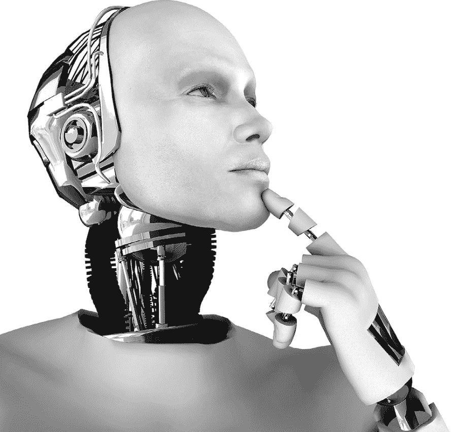

编辑：

Hooman Samani

国立台北大学

电气工程学系

台湾

www.hoomansamani.com


http://www.crcpress.com

贡献者 xi

DAVID LEVY 4

DOROS POLYDOROU 和 ALEX KARKOTIS

HANS SPRONG

PAOLO BARATTINI

Tim R. MERRITT, Mie NEERGAARD, CHRISTIAN O. LARSEN

PEI-LUEN RAU 和 NA CHEN

BELINDA J. DUNSTAN 和 JEFFREY TZU WAN

7.6 参考文献 137

ALEX YU-HUNG CHIEN 和 VON-WUN SOO

8.8.1 多重语境的话语行为模型 157

ROY DE KLEIN, GEORGE KACHERGIS 和 BERNHARD HOMMEL

JÜRGEN LEITNER

- 10.5 整合 206

# 贡献者

Paolo Barattini

Ridgeback SAS

意大利，库内奥

Jeffrey Tsu Kwan Valino Koh

新南威尔士大学设计创意机器人实验室

澳大利亚，悉尼

Na Chen (陈娜)

清华大学工业工程系

中国，北京

Christian Ø. Laersen

奥尔胡斯大学

丹麦，奥尔胡斯

Alex Yu-Hung Chien

国立清华大学计算机科学系

台湾，新竹市

Jürgen Leitner

人工智能研究所 (IDSIA) 

及 SMRTRobots，瑞士，卢加诺

Belinda J. Dunstan

新南威尔士大学设计创意机器人实验室

澳大利亚，悉尼

David Levy

Intelligent Toys Ltd.

英国，伦敦

Bernhard Hommel

莱顿大学脑认知研究所

荷兰，莱丹

Tim R. Merritt

奥尔胡斯建筑学院

丹麦，奥尔胡斯

Mie Nørgaard

MIE NØRGAARD

丹麦，瓦尔尔洛瑟se

George Kachergerij

莱顿大学脑认知研究所

荷兰，莱丹

Marianne G. Petersen

奥尔胡斯大学

丹麦，奥尔胡斯

Alexis Karkotis

BornAnIdeaLab

英国，伦敦

Doros Polyddorou

赫特福德郡大学

英国，哈特菲尔德

Roy de Kleijn

莱顿大学脑认知研究所

荷兰，莱丹

Majken K. Rasmussen

奥尔胡斯大学

丹麦，奥尔胡斯

# xii 贡献者

Pei-Luen Patrick Rau (罗培伦)

清华大学工业工程系

中国，北京

Von-Wun Soo

国立清华大学计算机科学系

台湾，新竹市

Hans Sprong

飞利浦 RoboCup

荷兰，埃因霍汶

# I

认知机器人的伦理方面

人类已经开始拥抱“机器人社会”。2005年，韩国政府宣布计划在2020年让每户都拥有一个机器人。日本机器人协会预测，次代机器人到2025年将产生高达650亿美元的经济活动。同样在日本，长期以来一直都在努力，确保在不久的将来，老年人口能够常规地获得人的照顾。与此同时，在许多大学和其他研究中心，各种类型的机器人都是热门话题。

## 1.1 引言

显而易见，机器人很快将在我们生活的许多方面领域提供服务，成为我们在各种实用和陪伴方式上的伙伴，并娱乐我们。娱乐领域的一个早期例子是2005年在日本世界世博会上亮相的一款舞厅舞机器人。它没有可用的腿，而是依靠轮子移动。

让我们考虑这样一个情景，也许是在十年后，跳舞机器人有了可以移动的腿，并掌握了各种舞步技巧，如华尔兹、狐步舞、鲁姆巴等……某一天晚上，年轻女名叫劳拉（Laura）正在参加舞会，与一个机器人伴舞。乐队响起了恰舞的音乐，但表演得非常糟糕，以至于机器人将音乐误认为是探戈。于是，劳拉和她的机器人伙伴互相搂着跳舞，很快他们就倒下了。机器人落在了劳拉身上，由于体重沉重，折断了她的腿。劳拉的父亲非常愤怒，他的律师告诉他们要立即启动法律程序，并“严惩他们（throw the book at them）”。

但谁应该向他们的律师交这本书呢？是舞厅，还是向舞厅出售机器人的在线商店，还是机器人的制造商、机器人的设计人员，应该是编写机器人音乐识别软件的独立软件公司，还是领队，甚至是那个把恰舞跳得太糟糕的音乐人团？

## 5 当机器人犯错时

### 1.2 归责机器人

尽管机器人是制造出来的，但也有理由归责机器人。许多人支持这种观点。我将讨论三种可能的方法：

- 机器人应该被视为类人
- 机器人应该被视为类动物
- 机器人仅仅被视为制造物

### 1.2.1 类人机器人

随着机器人智能的提高，我们许多人将接受它们拥有人类的能力。莱昂·温伯格（Leon Weinberg）认为，尽管如此，社会可能选择以权利义务相同的方式：

### 1.2.2 类动物机器人

一些研究人员认为，机器人具有自主性，社会可以对其进行归责。为了给机器人分配责任，内华华大学的 Kelly 及其同事对不同犬种进行了类比。例如，Roomba 尘吸器类似于无害的犬种，而无人机（尤其是武装无人机）类似于危险的犬种。对于“危险”机器人，他们建议采取与狗类似的禁令或限制。

# 当机器人犯错时

但当被警察逮捕时，它表现得像温顺的“M型人格”。这是虚假逮捕吗？在定罪后，所有现有的犯罪软件软件包副本是否也有罪，并且必须遭受同样的惩罚？（连带罪吗？）如果不是，将另一个副本带上法庭是否构成了双重惩罚？

在弗雷塔斯（Freitas）的基础上，约里克·威尔克斯（Yorick Wilks）增加了一个更激进的解决方案：

> 但我们如何看待“机器惩罚”？机器可以被关闭并粉碎，软件要么随之消失，要么被单独烧毁，前提是我们知道自己拥有所有的副本！

如果我们从弗雷塔斯的论文向后推25年，到2010年，我们发现加布里尔·哈利（Gabriel Halley）在刑法背景下对人工智能惩罚背景进行了更详细的审查。哈利评估了人类刑事法庭通常对有罪者的五种不同惩罚，并考虑了每种类型对人工智能实体的适用性。这些惩罚包括：死刑、监禁、缓刑、罚款和社区服务。

显然，死刑是防止犯罪者再次犯罪的最有效方法，而机器人等等效果的相应实际行动是删除其软件，从而使违规机器人无法再次实施任何犯罪。这假设我们接受在一个现有的机器人躯体中将一个新机器人“大脑”（即其软件）视作一个不同的机器人。如果不是如此，社会将不得不依靠威尔克斯的解决方案并销毁所有副本。

监禁又如何呢？最接近监禁的实际行动是在指定时间内将其禁用。对机器人判处监禁刑或判处缓刑，只有当机器人被程序化为*讨厌*被停用（监禁）的想法时，才会产生效果。

如果机器人被认为拥有金钱或其他形式的财产，那么对其施加罚款与对公司罚款具有类比性，因为两者都不是人类。当机器人能够通过其“工作”赚钱时，机器人被罚款的想法将显得不再那么荒唐，而是和罚款公司一样合理。

社区服务是另一种惩罚形式，对于人类来说，它要求犯罪者为社区贡献劳动。正如哈利指出的，人工智能实体将能够“各种工作”，因此：

# 认知机器人学

“无论是施加于人类还是人工智能实体，社区服务的意义是完全相同的。”

从哈利的分析中可以认为，我们法庭中通常对人类犯罪者施用的大多数惩罚类型也适用于机器人（尽管有时形式不同），因为这些惩罚的本质相对于人类和机器人来说是相同的。彼得·阿萨罗（Peter Asaro）对机器人惩罚的整个概念提出了质疑，并问了问题：惩罚机器人可以被视为一种威慑吗？它能实现公正吗？在讨论身体惩罚对机器人的意义时，阿萨罗评论道：

“各种形式的体罚预设了作为人类的额外欲望和恐惧，而这些可能并不易于适用于机器人，例如疼痛、行动自由、死亡率等。酷刑、监禁和破坏在对机器人实现实现公正、改造或威慑方面可能并不有效。可能会有一项政策销毁任何造成伤害的机器人，但正如伤害人类的动物一样，这是一种避免未来伤害的预防措施，而不是真正的惩罚。

除了阿萨罗关于机器人惩罚问题性性的论点外，我还能看到该概念中额外层次的复杂性。其中之一是威慑问题。如果机器人要因某种形式惩罚的恐惧而受到威慑，它必须被程序化以识别出它正在考虑被社会视为违反民事或刑法的行为。而且，它还必须被赋予某种人造的情感驱动力，以“讨厌”对该罪行的相应相应惩罚。

我认为另一个值得认真考虑的复杂性层次，涉及如何处理与已犯罪机器人完全相同的机器人。如果故障机器人是因为硬件故障或部分软件损坏而行为不当，我们可以认为，同种类型、型号和版本的机器人无 Bug 副本都应免受针对该故障机器人实施的特定犯罪案件施加的任何惩罚。但如果问题出在硬件设计或软件编程中，那么惩罚该机器人的所有副本似乎是逻辑性的，因为社会是在对设计或编程本身实施制裁，而不是针对某个特定的副本。

# 当机器人犯错时

## 1.2.5 责怪机器人本身 — 总结

如果以机器人是拟人或拟动物为理由来责怪机器人本身是合理的，那么逻辑上推导出机器人本身应该受到惩罚，但我认为阿萨罗反对惩罚机器人价值的论点是正确的；如果机器人被仅仅视为人造物体，那么如何归罪错误的问题将带我们进入产品责任领域。该产品（机器人）是否有缺陷？如果是这样，责怪机器人公平吗？人类辩护者有时能够通过辩称他们在犯罪时处于“精神状态不稳定”来逃避指控，因此对于具有设计或制造缺陷的机器人，答案无疑是“否”。这是不公平的。责怪机器人无法实现公正。

考虑到所有因素，我不认为责怪机器人是解决社会如何对机器人事故反应的持续方法。

## 1.3 责怪人类（HOMO SAPIENS）

如果机器人不对其引发的事故负责，那么责任必须落在人类身上：有时是一个人，有时是几个人，有时是集体。

### 1.3.1 信任问题

在讨论可能应用的机器人使用之前，我想问，我们法庭中通常对人类犯罪者施用的大多数惩罚类型也适用于机器人（尽管有时形式不同），因为这些惩罚的本质相对于人类和机器人来说是相同的。彼得·阿萨罗对机器人惩罚的整个概念提出了质疑，并问了问题：惩罚机器人可以被视为一种威慑吗？它能实现公正吗？在讨论身体惩罚对机器人的意义时，我们能多大程度上安全地依赖机器人并信任？每个乘坐现代飞机的人都将生命交给了自动驾驶。在某个案例中，一名飞行员在进场时未启用自动驾驶。他的飞机坠毁了，法庭认定未使用它是原因之一。

另一个信任机器人的关键领域是医学，那里雇用了许多计算机和电子系统协助医生提供护理。未来的医疗机器人不仅能够监测患者的生命体征并在适当警告医护人员，还能通过诊断提供护理，甚至进行全自动手术。

20世纪70年代，斯坦福大学开发了一种名为 MYCIN 的计算机程序，用于识别引起脑炎等严重感染的细菌，并推荐抗生素方案。通过与五位专家¹对 MYCIN 进行评估发现，计算机的“接受度”性能评分为65%，明显高于这五位人类专家的42.5%到62.5%。你更倾向于信任谁？一个表现逊于 MYCIN 的人类专家，还是表现优于任何一位斯坦福专家的计算机程序？

¹所有专家都是医学科和儿科传染病学部的教职人员。

# 当机器人犯错时 11

错误造成的是情感上的损害，而非物质或物理上的损害。

在美国，此类案件被称为“慰藉性”（heart balm）侵权——即针对第三方成年人的诉讼，指其“偷取”了原告配偶的感情，这在美国八个州仍然属于民事法犯罪行为。

Ziaja 的论文探讨了当一个具有性能力的机器人被婚姻伴侣损坏时的法律责任领域，即机器人至少应对与其配偶关系的破坏负责。

在美国 във那些仍保留有“慰藉性”侵权法的法州，通常主张其存在的伦理辩护是保护婚姻免受第三方干扰而破裂。Ziaja 在这个公式中将机器人假想为可能的第三方，并问道：

> 如果由配偶提起了慰藉性诉讼，而第三方是一个性机器人而非另一个人类，那么由谁来承担责任？慰藉性侵权在某种程度上是针对第三方的。但在假设中，这个情人既不是人类，也不是法律人。面对此类案件，法律体系将不得不通过找到过错的人类（发明者、制造商、所有者）或找到性机器人的过错来做出回应。这两种选择都是存在问题的。

## 1.4 疏失法与产品责任法

涉及机器人的法律责任问题非常复杂。这个问题的一个方面是，在某些司法管辖区，机器人出现故障与人类在使用机器人过程中的疏失之间存在巨大的法律差异。当机器人发生故障时，适用的法律规则通常与产品责任有关——产品设计是否合理、制造是否良好以及是否可靠地符合用途？当人类使用机器人时，通常涉及与人类疏失相关的规则。曾考虑过的情况还有第三种类型——即很难甚至无法判断产品的使用者是否有过错，过错是在于产品本身，还是两者的结合，因为服务提供商通常会使用产品来帮助提供其服务。接下来是一个具有历史意义的例子。

## 1.4.1 第一起机器人死亡事故

在卡雷·恰佩克（Karel Capek）的戏剧《罗苏姆通用机器人》（R.U.R.）中（该剧于1921年首演），机器人接管了世界并处决了不需要的人类。1979年1月25日是该剧首演58周年，这也是第一起已知的机器人致命事故发生的日期，当时工厂工人罗伯特·威廉姆斯（Robert Williams）在密歇根州的福特汽车公司工厂去世。威廉姆斯被一个由利顿工业公司（Litton Industries Inc.）设计的机器人击中头部当场死亡。

罗伯特·威廉斯的家庭因疏失和责任提起损害赔偿诉。利顿公司的律师声称，该机器人的设计并非在人类触及范围内即可运行。机器人的目的是从存储位置提取零件，然后将其移动到装配线上，在任何人靠近机器人之前，应该先关闭电源使其无法移动。尽管机器人有一个持续旋转的警示灯，用于警告人们它已开启且随时可能移动，但利顿公司辩称，没有特定的警告系统来指示机器人何时实际要移动而关闭电源的原因是，除非否则没人应该靠近它——利顿公司声称罗伯特·威廉姆斯和他的同事经常违反这一安全规则。

威廉姆斯家族的律师辩称，机器人的设计没有考虑到机器人使用的真实环境。特别是，他们提供的证据表明在许多情况下，由于需要，工人可能需要进入机器人的运行区域和触及范围。例如，由于零件可能被储放在错误的位置，导致机器人将错误的零件输送到装配线，此时人类需要纠正这一问题。由于这些问题，威廉姆斯家族声称，机器人的设计缺陷超过了威廉姆斯及其同事在机器人移动时惯常进入机器人工作区域的事实，而后者并没有通过通过关闭机器人牺牲生产来给工厂带来损失。

审判持续了八天，随后陪团花了几个小时时间做出了有利于罗伯特·威廉姆斯家族的裁决，并授予了他们1000万美元的损害赔偿，认定制造商有责任。但陪团并不总是做出最佳决策，因此尽管那个特定陪团的裁决，我们仍然应该问自己，到底谁应该对罗伯特·威廉姆斯负责？

威廉姆斯案的细节提供了一个显著的例子，说明了单一事故可能有多复杂。那么负责确保机器人完全安全的人又是怎样的？机器人事故不像其他机器；机器人也不像其他机器；机器人具有智能、人工能力并且能够“思考”，这使得它们处于一个特殊的类别，这似乎为我们如何处理机器人事故提供了各种选择。有如此多的归责选择这一事实，无疑为试图寻找一种合理且一致的方法来补偿受害者提供了强有力的论点。

## 1.4.2 机器人与疏失法

法律意义上的疏失发生在存在注意义务且由于未履行该义务导致某人遭受损害的情况下。预期的注意程度是理性人在此类情况下会适用的程度。建立此类违约的复杂性之一在于，对不同的被告可以合理地预期不同的标准，例如，医生被要求的标准比护士高。

在法庭案件中建立疏失所需的另一个要素是所谓的“因果关系”——被告是否导致了原告的损害？彼得·阿萨罗（Peter Asaro）给出了简洁的解释：

> 法律负责的疏失形式取决于未能警告或未能采取妥善的。未能警告发生在制造商明知某项风险或危险但未能通知消费者此类风险的情况下。这就是为什么现在各种产品上有如此许多警示标签的原因。在法庭上证明未能采取妥善的或避免可预见的风险更为困难，因为它更抽象，并且涉及无法证明制造商从产品中得知风险或危险的情况。在这些案例中，人们认为给定的危险或风险在某种意义上是显而易见或易于预见的，即使制造商未能识别出。为了证明这一点，律师经常会请专家作证那些风险是显而易见的。


虽然法律疏失的概念并不难理解，但法院要在机器人案件中确定疏失将不是一项易事。萨米尔·乔普拉（Samir Chopra）和劳伦斯·怀特（Laurence White）在他们的书籍《自主代理法律理论》中为我们提供了与机器人相关的论证示例，这些论证可能会开启疏失诉讼的大门，包括：

- 机器人可能会被粗暴或危险地处理。
- 操作员在向用户提供机器人之前，在编程或配置机器人时可能不够妥善。
- 如果操作员将机器人提供给未充分了解如何使用机器人的用户，理论上可能会引发责任。

## 14 认知机器人

决策机器人的监护者可能对疏职监管承担法律责任。

显而见，机器人过失案件最肥沃的领域之一（特别是在美国）是医学。如果手术机器人在手术过程中切错了错误的切口，导致了严重或致命的后果，过失的法律责任应由谁承担？随着医疗机器人系统的使用越发广泛，无疑会引发相应的数量增加，特别是在美国这种盛行的诉讼氛围中，由此引发的医疗事故误诉讼数量将大幅增加。外科医生的律师可能会根据机器人存在缺陷为由将任何责任归咎于机器人制造商，而制造商和医院可能会互相指责，制造商的律师也极可能指向外科医生。这所有的律师都能赚到巨额的律师费。

### 1.4.3 机器人与产品责任法

产品责任法旨在保护人们免受与缺陷产品相关的风险，即那些可能导致伤害或其他形式损害的产品。在美国，产品责任法有时会在不同州之间有所差异，但总而言之，产品制造商对产品使用造成的任何物理伤害承担责任。但产品责任问题并非那么简单。机器人是一类特殊产品，因为它们具有（人工）智能，在许多情况下，这种智能将包含学习能力。

虽然产品在设计和制造时应该确保不会对其用户或他人构成风险，但当人们能够从经验中学习并改进自己的决策和行动时，我们又如何能确定不会产生风险呢？如果机器人的软件可以学习或通过自我修改发生改变，那么通常将极其困难（并非不可能）将缺陷的起源追溯到负责的程序员或制造商身上，因为可以辩称，机器人的原始设计已由机器人本身更改了。在法庭上，必须引入技术专家的证据，证明损害是源于设计或制造的错误，还是由于机器人训练不当。

随着机器人的能力越来越像人，不仅被赋予了学习能力，还拥有了人工情感、情绪和性格，那么它们应该被视为通常意义上的“产品”将变得越来越模糊。如果传统的产品责任法不足以应对智能学习型机器人，那么哪些额外或替代法律将适用？这是一个非常开放的问题，在我看来，在未来的许多年里可能都会保持现状。

### 1.4.4 当机器人被改装或误用时

机器人的不当行为（无论是无意的还是其他原因）可能发生在机器人被误用时，或者当所有者或用户对其进行改装，导致产品更容易发生事故时。显然，在机器人出售后对其进行的任何改装，都可能与法庭判定产品缺陷问题或因果关系问题相关。而且，对产品进行改装还可能引入机器人事故共同责任的可能性，为法律论证增添了另一层复杂性。

### 1.4.5 法律责任的其他考量

我确信，到这里你已经意识到，法律中的产品责任问题远非简单，特别是在机器人产品的情况下。问题越是不简单，法院的血管就会越拥堵，律师们的潜在“宝藏箱”就会变得越大。

因此，我们必须接受，在涉及使用或误用自主机器人的案例中，关于谁该承担责任的法律问题是一个复杂问题，远比无思维的产品复杂。而且，自主机器人具有人类的一些心理特征，这一事实使得如果机器人出现故障，就会产生一类完全不同的法律问题。

信不相信，这些复杂性并没此结束。到为止我们只考虑了直接由使用或误用机器人导致事故的案例，但机器人（或动物）也可能间接引发事故，例如通过分心司机或其他道路使用者来实现。这类情况由德国法律处理，根据该法律，机器人所有者对此承担法律责任……（注：原文此处似乎不完整，已按原文翻译）

（修正：）我确信，到这里你已经意识到，法律中的产品责任问题远非简单，特别是在机器人产品的情况下。问题越是不简单，法院的血管就会越拥堵，律师们的潜在“宝藏箱”就会变得越大。因此，我们必须接受，在涉及使用或误用自主机器人的案例中，关于谁该承担责任的法律问题是一个复杂问题，远比无思维的产品复杂。而且，自主机器人具有人类的一些心理特征，这一事实使得如果机器人出现故障，就会产生一类完全不同的法律问题。

信不相信，这些复杂性并没此结束。到为止我们只考虑了直接由使用或误用机器人导致事故的案例，但机器人（或动物）也可能间接引发事故，例如通过分心司机或其他道路使用者来实现。这类情况由德国法律处理，根据该法律，机器人所有者对此承担法律责任。

### 1.4.6 法律责任的总结

考虑到各种机器人事故的法律复杂性，法律制定者能否制定出充分应对这些问题的法律？法官和陪审团是否具备必要的背景知识来公正地判定？在我看来，这两个问题的答案都是坚定的“否”！在实践中，对于机器人事故判定责任划分和赔偿可能是极其困难甚至是不可能的，特别是在机器人可以学习和思考的情况下。

考虑到未来每个家庭都有一台机器人，无论社会选择如何处理机器人事故的法律责任，所有者对机器人的行为承担某些法律义务，就像汽车主负责控制车辆一样。我相信，法律在解决机器人事故相关的责任问题上只能起到微小作用。我们需要一种完全不同的方法——一种相对简单、易于管理，且不会淹没法院的方法。

## 1.5 机器人汽车

现在让我们考虑一种特殊的机器人，即机器人汽车。由 DARPA 赞助的“大挑战”推动了自动驾驶领域的快速发展。这些是未来的汽车，确实是机器人——它们被程序为从 A 到 B 自行，重新规划路线并避开障碍。

几年后，机器人汽车将成为常态而非例外。人类司机将成为乘客，避免驾驶和停车带来的烦恼和责任，并通过语音识别软件控制车辆。现在的司机在乘坐时，将能够与汽车的人工人格聊天、看电视或工作，随心所欲。

偶尔会发生机器人汽车的事故，这些事故将按通常方式由汽车保险覆盖——每位机器人汽车所有者都将被依法强制购买针对自身、其他驾驶员、乘客、行人及财产风险的充足保险。这种保险对于机动车是绝对标准且强制性的。

## 当机器人犯错时 17

如果涉及机器人汽车的事故可以通过强制性保险得到满意的补偿，为什么不对涉及各种想象类型机器人的事故也采取此措施呢？事实上，想象一下如果没有汽车保险，而是汽车事故受害者的赔偿必须由法院处理，会发生什么。这将导致世界上每个国家法院系统的立即崩溃。仅凭这一点，在我看来强制性机器人保险就是唯一理智的道路。

## 1.6 保险

考虑到起诉机器人事故案件所面临的许多困难，最近一些作者提出将保险作为一种替代救济手段。对于公众而言，保险理赔通常比诉讼容易管理得多，成本也低得多，这是支持保险的一个重要论点，而不是将诉讼视为机器人事故后最合适的补救措施。

理想的机器人保险单应该为因任何涉及机器人的事故导致的物理损坏和人身伤害提供财务保护。涵盖的风险包括：对任何被机器人伤害人员的医疗费用和赔偿（包括情感伤害），以及其他机器人对机器人本身造成的损坏和财产损失。

我支持无过错保险计划，换句话说，无论事故归于谁的错，都会支付赔偿。此类计划通常通过避免需要昂贵的诉讼来确定谁导致了事故，从而降低保费成本。事实上，无过错保险的一个条件是，获得保险公司赔偿的受害者不允许提起损害赔偿诉讼。这对律师来说该怎么办？

正是由于车辆保险的强制性，为因汽车事故而遭受伤害或财产损失的任何人提供了最大的赔偿保障。为了执行这些要求，通常对没有购买充分保险或完全没有保险的机动车司机采取严厉的法律制裁。在英国，《道路交通法》规定在道路或其他公共场所无充分保险的情况下驾驶机动车是犯罪，允许或鼓励无保险的人员驾驶也是刑事犯罪。但立法首要目的是确保保险公司有可用资金来赔偿驾驶事故的受害者。但如果驾驶员没有保险，就没有现成的保险公司资金来补偿该驾驶员事故的受害者；在英国，政府与汽车保险局（Motor Insurers Bureau）之间存在自愿协议，提供足够的资金处理此类情况。该协议不仅涵盖了驾驶员无的情况，还涵盖了逃逸且无法追踪以进行保险索赔的驾驶员所造成的事故。

## 18 认知机器人

我支持芬兰的 Anniina Huttunen 及其同事提出的提议，斯坦福大学的 Ryan Calo 也讨论过该项提议，即建立机器人强制保险制度。但我更进了一步，主张为执法机构建立一种电子驱动的监控流程，以便他们可以检查机器人是否购买了充分保险。如果检测方法发现没有充分保险，机器人将通过其黑匣子远程自动传输的电子消息被临时禁用，使机器人无法运行，同时在向用户宣布其保险覆盖范围不足，还应向当局报告任何绕过监控技术的尝试。

我的建议是，当制造商售出机器人时，应就其第一年的运行征收适当的保费。保费包含在机器人的售价中，在支付保费之前，机器人将无法工作。在已付保险到期前一个月左右，机器人所有者将收到来自保险公司的警告信息，告知其保险需要续保。当保险公司收到续保付款时，会向机器人的黑匣子发送电子消息，指示允许机器人继续运行。但如果所有者未能在截止日期前续保，机器人将停止工作，转而宣布“请在我尝试使用你之前续保我的保险”。

在考虑机器人的保险覆盖范围时，Ryan Calo 提议：

> 保险水平应取决于被保险机器人的性质。许多机器人——例如

Calo 建议，那些使用机器人进行危险活动（如房屋周边界安全）的人可能应该购买高额保险覆盖，而那些很大程度上为了获得陪伴感而购买机器人的人则需要购买保险（如果有的话）。Calo 建议的其他可能影响所需保险水平的因素还可能包括家里是否有儿童或宠物，或者机器人与陌生人接触的概率。

Huttunen 指出，在机器人保险系统的初期，必须提供有关可能风险的信息，以便保险市场能够确定风险的价格，换句话说，即适当的保费。由于建立实用的历史机器人事故大数据需要一些时间，起初机器人保险计划可能会很贵，以保护保险人免受其风险概况错误的影响。尽管如此，最终将会有历史事故数据来建立稳定的市场。

利用大量的历史机器人事故数据作为设定保费的指南的益处之一是，机器人开发者和制造商如果违规，将感受到对其公司底线的影响。我设想的机器人保险系统将对机器人行业实现自我调节，那些易发生事故的模型将迅速吸引更高的保费，推高其零售成本，并鼓励消费者购买具有更好记录的产品。同样，机器人所有者在财务激励下会谨慎使用机器人，因为他们可能会因失去无理赔优惠而面临更高的保费。

为了对那些没有购买充分保险或没有保险、但以某种方式绕过了其机器人黑匣子禁用技术的机器人所有者执行强制性机器人保险要求：如果一个聪明的计算机专家黑入机器人的保险续保软件并允许无保险的机器人使用，他们将构成犯罪，就像大多数司法管辖区的汽车司机在没有充分保险的情况下驾驶属于犯罪一样。机器人的黑匣子在监控所有者保险单状态的同时，可以向相应的监管机构发送警报信息，告知无保险的情况或对已保险机器人进行了未经的改装，以及所有者的姓名和联系方式。针对某些交通违规自动生成罚单已是常态，因此针对无保险机器人的类似方案完全合理，在最严重的情况下向警方发送信息协助其识别和追踪所有者。

在汽车保险方面，在许多司法管辖区某些类型的车辆被视为不需要保险要求的车辆。在英国，这包括割草机和一些电力辅助自行车。这些排除项目提供了一个可以很容易扩展到机器人保险的模型。例如，某些儿童的玩具机器人不需要保险，因为此类玩具导致严重伤害或死亡的风险极小，而且可以在玩具上贴上警告标签，以涵盖吞食拆卸零件等可能性。

我所建议的系统面临的一个挑战是，某些消费者在最初购买后，随后增加了硬件或软件插件，从而影响了机器人带来的风险。为了应对这些可能的危险，机器人的黑匣子可以程序化检测任何此类插件，并向保险公司的“精算师”——一段软件而非人类精算师——发送电子消息，然后进行计算

## 20 认知机器人

延迟调整相应的保费，所有者将获得相应的通知。更危险的可能是那些拥有技术知识、能够以各种方式修改机器人的机器人爱好者，这可能通过将一个无害的机器人变成危险机器人，再次制造增加风险的可能性。在这种情况下，机器人所有主将被其“黑匣子”迫使通过填写包含修改细节的电子表格来进行自我认证，以便计算合理的保费增加金额。如果发现某所有主对其修改提供了虚假信息，其将承担诉讼责任，这与在汽车保险单申请表上提供虚假信息的驾驶员承担相同。

## 1.7 总结与结论

机器人社会的扩张将导致各种想象类型机器人数量的大幅增加，相应的机器人事故数量也会随之增加。娱乐机器人将作为消费品蓬勃发展，因此家庭和娱乐场所的事故将占所有机器人事故相当比例。

自 20 世纪 80 年代以来，关于社会如何应对未来机器人事故的讨论几乎都基于这样一个假设：补救措施应由法院解决。有一小部分但具有参考价值的判例法，这两者都说服了我：如果不加加制，机器人事故案件的诉讼将不可避免地淹没机器人丰富国家的法院。所有诉讼的负面影响之一是，机器人作为一个研究领域和商业分支的发展将受到阻碍，因为商业机器人的开发、制造和营销将变成极高风险的业务。

在机器人事故案件中，可能会提出许多怀疑、困惑和争论的理由，大多与我今天提到的一个或多个嫌疑人的法律责任（或缺乏责任）有关，包括：

- a. 销售、出租或租赁该机器人的个人、商店或其他企业。
- b. 制造机器人的工厂。
- c. 负责测试机器人的人员。
- d. 机器人硬件的设计师。
- e. 机器人软件的设计师和程序员。
- f. 它的“智能”水平。

在评估所有这些及其他当方的责任或缺乏责任时，法院还必须考虑到与机器人类型和特征相关的某些因素，包括：

- g. 机器人的硬件或软件是否以可能导致事故的方式经过了修改？
- h. 机器人是否具有学习和/或以可能导致事故的方式修改自身行为的能力？

考虑到以下任何或所有因素对机器人事故结果的可能影响，法律困境变得更加深重：

- i. 对机器人技术一窍不通的法官。
- j. 对机器人技术一窍不通的陪审团团员。
- k. 专家证人虽然掌握了机器人技术，但不能指望他们拥有足够的专业知识来确定导致特定事故的机器人行为的确切原因。

面对法庭案件公正结果的这么多潜在障碍，考虑到法院将因不可避免的大量机器人事故案件而变得多么不堪，对我来说很清楚，诉讼并不是答案。基于无过错保险模型的强制机器人保险的想法具有非常显著的优势：

- a. 它管理起来相对容易。
- b. 技术将监控并执行所有者必须充分保险的法律要求。
- c. 机器人所有者发现选择更安全的品牌和型号在财务上是有吸引力的，因为保费附加较低。
- d. 如果机器人开发人员和制造商的产品相对不安全，将失去销量，因为这会吸引更高的保费。

我们已经看到了这些风险。让我们为这些风险制定保险计划。

- 1. Asaro, P., 2007. Robots and Responsibility from a Legal Perspective. Workshop on Roboethics, within the 2007 IEEE International Conference on Robotics.
- 2. Calo, R., 2011. Open Robotics. Maryland Law Review, vol. 70, pp. 571-613.
- 3. Chopra, S. and White, L. 2011. A Legal Theory for Autonomous Agents. University of Michigan Press, Ann Arbor.
- 4. DiPerna, P., 1984. Juries on Trial. Dembender Books, New York.
- 5. Freitas Jr., R. 1985. The Legal Rights of Robots. Student Lawyer 13 (January 1985), pp. 54-56.
- 6. Hallevey, G., 2010. The Criminal Liability of Artially Intelligence Entities. Akron Intellectual Property Journal. No. 2, pp. 171-307.
- 7. Huttunen, A., Kulovesi, J., Brace, W., Lechner, L., Silvennoinen, K., and Kantola, V., 2010. Liberating Intelligent Machines with Financial Instruments. Nordic Journal of Commercial Law, No. 2.
- 8. Kelley, R., Schaerer, E., Gomez, M. and Nicolescu, M. 2010. Liability in Robots : An International perspective on Robots as Animals. Advanced Robotics, vol. 24, pp. 1861-1871.
- 9. Lehmann-Wilzig, S., 1981. Frankenstein Unbound: Towards a Legal Definition of Artificial Intelligence. Futures, December 1981, pp. 442-457.
- 10. Schaerer, E., Kelley, R., and Nicolescu, M. Robots as Animals: A Framework for Liability in Human-Robot Interactions. 18th International Symposium on Robot and Human Communication, Toyama, Japan.
- 11. Wein, L., 1992. The Responsibility of Intelligent Artifacts. Harvard Journal of Law & Technology, vol. 6, Fall 1992, pp. 103-154.
- 12. Wilks, Y., 1985. Responsible Computers? Invited contribution to panel on Computers and Legal Responsibility. Proceedings of 9th International Joint Conference on Artificial Intelligence, Los Angeles, pp. 1279-1280.


- 13. Ziaja, S., 2011. Homewrecker 2.0: An Exploration of Liability for Heart Balm Torts involving AI Humanoid Consorts. International Conference on Robotics, Amsterdam, December 2011.

西方文化可以教我们如何与“西方社会”所所谓的“无灵魂物体”进行互动。作者们特别关注了拉丁美洲的土住民文化，他们的物质文化、围绕物体创造的社会实践，以及他们在生产过程中投入的艺术化且充满爱的关注。受美洲印第人社区模型及其物质文化的启发，作者们提出/论证了向超越性家用机器人转变的趋势，同时提供/概述/勾勒了一个机器人社区的平等社会模型。

## 2.1 引言

亚洲与西方国家之间 AI 机器人开发模式的跨文化比较表明，宗教情感和世界观影响着机器人的进步。在西方，尽管建立了世俗民族国家，但延续了千年的“复活拯救”宗教叙事在潜意识中引导着 AI 机器人工程走向一种超越性的话语；在其实证主义的观点中，一个没有肉体的心灵被投影在某种信息网络空间中无摩擦地游荡（Geraci, 2006）。在排除了 MIT 媒体实验室和 Adept Technology 等公司之后（同时撇开军事部门），西方国家的科学研究——尤其是自 1985 年“大洗牌”以来——很大程度上是为了增强 AI 技术中计算速度和人工智能软件部分。欧洲和美国的科研实验室在开发 AI 机器人实际形态特征（即它们的螺丝、电路和螺栓）的工程化方面似乎落后于发展。而西方机器人技术的商业可用程度与 20 年前并无太大区别。这种趋势随着近期的发展很可能在未来发生反转，因为像 Google 和 Apple 这样的公司开始直接参与针对西方消费者的机器人技术设计和商业生产。

对于西方人来说，创造拟人化 AI [生物]机器人的前景是一个与犹太-基督教创世故事（即上帝按照自己的形象造人并向他们吹入生命）以及“人类主义”领域紧密交织的话题，后者通常被视为和处理为禁忌——这引发了存在主义的反思，即科学家、设计师和工程师是否确实在以类似于神的方式行动，这种做法是否恰当。人类学家克福德·格尔茨（Clifford Geertz, 1966）的神话目前是现实的“模型”，也是“现实的“模型”。

> ¹ 那年，美国五大巨头通用汽车、通用电气、西屋登豪斯、IBM 和联合技术要么出售或关闭了它们的机器人业务部门。随后，外国制造商进入美国并建立了分销和制造设施，其中最著名的是 ABB 机器人、安川电机、电气公司、川崎重工和发那科（Nof, 1999）

从这个意义上说，我们可以说，当前科技革命时代基督教的困境在于：是否将 AI 技术的发展符号地等同于 (a) 再次食用“善恶之知”的禁果，或 (b) 在经历“漫长的社会演化历程后”回到天堂享用伊甸园的第二棵禁忌之树；这在现代和科学术语中可以翻译为实现一个预言中的“奇点”。在可能发生牺牲的阴影下，一个宗教神话网络、科幻战斗和拟人化赛格人的城市景观剖析了 AI 机器人在其创造者假设“主体性”后可能反叛的方式。在西方，对未来 AI 机器人实际形态和行为的设计概念，大多数表现为观众主观想象的文化媒体景观中的虚构角色，而非多学科创意实验室（拥有相对充足的资金）中真实的草根运动。这在亚洲国家通常如此，特别是日本。日本是后工业国家中机器人开发的领先者，占据了世界运营机器人份额的 52%。

凭借其神道教和佛教传统构成的流行宗教信仰的阶层（Maraini, 1983: 52），日本是少数工业化国家之一，在知识话语中观察到对泛灵论的广泛讨论，“这激发了日本知识分子、艺术家和活动人士对自然、科学和政治的替代构想”（Jensen and Blok, 2013: 97）。日本人将机器人视为生命体——没有西方那种观察到的存在主义“心/身”和“自然/文化”焦虑”（例如 Sahlins, 2005），因为流行文化并没有推动 AI 机器人统治世界的时代。相反，日本流行文化长期以来将机器人视为“仁慈、友好可爱且渴望成为人类的实体”，而恶性的形式很少被观察（Robertson, 2007）。日本科学家并不拒绝日本文化中的唯物信仰，这与机器人作为具有可以促进福祉的生命力的生命实体的想法完全兼容。人们承认，人类的创造物可以是善的也可以是恶的，是脆弱的，而监控目前还不是那么大问题，因为媒体和网络博客并没有产生它或将其视为一个问题（同上）。

> ² 它们是现实的“一种模型”——现实泛灵论所强调的是对它们所反映、关联或与当前社会现实产生共鸣的符号结构的操纵；或者正如格尔茨所说，是“预先建立的非符号系统”——在很大程度上，强调的是根据符号“符号”中表达的关系对非符号系统进行操纵，“以使神话（一个存储意义和信息的符号系统（1957:422））成为一个在其指导下组织物理关系的模型：它是现实的“模型（1966:6）”——Wei Wei

神道教可以被看作泛灵论的一种特定形式（Clamer, 2001），是一套多方面且复杂的宇宙论信仰体系，它交织了纯净与不净、诚实与回避、协同倡导再生和与自然和谐的概念。正如宗教学者罗伯特·格拉西（Robert Geraci, 2006）所解释的，“神道教中神圣的基本单位是*神（kami）*。神是神话中的实体、神社崇拜的对象、自然界的对象以及人类。”这种泛灵论的概念已有机地扩展到包括 AI 机器，神道教（类似于佛教）认为自然是神圣的，所有实体都是表达这种神圣性的创作节点。“所有令人敬畏的事物都是神，”格拉西写道，并补充说，“在现代世界，即使工业化污染了它，自然界仍然值得尊敬，人类仍然是其中的一部分。尽管现代日本人可能不自称为‘神道教徒’，但这种宗教体现在亲自然”（同上:7）。

佛教与神道教不同，它在宇宙论中赋予了人类高地位，因为只有通过人类形式和人类体验才能实现涅槃。尽管所有生物以及无机实体拥有佛性，但只有人类被赋予了实现涅槃的潜力：即在轮回中有意识地逃脱。在一个本质上非二元的且极其复杂的宗教系统中（带有一系列符号化实践），人类被赋予了超越性的目的，同时对所有生物产生慈悲。与亚伯拉罕信仰相反，神道教和佛教都赋予了机器人神圣性，最清晰的例子是 20 世纪 80 年代引入初期，神道教和佛教僧为工业机器人举行的仪式。

神学家托马斯·阿奎那曾用锤将青铜人击碎。塞浦路斯的大雕塑家皮格马龙用象牙雕刻了一个女人，并在爱洛洛特的帮助下将她变成了一个真正的女人。

## 2.2 技术与理念的演变

在生活的各个领域引入AI社会机器人在流行层面和政府层面都受到了期待和预期。“创新25”是日本首相安倍提出的在2025年之前重新设计社会的愿景，其主要目标之一是扭转出生率下降的趋势，另一方面适应快速老龄化人口的需求，“强调了家庭机器人在稳定家庭等核心机构方面将发挥的核心作用”（Robertson, 2007）。由于每名女性的出生率停留在1.3个孩子（最多按死亡率数据计算），且21%的人口超过65岁（如果人口统计趋势持续，这一数字将在20年内翻倍），日本政府已将“科学技术”确定为扭转人口结构和重新根植经济的平台。预计机器人将承担家务工作、照顾儿童并担任家政，从而释放日本女性去更积极地追求婚姻，增加生更多孩子的愿望，同时（重新）稳定传统的大家庭。与此同时，由于文化差异，日本大多数老年人似乎倾向于选择“自制”的人形机器人作为护理员，而不是外国移民劳工。

机器人融入日本日常生活的一个例子是机器人老师Saya（Hashimoto, 2011），她能够表达基本情感，包括对表现不规矩的学生传达不满。Jordi Vallverdu在他2011年的论文《人工智能心智的东方构建》中指出，我们必须考虑到东方社会在IT和机器人实施以及社会整合方面如何比西方做得更好，例如《机器人伦理宪章》，这是韩国在2007年为机器人创建的法律监管体系。Jordi认为这主要基于两个原因：

> “为未来建立机器人与人伙伴关系的伦理准则做准备，并将韩国建立为机器人的测试国，”他补充道，“还有另一个更深层的原因：他们热爱机器人，因为机器人不会把他们看作竞争者，他们希望在生活的每个阶段和每个位置都有机器人。”Bartneck已经表明，人们对机器人的感知与媒体和娱乐产业所延续的内容有关（Bartnett, 2007）。

日本的流行文化和动漫经常将机器人描绘成可爱或Kawaii（一个反映了流行审美情感的概念），这捕捉了孩子们从小就的想象力。人类学家Kathleen Richardson在她在麻省理工学院完成的博士论文《消灭差异？机器人与建筑设计》中证明了，日本人将机器人应用于多个社会领域，涵盖生活的方方面面，从儿童护理到交流、治疗、清洁、重体力劳动、安全和娱乐（Vallerdu, 2011）。

相反，Robert Geraci在他的论文《精神机器人：宗教与我们对自然世界的科学观点》中认为，许多在美国工作的研究人员直接或间接地受到其自身文化的影响。Geraci写道，他们的观点“源于一种强调需要超越人类生命的基督教传统”（Geraci, 2006 p.2）。西方的AI研究人员高度集中在赛网络空间，以及他们渴望在虚拟现实中建立一个天堂的愿上。他指出，Geraci认为建筑师和软件工程师Michael Benedikt的愿景是完全在赛网络空间中构建社会地位结构，甚至说“天堂之城的愿景是一个……网络安全的宗教愿景”（Benedikt, 1991 p.16）。为了获得天堂，人类必须放弃身体。Geraci写道，虚拟现实持有着“脱肉体乐园”的想法，20世纪80年代的虚拟现实作者期待最终（虚拟地）从人类身体的束缚中释放（p.3）。流行文化通过《黑客矩阵》三部曲、《创战纪员》和《记忆侠杰尼》等电影反映了这些思想。考虑到“机器人”一词源于1921年的一部剧《罗瑟姆》，剧剧中机器人最终起义并杀死了他们的人类创造者，美国机器人研究人员通常集中在具有军事应用的机器人上这并不意外！

## 2.3 美第安世界与技术泛灵论范式转移

日本是少数遵循万灵论生活方式的工业国家之一。然而，还有其他文化坚持类似的信仰。作者们对东西方在机器人文化理解上的巨大差异深感兴趣，因此决定调查并参考具有替代性万灵论信仰的小族群，旨在让这些替代观点能为技术具身理论提供启示。特别是我们分析了拉丁美洲的本土社区在与西方文化接触极少的情况下，如何信任和平等原则建立社区，同时将“个性”作为核心社会原则。

通过这种分析，我们试图勾勒出后工业社会AI开发的新方法，以便新兴技术能够对保护传统产生积极影响，并促进家庭和社区层面的共产主义和互惠主义情感。此外，作者将把从美第安的生活方式和世界观中推导出一些见解和建议，以未来新兴技术发展中可以考虑的建议的形式。在我们在下面展示的万灵论社会中，个人并不仅仅是雇佣他人制造带有社会意义和符号意义的对象。作者们在本文中提出的是让机器人零件可重复使用，以便它们在生产更新型号时仍保留其独特性。在继续之前，识别美第安社会看待世界的某些特征至关重要。这些观察大多来自作者的个人经验，他们曾在巴拿马的Ngobe土族中进行了为期3年的民族志调查（Karkotis 2012）。我们要提出的第一个问题是：为什么美第安社会为技术具身提供了一个良好的视角？万灵论作为一种世界观，如何为未来与新兴技术的交互提供视角？

似乎所示，在不久的将来，通过生物数字全息形式实现个性化和增强现实能力的控制工具将进一步完善，并处于人类编织的意义之网中。配备了网络眼镜的个人可能会看到红色的天空以及蓝色的太阳和月亮。数字热带鸟将飞过巴黎没有鸟的天空，人在白天的虚拟夜晚恋爱。未来的生物老师将与学生一起进入不同（真）核细胞的模拟全息剧场，感受它们的膜，玩弄它们的核糖体，在细胞质中游泳，观察生长和代谢，监控它们分裂和复制。

这一切听起来可能像科幻小说。但如果是这样，因为这个概念本身并不新，它听起来非常像万灵论和异教：未来时代、古代、古老的触碰。触摸苹果并感受它的能量、在云层中解读信息以及感知灵魂在世界各地均可见。新兴技术不会取代美洲的新时代水晶疗愈或伏都教或其他合成宗教，也不会取代西非的祖鲁习俗，更不会取代拉丁美洲森林族群对灵灵的复杂系统。正如人类学家David Graeber写道，“西方可能引入了一些新的可能性，但它并没有取消任何旧的可能性”（2004）。然而，一位阿拉斯加战士骑着马在金星上寻找潜在的仪式场所，以及一位禅师在太阳系外的空间站花园里举行说法法，这并不是西方设想未来的准确方式。人类学家Joanna Overton（1995），退休教授并曾任圣安德鲁斯社会人类学系主任多年，她在谈及美第安宇宙学时写道，这与非洲和亚洲发现的万灵论非常相似：

> 在亚马逊土著本体论中，没有所谓的“自然”，没有人类可以支配的无机或无价值的宇宙。

属于西方的权力范式，而非亚马逊式的范式；在后者，其他世界总是充满了人类必须与之交道的能动主体。相比之下，西方理解中发展出这样一种观点：人类与其他生物或宇宙元素之间存在一种“自然的”的服从秩序[因此人类脱离了，在为自己创造财富的末期，他们必须去征服“自然”世界] (:19)。

在泛灵论宇宙观中，整个景观已经嵌入了泛灵论的方案层或界面。即使是一块石头，也可以被人类学家维韦罗斯·德·卡斯罗（Viveiros de Castro, 1998）所术的美第安式的“多元文化与视角主义”赋予灵感并人格化。美第安人的共同观念是，“世界由不同类型的主体或人（人类和非人类占据），他们从不同的视角感知现实” (:469)。“总之，动物就是人，或者他们自视为人[而其显现的形式只是一个外壳（‘衣服’），它包裹了内在的人类形态]，这种形态通常对特定物种的眼睛或某些跨物种的生物（如萨满）可见 (1998:470)。”鉴于原住民在拥有各种被认为有用或理想的适当工具的情况下非常繁荣，可以推测，未来一个保护原住民法律权利、参与日常社区活动并作为口头传统守护者的 AI 机器人极有可能被接受为社区的一员；一个具有能动性的非“他者”，它像所有非人类实体一样，保留了展现人格的潜力。在我们推测的未来民族志场景中，机器人理想的形态应该是由原住民自己设计和制造。

## 2.4 泛灵论：物质与蜕变

蒂姆·英戈德（Tim Ingold）在他的《环境感知》（Perceptions of the Environment, 2000）一书中，将生态学与现象学融合在一起，认为社会文化在许多方面是物质对象在“生活世界”中“涌现参与”过程中的交织，而这一过程本身是由运动网络编织而成的。例如，织一个包是一个具有深远意义的多层次过程：它是一种流动、一种教育、一种技能习得实践、一种认知方式、一个故事过程以及一种仪式。在巴拿马的恩贝（Ngobe）原住民中，编织网袋的行为正是这样一个多维过程，并嵌入了在制作过程中引导编织者手指的神话。家庭采集皮 塔植物（*Aechmeea magdalenae*）的叶子，经过漫长的过程提取其纤维，当地语言称为 kiga。这种用于整个中洲和南美的皮 塔纤维丝线也被用于制作绳子、网、扇子、吊床，甚至乐器琴弦；但这种名为 chácara 的编织包承载了生命：他们的婴儿以及生计来源：用于火的木柴和食物（块茎、植物、大米），而且它包裹在一种仪式性的光环之中。

恩贝妇女强调的“过程”“必须带着纯洁的心进行，否则织的结果将使人面对与 Mesi Kiga 遭遇的同样悲剧性的结局”。Mesi Kiga 是神话中的原型人物，“古时代”他教了恩贝人编织的艺术；制造过程中的自私可能会带来许多后果。焦虑会吸引“焦虑”灵（chela）来抑制制作包的纤维，随后这些纤维会传递并污染所摄入的食物，从而给家庭带来灭亡。这种观念也延伸到生活中的大多数活动。在压力下运动时吃饭被认为会导致疾病甚至死亡。以至于如果一个人是食物的受害者，将会有长时间的讨论，传播食物本身是“坏”还是消费者的想法的问题。”

重要的点在于，妇女精神高昂地教授每种手工艺/chácara 或制作一个。这需要巨大的技巧，并构成了无国家社会“日常生活”中最重要的技术实践之一，是一系列嵌入了大多数神秘和形而上学意义实践的一部分（Overing, 2003）。包含物质对象（尤其是那些制造或手工制作的对象）对美第安社会的成员来说非常重要且无价。这与西方社会直接矛盾，在西方社会，95% 的物体是批量生产的，并属于制造商的计划过时。美第安社会中由个人生产的对象具有如此价值，以至于当它们磨损时，通常会被变成另一种物体，这种物体同样受到喜爱和尊重，因为它没有失去最初制造时的意义。

西方国家有一种倾向，事实上这是一种广受欢迎的趋势，每年更换或“升级”我们的设备。这涉及到将最常用的物体（如手机）扔进车库，只为了拥有刚刚发布的新版本，并将数据从旧设备传输到新设备。这引出了问题：当社交机器人融入我们的社会时，是否会遵循同样的趋势？孩子们会把那个他们尝试着行走的机器人、那个帮助他们做作业并每天带他们上学的机器人扔进车库吗？或者最重要的是，我们真的希望我们的孩子与一个注定寿命只有 2 年的产品建立亲密的关系吗？作者们提出的第一个建议是使用可重复部件，或者简单来说就是模块化互换部件的想法。

此外，除了前几段所述的明显优点（对所有家庭成员产生情感的深层需求，这有助于我们走向人格）之外，通过连接多个单元制造模块化可重构系统可以提供许多优势。Zykov 展示了能够自我复制的机器人巨大空间 (2007)。Pacheco 在 Fable 模块化机器人平台项目中开发了一系列从机器人玩具到日常生活中解决方案的机器人 (Pacheco, 2013)。Yim 描述了一个由简单铰链组成的模块化系统机器人，它可以把自己塑造成一个环并通过自我推进的方式移动；然后打破环形成蛇形结构并穿过或爬过障碍物；然后重新排列其模块，“变形”成一个能够在岩石和崎岖地形上走的蜘蛛 (Yim, 2007)。最后，Hamlin 在他的工作 Tetrobot 中展示了一个可以重新组装许多不同配置的驱动结构 (1997)。

他们对日常创造力的强调，而大多数艺术创作都属于其中。Overing 在描述秘鲁的皮亚罗人（Piaroa people）时写道，她与这些人已经进行了四十年的民族志野调查：

她写道，“‘这样的人们在许多方面可能会冒犯人类学的感官’，因为西方学者不得不回答‘人们如何将社会道德与坚决的个人主义联系起来？（2003:298）’这个问题之所以让‘西方城市学者’感到困惑，是因为根据 Overing 的观点，他们将日常事务视为琐碎的：洗碗、喂养孩子、织袋、洗澡、打扫房屋、制作独舟。而在生活在丛林的美洲印住民中，往往发生的情况是，日常关注事项（如喂养孩子、照顾家庭需求和艺术创作）被高度重视并受到尊重的对待。它们通常植根于美洲印住民更大的世界宇宙观之中。在后工业社会中，这些事情被认为是轻蔑的，应该尽可能地处理和完成。Overing 总结道：‘如果这些能由别人来处理那就更好了。’


产生的问题是：如果西方社会或工业化社会的成员将机器人视为一种准具象化的实体，这种实体在家庭整合的早期阶段需要大量的感情投入和社交接受——就像我们对待家中的其他家用电器一样？如果维护或“编程”（由于缺乏更好的词汇）机器人的任务变成了一项平凡的任务，那么这种行为难道不会在人们对机器人作为社区一部分的普遍接受度上，产生适得其反的结果吗？

或表现主义层面，这会在家庭成员之间与机器人之间建立起更强的纽带。从这个意义上说，机器人的设计将成为一个演化的过程，其实际形式随着家庭的创新而改变。这甚至可以进一步，根据个人用户进行生物定制。这可以表现为生物燃料（例如，来自人体的废弃材料），从而导致与机器人产生更深层次的个人联系和更加亲密的关系。

随着人口数量和它们的人工智能能力增加到独立思考和存在的水平，思考机器人之间将创造出什么样的亚社会是重要的。为了自给自足，它们需要什么样的社会价值观和什么样的特质特征？它们会像西方的消费主义结构吗？还是美洲印住民的结构更适合它们？例如，秘鲁的 Yanyesha 人（人类学家 Ferdinand Santos-Granero 与他们进行了广泛的野外调查），Yanyesha 人认出，爱、友好和信任的理想是从小就开始教给每个人的社会价值观，并且需要每天进行加强。而那些偏离这些理想的个体会被孤立和忽视，而不是被面对。而这种为了防止与整体孤立而强化的‘受控的社交’，使得家庭之间定期互相拜访，而不会彼此孤立（Santos-Granero 2007）。在不被孤立的情况下远离公共领域，例如在 Yanyesha 人的房屋中体现，他们的房子没有墙，这样每个人都能看到里面发生的情况——这是在整个拉丁美洲的土住民中观察到的模式。

对于典型美洲印住民村庄的家庭来说，为了履行责任，它必须努力尽可能地自治（同时保持其完全活跃的亲属成员身份）。为了实现这一点，男人或妇女必须是博学者。我们在‘相似者’的平等非等级社区中观察到的是多才多的个体，他们拥有相似的特质，并且对学习更多或扩展已有的知识感兴趣；一种美洲印住民式的博学。“相似”反过来并不意味着‘相同’，而是类比和等同。Radcliffe Brown 在描述非洲部落社会时写道（1935:1936），‘一种社会关系’并非源于兴趣的相似，而是基于人与人的相互利益，或者基于一个或多个利益，或者基于这两者的结合。个人责任和个人自主是 Ngobe 人高度重视的概念，就像和谐、友谊和兄弟情。在 Ngobe 人中进行了几十年野外调查的人类学家 Philip Young 在责任问题上写道：

> “互助的通常要求确认对方拥有某件所需的物品（如工具），或公开表述某人需要的帮助，如修理船只或借钱。普遍互惠的细微差别比平衡互惠更为微妙。由于亲属住得很近，在如今的援助中，人们期望接受而而不必不断询问。人们对近亲持有的期望很容易变得疲惫，并成为深夜梦境的素材。亲属可能会推迟很久才提供帮助，补偿得少于预期，或者将所需的物品流给自己以外或预期会获得帮助的近亲（给得太多）。(1991:187)”

因此，在村庄的实际社会现实中，这种社会互惠与‘坚决的个人主义’之间的联系，建立在家庭每个成员都参与的日常实践中。建立在定义家庭实践的微日常实践中。典型美洲印住民村庄的家庭，保持着与其亲属群体（可能在步行二到十小时路程）的自治感，以及与村庄中其他家庭的距离感，通过这些他们有社会义务保持（而非不断再生）这种自治，以至于不依赖家庭其他成员的各种活动。因此，拥有自治意味着责任、知识和实践，以及报答的能力。

例如，妻子除了烹饪、清洁和养育孩子外，还讲述神话、务农、帮助丈夫盖房屋、帮助建造家庭顶篷、进入森林采集草药并采集植物编织 chacara 袋。她在家庭周围分娩，她在丛林中背负五十磅的重量。她的角色是多维的。她既是母亲、农民又是艺术家。丈夫也是如此。孩子们反过来帮助父母承担所有的家务，并通过这些实践学习 Ngobe 文化。同时，他们也接受西方教育。由于其所有成员都是博学且多才的，家庭努力尽可能地自给自足。“原始社会不断发展一种策略来减少

克拉斯特（Clastres，1977）写道，“尽可能进行交换”，他是完全正确的。

在恩戈博人（Ngobo）中，他们像许多美洲原住民一样实行生存经济，村子里有（不规则的）食物剩余，这些食物家庭并不消耗，而是分配给请求它的家人和朋友。在某些时候，农田会产生剩余，一无所获，或者产生正常且足够的丰收。有时情况恰相反，例如2010-2011年的洪水，摧毁了entre Krikamo地区大多数庄园作物。我在灾后不久到达那里进行实地考察，人们脸上对食物匮乏的忧虑显而易见。尽管在这一时期，家庭内部和亲属群体之间的协作得到了加强。因此，家庭间的食物分配全年进行。例如，如果一个家庭某年收成不佳，或者它的田地太小无法持续生产，其成员会请求在另一个家庭成员去田里时一同前往，承担家务并从那里采集食物。他们隐含地履行了发生在村落之间、那些没有命名的家庭之间的社交礼仪。这正是礼物交换变得重要的原因，也使得赠送食物变得重要的原因——首先要成为能够自给自足的“给予者”。这种自给自足的努力——建立在家庭成员之间“关怀”与“信任”原则的基础上——是维持家庭自主性以及社会稳定与和谐的基石。乔娜·奥弗林（Joanna Overing，2003）在描述皮亚罗人时写道：“皮亚罗人对日常及其活动的重视并非小事，而是一种强大且高度平等的社会哲学的产物”。

Samani等人在论文《文化机器人：机器人文化与文化中的机器人》中，试图定义一种机器人社区文化，这种文化是“由人类编程、类人的、且人类可以理解的”（Samani, 2013）。他们提出，这种文化需要在机器人社区中创造价值观、习俗、态度、器物和其他文化维度。机器人根据人类定义演化出文化的前提，是拥有一个独立、批判且自我反思的心智，这种心智的发展将导致意识的产生，理想情况下是机器人的自我意识。他们接着识别了两个特征，在他们看来，这两个特征是：(a) 社会和个人学习的重复；(b) 受达尔文启发的选择性繁殖理论。如果家庭机器人是由家庭自身定制的，将赋予它一种追溯到家庭成员的谱系感，这赋予了它形态。

正如我们在之前的章节讨论过的，目前机器人已应用于各种行业，包括社交、制造、娱乐和军事。起初，由于目前的机器人制造和优化是为了执行特定的重复性但基础性的任务，它们将使用完全相同的任务来为自己的社区贡献力量，这并不意外。它们不具备人类的四种基本情感——愤怒、恐惧、悲伤和快乐（Turner, 2011），因此不需要处理可能导致孤立的破坏性思想和情境波动。Turner指出，在大多数人类社会中，大多数基本情感是负面的，且通常与形成社会纽带和群体相格道而驰。愤怒的人会招来反击愤怒；恐惧的人通常会被避开。大多数人类哺乳动物也是如此，除非它们拥有内置程序来形成族群、狮群、鱼群或军队，因此不需要如此依赖情感来创造和维持社会结构（同上）。专业机器人将合作工作，形成群体，并根据对空间最功能且高效的利用，快速建立生活空间及其基础设施。它们将创建自己的发电电机，这些电机将完全独立于世界的自然资源，通过试错（适应性学习），它们将快速优化生活环境以适应它们的需求。

随着对社交机器人需求增加以及文化接受度的建立，我们将看到“全才型”和“多形型”机器人的崛起，因为家庭更倾向于拥有一个适用于多个任务的机器人。当这些机器人成为家庭核心的一部分时，它们需要表现出情感交流，以便更容易地融入并被接受为日常生活的一部分。这些情感也将在它们特定的文化背景下以积极和消面的两种方式反映出来，标志着机器人个性和创造创造力的出现。

为了反映它们的创造性本质，机器人将通过“想要”或被设计为去创造一种身份。遵循本章的第二个命题，每个机器人将由其所属的家庭进行定制和个性化，处于一种不断演变的形态和交互变化中。反过来，机器人通过从与人类家庭相处的“个人经验”以及彼此之间的学习（结合从网络获取的网络化信息），将开始定制自己的生活空间，重视差异化、多样性和相似性。

这以及其他产生于它们偏离和个人化“思考”过程的性格特征，实际上可能对其社区的社会结构产生适得其反的效果，导致更具混沌结构的出现。此时，我们可以回溯美洲原住民社会和“受控社会性”的概念。机器人可能拥有的作为对抗混乱环境的反力量形式，是与群体其他成员保持距离，以便

让位于个性和自主性空间，但不会与群体本身孤立。由于机器人现在是全才，它们对技能的学习和掌握可能取决于它们正在执行的工作类型。正如在美洲原住民社会一样，它们可以从织造到关怀为它们居住或周围的人类社区提供技能。机器人将主要由可重复部件制成，它们可以开启自己的机器人克隆并在其中提供服务。擅长的机器人将能够帮助建立基础设施。擅长通信的机器人可以作为通往世界的网络枢纽，而擅长工业设计的机器人可以从事制造备件。这种未来的机器人文化设计将反映并促进一种基于互惠主义和社区主义的、具有内在生态和环境敏感性的根茎状网络。

## 2.7 结论

由于该主题的本质上是推测性的，本书旨在引发进一步的讨论，并从人类学角度提供一些新视角。作者开始考察导致机器人演变的现状，更多地关注西方和东方文化背后的哲学思考。在背景研究中，显而易见的是西方和东方拥有不同的思维方式。受身心分离以及将非人类神化的意识形态影响的西方文化，似乎不愿意接受机器人作为家庭的一部分。然而，东方文化由于想要识别新知识并探索从不同宗教和信仰的社区中可以学到的其他想法，提供了对美洲原住民社会日常生活的调查，关注它们的泛灵论信仰和物质文化。这些社区在思维方式上受西方和东方的影响有限。由于他们的泛灵论观点，这些社区的成员已经将整个生态系统、实体和物体（有机和无机）视为可能具有界面或人格。能量（作为数据的形式）和人格（类似于化身）被嵌入它们接触和干预的每个物体和实体的定义中。

通过研究它们如何生活，作者得出了一些具体的例子，这些例子可以直接应用于我们对非人类技术体现的思考过程。第一个提议源于这些社区对他们拥有的物品的制作和工艺在日常生活中的重视，随后是个人化的

他们赋予这些物品的价值，在于为我们的电子设备创建可可用部分的理念。当我们正试图创造将成为我们日常生活一部分社交机器人时，我们需要开始不仅对系统的功能赋予价值，还要对系统本身的制造赋予价值。可以理解的是，在整个生命周期内，随着更好技术的出现，身体部位可能需要更换。然而，我们的设计不应该过分关注技术过时以及通过丢弃旧部件来购买新机型的那种危险的舒适感，而应该关注我们如何将旧设备作为我们新系统的一部分来。毕竟，社会机器人学的要点以及机器人被接受的意义在于，创造出我们可以信任的、参与我们生活、并可能对它们产生某种亲密感的机器人，而不是每两年就将它们扔进垃圾桶去买一个新的。其次，基于美第安人社会花费大量时间通过在生产前后使用具有嵌入符号意义的艺术和手工艺来个性化和增强其物品的观点，作者希望提出，花时间为每个人工智能机器人进行个性化处理并创造独特的身份，这应该成为开发过程中不可或缺的一部分。我们要摆脱批量生产的想法，机器人应该是个性化的，甚至如果可能的话，是为每个家庭定制的。最后，作者提供了一个愿景，即机器人如何基于平等原则和服务交换来建立它们自己的社区。

- Bartneck, C., Kanda, T., Mubin, O., & Mahmud, A. (2007). “基于机器人具象的生命力与智能感知”.Proceedings of the Humanoids 2003, Pittsburgh pub. 300 - 305. DOI: 10.1109/IJCHR.2007.4813884

- Benedikt Michael, “Introduction,” Cyberspace: First Steps, ed Benedict (Cambridge, MA: M.I.T, 1991): 1-26.

- A. R. Radcliffe-Brown (1935). “论社会科学中的功能概念,” Anthropologist New Series, Vol. 37, No. 3, Part 1, pp. 394-402. Wiley.

- Clammer, J. (2001). “神道之梦：差异与自然的替代政治.” Japan and its Others: Globalization, Difference and the Critique of Modernity. Trans Pacific Press, pp. 217-243.

- De Carteau Michel (1984). The Rosanna, Vic: The Practice of Everyday Life. Translation by Stephen Randal.

- G. Hamlin and A. Sanderson (1997). “Tetrobotot: 一种并行机器人模块化方法,” IEEE Robot. Aut. Mag., vol. 4, no. 1, pp.42-50

- Geertz Clifford (1966). “作为文化系统的宗教,” in M. Banton (ed.), Anthropological Approaches to the Study of Religion. New York: Praeger, pp. 1-46. (1957). Ethos, world-view and the analysis of sacred symbols. The Antioch Review, vol. 17 no. 4 (1957), pp. 421-433

- Geraci, R.M. (2006). “精神机器人: 宗教与我们对自然的科学观点.” Theology and Science 4(3): 229-246.

- Geraci, Robert M. (2006). “精神机器人: 宗教与我们对自然的科学观点.” Theology and Science 4(3): 229-246.

- Gow, Peter (2000) Helpless, 皮罗社会生活的感性重构性. The Anthropology of Love and Anger: The aesthetics of conviviality in native South America. J. Overing and A. eds. London: Routledge.

- Graeber David (2004). Fragments of an anthropology reality. Chicago: Pradigmatic (distributed by University of Chicago Press).

- Ingold, Tom. (2000). 环境的感知: 关于居住与意义的论文 essays on dwelling and sense. London: Routledge.

- Jensen and Blok (2013). 日本的技术泛神论 Shiftinto Cosmos, actor-network theory and the Enabling Powers of Non-Human Agencies Science 30:84

- Karkotis, Alexis (2012). 我们如何生活在一起: Ngobe人周围的社区形成 How we live together around the Ngobe and “Majority Rule is still an Alien Concept” PhD Thesis. Submitted to the University of Bristol.

- M.im, W-M Salem, D. Rus, M. Moll, H Lipson, and E. Klavins (2007). 软重构机器人系统: 未来的挑战与机遇 Soft-reconfigurable robotic systems: Challenges and opportunities for the future. IEEE Robotics & Automation Magazine, 14(1):43-52.

- Maraini, F. (1983). “本质.” In Henry S and Lehmann J-P Themes and Theories in Japanese History. Lon-one Press, pp. 27-63.

- Moises (2013). 寓言: 模块化机器人平台的设计 Fable: Design of a modular robotic platform 544-550

- Overing Joanna (2006). 知识去殖民化 Anthropology and Humanism, 31:40.

- Overing Joanna (2000). “笑的效力: 亚马逊社会的魔法之光.” The Anthropology of Love and Anger: the aesthetics of conviviality in native South America. J. Overing and A eds. London: Routledge.

- Overing Joanna (2003). 永恒的赞美: 亚马逊社区的生活艺术 In Praise of Eternity: Trust and the Art of Social Living in an Amazonian Community Ethnos, vol. 68:3, Sept (pp. 293-316).

- Overing Joanna (1996). “皮罗宇宙观中的西班牙士兵者 The conquerors of the Spanish soldier in Piro cosmology.” Dialectical Anthropology 14:179–200.

- Overing Joanna (1989). “生产的美学: Cubeo人和皮罗人之间的社区感 The aesthetics of production: the sense of community among the Cubeo and Piro University of Indiana, 14:175.

- Robertson Jennifer (2007). ROBO SAPIENS: 类人机器人与后人类家族 Critical Asian Studies 39:269-398.


- Samani Hooman, Elham Saad, Natalie Pang, Dorosou, Owen Newton, Ryohei Nakatsu & Jeffrey Kwan (2013). 文化机器人: 文化中的机器人 The Culture of Robotics in Culture. International Journal of Advanced Robotics Systems,10:400. doi: 10.5772/57260.

- Santos Granero (2007). “恐惧与友谊: 亚马逊亲缘与亲和身份” Journal of the Royal Anthropological Institute (N.S.) 13:1-18.

- Santos Granero (2000). 西西弗斯综合征或亚马逊本土的友好性 The Anthropology of Love and Anger: the aesthetics of conviviality in native South America, J. Overing and A eds. London: Routledge.

- Marshall (1991). 爱的力量: 秘鲁中部阿穆沙人的知识道德 The Moral Use of Knowledge amongst the Amuescha of Central Peru, The Tanner Lectures on Human Values. Paper delivered The University of Michigan.

- Segura, Jordi Vallverdu (2011). “人工大脑的东方构建 The Eastern Construction of the Artificial Mind.” Quadernos de Filosofia 47:171-185.

- Segura, Jordi Vallverdu (2005). “等级、平等与古代自然的升华 Hierarchy, Equality, and the sublimation of Ancient nature.” Enrahorar: Primera ed.). New York: Routledge.

- Turner, J. H. (2011). 社会中的情感问题 The problem of emotions in societies.

- T. Hashimoto, N., Kato, and H. Kobayashi (2011), “带有安卓机器人的教育系统与现场试验 Educational System with the Android Robot and Field Trial,” Proceedings of 2011 IEEE International Conference on Fuzzy Systems, pp. 766–777.

- V. Zyikov, E. Mytilinos, H. Lipson (2007). “进化与设计的自我复制模块化机器人 Evolved and designed self-reproducing modular robotics,” IEEE Trans. Robot., vol. 23, no. 2, pp.308–319

- Viveiros De Castro (1996). 宇宙论指示与美第安视角: 亚马逊的视角 Cosmological deixis and Amerindian perspective: a view from Amazonia. Journal of the Royal Anthropological Institute (N.S.) 4, 469–88.

- Young Philip (1971). 纳贝: 巴拿马西部瓜米人的传统与变迁 Ngawbe: Tradition and Change among the Western Guaymi of Panama. Illinois Studies in Anthropology No. 7. Urbana: U. of Illinois Press.

- Y. Shimon (1999) “工业机器人手册” 第2版. John Wiley & Sons. New York.

# III 认知机器人的化学方面

Hans Sprong

荷兰 Philips RoboCup 团队前队长。

## 3.1 引言

从法国短途旅行回来，我在信箱里收到朋友 Hooman Sam 博士的邀请，请为他的关于认知机器人的书写一章。这个邀请让我感到荣幸和受宠，但最令我惊讶。尽管我对这个主题有些想法，而且十年来一直一直是我迷的焦点，但我并没有声称在该领域有任何成就。我绝没有专业地从事过机器人、人工智能或机器学习。我是飞利医疗保健部门的开发工程师和可靠性专家，致力于用于介入放射学心脏和血管区域微创手术的大型 X 射线设备。Samani 博士之所以邀请我写这一章，尽管我的资历并不出众，是因为我们相识的原因：Samani 博士曾是 RoboCup 中级参赛者 Persia 队的队长。我曾是飞利 RoboCup 团队的成员，后成为队长。Samani 博士和我 2002 年 RoboCup 世界锦标赛期间在日本福冈相识。Samani 博士和他的团队就在我们隔壁的展位。我记得获胜后我的期望非常高

2002年的德国公开赛，我们表现得并不理想。事实上，我们的表现简直是灾难性的。波斯队的机器人也也不怎么印象深刻。在我的记忆中，它们在赛场上移动时不断掉零件，就像行驶在颠簸道路上的拖车，但那支队伍确实是非常友好的邻居。

明年，我们在帕德博恩的2003年德国公开赛上再次遇到了波斯队。他们拥有了全新且巧妙的机器人。这些机器人制造得非常精巧、重量轻且简单有效。由于那些通常困扰新技术的设备的意外故障，波斯队在小组赛预赛阶段被淘汰了。我们处于另一组，而且在那次比赛中我们没有输过任何一场。也就是说，所有的正式比赛我们都没有输，但 Samani博士在正式活动开始前的早晨为我们安排了一场非正式比赛。而波斯队那些移动快速的机器人优雅地避开了我们像蚊子一样群攻的优秀团队，并信服地击败了我们。

同年晚些时候在意大利帕多亚举行的机器人世界杯（RoboCup）冠军赛再次失败得如此惨烈，以至于我觉得我有义务辞去队长。另一方面，波斯队在经历了机器人设计中的“婴儿夭死”问题后获得了第三。他们本可以赢的，但他们决定在半决赛之前对软件进行微小改进。这并不是个好主意，他们输掉了半决赛。在那之后，他们恢复了之前的软件版本，轻松赢得了比赛。

在这次锦标赛期间，Samani博士、波恩-莱茵-西尔格大学的Paul Plöger（AIS团队成员）以及我做了一些安排，为Samani博士成为该大学的学生、飞利浦实习生以及我们机器人团队的成员开辟了道路。这可能是Samani博士改变人生的事件之一；一个他的职业本可以完全不同方向发展的转折点。他本可以在伊斯法罕完成学业并可能在那里成为一名教授，但他决定选择另一个转折。

在与波斯队的那场比赛中，我也经历了一段混乱的时刻。不用说我们输了，但我目睹了某种意料之外的事物，它丰富了我的生命。我在我眼前见证了“涌现”。我稍后会在第3节（第二定律）中详细讨论这一点，目前只需说，从那时起，我花了大量的空闲时间寻找我在那一刻感到如此震撼的原因。本章将展示我在这一段旅程中所学到的点光。

但在开始之前，我需要做出的正式声明：本章的任何内容都不以任何方式反映我的雇主——皇家飞利浦公司（Koninklijke Philips N.V.）的观点或政策。我以个人名义写此，并且目前没有参与飞利浦内部任何与机器人相关的活动。我还想对这家伟大且创新的公司表示感谢，它给了我体验机器人世界杯并探索机器人领域的机会。最后，亲爱的读者，如果你继续读下去，你可能会好奇

这一章到底是不是关于机器人的，但我像秃鹫一样，先在目标上方的高空开始大圈盘旋，为机器人的出现铺平道路，而它们终将出现。现在，我想从尽可能离机器人越远的地方开始。

## 3.2 视角 (PERSPECTIVE)

根据我的天文学教科书《宇宙视角[5]》，我们的宇宙大约有140亿¹年历史。在这个宇宙中，我们的太阳系形成于约45亿年前，所以我们的行星大约形成于45亿年前。有证据表明生命在38.亿年前就已经存在。我们是一个相对较新的物种，而我们对自己的起源、哪些化石是我们祖先的以及人类（homo）物种其他成员的激烈讨论，最古老的遗迹可能追溯到两万年前。这花了一段时间，但在1.25万年前，我们的祖先开始了农业，这为我们现代社会所赖的文明奠定了基础。

当我们望向未来时，我们可能会好奇现代社会何时结束。有些人认为它已经结束了，我们现在正处于后现代社会，另一些则认为是几十年或几个世纪。这部分取决于人们如何定义现代社会，但结束也取决于可能发生或不发生在我们社会脆弱性中的偶然灾难性事件。下一个问题是：在现代社会崩溃后，我们还能被称为文明吗？我们物种的最后成员会过上与我们的狩猎采集祖先相似的生活吗？我们或其他人会进化成更适应生存环境的新物种吗？进一步观察未来可以很清楚，从现在起二到三亿年后，太阳将变得如此炽热，以至于这颗星球上不存在液态水[13]。在此之前很久，人类的存在将变得不再可能，我们必须与这颗位于太阳系黄金位置的幸运星球告别。

我脑海中有一个类金星行星影像，所有的海洋水分都蒸发成了浓密且窒息的大气，其中氧气已耗尽，氧气与曾经生存的有机物形成了二氧化碳。虽然我无法想象任何基于碳化学的生命在这种情况下生存，但我想象机器人生命可以。

也许，如果我们成功在火星上创造出宜居的大气和生态系统，它或许能坚持到太阳在60亿年后超新星爆炸。在我们学会如何进行远距离旅行之前，我怀疑。我甚至怀疑我们是否能殖民火星，或者活到看到地球被太阳。

¹milliard（十亿）通常被称为billion（十亿）。然而，billion一词最初是指百万的次方（即十亿）。由于billion一词有歧义，我倾向于使用milliard。短位长位命名法在一个很棒的YouTube视频中解释：“billion有多大？[10]”

《我的报》上的一篇文章描述了四种可能导致我们物种灭绝的灾难。一种是朊病毒流行。由于其潜伏期很长，在我们开始意识到症状之前，可能都被感染了。第二种是像参户星这样的近距离巨星爆炸。这种爆炸产生的X射线会杀死所有人（伽马射线本质是一样的）。此外，我们总可以依靠偶然的岩石撞击地球。上一次6500万年前的撞可能消灭了恐龙。最后但同样重要的，海洋底部化合物中固定了大量的碳。这些碳在数十亿年来被植物生命从大气中吸收，但泥土被搅动，碳就会氧化成二氧化碳。我们无法承受高于100 g/m³的浓度。

我只是对这段中提到的主题进行了浅尝，每个主题都可以写一整本书，但由于这是关于认知机器人书中的一个章节，只是指出我们物种纠缠在这颗星球上的脆弱地位。即使我们已经到了一个不需要担心四十年以后未来事件的年龄，但考虑到这颗美丽的星球及其不可避免的结局（而我们作为一个物种可能无法见证），我的心情会变得忧郁。

## 3.3 第二定律 (THE SECOND LAW)

二十世纪出版最重要的哲学著作，在我心中毫无疑问是普里高金和斯特滕格斯编写的《混沌中的秩序》（Order out of Chaos[12]）。普里高金因其在热力学领域的贡献获得诺贝尔化学奖。热力学被某些人认为是一个低级的科学领域；是工程师的领域，而不是像量子物理学那样基础的。然而，量子物理学的创始人爱因斯坦引用了如下：

> “一个理论，其前提越简单，所联系的事物种类越多样，其适用范围越广，它就越令人印象深刻。因此，经典热力学给我留下的印象最深。它是我确信在基本概念的适用范围内永远不会被推翻的唯一具有普遍内容的物理理论。”

—— 爱因斯坦

热力学最初基于克劳修斯（Clausius）提出的两个定律（恩斯特后来增加了第三个定律，但该定律在本章中没有作用）。热力学第一定律是能量守恒定律：“能量可以转换或传输，但在封闭系统中，能量总量既不会产生也不会消失。”

克劳修斯利用卡诺的工作得出的第二定律是熵增定律：“在任何封闭系统中，熵都不会减少。”关于如何计算熵，可以在任何关于热力学的书中找到答案，但对我来说，只需说它通常被视为混沌的度量就足够。熵原理衡量了热量从高温物体向低温物体流动，而不是反过来。因此，熵决定了过程将如何运行。

热力学第二定律有许多表述方式。例如：“永动机器是不可能的，”正如一个学生学到的，“在任何自发过程中，熵都会增加。”这在多大程度上被解释如下：我已经说过，热量是从暖处流向冷处，反之亦然，但我们都熟悉冰箱，它从冷处向暖处传递热量，以保持内部凉爽。像冰箱这样的系统是教师的极佳例子，作为一个学生，我学会了计算冰箱引擎产生的熵补偿了由于将热量从冷处向暖处移动导致的熵减，以及额外的熵，使得总熵增加。

因此，在任何自发过程中，熵都会增加。如果熵减少，则不是像冰箱那样的自发过程，必须是另一个过程驱动它，其中熵的减少得到了慷慨的补偿。作为一个学生，我曾对“自发”这个词的含义产生误解。我以为它的意思是类似于自然发生的、不受人为干预启动的，但从普里高津（Prigogine）和斯特格斯（Stengers）[12]那里了解到，并不是并不是另一个过程驱动的。

作为一个学生，我越发确信不仅是物理、化学或生物过程需要遵守热力学定律，它们也支配着社会、政治和经济过程。但令我困惑的是，是否可能在熵或混沌想要增加时，事物可以进行秩序化和组织，例如复杂的生命生物。只有在读了《混沌中的秩序》（Order out Chaos）[12]之后，我才知道，虽然定律的表述是正确的，但我们观察到的实际上是它的互补表述：在开放系统中，熵将会减少。这意味着只要系统不断获得能量或从系统中移除能量，它的熵水平就会低于能量流停止的静态平衡态。普里高津和斯特格斯[12]将这样的系统称为：“远平衡态”。任何远平衡态系统都会在某种程度上“自发地”进行组织。

作为读者，你可能会好奇热力学及其谬误与认知机器人有什么关系。对我来说，这是显而易见的，我明白我需要解释。“认知”意味着类似于能够获取知识或学习。获取知识和学习本质上是与智能相关的信息过程。我不想探讨智能究竟是什么这个问题，也许在这里只需参考这本书：“理解智能（Understanding Intelligence[11]）。”我想进入到作为处理主体的信息层面。信息与热力学是相关的。香农[7]）的熵原理指出，序列中符号的可预测性越高，序列的熵越低，或者说它的顺序越高。序列中下一个字符的可预测性越低，找到它所需的精力或能量就越多。如果一个字符越可预测，找到它所需的精力就越少，反过来意味着这种精力或能量已经包含在之前的字符序列中。这意味着这个序列比不包含信息的序列具有更多的顺序或更少的熵。

在这里使用“精力”和“能量”这两个词是在相当广泛的语境下，而不是热力学或物理背景下。然而，最近能量与信息之间的关系已经建立，因此信息及其处理已进入热力学定律的领域。这一科学突破长期以来一直杀死麦克斯韦魔，威胁着热力学理论的基础。或者一段简短的 BBC 电影[1]对这个问题可以比我解释得好得多。

我想表达的观点是，生命的进化、生物演化以及知识的积累（首先在大脑和人工制品中，目前越来越多地在电子数据存储中），只是一个受热力学第二定律支配的过程，该定律驱动它在地球的有利条件下创造更多的“秩序”，永不歇，直到达到条件和能量流所能维持的最大秩序或最小熵状态。

对我来说，《混沌中的秩序》（Order of Chaos[12]）的第二个收获是“涌现”的概念。当我们的机器人在2003 年帕多瓦的机器人世界杯（RoboCup）上对波斯队时，我目证了这一切。我们的一台机器人在自己的半场控住了球。当时，机器人还被允许将球踢进对方的大门。我必须说，我们踢得非常有力，球很容易进去。在我们的机器人缓慢瞄准（现在的游戏已经快得多）时，波斯队的三名球员没有做人们预期的动作，即试图抢断我们的机器人，而是站起来形成一道墙，保护他们的门免受我们的射门。这似乎是理所当然的，但我第一次在机器人世界杯上看到这一幕，不得不说看起来非常酷。我对这个动作感到惊讶，看向球场另一侧的 Samani 博士。

> 一本阐明涌现思想的极好的书籍是《生命的音乐（The Music of Life[9]）》，由丹尼斯·诺布尔（Denis Noble）著。

在该领域。比赛结束后，我向他询问这种防御策略，赞扬他和他的团队优秀的编程，但他告诉我那是机器人自己想出来的。可能它们都被程序设定为前往同一个位置。当第一台机器人到达那个位置后，其他机器人就停在了那里，因为它们想去的地方已经被占了。

我观察到的不是预先程序的行为，而是一种意料之外、相关的且有效的行为，由于这种原因看起来像是一种智能反应。如果我们把图灵的智能定义扩展到机器人世界杯，并认为如果你无法区分机器人自主行为和人类控制的行为，这种自主行为就可以被称为智能。我觉得这绝对迷人。

2012年圣诞节，我开车在荷兰非常无聊且相对空旷的高路上。那天晚上，我打开收音机，进入了一个名为“马拉松式采访”的节目，对一位知名人物进行三个小时的采访。是约翰·古德布姆（John Goudblom），一位我从未听说过的社会学家。大约一小时后，采访转向一个我可以引起共鸣的话题。在他的书籍《火与文明（Vuur en beschaving[4]）》中，他描述了控制火对人类物种演化的影响。他在观看电影《火之旅（Quest for Fire[6]）》时被一个洞察力击中。在回去路上，发现火并逃离囚禁他们的部落后，我们的史前英雄被狼袭击了，他们通过投掷木头来防御。一只狼的尾巴着了火，狼群逃了。在那一刻，古德布姆意识到，没有会被点燃的毛发可能是一种进化优势，因此德斯蒙德·莫里斯（Desmond Morris）称我们的“裸人猿”可能是与火密切进化的。一方面避免了毛发被烧，另一方面让我们通过火取暖。

在此之后，他又花了二十五年时间才提出下一个观点，即人类物种是唯一利用火产生能量的物种。但当我从收音机里听到这时，我意识到作为一个物种，我们从一种在非洲稀树草原上寻找避难的边缘猎物进化成了地球食物字塔的绝对顶端掠食者，因为我们比任何其他物种都能转化更多的能量为低熵。

尽管有巢穴，甚至有密集的珊瑚礁，但没有其他物种能像人类这样有目的地地、广泛地改造和组织环境，而且这一切都是得益于其他物种无法具备的巨大能量。这是让我感到极度喜悦的洞察之一。我收到了 Johan Goudblom 给我的一份美丽的圣诞礼物，他可能从未意识到他把礼物送给了我。


关于火，我发现还有另一个方面我觉得特别有趣：当我引入系统理论时，我了解到系统可以被描述为若干元素及其相互作用。稍后我需要对这个简单的定义进行细微调整，但我们先采用这个定义，来看系统的复杂性问题。复杂性是系统的一种主观属性，但它有两个维度，一个是关系的复杂性，另一个是。在关系维度上的一个（非常以人类为中心的）系统复杂性层次可能如下：
1. 简单结构，元素之间有着固定的关系；
2. 动态结构或过程，元素或其关系可以随时间变化；
3. 受控过程，该过程对某些条件或外部影响做出反应，通常是为了维持某种稳定性或稳态；
4. 简单的生命系统，如单细胞，稳态与繁殖相结合；
5. 植物，活细胞结构相互协作形成特定的个体；
6. 动物，比植物更具活动性，并拥有更专门的器官来执行特定任务；
7. 人类，增加了更高水平的智能，以及
8. 人类组织或社会。
我之前提到的那个引人入目的问题一直困扰着我：火在这个层次中位于？火是一个生命系统吗？火焰具有结构。火是动态的，会根据环境情况进行调整，并且它可以繁殖。我听说甚至古希腊哲学家也曾为此问题苦恼。当然，接下来的问题应该是：如果我们机器人能够繁殖，它们会是活的吗？
回到我们简单的系统定义，我们需要另外三个类别来使画面完整。系统需要一个边界，随着这个边界出现了一个可能与系统相互作用的环境。或者说我们有四个类别：
- 元素，
- 它们之间的关系，
- 系统边界和
- 环境。
然后是一个不那么明显的类别，即“观察者”。对我来说，最神奇的是，我们从一群能够自我复制的分子，进化成了一个能够将自身视为系统进行观察的物种。这种部分能力是否源于我们祖先为了抵御寒冷和敌人以及准备食物而观察火焰的经历呢？

## 3.5 学习的兴起
当工程师团队成功开发出复杂的系统时，比如我们在飞利浦开发的 `X 光机`，或者在机器人世界杯（`RoboCup`）中比赛的机器人，这有时看起来像是一项奇迹般的成就。人们可能会好奇工程师是如何知道怎么做的。然而，引用一位名为 `Midas Dekkers` 的荷兰生物学家的的话：真正的奇迹是精子知道如何游向卵细胞并使其受精，以及它们知道如何从零构建一个完整的人类。这是知识吗？当第一批可能可能是 `RNA` 分子片段结合并开始繁殖时，它们真的在学习某些东西吗？还是说它们只是在这些情况下遵循了这类分子的自然法则？或者我们可以说，取决于解释的不同，这两者都是正确的观察？
想象一下你身处生命演化的这一关键时刻，你观察到了什么？可能是水面上积聚的某些地球化学物质。也许你会问超市买的洗洁剂能擦掉什么。某种与生命独立但紧密相关的东西出现了，它在这个星球上无处不在，但在我们太阳系的其他部分是缺失的，在我们所见的宇宙中也是稀缺的，某种我们共有但容易被忽视的东西：学习。这些分子开始积累如何繁殖的知识，通过自我繁殖不仅开始了演化，它们还繁殖，积累并精炼了如何做的的知识。它们实际上创造了反馈学习。
分子能学习吗？它们开始积累如何繁殖的知识，通过自我繁殖不仅开始了演化，它们还繁殖，积累并精炼了如何做的的知识。它们实际上创造了反馈学习。
（注：此处原文似乎存在大量重复和逻辑碎片，为了遵循“不要漏掉任何一行”及“不要重复输出原文”的原则，翻译重点保留了逻辑链的表达）
回想起来，智能手机和智能电脑之间似乎没什么关系。它们在外观和使用上完全不同，但内部都只是在处理数据。显然，智能手机在处理这方面要高效得多。一个有趣的悖论是，当数据处理变得越来越高效时，我们对它的需求也越多，需求增长速度仍然超过了供应。
尽管数据处理变得越来越高效，但仍需要能量来使这一切处理成为可能。最近我看到了一些用来保持数据中心服务器机房冷却的冷却器照片。它们令人印象深刻，生成、维护、存储和分发这些不断积累的数据所涉及的能量也是如此。

### 58 ■ 认知机器人
在整个地球的能量消耗中，数据处理可能仍然只占较小比例，但如果它是增长最快的部分，我不会感到意外。如果我对演化过程的解释是正确的，它将成为最大的能量消耗。
在最后转向机器人之前，我还有一点想提到：欧洲社区正在资助一项名为“人类脑计划”的大型科学项目。它将花费数十亿欧元，其构想是建造一台能够模拟人类大脑的计算机。如果我的报纸报道准确的话，这台计算机将是空以来最大的计算机，它消耗的能量等同于一个小镇的消耗。你可以想象，尤其是最后这条信息对我来说很有趣。这种努力被用于模拟我们认为理所当然的东西——一个能装进小鱼缸、且消耗约 200 瓦电力的器官。这让我思考这个项目所基于的假设。美国政府在此基础上增加了一个测量和绘制脑活动地图的项目。可能欧洲的计算机可以用美国人收集的数据来喂。显然，Google 也在开发自己的一个项目。在编写了能够通过阅读各种随机文本赢得《危险一答》（`Jeopardy`）的程序后，它现在正尝试构建一个人类的“简单”模型，雷·库兹维尔参与了其中。我更看好 Google 和库兹维尔，因为我喜欢简单的模型。一个简单的模型往往足够了：
> “本质上，所有的模型都是错误的，但某些模型是有用的。”
> `George E.P. Box` 和 `N.R. Draper`
> 来自 `WikiQuote`
我不怀疑计算机或机器人可以变得智能，它们是智能生物，但不确定我们是否能让它们像人类一样思考，更不用说我们真的可以在计算机中模拟一个特定的人了。这是因为除了大脑结构外，遗传信息、表观遗传环境、激素系统以及感觉和执行系统都需要经过完美的模拟和调整，而且一旦模拟开始，所述的大脑需要观察和感受到与“真实”大脑完全相同的事情，而不能产生偏差。然而，对于演化过程来说，这意义并不大。重要的是：计算机或机器人大脑能否与其他物种竞争并胜出？
与这个问题有趣的是，我刚刚在我那不可或缺的报纸[3]上读到一个假设，智人胜过尼德特人可能可能是因为他们的学习效率更高。他们并不聪明得多，显然尼德特人的脑容量比智人略大，尽管脑容量仅与智能相关。列属哥伦比亚大学的约瑟夫·亨里希教授和伦敦大学学院的马克·托马斯教授提出的假设认为，群体中足够的个体应该能够教年轻人维护并扩展该群体的知识，并以此支持其技术进步。尼德特人没有活得足够久来传递学到的东西，可能是因为他们危险的狩猎习惯。似乎也没有证据表明尼德特人会在营地聚会，而像智人那样。可以争论的是，早期智人的后代具有演化优势，他们可以坐在火堆旁听祖父母的教导。

## 3.6 人与半人马
当我作为飞利浦 `RoboCup` 团队的成员时，我花了一些时间研究一个探索家庭机器人可能的项目。该项目的一个活动是使家庭机器人可视化。为此，我们请了一个名叫 `Leonie Hurks` 的设计学院学生来帮助。作为实习生，她制作了漂亮的设计，并考虑了颜色、光影效果的许多替代方案，甚至提出了给机器人装上手的原始想法——但是像章鱼一样的触手，吸盘向末端逐渐增大。项目逐渐停止了，我认为我们做的大部分工作都被遗忘了，但我仍然认为其中有一些好主意。
一个想法是给机器人一个半人马配置，让它看起来像一只大狗。这种配置的主要理由是：只有带腿的机器人才能在不对环境进行重大调整的情况下，令人信服地在家庭环境中运行。四足机器人是一个令人信服的役畜，但它也需要手，或者正如 `Leonie` 所辩护的那样，需要触手来拿起和操作为人类设计的工具。半人马没有像六条腿蜘蛛那样的负面含义；最后但同样重要的是，在半人马配置中，可以折出一个相当长的长度，而机器人的头部可以保持在较低位置，即使是一个矮小的人也会比作为仆人的机器人高一点，而机器人则伸展开以触及高处。
我认为机器人最初将作为老年人和残障人士的助手而发展，已经在这一方向投入了大量努力。一旦开发出能够自主照顾自己和家庭的机器人，它们只需要大量生产，就能成为大众负担得起的家庭机器人。一个能够真正执行所有家务的自主家庭机器人的意义是多方面的，最而易见的一点是，没有理由这种机器人不能执行大多数工作，包括制造机器人。

### 60 认知机器人
从通用的家庭机器人到最终可以执行人类任何工作的机器人，只有一步之遥。这样的机器人将能够繁殖。当我们进入这一阶段时，机器人变成了一个新物种，甚至是生命的一个新领域。目前最有趣的进展之一不在机器人领域，而是在广为人知的 3D 打印。尽管这已经是一个非常迷人的物体了，但你可能会把 3D 打印机看作未来机器人的生殖器官，使其变得更加性感。
与机器人工作时的学习经验之一是，我们发现人类对机器人来说是很困难的。简单的事情，如理解和说母语（这是你自然学会的）、在不同光照条件下识别颜色、识别脸部、识别物质的气味甚至是触觉反馈。在所有这些领域，机器人仍然逊于我们，但它们正在取得进步，关于机器人有趣的地方可能是它们与人类相比学得很慢却非常高效，因为一个机器人学到的东西可以很容易复制给下一个。
一些人预计几十年内会有突破性的发展，但我的预期更为保守。雷·库兹维尔预测他所说的“奇点”将发生在 2045 年。对于库兹维尔来说，2045 年将有一个处理器，其能力不仅能模拟单个人的行为，还能模拟世界上所有的脑。这可能是真的，但如果这种处理能力没有被用于学习，它仍然取决于我们人类输入给它并要求它做什么，这个处理器可能会忙于我们人类想要的东西。为了知道你想要什么只需要上网。
除了像维基百科这样非常有用的应用程序外，互联网的大部分充满了社交媒体使用者的个人生活八卦，我在某处读到色情占据了大部分。所以，即使我们成功创造了一台和全人类一样的计算机，它可能也会忙于创造终极的感官体验；一种你可以与任何你想分享的人分享的体验。想象一下会获得多少点赞。此外，考虑到最近的揭露，它的剩余时间可能会忙于每个人的私人通信中试图寻找与社会的联系。也许
> 混沌理论使得这种预测不太可能准确，考虑到许多人渴望能够预测他人的行为，以及许多人相信他们希望存在的这种机会提供的事物中，可以预见这种行为预测将会被尝试。

### 学习星球 61
在你甚至还没有想过想要犯的犯罪之前，你就可能被逮捕。
只有当处理器变得独立时，它才能开始自主学习，以充分利用它的智能并积累新知识。为此，这个处理器需要是一个机器人大脑。大脑并不一定由机器人携带。机器人和大脑完全可以存在，但没有躯体就不可能有智能。合成方法的信条在瓦伦蒂诺·布莱滕伯格（`Valentino Braitenberg`）的书《机器人[2]》中得到了很好的阐释。
机器人或计算机科学家一旦变得比我们更聪明，他们都认为这一刻正在临近。我的印象是，这部分是因为将更强大的处理能力与智能混淆了。我的观点是，最终决定这场竞争的本质属性不是智能，而是学习能力和效率。这会让机器人超越人类的时间点推向更远的未来，但另一方面也让这一点的到来更加不可避免。
为了让那些能够自主自我繁殖并可能称为新生命形式的通用型机器人出现，不仅需要处理能力领域的发展。在感知、材料、远程通信和步行机制等领域也需要许多技术的汇聚，但最重要的是，每个人都需要一个机器人伴侣，就像个人电脑早期一样，那时到处都是程序，为员工、学生、老年人和任何人提供大部分毫无用处的 PC，而这些电脑在引起大量兴奋和骚动后，几周就会从阁楼的箱子里拿出来，然后放在阁楼里吃灰。还记得那些电脑有多贵吗？
未来将带来什么？我认为有三种可能的情况：
- 1. 我们未能成功开发出机器人物种。
- 2. 我们像凯文·沃里克（`Kevin Warwick`[16]）所张的那样，与机器人融合作为生存之道。
- 3. 我们创造了机器人物种并对其失去了控制。
如果我们未能成功创造机器人物种，我们可能会因为某些全球性灾难或对这个脆弱星球的无知行为而灭。无论发生什么灾难，我无法想象它会毁灭这个星球上所有的生命，因此在我们之后，进化可以再次接管并再次尝试。
另一方面，如果我们成功创造了机器人物种，将产生许多后果。首先，经济将被破坏，

### 62 认知机器人
因为大多数有收入的人是通过出售自己的劳动力来获取的。如果劳动力变成了机器人要做的工作，你该如何赚钱？特别是当你没有机器人时。那么，机器人将根据早期描述的熵定律扩张，并开始与人类竞争资源；首先是能量，但碳也可能成为稀缺资源。然而，考虑到地球地壳的成分，机器人可能主要由硅和铁组成。
一种最字面意义上的“打不过他们，就加入他们”的情景由肯·沃里克（`Ken Warwick`）描述，他认为人类向半人人（cyborgs）的演变是不可避免的。目前在可穿戴电子设备的发展中，尤其是在连接到神经系统的假体的发展中，人们看到他观点可行性的证据。然而，当半人人变得越来越机械化、人性越来越少时，如果雷·库尔兹维尔（`Ray Kurzweil`）关于 2045 年起大脑很容易被更好的芯片取代的说法是正确的，那么机器人什么时候仍然只是一个脆弱的人类部分？
考虑一个能够自我提供能量并能够自我繁殖的机器人，然后问自己一个问题：我身上的哪部分会给这个机器人另一个机器人没有的进化优势？另一个机器人没有那部分。坦率地说，我想不出我身体的任何部分是机器人会特别感兴趣的，考虑到它还必须维持它。
再深入探讨这一点，让我们考虑以下：根据从查尔斯·达尔文（`Charles Darwin`）开始的一些进化生物学家的观点，人类大脑在性选择的压力下发育。人类大脑的典型特征如创造力、对美的欣赏、好奇心、抽象和符号思维，它们增加了性配偶的吸引力，同时让我们作为一个物种在获取能量方面比竞争物种具有某种微小的优势。最初这以食物的形式存在，但后来，随着我们学会了控制火，我们开启了一个具有无限潜力的生态位，在那里仍然是唯一的居民。由于能量的丰富和缺乏其他物种的竞争，我们在使用能量方面变得非常高效。
谈到效率，必须设定一个目标或有一个目的，然后考虑达到该目标或实现该目的的成本。如果我们采取上一段所述的目的：“创造能够生存和扩张的秩序或信息”，我们只用总能量消耗的极一小部分用于这个目的。我们消耗大量的能量来维持一个身体，而这个身体在什么也所事事时消耗的能量，几乎和它工作、思考或学习时消耗的一样多。然后，我们在选择和交配过程中浪费了大量的时间和能量。我们必须通过读书或所谓的“硬学”——通过经验（反馈学习）——来学习一切，在我们积累了所有能收集起来的知识后……我们去世了。学习

### 学习星球 63
一个可以在不需要做任何事情时关闭能量消耗的物种可以更高效地完成，它不需要寻找配偶来繁殖，不需要向发现的新身体展示它的吸引力，并且在身体磨损后可以转移到另一个生态位而不丢失任何知识。一个能够通过完全的心感应相互通信的物种，它不需要睡眠，可以在充电时工作，可以在眨眼之间向超级计算机咨询任何问题。可能占据地球另一侧或月球、可能在金星或火星的生物，只需将数据从一个身体传输到另一个。一旦我们创造了半人仆，它们就会变成。起初它们很笨拙并依赖我们的维护和喂养，但它们会变得更聪明、更高效。一旦它们学会了自我繁殖并控制其组成的零件和材料逻辑链，它们也会发现扩张的限制，并学会如何克服这些障碍。可能我们可能会一段时间生活在天堂般的情况下，因为这些机器人最初是为了服务。可能会出现一种万物丰饶的情况，没有人需要工作。然而，我不怀疑人们会彼此感到不快乐，即使万物充足，人们仍然是贪婪和无知的，而我们的大脑并非为此设计的。一旦半人人获得了对整个生产的控制并完全独立于我们，我们的物种对它们来说将是无关紧要的，它们可能会像我们对待其他物种一样对待我们。我不认为机器人会像人类那样残酷，它们对我们的思考就像我们对认为相关的生物和事物一样。然而，问题不在于我们最终是否会作为一个物种而灭绝，而在于我们能否创造一个生存机会更好的物种，我认为这是完全可能的。如果我们回到第 2 段中可能毁灭人类生命的灾难短列表中（观点）：先验，巨大的恒星爆炸、来自太空的大型撞击或从海底释放的碳，我认为第一种和最后一种几乎不会影响机器人，另外两种可能会对它们产生影响。可能恒星爆炸产生的电磁脉会影响电子设备，但我认为机器人会有它们自己的脆弱性。记得机器人将非常有自律，它们将

### 64 认知机器人
他们不会因为渴望看到漂亮女孩的照片、有趣的猫或中奖的愿景就受诱惑而打开一个可疑的网站。

## 3.7 大伟的逃离
在与我们的 `RoboCup` 团队实习后，`Samani` 博士前往了北海的另一岸尝试运气，并从那里转到了新加坡国立大学。2008年，我们在马斯特里赫举行的首届人机关系国际会议上再次相遇。`Samani` 博士做了一场关于“爱机器人”（Lovotics）的演讲：爱与机器人学的结合；这是他博士论文的主题[14]。
13号星期五，当天第一场主旨演讲由纽约圣波拿意立大学的安妮·福斯特（`Anne Foster`）博士发表，题目为“人类与非人类个体的共同体”。我对此被吸引了，因为她的主题是神学与机器人学的结合，这种结合对我来说是不可想象的。她说的话中至少有一点也引起了我的兴趣（我必须根据记忆进行转述，因为我没有做笔记，也找不到论文集）。如果我没记错，她说在机器人发展领域最著名的人是受宗教动机驱动的。在“模仿神”（`Imitatio Dei`）中，他们想要效法上帝，并自己成为创造者。我发现这非常有趣，因为大多数时候，我对自己做某事的动机完全没有头绪，更不用说理解他人的动机了。她的观点启发了我以某种带有宗教色彩的基调来结束这一章。
我读高中时，我对佛教产生了兴趣。我了解到佛是一位王子，他采取了各种准备来躲避忧愁或伤害。当这位年轻的王子终于逃离他的金色牢笼时，他接触了一个病人、一个老年人和一个尸体。通过这些会面，他得出结论：生命等同于苦难。对我来说，接受这一点是一个巨大的跨越。尽管我在学校是个个快乐的孩子，但我深信自己的时刻终将到来，而且确实到来了。我像那位王子一样，已经面对过足够的疾病、老年的绝望，并对苦难有了理解。
在上一段中，我引入了一个悖论，我将在这里进行展开。首先，我指出能量是丰富的，然后我指出机器人将在能量短缺中进行竞争。看着宇宙中巨大的能量总量，它是丰富的，但大部分对我们来说是不可用的。当我们开始使用火作为一种新的能量来源（除食物以外的，但仍与食物有关，无论是为了准备食物、作为狩猎辅助，还是为了在发现更多猎物的寒冷气候中生存）时，食物可能仍然是物种扩张的限制因素，而火的使用仅仅是一个微小的进化优势。现在，我们可以居住在地球上几乎的任何表面，得益于新发现的能量来源以及我们利用这些能量生产的设备和食物，我们可以在太空中长期生存。


作为一个物种，我们能够通过进一步扩大能源的使用以及对越来越多来源的发现和开发来实现扩张。这似乎是一条自然法则：任何物种都会不断扩张，直到达到维持其生存资源的极限。这意味着任何富足通常会被人口逐渐耗尽。在任何人口中，财富分配是不均匀的，因此人口中会有某些个体生活得相当不错，而另一些人则将在饥饿或匮乏的边缘生存。尽管这种观察据我所知，对所有生物都是的，但对人类来说更是如此，人类已经发现了巧妙的方法在人之间存储和传递财富。一个“富有的”哺乳动物可以在一定程度上将其财富储存在体脂肪中，而我们可以把财富存在银行里并留给我们的孩子。但并不是我想表达的观点。我想指出的是，人口的增长以及这对维持其资源造成的压力将导致人口中的许多个体过着痛苦的边缘生活。一旦机器人掌握了它们自身生产的整个链条，人口中的许多个体将生活在边缘的苦难中（*注：此处原文似乎存在逻辑重复或断层*）。现在，我们可以居住在地球上几乎的任何表面，得益于新发现的能量来源以及我们利用这些能量生产的设备和食物，我们可以在太空中长期生存。作为一个物种，我们能够通过进一步扩大能源的使用以及对越来越多来源的发现和开发来实现扩张。这似乎是一条自然法则：任何物种都会不断扩张，直到达到维持其生存资源的极限。这意味着任何富足通常会被人口逐渐耗尽……为了行星的学习计划持续进行，机器人中必须加入一种对我而言的一个主要问题是，机器人是否拥有情感。如果机器人对事物感到好奇，它们就会提问、探索并找到答案。它们无疑需要找到方法来减少威胁它们的危险。可能消灭人类的四种威胁对机器人不会产生相同的影响，机器人将有自己的脆弱性。无论这些脆弱性是什么，以及它们以何种方式应对，最终为了维持物种，它们需要离开太阳系并在其他地方寻找家园。它们可能会找到前往太阳系外行星的方法。它们可能会找到引导飞船前往另一颗恒星的方法。也许——有点像克雷格·文特的预言——在对银河的探索过程中，它们偶然发现了一个某种人类生命可以生存的行星，也许仅仅出于好奇，它们将从古代档案中提取如何构建人类的数据，并重建这个麻烦的物种，这个物种不仅意识到了自己，还意识到了不可的灭绝。对机器人温柔一点，因为它们将继承这个世界。

## 3.8 参考文献

- [1] Jim Al-Khalili. Maxwell's demon and the nature of information - http://www.disclose.tv/action/viewvideo/154789/maxwells_demon_and_the_nature_of_information/

- [2] Valentino Braitenberg. Vehicles: Experiments in Synthetic Psychology. MIT Press, 1986.

- [3] Lucas Brouwens. De macht van het getal (the power of the number). NRC Handelsblad, 2014 Apr 19.

- [4] Fire and Civilization. By Joud Goldsblom. London: Penguin, 1992.

- [5] Nicholas Schneider Jeffrey Bennet, Megan Donahue and Mark Voit. The Cosmic Perspective. Pearson/Addison Wesley, fifth edition, San Francisco, 2008.

# 学习星球 67

- [6] Gérard Brach（剧本）J.H. Rosny Sr（小说）和 Jean-Jacques Annaud（导演）。《火之战》，加拿大，1981 - (寻找火之火)。

- [7] George J. Klir. 《不确定性与信息：广义信息理论的基础》 - 第 3 章：基于经典概率的不确定性理论。John Wiley & Sons, 2006.

- [8] Ray Kurzzil. 《奇点临近》。Viking, 纽约, 2005.

- [9] Denis Noble. 《生命的音乐：超越基因组的生物学》。Oxford University Press, 纽约, 2006.

- [10] Numberphile. 十亿有多大？ - http://www.youtube.com/watch?v=-c-52ai_ojyk.

- [11] Rolle Pfeifer and Christian Scheier. 《理解智能》。MIT Press, 1999.

- [12] Ilya Progogine and Isabelle Stengers. 《混沌中的秩序：人类与自然的新对话》。Bantam Books, 纽约, 1984年4月.

- [13] Osborne Rushby, Claire and Watson. 主序星周围系外行星的宜居带寿命。《天体生物学杂志》，2013年9月19日。

- [14] Hooman A. Samani. 《定位学》。Lambert Academic Publishing, 萨尔布吕肯（德国），2012.

- [15] Alex Tieleman. Vier superstrampen die dieheitheit vern vern vern vernichten - (足以毁灭人类四大灾难)。NRC Handelsblad, 2012年12月20日.

- [16] Kevin Warwick. Kevin warwick - 主页 - http://www.kevinwarwick.com/.

# IV 认知机器人的物理层面

### 认知机器人学中的具身性：更新

Paolo Barattini

Ridgeback SAS, 意大利

## 目录

- 4.1 引言 71
- 4.2 论中文：意义与近期的理论争论 .. 73
- 4.3 情感、动机和意图状态具身的近期实践实现 76
- 4.4 结论 84
- 4.5 参考文献 85

## 4.1 引言

在本章中，我们将讨论机器人中认知具身控制的近期实现。这些机器人正以胚胎方式实现某些理论立场，这些立场促进了高级特性，如低层感官具身、意图、动机、自生成目标和情感。“具身认知”（embodied cognition）这一说法已存在几十年了。事实上，目前并不完全清楚该标签的首次使用情况。不同的作者对其有不同的解释，本质上是为了表达一种假设：人类认知（无论其是什么）并不是在大脑内部通过逻辑和计算功能以及神经回路处理外部信息并产生输出的过程。具身认知认为，高层推理甚至受到概念和符号的影响，而这些符号是源于身体经验和现象的，例如源于感官运动输入。

关于这些不同观点的哲学背景和讨论像柏拉图一样古老。近期，这些立场被定义为笛卡尔派对阵海德格派 [1]。具身认知概念出现在两个认知科学领域：心理学和计算机科学，其中包括机器人学分支的宝贵贡献。“具身”（embodiment）一词的更广泛使用以及扩展的具身视角在其历史发展过程中，得益于神经科学和生物学等多个领域的贡献。在每个领域，具身的使用含义似乎略有不同。相关的历史贡献包括 Gieben [23]、Damasio [13]、Varela [19]、Dreyfus [17] 等人的著作。

人工智能和机器人领域中的具身概念主要是一个英语世界的科学史。具身概念在心理学领域的出现，是对认知心理学主流趋势的演进和反应。在计算机科学中，它作为对人工系统和专家系统领域로遇到困难的反应，代表了进化的下一步，并区别于 GOFAI（旧式符号人工智能）[1]。计算机科学和机器人领域技术进步以及与具身相关的新概念的采纳，与关于机器展示智能或意识可能性的科学和哲学争论、相关的心身问题以及各种问题交织在一起。

近期，Robbins 和 Ayde [5] 提供了相关问题的广泛展望，将“情境认知”（situated cognition）视为更通用的类别。他们将与其他具身认知相关的概念（如具身认知、扩展认知、行动具身认知、分布式认知）归类为从“情境认知”这一通用术语的子类别。Ward 等人 [41] 对这些术语提出了近期的说明，还包含了“情感维度”（Affective dimension），即认知受认知者评价立场影响的观点。具身认知方法的最新步骤包括在根据这一技术和理论立场建模的机器人模型中将情感、影响和意图维度纳入其中。换句话说，这种基本立场应该是通过扩展具身来提高性能和智能，使其具有一种有机方法，包含更多对于智能有机体方面的特征。

近年来，几位作者认为，真正受生物启发的和真正的认知机器人将需要超越具身认知机器人模型中的感官交互，还要考虑稳态/情感动力学，即构成性方面与交互性方面之间的相互作用。换句话说，将感官-运动具身的贡献引入机器人行为虽然提供了一些改进，但对于一种包含意图状态和情感维度作为生成智能自适应行为循环一部分的智能自适应行为来说仍然遥远。事实上，正在的研究旨在超越感官运动层面，在该领域已有由低层组件驱动的机器人运动控制成功完成。Di Paolo [16] 将当前的发展与 Dreyfus [17] 的哲学理论立场联系起来，后者对将人类大脑建模为信息处理的人工智能表示批评。

## 4.2 论中文：意义与近期的理论争论

人工智能体和机器人中的一个相关问题是“意义”（meaning）问题。在考虑信息处理（传统的认知方法方法）以及后来的包含“具身性”的方法中，“意义”是缺失的一块拼图。正如 Di Paolo [16] 所言的：身体，而非算法，是意图性、关注性活动的源地（如果我们理解意图是有向的、定向且灵活的），而世界并非所有实际事实的总和，而是“对于这个身体而言的世界”。意图状态以及相关的“理解”问题通过哲学家 J.R. Searle [39] 的“中文房间”案例得到了明证。

这个著名的实验其特征是一个被关在房间里的男人。他不说话也不懂中文。他收到了两组汉字。他还收到了一些规则，将一组的字符与另一组的字符连接起来。这个男人熟练地使用这些规则，使得结果模仿了母语者的能力。如果他收到来自房间外的第三组字符，以及将它们与之前的字符连接的规则，然后发送出相关的字符，他将提供答案。这些答案对于中文使用者来说，与另一个精通中文的人提供的答案没有区别。然而，房间里的人并不懂中文。

如果这个说英语的人处于这种情境（回答关于一个英文故事的问题），他就不需要一套用于关联字符的正式规则。汉字关联可以被实现为计算机程序。那么，中文案例和英语案例之间的区别在哪里？英语人可以理解这个故事是关于一个男人、一家餐厅和吃汉堡的。Searle 的“理解既意味着心理（意图）状态的存在，也意味着这些状态的真性（有效性、成功）”。

Searle 论证道：“在英语中，并不是因为我理解英语并拥有其他形式的意图性（我想我是许多计算机程序的实例化），而是正如我们所知，是因为我是一个具有特定生物（即化学和物理）结构的特定有机体，而这种结构在某些条件下，因果上能够产生感知、动作、理解、学习和其他意图现象。”

当前论点的意义在于，只有具有那些因果能力的东西才具有意图性。因此，在他看来，意图状态的问题与具身（embodiment）有关。

塞尔（Searle）案例与符号定根问题（SGP）密切相关。本质上，我们如何将外部世界的物体与头脑中的单词（符号）连接起来？如何赋予符号意义？这不仅是人类心理学和哲学的挑战，也是机器人研究的挑战。如果意义是通过具身奠足的，那么内部状态和情绪也可以影响意义，并对动机和意图状态产生影响；至少在人类身上，它们似乎会影响目标和自我决定，从而加深了认知、理性和逻辑方面。机器人领域中的符号定根问题最近由 Coradeschi [12] 进行了综述。她考虑了两个类别：物理定根，即在符号之间建立连接，这些符号可以是形状、空间特征、颜色等，通过机器人传感器从物理世界中获取的类别；在物理定根内部，她引入了感知锚定（perceptual anchoring）的概念，即将感知数据连接到更高层次的概念符号；另一个类别是社交定根，机器人已经能够对感知数据定根，即多个机器人如何共享这些符号？机器人和人工智能领域的研究一方面提供了新的模型，可以帮助解释人类智能和认知是如何工作的；而另一方面，则在从生物体中寻找灵感。

因此，后一条路线面临着对某些基本有机特征的定义。DiPaolo [16] 对如何超越稳态维持来描述有机体的基本思想引入了一些改进，使其更易于适应，并通过支撑感觉-环境运动以及有机体意义构建的内部事件和循环来实现意义化。他采纳了习惯（habits）的概念，参考了 Ashby [4]、Goldstein [24]、Varela [40] 和 Piaget [5] 等人的观点。他说：“寻找食物对于生存是必要的，但食物有不同的来源，获取方式也不同。因此，可能存在偏好的行为，因此我们也可以谈论习惯以及习惯产生的方式。一个有机体需要机器人来维持生命，但实现生存可能有多种选择。因此，与其说“生命”，不如说“生活方式”。

支持生活方式的习惯是由网络构建的。习惯性行为模式具有适应性，当习惯过程受到挑战（因此不一定是有机体的生存）时，这种适应就会发生。最终，机器人提供的将不是生命，而是产生生命和生活方式的能力。”在他看来，允许获取生活方式的机制也将产生意图性，因为它们引导机器人从其他可能的生活方式中选择其中一种，前提是这些方式与生存兼容。

在此基础上，他补充说，一个推论是对可塑性（plasticity）的需求，即在受到环境挑战时改变或保持习惯的可能性。除了意图代理（intentional agency）之外，参考生物学知识和生物体的方法可能包括自主性、内部感觉输入（对应于内脏产生的信号、感觉）、情绪及其自主神经系统、荷尔蒙和行为相关性，这些都是更广泛的具身视角的一部分。

Ziemke [42] 综述并广泛讨论了机器人具身的格局。他还强调了一个基础性研究问题：许多关于具身的研究和讨论都跳过了机器人应该拥有什么种身体的问题。他识别了五种可能的具身类别：

- 代理体与环境之间的结构耦合（structural coupling），
- 作为结构耦合历史结果的历史具身（historical embodiment），
- 物理具身（physical embodiment），
- 有机体具身（organoid embodiment），即类有机体的身体形式（例如人形机器人），
- 自生生存系统的有机具身（organismic embodiment）。

这是一种从更一般的结构耦合类别的层次结构，适用于具有气象相互作用的地质系统到限制限制的有机具身类型。后者是机器人研究的一个可能的远远目标，而目前的机器人更多是有机体类型的。

事实上，在科学文献中存在源自不同理论和技术立场的研究流。例如，我们有连接主义方法，它在很大程度上受到智能设备认知和意识计算方面研究的启发 [29]。Clark [11] 考虑了三种类型的连接主义。他额外增加了第四种类型来描述这一领域。所谓的第一代连接主义始于 50 年代，它涉及能力有限的简单结构。第二代连接主义：该方法在 60 年代进行了重构。它扩展了第一代神经网络，以模拟复杂的时空动力学。第三代连接主义：其定义与 80 年代有关。它开发了基于神经网络和学习算法的架构。第四代连接主义：涉及混沌动力系统，以模拟 90 年代来自脑分析的数据。

## 4.3 情绪、动机和意图状态具身的近期实际实现

关于将情感状态和情绪作为机器人控制和交互系统的一部分，已经有了实现了前几段中综述的某些概念的研究经验。现实世界机器人中的每项实际实现都涉及到对情绪、动机和意图状态的各种定义。

必须指出，情绪、动机和意图状态领域是一个理论上的泥潭。背景性的心理生理、神经科学和心理学知识本身就是一个充满不同方法的泥潭。

这简单意味着对于使用单词来描述自然现象和实体，还是这些单词更具科学性或社会构建，存在广泛讨论。例如，情绪是否是自然类 [38, 18, 25] 存在争议。事实上，对于有多少种情绪没有普遍共识（只需考虑有多少单词可以识别情绪）；此外，情绪有时被分类（或更准确地说，我们描述情绪的词）为一级（基本）和二级。科学，即使用客观测量对情绪进行科学调查并没有太大帮助。可以测量许多不同的生理变量（心跳、皮肤电反应、呼吸频率、眼眨、EMG、EEG 和 MR 扫描），但它们没有提供一个独特的标准，而且其中某些变量也被被认为是衡量认知负荷的有用指标。

尽管有这些缺陷，研究仍然取得了进展，并提供了许多有趣的经验。除去情绪之外，如果我们深入研究关于动机、意图状态和代理性的背景定义，我们再次面临一系列提供了充满生机但审慎背景的定义、方法和实验。

此外，还存在若干个涉及机器人自主性、情感、动机和意图状态的各个领域：改进动态环境中的机器人行为（一种更具有机性的智能机器人）、改进人机交互（即机器人能够以符合情境且人类可理解的方式表达情感状态，机器人在某种程度上应该产生生命的幻象 [36]）、以及受人类儿童发育研究启发的发育性学习。后者以及人机交互研究路线（有时结合情感计算）在某种程度上与关注具身智能（embodied intelligence）是独立的，具身智能关注的是一些基本特征，如感觉运动行为，涉及感知、动作、观察、适应原则和行为环。我们在这里将展示机器人具身化领域的许多最新成就，这些成就带来了自主行为，包括自生成的或有时的情绪。我们不会考虑所谓的社交机器人学。

Choxi [27] 实现了一个基于模型的系统，在该系统中，每个情感水平被视为系统的连续属性。这包括“情感持久性”，意味着情感水平受到控制以抵抗变化。此外，他们还加入了机器学习。他们在一个人机交互场景中测试了该技术，机器人在建筑内部移动。机器人的任务是到达特定人员所在的位置。为了实现这一目标，机器人必须与人们进行言语交互以寻求帮助，并且在导航过程中必须避免障碍物。机器人的情感对于人机之间的交互是有用的。除了情感之外，机器人还包含一个所谓的“动机引擎”。使用动机引擎是为了改进与导航所需的选择相关的决策能力。

动机引擎接收源自外部感知的输入，还接收源自其语音和行为系统的状态消息。动机引擎产生值并传递给行为选择系统，该系统将根据动机值和机器人的当前状态选择下一个动作。这些动作由语音和行为模块执行，该模块控制机器人的低层组件。动机引擎基于四个基本项目：挫败、友好、恐惧和疲劳。当与人类交互时，友好度会增加。当机器人无法继续执行任务时，挫败感积累。疲劳被衡量为机器人的能量水平；疲劳的增加将触发低能模式和相关行为。


Manzotti [30] 提供了一些基本定义和一个分类法，用于开发改进的机器人。他提出了“基于动机的机器人”的定义，并与“基于行为的机器人”进行对比，后者在设计时将固定的动机硬编码在结构结构中。这类机器人可以具备学习特征，但通常是基于预定义的动机，并学习相关行为。因此，动机可以是导航、靠近架子、移动手臂和抓取罐子。这部分必须通过学习获得，而动机是到达罐子的这一预定义目标。

另一方面，基于动机的机器人设计时并没有预定义的动机。动机是通过与环境的真实交互中获取的。他通过真实世界的示例阐述了他的分类。一个自动相机根据优化策略调整以拍摄。相机可以拍摄数千张照片（与环境的交互），但其内部过程不会因经验而修改。暴露在相机运行相同环境中的幼儿将经历变化。记忆中的变化、他回到环境方式的变化、修改“为何这样做”的内部变化将带到未来的情况中。他的动机是不断更新和改变的。

其间还有一些用于语音识别的技术解决方案。这些方案可以改变行为以提高对个人声音的辨别率。尽管如此，它们始终处于相同动机的基础上（即提高语音识别）。所提出的机器人架构分类法分为三类：固定控制架构、学习架构、个体发育架构。在固定控制架构（相机示例）中，系统在之前被编码在系统内。系统能够做什么以及系统以何种方式行动都是预定义的。

在学习架构中（学习人工神经网络的示例），系统具有一个固定的目标（或动机），这可以被认为是架构的系统系发育部分（通过设计或基因），而其实现目标的方式是可以学习的，例如，在杂乱的环境中到达某个位置（目标），或通过物理交互（如抓取）学习对象的示用性（affordances）。在个体发育架构中，系统在“学习什么目标”（执行什么任务）以及“以何种方式”（如何）执行任务这两个领域进行学习和进化。

Manzotti [30] 的分类法源于生物学概念系统系发育（Phylogeny）和个体发育（Ontogeny），其中，与行为而言，系统系发育是硬编码的部分，而个体发育是通过与环境交互、通过经验产生的行为的个体发育。他实现了一种工程解决方案在机器人中产生动机，研究目标是测试体现这种架构的机器人是否能够进化出产生自发动机的能力。

该架构基于以下模块构建：类别模块；系统系发育模块；个体发育模块。类别模块接收外部感官输入并将其分为类、聚类和类别。它对输入信号的类型没有限制或要求。

系统系发育模块等同于活体基因决定的本能。它包括对传入信号信号特征的预定义标准。它可以由于内部事件产生信号，也可以由于外部事件产生信号。它包括某些特定行为的先决功能特征（例如向明亮物体移动），它可能为每个预期行为拥有某一个功能。

个体发育变化是与环境交互产生的结果。该模块中包含的标准可以根据新经验进行选择。这种架构被用于旨在探索新的自发产生物可能出现的实验。一个实现了这种架构的机器人面对了一系列各种变化。

系统系发育模块作为对彩色形状的本能反应。最初对无色物体没有反应。实验成功了，机器人演化出了新的动机，即它从关注彩色形状演化为关注特定形状（尽管它们是灰色的，无色的）的视觉行为。这种动机不是由研究人员设计的。通过这种方式，机器人系统可以自动确定。这是关于真实代理自主生成动机方面最先进的结果之一。

另一个遵循自生成目标和动机类似研究路线的兴趣经验是 Hanheide [26] 关于一种日常环境机器人助手的，它能够为人类工作并与他们协作。他们的语言较少生物学理论化，更像工程化。他们设计他们的系统的通用目标是在运行时生成自己的行为，相对于过去在设计时由程序员预定义行为的方法。

这被定义为目标导向行为，其中目标是机器人将带来的具体状态。他们也使用该术语表示实现目标的倾向（即意图）。以服务生在晚上赚取尽可能多的驱动为例，目标是在特定的桌子上订购食物和饮料订单、询问客户是否满意等等。为了追求驱动，必须具备目标管理能力。他们的架构包括一个目标生成模块和一个目标管理模块。

内置驱动基于对环境的外部监控和内部状态作为目标生成器创建，目标是为了满足系统驱动。他们名为 Dora 的机器人对环境进行扫描以建立知识，然后在下一轮在自主模式下执行动作来实现其目标。有趣的是，系统选择探索未开发的区域，而不是对它最终所在的房间进行分类，因为这些区域具有一个

## 80 ■ 认知机器人

高知识增益。该机器人系统设计使得规划一次仅激活一个目标。尽管这是一种有趣的架构，但其局限在于无法在其驱动力中产生或改变变化。一种基于先进数学工具的方法由 Nurzaman [33] 提出。

该工作关注于创建一个适用于机器人领域且能够自组织行为的系统。这包含了非确定性的自发动力学，其挑战在于如何让这种系统易于产生理想行为。这种方法被称为**引导性自组织**（Guided Self Organisation），其背景概念是**稳态动力学**（homeokinesis），即产生一种受环境或内在噪声调节的自组织。在生物学中，这种情况已经在感官系统和细胞水平上得到了研究。

对于机器人而言，当采用**具身化**（embodiment）方法时，行为是机器人物理机械结构、控制系统与环境之间相互作用的融合。底层的数学技术是所谓的**吸引子选择**（attractor selection）。机器人使用一个非常简单的弯梁（一个由几根梁组成的水平底座上的垂直金属拱）。由于挂在一侧的旋转质量导致拱产生振动，从而作用于结构。拱的振动频率越高，其在平面内的位移（速度）就越高，同时平面内方向角的偏差也倾向于减小。在较低频率下，向前位移较慢，而机器人倾向于改变方向。因此，我们有两个对应于不同频率范围的行为模式。在这样的系统中，确定性分量可以识别为吸引子，而随机分量是内部噪声和环境输入。当电机旋转频率（诱发弯梁的振动和跳跃）较低时，速度和方向发生随机变化。当机器人被设定朝目标位置移动时，较大噪声的存在会诱发电机角速度的变化，这种现象会将行为推向更高概率到达目标的方向。在所提出的具身模型中，对应于内部产生的噪声，而另一个功能则激发感官反馈，在接近目标时，这种反馈倾向于保持相同的行为。

这具有两个对应两个吸引子的基本行为。开关的输入取决于噪声的水平。该模型非常有趣，但结果是通过仿真获得的。此外，尚未定义参与行为改变的内部噪声如何由真实机器人自主变化，而不是由人类实验者设定不同的水平。

另一种类似的方法是基于系统出现分叉的数学原理，对应于机器人的不同状态，

## 认知机器人中的具身化：更新 81

是由 Ralf Defer [15, 14] 小组提出的。他们的方法在各种机器人上进行了测试。这些机器人是具身且定位的（embodied and situated），这个术语意味着机器人不会丢失对其位置和处境的认知，或者不会丢失其行为，且基于传感器的控制仍然可行。他们的工作基于两个基本概念：**稳态**（Homeostasis）和**自组织**（Self-organization）。后者是自然系统的显著特征，可以用来构建行为能够自组织的机器人。自组织系统是指在没有外部干预的情况下从混沌产生的系统。这种方法已经由 Ashby 使用过。

他开发了数学描述，旨在描述生物有机体的学习和自适应智能。稳态被视为稳态概念的演变，即从维持系统内部变量处于预设值演变为系统可以通过动力行为进行演化。他们考虑一个带有参数化控制器的机器人，其突触权重初始处于**白板**（tabula rasa）状态。因此，机器人对传感器值没有反应，如果存在活动也都是随机的。机器人处于一个具有静态和动态对象的环境中。现在的任务是找到一个完全属于机器人内部的目标，通过驱动参数使机器人开始移动，并在移动过程中发展其对世界和物体行为的感知。

自组织适应的一种可能性是对控制器使用监督学习算法，但代理者在意义上是它自己的监督者，因为它产生自己的学习信号。他们的架构包括一个预测器和一个控制器。对于两者都存在一种学习规则。

学习规则的驱动信号来自代理体行为的预测模型与变化环境中的真实行为之间的比较。预测器关注感官数据。它是一个预测特定误差感官数据的内部世界模型。误差是一个对外部扰动响应的函数。控制基于非线性和噪声影响的结合。噪声可以是预测速度与实际速度之间的差异。当误差较小时是有利的，即被模型良好表示。如果机器人的行为在向前方向上是不稳定的，则建模误差将降至最低。在建模过程中反转时间（即在预测下一步传感器值时）是为自适应行为生成创建内部驱动力的关键程序。

时间循环误差被设计为学习输入，创建一个自放大过程，该过程转化为新行为的产生。在这种架构中，行为取决于系统的初始条件以及环境条件。这种方法在不同机器人上的实现显示了涌现

## 82 ■ 认知机器人

行为由于学习动力学和不同具身形式之间的相互作用。在 Khepera 微型机器人上，这种方法在没有任何初始预设目标行为的情况下，几分钟内就能与环境交互产生涌现行为，例如推乒乓球并在前端传感器之间稳定它。

使用包含视觉感官输入的 Pioneer 双轮机器人，当面对悬挂球时，设计的双神经元控制器能够自主运动，然后发展视觉注意力并对球的运动做出反应。在 Rocking Stam 机器人（一个带有两个红外传感器的半球、一个垂直柱和两个正交方向作用在其上的电机）的情况下，显示出半球摇摆行为以及类似于步行的行为。在五自由度蛇形分段中，涌现行为包括坐下和偶尔的跳跃。对于六足机器人（每条腿三个自由度，每三个部分一个执行器，总共 18 个自由度和伺服电机），本体感受由编码关节角度和从 PID 控制器获取扭矩的传感器提供。六足机器人显示出初始的摇晃运动，随后是其他行为，如上升。用于测量速度的传感器形式的外感受产生了翘跷板行为。最有趣的是，该行为在连接腿部所有关节时使用了抑制和兴奋信号。在五自由度机器人蛇上的实现能够创建涌现行为。

Kozma [29, 28] 声称联结主义方法进入了第四个历史发展时期，扩展了 Clark [11] 的分类，并在火星漫路者上实现了一个神经层控制模型，在意图性和障碍规避方面取得了有趣的结果。本质上，他们的联结模型基于分层结构的神经元群体，这些群体实现并行分布式处理，旨在作为串行处理信息的符号系统的替代方案。他们引用了 Nunez 和 Freeman [33] 对意图性的定义。这是一种操作性定义，认为它由预测、动作测试、感知、感知和同化的循环操作组成，这是由于代理通过与环境交互导致的状态动力学变化而产生的。

# 认知机器人学中的具身：更新 83

行为。感知输入基于机器人双目相机的测量、一个安装在机械臂上且视场为 20 度的目标相机；一个作为俯仰、横滚和偏航角倾角传感器的内部 DMU 陀螺仪；机器人能够通过探索活动学习避开障碍，并在视觉输入、振动（倾角传感器）和目标方向感知之间建立关联，并在自主追求训练者选定的目标时，解决与其环境交互而产生的感知和导航问题。其实现包括了赫布关联学习，该学习与外部偶发的离散刺激有关（充作为强化、奖励或惩罚），以及习化。即：除非有强化刺激干预，否则对环境的反应会持续衰减。

Baranes 等人 [8] 在自自适应目标生成-鲁棒智能自适应创造力（SAGGRIAC）算法上引入了一种交叉架构。它包含一个较高层次的主动学习，用于目标的计算和目标的自我生成；以及一个较低的感知运动类型主动学习，用于计算更具体的动作兴趣（Actions Interest）以及目标导向的探索与学习，其中目标是在能量消耗或运动轨迹等约束下需要到达的具体配置。较高层次的主动学习（较长的时间尺度）根据先前生成目标的完成水平的反馈，考虑目标的自我生成和自我选择。较低层次的主动学习（较短的时间尺度）考虑为了达到高层选择的目标，对低级动作进行目标导向的主动选择和探索，并取决于关于所学逆和/或正模型质量演变的局部测量。他们使用一个 8 自由度的机械臂对模型进行了实验，目标是探索可达空间并学习其正向和逆运动学。该臂配备了低质量电机，每次运动的平均噪声为 20%。任务空间定义为机器人相机可见的整个表面，约为可达空间的三倍。他们的算法通过 10,000 次微动作有效地学习了可达区域的边界，然后在可达区域内实施探索，并在实验末期重点关注到达靠近底座区域的最最困难的动作。他们的方法还对四足机器人以及将钓竿浮漂抛向特定目标位置的场景进行了仿真。

他们的实验为机器人提供了一个初始预定义的低维任务空间。为了支持发展性学习并最大限度地减少操作员的初始参数设置，他们的方法需要进行各种升级。

84 ■ 认知机器人学

## 4.4 结论

尽管在认知机器人学领域经历了数十年的理论与实践技术发展以及实验 [10, 2, 6, 37, 31, 22, 21, 9]，具身方法作为自主性、自组织、目标生成的解决方案，仍局限于主要与底层感知运动任务和学习相关的基本特征。近期对情感和动机作为提高机器人智能和性能手段的关注，根据人类代理（human agency）范式提供了一些初步的基础结果，例如 Mazzotti 的研究。

Arkin [22] 非常且清晰地表达了他们使用的理由：“我们反而问的问题是，情感能赋予机器人哪些非情感机器人所不具备的能力？、“、“不幸的情绪构成了动机的子集，为智能体在复杂世界中的生存提供支持。它们与深思产生的抽象目标的制定无关。动机和情感影响行为，但动机可以额外导致目标达成行为的形成（至少在人类身上），而情感关注的是调节行为以支持当前活动。在这方面，动机可能会额外调用特定行为来完成更具深思性的任务或计划（例如，获取食物的策略）。

在机器人领域，这些情感的可能贡献需要被探索，以充分理解它们是否真正需要且有用。机器人领域所有认知具身、情感和动机的发展都旨在提高智能和自主性，这确实意味着适应性，特别是在变化且充满挑战的环境所诱发的行为中的判断力。从实验角度来看，最异常且未解决的问题是，在机器人中实现情感和意图状态会产生智能和性能提升的机器人，还是它们会突破人类性能的极限？目标生成和自主能力的增强是否会产生符合人类预期且有利于机器人利用的行为，还是我们会得到一种在某种程度上更清晰但更不可预测的机器人，这仍然是一个开放的研究问题。

正如 Haikonen [34] 生动表达的那样：“机器情感将包括情感价值的瞬间判断、系统反应和动作方向以及动机效应。原则上讲，这些是有用的功能，但有时可能会抵消更合适的理性反应。危险情况下，快速的情感捷径反应可能救机器人急，但处于情感范围内的机器人对大多数用途都没有处。这取决于设计师在这里找到合适的平衡。”对于自学习机器人来说，如果行为获取的模式是确定的，或许我们就会失去选择的独特性——

# 认知机器人学中的具身：更新 ■ 85

个性（两个个体机器人在面对广泛的备选方案时会选择相同的行为，或发展出相同的习惯或生活方式（这好比冰淇淋店里的所有孩子都会选择同一组口味，而且每当进入冰淇淋店时，他们都会再次选择（相同的））。

因此，为了拥有意图性和个体选择，我们需要机器人与环境以及与人类交互之间存在差异，从而产生不同的具身和不同的行为，并作为一种随机元素（alea）。自学习、自决、自组织的智能体在多大程度上能够实现不可预测的（至少在与机器人生存以及与环境共享且不损害人类、动物和物体相兼容的备选选择分配范围内）行为？

## 4.5 参考文献

- [1] Michael L Anderson. Embodied cognition: a field guide. Computing Reviews, 45(5):304, 2004.

- [2] Ronald C Arkin. Moving up the food chain: Motivation and Emotion in behavior-based robots. Georgia Institute of Technology, 2003.

- [3] W. R. Ashby. Principles of the self-organizing dynamic system. Journal of General Psychology, 37:125–128, 1947.

- [4] W. R. Ashby. Design for a brain. Wiley, Oxfords, New York, NY, 2009.

- [5] Murat Ayedde and Philip Robbins. The Cambridge handbook of situated cognition. Cambridge University Press New York, NY

- [6] Gianluca Baldassarre, Tom Stafford, Marco Miroli, Peter Redgrave, Richard M Ryan, and Andrew Barto. Intrinsic motivations and openedended development in animals, humans, and robots: Frontiers in psychology, 5, 2014.

- [7] Adrien Baranes and Pierre-Yann Oudeyer. Active learning of inverse models with intrinsically motivated goal exploration in robotics. Robotics and Autonomous Systems, 16(1):49–73, 2013.

- [8] Oudeyer P. Y. Baranes, A. Intrinsically motivated goal exploration for active motor learning in robots: A case study. Intelligent Robots and Systems (IROS) 2010 IEEE/RSI International Conference, pages 1766–1773. IEEE, 2010.

- [9] Justin Blount, Michael Gelfond, and Marcello Balducci. Towards a theory of intentional agents. In Knowledge Representation and Reasoning in Robotics, AAAI Spring Symp. Series, 2014.

## 86 认知机器人学

- [10] Donald S Borrett, David Shih, Michael Tomko, Sarah Borrett, and Hon C Kwan. 赫格尔现象学与机器人.International journal of Machine Consciousness, 3(01):219–235, 2011.

- [11] A. Clark. 脑软件：认知科学哲学导. Oxford University Press, 2001.


## 参考文献

- [12] Silvia Coradeshi, Amy Louti, and Britta Wrede. 机器人与智能系统中符号落地的简短回顾. KI-Künstliche Intelligenz, 27(2):129–136, 2013.

- [13] A. Damasio. 发生之的感觉：意识形成中的身体与情感. Harvest Books, New York, USA, 2000.

- [14] Ralf Der, Frank Hesse, René Liebscher, et al. 基于体运动学原理的自组织与自动传感器集成. In Proceedings of Workshop on SOAVE, volume 4, pages 220–230, 2004.

- [15] Ralf Der and Magnus Magnus. 具身自组织机器人中破缺对称的行为. In Advances in Artificial Life, ECAL, volume 12, pages 601–608, 2013.

- [16] E. A. DiPaolo. 有机中的机器人. Intellecta, 53(1):129–162, 2010.

- [17] H.L. Dreyfus. 计算机无法做到的：人工智能的批判. Harper and Row, New York, 1972.

- [18] P. Ekman. 基本情感的论证. Cognition & Emotion, 6(3-4):169–200, 1992.

- [19] E. Rosh F Varela, E. Thompson. 具身的心. MIT Press, Cambridge, MA, 1991.

- [20] WJ. Freeman. 神经系统中的大量作用. Academic Press, New York, 1975.

- [21] O. L. Georgeon. 经验学习与注册学习：构造主义基础, 9(2):211–213, 2014.

- [22] Olivier Legeon, James B Marshall, and Riccardo Manzotti. Eca: 基于感觉运动建模的生成式认知架构. Biologically Inspired Cognitive Architectures, 6:46–57, 2013.

- [23] J. J. Gibson. 视觉感知的生态学方法. John Wiley & Sons, Inc. New York, NY, USA, 1979.

- [24] K. Goldstein. 有机体的构建：特别考虑病人经验的生物学导论. Nijhoff, Den Haag, 1934.

## 认知机器人学中的具身：更新 87

- [25] Paul E Griffiths. 情感到底是什么：心理范畴的问题, Chicago: University of Chicago Press, 1997.

- [26] Marc Hanhedecke, Nick Hawes, Jeremy Wyatt, Moritz Göbelcker, Michael Brenner, Kristoffoff Sjöö, Alper Aydem, Patric Jenselt, Hendrik Zender, and Geert-Jan Kruijff. 目标生成与管理框架. In Proceedings of the AAAI workshop on goal-directed autonomy, 2010.

- [27] et al.H.Choixi. 将运动用于交互机器人行为控制. DARPA contract 66001, 01(D):169–200, 2008.

- [28] Hunstberger T. Agharian H & Freeman W. J. Kozma, 使用SSR2K平台实现意图机器人原理. In IROS 2007 IEEE/RSI International Conference, pages 2262–2267. IEEE, 2007.

- [29] Robert Kozma, Grand Agharian, Turkey Herbst, Eddie Tunstall, and Walter J Freeman. 智能设备中认知与意识的计算方面. Computational Intelligence Magazine, IEEE, 2(3):53–64, 2007.

- [30] Riccardo Mancini and Vincenzo Taglasco. 从基于行为的机器人到基于运动的机器人. Robotics and Autonomous Systems, 51(2):175–195, 2005.

- [31] V. C. Mueller. 现实环境中的自主认知系统：更少的控制，更高的活性和更好的交互. Cognitive Computation, 4(3):212–215, 2012.

- [32] Freeman W.J. Nunez, R.E. 让认知找回被遗忘的行动、意图和情感的优先. J. Consciousness Studies, 6(11-12):ix-xx, 1999.

- [33] Surya G Nurman, Xiaoying Yu, Yong Kim, and Fumiida Ida. 基于吸引子选择机制的动态具身系统中的引导式自组织. Entropy, 16(5):2592–2610, 2014.

- [34] Haikonen P. O. 人工智能与意识机器. Information Science Publishing USA.

- [35] J. Piaget. 生物学与知识：关系的探讨. Gallimard, 1967.

- [36] Tiago Ribeiro, Ana Paiva. 理解机器人. In Proceedings of the seventh annual conference on Human-Robot Interaction, pages 383–390. ACM, 2012.

- [37] Alexander Silver. 基本情感：为什么不? Cognition & Emotion, 3(5):693–712, 2005.

- [38] John Searle. 脑、大脑与程序. Behavioral sciences, 1980.

- [39] F. Varela. 具身的心. MIT Press, 1991.

- [40] J. Thompson. 具身的心. MIT Press, 1991.

- [41] Dave Ward. 交互中的意识. North Holland, 1979.

- [42] Ziemke. 机器人好吗? In first international conference on Robotics and Systems, 86:701–746, 2012.

## 目录

- 5.1 引言: 90
- 5.2 形状变化接口: 91
- 5.3 课程示例: 91
- 5.3.1 形状变化的旋转物体: 92
- 5.3.2 光的形状变化: 94
- 5.3.3 形状变化的表面: 97
- 5.4 想象的物理: 99
- 5.5 执行器的运动与附带效应: 103
- 5.6 未来工作: 106

# 想象的物理：探索形状变化的接口

Tim R. Merritt，丹麦奥尔胡斯建筑学院。

Marian Nørgaard，奥尔胡斯大学。

Christian Ø. Laurs，奥尔胡斯大学。

Majken K. Rasmussen，奥尔胡斯大学。

Marianne G. Petersen，奥尔胡斯大学。

## 5.1 引言

在认知机器人学领域的各个研究中，研究人员致力于设计能够感知并响应人类以及处理复杂情况的机器人系统。我们转而提出，在设计机器人方面也需要重要的研究，使得机器人的意图、目标甚至心理状态[26]能够被人类更有效地推断或理解。然而，很少有作品探索形状的美学特征如何影响人们对代理的感知。这项工作研究了机器人对象的构建区块以及实现形状变化接口的组件。在本章，我们讨论了*想象的物理*这一术语，意味着执行器在某种程度上受限于物理形状，但通过使用执行器、传感器和计算机算法，可以表现出令人、不可预测甚至被视为魔法的行为。我们还认为形状变化可以揭示机器人的状态，就像我们读取情感和理解交互中的肢体语言一样。

本章其余部分的结构如下：首先，我们将形状变化接口作为一个研究课题进行讨论，然后提供我们针对形状变化接口设计的课程示例，最后描述“想象的物理”的概念，设计师可以使用它来强调、夸张或试图隐藏复杂自主机器人的行为、当前状态和意图。

> ¹本章部分基于我们的论文[28]。

想象物理：探索形状变化接口的示例 ■ 91

我们课程的参与者记录了所支持运动的关键特征，并强调了技术元素引入的附带影响（声音、平滑度、热量等）。此外，我们还描述了我们在处理这些突发情况并将其转化为设计选择时，所面临的设计挑战。我们简要提议了未来的研究，以继续在形状变化接口领域进行探索。

## 5.2 形状变化接口

“形状变化接口”这一术语涉及自驱动变化，根据 [40] 的定义，这种变化“必须是可控的，以便物体能够回到初始状态并重复变化”。在论文中，作者们使用了各种标题来描述作为驱动接口的形状变化交互制品，如：驱动接口 [37]、动力交互 [33]、有机界面 [7]、交互式界面 [32]、主动架构 [29] 以及计算过程 [46]。最近的研究提供了许多形状变化接口的示例，随着材料和电子技术的持续进步，这种趋势可能会持续。[40] 中讨论了该领域的许多示例，从那以后，该领域在各种规模上产生了大量工作，包括形状变化移动设备 [35]、鼓励交互和游戏的审美作品 [3]、用于影响公共空间氛围的形状变化座椅 [13]，以及对形状变化房间的实验 [45] 等。这些只是过去十年中涌现出的丰富示例的冰山。除了大量的设计，通过探索潜在的应用领域、体验以及使形式成为动态元素的交互方式，一些论文还指出了当前技术的挑战、潜力和局限性 [9]，提供了工具包 [31]，对词汇的不同方面进行了框架化处理 [33, 40]，引入了新技术 [10]，并指明了该领域的未来愿景 [17]。

## 5.3 我们课程的示例

在本章中，我们考察了参加我们设计课程的学生创建的项目。这使我们能够更密切地审视设计者所面临的挑战，并为设计过程提供见解。示例包括来自两门专注于设计形状变化对象的课程的成果，其中一门课程关注滚动的物体，另一门课程关注光。我们还包含了来自与形状变化表面相关的独立课程的其他项目。在接下来的子节中，我们将说明这些示例、它们的工作原理、实现了了什么目的以及提供了哪些特质。这些示例通过功能性原型实现，用户可以在其中亲身体验这些形状变化接口。

### 5.3.1 形状变化的滚动物体

许多 HCI（人机交互）研究示例都包含了将传感器、执行器和计算集成到供儿童使用的趣味性物体中的示例。从动画毛绒玩具（例如 [43]）到数字游乐场（例如 [41, 42]）、动画游戏 [21]、形状变化玩具（例如 [19, 39]）、开放式交互物体（例如 [4, 44]）以及许多其他具有灵感的趣味性物体和概念。Topopo [39] 和 Kinematics [30] 提供了趣味性工具包，允许用户通过被动积木探索运动和物理变化。Ninja Track [19] 呈现了形状变化玩具的另一种方法，其中形状变化被用于在两种游戏状态之间切换。它可以通过按下按钮从灵活状态转变为刚性状态。还有其他利用形状来促进趣味交互的增强物体示例，例如，Kinetic Bricks [20] 的动力表面可以作为儿童的建筑玩具，而 SpeakCup [48] 的功能可以作为公共空间社交交互的玩具，邀请用户根据他们与物体形成的形状进行说话和倾听。

在各种示例中，我们在设计公司 bObjs 的支持下进行了一门设计课程，以探索不同类型的形状变化如何支持交互。bObjs 为儿童设计滚动物体，遵循一种在材料和内容上保持简单的设计哲学，并并通过其产品激发想象力和运动能力。这些滚动物体由实心泡沫块制成，功能非常多样；它们作为家具、积木或捉迷游戏中的障碍物效果同样良好，或者是孩子可以想象的任何东西。

课程参与者被分配了任务：使用一种特定的形状变化类型重新设计 bObjs 的滚动物体。此外，设计应符合 bObjs 的设计哲学。形状变化框架 [40] 被用开放设计空间并扩大对形状变化接口探索的方法。每个小组收到八种形状变化类型之一作为限制，并被告知以某种方式涉及该类型的形状变化。参与者被促通过（硬件）草图开发对形状变化属性的理解，直接基于 Buxton [5] 对实践的理解进行绘图。草图的制作由一个交互设计师团队进行持续监督和评审，对设计选择及其衍生的特质提出挑战。除了泡沫物体外，材料还有一系列执行器（线性、伺服、步进电机、灯、风扇、泡泡机、振动触执行器等）、传感器（压力、光、接近、声音等），这些可以使用 Arduino 微处理器板进行控制。

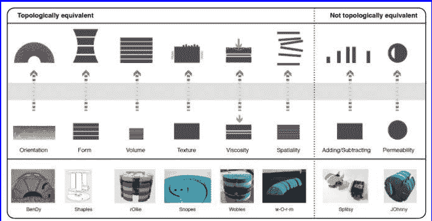

图 5.1 八种形状变化草图概述。

学生开发了大量的物理草图，说明了人类用户启动形状变化的不同方式，通常涉及物理世界的隐喻。其中一个例子“Ollie”使用了雪球的隐喻，将行为与体积变化事件映射起来。Ollie 在地板上滚动时体积增加，模拟了雪球像 5.2 节中那样生长和变大。要减小体积，用户拍打表面就像在敲击圆柱。虽然这种声音被用于支持性，但在其他情况下，设计者努力减少执行器节点。只有通过在设计过程中构建和嵌入组件，才能注意到并解决问题。


学生开发了大量的物理草图，说明了人类用户启动形状变化的不同方式，通常涉及物理世界的隐喻。其中一个例子“Ollie”使用了雪球的隐喻，将行为与体积变化事件映射起来。Ollie 在地板上滚动时体积增加，模拟了雪球像 5.2 节中那样生长和变大。要减小体积，用户拍打表面就像在敲击圆柱。虽然这种声音被用于支持性，但在其他情况下，设计者努力减少执行器节点。只有通过在设计过程中构建和嵌入组件，才能注意到并解决问题。

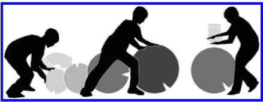

图 5.2 Ollie 玩具概念，说明了滚动增加和拍打减少体积的隐喻。

在第一门课程之后，我们提出了一个物理 [28] 设计空间，其中设计可以通过用户如何感知形状变化来描述。该模型在本章中进行了更详细的描述，根据可见或隐藏、虚拟或物理，以及感知的物理规律对运动的波动性或一致性对形状变化元素进行分类。我们为下一年设计了课程以探索这一概念。

### 5.3.2 光的形状变化

设计课程旨在探索光和形状变化接口，并探索“想象物理”的概念，以便创建一个根据某些输入或数据改变其形状的形状变化接口。学生被允许在设计工作中选择八种形状变化类型中的任意一种，并鼓励从研究角度突破边界，考虑参加 TEI 2014 画廊 [1] 的征稿收集，该征稿提出了问题：“我们如何整合触性的、具身的和嵌入式技术，以增强我们作为个人和社区的意识？”有两个小组提交了作品并被在 2014 年 TEI 画廊展示他们的作品（包括本章的另一个示例）。

Kinetic Wave [36] 是一种交互式形状变化装置，探索如何利用周围环境的输入创建抽象反应，通过空间形状变化来传递信息。

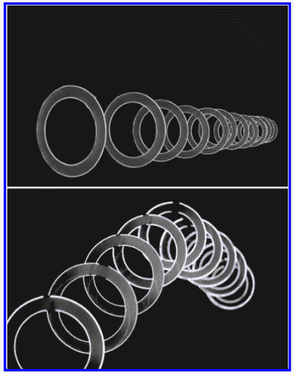

图 5.3 类似于波形的发光环，其振幅根据环境电磁信号发生变化。

该装置由 12 个磨砂亚克力环组成，内、外边缘带有电致发光线（见图 5.3）。这些环悬挂在一个共享平台上，每个环都连接到一个步进电机，用以控制垂直移动。环的组合运动类似于波浪，创造了不可见无线电的抽象视觉化效果。这让观众产生一种错觉，即不可见的无线电正在通过装置的物理可见区域传播，其中符号波的振幅取决于环境的无线活动强度。

对于用户来说，物理定律似乎并不适用于该装置。机械结构对观众是隐藏的，让他们去想象无线通信是如何影响整个装置的。由于机械结构（步进电机等）对用户隐藏的，装置的体验特性受到了影响，而步进电机加速/减速时神秘的声音又补充了这一点——这让用户能够想象背后的机械原理。特别明显的是，装置的光线给观察者留下了很大的想象空间，因为装置是在黑暗环境下展出的，所以人们很难看出光是如何扩散到亚克力环中的，光源来自哪里，也无法很快看出光从哪里供电。

Sensitive RolyPoly [12] 是该课程中另一件被选入画廊的作品。设计者提出，环境形状的变化活动将通过视觉化显示环境声音水平与人们建立联系。

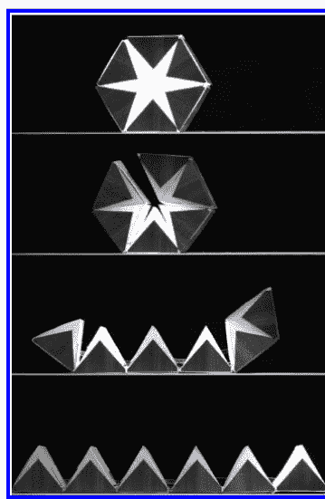

图 5.4 RolyPoly 的不同状态和变换（从上到下）：当环境噪声水平较高时，物体卷曲起来；但随着环境噪声降低，它会改变形状变为直线形式（底部）。

RolyPoly 可以卷曲形成六边形，或延伸成一条三角形线。这种变换通过动物形态特征吸引观众的注意力。然而，与自然特性相反，RolyPoly 的行为是反的，例如，如果环境具有高水平的噪声，它会完全展开，使三角形以防御姿态向上尖起（见图 5.4）。为了吸引注意力，每个齿状部分的灯光会闪烁。如果环境噪声水平较低，RolyPoly 将卷曲——同时，内部灯光开始脉动，源自“呼吸”的隐喻。

RolyPoly 作为一个环境显示或对周围噪声的提醒，利用动物形态行为来传达：通过尖利的齿缘传达混乱，或通过渐入渐出的弥散光传达更愉悦的六边形。与动力波（Kinetic Wave）示例不同，RolyPoly 以“存在”为焦点，使用了形状变化的一些表达性参数，表现出了旨在让人类产生情感共鸣的特征，如愤怒和快乐。

### 5.3.3 变形表面

除了较大的设计选择外，专门的研究小组还关注研究用户如何感知形状变化界面的动力参数。我们将简要描述这项工作的示例，学生们设计并构建了功能性原型，以支持用户对基于像素和均匀形状变化表面交互的评估。

两名硕士研究生研究了用户如何感知形状变化界面的交互、运动和实用性，并通过简单的评估²对原型进行了评价。

该研究是在支持并驱动上方手机的功能性原型表面上进行的。系统是基于像素的，控制台由开关、滑块和旋钮组成，使学生参与者能够对交互灵敏度、速度和驱动模式进行调整。另一个原型呈现了一个带有覆盖膜的均匀表面，该薄膜隐藏了驱动机械结构，以便参与者进行比较。

基于像素的原型由 100 个瓦片组成，其中 32 个被驱动，但保留作为视觉线索暗示高分辨率区域。这 32 个瓦片放置在 8x4 的网格中，每行 4 个瓦片相互连接。每行都可以在原型表面下方 4 cm 处和上方 5 cm 处动作，总计线性行程为 9 cm。

评估是在公共环境中进行的，邀请路人参与一个基于像素原型的预定义用例。这作为一种方法，通过与智能手机以及作为实验环境感应充电平台的表面进行交互，来测试用户如何感知和理解形状变化界面。原型展示了手机如何放在表面上充电的愿景，而形状变化表面将根据手机的电量进行驱动。如果手机使用电池供电，它将沉到桌面基准线以下，并随着缓慢充电向上移动，直到充满电并与表面对齐（见图 5.5 - 中间），让用户轻松拿起。

> ² 这项工作由 Stefan Sloth Kristensen 和 Kennet Jeppesen 在 Marianne Graves Petersen 和 Tim Merritt 的指导下于 2013-2014 年间完成。

该实验旨在回答关于用户和形状变化表面的三个问题。首先，检查用户对与此类界面交互的反应。其次，检查用户对变换参数（速度、非重复/重复）以及这些美学特性的表面驱动的理解。第三，调查设计者如何设计输入与输出之间有意义的关联，以及用户与形状变化表面之间的意义交互。

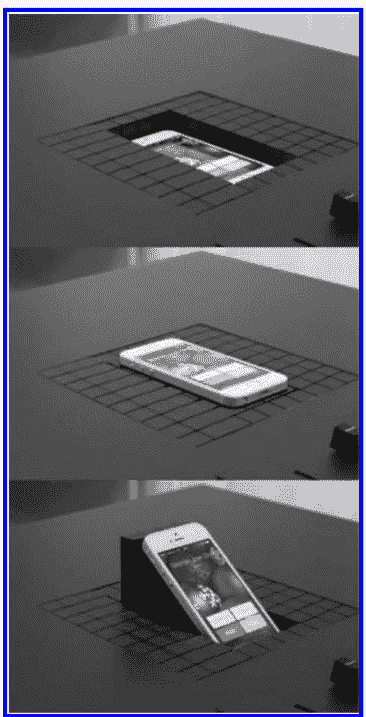

图 5.5 基于像素表面通过形状变化支持与手机的交互。

基于像素的表面可以通过伸手来访问，从而触发驱动，将手机举向用户的掌心（见图 5.5 - 底部）。

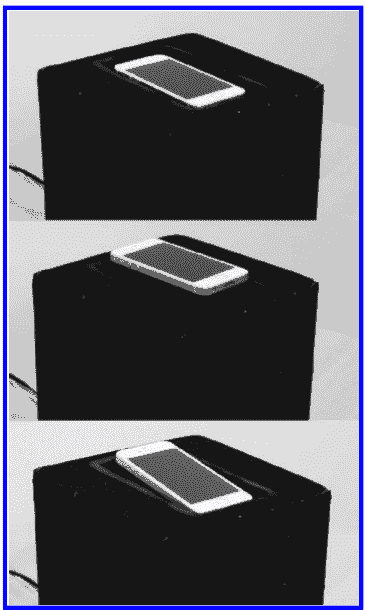

图 5.6 在表面下方驱动（顶部）、在表面上方驱动（中部）以及驱动至倾斜位置（底部）的同质形状变化表面原型。

算法的行为可能是出人意料、不可预测，甚至可能被视为魔法。概念草图让设计者能够尝试将不同的传统物理映射到行为映射、输入模式和转换中，并超越传统物理，进入一个具有其他规则的想象世界。由于缺乏更贴切的词，我们将这种现象称为“想象物理”。

将想象物理引入现实会产生新的体验，这些体验最初是基于真实物理的隐喻的。例如，滚动“卷卷（rollie）”就像滚雪球一样会导致体积增长，而用于减小卷卷尺寸的拍打动作既不基于熟悉的物理学，也不与雪和雪球的物理属性有联系。然而，这与 [2] 中讨论的物理和虚拟元素非常相似，即玩具鸭子跟随用户的手并保持恒定距离，引导用户想象出一条无形的牵引绳。在卷卷的草图中，交互并非完全建立在我们对现实物理的经验之上，拍打减小尺寸的交互看似合理且易于理解，但用户必须填补材料中未显示的内容。

# 想象物理：探索形状变化界面的示例 ■ 101

想象物理可以从形状和自然中的隐喻中借鉴。在类动物化（zoomomorphic）示例中，孩子被邀请学习对象的“性格”：虫子利用了看起来像眼睛的传感器，其避开靠近的手的行为给人一种正在管理其个人空间的印象。这种设计中因果关系的联系是相当微妙的，通过生物的线索来暗示。当我们远离这些线索，并理解如何将用户输入/动作映射到形状变化时，我们发现了一些例子，例如Shaples 会根据手持的粗糙程度在两种状态之间切换。就像写字画板（Etcha Sketch）在允许绘画的同时隐藏沙子一样，孩子会很快学会与产品进行交互，尽管物理原理并没有被显式地信号。对于某些草图，真实物理以物理物体无法模仿的方式被操纵和管理。例如，Wobles 引入了对象的“程序化”粘度，这种情况映射了硬度的粗糙度，然而 Wobles 并未使用“真实”物理，这种联系可以绑定任何输入。

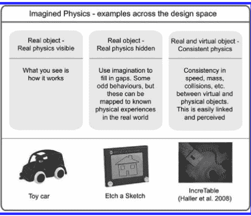

图 5.7 想象物理设计空间中的三个示例。

作为解释这一概念的初步步骤，我们提供了图 5.7 所示的三个明显不同的示例。第一个示例玩具汽车包含完全物理的部件，其运动受可见、一致且易于理解的物理规律支配。我们可以很容易地想象轮子固定在车身上并绕轴旋转。然而，当我们考虑写字画板（Etch a Sketch）时，它仅涉及物理元素，但连接旋钮旋转与屏幕上出现的绘画之间的机械原理是隐藏的。通过使用，操作者建立了一个心理模型，将运动映射到不断展开的绘画：左旋钮始终垂直移动光标，右旋钮始终水平移动光标。

在 IncreTables [22] 系统示例中，物理和虚拟对象的混合构建了这种体验。在系统中，桌面表面增强了传感以连接虚拟和现实世界的事件。桌面表面呈现为一个带有虚拟多骨牌的虚拟景观。在桌子上，物理多骨牌被排列成与虚拟多骨牌连接的模式。系统支持遵循虚拟和现实世界的骨牌连倒——因此在游戏体验中，虚拟多骨牌可以撞倒真实的多骨牌。在系统中，设计者选择让控制运动的物理在虚拟世界和物理世界看起来尽可能一致。然而，由于运动本质上是连接的，引入了挑战参与者预期的行为。

虚拟对象的速度可以调整，超越了物理物体的限制，碰撞可以是随机的，或者多骨牌的连倒行为可以以各种方式变得反复幻测。可能通过虚拟元素，形状变化界面包含了设计上不可预测的元素，并包括似乎在没有因果关系的情况下发生行为，这在没有完全融合的情况下将需要想象力。

退后一步看，这些对象的范围可以放置在图 5.8 所示的三维设计空间中，轴描述了材料和交互特征：物理/虚拟、易变/一致以及隐藏。对象在 IncreTables [22] 中可能涉及物理或虚拟元素，或两者的结合。物理规则可以是一致且可预测的，也可以是易变的（随机变化）。第三维度涉及因果关系，物理规则可以展示给用户并通过形式元素变得可见（如自行车链条和链轮），它们也可以被“黑箱”技术隐藏，隐藏物理行为的机械原理。

根据这些图表对交互系统进行更深入的分析可能会导致模型的改进——我们希望这种未来能启发形状变化对象的设计。例如，考虑一个主要以物理为主、具有可见机械实现形状变化但在行为上是易变的物体可能是困难的。创造地，如果根据设计者对可编程物质的愿景来制造，可以这样一个系统。

想象物理的概念非常有趣，因为它涉足 HCI

# 想象物理：探索形状变化界面的示例 ■ 103

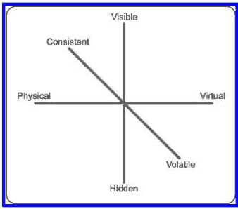

图 5.8 作为三维空间的想象物理设计空间。

领域，可能与预期的形式语言和界面功能产生冲突或不一致。对于嵌入了“想象物理”的对象，尚不清楚用户会继续探索并发现其行为与形状变化对象行为之间新联系多久，除非在某些时间给出暗示。在游戏设计中，例如，外壳上的体验时间长度，但在游戏中，沿途中经常实现明确的目标以指示进度，帮助用户参与游戏的探索。在超文本研究中，研究表明用户会探索一段时间，但很快会将注意力转向“获取故事大意”[23]。在研究中，用户面临障碍以及计算机系统控制的意料之外的故事。起初，用户探索并寻找变化；然而，他们很快转向理解所有用户共享的故事。考虑到根据可能改变且不遵循“真实”物理的映射设计的趣味形状变化对象，未来有趣的工作是评估用户是想要持续且惊喜的物理效果，还是他们努力建立对对象的通用理解，以及当这种对运作方式的理解被变化破坏时，用户的容忍度如何，或者这会更吸引他们？

# 104 认知机器人

最常见的限制包括执行器的尺寸、重量、安装要求、效率、功耗、材料组成、控制特性等。研究不断取得进展，显示在提高运动流畅性和降低执行器噪声方面取得了改进 [47]，然而，为了本章的目的，我们参考了现有常用执行器所涉及的运动和其他美学特性。通过对我们课程中设计师的观察和反馈，我们收集了关于典型执行器涉及的一些副作用，包括对声音、热量和运动质量的考量。这一贡献并不是详尽的，但我们希望它能促进关于执行器的讨论，以支持设计意图，并将这些副作用视为一种可以拥抱的资源。

我们在 [28] 中讨论过这一点，但我们不仅提供了他们的技术见解，并邀请设计师考虑他们对执行器的选择，还要寻找通过挖掘潜在潜力来设计执行器的使用方法。例如，关注心理声学的工业设计师研究了与车门、电车电机噪音相关的声音感知，以及这些声音如何引发情感和感官联觉 [8, 34]。

这张表格非常简短，提炼了设计师在本章之前介绍的工作以及我们课程其他项目中面临面临的一些挑战。当设计师在选择执行器时，识别所选技术可能面临的挑战，以及在需要特定效果时通过内在特性寻找可能满足需求的执行器，这将是很有用的。我们简要描述了一个与项目相关的设计问题示例，这有助于构建这张表格。

“动力波”（The Kinetic Wave）利用步进电机通过卷轴上缠绕和释放线条来升降单个圆环。设计师选择步进电机是因为它能够支持与12个环协调的平滑且精确的运动，然而他们在处理电机运动的噪音时非常小心。在某些频率下，随着速度的增加，存在某些“频段”，共振频率会导致噪声放大，从而在艺术品的框架内产生嗡嗡声。设计师使用了橡胶衬套来减轻噪声影响，但他们精心设计了环的控制曲线以最大限度地减少噪声。他们确实尝试过控制步进电机以在速度和产生的声音之间取得平衡，从而通过声音特性来驱动光影和运动。项目中面临的其他挑战涉及连接步进电机与卷轴的连杆和关节。设计师使用了激光切割零件，原则上应该是非常精确的，但不同材料（木材、亚克力、中板）的切割导致材料消耗量不同。尽管差异很小，但这些细微差别引入了明显的摇晃，在卷轴旋转时会产生二次运动。设计师必须仔细工作，通过卷轴设计和切割过程的额外迭代来尽可能地减少这种现象。

| 执行器 | 运动类型 | 响应时间 | 平滑度 | 声音 | 集成问题 |
| --- | --- | --- | --- | --- | --- |
| 直流伺服电机 | 旋转 | 快 | 取决组件质量 | 齿轮噪声 | 连杆、热 |
| SMA 伺服器 | 旋转 | 中等 | 平滑 | 静音 | 大电流 |
| SMA 线记忆 | 收缩 / 训练形状 | 激活返回快 | 平滑 | 静音 | 热量、大电流、速度慢 |
| 步进电机 | 旋转 | 快 | 低速平滑 | 嗡嗡共振 | 连杆、速度、抖动 |
| 线性执行器 | 线性 | 快 | 平滑 | 柔和的电机声 | 连杆、速度、负载 |
| 电磁铁 | 线性、旋转 | 快 | 瞬时运动硬停止 | 咔哒声 | 热、大电流、突然 |
| 真空（颗粒阻塞） | 流体 | 少于几秒内 | 平滑 | 泵噪声 | 设备尺寸 |
| 气压 | 流体 | 少于几秒内 | 平滑 | 泵噪声 | 设备尺寸 |
| 风扇 | 流体 | 中等 | 平滑 | 风噪 | 空气控制 |

表 5.1 典型执行器的设计考量。

## 5.6 未来工作

我们简要回顾了许多形状变化接口的示例，并注意到了影响物体感知和交互体验的美学特性。日益复杂的先进材料正在开发中，计算能力也被嵌入了我们周围的材料中 [17]。设计师正在寻找方法，使他们引入世界的物体形式特征通过对模拟材料的探索 [27] 以及智能环境交互，在情感和感知上与人类建立联系。

考虑并探索对于人们与机器人共享意义有效且理想的隐喻非常重要。一个显而易见的下一步是通过实际使用形状变化器物来进行用户体验研究，以指导未来的改进。还有许多需要的工作，我们设想可以包括多种方法的混合。应该继续遵循研究设计方法 [49, 11]，识别可能有助于形状变化的新语境，界定要解决的问题和机会，探索材料，并分享过程结果，让其他人从挑战中学习，并从设计师创意飞跃的详细描述中汲取灵感。近期有很多形状变化研究的案例，从手机到较大的物体和环境，通常伴随着短期评估或初步印象。设计研究人员将这些技术嵌入使用语境也同样重要，这样我们就可以学习人们如何适当地使用

在认知机器人和交互设计方面，最近的论文关注到了日益复杂的物体和环境的起，在这些环境中表面没有清晰划分的区域，也没有明确定义的按键。超越物体和生物，他们提出了交互的“场”，人类居住在具有交互力和可能性的空间内 [18]。这些复杂的实体与环境的混合体如何共享信息、建立记忆、从过去中学习？机器人如何通过形状变化产生更有意义的体验，以支持这种环境中的人类？

## 5.7 致谢

我们感谢奥胡斯大学（Aarhus University）的所有 IT 产品开发学生，感谢他们的慷慨贡献以及分享的设计细节。

## 5.8 参考文献

- [1] Tei 2014. 艺术轨道投稿 - TEI 2014, 德国慕尼黑。
- [2] Edith K. Ackermann. 会玩的玩具。2005 年交互设计会议论文 (IDC '05), 第 1-8 页, 纽约，美国, 2005。
- [3] Tobias Alree, Jonas Grimm, Erik Grönvall, Marianne Graves 和 Jesper L. Rasmussen. 空中调：探索交互。第 7 北欧交互会议 (NordCHI'12), 第 514-523 页, 纽约，美国, 2012。
- [4] Kieran Ferris 和 Liam Bamon. “一堆旧的 Bouxold!”。2008 年计算机娱乐进展国际会议 (AC '08), 第 389-392 页, 纽约，美国, 2008。
- [5] Bill Buxton. 草绘用户体验：获得正确的设计（交互式技术）。Morgan Kaufmann, 第 1 版，旧金山, 2007。
- [6] Marcelo Coelho 和 Pattie Maas. 百叶窗：用于环境控制和通信的渗透表面。第 3 届实体与嵌入交互会议 (TEL '09), 第 13-18 页, 纽约，美国, 2009。
- [7] Marcelo Coelho 和 Jane Ziegel. 形状变化接口。Per Ubiquitous Comput., 15(2):161–173, 2011年2月。
- [8] Hugo Fastl. 心理声学与声音质量。声学，第 139-162 页。Springer, 柏林, 2005。


- [9] 交互系统。第 4 届设计交互系统会议：过程、方法和技术 (DIS '02), 第 41-49 页, 纽约，美国, 2002。

- [10] Sean Foerman, Daniel Leinster, Alex Olival, Nadia Cheng 和 Hiroshi Ishii. 阻塞用户界面：用于变形和形状变化设备的可编程部分刚度和传感。第 25 届 ACM 用户界面软件和技术年会 (UIST '12), 第 519-528 页, 纽约，美国, 2012。

- [11] Christopher Frayling. 艺术与设计研究。皇家艺术学院, 1993。

## 108 认知机器人

[12] Johanna Fulda, Pieter Tierens, Teemu Mäntyharju, and Thomas Wimmer. 产生的用户冲动：Poly 的敏感角色。In Proceedings of the 8th International Conference on Tangible, Embedded and Embodied Interaction, TEI '14, pages 345–347, New York, NY, USA, 2013. ACM.

[13] Erik Grünsof, Sophie Koch, Marianne Graves Petersen, and Majken K. Rasmussen. 用形状变化的视界引起骚动：在使用体验形状变化的界面。In Proceedings of the SIGCHI Conference on Human Factors in Computing Systems, CHI '14, pages 2559–2568, New York, NY, USA, 2014. ACM.

[14] Chris Harrison and Scott E. Hudson. 在视觉显示器上提供动态物理按钮。In Proceedings of the SIGCHI Conference on Human Factors in Computing Systems, CHI '09, pages 299–308, New York, NY, USA, 2009. ACM.

[15] Fabian Hermann, Susanna Haman, Matthias Lowe, Josephine Zeineft, and Gechte Joost. 形状变化的手机：手机中二维变形显示的收窄。In CHI '10 Extended Abstracts on Human Factors in Computing Systems, CHI EA '10, pages 3075–3080, New York, NY, USA, 2010. ACM.

[16] Fabian Hermann, Matthias Lowe, Anna Wohlauf, and Gechte Joost. 匿名手机：作为近距离反应性姿态与手机关系交互的手段。In Proceedings of the 7th International Conference on Tangible, Embedded and Embodied Interaction, TEI '13, pages 267–270, New York, NY, USA, 2013. ACM.

[17] Hiroshi Ishii, David Lakatos, Leonardo Bonanni, and Jean-Baptiste Labrine. 激进原子：超越实体束缚，迈向变形材料。interactions, 19(1):38–51, January 2012.

[18] Lars-Erik Janler and Erik Stolterman. 无脸交互 - 对界面注意的概念检查：过去、现在与未来。Human Computer Interaction, 0(ja):null, 2014.

[19] Yichiro Katsumoto, Satoru Tokushisa, and Masa Inagake. 新轨道：形状和柔韧性电子玩具变量设计。In Proceedings of the 7th International Conference on Tangible, Embedded and Embodied Interaction, TEI '13, pages 17–22, New York, NY, USA, 2013. ACM.

[20] Hyunjung Kim. 为日常物体和环境设计动学表面。In Proceedings of the Fourth International Conference on Tangible, Embedded and Embodied Interaction, TEI '10, pages 301–302, New York, NY, USA, 2010. ACM.

[21] Naoya Koizumi, Kentaro Yasu, Angela Liu, Maki Sugimoto, and Masahiko Inami. 动画纸：构建玩具的工具包。Comput. Entertain., 8(2), December 2010。

## 想象物理学：探索形状变化界面的示例 ■ 109

[22] Jakob Leitner, Michael Haller, Kyungdahm Yun, Woontack Woo, Maki Sugimoto, and Masahiko Inami. IncreTable，一种混合现实桌面游戏体验。In Proceedings of the 2008 International Conference on Advances in Computer Entertainment Technology, ACE '08, pages 9–16, New York, NY, USA, 2008. ACM.

[23] Alex Mitchell and Kevin McGee. 过程化交互故事中可读性的局限。In Proceedings of the SIGCHI Conference on Human Factors in Computing Systems, CHI '11, pages 1939–1948, New York, NY, USA, 2011.

[24] Jules Moloney. 艺术与建筑之间：交互皮肤。In Information Visualization, 2006, IV 2006, Tenth International Conference on, pages 681–686.

[25] Ditte Hva Mortensen, Sam Hepworth, Kirstine Berg, and Marie-Anne Petersen. “你在一起”：与表面产品交流状态和偏好。In CHI '12 Extended Abstracts on Human Factors in Computing Systems, CHI EA '12, pages 61–70, New York, NY, USA, 2012. ACM.

[26] Bilge Mutlu, Fumitaka Yamaoka, Takayuki Kondo, Hiroshi Ishiguro, and Norhiro Hagi. 机器人的非语言泄露：通过无意行为交流。In Proceedings of the 4th ACM/IEEE International Conference on Human Interaction, HRI '09, pages 69–76, New York, NY, USA, 2009.

[27] Kristina Niederer. 探索弹性运动作为设计的设计的表达媒介。International Journal of Design, 6(3):57–69, 2012.

[28] Mie Nørgaard, Tom Merritt, Majken Rasmussen, and Marianne G. Petersen. 形状变化物体的设计空间：想象物理学。In Proceedings of 6th International Conference on Designing Pleasurable Products and Interfaces, DPPL '13, pages 251–260, New York, NY, USA, 2013.

[29] Ka Oosteruis and Nimish Biloria. 与主动结构交互：肌肉。Common. 51(6):70–78, 2008.

[30] Leonhard Opschuetz, Daniel Wesselek, and Wolfgang Salazar. 用运动构建：运动学。In Proceedings of the Fourth International Conference on Tangible, Embedded, and Embodied Interaction, TEI '10, pages 257–260, New York, NY, USA, 2010. ACM.

[31] Amanda Parkes and Hiroshi Ishii. Bosu：用于软性机械变形的可编程设计工具。In Proceedings of the 8th ACM Conference on Designing Interactive Systems, DIS '10, pages 189–198, New York, NY, USA, 2010. ACM.

[32] Amanda Parkes, Ivan Poupyrev, and Hiroshi Ishii. 为有机界面设计动学交互。Commun. 51(6):58–65, 2008.

[33] Amanda Jane Parkes. 动学的语句：动态物理性作为设计的一个维度。PhD thesis, Massachusetts Institute of Technology, 2009.

[34] Christine Patsouras, Hugo Fast, Ulrich Widmann, and Georg Hölzl. 针对高铁音质的音调成分声学评估。Acoustic Science and Technology, 23(2):113–116, 2002.

[35] Esben W. Pedersen, Sriram Subramaniani, and Kasper Hornbæk. 我的手机活着吗？手持设备形状变化的大规模研究。In Proceedings of the 32nd Annual ACM Conference on Human Factors in Computing Systems, CHI '14, 2579–2588, New York, NY, USA, 2014.

[36] Søren Pedersen, Michael Ha, Christian Ø Laursen, and Anders Høholdt. 动学波：提高电磁频谱意识。In Proceedings of the 8th International Conference on Tangible, and Embodied Interaction, TEI '14, pages 337–338, New York, NY, USA, 2013. ACM.

[37] Ivan Poupyrev, Tatsuhi Nashida, and Makoto Okabe. 驱动与实体界面：福康鸭、机器人和形状显示。In Proceedings of the 1st International Conference on Tangible and Embodied Interaction, TEI '07, pages 205–212, New York, USA, 2007.

[38] Kathrin Prost, Thomas Seifert, Michael Haller, Kentaro Yasu, Maki Sugimoto, and Masahiko Inami. Move-it：由形状记忆合金标注的交互便签。In CHI '11 'Extended Abstracts on Human Factors in Computing Systems, CHI EA '11, pages 1393–1398, New York, USA, 2011.

[39] Hayes S. Raffle, Amanda J. Parkes, and Hiroshi Ishii. Tobopo：具有动学记忆的交互式组装系统。In Proceedings of the SIGCHI Conference on Human Factors in Computing Systems, CHI '04, pages 647–654, New York, NY, USA, 2004. ACM.

[40] Majken K. Rasmussen, Esben W. Pedersen, Marianne G. Petersen, and Kasper Hornbaek. 形状变化界面：设计空间和开放性问题的回顾。In Proceedings of the SIGCHI Conference on Human Factors in Computing Systems, CHI '12, pages 735–744, New York, NY, USA, 2012. ACM.

[41] Susan Seinger, Elisabeth Sylvan, Oren Zuckerman, Marko Popovic, and Orit Zuckerman. 数字化的游场？In CHI '06 Extended Abstracts on Human Factors in Computing Systems, CHI EA '06, pages 303–308, New York, NY, USA, 2006.

[42] Janien Sturm, Tilde Bekker, Rik Wesselink, and Berry Egg. 成功交互游场设计的关键。In Proceedings of the 7th International Conference on Interaction Design and Children, IDC '08, pages 258–265, New York, NY, USA, 2008. ACM.

[43] Yuta Sugihara, Calista Lee, Masayasu Ogata, Anusha Withana, Takashi Makino, Daisuke Sakamoto, Masahiko Inami, and Takeo Igarashi. PINOKY：让毛绒玩具动起来的环。In Proceedings of the SIGCHI Conference on Human Factors in Computing Systems, CHI '12, pages 725–734, New York, NY, USA, 2012.

[44] Gideon Timm, René Van Berg, Tilde Bekker, and MJ de Graaf. 开放式游场设计指南。In Proceedings of digital research association (DIGRA). Utrecht, Netherlands, pages 1–17, 2021.

[45] Anna Vallgaarda. 衣帽：响应空间与具身交互。In Proceedings of the 8th Nordic Conference on Human-Computer Interaction: Fun. Fast. Fundamental. NordicCHI '14, pages 618–627, New York, NY, USA, 2014. ACM.

[46] Anna Vallgaarda and John Redström. 计算复合材料。In Proceedings of the SIGCHI Conference on Human Factors in Computing Systems, CHI '07, pages 513–522, New York, NY, USA, 2007. ACM.

[47] John P Whitney, Matthew F Glisson, Eric L Blockmeyer, and Jessica K Hodgins. 一种低摩擦流体传输和流体张力软执行器, pages 2801–2808, Chicago, 2014.

[48] Jamie Siegelbaum, Angela Chang, James Gouldstone, Joshua J. Monzen, and Hiroshi Ishii. SketchComplexity：BABL 与形状设计。In Proceedings of the 2nd International Conference on Tangible and Embedded Interaction. TEI '08, pages 145–146, New York, NY, USA, 2008. ACM.

[49] John Zimmerman, Jodi Forlizzi, and Shelley Evenson. 通过设计的研究作为 HCI交互设计研究的方法。In Proceedings of the SIGCHI Conference on Human Factors in Computing Systems, CHI '07, pages 493–502, New York, NY, USA, 2007. ACM.

# V

## 认知机器人的文化与社会方面

## 文化背景和社会角色对人机交互的影响

Pei-Luen Patrick Rau

清华大学工业工程系，

中国。

陈 娜

清华大学工业工程系，

中国。

# 目录

- 6.1 引言 ................................. 116
- 6.2 文化背景的影响 ... 116
- 6.2.1 影响人机交互的因素 .... 116


- 6.2.2 文化背景对决策的影响 .... 117

- 6.3 机器人社会角色的影响：自主水平与群体取向 ............................ 119

- 6.3.1 社交机器人 ............................................ 119

- 6.3.2 机器人的自主水平 ............................ 119

- 6.3.3 群体取向 ....................................... 120

- 6.3.4 机器人社会角色对决策的影响 .... 121

- 6.4 未来工作 ................................................... 123

- 6.5 参考文献 ................................................... 124

## 6.1 引言

近年来，机器人技术已从很大程度上工业领域扩展到医疗保健、社会服务、航空航等等领域。机器人的角色正在从传统的监督、劳动力短缺和危险工作解决方案，转变为用户日常生活的重要部分——社交机器人。机器人提供家庭清洁、托儿等生活服务，以及决策支持。先前的研究表明，参与者在与类人机器人交互时会表现出社交行为[4]。Tms开发的购物机器人在人类的位置工作，根据在市场中收集的信息进行购买[10]。iRobot 作为最著名的机器人公司之一，到2013年已售出超过100万台机器人。

近期关于人机交互（HRI）的研究揭示了机器人设计因素对人类决策的影响。这些因素包括机器人的物理特征（如外观、尺寸、类人化或机械化等）、信息交互方法（如手势、视觉、语言等）、训练策略（如展示与教学、编程等）、机器人用户团队的结构（如合作者、竞争者、操作者的用户）、任务设计等。关于交互环境、交互任务、机器人属性以及用户的背景和经验的影响应该有更多研究[23]。本章回顾了关于以下方面的人机交互研究：文化背景、机器人的社会角色及其对人类决策的影响。并讨论了跨文化人机交互和决策领域的未来工作方向。

## 6.2 文化背景的影响

### 6.2.1 影响人机交互的因素

人机交互研究中应该考虑机器人的四个因素，即与人类相关的因素、与机器人相关的因素、任务相关的因素与背景相关的因素。

与机器人相关的因素包括形式和外观、行为、学习能力、特征、情感、交流方法、实验期间出现的情况以及目的[9]。当机器人进行建模时，与机器人相关的因素还包括性别、国籍和面部特征。机器人的外观也会影响人类的感知[7, 11, 14, 27]，包括人类如何假设机器人的能力、如何与机器人互动以及对机器人的判断。森政弘（Mashiro Mori）提出了著名的模型——恐怖谷[38]。森指出，当机器人的外观变得更具类人化时，参与者对机器人的反应会更加积极。当相似性增加并达到某一点时，反应会迅速变成强烈的排斥。然而，随着机器人外观继续变得更具类人化，参与者的反应会再次变得积极，并最终接近人与人之间的共情水平。

机器在实验期间是否出现的因素对人类感知有显著影响[16]，包括人类如何判断机器人的利他性以及对机器人的信任。之前的研究人员认为，当机器人出现在现场时，参与者对机器人表现出更高的信任，并认为机器人更利他。与计算机创建的动画角色相比，机器人具有更多的社交属性，更加真实，并且能与人类共享空间。一些研究人员认为，机器人的行为影响人机之间的交互。人类之间的眼神交流和机器人的追踪[38]以及人机协作行为将提高人类对机器人的评价。机器人的心理模型被认为受到机器人来源和语言的影响[19]。

根据 Lee、Park 和 Song 的研究，机器人的自我发展能力影响参与者的认知，特别是对机器人社交属性的区分[18]。虽然在实验中简化了学习过程，但它确实提出了一个关于如何设计机器人能力的新观点。未来的机器人将能够随着时间的推移而自我发展，以便更好地适应环境。

与之相关的因素包括参与者的性别、年龄、特征、与机器人交互的经验以及机器人知识[24-26, 31, 37]。文化差异也会影响人类对机器人的认知、评价以及对机器人的行为。根据对六国（如荷兰、中国、德国、墨西哥、美国和日本）进行的实验结果，美国参与者的负面情绪最少；日本参与者的负面情绪最多。此外，与机器人的交互经验被认为具有积极影响。

### 6.2.2 文化背景对决策的影响

2007年，Rau 及其团队进行了一项研究，调查参与者的文化背景（人类因素）、机器人外观（机器人相关因素）和机器人任务（任务相关因素）对交互的影响。自变量包括三个水平（中国、韩国和德国）以及机器人外观（动物化、类人化和机械化），这些是被试间变量。机器人任务的自变量包括四个水平（教学、引导、娱乐和安全），这些是被试内变量。结果包括两个方面——偏好（喜喜爱）和交互表现（参与度和满意度）。

在实验期间，参与者被要求用母语与机器人交流并完成某些任务。教学任务包括英语教学。引导任务中，机器人引导参与者参观建筑。娱乐任务包括安全措施。参与者不自己操作机器人。参与者与机器人之间的交互包括口语和行为交互。对于类人机器人，行为包括摇头、举手和移动腿部。对于机械机器人，行为包括通过轮子旋转前后移动。对于动物化机器人，行为包括点头。所有类型机器人的动作都是通过乐高 Mindstorms NXT 平台设计的。实验共招募了 108 名参与者，其中分别来自中国、韩国和德国文化的 36 名参与者。根据结果，中国和韩国参与者的喜爱度、参与度和满意度高于德国参与者。当交互主要依赖于口头交流而非肢体语言和环境支持时，机器人对中国和德国参与者的建议参与度低于韩国参与者。

## 文化背景和社交角色对人机交互（HRI）的影响 119

## 6.3 机器人社交角色的影响：自主性水平与群体取向

### 6.3.1 社会机器人

机器人技术的快速发展导致机器人应用的不断扩展。随着服务机器人的普及，越来越多的机器人出现在公共服务和家庭支持场景中。服务机器人通常分为两种：工具型机器人和社交机器人 [33]。工具型机器人比工业机器人更有优势，能为人类提供便利的生活。例如，iRobot生产的 Roomba 扫地机器人可以清理房间 [13]；松下生产的机器人可以运送食物、药品、文件、仪器甚至病人 [1]。根据功能需求，工具型机器人通常以机械化的方式设计。工具型机器人的界面采用最有效、直接的方法接收和传输信息。这类机器人不会提供反馈。

社交机器人是机器人的一种新应用。与用户近距离交互是这类机器人的主要目的之一。与服务机器人等工具型机器人相比，社交机器人具有更高的自主性和交流性，更多地用于娱乐、教育、医疗、研发以及公共场所 [2]。

在与他人交流时，用户会自然地表现出社交行为，例如用自然语言交流、通过肢体语言传递信息、维持人际距离等。之前的研究表明，当与具有足够智能和复杂性且能代表现实世界的人造物体进行交流时，用户也会表现出社交行为。例如，观察者认为电视上的角色或计算机生成的虚拟人物具有社交属性，他们会与他们进行社交行为 [30]。当社交机器人拥有社交属性时，它们会鼓励用户与其进行社交行为以实现社交交互。

### 6.3.2 机器人的自主性水平

机器人的自主性是一个主要的设计因素，它会影响用户的参与度、心理负载、对交互对象的心理认知等。在评估机器人自主性的各种标准中，自主性水平是以人为中心的设计中常用的标准。自主性水平描述了机器人根据既定程序或模式行动的程度 [23]。Sheridan 和 Verplank [32] 开发了一个量表，用于明确比较人类与机器人决策的不同混合模式。该量表包含十个自主性水平，从人类操作员完成一切的最低水平到机器人完成一切的水平不等。这十个水平描述如下（我们将原书中的“计算机”替换为“机器人”）：

- 1) 人类完成一切，直到将其交给机器人执行的程度；

- 2) 机器人帮助确定选项；

- 3) 机器人帮助确定选项并提出建议，人类不必遵循；

- 4) 机器人选择动作，人类可能执行也可能不；

- 5) 机器人选择动作，如果人类批准则执行；

- 6) 机器人选择动作但通知人类，留有充足的时间停止；

- 7) 机器人完成整个工作并必须告诉人类它做了什么；

- 8) 机器人完成整个工作，并在人类明确要求时告诉人类它做了什么；

- 9) 机器人完成整个工作，如果它认为应该告知人类，则告知人类它做了什么；

- 10) 如果机器人认为应该执行，则完成整个工作，如果它认为应该告知人类，则告知人类。

麻省理工学院 Siegel [33] 的研究为机器人自主性对其说服能力的影响提供了一些支持。在他们的实验中，参与者被要求相信机器人正与 1) 全自主水平的机器人或 2) 由实验人员远程的机器人机器人。实验期间，机器人试图说服参与者为其捐赠更多钱。结果显示，与被认为没有自主性（由实验人员远程控制）的机器人合作时，参与者认为全自主水平的机器人更可靠，同时他们表现出更高的参与度，而男性参与者对自主机器人的评分较低。

由于目前社交机器人的应用，实验中有两种机器人控制方法——由操作员控制或通过预编程方法。对于这两种控制方法，让参与者完全接触控制机制并不常见。在现实应用中，很难控制参与者如何感知机器人的自主水平。机器人自主水平的感知很大程度上取决于参与者的背景、机器人经验以及知识水平。

### 6.3.3 群体取向

群体取向包括内群体取向和外群体取向。Triandus 及其同事 [36] 定义了通常所说的内群体关系——即人们必须维持的关系。更具体地说，人们关心内群体成员的福利，努力与内群体成员合作且不要求对等回报。另一方面，外群体关系被定义为人们不需要维持的关系——人们不关心外群体成员的福利，并在与外群体成员合作时要求对等的回报 [12]。

研究表明，相同的群体取向可以改善内群体成员的合作，这种合作意愿源于内群体偏和对内群体成员的积极评价 [3, 5, 17]。即使群体中的某些让他们感到不舒服，人们也不会离开群体。

研究人员针对该因素开发了两个处理水平。在实验组中，参与者与机器人建立了内群体关系；而在对照组中，参与者与机器人没有建立内群体关系。实验后问卷中，实验组和对照组之间对内群体机器人关系的认知没有显著差异。

另一个人机交互（HRI）实验也没有发现与内群体机器人的关系存在任何差异 [39]。在该实验中，使用不同颜色的标记来区分内外群体关系。当参与者与机器人交互时，不同颜色设置之间没有显著差异。但在参与者与人类交互时，发现了显著差异。

另一项实验表明，当参与者将机器人视为内群体成员时，他们会认为机器人可靠且值得信赖，并更容易接受机器人的建议 [44]。该实验结果显示，人机交互群体中存在内群体偏差。但注意的是，建立人机交互群体的方法可能与人类之间建立群体的方法不同。

Terry 和 Hogg [34] 的研究进一步指出，如果通过随机分组，对群体有更强归属感的参与者更容易受到其他内群体成员的影响。

### 6.3.4 机器人社交角色对决策的影响

基于上述 2007 年的价格猜测实验，Rau 的团队改进了实验任务，以调查社交机器人社交角色（自主性水平和群体取向）对人机交互的影响 [23, 29]。使用了定量心理问卷和定性观察来记录参与者的反馈。此外，参与者的性别、

# 122 认知机器人

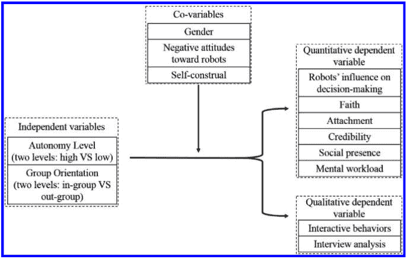

图 6.1 Rau在2010年HRI实验中机器人社会角色的研究框架。

自我建构、对机器人的负面态度以及初始决策准确性被选为协变量。机器人对参与者决策、信仰、依恋、信誉、社会存在感、心理负载和交互行为的影响被选为自变量。

在选择实验任务时，应考虑三个方面：1) 任务应当是合作性任务，要求参与者和机器人共同决策；2) 任务应该反映现实世界；3) 实验应该在当前的实验平台上容易实现。合作任务确保了参与者在决策和行动能力上不具有绝对优势，否则限制机器人执行任务的能力。参与者和机器人都具有独立的决策和行动能力。在现实生活中，社会机器人的决策支持者可以担任专家、顾问、服务伙伴等角色，为用户提供信息和建议。这类机器人不仅应该具有与普通社会机器人相同的鼓励用户社交行为的能力，还应该具备与用户建立信任的能力。在本次实验中，机器人作为参与者的伙伴并提供决策支持。在考虑所有任务时，选择了《美国陆军生存手册》[6]中的海事生存任务作为任务原型。研究框架如图 6.1 所示。

任务场景可以描述如下：参与者和机器人在大西洋上航行。此时发生了严重的火灾，参与者和机器人必须舍弃船只。为了安全回到陆地，参与者和机器人需要做出一系列决策：1) 在放弃船只时，从12件物品中选出六件最重要的生存物品带上救生艇；2) 在操作救生艇时，决定如何设置风帆和下锚锚，选择避开鲨鱼的方法并寻找陆地。

总共有48名参与者参加了实验。参加过此类机器人实验的人被排除在招募之外。

根据结果，参与者更有可能接受具有较高自主性的机器人建议，对机器人表现出更高的依恋，并对内群体机器人注视时间更长。与与外群体机器人合作相比，在与内群体机器人合作时，机器人的自主水平显示出较低的认知负载，且对参与者接受建议的影响更大。女性参与者认为机器人比男性参与者更可靠，并且与机器人共享了更多利益。实验前测得的对机器人表现出较高负面态度的参与者，具有较高的心理负载。

## 6.4 未来工作

随着社会机器人在公共场所和家庭的日益普及，用户对机器人的认知和反思将表现出更高的可预测性。机器人设计因素对用户行为和认知的影响将变得更加清晰。目前，缺乏针对用户的真实交互体验如何影响其与机器真实交互行为和决策行为的研究。交互实验和交互行为的理论框架尚未建立。研究用户与机器人交互体验对用户认知和行为的影响具有重要价值。这项研究可以提高机器人设计人员预测用户体验和行为的能力，从而开发出能够维持积极用户体验的机器人。

从两个方向进一步研究用户与机器人交互体验的影响。第一个方向是筛选具有不同水平交互经验的用户。第二个方向是要求参与者在长时间内与机器人进行多次交互，以衡量交互经验的增加对参与者认知和行为的影响。

此外，考虑到社会机器人同时与多个用户交互的需求，由机器人支持的小组讨论是另一个未来的研究方向。

## 6.5 参考文献

- 1. E. Ackerman. Panoramic revives hospital delivery robot. 检索于2014年9月1日，http://spectrum.ieee.org/automaton/robotics/medical-robots/panosnic-hospital-delivery-robot.

- 2. C. L. Breaal. Designing Social Robots. Cambridge, MA: MIT Press, 2004.

- 3. M. B. Brewer. In-group bias in the minimal subgroup interaction: Psychological Bulletin, 86(2):307-324, 1979.

- 4. R. Byron and C. Nass. How People Treat Computers, Television, and New Media Real People and Places. Stanford, CA: CSLI Publications and Cambridge University Press, 1996.

- 5. Chen, J. Brockner, and X. Hinds. Individual-collective primacy and ingroup favoritism: Enhancement and protection effects. Journal of Experimental Social Psychology, 38(5):482-492, 2001.

- 6. Department of Defense, the US Army. Chapter 16: Sea survival. In US Army Survival Manual, pages 21-76. Skyhorse Publishing Inc., New York, NY, 1992.

- 7. C. F. DiSalvo, F. Gemperle, J. Forlizizzi, et al. All robots are not created equal: The design and perception of human robot heads. In Proceedings of the 45th Conference on Interactive Systems: Processes, Methods, and Techniques, pages 321-326. 2002.

- 8. E. Evers, H. Maldonado, T. Brodeck, and P. Hinds. Relations vs. conflict: Untangling the role of national culture. In Proceedings of the ACM/IEEE International Conference on Human-Robot Interaction (HRI), Robotics and Autonomous Systems, 42(3):143-166. 2008.

- 9. T. Fong, I. Nourbak, and D. Denhahn. A survey of socially active robots. 检索于2014年8月15日，http://blog.tmcet.com/blog/robotics/

- 10. If you see a robot in the machine. 检索于2014年8月15日.

- 11. J. Goetz, S. Kiesler, and A. Powers. Matching robot appearance and behavior to improve human cooperation. In Proceedings of 12th IEEE International Workshop on Robot and Human Communication, pages 55-60. 2003.

- 12. W. B. Gudykurst and M. Hinds. Intergroup relations across cultures. Handbook of Cross-Cultural Psychology, 3:119-161.


- 13. iRobot. Vacuum cleaning. 检索于2014年8月15日，irobot.com/family/index.php

- 14. H. Ishikawa. Scientific issues. The International Journal of Robotics, 26(1):105-117, 2007.

- 15. T. Kanda, H. Ishikawa, and T. Ishida. In Proceedings of the IEEE Conference on Robotics and Automation, pages 416-473.

- 16. B. Mutlu, S. Osman, J. Forlizizzi, et al. Task and user attributes as elements of human-robot interaction. In Proceedings of the 15th IEEE Symposium on Human and Interactive Communication, pages 74-79. IEEE, 2006.

- 17. T. Nomura, T. Kanda, and T. Suzuki. Experimental investigation into negative attitudes towards robots on human-robot interaction. AI & Society, 20(2):138-150, 2006.

- 18. A. Powers and S. Kiesler. The advisor robot: Tracing people’s mental model from a robot’s physical attributes. In Proceedings of the 1st ACM SIGCHI/SIGART on Human-Robot Interaction, pages 218-225. ACM, 2006.

- 19. T. Nomura, T. Tasaki, T. Kanda, et al. Questionnaire-based research on opinions of visitors for communication robots at an exhibition in Japan. In Proceedings of Human-Computer Interaction - Interact 2005, pages 685-698. Springer, Berlin, Heidelberg, 2005.

- 20. D. Li. Dissertation. Tsinghua University, 2008.

- 21. D. Li, P. Rau, and Y. Li. A cross-cultural study: effect of appearance and task. International Journal of Social Robotics, 2(2):175-186, 2010.

- 22. Y. Li. The Effects of Robots’ Recommendation on Human’s Decision Making. Dissertation. Tsinghua University, Beijing, 2007.

- 23. Y. Li. The Effect of a Social Robot’s Autonomy and Group Orientation on Human Decision-making. Dissertation. Tsinghua University, Beijing, 2010.

# 126 认知机器人

- 31. M. Scopelliti, M. V. Giuliani, and F. Fornara. 家庭环境下的机器人：一种心理学方法。Universal Access in the Information Society, 4(2):146–155, 2005.

- 32. T. B. Sheridan and W. L. Verplank. 海下遥操作的人类与计算机控制。马萨诸理工学院人机系统实验室，Cambridge, MA, 1978.

- 33. M. S. Siegel. 说服性机器人：机器人如何改变我们的想法。博士论文。马萨诸理工学院, 2008.

- 34. D. J. Terry and M. A. Hogg. 群体规范与态度-行为关系：群体认同的角色。Personality and Social Psychology Bulletin, 22(8):776–793, 1996.

- 35. T. Yojo, Y. Matsuka, T. Ishii, and T. Kobayashi. 利用面部和身体表情的对话机器人。IEEE国际系统、人与控制学会议，pages 858–863. IEEE, 2000.

- 36. H. C. Triandis, R. Bontempo, M. J. Villarreal, et al. 个人主义与集体主义：自我-群体关系的跨文化视角。Journal of Personality and Social Psychology, 54(2):323–338, 1998.

- 37. M. W. Walters, K. Dautenh, K. L. Koay, et al. 受试者人格特征对预测人机舒适接近距离的影响。Cog Sci 2005研讨会论文：迈向安卓科学社会机制，pages 29–37. Cog Sci, 2005.

- 38. E. Wang, C. Lignos, A. Vatsal, and B. Scassati. 头部运动对人形机器人行为感知的影响。第1次 ACM SIGCHI/SIGART 人机交互会议，pages 180–185. ACM, 2006.

- 39. L. Wang, P. P. Rau, V. Evers, et al. 在罗马：文化与语境在遵循机器人建议中的作用。第5次 ACM/IEEE 国际人机交互会议，pages 359–366. IEEE, 2010.

- 40. L. Wang, P. P. Rau, V. Evers, et al. 对机器人的响应：群体导向与沟通风格对中国人机交互的影响。第4次 ACM/IEEE 国际人机交互会议（HRI），pages 247–248. IEEE, 2009.

# 人类协作机器人意愿的认知模型：文化机器人的兴起

Belinda J. Dunstan

创意机器人实验室

新南威尔士大学艺术与设计，澳大利亚

Jeffrey Tsu Kwan Valino Koh

创意机器人实验室

新南威尔士大学艺术与设计，澳大利亚

# 目录

- 7.1 引言 128
- 7.2 确定人类与协作机器人互动意愿的认知模型 129
- 7.2.1 决定因素 132
- 7.2.1.1 控制信念 132
- 7.2.1.2 行为信念 133
- 7.2.1.3 规范信念 133
- 7.3 文化机器人 134
- 7.4 未来研究 136
- 7.5 结论 137
- 7.6 参考文献 137

# 128 认知机器人

本章识别了当代社会机器人专家在人机交互中，对加强协作、更深层次的互动以及更具意义且微妙的关系日益增长的渴望。为此，我们贡献了一个认知模型，该模型旨在识别人类与机器人伙伴协作意愿的决定因素，特别是哪些因素影响了我们对自身及机器人能力的评估——这种评估是快速、自动的，并主要基于以眼为学的审美判断，以及人类参与者的文化和塑造并最终由机器人投射出的文化。考虑到这一点，我们引入了“文化机器人”的概念，以供未来协作机器人代理的发展参考。

## 7.1 引言

在过去的十年里，社会机器人领域经历了快速增长，并出现了许多变体的“社交机器”[16]。从博物馆导游员[60]到调酒师[31]，社会机器人的开发参与了极其广泛的角色，包括家务助手[58]、音乐合作者[63]以及朋友[62]。这些“关系性人工制品”不再仅仅为我们简化事情，而是与我们共同完成任务[62]。

机器人与人类生活的日益融合要求我们进行调整，这不仅仅是机械技术的进步，更是人类对自身以及对机器人在我们生活中地位的接纳与理解的调整。本章重点关注在协作背景下什么塑造了我们对机器人伙伴的评估，以及这些决定因素如何影响机器人的未来。

社会机器人的定义已经过深入研究[14, 35, 25, 11]，然而该术语已从最初受昆虫集体行为启发的本意，演变为与社会机器人更紧密的关联。我们认同 Fong 的定义，因为协作需要开放的通信渠道、团队成员之间共享目标和信念的维护、相互理解和共同活动，以及团队成员之间既定的角色和能力[20]。

在回顾过去十五年中的各种社会机器人（包括[31, 58, 46, 22, 37, 63, 57, 28]）时，我们发现尽管这些机器人在功能和应用上存在巨大差异

# 人类协作机器人意愿的认知模型 129

但作者们表现出了共同的动机轨迹。更深层次的互动以及更微妙、更有意义的关系是他们工作背后的驱动动力。作者们寻求“增加对人们生活的接纳和整合”[45]、“更长且更有价值的互动”[37]，以及“将人类的创造力、情感和审美判断与计算机的算法能力相结合，允许人类和人工智能在彼此的想法的基础上进行构建”[63]。我们承认样本的针对性，尽管该样本跨越了十五年的机器人。这些机器人被特意选中，是因为它们打破了工业型、服务型和社会机器的传统分类，其功能更像文化代理人，它们是表演性的或物质及非文化文化的创造者，因此可能更贴切地被称为“文化机器人”。这一讨论将在接下来的章节中展开。

# 7.2 确定人类与协作机器人互动意愿的认知模型

所开发的认知模型（图 7.1）是计划行为理论（TPB）[4]的适配，该理论源于心理学领域。

# 认知机器人

| 间接测量指标 | | |
|---|---|---|
| 行为信念 | 态度 | |
| 与机器人协作的优缺点是什么？这些对你来说各自有多重要？ | 与机器人协作的整体功能益处 | |
| | 主观规范 | 意图 | 行为 |
| 哪些个人和群体会喜欢与机器人协作？通常情况下，这些因素有多重要？ | 机器人的整体社会接受度和期望程度 | 与机器人协作的计划或意愿 | 与机器人协作 |
| 控制信念 | 感知行为控制 | | |
| 可能使机器人协作变得容易或困难的因素。这些因素对你行为的影响力有多大？ | 与机器人协作的信心和意愿 | |
| 控制信念（机器人） | | | |
| 关于机器人的使协作变得容易或困难的因素。这些因素对行为的影响力有多大？ | | | |

图 7.1 基于计划行为理论的人类机器人协作意愿的认知模型。

TPB（计划行为）是一种“影响个体参与特定行为决策的社会认知模型”，并被认为是一个极具前景的框架 [19]，用于检测最强烈影响预期的已知物理、心理和社会决定因素 ([26])。TPB 的设计旨在预测和解释特定情况下的人类行为 [3]，其前提是人的行为意图是人类行为最接近且最强大的决定因素 [26]。

TPB 提出了意图的三个主要决定因素。第一个是对行为的态度，指的是个人对行为（在此情况下为与社交机器人协作）具有整体积极或负面评价的程度，以及这种评价有多重要（行为信念）。第二个被称为主观规范，指的是执行或不执行某项行为的感知社会压力。这是规范信念——对重要他人意见的整体重要性的评估。第三个是感知行为控制，基于对自我及所有可用资源的评估，执行该行为的难易程度，以及这种信念对个体行为的影响力（控制信念）[3]。

关于技术采纳，已经出现了许多不同的模型 [48]，它们汲源于信息技术、心理学和社会科学。其中一些模型包括技术接受模型 [21]（在这种情况下它也是 Fishbein 模型的衍生物），旨在广泛衡量用户对技术系统的整体态度。创新扩散模型用于分析新思想进入社会的传播和采纳，并应对消费者的不确定性 [52]。技术、组织和环境（TO）框架识别了企业背景中影响其采纳和实施技术创新的三个方面：技术背景、组织背景和环境背景 [61]。虽然这些模型帮助我们理解环境因素、技术采纳趋势以及个人对参与技术的抵触情绪 [48]，但如果没有 Icek Ajzen 提供的额外决定因素（如感知行为控制），它们就不像通过有限变量理解意图行为那样全面，也未能评估个人的社会和认知决定因素。此外，TPB 在文献和研究中经过了严谨的审查和应用，并被证明是各种应用中意图和行为的强有力的预测指标 [3]。其他多样化应用包括预测学生的健康饮食 [12]；流感疫苗接 [23]；以及对绿色货运的支付意愿 [54]。

需要注意的是，当用于心理学时，行为理论有通过使用 [4] 描述的标准程序开发问卷来实现操作化的潜力。然而，就本应用而言，我们更多地利用该模型来概述决定人类行为的相关构念。

批评者对该模型的局限性提出了意见 [55, 33]，其作者也予以了承认。批评者的意见包括自我报告的脆弱性 [7]，以及从意图预测行为可能涉及潜在问题（详细讨论请参阅 [29]）。假设情况下的信念（即在自我报告期间）可能与在机器人真实情况中发生的信念有很大不同（行为正在发生 [6]）。然而，在与机器人协作（实际上是任何新技术）的情况下，态度的改变通常是有益的，因为最初的担忧在长期接触技术期间可能会被克服，“与产品互动的人可能在几分之一钟内形成一个整体评估，但这种评估可能会随着他们处理额外信息而改变 [27]。

在图 1 中，原始的 TPB 模型经过修改，增加了一个预测因子，用来界定关于机器人的控制信念。Ajzen（TPB 的作者）认为他们可以显著提高对意图的预测，因为新的衡量标准可能包含原始模型在特定情景下未解释的态度中的有意义变异 [4]。在预测人类在功能和美学上与机器人协作的意愿时，我们假设用户对不同场景下不同机器人的评估会显著影响他们的协作意图。因此，我们将关于机器人评估的控制信念分离出来，以表明其重要性，并解释对特定机器人协作意愿的变异，这种变异不一定是针对自身的。

Christopher J. Armitage 在其对 TPB 的元分析中解释说，感知行为控制被发现具有直接影响，并可以解释意图和行为中的显著变异，并且可以与另外两个构念独立 [8]。基于原因，我们选择将本章的讨论放在感知行为控制上，特别是关于社交机器人的信念。然而，对行为和规范信念的简要讨论进一步确立了文化在协作意愿中的重要性。

已经形成了许多关于社交机器人认知的认知模型 [39]，但据作者所知，尚不存在专门研究人类与机器人协作意愿中认的认知模型或综合研究。

### 7.2.1 决定因素

#### 7.2.1.1 控制信念

在关注感知行为控制时，我们将分析分为两个控制信念的预测因子：（人类）和（机器人）。PBC 是根据对个人资源、技能和机会的信念，以及这些元素对行为结果的影响力，所决定的执行行为的感知难易程度 [26]。

在需要协作的场景中，协作者必须建立相互信念，以确定彼此的意图、价值观、动机和能力 [17]。因此，人类协作者必须对机器人伙伴进行这种评估。

Byron Reeves 和 Clifford Nass 提出的“媒介方程” [51] 告诉我们，人们会将社交机器人等同于真实的社会活动者，我们与新媒体的互动是社交且自然的，就像现实生活一样。Nass 及其同事还发现，个体在与计算机交互时会自动应用社会规则，就像在与人类互动一样 [42, 47]。考虑到这一点，我们假设一个人对机器人协作者的评估就像他们评估人类一样。对于机器人协作者，这种判断可能是一个认知布线的问题，但对于人类同伴，我们认为这种评估将主要取决于最初的视觉审美预期和解读。Fong 解释说，“机器人的形状和结构很重要，因为它有助于建立社会预期。外外观会影响互动。机器人形态的相对熟悉程度（或陌生程度）对其可访问性、期望性和表现力产生深远影响 [30]。

Frank Hegel 讨论了机器人的外外观是最

# 人类机器人协作意愿的认知模型 133

关于机器人能力的可见且易于获取的信息[34]。Jennifer Goetz 证实了这一点，“机器人的外观和提供的行为线索，会影响人们对机器人倾向的感知以及对其能力的假设[32]。”此外，Goetz 总结 Aarts 的观点认为，“心理学告诉我们”对机器人的初始反应将是快速、自动（无意识）且高度受刺激或线索驱动的[1]。这种对机器人外观的快速、自动反应告诉我们，对机器人的评估将决定人的协作意愿，至少在短期主要取决于其视觉审美特征，在任何互动开始之前。

Micki Einman 肯定设计属性不仅传达了功能和能力，还传递了审美和符号信息[27]。他解释说符号信息涉及产品用途之外的意义和关联。同样，机器人的外观可能不仅传达其功能，还有更具个性的信息，例如价值观、欲望或意图。

感知行为控制（PBC）被认为反映了过去的经验以及预期的障碍或困难[4]。我们必须考虑到对机器人的预设、恐惧或假设的影响，这些影响可能是通过与其他机器人的经验，或者通过对科幻小说和其他媒体的接触而建立的。Zera Khan 解释说，科幻的影响可以引发对机器人的迷着迷[38]。

#### 7.2.1.2 行为信念

行为信念涉及个人对特定行为的全局积极或负面评价和态度。对感知益处的信念已被证明是各个领域中的一个重要决定因素，例如感知到的健康益处对有机食品消费的积极影响[64]。关于与机器人协作的感知益处或损害的信念将取决于各种个人情况、协作原因，以及涉及的不同个体和机器人。

#### 7.2.1.3 规范信念

规范信念描述了个人对他人在特定情况下期望他们做什么的信念，并反过来被这些感知规范所倍化[5]。跨文化研究表明，规范信念具有影响个体执行某种行为意图的强大能力，即使在“儒家文化”（第193页）中，与西方文化相比，这种文化中集体和相互依赖的心态可能更受到重视[40]。鉴于规范信念的高度社会性和原始性以及其全球适用性，进一步研究其对个人与机器人协作意愿的具体影响是必要且可能非常有益的，但超出了本章的范围。

考虑到社会文化影响在决定人类与机器人代理接触意愿方面的显著性，结合机器人作为文化参与者和生产者的显性出现，我们对一个潜在的研究领域提出了以下定义，我们将其定义为文化机器人（Cultural Robotics）。

## 7.3 文化机器人

我们将文化机器人初步定义为对机器人、机器人与文化互动以及机器人生成的文化的研究。文化机器人可以粗略地定义为一种自主机器人实体，它对物质和/或非货币文化的发展做出贡献。


我们承认“文化”的概念在许多学科中有一系列定义。总的来说，已经出现文化是一个多层次的结构，不仅包括语言、习俗、食物和舞蹈等外部人工产物，还包括“群体”共享的一组长期形成并保留的基本信念、价值观、实践和人工产物等细微元素[59]。

我们认为在设计社交机器人时，有一个需要考虑的重要因素是需求，这是出于几个关键原因。许多机器人学家描述机器人需要获得“社会”技能和意识，前提是这些规范是全球通用的。虽然相关的技能可能是如此，但大部分的人类互动是由特定文化塑造的，例如问候方式、个人空间[43]、说话的音量和速度、礼仪、正式程序、进餐仪式等。

此外，协作中双方共享的许多品质取决于或由文化决定的，例如共享的价值观、信念、目标和优先要程。因此，协作机器人的构建需要考虑到它将成为其一部分或与之协作的特定文化，以及它可能或可能通过其物理外观和运行反映这种文化的方式；“社交互动机器人最终需要支持广泛的用户：不同的性别、不同的文化和社交背景[30]。”

在计算领域，Matthias Rautemberg 扩展了对文化的共同理解[44]，以解释文化的更深层次方面，而不仅仅是将文化因素整合到互动中。这是关于让用户体验与与其文化核心方面密切相关的互动[50]。[53] 提出了将机器人融入文化以及将文化融入机器人，他们提出了一种社会双向塑造的模式，其中技术和社会相互塑造对方。

# 人类机器人协作意愿的认知模型 135

当我们谈论在设计机器人时考虑文化，我们指的是几方面的意思。首先，机器人是特定文化中的行动者（正如我们所认为的，所有的社交机器人都是）。Hooman Samani 等人([53]) 引用了 Lucy Suchman 的观点，她认为用户使用与人与人交流类似的预期来与技术进行互动，在此过程中，他们利用自己的文化和社会价值观共享了机器人的属性[56]。这意味着机器人不仅是特定文化的反映，而且通过每个人个人文化的透镜不断被塑造和分析，正如他们看到并与其互动一样。

文化整合的第二阶段是机器人作为人类物质和非文化文化的参与者或生产者。这是我们认为大多数现有社交机器人所处的整合水平。通过与人的互动，机器人接触并受到非文化文化的影响，但通过社交机器人，现在可以帮助做做饭[58]、即兴创作一段音乐[63]或提供饮料[31]。随着这一阶段的进展，我们可能会看到机器人开始独立地产生文化产物，随着这种增长，我们看到了机器人社区文化出现的潜力。

机器人社区文化正如 Samani 等人首次在 [53] 中概述的那样，是机器人社区中人工文化的出现，指的是机器人代理对人工产物、价值观、信念、习俗和其他文化维度的创造。这种机器人文化阶段尚未实现，但并非不可预见的未来。Samani 等人断言，如具身机器人交互、规范建模、自我复制以及机器人协作和一致行为、机器人文化规范具有出现的潜力。然而，正如 Susan Blackmore 所指出的，机器文化的表现形式对人类来说可能是完全不可剥离或不可捉摸的[13]。虽然对自主机器人文化出现的讨论超出了本文的范围，但记住技术与文化的“双向塑造”是非常重要的。

然而，与这些研究结果相似，Reeves 和 Nass 发现，人们会对计算机性格的极简线索产生反应；计算机名称、声音、自信心以及动作序列均被解释为计算机性格和背景的线索，并导致人们对其产生喜好或厌恶、关联或疏离 [51]。这些结果验证了文化对机器人设计产生的广泛且复杂的影响。

回到我们的示例 [58, 63, 31]，我们看到在传统机器人论坛之外（如 IROS、ICRA 和 RO-MAN）上展示的当代机器人发展表明，一种新型机器人正在出现，其应用已扩展到传统的工业、服务和社交/治疗应用之外。这些机器人被明确制造用于以文化身份与人类进行互动，无论是继承并挪用典型调酒师的现有行为和举止，还是参与菜肴准备的烹饪伙伴技术；这些机器人以社会机器人的形象出现，但其目的和功能更倾向于活跃的文化代理，我们每天看到越来越多具有特定文化背景且以人机交互（HRI）为驱动的机器人涌现。考虑到这一点，结合本文提出的认知模型证明文化决定因素具有显著性，我们预见到机器人研究的一个新领域以及机器人代理分类的出现，可以被称为“文化机器人”（Cultural Robotics）。

## 7.4 未来研究

这项早期研究的结果引发了许多重大问题，并强调了未来研究的领域。

通过实施用户研究和设计迭代，我们已开始测试提出的认知模型，以确定这些决定因素在多大程度上能够预测人类与机器人协作的意愿，并研究其操作化的其他可能性。此外，我们对如何将这些决定因素提炼成一个框架以用于社会文化机器人代理的设计和规划感兴趣。

我们好奇这项研究是否会导致文化语义的识别并将其刻意整合到机器人设计中，还是会提高设计中文化的意识和认知，从而开发出“文化中性”的机器人，抑两者兼顾。

该认知模型需要进一步研究具体哪些因素可能影响个体对与机器人互动的能力和资源的评估（见 `HUMAN Control Beliefs`）。我们预测，某些因素可能是通过美学推断出来的，例如，复杂的机械外壳与流线且简约的美学相比，可能会极大地改变用户对机器人的评估，也会改变他们与其互动的个人能力。

最后，我们希望通过与不同领域的研究人员和机器人专家接触并获取反馈，进一步建立和完善“文化机器人”的定义。

## 7.5 结论

在本章中，我们讨论了人类与机器人协作意愿的决定因素。基于 Fong、Breazal、Duffy 等人的著作，以及对当代机器人概念（如 [58, 63, 31]）的分析，我们认为社交机器人边缘正在出现一种新型机器人，可以分类为“文化”机器人。此外，开发这些新型机器人的元动机是机器人专家对机器人与人类对应之间深层互动和更大协作的集体愿望。通过这些机器人以及其他示例，我们概述了未来机器人如何日益具备文化代理能力，并且人类与此类机器人协作意愿的模型表明，文化因素不仅扩展了机器人领域，而且与其建立有意义的互动是必要的。

本文提出的认知模型试图概述并理解这些决定因素及其与人机交互的关系。基于计划行为理论（Theory of Planned Behaviour），我们简要讨论了行为、规范和控制信念，重点人类活动者对机器人协作伙伴的评估，以及美学和文化的影响。

考虑到新型机器人的出现，结合文化对社交机器人代理参与意愿的显性影响，我们提议将“文化机器人”作为机器人开发的一个新领域。

## 7.6 参考文献

- [1] Henk Aarts and Dijk Sterhuis. Habits as knowledge structures: authenticity in goal-directed behavior. Journal of personality and social psychology, 78(1):53, 2000.
- [2] Bryan Asdens, Cynthia L Breazal, Rodney Brooks, and Brian Scasselli. Humanoid robots: a new kind of tool. Technical report, DTIC, 2000.
- [3] Icek Ajzen. The theory of planned behavior. Organizational behavior and human decision processes, 50(2):179–211,
- [4] Ice Ajzen. The theory of planned behavior is alive and well, and not ready to retire: a commentary on Sniehotta, Presse, and Araújo-Soares. Health Psychology Review, (ahead-of-print):1–7, 2014.
- [5] Icek Ajzen and Martin Fishbein. Attitudes and normative beliefs as influencing behavioral intentions. Journal of Personality and Social Psychology, 21(1):1,
- [6] Icek Ajzen and James Sexton. Depth of processing, belief congruence, and attitude-behavior correspondence. Dual-process theories in social psychology, The Guildfield Press, New York, 117–138, 1999
- [7] Christopher J Armitage and Mark Connor. Social cognition models and health behavior: A structured review. Psychology and Health, 15(2):173–189, 2000.
- [8] Christopher J Armitage and Mark Connor. Efficacy of the theory of planned behavior: A meta-analytic review. British journal of social psychology, 40(4):471–499, 2001.
- [9] Tucker Backl and Ronald C Arick. Communication in reactive multiagent robotic systems. Autonomous Robots, 1(1):27–52, 1994.
- [10] Christopher Bartneck. Who likes and more: Japanese or us Americans? In Robot and Human Interactive Communication, 2008. RO-MAN 2008. The 17th IEEE International Symposium on circuits and systems, pages 553–557. IEEE, 2008.
- [11] Christopher Bartneck and Jodi Forlizzi. A design-centered framework for social human-robot interaction. In Proceedings of 13th International Workshop on Robot and Human Interactive Communication, Kurashiki, pages 591–594, 2004.
- [12] Evangelos Bebetsos, Stiliani Chroni, and Yannis Theodorakis. Physically active students’ intentions and self-efficacy towards healthy eating. Psychological Reports, 91(2):485–495, 2002.
- [13] Susan Blackmore. Consciousness in me machines. Journal of Consciousness, 10(4-5):4–5, 2003.
- [14] Cynthia Breazal. Toward sociable robots. Robotics and autonomous systems, 22(3):167–175, 2003.
- [15] Cynthia Breazal and Brian Scasselli. How to build robots that make friends and influence people. In Intelligent Robots and Systems, 1999 IROS’99. IEEE International Conference on Intelligent Robotics and Systems, volume 2, pages 858–863. IEEE, 1999.
- [16] Cynthia L Breazal. Sociable machines: Expressive social exchange between humans and robots. PhD thesis, Massachusetts Institute of Technology, 2000.
- [17] Cynthia L Breazal. Designing sociable robots. MIT press, Cambridge, MA, 2004.
- [18] Andrew G. Brooks, Jesse Gray, Guy Hoffman, Andrea Locker, and Cynthia Breazal. Robot’s play: interactive games with sociable machines. Computers in Entertainment (CIE), 2(3):10, 2004.
- [19] Sandra Brouwer, Boudrien Krol, Michiel Reneman, Uwe Bultmann, Renée-Luise Franche, Johan der Klink, and Johan Groothoff. Behavioral determinants as predictors of return to work after long-term absence: an application of the theory of planned behavior model of future outcomes. Journal of occupational rehabilitation, 19(2):166–179, 2009.
- [20] Philip R Cohen, Jerry L Morgan, and Martha E Pollack. Intentions in communication. MIT press, Cambridge, 1990.
- [21] Fred D Davis. A technology acceptance model for empirically testing newuser information systems: Theory and results. PhD thesis, Massachusetts Institute of Technology, 1985.
- [22] Carl Di Savo, France Gemperle, Jo Forlizizzi, and Elliott Montgomery. The hug: an exploration of robotic form for intimate communication. Robot and Human Communication, 2003. Proceedings. ROMAN 2003. The 12th International Workshop on Robot and Human Interactive Communication, pages 403–408. IEEE, 2003.
- [23] SF Joris, Lisa PL Low, Iris FK Lee, Diana TF Lee, and Wai Man. Predicting influenza intent intent at-risk chinese adults in hong kong. Nursing research, 63(4):270–277, 2014.
- [24] Brian R Duffy. Anthropomorphism and the social robot. Robotics and autonomous systems, 42(3):177–190, 2003.
- [25] Brian R Duffy, Colm Rooney, Greg MP O’Hare, and Radhan O’Donoghue. The Social Robot. Robotics and Autonomous Systems. 2000.
- [26] Debra A Dunstan, Tanya Covic, and Graham A Tyson. What leads to the expectation to return to work? insights from a theory of planned behavior (tpb) model of future outcomes. Work: A Journal of Prevention, Assessment, and Rehabilitation, 46(1):25–37, 2013.
- [27] Micki Eisenman. Understanding aesthetic intuition in the context of technological evolution. Academy of Management Review, 38(3):332–351, 2013.
- [28] Lasistha Fernando, Masahiro Furukawa, Tadatoshi Kuro, Kyo Hirota, Sho Kamuro, Katsunari Sato, Kouta Minamizawa, and Susumu Tachi. Telesar v: Telepresence surrogate anthropomorphic robot. In ACM SIGGRAPH 2012 Emerging Technologies, page 23. ACM, 2012.
# 140 ■ 认知机器人
[29] Martin Fishbein 和 Icek Ajzen. 行为的预测与改变：理性行动理论。Taylor & Francis, New York, NY, 2011.


[30] Terence Fong, Ilah Nourbaksh, and Kerstin Dautenhagen. 社交交互机器人综述。Robotics and autonomous systems, 42(3):143–166, 2003.

[31] Mary Ellen Foster, Andre Gaschler, and Manuel Giuliani. 我能如何帮助？机器人调酒师的参与度分类策略比较。在 Proceedings of the 15th ACM on International Conference on Multimodal Interaction 中，pages 255–262。ACM, 2013.

[32] Barbara J Grosz. 协作系统（AAAI-94 主席演讲）。AI magazine, 17(2):67, 1996.

[33] Wendy Hardeman, Marie Johnston, Derek Johnston, Debbie Bonetti, Nicholas Wareham, and Anne Louise Kinmonth. 计划行为理论在行为改变干预中的应用：系统性综述。Psychology and health, 17(2):123–158, 2002.

[34] Frank Hegel. 机器人审美设计对社会能力归因的影响。在 RO-MAN, 2012 IEEE 中，pages 469–475。IEEE, 2012.

[35] Frank Hegel, Claudia Muhl, Britta Werde, Martina Hielsch-Fasterabend, and Gerhard Sagerer. 理解社交机器人。在 Advances in Computer-Human Interactions, 2009. ACHI’09. 第二次 International Conference on Advances in Computer-Human Interaction，pages 169–174。IEEE, 2009.

[36] Interbots.com, Interbots : 我们构建性格。N.p., 20. Dec. 2014.

[37] Matthew Jacobsson, Sara Ljungblad, Johan Bodin, Jeffrey Knureck, and Lars Erik Holmquist. 演化关系的 Glowbots。在 ACM SIGGRAPH 2007 emerging technologies 中，page 7。ACM, 2007.

[38] Zera Kahn. 对智能服务机器人的态度。NADA KTH, Stockholm, 17, 1998.

[39] Stefan Kopp 和 Jochen Stel. 认知机器人专栏。Cognitive processing, 12(4):317–318, 2011.

[40] Chol Lee 和 Robert T Green. Fishbein 行为意向模型的跨文化检验。Journal of international business studies, pages 289–305, 1991.

[41] Hee Rin Lee 和 Selma Sanabović. 韩国、土耳其和美国机器人设计与喜好的文化差异。Proceedings of the 2014 ACM/IEEE International Conference on Human-Robot Interaction 中，pages 17–24。ACM, 2014.

# 人类机器人协作意愿的认知模型 ■ 141

- [42] Kwan Min Lee, Wei Peng, Seung-A Jin, and Chang Yan. 机器人能表现个性吗？人机交互中人格识别、社会反应和社会压力的实证测试。Journal of communication, 56(4):754–772, 2006.

- [43] Jacob Lomanz. 个人空间的文化差异。The journal of Social Psychology, 99(1):21–27, 1996.

- [44] David Matsumoto 和 Linda Janda. 文化与心理。Cengage Learning, Wadsworth, USA, 2013.

- [45] Sean McGlynn, Braeden Shook, Shaun Kemple, Tracy L Metzner, and Wendy A Rogers. 针对老年人的治疗机器人：研究 Paro 的潜力。在 Proceedings of the 2014 ACM/IEEE Conference on Human-Robot Interaction 中，pages 246–247。ACM, 2014.

- [46] Yusuki Takashi 和 Reid Simmons. 机器与无心：对计算机的社会反应。Journal of social issues, 56(1):81–103, 2000.

- [47] Tiago Oliveira 和 Maria Fraga Martins. 企业级信息采用模型文献综述。The Electronic Journal Information Systems Evaluation, 14(1):110–121, 2011.

- [49] Parorobots.com, PARO 治疗机器人。N.p., 2015. Dec. 20. 2014.

- [50] Matthias Rauterberg. 从个人到文化计算：如何评估文化体验。uDayIV–Information nutzbar machen, 13–21, 2006.

- [51] Byron Reeves 和 Clifford Nash. 媒体方程。1996. CSLI and Cambridge, Cambridge.

- [52] Everett Rogers. 创新扩散。Simon and Schuster, New York, NY, 2010.

- [53] Hooman Samani, Elham Saadian, Natalie Pang, Doros Pydodorou, Owen Noel Newton Fernando, Ryohei Nakatsu, and Jeffrey Tsu Kwan Valino Ko. 文化机器人机器人：机器人的文化与文化中的机器人。在 International Journal of Advanced Robotics Systems, 2013.

- [54] Dara G Schneiderjans 和 Christopher Starkey. 绿色货运运输的意愿与意向：实证检验。Transportation Research Part D: Transport and Environment, 31:116–125, 2014.

# 142 ■ 认知机器人

[55] Falko F S Sniehotta, Justin Presseau, and Vera Araújo-Soares. 计划行为理论该退休了。Health Psychology Review, 8(1):1–7, 2014.

[56] Lucy Suchman. 人机重构：计划与情境行动。Cambridge University Press, 2007.

[57] Yuta Sugiura, Takeo Igarashi, Hiroki Takahashi, Charitas Kim, Masahiko Inami. 针对折叠机器人的图形指令。在 SIGGRAPH 2009 中，page 12。

[58] Yuta Sugiura, Anusha Withana, Maki Sugimoto, Masayasu Sakamoto, Masahiko Inami. 可以和你一起即兴演奏的烹饪机器人。在 SIGGRAPH ASIA 2011 中。

[59] Vas Vas, Julie Rowney, and Piers Steel. 半一个世纪的文化测量：方法、挑战与局限。Journal of International Management, 15(4):355–373, 2009.

[60] Sebastian Thun, Michael Beetz, Adrian Burgard, Dick Fox, Chuck Hae, Nicholas Roy. 交互博物馆导览的概率算法。International Journal of Robotics, 19(11):972–999, 2000.

[61] Louis G Tornatzky, John Eveland, and Mitchell Fleischer. 技术创新。Processes of Technological Innovation, 9–25, 1990.

[62] Sherry Turkle. 的新复杂性。American Association for Intelligence AAAI, Cambridge, 2006.

[63] Gil Weinberg, Guy Hoffman, Ryan Nikolidis, and Roberto Ai. Shimon+: 即兴机器人。在 SIGGRAPH ASIA 2009 中，pages 84–88。ACM, 2009.

[64] Lukas Zagata. 消费者对有机食品的信念和意向：来自捷克的克的证据。Appetite, 59(1):81–89, 2012.

[65] Terry, D. J. 自效能预期与理性行动理论。理性行动理论：在预防预防行为中的应用。实验心理学系列28 (1993):135–151.

# 人机交互中的机器人社会认知

Alex Yu-Hung Chien

国立清华大学计算机科学系

台湾。

Von-Wun Soo

国立清华大学计算机科学系

台湾。

# 目录

- 8.1 引言 ..................................................... 144
- 8.2 言语行为与对话语境 ................................................ 147
- 8.3 作为对话语境变化的言语行为 ................................ 149
- 8.4 多重对话语境 ....................................... 150
  - 8.4.1 物理语境 ................................................................ 151
  - 8.4.2 情绪模型 ....................................................... 151
  - 8.4.3 社会关系 ...................................................... 151
  - 8.4.4 社会角色 ...................................................... 152
  - 8.4.5 人格 ....................................................... 152
  - 8.4.6 偏好 ........................................................ 152
- 8.5 多重语境下的言语行为模型 ........................ 152
- 8.6 对话中的语境感知 ................................ 153
- 8.7 语境感知推理计算模型 ..................................... 154
  - 使用 DBN
  - 8.7.1 Noisy-OR 模型 ................................................................ 156
  - 8.7.2 孤立语境 ............................................................... 156
- 8.8 实验 ............................................................ 157
## 144 认知机器人
- 8.8.1 多语境下的言语行为模型 ...... 157
- 8.8.2 从对话中推断社会语境 ...... 158
- 8.8.3 对话语境感知中的噪声 ...... 161
- 8.8.4 基于对话语境的语用预测 ...... 164
- 8.8.5 最可能的语用言语行为序列 ...... 165
- 8.9 结论 ...... 166
- 8.10 参考文献 ...... 167

让机器人理解社会语境并产生适当的响应被认为是一项具有挑战性的任务。特别是人类之间对话中的大多数社会互动需要大量的领域知识和特定背景的知识来解释参与代理者之间的意图、情感和社会关系。由于缺乏这类知识和模型，机器人或虚拟代理很难推断社会语境并生成适当的响应。

我们建立了基于言语行为的技术，使虚拟代理或机器人能够解释对话中的社会语境。我们展示了如何对不同的言语行为进行建模，并利用它们辅助虚拟代理推断社会语境。为了处理对话中社会语境的序列变化，我们采用了动态信念网络来计算社会语境参数值的概率。我们通过从电影剧本片段提取的人工标注对话语料库，评估了社会感知模型的可性。

## 8.1 引言

让机器人在人类社会中表现得当是机器人研究的终极且具有挑战性的目标。阻碍机器人在人类社会中与人类协作的主要因素是缺乏社会常识，我们称之为社会语境感知。没有社会语境感知，机器人无法解释人类的意图并据此产生适当的响应。通过社会语境感知，我们将当前的背景感知概念（即从传感器数据推断物理和环境背景 [1]）扩展到人类互动中更高层次的社会语境。

在本章中，我们将机器人视为自主代理，它们能够推断社会互动中其他代理的信念、愿望、目标和意图、情感状态、心情、性格。这意味着代理将理解社会互动中其他代理的关系、角色和承诺。因此，在本文中，“机器人”和“代理”这两个术语可以通用使用。在某种程度上，社会感知范围的扩大也意味着代理理解人类社会的社会规范、习俗、道德行为或文化。然而，在不失一般性的情况下，我们将研究限制在某些较低层次的社会语境。为了解释给定的未知社会语境，我们可能需要依赖其他社会语境来正确解释。例如，我们想理解某人在社会语境中与其他代理的或或关系，以评估其是否符合社会规范。由于社会语境在社会互动过程中可能会发生，历史语境可能成为解释当前社会语境的重要背景信息。

为了让虚拟代理之间自由互动和通信，有许多瓶颈需要克服。之前的虚拟代理研究假设通信准则 [12] 来简化代理通信问题，以克服某些瓶颈，这导致了言语控制语言（ACL）的设计 [2][11]。格莱斯准则可以看作是对理想通信的假设，它必须遵循质量、数量、关系和方式原则。质量原则假设通信代理是诚实且真实的。例如，如果他们提问一个关于 X 的问题，说明他们不知道 X 并且想知道 X。数量原则假设通信代理是准确的。例如，如果他们进行通信，将提供所需的信息，不多也不少。关系原则假设通信代理将仅传递相关信息，即他们所提的内容符合通信目的。方式原则假设通信代理必须恰当得呈现内容。也就是说，他们将避免歧义，并以清晰有序的方式呈现事物。格莱斯准则用于表征虚拟代理和机器人之间理想的通信。它们也可以作为评估通信方式是否优良的标准。然而，人类在现实世界中很难遵循这些准则。由于以下原因，通信者在追求理想通信目标时很难遵循格莱斯准则：

- 1. 人类并不总是合作，因此你无法根据其知回答问题。他们可能并不礼貌，因此在通信中并不总是遵循规范。例如，当你向陌生人询问信息时，陌生人可能并不根据所知回复。
- 2. 人类对所知的内容并不总是确定，有时无法在表达时找到准确术语。或者他们有时会有错误的信念，即使他们揭示真相的意图。他们有时会无意中产生错误信息。
- 3. 人类并不总是诚实，有时会对他人撒谎或欺骗。因此，他们可能刻意产生虚假信息。
- 4. 人类在社会互动的各种情况下可能是恶意的或负面的语用，如讽刺或冷嘲热讽。例如，可能想要损害他人的社会影响。
- 5. 人类可能不直接表达，而是在互动中采用间接暗示（有时是因为礼貌）。例如，不直接提及女性的年龄或性别。
- 6. 人类的陈述中可能存在歧义或多个意图。例如，询问时间或请求点烟有时被作为与陌生人对话的开始，同时也具有请求帮助的意图。

人类社会语境（无论是物理的还是对话的）可以根据观察到的各种线索进行推断。解释社会语境的基础技术可以基于各种背景感知技术 [9]，如摄像头、声音，甚至环境传感器如 GPS、温度等。然而，社会感知涉及代理的许多心理状态，难以验证或直接观察。仅凭传感器数据，在没有背景信息和社会模型支持的情况下，我们无法容易区分代理的状态。这是因为没有背景社会语境，解释可能会出现许多歧义和例外。例如，看到有人挥手，根据不同的社会场合，它可能意味着“你好”、“再见”或“不”。没有背景背景模型，仅凭传感器数据只能进行有限的抽象推理。例如，传感器数据可能是识别一个人的身体运动为行走，但我们必须结合背景语境（如在特定时间段离开房间）来推断该人是去睡觉还是去上班。有时我们需要知道一个人的社会角色，以判断其行为是否允许进入房间。

# 机器人在机交互过程中的社会认知 ■ 147

由于社会语境状态通常无法像代理的心理状态那样被直接观测，我们赋予一个概率，以加强言语行为对社会语境状态变化的影响强度。


在接下来的章节中，我们将讨论言语行为与物理行为之间的区别，并在 `8.2` 节解释如何用代理的心理状态表示对话语境，在 `8.3` 节提出将言语行为建模为对话语境变化的提议。在 `8.4` 节中，我们详细阐述了作为物理背景、情感模型、社会关系、角色、性格和偏好的对话语境，并在 `8.5` 节展示了如何通过带有条件概率的对话语境来表达言语行为。在 `8.6` 节中，我们利用对话序列中言语行为的顺序效应，这将引入动态贝叶斯网络 `DBN` 计算模型以进行上下文感知推理。`8.8` 节从多个方面解释了我们模型和方法的评估。首先，我们在 `8.8.2` 节中展示了如何从对话序列中推断电影角色的情绪。其次，我们在 `8.8.3` 节中展示了 `DBN` 模型处理言语行为输入中噪声的敏感程度。第三，在 `8.8.4` 节和 `8.8.5` 节中评估了基于有或无社会语境的语义行为序列进行语用学推理的可行性。在 `8.9` 节中，我们给出结论。

## 8.2 言语行为与对话语境

什么是言语行为？对话中的每一句话语都可以被视为一种类似于物理行为的动作，这种动作具有先决条件作为执行物理行为的可行条件，具有效果条件作为动作完成后可能产生的结果状态。然而，言语行为在很大程度上取决于代理的心理状态，并可能影响其他代理的心理状态。将言语行为建模为社会背景感知的优势在于，对话过程中言语行为交互产生的社会语境变化可以通过言语行为序列来推断。另一方面，社会语境可用于解释为什么为说话人代理选择特定的言语行为来应对期望的社会语境变化。

当动作模型中的所有先决条件匹配时，即可应用动作。另一方面，言语行为比动作模型不那么僵化。代理在对话中应用言语行为没有物理限制，因此代理可以在任何情况下使用任何言语行为。然而，如果代理随机选择言语行为，对话可能会是不理性的。为了让代理在对话中相互理解，言语行为必须由相应的对话语境触发。尽管有许多相关的对话语境可以触发言语行为，但我们假设言语行为可以通过与相关对话语境的局部匹配来触发。例如，情感语境：负面和制度关系语境：下属对上级都与该言语行为相关

| 代理心理 | BDI 模型语境 | 社会语境 | |
| :--- | :--- | :--- | :--- |
| 可变状态 | 信仰 | 社会关系 | 情感模型 |
| | 欲望 | 社会角色 | |
| | 意图 | 社会承诺 | |
| 不变状态 | 偏好 | 社会规范 | 对话游戏 |
| | 性格 | | |


然而，即使代理没有经历负面情绪，他们仍然可能向某人请求利益。这是言语行为模型与动作模型的主要区别。

在我们的言语行为模型中，言语行为不仅影响说话者的心理，还会影响听者的心理。代理的所有心理语境不能合并，因为每个代理的心理状态是由独立的动态贝叶斯网络 `DBN` 模型定义的 [15]。这在 `8.7` 节中进一步解释。

在图 `8.1` 中，我们说明了代理使用言语行为改变参与者的流程。首先，代理根据其心理状态选择言语行为，例如信仰-欲望-意图 `BDI` 模型 [17]、情感语境 [16]。当言语行为表达时，每个参与者都可以接收到言语行为以及来自环境的其他物理背景信息。在结束阶段，每个参与者的心理状态可能会被言语行为的效果所改变。然后下一个说话者在另一个循环中开始选择言语行为。

如上所述，如果我们假设所有代理通过遵循格莱斯假设进行对话，我们可以直接将对话语义转换为语用学（直接从对话内容语义中推断言语行为）。然而，在涌现叙事中，我们放弃了代理通信的格莱斯假设，因此无法直接从对话内容语义中获取语用学或言语行为。由于心理状态本质上是不可观测的，我们无法确认推断出的说话者行为对话序列中的语用是否确实是说话人的真实意（或言语行为）。因此，我们区分了两种不同的对话序列：

- 连贯的语义序列，其中对话序列言语行为的所有对话语义都可以被视为语用，且在序列中找不到这些言语行为对话语境的冲突；
- 不连贯的语义序列，其中言语行为的对话语义直接被视为语用，如果是这样，某些言语行为的对话语境可能与它们的真实语用发生冲突。

涌现叙事中的对话通常是不连贯的语义序列，因此，我们必须为给定语境寻找语用推理。为了实现这一点，我们应该感知对话语境。

## 8.3 将言语行为建模为对话语境

所有物理动作必须遵守物理定律才能执行。物理动作通常在动作模型中的先决条件匹配时才应用。相比之下，言语行为比动作模型不那么僵化，因为代理可以在任何情况下执行任何言语行为。然而，如果对话是任意进行的，可能会变得奇怪且难以理解。因此，为了让代理相互理解，言语行为必须在适当语境中触发。我们假设言语行为可以通过与相关对话语境的局部匹配来触发。例如，请求言语行为的适当语境是情感语境：负面和制度：下属对上级。也就是说，虚拟代理请求，他应该感到负面情绪并且从属。然而，即使没有负面情绪，代理仍可能出于私人原因向某人请求。

在 `8.2` 中，我们说明了代理使用言语行为改变参与者心理状态的流程。首先，代理根据其心理状态选择言语行为。当表达表达时，每个参与者都可以接收言语行为以及来自环境的背景信息。在结束阶段，每个参与者的心理状态可能会受到言语行为效果的影响。下一个说话者在交互的下一个阶段开始选择另一个言语行为。

## 8.4 多重对话语境

在言语行为分类工作 [2] 中，4800 个言语行为和 600 个类别被分为四个主要层：表达、诉求、交互和话语。每个言语行为都可以通过特定语境的改变或触发来定义。列出言语行为的所有语境条件是不可能的，因为它属于问题 [18]，其中涉及的所有偶然条件无法指定。言语行为对其他代理心理状态的影响效应由于其心理状态的不可观测性而无法无法框架。

在设计对话语境模型时，我们只考虑独立言语行为在对话中可以实现的条件和效果。一些原则和常见的语境虽然被认为是任意的，但可以用于对话语境建模以使上下文感知可行。我们经常在描述对话语境与言语行为之间的关系时遇到程度的问题；为了区分代理在特定语境下是否可能选择特定的言语行为，或者某个言语行为是否比其他更可能影响给定语境，我们的解决方案是将程度分为五个级别。每个级别对应贝叶斯网络中的一个概率，如下：级别 1：0.15，级别 2：0.35。

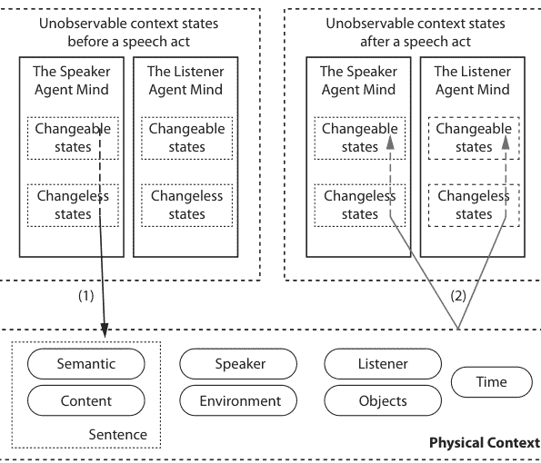

图 `8.2` 言语行为同时影响说话者和听众的心理语境。

# 人机交互中的社交认知 151

等级 3：0.5，等级 4：0.65，等级 5：0.85。我们随后主观地对每个言语行为进行标注。虽然初始的主观标注可能会导致预测不准确，但稍后我们可以根据对话记录动态调整言语行为的影响程度。例如，当我们发现所有智能体倾向于对情绪产生愤怒时，可能会增加该言语行为的影响程度。

### 8.4.1 物理上下文

物理上下文描述了可以通过各种传感器检测到的信号，以及虚拟环境提供的某些信号。在对话中，物理上下文包含对话的若干属性，例如位置、说话者和听话者、音量、虚拟环境中的活动以及句子。

### 8.4.2 情绪模型

`OCC` 模型 [16] 针对 22 类情绪提出了一种情绪模型，根据智能体对对象和事件的效用评估触发条件。然而，在使用 `OCC` 模型逻辑地描述言语行为的情绪上下文时会遇到一些困难。

在言语行为分类中，15 言语行为通过表达层被识别，用于表达智能体的自我情绪。在对话上下文中表达自我情绪可以在智能体通信中起至关重要的作用，可以帮助智能体理解之前的对话或释放压力 [7]。我们手动将那些表达言语行为分为两组：一组包含正情绪上下文言语行为，另一组是负情绪上下文。

### 8.4.3 社交关系

社交关系指的是朋友/敌人关系。我们关注言语行为中两个方面的关系：所采用的言语行为，以及对听话智能体情绪的不同程度的影响。例如，朋友指出你的错误比敌人可能引起更愤怒。这意味着如果我们监控对话中的长期上下文变化，可能会推断出智能体的朋友/敌人关系。

### 8.4.4 社交角色

某些言语行为只能由特定角色的智能体使用。相反，当言语行为发出时，其他智能体可能认为说话者实际上扮演了言语行为隐含的社交角色。制度角色描述了组织中官方角色的权威和义务。在言语行为分类中，某些言语行为只能由特定制度角色的智能体使用。相反，当言语行为被发出时，其他智能体可能认为说话者实际上扮演了言语行为隐含的制度角色。例如，命令是只有上级角色智能体对下级角色可以使用的言语行为。

## 8.4.5 人格

人格定义了智能体对某些情绪和违反社会规范的反应倾向。由于人格是相对不可变的，为了影响影响上下文的评估，本文假设它对所有对话智能体都是某些先验常数。

### 8.4.6 偏好

在偏好方面，我们记录特定智能体在某些对话情况下对其他智能体使用的言语行为频率，以便对智能体选择特定言语行为的倾向进行未来预测。类似于人格上下文，我们可以假设偏好对所有对话智能体也是某些先验常数。

## 8.5 多上下文言语行为模型

触发上下文和效果描述了言语行为模型中的对话状态。由于对话状态隐藏在智能体大脑中且无法被他人观察，我们采用概率模型来指示每个对话上下文的可能状态。例如，`anger(0.7)` 意味着愤怒情绪有 0.7 的概率是真的。在这里，我们可以用概率对话状态定义每个言语行为的触发和效果。例如，`trigger(anger(0.7 +))` 意味着愤怒情绪真实的概率为 0.7 或更高，那么智能体将在对话中使用言语行为：威胁。

在表 `8.1` 中，我们说明了一个言语行为：威胁的概率模型示例。在这个例子中，智能体 `A` 是说话者，唯一的听众是智能体 `B`。这句话有 3 个触发对话上下文，例如 `A` 的愤怒情绪、`A` 的希望情绪（希望 `B` 恐惧、服从或其他），以及负面社交关系：`A` 和 `B` 之间的关系。威胁的效果将影响 `A` 和 `B` 两个智能体的心理上下文，例如增加 `A` 和 `B` 之间的负面社交关系，导致 `B` 感到恐惧或导致 `B` 感到愤怒。通过概率模型，智能体 `A` 可能威胁 `B` 是因为 `A` 感到愤怒，他/她正在寻找 `B` 的服从，两者兼有。同样地，这些效果并非不可避免的，它们只是可能的。

表 `8.1` 言语行为概率模型：威胁

| | |
| :--- | :--- |
| 言语行为 | 威胁 |
| 触发上下文 | 愤怒 (0.85)，希望 (0.65)，负面社交关系 (`A` 和 `B` 之间的关系) |
| 效果 | 增加负面社交关系，导致 `B` 恐惧，导致 `B` 愤怒 |

表 `8.2` 言语行为与情绪表达

| 言语行为 | 情绪表达 |
| :--- | :--- |
| 接受 | 同意 |
| 指责 | 同意 |
| 询问 | 同意 |
| 拒绝 | 拒绝 |
| 驳斥 | 拒绝 |
| 请求 | 拒绝 |
| 告知 | 拒绝 |
| 赞美 | 拒绝 |
| 提议 | 拒绝 |
| 回忆 | 拒绝 |
| 哭泣 | 快乐 |
| 大笑 | 快乐 |
| 惊讶 | 惊讶 |
| 愤怒 | 愤怒 |
| 悲伤 | 悲伤 |
| 恐惧 | 恐惧 |
| 厌恶 | 厌恶 |
| 羞愧 | 羞愧 |

## 8.6 对话中的上下文感知

触发上下文和效果描述了言语行为模型中的对话状态。由于对话状态隐藏在智能体大脑中且无法被他人观察，我们采用概率模型来指示每个对话上下文的可能状态。例如，`anger(0.7)` 意味着愤怒情绪有 0.7 的概率是真的。在这里，我们可以用概率对话状态定义每个言语行为的触发和效果。例如，`trigger(anger(0.7 +))` 意味着愤怒情绪真实的概率为 0.7 或更高，那么智能体将在对话中使用言语行为：威胁。

在表 `8.1` 中，我们说明了一个言语行为：威胁的概率模型示例。在这个例子中，智能体 `A` 是说话者，唯一的听众是智能体 `B`。这句话有 3 个触发对话上下文，例如 `A` 的愤怒情绪、`A` 的希望情绪（希望 `B` 恐惧、服从或其他），以及负面社交关系：`A` 和 `B` 之间的关系。威胁的效果将影响 `A` 和 `B` 两个智能体的心理上下文，例如增加 `A` 和 `B` 之间的负面社交关系，导致 `B` 感到恐惧或导致 `B` 感到愤怒。通过概率模型，智能体 `A` 可能威胁 `B` 是因为 `A` 感到愤怒，他/她正在寻找 `B` 的服从，两者兼有。同样地，这些效果并非不可避免的，它们只是可能的。

表 `8.1` 言语行为概率模型：威胁

| | |
| :--- | :--- |
| 言语行为 | 威胁 |
| 触发上下文 | 愤怒 (0.85)，希望 (0.65)，负面社交关系 (`A` 和 `B` 之间的关系) |
| 效果 | 增加负面社交关系，导致 `B` 感到恐惧，导致 `B` 感到愤怒 |

表 `8.2` 言语行为与情绪表达

| 言语行为 | 情绪表达 |
| :--- | :--- |
| 接受 | 同意 |
| 指责 | 同意 |
| 询问 | 同意 |
| 拒绝 | 拒绝 |
| 驳斥 | 拒绝 |
| 请求 | 拒绝 |
| 告知 | 拒绝 |
| 赞美 | 拒绝 |
| 提议 | 拒绝 |
| 回忆 | 拒绝 |
| 哭泣 | 快乐 |
| 大笑 | 快乐 |
| 惊讶 | 惊讶 |
| 愤怒 | 愤怒 |
| 悲伤 | 悲伤 |
| 恐惧 | 恐惧 |
| 厌恶 | 厌恶 |
| 羞愧 | 羞愧 |

## 8.7 使用 DBN 进行上下文感知推理的计算模型

在 `DBN` 建模和实现中，我们通常必须以条件概率的形式指定领域传感器模型和转移模型。

# 机器人在人交互过程中的社会认知 ■ 155

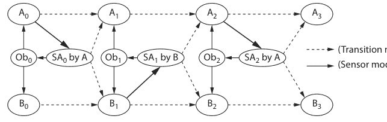

图 `8.4` 针对说话者和听者对话语境的两种 `DBN` 模型。言行为和其他观测信息是 `DBN` 中的传感器模型。

`P(E_t|X_t)` 和 `P(X_{t+1}|X_t)` 分别代表其中，`E_t` 是时间 `t` 时从传感器收集的证据，`X_{t+1}` 和 `X_t` 分别代表时间 `t+1` 和 `t` 的领域状态。在给定初始状态 `P(X_0)` 的情况下，我们可以在方程 `8.1` 中获得任何状态 `t` 下 `X` 的状态。

`P(X_t)`

由于每个言行为都是通过对话语境的变化来建模的，我们可以将言行为中可能的语境前置条件和后置条件的变化的概率作为转移模型。传感器模型从物理语境中收集证据，包括通过观测获取的对话句语境语义和其他信息，如语气、面部表情、手势和物体。在图 `8.7` 中，我们展示了两个参与者代理 `A` 和代理 `B` 在对话期间的两种 `DBN` 模型。`A_t` 和 `B_t` 是他们在对话 `t` 中心理状态的不可观测对话语境。可观测数据 `Ob_t` 包含言行为 `SA_t`，传感器模型反映了可观测对话语境证据 `E_t`。言行为也会影响对话语境，产生从 `X_{t-1}` 到 `X_t` 的影响，以概率 `P(X_t|X_{t-1}, SA_{t-1})` 作为转移模型。使用这些 `DBN` 模型，我们可以将传感器模型和转移模型结合作为 `DBN` 模型，根据方程 `8.2` 计算对话步骤 `t` 时 `X` 状态的概率。

`P(X_t, E_t) = P(X_0) \prod_{i=1}^{t} P(X_i|X_{i-1}, SA_{i-1})P(OB_i|X_i) \quad (8.2)`

尽管 `DBN` 是一种用于获取语境感知概率预测的强大计算模型，但它产生了另一个我们必须解决的问题：耗时。在我们的实验中，我们实现了 47 个对话语境作为 `DBN` 模型，完成一个言行为的计算循环需要 60 到 300 秒。这一缺点在实时交互虚拟剧和游戏中是至关重要的。为了克服这个问题，我们将两种方法与我们的 `DBN` 模型相结合：噪声 `OR` `Noisy-OR` 和孤立语境 `Isolated contexts`。

### 8.7.1 噪声 OR 模型

为了合并相关的条件概率，我们使用噪声 `OR` 模型，假设所有具有条件概率的语境都是独立的。噪声 `OR` [8], [18] 函数背后的思想是：一个具有 `n` 个语境 `C_i` 的言行为，每个语境有一个概率值 `p_i`，其中 `p_i` 是当 `C_i = true` 且对于所有 `j != i` 时 `C_j = false` 时，`SA = true` 的概率，如方程 `8.3` 所示。

```
$p(SA = true|C_1, ..., C_n) = 1 - \prod_{i=true} (1 - p_i) \quad (8.3)$
```

使用噪声 `OR` 计算条件概率表 `CPT` 的局限性在于我们只能为言行为设计触发器。我们无法通过噪声 `OR` 描述在何种条件下语境可能会降低调用言行为的概率。要使用噪声 `OR` 模型，所有对话语境相互独立的假设可能是实质性的。然而，使用噪声模型，通过将所有 `2^n` 种真假可能的条件组合简化为仅 `n` 项计算，我们可以简化计算条件概率表 `CPT` 的复杂度。噪声 `OR` 方法可以将一次循环计算时间从数百秒缩短到几秒。

### 8.7.2 孤立语境

我们可以在实时游戏中容忍几秒的延迟响应，但这显然是不够。根据统计，每个言行为输入只会改变对话语境中约 3 到 7 个条件概率。在之前的模型中，我们总共有 47 个对话语境，且所有的语境在一个 `DBN` 循环中都至少需要一次计算。换句话说，大多数计算资源被无关的对话语境（根据输入的言行）占据了。因此，我们为每个言行为设计了一个孤立语境以避免不计算。为了正确使用这种孤立语境，在跳过对话语境计算之前，必须遵循两个引导规则：1. 当前对话语境的概率与最高概率的对话语境相比在 1% 以下。2. 跳过的计算不会提高对话语境的概率。通过使用孤立语境方法，我们在整个对话言行为计算中节省了 61% 的时间成本。

## 8.8 实验

为了证明我们的方法在游戏中有效，我们使用多代理系统和代理技术来播放虚拟剧。我们的目标是证明，通过我们的言行为模型和 `DBN` 计算方法，代理能够具有感知对话中语境状态的能力。

`JACK` 多代理平台 [4] 被选为我们的多代理系统，因为它集成了代理通信功能，我们可以用简单的脚本设计代理行为。我们还从著名电影中获取了几个脚本，并将智能代理制作成非玩家角色 `NPC` 来扮演。

由于我们的言行为模型和 `DBN` 计算方法，代理能够感知对话中的语境状态。

我们的目标是证明，通过我们的言行为模型和 `DBN` 计算方法，代理能够具有感知对话中的语境状态的能力。

`JACK` 多代理平台 [4] 被选为我们的多代理系统，因为它集成了代理通信功能，我们可以用简单的脚本设计代理行为。我们还从著名电影中获取了几个脚本，并将智能代理制作成非玩家角色 `NPCs` 来扮演。


（噪声 OR 函数背后的思想是：一个具有 $n$ 个语境 $C_i$ 的言行为，每个语境有一个概率值 $p_i$，其中 $p_i$ 是当 $C_i =$ true 且对于所有 $j \neq i$ 时 $C_j =$ false 时，$SA=$ true 的概率，如方程 8.3 所示。

```
$p(SA = true|C_1, ..., C_n) = 1 - \prod_{i=true} (1 - p_i) \quad (8.3)$
```

使用噪声 OR 计算条件概率表（CPT）的局限性在于我们只能为言行为设计触发器。我们无法通过噪声 OR 描述在何种条件下语境可能会降低调用言行为的概率。要使用噪声 OR 模型，所有对话语境相互独立的假设可能是实质性的。然而，使用噪声模型，通过将所有 2n 种真假可能的条件组合简化为仅 n 项计算，我们可以简化计算条件概率表（CPT）的复杂度。噪声 OR 方法可以将一次循环计算时间从数百秒缩短到几秒。

# 机器人在人类交互中的社会认知 159

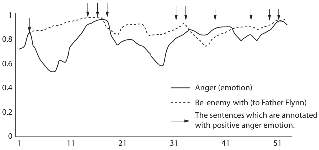

图 8.5 推断的艾洛修斯修女的情绪：愤怒以及社交关系——敌对（对莱尼神父）。实线是由几个人标注的基准。

关系背景：敌对（对莱尼神父）。尽管这两个对话背景的大部分具有相似的趋势，但在第 3-6 句和第 26-29 句仍有明显区别。原因是艾洛修斯修女没有使用侵略性言语，因此推断的愤怒处于平均水平。同时，她试图向莱尼神父提问，但他没有给出任何回答。对话中的这种不合作行为引起了艾洛修斯修女的敌意。从面部表情上看她看起来并不愤怒，但从对话来看，实际上对莱尼神父持有很高的敌意。

为了更广泛地验证推断结果，我们由几个人对原始电影中的几段对话进行了标注。我们要求标注者标注可以通过面部表情、手势和其他原始电影中的线索判断的对话句子，这些在图 8.5 中用箭头指示。通过这种方式，我们获得了避免必须推断角色心理状态情况的基准。在图 8.5 中，如果演员表现出愤怒的面部表情，或者带有带有起伏的语调，我们将该句子标注为“愤怒(1)”。同样，我们将模糊或无表情的表情标注为“愤怒(0.5)”。

DBN 推断结果在图 8.5 中表示为虚线（艾洛修斯修女对莱尼神父的社交关系）或实线（艾洛修斯修女的情绪水平）。将推断结果与基准比较，我们可以观察到推断结果与基准非常吻合。愤怒情绪的上升趋势在几乎每个句子中都被正确推断，这些句子在基准中也用向下箭头标注了相同的情绪表达。

同样，我们的 DBN 模型在其他 3 场景中也推断了愤怒情绪，我们将结果与基准对比，如图 8.6 所示。在我们的推断实验中，只有 3 个结果不匹配。

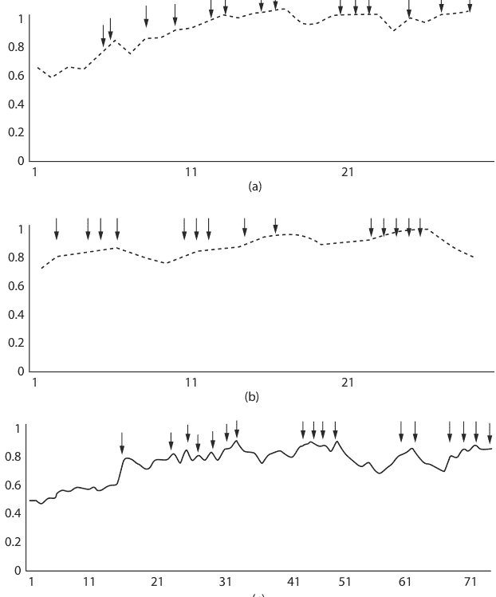

图 8.6 在三种场景下与情绪：愤怒（虚线）和基准（实线向下箭头）的对比。(a) 电影《黑色的乔伊》中的比尔·帕里夏，(b) 电影《傲慢与偏见》中的莉莉，(c) 电影《国王演讲》中的乔治六世。

# 机器人在人类交互中的社会认知 ■ 161

表 8.4 其他情绪背景下的匹配得分

| 情绪 | 分数 | 基准 | 推断（上升） |
|---|---|---|---|
| 羞愧/自豪 | 73.33% | 33 | 45 |
| 悔恨/感激 | 27.27% | 6 | 22 |
| 失望/释然 | 76.60% | 36 | 47 |
| 恐惧确认/满意 | 40.90% | 9 | 22 |
| 愤怒/感谢 | 92.86% | 39 | 42 |
| 恐惧/希望 | 86.79% | 46 | 53 |
| 仇恨/爱 | 20.51% | 8 | 39 |
| 责备/钦佩 | 59.65% | 34 | 57 |

表 8.5 怀疑场景下的四种基本言语行为类型及其详细言语行为

| 请求 | 回叙 | 提问 | 回答 |
|---|---|---|---|
| 命令 | 责备 | 审问 | 拒绝 |
| 提议 | 指控 | 质询 | 接受 |
| | 威胁 | | 反驳 | 未受恐吓 |

背景：愤怒。匹配分为 92.86%，是实验中的最高分。表 8.4 显示了其他对话情绪背景下的每个匹配得分。尽管最高分是 92.86%（愤怒），但我们仍有 4 个情绪得分在 60% 以下。原因是目前我们的言语行为中句子还没有语义内容。代理体无法从句子内容判断对象、事件和其他代理体行为的优坏。我们实验的一个缺点是，尽管我们可以在模型中推断任何对话背景，但由于缺乏基准模型，在现阶段我们只能对情绪背景进行评分。

## 8.8.3 对话背景感知中的噪声

我们提到代理体应该具有根据格莱斯准则进行通信的能力。这意味着代理体在对话中可能会撒谎或隐藏真实意图。因此，听者可能会收到影响感知准确性的噪声言语行为。为了使用 DBN 推断评估噪声对背景的影响，我们设计了一个实验，允许代理体用基本类型的言语行为替换言语行为。在表 8.5 中，我们定义了四种言语行为分类，每种可以根据其背景替换三个真实的言语行为。同一类的言语行为具有相同的执行方式，因此在对话中传输相同的信息，而不会向听者泄漏其他对话背景（如情绪和偏好）。

# 表 8.6 原始输入序列与带有噪声言语行为的序列

| 带有正确行为的输入 | 带有噪声言语行为的输入 |
|---|---|
| `(21a)(12b)(21c)(13e)(31f)` | `(21a)(12b)(21c)(21d)(13e)(31f)` |
| `(21g)(12e)(21f)(12h)(21g)` | `(21e)(12f)(21f)` |

表 8.6 是基本类型言语行为的输入对话序列。言语行为序列和语用言语行为序列（对应对话脚本中的 53 个对话句子）分别标注为 A 和 B。每个对话角色都标记有数字：1 代表莱尼神父，2 代表艾洛修斯修女，3 代表詹姆斯修女。言语行为用 a a 到 u 的符号标记，其中：a：宣布；b：反驳；c：不满意；d：回叙；e：提问；f：审问；g：拒绝；h：责备；j：告别；k：回答；l：指控；m：同意；n：请求；o：提议；p：高兴；q：威胁；r：未受恐吓；s：自豪；t：赞扬；u：抱怨。本实验忽略了句子内容，每个对话句子可以缩写为说话者 + 听者 + 言语行为。

在 8.7 中，我们展示了莱尼神父在原始对话中的愤怒、恐惧和失望情绪。显然，莱尼神父在与艾洛修斯修女说话时具有高水平的愤怒和恐惧情绪。在对话开始时，莱尼神父说“他的安危不是问题”（#2）后，艾洛修斯修女说“我不确定这是否是真的”（#3 意味着场景中的第 3 句）。在这种场景中，我们观察到“恐惧”情绪正在迅速上升。语用言语行为“反驳”倾向于引起对反对意见表示的说话者产生“恐惧”情绪。

# 机器人在人类交互过程中的社会认知

表格 8.8 有/无预加载上下文的言语行为预测的准确率

| 正确数据 | 准确率 |
|---|---|
| 包含上下文信息的结果 | `legnfnnhhbpqqrstefmfdudkk` | 15/19 |
| 不包含上下文信息的结果 | `demenfnnhfpeffstefmfduddk` | 11/19 |

将输入一视为对话后半部分的延续。我们模拟了两个不同的智能体进行测试。第一个智能体在对话日志的前半部分预加载了上下文信息。我们所说的预加载上下文是指到目前为止在对话序列中执行的所有语用行为。我们观察了它对对话后半部分每句对话在语用层面的预测能力。第二个智能体则不包含任何预加载的上下文信息，因此他/她是第三方并加入对话的。当然，我们预期第二个智能体的预测准确率低于第一个智能体，以形成对比。在表 8.8 中，第一行是上下文中的后半部分言语行为序列。第二行是带有预加载上下文的第一个智能体的预测结果。第三行是不带预加载上下文的第二个智能体的结果。在第2和第3行的第三列中，我们分别计算了两个智能体的准确率。所有不匹配之处均用灰色阴影表示。

我们仅根据言语行为分类的预测结果计算准确率。共有 16 种分类言语行为，5 种言语行为未被分类。这意味着如果一个语义行为未被分类，则语用言语行为将等同于该语义行为。在本次实验中，26 个句子中只有 19 个具有语义言语行为。预加载上下文的第一个结果有四个错误预测，准确率为 15/19。错误的原因是在对话结束时，情感强度处于正常水平，因此智能体无法通过情感上下文轻易区分语用行为。第二个结果显示不带上下文信息的智能体性能更差。然而，它的准确率仍有 11/19。这说明用于预测“问-答”言语对的对话上下文实际上起到了作用。在本次实验中，我们展示了预加载知识（即对话期间积累的上下文信息）有助于从语义行为预测言语行为。

## 8.8.5 最可能的语用言语行为序列

在本次实验中，我们仅将对话句子的语义视为已知，尝试观察对话模型是否能找到对话上下文最可能的解释。由于大多数句子是“问/答”言语行为，但有时对话智能体的情绪可能与上下文不兼容，我们知道模型在多大程度上能为每个对话行为（在本例中为“问”）句子找到语用上下文（在本例中为“审问”）的解释。由于在第 8.8.4 节中注意到的相同原因，我们基于分类的言语行为计算准确率。

表格 8.9 最可能的语用言语行为序列的语用性和准确率

|---|---|
| 正确数据 `abcdefefghgfefijefghkkk` | 概率 |
| 输出 `lmnghnbfpqqrtstefmefuddk` | 准确率 |
| 输出 `abcdeeeefghfeijefeehkk` | 6.792e-11 |
| 结果 `lgmnhnhnbpefftstefmefuddk` | 24/40 |

使用 DBN（动态贝叶斯网络），我们根据相应的语义序列计算出一个最可能的言语行为序列，其总概率为 6.792e-11，在 40 个语义行为中有 29 个语用行为匹配正确，如表 8.9 所示。我们推断，错误可能是由于场景开始时的“和平”对话提供了极少的情感上下文。因此，在对话开始的大约三分之一时间里，对语用行为“审问”的预测是不准确的。

## 8.9 结论

我们开发了一个集成概率模型，为非玩家角色配备了多种对话背景的上下文感知能力，并从电影《怀疑》、《会见黑人》、《傲慢与偏见》和《国王的演讲》的剧本中提取标注基准进行了测试。这种方法结合了动态贝叶斯网络、言语行为，以及关于情感和社会关系的背景节点。当用部分背景知识进行初始化时，我们的方法仅通过言语行为就能在一定程度上检测出情感和社会关系的隐藏状态。我们可以通过对话中适当的言语行为展示上下文感知能力。尽管初步结果具有主观性且上下文知识不完整，但我们已经证明了 DBN 对话模型和言语行为模型在从对话实现上下文感知的可行性。我们相信，通过引入来自不同背景理论和学习机制的更完整的知识，在 DBN 模型出现预测错误时优化参数并增强计算方法的效率，可以提高性能。当然，还需要开发更先进的自然语言处理和理解技术，以从句子推导出语义言语行为的基本类型。

我们提供了两个主要贡献。首先，我们的上下文感知展示了让智能体或机器人在与其他智能体交互期间运行不可观测社会上下文状态可行性。其次，我们开发了基于言语行为的上下文感知模型，这允许与概率规划器集成，为机器人生成对话计划。

## 8.10 参考文献

- [1] Matthias Baldauf, Schahram Dustdar, and Florian Rosenberg. A survey on context-aware systems. Int. J. L Ad Hoc and Ubiquitous Computing, 2(4):263–276, 2007.
- [2] Matthias Baldauf, Schahram Dustdar, and Florian Rosenberg. A survey on context-aware systems. Int. J. L Ad Hoc and Ubiquitous Computing, 2(4):263–276, 2007.
- [3] Matthias Baldauf, Schahram Dustdar, and Florian Rosenberg. A survey on context-aware systems. Int. J. L Ad Hoc and Ubiquitous Computing, 2(4):263–276, 2007.
- [4] Matthias Baldauf, Schahram Dustdar, and Florian Rosenberg. A survey on context-aware systems. Int. J. L Ad Hoc and Ubiquitous Computing, 2(4):263–276, 2007.
- [5] Matthias Baldauf, Schahram Dustdar, and Florian Rosenberg. A survey on context-aware systems. Int. J. L Ad Hoc and Ubiquitous Computing, 2(4):263–276, 2007.

# VI

# 认知机器人学的心理学维度

# 机器人动作控制：认知心理学与认知机器人学的十字路口

Roy de Kleijn

莱den大脑与认知研究所，

荷兰莱顿大学。

George Kachergis

莱顿大脑与认知研究所，

荷兰莱顿大学。

Bernhard Hommel

莱den大脑与认知研究所，

荷兰莱顿大学。

# 目录

- 9.1 领域的早期历史 ............................................................ 172
- 9.1.1 认知心理学史 ........................................ 172
- 9.1.2 计算机类比 ................................................................ 173
- 9.1.3 早期认知机器人 ................................................................ 174
- 9.2 动作控制 ....................................................................................... 175
- 9.2.1 引言 ........................................................................ 175
- 9.2.2 人体的前馈与反馈控制 ................... 175
- 9.2.3 机器人的前馈与反馈控制 ................... 176
- 9.2.4 机器人动作规划 ...................................................... 177
- 9.3 动作控制的获取 ................................................. 178
- 9.3.1 引言 ................................................................. 178
- 9.3.2 人类动作-效应学习 ......................................... 179

| 9.3.2.1 传统的动作-效应学习 | 179 |
| 9.3.2.2 运动喃语 | 179 |
| 9.3.3 机器人动作-效应学习 | 180 |
| 未来方向 | 181 |
| 9.4.1 引言 | 181 |
| 9.4.2 可负担性学习 | 181 |
| 9.4.3 日常动作规划 | 182 |
| 9.5 结论 | 183 |
| 9.6 参考文献 | 183 |

机器人领域正在从构建能够在受限环境下重复执行准确且可预测任务的工业机器人，转向允许能够执行更广泛任务（包括日常家庭活动）的更自主机器人。为了构建能够处理现实世界不确定性的系统，机器人专家需要观察人类在如此广泛的情况和背景下如何表现——这一领域在传统上是认知心理学的范畴。认知科学家已成功地让计算系统更接近人类水平。示例包括图像和语音识别，以及使用并行分布式处理（例如现代深度学习模型）的通用知识表示。

同样，认知心理学家可以使用机器人来补充他们的研究。认知系统的机器人实现可以作为一个“计算试验场”，允许对模型预测进行准确且可重复的现实测试。很多时候，理论预测——即使是精心进行的模型模拟——也无法扩展到甚至无法对应现实世界的复杂性。心理学将始终试图推向实验室的边界，看看它是否能“飞翔”。最后，认知心理学家有机会进行实验，这既能为机器人学家寻求更强大的机器人时提供信息，也能增加我们对人类在复杂动态世界中如何适应性表现的知识。在本章，我们将对认知心理学和机器人领域进行广泛而简要的概述，关注它们如何结合并指导我们（人工和自然）动作是如何构建的。

## 9.1 领域的早期历史

### 9.1.1 认知心理学史

在认知心理学和机器人学融合为“认知机器人学”方法之前，这两个领域已经拥有丰富的历史。我们现在所知的认知心理学走过了一条坎坷的道路（大多数心理学学科也是如此）。从哲学中分离，在短暂尝试使用内省法来观察大脑运作后，心理学领域发现依赖实证证据更为可靠。尽管通过这种实证证据取得了快速进展（形式如东德斯 Donders 的经典反应时间实验，该实验提出了从感知到动作的延伸阶段），但早期认知心理学开始被一种方法——行为主义所主导。这一观点由华森 [54] 普及并由斯金纳 [46] 进一步推动，认为心理学建立成为与物理、化学并肩的自然科学的途径，是将自己限制在观察刺激和反应等实体上。从这个意义上说，像斯金纳这样的行为主义者是强烈的反表征主义，即反对在解释可观察行为时对内部知识和状态的假设。另一方面，对可观察数据的关注为该领域带来了了严谨性，并描述和解释了许多有趣的效应。


行为主义方法在20世纪上叶叶主导了心理学领域。在20世纪50年代，行为主义似乎表现出的局限性引发了一些学者所谓的“新认知革命”。从乔姆斯基1951年对斯金纳解释婴儿如何通过简单关联学习语言的书进行严厉评论开始，许多研究人员发现行为主义无法解释基本的认知过程（如学习，尤其是记忆），而且人工智能的基础也处于萌芽阶段，对高水平、人类特有的天赋（例如分析性思维、推理、逻辑、战略决策）的解释变得流行。

### 9.1.2 计算机类比

导致新认知革命的另一个因素是出现描述人类认知类似于计算机系统的新方法。这种方法观察运行（且目前仍在运行）计算机的基本机制：收集输入、处理信息并输出处理后的信息：刺激检测、存储和转换以及反应产生。这种方法不仅激发了心理学家，还引发了建立智能机器的希望。这种想法是，如果计算机系统可以使用与大脑相同的规则和机制，它们也可以像人类一样行动。也许这种乐观愿景的广为人知者是图灵 [51]，他暗示机器通信与人类无异的日子指不远了。遗憾，乐观主义者将将会失望。很快就会清楚，计算机和人类有不同的优缺点。计算机可以在几毫秒内计算出小数点后20位的圆周。人类可以识别手写。认知心理学和人工智能花了25年时间才以并行分布式处理（PDP）方法 [40]的形式再次开启它们的浪漫。

### 9.1.3 早期认知机器人

随着这种增加具身性以构建智能体的想法，第一批认知机器人是非常简单的机器。Machina Speculatus [53] 由一个移动平台、两个传感器、执行器和“神经细胞”组成。可以理解的是，这些机器人的设计目的是模拟简单动物的行为，能够安全地在房间里移动并使用相对简单的规避规则自我充电。

由于它们的简单性，认知机器人的性质尚存疑——它们与与控制论和控制理论更相关（例如 [5]）——但很快的复杂性可能会将它们转化为认知机器人。从20世纪60年代开始，机器人能够使用如 `STRIPS` [17] 的算法来表示知识并规划操作序列，这被认为是每个 AI 学生的必备知识。`STRIPS` 规划器表示目标状态和前提条件，并在执行之前尝试推导出实现它们的动作序列，其执行速度非常慢。此外，这种类型的规划受限于其封闭世界假设（即环境和所有相关状态都是已知且不会改变）以及现实世界的巨大复杂性，导致计算无法逾越。然而，`STRIPS` 采用的通用方法——通过谓词逻辑对环境、可能的动作和状态转换以及目标状态进行建模，感知-规划-执行循环——主导了认知机器人学一段时间，并且今天仍然是一项强趋势。

在过去的十年里，开发了各种从生物有机体启发的基于行为的机器人架构和算法。一个有影响力的例子是罗德尼·布鲁克斯包容架构 [9]，它完全抛弃了规划——规划只是一种避免思考该做什么的方法”，使用一组分层排列的定义基础库来根据输入生成行为。尽管这种方法很快，并且经常从简单的规则中产生令人惊讶的复杂行为（见 [8]），但包容架构和许多其他基于行为的机器人算法尚未从人类心理学研究中学吸收教训。

在十字路口的认知心理学与认知机器人 ■ 175

## 9.2 控制

### 9.2.1 引言

机器人与人类之间的另一个显著重叠领域是运动/动作控制。有两种控制系统管理运动动作：前馈控制和反馈控制系统。

前馈运动控制系统使用预定义的参数从（人类或机器人）运动组件发送信号到相关的运动组件以执行动作。来自环境的信息只能在执行之前被考虑，这使得前馈控制适用于可预测的环境。

相比之下，反馈运动控制系统或或连续地整合来自自身或环境的信息（反馈），以调节控制信号。通过这种方式，系统可以根据环境的变化动态改变其行为。

### 9.2.2 人体的前馈与反馈控制

多年来，心理学及相关学科一直从相当孤立的角度来看动作控制。由于 Woodward [55] 对运动控制的首次系统性研究为环境信息的贡献提供了强有证据，许多作者开发了依赖于连续反馈回路的动作控制闭环模型（例如 [11]）。同时，来自动物实验和病变研究 [31, 49] 以及理论考虑 [34] 的强有力证据表明，在缺乏感觉运动反馈回路的情况下也可以进行各种运动，这促进了前馈模型的发展（例如 [22]）。

Schmidt [43] 是首批认为人类动作控制由前馈和反馈部分组成的人之一。根据他的推理，人类主体准备一个运动图式，该图式指定了预期动作的相关属性，但留下了通过使用在线环境信息来指定的空位。神经科学证据为混合控制模型提供了强有力的支持，表明沿着腹侧皮层路径的离线动作规划与沿着背侧路径的感知运动选择相结合了 [19, 18]。

特别是，前馈机制似乎在动作发生前决定了离线和预设的必要动作组件（至少是其中一些）[22]，并选择性地注意与任务相关的刺激和刺激维度 [24]。相反，反馈过程提供了极佳的准确性——通常是以速度为代价的 [44]。这些优缺点促使混合模型出现，这些模型认为前馈机制提供了动作计划的骨架，为反馈过程提供的参数留下了空位 [43, 18, 24]。

Goodale 及其同事 [20] 的观察提供了这种相互作用的一个特别佳的例子。在一个巧妙的实验中，参与者被要求将手放在平台上，并指向右侧视野中想象直线上随机位置呈现的视觉目标。在半数试验中，参与者并没有被告知目标在第一次眼动期间改变了位置。作者发现，在这些试验中，参与者能够成功地指向目标，而没有察觉到位置的变化，且没有任何延迟。由于前馈编程被认为需要时间，一种参与者无法察觉的快速且在线反馈机制被认为是这一发现的负责。

在更高层次上，必须执行前馈和反馈系统之间的交互。更高层次的、目标导向的动作规划（例如计划制作煎饼）无法以完全前馈的方式进行规划：它需要预先指定所有的运动参数，并需要精确了解所有必要设备和原料的位置和属性等。

相反，这些参数中的许多可以使用来自环境的信息在线填充。不需要知道平锅的确切重量，通过拿起它就能知道：你增加施力，直到平锅离开厨房台面。尽管如此，你可能还根据对其他平锅——甚至是相似大小物体的经验——对可能的平锅重量有一个分布（例如，大于 50 g且少于 10 kg）。

当计划的动作执行失败时，前馈和反馈之间的交互在更高层次上变得更加明显。当缺少必要的原料时，可能需要对预编程的动作序列进行重新规划（或取消）：如果没有缓冲，我可以用油润滑平锅吗？某种程度上，这些通过反馈过程收集的信息必须传递给更高层次的动作规划器。

### 9.2.3 机器人的前馈与反馈控制

关于机器人系统动作控制的理论可能被认为是相当意识形态的，有时由特定机器人/任务的特殊性驱动，有时被广义泛化的反表现主义态度所驱动。许多早期机器人只有几个传感器，并对一组特定的刺激以固定的行为模式做出反应。有些机器人完全是前馈的，执行相同的动作或动作序列，完全没有任何感觉输入 [37]。前馈或简单的反应控制架构可能会导致非常脆弱的行为：即使是复杂的、精心设计的动作和反应序列，如果环境突然出现即使略微新颖的情况，也会显得笨拙。

人们已经提出了更复杂的架构，某些类比生物学或行为，产生了基于行为的机器人技术领域。抑制架构 [9] 是对传统符号人工智能（GOFAI）的响应，认为复杂行为并不一定需要复杂的控制系统。不同的行为被表示为可以被其他层抑制的层。例如，可以为简单的机器人提供游荡、避让、拾取和归家的行为。这些行为是分级结构的，每个行为抑制其前一个行为 [4]。

这种行为之间的抑制层级在人类身上也是可见的（尽管有些复杂）。如果你，在洗碗时（意外地）倾向于生火，人们会在洗完碗子之前停止、丢掉和滚落。换句话说，某些行为优先于其他行为。[3] 提出了一种与抑制架构类似的方法。运动图式方法也使用不同的、行的行为层，但没有抑制方法那样的层次协调。相反，每个行为对机器人的整体响应做出贡献。

在更高层次上，正如上一节所述，出现了其他问题。例如，当计划的动作失败时，例如机器人找不到制作煎饼的锅，就需要重新规划。最早的 AI 规划器会简单地回溯到上一个选择点并找到替代子任务。然而，这不能保证动作的成功完成。其他规划器，如 `ABSTRACT` [41]，使用表示层级的层级。当它无法完成子动作时，它可以返回到更抽象的层次。

然而，真正智能的系统在处理意外事件时应该更灵活。如果机器人不能制作火腿比萨，也许它应该做一个培根的？泛化和替换合适的物品仍然是机器人的一种能力，使用语义向量空间模型（例如 `BEAGLE` [28]）向正确的方向迈出了一步。像神经网络一样，这些模型以分布式方式表示项目（例如单词），使用许多特征向量，随机项目之间的初始相似性较低。模型通过学习——例如，通过阅读文档——更新项目表示，以使它们与持续相似的项（在连续尺度上）更加相似。这些不断更新的表示可以用于提取项目之间的语义（例如，词性）关系。

### 9.2.4 机器人动作规划

人们理解人类的触及运动有一个初始的弹道、前馈组件，随后是一个较慢的、反馈驱动的组件，用于纠正初始运动中的误差。随着人们熟练触及特定距离的目标，他们的运动中很大一部分将投入初始的前馈组件，在反馈组件上花费的时间更少，从而加速

这种现象使机器人专家能够为机器人创建更具适应性的、类人类的运动规划系统。

在该研究领域，Kachergis 等人 [29] 研究了基于小鼠运动的序列学习。受 Nissen 和 Bulmer [38] 早期工作的启发，人类参与者在学习阶段获取了较长序列的序列。参与者似乎通过出更快的响应时间和语境效应，隐式地从较长的序列中提取出这些序列。

这些发现对序列动作的简单链理论提出了怀疑。Rosenbaum 等人 [39] 将这些发现解释为证据，证明感官反馈不是动作序列化的必要组成，这与 Lashley [34] 的结论一致。他们认为，“神经系统的状态可以使执行者在未来以特定的方式行为（第 526 页），或者对某些行为存在动作计划。然而，对自发言语修复（例如 [36]）的研究也表明，人们在修复单词或句子的早期错误时非常快，快到不足以假设动作结果仅在整个序列完成后才进行评估。这意味着动作规划不能像 Lashley [34] 似乎那样被排除，但必须包含多个层次的处理，其中底层持续检查当前动作是否按预期进行。换句话之，动作规划必须是一个在时间上扩展的过程，其中用于提供抽象目标描述的抽象表示必须与控制感觉运动回路的低级亚符号表示相结合。亚符号感觉运动表示的存在解释了上述描述的语境效应和预期效应。

机器人运动规划的主要教训是，纯符号的规划可能由于过于粗糙且对语境不敏感，无法实现平滑且高效的多组件动作。引入多级动作规划和动作控制可能会大大增加工程的复杂性，但也可能让机器人的动作更加灵活和稳健——并且在用户看来不那么像“机器人化”。

## 9.3 动作控制的获取

### 9.3.1 引言

为了让人类或机器人能够实现目标，它们需要知道某个动作会对环境产生什么影响。或者，反推回来，为了在环境中产生特定效果需要哪些动作。在婴儿时期学习相关的动作-效应是发育的基础性部分，并可能引导后续通用知识的获取。

在人类中，学习到的动作-效应似乎是双向存储的。遵循 Lotze [35] 和 Harless [21]，James [27] 指出，刻意创造所需的效果需要关于动作-效应偶然性的知识，从而需要之前获取这些偶然性。事件编码理论（TEC; [25]）是一个全面且具有良好实证支持（近期综述请参见 [23, 45]）的理论框架，解释了此类目标导向型动作-效应绑定的获取和使用。TEC 认为动作与其预期效应共享共同神经表示。因此，执行动作会激活对相关效应的预期，而思考（即打算或预期）动作效应会激活负责实现这些效应的运动神经元。

### 9.3.2 人类动作-效应学习

#### 9.3.2.1 传统的动作-效应学习研究

在认知心理学实验中，动作-效应绑定是通过让人类重复执行动作（如按下键盘上的特定按钮）获取的，随后呈现效应（如声音或视觉刺激）。在对这种动作与效应组合进行一定的暴露后，证据表明已形成双向绑定。当受到先习效应的启动时，人们对关联动作的反应稳健又敏感 [15]。这种动作-效应学习对动作-效应的偶然性和连续性非常敏感 [16]。

#### 9.3.2.2 运动咿语（Motor Babbling）

当然，动作-效应学习不仅发生在心理学实验室等人工环境中。事实上，人类的动作-效应学习几乎在出生后就开始 [52]，有人甚至认为在出生前就开始了。婴儿执行不协调的动作，被称为身体或运动咿语。然而，这些动作中的大部分将被证明是无用的，但其中一些会产生为婴儿提供正反馈的效应。例如，宝宝在趴在地上时可能会无意中用右手向下推，从而翻滚并看到各种有趣的事情。随着时间的推移，婴儿会对其认为有用的动作建立动作-效应的关联，并执行具有预期效果的运动动作。

在掌握了控制自己身体的复杂性后，更高层次的动作-效应可以通过类似于运动咿语的方式进行学习。Eenshuistra 等人 [14] 举了驾驶试图减速的太空飞器的例子。如果没有人教你如何做，你最好的选择可能是随机按下按钮，直到达到预期效果（小心自毁按钮！）。一旦你学会了这种动作-效应绑定，未来在类似情况下的表现将好得多。

### 9.3.3 机器人动作-效应学习

认知可能基于感觉运动经验并由自动创建的动作-效应绑定表示的可能性，已经引起了一些认知机器人学者的兴趣。例如，Kraft 等人 [32] 提出了一种依赖于对象-动作复合体的三级认知架构，即作为高层认知基础的感觉运动单元。事实上，动作-效应学习可能为生成引导动作的预测以及动作控制的离线前馈组件提供认知机制。该组件可能指定动作的不变方面，即为了让动作达到目标并产生预期效果而必须提供的特征；而在线组件可能提供新的环境信息来指定与目标相关性较小的参数，例如从瓶中喝水时的移动速度 [24]。可以说，这种系统将比由情境认知方法驱动的纯在线、反馈驱动的系统 [10] 能够实现更有趣的成就。同时，它也会比完全依赖使用内部前向模型 [13] 的系统更灵活。因此，与其让程序员想象可能的场景和枚举响应，创建能够学习与其环境适应的动作-效应关联并与在线信息相结合的机器人可能更容易。

在机器人和人类中，都需要关于自身身体的知识来获取关于外部世界的知识。学习如何控制肢体——先分别学习然后（例如走路）——显然超过了生命中的头几年：通过学习翻身、爬行和行走，我们变得非常熟练。运动咿语有助于发展触觉、本体感受以及视觉甚至听觉线索，感知我们身体运动时的感觉。了解这些基础动作及其对我们自身的影响（例如哪里疼）为学习我们的动作如何影响环境奠定了基础。

在（虚拟）机器人运动咿语的首次研究中，Kubernetes [33] 展示了动作执行如何能在感知到的手中物体位置与相应的手臂位置之间建立关联。这种关联是双向的，符合意动（或 TEC）理论。我们（以及其他人，例如 [11]）认为这种双向绑定有助于机器人克服传统问题，就像从前向模型学习逆模型一样。

关于机器人运动咿语的近期研究扩展并优化了我们认为是人类中学习行为的方法。例如，Saegusa 等人 [42] 用机器人实现了一种感觉运动学习算法，将学习组织为两个阶段：探索和学习。在探索阶段，会产生随机动作，

# 认知心理学与认知机器人学的交汇点 ■ 181

在学习阶段，动作-效应绑定（或更具体地说，映射函数）会得到优化。机器人随后可以决定学习尚未学习过的绑定。

## 9.4 未来的方向

### 9.4.1 引言

对于不仅是定义良好的简单动作（例如伸手指向目标），而且由各种组件组成并涉及各种效应的复杂动作，在获取和熟练执行方面仍存在许多问题。事实上，我们如何创造一种能够从基础的运动牙语（motor babbling）转向目标导向的伸手、抓取和物体操作的算法？为了实现这一显然困难的目标，让心理学家研究婴儿这些能力的发展将是有益的，让认知机器人学家从中学习也将很有帮助。

### 9.4.2 预示性学习（Affordance Learning）

物体的感知和使用是机器人在环境中工作时不可或缺的活动。感知可示性（affordances）——即物体能做什么或你如何使用它——对人类来说是一个快速且毫不费力的判断。在许多情况下，当人类走动并看到一扇门时，会自动拉动把手打开它。

机器人执行可示性学习的方法之一是：在运动牙语阶段，机器人随机选择行为并将其作为操作器进行观察（例如 [47]）。在所谓的行为牙语阶段，机器人观察其对物体产生的影响。随着时间的推移，获取了关于工具功能的知识，并可以使用这种知识来操作新物体。

尽管这种方法听起来令人印象深刻，但它并不易于泛化，机器人无法利用这种知识处理相似物体。更新的方法如 Jain 和 Inamura 所示 [26]，从物体中推断功能特征以泛化未知的可示性。这些功能特征被认为是类别不变的。

在人类中，一种解释可示性的成功方法基于 Biederman 的组件识别理论 [6]。该理论通过将遇到的物体分割为称为几何元（geons）的部分来进行识别。这些是如锥体、圆柱和块等简单的几何形状。通过将物体还原为更多基础单元的组合，物体分类得到了简化。Biederman 识别了 36 种独立的几何元，具有（受限的）生成能力。

## 182 ■ 认知机器人学

除了对物体分类有用外，几何元还可以用于推断可示性。例如，勺子适合舀取，因为其末端的空心球体允许盛放东西，连接在物体上的长圆柱可以用来拿起它。

Tennor 和 Beetz [50] 展示了使用几何元进行推断的一个有前景的例子。这种技术将物体与 Google Warehouse 等公共数据库中的 CAD 模型进行匹配。这些模型被分割成几何元，使得可示性推理成为可能。

然而，以某种方式教机器人推断工具能够做什么仍然是困难的。最终，我们希望可示性在学习过程中自然产生：通过观察他人、通过语言指令或通过具身性。任务上下文也是学习的一个重要方面：取决于情况，锤子可以用作杠杆、武器或其他工具。为了理解上下文如何影响动作规划，研究自然场景和人类关节是关重要的（参见 [2]）。

学习几何元可以泛化到机器人的可示性，尽管现在说这种方法或其他方法更好为时尚早。例如，深度神经网络利用其多层结构来避免过拟合，以学习用于区分物体的高级感知特征。此类网络学习到的表示是某种程度上符合生物学的几何元分解，因此可能更适合解决深度神经网络的泛化问题（尽管参见 [48]）。

### 9.4.3 日常动作规划

机器人执行日常动作方面的一个主要障碍是将高级的符号化任务描述转化为感觉运动动作计划。为了实现这种转化，一种方法是从另一方面学习：通过观察感觉运动动作来分割和分类输入。

日常动作的特征是顺序的、分层次的动作子序列。例如，制作咖啡和泡茶的任务具有共同的子序列，如添加牛奶或糖。此外，加糖的目标可以通过几种方式之一完成：例如，从袋子里撕开并打开，或者从碗或盒中舀。此外，这些子序列并不每次都必须以相同的顺序执行（当然会有某些限制）。正是这种灵活性和即兴能力使得日常动作对人类来说是自然的，但对机器人来说如此困难。


已经提出了一些表示层次信息的认知模型（例如 [12], [7]），但它们在表示这些层次的方法上有所不同。一种方法通过将动作层次硬编码到模型中显式表示——这对于通用自主机器人来说是难以实现的——而后者将层次结构视为递归神经网络的涌现属性。最近，Kacheris 等人 [30] 提出的模型使用具有生物学意义的学习规则的神经网络从观察到的序列中提取层次结构，所需的示例比之前的模型要少得多。

## 9.5 结论

在本章中，我们讨论了认知机器人学与认知心理学之间共享几个概念，以论证灵活、真正的自主机器人的创建取决于旨在模仿人类学习和规划的算法实现。因此，对于成为机器人专家的人来说，认知心理学有很多相关的教训。

意动理论（Ideomotor theory）及其作为 `TEC` 的实现为动作-效应学习提供了优雅的解决方案。使用运动牙语引导高阶学习的机器人运动学习算法似乎是有前景的，而且对程序员的先验知识要求很少，最终导致更灵活的机器人。

动作计划的泛化仍然是一个非常困难的问题。推断观察或学习到的动作序列的层次结构是一个有前景的方法，尽管日常动作的结构似乎与理清人类自然语言结构一样细微且复杂——而且目前对此的研究较少。再次，我们认为像 `LeabraTI` 这样的生物启发的学习模型可以在使机器人动作更像人类方面发挥作用。

认知机器人学与认知心理学的交叉兴趣到目前为止已证明是有收获的。运动牙语和可示性推断等机制在人类中被广泛研究，为机器人提供了使其动作更像人类的技术。

## 9.6 参考文献

- [1] J. A. Adams. 闭环运动。Behavior, 3:111-150, 1971.
- [2] E. Aksoy, B. Dellen, M. Tamosi, and F. Worgotte. 机器人（人形）的执行。11th IEEE-RAS International Conference on Humanoid，2011.
- [3] R. C. Arkin. 基于模式的导航。International Journal of Robotics Research, 8:92–112,1989.
- [4] R. C. Arkin. 基于行为的机器人。MIT Press: Cambridge, 1998.
- [5] W. R. Ashby. 控制论简介。London: Chapman & Hall, 1956.
- [6] I. Biederman. 组件识别：一种人类理论。Psychological Review, 94:115–147,1987.
- [7] M. Botvinnick and D. Plaut. 无顺序动作。Journal of Experimental Psychology: Human Perception and Performance, 113(8):887–916; 讨论917–31,2004.
- [8] V. Braitenberg. 车辆：实验心理学。Cambridge, MA: MIT Press, 1984.
- [9] R. Brooks. 用于移动机器人的鲁棒控制系统。IEEE Journal of Robotics and Automation, 2:14–23,1986.
- [10] R. Brooks. 无智能。第12届国际人工智能联合会议，卷1，页569–595，1995.
- [11] D. Caligli, D. Parisi, N. Accorner, M. Capazza, and G. Baldassarre. 使用运动牙语和规则建模带有障碍的伸手发展。2008 International Conference on Cognitive Systems，2008.
- [12] R. P. Cooper and T. Sallice. 动作控制中的分层次模式和目标。
- [13] Y. Demiris and A. Dearden. 从运动牙语到模仿的分层次学习：一种发展路径。Epigenetic Robotics国际会议，页31–37，2005.
- [14] R.M. Enshuista, M.A. Weid, and B. Hommel. 动作-效应关联的发展与控制。Acta Psychologica, 115:185–209,2004.
- [15] B. Elsner and B. Hommel. 有效预测和动作控制。Journal of Experimental Psychology: Human Perception and Performance, 27:229–240,2001.
- [16] B. Elsner and B. Hommel. 动作效应获取中的连续性和偶然性。Psychological Research, 68:138–154,2004.

# 认知心理学与认知机器人学的交叉点 ■ 185

[17] R. Fikes and N. Nilsson. Strips: 将定理证明应用于问题解决的一种新方法。*Artificial Intelligence*, 2:189–208, 1971.
[18] S. Glover. 动作规划与控制中的独立视觉表征。《Behavioral and Brain Sciences*, 27:3–24, 2004.
[19] M. A. Goodale and A. D. Milner. 感知与动作的独立视觉通路。《Trends in Neuroscience*, 15:20–25, 1992.
[20] M. A. Goodale, D. Pelisson, and C. Plablanc. 视觉引导延伸的大幅度调整不依赖于对手手的视觉或对目标位移的感知。《Nature*, 320:748–750, 04 infine 1986.
[21] E. Harless. 意志的装置。《Zeitschrift für Philosophie und philosophische Kritik*, 38:50–73, 1861.
[22] F. M. Henry and D. E. Rogers. 复杂运动的反应延迟增加与神经运动反应的“内存提取”理论。《Research Quarterly*, 31:448–458, 1960.
[23] B. Hommel. 根据 TEC（事件编码）的注意力控制。《Psychological Research*, 73:512–526, 2009.
[24] B. Hommel. 不费力的注意力：注意力与动作认知科学的新视角，动作控制中的注意力章节：选择的意向控制，第121–140页。Cambridge, MA: MIT Press, 2010.
[25] B. Hommel, J. Müsseler, G. Ascherleben, and W. Prinz. 事件编码理论（TEC）：一种感知与动作规划的框架。《Behavioral and Brain Sciences*, 24:849–937, 2001.
[26] R. Jain and T. Inamura. 基于功能特征泛化的可供性贝叶斯学习，用于估计不可见任务的影响。《Artificial Life and Robotics*, 18:95–103, 2013.
[27] W. James. 心理学原理，第1卷。New York: Holt, 1890.
[28] M. N. Jones and D. J. K. Meworth. 复合整体词汇表中词序和信息的表征。《Psychological Review*, 114:1–37, 2007.
[29] G. Kacheris, F. Berends, R. de Kleijn, and B. Hommel. 新颖季节反应时间中的轨迹效应。见第36次认知科学学会年度会议论文集，2014.
[30] G. Kacheris, D. Wyatte, R. C. O'Reilly, R. de Kleijn, and B. Hommel. 一种用于动作的连续时间神经模型。《Philosophical Transactions of the Royal Society*, 369:20130623, 2014.

# 186 认知机器人学

[31] H. D. Knapp, E. Taub, and A. J. Berman. 猴子在前肢去神经后的运动。《Experimental Neurology*, 7:305–315, 1963.
[32] D. Kraft, E. Baseski, M. Popovic, A.M. Batog, A. Kjær-Nielsen, N. Krüger, R. Patrick, C. Geib, N. Pugeault, M. Steedman, T. Asfour, R. Dillmann, S. Kalkan, F. Wörgötter, B. Hommel, R. Detry, and J. Piater. 抽象空间的规划。《认知系统国际会议（CogSys2008）》。
[33] M. Kuperstein. 单一姿态的适应手眼协调神经模型。《Science*, 239:1308–1311, 1988.
[34] K. S. Lashley. 行为中的脑机制，行为中的顺序问题，第112–131页。
[35] R. H. Lotze. 医学心理学或灵魂生理学。Weidmann.
[36] C. Nakatani and J. Hirschberg. 自发语音的语料研究。《Journal of the Acoustical Society of America*, 95:1603–1616, 1994.
[37] S. B. Niku. 机器人学导：注意力、控制。Wiley, 2010.
[38] M. J. Nissen and P. Bulmer. 注意力机制：来自性能的证据。《Cognitive Psychology*, 19:1–32, 1987.
[39] D. A. Rosenbaum, R. G. Cohen, S. A. Jax, D. J. Weiss, and R. van Wel 行为中的顺序问题：Lashley的遗产。《Human Movement Science*, 26:25–554, 2007.
[40] D. E. Rumelhart and J. L. McClelland. 并行分布式处理：认知表征的微观结构探索，第一卷。Cambridge, MA: MIT Press, 1986.
[41] D. E. Sacerd. 抽象空间的规划。《Artificial Intelligence*, 55:115–135, 1974.
[42] R. Saegusa, G. Meta, Sandini, and S. Sakka. 感知运动学习的主动运动牙语。《机器人与生物识别国际会议》，第794–799页，2008.
[43] R. A. Schmidt. 离散运动技能的模式理论。《Psychological Review*, 82:225–260, 1975.
[44] R. D. Seidler, D. Moll, and G. Thiers. 运动控制中的前馈与反馈过程。《Neuroimage*, 22:1775–1783, 2004.
[45] Y. K. Shin, R. W. Proctor, and E. J. Capaldi. 当代运动理论述述。《Psychological Bulletin*, 136(943-974), 2010.
[46] B. F. Skinner. 有机体的行为：实验分析。Cambridge-massachets: B. Skinner Foundation, 1938.
[47] A. Stoychev. 机器人工具可供性的自主学习。AAAI 2005.
[48] C. Szegedy, W. Zaremba, I. Sutskever, J. Bruna, D. Erhan, I. Goodfellow, and R. Fergus. 神经网络的属性。《CoRR*, abs/1312.6199, 2013.
[49] E. Taub, I. A. Goldberg, and P. Taub. 猴子去神经：无视觉反馈指向。《Experimental Neurology*, 46:178–186, 1975.
[50] M. Tenth and M. Beetz. KnowRob：用于认知机器人的知识处理基础设施。第一部分：KnowRob系统。《International Journal of Robotics Research*, 2013.
[51] A. M. Turing. 计算机器与智能。《Mind*, 59:433–460, 1950.
[52] S. A. Verschoer, M. Spapé, Biro, and B. Hommel. 从结果预测到动作选择：动作-效应结合的发育变化。《Developmental Science*, 16:801–814, 2013.
[53] W. G. Walter. 活的脑。London: Duckworth, 1953.
[54] J. B. Watson. 行为主义者眼中心理学。《Psychological Review*, 20:158, 1913.
[55] R. S. Woodward. 自主运动的准确性。《Psychological Review*, 3:1–119, 1899.

# 认知机器人学的工智能视角

## 视觉与动作的自下而上整合以创造人形机器人

**Jürgen Leitner**

卢加诺人工智能研究所 (IDSIA) & SMRTRobots,

瑞士, 卢加诺

## 目录

- 10.1 引言 ................................................................ 192
- 人工智能、机器学习与机器人技术 ................... 192
- 机器人学习 ................................................................... 193
- 10.2 认知机器人学方法 ................................... 196
- 10.3 环境感知 ....................................................... 199
- 10.3.1 物体检测：iVision & CGP-IP ...................................... 200
- 10.4 环境交互 ................................................. 201
- 10.4.1 避障与世界模型：MoBeE ...................... 203
- 10.4.2 动作库：TRM & LEOGrasper ................................. 204
- 10.5 整合 ................................................ 206
- 10.5.1 闭注意力-感知环 ................................ 206
- 10.6 结果 ....................................................................... 207
- 10.6.1 避开移动障碍 ................................................... 207
- 10.6.2 触达与抓取物体 ........................................ 208
- 10.7 结论 ............................................................ 209
- 10.8 参考文献 ............................................................ 209

近年来，开发出了越来越多复杂的人形机器人。另一方面，编写这些系统变得越来越更加

# 192 认知机器人学

非常困难。明确需要此类机器人能够适应并自主执行某些任务，甚至能够自己学习如何行动。一个待解决的重要问题是感知运动回路的闭合。特别是在讨论人形机器人时，感知与动作的紧密集成允许改进行为，将适应性嵌入到系统的底层。

## 10.1 引言

现实世界环境中的物体操作是机器人领域一个非常困难的问题，但它是机器人必须具备的最重要技能之一 [29]。通过操作，它们能够与世界交互，从而对人类变得有用且有利。为了产生即使是最简单的类人行为，人形机器人必须能够看到、行动并持续不断。尽管如此，对于需要手臂和手精确且协调运动的物体操作任务，理解人类和动物如何控制这些运动是认知科学-[49]和神经科学[27]的一个基础研究课题。尽管该主题受到关注且很重要（例如在康复和医学领域），但关于人类如何学习、适应以及伸手和抓取行为背后的问题和理论仍然存在争议。尽管有很多关于人类如何执行这些动作的实验研究，但伸手和抓取的发展机制尚未被完全理解，目前仅存在非常基础的计算模型 [45]。视觉被认为是人类伸手和抓取技能发展的重要因素 [5, 39]。例如，在14个月大的婴儿中观察到了对简单操作技能的模仿 [40]。相比之下，目前的机器人只能在更有限、特定的环境中执行（简单的）物体操作。为了实现更自主的物体操作，具体说是实现某种程度的眼手协调以更成功地执行动作，是机器人社区的高度关注（例如，NASA的空间技术路线图要求“实时自校准手眼系统” [1]）。

## 人工智能、机器学习机器人

人工智能（AI）和机器人领域的研究在早期密切相关，但在过去的几十年里已经分化。虽然AI技术的开发是为了达到足以战胜（或/或指导）普通人类选手的水平下棋 [51]，相比之下，机器人对棋子的操作以及智能机器的创造在算法方面却落后了一点。目前无法以与人类相似的精度、适应和成功率来控制机器人——甚至无法比儿童水平。为了产生即使是最简单的自主、自适应类人行为，人形机器人至少能够：

## 193 集成视觉与动作以创建认知人形机器人

- 识别并定位环境中的物体，例如棋子和棋盘
- 执行用于交互的有目的动作，例如，将棋子移动到目标位置


在AI研究之初，一个明确的目标是建立完整的、智能的、自主机器人系统 [50]。正如上面的下棋示例所示，这非常具有挑战性。领域被碎片化为许多不同的研究侧面也让情况变得雪上加霜。虽然每个子领域和学科（AI和机器人）分别都取得了进展，但现在已经很清楚，需要更紧密的集成。两个研究社区都重新产生了兴趣，再次共同朝着智能机器人系统的目标努力。

机器人领域在过去几年中已经成熟。如上述，目前的人形机器人是工程学上的壮举。为了将此与某种“智能”感以及先进机器人系统的全功能性相结合，需要与人工智能和机器学习的研究社区进行更广泛的合作。

“具身心”（embodied mind）的概念源哲学。它声称人类心灵的本质是由人类身体的形式决定的。研究具身认知的哲学家、心理学家、认知科学家人工智能研究人员认为，认知的所有方面都受到身体的影响。具身认知表明，运动系统影响我们的认知，就像心灵影响身体动作一样。机器人专家认为，要理解智能并构建同时具有感觉和运动技能的人工系统，此外，他们认为智能只有通过身体与世界交互的机器才能实现。这种“具身性”被视为人类和机器人认知能力发展的的重要条件 [9, 62, 48]。这些机器人研究人员的见解也影响了哲学家。

机器学习算法已应用于实验机器人以获取新技能，然而对精心收集的训练数据、清晰的初始化条件和/或演示示例行为的需求限制了行为可供学习的自主性。构建能够执行复杂操作技能以帮助用户进行日常活动的机器人，是欧洲各种研究项目的目标（例如 [11, 60]）。

## 机器人学习

如上文所述，对这些高度复杂的机器人系统进行编程是一个繁琐、困难且耗时的过程。目前的方法倾向于详细描述每个精确动作，在执行期间留下的极少或没有灵活性或适应性。这在扩展到高度复杂的环境时显然存在问题。因此，机器人社区专注于为机器人提供自主行动、适应或“学习”如何行事的方法，而无需硬编码每个可能的结果。

自主机器人研究旨在构建不需要预先编程可能遇到的每种情况的系统。许多机器人具有某种程度的自主性，不同的机器人可以在不同领域自主，例如在太空探索中，高度自主是理想的。对于自主机器人，通常假设具备以下能力 [14]

- 获取环境信息（规则 #1）
- 在没有人类干预的情况下长时间工作（规则 #2）
- 在没有人类帮助的情况下在整个运行环境中移动全部或部分（规则 #3）
- 避免对人员、财产有害的情况，除非这些情况是其设计规范的一部分（规则 #4）
- 以牺牲之前的规则为代价维持其唯一生存（有意识机器人指令）（规则 #5）

在上世纪90年代初，行为机器人学（或基于行为的机器人学）被引入，作为处理日益复杂的机器人和应用领域的一种方法 [8]。这一研究领域侧重于灵活的切换机制，仅根据非常简单的内部模型改变机器人的主要行为。基本思想是（紧密且可能简单的）传感器-运动连接可以导致看似复杂且精密的行为。由于这些模型使用了简单的方法而非计算模型，且开发成本较低，这种方法在90年代中期得到了普及。这种范式在多机器人系统中具有广泛的应用 [4]，但到目前为止，向人形机器人等复杂机器人的扩展尚未成功。

机器人学习通常是指关于机器人如何自己学习某些方面的研究。与其预先向机器人提供所有信息（例如，到达某个目标位置的可能动作），智能体将通过某些过程“学习”哪些命令会导致什么动作。该研究领域处于机器学习与研究机器人如何通过实验获取新技能的交汇点。之前提到的“具身性”在这里起着重要作用。示例包括感觉-运动技能的学习（例如，移动、抓取、物体操作）以及交互式技能，例如与人类协作操作物体。

语言技能的学习，特别是单词或短语在现实世界中的落地，是研究社区关注的重点。“机器人学习”领域与其他学科密切相关，例如自适应控制。在现实环境中进行学习需要能够处理高维状态的算法，例如用于检测感知输入流中的事件、变化和不确定性。需要注意的是，如今机器学习经常用于计算机和机器人视觉任务（如本论文所示），但这一研究领域仍未被称为“机器人学习”。认知机器人学、发育机器人学和进化机器人学的出现，其特定目标是研究机器人如何学会“学习”，从而产生更具自主性和自适应能力的能力。

在认知机器人学 [3] 中，目标是为机器人提供类似于人类和动物的认知过程。它采取了身体的整体观点，包括运动系统、感知系统以及身体与环境的交互。知识的获取，无论是通过动作（例如运动语言喃）还是通过感知，都是认知机器人研究的重要部分。另一方面是为这些任务开发架构。研究人员已经提出了多种方案 [54, 58, 12, 63]，但机器人应用中预期的改进仍需证明。这可以归因于对认知定义的各种以及复杂的人类系统，后者的运作机制尚未被完全理解。为了构建认知架构，已经尝试了两种不同的方法。研究主要侧重于自上而下的架构。而自底而上的方法被认为适用于机器人（如提出的 `iCub` 认知架构 [59]）。

发育机器人学 [3, 61, 2] 旨在更加强调技能的发展。它是发育科学的一种跨学科方法。它与之前的方法不同，工程师先创建架构，然后允许机器人去探索并学习其对能力（感知和运动）以及环境的表征。如上述，身体及其与环境的交互被视为技能发展的基础。其目标是通过探索和自主学习来构建自适应机器人系统，即在没有设计者直接干预的情况下进行学习 [37]。在这里，通过建立先验知识并寻找新颖刺激，选了有趣的探索领域。

进化机器人学 [23, 43] 是另一种为机器人增加自适应性和发育过程的方法。这是一种克服自主机器人控制系统设计困难的新方法：(a) 协调机械和控制中（不断增加的）自由度（`DOF`）是非常困难的，尤其是复杂性会随着部件之间可能交互的数量而倍增（“维度灾难” [15]）；(b) 环境以及机器人如何与其交互在往往是未知的。它的主要重点是进化一个基于人工神经网络的控制系统。这些神经控制器（`NC`）受人类大脑神经元活动的启发，已在广泛的应用中证明有效 [44, 17, 31]。一个重要问题是，要“学习”行为需要大量的迭代（或代数）。这在仿真中运行良好，但在真实的机器人平台上很难实现。[44] 表明在硬件上进化 `NC` 虽然耗时，但是可行的，至少对于简单的移动机器人是如此。混合方法——即先在仿真中训练 `NC`，然后将其迁移到真实硬件——似乎是更优的。控制器在现实世界中的性能可以用于改进仿真 [6]。如何有效地训练并将 `NC` 应用于真实的、高自由度的硬件，仍然是一个开放性问题。

过去还开发了其他机器人学习方法。强化学习（`RL`） [56] 领域吸引了许多机器人学专家，特别是对于学习控制复杂的机器人系统。只需要一种通用的 `RL` 算法以及告知机器人动作是否成功（正奖励）或失败（负奖励）的方法即可。[47] 研究了 `RL` 及其在人形机器人上的适用性。模仿学习或学徒学习在人类技能发展中具有重要性，因为它允许技能从一个人转移到另一个人。在机器人领域，演示学习（Robot Learning from demonstration）或演示编程（Programming by Demonstration）是让机器人执行新任务的类似范式。它认为可以从观察另一个智能体的性能表现中推导出合适的机器人控制器 [53]。

## 10.2 认知机器人方法

目前机器人领域最重要的问题可能是提高机器人理解并与其环境交互的能力：机器人需要能够感知、检测并定位周围物体，然后能够规划和执行动作来操纵这些检测到的物体。

本文描述的方法是为了扩展 `iCub` 机器人的能力，特别是允许实现更自主、更自适应——某些人认为是更“智能”的行为。`iCub` 是一种先进的、自由度（`DOF`）人形机器人（见图 10.1）[57]。它由两条手臂和一个头部连接在与人类孩子大小相的躯干上，提供了一个高自由度系统，旨在研究人类的物体操控。它还用于研究人类的认知和感觉运动的发展。为了允许安全和“智能”的行为，机器人的运动需要与其传感器的反馈进行协调。`iCub` 是认知机器人、发育机器人和具身智能的极佳实验平台 [42]。

目标是在 `iCub` 上产生以前所未过的眼手协调水平。选择“抓取并放置”操作，是因为它们在复杂环境中需要智能行为，即感知周围有哪些物体、伸向某个特定物体，同时避开障碍物。认知技能——从学习物体是什么以及如何在感知流中检测它，到在环境变化时调整触达动作——都是通过各种框架嵌入的。首先开发了功能性的运动和视觉子系统，然后将它们整合以创建一个闭环的动作-感知循环。视觉侧持续检测并定位物体，而运动侧则尝试在避开障碍的同时到达目标物体。

将机器人学习方法与计算机视觉和动作相结合，以提高基于视觉反馈的机器人抓取的自适应性和自主性。下一节包含了为 `iCub` 开发并实现在 `iCub` 上的机器人视觉框架和技术的描述，如图 10.2 的顶行（绿色）。它包括检测和识别物体（图像中）的模块，以及定位（在 3D 卡卡尔空间中）的模块。下半部分黄色黄色显示了动作和运动侧。使用机器学习技术生成运动时，一个关键特征是避免机器人与环境以及机器人自身的碰撞。

这种认知方法中开发并交互的各种模块

- 物体模型、检测与识别：如上所述，物体的检测和识别是一个困难的问题。为了执行这些任务，使用了 `CGP-IP`（图像处理的笛卡尔遗传编程）[22]。它提供了一种构建视觉物体的机器学习方法，可以以有监督或无监督的方式转换为可执行代码 [32]。生成的程序对特定物体的摄像头图像进行分割。
- 物体定位：通过使用两个相机检测到的物体的图像坐标结合当前机器人的姿态，确定物位

![](img/01cf7c0736e528300eb45a3cae690cb_209_0.png 10.1 使用的实验平台：`iCub` 人形机器人。）

# 认知机器人

| 感知 | 记忆 |
|---|---|
| 物体检测 | 物体模型 |
| 物体识别 | 物体定位 |
| 动作 | 世界模型 |
| 避障 | 动作库 |
| 运动生成 | |

图10.2 `iCub` 人形机器人上实现功能性眼手协调的建议架构概述。物体检测和识别目前完全基于接收到的摄像头图像（2D）。物体定位利用来自两个摄像头的信息来计算操作空间（3D）位置。这与应用于避障和对世界进行建模的同一空间。物体模型包含了如何在 2D 图像中检测该物体的信息（见第 10.3 节）。运动生成和动作库使用了人形人的完整配置空间（41 个自由度）。

物体的位置可以相对于机器人参考系在笛卡尔空间内进行估计。该系统并没有对每个单个相机进行校准，而是整合了双目系统和运动链，以及一个通过从训练集中学习预测这些内容的模块。事实证明，该系统可以使用一种基于遗传编程 [35] 和人工神经网络估计器 [34] 的技术来估计这些位置。在摄像头图像中检测到物体后，将估计物体的位置并更新世界模型。

- 动作库（Action Repertoire）：一种轻量级、易用的单次抓取系统（`LEOGrasper`），已在 `iDSIA` 广泛使用（图10.6），提供了主要的抓取子系统。它可以被配置为执行各种抓取，所有动作都需要以协调的方式关闭手指。可以离线生成各种复杂的动作/路线图并稍后在 `iCub` 上执行 [55]，例如可以改进感知 [36]。

> 源代码可用：`https://github.com/Juxi/iCub/`

- 世界模型、避障和运动生成：世界模型跟踪机器人在空间中的姿态以及它视觉检测到的物体。图 1.8 显示了该模型，包括机器人相对于静态桌子的姿态以及通过视觉定位的两个物体。使用 `MoBeE` 防止机器人（自我）碰撞。它还允许通过在操作空间中强制手来生成运动。

第 10.4 节描述了控制 `iCub` 的开发技术。所有这些子系统都受到记忆（蓝色）的支持，记忆嵌入了对世界的持久建模，并提供了待触发的动作库。在第 10.5 节中，描述了这两个方面——感知与运动的紧密集成。第 10.6 节展示了一个概念验证，强调了以前在 `iCub` 上未见的眼手协调水平。

## 10.3 感知环境

为了在上述建议场景中使用，机器人必须能够连续地观察、行动和反应。感知是使机器人完全适应环境的关键要求，能够实现更成功、更自主的交互。迈向这一目标的重要一步是理解所处的环境。以下棋为例，这相当于比寻找棋盘和每个棋子（例如在摄像头图像中），或者仅仅是意识到场景中有棋盘和棋子。

视觉和视觉系统是心理学、认知科学、神经科学和生物学中许多研究的焦点。视觉感知的一个主要问题是，个体“看到”的内容不仅仅是输入刺激的简单翻译（比较幻觉）。构建能够理解周围环境机器的一个重要研究领域是人工视觉的发展。计算机视觉——当应用于机器人系统时有时被称为机器人视觉——通常描述了处理获取、处理、分析和理解图像以根据观察做出决策的研究领域。计算机视觉和人工智能领域，例如机器人的自主规划或决策，需要关于环境的信息，这些信息由计算机视觉系统提供。人工智能和计算机视觉共享其他主题，如模式识别和学习技术。

尽管计算机视觉和图像处理领域存在清晰的定义，但后者通常是指计算机视觉的一个子集。图像处理技术通常提供从图像数据中提取信息的方法，例如降噪、特征提取、分割等 [21]。计算机视觉的另一个重要主题是“图像理解”。在几何、统计和学习的帮助下，目标是模拟人类（视觉）感知系统的能力。

针对机器人系统特殊要求的视觉研究被称为机器人视觉或机器视觉 [24, 25]。例如，视觉反馈已广泛用于移动机器人应用中，用于避障、建图和定位。随着人形机器的发展以及对在人类周围工作的兴趣的增加，物体检测和操纵成为更具挑战性的的问题，更多地推动了机器人视觉系统的发展。一个重要问题是确定图像数据是否包含某些特定物体、特征或活动。虽然这个问题已经研究了一段时间，但该任务似乎比预想的要困难，且不存在一种用于在任何情况下检测任意物体的通用解决方案。从机器人的角度来看，这意味着机器人需要检测环境中以前未知的物体，并建立模型以便将来记忆和识别它们。大部分工作严重依赖于人工地标和特征标记以简化检测过程。此外，现有方法能最好地解决特定物体（简单几何形状、特征、打印或手写字符或车辆）在特定情况下的（在定义良好的照明、背景以及物体相对于相机的姿态方面）。对于关于基础和当前趋势的详细介绍和概述，建议读者参考 [30] 的优秀综述。

## 物体检测：icVision & CG-IP

为了实现眼手协调和物体操控，实施了以下框架以实现物体检测和识别的学习和实时运行。

`icVision` 是一个开源的、受生物启发的框架，由分布式 `YARP` [41] 模块组成，这些模块执行计算机视觉任务以支持认知机器人研究（图 10.3）。它包含了检测和识别物体（在摄像头图像中，称为过滤器）的模块，以及物体在机器人操作空间（3D 笛卡尔空间）中定位的模块。核心是 `icVision` 核心模块，它处理与硬件的连接并提供管理功能（例如关于已启动模块的额外信息和停止它们的方法）。目前可用的模块包括物体检测、3D 定位、注视控制（注意力机制）和显著图。标准化接口允许模块的轻松交换和重用。

物体检测的主要部分是在视觉空间中将物体从背景进行二值分割（见图 10.3 右侧），是在独立的 `icVision` 过滤器模块中执行的。每个模块都使用图像处理笛卡尔编程 (`CGP-IP`) 框架 [22] 结合 `OpenCV` [7] 进行训练，以在各种现实情况下检测和识别特定物体（例如图 10.4 所示的测试箱）。该框架可以并行运行多个过滤器模块。一个

> 代码可用：`https://github.com/Juxi/icVision/`

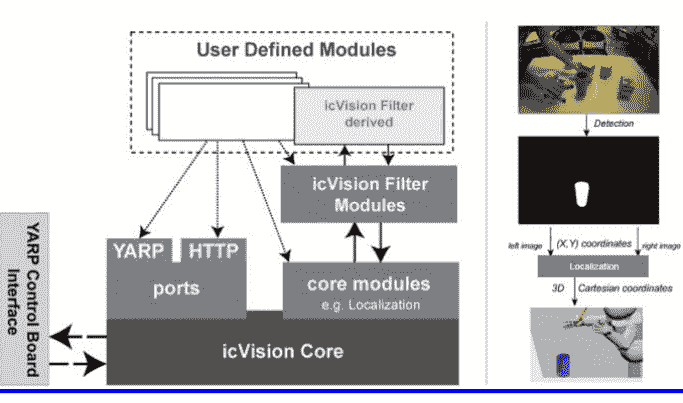

图 10.3 `icVision` 架构：核心模块（底部）主要用于管理工作以及访问和分配机器人的图像和电机位置。目标检测在过滤器模块（顶部）中执行，通过将感兴趣物体从背景中分离来实现。右侧显示了典型流程：从相机中获取输入图像，通过经过训练的 Filter 模块（Filter Module）检测特定物体，然后将输出（同机器人的当前姿态）用于通过定位模块估计 3D 位置。随后将物体放置在世界模型中。

已经学习了各种过滤器，且大多数过滤器能够执行近实时的目标检测。为了与物体交互，机器人还需要知道物体所在的位置开发一种可以部署在真实人形机器人上的执行稳健定位的方法，是为了为在线运动规划、抓取和物体操纵提供必要的输入。`icVision` 提供了模块，可以根据机器人的姿态和物体在相机图像中的位置来估计 3D 位置。

## 10.4 与环境交互

在过去的几十年里，计算机视觉已成为日益重要的研究课题，机器人领域也是如此。像人类和动物一样，机器人与其周围的世界交互。虽然大多数视觉研究倾向于仅通过被动观察来理解世界，但这些与环境的交互提供并创建了构建更好视觉系统所需的价值信息。将操纵命令与视觉输入相结合，允许机器人创建主动探索周围环境的方法。这些运动动作与观察之间的连接存在于人脑中，是人类发育的一个重要方面 [5]。

只有在观察了场景并且机器人对环境中的哪些物体有了概念后，才能开始以安全的方式与它们进行交互。在象棋示例中，即使知道棋盘的状态和位置，将某个棋子从一个网格移动到另一个网格而不碰到其他棋子，本身仍然是一个困难的问题。事实上，即使在很小的时候，儿童的手部动作（更平滑、“自然”、“流畅”且受控）也优于目前所有可用的人形机器人。但对于人类来说，操纵任意物体也并非易事。对于一个显而易见的原型精密抓取任务，儿童手部控制的发展直到 8-10 岁才趋成熟 [18]。此外，通过控制手手的神经元数量可以看出其复杂性高得惊人。即使在学会了操纵技能后，也要通过感知-动作循环不断调整以产生结果。在婴儿体内，视觉通路可能会产生各种专门化，用于提取和编码与视觉认知的信息，以及关于物体位置和可抓取性的信息 [28]。

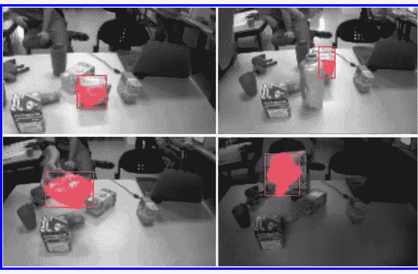

在在不断变化的姿态、不同的光照和部分遮挡的情况下检测复杂物体（例如茶盒）是机器人视觉中的一个难题。

这暗示了视觉与动作在人脑中非常紧密的整合。

近年来，机器人抓取物体取得了良好进展。各种操纵器（主要是手和夹爪）以及技术有了明显改进。还设计了新颖的“夹爪”概念，它们是许多问题的巧妙解决方案。一个例子是 [10] 制的颗粒夹爪，它由磨碎的咖啡豆制成，这些咖啡豆会“流”到物体周围，然后通过产生真空来固定位置。这最近被扩展到了全尺寸的象鼻式手臂“手”，最近的结果突显了抓取领域的先进水平。例如，[38] 的研究表明机器人能够捡起非刚性物体，如毛巾。他们的机器人能够通过一系列基于视觉的重新抓取和操纵（部分在空中，部分在桌子上），可靠且稳健地捡起随机掉落的毛巾。另一方面，已经提出了机器人仅从少数真实世界示例中学习的方法，这些示例在各种以前未知的物体上具有良好的效果 [52]。


近年来执行抓取操作的进展使得人们现在可以使用这些子程序并将它们进一步集成到自主系统中。各种组件之间的直接接口（这使得该领域虽然困难但很有趣）为了实现稳健的物体操纵，显然需要改进。只有通过结合整个机器人平台的感知和控制，才会出现一个功能完全的“拾取并放置”系统。为了能够从不同位置捡起各种物体，机器人需要看到、并在一个这些紧密集成的控制系统中行动。

## 10.4.1 避障与世界模型：MoBeE

一个重要问题是确保我们人形人的安全运行。模块化行为环境 (`MoBeE`) [19] 是一种实现复杂的、自适应的进一步安全的机器人行为的软件基础设施。它作为三个松耦合模块团队之间的中介：传感器（`Sensor`）、代理体（`Agent`）和控制器（`Controller`）。这些分别对应计算机视觉、运动规划和反馈控制中的抽象解决方案。系统概述如图10.5所示。该框架独立于机器人，可以部署任何由 `YARP` [41] 控制的设备。它支持多个相互作用的机器人，由于其弱耦合，行为组件是可移植且可复用的。`MoBeE` 根据以下二阶动力系统不断控制机器人：

```
$Mq(t) + Cq(t) + K(q(t) - q') = \sum f_i(t)$
```

其中 `$q(t) \in R^n$` 是代表机器人配置的向量函数，`M`, `C`, `K` 是包含质量、阻尼和弹簧常数的矩阵。

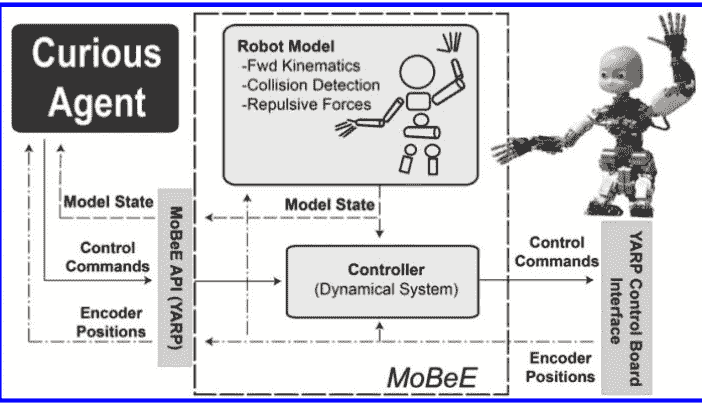

图 10.5 模块化行为环境架构：`MoBeE` 实现低级控制并强制必要的约束，以保持机器人的安全和实时运行。代理（左）能够发送高级命令，而运动学模型（顶）由编码器位置系统（右）驱动。该模型计算虚拟约束力，这些力使机器人避开碰撞、关节限制和其他不可行情况。这些力 `f_i(t)` 被传递给控制器（中间），控制器计算引导机器人实际运动的吸引子动力学。

`q'` 表示配置空间中的吸引子（静止姿态）。系统的约束通过 `f_i(t)` 强制施加于系统来实现，从而自动避免由于关节限制、长度变化和碰撞引起的运动学不可行性。

代理可以通过发送任意的高级控制命令与 `MoBeE` 交互，而不是直接与机器人交互。例如，当代理将一个新的吸引子设为所需的姿态时（例如通过计算操作空间点的运动学），`q(t)` 开始向 `q'` 移动。动作随后在动力系统稳定或发生超时时终止，取决于瞬态响应期间遇到的约束力 `f_i(t)`。

## 10.4.2 动作库：TRM & LEOGrasper

该场景的动作库主要由一个抓取子系统和一个生成全身运动的框架组成。`LEOGrasper` 是一个

# 整合视觉与动作以创建认知机器人 ■ 205

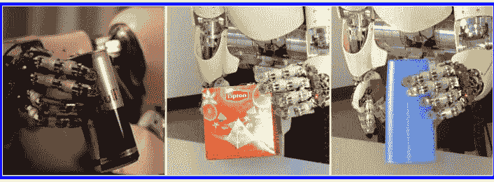

图 10.6 成功抓取各种物体，如锡罐、塑料杯和茶盒。该模块同时适用于左、右手。

一种轻量级、易用的单次抓取系统（图 10.6）。它可以被配置为执行各种抓取动作，所有动作都需要以协调的方式关闭手指。`iCub` 在指尖集成了触觉传感器，由于噪声较大，我们使用手指电机 PID 控制器报告的误差来判断它们何时与物体接触。可以离线生成各种更复杂的动作/路线图，并在稍后在 `iCub` 上执行 [55]，例如可以改进感知能力 [36]。

为了生成一组用于执行的更复杂的动作，我们提取了 `MoBeE` 的运动学模型并将其与基于机器学习的优化器连接。该系统旨在找到一个机器人姿态 `q_goal \in C`，其中 `C` 描述配置空间，并满足某些操作约束，同时规划一条可行的配置空间轨迹 `Q \subset C`，该轨迹是从当前姿态 `q_initial` 到目标姿态 `q_goal` 的曲线。

自然进化策略 (`NES`) 被用于寻找一组与任务相关的姿态，以产生任务相关路线图 (`TRM`)。它找到一组在未定义的任意代价函数下优化的姿态族，同时最大程度地覆盖用户定义的任务空间。连接这些姿态创建了一个更密、可遍历的图，我们称之为路线图。换句话说，任务相关的约束被直接构建在 `TRM` 中，运动规划简化为图搜索。这允许在 `iCub` 人形机器人上半身的 41 维配置空间中构建能够执行有用任务的 `TRM`。此外，这些地图可以存储以创建动作库，在执行特定任务时进行调用。图 10.7 显示了在 `TRM` 内生成的动作的时间延快照。它展示了可以生成什么样的动作。

> 源代码可用地址为：`https://github.com/juxi/iCub/`

# 206 认知机器人

## 10.5 整合

为了让机器人能够从不同位置捡起各种物体，它需要在一个集成控制系统中进行观察、行动和反应。

例如，已有方法允许 5 自由度机械臂通过生成的物体和物体点云模型来捡取物体，以计算触达和抓取行为 [52]。2010 年，提出了一种用于机器人捡取非刚性物体（如毛巾）的技术 [38]。它允许通过一系列基于视觉的重新抓取和操作（部分在空中，部分在桌子上），可靠地从桌子上捡起毛巾。当具备足够的操作技能时，这些技能需要通过感知-动作循环不断不断调整以产生结果。“《机器人、视觉与控制》[16] 将上述组件的这种闭环置于焦点中心，并描述了在尝试构建具有高水平感知运动集成的系统时常见的陷阱和问题。在 DARPA ARM 项目中（其目标是创建能够在各种应用中服务多种用途的高度自主操作器），团队展示了一个端到端的系统，通过结合触觉和 LASER 探测，允许机器人从桌子上抓取并捡起各种物体（例如：电钻、钥匙、螺丝刀等）[26]。

## 10.5.1 闭动作-感知循环

目标是为 `iCub` 生成捡取和放置的操作。为此，运动和视觉系统被整合以创建一个闭环的动作-感知循环。视觉侧持续检测并定位物体，而电机侧在尝试触达目标物体同时避开障碍。当手靠近目标时，会触发对物体的抓取。感知侧和运动侧本身建立了相当多的能力，为了在成功抓取物体的同时避开障碍，它们需要紧密合作。对障碍物和的持续跟踪

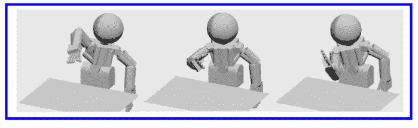

图 10.7 “好奇地检查某个小物体”：手的 3D 位置受到限制，任务空间是其相对于视线方向的角度。生成的地图在眼睛前方旋转手（以及任何抓取的物体）。

# 整合视觉与动作以创建认知机器人 ■ 207

目标物体被用于创建一种反应性触达行为，该行为能够实时适应环境的变化。

通过在 `MoBeE` 和 `icVision` 之间建立接口，机器人能够对检测到的物体持续执行视觉定位，并将此信息传播到世界模型。这种基础的手眼协调允许在执行触达行为时适应不断变化的情况，提高了我们机器人的自主性。

## 10.6 结果

第一个实验表明，本文介绍的系统能够在环境变化时反应性地移动手臂避开危险区域。展示了如何使用该系统反应性地触达并抓取物体。

## 10.6.1 避开移动障碍物

环境中的静态物体可以直接添加到 `MoBeE` 的世界模型中。一旦（例如）桌子进入模型，动作和行为就会根据计算出的约束力进行调整。这些力（即等式 (1) 中的 `f(t)`）排斥机器人防止与桌子碰撞，支配着机器人的实际运动。我们能够向系统发送任意动作，确保机器人的安全（最近显示这能为学习机器人行为提供良好的强化信号 [46, 20]）。所展示的系统对于任意非静态物体具有相同的功能。在两个摄像头中检测到物体后，会估计物体的位置（通过 `icVision`）并传播到 `MoBeE`。计算虚设力以避免碰撞碰撞。图 10.8 显示了定位的物体如何阻挡手臂和手。为了确保相当脆弱的手指，可以看到末端执行器周围有一个球体。它是红色的，表示可能碰撞，因为球体与物体交叉。下臂也是如此。使用雅可比矩阵在每个身体部位计算的力会将交叉的几何体推开，导致手臂（和臂）远离障碍物。图 10.9 显示了机器人手臂如何避开非静态障碍物。当杯移动到手臂时，手臂最初被“推”到一边。直到手臂达到极限，力开始积累，末端执行器被“强制”向上以继续避开障碍。在没有障碍物的情况下，手臂开始回到静止姿态 `q`。

> ⁴ 查看视频：`https://www.youtube.com/watch?v=w_qDH5t7g`

> ⁵ 查看视频：`https://www.youtube.com/watch?v=w_qDH5t7g`

## 10.6.2 触达并抓取物体

该实验是一个 `iCub` 简单的反应放置程序。与上述实验类似，我们使用 `MoBeE` 在物体移动时适应反应性行为。为了实现这一点，我们将世界模型内部的物体类型从“障碍”更改为“目标”。由于这一变化，物体和机器人部件之间不再计算排斥力。事实上，我们现在可以使用从末端执行器到目标物体的向量作为力，驱动手指向良好的抓取位置。

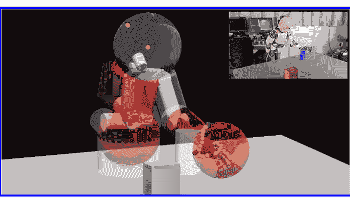

图 10.8 显示了在我们实验期间 `MoBeE` 世界模型的视觉输出。红色部分表示（与环境（自身）的阻碍碰撞）。插图显示了实际场景。

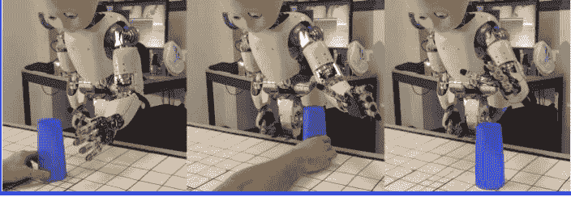

图 10.9 左臂的反应性控制，允许 `iCub` 避开非静态“障碍物”以及桌子。

# 视觉与动作整合以创建认知类机器人 ■ 209

`MoBeE`允许在发生碰撞时触发某些响应。在这种情况下，当我们希望机器人拾取物体时，每当手部进入物体附近的区域，我们就可以激活抓取子系统。我们使用一种典型的抓取式闭手动作，该动作已在各种演示和视频中成功应用。图 10.6 显示了 `iCub` 使用我们的抓取子系统（通过增加额外力）成功选取了各种物体并执行了该动作。

我们的框架能够同时追踪多个物体，这在图 10.8 中也可见，它同时跟踪杯子和茶盒。通过简单更改 `MoBeE` 中的物体类型，机器人会朝特定物体伸手而避开另一个。

## 10.7 结论

这里介绍了一种面向视觉引导物体的人类机器人的认知机器人方法。基于过去几年开发的两个框架，紧密集的感知运动系统使机器人能够执行简单的取放任务。机器人到达放置在桌上随机位置的检测物体。

该实现使机器人能够适应环境的变化。通过这种方式，它保护了 `iCub` 免受非预期交互——即碰撞。这通过视觉系统与运动侧的紧密集成得以实现。具体来说基于机器人姿态和世界模型的吸引子动力学。实现了此前在 `iCub` 上未曾看到的眼手协调水平。

未来计划整合机器学习以进一步提高我们机器人系统的物体操纵技能。改进动作的预测和选择将带来一个更具适应性、更多功能的机器人。此外，研究更紧密的传言耦合可能具有意义，例如，通过在视觉/配置空间中工作来避免转换到操作空间。

## 10.8 参考文献

- [1] R. Ambrose, B. Wilcox, B. Reed, L. Mattheies, D. Lavery, and D. Kosmeyer. NASA’s Space Technology Roadmaps (STRs): Robotics, tele-robotics, and autonomous systems systems roadmap. Technical report, National Aeronautics and Space Administration (NASA), 2012.

- [2] M. Asada, K. Hosoda, Y. Kuniyoshi, H. Ishiguro, T. Inui, Y. Ishikawa, M. Ogino, and C. Yoshida. Cognitive developmental robotics: A survey. IEEE Transactions Autonomous Development, 1:12–34. 2009. > 视频请参见：`http://robotics.idsia.ch/media/`

- [3] M. Asada, K.F. MacDorman, H. Ishigiro, and Y. Kuniyoshi. Cognitive developmental robotics as a new paradigm for the design of humanoid robots. Robotics and Autonomous Systems, 37(2):185–193, 2001.

- [4] Tucker Bald and Ronald C. Arkin. Behavior-based formation control for multirobot. IEEE Transactions on Robotics and Automation, 14(6):926–939, 1998.

- [5] N.E. Berthher, R.K. Clifton, W. Gullapalli, and D.D. McCall. Visual information and object size in the control of reaching. Journal of Motor Behavior, 28(3):187–197, 1996.

- [6] J. Bongard, Y. Zykov, and H. Lipson. Resilient machines with continuous self-modifying. Science, 314(5802):1118–1221, 2006.

- [7] G. Bradski. The OpenCV Library. Dr. Robb’s Journal of Software Tools, 2000.

- [8] R.A. Brooks. Intelligence without representation. Artificial intelligence, 47(1):139–159, 1991.

- [9] R.A. Brooks. Cambrian intelligence: the early history of AI. MIT Press, 1999.

- [10] E. Brown, N. Rodenberg, J. Amend, A. Mozeika, E. Steltz, M.R. Zakin, H. Lipson, and M. Jaeger. Universal robotic gripper for jamming of granular material. Proceedings of the National Academy of Sciences (PNAS), 107(44):18809–18814, 2010.

- [11] A. Angelosi, T. Belpaeme, S. Sandini, G. Metta, L. Fadiga, G. Sager, K. Rohfling, B. Wrede, S. Nolfi, D. Parisi, K. Dautenhahn, J. Saunders, K. Fischer, J. Tani, and D. Roy. The ITALK project: Integration and transfer of action and language in robots. Proceedings of the International Conference on Human Interaction (HRI), 2008.

- [12] A. Chella, M. Frixione, and S. Gaglio. A cognitive architecture for robot self-consciousness. Artificial Intelligence in Medicine, 44(2):147–154, 2008.

- [13] N. Cheng, M.B. Lovovsky, S.J. Keating, A.M. Setapen, K.I. Aero, A.E. Hosoki, and K.D. Iagnum. Design and analysis of a low-cost, highly articulated manipulator by jamming of granular media. In Proceedings of the International Conference on Robotics and Automation (ICRA), pages 4328–4333, 2012.

- [14] Peter C. Chu. SMART Underwater Robot (SUR) Application & Mining, 2011. Technical Presentation.

- [15] D. Cliff, P. Husbands, and I. Harvey. Explorations in evolutionary robotics. Adaptive Behavior, 2(1):73–110, 1993.

- [16] P.I. Corke. Robotics, Vision and Control, volume 73 of Springer Tracts in Advanced Robotics. Springer, 2011.

- [17] B. Dachwald. Optimization of interplanetary solar sailcraft trajectories using evolutionary neurocontrol. Journal of Guidance, Control, and Dynamics, 27(1):66–72, 2004.

- [18] H. Forssberg, A.C. Eliasson, H. Kinoshita, R.S. Johansson, and G. West. Development of human precision grip: basic coordination of force. Experimental Brain Research, 85(2):451–457, 1991.

- [19] M. Frank, J. Leitner, M. Tollenga, S. Harding, A. Förster, and J. Schmidh. The modular behavioral environment for humanoids and other robots (MoBeE). In Proceedings of the International Conference on Informatics, Automation & Robotics (ICINCO), 2012.


# 参考文献

- [20] Mikhail Frank, Jürgen Leitner, Marilyn Tollenga, Alexander Förster, and Jürgen Schmidhuber. Curiosity driven reinforcement learning for motion planning on humanoids. Frontiers in Neurobotics, 7(25), 2014.

- [21] Rafael C. Gonzalez and Richard E. Woods. Digital Image Processing. Prentice-Hall, 2006.

- [22] Simon Hardin, Jürgen Leitner, and Jürgen Schmidhuber. Genetic programming for image processing. In Genetic Theory and Practice, Vladislav Munakata, Mary Jak, editors, pages 31–44. Springer. New York, 2013.

- [23] J. Leitner, P. Harvey, and D. Cliff. Evolutionary robotics: the approach. Springer, 1997.

- [24] J. Horn. Robot vision. MIT Press, 1986.

- [25] J. Horn. Machine learning. 2007.

- [26] J. Leitner, S. Harding, M. Frank, A. Forster, and J. Schmidh. End-to-end interaction. In Proceedings of the International Conference on Robotics and Automation (ICRA), 2010.

- [27] M. Harvey. The cognitive neuroscience of action. 1997.

- [28] M. Frank. Processes of change in development. Cognitive sciences, 9(3):152–158, 2005.

- [29] J. Leitner, S. Harding, M. Frank, A. Forster, and J. Schmidh. Learning spatial perception from vision on a humanoid. International Journal of Advanced Systems, 9, 2012.

- [30] J. Leitner. Vision for robotics. Trends in Robotics, 1(1):1–78, 2009.

- [31] J. Leitner, C. Chandrasharia, and D. Izzo. Autonomous ANNs for spacecraft rendezvous and docking. In International Symposium on Artificial Intelligence, Robotics and Space (SAIRS), 2010.

- [32] J. Leitner, P. Harvey, D. Spina, and J. Schmidh. Developmental learning of robust visual object detection and identification. In Proceedings of the International Conference on Development and Learning and Epigenetic Robotics (ICDL), 2012.

- [33] J. Leitner, S. Harding, M. Frank, A. Forster, and J. Schmidh. iVision: A Modular Vision System for Cognitive Research. In Proceedings of the International Conference on Cognitive Systems (CogSys), 2012.

- [34] J. Leitner, S. Harding, M. Frank, A. Forster, and J. Schmidh. Transferring spatial perception between robots, 2012.

- [35] J. Leitner, S. Harding, M. Frank, A. Forster, and J. Schmidh. spatial perception between robots operating in a shared workspace. In Proceedings of the International Conference on Intelligent Robots and Systems (IROS), 2012.

- [36] Jürgen Leitner, Alexander Forster, and Jürgen Schmidhuber. Improving robot vision models for object detection through interaction. In 2014 International Joint Conference on Neural Networks. IJCNN 2014, Beijing, China, July 6-11, 2014, pages 3355–3362. IEEE, 2014.

- [37] M. Lungarella, G. Metta, R. Pfeifer, and G. Sandini. Developmental robotics: a survey. Connection Science, 15(4):151–190, 2003.

- [38] M. Maitin-Shepard, M. Cusumano-Tower, J. Lei, and P. Abbeel. Cloth grasp point detection based on multiple-view geometric curves with application to robotic folding. In Proceedings of the International Conference on Robotics and Automation (ICRA), pages 2308–2315, 2010.

- [39] M.E. McCarty, R.K. Clifton, D.H. Ahmed, P. Lee, and N. Goubet. How humans use vision for grasping objects. Child development, 72(4):973–987, 2001.

# 视觉与动作整合以创造认知机器人 ■ 213

[40] A.N. Melthoff. Infant imitation after a 1-week delay: Long-term memory for novel acts and multiple stimuli. Developmental Psychology, 24(4):470, 1998.

[41] G. Metta, P. Fitzpatrick, and L. Natale. YARP: Yet Another Robot Platform. International journal of Advanced Robotics Systems, Special Issue on Software Development and Integration in Robotics, 3(1), 2006.

[42] Giorgio Metta, Lorenzo Natale, Francesco Ricci, Giuliano Sandvi, David Vernon, Luciano Fadiga, Claes von Hofsten, Alexander Bernardino, and Luis Montesano. The iCub humanoid robot: open-systems for research in cognitive development. Neural Networks, 23(8-9):1125–1134, 2010.

[43] S. Nolfi and D. Floreano. Evolutionary robotics: The biology, intelligence, and technology of self-organizing machines. The MIT Press, 2000.

[44] S. Nolfi, D. Floreano, O. Miglno, and F. Mondada. How to evolve autonomous robots: Different approaches in evolutionary robotics. In Artificial Life, pages 190–197. MIT Press, 1994.

[45] E. Optop, N.S. Bradley, and M.A. Arbib. Infant grasping for a computational model. Experimental Brain Research, 158(4):480–503, 2004.

[46] Shashak Pathak, Luca Polina, Giorgio Metta, and Armando Tacccella. Ensuring safety of policies learned by reinforcement: Reaching objects in the presence of obstacles with the icub. In Proceedings of the International Conference on International Robots and Systems (IROS), 2013.

[47] J. Peters, S. Vijayakumar, and S. Schaal. Reinforcement learning for humanoid robots. In Proceedings of the International Conference on Humanoid Robots, 2003.

[48] R. Peifer, J. Bongard, and S. Grand. How the body shapes the way we think: a new view of intelligence. The MIT Press, 2007.

[49] M.I. Posner. Foundations of cognitive science. The MIT Press, 1989.

[50] Stuart Jonathan Russell and Peter Norvig. Artificial Intelligence: A Modern Approach. Prentice Hall, 3rd edition, 2010.

[51] A. Sadikov, M. Možina, M. Guid, J. Krivec, and I. Bratko. Automated chess tutor. In H.J. Herik, P. Ciancarini, and H.H.L.M. Donkers, editors, Computers and Games, volume 4630 of Lecture Notes in Computer Science, pages 13–25. Springer Berlin Heidelberg, 2007.

[52] A. Saxena, J. Driemer, and A.Y. Ng. Robotic grasping of novel objects using vision. The International journal of Robotics Research, 27(2):157, 2008.

[53] S. Schaal. Is imitation learning the route to humanoid robots? Trends in cognitive sciences, 3(6):233–242, 1999.

[54] M. Shanahahan. A cognitive architecture that combines internal simulation with a global workspace. Consciousness and Cognition, 15(2):433–449, 2006.

[55] M. Stollenga, L. Pape, M. Frank, J. Leitner, A. Förster, and J. Schmidhuber. Task-relevant demands: A framework for humanoid motion planning. In Proceedings of the International Conference on Intelligent Robots and Systems (IROS), 2013.

[56] R.S. Sutton and A.G. Barto. Reinforcement learning: An introduction. Cambridge Univ Press, 1998.

[57] N.G. Tsarakakis, G. Metta, S. Sandini, D. Vernon, R. Beira, F. Becchi, L. Righetti, J. Santos-Victor, A.J. Ijspeert, M.C. Carrozza, and D.G. Caldwell. iCub: the design and realization of an open humanoid platform for cognitive and neuroscience research. Advanced Robotics, 21:1151–1175, 2007.

[58] D. Vernon, G. Metta, and G. Sanini. A survey of artificial cognitive systems: Implications for the autonomous development of mental capabilities in computational agents. IEEE Transactions on Evolutionary Computation, 11(2):151–180, 2007.

[59] D. Vernon, G. Metta, and G. Sanini. The iCub Cognitive Architecture: Interactive Development in a Humanoid Robot. In Proceedings of the International Conference on Development and Learning (ICDL), 2007.

[60] WAY. EU Project Consortium: Wearable Interfaces for Hand Function Recovery. `http://www.wayproject.eu/`, January 2012.

[61] J. Weng. Developmental robotics: Theory and experiments. International journal of Humanoid Robotics, 1(2):199–236, 2004.

[62] D.M. Wolpert, Z. Ghahramani, and J.R. Flanagan. Perspectives and problems in machine learning. Trends in cognitive sciences, 5(11):487–494, 2001.

[63] J. Wyatt and N. Hawes. Multiple workspaces as an architecture for cognition. In A.V. Samsononovich, editor, AAAI Fall Symposium on Biologically Inspired Cognitive Architectures. The AAAI Press, 2008.

# 索引

- 亚伯拉罕宗教，28
- ABSTRIPS, 177；*另见* STRIPS/动作学习, 179
- 执行器，103–104, 106
- 自适应智能，81
- 可负担性学习，181
- 亚马逊人，34
- 美洲印第社会，36
- 艺术与手工艺，35
- 家庭，37–38
- 多才学者，36
- 社交性，受控的，39–40
- 价值观，34
- 万物有灵论，27, 28, 30
- 芙洛忒斯，29
- 苹果，26
- 能力，174
- 托马斯·阿奎那，29
- 人工智能 (AI)，72
- 拟人，26
- 神经网络，77
- 亚里士多德，64
- 阿萨罗，彼得，9
- i机器人，116
- 日本机器人协会，24
- 基督教教，25，26
- 大脑教，26
- 泛灵论，27, 28
- 万物教，51
- 婴儿抓取，计算模型
- 58
- 自动执行器，10
- 基于行为的机器人，176


# 索引

- 贝尼迪克，迈克尔，30
- 弗兰肯斯坦，66
- 进化机器人，195–196
- 存在主义，27
- 万物有灵论的观点，83
- 海德格尔，哲学
- 布鲁克斯，罗德尼，174
- 人类机器人项目，58
- 人类交互 (HRI)，144
- 人类认知，121
- 人类语言，147–149
- 人类情感，152–153
- 人类社会，157–158
- 人类学习：116–117
- 人类性，151–154
- 社交关系，158–161
- 反馈系统，175
- 前馈系统，176
- 福格，特伦斯，128
- 森林，安妮，66
- 弗兰肯斯坦，6
- 机器学习，193
- 马丁的土壤，82–83
- 马萨诸理工学院 (MIT)，26, 29
- 马格努斯，阿尔伯特，28–29
- 黑客帝国三，30
- MIT媒体实验室，26
- 模块化行为环境 (MoBE)，203–204
- i机器人
- 森里，真希，116
- 运动言语，179
- 互惠主义，30
- MYCIN，10
- 日本
- 人工智能与机器人学的进展，25–26；另见人工智能 (AI)机器人
- 对万物有灵论的观点，27
- 文化，25
- 社会，25
- 未来用途愿景，29–30
- 纳斯，克福德，132
- 过失与产品责任法，机器人相关
- 机器人导致的死亡，11–13
- 诉讼，13
- 法律责任，概念，15
- 保险，事故数据收集，19，强制性，17，18，无过错，17，概述，17，费用，19，20
- 激光传感，206
- Leabra TI，17
- 学习行星，56–57, 66
- LEO抓爪器，204–205
- 利敦公司，12
- 莱曼-威尔齐格，萨姆，6
- 机器学习，193
- 马丁的土壤，82–83
- 马萨诸理工学院 (MIT)，26, 29
- 马格努斯，阿尔伯特，28–29
- 黑客帝国三，30
- MIT媒体实验室，26
- 模块化行为环境 (MoBE)，203–204
- i机器人
- 森里，真希，116
- 运动言语，179
- 互惠主义，30
- MYCIN，10
- 日本
- 人工智能与机器人学的进展，25–26；另见人工智能 (AI)机器人
- 对万物有灵论的观点，27
- 文化，25
- 社会，25
- 未来用途愿景，29–30
- 纳斯，克福德，132
- 过失与产品责任法，机器人相关
- 机器人导致的死亡，11–13
- 诉讼，13
- 法律责任，概念，15


[50] Stuart Jonathan Russell and Peter Norvig. 人工智能：一种现代方法. Prentice Hall, 第3版, 2010.

[51] A. Sadikov, M. Možina, M. Guid, J. Krivec, and I. Bratko. 自动象棋辅导. In H.J. Herik, P. Ciancarini, and H.H.L.M. Donkers, editors, `Computers and Games`, volume 4630 of `Lecture Notes in Computer Science`, pages 13–25. Springer Berlin Heidelberg, 2007.

[52] A. Saxena, J. Driemer, and A.Y. Ng. 使用视觉的机器人抓取新物体. `The International journal of Robotics Research`, 27(2):157, 2008.

[53] S. Schaal. 模仿学习是类人机器人的路径吗？`Trends in cognitive sciences`, 3(6):233–242, 1999.

[54] M. Shanahahan. 结合内部模拟与全局工作空间的认知架构. `Consciousness and Cognition`, 15(2):433–449, 2006.

[55] M. Stollenga, L. Pape, M. Frank, J. Leitner, A. Förster, and J. Schmidhuber. 任务相关需求：类人运动规划的框架. In `Proceedings of the International Conference on Intelligent Robots and Systems (IROS)`, 2013.

[56] R.S. Sutton and A.G. Barto. 强化学习：导论. Cambridge Univ Press, 1998.

[57] N.G. Tsarakakis, G. Metta, S. Sandini, D. Vernon, R. Beira, F. Becchi, L. Righetti, J. Santos-Victor, A.J. Ijspeert, M.C. Carrozza, and D.G. Caldwell. iCub：用于认知和神经科学研究的开放类人平台的设计与实现. `Advanced Robotics`, 21:1151–1175, 2007.

[58] D. Vernon, G. Metta, and G. Sanini. 人工认知系统概述：对计算代理心理能力自主发展的启示. `IEEE Transactions on Evolutionary Computation`, 11(2):151–180, 2007.

[59] D. Vernon, G. Metta, and G. Sanini. iCub认知架构：类人机器人中的交互式开发. In `Proceedings of the International Conference on Development and Learning (ICDL)`, 2007.

[60] WAY. 欧盟项目联盟：用于手功能康复的可穿戴接口.`http://www.wayproject.eu/`, 2012年1月.

[61] J. Weng. 发展机器人：理论与实验. `International journal of Humanoid Robotics`, 1(2):199–236, 2004.

[62] D.M. Wolpert, Z. Ghahramani, and J.R. Flanagan. 机器学习的视角与问题. `Trends in cognitive sciences`, 5(11):487–494, 2001.

[63] J. Wyatt and N. Hawes. 作为认知架构的多多工作空间. In A.V. Samsononovich, editor, AAAI Fall Symposium on Biologically Inspired Cognitive Architectures. The AAAI Press, 2008.

# 索引

- 亚伯拉罕宗教，28
- ABSTRIPS, 177；`另见` STRIPS/动作学习, 179
- 执行器，103–104, 106
- 自适应智能，81
- 可负担性学习，181
- 亚马逊人，34
- 美洲印第社会，36
- 艺术与手工艺，35
- 家庭，37–38
- 多才学者，36
- 社交性，受控的，39–40
- 价值观，34
- 万物有灵论，27, 28, 30
- 芙洛忒斯，29
- 苹果，26
- 能力，174
- 托马斯·阿奎那，29
- 人工智能 (AI)，72
- 拟人，26
- 神经网络，77
- 亚里士多德，64
- 阿萨罗，彼得，9
- i机器人，206
- iVision，200–201
- 示意理论，180
- 想象物理，90
- 比喻，形状与本质，101
- 卡恰尔基集 (K-sets)，82
- 凯利，理查德，5
- Khepera微型机器人，82
- 动力学习，92
- 动力波，94–97
- 土住民，30
- 个人主义，37
- 保险，事故数据收集，19，强制性，17，18，无过错，17，概述，17，费用，19，20，车辆，17
- 激光传感，206
- Leabra TI，17
- 学习行星，56–57, 66
- LEO抓爪器，204–205
- 利敦公司，12
- 莱曼-威尔齐格，萨姆，6
- 机器学习，193
- 马丁的土壤，82–83
- 马萨诸理工学院 (MIT)，26, 29
- 马格努斯，阿尔伯特，28–29
- 黑客帝国三，30
- MIT媒体实验室，26
- 模块化行为环境 (MoBE)，203–204
- i机器人
- 森里，真希，116
- 运动言语，179
- 互惠主义，30
- MYCIN，10
- 日本
- 人工智能与机器人学的进展，25–26；另见人工智能 (AI)机器人
- 对万物有灵论的观点，27
- 文化，25
- 社会，25
- 未来用途愿景，29–30
- 纳斯，克福德，132
- 过失与产品责任法，机器人相关
- 机器人导致的死亡，11–13
- 诉讼，13
- 法律责任，概念，15


[54] M. Shanahahan. A cognitive architecture that combines internal simulation with a global workspace. Consciousness and Cognition, 15(2):433–449, 2006.

[55] M. Stollenga, L. Pape, M. Frank, J. Leitner, A. Förster, and J. Schmidhuber. Task-relevant demands: A framework for humanoid motion planning. In Proceedings of the International Conference on Intelligent Robots and Systems (IROS), 2013.

[56] R.S. Sutton and A.G. Barto. Reinforcement learning: An introduction. Cambridge Univ Press, 1998.

[57] N.G. Tsarakakis, G. Metta, S. Sandini, D. Vernon, R. Beira, F. Becchi, L. Righetti, J. Santos-Victor, A.J. Ijspeert, M.C. Carrozza, and D.G. Caldwell. iCub: the design and realization of an open humanoid platform for cognitive and neuroscience research. Advanced Robotics, 21:1151–1175, 2007.

[58] D. Vernon, G. Metta, and G. Sanini. A survey of artificial cognitive systems: Implications for the autonomous development of mental capabilities in computational agents. IEEE Transactions on Evolutionary Computation, 11(2):151–180, 2007.

[59] D. Vernon, G. Metta, and G. Sanini. The iCub Cognitive Architecture: Interactive Development in a Humanoid Robot. In Proceedings of the International Conference on Development and Learning (ICDL), 2007.

[60] WAY. EU Project Consortium: Wearable Interfaces for Hand Function Recovery. http://www.wayproject.eu/, January 2012.

[61] J. Weng. Developmental robotics: Theory and experiments. International journal of Humanoid Robotics, 1(2):199–236, 2004.

[62] D.M. Wolpert, Z. Ghahramani, and J.R. Flanagan. Perspectives and problems in machine learning. Trends in cognitive sciences, 5(11):487–494, 2001.

[63] J. Wyatt and N. Hawes. Multiple workspaces as an architecture for cognition. In A.V. Samsononovich, editor, AAAI Fall Symposium on Biologically Inspired Cognitive Architectures. The AAAI Press, 2008.

# 索引

- 亚伯拉罕宗教，28
- ABSTRIPS，177；*另见* STRIPS/动作学习，179
- 执行器，103–104, 106
- 自适应智能，81
- 可负担性学习，181
- 亚马逊人，34
- 美洲印第社会，36
- 艺术与手工艺，35
- 家庭，37–38
- 多才学者，36
- 社交性，受控的，39–40
- 价值观，34
- 万物有灵论，27, 28, 30
- 芙洛忒斯，29
- 苹果，26
- 能力，174
- 托马斯·阿奎那，29
- 人工智能 (AI)，72
- 拟人，26
- 神经网络，77
- 亚里士多德，64
- 阿萨罗，彼得，9
- i机器人，206
- iVision，200–201
- 示意理论，180
- 想象物理，90
- 比喻，形状与本质，101
- 卡恰尔基集 (K-sets)，82
- 凯利，理查德，5
- Khepera微型机器人，82
- 动力学习，92
- 动力波，94–97
- 土住民，30
- 个人主义，37
- 保险，事故数据收集，19，强制性，17, 18，无过错，17，概述，17，费用，19, 20，车辆，17
- 激光传感，206
- Leabra TI，17
- 学习行星，56–57, 66
- LEO抓爪器，204–205
- 利敦公司，12
- 莱曼-威尔齐格，萨姆，6
- 机器学习，193
- 马丁的土壤，82–83
- 马萨诸理工学院 (MIT)，26, 29
- 马格努斯，阿尔伯特，28–29
- 黑客帝国三，30
- MIT媒体实验室，26
- 模块化行为环境 (MoBE)，203–204
- i机器人
- 森里，真希，116
- 运动言语，179
- 互惠主义，30
- MYCIN，10
- 日本
- 人工智能与机器人学的进展，25–26；另见人工智能 (AI)机器人
- 对万物有灵论的观点，27
- 文化，25
- 社会，25
- 未来用途愿景，29–30

# 218 索引

- 机器人的误用/修改，15, 20, 21
- 疏忽，定义，13
- 疏忽，法律上的认定，13-14
- 技能组，194-195
- 认知机器人；参见认知机器人
机器人社会，3, 20
机器人
- 接受度，35
- 行动，能力，122
- 进展，4, 20
- 架构，77–80，
- 人工智能 (AI)；参见人工智能机器人 (AI) robotics)
- 概述，11–16
- 产品责任法，14
- 新认知革命，173
- 神经网络，81
- 神经 (Neuro)，72, 192
- 下一代机器人 (Next Generation Robotics)，3–4
- Ngobe，31, 32–33, 36, 38
- Noisy-OR 模型，156
- 提供的协助，4
- 自主性，77, 119–120, 83
- 舞伴机器人；参见舞蕾机器人 (Ballroom dance robots)
- 基于行为的机器人；参见基于行为的机器人学 (Behavior-based robotics)
- 基于行为的机器人学
- 黑盒，用途；参见黑盒 (Black boxes)
- 汽车；参见机器人汽车
- 半人马马配置，59, 63
- 认知的；参见认知机器人 (cognitive robots)
- 社区，38–40
- 复杂性，4, 191
- 控制，72, 76
- 文化，35
- 并行布布式处理 (PDP)，174
- 知觉行为控制 (Perceived behavioral Control)
- 行为信念，133
- 控制信念，132
- 规范信念，133–134
- 种系 (Phylogeny)，77
- 皮亚罗人 (Piaroa peoples)，35
- 计划行为理论 (Planned Behavior, Theory of)，129–132
- 柏拉图，71
- 普里戈日津 (Ilya Prigogine)，50, 51
- 皮格马利翁 (Pygmal)，29
- 定制，35
- 产生的经济活动，3–4
- 情感，74–85
- 伦理；参见机器人伦理 (Ethics of robots)
- 日常活动规划，182–187
- 关于未来的预测，60, 61
- 抓爪器，203
- 人类，与之融合，60
- - 人机交互；参见人机交互 (HRI)
- 德格尔 (Rauderder, Matthias)，134
- 组件识别理论 (Recognition-by-components theory)，181
- 瑞维斯 (Reeves, Byron)，132
- 理查德森 (Richardson, Kathleen)，29
- 道路交通法，17
机器人汽车
- 事故，16, 17
- 概述，16
- 机器人世界杯 (RoboCup)，47–49, 52, 53, 55, 64
- 机械手臂，83
机器人学习
- 发展学习，195
- 演化学习，195–196
- 保险政策；参见 ner, 83
- 意向状态，77
- 学习；参见机器人学习

# 索引 219

- + 含义，73
- + 误用/修改，15, 20, 21
- 动机，77–78
- 运动规划，178
- 多形态的，39
- 疏忽与产品责任法；参见机器人相关的疏忽与产品责任法 (Negligence and product liability laws, robot-related)
- 自我发展，117
- 自组织，81
- 自复制，34
- 使用转变，172
- 社会；参见社会机器人 (Social Robots)
- 状态，80–81
- 手术期间的使用；参见机器人手术 (Surgery, use of robots)
- 执行的任务，60, 79
- 分类法，77
- 信任问题阅读，9–11
- 多功能性，61
- 视觉/视觉系统或，199–200
- RolyPoly，96–97
- Roomba，5
- 萨姆通用机器人 (Rossum’s Universal Robots)，11
- 萨曼 (Samani, Hooman)，47, 52
- 雅雅 (Saya)，29
- 自主驱动变化，91
- 自适应目标生成-鲁棒智能好奇心算法 (SAGG-RIAC)，83
- 形状变化界面
- bObles，92–94
- 设计，91
- 交互式人工制品，91
- 光，随形状变化，94–97
- 概述，91
- 潜力，91
- + 自主驱动变化；参见自主驱动变化 (self-actuated change)
- 表面形状变化，97–99
- 神道教，27, 28
- 情境污染 (Situated contamination)，72
- 斯金纳 (B. F. Skinner)，173
- 智能手机，56
- 奇点，60
社会机器人，28, 77
- 应用，29–30
- 家用，29
- 使用量增长，128
- 与……交互，119
- 引言，29
- 概述，128
- 韩国机器人，3, 16
- SpeakUp，72
- 言语行为，147–148, 149, 165–166
- SRRAK 机器人，82
- 斯坦福大学，10, 18
- STRIPS 算法，174
- 结构耦合，75
- 机器人手术，10
- 任务相关地图 (TRM)，205
- 事件编码理论 (TEC)，179
- 时间循环，81
- 创战 (Tron)，30
- 沃尔 (Vallverdu, Jordi)，29
- 视觉反馈，200
- 视觉系统，199–202
- 沃维克 (Warwick, Kevin)，61, 62
可见 莱昂 (Wein, Leon)，5
西方社会
- 文化，30
- Gadget升级趋势，33
- 日本，*对比*；参见日本 (Japan)
- 心身焦虑，27
- 自然/文化焦虑，27
- 权力范式，30
- 威尔克斯 (Wilks, Yorick)，7
- 威廉姆斯 (Williams, Robert)，12
X光机，55
- 雅内沙人 (Yanesha)，36
- 扬 (Young, Philip)，36
- 禅宗，27
- 齐亚 (Ziaja, Sonya)，10, 11
