# COM+ 完全指南

## 专家见解

本书对COM+的核心功能和复杂性进行了重点讲解，包括：

- 使用COM+创建和管理事务。
- 将持久化存储实现到COM+组件中。
- 探索负载均衡和池化的技术。
- 使用COM+编程松耦合系统。
- 探索排队组件。

## 权威建议

采纳专家作者Richard Leinecker的建议，满足你所有的COM+需求。

## Unleashed

从知识到精通


## 类的线程模型键

| 创建者的单元模型 | 类的线程模型键 | 单元 | 自由线程 | 两者 | 中性 | 未指定 |
|---|---|---|---|---|---|---|
| 单线程 | 非“Main” | 在当前单元中创建 | 在多线程单元中创建 | 在当前单元中创建 | 在中性单元中创建 | 在“Main”单线程单元中创建 |
| 单线程 | “Main” | 在当前单元中创建 | 在多线程单元中创建 | 在当前单元中创建 | 在中性单元中创建 | 在当前单元中创建 |
| 多线程 |  | 在“Host”单线程单元中创建 | 在多线程单元中创建 | 在多线程单元中创建 | 在中性单元中创建 | 在“Main”单线程单元中创建 |
| 中性（在STA线程上） |  | 在此线程的单线程单元中创建 | 在多线程单元中创建 | 在中性单元中创建 | 在中性单元中创建 | 在“Main”单线程单元中创建 |
| 中性（在MTA线程上） |  | 在“Host”单线程单元中创建 | 在多线程单元中创建 | 在中性单元中创建 | 在中性单元中创建 | 在“Main”单线程单元中创建 |

- **副出版人** — *Bradley L. Jones*
- **执行编辑** — *Chris Webb*
- **采编编辑** — *Danielle Bird*
- **开发编辑** — *Steve Rowe*
- **责任编辑** — *Charlotte Clapp*
- **项目编辑** — *Carol Bowers*
- **文案编辑** — *Rhonda Tinch-Mize*
- **索引编制** — *Eric Schroeder*
- **校对** — *Tony Reitz; Maryann Steinhart*
- **技术编辑** — *Tom Archer; Christophe Nasarre*
- **媒体开发** — *Jason Haines*
- **内页设计** — *Gary Adair*
- **封面设计** — *Aren Howell*
- **制作** — *Darin Crone*

## 关于作者

**Rick Leinecker** 是一位资深软件开发者和作家，拥有超过 15 年的经验。他目前出版的图书包括 *Visual C++ 6 宝典* 和 *Sams 21 天自学 Visual J++*。他已撰写数百篇杂志文章，现在为 www.developer.com 和 www.sourceDNA.com 等开发者网站撰稿。

在零售店中，你可能会发现他的一些软件，如 *Perfect Checkmate* 和 *Bicycle Bridge*。多年来，他编写了数十款娱乐游戏作品，包括 *Trump Castle* 和 *Miami Vice*。

他曾在多家大公司担任多个领导职位，包括 MCI 数字成像部门的高级软件工程师和 Landmark Communications 的高级软件工程师。

访问 www.developer.com 和 www.sourceDNA.com，可以找到 Rick 的最新作品；他在那里每周撰写有关 DNA 技术的文章。他还主持 www.CodeGuru.com 上的 Windows 2000 论坛。您可以在 www.infinetvision.net 找到他开发完善的、名为 *ImageObject* 的成像库。

不写书和软件时，Rick 会参加剧院公会的演出，如 *Bye Bye Birdie* 和 *Camelot*。他还唱歌、弹吉他、吹法国号，并创作音乐。

## 告诉我们您的想法！

作为本书的读者，您是我们最重要的批评者和评论者。我们重视您的意见，想知道我们哪些地方做得好、哪些地方可以改进、您希望我们在哪些领域出版，以及您愿意与我们分享的任何其他高见。

作为 Sams Publishing 的副出版人，欢迎您提出意见。您可以通过传真、电子邮件或直接写信告诉我您喜欢或不喜欢本书的哪些方面，以及我们可以如何让图书更完善。

*请注意，我无法帮助解决与本书主题相关的技术问题，并且由于我收到的邮件量很大，我可能无法回复每一条消息。*

写信时，请务必包括本书书名和作者，以及您的姓名和电话或传真号码。我会仔细审阅您的意见，并与参与本书的作者和编辑分享。

- 传真：317-581-4770
- 电子邮件：adv_prog@cmp.com
- 邮寄：
  Bradley L. Jones
  副出版人
  Sams Publishing
  201 West 103rd Street
  Indianapolis, IN 46290 USA

## 引言

本书实现了以下几个目标：

- 在实际、高级解决方案的背景下释放 COM+ 的强大功能。
- 揭示 COM+ 的一些用法，这些用法也许是读者从未想象过的。
- 揭开 Windows DNA 及其强大服务器端产品框架（如 COM+ 目录）周围的神秘面纱。
- 指出在真实 COM+/DNA 项目中遇到的常见陷阱和微妙的不一致之处。

### 目标读者

本书绝不是一本关于 COM+ 的参考书或理论综述。它面向中高级 COM+ 程序员，帮助他们将 COM+ 应用提升到更高水平。本书假定读者具备 C++ 实用知识，并能自如地使用指针和 Windows 环境。

### 本书涵盖的内容

COM+ 是一个庞大的主题，要对其进行全面考察需要好几大卷文字。本书以 Microsoft DNA 框架为路线图，重点介绍如何编写高级 COM+ 应用程序。由于 MTS 和 MSMQ 等服务器端 DNA 产品的重要性及其与 COM+ 的融合，本书对它们进行了详细讨论。尽管 DNA 侧重于 n 层分布式 Internet 应用程序，但所讨论的编程技术适用于 COM+ 编程和一般的互操作性。

新手程序员常常忽视 COM+ 中的许多强大功能，因为它们复杂或文档不足。本书尽量缩短学习 COM+ 中更晦涩但更强大方面的曲线。尽管这些功能表面上晦涩难懂，但其中一些（如名字对象、自定义封送处理和持久存储）对于希望让应用程序尽可能可扩展、可靠和高效的 COM+ 开发者来说至关重要。

尽管我没有从理论角度介绍 COM+，但我也不能完全忽略这个主题。COM+ 中有一些引人入胜的算法和协议，我将在全书中概述它们，以帮助读者理解这项技术的局限性和能力。

### 本书不涵盖的内容

本书假定您了解并认同 COM+ 的优势及其底层工作原理。本书不解释 COM+ 的基本构建块。例如，您应熟悉 IUnknown 接口及其在 COM+ 中的作用。

本书不讨论 COM+ 与其他组件技术（如 CORBA）之间的比较。

IIS 是 DNA 不可或缺的组成部分。它超出本书范围，因为它处于 Web 技术的边界，而 COM+ 通常通过脚本和其他高级语言进行编程。如果您的目标是支持 Internet Web 的应用程序，可以尝试第 1 章和第 2 章提到的一些参考文本。

### 联系作者

我写书、投入个人时间参与新闻组和开发网站的主要动机之一，是我乐于帮助同行开发者。正因如此，也作为对您购买本书的“感谢”，如有关于本书或 DNA/Web 开发的一般问题，请随时与我联系。您可以在我专门为像您这样的 Web 开发者创建的网站 www.sourceDNA.com 上找到我。

### 下载示例

全书中的示例位于 CD-ROM 上，并附带一个安装实用程序，以便更轻松地找到您需要的内容。

出于某种原因，尽管许多开发者能毫无问题地告诉经理软件中的缺陷是生活常态，但这些开发者却无法理解书中的软件竟会不完美。尽管本书编辑在测试示例方面做了大量工作，但不幸的是，与任何其他软件项目一样，每个人的代码中确实都存在缺陷。因此，我强烈建议始终访问 ftp://www.mcp.com/product_support 或 http://www.sourceDNA.com 上的 MCP 网站，以获取最新版本的源代码。

### 软件要求

以下各节讨论 COM+ Unleashed 的软件要求。本书使用了多种不同的技术和编程工具。


## COM

COM 并没有指定任何特定的开发语言或工具，只要它能生成二进制 vtable 前导并注册组件即可。虽然从技术上讲，可以使用诸如汇编语言之类的非常底层的语言来生成 COM 组件，但在团队环境中做到这一点需要付出巨大的努力。Microsoft 已经推出了数十种工具和开发工具包，帮助开发者尽可能避开实现细节，从而专注于应用程序的设计和功能。

我将秉承这一理念，利用 Microsoft 提供的这些工具来帮助你更快、更少出错地完成工作。具体来说，本书中的代码片段使用带有 Service Pack 3 的 Visual C++ 6.0 以及活动模板库。在少数代码示例中，将使用 Visual Basic 6.0 和 VBScript 来演示实现 COM 的其他方法。

COM 库是 Windows NT、95/98 和 2000 中的标准组件。

## COM+

虽然 COM 受 Windows NT 和 95/98 支持，但只有 Windows 2000 支持 COM+。为了开发、测试和使用本书中的许多示例，你必须拥有一台安装了 Windows 2000 的计算机。

## MTS/MSMQ

MTS 和 MSMQ 可从 Microsoft 网站免费获得，并随 Option Pack 4.0 一同提供。MSMQ 至少需要一台 NT Server 4.0 机器充当主企业控制器。MTS 可在 Windows NT 和 95/98 上运行。

## 本书的组织结构

本书由四个部分组成，每一部分都建立在前一部分的基础上。我们力求让每一部分都自成一体，但你也可以轻松地按顺序阅读。

以下各个章节预览了本书的各个部分。

## Windows DNA 与 COM+

本部分探讨组件对象模型及其与 Microsoft DNA 框架的关系。主要服务器端产品和开发工具将在 DNA 的背景下进行介绍。你还将学习多级架构的合理设计原则（非常适合基于组件的编程）。

## 高级 COM+ 编程技术

假定读者具备中级到高级的 COM+ 编程水平，本节将解释 COM/COM+ 中更强大但有时也颇为神秘的特性。组件持久性、事件、标记、线程以及其他高级主题将得到详细讲解。

## 组件管理与事务

本部分介绍 Microsoft 事务服务器和 COM+ 服务。这些强大的资源和组件管理服务所做的远不止是事务中介。

## 异步组件编程

MSMQ 和 COM+ 排队组件在当今移动和断连的计算世界中提供了异步通信。这些技术为应用程序之间的通信提供了容错且可扩展的解决方案。

## Windows DNA 与 COM+

### 第一部分

### 本部分内容

- 1. COM+：Windows DNA 的黏合剂 7
- 2. 多级组件架构 29

## COM+：Windows DNA 的黏合剂

### 本章内容

- Windows DNA 8
- 这里讲互联网：HTML 和 XML 9
- Windows DNA 服务 10
- DNA：功能概述 20

## 第1章

## Windows DNA

DNA，即分布式互联网应用架构，是当前许多软件开发人员使用的一个热门流行词。它关乎创建在分布式 Microsoft 环境中运行的、可扩展且健壮的应用程序，或者更常见的是，通过互联网（或内联网）在浏览器中运行。互联网预计将呈指数级增长，且看不到平稳期。Microsoft 正在预见到这一增长，并希望不仅在用户或客户端方面凭借其 Internet Explorer 浏览器，而且在开发端都成为市场领导者。这就是 DNA 的用武之地。

### 融合

> 互联网正迅速成为许多新开发的首选平台。但现有的编程模型、技能和软件代码怎么办？与互联网的融合已迫在眉睫。通过将遗留代码封装到组件中，并使用 DNA 来指导新开发，就有可能吸收客户端-服务器世界的最佳部分（多层级、分布式工作、事务处理、排队），并添加互联网元素（脚本、无处不在的平台和可复用组件），从而创建一个能够容纳几乎所有现有技术的健壮框架。这使得企业能够逐步扩展遗留系统，并将其替换为可扩展、可复用且可靠的系统（有关遗留系统和 DNA 的详细信息，请参阅第 19 章“COM 事务集成器”）。

DNA 是一种抽象。不存在像 COM/DCOM/COM+ 那样用来构建 DNA 应用程序的规范，也没有 DNA 标志要求或用于规范 DNA 合规性的规则。

不过，Microsoft 确实将 DNA 推广为一个用于构建可扩展、多层级互联网应用程序的健壮框架。（多层级架构的设计在第 2 章“多级组件架构”中讲述。）

对于开发者来说，这个框架更像是一张路线图，标明应该使用哪些 Microsoft 工具和产品，以及它们在多层设计中的位置。例如，MSMQ 和 MTS 等 DNA 服务大大减少了实现互联网就绪应用程序的工作量，并提高了其可靠性。更重要的是，DNA 架构提供的许多服务对开发者来说几乎是免费的，尤其是在引入 COM+ 之后。在某些情况下（如 MTS），只需将一个组件拖放到服务的运行环境中，就能自动、透明地获得该服务的所有好处。你可以通过更改组件管理器中的一项设置来实现动态负载均衡。

有状态 Web 环境。根据应用程序的不同，状态（持久保存程序变量的能力）可能不是必需的。

### 无状态环境

浏览器尽管有着各种花哨的多媒体光环，但从实际用途来看，它们只是呆板的只读查看器。它们是无状态且非线性的；也就是说，它们可以随机地从一个页面跳到另一个页面，而不遵循任何预定义的路径。

如果没有 IIS 会话、DHTML 变量或 XML 脚本等 DNA 技术的帮助，基于浏览器的应用程序无法在页面之间保持状态。这对使用浏览器作为交互式部署平台的软件开发人员（无论是 COM 还是其他）来说是一个巨大的挑战。

对于传统的 Windows 应用程序来说，保持状态从来都不是问题，这些应用程序是事件驱动的，或者遵循有限状态机模式。HTML、XML 以及 DNA 改变了 Windows 编程范式（一种受控的 GUI 环境），迫使开发者思考无状态问题。更复杂的是，DNA 应用程序的用户（Web 浏览器）对其工作环境的约束更少，可以不受约束地随意漫游。

客户端或浏览器可以随机地跳转服务器的 Web，而无需经过任何预定义的步骤或状态。如果你熟悉自动机理论，那么浏览器就像一个非确定性有限自动机，每个状态既是起始状态又是最终状态。

通过将数据嵌入 URL，可以在页面之间携带信息，但这种方式编程起来很笨拙（需要大量解析），会泄露知识产权，并且扩展性不佳。Cookie 是一个不错的替代方案，因为它们可以在客户端持久保存服务器端信息，但这种能力在较旧的浏览器中可能不存在，或者用户出于安全和隐私原因会将其关闭。

COM+ 可以充当桥梁来解决这个问题。它可以轻松地在客户端机器上持久保存信息，从而在很大程度上解决保持状态的问题。

另一方面，服务器面临的问题是，当连接随机地在页面之间跳转时，如何追踪这种看似匿名的连接。通过映射客户端的 IP 地址并使用计时器，可以为访问服务器的每个浏览器创建会话并维护状态。这是 Microsoft 的 Internet 服务器（IIS）为客户端保持状态的一种方法。你将在接下来的章节中更详细地了解这种方法和其他方法，但首先你必须了解 Windows DNA 服务。

### Windows DNA 服务

你将从较高的层面开始审视 DNA，从右到左涵盖图 1.1 中的各种抽象。此图突出了服务之间的关联


以及DNA框架内的各项技术。再次强调，DNA并不是一个规范，此图只是作者眼中DNA的一种表示。要让你的应用程序符合DNA，并没有某个唯一关键的必要成分。然而，此图确实展示了一种微软所宣扬的DNA框架的典型布局。

> **提示**
>
> 如果你熟悉三层架构模型，你会在接下来的讨论中注意到它的模式。如果你不熟悉，也不必担心，因为第2章会深入介绍。

**图1.1**
*Windows DNA 服务。*

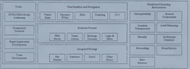

## Windows DNA 服务：COM 和 COM+

为了使DNA工作，必须得到操作系统内核的支持。必须始终存在一种创作服务，用于解释和监督通信协议及组件协同。这正是COM/DCOM/COM+（以及就此而言的服务控制管理器）作为分布式操作环境（参见图1.1）进入DNA图景的地方。

COM包含图1.1最右侧第一列中显示的所有服务；COM+包含第二列中的服务。操作系统中的COM+库在组件之间提供了必要的粘合，即管道服务，使它们能够以标准方式通信和运行。COM库提供的服务包括互操作性、位置透明性、安全性、网络和基础服务。接下来将逐一详细讨论。COM+新增了排队组件、负载平衡、内存数据库和事件服务。以下两项组成了分布式操作环境：

- **互操作性**——为了让组件技术发挥作用，必须存在一致的二进制能力发现过程。组件应该能够查询其他组件，并通过排除过程来确定所请求的行为是否存在。COM通过所有组件中都存在的IUnknown接口的QueryInterface机制，提供了对这一过程的访问。
- **位置透明性**——在像DNA这样的分布式环境中，组件不应感知其物理位置。此外，它也不应硬编码它要使用的其他组件的物理位置。当然，必须有人知道组件在哪里。在COM中，这是Windows注册表。注册表使DNA应用程序能够像在本地环境中一样执行，尽管它们实际上可能遍布整个Internet。

### 安全性

在使用DNA时，安全问题不容小觑。当系统分布在内联网，甚至更糟的Internet上时，确实存在着真实的暴露和威胁。

安全性可以分为两个主要部分：客户端和服务器。对于客户端，存在执行下载的二进制镜像（组件或其他）的威胁，这可能使机器暴露于病毒、特洛伊木马或明显的数据丢失。这些威胁可以通过使用病毒检测软件、证书密钥技术和CA（证书颁发机构）来验证可信来源，从而得到缓解。仍然没有100%的安全保证，因为即使证书经过认证，也总是存在很小的冒充（impersonation）可能性——一个窥探实体声称自己是受信任的实体，不要与后面章节讨论的MTS模拟（MTS Impersonation）混淆。

对于典型的企业级DNA系统，这通常不是主要问题，因为分布式环境使用的是物理隔离且设有防火墙的内联网，任何闯入都很可能来自内部（对此没有已知的威慑措施）。

对于服务器，安全漏洞可能造成更深远的影响。服务器级别的漏洞可能引发各种问题，包括全网范围的数据破坏和知识产权被盗。Windows NT Server在内核和文件系统级别提供了政府认可的C2级安全性来帮助保护服务器，但这通常不够。还需要一个中间网络层。

在客户端和服务器之间，存在诸如安全套接字层（SSL）、TCP/IP防火墙、DCOM，或服务器端特定于产品的安全（如MTS/MSMQ）等网络安全协议，具体取决于通信介质。

DCOM安全将在第三部分“组件管理和事务”中详细讨论；TCP/IP的各种变体超出了本书的范围，但相关文档广泛可得。

MSMQ和MTS也拥有强大的安全系统，包括加密，这些在本书的相关章节中有所介绍。

尽管客户端和服务器上有所有这些安全措施，DNA应用程序也并非对安全漏洞免疫。没有电子系统是绝对可靠的。始终为DNA系统制定应急备份计划，以防电子破坏或盗窃。应始终执行每日夜间备份，并将各层分别部署到物理机器上，这样可提供容错能力。也就是说，一台机器承载所有表示层代码，另一台机器提供应用程序组件，第三台机器承载所有存储和Web服务器。

> **提示：**
>
> 对于最高机密、绝密的电子信息，保持其安全的唯一方法是将机器物理隔离：锁在门后，并关机停止工作。即便如此，也要始终牢记：不存在无法渗透的安全。只要有足够的时间和资源，所有形式的安全都能被攻破、入侵、破解，或以其他方式变得无效。请保护好自己的数据。
>
> 幸运的是，COM+自带健壮的安全模型。开发人员无需编写大量额外代码就能轻松利用它。

### 网络

网络对于分布式系统至关重要。在DNA中，有几种高级协议可用于将应用程序联网：COM+、DCOM、MSMQ、HTTP等。它们都封装了网络栈的低级层（如TCP/IP），这非常有益。你能利用的封装越多，你的DNA系统就越易于维护和重用。

MSMQ虽然不是网络协议，但确实使应用程序能够通过网络相互通信。MSMQ可配置为使用TCP/IP等任何流行协议，但通过简单的发送/接收风格API封装了协议的所有通信细节。本书后面章节将详细介绍MSMQ。

### 基础服务

使组件工作所需的其他服务可以归入这些类别——线程管理、事务、同步支持、组件注册、调试等。

我们不能把操作系统提供的COM基础服务视为理所当然。如果所有组件都必须携带代码来理解不同的线程模型或参与事务上下文，那么生成的组件将非常臃肿和缓慢。此外，如果组件将安全性等基础服务硬编码进去，它们很快就会与未来安全平台中的其他组件不兼容。

基础服务对于提供一种背景环境至关重要，在这种环境中，组件可以自由移动，而无需担心网络或操作系统实现。

例如，UNIX环境中的COM基础服务的实现方式肯定与NT或Windows 95中的不同。如果组件符合COM规范，它就可以在异构环境中进行互操作，因为基础服务会处理任何兼容性问题。组件只需调用基础服务的API，其余工作交给操作系统即可。

本书其余部分重点讨论这些基础服务以及如何利用它们。

### 排队组件

设想一个应用程序调用远程服务器上的COM对象。如果该服务器因任何原因不可达，就会出现通信（或缺乏通信）的问题。客户端是继续尝试直到远程服务器上线，还是完全中止其进程？这些问题一直困扰着DCOM开发人员。

问题的答案在于新的COM+运行时服务之一，即排队组件（queued components）。该服务允许客户端对象调用远程对象，即使该对象当前不可达。调用由系统实用程序记录下来，通过异步协议传输到服务器，并在服务器机器变为可用时由另一个系统实用程序将调用回放到服务器端的COM对象中。

这解决了与远程对象通信令人头疼的问题，因为开发人员不必担心它们当前的状态。如果它们不可达，事务最终仍会完成。

### 事件服务

假设你有一个包含定期变化数据的系统，在数据变化时刷新远程对象上的数据即使不是必不可少的，也是非常重要的。如果没有一种特殊机制来通知数据变化，当变化发生时，你就只能依靠轮询和检索系统。

COM+新增了一项名为事件服务的功能。它以两种方式对程序进行分类：发布者和订阅者。发布者提供信息更新。订阅者以通知的形式接收信息更新。COM+的事件服务为订阅者提供了一种简便的方式来注册接收来自发布者的通知，也为发布者提供了一种简便的方式来定位并调用其订阅者。


## 内存数据库

内存数据库（IMDB）可为企业应用带来性能提升，这些应用主要从数据库中访问只读信息。它的做法是将后端表中包含的数据库信息缓存到中间层机器上。无需访问存储介质并从内存中提取数据，速度会显著更快。

## 负载均衡

当企业应用大到单台服务器无法承载时，会发生什么？这是许多 DCOM 开发人员无法回答的问题。直到 COM+ 增加了负载均衡，情况才有所改变。COM+ 负载均衡服务提供了一种自动机制，可将对象创建请求分配到池中的多台服务器上，从而分散负载。

## Windows DNA 服务：DNA 核心

图 1.1 的中心是三层服务或服务层。每一层都由定义良好的接口界定，这些接口仅公开公共行为。它们分别是用户界面与导航、业务流程和集成存储。第 2 章将从更通用的层面考察这些层代表什么，而这里是在 DNA 的语境中学习它们。

### 用户界面与导航

Visual Basic 或 Visual InterDev（VI）等开发工具位于用户界面层，因为它们非常流行，可快速创建带有控件（组合框、按钮、滚动条等）的图形交互环境。VB 和 VI 也正成为组件开发人员的最爱，因为它们封装了底层 COM 细节。例如，VB 通过其 ActiveX DLL 向导使创建 COM 组件变得非常容易，而 Visual InterDev 只需点击几下鼠标就能将脚本转换为符合 COM 的脚本小程序。

ASP、VBScript 或 ECMA JavaScript 等脚本技术因其简化的语法和用户友好性而流行。它们速度稍慢，也不如编译型对应技术强大，但它们确实能为应用增加价值，因为易于使用和学习。只要一种语言是解释执行的（如 ASP 中的 VBScript），而不是编译成本机代码，就会有性能损失。

C++ 也可用于这一层，尽管不如其快速应用开发对应工具（VB、VI、VJ++ 等）那样快速或容易。然而，C++ 让开发人员能更精细地控制图形环境和硬件。VC++ 还能生成最小、最高效的二进制映像。

### 业务流程

这是 DNA 的心脏，即*热点区域*。核心服务器端产品就在这里，它们使开发人员能够专注于解决方案而非实现细节。例如，管理事务所需的大部分基础机制由 MTS 提供。如果需要队列服务，MSMQ 会导出一个简单接口，以最少的开发和配置工作实现这一点。最后，要将应用连接到互联网，必须有一个 HTTP 服务器，例如 IIS。正如你将在后文看到的，IIS 所做的远不止解析 HTTP。

应用还必须解决某个问题，因此完成这一任务的逻辑和规则存在于这一层。最好将这些规则封装在使用 COM+ 的处理中，但这并不是必需条件。COM+ 组件支持跨平台的可重用性和互操作性；只要业务规则能够被激活、信息能够在各层之间来回传递，就可以使用任何编程技术。

> **提示**
>
> MTS 和 MSMQ 等服务器端产品当然可以在本地独立环境中使用。DNA 服务确实有明确的可伸缩性设计目标，尤其是针对 Web 流量，但这并不意味着它们只能在分布式环境中使用。
>
> 同样重要的是要注意，MSMQ 并不总是属于中间层。MSMQ 可以作为存储的一种形式使用，在这种情况下，它属于最低层：集成存储。下一节给出的假设示例说明了这一想法。

### 集成存储

并非所有存储都必须与数据库绑定。许多形式的物理存储都是可接受的，有时还是必需的。由于 DNA 与互联网紧密相连，电子邮件或多媒体二进制流（如音频或视频）是主要数据源或数据汇的有力竞争者。当不需要关系数据时，文件系统也可用作存储。例如，日志文件通常是存储在文件系统上的文本文件，会随着应用运行而增量构建。

当数据必须与其他数据关联时，可以通过 Microsoft 的通用数据访问机制使用 SQL Server 7.0 等关系数据库。OLE DB 及其超集 ActiveX Data Objects 非常适合 DNA，因为它们具有组件特性。其他存储方法（如本地集合）也可以存在。

## Windows DNA 服务：工具

要使用前面提到的服务，必须存在有助于集成 DNA 应用的工具。这里的工具与 DNA 核心部分提到的工具有一些重叠，但这一层主要面向在 DNA 核心和分布式环境中进行开发。

### HTML 创作

HTML 是 DNA 与各地浏览器无关应用之间的网关。当应用前端需要被异构平台集合访问时，HTML 是唯一选择。HTML 不仅是一种语言，本身还是一个无处不在的平台。借助 HTML 以及服务器端或客户端脚本，开发人员无需对硬件或平台作出假设就能创建丰富的应用。开发人员不必担心前端配置、操作系统、驱动程序等。此外，部署也不再是问题。应用每次被访问时都是全新内容。

> **注意**
>
> HTML 的理想与现实可能不同，近年来这一点更加明显。没错，HTML 旨在跨平台，并让开发人员享受一次编写、供所有人使用的便利。但随着脚本和组件的出现，在某些情况下，它可能被证明与编写本机代码应用一样各不相同。

尽管有许多用于创建 HTML 的优秀工具，但值得注意的是，创建 HTML 内容时更流行的工具之一是记事本，这并不奇怪。记事本是随操作系统附带的简单、简陋的文本编辑器。它受欢迎的原因是简单。HTML 很直截了当。它没有逻辑、状态或控制流——只有标记标签。尽管所见即所得 HTML 编辑器使用起来非常方便，尤其是在涉及图形时，但 HTML 足够简单，可以用快速粗糙的方式编写，通常采用试错设计方法（不推荐）。

如前所述，仅靠 HTML 不足以构建具有复杂用户界面的丰富、强大的应用。可以使用 Active Server Pages 等服务器端脚本技术，以及 Java 小程序和 COM ActiveX 控件等客户端组件，来增强 HTML 的普通功能。即使浏览器以不同方式解释 HTML，也可以使用 HTTP 让客户端与服务器通信。与 TCP/IP 套接字相比，这是真正的进步。

### 组件创建

组件比 HTML 复杂和强大几个数量级。Visual Studio 6.0 套件是构建 DNA 组件的理想开发环境，因为它与 IIS、MSMQ、SNA Server 和 MTS 等服务器端产品兼容。可以使用 Visual Basic、Visual InterDev、Visual J++ 或 Visual C++ 来创建组件，并且通过 COM+ 的魔力，它们都能和谐地互操作。

组件编译并注册后，可供 DNA 框架中的任何一层使用。COM 的位置透明属性使各层能够完全分布式，而无需组件开发人员付出任何编程努力。

### 快速应用开发

Visual Basic 等快速应用开发（RAD）工具前面已在 DNA 核心的表示与导航层中提到。这并不是它们唯一可以使用的地方。RAD 当然可以贯穿整个 DNA 范围，有时在处理原型时，它是唯一的选择。

在试图实现最高效的 DNA 解决方案时，无论它是原型还是真实产品，RAD 开发对 DNA 和 COM 开发人员都很重要。即使有周全的应用设计，DNA 也很难规划。它相当庞大，而且每一层可用的工具和产品组合复杂，有时还冗余。你需要 Visual Studio 这类工具提供的一切帮助，快速让某个东西运行起来并呈现给用户，同时识别过程中的约束和缺陷。

使用 RAD 工具快速生成原型的一个好例子是 Visual InterDev 6.0 附带的设计时控件（DTC）库。数据绑定的 HTML DTC 可以减少创建基于浏览器的数据库应用所需的时间。例如，只需点击几下鼠标并设置属性，一个网格控件 DTC 就能连接到数据库、定位表信息，并用行和列数据填充网格。然后可以用组件扩展这个原型，并快速演进为最终产品。

### 团队开发

DNA 是分布式的，其开发环境也应当是分布式的。一个人有可能承担 DNA 系统涉及的所有职责，但将工作拆分开来、作为团队项目来推进会更高效。

对于传统 Windows 应用，很难在开发团队中分解任务，因为涉及太多耦合。借助 DNA（以及基于组件的


## 演进你的应用程序

你的现有应用程序可能尚未准备好升级为包含所有层级的全面启用了 Web 的 DNA 应用程序。典型的企业会先进行试验、管理风险，并分阶段逐步演进。

即使是《财富》500强企业，最初也会采取静态方式，在网站上发布简单的营销内容。随着时间和竞争的发展，它们的网站开始融入交互式和动态元素：这里一个搜索选项，那里一个页面计数器，也许还有一个基于表单的电子邮件联系页面。随着网站流量增长，设备必须升级，安全必须考虑，并要规划新的策略。

不幸的是，这是一项昂贵的工程，许多公司对于上网的好处持怀疑态度。该领域熟练的专业人才并不充裕（尤其是动态 Web 内容和组件编程方面），而且新的互联网框架（如 DNA）每天都在涌现。公司在选择培训、开发、构建和部署 Web 解决方案的工具时面临着明确的风险。当选择一种技术而非另一种技术时（例如选择 VBScript 而非 JavaScript），可能会产生各种不兼容问题，因为除了 HTML 解释之外，浏览器并不标准化。

观望策略行不通，因为满足客户需求的压力是真实而持续的。最终，随着越来越多的人希望与网站进行越来越多的交互，网站必须演进并开始融入新技术来实现这一目标。

通过分阶段采用 DNA，生产成功的 Web 应用程序变得更加易于管理和经济高效。第 2 章将更详细地阐述如何规划 Web 融合，并尽可能避免重写。

## DNA：功能概述

在讨论了 DNA 总体框架及其包含的一些 Microsoft 工具和产品之后，你可以通过一个具体的（但纯属假设的）示例深入了解更多细节。在以下各节中，你将了解图 1.3 所示的服务器端产品和工具。

### 浏览器

你从浏览器开始进入 DNA 应用程序的旅程。图 1.3 将其描绘为连接到 HTTP（互联网协议）的计算机。在 DNA 中，浏览器实际上指的是 Internet Explorer（IE）。Microsoft 已将 IE 移植到许多平台，例如 Macintosh、Windows、Solaris 和 SunOS，其他平台也在进行中。IE 是理想的目标浏览器，因为它广泛支持平台、与 COM（ActiveX）集成，并在浏览器大战中不懈追求世界主导地位。

**图 1.3**

*一个典型的 DNA 应用程序。*

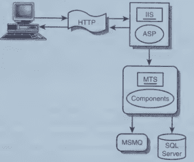

### IIS

下一个接触点是 Microsoft 的 Internet Information Server（IIS），这是一个关键的服务器端产品，使 DNA 成为可能。它的主要目标之一是通过 HTTP 协议高效可靠地提供 HTML 页面。IIS 并不是唯一的 HTTP 服务器。Apache 和 Netscape 等竞争对手早已涉足服务器业务，并推出了值得称赞的、廉价（或免费）的 HTTP 服务器，但它们的主要关注点是尽可能快地提供静态内容。然而，使用 IIS，你获得的远不止一个优化的内容服务器。你还能获得会话管理、安全和 ISAPI 等功能。对于 COM 开发人员来说，其中最重要的是 ISAPI 及其组件扩展家族（如 ASP），它允许服务器端脚本和动态内容创建。

### 新的 Web 服务器即将出现

几家新的初创公司最近推出了健壮且动态的 Web 服务器。最著名的是 SilverStream 和 NetDynamics，它们在 HTTP 解释方面与 IIS 抗衡，并声称在可靠性和性能上胜过它。

会话管理对 COM 开发人员很重要，因为它使组件能够在服务器上保存特定连接（客户端）的状态。组件本身是无状态的，但有关当前执行环境的信息可以以应用程序（全局）或会话（本地）IIS 变量的形式持久化。

IIS 可以直接集成到组件中，或者最好通过像 ASP 这样的脚本语言集成。

### ASP

ASP 为 HTML 这种本身不允许与用户交互的静态标记语言增添了动态性。过去，HTML 依赖于外部的服务器端通用网关接口（CGI）程序或 Perl 脚本，它们会根据某些输入生成 HTML。这造成了交互的假象，但代价是用户能观察到的延迟，因为需要大量的往返请求。

这是大约 1995 年的情况。自那时起，大量新技术改变了开发人员编写基于 HTML 的应用程序的方式。现在，可以在客户端本身上根据用户输入执行代码，而无需重复查询服务器。这提高了可靠性和性能，但增加了应用程序的耦合性。

Active Server Pages（ASP）封装了一项复杂的任务：在只有静态预制数据的情况下，试图营造一个动态的、由用户驱动的应用程序的假象。ASP 使 Web 应用程序能够创建由用户控制的独立环境。这不是一个新概念。CGI 自 HTML 出现以来就存在，并提供了一种有限的动态 Web 内容形式。如果你曾经用 CGI 编程，你就会知道它那精细而笨拙的用户界面。ASP 虽然仍有一些自身的微妙之处（如 VBScript 语法和实时调试困难），但它将 CGI 提升到了一个新的水平，并在 Web 用户和服务器 COM 组件之间创造了一座易于编程的桥梁。

ASP 的加入使人们能够更精细地控制 Internet 应用程序。凭借其无缝实例化 COM 组件的能力，Internet 应用程序在功能上与 Win32 或类似的 GUI 对应程序几乎无法区分。请考虑以下 ASP 脚本，它创建一个 COM 对象，定位一个接口，调用一个方法，并将结果存储在一个变量中，所有这些只需两行代码：

```asp
<%
set myobject = Server.CreateObject("Object.MyInterface")
result = myobject.MyMethod(argument1, argument2)

%>
```

> **提示**
>
> IIS 的配置和管理超出了 COM 编程的范围，可能值得单独写一本书。幸运的是，IIS 附带的安装程序在设置默认工作环境方面做得很好。对于暂存、开发环境（其中安全和优化不是关键），IIS 的默认配置已被证明非常有效。如果你要在生产服务器上部署系统，强烈建议你查阅关于安全和配置的在线 IIS 文档。

### MTS

在 IIS 之下是 Microsoft Transaction Server（MTS）。在此示例中，客户端永远不会看到 ASP 之外的东西，因此 MTS 严格来说是在幕后发挥作用。MTS 所做的不仅仅是管理 IIS。它确实在自动协调组件内部和跨组件及数据库的事务方面做得很好，但它还管理资源的缓存和池化，作为免费的副作用产生了可扩展性。

MTS 通常用作 DNA 框架中组件的容器。MTS 的功能将在第 IV 部分“异步组件编程”中详细讨论，但为了本次讨论的目的，我将 MTS 视为组件管理器或代理。组件不需要涉及事务或需要安全性就能受益于 MTS 的优势。组件也不必局限于一个 MTS 环境。它们可以分布在多个机器边界上。

> **警告**
>
> 并非所有 COM 组件都能与 MTS 一起工作。MTS 兼容组件受到一些约束，这些约束将在第 IV 部分详细讨论。
>
> 符合规范的 COM+ 组件则不同，它可以毫无问题地与 MTS 一起工作。

### MSMQ 和 SQL Server

如果你的应用程序必须通过高延迟网络与另一个应用程序或数据存储进行异步通信，Microsoft Message Queue（MSMQ）可以提供巨大帮助。MSMQ 协调同步或异步消息的传递、接收和确认所涉及的复杂协同。因为


MSMQ 能够识别 COM，组件本身可以成为消息并得到自动管理。开发人员只需为 COM IPersist 接口提供必要的实现，然后让 MSMQ 以可靠且容错的方式接管即可。

> **提示：**
>
> MSMQ 究竟是一种数据存储形式还是一种通信设备，尚可讨论。在这方面，它像 SQL Server 一样充当存储介质。我们假设的 DNA 应用程序很可能具有异步数据需求，而这正是它们的用武之地。

对于必须彼此远程通信、甚至在本地机器内通信的分布式应用程序，MSMQ 使 COM 程序员不必再承担 WinSock、创建线程和并发控制等底层通信细节的负担。第 IV 部分将深入介绍 MSMQ。

> **提示：**
>
> MSMQ 与其近亲 MTS 一样，也会连同组件一起管理资源。

## Visual Studio 6.0

那么 Visual Studio 在 DNA 中处于什么位置？图 1.3 展示了 Visual Studio 工具在 DNA 应用程序中的典型用途。再次说明，图 1.3 所描绘的模型只是一个典型示例，但绝非固定规则。VS6 提供了一组非常丰富的工具，而图 1.4 只说明了其中三个工具（一个虽小但重要的子集）适用于何处。

Visual InterDev 是在 IIS 下创建 Web 应用程序的事实行业标准。它提供了一组工具（设计时控件）、COM 兼容性、团队开发支持以及所见即所得编辑器，这里仅举几项功能。

Visual Basic 和 Visual C++ 以及 Visual J++ 都是创建组件的出色工具。其他 COM 开发工具（如 Microfocus COBOL）也能很好地创建 COM 组件（尽管在撰写本书时，它们还不支持 COM+）。

这些工具将在后续章节中详细讨论。

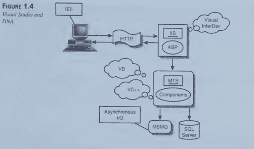

## Visual InterDev

Visual InterDev 6.0 是 Microsoft 面向 Internet 应用程序的最新开发工具，尤其是在涉及 ASP 脚本编写时。图 1.4 说明了它在 DNA 中的位置。关于 Visual InterDev 已有许多优秀著作，我无意在此介绍它的众多特性或功能。不过，如果你已经在使用 VI，或计划使用它，以下是一些可遵循的指导原则，它们能让使用 COM 和 COM+ 进行编程更富成效。

### 避免使用数据绑定控件

本章前面提到过使用数据绑定的 DTC（设计时控件），以突出其原型设计特性。然而，必须指出的是，一般来说，任何跨越逻辑编程边界引入耦合的做法（例如在 GUI 与数据库之间）都是不可取的。（多层架构的设计将在第 2 章介绍。）VI 提供了一组可直接用于 SQL 的 DTC 控件，用于快速开发直接访问数据库的 Web 应用程序。在某些正当场景中，确实需要这种快速开发。

例如，如果你正在创建一个小型内联网 Web 应用，并且必须尽可能快速、可靠地完成，那么数据绑定控件是一个不错的选择。如果你选择使用这些控件，而不是将逻辑委托给外部组件，就应当意识到：将来如果你的应用程序必须移植到另一种不支持 VI6 控件的编程环境（如 Win32），就可能面临重写的风险。

> **警告：**
>
> 除非你绝对确定自己的应用程序永远不会演进或升级，否则应避免使用将 UI 与特定数据库直接绑定的控件。将物理数据绑定到 UI 不利于扩展，也会妨碍可重用性，而可重用性正是 DNA 的一个关键目标。

### 平衡客户端/服务器脚本编写与验证

将服务器的一部分工作分配到客户端有许多好处。如果客户端浏览器支持脚本编写，就应在动态交互环境中利用它来执行简单的表面性验证。这可以大大减少处理表单时原本所需的往返次数（以及用户感受到的延迟）。

客户端脚本编写的另一个好处是能够在客户端呈现和操作 UI 控件。服务器可以向客户端发送自定义 ActiveX 组件和控件，以便将这些组件和控件包含在浏览器中，或作为独立应用程序使用。事件可以像在 Win32 应用程序中那样被触发和捕获，而且由于一切都发生在本地，所以没有延迟。这对各地的 Web 冲浪者来说是一种解脱。

但关键在于平衡。把所有内容都下发给客户端并不明智，因为那会使客户端过于独立，并需要一次性进行长时间下载。

由于预期运行环境具有高延迟，把所有处理都放在服务器上也不是好主意。例如，如果用户填完了整个表单，却漏掉了一个字段，那么由于服务器必须拒绝，整个往返过程就白白浪费了。经验法则是：把处理放在客户端，以在表面层面验证用户数据。（例如：数据是否为字母数字？数据是否为空？数据是否为日期格式？）把更具体的业务处理留给服务器。

## Visual Basic

VB 正迅速成为快速构建 COM 组件的事实行业标准。VB 通过其 ActiveX 控件和对象封装了许多令人头疼的 COM 和 COM+ 细节（本书会介绍这些细节）。这使开发人员能够把时间花在解决手头问题上，而不必过于担心实现问题。尽管 VB 能在短时间内让组件工作起来，但它依赖许多其他 DLL，而且体积可能非常大。与 VB 组件相比，ATL（Active Template Library，活动模板库）可能是更好的长期解决方案。

遗憾的是，VB 确实有一些局限性。尽管它可以本机编译，但仍然依赖不可预测的垃圾回收器，这可能会在随机时刻拖慢执行速度。它的错误处理机制非常原始，并且可能产生面条式代码。此外，错误发生期间的控制流很难管理（例如 Resume 和 Resume Next 子句）。

由于它不支持实现继承（只支持接口继承），在一些面向对象纯粹主义者看来，当需要采用面向对象解决方案时，它就显得较为逊色。

尽管有这些限制，VB 仍是 DNA 框架中极其强大的工具，并且绝对应该构成你组件的大部分。请将快速开发组件的需求与对效率和速度的需求加以权衡。你关于如何继续（使用 VB 还是 ATL）的决定将取决于这些因素。

## Visual C++

由于 VC++ 中提供了 ATL，并且 MFC 提供了 COM 支持，用 C++ 进行 COM 和 COM+ 编程已经容易得多。ATL 可以生成非常轻量级的组件，只包含最基本的要素。与使用 VB 相比，需要完成的工作明显更多，但生成的组件与原始手写代码实现的 COM 和 COM+ 一样好，甚至更好。

在 DNA 中，通常你会希望用 VB 来编写大多数业务规则组件，而只把 ATL 留给任务关键型、追求极致性能的任务。使用 ATL 会涉及更多调试和测试，而且不建议创建大型组件（包含许多方法和接口）。当试图调试、升级或维护代码时，投入精力开发大型复杂组件反而会适得其反。

## 小结

本章介绍了 DNA，即分布式应用程序背后起统领和涵盖作用的技术理念。这一理念提供了一个框架，在此框架下可以有效地开发企业应用程序。

HTML 在众多现有平台与本机应用程序之间提供了连接。HTML 很好地让开发人员能够以可管理的方式创建跨平台代码。话虽如此，随着脚本和组件的出现，也出现了分化。

COM+ 应运而生，以解决若干开发问题。它可以解决 HTML 无状态性造成的许多问题。COM+ 组件带来了 HTML 和脚本编写所不具备的性能优势，因为它被编译为本机代码。它使开发人员能够轻松实现跨不同 WAN 链路的通信，并具有位置透明性。


## 第2章：多层组件架构

### 本章内容

- *即席设计* 30
- *基本应用边界：表示、逻辑和数据服务* 31
- *三层设计* 33
- *保持层间平衡* 35
- *多层设计* 37
- *本地还是分布式？* 40
- *良好设计技术* 40
- *设计工具* 49

对于软件而言，如果组件被组装成单体、僵化的结构，所有优势很快就会消失。除非组件经过恰当设计，否则不重写就很难（实际上有时不可能）扩展或升级组件。还必须考虑到，COM并不是一门容易掌握的主题，甚至可能带来虚假的希望，被当作完美软件开发的解决方案。再加上COM所需的培训投入，压力就更大了。一个失败的COM项目不会像传统项目那样容易被原谅。由于其全部复杂性，COM对未入门者可能显得神秘莫测。因为我们害怕自己不理解的东西，所以当一个设计不佳的基于COM的项目失败时，人们很容易笼统地归咎于COM技术。

即使技术被正确使用，组件本身也不能解决所有已知的软件问题；事实上，它们还会引入一些自身的问题。如果你曾使用过DCOM，你大概能证明这一说法。（COM+解决了DCOM的一些复杂性问题，但稍后会详细讨论。）COM需要时间学习。存在一个相当大的设置和准备阶段，这通常并不与其他编程范式或语言相伴。然而，它的好处以可重用性、可维护性和可扩展性等无形回报超越了所有这些成本。

**注意**  
在Windows环境中使用COM+编程非常具有挑战性。挑战不仅在于理解COM+及其复杂的API，还在于掌握辅助的系统管理技能和领域知识，这些都会加重开发工作的负担。

### 基本应用边界：表示、逻辑和数据服务

使用组件设计软件与使用其他传统方法设计略有不同。首先，组件本质上是独立的、自包含的实体。组件仅通过已知的公共接口相互通信。发现过程可以可靠地说明一个组件能做什么、不能做什么。

如果组件被归入一个单体、紧密耦合的堆中，它们就会失去所有内在优势，并增加维护复杂性。所需的是将组件视为异构的层或层级集合，其中每个组件与其他组件有共同之处，但解决不同的问题。

有时甚至无法定位。由于全局变量是匿名的，程序中的任何人都可以修改它们，从而产生混乱、无序的运行时。而且编写线程安全的代码更加困难。

- 模块间耦合会跨模块产生依赖关系。大多数单体应用会依赖少数常用模块或库。这可能是个问题，因为任何库文件的更改都需要重新编译整个应用程序。在考虑应用程序的完整部署时，这一点很重要。与之形成对比的是COM+，它不要求其客户端重新编译或意识到进行了任何更改。正如本章前几节以及后续许多章节所讨论的，COM+接口应当是永恒的。

另一方面，松耦合架构由独立的、可互操作的组件或对象组成。对架构的更改一次只隔离到一个组件。如前所述的多米诺效应的概率几乎为零。然而，松耦合架构会在性能和开发时间上带来权衡。它们设计起来要费力得多，组件会引入显著的通信开销，而且通常更难实现。

尽管如此，松耦合系统的好处远远超过其成本，正如你将在本章其余部分看到的那样。

### 三层设计

从客户端/服务器领域出现的最成功的模型之一就是三层模型。一个层或层级是一组独立的同质对象（每个对象解决一个小问题），它们共同解决一个更大但常见的问题。

考虑当今一个典型的PC应用程序。它很可能与用户交互、处理一些数据，并且也许将状态持久化到某处——因此有三层。

这三层通常称为表示层、业务逻辑层和数据服务层。图2.1说明了这一思想，并将其与单体方法进行了比较，在单体方法中，业务逻辑和用户界面等抽象全部捆绑在一起。

你很可能在不同时间以不同名称遇到这个模型（例如，用集成存储代替数据服务，或用导航代替表示），但无论如何概念是相同的。每个层中都驻留着组件，而这些组件又包含指向执行实际工作的私有函数或方法的公共接口。

**图 2.1**  
*单体设计与三层设计的对比。*  
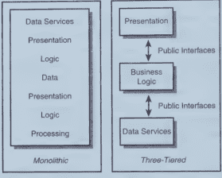

COM和COM+关注的是由众所周知的公共接口封装的严格实现边界。层也不例外。层的接口比组件的接口更通用，粒度更粗，但封装仍然是基础。

特定层除了相邻层公开的公共接口之外，不应当对相邻层有任何了解。从过程的角度来看，这种漠不关心似乎是一种限制，但它实际上是一种解放机制。

该模型的优势就在于此：一个层中的更改对其他层的影响最小。这一规则使架构处于一个舒适的位置，可以随着时间的推移轻松扩展和自由升级。

在精心设计的三层架构中，跨层通信仅通过公共接口进行。当层之间是松耦合时，替换组件（或整个层）以适应不断变化的需求就很简单，而不需要重写或系统重新测试。因此，层应当完全不知道也不关心相邻层的实现。一个层应当只看到其直接相邻层的公共接口。在图2.1中，层之间的箭头表示接口。

这种高效且通用的模型已经存在多年，但在客户端/服务器领域之外却出奇地不常见（一台机器存储数据，另一台机器报告数据）。随着COM+（接口驱动）和DNA的出现，三层模型正得到大量使用。COM+使开发者能够轻松创建跨层边界透明通信的组件。

以下是图2.1所示三层模型中主要层的描述：

- **表示层**——表示层涉及与用户的所有交互。仅限GUI的特定操作，如重绘窗口、捕获鼠标点击、文本输入等，都位于此处。该模型不允许在任何其他层与用户交互。这样做会将下层与该职责耦合，并使模型随时间推移变得不灵活。
  
  在此层可以进行最少量的数据验证，但更适合放在下方相邻的业务层。表示层不知道任何特定的数据存储技术（如果存在）或其数据来自何处。该层有一组已定义的接口，使其能够与业务层通信，而这就是它唯一的能力。

- **业务逻辑层**——接下来是中间层或业务逻辑层，大部分处理都在这里进行。所有特定于业务的规则都归入此层。这是应用程序中真正解决问题的部分。它是用户与任何物理数据存储之间的中间件。与其父层一样，业务层不应知道其相邻层的具体细节，即下方的数据服务层和上方的层。它应只处理数据，而不存储或表示数据。

- **数据服务层**——数据服务负责应用程序所需的任何物理持久化。特定的数据服务机制，如底层数据库访问或SQL，应放在此处。当需要升级或更改物理存储时，只有此层受到影响，其他任何内容都不会损坏或需要大量重新测试。典型的客户端/服务器三层模型涉及某种类型（如Oracle或SQL Server）的结构化关系数据库存储，但现代三层设计并非如此。
  
  应用程序并不需要数据库才能从三层模型中受益。任何类型的持久存储都可以放在这里（文件系统、电子邮件、多媒体流等），远离表示层和逻辑层，以提高系统未来可维护性和演进的潜力。

### 保持层间平衡

考虑图2.2，其中平衡良好的三层架构位于一个微妙的支点之上。左边放置所有表示代码；中间是业务逻辑；右边是任何数据服务。

尽管业务逻辑中间层很可能在系统中承担大部分重量，但如果过多重量放在任一极端，对未来的演进都可能是灾难性的。在任一侧放置过多重量都会使平衡的对象倾斜，并导致应用程序崩溃。


**图 2.2**  
*一个平衡良好的应用程序*

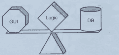

在表示侧，这可能意味着添加数据感知或数据绑定控件，让它们直接与数据访问层通信（见图 2.3）。

**图 2.3**  
*图形用户界面承担了过多职责。*

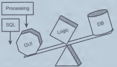

反过来，过度依赖数据服务层上诸如存储过程或触发器这类数据库特定的逻辑机制，会产生相反效果，使平衡倾向数据服务侧（见图 2.4）。

**图 2.4**  
*服务器承担了过多职责。*

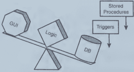

现在考虑图 2.5，其中稳固的三层设计建立在一个不可动摇的逻辑基础之上，消除了支点以及破坏平衡的可能。方形代表刚性基础，不会因未来对任一层级的升级或修改而动摇。


这种刚性基础通过将表示逻辑和数据逻辑与业务规则清晰分离来实现。只要应用程序试图解决的问题不关心数据来自何处（如果有数据）或如何呈现，它就会随时间保持可扩展性和健壮性。

三层架构不仅适用于客户端/服务器环境。几乎所有应用程序都可以按所述方式划分为至少三层。（不过，作为例外，请考虑设备驱动程序和其他底层硬件操作程序，在这些程序中，额外的三层设计工作可能适得其反。）

无论你是在构建小型基于 Win32 的应用程序，还是完整的、支持 Web 的电子商务系统，这些原则都同样适用。无论问题多么复杂，软件总是以某种形式处理数据（否则就没有工作可做），并且总是可以按行为划分为不同的层。

## 多层设计

随着应用程序演进并变得更复杂，有时需要将某个特定层拆分为两个或更多层。这便形成多层架构，或称 n 层架构。尽管与用户的基本交互可能相同（呈现数据、收集数据和存储数据），但有时将三个基本层拆成若干部分会更容易。

对于有数十名开发人员的大型复杂应用程序，采用 n 层架构比三层架构容易得多，因为可以按更细的粒度分别开展工作。COM+ 有助于 n 层开发，因为开发人员可以创建跨边界通信的组件。

考虑图 2.6。这是我用于一个复杂基于 Web 项目的实际架构图。三层模型中曾经的表示层已被拆分为两个独立的层：Win32 和 HTML。

**图 2.6**  
*一个真实世界的 n 层架构。*

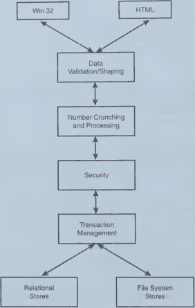

在查看图 2.6 时，你可能会问自己：“为什么不象以前那样保留一个层，并分别用两个组件处理 HTML 和 Win32，在需要时添加接口和方法呢？”答案是 Win32 可能非常复杂，需要一大组同质 Win32 组件与另一大组同质 HTML 组件共存。Win32 与 HTML 处理在本质上不同（前者是线性和事件驱动的，而不是非线性和静态的）。

你可能还记得，层被定义为一组独立同质对象的集合，这些对象协同工作以解决共同目标。通过拆分各层，从而减少每层中的组件数量，可以大大降低团队环境中应用程序的开发和测试复杂性。独立开发和维护 5 个组件比维护 20 个组件容易得多。

一层中的组件越多，该层就越接近单体模型（耦合过多），从而违背分层架构的目的。在将 HTML 和 Win32 作为表示层选项的情况下，将它们分成两个层是合理的逻辑选择。

> **注意**
> 
> 不要将图 2.6 与流程控制图混淆。它仅以人类可理解的术语抽象展示应用程序的主要问题。从此图中，你无法推断或假定通信接口，也无法推断或假定数据在整个应用程序中可能如何流动（单向或双向、并发、异步等）。

> **警告**
> 
> 必定要为每层应包含的最小组件数量设定一个阈值。如果让每个组件各自成为一层，你就会回到起点（全是组件，没有同质组织）。在架构应用程序时，要利用分层带来的优势，但要节制层的数量。

从顶部表示层向下，是四个独立的层，它们通常会被包含在业务层中。按照总体功能目标将它们拆开后，就更容易理解应用程序在做什么：验证数据、处理数据、保护数据（加密、身份验证等）以及进行数据事务处理。这些操作当然都可以包含在单个层中，但这样做会使该层过于拥挤并变得难以管理——这与该模型的主要目的相矛盾。

图 2.7 更近距离地展示了数据验证/塑形层。你可以看到它包含许多不同但功能相似的组件。每个组件解决应用程序验证领域内的不同问题。尽管验证可以被视为业务层功能，但验证组件与处理数据本身几乎或完全没有关系。

下一节讨论在部署配置中，各层应物理放置在何处。

**图 2.7**  
*聚焦数据验证层。*

**数据验证/塑形层**

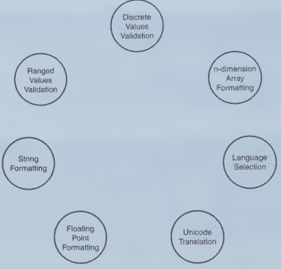

## 本地还是分布式？

不要被多层架构中分离层表面上的分布性所迷惑。按层进行编程并不意味着分布式关系，甚至不意味着存在数据库。它是一张可供遵循的路线图，可用于任何应用程序。有些应用程序甚至不需要表示层。例如，它们可能是监听非交互式请求的服务。同样，如果应用程序不涉及持久化（例如 Windows“附件”菜单中通常附带的计算器），则可以没有数据服务层。

## 良好的设计技术

幸运的是，合理的设计原则非常容易应用于基于组件的软件。我们不会考察现有的更复杂的面向对象方法，而是介绍用于设计多层 COM+ 架构的久经考验的技术。按重要性排序，它们是

- 1. 将应用程序抽象为异构功能层。
- 2. 识别用于执行细粒度行为的组件。
- 3. 在层之间创建接口或粘合机制。
- 4. 实现组件接口及其方法。

从这些技术或原则可以看出，我们遵循的是归纳方法。我们从一般出发，再深入细节。

### 将应用程序抽象为层

所有有用的软件都是为了解决一个或多个问题而创建的。所有问题总是可以被划分或分离为子问题。对于组件而言，重要的是将大型复杂问题拆分为更小、更易管理的问题。通过使用这种分而治之的方法，我们确保整个问题得到解决，同时也创建出健壮且易于维护的架构。修改和升级由某个子问题构成的单个组件，要比试图处理整个单体问题并伴随通常的重新测试和调试容易得多。

### 识别组件

这个阶段更具挑战性，需要远见（以及后见之明）。这可能是所有阶段中最有趣、最具创造性的阶段，因为它将过去的经验、当前技术和分析性解决问题结合起来。

同样，尽管并非所有应用程序都能无缝套用三层模型，但它们总是可以在某种程度上被逻辑地分离到这种抽象中。

从表示层开始。应用程序会通过图形界面与用户交互，还是作为盲目满足请求的服务？创建直观且用户友好的 GUI 并非易事。你常常会看到 GUI 饱受各屏幕之间不一致或过于繁杂之苦。当你使用浏览器且其缺乏丰富的控件集或状态时，这只会使问题更加复杂。

这里不会教你 GUI 设计，但值得一提的是，不应轻视它。请记住，尽管表示层只是冰山一角，但它是用户与构成应用程序之物之间唯一的通信纽带。小小的表示层可能坐落于庞大而复杂的业务层之上，但如果它没有提供一个用户友好的工作环境，或者不一致，用户可能会不公平地否定整个应用程序。


在决定使用何种可视或非可视技术（Win32、浏览器、控制台等）之后，请将表示层划分为功能单元。一个组件可以处理菜单选项，另一个处理选项卡，还有一个处理工具提示。或者在浏览器中，可以将一个组件委派为跟踪逐页变化的上下文菜单，而其他组件则可以负责跟踪组合框和文本框。将表示层拆分为独立对象的程度越高，维护和升级就越容易。

根据经验，可以肯定地说，表示层经历的变化最多。不可能在交互应如何进行上让所有用户都满意，但可以找到能让大多数用户满意的共同点，并达成折中。

其他两层也应遵循同样的思路。业务层负责验证和处理。这就是两个组件。验证组件可以负责在数据被传递去处理之前过滤任何数据。反过来，处理组件不必担心坏数据，因为它已经过验证。这消除了必须同时执行这两种操作（这可能引发错误）的负担。COM+ 在此有所帮助，因为它可以以事务方式参与——这正是此架构所需要的。

如果你的应用程序需要数据访问，那么第三层（但绝非最后一层）可以负责所有数据访问。如果你的应用程序与典型的关系数据库通信，你可以有两个组件：查询和更新。例如，每个组件都将拥有自己的一组接口，用于执行特定于供应商的 SQL 命令。尽可能避免使用存储过程。它们将底层物理数据库与应用程序的其余部分耦合在一起，而换来的有时只是微不足道的性能提升。如果你改为将存储过程转移到组件中，那么处理就是通用的，并且将来可以应用于任何数据库技术。

## 存储过程可能代价高昂

真实故事：本书的咨询作者曾与一位客户合作，该客户想将其 Sybase 应用程序迁移到 SQL Server。所涉及的 PowerBuilder 应用程序非常庞大（约 400,000 行代码），并已耗费数十人年。当时使用了混合分层架构（两层半），但存在大量 Sybase 专用的存储过程（与 SQL Server 不兼容）。大约 70% 的业务规则位于存储过程和触发器中。

经过仔细评估并支付了数千美元的咨询费后，该迁移被认为不可行。这个价值 500 万美元的应用程序被放弃，并重新编写了一个新应用程序。

这个故事的寓意是：存储过程可能非常昂贵。

## 创建接口

接口是 COM 的核心。它们是强大的抽象，使你能够将对外公布的行为与内部实现分离。接口应只描述对象提供哪些公共服务。对象的私有状态绝不应通过公共接口公开。

COM+ 中的接口是组件与其客户端之间有约束力的契约。接口的核心是一组语义相似的方法或函数，在运行时通过表指针访问。

接口本身没有任何功能。它仅仅指向实现。接口可以跨组件重用（多态地或通过继承）并升级。可以添加新方法，但旧方法应始终保留。

设计接口时，请记住接口中包含的所有方法都应具有某种共同点。一个接口支持多少方法没有限制，但一个好的经验法则是将数量保持在 10 以下。这可以防止接口变得难以管理且铁板一块，从而违背 COM 的宗旨。

## 实现组件

最后，在你创建了跨层和跨接口分离的概念模型之后，就该实现行为了。根据应用程序的复杂性，这可能是一切环节中最快的部分。以接口作为蓝图，并凭借对健全设计架构的信心，就可以用代码实现应用程序的需求。

## 设计约束

设计应用程序时，无论是多层的还是单体的，一系列需求都会对最终产品构成约束。有时这些需求相互冲突，或需要进行权衡取舍。例如，大小与速度一直是软件架构师面临的一项重大取舍。随着内存价格不断下降，这一特定取舍在今天已不像十年前那样重要。许多新的取舍已经出现并取而代之。接下来将讨论这些内容。

在使用现代多层架构时，有许多真实且可衡量的力量作用于架构的整体形态。以下是一些最重要的因素：

- 利用现有技术与技能
- 上市时间
- 平台部署

### 利用现有技术与技能

认为新项目会使用所有最新的高科技工具、编程语言和服务器端产品，而把现有的全部技术投资搁置一旁，这是不现实的。在现实世界中，大量资源已被投入到软件开发中：硬件、软件、培训以及飞涨的 IS 薪资，所有这些加在一起，对任何公司来说都是一笔巨额开支。

幸运的是，使用 COM+ 编程并不需要对 IS 进行大规模改造。可以低成本地开发成功的基于 COM+ 的应用程序，而且不必把 Microsoft 提供的所有花哨功能都堆进去。例如，如果一家公司已经拥有另一种数据库，那么像 SQL Server 7.0 这样昂贵的数据库产品可能并非必需。操作系统也是如此。尽管每个人都运行 Windows NT 工作站是理想情况，但 Windows 95 或 Windows 98 与 COM+ 配合使用也完全没问题。

现有遗留代码也不成问题。SNA Server 是 Microsoft 通往大型机世界的桥梁，它附带 COM Transaction Integrator（COMTI）。COMTI 是一种用于创建 COM 组件的工具，这些组件可以透明地访问大型机资源。本书第 19 章“COM Transaction Integrator”详细介绍了 COMTI。

为了与 UNIX 互操作，几家供应商（例如 ChiliSoft）已经宣布为 UNIX 和 VMS 操作系统提供 COM 库。在撰写本书时，尚不清楚它们是否会迁移到 COM+。

### 上市时间

软件项目总是延期且超出预算。原因有很多，但实现和集成问题似乎总是成为主要罪魁祸首。

尽管 C++ 是 COM 的理想选择，但它并不总是最优选择。如果应用程序需要实时保证或对性能至关重要，那么像 C/C++ 这样的中级语言可能是唯一选择。然而，如今构建的大多数应用程序并非时间关键型，并且可以从快速应用开发（RAD）的推动中受益匪浅。正如第 1 章所讨论的，存在许多优秀的 RAD 工具；最流行的是 Visual Basic、Visual InterDev 和 Visual J++。

借助对 COM+ 的支持，这些工具非常适合创建原型，并随着时间推移扩展到真正的产品。更好的是，C++ 与 RAD 的结合可能被证明是最佳选择，因为开发者可以用 RAD 快速创建 UI，同时又能获得全速 C++ 的速度和效率。当然，所有这些都通过 COM+ 结合在一起，以实现可重用性和可维护性。

### 平台部署

尽管 PC 日益普及，许多公司仍未准备好抛弃遗留系统。他们当前的系统可能运行正常，无需修复。既然当前系统能完成任务，为什么还要在新设备和培训上投入这么多钱呢？

这些担忧是合理的。软件一直是一门非常昂贵的技艺，企业希望尽可能榨取其投资的价值，直到消费者所能容忍的程度。

随着互联网和 Web 商务的出现，软件行业见证了使用最新工具和编程范式的新高科技开发的加速。难怪如此多的管理者被各种选择淹没，并在沮丧中继续保留其现有的过时系统。他们认为再等六个月就会降低价格并提高性能。

幸运的是，有一种平台几乎是通用的，并且能无缝适应未来的硬件和软件变化：Web 浏览器。

人们已经为所有能想象到的操作系统编写了 HTML 解释器，甚至包括电话。可联网烤面包机的现实看起来不再那么滑稽了。HTML 将在相当长一段时间内继续存在，并且作为“平台”完全合理。请将 HTML 视为你的目标平台。

## 设计目标

在当今分布式计算和互联网应用的世界中，内存很便宜。重要的是可靠性，而不是大小。但仅有可靠性还不足以让现代用户认可一个应用程序。作为开发者，你必须追求几个关键的无形要素。以下是最重要的一些：

- 可维护性
- 可靠性
- 可用性
- 可伸缩性
- 可移植性
- 安全性
- 可重用性
- 局部性（分布式或本地；与性能密切相关）


## 可维护性

如果一个软件系统无法随着时间升级或演进，那它还能有多高的效率？如果我们从 Y2K 问题中学到了什么，那就是程序员应该对自己关于未来的假设更加审慎和批判。在设计和实现阶段具备远见和灵活性，将获得巨大的回报。一个狭隘且具体的解决方案，往往在用户提出新功能和意外需求时，不得不被多次重写。

不要仅仅针对特定问题本身进行解决，而应致力于以通用的方式解决问题，并针对手头的具体问题添加额外规则。我们常常在面对旧代码时希望自己当初多花一点精力来解耦某个大型过程或函数。把宝贵的时间浪费在部分或完全重写上，可不是什么愉快的事。

使用 COM，通过接口继承就能轻松实现这一点。创建通用接口，然后实现特定的行为来满足你的问题。这一技术的绝佳示例可见于 IPersist 接口家族，相关内容在第 4 章“持久存储”中讨论。

## 可靠性

关于 PC 的最普遍抱怨，恐怕就是它的不稳定性。无论是操作系统还是第三方软件的错，最终都是用户面对一个挂起的程序，数小时的工作付之东流。

关于 PC 与 UNIX 可靠性的争吵，在 Usenet 上已经持续了数年，其激烈程度堪比史诗级宗教战争，而且看不到尽头。UNIX 与 PC 的可靠性问题不应被草率对待；对于时间关键型或生命维持型系统，这可能是生死攸关的问题。想想带有嵌入式软件的医疗设备，或者飞机上的导航软件。如果病人或乘客可以选择将自己的生命托付给哪个操作系统，最常见的答案会是什么？（我肯定会选择 UNIX。）

我在两个平台上都工作了近 18 年，既体验过 UNIX 命令行提示符那种冷静而可靠的微光，也感受过彩色 PC 窗口那种温暖而脆弱的魅力。

但正如 Don Box 曾说的：“COM 关乎爱。”COM 接纳所有陌生人（IUnknown），而且不歧视任何平台（只要它们支持 COM）。

所以我们不讨论哪个操作系统更可靠；坦白说，作为 COM+ 开发者，我们对这部分几乎没有控制力。我们通常面对的是平台约束，并不总是能选择在哪个操作系统下工作。

过去，应用程序通常用 C 或 C++ 之类的语言编写，然后为每个目标平台分别编译。这种技术并不总是奏效，因为 C 并未为丰富的用户界面提供标准 API。更糟的是，表示层代码与业务逻辑写在一起，导致应用程序耦合紧密，形成单体结构。移植本身就是一个完整的项目，需要投入大量资源才能完成。

如今有了浏览器和平台无关的标记语言，如 HTML 或新的 XML。只需为一个平台编写应用程序，然后依靠表示层生成兼容的 HTML，即可实现普遍兼容。

然而，浏览器有一个缺点：它们缺少丰富的 UI 控件。Java Applet、动态 HTML 和 ActiveX 等技术可以缓解这一问题，但代价是引入了浏览器之间的不兼容性。

要做到真正与浏览器无关，我们必须尽力使用标准 HTML 及其原始的表单能力。在实践中，这并不像第三方 ActiveX 和 Java 组件供应商所希望你相信的那样是一种牺牲。如果按钮和文本框对你的应用来说不够丰富，你还可以使用图像映射，营造出复杂 GUI 的错觉。

再次强调，如果你还没这么做，请考虑使用 HTML 浏览器作为你的表示层。

## 可重用性

对软件乌托邦最广为接受的定义是：在那里，软件可以通过组装现成的标准组件而轻松构建，就像如今制造电路板或汽车一样。虽然我们距离实现这一宏伟目标还有几十年时间，但我们现在当然可以构建 COM+ 组件，并计划在几个月后重用它们。

编写良好的 COM+ 对象的版本化特性，保证了今天已有的接口在对象生命周期内（在某种程度上）会继续工作。因此，即使向旧组件添加了新功能，它过去和现在的客户端也不会崩溃，它们只是使用自己需要的部分。

COM+ 规范描述了不可变接口，但实际上，这更像是一个建议。COM+ 规定，一旦组件的接口发布，就不应再更改。

但我们可以更改接口（或完全删除它），从而打破这一规则。这也会破坏 COM+ 对象与其客户端之间的绑定契约——客户端期望始终能找到特定接口。一个行为不当的组件的“幸福而无知”的客户端，往往会在非法内存地址处直接崩溃，而不是先检查接口查询是否成功。

COM+ 不会“捕获”这些违反契约的行为，也不会警告开发者违反了 COM+ 规范。这完全取决于开发者自己。

Visual Studio 中的一些工具（如 VB 或 VI）在删除接口时会给出警告消息，但行使契约的责任仍然在开发者身上。

如果没有这种契约，组件的生命周期就会受限，其可重用性也会受损。

避免在接口发布后更改它们；并且在与其他组件协作时，始终采用自顶向下的发现方式（通过 QueryInterface）。

## 位置透明性

应用程序有多大？是需要跨越机器边界来满足性能要求，还是单个地址空间就足够了？

借助 COM 的位置透明特性，你无需在设计时就预见到分布式架构，也能在安装时使用分布式部署。

在 MTS 的帮助下，组件可以轻松地分布到多台机器上，而客户端和服务器都不会察觉到差异。只有注册表知道组件的真实位置以及是否使用了任何代理。对客户端而言，服务器组件就生活在同一个地址空间中。

## 设计工具

存在许多计算机辅助软件工程（CASE）工具，帮助软件架构师将人的想法转化为连贯的设计。Rational Rose 是较流行的架构建模工具之一，它随 Visual Studio 以 Visual Modeler 的形式一同发布。虽然最好能理解统一建模语言（UML），但 Visual Modeler 提供了编写良好的在线文档和教程，帮助 UML 新手入门。

毫不奇怪，Visual Modeler 中新建项目的默认模板是三层模型（见图 2.8）。面向对象爱好者会很快就适应 VM。不过，其丰富的功能集可能会让非 OO 程序员感到不知所措。


**图 2.8** 使用默认三层模板的 Visual Modeler。

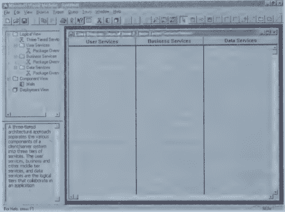

幸运的是，COM+ 并不要求掌握 OO 技能，因为它本身并不是面向对象的（至少在二进制层面上是这样）。毕竟，COM 关乎二进制互操作性。

## 超越面向对象

在过去的二十年里，我们所知的软件工程正逐渐从过程式范式转向面向对象范式。借助 COM/COM+，面向对象可以更进一步：实现二进制互操作性。

作为设计者，这使你能够创建不仅在本地源代码层面兼容，而且在应用程序、运行时层面兼容的对象。在运行时调用库或对象并不新鲜，但以探索性的方式并实现语言无关，则是新的突破。

## 总结

维护一个软件系统的成本据估计是其开发成本的数倍。计算机代码，无论使用哪种语言，仍然是人类思想的机械化且易变的表达。我们解决问题的方式各不相同，这反映在我们编写的代码中。但代码会随着时间而腐烂，变得晦涩难读。这是软件生命周期中不可避免的事实。


借助合理的设计原则，我们可以减轻代码腐化，并最大化代码复用。

代码复用固然好，但二进制组件复用更胜一筹。COM+ 允许我们在无需理解对象实现的情况下复用对象。通过在各架构层中策略性地抽象对象，我们就能在复用性和可扩展性方面处于更从容的位置。

从本质上讲，多层架构是好的。它们与 COM+ 方法论完美融合，并充分接纳 COM+ 的封装特性。

如果你计划使用 COM 或 COM+ 进行编程，那么在设计中也要考虑分层。

## 高级 COM 编程技术

## 第二部分

### 本部分内容

- 3. COM+ 架构与管理 — 55
- 4. 持久存储 — 73
- 5. 名字对象 — 97
- 6. 可连接对象 — 113
- 7. COM+ 线程处理 — 143
- 8. COM 与注册表 — 171
- 9. COM+ 优化、继承与聚合 — 201
- 10. 使用 NT 服务 — 227
- 11. 封送处理 — 263
- 12. COM 安全 — 297
- 13. 配置与错误处理 — 325
- 14. COM Internet 服务 — 357
- 15. MTS — 373

## 第 3 章

## COM+ 架构与管理

### 本章内容

- COM+ 的演进 — 56
- MTS 的不足 — 57
- COM+ 架构 — 58
- COM+ 部署服务 — 63
- 使用 COM+ 进行资源管理 — 64
- 开发 COM+ 应用程序 — 65
- 队列组件 — 65
- 松散耦合事件 — 67
- 使用 COM+ 访问数据 — 68
- COM+ 安全 — 69
- 基本 COM 特性 — 69

到目前为止，我们都是在传统 COM 架构的背景下讨论 COM+。在本章中，我们将考察新的 COM+ 架构。COM+ 旨在全面支持 Windows DNA 理念。当然，MTS 通过使 COM 组件能够用于多服务器和 n 层企业应用程序，开创了局面。COM+ 接过了 MTS 未竟的事业。它将 MTS 和 COM 结合在一起。在 COM+ 之前开发的 MTS 和 COM 组件仍像以往一样工作。但是，原先由 MTS 和 COM 构成的各层现在合并为一个由 COM+ 封装的单一层。COM+ 实际上不仅仅是 COM 与 MTS 的结合。它还带来了一个明确支持这种结合方式的运行时环境。除了 MTS 为开发人员提供的内容之外，COM+ 还增加了有用的项目，例如队列组件（见第 27 章）。

原计划随 COM+ 一同交付的两个值得注意的特性是*内存数据库（IMDB）*支持和*组件负载平衡（CLB）*。这两个特性都未进入 Windows 2000 COM+ 运行时的最终版本。事实证明，IMDB 带来的问题比它解决的问题还多，而且它很可能永远不会面世。如果你想了解微软给出的原因，请访问 `http://msdn.microsoft.com/library/techart/whatimdb.htm`。组件负载平衡曾出现在候选版本 2 中，但在候选版本 3 和 Windows 2000 最终版本中被移除。它当时尚未完全准备就绪，但不久后将会出现在 AppCenter Server 中。你可以在 `http://msdn.microsoft.com/library/techart/complusload.htm` 阅读微软关于组件负载平衡的计划。

### COM+ 的演进

COM 是 OLE 的直接产物，更具体地说，是 OLE 2 的直接产物。该技术背后的核心思想是，应用程序围绕组件对象构建。这些组件可以具有多个接口，而且很多时候确实如此。创建 COM 对象的开发人员必须始终注意保持旧接口不变。从某种意义上说，COM 接口与应用程序之间存在一种契约。隐含的理解是，接口一经引入就不会改变。可以添加新接口，而旧接口保持不变。COM 的设计者在发展过程中决定将 OLE 和 COM 的概念分开。许多技术涌现出来以增强 COM，包括 ActiveX、自动化以及许多更复杂的技术。组件被视为黑盒。在这种情况下，开发人员只能看到接口。然而，组件的接口一旦定义，其本身就必须不可变。正是这种对接口的严格定义，使得有效的组件复用成为可能。

你也许会问自己，为什么我们需要 COM+？毕竟，COM 提供了开发人员已经依赖的组件架构。我的第一个回答是，在 COM+ 中，COM 在根本上没有改变。正如我之前所说，我们不想改变任何以前发布的 COM 接口。换句话说，我们不想破坏任何 COM 契约。COM+ 继承了 COM 的传统，却没有留下足迹。它通过新接口增加服务，而不改变现有接口和服务。

COM 能在 COM+ 运行时中工作，是因为 COM+ 实现了拦截系统，并透明地完成 COM 工作所必需的事情。然而，COM+ 还增加了一些东西（例如松散耦合事件），如果组件开发人员利用这些，他们就有更多工具可用。

你还必须知道，并非所有工具都能支持 COM+。至少，你必须拥有 Visual C++ 6.0/6.01。下一版 Visual Studio 将为 Visual C++、Visual Basic 和 Visual J++ 提供完整的 COM+ 开发支持。

可以说，到目前为止，COM 一直是开发人员的忠实仆人。它使开发人员能够更快地创建健壮的应用程序。但即便如此，时代在变，COM 也必须改变。变革需求背后的驱动力是企业应用程序的广泛需求和运用。互联网上电子商务的巨大增长加速了这一进程。尽管传统 COM 和 MTS 有所助益，但 COM+ 已成为企业开发不可或缺的工具。管理不断增长且高度动态的调用负载、集成基于浏览器的客户端，以及应对新的高度分布式安全模型，只是 n 层程序员所面临的常见问题中的一小部分。COM+ 调整了 COM 的关注点，以更好地解决这些关键问题。传统服务的新实现、更强大的对象管理以及 COM+ 特有的新服务，为高级安全、数据访问和异步通信等特性提供了支持。

如果你已有围绕 COM 对象的客户端，会怎么样？它们仍然能工作吗？答案是肯定的。传统 COM 和 MTS 应用程序仍像以往一样运行。COM+ 只是对框架进行了补充，使开发人员能够更轻松地开发大型应用程序。

### MTS 的不足

COM+ 解决了 MTS 中的许多缺陷。首先，并非所有 MTS 服务都像我们在 COM+ 中看到的那样以全面的方式实现。MTS 表面上通过一组有文档记录的方法支持对象池。然而，这些方法并未在 MTS 运行时中实现。实际上可以在 MTS 中实现对象池，但这需要编写资源分配器。在大多数情况下，COM+ 中不需要这样做。MTS 的另一个缺点是，MTS 与 COM 在某种程度上存在重叠。这是因为 MTS 是位于 COM 之上的一层，并重复了某些 COM 功能。最好只调用 MTS 函数，而不是调用与之等效的 COM 函数。这样可以避免运行时的潜在问题。可能发生的一个问题示例是，在对象构造和引用期间，上下文是否可用可能存在差异。COM+ 将 COM 和 MTS 结合在一起，消除了这个问题。

MTS 另一个极其重要的缺失是动态负载平衡。MTS 支持静态负载平衡，这允许网络管理员将客户端分配到不同的应用服务器主机。静态负载平衡解决了中小型网络中的负载平衡问题。然而，它并不能提供大型应用中的高性能网络所需的那种解决方案。动态负载平衡是 COM+ 不可或缺的一部分。

微软一直坚持认为，MSMQ 是满足负载平衡需求的一个好解决方案。是的，它在大多数情况下将问题解决到了可接受的程度。但 MSMQ 是一种松散耦合架构（更多内容见第 22 章），而很多时候只有紧耦合架构才够用。因此，微软引入了组件负载平衡。（正如我之前所说，在本书写作时，CLB 特性尚未完全准备就绪。）

OLE 2 是对 OLE 1 的彻底重写。OLE 2 汲取了 OLE 1 提供的所有组件架构经验，并将其整合到一个完全模块化、可扩展的框架中，该框架基于一种称为 COM 的核心对象技术。因此，OLE 1 开发人员在 OLE 2 所呈现的应用程序开发生命周期中面临重大变化。幸运的是，将 COM 精心设计为 OLE 2 的基石已被证明值得付出努力，并且它仍然是微软组件编程基础设施的核心。COM+ 更像是精心设计的 COM 组件框架与 MTS 引入的高级应用服务器环境的综合。MTS 和标准 COM 组件可以轻松部署在 COM+ 环境中，而拥有可用资源的开发人员可以向现有 COM 和 MTS 组件添加新的 COM+ 功能，使它们更加强大。

### COM+ 架构

本节考察 COM+ 背后的一些基本架构原则。你将了解 COM+ 所实现的关键对象管理策略，并研究使用新 COM+ 特性的指导原则和技术。

COM+ 为 COM 编程世界引入了若干新的核心架构层面。这些新增内容大多经过精心设计，旨在提升其前身 MTS 的性能和功能。因此，开发人员在规划新项目时，应认真考虑 MTS 风格的应用程序开发方式。MTS/COM+ 模型是微软的一项要求。当然，你可以开发不使用 MTS/COM+ 特定服务的应用程序组件。不幸的副作用是


那就是，你要么必须自己开发复杂的事务服务和可扩展性功能，要么就只能将就。COM+ 将 MTS 和 COM 紧密结合，并通过增加更多性能优势来吸引你。

好的 MTS 组件就是好的 COM+ 组件。如果开发者在设计 MTS 组件时花时间思考了与企业应用相关的问题，那么这些思考很可能也会延续到 COM+ 组件中。COM+ 在某些特定领域与 MTS 有所不同。COM+ 通过实现对象池化和动态负载均衡，改进了 MTS 引入的可扩展性功能。（动态负载均衡目前尚未实现，但很快就会推出。）编写良好的 MTS 组件可以立即利用这些服务。COM+ 还简化了 MTS 活动内组成对象的创建。由于 COM+ 统一了 MTS 和 COM，对象构造不再需要是 MTS 特有的行为。COM+ 引入了额外的对象构造钩子（如参数化对象创建），为开发者提供了扩展的性能功能。

## 创建 COM+ 对象

COM+ 创建 COM+ 类的所有对象实例的方式，与 MTS 创建 MTS 配置的基于服务器的对象的方式大致相同。标准 COM 对象的操作方式与以往基本相同。COM+ 中 COM 和 MTS 的统一为 MTS 拦截机制的若干增强扫清了道路。最值得注意的是，上下文对象和拦截功能已合并到标准 COM 代理/存根机制中。这意味着你可以使用 `CoCreateInstanceEx()` 创建新对象而不会丢失上下文。MTS 开发者必须使用 `IObjectContext::CreateInstance()` 方法才能在当前上下文中构造新对象。不过，`CreateInstance()` 方法在 COM+ 中同样有效，从而与现有 MTS 组件保持完全兼容。

上下文和拦截将在第 15 章“MTS”中讨论。

### 参数化对象构造

COM+ 还引入了一种参数化对象构造机制。标准 COM 和 MTS 的对象创建工具无法区分针对同一类的创建请求。COM+ 类可以选择支持 `IObjectConstructor` 接口，该接口支持参数化构造。如图 3.1 所示的组件服务管理器（等同于 MTS 资源管理器）可用于为任何给定 COM+ 类的对象构造配置字符串参数。新对象可以使用 `IObjectConstructor` 接口检索 COM+ 管理员配置的构造字符串。例如，管理员可以借此为与一组客户端关联的对象定义消息队列路径。目前，COM+ 1.0 允许类一次仅与一个应用程序关联。这使得管理员只能为每个类配置一个构造字符串。这在第 5 章“名字对象”中有说明。

**图 3.1**  
*组件服务管理器。*

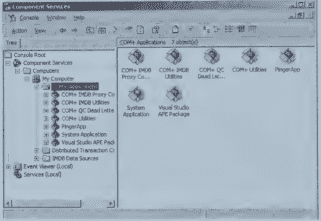

## 名字对象

*名字对象* 是能够通过简单字符串名称重建其他类型对象的对象（参见第 5 章）。COM+ 提供了一种“新名字对象”，使你能通过简单的字符串名称（如“new:OrderEntry.Ord1.1”）构造新对象。当然，名字对象是基于接口的 COM 对象，任何人都可以创建，因此比 `CoCreateInstance()` 等严格 API 调用灵活得多。例如，使用名字对象，调用方可以传入对象创建期间要使用的初始化参数，而标准 COM 对象创建函数无法做到这一点。

## 中性线程单元

COM+ 引入了一种新的线程模型，称为中性线程单元。这种新的单元模型直接响应了基于事务的应用服务器（如 MTS 和 COM+）的特定性能需求。中性单元也是 COM+ 首选的线程模型。

回顾一下，COM 线程模型旨在控制 COM 组件内的并发。单元是一组对象的集合，并定义了哪些进程线程可以执行这些对象的方法。跨单元边界的调用通常会导致调用昂贵的封送处理服务。这样，COM 就可以控制单元内的并发。MTS 首选的线程模型是单线程单元（STA）。STA 模型将创建的对象归入创建它们的单一线程的单元中。从单元外部对 STA 对象的任何调用都必须由调用线程封送，并由目标 STA 线程分派。该系统的优点是，你可以快速构建 STA 组件，而无需担心多线程应用环境中的同步复杂性。缺点是，无论是否需要串行化，COM 都会将所有方法调用串行化到单元中。更糟的是，所有对单元的外部调用都必须封送，从而进一步加剧性能瓶颈。这很容易使方法调用开销增至三倍以上。第 6 章将详细讨论 COM 线程。

那么解决方案是什么呢？目前 COM 支持每个进程一个多线程单元（MTA）。MTA 可以配备自由线程封送处理程序（FTM），它允许进程中的任何线程（甚至来自 STA 的线程）直接调用 MTA 对象方法，而无需封送。听起来正合适，对吧？嗯，并不尽然。MTA 基本上消除了 MTS/COM+ 提供的并发控制，并重新引入了多线程应用中管理同步和线程的所有复杂性和开销，更不用说应用专用线程管理与 MTS/COM+ 风格线程管理之间的争用了。通常，MTA 组件不应在 MTS 或 COM+ 中实现。要提高 COM+ 的性能，需要一种新的线程解决方案。


中性线程单元就是解决方案。中性线程组件总是在中性单元中创建。中性单元包含对象，但不包含线程。除此之外，中性单元与 MTA 类似，它允许多个线程并发执行其对象上的方法。其优点是，COM+ 仍然负责线程管理和并发任务，确保任何单个对象在任一时刻都不会收到多个方法调用。

## 对象池化

COM+ 是第一个真正实现 MTS 中规划的对象池化系统的应用服务器。遵循 MTS 基本池化准则的组件可以在 COM+ 中进行池化。管理员使用组件服务管理器配置具备池化能力的组件，以进行对象池化。池化使对象只需创建一次，即可在多个连续事务中为不同客户端复用。对象池化消除了按事务构造和销毁对象的开销。对象必须通过用户提供的 `IObjectControl` 接口仔细重新初始化它们所需的任何状态，并且还必须通过 `IObjectControl` 表明对池化的支持。

在 MTS 中支持池化的对象，如果编写不佳，在 COM+ 下可能会失效。MTS 从未真正池化过对象，只是表现得好像如此。支持池化的对象会收到所有适当的 `IObjectControl` 调用，但 MTS 会在事务完成时删除这些对象，而不是将其池化。这意味着，在事务边界调用构造函数和析构函数时不会出现的初始化错误，会在 COM+ 中暴露出来，因为对象并不是真正被销毁，而是被池化了。同样重要的是，池化对象不能采用单线程或单元线程模型。在 STA 中创建的对象在整个生命周期中都驻留在同一个 STA 中，并且必须始终在与该 STA 关联的线程上被调用。这会对应用程序的性能产生严重影响。COM+ 允许你以管理方式设置许多对象池化参数，如图 3.2 所示。

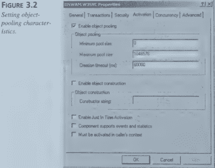

### 对象池化管理

对象池化也有其管理的一面。希望启用特定类对象池化的管理员，必须首先确保该类具备池化能力。接下来，使用组件服务管理器（功能上等同于 MTS 资源管理器）在相关类上启用池化。组件服务资源管理器还提供最小和最大池限制，以及当池中没有可用对象时的客户端超时设置。精明的管理员可以仔细调整池设置以提高整体服务器性能。

## 动态负载均衡

MTS 使管理员能够将客户端应用程序配置为使用一组服务器中的特定服务器。这称为静态负载均衡。这是一种负载均衡解决方案。


因为它使管理员能够将执行客户端请求的负担分散到多台服务器上。之所以说它是静态的，是因为它不会根据当前状况进行调整。如果你在每台服务器上放置10个客户端，而第一组10个客户端同时需要服务，第二组10个客户端却出去吃午饭了，那么一台服务器就会过载，而另一台却闲置着。你有两个选择：错开午餐时间，或者采用动态负载平衡。微软还没有强大到能强制规定午餐安排的程度，所以它在COM+中选择了动态负载平衡解决方案。


负载平衡是一种松散的服务器集群形式，它允许应用程序的特定层分布到多个系统上。COM+使管理员能够将服务器应用程序配置为在特定的服务器集群上运行。在动态负载平衡方案中，集群中的所有系统都会报告服务器负载信息，客户端对象创建请求随后会被转发到最可用的系统。

负责跟踪服务器负载信息并重定向客户端请求的COM+机器称为*负载平衡路由器*。COM+客户端配置为向路由器请求服务，然后使用应用程序组中最可用系统上运行的对象。正如你所看到的，这纯粹是一种管理功能，不需要开发人员介入。任何优秀的COM+组件在部署到动态负载平衡方案中时都能良好运行。

动态负载平衡除了提高性能和更好地利用服务器之外，还有其他优势。负载平衡路由器不会将客户端定向到服务器组中已失效的服务器。这为服务器平台提供了一定的容错能力。在这种情况下，路由器本身是致命弱点。幸运的是，负载平衡路由器可以配置在Windows 2000故障转移集群上。这提供了高性能的动态负载平衡，并消除了独立系统上运行的负载平衡路由器所造成的单点故障。

## COM+部署服务

COM+ 与 Windows 2000 一起解决大型企业中最关键的问题之一：应用程序部署。MTS Explorer 和 MTS 包极大地简化了 MTS 环境中的分布式应用程序配置，而组件服务管理器以类似的方式支持 COM+ 配置。为了充分利用 COM+ 部署服务，组件应该完全自描述。这意味着组件应该提供完整的类型库。配置属性和其他以组件为中心的信息存储在组件库中，该组件库定义了组件的所有安装和注册要求。不幸的是，在撰写本文时，还没有可用的组件库创建工具。为了支持非 COM+ 环境，仍然需要 `DllRegisterServer()`。

为了完全支持使用 Microsoft Installer (MSI) 进行的动态配置和部署，COM+ 组件不得依赖非组件自身建立的注册表数据，并且应在卸载期间清理所有已配置的状态。

COM+ 使管理员能够导出客户端和服务器应用程序。COM+ 服务器应用程序与 MTS 包非常相似，区别在于它们被称为应用程序，并作为扩展名为 .APL 的应用程序库启用。客户端导出会创建 MSI 应用程序。客户端安装程序可以通过 Active Directory 分发，这将在第 16 章“COM+ 作为组件管理器”中讨论。

## 使用 COM+ 进行资源管理

开发高度可扩展应用程序的真正诀窍之一就是有效的资源管理。COM+ 支持许多新机制，使开发人员能够改进其资源分配和保留策略，例如对象池和参数化对象构造。将资源登记到事务中是 MTS/COM+ 应用程序服务器行为的另一个重要部分。COM+ 支持与 MTS 首创的 DTC 事务相同的架构——资源分配器和资源管理器。开发 COM+ 资源管理器或资源分配器并非易事，而且很多时候需要相当大的开销。

### 补偿资源管理器

为了帮助开发人员在轻量级上下文中支持事务，COM+ 引入了补偿资源管理器 (CRM)。CRM 通过两个独立的 COM+ 类构成。CRM Worker 执行手头的业务，而 CRM Compensator 在事务失败时回滚 Worker 的操作。COM+ 实现了支持事务日志记录功能的 CRM 特定接口，使开发人员创建的 CRM 能够在系统故障时恢复。客户端创建 CRM Worker 对象来执行事务任务，COM+ 创建 Compensator 对象来监视 Worker 对象的事务活动。顺便说一下，MTS 程序员将 CRM 读作“crumb”。下次你和 COM+ 伙伴们在一起时，一定要说“crumb”，否则他们很可能会把你笑得待不下去。

## 开发 COM+ 应用程序

开发 COM+ 应用程序在结构上类似于开发高质量的 MTS 应用程序。COM+ 引入了几个新机制，增强了 MTS 引入的服务，以及扩展了基本 COM/DCOM 系统的功能。在本节中，你将了解一些设计问题和几个新的 COM+ 特性。你还会看到一些随之而来的新的基础 COM 功能更新。

### 设计 COM+ 组件

在将 COM+ 视为应用程序服务器平台时，要记住的最重要的一点是，COM+ 的应用程序服务器端只是 MTS 的更新版。虽然这不是一个无足轻重的更新，但 MTS 的基本范例贯穿始终。因此，开始 COM+ 之旅的一种方法是构建高质量的 MTS 进程内组件。COM+ 通过将 MTS 服务模型与基本 COM 功能合并，获得了许多实际好处。

下一步是考虑组件将运行的环境。目前，COM+ 在 Windows 2000 之外的任何平台上都无法运行。这意味着，如果你正在设计需要在 NT 4 上运行的组件，则应该遵循 MTS 2.0 中提供的指南。你的组件在 COM+ 下仍然可以正常工作。另一方面，如果你计划仅在 Windows 2000 上部署，则可以利用几个新的强大企业级功能。

### 排队组件

Microsoft 消息队列服务器 (MSMQ) 为 COM 开发人员开辟了一个全新的可能性世界。MSMQ 使应用程序能够与它们可能需要的的外部服务解耦。这反过来又可以极大地提高可扩展性，使企业应用程序的所有部分都能彼此独立地尽快运行。MSMQ 还通过断开的队列提供了另一个重要优势。较大应用程序的各个部分可以暂时断开，然后重新连接，使 MSMQ 存储排队的消息，直到可以传递它们为止。

那么所有这些 MSMQ 的东西与 COM+ 有什么关系呢？很高兴你问到这个问题。MSMQ 在原生级别具有标准的函数调用接口，虽然它能很好地与 COM 应用程序和 MTS 应用程序集成，但 MSMQ 仍然代表了完全原生 COM 世界之外的一小步。COM 应用程序需要将调用信息打包到消息中进行传输，而不是仅仅进行接口方法调用。COM+ 通过排队组件改变了这一点。COM+ 排队组件系统使用 MSMQ 作为传输系统。它使客户端能够以异步方式向服务器发出 COM 调用。

这意味着，在断开的笔记本电脑上运行的客户端应用程序仍然可以使用标准 COM 技术，向不存在的服务器发出任意数量的调用。在客户端运行的排队组件记录器会将 COM 方法调用排队，以便稍后传递。当服务器网络再次可用时，排队的 COM 调用将被传递到目标队列。服务器网络上的排队组件侦听器从队列中检索 COM 调用消息，并将其传递给排队组件播放器。然后，播放器对活动的 COM 服务器执行暂存的调用。

使用任何异步技术的主要限制是，组件无法像在同步、阻塞调用中那样将数据返回给调用方。例如，如果组件调用排队组件的 `CreateOrder` 方法，则该组件无法返回一个值（表示成功或失败）或任何其他值（例如订单确认号）。相反，组件必须遵循分布式异步系统的规则，并使用回调机制将相关数据返回给客户端。这些机制的更多细节将在第 27 章中讨论。

#### 排队事务

排队组件系统使用底层 MSMQ 事务支持来管理事务交互，即使在客户端断开连接时也是如此。当客户端对任何配置为排队的组件接口进行调用时，记录器会将调用收集到单个消息中。如果该消息无法提交，则事务中止。服务器端也会发生类似的事务行为。如果消息未能成功出队，事务将中止，MSMQ 会将消息移动到相应的死信队列。

#### 管理排队组件

与任何企业级系统一样，管理员在排队组件应用程序的管理中扮演着更重要的角色。管理员使用组件服务管理器配置和部署排队组件应用程序。COM+ 应用程序和必要的类接口通过 COM Explorer 配置为使用排队组件服务。然后，COM Explorer 将使用适当的队列信息导出客户端应用程序。请注意，排队组件配置在接口级别生效。这意味着一个类可以拥有一些直接接口和一些排队接口。客户端也可以选择在正常模式或排队模式下使用组件。这使得组件能够在正常的紧密耦合方式下运行，或者根据客户端的决定以排队方式运行。排队组件使用队列名字对象创建，例如 `queue:/new:OrderEntry.Order.1`。


通过 ISubscriberControl 接口。该接口使客户端能够丢弃或重定向特定事件。

以订单录入系统为例。在设计期间，决定可以在收到订单后发送可用性信息，但这些信息对实时订单录入并非必需。这一决定可能是流量估算的结果。松耦合架构（不提供实时可用性信息）可以更有效地随时间分摊应用服务器的使用。下单后，可以向订阅者通知任何可用性问题。

> **注意**
>
> LCE 是 COM+ 工具包中另一个非常强大的工具。与排队组件非常相似，LCE 服务解决了先前 COM 实现中的一个关键空白。排队组件提供 COM 级的单向解耦方法调用，而 LCE 提供原生 COM 广播机制。COM+ 的排队组件和 LCE 服务所提供的功能，解决了曾迫使许多开发者发明大量自定义软件的问题。

## 使用 COM+ 访问数据

COM+ 中的数据访问与 MTS 中呈现的非常相似。特别是，OLE DB 和 ADO 是首选的访问机制。OLE DB 提供非常强大且可扩展的架构，支持各种底层数据存储，包括任何 ODBC 源。由于灵活性和性能要求，OLE DB 必然较为复杂。ATL 使用者模板和生产者模板可以减轻 C++ 中 OLE DB 开发的负担。迄今为止，编程 OLE DB 最流行的机制当然是 ActiveX 数据对象（ADO）。ADO 在 OLE DB 之上提供双接口 COM 组件实现，编译应用程序和脚本都可以轻松使用。当然，如果你和许多开发者一样，已经拥有非常庞大的基于 ODBC 的系统，那么这些系统在此环境中也能得到完全支持。

### 读取优化的数据访问

IMDB 是一种智能的内存数据库缓存系统，针对读操作进行了优化。IMDB 允许静态数据加载一次并可多次查询。这种内存中数据支持所能实现的性能优势是巨大的。通过 IMDB 在本地满足的查询既不需要网络访问，也不需要磁盘访问。IMDB 也支持写操作。它会积压更新，直到这些更新被提交。届时，更改会提交到底层数据库。显然，真正的性能优势在于缓存以静态读取为主的数据。

应用程序访问 IMDB 的方式与访问任何其他现代数据库的方式非常相似。IMDB 是一个 OLE DB 提供程序，这确保通过 ADO 为大多数编程语言和脚本环境提供内置支持。

### 事务性共享属性管理器

MTS 共享属性管理器（SPM）对于 JIT 激活和提前释放的组件来说是一项宝贵资产，它在特定服务器进程内提供稳定的共享数据存储。COM+ 在 IMDB 之上实现共享属性管理器接口。这个新构造称为事务性共享属性管理器。请确保，当你和 COM+ 伙伴外出时，把 SPM 念作“spam”。

## COM+ 安全性

COM+ 提供了与 MTS 引入的相同的基本应用服务器安全功能。COM+ 应用程序可以使用标准 COM 安全性，以及声明式和过程式基于角色的安全性。COM+ 已将基于角色的安全性扩展到接口方法，使管理员能够在最基础的级别控制访问（回想一下，MTS 仅支持到接口级别的角色成员资格）。与 MTS 不同，COM+ 还支持库包中基于角色的安全性。COM+ 通过 ISecurityCallContext 接口提供增强的安全信息。ISecurityCallContext 接口取代了 MTS ISecurityProperty 接口，并提供关于回溯到基础客户端调用链中所有调用者的详细信息。COM+ 安全性将在第 18 章中更详细地介绍。

## 基础 COM 功能

MTS 和 COM/DCOM 代表了由 Microsoft 不同开发部门支持的截然不同的开发路径。COM+（MTS 的后继者）与 Windows 2000 中的核心 COM 服务也是如此。本节将介绍 Windows 2000 中与 COM+ 一起打包的一些新基础 COM 服务。

### 结构化存储

结构化存储是一种存储复合文件管理服务，支持文件内的文件系统。结构化存储的妙处在于，它是 Windows 和许多应用程序产品直接支持的标准机制。Windows 2000 有望将结构化存储集成到更多文件系统和外壳功能中。链接跟踪是一项新功能，使 Windows 2000 能够在目标对象被移动时更新结构化存储文件内的 OLE 链接。所有 Win32 MoveFile() 例程都与链接跟踪服务协调，包括新的 MoveFileWithProgress() 例程。链接跟踪功能仅在 NTFS 卷上起作用，但为一个常见问题提供了期待已久的解决方案。

结构化存储系统还引入了用于创建和打开复合文件的新例程。这些例程如下：

- `StgCreateStorageEx()`
- `StgOpenStorageEx()`

`StgCreateStorageEx()` 例程取代了 `StgCreateDocfile()` 例程，所有新的 Windows 2000 应用程序都应使用它。结构化存储系统的增强功能将通过这两个新的 Ex 例程公开。

Windows 2000 包含升级版 NTFS（NTFS v5），它支持许多新的基于磁盘的服务。驻留在 NTFS v5 卷上的复合文档可以利用 STGFM_NATIVE 存储格式。NTFS 本机结构化存储（NSS）利用 NTFS 原生的基于属性的存储功能来提高复合文档效率。

Windows 2000 结构化存储还支持新的 IDirectWriterLock 接口，该接口使写入者能够获得以直接模式打开的根存储对象的独占访问权。随后，多个读取者可以并发访问该存储。

### 取消未完成的 COM 调用

同步 COM 调用在等待失败的服务器请求超时期间可能阻塞很长时间。另一方面，异步调用的本质可能使某些应用需要在过期事件发生之前取消尚未完成的未完成调用。COM 提供若干调用控制接口，可用于管理异步方法调用。COM+ 通过在每个方法调用前后调用 `CoSetCancelObject()`，为所有使用标准封送的调用创建并管理 Cancel 对象。COM Cancel 对象支持 `ICancelMethodCalls` 接口。特定 Cancel 对象的 `ICancelMethodCalls` 接口可以通过使用 `IID_ICancelMethodCalls` 接口 ID 调用 `CoGetCancelObject()` 组件库例程来获得。`CoGetCancelObject()` 原型如下所示：

```
HRESULT CoGetCancelObject(
    DWORD dwThreadId,    // Thread with pending call
    REFIID riid,         // IID of requested interface
    void ** ppUnk);      // Pointer to the requested interface
```

`ICancelMethodCalls` 接口支持表 3.1 中的方法。

**表 3.1 ICancelMethodCalls 方法**

| ICancelMethodCalls 方法 | 作用 |
|---|---|
| `Cancel()` | 请求取消该方法。 |
| `TestCancel()` | 检查调用是否已取消。 |
| `SetCancelTimeout()` | 为调用设置自动取消超时。 |

获取 Cancel 对象接口并调用 `Cancel()` 方法的过程在 `CoCancelCall()` 例程中有一个等效的包装器。`CoTestCancel()` 为调用 `TestCancel()` 方法提供了类似的快捷方式。这些功能结合起来，可以轻松地对挂起的方法进行调用级控制。

## 小结

COM+ 是 COM 演进的下一个合乎逻辑的步骤。它并非对 COM 的彻底背离，而是保留了 COM 架构的最佳部分并添加了增强功能。

最大的进步之一是具备负载均衡和池化能力，而 MTS 实际上并未实现这些功能。

COM+ 的许多新增内容都是对其前身 MTS 的性能和功能的改进。MTS/COM+ 模型是 Microsoft 的一项要求，你应当确保遵循它的指引。COM+ 使 MTS 与 COM 密不可分，并通过增加更多性能优势来吸引你。

本书其余部分将向你展示如何使用 COM+ 开发组件应用程序并最大限度地发挥其效力。


## 第4章
## 持久化存储

### 本章内容

- IPersist 接口 74
- IStream 接口 78
- 创建实现 IPersistStreamInit 的 ATL 对象 83
- 使用具有持久化能力的对象 88
- 简化持久化对象的创建 90
- 简化持久化对象的使用 93

开发人员面临的挑战之一是维护 COM 对象的状态。在运行时，当 COM 对象加载时，可能希望它记住并恢复到先前的状态。在这种情况下，对象将加载持久化存储数据，以便能够在先前状态下恢复运行。当 COM 对象被销毁时，它也可能发现有必要保存其状态，以便当前应用程序或另一个应用程序能够呈现出与销毁时相同的状态。在这种情况下，对象将保存持久化数据。

持久化存储的一个很好的用例是 Visual Basic 对 ActiveX 控件的处理。在 ActiveX 控件属性表中，你可以看到 Visual Basic 在会话之间保持相同的属性值。换句话说，如果你在运行 Visual Basic 时将控件的属性设置为某些期望值，那么当你重新运行 Visual Basic 时，该控件会保留上次会话的属性设置。

本章将向你展示如何向对象加载持久化数据以及从对象保存持久化数据。我们的讨论将聚焦于 IPersistStreamInit 和 IStream 接口。然而，本章展示的技术并不是可用于持久化数据存储的唯一技术。

两个示例控件和两个使用这些控件的示例程序将说明这些技术。第一个控件保持简单，以便你能够轻松看到并理解相关内容。加载第一个示例控件的客户端应用程序也很简单。它向你展示如何在不依赖 ClassWizard 生成的类的情况下使用持久化存储技术。

第二个示例程序比第一个做得更多，因为它会响应用户的鼠标点击。不过，我借助 ClassWizard 来简化工作。因此，创建第二个示例程序所花的时间并不比第一个示例程序多。

### IPersist 接口

有几种标准持久化接口允许客户端应用程序获取并保存对象的状态。对象通过实现这些接口中的一个或多个来声明其序列化状态的能力。持久化接口还使客户端能够通过将对象的序列化数据加载回对象来克隆该对象。我已经提到过 Visual Basic 对属性持久化的使用。Microsoft 消息队列 (MSMQ) 使用持久化接口来保存对象的状态，以便在消息中传输。表4.1展示了六个标准持久化接口。

**表4.1 — 标准持久化接口**

| 接口 | 描述 |
|---|---|
| `IStorage` | IStorage 接口支持结构化存储对象的创建和管理。 |
| `IStream` | IStream 接口支持向流对象读取和写入数据。 |
| `IPersist` | IPersist 接口定义单一方法 GetClassID，该方法旨在提供可在系统中持久存储的对象的 CLSID。 |
| `IPersistStorage` | IPersistStorage 接口定义的方法使容器应用程序能够将存储对象传递给其包含的对象之一，并加载和保存该存储对象。 |
| `IPersistStream` | IPersistStream 接口提供用于保存和加载对象的方法，这些对象使用简单的串行流来满足其存储需求。 |
| `IPersistFile` | IPersistFile 接口提供的方法允许对象从磁盘文件加载或保存到磁盘文件，而不是从存储对象或流加载或保存。 |

所有持久化接口都派生自 IPersist 接口。该接口仅允许客户端获取对象的类标识符 (CLSID)。通常，客户端应用程序会将对象的类标识符与对象的状态一起存储。这样，客户端应用程序在重新实例化该类时就知道要激活哪个对象。对于无状态对象，IPersist 接口就足够了，因为客户端应用程序只需要知道要激活哪个类。然而，大多数对象除了其 CLSID 之外还需要存储数据。这些对象可以从派生自基础 IPersist 接口的多种持久化接口中进行选择。

### IPersistStorage

IPersistStorage 接口提供的方法允许容器应用程序将存储对象传递给其包含的对象之一，并加载和保存该存储对象。IPersistStorage 接口通常用于复合对象。该接口的一个常见应用是剪贴板或拖放操作。容器使用该接口初始化对象，并将其置于已加载或运行状态。接口声明如下。

```
interface IPersistStorage : IPersist
{
    HRESULT IsDirty
    (
        void
    );

    HRESULT InitNew
    (
        [in, unique] IStorage *pStg
    );

    HRESULT Load
    (
        [in, unique] IStorage *pStg
    );

    HRESULT Save
    (
        [in, unique] IStorage *pStgSave,
        [in] BOOL fSameAsLoad
    );

    HRESULT SaveCompleted
    (
        [in, unique] IStorage *pStgNew
    );

    HRESULT HandsOffStorage
    (
        void
    );
};
```

### IPersistFile

IPersistFile 接口提供的方法允许对象从磁盘文件加载或保存到磁盘文件。本章中的示例使用流对象进行加载和保存。IPersistFile 接口与我们示例中所做工作的对比如下：当你想要从单独的文件读取信息或向单独的文件写入信息时，你会实现 IPersistFile 接口。接口声明如下：

```
interface IPersistFile : IPersist
{
    HRESULT IsDirty
    (
        void
    );

    HRESULT Load
    (
        [in] LPCOLESTR pszFileName,
        [in] DWORD dwMode
    );

    HRESULT Save
    (
        [in, unique] LPCOLESTR pszFileName,
        [in] BOOL fRemember
    );

    HRESULT SaveCompleted
    (
        [in, unique] LPCOLESTR pszFileName
    );

    HRESULT GetCurFile
    (
        [out] LPOLESTR *ppszFileName
    );
};
```

### IPersistStreamInit

IPersistStreamInit 接口实际上被设计为 IPersistStream 接口的替代品。它添加了一个名为 InitNew() 的单一方法。IsDirty()、Load()、Save() 和 GetSizeMax() 派生自 IPersistStream。所有 IPersistStreamInit 方法都可以在表4.2中看到。接口声明如下：

```
interface IPersistStreamInit : IPersist
{
    HRESULT IsDirty
    (
        void
    );

    HRESULT Load
    (
        [in, unique] IStream *pStm
    );

    HRESULT Save
    (
        [in, unique] IStream *pStm,
        [in] BOOL fClearDirty
    );

    HRESULT GetSizeMax
    (
        [out] ULARGE_INTEGER *pcbSize
    );

    HRESULT InitNew
    (
        void
    );
};
```

**表4.2 — IPersistStreamInit 接口**

| 方法 | 描述 |
|---|---|
| `QueryInterface` | 继承自 IUnknown |
| `AddRef` | 继承自 IUnknown |
| `Release` | 继承自 IUnknown |
| `GetClassID` | 继承自 IPersist |
| `IsDirty` | 检查对象自上次保存以来是否发生更改 |
| `Load` | 从对象先前保存到的流中初始化对象 |
| `Save` | 将对象保存到指定流中，并指示对象是否应重置其脏标志 |
| `GetSizeMax` | 返回保存对象所需的流大小（以字节为单位） |
| `InitNew` | 将对象初始化为默认状态 |

### `IStream` 接口

IStream 接口支持向流对象读取和写入数据。流对象包含结构化存储对象中的数据。简单数据可以直接写入流，但最常见的情况是，流是嵌套在存储对象中的元素。它们类似于标准文件。

IStream 接口定义了类似于 MS-DOS 文件函数的方法。例如，每个流对象都有自己的访问权限和一个查找指针。流对象与 DOS 文件之间的主要区别在于，流不是使用文件句柄打开的，而是通过 IStream 接口指针打开的。

此接口中的方法将对象的数据呈现为可读写的连续字节序列。还有一些方法用于提交和还原以事务模式打开的流上的更改，以及用于限制对流中某个字节范围的访问的方法。

流可以长时间保持打开状态而不消耗文件系统资源。IStream::Release 方法类似于文件上的关闭函数。一旦释放，流对象就不再有效，并且不能再使用。

表4.2列出了 IStream 方法，并对每个方法作了简要说明。


## 表 4.3 IStream 接口

| 方法 | 描述 |
|---|---|
| `QueryInterface` | 继承自 `IUnknown`。 |
| `AddRef` | 继承自 `IUnknown`。 |
| `Release` | 继承自 `IUnknown`。 |
| `Read` | 继承自 `ISequentialStream`。从流对象中当前查找指针位置开始，将指定数量的字节读入内存。 |
| `Write` | 继承自 `ISequentialStream`。从当前查找指针位置开始，将指定数量的字节写入流对象。 |
| `Clone` | 创建一个新流对象，该对象引用与原流相同的字节，但为这些字节提供单独的查找指针。 |
| `Commit` | 确保在事务模式下打开的流对象所做的任何更改都反映到父存储对象中。 |
| `CopyTo` | 从流中的当前查找指针位置复制指定数量的字节到另一个流中的当前查找指针位置。 |
| `LockRegion` | 限制对流中指定字节范围的访问。对此功能的支持是可选的，因为某些文件系统不提供该功能。 |
| `Revert` | 丢弃自上次调用 `IStream::Commit` 以来对事务流所做的所有更改。 |
| `Seek` | 将查找指针更改为相对于流开头、流末尾或当前查找指针的新位置。 |
| `SetSize` | 更改流对象的大小。 |
| `Stat` | 检索此流的 `STATSTG` 结构。 |
| `UnlockRegion` | 移除先前通过 `IStream::LockRegion` 限制的字节范围的访问限制。 |

接下来的几节将展示我在示例中使用的 IStream 接口方法的示例。

### `IStream::Write()`

清单 4.1 中的代码展示了如何使用 `IStream::Write()` 向 IStream 对象写入数据。

### 清单 4.2（续）

```cpp
LONG l = ::StgOpenStorage( L"MyStorageFile", NULL,
    STGM_READWRITE|STGM_DIRECT|STGM_SHARE_EXCLUSIVE,
    NULL, 0, &pStg );

if( FAILED( l ) )
{
    cout << "StgOpenStorage() failed.\n";
    exit( 0 );
}

HRESULT hRes = pStg->OpenStream( L"MyStream", NULL,
    STGM_READ|STGM_DIRECT|STGM_SHARE_EXCLUSIVE,
    0, &pStream );

if( FAILED( hRes ) )
{
    pStg->Release();
    cout << "OpenStream() failed.\n";
    exit( 0 );
}

unsigned short olestr[256];
char s[256];
ULONG cb;
hRes = pStream->Read( olestr, 255, &cb );
if( FAILED( hRes ) )
    cout << "Read() failed.\n";
wcstombs( s, olestr, 255 );
std::cout << s << std::endl;
pStream->Release();
pStg->Release();
return 0;
}
```

### `IStream::Seek()`

清单 4.3 中的代码展示了如何使用 `IStream::Seek()` 在 IStream 对象中移动光标。

### 清单 4.3 在 IStream 对象中移动光标

```cpp
#include <windows.h>
#include <iostream>

int main()
{
    IStorage *pStg = NULL;
    IStream *pStream = NULL;
    LONG l = ::StgOpenStorage(L"C:\\MyStorageFile", NULL,
            STGM_READWRITE|STGM_DIRECT|STGM_SHARE_EXCLUSIVE,
            NULL, 0, &pStg );

    if( FAILED( l ) )
    {
            cout << "StgOpenStorage() failed.\n";
            exit( 0 );
    }

    HRESULT hRes = pStg->OpenStream( L"MyStream", NULL,
            STGM_READWRITE|STGM_DIRECT|STGM_SHARE_EXCLUSIVE,
            0, &pStream );

    if( FAILED( hRes ) )
    {
            pStg->Release();
            cout << "OpenStream() failed.\n";
            exit( 0 );
    }

    unsigned short oleStr[256];
    char s[256];
    ULONG cb;
    LARGE_INTEGER li;
    LISet32(li, 2);
    hRes = pStream->Seek( li, STREAM_SEEK_SET, NULL );

    if( FAILED( hRes ) )
            cout << "Seek() failed.\n";

    hRes = pStream->Read( oleStr, 255, &cb );

    if( FAILED( hRes ) )
            cout << "Read() failed.\n";

    wcstombs( s, oleStr, 255 );
    std::cout << s << std::endl;
    pStream->Release();
    pStg->Release();
    return 0;
}
```

## 创建实现 `IPersistStreamInit` 的 ATL 对象

我读过不少书，作者会用整整一章来解释某个主题。我也认真地跟着这一章学完了该主题。大多数情况下，我觉得自己已经理解了这些内容。但到了真正付诸实践的时候，我却不知道该如何继续。因此，我甘愿冒着你可能已经知道这些内容的风险，还是要讲一讲。我将一步一步指导你创建一个实现持久化存储的 ATL 项目。在 Visual C++ 运行的情况下，新建一个 ATL 项目。为简单起见，使用默认设置。

从“插入”菜单中选择“新建 ATL 对象”。然后，向该 ATL 项目中插入一个完整控件。如果你想要持久化存储，使用完整控件的原因在于完整控件继承自 `IPersistStreamInit` 接口。这能简化你初次涉足持久化数据存储领域的过程。`IPersistStreamInit` 实际上不实现任何内容，因为它是一个接口。要获得此接口的默认 ATL 实现，必须使用 `IPersistStreamInitImpl`。

`IPersistStreamInit` 已经实现了 `GetClassID()`、`Load()`、`Save()`、`InitNew()`、`IsDirty()` 和 `GetSizeMax()` 方法。但你很可能希望在自己的控件中重写这些方法。要重写的方法必须按如下方式添加到所插入完整控件的类定义中：

```cpp
// IPersistStream
HRESULT __stdcall IsDirty( void );
HRESULT __stdcall Load( IStream * );
HRESULT __stdcall Save( IStream *, BOOL );
HRESULT __stdcall GetSizeMax( ULARGE_INTEGER * );

// IPersistStreamInit
HRESULT __stdcall InitNew( void );

// IPersist
HRESULT __stdcall GetClassID( CLSID* pClassID );
```

接下来，你必须实际实现这些方法。打开所添加完整控件的 .cpp 文件，并添加以下（空）方法：

```cpp
HRESULT CPersistClass1::InitNew( void )
{
    return S_OK;
}

HRESULT CPersistClass1::GetClassID( CLSID* pClassID )
{
    return S_OK;
}

HRESULT CPersistClass1::IsDirty( void )
{
    return S_OK;
}

HRESULT CPersistClass1::Load( IStream *pStm )
{
    return S_OK;
}

HRESULT CPersistClass1::Save( IStream *pStm, BOOL bClearDirty )
{
    return S_OK;
}

HRESULT CPersistClass1::GetSizeMax( ULARGE_INTEGER *pcbSize )
{
    return S_OK;
}
```

需要注意的一点是，你实际上不必实现 IsDirty() 和 GetClassID()，因为 IPersistStreamInitImpl 已经完成了这些工作。上面列出它们只是为了保证完整性。空方法就位之后，你可以按自己的意愿处理它们。大多数情况下，Save() 和 Load() 方法最为重要。

清单 4.4 展示了第一个示例控件的 .h 文件要点。（它位于 Chapter03 目录下的 AtlPersistControl1 子目录中。）控件类名为 PersistClass1。如果你查看该清单，会注意到除了方法原型之外，我还添加了一个数据结构。这个数据结构是一个示例，说明你可能希望将哪些数据实现为持久化数据。（我实际上在第二个示例中使用了这个数据结构。）它的用途是保存一个文本字符串，在控件窗口绘制时显示。你可以看到它在构造函数以及 InitNew() 方法（如清单 4.5 所示）中进行了初始化。

### 清单 4.4 PersistClass1.h（部分）——重写的 IPersistStreamInit 成员方法

```cpp
public:
    CPersistClass1()
    {
        // Clear the data structure.
        memset( &m_TextData, 0, sizeof( TEXTDATA ) );
        // Initialize with the clock tick count.
        wsprintf( m_TextData.szText, "GetTickCount()=%d",
            GetTickCount() );
        // Set the color.
        m_TextData.Color = RGB( 255, 255, 0 );
    }

    typedef struct {
        char szText[400];
        COLORREF Color;
    } TEXTDATA;

    TEXTDATA m_TextData;

    // IPersistStream
    HRESULT __stdcall IsDirty( void );
    HRESULT __stdcall Load( IStream * );
    HRESULT __stdcall Save( IStream *, BOOL );
    HRESULT __stdcall GetSizeMax( ULARGE_INTEGER * );

    // IPersistStreamInit
    HRESULT __stdcall InitNew( void );

    // IPersist
    HRESULT __stdcall GetClassID( CLSID* pClassID );
```

已实现方法的源代码见清单 4.5。如前所述，InitNew() 方法执行与构造函数相同的初始化。Load() 和 Save() 方法使用 IStream 对象来读取和写入将要持久化的数据（即 m_TextData 结构）。

### 清单 4.5 PersistClass1.cpp——IPersistStreamInit 成员方法重写实现

```cpp
HRESULT CPersistClass1::InitNew( void )
{
    // Clear the data structure.
    memset( &m_TextData, 0, sizeof( TEXTDATA ) );
    // Initialize with the clock tick count.
    wsprintf( m_TextData.szText, "GetTickCount()=%d",
        GetTickCount() );
    // Set the color.
    m_TextData.Color = RGB( 255, 255, 0 );
    return S_OK;
}

HRESULT CPersistClass1::GetClassID( CLSID* pClassID )
{
```


### 清单 4.5（续）

```cpp
// Return the CLSID
*pClassID = CLSID_PersistClass1;

return S_OK;
}

HRESULT CPersistClass1::IsDirty( void )
{
    return S_OK;
}

HRESULT CPersistClass1::Load( IStream *pStm )
{
    ULONG lRead = 0;

    // Read the data.
    pStm->Read( &m_TextData, sizeof( TEXTDATA ), &lRead );

    return S_OK;
}

HRESULT CPersistClass1::Save( IStream *pStm, BOOL bClearDirty )
{
    ULONG lWritten = 0;

    // Write the data.
    HRESULT hr = pStm->Write( &m_TextData, sizeof( TEXTDATA ), &lWritten );

    return S_OK;
}

HRESULT CPersistClass1::GetSizeMax( ULARGE_INTEGER *pcbSize )
{
    // Return the size of the data
    (*pcbSize).QuadPart = sizeof( TEXTDATA );

    return S_OK;
}
```

## 创建简单的 ATL 控件

如果你不想要一个完整控件，那该怎么办？如果你只想要一个精简而高效的简单控件，那又该怎么办？你知道：就是 ATL 闻名的那种控件。别担心，你仍然可以鱼与熊掌兼得。如果创建一个 ATL 对象，你可以插入一个简单对象。然后，只需对类定义做一些修改即可。

具体来说，你必须做两件事：从 IPersistStream 和 IPersistStreamInit 派生，并添加一个变量和一个方法。

要从 IPersistStream 和 IPersistStreamInit 派生，请添加以下内容：

```cpp
public IPersistStreamInitImpl<CMyClass>,
public IPersistStorageImpl<CMyClass>
```

你必须添加的变量和方法如下：

```cpp
BOOL m_bRequiresSave;

static ATL_PROPMAP_ENTRY *GetPropertyMap()
{
    return( NULL );
}
```

顺便说一句，如果你需要 GetPropertyMap() 方法返回有效值，这种做法就行不通。如果是这种情况，你无论如何都需要一个完整控件；所谓精简高效也就无从谈起了。

下面给出名为 CMyClass 的类的头文件，以便你确切看到它应该是什么样子。

```cpp
class ATL_NO_VTABLE CMyClass :
    public CComObjectRootEx<CComSingleThreadModel>,
    public CComCoClass<CMyClass, &CLSID_MyClass>,
    public IDispatchImpl<IMyClass, &IID_IMyClass, &LIBID_TEST132Lib>,
    public IPersistStreamInitImpl<CMyClass>,
    public IPersistStorageImpl<CMyClass>
{
public:
    CMyClass()
    {
    }

    BOOL m_bRequiresSave;

    static ATL_PROPMAP_ENTRY *GetPropertyMap()
    {
        return( NULL );
    }

    DECLARE_REGISTRY_RESOURCEID(IDR_MYCLASS)

    DECLARE_PROTECT_FINAL_CONSTRUCT()

    BEGIN_COM_MAP(CMyClass)
        COM_INTERFACE_ENTRY(IMyClass)
        COM_INTERFACE_ENTRY(IDispatch)
    END_COM_MAP()

// IMyClass
public:
};
```

## 使用支持持久化的对象

接下来要做的是创建一个使用 PersistClass1 控件的客户端应用程序。光盘上的示例名为 PersistClient。（它位于 Chapter03 目录下的 PersistClient 子目录中。）

PersistClient 应用程序是一个简单的 MFC 单文档程序。唯一添加的代码可以在视图类的构造函数和析构函数中找到。.h 文件中添加了几个成员变量，它们可以在清单 4.6 中看到。

### 清单 4.6 PersistClient1View.h——用于持久存储的成员变量

```cpp
BOOL m_bCoInitialized;
IUnknown *m_pUnknown;
IPersistStreamInit *m_pPersistStreamInit;
IStream *m_pStream;
```

在运行时，程序会按照一组可预测的步骤来初始化和加载控件。这些步骤可以在清单 4.7 中看到，其中调用了 CoInitialize()、CoCreateInstance() 和 QueryInterface() 方法。

首先要注意的代码是调用 CreateStreamOnHGlobal()。这会创建一个 IStream 对象，该对象使用内存进行读写。然后，这个 IStream 对象可以与控件的 Load() 和 Save() 方法一起使用。

在执行保存之前，会调用 InitNew() 方法，以便将控件设置为其默认属性。

析构函数中的代码只是清理所有内容。IStream、IPersistStreamInit 和 IUnknown 对象都会被释放。最后调用 CoUninitialize() 进行最终清理。下面的 CLSID 可以在 .rgs 文件中找到。

### 清单 4.7 PersistClient1View.cpp——实现内存中持久存储的构造函数和析构函数

```cpp
const CLSID CLSID_PersistClass1 =
    {0x3373305b, 0xd350, 0x11d3, {0x8d, 0x44, 0x0, 0x10, 0x5a, 0xa7, 0x21, 0xbe}};

CPersistClientView::CPersistClientView()
{
    HRESULT hRes;

    m_bCoInitialized = TRUE;
    m_pUnknown = NULL;
    m_pPersistStreamInit = NULL;
    m_pStream = NULL;

    // Initialize.
    hRes = CoInitialize( NULL );

    // Return if initialization failed.
    if( FAILED( hRes ) ){
        m_bCoInitialized = FALSE;
        return;
    }

    // Create the object.
    hRes = CoCreateInstance( CLSID_PersistClass1, NULL,
        CLSCTX_INPROC_SERVER, IID_IUnknown, (void **) &m_pUnknown );

    // Return if object creation failed.
    if( FAILED( hRes ) ){
        m_pUnknown = NULL;
        return;
    }

    // Attempt to get the IPersistStreamInit interface object.
    hRes = m_pUnknown->QueryInterface( IID_IPersistStreamInit,
        (void **) &m_pPersistStreamInit );

    // If we didn't get the IPersistStreamInit interface
    // object, return.
    if( FAILED( hRes ) ){
        m_pPersistStreamInit = NULL;
        return;
    }

    // Create a memory-based stream.
    hRes = CreateStreamOnHGlobal( NULL, TRUE, &m_pStream );

    // If the creation of the memory-based stream failed, return.
    if( FAILED( hRes ) ){
        m_pStream = NULL;
        return;
    }

    // Initialize the object to its default state.
    hRes = m_pPersistStreamInit->InitNew();

    // Return if the InitNew() method failed.
    if( FAILED( hRes ) )
        return;

    // Save the object to the stream.
    hRes = m_pPersistStreamInit->Save( m_pStream, TRUE );

}

CPersistClientView::~CPersistClientView()
{
    // Release the IStream object.
    if( m_pStream != NULL )
        m_pStream->Release();

    // Release the IPersistStreamInit object.
    if( m_pPersistStreamInit != NULL )
        m_pPersistStreamInit->Release();

    // Release the IUnknown object.
    if( m_pUnknown != NULL )
        m_pUnknown->Release();

    // Uninitialize.
    if( m_bCoInitialized )
        CoUninitialize();
}
```

## 简化持久对象的创建

创建控件时，Visual C++ 会为你完成一些工作。你不必手动向类中添加方法，而是可以从 ClassView 窗口添加方法。这不仅会将原型添加到 .h 文件中，还会为你提供一个空方法，你可以在其中放置代码。

按照创建包含完整控件的 ATL 项目时所遵循的相同步骤操作。在 ClassView 窗口中，添加 Load()、Save()、InitNew() 和 IsDirty() 方法。（如果需要，你也可以添加 GetClsID() 和 GetSizeMax()，但在第二个示例中，我预计不会使用它们。）

其余部分很简单。只需将代码添加到 `Load()` 和 `Save()` 中，控件就会持久保存所需的数据。

第二个示例对象名为 `AtlPersistControl2`。（它位于 Chapter03 目录下的 AtlPersistControl2 子目录中。）所添加的完整控件类名为 `PersistClass2`。如果你查看清单 4.8，就会看到 PersistClass2.h 文件的重要部分。构造函数没有执行我在第一个示例中指出的相同初始化。这一次，我们实际上会使用这些数据。你还可以看到所添加的方法。最后，请注意 `OnDraw()` 方法。它使用 `m_TextData` 结构绘制到窗口。

### 清单 4.8 PersistClass2.h（部分）——数据结构初始化、添加的方法重写以及修改后的 OnDraw() 方法

```cpp
public:
    CPersistClass2()
    {
        // Clear the data structure.
        memset( &m_TextData, 0, sizeof( TEXTDATA ) );
        // Initialize with the clock tick count.
        wsprintf( m_TextData.szText, "GetTickCount()=%d",
            GetTickCount() );
        // Set the color.
        m_TextData.Color = RGB( 255, 255, 0 );
    }

typedef struct {
    char szText[400];
    COLORREF Color;
} TEXTDATA;

TEXTDATA m_TextData;

// Other stuff here...

// IPersistClass2
public:
    STDMETHOD(InitNew)(void);
    STDMETHOD(Save)(IStream *pStm, BOOL bClearDirty);
    STDMETHOD(Load)(IStream *pStm);
    STDMETHOD(IsDirty)(void);

    HRESULT OnDraw(ATL_DRAWINFO& di)
    {
        RECT& rc = *(RECT*)di.prcBounds;
        Rectangle(di.hdcDraw, rc.left, rc.top, rc.right, rc.bottom);

        SetTextAlign(di.hdcDraw, TA_CENTER|TA_BASELINE);
```

### 清单 4.8（续）

```cpp
LPCTSTR pszText = _T("ATL 3.0 : PersistClass2");
TextOut(dc, m_hdcDraw,
        (rc.left + rc.right) / 2,
        (rc.top + rc.bottom) / 2,
        m_TextData.szText,
        lstrlen(m_TextData.szText));

    return S_OK;
}
```

方法的实现中唯一增加的内容在 InitNew() 和 Load() 方法中，如清单 4.9 所示。当控件被重新初始化或重新加载时，m_TextData 结构中的数据会发生变化。因此，重绘窗口很重要。在做一个简单检查以确保控件窗口有效之后，我调用了 InvalidateRect() 和 UpdateWindow()。用户随后会看到窗口中绘制出新的字符串数据。

### 清单 4.9 ATLPersistControl2.cpp——ATL 类中用于持久存储的方法实现

```cpp
STDMETHODIMP CPersistClass2::IsDirty()
{
    return S_OK;
}

STDMETHODIMP CPersistClass2::Load(IStream *pStm)
{
    ULONG lRead = 0;

    // Read the data.
    pStm->Read( &m_TextData, sizeof( TEXTDATA ), &lRead );

    // If the window is valid, cause a redraw.
    if( ::IsWindow( m_hWnd ) ) {
        InvalidateRect( NULL, TRUE );
        UpdateWindow();
    }

    return S_OK;
}

STDMETHODIMP CPersistClass2::Save(IStream *pStm, BOOL bClearDirty)
{
    ULONG Written = 0;

    // Write the data.
    HRESULT hr = pStm->Write( &m_TextData, sizeof( TEXTDATA ), &Written );

    return S_OK;
}

STDMETHODIMP CPersistClass2::InitNew()
{
    // Initialize the data.
    memset( &m_TextData, 0, sizeof( TEXTDATA ) );
    wsprintf( m_TextData.szText, "GetTickCount()=%d", GetTickCount() );
    m_TextData.Color = RGB( 255, 255, 0 );

    // If the window is valid, cause a redraw.
    if ( ::IsWindow( m_hWnd ) )
    {
        InvalidateRect( NULL, TRUE );
        UpdateWindow();
    }

    return S_OK;
}
```

## 简化持久对象的使用

我一直认为，添加加载和卸载 COM 对象的代码比实际需要的更麻烦。别误会；我不介意写代码。但为什么要写不需要的额外代码呢？

这实际上让我想起一个有趣的故事。我当时在微软参加 Insider's Summit，和微软 ADO 开发人员同桌吃午饭。项目经理看着我问：“你们 C++ 程序员到底怎么回事？你们为什么对 RAD 工具这么反感？”（RAD 指快速应用程序开发。）当然，项目经理的言下之意是，C++ 程序员喜欢一行又一行地写代码，纯粹是为了写代码的乐趣。嗯，在我镇定下来并想起自己是微软邀请的客人之后，我做了某种礼貌的答复。

重点是：有时我们确实写了比实际需要更多的代码。很多时候，我们害怕把开发的部分控制权交给 RAD 工具，或者害怕给应用程序增加额外的臃肿。不必担心。Visual C++ 可以用最少的额外代码将 ActiveX 控件包装在一个类中，你的工作会变得容易得多。

老手可以跳过这一段。我不想冒犯你们。对于非老手，下面介绍如何为 ActiveX 控件创建包装类：从 Project 菜单中选择 Add To Project。会出现一个对话框，其中一个选项是 Components and Controls；选择该选项。然后必须选择 Registered ActiveX Controls。将显示可用 ActiveX 控件的列表。为控件创建包装类，只需双击列表中想要的控件，并在询问是否要插入该控件时回答 OK。你可以给类命名，或直接使用建议的名称。（我通常选择建议的名称。）现在控件已包装在一个类中，你不必担心 CoInitialize() 或 CoCreateInstance()。很简单，不是吗？

前面的步骤就是我创建 ATLPersistControl2 对象的类并将其添加到 PersistClient2 程序中所做的。（它位于 PersistClient2 子目录下的 Chapter03 目录中。）类名是 CPersistClass2，我添加到视图类 .h 文件中的变量名是 m_Persist。我还声明了一个 IStream 对象。你可以在清单 4.10 中看到我添加的两个变量。

### 清单 4.10 PersistClient2View.h——用于持久存储的成员变量

```cpp
CPersistClass2 m_Persist;
IStream* m_pStream;
```

使用 ClassWizard，我向 CPersistClient2View 类添加了三个函数：OnInitialUpdate()、OnLButtonDown() 和 OnRButtonDown()。在 OnInitialUpdate() 函数中，我调用了控件的 Create() 函数，以便它创建自己的窗口并附加到视图窗口。我还创建了控件的 Load() 和 Save() 函数中使用的 IStream 对象。事实上，OnInitialUpdate() 函数中最后发生的事情是将控件的数据保存到 IStream 对象。

OnLButtonDown() 函数只是导致调用控件的 InitNew() 方法。因为此方法会用时钟滴答数更新控件的文本字符串，所以控件窗口中显示的数字会变化。（记住不要左键单击控件，而要单击视图窗口。）

OnRButtonDown() 函数会导致保存的数据重新加载到控件中。这会使控件显示它首次可见时显示的数字。Load() 方法接收 IStream 对象并获取数据。重要的一点是，在调用 Load() 方法之前，我们必须将位置移回数据流的开头。因为数据保存在开头，所以我们必须从那里读取。如果不在移回开头的情况下尝试读取，则不会将任何内容加载回控件，因为流指针已超过数据高水位标记。这就像试图从只有 100 字节的文本文件中读取第 101 个字节；根本行不通。

还要记住，控件中的 Load() 方法会导致重绘。这很重要，因为仅仅恢复数据不会导致控件窗口重绘。添加到 CPersistClient2View 类的三个函数见清单 4.11。

### 清单 4.11 PersistClient2View.cpp——程序中持久存储的使用

```cpp
void CPersistClient2View::OnInitialUpdate()
{
    CView::OnInitialUpdate();

    // Create a rectangle.
    RECT Rect;
    Rect.left = Rect.top = 0;
    Rect.right = 250;
    Rect.bottom = 100;
    m_Persist.Create( "Persist", WS_VISIBLE, Rect, this, 0x1111 );

    // Create a memory-based stream.
    HRESULT hRes = CreateStreamOnHGlobal( NULL, TRUE, &m_pStream );

    // If the creation of the memory-based stream failed, return.
    if( FAILED( hRes ) ){
        m_pStream = NULL;
        return;
    }

    // Save the object to the stream.
    m_Persist.Save( m_pStream, TRUE );
}

void CPersistClient2View::OnLButtonDown(UINT nFlags, CPoint point)
{
    // Reinitialize the control.
    m_Persist.InitNew();

    CView::OnLButtonDown(nFlags, point);
}

void CPersistClient2View::OnRButtonDown(UINT nFlags, CPoint point)
{
    // Load the object from the stream.
    if( m_pStream != NULL ){
        // We need a LARGE_INTEGER and a ULARGE_INTEGER.
        LARGE_INTEGER GoTo;
        ULARGE_INTEGER NewPos;
        GoTo.QuadPart = 0;

        // Seek to the beginning.
        m_pStream->Seek( GoTo, STREAM_SEEK_SET, &NewPos );
        // Call the Load() method.
        m_Persist.Load( m_pStream );
    }

    CView::OnRButtonDown(nFlags, point);
}
```

运行 PersistClient2 程序时，你会看到控件窗口，如图 4.1 所示，文本内容类似 GetTickCount()=432984395。在视图窗口中（而不是控件窗口中）单击鼠标左键，你会看到数字发生变化。在视图窗口中右键单击时，数字将恢复为其原始数字。

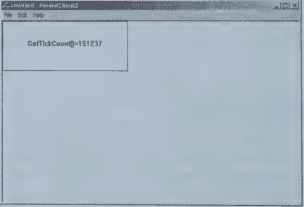

**图 4.1**  
*PersistClient2 程序。*

## 小结

持久数据对几乎每个 COM 对象都很重要。利用现有众多接口实现持久数据并不困难。你已经了解了标准接口以及它们的使用场景。两个示例向你确切展示了如何在程序中使用持久接口。

学习的最佳方式是扩展本章中的两个示例。我建议扩展保持持久的数据量，并以多种方式使用它。


## 名字对象

章

### 本章内容

- COM+ 对象与名字对象  98
- 探索名字对象类型  103

### COM+ 对象与名字对象

名字对象是为其他 COM+ 对象提供服务的对象；它们使您能够按名称标识 COM+ 对象。名字对象所提供的服务都与提供指向该名字对象所标识对象的指针有关。整个标识过程以及随后的指针访问称为绑定。

名字对象是实现 IMoniker 接口的对象，通常作为 COM+ 对象在 DLL 中实现。可以从两种方式看待名字对象的使用：作为名字对象客户端，即使用名字对象获取指向另一个对象的指针的组件；以及作为名字对象提供者，即向名字对象客户端提供标识其对象的名字对象的组件。

COM+ 使用名字对象连接并激活对象，无论这些对象位于同一台计算机上还是跨网络。一个非常重要的用途是网络连接。它们还用于标识、连接并运行复合文档链接对象。在这种情况下，链接源充当名字对象提供者，而包含链接对象的容器充当名字对象客户端。

请稍想一下一个标准的、普通的文件名。该文件名指向恰好存储在磁盘某处的一组数据。我们可以把文件内容称为对象——内容是信息，而且可能还有一些代码存在，知道如何为该信息提供某些功能。这样的对象将允许客户端通过接口指针操作其内容。

现在，文件名本身不是对象，而只是对对象以被动状态存在位置的引用。关于如何使用该名称的智能，涉及将对象——文件——从其被动状态带入其运行状态。但是文件名本身并不智能；所有关于如何运行对象以及如何持久管理该文件名的知识，都必须编码到打算使用该文件对象的客户端中。通常这不是什么大问题，因为应用程序长期以来一直在处理文件对象。

然而，在组件软件环境中，存在的对象类型比数据存在于文件中的对象更多。有些对象被动地驻留在数据库、电子邮件消息以及其他文件内部的特定位置中。其他对象表示某个正在运行的进程，并且根本没有被动状态。尽管如此，客户端仍需要维护符号链接——也就是说，客户端需要持久名称，以便可以绑定这些名称来运行对象并为其检索接口指针。客户端还需要名称来描述文件的特定部分（或文件部分的组成部分）、数据库查询、远程计算、管理操作等。可以说，计算环境中的任何数据集以及任何进程或函数都可以被赋予名称，而命名与绑定体系结构使客户端能够以高效而强大的方式利用这些资源。

正是由于这个原因，无意义的名称可能会成为问题。事实上，它们与组件软件的理想背道而驰。添加新的命名工具需要修订所有希望使用该新类型名称的客户端。换句话说，每个客户端都必须包含特定代码，才能处理特定资源的任何特定类型的名称。如果它们不知道如何使用该名称，则该资源对它们不可用。这在组件软件系统中是完全不切实际的，因为在该系统中，我们能够独立于任何其他组件来更改、修改、更新和重新部署软件组件，并且 QueryInterface() 允许我们添加新接口和新功能，而不会失去与现有客户端的兼容性。

### 使用名字对象

假设您拥有中部地区美国分部 1999 年第四季度产品 X 的销售信息。该信息可能存储在 \\salesinfo 服务器上的特定表和特定单元格区域中。应用程序需要对该数据执行一些典型操作：“本季度产品 X 的销售额与产品 Y 的销售额相比如何？”“今年第一季度与去年第一季度相比，产品 X 的销售额如何？”“将此数字与此数字的 10% 相加，并更新位于 www.sourcedna.com/sales/infox/budget.xyz 上用于明年销售配额的表格。”

清单 5.1 说明了如何使用名字对象以及实现必要业务逻辑的 COM+ 对象来封装最后一个示例。

### 清单 5.1  用名字对象封装

```cpp
HRESULT hres = S_OK;
IBindCtx *pBC = NULL;
hres = CreateBindCtx( NULL, &pBC );

if( SUCCEEDED( hres ) ) {
    DWORD dwValue;
    IMoniker *pMoniker = NULL;

    // Create the moniker object.
    hres = MkParseDisplayName( pBC,
        L"file:\\salesinfo\sales\infox\salesQ499.xyz!Summary",
        &dwValue, &pMoniker );

    if( SUCCEEDED( hres ) ) {

        // Connect to the actual business object, create and
        // initialize it if necessary.
        hres = pMoniker->BindToObject( pBC, NULL, IID_ISalesInfo, &pSales );

        if( SUCCEEDED( hres ) ) {
            // Perform the operation.
            pSales->Add( 1,
                BSTR("http://www.sourcedna.com/sales/infox/budget.xyz") );
            pSales->Release();
        }
    }

    pMoniker->Release();
}

pBC->Release();

}
```

这段代码首先通过调用 CreateBindCtx() 创建 IBindCtx 对象。IBindCtx 接口提供对绑定上下文的访问，绑定上下文是一个存储有关特定名字对象绑定操作的信息的对象。IMoniker 对象通过调用 MkParseDisplayName() 创建。

如果这两个调用都成功，则通过调用 BindToObject() 创建实际业务对象。调用 Add() 函数时会使用该对象。

最后通过 Release() 调用清理所有内容。

### IMoniker::BindToObject()

IMoniker::BindToObject() 方法创建与该名字对象关联的实现 COM 对象的实例。清单 5.2 是使用 IMoniker::BindToObject() 方法的示例。

### 清单 5.2 使用 IMoniker::BindToObject()

```cpp
#include <windows.h>

IUnknown * CreateAndBind(WCHAR * szDisplayName)
{
    IBindCtx *pbindctx;
    IMoniker *pmoniker;
    ULONG ul;
    IUnknown *punknown;

    HRESULT hresult = ::CreateBindCtx(0, &pbindctx);
    hresult = ::MkParseDisplayName(pbindctx, szDisplayName,
        &ul, &pmoniker);
    hresult = pmoniker->BindToObject(pbindctx, NULL,
        IID_IUnknown, (void**)&punknown);

    pbindctx->Release();
    pmoniker->Release();
    return punknown;
}

int main()
{
    ::CoInitialize(NULL);
    IUnknown * pu = CreateAndBind(L"e:\\old.doc");
    pu->Release();
    ::CoUninitialize();

    return 0;
}
```

### IMoniker::BindToStorage()

`IMoniker::BindToStorage()` 方法为该名字对象检索存储接口（通常是 `IStorage` 或 `IStream` 接口）的实例。这不会加载实现 COM 对象的实例。

### IMoniker::ComposeWith()

`IMoniker::ComposeWith()` 方法从此名字对象和另一个名字对象创建新的复合名字对象。此名字对象被视为复合中的左名字对象。

有关复合名字对象的说明，请参见本章后面的“复合名字对象”一节。

### IMoniker::Enum()

`IMoniker::Enum()` 方法为复合名字对象检索 `IEnumMoniker` 对象的实例。`IEnumMoniker` 对象可用于枚举复合中的组件名字对象。

### IMoniker::IsEqual() 和 IMoniker::Reduce()

`IMoniker::IsEqual()` 方法确定两个名字对象是否相等。在调用 `IMoniker::IsEqual()` 方法之前，请调用 `IMoniker::Reduce()` 方法，将名字对象化简为其最具体的形式。

### IMoniker::Hash()

`IMoniker::Hash()` 方法返回一个 `DWORD`。其他组件可以使用该 `DWORD` 对名字对象进行桶排序。


## IMoniker::GetTimeOfLastChange()

IMoniker::GetTimeOfLastChange() 方法可用于确定该名字对象上次更改的时间。如果你正在缓存来自该名字对象的数据，这会很有用。

## IMoniker::CommonPrefixWith() and IMoniker::RelativePathTo()

IMoniker::CommonPrefixWith() 方法创建一个新的名字对象，用于确定此名字对象与另一个名字对象的共同部分。例如，文件名字对象 c:\mydir\subdir\myfile.doc 和 c:\mydir\otherdir\myfile.doc 的共同前缀将是 c:\mydir。

IMoniker::RelativePathTo() 方法创建一个新的相对名字对象，用于确定从此名字对象到另一个名字对象的相对路径。使用前面的示例文件名字对象，得到的相对名字对象将具有显示名称 ..\otherdir\myfile.doc。

## IMoniker::GetDisplayName()

IMoniker::GetDisplayName() 方法检索名字对象的显示名称。对于文件名字对象，此函数将返回你创建该名字对象时所用的同一文件名。

## IMoniker::IsSystemMoniker()

IMoniker::IsSystemMoniker() 方法返回名字对象类型。清单 5.3 展示了使用 IMoniker::IsSystemMoniker() 方法的示例。该清单输出数字 2，它是文件名字对象的类型。

### LISTING 5.3 Using IMoniker::IsSystemMoniker()

```cpp
#include <windows.h>
#include <iostream>

int main()
{
    IBindCtx *pbindctx;
    IMoniker *pmoniker;
    ULONG ul;
    HRESULT hresult = ::CreateBindCtx(0, &pbindctx);
    hresult = ::MkParseDisplayName(pbindctx, L"e:\\old.doc", &ul,
        &pmoniker);
    DWORD dw;
    pmoniker->IsSystemMoniker(&dw);
    std::cout << dw << std::endl;
    pbindctx->Release();
    pmoniker->Release();

    return 0;
}
```

## Exploring Moniker Types

提供名字对象的组件使该名字对象可被其他对象访问。理解各种系统提供的名字对象类之间的差异非常重要，这样才能知道哪些类适合给定对象。COM 还提供了使用 COM 提供的名字对象类来创建名字对象的函数。在本节中，我将介绍文件名字对象、运行对象表、项名字对象、类名字对象和指针名字对象。

### File Monikers

最简单的名字对象类型是文件名字对象。它们可用于标识存储在其自身文件中的任何对象。文件名字对象充当本机文件系统分配给该文件的路径名的包装器。对此名字对象调用 IMoniker::BindToObject() 将导致该对象被激活，然后返回指向该对象的接口指针。由该名字对象命名的对象的源必须提供 IPersistFile 接口的实现，以支持绑定文件名字对象。（有关更多详细信息，请参见第 4 章“持久存储”。你也可以在本章后面找到该接口声明。）文件名字对象可以表示完整路径或相对路径。

例如，存储为文件 C:\FINANCIAL\PROJECTIONS.XLS 的电子表格对象的文件名字对象将包含与该路径名等效的信息。然而，该名字对象不一定由相同的字符串组成。该字符串只是其显示名称，是对名字对象内容的一种表示，对最终用户有意义。显示名称可通过 IMoniker::GetDisplayName() 方法获得，仅在向最终用户显示名字对象时使用。此方法获取任何名字对象类的显示名称。在内部，名字对象可能以对执行名字对象操作更高效、但对用户没有意义的格式存储相同的信息。然后，当通过调用 BindToObject() 方法绑定同一对象时，该对象将被激活，可能是通过将文件加载到电子表格中。

COM+ 提供了名字对象提供程序以及辅助 API CreateFileMoniker()，后者创建一个文件名字对象，并将该对象的指针返回给提供程序。


COM+ 支持三种激活原语：绑定到类对象、绑定到新的类实例，以及绑定到存储在文件中的持久对象。这可以在 COM+ API 函数 `CoGetInstanceFromFile()` 中看到，如清单 5.4 所示。

### LISTING 5.4 The CoGetInstanceFromFile Declaration

```cpp
HRESULT CoGetInstanceFromFile(
    [in, unique] COSERVERINFO *pcsi,  // host/security info
    [in, unique] CLSID        *pClsid, // explicit CLSID (opt)
    [in, unique] IUnknown     *punkOuter, // for aggregation
    [in] DWORD dwClsCtx,               // locality?
    [in] DWORD grfMode,               // file open mode
    [in, string] OLECHAR *pwszName,    // file name of object
    [in] DWORD cmqi,                  // how many interfaces?
    [out, size_is(cmqi)] MULTI_QI *prgmi // where to put iQfs
);
```

CoGetInstanceFromFile() 例程将文件名作为输入。此文件名引用对象的持久状态。使用 CoGetInstanceFromFile() 方法可保证该对象正在运行。然后，它返回一个或多个指向已激活（或重新激活）对象的接口指针。为了完成此操作，CoGetInstanceFromFile() 首先需要确定对象的 CLSID。需要 CLSID 有两个原因。首先，如果对象未运行，COM+ 将需要此 CLSID 来创建新实例，并从持久映像初始化该实例。其次，如果调用方没有指定要将激活调用转发到的显式主机名，COM+ 将使用 CLSID 来确定要在哪台机器上激活该对象。

如果调用方未显式传递 CLSID，则 CoGetInstanceFromFile() 函数会通过调用 COM+ API 函数 `GetClassFile()` 从文件本身派生 CLSID：

```cpp
HRESULT GetClassFile([in, string] OLECHAR *pwszFileName,
                     [out] CLSID *pclsid);
```

`GetClassFile()` 使用文件中的头信息以及注册表信息来确定文件中包含的对象类型。

一旦确定了类和主机，COM+ 就会检查目标主机上的运行对象表（ROT），以确定该对象是否已经激活。ROT 是 SCM 的一项设施，它将任意名字对象映射到本地主机上正在运行的实例。持久对象应在加载时在本地 ROT 中注册自身。为了将持久对象的文件名表示为名字对象，COM+ 提供了一种标准名字对象类型，称为文件名字对象，它将文件名包装在 `IMoniker` 接口之后。文件名字对象可以通过将文件名传递给 `MkParseDisplayName()` 来创建，也可以通过调用显式 API 函数 `CreateFileMoniker()` 来创建：

```cpp
HRESULT CreateFileMoniker(
    [in, string] const OLECHAR *pszFileName,
    [out] IMoniker **pmk);
```

如果持久对象已将其文件名字对象注册到 ROT 中，则 `CoGetInstanceFromFile()` 只需返回指向已运行对象的指针。如果在 ROT 中找不到该对象，COM+ 将创建该文件类的新实例，并通过该实例的 `IPersistFile::Load()` 方法从持久映像初始化它，如清单 5.5 所示。

### LISTING 5.5 The IPersistFile Interface Declaration

```cpp
[ object, uuid(0000010b-0000-0000-C000-000000000046) ]
interface IPersistFile : IPersist {
// called by CoGetInstanceFromFile to initialize object
  HRESULT Load(
        [in, string] const OLECHAR *pszFileName,
        [in] DWORD grfMode
  );
// remaining methods deleted for clarity
}
```

对象实现负责从文件加载任何持久状态，并在本地 ROT 中注册自身，以确保每个文件一次只有一个实例在运行。这可以在清单 5.6 中看到。

### LISTING 5.6 Loading the Persistent State

```cpp
STDMETHODIMP Example::Load(const OLECHAR *pszFileName,
                           DWORD grfMode)
{
// read in persistent state
  HRESULT hr = this->MyReadStateFromFile(pszFileName, grfMode);
  if (FAILED(hr)) return hr;
// get pointer to ROT from SCM
  IRunningObjectTable *prot = 0;
  hr = GetRunningObjectTable(0, &prot);
  if (SUCCEEDED(hr)) {
// create a file moniker to register in ROT
    IMoniker *pmk = 0;
    hr = CreateFileMoniker(pszFileName, &pmk);
    if (SUCCEEDED(hr)) {
// register self in ROT
      hr = prot->Register(0, this, pmk, &m_dwReg);
      pmk->Release();
    }
    prot->Release();
  }
  return hr;
}
```


新创建的实例的 `IPersistFile::Load()` 方法将在 SCM 执行 `CoGetInstanceFromFile()` 期间被调用。上一个示例使用 COM+ API 函数 `GetRunningObjectTable()` 来获取指向 SCM 的 `IRunningObjectTable` 接口指针。然后，它使用该接口将其名字对象（moniker）注册到 ROT 中，以便后续使用相同文件名调用 `CoGetInstanceFromFile()` 时，不会在创建新对象时失败，而是返回对该对象的引用。

文件名字对象存在有两个原因。一个原因是允许对象在 ROT 中注册自身，以便 `CoGetInstanceFromFile()` 能够找到它们。第二个原因是将 `CoGetInstanceFromFile()` 的使用隐藏在客户端的 `IMoniker` 接口之后。文件名字对象的 `BindToObject()` 实现直接调用 `CoGetInstanceFromFile()`，如清单 5.7 所示。

### 清单 5.7 `BindToObject()` 的实现

```cpp
// OLE32.DLL 中的伪代码
STDMETHODIMP FileMoniker::BindToObject(IBindCtx *pbc,
    IMoniker *pmkToLeft,
    REFIID riid, void **ppv) {
    // 假设失败
    *ppv = 0;
    HRESULT hr = E_FAIL;
    if (pmkToLeft == 0) { // 左侧没有名字对象
        MULTI_QI mqi = { &riid, 0, 0 };
        COSERVERINFO *pcsi;
        DWORD grfMode;
        DWORD dwClsCtx;
        // 这三个参数是 BindCtx 的属性
        this->MyGetFromBindCtx(pbc, &pcsi, &grfMode, &dwClsCtx);
        hr = CoGetInstanceFromFile(pcsi, 0, 0, dwClsCtx,
            grfMode, this->m_pszFileName,
            1, &mqi);
        if (SUCCEEDED(hr))
            *ppv = mqi.pItf;
    }
    else { // 左侧存在名字对象
        // 询问左侧对象获取 IClassActivator
        // 或 IClassFactory
    }
    return hr;
}
```

考虑到文件名字对象的行为，清单 5.8 中的函数调用了 `CoGetInstanceFromFile()`：

### 清单 5.8 `CoGetInstanceFromFile()` 函数

```cpp
HRESULT GetInfo(INF * & rpInf) {
    OLECHAR *pwszObject =
        OLESTR("\\\\server\\public\\information.expl");
    MULTI_QI mqi = { &IID_IInf, 0, 0 };
    HRESULT hr = CoGetInstanceFromFile(0, 0, 0, CLSCTX_SERVER,
        STGM_READWRITE, pwszObject, 1, &mqi);
    if (SUCCEEDED(hr))
        rpInf = mqi.pItf;
    else
        rpInf = 0;
    return hr;
}
```

可以通过调用 `CoGetObject` 来简化：

```cpp
HRESULT GetCornelius(INF * & rpInf) {
    OLECHAR *pwszObject =
        OLESTR("\\\\server\\public\\information.expl");
    return CoGetObject(pwszObject, 0, IID_IInf, (void**)&rpInf);
}
```

与之前使用类名字对象的情况一样，`CoGetObject()` 提供的间接层次允许客户端指定任意复杂的激活策略，而无需更改一行代码。

该 API 函数的另一个版本 `CoGetInstanceFromStorage()` 接受指向名字对象存储介质的指针，而不是文件名。

除了 `CoGetClassObject()`/`CoCreateInstanceEx()` 所使用的将 CLSID 重定向到宿主机的正常机制之外，`CoGetInstanceFromFile()` 还可以使用文件的 UNC 主机名将激活请求重定向到文件所在的宿主机。

从技术上讲，ROT 并不是一个机器范围的表，而是一个 Winstation 范围的表，这意味着默认情况下，并非所有登录会话都能访问该对象。为了确保该对象对所有可能的客户端可见，对象在调用 `IRunningObjectTable::Register()` 时应指定 `ROTFLAGS_ALLOWANYCLIENT` 标志。

## 运行对象表

运行对象表（ROT）是每台计算机上可全局访问的表，用于跟踪所有可通过名字对象标识的、处于运行状态的 COM+ 对象。名字对象提供者将对象注册到表中，这会增加对象的引用计数。在对象被销毁之前，必须将其名字对象从表中释放。

`IROTData` 接口由名字对象实现，使 ROT 能够对名字对象进行相互比较。ROT 使用 `IROTData` 接口来测试两个名字对象是否相等。例如，当 ROT 检查指定名字对象是否注册为正在运行时，它必须进行此操作。

如果你正在编写自己的名字对象类（即编写自己的 `IMoniker` 接口实现），并且你的名字对象打算注册到 ROT 中，则必须实现 `IROTData`。

你通常不需要使用此接口。它由系统的 ROT 实现使用。

### 项名字对象

另一种已实现的名字对象类是项名字对象，可用于标识包含在另一个对象中的对象。一种类型的包含对象是嵌入在复合文档中的 OLE 对象。复合文档可以通过为每个嵌入对象分配一个任意名称（如 "myobj1"、"myobj2" 等）来标识其所包含的嵌入对象。另一种类型的包含对象是文档中的用户选择，例如电子表格中的单元格区域或文本文档中的字符区域。由选择组成的对象称为伪对象，因为只有在用户标记该选择后，它才会被视为独立的对象。电子表格可以使用诸如 "C2:H" 之类的名称来标识单元格区域，而字处理文档可以使用书签的名称来标识字符区域。

项名字对象主要在与其他名字对象（用于标识容器的名字对象）连接或“组合”时才有用。通常先创建项名字对象，然后将其组合到文件名字对象上，以创建等同于对象完整路径的复合体。你可以将文件名字对象 "C:\stuff\games.doc"（用于标识容器对象）与项名字对象 "embobj1"（用于标识容器内的对象）组合，形成名字对象 "C:\stuff\games.doc\myobj1"，从而唯一标识特定文件中的特定对象。你还可以连接其他项名字对象来标识深度嵌套的对象。例如，如果 "myobj1" 是电子表格对象的名称，要标识该电子表格对象中的某个单元格区域，你可以追加另一个项名字对象，创建一个等同于 "C:\stuff\games.doc\myobj1\" 的名字对象。

### 项名字对象与文件名字对象

当项名字对象与文件名字对象组合时，会形成一个完整路径。因此，项名字对象将路径名的概念扩展到文件系统之外，定义用于标识单个对象（而不仅仅是文件）的路径名。

项名字对象与文件名字对象之间存在显著差异。文件名字对象中包含的路径对任何理解文件系统的人都有意义，而项名字对象中包含的部分路径仅对特定的容器有意义。每个人都知道 "c:\stuff\games.doc" 指的是什么，但只有特定的容器对象知道 "1A:7F" 指的是什么。一个容器无法解释由另一个应用程序创建的项名字对象；唯一知道项名字对象所指对象的容器，是最初将该项名字对象分配给该对象的容器。因此，由文件和项名字对象组合命名的对象的源，不仅必须实现 `IPersistFile` 以促进文件名字对象的绑定，还必须实现 `IOleItemContainer` 以在文件的上下文中将项名字对象的名称解析为相应的对象。

名字对象的优势在于，只要项名字对象是复合体的一部分，使用名字对象定位对象的人就不需要理解项名字对象中包含的名称。一般来说，项名字对象单独存在是没有意义的。相反，你应该将项名字对象组合到文件名字对象上，然后对复合体调用 `IMoniker::BindToObject()`，这会绑定其中的各个名字对象并解释这些名称。

### 创建项名字对象

为了创建项名字对象并将其指针返回给名字对象提供者，OLE 提供了辅助 API `CreateItemMoniker()`。

### 复合名字对象

名字对象最有用的特性之一是你可以将名字对象连接或组合在一起。复合名字对象是由其他名字对象组合而成的名字对象，并且可以确定各部分之间的关系。这使得你可以根据两个或多个等同于部分路径的名字对象来组装对象的完整路径。你可以组合同类名字对象（如两个文件名字对象），也可以组合不同类的名字对象（如文件名字对象和项名字对象）。如果你要编写自己的名字对象类，你也可以将自己的名字对象与文件名字对象或项名字对象组合。复合体的基本优势在于，它让你用一段代码就能实现所有可能由更简单的名字对象组合而成的名字对象。这极大地减少了对特定自定义名字对象类的需求。

由于不同类的名字对象可以相互组合，名字对象提供了连接多个命名空间的能力。文件系统为以文件形式存储的对象定义了一个公共命名空间，因为所有应用程序都理解文件系统路径名。同样，容器对象也为其包含的对象定义了私有命名空间，因为没有容器能理解另一个容器生成的名称。名字对象允许这些命名空间连接起来，因为文件名字对象和项


名字对象可以组合。名字对象客户端可以使用单一机制在命名空间中搜索所有对象。客户端只需在名字对象上调用 `IMoniker::BindToObject()`，其余工作由名字对象代码处理。对复合名字对象调用 `IMoniker::GetDisplayName()` 会使用所有单个名字对象的显示名称串联来创建名称。

此外，由于你可以编写自己的名字对象类，名字对象组合允许你为对象的命名空间添加自定义扩展。

有时，特定类的两个名字对象可以以特殊方式组合。例如，表示不完整路径的文件名字对象和表示相对路径的另一个文件名字对象可以组合成表示完整路径的单个文件名字对象。例如，文件名字对象 `c:\stuff\music` 可以与相对文件名字对象 `..\backup\myfile.doc` 组合，得到 `c:\stuff\backup\myfile.doc`。这是非通用组合的一个示例。

另一方面，*通用组合*允许连接任意两个名字对象，无论它们属于什么类。例如，你可以将一个项名字对象组合到一个文件名字对象上，当然反过来不行。

由于非通用组合取决于所涉及名字对象的类，其细节由特定名字对象类的实现定义。如果编写新的名字对象类，你可以定义新类型的非通用组合。相比之下，通用组合由 OLE 定义。作为通用组合结果创建的名字对象称为通用复合名字对象。

这三种类型——文件名字对象、项名字对象和通用复合名字对象——协同工作，它们是最常用的名字对象类。

名字对象客户端应调用 `IMoniker::ComposeWith()`，用一个名字对象与另一个名字对象创建复合。被调用的名字对象会在内部决定它可以执行通用组合还是非通用组合。如果名字对象实现确定通用组合可用，OLE 提供 `CreateGenericComposite()` API 函数来促成此操作。

### 类名字对象

尽管类通常通过 CLSID 直接标识给 `CoCreateInstance()` 或 `CoGetClassObject()` 等 API，现在也可以使用称为类名字对象的名字对象来标识类。类名字对象会绑定到创建它时所针对的类的类对象。

使用名字对象标识类的能力支持一些原本难以处理的有用操作。例如，传统上，文件名字对象只支持对其所指文件的类别相关联的类进行丰富绑定——指向 Excel 文件的名字对象会绑定到 Excel 对象的实例，而指向 GIF 图像的名字对象会绑定到当前注册的 GIF 处理程序的实例。类名字对象允许你通过与文件名字对象组合，来指示希望使用哪个类来操作文件。用于 3D 图表类的类名字对象与指向 Excel 文件的另一个名字对象组合后，会生成一个名字对象，该名字对象绑定到 3D 图表对象的实例，并用 Excel 文件的内容初始化该对象。

因此，类名字对象在与文件名字对象或项名字对象等其他类型名字对象组合时最有用。

类名字对象也可以组合到支持绑定到 IClassActivator 接口的名字对象的右侧。以这种方式组合时，IClassActivator 通过 IClassActivator::GetClassObject 直接提供对类对象和类实例的访问。类名字对象可通过 IMoniker::IsSystemMoniker 识别，该方法在 pdwMksys 中返回 MKSYS_CLASSMONIKER。

### 指针名字对象

指针名字对象标识只能以活动或运行状态存在的对象。这不同于其他类名字对象，后者标识可以以被动或活动状态存在的对象。

例如，假设某个应用程序有一个没有持久表示的对象。通常，如果你的应用程序的客户端需要访问该对象，你可以直接向客户端传递指向该对象的指针。但是，假设客户端期望的是名字对象。该对象不能用文件名字对象标识，因为它未存储在文件中；也不能用项名字对象标识，因为它不包含在另一个对象中。

相反，你的应用程序可以创建一个指针名字对象（其内部仅包含一个指针），并将其传递给客户端。客户端可以像对待任何其他名字对象一样对待它。但是，当客户端对指针名字对象调用 IMoniker::BindToObject() 时，名字对象代码不会检查运行对象表（ROT），也不会从存储中加载任何内容。相反，名字对象代码只是对存储在名字对象内部的指针调用 IUnknown::QueryInterface()。

指针名字对象允许只能以活动或运行状态存在的对象参与名字对象操作，并被名字对象客户端使用。指针名字对象与其他类名字对象的一个重要区别是，指针名字对象不能保存到持久存储。如果这样做，调用 IMoniker::Save() 方法会返回错误。这意味着指针名字对象仅在特殊情况下有用。如果需要使用指针名字对象，可以使用 CreatePointerMoniker() API 函数。

### 小结

名字对象提供了一种使用名称访问 COM 对象的方式。这对开发人员来说确实很有益。名字对象还为 COM 对象提供了一种使用初始化字符串进行初始化的方式，从而简化代码和实例化。

在本章中，你了解了不同的名字对象类型以及如何使用它们。你还了解了运行对象表这一极其重要的主题。

你实现过多少次按名称标识同一类的不同对象实例的映射容器？我知道我至少做过一百次。名字对象和运行对象表就是 COM 对 COM 对象的映射容器的实现。我已经遇到过几个运行对象表看起来非常诱人的实例。不幸的是，由于使用名字对象和运行对象表编程的复杂性，你可能还没有实现任何超出简单范围的东西。我希望本章为你提供了在应用程序中使用名字对象所需的动力。

## 可连接对象

### 本章内容

- 连接点 *114*
- 连接点容器 *116*
- 连接点示例 *117*
- 事件与 Visual Basic *129*
- 不同工具如何实现事件 *137*

第 6 章

本章向你展示如何在 Visual C++ 和 Visual Basic 中创建和使用事件。COM+ 本身并不支持事件模型或回调函数。在许多对象模型中，类可以有三类成员：属性、方法和事件。Visual Basic 和 Delphi 是提供这些类型模型的面向对象工具。

COM+ 直接支持同时具有属性和方法的 COM+ 类，但没有任何 COM+ 结构等同于事件。这使得实现 COM+ 事件非常困难。

ActiveX 建议的模型是提供一个连接点，客户端可在其中注册事件接收器。你可以将事件接收器视为*回调类*，即其方法被调用来提供事件通知的类。事件服务器（或源）是向零个或多个事件接收器对象提供通知（事件）的服务器。此实现如图 6.1 所示。

**图 6.1**  
*可连接对象模型。*

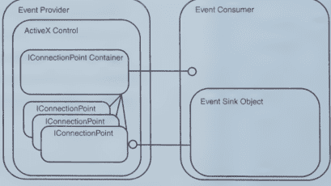

事件源定义事件接收器接口，并实现一个或多个连接点类以及一个连接点容器类。客户端实现事件源定义的事件接收器接口，并将事件接收器对象注册到连接点对象。当事件被触发时，连接点对象会调用事件接收器对象中的方法。这不是最容易理解或实现的过程。

### 连接点

连接点类是 `IConnectionPoint` 接口的一个实现。代码清单 6.1 显示了 `IConnectionPoint` 接口的定义。


### 清单 6.1 IConnectionPoint 接口的定义

```text
interface IConnectionPoint : IUnknown
{
    HRESULT GetConnectionInterface([out] IID * piid);
    HRESULT GetConnectionPointContainer(
        [out] IConnectionPoint ** ppCPC);
    HRESULT Advise([in] IUnknown * punkSink,
        [out] DWORD * pdwCookie);
    HRESULT Unadvise([in] DWORD dwCookie);
    HRESULT EnumConnections(
        [out] IEnumConnections ** ppEnum);
};
```

IConnectionPoint::GetConnectionInterface() 方法返回事件接收器接口的接口标识符（IID）。IConnectionPoint::GetConnectionPointContainer() 方法返回连接容器对象。当客户端希望获得事件通知时，它会创建由服务器定义的事件接收器对象，并使用指向该事件接收器对象的 IUnknown 指针调用 IConnectionPoint::Advise() 方法。

这种架构使一个连接接收器能够由多个连接点服务，并且使多个连接接收器能够由一个连接点服务。为了枚举由一个连接点服务的所有事件接收器，客户端可以调用 IConnectionPoint::EnumConnections() 方法。返回的 IEnumConnections 对象可用于枚举所有需要通知的事件接收器。清单 6.2 显示了 IEnumConnections 接口的定义。

### 清单 6.2 IEnumConnections 接口的定义

```text
interface IEnumConnections : IUnknown
{
    HRESULT Next([in] ULONG cConnections,
        [out] CONNECTDATA * rgcd,
        [out] ULONG * lpcFetched);
    HRESULT Skip([in] ULONG celt);
    HRESULT Reset();
    HRESULT Clone([out] IEnumConnections ** ppEnum);
};
```

调用 IEnumConnections::Next() 方法会返回一个 CONNECTDATA 结构。清单 6.3 显示了 CONNECTDATA 结构的定义。

### 清单 6.3 CONNECTDATA 结构的定义

```
typedef struct tagCONNECTDATA
{
    IUnknown * pUnk;
    DWORD dwCookie;
} CONNECTDATA;
```

CONNECTDATA 结构中的 cookie 是在调用 IConnectionPoint::Advise() 方法时返回的值。连接点可以使用该 IUnknown 接口指针查询事件接收器接口，并调用事件接收器对象上的方法。（对事件接收器的这次方法调用就是客户端中实际被触发的事件。）

## 连接点容器

服务器可以实现一个 IConnectionPointContainer 类来分发连接点对象。清单 6.4 显示了 IConnectionPointContainer 接口的定义。

### 清单 6.4 IConnectionPointContainer 接口的定义

```
interface IConnectionPointContainer : IUnknown
{
    HRESULT EnumConnectionPoints(
        [out] IEnumConnectionPoints ** ppEnum);
    HRESULT FindConnectionPoint([in] REFIID riid,
        [out] IConnectionPoint ** ppCP);
};
```

IConnectionPointContainer::FindConnectionPoint() 方法返回为特定接口标识符提供服务的 IConnectionPoint 对象。

IEnumConnectionPoints 对象是一个标准枚举类。清单 6.5 显示了 IEnumConnectionPoints 接口的定义。

### 清单 6.5 IEnumConnectionPoints 接口的定义

```
interface IEnumConnectionPoints : IUnknown
{
    HRESULT Next([in] ULONG cConnections,
        [out] IConnectionPoint ** rgcd,
        [out] ULONG * pcFetched);
    HRESULT Skip([in] ULONG celt);
    HRESULT Reset();
    HRESULT Clone([out] IEnumConnectionPoints ** ppenum);
};
```

## 连接点示例

为了演示连接点的使用方式，我将使用 ATL 的 IConnectionPointContainerImpl 类。从服务器端的角度来看，该实现提供了使用连接点所需的大部分功能。

该演示由三个组件组成：将触发事件的事件服务器（源）、将捕获事件的事件接收器，以及一个控制程序。事件接收器和控制程序将驻留在客户端进程中，而事件源将驻留在服务器进程中。这能最好地模拟大多数程序中典型的事件接收器—事件源模型。该示例可在随书光盘的 Chapter06 目录下的 ComEvents 子目录中找到。

我们先来查看事件源的 IDL（参见清单 6.6）。

### 清单 6.6 事件源的 IDL

```idl
// EventServer.idl : IDL source for EventServer.dll
//
// This file will be processed by the MIDL tool to
// produce the type library (EventServer.tlb) and marshaling
// code.

import "oaidl.idl";
import "ocidl.idl";

[
    uuid(1579753F-41A7-11D2-BEA1-00C04FB872E7),
    dual,
    helpstring("IMyEventTrigger Interface"),
    pointer_default(unique)
]
interface IMyEventTrigger : IDispatch
{
    [helpstring("method Fire")] HRESULT Fire();
};

[
    object,
    uuid(15797541-41A7-11D2-BEA1-00C04FB872E7),
    dual,
    helpstring("IMyEventSink Interface"),
    pointer_default(unique)
]
interface IMyEventSink : IDispatch
{
    [helpstring("method Hello")] HRESULT Hello();
};

[
    uuid(15797532-41A7-11D2-BEA1-00C04F8B727E),
    version(1.0),
    helpstring("EventServer 1.0 Type Library")
]
library EVENTSERVERLib
{
    importlib("stdole32.tlb");
    importlib("stdole2.tlb");

    [
        uuid(15797540-41A7-11D2-BEA1-00C04F8B727E),
        helpstring("MyEventTrigger Class")
    ]
    coclass MyEventTrigger
    {
        [default] interface IMyEventTrigger;
        [default, source] interface IMyEventSink;
    };
};
```

我创建了两个接口：一个用于触发事件，一个用于捕获事件（事件接收器）。每个接口都有一个方法，分别定义触发方法和接收器方法。当调用事件源中的触发方法时，事件接收器中的接收器方法将被调用。

在 coclass 定义中，我为事件接口包含了接口特性 [default, source]。这意味着该接口是事件的默认接口。添加 [source] 特性以将接口标记为事件接收器接口，而不是类所公开的接口，这一点很重要。Delphi 和 Visual Basic 等语言使用 [source] 特性来区分事件与方法及属性。

接下来，查看清单 6.7 中触发器的类声明。

### 清单 6.7 触发器的类声明

```cpp
// MyEventTrigger.h : Declaration of the CMyEventTrigger

#ifndef __MYEVENTTRIGGER_H__
#define __MYEVENTTRIGGER_H__

#include "resource.h"        // main symbols

/////////////////////////////////////////////////////////////////////////////
// CMyEventTrigger
class ATL_NO_VTABLE CMyEventTrigger :
    public CComObjectRootEx<CComSingleThreadModel>,
    public CComCoClass<CMyEventTrigger, &CLSID_MyEventTrigger>,
    public IConnectionPointContainerImpl<CMyEventTrigger>,
    public IDispatchImpl<IMyEventTrigger, &IID_IMyEventTrigger,
        &LIBID_EVENTSERVERLib>,
    public IConnectionPointImpl<CMyEventTrigger,
        &IID_IMyEventSink>
{
public:
    CMyEventTrigger()
    {
    }

DECLARE_REGISTRY_RESOURCEID(IDR_MYEVENTTRIGGER)

BEGIN_COM_MAP(CMyEventTrigger)
    COM_INTERFACE_ENTRY(IMyEventTrigger)
    COM_INTERFACE_ENTRY(IDispatch)
    COM_INTERFACE_ENTRY(IConnectionPointContainer)
END_COM_MAP()

BEGIN_CONNECTION_POINT_MAP(CMyEventTrigger)
    CONNECTION_POINT_ENTRY(IID_IMyEventSink)
END_CONNECTION_POINT_MAP()

// IMyEventTrigger
public:
    STDMETHOD(Fire)();
};

#endif // __MYEVENTTRIGGER_H_
```

在类声明中，请注意我实现了 IMyEventTrigger 接口。稍后将调用该接口以触发事件。我同时继承自 IConnectionPointImpl 和 IConnectionPointContainerImpl，以便使用 ATL 中实现的所有默认模板代码。CONNECTION_POINT_ENTRY() 条目告诉 IConnectionPointContainerImpl 连接点处理哪些事件接收器接口。

触发器的类定义非常简单，因为只实现了一个方法（参见清单 6.8）。


### 清单 6.8 触发器的类定义

```cpp
// MyEventTrigger.cpp : implementation of CMyEventTrigger
#include "stdafx.h"
#include "EventServer.h"
#include "MyEventTrigger.h"

/////////////////////////////////////////////////////////////////////////////
// CMyEventTrigger

STDMETHODIMP CMyEventTrigger::Fire()
{
    // TODO: Add your implementation code here
    IUnknown ** ppunknown = m_vec.begin();
    if (*ppunknown != NULL)
    {
        IMyEventSink * pmyeventsink = (IMyEventSink *)*ppunknown;
        pmyeventsink->Hello();
    }

    return S_OK;
}
```

连接点中包含的 IUnknown 指针保存在名为 m_vec 的 CComDynamicUnkArray 容器成员变量中。你可以使用类似于清单 6.9 的代码遍历整个数组。

### 清单 6.9 遍历 CComDynamicUnkArray 容器类

```cpp
IUnknown** ppunknown = m_vec.begin();
while (ppunknown < m_vec.end())
{
    if (*ppunknown != NULL)
    {
        IMyEventSink * pmyeventsink = (IMyEventSink *)*ppunknown;
        pmyeventsink->Hello();
    }
    ppunknown++;
}
```

这就是整个事件服务器。代码并不多，因为 IConnectionPointContainerImpl 和 IConnectionPointImpl 模板为你完成了所有工作。

## 事件接收器

事件接收器对象是一个进程内服务器。该服务器没有新接口，只有一个 COM+ 类（见清单 6.10）。

### 清单 6.10 事件接收器对象的 IDL

```idl
// EventClient.idl : IDL source for EventClient.dll
//
// This file will be processed by the MIDL tool to
// produce the type library (EventClient.tlb) and marshalling
// code.

import "oaidl.idl";
import "ocidl.idl";

[
    uuid(7BBCFBF6-41AB-11D2-BEA1-00C04FB872E7),
    version(1.0),
    helpstring("EventClient 1.0 Type Library")
]
library EVENTCLIENTLib
{
    importlib("stdole32.tlb");
    importlib("stdole2.tlb");
    importlib("..\\EventServer\\EventServer.tlb");

    [
        uuid(7BBCFBF6-41AB-11D2-BEA1-00C04FB872E7),
        helpstring("MyEventSink Class")
    ]
    coclass MyEventSink
    {
        [default] interface IMyEventSink;
    };

};
```

在 IDL 中需要注意的重要一点是，我导入了事件源的类型库，并在事件接收器类中实现了 IMyEventSink 接口。

事件接收器对象的类声明（见清单 6.11）和类定义（见清单 6.12）都很简单明了。

### 清单 6.11 事件接收器对象的类声明

```cpp
// MyEventSink.h: Definition of the MyEventSink class
//
////////////////////////////////////////////////////////////

#if !defined(AFX_MYEVENTSINK_H_INCLUDED_)
#define AFX_MYEVENTSINK_H_INCLUDED_

#if _MSC_VER >= 1000
#pragma once
#endif // _MSC_VER >= 1000

#include "resource.h"       // main symbols

#include "..\\EventServer\\EventServer.h"

///////////////////////////////////////////////////////////
// MyEventSink

class MyEventSink :
    public CComObjectRoot,
    public CComCoClass<MyEventSink, &CLSID_MyEventSink>,
    public IDispatchImpl<IMyEventSink, &IID_IMyEventSink,
                         &LIBID_EVENTSERVERLib>
{
public:
    MyEventSink() {}
    BEGIN_COM_MAP(MyEventSink)
    COM_INTERFACE_ENTRY(IDispatch)
    COM_INTERFACE_ENTRY(IMyEventSink)
    END_COM_MAP()
    // DECLARE_NOT_AGGREGATABLE(MyEventSink)
    // Remove that line above if you don't want
    // your object to support aggregation.

    DECLARE_REGISTRY_RESOURCEID(IDR_MyEventSink)

    // IMyEventSink
public:
    STDMETHOD(Hello)();

};

#endif // !defined(AFX_MYEVENTSINK_H_INCLUDED_)
```

### 清单 6.12 事件接收器对象的类定义

```cpp
// MyEventSink.cpp : Implementation of CEventClientApp and
// DLL registration.

#include "stdafx.h"
#include "EventClient.h"
#include "MyEventSink.h"

#include <iostream>

#include "..\\EventServer\\EventServer_i.c"

////////////////////////////////////////////////////////////
//

STDMETHODIMP MyEventSink::Hello()
{
    // TODO: Add your implementation code here
    std::cout << "The event was fired. Hurray!" << std::endl;

    return S_OK;
}
```

定义和声明都是双接口的标准实现。它们继承自 IDispatchImpl ATL 类模板，并实现该接口（IMyEventSink）的所有方法。在本例中，事件触发时，有一个方法会向标准输出发送一条消息。这个声明和定义中唯一不太寻常的代码大概是：事件服务器的头文件（EventServer.h）位于类声明之前，而事件接收器的头文件库源文件（EventServer_i.c）位于类定义之前。这些文件包含事件接收器接口的 C++ 定义（在头文件中）以及事件接收器接口的 GUID（在源文件中）。

所有操作都在控制程序中进行（见清单 6.13）。

### 清单 6.13 事件控制程序

```cpp
#include <windows.h>
#include <iostream>
#include <atlbase.h>
#include "..\\EventServer\\EventServer.h"

#include "EventServer\\EventServer_i.c"

char s[1024];

HRESULT GetUnknown(WCHAR * strProgID, IUnknown ** ppunknown)
{
    CLSID clsid;
    HRESULT hresult = ::CLSIDFromProgID(strProgID, &clsid);
    if (FAILED(hresult))
    {
        // CLSIDFromProgID failed
        std::cout << "CLSIDFromProgID failed - "
        << _ltoa(hresult, s, 16) << std::endl;
        ATLASSERT(FALSE);
        return hresult;
    }

    hresult = ::CoCreateInstance(clsid, NULL, CLSCTX_SERVER,
                                 IID_IUnknown, (void **)ppunknown);
    if (FAILED(hresult))
    {
        // CoCreateInstance failed
        std::cout << "CoCreateInstance failed = "
                  << _ltoa(hresult, s, 16) << std::endl;
        ATLASSERT(FALSE);
        return hresult;
    }

    return S_OK;
};

HRESULT GetInterface(IUnknown * punknown, REFIID riid,
                     IUnknown ** ppunknown)
{
    HRESULT hresult = punknown->QueryInterface(riid,
                                                (void **)ppunknown);

    if (FAILED(hresult))
    {
        // QueryInterface failed
        std::cout << "QueryInterface failed = "
                  << _ltoa(hresult, s, 16) << std::endl;
        ATLASSERT(FALSE);
        return hresult;
    }

    return S_OK;
}

int main()
{
    //-----------------------------------
    // Start the test app
    //-----------------------------------
    ::CoInitialize(NULL);
    std::cout << "Start" << std::endl;

    //-----------------------------------
    // initialize all my interfaces
    //-----------------------------------
    IUnknown * punknownserver = 0;
    IUnknown * punknownclient = 0;
    IMyEventSink * pmyeventsink = 0;
    IConnectionPointContainer * pmyconnectionpointcontainer = 0;
    IConnectionPoint * pmyconnectionpoint = 0;
    IMyEventTrigger * pmyeventtrigger = 0;

    //====================================
    // Get my server IUnknown
    //====================================
    HRESULT hresult =
        GetUnknown(L"IMyEventTrigger,IMyEventTrigger.1",
                   &pmyeventtrigger);
    if (FAILED(hresult))
    {
        // GetUnknown failed
        std::cout << "GetUnknown failed = "
                  << _ltoa(hresult, s, 16) << std::endl;
        ATLASSERT(FALSE);
        return hresult;
    }

    //====================================
    // Get my client IUnknown
    //====================================
    hresult = GetUnknown(L"EventClient.MyEventSink.1",
                         &pmyeventsink);
    if (FAILED(hresult))
    {
        // GetUnknown failed
        std::cout << "GetUnknown failed = "
                  << _ltoa(hresult, s, 16) << std::endl;
        ATLASSERT(FALSE);
        return hresult;
    }

    //====================================
    // Get my server interface
    //====================================
    hresult = GetInterface(punknownserver,
                           IID_IConnectionPointContainer,
                           (IUnknown **)&pmyconnectionpointcontainer);
    if (FAILED(hresult))
    {
        // GetInterface failed
        std::cout << "GetInterface failed = "
                  << _ltoa(hresult, s, 16) << std::endl;
        ATLASSERT(FALSE);
        return hresult;
    }
```


### 清单 6.13（续）

```cpp
//========================================
// Get the container
//========================================
hresult = pmyconnectionpointcontainer->FindConnectionPoint(
                 IID_IMyEventSink, &pmyconnectionpoint);
if (FAILED(hresult))
{
    // FindConnectionPoint failed
    std::cout << "FindConnectionPoint failed = "
              << ltoa(hresult, s, 16) << std::endl;
    ATLASSERT(FALSE);
    return hresult;
}

//========================================
// Add the advise notification
//========================================
DWORD dwcookie = 0;
hresult = pmyconnectionpoint->Advise(unknownclient,
                                     &dwcookie);

if (FAILED(hresult))
{
    // Advise failed
    std::cout << "Advise failed = "
              << ltoa(hresult, s, 16) << std::endl;
    ATLASSERT(FALSE);
    return hresult;
}

//========================================
// Get my server interface
//========================================
hresult = GetInterface(unknownserver, IID_IMyEventTrigger,
                       (IUnknown**)&pmyeventtrigger);
if (FAILED(hresult))
{
    // GetInterface failed
    std::cout << "GetInterface failed = "
              << ltoa(hresult, s, 16) << std::endl;
    ATLASSERT(FALSE);
    return hresult;
}

//========================================
// Fire the event
//========================================
hresult = pmyeventtrigger->Fire();
if (FAILED(hresult))
{
    // Fire failed
    std::cout << "Fire failed = "
              << ltoa(hresult, s, 16) << std::endl;
    ATLASSERT(FALSE);
    return hresult;
}

//===============================
// release all my interfaces
//===============================
if (punknownserver != 0)
{
    punknownserver->Release();
}
if (punknownclient != 0)
{
    punknownclient->Release();
}
if (pmyeventsink != 0)
{
    pmyeventsink->Release();
}
if (pmyconnectionpoint != 0)
{
    pmyconnectionpoint->Release();
}
if (pmyconnectionpointcontainer != 0)
{
    pmyconnectionpointcontainer->Release();
}
if (pmyeventtrigger != 0)
{
    pmyeventtrigger->Release();
}

//===============================
// End the test app
//===============================
std::cout << "End" << std::endl;
::CoUninitialize();
return 0;
}
```

我在控制程序中实现了两个函数，用于创建新的 COM+ 对象（`GetUnknown()`）并查询对象上的 COM+ 接口（`GetInterface()`）。我不会详细描述这些函数，因为它们是用于创建对象和查询接口的标准实现。

在 `main()` 函数中，我创建事件服务器和事件接收器对象。注意，事件服务器对象是在进程外创建的，而事件接收器对象是在进程内创建的。这并不是 COM+ 事件模型的必要条件，但它是标准实现。

事件源通常是一个带有事件的 ActiveX 控件，而事件接收器是希望收到 OLE 控件中事件通知的客户端应用程序。OLE 控件可能是一个网格控件，客户端可能是一个对话框，该对话框将控件嵌入其客户区中。当网格控件被双击时，对话框可能希望收到通知。对话框将实现由网格控件定义的事件接收器接口。当对话框调用 `IConnectionPoint::Advise()` 方法时，OLE 控件将收到指向对话框事件接收器的指针。当网格被双击时，网格控件调用对话框的事件接收器方法，从而产生通知。

为了调用 `IConnectionPoint::Advise()` 方法，客户端必须首先获得指向 `IConnectionPointContainer` 接口的接口指针。在清单 6.13 中，这是通过第一次调用 `GetInterface()` 函数完成的。

有了 `IConnectionPointContainer` 接口，我现在可以调用 `IConnectionPointContainer::FindConnectionPoint()` 方法来获取 `IConnectionPoint` 对象。

现在我有了 `IConnectionPoint` 接口，可以调用 `IConnectionPoint::Advise()` 来设置事件通知。注意，我向 `IConnectionPoint::Advise()` 方法传递了一个指向 DWORD 的指针。这是一个 cookie，我稍后可以用它调用 `IConnectionPoint::Unadvise()` 方法来终止事件通知。

下一步是获取 `IEventTrigger` 接口的接口指针。在清单 6.13 中，这是第二次调用 `GetInterface()` 函数。获得 `IEventTrigger` 接口后，我可以调用 `IEventTrigger::Fire()` 方法来触发事件。该方法被触发时，会调用 `MyEventSink::Hello()` 中的代码。

运行应用程序应产生以下命令行输出：

```text
Start
The event was fired.  Hurray!
End
```

这并不太难。代码看起来有点奇怪且复杂，但实际上并没有那么多代码要处理。唯一的问题是，这种类型的事件接收器无法与 Visual Basic 一起工作。

## 事件与 Visual Basic

在前面的示例中，我使用 vtable 触发了事件。Visual Basic 只为其事件接收器生成自动化代码，而不生成任何用于捕获事件通知的 vtable 代码。这意味着我必须调用 `IDispatch::Invoke` 方法，才能在 Visual Basic 客户端中触发事件。

### 事件的黑洞

这是 Microsoft 面向对象架构中的重大黑洞之一。程序员如何知道应该使用哪个接口来触发事件，是调度接口还是 vtable 接口？如果不给模型施加限制，这根本不可能。你可以对 COM 服务器施加一条规则，要求它们必须同时调用 vtable 和调度接口，但这会导致额外的客户端代码，以确保事件不会被接收两次。唯一可行的规则是限制所有人在调用事件接收器方法时都使用调度接口。这消除了使用 vtable 的任何优势，并且要求开发者为了使用事件而理解自动化，从而增加了学习曲线。

清单 6.14 展示了调用 `IDispatch::Invoke` 方法以使用调度接口调用事件所需的代码。

### 清单 6.14 通过 IDispatch 接口调用事件处理程序

```cpp
VARIANTARG* pvars = new VARIANTARG[1];
for (int i = 0; i < 1; i++)
{
    VariantInit(&pvars[i]);
}
IUnknown** pp = m_vec.begin();
while (pp < m_vec.end())
{
    if (*pp != NULL)
    {
        pvars[0].vt = VT_I4;
        pvars[0].lVal = lFlags;
        DISPPARAMS disp = { pvars, NULL, 1, 0 };
        IDispatch* pDispatch = reinterpret_cast<IDispatch*>(*pp);
        pDispatch->Invoke(0x1, IID_NULL, LOCALE_USER_DEFAULT,
                          DISPATCH_METHOD, &disp, NULL, NULL, NULL);
    }
    pp++;
}
delete[] pvars;
```

## 重写事件源

为了符合此事件模型，必须重写事件源中的一些内容。IMyEventSink 接口必须重写为调度接口。清单 6.15 显示了新 IDL 文件的内容。

### 清单 6.15 新事件源的 IDL

```idl
// vbsink.idl : IDL source for vbsink.dll
//
// This file will be processed by the MIDL tool to
// produce the type library (vbsink.tlb) and marshalling
// code.

import "oaidl.idl";
import "ocidl.idl";

[
    object,
    uuid(18C9E2B0-8D36-11d2-9C2B-DC6F06C10000),
    dual,
    helpstring("IMyEventSource Interface"),
    pointer_default(unique)
]
interface IMyEventSource : IDispatch
{
    [id(1), helpstring("method FireEvent")]
        HRESULT FireEvent(long lSeconds);
};

[
    uuid(18C9E2B0-8D36-11d2-9C2B-DC6F06C10000),
    version(1.0),
    helpstring("vbsink 1.0 Type Library")
]
library VBSINKLib
{
    importlib("stdole32.tlb");
    importlib("stdole2.tlb");

    [
        uuid(A0281EE1-8D36-11d2-9C2B-DC6F06C10000),
        nonextensible,
        helpstring("DIMyEventSink Dispatch Interface")
    ]
    dispinterface DIMyEventSink
    {
      properties:
        methods:
          [id(1)] void Timeout();
    };

    [
      uuid(18C0E28E-8D36-11D2-9C2B-DC6F06C10000),
      helpstring("MyEventSource Class")
    ]
    coclass MyEventSource
    {
      [default] interface IMyEventSource;
      [default, source] dispinterface DIMyEventSink;
    };
};
```

新增的另一项更改是将事件触发延迟选定的秒数，以使事件通知过程更加明显。为了引入延迟，我必须创建第二个线程，以便第一个线程不会阻塞客户端应用程序。清单 6.16 显示了新事件源类的实现。

### 清单 6.16 在单独线程中触发延迟事件

```cpp
// MyEventSource.cpp : Implementation of CMyEventSource
#include "stdafx.h"
#include <vbsink.h>
#include "MyEventSource.h"

///////////////////////////////////////////////////////////
// CMyEventSource

STDMETHODIMP CMyEventSource::FireEvent(long lSeconds)
{
  m_lSeconds = lSeconds;

  DWORD dw;
  if (::CreateThread(NULL, 0,
      (LPTHREAD_START_ROUTINE)&CMyEventSource::ThreadStart,
      this, 0, &dw))
  {
    return S_FALSE;
  }

  return S_OK;
}
```


**清单6.16（续）**

```cpp
}

DWORD WINAPI CMyEventSource::ThreadStart(void * pCookie)
{
    CMyEventSource * object = (CMyEventSource *)pCookie;
    Sleep(1000 * object->m_lSeconds);
    object->Fire_Timeout();
    return 0;
}
```

如第7章“COM+ 线程处理”所述，这种线程被称为*工作线程*。它使主线程能够继续正常处理，而任务在后台执行。在本例中，后台任务是`CMyEventSource::ThreadStart`静态方法，它只是等待指定的秒数，然后触发超时事件。

我本可以编写`CMyEventSource::FireEvent()`的代码，使其像清单6.14那样调用事件接收器处理例程。但Visual C++提供了一种更安全、更简单的替代方法来生成代码。使用这种方法，我将事件通知代码缩减为一行，即`CMyEventSource::Fire_Timeout()`。`CMyEventSource::Fire_Timeout()`背后的代码是由Visual C++ 6.0的ATL代理生成器生成的。

## ATL 代理生成器

ATL代理生成器具有生成向所有已连接的事件接收器广播事件通知所需源代码的功能。这使得编码更加容易，因为事件源中的事件通知只需一行代码，而不是清单6.14中使用的约20行。

> **注意**
>
> ATL代理生成器在Visual C++ 6.0中不再作为独立工具提供，它已集成到DevStudio的类视图（ClassView）窗格中。保存你的IDL并编译它，以便生成类型库。你可以通过右键单击DevStudio的文件视图（FileView）窗格中的IDL文件，并在弹出菜单中选择“编译”选项来编译IDL。
>
> 类型库编译完成后，右键单击类视图窗格中的事件源类，并在弹出菜单中选择“实现连接点”。在出现的“实现连接点”对话框中，你可以选择事件接口，并单击“确定”。
>
> IDL文件将生成一个类似于清单6.17的头文件，并自动生成从新生成的代理类继承的代码。

为了生成事件源代理代码，请保存IDL文件并将其编译为所需的类型库。在本例中，类型库文件是`vbSink.tlb`。现在，在IDE中，依次选择“项目”、“添加到项目”、“组件和控件”。选择“Developer Studio组件”文件夹，然后选择“ATL代理生成器”项。选择“插入”，并在确认弹出框中单击“确定”。将出现ATL代理生成器对话框，它应类似于图6.2。

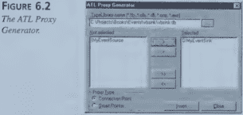

在对话框中，在“类型库名称”编辑控件中添加带完整路径的类型库文件名。你可以使用省略号按钮浏览类型库。突出显示事件接收器调度接口，并单击“->”将该接口从“未选择”窗格移动到“已选择”窗格。在“代理类型”框中选择“连接点”，并单击“插入”按钮。代码生成器将要求输入文件名。你只需单击“保存”按钮，即可接受代码生成器提供的文件名。

清单6.17显示了从你的类型库生成的代码。

**清单6.17 IConnectionPoint 处理程序**

```cpp
////////////////////////////////////////////////////////////////////
// CProxyDMyEventSink
template <class T>
class CProxyDMyEventSink :
    public IConnectionPointImpl<T, &DIID_DMyEventSink,
                         CComDynamicUnkArray>
{
public:
//methods:
//DMyEventSink : IDispatch
public:
    void Fire_Timeout()
    {
        T* pT = (T*)this;
        pT->Lock();
        IUnknown** pp = m_vec.begin();
        while (pp < m_vec.end())
        {
            if (*pp != NULL)
            {
                DISPPARAMS disp = { NULL, NULL, 0, 0 };
                IDispatch* pDispatch =
                    reinterpret_cast<IDispatch*>(*pp);
                pDispatch->Invoke(0x1, IID_NULL, LOCALE_USER_DEFAULT,
                    DISPATCH_METHOD, &disp, NULL, NULL, NULL);
            }
            pp++;
        }
        pT->Unlock();
    }
};
```

要实现此连接点模板类，只需从该模板派生事件源类，并将调度接口ID添加到连接点映射中。清单6.18显示了新的事件源类声明。

**清单6.18 事件源类**

```cpp
// MyEventSource.h : Declaration of the CMyEventSource

#ifndef __MYEVENTSOURCE_H_
#define __MYEVENTSOURCE_H_

#include "resource.h"       // main symbols
#include "cpvbsink.h"

/////////////////////////////////////////////////////////////////////////////
// CMyEventSource
class ATL_NO_VTABLE CMyEventSource :
    public CComObjectRootEx<CComMultiThreadModel>,
    public CComCoClass<CMyEventSource, &CLSID_MyEventSource>,
    public IConnectionPointContainerImpl<CMyEventSource>,
    public IDispatchImpl<IMyEventSource, &IID_IMyEventSource,
        &LIBID_VBSINKLib>,
    public CProxyDMyEventSink<CMyEventSource>
{
public:
    CMyEventSource()
    {
    }

DECLARE_REGISTRY_RESOURCEID(IDR_MYEVENTSOURCE)

BEGIN_COM_MAP(CMyEventSource)
    COM_INTERFACE_ENTRY(IMyEventSource)
    COM_INTERFACE_ENTRY(IDispatch)
    COM_INTERFACE_ENTRY_IMPL(IConnectionPointContainer)
END_COM_MAP()

BEGIN_CONNECTION_POINT_MAP(CMyEventSource)
    CONNECTION_POINT_ENTRY(DIID_DMyEventSink)
END_CONNECTION_POINT_MAP()

// IMyEventSource
public:
    STDMETHOD(FireEvent)(long lSeconds);
private:
    long m_lSeconds;
    static DWORD WINAPI ThreadStart(void * pCookie);
};

#endif // __MYEVENTSOURCE_H_
```

我没有重写控制程序或事件接收器客户端。相反，我将用Visual Basic编写客户端，以证明此类事件处理与Visual Basic兼容。

### 编写 Visual Basic 客户端

编写VB客户端相当容易。创建一个简单的Visual Basic可执行文件，其中包含一个窗体和类文件。转到“项目”、“引用”，并启用对包含你所使用的COM对象的类型库的引用。将清单6.19中的代码添加到窗体源代码中。

**清单6.19 启动事件**

```vb
Option Explicit
Dim vbsinkcls As Class1

Private Sub Command1_Click()

    Set vbsinkcls = New Class1
    DoEvents
    vbsinkcls.Go

End Sub
```

注意，`Class1`是类文件的名称。如果更改了类文件的名称，则还必须更改窗体源代码中的代码。

最后，你必须创建COM对象、调用`FireEvent`方法并响应`Timeout`事件通知。清单6.20显示了类文件中执行这些操作的代码。

**清单6.20 调用事件触发器并处理事件通知的类**

```vb
Option Explicit
Dim WithEvents vbsink As VBSINKLib.MyEventSource
Attribute vbsink.VB_VarHelpID = -1

Private Sub Class_Initialize()

    Set vbsink = New VBSINKLib.MyEventSource

End Sub

Private Sub Class_Terminate()

    Set vbsink = Nothing

End Sub

Private Sub vbsink_Timeout()

    MsgBox "Timeout"

End Sub

Sub Go()

    vbsink.FireEvent 10

End Sub
```

`vbsink`对象的类型必须是IDL文件中定义的类型库名称，以及同样在IDL文件中定义的coclass的类名。COM类在`Class_Initialize()`子例程中创建，并在`Class_Terminate()`子例程中销毁。`Go()`子例程调用COM对象的`FireEvent`方法，参数指明在发送超时事件前延迟10秒。

此类文件中最重要的部分是接收事件通知的`vbsink_Timeout()`子例程。当Visual Basic收到事件通知时，它会查找与对象名称匹配的子例程名称，该名称的格式为：对象名称 + 下划线 + 通知方法的名称。

运行VB可执行文件，并单击“Trigger”按钮。十秒钟后，事件通知将被发送，并显示一个标题为“Timeout”的消息框。就是这样。


本实验的 VB 和 ATL 项目均位于 CD-ROM 的 Chapter06 目录下名为 vbsink 的子目录中。

## 不同工具如何实现事件

接下来的两节是我认为对理解 COM 事件工作原理最有用的实验。这些实验展示了不同编译器如何生成各自的事件接口。

### 事件与 Visual Basic

如果创建 VB ActiveX 控件并将项目编译为 OCX，就可以使用 OLEView 读取该 OCX 的类型库。启动 OLEView，从菜单栏选择 File、View TypeLib。选择新建的 OCX，然后单击 Open 按钮。ITypeLib 查看器的右窗格会以 IDL 格式显示类型库内容。清单 6.21 是为 Visual Basic ActiveX 控件生成的默认 IDL。

**清单 6.21** Visual Basic ActiveX 控件的 IDL

```idl
// Generated .IDL file (by the OLE/COM Object Viewer)
//
// typelib filename: Project1.ocx
// Forward declare all types defined in this typelib
interface _UserControl1;
dispinterface __UserControl1;

[
    uuid(700B9D89-8D5F-11D2-9C2B-DC6F06C10000),
    version(1.0),
    helpstring("Project1")
]
library Project1
{
    // TLib : OLE Automation :
    // {00020430-0000-0000-C000-000000000046}
    importlib("STDOLE2.TLB");

    [
        odl,
        uuid(700B9B86-8D5F-11D2-9C2B-DC6F06C10000),
        version(1.0),
        hidden,
        dual,
        nonextensible,
        oleautomation
    ]
    interface _UserControl1 : IDispatch {
    };

    [
        uuid(700B9DB7-8D5F-11D2-9C2B-DC6F06C01000),
        version(1.0),
        noncreatable,
        control
    ]
    coclass UserControl1 {
        [default] interface _UserControl1;
        [default, source] dispinterface __UserControl1;
    };

    [
        uuid(700B9DB8-8D5F-11D2-9C2B-DC6F06C01000),
        version(1.0),
        hidden,
        nonextensible
    ]
    dispinterface __UserControl1 {
        properties:
        methods:
    };
};
```

请注意，该控件实现了两个接口：一个双重接口和一个调度接口。双重接口包含 ActiveX 对象的属性和方法。双重接口的名称由控件名称前加一个下划线构成。

调度接口包含 ActiveX 对象的事件，其名称由控件名称前加两个下划线构成。这个命名约定容易混淆，因为有时很难分辨一个还是两个前导下划线，但该约定确实有效，因为现在很容易区分哪些接口属于哪个控件。

如果将清单 6.21 中的 IDL 与清单 6.15 中的 IDL 进行比较，你会发现它们非常相似。这正是我们试图达到的相似性，以便 Visual Basic 模块能够利用我们的 ActiveX 控件。

### 事件与 C++Builder

另一个有趣的实验是查看使用 Inprise 的 C++Builder 或 Delphi 构建的 ActiveForm 的内容。清单 6.22 显示了使用 C++Builder 创建 ActiveForm 时生成的默认 IDL。

**清单 6.22** C++Builder ActiveForm 的 IDL

```idl
// Generated IDL file by the OLE/COM Object Viewer
//
// typelib filename: <could not determine filename>
// Forward declare all types defined in this typelib
interface IActiveFormX;
dispinterface IActiveFormXEvents;

[
    uuid(18C9B680-8CA9-11D2-9C2B-DC6F06C10000),
    version(1.0),
    helpstring("ActiveFormProj1 Library")
]
library ActiveFormProj1
{
    // TLib : OLE Automation :
    // {00020430-0000-0000-C000-000000000046}
    importlib("STDOLE2.TLB");

    [
        odl,
        uuid(18C9B681-8CA9-11D2-9C2B-DC6F06C10000),
        version(1.0),
        helpstring("Dispatch interface for ActiveForm Control"),
        dual,
        oleautomation
    ]
    interface IActiveFormX : IDispatch {
        [id(0x00000001), propget]
        HRESULT _stdcall Visible(
            [out, retval] VARIANT_BOOL* Value);
        [id(0x00000001), propput]
        HRESULT _stdcall Visible([in] VARIANT_BOOL Value);
        [id(0x00000002), propget]
        HRESULT _stdcall AutoScroll(
            [out, retval] VARIANT_BOOL* Value);
        [id(0x00000002), propput]
        HRESULT _stdcall AutoScroll([in] VARIANT_BOOL Value);
        [id(0x00000003), propget]
        HRESULT _stdcall AxBorderStyle(
            [out, retval] TxActiveFormBorderStyle* Value);
        [id(0x00000003), propput]
        HRESULT _stdcall AxBorderStyle(
            [in] TxActiveFormBorderStyle Value);
        [id(0xffffffff), propget]
        HRESULT _stdcall Caption([out, retval] BSTR* Value);
        [id(0xffffffff), propput]
        HRESULT _stdcall Caption([in] BSTR Value);
        [id(0xffffffeb), propget]
        HRESULT _stdcall Color([out, retval] OLE_COLOR* Value);
        [id(0xfffffe00), propput]
        HRESULT _stdcall Color([in] OLE_COLOR Value);
        [id(0xfffffe00), propget]
        HRESULT _stdcall Font([out, retval] IFontDisp** Value);
        [id(0xfffffe00), propput]
        HRESULT _stdcall Font([in] IFontDisp* Value);
        [id(0xfffffe00), propputref]
        HRESULT _stdcall Font([in] IFontDisp* Value);
        [id(0x00000004), propget]
        HRESULT _stdcall KeyPreview(
            [out, retval] VARIANT_BOOL* Value);
        [id(0x00000004), propput]
        HRESULT _stdcall KeyPreview([in] VARIANT_BOOL Value);
        [id(0x00000005), propget]
        HRESULT _stdcall PixelsPerInch(
            [out, retval] long* Value);
        [id(0x00000005), propput]
        HRESULT _stdcall PixelsPerInch([in] long Value);
        [id(0x00000006), propget]
        HRESULT _stdcall PrintScale(
            [out, retval] TxPrintScale* Value);
        [id(0x00000006), propput]
        HRESULT _stdcall PrintScale([in] TxPrintScale Value);
        [id(0x00000007), propget]
        HRESULT _stdcall Scaled(
            [out, retval] VARIANT_BOOL* Value);
        [id(0x00000007), propput]
        HRESULT _stdcall Scaled([in] VARIANT_BOOL Value);
        [id(0x00000008), propget]
        HRESULT _stdcall Active(
            [out, retval] VARIANT_BOOL* Value);
        [id(0x00000009), propget]
        HRESULT _stdcall DropTarget(
            [out, retval] VARIANT_BOOL* Value);
        [id(0x00000009), propput]
        HRESULT _stdcall DropTarget([in] VARIANT_BOOL Value);
        [id(0x0000000a), propget]
        HRESULT _stdcall HelpFile([out, retval] BSTR* Value);
        [id(0x0000000a), propput]
        HRESULT _stdcall HelpFile([in] BSTR Value);
        [id(0x0000000b), propget]
        HRESULT _stdcall WindowState(
            [out, retval] TxWindowState* Value);
        [id(0x0000000b), propput]
        HRESULT _stdcall WindowState(
            [in] TxWindowState Value);
        [id(0xfffffffe), propput]
        HRESULT _stdcall Enabled(
atfRaised = 3
} TxActiveFormBorderStyle;

typedef [uuid(18C9B688-8CA9-11D2-9C2B-DC6F06C10000),
         version(1.0)]
enum {
    poNone = 0,
    poProportional = 1,
    poPrintToFit = 2
} TxPrintScale;

typedef [uuid(18C9B689-8CA9-11D2-9C2B-DC6F06C10000),
         version(1.0)]
enum {
    mbLeft = 0,
    mbRight = 1,
    mbMiddle = 2
} TxMouseButton;

typedef [uuid(18C9B68A-8CA9-11D2-9C2B-DC6F06C10000),
         version(1.0)]
enum {
    wsNormal = 0,
    wsMinimized = 1,
    wsMaximized = 2
} TxWindowState;
};
```

如果直接跳过 C++Builder 生成的默认属性和事件，你会再次注意到，这个 IDL 文件与清单 6.21 中 Visual Basic 的 IDL 以及清单 6.15 中的 IDL 几乎完全相同。我更喜欢 C++Builder 的约定，即用 Events 后缀命名其事件调度接口，而不是 Visual Basic 的前导下划线。

## 总结

我认识到，大多数开发者都害怕 COM 连接点和事件。但我的经验是，只要花时间自己创建几个实现不同类型事件的 COM 控件，这种恐惧往往就会消除。如果你还不熟悉事件，我建议你花时间创建自己的、实现事件的 ATL COM 项目。并且不要止步于创建 COM 服务器；你还必须创建一个客户端，在其中实现 COM 服务器中的事件。


## 第7章

## COM+ 线程处理

### 本章内容

- PC 线程处理的演变  144
- COM+ 线程类型  145
- COM+ 线程模型  154
- 线程同步  162

理解 COM+ 领域中的线程处理是一项庞大的任务。面对大约六种不同的线程类型、大量线程同步问题以及不同的线程模型，你即便读一本关于线程处理的“圣经”，也可能只掌握需要理解的问题的基础。

线程处理这一主题之所以如此广博，主要是因为线程处理在 PC 上演进过程中所形成的历史遗留。

### PC 线程处理的演变

最初，PC 不具备线程处理能力，甚至不具备多任务处理能力。你可以把多任务处理理解为计算机系统同时运行多个任务或程序的能力。最终，随着 PC 转向 32 位操作系统，程序员开始把各个任务或程序称为进程。这一术语很好地沿袭自 UNIX 世界，在那里进程已经存在了几十年。

Windows 95 和 Windows NT 是推动 PC 上多任务处理取得成功的平台。16 位 Windows 也支持多任务处理，但该操作系统缺少 UNIX 这类多任务系统为高端机器提供的许多特性。其中最重要的特性包括抢占式任务切换和隔离任务故障。

如果没有抢占式任务切换，任务就必须显式调用将控制权让给操作系统的函数。任务可能出于恶意或意外而拒绝将控制权让给操作系统，并锁死所有其他正在运行的任务。

隔离任务故障是 32 位 Windows 多任务处理的另一项重要特性。以前，任何正在运行的任务发生故障时，Windows 各版本都很容易变得不稳定。在 16 位 Windows 中，故障之后通常随之而来的是沮丧和重启 PC。32 位 Windows 中的故障之后同样会令人沮丧，但通常无需重启 PC 即可恢复。

随着 32 位 Windows 的出现，我们还接触到了在一个进程中拥有多个执行线程的概念。我们不仅能够同时运行多个进程，还能在每个进程中运行多个线程。

在那几年里发生了许多变化。与此同时，一个尚年轻的 OLE 版本也正被移植到 32 位 Windows。大约在这个时候，微软的对象计算策略开始被称为 COM。随着 COM 的实现，套间线程（apartment thread）的概念出现了。由于本书讨论的是 COM+，而本章讨论的是线程处理，因此讨论主要关注套间线程。

### 工作线程

最基本的线程类型是工作线程。工作线程通常用于模拟后台处理。通过在单独的线程中启动代码序列，你可以轻松地为程序提供后台处理能力。清单 7.1 展示了如何使用工作线程启动后台处理。

**清单 7.1**  工作线程示例

```cpp
class WorkerThread
{
public:
    int DoWork();
    static DWORD WINAPI ThreadProc(void * p);
    WorkerThread();
    virtual ~WorkerThread();
};

WorkerThread::WorkerThread () {}

WorkerThread::~WorkerThread () {}

DWORD WINAPI WorkerThread::ThreadProc(void *p)
{
    /////////////////////////////////
    // TODO
    // Add background processing code here
    //
    std::cout << "Hello World!" << std::endl;
    Sleep(1000);
    std::cout << "Goodbye World!" << std::endl;
    return 0;
}

int WorkerThread::DoWork()
{
    DWORD dw;
    HANDLE thread = ::CreateThread(NULL, 0, ThreadProc, NULL, 0, &dw);
    ::CloseHandle(thread);
    return 0;
}
```

请注意，DoWork() 方法会在实际工作完成之前返回给调用方。这是创建 PauseWork() 和 StopWork() 方法时的难点之一；线程正忙于工作，而一个用于停止操作的简单方法必须以某种方式向正在执行的线程发出信号。该线程也必须监听该信号。

### 消息队列线程

线程功能的下一个进展是消息队列线程。消息队列线程的优势在于，你可以向该线程投递 Windows 消息。清单 7.2 展示了启动消息队列线程并向其投递消息的示例。

**清单 7.2**  消息队列线程示例

```cpp
class MessageQueue
{
public:
    static DWORD WINAPI ThreadProc(void *p);
    int DoWork();
    MessageQueue();
    virtual ~MessageQueue();

private:
    DWORD m_idThread;
};

#define MYMESSAGE (WM_USER+1000)

MessageQueue::MessageQueue()
{
    HANDLE thread = ::CreateThread(NULL, 0, ThreadProc, NULL, 0,
                                   &m_idThread);

    ::CloseHandle(thread);
}

MessageQueue::~MessageQueue()
{
    ::PostThreadMessage(m_idThread, WM_QUIT, 0, 0);
}

DWORD WINAPI MessageQueue::ThreadProc(void *p)
{
    MSG msg;
    while (::GetMessage(&msg, NULL, 0, 0))
    {
        switch (msg.message)
        {
        case MYMESSAGE:
            //////////////////////////////////////
            // TODO
            // Add background processing code here
            //
            std::cout << "Hello World!" << std::endl;
            Sleep(1000);
            std::cout << "Goodbye World!" << std::endl;
        default:
            break;
        }
    }
    return 0;
}

int MessageQueue::DoWork()
{
    ::PostThreadMessage(m_idThread, MYMESSAGE, 0, 0);
    return 0;
}
```

通过调用 PostThreadMessage() 函数，可以将消息投递到消息队列线程。创建线程时你已经捕获了线程 ID，因此能够使用该标识符向线程投递消息。

消息队列线程使用 GetMessage() 函数从其消息队列中检索消息。你很可能已经使用过 GetMessage() 函数为 GUI 对象检索 Windows 消息。在这种情况下，你指定了 NULL 的窗口句柄。如果你指定了非 NULL 的窗口句柄，Windows 将只返回发往指定窗口的消息。

DoWork() 调用由 GetMessage() 自动同步。如果你调用 DoWork() 三次，调用方不会等待任何一次 DoWork() 调用。但由于真正的工作是在收到 MYMESSAGE 时完成的，因此只有第一个任务完成、退出 switch 并调用 GetMessage() API 之后，下一次 DoWork() 调用才会被处理。

### 窗口线程

窗口线程类型除了消息队列之外，还有一个窗口。窗口线程类型也使用 GetMessage() 函数从其消息队列中检索消息；但为了检索消息，线程指定的是窗口句柄，而不是线程 ID，来检索其消息。清单 7.3 展示了一个窗口线程示例。请注意，该窗口是可见的，但在许多情况下，你可能希望它不可见，因为有人可能关闭它，从而使该类失效。如果你选择使其不可见，请从窗口过程中移除 WM_PAINT 处理程序以及 TranslateMessage()。

**清单 7.3**  窗口线程示例

```cpp
class Window
{
public:
    static LRESULT CALLBACK WndProc(HWND hwnd, UINT idMessage,
                                    WPARAM wParam, LPARAM lParam);
    static DWORD WINAPI ThreadProc(void * p);
    int DoWork();
    Window();
    virtual ~Window();

private:
    DWORD m_idThread;
    HWND m_hwnd;
};
#define MYMESSAGE (WM_USER+1000)

Window::Window()
{
    HANDLE thread = ::CreateThread(NULL, 0, ThreadProc, &m_hwnd, 0,
                                    &m_idThread);

    ::CloseHandle(thread);
}

Window::~Window()
{
    ::PostMessage(m_hwnd, WM_QUIT, 0, 0);
}

LRESULT CALLBACK Window::WndProc(HWND hwnd, UINT idMessage,
                                 WPARAM wParam, LPARAM lParam)
{
    HDC hDC;
    PAINTSTRUCT ps;
    RECT rect;
    switch (idMessage)
    {
    case WM_PAINT:
        hDC = BeginPaint(hwnd, &ps);
        GetClientRect(hwnd, &rect);
        DrawText(hDC, "Hello Thread", -1, &rect,
                 DT_SINGLELINE | DT_CENTER | DT_VCENTER);
        EndPaint(hwnd, &ps);
        break;
    case WM_DESTROY:
        PostQuitMessage(0);
        break;
    case MYMESSAGE:
        //////////////////////////////////////
        // TODO
```


#### **清单 7.3** 续

```cpp
// Add background processing code here
//
std::cout << "Hello World!" << std::endl;
Sleep(1000);
std::cout << "Goodbye World!" << std::endl;
break;
default:
    return DefWindowProc (hwnd, idMessage, wParam, lParam);
}
return (0L);
}

DWORD WINAPI Window::ThreadProc(void *p)
{
    WNDCLASSEX wndclass;
    static char szWndClassName[] = "Threading Example";

    wndclass.cbSize = sizeof (wndclass);
    wndclass.style = CS_HREDRAW | CS_VREDRAW;
    wndclass.lpfnWndProc = WndProc;
    wndclass.cbClsExtra = 0;
    wndclass.cbWndExtra = 0;
    wndclass.hInstance = ::GetModuleHandle(NULL);
    wndclass.hIcon = ::LoadIcon(NULL, IDI_APPLICATION);
    wndclass.hCursor = ::LoadCursor(NULL, IDC_ARROW);
    wndclass.hbrBackground = (HBRUSH) ::GetStockObject(WHITE_BRUSH);
    wndclass.lpszMenuName = NULL;
    wndclass.lpszClassName = szWndClassName;
    wndclass.hIconSm = ::LoadIcon(NULL, IDI_APPLICATION);

    RegisterClassEx (&wndclass);

    HWND hwnd;
    MSG msg;

    hwnd = CreateWindow (
        szWndClassName,
        "The Hello Program",
        WS_OVERLAPPEDWINDOW,
        CW_USEDEFAULT,
        CW_USEDEFAULT,
        CW_USEDEFAULT,
        CW_USEDEFAULT,
        NULL,
        NULL,
        GetModuleHandle(NULL),
        NULL);

    *(HWND *)p = hwnd;

    ShowWindow(hwnd, SW_SHOWNORMAL);
    UpdateWindow(hwnd);

    while (GetMessage(&msg, hwnd, 0, 0))
    {
        TranslateMessage(&msg);
        DispatchMessage(&msg);
    }
    return msg.wParam;
}

int Window::DoWork()
{
    ::PostMessage(m_hwnd, MYMESSAGE, 0, 0);
    return 0;
}
```

你可以看到，这个示例与前面的消息队列线程有何不同：该线程会创建一个窗口，并为该窗口检索消息。

### 套间线程

最后一种基本线程类型是套间线程。任何用于执行组件对象调用的线程都会配置为“套间线程”。每个对象在其生命周期内都“生活在一个套间”（线程）中。对该对象的所有调用都在该套间线程上执行。

清单 7.4 展示了一个最小套间线程的示例。

#### **清单 7.4** 一个最小套间线程

```cpp
class Apartment
{
public:
    static DWORD WINAPI ThreadProc(void * p);
    int DoWork();
    Apartment();
    virtual ~Apartment();

};

Apartment::Apartment() {}

Apartment::~Apartment() {}

DWORD WINAPI Apartment::ThreadProc(void *p)
{
    ::CoInitialize(NULL);
    ////////////////////////////////
    // TODO
    // Add background processing code here
    //
    std::cout << "Hello World!" << std::endl;
    Sleep(1000);
    std::cout << "Goodbye World!" << std::endl;

    ::CoUninitialize();
    return 0;
}

int Apartment::DoWork()
{
    DWORD dw;
    HANDLE thread = ::CreateThread(NULL, 0, ThreadProc, NULL, 0, &dw);
    ::CloseHandle(thread);
    return 0;
}
```

请注意，这种线程类型似乎没有消息循环或窗口。对 CoInitialize() 函数的调用会自动创建自己的消息队列，COM+ 子系统可以在其中放置对对象的调用，并接收来自其他线程中客户端的 COM+ 调用。此队列在首次需要时创建。

最初，每个线程都必须拥有自己的套间，才能与 COM/COM+ 子系统通信。这些套间称为单线程套间（STA）。当 COM 引入多线程套间（MTA）后，“套间线程”这个说法就名不副实了；也就是说，套间实际上不再与单个线程绑定。

如果调用 CoInitializeEx(NULL, COINIT_MULTITHREADED) 函数，你的线程将启动一个多线程套间。同一进程中创建的所有线程自动可以访问这个多线程套间。每个线程仍可通过调用 CoInitialize(NULL) 函数初始化自己的单线程套间，但线程只能存在于一个套间中（要么是一个 STA，要么是一个 MTA）。

在一个进程中，线程必须先进入某个套间，才能（通过调用 CoInitializeEx()）使用 COM 对象。COINIT_MULTITHREADED 让线程进入唯一的多线程套间，而 CoInitialize() 让线程进入单线程套间。

选择单线程套间还是多线程套间的优缺点，将在本章后面的“COM+ 线程模型”一节中详细讨论。

### 线程池

线程池不是一种线程类型，而是一种实现选项。换句话说，COM 使用线程池来实现对单线程套间和多线程套间的调用方式。前面四种线程类型中的任何一种都可以扩展以提供线程池。清单 7.5 展示了一个使用消息队列线程的线程池示例。

#### **清单 7.5** 工作线程池

```cpp
class Pool
{
public:
    static DWORD WINAPI ThreadProc(void * p);
    int DoWork();
    Pool();
    virtual ~Pool();

private:
    std::queue<DWORD> m_qidThread;
};

#define MYMESSAGE (WM_USER+1000)
#define NUMTHREADS 10

Pool::Pool()
{
    for (int i=0;i<10;i++)
    {
        DWORD dw;
        HANDLE thread = ::CreateThread(NULL, 0, ThreadProc, NULL, 0, &dw);
        ::CloseHandle(thread);
        m_qidThread.push(dw);
    }
}

Pool::~Pool()
{
    while (!m_qidThread.empty())
    {
        ::PostThreadMessage(m_qidThread.front(), WM_QUIT, 0, 0);
        m_qidThread.pop();
    }
}

DWORD WINAPI Pool::ThreadProc(void *p)
{
    MSG msg;
    while (::GetMessage(&msg, NULL, 0, 0))
    {
        switch (msg.message)
        {
            case MYMESSAGE:
                //////////////////////////////////////
                // TODO
                // Add background processing code here
                //
                std::cout << "Hello World!" << std::endl;
                std::cout << "From Thread Number: " << ::GetCurrentThreadId()
                          << std::endl;

            default:
                break;
        }
    }
    return 0;
}

int Pool::DoWork()
{
    DWORD dw = m_qidThread.front();
    ::PostThreadMessage(dw, MYMESSAGE, 0, 0);
    m_qidThread.pop();
    m_qidThread.push(dw);
    return 0;
}
```

线程池的一个重要实现是套间线程池。在套间线程模型中，COM+ 分配若干套间线程，COM+ 对象可在这些线程中创建。这种模型可提供多线程服务器，其中每个单独对象都是单线程的，因此无需考虑并发问题。你将在下一节更详细地了解这种线程模型。

## COM+ 线程模型

以下是 COM+ 线程模型最常见的四种类型：

- 单线程
- 套间线程
- 中性线程
- 自由线程

### 套间线程服务器

经验丰富的 COM+ 程序员使用的第二种 COM+ 服务器是套间线程服务器。这种服务器类型与单线程服务器的不同之处在于，COM+ 服务器拥有一个或多个套间线程（STA）。

每个对象只存在于一个套间线程（STA）中，传入调用仍在该套间线程的消息队列上串行化。这意味着每个对象的数据不存在并发问题。由于运行在不同套间线程中的对象可以共享全局数据并并发运行，因此全局数据现在存在并发问题。

再次为了把讨论与具体示例联系起来，我们将花一些时间使用 ATL 完成一个示例。创建使用套间线程模型的 ATL 服务器比创建单线程服务器稍难一些。按照创建单线程服务器的相同步骤操作，只是在 ATL 对象向导属性表单的“属性”页上，将“线程模型”选择为“套间”（参见图 7.1）。还需要进行三处额外更改。必须修改 CExeModule 类，使其继承自 CComAutoThreadModule 模板类（参见清单 7.6）。

#### **清单 7.6** 继承自 CComAutoThreadModule 模板类

```cpp
class CExeModule : public CComAutoThreadModule<CComSimpleThreadAllocator>
{
public:
    LONG Unlock();
    DWORD dwThreadID;
    HANDLE hEventShutdown;
    void MonitorShutdown();
    bool StartMonitor();
    bool bActivity;
};
```

必须修改 CExeModule::Unlock() 方法，使其调用 CComAutoThreadModule::Unlock() 方法（参见清单 7.7）。

#### **清单 7.7** 调用 CComAutoThreadModule::Unlock 方法

```cpp
LONG CExeModule::Unlock()
{
    LONG l = CComAutoThreadModule<CComSimpleThreadAllocator>::Unlock();
    if (l == 0)
    {
        bActivity = true;


### 清单7.7（续）

```cpp
SetEvent(hEventShutdown);
// 通知监视器我们已转换为零
}

return 1;
}
```

你必须将 `DECLARE_CLASSFACTORY_AUTO_THREAD()` 宏添加到你的 COM+ 类定义中（参见清单7.8）。

### 清单7.8 实现 AUTO_THREAD() 类工厂

```cpp
class CATObject :
    public CComObjectRootEx<CComSingleThreadModel>,
    public CComCoClass<CATObject, &CLSID_ATObject>,
    public IDispatchImpl<IATObject, &IID_IATObject,
                        &LIBID_APARTMENTTHREADEDLIB>
{
public:
    CATObject()
    {
    }

DECLARE_REGISTRY_RESOURCEID(IDR_ATOBJECT)

DECLARE_PROTECT_FINAL_CONSTRUCT()

DECLARE_CLASSFACTORY_AUTO_THREAD()

BEGIN_COM_MAP(CATObject)
    COM_INTERFACE_ENTRY(IATObject)
    COM_INTERFACE_ENTRY(IDispatch)
END_COM_MAP()

// IATObject
public:
    STDMETHOD(get_Thread)(/*[out, retval]*/ long *pVal);
};
```

单元线程服务器（apartment-threaded server）的存在是为了让遗留的线程不安全的 COM+ 对象能够继续存在，而不会在那些被认为无法在多线程环境中保持完整性的对象中引发并发问题。如果你愿意花时间使你的 COM+ 对象线程安全，我建议你使用自由线程模型创建你的 COM+ 服务器。

## 中性线程服务器

COM+ 包含一种称为中性线程（neutral threading）的新线程模型。中性模型支持在任何线程类型上执行对象。中性单元线程（neutral apartment threading）的好处是，它不要求在中性单元中运行的对象开发人员使对象线程安全。

尽管单元决定了哪些线程被分派到对象，但设置同步属性控制这些调用何时被分派。活动（activity）将具有相同并发要求的一个或多个上下文分组。活动跨越多个上下文和对象，但尽管进程中的每个上下文只属于一个活动，有些上下文却不属于任何活动。如果上下文不属于任何活动，则单元中的任何线程都可以随时进入该上下文。如果该单元是单线程单元（single-threaded apartment），则只能有一个线程进入。对于中性单元或多线程单元，可能存在对该上下文的并发访问。

## 自由线程服务器

自由线程模型不使用单元消息队列来序列化传入的 COM+ 调用。这种服务器类型使传入的 COM+ 调用能够在传入的 RPC 线程上直接调用方法。这意味着你的 COM+ 对象可以跨一个或多个线程，从而为每对象数据和全局数据引入并发问题。

创建自由线程 COM+ 服务器几乎与创建单线程 COM+ 服务器一样容易。按照创建单线程服务器的相同步骤操作，只是在 ATL 对象向导属性表单的“属性”属性页上，在“线程模型”下选择“自由”（参见图7.1）。唯一其他的更改是在你的预编译头文件中。你必须取消定义 `_ATL_APARTMENT_THREADED` 常量，并定义 `_ATL_FREE_THREADED` 常量（参见清单7.9）。

### 清单7.9 定义 _ATL_FREE_THREADED

```cpp
// stdafx.h : include file for standard system include files,
//            or project specific include files that are used frequently,
//            but are changed infrequently

#if !defined(AFX_STDAFX_H)
#define AFX_STDAFX_H

#if _MSC_VER > 1000
#pragma once
#endif // _MSC_VER > 1000
#define STRICT
#ifndef _WIN32_WINNT
#define _WIN32_WINNT 0x0400
#endif
#ifndef _ATL_APARTMENT_THREADED
#define _ATL_FREE_THREADED
#endif

#include <atlbase.h>
//You may derive a class from CComModule and use it if you want to
//override something, but do not change the name of _Module
class CExeModule : public CComModule
{
public:
    LONG Unlock();
    DWORD dwThreadID;
    HANDLE hEventShutdown;
    void MonitorShutdown();
    bool StartMonitor();
    bool bActivity;
};
extern CExeModule _Module;
#include <atlcom.h>

//{{AFX_INSERT_LOCATION}}
// Microsoft Visual C++ will insert additional declarations immediately
// before the previous line.

#endif // !defined(AFX_STDAFX_H)
```

自由线程 COM+ 服务器不会遭受前两种模型的瓶颈问题。如果你对性能感兴趣，并愿意花费额外时间使你的对象线程安全，自由线程 COM+ 服务器是您的首选方案。

CD-ROM 上的 Chapter07 目录中包含了三个 COM+ 本地服务器。Singlethreaded 项目中包含一个单线程服务器。Apartmentthreaded 项目中有单元线程服务器。Freethreaded 项目中有自由线程服务器。每个服务器都有一个对象，该对象具有一个只读属性，返回执行服务器线程的线程 ID。另一个名为 Controller 的项目也在 CD-ROM 上，它创建并调用每种类型的服务器的方法（参见清单7.10）。

### 清单7.10 调用各种线程服务器

```cpp
CRITICAL_SECTION cs;

DWORD WINAPI ThreadProc(void *p)
{
    Automation * object = (Automation *) p;
    long l = object->Get(L"Thread").lVal;
    ::EnterCriticalSection(&cs);
    std::cout << "Thread ID " << l << "\t";
    ::LeaveCriticalSection(&cs);
    return 0;
}

int main(int argc, char* argv[])
{
  ::CoInitializeEx(NULL, COINIT_MULTITHREADED);
  {
    std::vector<Automation> v;
    int i=0;
    for (i=0;i<10;i++)
    {
      Automation object;
      object.CreateObject(L"Singlethreaded.STObject");
      v.push_back(object);
    }
    for (i=0;i<10;i++)
    {
      Automation object;
      object.CreateObject(L"Apartmentthreaded.ATObject");
      v.push_back(object);
    }
    for (i=0;i<10;i++)
    {
      Automation object;
      object.CreateObject(L"Freethreaded.FTObject");
      v.push_back(object);
    }

    ::InitializeCriticalSection(&cs);
    std::vector<Automation>::iterator j = v.begin();
    for (; j != v.end(); j++)
    {
      DWORD dw;
      HANDLE thread = ::CreateThread(NULL, 0, ThreadProc,
                                     (void *)(&*j), 0, &dw);
      ::CloseHandle(thread);
    }

    j = v.begin();
    for (; j != v.end(); j++)
    {
      DWORD dw;
      HANDLE thread = ::CreateThread(NULL, 0, ThreadProc,
                                     (void *)(&*j), 0, &dw);
      ::CloseHandle(thread);
    }
  }
  {
    Sleep(10000);
    ::DeleteCriticalSection(&cs);
  }
  ::CoUninitialize();
  return 0;
}
```

如果你运行 Controller 应用程序，你会注意到返回大约 20 个左右的线程 ID。单线程服务器中的所有对象都返回相同的线程 ID。单元线程服务器中的每个单独对象总是返回相同的线程 ID；但不同的对象通常（尽管并非总是）具有不同的线程 ID。自由线程服务器中的对象返回随机的线程 ID。

> **注意**
>
> 我不得不在自由线程服务器的方法调用中添加一个 sleep 调用，因为该方法返回得太快，以至于总是使用同一个线程来处理该调用。

一个有趣的实验是注释掉创建自动化对象的两个或三个 for 循环。通过这样做，你可以大致了解每种服务器类型返回的线程 ID。

自由线程对象不存在于单线程单元中。它们存在于进程的多线程单元（MTA）中。在 MTA 中，一个或多个线程共享一个公共单元，但任何进程只能有一个 MTA。此外，拥有 MTA 的进程也可以有一个或多个 STA。这使程序员能够在 MTA 中创建新的线程安全 COM 类，并在单独的 STA 中使用现有的线程不安全 COM 类。

由于自由线程对象存在于 MTA 中，对对象的每次调用都可以使用不同的线程来处理。这也意味着两个或多个线程可以并发地处理对同一对象的调用。因此，存在于 MTA 中的对象通常有必须解决的并发问题。下一节关于线程同步的内容描述了可以帮助你解决这些并发问题的编程辅助工具。


## 线程同步

从服务器角度来看，在决定线程模型之后，必须考虑并发问题。实际上，如果选择单线程线程模型，就不必考虑任何并发问题。如果选择套间线程模型，只需针对全局数据考虑并发问题。如果选择自由线程模型，则必须针对每对象数据和全局数据考虑并发问题。

但什么是每对象数据，什么是全局数据？每对象数据是仅属于当前对象局部的数据。最常见的每对象数据类型是非静态 C++ 类成员。所有分配在栈或堆上的函数局部数据也是每对象数据。所有不是每对象数据的数据都是全局数据。但如果没有一些例外，这个定义并不十分完整。

例如，不使用 COM+ 也可以让外部线程直接访问非静态 C++ 类成员数据。这类数据虽然是每对象数据，但必须作为全局数据对待，因为多个 STA 可能访问该数据。

### 线程本地存储

线程本地存储（TLS）是一种特殊的存储类型，它将访问限制在当前一个线程。如果只有一个线程可以访问线程本地存储，就不可能产生并发问题。使用 TLS，可以为每个线程关联一定数量的内存。因此，每个线程都有自己的存储，并且只能由该线程访问。对于线程本地存储的任一种实现，这可能会也可能不会缓解并发问题。有时很难确定线程本地存储的某一种实现是否存在并发问题。有时最好假定所有线程本地存储都是全局数据，并消除所有可能的并发问题。这可能会导致应用程序出现瓶颈。如果确实出现瓶颈，我建议通过重新设计应用程序来消除并发问题。

可能出现的一个问题是，假定自由线程对象总是具有相同的线程上下文。这显然是一个不正确的假定。

### 消除并发问题

Windows API 有大量函数可用于消除并发问题。这些结构中最基本的是临界区。还存在其他并发结构，包括互斥量、信号量和事件。

**清单 7.11 续**

```cpp
{
    switch (msg.message)
    {
    case MYMESSAGE:
        /////////////////////////////////////////////////
        // TODO
        // Add background processing code here
        //
        ::EnterCriticalSection(&m_csToProtect);
        std::cout << "Hello World from Thread Number: "
                  << ::GetCurrentThreadId() << std::endl;
        ::LeaveCriticalSection(&m_csToProtect);
    default:
        break;
    };
    return 0;
}

int Pool::DoWork()
{
    DWORD dw = m_qidThread.front();
    ::PostThreadMessage(dw, MYMESSAGE, 0, 0);
    m_qidThread.pop();
    m_qidThread.push(dw);
    return 0;
}
```

清单 7.11 中的代码与前面清单 7.6 中展示的线程池类似。为了保障多个线程同时写入 cout 的安全，请将 cout 例程放在临界区中，以消除任何并发问题。

还有一个我尚未提到的并发问题。例如以下代码：

```cpp
void Function( void )
{
    Pool p;
    p.DoWork();
    p.DoWork();
    p.DoWork();
}
```

如果 DoWork() 运行时间很长，p 可能会在最后一次 DoWork() 结束之前、但在临界区被删除之后被销毁。启动和结束多线程代码总是很难完美实现。

如果在没有临界区的情况下运行清单 7.12 中的代码，标准输出中会产生一些可怕的输出（见清单 7.13）。这是因为各个线程在 cout 命令执行到一半时被换出。然后下一个线程在上一个线程完成之前开始写入其输出。这种情况会持续下去，直到产生非常特别的输出。

**清单 7.12**  线程安全检查

```cpp
int main(int argc, char* argv[])
{
    Pool thread;
    Sleep(1000);
    for (int i=0;i<20;i++)
    {
        thread.DoWork();
    }
    Sleep(2000);
    return 0;
}
```

**清单 7.13**  未同步输出

```
HelloWorld!HelloWorld!HelloWorld!HelloWorld! o o o! ow WoW oW oWo oWofr
orWorWorWorWorWorWorWorWorWorWorWorWorWorWorWorWorWorWorWor
omomomom o mo md TmT mT h h hT hTNrNrFrThThruereherhermearearaeabadedae
...
Hello World! from Thread Number: 472
Hello World! from Thread Number: 402
Hello World! from Thread Number: 522
Hello World! from Thread Number:
Hello World! from Thread Number: 508
Hello World! from Thread Number: 502
Hello World! from Thread Number: 358
Hello World! from Thread Number: 373
Hello World! from Thread Number: 258
Hello World! from Thread Number: 552
```

如果在有临界区的情况下运行同一个清单 7.12，输出会更易读（见清单 7.14）。

**清单 7.14**  同步输出

```
Hello World! from Thread Number: 492
Hello World! from Thread Number: 353
Hello World! from Thread Number: 465
Hello World! from Thread Number: 518
Hello World! from Thread Number: 450
Hello World! from Thread Number: 510
Hello World! from Thread Number: 435
Hello World! from Thread Number: 416
Hello World! from Thread Number: 69
Hello World! from Thread Number: 452
Hello World! from Thread Number: 492
Hello World! from Thread Number: 353
Hello World! from Thread Number: 465
Hello World! from Thread Number: 518
Hello World! from Thread Number: 450
Hello World! from Thread Number: 510
Hello World! from Thread Number: 435
Hello World! from Thread Number: 416
Hello World! from Thread Number: 69
Hello World! from Thread Number: 452
```

临界区对象作为进程本地或线程本地对象存在，因此只会限制对与临界区对象具有相同上下文的资源的访问。如果临界区对象被实例化为非单例类的非静态成员，则不能用于限制对全局对象的访问。如果临界区是全局对象，则可用于限制对非单例类的非静态成员的访问，但这种临界区限制性太强，因为它会防范对数据成员每个实例的当前访问。

> **注意**
> 
> 我所说的“临界区限制性太强”是什么意思？创建一个临界区，并用这一个临界区解决多个并发问题，是相当方便的。但这可能会在临界区中造成瓶颈。有时更倾向于创建多个临界区，每个并发问题一个，而不是在多个并发访问全局资源的问题之间共享一个临界区。

如果从 CComCriticalSection 或 CComAutoCriticalSection 类继承，ATL 会自动在类中实现一个临界区对象。所有 ATL 对象都通过关联实现一个 CComAutoCriticalSection 对象。你的 ATL 对象具有名为 Lock() 和 Unlock() 的方法，这些方法被重定向到派生自 CComAutoCriticalSection 类的成员对象。清单 7.15 展示了 CComObjectRootEx 类的定义，所有 ATL 对象都派生自该类。

**清单 7.15**  `CComObjectRootEx` 的定义

```cpp
template <class ThreadModel>
class CComObjectRootEx : public CComObjectBase
{
public:
    typedef ThreadModel _ThreadModel;
    typedef _ThreadModel::AutoCriticalSection _CritSec;
    typedef CComObjectLockT<_ThreadModel> ObjectLock;

    ULONG InternalAddRef()
    {
        ATLASSERT(m_dwRef != -1L);
        return _ThreadModel::Increment(&m_dwRef);
    }
    ULONG InternalRelease()
    {
        ATLASSERT(m_dwRef > 0);
        return _ThreadModel::Decrement(&m_dwRef);
    }

    void Lock() { m_critsec.Lock(); }
    void Unlock() { m_critsec.Unlock(); }
private:
    _CritSec m_critsec;
};
```

`_CritSec` typedef 被定义为 `_ThreadModel::AutoCriticalSection`。根据 `_ThreadModel` 的类型定义，它被定义为 `CComAutoCriticalSection` 或 `CComFakeCriticalSection`。如果你的对象是自由线程的，则实现 `CComAutoCriticalSection`，否则实现 `CComFakeCriticalSection`。

### 瑞士军刀

所有这些 typedef 都相当令人困惑，因为 Microsoft 试图创建一个通用临界区，当线程模型不需要它时它什么都不做。这种通用设计通常会导致代码令人困惑。而它确实如此。

Microsoft 的一项设计考虑是让程序员编写其类时无需关心所使用的线程模型。为了少数将来某天会利用此特性的程序员，Microsoft 创建了多层 typedef 来迷惑我们其余的人。

这种过度设计有时被称为瑞士军刀设计模式。Microsoft 使用瑞士军刀设计模式的另一个例子是 MFC 的 `CString` 类。我认为 CString 类有一个方法可以将字符串翻译成 40 种不同的语言。我可能错了。


因此，你已经可以为对象定义临界区。这些临界区可用于实现针对每个对象数据的并发控制。遗憾的是，如果不加考虑地使用这个临界区，可能会造成另一个瓶颈，因为每个线程都要等待轮到自己获取临界区。如果出现这种情况，你可以创建额外的临界区来减少瓶颈。

### 互斥量

互斥量内核对象使你能够创建并管理对无法由临界区保护的资源的访问。跨进程边界的资源无法由临界区保护，但可以由互斥量保护。清单 7.16 展示了使用互斥量对象的示例。请注意，互斥量在不同进程之间按名称共享，而临界区并非如此。

### 清单 7.16 使用互斥量

```cpp
class Pool
{
public:
    static DWORD WINAPI ThreadProc(void * p);
    int DoWork();
    Pool();
    virtual ~Pool();

private:
    static HANDLE sm_mutex;
    std::queue<DWORD> m_qidThread;
};

#define MYMESSAGE (WM_USER+1000)
#define NUMTHREADS 10

HANDLE Pool::sm_mutex;

Pool::Pool()
{
    sm_mutex = ::CreateMutex(NULL, FALSE, "MYMUTEX");
    for (int i=0;i<10;i++)
    {
        DWORD dw;
        HANDLE thread = ::CreateThread(NULL, 0, ThreadProc, NULL, 0, &dw);
        ::CloseHandle(thread);
        m_qidThread.push(dw);
    }
}

Pool::~Pool()
{
    while (!m_qidThread.empty())
    {
        ::PostThreadMessage(m_qidThread.front(), WM_QUIT, 0, 0);
        m_qidThread.pop();
    }
    ::WaitForSingleObject(m_qidThread.front(), 5000);
    ::CloseHandle(sm_mutex);
}

DWORD WINAPI Pool::ThreadProc(void *p)
{
    MSG msg;
    while (GetMessage(&msg, NULL, 0, 0))
    {
        switch (msg.message)
        {
        case MYMESSAGE:
            /////////////////////////////////////////
            // TODO
            // Add background processing code here
            // ::WaitForSingleObject(sm_mutex, INFINITE);
            std::cout << "Hello World from Thread Number: "
                      << GetCurrentThreadId() << std::endl;
            ::ReleaseMutex(sm_mutex);
            break;
        default:
            break;
        }
    };
    return 0;
}

int Pool::DoWork()
{
    DWORD dw = m_qidThread.front();
    ::PostThreadMessage(dw, MYMESSAGE, 0, 0);
    m_qidThread.pop();
    m_qidThread.push(dw);
    return 0;
}
```

请记住，临界区是进程本地对象，因此无法限制对跨多个进程的资源的访问。

使用清单 7.16 中的互斥量，你可以让一个或多个进程各运行一个 Pool 类实例，而它们会共享同一个名为 MYMUTEX 的命名互斥量。对于清单 7.11 中的临界区示例，每个进程都有自己独立的临界区。

### 信号量与事件

信号量和事件是更复杂的内核对象，用于限制对资源的访问。信号量实际上是一种更通用的实现，使程序员能够指定有多少线程可以同时访问某个资源。信号量有一个计数器，其值在零和程序员指定的最小值之间变化。当计数达到零时，信号量处于无信号状态；当计数非零时，信号量处于有信号状态。

事件对象也像互斥量一样是双状态对象；也就是说，它要么处于有信号状态，要么处于无信号状态。但是，事件对象和信号量对象可以由任何线程从无信号状态变为有信号状态。互斥量对象只能由最初将互斥量状态从有信号变为无信号的线程，从无信号状态变为有信号状态。选择哪种同步对象最适合你，主要取决于你的并发问题。有些并发问题很适合用临界区解决，另一些则适合用互斥量、信号量或事件解决。

### 小结

在本章中，你了解了 COM+ 如何融入各种 Windows 线程范式。你应当理解程序员可以使用哪些线程类型、线程模型和同步对象，以及哪一种最适合你的项目。下次你编写 COM+ 服务器或实现并发控制时，你将拥有更多知识来为你的设计提供依据。

我们花了相当多的时间讨论并发问题，这应有助于你预防和解决编程中的问题。这些问题可能是多线程应用程序中最难处理的问题。

## COM 与注册表

### 本章内容

- 注册表 API 172
- Regedit 和 Regedt32 179
- COM 注册表结构 181
- HKEY_LOCAL_MACHINE\SOFTWARE\Microsoft\Ole 193
- 注册 COM+ 服务器 195

## 第 8 章

本章讨论与 COM+ 相关的注册表。如果你曾经想知道应用程序在实例化 COM+ 对象时如何找到它们，本章将为你解惑。正如你将看到的，注册表是存储 COM+ 服务器相关信息的存储库。这些信息用于定位并了解应用程序所使用的 COM+ 服务器。

### 注册表 API

读写注册表往往比应有的难度大得多。一个例子是 RegCreateKeyEx() API，它显然有太多参数。通过一个函数，你可以创建和打开注册表项，并为注册表项设置安全权限。这一切都可以在一次调用中完成。如果你的绩效评估标准是用最少的代码完成尽可能多的工作，那么这很不错。

在清单 8.1 中，我编写了一个小型 C++ 类 CRegistry，它消除了注册表 API 的大部分复杂性。这个类有三个函数，分别执行所需的三项基本操作：在注册表中设置值、从注册表中检索值以及删除注册表项。类的构造函数会自动打开指定的项，如果该项尚不存在，则创建它。

### 清单 8.1 易用的注册表类

```cpp
class CRegistry
{
public:
    CRegistry();
    CRegistry(HKEY, const char *);
    ~CRegistry();

    BOOL Open(HKEY, const char *);
    BOOL Close(void);

    BOOL ReadDWORD(const char *, DWORD *, DWORD *pdwLastError = NULL);
    BOOL ReadString(const char *, LPVOID, int, DWORD *pdwLastError = NULL);

    BOOL WriteDWORD(const char *, DWORD, DWORD *pdwLastError = NULL);
    BOOL WriteString(const char *, LPVOID, DWORD *pdwLastError = NULL);
    BOOL Write(const char *, LPVOID, DWORD, int);

    void BuildList(const char *, CStringArray&);
    void StoreList(const char *, CStringArray&);

protected:
    HKEY m_hKey;
    DWORD m_dwLastError;
    BOOL Read(const char *, LPVOID);
    DWORD m_dwSize;
};

CRegistry::CRegistry()
{
    // Member variable m_hKey set to NULL so
    // we know we don't have to close it when Close()
    // is called from the destructor.
    m_hKey = NULL;
}

CRegistry::CRegistry(HKEY hKey, const char *lpszSubKey)
{
    // Member variable m_hKey set to NULL so
    // we know we don't have to close it when Close()
    // is called from the destructor.
    m_hKey = NULL;

    // This constructor opens the registry key.
    Open(hKey, lpszSubKey);
}

CRegistry::~CRegistry()
{
    // Call the close function from the destructor
    // to make sure the registry key is closed (if it
    // was opened).
    Close();
}

BOOL CRegistry::Open(HKEY hKey, const char *lpszSubKey)
{
    // First try to close the registry. (It may not be
    // opened, but we want to be sure.)
    Close();

    // Reset our error variable.
    m_dwLastError = 0;

    // Open the registry key. We use KEY_ALL_ACCESS to avoid
    // any problems.
    if(::RegOpenKeyEx(hKey, lpszSubKey, 0,
        KEY_ALL_ACCESS, &m_hKey) != ERROR_SUCCESS) {

        // Get the error and return.
        m_dwLastError = GetLastError();
        return(FALSE);

    }

    // Return success.
    return(TRUE);

}

BOOL CRegistry::Close(void)
{
    BOOL bRet = TRUE;

    // If m_hKey is NULL then the registry key
    // isn't opened. If this is the case, return
    // indicating that Close() wasn't successful.
    if(m_hKey == NULL)
        return(FALSE);

    // Close the registry key.
    bRet = (::RegCloseKey(m_hKey) == ERROR_SUCCESS);

    // Get the error (if any).
    m_dwLastError = GetLastError();

    // Set the key handle to NULL so we don't accidentally
    // close it again.
    m_hKey = NULL;

    // Return success or failure
    return(bRet);

}

BOOL CRegistry::Read(const char *lpszValueName, LPVOID lpReturnBuffer)
{
    // Generic read function.

    // If the key is not opened, return with failure.
    if(m_hKey == NULL)
        return(FALSE);
}
```


### 代码清单 8.1

```cpp
// Set the local variable to our size.
DWORD dwSize;

// Clear the return buffer.
memset( lpReturnBuffer, 0, dwSize );

// Read the registry value.
BOOL bRet = ( ::RegQueryValueEx( m_hKey, lpszValueName, NULL, NULL,
    ( unsigned char * )lpReturnBuffer, &dwSize ) == ERROR_SUCCESS );

// Get the error (if any).
m_dwLastError = GetLastError();

// Return success or failure
return( bRet );
}

BOOL CRegistry::ReadDWORD( const char *lpszValueName, DWORD *pdwData,
    DWORD *pdwLastError )
{
    // If the key is not opened, return with failure.
    if( m_hKey == NULL )
        return( FALSE );

    // Set the m_dwSize value so that we can call the
    // generic Read function.
    m_dwSize = sizeof( DWORD );

    // Call the read function.
    BOOL bRet = Read( lpszValueName, pdwData );

    // If caller wants the error code, store the value.
    if( pdwLastError != NULL )
        *pdwLastError = m_dwLastError;

    // Return success or failure
    return( bRet );
}

BOOL CRegistry::ReadString( const char *lpszValueName, LPVOID lpReturnBuffer,
    int nSize, DWORD *pdwLastError )
{
    // If the key is not opened, return with failure.
    if( m_hKey == NULL )
        return( FALSE );

    // Set the m_dwSize value so that we can call the
    // generic Read function.
    m_dwSize = nSize;

    // Call the read function.
    BOOL bRet = Read( lpszValueName, lpReturnBuffer );

    // If caller wants the error code, store the value.
    if( pdwLastError != NULL )
        *pdwLastError = m_dwLastError;

    // Return success or failure
    return( bRet );
}

BOOL CRegistry::WriteDWORD( const char *lpszValueName, DWORD dwData,
DWORD *pdwLastError )
{
    // If the key is not opened, return with failure.
    if( m_hKey == NULL )
        return( FALSE );

    // Call the write function.
    BOOL bRet = Write( lpszValueName, &dwData, REG_DWORD, sizeof( DWORD ) );

    // If caller wants the error code, store the value.
    if( pdwLastError != NULL )
        *pdwLastError = m_dwLastError;

    // Return success or failure
    return( bRet );
}

BOOL CRegistry::WriteString( const char *lpszValueName, LPVOID lpData,
    DWORD *pdwLastError )
{
    // If the key is not opened, return with failure.
    if( m_hKey == NULL )
        return( FALSE );

    // Call the write function.
    BOOL bRet = Write( lpszValueName, lpData, REG_SZ,
        (DWORD) strlen( (const char *) lpData ) + 1 );

    // If caller wants the error code, store the value.
    if( pdwLastError != NULL )
        *pdwLastError = m_dwLastError;

    // Return success or failure
    return( bRet );
}

BOOL CRegistry::Write( const char *lpszValueName, LPVOID lpData, DWORD dwType,
    int nSize )
{
    // Generic write function.

    // If the key is not opened, return with failure.
    if ( m_hKey == NULL )
        return( FALSE );

    // Call the RegSetValueEx() function.
    BOOL bRet = ( ::RegSetValueEx( m_hKey, lpszValueName, 0, dwType,
        (unsigned char *) lpData, nSize ) == ERROR_SUCCESS );
    // Get the error (if any).
    m_dwLastError = GetLastError();

    // Return success or failure
    return( bRet );
}

void CRegistry::BuildList( const char *lpszValueName, CStringArray& List )
{
    CString strTemp;
    char szTemp[1000];

    // This function builds a char * list of values in a
    // single registry value.

    // For instance: This;That;TheOther
    // creates a list of three char buffers
    // containing This, That, and TheOther

    // Clear our local temp buffer
    memset( szTemp, 0, sizeof( szTemp ) );

    // Read the Registry value.
    if( !ReadString( lpszValueName, szTemp, sizeof( szTemp ) ) )
        return;

    // Clear the list.
    List.RemoveAll();

    // Store in a CString for easier manipulation.
    strTemp = szTemp;

    // Look for ';' -- that's the delimiter.
    int nIndex = strTemp.Find( ';' );

    while( nIndex != -1 ) {

        // Get the partial string.
        CString strNew = strTemp.Left( nIndex );

        // Kill the ';' character.
        strTemp = strTemp.Right( strTemp.GetLength() - nIndex - 1 );

        // If the string has any length, add it.
        if( strNew.GetLength() > 0 )
            List.Add( strNew );

        // Look for the next string.
        nIndex = strTemp.Find( ';' );
    }

    // If we have text that didn't end with ';',
    // it'll need to be added also.
    if( strTemp.GetLength() > 0 )
        List.Add( strTemp );

}

void CRegistry::StoreList( const char *lpszValueName, CStringArray List )
{
    CString strTemp;

    // Given a char ** list, store these values into
    // a single registry item separated by ';'

    // Loop through for each string.
    for( int i=0; i<List.GetSize(); i++ ) {

        // If there's already data in strTemp,
        // add the ';' delimiter.
        if( strTemp.GetLength() > 0 )
            strTemp += ';';

        // Now add the string data.
        strTemp += List.GetAt( i );

    }

    // If we didn't actually get any data, just return.
    if( strTemp.GetLength() == 0 )
        return;

    // Write the string to the registry.
    WriteString( lpszValueName, strTemp.GetBuffer( 0 ) );
}
```

## Regedit 和 Regedt32

微软提供了两个不同的编辑器来查看和操作 Windows 系统注册表：Regedit 和 Regedt32。

Regedit 提供了查看和修改系统注册表所需的基本功能。其用户界面采用经典的资源管理器式视图（分隔窗口，左侧为树形视图，右侧为列表视图），如图 8.1 所示。

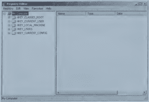

Regedt32 几乎能完成 Regedit 的所有功能，而且功能更多。其用户界面采用经典的 MDI 风格，如图 8.2 所示。每个项都可以作为独立的 MDI 子窗口打开。不过，您应该知道，Regedt32 在 Windows 9x 平台上不可用。

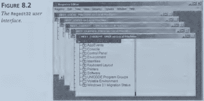

每个注册表项都有权限，用于允许或拒绝不同用户和用户组的读写访问。Regedt32 编辑器提供了查看和修改这些注册表权限的功能，如图 8.3 所示。

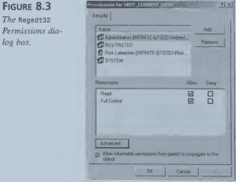

我混合使用这两个编辑器。Regedit 有一些 Regedt32 没有的 bug，但 Regedit 更容易从命令行键入，因此它是我偏爱的注册表编辑器。

## 导入和导出注册文件

Regedit 注册表编辑器具有导入和导出注册文件的功能。这些文件通常具有 .RGS 扩展名。代码向导通常会生成这些注册文件，以便于注册 COM 对象。

注册文件非常适合将注册表设置从一台计算机复制到另一台计算机。如果一台计算机上的所有注册表设置都正确，则可以将这些设置导出到注册表文件，并将该注册文件导入另一台计算机。

Regedt32 也有导入和导出注册表项的功能，但它以不可读的格式保存它们，而 Regedit 则将这些项保存为可读的文本文件。

## COM 注册表结构

COM 使用系统注册表中的 HKEY_CLASSES_ROOT 配置单元来维护对象初始化参数。此项包括六类信息：

- 文件扩展名
- ProgID
- AppID
- CLSID
- 接口
- 类型库

COM 还使用 HKEY_LOCAL_MACHINE\SOFTWARE\Microsoft\Ole 项来维护安全信息。在接下来的章节中，您将了解这两个配置单元。

### 文件扩展名

文件扩展名是 HKEY_CLASSES_ROOT 项的子项。文件扩展名项具有以下结构，如图 8.4 所示：

```
HKEY_CLASSES_ROOT
    { . extension } = { prog.id }
```

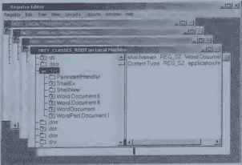

此值指示 COM 应到何处查找 COM 对象类型的 `ProgID`。找到 `ProgID` 后，COM 可以确定对象的 `CLSID`。有了 `CLSID`，COM 就可以启动对象实例并将文件绑定到该对象。

对于某些系统注册表项，我将提供一个可用于配置该项的简短函数。代码清单 8.2 可用于配置文件扩展名项。

### 代码清单 8.2  配置文件扩展名注册表项

```
int BuildFileExtensionKey(LPSTR szExtension,
                          LPSTR szProgId)
{
    CRegistry key(HKEY_CLASSES_ROOT, szExtension);
    key.SetValue(NULL, szProgId);
    return 0;
}
```

### ProgID

ProgID 也是 HKEY_CLASSES_ROOT 项的子项。由于文件扩展名和 ProgID 都是同一个根项的子项，这使得该项变得相当混乱。ProgID 项（参见图 8.5）具有以下结构：

```
HKEY_CLASSES_ROOT
    { ModuleName.ObjectName } = Description
          CLSID = { classid-as-guid }
          CurVer = { version-dependent-prog-id }
    { ModuleName.ObjectName.VersionNumber } = Description
          CLSID = { classid-as-guid }
```

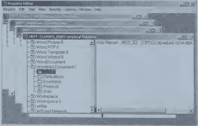

**图 8.5**  
ProgID 项结构。

代码清单 8.3 可用于配置 ProgID 系统注册表项。此代码清单使用了两个新的 API，分别称为 `StringFromCLSID()` 和 `WideCharToMultiByte()`。`StringFromCLSID()` 接受一个


GUID 结构，并将其转换为人类可读的字符串。`WideCharToMultiByte()` 将双字节字符串转换为常见的单字节字符串（只要你不是在为 Unicode 平台编写代码）。

## 清单 8.3 配置 ProgID 注册表项

```cpp
int BuildProgIDKey(LPSTR szProgID, LPSTR szDescription,
                   CLSID clsid, LPSTR szProgIDVersionIndependent)
{
    // version dependent description
    CRegistry key(HKEY_CLASSES_ROOT, szProgID);
    key.SetValue(NULL, szDescription);

    // version dependent CLSID key
    LPSTR strCLSID = "CLSID";
    LPSTR str = new char[strlen(szProgID)
                         + strlen(strCLSID)+2];
    ::strcpy(str, szProgID);
    ::strcat(str, "\\");
    ::strcat(str, strCLSID);
    CRegistry key2(HKEY_CLASSES_ROOT, str);
    delete[] str;

    // version dependent CLSID value
    LPOLESTR oleStr = NULL;
    str = NULL;
    ::StringFromCLSID(clsid, &oleStr);
    int i = ::WideCharToMultiByte(CP_ACP, 0, oleStr, -1, str,
                                  0, NULL, NULL);
    str = new char[i+1];
    ::WideCharToMultiByte(CP_ACP, 0, oleStr, -1, str,
                          i, NULL, NULL);
    key2.SetValue(NULL, str);
    delete[] str;

    // version independent description
    CRegistry key3(HKEY_CLASSES_ROOT,
                   szProgIDVersionIndependent);
    key3.SetValue(NULL, szDescription);

    // version independent CLSID key
    str = new char[strlen(szProgIDVersionIndependent)
                   + strlen(strCLSID)+2];
    ::strcpy(str, szProgIDVersionIndependent);
    ::strcat(str, "\\");
    ::strcat(str, strCLSID);
    CRegistry key4(HKEY_CLASSES_ROOT, str);
    delete[] str;

    // version independent CLSID value
    str = NULL;
    i = ::WideCharToMultiByte(CP_ACP, 0, oleStr, -1, str,
                              0, NULL, NULL);
    str = new char[i+1];
    ::WideCharToMultiByte(CP_ACP, 0, oleStr, -1, str,
                          i, NULL, NULL);
    key4.SetValue(NULL, str);
    delete[] str;

    // current version
    LPSTR strCurVer = "CurVer";
    str = new char[::lstrlen(szProgIDVersionIndependent)
           +::lstrlen(strCurVer)+2];
    ::lstrcpy(str, szProgIDVersionIndependent);
    ::lstrcat(str, "\\");
    ::lstrcat(str, strCurVer);
    CRegistry key5(HKEY_CLASSES_ROOT, str);
    delete[] str;
    key5.SetValue(NULL, szProgID);

    return 0;
}
```

## ProgID 与 CLSID

每个 ProgID 都有一个表示其 CLSID 的子键。该子键有一个值，即表示该 ProgID 的 CLSID 的 GUID。COM 生成的 GUID 对于程序员来说过于复杂，难以直接使用。因此，为了让 COM 更容易使用，COM 提供了 ProgID 作为标识对象的更简单机制。CLSID 值是将简单的 ProgID 转换为复杂 GUID 的结果。COM 提供了两个在 ProgID 和 CLSID 之间进行转换的 API：

```cpp
WINOLEAPI ProgIDFromCLSID (REFCLSID clsid, LPOLESTR FAR* lpszProgID);
WINOLEAPI CLSIDFromProgID (LPCOLESTR lpszProgID, LPCLSID lpclsid);
```

### 与版本相关的 ProgID

ProgID 具有以下语法：

*ModuleName.ObjectName.VersionNumber*

同一模块中的所有对象具有相同的 *ModuleName*，而 *ObjectName* 则唯一标识模块中的每个对象。*VersionNumber* 是一个整数（从 1 开始），用于标识对象的版本。例如，对象的第一个实现将具有 ProgID `MyModuleName.MyObjectName.1`。第二个实现将具有 ProgID `MyModuleName.MyObjectName.2`。这种约定使您可以在同一台计算机上安装 COM 类的多个版本。每个版本都将以递增的整数后缀进行标记。

### 与版本无关的 ProgID

拥有一个与版本无关的 ProgID 也很方便。与版本无关的 ProgID 具有以下语法：

```
MyModuleName.MyObjectName
```

该 ProgID 使客户端程序员无需检查系统上安装了哪个版本的对象即可使用对象。

## AppID

AppID 是注册表项 `HKEY_CLASSES_ROOT\AppID` 的子键。

AppID 键（参见图 8.6）具有以下结构：

```
HKEY_CLASSES_ROOT
{
  appid-as-guid
    RemoteServerName = { DNS 或 UNC 服务器 } // 仅客户端计算机
    DLLSurrogate = { path\surrogate.exe 或 NULL } // DLLhost.exe
      // 仅服务器计算机
    LaunchPermission = REG_BINARY { 自相对安全描述符 }
    AccessPermission = REG_BINARY { 自相对安全描述符 }
    ActivateAtStorage = { Y 或 N }
    LocalService =
      ServiceParameters =
      RunAs = { 无 | "交互式用户" | 用户账户 }
        AuthenticationLevel =
```

**图 8.6**  
*AppID 键结构。*


AppID 提供了如何启动 COM 服务器的信息。COM 服务器可以配置为远程运行，并具有安全性、权限以及以服务方式运行。

### 远程进程内服务器

为了在远程计算机上启动进程内服务器，您必须使用代理（surrogate）。`DllSurrogate` 值名称中指定的值数据是充当代理的可执行文件。如果将该值留空，DCOM 将使用默认代理（`DLLHost.exe`）。要将进程内服务器设置为远程运行，您必须在服务器（远程）计算机上指定 `DllSurrogate` 值名称，并在客户端（本地）计算机上指定 `RemoteServerName` 值。

### 远程进程外服务器

如果对象在 CLSID 键中具有 `RemoteServerName` 值名称，则该对象可以作为远程进程外服务器启动和访问。该值即启动服务器的服务器位置。

### 权限与安全

COM 使您能够为本地计算机上对象的启动（`LaunchPermission`）和访问（`AccessPermission`）设置权限。这些权限以自相对安全描述符的形式保存在注册表中。

清单 8.4 展示了如何将安全描述符保存到注册表中。同样的技术也适用于将安全描述符保存到文件或传输到另一个进程。

## 清单 8.4 在注册表中保存安全描述符

```cpp
// --------------------------------
// RegSaveSecurityDescriptor
// --------------------------------
int RegSaveSecurityDescriptor(PSECURITY_DESCRIPTOR pSD,
                              HKEY hKey, LPSTR szValueName)
{
    // convert the security descriptor to
    // self-relative security descriptor
    PSECURITY_DESCRIPTOR pSRSD = NULL;
    DWORD cbSD = 0;
    if (!::MakeSelfRelativeSD(pSD, pSRSD, &cbSD))
    {
        DWORD dw = ::GetLastError();
        if (dw != ERROR_INSUFFICIENT_BUFFER)
        {
            std::cout << "Error ::MakeSelfRelativeSD "
                      << dw << endl;
            return 0;
        }
    }

    pSRSD = (PSECURITY_DESCRIPTOR) ::LocalAlloc(LPTR, cbSD);
    if (!::MakeSelfRelativeSD(pSD, pSRSD, &cbSD))
    {
        std::cout << "Error ::MakeSelfRelativeSD "
                  << ::GetLastError() << endl;
        return 0;
    }

    // save the self-relative security descriptor
    // in the registry
    if (::RegSetValueEx(hKey, szValueName, 0, REG_BINARY,
                        (BYTE *)pSRSD, cbSD) != ERROR_SUCCESS)
    {
        std::cout << "Error ::RegSetValueEx "
                  << ::GetLastError() << endl;
        ::LocalFree((HLOCAL) pSRSD);
        return 0;
    }

    if(pSRSD == NULL)
    {
        ::LocalFree((HLOCAL) pSRSD);
    }

    return 0;
}
```

为了保存安全描述符，您必须调用 `MakeSelfRelativeSD()` 将绝对安全描述符转换为自相对安全描述符。自相对安全描述符是平面结构，完全自包含。绝对安全描述符包含对结构外部对象的引用。

### 身份验证

Windows 2000 在此键中有一个附加的值。它允许您更改默认的身份验证级别。

### 远程激活

通常，当您调用 `IMoniker::BindToObject()` 时，对象会在本地创建并加载。当 `ActivateAtStorage` 值缺失或设置为 `N` 时，对象将在本地创建并加载。但是，如果 `ActivateAtStorage` 值设置为 `Y`，COM 将尝试在对象所在的计算机上加载该对象。因此，如果您创建了一个文件 `IMoniker::BindToObject()`，该对象将在远程计算机上创建（参见图 8.7）。


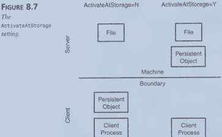

## 对象作为服务

如果 COM 对象想将自身安装为 NT 服务，它必须将 LocalService 注册表项设置为可执行文件名。此外，还可以在服务启动时向其传递参数。通过设置 ServiceParameters 注册表项的值，该值将作为参数传递给服务。

## 标识

使用 RunAs 值，可以将对象的模块启动到具有另一用户安全上下文的进程中。除启动用户外，还可以为进程指定交互用户的安全上下文或特定用户的安全上下文。

## CLSID

CLSID 是 HKEY_CLASSES_ROOT\CLSID 键的子键。CLSID 键（见图 8.8）具有以下结构：

```
HKEY_CLASSES_ROOT
    CLSID
        { class-id-as-guid } = Description
            AppID = { app-id-as-guid }
            ProgID = { ModuleName.ObjectName.VersionNumber }
            VersionIndependentProgID = { ModuleName.ObjectName }
            InprocServer32 = { mypath\mymodule.dll }
                ThreadingModel = { no value | Apartment | Free | Both }
            InprocHandler32 = { mypath\myhandler.dll }
            LocalServer32 = { mypath\mymodule.exe }
            DefaultIcon = { mypath\mymodule, resource id }
            TypeLib = { type-library-id-as-guid }
    }
```

**图 8.8**  
*CLSID 键结构。*

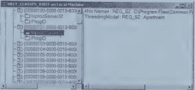

清单 8.5 可用于配置 CLSID 系统注册表键。

**清单 8.5** 配置 CLSID 注册表键

```cpp
int BuildCLSIDKey(CLSID clsid, LPSTR szDescription,
                  LPSTR szProgID, LPSTR szProgIDVersionIndependent)
{
    // build the CLSID
    LPOLESTR oleStr = NULL;
    LPSTR str = NULL;
    ::StringFromCLSID(clsid, &oleStr);
    int i = ::WideCharToMultiByte(CP_ACP, 0, oleStr, -1, str,
                                   0, NULL, NULL);
    str = new char[i+1];
    ::WideCharToMultiByte(CP_ACP, 0, oleStr, -1, str,
                          i, NULL, NULL);

    // build the subkey
    LPSTR str2 = NULL;
    LPSTR strCLSID = "CLSID";
    str2 = new char[::lstrlen(strCLSID)+::lstrlen(str)+2];
    ::lstrcpy(str2, strCLSID);
    ::lstrcat(str2, "\\");
    ::lstrcat(str2, str);

    // set description
    CRegistry key(HKEY_CLASSES_ROOT, str2);
    key.SetValue(NULL, szDescription);
    delete[] str2;

    // build CLSID\\{CLSID}\\ProgID string
    LPSTR strProgID = "ProgID";
    str2 = new char[::lstrlen(strCLSID)+::lstrlen(str)
                    +::lstrlen(strProgID)+3];
    ::lstrcpy(str2, strCLSID);
    ::lstrcat(str2, "\\");
    ::lstrcat(str2, str);
    ::lstrcat(str2, "\\");
    ::lstrcat(str2, strProgID);

    // set progid
    CRegistry key2(HKEY_CLASSES_ROOT, str2);
    key2.SetValue(NULL, szProgID);
    delete[] str2;

    // build CLSID\\{CLSID}\\VersionIndependentProgID string
    LPSTR strProgIDV = "VersionIndependentProgID";
    str2 = new char[::lstrlen(strCLSID)+::lstrlen(str)
                    +::lstrlen(strProgIDV)+3];
    ::lstrcpy(str2, strCLSID);
    ::lstrcat(str2, "\\");
    ::lstrcat(str2, str);
    ::lstrcat(str2, "\\");
    ::lstrcat(str2, strProgIDV);

    // set version independent progid
    CRegistry key3(HKEY_CLASSES_ROOT, str2);
    key3.SetValue(NULL, szProgIDVersionIndependent);
    delete[] str2;

    delete[] str;

    return 0;
}
```

CLSID 键提供有关如何启动 COM 类的信息。此键中最重要的信息是位置值；即实现 COM 类的模块的位置。

### 位置

如果对象在 CLSID 键中具有 InprocServer32 值名称，则该对象可以作为进程内服务器启动和访问。该值是 DLL（动态链接库）的位置。COM+ 的职责是考虑线程模型以提供位置透明性。稍后我将进一步讨论这一点。你可以设想一个非线程安全的进程内服务器被自由线程的多线程客户端访问。要告知 COM+ 线程模型，只需在 InprocServer32 注册表键中设置 ThreadingModel 值。

如果对象在 CLSID 键中具有 InprocHandler32 值名称，则该对象使用自定义对象处理程序（自定义 IMarshal 接口）。该值是自定义处理程序模块的文件位置。要使用标准封送处理，请将此值设置为 OLE32.DLL。

如果对象在 CLSID 键中具有 LocalServer32 值名称，则该对象可以作为本地进程外服务器启动和访问。该值是 exe（可执行模块）的位置。

进程内处理程序用于注册自定义封送处理。自定义封送处理程序（该 DLL）在客户端和服务器进程中都按进程内方式加载，并负责在客户端进程与服务器进程之间进行封送处理。

### CLSID 类型库

TypeLib 设置是类型库的 CLSID。反过来，该 CLSID 可在 HKEY_CLASSES_ROOT\TypeLib 键中找到。

## 接口

接口是 HKEY_CLASSES_ROOT\Interface 键的子键。Interface 键（见图 8.9）具有以下结构：

```
HKEY_CLASSES_ROOT
    Interface
        { interface-as-guid } = Description
            ProxyStubClsid32 = { class-id-as-guid }
            TypeLib = { type-library-id-as-guid }
```

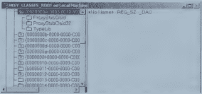

**图 8.9**  
*Interface 键结构。*

封送处理程序中的 DllRegisterServer 和 DllUnregisterServer 函数应编写为添加和删除此注册表键及其值。对于每个可封送的接口，将添加一个 Interface 子键。

接口子键相当小。对于标准或自定义封送处理，我们关注的是实现此接口封送处理的代理-桩的 CLSID。对于类型库封送处理，我们关注的是类型库的 CLSID。

### 代理-桩

ProxyStubClsid32 是代理-桩对的 CLSID，该代理-桩对将执行接口的封送处理。默认代理-桩类 ID（即用于 IDispatch 的类 ID）为 00020420-0000-0000-C000-000000000046。

### 类型库

TypeLib 是注册在 TypeLib 键中的类型库的 CLSID。

## TypeLib

TypeLib 是 HKEY_CLASSES_ROOT\TypeLib 键的子键。类型库键（见图 8.10）具有以下结构：

```
HKEY_CLASSES_ROOT
    TypeLib
        { type-library-id-as-guid } = Description
            { major.minor } = Description
                { locale-id }
                    { platform } = { module }
        FLAGS = 0
        HELPDir = { helppath }
```

**图 8.10**  
*TypeLib 键结构。*

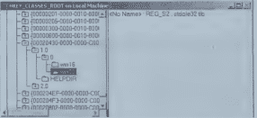

locale-id 是表示区域设置 ID 的一到四位十六进制字符串。值为零表示 LANG_SYSTEM_DEFAULT 设置（用于国际化）。platform 是可为 win16、win32、mac 或其他值的字符串。module 可以是 TLB（类型库）、DLL 或 EXE。

### RegisterTypeLib

RegisterTypeLib() 函数将自动创建 TypeLib 键。要调用该函数，必须首先获取类型库的 ITypeLib 对象指针。清单 8.6 展示了如何使用 RegisterTypeLib() 函数。

**清单 8.6** 使用 RegisterTypeLib()

```c
int MyRegisterTypeLib(LPCOLESTR lpszModule,
                      LPCOLESTR lpszHelpDir)
{
    ITypeLib* pTypeLib;
    HRESULT hr = ::LoadTypeLib(lpszModule, &pTypeLib);

    if (SUCCEEDED(hr))
    {
        ::RegisterTypeLib(pTypeLib, lpszModule, lpszHelpDir);
    }
    if (pTypeLib != NULL)
    {
        pTypeLib->Release();
    }
    return 0;
}
```

### 标志

TypeLib 结构中提供了以下标志：

- **1——受限。** 不能查看或使用类型库。
- **2——控件。** 包含控件的描述。
- **4——隐藏。** 用户不能查看此类型库，但控件可以使用它。

### 帮助目录

类型库可提供上下文相关帮助。HELPDIR = 值是指提供帮助的文件的路径。如果省略此键，则必须在构建时提供帮助文件的路径。

## HKEY_LOCAL_MACHINE\SOFTWARE\Microsoft\Ole

此键包含 COM 所需的所有默认安全信息。Ole 键（见图 8.11）具有以下结构：

```
HKEY_LOCAL_MACHINE
    SOFTWARE
        Microsoft
            Ole
                EnableDCOM = { Y or N }
                DefaultAccessPermission = REG_BINARY
                                      { self-relative security descriptor }
                DefaultLaunchPermission = REG_BINARY
                                      { self-relative security descriptor }
                LegacyAuthentication =
                LegacyImpersonation =
                LegacySecureReferences = { Y or N }
```


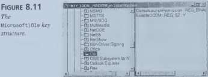

接下来几节描述 OLE 注册表子键中的各种设置。

## 启用和禁用 DCOM

EnableDCOM 值使您能够启用和禁用远程对象。将此值设置为 N 会禁用远程对象，但不会禁用 DCOM 安全性。

## 默认权限

当 COM 服务器未在其 AppID 键中为 LaunchPermission 和 AccessPermission 提供值时，将使用 DefaultLaunchPermission 和 DefaultAccessPermission 值。如果 AppID 的 LaunchPermission 缺失，则使用 DefaultLaunchPermission。如果 AppID 的 AccessPermission 缺失，则使用 DefaultAccessPermission。

要逐一管理机器上数百个 COM 服务器的权限实际上并不可行。因此，我采取使用默认权限的方法，而不是逐个配置 COM 服务器。只有当某个 COM 服务器证明其需要额外或较少的安全性时，我才会添加自定义权限。

## 旧版安全

COM+ 提供了一些值，用于设置默认安全设置，这些设置适用于未在这些方面实现特定安全性的组件。以下身份验证级别可用：

- `RPC_C_AUTHN_LEVEL_DEFAULT`—使用身份验证服务的默认身份验证级别。
- `RPC_C_AUTHN_LEVEL_NONE`—不进行身份验证。
- `RPC_C_AUTHN_LEVEL_CONNECT`—仅在连接时进行身份验证。
- `RPC_C_AUTHN_LEVEL_CALL`—每次调用都进行身份验证。
- `RPC_C_AUTHN_LEVEL_PKT`—每个数据包都进行身份验证。
- `RPC_C_AUTHN_LEVEL_PKT_INTEGRITY`—与 `RPC_C_AUTHN_LEVEL_PKT` 相同，并验证数据在传输过程中未被修改。
- `RPC_C_AUTHN_LEVEL_PKT_PRIVACY`—与 `RPC_C_AUTHN_LEVEL_PKT_INTEGRITY` 相同，并对数据包进行加密。

COM+ 使服务器能够通过模拟其他用户来采用这些用户的安全上下文。`LegacyImpersonation` 值使您能够限制服务器可以使用的模拟类型。以下模拟级别可用：

- **匿名**—不允许模拟。
- **标识**—不允许模拟，但检查客户端权限除外。
- **模拟**—允许模拟，但调用其他对象时除外。
- **委派**—允许模拟，即使调用其他对象时也允许。

如果 `LegacySecureReferences` 的值为 Y，则未调用 `CoInitialize()` 的对象对 `AddRef()` 和 `Release()` 的调用将受到保护。这意味着 COM+ 将对这些调用应用安全性。当 `LegacySecureReferences` 设置为 Y 时，COM+ 会变慢。

## 注册 COM+ 服务器

本章中我试图解释的注册表子键和值有很多。我会让你先看完*《辛普森一家》*，然后再告诉你这个坏消息：注册其中许多设置是你 COM+ 服务器的责任。接下来几节将说明注册代码应位于何处。

## Regsvr32

`DllUnregisterServer` 和 `DllRegisterServer` 函数从 DLL 中导出。

Regsvr32 应用程序执行以下四项任务来注册或注销进程内服务器：

- 调用 `LoadLibrary` 加载模块
- 调用 `GetProcAddress` 获取 `DllRegisterServer` 或 `DllUnregisterServer` 的函数指针
- 调用 `DllRegisterServer` 或 `DllUnregisterServer` 函数
- 调用 `FreeLibrary`

## DllRegisterServer 和 DllUnregisterServer

进程内服务器使用 `DllRegisterServer` 和 `DllUnregisterServer` 执行自注册。你可以通过运行 `DllRegisterServer` 函数来注册自注册 DLL。对于名为 `module.dll` 的模块，可通过执行命令行 `REGSVR32 module.dll` 自动完成此操作。要注销，请通过运行 `DllUnregisterServer` 函数删除系统注册表项。对于名为 `module.dll` 的模块，可通过执行命令行 `REGSVR32 /U module.dll` 自动完成此操作。

自注册 DLL 应在其 VERSIONINFO 资源中包含字符串 `OLESelfRegister`。清单 8.7 显示了 OLESelfRegister 字符串在 VERSIONINFO 资源中出现的位置。

### **清单 8.7** VERSIONINFO 资源中的 OLESelfRegister 字符串

```
VS_VERSION_INFO VERSIONINFO
BEGIN
    BLOCK "StringFileInfo"
    BEGIN
        BLOCK "040904E4" // Lang=US English, CharSet=Windows Multilingual
        BEGIN
            ...
            VALUE "OLESelfRegister", "\0"
        END
    END
END
...
END
...
```

你的 DllRegisterServer 和 DllUnregisterServer 函数必须从 DLL 中导出，并且不能包含 C++ 名称修饰。如果导出的函数带有 C++ 名称修饰，则 REGSVR32 等客户端在调用这些函数时会失败。清单 8.8 显示了用于实现 DllRegisterServer 和 DllUnregisterServer 的存根。

### **清单 8.8** 用于实现 DllRegisterServer 的存根

```
//...
// DllRegisterServer
//...
STDAPI DllRegisterServer()
{
    // use RegCreateKey() and RegSetValue() to add keys
    ...
    return NOERROR;
}

//...
// DllUnregisterServer
//...
//-------------------
STDAPI DllUnregisterServer()
{
  // use RegDeleteKey() to remove keys
  ...
  return NOERROR;
}
```

大多数框架（如 ATL 和 MFC）会自动生成 DllRegisterServer() 和 DllUnregisterServer() 函数所需的代码。

## 自注册的进程外服务器

进程外服务器应通过命令行注册和注销自身。也就是说，它们应检查命令行参数 /RegServer 和 /UnRegServer。清单 8.9 显示了如何实现 WinMain() 函数以处理注册参数。

### **清单 8.9** 检查用于自注册的命令行参数

```cpp
//-------------------
// MatchOption
//-------------------
BOOL MatchOption(LPTSTR lpsz, LPTSTR lpszOption)
{
  if (lpsz[0] == '-' || lpsz[0] == '/')
  {
    lpsz++;
  }
  if (lstrcmpi(lpsz, lpszOption) == 0)
  {
    return TRUE;
  }
  return FALSE;
}

//-------------------
// WinMain
//-------------------
int WINAPI WinMain(HINSTANCE hInstance,
                   HINSTANCE hPrevInstance,
                   LPSTR lpCmdLine, int nCmdShow)
{
  LPTSTR szCmdLine = lpCmdLine;
  TCHAR szTokens[] = _TEXT("-/");
  LPTSTR szNextToken = _tcstok(szCmdLine, szTokens);

while (NULL != szNextToken)
{
    if ( MatchOption(szNextToken, _TEXT("UnregServer")))
    {
        // Unregister the server
        // use RegDeleteKey()
        ...
        return FALSE;
    }
    else if (MatchOption(szNextToken, _TEXT("RegServer")))
    {
        // Register the server
        // use RegCreateKey() and RegSetValue()
        ...
        return FALSE;
    }
    else if (MatchOption(szNextToken, _TEXT("Embedding")))
    {
        break;
    }
    // Find the next token
    szNextToken = _tcstok(NULL, szTokens);
}
// Initialize the COM library.
HRESULT hr = CoInitialize(NULL);
if (FAILED(hr))
    return FALSE;

// Uninitialize the COM Library.
CoUninitialize();
return (msg.wParam);
}
```

## 框架

Visual Basic 和 Visual C++（MFC 和 ATL）提供内置功能，可自动注册进程内服务器和进程外服务器。

如果查看 MFC 源代码，会注意到两个名为 AfxOleRegisterServerClass() 和 AfxOleUnregisterServerClass() 的函数，它们提供了注册和注销 COM 服务器所需的部分功能。在 ATL 中，有两个类似的函数，名为 AtlModuleRegisterServer() 和 AtlModuleUnregisterServer()。

MFC 有两个用于注册类型库的函数：AfxOleRegisterTypeLib() 和 AfxOleUnregisterTypeLib()。ATL 有一个函数 AtlModuleRegisterTypeLib()，它也有助于注册类型库。

ATL 还提供了多种机制，可将 `.REG` 文件作为资源嵌入模块（DLL 或 EXE）中，并提供一个函数来调用此功能：`AtlModuleAddRegistryFromResourceD()`。

## 小结

本节讨论了往往很棘手的注册表主题。注册表充当 COM+ 服务器信息的存储库，如果你想开发组件应用程序，理解这个主题很重要。

文中介绍了一个特殊的类，它提供了一种简便的方法来访问注册表，而不必依赖某些限制较多的 API 调用。文中还展示了该类的用法。

你还了解了在学习、理解和编辑注册表时如何使用 Regedit 和 RegEdt32。


## 第 9 章
## COM+ 优化、继承与聚合
### 本章内容
- DCOM 的速度 202
- 远程激活 209
- 远程引用计数 210
- 代理进程 212
- IClassFactory 216
- 继承 218

COM+ 并不像某些人所说的那样比等效 C++ 慢 2,000 倍。慢六倍（或每次对象构造函数调用约 20 微秒）可能更准确。在本章后面，我会说明我是如何计算出这一速度差异的。

> **注意**
> 
> 当我谈论速度差异时，我指的是在一台计算机上编译得到的数字。其他计算机会产生略有不同的结果。我有一台安装了 Windows 2000 的机器，它表明 COM+ 比等效 C++ 慢 11 倍。
> 
> 我偶尔会谈到等效 C++。C++ 并不是一种适合调用进程外对象方法的语言。因此，当我使用*等效 C++*这一术语时，我指的是等效的进程内 C++。显然，将进程内 C++ 与进程外 DCOM 进行比较并不公平。然而，在比较不同类型 DCOM 调用的速度时，我使用等效 C++ 作为基准。

### DCOM 的速度

那么，为什么 DCOM 会慢六倍或慢 20 微秒呢？你可以将较慢的速度归因于 COM+ 对安全、远程处理、位置透明性、类工厂和多接口的支持。当你调用一个 COM+ 对象时，COM+ 会搜索注册表，以确定你是否有权访问该对象、该对象是否需要在远程计算机上构造，以及该对象需要在进程内还是进程外构造。COM+ 还会花费宝贵的微秒来检索创建 COM+ 类的类工厂以及客户端所需的接口。

不过，这段时间并没有浪费。类工厂、多接口、安全、远程处理以及位置透明性都是 DCOM 提供的宝贵特性。C++ 本身并不提供这些特性中的任何一种。因此，当你决定 DCOM 是否值得这 20 微秒时，请将这 20 微秒与上述特性进行权衡。

这 20 微秒的延迟发生在对象构造（和销毁）时，而不是在对象上调用方法时。在决定是否愿意承担 COM+ 的开销时，这一点可能很重要。也就是说，如果你有大量对象构造，开销可能会很明显。如果你的对象构造很少，开销就可以忽略不计。

此时，你们中有些人会说：“你还没见过我的 COM+ 应用程序爬行。”我相信你。我见过一些实现，它们移动起来像乌龟一样。这就是为什么我要向你展示底层发生了什么，从而使你的应用程序运行得如此缓慢。

### 对象位置

在设计 DCOM 对象时，有几个问题很重要。关键问题是：“对象的服务器与客户端之间可以存在的最小位置关系是什么？”对象服务器必须位于客户端进程的远程位置还是本地位置（也就是说，是进程内还是进程外）？对象服务器必须位于客户端计算机的远程位置还是本地位置？请记住，进程内服务器比等效 C++ 慢约六倍。DCOM 进程外服务器比等效 C++ 慢 2,000 倍。

慢 2,000 倍可能是个问题。你的目标应该是让 COM+ 对象服务器尽可能靠近客户端。

一年前，我的一个朋友写了一个糟糕设计的典型例子，它将 COM+ 对象放在进程外。那是一个数据库连接池管理器。在这个应用程序中，连接管理器对象必须位于进程外，以便提供对数据库连接的单点访问。不幸的是，这意味着各个数据库连接也位于进程外。反过来，每次对进程外服务器的调用都要承受慢 2,000 倍的代价。最终，该应用程序一次最多只能处理三个事务，每秒则略多一点。由于它一次只能使用三个数据库连接，因此没有必要池化数据库连接。

这类糟糕的架构正是某些人认为 COM+ 很慢的原因。我不怪他们；糟糕的架构是常态，因为大多数 COM+ 程序员无法告诉你进程内服务器和进程外服务器之间的区别。

进程外服务器很慢。但远程服务器甚至更慢。我无法告诉你到底有多慢，因为这主要取决于两台计算机之间的网络距离。只要有可能，就减少计算机之间的往返周期。往返周期很重要。

### 网络周期

产生前面连接管理器示例的同一个项目，在设计中还存在另一个典型的失败。业务引擎被设计为从客户端远程运行，并且对业务对象的调用是按属性逐个进行的。客户端可执行程序一开始加载业务模型的一小部分，也就是大约 1,000,000 个原子项。每个属性都在单独的 PROPERTY_GET 调用中检索。

想象一下，在两台计算机之间来回发送 1,000,000 个数据包需要多长时间。从客户端发送一个数据包、服务器返回第二个数据包，这被称为一个周期。前面的示例有 1,000,000 个周期。使用这种设计，客户端从未成功加载过一次。正确的设计应该一次检索尽可能多的项。

另一次，我有一个快得多的业务引擎，它可以一次检索整个对象（数据库记录）。客户端可执行程序再次尝试加载业务模型的一小部分，大约 1,000,000 个原子对象或 100,000 行。45 分钟后，客户端才加载完成。通过按行而不是按原子来打包（封送）业务模型，我得以将启动时间从无限长缩短到 45 分钟。但 45 分钟仍然不可接受。

于是，我决定一次传输多条记录。在找到一次发送记录的最佳数量后，我能够在不到一分钟内加载客户端。想象一下。一个好的通用规则是：找出最优方法，并基于你的实验来构建代码。

### 混合线程模型

拖慢 COM+ 的另一种方式是混合线程模型。较早的单线程 COM+ 类不必是线程安全的，因为所有 COM+ 方法调用都通过 Windows 消息队列串行化。由于这些旧式 COM+ 类没有线程安全的要求，COM+ 必须继续对这些旧式 COM+ 类的调用进行串行化。这对进程外服务器来说不是问题，因为 COM+ 对象存在于它们自己的单线程套间中，并且 COM+ 方法调用会被适当地串行化。

当 COM+ 类是进程内服务器的一部分时，问题就出现了。由于进程内 COM+ 对象存在于创建该对象的线程的套间中，因此 COM+ 对象可能会在单线程套间或多线程套间中创建。线程模型的选择由调用客户端决定，而不是由服务器设计者决定。如果 COM+ 对象在多线程套间中创建，并且不是线程安全的，就会有问题。

当客户端的线程模型与服务器的线程模型不匹配时，COM+ 通过创建另一个套间来解决此问题，并在该套间中创建进程内 COM+ 对象。

在第 8 章“COM 与注册表”中，你了解了可用于指定进程内服务器线程模型的注册表项。COM+ 使用此注册表值来确定进程内服务器的线程模型。如果进程内 COM+ 服务器的线程模型与客户端的不匹配，COM+ 会在新套间中创建对象，从而强制 COM+ 方法调用在套间之间进行封送。当 COM+ 方法调用在消息队列上串行化时，这会导致另一个性能问题。

我在 CD-ROM 上包含了一个名为 Dcomsvr 的项目；它位于 Chapter09 目录的一个子目录中。我用这个项目来演示 DCOM 相对于

等效的 C++。本项目的核心是控制器可执行文件，它构造、调用并删除各种类型的对象，并报告构造、调用和删除这些对象所耗费的毫秒数。清单 9.1 展示了该可执行文件中的全部代码。

## 清单 9.1 控制器源代码

```cpp
// controller.cpp : Defines the entry point for the console application.

#include "stdafx.h"
#include "../cpp/cpp.h"
#include "../dcom/dcom.h"
#include "../dcom/dcom_i.c"
#include "../dcomserver/dcomserver.h"
#include "../dcomserver/dcomserver_i.c"

CRITICAL_SECTION cs;

DWORD WINAPI CppThread(void * p)
{
    DWORD dw = ::GetTickCount();
    for (int j=0;j<(int)((DWORD *)p)[0];j++)
    {
        CCpp * c = new CCpp();
        c->Hello();
        delete c;
    }
    dw = ::GetTickCount() - dw;
    ::EnterCriticalSection(&cs);
    std::cout << "\nCppThread ticks " << dw << std::endl;
    ::LeaveCriticalSection(&cs);
    return 0;
};

static IClassFactory * pclassfactory = NULL;
HRESULT GetUnknown(CLSID clsid, REFIID riid, IUnknown ** ppUnknown)
{
    if (pclassfactory==NULL)
    {
        ::CoGetClassObject(clsid, CLSCTX_ALL, NULL, IID_IClassFactory,
                           (void **) &pclassfactory);
        if (pclassfactory == NULL )
            return (-1);
    }
    pclassfactory->CreateInstance(NULL, riid, (void **)ppUnknown);
    return S_OK;
};

DWORD WINAPI DComThreadServer(void * p)
{
    ::CoInitialize(NULL);
    DWORD dw = ::GetTickCount();
    for (int j=0;j<*(DWORD *)p;j++)
    {
        ITestServer * i;
        GetUnknown(CLSID_TestServer, IID_ITestServer, (IUnknown **)&i);
        i->Hello();
        i->Release();
    }
    pclassfactory->Release();
    pclassfactory=NULL;
    dw = ::GetTickCount() - dw;
    ::EnterCriticalSection(&cs);
    std::cout << "\nDComThread server ticks " << dw << std::endl;
    ::LeaveCriticalSection(&cs);
    ::CoUninitialize();
    return 0;
};

DWORD WINAPI DComThread(void * p)
{
    ::CoInitialize(NULL);
    DWORD dw = ::GetTickCount();
    for (int j=0;j<*(DWORD *)p;j++)
    {
        ITestObject * i;
        GetUnknown(CLSID_TestObject, IID_ITestObject, (IUnknown **)&i);
        i->Hello();
        i->Release();
    }
    pclassfactory->Release();
    pclassfactory=NULL;
    dw = ::GetTickCount() - dw;
    ::EnterCriticalSection(&cs);
    std::cout << "\nDComThread ticks " << dw << std::endl;
    ::LeaveCriticalSection(&cs);
    ::CoUninitialize();
    return 0;
};

DWORD WINAPI DComThreadServer2(void * p)
{
    ::CoInitialize(NULL);
    DWORD dw = ::GetTickCount();
    for (int j=0;j<*(DWORD *)p;j++)
    {
        ITestServer * i;
        GetUnknown(CLSID_TestServer, IID_ITestServer, (IUnknown **)&i);
        i->Hello();
        i->Release();
    }
    pclassfactory->Release();
    pclassfactory=NULL;
    dw = ::GetTickCount() - dw;
    ::EnterCriticalSection(&cs);
    std::cout << "\nOld DComThread server ticks " << dw << std::endl;
    ::LeaveCriticalSection(&cs);
    ::CoUninitialize();
    return 0;
};

DWORD WINAPI DComThread2(void * p)
{
    ::CoInitialize(NULL);
    DWORD dw = ::GetTickCount();
    for (int j=0;j<(*(DWORD *)p);j++)
    {
        ITestObject * i;
        GetUnknown(CLSID_TestObject, IID_ITestObject, (IUnknown **)&i);
        i->Hello();
        i->Release();
    }
    pclassfactory->Release();
    pclassfactory=NULL;
    dw = ::GetTickCount() - dw;
    ::EnterCriticalSection(&cs);
    std::cout << "\nOld DComThread ticks " << dw << std::endl;
    ::LeaveCriticalSection(&cs);
    ::CoUninitialize();
    return 0;
};

int main(int argc, char* argv[])
{
    ::InitializeCriticalSection(&cs);
    DWORD dw=0;
    DWORD times=10000;
    HANDLE handle;

    handle = ::CreateThread(NULL, 0, DComThread2, &times, 0, &dw);
    ::WaitForSingleObject(handle, INFINITE);
    ::CloseHandle(handle);

    handle = ::CreateThread(NULL, 0, DComThreadServer2, &times, 0, &dw);
    ::WaitForSingleObject(handle, INFINITE);
    ::CloseHandle(handle);

    handle = ::CreateThread(NULL, 0, DComThread, &times, 0, &dw);
    ::WaitForSingleObject(handle, INFINITE);
    ::CloseHandle(handle);

    handle = ::CreateThread(NULL, 0, DComThreadServer, &times, 0, &dw);
    ::WaitForSingleObject(handle, INFINITE);
    ::CloseHandle(handle);

    handle = ::CreateThread(NULL, 0, CppThread, &times, 0, &dw);
    ::WaitForSingleObject(handle, INFINITE);
    ::CloseHandle(handle);

    ::DeleteCriticalSection(&cs);

    return 0;
}
```

该控制器只是创建五个不同的线程来测试五种不同类型的对象。这五种对象分别是原生 C++ 对象（Thread）、进程内单线程模型（DComThread）、进程外单线程模型（DComThreadServer）、进程内混合线程模型（DComThread2）以及进程外混合线程模型（DComThreadServer2）。

该可执行程序演示了：使用与客户端线程模型不同的进程内 COM+ 服务器，其速度几乎与进程外 COM+ 服务器一样慢，如表 9.1 和图 9.1 所示。这是因为 COM+ 正在套间（apartment）之间封送调用。

**表 9.1. 350MHz Pentium 的时钟节拍比较**

| 线程 | 节拍数 |
|---|---:|
| Old DComThread | 73556 |
| Old DComThread server | 78984 |
| DComThread | 200 |
| DComThread server | 76320 |
| CppThread | 10 |


**图 9.1**  
*运行控制器程序的结果。*

这里的教训是，为了以合理的速度运行，你的进程内 COM+ 服务器必须与调用客户端具有相同的线程模型。不幸的是，并不总是可能拥有与所有调用客户端都相同的线程模型。真的不可能吗？COM+ 很方便地提供了这样一种能力：将一个进程内 COM+ 服务器指定为同时支持单线程和多线程。为了让你的进程内 COM+ 服务器能够同时用于单线程和多线程场景，你必须确保该服务器中的 COM+ 类是线程安全的。

因此，为了最大化进程内 COM+ 服务器的速度，你必须在注册表中指定它能够同时支持单线程和多线程，并且它还必须是线程安全的。

我已经解释了一些优化措施，只要应用得当，就能大幅提高应用程序的速度。但还有成百上千种其他优化。帮助你的最佳方式是描述底层实际发生的情况，并希望你能利用这些信息为自己的应用程序找到优化方案。

我将首先解释 DCOM 中的 D（分布式）是如何工作的。COM+ 如何提供远程激活、引用计数、ping 检测、封送以及诸如此类的功能？

## 远程激活

服务控制管理器（SCM）负责启动本地和远程 COM+ 服务器。SCM 使用 IRemoteActivation 接口启动远程 COM+ 服务器。清单 9.2 展示了 IRemoteActivation 接口的定义。

## 清单 9.2 IRemoteActivation 接口定义

```cpp
interface IRemoteActivation
{
    HRESULT RemoteActivation(
        [in] handle_t                  hRpc,
        [in] ORPCTHIS                 *ORPCTHIS,
        [out] ORPCTHAT                *ORPCThat,
        [in] GUID                     *Clsid,
        [in, string, unique] WCHAR    *pwszObjectName,
        [in, unique] MInterfacePointer *pObjectStorage,
        [in] DWORD                     ClientImpLevel,
        [in] DWORD                     Mode,
        [in] DWORD                     Interfaces,
        [in, unique_size_is(Interfaces)] IID *pIIDs,
        [in] unsigned short            cRequestedProts,
        [in, size_is(cRequestedProts)]
             unsigned short            RequestedProts[],
        [out] OXID                    *pOxid,
        [out] DUALSTRINGARRAY         **ppdsaOxidBindings,
        [out] IPID                    *pipidRemUnknown,
        [out] HRESULT                 *pAuthnHint,
        [out] COMVERSION              *pServerVersion,
        [out] HRESULT                 *phr,
        [out, size_is(Interfaces)] MInterfacePointer **ppInterfaceData,
        [out,size_is(Interfaces)] HRESULT *pResults
};
```

客户端计算机上的 SCM 通过使用这个 `RemoteActivate()` RPC 函数来调用服务器计算机上的 SCM。服务器 SCM 读取 `Clsid` 参数，并使用该 CLSID 创建一个本地 COM 对象。系统会查询该本地 COM 对象，以获取与 `pIIDs` 数组参数匹配的所有接口。服务器 SCM 返回一个封送接口数组（`ppInterfaceData`）。

`RemoteActivate()` RPC 函数还会返回一个接口指针标识符（IPID）。IPID 与接口指针类似，区别在于它们还会标识该接口背后的对象所在的服务器。返回的 `pipidRemUnknown` 参数是该对象 `IRemUnknown` 接口的 IPID。`IRemUnknown` 接口将在本章后面介绍。

`MInterfacePointer` 结构包含返回给客户端计算机的封送接口指针。客户端计算机上的 SCM 现在可以使用返回的数据结构来引用远程对象。

## 远程引用计数

应用程序会调用多少次 `IUnknown::AddRef()` 和 `IUnknown::Release()` 方法？北美生活着多少只蚂蚁？由于 COM+ 使用 `IUnknown::AddRef()` 和 `IUnknown::Release()` 方法执行引用计数，如果你每次都等待一个网络周期，就会严重拖累性能

有人调用了引用计数函数。为了消除这一潜在缺陷，DCOM 实现了 `IRemUnknown` 接口。清单 9.3 展示了 `IRemUnknown` 接口的 IDL（接口定义语言）。

### 清单 9.3 IRemUnknown 的接口定义

```idl
interface IRemUnknown : IUnknown
{
    HRESULT RemQueryInterface(
        [in] REFIID riid,
        [in] unsigned long cRefs,
        [in] unsigned short cIids,
        [in, size_is(cIids)] IID * iids,
        [out, size_is(cRefs)] REMQUERYRESULT ** ppQIResults);
    HRESULT RemAddRef(
        [in] unsigned short cInterfaceRefs,
        [in, size_is(cInterfaceRefs)] REMINTERFACEREF InterfaceRefs[],
        [out, size_is(cInterfaceRefs)] HRESULT * pResults);
    HRESULT RemRelease(
        [in] unsigned short cInterfaceRefs,
        [in, size_is(cInterfaceRefs)] REMINTERFACEREF InterfaceRefs[]);
}
```

客户端调用一次 `IRemUnknown::RemAddRef()` 和 `IRemUnknown::RemRelease()` 方法，即可按任意数量增加和减少 OID（对象标识符）的引用计数。这样，网络往返次数从每次调用 `IUnknown::AddRef()` 或 `IUnknown::Release()` 一次往返，减少为多次调用 `IUnknown::AddRef()` 和 `IUnknown::Release()` 仅一次往返。对 `IUnknown::AddRef()` 和 `IUnknown::Release()` 的调用不会直接转换为对 `IRemUnknown::RemAddRef()` 和 `IRemUnknown::RemRelease()` 方法的调用。标准代理实现只有在所有对象的 IID 的所有本地引用都被释放后，才会发出对 `IRemUnknown::RemRelease()` 的调用。

无论何时使用远程对象，都要记住，对 `IUnknown::AddRef()` 和 `IUnknown::Release()` 方法的调用在某种程度上是经过优化的。

这一切都很好，但是当调用方对象异常终止而没有调用 `IRemUnknown::RemRelease()` 时，会发生什么？

## 对客户端进行 Ping

最终，COM+ 服务器对象将被释放。COM+ 尝试对客户端进行 Ping，在达到一定数量的失败尝试后，所有对 COM+ 服务器对象的引用都将被释放。如果对每个远程对象都进行 Ping，效率会非常低下。Ping 被合并成 Ping 集（ping set）。Ping 集试图针对每台远程机器而不是每个对象来解析 Ping。

您可能还想知道 COM+ 如何实现远程进程内服务器。远程进程内服务器是通过代理进程（surrogate process）实现的。

## 代理进程

代理进程是在 Windows NT 4.0 Service Pack 2.0 中引入的。DCOM 的最初版本只允许远程访问进程外服务器，不支持远程进程内服务器。远程进程内服务器的概念本身就是矛盾的，因为不可能存在跨进程的进程内对象。为了在远程使用进程内服务器，COM 引入了代理进程的概念。代理进程在远程机器上启动，进程内对象被加载到代理进程的进程空间中（参见图 9.2）。

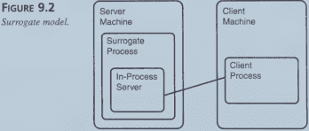

代理进程具有一些有趣的优点。该进程可以拥有与调用方进程不同的进程和安全上下文。进程内服务器中由不良或恶意编程造成的破坏仅限于代理的进程空间，并且可以通过限制代理的安全上下文来加以防止。代理进程空间中的破坏或代理受限的安全上下文都不会影响调用方进程。

最大的缺点是速度（因为进程外调用比进程内调用慢）以及无法共享进程内存空间。尽管进程内服务器可以编程为与其调用方共享进程内存空间，但当涉及代理时，这是不可能的。可以通过让代理采取特殊操作来检索和更新调用方进程内存空间，从而模拟进程内存空间的共享，但这会牺牲代理的性能。

清单 9.4 展示了一个调用进程内服务器、但将其加载到本地代理进程中的示例。其他代码可在随书 CD-ROM 上的 Surrogate 中找到；它是 Chapter09 目录下的一个子目录。

### 清单 9.4 调用代理 DLL

```cpp
#include <windows.h>
#include <iostream>
#include <atlbase.h>
#include "inprocess\inprocess.h"
#include "inprocess\inprocess_i.c"

char s[1024];

HRESULT GetUnknown(WCHAR * strProgID, IUnknown ** ppUnknown)
{
    CLSID clsid;
    HRESULT hRes = ::CLSIDFromProgID(strProgID, &clsid);
    if (FAILED(hRes))
    {
        // CLSIDFromProgID failed
        std::cout << "CLSIDFromProgID failed = " << _ltoa(hRes, s, 16)
                  << std::endl;
        ATLASSERT(FALSE);
        return hRes;
    }

    IClassFactory * pCF;
    hRes = ::CoGetClassObject(clsid, CLSCTX_LOCAL_SERVER, NULL,
                              IID_IClassFactory, (void **)&pCF);

    if (FAILED(hRes))
    {
        *ppUnknown = 0;
        std::cout << "CoGetClassObject failed = " << _ltoa(hRes, s, 16)
                  << std::endl;
        ATLASSERT(FALSE);
        return hRes;
    }

    hRes = pCF->CreateInstance(NULL, IID_IUnknown, (void **)ppUnknown);
    pCF->Release();

    if (FAILED(hRes))
    {
        *ppUnknown = 0;
        std::cout << "CreateInstance failed = " << _ltoa(hRes, s, 16)
                  << std::endl;
        ATLASSERT(FALSE);
        return hRes;
    }

    return S_OK;
};

HRESULT GetInterface(IUnknown * pUnknown, REFIID riid,
                    IUnknown ** ppUnknown)
{
    HRESULT hRes = pUnknown->QueryInterface(riid, (void **)ppUnknown);
    if (FAILED(hRes))
    {
        // QueryInterface failed
        std::cout << "QueryInterface failed = " << _ltoa(hRes, s, 16)
                  << std::endl;
        ATLASSERT(FALSE);
        return hRes;
    }

    return S_OK;
};

int main()
{
    CoInitialize(NULL);
    std::cout << "Start" << std::endl;

    IUnknown * pUnknown;
    HRESULT hRes = GetUnknown(L"process.MyInterface.1", &pUnknown);
    if (FAILED(hRes))
    {
        CoUninitialize();
        // GetUnknown failed
        return hRes;
    }

    IMyInterface * p;
    hRes = GetInterface(pUnknown, IID_IMyInterface, (IUnknown **)&p);
    if (FAILED(hRes))
    {
        pUnknown->Release();
        CoUninitialize();

        // GetUnknown failed
        return hRes;
    }

    long l = 0;
    p->get_processid(&l);
    std::cout << "Object Process = " << l << std::endl;
    p->get_threadid(&l);
    std::cout << "Object Thread = " << l << std::endl;

    std::cout << "Process = " << ::GetCurrentProcessId() << std::endl;
    std::cout << "Thread = " << ::GetCurrentThreadId() << std::endl;

    std::cout << "End" << std::endl;
    p->Release();
    pUnknown->Release();
    CoUninitialize();

    return 0;
}
```

需要注意的是，我在调用 `CoGetClassObject()` 函数时使用了 `CLSCTX_LOCAL_SERVER` 作为类上下文参数。如果我指定 `CLSCTX_SERVER` 或 `CLSCTX_INPROC_SERVER` 作为类上下文，进程内服务器就不会使用代理进程。除了我的 `DllRegisterServer()` 函数写入注册表的设置之外，我还手动创建了清单 9.5 中的注册表设置。

使用代理时，你可以使用标准代理，也可以创建自定义代理。要将进程内服务器配置为使用代理，请在客户端机器的 AppID 注册表项中将 `RemoteServerName` 值设置为远程服务器的地址或名称。要使用标准代理，请将服务器机器注册表中 AppID 注册表项的 `DllSurrogate` 值设置为空。要使用自定义代理，请将此注册表值设置为自定义代理模块的路径。清单 9.5 显示了使进程内服务器使用代理所需的注册表设置。

### 清单 9.5 代理激活的注册表设置

```reg
[HKEY_CLASSES_ROOT\AppID\{E7523002-4382-11D2-BEA2-00C04FBB72E7}]
@="inprocess"

[HKEY_CLASSES_ROOT\AppID\{E7523002-4382-11D2-BEA2-00C04FBB72E7}]
"DllSurrogate"=""

[HKEY_CLASSES_ROOT\CLSID\{E7523002-4382-11D2-BEA2-00C04FBB72E7}]
"AppID"="{E7523002-4382-11D2-BEA2-00C04FBB72E7}"
```

## 自定义代理

默认代理（DllHost.exe）对于大多数对象实现来说是足够的。但当你的进程内服务器需要访问通常在客户端进程中才可用的全局内存时，默认代理就不够用了。编写自定义代理时，代理需要实现 `ISurrogate` 接口。清单 9.6 展示了 `ISurrogate` 接口的定义。


### 清单 9.6 ISurrogate 的接口定义

```cpp
interface ISurrogate : IUnknown
{
    HRESULT LoadDllServer([in] REFCLSID clsid);
    HRESULT FreeSurrogate();
}
```

代理必须通过调用 CoRegisterSurrogate() 函数来注册自身。COM+ 将调用 ISurrogate::LoadDllServer() 方法来加载服务器，并调用 ISurrogate::FreeSurrogate() 方法来释放代理。

## IClassFactory

类工厂曾是 COM+ 的焦点话题。在 COM+ 中，最重要的接口曾是类工厂。随着时间的推移，类工厂已经不再那么受关注，因为关于类工厂需要说明的一切都已经被说完了。大多数 COM+ 框架都通过隐藏在层层宏背后的样板代码来实现类的 IClassFactory 类。

IClassFactory 接口仍然是所有 COM+ 技术的核心。当你创建 COM+ 对象时，例如调用 CoCreateInstance() 或 CoCreateInstanceEx() 函数，本质上都是在调用 IClassFactory::CreateInstance() 方法。

你可能也注意到，COM+ DLL 会导出一个名为 DllGetClassObject() 的函数。COM+ 调用这个函数以便从你的进程内服务器中获取类工厂。图 9.3 描绘了 COM 如何使用导出的 DllGetClassObject() 函数和 IClassFactory 类来创建新的 COM 对象。请注意，对 CoCreateInstance() 函数的调用如何创建或获取类工厂的实例，而类工厂随后创建对象。

清单 9.7 是一个简化版本，展示了 CoCreateInstance() 函数如何使用 IClassFactory 对象。

### 清单 9.7 CoCreateInstance() 函数背后的代码

```cpp
HRESULT CoCreateInstance(REFCLSID clsid, IUnknown * pUnkOuter,
    DWORD grfContext, REFIID iid, void ** ppv)
{
    IClassFactory * pCF;
    HRESULT          hr = ::CoGetClassObject(clsid, grfContext,
                         NULL, IID_IClassFactory, (void **) &pCF);

    if (FAILED(hr))
    {
        return hr;
    }

    hr = pCF->CreateInstance(pUnkOuter, iid, (void **)ppv);
    pCF->Release();

    if (FAILED(hr))
    {
        *ppv = 0;
    }

    return hr;
}
```

### 图 9.3 *类工厂创建 COM 对象。*

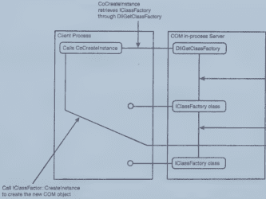

CoCreateInstanceEx() 函数有着类似的实现（参见清单 9.8）。CoCreateInstanceEx() 函数使用一个 MULTI_QI 结构数组来获取对象的多个接口。清单 9.8 中的代码是伪代码，因为其中实现了一些优化。CoCreateInstanceEx() 还可以用来选择在哪个服务器上实例化对象。

### 清单 9.8 CoCreateInstanceEx() 函数背后的代码

```cpp
struct tagMULTI_QI
{
    REFIID riid;
    void * pvObj;
    HRESULT hr;
} MULTI_QI;

HRESULT CoCreateInstanceEx(REFCLSID clsid,
    IUnknown * pUnkOuter, DWORD grfContext,
    COSERVERINFO * pServerInfo, DWORD dwCount,
    MULTI_QI * rgMultiQI)
{
    IClassFactory * pCF;
    HRESULT hr = ::CoGetClassObject(clsid, grfContext,
        pServerInfo, IID_IClassFactory, (void **)&pCF);

    if (FAILED(hr))
    {
        return hr;
    }

    hr = pCF->CreateInstance(pUnkOuter, iid, (void **)ppv);
    pCF->Release();
    for (DWORD i=0; i<dwCount; i++)
        rgMultiQI[i].hr = punk->QueryInterface(rgMultiQI[i].riid,
                                  &rgMultiQI[i].pvObj);

    if (FAILED(hr))
    {
        *ppv = 0;
    }

    return hr;
}
```

借助类工厂对象，你可以实现大多数人认为在 COM 中不可能实现的事情：实现继承。

## 继承

COM+ 允许你同时使用接口继承和实现继承。通过接口继承，一个接口可以从另一个接口继承方法。接口继承的一个例子是 IDispatch 接口，它从 IUnknown 接口继承了 QueryInterface()、AddRef() 和 Release() 方法。

COM+ 还允许你使用实现继承。这种继承允许一个 COM+ 类从另一个 COM+ 类继承实现。实现继承在 COM+ 中并未被完全实现。也就是说，从另一个 COM+ 类继承实现的 COM+ 类无法访问被继承类的实现数据。正是由于这个缺陷，有时人们会说 COM 不支持实现继承。

COM+ 提供了两种实现继承方式：包容（containment）和聚合（aggregation）。包容继承是通过让一个 COM+ 类重新实现被继承类的方法来实现的。这些实现只是将调用重定向到被包容的 COM+ 类。

## 聚合

聚合继承允许客户端直接调用被继承的方法。这种方法的一个缺点是，被聚合对象的 IUnknown 方法必须与聚合器的 IUnknown 方法集成。另一个缺点是，只有进程内服务器才能实现聚合继承。

聚合继承是通过 IClassFactory 接口实现的。每个 COM+ 类，无论是否可以被聚合，都必须实现一个遵循 IClassFactory 接口的类工厂对象。该类工厂对象负责创建 COM+ 类。清单 9.9 展示了 IClassFactory 接口的定义。

### 清单 9.9 IClassFactory 接口的定义

```cpp
interface IClassFactory : IUnknown
{
    HRESULT CreateInstance(IUnknown * pUnkOuter,
        REFIID iid, void ** ppvObj);
    HRESULT LockServer(BOOL fLock);
}
```

所有 COM+ 对象都是通过调用这个 IClassFactory::CreateInstance() 方法来创建的。如果对 IClassFactory::CreateInstance() 方法调用的第一个参数是 NULL，则正在创建的对象不会被聚合。如果同一个参数是指向 IUnknown 的指针，则正在创建的对象将被聚合，并将其所有 IUnknown 方法的调用委托给另一个 IUnknown 接口。

聚合是 COM+ 中一个非常强大但很少使用的特性。ATL 允许你通过编写两个代理代码来利用聚合。在聚合继承中，我们说聚合器继承了被聚合对象的实现。你需要了解这一点才能理解接下来的 ATL 代码清单。

只要不定义 DECLARE_NOT_AGGREGABLE 宏，ATL 类就可以充当被聚合对象。这使得编写被聚合对象变得很容易，因为被聚合对象中不需要额外代码。清单 9.10 展示了我将用作被聚合对象的类。同样，在被聚合对象中不需要额外编写代码来支持聚合。

### 清单 9.10 被聚合类的声明

```cpp
// MyAggregate.h : Declaration of the CMyAggregate

#ifndef __MYAGGREGATE_H_
#define __MYAGGREGATE_H_

#include "resource.h"       // main symbols

/////////////////////////////////////////////////////////////////////////////
// CMyAggregate
class ATL_NO_VTABLE CMyAggregate :
    public CComObjectRootEx<CComSingleThreadModel>,
    public CComCoClass<CMyAggregate, &CLSID_MyAggregate>,
    public IDispatchImpl<IMyAggregate, &IID_IMyAggregate,
        &LIBID_AGGREGATELib>
{
public:
    CMyAggregate()
    {
    }

DECLARE_REGISTRY_RESOURCEID(IDR_MYAGGREGATE)

BEGIN_COM_MAP(CMyAggregate)
    COM_INTERFACE_ENTRY(IMyAggregate)
    COM_INTERFACE_ENTRY(IDispatch)
END_COM_MAP()

// IMyAggregate
public:
    STDMETHOD(Hello)();
};

#endif // __MYAGGREGATE_H_
```

ATL 聚合器稍微复杂一些。与之前的被聚合对象一样，我使用 ATL 对象向导生成一个标准 ATL 类，并添加了一个名为 Hello 的方法。清单 9.11 展示了一个聚合器类的声明。

### 清单 9.11 聚合器类的声明

```cpp
// MyAggregator.h : Declaration of the CMyAggregator

#ifndef __MYAGGREGATOR_H_
#define __MYAGGREGATOR_H_

#include "resource.h"       // main symbols
#include "..\aggregate\aggregate.h"
```


### 清单 9.11

```cpp
////////////////////////////////////////////////////////////
// CMyAggregator
class ATL_NO_VTABLE CMyAggregator :
    public CComObjectRootEx<CComSingleThreadModel>,
    public CComCoClass<CMyAggregator, &CLSID_MyAggregator>,
    public IDispatchImpl<IMyAggregator, &IID_IMyAggregator,
                         &LIBID_AGGREGATORLib>
{
public:
    CMyAggregator()
    {
    }

    void FinalRelease()
    {
        m_pAggregateUnknown.Release();
    }

    DECLARE_REGISTRY_RESOURCEID(IDR_MYAGGREGATOR)

    BEGIN_COM_MAP(CMyAggregator)
        COM_INTERFACE_ENTRY(IMyAggregator)
        COM_INTERFACE_ENTRY(IDispatch)
        COM_INTERFACE_ENTRY_AUTOAGGREGATE_BLIND(m_pAggregateUnknown.p,
                                                CLSID_MyAggregator)
    END_COM_MAP()

    CComPtr<IUnknown> m_pAggregateUnknown;

    DECLARE_GET_CONTROLLING_UNKNOWN()

    // IMyAggregator
public:
    STDMETHOD(Hello)();
};

#endif //__MYAGGREGATOR_H_
```

这需要做出六处修改。我在聚合器类的头文件开头包含了 `aggregate.h` 头文件。我必须实现 `CComObjectRootEx::FinalRelease()` 方法来释放被聚合对象的 `IUnknown`。我添加了 `COM_INTERFACE_ENTRY_AUTOAGGREGATE_BLIND` 宏，它会自动创建聚合对象和接口指针。我为被聚合对象的 `IUnknown` 接口指针添加了一个成员变量。我在聚合器的声明中添加了 `DECLARE_GET_CONTROLLING_UNKNOWN` 宏。最后，我将 `aggregate_i.c` 源文件包含到聚合器的实现文件中（参见清单 9.12）。

### 清单 9.12 聚合器类的定义

```cpp
// MyAggregator.cpp: Implementation of CMyAggregator
#include "stdafx.h"
#include "aggregator.h"
#include "MyAggregator.h"
#include <iostream>

#include "..\\aggregate\\aggregate_i.c"

//**********************************************************************
// CMyAggregator

STDMETHODIMP CMyAggregator::Hello()
{
    // TODO: add implementation code here
    std::cout << "This is the aggregator being called" << std::endl;

    return S_OK;
}
```

仅此而已。现在我的聚合器类已经继承了被聚合类的实现。清单 9.13 展示了如何调用聚合器类的聚合方法。这个清单与拥有两个接口的单个类并无不同。

### 清单 9.13 聚合的实际应用

```cpp
#include <windows.h>
#include <iostream>
#include "aggregator\\aggregator.h"
#include "aggregator\\aggregator_i.c"
#include "aggregator\\aggregate.h"
#include "aggregator\\aggregate_i.c"

char sz[1024];

HRESULT GetUnknown(WCHAR * strProgID, IUnknown ** ppUnknown)
{
    CLSID clsid;
    HRESULT hRes = CLSIDFromProgID(strProgID, &clsid);
    if (FAILED(hRes))
    {
        // CLSIDFromProgID failed
        std::cout << "CLSIDFromProgID failed = " << _ltoa(hRes, sz, 16)
                  << std::endl;
        ATLASSERT(FALSE);
        return hRes;
    }

    hRes = ::CoCreateInstance(clsid, NULL, CLSCTX_SERVER,
                              IID_IUnknown, (void **)ppUnknown);
    if (FAILED(hRes))
    {
        // CoCreateInstance failed
        std::cout << "CoCreateInstance failed = " << _ltoa(hRes, sz, 16)
                  << std::endl;
        ATLASSERT(FALSE);
        return hRes;
    }
    return S_OK;
}

HRESULT GetInterface(IUnknown * pUnknown, REFIID riid,
                     IUnknown ** ppUnknown)
{
    HRESULT hRes = pUnknown->QueryInterface(riid, (void **)ppUnknown);
    if (FAILED(hRes))
    {
        // QueryInterface failed
        std::cout << "QueryInterface failed = " << _ltoa(hRes, sz, 16)
                  << std::endl;
        ATLASSERT(FALSE);
        return hRes;
    }
    return S_OK;
}

int main()
{
    CoInitialize(NULL);
    std::cout << "Start" << std::endl;

    IUnknown * pUnknown;
    HRESULT hRes = GetUnknown(L"MyAggregator.MyAggregator.1",
                              &pUnknown);
    if (FAILED(hRes))
    {
        CoUninitialize();

        // GetUnknown failed
        return hRes;
    }

    IMyAggregator *p_to;
    hRes = GetInterface(pUnknown, IID_IMyAggregator,
                        (IUnknown **)&p_to);
    if (FAILED(hRes))
    {
        pUnknown->Release();
        CoUninitialize();
        // GetInterface failed
        return hRes;
    }
    p_to->Hello();

    IMyAggregate *p_te;
    hRes = GetInterface(pUnknown, IID_IMyAggregate, (IUnknown **)&p_te);
    if (FAILED(hRes))
    {
        // GetInterface failed
        return hRes;
    }
    p_te->Hello();

    std::cout << "End" << std::endl;
    p_to->Release();
    pUnknown->Release();
    CoUninitialize();
    return 0;
}
```

当你运行聚合可执行程序时，控制程序首先创建对象并获取指向其 `IMyAggregator` 接口的指针。该接口没有被聚合，因此调用 `Hello()` 方法时没有任何特殊之处。接下来，它获取指向其 `IMyAggregate` 对象的指针。该接口的获取方式与任何非聚合接口完全相同。阅读控制程序时，看起来似乎没有发生任何特殊的事情，但 COM 实际上是从被聚合对象那里获取该接口指针的。

当调用 `Hello()` 方法时，它是在继承类中被调用的；这样，你就通过聚合实现了实现继承。更多代码可在随书 CD-ROM 的 Chapter09 目录下的 Aggregation 子目录中找到。

### 小结

即使不了解本章中的任何内容，你也可以进行 COM 编程。我并没有介绍什么极其重要的内容。但本章介绍了很多技巧，你应该将它们记在脑海中，等到有一天你发现自己的 COM 应用程序运行太慢，或者你真的很想继承某个 COM 对象的实现时，这些技巧就会派上用场。

使用本章前面讨论过的同类基准测试来运行你的 COM+ 应用程序，你可能会惊讶地发现还有多少改进空间。请记住，远程激活可能会让你大吃一惊，很多时候实验会揭示出你无法预料的情况。

代理进程是另一个棘手的问题。了解代理进程，看看你是否能提高远程激活的性能。

你还应该在应用程序中进行实验，看看与调用方法相比，创建对象是多么昂贵。修改源代码来测量对象创建，然后调用该方法 100,000 次，是很容易的。

## 第 10 章

## 使用 NT 服务

### 本章内容

- 服务剖析 231
- ATL 与服务 237
- 处理服务的实用工具 250
- OpenSCManager() 253
- 通过注册表安装服务 254
- 使用事件日志 256
- 调试你的服务 261

服务是强大的功能，如今开始受到开发者的青睐。服务未被广泛使用的一个原因是，描述如何创建服务的文献数量有限。另一个原因是，以编程方式启动服务并与服务通信所需的专业水平。

假设你希望你的 Windows 2000 机器在启动时自动启动某个进程。服务可能正是你需要的，尤其是当该进程不需要用户界面时。例如，如果你需要一个进程来检查一天中的时间，并在特定时间间隔执行数据库更新功能，那会怎样？你可以创建一个自动执行此操作的服务。

关于如何创建服务的现有文献数量有限，并不是因为编写这些服务有难度。正如你将在本章前几节中学到的，创建服务是相当容易的。与服务通信才是问题所在。但为什么会这样呢？为了解释这个困难，我最好先说明什么是服务，以及为什么你一开始需要服务。

> **注意**
>
> 我在本章讨论的内容不适用于 Windows 9x 平台。

当用户登录到工作站（机器上下文）时，他会立即被分配一个桌面（用户界面），并且该桌面会被激活。当用户启动新进程或线程时，该进程或线程会附加到桌面上。这就是为什么你能在活动桌面上看到所有 GUI 窗口的原因。

可以创建其他桌面并将线程分配到这些桌面。你可以在每个线程中创建窗口，但只有分配给活动桌面的线程中的窗口才是可见的。如果切换桌面，就会看到一组不同的窗口；这些窗口是分配给新活动桌面的线程中的窗口。清单 10.1 展示了能够产生本段所述事件的代码。（MSDN 提供了一个名为 Switcher 的完整示例，包括源代码。）

### 清单 10.1 切换桌面

```cpp
#include <windows.h>

HDESK hDesktopOrig = NULL;
HDESK hDesktop = NULL;
DWORD WINAPI ThreadProc(void * p)
{

```


**清单 10.1（续）**

```cpp
::MessageBox(NULL, "This is on the desktop", "Hey", MB_OK);
return 0;
}
DWORD WINAPI AlternateDesktopThreadProc(void * p)
{
    ::SetThreadDesktop(hDesktop);
    ::MessageBox(NULL, "This is on an alternate desktop", "Hey", MB_OK);
    ::MessageBox(NULL, "To switch desktops", "Click OK", MB_OK);
    ::SwitchDesktop(hDesktopOrig);
    return 0;
}
int main()
{
    hDesktopOrig = ::GetThreadDesktop(::GetCurrentThreadId());
    DWORD dwID;
    HANDLE hThread = ::CreateThread(NULL, 0, ThreadProc, NULL, NULL, &dwID);
    hDesktop = ::CreateDesktop("MyDesktop", NULL, NULL, 0,
        DESKTOP_CREATEMENU | DESKTOP_CREATEWINDOW | DESKTOP_SWITCHDESKTOP, NULL);
    HANDLE hAltThread = ::CreateThread(NULL, 0, AlternateDesktopThreadProc,
        NULL, NULL, &dwID);
    ::MessageBox(NULL, "To switch desktops", "Click OK", MB_OK);
    ::SwitchDesktop(hDesktop);
    ::MessageBox(NULL, "To shutdown this app", "Click OK", MB_OK);
    ::CloseHandle(hAltThread);
    ::CloseHandle(hThread);
    ::CloseDesktop(hDesktop);
    return 0;
}
```

前面的代码使用 Win32 API 来实现其功能。设置桌面的函数是 SetThreadDesktop() 和 SwitchDesktop()。桌面通过 CreateDesktop() 创建，线程则使用了 CreateThread() 和 CloseHandle() 等常规线程函数。

在 Win32 API 中，服务是一种可执行对象，其相关信息安装在由服务控制管理器维护的注册表数据库中。该数据库包含的信息决定了每个已安装的服务是按需启动还是在系统启动时自动启动。数据库还可以包含服务的登录和安全信息，使其即使在没有任何用户登录的情况下也能运行。系统管理员可以为特定服务自定义安全要求。将服务器应用程序实现为服务，可以带来许多源于服务架构的好处。

作为服务运行的服务器应用程序，可以使用唯一的服务账户进行远程管理和控制。例如，如果数据库应用程序和主机连接应用程序运行在同一个服务器系统上，这些应用程序可以在各自独立的服务账户下作为服务运行。这有助于确保只有指定的主机连接管理员才能管理主机连接服务器应用程序，并且只有数据库管理员才能管理数据库服务器应用程序。这种配置的另一个好处是，管理员可以控制在同一个用户账户下运行的一组服务。

以服务方式运行有助于服务器应用程序在代表客户端访问对象时模拟客户端。这种能力确保服务器应用程序可以代表客户端执行操作，而无需以过高的特权级别运行。同时，它也确保服务器应用程序无法执行客户端被直接拒绝的操作。

服务可以配置为自动启动，既可以在机器本身启动时自动启动，也可以在依赖服务自动启动时随之启动。无论哪种情况，服务都在无需人工干预的情况下启动；也就是说，无需用户登录并显式启动服务。通过自动启动，只要机器在运行，以服务形式实现的服务器应用程序就能保证在需要时随时可用。此外，相关服务可以轻松启动，并在适当的情况下自动启动。

最后，将服务器应用程序实现为服务，可以使用标准的用户界面和 Win32 编程接口来安装和控制该应用程序。这种服务既可以在本地也可以在远程启动和停止，为网络管理员提供了一种简单且一致的方式，通过控制面板的“服务”小程序或服务 MMC 在网络中控制服务。

如果服务器应用程序被实现为服务的集合，应用程序应在服务之间使用远程过程调用（或类似的远程机制），以允许每个服务在不同的计算机上运行。这种分布式功能为用户带来了更大的容量和可扩展性。

回到最初的讨论。为什么与服务通信很困难？因为服务拥有非活动桌面，它们通常不与用户交互。与进程通信的唯一其他方法是使用 IPC（进程间通信）。创建 IPC 协议往往比创建 GUI 前端更困难，这正是服务比大多数进程更难通信的原因。但现在情况已不再如此，因为 ATL 引入了新类，使与服务通信变得像使用 COM 对象一样简单。在本章后面，你将了解到使用 ATL 创建 DCOM 服务有多么简单，以及访问 ATL-DCOM 服务有多么简单。

## 服务剖析

服务由服务控制管理器（SCM）启动和停止。为了使模块能够像服务一样启动和停止，它必须向该 SCM 注册自身。

### `main()` 和 `WinMain()`

服务同样也是可执行模块。通常，服务模块的构建方式使其既可以作为服务启动，也可以作为交互式进程启动。*交互式进程*是指存在于桌面上下文中的进程。由于服务也是可执行模块，它们必须像其他所有可执行模块一样，具有 `main()` 或 `WinMain()` 入口点。可执行入口点的目的是初始化服务。清单 10.2 展示了如何初始化服务；也就是如何将服务的 `ServiceMain()` 例程（或多个例程）注册到 SCM。

**清单 10.2** — *服务的 `main()` 入口点*

```c
void WINAPI ServiceMain(DWORD argc, LPSTR * argv);
int WINAPI main(int argc, char ** argv)
{
    if ((argc==2) && (!strcmp(argv[1]+1, "Service")==0))
    {
        InstallService(_T("MyBigService"));
        return 0;
    }
    SERVICE_TABLE_ENTRY servicetableentry[] =
    {
        { _T("MyBigService"), ServiceMain },
        { NULL, NULL }
    };
    ::StartServiceCtrlDispatcher(servicetableentry);
    return 0;
}
```

`StartServiceCtrlDispatcher()` 函数将 `ServiceMain()` 例程注册到 SCM。然后，SCM 会调用该 `ServiceMain()` 函数来启动服务。清单 10.3 展示了 `SERVICE_TABLE_ENTRY` 结构的定义。

**清单 10.3** — *SERVICE_TABLE_ENTRY*

```c
typedef struct SERVICE_TABLE_ENTRY
{
    LPCTSTR lpServiceName;
    LPSERVICE_MAIN_FUNCTION lpServiceProc;
} SERVICE_TABLE_ENTRY, *LPSERVICE_TABLE_ENTRY;
```

该结构是 `StartServiceCtrlDispatcher()` 函数的输入参数。你也可以在 `main()` 入口函数中启动多个服务，方法是在调用 `StartServiceCtrlDispatcher()` 函数时指定多个 `SERVICE_TABLE_ENTRY` 结构。清单 10.4 展示了在 `main()` 入口函数中启动多个服务的示例。

**清单 10.4** — *服务的 `main()` 入口点*

```cpp
void WINAPI ServiceMain1(DWORD argc, LPTSTR * argv);
void WINAPI ServiceMain2(DWORD argc, LPTSTR * argv);
int WINAPI main()
{
    SERVICE_TABLE_ENTRY servicetableentry[] =
    {
        { _T("My First Service"), ServiceMain1 },
        { _T("My Second Service"), ServiceMain2 },
        { NULL, NULL }
    };
    ::StartServiceCtrlDispatcher(servicetableentry);
    return 0;
}
```

假设你对 `StartServiceCtrlDispatcher()` 的调用成功，SCM 应该会调用你的 `ServiceMain()` 服务初始化函数。`StartServiceCtrlDispatcher()` 可能因两个原因而失败：指定的调度表包含格式不正确的条目；或者进程已经调用过 `StartServiceCtrlDispatcher()`。（每个进程只能调用 `StartServiceCtrlDispatcher()` 一次。）

### ServiceMain()

SCM 在收到 `StartServiceCtrlDispatcher()` 函数的调用后，会通过一个新线程调用此函数。清单 10.5 展示了 `ServiceMain()` 函数的一种可能实现方式。

**清单 10.5** — *`ServiceMain()` 的实现*

```cpp
SERVICE_STATUS servicestatus;
SERVICE_STATUS_HANDLE servicestatushandle;
void WINAPI ServiceCtrlHandler(DWORD dwControl);
void WINAPI ServiceMain(DWORD argc, LPTSTR * argv)
{
    servicestatus.dwServiceType = SERVICE_WIN32;
    servicestatus.dwCurrentState = SERVICE_START_PENDING;
    servicestatus.dwControlsAccepted = SERVICE_ACCEPT_STOP;
```


### 清单 10.5 续

```cpp
servicestatus.dwWin32ExitCode = 0;
servicestatus.dwServiceSpecificExitCode = 0;
servicestatus.dwCheckPoint = 0;
servicestatus.dwWaitHint = 0;

servicestatushandle = ::RegisterServiceCtrlHandler(_T("MyBigService"), ServiceCtrlHandler);
if (servicestatushandle == SERVICE_STATUS_HANDLE)
{
    // If RegisterServiceCtrlHandler fails, the
    // handle does not have to be closed.
    return;
}

BOOL bInitialized = false;
// Initialize the service
// **
// In this section, if initialization
// is successful then bInitialized = true;

servicestatus.dwCheckPoint = 0;
servicestatus.dwWaitHint = 0;
if (!bInitialized)
{
    servicestatus.dwCurrentState = SERVICE_STOPPED;
    servicestatus.dwWin32ExitCode = ERROR_SERVICE_SPECIFIC_ERROR;
    servicestatus.dwServiceSpecificExitCode = 1;
}
else
{
    servicestatus.dwCurrentState = SERVICE_RUNNING;
}
::SetServiceStatus(servicestatushandle, &servicestatus);
return;
}
```

服务在其 ServiceMain() 函数中要做的第一件事是初始化服务状态结构，并通过调用 RegisterServiceCtrlHandler() 函数注册 ServiceCtrlHandler() 函数。

注册服务控制处理程序后，服务应着手初始化依赖于服务的全局结构。服务应不时调用 SetServiceStatus()，以通知 SCM 服务的初始化是否正常进行、初始化是否完成或是否失败。SetServiceStatus() 函数有两个参数：SERVICE_STATUS 结构和 SERVICE_STATUS_HANDLE 句柄。SERVICE_STATUS_HANDLE 句柄是从 RegisterServiceCtrlHandler() 函数返回的句柄。清单 10.6 显示了 SERVICE_STATUS 结构的定义。


当服务收到控制请求时，服务的 Handler 函数必须调用 `SetServiceStatus()`，即使服务的状态没有改变。服务也可以在任何时候由其任何线程使用此函数，以通知服务控制管理器状态变化。此类主动状态更新的示例包括：当服务从一个状态转换到另一个状态（即 `SERVICE_START_PENDING`）时发生的检查点更新，以及当服务因可恢复错误而必须停止时发生的致命错误更新。服务只有在调用 `RegisterServiceCtrlHandler()` 获取服务状态句柄之后才能调用此函数。

### 清单 10.6 SERVICE_STATUS 结构的定义

```cpp
typedef struct _SERVICE_STATUS
{
    DWORD dwServiceType;
    DWORD dwCurrentState;
    DWORD dwControlsAccepted;
    DWORD dwWin32ExitCode;
    DWORD dwServiceSpecificExitCode;
    DWORD dwCheckPoint;
    DWORD dwWaitHint;
} SERVICE_STATUS, *LPSERVICE_STATUS;
```

SERVICE_STATUS::dwServiceType 成员可以具有以下值：

- `SERVICE_WIN32_OWN_PROCESS`——此进程中有一个服务。
- `SERVICE_WIN32_SHARE_PROCESS`——此进程中有多个服务。
- `SERVICE_KERNEL_DRIVER`——该进程是设备驱动程序。
- `SERVICE_FILE_SYSTEM_DRIVER`——该进程是文件系统驱动程序。
- `SERVICE_INTERACTIVE_PROCESS`——该进程将与桌面交互（如果该进程变为活动状态）。

SERVICE_STATUS::dwCurrentState 成员可以具有以下值：

- `SERVICE_STOPPED`——服务未运行。
- `SERVICE_START_PENDING`——服务正在初始化。
- `SERVICE_STOP_PENDING`——服务正在终止。
- `SERVICE_RUNNING`——服务正在正常运行。
- `SERVICE_CONTINUE_PENDING`——服务已暂停，正在取消暂停。
- `SERVICE_PAUSE_PENDING`——服务正在暂停。
- `SERVICE_PAUSED`——服务已暂停。

`SERVICE_STATUS::dwControlsAccepted` 成员可以具有以下值：

- `SERVICE_ACCEPT_STOP`——服务可以停止。
- `SERVICE_ACCEPT_PAUSE_CONTINUE`——服务可以暂停和取消暂停。
- `SERVICE_ACCEPT_SHUTDOWN`——服务可以关闭。
- `SERVICE_USER_DEFINED_CONTROL`——服务接受用户定义的控制消息。

`SERVICE_STATUS::dwWin32ExitCode` 和 `SERVICE_STATUS::dwServiceSpecificCode` 成员可用于向 SCM 报告错误。服务可以通过设置 `SERVICE_STATUS::dwWin32ExitCode` 成员来传递 Win32 错误代码。或者，服务可以通过将 `SERVICE_STATUS::dwWin32ExitCode` 设置为 `ERROR_SERVICE_SPECIFIC_ERROR`，并将 `SERVICE_STATUS::dwServiceSpecificCode` 设置为错误代码，来传递专有错误代码。

`SERVICE_STATUS::dwCheckPoint` 和 `SERVICE_STATUS::dwWaitHint` 成员向 SCM 指示服务初始化或关闭的进度。每次调用 `SetServiceStatus()` 函数时，都应递增 `SERVICE_STATUS::dwCheckPoint`，以指示初始化或关闭的进度。`SERVICE_STATUS::dwWaitHint` 成员应指示当前调用 `SetServiceStatus()` 函数与下一次调用同一函数之间应经过的最长时间（以毫秒为单位）。如果在下次调用 `SetServiceStatus()` 函数之前经过了该时间，SCM 会认为你的服务未正常运行，并将其挂起。

当你的服务通过调用 `RegisterServiceCtrlHandler()` 函数正确初始化并注册后，SCM 开始向你的 `ServiceCtrlHandler()` 回调函数发送消息。

## ServiceCtrlHandler()

`ServiceCtrlHandler()` 函数可以接收五个标准消息。你还可以添加 128–256 范围内的其他控制消息。五个标准消息如下：

- `SERVICE_CONTROL_PAUSE`——SCM 正在请求服务暂停自身。
- `SERVICE_CONTROL_CONTINUE`——SCM 正在请求服务取消暂停自身。
- `SERVICE_CONTROL_STOP`——SCM 正在请求服务关闭自身。
- `SERVICE_CONTROL_SHUTDOWN`——系统正在关闭。
- `SERVICE_CONTROL_INTERROGATE`——SCM 正在请求服务的状态。

### 清单 10.7 ServiceCtrlHandler() 示例

```cpp
SERVICE_STATUS servicestatus;
SERVICE_STATUS_HANDLE servicestatushandle;
void WINAPI ServiceCtrlHandler(DWORD dwControl)
{
    switch (dwControl)
    {
        case SERVICE_CONTROL_PAUSE:
            servicestatus.dwCurrentState = SERVICE_PAUSE_PENDING;
            ::SetServiceStatus(servicestatushandle, &servicestatus);
            // TODO: add code to pause the service
            // not called in this service
            // ...
            servicestatus.dwCurrentState = SERVICE_PAUSED;
            break;

        case SERVICE_CONTROL_CONTINUE:
            servicestatus.dwCurrentState = SERVICE_CONTINUE_PENDING;
            ::SetServiceStatus(servicestatushandle, &servicestatus);
            // TODO: add code to unpause the service
            // not called in this service
            // ...
            servicestatus.dwCurrentState = SERVICE_RUNNING;
            break;

        case SERVICE_CONTROL_STOP:
            servicestatus.dwCurrentState = SERVICE_STOP_PENDING;
            ::SetServiceStatus(servicestatushandle, &servicestatus);
            // TODO: add code to stop the service
            // ...
            servicestatus.dwCurrentState = SERVICE_STOPPED;
            break;

        case SERVICE_CONTROL_SHUTDOWN:
            // TODO: add code for system shutdown
            // ...
            break;

        case SERVICE_CONTROL_INTERROGATE:
            // TODO: add code to set the service status
            // ...
            servicestatus.dwCurrentState = SERVICE_RUNNING;
            break;
    }
    ::SetServiceStatus(servicestatushandle, &servicestatus);
}
```

> **注意**
> 
> 在某些情况下，我会立即将状态设置为待处理。这应在此函数进入后 30 秒内完成，否则 SCM 会认为你的服务未正常运行并挂起该线程。

服务必须至少响应 SERVICE_CONTROL_INTERROGATE 消息。服务还必须响应在调用 RegisterServiceCtrlHandler() 函数时在 SERVICE_STATUS::dwControlsAccepted 消息中枚举的那些消息。

一个 main() 入口点函数、一个 ServiceMain() 初始化函数和一个 ServiceCtrlHandler() 消息处理函数——这就是让最小服务运行所需的全部代码。你可能还对以编程方式启动、停止、暂停和取消暂停服务感兴趣。这可以通过 OpenSCManager() 函数和相关 API 完成。

本书附带的 CD-ROM 中提供了示例 NT 服务的源代码，位于 chapter10 目录下的 ntservice 子目录中。你可以通过使用命令行 /service 运行可执行文件来安装该服务。注册服务后，你可以启动、停止、暂停和取消暂停服务，但该服务除了充当服务之外不做任何其他事情。

此服务中唯一缺少的组件是用于与服务通信的 IPC 协议，以便它可以执行其设计要执行的任何操作。这一直是一项非常困难的工作，因为 IPC 协议既难以开发又难以使用。ATL 提供了几乎不费力地开发 COM 类的能力。

## ATL 与服务

ATL COM AppWizard 提供了一种非常简单的方法来生成创建公开 COM 对象的服务所需的全部代码。只需从 Developer Studio 菜单栏中选择“文件”、“新建”来启动向导。选择“项目”选项卡，然后从列表视图中选择 ATL COM AppWizard（见图 10.1）。

输入合适的项目名称以及希望生成新项目代码的路径。单击“确定”，ATL COM AppWizard 出现（见图 10.2）。


## 图 10.1

启动 ATL COM AppWizard。

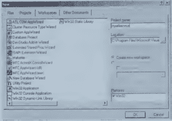

## 图 10.2

ATL COM AppWizard。

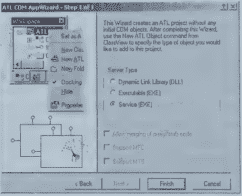

该向导方便地让您选择 Service 作为服务器类型。选择 Service 后，单击 Finish 按钮，然后单击 OK；Developer Studio 将生成您的服务所需的全部代码。就是这样。这个简短的过程生成的代码，与您在本章前面各节中学到的所有代码类似。

ATL COM AppWizard 生成大约十几个文件。大多数文件是构建 ATL 项目所需的典型样板代码，即预编译头、资源脚本等。其中一个生成的文件包含实现您的服务的代码。清单 10.8 显示了 ATL COM AppWizard 生成的实现示例。

## 清单 10.8

### ATL 服务样板代码

```cpp
// myatlservice.cpp : Implementation of WinMain

// Note: Proxy/Stub Information
//      To build a separate proxy/stub DLL,
//      run nmake -f myatlserviceps.mk in the project directory.

#include "stdafx.h"
#include "resource.h"
#include "initguid.h"
#include "myatlservice.h"

#include "myatlservice_i.c"

#include <stdio.h>

CServiceModule Module;

BEGIN_OBJECT_MAP(ObjectMap)
END_OBJECT_MAP()

LPCSTR FindOneOf(LPCSTR p1, LPCSTR p2)
{
    while (p1 != NULL && *p1 != NULL)
    {
        LPCSTR p = p2;
        while (p != NULL && *p != NULL)
        {
            if (*p1 == *p)
                return CharNext(p1);
            p = CharNext(p);
        }
        p1 = CharNext(p1);
    }
    return NULL;
}

// Although some of these functions are big they are declared inline
// since they are only used once

inline HRESULT CServiceModule::RegisterServer(BOOL bRegTypeLib,
                                              BOOL bService)
{
    HRESULT hr = CoInitialize(NULL);
    if (FAILED(hr))
        return hr;

    // Remove any previous service since it may point to
    // the incorrect file
    Uninstall();

    // Add service entries
    UpdateRegistryFromResource(IDR_Myatlservice, TRUE);

    // Adjust the AppID for Local Server or Service
    CRegKey keyAppID;
    LONG lRes = keyAppID.Open(HKEY_CLASSES_ROOT, _T("AppID"), KEY_WRITE);
    if (lRes != ERROR_SUCCESS)
        return lRes;

    CRegKey key;
    lRes =
        key.Open(keyAppID, _T("{1B51F632-99A5-11D2-BEC8-00C04F8B72E7}"),
                 KEY_WRITE);
    if (lRes != ERROR_SUCCESS)
        return lRes;
    key.DeleteValue(_T("LocalService"));

    if (bService)
    {
        key.SetValue(_T("myatlservice"), _T("LocalService"));
        key.SetValue(_T("Service"), _T("ServiceParameters"));
        // Create service
        Install();
    }

    // Add object entries
    hr = CComModule::RegisterServer(bRegTypeLib);

    CoUninitialize();
    return hr;
}

inline HRESULT CServiceModule::UnregisterServer()
{
    HRESULT hr = CoInitialize(NULL);
    if (FAILED(hr))
        return hr;

    // Remove service entries
    UpdateRegistryFromResource(IDR_Myatlservice, FALSE);
    // Remove service
    Uninstall();
    // Remove object entries
    CComModule::UnregisterServer(TRUE);
    CoUninitialize();
    return S_OK;
}

inline void CServiceModule::Init(_ATL_OBJMAP_ENTRY *p, HINSTANCE h,
                                 UINT nServiceNameID, const GUID* plibid)
{
    CComModule::Init(p, h, plibid);

    m_bService = TRUE;

    LoadString(h, nServiceNameID, m_szServiceName,
        sizeof(m_szServiceName) / sizeof(TCHAR));

    // set up the initial service status
    m_hServiceStatus = NULL;
    m_status.dwServiceType = SERVICE_WIN32_OWN_PROCESS;
    m_status.dwCurrentState = SERVICE_STOPPED;
    m_status.dwControlsAccepted = SERVICE_ACCEPT_STOP;
    m_status.dwWin32ExitCode = 0;
    m_status.dwServiceSpecificExitCode = 0;
    m_status.dwCheckPoint = 0;
    m_status.dwWaitHint = 0;
}

LONG CServiceModule::Unlock()
{
    LONG l = CComModule::Unlock();
    if (l == 0 && m_bService)
        PostThreadMessage(dwThreadID, WM_QUIT, 0, 0);
    return l;
}

BOOL CServiceModule::IsInstalled()
{
    BOOL bResult = FALSE;

    SC_HANDLE hSCM = ::OpenSCManager(NULL, NULL, SC_MANAGER_ALL_ACCESS);

    if (hSCM != NULL)
    {
        SC_HANDLE hService = ::OpenService(hSCM, m_szServiceName,
                                           SERVICE_QUERY_CONFIG);

        if (hService != NULL)
        {
            bResult = TRUE;
            ::CloseServiceHandle(hService);
        }
        ::CloseServiceHandle(hSCM);
    }
    return bResult;
}

inline BOOL CServiceModule::Install()
{
    if (IsInstalled())
        return TRUE;

    SC_HANDLE hSCM = ::OpenSCManager(NULL, NULL, SC_MANAGER_ALL_ACCESS);

    if (hSCM == NULL)
    {
        MessageBox(NULL, _T("Couldn't open service manager"),
                   m_szServiceName, MB_OK);
        return FALSE;
    }

    // Get the executable file path
    TCHAR szFilePath[_MAX_PATH];
    ::GetModuleFileName(NULL, szFilePath, _MAX_PATH);

    SC_HANDLE hService = ::CreateService(
        hSCM, m_szServiceName, m_szServiceName,
        SERVICE_ALL_ACCESS, SERVICE_WIN32_OWN_PROCESS,
        SERVICE_DEMAND_START, SERVICE_ERROR_NORMAL,
        szFilePath, NULL, NULL, _T("RPCSS\0"), NULL, NULL);

    if (hService == NULL)
    {
        ::CloseServiceHandle(hSCM);
        MessageBox(NULL, _T("Couldn't create service"), m_szServiceName,
                   MB_OK);
        return FALSE;
    }

    ::CloseServiceHandle(hService);
    ::CloseServiceHandle(hSCM);
    return TRUE;
}

inline BOOL CServiceModule::Uninstall()
{
    if (!IsInstalled())
        return TRUE;

    SC_HANDLE hSCM = ::OpenSCManager(NULL, NULL, SC_MANAGER_ALL_ACCESS);

    if (hSCM == NULL)
    {
        MessageBox(NULL, _T("Couldn't open service manager"),
                   m_szServiceName, MB_OK);
        return FALSE;
    }

    SC_HANDLE hService = ::OpenService(hSCM, m_szServiceName,
        SERVICE_STOP | DELETE);

    if (hService == NULL)
    {
        ::CloseServiceHandle(hSCM);
        MessageBox(NULL, TEXT("Couldn't open service"), m_szServiceName,
                   MB_OK);
        return FALSE;
    }
    SERVICE_STATUS status;
    ::ControlService(hService, SERVICE_CONTROL_STOP, &status);

    BOOL bDelete = ::DeleteService(hService);
    ::CloseServiceHandle(hService);
    ::CloseServiceHandle(hSCM);

    if (bDelete)
        return TRUE;

    MessageBox(NULL, TEXT("Service could not be deleted"), m_szServiceName,
               MB_OK);
    return FALSE;
}

///////////////////////////////////////////////////////////////////////
// Logging functions
void CServiceModule::LogEvent(LPCTSTR pFormat, ...)
{
    TCHAR    chMsg[256];
    HANDLE   hEventSource;
    LPTSTR   lpszStrings[1];
    va_list  pArg;

    va_start(pArg, pFormat);
    _vstprintf(chMsg, pFormat, pArg);
    va_end(pArg);

    lpszStrings[0] = chMsg;

    if (m_bService)
    {
        /* Get a handle to use with ReportEvent(). */
        hEventSource = RegisterEventSource(NULL, m_szServiceName);
        if (hEventSource != NULL)
        {
            /* Write to event log. */
            ReportEvent(hEventSource, EVENTLOG_INFORMATION_TYPE, 0, 0,
                        NULL, 1, 0, (LPCTSTR*) &lpszStrings[0], NULL);
            DeregisterEventSource(hEventSource);
        }
    }
    else
    {
        // As we are not running as a service, just write the error to
        // the console.
        _puts(chMsg);
    }
}

/////////////////////////////////////////////////////////////////
// Service startup and registration
inline void CServiceModule::Start()
{
    SERVICE_TABLE_ENTRY st[] =
    {
        { (LPTSTR)m_szServiceName, _ServiceMain },
        { NULL, NULL }
    };
    if (m_bService && !::StartServiceCtrlDispatcher(st))
    {
        m_bService = FALSE;
    }
    if (m_bService == FALSE)
        Run();
}

inline void CServiceModule::ServiceMain(DWORD, LPTSTR*)
{
    // Register the control request handler
    m_status.dwCurrentState = SERVICE_START_PENDING;
    m_hServiceStatus = RegisterServiceCtrlHandler(m_szServiceName,
                                                   _Handler);
    if (m_hServiceStatus == NULL)
    {
        LogEvent(_T("Handler not installed"));
        return;
    }
    SetServiceStatus(SERVICE_START_PENDING);

    m_status.dwWin32ExitCode = S_OK;
    m_status.dwCheckPoint = 0;
    m_status.dwWaitHint = 0;

    // When the Run function returns, the service has stopped.
    Run();

    SetServiceStatus(SERVICE_STOPPED);
    LogEvent(_T("Service stopped"));
}
```


### 清单 10.8（续）

```cpp
}

inline void CServiceModule::Handler(DWORD dwOpcode)
{
    switch (dwOpcode)
    {
    case SERVICE_CONTROL_STOP:
        SetServiceStatus(SERVICE_STOP_PENDING);
        PostThreadMessage(dwThreadID, WM_QUIT, 0, 0);
        break;
    case SERVICE_CONTROL_PAUSE:
        break;
    case SERVICE_CONTROL_CONTINUE:
        break;
    case SERVICE_CONTROL_INTERROGATE:
        break;
    case SERVICE_CONTROL_SHUTDOWN:
        break;
    default:
        LogEvent(_T("Bad service request"));
    }
}

void WINAPI CServiceModule::_ServiceMain(DWORD dwArgc, LPTSTR* lpszArgv)
{
    _Module.ServiceMain(dwArgc, lpszArgv);
}
void WINAPI CServiceModule::Handler(DWORD dwOpcode)
{
    _Module.Handler(dwOpcode);
}

void CServiceModule::SetServiceStatus(DWORD dwState)
{
    m_status.dwCurrentState = dwState;
    ::SetServiceStatus(m_hServiceStatus, &m_status);
}

void CServiceModule::Run()
{
    _Module.dwThreadID = GetCurrentThreadId();

    HRESULT hr = CoInitialize(NULL);
// If you are running on NT 4.0 or higher you can use the following call
// instead to make the EXE free threaded.
// This means that calls come in on a random RPC thread
// HRESULT hr = CoInitializeEx(NULL, COINIT_MULTITHREADED);

    _ASSERTE(SUCCEEDED(hr));

// This provides a NULL DACL which will allow access to everyone.
CSecurityDescriptor sd;
sd.InitializeFromThreadToken();
hr = CoInitializeSecurity(sd, 1, NULL, NULL,
    RPC_C_AUTHN_LEVEL_PKT, RPC_C_IMP_LEVEL_IMPERSONATE, NULL,
    EOAC_NONE, NULL);
_ASSERTE(SUCCEEDED(hr));

hr = _Module.RegisterClassObjects(CLSCTX_LOCAL_SERVER,
                                  CLSCTX_REMOTE_SERVER,
                                  REGCLS_MULTIPLEUSE);
_ASSERTE(SUCCEEDED(hr));

LogEvent(_T("Service started"));
if (m_bService)
    SetServiceStatus(SERVICE_RUNNING);

MSG msg;
while (GetMessage(&msg, 0, 0, 0))
    DispatchMessage(&msg);

_Module.RevokeClassObjects();

CoUninitialize();
}

////////////////////////////////////////////////////////////
//
extern "C" int WINAPI _tWinMain(HINSTANCE hInstance,
    HINSTANCE /*hPrevInstance*/, LPTSTR lpCmdLine, int /*nShowCmd*/)
{
    lpCmdLine = GetCommandLine(); // this line necessary for _ATL_MIN_CRT
    _Module.Init(ObjectMap, hInstance, IDS_SERVICENAME,
                 &LIBID_ATLMYATLSERVICELib);
    _Module.m_bService = TRUE;

    TCHAR szTokens[] = _T("-/");

    LPCTSTR lpszToken = FindOneOf(lpCmdLine, szTokens);
    while (lpszToken != NULL)
    {
        if (lstrcmpi(lpszToken, _T("UnregServer")) == 0)
            return _Module.UnregisterServer();

        // Register as Local Server
        if (lstrcmpi(lpszToken, _T("RegServer")) == 0)
            return _Module.RegisterServer(TRUE, FALSE);

        // Register as Service
        if (lstrcmpi(lpszToken, _T("Service"))==0)
            return _Module.RegisterServer(TRUE, TRUE);

        lpszToken = FindOneOf(lpszToken, szTokens);
    }

    // Are we Service or Local Server
    CRegKey keyAppID;
    LONG lRes = keyAppID.Open(HKEY_CLASSES_ROOT, _T("AppID"), KEY_READ);
    if (lRes != ERROR_SUCCESS)
        return lRes;

    CRegKey key;
    lRes =
        key.Open(keyAppID, _T("{B51F6322-9A5-11D2-BEC8-00C04F8B72E7}"),
                 KEY_READ);
    if (lRes != ERROR_SUCCESS)
        return lRes;

    TCHAR szValue[MAX_PATH];
    DWORD dwLen = _MAX_PATH;
    lRes = key.QueryValue(szValue, _T("LocalService"), &dwLen);

    _Module.m_bService = FALSE;
    if (lRes == ERROR_SUCCESS)
        _Module.m_bService = TRUE;

    _Module.Start();

    // When we get here, the service has been stopped
    return _Module.m_status.dwWin32ExitCode;
}
```

如果查看 CServiceModule 类的成员函数，你会注意到它们与本章前面展示的代码相似。例如，CServiceModule::Init() 方法会初始化 SERVICE_STATUS 数组，就像我在 ServiceMain() 函数开头所做的那样。CServiceModule::Start() 方法会调用 StartServiceCtrlDispatcher() 函数，就像我在 main() 函数中所做的那样。CServiceModule::ServiceMain() 方法则与 ServiceMain() 函数一样，通过调用 RegisterServiceCtrlHandler() 函数向 SCM 注册控制调度器。

总的来说，你会感觉自己正在编写一个服务。但由于 ATL COM 向导试图实现太多功能，你往往会失去阅读代码的能力。这是一种常见的设计缺陷，称为 Blob 或瑞士军刀设计模式。也就是说，设计者试图把过多功能塞进一个类中。这个类什么都做，因此缺乏清晰性。但请相信我，代码是能工作的。

除了启动和停止服务所需的代码之外，模块类还免费实现了事件日志记录和 ATL 类注册。本章后面的“使用事件日志”一节将更详细地讨论事件日志记录。

那么现在你会问，ATL 如何让我更容易与服务通信？到目前为止，你看到的只是创建服务所需的样板代码。下一节将介绍如何使用 DCOM 与服务通信。

## DCOM 进程间通信（IPC）

回到 ATL 服务项目工作区。既然你已经有了一个基本的 ATL 服务项目，就可以使用 ATL 对象向导添加 ATL 类。像往常一样，你可以通过从菜单栏选择“插入”、“新建 ATL 对象”来创建 ATL 类。在弹出的“ATL 对象向导”对话框中，在“类别”列表框中选择“对象”，在“对象”列表框中选择“简单对象”，然后单击“下一步”按钮。在弹出的“ATL 对象向导属性”对话框中，为对象输入一个短名称。我通常先向服务中添加一个单例对象，作为公共入口点。

单例类是一种 COM 类，其类工厂只创建该类的一个实例。所有对 IClassFactory::CreateInstance() 方法的调用都会返回这同一个实例。这意味着所有客户端将共享该对象的一个实例。假设该对象是自由线程且线程安全的，它就可以用作服务的公共入口点。为了使 ATL 类成为单例，请在类声明中添加 DECLARE_CLASSFACTORY_SINGLETON 宏（参见清单 10.9）。

### 清单 10.9 单例 ATL 类

```cpp
// singleton.h : Declaration of the CSingleton

#ifndef __SINGLETON_H_
#define __SINGLETON_H_

#include "resource.h"        // main symbols

///////////////////////////////////////////////////////////////////////
// CSingleton
class ATL_NO_VTABLE CSingleton :
    public CComObjectRootEx<CComMultiThreadModel>,
    public CComCoClass<CSingleton, &CLSID_singleton>,
    public IDispatchImpl<ISingleton, &IID_ISingleton,
                         &LIBID_MYATL...SERVICE...>
{
public:
    CSingleton()
{
}

DECLARE_CLASSFACTORY_SINGLETON(CSingleton)

DECLARE_REGISTRY_RESOURCEID(IDR_SINGLETON)

DECLARE_PROTECT_FINAL_CONSTRUCT()

BEGIN_COM_MAP(CSingleton)
    COM_INTERFACE_ENTRY(ISingleton)
    COM_INTERFACE_ENTRY(IDispatch)
END_COM_MAP()

// ISingleton
public:
};

#endif //__SINGLETON_H_
```

我在光盘中包含了一个名为 myatlservice 的项目。它可以在 chapter10 目录下的 myatlservice 子目录中找到。这个服务有一个 ATL 单例类。我遇到过 ATL 向导的问题；它们有时会忘记在需要的地方包含头文件。包含的工作区中还有一个自动化客户端，它会创建这个 ATL 类。清单 10.10 显示了该自动化客户端的代码。

### 清单 10.10 ATL 服务客户端

```cpp
// controller.cpp : Defines the entry point for the console application.
//

#include "stdafx.h"
#include "automation.h"

int main(int argc, char* argv[])
{
    ::CoInitialize(NULL);
    {
        Automation object;
        object.CreateObject(L"Myatlservice.singleton.1");
    }
    ::CoUninitialize();
    return 0;
}
```

这个客户端非常简单。它把对象创建为自动化对象，然后退出。光盘中项目附带的 Automation 类是一个简单的自动化包装器，试图在 C++ 中模拟 Visual Basic 自动化语法。


要将模块作为服务启动，必须首先向 SCM 注册该服务。只需使用 `-service` 命令行参数运行 MyATLService.exe 可执行文件即可完成此操作。

向 SCM 注册服务后，再次单步执行客户端代码，ATL 模块将作为服务启动。您可能想知道如何判断模块是作为服务还是作为可执行文件启动的。下一节将介绍一些工具——包括“管理工具”中的“服务”小程序——它们将帮助您确定服务的运行状态。

## 服务实用工具

### 管理工具服务小程序

“服务”小程序使您能够启动、停止、暂停、继续以及配置机器上所有已安装的服务。您可以从 Windows 2000 的“管理工具”中启动“服务”小程序。图 10.3 显示了“服务”小程序的主对话框。

**图 10.3**  
*“管理工具”中的“服务”小程序。*

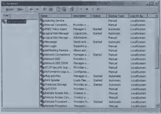

启动、停止、暂停和继续服务非常简单，无需多作解释。如果您选择一个服务并单击“配置”按钮，将出现如图 10.4 所示的服务配置对话框。

**图 10.4**  
配置服务。

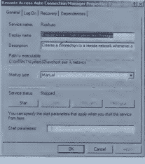

通过从“启动类型”组框中选择“自动”，您可以设置服务在机器启动时自动启动。服务通常在系统帐户的上下文中运行，但通过服务配置对话框，您可以将服务配置为在任何用户的上下文中运行。

### 诊断实用程序

另一个很棒的实用程序是诊断实用程序 (WinMsd.exe)。该实用程序位于 system32 目录中。它列出机器上所有正在运行或已停止的服务。图 10.5 显示了诊断实用程序的基本显示界面。

使用 WinMsd，可以了解服务的状态。您可以获得域上任何计算机的相同列表。这就是它对管理员有用的原因。

**图 10.5**  
诊断实用程序。

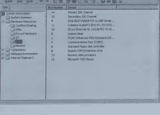

## OpenSCManager()

`OpenSCManager()` 函数可用于检索 SCM 的句柄。检索到 SCM 的句柄后，您就可以通过内部 API 开始与服务通信。

> **注意**
>
> 您只应使用 SCM API 来启动、停止、暂停和继续服务。如果要向服务发送其他请求，服务应提供支持客户端请求的 IPC 协议。这是一条准则，而非硬性规则。

### 服务句柄

您必须做的第一件事是调用 `OpenService()` 函数来获取特定服务的句柄。获取特定服务的句柄后，您可以调用 `StartService()` 函数来启动该服务。您可以使用 `CloseServiceHandle()` 函数关闭服务句柄。清单 10.11 展示了使用 `StartService()` 函数启动服务的示例。

**清单 10.11** StartService() 示例

```cpp
void StartAService(const char * szServiceName)
{
    SC_HANDLE handle = ::OpenSCManager(NULL, NULL, SC_MANAGER_ALL_ACCESS);
    SC_HANDLE hService = ::OpenService(handle, szServiceName,
        SERVICE_ALL_ACCESS);
    ::StartService(hService, 0, NULL);
    ::CloseServiceHandle(hService);
    ::CloseServiceHandle(handle);
}
```

刚才使用的 API 原型如下：

```cpp
SC_HANDLE OpenSCManager(
    LPCTSTR lpMachineName, // pointer to machine name string
    LPCTSTR lpDatabaseName, // pointer to database name string
    DWORD dwDesiredAccess // type of access
);
SC_HANDLE OpenService(
    SC_HANDLE hSCManager, // handle to service control manager database
    LPCTSTR lpServiceName, // pointer to name of service to start
    DWORD dwDesiredAccess // type of access to service
);

BOOL StartService(
    SC_HANDLE hService, // handle of service
    DWORD dwNumServiceArgs, // number of arguments
    LPTSTR *lpServiceArgVectors // array of argument strings
);
```

## 操作服务

当您获得服务的句柄并且服务已启动后，可以调用 `ControlService()` 和 `QueryServiceStatus()` 函数来暂停、继续、停止服务以及查询服务状态。清单 10.12 展示了使用这两个函数停止服务的示例。

**清单 10.12** 停止服务的示例

```cpp
void StopService(const char * szServiceName)
{
    SC_HANDLE handle = ::OpenSCManager(NULL, NULL, SC_MANAGER_ALL_ACCESS);
    SC_HANDLE hService = ::OpenService(handle, szServiceName,
                                        SERVICE_ALL_ACCESS);
    SERVICE_STATUS servicestatus;
    ::QueryServiceStatus(hService, &servicestatus);
    if (servicestatus.dwCurrentState == SERVICE_RUNNING)
    {
        if( ::ControlService(hService, SERVICE_CONTROL_STOP, &servicestatus) )
        {
            // Handle situation where service did not stop.
        }
    }
    ::CloseServiceHandle(hService);
    ::CloseServiceHandle (handle);
}
```

您还可以使用 `ControlService()` 函数将本章前面讨论的专有消息发送到 `ServiceCtrlHandler()` 函数。

## 通过注册表安装服务

要在机器上安装服务，您必须在注册表中的 HKEY_LOCAL_MACHINE\System\CurrentControlSet\Services 项下添加一些值。

虽然您可以通过直接操作注册表来安装服务，但您可能需要使用 `CreateService()` 函数。清单 10.13 展示了调用 `CreateService()` 函数来安装服务的示例。

**清单 10.13** 使用 `CreateService()` 的示例

```cpp
void InstallAsService(const char * szServiceName)
{
    SC_HANDLE hSC = ::OpenSCManager(NULL, NULL, SC_MANAGER_ALL_ACCESS);
    char szFilename[256];
    ::GetModuleFileName(NULL, szFilename, 255);
    SC_HANDLE hService = ::CreateService(hSC, szServiceName,
        szServiceName, SERVICE_ALL_ACCESS, SERVICE_WIN32_OWN_PROCESS,
        SERVICE_DEMAND_START, SERVICE_ERROR_IGNORE, szFilename, NULL,
        NULL, NULL, NULL, NULL);
    ::CloseServiceHandle(hService);
    ::CloseServiceHandle(hSC);
}
```

`CreateService()` 函数通过向 Windows 系统注册表添加条目来安装您的服务。图 10.7 展示了 `CreateService()` 函数所添加条目的示例。

**图 10.7**  
注册表与 `CreateService()`。

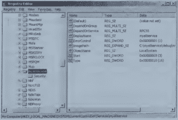

安装服务后，您可以调用 `ChangeServiceConfig()` 函数来修改服务的配置。要卸载服务，请调用 `DeleteService()` 函数。请注意，`DeleteService()` 实际上不会卸载服务，它只是将服务标记为删除。当服务的所有句柄都关闭后，该服务才会被移除。

## 使用事件日志

与服务相关的主题是事件日志。在调试服务时，您经常会遇到提供运行时反馈的问题。服务不应以消息框或任何其他 GUI 组件的形式提供直接反馈。相反，它们应将反馈记录到事件日志中。接下来的几节将介绍如何将事件写入事件日志以及如何从事件日志中读取事件。

日志中提供的信息足够全面，通常您可以获得足够的信息来弄清楚问题。在日志中，您将看到事件类型、日期、时间、来源和类别。您还将知道该事件是由应用程序、系统还是服务生成的。

> **注意**
>
> 实际上，任何工作站或服务器上至少有三个（甚至更多）事件日志。三个主要的事件日志是应用程序、系统和安全事件日志。在本章中，我始终指的是应用程序事件日志。

### 消息编译器 (MC)

要实现事件日志记录，您需要熟悉的第一个工具是消息编译器。消息编译器以消息脚本 (.mc) 文件作为输入，并输出三个文件：二进制文件 (.bin)、资源脚本 (.rc) 和头文件 (.h)。要运行消息编译器，请转到命令提示符并键入 **mc -e myservice.mc**，其中 myservice.mc 是您创建的消息脚本文件的名称。清单 10.14 展示了一个示例消息脚本文件，该文件创建了三个消息资源字符串。

**清单 10.14** 示例消息脚本文件

```text
MessageID=10
SymbolicName=MRS_HELLO
Language=English
My service has started
.
MessageID=
SymbolicName=MRS_ERROR
Language=English
Error: %1
.
MessageID=
SymbolicName=MRS_GOODBYE
Language=English
My service has stopped
.
```


编译此消息脚本文件后，你将生成三个必需的文件。资源脚本文件应被编译并链接到服务的模块文件中。资源脚本文件将包含二进制文件，因此在编译资源脚本时它必须位于路径中。头文件可以包含在程序代码中，以便使用消息资源字符串的符号名称。以下是由 MC 生成的资源脚本：

```
LANGUAGE 0x9,0x1
1 11 MSG00001.bin
```

清单 10.15 显示了消息编译器将创建的资源脚本和头文件。

### 清单 10.15 由 MC 生成的头文件

```
//
//  Values are 32 bit values laid out as follows:
//
//  3 3 2 2 2 2 2 2 2 2 2 2 1 1 1 1 1 1 1 1
//  3 2 1 0 9 8 7 6 5 4 3 2 1 0 9 8 7 6 5 4 3 2 1 0 9 8 7 6 5 4 3 2 1 0
//  +---+---+------------------------+------------------------+
//  |Sev|C|R|       Facility         |          Code           |
//  +---+---+------------------------+------------------------+
//
//  where
//
//      Sev - is the severity code
//
//             00 - Success
//             01 - Informational
//             10 - Warning
//             11 - Error
//
//      C - is the Customer code flag
//
//      R - is a reserved bit
//
//      Facility - is the facility code
//
//      Code - is the facility's status code
//
//  Define the facility codes
//
//
//  Define the severity codes
//
```

### 清单 10.15（续）

```cpp
//
// MessageId: MRS_HELLO
//
// MessageText:
//
// %s
//
#define MRS_HELLO                         0x2000000AL

//
// MessageId: MRS_ERROR
//
// MessageText:
//
// Error: %s
//
#define MRS_ERROR                         0x2000000BL
```

最后，你必须通过运行清单 10.16 中的代码来注册消息字符串。我在 CD-ROM 上包含了名为 EventLog 的附加源代码。它可以在 chapter10 目录下的 EventLog 子目录中找到。EventLog 包含了本章中完整的事件日志记录源代码。此示例通过添加完整的事件日志记录功能来扩展你之前的服务。

### 清单 10.16 注册事件服务器

```cpp
USES_CONVERSION;
HKEY hKey;
::RegCreateKey(HKEY_LOCAL_MACHINE, "SYSTEM\\CurrentControlSet\\"
  "Services\\EventLog\\Application\\myatlservice", &hKey);
char sz[MAX_PATH];
::GetModuleFileName(NULL, sz, MAX_PATH);
::RegSetValueEx(hKey, "EventMessageFile", 0, REG_EXPAND_SZ, (LPBYTE) sz,
  ::strlen(sz) + 1);
DWORD dwData = EVENTLOG_ERROR_TYPE | EVENTLOG_WARNING_TYPE |
               EVENTLOG_INFORMATION_TYPE;
::RegSetValueEx(hKey, "TypesSupported", 0, REG_DWORD, (LPBYTE) &dwData,
  sizeof(dwData));
::RegCloseKey (hKey);
```

## RegisterEventSource()、DeregisterEventSource() 和 ReportEvent()

写入事件日志也相当容易。为了打开和关闭一个可用于写入注册表的句柄，请调用 RegisterEventSource() 和

### 清单 10.18 转储事件日志

```cpp
// viewer.cpp : Defines the entry point for the console application.
//

#include "stdafx.h"

#include "windows.h"
#include "iostream.h"

int main()
{
    HANDLE handle = ::OpenEventLog(NULL, "Application");
    if (handle == NULL)
    {
        return 0;
    }

    DWORD dwRec=0;
    static const int c = 65536;
    DWORD dwRead, dwNext;
    BYTE by[c];
    while (1)
    {
        if (!::ReadEventLog(handle, EVENTLOG_BACKWARDS_READ +
                EVENTLOG_SEQUENTIAL_READ,
                1, by, c, &dwRead, &dwNext))
        {
            break;
        }
        DWORD dw=0;
        while (dwRead>dw)
        {
            EVENTLOGRECORD *p;
            p = (EVENTLOGRECORD *)(by+dw);
            char * str = (char *)(by+dw+56);
            cout << "Record: " << ++dwRec << '\n';
            TCHAR * tchar = (TCHAR *)(by+dw+p->StringOffset);
            cout << tchar << '\n';
            dw += p->Length;
        }
    }

    ::CloseEventLog(handle);
    return 0;
}
```

请记住，使用事件日志的原因是为了向程序员和操作员提供运行时反馈。你无法使用消息框或其他 GUI 元素提供反馈，因为服务没有桌面。你可能会想在事件日志中发送大量反馈，以便更轻松地调试。这不建议这样做。只有重要信息才应记录在事件日志中。接下来的几节将向你展示一些可用于调试服务的技巧。

## 调试服务

服务比其他进程更难调试，原因有几个。第一个原因是服务不像其他进程那样拥有桌面。另一个原因是服务通常使用一个称为系统帐户的特殊用户帐户运行。

### 系统帐户

系统帐户具有特殊权限，授予该帐户访问文件系统和许多其他安全资源的权限。但系统帐户相当受限，无法访问任何网络资源。它是一个空会话帐户，而空会话帐户无法访问网络资源，即使已向所有人授予了对某个网络资源的访问权限也是如此。

最后，你不能使用系统帐户登录到计算机。这使得调试与服务在具有一组不同于交互式用户权限的访问权限的帐户下运行这一事实相关的 bug 变得非常困难。

### 任务管理器：调试

你可以从任务管理器启动调试，从而调试一个进程，甚至是在系统帐户下运行的进程。在任务管理器的“进程”选项卡中，可以右键单击某个进程以打开其上下文菜单。从上下文菜单中选择“调试”，这将启动你注册的调试器并附加到当前正在运行的进程。你也可以使用 /P 开关启动 Developer Studio，后跟要调试的运行中服务的进程 ID。

### 使用 AT 命令启动调试器

调试的另一种选择是获取一个在系统帐户安全上下文中运行的命令 shell。从“开始”菜单中，选择“运行”。输入命令 `at 10:07 /interactive cmd.exe`，其中 10:07 是未来一分钟——也就是说，如果当前时间是 10:06，你将输入 `at 10:07 /interactive cmd.exe`。当时钟到达 10:07 时，计划程序将启动一个命令 shell。因为计划程序在系统帐户的安全上下文中运行，所以命令 shell 也将如此。从这个命令 shell 中，你可以启动 Developer Studio 或任何其他进程，而该进程也将在系统帐户的安全上下文中运行。

## 小结

在本章中，你学到了很多关于服务的知识：如何编写、使用和调试它们。既然你已经学习了创建服务的基础知识，而且记忆犹新，你应该进行实验并创建一些你自己的设计。

注册表是你学到的另一件事。因为大多数关于服务的信息都存储在注册表中，而且服务从注册表加载其大多数设置，所以这个主题对服务有很大影响。对与服务相关的注册表的理解有时会决定你的成败。

事件日志和调试使本章内容更加完整。当然，调试服务中的困难不能被低估，但我讨论了如何克服这些困难，包括使用事件日志。

## 第11章 封送处理

### 本章内容

- 理解封送处理 224
- 类型库封送处理 264
- 标准封送处理 265
- 自定义封送处理 282

### 理解封送处理

封送处理的定义有时并不被很好地理解，即使是那些已经成功掌握这一概念的人也是如此。marshaling 一词以前用于描述在战斗前集结和组织军队的过程。在计算机术语中，封送处理是将数据收集并组织成可传输到另一个进程或线程的数据包的过程。那么，解封送处理就是拆开数据包并将数据保存在本地存储中的过程。

客户端进程首先构造对服务器 COM+ 对象的请求。该请求被封送成可传输的数据包并传递给服务器对象。服务器对象解封送数据包并处理请求。然后，响应被封送并传递回调用客户端。客户端解封送数据并解释响应。

客户端使用代理对象封送和解封送数据，该代理对象提供与 COM+ 服务器相同的接口。代理不实现 COM+ 服务器的方法，而只是打包方法参数，将它们发送到实际的 COM+ 服务器，并解包从 COM+ 服务器方法返回的结果。

服务器通常有一个存根线程，它接收来自代理的传入请求并解封送数据，以对 COM+ 对象执行实际调用（参见图 11.1）。

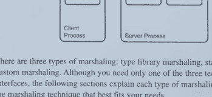

封送处理有三种类型：类型库封送处理、标准封送处理和自定义封送处理。尽管你只需要三种技术中的一种来封送接口，但以下各节将解释每种封送处理类型，以便你可以选择最适合你需求的封送处理技术。

### 类型库封送处理

类型库封送处理利用了这样一个事实：每个安装都已经安装了自动化封送器。只要你愿意将自己限制在数据类型

在自动化封送器的支持下，你可以使用类型库封送。也就是说，无需在客户端和服务器上安装代理-存根模块，你可以使用自动化所使用的代理-存根对。现在，你不必安装代理-存根对，而只需在客户端和服务器机器上安装类型库。由于其简单性，我几乎总是使用类型库封送。

为了使用类型库封送，你必须在注册表中指明你正在使用自动化封送器以及在哪里找到你的类型库。清单 11.1 展示了一个使用类型库封送的 COM+ 接口的注册文件。

## 清单 11.1 类型库封送的示例注册文件

```reg
[HKEY_CLASSES_ROOT\Interface\{my-interfaces-iid}]
@="IMyInterface"

[HKEY_CLASSES_ROOT\Interface\{my-interfaces-iid}\ProxyStubClsid32]
@="{00020424-0000-0000-C000-000000000046}"

[HKEY_CLASSES_ROOT\Interface\{my-interfaces-iid}\TypeLib]
@="{my-typelibs-guid}"
"Version"="1.0"

[HKEY_CLASSES_ROOT\TypeLib\{my-typelibs-guid}\1.0]
@="My Type Library"

[HKEY_CLASSES_ROOT\TypeLib\{my-typelibs-guid}\1.0\Win32]
@="c:\mypath\mymodule.tlb"

[HKEY_CLASSES_ROOT\TypeLib\{my-typelibs-guid}\1.0\Flags]
@="0"

[HKEY_CLASSES_ROOT\TypeLib\{my-typelibs-guid}\1.0\HelpDir]
@="."
```

前面的注册文件在注册表中注册了 IMyInterface 接口。相关的类型库“My Type Library”也被注册。你应当注意，.tlb 文件同样被注册。

## 标准封送

标准封送通过使用 Microsoft 接口定义语言（MIDL）编译器来完成。假设你有一个名为 IMyInterface 的接口，并将该接口保存在文件 myinterface.idl 中，你可以使用 MIDL 编译器生成该接口的代理-存根代码。MIDL 编译器的输出由以下五个文件组成：

- myinterface.h — 包含接口定义的头文件
- myinterface_i.c — 包含 IID 常量定义的源文件
- myinterface_p.c — 包含代理-存根代码的源文件
- dlldata.c — 包含代理-存根 DLL 入口点的源文件
- myinterface.tlb — 支持自动化的类型库，用于类型库封送

清单 11.2 是一个简单的接口定义语言（IDL）文件，用作输入以通过 MIDL 编译器生成文件。

## 清单 11.2 示例 IDL 文件

```
// MyMidlExperiment.idl : IDL source for MyMidlExperiment.dll
//
// This file will be processed by the MIDL tool to
// produce the type library (MyMidlExperiment.tlb) and
// marshaling code.

import "oaidl.idl";
import "ocidl.idl";

[
    uuid(CE00560E-40F0-11D2-BEA0-00C04FB872E7),
    helpstring("IMyInterface Interface"),
    pointer_default(unique)
]
interface IMyInterface : IUnknown
{
    [helpstring("method Hello")] HRESULT Hello();
};

[
    uuid(CE00560E-40F0-11D2-BEA0-00C04FB872E7),
    version(1.0),
    helpstring("MyMidlExperiment 1.0 Type Library")
]
library MYMIDLEXPERIMENTLib
{
    importlib("stdole32.tlb");
    importlib("stdole2.tlb");
    [
        uuid(CE00560F-40F0-11D2-BEA0-00C04FB872E7),
        helpstring("MyInterface Class")
    ]
    coclass MyInterface
    {
        [default] interface IMyInterface;
    };
};
```

如果使用该 IDL 文件执行 MIDL 编译器，输出将是类型库以及清单 11.3、11.4、11.5 和 11.6 中的四个文件，如下文各节所示。

## 定义 DLL 入口点

清单 11.3 是 dlldata.c 源文件。该源文件为你的代理存根定义了所有 DLL 入口点。MIDL DATA ROUTINES 创建代理存根所需的导出例程。这些例程可以包括 DllGetClassObject()、DllCanUnloadNow()、GetProxyDllInfo()、DllRegisterServer() 和 DllUnregisterServer()。

.cpp 文件包含熟悉的 COM 进程内服务器函数 DllGetClassObject() 和 DllCanUnloadNow()。不需要显式定义这些函数，因为编译 C 会为你生成默认实现。然而，这些实现仍必须从此 DLL 中导出。标准封送 DLL 需要 DllGetClassObject()、DllCanUnloadNow() 和导出。你只需导出这三个函数；不需要在标准封送 DLL 中实现它们。当然，如果你已在 DLL 中定义了 DllRegisterServer() 和 DllUnregisterServer() 函数，也必须导出它们。

## 清单 11.3  MIDL 编译器的输出（dlldata.c）

```
/*------------------------------------------------------------

DllData file -- generated by MIDL compiler

        DO NOT ALTER THIS FILE

This file is generated by MIDL on every IDL file compile.

To completely reconstruct this file, delete it and rerun MIDL
on all the IDL files in this DLL, specifying this file for the
/dlldata command line option

***********************************************************/
#include <rpcproxy.h>

#ifdef __cplusplus
extern "C" {
#endif

EXTERN_PROXY_FILE( MyMidlExperiment )

PROXYFILE_LIST_START
/* Start of list */
REFERENCE_PROXY_FILE( MyMidlExperiment ),
/* End of list */
PROXYFILE_LIST_END

DLLDATA_ROUTINES( aProxyFileList, GET_DLL_CLSID )

#ifdef __cplusplus
} /* extern "C" */
#endif

/* end of generated dll data file */
```

## 类定义

清单 11.4 是 mymidlexperiment.h 头文件。该头文件包含类定义。如果你打算直接引用 IMyInterface 对象，则应包含此文件。

## 清单 11.4   MIDL 编译器的输出（mymidlexperiment.h）

```
/* this ALWAYS GENERATED file contains the definitions for the
   interfaces */

/* File created by MIDL compiler version 3.03.0110 */
/* at Mon Aug 31 09:51:22 1998
 */
/* Compiler settings for MyMidlExperiment.idl:
     Oicf (OptLev=12), W1, Zp8, env=Win32, ms_ext, c_ext
     error checks: none
 */
//@@MIDL_FILE_HEADING( )

/* verify that the <rpcndr.h> version is high enough to
compile this file*/
#ifndef __REQUIRED_RPCNDR_H_VERSION__
#define __REQUIRED_RPCNDR_H_VERSION__ 440
#endif

#include "rpc.h"
#include "rpcndr.h"

#ifndef __RPCNDR_H_VERSION__
#error this stub requires an updated version of <rpcndr.h>
#endif // __RPCNDR_H_VERSION__

#ifndef COM_NO_WINDOWS_H
#include "windows.h"
#include "ole2.h"
#endif /*COM_NO_WINDOWS_H*/

#ifndef __MyMidlExperiment_h__
#define __MyMidlExperiment_h__

#ifdef __cplusplus
extern "C"{
#endif

/* Forward Declarations */

#ifndef __IMyInterface_FWD_DEFINED__
#define __IMyInterface_FWD_DEFINED__
typedef interface IMyInterface IMyInterface;
#endif /* __IMyInterface_FWD_DEFINED__ */


#ifndef __MyInterface_FWD_DEFINED__
#define __MyInterface_FWD_DEFINED__

#ifdef __cplusplus
typedef class MyInterface MyInterface;
#else
typedef struct MyInterface MyInterface;
#endif /* __cplusplus */

#endif /* __MyInterface_FWD_DEFINED__ */


/* header files for imported files */
#include "oaidl.h"
#include "ocidl.h"

void __RPC_FAR *__RPC_USER MIDL_user_allocate(size_t);
void __RPC_USER MIDL_user_free( void __RPC_FAR * );

#ifndef __IMyInterface_INTERFACE_DEFINED__
#define __IMyInterface_INTERFACE_DEFINED__

/****************************************
 * Generated header for interface: IMyInterface
 * at Mon Aug 31 09:51:22 1998
 * using MIDL 3.03.0110
 ****************************************/
/* [object][unique][helpstring][uuid] */

EXTERN_C const IID IID_IMyInterface;

#if defined(__cplusplus) && !defined(CINTERFACE)

    MIDL_INTERFACE("CE00560E-40F0-11D2-BEA0-00C04FB872E7")
    IMyInterface : public IUnknown
    {
    public:
        virtual /* [helpstring] */ HRESULT STDMETHODCALLTYPE
        Hello(void) = 0;

    };

#else   /* C style interface */

    typedef struct IMyInterfaceVtbl
    {
        BEGIN_INTERFACE

        HRESULT ( STDMETHODCALLTYPE __RPC_FAR *QueryInterface )(
            IMyInterface __RPC_FAR * This,
            /* [in] */ REFIID riid,
            /* [iid_is][out] */ void __RPC_FAR *__RPC_FAR *
            ppvObject);

        ULONG ( STDMETHODCALLTYPE __RPC_FAR *AddRef )(
            IMyInterface __RPC_FAR * This);

        ULONG ( STDMETHODCALLTYPE __RPC_FAR *Release )(
            IMyInterface __RPC_FAR * This);

        /* [helpstring] */ HRESULT ( STDMETHODCALLTYPE
            __RPC_FAR *Hello )(
            IMyInterface __RPC_FAR * This);
    };
```


### 清单 11.4 续

```c
        END_INTERFACE
    } IMyInterfaceVtbl;

    interface IMyInterface
    {
        CONST_VTBL struct IMyInterfaceVtbl __RPC_FAR *lpVtbl;
    };

#ifdef COBJMACROS

#define IMyInterface_QueryInterface(This,riid,ppvObject) \
    (This)->lpVtbl -> QueryInterface(This,riid,ppvObject)

#define IMyInterface_AddRef(This) \
    (This)->lpVtbl -> AddRef(This)

#define IMyInterface_Release(This) \
    (This)->lpVtbl -> Release(This)

#define IMyInterface_Hello(This) \
    (This)->lpVtbl -> Hello(This)

#endif /* COBJMACROS */

#endif   /* C style interface */

/* [helpstring] */ HRESULT STDMETHODCALLTYPE
    IMyInterface_Hello_Proxy( IMyInterface __RPC_FAR * This);

void __RPC_STUB IMyInterface_Hello_Stub(
    IRpcStubBuffer *This,
    IRpcChannelBuffer * _pRpcChannelBuffer,
    PRPC_MESSAGE _pRpcMessage,
    DWORD * _pdwStubPhase);

#endif   /* __IMyInterface_INTERFACE_DEFINED__ */

#ifndef __MYMIDLEXPERIMENTLib_LIBRARY_DEFINED__
#define __MYMIDLEXPERIMENTLib_LIBRARY_DEFINED__

/********************************************************
 * Generated header for library: MYMIDLEXPERIMENTLib
 * at Mon Aug 31 09:51:22 1998
 * using MIDL 3.03.0110
 ********************************************************/
/* [helpstring][version][uuid] */

EXTERN_C const IID LIBID_MYMIDLEXPERIMENTLib;

EXTERN_C const CLSID CLSID_MyInterface;

#ifdef __cplusplus

class DECLSPEC_UUID("CE00560F-40F0-11D2-BEA0-00C04FB872E7")
MyInterface;
#endif
#endif /* __MYMIDLEXPERIMENTLib_LIBRARY_DEFINED__ */

/* Additional Prototypes for ALL interfaces */

/* end of Additional Prototypes */

#ifdef __cplusplus
}
#endif

#endif
```

你应该注意，代理和存根代码被合并到一个 DLL 中。这就是文件名以 ps 结尾（它代表 ProxyStub）的原因。

IRpcProxyBuffer 接口是客户端基础设施（例如代理管理器）用来与其管理的接口代理实例通信的接口。创建时，代理会按照正常创建过程（其中 IPSFactoryBuffer::CreateProxy() 中的 pUnkOuter 为非 NULL）聚合到一些更大的对象中。然后，控制未知接口对它想要公开的接口（来自接口代理）调用 QueryInterface()。

在服务器端，每个接口存根都实现一个内部接口 IRpcStubBuffer。充当存根管理器的服务器代码调用 IRpcStubBuffer::Connect，并将其对象的 IUnknown 指针传递给接口存根。

代理和存根通过 RPC（远程过程调用）通道进行通信，该通道利用系统的 RPC 基础设施进行进程间通信。RPC 通道实现单个接口 `IRpcChannelBuffer`，这是一个内部接口，接口代理和存根都持有指向它的指针。代理和存根调用该接口以获得封送数据包，将数据发送给它们的对应方，并在完成后销毁该数据包。接口存根还持有指向原始对象的指针。

## 定义 IID、TypeLib GUID 和 CLSID

清单 11.5 是 mymidlexperiment_i.c 源文件。该源文件包含接口（IID）、类型库（TypeLib GUID）和类标识符（CLSID）的定义。

### 清单 11.5 MIDL 编译器输出 (mymidlexperiment_i.c)

```c
/* this file contains the actual definitions of */
/* the IIDs and CLSIDs */

/* link this file in with the server and any clients */

/* File created by MIDL compiler version 3.03.0110 */
/* at Mon Aug 31 09:51:22 1998
*/
/* Compiler settings for MyMidlExperiment.idl:
    Oicf (OptLev=2), W1, Zp8, env=Win32, ms_ext, c_ext
    error checks: none
*/
//@@MIDL_FILE_HEADER( )
#ifdef __cplusplus
extern "C"{
#endif

#ifndef __IID_DEFINED__
#define __IID_DEFINED__

typedef struct _IID
{
    unsigned long x;
    unsigned short s1;
    unsigned short s2;
    unsigned char c[8];
} IID;

#endif // __IID_DEFINED__

#ifndef CLSID_DEFINED
#define CLSID_DEFINED
typedef IID CLSID;
#endif // CLSID_DEFINED

const IID IID_IMyInterface = {0xCE00560F,0x40F0,0x11D2,
  {0xBE,0xA0,0x00,0xC0,0x4F,0x8B,0x72,0xE7}};

const IID IID_LibID_MYMIDLEXPERIMENTLib =
  {0xCE005601,0x40F0,0x11D2,
   {0xBE,0xA0,0x00,0xC0,0x4F,0x8B,0x72,0xE7}};

const CLSID CLSID_MyInterface =
  {0xCE00560F,0x40F0,0x11D2,
   {0xBE,0xA0,0x00,0xC0,0x4F,0x8B,0x72,0xE7}};

#ifdef __cplusplus
}
#endif
```

## 代理和存根定义

清单 11.6 是 mymidlexperiment_p.c 源文件。该源文件包含实际的代理和存根定义及代码。

### 清单 11.6 MIDL 编译器输出 (mymidlexperiment_p.c)

```c
/* this ALWAYS GENERATED file contains the proxy stub code */

/* File created by MIDL compiler version 3.03.0110 */
/* at Mon Aug 31 09:51:22 1998
 */
/* Compiler settings for MyMidlExperiment.idl:
    Oicf (OptLev=2), W1, Zp8, env=Win32, ms_ext, c_ext
    error checks: none
*/
//@@MIDL_FILE_HEADER( )

#define USE_STUBLESS_PROXY

/* verify that the <rpcproxy.h> version is high enough to
   compile this file*/
#ifndef __REQUIRED_RPCPROXY_H_VERSION
#define __REQUIRED_RPCPROXY_H_VERSION 440
#endif

#include "rpcproxy.h"
#ifndef __RPCPROXY_H_VERSION__
#error this stub requires an updated version of <rpcproxy.h>
#endif // __RPCPROXY_H_VERSION__

#include "MyMidlExperiment.h"

#define TYPE_FORMAT_STRING_SIZE   1
#define PROC_FORMAT_STRING_SIZE   19

typedef struct _MIDL_TYPE_FORMAT_STRING
{
    short             Pad;
    unsigned char     Format[ TYPE_FORMAT_STRING_SIZE ];
} MIDL_TYPE_FORMAT_STRING;

typedef struct _MIDL_PROC_FORMAT_STRING
{
    short             Pad;
    unsigned char     Format[ PROC_FORMAT_STRING_SIZE ];
} MIDL_PROC_FORMAT_STRING;

extern const MIDL_TYPE_FORMAT_STRING __MIDL_TypeFormatString;
extern const MIDL_PROC_FORMAT_STRING __MIDL_ProcFormatString;

/* Object interface: IUnknown, ver. 0.0,
   GUID={0x00000000,0x0000,0x0000,
         {0xC0,0x00,0x00,0x00,0x00,0x00,0x00,0x46}} */

/* Object interface: IMyInterface, ver. 0.0,
   GUID={0xCE00560F,0x40F0,0x11D2,
         {0xBE,0xA0,0x00,0xC0,0x4F,0x8B,0x72,0xE7}} */

extern const MIDL_STUB_DESC Object_StubDesc;

extern const MIDL_SERVER_INFO IMyInterface_ServerInfo;

#pragma code_seg(".orpc")

static const MIDL_STUB_DESC Object_StubDesc =
{
    0,
    NdrOleAllocate,
    NdrOleFree,
    0,
    0,
    0,
    0,
    0,
    __MIDL_TypeFormatString.Format,
    0, /* -error bounds_check flag */
    0x20000, /* Ndr library version */
    0,
    0x30300e6, /* MIDL Version 3.3.110 */
    0,
    0, /* Reserved1 */
    0, /* Reserved2 */
    0, /* Reserved3 */
    0, /* Reserved4 */
    0  /* Reserved5 */
};

static const unsigned short
IMyInterface_FormatStringOffsetTable[] =
    {
    0
    };

static const MIDL_SERVER_INFO IMyInterface_ServerInfo =
    {
    &Object_StubDesc,
    0,
    __MIDL_ProcFormatString.Format,
    &IMyInterface_FormatStringOffsetTable[-3],
    0,
    0,
    0,
    0
    };

static const MIDL_STUBLESS_PROXY_INFO IMyInterface_ProxyInfo =
    {
    &Object_StubDesc,
    __MIDL_ProcFormatString.Format,
    &IMyInterface_FormatStringOffsetTable[-3],
    0,
    0,
    0
    };

CINTERFACE_PROXY_VTABLE(4) _IMyInterfaceProxyVtbl =
{
    &IMyInterface_ProxyInfo,
    &IID_IMyInterface,
    IUnknown_QueryInterface_Proxy,
    IUnknown_AddRef_Proxy,
    IUnknown_Release_Proxy,
    (void *)_1 /* IMyInterface::Hello */
};

const CInterfaceStubVtbl _IMyInterfaceStubVtbl =
{
    &IID_IMyInterface,
    &IMyInterface_ServerInfo,
    4,
    0, /* pure interpreted */
    CStdStubBuffer_METHODS
};

#pragma data_seg(".rdata")

#if !defined(_RPC_WIN32_)
#error  Invalid build platform for this stub.
#endif

#if !(TARGET_IS_NT40_OR_LATER)
#error You need a Windows NT 4.0 or later to run this stub
#error because it uses these features:
#error   -Oif or -Oicf, more than 32 methods in the interface.
#error However, your C/C++ compilation flags indicate you
#error intend to run this app on earlier systems.
#error This app will die there with the
#error RPC_X_WRONG_STUB_VERSION error.
#endif

static const MIDL_PROC_FORMAT_STRING __MIDL_ProcFormatString =
{
    0,
    {

        /* Procedure Hello */

        0x33,   /* FC_AUTO_HANDLE */
        0x64,   /* 100 */
        /* 2 */ NdrFcShort( 0x3 ), /* 3 */
#if defined(_ALPHA_)
        /* 1 */ NdrFcShort( 0x8 ),
        /* x86, MIPS, PPC Stack size/offset = 8 */
#else
```


### 清单 11.6

```c
NdrFcShort( 0x10 ), /* Alpha Stack size/offset = 16 */
#endif
/* 6 */ NdrFcShort( 0x0 ),  /* 0 */
/* 8 */ NdrFcShort( 0x0 ),  /* 8 */
/* 10 */ 0x4, /* 4 */
        0x1, /* 1 */

/* Return value */

/* 12 */ NdrFcShort( 0x70 ),  /* 112 */
#ifdef _ALPHA
/* 14 */ NdrFcShort( 0x4 ),
/* x86, MIPS, PPC Stack size/offset = 4 */
#else
        NdrFcShort( 0x8 ),  /* Alpha Stack size/offset = 8 */
#endif
/* 16 */ 0x08,  /* FC_LONG */
        0x0,  /* 0 */

        0x0
        }
    };

static const MIDL_TYPE_FORMAT_STRING __MIDL_TypeFormatString =
    {
        0,
        {
            0x0
        }
    };

const CInterfaceProxyVtbl * _MyMidlExperiment_ProxyVtblList[]=
    {
        ( CInterfaceProxyVtbl * ) &_IMyInterfaceProxyVtbl,
        0
    };

const CInterfaceStubVtbl * _MyMidlExperiment_StubVtblList[] =
    {
        ( CInterfaceStubVtbl * ) &_IMyInterfaceStubVtbl,
        0
    };

PCInterfaceName const _MyMidlExperiment_InterfaceNamesList[] =
    {
        "IMyInterface",
        0
    };

#define _MyMidlExperiment_CHECK_IID(n) \
    IID_GENERIC_CHECK_IID(_MyMidlExperiment, pIID, n)

int __stdcall _MyMidlExperiment_IID_Lookup( const IID * pIID,
                                             int * pIndex )
{
    if(! _MyMidlExperiment_CHECK_IID())
    {
        *pIndex = 0;
        return 1;
    }
    return 0;
}

const ExtendedProxyFileInfo _MyMidlExperiment_ProxyFileInfo =
{
    (PCInterfaceProxyVtblList * ) &
        _MyMidlExperiment_ProxyVtblList,
    (PCInterfaceStubVtblList * ) &
        _MyMidlExperiment_StubVtblList,
    (const PCInterfaceName * ) &
        _MyMidlExperiment_InterfaceNamesList,
    0, // no delegation
    & _MyMidlExperiment_IID_Lookup,
    1,
    2
};
```

## 注册文件

清单 11.7 展示了使用标准封送处理的 COM+ 类的注册文件。

### 清单 11.7 标准封送处理的示例注册文件

```text
[HKEY_CLASSES_ROOT\CLSID\{my-proxy-stub-clsid}]
@="MyInterface proxy/stub factory"

[HKEY_CLASSES_ROOT\CLSID\{my-proxy-stub-clsid}\InprocServer32]
@="{my-proxy-stub-module-path}"

[HKEY_CLASSES_ROOT\CLSID\{my-proxy-stub-clsid}\InprocServer32]
@="Both" or other

[HKEY_CLASSES_ROOT\Interface\{my-interfaces-id}]
@="IMyInterface"

[HKEY_CLASSES_ROOT\Interface\{my-interfaces-id}\ProxyStubClsid32]
@="{my-proxy-stub-clsid}"

[HKEY_CLASSES_ROOT\Interface\{my-interfaces-id}\NumMethods]
@="x"
```

## 转换 MIDL 输出文件

现在重要的一点是——如何将这些 MIDL 输出文件转换为代理桩并注册代理桩？清单 11.8 展示了用于编译链接和注册代理桩的两个命令。只有一个 DLL 文件同时包含代理和桩。因此，客户端和服务器上应存在同一个 DLL。此外，在需要跨套间时，ATL 允许你将代理/桩与真实 COM 对象放在同一个 DLL 中。如果要在另一台机器上注册代理，必须将 marshalservers.dll 复制到该机器，并使用 Regsvr32 注册它。

### 清单 11.8 编译链接并注册代理桩

```text
nmake /f marshalservers.mk
regsvr32 marshalservers.dll
```

清单 11.9 是一个有趣的控制程序，它可以展示未安装代理桩和已安装代理桩时的不同结果。

### 清单 11.9 未注册代理桩的结果

```cpp
#include <windows.h>
#include <iostream>
#include "marshalserver\\marshalserver.h"
#include "marshalserver\\marshalserver_i.c"

char s[1024];

HRESULT GetUnknown(WCHAR * strProgID, IUnknown ** ppunknown)
{
    CLSID clsid;
    HRESULT hresult = ::CLSIDFromProgID(strProgID, &clsid);
    if (FAILED(hresult))
    {
        // CLSIDFromProgID failed
        std::cout << "CLSIDFromProgID failed "
                  << _ltoa(hresult, s, 16) << std::endl;
        ::DebugBreak();
        return hresult;
    }

    hresult = ::CoCreateInstance(clsid, NULL, CLSCTX_SERVER,
                                 IID_IUnknown, (void **)punknown);
    if (FAILED(hresult))
    {
        // CoCreateInstance failed
        std::cout << "CoCreateInstance failed "
                  << _ltoa(hresult, s, 16) << std::endl;
        ::DebugBreak();
        return hresult;
    }

    return S_OK;
};

HRESULT GetInterface(IUnknown * punknown, REFIID riid,
                     IUnknown ** ppunknown)
{
    HRESULT hresult = punknown->QueryInterface(riid,
                              (void **)ppunknown);
    if (FAILED(hresult))
    {
        // QueryInterface failed
        std::cout << "QueryInterface failed "
                  << _ltoa(hresult, s, 16) << std::endl;
        ::DebugBreak();
        return hresult;
    }

    return S_OK;
};

int main()
{
    CoInitialize(NULL);
    std::cout << "Start" << std::endl;

    IUnknown * punknown;
    HRESULT hresult = GetUnknown(L"MarshalClass.MarshalClass.1",
                                  &punknown);
    if (FAILED(hresult))
    {
        // GetUnknown failed
        return hresult;
    }

    IMarshalClass * pmc;
    hresult = GetInterface(punknown, IID_IMarshalClass,
                           (IUnknown **)&pmc);

    if (FAILED(hresult))
    {
        // GetUnknown failed
        return hresult;
    }

    std::cout << "End" << std::endl;
    CoUninitialize();
    return 0;
}
```

如果在注册代理桩之前运行清单 11.9，则对 `IUnknown::QueryInterface()` 的调用将返回 0x80004002 或 E_NOINTERFACE。这有些误导，因为接口确实存在，但该接口无法在进程之间进行封送。如果你已经注册了代理桩，并且想要注销代理桩，请使用 /U 参数运行 Regsvr32 实用工具。注册代理桩 DLL 后，清单 11.9 中的代码应能无错误地运行。本书附带的 CD-ROM 中提供了更多标准封送处理代码。可在 chapter11 目录下的 marshaling 子目录中找到。

## 自定义封送处理

通常，使用标准封送处理是可以接受的，但有时需要更高效的自定义封送器。需要使用自定义封送处理的一个很好的例子是：传递值，或者某个对象是只读的且永远不会改变。在这些情况下，由于代理已经存储了其状态，因此不再需要调用真实对象。对象可以通过公开 IMarshal 接口来实现自定义封送处理。清单 11.10 展示了 IMarshal 接口的定义。

### 清单 11.10 IMarshal 接口的定义

```cpp
interface IMarshal : IUnknown
{
    HRESULT GetUnmarshalClass([in] REFIID riid,
        [in, unique] void * pv,
        [in] DWORD dwDestContext,
        [in, unique] void * pvDestContext,
        [in] DWORD mshlflags,
        [out] CLSID * pClsid);
    HRESULT GetMarshalSizeMax([in] REFIID riid,
        [in, unique] void * pv,
        [in] DWORD dwDestContext,
        [in, unique] void * pvDestContext,
        [in] DWORD mshlflags,
        [out] DWORD * pSize);
    HRESULT MarshalInterface([in, unique] IStream * pStm,
        [in] REFIID riid,
        [in, unique] void * pv,
        [in] DWORD dwDestContext,
        [in, unique] void * pvDestContext,
        [in] DWORD mshlflags);
    HRESULT UnmarshalInterface([in, unique] IStream * pStm,
        [in] REFIID riid, [out] void ** ppv);
    HRESULT ReleaseMarshalData([in, unique] IStream * pStm);
    HRESULT DisconnectObject([in] DWORD dwReserved);
}
```

自定义封送处理的优点在于，你可以从多种进程间或网络通信协议中进行选择，包括但不限于 Microsoft RPC、命名管道、TCP（流）、UDP（数据报）和 HTTP。相比之下，标准封送处理仅使用 Microsoft RPC。

下一个示例使用文件 I/O 和同步事件在代理与服务器对象之间执行封送处理（参见图 11.2）。在此示例中，我创建了三个组件来演示自定义封送处理：一个 ATL 对象服务器、一个 ATL 代理和一个 Win32 客户端。

### 图 11.2
自定义代理。

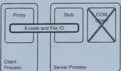

ATL 对象服务器比实际需要的更复杂，因为我实现了大量不必要的代码。例如，完全没必要实现 IMyInterface 接口，因为实际实现方法调用的是封送器。为了便于阅读，我实现了该 COM+ 对象。图 11.2 中的 COM+ 对象被划掉，以表明没有理由在服务器中实现该 COM+ 对象。


## 声明对象类

清单11.11展示了对象类的声明。两个数据成员保存了执行编组所需的信息。`m_szEventname`成员变量包含将触发数据编组的事件名称。`m_szFilename`成员变量包含将保存被编组数据的文件名。

### 清单11.11 对象类的声明

```cpp
// myinterface.h: Definition of the MyInterface class
//
///////////////////////////////////////////////////////////////////////////

#if !defined(AFX_MYINTERFACE_H)
#define AFX_MYINTERFACE_H

#if _MSC_VER >= 1000
#pragma once
#endif // _MSC_VER >= 1000

#include "resource.h"       // main symbols

///////////////////////////////////////////////////////////////////////////
// MyInterface

struct OBJECTMARSHALDATA
{
    char szFilename[256];
    char szEventname[256];
};

class MyInterface :
    public IMyInterface,
    public CComObjectRoot,
    public CComCoClass<MyInterface,&CLSID_MyInterface>,
    public IMarshal
{
public:
    MyInterface() { m_recordnumber = 0; }
    BEGIN_COM_MAP(MyInterface)
        COM_INTERFACE_ENTRY(IMyInterface)
        COM_INTERFACE_ENTRY(IMarshal)
    END_COM_MAP()
    // DECLARE_NOT_AGGREGATABLE(MyInterface)
    // Remove the comment from the line above if you don't want
    // your object to support aggregation.

DECLARE_REGISTRY_RESOURCEID(IDR_MyInterface)

// IMyInterface
public:
    STDMETHOD(Next)(long *);
    STDMETHOD(get_propertythree)(/*[out, retval]*/ long *pVal);
    STDMETHOD(get_propertytwo)(/*[out, retval]*/ long *pVal);
    STDMETHOD(get_propertyone)(/*[out, retval]*/ long *pVal);
public:
    static long m_recordnumber;

// IMarshal
public:
    STDMETHOD(GetUnmarshalClass)(REFIID, LPVOID, DWORD, LPVOID,
                                 DWORD, LPCLSID);

    STDMETHOD(GetMarshalSizeMax)(REFIID, LPVOID, DWORD, LPVOID,
                                 DWORD, LPDWORD);

    STDMETHOD(MarshalInterface)(LPSTREAM, REFIID, LPVOID, DWORD,
                                LPVOID, DWORD);

    STDMETHOD(UnmarshalInterface)(LPSTREAM, REFIID, LPVOID *);
    STDMETHOD(ReleaseMarshalData)(LPSTREAM);
    STDMETHOD(DisconnectObject)(DWORD);
private:
    char m_szEventname[256];
public:
    static char m_szFilename[256];

};

#endif // !defined(AFX_MYINTERFACE_H)
```

对象服务器实现了`IMyInterface`和`IMarshal`两个接口。

## 定义对象类

清单11.12展示了对象类的定义。我特意省略了实现`IMyInterface`接口的代码，因为该代码永远不会被调用。

### 清单11.12 对象类的定义

```cpp
// myinterface.cpp : Implementation of CObjectApp and DLL
// registration.

#include "stdafx.h"
#include "object.h"
#include "myinterface.h"
#include <fstream>
#include "..\\proxy\\proxy.h"
#include "..\\proxy\\proxy_i.c"

if (dwDest & MSHCTX_DIFFERENTMACHINE)
{
    return CO_E_CANT_REMOTE;
}

strcpy(m_szFilename, "c:\\Hello.MAR");
strcpy(marshaldata.szFilename, m_szFilename);
strcpy(m_szEventname, "MY_EVENT");
strcpy(marshaldata.szEventname, m_szEventname);
std::ofstream os;
os.open(m_szFilename, std::ios_base::out |
                         std::ios_base::trunc |
                         std::ios_base::binary);
os << array[m_recordnumber][0] << " "
   << array[m_recordnumber][1] << " "
   << array[m_recordnumber][2];
os.close();

_beginthread(EventTrigger, 0, (void *)&marshaldata);

return pstm->Write((void *)&marshaldata,
                   sizeof(OBJECTMARSHALDATA), NULL);
}

STDMETHODIMP MyInterface::UnmarshalInterface(LPSTREAM pstm,
    REFIID riid, LPVOID *pv)
{
    ATLTRACE(_T("MyInterface::UnmarshalInterface\n"));
    return E_NOTIMPL;
}

STDMETHODIMP MyInterface::ReleaseMarshalData(LPSTREAM pstm)
{
    ATLTRACE(_T("MyInterface::ReleaseMarshalData\n"));
    return E_NOTIMPL;
}

STDMETHODIMP MyInterface::DisconnectObject(DWORD dwReserved)
{
    ATLTRACE(_T("MyInterface::DisconnectObject\n"));

    char sz[256];
    strcpy(sz, m_szEventname);
    strcat(sz, "_STOP");
    HANDLE hEvent = ::OpenEvent(EVENT_ALL_ACCESS, TRUE, sz);
    ::SetEvent(hEvent);
    ::CloseHandle(hEvent);
    return S_OK;
}

void EventTrigger(void * marshaldata)
{
    SECURITY_ATTRIBUTES sa;
    SECURITY_DESCRIPTOR sd;
    sa.nLength = sizeof(SECURITY_ATTRIBUTES);
    sa.bInheritHandle = TRUE;
    sa.lpSecurityDescriptor = &sd;
    if(!InitializeSecurityDescriptor(&sd,
        SECURITY_DESCRIPTOR_REVISION))
    {
        ExitThread(1);
    }
    if(!SetSecurityDescriptorDacl(&sd, TRUE, (PACL)NULL, FALSE))
    {
        ExitThread(1);
    }
    OBJECTMARSHALDATA * p = (OBJECTMARSHALDATA*) marshaldata;
    HANDLE hevent = ::CreateEvent(&sa, FALSE, FALSE,
        p->szEventname);
    char sz[256];
    strcpy(sz, p->szEventname);
    strcat(sz, "_ACK");
    HANDLE hack = ::CreateEvent(&sa, FALSE, FALSE, sz);
    strcpy(sz, p->szEventname);
    strcat(sz, "_STOP");
    HANDLE hstop = ::CreateEvent(&sa, FALSE, FALSE, sz);

    HANDLE harray[2] = {hevent, hstop};
    while (1)
    {
        DWORD dw = ::WaitForMultipleObjects(2, harray, FALSE,
            INFINITE);
        if (dw!=WAIT_OBJECT_0)
        {
            break;
        }
        std::ifstream is;
        is.open(MyInterface::m_szFilename,
            std::ios_base::in | std::ios_base::binary);
        long recordnumber;
        is >> recordnumber;
        is.close();

        if (recordnumber==-1)
        {
            MyInterface::m_recordnumber++;
            if (MyInterface::m_recordnumber>2)
            {
                MyInterface::m_recordnumber = 0;
            }
            recordnumber = MyInterface::m_recordnumber;
        }
        else
        {
            (recordnumber)++;
            if ((recordnumber>2) || (recordnumber<0))
            {
                recordnumber = 0;
            }
            MyInterface::m_recordnumber = recordnumber;
        }

        std::ofstream os;
        os.open(MyInterface::m_szFilename,
                std::ios_base::out | std::ios_base::trunc |
                std::ios_base::binary);
        os << array[MyInterface::m_recordnumber][0] << " "
           << array[MyInterface::m_recordnumber][1] << " "
           << array[MyInterface::m_recordnumber][2];
        os << " " << recordnumber;
        os.close();

        ::SetEvent(hack);
    }

    ::CloseHandle(hevent);
    ::CloseHandle(hack);
    ::CloseHandle(hstop);
}
```

当你尝试创建进程外服务器时，COM+会调用`MyInterface::GetMarshalSizeMax()`、`MyInterface::GetUnmarshalClass()`和`MyInterface::MarshalInterface()`方法。`MyInterface::GetUnmarshalClass()`方法应返回代理的CLSID。关键调用是`MyInterface::MarshalInterface()`方法。此方法必须启动编组机制。在本例中，我返回一个`OBJECTMARSHALDATA`结构，其中保存了文件名和事件名，文件名用于编组数据元素，事件名用于触发这些方法。

## 定义代理类

从`MyInterface::MarshalInterface()`方法返回后，COM+会创建代理并调用`marshalproxy::UnmarshalInterface()`方法。代理接收我保存了`OBJECTMARSHALDATA`结构的IStream。代理从IStream对象中检索数据，并将该结构的数据保存在本地存储中以供后续使用。代理类的声明与对象类的声明几乎相同。清单11.13展示了代理类的定义。

### 清单11.13 代理类的定义

```cpp
// marshalproxy.cpp: Implementation of CProxyApp and DLL
// registration.

#include "stdafx.h"
#include "proxy.h"
#include "marshalproxy.h"
#include "..\\Object\\bObject_i.c"
#include "..\\Object\\bObject_iinterface.h"
#include <fstream>

////////////////////////////////////////////////////////////
//

STDMETHODIMP marshalproxy::get_propertyone(long * pVal)
{
    ATLTRACE(_T("marshalproxy::get_propertyone\n"));

    std::ifstream is;
    is.open(m_szFilename, std::ios_base::in |
                         std::ios_base::binary);
    is >> *pVal;
    is.close();

    return S_OK;
}

STDMETHODIMP marshalproxy::get_propertytwo(long * pVal)
{
    ATLTRACE(_T("marshalproxy::get_propertytwo\n"));

    std::ifstream is;
    is.open(m_szFilename, std::ios_base::in |
                         std::ios_base::binary);

    is >> *pVal;
    is >> *pVal;
    is.close();

    return S_OK;
}
```


### 清单 11.13（续）

```cpp
STDMETHODIMP marshalproxy::get_propertythree(long * pVal)
{
    ATLTRACE(_T("marshalproxy::get_propertythree\n"));

    std::ifstream is;
    is.open(m_szFilename, std::ios_base::in |
                           std::ios_base::binary);
    is >> *pVal;
    is >> *pVal;
    is >> *pVal;
    is.close();

    return S_OK;
}

STDMETHODIMP marshalproxy::Next(long * precordnumber)
{
    ATLTRACE(_T("marshalproxy::Next\n"));
    long recordnumber;
    if (precordnumber==0)
    {
        recordnumber = -1;
    }
    else
    {
        recordnumber = *precordnumber;
    }

    std::ofstream os;
    os.open(m_szFilename, std::ios_base::out |
                           std::ios_base::trunc |
                           std::ios_base::binary);

    os << recordnumber;
    os.close();

    HANDLE hEvent = ::OpenEvent(EVENT_ALL_ACCESS, TRUE,
                                 m_szEventName);
    ::SetEvent(hEvent);
    ::CloseHandle(hEvent);
    char sz[256];
    strcpy(sz, m_szEventName);
    strcat(sz, "_ACK");
    hEvent = ::OpenEvent(EVENT_ALL_ACCESS, TRUE, sz);
    ::WaitForSingleObject(hEvent, INFINITE);
    ::CloseHandle(hEvent);

    if (precordnumber!=0)
    {
        std::ifstream is;
        is.open(m_szFilename, std::ios_base::in |
                              std::ios_base::binary);
        is >> recordnumber;
        is >> recordnumber;
        is >> recordnumber;
        is >> recordnumber;
        is.close();
        *precordnumber = recordnumber;
    }

    return E_NOTIMPL;
}

////////////////////////////////////////////////////////////
// Implementation of Marshal

STDMETHODIMP marshalproxy::GetUnmarshalClass(REFIID riid,
  LPVOID pv, DWORD dwDestCtx, LPVOID pvDestCtx, DWORD dwFlags,
  LPCLSID pClsid)
{
  ATLTRACE(_T("marshalproxy::GetUnmarshalClass\n"));

  return E_NOTIMPL;
}

STDMETHODIMP marshalproxy::GetMarshalSizeMax(REFIID riid,
  LPVOID pv, DWORD dwDestCtx, LPVOID pvDestCtx, DWORD dwFlags,
  LPDWORD pdwSize)
{
  ATLTRACE(_T("marshalproxy::GetMarshalSizeMax\n"));

  if (dwDestCtx & MSHCTX_DIFFERENTMACHINE)
  {
    return CO_E_CANT_REMOTE;
  }
  *pdwSize=sizeof(OBJREFMARSHALDATA);
  return S_OK;
}

STDMETHODIMP marshalproxy::MarshalInterface(LPSTREAM pstm,
  REFIID riid, LPVOID pv, DWORD dwDestCtx, LPVOID pvDestCtx,
  DWORD dwFlags)
{
  ATLTRACE(_T("marshalproxy::MarshalInterface\n"));

  return E_NOTIMPL;
}

STDMETHODIMP marshalproxy::UnmarshalInterface(LPSTREAM pstm,
  REFIID riid, LPVOID *pv)
{
    ATLTRACE(_T("marshalproxy::UnmarshalInterface\n"));

    OBJECTMARSHALDATA objectmarshal;

    pstm->Read((void *)&objectmarshal,
               sizeof(OBJECTMARSHALDATA), NULL);
    strcpy(m_szFilename, objectmarshal.szFilename);
    strcpy(m_szEventName, objectmarshal.szEventName);

    return InternalQueryInterface(this, _GetEntries(),
                                  riid, pv);
}

STDMETHODIMP marshalproxy::ReleaseMarshalData(LPSTREAM pstm)
{
    ATLTRACE(_T("marshalproxy::ReleaseMarshalData\n"));

    return S_OK;
}

STDMETHODIMP marshalproxy::DisconnectObject(DWORD dwReserved)
{
    ATLTRACE(_T("marshalproxy::DisconnectObject\n"));

    return E_NOTIMPL;
}
```

代理的魔力相当透明。在这个示例中，数据通过保存到文件进行封送，并通过从文件读取进行解封送。三个代理数据访问器会查看这个文件以读取数据。一个代理方法 `marshalproxy::Next()` 将输入数据保存到文件中，并通过调用同步事件触发对象服务器。当对象服务器完成后，它通过调用第二个同步事件向代理服务器发出信号。然后代理能够从文件中读取输出。

这里的示例实现了一种非常低效的封送类型。文件 I/O 在性能上无法与标准封送器相比，而且这种封送类型无法通过网络工作，但应当很好地理解如何执行封送处理的原理。

服务器对象正在启动一个线程来侦听客户端请求，这些请求由代理生成。代理发出事件信号以获取结果。

## 客户端

最后重要部分是客户端，如清单 11.14 所示。客户端将实例化服务器对象，然后调用其方法。

### 清单 11.14 客户端代码

```cpp
#include <windows.h>
#include <iostream>
#include "object\\object.h"
#include "object\\object_i.c"

char s[1024];

HRESULT GetUnknown(WCHAR * strProgID, IUnknown ** ppunknown)
{
    CLSID clsid;
    HRESULT hresult = ::CLSIDFromProgID(strProgID, &clsid);
    if (FAILED(hresult))
    {
        // CLSIDFromProgID failed
        std::cout << "CLSIDFromProgID failed = "
                  << ltoa(hresult, s, 16)
                  << std::endl;
        ::DebugBreak();
        return hresult;
    }

    IClassFactory * pCF;
    hresult = ::CoGetClassObject(clsid, CLSCTX_SERVER, NULL,
                                 IID_IClassFactory,
                                 (void **) &pCF);

    if (FAILED(hresult))
    {
        *ppunknown = 0;
        std::cout << "CoGetClassObject failed = "
                  << ltoa(hresult, s, 16) << std::endl;
        ::DebugBreak();
        return hresult;
    }

    hresult = pCF->CreateInstance(NULL, IID_IUnknown,
                                  (void **)ppunknown);
    pCF->Release();

    if (FAILED(hresult))
    {
        *ppunknown = 0;
        std::cout << "CreateInstance failed = "
                  << ltoa(hresult, s, 16) << std::endl;
        ::DebugBreak();
        return hresult;
    }

    return S_OK;
};

HRESULT GetInterface(IUnknown * punknown, REFIID riid,
                     IUnknown ** ppunknown)
{
    HRESULT hresult = punknown->QueryInterface(riid,
                                               (void **)ppunknown);
    if (FAILED(hresult))
    {
        // QueryInterface failed
        std::cout << "QueryInterface failed = "
                  << ltoa(hresult, s, 16) << std::endl;
        ::DebugBreak();
        return hresult;
    }

    return S_OK;
};

int main()
{
    CoInitialize(NULL);
    std::cout << "Start" << std::endl;

    IUnknown * punknown;
    HRESULT hresult = GetUnknown(L"Object.MyInterface.1",
                                 &punknown);
    if (FAILED(hresult))
    {
        // GetUnknown failed
        return hresult;
    }

    IMyInterface * p_tor;
    hresult = GetInterface(punknown, IID_IMyInterface,
                           (IUnknown **)&p_tor);
    if (FAILED(hresult))
    {
        // GetUnknown failed
        return hresult;
    }

    long a[3] = {0};

    hresult = p_tor->get_propertyone(&a[0]);
    hresult = p_tor->get_propertytwo(&a[1]);
    hresult = p_tor->get_propertythree(&a[2]);
    std::cout << a[0] << " " << a[1] << " " << a[2]
              << std::endl;
    p_tor->Next(NULL);
    hresult = p_tor->get_propertyone(&a[0]);
    hresult = p_tor->get_propertytwo(&a[1]);
    hresult = p_tor->get_propertythree(&a[2]);
    std::cout << a[0] << " " << a[1] << " " << a[2]
              << std::endl;

    std::cout << " End" << std::endl;
    CoUninitialize();
    return 0;
}
```

当客户端调用 IClassFactory::CreateInstance() 时，COM+ 会调用对象服务器中的 IMyInterface::GetMarshalSizeMax()、IMyInterface::GetUnmarshalClass() 和 IMyInterface::MarshalInterface() 方法，随后调用代理中的 marshalproxy::UnmarshalInterface()。调用这段代码后，封送处理过程应当已经设置好，接下来就由代理和服务器负责在客户端进程与服务器进程之间封送数据。运行本章示例所需的其他代码可在本书随附 CD-ROM 的 custommarshal 中找到。它位于 chapter11 目录下的 custommarshal 子目录中。

## 总结

封送处理是 COM+ 中最困难且最隐蔽的部分之一，你应当格外用心地理解它。在本章中，你学习了什么是封送处理，以及封送处理的内部机制。还介绍了 RPC 机制的基础知识，以说明封送处理在幕后是如何工作的。

讨论了类型库以及它们之间的差异。给出了使用每一种类型库的理由，由此你应当能够在任何给定情况下做出选择。

随后通过示例代码解释了标准封送处理和自定义封送处理，以演示它们的能力。这些代码提供了必要的理解，使你能够立即着手开始使用封送处理接口。


## 第12章

## COM 安全

### 本章内容

-   COM 与 DCOM 安全 298
-   Windows 安全 299
-   模拟 314
-   声明式安全 319
-   编程式安全 319

### COM 与 DCOM 安全

本章探讨如何使用 COM+ 安全来允许和拒绝对 COM+ 服务器的访问。本章介绍基础的 COM 安全，因为在讨论一些分布式主题（尤其是 MTS 和事务）之前，掌握这一重要主题是必要的。第18章“COM+ 安全”将介绍 COM+ 特有的安全问题。

在 DCOM 发布之前，对象安全并不是一个重要问题。因为对象无法跨网络访问其他对象，你只需要关心同一台机器上的对象。控制一台机器上的对象相当容易，但要在由 200 台工作站组成的网络中管理它们，则比火箭科学还稍难一些，除非你拥有 DCOM 提供的内置安全机制。

一个常见的误解是 DCOM 提供安全而 COM 不提供安全。这是不正确的，因为随 DCOM 发布而增加的安全机制同样适用于传统 COM 对象、分布式 COM（DCOM）对象和非分布式 COM 对象。可以禁用分布式 COM，同时让 COM 对象使用 DCOM 安全。DCOM 安全与分布式对象可以彼此独立使用。

我将 COM 安全和 DCOM 安全作为同义词使用。它们实际上是同一回事。当我提到引入 DCOM 安全之前的 COM 安全时，我会明确说“DCOM 之前的 COM 安全”。为了理解 DCOM 安全和 COM 安全是一回事，可以把 DCOM 包看作向 COM 引入了两个子系统：远程处理子系统和安全子系统。

### COM 安全与 SSPI

COM 使用 Microsoft 的安全支持提供程序接口（SSPI）实现安全。这使 COM 能够使用任何通过 SSPI 接口公开自身的安全提供程序。此时，你可能会问：“为什么 COM 不直接访问安全协议？” Microsoft 的长期战略是让 COM 可在多种平台上使用，包括不实现安全的平台，例如 Macintosh 和 UNIX。

COM 不直接访问安全协议的另一个重要原因是，COM 实际上只是 DCE RPC（分布式计算环境远程过程调用）的面向对象版本。DCE RPC 的设计方式也使其能够利用多种安全提供程序。

安全（更准确地说，是 NT LAN Manager 安全服务提供程序，NTLMSSP）是第一个通过 SSPI 接口公开自身的安全提供程序。NTLMSSP 提供程序在所有 NT 工作站和服务器上均可用，因此是可用于 DCOM 安全的主要候选（有时是唯一候选）。为了继续讨论 DCOM 安全，我们首先学习安全基础知识。

Windows 2000 中网络身份验证的默认协议是 Kerberos v5 身份验证协议。作为一种新兴的身份验证标准，Kerberos 协议为互操作性提供了基础。它还增强了企业级网络身份验证的安全性。该协议在 Windows 2000 中实现的关键组件包括以下内容：

-   将初始身份验证与 Winlogon 单点登录体系结构集成。
-   在 Windows 2000 域中使用 Active Directory（Windows 2000 附带的目录服务）作为域的安全账户数据库。
-   通过安全支持提供程序接口（SSPI）将 Kerberos 客户端实现为 Windows 2000 安全提供程序。

### Windows 安全

Windows 为多种对象类型提供安全保护：文件、设备、进程、线程、信号量、共享内存、注册表项等。为了实现这种安全，每个新创建的对象都会附带一个安全描述符。要管理每台 NT 工作站上的每个对象将非常困难，因此 NT 通过将 NT 工作站划分为域来简化安全。

所有者（拥有 SID）、主体列表（DACL）和要审核的主体列表（SACL）的组合称为安全描述符（SD）。安全描述符从对象所有者、访问和审核方面完整描述了安全策略。安全描述符（以其自相对形式）是一种内存结构，它使用偏移量而不是指针来引用其元素（DACL、SACL 等）。因此，这种自相对安全描述符可以直接写入注册表项并安全地检索。

### 使用域开发安全

你可以将域看作一组联网的计算机。在这组联网的计算机中，一台计算机被指定为主域控制器。这是集中管理的身份验证控制器，负责对网络资源的访问进行身份验证。

多个域可以存在于信任关系中。也就是说，如果某个安全主体无法在一个域内通过身份验证，主域控制器可以尝试通过受信任的域对该安全主体进行身份验证。这使得大型网络配置能够以较小的规模、较小的域配置进行管理。

向身份验证机构提供用户标识和密码，即可确认受保护的网络访问。除非指定了身份验证机构，否则将使用本地注册数据库和域注册数据库验证网络访问。

### 安全描述符

如本节前面所述，每个新创建的可保护对象都会附带一个安全描述符。安全描述符由两个安全 ID（SID）和两个访问控制列表（ACL）组成。两个 SID 表示可保护对象的所有者和所有者组。两个 ACL 分别是自主访问控制列表（DACL）和系统访问控制列表（SACL）。本章后面将更详细地介绍 ACL、DACL 和 SACL。

在 NT 中创建新的可保护对象时，应向该对象传递一个 SECURITY_ATTRIBUTES 结构。SECURITY_ATTRIBUTES 包含 SECURITY_DESCRIPTOR 结构。这两个结构的定义如清单 12.1 所示。

### 清单 12.1 SECURITY_ATTRIBUTES 和 SECURITY_DESCRIPTOR 定义

```c
typedef struct _SECURITY_ATTRIBUTES
{
    DWORD nLength;
    LPVOID lpSecurityDescriptor;
    BOOL bInheritHandle;
} SECURITY_ATTRIBUTES, *PSECURITY_ATTRIBUTES, *LPSECURITY_ATTRIBUTES;

typedef struct _SECURITY_DESCRIPTOR
{
    UCHAR Revision;
    UCHAR Sbz1;
    SECURITY_DESCRIPTOR_CONTROL Control;
    PSID Owner;
    PSID Group;
    PACL Sacl;
    PACL Dacl;
} SECURITY_DESCRIPTOR, *PSECURITY_DESCRIPTOR;
```

不应尝试直接操作 SECURITY_DESCRIPTOR 结构；相反，应使用允许读写安全描述符的 API 函数。即使 SECURITY_DESCRIPTOR 的结构发生变化，这些 API 函数仍将继续工作。这些函数包括：

-   `GetSecurityDescriptorDacl()`
-   `GetSecurityDescriptorSacl()`
-   `GetSecurityDescriptorGroup()`
-   `GetSecurityDescriptorLength()`
-   `GetSecurityDescriptorOwner()`
-   `InitializeSecurityDescriptor()`
-   `IsValidSecurityDescriptor()`
-   `MakeAbsoluteSD()`
-   `MakeSelfRelativeSD()`
-   `SetSecurityDescriptorDacl()`
-   `SetSecurityDescriptorSacl()`
-   `SetSecurityDescriptorGroup()`
-   `SetSecurityDescriptorOwner()`

NT 中使用两种类型的安全描述符：

-   绝对安全描述符包含指向 ACL 结构的指针。
-   自相对安全描述符是自包含的，内嵌 ACL。

自相对安全描述符的优点是，它可以通过电子方式传输（因为其扁平格式），也可以保存到文件或注册表。有两个函数可用于在两种类型的安全描述符之间转换：`MakeSelfRelativeSD()` 和 `MakeAbsoluteSD()`。

第 8 章“COM 与注册表”展示了如何在注册表中保存和加载自相对安全描述符。你还必须能够执行的另一项重要任务是将这些自相对安全描述符保存到文件中。清单 12.2 展示了如何做到这一点。

### 清单 12.2 将安全描述符保存到文件

```cpp
#include <windows.h>
#include <fstream.h>

// SaveSecurityDescriptorToFile
//
int SaveSecurityDescriptorToFile(PSECURITY_DESCRIPTOR pSD,
                                 ofstream & ofs)
{
    // convert the security descriptor to
    // self-relative security description
    PSECURITY_DESCRIPTOR pSRSD = NULL;
    DWORD cbSD = 0;
    if (!::MakeSelfRelativeSD(pSD, pSRSD, &cbSD))
    {
        DWORD dw = ::GetLastError();
        if (dw != ERROR_INSUFFICIENT_BUFFER )
        {
            if (dw != ERROR_BAD_DESCRIPTOR_FORMAT)
            {
                std::cout << "Error ::MakeSelfRelativeSD "
```

```cpp
        << dw << std::endl;
        return 0;
    }
    else
    {
        pSRSD = pSD;
    }
}
else
{
    pSRSD = (PSECURITY_DESCRIPTOR)
             ::LocalAlloc(LPTR, cbSD);
    if (!::MakeSelfRelativeSD(pSD, pSRSD, &cbSD))
    {
        std::cout << "Error ::MakeSelfRelativeSD "
                  << ::GetLastError() << std::endl;
        return 0;
    }
}
}

// save the self-relative security descriptor
// in a file
ofs.write((char *)pSRSD,
          ::GetSecurityDescriptorLength(pSRSD));

if ((pSRSD != NULL) && (pSRSD != pSD))
{
    ::LocalFree((HLOCAL) pSRSD);
}

return 0;
}

int main(int i, char **)
{
    const int cSD = 8096;
    UCHAR ucBuf[cSD] = {0};
    DWORD dw = cSD;
    PSECURITY_DESCRIPTOR psd = (PSECURITY_DESCRIPTOR)&ucBuf;

    HKEY hkey;
    LONG l = ::RegOpenKeyEx(HKEY_CLASSES_ROOT,
                            "MyObject.MyObject", 0,
                            KEY_READ, &hkey);

    l = ::RegGetKeySecurity(hkey,
                            OWNER_SECURITY_INFORMATION |
                            GROUP_SECURITY_INFORMATION |
                            DACL_SECURITY_INFORMATION,
                            psd, &dw);

    ofstream ofs;
    ofs.open("C:\\HELLO.B", ios::binary|ios::trunc|ios::out);
    ::SaveSecurityDescriptorToFile(psd, ofs);
    ofs.close();

    return 0;
}
```

清单 12.2 使用 `RegGetKeySecurity()` 函数检索现有的安全描述符。还有其他几个 API 函数可用于创建、检索和保存各种对象的安全描述符。尤其要注意的是 `RegSetKeySecurity()`，它保存自相对安全描述符。这些函数包括：

- CreateDirectory()
- GetFileSecurity()
- CreateDirectoryEx()
- GetKernelObjectSecurity()
- CreateEvent()
- GetPrinter()
- CreateFile()
- GetPrivateObjectSecurity()
- CreateFileMapping()
- GetUserObjectSecurity()
- CreateMailslot()
- NetShareGetInfo()
- CreateMutex()
- NetShareSetInfo()
- CreateNamedPipe()
- QueryServiceObjectSecurity()
- CreatePipe()
- RegGetKeySecurity()
- CreatePrivateObjectSecurity()
- RegSetKeySecurity()
- CreateProcess()
- SetFileSecurity()
- CreateProcessAsUser()
- SetKernelObjectSecurity()
- CreateRemoteThread()
- SetPrinter()
- CreateSemaphore()
- SetPrivateObjectSecurity()
- CreateThread()
- SetServiceObjectSecurity()
- CreateWaitableTimer()
- SetUserObjectSecurity()
- DestroyPrivateObjectSecurity()


## 访问控制列表 (ACL)

ACL 简单地说就是零个或多个访问控制项 (ACE) 的列表。SECURITY_DESCRIPTOR 结构中包含两种类型的 ACL。第一种类型是自主访问控制列表 (DACL)，它列出所有拒绝和允许访问资源的 ACE。另一种是系统访问控制列表 (SACL)，它指定应用于资源的审核策略。ACL 确定哪些用户对资源具有哪种类型的访问权限。ACL 结构的定义如清单 12.3 所示。ACL 结构是访问控制列表 (ACL) 的头部。完整的 ACL 由一个 ACL 结构后跟零个或多个有序排列的访问控制项 (ACE) 组成。

### 清单 12.3 — ACL 定义

```c
typedef struct _ACL
{
    UCHAR AclRevision;
    UCHAR Sbz1;
    USHORT AclSize;
    USHORT AceCount;
    USHORT Sbz2;
} ACL, *PACL;
```

### 访问控制项 (ACE)

ACE 包含三个组件：标识 ACE 为允许访问或拒绝访问的类型、访问掩码和 SID。每个 ACL 包含零个或多个 ACE。该对象指定特定 SID（可以是用户账户或用户组）对访问掩码中列出的访问权限具有允许访问或拒绝访问（由类型标识）的权限。ACE 结构的定义如清单 12.4 所示。

### 清单 12.4 — ACL 与 ACE 定义

```c
typedef struct _ACE_HEADER
{
    BYTE  AceType;
    BYTE  AceFlags;
    WORD  AceSize;
} ACE_HEADER, *PACE_HEADER;

#define ACCESS_ALLOWED_ACE_TYPE        (0x0)
#define ACCESS_DENIED_ACE_TYPE         (0x1)
#define SYSTEM_AUDIT_ACE_TYPE         (0x2)
#define SYSTEM_ALARM_ACE_TYPE         (0x3)

typedef struct _ACCESS_ALLOWED_ACE
{
    ACE_HEADER Header;
    ACCESS_MASK Mask;
    DWORD SidStart;
} ACCESS_ALLOWED_ACE, *PACCESS_ALLOWED_ACE;

typedef struct _ACCESS_DENIED_ACE
{
    ACE_HEADER Header;
    ACCESS_MASK Mask;
    DWORD SidStart;
} ACCESS_DENIED_ACE, *PACCESS_DENIED_ACE;

typedef struct _SYSTEM_AUDIT_ACE
{
    ACE_HEADER Header;
    ACCESS_MASK Mask;
    DWORD SidStart;
} SYSTEM_AUDIT_ACE, *PSYSTEM_AUDIT_ACE;

typedef struct _SYSTEM_ALARM_ACE
{
    ACE_HEADER Header;
    ACCESS_MASK Mask;
    DWORD SidStart;
} SYSTEM_ALARM_ACE, *PSYSTEM_ALARM_ACE;
```

ACE 有四种类型：允许访问、拒绝访问、系统审核和系统警报。每种 ACE 类型都单独定义，但具有共同的头部。

### 访问掩码与访问权限

ACE 结构中的一个重要成员变量是访问掩码。访问掩码是一个 32 位值，其中每一位定义如下：

| 位 | 访问权限 |
|---|---|
| 0–15 | 特定访问权限 |
| 16–23 | 标准访问权限 |
| 16 | DELETE |
| 17 | READ_CONTROL |
| 18 | WRITE_DAC |
| 19 | WRITE_OWNER |
| 20 | SYNCHRONIZE |
| 24 | ACCESS_SYSTEM_SECURITY |
| 25 | MAXIMUM_ALLOWED |
| 26–27 | 保留 |
| 28–31 | 通用访问权限 |
| 28 | GENERIC_ALL |
| 29 | GENERIC_EXECUTE |
| 30 | GENERIC_WRITE |
| 31 | GENERIC_READ |

通用和标准访问权限适用于所有对象，无论其对象类型如何。顾名思义，特定访问权限特定于可安全保护的对象类型。文件对象的特定访问权限如表 12.1 所示。

**表 12.1 文件对象的特定访问权限**

| 文件对象 | 访问权限 |
|---|---|
| `FILE_READ_DATA` | `0x0001` |
| `FILE_WRITE_DATA` | `0x0002` |
| `FILE_APPEND_DATA` | `0x0004` |
| `FILE_READ_EA` | `0x0008` |
| `FILE_WRITE_EA` | `0x0010` |
| `FILE_EXECUTE` | `0x0020` |
| `FILE_READ_ATTRIBUTES` | `0x0080` |
| `FILE_WRITE_ATTRIBUTES` | `0x0100` |

通用访问权限也可以映射到标准和特定访问权限。这种映射由对象类型决定。

与 SECURITY_DESCRIPTOR 结构一样，不应直接访问 ACL 结构，而应使用能够读写这些结构的 API 函数。这些函数包括：

- AddAccessAllowedAce()
- AddAccessDeniedAce()
- AddAce()
- AddAuditAccessAce()
- DeleteAce()
- FindFirstFreeAce()
- GetAce()
- GetAclInformation()
- InitializeAcl()
- IsValidAcl()
- SetAclInformation()

清单 12.5 演示了如何读取安全描述符、其 ACL 和 ACE 的大部分值。

### 清单 12.5 转储 SECURITY_DESCRIPTOR 结构

```cpp
#include <windows.h>
#include <iostream>

int main(int, char **)
{
    const int CSD = 8096;
    UCHAR ucBuf[CSD] = {0};
    DWORD dw = CSD;
    PSECURITY_DESCRIPTOR psd = (PSECURITY_DESCRIPTOR)ucBuf;

    HKEY hkey;
    LONG l = ::RegOpenKeyEx(HKEY_CLASSES_ROOT,
                            "MyObject.MyObject", 0,
                            KEY_READ, &hkey);

    l = ::RegGetKeySecurity(hkey,
                            OWNER_SECURITY_INFORMATION |
                            GROUP_SECURITY_INFORMATION |
                            DACL_SECURITY_INFORMATION,
                            psd, &dw);

    l = ::RegCloseKey(hkey);
    std::cout << "SECURITY_DESCRIPTOR: " << psd << std::endl;

    BOOL bHasDacl, bDefaulted;
    ACL* pDACL=NULL;
    ::GetSecurityDescriptorDacl(psd, &bHasDacl, &pDACL,
                                &bDefaulted);
    std::cout << "ACL: " << pDACL << std::endl;
    if (pDACL)
    {
        ACE_HEADER* pAce=NULL;
        for (int i=0; i<pDACL->AceCount; i++)
        {
            ::GetAce(pDACL, i, (void**) &pAce);
            std::cout << std::endl << "ACE: " << pAce << std::endl;
            switch (pAce->AceType)
            {
            case ACCESS_ALLOWED_ACE_TYPE:
            case ACCESS_DENIED_ACE_TYPE:
            {
                TCHAR szUser[MAX_PATH];
                TCHAR szDomain[MAX_PATH];
                DWORD dwUserSize=sizeof(szUser);
                DWORD dwDomainSize=sizeof(szDomain);
                SID_NAME_USE use;
                ::LookupAccountSid(NULL,
                    &((ACCESS_ALLOWED_ACE*)pAce)->SidStart,
                    szUser, &dwUserSize, szDomain,
                    &dwDomainSize, &use);
            }
```


## **清单12.5** 续

```cpp
&dwDomainSize, &use);
if (pAce->AceType == ACCESS_ALLOWED_ACE_TYPE)
{
    std::cout << "AceType: "
              << "ACCESS_ALLOWED_ACE_TYPE"
              << endl;
}
else
{
    std::cout << "AceType: "
              << "ACCESS_DENIED_ACE_TYPE"
              << endl;
}
std::cout << "User Name: " << szUser << endl;
std::cout << "User Domain: " << szDomain
          << endl;
std::cout << "Access Mask: "
          << ((ACCESS_ALLOWED_ACE*)pAce)->Mask
          << endl << endl;
break;
}
default:
    std::cout << "Unknown ACE type" << endl;
    break;
}
}
}
}
return 0;
}
```

## 安全标识符（SID）

在安全模型中，用户和用户组通过安全标识符（SID）来标识。这些标识符的生成方式保证了它们在时间和空间上的唯一性。空间上的唯一性意味着任何两台 NT 机器都不可能生成相同的安全标识符。SID 结构的定义如清单 12.6 所示。

## **清单12.6** SID 定义

```cpp
typedef struct _SID_IDENTIFIER_AUTHORITY
{
    BYTE Value[6];
} SID_IDENTIFIER_AUTHORITY, *PSID_IDENTIFIER_AUTHORITY;

typedef struct _SID
{
    BYTE Revision;
    BYTE SubAuthorityCount;
    SID_IDENTIFIER_AUTHORITY IdentifierAuthority;
    DWORD SubAuthority[ANYSIZE_ARRAY];
} SID, *PSID;
```

有些 SID 被称为*已知 SID*，因为它们代表了众所周知的安全主体。以下列表列出了这些 SID。

- 空 SID：S-1-0-0
- 世界：S-1-1-0
- 本地：S-1-2-0
- 创建者所有者 ID：S-1-3-0
- 创建者组 ID：S-1-3-1
- 创建者所有者服务器 ID：S-1-3-2
- 创建者组服务器 ID：S-1-3-3
- （非唯一 ID）：S-1-4
- NT 权威：S-1-5
- 拨号：S-1-5-1
- 网络：S-1-5-2
- 批处理：S-1-5-3
- 交互式：S-1-5-4
- 服务：S-1-5-6
- 匿名登录：S-1-5-7
- 代理：S-1-5-8
- 服务器登录：S-1-5-8
- （登录 ID）：S-1-5-5-X-Y
- （NT 非唯一 ID）：S-1-5-21-...
- （内置域）：S-1-5-32

有几个 API 函数允许你使用、查询和修改 SID。它们是：

- LookupAccountName()
- LookupAccountSid()
- IsValidSid()
- EqualSid()
- EqualPrefixSid()


## **清单12.7** 续

```cpp
        << ::GetLastError() << endl;
        return 0;
    }
    // retrieve the size of the token group structure
    if(!::GetTokenInformation(hToken, TokenGroups, NULL,
                              dwSize, &dwSize))
    {
        DWORD dw = ::GetLastError();
        if( dw != ERROR_INSUFFICIENT_BUFFER )
        {
            std::cout << "Error :GetTokenInformation"
                      << ::GetLastError() << endl;
            return 0;
        }
    }
    // allocate the token group structure
    PTOKEN_GROUPS pTokenGroups = (PTOKEN_GROUPS)
                                  ::GlobalAlloc( GPTR, dwSize );

    // retrieve the token group structure
    if(!::GetTokenInformation(hToken, TokenGroups,
                              pTokenGroups, dwSize,
                              &dwSize))
    {
        std::cout << "Error :GetTokenInformation "
                  << ::GetLastError() << endl;
    }
    else
    {
        // dump all the group sids
        for(int i=0; i<(int)pTokenGroups->GroupCount; i++)
        {
            std::cout
            << SidToString(pTokenGroups->Groups[i].Sid).str()
            << endl;
        }
    }
    // clean up
    if ( pTokenGroups )
    {
        ::GlobalFree( pTokenGroups );
    }
    return 0;
}
```

上述代码在 Windows 95 下无法运行。安全 API 仅由 Windows NT 和 2000 实现。如果你运行清单 12.7 中的代码，输出将类似于以下内容：

- S-1-5-21-1958420805-1419734996-339680022-513
- S-1-1-0
- S-1-5-32-544
- S-1-5-5-0-5466
- S-1-2-0
- S-1-5-4

这些 SID 依次代表：我的用户账户、世界、我的管理员域、我的登录会话、本地用户和交互式用户。你可以使用本节前面列出的已知 SID 来匹配这些 SID。

## 身份验证

COM 有一个函数能够使对象的作者修改其模块的安全上下文。`CoInitializeSecurity()` 函数使作者能够指定替代的身份验证服务、身份验证级别和模拟级别。服务器和客户端都可以使用它。其参数如下所示：

```cpp
HRESULT CoInitializeSecurity(
    PSECURITY_DESCRIPTOR pSD, //Points to security descriptor
    LONG cAuthSvc, //Count of entries in asAuthSvc
    SOLE_AUTHENTICATION_SERVICE * asAuthSvc, //Array of names to register
    void * pReserved1, //Reserved for future use
    DWORD dwAuthnLevel, //The default authentication level for proxies
    DWORD dwImpLevel, //The default impersonation level for proxies
    SOLE_AUTHENTICATION_INFO * pAuthList, //Authentication information for each
                                           // authentication service
    DWORD dwCapabilities, //Additional client and/or server-side capabilities
    void * pReserved3 //Reserved for future use
);
```

如果未调用此函数，COM 将使用旧版设置（系统范围内的默认值）调用该函数。旧版设置存储在 Windows 系统注册表的 HKEY_LOCAL_MACHINE\SOFTWARE\Microsoft\Ole 键下。第 8 章在“旧版安全”一节中讨论了这些默认设置。

身份验证服务可以是 NTLMSSP、Kerberos、Snego、SChannel 或其他的之一。随着新的身份验证服务的出现，它们会被添加到该列表中。

- NTLMSSP 是本章前面讨论的安全机制。在 Windows 2000 中，Kerberos 身份验证已取代 NTLM 身份验证。
- Kerberos 是 NT 平台上较新的安全包。这个安全包比其他安全机制有许多优势。其中一个优势与 COM 相关，即 Kerberos 协议允许模拟委派。在使用 NTLM 的 Windows NT 中，模拟不支持委派，网络资源访问可能会失败。Windows 2000 上的 Kerberos 实现基于 Internet RFC 1510 Kerberos 协议定义。
- Snego 实际上并不是一种身份验证服务。它是一种虚拟的身份验证服务，使用其他身份验证服务的列表。
- 安全通道（SChannel）支持安全套接字层（SSL）和私有通信技术（PCT）协议。这种身份验证服务面向需要 Internet 公钥安全基础设施的系统。该身份验证服务提供程序使用 CAPICOM 接口，使用户能够指定各种加密和证书实现。

身份验证级别是所请求的安全级别。表 12.2 中列出了可用的身份验证级别。

**表 12.2  可用的身份验证级别**

| 身份验证级别 | 定义 |
|---|---|
| 默认 | 在 Windows NT 4.0 中，默认级别是“连接”。在 Windows 2000 中，使用安全毯协商算法。 |
| 无 | 不执行身份验证。 |
| 连接 | 当客户端连接到服务器时执行一次身份验证。 |
| 调用 | 每次 RPC 调用时都执行身份验证。 |
| 数据包 | 每次数据包传输时都执行身份验证。 |
| 数据包完整性 | 与“数据包”相同，并且还验证数据包未被修改。 |
| 数据包隐私 | 与“数据包完整性”相同，并且对数据包数据进行加密。 |

“连接”和“调用”身份验证级别仅适用于基于连接的协议。无连接协议必须使用三种数据包身份验证级别之一，或者不进行身份验证。

## 模拟

对 `InitializeSecurity()` 的调用还有一个模拟级别参数。表 12.3 中列出了可用的模拟级别。模拟是线程在与拥有该线程的进程上下文不同的安全上下文中执行的能力。


另一台服务器，它正代表客户端调用该服务器。模拟级别表示客户端已授予服务器多少权限。

不使用伪装的模拟可行，但可能不是最佳选择，因为在某些情况下，最终服务器需要知道初始调用者的身份。如果不使用伪装，就无法实现这一点。伪装会呈现初始调用者的身份；没有伪装，就很难确保只有经过授权的客户端才能访问远程计算机。当使用模拟但不使用伪装时，向下游服务器呈现的身份是直接调用进程的身份。

没有模拟，伪装也没有用。只有当客户端将模拟级别设置为“模拟”或“委派”时，伪装才有意义。（在较低的模拟级别下，服务器无法进行伪装调用。）伪装是否成功取决于模拟级别（它表示服务器代表客户端行事所拥有的权限大小）以及跨过的计算机边界数量。下面的讨论解释了伪装和模拟级别的选择如何影响模拟期间发生的情况。

在某些情况下，当客户端将模拟级别设置为 RPC_C_IMP_LEVEL_IMPERSONATE 时，服务器设置伪装是合理的。但是，存在某些限制。如果原始客户端将模拟级别设置为 RPC_C_IMP_LEVEL_IMPERSONATE，则中间服务器（在同一台计算机上作为客户端行事）只能跨一个计算机边界进行伪装。这是因为模拟级模拟令牌只能跨一个计算机边界传递。跨过计算机边界后，只能访问本地资源。向服务器呈现的身份取决于所设置的伪装类型。如果未设置伪装，则向服务器呈现的身份将是进行直接调用的进程的身份。

要跨多个计算机边界进行伪装，必须同时指定适当的伪装能力标志和委派级模拟。使用这种类型的模拟时，客户端的本地凭据和网络凭据都会提供给服务器，因此模拟令牌可以跨任意数量的计算机边界。同样，向服务器呈现的身份取决于所设置的伪装类型。如果在委派级模拟中未设置伪装，则向服务器呈现的身份是进行调用的进程的身份。

例如，假设进程 A 调用 B，B 调用 C。B 已设置伪装，A 已将模拟级别设置为“模拟”。如果 A、B 和 C 在同一台计算机上，则从 A 向 B 再向 C 传递模拟令牌将可行。但如果 A 和 C 在同一台计算机上，而 B 不在，则令牌在 A 与 B 之间传递可行，但从 B 到 C 不可行。从 B 到 C 的调用将失败，因为 B 在伪装时无法调用 C。但是，如果 A 将模拟级别设置为“委派”，则令牌可以从 B 传递到 C，因此该调用可以成功。

## CoImpersonateClient() 和 CoRevertToSelf()

CoImpersonateClient() 允许 COM 服务器采用调用客户端进程的身份。当 COM 服务器没有足够的访问权限来代表调用客户端进程执行任务时，您会希望这样做。当 COM 服务器希望停止模拟客户端并恢复自身身份时，应调用 CoRevertToSelf()。

清单 12.8 显示了这两个辅助函数的实现。

**清单 12.8** CoImpersonateClient() 和 CoRevertToSelf() 的实现

```cpp
WINOLEAPI CoImpersonateClient()
{
    IServerSecurity *pss;
    ::CoGetCallContext(IID_IServerSecurity, (void **)&pss);
    HRESULT hresult = pss->ImpersonateClient();
    pss->Release();
    return hresult;
}
WINOLEAPI CoRevertToSelf()
{
    IServerSecurity *pss;
    ::CoGetCallContext(IID_IServerSecurity, (void**)&pss);
    HRESULT hresult = pss->RevertToSelf();
    pss->Release();
    return hresult;
}
```

CoImpersonateClient() 和 CoRevertToSelf() 函数使用在服务器中实现的 IServerSecurity 接口。清单 12.9 是该接口的 MIDL 定义。需要注意的是，对于标准封送处理，IServerSecurity 几乎总是在存根级别完成。唯一的例外是响应自定义封送处理时。

正如其名称所示，IServerSecurity 的 CoGetCallContext() 方法仅对当前调用有效。

**清单 12.9** IServerSecurity 接口的 MIDL 定义

```cpp
interface IServerSecurity : IUnknown
{
    HRESULT QueryBlanket(
        [out] DWORD    *pAuthnSvc,
        [out] DWORD    *pAuthzSvc,
        [out] OLECHAR **pServerPrinName,
        [out] DWORD    *pAuthLevel,
        [out] DWORD    *pImplevel,
        [out] void     **pPrivs,
        [out] DWORD    *pCapabilities
    );

    HRESULT ImpersonateClient();

    HRESULT RevertToSelf();

    BOOL IsImpersonating();
};
```

还有另一个函数可用于告知服务器当前是否正在模拟客户端。此函数是 IServerSecurity::IsImpersonating()。此方法没有辅助函数，但您可以实现自己的辅助函数，如清单 12.10 所示。从代码中您可能会注意到，我们位于服务器中。这意味着此前已调用 ImpersonateClient()。

**清单 12.10** CoIsImpersonating() 的实现

```cpp
BOOL CoIsImpersonating()
{
    IServerSecurity *pss;
    CoGetCallContext(IID_IServerSecurity, (void**)&pss);
    BOOL b = pss->IsImpersonating();
    pss->Release();
    return b;
}
```

IServerSecurity 接口的最后一个函数是 IServerSecurity::QueryBlanket() 方法。此方法有一个名为 CoQueryClientSecurity() 的辅助函数，其实现如清单 12.11 所示。

**清单 12.11** CoQueryClientSecurity() 的实现

```cpp
WINOLEAPI CoQueryClientSecurity()
{
    IServerSecurity *pss;
    ::CoGetCallContext(IID_IServerSecurity, (void**)&pss);
    HRESULT hresult = pss->QueryBlanket();
    pss->Release();
    return hresult;
}
```

此函数查询调用服务器的客户端的安全设置。

## 伪装

前面描述的委派模拟级别通常称为伪装。这种类型的模拟在对其他服务器进行调用期间，通过用客户端的身份来伪装中间服务器的身份，从而隐藏服务器的真实身份。

## 声明式安全

如您在第 8 章所学，可以在注册表中声明 COM 服务器的安全设置。这有时称为声明式安全或每进程安全。请注意，声明式安全和每进程安全并不完全相同。声明式安全由 Windows 系统注册表中的设置组成，这些设置在启动或访问 COM 服务器时使用。每进程安全包括注册表设置，但也包括用于操纵整个进程的 COM 服务器设置的其他机制，例如函数 `CoInitializeSecurity()`。

在第 13 章“配置和错误处理”中，您将学习如何使用名为 `DCOMCNFG` 和 `OLEView` 的两个工具为 COM 服务器配置每进程安全设置。

## 编程式安全

在本章前面，您学习了编程式安全的两个要素——用于模拟客户端的 `IServerSecurity` 接口，以及用于设置每进程安全的 `CoInitializeSecurity()` 函数。`CoInitializeSecurity()` 函数会为您的进程创建安全毯；也就是说，创建安全设置。

### 安全毯

那么什么是安全毯？安全毯是一组安全属性。这些安全属性包括以下内容：

- 身份验证服务
- 授权服务
- 主体名称
- 身份验证级别
- 模拟级别
- 身份验证标识
- 能力
- ACL

客户端和服务器都通过调用 `CoInitializeSecurity()` 函数来创建其安全配置。如果客户端或服务器任何一方未调用此函数，COM 将代表进程使用默认值调用该函数。

COM 使用客户端和服务器各自的安全配置来协商代理的安全配置。COM 会选择客户端和服务器上都可用的身份验证服务（以及与该服务配合工作的授权服务和主体名称）。COM 会选择客户端或服务器所指定的最高身份验证级别。COM 会选择客户端的模拟级别、身份验证标识（与所选身份验证服务器配合工作）以及功能。

安全配置在代理创建时进行协商。代理创建之后，客户端可以使用下一节描述的 `IClientSecurity` 接口来控制代理。

## IClientSecurity 接口

另一个名为 IClientSecurity 的接口允许客户端查询和修改接口代理的安全设置。清单 12.12 是 IClientSecurity 接口的 MIDL 定义。

### 清单 12.12 IClientSecurity 接口的 MIDL 定义

```idl
interface IClientSecurity : IUnknown
{
    HRESULT QueryBlanket
    (
        [in]  IUnknown             *pProxy,
        [out] DWORD                *pAuthnSvc,
        [out] DWORD                *pAuthzSvc,
        [out] OLECHAR              **pServerPrincName,
        [out] DWORD                *pAuthnLevel,
        [out] DWORD                *pImpLevel,
        [out] void                 **pAuthInfo,
        [out] DWORD                *pCapabilities
    );

    HRESULT SetBlanket
    (
        [in]  IUnknown             *pProxy,
        [in]  DWORD                 AuthnSvc,
        [in]  DWORD                 AuthzSvc,
        [in]  OLECHAR              *pServerPrincName,
        [in]  DWORD                 AuthnLevel,
        [in]  DWORD                 ImpLevel,
        [in]  void                 *pAuthInfo,
        [in]  DWORD                 Capabilities
    );

    HRESULT CopyProxy
    (
        [in]  IUnknown  *pProxy,
        [out] IUnknown  **ppCopy
    );
};
```

该接口有三个辅助函数：CoQueryProxyBlanket()、CoSetProxyBlanket() 和 CoCopyProxy()。这三个辅助函数的实现如清单 12.13 所示。

### 清单 12.13 IClientSecurity 辅助函数的实现

```c
WINOLEAPI CoQueryProxyBlanket(IUnknown * pProxy,
                              DWORD * pdwAuthnSvc,
                              DWORD * pAuthzSvc,
                              OLECHAR ** pServerPrincName,
                              DWORD * pAuthnLevel,
                              DWORD * pImpLevel,
                              RPC_AUTH_IDENTITY_HANDLE * ppAuthInfo,
                              DWORD * pCapabilities)
{
    IClientSecurity *pcs;
    pProxy->QueryInterface(IID_IClientSecurity, (void**)&pcs);
    HRESULT hrResult = pcs->QueryBlanket(pProxy, pdwAuthnSvc,
                                         pAuthzSvc, pServerPrincName,
                                         pAuthnLevel, pImpLevel,
                                         ppAuthInfo, pCapabilities);
    pcs->Release();
    return hrResult;
}

HRESULT CoSetProxyBlanket(IUnknown * pProxy,
                          DWORD dwAuthnSvc,
                          DWORD dwAuthzSvc,
                          WCHAR * pServerPrincName,
                          DWORD dwAuthnLevel,
                          DWORD dwImpLevel,
                          RPC_AUTH_IDENTITY_HANDLE pAuthInfo,
                          DWORD dwCapabilities)
{
    IClientSecurity *pcs;
    pProxy->QueryInterface(IID_IClientSecurity, (void**)&pcs);
    pcs->SetBlanket(pProxy, dwAuthnSvc, dwAuthzSvc,
                    pServerPrincName, dwAuthnLevel,
                    dwImpLevel, pAuthInfo, dwCapabilities);
    pcs->Release();
}

HRESULT CoCopyProxy( IUnknown * pProxy, IUnknown ** ppCopy)
{
    IClientSecurity *pcs;
    pProxy->QueryInterface(IID_IClientSecurity, (void**)&pcs);
    pcs->CopyProxy(pProxy, ppCopy);
    pcs->Release();
}
```

CoQueryProxyBlanket() 函数查询将用于在接口代理中调用 COM 对象方法的安全设置。

CoSetProxyBlanket() 函数修改将用于在接口代理中调用 COM 对象方法的安全设置。如果将某个参数设置为默认值，即使该安全属性并未设置为默认值，CoSetProxyBlanket() 也不会更改该属性。

CoCopyProxy() 函数使客户端能够创建代理的副本，以便将来对 CoSetProxyBlanket() 的调用不会影响使用同一代理的其他客户端的安全性。请注意，CoCopyProxy() 函数或 IClientSecurity::CopyProxy() 方法的调用者负责释放新代理。调用 CoCopyProxy() 还可用于确保其他客户端不会修改新代理的安全性（因为他们将使用原始代理）。

### 访问和启动安全性

访问权限确定是否允许用户对 COM 服务器的对象调用方法。启动权限确定是否允许用户启动 COM 服务器。这两个独立的权限使得可以这样配置客户端：让它们能够访问已启动的 COM 服务器中的对象，同时也能拒绝这些客户端启动 COM 服务器的能力。

这些权限将在第 8 章中更详细地讨论。在该章中，你将学习如何配置系统范围的默认权限和特定于 COM 服务器的权限。

在第 13 章中，你将学习如何使用名为 DCOMCNFG 的工具来配置访问权限和启动权限。

## 小结

本章介绍了如何使用 COM 安全性来允许和拒绝对 COM 服务器的访问。在本章开头，你学习了与 COM 相关的 Windows 安全性的一些基本概念。

接下来，我讨论了安全描述符。我以编程方式访问了它们并讨论了其用途。讨论了不同的描述符类型，并列出了相关的注册表项。

我们了解了访问控制列表（ACL）以及访问它们的 API 函数。然后，使用一个特殊的示例程序来读取当前系统上的 ACL。

最后讨论的主要主题是模拟和伪装。如果要全面理解 COM 安全性，理解它们很重要。

COM 安全性是一个困难的课题。由于它对分布式编程的影响，这是一个需要你花时间去学习的主题。

## 第 13 章

## 配置和错误处理

### 本章内容

- 使用 DCOMCNFG 配置 COM+ 对象 326
- 使用 OLEView 程序 344
- 错误处理 347

### 使用 DCOMCNFG 配置 COM+ 对象

本章介绍如何使用名为 DCOMCNFG 和 OLEView 的两个高级工具，在系统范围内配置 COM+ 对象。你还会学习处理 COM+ 错误代码的不同策略。

> **注意：** 如果你不熟悉 COM+ 注册表设置，请阅读第 8 章“COM 和注册表”。要理解注册表术语，该章是必需的。

DCOMCNFG 安装在计算机的 system32 文件夹中。该工具是手动配置 COM+ 安全和远程处理的标准方法。用户界面（UI）是一个包含四个页面的属性表（参见图 13.1）。

**图 13.1**  
*应用程序页*

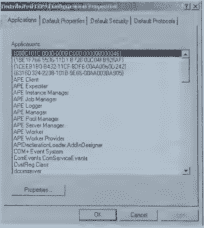

应用程序选项卡列出了系统上注册的 COM+ 服务器。请记住，在第 7 章中，注册表项 `HKEY_CLASSES_ROOT\AppID` 用于标识 COM+ 服务器。此注册表项的子项列表与第一个选项卡中的 COM+ 服务器列表几乎相同。这是因为 DCOMCNFG 使用 `HKEY_CLASSES_ROOT\AppID` 注册表项来生成可配置的 COM 服务器列表。


## 旧版 COM 服务器

旧版进程外服务器通常不会注册其 `HKEY_CLASSES_ROOT\AppID\{my-clsid}`，因此不会出现在 DCOMCNFG 的可配置应用程序列表中。为了让服务器出现在该列表中，必须在 `HKEY_CLASSES_ROOT\CLSID\{my-clsid}` 注册表子项中添加 AppID 值名称，并在 `HKEY_CLASSES_ROOT\AppID` 项中创建 AppID 注册表子项。感到困惑？其实并不难。这些条目的语法如下。它取自一个进程外服务器的 RGS 文件（参见清单 13.1），你将在本章后面创建该服务器。

```text
[HKEY_CLASSES_ROOT\CLSID\{my-clsid-as-guid}]
"AppID" = "{my-clsid-as-guid}"
[HKEY_CLASSES_ROOT\AppID\{my-clsid-as-guid}]
"" = "{Description of the server}"
```

> **注意**
> 
> 第二个注册表条目的键值为 `""`。每当我指定键值为 `""` 时，我指的都是默认键值。

### 清单 13.1  注册文件示例

```text
MyProject.RGS
HKCR
{
    NoRemove AppID
    {
        {E5A784C4-3498-11D2-9C2B-444553540000} = s 'MyProject'
        {
            'MyProject.exe'
            {
                val AppID = s {E5A784C4-3498-11D2-9C2B-444553540000}
            }
        }
    }
}
MyObject.RGS
HKCR
{
    MyObject.MyObject.1 = s 'MyObject Class'
    {
        CLSID = s '{E5A784D3-3498-11D2-9C2B-444553540000}'
    }
    MyObject.MyObject = s 'MyObject Class'
    {
        CurVer = s 'MyObject.MyObject.1'
    }
    NoRemove CLSID
    {
        ForceRemove {E5A784D3-3498-11D2-9C2B-444553540000} = s 'MyObject.Class'
        {
            ProgID = s 'MyObject.MyObject.1'
            VersionIndependentProgID = s 'MyObject.MyObject'
            ForceRemove 'Programmable'
            LocalServer32 = s '%MODULE%'
            val AppID = s '{E5A784C4-3498-11D2-9C2B-444553540000}'
        }
    }
}
```

Visual C++ 会将 RGS 文件编译到模块资源中。当服务器以 RegServer 参数启动时，这些 RGS 条目会自动加载到注册表中。这是在调用 `Module.UpdateRegistryFromResource(IDR_MyProject, TRUE);` 时完成的。清单 13.2 展示了在何处编写对 `UpdateRegistryFromResource()` 的调用，以及如何在主过程中编写自注册的 RegServer 和 UnregServer 参数。该清单由 ATL AppWizard 和 ObjectWizard 生成。

### 清单 13.2  自注册可执行文件

```cpp
LPCTSTR FindOneOf(LPCTSTR p1, LPCTSTR p2)
{
    while (*p1 != NULL)
    {
        LPCTSTR p = p2;
        while (*p != NULL)
        {
            if (*p1 == *p++)
                return p1+1;
        }
        p1++;
    }
    return NULL;
}

extern "C" int WINAPI _tWinMain(HINSTANCE hInstance,
    HINSTANCE , LPSTR lpCmdLine, int )
{
    lpCmdLine = GetCommandLine(); //necessary for _ATL_MIN_CRT
    HRESULT hRes = CoInitialize(NULL);
    // If you are running on NT 4.0 or higher you can use the
    // following call instead to make the EXE free threaded.
    // This means that calls come in on a random RPC thread
    // HRESULT hRes = CoInitializeEx(NULL, COINIT_MULTITHREADED);
    ASSERTE(SUCCEEDED(hRes));
    _Module.Init(ObjectMap, hInstance);
    _Module.OutThreadID = GetCurrentThreadId();
    TCHAR szTokens[] = _T("-/");

    int nRet = 0;
    BOOL bRun = TRUE;
    LPCTSTR lpszToken = FindOneOf(lpCmdLine, szTokens);
    while (lpszToken != NULL)
    {
        if (lstrcmpi(lpszToken, _T("UnregServer"))==0)
        {
            _Module.UpdateRegistryFromResource(IDR_MyProject,
                                               FALSE);
            nRet = _Module.UnregisterServer();
            bRun = FALSE;
            break;
        }
        if (lstrcmpi(lpszToken, _T("RegServer"))==0)
        {
            _Module.UpdateRegistryFromResource(IDR_MyProject,
                                               TRUE);
            nRet = _Module.RegisterServer(TRUE);
            bRun = FALSE;
            break;
        }
        lpszToken = FindOneOf(lpszToken, szTokens);
    }

    if (bRun)
    {
        hRes = _Module.RegisterClassObjects(
            CLSCTX_LOCAL_SERVER,
            REGCLS_MULTIPLEUSE);

        ASSERTE(SUCCEEDED(hRes));

        MSG msg;
        while (GetMessage(&msg, 0, 0, 0))
            DispatchMessage(&msg);

        _Module.RevokeClassObjects();
    }

    CoUninitialize();
    return nRet;
}
```

### 清单 13.3  续

```idl
pointer_default(unique)
]
interface IMyObject : IDispatch
{
    [propget, id(1), helpstring("property MyProperty")]
    HRESULT MyProperty([out, retval] long *pVal);
};
[
    uuid(E5A784C3-3498-11D2-9C2B-444553540000),
    version(1.0),
    helpstring("MyProject 1.0 Type Library")
]
library MYPROJECTLib
{
    importlib("stdole32.tlb");
    importlib("stdole2.tlb");

    [
        uuid(E5A784D3-3498-11D2-9C2B-444553540000),
        helpstring("MyObject Class")
    ]
    coclass MyObject
    {
        [default] interface IMyObject;
    };
};
```

### 清单 13.4  简单的本地服务器对象头文件

```cpp
// MyObject.h : Declaration of the CMyObject

#ifndef __MYOBJECT_H_
#define __MYOBJECT_H_

#include "resource.h"        // main symbols

///////////////////////////////////////////////////////////////
// CMyObject
class ATL_NO_VTABLE CMyObject :
    public CComObjectRootEx<CComSingleThreadModel>,
    public CComCoClass<CMyObject, &CLSID_MyObject>,
    public IDispatchImpl<IMyObject, &IID_IMyObject,
                         &LIBID_MYPROJECTLib>
{
public:
    CMyObject()
    {
    }

DECLARE_REGISTRY_RESOURCEID(IDR_MYOBJECT)

BEGIN_COM_MAP(CMyObject)
    COM_INTERFACE_ENTRY(IMyObject)
    COM_INTERFACE_ENTRY(IDispatch)
END_COM_MAP()

// IMyObject
public:
    STDMETHOD(get_MyProperty)(/*[out, retval]*/ long *pVal);
};

#endif // _MYOBJECT_H
```

### 清单 13.5  简单的本地服务器对象实现

```cpp
// MyObject.cpp : implementation of CMyObject
#include "stdafx.h"
#include "MyProject.h"
#include "MyObject.h"

////////////////////////////////////////////
// CMyObject

STDMETHODIMP CMyObject::get_MyProperty(long *pVal)
{
    // TODO: Add your implementation code here
    *pVal = 10;

    return S_OK;
}
```

前面的代码不是由开发者创建的，而是由向导创建的。你唯一需要自己编写的代码是在清单 13.5 中 CMyObject::get_MyProperty() 方法里的 `*pVal = 10`。

清单 13.3 是 MyProject.dll 的 IDL 源文件。在其中可以看到接口声明。

清单 13.4 包含 CMyObject 类的声明。这是实现 IMyObject 接口的类。你还可以看到 CComSingleThreadModel 类。

清单 13.5 展示了 CMyObject 类的实现代码。内容不多，因为只有一个方法，它充当属性 get 方法。

## 默认属性

DCOMCNFG 属性表对话框的第二个选项卡是“默认属性”选项卡（见图 13.2）。此页面允许你更改四个独立的控件，我在第 8 章已经讨论过它们。它们可以在注册表的 AppID 结构中找到。

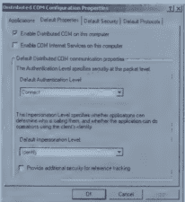

“在此计算机上启用分布式 COM+”复选框通过设置 `HKEY_LOCAL_MACHINE\SOFTWARE\Microsoft\Ole` 项中的 enableDistributedCOM 注册表值来启用和禁用分布式对象。这控制客户端应用程序是否可以启动或连接到远程 COM+ 对象——即不在同一台计算机上的对象。

“默认身份验证级别”下拉组合框设置安全提供程序使用的身份验证级别。connect 和 Call 身份验证级别都不可用于像 UDP 这样的无连接协议。默认情况下，大多数 DCOM+ 安装使用无连接 UDP 协议。当当前级别不可用时，COM+ 会将身份验证级别提升到下一个可接受的级别。用于 Windows 95 的 DCOM+ 默认使用基于连接的 TCP 协议。如果身份验证级别设置为 None，则 COM+ 安全被禁用，导致无论单独的安全设置如何，所有连接、调用和数据包都会被接受。

“默认模拟级别”下拉组合框设置 COM+ 安全使用的模拟级别。默认值为 Identify。

最后一个控件“为引用跟踪提供额外安全”复选框，启用和禁用对 `AddRef()` 和 `Release()` 调用的安全保护。启用此额外安全会减慢 COM。除非出于某种原因需要额外安全，否则不应选中此复选框。


最后三个设置等效于 `HKEY_LOCAL_MACHINE\SOFTWARE\Microsoft\Ole` 注册表项中的 `LegacyAuthenticationLevel`、`LegacyImpersonationLevel` 和 `LegacySecureReferences` 设置。这些内容已在第 8 章讨论过。这些设置被称为旧版设置，因为较新的 COM+ 对象应调用 `CoInitializeSecurity()` 来设置这些设置。在 DCOM+ 之前创建的旧版 COM+ 对象没有调用此函数，因为当时该函数尚不可用。COM+ 在代表这些旧版对象调用 `CoInitializeSecurity()` 时会使用这些旧版设置。

## 默认安全

DCOMCNFG 属性表对话框的第三个选项卡是“默认安全”属性页，如图 13.3 所示。此选项卡显示三个类别：默认访问权限、默认启动权限和默认配置权限。它们共同构成 COM+ 对象的默认安全设置。

**图 13.3**  
*DCOMCNFG*  
*默认安全*  
*页。*

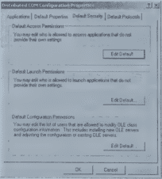

### 设置访问权限

在“默认访问权限”框中单击“编辑默认值”时，可以修改 `HKEY_LOCAL_MACHINE\SOFTWARE\Microsoft\Ole` 注册表项中的 `DefaultAccessPermission` 值。此设置确定谁可以调用未指定自定义访问权限的对象。

让我们从理论转向实践。在本章前面“创建自动化服务器”一节中，你创建并安装了一个可用作示例的 COM+ 服务器。清单 13.6 展示了使用 DCOMCNFG 更改配置如何反映在对 COM+ API 的成功和失败调用中。

**清单 13.6 创建并访问测试对象**

```cpp
#include <windows.h>

HRESULT LaunchAndAccess()
{
    // HRESULT returned from last automation call
    HRESULT hresult;
    // IDISPATCH interface pointer for the existing object
    LPDISPATCH pdisp = NULL;
    // hold exception info here
    EXCEPINFO excepinfo;
    // hold argument error here
    UINT uArgErr;

    // Convert the progid to a clsid
    CLSID clsid;
    hresult = ::CLSIDFromProgID(OLESTR("MyObject.MyObject.1"),
                                &clsid);
    if (hresult)
    {
        // CLSIDFromProgID failed
        return hresult;
    };

    // Create the instance of the object
    LPUNKNOWN punk;
    hresult = ::CoCreateInstance(clsid, NULL, CLSCTX_SERVER,
                                 IID_IUnknown, (LPVOID FAR *)&punk);

    if (hresult)
    {
        // CoCreateInstance failed
        return hresult;
    };

    // Retrieve the interface pointer
    hresult = punk->QueryInterface(IID_IDispatch,
                                   (LPVOID FAR *)&pdisp);

    if (hresult)
    {
        // QueryInterface failed
        return hresult;
    };

    // Release the IUnknown reference.
    hresult = punk->Release();

    // return an exception if the dispatch pointer is NULL
    if (pdisp==NULL)
    {
        return E_UNEXPECTED;
    }

    // Retrieve the dispatch id for the function name
    DISPID dispid;
    BSTR bstr = ::SysAllocString(OLESTR("MyProperty"));
    hresult = pdisp->GetIDsOfNames(IID_NULL, &bstr, 1,
                                  LOCALE_USER_DEFAULT,
                                  &dispid);
    ::SysFreeString(bstr);
    if (hresult)
    {
        // GetIDsOfNames failed
        return hresult;
    };

    // Invoke the property GET
    DISPPARAMS dispparams = {0};
    VARIANTARG variantarg;
    VariantInit(&variantarg);
    memset(&excepinfo, 0, sizeof(EXCEPINFO));
    uArgErr = 0;
    hresult = pdisp->Invoke(dispid, IID_NULL,
                           LOCALE_USER_DEFAULT,
                           DISPATCH_PROPERTYGET,
                           &dispparams, &variantarg,
                           &excepinfo, &uArgErr);
    if (hresult)
    {
        // Invoke failed
        return hresult;
    };

    pdisp->Release();

    if (variantarg.lVal != 10)
    {
        // Wrong result
        return E_UNEXPECTED;
    };

    return S_OK;
}

int main(int, char **)
{
    CoInitialize(NULL);
    LaunchAndAccess();
    CoUninitialize();
    return 0;
}
```

我绝不建议更改这些设置。你最不希望发生的就是阻止某人修改此注册表项，因为应用程序必须有权访问此注册表项才能自行安装。因此，除非你有特定需求，例如远程安装应用程序或禁止用户安装 COM+ 对象，否则不建议修改此注册表项的安全权限。

## 配置 COM+ 服务器

单击“应用程序”选项卡可返回所有 COM+ 服务器的列表。如果从该列表中选择一个 COM+ 服务器并单击“属性”按钮，将出现一个单独属性表对话框，使你能够配置该 COM+ 服务器（见图 13.4）。

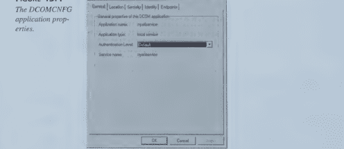

常规页上显示四个属性：应用程序名称、应用程序类型、应用程序级别和服务名称。DCOMCNFG 不允许你更改这些设置。这些设置也可在注册表中找到。应用程序名称是 `HKEY_CLASSES_ROOT\AppID\{my-clsid}` 注册表子项的键值。

应用程序类型是以下之一：

- 进程内处理程序
- 进程内服务器
- 本地服务
- 本地服务器
- 远程服务器

DCOMCNFG 会搜索对象的 `HKEY_CLASSES_ROOT\CLSID\{my-clsid}` 和 `HKEY_CLASSES_ROOT\AppID\{my-clsid}` 注册表子项。按前面列出的顺序，它首先找到的设置将用作该对象的应用程序类型。对于进程内处理程序、进程内服务器和本地服务器，该设置位于 `HKEY_CLASSES_ROOT\CLSID\{my-clsid}` 注册表子项中。对于本地服务和远程服务器，该设置位于 `HKEY_CLASSES_ROOT\AppID\{my-clsid}` 注册表子项中。有关 AppID 注册表树的详细讨论，请返回第 8 章。

应用程序位置是上一段讨论的应用程序类型注册表子项在注册表中的值名称。对于本地服务器、进程内服务器和进程内处理程序，这是模块的本地路径。对于本地服务，这是服务的名称。对于远程服务器，这是远程服务器的名称。

### 服务器位置

DCOMCNFG 中的“位置”选项卡有三个复选框，如图 13.5 所示。

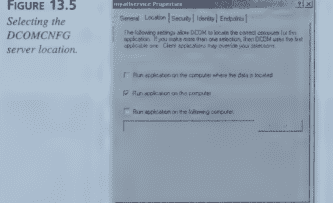

第一个复选框启用或禁用“在存储处激活”。这等效于 ActivateAtStorage 注册表设置。“在存储处激活”意味着 COM+ 对象在数据文件所在的计算机上启动。

第二个复选框指示 COM+ 启动并连接到本地计算机上的 COM+ 服务器。第三个复选框指示 COM+ 启动并连接到远程计算机上的 COM+ 服务器。选中此按钮会将 RemoteServer 注册表设置写入 `HKEY_CLASSES_ROOT\AppID\{my-clsid}` 子项，并启用编辑框和浏览按钮控件。这些控件使你能够使用资源管理器风格的浏览器指定远程服务器名称。

运行清单 13.6 时，`CoCreateInstance()` 调用会失败，因为你的用户账户无法启动服务器。

### 设置启动权限

此页上的第二组控件是启动权限单选按钮和编辑控件。它们修改 `HKEY_CLASSES_ROOT\AppID\{my-clsid}` 子项中的 LaunchPermission 注册表设置。

选择“使用自定义启动权限”并单击“编辑”。“注册表值权限”对话框将出现。将设置更改为“拒绝你的用户账户的启动权限”。运行清单 13.6 时，`CoCreateInstance()` 调用会失败，因为你的用户账户没有启动权限。

如果手动启动服务器并运行清单 13.6，`CoCreateInstance()` 会成功。和之前一样，对 `CoCreateInstance()` 的调用不需要启动服务器，因为它已经在运行。

### 设置配置权限

此页上的最后一组控件是配置权限单选按钮和“编辑”控件。它们修改 `HKEY_CLASSES_ROOT\AppID\{my-clsid}` 子项的注册表安全权限。此设置确定谁可以修改对象的配置。

选择“使用自定义配置权限”并单击“编辑”。“注册表项权限”对话框出现。如果你尚未更改 COM+ 的默认配置权限，则接下来出现的对话框应与图 13.7 所示类似。

*图 13.7*  
*注册表项权限。*

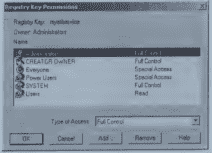

在尝试后续步骤之前，请确保你拥有管理员密码。你可以通过移除 Everyone 项来演示自定义配置权限更改的效果。以非管理员用户身份登录计算机。

打开 REGEDIT 和 REGEDT32，尝试查看该 COM+ 服务器的 `HKEY_CLASSES_ROOT\AppID\{my-clsid}` 注册表子项。你应该会看到与图 13.8 和图 13.9 所示类似的屏幕。


**图 13.8**  
显示 AppID 子键的 REGEDIT。


**图 13.9**  
显示 AppID 子键的 REGEDT32。

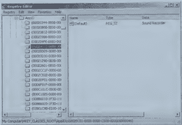

REGEDIT 编辑器报告错误，因为它是在不了解系统注册表安全特性的情况下创建的。REGEDT32 编辑器正确处理安全性，并将用户不可用的注册表项灰显。

## 服务器标识

DCOMCNFG 中的“标识”选项卡有四个单选按钮，如图 13.10 所示。这些单选按钮允许您更改 COM+ 对象用于安全验证的标识。

**图 13.10**  
DCOMCNFG 服务器“标识”页面。

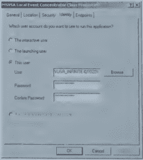

同样，在尝试下一个实验之前，不要忘记删除您在之前实验中创建的“拒绝启动”权限和“拒绝访问”权限。还应终止任何正在运行的服务器实例。

这是一个你不会很快忘记的实验。修改并重新编译本章开头构建的 COM+ 服务器。按清单 13.7 中的更改修改清单 13.5。运行一次代码，你会注意到当前用户名输出到 C:\USER.LOG 日志文件。

### 清单 13.7 测试 RunAs 属性

```cpp
// MyObject.cpp : Implementation of CMyObject
#include "stdafx.h"
#include <fstream>
#include "MyProject.h"
#include "MyObject.h"

//////////////////////////////////////////////
// CMyObject


STDMETHODIMP CMyObject::get_MyProperty(long * pVal)
{
    // TODO: Add your implementation code here
    char sz[256];
    DWORD l = 255;
    ::GetUserName(sz, &l);
    ofstream of;
    of.open("C:\\USER.LOG", ios::out | ios::app);
    of << sz << endl;
    *pVal = 10;


    return S_OK;
}
```

现在，通过将用户设置为除当前用户帐户之外的某个非管理员本地帐户来更改用户标识。现在运行清单 13.6。哎呀！此帐户没有足够的权限访问该对象。好吧，从进程列表中终止它并重新启动实验。哎呀！当前用户没有足够的权限终止该进程。那么，如何终止该进程？重启？不行。要终止它，必须注销并以启动该进程的用户身份登录。

这一次，在运行清单之前，为 Everyone 向 COM+ 服务器添加自定义访问权限（位于“服务器安全\设置启动权限”下）。如果再次运行清单 13.6 中的代码，C:\USER.LOG 文件将包含 RunAs 用户的用户名，而不是当前用户。

## 使用 OLE2View 程序

OLE2View 在安装过程中不会安装。可以通过访问 Microsoft 网站找到该实用工具。该实用工具提供的功能与 DCOMCNFG 几乎相同，不过一些差异使该实用工具成为我收藏中受欢迎的新增项。用户界面在拆分窗口的左窗格中使用树视图（见图 13.11）。当在左窗格中选择对象时，它们会显示在右窗格中。

**图 13.11**  
*OLE2View 2.0.*

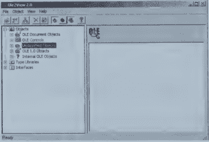

你会发现 OLE2View 使你能够设置与 DCOMCNFG 非常相似的一组配置项。此外，OLE2View 显示给定 COM+ 对象的所有注册表项，并显示所有已注册的类型库和接口。

### OLE2View 的缺点

OLE2View 的不幸之处在于它未安装在大多数系统上，并且无法按需安装此实用工具。我发现许多配置可能导致 OLE2View 程序非常不稳定，并且安装程序不会安装所有必需模块。

### 使用 OLE2View 配置 COM+ 对象

要使用 OLE2View 配置 COM+ 对象，请打开“对象类”下的“所有对象”分支。这会按 ProgID 列出系统上注册的所有对象。选择 COM+ 对象后，将在右窗格中看到五个属性页。属性页分别是“注册表”、“实现”、“激活”、“启动权限”和“访问权限”。“注册表”属性页显示其他四个页面中的所有设置，因此我不会讨论此属性页。

我发现某些版本的 OLEView（包括撰写本文时的最新版本）存在一个 bug。如果在“实现”属性页中选择一个进程内服务器，选择一个本地服务器，并在本地服务器和进程内服务器选项卡之间切换，本地服务器会获取 InprocServer32 注册表子键。为规避此问题，我尝试在“实现”属性页中删除进程内服务器的模块路径，但进程内服务器模块路径被替换为本地服务器模块路径。正如你现在可能已经猜到的那样，我并不十分推崇将 OLEView 作为配置 DCOM+ 实现的实用工具。

## 为远程进程内服务器指定代理

除了使您能够指定进程内服务器、本地服务器和进程内处理程序模块路径之外，还可以为远程进程内服务器指定代理（见图 13.12）。

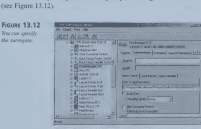

显然，实际上不可能有远程进程内服务器。要使 COM+ 对象成为进程内对象，至少要求它被加载到同一进程中。许多 COM+ 对象已经被编写为进程内服务器。为了利用这些旧版对象，确立了使用代理进程的概念。

为了将客户端和服务器配置为使用进程内服务器的代理，必须在 COM+ 对象的 HKEY_CLASSES_ROOT\CLSID\{my-clsid} 注册表子键中手动创建 AppID 项。还必须在客户端和服务器上创建 AppID 注册表子键。在客户端的 HKEY_CLASSES_ROOT\AppID\{my-clsid} 注册表子键中，应有一个 RemoteServerName 注册表项，用于标识将在其中启动代理和进程内服务器的服务器。在服务器的 `HKEY_CLASSES_ROOT\AppID\{my-clsid}` 注册表子键中，应有一个 `DllSurrogate` 注册表项。最后这个项可以使用 OLEView 以及**使用自定义代理**复选框和**自定义代理路径**编辑控件来创建。选中**使用代理进程**复选框会创建 `DllSurrogate` 值名称。如果未选择自定义代理，则使用默认代理（`DllHost.exe`）。

还可以使用代理在本地启动进程内服务器，但要在单独的进程中启动。为此，必须在客户端计算机的注册表中设置 `DllSurrogate` 值名称。可以使用 OLEView 完成此操作。

为了启动远程进程内服务器（或在单独进程中的本地进程内服务器），需要使用 `CLSCTX_LOCAL_SERVER` 标志调用 `CoCreateInstanceEx()`。因为对象不包含 `LocalServer32` 项，COM+ 将在 `HKEY_CLASSES_ROOT\AppID\{my-clsid}` 注册表子键中检查 `DllSurrogate` 或 `RemoteServerName` 值。

### 激活

“激活”属性页使您能够指定“在存储处激活”、以交互用户身份启动以及在远程计算机上启动（见图 13.13）。

**图 13.13**  
*OLEView 的“激活”页面。*

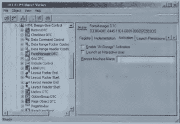

“启用‘在存储处’激活”复选框类似于第 8 章中描述的 `ActivateAtStorage` 注册表设置。在存储处激活意味着 COM+ 对象在数据文件所在的计算机上启动。

### 启动权限

“启动权限”属性页使您能够为对象指定自定义启动权限（见图 13.14）。

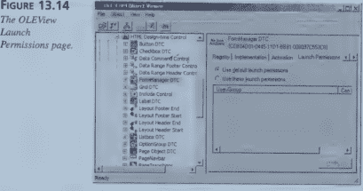

有关使用自定义启动权限的详细信息，请阅读本章前面关于使用 DCOMCNFG 的各节。

### 访问权限

“访问权限”属性页使您能够为对象指定自定义访问权限（见图 13.15）。

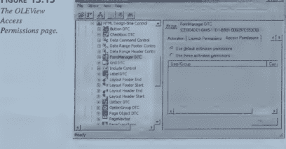

有关使用自定义访问权限的详细信息，请阅读本章前面关于使用 DCOMCNFG 的各节。

## 错误处理

COM+ 函数和对象方法通常返回一个 HRESULT（结果句柄）。HRESULT 实际上是一个 32 位值，表示成功、警告或错误代码。


`HRESULT` 的最高位是严重性代码。严重性值为零表示成功（`SEVERITY_SUCCESS`），严重性值为一表示失败（`SEVERITY_FAILURE`）。接下来的四个高位是保留位（始终设置为零）。第6到第16个高位表示设施。设施可以是以下任意一种：

- `FACILITY_WINDOWS` 8
- `FACILITY_STORAGE` 3
- `FACILITY_SSPI` 9
- `FACILITY_SETUPAPI` 15
- `FACILITY_RPC` 1
- `FACILITY_WIN32` 7
- `FACILITY_CONTROL` 10
- `FACILITY_NULL` 0
- `FACILITY_MSMQ` 14
- `FACILITY_MEDIASERVER` 13
- `FACILITY_INTERNET` 12
- `FACILITY_ITF` 4
- `FACILITY_DISPATCH` 2
- `FACILITY_CERT` 11

低16位表示状态代码字段以及具体的错误或警告。Microsoft 保留为除 `FACILITY_ITF` 之外的所有设施定义状态代码的专有权利。除 Microsoft 之外的开发人员只能为 `FACILITY_ITF` 设施定义状态代码。为了尽量减少错误代码冲突，接口开发人员负责为其接口定义所有状态代码。这意味着，从两个不同接口返回的同一个 `FACILITY_ITF` 状态代码可以有两种不同含义，但从对同一接口的两次调用返回的同一个 `FACILITY_ITF` 状态代码只能有一种共同含义。

> > **注意**
> >
> > 有时，将中间 COM+ 服务器收到的错误代码直接返回给调用客户端会很方便。我所说的中间 COM+ 服务器，是指由一个客户端调用、并且又调用第二个 COM+ 服务器的 COM+ 服务器。如果返回的错误代码类型为 `FACILITY_ITF`，则不建议采用此策略，除非你的中间接口明确将这些错误代码标识为其自身的错误代码。正确的方法是，在收到意外错误代码时返回 `E_UNEXPECTED`。

COM+ 提供了一些用于处理 HRESULT 的有用宏，如表 13.1 所示。

### 表 13.1 用于处理 HRESULT 的宏

| 宏 | 定义 |
|---|---|
| `SUCCEEDED()` | 如果严重性为成功（零），则返回 TRUE；如果严重性为失败（一），则返回 FALSE。 |
| `FAILED()` | 与 `SUCCEEDED()` 相反。 |
| `HRESULT_FACILITY()` | 返回 HRESULT 的设施代码。 |
| `HRESULT_SEVERITY()` | 返回 HRESULT 的严重性位。 |
| `HRESULT_CODE()` | 返回 HRESULT 的状态代码。 |
| `MAKE_HRESULT()` | 根据 HRESULT 的三个组成部分（设施、严重性、状态代码）构建 HRESULT。 |

## 错误处理策略

处理 HRESULT 值有三种策略。第一种策略是简单地测试 S_OK、零值和非零值。你可能还记得，在本章前面，你遇到了来自 CoCreateInstance() 函数的 E_ACCESSDENIED HRESULT。为了测试错误条件，你测试了 HRESULT 是否为非零值。这充分捕获了错误，并在某种程度上适当地终止了程序。对于某些不要求完善的错误处理的情况，这种错误处理策略是可以接受的。

首选方法是使用 SUCCEEDED() 和 FAILED() 宏测试 HRESULT。这种策略实现起来并不更难，并且对于生产质量的应用程序来说是更好的策略。清单 13.8 是使用此策略的示例。请注意，代码中使用 FAILED() 宏来测试错误。

### 清单 13.8 使用 FAILED() 进行错误处理

```cpp
HRESULT hresult = ::CoCreateInstance(clsid, NULL, CLSCTX_SERVER,
                                  IID_IUnknown, (LPVOID FAR *) &punk);
if (FAILED(hresult))
{
    // CoCreateInstance failed
    return hresult;
};
```

第三种策略是使用特定的 HRESULT 进行测试。第二种和第三种策略之间的区别，就像使用 if 语句测试与使用 case 语句测试之间的区别。清单 13.9 是使用第三种策略的示例。

### 清单 13.9 使用特定 HRESULT 进行错误处理

```cpp
hresult = ::CoCreateInstance(clsid, NULL, CLSCTX_SERVER,
                            IID_IUnknown, (LPVOID FAR *) &punk);

switch (hresult)
{
case E_ACCESSDENIED:
    // CoCreateInstance failed because of access denied
    return hresult;
case S_OK:
    // CoCreateInstance succeeded
    break;
default:
    // CoCreateInstance failed for unexpected reason
    return E_UNEXPECTED;
};
```

请注意，前面的代码并不只是使用 FAILED() 宏来测试错误。我还会逐一检查特定的错误值，例如 E_ACCESSDENIED。如果需要，你可以添加更多检查。

HRESULT 是用于向客户端返回有限错误信息的便捷标识符。但如果你想传回的不只是一个标识符，该怎么办？你可能记得在 ATL 对象向导中看到一个名为 Support ISupportErrorInfo 的复选框。这是另一种错误处理形式，它使 COM+ 服务器能够向客户端传递非常丰富的错误信息。

### 使用 ISupportErrorInfo 传递信息

ISupportErrorInfo 接口及其两个同类接口 ICreateErrorInfo 和 IErrorInfo，允许 COM+ 类向客户端传回附加信息。实现和使用这些接口的机制相当简单。你的 COM+ 类必须实现 ISupportErrorInfo 接口。你的 COM+ 类必须使用 ICreateErrorInfo 设置错误，而你的客户端必须使用 IErrorInfo 检索错误。不会又是三个接口吧？幸运的是，ATL 已经很好地覆盖了其中两个接口，因此我只需要告诉你 ISupportErrorInfo（见清单 13.10）。

### 清单 13.10 ISupportErrorInfo 的 IDL

```idl
interface ISupportErrorInfo : IUnknown
{
    HRESULT InterfaceSupportsErrorInfo(
                [in]  REFIID riid);
}
```

这也不是什么难事。首先使用 ATL 对象向导创建一个新的 ATL COM+ 类。在 Developer Studio 的菜单栏中，选择 Insert、New ATL Object。在向导的第一页中，选择 Objects 类别和 Simple Object 对象，然后单击 Next 按钮。在向导的第二页中，输入短名称 Oops，然后转到 Attributes 属性页。现在到了棘手的部分。选择 Support ISupportErrorInfo，然后单击 OK。就是这样。

你的 COM+ 类现在支持这种丰富的错误信息，但由于你的类不做任何事情，它无法报告任何错误。你将通过向 IOops 接口添加一个方法（很方便地命名为 Throw）来了解这种错误处理支持的能力。清单 13.11 显示了 COops 类的声明。

### 清单 13.11 COops 的声明，该类实现 IOops

```cpp
// Oops.h : Declaration of the COops

#ifndef __OOPS_H_
#define __OOPS_H_

#include "resource.h"        // main symbols

////////////////////////////////////////////////////////////
// COops
class ATL_NO_VTABLE COops :
    public CComObjectRootEx<CComMultiThreadModel>,
    public CComCoClass<COops, &CLSID_Oops>,
    public ISupportErrorInfo,
    public IDispatchImpl<IOops, &IID_IOops, &LIBID_SERVERLib>
{
public:
    COops()
    {
    }
};

DECLARE_REGISTRY_RESOURCEID(IDR_OOPS)

DECLARE_PROTECT_FINAL_CONSTRUCT()

BEGIN_COM_MAP(COops)
    COM_INTERFACE_ENTRY(IOops)
    COM_INTERFACE_ENTRY(IDispatch)
    COM_INTERFACE_ENTRY(ISupportErrorInfo)
END_COM_MAP()

// ISupportErrorInfo
    STDMETHOD(InterfaceSupportsErrorInfo)(REFIID riid);

// IOops
public:
    STDMETHOD(Throw)();
};

#endif //__OOPS_H_
```

在 COops::Throw() 方法中，你将使用 CComCoClass::Error() 方法返回丰富的错误信息（见清单 13.12）。

### 清单 13.12 COops 的定义

```cpp
// Oops.cpp : Implementation of COops
#include "stdafx.h"
#include "Server.h"
#include "Oops.h"

///////////////////////////////////////////////////////////////////////////////
// COops

STDMETHODIMP COops::InterfaceSupportsErrorInfo(REFIID riid)
{
    static const IID* arr[] =
    {
        &IID_IOops
    };
    for (int i=0; i < sizeof(arr) / sizeof(arr[0]); i++)
    {
        if (InlineIsEqualGUID(*arr[i], riid))
            return S_OK;
    }
    return S_FALSE;
}

STDMETHODIMP COops::Throw()
{
    Error(_T("Another error"), IID_IOops);

    return E_FAIL;
}
```

请注意，在清单 13.12 的 COops 定义中，有两个方法。COops::InterfaceSupportsErrorInfo() 方法的实现非常简单：如果某个 REFIID 支持丰富的错误信息，则返回 S_OK；如果不支持，则返回 S_FALSE。目前只有一个 IID（接口 ID），因此你只需为该接口返回 S_OK。如果你有第二个接口，比如 IID_IOops2，那么 COops::InterfaceSupportsErrorInfo() 方法的实现将改为清单 13.13 中的实现。


### 清单13.13 多接口支持

```cpp
STDMETHODIMP CCoops::InterfaceSupportsErrorInfo(REFIID riid)
{
    static const IID* arr[] =
    {
        &IID_IOops,
        &IID_IOops2
    };
    for (int i=0; i < sizeof(arr) / sizeof(arr[0]); i++)
    {
        if (InlineIsEqualGUID(*arr[i],riid))
            return S_OK;
    }
    return S_FALSE;
}
```

清单13.14中`CCoops::Throw()`方法的实现只是调用了`CComCoClass::Error()`方法，并返回`E_FAIL`。

### 清单13.14 ErrorInfo客户端

```cpp
// controller.cpp : Defines the entry point for the console application.

#include "stdafx.h"

#import "..\\server\\server.tlb"

int main(int argc, char* argv[])
{
    ::CoInitialize(NULL);
    {
        SERVERLib::IOopsPtr p(__uuidof(SERVERLib::IOops));
        try
        {
            p->Throw();
        }
        catch(_com_error e)
        {
            std::cout << "Error: " << e.Error() <<
                      << (char *)e.Source() << " - "
                      << (char *)e.Description() << std::endl;
        }
    }
    ::CoUninitialize();
    return 0;
}
```

在本例中，我使用了Visual C++对导入类型库的支持。当Visual C++遇到`#import`语句时，它会为你的COM+对象生成一个类，从而让你能够非常直观地访问自己的COM+对象。

不要误以为COM+真的会抛出异常。异常实际上是由`#import`语句生成的包装类抛出的。如果你操作的是COM+接口指针，该方法会在不抛出异常的情况下返回。此时，获取丰富错误信息的责任就落在了程序员身上（参见清单13.15）。

### 清单13.15 另一个ErrorInfo客户端

```cpp
// controller2.cpp : Defines the entry point for the console application.
//

#include "stdafx.h"
#include "../server/server.h"
#include "../server/server_i.c"

class WideToAnsiBuffer
{
public:
    WideToAnsiBuffer()
        : s(0) {};
    ~WideToAnsiBuffer()
        { del(); }
    void del()
        { delete [] s; };
    char * s;
};

inline char * WideToAnsi(const WCHAR * pwchar)
{
    long l = ::wcslen(pwchar)+1;
    static WideToAnsiBuffer s;
    s.del();
    s.s = new char[l+1];
    ::WideCharToMultiByte(CP_ACP, 0, pwchar, -1, s.s, l, NULL, NULL);
    return s.s;
}

HRESULT GetUnknown(WCHAR * strProgID, IUnknown ** ppIUnknown)
{
    CLSID clsid;
    HRESULT hresult = ::CLSIDFromProgID(strProgID, &clsid);
    hresult = ::CoCreateInstance(clsid, NULL, CLSCTX_SERVER,
                                 IID_IUnknown, (void **)ppIUnknown);

    return S_OK;
};

HRESULT GetInterface(IUnknown * punknown, REFIID riid,
                     IUnknown ** ppunknown)
{
    HRESULT hresult = punknown->QueryInterface(riid,
                                               (void **)ppunknown);
    return S_OK;
};

int main()
{
    ::CoInitialize(NULL);

    IUnknown * punknown = 0;
    IOops * poops = 0;

    HRESULT hresult = GetUnknown(L"Server.Oops.1",
                                 &punknown);
    hresult = GetInterface(punknown, IID_IOops,
                           (IUnknown **)&poops);
    hresult = poops->Throw();

    if (FAILED(hresult))
    {
        IErrorInfo * perrorInfo;
        ::GetErrorInfo(0, &perrorInfo);
        BSTR bstr = 0;
        perrorInfo->GetDescription(&bstr);
        std::cout << "We had an error:\nDescription: " <<
            WideToAnsi(bstr);
        perrorInfo->GetSource(&bstr);
        std::cout << "\nSource: " << WideToAnsi(bstr);
    }

    punknown->Release();

    ::CoUninitialize();
    return 0;
}
```

如果你看一下清单13.15的末尾，会看到我调用了`GetErrorInfo()`函数来获取`IErrorInfo`接口。`IErrorInfo`接口有几个成员，可以让你检索错误的不同属性（参见清单13.16）。

### 清单13.16 IErrorInfo的IDL定义

```idl
interface IErrorInfo: IUnknown
{
    HRESULT GetGUID([out] GUID * pGUID);
    HRESULT GetSource([out] BSTR * pBstrSource);
    HRESULT GetDescription([out] BSTR * pBstrDescription);
    HRESULT GetHelpFile([out] BSTR * pBstrHelpFile);
    HRESULT GetHelpContext([out] DWORD * pdwHelpContext);
}
```

我只使用了`IErrorInfo::GetDescription()`和`IErrorInfo::GetSource()`方法来检索最基本的信息。`IErrorInfo`部分的所有源代码都包含在随附CD-ROM上，名为`errorinfo`。你可以在`chapter13`目录下的`errorinfo`子目录中找到它。如果你逐步执行所提供的两个客户端的代码，你会更好地感受到这三个错误处理接口的强大功能。

### 小结

本章为你理解如何配置DCOM和处理错误打下了坚实的基础。你首先学习了如何使用`DCOMCNFG`实用程序，使COM+在客户端机器上正常工作。我们讨论了注册表中与COM+配置相关的部分，并且你学会了在检查注册表时需要注意什么。文中还展示了几个使用Visual C++的示例——这些示例将帮助你编写特殊的实用程序来自动化一些配置操作。

还讨论了客户端COM+错误以及修复客户端配置以解决这些错误的方法。这是一个重要的部分，因为客户端配置必须正确，否则你所有的COM+开发工作都将白费。

## 第14章

## COM Internet服务

### 本章内容

- 新的COM+传输协议 — 358
- 隧道TCP协议概述 — 359
- 启用CIS — 366
- 代理服务器配置 — 366
- 配置提示和已知问题 — 367
- OBJREF名字对象 — 369
- 必要的编程更改 — 370

创建COM Internet服务（CIS）的目的是为隧道传输控制协议（TCP）提供支持。该协议允许COM通过TCP端口80（标准HTTP端口）运行。因此，客户端和服务器可以在大多数代理服务器和防火墙的环境中通信。这使得一类新的基于COM的互联网场景成为可能。

除了新的COM协议之外，CIS还提供了一种新的简单名字对象——OBJREF名字对象——它有助于在互联网场景中使用COM。OBJREF名字对象表示对正在运行的对象的引用，并具有一个显示名称，该名称例如可以嵌入HTML页面，并由ActiveX控件或客户端小程序绑定。

本章解释了什么是COM Internet服务，它们如何工作，以及如何配置运行Microsoft Windows的计算机来使用这些服务。

### 新的COM+传输协议

在许多互联网场景中，客户端和服务器之间的网络连接受到许多限制。例如：

- 过滤出站网络流量的代理服务器可能会限制客户端到互联网的连接。对于在企业环境中运行的应用程序来说，这通常是常见情况，但也适用于用户通过ISP连接到互联网时运行的应用程序。
- 防火墙通常会控制传入的互联网流量，定义接受哪些网络端口、数据包和协议组合，以保护服务器（或客户端）的网络环境。

实际上，这些限制的最终结果是，客户端和服务器可能只有非常狭窄的协议和端口组合可用于进行通信。由于COM+动态选择1024–65535范围内的网络端口，而该范围通常不允许互联网到内网的网络流量通过，因此无法在互联网上可靠地使用经常使用的COM+端口（这些端口主要由RPC调用组成）（虽然它们完全适用于内网）。此外，防火墙通常被设置为限制对端口135的访问，而COM+依赖该端口提供各种服务。端口135通常被COM+用于RPC身份验证，需要专门配置为开放以进行这种身份验证，因为诸如代理服务器之类的软件通常会阻止此端口。与除80之外的所有其他端口一样，它代表着潜在的安全风险，并且默认情况下是关闭的。


隧道 TCP 协议在每个 COM+ 连接开始时引入一种特殊握手，使其能够穿过大多数防火墙和代理。此握手（由 CIS 透明处理）之后，线路协议就是基于 TCP 的 COM。除了本章后面列出的注意事项外，这意味着：

- 该协议对客户端和服务器都是透明的。客户端代码和服务器代码都不需要修改即可使用 CIS。
- 所有基于 TCP 的 COM+ 协议服务都可用——包括 COM+ 安全性和生命周期管理（即“ping”）服务。

## 隧道 TCP 协议的限制

隧道 TCP 协议受以下限制：

- 它要求在承载可由 CIS 访问的 COM+ 对象的服务器端计算机上安装 Internet Information Server 4.0 或更高版本，因为部分 CIS 功能是使用 ISAPI 筛选器实现的。
- 由于隧道 TCP 在初始握手后由非 HTTP 流量组成，CIS 要求代理服务器和防火墙允许通过为 HTTP 打开的端口传输此类流量。

> **注意**
>
> 由于这些限制，实际上，CIS 不支持回调。例如，这意味着应用程序无法使用连接点或建议接收器机制执行通知。但是，如果 CIS 客户端可以充当 CIS 服务器并按本章后面所述进行配置，则没有任何因素会阻止客户端接收 COM+ 调用——包括回调。

## 隧道 TCP 协议概述

如果客户端配置指示应将发往服务器的 HTTP 流量通过代理路由，则客户端 COM+ 运行时环境会与该代理建立 TCP/Internet 协议 (IP) 连接。然后，它向代理发送 HTTP CONNECT 方法，请求连接到服务器主机上的端口 80。图 14.1 显示了隧道 TCP 流程的示意图。

代理与服务器主机建立 TCP/IP 连接。这假定代理已配置为在客户端所连接的端口上启用 HTTP CONNECT 方法。代理上的此端口配置有时被称为“启用 SSL 隧道”。

**图 14.1**  
*隧道 TCP 流程。*

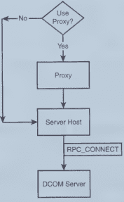

如果客户端配置不使用代理，则 COM+ 运行时环境会与服务器主机上的端口 80 建立 TCP/IP 连接。此步骤之后，无论客户端是否使用代理，客户端都已连接到服务器主机上的端口 80（可能由代理中介）。客户端现在向服务器发送 RPC_CONNECT 命令，请求连接到服务器主机上的 DCOM 服务器。

响应 RPC_CONNECT，服务器 RPC 运行时环境（部分由 ISAPI 筛选器/扩展对实现）建立到 COM+ 服务器的本地连接。

客户端和服务器现已建立经中介的 TCP/IP 连接，并进行基于 TCP 的 COM+ 对话。

## 配置隧道 TCP 协议

表 14.1 中列出的操作系统支持隧道 TCP 协议。安装说明在相应的操作系统或 Service Pack 发行说明中提供。

**表 14.1** 隧道 TCP 的操作系统支持

| 操作系统 | 客户端 | 服务器（需要 IIS 4.0 或更高版本） |
|---|---|---|
| 带 DCOM95 1.2 的 Windows 95 | 是 | 否 |
| 带 DCOM98 1.3 的 Windows 98 | 是 | 否 |
| 带 SP4 的 Windows NT 4.0 Workstation | 是 | 否 |
| 带 SP4 的 Windows NT 4.0 Server | 是 | 是 |
| Windows 2000 Workstation | 是 | 否 |
| Windows 2000 Server | 是 | 是 |

### Windows 95 和 Windows 98 的客户端配置

CIS 要求在 Windows 95 计算机上安装 DCOM95 1.2 或更高版本。DCOM95 1.2 可从 Microsoft COM 主页 www.microsoft.com/com/default.asp 下载。必须安装 DCOM，以便 Windows 95 计算机能够参与分布式应用程序。默认情况下，不具备所需的 RPC 功能。

在 Windows 98 上，必须安装 DCOM98 1.3 或更高版本。DCOM98 1.3 随 Windows 98 OSR1 提供，也可以从 Microsoft COM 主页下载。与 Windows 95 一样，必须安装 DCOM，以便具备 RPC 功能。

> **注意**
>
> 可以从 http://www.microsoft.com/com/resources/downloads.asp 下载 DCOM95 和 DCOM98。

还需要安装另一个程序：DCOM98 配置实用程序。尽管名称如此，Windows 95 和 Windows 98 都使用同一实用程序。运行此程序时，它会将 CISCNFG 程序解压到计算机的 Windows\System 目录中。

要启用 CIS 客户端支持，请在命令行中使用以下参数运行 CISCNFG 实用程序（见图 14.2）：

```
CISCNFG tcp_http
```


**图 14.2**  
*CISCNFG 实用程序。*

CISCNFG 配置 DCOM 使用的协议，并可与以下参数一起使用：

- tcp（仅基于 TCP 的 DCOM）
- http（仅隧道 TCP）
- tcp_http（先尝试基于 TCP 的 DCOM，然后尝试隧道 TCP）

通常应使用 tcp_http，因为它同时选择 tcp 和 http。运行 CISCNFG 后，必须重新启动系统。

> **注意**
>
> 如果依赖 DCOM98 功能，有两种选择：随应用程序重新分发更新的系统文件 (DCOM98)，或引导用户访问 DCOM98 Web 版本。如果应用程序将从 Web 下载，建议引导用户访问 Web 版本，因为 DCOM98 相当大，许多用户可能已经拥有它。

### Windows NT 4.0 SP4 和 Windows 2000 的客户端配置

Windows NT 4.0 Service Pack 4 和 Windows 2000 包含 CIS 支持。

要启用 CIS，需要将隧道 TCP 协议添加到 DCOM 协议列表。可以通过执行以下步骤运行 DCOMCNFG 来修改协议列表：

- 1. 选择“默认协议”选项卡。
- 2. 使用“添加”按钮添加隧道 TCP/IP。
- 3. 重新启动系统以使此更改生效。

> **注意**
>
> 如果配置了多个协议，将尝试按它们在协议列表中出现的顺序使用它们。

### 客户端计算机代理配置

假设客户端位于代理服务器之后。如果是这样，需要确保客户端计算机已正确配置为使用代理服务器访问 Web。要将客户端配置为使用代理服务器，请打开 Internet 属性对话框的“连接”选项卡（如图 14.3 所示），或从 Internet Explorer 转到 Internet 选项。也可以通过注册表项进行设置，如后面“影响 CIS 的注册表项”一节所述。请注意，使用 HTTP 的其他应用程序（最值得注意的是 Microsoft Internet Explorer）会与 RPC 运行时环境共享此配置。

无论操作系统如何，都必须为代理服务器之后的所有客户端计算机设置代理配置。

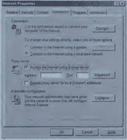

**图 14.3**  
*HTTP 代理配置*

### Windows NT Server 4.0 上的服务器配置

CIS 要求在 Windows NT Server 4.0 计算机上安装 Service Pack 4。CIS 还要求 Internet Information Server 4.0（包括 Internet 服务管理器）正在运行。IIS 4.0 是 Windows NT 4.0 Option Pack 的一部分。

> **警告**
>
> 不应在运行 Microsoft Proxy Server 的计算机上安装 CIS。CIS 与 Microsoft Proxy Server 端口配置冲突。

在 Inetpub 目录下创建 RPC 子目录。例如，在命令提示符下，键入以下内容：

```
md c:\inetpub\rpc
```

在以下说明中，此目录将称为 `%inetpub%\rpc`。

将 rpcproxy.dll 从 Windows 系统目录复制到 `%inetpub%\rpc`。例如，在命令提示符下，键入以下内容：

```
copy %windir%\system32\rpcproxy.dll c:\inetpub\rpc
```

为创建的目录创建虚拟根。为此，请执行以下操作：

- 1. 从“开始”菜单中，选择“程序”，指向 Windows NT 4.0 Option Pack、Microsoft Internet Information Server，然后单击 Internet 服务管理器。
- 2. 在控制台树（左窗格）中，选择 `Console Root/IIS/<machine name>/Default Web Site`。
- 3. 右键单击“默认 Web 站点”，单击“新建”，然后单击“虚拟目录”。在“新建虚拟目录向导”中，输入以下内容：
  - 用于访问虚拟目录的别名：`RPC`
  - 物理路径：`%inetpub%\rpc`
  - 权限：`Execute Access`

不要关闭 Internet 服务管理器。将默认 Web 站点的连接超时更改为 5 分钟。为此：

- 1. 在控制台树（左窗格）中，选择 `Console Root/IIS/<machine name>/Default Web Site`。
- 2. 右键单击“默认 Web 站点”，然后单击“属性”。
- 3. 在“默认 Web 站点属性”对话框中，选择“Web 站点”选项卡。
- 4. 将连接超时更改为 300。
- 5. 单击“确定”。不要关闭 Internet 服务管理器。
- 6. 安装 RPC 代理 ISAPI 筛选器。在控制台树（左窗格）中选择 `Console Root/IIS/<machine name>`，右键单击计算机名称，单击“属性”，选择“主 WWW 服务属性”的“编辑”，选择“ISAPI 筛选器”选项卡，选择“添加”，然后输入以下内容：
  - 筛选器名称：`Rpcproxy`
  - 可执行文件：`%inetpub%\rpc\rpcproxy.dll`


现在可以关闭 Internet 服务管理器。在命令提示符下，使用以下命令停止并重新启动 Internet 信息服务：

```text
net stop iisadmin

net start w3svc
```

按照本章后面的“启用 CIS”一节所述，在服务器上启用 CIS。

> **注意**
>
> 在以前版本的 IIS 中，可以通过在命令行键入 `net stop w3svc` 来停止整个 Web 服务。这将终止计算机上的所有 Web 服务，并关闭 `inetinfo.exe` 进程。由于新的多网站架构，还有一个服务 `iisadmin` 即使在 W3SVC 关闭时也保持运行。从“控制面板”启动和停止服务也是如此。如果确实想要卸载 `inetinfo.exe` 进程并确保所有扩展都被正确卸载，现在应键入 `net stop iisadmin`，而不是 `net stop w3svc`。键入 `net start w3svc` 或 `net start msftpsvc` 会自动启动 `iisadmin`。

## 在 Windows 2000 Server 上配置 RPC 代理

在 Windows 2000 Server 上，CIS 要求 Internet 信息服务（包括 Internet 服务管理器）正在运行。

在 Windows 2000 Server 上，CIS 有自己可选网络安装程序（默认不安装）。它可以像其他可选网络组件一样安装。

在“控制面板”中，选择“添加/删除程序”，单击“添加/删除 Windows 组件”，然后单击“组件”按钮。这将启动“Windows 组件向导”。在该向导中，完成以下步骤：

- 1. 选择“网络服务”，并单击“详细信息”按钮。
- 2. 选中“COM Internet 服务代理”复选框。

你可以在初次安装 Windows 2000 Server 时添加 CIS，也可以在以后添加到现有系统。如果从已安装 CIS 的 Windows NT 4.0 (SP4) Server 升级到 Windows 2000，则需要按照前面所述重新安装 CIS。

## 启用 CIS

要在服务器上启用 CIS，需要将 Tunneling TCP 协议添加到 DCOM 协议列表中。为此，请从 Windows\System 目录运行 DCOMCNFG（使用命令提示符或“运行”框），然后执行以下步骤：

- 1. 选择“默认协议”选项卡。
- 2. 使用“添加”按钮添加 Tunneling TCP/IP。
- 3. 重新启动系统以使此更改生效。

此外，可以通过更改 DCOM 属性的值来控制是否启用 CIS。此设置默认为禁用，可作为一种粗粒度安全控制，以禁用对 DCOM 的潜在 Internet 访问。但请注意，即使启用 CIS，常规的 DCOM 安全检查仍然有效。运行 DCOMCNFG 并执行以下步骤来设置此属性：

- 1. 选择“默认属性”选项卡。
- 2. 选中或取消选中“在这台计算机上启用 COM Internet 服务”复选框。
- 3. 重新启动系统以使更改生效。

## 代理服务器配置

如果客户端配置为通过代理访问 Internet，则必须将代理服务器配置为对客户端连接的端口（默认为端口 80）启用 HTTP CONNECT 方法。此端口配置有时称为“启用 SSL 隧道”。有关如何为 HTTP CONNECT 方法配置端口的详细信息，请参阅代理服务器的文档。

### 配置 Microsoft 代理服务器

如果使用 Microsoft 代理服务器，可通过操作注册表项（例如，使用 regedt32.exe）来指示哪些端口应允许 HTTP CONNECT，从而启用 HTTP CONNECT。在默认配置中，启用了两个端口：443 (https) 和 563 (snews)。相关的注册表项是

```
HKEY_LOCAL_MACHINE\system\CurrentControlSet\services\w3proxy\parameters\SSLPortListMembers
```

该注册表项的值由端口对列表组成。对于默认代理配置（处理端口 80 上的 HTTP 流量），请将端口对 80 80 添加到现有注册表值中。完成此修改后，需要停止并重新启动 Microsoft 代理服务器，以便新设置生效。可以在图 14.4 中查看 Microsoft 代理服务器。

**图 14.4**  
*使用 regedt32 配置 Microsoft 代理服务器。*


## 防火墙配置

CIS 对防火墙的唯一配置要求是允许 TCP/IP 流量不受阻碍地通过端口 80。由于端口 80 通常已对 HTTP 流量开放，因此这是标准情形。但在少数情况下，防火墙会对传入流量执行所谓的应用程序级过滤，这可能导致 CIS 流量被拒绝。

## 配置技巧和已知问题

配置 CIS 时可能会出现一些问题。我在 TechNet 中发现了一些相关文档。

### CIS 客户端上的代理服务器设置不正确

客户端上的代理服务器设置不应包含任何前导正斜杠 (/)。例如，引用 myproxy:80 是正确的，但 http://myproxy 不正确。请注意，代理服务器设置（在“控制面板”中使用“Internet”设置）作为以下注册表项的值存储在注册表中：

```
HKEY_CURRENT_USER\Software\Microsoft\Windows\CurrentVersion\Internet Settings\ProxyServer
```

> **警告**
>
> 不应在托管 Microsoft 代理服务器的计算机上安装 CIS 服务器端，因为存在端口控制冲突。
>
> RPC 代理 RpcProxy.dll 安装在托管 Microsoft 代理服务器的计算机上时无法正常运行。

### 多宿主 CIS 服务器的问题

多宿主 CIS 服务器的客户端使用服务器 IP 地址之一激活对象可能会导致失败。要解决此限制，客户端应使用服务器名称（例如 DNS 名称）。例如，使用 www.sourceDNA.com 而不是 209.42.234.81。

### MTS 对回调的使用

在 Microsoft 事务服务器 (MTS) 方案中，当客户端和服务器共享一个事务时，MTS 基础结构会向客户端进行回调。除非客户端计算机被配置为 CIS 服务器，否则 CIS 不支持此方案。但请注意，此限制不会妨碍基础客户端最常见的事务方案，即不在事务中的客户端调用需要事务的组件的情况。

### HTTP 缓存设备的问题

HTTP 缓存设备（例如 Cisco LocalDirector）可能需要进行调整或禁用。

智能路由器（如 Cisco 的 LocalDirector）允许一组服务器显示为单个虚拟服务器。虚拟服务器的 IP 地址在 DNS 服务器中注册，而服务器本身的 IP 地址不发布。当虚拟服务器收到传入请求时，路由器会将请求分发到其中一个服务器。因此，整个服务器组在客户端看来就像一个服务器。

当 Cisco 的 LocalDirector 与 IIS 结合用于 Web 场中感知会话的负载平衡时，务必确保路由器的间隔与会话对象的超时间隔匹配或超过该超时间隔。默认情况下，Session 对象的超时设置为 20 分钟。通过将以下行添加到 Global.asa 文件，可以将超时间隔更改为 15 分钟：

```
<% Session.Timeout = 15 %>
```

### 影响 CIS 的注册表项

表 14.2 中的信息显示了影响 CIS 的注册表项。

**表 14.2 — 影响 CIS 操作的注册表项**

| 注册表项 | 描述 |
|---|---|
| `HKEY_CURRENT_USER\Software\Microsoft\Windows\CurrentVersion\Internet Settings\ProxyServer` | 此客户端设置的值指示 CIS 使用的 `<proxy server>:<port>`。`<proxy server>` 不应包含前导正斜杠 (`/`)。请注意，此配置由其他使用 HTTP 的应用程序（如 Internet Explorer）与 RPC 运行时环境共享。也可以通过打开“控制面板”中的“Internet”图标来设置代理服务器配置。 |


| 注册表项 | 描述 |
|---|---|
| `HKEY_LOCAL_MACHINE\SOFTWARE\Microsoft\Rpc\DCOM Protocols` | 指示要使用哪些 DCOM 协议的客户端和服务器设置。在 Windows 95 和 Windows 98 上也可以通过 CISCNFG 设置，在 Windows NT 4.0 上可以通过 DCOMCNFG 设置。 |
| `HKEY_LOCAL_MACHINE\SOFTWARE\Microsoft\Ole\EnableDCOMHTTP` | 服务器端设置的值指示是否为该计算机启用 CIS。可能值为 Y 和 N。此属性可通过 DCOMCNFG 设置。 |

### OBJREF 名字对象

为了允许客户端与已在远程服务器上运行的对象建立连接，CIS 提供了一种新型简单名字对象，称为 OBJREF 名字对象。此名字对象提供了一种简单机制，用于将远程对象的引用嵌入 HTML 页面。

OBJREF 名字对象表示对分布式系统上运行的本地或远程对象的引用。OBJREF 名字对象表示特定服务器上的特定运行实例。如果该对象实例终止，则 OBJREF 名字对象无效。

如果从指向远程对象的代理创建名字对象，并在不同的计算机上绑定，则该名字对象将按照 DCOM 快捷方式语义绑定到原始对象。如果在尝试绑定期间无法定位该对象，则不会启动任何新对象。

在许多方面，OBJREF 名字对象的语义与指针名字对象的语义相似，本质上表示指向正在运行对象的远程指针。但是，OBJREF 名字对象的显示名称可以嵌入 HTML 页面，并由客户端小程序或 ActiveX 控件绑定。

### 了解何时使用 CIS

Active Server Page（或生成动态 HTML 内容的其他方式）可能会将 OBJREF 名字对象的显示名称放入小程序或 ActiveX 控件的参数中。然后，该小程序或控件可以使用该名字对象连接到远程服务器上正在运行的对象实例。

要使用 OBJREF 名字对象，生成该名字对象的服务器代码必须使用 `CreateObjrefMoniker` 函数创建名字对象，并传入该名字对象将绑定到的对象的接口。

### 必要的编程更改

使用隧道 TCP 协议时，需要记住几件事。本节将介绍这些内容。

OBJREF 名字对象表示对对象实例的引用，该对象实例运行在本地或远程的进程外服务器上。该名字对象标识对象实例以及该对象运行所在的计算机。OBJREF 名字对象在许多方面与指针名字对象相似，不同之处在于正在运行的对象是进程外的。客户端可以对 OBJREF 名字对象调用 `IMoniker::BindToObject()`，并使用其获得的指针访问正在运行的对象，无论该对象位于何处。

与指针名字对象的一个重要区别是，OBJREF 名字对象的显示名称可以嵌入 HTML 页面，并且该名字对象所表示的正在运行的对象可以由客户端脚本、小程序或 ActiveX 控件绑定。

OBJREF 名字对象的主要用途是通过 Internet 访问正在运行的对象实例。Active Server Page 或生成动态 HTML 内容的其他方式将 OBJREF 名字对象的显示名称放入小程序或 ActiveX 控件的参数中。小程序或控件的代码调用 `CreateObjrefMoniker()` 以基于该显示名称创建 OBJREF 名字对象，然后对生成的 OBJREF 名字对象调用 `IMoniker::BindToObject()` 以获取对正在运行的对象实例的访问权限。然后，Active Server Page 将指向正在运行对象的指针封送回该页面的客户端。表 14.3 显示了 IMoniker 函数及其说明。

**表 14.3. 与 CIS 相关的 IMoniker 函数及注释**

| IMoniker 函数 | 注释 |
|---|---|
| `IMoniker::BindToObject()` | 对于 OBJREF 名字对象，`pmkToLeft` 参数必须为 NULL。由于 OBJREF 名字对象表示正在运行的对象，因此不会发生激活。如果所表示的对象不再运行，则 `BindToObject()` 失败并返回 `E_UNEXPECTED`。 |
| `IMoniker::BindToStorage()` | 此方法获取一个封送指针，该指针指向包含正在运行对象的存储上所请求的接口。由于 OBJREF 名字对象表示正在运行的对象，因此不会发生激活。如果所表示的对象不再运行，则 `BindToStorage()` 失败并返回 `E_UNEXPECTED`。 |
| `IMoniker::Reduce()` | 此方法返回 `MK_S_REDUCED_TO_SELF`，并传回同一个名字对象。 |
| `IMoniker::ComposeWith()` | 如果 `pmkRight` 是反名字对象，则返回的名字对象为 `NULL`。如果 `pmkRight` 是一个复合名字对象，且其最左侧组件是反名字对象，则返回的名字对象是移除了最左侧反名字对象后的复合名字对象。如果 `pmkRight` 既不是反名字对象，也不是其最左侧组件为反名字对象的复合名字对象，则该方法检查 `fOnlyIfNotGeneric` 参数。如果该参数为 `FALSE`，则该方法将两个名字对象合并为通用复合名字对象；如果为 `TRUE`，则该方法将 `*ppmkComposite` 设置为 `NULL` 并返回 `MK_E_NONGENERIC`。 |
| `IMoniker::Enum()` | 此方法返回 `S_OK`，并将 `*ppEnumMoniker` 设置为 `NULL`。 |
| `IMoniker::IsEqual()` | 如果 `*pmkOther` 是 OBJREF 名字对象，并且两个名字对象的路径完全相同（使用不区分大小写的比较），则此方法返回 `S_OK`。否则，该方法返回 `S_FALSE`。 |
| `IMoniker::Hash()` | 此方法计算名字对象的哈希值。 |
| `IMoniker::IsRunning()` | 由于 OBJREF 名字对象表示正在运行的对象实例，因此此方法返回 `TRUE`，除非由于最近的调用失败而已知该对象不再运行。该方法忽略 `pmkToLeft`。 |
| `IMoniker::GetTimeOfLastChange()` | 此方法返回 `E_NOTIMPL`。 |
| `IMoniker::Inverse()` | 此方法返回反名字对象，例如调用 `CreateAntiMoniker()` 的结果。 |
| `IMoniker::CommonPrefixWith()` | 如果两个名字对象相等，则此方法返回 `MK_S_US`，并将 `*ppmkPrefix` 设置为 `NULL`。如果另一个名字对象不是 OBJREF 名字对象，则此方法将两个名字对象都传递给 `IMoniker::CommonPrefixWith()` 函数。该函数能正确处理另一个名字对象是通用复合名字对象的情况。如果没有公共前缀，则此方法返回 `MK_E_NOPREFIX`。 |
| `IMoniker::RelativePathTo()` | 此方法返回 `E_NOTIMPL`。 |
| `IMoniker::GetDisplayName()` | 此方法获取 OBJREF 名字对象的显示名称。该显示名称是一种 64 位编码，封装了正在运行对象的计算机位置、进程终结点和接口指针 ID（IPID）。为了将来兼容，显示名称仅限于可指定为 URL 组成部分的字符。 |
| `IMoniker::ParseDisplayName()` | 如果 `pmkToLeft` 不为 `NULL`，则此方法返回 `MK_E_SYNTAX`。 |
| `IMoniker::IsSystemMoniker()` | 此方法返回 `S_OK`，并传回 `MKSYS_OBJREFMONIKER`。 |

## 第 15 章

## MTS

### 本章内容

- 业务事务 374
- 什么是 MTS？ 376
- 使用 MTS 的好处 376
- MTS 结构 379
- 配置 MTS 381
- MTS 对象 383
- 高级 MTS 技术 393
- 创建基于 MTS 的应用程序 398

COM+ 的目标之一是简化分布式应用程序的开发。因此，COM+ 服务以更易使用、更易管理的过程提供 MTS 所提供的基础结构。但是，尽管这简化了大多数开发人员的任务，却给其他人带来了困扰。COM+ 不提供 MTS 所提供的细粒度控制，有时开发人员会希望从 COM+ 降到 MTS 以获得这种控制。

这也是本章被纳入一本 COM+ 书籍的原因之一。MTS 位于 COM+ 之下，因此仍然可以在需要时调用它。

学习 MTS 的另一个原因是有助于理解基础技术，从而更好地全面了解该主题。此处正是如此——学习 MTS 将有助于你理解 COM+。

### 业务事务

大多数企业应用程序涉及两类不同的项目：付款和商品或服务。客户可能通过网页订购 CD 等商品。然后客户可能输入信用卡号来支付 CD。Web 浏览器中会生成可打印的发票或收据。然后 Web 应用程序指示该交易成功。

在数据库应用程序中，事务是程序执行的一种操作，它会影响至少两项由业务规则约束的共享数据。例如，在客户端/服务器数据库应用程序中，业务规则可能规定：对于从关系数据库的库存表中移除的每一项，必须在同一数据库或另一数据库的某个账户表中添加一条收款记录。

从编程角度看，事务必须遵循四项标准，即 ACID 规则。根据 ACID 原则，事务必须满足以下条件：

- 原子事务——必须是全有或全无的操作。例如，如果库存减少，收入必须增加。应用程序不能只减少库存而不增加收入。同样，应用程序不能增加收入而不减少库存。只有当所有部分都成功完成后，更改才是永久的。
- 一致——事务完成后，数据库中的数据必须按照参照完整性规则的规定有效。这意味着，即使单个更改违反了数据库规则，在所有更新完成后，数据也必须有效。
- 隔离——同时发生的多个事务对数据的影响必须如同所有事务一次一个并按顺序运行一样。事务不是

允许使用另一个事务未提交的更改。例如，如果事务 A 减少了库存中的图书数量，那么事务 B 在事务 A 最终确定之前不能使用未提交的图书总数。

- **持久性**——事务中的所有提交都是最终的。程序收到事务已成功的确认后，如果操作系统崩溃或网络中断，那么在系统恢复时，更改必须仍然存在。

## 协调事务

分布式应用程序中的一个常见问题是协调涉及多个服务器中不止一个数据源的事务，而这些服务器可能彼此差异巨大。为了使事务具有原子性，必须协调这些服务器。换句话说，不能触发一个服务器提交事务，结果却发现另一台服务器无法继续该事务。要使事务成功完成，两台服务器都必须提交该事务。

为了实现这一点，事务系统使用事务管理器的服务，由事务管理器执行一种称为两阶段提交的协议。两阶段提交是一种协议：在提交事务之前，先询问数据源或资源管理器是否准备好提交。在所有 RM 都作出肯定答复后，再指示它们提交。

术语“资源管理器”表示管理持久数据（或资源）的系统。资源的一个示例是数据库。Microsoft SQL Server 就是资源管理器的一个示例。资源的其他示例包括消息队列、文件等。

为了简化使用两阶段提交协调事务的过程，您可以使用 Microsoft Distributed Transaction Coordinator（MS DTC）。MS DTC 最初于 1996 年 4 月随 SQL Server 6.5 一起发布。后来，MS DTC 从 SQL Server 中分离出来，现在是 Microsoft Windows NT 核心服务的一部分。

MS DTC 协调跨多个资源管理器发生的事务，这些资源管理器可以在不同的计算机上运行。

## 事务与 COM

过去，组织围绕特定的数据库系统创建胖客户端或两层解决方案。在客户端/服务器系统中，数据库驻留在服务器计算机上，客户端通过网络连接到服务器。客户端运行应用程序，这些应用程序包含显示数据的代码，以及按照特定规则集（业务规则）直接使用数据库系统操作数据的代码。这些应用程序通常通过一系列专为该特定数据库设计的专有 API 函数访问数据库服务器。这些 API 通常提供开始、提交和中止事务的方法。因此，客户端决定了事务的长度。

胖客户端使用大量内存、磁盘空间，并且有许多依赖项。为了提高性能和可伸缩性，胖客户端被拆分，以允许其从不同的计算机上运行。数据库操作代码和业务规则代码从前端分离出来，成为所谓的中间层。

Windows 环境中的开发人员转向 COM，将其作为构建中间层组件的标准。使用 COM，您可以创建专门处理多项业务任务的独立组件。例如，一个应用程序可以有一个用于更新库存的组件，另一个用于计算佣金的组件，等等。但是，在不同的 COM 对象之间协调事务很困难，尤其是当这些事务涉及多个服务器中的多个数据库时。

为了更容易用 COM 编写中间层，Microsoft 引入了 MTS。

## 什么是 MTS？

MTS 是基于 COM 的中间层组件的容器。MTS 充当事务处理（TP）监视器。TP 监视器是管理事务的软件。TP 监视器有助于实现 ACID 规则，并使用事务管理器在事务性分布式应用程序中执行两阶段提交协议。简而言之，TP 监视器是事务发生的软件场所——可以把它看作市场。MTS 借助 MS DTC 的服务来协调 COM 对象之间的事务，这些事务可能涉及不同计算机中的不同数据库资源。

MTS 还充当对象请求代理（ORB）。ORB 是一种可以管理中间层组件生命周期的软件。不过，您将在本章了解到，MTS 远不止是 TP 监视器和 ORB。在许多方面，MTS 是对经典 COM 的增强。

## 使用 MTS 的优势

到目前为止，本章从事务处理的角度定义了 MTS（毕竟该产品称为 Transaction Services）。然而，MTS 能做的远不止帮助协调事务。MTS 可以增强并改变组件的行为方式。

为了无缝地提供许多服务，MTS 使用一种称为拦截的机制。拦截使 MTS 能够在调用发生前后监视对对象进行的每次调用。

因为 MTS 可以监视和拦截调用，所以它可以执行的功能不仅仅是协调事务。例如，MTS 使用拦截来实现基于角色的安全机制，这种机制比 DCOM 提供的机制更复杂。拦截

## 即时激活

因为 MTS 可以拦截对每个已配置组件的调用，所以当对象的某个方法首次被调用时，MTS 可以延迟激活该对象。这称为即时激活，将在第 20 章中更详细地介绍。

## MTS 资源管理器

MTS 资源管理器是一个以 MMC 管理单元形式提供的用户友好工具，允许您配置在 MTS 下运行的 COM 对象。

此工具的用户界面比 Dcomcnfg.exe 更易于使用且更健壮，后者是用于配置 DCOM 服务器的工具。

## 事务协调

如前所述，MTS 的主要工作之一是在组件之间协调事务。MTS 使用事务的民主制度。换句话说，对象不能显式开始、提交或中止事务。相反，对象投票决定事务是否应继续。客户端在调用第一个标记为事务性的组件时发起事务。

## MTS 与 Microsoft Internet Information Server 的集成

尽管本章未详细讨论，但 Microsoft Internet Information Server（IIS）与 MTS 紧密集成。这是一个真正的优势，因为 Web 页可以发起事务，从而为企业应用程序提供额外的灵活性。Active Server Page（ASP）只需在其标头中指定 Transaction=required 即可参与事务，如下面的代码所示：

```
<%@ TRANSACTION=Required LANGUAGE="VBScript" %>
```

## MTS 与 Microsoft Message Queuing Services 的集成

Microsoft Message Queuing Services（MSMQ）是分布式应用程序通过消息传递进行通信的一种方式。应用程序可以作为事务的一部分发送和接收 MSMQ 消息。例如，对象可能发送一条消息，但直到事务提交后，该消息才会真正发送。

现在您已经了解了使用 MTS 的优势，接下来看看 MTS 是如何组织的。

## MTS 结构

本节说明 MTS 对象的层次结构以及 MTS 内部如何工作。我们将从了解包（MTS 的管理单元）开始。然后，将讨论组件和上下文——这些对于本书后面关于 COM+ 的章节很重要。接着讨论活动和角色，以完善本节内容。

### 包

包是一组具有共同目标的对象；包通常可以被视为应用程序的中间层。MTS 中存在两种类型的包——服务器包和库包。服务器包在其自己的进程中运行；库包被加载到客户端的进程空间中。

> **注意**
> 
> 因为本章重点介绍 MTS 和 COM 的较旧技术，所以建议了解 COM+ 技术在事务性技术方面使用的任何新术语。在 COM+ 中，包称为应用程序。

一个对象不能属于多个包。如前所述，MTS 提供一个代理进程 Mtx.exe 来承载 DLL 中的 COM 对象。当您将 COM 类添加到服务器包时，MTS 会修改该类的注册表设置。COM 类将配置设置存储在注册表中的 HKEY_CLASSES_ROOT\CLSID 下。

每个类都有一个 GUID，也称为 CLSID。创建类时，它会调用 COM API CoCreateInstance() 或 CoGetClassObject()。

CoCreateInstance() 和 CoGetClassObject() 使用 SCM 获取类的实例。客户端在这些 API 中通过 CLSID 指定要创建的类。SCM 在注册表中查找该特定 CLSID，找到后，会在 InprocServer32 子键中查找包含该类的 DLL 的名称和路径。然后 SCM 加载该 DLL，并调用一个众所周知的入口点 DllGetClassObject。

DllGetClassObject 函数向 SCM 提供指向目标类的指针。创建包并将组件添加到此包时，MTS 会更改 InprocServer32 键的值。如果将组件添加到服务器包，MTS 会删除 InprocServer32 子键中的值，并添加 LocalServer32 子键。（LocalServer32 子键指定进程外服务器的路径。）在 LocalServer32 子键中，MTS 写入代码。

```
D:\WINNT\System32\mtx.exe /p:{4B118EAB-8BA8-11D3-81D8-000000000000}
```


字符串的前半部分是 MTS 代理进程（Mtx.exe）的名称和路径。字符串的后半部分是可执行文件的命令行参数——它指定包含原始服务器名称的包的 GUID。换句话说，客户端可以继续请求相同的 CLSID，而应用程序将透明地在 MTS 代理进程中实例化该对象。MTS 还会将包 GUID 添加到注册表中的 HKEY_LOCAL_MACHINE\\SOFTWARE\\Microsoft\\Transaction Server\\Packages 下。

在所示示例中，确切的包项为 HKEY_LOCAL_MACHINE\\SOFTWARE\\Microsoft\\Transaction Server\\Packages\\{4B11EBAB-8BA8-11D3-81D8-000000000000}。在此键下，您将找到该包的所有配置设置，以及一个组件子键，该子键包含包中每个组件的附加子键。

除了创建所请求 COM 对象的实例外，Mtx.exe 还加载 MTS Executive（Mtxex.dll）。MTS Executive（或 MTS 运行时）负责为您的对象创建上下文包装器。您将在下一节中了解有关上下文包装器的更多信息。

> **注意**
>
> 如果组件被添加到库包中，MTS 会将 InprocServer32 的值更改为指向 MTS Executive（Mtxex.dll）。

## 组件与上下文

包存储组件。MTS 组件相当于 COM 类或 coclass。MTS 对象是 MTS 组件的内存中实例。

在 MTS 创建对象之前，它会为该对象创建上下文包装器（MTS 在销毁对象之前销毁上下文包装器）。上下文包装器包含有关对象执行环境的信息——它存储安全设置、事务信息等。MTS 将上下文包装器插入到存根（位于代理/存根层中）和对象之间。上下文包装器就位后，MTS 可以在对对象的每次调用发生之前和之后拦截该调用。就所有实际用途而言，请将上下文包装器视为 MTS 对象所在的位置。

本章后面，您将了解如何确保上下文包装器与对象之间的关系始终得以保持。为了充分利用 MTS，您还将了解如何访问对象的上下文包装器并调用其方法。来自 MTS 配置组件的每个对象实例都有一个与之关联的上下文包装器。每个对象最多有一个与之关联的上下文包装器。由已配置组件创建的非配置组件（非 MTS 组件）的对象实例没有自己的上下文包装器，但可以访问其创建者的上下文包装器。

## 活动

活动是一组具有相同并发要求的对象。在 MTS 2 中，只存在一种无法通过属性设置的并发模型。（MTS 2 的这一方面在 Microsoft Windows 2000 中与 COM+ 一起将变得更加重要，因为管理员可能会更改对象的并发要求。）MTS 2 支持的唯一并发模型是串行化；一次只有一个客户端可以调用进入活动。当客户端创建新的 MTS 对象时，MTS 会启动一个新活动。创建该对象的客户端称为基础客户端；基础客户端为启动活动而创建的对象称为活动的根。根对象可以使用特殊的 MTS API 函数 CreateInstance() 邀请其他对象成为同一活动的一部分（您稍后将学习如何执行此操作）。CreateInstance() 是 IObjectContext 接口中的函数。此后，活动中的任何其他对象都可以使用此 API 邀请其他对象加入活动。一个活动可以涉及来自一个或多个包的组件，甚至来自其他计算机中包的组件。只有同一活动中的对象才能参与同一事务。

## 角色

如果不讨论角色，对 MTS 结构的考察就不完整。如前所述，角色是用户定义的组，用于定义用户对包、组件或接口的访问权限。例如，如果您希望会计组中的所有用户都能访问某个组件，而工程组中的用户不能访问，则您可以将所有会计用户放入给定组件的 MTS 角色中。

## 配置 MTS

MTS 通常有两种环境：生产环境和开发环境。在生产环境中配置服务器时，您可能希望限制可以修改组件属性的用户。MTS 提供了一个系统包，您可以配置该包以限制对服务器中各种功能的访问。此包有两个预定义角色：Administrator 和 Reader。但是，这两个角色没有分配任何用户。在生产环境中，您需要将用户分配给这些角色，并确保为此包启用了安全性。

确保安全性处于活动状态，请执行以下操作：

- 1. 启动 MTS Explorer。
- 2. 在左窗格中，打开“我的电脑”下的“已安装的包”文件夹。
- 3. 右键单击“系统”包，然后选择“属性”。
- 4. 单击“安全”选项卡，然后选中“启用授权检查”复选框。

默认情况下，您的 MTS Explorer 设置为仅查看当前计算机的属性。但是，您可以通过单台计算机管理网络上另一台计算机的 MTS 设置。

要在 MTS Explorer 中查看另一台计算机，请执行以下操作：

- 1. 右键单击“计算机”文件夹，指向“新建”，然后选择“计算机”。
- 2. 在“添加计算机”对话框中，键入要管理的计算机名称，然后单击“确定”。您必须有权访问此计算机，并且必须是 Reader 成员才能查看设置，或者是 Administrator 成员才能更改属性。

> **注意**
>
> 不能从运行 Windows NT 的计算机远程管理运行 Windows 95 的计算机。

## 以编程方式管理 MTS 服务器

MTS 提供了一系列可脚本化对象，允许您以编程方式管理服务器。这些对象基于 IDispatch，尽管完全可以使用 Visual C++ 编写程序来使用这些对象，但大多数人认为最好将 IDispatch 接口留给脚本客户端使用。MTS 管理对象如下：

- Catalog Root object——允许您连接到本地或远程目录并检索集合
- CatalogObject——允许您获取和设置对象属性
- CatalogCollection——枚举、添加、删除和修改目录对象
- PackageUtil——允许您安装和导出包
- ComponentUtil——在特定集合中安装组件，并导入注册为进程内服务器的组件
- **RemoteComponentUtil**——允许您从远程服务器上的包中拉取远程组件
- **RoleAssociationUtil**——将角色与组件或接口关联

清单 15.1 在“已安装的包”文件夹中创建一个名为 mcsdpackage 的新包。此示例用 VBScript 编写。代码首先创建 Catalog 对象的实例，并使用 GetCollection() 方法检索 Packages 集合。然后代码调用该集合的 Add() 方法。

要运行此代码并已安装 Windows Scripting Host（WSH），请将清单 15.1 中的代码输入到记事本文件中，并以 .vbs 扩展名保存。要运行它，请双击该文件。

### 清单 15.1 检索并使用包

```vb
' First, create the catalog object
Dim catalog
Set catalog = CreateObject("MTSAdmin.Catalog.1")
' Next, get the packages collection
Dim packages
Set packages = catalog.GetCollection("Packages")
packages.Populate

' Add a new package
Dim newPackage
Set newPackage = packages.Add
newPackage.Value("Name") = "mcsdpackage"
' Commit new package
packages.SaveChanges
' Refresh packages
packages.Populate
```

## MTS 对象

很难为构建中间层组件提供通用指导，因为它们因情况而异。但是，有几条提示适用于大多数项目。

首先，为数据库应用程序创建组件时，不应试图在中间层组件中完成数据库的工作。数据库工作（例如搜索记录和联接两个表）最好使用查询来完成。

其次，不应试图编写既能在 MTS 内部又能在 MTS 外部工作的通用组件。MTS 为每个对象创建上下文包装器。MTS 对象可以访问上下文包装器并获得各种属性。例如，如果您的

当对象依赖于在事务上运行的 MTS 时，在更改数据库之前，你应首先确认管理员没有更改你的对象的配置。同样，如果你的对象必须具备严格的安全性，你应当意识到管理员可能会关闭你的包的安全性。你必须检查上下文，以确保安全性确实已开启。MTS 对象的生命周期路径也与经典 COM 对象不同。

## 为 MTS 开发对象

MTS 组件是满足以下要求的 COM 类：

- MTS 组件必须驻留在进程内服务器中。
- 类必须实现 `IClassFactory`。
- 必须使用类型库封送或标准完全解释封送。
- 所有组件接口和 coclass 都必须包含在类型库中。

### 进程内服务器位置

MTS 要求对象位于进程内服务器（DLL）中。MTS 对象可以位于库包或服务器包中。当客户端要求 MTS 在库包中创建对象时，这些对象会被加载到客户端的地址空间中。当客户端要求 MTS 在服务器包中创建对象时，MTS 会将这些对象加载到由 MTS 提供的代理进程 MTx.exe 的地址空间中。如果你习惯于创建进程外服务器，请考虑：与运行组件所需的代码相比，运行进程外服务器所需的代码通常微不足道。MTS 会处理运行组件所需的基础结构。

### IClassFactory 实现

每个 COM DLL 都有一个名为 `DllGetClassObject` 的标准入口点，COM 使用它来获取 COM 类的实例。该类必须实现 `IClassFactory`。MTS 使用 `IClassFactory::CreateInstance` 方法创建对象。

### 类型库封送或标准完全解释封送

对象可以使用两种封送机制之一：类型库封送或标准封送。MTS 不允许自定义封送。如果需要代理/存根 DLL，则必须使用 `/Oicf` MIDL 编译器标志生成该 DLL 的源代码。这将生成一个“完全解释”的代理/存根 DLL。此外，如果使用代理/存根 DLL，则源代码必须使用 MIDL 3.00.44 或更高版本生成，并且必须将该 DLL 与 MTS 提供的 Mtxh.lib 库链接。

Mtxh.lib 库必须是你链接到代理/存根 DLL 中的第一个文件。

### 类型库中的组件接口和类

MTS 读取服务器的类型库，以在 MTS 资源管理器中显示类、接口和方法的名称。要使用 ATL 创建与 MTS 兼容的 COM 服务器，请执行以下操作：

- 1. 打开 Visual C++ 6.0。在“文件”菜单上，单击“新建”。
- 2. 在“新建”对话框的“项目”选项卡上，选择 ATL COM AppWizard，为项目键入名称，然后单击“确定”。
- 3. 在 ATL COM AppWizard 中，在“服务器类型”下选择“动态链接库 (DLL)”，并选中“支持 MTS”复选框。
- 4. 单击“完成”，然后单击“确定”。

使用此过程生成的项目除了“传统库”之外，还会在链接步骤中添加两个库。这两个库是 Mtx.lib（它是 MTS 运行时 Mtxex.dll 的导入库，包含诸如 CreateInstance 和 SafeRef 等各种 MTS API 函数）和 Mtxguid.lib（它包含 MTS 中各种类和接口的所有 GUID）。此外，项目还会与 Delayimp.lib 库链接。该库允许服务器延迟加载 DLL，在此例中为 Mtxex.dll。生成的项目文件有一个小问题：它把自注册步骤添加为自定义生成步骤，这并不可取，因为注册服务器会将注册表设置改回其原始状态（在将 DLL 添加到包之前）。

要创建能够访问其上下文包装器对象的 COM 对象，请记住：ATL 对象向导允许你创建与 MTS 兼容并能够利用 MTS 运行时功能的 COM 对象。为此，请在 ATL 对象向导的“对象”组中选择“MTS Transaction Server 组件”。但是，如果你要修改现有组件以便在 MTS 中运行，可以通过执行以下步骤来复制 ATL 对象向导的功能：

- 1. 从前面代码中所示的等效 ATL 简单对象开始。
- 2. 添加以下代码：`#include <mtx.h>`
- 3. 在类的头文件中的类声明内添加宏 `DECLARE_NOT_AGGREGATABLE`。MTS 类不能是可聚合的。

通过包含 mtx.h，你可以访问若干 MTS API 函数和若干 MTS 接口定义。其中一个 API 函数是 GetObjectContext()。

使用此 API，你可以访问与对象实例关联的上下文包装器对象。以下代码展示了此 API 的用法：

```
IObjectContext *pObjectContext = NULL;
HRESULT hr = GetObjectContext(&pObjectContext);
if (SUCCEEDED(hr))
{
    // do something with the context wrapper here
    ...
    // release the context wrapper when done
    pObjectContext->Release();
}
```

### 拦截

为了让 MTS 发挥其魔力，它必须执行拦截。如你所知，拦截通过上下文包装器发生。客户端与上下文包装器通信，并将上下文包装器视为对象。重要的是，客户端甚至另一个对象绝不能直接获得对你对象的引用，从而绕过上下文包装器和拦截。因此，绝不要将对你对象的引用发送给另一个对象。例如，考虑你的对象实现回调接口的示例，如下所示：

```
ISomeObject *pObject;
HRESULT hr = CreateSomeObject(&pObject);
pObject->RegisterCallback(this);
```

前面代码的最后一行发送的是对该对象的直接引用。相反，你必须使用 `SafeRef()` 函数。`SafeRef()` 会为你提供对上下文包装器的引用。然后，你可以将此引用交给客户端或其他对象。以下代码展示了在回调中共享对象的正确方式：

```
ISomeObject *pObject = NULL;
HRESULT hr = CreateSomeObject(&pObject);
IMYInterface *pIMe = NULL;
pIMe = SafeRef(IID_IMyInterface, (IUnknown*)this);
pObject->RegisterCallback(pIMe);
```

MTS 2 使用一种称为即时 (JIT) 激活的功能。在 JIT 中，当客户端创建对象时，MTS 会创建该对象和一个上下文包装器。它将包装器插入到存根和对象之间，但在激活之前不会将上下文包装器绑定到对象。激活发生在客户端进行第一次方法调用时。以同样的方式，在销毁对象之前，MTS 会执行停用。在停用过程中，MTS 销毁上下文包装器。接下来，对象被销毁。

JIT 意味着 MTS 2 中的所有对象在其生命周期中都有四个阶段：创建、激活、停用和销毁。因此，在 MTS 2 中，创建和销毁的发生方式与没有 MTS 时相同；换句话说，当另一位开发者创建你的对象时，你的对象被创建；当所有引用都被释放时，对象被销毁。但是，对象在激活之前无法访问上下文包装器。

同样，对象在其析构函数中无法访问上下文包装器，因为此时上下文包装器已经断开连接。（MTS 2 几乎不区分停用和销毁，只是上下文包装器在停用阶段仍然可用。）COM+ 引入了对象池的概念，在该概念中，对象可以控制释放所有引用是否真正删除该对象，还是将该对象存储在对象池中。

要实现 IObjectControl 以接收 JIT 通知，请执行以下操作：

- 1. 将 IObjectControl 添加到你的 MTS 兼容类的继承列表中。
- 2. 按如下方式将该接口添加到查询接口映射中：
  `COM_INTERFACE_ENTRY(IObjectControl)`
- 3. 实现 IObjectControl 中的三个方法——Activate、CanBePooled 和 Deactivate。

```
HRESULT Ctestobj1::Activate()
{
}

BOOL Ctestobj1::CanBePooled()
{
    return FALSE;
}
void Ctestobj1::Deactivate()
{
}
```

对象池在 MTS 2 中不可用；因此，前面的代码应返回 FALSE。

> **注意**
>
> 实际上，你也可以返回 TRUE。有些人建议返回 TRUE，以便对象池功能一可用就开始工作。但是，除非已经仔细考虑了对象池的影响，否则不建议这样做。

## 创建用于承载组件的包

创建中间层组件后，你将希望创建用于承载组件的包。

要在 MTS 中创建包，请执行以下操作：

- 1. 在 MTS 资源管理器中，打开“计算机”分支。
- 2. 打开要在其中安装包的计算机分支。


- 3. 右键单击“已安装的包”分支，指向快捷菜单上的“新建”，然后单击“包”。将出现“包向导”对话框。
- 4. 单击“创建空包”按钮。（您将在本章后面的“导入包”一节中了解“安装预生成包”按钮的用法。）
- 5. 为新包键入名称（名称可以包含空格）。单击“下一步”。
- 6. 设置包的标识。您稍后可以在包中更改标识。在开发期间，您希望使用“交互式用户”。此设置使用已登录用户的凭据。使用“交互式用户”的一个副作用是，所有输出都会出现在当前 WinStation 中。此设置的一个问题是，它要求有人登录，包才能执行。
- 7. 在生产环境中，您应选择“此用户”选项。选择“此用户”后，您可以键入特定用户的凭据；当服务器需要访问文件等共享资源时，将使用这些凭据。请注意，使用此设置时绝不应显示输出。输出不会出现在当前 WinStation 中。例如，如果您尝试显示消息框，消息将不可见，而您的程序会因等待用户交互而看起来像冻结了一样。
- 8. 单击“完成”。

## 向包中添加对象

尽管可以使用多种机制向包中添加对象，但最简单的方法是通过拖放操作，将包含类的 DLL 移动到包下的 Components 文件夹中。

要使用拖放向包中添加对象，请执行以下操作：

- 1. 确保已选中 Components 文件夹。
- 2. 在 Windows 资源管理器中，将 DLL 文件拖到 MTS Explorer 窗口的右窗格中。MTS 将添加类型库中描述的所有对象。

您也可以不使用拖放向包中添加对象。

要在不使用拖放操作的情况下向包中添加类，请执行以下操作：

- 1. 展开要插入组件的包分支。右键单击 Components 文件夹，指向快捷菜单上的“新建”，然后选择“组件”。
- 2. 如果要添加某个 DLL 中的每个组件，请单击“安装新组件”。此选项类似于使用拖放操作，并且不要求预先注册该 DLL。
- 3. 如果要从已注册组件列表中按 ProgID 选择组件，请单击**“导入已注册的组件”**。此过程是从 DLL 中添加单个组件的唯一方法。如果要将一些组件添加到一个包，将另一些组件添加到另一个包，请使用此方法。

创建包时，请确保添加对象所依赖的任何类型库，以及需要时的代理存根 DLL。在另一台计算机上部署包时，这会很方便。

## 包属性

包有许多属性需要您注意。您可以右键单击某个包，并从快捷菜单中选择“属性”，以查看“包属性”对话框。

在“常规”选项卡上，请注意可以为包键入说明。在另一台计算机上导入包时，这很有用。“安全”选项卡包含一个用于为包启用安全的复选框。请注意，默认值为“无安全”。此选项卡还包含客户端与包之间调用的身份验证级别。

“高级”选项卡提供了一个名为“服务器进程关闭”的设置，用于确定何时关闭服务器进程。这是 MTS 中的一项优化，可以在释放对对象的所有引用后使用。服务器删除包中所有对象实例后，会在“服务器进程关闭”设置指定的时间内保持加载状态。对于在指定时间内与服务器开始会话的客户端，这会提高性能。

> **注意**
> 
> 在开发期间，应将“服务器进程关闭”设置得尽可能低，因为服务器正在运行且服务器 DLL 已加载时，您将无法重新生成代码。

“高级”选项卡还有两个权限设置：“禁用删除”和“禁用更改”。通过启用这些设置，您可以对 MTS Explorer 用户锁定该包。如果启用“禁用更改”选项，用户将无法修改此包。属性对话框中的所有选项（权限设置除外）都将变为不可用。若要在以后进行修改，必须解锁该包；清除权限选项即可解锁该包。

“标识”选项卡允许您选择 MTS 在访问共享资源（例如网络上的文件）时将使用的安全标识符 (SID)。这是服务器在进行出站调用时将模拟的用户 ID 和密码。例如，您的代码可能访问另一台计算机上的文件。

您可以使用特定的用户 ID 和密码来访问那台其他计算机，也可以使用交互式用户，即当前登录的用户。但是，您的服务器上可能没有人登录，这会使服务器不可用；或者已登录用户可能没有访问共享资源的安全权限。

因此，在生产环境中，您应使用具有足够安全权限、能够访问共享资源的特定用户。您可以为包设置的最重要属性可能就是激活类型，它位于“激活”选项卡上。选项包括“库包”或“服务器包”。库包就是要在进程内使用的包。服务器包将被加载到 MTS 代理进程 Mtx.exe 中。与服务器包相比，库包有一些限制；最值得注意的是，库包不控制安全。加载它们的进程决定其安全。

## 对象属性

对象也有一系列声明性属性。其中最重要的属性也许是事务支持。

MTS 负责启动事务，并调用 MS DTC 的服务来登记资源管理器并控制事务流。组件通过声明性设置决定 MTS 何时启动事务。管理员可以通过更改组件的事务属性来更改组件的事务要求。

为此，请右键单击要修改的组件，并在快捷菜单中选择“属性”。接下来，单击“事务”选项卡。在“事务”选项卡上，您可以从四个选项中选择：“需要事务”、“需要新事务”、“支持事务”和“不支持事务”。

当标记为“需要新事务”或“需要事务”的对象被创建并激活（在第一次方法调用之后）时，MTS 会启动事务。

使 MTS 开始事务的对象称为事务根。

如果其他对象是从已在事务中的对象内部创建的，则它们可以参与同一事务。对象要参与同一事务，就必须属于同一活动。换句话说，必须使用 IContextObject 接口的 CreateInstance() 函数创建它。该组件还必须标记为“需要事务”或“支持事务”。

如果次级组件标记为“需要新事务”，MTS 将为该对象创建新事务；该对象将无法参与创建者的事务。标记为“不支持事务”的组件不能参与同一事务。

如您所见，更改组件中的事务属性设置可能会对应用程序的行为产生巨大影响。试想一下，如果您在编写对象 B 时认为它会与对象 A 处于同一事务中，而 MTS 管理员决定将对象 B 标记为“需要新事务”，会发生什么。您无法做太多事情来阻止管理员这样做。但是，您可以在类型库中为每个组件设置默认事务设置。为此，首先在 IDL 文件顶部包含 Mtxattr.h 文件，如下所示：

```
#include <mtxattr.h>
```

此文件声明了一些可用作 coclass 特性的特性。这些特性是 TRANSACTION_REQUIRED、TRANSACTION_SUPPORTED、TRANSACTION_NOT_SUPPORTED 和 TRANSACTION_REQUIRES_NEW。要使用这些特性，只需将它们添加到 coclass 特性中，如下所示：

```
[
    uuid(01C72192-8CB0-11D3-81E1-00B0BAA1DBA9),
    helpstring("ctxobj1 Class"),
    TRANSACTION_REQUIRED
]
coclass ctxobj1
{
    [default] interface Ictxobj1;
};
```

这些特性不会阻止管理员更改该属性；它们只是为 MTS 提供组件的默认事务设置。也就是说，当组件添加到包中时，事务设置将根据默认设置进行设置。

## 部署基于 MTS 的对象

MTS 提供了一种机制，用于导出包定义及其组件，并在另一台服务器中导入该包。MTS 还提供了一种生成安装程序的方法，该程序将安装必要的注册表信息，以便在没有安装 MTS 的客户端计算机上激活服务器组件。


**注意**

客户机不需要安装实现服务器对象的 DLL 就能创建对象实例，也不需要安装 MTS。客户端唯一需要的是注册表中的类 ID GUID (CLSID) 和接口 GUID (IID)。客户端还需要服务器的类型库，以便在服务器使用类型库封送处理时，类型库封送器可以在两台计算机之间封送接口；或者当服务器要求标准封送处理时，需要代理/存根 DLL。通过导出包生成的安装程序负责安装类型库或代理/存根 DLL，并向注册表添加必要的键。它会在 Program Files 目录下创建一个名为 Remote Applications 的子目录，并将类型库或代理/存根 DLL 安装到该目录中。但是，如果服务器将类型库作为资源嵌入到 DLL 中，请确保同时将类型库文件 (TLB) 作为单独的 DLL 添加到包中。否则，MTS 会将服务器文件添加到客户端安装程序中，而不是仅添加类型库文件。

## 导出包

当准备好将应用程序迁移到生产服务器时，你会希望导出包。

要导出包，请执行以下操作：

- 1. 在 MTS 资源管理器中，右键单击要导出的包，然后选择“导出”。将出现“导出包”对话框。
- 2. 键入包的准确路径和名称。如果要导出每个角色的用户 ID，请选中“保存与角色关联的 Windows NT 用户 ID”复选框。此复选框仅涉及角色中的用户。如果未选中此复选框，角色信息仍会导出，但角色中的实际用户 ID 将不会包含在内。这通常是在从开发环境转移到部署环境时想要做的。单击“导出”。
- 3. 如果这不是第一次将包导出到同一位置，“覆盖文件”对话框将提示你覆盖旧的包和 DLL。单击“确定”。
- 4. “导出包”对话框关闭。导出完成后，MTS 资源管理器会重新出现，并显示一个消息框，告诉你包已成功导出。单击“确定”。

现在，你应该有一个以 .pak 文件形式导出的包。.pak 文件是一个文本文件，包含在另一台服务器上重新创建包所需的设置。

## 导入包

导出包后，可以将其导入到另一台 MTS 服务器中。

要将包导入到另一台 MTS 服务器，请执行以下操作：

- 1. 在 MTS 资源管理器中，打开“计算机”分支，然后打开“我的电脑”。
- 2. 右键单击“已安装的包”文件夹，指向快捷菜单上的“新建”，然后选择“包”。将出现“包向导”对话框。
- 3. 不要单击“创建空包”按钮，而是单击“安装预构建包”按钮。将出现“选择包文件”对话框。
- 4. 单击“添加”按钮，找到要安装的包，然后单击“下一步”。
- 5. 在“设置包标识”对话框中，指定包运行时所用的帐户。请记住，在开发时，选择“交互式用户”更方便，但在生产环境中，你会希望选择“此用户”并指定用户的凭据。单击“下一步”。
- 6. 在“安装选项”对话框中，键入要将组件文件复制到的目录。此目录是组件将要注册的位置。
- 7. 单击“完成”。

很多时候，你可能希望将带有 UI 的应用程序分发给客户端，但不安装服务器组件。例如，在每台客户端计算机上安装所有组件是没有意义的。客户端应用程序所需要的只是包中类的注册表信息。导出包时，MTS 会创建一个客户端子目录，其中包含一个小型可执行文件，该文件仅将注册表信息写入客户端计算机。

## 高级 MTS 技术

MTS 安全性构建在 DCOM 之上，因此它的许多元素基于 DCOM 范式也就不足为奇了。然而，MTS 通过做两件事扩展了 DCOM 安全性。首先，因为 MTS 提供了一个容器应用程序 (Mtx.exe)，它负责控制进程外激活的安全性，并让程序员不必过多担心直接针对 COM 安全 API 进行编程。其次，因为 MTS 提供了更多安全检查点，所以它在安全性方面提供了更高的粒度。DCOM 仅提供两个安全检查点：启动服务器和访问服务器。除了这两个级别之外，MTS 还在组件级别和接口级别提供检查点。此外，MTS 还提供了几种简单的方法，可将安全性扩展到方法级别。

### 使包和组件可使用安全性

角色是一组用户。角色按包分配。创建新包时，默认情况下安全性不可用。可以通过执行以下步骤使包或组件可使用安全性。

要使包可使用安全性，请执行以下操作：

- 1. 在 MTS 资源管理器中，右键单击该包，然后在快捷菜单中选择“属性”。将出现“属性”对话框。
- 2. 在“安全”选项卡上，选中“启用授权检查”复选框，然后单击“确定”。

要使组件可使用安全性，请执行以下操作：

- 1. 在 MTS 资源管理器中，右键单击该组件，然后在快捷菜单中选择“属性”。将出现“属性”对话框。
- 2. 在“安全”选项卡上，选中“启用授权检查”复选框，然后单击“确定”。

> **注意**
>
> 默认情况下，组件级别可使用安全检查。换句话说，一旦在包级别启用安全性，就必须创建角色并将其分配给每个组件。否则，每个用户都将被拒绝访问该包的权限。

### 为包创建角色

在 DCOM 下，安全性是按进程以编程方式影响的。在 MTS 下也是如此：每个包都在单独的进程中运行。如果查看任务管理器，你会看到每次客户端实例化不同包中的组件时，MTS 都会运行一个单独的 Mtx.exe 实例（该组件的代理进程）。因为每个包都在不同的进程中运行，所以角色按包创建。这也是库包不能使用 MTS 基于角色的安全性的原因。库包加载到调用方的进程空间中，然后绑定到进程安全模型。因此，此库包可以受保护，也可以不受保护。当 Mtx.exe 进程加载库包时，即当包由 MTS COM 对象创建时，库包受保护。创建库包的非 MTS 进程会自动使其不受保护。

要为包创建角色，请执行以下操作：

- 1. 在 MTS 资源管理器中，选择并打开要为其设置角色的包。
- 2. 右键单击“角色”文件夹，指向快捷菜单上的“新建”，然后选择“角色”。
- 3. 在“新角色”对话框中，键入角色名称，然后单击“确定”。
- 4. 打开“新角色”分支。右键单击“用户”文件夹，指向快捷菜单上的“新建”，然后选择“用户”。
- 5. 将显示“将用户和组添加到角色”对话框。选择要添加到该角色的用户，然后单击“确定”。可以添加单个用户或 Windows NT 安全组。

### 将角色分配给组件或接口

创建角色后，可以将该角色分配给包中的特定组件和接口。

要将角色分配给组件或接口，请执行以下操作：

- 1. 在 MTS 资源管理器中，选择并打开要为其分配角色的对象。
- 2. 右键单击“角色成员身份”文件夹，指向快捷菜单上的“新建”，然后选择“角色”。
- 3. 将出现“选择角色”对话框，其中包含所有包角色的列表。选择所需数量的角色，然后单击“确定”。

### 以编程方式影响安全性

MTS 还允许你在方法级别以编程方式控制安全性。为此，可以使用 IObjectContext 接口中的两个方法：IsSecurityEnabled() 和 IsCallerInRole()。IsSecurityEnabled() 可帮助你判断此包是否已激活安全性。如果未激活安全性，此函数返回 FALSE。此函数很重要，原因有两个。首先，如果你在库包中工作，那么如果包是从位于 Mtx.exe 内的 MTS 对象中加载的，则该函数返回 TRUE；如果是由 MTS 外部的客户端直接创建组件，则返回 FALSE。其次，

当对某个包关闭安全性时，IsCallerInRole() 始终返回 TRUE。因此，在使用 IsCallerInRole() 之前，必须检查安全性是否可用。清单 15.2 展示了如何在方法级别测试安全性。

## 清单 15.2 在方法级别测试安全性

```cpp
HRESULT MyObj::SecuredMethod()
{
    IObjectContext *pContext=NULL;
    HRESULT hr = GetObjectContext(&pContext);
    if (SUCCEEDED(hr))
    {
        if (!pContext->IsInTransaction())
            return E_ACCESSDENIED;
        BSTR bstrAdmin = SysAllocString(L"Admins");
        BOOL bInRole=FALSE;
        if (!pContext->IsCallerInRole(bstrAdmin,&bInRole))
        {
            SysFreeString(bstrAdmin);
            return E_ACCESSDENIED;
        }
        pContext->Release();
        return S_OK;
    }
    // Add your security code here
    return S_OK;
}
```

## 直接调用方与原始调用方

当 MTS 外部的客户端与 MTS 内部的对象通信时，MTS 执行基于角色的安全性检查。当 MTS 内部的一个对象对另一个 MTS 对象进行方法调用时，MTS 不检查安全性。考虑一个示例：客户端有权访问 objectA 中的 method1，但无权访问 objectB 中的 method1。如果客户端调用 objectA 中的 method1，而 objectA 有权访问 objectB 中的 method1，并可能调用它。由于 MTS 不检查 MTS 对象调用其他 MTS 对象时的安全性，因此客户端不会被阻止执行这种调用序列。这可能会带来安全问题。

不过，MTS 确实提供了若干 API 来帮助你确定客户端的身份。MTS 区分原始调用方（访问调用链中第一个 COM 对象的客户端）和直接调用方（发起方法调用的调用方）。你可以使用 ISecurityProperty 接口中的方法获取原始调用方和直接调用方的安全标识符。此接口有五个方法：GetDirectCreatorSID、GetOriginalCreatorSID、GetDirectCallerSID、GetOriginalCallerSID 和 ReleaseSID。要获取此接口，请在上下文对象上调用 QueryInterface。

清单 15.3 演示如何使用 ISecurityProperty 接口。

## 清单 15.3 ISecurityProperty 接口

```cpp
IObjectContext* pContext = NULL;
ISecurityProperty* pISecProp = NULL;
PSID psid = NULL;
HRESULT hr = S_OK;
// Get the object context
hr = GetObjectContext(&pContext);
if (SUCCEEDED(hr))
{
    // Get a reference to the ISecurityProperty interface
    hr = pContext->QueryInterface( IID_ISecurityProperty,
        (void**)&pISecProp);
    // Obtain the creator's security ID
    hr = pISecProp->GetDirectCreatorSID(&psid);
    // Add your security code here
    // Release the security ID
    pISecProp->ReleaseSID(psid);
    // Release the interface
    pISecProp->Release();

    // Release the context
    pContext->Release();
}
```

## 负载均衡

本节讨论负载均衡，并建议一种以编程方式执行负载均衡的技术。第 20 章“负载均衡与池化”将通过一个示例应用程序深入介绍具体细节。负载均衡背后的基本目标是提高服务器性能。性能可以通过多种方式衡量，但就本讨论而言，它意味着两件事：更多用户和更快响应。

负载均衡有两种类型：动态和静态。动态负载均衡是指操作系统能够根据性能统计数据选择最适合运行客户端所请求组件的服务器。静态负载均衡是指程序根据固定数量决定应由哪台服务器处理请求（例如，如果有超过 50 个用户发出请求，则使用服务器 B）。

由于 MTS 和 Windows NT Server 4 无法执行动态负载均衡，因此执行负载均衡的最简单方法是让分布式应用程序更具可伸缩性：让多台服务器导出同一个包，然后让客户端决定要在哪台服务器上运行。更复杂且健壮的技术可能涉及创建一个负载均衡包。


使用这种技术时，每个客户端都与负载均衡包通信。负载均衡包的职责是根据某种算法或轮询方式创建中间层组件的实例。

Microsoft 提供了若干有助于负载均衡的产品，包括 Microsoft Cluster Server (MSCS)。MSCS 允许多台 Windows NT Enterprise Server 计算机作为一个单一单元运行。虽然对 MSCS 的完整讨论超出了本章范围，但你可以访问 Microsoft 网站 www.microsoft.com/Windows/server/Technical/management/ClusterArch.asp 查找有关此产品的更多信息。

## 创建基于 MTS 的应用程序

基于事务的应用程序的关键目标之一是尽可能快地执行事务。事务发生时，数据库系统会对数据加锁，以防止其他应用程序查看中间数据。

锁定会妨碍并发性，从而不利于可伸缩性。为了提高可伸缩性，必须设计对象，使其不会在实际事务中花费太多时间。本质上，最好通过粒度更细的方法调用来实现这一点。第 20 章详细讨论了粒度，第 16 章“COM+ 作为组件管理器”讨论了事务优化。

有两个方面决定事务的持续时间。一个涉及 MTS 中的拦截机制，具体来说是 JIT。另一个涉及 MTS 中的超时功能，该功能会在指定时间后自动中止事务。要理解这两个因素，必须首先理解事务在 MTS 中如何运作。

回顾一下，活动是具有相同并发要求的一组对象。在 MTS 2 中，当基础客户端创建 MTS 对象时，MTS 会创建一个新活动，并将该对象实例放入其中。这个对象反过来可以使用 IObjectContext 接口中的 CreateInstance() 函数邀请其他对象成为该活动的一部分（回顾一下，你从 GetObjectContext() API 获取 IObjectContext）。

另外，请记住，只有属于同一活动的对象才能对事务投票。事务具有单一入口点，并在标记为 Requires a Transaction 或 Requires a New Transaction 的对象被激活时开始。

你可能还记得，对象在客户端进行第一次方法调用时被激活。因此，对象首先在客户端请求创建该对象时被创建，但直到第一次方法调用时才被激活。对象所投的票存储在上下文包装器中。因此，投票在对象被激活时开始，在对象被停用时结束。

当事务根被销毁时，MTS 将提交或中止事务。更准确地说，如果一个对象需要成为该事务的一部分，它必须从第一个对象内部创建，并且必须被邀请到同一活动中。由于 MTS 2 是在 COM 发布之后构建的，因此活动中的对象无法使用标准 COM API 在同一活动中创建 MTS 组件。如果你使用 `CoGetClassObject()` 或 `CoCreateInstance()`，该对象将属于一个单独的活动。要创建属于同一活动的对象，请使用 `IObjectContext` 接口中的 `CreateInstance()` 方法。

以下示例展示了如何将对象 `CLSID_FriendObject` 邀请到同一活动中。

```cpp
IObjectContext *pContext;
HRESULT hr = GetObjectContext(&pContext);
if (SUCCEEDED(hr))
{
    IFriendObject *pFriendObject;
    pContext->CreateInstance(CLSID_FriendObject,
        __uuidof(pFriendObject),
        (void **)&pFriendObject);
}
```

当对象的上下文包装器消失后，投票就无法更改。上下文包装器会在通常称为“满意”标志的东西上跟踪投票状态。投“是”表示对象“满意”，投“否”表示对象“不满意”。如果上下文包装器在“不满意”状态下被销毁，事务将注定失败。投票可能有两种方式。一种方式是进行临时投票；另一种方式是进行最终投票。通过临时投票，对象表示它可以改变主意。（“我不满意，但也许如果你再进行一次方法调用，我可能会被说服而变得满意。”）通过永久式投票，对象表示：“我不满意（或满意），任何人都无法改变我的想法。”对象通过调用 `IObjectContext` 接口中的两个方法之一来控制满意状态：`EnableCommit()` 和 `DisableCommit()`。`EnableCommit()` 将“满意”标志的状态设置为满意，而 `DisableCommit()` 将状态设置为不满意。以下代码展示了如何调用这些方法：

```cpp
IObjectContext *pContext;
HRESULT hr = GetObjectContext(&pContext);
if (SUCCEEDED(hr))
{
    pContext->EnableCommit();
    pContext->Release();
}
```

`EnableCommit()` 和 `DisableCommit()` 进行的是临时投票——它们不影响上下文包装器的生命周期；它们只影响满意位的状态。如果对象被销毁，上下文包装器也随之销毁，此时最后一次投票将成为最终投票。


如果对象达到这样一种状态：它已明确完成其在事务中承担的部分，则该对象可以请求 MTS 将其停用。结果，该对象也将被销毁。请记住，直到根对象被停用，事务才会结束。但是，当从属对象被销毁时，该对象会通知应用程序它已完成投票。对象可以调用 `IObjectContext` 接口中的两个方法之一来停用自身：`SetComplete()` 或 `SetAbort()`。`SetComplete()` 和 `SetAbort()` 告诉 MTS 该对象已完成其工作。

换句话说，当方法调用结束并经过上下文包装器时，MTS 将停用上下文包装器并销毁该对象。`SetComplete()` 告诉 MTS 它希望在满意状态下被停用；`SetAbort()` 告诉 MTS 它希望在不满意状态下被停用。停用发生在调用通过上下文包装器返回时。以下代码演示了调用 `SetComplete()` 方法：

```
IObjectContext *pContext;
HRESULT hr = GetObjectContext(&pContext);
if (SUCCEEDED(hr))
{
    pContext->SetComplete();
    pContext->Release();
}
```

> **注意**
> 
> 在 COM+ 中，对象可以选择被销毁或被池化。根据前面的投票规则，可以推断出以下规则：
> 
> - 如果对象通过 DisableCommit 表示不满意，它可以改变主意并通过 EnableCommit 变为满意。对象在被销毁之前都可以改变主意。
> - 如果一个对象在方法调用中调用了 SetAbort 并且没有改变主意——例如以 SetComplete 结束方法调用——那么当调用结束并经过上下文包装器时，MTS 将销毁该对象，并且事务将被判为失败。
> - 如果根对象被销毁，属于该事务的任何对象也将被销毁。

## 使用 MTS 设计

许多开发者喜欢在方法代码开头调用 SetAbort()，然后在确定代码已正确执行时调用 SetComplete()。这样，如果发生意外错误并且方法提前退出，更改将不会被提交。

应尽量缩短在事务中花费的时间。设计应用程序时，请遵循以下准则。

- 首先，尽量使用 `SetComplete()` 和 `SetAbort()`，而不是 `EnableCommit()` 和 `DisableCommit()`。使用 `SetComplete()` 和 `SetAbort()` 可能意味着对象会在每次调用时不断被销毁并重新创建。这可能对系统产生巨大影响——对象将是无状态的。（事实上，编写对象时应假设它将是无状态的。将任何初始化代码写在 `Activate` 方法中，在方法调用中执行操作，并在 `Deactivate` 方法中清理。）
- 其次，从属对象以不满意状态被销毁后——无论是通过 `SetAbort()` 显式销毁，还是在其所有引用消失时隐式销毁——事务都将被判为失败。继续执行没有意义；因此，为使系统尽可能快地运行，一旦确定其中的事务已注定失败，就应尽快消除根对象。同样，几乎不应从根对象内部调用 `EnableCommit()` 或 `DisableCommit()`。让客户端决定事务何时结束，并不是中间层组件的良好设计实践。

如果调用 `EnableCommit()` 而不是 `SetComplete()`，事务会一直持续到客户端消除对该对象的所有引用。让客户端决定意味着系统性能会更慢，并且事务失败的可能性更大。这是因为 MTS 会为事务设置超时。如果你向客户端返回代码以便客户端做出决定，系统可能在用户来得及回答之前就超时。相反，应让事务失败并返回错误代码，指示用户应重试该操作。设计良好的 UI 应允许用户重试事务，而无需重新输入所有信息；或者在已提交错误操作时输入补偿事务。

## 使用 MTS 扩展应用程序

当人们使用“扩展应用程序”这一术语时，通常是指增加更多用户。计算机只能处理一定数量的并发用户。在一定时间后要增加更多用户，解决办法是增加更多服务器。在 MTS 应用程序中，可以在不同的计算机上运行某些组件。你也许已注意到，查看 `IObjectContext` 中的 `CreateInstance()` 方法时，无法指定应在哪台服务器计算机上创建对象。但是，可以从另一台服务器创建对象，并让它们成为同一活动的一部分。为此，必须通过 MTS Explorer 告诉某台 MTS 服务器，该对象将被远程创建。

可以按照以下小节所示的方式执行此操作。

### 远程管理

管理员可以告诉 MTS Explorer 远程执行各种组件。

要使用 MTS Explorer 远程运行组件，请执行以下操作：

- 1. 确保远程计算机是 Windows NT 4 Workstation、Server 或 Windows 2000，并且已安装 MTS。
- 2. 验证远程计算机上 MTS 安装目录下的 Packages 目录已共享，并且管理员具有读取访问权限。
- 3. 包必须安装在远程计算机上。如果要从本地计算机导出，请使用包导出过程。
- 4. 你配置为远程运行的组件不得安装在本地计算机上。
- 5. 在本地计算机中右键单击“远程组件”文件夹，指向快捷菜单上的“新建”，然后选择“远程组件”。将出现“远程组件”对话框。
- 6. 选择要在其中运行组件的计算机，以及要使用的包。“远程组件”对话框会列出该包中的组件。单击要使用的组件，然后单击“添加”。

## 总结

在编程中，事务是影响共享数据的操作。事务必须遵循 ACID 规则：原子性、一致性、隔离性和持久性。当一个事务涉及多个数据库系统时，事务系统使用一种称为两阶段提交的算法。要手工构建基础设施，使 COM 组件可用于共享事务、保证 ACID 规则并使用两阶段提交算法，是很困难的。Microsoft 通过 MTS 提供该基础设施；MTS 充当 TP 监视器——一种可管理事务流的软件——并充当 ORB——一种可创建和管理中间层组件生命周期的软件。

MTS 使用拦截来监视进出对象的所有调用。通过使用拦截，MTS 能够为其客户端提供除事务管理之外的更多服务。例如，拦截使 MTS 能够提供基于角色的安全性。如前所述，驻留在 MTS 中的组件是已配置组件。

MTS 使用声明性属性来更改对象的行为。MTS 通过在存根和对象之间插入上下文包装器对象来提供拦截。具有相同并发要求的对象作为活动的一部分运行。

MTS 使用事务系统，其中组件可以对事务的结果进行投票。事务在活动的范围内发生。只有同一活动中的组件才能参与该事务。要确保从属组件成为同一活动的一部分，请使用 IObjectContext 接口的 CreateInstance() 方法。如果你使用 CreateInstance()，MTS 会把该请求视为单独的客户端，而该对象将成为不同活动的一部分。对象可以使用四种方法对事务结果进行投票：EnableCommit()、DisableCommit()、SetComplete() 和 SetAbort()。SetComplete() 和 SetAbort() 还会告诉系统在方法调用完成时停用该组件。设计分布式应用程序时，始终应尽快销毁组件，以确保更高的并发级别。


## 第三部分：组件管理与事务

### 本部分内容

- 16. COM+ 作为组件管理器 — 407
- 17. COM+ 作为事务协调器 — 443
- 18. COM+ 安全性 — 471
- 19. COM 事务集成器 — 489
- 20. 组件负载平衡 — 515
- 21. 优化 Windows DNA 应用程序 — 541

## 第 16 章：COM+ 作为组件管理器

### 本章内容

- 编写 COM+ 及其他基于组件的服务 408
- COM+ 的可伸缩性功能 409
- COM+ 与标准 COM 组件 410
- 通往 COM+ 组件之路 417
- COM+ 与状态 427
- COM+ 组件要求 430
- 构建 COM+ 组件 431

鉴于前面的观察，我将少讲那些在接口方法的帮助文档中用半段话就能轻易推导出来的内容，而更多关注 COM+ 模型不那么显而易见的优雅之处，以及它如何与其他服务交互。COM+ 可能是自事件驱动 GUI 以来 Windows 应用程序开发中最具革命性的方面，而它又出奇地容易让人错过要点。大多数第一次偶然接触 COM+ 的开发人员（我就不点名了）会生成完全离谱的组件，这些组件甚至远不能在 COM+ 环境中正常运行。这些最初的尝试错过了 COM+ 的真正威力。在你探索 COM+ 的过程中，我会尽力让你免于这种痛苦。

### COM+ 的可伸缩性功能

COM+ 提供了若干关键功能，可极大地增强组件服务的可伸缩性。这些功能都试图以减少内部服务器开销的方式发挥作用，并且对外部客户端应用程序透明。对客户端而言，COM+ 组件看起来就像标准 COM 组件。

高度可伸缩应用程序的关键之一，是有效的资源管理。应用程序只创建它们需要且不多不少的资源，就能减少内存占用，并且只要并非所有客户端都同时活跃，就能支持极其大量的客户端。

另一项有价值的技术，是限制资源建立和拆除的频率。重用先前分配的资源，可以减少因不断分配和释放而造成的内存碎片。此外，具有稳定工作集（内存中页面的集合）的应用程序，产生的页面错误（将数据从磁盘传输到内存）也更少。在许多场景中，重新初始化资源也往往比严格初始化更快。

为了获得这些好处，COM+ 提供了以下可伸缩性功能：

- 即时激活
- 提前停用
- 对象池
- 资源池

即时（JIT）激活使 COM+ 仅在需要时创建对象。提前停用允许对象在当前活动完成后立即被删除。这样，COM+ 就能将对象总数降到实际正在使用的数量。池化是将资源保存在临时集合中，并在针对此类资源的请求到来时重用它们的过程。COM+ 提供了用于池化支持池化的组件对象的机制。COM+ 还定义了一种资源分配器模型，可提供任意类型的池化资源，例如数据库连接。

> **注意**
>
> MTS 实际上并不池化组件对象。所有准备工作都已就绪。MTS 会进行池化场景中预期会进行的所有调用，但当客户端用完这些对象后，它会删除它们。COM+ 是第一个基于 COM 的、支持对象池化的应用服务器。

### COM+ 与标准 COM 组件

在本节中，你将了解在 COM+ 环境中使用标准 COM 组件的优缺点。你将先构建一个标准 COM 组件并检查其特性。然后，你将在 COM+ 下部署并测试该 COM 组件。最后，你将探讨在 COM+ 运行时中运行的标准 COM 组件所面临的优缺点。

#### 一个标准 COM 组件

要开始使用 COM+，你可以构建一个不提供特定 COM+ 支持的普通 COM 组件，并观察它在 COM+ 控制下如何运行。要尝试这个演示，你需要创建一个名为 Stateful 的基本 ATL DLL 项目。接下来，向项目中添加一个简单的 ATL COM 类，并将其命名为 Sum。（在类视图中右键单击项目图标，选择“新建 ATL 类”；指定一个简单对象，其默认接口为 ISum。）你将使用双重接口，以支持 VBScript 客户端。

> **注意**
>
> 双重接口通常会有问题。COM 类可以有多个接口，这是 COM+ 编程的优点之一。声明同一接口的多个实现是个危险的主张，因为跨套间封送只会看到需要为给定接口的第一个实例建立代理。三个双重接口会向客户端呈现三个截然不同的 IDispatch 实现。开发人员通常应在以下两者之间选择：使用 COM 接口进行编程，或者构建提供单个 IDispatch 以支持脚本编写的类（这是唯一无法直接处理 COM 接口的流行现代客户端环境）。这里为简单起见使用双重接口，但请注意，依赖双重接口的真实应用程序在受到新需求影响时，将在演进方面遇到严重问题。

最后，向 ISum 接口添加两个方法：Accumulate() 和 Add()。（在“类视图”窗口中右键单击该接口并选择“添加方法”，是最简单的做法。）以清单 16.1 为指导，定义并实现你的 Sum 类方法——头文件和 .cpp 文件已提供。请注意，Accumulate() 方法使用一个名为 m_iTotal 的整数属性，你必须将该属性添加到类定义中，并在构造函数中将其初始化为零。

#### 清单 16.1 简单 COM 对象示例

```cpp
// Sum.h : Declaration of the CSum
#include "resource.h"        // main symbols

/////////////////////////////////////////////
// CSum
class ATL_NO_VTABLE CSum :
    public CComObjectRootEx<CComSingleThreadModel>,
    public CComCoClass<CSum, &CLSID_Sum>,
    public IDispatchImpl<ISum, &IID_ISum, &LIBID_STATEFULLib>
{
public:
    CSum()
    {
        m_iTotal = 0;
    }

    DECLARE_REGISTRY_RESOURCEID(IDR_Sum)
    DECLARE_PROTECT_FINAL_CONSTRUCT()
    DECLARE_NOT_AGGREGATABLE(CSum)

    BEGIN_COM_MAP(CSum)
        COM_INTERFACE_ENTRY(ISum)
        COM_INTERFACE_ENTRY(IDispatch)
    END_COM_MAP()

    // ISum
public:
    STDMETHOD(Add)(int iValue1, int iValue2, int *piTotal);
    STDMETHOD(Accumulate)(int iValue, int *pTotal);

    // Attributes (unmanaged state, yikes!)
private:
    int m_iTotal;
};

// Sum.cpp : Implementation of CSum
#include "stdafx.h"
#include "Stateful.h"
```

### 产品销售数据表

| 产品名称 | 销售量 | 单价 | 销售额 |
|---------|--------|------|--------|
| 产品A   | 100    | 25.00 | 2500.00 |
| 产品B   | 50     | 40.00 | 2000.00 |
| 产品C   | 80     | 30.00 | 2400.00 |
| 产品D   | 30     | 55.00 | 1650.00 |
| **总计** | **260** | - | **8550.00** |


逐步操作向导对话框，创建一个名为 Stateful 的新应用程序；全程接受默认设置。要将你的 Stateful.dll 添加到包中，只需选择新应用程序的 Components 文件夹，右键单击并选择“新建/组件”，然后添加已注册的组件。这会使 COM+ 调整注册表项，以便在 mtx.exe 运行时中运行该组件。

在组件服务控制台中为 Stateful 包选择 Components 文件夹，并选择“状态视图”，即可监控对象活动。双击 .vbs 源文件，在 COM+ 下测试该组件。瞧！你甚至不需要修改客户端。COM+ 已经处理了一切。

想尝试以分布式配置使用新应用程序吗？没问题，只需右键单击该应用程序并选择“导出”，然后提供一个导出路径名。导出完成后，可以在导出客户端子目录中找到客户端安装程序。只需在远程客户端计算机上运行此安装程序，就完成了。在客户端上运行脚本会调用 DCOM 连接，连接到服务器系统上支持该组件的 COM+ 服务器进程。

在一台机器上构建组件并在 COM+ 下测试它们时，还有两个额外注意事项。首先，请记住，默认情况下 COM+ 服务器进程不会立即关闭。你需要关闭你的包（右键单击它并选择“关闭”），以便链接器用新构建覆盖组件 DLL。不这样做会产生链接错误，因为目标 DLL 仍被 COM+ 服务器进程使用。其次，请记住，每次在 Visual C++ 中构建组件时，它都会尝试将该组件重新注册为标准 COM 组件。然后，你需要右键单击组件服务控制台中的计算机并选择“刷新所有组件”，以使用 COM+ 应用程序配置刷新注册表。

#### 安全问题

你的非 COM+ 组件存在一些问题。有些问题现在很明显，其他问题则会随着组件使用量的增加而变得明显。一个突出的问题是，你的组件现在运行在服务器进程中，很可能拥有相对强大的访问令牌，而不是以前位于客户端进程中。每当你开始跨进程边界分布组件时，安全问题就会出现。在脱离具体环境的情况下，很难决定允许客户端做什么；而且除非你非常熟悉部署环境的账户结构，否则仅仅知道客户端是谁并不能


确实有助于你决定应该允许它们做什么。COM+ 提供了一个强大的角色模型来弥补这一安全缺口，你将在第18章看到这一点。

## 事务问题

与非 COM+ 特定组件相关的一个重要主题是事务行为。需要注意的是，如果组件在 COM+ 之外不使用事务，那么它在 COM+ 内部很可能也不会觉得缺少事务。但如果你将非 COM+ 组件配置为使用事务，会发生什么呢？答案可以预料，但并不好。问题在于 MS DTC（必须运行才能让 COM+ 支持事务）会保存与事务相关的统计信息。如果 COM+ 发现你的类需要事务，那么当调用方法时，它会为该类的每个对象创建一个事务。如果对象很快被销毁，DTC 会认为事务已完成，并在可能时提交它。如果对象在超过事务超时期限（在组件服务控制台计算机属性对话框中设置）后仍然存在，却没有显式提交事务，事务就会中止。这种随意行为对于要求事务健壮性的应用程序来说几乎是不合适的。

你可能想尝试在有状态组件上试验自动事务。要让有状态组件支持事务，只需在组件服务控制台中右键单击该组件并选择“属性”。在属性窗口中，选择“事务”选项卡，然后选择“需要事务”。观察组件服务控制台中显示的事务统计信息，可以跟踪对象事务的提交率和中止率。在事务超时时间内停用对象（通过退出 VBScript 客户端）会提交隐式事务。让对象保持更长时间（通过让客户端继续运行）会中止事务。尽管遗留组件在事务中可能看起来工作得还可以（你的组件也是如此），但 COM+ 调用链中至少应有一个组件使用 COM+ 事务设施，以确保正确的事务完成行为。你将在第17章了解构建事务组件的正确方法。

## 可伸缩性问题

如你所见，COM+ 在使用你对 COM+ 无感知的组件时没有问题。脚本进程与 COM+ 服务器进程顺利通信。当你试图在高使用率、高性能环境中使用此组件时，问题就来了。此组件不支持早期停用或池化。因为该组件不感知 COM+，COM+ 无法在长时间非活动期间删除它。事实上，这样做几乎肯定会破坏有状态的 Accumulate() 方法，因为它依赖于存储在对象内存中的对象状态 m_iTotal 值。COM+ 为改善此对象可伸缩性所能做的，大概只有让服务器进程在启动后继续运行（它会在组件服务控制台设置的超时约束内这样做）。服务器关闭前的默认非活动时间为三分钟，但你可以将应用程序配置为无限期保持运行。

另一个问题是，你的对象的每个副本都维护总计值的一个副本。这在多用户、基于服务器的应用程序中可能不合适。如你所见，在设计 COM+ 组件时，维护有状态值会产生若干重大影响。

如果你让 COM+ 知道你的操作已完成，会发生什么？要做到这一点，你需要稍微超前一点，向应用程序中添加一点 COM+ 专用代码（本章后面将详细讨论）。在两个 ISum 方法的每个末尾，就在返回之前，添加以下代码：

```cpp
//Tell COM+ that our work is complete
HRESULT hr;
IObjectContext * pOC;
hr = GetObjectContext( &pOC );
if ( FAILED(hr) )
    return hr;
pOC->SetComplete();
pOC->Release();
```

这是一段样板代码，它告知 COM+ 你的对象已完整完成其任务。当然，对于你的组件而言，做出这个声明是在撒谎，而 COM+ 会适当地惩罚这种不服从行为。你的对象直到客户端释放它才真正完成工作。为什么？因为对象负责 m_iTotal 值的状态，并且只要客户端需要它，就必须留在上下文中。试着编译这个新版本，看看会发生什么。为了直接使用与 COM+ 相关的 MTS API 和接口，你需要在源代码中添加 mtx.h 头文件，并链接 mtx.lib 和 mtxguid.lib 库。

重新生成你的组件。在测试组件之前，你可能需要将它重新注册到 COM+，因为 Visual C++ 在成功生成后会自动将该 DLL 注册为进程内服务器。要重新注册组件，只需在组件服务控制台中右键单击“我的电脑”图标，然后选择“刷新所有组件”。测试组件的 Add 函数。工作正常，对吧？试着执行 Accumulate( ) 例程两三次。不太好，是吧？Accumulate( ) 例程始终只返回当前值。

要弄清这里发生了什么，请向组件的构造函数添加一个描述性消息框，显示 Object Created。它应该类似这样：

```cpp
CSum::CSum()
{
    m_iTotal = 0;
    MessageBox( NULL,
        _T("Sum Object Created"),
        _T("Stateful.dll"),
        MB_OK );
}
```

为该类的析构函数创建类似的消息。再次生成、注册并运行应用程序。啊哈！如你所见，COM+ 在调用之间来回调换你的对象。查看包组件文件夹的状态视图就能明白。COM+ 知道有一个未完成的对象。然而，既然对象方法会在完成操作时通知 COM+，COM+ 就可以在返回客户端后立即删除对象。因此，每次调用后你都会丢失总计值！但是，嘿，对象现在轻松多了。如果以前你能支持 10 个客户端，但客户端只有 10% 的时间使用该对象，那么现在你可能最多支持 100 个客户端。这是因为 COM+ 只维护处理活动调用所需的对象数量。

> **注意**
>
> 这个示例旨在演示，因此必然很简单。此组件的内存占用如此之小，以至于反复创建它可能和直接将它留在内存中一样是个负担。从这个示例中获得的重要一点是，如何让 COM+ 在客户端用完组件之前，在操作（也许是事务）边界上停用组件。只有在模拟真实运行环境的负载下进行仔细测试，才能判断你的特定组件是否能从支持早期停用的设计中受益。

## COM+ 对标准 COM 组件的好处

如你所见，即使是通用 COM 对象，也能通过持久的 COM+ 服务器进程和 COM+ 资源池（例如池化的 ODBC 连接）获得一些可伸缩性改进。通过使用易于配置和易于导出的应用程序，管理被大大简化。通过进程隔离（在由应用程序设置定义的单独进程中运行组件）以及在某些创造性场景中通过自动事务，可靠性得到提高。归根结底，即使是标准 COM 组件，也能从 COM+ 应用服务器环境中获益良多。

## 通往 COM+ 组件之路

像大多数事物一样，COM+ 并不是凭空掉下来的。它是应用程序设计与实现技术稳定而持续演进的产物。下面的讨论将引导你理解 COM+ 今天存在什么以及为什么存在。我确信，我在下一节中选择的演示语言和技术会让 UNIX/Corba/Java 阵营气得口吐白沫。由于本书侧重于 C++ 层面的 COM 开发，我选取的是最相关的技术集合，而不一定是任何特定构造起源时的技术。

### 软件复用

在计算时代的黎明，程序员满足于任何能运行到完成的东西，但很快他们就追求更大的收益。随着数据存储技术的进步，人们可以轻松地从一个应用程序中存储和复用基本代码块到下一个应用程序。由于先前的测试和调试，这些代码块通常也比新代码更可靠。在对终极软件设计方法的不懈追寻过程中，发生了若干演进步骤。

### 模块：分离行为单元（模块化）

早期编程语言将结构化编程奉为旗手，并把大型应用程序拆分为“可复用”模块。于是，开发者构想出将应用程序功能组织成可复用组的方法。这使多个程序员能够同时处理不同的模块，但要求他们仔细设计向其他开发者呈现的接口。C 编程语言以极致的模块化著称，可以说它对软件开发的影响比任何已发明的语言都大。（还是 Java？Lisp？不，Forth？）Windows 以 DLL 的形式提供了可复用模块的二进制版本。复用和测试通用模块的主要问题在于，模块是从功能视角设计的。将问题分解为功能模块通常无法涵盖与数据结构及其实例化相关的关键方面和集成需求。因此，在早期，开发者很少注意数据和状态的重要性。不过，函数式方法确实很好地映射了 CPU 的工作方式，并在代码结构与执行速度之间提供了有利于性能的折中。

### 类：将数据绑定到行为（封装）

好吧，既然你现在有更多可挥霍的算力，而且内存的每兆字节成本已显著低于曼哈顿公寓的每平方英尺价格，你就有了一些喘息空间。显而易见的下一步是让你的应用程序更大、更慢。当然，这些只是难以捉摸的复用追求带来的副作用。随着数据库变得越来越关键，显而易见的是，大多数应用程序的结构与其所管理的信息的绑定，比与其所提供的处理的绑定更紧密。


### 进入对象与对象类

类提供了一种将一组例程绑定到一组相关数据的方法。这些例程提供了一个外部接口，类似于模块所开创的接口。类的实例可以通过构造对象即时创建。对象拥有类定义的数据结构的一份私有副本，用以表示其状态，并与同一类的其他对象共享类成员函数。除了使设计能够将问题空间中的实体建模为对象之外，这种方法还提供了比模块更好的模块化程度！模块没有预定义的数据管理机制，并且表示的是一组只能一次性绑定到应用程序中的行为。

重用模块通常需要管理全局数据结构，而这些结构很容易被破坏。类将关注点转向更整体的方法，把实体（数据与功能）置于设计考虑的首要位置。数据与状态即使不是首要关注点，也已成为重要关注点。可以创建同一类的许多对象，而这些对象提供了一种自然的方式来划分全局命名空间——在模块化应用程序中，全局命名空间常常受到污染。因此，封装和实例化成为面向对象数据管理中的关键问题。继承使你能够重用已有的类，包括其实现及全部内容。这在许多场景中被证明是有问题的，因为实现行为的差异正是设计者将关注点转向数据结构的主要原因。代码变得更具可重用性，但即便如此，代码更常是被回收利用，而不是严格意义上的重用。

我创建了一个名为 Rectangle 的组件和一个名为 UseRectangle 的客户端程序。Rectangle 组件（重点内容见清单 16.3）根据作为类成员的颜色，在其窗口中绘制一个填充矩形。客户端应用程序（重点内容见清单 16.4）每次实例化该类时，都会将该类成员变量设置为不同的颜色。这说明了数据封装的概念。

### 清单 16.3 — 带有颜色类成员的组件

```cpp
// Rect.cpp : Implementation of CRect

#include "stdafx.h"
#include "Rectangle.h"
#include "Rect.h"

///////////////////////////////////////////////////////////////
// CRect

STDMETHODIMP CRect::get_RectColor(long *pVal)
{
    *pVal = (long) m_RectColor;
    return S_OK;
}

STDMETHODIMP CRect::put_RectColor(long newVal)
{
    m_RectColor = (COLORREF) newVal;

    return S_OK;
}

// Rect.h : Declaration of the CRect
#ifndef __RECT_H__
#define __RECT_H__

#include "resource.h"        // main symbols
#include <atlctl.h>

// Rect.cpp : Implementation of CRect

#include "stdafx.h"
#include "Rectangle.h"
#include "Rect.h"

///////////////////////////////////////////////////////////////
// CRect

STDMETHODIMP CRect::get_RectColor(long *pVal)
{
    *pVal = (long) m_RectColor;

    return S_OK;
}

STDMETHODIMP CRect::put_RectColor(long newVal)
{
    m_RectColor = (COLORREF) newVal;

    return S_OK;
}
```

### 清单 16.4 使用 Rectangle 组件

```cpp
// Machine generated IDispatch wrapper class(es) created by
// Microsoft Visual C++

// NOTE: Do not modify the contents of this file. If this class is
// regenerated by Microsoft Visual C++, your modifications will be
// overwritten.

#include "stdafx.h"
#include "rect.h"

///////////////////////////////////////////////////////////////
// CRect1

IMPLEMENT_DYNCREATE(CRect1, CWnd)

///////////////////////////////////////////////////////////////
// CRect1 properties

///////////////////////////////////////////////////////////////
// CRect1 operations

long CRect1::GetRectColor()
{
    long result;
    InvokeHelper(0x1, DISPATCH_PROPERTYGET, VT_I4, (void*)&result, NULL);
    return result;
}

void CRect1::SetRectColor(long nNewValue)
{
    static BYTE parms[] =
        VTS_I4;
    InvokeHelper(0x1, DISPATCH_PROPERTYPUT, VT_EMPTY, NULL, parms,
        nNewValue);
}

// UseRectangleView.h : interface of the CUseRectangleView class
//
///////////////////////////////////////////////////////////////

#if !defined(AFX_USERECTANGLEVIEW_H__8C04473E_1A26_11D4_B9F9_000105AA721BE__INCLUDED_)
#define AFX_USERECTANGLEVIEW_H__8C04473E_1A26_11D4_B9F9_000105AA721BE__INCLUDED_

#if _MSC_VER > 1000
#pragma once
#endif // _MSC_VER > 1000

#include "rect.h"

class CUseRectangleView : public CView
{
protected: // create from serialization only
    CUseRectangleView();
    DECLARE_DYNCREATE(CUseRectangleView)

// Attributes
public:
    CUseRectangleDoc* GetDocument();

// Operations
public:

    CRect m_Rectangle[8];
    BOOL m_bRectanglesCreated;

// Overrides
    // ClassWizard generated virtual function overrides
    //{{AFX_VIRTUAL(CUseRectangleView)
public:
    virtual void OnDraw(CDC* pDC);  // overridden to draw this view
    virtual BOOL PreCreateWindow(CREATESTRUCT& cs);
protected:
    //}}AFX_VIRTUAL

// Implementation
public:
    virtual ~CUseRectangleView();
#ifdef _DEBUG
    virtual void AssertValid() const;
    virtual void Dump(CDumpContext& dc) const;
#endif

protected:

    // Generated message map functions
protected:
    //{{AFX_MSG(CUseRectangleView)
    //}}AFX_MSG
    DECLARE_MESSAGE_MAP()
};

#ifdef _DEBUG  // debug version in UseRectangleView.cpp
inline CUseRectangleDoc* CUseRectangleView::GetDocument()
{ return (CUseRectangleDoc*)m_pDocument; }
#endif

///////////////////////////////////////////////////////////////
}

///////////////////////////////////////////////////////////////
// CUseRectangleView drawing

void CUseRectangleView::OnDraw(CDC* pDC)
{
    CUseRectangleDoc* pDoc = GetDocument();
    ASSERT_VALID(pDoc);

    if( !m_bRectanglesCreated )
    {
        for( int i=0; i<8; i++ )
        {
            RECT Rect;
            Rect.top = 10;
            Rect.bottom = 40;
            Rect.left = 10 + i * 30;
            Rect.right = 10 + i * 30 + 25;
            m_Rectangle[i].Create( "", WS_VISIBLE, Rect, this, 0x1001 + i );
            m_Rectangle[i].SetColor( RGB( (rand() & 255), (rand() & 255), (rand() & 255) ) );
        }
        m_bRectanglesCreated = TRUE;
    }
}

///////////////////////////////////////////////////////////////
// CUseRectangleView diagnostics

#ifdef _DEBUG

void CUseRectangleView::AssertValid() const
{
    CView::AssertValid();
}

void CUseRectangleView::Dump(CDumpContext& dc) const
{
    CView::Dump(dc);
}

CUseRectangleDoc* CUseRectangleView::GetDocument() // non-debug
{ // version is inline
    ASSERT(m_pDocument->IsKindOf(RUNTIME_CLASS(CUseRectangleDoc)));
    return (CUseRectangleDoc*)m_pDocument;
}

#endif // _DEBUG

///////////////////////////////////////////////////////////////
// CUseRectangleView message handlers
```

## 16 COM+ 作为组件管理器

### COM+：将接口与实现分离

下一个演进示例沿着分布式计算的进程展开。如果一台小型计算机的速度是大型机的十分之一，那么 20 台应该快一倍，对吧？当然，前提是你能找到某种便捷的方法，以零开销将所有这些小家伙连接起来。当然，在大多数交给管理处理的事情中，驱动因素都是价格。于是，分布式计算时代开始了，性能困扰也随之而来。

由于你已经在使用对象，如果能把对象在各台可用计算机之间随意传递，那将非常方便。这里等待解决的问题是：一个系统上的对象如何与另一个系统上的对象通信？答案当然是通过对象的公共接口。不幸的是，在大多数语言中，对象的公共接口与对象的实现不可分离，并且不会以通用的、易于使用的方式在调用方系统上实现甚至声明。许多开发者开始意识到，一个类中最重要且最可能被重用的元素是接口。创建仅包含纯虚函数的 C++ 类，成为构建接口的标准技术，这些接口比实现类更容易被重用。Java 等语言直接支持纯接口定义，但这些接口仍然有一个缺点：接口是特定于语言的。

现在，如果接口用某种通用语言来声明，你就可以将接口与实现分开发布，并支持用任何语言构造的对象。对象中“重”的部分（接口实现）可以与对象中“轻”的部分（接口声明）分离。因此，在 Windows 世界中，COM 提供了一种解决方案，使任何语言都能通过接口定义语言（IDL）以通用方式声明其对象接口。这促进了对象实现的二进制重用，但更常见的是接口的重用。随后，COM 会管理调用方与被调用对象之间的接口，使客户端和服务器的位置变得透明。所谓透明，前提是你对刚刚引入的分布式应用程序性能漩涡视而不见。

分布式对象的跨网络事务通常甚至算不上开销问题中最主要的担忧。试想，服务器上创建的每个对象都有自己私有的数据集合来维护其状态。一百个客户端就意味着内存中有一百份服务器对象副本。尽管如此，只要你能简单地向其中加入更多计算机，事情就会暂时没问题。而那些维护数据库连接并使用其他共享状态元素的对象，很快就会终结无限可扩展性的理念。无论如何，COM 确实引入了可重用的、某种程度上可分布的二进制组件，同时开创了接口时代，并带来了迄今为止最大的重用承诺。


## 性能、可伸缩性与健壮性

因此，复用和可靠性是长期追求的目标，并通过对象和接口在一定程度上得以实现。但是，如果为了在当今高需求、由互联网驱动的计算超级结构中提供有效性能，你不得不从头重写所有内容，那这一切又有什么好处呢？嗯，我认为一点好处也没有。那么，如何让事情变得更快、更具可伸缩性呢？答案是精心管理的状态。

### COM+：将状态与行为分离

考虑一下：如果客户端请求创建对象时，COM 运行时只是返回一个成功代码（它经常这样做），会发生什么？创建对象将是一件相当快速的事情，更不用说减少的网络开销，以及服务器不必构造和维护对象状态这一事实。当然，当你调用对象的某个方法时，服务器必须生成该对象。如果服务器维护一个对象池，在你需要时直接交给你一个对象，然后在你用完后把它交给另一个客户端，会怎样？假设同一时间只有 10% 的客户端使用服务器对象，那么一百个对象就可以支持一千个客户端。这带来了十倍的资源收益！你可能已经注意到问题所在：当你得到的对象已经带有上一个客户端留下的状态（已设置的数据）时，会发生什么？糟糕！为了让这整套机制正确工作，相关对象需要谨慎管理其状态。这要求跟踪所需的每客户端状态，而理想情况下这种状态应为无。这正是真正的 COM+ 组件的主要要求。

作为企业应用服务器，COM+ 为即时（JIT）对象创建、对象提前销毁、对象池化以及许多其他性能和可伸缩性优势提供了支持。为了在这种高级应用服务器环境中运行，组件必须消除所有关于状态的假设，并以逐事务的方式恢复任何所需数据。

普通的 COM 开发者在给某个对象类添加庞大而复杂的数据结构时不会犹豫，而 COM+ 开发者则会更关注其他一些事项。COM+ 组件通过精心管理的状态来提供性能、健壮性和可伸缩性。没有任何对象能比无状态对象（不含属性的对象）创建、分派和销毁得更快。没有任何对象能比无状态对象在 CPU 集群上更透明地执行。没有任何对象能比无状态对象呈现更健壮的生命周期。如果无状态对象崩溃，正在其中执行方法的客户端只需重试即可；但是，如果对象在跟踪你最近七次操作的累计结果时崩溃，你就得做大量真正的清理工作。不幸的是，在许多情况下，状态是必要之恶。因此，COM+ 提供了一系列手段来管理有状态对象中的数据。

所以如你所见，编程世界已经经历了一个初始时代：将事物聚合为紧密耦合的单元，以服务于单体应用中的复用和可管理结构等关切。我们目前正置身于一个新时代，分布式（通常基于互联网的）应用成为开发界梦寐以求的目标。在这个新时代，实体标识和关系仍然重要，但还必须掀起第二波设计浪潮。这一关键的第二步骤着重于将可复用接口与半可复用实现行为以及不可复用状态分离开来。接口、行为和状态的这种分离，是构建大规模可伸缩的分布式多层应用的关键。既然你正在读到这里，我假定你已经掌握了接口和实现方面的问题，那么让我们来看看状态。

### COM+ 与状态

状态由那些在面向对象应用中描述特定对象及其当前状况的元素组成。油箱可以处于满或空的状态。更一般地说，状态由在给定时间点赋予相关数据项的值组成。通常，程序对象的属性值描述其状态。

正确管理应用状态是 COM+ 应用设计中最关键的方面之一。COM+ 对你的状态模型施加的限制并不多，其妙处在于：如果你正在设计可伸缩的服务器应用，而此前并未遵循这些规则，那么你很可能本就应该遵循它们。这样一来，在迁移到 COM+ 时，现有应用受到的影响相对较小，或者可伸缩性会大幅提升，即使这需要付出一点额外工作。

描述良好的对象通常具有若干合法状态。发射对象可以具有就绪状态、故障安全状态和发射状态。对象上的某些状态转换可能是非法的，例如从故障安全状态转为发射状态。对象处于非法状态是应用失败的主要原因。例如，同时将 Door 属性设为 Closed 并将 Ignition 属性设为 True 会很糟糕。归根结底，只要算法处理的数据始终正确，就没有人真正在意你的算法是否错误！因此，减少可能篡改对象状态的例程总数（例如通过信息隐藏或封装），是你最重要的软件可靠性策略之一。

### 状态的类型

状态有点像行李——你不能随便把它丢在一边。你必须随身携带，或者把它寄存在安全的地方。有些东西，比如你的名字，你会一直保留；另一些东西，比如你的午餐，你只会随身携带一小段时间。确定某份状态的持久性，是确定该状态在 COM+ 中需要如何管理的重要步骤。尽管状态的生命周期有很多变化，下面几节讨论的三种类型非常常见。

### 瞬态状态

瞬态状态包括只需要临时存储的项。瞬态状态通常维护在调用栈上。例如，方法参数和局部变量构成瞬态状态。特定客户端调用的 COM+ 对象方法总是以顺序方式完成执行，因此瞬态状态无需特殊处理。这是一种非持久状态，因为它不受持久存储机制的保护。

### 对象绑定状态

对象绑定状态包括与对象生存期绑定的那些状态元素。不幸的是，如果你想设计一个支持数千名企业用户或数万名 Web 用户的应用平台，你不可能很好地在内存中为每个用户维护一个对象。标准对象属性通常属于半持久状态。对象状态的寿命超过客户端调用，在 COM+ 中甚至可能超过物理对象，但不会超过逻辑对象（客户端所感知的对象）。COM+ 可以分派各种物理对象，来服务客户端针对单个逻辑对象发出的请求。我们不希望在客户端使用逻辑对象期间丢失信息，但在大多数情况下，我们实际上也不希望把它藏进数据库永久保存。

### 持久状态

持久状态是你长期维护的信息，通常跨越应用的多次执行。在许多情况下，持久状态是你根本承受不起丢失的数据。通常，这类信息需要你在数据库中小心维护，在事务中修改，并始终进行备份。

### 状态存储

因此显然，你应尽可能减少组件的状态，以减少服务器上的资源占用。然而，并非所有对象都能以完全无状态的方式运行。因此，如果你确实需要构建既维护状态又要求可伸缩性的组件，就需要选择一种机制来存储持久状态和半持久状态。接下来的几节将介绍状态存储的各种可能方式及其各自的权衡。不断相互制约的关键因素是维护状态的负担和传输状态的负担。如果需要状态，你的选择要么是保留它，要么是从其存储位置检索它。


## 客户端临时存储

客户端应用程序运行在客户端计算机上。这是整个客户端/服务器架构的一大优势。增加一个客户端；再增加一个更靠近的客户端来承担负载。如果你正试图减轻相对较少的服务器上的负担，那么让客户端跟踪对象可能需要的任何状态就完全合理。客户端网页可以维护内存变量或标准 HTML 风格参数来保存所需状态。传统客户端可以创建内存结构来管理必要信息。然后每次调用时都可以将这些数据传回 COM+ 对象。这种方法很适合管理对象（半持久）状态。客户端临时存储的优点是该方法可扩展性好，并将状态维护负担分散到客户端。客户端越多，就有越多的客户端机器来管理客户端状态。而且，当客户端崩溃时，只会丢失其自身状态。缺点是你必须在每次方法调用时传入必要的状态数据。这会产生过多的调用开销和额外的客户端代码，在某些情况下甚至不可行。

## 客户端持久存储

客户端系统通常不在企业数据中心受保护的范围内，因此很少被委以关键数据存储任务。但是，客户端偏好和其他非关键状态信息可以有效地持久存储在客户端机器上。这种状态可以通过 Web cookie、注册表设置或磁盘文件等形式存储。客户端持久存储具有与客户端临时存储相同的基本优缺点，并增加了持久性更高的特点。

## 服务器临时存储

此时，你可能想知道如何管理组件所需的状态，既不拖慢本已迟缓的互联网，也不重写所有客户端代码（因为这两种情况通常需要这样做）。那么，如果你只想在对象激活之间维护一些特定于客户端的对象状态，MTS 共享属性管理器（SPM）可能就是你的解决方案。SPM 是一个高速属性数据存储库，专门用于维护共享对象的半持久状态。当然，你可以设计自己的系统来检索状态，但你必须有一个非常具体的需求，才能超越 SPM 提供的功能。本章你将构建的首批 COM+ 组件之一将演示 SPM 的用法。或者，你可以创建一个有状态对象，COM+ 必须将其保留在内存中，直到对象客户端释放它，或者对象本身同意被停用。

## 服务器持久存储

前面讨论的所有状态管理选项都无法满足重要企业应用通常所需的严格要求和大存储容量。多年来，各组织一直将关键信息托付给数据库。幸运的是，COM+ 将数据访问服务集成到其运行时环境中。COM+ 支持池化资源，例如数据库连接，这可以减少对数据库的总连接数并提高数据访问周转率。复杂的数据存储（如数据库）也可以列入 MTS 事务，以提供稳健的数据操作服务，避免持久状态不一致（例如部分提交的事务）。数据库还具有支持从网络中各种主机进行分布式数据访问的显著优势。有状态对象和共享属性管理器方法则以每个服务器进程为基础，不允许跨多个服务器共享状态。当然，总是存在权衡，就数据库而言，权衡就是性能，因为数据库是可用数据存储中最昂贵的一种。

如你所见，这些状态存储选项各有其适用之处，在多种场景中都有用。哪种技术最适合你完全取决于你的应用。

## COM+ 组件要求

现在你已经探讨了 COM+ 关键的状态管理问题，接下来看看更具体的 COM+ 物理组件要求。以下列表列出了 COM+ 组件的八项强制要求：

- COM+ 组件要求具有标准 `IClassFactory` 接口的标准类对象。由于 COM+ 控制对象生存期以增强应用可扩展性，组件不能使用非正统的对象创建技术。请记住，COM+ 会拦截所有对象创建请求，并可以执行任意数量的性能增强捷径。只有 COM+ 直接调用 COM+ 对象的类工厂。

- COM+ 要求 `IClassFactory::CreateInstance()` 在每次调用时返回一个新对象。COM+ 根据需要创建对象。如果 `CreateInstance()` 方法在每次调用时未能恰好生成一个新对象，就会扰乱 COM+ 所采用的生命周期管理机制。*单例*（由仅构造一个对象并反复返回指向该单个对象的接口指针的类工厂生成）是明确非法的。

因此，在开发你的第一个 COM+ 感知组件之前，你需要掌握 COM+ 成员可用的各种对象和接口。接下来的讨论将考察 IObjectContext（COM+ 实现的最重要接口）和 IObjectControl（组件自身唯一可以实现的 COM+ 专用接口）的本质。

### 上下文对象

上下文是让你认清方向、并使同一操作的两次执行产生不同结果的东西。你能以每小时50英里的速度通过拉古纳塞卡赛道的螺旋弯吗？这取决于上下文。下雨了吗？我是在汽车里还是在摩托车上？我的轮辋上装的是新的邓禄普207轮胎吗？

无状态组件可扩展性很好，但有时它们需要一点上下文，需要一些信息告诉它们谁在调用它们、为什么调用，或者是否有事务处于活动状态。因此，COM+ 为每个 COM+ 对象维护一个上下文对象来伴随它。图16.2 描述了 COM+ 对象与其 COM+ 上下文对象之间的关系。


COM+ 上下文对象是不透明的，通过 IObjectContext 接口的方法访问。对象可以通过调用 MTS GetObjectContext() 函数来检索指向其上下文对象的 IObjectContext 接口的接口指针。表16.1 提供了 IObjectContext 方法的列表。

**表16.1 IObjectContext 方法**

| 方法 | 作用 |
|---|---|
| `CreateInstance()` | 在当前上下文中创建对象。 |
| `DisableCommit()` | 声明对象的事务更新处于不一致状态。（对象在方法调用之间保留其状态。） |
| `EnableCommit()` | 声明对象的事务更新处于一致状态。（对象在方法调用之间保留其状态。） |
| `IsCallerInRole()` | 指示对象的客户端是否处于指定角色中。 |
| `IsInTransaction()` | 指示对象是否在事务中执行。 |
| `IsSecurityEnabled()` | 指示是否启用了安全性。 |
| `SetAbort()` | 中止当前事务。（对象在返回时可被停用。） |
| `SetComplete()` | 声明对象的事务更新可以提交。（对象在返回时可被停用。） |

### 对象控制

如果你想利用 COM+ 的即时激活和提前停用功能，该怎么办？这样做意味着你同意在方法调用之间被删除。更好的情况是，如果你想利用对象池，让 COM+ 将你的对象分配给当前恰好请求服务的任意客户端，该怎么办？这两种场景都会对对象状态产生严重影响。删除对象等于销毁其状态，重新分配对象等于将一个用户的对象状态交给另一个用户。为了让对象在这种性能波动环境中正确运行，它们必须是无状态的，或者必须提供某种持久保存和检索重要状态信息的方式。

IObjectControl 接口由 COM+ 定义，并由 COM+ 组件实现。COM+ 会查询对象是否实现 IObjectControl，如果发现已实现，COM+ 会在对象生命周期中的适当时候调用三个 IObjectControl 方法。表16.2 描述了 IObjectControl 的三个方法。

**表16.2 IObjectControl 方法**

| 方法 | 调用时机 |
|---|---|
| `Activate()` | 当对象被激活时，由 COM+ 调用，且在当前上下文中对该对象调用任何其他方法之前调用。 |
| `CanBePooled()` | 由 COM+ 调用，以确定对象是否可以池化以供重用。 |
| `Deactivate()` | 当对象被停用时，由 COM+ 调用，此后在当前上下文中不会再对该对象调用任何其他方法。 |


正如你所记得的，本章开头的 Stateful 对象示例在通过调用 `SetComplete()` 启用提前停用后，在调用之间丢失了状态。如你所见，`IObjectControl` 就是解决你那个运行不良的 Stateful 对象的方法。现在，你有一种方法可以支持提前停用和即时激活，同时不会丢失状态。`Activate()` 调用使你能够检索客户端交互所需的任何状态，而 `Deactivate()` 调用使你能够存储后续客户端调用所需的任何对象状态。你可能会说，类的构造函数和析构函数还不够。有两个具体原因。首先，某些操作（例如访问对象的上下文）只有在对象完全构造之后才能进行。这些方法通过在构造之后、销毁之前执行，规避了这个问题。第二个也是最重要的原因是，如果对象支持池化，那么它可以被重用，而不是被销毁并重新创建。

从 `CanBePooled()` 返回 true 会告知 COM+ 你的对象支持池化。这使 COM+ 能够维护一个对象池，从而可以快速分派对象来服务客户端请求，而无需承担对象构造和销毁的开销。MTS 2.0 及更早版本实际上并不池化对象，但它们仍然会调用 `IObjectControl`，就好像是为了将来兼容性而这样做。COM+ 实际上实现了对象池化。如果你关注最佳可伸缩性，就应该尝试测试支持提前停用、即时激活和池化的组件。只有精心的设计和测试，才能为给定组件找到最佳解决方案。

如果没有上下文信息带来的好处，`Activate()` 调用就不会有多大用处。突然被激活，并不能帮助你了解是谁在调用，以及为了执行所请求的任务可能需要恢复什么状态。因此，大多数组件设计将 `Activate()` 方法作为一个入口，用来从 COM+ 检索上下文信息（使用 `GetObjectContext()`），并从可能存储上下文特定状态信息的任何位置检索这些信息。

## 使用 ATL 构建 COM+ 组件

ATL 使构建支持 COM+ 的组件变得容易。从这里开始，所有 COM+ 示例都是使用 Visual C++ 6 及其相关 ATL 元素开发的。让我们构建一个基本的 ATL DLL，你可以用它来完成后续的几个示例。尽管构建一个支持 COM+ 的 ATL 组件并不复杂，但 ATL COM 应用程序向导会为你处理其中的少量细节。Visual C++ 6 可以创建 MTS 组件，而不能创建 COM+ 组件。因此，我们将采取的步骤会创建一个 MTS 组件。不过，它将在 COM+ 环境中运行。

首先，在一个 MTS 组件中重建 Stateful DLL 及其 Sum 类。随着本章的深入，你将修复先前实验中暴露的每个问题。要创建 MTS 组件项目，只需从 Visual C++ 主菜单中选择“文件”>“新建”，然后选择 ATL COM 应用程序向导。为项目指定名称和目录；然后在第一个向导对话框中，选中 MTS 支持复选框。MTS 组件始终是 DLL，这使 MTS 能够提供完整的运行时环境。如果沿用上一示例中使用的项目名和类名，就无需创建新的 COM+ 应用程序或修改客户端应用程序。

与为普通 ATL DLL 项目生成的文件相比，DSP 文件是唯一被修改的文件。MTS 组件链接到 MTS 支持库 mtx.lib 和 mtxguid.lib。还值得注意的是，VC 6 引入了一项新的性能特性，使你的生成项目能够将某些 DLL 标记为延迟（即时）加载。这可以将内存中应用程序映像的大小保持在最低限度，并加快程序的初始加载时间。ATL 通过使用 /delayload 链接器开关，以这种方式链接到 mtxex.dll（MTS 执行程序）。使用 /delayload 开关需要辅助函数来动态加载 DLL。你可以自行编写，也可以像 ATL 那样链接 delayimp.lib 中预提供的例程。

接下来，通过右键单击“类视图”窗格中的项目图标并选择“新建 ATL 对象”，向项目中添加新的 ATL 对象。选择 MS Transaction Server 组件类型，然后选择“下一步”。为类指定名称（例如 Sum），然后单击 ATL 对象向导属性对话框中的 MTS 选项卡，以配置 MTS 特定设置。

选中对 IObjectControl 的支持后，ATL 向导会为所有 IObjectControl 方法添加接口支持和起始代码。选中 Can Be Pooled 后，ATL 会生成一个返回 true 的 CanBePooled() 方法。

创建该类后，你会注意到 ATL 添加了一个智能指针特性，用于引用 MTS 的 IObjectContext 接口。ATL 会添加代码，在 Activate() 方法中初始化该指针，并在 Deactivate() 方法中释放它。生成的代码应类似于以下内容：

```cpp
HRESULT CSum::Activate()
{
    HRESULT hr = GetObjectContext(&m_spObjectContext);
    if (SUCCEEDED(hr))
        return S_OK;
    return hr;
}

BOOL CSum::CanBePooled()
{
    return TRUE;
}

void CSum::Deactivate()
{
    m_spObjectContext.Release();
}
```

添加上一示例中的 ISum::Add() 和 ISum::Accumulate() 方法。在新类中，你可以将原先大段的 SetComplete() 代码块替换为通过对象上下文智能指针进行的一次简单 SetComplete() 调用。Activate() 和 Deactivate() 方法确保所有其他方法都能自由访问你的 MTS 上下文对象。

```cpp
STDMETHODIMP CSum::Accumulate(int iValue, int *piTotal)
{
    if (NULL == piTotal)
        return E_INVALIDARG;

    m_iTotal += iValue;
    *piTotal = m_iTotal;

    // Tell MTS that our work is complete
    m_spObjectContext->SetComplete();

    // Return success
    return S_OK;
}
```

测试新的 COM+ 组件时，应当会表现出你之前体验过的相同功能和问题。

尽管目前调用之间仍然会丢失状态，但该对象现在已具备多种保存和检索 m_iTotal 状态的方法。Activate() 方法为对象提供了一种在需要状态之前恢复状态的方式，而 IObjectContext 提供的上下文信息使你能够识别是哪个客户端在调用。同样，Deactivate() 方法可用于在对象销毁之前保存对象状态。或者，就像你的情况一样，可以存储总额，并且仅在需要时检索，以提高性能。新的多用户 COM+ 对象还需要确保所有用户都能访问该总额。使用 MTS 共享属性管理器可以轻松解决此任务。

## 共享属性管理器

在多个对象和激活之间保存半持久对象状态的需求非常普遍。事实上，这种需求如此普遍，以至于 MTS 专门为此提供了一个称为共享属性管理器（SPM）的资源分配器。

每个 MTS 服务器进程中至多实例化一次共享属性管理器，从而让该进程内的所有对象都能访问其控制下的共享状态。SPM 提供并发管理，以确保共享状态元素不会因同一时间来自多个对象的写入和读取而遭到破坏。共享属性通过命名组进行管理，从而降低名称冲突的可能性。单体应用程序在需要共享状态时通常使用全局变量。SPM 解决了与全局变量相关的两个最大问题：访问控制和全局命名空间污染。有关 SPM 的更多信息，请参见第 15 章。

## SPM 的不足

在设计使用 SPM 的组件时，务必牢记几点。最值得注意的是，SPM 在每个服务器进程中只实例化一次。这意味着，存储在 SPM 中的任何属性都可供该服务器进程内的所有组件使用，而该进程之外的组件无法使用。因此，使用 SPM 在组件之间共享属性通常是个坏主意。如果管理员将某个组件重新部署到另一个服务器进程（应用程序）中，这些共享属性将无法再共享，并且每个服务器进程都会维护自己的一组属性数据。允许客户端连接到运行在不同计算机上的同一类对象的负载均衡场景，也会带来同样的问题。当需要应用程序范围的共享状态时，单独的数据库是最可行的解决方案。

## SPM 接口

使用 SPM 的组件需要包含 mtxspm.h 头文件。该头文件定义了三个接口，用于提供对共享属性管理器资源的访问：

- `ISharedPropertyGroupManager`
- `ISharedPropertyGroup`
- `ISharedProperty`

ISharedPropertyGroupManager 接口提供对 SPM 顶层行为的访问，包括创建、检索和枚举命名属性组。要清除 SPM 中任何现有组或属性，唯一的方法是关闭运行 SPM 的服务器进程。ISharedPropertyGroup 接口提供了一些方法，使你能够按名称或位置在引用的组中创建和检索属性。ISharedProperty 接口允许以变体形式设置和检索属性值。

## 向组件添加 SPM 功能

现在可以使用 SPM 更新现有的 COM+ 组件。此前，Stateful 组件在一个特性中维护对象状态。这种方法存在几个问题。首先，无法在你的分布式多用户应用程序中可能执行的各种对象之间共享此信息。这取决于设计，可能有利也可能有害；但在此示例中，假设你希望所有用户都能向累计总额中累加，即汇总当天所有销售人员的全部销售额。


可能以这种方式工作。如前所述，这做出一个轻率的假设：所有客户端都将为此类使用单个 COM+ 服务器进程。

一旦你让 COM+ 进程中的所有对象都能访问该总计值，就会引入同步问题。你不能允许多个对象同时访问该总计值。你还需要确保你的总计值不会与共享命名空间中的其他属性名冲突。最后一点，在使组件更具可伸缩性的同时，你牺牲了调用之间的属性持久性。

SPM 通过提供一个命名的组属性存储来解决所有这些问题，该存储内置了用于多线程访问的同步服务。使用 SPM 存储总计值后，新的无状态 Sum 类不再需要状态属性，因此删除了 m_iTotal 属性。清单 16.5 显示了更新后的 Sum::Accumulate() 例程。

### 清单 16.5 SPM 示例

```cpp
STDMETHODIMP CSum::Accumulate(int iValue, int *piTotal)
{
    if ( NULL == piTotal )
        return E_INVALIDARG;

    //SPM, Group and Property interface pointers
    ISharedPropertyGroupManager * pSPGM = NULL;
    ISharedPropertyGroup * pGroup = NULL;
    ISharedProperty * pProp = NULL;

    //Get interface pointer to SPM
    m_spObjectContext->CreateInstance(
                CLSID_SharedPropertyGroupManager,
                IID_ISharedPropertyGroupManager,
                (void**)&pSPGM );
    if ( NULL == pSPGM )
        return E_FAIL;

    //Create or open the property group
    BSTR bstrGroupName = SysAllocString(L"SumProperties");
    long lSharedMode = LockMethod;
    long lReleaseMode = Process;
    VARIANT_BOOL fExists = VARIANT_FALSE;
    pSPGM->CreatePropertyGroup(
                bstrGroupName,
                &lSharedMode,
                &lReleaseMode,
                &fExists,
                &pGroup );

    SysFreeString(bstrGroupName);
    pSPGM->Release();
    if ( NULL == pGroup )
        return E_FAIL;

    //Open the property
    BSTR bstrPropName = SysAllocString(L"Total");
    pGroup->CreateProperty(
                    bstrPropName,
                    &fExists,
                    &pProp);
    SysFreeString(bstrPropName);
    pGroup->Release();
    if (NULL == pProp)
        return E_FAIL;

    //Update the total
    VARIANT vtTotal;
    vtTotal.vt = VT_I4;
    vtTotal.lVal = 0;
    pProp->get_Value(&vtTotal);
    vtTotal.lVal += iValue;
    *pTotal = vtTotal.lVal;
    pProp->put_Value(vtTotal);
    pProp->Release();

    //Tell MTS that our work is complete
    m_spObjectContext->SetComplete();

    //Return success
    return S_OK;
}
```

## 共享属性组管理器

如此处所示，使用 SPM 通常涉及三个步骤。第一步是获取指向 ISharedPropertyGroupManager 的接口指针。虽然使用 CoCreateInstance() 构造 SPM 是完全可以接受的，但你的示例使用的是上下文对象的 CreateInstance() 方法。对于 SPM 来说，两者都能正常工作。IObjectContext::CreateInstance() 的细节将在下一节讨论。无论你如何获取 ISharedPropertyGroupManager 接口指针，每个进程都只会创建一个 SPM 实例。

### SPM 属性组

下一步是打开感兴趣的组。每个 SPM 组都有一个唯一名称。组名的行为很像 C++ 命名空间，因为它们将全局空间划分为命名组。你的组被任意命名为 SumProperties。与用于访问 SPM 的 CreateInstance() 调用非常相似，CreatePropertyGroup() 调用会在组不存在时创建它，在组已存在时打开它，从而简化程序逻辑。关于你的组，一个重要点是：你需要它来维护总计值，即使调用完成且对象被停用之后也是如此。Process 释放模式标志表示你的组应在服务器进程的整个生命周期内保留。另一种选择是 Standard，它会在所有未释放的组接口指针都释放后立即释放该组。

### SPM 属性

最后一步是打开属性并更新它。SPM 属性不过是命名变体。属性更新代码的一个重要方面是，它需要在两次属性调用之间对总计属性进行隔离访问。首先，它需要读取总计值，然后需要用更新后的值写入。如果允许其他对象在这两次调用之间写入总计值，就会导致信息丢失。要解决这个问题，你可以以 LockMethod 隔离模式打开该组。这会在方法执行期间在组级别锁定 SPM，从而在读取和写入期间提供对总计值的独占访问。另一种选择是 LockSetGet，它通过在属性级别锁定，并且仅在连续的 get 和 put 调用期间锁定，来减少组件之间的组争用。

请注意，你不能指望 SPM 在客户端会话之间维护状态，尽管在从不允许服务器进程超时的繁忙系统上它可能会做到。缓慢的夜晚、周末、进程崩溃或任意数量的其他情况都可能共同导致服务器进程终止，SPM 也随之终止。SPM 绝对不是持久数据存储。需要持久保存或需要在多个服务器之间共享的状态信息，应存储在数据库或类似的分布式可靠数据存储中。你将在第 17 章了解事务性、持久的数据访问。

## 在 COM+ 中引用对象

你在本章开头看到的非 COM+ 组件表现出较差的可伸缩性，但并没有处理缺陷。不幸的是，许多普通 COM 组件在 COM+ 中运行时实际上会以某种方式失败。与普通 COM 组件失败相关的最常见问题是，COM+ 在 COM+ 运行时中管理对象生存期，而传统组件实现允许客户端控制对象的生存期。在 COM+ 服务器进程中创建的每个对象都会获得一个代理对象和一个上下文对象，代理对象充当实际对象的前端，上下文对象维护有关调用客户端和调用本身的信息。这使 COM+ 能够拦截客户端调用，尤其是对 IUnknown 的调用，然后有选择地仅委托必要的调用。在对象支持提前停用的情况下，COM+ 甚至可以在客户端用完对象之前释放该对象。这一切意味着客户端真正需要的是与 COM+ 代理对象的连接，而不是实际对象本身。

天哪，蝙蝠侠——COM+ 的后门！当你把一个对象的直接引用交给客户端，然后 COM+ 在该对象当前操作完成后删除该对象时，会发生什么？我会让你思考后果。好吧，别再想了。结果是对象已经不存在了，但你背着 COM+ 交出去的引用仍然在客户端手中！这意味着你绝不能，我重复一遍，绝不能把 COM+ 对象引用（接口指针）返回给当前对象上下文之外的客户端。这个问题的解决方案是 COM+ 提供的 SafeRef() API，如下所示：

```c
void* SafeRef ( REFIID riid, IUnknown* pUnk );
```

SafeRef() 调用使对象能够生成一个可安全传递给当前上下文之外客户端的接口指针。如果不这样做，客户端就能直接通过 COM/DCOM 访问该对象，这会破坏 COM+ 的大多数（如果不是全部）机制，引发糟糕的后果。SafeRef() 的工作方式与 QueryInterface() 非常相似：它接收你想要的接口的接口 ID，以及你想要该接口所依附对象的 IUnknown（必须是当前对象），最后返回指向该接口的安全接口指针。安全引用必须像普通引用一样释放。请注意，对安全引用进行的 QueryInterface() 调用和 SafeRef() 调用总是返回另一个安全引用。这里唯一可能出现的严重复杂情况是：在 COM+ 对象方法调用的上下文中，两个不相等的 IUnknown 接口指针实际上可以引用同一个对象（一个指向安全引用，一个指向实际对象）。

## 在 COM+ 中创建对象

非 COM+ 组件的另一个重要弱点是，它们常常试图使用 CoCreateInstance() 构造未配置为在 COM+ 包中运行的“野猫”对象。当然，这些对象会在注册表配置它们执行的任何位置执行。这也许没问题，也许非常糟糕。一般来说，方法调用进入 COM+ 环境后，如果要保持 COM+ 的各种优势和规则，它就应当留在那里。COM+ 无法控制包环境之外运行的组件。你可能会遇到需要外部对象的场景。如果是这样，你必须确保遵守上下文外引用规则以及其他特定于应用程序的注意事项。

那么，如何当前上下文中创建新对象呢？答案当然是使用你的上下文对象。IObjectContext 接口提供了一个 CreateInstance() 方法，其操作类似于 CoCreateInstance()，区别在于它会在当前上下文中创建对象。新对象会继承当前活动（跨 COM+ 服务器的逻辑控制线程）、安全设置，甚至可能继承活动事务。在第 17 章中，你将研究 ITransactionContextEx 接口，它也提供了一个 CreateInstance() 方法。使用 ITransactionContextEx

CreateInstance() 方法与 IObjectContext 版本几乎相同，不同之处在于它使创建者能够控制新对象的事务上下文。

### 小结

本章开发的示例应用程序充其量只是简单的。你是不是很高兴？你专注于构建一个高度可伸缩、无状态的 COM+ 组件，而这轻而易举。这正是 COM+ 的全部意义所在。你编写业务逻辑，COM+ 负责处理高端、frame-mastle 级别的性能和健壮性问题。如果 COM+ 不易于使用，它的价值就会大打折扣。真正的诀窍是调整你的思维，把注意力集中在状态相关的问题上。本章最重要的收获是状态、行为和接口分离的概念，以及 COM+ 系统的可伸缩性准则。本章涵盖了基本 COM+ 组件开发背后的关键概念，以及与 IObjectContext 和 IObjectControl 相关的实现问题。既然你已经掌握了高性能 MTS 组件设计的艺术，第 17 章将探讨事务——实现高度可靠的状态管理和健壮应用程序的关键。

## 第 17 章

## COM+ 作为事务协调器

### 本章内容

- 事务的必要性 *444*
- Microsoft 分布式事务协调器 (MS DTC) *446*
- 一个简单的事务示例 *449*
- 事务协议 *452*
- COM+ 事务编程模型 *453*
- 旅行社示例 *462*
- 监视事务 *468*
- 设计考虑 *468*

事务（或称提交控制）是将一组逻辑相关操作定义为单个工作单元的能力。这样，如果其中某个操作失败，那么所有这些操作已完成的工作都可以通过一次函数调用被“撤销”或回滚。执行事务是计算机行业面临的最古老挑战之一。企业应用中发生的实际以服务器为中心的操作中，有很大比例需要事务保护。起初，事务技术仅属于大型机领域，但随着关键应用迁移到工作站并最终迁移到 PC 平台，事务技术为此铺平了道路。事实上，事务是许多最关键应用的使能因素，这使得不支持事务的平台对此类应用而言是格格不入的。

COM+ 提供的事务服务类似于传统大型机事务处理监视器所提供的服务，也类似于 UNIX 工作站环境中的事务服务。COM+ 真正的美妙和独特之处在于其框架的组件特性。构建 COM+ 所基于的 COM 基础，使构建分布式、基于组件的企业应用成为一件梦寐以求的事。在第 16 章“COM+ 作为组件管理器”中，我讨论了 COM+ 作为可伸缩的分布式组件运行时环境的基本性质。在本章中，你将了解通过分布式事务服务为 COM+ 组件提供的大型机级可靠性特性。

### 事务的必要性

你可能想知道普通人如何从事务中受益。回答这个问题最好用一个例子。

假设你正计划去堪萨斯旅行。你需要机票、酒店预订和租车预订。当然，这些在预订时都必须用信用卡支付。你打电话给航空公司，预订一张时间方便的机票，并用信用卡付款。然后你打电话给租车公司，预订你最喜欢的那款车用一周，当然，也用信用卡担保付款。但当你打电话给酒店时，你发现无法订到与你的机票和租车预订时间相匹配的房间。

你将不得不比原计划晚一天到达堪萨斯。打了两个电话之后，你的机票和租车预订终于与酒店预订相匹配。如果你能一步轻松完成所有事情，并且只在三者都一致时才最终确定预订，那该多好。

一种替代方案是让旅行社代理为你处理整件事。你只需打电话告诉她你的需求。她会回电话告诉你酒店可用性的问题。在向你提出替代方案时，你可以给出绿灯表示一切没问题，然后旅行社代理就可以为你完成所有预订。

COM+ 事务使你的应用能够避免与我刚才描述类似的情况。旅行预订系统是支持事务的分布式应用最为有效的完美示例。旅行社代理可以将客户信息输入计算机，然后提交订单。如果订单的任何部分（例如酒店预订）未通过审核，那么订单（事务）的所有其他部分也会中止。这样，当酒店在你计划到达时没有空房时，旅行社代理（或你）就无需再打电话给航空公司和租车公司更改计划。

事务还可以帮助处理其他一些复杂情况。假设旅行社代理使用的应用访问三台不同的服务器。如果下订单时，租车公司的服务器宕机了，会发生什么？这可能意味着机票和酒店预订在没有租车预订确认的情况下完成了。当宕机的服务器重新上线时，可能在与机票和酒店预订相对应的日期没有任何可用车辆。如果旅行社代理使用的应用使用了事务，那么宕机的服务器无法表示同意，事务也就无法提交。

COM+ 延续 MTS 的脚步，为开发人员提供了有助于避免这种不愉快情况的事务能力。本章将帮助你在应用中利用这一能力。

### 事务的定义

一般来说，事务是原子操作，其中操作的任何一部分都不能成功，除非所有部分都成功。成功的事务会被提交，它对数据存储所做的任何更改都会永久生效。不成功的事务会被回滚，以便所有数据存储都恢复到事务开始之前的状态。这种数据修改的事务性方法帮助开发人员保证数据存储保持一致状态。这意味着没有意外。如果账户余额数据库永远不能出现负值，除非信用数据库有相应的已批准记录，那么你必须确保只有合法组合才能成立。如果你想通过从一个账户扣款并向另一个账户存款来执行资金转移，你需要保证两个操作都发生，或者都不发生。事务使这类多个更改能够以原子方式处理。

事务通常分两部分提交（不要与本章后面讨论的两阶段事务混淆）。在第一部分中，每个参与者投票决定提交还是中止事务。虽然数据库是最常见的事务参与者，但任何能感知事务的软件组件都可以参与。如果任何参与者投票中止事务，那么事务在第二部分中被回滚，所有涉及的数据存储的状态都恢复到事务前的形式。如果所有参与者都投票提交，那么事务在第二部分中被提交。这并不意味着操作已经完成；它只意味着参与者承诺迟早完成各自在事务中的部分。

到目前为止，我以通用术语讨论了事务。事务已经在诸如大型机所在的环境中存在了几十年。但是，Microsoft 分布式事务协调器 (MS DTC) 在将事务基础设施迁移到 Windows 操作系统方面发挥了重要作用。我们很快就会讨论 MS DTC，然后继续讨论资源管理器（它管理许多事务性资源）。

### ACID

事务具有几个不可或缺的方面，称为 ACID 属性：

- 原子性
- 一致性
- 隔离性
- 持久性

原子性属性指的是事务的所有元素都被视为一个不可分割的单元。事务是一个全有或全无的命题。在一个更新三个数据库表的事务中，所有表都将被更新，或者一个都不更新。

一致性属性承诺数据存储将保持稳定。数据操作不会破坏其他并发操作，也不会被其他并发操作破坏。因此，你对数据库的写入不会与系统中其他对象的写入发生冲突。

事务性操作与所涉及数据存储的其他用户是隔离的，或者说独立的。因此，系统中的任何其他元素都不会看到部分完成的事务。它们只会看到事务之前或之后的状态。这意味着任何对象都不会从表中检索到反映另一个对象部分事务性更新的记录。

最后，事务具有持久性，这意味着事务提交后，操作将会完成。事务性消息队列服务器可能需要在网络中断期间尝试消息投递数小时。无论如何，消息队列服务器都承诺投递事务消息。

### Microsoft 分布式事务协调器 (MS DTC)

MS DTC 是 Microsoft 的分布式事务协调器。它随 SQL Server 6.5 引入，作为一种管理涉及多个 SQL

数据库。通过这种方式，MS DTC 充当 Windows 平台上的事务处理 (TP) 监视器。DTC 会创建一个支持 ITransaction 接口的事务对象，以表示每个新的分布式事务。其他接口支持两阶段提交过程，允许已登记的资源管理器对各自在整体操作中的那部分是否成功进行表决。只要有一个资源管理器持异议，整个事务就会中止；在这种情况下，DTC 会通知各成员资源管理器所有操作都将取消。如果所有资源管理器都同意提交事务，DTC 就会提交该分布式事务，并再次通知所有相关方。

COM+ 组件与分布式事务管理的复杂性相隔绝，并且在大多数情况下，永远不需要直接调用 DTC 的接口。事实上，COM+ 提供了自动创建 DTC 事务、自动将资源管理器登记到 DTC 事务，以及一个简单的 IObjectContext 接口，供对象用来提交或中止事务性操作。

## IObjectContext

本节重点介绍 IObjectContext 的事务性功能。第 18 章“COM+ 安全”将通过介绍安全功能来完成对 IObjectContext 接口的讲解。通过 IObjectContext 提供的大多数方法都与事务相关。表 17.1 显示了 IObjectContext 的方法。

**表 17.1 — IObjectContext 方法**

| 方法 | 作用 |
|---|---|
| `CreateInstance()` | 在当前上下文中创建对象。 |
| `DisableCommit()` | 声明对象的事务性更新处于不一致状态。（对象在方法调用之间保留其状态。） |
| `EnableCommit()` | 声明对象的事务性更新处于一致状态。（对象在方法调用之间保留其状态。） |
| `IsCallerInRole()` | 指示对象的调用方是否处于指定角色。 |
| `IsInTransaction()` | 指示对象是否正在事务中执行。 |
| `IsSecurityEnabled()` | 指示是否启用了安全性。 |
| `SetAbort()` | 中止当前事务。（对象可在返回后被停用。） |
| `SetComplete()` | 声明对象的事务性更新可以提交。（对象可在返回后被停用。） |

CreateInstance() 方法是在 MTS 中构造新对象的首选方式。使用 IObjectContext::CreateInstance() 时，支持或需要事务的新创建对象会继承当前事务。调用 CoCreateInstance() 创建对象不会将任何当前上下文信息传递给新对象。因此，仅当显式在当前 COM+ 活动之外创建对象时，才应使用 CoCreateInstance()。

DisableCommit() 是一个有用的调用，可使方法防范意外的事务提交行为。例如，一个对象方法开始事务性操作，然后错误地或有意地在完成该事务性操作之前返回客户端；如果客户端随后在事务超时时间内释放该对象，则该对象的事务会被提交。对象关闭默认会提交。DisableCommit() 会禁用事务，只有显式调用 SetComplete() 方法才能提交操作。因此，如果客户端释放了一个保持已禁用事务的对象，MTS 别无选择，只能中止该事务。如果客户端再次调用该对象的另一个方法以完成事务，则该对象可以调用 EnableCommit() 重新启用事务，或者直接调用 SetComplete()，后者会覆盖 Disable 调用，并在可能的情况下提交事务。

EnableCommit() 会重新启用事务，使事务能够隐式完成。这是新事务的默认状态。我不知道你怎样，但我在关键任务服务器组件中几乎用不到隐式行为。在每个外部方法调用开始时禁用当前事务，直到通过 SetComplete() 显式提交事务，这种做法对我很有效。

SetComplete() 是对象对其执行的各种操作感到满意，并希望将更改提交给事务中涉及的任何资源管理器时使用的方法。调用 SetComplete() 的对象方法应返回 S_OK 以指示成功。不幸的是，调用 SetComplete() 只是对象对完成事务的表决，只要任何一个资源管理器表决中止，事务就会完全失败。在这种情况下，COM+ 会将根对象方法的返回值（如果它是成功代码）替换为 CONTEXT_E_ABORTED。无论如何，调用 SetComplete() 的对象方法都是向 MTS 发出信号，表示该对象可以被停用。有状态对象绝不应调用 SetComplete()，除非它们可以被安全销毁。

SetAbort() 是希望中止其当前事务的对象所使用的方法。这是一个毫不含糊的调用，可确保回滚对任何涉及资源管理器所做的所有事务性修改。表决中止当前事务的对象可以向客户端应用程序返回任意值，并且通常在返回后立即被停用。

IsInTransaction() 仅根据上下文中是否存在活动事务返回 True 或 False。当需要事务但不存在事务时，这对于中止操作很方便。

## 一个简单的事务示例

为了让你更容易理解我目前所讲的内容，并向你展示如何在 COM+ 代码中实现事务，我编写了一个非常简单的示例。我特意让它尽可能简单，以便你轻松理解与事务相关的要点。

该组件使用 ATL 以 Visual C++ 编写，客户端程序使用 Visual Basic 编写。两者都可以在 CD-ROM 上的 Chapter17\SimpleTrans 目录中找到。

清单 17.1 显示了 COM+ 组件中的重要代码，清单 17.2 显示了客户端应用程序的 Visual Basic 代码。代码清单之后附有说明。

**清单 17.1** 一个非常简单的事务组件

```cpp
// First.cpp: Implementation of CFirst
#include "stdafx.h"
#include "SimpleTrans.h"
#include "First.h"

////////////////////////////////////////////////////////////
// CFirst

STDMETHODIMP CFirst::DoIt()
{
    AFX_MANAGE_STATE(AfxGetStaticModuleState());

    // Get the object context.
    IObjectContext *pObjectContext = NULL;
    HRESULT hRes = GetObjectContext (&pObjectContext );

    // Make sure we didn't get an error while getting
    // the object context.
    if( FAILED( hRes ) )
    {
        if( hRes == E_INVALIDARG )
            m_strTransactionResult = "Invalid argument.";
        else if( hRes == E_UNEXPECTED )
            m_strTransactionResult = "Unexpected error.";
        else if( hRes == CONTEXT_E_NOCONTEXT )
            m_strTransactionResult = "No context associated with object.";
        else
            m_strTransactionResult = "Object context could not be obtained.";

        return( hRes );
    }

    // Here we'll decide to be successful based on the system time.
    // If it is an even minute, we'll be successful. Otherwise
    // the transaction will abort.

    // Get the system time.
    SYSTEMTIME st;
    GetSystemTime( &st );

    // Even
    if ( (st.wMinute & 1) == 0 )
    {
        // Success.
        pObjectContext->SetComplete();

        m_strTransactionResult = "Transaction completed.";

    }

    // Odd
    else
    {
        // Failure and we abort.
        pObjectContext->SetAbort();

        m_strTransactionResult = "Transaction aborted.";

    }

    // Release the object context.
    pObjectContext->Release();

    return S_OK;
}

STDMETHODIMP CFirst::get_TransactionResult(BSTR *pVal)
{
    AFX_MANAGE_STATE(AfxGetStaticModuleState());

    // Return the string that alerts caller to the
    // transaction result.
    *pVal = m_strTransactionResult.AllocSysString();

    return S_OK;
}
```


### 清单 17.2 使用简单事务组件的 Visual Basic 客户端应用程序

```
Private Sub Command1_Click()
    Label2.Caption = "Executing Transaction"

    Dim obj As Object
    Set obj = CreateObject("SimpleTrans.First.1")

    Res = obj.DoIt()

    Label2.Caption = "Result of DoIt():" & obj.TransactionResult

    Set obj = Nothing

End Sub
```

## 17 作为事务协调器的 COM+

该组件有一个名为 CFirst 的类，其中有一个名为 DoIt() 的方法来完成工作。在 DoIt() 方法中发生的第一件事是调用 GetObjectContext()。必须获取对象上下文，以便提交（使用 SetComplete()）或中止（使用 SetAbort()）事务。

接下来进行一些错误检查，以确保 IObjectContext 指针被成功获取而没有发生错误。我们不希望在一个 NULL 或无效的 IObjectContext 指针上执行操作。

在本例中，提交或中止的决定是基于系统时间。如果系统时间返回的分钟数是偶数，则事务成功。如果分钟数是奇数，则事务中止。

为了提交事务，只需调用 SetComplete()。要中止，则调用 SetAbort()。通过调用 Release() 释放 IObjectContext，然后该方法返回给调用者。

请注意，在方法执行期间设置了一个名为 m_strTransactionResult 的 CString 类成员，这样调用程序就可以轻松获得描述方法调用结果的文本字符串。

Visual Basic 程序（清单 17.2）很容易理解。它只是实例化组件，调用 DoIt() 方法，然后在窗体中设置一个标签，显示结果字符串。

这里非常重要的一点是，为了使该功能正常工作，组件必须作为应用程序的一部分出现在 COM+ 目录中。其属性也必须正确设置。我将在本章后面讨论如何设置 COM+ 组件属性。

### 事务协议

当然，事务已经存在很长时间，并且以某种相互独立的方式出现在各种平台上。这使得事情变得有些复杂。COM+ 编程环境支持几种不同的事务协议，将在接下来的小节中讨论。

### OLE 事务

如今，微软几乎将其所有服务和架构都建立在 COM 之上。因此，COM 是 OLE 事务标准的基础。OLE 事务是 MS DTC、SQL Server 以及几乎所有其他支持事务的微软产品的原生事务。

### XA 事务

X/Open UNIX 标准机构推广其 XA 事务标准。XA 事务广泛应用于许多分布式环境，尤其是 UNIX。由于这是世界上一些最大的数据库公司（Oracle、Informix、Sybase 等）所偏好的事务机制，因此任何希望成为这一千年企业级事务组件运行时的产品，如果缺少对 XA 事务的支持，都将是一场悲剧。因此，DTC 提供了对 XA 事务的支持。

你可能已经猜到，遗憾的是，情况远不止如此。由于微软更倾向于集成并全面测试 SQL Server 的服务，而不是例如 Oracle 8 的服务，因此 XA 事务配置可能需要一些工作。在尝试于 COM+ 系统中使用 XA 事务之前，请务必查看随您的版本提供的 COM+ 帮助系统，以确保您拥有正确的驱动程序版本。TestOracleXAConfig.exe 命令行实用程序使您能够检查 Oracle 数据库事务支持是否正确。请查看数据库供应商的网站和微软网站以获取最新支持。

### CICS 和 IMS 事务

好了，现在你进入了陌生的领域。大型机不仅支持自己独特的事务协议，而且通常还运行在完全不同的网络基础设施上。它们先于一切存在，所以你不能因此责怪它们。大型机因其传奇般的可靠性而成为事务处理世界的中心。因此，如果能够允许一个漂亮的基于 Web 的客户端调用运行在 COM+ 中间层服务器中的组件，并与大型机进行交互，那将是极好的。幸运的是，DTC 支持 LU 6.2 同步级别 2，并且借助 SNA Server 和 COMTI，事务可以分布到大型机环境中。第 19 章“COM 事务集成器”讨论了 CICS 和 IMS 事务与 COM+ 集成的本质。

### COM+ 事务编程模型

COM+ 事务编程模型最大的优点之一是，大多数事情都是自动完成的，而那些不是自动完成的事情也相当容易编写。COM+ 再次以易于使用的软件包形式提供了非常复杂的服务集；然而，无论编程任务变得多么容易，某些规则保持不变。事实上，构建一个非常糟糕的 COM+ 组件是很容易的。鉴于此，在阅读编程特性和本章末尾的专门设计部分时，请仔细审视设计问题。

在结构化组件时要考虑的基本设计前提是事务代价高昂。如果可能，请避免使用事务。如果无法避免事务，请尽量保持事务的粒度尽可能细。长时间保留昂贵资源只会加剧事务开销。这意味着你应该尽快完成所有事务。

下面是一个典型 COM+ 事务序列的概述：

1. 客户端调用一个事务性 COM+ 对象方法。
2. COM+ 接收调用，并分配一个 DTC 事务附加到对象的上下文。然后它将调用转发给对象，如有必要则创建并激活该对象。
3. 对象方法执行某种行为，调用其他对象和资源管理器的服务，这些服务会自动登记到事务中。
4. 完成后，对象评估各个函数的结果，并提交或中止事务。（资源管理器随后永久保留或回滚事务更改。）
5. 对象向客户端返回状态，COM+ 停用该对象。

图 17.1 演示了这一执行序列，它展示了基于组件的事务最强大的特性之一。参与事务的每个对象都以良好封装的方式执行其任务。调用组件不需要了解其所调用对象的实现细节。如果被调用的对象对资源管理器进行了事务性更新，这些更新会自动登记到现有事务中。这种自动事务传播确保了整体操作的各个片段与整体一起成功或失败，而无论基础对象是否知晓下属对象的具体行为。


### 创建事务

在 COM+ 中创建事务通常是一个声明性过程。你可以通过编程方式生成事务，但通常没有必要。COM+ 会自动创建事务，其方式与事务在对象间以及从对象到资源管理器自动传播的方式非常相似。通常，该过程中唯一的手动部分是最后一步，即对象选择提交或中止操作。

这有时会根据所涉及的资源分配器（RD）在后台发生。某些 RD 在其自己的 API 中公开了此功能。（ODBC 只是在 `::SQLConnect()`、`::SQLDriverConnect()` 等调用的后台添加了支持。）其他 RD 则要求你显式地登记到事务中。

### 自动事务

自动事务在每次调用事务性对象的方法时由 COM+ 创建或传播。此规则的一个例外情况是，当事务性对象在多个方法调用之间保留一个事务时。在这种情况下，连续调用使用现有事务。可以通过组件管理控制台将对象配置为使用事务。只需右键单击相关类并选择属性。“类属性”对话框的“事务”选项卡提供了下面列出的五种事务设置（参见图 17.2）：

- 禁用
- 不支持
- 支持
- 必需
- 需要新事务


## 图 17.2

类事务设置。


### 禁用

对于从不访问资源管理器的对象，此选项可消除与事务相关的开销。这模拟了未配置 COM 对象的事务行为。

### 不支持

“不支持”是安装到 COM+ 应用程序中的任何标准 COM 对象的默认设置。此类型的对象在其对象中从不维护事务；也不会将任何先前的事务传递给它们创建的对象。此类型的对象通常是并非专门为 COM+ 设计的旧式组件。

### 支持

“支持”事务设置适用于那些不真正关心是否存在事务，但在需要时可以将事务传递给下一个对象的随意类。如果具有此类型的对象被一个拥有事务的客户端调用，则当前对象的上下文会设置为该客户端的事务。这样，当前对象可以将事务传递给它所创建的其他可能需要事务的对象，即使当前对象本身对事务并不感兴趣。如果具有此设置的对象由一个无事务的客户端创建，则当前对象也是无事务的。

### 必需

到目前为止，最常用的设置是“必需”。此设置确保所有方法调用（IUnknown 之外）都在事务的保护下运行。如果调用当前对象的对象已经拥有事务，则当前对象继承现有事务。这实际上将从一个基础事务对象直接或间接调用的所有各种对象都覆盖在同一个事务中。

### 需要新事务

“需要新事务”设置用于必须在自己的隔离事务中运行的组件。例如，如果你为一家毛衣工厂创建了一个 OrderEntry 对象，下订单的一个副作用可能是在库存不足时订购新盒子。你需要为盒子订单建立事务，但你不想因为盒子订单出现问题而导致现有客户订单失败。这种场景可以通过创建一个单独的类来处理盒子订单，并将其设置为需要新事务来管理。现在，当 OrderEntry 对象调用 BoxOrder 对象时，OrderEntry 对象的事务不会传播到 BoxOrder 对象。MTS 会为 BoxOrder 对象提供一个全新的事务。

### ITransactionContextEx

ITransactionContextEx 接口提供对 ITransactionContextEx 对象的三个外部方法的访问。也许你不会感到惊讶，所有的 ITransactionContextEx 对象都需要一个新事务。这为客户端和服务器对象都提供了一种简便的方法来划分事务空间，或在原本没有事务的地方创建事务。你必须包含 `txctx.h` 头文件才能使用 ITransactionContextEx 接口。表 17.2 列出了 ITransactionContextEx 接口的方法。

**表 17.2 — ITransactionContextEx 方法**

| 方法 | 作用 |
|---|---|
| `Abort()` | 从当前方法返回时，回滚在当前事务中执行的所有事务操作。 |
| `Commit()` | 从当前方法返回时，尝试提交在当前事务中执行的所有事务操作。（如果参与事务的任何对象已调用 `SetAbort()` 或 `DisableCommit()`，事务将被中止。） |
| `CreateInstance()` | 在 ITransactionContextEx 对象的事务内创建一个新对象。（如果创建的对象类不支持事务，该对象仍会被创建，但不会继承该事务。） |

一个无事务对象可以轻松构造一个 ITransactionContextEx 对象（从而创建事务），然后使用 ITransactionContextEx 接口的 `CreateInstance()` 方法在新事务中创建其他对象。这是一个重要特性，因为一个没有事务的对象如果不每次都创建新事务，就无法直接创建需要事务的对象。

使用 TransactionContextEx 对象，客户端可以通过 `ITransactionContextEx::CreateInstance()` 方法在同一事务中创建一对需要事务的储蓄和支票对象。这样就可以在单个事务的保护下进行两个对象之间的转账。可以在清单 17.3 中找到示例 `TransactionContextEx` 对象创建调用。

### 清单 17.3 TransactionContextEx 对象创建示例

```cpp
#include <txctx.h>

ITransactionContextEx * pITransactionContext;

CoCreateInstance(
    CLSID_TransactionContextEx,
    NULL,
    CLSCTX_INPROC,
    IID_ITransactionContextEx,
    (void**)&pITransactionContext);
```

`ITransactionContextEx` 接口的 `Commit()` 和 `Abort()` 方法仅使客户端能够在任务完成时投票提交或回滚事务的影响。实际上，这三个方法都只是 `IObjectContext` 接口的 `SetAbort()`、`SetComplete()` 和 `CreateInstance()` 方法的细微变体。

## IDL

构建描述接口的 IDL 文件是设计真正可扩展和可重用软件组件过程中的强大工具。IDL 提供了一个独立于实现的环境，迫使开发者专注于其接口的优点。这一点至关重要，因为接口是分布式 COM+ 系统中最具约束力的契约。C++ 组件开发者通常无法避免 IDL 编码过程。ATL 和其他各种工具包生成了许多现代 COM+ 接口定义代码，但开发者仍然需要调整接口，并手工编写那些过于深奥且不适合由辅助向导管理的元素。如果更多的系统从 IDL 世界开始软件构建过程，许多分布式对象模型的清晰度将大大提高。

COM+ 拥抱 IDL，并在各种组件管理控制台组件显示树中广泛使用类型信息。COM+ 还为 IDL 增加了新的 coclass 属性。你可以使用这些 COM+ 特定属性来表示 COM+ 类的事务需求。以下列表展示了组件可用的 COM+ 事务属性：

- `TRANSACTION_REQUIRED`
- `TRANSACTION_REQUIRES_NEW`
- `TRANSACTION_SUPPORTED`

类的默认事务值为“不支持”，其他三个值中的任何一个都可以通过前面提到的属性显式指定。这些值定义在 `mtxattr.h` 头文件中，在使用事务标志之前，必须在 IDL 中包含该头文件。这些事务类型库属性的巨大好处是，当你的组件添加到包中时，组件管理控制台会将它们用作默认值。作为开发者，你可能非常清楚组件的事务需求。另一方面，管理员可能理解，也可能不理解。当你向包中添加带有事务属性的类时，组件管理控制台会自动应用类型库指定的事务设置。如果 COM+ 管理员知道自己在做什么，他们可以随意更改事务属性，因为类型库值只是一个有用的默认值。没有理由不给每个 COM+ 特定事务组件打上合适的默认事务值标记。

清单 17.4 显示了 OrderEntry 组件中的 IDL 代码，该组件使客户端能够在事务内下订单。

### 清单 17.4 OrderEntry 组件中的 IDL 代码

```idl
import "oaidl.idl";
import "ocidl.idl";
#include <mtxattr.h>
[
    object,
    uuid(E8482A00-A2F6-11D2-A512-00600893FB20),
    dual,
    helpstring("IMTSOrder Interface"),
    pointer_default(unique)
]
interface IMTSOrder : IDispatch
{
    [id(1), helpstring("method PlaceOrder")]
    HRESULT PlaceOrder(
        long AccountNumber,
        long ProductID,
        long Quantity);
};

[
    uuid(E84829F4-A2F6-11D2-A512-00600893FB20),
    version(1.0),
    helpstring("OrderEntry 1.0 Type Library")
]
library ORDERENTRYLib
{
    importlib("stdole32.tlb");
    importlib("stdole2.tlb");
    [
```


### 清单 17.4（续）

```idl
uuid(E8482A01-A2F6-1D12-A512-00600893FB20),
helpstring("MTSOrder Class"),
TRANSACTION_REQUIRED
]
coclass MTSOrder
{
    [default] interface IMTSOrder;
};
```

## 完成事务

事务性组件必须显式提交或中止未完成的事务。如果未能这样做，事务就会悬而未决；在这种情况下，如果客户端在事务超时之前释放了对象，事务就会提交。如果对象未被释放且事务超时，那么事务就会被中止。对于任务关键型服务器组件而言，听凭偶然几乎不是恰当的行为，因此，所有正确设计的事务性组件都会显式提交或中止其事务。请记住，事务中涉及的所有对象都会在事务完成时被停用。事务通过对象的 ObjectContext 进行管理。

## ObjectContext

每个 COM+ 对象都有一个与之关联的 ObjectContext。ObjectContext 维护与该对象关联的隐式 COM+ 状态信息。这里特别值得关注的是，ObjectContext 会跟踪与当前事务（如果存在）相关的信息。COM+ 对象可以通过调用 COM+ API 函数 GetObjectContext() 来操作其 ObjectContext，该函数返回一个 IObjectContext 接口指针。

绝不应在对象的构造函数或析构函数中，或在任何 IUnknown 方法调用期间访问对象的 ObjectContext。一般来说，这是因为在这些对象调用期间，COM+ 要么尚未创建上下文，要么已经销毁了上下文。需要注意的是，调用对象的 IUnknown 方法不会激活 ObjectContext。ObjectContext 引用（指向 IObjectContext 的接口指针）绝不应传递给其他对象，因为它们在所属对象之外通常是无效的。

## 重新审视 IObjectContext

清单 17.5 是事务性 OrderEntry 对象唯一方法的示例。

### 清单 17.5 OrderEntry 对象的 PlaceOrder 方法

```cpp
STDMETHODIMP CMTSOrder::PlaceOrder(    long AccountNumber,
                                      long ProductID,
                                      long Quantity)
{
    //Ensure that we have a transaction
    if ( ! m_spObjectContext->IsInTransaction() )
        return CONTEXT_E_TMNOTAVAILABLE;

    //Disable commit to keep an accidental
    // return in the body of our code from
    // committing the transaction on client
    // object shutdown
    m_spObjectContext->DisableCommit();

    //Compute total price and deduct account balance within
    // the current transaction (all sweaters are $20)
    double lfTotalPrice = Quantity * 20.0;
    HRESULT hr = ChargeAccount( AccountNumber, lfTotalPrice );
    if ( FAILED(hr) )
    {
        //Abort transaction and return error
        m_spObjectContext->SetAbort();
        return hr;
    }

    //Reduce our inventory within the current transaction
    hr = ReduceInventory( Quantity );
    if ( FAILED(hr) )
    {
        //Abort transaction and return error
        m_spObjectContext->SetAbort();
        return hr;
    }

    //Commit transaction and return success
    m_spObjectContext->SetComplete();
    return S_OK;
}
```

这段代码中有几个值得关注的地方。其中最重要的是，除了例程开头的一些健全性检查和防御性编程，以及与返回相关联的 SetComplete() 或 SetAbort() 调用之外，代码中没有任何隐晦的事务指令。请注意，ChargeAccount() 和 ReduceInventory() 这两个例程实际上可以修改数据库，或者创建一个新组件并让其执行修改。这几乎无关紧要，因为事务会自动传播到任何支持事务的新对象或资源管理器。完整示例见

## 旅行社示例

现在来看一个示例，它对本章前面给出的旅行社示例进行建模。我创建了一个组件，其中包含一个名为 `CSubmitOrder` 的类（见清单 17.6）。该类检查酒店、航空公司和汽车预订是否正常，然后将信息写入数据库。

一个 Visual Basic 程序（见清单 17.7）是使用该组件的客户端应用程序。

代码清单之后会有解释。

### 清单 17.6 CSubmitOrder 类代表旅行社代理执行操作

```cpp
// CSubmitOrder.cpp: Implementation of CSubmitOrder
#include "stdafx.h"
#include "Travel.h"
#include "SubmitOrder.h"

#include "dboAirlineReservations.h"
#include "dboCarReservations.h"
#include "dboHotelReservations.h"

///////////////////////////////////////////////////////////////
// CSubmitOrder

STDMETHODIMP CSubmitOrder::DoIt()
{
    AFX_MANAGE_STATE(AfxGetStaticModuleState());

    // Get the object context.
    IObjectContext *pObjectContext = NULL;
    HRESULT hRes = GetObjectContext( &pObjectContext );

    // Make sure we didn't get an error while getting
    // the object context.
    if( FAILED( hRes ) )
    {
        if( hRes == E_INVALIDARG )
            m_strStatus = "Invalid argument.";
        else if( hRes == E_UNEXPECTED )
            m_strStatus = "Unexpected error.";
        else if( hRes == CONTEXT_E_NOCONTEXT )
            m_strStatus = "No context associated with object.";
        else
            m_strStatus = "Object context could not be obtained.";

        return( hRes );
    }

    // Check and store the hotel information below.
    CdboHotelReservations Hotel;

    // Check to make sure the hotel reservations are valid.
    if( !HotelReservationOK() )
    {
        m_strStatus = "Problem with hotel reservations.";
        pObjectContext->SetAbort();
        return( S_OK );
    }

    // Attempt to open the Hotel table.
    hRes = Hotel.Open();
    if( FAILED( hRes ) )
    {
        m_strStatus = "Hotel did not open.";
        pObjectContext->SetAbort();
        return( hRes );
    }

    // Store the information into the Hotel
    // class and then update the database.
    strcpy( Hotel.m_Date, m_strStartDate );
    strcpy( Hotel.m_Type, m_strHotelType );
    strcpy( Hotel.m_Name, m_strCustomerName );
    Hotel.SetData();
    Hotel.Insert();


    // Check and store the car information below.
    CdboCarReservations Car;

    // Check to make sure the Car reservations are valid.
    if( !CarReservationOK() )
    {
        m_strStatus = "Problem with Car reservations.";
        pObjectContext->SetAbort();
        return( S_OK );
    }

    // Attempt to open the Car table.
    hRes = Car.Open();
    if( FAILED( hRes ) )
    {
        m_strStatus = "Car did not open.";
        pObjectContext->SetAbort();
        return( hRes );
    }

    // Store the information into the Car
    // class and then update the database.
    strcpy( Car.m_Date, m_strStartDate );
    strcpy( Car.m_Type, m_strCarType );
    strcpy( Car.m_Name, m_strCustomerName );
    Car.SetData();
    Car.Insert();

    // Check and store the airline information below.
    CdboAirlineReservations Airline;

    // Check to make sure the Airline reservations are valid.
    if ( !AirlineReservationOK() )
    {
        m_strStatus = "Problem with Airline reservations.";
        pObjectContext->SetAbort();
        return( S_OK );
    }

    // Attempt to open the Airline table.
    hRes = Airline.Open();
    if( FAILED( hRes ) )
    {
        m_strStatus = "Airline did not open.";
        pObjectContext->SetAbort();
        return( hRes );
    }

    // Store the information into the Airline
    // class and then update the database.
    strcpy( Airline.m_Date, m_strStartDate );
    strcpy( Airline.m_Type, m_strAirlineType );
    strcpy( Airline.m_Name, m_strCustomerName );
    Airline.SetData();
    Airline.Insert();

    m_strStatus = "Transaction completed.";

    // Commit the transaction.
    pObjectContext->SetComplete();

    // Release the object context.
    pObjectContext->Release();

    return S_OK;
}
```


### 清单 17.6（续）

```cpp
}
BOOL CSubmitOrder::CarReservationOK( void )
{

    // Perform checks here to make sure the
    // car reservation is OK.

    // This method always returns true for the
    // purposes of this example.

    return( TRUE );
}

BOOL CSubmitOrder::AirlineReservationOK( void )
{

    // Perform checks here to make sure the
    // airline reservation is OK.

    // This method always returns true for the
    // purposes of this example.

    return( TRUE );
}

BOOL CSubmitOrder::HotelReservationOK( void )
{

    // Perform checks here to make sure the
    // hotel reservation is OK.

    // This method always returns true for the
    // purposes of this example.

    return( TRUE );
}

STDMETHODIMP CSubmitOrder::put_CustomerName(BSTR newVal)
{
    AFX_MANAGE_STATE(AfxGetStaticModuleState())

    m_strCustomerName.SetSysString( &newVal );

    return S_OK;
}

STDMETHODIMP CSubmitOrder::put_StartDate(BSTR newVal)
{
    AFX_MANAGE_STATE(AfxGetStaticModuleState())

    m_strStartDate.SetSysString( &newVal );

    return S_OK;
}

STDMETHODIMP CSubmitOrder::put_EndDate(BSTR newVal)
{
    AFX_MANAGE_STATE(AfxGetStaticModuleState())

    m_strEndDate.SetSysString( &newVal );

    return S_OK;
}

STDMETHODIMP CSubmitOrder::put_AirlineType(BSTR newVal)
{
    AFX_MANAGE_STATE(AfxGetStaticModuleState())

    m_strAirlineType.SetSysString( &newVal );

    return S_OK;
}

STDMETHODIMP CSubmitOrder::put_CarType(BSTR newVal)
{
    AFX_MANAGE_STATE(AfxGetStaticModuleState())

    m_strCarType.SetSysString( &newVal );

    return S_OK;
}

STDMETHODIMP CSubmitOrder::put_HotelType(BSTR newVal)
{
    AFX_MANAGE_STATE(AfxGetStaticModuleState())

    m_strHotelType.SetSysString( &newVal );

    return S_OK;
}

STDMETHODIMP CSubmitOrder::get_Status(BSTR *pVal)
{
    AFX_MANAGE_STATE(AfxGetStaticModuleState())

    *pVal = m_strStatus.AllocSysString();

    return S_OK;
}
```

### 清单 17.7 客户端代码中用于设置对象属性的重要部分

```vb
Private Sub Command1_Click()
    Label2.Caption = "Executing Transaction"

    Dim obj As Object
    Set obj = CreateObject("Travel.SubmitOrder.1")

    obj.CustomerName = "Rick Leinecker"
    obj.HotelType = "Suite"
    obj.AirlineType = "First Class"
    obj.CarType = "Red Mustang Convertible"
    obj.StartDate = "10/10/2001"
    obj.EndDate = "12/15/2002"

    Res = obj.DoIt()

    Label2.Caption = "Result of DoIt():" & obj.Status

    Set obj = Nothing
End Sub
```

在我创建这个组件之前，我在 SQL Server 7.0 中添加了一个包含三个表的数据库。一个表记录酒店信息，一个表记录航空公司信息，还有一个表记录汽车租赁信息。为简化操作，我创建了到该数据库的 ODBC 连接。

对我来说，添加对数据库表访问的最简单方法是将 ATL 数据使用者对象插入项目中。我这样做了，并创建了三个类，分别名为 CdboAirlineReservations、CdboHotelReservations 和 CdboCarReservations。随后这三个类便可在主组件类中使用。

与本章前面的简单示例一样，CSubmitOrder 类在执行任何实际工作之前会获取一个 IObjectContext 指针。同样，错误检查确保该指针在获取时没有任何错误。

我创建了三个虚拟方法，分别名为 AirlineReservationOK()、HotelReservationOK() 和 CarReservationOK()。这三个方法都只是返回 TRUE。不过，在这三个方法中，业务逻辑会决定这三项是否合格——并据此决定事务能否继续。

在确定航空公司、汽车和酒店预订都可以通过之后，每组信息都会被写入各自对应的数据库表。在该方法末尾，会调用 `SetComplete()` 方法，然后调用 `IObjectContext::Release()` 方法。

## 监视事务

组件管理控制台提供了称为 To Whom It May Concern 的事务监视设施，以帮助管理员和开发人员跟踪事务执行时间，并在多台服务器之间平衡事务负载（见图 17.3）。事务列表视图提供了当前计算机上正在运行的存疑事务的列表。当事务框架的某个元素（例如远程数据库）停止响应时，就会出现存疑事务。您可以在事务列表中右键单击这些有问题的事务来进行操作。事务统计视图显示各种重要的事务信息，包括响应时间数据和中止计数器等关键值。

**图 17.3**  
*事务统计视图。*


## 设计考虑

好了，以上就是对 COM+ 事务的考察。最后，请考虑构建 COM+ 事务性组件时涉及的一些关键设计问题。

### 优先使用细粒度组件

不要跨方法调用维护事务。以每次方法调用一个事务为粒度运行的对象，其性能远好于更粗粒度的组件。要求通过多次客户端方法调用来完成一项操作，会产生扩展性很差的对象，因为在此期间 COM+ 必须维护事务资源（DTC Transaction 对象、数据库连接、COM+ 对象状态等）。

细粒度解决方案不仅具有高度可扩展性，而且更容易调试。如果每个方法调用都独立存在，那么在调试过程中，复杂的方法交互通常就不会出现。事务完成后，所有对象状态都会被销毁，从而减少错误遗留的可能性。每个方法都应以一致状态的数据开始，并以一致状态的数据结束。在这种设置下，失败时只需修复单个方法活动。

因此，无状态解决方案是最优的 COM+ 组件实现。如果必须进行多次方法调用才能完成一项操作，可以通过在调用之间维护一个有状态对象，但以逐次调用为基础提交事务，从而实现折中。例如，尝试创建一个无事务、有状态的基础对象，该对象会为每个后续方法调用创建一个需要新事务的对象。这样，COM+ 只需维护有状态基础对象的最小内存占用，并以逐次方法调用为基础提交或中止每个从属对象的事务。

### 将组件定位在靠近其数据源的位置

服务器进程与其使用的资源管理器越近，完成涉及该资源管理器的事务就越快。如果将数据访问组件配置为在与它们所访问的数据库相同的系统上的包中运行，通常会比远程包获得显著的性能优势。在这种情况下，确保服务器内存配置正确至关重要，因为过多的页面错误很容易使应用程序失去任何潜在的性能优势。

### 将使用相同资源的组件放在同一应用程序中

资源分配器按进程池化资源。这意味着在不同包中运行的组件无法共享同一资源池。由于 COM+ 管理应用程序服务器进程内的线程创建和并发问题，因此扩展多个组件不成问题，并且可以通过更有效地利用池化资源（例如数据库连接）来提高整体性能。需要注意的是，这是一项持续进行的管理操作，涉及故障隔离。单个进程中的组件越多，整个进程受单个组件故障影响的范围就越大。将组件分离到不同应用程序中可以改善故障隔离，但会降低组件间通信和资源共享。

## 总结

在本章中，您考察了事务的本质，以及 COM+ 系统如何将组件技术与大型机风格的事务服务结合起来。尽管 COM+ 事务编程语法很简单，但设计真正健壮的软件组件所涉及的关键概念却是一件微妙的事情，本章对此进行了仔细考虑。第 18 章“COM+ 安全性”介绍了 COM+ 框架内的安全性原则。


## COM+ 安全性

## 第 18 章

### 本章内容

- COM+ 安全概念 472
- SSPI 476
- 声明式 COM+ 安全性 477
- 过程式 COM+ 安全性 480

在本章中，你将了解 COM+ 安全性的本质。大多数严肃的多用户应用程序都有一些安全考虑，甚至可能有一大堆。因此，COM+ 提供了强大而简单的安全功能，使系统用户和组能够映射到以 COM+ 为中心的应用程序角色中。许多 COM+ 安全功能对管理员和程序员同样可用。正如过去的经验所预示的那样，COM+ 使通常被视为神秘技艺的安全编程变得相对容易。

尽管用户会向服务器进行身份验证，但在某些场景中会涉及网络资源，而这些资源并不由基于本地或域的身份验证来处理。在企业应用程序中，除了常规登录身份验证之外，用户或计算机能够跨网络边界得到验证也很重要。

### COM+ 安全概念

COM+ 安全性旨在满足中间层、多用户、企业级组件系统的需求。这是安全考量中一个棘手的交汇点。一侧是客户端世界，其中可能包括通过 Web 进来的 HackUBill；另一侧是数据中心，通常包含业务关键型数据存储。许多电子商务解决方案会直接排除任何并非完全无害且不适合匿名公众访问的行为。还有一些解决方案则在系统中采用带有用户 ID 和 PIN 的应用程序特定安全机制。这两种情形都规划了一条相对清晰的安全路线——要么完全没有安全措施，要么全部自行开发。尽管这两种做法在世界上都各有其位，但如果你身处一个安全的企业环境，而管理员已经花费多年构建用户、组和安全资源的基础设施，那又会怎样呢？我怀疑他们不会欣然接受那种偏离正题的安全偏执。

因此，你面临的挑战是构建一个强大的应用程序安全系统，它要足够灵活以满足组件的需求，同时又能融入企业现有的账户系统。

另一个麻烦在于，真正的企业没有经验丰富的 MIS 人员就无法运转。从开发者的角度看，COM+ 让开发严肃的组件应用程序容易得多，但它也把许多新问题丢给了本地系统管理员。例如，COM+ 是一个基于组件的系统，而不是传统的单体应用程序环境。如前所述，这意味着管理员可以重新组织组件和应用程序，以满足其在特定后端设备层级上的性能需求。一旦开始在进程之间挪动组件（当然，进程是大多数系统内置的安全边界），你的安全模型会怎样？对大多数管理员来说，这是一个非常新、而且可以说很有趣的问题。

因此，COM+ 再次为开发人员和管理员呈现了一篮子需要思考的新东西和需要掌握的概念。而且一如既往，强大而简单的接口在配置环境和编程领域都占据主导地位。现在来看看 COM+ 安全模型的各个部分。

### 角色

角色是整个 COM+ 安全体系中最核心的概念。角色代表一种使用类型。例如，担任职员角色的人为客户结账，担任会计角色的人平衡账簿。组件管理控制台中的角色图标被描绘成一堆帽子。同一个人可能既记账又为客户结账，在这种情况下，他就在扮演双重角色，或者说戴着两顶帽子。

角色是按应用程序逐个定义的。角色可以由管理员根据企业需求定义，也可以由开发者根据系统需求定义，或者由两者共同定义。这样，开发者无需深入了解部署环境的账户结构，就能确保程序的安全需求得到妥善处理。管理员将系统用户和组分配给为应用程序创建的各种角色，以便让程序与其账户结构相契合。

在系统架构师妥善规划角色、部署组件的系统管理员完成配置之后，有两个系统提供安全检查。可以使用内置的 NT 安全性来满足管理员分配的安全配置。例如，管理员可能会让某个类的修改接口对所有电话营销人员不可用。组件也可以提供自己的内部逻辑来控制访问。例如，程序可能允许调用某个接口中的所有例程，但 Delete() 除外；在这种情况下，调用方必须是管理员。在过程式层面，有一个这样的函数执行了大部分 COM+ 安全检查：IObjectContext::IsCallerInRole()。

COM+ 为每个 COM+ 对象维护描述调用方角色的上下文数据。通过检查调用方的角色，组件可以确定是否应允许调用方（无论其身份如何）执行该任务，或者其能力应扩展到什么程度。

这可以通过 IObjectContext::IsCallerInRole() 方法完成，如下代码所示：

```cpp
IObjectContext objContext = null;

objContext = MTX.GetObjectContext(); // Find out if Security is enabled.
if( objContext.IsSecurityEnabled() )
{
    // Then find out if the caller is in the right role.
    if( !objContext.IsCallerInRole( "Manager" ) )
    {
        // If not, do something appropriate here.
    }
}
else
{
    // If security's not enabled, do something appropriate here.
}
```

COM+ 通过将权限限制到角色，简化了在分布式对象环境中处理安全所涉及的一些复杂性。不过，仍有一些细节需要考虑。例如，如果客户端 Bob 以 administrator 身份调用在 COM+ 服务器进程中运行的对象，那么显然 Bob 的账户将是角色查找过程中的决定性主体。如果这第一个 COM+ 对象随后调用另一个需要特定角色的对象，会发生什么？答案是：视情况而定。如果第二个对象与第一个对象运行在同一进程中，则使用客户端身份。如果第二个对象与第一个对象运行在不同进程中，则使用第一个对象的进程身份进行角色检查。出现这种行为是因为 `IsCallerInRole()` 例程检查的是直接调用方而非原始调用方的角色；该例程会自动用于管理员分配的安全性，并由开发者以过程式方式调用。为阐明这一点，我们来考察直接调用方和原始调用方的性质。

### 直接调用方

在 COM+ 调用序列中，对象的直接调用方被标识为调用当前进程的进程身份。因此，如果客户端调用在 COM+ 服务器进程中运行的对象 A，则直接调用方就是该客户端。如果对象 A 调用对象 B，B 又调用 C，并且 A、B、C 都运行在同一进程中，那么这三个对象的直接调用方都是该客户端。如果客户端调用 COM+ 服务器进程中的对象 A，而 A 调用另一个服务器进程中运行的对象 B，则 A 的直接调用方是客户端进程，B 的直接调用方是对象 A 的服务器进程。

你可能还记得在第 12 章“COM 安全性”中学习过如何使用 `ISecurityProperty::GetDirectCallerSID()` 和 `ISecurityProperty::GetDirectCreatorSID()` 方法。它们允许你识别直接调用方。

### 原始调用方

原始调用方是在 COM+ 外部运行、调用 COM+ 以启动活动的进程身份。请记住，COM+ 活动是一条逻辑执行线程，它追踪从外部客户端经过一个或多个 COM+ 进程中运行的一组 COM+ 对象的调用序列。图 18.1 描绘了调用方身份关系。


如你所见，图 18.1 中进程 #1 的身份至关重要。如果不允许进程 #1 调用对象 B，就会出现安全失效。在 COM+ 安全控制下构建成功的服务器到服务器通信时，通过应用程序属性设置应用程序标识通常是必需步骤。

### 安全责任

因此，如你所见，COM+ 安全性涉及两个实际要素：应用程序设计（可包括角色模型及实施该模型的代码）和企业账户结构。还需要管理员将系统账户映射到应用程序角色，并可能在类和接口级别定义安全需求。接下来，我们将考察 COM+ 安全性的两种基本方法：声明式安全性和过程式安全性。

- *声明式安全性*是 COM+ 安全性中通过管理手段声明的部分。也就是说，管理员将用户和组账户分配给应用程序角色的部分。管理员还可以为类和接口分配所需角色，从而限制哪些角色可以使用受保护的元素。
- *过程式安全性*是 COM+ 安全性中由组件代码以编程方式管理的部分。有些应用程序仅靠声明式安全性即可满足需求。需要注意的是，过程式安全性使开发者能够在子方法级别选择替代逻辑，而声明式安全性只应用到接口级别。

由于 COM+ 系统中涉及的安全责任以这种方式划分，开发者必须将其角色模型和组件需求（如果有）传达给管理员，这一点非常重要。你可以从提供完整的应用程序开始，为每个应用程序、组件和接口定义角色并填写有用的描述字段。未能为过程式需求提供声明式支持，会使你的安全操作注定失败。例如，如果你的程序需要职员角色，

而管理员未能提供它，你的程序将无法运行。我一直期待一种类型库风格的定義，可以随组件部署一起提供，就像 IDL 事务属性那样，但目前尚无此类功能。

本地计算机或域上的用户身份验证能有效保护资源，使只有授权用户才能访问它们。这在分布式计算环境（DCE）中是不够的，因为 DCE 中需要跨一组不同的拓扑和机器进行通信。因此，远程过程调用（RPC）被赋予了一个完全属于自己的安全 API，以提供 DCE 所需的额外安全性。

COM+ 被设计和实现为 Microsoft RPC 实现之上的一层，支持独立创建的软件对象之间的复杂交互。虽然它复用了 RPC 的许多高级特性，包括身份验证和隐私服务，但 COM+ 还为 RPC API 增加了另一层安全性。

## SSPI

Microsoft 安全支持提供程序接口（SSPI）是定义良好的通用 API，用于为任何分布式应用程序协议获取集成安全服务，包括身份验证、消息完整性、消息隐私和安全服务质量。应用程序协议设计者可以利用此接口来获取不同的安全服务，而无需修改协议本身。

SSPI 在应用层协议和安全协议之间提供抽象层。以下是使用 SSPI 服务的一些方式：

- 传统的基于套接字的应用程序可以直接调用 SSPI 例程，并使用请求和响应消息实现承载 SSPI 安全相关数据的应用程序协议。
- COM+ 应用程序提供最佳级别的集成安全特性。应用程序可以使用 DCOM 调用安全选项，这些选项在较低层使用经过身份验证的 RPC 和 SSPI 实现。应用程序不直接调用 SSPI API。
- Winsock 2.0 扩展了 Windows Sockets 接口，使传输提供程序能够公开安全特性。这种方法将 SSPI 安全提供程序集成到网络协议栈中，并通过通用接口同时提供安全和传输服务。

WinInet 是一种应用程序协议接口，旨在通过 Internet 协议支持 Internet 安全协议，例如安全套接字层（SSL）。WinInet 安全支持的实现使用到安全通道（Windows NT 的 SSL 实现）安全提供程序的 SSPI 接口。

## 声明式 COM+ 安全性

可以将一组完全不具备安全性的组件打包成一个高度安全的程序。这就是声明式安全性的全部意义所在：通过组件管理控制台在组件和接口上配置安全性。

声明式安全性通过 COM+ 目录（使用组件服务管理员）执行。COM+ 安全性也可以通过编程方式定义。然而，在处理激活和访问控制的定义时，出于几个原因，你通常希望在比单个组件更高的级别上定义它。首先，你希望建立一个 COM+ 可以自动为你处理的安全环境。其次，这大大减少了需要编写的与安全相关的代码量。第三，它确保安全设置在整个系统范围内强制执行，因为 COM+ 运行时负责强制执行。

许多安全设置针对整个机器（例如，默认身份验证和模拟级别、该机器上是否可以使用 DCOM、是否启用 CIS 等设置）。最好将这些设置放入目录的一个部分，然后进入目录的“定义组件标识”部分，在那里定义不同的事项，例如哪个用户可以执行应用程序。

图18.2 说明了 COM+ 应用程序中安全特性的布局。每个应用程序都有一个“角色”文件夹，管理员可以在其中为应用程序创建角色。角色特定于某个应用程序及其组件。组件和组件接口都有“角色成员资格”文件夹。将角色添加到“角色成员资格”文件夹中，会使该角色中的调用者能够使用所涉及的元素。COM+ 安全系统会拒绝不属于成员资格角色的用户。这使管理员能够设置角色，并在给定应用程序内将访问权限定义到接口级别。

**图18.2**  
*COM+ 应用程序角色。*


请记住，声明式安全设置也可以使用 COM+ 管理组件以过程化方式配置。

**注意**

当通过 IDispatch 访问接口时，基于接口的声明式安全性对双接口不起作用。但是，类级别安全性仍然适用。

### 创建角色

创建角色就像右键单击“角色”文件夹并选择“新建”->“角色”一样简单（见图18.3）。

**图18.3**  
*创建角色。*


每个“角色”对象都有一个“用户”文件夹。你可以通过右键单击“用户”文件夹并选择“新建”->“用户”，将系统用户和组添加到该角色中。

### 将角色添加到组件和接口

有些应用程序可以管理自己的安全性，以过程化方式检查调用者是否处于适当的角色中。其他应用程序可以执行一些安全检查，还有一些应用程序可能将整个工作留给管理员。COM+ 管理员可以在组件和组件接口上配置安全限制。这些类型的元素都有“角色成员资格”文件夹。启用安全性后，COM+ 只允许指定角色中的调用使用受保护的资源。

## 启用安全

除非你在应用程序上启用安全性，否则 COM+ 不会执行应用程序安全检查。要启用应用程序安全性，请在“应用程序属性”显示中选择“安全”选项卡，然后单击“为此应用程序启用访问检查”框。组件的工作方式相同。你必须对组件启用检查，以便 COM+ 检查组件及其接口上的授权。

重要的是要记住，声明式安全检查仅在 COM+ 服务器进程（应用程序）边界执行。COM+ 应用程序内部的调用不受 COM+ 审查，尽管对象可以自由地以过程化方式执行它们想要的任何检查。库应用程序中的安全检查始终被禁用，因为库在调用者的进程中运行。

为了使用 COM+ 安全性，客户端应将 DCOM 安全设置设置为标识模拟级别和内容身份验证级别。这些设置可以使用 DCOMCNFG.EXE 进行。这些是推荐的设置，尽管其他更宽松的设置也可能有效。更完整的说明请参阅第10章“使用 NT 服务”。

除应用程序外，COM+ 管理系统本身也有一些安全依赖项。为了安全地使用 COM+，你应该检查并修改 COM+ 系统应用程序的安全设置配置。COM+ 系统应用程序包含用于维护和管理相关 COM+ 机器上应用程序的组件。为此应用程序配置了两个角色：管理员和读取者。映射到管理员角色的用户可以使用任何组件管理控制台功能。映射到读取者角色的用户可以查看 COM+ 设置，但不能修改当前 COM+ 配置。安装在域控制器上的系统的 COM+ 管理员帐户必须具有域管理员权限，才能正确管理 COM+。

## 身份验证

身份验证既可以通过声明方式完成，也可以通过编程方式完成。应用程序提供一个安全属性，让你配置应用程序身份验证级别。默认值为数据包，效果很好。表18.1列出了身份验证级别及其影响。正如你可能预料的那样，表中越往下，安全系统产生的开销就越大。


## 第三部分

**表 18.1 身份验证级别**

| 级别 | 描述 |
|---|---|
| None | 不对此应用程序的传入或传出通信进行安全检查。 |
| Connect | 仅在初始连接时进行安全检查。 |
| Call | 每次调用时都进行安全检查。 |
| Packet | 发送方的身份经过加密。 |
| Packet Integrity | 发送方的身份和签名经过加密（保证完整性）。 |
| Packet Privacy | 整个数据包经过加密（保证隐私）。 |

### 编程式 COM+ 安全性

你已经看到管理员如何能够将应用程序完全保护到接口级别。我还介绍了一些需要关注的问题，尤其是管理员能力的重要性。配置一个自由形式的组件程序绝非易事，这类程序由会随着时间推移而更改计算机和进程的应用程序与组件组成。

为了减少管理员的声明性负担，或仅仅为了更细粒度地控制安全机制，开发人员可能希望编写自己的安全功能。在本节中，你将把一些声明性功能与代码中的一些低级安全操作结合起来。

贯穿使用的示例是 Stateful Sum 类的安全感知版本。为了跟随示例，你需要创建一个名为 SecureSum 的新应用程序。将 Stateful 组件添加到该应用程序，并添加两个角色：Admins 和 Accumulators。向 Admins 添加一个用户帐户，向 Accumulators 添加另一个用户帐户，以便测试这两个角色。

### 标识用户

这里的安全工作仅限于 Sum 类中的 Accumulate() 方法。我希望你执行的首要任务之一是确保每个用户都有自己私有的累计总计副本。在多用户企业中，这说起来容易做起来难。你的对象支持停用，因此你可能仍需要使用共享属性管理器（Shared Property Manager）在调用之间维护状态信息。但是，你需要以某种方式命名该属性，使其在所有用户中唯一。

当然，不应更改 IAccessControl 对象。如果指定了 EOAC_ACCESS_CONTROL，则 dwAuthnLevel 不能为 NULL。

如果同时设置了 EOAC_APPID 和 EOAC_ACCESS_CONTROL 标志，CoInitializeSecurity() 函数会返回错误。

如果 dwCapabilities 中既未指定 EOAC_APPID 也未指定 EOAC_ACCESS_CONTROL 标志，则 pVoid 必须是指向 Win32 SECURITY_DESCRIPTOR 的指针。安全描述符包含两个 ACL：自由访问控制列表（DACL），用于指示谁允许（以及谁不允许）调用该进程；以及系统访问控制列表（SACL），包含审核信息。COM+ 会在 DACL 中查找 COM_RIGHTS_EXECUTE 标志，以确定哪些调用方被允许连接到该进程的对象。SACL 必须为 NULL。不包含任何 ACE 的 DACL 不允许任何访问。NULL DACL 允许任何人调用。

如果 pVoid 是安全描述符，则必须设置 SECURITY_DESCRIPTOR 的所有者和组——应用程序应在调用 CoInitializeSecurity() 之前调用 AccessCheck（而不是 IsValidSecurityDescriptor），以确保其安全描述符格式正确。COM+ 会复制指定的安全描述符。如果应用程序传递 NULL 安全描述符，COM+ 会构造一个允许任何人调用的安全描述符。

当为 pAuthList 中的 SSL 条目指定 CAPI 句柄时，在调用 CoUninitialize() 之前不得释放该 CAPI 句柄。如果指定了列表但没有 SSL 条目，则 COM+ 在首次将 SSL 作为身份验证服务进行协商时尝试查找默认标识。如果成功，COM+ 会将该标识保存为默认标识。否则，对于 SSL，客户端为匿名。

### ISecurityProperty 接口

COM+ 提供 ISecurityProperty 接口，用于发现各种调用方进程 SID。ISecurityProperty 通过对对象的 IUnknown 指针调用 QueryInterface() 获得。每个 ISecurityProperty 方法调用都会返回相应的 SID 指针。由于你获取的是系统分配的资源，因此使用完毕后必须调用 ReleaseSID() 释放该资源。表 18.2 显示了这些方法。

**表 18.2 ISecurityProperty 方法**

| 方法 | 作用 |
|---|---|
| `GetDirectCallerSID()` | 检索调用当前正在执行方法的外部进程的安全 ID |
| `GetDirectCreatorSID()` | 检索直接创建当前对象的外部进程的安全 ID |
| `GetOriginalCallerSID()` | 检索发起调用序列的基进程的安全 ID，当前方法由该调用序列调用 |
| `GetOriginalCreatorSID()` | 检索发起当前对象所执行活动的基进程的安全 ID |
| `ReleaseSID()` | 释放由其他某个 `ISecurityProperty` 方法返回的安全 ID |

清单 18.1 展示了一个新的内部 Sum 类方法，该方法用于查找直接调用方的 SID。

**清单 18.1 查找直接调用方的 SID**

```cpp
void CSum::GetDirectCallerSID( BSTR * pbstrSid )
{
    //Initialize the security interface pointer,
    // the binary SID and the string SID
    ISecurityProperty * pSecurityProperty = NULL;
    PSID pSID = NULL;
    *pbstrSid = NULL;

    //Get the security property interface
    // from the ObjectContext
    m_spObjectContext->QueryInterface( IID_ISecurityProperty,
                                       (void**)&pSecurityProperty );

    if ( NULL == pSecurityProperty )
        return;

    //Get the direct caller's binary SID
    HRESULT hr = pSecurityProperty->GetDirectCallerSID( &pSID );
    if ( FAILED(hr) )
        return;

    //Convert the binary SID to a text string and release
    // the binary SID and security property interface
    SidToString( pSID, pbstrSid );
    pSecurityProperty->Release();
}
```

如你所见，这些步骤非常简单。你获取安全属性接口，并调用 GetDirectCallerSID()。这里的问题在于，COM+ 提供给你的是二进制 SID。如果你想使用此 SID 创建 SPM 属性，就必须将其转换为文本（所有 SPM 属性都使用文本名称）。辅助函数 SidToString() 会完成这项繁琐工作。遗憾的是，这并不是系统调用。清单 18.2 显示了相应代码。

**清单 18.2 将二进制 SID 转换为文本**

```cpp
bool CSid::SidToString(     PSID pSid,                 //Binary Sid
                            BSTR * pbsSid )             //String Sid
{
    //Test Sid for validity
    if(!IsValidSid(pSid))
        return false;

    //Test BSTR for validity
    if(NULL == pbsSid)
        return false;

    //Set up working buffer and initialize input BSTR
    WCHAR wsSid[128];
    *pbsSid = NULL;

    //Obtain SidIdentifierAuthority
    PSID_IDENTIFIER_AUTHORITY psia = GetSidIdentifierAuthority(pSid);

    //Prepare S-SID-REVISION
    DWORD dwSidLength = swprintf( wsSid, L"S-%lu-", SID_REVISION );

    //Prepare SidIdentifierAuthority
    if ( ( psia->Value[0] != 0 ) || ( psia->Value[1] != 0 ) )
    {
        dwSidLength += swprintf(wsSid + dwSidLength,
                                L"%02hx%02hx%02hx%02hx%02hx%02hx",
                                (USHORT)psia->Value[0],
                                (USHORT)psia->Value[1],
                                (USHORT)psia->Value[2],
                                (USHORT)psia->Value[3],
                                (USHORT)psia->Value[4],
                                (USHORT)psia->Value[5]);
    }
    else
    {
        dwSidLength += swprintf(wsSid + dwSidLength,
                                L"%lu",
                                (ULONG)(psia->Value[5]      ) +
                                (ULONG)(psia->Value[4] <<  8) +
                                (ULONG)(psia->Value[3] << 16) +
                                (ULONG)(psia->Value[2] << 24) );
    }

    //Loop through SidSubAuthorities
    DWORD dwSubAuthorities = *GetSidSubAuthorityCount(pSid);
    for (DWORD dwCounter=0; dwCounter<dwSubAuthorities; dwCounter++)
    {
        dwSidLength += swprintf(wsSid + dwSidLength,
                                L"-%lu",
```


### 清单 18.2（续）

```cpp
}

//Copy text SID into callers BSTR
*pbstrSid = SysAllocString(wsSid);

//Return success
return true;
}
```

此例程基本上只是检索 SID 的各个部分，并将它们转换为文本值。SID 的文本表示形式相对标准，依次由 SID 修订号、SID 标识颁发机构和 SID 子颁发机构组成。有关 SID 的更多信息，请参阅本书第 12 章“COM 安全”或 Windows 平台 SDK。

## 授权用户

既然你已经掌握了所有这些重要的安全信息，就可以利用它们做一些建设性的事情。作为在编程层面进行授权检查的演示，假设有两个可能的角色调用 Accumulate() 方法——Admins 和 Accumulators。Admins 可以向累计总数中添加值并检索总数的值。另一方面，Accumulators 只能添加值，并且绝不能看到实际总数。

如果坚持使用声明式安全，你将别无选择，只能为 Accumulator 的特定行为创建一个全新的接口。你可能会问：“为什么不直接新增一个方法？”嗯，因为声明式安全止步于接口层面。如果交给管理员来决定，他们将无法把角色应用到方法层面。

因为你肯定不想要两个接口，而且实际上宁愿只有一个方法，所以你将在编程层面进行控制。这里关注 `IObjectContext` 接口的两个方法：`IsSecurityEnabled()` 和 `IsCallerInRole()`。你可以用第一个确保安全机制正在运行，用第二个发现直接调用者在你的应用程序中的能力。

> **注意**
> 
> 在 Windows 9x 上运行时，`IsCallerInRole()` 方法将始终返回 TRUE。如前所述，Windows 9x 由于缺乏安全性、可伸缩性和可移植性等原因，作为服务器平台相对较差。严肃的 COM+ 应用程序应在 Windows NT 和 Windows 2000 平台上进行测试和部署。

表 18.3 显示了始终存在的 `IObjectContext` 接口方法列表，供你参考。

| 方法 | 作用 |
|---|---|
| `CreateInstance()` | 在当前上下文中创建一个对象。 |
| `DisableCommit()` | 声明对象的事务性更新处于不一致状态。（对象在方法调用之间保留其状态。） |
| `EnableCommit()` | 声明对象的事务性更新处于一致状态。（对象在方法调用之间保留其状态。） |
| `IsCallerInRole()` | 指示对象的调用者是否处于指定角色。 |
| `IsInTransaction()` | 指示对象是否在事务中执行。 |
| `IsSecurityEnabled()` | 指示安全机制是否已启用。 |
| `SetAbort()` | 中止当前事务。（对象可在返回后停用。） |
| `SetComplete()` | 声明对象的事务性更新可以提交。（对象可在返回后停用。） |

请查看清单 18.3 中 `Accumulate()` 方法的完全安全版本。在测试此代码之前，请确保已创建一个具有 Admin 角色和 Accumulator 角色的应用程序，并且两者都有适当的用户成员。

### 清单 18.3 — 安全的 `Accumulate()` 方法

```cpp
STDMETHODIMP CSum::Accumulate(int iValue, int *piTotal)
{
    //Make sure the security system is running
    if ( !m_spObjectContext->IsSecurityEnabled() )
        return E_FAIL;

    //Ensure that caller is in required role
    // Admins and Accumulators can add to the total
    BOOL bInAdminsRole = FALSE;
    BOOL bInAccumulatorsRole = FALSE;
    HRESULT hr;
    hr = m_spObjectContext->IsCallerInRole(L"Admins",
                                            &bInAdminsRole );
    if ( FAILED(hr) )
        return E_FAIL;
    hr = m_spObjectContext->IsCallerInRole(L"Accumulators",
                                            &bInAccumulatorsRole );
    if ( FAILED(hr) )
        return E_FAIL;
    if ( !bInAdminsRole && !bInAccumulatorsRole )
        return E_FAIL;

    //Check input argument
    if ( NULL == piTotal )
        return E_INVALIDARG;

    //SPM, Group and Property interface pointers
    ISharedPropertyGroupManager * pSPM = NULL;
    ISharedPropertyGroup * pGroup = NULL;
    ISharedProperty * pProp = NULL;

    //Get interface pointer to SPM
    m_spObjectContext->CreateInstance(
                             CLSID_SharedPropertyGroupManager,
                             IID_ISharedPropertyGroupManager,
                             (void**) &pSPM );

    if ( NULL == pSPM )
        return E_FAIL;

    //Create or open the property group
    BSTR bstrGroupName = SysAllocString ( L"CallerTotals" );
    long lSoMode = LockMethod;
    long lReMode = Process;
    VARIANT_BOOL fExists = VARIANT_FALSE;
    pSPM->CreatePropertyGroup(
                             bstrGroupName,
                             &lSoMode,
                             &lReMode,
                             &fExists,
                             &pGroup );

    SysFreeString(bstrGroupName);
    pGroup->Release();
    if ( NULL == pGroup )
        return E_FAIL;

    //Create or open the caller's private total property
    BSTR bstrSID;
    GetDirectCallerSID( &bstrSID );
    pGroup->CreateProperty(
                             bstrSID,
                             &fExists,
                             &pProp);

    SysFreeString(bstrSID);
    pGroup->Release();
    if ( NULL == pProp )
        return E_FAIL;

    //Update the total
    VARIANT vtTotal;
    vtTotal.vt = VT_I4;
    pProp->get_Value(&vtTotal);
    vtTotal.lVal += iValue;
    pProp->put_Value(vtTotal);
    pProp->Release();

    //Only admins can see the total
    if (bInAdminsRole)
        *piTotal = vtTotal.lVal;
    else
        *piTotal = 0;

    //Tell COM+ that our work is complete
    m_spObjectContext->SetComplete();

    //Return success (after which COM+ deactivates us)
    return S_OK;
}
```

此例程的开头建立了基本的安全信息。首先，你检查应用程序中的安全机制是否已启动并运行，然后检查调用者是否处于一个或两个授权角色中。如果这些检查中有任何一项失败，就退出。接下来，你沿着 SPM 深入到属性级别，并使用调用者的 SID（由前面介绍的两个函数构造）创建/打开一个每用户属性。将新值添加到总数后，你检查用户的角色，仅当用户处于 Admins 角色时才返回当前总数（否则，他得到零）。

## 小结

就安全主题而言，本章涵盖的主题并不太难，而且你实际上已经完成了一个相当完整的 COM+ 安全流程。你考察了基本的安全体系结构主题，然后仔细研究了可用于启用 COM+ 安全的声明式和编程式机制。本章考察了各种与安全相关的方法和接口，并给出了一个示例过程，举例说明了若干关键的 COM+ 安全功能。

第 19 章“COM 事务集成器”将探讨 COM 与大型机世界之间的事务集成。

## COM 事务集成器

## 第 19 章

### 本章内容

- COMTI 要求 — *490*
- 大型机与 Windows DNA — *491*
- CICS 与 CICS-LINK — *497*
- COMTI 组件生成器 — *500*
- COMTI 管理控制台 — *510*
- COMTI 运行时 — *512*

本章考察 COMTI，它通过 Microsoft 系统网络体系结构（SNA）Server 将 COM+ 扩展到大型机世界。本章分为五个主要部分。第一和第二部分介绍大型机及其在 Windows DNA 中的作用。第三和第四部分讨论 COMTI 的可视化界面（组件生成器、COBOL 向导和 COMTI/MTS MMC）。最后一部分使用一个假设但完整的 COMTI 和 SNA Server 配置来探索 COMTI 运行时。该产品线中的下一个产品是 Host Integration Server 2000（代号 Babylon）。

这里需要指出的是，COMTI 旨在支持大型机。S/38、AS/400 和 RS6000 等型号实际上是中型机，因此 COMTI 并不涉及它们。

> **注意**
> 
> 如果你不打算使用大型机或其他遗留系统，则应跳过本章，因为 COMTI 是专门为在 Windows DNA 模型中弥合 COM+ 与大型机（通过 SNA Server）之间的差距而创建的。COMTI 在此领域之外没有用处。

## COMTI 要求

我假设你熟悉 SNA Server 4.0，并且与 IBM 大型机有可用的连接。大型机应在 MVS v4.3 或更高版本下运行，并具备 LU6.2 能力的高级程序间通信（APPC）。目前，COMTI 支持两种用于运行事务程序的 IBM 大型机系统：客户信息控制系统（CICS）v4.0 和 信息管理系统（IMS）v4.0 或更高版本。本章仅关注 CICS 程序。

如果网络中没有 SNA Server，COMTI 无法工作。此外，这里描述的所有示例都用 COBOL 展示，因为它是组件生成器中的 COMTI 向导目前支持的语言。

> **注意**
> 
> COMTI 由开发环境和运行时模块组成。二者都作为开发环境的一部分随 Windows SNA Server 4.0 提供。请注意，在典型的 SNA Server 安装过程中，COMTI 默认处于未选中状态。如果已安装 SNA Server，但 SNA 组下的 COMTI 图标缺失，请重新运行 SNA 安装程序，并仅添加 COMTI 选项。


尽管我不会深入介绍 SNA Server 的设置和管理细节，但我会对 SNA Server 和大型机做一个简要概述，以帮助刚接触遗留应用的读者。不过，要充分利用 COMTI，读者应具备足够的 SNA Server 技能和背景知识，能够配置和管理 SNA Server。本章不能替代 Microsoft SNA 网站（www.microsoft.com/sna）上许多优秀的 SNA Server 和 COMTI 资源。

> **注意**
>
> SNA Server 的学习曲线很陡峭，尤其是对非大型机程序员而言。SNA Server 有许多未记录的陷阱和挫折，但在系统配置完成、开发过程顺畅之后，SNA Server 很可能是为 Windows 操作系统创建过的最强大的遗留系统访问工具。

> **警告**
>
> 说大型机和 PC 生活在不同的世界并不夸张。如果你从未在大型机系统中开发过，你会惊讶地发现常见的 NT 术语中有许多差异。
>
> 在大型机中，诸如编译、处理文件或仅仅是普通的人机界面等简单问题都与 PC 截然不同，以至于大型机乍看之下几乎像是外星事物。你可能熟悉许多技术术语（接口、事务、客户端、服务器），但它们对大型机开发人员意味着非常不同的东西。如果你只能从本章带走一件事，那就是要意识到大型机世界与 PC 世界之间存在技术交流障碍。

## 大型机与 Windows DNA

在学习 COMTI 之前，你必须学习 Microsoft SNA Server。而在那之前，你必须深入了解一点大型机的历史：它们为何是现在这个样子，以及为什么在 2000 年及以后仍然需要为它们开发软件。

> **注意**
>
> 先向经验丰富的大型机老手致歉；这个简短的章节无法充分展现这些改变了我们熟知文明的机器。不过，我并不自称是大型机领域的专家，只是报告近期的经验。

大型机过去和现在受欢迎的主要原因之一是其极强的适应力和稳健性。它们堪比信息技术世界中的美泰克家电。大型机崩溃的频率大约和哈雷彗星飞过的频率差不多。

但为什么？是什么让大型机如此可靠？为什么没有更多大型机？如果大型机如此可靠，为什么 Sun 和 Microsoft 这样的软件巨头不能把同样的适应力融入其 PC 操作系统内核？

这些问题有很多答案，但有一个似乎占主导地位：紧密集成。大型机没有数百种第三方视频卡或声卡可供选择。没有人体工学键盘、操纵杆、指点设备或数码相机需要适配。没有病毒检查软件，甚至没有像样的 GUI 来跟踪鼠标点击和窗口绘制事件。没有 Web 浏览器，没有多媒体，没有 3D 游戏，没有 ActiMates Barney，没有乐趣。

大型机就是纯粹而简单的原始计算和存储能力，其强大程度是任何 PC 用户都无法想象的。

大型机在构建和设计时就把可靠性放在心上，因此变得紧耦合以确保可靠性。大型机制造商不必与成千上万个认为自家产品更好的竞争硬件供应商周旋。他们不必在 CPU 和 I/O 之间容纳额外的驱动层，也不必为满足异构网络和平台环境的需求而设置复杂的安全和网络层。正是这种复杂性的降低，使大型机与 PC 相比如此具有适应力。

大型机甚至在指令级别提供硬件支持，以促进多用户操作环境。大型机内核的编写者与设计处理器指令集的计算机工程师协同工作。当然，这一切的代价是非常僵化、不灵活的环境。对于存储和检索数据来说，这没问题。正是这种牢固的耦合结构赋予大型机力量、可扩展性和容错性。但显然，大型机在许多方面有所欠缺，而且即使在今天也价格高昂得令人望而却步。这正是 PC 和 SNA Server 的用武之地。

### 紧耦合：纸牌屋

> 第 2 章“多层组件架构”已详细讨论了耦合，但这里我会用一个全新的类比来描述它，因为这对理解大型机的适应力至关重要。

什么是耦合？紧耦合系统是单体式的，几乎没有或完全没有独立部件。另一方面，松耦合系统由可以互换而不影响整体的对象或组件组成。

例如，考虑一座用扑克牌搭成的房子。它非常脆弱、精巧，但搭建简单。它能承受自身重量，而且在视觉上很吸引人。房子结构的强度来自从底部纸牌一直到顶部纸牌所建立的依赖关系。每张牌都能承受自身重量数倍，若巧妙排列，可能还能承受更多。

然而，纸牌屋的强度也是它的弱点。如果一张牌倒塌，整座纸牌屋很可能都会倒下。纸牌屋建成后再做改动也不太可行。替换或添加纸牌可能导致整个结构崩溃。这就是紧耦合系统（大型机）。

将这种构建结构的技术与乐高积木对比。每块乐高积木都可以看作一个具有已知接口和方法的可互操作组件。用乐高搭成的房子能承受多得多的结构折腾，而且易于修改。结构完成很久之后，仍可连接更多乐高积木而不影响整体。这就是松耦合系统（PC）。

## SNA Server

SNA Server 是稳健的大型机系统与 PC 世界——尤其是 Windows DNA 框架——之间的协议桥接。正如本书前几章所讨论的，Windows DNA 本质上是基于组件的，并偏好符合 COM 标准的产品。COM 是 SNA Server 与 DNA 架构中所有其他层之间的理想纽带，这并不奇怪。SNA Server 在 DNA 被构想出来之前就已存在多年，但它仍然是当今 DNA 技术中强大的一部分。图 19.1 展示了这种关系。

> **注意**
>
> 配置 SNA Server 可能是一项非常具有挑战性的任务。两个完全不同的世界在 SNA 下碰撞：大型机和 Windows。成功配置需要这两个领域的专家知识。

> **注意**
>
> 除了网络链路外，COMTI 还需要 LU6.2 连接。这里的 APPC/LU6.2 连接向导尤其应该会非常有用。

## COMTI 之前

在 COMTI 出现之前，有许多技术用于将数据从大型机传送到 PC，以及反向传送。这些技术从手动 ASCII FTP 传输，到笨拙但自动化的屏幕抓取器（对大型机输出窗口进行快照，并从已知的 x、y 坐标“抓取”数据）不等。这些技术容易出错、可扩展性差，并且在分布式异构环境（例如 Windows DNA）下不可预测。

通过封装与大型机通信所涉及的大量底层管道，COMTI 直接在大型机上执行程序，并向 PC 世界中的所有客户端呈现可扩展且熟悉的 COM 接口，从而消除了这些容易出错的技术。

例如，如今大型机最流行的用途之一是数据存储。正如你将在下一节中学到的，COMTI 使你能够轻松、无麻烦地读写大型机的数据存储。

## COMTI

借助 COMTI，SNA Server 使 Windows DNA 能够访问大型机程序和资源（例如 DB2 数据），就像它们是网络中的分布式对象一样。

从表面上看，COMTI 的工作原理是在 PC 上创建大型机程序的代理。这个代理的外观、作用和行为都像常规 COM 组件，因此可以受益于 COM 的所有特性。该代理导出表示大型机上运行的事务程序（TP）的接口和方法。COMTI 组件的客户端甚至不知道大型机的存在。COMTI、SNA Server 和大型机之间的所有复杂交互都被完全封装。图 19.1 说明了这一过程。

> **注意**
>
> 借助 COMTI，Windows DNA 对象（例如 ASP 页面、Visual Basic ActiveX 控件，甚至 Word 文档）可以访问大型机数据和程序，就像它们是 COM 自动化对象一样。在两个完全不同的技术世界之间，从未建造过如此优雅的桥梁！


图 19.2 展示了 COMTI 在 Windows DNA 框架中的位置（为强调 COMTI，省略了业务组件和表示组件）。要查看关于 Windows DNA 更完整的总体说明，请参阅第 1 章“COM+：Windows DNA 的粘合剂”。

**图 19.2**  
遗留数据与 Windows DNA 通过 COMTI 共存。


## COMTI 注意事项

图 19.2 所示的三层架构并非 Windows DNA 独有。它也不是新概念。20 世纪 70 年代编写的一些大型机应用程序在设计时就考虑了三层。遗憾的是，这类程序很罕见。大多数大型机程序将终端输出屏幕与业务逻辑和数据访问代码硬编码在一起。这种单体结构使 COMTI 很难与之配合。

COMTI 擅长与大型机程序或数据库通信，但也有一些注意事项和限制。要使 TP 与 COMTI 正确配合，TP 不能有任何屏幕输出或用户交互。COMTI 组件通常向 TP 传递一个参数列表（可变长度或固定长度），并期望返回结果。

> **MTS/DTC 事务与大型机事务**
> 
> 在 Microsoft 术语中，事务被描述为原子工作单元。它是一种协议，使信息能够以一致且可靠的方式持久保存。在 MTS 和 DTC 中，事务期间所做的更改可以根据特定规则和标准被撤销（回滚）或永久生效（提交）。
> 
> 在大型机领域，事务是 CICS 程序或 TP。你运行的事务程序可能采用也可能不采用两阶段提交协议，例如 Sync Level 2。（是否包含该协议由程序员决定。）
> 
> 与大型机相关人员沟通时请记住这些信息。这能在开发周期中避免许多误解。

如果 COMTI 必须与交互式 TP（依赖屏幕 I/O 的 TP）对接，则必须修改该 TP、剥离其终端逻辑，或将其重写为仅执行逻辑。

这是三层架构方法如何缓解此问题的一个很好的例子。如果 TP 按三层编写，所有终端 I/O 都可以轻松替换为 Windows DNA 表示层，从而让 COMTI 无需修改即可透明地与大型机的业务逻辑和数据存储通信。

## CICS 与 CICS-LINK

本节详细介绍如何与大型机 TP 程序及其运行环境——客户信息控制系统（CICS）之间传递数据。下一节介绍 COMTI Component Builder 开发工具，你需要借助它从 PC 访问 TP 程序。随后，COMTI 使你能够通过 SNA Server 将大型机的可靠性带入分布式 PC 世界。这是通过一个按顺序执行的多步骤过程完成的。首先，我来定义 CICS 运行环境。

CICS 是 IBM 用于 MVS 的事务管理器。CICS 子系统包含多个区域，这些区域又包含大型机程序（TP）。资源管理和安全管理也可以包含在区域内。由于每个 TP 都在自己的地址空间中运行，某个区域内的故障或内存损坏不会导致整个系统崩溃，从而提高了可靠性。

COMTI 可以调用并执行这些区域 TP，并在 PC 与大型机之间来回传递信息。典型的 TP 可能会收集并更新 DB2 表中的数据、检查安全性或执行业务规则。某些 TP 甚至可以执行其他 TP，并且如果需要，所有这些都在同一事务上下文中进行。请注意，尽管 CICS 在需要时会透明地管理事务，但事务并不是自动的，必须在区域或 TP 级别指定。

在大型机上执行 TP 的两种最常用方法是 CICS 和 CICS-LINK。CICS 与 CICS-LINK 程序之间的主要区别在于它们跨调用传递参数信息的方式。本章后面将讨论这两种方法各自的一些优点和限制。

> **注意**
> 
> COMTI 组件有许多类型：事务型、非事务型、固定长度、可变长度、IMS、CICS 和 CICS-LINK。本节仅介绍非事务型 CICS 和 CICS-LINK，因为它们最常用。有关所有其他事务型组件，请参阅 COMTI 中出色的联机帮助。

在 CICS TP 中，程序逻辑必须执行 CICS RECEIVE INTO 语句来接收参数化数据，并且必须发出 CICS SEND FROM 将数据发送回调用方。CICS 程序在唯一的事务 ID 下运行。清单 19.1 展示了一个 COBOL 程序片段，该程序使用 CICS 将一个参数（END-IT）返回给 COMTI。请注意 EXEC CICS RETURN END-EXEC 命令，它表示 CICS 会话结束。

### **清单 19.1** 说明 SEND FROM 和 RETURN 的代码片段

```cobol
350700 999-NOMAP
350800     EXEC CICS SEND FROM(END-IT) LENGTH(0) ERASE END-EXEC.
350900     EXEC CICS RETURN END-EXEC.
```

另一方面，CICS-LINK TP 类似于代理。CICS-LINK 程序由一个称为 CICS 镜像事务（CSMI）的特殊区域进行镜像，该区域通过 EXEC CICS LINK 命令将控制权传递给 TP。然后，TP 将来自调用方的任何输入参数接收到其运行时 COMMAREA 中。所有输出参数也存储在 COMMAREA 中，并返回给调用方。CICS-LINK 程序在 CSMI 事务 ID 下运行。清单 19.2 说明了这一概念。

### **清单 19.2** 一个函数使用 CICS-LINK 协议通过 COMMAREA 传递参数

```cobol
YR2KP    9999-GSTDATE.
YR2KP    EXEC CICS LINK PROGRAM('GSTDATE')
YR2KP       COMMAREA(GSTDATE-REC)
YR2KP       LENGTH(GTD-LEN)
YR2KP       END-EXEC.
YR2KP    9999-GSTDATE-EXIT.
```

> **注意：**
> 
> 由于大多数现有大型机 COBOL 程序已经按可与 COMMAREA 配合的方式构建，因此它们不需要为 COMTI 做任何额外修改。因此，CICS-LINK 是创建 COMTI 组件的首选方法。但是，如果必须使用可变长度记录集，CICS-LINK 将无法工作，因为所有传入和传出数据都必须在程序启动或结束前在 COMMAREA 中定义。

使用 CICS-LINK 对象时，CSMI 程序通过 COMMAREA（DFHCOMMAREA 的简称）接收和发送参数，并且不像 CICS 那样需要任何额外命令。清单 19.3 展示了一个程序的 DFHCOMMAREA，你将在后续章节中使用该程序。请注意每一行如何清楚地定义变量的名称、类型和大小。正因如此，CICS-LINK 中不能使用可变长度参数。

### **清单 19.3** CICS-LINK TP 的链接节包含用于与 COMTI 之间传递参数的 COMMAREA

```cobol
003300****************************************************************
003400*          L I N K A G E    S E C T I O N
003500****************************************************************
003600 LINKAGE SECTION.
003700 01 DFHCOMMAREA.
003800     05 CA-RETURN-CODE       PIC S9(9) COMP.
003900     05 CA-DATA.
004000        10 CA-CDT           PIC X(10).
004010        10 CA-REP-MO        PIC XXX.
004020        10 CA-REP-YR        PIC X(4).
004031        10 CA-CLOSE-OUT     PIC X(10).
004040        10 CA-OBJ-CAR       PIC S9(4) COMP.
004041        10 CA-CB-PAC        PIC S9(4) COMP.
004042        10 CA-OBJ-TRK       PIC S9(4) COMP.
004043        10 CA-TR-PAC        PIC S9(4) COMP.
004044        10 CA-OBJ-TOT       PIC S9(4) COMP.
004045        10 CA-TOT-PCT       PIC S9(4) COMP.
004050        10 CA-REP-DAYS      PIC S9(4) COMP.
004060        10 CA-SA-CAR        PIC S9(4)V9 COMP-3.
004061        10 CA-SA-PU         PIC S9(4)V9 COMP-3.
004062        10 CA-SA-TRK        PIC S9(4)V9 COMP-3.
004063        10 CA-SA-TOT        PIC S9(4)V9 COMP-3.
004070        10 CA-DS-LAST-RTL   PIC S9(9) COMP.
004080        10 CA-SELL-DAYS     PIC S9(4) COMP.
004090        10 CA-MAX-LINES    PIC S9(4) COMP.
004200        10 CA-LINES OCCURS 30 TIMES.
004300           15 CA-RTL-MTD    PIC S9(9) COMP.
004400           15 CA-CURR-STRK  PIC S9(9) COMP.
004500           15 CA-IN-TRANS   PIC S9(9) COMP.
004600           15 CA-ON-ORD     PIC S9(9) COMP.
004700           15 CA-PIPELINE-DS PIC S9(9) COMP.
004800           15 CA-RTL-YTD    PIC S9(9) COMP.
004900           15 CA-RTL-60D    PIC S9(9) COMP.
005000           15 CA-INV-MTD    PIC S9(9) COMP.
005100           15 CA-WHLSL-MTD  PIC S9(9) COMP.
005200           15 CA-WHLSL-YTD  PIC S9(9) COMP.
005300        10 CA-MESSAGE-OUT  PIC X(50).
```

> **警告**
> 
> CICS-LINK 程序在其参数通信协议中不支持使用无界记录集，也不支持多次发送和接收。另一方面，CICS 程序确实支持多次发送和接收，因为它们可以随时通过大型机 CICS SEND 和 RECEIVE 命令请求数据。这里我不讨论多次发送和接收，但在选择通信方法时请记住这一支持问题。


确定您将要使用的 TP 程序类型（CICS 或 CICS-Link）非常重要，因为下一节将讨论如何创建 COM 对象来与每种类型交互。

图 19.3 基于图 19.1 中的架构图，展示了一个更真实的配置，其中多个 TP（CICS 或 CICS-Link）在大型机上运行。此外，这里客户端与 MTS 服务器交互，而不是像图 19.1 所示那样直接与 COMTI 交互。


## COMTI 组件构建器

组件构建器是 COM 程序员用来从大型机 COBOL 程序中提取参数输入/输出信息的工具。COMTI 可以解析 TP 的源代码，创建 COM 接口和方法（带有适当的 OLE 数据类型），并将组件注册到 MTS 包中。一旦组件处于 MTS 的管理之下，就可以在整个分布式环境中使用。此外，组件构建器还可以指定事务属性和大型机区域属性。

然而，需要注意的是，尽管组件构建器是为 COMTI 开发大型机组件的重要工具，但它的所有功能都可以使用标准 COM 工具手动完成，如 MIDL 编译器、OLE View 和 Regedit。组件构建器只是让这个过程变得更加简单和可靠。

> **注意**
>
> 本节概述了组件构建器的工作原理，以及如何使用其向导快速创建 COMTI 组件。本节绝不是参考指南，也不能替代产品附带的 COMTI 文档。强烈建议您查阅 COMTI 文档，以更深入地了解组件构建器。

图 19.4 显示了组件构建器的主资源管理器视图。

**图 19.4**

*COMTI 组件构建器。*


在 COMTI 组件构建器中，有两种创建组件的方式：手动或使用向导。我将重点介绍向导驱动的方法，因为它非常高效且易于学习。不过，如果需要对 COMTI 创建的接口进行更细粒度的控制，建议使用手动方式。

## 组件构建器 COBOL 向导

组件构建器中的 COBOL 向导是快速、正确设置 COMTI 组件的最简单方法。它涉及一个多步骤过程，首先需要识别 TP 类型和大型机上的源代码。我将介绍两种 TP：CICS 和 CICS-Link（前面一节已经重点说明了它们之间的差异）。

> **警告**
>
> 在继续示例之前，请确保所使用的 COMTI 组件构建器版本为 v1.01 或更高版本。该版本包含在 SNA Server 4.0 Service Pack 1 中。（在撰写本文时，SNA Server 4.0 只有一个服务包。）
>
> 要验证已安装的版本，请运行 COMTI 组件构建器，并从“帮助”菜单中选择“关于”。版本应为 v1.01 (build 0524) (SP1) 或更高版本，如图 19.5 所示。

**图 19.5**

请确保已安装 SNA Server 4.0 SP1。


## CICS TP

CICS TP 需要特殊命令来告诉大型机它可以接收参数，或者它有参数要发送回调用方。这些命令不会出现在组件构建器中，必须手动添加到大型机 TP 的源代码中。

### 识别 CICS TP

在创建大型机 TP 的 COMTI 代理之前，您必须了解 TP 的功能、它期望哪些输入参数（如果有），以及它在退出时返回哪些参数（如果有）。然后，您可以在 PC 端创建一个名称恰当的 COM 对象、接口和方法来表示它。创建过程是通过从“文件”菜单中选择“新建”来完成的，这将创建一个新的组件库。在第 2 步中，您向该库添加方法。

> **警告**
>
> 请务必在“远程环境类型”下拉框中选择 CICS（参见图 19.6）。

如果此组件将参与事务，您可以此时单击“支持事务”单选按钮。以后可以在 MTS 下更改此设置。

**图 19.6**

新建组件库对话框是创建 COMTI 组件的第一步。


### 导入 TP COBOL 源代码

创建新的 CICS 对象并为其命名后，您就可以构建一个方法来访问大型机上的 TP。请记住，要使 COMTI 正常工作，必须正确转换大型机期望的数据类型（整数、浮点数、数组等）以及 COM 理解的数据类型（BSTR、整型、变体、对象等）。转换由 COMTI 代理在运行时进行，但数据类型必须在编译时定义。这就是 COBOL 向导的用武之地。

> **注意**
>
> 此步骤必须从大型机下载 TP 的 COBOL 源代码。FTP、电子邮件和终端仿真方法对此很有用。

从“文件”菜单中选择“导入”，然后选择“COBOL 向导”。这将打开 COBOL 向导（参见图 19.7），它会提示您提供 TP COBOL 源代码。

找到并加载代码，然后进行审查。确保所查看的代码与用于在大型机上编译 TP 程序的代码一致（参见图 19.8）。

> **注意**
>
> 不要低估这条建议！我曾因源代码不一致而花了整整一天时间排查一个 bug。大型机上的 TP 程序比我导入到 COMTI 的源代码旧一个版本。COMMAREA 错了一个字节，导致所有变量全部错位，产生了垃圾值。

**图 19.7**

*COBOL 导入向导极大地简化了数据类型定义。*


> **警告**
>
> 组件构建器 (v1.01) 中存在一个 bug，它无法在低于 800×600 的分辨率下正确缩放 COBOL 向导的对话框。您必须使用 1024×768 或更高的分辨率才能正确查看向导对话框。

**图 19.8**

*首先导入 COBOL 代码。*


继续浏览向导，您会看到“导入”选项。在本示例中，您可以选择“创建新方法”并继续。（记录集留给您作为练习。）在下一个对话框中，您有机会为将在大型机主机上激活此 TP 的方法命名（参见图 19.9）。关键是要将 TP 命名为与大型机上的名称完全一致（区分大小写）；否则，将找不到 TP，组件也会失败。

**图 19.9**

输入大型机 TP 的准确名称。


接下来，您要指定数据在何处交接。为输入（参见图 19.10）、输出（参见图 19.11）和返回值（参见图 19.12）选择 01 级工作存储。清单 19.4 显示了图 19.10 所示示例代码的完整工作存储区。工作存储相当于 C 或 Pascal 程序中的变量声明部分。

**清单 19.4** 工作存储区划定了程序在运行时将使用的堆内存

```cobol
001100******************************************************************
001200 DATA DIVISION.
001300******************************************************************
001400 WORKING-STORAGE SECTION.
001500 01 WS-WORK-FIELDS.
001600 05 SUB              PIC S9(4) COMP.
001700 05 WS-SER           PIC XX.
001800 05 WS-SERS-CD-CD-9 REDEFINES
001900 05 WS-SUB           PIC 99.
002000 05 WS-EDITED-SQLCODE PIC ++9.
002010 05 WS-OBJ-TO        PIC S9(9) COMP VALUE ZERO.
002020    05 WS-CAR-RTL-MTD       PIC 9(9) COMP VALUE ZERO.
002030    05 WS-TRCK-RTL-MTD      PIC 9(9) COMP VALUE ZERO.
002040    05 WS-TOTAL-RTL-MTD     PIC 9(9) COMP VALUE ZERO.
002060    05 WS-CAR-SALE-AVAIL   PIC S9(5)V9 COMP-3 VALUE ZERO.
002070    05 WS-TRCK-SALE-AVAIL  PIC S9(5)V9 COMP-3 VALUE ZERO.
002080    05 WS-TOTAL-SALE-AVAIL PIC S9(5)V9 COMP-3 VALUE ZERO.
002090    05 WS-LAST-DATE         PIC X(10).
002100
```

**图 19.10**

CICS 需要 01 级工作存储来保存输入。


**图 19.11**

CICS 还需要 01 级工作存储（WS）来保存输出。


**图 19.12**

最后，选择一个变量来包含 TP 的返回值。


图 19.12 所示的向导页会提示输入返回值。如果你的 TP 程序要返回状态代码或计算结果，就应在此处指定。如果你的 TP 不返回值，可以跳过此步骤。强烈建议所有 TP 程序至少返回一个值，以指示成功或失败。这样以后调试 TP 会容易得多。

完成后，向导会评估源代码并为此 TP 创建方法签名（见图 19.13）。

**图 19.13**

一次成功的导入。


> **注意**
>
> 对于某些正确的 COBOL 源代码，COBOL 向导会显示错误并失败（见图 19.14）。如果发生这种情况，请尝试用不同方式格式化 COBOL 代码（带或不带行号、二进制或文本 FTP 传输，等等）。我无法确定究竟是什么导致了此缺陷，Microsoft 也未承认或确认这是一个缺陷。

**图 19.14**

*缺陷：正确的 COBOL 有时会产生此错误。*


## 将组件添加到 MTS 包

导入 COBOL 代码并创建方法签名后，就可以将该组件添加并注册到 MTS COMTI 包中。从工具栏（或者从“工具/添加到包”菜单）选择“包”图标。这会激活“包导出向导”。

向导会提示选择远程环境。这非常重要，因为它告诉 COMTI 到哪里查找 TP。（远程环境在 SNA Server 中配置。）如果未指定远程环境，组件将存储在 COMTI MMC 中一个名为“未分配组件”的特殊区域。

## 测试组件

使用兼容 COM 的语言（如 VB 或 VC++）测试该组件，并确保传递给方法的数据类型与 COMTI 向导中指定的类型匹配。如果你的 TP 支持错误代码，请测试错误代码。如果确实发生错误，必须使用事件查看器检查 NT 日志。（在“应用程序”部分下查找与 COMTI 或 SNA Server 相关的任何红色标记。）这是 COMTI 运行时向开发人员传达故障的唯一方式。

图 19.15 显示了当 COMTI MMC 无法定位 SNA Server 并尝试访问远程环境信息时出现的一个常见问题。

> **注意**
>
> 如果在使用 CICS TP 时未获得正确结果，请回到大型机并确保显式使用 `EXEC CICS RECEIVE INTO` 命令将数据接收到工作存储中。同样，要向 PC 返回数据，必须显式发出 `EXEC CICS SEND FROM` 命令。这些命令操作 TP 在其 01 级工作存储中使用的数据。

**图 19.15**

一个常见的 COMTI 运行时错误。


## CICS-LINK

为 CICS-LINK TP 创建 COMTI 组件的步骤与针对 CICS 描述的步骤相似，只是有一些细微差别。选择远程环境时，请选择 CICS-LINK，而不是 CICS。

不要选择 01 级工作存储，而应选择 DFHCOMMAREA。这确保程序执行时将参数传递给程序的运行时，并且不需要任何额外的 EXEC 语句（像 CICS TP 那样）。清单 19.3 显示了示例的 COMMAREA。

对于输出参数，选择 COMMAREA 中将作为输出的代码行。如果导入的 COBOL 程序中的 COMMAREA 返回或接受组表（OCCURS 语句），则也必须将这些组表选择为输入或输出。对于返回值，选择一个将保存 TP 返回值的变量，然后选择“返回”按钮。

> **注意**
>
> 返回值非常重要，即使对于只写的 TP 也是如此。所有 TP 都应附带错误和状态输出代码，因为在使用 COM 时，它们可以简化调试过程。当没有返回代码而出现问题时，很难准确指出静默故障发生在哪里。TP 执行了吗？大型机故障了吗？SNA Server 宕机了吗？返回值可以减少调试 COMTI 配置的时间。

请记住，CICS-LINK 程序不需要显式的大型机 EXEC 命令来发送或接收参数。所有参数都从客户端（COMTI）传递到镜像事务 CSMI。CSMI 在大型机主机上运行，并链接到指定的 TP，通过 DFHCOMMAREA 传递任何参数。

接下来我将介绍 COMTI MMC，它是 MTS MMC 的一个管理单元，使你可以为 COMTI 包配置安全性、事务支持和 DCOM。

## COMTI 管理控制台

幸运的是，COMTI 控制台是熟悉的 Microsoft 管理控制台 (MMC) 的一个管理单元。有一些细微变化，但除此之外，它的工作方式和感觉与 MTS MMC 完全一样。

在 COM Transaction Integrator 分支的根目录下（见图 19.16）有两个 COMTI 专用文件夹：远程环境和未分配组件。

“远程环境”包含在 SNA Server 下配置的大型机连接。如果你尚未设置 SNA Server，此文件夹将为空。

每个已配置的远程环境连接都包含实际调用大型机 TP 的组件和包。图 19.16 显示了展开 CICS-Link 的两个环境。

> **注意**
>
> 没有这些环境，COMTI 无法访问大型机。如果一切配置正确，此文件夹中的环境应与 SNA Manager 中列出的环境一致。
>
> 在组件生成器中使用包导出向导时，一个关键问题是组件将在哪个远程环境下运行。如果远程环境不存在，包会被发送到“未分配组件”文件夹，并且将无法工作。

“未分配组件”文件夹保存由组件生成器创建但尚未分配到远程环境或 COMTI 包的任何组件。这些组件将无法工作，必须正确配置才能使用。

请注意，选择 COMTI 组件时，MMC 的右窗格会显示属性列列表。在这里，你可以一眼快速看出哪些组件是 CICS、CICS-Link 或 IMS。你还可以通过选择组件的属性（右键单击、使用工具栏的“属性”图标，或从“操作”菜单中选择）来查看每个组件的事务属性。这与整个 MMC 中用于 MTS 组件的技术相同。

**图 19.16**

*注意 COMTI MMC 熟悉的 MTS 外观和感觉。*


为了帮助开发人员，Microsoft 选择 MMC 作为大多数 Windows DNA 服务器端产品的标准资源管理器。图 19.17 显示了 SNA Server MMC，它也是像 COMTI 一样的管理单元。

**图 19.17**

*SNA Server MMC。*


## COMTI 运行时

本节将前面所有章节的内容汇集在一起，并说明一个复杂但确实可行的 COMTI 配置架构。

请看图 19.18。此图包含许多部分。下方中央是大型机，它承载你感兴趣的所有数据，并可支持数百个并发用户。在此示例中，大型机可以访问 DB2 和 VSAM 数据库。所有这些数据都将通过 COMTI 的神奇之处提供给 PC 客户端。


最左侧是基于浏览器的哑客户端，它们不理解 COM，但仍可通过 Active Server Pages 或其他形式的服务器端脚本使用其服务。客户端请求一个 Web 页面，该页面进而激活一个 COMTI 组件，该组件收集任何必要的大型机数据并返回 HTML 结果。

右上方是 Windows 95 和 NT 客户端。这些客户端通过 DCOM 连接，并拥有 COMTI 组件的远程 MTS 代理副本。COMTI 组件位于中间机器上，并与 SNA Server 直接连接。详细看看 Win95 机器（最右侧）如何从大型机获取数据的过程：

- **1.** Win95 客户端实例化一个 COMTI COM 组件。该组件在注册表中查找，发现它位于 MTS 中。MTS 知道这是一个远程组件，也知道真实组件所在的位置。建立到远程机器的 DCOM 连接，并与远程组件发起会话。这会导致在远程客户端上创建一个通用 COMTI 类工厂。（请记住，COMTI 组件本身就是代理。）

- **2.** Win95 客户端调用组件中代表大型机中 TP 程序的一个方法。TP 程序执行业务规则，并将其记录在大型机日志中。返回值为 0 表示成功；任何其他返回值表示失败。

- **3.** 远程组件（位于 MTS 下）被激活并准备就绪。通过 DCOM 传来对一个方法的请求。来自 Win95 客户端的任何参数都会被封送并传递给该方法。
  
    当远程 COMTI 组件收到方法请求时，会定位该方法的调度 ID，并启动 COMTI 状态机。该状态机负责管理 DTC 上下文（大型机）之外的事务，并允许大型机侧出现超时和错误。有关 COMTI 状态机的更多信息，请参阅 COMTI 文档。
  
    如果支持事务，COMTI 会登记到 DTC。

- **4.** 该组件被 COMTI 运行时拦截，并通过 SNA Server（远程环境）提供的 LU6.2 连接向大型机发出调用。

- **5.** TP 程序在其区域下运行，并通过工作存储或 DFHCOMMAREA（分别对应 CICS 或 CICS-LINK）返回结果。

- **6.** COMTI 状态机等待来自 TP 的响应，当响应到达时，会将其封送并转换为 OLE 数据。

- **7.** 关闭 LU6.2 连接，释放 COMTI 资源，并将结果通过 DCOM 封送到发起请求的 Windows 95 客户端。

- **8.** Win95 客户端收到响应并释放该组件。

这些步骤中涉及很多操作，但这只是冰山一角。两个世界中还采用了许多其他微妙的机制（安全性、内存管理，以及诸如此类

续）。对于图中的其他客户端，情况基本相同。DCOM 可能并不总是参与其中，但那只是一个中间步骤。

尽管跨网络和平台存在这么多交互，但在实践中，整个过程快得令人难以置信。对一个小型大型机 TP 的一次典型调用可在不到一秒内执行并返回。

然而，作为 COMTI 程序员，我们知道这并非魔法，而只是对 COMTI 组件进行了仔细配置。

## 总结

本章向您介绍了大型机和 COM 事务集成器（COM Transaction Integrator）。大型机（及其操作系统）是非常有弹性且强大的计算机，其优势来自紧密集成和严格的操作系统许可标准。这降低了兼容性复杂度并提高了稳健性。与 PC 相比，大型机是紧密耦合的。PC 更易于使用也更有趣，但它们几乎无法控制其环境（未经测试的第三方硬件和工具）。操作系统许可协议非常宽松，容易因第三方而变得不稳定。

COMTI 是一种非常强大的工具，可用于与大型机程序通信并访问其资源，从而弥合两个世界（PC 上的 Windows DNA 和大型机上的旧版应用程序）之间的差距。

COMTI 支持两种通信方法：CICS 和 CICS-LINK。当需要将数据传输到 COMTI 时，CICS 要求大型机程序（TP）显式调用 SEND 和 RECEIVE。另一方面，CICS-LINK 会自动使用一个特殊的通信区（COMMAREA）来读写 COMTI 拦截的变量。

COMTI Component Builder 是一个出色的工具，可用于设置组件以与大型机 TP 配合工作。COBOL Wizard 可以导入 COBOL 源代码、为 TP 生成方法签名，并将结果注册到 MTS。

最后，您研究了一个复杂但真实的 COMTI 环境架构，并从高层视角观察了其运行。

如果您开发企业应用程序，就会有两种相互对立的力量在起作用。一边是您的市场部门。它希望应用程序上同时有尽可能多的用户。这推动了其商业模式并带来收入。另一边是硬件实施团队，他们告诉您硬件支持的用户数量是有限制的。开发人员该怎么办？

问题不仅仅是带宽有限。当应用服务器宕机时会发生什么？您的所有客户都会倒霉，而您能听到走廊那头的市场人员意识到，在服务器恢复之前，他们精心制定的所有计划都泡汤了。

正如您可能已从本章标题猜到的那样，答案就是实现 COM+ 负载均衡。这种解决方案易于实现，并且在几乎所有情况下都不需要更改您的编程模型。

在深入本章之前，我需要提醒您：截至本书写作时，组件负载均衡尚未成为 COM+ 的一部分。我会在本章末尾介绍其原因，并讨论其未来。

## 组件负载均衡的定义

简单来说，*负载均衡* 就是在多台计算机之间分配工作。这些计算机通常被称为 *群集计算机*。总有一个中心点负责在群集计算机之间分配工作。这被称为 *负载均衡服务器*，或路由器。路由器也可以充当其中一台群集计算机。可以设想，一台计算机在作为路由器管理和分配请求的同时，也可以作为群集计算机满足其中一些请求。

讨论负载均衡时会使用 *工作单元* 这一术语。工作单元是群集计算机执行的一块工作。通常，一项技术的设计者会决定工作单元。在本例中，Microsoft 的工程师正是这样做的。我会在“并行性与粒度”一节中更详细地讨论工作单元。

本章中提到的 *粒度* 是指所分配工作块的大小。分配给群集计算机的工作块越大，其粒度就越粗。分配给群集计算机的工作块越小，其粒度就越细。

## 组件负载均衡的需求

在进一步展开之前，我将介绍企业应用程序面临的一些挑战。这将让您更好地理解负载均衡的迫切需求。本质上，负载均衡为应用程序提供了在企业环境中工作并满足企业独特需求的能力。

### 可伸缩性

可伸缩性这个术语用于描述企业系统能够轻松扩展以响应不断增长的需求的能力。多年来，可伸缩性一直是企业开发者的圣杯。早期，扩展应用程序最常见的方法是获取更大、更快的机器，或者升级机器以使其拥有更多可用资源。尽管更大、更快的机器很好，有助于服务更多流量，但总会达到一个点：即使最大最好的机器也无法承受负载。

当前的企业应用程序关乎流量。在大多数情况下，流量越大，经济回报就越大。对于订阅服务、电子商务场景以及通过曝光和广告等其他方式赚钱的免费服务来说，这通常都成立。

随着流量增加，会带来一系列困难。您必须解决的第一个问题是如何处理额外流量。运行应用程序的硬件可能过载到无法充分运作，或者完全停止运作。我能想到一个很近的例子：当《大英百科全书》上线，让用户能够访问其整部百科全书的内容时，在几小时内，该网站的整个系统就因巨大需求而崩溃。三周后它才恢复运行。不用说，您想避免类似情况。

想象您是开发基于 Web 的应用程序的团队的一员。目标是让尽可能多的用户访问并使用该网站。然而，如果当流量超出容量时，您唯一的办法就是增强 Web 服务器，那您就有麻烦了。单台 Web 服务器无论多么强大，都无法无限期地满足需求。

### 静态组件负载均衡

从开发者的角度来看，解决可伸缩性问题的最简单方法是静态负载均衡。这可以通过简单地告诉一半客户端使用服务器 A 来实现，而这是应用程序已经采用的做法。但如果硬盘故障或其他问题导致服务器宕机，您的客户端就不会太高兴。

这里，Microsoft 的负载均衡技术又能帮上忙。它不仅分配工作以使应用程序可伸缩，而且在多台机器之间分配工作还能提高应用程序的可用率。如果一个企业应用程序有八台机器，其中一台宕机，其余七台可能仍能运行到可接受的水平。

静态负载均衡的第三个问题是它不容易处理宕机的服务器。将服务器资源分散到多个盒子中，本应赋予系统一定程度的连续性和稳健性。如果您有四台盒子，其中一台宕机，您真的希望另外三台尽可能接管负载。但静态负载均衡无法做到这一点。所有指向故障服务器的客户端自身也会被禁用。您可以给每个客户端一个备用服务器名称来尝试，就像许多在线服务器为拨号号码所做的那样，但前面描述的管理问题会回来反咬您。您最不希望的就是客户端不得不担心服务器的位置。您真的希望负载均衡机制能够动态跟踪可用硬件，将传入的客户端分配到所有可用的服务器盒子，同时绕过那些无法正常工作的服务器。

## 灵活性

灵活性是当今市场上的另一个优点。负载均衡技术使您能够轻松地按需增加和减少硬件。这以相对较低的成本为您提供了极大的灵活性，因为您可以添加各种硬件。硬件的多样性可以体现在类型、成本和能力上。

## 并行性与粒度

在本章中，我提到了工作单元和粒度。在本节中，我将更详细地讨论这些主题。您将了解工作单元是如何定义的，以及它的粒度如何影响负载均衡和性能。这些主题属于一个更广泛的话题，即并行性。并行性是系统在多台不同机器上并行运行的能力。

当客户端调用 CoCreateInstance() 时，工作单元就开始了。请求被转发到负载均衡路由器，由它决定将请求委托给哪台群集计算机。路由器向客户端返回一个引用，从而结束其对该特定请求的参与。从那时起，客户端和选定的群集服务器继续对话。


尽管客户端保留对象引用，但该引用绑定到被分配的服务器。在对象引用的整个生存期内，被分配的服务器维护该对象及所有相关活动。当客户端最终释放该引用（通过调用 `Release()`）时，工作单元结束。图 20.1 展示了此过程。

**图 20.1**  
*请求路由概述。*


粒度是衡量工作单元有多小的相对指标。更细的粒度表示每个工作单元的任务更少。更粗的粒度表示每个工作单元的任务更多。这意味着细粒度对象通过 `CoCreateInstance()` 实例化，但随后做的事情很少，只能进行少量方法调用。然后通过调用 `Release()` 销毁。粗粒度对象以 `CoCreateInstance()` 开始、以 `Release()` 结束，但可能进行许多方法调用（或至少进行消耗大量时间和精力的方法调用）。

## 并行性图解

为了说明粒度，让我展示两个极端。一方面，我们有一个非常细粒度的对象，在创建到释放之间只进行一次方法调用。另一方面，是一个粗粒度对象，它存活数周，在此期间进行数千或数百万次方法调用。

你可能要问，在需要良好负载均衡的情况下，哪一种更好。答案是：“视情况而定。”

很明显，最均匀的负载均衡可以通过细粒度实现。假设你有一个由粗粒度对象组成的应用程序。客户端请求得到满足，一切均衡良好。但客户端计算机可能保持连接数天或数周。如果是这样，那么你容易受到导致负载均衡停滞的一些相同弱点的影响。如果大量客户端计算机因其所在建筑停电而掉线，负载可能变得不均衡。

好吧，那就采用细粒度。对吗？实际上，不对。细粒度可能更容易进行负载均衡，但它比粗粒度带来更多开销。细粒度需要对 `CoCreateInstance()` 和 `Release()` 进行多得多的调用。这些调用对于应用程序要解决的业务问题并不执行任何实际工作。

如果粗粒度和细粒度各自都有负担，开发者如何决定走哪条路？Microsoft 的建议是：“不要为了优化负载均衡而更改编程模型。” Microsoft 的立场是，COM+ 的负载均衡能力设计为在广泛情况下发挥作用。他们建议不要更改你正在使用的任何编程模型，因为精心设计的编程模型所带来的好处可能超过通过更改编程模型来优化负载均衡过程所获得的任何好处。

## 动态负载均衡算法

我想花些时间谈谈负载均衡服务器如何将负载均衡作为一种算法来实现。如果你思考片刻，就会想到两种候选方法。第一种基于每个群集服务器的当前负载。路由器会跟踪每台群集机器上的负载。当有新请求时，路由器将请求分配给当前负载最低的群集机器。这称为*响应时间算法*。

第二种显而易见的方法是*轮询*方法。路由器维护一个群集服务器列表，在将群集服务器分配给请求时循环遍历该列表。

Microsoft 将这两种方法实现为一种混合算法。路由器以给定间隔（称为*轮询间隔*）轮询群集机器。轮询群集机器时，记录响应时间。根据此响应时间，路由器确定哪些群集机器负载最重、哪些负载最轻。按从负载最轻到负载最重的顺序组装一个有序列表。然后路由器只需以*轮询*方式遍历该有序列表。在轮询间隔期间，有序列表保持不变。

> **注意**
> 
> 轮询间隔对两种实现方法中哪一种影响最大有显著影响。例如，如果轮询间隔非常小，那么路由器可能还没完全遍历完列表，下一个有序列表就已组装好。在这种情况下，算法更侧重于响应时间。另一个极端是较长的轮询间隔。在这种情况下，有序列表在被重新排序之前可能已被遍历多次。这意味着，不久之后，随着每台群集服务器上的负载变化，响应时间的影响减弱，实现就简单变成了轮询方案。

COM+ 仅在对象最初创建时执行负载均衡。如果对象支持实时激活（JIT），则特定对象实例后续的 JIT 激活始终在最初创建该对象的服务器上执行。JIT 激活的工作方式如下：组件停用时，实际对象在服务器上被销毁，但客户端代理、服务器存根以及连接它们的通道保留在原位。客户端与特定机器之间的连接不会被销毁，即使实际的服务器端组件已被销毁。你可以通过将负载均衡示例组件配置为使用 JIT 激活，用示例演示此功能。你还必须将组件设置为 `AutoDone`，因为组件本身看不到“返回时停用”位。单击“创建”按钮会创建对象，从而调用 COM+ 负载均衡。单击“调用”按钮会调用组件的 `GetMachineName()` 方法。每次这样做时，对象都会实时激活。你可以看到，当你反复单击“调用”按钮时，组件的位置不会改变。单击“释放”按钮会使客户端释放组件，从而销毁实际组件、代理存根和通道。如果再次单击“创建”按钮，创建操作会再次调用负载均衡机制。在第 21 章“优化 Windows DNA 应用程序”中，当我们使用 DNA 性能工具包时，我会进一步讨论 JIT。

## 组件负载均衡的组件设计

在设计支持负载均衡的组件时，必须避免任何形式的位置依赖，因为组件永远无法预先知道自己将在哪台机器上运行。例如，你不能依赖特定文件的位置，如 `C:\mydirectory\somefile`，除非你确定每台服务器机器都在相同位置具有相同文件。

位置依赖可能很微妙。如果服务器 A 上的对象在 0900 时把一笔外汇交易录入数据库，而服务器 B 上的对象在 0901 时把一笔本地交易商录入，那么实际上哪一笔先发生？这取决于两台服务器使用的时区。如果服务器现在位于或将来可能位于不同的物理位置，你可能希望编写组件，使其所有工作都使用单一时间标准，而不管它发现自己运行在机器上的时区设置如何。总部位于伦敦的巴克莱银行可能无论其物理位置如何，都让所有服务器按格林尼治标准时间运行，而 L.L.Bean 的订单服务器可能按缅因州弗里波特使用的美国东部时间运行。

由于你不知道组件对象接下来会在哪台机器上创建，因此在设计负载均衡组件时必须非常小心状态管理。例如，对象可能从客户端传递的参数中获取其初始状态，也可能从运行它的机器外部的数据库获取其初始状态。对象可以使用对象构造函数字符串来获取依赖于机器的状态，例如特定机器的 DSN。

### 组件负载均衡的客户端设计

客户端应用程序在创建负载均衡组件时，与创建非负载均衡组件时所做的操作没有什么不同。客户端应用程序只需创建对象，并将负载均衡路由器指定为主机。客户端不知道调用产生的对象是运行在其指定的机器上，还是运行在编写者委托对象创建的机器上。一般来说，你可能不希望客户端不得不关心其组件是否负载均衡。

客户端应意识到，如果组件是负载均衡的，那么服务器宕机并不一定意味着客户端在服务器恢复之前就无用。应用程序群集可能包含其他可以接管负载的服务器。假设客户端创建了一个对象，经过负载均衡后，该对象实际驻留在服务器 A 上。客户端对该对象进行几次调用，但随后服务器 A 的电源烧毁并宕机。在这种情况下，客户端下次对该对象进行调用时，调用会超时，客户端收到一个错误代码，表明服务器实际上已经宕机。此时，客户端应释放其对象并尝试重新创建它；路由器会将创建请求路由到仍在运行的服务器。认为自己可能正在使用负载均衡组件的客户端，在遇到服务器故障时应释放并重新创建对象。


## 坏消息

在使用 Windows 2000 Release Candidate 2 时，我对负载均衡的前景感到相当兴奋。一切似乎都步入正轨，我原本以为负载均衡会进入每个人的企业开发工具箱。但是，当第三个候选发布版本送到我手上时，负载均衡却不见了。看来有些问题 Microsoft 认为无法在 Windows 2000 发布前解决。我在网上找到了以下内容，解释了 Microsoft 的立场：

1999 年 9 月 13 日，Microsoft 宣布将 COM+ 负载均衡功能（称为组件负载均衡，CLB）从 Windows 2000 重新部署到即将推出的 Microsoft AppCenter Server 中。此更改从 Windows 2000 Beta 3 Release Candidate 2 起生效。CLB 以前是 Windows 2000 Advanced Server 和 Datacenter Server 的一部分。这一打包方式的更改不会影响 Windows 2000 的发布计划或质量。网络负载均衡和 Windows 群集仍是 Windows 2000 Advanced Server 和 Datacenter Server 的核心组件，并且不受此更改影响。

在 Windows 2000 测试计划中评估 CLB 的客户反馈非常积极，但反馈表明需要在管理、监控和部署方面为 CLB 提供额外功能。针对这一反馈，Microsoft 正在开发 AppCenter Server，这是面向构建在 Microsoft Windows 2000 操作系统上的 Web 应用的高可用性部署和管理解决方案。AppCenter Server 将把 CLB 作为其核心功能的一部分，直接回应客户的这一反馈。

Microsoft 承诺为 Windows 2000 平台提供一组群集功能，以便能够创建高度可缩放且高度可用的多层网络。除 CLB 外，这些群集功能还包括网络负载均衡和 Windows 群集。网络负载均衡充当前端群集，将传入的 IP 流量分布到最多 32 台服务器组成的群集上，非常适合为电子商务网站实现增量可缩放性和卓越可用性。群集服务充当后端群集，为数据库、消息传递以及文件和打印服务等应用程序提供高可用性。Windows 2000 Advanced Server 通过群集服务支持 2 节点群集，Datacenter Server 支持 4 节点群集。

借助 Release Candidate 2，构建分布式解决方案的客户可以使用网络负载均衡和 Windows 群集创建可缩放的多层群集解决方案。作为 Microsoft 不断扩展的群集功能集中的新增项，CLB 通过对中间层或业务逻辑层进行负载均衡来补充这些解决方案。当 CLB 随 AppCenter Server 正式发布时，它将成为 Windows 群集解决方案的关键部分。

在我撰写本书时，Windows 2000 已不再具备负载均衡能力，而 AppCenter Server 距离发布还有几个月。这使得负载均衡问题在一段时间内仍悬而未决。这不是好消息。

## 组件负载均衡

### 不使用 AppCenter Server

你们中有些人可能现在就需要解决方案，无法等待 AppCenter Server 来满足组件负载均衡需求。我开发了自己的系统，对于急需负载均衡的应用程序，你们应该考虑它。

## 使用 SCM

本节中的解决方案模仿 COM+ 负载均衡服务。目标是让客户端配置为将对象创建请求发送到单个服务器，再由该服务器将请求委托给服务器群集。首先要解决的问题是如何绕过 Windows 服务控制管理器（SCM）。SCM 并非设计用于将远程客户端的创建请求转发到远程服务器。我们可以考虑重新实现 SCM，但那需要大量工作。

然而，在服务器端更改会容易得多。SCM 首先在其类表中查找类对象，以定位执行并完成创建请求所需的服务器代码。接下来，它在注册表中搜索可执行代码，该代码会将正确的类对象放入其类表。你可以预先加入一个服务器，让它注册某个类对象的实现，以执行你自己指定的可执行代码，从而欺骗 SCM。如果编辑任意给定类的注册表，你也可以让 SCM 启动你的服务器。

使用此方法，SCM 会执行完成所需负载均衡的代码。它通过将创建请求转发到其他服务器来实现这一点。我们从一个特殊的类对象开始，如下所示：

```cpp
class ClassObjectShim : public IClassFactory
{
    CLSID m_clsid;

public:
    ClassObjectShim(CLSID clsid) : m_clsid(clsid) {}

    virtual ~ClassObjectShim() {}

    // IUnknown
    STDMETHODIMP QueryInterface(REFIID riid,
                                void **ppv);
    STDMETHODIMP_(ULONG) AddRef();
    STDMETHODIMP_(ULONG) Release();

    // IClassFactory
    STDMETHODIMP CreateInstance(IUnknown *pUnkOuter,
        REFIID riid,
        void **ppv);
    STDMETHODIMP LockServer(
        BOOL bFlag);
};
```

需要注意的一点是，该实现存储了一个 CLSID。这可以动态用于各个类。CreateInstance() 方法完成了该类的大部分工作。实现如下：

```cpp
STDMETHODIMP ClassObjectShim::CreateInstance(
    IUnknown *pUnkOuter, REFIID riid, void **ppv)
{
    *ppv = 0;

    COSERVERINFO csi = { 0, OLESTR("MyServer"), 0, 0 };
    MULTI_QI mqi = { riid, 0, 0 };

    hr = CoCreateInstanceEx(m_clsid, 0,
        CLSCTX_REMOTE_SERVER, &csi,
        1, &mqi);
    if (SUCCEEDED(hr))
    {
        (*ppv = mqi.pItf)->AddRef();
        mqi.pItf->Release();
    }

    return hr;
}
```

每当为某个 CLSID 注册此类的实现时，创建请求都会被转发到 MyServer。下面是一个执行此操作的可执行服务器的简单示例：

```cpp
// LoadBalancer.exe
int WINAPI WinMain(HINSTANCE, HINSTANCE, LPSTR, int)
{
    HRESULT hr = CoInitialize(0);
    if (SUCCEEDED(hr))
    {
        ClassObjectShim cos(CLSID_Balanced);

        DWORD dwReg;
        hr = CoRegisterClassObject(CLSID_Balanced, &cos,
            CLSCTX_LOCAL_SERVER, REGCLS_MULTIPLEUSE, &dwReg);
        if (SUCCEEDED(hr))
        {
            MSG msg;
            while (GetMessage(&msg, 0, 0, 0))
                DispatchMessage(&msg);

            CoRevokeClassObject(dwReg);
        }

        CoUninitialize();
    }

    return hr;
}
```

如果此可执行文件在服务器 MyCLBS 上预先启动，那么所有创建 Balanced 对象的客户端请求都将由用 CLSID_Balanced 初始化的 ClassObjectShim 实例来处理。根据前面展示的 CreateInstance 实现，请求将被转发到 MyServer 上的 SCM，并在本地那里得到处理。如果 Balanced 类在 MyCLBS 上注册，并且 LocalServer32 键指向前一个代码中展示的 LoadBalancer.exe，那么该服务器也会自动启动。此实现比 COM+ 中的机制稍慢，因为需要从 CLBS 上的 SCM 向提供转发类对象的 COM 服务器额外进行一次 LRPC 调用。但对于一个无需 COM+ 实现即可工作的负载均衡基础结构来说，这只是很小的代价。

## CoCreateInstance 的问题

如果客户端通过调用 CoGetClassObject() 和 IClassFactory::CreateInstance() 来创建对象，那么我刚才概述的方法效果很好。例如，以下客户端代码最终会调用运行在 MyServer 上的 Balanced 实例：

```cpp
HRESULT hr;
COSERVERINFO csi = { 0, OLESTR("MyCLBS"), 0, 0 };

IClassFactory *pcf = 0;
hr = CoGetClassObject(CLSID_Balanced,
    CLSCTX_REMOTE_SERVER, &csi,
    IID_IClassFactory, (void**)&pcf);
if (SUCCEEDED(hr))
{
    IBalanced *pb = 0;
    hr = pcf->CreateInstance(0, IID_IBalanced,
        (void**)&pb);
    pcf->Release();
    if (SUCCEEDED(hr))
```

```cpp
{
    .
    .
    .

    // use object on MyServer
    pb->Release();
}
}
```

然而，如果客户端代码被改写为使用 `CoCreateInstance()` 或 `CoCreateInstanceEx()`，则无法正常工作。

```cpp
HRESULT hr;

COSERVERINFO csi = { 0, OLESTR("MyCLBS"), 0, 0 };
MULTI_QI mqi = { &IID_IUnknown, 0, 0 };

IBalanced *pb = 0;
hr = CoCreateInstanceEx(CLSID_Balanced, 0,
        CLSCTX_REMOTE_SERVER, &csi, 1, &mqi);
if (SUCCEEDED(hr))
{
    (pb = reinterpret_cast<IBalanced*>(mqi.pItf))->
        AddRef();
    mqi.pItf->Release();
    .
    .
    .

    // use object on MyServer

    pb->Release();
}
```

不幸的是，当前实现的 `CoCreateInstance()` 和 `CoCreateInstanceEx()` 不支持返回对某个对象的对象引用，而该对象位于调用 `CoCreateInstance()` 或 `CoCreateInstanceEx()` 所指向的服务器之外的另一台服务器上。换句话说，如果用户机器上的客户端以远程服务器名称 MyCLBS 调用 `CoCreateInstance()` 或 `CoCreateInstanceEx()`，而运行在 MyCLBS 上的类对象试图返回一个接口指针，指向它在 MyServer 上创建的对象，那么客户端的调用总是失败，并返回 `RPC_E_INVALID_OXID`，即“找不到指定的对象导出程序”。

OXID 是对象所在套间相对于机器的标识符。当一个接口指针在上下文之间进行封送传输时，它由一个名为 OBJREF 的低层数据类型表示，该类型与上下文无关，可以在线路上传递。大多数对象在接口指针于上下文之间传递时，依赖标准的 COM 封送机制来完成正确的操作。当它们的接口指针被封送时，生成的标准 OBJREF 会包含它们的 OXID。当一个 OBJREF 在目标上下文中被反封送时，接收机器会通过回调 OXID 所在的机器（该机器的地址也编码在标准 OBJREF 中）将 OXID 转换为一组 RPC 字符串绑定。这些字符串绑定可用于构建一个 RPC 绑定句柄，以对原始机器上 OXID 所属的进程进行远程调用。

`CoCreateInstance()` 和 `CoCreateInstanceEx()` 的服务器端（这是一个跨上下文调用）会进行检查，以确保它返回的 OBJREF 中的 OXID 在其执行所在的机器上是有效的。（这也是客户端最初调用时所针对的机器。）如果 OXID 不在该机器上，`CoCreateInstance()` 和 `CoCreateInstanceEx()` 就会报告 OXID 无效，因此返回 `RPC_E_INVALID_OXID`。尽管这种实现方式无疑有其充分的理由，但从 COM 的哲学来看，这感觉并不正确，因为所有的对象引用都应当是平等的。既然类对象在其自身机器上从另一个上下文返回一个对象引用是合法的（这正是 MTS、ATL 和 Visual Basic 中实现轮询、单线程和单元线程池的方式），那么它也应该能够从另一台机器上的上下文返回一个对象引用。但它做不到，而且这一事实在短期内不会改变。

当客户端使用 `CoGetClassObject()` 时，这不会成为问题，因为该方法返回的是客户端所调用机器上的对象。不幸的是，绝大多数 COM 客户端是通过 `CoCreateInstance()` 和 `CoCreateInstanceEx()` 编写的，或者是使用 Visual Basic 中新增的 Java 和脚本语言编写的。因此，`CoGetClassObject()` 可以工作这一事实在很大程度上无关紧要。

## 创建信封

`CoCreateInstance()` 需要知道所返回对象引用的 OXID。可以通过将对象引用放入另一个对象中，并转而返回对该对象的引用来隐藏这一信息。以下是 IEnvelope 的接口：

```idl
[
  uuid(5E7F74C0-E165-11D2-B72C-00A0CC212296), object
]
interface IEnvelope : IUnknown
{
  [propput] HRESULT Letter([in] IUnknown *punk);
};
```

我修改了特殊类对象的 `CreateInstance` 实现，将其想要返回的对象隐藏在一个本地创建的信封中。

如果信封使用标准封送，`CoCreateInstance()` 会成功，因为信封位于客户端所调用机器上的一个上下文中。然而，客户端最终会得到错误类型的对象引用，并且这些对象运行在错误的机器上——在本例中就是 CLBS。当然，客户端想要的是对运行在最终目标服务器 MyServer 上的底层对象的引用。这可以通过自定义封送来实现。

远程处理层在尝试封送接口指针时，首先会通过调用 `QueryInterface` 并请求 `IMarshal` 来检查对象是否实现了自定义封送。如果对象实现了这个接口，远程处理层就会将编写其上下文无关的 OBJREF 的任务委托给它。信封可以进行自定义封送，并将其负载中携带的、位于 MyServer 上的远程对象的标准 OBJREF 作为内容。

如果信封使用自定义封送，`CoCreateInstance()` 仍然会成功，因为它只检查标准封送 OBJREF 的 OXID。客户端最终仍然会得到错误类型的对象，不过现在它们运行在客户端的进程内部。这个问题可以通过一些巧妙的手法来解决。

当对象进行自定义封送时，远程处理层会要求它提供一个 CLSID，该 CLSID 标识一个能够解释其将写入自定义 OBJREF 中负载的类。当自定义 OBJREF 在目标上下文中被接收时，会实例化这个类的一个实例，并让其解释数据并返回一个对象引用。虽然通常情况下，解释自定义负载的对象会返回对自身的引用（这在实现按值封送时很典型），但这不是必需的要求。

执行反封送的对象可以返回对任意对象的引用，而这就是关键所在。如果信封进行自定义封送，那么当它在客户端进程中反封送时，它可以简单地通过反封送其隐藏在负载中的标准 OBJREF，然后返回对由此产生的、真实远程对象的代理的引用，从而将自身剥离掉。这就是为什么前面展示的 IEnvelope 接口使用只写属性的原因。不需要 propget 方法，因为信封会自己打开自己。

信封在 `GetUnmarshalClass` 中返回自己的 CLSID，以指示该类的另一个实例将解释其自定义负载。在 `GetMarshalSizeMax()` 和 `MarshalInterface()` 中，信封使用封送 API 将标准封送委托给信（letter），因此它将把标准 OBJREF 作为自定义封送数据写入。在 `UnmarshalInterface()` 中（当信封从 `CoCreateInstance()`（或 `CoCreateInstanceEx()`）返回时，会在客户端进程中调用此方法），信封会对其负载进行反封送，并返回对结果对象的引用。在这种情况下，代理引用的是真实远程对象，无论它运行在哪里。

要让信封技巧生效，需要在 CLBS 机器和每台客户端机器上注册信封类。这是一个额外的负担，但相对于让 `CoCreateInstance()` 和 `CoCreateInstanceEx()` 能够与转发类对象协同工作而言，这是非常便宜的代价。

实际上，还有一项额外的成本。自定义封送接口 `IMarshal` 包含 `ReleaseMarshalData()` 方法，如果远程处理架构在接收方的上下文中无法对自定义负载进行反封送，就会调用该方法。这个方法调用为自定义封送对象提供了一个清理任何现存服务器端资源的机会。例如，如果某个对象使用套接字进行自定义封送以传输数据，这个方法将给该对象一个关闭其在 `MarshalInterface()` 中建立的套接字的机会。

不幸的是，对于按值封送的对象（如信封），这个方法不会被调用，因为对象的服务器端副本已经被销毁了。对于大多数按值封送的对象来说，这没什么大不了的，因为它们不携带对象引用。但是信封确实携带了一个对象引用，如果它无法反封送，那么这个引用就会泄漏。幸运的是，COM+ 垃圾回收器会在六分钟内介入并清理这些泄漏的引用，所以这应该不是问题。

### 算法

在拥有一个代理服务器托管转发类对象并实现了信封机制之后，实现负载均衡所需的基本框架就完成了。所缺少的只是一个选择远程机器的算法。敏锐的观察者会注意到，我目前所有的代码总是将创建请求转发到 MyServer。有很多方法可以选择将工作发送到哪台服务器，包括（但不限于）随机、轮询、CPU 负载、方法调用时间以及网络访问成本。如此广泛的选择范围表明，负载均衡算法非常适合实现为可插拔组件。

对于我自己的可插拔算法，我定义了以下接口：

```idl
[
    uuid(741F3750-E3B1-11d2-8117-00E09801FDBE), object
]
interface ILoadBalancingAlg : IUnknown
{
    HRESULT CreateInstance([in] REFCLSID rclsid,
        [in] REFIID riid, [out, iid_is(riid)] void **ppv);
}
```

假设存在一个预先创建好的、实现了该接口的实例，那么转发类对象的 `CreateInstance` 方法可以被重写。


`ILoadBalancingAlgorithm` 的具体实现决定如何实现 `CreateInstance()`。给定可用服务器列表（`m_rgzServers`）和计数（`m_nCount`）作为数据成员，可以用这种方式实现随机算法：

```
STDMETHODIMP CRandom::CreateInstance(REFCLSID rclsid,
    REFIID riid, void **ppv)
{
    *ppv = 0;

    COSERVERINFO csi = {0};

    csi.pwszName =
        m_rgzServers[rand() % m_nCount];

    MULTI_QI mqi = { &riid, 0, 0 };

    HRESULT hr = CoCreateInstanceEx(rclsid, 0,
        CLSCTX_REMOTE_SERVER, &csi, 1, &mqi);
    if (SUCCEEDED(hr))
    {
        (*ppv = mqi.pItf)->AddRef();
        mqi.pItf->Release();
    }
    return hr;
}
```

轮询算法的实现类似，但我真正想要的是 COM+ 风格负载均衡，所以我想要的算法是方法计时。请记住，在 Windows 2000 上，方法计时内置于拦截器中，这些拦截器包装在 COM+ 运行时环境中执行的每个对象。要实现同样的效果，需要深入挖掘 COM+ 的技巧宝库。

## 方法计时

COM+ 支持一个名为通道挂钩（channel hooks）的未记录功能。嗯，它们在 Win32 头文件中算是半文档化的。Microsoft 在 Windows NT 4.0 或 Windows 2000 上都不正式支持通道挂钩，如果你对这些东西感到顾虑，现在就该翻到下一章了。如果你还在读，那么你已经接受了这个免责声明，我可以进入细节了。

*通道挂钩* 是一个注册到 COM+ 进程的对象，它有机会在每次远程 COM 调用中，将数据搭载到由 RPC 管道发送的请求和响应消息上。为了支持方法计时，我构建了一个不发送任何数据的通道挂钩，但它会记录调用进入服务器时的开始时间，并在调用完成时测量该方法完成所花费的时间。

该通道挂钩将计时数据维护在 CALLINFO 结构栈中：

```
struct CALLINFO
{
    time_t tStart;             // start time of call
    GUID guidCausality;        // current causality
    struct CALLINFO *pNext;    // pointer to next callinfo
                               // on stack
};
```

它将其存储在线程本地存储（TLS）中。每当有调用进入服务器时，通道挂钩的 ServerNotify 方法就会被调用。它创建一个新的 CALLINFO 结构，用当前时间和因果性初始化它，并将其添加到 TLS 中的栈上。

每当调用即将离开服务器时，通道挂钩的 ServerFillBuffer() 方法就会被调用（实际上是调用 ServerGetSize()，但由于它指定了非零大小，所以会调用 ServerFillBuffer()）。ServerFillBuffer() 实现从栈顶弹出一个 CALLINFO，并搜索剩余节点，看是否存在另一个具有相同因果性的 CALLINFO。如果没找到，那么它刚刚从栈中弹出的 CALLINFO 表示一个顶层调用。ServerFillBuffer() 计算该 CALLINFO 的 tStart 时间与当前时间之间的差值，并将这些数据聚合到两个全局变量 g_nCount 和 g_nTime 中（稍后详细说明）。如果 ServerFillBuffer() 确实找到了具有匹配因果性的 CALLINFO，那么它刚刚从栈中弹出的那个表示嵌套调用，因此会被忽略。嵌套调用完成所花费的时间会自动包含在其顶层调用（由栈中更深处的具有相同因果性的 CALLINFO 表示）完成所花费的时间中。

为了让这个方法计时的实现工作，必须将通道挂钩加载到服务器进程中。因为我不想对服务器代码做任何更改，所以我选择通过代理/存根 DLL 加载通道挂钩。这确实需要最少量的工作；代理/存根代码必须链接到一些额外代码，这些代码提供一个名为 NewDllMain 的新 DLL 入口点。

NewDllMain() 创建一个名为 Loader 的类的实例，该类由通道挂钩 DLL 实现。创建该对象会导致挂钩 DLL 加载，而该 DLL 必须在注册代理/存根 DLL 的任何机器上注册。在其 DllMain() 实现中，代码创建并注册通道挂钩对象。完成后，加载器对象被释放；无需持有它，因为通道挂钩 DLL 的 DllCanUnloadNow() 实现总是返回 FALSE。

这段代码最后要做的是委托给由 MIDL 编译器生成的 dll.c 文件中代理/存根基础设施提供的 DllMain() 函数。必须调用此函数，让代理/存根 DLL 有机会初始化自身。/entry 链接器开关用于将代理/存根 DLL 的入口点重映射到 NewDllMain() 函数，以替代原来的 DllMain()。makefile 还会编译并链接 MethodTimingHooks.cpp，其中包含新入口点的代码。

默认情况下，双重接口和 oleautomation 接口依赖通用封送器（Universal Marshaler），根据其类型库中的信息动态构建代理和存根。只需为它们构建标准代理/存根 DLL，就可以让这些接口与方法计时通道挂钩配合工作。ATL 让这件事变得容易，因为向导会在 ATL 创建的 IDL 文件的 library 语句之外生成接口定义。MIDL 编译器会为任何在库之外定义的接口生成代理/存根代码，所以代码已经在那里，只等着被使用。Visual Basic 直接生成类型库，但可以使用 OleView 或等效工具对 IDL 进行逆向工程。在安装时，双重接口和 oleautomation 接口的代理/存根 DLL 需要在带有嵌入类型库的服务器之后注册，这样类型库注册就不会覆盖它们的注册。

只需将方法计时通道挂钩 DLL 直接链接到服务器进程，就可以避免所有这些繁琐的代理/存根工作，但这需要将 NewDllMain() 的关键部分插入服务器的启动序列，而这是我一直试图避免的。

```
HRESULT hr = CoCreateInstance(CLSID_Loader,
    CLSCTX_INPROC_SERVER, IID_IUnknown, (void **)&punk);
if (SUCCEEDED(hr)) punk->Release();
```

## 方法计时算法

上一节解释了方法计时通道挂钩如何收集有关 COM 调用的数据。这些信息作为方法计时算法的输入，该算法由实现可插拔算法接口 ILoadBalancingAlgorithm 的 MethodTiming 类封装。它维护一个可用服务器列表，并定期选择负载最低的服务器。为了做出这个决定，算法需要收集存储在每个服务器上的计时数据。请注意，通道挂钩的 ServerFillBuffer() 方法更新的全局变量声明在一个特殊段中，该段被映射到共享内存。

```
#pragma data_seg("Shared")

long g_nCount = 0;
long g_nTime = 0;

#pragma data_seg()

#pragma comment(linker, "/section:Shared,rws")
```

这意味着存储在 g_nCount 和 g_nTime 中的数据在给定机器上加载通道挂钩 DLL 的所有进程之间共享。

```cpp
ILoader *p1;              // Loader on machine
long AvgNewMethodTime;    // timing data for machine
} HostTimeInfo;
```

该线程遍历数组（m_rghti），调用每个服务器的 Loader 以获取最新计时数据，并将最低值存储为索引（m_phti）。（更复杂的实现会在每个线程上单独执行此轮询操作。）

请注意，它通过仅应用当前计时值与上一次读取值之间差值的四分之一，来缓和计时剧烈变化的影响。当转发类对象调用 MethodTiming 对象的 CreateInstance() 方法时：

```cpp
STDMETHODIMP CMethodTiming::CreateInstance(
    REFIID rclsid, REFIID riid, void **ppv)
{
    COSERVERINFO csi = {0};

    csi.pwszName = m_phti->wsz;

    MULTI_QI mqi = { &riid, 0, 0 };

    HRESULT hr = CoCreateInstanceEx(rclsid, 0,
        CLSCTX_REMOTE_SERVER, &csi, 1, &mqi);
    if (FAILED(hr)) return hr;

    (*ppv = mqi.pItf)->AddRef();
    mqi.pItf->Release();

    return hr;
}
```

创建请求会被转发到当前负载最低的服务器，该服务器由 m_phti 指针标识。

我关于轮询频率所做的所有决定，以及我处理数据的配方，完全基于我在自己的主机集合上使用测试客户端和服务器进行的简单经验研究。其他情况下的效果可能会有所不同。

## 付诸实践

我实现的原型负载均衡服务使用了这里描述的所有技术，但还有几件其他事情值得注意。我的基础设施的核心是一个安装在 CLBS 上的 Windows NT 服务，它为负载均衡类注册转发类对象。该服务配置为使用特定算法和服务器列表；这两项设置都定义在注册表中的以下位置：

```text
HKEY_LOCAL_MACHINE\Software\DevelopMentor\LoadBalancing\RoutingServer
```


（RoutingServer 是 CLBS 的早期名称。）RoutingServer 键下的子键指定应用程序群集中的服务器。

名为 DefaultAlgorithm 的值指定实现 ILoadBalancingAlgorithm 的类的 ProgID 或 CLSID。提供了四种实现：随机、轮询、方法计时（我已描述过）和 CPU 负载（基于通过 Performance Data Helper 库收集的 Performance Monitor 统计信息）。

最后，由于它需要调用远程计算机，负载均衡服务不能以 System 身份运行。必须将其配置为以域用户账户执行。

与 COM+ 一样，必须将类配置为支持负载均衡。类通过在新的类类别“负载均衡类”（Load Balanced Classes）下注册到 CLBS 来表示希望进行负载均衡。这些类还必须注册为具有与负载均衡服务相同的 AppID，以避免激活标识方面的问题。如果不是这样，服务注册类对象的尝试会成功，但客户端访问类对象的尝试会失败，并返回 CLASS_E_CLASSNOTREGISTERED。与 COM+ 一样，必须将客户端配置为向运行负载均衡服务的 CLBS 发送创建请求。

### 其他负载均衡与群集技术

有两个一般性主题既与 COM+ 负载均衡基础设施相关，也与任何自行构建的实现相关。首先，理解这些服务与负载均衡和群集技术之间的关系会很有帮助。

NLB 服务是 Windows NT Server Enterprise Edition 的一个鲜为人知的附加组件，微软从 Valence Research 购买（原产品名为 Convey）。它为 TCP 服务提供跨最多 32 台机器的群集的负载均衡，从客户端角度看，这些机器都显示为同一个 IP 地址。所有机器都会看到客户端的连接请求到达，但只有其中一台会按照一种未公开的算法处理该请求。该节点会处理后续工作，直到连接断开并建立新连接。

Windows 群集服务（WCS）通过将一对机器配置为通过一个公共 IP 地址寻址的彼此镜像来提供冗余。两台机器都连接到位于公共总线上的共享硬盘。如果一台发生故障，另一台会接替它，并能快速访问相同的持久数据。

NLB 和 WCS 都与我在此考察的组件负载均衡服务类似。三者都让客户端向单一 IP 地址发送请求；它们都使用多台机器处理这些请求。不过，存在几个关键差异。

首先，组件负载均衡机制比 NLB 提供更细粒度的控制，因为其行为基于 CLSID 参数化。NLB 不了解给定连接的目的，这意味着它无法区分 HTTP 请求中发送的 URL，因此它将所有请求和所有群集机器视为完全相同。

其次，组件负载均衡机制（例如 NLB）可以将工作分布到两个以上节点，而 WCS 不能。另一方面，WCS 节点共享一个磁盘，这对于数据库或大型消息存储等存储服务很重要，但对大多数 COM 服务器几乎没有好处。

最后，也是最重要的一点，尽管这三种基础设施都使用单一 IP 地址处理客户端请求，但 NLB 或 WCS 群集中的机器共享该 IP 地址，而组件负载均衡群集中的机器不共享。在后一种情况下，IP 地址标识单台机器（CLBS）。如果该机器发生故障，整个服务就会崩溃。将 CLBS 加入 NLB 或 WCS 群集可以解决此问题。

### JIT 激活

理解 COM+ 负载均衡基础设施或任何自行构建的实现与 MTS 和 COM+ 的即时（JIT）激活能力之间的关系，也很有用。在任一种运行时环境中，对象可以在一次调用期间通过设置其完成位（通过 SetComplete()、SetAbort()，或将来通过 SetDeactivateOnReturn()）来同意被停用。

当调用完成时，拦截层会释放该对象。下一次客户端发起调用时，该对象会被即时替换（因此得名 JIT）。由于拦截层保持在原位，新对象将始终永久地在同一台机器上的同一进程中的同一上下文中重新创建；不会发生负载均衡。

负载均衡发生在连接创建时，而不是对象激活时。为了在对象激活时支持负载均衡，底层远程处理层必须能够用新的网络地址更新所有现存代理，以便发送工作。每台存有现存代理的机器上由 OXID Resolver 保存的记录也必须更新，以便分布式垃圾回收 ping 协议继续工作。这两项都不是简单的任务。但除了复杂性之外，还有潜在的性能损失，尤其是对于不断停用自己的对象。在每次方法调用时执行所有这些工作会使方法调用变得非常昂贵。

解决方案是让客户端释放其代理、拆除其连接，并通过发出另一个创建请求重新创建连接，从而给负载均衡器再次介入的机会。起初这似乎是客户端的不愉快负担，但客户端应该已经准备好这样做，以防与特定服务器失去通信。某种形式的智能代理可以对客户端隐藏这一细节，但目前这项任务留给开发人员。

### 总结

负载均衡可以解决企业应用程序的许多问题。它提供可伸缩性、可用性和灵活性。负载均衡不应要求对编程模型做任何更改，因此设计良好的组件从一开始就为负载均衡做好了准备。

不幸的是，Windows 2000 并未随附负载均衡服务。这是因为微软在 Windows 2000 发布前无法解决围绕负载均衡的所有问题。AppCenter Server 将包含负载均衡服务，并将使负载均衡更像是一项管理任务，而非其他事情。在此之前，你将不得不依靠自己的资源，如前面企业开发内容所示。

但如果你在阅读本书时能够访问 AppCenter Server，那你就走运了。你在本章学到的原则和技术将对你大有裨益。

## 第 21 章：优化 Windows DNA 应用程序

### 本章内容

-   评估需求 542
-   优化技巧 543
-   使用 Microsoft Windows DNA Performance Kit 550
-   查看测试结果 555

开发企业应用程序很困难，因为需要投入许多个月的努力。然而，在艰苦的开发阶段之后，你可能会经历一系列测试过程，却发现应用程序在重负载下变得迟缓。

为了解决问题，首先想到的是对服务器进行大幅升级，使应用程序能够处理预计的使用量。但这在硬件和网络管理方面代价高昂，而且所有服务器都会有一些停机时间。这不是你的客户想听到的。

如果幸运的话，你会很容易找到一些可以采取的性能提升步骤。你甚至可能只需相对较少的调查时间就能找到一些办法。一些简单的项目，例如从文件 DSN 改为系统 DSN，就能产生巨大差异。

这种情况在大多数软件开发公司中都会时不时出现。一个简单的更改就能在性能上产生巨大差异并挽救局面。更令人沮丧的是，应用程序满怀期望地部署后，却发现无法处理高使用率情况。本章讨论许多 Windows 分布式 interNet 应用架构（Windows DNA）性能问题，并向你展示如何在上线前测试应用程序。

我将从一些 Windows DNA 性能主题开始，并给出一些你可以立即应用的优化技巧。我还会谈到使用 Microsoft Windows DNA Performance Kit 对 Windows DNA 应用程序进行基准测试。由于 COM+ 是 Windows DNA 的重要组成部分，DNA 工具包有助于在 Windows DNA 框架内测试你的组件。

### 评估需求

在贸然陷入 Windows DNA 优化的泥潭之前，你需要确定目标。你的应用程序可能即使不做任何优化也已经就绪。你需要的最重要的确凿数字是应用程序必须支持的每秒事务数（TPS）。有两个变量决定这一点：应用程序的 Think Time 和当前用户数。

Think Time 是每个事务的人工交互时间。这包括阅读和查看屏幕、做出决策，以及进行选择或键入输入。如果你的应用程序是订单录入系统，Think Time 就是用户查看目录、决定购买什么并在用户界面中选择所需项目所花费的时间。

要计算所需的 TPS，请用用户数除以 Think Time，如下式所示：


$$\text{Transactions Per Second} = \frac{\text{Number of Users}}{\text{Think Time (in seconds)}}$$

手握目标 TPS 值后，你就可以判断应用能否承受预期负载。这个判断可能来自你自己的测试，也可能来自使用 Windows DNA Performance Kit 的结果（本章后半部分将对此作更多介绍）。不过，当你进行测试并发现一切在接下来的 12 个月里都足够好用时，事情并没有结束。请考虑以下几点：

- 流量是否会在某个时候增长，从而在应用升级之前超出其容量？
- 你是否会依赖当前版本中的任何组件来构建应用的下一版本？
- 是否会有其他应用部署到同一台服务器上，从而降低该服务器服务此应用的能力？

关于第一点，我发现流量超出预期的情况很少见。这并不意味着它不会发生，但管理层和市场部门总有办法把一切都包装得让预测总是很乐观。事实上，我仍在等待有哪个项目的吞吐量能达到管理层的预期。

至于第二点，管理层总以为你可以在下一版本中原封不动地复用组件。他们没有意识到，去年能提供足够性能的东西，在应用的下一版本中可能变成瓶颈。这通常是因为基于更新、更高效技术的新组件超过了基于旧技术构建的组件。在部署组件之前，你必须判断它是否会被期望在应用的新版本中继续发挥作用，以及它能否应对增加的需求。你可能会也可能不会根据项目约束决定是否需要修改。

第三点也同样棘手。一台运行顺畅的服务器很容易成为过度使用的牺牲品。当某人的预算不足时，首先被盯上的就是还能承载额外应用的服务器。如果另一个应用被安装到你的应用运行完美的服务器上，你可能突然面临无法承受的性能下降。要提前为这种可能发生的情况做好规划。我已经多次在这方面吃过亏。

## 优化提示

在本节中，我将讨论一些优化 Windows DNA 应用的具体方法。查看一些有用的优化提示，例如实现用户或系统

**表21.1** 两个循环的结果

| 类 | 毫秒 | 性能提升百分比 |
|---|---:|---:|
| CVersionOne | 2975 | n/a |
| CVersionTwo | 2063 | 30.65 |

ATL 和 Visual Basic 项目可在光盘的 Chapter21 目录中找到。

> **注意**
>
> 如果你以除调试模式之外的任何模式编译 Algorithm COM 对象，Visual C++ 自带的高效编译器会看出实际上没有执行任何操作。随着编译器将 `Perform()` 方法优化到几乎什么都不做，代码会缩减为空。于是，Visual Basic 程序调用每个方法所花的时间就只会得到零毫秒的值。

## 避免访问注册表

对于独立应用，注册表访问已经足够快。这是因为大多数独立应用访问注册表的次数很少。作为中间层一部分的组件则完全是另一回事。尽管访问注册表本身代价很小，但在大规模应用中它会迅速累积。

我编写了一个 COM 对象，让它打开并读取单个注册表字符串 10,000 次，以得出注册表访问实际开销的具体数字。完成这项工作的代码片段见清单 21.1。

### 清单21.1 读取注册表字符串10,000次

```cpp
void CWorker::ReadRegistryString( HKEY hKey, DWORD dwSize,
    const char *pszKeyname, const char *pszDataname, void *pRetbuffer )
{
    HKEY hKey;

    if( RegOpenKeyEx( hKey, pszKeyname, 0, KEY_ALL_ACCESS, &hKey )
        != ERROR_SUCCESS )
        return;

    RegQueryValueEx( hKey, pszDataname, NULL, NULL,
        (unsigned char *) pRetbuffer, &dwSize );

    RegCloseKey( hKey );
}

STDMETHODIMP CWorker::Perform()
{
    char szBuffer[500];

    DWORD dwStart = GetTickCount();

    for( int i= 0;i<10000; i++ )
    {
        ReadRegistryString( HKEY_LOCAL_MACHINE, sizeof( szBuffer ),
            "SOFTWARE\\RefillMinder\\RefillMinder",
            "DrugInfoDatabase", szBuffer );
    }

    m_dwMilliseconds = GetTickCount() - dwStart;

    return S_OK;
}
```

在 Visual Basic 程序中，我调用了 `Perform()` 方法。这次调用耗时 802 毫秒。这相当于每次注册表访问约 0.08 毫秒。尽管这个数字很小，但在高流量情况下避免它可能会为你节省大量时间。

ATL 和 Visual Basic 项目可在光盘的 Chapter21 目录中找到。

## 尽可能使用即时激活

优化的一般技巧之一，是尽可能晚地使用资源，并尽可能早地释放资源。这样可以让资源被占用的时间最短。资源紧张会像其他任何因素一样迅速从组件那里偷走性能。这可能由多种原因造成，但第一个也最可能的原因是，当 RAM 变低时系统会执行虚拟内存交换。当资源的使用时间很短时，它们也可以更高效地被池化。

即时激活（JIT）允许 MTS 和 COM+ 管理对象，使它们能够被轻松复用和池化。这意味着即使创建了对象，在需要它之前也不会占用资源。

Windows DNA Performance Kit 中有一个名为 MTCLIENT 的程序（我已经提前说到后面了），它为这一论点提供了很好的例证。执行该程序时，你可以通过命令行参数打开或关闭 JIT。在我的测试中，我发现 JIT 将性能提升了十六倍以上，从 5174 TPS 提升到 86882 TPS，如表21.2 所示。

**表21.2——JIT 性能提升**

| 使用 JIT | TPS | 性能提升百分比 |
|---|---:|---:|
| 否 | 5174 | n/a |
| 是 | 86882 | 1679.2 |

## 修复资源泄漏

资源泄漏，即使很小，也会随着时间推移让服务器慢到几乎爬行。例如，假设某个组件未能释放 1024 字节。在该组件实例化 1024 次之后，你就会有 1MB（兆字节）被锁定的 RAM。不久之后，这 1MB 会变成 2MB，以此类推。即使内存很多，服务器也会因为依赖交换文件提供虚拟内存而开始变慢。更糟的是，服务器最终很可能会崩溃。

我个人已经领教过组件内存泄漏的代价有多高。我曾编写一个组件，为某个 Web 应用执行一些特殊的电子邮件处理。它每个实例泄漏 12 字节内存。在两个月的时间里，服务器逐渐卡顿，然后崩溃。当然，为此担心的是系统管理员。我则浑然不觉地过着自己的日子，好像什么都没出错。但在该组件投入使用六个月后，他们追踪到变慢和崩溃问题都源于这个组件。不用说，我不得不费一番口舌，才活着走出系统管理员的办公室。

关键在于：任何类型的资源泄漏，无论多小，都会随着时间推移降低性能。当你或你的团队成员开发组件时，测试并消除资源泄漏应当是高度优先的事项。

清单21.2 中的代码说明了这种情况可能多么容易发生。如果文件没有打开，就会在释放字符缓冲区之前返回。

### 清单21.2——一个容易遗漏的内存泄漏

```cpp
void MyMethod( void )
{
    char *pszBuffer;
    HFILE hFile;

    pszBuffer = new char [1024];

    hFile = _lopen( "TestFile.txt", OF_READ );
    if( hFile == HFILE_ERROR )
        return;

    _lread( hFile, pszBuffer, 1024 );
    _lclose( hFile );

    delete [] pszBuffer;

}
```

你可能会看着那个简单的代码示例说：“我从不那样做，我更小心。”你当然是。不过别忘了，代码越复杂，出错的空间就越大。每个人都必须时刻保持警惕，以防止内存泄漏。

## 平衡面向对象组件架构与实用性

这个话题无论我说什么都会招致异议。围绕它的争论仍在激烈进行。一个阵营的人采取务实做法，几乎以性能之名放弃面向对象（OO）原则。另一个阵营是 OO 纯粹主义者，他们说良好的软件设计在任何情况下都会占上风。

需要考虑的一点是，OO 组件通常比非 OO 对应组件更慢、更大。这意味着在 MTS 和 COM+ 下，你必须担心它们是否以资源方式消耗过多，以及是否占用过多 CPU 周期。Microsoft 似乎正在从纯 OO 设计中退缩，以努力实现可伸缩性。其重点正在转向使用许多各自做很少事情的小类。尽管这在可伸缩性领域有帮助，但在可维护性领域却有害。

我最近有过一次经历：我接手了一个由别人开发的 VB 项目。应用概念相当简单直接：尽管一个带有一两个参数的方法调用本已足够，但代码中却有 20 个属性需要查看和理解。与一个不那么面向对象的代码库本可带来的结果相比，这让我在对应用进行所需修改时多花了 40% 的时间。编写原始代码的人刚出校门，而且他还没有处在承受此类应用后果的位置上。他早晚会有体会的。

许多人发现，OO 层次结构在 VB 组件中性能极差。这些开发者已经把那些类拆分成单独的组件。其中之一


较小、离散的组件之所以效果更好，是因为组件的加载时间更短。在 VB 项目中，许多类即使很简单，也会生成较大的已编译组件。对于 MTS 和 COM+ 来说，这很糟糕。更好的做法是拥有更多更小的组件；事实上，在 VB 中，应优先以较小的体积为目标进行编译，而不是追求更快的代码。

不能抛弃面向对象原则。它们有巨大的价值。当应用成长为庞大的企业级应用时，OO 是好事，因为它提供了组织性。但也不能忘记性能和资源问题。我现在做的每件事都是二者之间的平衡。只要可以，我就让东西保持面向对象；当 OO 架构对性能和资源分配造成不可接受的损害时，就不那么在意它。

## 为任务选择合适的语言

显然，必须决定使用哪种语言开发组件。Visual Basic 支持快速且稳健的组件开发。Visual C++ 耗时更长，更容易出现 bug，但性能更好。我没有在实际场景中使用过 Visual J++，但可能会针对各种任务选择它。（通常选择 Visual J++ 是因为用它开发组件非常容易，而且与 Visual Basic 不同，它真正面向对象。）

## 避免中间层状态

为实现可伸缩性和性能，不应使用有状态组件。使用 Session 和 Application 对象存储任何形式的状态都存在具体问题。其中尤其重要的一点是，目前无法跨多台服务器扩展此类对象。当有人试图缓存对象实例（例如 Session 或 Application 对象中的数据库连接）时，这尤其成问题（即使在单服务器部署中也是如此）。

## 避免在中间层进行数据访问

开发人员（尤其是期限紧迫的开发人员）有时会从业务逻辑所在的中间层直接对数据执行任务。我知道规则可能严格且不灵活，有时也确实应该打破规则，但为打破这一条找到正当理由的情况并不常见。在 Windows DNA 应用程序中，直接在中间层访问数据，其性能很可能比其他方式更差。

例如，从不同表检索多个数据集，然后在中间层对象中联接、排序或搜索数据，将是一个错误。数据库就是为处理这类活动而设计的，将其移到中间层几乎肯定是不良做法。诚然，由于

**图 21.1**
*安装 Windows DNA 性能工具包很简单。*


该过程需要几分钟，具体取决于计算机速度。你将看到它经历的各种机制，如图 21.2 所示。

**图 21.2**
*生成数据库对象。*


其中有两个表对测试尤其重要，因为该工具包会查看这些表以获取测试所用的许多信息。例如，可以通过更改 ComConfiguration 表中的 ProdID 字段来指定要测试的组件。

工具包附带一个 .vbs 文件，为 ComConfiguration 表提供一些默认值。这些默认值中包括测试工具包自带的 IBank 组件所必需的值。请从 \\WinDNA\Perf\Source\Scripts 目录运行 populate.vbs 脚本。

填充 ComConfiguration 表后，就可以运行第一个测试。切换到 \\WinDNA\PerfBin 目录。在命令行中输入以下内容：

```
WinDNAloadController -ftest.ini
```

默认情况下，会测试 IBank 组件的一个实例。默认配置指定预热时间为 150 秒、正常运行时间为 90 秒、冷却时间为 20 秒。预热时间和冷却时间使测试能够模拟更接近真实环境实际发生情况的情形。你可以在图 21.3 中看到这个默认测试正在运行。

**图 21.3**
这个默认测试显示了该工具包控制器的屏幕输出


在编辑 ComConfiguration 表以测试自己的组件之前，需要了解表中有哪些字段以及每个字段包含什么内容。ComConfiguration 数据库表见图 21.4；其对应字段见表 21.3。

**图 21.4**
ComConfiguration 表。


**表 21.3** ComConfiguration 字段

| 字段名 | 类型 | 描述 |
| --- | --- | --- |
| ConfigID | Int | 配置的唯一标识符。 |
| ArrivalDist | Int | 用于计算思考时间的随机数分布。0 表示 Delta 分布，1 表示均匀分布，2 表示指数分布，3 表示正态分布。 |
| ThinkTimeMean | Int | 平均思考时间。 |
| ThinkTimeMax | Int | 最大思考时间。 |
| ThinkTimeMin | Int | 最小思考时间。 |
| ThinkTimeSTDDev | Int | 思考时间的标准差。此参数仅对正态分布有效。 |
| ActivationRatio | Int | 不伴随对象创建的方法调用百分比。值为 100 表示所有调用都应使用即时激活。 |
| ResponseTimeMax | Int | 方法调用被视为成功所允许的最大响应时间。 |
| InterfaceID | Int | 表示组件支持哪个接口的数字。例如，1 表示应使用 IBank 接口。 |
| ProgID | Varchar(64) | 要测试的组件的 ProgID。 |
| Method | Int | 表示应测试哪个方法的数字。 |
| RespTimeThreshold | Int | 保留供将来使用。 |
| Throttle | Int | 保留供将来使用。 |
| OutstandingRequests | Int | 未完成请求数。 |

接下来可在图 21.5 中看到 Scenario 表，其对应字段见表 21.4。请注意，它使你能够设置测试特征，例如 RampUp 和 RampDown 时间。

**图 21.5**
*Scenario 表。*


**表 21.4** Scenario 字段

| 字段名 | 类型 | 描述 |
| --- | --- | --- |
| ScenarioID | Int | 测试的唯一标识符。 |
| TestName | Varchar(120) | 测试的名称。 |
| TotalDatabaseNodes | Int | 测试中要使用的数据库节点总数。 |
| DriversPerDatabaseNode | Int | 每个数据库节点使用的 Driver 数。Driver 总数为该数字乘以 TotalDatabaseNodes。 |
| DriverType | Int | 表示要使用的 Driver 类型的数字。例如，1 表示 COM Driver，2 表示 Web Driver。 |
| ClientsPerDriver | Int | 每个 Driver 节点使用的客户端数。测试的客户端总数为 TotalDatabaseNodes × DriversPerDatabaseNode × ClientsPerDriver。此值仅适用于 COM Driver。 |
| ConnectionsPerDriver | Int | 为 Web Driver 使用的连接数。 |
| NumberOfConfigs | Int | 要使用的 Configuration 表中的配置数。 |
| RampUp | Float | 实验应处于预热阶段（Ramp Up）的秒数。此期间不保留统计信息。 |
| SteadyState | Float | 实验应处于稳定状态（Steady State）的秒数。此期间将保留统计信息。 |
| RampDown | Float | 实验应处于冷却阶段（Ramp Down）的秒数。此期间不保留统计信息。 |
| Tier | Int | 测试中要使用的层数。 |
| PreCmd | Varchar(255) | Controller 应在测试开始时运行的命令。 |
| PreCmdWithRunID | Int | 是否应将测试的 Token、RunID、DatabaseName、UserName 和 Database NodeName 传递给预命令。1 表示应传递；0 表示不应传递。 |


**表 21.4（续）**

| 字段名 | 类型 | 描述 |
| --- | --- | --- |
| PostCmd | Varchar(255) | 测试后控制器应运行的命令。 |
| PostCmdWithRunID | Int | 是否应将 Token、RunID、DatabaseName、UserName 和测试的 NodeName 传递给后置命令。1 表示应传递这些参数；0 表示不应传递这些参数。 |
| RepeatCmd | Varchar(255) | 控制器应在测试期间定期运行的命令。 |
| RepeatCmdWithRunID | Int | 是否应将 Token、RunID、DatabaseName、UserName 和测试的 NodeName 传递给重复命令。1 表示应传递这些参数；0 表示不应传递这些参数。 |
| RepeatCmdInterval | Int | 控制器应等待的间隔时间，以秒为单位。 |
| CommentOne | Varchar(120) | 关于测试的注释。 |
| CommentTwo | Varchar(120) | 关于测试的注释。 |
| CommentThree | Varchar(120) | 关于测试的注释。 |

## 查看测试结果

当然，运行测试后，你会希望查看并理解结果。获取每秒事务数和已发送请求数等基本信息很容易，因为在测试运行期间你可以在命令窗口中看到这些统计数据，如图 21.3 所示。这些数字会保存到一个 .out 文件中，你可以用任何文本编辑器读取。

## 总结

大型企业应用程序很复杂。使它们以可接受的水平运行可能是一项巨大挑战，尤其是在应用程序负载很重时。

你必须做的第一件事是评估你的需求。性能达到要求的应用程序不需要优化，你也不想浪费时间这样做。

一些相对简单的考虑可以带来巨大差异。需要注意的事项包括 DSN 类型、算法效率、使用 JIT、注册表使用、避免内存泄漏、语言方面的考虑以及中间层体系结构。其中一些可以带来超过 1000% 的差异。

## 异步组件编程

## 第四部分

### 本部分内容

- 22. 编写松散耦合系统 — *559*
- 23. MSMQ 管理与体系结构 — *571*
- 24. MSMQ 编程 — *587*
- 25. 高级 MSMQ 编程 — *637*
- 26. 松散耦合事件 — *695*
- 27. 排队组件 — *721*

两个系统之间的差异越大，它们在刚性连接时有效运行的可能性就越小。在一个系统上需要耗费大量时间的操作，通常可以由另一个系统快速分派。两个异构系统之间的通信过程也可能需要冗长的转换。这种不匹配严重限制了传统函数调用语义的有效性。本章探讨在企业环境中将消息传递作为创建松散耦合系统手段的优势。

## 什么是消息传递？

消息传递是在两个应用程序组件之间发送一组完全封装的数据的过程。这些消息为两个组件提供松散的通信通道，如图 22.1 所示。消息可以单向或双向传输。消息传递组件可以位于同一线程、同一进程的不同线程、同一计算机的不同进程，甚至位于体系结构完全不同的不同计算机的不同进程中。


Windows 消息传递证明了消息传递的强大功能和灵活性。整个事件驱动的 Windows 用户界面通过消息、队列和消息处理过程运行。同一概念可以扩展到企业，使应用程序组件能够跨网络协作。

### 消息传递的优势

消息传递系统相比传统功能耦合应用具有若干独特优势。以下列表重点介绍其中一些优势：

- 异构系统之间的通信
- 高度动态组件之间的通信
- 异步通信
- 完全离线通信
- 广播通信
- 高效利用带宽

### 使用消息传递增强大规模应用程序开发

消息传递可以解决大规模应用程序开发中出现的几个关键问题。消息传递系统通常用于在两个不总是同时可用的节点之间通信。将邮政系统与电话系统比较是对比面向消息服务与在线通信的好方法。例如，寄信是联系从不接电话的人的好方法。此外，邮件在接收时可被跟踪；它可以被翻译和转发等。也许不幸的是，当你度假回家时，邮件仍会等着你。事实上，在合适的环境中，邮件相比直接电话交谈有几个优势。

软件消息传递采用同一概念并将其应用于应用程序开发和分布式组件通信。通过消息传递，客户端组件获得在其方便时发送消息的能力。服务器可以在之后任意时间点收集排队消息。消息可以在异构系统（如 PC 和大型机）之间传输期间被翻译。当客户端未连接到其网络时，消息也可以被发送并立即排队，在这种情况下，最终投递在客户端重新连接到其网络后发生。

### 使用消息传递利用通信资源

消息传递往往比紧耦合方法更好地利用通信资源。紧耦合系统通过同步通信将客户端和服务器绑定在一起，通常以函数调用的形式。例如，DCOM 使用 RPC 在远程对象中同步调用函数。在大多数紧耦合场景中，无论系统是否持续使用连接，两个系统之间都必须维护连接或会话。消息传递系统将消息传输到队列并在那里中间存储。这样，消息传递系统使用通信信道的全部可用带宽传输消息，然后释放信道用于其他传输。这种排队方法还允许在源和目标断开连接（由于网络中断或计划断开，例如船只离开港口或销售人员带笔记本电脑上飞机）的场景中临时存储消息。消息传递还支持多点投递，使开发人员能够只传输一次消息，而多个对等方接收该消息的副本。函数调用语义意味着调用方将等待被调用方完成调用，从而破坏前述所有松散耦合优势。

### 使用消息传递统一异构系统

消息传递可以起到统一作用。消息传递允许传输能力不同的异构系统进行通信。前几天我和西班牙的一位客户讨论一些业务，我惊叹于她更喜欢电子邮件而不是电话。消息传递方式让她有时间将我的英语翻译成西班牙语，并将她的西班牙语翻译成英语。（引用布鲁斯·威利斯在《第五元素》中饰演的科本·达拉斯的话：“我只会说两种语言，英语和蹩脚英语。”）这也让我不必在早上某个疯狂的时间起床，以便在她所在国家的营业时间联系她。你可以直接将此场景与必须与大型机上运行的软件通信的基于 PC 的应用程序进行比较。消息传递系统使你能够在两个系统的原生格式（比如 ASCII 和 EBCDIC）之间进行转换，并使在线 PC 系统能够交互工作，而批处理大型机系统存储消息以便在午夜处理。

最后一点，消息传递系统在高度流动或易变的系统中产生更易访问的支点。例如，如果以前接收消息的组件不再需要，那么将来自一个组件的消息直接送入位桶会非常容易。只要剩余组件不期望确认（确认可以很容易伪造），这就不会对剩余组件产生影响。你可能会说：“哇，这听起来像相当严重的黑客行为。”嗯，是也不是。在现实世界中，事物会演变。大型系统的各部分会变得冗余或需要大量修改。当这些元素通过消息传递连接时，即使对一个组件进行最剧烈的更改，通常也只会对其它组件产生很小影响。

考虑大型机上运行的一段代码，它对某个企业的财务稳定性至关重要。假设这段代码经过五年精炼和测试至完美。它向基于 PC 的系统发送消息，而该消息不再包含足够信息来执行基于 PC 的任务。你真的想修改那段大型机代码吗？有时可能不可避免，但大多数情况下你可能会放弃。那么该怎么办？在这样的松散耦合系统中，你可以添加一段软件（在大型机上或 PC 上）来接受原始消息、添加所需信息，并将其传递到目标 PC。现有两个经过充分测试的软件都不需要修改，只需重新测试插入的消息修改下游的组件。这就是松散耦合的本质。

### 消息传递的缺点

那么消息传递的缺点是什么？嗯，在我看来，消息传递以及 Windows 平台上基于事务的应用程序服务器（MTS/COM+）的出现

这是自 Windows NT 发布以来，企业应用程序支持领域向前迈出的最重大一步。当然，每种技术都有其适用之处，而消息传递未必在每个环节都适合该模型。以下是消息传递弱点的示例：

-   通常端到端处理更慢。
-   异步执行会使跨组件同步复杂化。

## 处理时间延长

消息传递未必总是最佳选择。按人类的标准，电子消息传递可以非常快。然而，对于往返数据事务而言，它不可避免地比交互式通信会话更慢。在远程对象中调用函数并获取返回值，或与另一个进程建立 TCP 连接、发送请求并接收响应，通常最适合高度交互式的应用程序组件。

另一个需要考虑的因素是封送处理对处理时间的影响。尽管我们经常谈论将数据封送到同一台机器上的进程外服务器时会产生性能损失，但与封送分布式数据时的性能损失相比，这简直微不足道。

## 异步执行

消息传递也缺少函数调用交互所具有的自同步特性。当你调用的例程返回时，你通常知道它已经完成了工作。另一方面，消息通常是异步传递的，因此你无法知道消息何时被处理，甚至无法知道它是否被处理。在松耦合系统中同步行为，往往比在 RPC、RMI 或 MPI 等天然同步的环境中复杂和昂贵得多。

## 同步与异步编程

松耦合系统是异步的，而紧耦合系统是同步的。我们大多数人在开发同步应用程序时都没有问题，因为它们比异步应用程序更简单，而且我们都是通过这些技术开始学习编程的。本节将展示这些差异，并指出开发异步系统时需要牢记的一些注意事项。

技术的每个方面都有其相关术语需要应对。我一直尽量避免使用华而不实的词和高科技行话，除非它们确实有实际价值。我的汽车修理课老师曾向我指出，你很难在不使用“化油器”这个词的情况下讨论装有化油器的车辆。若换成“将燃油与空气混合的多端口机构”这样的替代说法，试上两三次，你就有充分理由重新用回“化油器”这个词。消息传递技术也有其类似的“化油器”术语。特别是，在处理面向消息的软件时，你会经常遇到以下短语：

-   **紧耦合系统**——使用以下组件的应用程序：这些组件通过同步的、函数调用式交互，以锁步方式运行
-   **松耦合系统**——未刚性（同步）连接、主要以独立方式运行的系统
-   **异步编程**——使用独立于同步运行的组件进行编码
-   **重叠通信**——在正常应用程序代码执行的同时并行使用 I/O
-   **非阻塞 I/O**——提交后不会导致执行线程让出 CPU 的 I/O 请求
-   **无等待操作**——无需让线程等待操作完成即可执行的操作（通常是 I/O）

除第一个短语外，所有这些短语都适用于这样一类编程技术：一个组件可以与另一个组件通信，而无需让出 CPU。因此，组件 A 可以向组件 B 发送消息，然后立即继续处理自己的事务。

在许多场景中，消息传递的好处是巨大的。松耦合系统的整体可扩展性和性能几乎总是超过紧耦合系统。那么等等：我刚才不是刚强调过，紧耦合系统虽然灵活性较差，但端到端速度更快吗？确实如此，在某些情况下它们确实更快，而在另一些情况下只是暂时更快。问题在于，松耦合消息传递系统的扩展和分布方式远比基于调用的系统更呈线性。

在某些情况下，可以使用信号量等 Windows 机制来模拟同步操作。这并非在所有情况下都有效，但在某些情况下可以。

来看一个来自 WinSock 世界的例子。众所周知，重叠 WinSock 网络 I/O 比同步 WinSock 网络 I/O 更快；但为什么呢？如果你准备一个要写入网络的缓冲区，然后以阻塞方式调用 send() 提交 I/O 请求，你的线程将不可避免地必须等待 I/O 操作完成。这意味着内核会从你的线程手中夺走 CPU，并将其交给另一个已准备好运行的线程。你的 I/O 会通过后台发生的短暂中断继续进行，但你的应用程序线程会被阻塞，等待 I/O 操作完成。这里需要考虑两个层面的性能（始终如此）：

-   应用程序性能
-   系统性能

显然，这两个因素都必须保持在合理范围内。在前面的场景中，二者都会因你的阻塞式 I/O 调用而受损。首先，应用程序的任务停止运行，以等待 I/O 完成。你真的没有其他事情可做了吗？其次，系统需要从你的线程手中夺走 CPU，并找到一个新线程来运行。这看起来似乎无害，但涉及相当广泛的一组操作，包括以下内容：

-   保存应用程序线程的上下文信息，以便之后能够安全地重新启动它
-   设置系统结构，指明你的线程正在等待什么，以便在该等待完成时重新激活它
-   定位下一个具有适当优先级且已准备好运行的线程
-   恢复所选线程的上下文

请注意，在此过程中，没有发生任何对系统用户有用甚至可理解的事情。线程间的上下文切换是现代多线程系统上的主要性能杀手之一。那么如何避免这种情况呢？我们将依次从每个性能视角来探讨。

首先，你希望加速自己的应用程序。通常，处理这一点甚至能在你着手处理系统性能问题之前就解决它们。为了提高应用程序的性能，你希望尽可能推迟释放 CPU——在 Win32 这样的抢占式环境中，不必担心让其他应用程序得不到资源。你试图实现的是自然融入应用程序内部处理的上下文切换。那么，如何在进行 I/O 的同时继续使用 CPU？你要找的技术称为重叠 I/O。提交 I/O 请求后，I/O 系统在后台中断时间处理该请求，而你继续使用 CPU，这就是重叠 I/O。使用重叠 I/O，你可以编写代码，在第一个缓冲区正被写入网络时准备第二个缓冲区，从而使 I/O 系统和 CPU 始终保持忙碌。比较图 22.2 和图 22.3 所示的线程执行图。


在第二个示例中，线程完成任务的速度快得多，并且由于消除了不必要的任意上下文切换，降低了系统开销。如果你倾向于使用异步消息传递而非同步函数调用，这种策略可以直接应用于分布式系统中的组件通信。异步消息传输接受来自应用程序的请求，然后立即将控制权返回给调用方。

## 可扩展性

通过消息传递，可以在两个应用程序组件之间实现重叠或异步 I/O。与其调用另一个组件中的函数，然后放弃 CPU，直到（可能位于远程的）组件中的函数处理返回，不如直接发送一条消息并继续处理自己的事务。如果需要响应，可以不时轮询响应队列以检查回复。这种方法有效地解耦了所涉及的两个应用程序组件。这种解耦降低了应用程序组件间的依赖，使组件能够在差异极大的环境中、以不同的物理和逻辑距离、以不同的速率运行。每当你增大两个同步组件之间的距离，就会增加它们通信所需的开销。由于函数调用的同步性质，这种网络延迟会影响该调用链中的每一个环节，从末端组件一直回溯到调用发起方。

在松耦合系统中，你采用即发即忘策略。需要通信的组件只需向目标组件发送一条消息，然后继续执行下一项任务。当然，你还要承担负责传递该消息的消息传递软件所带来的开销（这一点此前被明显一带而过），但组件本身在很大程度上不受通信开销的影响。如果你进一步假设

当高流量期间远程组件不堪重负时，你的消息队列可以增长；而在低流量期间队列可以收缩，这样便引入了新的效率。也许只有一个服务器组件能够处理某一类特定消息，但许多客户端组件都可以发布该消息。将这两类组件解耦，使你能够通过创建许多客户端组件，在客户端空间提供快速响应。服务器端延迟会相应增加，但由于客户端组件并不直接与服务器性能耦合，因此你拥有一个系统：在服务器组件向客户端请求提供快速响应的能力范围内，它可以很好地扩展。

设计高度可扩展且可互操作应用程序的真正诀窍，是以某种方式分解问题，使各个部分尽可能独立运行。松耦合方法可避免“链条中最薄弱环节”的情况。松耦合支持独立性，使组件能够按自己的节奏工作，并可跨多个系统运行。尽管这是一个深层次的问题，但我会在本章中尽可能多地提供提示，帮助你利用这一强大技术。

## 面向消息的中间件

好了，我相信你一直在想：“有什么玄机？”在消息传递的丰富功能背后，究竟是哪种神秘软件？答案是面向消息的中间件（MOM）。如今，各种平台上都有若干流行的 MOM 系统。本讨论将特别带你进入 Microsoft 消息队列服务器（MSMQ）的世界。MOM 系统提供通信粘合层，使分布式组件能够轻松发送和接收消息。标准 MOM 系统由若干元素组成：

- 编程接口（API）
- 一组系统软件组件
- 管理工具

### MOM API

MOM API 通常包含若干基本函数，使应用程序开发者能够轻松发送和接收消息。正如你很快会看到的，使用一个良好的消息系统，在短时间内完成启动并运行是非常容易的。通常还会提供各种额外的、较为深奥的 MOM API 例程，用于执行管理和管控功能，包括安全性、性能调优和定时传递等。

### MOM 系统软件

MOM 系统还包括负责在计算机网络中移动消息的软件。这些消息必须存储在队列中，直到它们能够被传输到系统中的下一个节点。这听起来可能很简单，但实际上涉及若干非常复杂的面向数据库的任务。

首先，如果某条给定消息被接收方收到不止一份副本，就会让消息接收方非常困惑。如果消息从一个队列传输到下一个队列，但在确认能够返回给发送方之前线路断开，这种情况就很容易发生。当线路重新稳定后，发送方将别无选择，只能重新发送该消息。当两个或更多服务器能够处理某一特定消息类型时，另一个问题就会出现。如果两个服务器同时检索同一条消息，会发生什么？最后，如果一组消息以错误的顺序到达，会发生什么？

如果不预先规划，所有这些问题都可能是灾难性的。然而，通过实现应用逻辑来避免这些问题将是多余的，因为数据库系统多年前就已经解决了这些问题。因此，大多数 MOM 系统使用数据库技术，为其应用程序开发者实现健壮甚至事务性的消息环境。因此，MOM 系统软件能够将应用开发的简便性与大型机级的可靠性结合起来。

### 管理工具

如你所见，MOM 系统让开发者的生活更轻松，但很像分布式数据库，它也给系统管理员的管理事项清单增加了一个新的关注点。队列要在哪里创建？谁可以读写这些队列？队列应使用哪些路由进行通信？应如何部署组件和队列，以最佳利用可用计算能力？要有效部署分布式消息系统，必须回答所有这些问题。因此，商业 MOM 环境附带管理工具和实用程序，支持基于队列的配置和监控任务。

### Microsoft 消息队列服务器（MSMQ）

Microsoft 消息队列服务器（MSMQ）是 Microsoft 用于基于 Windows 应用程序开发的 MOM 产品。MSMQ 提供两个不同的 API。第一个由扁平的 C 风格函数调用 API 组成。第二个 API 基于 COM，由一组 ActiveX 组件组成。正如你稍后将看到的，它们在不同情况下都能证明有效。MSMQ 还包含一组系统组件，这些组件使用数据库技术来管理请求队列行为；还包含网络设施，用于在队列之间提供与协议无关的通信。最后，MSMQ 提供一个 Microsoft 管理控制台（MMC）管理单元，用于通过网络管理并配置队列、客户端和服务器。

### MSMQ 连接器

真正的分布式应用程序经常需要集成非常多样的系统。幸运的是，消息系统把“互操作性”一词铭刻在其特性之中。Microsoft 设计了 MSMQ 连接器，允许第三方接入 MSMQ。Microsoft 在内部使用这项技术，使 MSMQ 能够轻松与 Exchange Mail 互操作。Level8 Systems 也将这项技术用于 FalconMQ Bridge。FalconMQ Bridge 已获得 Microsoft 许可，允许 MSMQ 消息移动到 IBM MQSeries 消息空间，反之亦然。作为 COM 程序员，MSMQ 是首选的消息系统，但知道你不会把自己逼入死角，这很好。

### MSMQ 与其他 API

如果你熟悉消息传递 API（MAPI）、RPC 或 WinSock，你可能想知道为什么要学习编写 MSMQ 程序。显然，MSMQ 与任何其他通信编程接口之间都会有一些重叠。MSMQ 一个特别有说服力的优势是，它能够支持与未运行的对等方通信。没有其他通用 IPC 编程环境允许一个应用程序将请求排队，以便对等方稍后取走。诸如 MAPI 之类的 API 支持消息传递，但采用严格得多的编程模型（主要面向电子邮件）。

### MSMQ 与电子邮件

啊，是的，电子邮件。正如你可能预料的那样，MSMQ 是电子邮件编程的一种可能环境。为此，Microsoft 设计了针对电子邮件编程和互操作性的特定支持。各种 MSMQ API 例程支持电子邮件消息的撰写和解析。对于必须接收和处理电子邮件表单的应用程序，MSMQ 可能非常有效。MSMQ 邮件消息有其自己的格式，但可以通过 MSMQ 连接器轻松传输到 Exchange Server 和 MAPI 客户端。第25章“高级 MSMQ 编程”将详细讨论 MSMQ Mail 编程。

## 小结

在本章中，你了解了松耦合系统在可扩展性和性能方面的优势。你考察了消息系统的优缺点，并了解了一类专门设计用于支持面向消息的应用程序间通信的新型中间件。你还了解了 Microsoft 消息队列服务器（MSMQ），并回顾了一些基本的 MSMQ 功能。第23章“MSMQ 管理与体系结构”详细介绍了 MSMQ 的体系结构。第24章和第25章分别介绍 MSMQ 的基本和高级编程问题。

## 第23章

## MSMQ 管理与体系结构

### 本章内容

- MSMQ 对象和属性 572
- 消息 574
- 队列 576
- 计算机 583
- MSMQ 企业 584
- MSMQ 客户端 585
- MSMQ 管理 585

> 你告诉我的已很多，但我感知到的更多。
>
> ——迈雅美丽安

本章描述 MSMQ 企业的各个部分，以及如何配置和管理它们。你将有机会了解用于创建、销毁、监控和配置队列的工具。你还将考察依赖队列的应用程序和组件。

由于我在这里也会讨论临时编程问题，因此应当指出，构建 MSMQ 应用程序有两种基本方法：MSMQ API 和 MSMQ ActiveX 组件。你可以选择其中一种，也可以混合搭配使用。API 提供最低级别的支持，公开所有各种 MSMQ 服务，并且在大多数情况下需要多写一些代码。ActiveX 方法的设计足够通用，可服务于任何开发环境，并通过简化的、面向对象的 COM 编程模型提供足够的能力。在本章中，每当我提及编程问题时，都会对这两种环境进行描述。

一次基本的 MSMQ 交换涉及三方：

- 发送应用程序
- 目标队列
- 接收应用程序

客户端应用程序通过向 MSMQ 服务器监控的队列发送消息来使用 MSMQ。如果目标队列不在发送方本地，则发送方的本地服务器负责通过 MSMQ 企业转发该消息。消息从一个队列传递到另一个队列，直到最终到达其目标。从 MSMQ 的角度看，消息正文格式是任意的，但显然必须被发送和接收消息的端点理解。队列充当中介，使相关应用程序能够在不同时间点、在分布式 MSMQ 企业内的任何系统上运行。队列提供的解耦效果使 MSMQ 系统的客户端和服务器元素非常独立。大多数操作异步发生，使应用程序在发送消息时能够采取即发即忘的心态。

### MSMQ 对象和属性

MSMQ 系统由若干关键对象类型定义：

- 消息
- 队列
- 计算机


这些对象存在于一个定义为 MSMQ 企业的管理单元中。消息是在整个企业中承载信息的对象。消息具有灵活的结构，可以包含一些数据，也可以完全不包含数据；在后一种情况下，收到这样一条空消息可能就构成了两个应用程序之间所需的全部通信。另一方面，消息最多可包含 4MB 的数据。队列充当 MSMQ 企业中所有消息的目的地。消息被发送到队列，而不是发送到应用程序。队列的中介性质为参与消息传递场景的对等方提供了一层独立性，从而支持松耦合的应用程序开发。MSMQ 计算机处于一个称为队列管理器的进程中。MSMQ 计算机是指定用于在 MSMQ 企业内提供某些队列服务的计算机系统。

所有这些对象都由属性来描述，例如标签、类型、大小、超时和优先级。可变长度属性列表允许开发者以通用方式处理未指定的对象。有些应用程序可能需要具有大量属性的对象，而另一些应用程序可能根本不需要任何属性信息。有些对象属性由 MSMQ 设置，有些可由 MSMQ 管理员设置，还有一些只能通过编程方式设置。有些属性只能在创建相关对象时写入，此后将作为只读属性保留。

MSMQ 资源管理器使管理员能够在整个 MSMQ 企业中创建对象并管理对象属性。在早期版本的 MSMQ 中，MSMQ 资源管理器作为独立应用程序运行；在较新的版本中，它作为基于 Microsoft 管理控制台 (MMC) 的管理单元运行。

当以编程方式分配时，属性通过可变长度属性数组进行配置。这允许 MSMQ 随着时间推移定义新属性，并实现灵活的编程接口。MSMQ 广泛使用此模型，OLE DB 和其他现代 COM 系统也是如此。前面描述的所有基本 MSMQ 对象都支持任意数量的属性。除了某些情况下可能需要的少数必需属性外，你设置和获取的属性将由应用程序的需求决定。清单 23.1 展示了如何以编程方式配置一个包含一个属性的队列属性结构。

**清单 23.1 以编程方式配置队列属性**

```cpp
//Set up properties (we only need the path name property)
QUEUEPROPID aPropID[1];                 //Property ID array
PROPVARIANT aVariant[1];                //Property value array
aPropID[0] = PROPID_Q_PATHNAME;         //Set the ID
aVariant[0].vt = VT_LPWSTR;             //Set the value type
aVariant[0].pwszVal = L"Srv1\\Orders*"; //Set the value data

//Set up the property struct
MQUEUEPROPS QueueProps;            //Queue properties struct
QueueProps.cProp = 1;              //Number of properties
QueueProps.aPropID = aPropID;      //Property ID array
QueueProps.aPropVar = aVariant;    //Property value array
QueueProps.aStatus = NULL;         //No prop error reports
```

如你所见，这种可扩展结构允许通过同一个 MQUEUEPROPS 结构将任意数量的属性传递给 MSMQ。变体（Variant）用于存储属性值，使许多不同的编程环境能够访问属性设置。对于消息和计算机（也称为队列管理器），分别有类似的 MQMSGPROPS 和 MQMACHINEPROPS 结构。

## 消息

消息是 MSMQ 其他一切事物存在的理由（raison d'être，即存在的原因）；它们代表在 MSMQ 企业中流动的原子信息单元。事实证明，消息只是一组属性值。既然如此，消息有大量属性可供选择。通常，应用程序最关心消息的 Body 属性。Body 属性是功能最清晰的一项属性。Body 属性可以具有任意大小（最大 4MB）。复杂应用程序会经常设置和检查其他几个消息属性。

### 消息属性

表 23.1 列出了可能的 MSMQ 消息属性。

**表 23.1 MSMQ 消息属性**

| 属性 | 描述 |
|---|---|
| `PROPID_M_ACKNOWLEDGE` | MSMQ 发送的确认消息类型 |
| `PROPID_M_ADMIN_QUEUE` | 用于确认消息的队列 |
| `PROPID_M_ADMIN_QUEUE_LEN` | 确认队列的长度 |
| `PROPID_M_APPSPECIFIC` | 应用程序生成的信息，例如单个整数值或应用程序定义的消息类 |
| `PROPID_M_ARRIVEDTIME` | 消息到达队列的时间 |
| `PROPID_M_AUTH_LEVEL` | 指示读取消息时需要对消息进行身份验证 |
| `PROPID_M_AUTHENTICATED` | 指示消息已由 MSMQ 进行身份验证 |
| `PROPID_M_BODY` | 消息正文 |
| `PROPID_M_BODY_SIZE` | 消息正文的大小 |
| `PROPID_M_BODY_TYPE` | 消息正文的类型（字符串、字节数组或对象） |
| `PROPID_M_CLASS` | 消息的类型（例如，消息可以是普通消息、确认消息或报告消息） |
| `PROPID_M_CONNECTOR_TYPE` | 指示某些消息属性是在 MSMQ 外部生成的 |
| `PROPID_M_CORRELATIONID` | 原始消息 ID 的相关标识符 |
| `PROPID_M_DELIVERY` | 消息的传递方式（优化吞吐量或可恢复性） |
| `PROPID_M_DEST_QUEUE` | 消息将驻留的队列（消息发送到的位置） |
| `PROPID_M_DEST_QUEUE_LEN` | 目标队列的长度 |
| `PROPID_M_DEST_SYMM_KEY` | 向外部队列发送加密消息时所需的对称密钥 |
| `PROPID_M_DEST_SYMM_KEY_LEN` | 对称密钥的长度 |
| `PROPID_M_ENCRYPTION_ALG` | 用于加密消息正文的算法 |
| `PROPID_M_EXTENSION` | 额外的未格式化信息 |
| `PROPID_M_EXTENSION_LEN` | 未格式化信息的长度 |
| `PROPID_M_HASH_ALG` | 对消息进行身份验证时使用的哈希算法 |
| `PROPID_M_JOURNAL` | 指示消息的副本存储在计算机日志中 |
| `PROPID_M_LABEL` | 应用程序为消息定义的标签 |
| `PROPID_M_LABEL_LEN` | 消息标签的长度 |
| `PROPID_M_MSGID` | MSMQ 生成的标识符 |
| `PROPID_M_PRIORITY` | 消息的优先级 |
| `PROPID_M_PRIV_LEVEL` | 指示消息已加密 |
| `PROPID_M_PROV_NAME` | 加密提供程序的名称 |
| `PROPID_M_PROV_NAME_LEN` | 加密提供程序名称的长度 |
| `PROPID_M_PROV_TYPE` | 加密提供程序的类型 |
| `PROPID_M_RESP_QUEUE` | 用于发送对消息的响应的队列 |
| `PROPID_M_RESP_QUEUE_LEN` | 响应队列的长度 |
| `PROPID_M_SECURITY_CONTEXT` | 用于对消息进行身份验证的安全信息 |
| `PROPID_M_SENDER_CERT` | 用于对消息进行身份验证的安全证书 |
| `PROPID_M_SENDER_CERT_LEN` | 发送方证书缓冲区的长度 |
| `PROPID_M_SENDERID` | 发送消息的用户 |
| `PROPID_M_SENDERID_LEN` | 发送方标识符的长度 |
| `PROPID_M_SENDERTYPE` | 在 `PROPID_M_SENDERID` 中找到的发送方标识符类型；目前，MSMQ 可用的唯一发送方标识符类型是安全标识符 (SID) |
| `PROPID_M_SENTTIME` | 源队列发送消息的日期和时间 |
| `PROPID_M_SIGNATURE` | 用于对消息进行身份验证的数字签名 |
| `PROPID_M_SIGNATURE_LEN` | 用于对消息进行身份验证的数字签名的长度 |
| `PROPID_M_SRC_MACHINE_ID` | 消息来源计算机 |
| `PROPID_M_TIME_TO_BE_RECEIVED` | 接收应用程序必须从队列中移除消息的时间期限 |
| `PROPID_M_TIME_TO_REACH_QUEUE` | 消息必须到达队列的时间期限 |
| `PROPID_M_TRACE` | 跟踪消息的路由 |
| `PROPID_M_VERSION` | 用于发送消息的 MSMQ 版本 |
| `PROPID_M_XACT_STATUS_QUEUE` | 事务状态队列的格式名 |
| `PROPID_M_XACT_STATUS_QUEUE_LEN` | 事务状态队列格式名缓冲区的长度 |

## 队列

消息队列是一种缓冲机制，使 MSMQ 成为开发松耦合应用程序的有效工具。队列会存储消息，直到合适的应用程序认为适合检索该消息。即使各个组件在企业内以不同时间、在不同位置执行，队列也能使它们进行通信。


## 队列类型

尽管所有队列都提供相同的基本功能，即充当消息的临时存储，但 MSMQ 和 MSMO 应用程序使用了多种类型的队列：

- 消息队列
- 管理（确认）队列
- 响应队列
- 日志队列
- 死信队列
- 报告队列

应用程序或应用程序管理员创建前三种应用程序队列类型。应用程序可能使用多个队列，或以不同容量使用单个队列。例如，服务器可以将同一个队列用于管理消息和响应消息。这三类队列称为系统队列。日志队列和死信队列由 MSMQ 创建和维护。Message Class 属性用于标识在管理队列、死信队列和报告队列中找到的确认消息和报告消息。应用程序可以从这三类系统队列接收消息，但不能向它们发送消息。

### 消息队列

嗯，你猜对了。这些就是存储普通旧式应用程序消息的队列类型。它们是大多数消息的目标，也是接收标准消息的位置。消息队列通常由应用程序创建；但是，某些应用程序可能要求 MSMQ 管理员创建特定队列。应用程序消息队列可以是公共队列或私有队列。公共队列注册在 Active Directory（或 Windows NT 4 上的临时替代目录）中，并可在整个 MSMQ 企业中访问。私有队列仅在创建它们的 MSMQ 计算机上可见。应用程序可以将私有队列的名称传递给远程应用程序，以支持响应消息。

### 管理队列

管理队列与普通消息队列类似，但有一个例外：它们被指定为 MSMQ 确认消息的目标。我说不清为什么它们不叫确认队列，但事实就是如此。它们由应用程序创建，用于接收 MSMQ 发送的状态消息。状态消息可以指示消息已到达其目标队列、消息已被应用程序实际接收，或这两种情况均未确认（由于超时和其他故障）。应用程序按消息逐条标记确认请求。管理队列不能是事务性的。

### 响应队列

响应队列与普通消息队列类似，但有一个例外——它们被指定为响应消息的目标队列。PROPID_M_RESP_QUEUE 消息属性是 MSMQ 世界中的“请求回复的礼貌”字段。接收需要响应的消息的应用程序可以在入站消息的 PROPID_M_RESP_QUEUE 属性中查找响应队列。这些队列可以是私有队列，因为以响应队列为目标的发送应用程序不需要查找队列名称；相反，它会随原始消息一起提供该名称。

### 日志队列

日志队列有两种类型：计算机日志和队列日志。如你所料，计算机日志维护该计算机传输的重要消息的记录，队列日志维护关联队列传输的重要消息的记录。每台 MSMQ 计算机都有一个计算机日志队列，每个由 MSMQ 应用程序创建的队列都有一个队列日志。设置了 PROPID_Q_JOURNAL 属性的队列在传递消息时会将所有消息复制到其日志中。未使用日志队列但设置了 PROPID_M_JOURNAL 属性的消息，在成功传输到下一个企业队列或最终应用程序时，会被复制到计算机日志中。MSMQ 从不清除日志消息，尽管日志队列可以有配额。显然，如果要使用这些队列，管理员或应用程序应定期检查并清除它们。队列达到配额后，不能再向该队列发送新消息。

### 死信队列

死信队列存储无法传递的应用程序消息。每台 MSMQ 计算机维护两个死信队列：一个用于事务性死信，一个用于非事务性死信。消息会被复制到成功接收该消息的队列链中最后一台计算机的死信队列。只有启用日志的非事务性消息才会被复制到日志队列或死信队列。另一方面，失败的事务性消息始终会被复制到最后一台成功接收该消息的计算机上的事务性死信队列。

### 报告队列

报告队列可由 MSMQ 管理员酌情创建。报告队列接收有关消息在 MSMQ 企业中传输过程的进度报告。每当被标记为跟踪的消息经过源服务器、路由（中间）服务器或目标服务器时，MSMQ 都会生成报告消息。报告消息具有 MQMSG_CLASS_REPORT 类，并通过将 PROPID_M_TRACE 消息属性设置为目标报告队列的名称来请求。

## MQIS——消息队列信息服务

MSMQ 企业、站点和队列信息存储在消息队列信息服务（MQIS）数据库中。该数据库驻留在 Windows 2000 系统的 Active Directory 中，并在早期 Windows 版本中运行于 Microsoft SQL Server 之上。可以在具有现有 SQL Server 数据库的 Active Directory 之前的系统上安装 MSMQ 服务，或使用随 Active Directory 之前的 MSMQ 提供的有限 SQL Server 实现。

## 本地队列存储（LQS）

MSMQ 将私有队列信息以及有关本地公共队列的缓存信息存储在本地队列存储（LQS）中。MSMQ LQS 通常位于 `\program files\msmq\storage\lqs` 目录中。

## 队列属性

队列具有若干属性，其中一些是读/写属性，一些由 MSMQ 设置并且是只读的，还有一些只能在创建队列时配置，如表 23.2 所示。

**表 23.2 — 队列属性**

| 属性 | 描述 |
|---|---|
| `PROPID_Q_AUTHENTICATE` | 指示队列仅接受经过身份验证的消息 |
| `PROPID_Q_BASEPRIORITY` | 队列在 MSMQ 消息路由中的优先级 |
| `PROPID_Q_CREATE_TIME` | 队列创建的时间和日期 |
| `PROPID_Q_INSTANCE` | 创建队列时由 MSMQ 设置的队列 GUID |
| `PROPID_Q_JOURNAL` | 指示队列记录所有消息的日志 |
| `PROPID_Q_JOURNAL_QUOTA` | 队列日志的最大大小（KB） |
| `PROPID_Q_LABEL` | 队列显示标题 |
| `PROPID_Q_MODIFY_TIME` | 队列属性最后修改日期和时间 |
| `PROPID_Q_PATHNAME` | 队列的完整路径名（计算机名，加上 \\，再加上队列名） |
| `PROPID_Q_PRIV_LEVEL` | 队列要求消息加密 |
| `PROPID_Q_QUOTA` | 队列的最大大小（KB） |
| `PROPID_Q_TRANSACTION` | 队列是事务性的 |
| `PROPID_Q_TYPE` | 用于对队列进行分类的 GUID |

### 优先级

MSMQ 首先传输具有最高路由优先级的消息。为了确定消息的路由优先级，MSMQ 会将消息路径中下一个队列的基础优先级与消息的优先级属性（`PROPID_M_PRIORITY`）组合起来。MSMQ 管理员可以使用队列的基础优先级来控制消息路由，并为不同路由应用成本。队列基础优先级的范围可以从 −32,768 到 32,767——默认值为 0。消息优先级的范围可以是 0–7。普通消息的默认优先级为 3，而事务性消息的默认且唯一可用的优先级为 0。消息在其队列中仅根据消息优先级排序。

### 事务性队列

事务性队列与事务性消息结合使用。只有事务性消息才能发送到事务性队列。队列必须在创建时配置为事务性或非事务性，并且这些设置以后不能更改。事务性队列在可靠性和消息排序方面提供额外保证。如前所述，所有事务性消息要么被传递，要么被复制到事务死信队列。

此外，可以在单个事务中管理多条消息，在这种情况下，MSMQ 确保要么所有消息都被传递，要么没有消息被传递。同一事务中发往同一队列的消息也将始终按发送顺序排队。在单个事务中发送的所有消息的超时都设置为该事务中发送的第一条消息所指定的值。此外，它们的优先级设置为零。这些设置是必要的，以满足消息事务提出的基本统一标准。

在事务提交之前，事务性消息实际上不会被传输，并且事务中所有消息的传递都可以在提交之前的任何时间回滚。

### 标识队列

名字里有什么？嗯，说到 MSMQ 队列，这取决于你谈论的是哪个名称。队列具有若干标识属性。队列也可以收集到类别中。这样可以使用 Active Directory 轻松查找它们。MSMQ API 例程 `MQLocateBegin()`、`MQLocateNext()` 和 `MQLocateEnd()`，以及 MSMQQuery ActiveX 对象，允许应用程序使用几乎任何条件搜索公共队列。


## 路径名

也许最常用的队列标识属性是路径名（`PROPID_Q_PATHNAME`）。队列的路径名由承载队列的 MSMQ 计算机名、一个反斜杠以及队列名称组成。例如，用于在主机 Sauron 上存储新订单的队列的路径名可能是 `Sauron\NewOrders`。本地队列也可以使用点来代替主机名，例如 `.\NewOrders`。不要忘记在 C 和 C++ 字符串常量中转义反斜杠。

## 格式名

遗憾的是，大多数 MSMQ 例程无法使用路径名打开队列（那样就太简单了）。相反，MSMQ 更倾向于使用队列的格式名。有几个 MSMQ API 例程提供格式名查找服务：

- `MQPathNameToFormatName()`
- `MQHandleToFormatName()`
- `MQInstanceToFormatName()`

`MSMQQueueInfo` ActiveX 对象提供类似的格式名解析服务。格式名是由一个 GUID 和一些辅助文本组成的 Unicode 字符串。清单 23.2 列出了各种格式名类型的一般格式。每个列出的条目都提供了一种特定格式名类型的描述、模板和示例。

### 清单 23.2 格式名类型

```text
公共队列
PUBLIC=QueueGUID
PUBLIC={9792EFBA-9549-11d2-8285-00A0C9929FD0}

公共队列的日志
PUBLIC=QueueGUID;JOURNAL
PUBLIC={9792EFBA-9549-11d2-8285-00A0C9929FD0};JOURNAL

专用队列
PRIVATE=MachineGUID\QueueNumber
PRIVATE={7FC4449A-955B-11d2-8285-00A0C9929FD0}\0000000b

专用队列的日志
PRIVATE=MachineGUID\QueueNumber;JOURNAL
PRIVATE={7FC4449A-955B-11d2-8285-00A0C9929FD0}\0000000b;JOURNAL

公共队列直接格式
DIRECT=AddressSpecification\QueueName
DIRECT=TCP:208.167.209.145\NewOrders

专用队列直接格式
DIRECT=AddressSpecification\\PRIVATE$\\QueueName
DIRECT=TCP:208.167.209.145\\PRIVATE$\\NewOrders

计算机日志
MACHINE=MachineGUID;JOURNAL
MACHINE={DF0EDE5A-955E-11d2-8285-00A0C9929FD0};JOURNAL

计算机的死信队列
MACHINE=MachineGUID;DEADLETTER
MACHINE={DF0EDE5A-955E-11d2-8285-00A0C9929FD0};DEADLETTER

计算机的事务性死信队列
MACHINE=MachineGUID;DEADXACT
MACHINE={DF0EDE5A-955E-11d2-8285-00A0C9929FD0};DEADXACT

外部队列
CONNECTOR=ForeignCNGUID
CONNECTOR={32DC06FA-955F-11d2-8285-00A0C9929FD0}

外部事务性队列
CONNECTOR=ForeignCNGUID
CONNECTOR={32DC06FA-955F-11d2-8285-00A0C9929FD0};XACTONLY
```

在大多数情况下，公共格式名和专用格式名分别用于打开公共队列和专用队列。直接格式名可用于打开外部 MSMQ 企业中的队列，或者用于在一次传输中传递消息，从而避免标准的 MSMQ 消息路由。直接格式名/地址规范必须是可解析的主机名或 TCP/IP（如前面的示例所示）或 IPX/SPX 地址规范。可以使用计算机 GUID 打开 MSMQ 计算机队列。`MQGetMachineProperties()` API 例程和 `MSMQApplication` ActiveX 对象都可以生成计算机 GUID。最后的连接器格式名用于访问 MSMQ 连接器，以便将消息发送到外部服务。

## 实例标识符

每个公共 MSMQ 队列都被分配了一个标准的 128 位全局唯一标识符（GUID）。队列 GUID 存储在队列的 `PROPID_Q_INSTANCE` 属性中。队列实例标识符可用于查找队列的格式名，甚至手动构造它。

## 标签

队列的 `PROPID_Q_LABEL` 属性可以通过编程方式或通过 MSMQ 资源管理器进行设置和管理。队列标签属性使用人类可读的文本字符串提供了一种可能但较为模糊的搜索条件。

## 类型

`PROPID_Q_TYPE` 队列属性提供了一种精确的机制，可用于识别所讨论队列的服务类型。开发人员和管理员可以将队列的类型设置为任何 GUID。这使得应用程序开发人员可以使用 `GuidGen.exe` 或 `uuidgen.exe` 创建唯一标识符，以区分应用程序中使用的某一类队列。与标签属性相比，这提供了一种更不人类可读但更精确的类型识别机制。

## 专用队列

专用队列是为应用程序独占使用而创建的队列。专用队列不会在 Active Directory 中注册，而是在主机计算机的 LQS 中进行跟踪。专用队列使用路径名创建，在计算机名和队列名之间插入 `PRIVATE$`，如下所示：`ServerName\PRIVATE$\NewOrders`。专用队列无法通过搜索 Active Directory 发现，但当作为响应队列提供给应用程序时，应用程序可以使用它们。

## 计算机

MSMQ 计算机承载消息队列，并由 MSMQ 管理员进行配置。遗憾的是，没有编程方式可以将计算机添加到 MSMQ 系统。在 MSMQ 世界中，消息在企业内部的队列之间移动。这个 MSMQ 企业通常直接反映了一个 Active Directory 企业，该企业由一个林或一组 Active Directory 域树组成。MSMQ 企业被划分为站点。站点将一组通过高速、可靠的链路（通常是局域网）连接的 MSMQ 资源组织成一个管理单元。特定站点中的客户端将使用同一站点中的服务器，以提高消息传递性能并简化管理任务。然后，站点可以通过不太可靠且较慢的（通常是广域网）链路在整个企业内进行互操作。这种模型要求站点内的客户端和服务器能够发现有关可用队列的信息。同样，站点内的服务器也需要一种方法来发现整个企业的大致组成。MSMQ 在 Active Directory 中维护队列、站点和企业配置信息。

### 计算机属性

MSMQ 计算机或队列管理器具有多个属性，如表 23.3 所示。

**表 23.3** MSMQ 计算机（队列管理器）属性

| 属性 | 说明 |
|---|---|
| `PROPID_QM_CONNECTION` | 标识计算机的连接网络（CN）列表 |
| `PROPID_QM_ENCRYPTION_PK` | 标识计算机的公钥加密密钥 |
| `PROPID_QM_MACHINE_ID` | 标识计算机 |
| `PROPID_QM_PATHNAME` | 标识计算机的 MSMQ 路径名 |
| `PROPID_QM_SITE_ID` | 标识定义计算机的 MSMQ 站点 |

## MSMQ 企业

MSMQ 企业由各种 MSMQ 控制器服务器维护。控制器服务器允许多个 MSMQ 站点连接起来形成一个企业。站点是一组能够可靠地进行通信的 MSMQ 服务器。每个站点可以由一个或多个连接网络组成。连接网络也可以跨越多个逻辑站点。MSMQ 企业通过由 MSMQ 管理员管理的站点链接编织在一起。

### 站点链接

管理员建立允许消息流量在站点之间流动的站点链接。站点链接具有由管理员分配的成本，这使得 MSMQ 能够在 MSMQ 企业中选择最有效的消息路由。

### 连接网络

同一局域网网段上使用相同协议的所有 MSMQ 计算机被认为存在于同一个连接网络上。MSMQ 管理员为 MSMQ 服务器所使用的连接网络命名，以简化企业管理。

### MSMQ 控制器

MSMQ 控制器服务器是指定的基础设施管理服务器。所有控制器都充当路由服务器，负责在整个企业中移动消息。在控制器食物链的顶端是主企业控制器（PEC）。PEC 充当其站点的主站点控制器（PSC），支持站点间通信和站点链接管理。PEC 还充当维护 MSMQ 企业设置和配置的主要计算机，将来自所有连接的 MSMQ 站点的信息汇总在一起。MSMQ 企业中的每个附加 MSMQ 站点都必须有一个负责配置信息的主站点控制器（PSC）。


其站点中的信息。可以将备份站点控制器添加到站点中，充当额外的路由服务器，并将 PSC 的负载分布到多台计算机上。MSMQ 计算机也可以配置为非控制器路由服务器，以提供额外的站点间通信支持。

## MSMQ 客户端

MSMQ 客户端计算机使用队列管理器发送和接收消息。MSMQ 队列管理器实现为在所有独立客户端计算机和服务器上运行的后台服务。队列管理器在发送和接收公共队列消息时与队列服务器通信。专用队列由队列管理器本身维护，通常仅对在队列管理器所在计算机上运行的应用程序可用。依赖客户端不运行 MSMQ 队列管理器服务，必须同步连接到具有可正常工作的 PSC 的站点中的服务器才能运行。独立客户端在与 MSMQ 企业断开连接时可以发送消息。断开连接时发送的消息会排队以便稍后传递。独立客户端还可以使用不同站点连接到 MSMQ 企业，几乎或完全无需重新配置。

## MSMQ 管理

MSMQ 管理通过 MSMQ Explorer 或在支持 Active Directory 的域中通过 Active Directory Manager 完成。MSMQ Explorer 提供 MSMQ 企业的图形化显示，并允许管理员在企业内创建和配置站点与服务器。现代 MSMQ 系统利用 Active Directory 和 Microsoft 管理控制台，尽管较旧的基于 NT 4 的实现使用 SQL Server 和一个专门设计用于支持 MSMQ 的类 MMC 工具。

MSMQ 管理员可以通过 MSMQ 管理控制台中可访问的操作和对象属性，添加队列、删除队列，以及配置消息、队列、计算机、站点和 MSMQ 企业的其他方面。MSMQ 计算机还提供一个控制面板小程序，用于配置本地 MSMQ 存储和其他特定于计算机的问题。

在系统上安装 MSMQ 的过程可能因所使用的 Windows 版本和所应用的 MSMQ 版本而异。目前，可以通过以下任一程序包安装 MSMQ 服务器：

- Windows NT 4 选项包
- Windows NT 4 企业版
- Windows 2000 Server 发行版

安装过程会引导您将服务器添加到现有 MSMQ 企业，或创建新企业。安装过程使您能够在新创建的服务器上配置 MSMQ 客户端安装共享。客户端安装共享可用于快速将企业中的其他 Windows 系统配置为 MSMQ 客户端。

## 小结

那么，这些就是基础知识。在本章中，您已经概览了 MSMQ 企业的各个部分。您已经了解了 MSMQ 队列、消息和计算机及其若干属性。还探讨了 MSMQ 对象属性配置和理论。本章最后部分考察了它们如何组合在一起，并介绍了与 MSMQ 相关的各种管理任务和工具。接下来两章将进入精彩内容——如何开发使用所有这些功能的程序。

## 第 24 章：MSMQ 编程

### 本章内容

- MSMQ 库 API  588
- 使用 MSMQ 库 API 构建 MSMQ 应用程序  589
- MSMQ ActiveX 控件 API  604
- 使用原始 COM+ 接口构建 MSMQ 应用程序  606
- 使用智能指针构建 MSMQ 应用程序  620
- 使用 VBScript 构建 MSMQ 应用程序  632

## 第四部分

在 MSMQ 编程方面，有两种基本选择：直接使用 MSMQ API，或使用 MSMQ ActiveX 组件。MSMQ API 是超集，提供对 MSMQ 所有各种特性和复杂细节的访问。

您可能已经猜到，API 方法使 MSMQ 编程比其他方式略显繁琐。ActiveX 角度有一个巨大优势：COM+。原生 MSMQ API 是 C 编程语言风格的接口，基于一组函数和结构。显然，ActiveX MSMQ 编程接口是一组 COM+ 接口和对象。因此，ActiveX 方法可普遍用于从 Java 到 Visual Basic Scripting Edition 的任何语言。

为了在脚本领域被认证为“可安全使用”，组件通常提供一套必然简化的服务，MSMQ ActiveX 组件也是如此。不要让这一点过早影响您的判断；我猜您大约 95% 的标准 MSMQ 应用程序只需要 MSMQ ActiveX 组件所提供的功能。

在接下来的两节中，您将了解原生 MSMQ 库 API 和 ActiveX MSMQ 组件。您将依次使用每种技术构建同一个应用程序，从而有机会评估各自的优缺点。当然，没有理由将自己限制在一种接口上。您可以很轻松地将 ActiveX 组件用于大部分应用程序工作，然后在需要一些底层细节操作时访问原生 API 调用。

示例中的所有字符和字符串操作都使用 Unicode 存储。这是一个过渡时期，处于 Unicode 的广泛使用与 ANSI 八位字符逐渐式微之间。因此，我建议在大多数应用程序中使用通用字符格式和宏（TCHAR 等）。在这些示例中，我通篇使用 Unicode，以缩小对 MSMQ 的关注范围并简化 COM+ 方面的工作。一般来说，MSMQ 和 COM+ 接口都只接受 Unicode（也称为宽）字符。您可能有兴趣知道，Windows NT 和 Windows 2000 在内部使用 Unicode，因此使用 ANSI 的地方会遭受性能损失。

## MSMQ 库 API

我在做什么？我是在一本关于 COM+ 的书中考察一个庞大、扁平、函数式的消息传递 API 吗？MSMQ 与 COM+ 相关，因为它是一组服务和技术，而不仅仅是一个编程接口。您很快就会看到，MSMQ 是 COM+ 服务大杂烩中最令人兴奋的新增项之一。COM+ 和 MSMQ 在许多关键方面相互关联。MSMQ 支持传输异步 COM+ 调用以及在应用程序之间移动持久 COM+ 对象；它具有可参与 MTS/COM+ 事务的事务性队列，并支持若干其他重要的 COM+ 交互。MSMQ 是 COM+ 的面向消息中间件系统，因此与任何大规模 COM+ 工作都极其相关。

首先，我将向您展示如何构建一个简单的东西来演示所有基础知识。MSMQ 库调用有 25 个以上，但开始时您只需要其中几个。随着学习深入，您将继续构建更完整的示例，把 MSMQ 所有真正强大的功能结合起来。

我不知道您怎么想，但我宁愿剪切粘贴样板式起始代码，也不愿手动输入。那么，对于专业程序员来说，还有什么比一个干净、简洁、通用的示例更有帮助呢？一个 50Mb 的岛屿咖啡烘焙 Web 巨兽，绝对是您最没时间梳理的东西。更糟的是，当您终于找到一直寻找的行为时，却要花五个小时砍掉所有冗余部分才能使用它！我会尽力确保您在这里不会遇到这个问题。

现在，您将编写一个程序，它创建队列、向队列发送消息、从队列获取消息，最后删除队列。您会将其做成菜单驱动，这样就能使用该应用程序的两个副本，通过网络消息传递进行通信。事实上，在完成此示例的多个 MSMQ API 和 ActiveX 组件版本中的任意两个之后，您可以将它们一起使用，以证明互操作性。

### 使用 MSMQ 库 API 构建 MSMQ 应用程序

在开始编写第一个 MSMQ 应用程序之前，您需要掌握原生 MSMQ 构建环境。上一章讨论了设置 MSMQ 和手动管理队列。下一步是从编程角度看待同样的日常工作。

搭建中间件开发环境可能是一件费劲的事。我在 Microsoft 世界开发时真正喜欢的一点，就是没有这种烦恼。开发 MSMQ 应用程序唯一需要做的，就是安装 Visual C++ 第 6 版（或更新版本）。

为了使用 MSMQ 编译应用程序，您需要在源代码中包含 MSMQ 头文件 MQ.H。还需要将 MSMQ 库 MQRT.LIB 添加到链接器的库搜索列表中，才能成功链接应用程序。在 Visual Studio shell 中，通过选择 [Project] Settings、选择 link 选项卡，并将库名添加到 Object/library modules: 编辑框即可完成。最后一点，您需要在测试系统上安装 MSMQ，才能实际运行该应用程序。


## 格式名

你将构建这个第一个 Hello-MSMQ 程序，作为一个简单的 MSMQ API 控制台应用程序，并与单个队列通信。正如你将看到的，所有 MSMQ 库调用都以 MQ 前缀开头。你的应用程序将根据用户的请求在本地计算机上创建队列。

所有队列都由 GUID 唯一标识，GUID 在创建队列时由 MSMQ 分配。许多 MSMQ 库调用需要队列格式名，它存储为以 NULL 结尾的 Unicode 字符串，例如 `PUBLIC=F5271149-8634-11d2-a4f0-ab19dd7f755`。格式名基本上只是目标队列的处置方式及其 GUID。对于公共队列，长度最多可达 44 个字符；对于专用队列，长度最多可达 54 个字符。

## 路径名

创建队列时会使用一个路径名，它定义队列显示名称和将承载该队列的计算机，例如 `Tempest\Basicqueue`。你可以像这样使用 `.` 表示本地计算机的队列服务器：`.\Basicqueue`。

## 查找格式名

持久保存队列格式名并没有太大用处，因为这会生成实例依赖关系。换句话说，如果队列被销毁并重新创建，第二个实例将具有不同的格式名。因此，MSMQ 提供了多种查找队列格式名的方法。你的第一个应用程序使用路径名查找格式名；在我们的示例中，该路径名将始终一致。表 24.1 展示了各种格式名查找技术。

**表 24.1 — 格式名查找函数**

| 查找函数 | 描述 |
|---|---|
| `MQPathNameToFormatName()` | 从队列路径名构造格式名。 |
| `MQInstanceToFormatName()` | 从队列 GUID 构造格式名。 |
| `MQHandleToFormatName()` | 从打开的队列句柄构造格式名。 |

拥有关于队列路径名的信息很常见，因为它是唯一队列描述符中更便于人类阅读的形式。（这类似于 COM 对象 GUID 的 ProgId。）使用路径名检索格式名很简单，如下面的代码示例所示：

```c
QUEUEPROPID aPropId[1];                   //Property id array
aPropId[0] = PROPID_Q_PATHNAME;
aVariant[0].vt = VT_LPWSTR;
aVariant[0].pwszVal = L".\\BasicQueue";

//Set up the property struct
MQQUEUEPROPS QueueProps;                  //Queue properties struct
QueueProps.cProp = 1;                     //Number of properties
QueueProps.aPropID = aPropId;             //Properties id array
QueueProps.aPropVar = aVariant;           //Properties value array
QueueProps.aStatus = NULL;                //No error reports
```

### 创建队列

下一步是使用初始化后的 MQQUEUEPROPS 结构调用 MQCreateQueue() 库例程来创建队列。MQCreateQueue() 调用可以选择返回分配给新创建队列的格式名。与其他 COM+ 服务非常相似，通过 MSMQ API 传递的所有字符都以 Unicode 格式存储。这个简单应用程序在内部使用 Unicode 字符，因此我们所有的库例程调用也将是宽字符版本。对于公共队列，格式名缓冲区应至少为 44 个 Unicode 字符；对于专用队列，至少为 54 个 Unicode 字符。如果提供的缓冲区过小，MQCreateQueue() 调用将返回 MQ_INFORMATION_FORMATNAME_BUFFER_TOO_SMALL（最近荣获“世界最长符号”大奖），并将所需缓冲区大小放入 dwFormatNameLen 参数中（如果你提供了该参数）。

```c
//Create queue
HRESULT hr;                               //Return status
WCHAR wcsFormatName[64];                  //Queue format name
DWORD dwFormatNameLen = 64;               //Format name size
hr = MQCreateQueue( NULL,                  //Security descriptor
                    &QueueProps,          //Queue properties
                    wcsFormatName,        //Receive buffer
                    &dwFormatNameLen );   //Size of buffer
```

### 销毁队列

接下来，看看销毁这一侧。销毁队列只需要格式名以及执行该操作的权限。这里的诀窍在于如何获取格式名。如前所述，你可以通过将队列路径名传递给 MSMQ MQPathNameToFormatName() 库调用来发现队列格式名：

```c
//Get the format name of the queue using the pathname
HRESULT hr;                               //Return status
WCHAR wcsFormatName[64];                  //Queue format name
DWORD dwFormatNameLen = 64;               //Format name size
hr = MQPathNameToFormatName(
        L".\\BasicQueue",
        wcsFormatName,
        &dwFormatNameLen );
```

创建总是比销毁更难，而且从下面的队列删除示例中可以看到，MSMQ 也不例外：

```cpp
//Destroy queue
hr = MQDeleteQueue(wcsFormatName);
```

## 打开队列

按照 Windows 的方式，你需要先获取任何系统资源的句柄，然后才能使用它。通过调用 MSMQ MQOpenQueue() 库例程，并传入相关队列的格式名以及访问和共享参数，会返回队列句柄。表 24.2 和表 24.3 列出了可用的访问和共享选项。队列打开期间无法更改访问权限。

**表 24.2  队列访问权限**

| 访问标志 | 授予的权限 |
|---|---|
| `MQ_PEEK_ACCESS` | 可以检查消息，但不能移除消息。 |
| `MQ_SEND_ACCESS` | 可以发送消息。 |
| `MQ_RECEIVE_ACCESS` | 可以检查或移除消息。 |

**表 24.3  队列共享处置**

| 共享标志 | 共享方式 |
|---|---|
| `MQ_DENY_NONE` | 队列对所有进程可用。 |
| `MQ_DENY_RECEIVE_SHARE` | 只有调用进程可以从队列中检索消息。 |

打开队列就像打开大多数其他 Win32 对象一样。以下是一个示例：

```cpp
//Open the queue with send access
QUEUEHANDLE hQueue;                 //Handle to queue
hr = MQOpenQueue(     wcsFormatName, //Queue format name
                     MQ_SEND_ACCESS, //Access requested
                     MQ_DENY_NONE,   //Share mode
                     &hQueue);       //Queue handle
```

## 发送消息

现在，看看发送消息。发送消息与创建队列非常相似，因为主要任务是创建一组属性并将它们传递给 MSMQ 库调用。不同之处在于，这些属性是存储在 MQMSGPROPS 结构中的消息属性，而不是存储在 MQQUEUEPROPS 结构中的队列属性。MSMQ

### 清单 24.1 续

```cpp
//Set up message property struct
MsgProps.cProp = 3;                //Number of properties
MsgProps.aPropID = aMsgPropID;     //Ids of properties
MsgProps.aPropVar = aMsgPropVar;   //Values of properties
MsgProps.aStatus = NULL;           //No error reports

//Send message
MQSendMessage(  hQueue,           //Queue handle
                &MsgProps,        //Message properties
                NULL );           //Transaction
```

请注意，该应用程序可以仅使用 PROPID_M_BODY 属性来构建。PROPID_M_LABEL 是一种装饰性内容，但包含 PROPID_M_BODY_TYPE 背后另有目的。我们的应用程序知道消息正文始终包含宽字符串。另一方面，MSMQ ActiveX 组件则不知道。具体而言，ActiveX 组件仅支持以下类型：VT_I2、VT_UI2、VT_I4、VT_UI4、VT_R4、VT_R8、VT_CY、VT_DATE、VT_BOOL、VT_I1、VT_UI1、VT_BSTR、VT_ARRAY、VT_STREAMED_OBJECT 和 VT_STORED_OBJECT。其他任何内容都会被 ActiveX 组件视为原始字节流。添加 VT_BSTR 类型属性使我们的 API 应用程序能够轻松与 ActiveX 组件应用程序互操作。

## 接收消息

接下来，你将添加一些代码来接收消息。ReceiveMessage() 例程首先查找目标队列的格式名并获取其句柄，就像它在 SendMessage() 例程中所做的那样。下一步是构造一个 MQMSGPROPS 对象，作为你想要接收的属性的缓冲区。你不必接收最初随消息排队的所有属性或任何属性。MSMQ 会丢弃你的入站消息结构中未提供的任何属性。这可以节省不必要的内存复制。要接收消息，你还必须向 MSMQ 提供有关你所提供的属性缓冲区大小的信息。这很简单，只需为每个可变长度属性缓冲区提供属性长度属性。清单 24.2 中的代码示例使用了四个属性，而发送示例使用了两个属性，它演示了一个简单的消息接收场景。这两个额外属性是 PROPID_M_LABEL_LEN 和 PROPID_M_BODY_SIZE。如果任何输出缓冲区对于排队数据来说过小，MSMQ 会返回错误，例如 MQ_ERROR_BUFFER_OVERFLOW（一个常见错误，表示消息正文缓冲区太小）。


## 清单 24.2 接收消息

```c
//Allocate message property objects
MQMSGPROPS MsgProps;                         //Message properties struct
MSGPROPID aMsgPropId[4];                     //Message property id array
PROPVARIANT aMsgPropVar[4];                  //Message property value array

#define MSGBUFSIZE   64
#define MSGBODYSIZE  128

//Set up message label and length
WCHAR wcsLabel[MSGBUFSIZE];                  //Message label buffer
aMsgPropId[0] = PROPID_M_LABEL;
aMsgPropVar[0].vt = VT_LPWSTR;
aMsgPropVar[0].pwszVal = wcsLabel;
aMsgPropId[1] = PROPID_M_LABEL_LEN;
aMsgPropVar[1].vt = VT_UI4;
aMsgPropVar[1].ulVal = MSGBUFSIZE;

//Set up message body and length
WCHAR wcsBody[MSGBODYSIZE];                  //Message body buffer
aMsgPropId[2] = PROPID_M_BODY;
aMsgPropVar[2].vt = VT_VECTOR | VT_UI1;
aMsgPropVar[2].caub.pElems = (LPBYTE) wcsBody;
aMsgPropVar[2].caub.cElems = MSGBODYSIZE * sizeof(WCHAR);
aMsgPropId[3] = PROPID_M_BODY_SIZE;
aMsgPropVar[3].vt = VT_UI4;
aMsgPropVar[3].ulVal = MSGBODYSIZE * sizeof(WCHAR);

//Set up message property struct
MsgProps.cProp = 4;                          //Number of properties
MsgProps.aPropID = aMsgPropId;                //IDs of properties
MsgProps.aPropVar = aMsgPropVar;              //Values of properties
MsgProps.aStatus = NULL;                      //No error reports

//Get first message
hr = MQReceiveMessage(    hQueue,            //Queue to receive from
                          0,                  //Timeout
                          MQ_ACTION_RECEIVE, //Receive or peek
                          &MsgProps,         //Message properties
                          NULL,               //Overlapped structure
                          NULL,               //Callback function
                          NULL,               //Queue cursor
                          NULL);              //Transaction
```

最后一步是调用 MSMQ 的 `MQReceiveMessage()` 库例程。`MQReceiveMessage()` 调用接受几个附加参数。特别值得关注的是超时参数。`MQReceiveMessage()` 支持异步和同步调用。同步版本可能根据超时值而阻塞或非阻塞。超时值为零会产生轮询行为，我们将在示例中使用这种设置。从 1 到符号常量 `INFINITE` 的值会使该例程阻塞，直到有消息可用或指定的毫秒数过去。重叠结构和回调函数字段用于异步行为，我们将在下一章中讨论。

下一个值得关注的 `MQReceiveMessage()` 调用参数字段是操作字段。表 24.4 列出了可用的操作选项。

| 接收操作 | 接收行为 |
| --- | --- |
| `MQ_ACTION_RECEIVE` | 读取当前消息并将其移除 |
| `MQ_ACTION_PEEK_CURRENT` | 读取当前消息但不将其移除 |
| `MQ_ACTION_PEEK_NEXT` | 读取下一条消息但不将其移除 |

由于队列中可能有多条消息可用，MSMQ 提供了游标，使应用程序能够扫描队列，就像数据库编程中使用的游标一样。示例会将 `MQReceiveMessage()` 的游标句柄字段设置为 `NULL`，从而限制您只能从队列前端读取。由于不需要事务，事务对象也被设置为 `NULL`。

### 关闭队列

标准资源管理要求我们释放所获取的任何句柄，MSMQ 也不例外。以下代码示例演示了 `MQCloseQueue()` 例程。

```cpp
//Close queue
MQCloseQueue(hQueue);
```

就是这样。清单 24.3 展示了简单应用程序的 MSMQ 库版本的完整代码。

### 清单 24.3 — MSMQ 库编程示例

```cpp
// HelloMSMQ.cpp

// Simple MSMQ API Application


//Dependencies
#include <windows.h>
#include <stdio.h>
#include <conio.h>
#include <mq.h>

//Symbols
#define FORMATNAMESIZE    64
#define MSGBOXSIZE        128
#define MSGLABELSIZE      64
#define QUEUEPATHNAME     L"..\\BasicQueue"

//Prototypes
void CreateQueue();
void SendMessage();
void ReceiveMessage();
void DestroyQueue();

//Application entry point
int main()
{
    int iChoice;    //User input buffer

    //User command processing loop
    do
    {
        //Display menu
        wprintf(L"Choose a command:\n");
        wprintf(L"0 - Exit\n");
        wprintf(L"1 - Create the Queue\n");
        wprintf(L"2 - Send a Message\n");
        wprintf(L"3 - Receive a Message\n");
        wprintf(L"4 - Destroy the Queue\n");
        wprintf(L"\n> ");

        //Get selection
        iChoice = getch();
        wprintf(L"%c\n\n", iChoice);

        //Execute command
        switch ( iChoice )
        {
        case '0':
            break;

        case '1':
            CreateQueue();
            break;

        case '2':
            SendMessage();
            break;

        case '3':
            ReceiveMessage();
            break;

        case '4':
            DestroyQueue();
            break;

        default:
            wprintf(L"Bad choice.\n\n");
            break;
        }
    } while ( iChoice != '0' );

    //Return success
    return 0;
}

void CreateQueue()
{
    //Set up properties (we only need the path name property)
    PROPVARIANT aVariant[1];                 //Property value array
    QUEUEPROPID aPropId[1];                  //Property id array
    aPropId[0] = PROPID_Q_PATHNAME;
    aVariant[0].vt = VT_LPWSTR;
    aVariant[0].pwszVal = QUEUEPATHNAME;

    //Set up the property struct
    MQQUEUEPROPS QueueProps;                 //Queue properties struct
    QueueProps.cProp = 1;                    //Number of properties
    QueueProps.aPropID = aPropId;            //Properties id array
    QueueProps.aPropVar = aVariant;          //Properties value array
    QueueProps.aStatus = NULL;               //No error reports

    //Create queue
    HRESULT hr;                              //Return status
    WCHAR wcsFormatName[FORMATNAMESIZE];     //Queue format name
    DWORD dwFormatNameLen = FORMATNAMESIZE;  //Size of format name
    hr = MQCreateQueue( NULL,                //Security descriptor
                        &QueueProps,         //Queue properties
                        wcsFormatName,       //Format name buffer
                        &dwFormatNameLen );  //Format name buffer size

    //Check results
    if ( FAILED(hr) )
        wprintf(L"Error creating queue: %x\n\n",hr);
    else
        wprintf(L"Queue created with format name: %s\n\n",wcsFormatName);
}

void SendMessage()
{
    //Get the format name of the queue using the pathname
    HRESULT hr;                                              //Return status
    WCHAR wcsFormatName[FORMATNAMESIZE];                     //Queue format name
    DWORD dwFormatNameLen = FORMATNAMESIZE;                  //Size of format name
    hr = MQPathNameToFormatName(     QUEUEPATHNAME,
                                     wcsFormatName,
                                     &dwFormatNameLen );

    //Check results
    if ( FAILED(hr) )
    {
        wprintf(L"Error looking up queue format name: %x\n\n",hr);
        return;
    }

    //Open the queue with send access
    QUEUEHANDLE hQueue;                                      //Handle to queue
    hr = MQOpenQueue( wcsFormatName,                         //Queue format name
                      MQ_SEND_ACCESS,                       //Access requested
                      MQ_DENY_NONE,                          //Share mode
                      &hQueue);                              //Queue handle

    //Check results
    if ( FAILED(hr) )
    {
        wprintf(L"Error opening queue: %x\n\n",hr);
        return;
    }

    //Allocate message property objects
    MQMSGPROPS MsgProps;                                     //Message properties struct
    MSGPROPID aMsgPropId[3];                                 //Message property id array
    PROPVARIANT aMsgPropVar[3];                             //Message property value array

    //Set up message label
    static int s_cMessageNumber = 0;                         //Message label counter
    WCHAR wcsLabel[MSGLABELSIZE];                            //Message label buffer
    swprintf(wcsLabel,L"Message number %d", ++s_cMessageNumber);
    aMsgPropId[0] = PROPID_M_LABEL;
    aMsgPropVar[0].vt = VT_LPWSTR;
    aMsgPropVar[0].pwszVal = wcsLabel;

    //Set up message body
    WCHAR wcsBuf[MSGBOXSIZE];
    wprintf(L"Enter message body: ");
    _getws(wcsBuf);
```


## 代码清单 24.3（续）

```c
aMsgPropId[1] = PROPID_M_BODY;
aMsgPropVar[1].vt = VT_VECTOR | VT_UI1;
aMsgPropVar[1].caub.pElems = (LPBYTE)(wcsBuf);
aMsgPropVar[1].caub.cElems = (wcslen(wcsBuf) + 1) * sizeof(WCHAR);

//Set up the body type
aMsgPropId[2] = PROPID_M_BODY_TYPE;
aMsgPropVar[2].vt = VT_UI4;
aMsgPropVar[2].ulVal = VT_BSTR;

//Set up message property struct
MsgProps.cProp = 3;                //Number of properties
MsgProps.aPropID = aMsgPropId;     //Ids of properties
MsgProps.aPropVar = aMsgPropVar;   //Values of properties
MsgProps.aStatus = NULL;           //No error reports

//Send message
MQSendMessage( hQueue,           //Queue handle
               &MsgProps,        //Message properties
               NULL );           //Transaction

//Check results
if ( FAILED(hr) )
    wprintf(L"Error sending message: %x\n\n",hr);
else
    wprintf(L"Message sent!\n\n");

//Close queue
MQCloseQueue(hQueue);
}

void ReceiveMessage()
{
    //Get the format name of the queue using the pathname
    HRESULT hr;                         //Return status
    WCHAR wcsFormatName[FORMATNAMESIZE]; //Queue format name
    DWORD dwFormatNameLen = FORMATNAMESIZE; //Size of format name
    hr = MQPathNameToFormatName( QUEUEPATHNAME,
                                 wcsFormatName,
                                 &dwFormatNameLen );

    //Check results
    if ( FAILED(hr) )
    {
        wprintf(L"Error looking up queue format name: %x\n\n",hr);
        return;
    }

    //Open the queue with send access
    QUEUEHANDLE hQueue;                 //Handle to queue
    hr = MQOpenQueue( wcsFormatName,       //Queue format name
                      MQ_RECEIVE_ACCESS,   //Access requested
                      MQ_DENY_NONE,        //Share mode
                      &hQueue);            //Queue handle

    //Check results
    if ( FAILED(hr) )
    {
        wprintf(L"Error opening queue: %x\n\n",hr);
        return;
    }

    //Allocate message property objects
    MQMSGPROPS MsgProps;                  //Message properties struct
    MSGPROPID aMsgPropId[4];              //Message property id array
    PROPVARIANT aMsgPropVar[4];           //Message property value array

    //Set up message label and length
    WCHAR wcsLabel[MSGLABELSIZE];          //Message label buffer
    aMsgPropId[0] = PROPID_M_LABEL;
    aMsgPropVar[0].vt = VT_LPWSTR;
    aMsgPropVar[0].pwszVal = wcsLabel;
    aMsgPropId[1] = PROPID_M_LABEL_LEN;
    aMsgPropVar[1].vt = VT_UI4;
    aMsgPropVar[1].ulVal = MSGLABELSIZE;

    //Set up message body and length
    WCHAR wcsBody[MSGBODYSIZE];            //Message body buffer
    aMsgPropId[2] = PROPID_M_BODY;
    aMsgPropVar[2].vt = VT_VECTOR | VT_UI1;
    aMsgPropVar[2].caub.pElems = (LPBYTE)wcsBody;
    aMsgPropVar[2].caub.cElems = MSGBODYSIZE * sizeof(WCHAR);
    aMsgPropId[3] = PROPID_M_BODY_SIZE;
    aMsgPropVar[3].vt = VT_UI4;
    aMsgPropVar[3].ulVal = MSGBODYSIZE;

    //Set up message property struct
    MsgProps.cProp = 4;                   //Number of properties
    MsgProps.aPropID = aMsgPropId;        //IDs of properties
    MsgProps.aPropVar = aMsgPropVar;      //Values of properties
    MsgProps.aStatus = NULL;              //No error reports

    //Get first message
    hr = MQReceiveMessage(    hQueue,      //Queue to receive from
                              0,           //Timeout
                              MQ_ACTION_RECEIVE, //Receive or peek
                              &MsgProps,   //Message properties
                              NULL,        //Overlapped structure
                              NULL,
                              NULL,
                              NULL );

    //Check results
    if ( FAILED(hr) )
    {
        wprintf(L"Error receiving message: %x\n\n",hr);
        MQCloseQueue(hQueue);
        return;
    }

    //Display message
    wcsBody[ (aMsgPropVar[3].ulVal)/sizeof(WCHAR) ] = L'\0';
    wprintf(L"Retrieved message label:\n\t%s\n",wcsLabel);
    wprintf(L"Retrieved message body:\n\t%s\n\n",wcsBody);

    //Close queue
    MQCloseQueue(hQueue);
}

void DestroyQueue()
{
    //Get the format name of the queue using the pathname
    HRESULT hr;                                //Return status
    WCHAR wcsFormatName[FORMATNAMESIZE];       //Queue format name
    DWORD dwFormatNameLen = FORMATNAMESIZE;    //Size of format name
    hr = MQPathNameToFormatName( QUEUEPATHNAME,
                                 wcsFormatName,
                                 &dwFormatNameLen );

    //Check results
    if ( FAILED(hr) )
    {
        wprintf(L"Error looking up queue format name: %x\n\n",hr);
        return;
    }

    //Destroy queue
    hr = MQDeleteQueue(wcsFormatName);

    //Check results
    if ( FAILED(hr) )
        wprintf(L"Error destroying queue: %x\n\n",hr);
    else
        wprintf(L"Queue destroyed\n\n");
}
```

## MSMQ ActiveX 控件 API

ActiveX 组件是一种分发机制，用于在动态构造的 COM+ 对象上下文中，让 COM+ 类行为在 COM+ 接口背后运行。这意味着 MSMQ ActiveX 组件的行为得到了很好的封装，其开发方式与使用方式无关。仅在 Visual C++ 中，就有多种方式可以使用 MSMQ 组件，包括原始 COM+ 接口、Class Wizard 调度包装器以及 ATL 风格的智能指针。其他语言中还有大量额外技术可用。例如，你将尝试三种不同方法：原始 COM、配合 ATL 的智能指针，最后是 Visual Basic 脚本，以体会底层编程的谦逊。

第一个使用 MSMQ ActiveX 组件的示例将使用原始 COM+ 接口。所有 COM+ 组件都会公开 COM+ 接口。另一方面，COM+ 使用者在对 COM+ 对象编程时，可以使用任意抽象层次。最低层且通常最强大的方法是直接使用 COM+ 接口。这通常意味着开发者要完成相当多的工作，并且会遇到几个容易踩进去的陷阱。例如，使用对象的脚本不必记得释放对象；脚本引擎会负责处理这一点。而未能释放接口指针的底层 COM+ 接口开发者，就会面临资源泄漏。

正如你现在可能已经判断出的，这是一本硬核 COM+ 图书，因此当然会考察底层内容。即使你决定采用这里介绍的其他 MSMQ 开发风格之一，后续关于底层运行机制的讨论，也很可能会让你在高层开发中的工作轻松许多。

你第二次尝试实现“Hello World”MSMQ 应用程序时，将采用从活动模板库（ATL）派生出的智能指针技术。C++ 开发者一直享受其语言的能力，但同时也羡慕许多应用程序——尤其是与 COM 相关的应用程序——可以在 Visual Basic 这类高层环境中轻松构建。ATL 在简化 C++ COM+ 编程模型方面取得了重大进展。ATL 也不仅仅是一组可用于常见编码任务的模板。Visual C++ 5 引入了 #import 语句，它能够即时直接从 COM+ 组件生成“可编译的”（这算一个词吗？）类型信息。Visual C++ 6 改进了与 ATL 配合使用的开发环境和调试工具。也许最令人兴奋的源自 ATL 的技术，是将随 Visual C++ 7 引入的特性（attribute）COM+ 编程技术。诸如 coclass（用于在构建过程中生成基于 ATL 的代码，从而自动将 C++ 类转换为 COM+ 类）之类的特性非常诱人。在第二个 MSMQ ActiveX 组件示例中，你将看到使用智能指针和少量 ATL 后，COM+ 编程可以变得多么简单。

在最后一个示例中，你将编写一个 Visual Basic 脚本，执行与前面应用程序相同的行为。不，它并不是为了让你沮丧。你知道，为了在生命周期较长的重要应用程序中获得性能提升，多敲几行代码是完全值得的。但是，如果系统管理员需要把一些临时性的东西粘合到企业中，那又该怎么办？或者，如何在不编写任何客户端代理的情况下，为服务器端应用程序提供一个可脚本化的、基于消息的接口？在这些场景中，Visual Basic 脚本最有意义。最后一个示例将完善我们对 MSMQ 编程的高层视图。

### MSMQ ActiveX 类

MSMQ ActiveX 组件集中有 10 个不同的 COM+ 类。此外还有 10 个专用于 MSMQ 电子邮件支持的对象。与 MSMQ 库 API 中总共仅 26 个函数相比，这似乎很多。关于良好的 COM+ 编程模型，需要记住的重要一点是：它通过对系统中的实体建模来简化开发过程，而不一定通过减少对象总数来实现。理解和使用一组直接映射到问题域机制的对象，要比使用一组数量更少、被任意精简且接口不直观的组件容易得多。在使用 VBScript 这类难以处理每个对象多个接口的高级编程系统时，情况尤其如此。事实上，MSMQ ActiveX 组件集经过专门定制，可以很好地适配任何编程环境，尤其是较高层次的编程环境。

MSMQ COM+ 类都以 MSMQ 前缀开头。每个 MSMQ COM+ 类都提供一个双接口，其名称由传统的 I 前缀加上类名构成。像你的示例这样的基本应用程序需要使用三个 MSMQ 类及其从属接口：

- `MSMQQueueInfo` — `IMSMQQueueInfo`
- `MSMQQueue` — `IMSMQQueue`
- `MSMQMessage` — `IMSMQMessage`

第一个类是 MSMQQueueInfo。此对象类型用于创建和销毁队列，也用于打开现有队列。接下来要使用的类是 MSMQQueue 类。队列类用于表示 MSMQ 系统中的实际队列（队列实例），提供浏览和从队列中检索消息的支持。入门系列中的最后一个类是 MSMQMessage 类。MSMQMessage 实例用于表示通过队列对象发送或接收的各个消息。


## 使用原始 COM+ 接口构建 MSMQ 应用程序

使用原生 COM+ 调用构建 COM+ 应用程序，可以带来许多此前已有文档记载的强大 COM+ 优势。当然，它也会带来维护 COM+ 接口通用性、必需的 IUnknown 特性以及各种初始化和关闭问题的开销。好处在于，你只需学习一次 COM+，而它所应对的问题会在无数编程场景中反复出现。因此，不再赘述，你将使用原生 COM 构建一个 MSMQ 应用程序。

你的 COM+ 应用程序版本不需要在项目设置中进行任何显式链接调整。毕竟，COM+ 编程的标志之一就是动态接口解析。接下来注意，你需要根据打算如何解决问题，向编译器提供不同的支持。在低级 COM+ 示例中，你需要包含由 MSMQ 组件类型库生成的头文件。该头文件是 MQOA.H，随 Visual C++ 提供。该头文件定义了访问 MSMQ COM+ 对象所需的各种接口和类 ID。

### 定义接口和 GUID

有一个“陷阱”。MQOA.H 头文件可以独立使用，因为它包含了其他必要的 COM+ 元素。这些间接包含的头文件中最重要的之一是 objbase.h。问题在于，MQOA.H 中定义的 GUID 看起来像这样：

```cpp
DEFINE_GUID(IID_IMSMQMessage, 0xD7D6E07B,
  0x0CCD, 0x11D0, 0xA0, 0x48, 0x00, 0x60, 0x97, 0x0D, 0xEB, 0x0A);
```

在头文件中通过语句定义内容——也就是实际分配存储空间——可能导致多种链接器问题。预编译头文件的使用使问题有些复杂。因此，objbase.h 使用以下语句定义 DEFINE_GUID：

```cpp
#ifndef INITGUID
#define DEFINE_GUID(name, l, w1, w2, b1, b2, b3, b4, b5, b6, b7, b8) \
    EXTERN_C const GUID FAR name
#else

#define DEFINE_GUID(name, l, w1, w2, b1, b2, b3, b4, b5, b6, b7, b8) \
    EXTERN_C const GUID name = { l, w1, w2, { b1, b2, b3, b4, b5, b6, b7, b8 } }
#endif // INITGUID
```

如你所见，必须恰好定义一次 INITGUID 才能生成实际的 GUID。如果未能定义 INITGUID，最终会出现对所有 MSMQ GUID 的未解析引用。如果在多个模块中定义它，最终会出现重复的 GUID 和更多链接器错误。你的简单应用程序位于单个源文件中，这使你能够使用以下简化的包含方式：

```cpp
// MSMQ ActiveX component header
// ( We need to define INITGUID to force the definition
//   of the MSMQ GUIDs )
#define INITGUID
#include <mqoa.h>
```

### 初始化 COM

任何超出 CoGetMalloc() 的 COM+ 使用都需要正确初始化。以下代码行设置并关闭单线程应用程序的单线程套间。除了这些新增内容外，main() 例程在其他方面与前一示例相同。调用 CoInitialize() 的效果与调用 CoInitializeEx() 相同。

```cpp
// Initialize COM
CoInitializeEx(NULL, COINIT_APARTMENTTHREADED);

//body of main function
...

//Uninitialize COM+ and return success
CoUninitialize();
```

不过，在现代 COM+ 开发中，CoInitialize() 已被弃用。如果编译对 CoInitializeEx() 的调用时遇到问题，可以尝试定义符号 _WIN32_DCOM。CoInitializeEx() 的条件声明基于 _WIN32_DCOM 符号，或基于 _WIN32_NT 中大于等于 0x0400 的值。例如，NT 5 beta 2 在 CoInitializeEx() 方面存在问题，只需将 _WIN32_DCOM 加入项目符号列表（Project[Settings] 的 C/C++ 选项卡）即可解决。

### 创建队列

要创建队列，需要获取指向 MSMQQueueInfo 对象的 IMSMQQueueInfo 接口的指针。MSMQQueueInfo 接口提供 Create() 方法，用于创建新队列。由于你已从函数式 API 迁移到面向组件的接口，属性和对象亲和性将在本应用程序所需的代码中发挥重要作用。特别是，值通常作为各种对象类型的属性来设置和检索，而不是使用查询函数调用。以下是对 CoCreateInstance() 的示例调用，它将为你提供所需的对象和接口：

```cpp
//Get an interface pointer to a QueueInfo object
HRESULT hr;
IMSMQQueueInfo *pQInfo;
hr = CoCreateInstance(
                         CLSID_MSMQQueueInfo,
                         NULL,
                         CLSCTX_SERVER,
                         IID_IMSMQQueueInfo,
                         (LPVOID *) &pQInfo );
```

### VARIANTS

如前所述，队列可以带有事务和/或全局属性创建。你的基本需求不需要特殊功能，因此只需设置所需路径名，并向 MSMQQueueInfo::Create() 调用传入 false 队列属性。由于 MSMQ 接口旨在支持高级应用程序编程环境，大多数方法参数将采用 BSTR 和 VARIANT 的形式。VARIANT 因支持无类型脚本环境而被自动化大量使用。VARIANT 有一个 vt 字段用于标记所存储的类型，还有一个由所有受支持的变体类型组成的联合字段。以下是设置所需变体并创建队列的代码：

```cpp
//Create a default queue
VARIANT varTransactional;
    varTransactional.vt = VT_BOOL;
    varTransactional.boolVal = FALSE;
VARIANT varWorldReadable;
    varWorldReadable.vt = VT_BOOL;
    varWorldReadable.boolVal = FALSE;
pQInfo->put_PathName(L"BasicQueue");
hr = pQInfo->Create( &varTransactional, &varWorldReadable );
```

### BSTRs

成功创建队列后，所创建队列的格式名称将作为队列信息对象的属性存储。检索格式名称需要使用 BSTR。BSTR 是 Basic（Visual Basic）格式的字符串，并且始终使用 Unicode 字符存储。BSTR 基本上是 WCHAR 指针，但有一个特别之处：所指向的第一个字符之前的两个字节用于存储字符串长度。在 COM+ 中使用 BSTR 的一个重要方面是，服务器通常为 BSTR 分配内存，而客户端应释放该内存。需要指向 BSTR 的指针的 COM+ 方法通常希望将 BSTR 缓冲区传回客户端，从而移交缓冲区的控制权。由于 BSTR 带有前缀的特性，使用系统 SysAllocString() 和 SysFreeString() 调用分配和释放它们更容易。以下是检索新创建队列格式名称的代码：

```cpp
    //Display format name
    BSTR bstrFormatName;
    pQInfo->get_FormatName(&bstrFormatName);
    wprintf(L"Queue created with format name: %s\n\n", bstrFormatName);
    SysFreeString(bstrFormatName);
```

请注意前两个代码块中用于操作 MSMQ COM+ 对象属性的 get_ 和 put_ 方法。这些是低级 COM+ 属性访问器。在你的智能指针示例中，将使用这些相同例程的包装版本，其前缀为 get 和 put。务必区分这两者，因为低级版本返回 HRESULT，而包装器抛出异常。意外异常从来都不是好事。

与许多其他更高级形式的 COM+ 编程不同，在这种底层细节中，你需要确保在完成使用后释放所有接口指针。释放 IMSMQQueueInfo 接口指针即可完成 CreateQueue() 函数：

```cpp
    //Release the QueueInfo object
    pQInfo->Release();
```

### 销毁队列

销毁队列在过程上几乎与创建队列完全相同。只需创建一个 MSMQQueueInfo 对象，设置目标队列路径名，然后调用 MSMQQueueInfo::Delete() 方法。下面是一个示例。

```cpp
    //Setup queue info path & destroy queue
    BSTR bstrPathName;
    bstrPathName = SysAllocString(L".\\BasicQueue");
    pQInfo->put_PathName(bstrPathName);
    SysFreeString(bstrPathName);
    hr = pQInfo->Delete();
    pQInfo->Release();
```

### 打开队列

为了发送和接收消息，需要打开目标队列。给定路径名，MSMQQueueInfo 对象将为你提供获取队列接口指针的方法。队列将表示为 MSMQQueue 对象。创建 MSMQQueueInfo 对象后，调用 IMSMQQueueInfo::Open() 方法；如果成功，该方法会将其最后一个参数作为队列接口指针返回。MSMQQueue 类提供了一个方便的 Handle 属性，可以方便地脱离 COM+ 世界，以便使用仅通过 MSMQ API 函数可用的功能。下面是一个示例：

```cpp
    //Setup queue info path & get interface pointer to queue
    IMSMQQueue * pQueue;
```


```cpp
BSTR bstrPathName;
bstrPathName = SysAllocString(L".\\BasicQueue");
pQInfo->put_PathName(bstrPathName);
SysFreeString(bstrPathName);
hr = pQInfo->Open( MQ_SEND_ACCESS, MQ_DENY_NONE, &pQueue );
pQInfo->Release();
```

### 发送消息

为了向队列发送消息，你需要获取三个独立对象的接口指针。一个用于打开队列的 MSMQQueueInfo 对象，一个用于发送消息的 MSMQMessage 对象，以及一个用于表示消息的 MSMQMessage 对象。你的应用程序需要创建一条带有标签和文本正文的消息来发送。正如你可能猜到的，这是通过创建消息对象并设置其属性来完成的。下面是一个示例：

```cpp
//Get an interface pointer to a message object
IMSMQMessage * pMsg;
    hr = CoCreateInstance( CLSID_MSMQMessage,
                           NULL,
                           CLSCTX_SERVER,
                           IID_IMSMQMessage,
                           (LPVOID *)&pMsg );
```

```cpp
//Set up message label
static int s_cMessageNumber = 0;                 //Message label counter
WCHAR wcsLabel[MSGLABELSIZE];                     //Message label buffer
swprintf(wcsLabel,L"Message number %d", ++s_cMessageNumber);
BSTR bstrLabel = SysAllocString (wcsLabel);
pMsg->put_Label (bstrLabel);
SysFreeString(bstrLabel);
```

```cpp
//Set up message body
WCHAR wcsBody[MSGBODYSIZE];
wprintf(L"Enter message body: ");
_getws(wcsBody);
BSTR bstrBody = SysAllocString(wcsBody);
VARIANT varBody;
varBody.vt = VT_BSTR;
varBody.bstrVal = bstrBody;
pMsg->put_Body(varBody);
```

最后一步是将消息传输到目标队列。IMSMQMessage::Send() 方法需要一个指向目标队列的接口指针和事务信息。在下一章之前，你不会使用事务，因此可以简单地传入一个 FALSE 布尔类型变体。请注意，在使用 C++ 进行原生 COM+ 级别编程时，即使 COM+ 在更高级编程环境中支持可选参数，你也必须提供所有方法参数。下面是 IMSMQMessage::Send() 调用的示例：

```cpp
//Send message
VARIANT varTransactional;
varTransactional.vt = VT_BOOL;
varTransactional.boolVal = FALSE;
hr = pMsg->Send( pQueue, &varTransactional );
    pQueue->Release();
    pMsg->Release();
    SysFreeString(bstrBody);
```

### 接收消息

接收消息总是比发送消息稍微困难一些，因为可能存在未知的缓冲区大小等情况。与 IMSMQMessage::Send() 方法不同，Receive() 方法是 IMSMQQueue 接口的成员。检索消息的第一步是打开一个用于接收访问的队列：

```cpp
//Setup queue info path & get interface pointer to queue
IMSMQQueue * pQueue;
BSTR bstrPathName;
bstrPathName = SysAllocString(L".\\BasicQueue");
pQInfo->put_PathName(bstrPathName);
SysFreeString(bstrPathName);
hr = pQInfo->Open( MQ_RECEIVE_ACCESS, MQ_DENY_NONE, &pQueue );
pQInfo->Release();
```

IMSMQQueue::Receive() 方法接受多个参数。第一个参数指定事务状态，你同样会将其设置为 false。第二个参数设置一个 IMSMQQueueInfo 接口指针，用于描述返回的消息对象中原始消息的目标队列。这样就能确定从死信队列或其他此类队列中检索到的消息的原始目标。第三个参数指定是否检索消息正文。第四个参数是超时值，它指定函数是等待消息还是立即返回。最后但同样重要的是，必须提供返回消息对象的接口指针。

消息对象提供各种有用的属性。接收调用超时严格来说并不被视为错误。如果没有可用消息，IMSMQMessage 接口指针参数将被设置为 NULL。因此，在使用消息接口指针之前，应检查其值是否为 NULL。清单 24.4 是一个简单的非阻塞同步接收场景示例。


**清单 24.4** 一个简单的非阻塞同步接收

**清单 24.4** 续

```cpp
//Receive message using nonblocking synchronous call
IMSMQMessage * pMsg;
VARIANT varTransaction;
varTransaction.vt = VT_BOOL;
varTransaction.boolVal = FALSE;
VARIANT varWantDestQueue;
varWantDestQueue.vt = VT_BOOL;
varWantDestQueue.boolVal = FALSE;
VARIANT varWantBody;
varWantBody.vt = VT_BOOL;
varWantBody.boolVal = TRUE;
VARIANT varTimeout;
varTimeout.vt = VT_I4;
varTimeout.lVal = 0;
hr = pQueue->Receive(
                    &varTransaction,
                    &varWantDestQueue,
                    &varWantBody,
                    &varTimeout,
                    &pMsg );

pQueue->Release();

//Get message label
BSTR bstrLabel;
pMsg->get_Label( &bstrLabel );
wprintf(L"Retrieved message label: \n\t%s\n", bstrLabel);
SysFreeString(bstrLabel);

//Get message body
VARIANT varBody;
pMsg->get_Body( &varBody );
wprintf(L"Retrieved message body:\n\t%s\n", varBody.bstrVal );
VariantClear(&varBody);

//Release message object
pMsg->Release( );
```

### 关闭队列

正如你在前面的示例中可能已经注意到的，MSMQ 并没有定义显式机制来关闭队列或任何其他对象。当然，这种行为已经以 IUnknown::Release() 的形式内置到 COM+ 中。MSMQ ActiveX 对象接口的最终释放会使其执行任何必要的关闭操作。因此，从 COM+ 的角度来看，关闭队列就像这样简单：

```cpp
pQueue->Release();
```

如你所见，与直接使用 MSMQ API 相比，原生 COM+ 的 MSMQ 编程方法可能略显繁琐。直观的编程模型是这种方法最重要的优势。随着应用程序变得更大、更分布式，COM+ 提供的好处将会增加。当你沿着 COM+ 客户端食物链向上移动时，COM+ MSMQ 角度在编程上也会显著更容易。

在清单 24.5 中，你会注意到大量错误处理代码。API 开发的函数式方法通常要求检查每个返回值。此应用程序也不例外，但我在操作属性的 put 和 get 方法方面做了一个例外。这些确实是函数调用，可能会失败，但添加额外检查会损失清晰性，因此我将它们省略了，因为整个代码的其他地方有许多 HRESULT 检查示例。在进程内对象上获取和设置属性是相当可靠的事情，但真正的生产系统绝不应采取这种捷径。清单 24.5 展示了原生 COM+ MSMQ “Hello World” 应用程序的完整代码。

**清单 24.5** MSMQ 原生 COM+ 编程示例

**清单 24.5** 续

```cpp
// HelloMsmq.cpp
//
// Simple MSMQ Raw COM+ application


//MSMQ ActiveX component header
// ( We need to define INITGUID to force the definition
//    of the MSMQ GUIDs )
#define INITGUID


//Standard Dependencies
#include <windows.h>
#include <stdio.h>
#include <conio.h>
#include <mqoa.h>


//Symbols
#define MSGBODYSIZE       128
#define MSGLABELSIZE      64
#define QUEUEPATHNAME     L".\\BasicQueue"


//Prototypes
void CreateQueue();
void SendMessage();
void ReceiveMessage();
void DestroyQueue();


//Application entry point

int main()
{
    int iChoice;                  //User input buffer

    //Initialize COM
    CoInitializeEx(NULL, COINIT_APARTMENTTHREADED);

    //User command processing loop
    do
    {
        //Display menu
        wprintf(L"Choose a command:\n");
        wprintf(L"0 - Exit\n");
        wprintf(L"1 - Create the Queue\n");
        wprintf(L"2 - Send a Message\n");
        wprintf(L"3 - Receive a Message\n");
        wprintf(L"4 - Destroy the Queue\n");
        wprintf(L"\n>> ");

        //Get selection
        iChoice = getch();
        wprintf(L"%c\n", iChoice);

        //Execute command
        switch ( iChoice )
        {
        case '0':
            break;

        case '1':
            CreateQueue();
            break;

        case '2':
            SendMessage();
            break;

        case '3':
            ReceiveMessage();
            break;

        case '4':
            DestroyQueue();
            break;

        default:
            wprintf(L"Bad choice.\n\n");
            break;
        }
```


## 清单 24.5 续

```cpp
} while ( iChoice != '0' );

//Uninitialize COM+ and return success
CoUninitialize();
return 0;
}

void CreateQueue()
{
    //Get an interface pointer to a QueueInfo object
    HRESULT hr;
    IMSMQQueueInfo * pInfo;
    hr = CoCreateInstance( CLSID_MSMQQueueInfo,
                           NULL,
                           CLSCTX_SERVER,
                           IID_IMSMQQueueInfo,
                           (LPVOID *)&pInfo );

    //Check result
    if ( FAILED( hr ) )
    {
        wprintf(L"Error creating queue info object: %x\n",hr);
        return;
    }

    //Create a default queue
    VARIANT varTransactional;
    varTransactional.vt = VT_BOOL;
    varTransactional.boolVal = FALSE;
    VARIANT varWorldReadable;
    varWorldReadable.vt = VT_BOOL;
    varWorldReadable.boolVal = FALSE;
    pInfo->put_PathName(QUEUEPATHNAME);
    hr = pInfo->Create( &varTransactional, &varWorldReadable );

    //Check result
    if ( FAILED(hr) )
    {
        wprintf(L"Error creating queue: %x\n",hr);
        pInfo->Release();
        return;
    }

    //Display format name
    BSTR bstrFormatName;
    pInfo->get_FormatName(&bstrFormatName);
    wprintf(L"Queue created with format name: %s\n",bstrFormatName);
    SysFreeString(bstrFormatName);
}

//Release the QueueInfo object
pQIInfo->Release();

}

void SendMessage()
{
    //Get an interface pointer to a QueueInfo object
    HRESULT hr;
    IMSMQQueueInfo * pQIInfo;
    hr = CoCreateInstance(    CLSID_MSMQQueueInfo,
                              NULL,
                              CLSCTX_SERVER,
                              IID_IMSMQQueueInfo,
                              (LPVOID *)&pQIInfo );

    //Check result
    if ( FAILED( hr ) )
    {
        wprintf(L"Error creating queue info object: %x\n\n",hr);
        return;
    }

    //Setup queue info path & get interface pointer to queue
    IMSMQQueue * pQueue;
    BSTR bstrPathName;
    bstrPathName = SysAllocString(QUEUEPATHNAME);
    pQIInfo->put_PathName(bstrPathName);
    SysFreeString(bstrPathName);
    hr = pQIInfo->Open( MQ_SEND_ACCESS, MQ_DENY_NONE, &pQueue );
    pQIInfo->Release();

    //Check queue open result
    if ( FAILED( hr ) )
    {
        wprintf(L"Error opening queue object: %x\n\n",hr);
        return;
    }

    //Get an interface pointer to a message object
    IMSMQMessage * pMsg;
    hr = CoCreateInstance(    CLSID_MSMQMessage,
                              NULL,
                              CLSCTX_SERVER,
                              IID_IMSMQMessage,
                              (LPVOID *)&pMsg );

    //Check result
    if ( FAILED( hr ) )
    {
        wprintf(L"Error creating message object: %x\n\n",hr);
        pQueue->Release();
        return;
    }

    //Set up message label
    static int csMessageNumber = 0;             //Message label counter
    WCHAR wcsLabel[MSGLABELSIZE];               //Message label buffer
    swprintf(wcsLabel,L"Message number %d", ++csMessageNumber);
    BSTR bstrLabel = SysAllocString(wcsLabel);
    pMsg->put_Label(bstrLabel);
    SysFreeString(bstrLabel);

    //Set up message body
    WCHAR wcsBody[MSGBODYSIZE];
    wprintf(L"Enter message body: ");
    _getws(wcsBody);
    BSTR bstrBody = SysAllocString(wcsBody);
    VARIANT varBody;
    varBody.vt = VT_BSTR;
    varBody.bstrVal = bstrBody;
    pMsg->put_Body(varBody);

    //Send message
    VARIANT varTransactional;
    varTransactional.vt = VT_BOOL;
    varTransactional.boolVal = FALSE;
    hr = pMsg->Send( pQueue, &varTransactional );
    pQueue->Release();
    pMsg->Release();
    SysFreeString(bstrBody);

    //Check result
    if ( FAILED(hr) )
        wprintf(L"Error sending message: %x\n\n",hr);
    else
        wprintf(L"Message sent\n\n");

}

void ReceiveMessage()
{
    //Get an interface pointer to a QueueInfo object
    HRESULT hr;
    IMSMQQueueInfo * pQIInfo;
    hr = CoCreateInstance( CLSID_MSMQQueueInfo,
                           NULL,
                           CLSCTX_SERVER,
                           IID_IMSMQQueueInfo,
                           (LPVOID *) &pQIInfo );
        }
    else if ( NULL == pMsg )
    {
        wprintf(L"No messages in queue\n");
        return;
    }

    //Get and display message label
    BSTR bstrLabel;
    pMsg->get_Label( &bstrLabel );
    wprintf(L"Retrieved message label:\n\t%s\n",bstrLabel);
    SysFreeString(bstrLabel);

    //Get and display message body
    VARIANT varBody;
    pMsg->get_Body( &varBody );
    wprintf(L"Retrieved message body:\n\t%s\n", varBody.bstrVal );
    VariantClear(&varBody);

    //Release message object
    pMsg->Release();
}

void DestroyQueue()
{
    //Get an interface pointer to a QueueInfo object
    HRESULT hr;
    IMSMQQueueInfo * pQInfo;
    hr = CoCreateInstance( CLSID_MSMQQueueInfo,
                           NULL,
                           CLSCTX_SERVER,
                           IID_IMSMQQueueInfo,
                           (LPVOID *)&pQInfo );

    //Check result
    if ( FAILED( hr ) )
    {
        wprintf(L"Error creating queue info object: %x\n\n",hr);
        return;
    }

    //Setup queue info path & destroy queue
    BSTR bstrPathName;
    bstrPathName = SysAllocString(QUEUEPATHNAME);
    pQInfo->put_PathName(bstrPathName);
    SysFreeString(bstrPathName);
    hr = pQInfo->Delete();
    pQInfo->Release();
```

这些导入元素将被导入到 MSMQ 命名空间。如果你存在一些潜在名称冲突，这会很方便。

## .tlh 文件

mqoa.tlh 文件包含类型库中信息的 C++ 等价内容。当然，这意味着你不能包含原始 COM+ 示例中使用的预生成 mqoa.h 头文件，因为它包含相同的信息。此处 #import 指令的优点是，即使你将目标代码升级到较新版本，它也始终会生成匹配的类型信息。这与最新版 Visual C++ 随附的静态头文件不同。当然，你也可以使用这种方法在原始 COM+ 应用程序中包含接口和 GUID 定义；正如你所预料的，这是一种趋势。.tlh 文件还包含指向每个已定义 COM+ 类的智能指针的定义。以下是 mqoa.tlh 头文件中生成的与 MSMQQueueInfo 相关的声明示例。

### 接口声明

下面这行代码来自 mqoa.tlh 文件，它声明了一个 MSMQ 组件接口：

```cpp
struct __declspec(uuid("d7d6e07b-dccd-11d0-aa4b-0060970debae"))
/* dual interface */ IMSMQQueueInfo;
```

这是 IMSMQQueueInfo COM+ 接口的声明。这个声明的精妙之处在于，uuid declspec 让你能在编译器层面把 GUID 关联到接口。由于这不是预处理器语句，你还可以避免原始 COM+ 应用程序的 INTGUID 场景中讨论过的潜在重复 GUID 定义。

### 类声明

下面这行代码来自 mqoa.tlh 文件，它声明了一个 MSMQ 组件类：

```cpp
struct /* coclass */ MSMQQueueInfo;
```

这是 MSMQQueueInfo 类的声明。这里没有意外之处。

### 智能指针声明

下面这行代码来自 mqoa.tlh 文件，它声明了一个 MSMQ 组件接口智能指针：

```cpp
_COM_SMARTPTR_TYPEDEF(IMSMQQueueInfo, __uuidof(IMSMQQueueInfo));
```

如果展开这行代码所调用的一整套并不简单的定义和模板，你会发现它创建了一个功能强大的接口指针包装器。这些智能指针包装器处理了接口操作中涉及的大多数未知问题。智能指针还会为标准方法上失败的 HRESULT 生成异常，从而简化接口的错误处理操作。请注意，uuidof 关键字用于检索前一个声明中附加到接口的 GUID。在本应用程序中，你将看到若干使用智能指针的代码块。

使用智能指针时，偶尔会遇到一个陷阱。使用位于实际源代码层之下的一套复杂预生成代码，始终存在固有风险；也就是说，这些代码在幕后生成，因此编译器可见，而你不可见。这种危险在你没有仔细检查宏和模板的情况下尤其明显。最常见的困难是，源代码看起来做一件事，而生成的代码实际上做另一件事。由于智能指针实现的是 COM+ 接口的客户端一侧，试图覆盖智能指针的部分行为并不是一个特别有吸引力的解决方案。智能指针提供了一些危险的运算符重载，它们可能在 IUnknown::AddRef() 和 IUnknown::Release() 调用方面做出错误假设。这是反对使用智能指针的少数常见论据之一。

### 接口定义

.tlh 文件中的下一个代码块是接口定义块。清单 24.6 是 IMSMQQueueInfo 接口定义的示例。

### 清单 24.6  IMSMQQueueInfo 接口

```cpp
struct __declspec(uuid("d7d6e07b-dccd-11d0-aa4b-0060970debae"))
IMSMQQueueInfo : IDispatch
{
    //
    // Property data
    //

    __declspec(property(get=GetPathName,put=PutPathName))
    _bstr_t PathName;
    __declspec(property(get=GetFormatName,put=PutFormatName))
    _bstr_t FormatName;
    __declspec(property(get=GetIsTransactional))
    short IsTransactional;
    ...

    //
    // Wrapper methods for error-handling
    //

    _bstr_t GetPathName ( );
```


### **代码清单 24.6** 续

```cpp
void PutPathName (
    _bstr_t bstrPathName );
_bstr_t GetFormatName ( );
void PutFormatName (
    _bstr_t bstrFormatName );
short GetIsTransactional ( );

...

HRESULT Create (
    VARIANT * IsTransactional = &vtMissing,
    VARIANT * IsWorldReadable = &vtMissing );
HRESULT Delete ( );
IMSMQQueuePtr Open (
    long Access,
    long ShareMode );
HRESULT Refresh ( );
HRESULT Update ( );

//
// Raw methods provided by interface
//

virtual HRESULT __stdcall get_PathName (
    BSTR * pbstrPathName ) = 0;
virtual HRESULT __stdcall put_PathName (
    BSTR bstrPathName ) = 0;
virtual HRESULT __stdcall get_FormatName (
    BSTR * pbstrFormatName ) = 0;
virtual HRESULT __stdcall put_FormatName (
    BSTR bstrFormatName ) = 0;
virtual HRESULT __stdcall get_IsTransactional (
    short * pisTransactional ) = 0;

...

virtual HRESULT __stdcall raw_Create (
    VARIANT * IsTransactional = &vtMissing,
    VARIANT * IsWorldReadable = &vtMissing ) = 0;
virtual HRESULT __stdcall raw_Delete ( ) = 0;
virtual HRESULT __stdcall raw_Open (
    long Access,
    long ShareMode,
    struct IMSMQQueue ** ppq ) = 0;
virtual HRESULT __stdcall raw_Refresh ( ) = 0;
virtual HRESULT __stdcall raw_Update ( ) = 0;
};
```

请注意，原始属性访问器采用 get_PathName() 和 put_PathName() 的形式。生成的头文件还分别提供了等效的包装方法，名称分别为 GetPathName() 和 PutPathName()。如你所见，包装例程看起来更像标准函数，而不是底层 COM+ 调用。

智能指针提供的另一个优势是引入了可选调用参数。原始 COM+ 接口在 C++ 中不提供默认参数或命名参数。智能指针方法声明重新引入了可选参数。以下 IMSMQQueuePtr::Receive() 方法示例演示了这一点：

```cpp
IMSMQMessagePtr IMSMQQueuePtr::Receive(
    VARIANT * Transaction = &vtMissing,
    VARIANT * WantDestinationQueue = &vtMissing,
    VARIANT * WantBody = &vtMissing,
    VARIANT * ReceiveTimeout = &vtMissing );
```

另请注意，运行时类型为 VT_ERROR 的 VARIANT vtMissing 被定义为表示你不想提供的字段。

## .tli 文件

原始 MSMQ COM+ 编程与 ATL 风格 MSMQ COM+ 编程之间的最大差异，在于智能指针以及前面声明的包装函数的使用。包装函数定义在 .tli 文件中。mqoa.tli 文件包含类似于以下内容的包装例程：

```cpp
inline _bstr_t IMSMQQueueInfo::GetLabel () {
    BSTR _result;
    HRESULT _hr = get_Label(&_result);
    if (FAILED(_hr)) _com_issue_error(_hr, this, __uuidof(this));
    return _bstr_t(_result, false);
}
```

这些包装例程的优势之一是，它们通过将失败的 HRESULT 转换为可以结构化方式管理的异常，减少了功能性错误管理的开销。智能指针对诸如 CoCreateInstance() 之类的标准 COM+ 调用实现类似行为，而 CoCreateInstance() 是由智能指针构造函数方法等调用的。

## ATL 依赖项

尽管智能指针模板和生成的包装器都属于 ATL 技术的范畴，但它们实际上并未使用官方 ATL 模板库。一般来说，ATL 是 C++ 中构建 COM+ 应用程序的首选机制。在这些示例中，你实际上只是在编写一个 COM+ 客户端应用程序，但如果你打算接受智能指针这套做法，你会发现 ATL 本身还有其他效率优势可以补充这种方法。为了简化应用程序，我将使用 ATL 的 CComBSTR 类，而不是使用原始 BSTR。基本的 ATL 依赖项通过如下包含 `atlbase.h` 来解决。

```cpp
#include <atlbase.h>
```

## 创建队列

为了创建队列，你需要获取指向 MSMQQueueInfo 对象的接口指针。在当前示例中，你将使用智能指针完成此任务。智能指针与其包装的接口同名，并添加 Ptr 后缀。智能指针封装了各种基本 COM+ 行为，例如对 CoCreateInstance() 的调用以及错误管理。你还可以省去上一示例中的多次 Release() 调用，因为智能指针析构函数会为你处理这些调用。此外，通过使用 CComBSTR ATL 类，你可以避免一些 BSTR 分配和释放的繁琐工作。

```cpp
try
{
    //Set up queue information using a smart pointer
    IMSMQQueueInfoPtr pQIInfo(L"MSMQ.MSMQQueueInfo");
    pQIInfo->PutPathName(L"\\BasicQueue");

    //Create the queue
    pQIInfo->Create();

    //Display format name
    CComBSTR FormatName;
    FormatName.Attach( pQIInfo->GetFormatName() );
    wprintf(L"Queue created with format name: ");
    wprintf(L"%s\n", BSTR(FormatName));
}
catch (_com_error &e)
{
    wprintf(L"Error creating queue: %x\n\n", e.Error());
}
```

请注意，上述代码如何提炼了上一原始 COM+ 示例中 CreateQueue() 函数行为的本质。所有错误管理都使用 catch 块和 _com_error 类以结构化方式处理。后续段落讨论的所有例程都在类似的 try 块中运行，不过为简洁起见，代码已省略。由于你在更高的抽象层次上使用 COM+，你还会从之前使用 CLSID 改为使用 ProgID，即 MSMQ.MSMQQueueInfo。这只是一项偏好，而不是要求。

## 销毁队列

与之前的示例一样，销毁行为非常直接：

```cpp
//Setup queue information using a smart pointer
IMSMQQueueInfoPtr pQInfo(new MSMQQueueInfo);
pQInfo->PutPathName(L"\\\\.\\Private$\\BasiqueQueue");

//Destroy the queue
pQInfo->Delete();
wprintf(L"Queue destroyed\n\n");
```

## 打开队列

使用智能指针打开队列几乎与使用 MSMQ Library API 打开队列一样简单。你只需获取指向 MSMQQueueInfo 对象的接口指针，在 Info 对象中设置路径名，然后调用 IMSMQQueueInfo::Open() 方法。一个 IMSMQQueuePtr 智能指针对象接收打开调用返回的接口指针。

```cpp
//Setup queue information using a smart pointer
IMSMQQueueInfoPtr pQInfo(new MSMQQueueInfo);
pQInfo->PutPathName(L"\\\\.\\Private$\\BasiqueQueue");

//Open the queue
IMSMQQueuePtr pQueue =
             pQInfo->Open(MQ_SEND_ACCESS, MQ_DENY_NONE);
```

## 发送消息

使用智能指针发送消息涉及设置 MSMQMessage 对象并将其发送到目标 MSMQQueue 对象。代码清单 24.7 演示了如何发送具有标准标签和正文属性的消息。

### **代码清单 24.7** 使用标准标签和正文属性发送消息

```cpp
//Set up message label
static int s_MessageNumber = 0;      //Message label counter
WCHAR wcsLabel[MSGLABELSIZE];         //Message label buffer
swprintf(wcsLabel,L"Message number %d", s_MessageNumber);

//Set up message body
WCHAR wcsBody[MSGBODYSIZE];
CComBSTR MessageBody;
VARIANT vtBody;
wprintf(L"Enter message body: ");
_getws(wcsBody);
MessageBody.Attach(SysAllocString(wcsBody));

vtBody.vt = VT_BSTR;
vtBody.bstrVal = BSTR(MessageBody);

//Set up the message and send it
IMSMQMessagePtr pMsg("MSMQ.MSMQMessage");
pMsg->PutLabel(wcsLabel);
pMsg->PutBody(vtBody);
pMsg->Send( pQueue );
wprintf(L"Message sent!\n\n");
```

## 接收消息

使用智能指针接收消息实际上比发送消息更容易。同样，你需要创建一个 MSMQMessage 对象。在接收模式下，你使用 IMSMQQueue::Receive() 方法检索消息：

```cpp
//Set up the message and receive it
IMSMQMessagePtr pMsg("MSMQ.MSMQMessage");
VARIANT vtTimeout;
vtTimeout.vt = VT_I4;
vtTimeout.lVal = 0;
pMsg = pQueue->Receive( &vtMissing,
                        &vtMissing,
                        &vtMissing,
                        &vtTimeout );
wprintf(L"Retrieved message label:\n\t%s\n",
        (const wchar_t *)pMsg->Label);
wprintf(L"Retrieved message body:\n\t%s\n\n",
        (pMsg->Body).bstrVal );
```

请注意，你可以使用 vtMissing 来代替我们关注的字段（即超时值）之前的被忽略参数。由于你想要非阻塞行为，因此提供一个值为零的四字节整数变体。请注意，C++ 允许你完全省略不感兴趣的尾随参数。如你所见，智能指针属性访问器使这段代码非常容易组合起来。我应该提到最后一条打印语句的脆弱性。你做了一个强假设，即消息正文是 BSTR。你可以通过简单地检查变体类型以确保它是 BSTR，来避免假设中固有的危险。


## 关闭队列

如你所料，这里没有什么可做的，但我喜欢对称性。智能指针析构函数处理与释放接口指针相关的整个关闭行为。


使用 MSMQ 时，通过智能指针和 ATL 可以大大减少编码工作量。使用生成的（因而有些通用的）代码时，性能上几乎总是要付出一些代价。智能指针包装器和模板正是为了将这些开销降至最低而设计的。对许多人来说，智能指针方案体现了性能与易用性之间的完美平衡。清单 24.8 展示了完整的智能指针示例。

### 清单 24.8  MSMQ COM+ 智能指针编程示例

```cpp
// HelloMSMQ.cpp
//
// Simple MSMQ Smart Pointer application

//Dependencies
#include <windows.h>
#include <stdio.h>
#include <conio.h>
#include <atlbase.h>
#import <mqoa.dll> no_namespace

//Symbols
#define MSGBODYSIZE        128
#define MSGLABELSIZE       64
#define QUEUEPATHNAME      L".\\BasicQueue"

//Prototypes
void CreateQueue();
void SendMessage();
void ReceiveMessage();
void DestroyQueue();

//Application entry point
int main()
{
    int iChoice;                 //User input buffer

    //Initialize COM
    CoInitializeEx(NULL,COINIT_APARTMENTTHREADED);

    //User command processing loop
    do
    {
        //Display menu
        wprintf(L"Choose a command:\n");
        wprintf(L"0 - Exit\n");
        wprintf(L"1 - Create the Queue\n");
        wprintf(L"2 - Send a Message\n");
        wprintf(L"3 - Receive a Message\n");
        wprintf(L"4 - Destroy the Queue\n");
        wprintf(L"\n> ");

        //Get selection
        iChoice = getch();
        wprintf(L"%c\n", iChoice);

        //Execute command
        switch ( iChoice )
        {
        case '0':
            break;

        case '1':
            CreateQueue();
            break;

        case '2':
            SendMessage();
            break;

        case '3':
            ReceiveMessage();
            break;

        case '4':
            DestroyQueue();
            break;

        default:
            wprintf(L"Bad choice.\n\n");
            break;
        }
    } while ( iChoice != '0' );

    //Uninitialize COM+ and return success
    CoUninitialize();
    return 0;
}

void CreateQueue()
{
    try
    {
        //Setup queue information using a smart pointer
        IMSMQQueueInfoPtr pQInfo("MSMQ.MSMQQueueInfo");
        pQInfo->PutPathName(QUEUEPATHNAME);

        //Create the queue
        pQInfo->Create();

        //Display format name
        CComBSTR FormatName;
        FormatName.Attach( pQInfo->GetFormatName() );
        wprintf(L"Queue created with format name: ");
        wprintf(L"%s\n\n", BSTR(FormatName));
    }
    catch (_com_error &e)
    {
        wprintf(L"Error creating queue: %x\n\n", e.Error());
    }
}

void SendMessage()
{
    try
    {
        //Setup queue information using a smart pointer
        IMSMQQueueInfoPtr pQInfo("MSMQ.MSMQQueueInfo");
        pQInfo->PutPathName(QUEUEPATHNAME);

        //Open the queue
        IMSMQQueuePtr pQueue =
            pQInfo->Open(MQ_SEND_ACCESS, MQ_DENY_NONE);

        //Set up message label
        static int s_MessageLabelCounter = 0;    //Message label counter
        WCHAR wcsLabel[MSGLABELSIZE];             //Message label buffer
        swprintf(wcsLabel, L"Message number %d", ++s_MessageLabelCounter);

        //Set up message body
        WCHAR wcsBody[MSGBODYSIZE];
        CComBSTR MessageBody;
        VARIANT vtBody;
        wprintf(L"Enter message body: ");
        _getws(wcsBody);
        MessageBody.Attach(SysAllocString(wcsBody));
        vtBody.vt = VT_BSTR;
        vtBody.bstrVal = BSTR(MessageBody);

        //Set up the message and send it
        IMSMQMessagePtr pMsg("MSMQ.MSMQMessage");
        pMsg->PutLabel(wcsLabel);
        pMsg->PutBody(vtBody);
        pMsg->Send( pQueue );

        wprintf(L"Message sent\n\n");
    }
    catch (_com_error &e)
    {
        wprintf(L"Error sending message: %x\n\n", e.Error());
    }
}

void ReceiveMessage()
{
    try
    {
        //Setup queue information using a smart pointer
        IMSMQQueueInfoPtr pQInfo("MSMQ.MSMQQueueInfo");
        pQInfo->PutPathName(QUEUEPATHNAME);

        //Open the queue
        IMSMQQueuePtr pQueue =
            pQInfo->Open(MQ_RECEIVE_ACCESS, MQ_DENY_NONE);

        //Set up the message and send it
        IMSMQMessagePtr pMsg("MSMQ.MSMQMessage");
        VARIANT vtTimeout;
        vtTimeout.vt = VT_I4;
        vtTimeout.lVal = 0;
        pMsg = pQueue->Receive(&vtMissing,
                               &vtMissing,
                               &vtMissing,
                               &vtTimeout);

        wprintf(L"Retrieved message label:\n\t%s\n",
                (const wchar_t *)pMsg->Label);
        wprintf(L"Retrieved message body:\n\t%s\n",
                (pMsg->Body).bstrVal);
    }
    catch (_com_error &e)
    {
        wprintf(L"Error receiving message: %x\n\n", e.Error());
    }
}

void DestroyQueue()
{
    try
    {
        //Setup queue information using a smart pointer
        IMSMQQueueInfoPtr pQInfo("MSMQ.MSMQQueueInfo");
        pQInfo->PutPathName(QUEUEPATHNAME);

        //Destroy the queue
        pQInfo->Delete();
        wprintf(L"Queue destroyed\n\n");
    }
    catch (_com_error &e)
    {
        wprintf(L"Error destroying queue: %x\n\n", e.Error());
    }
}
```

### 使用 VBScript 构建 MSMQ 应用程序

我将以 Visual Basic 方面的内容来结束对 MSMQ 编程的介绍（这几乎是不可避免的，对吧？）。Visual Basic 在很短的时间内，从业余无线电台操作员的最佳伙伴，发展成为一个用于构建关键任务型企业应用程序的应用开发平台。Visual Basic 现象最引人注目的方面，也许是它无处不在。VB 可以出现在客户端和服务端 Web 应用程序中，出现在许多程序的宏语言（VBA）中，出现在独立应用程序中，现在还出现在主机脚本中。由于标准外壳脚本代表了 VB 最常见的形态，我将构建一个独立的 VB 外壳脚本作为示例。

除了几个宏观层面的观察之外，代码的具体研读就留给你了。在浏览源代码时，请注意它与您刚刚看完的智能指针示例非常相似。事实上，这两个应用程序的许多部分是一行对应一行的。您还会注意到，在字符串处理和变体操作方面，Visual Basic 确实很难被击败。毕竟，这些是 VB 的原生类型。COM+ 对 VB 来说也是自然而然的，因为 VB 和 COM+ 的许多元素是协同开发的。想想看，这为熟悉脚本的系统管理员带来了多么强大的力量。您的高性能企业应用程序可以直接与 MIS 管理的脚本收发消息。这既令人欣喜，又有点令人担忧。

### 清单 24.9  MSMQ VBScript 编程示例

```vb
' LISTING 24.9  MSMQ VBScript Programming Example

' HelloMSMQ.vbs

' Simple MSMQ VB Script application

' MSMQ constants
MQ_DENY_NONE = 0
MQ_DENY_RECEIVE_SHARE = 1

MQ_RECEIVE_ACCESS = 1
MQ_SEND_ACCESS = 2
MQ_PEEK_ACCESS = 32

'Application Entry Point
do
    ' Set up menu
    Menu = "MSMQ Script Menu" & vbCr & _
        "0 - Exit" & vbCr & _
        "1 - Create the Queue" & vbCr & _
        "2 - Send a Message" & vbCr & _
        "3 - Receive a Message" & vbCr & _
        "4 - Destroy the Queue"

    'Get selection
    Choice = InputBox(Menu)

    'Execute command
    Select Case Choice
        Case "0"
            'This interprets the cancel button as a quit request
            Choice = "0"
        Case "1"
            CreateQueue
        Case "2"
            SendMessage
        Case "3"
            ReceiveMessage
        Case "4"
            DestroyQueue
        Case Else
            MsgBox "Bad choice"
    End Select

    Loop While Choice <> "0"
'End of Application Entry Point

Sub CreateQueue()
    On Error Resume Next

    'Get a QueueInfo object and create our queue
    Set QInfo = CreateObject("MSMQ.MSMQQueueInfo")
    QInfo.PathName = ".\BasicQueue"

    QInfo.Create
    If Err <> 0 Then
        MsgBox ("Error # " & CStr(Err.Number) & " - " & Err.Description)
        Err.Clear
    Else
        MsgBox "The queue's format name is: " & QInfo.FormatName
    End If
End Sub

Sub SendMessage()
    On Error Resume Next

    'Get a QueueInfo object and open our queue for sending
    Set QInfo = CreateObject("MSMQ.MSMQQueueInfo")
    QInfo.PathName = ".\BasicQueue"
    Set Queue = QInfo.Open(MQ_SEND_ACCESS, MQ_DENY_NONE)

    'Create a message, set up the message properties and send it
    Set Message = CreateObject("MSMQ.MSMQMessage")
    Message.Label = "Hello MSMQ from VB Script"
    Message.Body = InputBox("Enter a message to send:")
    Message.Send Queue
    Queue.Close
    If Err <> 0 Then
        MsgBox ("Error # " & CStr(Err.Number) & " - " & Err.Description)
        Err.Clear
    Else
        MsgBox "Message Sent"
    End If
End Sub

Sub ReceiveMessage()
    On Error Resume Next

    'Get a QueueInfo object and open our queue for receiving
    Set QInfo = CreateObject("MSMQ.MSMQQueueInfo")
    QInfo.PathName = ".\BasicQueue"
    Set Queue = QInfo.Open(MQ_RECEIVE_ACCESS, MQ_DENY_NONE)

    'Receive the message and display it
    Set Message = Queue.Receive
    Queue.Close
    If Err <> 0 Then
        MsgBox ("Error # " & CStr(Err.Number) & " - " & Err.Description)
        Err.Clear
    Else
        MsgBox "Received: " & vbCr & _
            Message.Body
    End If
End Sub
```


### 清单 24.9（续）

```vb
"Label: " & CStr(Message.Label) & vbCr & _
"Body: " & CStr(Message.Body)

End If
End Sub

Sub DestroyQueue()
    On Error Resume Next

    'Get a QueueInfo object and delete our queue
    Set QInfo = CreateObject("MSMQ.MSMQQueueInfo")
    QInfo.PathName = ".\BasicQueue"
    QInfo.Delete
    If Err <> 0 Then
        MsgBox "Error #" & CStr(Err.Number) & " - " & Err.Description
        Err.Clear
    Else
        MsgBox "Queue deleted"
    End If
End Sub
```

### 小结

在本章中，您已经看到了四个等效示例，它们使用不同的 MSMQ 编程策略实现。通过这些示例，本章介绍了通用 MSMQ 编程的基本概念，以及可用编程模型的优缺点。您在这里获得的技能对于您从事的任何 MSMQ 编程工作都很重要。这些示例经过量身定制，可帮助您选择开发方法。下一章将补充这里介绍的编程技能，涵盖 MSMQ 提供的各种高级附加功能。

## 高级 MSMQ 编程

## 第 25 章

### 本章内容

- 游标 — 639
- 查找队列 — 645
- 消息确认、响应和日志 — 648
- 事务 — 656
- MSMQ 电子邮件 API — 672
- 异步操作 — 674
- 队列安全性 — 693

订单的产品编号。所有三个项目的完整代码清单可在本章末尾找到。您也可以在随附的 CD-ROM 上找到这些项目的完整内容。


Order Entry Client 和组件使用 COM+ 与 MSMQ 交互。Shipping Server 使用 MSMQ 库 API 来提供另一个视角。在转换不明显之处，我会在正文中包含 API 和 ActiveX 组件技术的示例。MSMQ API 提供的某些功能无法通过 MSMQ ActiveX 组件使用。特别是，如果某项功能无法通过自动化接口轻松表示，或无法被 Visual Basic 使用（匿名性方面的考虑），那么您不会在 MSMQ ActiveX 组件中找到它。示例包括单个队列的多个并发游标和队列安全管理。

这个示例应用程序将帮助您探索 MSMQ 游标、事务、可缩放的多线程消息处理程序以及其他关注点。该项目的目标是提供一个刚好足够的应用程序，而不模糊 MSMQ 编程重点。大多数功能在 OrderEntry 组件中演示。在竞争技术过于晦涩而难以集成的情况下，我创建了分支项目，介绍这些技术的正文中会提到它们。

最后，我将补充介绍 MSMQ COM+ 集成的最新内容。主题将包括通过 MSMQ 消息传输持久 COM+ 对象，以及在断开连接场景中通过 MSMQ 对 COM+ 调用进行排队。

### 游标

MSMQ 使用游标来跟踪应用程序在队列中的位置。应用程序可以使用 MSMQ 库同时维护和操作多个游标。MSMQ ActiveX 队列对象在后台维护单个游标。这两种机制都允许在游标在队列中前进时检查消息，并可选地移除消息。由于多个应用程序可以同时与一个队列交互，游标可能并不总是指向一条消息。例如，在您的应用程序已将游标前进到该消息之后，但在您的应用程序有机会实际移除该消息之前，另一个应用程序从队列中移除了该消息。

仅当您关注不在队列前端的消息时，才会使用游标。尽管大多数队列处理可能将以既定的 FIFO 方式运行，但某些带外操作可能是必要的——例如，出于管理目的显示特定队列中所有待处理消息的标签。

### MSMQ API 游标

MSMQ 库 API 将游标视为单独的对象，必须像任何其他资源一样创建和释放。这使应用程序能够创建多个游标，以跟踪同一队列中的多个位置。以下 API 例程创建和释放游标资源：

- MQCreateCursor()
- MQCloseCursor()

您可能已经注意到，MQReceiveMessage() 例程是 MSMQ 库中最复杂的函数之一。之前，您仅使用超时功能来获得非阻塞的同步行为。本章中，您将学习 MQReceiveMessage() 例程的许多新用途。首先，请注意 MQReceiveMessage() 可以接受一个可选的游标句柄，该句柄支持三种不同的操作：

- MQ_ACTION_RECEIVE
- MQ_ACTION_PEEK_CURRENT
- MQ_ACTION_PEEK_NEXT

查看操作会检索消息数据，但与接收操作不同，不会从队列中移除消息。如果将 NULL 游标句柄提供给 MQReceiveMessage()，则只能操作队列前端的消息。查看下一个操作需要一个游标，在查看消息之前，该游标会移动到下一个位置。接收消息会自动将游标更新到队列中的下一条消息。在尝试使用 MQ_ACTION_PEEK_NEXT 之前，执行 MQ_ACTION_PEEK_CURRENT 来初始化游标非常重要。

清单 25.1 展示了 Shipping Server 中使用 MSMQ 库 API 显示待处理订单的例程。

### 清单 25.1 使用 MSMQ API 游标

```cpp
void DisplayOrders()
{
    //Get the format name of the queue using the pathname
    HRESULT hr;                              //Return status
    WCHAR wcsFormatName[FORMATNAMESIZE];     //Queue format name
    DWORD dwFormatNameLen = FORMATNAMESIZE;  //Size of format name
    hr = MQPathNameToFormatName(             QUEUEPATHNAME,
                                            wcsFormatName,
                                            &dwFormatNameLen );

    //Check results
    if ( FAILED( hr) )
    {
        wprintf(L"Error looking up queue format name: %x\n\n",hr);
        return;
    }

    //Open the queue with peek access
    QUEUEHANDLE hQueue;                      //Handle to queue
    hr = MQOpenQueue( wcsFormatName,        //Queue format name
                      MQ_PEEK_ACCESS,       //Access requested
                      MQ_DENY_NONE,         //Share mode
                      &hQueue);             //Queue handle

    //Check results
    if ( FAILED( hr) )
    {
        wprintf(L"Error opening queue: %x\n\n",hr);
        return;
    }

    //Create cursor
    HANDLE hCursor;
    hr = MQCreateCursor( hQueue, &hCursor );

    //Check results
    if ( FAILED( hr) )
    {
        wprintf(L"Error creating cursor: %x\n\n",hr);
        MQCloseQueue(hQueue);
        return;
    }

    //Allocate message property objects
    MQMSGPROPS MsgProps;                     //Message properties struct
```

### 清单 25.1（续）

```c
MSGPROPID aMsgPropId[4];             //Message property id array
PROPVARIANT aMsgPropVar[4];            //Message property value array

//Set up message label and length
WCHAR wcsLabel[MSGLABELSIZE];          //Message label buffer
aMsgPropId[0] = PROP_ID_LABEL;
aMsgPropVar[0].vt = VT_LPWSTR;
aMsgPropVar[0].pwszVal = wcsLabel;
aMsgPropId[1] = PROP_ID_M_LABEL_LEN;
aMsgPropVar[1].vt = VT_UI4;
aMsgPropVar[1].ulVal = MSGLABELSIZE;

//Set up message properties struct
MsgProps.cProp = 2;                    //Number of properties
MsgProps.aPropId = aMsgPropId;         //Ids of properties
MsgProps.aPropVar = aMsgPropVar;       //Values of properties
MsgProps.aStatus = NULL;               //No error reports

//Browse message labels
DWORD dwAction = MQ_ACTION_PEEK_CURRENT;
while ( TRUE )
{
    hr = MQReceiveMessage(    hQueue,       //Queue to receive from
                              0,             //Timeout
                              dwAction,      //Receive or peek
                              &MsgProps,     //Message properties
                              NULL,          //Overlapped structure
                              NULL,          //Callback
                              hCursor,       //Queue cursor
                              NULL );        //Transaction

    //Check results
    if ( FAILED(hr) )
    {
        if ( MQ_ERROR_IO_TIMEOUT == hr )
        {
            wprintf(L"End of list\n\n");
            break;
        }
        wprintf(L"Error peeking message: %x\n\n",hr);
        MQCloseCursor(hCursor);
        MQCloseQueue(hQueue);
        return;
    }

    //Set next action to Peek Next
    dwAction = MQ_ACTION_PEEK_NEXT;

    //Display message
    wprintf(L"Found message label: %s\n",wcsLabel);
```


### 清单 25.1（续）

```cpp
//Close cursor and queue
MQCloseCursor(hCursor);
MQCloseQueue(hQueue);
}
```

在清单 25.1 中，你快速扫描整个队列，只检索消息标签以提高性能。（稍后我们会更详细地讨论队列，尤其是查找队列。）注意，你使用了一个动作变量 dwAction，它使你能够在循环的第一次迭代中查看当前消息，然后切换到查看下一条操作，直到到达队列末尾。接收操作超时即表示已到达队列末尾。

## MSMQ ActiveX 组件游标

MSMQ ActiveX 组件通过 MSMQQueue 类支持游标操作。在处理 MSMQ COM+ 接口时，并没有严格意义上的游标对象。所有 MSMQ 游标行为都封装在 MSMQQueue 对象内部，并通过几个操作底层消息队列游标的方法进行访问：

- `IMSMQQueue::Reset()`
- `IMSMQQueue::PeekCurrent()`
- `IMSMQQueue::PeekNext()`

Reset() 方法将游标返回到队列前端，而正如你可能预料的那样，PeekNext() 方法将游标推进到队列中的下一条消息。你必须确保在调用 PeekNext() 之前调用 PeekCurrent() 来初始化底层游标，这与 API 方法中的讨论相同。通过调用 Reset()，你可以将游标返回到队列前端；通过调用 PeekCurrent()，你可以查看队列中的第一条消息；最后，通过调用 PeekNext()，你可以遍历队列中的所有其他消息。

订单录入组件提供了一个方法，用于在 BSTR 缓冲区中列出所有待处理订单标签。清单 25.2 中展示的代码已经过优化，通过在 vtWantBody 标志中传入 FALSE 值以在查看调用中排除消息正文，从而比普通接收操作运行得更快。

### 清单 25.2 使用 MSMQ ActiveX 组件游标

```cpp
STDMETHODIMP COrder::GetPendingOrders(BSTR *pBstrOrderLabels)
{
    try
    {
        //Empty the output string and read buffer
        WCHAR wcsBuffer[WORKINGBUFFERSIZE] = L"";
        *pBstrOrderLabels = NULL;

        //Setup queue information using a smart pointer
        IMSMQQueueInfoPtr pQInfo("MSMQ.MSMQQueueInfo");
        pQInfo->put_PathName(MSMQQUEUEPATHNAME);

        //Open the queue
        IMSMQQueuePtr pQueue =
            pQInfo->Open( MQ_PEEK_ACCESS, MQ_DENY_NONE);

        //Peek at the first message
        IMSMQMessagePtr pMsg("MSMQ.MSMQMessage");
        VARIANT vtTimeout;
        vtTimeout.vt = VT_I4;
        vtTimeout.lVal = 0;
        VARIANT vtWantBody;
        vtWantBody.vt = VT_BOOL;
        vtWantBody.boolVal = false;
        pMsg = pQueue->PeekCurrent(&vtTimeout,&vtMissing,&vtWantBody);

        //Return pending if queue is empty
        if (NULL == pMsg)
            return E_PENDING;

        //Add label to output string
        wcscpy( wcsBuffer, pMsg->GetLabel() );
        wcscat( wcsBuffer, L"\n" );

        //Loop through all messages
        while ( pMsg =
            pQueue->PeekNext(&vtTimeout,&vtMissing,&vtWantBody) )
        {
            //Add label to output string
            if ( (wcslen(wcsBuffer)+wcslen(pMsg->GetLabel()) + 2) >
                WORKINGBUFFERSIZE )
                return E_OUTOFMEMORY;
            wcscat( wcsBuffer, pMsg->GetLabel() );
            wcscat( wcsBuffer, L"\n" );
        }

        //Return label list to user
        *pBstrOrderLabels = SysAllocString( wcsBuffer );

    }
    catch (_com_error &e)
    {
        return e.Error();
    }

    //Return success
    return S_OK;
}
```

如你所见，如果你已经掌握了接收流程，那么遍历队列查看消息时就不会有太多意外。只要确保在尝试调用 PeekNext() 之前调用 PeekCurrent()，并检查 IMSMQMessage 指针以确保尚未到达列表末尾，就不会有困难。

## 查找队列

有时你可能不确定应该向哪个队列发送或从哪个队列接收。这会带来问题，因为打开一个随机队列并向其发送消息并不可取，甚至不可行。当然，解决方案是使用 MSMQ 提供的服务来枚举可用的各种队列。应用程序可以使用多种技术来识别可接受的目标队列或源队列。特别是，所有队列都有一个专用于此目的的服务类型 GUID。应用程序开发者可以使用 GUIDGen.exe 或 UUIDGen.exe 生成 GUID，并使用生成的 GUID 标记其应用程序使用的所有队列。也可以使用标签，但这显然是一种远不够精确的方法。清单 25.3 展示了一个示例例程，它列出所有可用队列及其属性，并在控制台窗口中显示它们。

### 清单 25.3 查找并检查队列

```cpp
void LookupQueues(void)
{
    try
    {
        //Create assorted objects
        IMSMQQueryPtr pQuery("MSMQ.MSMQQuery");
        IMSMQEnumInfosPtr pQInfos = pQuery->LookupQueue();
        IMSMQQueueInfoPtr pQInfo;

        for ( pQInfos->Reset(), pQInfo = pQInfos->Next();
              NULL != pQInfo;
              pQInfo = pQInfos->Next() )
        {
            //Unpack values
            COleVariant CreateTime(pQInfo->get_CreateTime());
            CreateTime.ChangeType( VT_BSTR );
            BSTR bstrFormatName;
            pQInfo->get_FormatName(&bstrFormatName);
            BSTR bstrLabel;
            pQInfo->get_Label(&bstrLabel);
            COleVariant ModifyTime(pQInfo->get_ModifyTime());
            ModifyTime.ChangeType( VT_BSTR );
            BSTR bstrPathName;
            pQInfo->get_PathName(&bstrPathName);

            BSTR bstrQueueGUID;
            pQInfo->get_QueueGuid(&bstrQueueGUID);
            BSTR bstrTypeGUID;
            pQInfo->get_ServiceTypeGuid(&bstrTypeGUID);

            BSTR bstrPrivLevel = NULL;
            long lPL = pQInfo->PrivLevel;
            switch (lPL)
            {
            case MQ_PRIV_LEVEL_NONE:
                bstrPrivLevel = SysAllocString(L"Non-encrypted only");
                break;
            case MQ_PRIV_LEVEL_BODY:
                bstrPrivLevel = SysAllocString(L"Encrypted only");
                break;
            case MQ_PRIV_LEVEL_OPTIONAL:
                bstrPrivLevel =
                    SysAllocString(L"Either Non-encrypted or Encrypted");
                break;
            default:
                bstrPrivLevel = SysAllocString(L"Unknown");
                break;
            }

            //Display queue attributes
            wprintf(L"Found queue with the following properties:\n");
            wprintf(L"Authenticate:\t%d\n", pQInfo->Authenticate);
            wprintf(L"Base Priority:\t%ld\n", pQInfo->BasePriority);
            wprintf(L"CreateTime:\t%s\n", CreateTime.bstrVal);
            wprintf(L"FormatName:\t%s\n", bstrFormatName);
            wprintf(L"IsTransactional:\t%d\n", pQInfo->IsTransactional);
            wprintf(L"IsWorldReadable:\t%d\n", pQInfo->IsWorldReadable);
            wprintf(L"Journal:\t%ld\n", pQInfo->Journal);
            wprintf(L"JournalQuota:\t%ld KB\n", pQInfo->JournalQuota);
            wprintf(L"Label:\t%s\n", bstrLabel);
            wprintf(L"ModifyTime:\t%s\n", ModifyTime.bstrVal);
            wprintf(L"PathName:\t%s\n", bstrPathName);
            wprintf(L"PrivacyLevel:\t%s\n", bstrPrivLevel);
            wprintf(L"QueueGUID:\t%s\n", bstrQueueGUID);
            wprintf(L"Quota:\t%ld KB\n", pQInfo->Quota);
            wprintf(L"TypeGUID:\t%s\n", bstrTypeGUID);
            wprintf(L"\n");

            //Clean up
            SysFreeString(bstrFormatName);
            SysFreeString(bstrLabel);
            SysFreeString(bstrPathName);
            SysFreeString(bstrQueueGUID);
            SysFreeString(bstrPrivLevel);
            SysFreeString(bstrTypeGUID);
        }
    }
    catch (_com_error &e)
    {
        wprintf(L"Error %x, %s\n\n", e.Error(), e.ErrorMessage());
        return;
    }
}
```

## 计算机属性

就像消息和队列一样，MSMQ 企业中的计算机也有属性。清单 25.4 演示了用于检索计算机 GUID 的 MSMQ ActiveX 组件技术。等效的 MSMQ API `MQGetMachineProperties()` 使你可以检索计算机的站点 ID、连接网络列表、路径名和公钥。

### 清单 25.4 检索计算机属性

```cpp
void GetMachineId(void)
{
    try
    {
        //Get machine name from user
        WCHAR wcsName[64];
        wprintf(L"Enter the name of the machine to look up: ");
        _getws(wcsName);

        //Look up independent MSMQ client or MSMQ server
        IMSMQApplicationPtr pApp("MSMQ.MSMQApplication");
        BSTR bstrName = SysAllocString(wcsName);
        BSTR bstrId = pApp->MachineIdOfMachineName(wcsName);
        wprintf(L"Machine %s has the Id: %s\n\n", bstrName, bstrId);
        SysFreeString(bstrName);
        SysFreeString(bstrId);
    }
    catch (_com_error &e)
    {
        wprintf(L"Error %x, %s\n\n", e.Error(), e.ErrorMessage());
        return;
    }
}
```


## 消息确认、响应和日志

有些情况需要的不仅仅是开放式消息传输。有时，在发送消息后获得一些关于所发生情况的反馈会很有用。MSMQ 提供三个级别的反馈：

- 无
- 确认
- 响应

第一个选项“无”非常直接，我想我已经充分介绍过了，所以继续讨论另外两个。确认消息是对已发送消息状态的一种确认形式。确认来自 MSMQ 系统，而不是接收应用程序。MSMQ 提供一个消息 Ack 属性，使您能够指定希望接收的确认消息类型。响应来自实际接收应用程序。消息接收端的应用程序通常通过检查消息的 Response Queue 属性来确定是否需要响应，该属性提供指定响应队列的格式名。

### 管理队列

设置确认涉及两个属性：Ack 属性和 Administration Queue 属性。Ack 属性可以设置为以下设置的任意组合：

- `MQMSG_ACKNOWLEDGMENT_FULL_REACH_QUEUE`——消息是否到达队列
- `MQMSG_ACKNOWLEDGMENT_FULL_RECEIVE`——消息是否被检索
- `MQMSG_ACKNOWLEDGMENT_NACK_REACH_QUEUE`——当消息无法到达队列时
- `MQMSG_ACKNOWLEDGMENT_NACK_RECEIVE`——当消息未被检索时
- `MQMSG_ACKNOWLEDGMENT_NONE`——无确认消息

由于这些标志表示长整型 Ack 位字段中的位，您需要将要一起使用的值进行按位与运算。如您所见，可以获取所有投递的信息，或仅获取失败投递的信息。您还可以在队列投递和消息实际接收之间进行选择。

下一步是设置 Ack 队列信息，以便 MSMQ 知道将确认投递到何处。这通过将 AdminQueueInfo 属性设置为 QueueInfo 对象来完成。QueueInfo 对象必须包含有关 Ack 队列的完整信息，否则 Ack 消息将不会被投递。

MSMQ 可以返回几种不同的确认消息。确认消息类型通过确认消息的 Class 属性来标识。表 25.1 列出了可能的情况。

**表 25.1 确认消息类型**

| 属性 | 描述 |
|---|---|
| `MQMSG_CLASS_ACK_REACH_QUEUE` | 原始消息到达了其目标队列。 |
| `MQMSG_CLASS_ACK_RECEIVE` | 原始消息被接收应用程序检索。 |
| `MQMSG_CLASS_NACK_ACCESS_DENIED` | 发送方没有目标队列的发送访问权限。 |
| `MQMSG_CLASS_NACK_BAD_DST_Q` | 目标队列对发送方不可用。 |
| `MQMSG_CLASS_NACK_BAD_ENCRYPTION` | 目标队列管理器无法解密私有消息。 |
| `MQMSG_CLASS_NACK_BAD_SIGNATURE` | MSMQ 无法对原始消息进行身份验证。 |
| `MQMSG_CLASS_NACK_COULD_NOT_ENCRYPT` | 源队列管理器无法加密私有消息。 |
| `MQMSG_CLASS_NACK_HOP_COUNT_EXCEEDED` | 消息跃点数已超出。（MSMQ 设置最大跃点数为 15，且无法修改。） |
| `MQMSG_CLASS_NACK_Q_EXCEED_QUOTA` | 由于目标队列已满，消息未投递。 |
| `MQMSG_CLASS_NACK_REACH_QUEUE_TIMEOUT` | 消息未到达目标队列。 |
| `MQMSG_CLASS_NACK_PURGED` | 此类别表示消息在到达目标队列之前已被清除。 |
| `MQMSG_CLASS_NACK_NOT_TRANSACTIONAL_Q` | 事务消息被发送到了非事务队列。 |
| `MQMSG_CLASS_NACK_NOT_TRANSACTIONAL_MSG` | 非事务消息被发送到了事务队列。 |
| `MQMSG_CLASS_NACK_Q_DELETED` | 在消息可从队列中读取之前，队列已被删除。 |
| `MQMSG_CLASS_NACK_Q_PURGED` | 队列已被清除，消息不再存在。 |
| `MQMSG_CLASS_NACK_RECEIVE_TIMEOUT` | 在消息的接收超时计时器到期之前，消息未从队列中检索。 |

可以在队列投递或接收级别为消息设置以秒为单位的超时值。这两个值都通过标准消息属性设置。当消息超时时，它会被销毁，MSMQ 会转发任何所需的确认。

在 API 级别和使用 MSMQ ActiveX 组件时，处理确认的过程相当相似，因此我们只检查 ActiveX 组件方面。应该很容易推断出对应的 API 用法。清单 25.5 中所示的示例 Ping 应用程序创建一个目标队列和一个管理队列。传输的消息设置了 Receive Time Out 和完整确认属性。只需让消息超时，即可测试 Ack 和 Nack。

**清单 25.5 — 使用确认消息**

```cpp
// Ping.cpp
//
// Simple MSMQ Smart Pointer application


//Dependencies
#include <windows.h>
#include <stdio.h>
#include <conio.h>
#include <atlbase.h>
#import <mqoa.dll> no_namespace


//Symbols
#define MSGBODYSIZE       128
#define MSGLABELSIZE     64
#define PONGPATHNAME      L".\\PongQueue"
#define PINGACKPATHNAME   L".\\PingAckQueue"


//Prototypes
void CreateQueues();
void SendMessage();
void ReceiveMessage();
void DestroyQueues();

//Application entry point
int main()
{
    int iChoice;                 //User input buffer

    //Initialize COM
    CoInitializeEx(NULL,COINIT_APARTMENTTHREADED);

    //User command processing loop
    do
    {
        //Display menu
        wprintf(L"Choose a command:\n");
        wprintf(L"0 - Exit\n");
        wprintf(L"1 - Create Queues\n");
        wprintf(L"2 - Send a Message\n");
        wprintf(L"3 - Receive acknowledgment\n");
        wprintf(L"4 - Destroy Queues\n");
        wprintf(L"\n>> ");

        //Get selection
        iChoice = getchar();
        wprintf(L"%c\n\n",iChoice);

        //Execute command
        switch (iChoice)
        {
        case '0':
            break;

        case '1':
            CreateQueues();
            break;

        case '2':
            SendMessage();
            break;

        case '3':
            ReceiveMessage();
            break;

        case '4':
            DestroyQueues();
            break;

        default:
            wprintf(L"Bad choice.\n\n");
            break;
        }
    } while (iChoice != '0' );

    //Uninitialize COM and return success
    CoUninitialize();
    return 0;
}

void CreateQueues()
{
    try
    {
        //Set up queue information using a smart pointer
        IMSMQQueueInfoPtr pQInfo("MSMQ.MSMQQueueInfo");

        //Create the pong queue
        pQInfo->PutPathName(PONGPATHNAME);
        pQInfo->Create();

        //Create the ping queue
        pQInfo->PutPathName(PINGACKPATHNAME);
        pQInfo->Create();

        //Display success
        wprintf(L"Queues created\n\n");
    }
    catch (_com_error &e)
    {
        wprintf(L"Error creating queues: %x\n\n", e.Error());
    }
}

void SendMessage()
{
    try
    {
        //Set up queue information using a smart pointer and open queues
        IMSMQQueueInfoPtr pQInfo("MSMQ.MSMQQueueInfo");
        pQInfo->PutPathName(PONGPATHNAME);
        IMSMQQueuePtr pQueue = pQInfo->Open(
            MQ_SEND_ACCESS,
            MQ_DENY_NONE);

        IMSMQQueueInfoPtr pAdminQInfo("MSMQ.MSMQQueueInfo");
        pAdminQInfo->PutPathName(PINGACKPATHNAME);
        IMSMQQueuePtr pAdminQueue = pAdminQInfo->Open(MQ_SEND_ACCESS,
                                                      MQ_DENY_NONE);

        //Set up message label
        static int s_cMessageNumber = 0;        //Message label counter
        WCHAR wcsLabel[MSGLABELSIZE];           //Message label buffer
        swprintf(wcsLabel,L"Message number %d", ++s_cMessageNumber);

        //Set up message body
        WCHAR wcsBody[MSGBODYSIZE];
        CComBSTR sMessageBody;
        VARIANT vtBody;
        wprintf(L"Enter message body: ");
        _getws(wcsBody);
        sMessageBody.Attach(SysAllocString(wcsBody));
        vtBody.vt = VT_BSTR;
        vtBody.bstrVal = BSTR(sMessageBody);

        //Set up the message and send it
        IMSMQMessagePtr pMsg("MSMQ.MSMQMessage");
        pMsg->PutLabel(wcsLabel);
        pMsg->PutBody(vtBody);
        pMsg->PutAck(
            MQMSG_ACKNOWLEDGMENT_FULL_REACH_QUEUE |
            MQMSG_ACKNOWLEDGMENT_FULL_RECEIVE);
        pMsg->PutRefAdminQueue(pAdminQInfo);
        pMsg->PutMaxTimeToReceive(5);
        pMsg->Send( pQueue );
        wprintf(L"Message sent\n\n");
    }
    catch (_com_error &e)
    {
        wprintf(L"Error sending message: %x\n",e.Error());
    }
}

void ReceiveMessage()
{
    try
    {
        //Set up queue information using a smart pointer
        IMSMQQueueInfoPtr pQInfo("MSMQ.MSMQQueueInfo");
        pQInfo->PutPathName(PINGACKPATHNAME);

        //Open the queue
        IMSMQQueuePtr pQueue = pQInfo->Open( MQ_RECEIVE_ACCESS,
                                             MQ_DENY_NONE);

        //Receive the acknowledgment and display the class
```


## 清单25.5（续）

```cpp
IMSMQMessagePtr pMsg("MSMQ.MSMQMessage");
VARIANT vtTimeout;
vtTimeout.vt = VT_I4;
vtTimeout.lVal = 0;
pMsg = pQueue->Receive( &vtMissing,
                        &vtMissing,
                        vtMissing,
                        &vtTimeout );

wprintf(L"Retrieved message label: %s\n",
        (const wchar_t *)pMsg->Label);
if ( MQMSG_CLASS_ACK_RECEIVE == pMsg->Class )
    wprintf(L"ACK: Message received\n");
else if ( MQMSG_CLASS_NACK_RECEIVE_TIMEOUT == pMsg->Class )
    wprintf(L"NACK: Message receive timeout\n");
else if ( MQMSG_CLASS_ACK_REACH_QUEUE == pMsg->Class )
    wprintf(L"ACK: Message reached queue\n");
else if ( MQMSG_CLASS_NACK_REACH_QUEUE_TIMEOUT == pMsg->Class )
    wprintf(L"NACK: Message timed out before reaching queue\n");
else if ( MQMSG_CLASS_NACK_ACCESS_DENIED == pMsg->Class )
    wprintf(L"NACK: Access denied on target queue\n");
else if ( MQMSG_CLASS_NACK_BAD_DST_Q == pMsg->Class )
    wprintf(L"NACK: Target queue not available\n");
else if ( MQMSG_CLASS_NACK_HOP_COUNT_EXCEEDED == pMsg->Class )
    wprintf(L"NACK: Exceeded hop count\n");
}
catch (_com_error &e)
{
    wprintf(L"Error receiving message: %x\n\n", e.Error());
}
}

void DestroyQueues()
{
    try
    {
        //Set up queue information using a smart pointer
        IMSMQQueueInfoPtr pQInfo("MSMQ.MSMQQueueInfo");

        //Destroy the pong queue
        pQInfo->PutPathName(PONGPATHNAME);
        pQInfo->Delete();

        //Destroy the ping queue
        pQInfo->PutPathName(PINGACKPATHNAME);
        pQInfo->Delete();

        //Display success
        wprintf(L"Queue destroyed\n\n");
    }
    catch (_com_error &e)
    {
        wprintf(L"Error destroying queues: %x\n", e.Error());
    }
}
```

### 响应队列

响应队列可以通过消息的“响应队列”属性进行设置。响应队列属性的设置方式与上一个示例中的“管理队列”属性相同。响应队列用于希望与发送方建立对话的接收应用程序。响应队列可以是专用队列，而专用队列通常对接收方不可用。与确认消息不同，发送到响应队列的消息没有预定义格式，可以由相关的应用程序开发人员标准化。

### 消息ID

MSMQ 消息 ID 属性具有一些有用的特性，这些特性在处理响应队列和管理队列时特别有用。ID 消息属性是一个由 MSMQ 分配给每条消息的 20 字节只读唯一消息标识符。这在筛选消息时会相当方便。你可以在发送或接收消息后的任何时间检索消息 ID。ID 特别有用的一个事实是，所有消息都有一个关联 ID 属性。MSMQ 会自动将所有 Ack 和 Nack 的关联 ID 设置为原始消息的 ID。作为响应场景中的参与者，你也可以这样做。关联 ID 属性是可读/写的。

### 日志

日志是由 MSMQ 创建的系统队列，用于保存日志消息的副本以及从日志队列接收的所有消息。在队列创建过程中，通过 QueueInfo 对象设置队列的 Journal 属性，会使 MSMQ 将队列接收的所有消息复制到队列日志中。每个日志队列都有一个单独的队列日志。表 25.2 显示了队列日志属性值。

**表 25.2** 队列日志属性值

| 属性值 | 说明 |
|---|---|
| MQ_JOURNAL | 从队列中移除的消息存储在队列日志中。 |
| MQ_JOURNAL_NONE | 消息不存储在日志队列中。 |

MSMQ 计算机维护一个计算机日志。可以通过“消息日志”属性将单个消息配置为日志消息。MSMQ 计算机提供死信队列和事务死信队列，用于存储无法传递的消息。传递失败时，事务消息总是被复制到事务死信队列中。非事务消息必须在其 Journal 属性中设置 MQMSG_DEADLETTER 标志，才能被复制到普通死信队列。无论如何，MSMQ 都能确保任何消息在同一台计算机上同一时间最多只有一份副本。表 25.3 显示了消息日志属性值。

**表 25.3 — 消息日志属性值**

| 属性值 | 说明 |
|---|---|
| `MQMSG_DEADLETTER` | 如果消息在超时时间内未传递给接收应用程序（无论是*待接收时间*还是*到达队列时间*），消息将被发送到消息所在计算机上的死信队列。 |
| `MQMSG_JOURNAL` | 如果消息已传输，则将其保留在源计算机上的计算机日志中。 |
| `MQMSG_JOURNAL_NONE` | 消息不保留在源计算机的计算机日志中。 |

## 事务

好了，接下来是重点内容。如果你曾经自己编写过事务软件，你就会明白我说的“你不想在内部自己开发这种东西”是什么意思。多亏了 MSMQ，你不需要这样做。MSMQ 提供了一整套事务服务，可以轻松集成到任何项目中，特别是大量使用 COM+ 的项目。提供消息事务所需的高度复杂的数据库式行为和极高的可靠性，已经完全隐藏在几个简单的例程背后。真正的诀窍在于确保你理解这个强大概念的本质，以及如何有效地将其应用到你的 MSMQ 应用程序中。在本节中，我们将研究几种类型的事务，并介绍一些可用于应用这些事务的编程技术。

事务是原子操作，在操作中，除非所有部分都成功，否则任何部分都不能成功。成功的事务会被提交，它对数据存储所做的任何更改都会永久生效。未成功的事务会被回滚，以便所有数据存储恢复到事务开始之前的状态。这种数据修改的事务性方法帮助开发者保证数据存储保持一致的状态。这意味着不会出现意外。如果除非信用数据库有相应的已批准记录，否则账户余额数据库永远不能有负值，那么我们必须确保只有合法的组合才能存在。事务允许将多个此类更改视为原子操作。

事务通常通过两阶段过程提交。在第一阶段，每个参与者投票决定提交或中止事务。如果有任何参与者投票中止事务，事务将被回滚，所有相关数据存储的状态将恢复到事务前的形式。如果所有参与者都投票提交事务，则事务被提交。这并不意味着操作已完成，只是意味着参与者已承诺完成各自在事务中的部分。

### 消息事务

消息可以在事务内发送和接收。重要的是要注意，发送的消息直到事务提交后才真正可用。这意味着你永远不能在事务内先发送然后接收同一消息。

在事务内发送的消息保证只传递一次。消息还将按照在事务中发送的顺序传递。这种顺序保证仅在消息在同一事务内发送到同一个队列时有效。

事务性接收操作只能针对本地队列进行。此外，事务性接收调用必须是同步的，因此在调用 MQReceiveMessage() 时，应为 lpOverlapped 和 fnReceiveCallback 参数提供 NULL。

MSMQ 开发的 API 和 ActiveX 组件风格都支持完整的事务行为。MSMQ 事务行为通过 ITransaction 接口访问。API 开发者需要在 mq.h 头文件之前包含 transact.h 头文件，以获得 ITransaction 接口的正确声明。API 开发者可以通过调用 MQGetTransaction() 获取指向本地 MSMQ 事务对象的接口指针。

开发者通过在其应用程序中定义事务来保证应用程序的一致性。通过在关键操作开始之前调用启动事务的调用，将一组 MSMQ 操作分组在一个事务中。当事务的所有方面都成功返回后，应用程序调用例程来提交事务。MSMQ 事务通过调用 MQBeginTransaction() 或 IMSMQCoordinatedTransactionDispenser 的 BeginTransaction() 方法来启动，或者


IMSMQTransactionDispenser 接口。事务通过调用 `ITransaction` 接口的 `commit()` 或 `abort()` 方法来结束。

## 事务

`ITransaction` COM+ 接口用于结束事务，并检索与给定事务有关的事务信息。从 MSMQ API 的角度看，`ITransaction` 接口支持三个方法：

- `Commit()`
- `Abort()`
- `GetTransactionInfo()`

MSMQ ActiveX 组件通过 MSMQTransaction 类表示此接口，该类将最后一个方法视为属性。请注意，ITransaction 是 COM+ 接口，因此继承 IUnknown，并在不再需要时释放。使用智能指针时要小心，因为它们会为你处理此事。

`commit()` 方法结束事务，要求所有队列将事务中发生的任何更改永久化并应用。但是，提交可能失败。检查提交操作返回的 HRESULT 非常重要。提交失败等同于中止，事务中的所有队列操作都将回滚。`abort()` 方法直接执行事务中止，回滚所有更改。commit 和 abort 方法都有三个参数，可用于配置诸如异步完成之类的高级功能。在大多数情况下，这些参数设置为 0 以提供默认行为。

## 创建事务性队列

事务消息只能发送到事务性队列。同样，非事务消息只能发送到非事务队列。事务性队列的创建方式与普通队列相同，只需在事务标志字段中额外设置 true 值。队列的事务性属性无法修改，因此必须在创建队列时正确设置。清单 25.6 所示的事务性队列示例 Create 例程来自我们的 EnterOrder 组件。

**清单 25.6** 创建事务性队列

```
STDMETHODIMP COrder::CreateShippingQueue()
{
    try
    {
        //Set up queue information using a smart pointer
```

该例程在事务指针字段中接受 MQ_SINGLE_MESSAGE 常量，以便标记单消息事务。如果使用 ActiveX 组件 `IMSMQMessage::Send()` 方法，也可以使用 MQ_SINGLE_MESSAGE 常量，但必须将其传入 VT_I4 变体的 lVal 字段。下面是一个单消息事务示例：

```cpp
//Set up the message and send it
IMSMQMessagePtr pMsg("MSMQ.MSMQMessage");
VARIANT vtTransaction;
vtTransaction.vt = VT_I4;
vtTransaction.lVal = MQ_SINGLE_MESSAGE;
pMsg->PutLabel(wcsLabel);
pMsg->PutBody(vtBody);
pMsg->Send(pQueue, &vtTransaction);
```


## 内部事务

内部事务是 MSMQ 特有的 事务，允许将多个消息传递操作作为一个单元处理。内部事务比单消息事务开销更大，但比外部事务开销小得多。

消息事务作出若干重要承诺。首先，事务性消息只会投递一次。这听起来可能是一个显而易见的点，但当你深入到繁琐的编码细节以及多队列企业中的所有潜在错误条件时，这确实是一项不简单的保证。事务还确保发往同一队列的所有消息按顺序投递。

内部事务通过 `MQBeginTransaction()` API 调用创建，或通过 MSMQTransactionDispenser ActiveX 对象的 `BeginTransaction()` 方法调用创建。清单 25.7 展示了一个 API 示例，示例应用程序的 Shipping Server 使用它来确保仅在订单能够成功发货时才将消息从队列中取出。

**清单 25.7** 使用内部事务

```
void Ship()
{
    //Get the format name of the queue using the pathname
    HRESULT hr;                         //Return status
    WCHAR wcsFormatName[FORMATNAMESIZE]; //Queue format name
    DWORD dwFormatNameLen = FORMATNAMESIZE; //Size of format name
    hr = MQPathNameToFormatName(       //
                         QUEUEPATH,
                         wcsFormatName,
                         &dwFormatNameLen );

    //Check results
    if ( FAILED(hr) )
    {
        wprintf(L"Error looking up queue format name: %x\n",hr);
        return;
    }

    //Open the queue with receive access
    QUEUEHANDLE hQueue;                 //Handle to queue
    hr = MQOpenQueue( wcsFormatName,    //Queue format name
                      MQ_RECEIVE_ACCESS, //Access requested
                      MQ_DENY_NONE,       //Share mode
                      &hQueue);           //Queue handle

    //Check results
    if ( FAILED(hr) )
    {
        wprintf(L"Error opening queue: %x\n",hr);
        return;
    }

    //Allocate message property objects
    MQMSGPROPS MsgProps;                 //Message properties struct
    MSGPROPID aMsgPropId[4];             //Message property id array
    PROPVARIANT aMsgPropVar[4];          //Message property value array

    //Set up message label and length
    WCHAR wcsLabel[MSG_LABEL_SIZE];      //Message label buffer
    aMsgPropId[0] = PROPID_M_LABEL;
```

**清单 25.7 续**

```c
aMsgPropVar[0].vt = VT_LPWSTR;
aMsgPropVar[0].pwszVal = wcsLabel;
aMsgPropVar[1].vt = VT_UI4;
aMsgPropVar[1].ulVal = PROPID_M_LABEL_LEN;
aMsgPropVar[2].vt = VT_UI4;
aMsgPropVar[2].ulVal = MSGLABELSIZE;

//Set up message body and length
WCHAR wcsBody[MSGBODYSIZE];        //Message body buffer
aMsgPropVar[2].vt = VT_VECTOR | VT_UI1;
aMsgPropVar[2].caub.pElems = (LPBYTE)wcsBody;
aMsgPropVar[2].caub.cElems = MSGBODYSIZE * sizeof(WCHAR);
aMsgPropVar[3].vt = VT_UI4;
aMsgPropVar[3].ulVal = PROPID_M_BODY_SIZE;
aMsgPropVar[3].vt = VT_UI4;
aMsgPropVar[3].ulVal = MSGBODYSIZE;

//Set up message property struct
MsgProps.cProp = 4;                 //Number of properties
MsgProps.aPropId = aMsgPropId;       //IDs of properties
MsgProps.aPropVar = aMsgPropVar;     //Values of properties
MsgProps.aStatus = NULL;             //No error reports

//Get messages
while ( TRUE )
{
    //Start MSQ internal transaction
    ITransaction  *pTransaction;
    hr = MQBeginTransaction(&pTransaction);

    //Check results
    if ( FAILED(hr) )
    {
        wprintf(L"Error creating transaction: %x\n\n",hr);
        break;
    }

    hr = MQReceiveMessage( hQueue,       //Receive queue
                           0,             //Timeout
                           MQ_ACTION_RECEIVE, //Receive or peek
                           &MsgProps,    //Message properties
                           NULL,         //Overlapped struct
                           NULL,         //Callback function
                           NULL,         //Queue cursor
                           pTransaction ); //Transaction
    //Check results
    if ( FAILED(hr) )
    {
        if ( MQ_ERROR_IO_TIMEOUT != hr )
            wprintf(L"Error receiving message: %x\n\n",hr);
```

**清单 25.7 续**

```cpp
    pTransaction->Release();
    break;
}

//Display message
ShippingRequest * psr = (ShippingRequest *) wcsBody;
wprintf(L"Retrieved message label: %s\n",wcsLabel);
wprintf(L"Account: %ld, Product ID: %ld, Quantity: %ld\n",
        psr->Account,psr->Product,psr->Quantity);

//Try to ship order
if ( ExecuteSlowUnlinkShippingRequest( psr->Account,
                                        psr->Product,
                                        psr->Quantity) )
{
    hr = pTransaction->Commit(0,0,0);
    if ( FAILED(hr) )
    {
        wprintf(L"Transaction failed to commit\n\n");
        pTransaction->Release();
        break;
    }
}
else
{
    pTransaction->Abort(0,0,0);
    wprintf(L"Shipping failed, order processing aborted\n\n");
    pTransaction->Release();
    break;
}

//Release the transaction and display success
pTransaction->Release();
wprintf(L"Order shipped\n\n");

}
//Close queue
MQCloseQueue(hQueue);
}
```

## 外部事务

外部 MSMQ 事务是使用 Microsoft 分布式事务协调器 (MS DTC) 来管理事务监督职责的事务。当 MSMQ 和其他资源管理器必须协作完成原子操作时，会使用外部事务。一个典型示例是使用 MSMQ 发送消息并更新数据库中的客户记录。两个操作要么都执行，要么都不执行

必须成功。为了提供与现有事务基础设施的互操作性，MTS DTC 还提供粘合层，使 MSMQ 能够在 MTS 和 XA 事务的上下文中运行。在本章的示例应用程序中，你将深入了解 DTC 和 MTS 事务。本书的 MTS 部分将更详细地讨论 MTS 事务。

示例 OrderEntry 组件之一利用 MTS DTC 事务，以原子方式更新客户账户余额并将发货订单排队。该应用程序的事务布局在前面的模型中描述。DTC 也可以在 MTS 之外使用。就事务而言，MTS 与直接 DTC 事务之间实际上几乎没有差异。尽管 MTS 提供了更多自动特性以及若干非常强大的应用服务器功能，但直接 DTC 事务的优势在于能够在 MTS 不可用的系统上运行。

在接下来的两节中，我们将依次考察直接 DTC 事务和 MTS 事务。

## 分发 DTC 事务

外部事务分发器可通过 `DtcGetTransactionManager()` 例程或 `MSMQCoordinatedTransactionDispenser` 类访问。DTC 例程返回原始的 `ITransactionDispenser` 接口，而 MSMQ 类提供包装实现。这两种机制都让你能够访问至关重要的 `BeginTransaction()` 方法。DTC 和 MSMQ 的 `BeginTransaction()` 例程分别返回 `ITransaction` 接口指针和 `MSMQTransaction` 对象。正是这个 `ITransaction` 接口指针，你要将其传递给希望登记到 DTC 事务中的任何其他应用组件。除了输入这些长得离谱的名字会让你患上严重的腕管综合征之外，这一切都相当简单。

CD-ROM 中包含的 OrderEntry 项目演示了 MTS 事务方法，而 DTCOrderEntry 项目演示了直接 DTC 方法。以下代码在我们的符合 DTC 的 Order 类中构造 DTC 事务：

```cpp
//Create external MS DTC transaction
IMSMQCoordinatedTransactionDispenserPtr pTransactionDispenser(
    "MSMQ.MSMQCoordinatedTransactionDispenser");
IMSMQTransactionPtr pTransaction =
    pTransactionDispenser->BeginTransaction();
```

这里没有问题。只需确保分辨率高于 800×600，以便编辑器能显示这些类型名。

## 在 DTC 事务中登记消息传输

那么现在你已经有了事务，如何让别人关心它呢？嗯，因为事务比人更容易处理，所以这很容易。任何你想在事务中管理的东西都必须登记。消息在传输级别登记，而数据库通常在会话级别登记。以下代码登记 MSMQ Send 操作：

```cpp
VARIANT vtTransaction;
vtTransaction.vt = VT_DISPATCH;
vtTransaction.pDispVal = pTransaction;

//Execute send within current external transaction
pMsg->Send( pQueue, &vtTransaction );
```

注意为了将事务接口塞入 ActiveX 组件的 Send 调用所需的 VARIANT 技巧。我很喜欢 Visual Basic，但在 C++ 层面这种对 VB 的迎合确实变得笨拙。

## 在 DTC 事务中登记数据库会话

MS DTC 最初随 Microsoft SQL Server 6.5 的发布而出现。MS DTC 已经远远超越了作为 MS SQL 仆从的角色，成为 Windows 平台事务管理器。尽管其他数据库平台当然可以纳入 DTC 事务，但登记它们的机制各不相同。

OLE DB 是 Microsoft 数据访问领域当前的宠儿，并提供了极大的灵活性，因为与 ODBC 不同，它不限于关系数据存储。OLE DB 还提供了非常通用的资源访问机制。好处是，我们现在有了一个单一的通用接口，可以访问任何平台上的任何数据。坏处是，OLE DB 接口相当庞大，因为它支持有史以来发明的所有会存储数据的东西。表 25.4 显示了将 SQL Server 或其他数据库登记到外部 DTC 事务中的一些可用选项。

**表 25.4** 将数据库登记到外部 DTC 事务

| | |
|---|---|
| DB Library | dbenlisttrans() |
| Transact-SQL | 自动传播 |
| MTS | 自动传播 |
| ODBC | 使用第二个参数设置为 `SQL_COPT_SS_ENLIST_IN_DTC` 的 `SQLSetConnectAttr(...)` |
| OLE DB | `ITransactionJoin::JoinTransaction()` |

清单 25.8 演示了在 DTC 事务中登记 OLE DB 提供程序会话的过程。这段代码来自 OrderEntry 项目中 Order 类的内部 ChargeAccount() 方法。示例应用程序访问 SQL Server 数据库中的单个表，该表包含余额、账号和电子邮件地址字段。应用程序使用 ATL 使用者模板来简化所涉及的若干 OLE DB 接口的管理。

**清单 25.8** 将 OLE DB 会话登记到外部 DTC 事务

```cpp
CDataSource OrderConnection;                 //Accounts database connection
CSession OrderSession;                        //Session for Order processing
HRESULT hr;                                   //Call result

//Open database and create session
hr = OrderConnection.OpenFromInitializationString(
        L"DRIVER=SQL Server;SERVER=(local);"
        L"APP=Microsoft® Windows NT (R) Operating System;"
        L"WSID=WINLAP;DATABASE=Accounts;TranslationName=Yes;"
        L"QueryLogFile=Yes;" );
if ( FAILED(hr) )
        _com_issue_error(hr);
hr = OrderSession.Open(OrderConnection);
if ( FAILED(hr) )
        _com_issue_error(hr);

//Join the external transaction
ITransactionJoin *pTJ = NULL;
hr = (OrderSession.m_spOpenRowset)->QueryInterface(
                                      IID_ITransactionJoin,
                                      (void**)&pTJ);
if ( FAILED(hr) )
        _com_issue_error(hr);
hr = pTJ->JoinTransaction(pTransaction,0,0,NULL);
if ( FAILED(hr) )
        _com_issue_error(hr);
```

注意，用于加入事务的过程分为两步。你可能也注意到，我在这里又回到了直接 OLE DB 操作。在目前阶段，ATL 模板仍然有点新，并且不直接支持加入显式 DTC 事务。在这种情况下，直接 OLE DB 操作并不太痛苦。只需使用会话的 IOpenRowset 接口指针查询 ITransactionJoin 接口，并调用 JoinTransaction()。

如果从 ITransactionJoin 查询返回 NULL，则提供程序表示它无法支持外部 DTC 事务。我还发现，一些返回良好接口指针的提供程序也不支持外部事务，或者至少不能正确支持。

> **注意**
>
> 各种驱动程序为各种数据库和数据存储提供的众多可能特性令人难以置信。OLE DB 属性列表反映了这一点，并获得我颁发的“史上最长 HTML 帮助页面”奖。对你来说不幸，对我来说幸运的是，我们在这里没有时间处理 OLE DB 的内部复杂性。应该有人写一本书……

## 结束 DTC 事务

IOrder::PlaceOrder() 方法中最后一块与事务相关的代码调用一个子例程，该子例程在更新 SQL Server 数据库期间使用该事务。假设没有异常从那里抛出，事务就会被提交。ITransaction 接口相当简朴，只提供 Commit()、Abort() 和 GetTransactionInfo() 方法。

```cpp
ChargeAccount( AccountNumber,
               lfTotalPrice,
               (ITransaction *)pTransaction->Transaction );
pTransaction->Commit();
```

这段代码有一个古怪之处：传递给 ChargeAccount() 的 ITransaction 接口。这是 MSMQTransaction 的一个属性，竟然表示为 long。将其强制转换回 ITransaction 接口指针看起来吓人，但能提供正确的行为。智能 MSMQTransaction 指针会为我们负责释放事务对象，而且除非我们显式提交事务，否则此时它将回滚。同样重要的是要注意，应始终检查 Commit() 方法的返回值，因为如果发现必须中止事务，它将返回错误。我们实际上在这里检查了 commit() 调用的结果，因为它确实是一个智能指针包装器，在失败时会向我们抛出 _com_error。

清单 25.9 显示了订单录入应用程序中 PlaceOrder() 方法的 DTC 版本完整代码。

**清单 25.9** PlaceOrder() 方法的 DTC 版本

```cpp
STDMETHODIMP COrder::PlaceOrder(
                         long AccountNumber,
                         long ProductID,
                         long Quantity
                         )
{
    try
    {
```


## 清单 25.9（续）

```cpp
//Set up queue information using a smart pointer
IMSMQQueueInfoPtr pQInfo("MSMQ.MSMQQueueInfo");
pQInfo->PutPathName(ShippingQueuePathNAME);

//Open the queue
IMSMQQueuePtr pQueue =
    pQInfo->Open(MQ_SEND_ACCESS, MQ_DENY_NONE);

//Set up message label
WCHAR wcsLabel[SHIPPINGMSGLABELSIZE];
swprintf(wcsLabel, L"Order for Account #: %ld", AccountNumber);

//Set up message body as a byte array
VARIANT vtBody;
vtBody.vt = VT_ARRAY|VT_UI1;
vtBody.parray = SafeArrayCreateVector(
    VT_UI1,
    0,
    sizeof(ShippingRequest));
if (NULL == vtBody.parray)
    _com_issue_error(E_OUTOFMEMORY);
ShippingRequest * psr =
    (ShippingRequest *) vtBody.parray->pvData;
psr->Account = AccountNumber;
psr->Product = ProductID;
psr->Quantity = Quantity;

//Create external MS DTC transaction
IMSMQCoordinatedTransactionDispenserPtr pTransactionDispenser(
    "MSMQ.MSMQCoordinatedTransactionDispenser");
IMSMQTransactionPtr pTransaction =
    pTransactionDispenser->BeginTransaction();

//Set up the message
IMSMQMessagePtr pMsg("MSMQ.MSMQMessage");
VARIANT vtTransaction;
vtTransaction.vt = VT_DISPATCH;
vtTransaction.pdispVal = pTransaction;
pMsg->PutLabel(wcsLabel);
pMsg->PutBody(vtBody);

//Execute send within current external transaction
pMsg->Send( pQueue, &vtTransaction );
SafeArrayDestroy(vtBody.parray);

//Compute total price and deduct account balance within
// the current external transaction
double lfTotalPrice = Quantity * 20.0;
ChargeAccount( AccountNumber,
    lfTotalPrice,
    (ITransaction *)pTransaction->Transaction );
pTransaction->Commit();
}
catch (_com_error &e)
{
    return e.Error();
}

//Return success
return S_OK;
}
```

我想，应该对清单 25.9 中 SAFEARRAY 的相关内容说几句。这个 Automation 庞然大物旨在支持 Visual Basic 的需求。SAFEARRAY 结构提供了字段，可支持完整描述的多维数组。在本场景中，我们只想传输一块长度为 X 字节的内存。嗯，用 Visual Basic 的话说，这是一个大小为 X 的字节数组，并且需要一个 Automation 或“安全”数组。SAFEARRAY 提供了维数、维度大小数组、元素大小、特性标志、锁计数器，最后还有指向实际数据的指针。当然，任何有自尊心的 C 程序员都会直奔主题，填入数据指针，然后去吃午饭。在这里，我们必须采取更稳妥的方式。对于客户端和图形前端开发而言，Visual Basic 的强大和快速是难以反驳的。为了使用 MSMQ ActiveX 组件并保持 Automation 兼容性，我们使用了 SAFEARRAY。Automation 程序员工具包中有许多有用的例程，可简化 SAFEARRAY 的分配和初始化。特别是，一维（向量）数组只需一次函数调用即可获得。我们的 SafeArrayCreateVector() 调用与 SafeArrayDestroy() 调用配对，后者释放前一次调用分配的资源。

## MTS 托管事务

MTS 我最喜欢的一点是，它处理了一些有史以来最丑陋的软件编程任务，然而它呈现给使用它的开发者的接口却非常紧凑。这是因为 MTS 通过属性以声明方式完成许多事情（也因为它设计得非常好；向你们致敬）。如果你希望 COM+ 对象方法具有事务性，只需启动 MTS Explorer，将对象放入包中，并将其 Transaction Support 属性设置为 Requires Transaction。老实说，这就是你需要做的全部。MTS 会为每次调用创建一个 DTC 事务，并将其传播到支持分布式事务的其他对象或资源管理器。

那么，等一下。当你从方法调用返回到在廷巴克图的浏览器中运行的客户端应用时，会发生什么？嗯，如果可以，MTS 会提交事务；如果某个资源管理器反对，它就会中止。如果因为我的代码发现了问题而想自己中止事务，那该怎么办？嗯，我很高兴你问了。（坐在暗室里整天打字很孤独。你会开始自言自语。）每次 COM+ 调用都会携带一些基本信息或上下文。这些信息可能包括谁调用了你，以及第 18 章“COM+ 安全”中讨论的所有安全相关内容。MTS 则进一步加码，提供更多上下文，包括事务信息等内容。事实上，MTS 上下文几乎为组件方法调用中理智的开发者可能需要的所有内容提供支持。使用 MTS 上下文接口，我们可以投票提交或中止当前事务。

这不是本书的 MTS 章节，因此我在这里只讨论在 MTS 事务中将消息排队所需的内容。首先需要的是各种相关的 MTS 接口和结构的声明。这些可通过 mtx.h 获得。接下来，你需要一种获取调用上下文信息的方法。MTS 维护一个 Context 对象，用于描述每个未完成的 MTS 调用的具体信息。Context 对象支持 IObjectContext 接口，并可通过 MTS 的 GetObjectContext() 调用获取。由于 MTS 试图为 COM+ 对象简化 COM 模型，结束事务的协议与你之前看到的略有不同。对象可以访问五个与其事务状态相关的例程，如表 25.5 所示。

**表 25.5 — 事务状态访问例程**

| 例程 | 描述 |
|---|---|
| `IsInTransaction()` | 标识当前上下文中是否存在事务。 |
| `DisableCommit()` | 使后续提交尝试中止。 |
| `EnableCommit()` | 在调用 `DisableCommit()` 后重新启用事务。 |
| `SetAbort()` | 中止事务。 |
| `SetComplete()` | 尝试提交事务（隐式启用提交）。 |

清单 25.10 显示了 MTS OrderEntry 组件中 PlaceOrder() 方法的完整代码。你会注意到，我们并没有在代码中启动事务；相反，我们依赖隐式事务。此类事务可以由 MTS 管理员配置，或者（正如你将在 MTS 部分看到的那样）通过组件类型库中的属性进行配置。如果你发现自己在没有事务的情况下使用 MTS 执行（大逆不道！），你总可以通过 ITransactionContextEx::CreateInstance() 方法调用自行创建事务。你可以用 CreateInstance() 创建一个 ITransactionContextEx 对象，并且由于它需要事务，它以及你用其 CreateInstance() 方法创建的所有衍生对象都将存在于新事务中。ITransactionContextEx 还提供 Commit() 和 Abort() 方法，让你控制事务的终点。

在查看清单 25.10 时，请注意，它对许多应用程序来说可能已经足够。

## 清单 25.10 使用 MTS 事务的 `PlaceOrder()` 版本

```cpp
#include <mtx.h>

STDMETHODIMP COrder::PlaceOrder(long AccountNumber,
                                long ProductID,
                                long Quantity)
{
    // Get MTS context and disable commit
    // Disabling commit will keep an accidental
    // return in the body of our code from
    // committing the transaction
    IObjectContext *pOC = NULL;
    HRESULT hr = GetObjectContext(&pOC);
    if (FAILED(hr))
        return hr;
    pOC->DisableCommit();

    try
    {
        // Set up queue information using a smart pointer
        IMSMQQueueInfoPtr qInfo(L"MSMQ.MSMQQueueInfo");
        qInfo->PutPathName(SHIPPINGQUEUEPATHNAME);

        // Open the queue
        IMSMQQueuePtr pQueue = qInfo->Open(
                                  MQ_SEND_ACCESS,
                                  MQ_DENY_NONE);

        // Set up message label
        WCHAR wcsLabel[SHIPPINGMSGLABELSIZE];
        swprintf(wcsLabel, L"Order for Account #: %ld", AccountNumber);

        // Set up message body as a byte array
        VARIANT vtBody;
        vtBody.vt = VT_ARRAY | VT_UI1;
        vtBody.parray = SafeArrayCreateVector(VT_UI1,
                                              0,
                                              sizeof(ShippingRequest));

        if (NULL == vtBody.parray)
            _com_issue_error(E_OUTOFMEMORY);
        ShippingRequest * psr =
            (ShippingRequest *)vtBody.parray->pvData;
        psr->Account = AccountNumber;
        psr->Product = ProductID;
```


### 代码清单 25.10（续）

```cpp
psr->Quantity = Quantity;

// Set up the message
IMSMQMessagePtr pMsg("MSMQ.MSMQMessage*");
VARIANT vtTransaction;
vtTransaction.vt = VT_I4;
vtTransaction.lVal = MQ_MTS_TRANSACTION;
pMsg->PutLabel(wcsLabel);
pMsg->PutBody(vtBody);

// Execute send within current external transaction
pMsg->Send( pQueue, &vtTransaction );
SafeArrayDestroy( vtBody.parray );

// Compute total price and deduct account balance within
// the current external transaction
double lfTotalPrice = Quantity * 20.0;
ChargeAccount( AccountNumber, lfTotalPrice );

}
catch (_com_error &e)
{
    // Abort transaction and return error
    pOC->SetAbort();
    return e.Error();
}

// Commit transaction and return success
pOC->SetComplete();
return S_OK;
}
```

关于代码清单 25.10 的几点说明。请注意，我一开始就禁用了事务提交。这是我养成的一个习惯，它能确保事务代码中任何不合适的提前退出都会中止事务。最后一次调用 SetComplete() 会隐式重新启用事务并尝试提交它。另一点值得关注的是，ActiveX 组件 MSMQMessage::Send() 例程中的默认事务类型不是 NONE，而是 MTS！因此，尽管你已显式请求发送操作加入未完成的 MTS 事务，但你本来也可以同样轻松地完全省略该参数。如果存在事务，MSMQ ActiveX 组件会使用它；如果不存在，它们就不使用事务。

## MSMQ 电子邮件 API

MSMQ 为电子邮件领域提供了一个简单的编程接口。毕竟，电子邮件系统难道不就是一个大型消息队列网络吗？MSMQ 同时提供 API 例程和 ActiveX 组件，使构建基本电子邮件服务变得容易。MSMQ 电子邮件接口不支持附件，并且提供的互操作性有限。Microsoft 目前为 Exchange Server 和 MAPI 客户端交互提供 MSMQ 服务。其他服务（例如 SMTP）可能会随着时间的推移而出现。Microsoft 提供的这两种服务具有非常不同的特性。

Exchange Server 连接器是一个实际连接器，利用了 MSMQ 连接器体系结构。MSMQ 应用程序将消息寻址到实际的 Exchange 用户，而 MSMQ Exchange 连接器充当网关，将消息投递到目标 Exchange 服务器以进行进一步处理。

MAPI 提供程序并不是真正的消息系统间连接器。它更像是 MAPI 客户端转换器。每个 MAPI 用户都必须有一个队列，并且必须在每台 MAPI 客户端机器上安装 MSMQ。

MSMQ 邮件 API 和组件用于构造和解析发往外部服务的电子邮件消息。MSMQ 库 API 提供三个与电子邮件操作相关的例程：

- MQMailComposeBody()
- MQMailFreeMemory()
- MQMailParseBody()

compose body 例程接收一个 MSMQ 电子邮件消息正文结构，并返回格式化缓冲区及其大小。该缓冲区可设置为发往 Exchange 或 MAPI 客户端的 MSMQ 消息的正文。电子邮件消息可以包含文本、Exchange 表单和 MAPI 传输中性封装格式数据，以及送达和未送达报告。代码清单 25.11 展示了 MQMailEmail 结构。

### 代码清单 25.11 MQMailEmail 结构的定义

```c
typedef struct MQMailEmail_tag
{
   LPSTR        szSubject;         // Subject of mail
   BOOL         fRequestDeliveryReport;
   BOOL         fRequestNonDeliveryReport;
   LPFILETIME   pftDate;           // Time sent
   LPMQMailRecip pFrom;            // Sender
   LPMQMailRecipList pRecips;      // List of recipients
   LPMQMailEmailType iType;        // Type of Email
   union                           // Union of available Email types
   {
      MQMailFormData      form;
      MQMailMessageData   message;
      MQMailTnefData      tnef;
   };
   MQMailDeliveryReportData        DeliveryReport;
   MQMailNonDeliveryReportData     NonDeliveryReport;
   LPVOID                          pReserved;  // Should be set to NULL.
} MQMailEmail, FAR* LPQMailEmail;
```

入站消息会经历由 MQMailParseBody() 例程执行的撰写过程的逆过程。使用 compose 和 parse 函数创建的缓冲区必须通过 MQMailFreeMemory() 调用释放。

ActiveX 电子邮件组件集由若干类组成，旨在为自动化客户端提供 MSMQ 电子邮件访问。大多数类只是 API 中各种收件人和表单结构的简单包装器。MSMQMailEmail 类代表代码清单 25.11 中所示的 MQMailEmail 结构，提供与所列结构字段各自相似的属性。MSMQMailEmail 类还提供 ComposeBody() 和 ParseBody() 方法，它们模仿名称相似的 API 例程的打包和拆包行为。

## 异步操作

等一下。整个 MSMQ 系统不就是异步的吗？嗯，是的，但有一个调用例外。如你所见，Receive 操作可能是阻塞调用，因此它提供了超时设置。可以像将出站消息排队以便稍后投递一样，将 Receive 操作排队以便稍后完成。异步 Receive 操作的运作方式使基本同步 Receive 调用的简单性大大复杂化。系统提供了多种不同方法，使开发者能够灵活选择一种在其应用程序框架内运行良好的机制。有三个因素常常促使开发者用这种异步方法使应用程序复杂化：

- 性能
- 应用程序设计
- 性能

好吧，实际上只有两个，但性能无疑是这方面最具说服力的因素。异步操作正如其名，不会等待整个调用行为完成。它们启动操作后便尽快返回去做其他工作。这样，应用程序可以同时在三个队列上启动 Receive 操作，然后等待其中任意一个真正完成 Receive 操作。难道不能通过将 Receive 超时设置为零，用轮询方法做到这一点吗？既能也不能。可以，但在紧凑循环中反复不断地检查多个队列的 Receive 状态会不必要地消耗 CPU 周期。而且，轮询操作在消息变为可用后立即发生的可能性也很小。因此，当消息负载开始变得繁重时，使用异步方法对整体系统性能要好得多。

那应用程序设计方面呢？由于如今许多应用程序都开发为图形化事件驱动系统，因此将事件驱动的 MSMQ Receive 方法融入这些程序实际上相当容易。

以下是构建异步 MSMQ Receive 服务的各种机制：

- 自动化事件
- 系统事件对象
- 回调函数
- 系统 I/O 完成端口对象

只有 API 级程序员才能利用全部四种选项。自动化事件是 MSMQ ActiveX 组件支持的唯一一种异步操作来源。我将依次介绍这些方法，并构建几个完整示例，其中包括一个基于异步传输的重头戏——I/O 完成端口的示例。需要注意的是，大多数使用上一段列出的四种异步技术之一的设计，都会自然而然地在一个进程内使用多个执行线程。如果你对多线程技术不太熟悉，可能需要在接下来的章节之外补充一点基础的线程理论知识。

### 自动化事件

MSMQ ActiveX 组件提供一个 MSMQEvent 对象，其中包含两个事件例程：MSMQEvent_Arrived() 和 MSMQEvent_ArrivedError()。通过调用 IMSMQQueue::EnableNotification() 方法并将 MSMQEvent 作为参数传入，可将 MSMQEvent 对象与队列关联。此调用会使队列在 Receive 操作可用时开始触发事件。这种方法在 Visual Basic 中编程很简单，但在 C++ 层面则需要一些工作。该技术的主要优点是它在所有客户端语言中都可用。缺点是对非常高性能的多线程应用程序而言，它并不是最高效的解决方案。

### 系统事件对象

事件是 Win32 提供的、被大量使用的系统同步对象。事件是许多 Win32 重叠 I/O 场景中不可或缺的一部分。重叠 I/O 是另一个术语


通常用于引用异步 I/O。许多 Win32 调用接受重叠结构，以便执行异步 I/O。重叠结构具有以下格式：

```cpp
typedef struct _OVERLAPPED
{
    DWORD Internal;
    DWORD InternalHigh;
    DWORD Offset;
    DWORD OffsetHigh;
    HANDLE hEvent;
} OVERLAPPED;
```

请注意，重叠结构维护一个事件对象的句柄，该事件对象用于发出 I/O 完成信号。偏移量字段表示执行 I/O 的文件对象中的 64 位偏移量。由于我们处理的是队列中的消息而非数据流，因此这些字段无关紧要。内部字段嘛，就是内部的。我们本不该使用它们，但有时您会发现前 32 位很有用，因为在重叠 I/O 失败期间它们包含错误码。

因此，使用事件很简单：创建一个事件，将其句柄保存在重叠结构中，将该结构传递给 Receive 调用，然后等待 I/O 完成。事件通过 Win32 的 CreateEvent() 调用创建。就我们的目的而言，默认事件即可。因此，我们可以为 CreateEvent() 调用提供全零或 NULL 参数。

Win32 中有多个例程可用于等待对象。Win32 同步对象有两种状态：已发出信号和未发出信号。等待未发出信号的对象会导致线程阻塞。已发出信号的对象会释放正在等待的线程。

以下例程是两个最常用的等待函数，分别使您能够等待一个或多个对象：

- `WaitForSingleObject()`
- `WaitForMultipleObjects()`

应用程序代码可以通过调用以下两个事件 API 例程来使事件变为已发出信号和未发出信号：

- `SetEvent()`
- `ResetEvent()`

清单 25.12 演示了一个简单应用程序，它使用事件来同步 MSMQ Receive 操作。您会注意到，我创建了一个 Quit 事件，以允许主应用程序线程向工作线程发出退出信号。

### 清单 25.12 使用事件同步 MSMQ Receive 操作

```cpp
// Pong.cpp
//
// Async event message receiving application

//Dependencies
#include <windows.h>
#include <stdio.h>
#include <conio.h>
#include <mq.h>


//Symbols
#define FORMATNAMESIZE    64
#define MSGBODYSIZE      128
#define MSGLABELSIZE     64
#define PONGPATHNAME     L".\\PongQueue"


//Prototypes
DWORD WINAPI HandleMessages( LPVOID pv );


//Application entry point
int main()
{
    //Masthead
    wprintf(L"Pong messages receiving application\n\n");

    //Create the quit event
    HANDLE hQuitEvent = CreateEvent(NULL,true,false,NULL);
    if (NULL == hQuitEvent)
        return GetLastError();

    //Create the message handling thread
    DWORD dwThreadId;
    HANDLE hThread = CreateThread(    NULL,
                                      0,
                                      HandleMessages,
                                      hQuitEvent,
                                      0,
                                      &dwThreadId);
    if ( NULL == hThread )
        return GetLastError();
    wprintf(L"Created message handling thread %x\n",dwThreadId);

    //Wait for user to quit
    wprintf(L"\nPress any key to exit\n\n");
    _getch();

    //Signal background thread to quit
    SetEvent(hQuitEvent);
    wprintf(L"\nWaiting for I/O thread to exit...\n");
    WaitForSingleObject(hThread,INFINITE);

    //Close thread and event handles and return success
    CloseHandle(hThread);
    CloseHandle(hQuitEvent);
    wprintf(L"Exiting...");
    Sleep(3000);
    return 0;
}

DWORD WINAPI HandleMessages( LPVOID pv )
{
    //Recover quit event handle
    HANDLE hQuitEvent = (HANDLE) pv;

    //Get the format name of the queue using the pathname
    HRESULT hr;                              //Return status
    WCHAR wcsFormatName[FORMATNAMESIZE];     //Queue format name
    DWORD dwFormatNameLen = FORMATNAMESIZE;  //Size of format name
    hr = MQPathNameToFormatName( PONGPATHNAME,
                                 wcsFormatName,
                                 &dwFormatNameLen );
    if ( FAILED(hr) )
        return hr;

    //Open the queue with receive access
    HANDLE hQueue;
    hr = MQOpenQueue( wcsFormatName,         //Queue format name
                      MQ_RECEIVE_ACCESS,     //Access requested
                      MQ_DENY_NONE,          //Share mode
                      &hQueue );             //Queue handle
    if ( FAILED(hr) )
        return hr;

    //Create the overlap event
    HANDLE hIOEvent = CreateEvent(NULL,false,false,NULL);
    if ( NULL == hIOEvent )
        return GetLastError();

    //Set up the Overlapped structure for async reads
    OVERLAPPED ol = {0,0,0,0, hIOEvent};

    //Set up array of wait handles
    HANDLE ah[2];
    ah[0] = hQuitEvent;
    ah[1] = hIOEvent;

    //Allocate message property objects
    MQMSGPROPS MsgProps;                 //Message properties struct
    MQPROPID amsGrpPropId[4];             //Message property id array
    PROPVARIANT amsGrpPropVar[4];         //Message property value array

    //Set up message property struct
    MsgProps.cProp = 4;                    //Number of properties
    MsgProps.aPropID = amsGrpPropId;      //Ids of properties
    MsgProps.aPropVar = amsGrpPropVar;    //Values of properties
    MsgProps.aStatus = NULL;               //No error reports

    //Set up message label and length
    WCHAR wcsLabel[MSGLABELSIZE];          //Message label buffer
    amsGrpPropId[0] = PROP_ID_M_LABEL;
    amsGrpPropVar[0].vt = VT_LPWSTR;
    amsGrpPropVar[0].pwszVal = wcsLabel;
    amsGrpPropId[1] = PROP_ID_M_LABEL_LEN;
    amsGrpPropVar[1].vt = VT_UI4;

    //Set up message body and length
    WCHAR wcsBody[MSGBODYSIZE];            //Message body buffer
    amsGrpPropId[2] = PROP_ID_M_BODY;
    amsGrpPropVar[2].vt = VT_VECTOR | VT_UI1;
    amsGrpPropVar[2].caub.pElems = (LPBYTE)wcsBody;
    amsGrpPropVar[2].caub.cElems = MSGBODYSIZE * sizeof(WCHAR);
    amsGrpPropId[3] = PROP_ID_M_BODY_SIZE;
    amsGrpPropVar[3].vt = VT_UI4;

    //Get messages
    while (TRUE)
    {
        //We have to reset these because they are [in,out] params
        amsGrpPropVar[1].ulVal = MSGLABELSIZE;
        amsGrpPropVar[3].ulVal = MSGBODYSIZE;

        //Get message from queue
        hr = MQReceiveMessage(
                hQueue,             //Queue to receive from
                INFINITE,           //Timeout
                MQ_ACTION_RECEIVE,  //Receive or peek
                &MsgProps,          //Message properties
                &ol,                //Overlapped structure
                NULL,               //Callback function
                NULL,               //Queue cursor
                NULL                //Transaction
                );

        //Check results
        if (FAILED(hr))
        {
            wprintf(L"Error receiving message: %x\n", hr);
            break;
        }
        if ( MQ_INFORMATION_OPERATION_PENDING == hr )
            wprintf(L"IO pending on thread %x\n", GetCurrentThreadId());

        //Wait for IO
        hr = WaitForMultipleObjects(2,ah,false,INFINITE);
        if ( WAIT_OBJECT_0 == hr )
        {
            wprintf(L"Got quit message on thread %x\n",
                    GetCurrentThreadId());
            MQCloseQueue(hQueue);
            ExitThread(0);
        }
        else if ( WAIT_OBJECT_0+1 != hr )
        {
            wprintf(L"Wait error %x\n",GetLastError());
            break;
        }

        //Display message
        wcsBody[(MsgProps.aPropVar[3].ulVal)/sizeof(WCHAR)] = L'\0';
        wprintf(L"Retrieved message label:\n\t%ls\n", wcsLabel);
        wprintf(L"Retrieved message body:\n\t%ls\n", wcsBody);
    }

    //Exit with error
    MQCloseQueue(hQueue);
    wprintf(L"Abort on thread %x\n",GetCurrentThreadId());
    return 1;
}
```

## 回调函数

回调函数使开发者能够创建一个例程，每当 Receive 操作完成时都会异步调用该例程。**MQReceiveMessage( )** 例程提供了一个用于指向回调函数的指针的参数：

```cpp
HRESULT APIENTRY
MQReceiveMessage(    QUEUEHANDLE hSource,
                    DWORD dwTimeout,
                    DWORD dwAction,
                    MQMSGPROPS pMessageProps,
                    LPOVERLAPPED lpOverlapped,
                    PMQRECEIVECALLBACK fnReceiveCallback,
```


MSMQ 回调例程必须具有以下原型：

```cpp
HANDLE hCursor,
Transaction *pTransaction );

void APIENTRY ReceiveCallbackRoutine(
    HRESULT hrStatus,
    QUEUEHANDLE hSource,
    DWORD dwTimeout,
    DWORD dwAction,
    MQMSGPROPS* pMessageProps,
    LPOVERLAPPED pOverlapped,
    HANDLE hCursor );
```

设计回调 I/O 序列的方法有很多。一种流行的方法是从线程的入口点启动 I/O，然后通过在 I/O 完成例程内部发出下一个 I/O 请求来延续 I/O。

清单 25.13 展示了一个使用回调例程接收传入 MSMQ 消息的示例应用程序。这是若干个 Pong 程序之一。我在本章前面介绍了 Ping 应用程序，作为探索消息确认和传递超时的一种手段。各种 Pong 应用程序基本上只是通过接收消息来配合 Ping 一方。主线程创建一个工作线程来处理 I/O 工作。当收到退出指令时，主线程会发出一个事件信号，通知正在等待的工作线程该退出了。

## 清单 25.13 使用回调例程接收消息

```cpp
// Pong.cpp
//
// Message receiving application

//Dependencies
#include <windows.h>
#include <stdio.h>
#include <conio.h>
#include <mq.h>

//Symbols
#define FORMATNAMESIZE    64
#define MSGBODYSIZE       128
#define MSGLABELSIZE      64
#define PONGPATHNAME      L".\\PongQueue"

//Prototypes
DWORD WINAPI HandleMessages( LPVOID pv );
void APIENTRY ReceiveCallbackRoutine(   HRESULT hr,
                                        QUEUEHANDLE hSource,
                                        DWORD dwTimeout,
                                        DWORD dwAction,
                                        MQMSGPROPS* pMessageProps,
                                        LPOVERLAPPED lpOverlapped,
                                        HANDLE hCursor );

//Application entry point
int main()
{
    //Masthead
    wprintf(L"Pong messages receiving applications\n\r");

    //Create the quit event
    HANDLE hQuitEvent = CreateEvent(NULL,true,false,NULL);
    if ( NULL == hQuitEvent )
        return GetLastError();

    //Create the message handling thread
    DWORD dwThreadId;
    HANDLE hThread = CreateThread(
        NULL,
        0,
        HandleMessages,
        hQuitEvent,
        0,
        &dwThreadId);

    if ( NULL == hThread )
        return GetLastError();
    wprintf(L"Created message handler thread %x\n",dwThreadId);

    //Wait for user to exit
    wprintf(L"\nPress any key to exit\n\n");
    getch();

    //Signal background thread to quit
    SetEvent(hQuitEvent);
    wprintf(L"\nWaiting for I/O thread to exit...\n");
    WaitForSingleObject(hThread,INFINITE);

    //Close thread and event handles and return success
    CloseHandle(hThread);
    CloseHandle(hQuitEvent);
    wprintf(L"Exiting...");
    Sleep(3000);
    return 0;
}

DWORD WINAPI HandleMessages (LPVOID pv)
{
    //Recover quit event handle
    HANDLE hQuitEvent = (HANDLE) pv;

    //Get the format name of the queue using the pathname
    HRESULT hr;                              //Return status
    WCHAR wcsFormatName[FORMATNAMESIZE];     //Queue format name
    DWORD dwFormatNameLen = FORMATNAMESIZE;  //Size of format name
    hr = MQPathNameToFormatName ( PONGPATHNAME,
                                  wcsFormatName,
                                  &dwFormatNameLen );
    if ( FAILED(hr) )
        return hr;

    //Open the queue with receive access
    HANDLE hQueue;
    hr = MQOpenQueue( wcsFormatName,        //Queue format name
                      MQ_RECEIVE_ACCESS,    //Access requested
                      MQ_DENY_NONE,         //Share mode
                      &hQueue );            //Queue handle
    if ( FAILED(hr) )
        return hr;

    //Allocate message property objects
    MQMSGPROPS MsgProps;                    //Message properties struct
    MSGPROPID aMsgPropId[4];                //Message property id array
    PROPVARIANT aMsgPropVar[4];             //Message property value array

    //Set up message property struct
    MsgProps.cProp = 4;                     //Number of properties
    MsgProps.aPropID = aMsgPropId;          //Ids of properties
    MsgProps.aPropVar = aMsgPropVar;        //Values of properties
    MsgProps.aStatus = NULL;                //No error reports

    //Set up message label and length
    WCHAR wcsLabel[MSGLABELSIZE];           //Message label buffer
    aMsgPropId[0] = PROPID_M_LABEL;
    aMsgPropVar[0].vt = VT_LPWSTR;
    aMsgPropVar[0].pwszVal = wcsLabel;
    aMsgPropId[1] = PROPID_M_LABEL_LEN;
    aMsgPropVar[1].vt = VT_UI4;
    aMsgPropVar[1].ulVal = MSGLABELSIZE;

    //Set up message body and length
    WCHAR wcsBody[MSGBODYSIZE];             //Message body buffer
    aMsgPropId[2] = PROPID_M_BODY;
    aMsgPropVar[2].vt = VT_VECTOR | VT_UI1;
    aMsgPropVar[2].caub.pElems = (LPBYTE)wcsBody;
    aMsgPropVar[2].caub.cElems = MSGBODYSIZE * sizeof(WCHAR);
    aMsgPropId[3] = PROPID_M_BODY_SIZE;
    aMsgPropVar[3].vt = VT_UI4;
    aMsgPropVar[3].ulVal = MSGBODYSIZE;

    //Get first message from queue with async callback
    hr = MQReceiveMessage(
        hQueue,              //Queue to receive from
        INFINITE,            //Timeout
        MQ_ACTION_RECEIVE,   //Receive or peek
        &MsgProps,           //Message properties
        NULL,                //Overlapped structure
        ReceiveCallbackRoutine, //Callback function
        NULL,                //Queue cursor
        NULL);               //Transaction

    //Check results
    if ( FAILED(hr) )
    {
        //Exit with error
        wprintf(L"Receive error %x\n", hr);
        MQCloseQueue(hQueue);
        ExitThread(1);
    }

    //Wait for quit
    WaitForSingleObject( hQuitEvent, INFINITE );
    return 0;
}

void APIENTRY ReceiveCallbackRoutine(
        HRESULT hr,
        QUEUEHANDLE hSource,
        DWORD dwTimeout,
        DWORD dwAction,
        MQMSGPROPS* pMessageProps,
        LPOVERLAPPED lpOverlapped,
        HANDLE hCursor)
{
        //Id Thread
        wprintf(L"Processing message on thread %x\n", GetCurrentThreadId());

        //Check status
        if (FAILED(hr))
        {
                if ( MQ_ERROR_OPERATION_CANCELED == hr )
                {
                        // If IO was canceled we need to bail out
                        MQCloseQueue(hSource);
                        return;
                }
                else
```

## I/O 完成端口


- 惊讶
- 信任
- 快乐
- 愤怒
- 期待
- 厌恶
- 悲伤
- 恐惧

> 朱利安·杰恩斯 著 李明 译

多线程应用程序设计。如果你对线程（线程是进程内实际的执行单元）不太感兴趣，那么你可能会想快速浏览本节，直到你对线程产生兴趣为止。此外，I/O 完成端口需要使用 MSMQ API，并且不受 ActiveX 组件支持。另一方面，IOCP 可能是在 Windows 上执行大规模并发 I/O 处理的最快方法之一。

完成端口是系统对象，可以关联一个或多个 I/O 文件，例如磁盘文件、管道、套接字和 MSMQ 队列。线程可以调度多个异步 I/O 操作，然后在一个 I/O 完成端口上等待。你可能已经知道，NT 一直都有 WaitForMultipleObjects() 例程，可以执行同类任务。那么，是什么让 I/O 完成端口如此特别呢？神奇之处在于，NT 了解 I/O 完成端口，并且你在实现多个线程来服务一组逻辑 I/O 设备时会使用它们。这些信息使 NT 调度器能够优化其行为，并提高应用程序性能，实际上也提高整体系统性能。

当面对一组在 I/O 完成端口上等待的线程时，Windows NT 会将同时执行的线程总数限制为创建 IOCP 时指定的值。你可以让该值默认为系统 CPU 的数量。如果 NT 基本上同等对待所有相同优先级的线程，那么拥有尽可能多的线程不是更好吗？远非如此。首先，你可能会通过疯狂创建线程来冲击系统，从而获得略微更大比例的整体可用 CPU 时间。不幸的是，在此过程中你会拖垮整个系统（包括你自己的线程），这通常会挫败你贪心的意图。请记住，就应用程序而言，线程之间的切换并不能完成任何事情。还要记住，大多数线程都有一个 1 MB 的栈保留以及一组系统资源需要计入。当然，为每个客户端（或者如果你愿意，每个队列）编写一个线程非常容易，但在高负载应用程序中，这并不是最快的方法。

接下来要考虑的是，你可能实际上希望线程数比 CPU 数多一些。如果你只有四个 CPU，那么你只能同时运行四个线程，对吧？为什么还要更多呢？嗯，这取决于你的设计，线程可能会基于完成端口进入等待操作。例如，一条消息从队列到达，而接收它的线程随后又陷入一个相当缓慢的数据库操作中。如果队列中又到达一条消息，而你的另外三个线程正忙于各自的客户端，那么你有一个 CPU 空闲，却没有可运行的内容。如果你创建了六个线程，NT 在这种情况下就会有几个备用线程可用。你可能会问，当所有线程都可用时会发生什么。这是一个有趣的问题，并且展示了 IOCP 最强大的方面之一。正常的等待线程

会按 FIFO 方式调度，当它们所需的对象可用时。这在线程调度语境中才算公平，但在 IOCP 的语境中，这却是一场上下文切换噩梦。要提升整体系统性能，你能做的最好的事情之一，就是让任何正在运行的线程继续运行。保存当前线程，然后选择并加载一个新线程，并不是廉价操作，将新线程的所有资源重新缺页调入内存也同样不便宜。在 IOCP 应用程序中，我们并不关心哪个线程运行，只要消息得到处理即可。因此，NT 调度程序会按 LIFO 顺序调度等待在 IOCP 上的线程。等待时间最短（有时根本未等待）的线程，最有可能将其所有必需状态保留在缓存中，或至少保留在主存中。

好，我们如何使用这些神奇的 IOCP 呢？我相信你会喜欢这一点：与 IOCP 直接关联的函数只有三个：

- `CreateIoCompletionPort()`
- `PostQueuedCompletionStatus()`
- `GetQueuedCompletionStatus()`

`CreateIoCompletionPort()` 会如你所料创建一个新的 IOCP。它也是用于将逻辑设备（文件）句柄与端口关联起来的例程。只需调用 `CreateIoCompletionPort()` 创建 IOCP 并获取其句柄；然后在后续调用中，将该句柄与要关联到端口的逻辑设备句柄一起传回。

在进程中创建线程时，进程可以启动多个异步 I/O 操作，然后调用 `GetQueuedCompletionStatus()` 在 IOCP 上等待。如果某个异步 I/O 在你的线程等待 IOCP 时完成，NT 调度程序会选择最合适的线程唤醒，而让那些被调度到磁盘的线程继续休眠。`GetQueuedCompletionStatus()` 在返回时会向你的应用程序提供一个键。这个键在你最初调用 `CreateIoCompletionPort()` 时设置，并且每次调用 `CreateIoCompletionPort()` 时都可以不同。开发人员常用它来标识哪个逻辑设备已完成 I/O。

最后一个例程 `PostQueuedCompletionStatus()` 用于向等待中的线程发送 I/O 完成消息。当需要退出时，用它来唤醒 I/O 线程最为方便。

清单 25.14 中的示例程序是我们毛衣公司发货服务器的一个变体，它利用四个线程和 I/O 完成端口来提高消息处理速度。主例程创建 IOCP，并将其与发货队列关联。主函数接着创建四个线程，并让它们开始检索订单。此时，主例程等待你指示它退出进程。当你这样做时，它会向发货线程发送一条消息，指示它们应当退出，然后等待它们退出后再退出。

`Ship()` 例程中的线程像往常一样设置消息缓冲区，并准备接收。这里调用的 `MQReceiveMessage()` 与通常情况略有不同，因为它是异步的。因此，你必须向它传递一个已初始化为默认值的重叠结构。由于你的 Receive 调用是异步的，你可以等待完成端口。当完成端口例程返回时，你检查状态，然后继续处理消息。处理完后，它又重新开始。看看吧。

### 清单 25.14 使用 I/O 完成端口处理 MSMQ 消息

```cpp
// Shipper.cpp
//
// Order shipping application

//Dependencies
#include <windows.h>
#include <stdio.h>
#include <conio.h>
#include <transact.h>
#include <mq.h>


//Symbols
#define FORMATNAMESIZE    64
#define MSGBODYSIZE       128
#define MSGLABELSIZE      64
#define QUEUEPATHNAME     L".\\ShippingQueue"
#define THREADCOUNT       4
#define QUITKEY           0
#define MSMQKEY           5


//Data structures
struct ShippingRequest
{
    long Account;
    long Product;
    long Quantity;
};
struct ThreadInfo
{
    QUEUEHANDLE hQueue;
    HANDLE hIOCP;
};

//Prototypes
DWORD WINAPI Ship( LPVOID pv );
bool ExecuteSlowestLinkShippingRequest( long, long, long );

//Application entry point
int main()
{
    ThreadInfo ti; // Thread information structure used by IO threads

    //Masthead
    wprintf(L"I/O Completion Port Sweater Shipping Application\n\n");

    //Get the format name of the queue using the pathname
    HRESULT hr;                         //Return status
    WCHAR wcsFormatName[FORMATNAMESIZE]; //Queue format name
    DWORD dwFormatNameLen = FORMATNAMESIZE; //Size of format name
    hr = MQPathNameToFormatName(
                         QUEUEPATHNAME,
                         wcsFormatName,
                         &dwFormatNameLen );

    if ( FAILED(hr) )
        return hr;

    //Open the queue with receive access
    hr = MQOpenQueue( wcsFormatName,       //Queue format name
                      MQ_RECEIVE_ACCESS,  //Access requested
                      MQ_DENY_NONE,       //Share mode
                      &(ti.hQueue) );     //Queue handle

    if ( FAILED(hr) )
        return hr;

    //Create IOCP that lets SYSTEM_PROCESS many threads run
    ti.hIOCP = CreateIoCompletionPort(ti.hQueue,NULL,MSMQKEY,0);
    if ( NULL == ti.hIOCP )
        return GetLastError();

    //Create I/O threads
    HANDLE ahThreads[THREADCOUNT];
    for ( int i = 0; i < THREADCOUNT; i++ )
    {
        DWORD dwThreadId;
        ahThreads[i] = CreateThread(NULL,0,&Ship,&ti,0,&dwThreadId);
        if ( NULL == ahThreads[i] )
            return GetLastError();
        wprintf(L"Created thread %d\n", dwThreadId);
    }

    //Wait for user to exit
    wprintf(L"\nPress a key to exit\n\n");
    getch();

    //Notify threads that supper's ready and wait for them to quit
    for ( int i = 0; i < THREADCOUNT; i++ )
        PostQueuedCompletionStatus(ti.hIOCP,0,QUITKEY,NULL);
    wprintf(L"Waiting for I/O threads to exit...\n");
    WaitForMultipleObjects(THREADCOUNT,ahThreads,true,INFINITE);

    //Close completion port and queue and return success
    CloseHandle(ti.hIOCP);
    MQCloseQueue(ti.hQueue);
    wprintf(L"Exiting...");
    Sleep(3000);
    return 0;
}

DWORD WINAPI Ship( LPVOID pv )
{
    HRESULT hr;
    ThreadInfo * pti = (ThreadInfo *) pv;

    //Create the overlapped event
    HANDLE hEvent = CreateEvent(NULL,false,false,NULL);
    if ( NULL == hEvent )
        return GetLastError();

    //Set up Overlapped structure for async reads
    OVERLAPPED ol = {0,0,0,0, hEvent};
    LPOVERLAPPED pol = &ol;

    //Allocate message property objects
    MQMSGPROPS MsgProps;        //Message properties struct
    MSGPROPID aMsgPropId[4];    //Message property id array
    PROPVARIANT aMsgPropVar[4]; //Message property value array

    //Set up message property struct
    MsgProps.cProp = 4;         //Number of properties
    MsgProps.aPropID = aMsgPropId; //Ids of properties
    MsgProps.aPropVar = aMsgPropVar; //Values of properties
    MsgProps.aStatus = NULL;    //NO error reports

    //Set up message label and length
    WCHAR wcsLabel[MSGLABELSIZE]; //Message label buffer
    aMsgPropId[0] = PROPID_M_LABEL;
    aMsgPropVar[0].vt = VT_LPWSTR;
    aMsgPropVar[0].pwszVal = wcsLabel;
    aMsgPropId[1] = PROPID_M_LABEL_LEN;
    aMsgPropVar[1].vt = VT_UI4;

    //Set up message body and length
    WCHAR wcsBody[MSGBODYSIZE];        //Message body buffer
    aMsgPropId[2] = PROPID_M_BODY;
    aMsgPropVar[2].vt = VT_UI4;
    aMsgPropVar[2].caub.cElems = (LPBYTE)wcsBody;
    aMsgPropVar[2].caub.pElems = sizeof(WCHAR);
    aMsgPropId[3] = PROPID_M_BODY_SIZE;
    aMsgPropVar[3].vt = VT_UI4;

    //Get messages
    while ( TRUE )
    {
        //We have to reset these because they are [in,out] params
        aMsgPropVar[1].ulVal = MSGLABELSIZE;
        aMsgPropVar[3].ulVal = MSGBODYSIZE;

        //Get message from queue
        hr = MQReceiveMessage(
            pti->hQueue,      //Queue to receive from
            INFINITE,         //Timeout
            MQ_ACTION_RECEIVE, //Receive or peek
            &MsgProps,        //Message properties
            &ol,              //Overlapped structure
            NULL,             //Callback routine
            NULL,             //Queue cursor
            NULL );           //Transaction

        //Check results
        if ( FAILED(hr) )
        {
            wprintf(L"Error receiving message: %x\n\n", hr);
            break;
        }

        if ( MQ_INFORMATION_OPERATION_PENDING == hr )
            wprintf(L"IO pending on thread %x\n", GetCurrentThreadId());

        //Wait for IO
        DWORD dwBytesIn;
        DWORD dwKey;
        BOOL b = GetQueuedCompletionStatus( pti->hIOCP,
                                            &dwBytesIn,
                                            &dwKey,
                                            &pol,
                                            INFINITE );

        if ( !b )
        {
            wprintf(L"IO Port error %x\n", GetLastError());
            break;
        }

        //Check for quit message from main thread
```


### 清单 25.14（续）

```cpp
if ( OUTKEY == dwKey )
{
    wprintf(L"Got quit message thread %x\n", GetCurrentThreadId());
    ExitThread(0);
}

// Display message
ShippingRequest * psr = (ShippingRequest *) wcsBody;
wprintf(L"Received message on thread %x\n", GetCurrentThreadId());
wprintf(L"Label: %s\n", wcsLabel);
wprintf(L"Account: %ld, Product ID: %ld, Quantity: %ld\n",
        psr->Account, psr->Product, psr->Quantity);

// Try to ship order
if ( !ExecuteSlowUnstableLinkShippingRequest(
        psr->Account, psr->Product, psr->Quantity ) )
{
    wprintf(L"Shipping failed thread %x\n", GetCurrentThreadId());
    // We should retry the shipping operation or requeue here
    continue;
}

// Release the transaction and display success
wprintf(L"Order shipped on thread %x\n", GetCurrentThreadId());
}

// Exit with error
wprintf(L"Abort on thread %x\n", GetCurrentThreadId());
return 1;
}

bool ExecuteSlowUnstableLinkShippingRequest( long, long, long )
{
    Sleep(4000);
    return ( rand() % 4 ) > 0;
}
```

关于此应用程序，需要注意的一个重要点是：你不得不放弃事务。事务只能与同步调用一起工作。此应用程序中的线程在大多数情况下彼此独立运行。不过，同步关闭过程很重要。退出主线程会隐式调用 `ExitProcess()`，并会终止发货线程。因此，你创建了特殊的 `quitKey`，对于每个需要关闭的线程，它都会排队到 IOCP 一次。完成此操作后，主线程会等待发货线程清理完毕，然后退出。另外，请看 `MQReceiveMessage` 调用中的另外两处更改。第一处是超时值 `INFINITE`。这一点很重要，因为你不希望挂起的 I/O 操作超时。否则会导致 `GetQueuedCompletionStatus()` 调用返回错误。最后一个问题是，Receive 调用会修改一些大小属性，以反映实际检索到的数据。在循环中重置这些属性非常重要，这样 MSMQ 就不会认为你的缓冲区正在缩小。过小的缓冲区会返回错误，但错误来自 `GetQueuedCompletionStatus()`！这就有问题，因为你希望看到的错误代码是由 `MQReceiveMessage()` 传递的错误代码，而不是 `GetQueuedCompletionStatus()` 的。请注意，原始 I/O 错误消息可以在重叠结构的内部字段中找到。

## 队列安全

MSMQ ActiveX 组件提供对安全上下文信息的支持，这些信息可通过 MSMQMessage 和 MSMQQueueInfo 类的属性和方法获得。基本的 MSMQ 队列安全功能是在通过 MSMQQueueInfo 对象设置创建队列时配置的。可以通过 Authenticate 属性将队列配置为仅接受经过身份验证的消息。在调用 MSMQQueueInfo::Create() 期间，可以将队列设置为全局可读，使任何应用程序都能从队列接收消息，而不仅仅是所有者。QueueInfo 对象还提供一个 Privacy Level 属性，允许队列接受已加密、未加密或两者皆可的消息。

你看到的示例创建的是具有默认安全设置的队列。以这种方式创建队列会将创建进程的用户和组设置为队列的用户和组。自由访问控制列表已初始化，为创建者提供完全控制，并为其他人提供属性读取、安全读取和发送访问权限。没有提供用于审核的系统访问控制列表。

MSMQ 队列是管理员可见的企业对象，使用标准 NT 安全描述符加以保护。正如我在第 20 章“组件负载平衡”中所讨论的，可以通过 MSMQ Explorer 管理安全功能。也可以通过 MSMQ API 调用接口管理队列安全。管理队列安全需要了解第 18 章“COM+ 安全”中讨论的 Windows/COM+ 安全服务。有几个例程提供 MSMQ 安全支持：

- `MQCreateQueue()`
- `MQGetQueueSecurity()`
- `MQSetQueueSecurity()`
- `MQFreeSecurityContext()`
- `MQGetSecurityContext()`

可以使用前三个例程创建、检索和修改队列安全功能。队列既维护标准权限，也维护队列特定权限，例如查看消息、接收消息、发送消息和接收日志。队列还支持对队列权限和属性的读写访问。安全上下文设置用于通过证书管理消息身份验证。模拟其他用户的服务器必须利用 MSMQ 安全上下文系统，在模拟上下文中发送消息。

## 消息安全

消息本身有若干安全措施。消息可以使用各种哈希算法进行数字签名，并使用各种加密技术进行加密。

消息的 Authentication Level 属性指定消息是否要求接收队列使用其数字签名对消息进行身份验证。启用了身份验证的消息可以设置其 Hash Algorithm 属性，以指定非默认签名方法。MSMQ 通过 MSMQ_CALG 枚举提供多种签名选择。消息还提供 Sender Certificate 属性，使应用程序能够提供自己的证书和身份验证管理。

消息的 Privacy Level 属性指示消息是否应加密。Encrypt Algorithm 属性指定要用于消息的加密类型。如果未设置此属性，MSMQ 使用默认值。目前，通过底层 RSA 提供程序实现的公钥安全支持 RC2 和 RC4 算法。

## 总结

在本章中，你详尽地研究了 MSMQ 的高级功能。你学习了如何使用基于消息的、内部的、DTC 和 MTS 管理的事务来构建事务性 MSMQ 应用程序。你还研究了用于管理 MSMQ 队列的互斥异步技术。Ping/Pong 和 OrderEntry 示例应用程序为探索游标以及消息和队列提供的各种属性提供了一个简单基础。如果你读到了这里，那你肯定是在努力成为 MSMQ 大师。

## 第26章：松散耦合事件

### 本章内容

- 一些基本术语的定义  696
- 比较发布-订阅的选项  697
- COM+ 事件服务  701
- 事件服务演示  705
- COM+ 事件服务的高级问题  711
- 事件筛选  717

任何基于组件的系统的常见需求是：使一个组件能够通知其他组件它们关心的事件已经发生。例如，一个股票行情组件需要在给定股票价格变化时得到更新，或者一个缺货订单履行组件需要知道某些零件何时已入库。

事实上，这是一个如此常见的编程任务，以至于《设计模式》的作者明确命名了该任务，并提供了一种以编程方式解决它的通用方法。该模式称为观察者模式，它定义了一种机制，组件可以通过该机制发布它拥有可能对其他组件重要的知识这一事实。然后，其他组件可以订阅它们关心的事件。因此，许多人经常将这种模式称为发布/订阅模式。

在本章中，你将学习 COM+ 如何通过 COM+ 事件服务解决此问题，从而使你为实现这个常见问题的解决方案所需的编程要求降至最低。本章首先解释可用于处理事件通知的不同技术，以及为什么松散耦合事件（特别是 COM+ 事件服务）能很好地解决此问题。接下来，你将了解发布者和订阅者组件在事件服务体系结构中的角色。之后，你将看到如何编写一个触发事件的简单应用程序，以及另一个接收该事件触发通知的应用程序。在你学习了处理松散耦合事件的基础知识后，本章将深入讨论处理 IEventSubscription 接口以及使用 COM+ 事件服务管理接口注册和注销临时订阅的高级问题。最后，本章以一节关于如何以编程方式筛选订阅者传入事件的内容作为结尾。

### 一些基本术语的定义

在继续之前，我将花一点时间澄清一些关于松散耦合事件、COM+ 事件服务以及本章的基本术语：

- 设计模式
- 发布者
- 订阅者
- COM+ 事件服务

#### 设计模式

设计模式被定义为针对反复出现的问题的文档化解决方案。1995年，Erich Gamma、Richard Helm、Ralph Johnson 和 John Vlissides 发表了一本广受关注的


这本书名为*设计模式：可复用面向对象软件的基础*。这本书所做的是为处理这些常见任务提供通用设计。举例来说，大多数程序员都遇到过这样一个常见问题：需要确保给定对象在给定系统上下文中只能被实例化一次。假设你正在编写一个数据库管理器。你可能希望将系统设计成：每个客户端机器上都有一个数据库客户端组件，而网络服务器上有一个数据库服务器组件。在这种情况下，你肯定希望确保数据库服务器组件在任何时候都只存在一个实例，以保证所有数据库客户端组件都与同一个组件通信。这个特定的设计问题由单例模式解决。

在本章中，你将了解一个非常具体的问题，以及如何使用观察者模式的 COM+ 实现来解决该问题。

## 发布者

发布者是一种组件，它基本上声明自己拥有可能对其他组件有用的信息。作为发布者，该组件还意味着，如果有任何感兴趣方希望，它将就某些事件通知这些方。

## 订阅者

订阅者是一种组件，它向发布者表明，当给定事件发生时，它有兴趣接收（异步）通知。

## COM+ 事件服务

由于提供一种机制让一个组件能够提供随时间变化的信息（或警示重要事件已经发生）是开发基于组件的系统时如此关键的一部分，COM+ 的设计者决定将这一功能构建到 COM+ 运行时中。这项服务称为 COM+ 事件服务，它是本章的重点。

## 比较发布-订阅的可选方案

如前所述，使一个组件能够就数据更改或已发生事件通知其他组件，是基于组件的开发中的常见问题。基本流程如下：

- 1. 组件 A 发布这样的事实：它可以就给定事件（例如收到库存）通知任何组件。
- 2. 组件 B 表明，它希望通过订阅此事件，被列入接收此更改通知的组件列表中。
- 3. 当更改确实发生时，组件 A 将更改通知所有订阅组件。

现在你已经了解了问题、涉及的参与者以及它们如何交互的基本轮廓，我们将看看一些可用于解决此问题的方案。

### 轮询

到目前为止，解决这个问题最简单的方法是通过称为轮询的过程。使用这种方法，发布者和订阅者的开发者共同约定一种调用约定，订阅者将（以某个约定好的间隔）轮询发布者，询问是否有值得注意的事情发生。图 26.1 以图形方式说明了这看起来是什么样的。


这种方法的一个明显问题是，它类似于你每小时给招聘人员打电话，想知道她是否已经为你找到潜在的工作。显然，这样做时，订阅者和发布者都会浪费大量时间执行无意义的工作，并占用宝贵资源。如果两个组件都运行在单台机器上，并且对内存和 CPU 利用率等资源的争用很少，这可能还不是一个糟糕的方法。然而，在大多数应用中（当然也包括分布式应用），资源利用率差的缺点远远超过实现速度快的优点。

这种方法的第二个问题是它不利于复用。看看分销示例，其中延期订单履行组件（订阅者）需要知道某些零件何时已收到入库。在这种情况下，发布者和订阅者组件必须就一项约定达成一致，订阅者通过该约定询问发布者“零件 x 是否已经收到？”发布者随后会回应它已收到或未收到该零件。如你所见，这样的代码会过于特定于问题领域，无法允许复用。

你真正想要的是由发布者发起通知，而不是订阅者不断请求是否有任何更改。接下来我们将看看一些由发布者发起的方案。

### 紧耦合事件

处理异步通知问题的一种方法可以从 ActiveX 控件向其容器触发事件的方式中看到。在这种情况下，容器（订阅者）调用由 ActiveX 控件（发布者）实现的标准方法，以传达它对接收给定事件的通知感兴趣。通过此调用，容器将一个接口传递给控件，控件随后在想要回传给容器时使用该接口。图 26.2 显示了这种关系。


唉，尽管使用紧耦合事件比轮询好得多，但这种方法有几个缺点，限制了它在分布式环境中的有效性：

- 耦合过紧
- 需要并发生存期
- 无法过滤噪声

#### 耦合过紧

使用紧耦合事件的一个问题可以从名称本身看出来。之所以称为紧耦合事件，是因为订阅者在发布者的 ID 以及用于与其通信的机制方面与发布者非常紧密。使用 ActiveX 控件和容器的示例，容器在使用控件的 IConnectionPointContainer 和 IConnectionPoint 接口时，会特别引用 ActiveX 控件的 CLSID（类标识符）。正如我们都被教导的那样，一个组件与另一个组件耦合得越紧，该解决方案就越不可能被泛化以在整个问题领域中使用。

#### 需要并发生存期

紧耦合事件的另一个问题是发布者和订阅者的生存期必须在关键时刻重叠。例如，当订阅者尝试向发布者提供“回调”接口时，发布者必须正在运行。此外，当发布者尝试发出所请求的已发生事件或数据更改通知时，订阅者需要正在运行。这种对并发生存期的需求对于 ActiveX 控件来说不是问题，仅仅是因为不存在控件处于活动状态而其容器不活动的时刻。然而，在分布式环境中，要求发布者和订阅者同时活动在大多数情况下并不是一个可行选项，而且如果你不必如此，这当然也不是你想施加在系统上的限制。

#### 无法过滤噪声

像 ActiveX 控件/容器示例这样的紧耦合事件，并不提供一种定义过滤器的机制，以便不传递不需要的信息（噪声）。当延期订单履行组件告诉收货组件它想知道零件何时收到时，它当然不希望在每收到一个零件时都收到通知。换个角度看，这就像你要求招聘人员在听说好的工作机会时给你打电话。如果你是一名 Visual C++ 开发者，很可能你不希望每当有 RPG 或 COBOL 职位空缺时都收到通知。因此，除了需要一个通用的、松耦合的异步通知机制之外，你还需要能够过滤掉那些通知：尽管它们属于你关心的类型，但它们与你关心的数据无关。

### 松耦合事件

因此，如何绕过到目前为止你看到的一些问题呢？那么，看看你可以如何将发布者和订阅者解耦。当谈论为两个实体提供一种通用的通信方式时，你通常最终会在两个组件之间形成一个通用接缝。该接缝可以具有通用接口，使其能够与发布者和订阅者双方通信，因此可用于任何发布/订阅场景，而无论所涉及问题领域的具体情况如何。图 26.3 显示了这将是什么样子的一个示例。


COM+ 事件服务会用到 COM+ 目录，你在本书中已经看到它在多个不同场景中被使用。在此场景中，COM+ 目录用于提供上一节详细阐述的数据库架构。

**图 26.4**
*在连接发布者与订阅者时，COM+ 目录充当一种“中间人”。*


到目前为止，我一直用“事件”一词来表示系统中发生的特定事情，例如零件入库或股票价格变动。然而，COM+ 对该术语的用法略有不同。就 COM+ 事件服务而言，“事件”一词表示发布者在通知数据变更时向订阅者发出的实际调用（使用 COM 接口）。这要求订阅者实现一个预定义的 COM 接口（稍后详述），因此，订阅者对于发布者而言充当 COM 服务器，而发布者则充当 COM 客户端。如果你对 COM 有所了解，就会认出这是一种标准而直接的方式，让发布者和订阅者相互通信。其中唯一新增的实体是事件服务本身，它充当一层抽象。正是这层抽象使整个机制成为分布式应用程序所希望的那种松耦合系统。

既然你知道事件就是调用本身，那么重要的是要理解，调用该事件的行为被称为触发事件。在这里，该术语的用法与之前紧耦合事件示例中完全相同；在那个示例中，我讨论了使用 ActiveX 机制进行异步通知的优缺点。

回看图 26.4，你会看到发生的第一件事是发布者必须向 COM+ 目录注册自身。这是通过一个由系统生成的特殊类（称为事件类）完成的。正是事件类实现了使发布者能够触发事件所需的接口。在订阅者一侧，订阅者必须实现该事件类，才能接收事件（来自发布者的数据变更通知）。

你通过向 COM+ 提供类型库，来告诉 COM+ 某个特定事件类应包含哪些接口和方法。随后，这些定义好的事件类会存储在 COM+ 目录中：可以由发布者直接放入，也可以通过组件服务管理单元放入。

然后，订阅者通过提供并定义订阅，并将其传递给 COM+ 目录，来告诉 COM+ 目录自己关心哪些事件。订阅是一种数据结构，它定义诸如事件接收者（订阅者）、事件类（由发布者定义并注册）以及订阅者关心事件类中的哪个接口或方法等内容。与事件类非常相似，订阅者可以将订阅直接放入 COM+ 目录，也可以通过组件服务管理单元完成。

至此，你已经从宏观层面了解了如何定义事件（及其发布者）、如何定义订阅（及其订阅者），以及如何将两者关联起来。现在，你将了解事件实际上是如何被触发的。

为了让发布者触发事件，它首先使用标准 COM 对象创建函数 CoCreateInstance（在 Visual C++ 中）或 CreateObject（在 Visual Basic 中）创建事件类的实例。然后，发布者可以调用所需的事件方法，以通知订阅者已发生数据变更。

当发布者调用所需的事件方法时，COM+ 目录会查找所有其订阅中指定了所使用的事件类和事件方法的订阅者。COM+ 目录找到必须通知的订阅者后，就会着手连接它们并调用指定的方法。

一个极其重要、必须认识到的限制是：在定义事件类的 IDL 时，事件方法的任何参数都不能使用 [out]、[in, out] 或 [out, retval] 属性。

既然我已经详细讨论了 COM+ 事件服务，以及它如何解决分布式应用程序中与数据变更异步通知相关的许多问题，我将花一点时间讨论它的一些缺点。

首先，订阅机制（其中订阅者基本上是为 COM+ 目录定义哪些事件接口和事件方法对它重要）不是分布式的。这意味着，如果一个开发人员在一台计算机上创建了订阅，网络中的其余部分并不会天生知道该订阅。换句话说，整个网络没有集中的订阅存储库。显而易见的变通方法是在一台中央服务器上完成创建事件类和订阅的所有工作。这意味着所有通知随后都必须来自一台机器，而这有几个缺点：

- 如果特定服务器宕机，系统中依赖这些通知的任何部分都将无法工作。
- 如果你的所有事件类和订阅都在一台机器上，那么从定义上说，它就不会经过负载均衡来智能地利用你特定网络的拓扑结构。
- 当发布者不在该中央事件服务器上时，性能会受到影响，因为发布者首先必须在该服务器上实例化事件类。

第二个问题（也是一个很容易被忽视、直到它狠狠击中你的问题）是，COM+ 事件服务使用的通知机制是 DCOM 和 COM+ 队列组件（QC）。问题在于，这些技术在构建时并没有考虑向多个客户端广播信息这一理念。换句话说，这两种技术都是一对一通信，其中单个实体与另一个单个实体同步（DCOM）或异步（队列组件）通信。这意味着，由于每个订阅者都需要逐个通知，通知所需的工作量会随着需要通知的订阅者数量而增加。准确弄清系统在变得不可用之前能处理多少订阅者，有时被称为“疼痛阈值”。通常不可能为所有人定义这个阈值，因为它取决于网络拓扑、网络流量、关键机器（例如事件服务器）上的 CPU 利用率等因素。

如果你熟悉 NetBIOS 或 TCP/IP 等任何类型的通信编程，你可能会想，为什么没有一种机制来发送相当于数据报的内容。实际上，这是一个非常好的问题，也希望微软能在后续版本的 COM+ 事件服务中解决它。目前，如果你知道订阅者数量将迫使你要么为这一限制找到解决方案，要么不使用 COM+ 事件服务，我强烈建议编写一个充当“事件广播器”的单一（基础）订阅者。这个事件广播器负责通过 DCOM 或队列组件接收事件，然后通过数据报将传入数据发送给所有订阅者。当你学习本章的示例并开始体会到该服务多么有用时，你就会明白，实现自己的事件广播器所付出的麻烦，完全会被使用 COM+ 事件服务所带来的收益所弥补。

## 事件服务演示

在这个演示中，你将通过一个基于收到库存而触发事件的简单应用程序，看到使用 COM+ 事件服务有多么容易。图 26.5 显示了发布者应用程序完成后的样子。编写完这个发布者应用程序后，下一步是编写一个订阅者应用程序，它在收到新库存到货通知时，会尝试满足任何未完成的延期订单。尽管这是一个非常简单的演示，但关键在于认识到编写应用程序有多么容易；这些应用程序虽然获得了 COM+ 事件服务带来的好处，却不需要深入了解使这一切发生的底层机制。事实上，正如你即将看到的，我们只需在 COM+ 目录中进行几项管理条目设置，几乎就能完成利用 COM+ 事件服务所需的一切。

**图 26.5**
*从这个演示（可在本书附带的 CD-ROM 上找到）中可以看出，无论应用程序多么复杂，利用 COM+ 事件服务都是一项非常简单的任务。*


正如你在图 26.4 中看到的，使用 COM+ 事件服务的第一步是注册事件类。还要记住，你可以通过编程方式从发布者安装事件类，也可以通过管理应用程序（例如 Windows 2000 组件服务管理单元）手动安装事件类。由于我想先向你展示使用事件的最短路径，我们将使用后一种方法。

因此，此时请打开组件服务，并创建一个名为 EventTestApp 的新 COM+ 应用程序。在创建好将包含服务器端 COM+ 组件的 COM+ 应用程序后，你需要注册一个事件类。你可以右键单击 EventTestApp，然后从上下文菜单中选择“添加组件”菜单选项（这将打开你在图 26.6 中看到的向导）。


**图 26.6** COM 组件安装向导使你能够从不同来源向 COM+ 应用程序添加组件。


此时，单击“安装新事件类”按钮。这样做将显示一个对话框，让你定义事件类。正如你刚刚了解到的，COM+ 通过读取类的类型库来了解你的类。因此，接下来你将看到的对话框（如图 26.7 所示）允许你指定类型库所在的位置。

**图 26.7** 要在组件服务中创建事件类，该类必须定义在自注册 DLL 中，并附带该类的类型库。


为了让你能够专注于处理事件的任务，我在本书附带的 CD-ROM 上提供了一个名为 ReceivingEvent 的 ATL 组件。不过，由于 ATL 项目不能与组件本身同名，该项目命名为 Receiving，位于 CD-ROM 上名为 ReceivingEventPrj 的文件夹中。该项目包含发布者在发出库存已收到信号时将使用的接口定义。实际上，具体接口名为 IReceivingEvent，其中包含 InventoryReceived 方法。COM+ 事件服务将使用该组件的类型库和自注册代码，将该组件纳入系统，供发布者和订阅者使用。

在你输入事件类类型库或 DLL 的完全限定路径后，单击“下一步”或“完成”按钮，让 COM+ 读取该文件并判断其作为有效事件类的可行性。对于那些好奇“幕后”发生了什么的人，组件服务会调用管理函数 `ICOMAdminCatalog::InstallEventClass`。如前所述，你也可以编写一个简单的应用程序来完成同样的事情。我只是采用了这种（稍微更手动）的方式，以便让你了解安装新事件类时发生了什么。

完成“添加组件”向导后，新组件将列在 EventTestApp COM+ 应用程序下。现在，右键单击新建的 ReceivingEvent 类，出现上下文菜单时，选择“属性”菜单选项。如果你创建过其他 COM+ 组件，就会认出这个选项卡式对话框。不过，“高级”选项卡上有一些非常重要的差异（见图 26.8），这些差异专门涉及事件。

**图 26.8** *事件类的高级属性。*


这里需要重点关注的字段是“Publisher ID”字段。你在此输入的值就是稍后创建订阅时将看到的值。还记得我说过，当你在 COM+ 目录中创建订阅项时，就是将订阅者与特定事件类绑定在一起。就本演示而言，我使用了 ReceivingID 值。发布者在想要创建事件类实例以触发事件时也会使用该值。

既然事件类已经注册，我们将把一个订阅者加入其中。同样，我在本书附带的 CD-ROM 上为你提供了一个演示组件。你可以在名为 BackOrders 的文件夹中找到该组件。为简单起见，只需向现有的 EventTestApp COM+ 应用程序添加一个新组件。你可能不会希望一直这样混合组件，但就本演示而言，这不是问题。

将 BackOrders 组件添加到组件服务后，查看为你创建的两个文件夹。你可能已经注意到，甚至可能使用过 Interfaces 文件夹。不过，这里关注的文件夹是 Subscriptions 文件夹。该文件夹用于定义组件对事件方法的订阅。因此，右键单击 Subscriptions 文件夹，然后单击“添加订阅”菜单选项。这样做将调用图 26.9 所示的“新建订阅”向导。


查看图 26.9 时，请注意，尽管你在这里可能只显示了一个事件类，但你定义的所有事件类都会显示在此向导中（其定义的事件方法列在类名下方）。

现在，订阅方法的方式已经相当明显。只需单击所需的接口或方法，然后单击“下一步”按钮。需要注意的是，单个订阅可以订阅整个接口（其所有方法），也可以订阅单个方法。但是，要订阅一个接口的多个方法（而非所有方法），唯一的方式是为每组所需的事件方法分别创建一个订阅。在我们这个小演示中，唯一关心新库存的组件是 BackOrders 组件。不过，在实际的分布式部署中，可能会有许多组件同样需要收到变更通知。例如，采购组件需要更新已购 SKU 已收到这一事实，库存事务组件则需要记录库存的所有变更日志。

单击“下一步”按钮后（选择所需事件方法后），你将看到图 26.10 所示的页面。由于多个组件可以实现同一个接口，因此需要此页面来让你指定所需的组件。请注意，你还可以单击名为“使用实现指定接口的所有事件类”的复选框。

## 26 松散耦合事件

**图 26.10** 尽管此对话框乍看之下可能显得多余，但请意识到它是必需的，因为多个组件可以实现同一个接口。


选择所需的事件类后（本演示使用 ReceivingEvent），单击“下一步”以显示图 26.11 所示的对话框。

**图 26.11** “新建订阅”向导的最后一个对话框允许你命名订阅并启用/禁用它。


现在，为订阅输入名称：我使用的名称是 BackOrdersToReceiving_Inventory。命名约定 `<subscriber_component>To<event_method>` 只是我自己的约定。你可以自由使用最适合你特定系统的任何命名方式。

最后，单击“立即启用此订阅”复选框，以便可以使用该订阅。完成此操作后，单击“完成”按钮，以便组件服务创建并启用新订阅。

此时，我们唯一需要做的就是有一个实际触发事件的应用程序。如前所述，触发事件不过是标准 COM 调用而已。然而，这正是 COM+ 事件服务的妙处。你并不需要学习一整套全新而复杂的接口。

CD-ROM 上提供了两个演示应用程序（一个使用 Visual C++，另一个使用 Visual Basic）。这两个演示执行完全相同的操作，同时存在只是为了说明如何在两种不同的开发环境中完成此任务。这些演示位于 EventDemoVc 和 EventDemoVb 文件夹中。这些应用程序所做的全部工作就是创建 ReceivingEvent 事件类的实例，并调用其 InventoryReceived 方法。因为你使用组件服务在 BackOrders 组件和 InventoryReceived 方法之间创建了订阅，所以接下来就由 COM+ 事件服务介入，确保 BackOrders 组件被妥善通知。

### 使用 Visual Basic 即时窗口

使用 COM 时，你应该知道一件事：毫无疑问，测试 COM 组件最简单、最快捷的方式是通过 VBA（Visual Basic for Applications）接口。这可以通过任何支持 VBA 的应用程序来完成，例如任何 Microsoft Office 应用程序、Microsoft Outlook，甚至 Visual Basic 本身。尽管我几乎只用 Visual C++ 编程（除了我在 www.hauntedmansion.com 上的 Web 工作），我仍然使用 Visual Basic 即时窗口（它允许在 Visual Basic 开发环境中访问 VBA）来测试我的 COM 组件，因为它非常容易，而且胜过为每个小测试创建一个完整的 Visual C++ 应用程序。

正如关于使用 Visual Basic 即时窗口的提示中所述，使用这个现成工具来测试 COM 组件和接口，比每次测试都编写新的 Visual C++ 应用程序要容易得多。因此，首先需要启动 Visual Basic。启动后，按 Ctrl+G 打开“即时”窗口。现在你就拥有一个完整的 VBA 环境，无需仅为实例化和测试 COM 组件而新建项目并提供多余的对话框和按钮。现在，输入清单 26.1 中的代码。

**清单 26.1** 用于实例化 COM 组件并调用其一个方法的简单脚本

```
Set obj = CreateObject("ReceivingEvent.Events")

obj.InventoryReceived "abcd", 42
```


我告诉过你这很简单。这两行代码使你能够实例化一个 COM 组件并调用它的一个方法，而无需项目或用户界面。现在你明白为什么即使是最热心的 Visual C++ 支持者也保留着 Visual Basic 安装。

现在，接收通知将需要一个应用程序，因为我们需要有一个能够从另一个进程接收通知的对象。因此，此时可以打开 CD-ROM 中的 EventDemoVb 项目，或者创建一个新的 Visual Basic 项目，然后执行以下操作：

- 1. 在默认窗体的通用部分添加以下代码。这是必需的，因为订阅者必须实现它希望从实际事件组件接收调用的接口。

```vb
Implements ReceivingEvent
```

- 2. 现在通过添加以下子例程来编写事件处理程序：

```vb
Private Sub ReceivingEvent_InventoryReceived(ByVal strSKU As String, _
ByVal Quantity As Integer)
    ' Display msg that you received notification of new inventory
    MsgBox "New inventory has been received for SKU " _
        & strSKU _
        & ". Quantity received=" _
        & Quantity, _
        vbOKOnly, _
        "Inventory Received Notification"
End Sub
```

显然，如果存在实际的缺货订单履行组件，我们会做更多工作。然而，这段代码确实说明了从 COM+ 事件服务接收异步事件通知是多么容易。

运行代码后，结果应与图 26.12 中所见类似。


## 高级 COM+ 事件服务问题

既然你已经看到让松散耦合事件的基础知识发挥作用是多么容易，我们将研究几个更高级的 COM+ 事件服务问题。

### 订阅与 IEventSubscription 接口

因为在掌握了异步事件的基础知识之后，你可能首先想摆弄的就是订阅接口，所以我们将看看你能用它做什么。

如前所述，订阅是一个实体，一旦创建，就驻留在 COM+ 目录中。实际上，只有持久订阅才存在于 COM+ 目录中。我将在下一节讨论持久订阅与临时订阅之间的区别。

然而，无论订阅是持久的还是临时的，订阅本身只不过是一个数据结构，其中包含定义订阅以及 COM+ 事件服务在运行时应如何处理订阅所需的成员。这些成员见表 26.1。尽管这些成员（或属性）中的大多数都可以使用组件服务进行修改，但有些只能通过 IEventSubscription 接口提供的管理方法来操作。

**表 26.1** IEventSubscription 接口方法

| 方法名称 | 方法描述 |
|---|---|
| Description | 用于记录订阅的任意文本字段。可用于你自己的文档，但事件服务不使用它。 |
| Enabled | 启用或禁用订阅。 |
| EventClassID | 用于定义订阅关联的事件类。通常不使用此项，而使用 InterfaceID 属性。 |
| MachineName | 订阅所在计算机的名称。 |
| MethodName | 订阅指向的方法名称。这相对于 InterfaceID 属性。 |
| OwnerSID | 创建订阅的应用程序的安全标识符。 |
| PerUser | 接受一个布尔值，指示仅当用户由 OwnerSID 属性标识时，订阅才会接收事件。 |
| PublisherID | 标识负责触发事件的发布者。 |
| PublisherProperty | 在处理订阅时最可能使用的方法，此方法允许你设置属性集合以筛选事件是否应触发。 |
| SubscriberCLSID | 订阅者组件的 CLSID。你几乎永远不需要改动这个值，因为事件类使用它来创建订阅者对象。 |
| SubscriberInterface | 订阅者希望在其上接收传入事件调用的 COM IUnknown 指针。 |
| SubscriptionID | 在事件系统中唯一标识订阅。 |
| SubscriptionName | 用户在创建订阅时为其指定的名称。 |

在讨论如何使用 IEventSubscription 接口之前，我先花一点时间讨论可以创建的订阅类型。目前有两种：持久订阅和临时订阅。两者的基本区别在于，持久订阅可以跨 IPL 边界存续。

然而，如下所示，这两种订阅类型之间还有几个其他区别：

- **订阅创建**——由于持久订阅实际驻留在 COM+ 目录中，因此可以通过编程方式或通过组件服务创建。另一方面，临时订阅只能通过编程方式创建。
- **已注册事件的映射**——持久订阅将已注册事件映射到每当事件触发时自动创建的对象。然而，临时订阅在这方面更具动态性，因为它们将已注册事件映射到特定的接口指针。因此，临时订阅通常用于当前运行的应用程序动态希望订阅特定事件的情况，而持久订阅的映射在本质上更全局、更静态。
- **它们所使用的组件**——由于持久订阅是在 COM+ 目录的上下文中定义的，因此它们始终与已配置的 COM 组件关联。相反，临时订阅可以与已配置或未配置的组件一起使用。
- **订阅寿命**——如前所述，持久订阅按定义驻留在 COM+ 目录中，因此可以跨 IPL 边界存在。另一方面，临时订阅更像是一种动态实体，只存在于创建它们的范围内。

### 使用临时订阅

在上一个演示中，你学习了如何使用组件服务注册事件类和订阅。然后你看到了一些非常简单的 VBA 来触发事件，以及一些 Visual Basic 代码来接收此事件触发的通知。然而，该演示只涉及持久订阅。我们将看看如何执行注册和注销临时订阅的任务。还要记住一件事：无论你注册的是持久订阅还是临时订阅，触发事件和处理事件的行为都完全相同。换句话说，发布者和订阅者应当从这一知识中抽象出来。

### 注册临时订阅

你首先需要了解的是如何向事件服务注册临时订阅，因为此任务无法通过组件服务完成。为此，只需执行以下步骤：

- 1. 创建 COMAdminCatalog 对象的实例。
- 2. 使用 `ICOMAdminCatalog::GetCollection` 接口检索 COM+ 目录的临时订阅集合。
- 3. 使用 `ICatalogCollection::Add` 添加新的临时订阅。
- 4. 使用 `ICatalogObject::put_Value` 分配上一节讨论的订阅属性值。
- 5. 最后，使用 `ICatalogCollection::SaveChanges` 方法将订阅保存到 COM+ 目录。

现在，看看一点 Visual C++ 代码（如清单 26.2 所示），以了解这到底如何工作。此代码（以及等效的 Visual Basic 代码）也可以在本附书的 CD-ROM 上分别名为 TransientSubscriptionVC 和 TransientSubscriptionVB 的文件夹中找到。

**清单 26.2** 在 Visual C++ 中注册临时订阅

```cpp
HRESULT hr;
ICOMAdminCatalog* pAdminCatalog;

// retrieve the COM+ catalog object
hr = ::CoCreateInstance(CLSID_COMAdminCatalog, NULL,
                        CLSCTX_SERVER,
                        IID_ICOMAdminCatalog,
                        (void**)&pAdminCatalog);

if (SUCCEEDED(hr))
{
    ICatalogCollection* pCatalogCollection;

    // allocate bstr for catalog name
    BSTR bstrCatalogName = ::SysAllocString(L"TransientSubscriptions");
```


```cpp
// retrieve catalog collection for transient subscriptions
hr = pAdminCatalog->GetCollection(bstrCatalogName,
                                   (IDispatch**)&pCatalogCollection);

// free bstr
::SysFreeString(bstrCatalogName);

if (SUCCEEDED(hr))
{
    ICatalogObject* pCatalogObject;

    // get new, initialized catalog object (not in catalog yet!)
    hr = pCatalogCollection->Add((IDispatch**)&pCatalogObject);
    if (SUCCEEDED(hr))
    {
        // use the pCatalogObject->put_Value to set the
        // subscription values

        // when finished setting values, release catalog object
        pCatalogObject->Release();

        // save object into COM+ catalog
        LONG lResult;
        hr = pCatalogCollection->SaveChanges(&lResult);

        // check lResult for success
    }
}
pCatalogCollection->Release();
}
```

## 注销临时订阅

既然你已经了解了如何注册临时订阅，接下来我将演示如何注销临时订阅。尽管部分准备工作（例如实例化 COMAdminCatalog 对象和获取 ICatalogCollection 接口）是相同的，但差异足够多，因此有必要查看一段 Visual C++ 代码（清单 26.3），了解如何以编程方式完成此操作。

### 清单 26.3（续）

```cpp
HRESULT hr;
ICOMAdminCatalog* pAdminCatalog;

// retrieve the COM+ catalog object
hr = ::CoCreateInstance(CLSID_COMAdminCatalog, NULL,
                        CLSCTX_SERVER,
                        IID_ICOMAdminCatalog,
                        (void**)&pAdminCatalog);

if (SUCCEEDED(hr))
{
    ICatalogCollection* pCatalogCollection;

    // allocate bstr for catalog name
    BSTR bstrCatalogName = ::SysAllocString(L"TransientSubscriptions");

    // retrieve catalog collection for transient subscriptions
    hr = pAdminCatalog->GetCollection(bstrCatalogName,
                                       (IDispatch**)&pCatalogCollection);

    // free bstr
    ::SysFreeString(bstrCatalogName);

    if (SUCCEEDED(hr))
    {
        // fill out collection
        hr = pCatalogCollection->Populate();

        if (SUCCEEDED(hr))
        {
            IEnumVARIANT* pEnumVariant;
            hr = pCatalogCollection->_get_NewEnum((IUnknown**)&pEnumVariant);

            if (SUCCEEDED(hr))
            {
                VARIANT var;
                VariantInit(&var);
                int nIdx = 0;

                while (S_OK == pEnumVariant->Next(1, &var, NULL))
                {
                    ICatalogObject* pCatalogObject =
                        (ICatalogObject*)var.pdispVal;
                    if (/* compare to name you want to remove */)
                    {
                        hr = pCatalogCollection->Remove(nIdx);
                        if (SUCCEEDED(hr))
                        {
                            long lResult;
                            pCatalogCollection->SaveChanges(&lResult);
                        }
                    }

                    VariantClear(&var);
                    break;
                }
            }
        }
    }
}
```

**图 26.13**  
使用“筛选器组件服务”，可以为给定订阅定义单个筛选器。不过，大多数情况下这并不太实用，因为筛选器通常是动态的。


至此，选项已经相当明显。只需为筛选器命名，然后使用一个属性和有效值作为名称/值对来指定所需的筛选器。一个简单示例是希望获取编号为“1234”的 SKU 的库存更新，如下所示：

```
bstrSKU="1234"
```

你可能永远不会想筛选细到单个 SKU 这样的内容。不过，某个特定的“建议购买”组件可能希望按特定类别的 SKU 进行筛选。例如，在汽车零部件分销系统中，你可能会有针对整类零部件的多个订阅，例如“玻璃”、“车身”和“机械”。显然，从这一点来看，如何筛选的具体选择在很大程度上取决于具体应用。但是，请记住，你可以使用标准布尔运算符（列于表 26.2）来帮助定义系统的筛选器字符串。

**表 26.2 筛选器语法**

| 运算符 | 含义 |
|---|---|
| `=`, `==` | 等于 |
| `!=`, `~=`, `<>` | 不等于 |
| `&` | 布尔“AND” |
| `\|` | 布尔“OR” |
| `!`, `~` | 布尔“NOT” |

## 以编程方式创建筛选器字符串

既然你已经了解了如何使用组件服务创建筛选器字符串，接下来我将演示如何使用 Visual C++ 和 COM+ 事件服务管理接口执行同样的任务（见清单 26.4）。该应用程序位于名为 FilterStringVC 的 CD-ROM 文件夹中（Visual Basic 替代版本位于 FilterStringVB 中）。我们再次筛选 SKU 为“1234”的零部件。

### 清单 26.4 以编程方式创建事件筛选器字符串

```cpp
HRESULT hr;
ICOMAdminCatalog* pAdminCatalog;

// retrieve the COM+ catalog object
hr = ::CoCreateInstance(CLSID_COMAdminCatalog, NULL,
                        CLSCTX_SERVER,
                        IID_ICOMAdminCatalog,
                        (void**)&pAdminCatalog);

if (SUCCEEDED(hr))
{
    ICatalogCollection* pCatalogCollection;

    // allocate bstr for catalog name
    BSTR bstrCatalogName = ::SysAllocString(L"TransientSubscriptions");

    // retrieve catalog collection for transient subscriptions
    hr = pAdminCatalog->GetCollection(bstrCatalogName,
                                      (IDispatch**)&pCatalogCollection);

    // free bstr
    ::SysFreeString(bstrCatalogName);

    if (SUCCEEDED(hr))
    {
        BSTR bstrPropName = ::SysAllocString(L"FilterCriteria");

        // notice the handling of the quotes for an embedded string
        BSTR bstrValue = ::SysAllocString(L"bstrSKU=\"1234\"");

        VARIANT var;
        var.vt = VT_BSTR;
        var.bstrVal = bstrValue;

        hr = pCatalogCollection->put_Value(bstrPropName, var);
        // check for success

        ::SysFreeString(bstrValue);
        ::SysFreeString(bstrPropName);
    }
}
```

## 小结

本章中，你了解了 COM+ 如何通过松耦合事件和事件服务解决事件通知问题。在学习事件服务架构中发布者和订阅者组件的角色之后，你看到了一个触发事件的简单应用程序，以及另一个接收该事件触发通知的应用程序。之后，你了解了 COM+ 事件服务的一些更高级问题，例如处理 IEventSubscription 接口，以及使用 COM+ 事件服务管理接口注册和注销临时订阅。最后，你学习了如何以编程方式筛选订阅者传入的事件。至此，你已经学到了不少关于在 COM+ 下使用异步事件处理的知识，希望这些信息能帮助你编写更具动态性、分布式的应用程序。

## 第 27 章：队列组件

### 本章内容

- 队列组件概述 *722*
- 分布式计算与队列组件 *723*
- 队列组件架构 *727*
- 编写队列组件演示应用程序 *731*
- 测试组件和客户端代码 *748*
- 导出 COM+ 应用程序 *749*

本章分为四节，以便更容易学习队列组件，并让读者能够灵活跳转到对自己有意义的章节。第一节概述队列组件的目的；第二节介绍分布式计算的概念及其与队列组件的关系。这一节之所以放在描述队列组件的章节之前，是出于实用性的考虑。就我而言，我无法忍受读了好几页某技术有多棒，结果在列出限制之后才发现我的应用程序并不适合实现它。因此，即使你熟悉分布式计算的概念（特别是关于 MTS 和 MSMQ），我也建议你阅读这一节。

在决定队列组件是否适合你的应用程序之后，第三节将介绍并探讨队列组件架构。最后，在本章的第四节也是最后一节中，你将运用新学到的知识编写服务器端组件和客户端应用程序，对其进行测试，然后导出 COM+ 应用程序以便分发到客户端计算机。

> **注意**
> 
> 许多开发者想尽快进入代码。毕竟，我们工作的主要职责之一就是评估不同的技术和编程技巧，并决定它们是否适用于某个特定应用程序。有时我们根本没有时间阅读某项技术的所有复杂细节，而是想先测试它，再决定是否值得进一步研究其内部工作原理。因此，对于那些手痒难耐的人，我建议先阅读第二节（“分布式计算与队列组件”），然后直接进入第四节的演示应用程序。这样，你可以立即看到使用队列组件实现组件和客户端应用程序是多么容易。完成之后，你可以再回到第三节（“队列组件架构”），确切了解“幕后”发生了什么。

## 队列组件概述

十年前，全职奔波于户外、拜访客户、供应商和供货商的销售人员已经习惯这样一个事实：他们所做的任何工作都必须在回到酒店后“上传”。实际上，那些人还算先进，因为他们至少可以在路上通信。在那个年代，


许多系统要等到员工要么亲自回到总公司，要么把订单传真回来，再由人工输入到公司系统中后，才会得到更新。不过这倒也不算太糟，因为当时大家都这么做生意。因此，客户也渐渐习惯了从下订单到订单被处理之间存在一段延迟时间。

然而，过去十年间，各种技术进步层出不穷，例如小巧而强大的笔记本电脑（如今已占全部电脑销量的一半以上）、卡西欧和 PalmPC 等掌上电脑，以及无线远程个人电脑。与所有新技术一样，这些进步只会不断提高客户的期望门槛。十年前，你也许还能跟客户说“等我回办公室后一两天内把你的订单录入系统”而蒙混过关，但今天哪怕只是暗示类似的事情，也几乎等同于职业自杀。你的客户也许叫不出所有那些技术的专业名称，但他们知道一件事：他们的电脑刚刚下了一个大订单，而且订单立刻就被处理了。因此，在一个竞争日益激烈的世界里，如果你想留住客户，最好准备好满足甚至超越竞争对手在满足此类需求方面的能力。

幸运的是，队列组件（Queued Components）正是为此而生的。队列组件让你能够开发组件化的分布式系统，在这种系统中，即使你的组件存放在一台或多台服务器上，你的远程机器即使在完全与服务器断开连接的情况下，也依然可以正常工作。

这里我还想补充一点：队列组件带来的好处远不止支持离线用户。其他好处包括：

-   通过轻松地在多台服务器之间进行负载均衡，实现对大型系统的扩展
-   基于队列的系统固有的异步通信特性，带来更好的用户反馈
-   能够对任务进行优先级排序，使诸如新订单之类的紧急任务优先于不太紧急的任务（如缺货订单的履行）

## 分布式计算与队列组件

既然你已经大致了解了队列组件能为你的应用程序做些什么，我们接下来将看看使用队列组件服务的一些限制，以及这些限制对于你决定何时使用这项技术才是正确选择意味着什么。

根据定义，队列组件旨在简化分布式系统的开发，因此在决定是否使用队列组件（或 MSMQ）时，你首先需要考虑的是：你的应用程序是否真正适合作为分布式系统的候选者。我之所以在本章如此靠前的位置提出这一点，是因为队列组件对于如何定义组件的排队接口有一条非常明确（且合乎逻辑）的规定。这条规定就是：任何与队列组件的通信都必须是单向的。

从逻辑的角度来看，这意味着在设计你的客户端应用程序和组件时，你需要意识到被调用者无法向调用者作出响应。使用队列组件时，你不能将某个特定方法标记为排队方法。你必须先将 COM+ 应用程序的组件标记为“排队”，然后指定该组件中哪些接口需要进行排队。因此，从技术的角度来看，在描述某个属于你想要排队的接口的方法时，你不能使用 IDL 中的 `[in, out, retval]` 或 `[out]` 属性。

然而，这是队列组件的主要限制吗？组件通常试图向调用客户端传回的信息类型包括以下几种：

-   服务器请求更多数据
-   确认已收到数据
-   确认已完成的工作
-   需要“查询”数据

在接下来的几段中，我将逐一讨论这些项目并分别举例，然后讨论它们是否能在队列组件的范围内得到满足。

### 确认已收到数据

这是最容易处理的一项。假设你有一个订单组件，包含一组标准方法，如 `AddLineItem` 和 `ProcessOrder`。作为一个认真负责的程序员，你可能希望将客户端设计成能够验证服务器是否收到了请求。

但是，如果你是这样思考和设计的话，你并没有摆正心态。队列组件（以及其底层基于 MSMQ 的队列机制）保证每条被排入队列的消息最终都会被送达。一旦消息被排队，在连接到服务器后的某个时刻，它一定会到达服务器并被处理。

因此，关于将信息排入队列这一操作，你唯一需要的返回值就是一个表示消息是否已成功排入队列的值。

这样一来，数据流大致如下：客户端从系统获取一个新的订单号（具体做法将在下一节“编写队列组件演示应用程序”中讨论）。客户端随后创建一个订单对象，调用其 `SetOrderNumber` 方法，接着多次调用 `AddLineItem`，最后调用 `ProcessOrder`。然后，客户端会跟踪那些已经提交但尚未被确认完成的未完成订单。当服务器端组件完成订单处理后，它可以利用同样的队列机制，实例化一个 `ConfirmOrder` 组件并调用其 `SetOrderNumber` 方法。当客户端重新连接到服务器时，它就会收到属于 `ConfirmOrder` 组件的消息，这些消息会指明自该机器上次连接到服务器以来有哪些订单已经完成。

### 需要查询数据

另一个关于在分布式（可能是离线）系统中使用队列的常见误解，就是关于查找表（也称为主数据表）的问题。假设你有一个发票应用程序。你当然期望与服务器通信以完成发票的填写。但是，发票上某些字段的验证，例如邮政编码和客户 ID 呢？此外，许多用户希望应用程序具备某种“自动填充”功能，即他们输入客户名称后，地址字段会自动填好。

即使在完全连接但分布式的环境中，你也不会希望为这些项目中的每一项都向服务器进行往返通信，因为不仅客户端机器的性能会变得糟糕（你能想象在你从一个字段跳到另一个字段时还要从服务器获取数据吗？），而且任何数量的用户都会在网络上产生巨量的往返通信，从而对整体网络性能造成不利影响。通常的解决办法是将某些关键的查找表加载到客户端机器上（例如：客户、供应商、供货商等），这样客户端的验证和自动填充功能就可以在不产生网络流量开销的情况下完成。

然而，像“商品”这样的更大的表怎么办？显然，任何规模可观的公司都不可能把整个库存都加载到每个销售人员的电脑上。同样，在设计客户端时多花一点心思就能大大改善这种情况。在这种情况下，比较常见的做法是让销售人员将库存主表中一个代表最可能需要用到的商品信息的子集下载到他们的笔记本电脑上。作为补充，销售人员还会随身携带一份公司商品目录，对于未下载的商品，则必须手动输入信息。

最后一个例子是这样的：如果销售人员的机器与服务器断开连接，他如何获得唯一的订单号？在这种情况下，系统可以设计成允许销售人员在离开办公室之前分配一批订单号。这样一来，这些订单号可以保存在本地表中，当客户端连接到服务器时，服务器就可以处理这些新订单。你甚至可以更进一步，将服务器设计成调用一个客户端组件，以便在出差时间超出预期或销售人员销售业绩异常出色时，自动下发另一批已分配的订单号。

### 排队还是不排队

在考虑是否要让你的应用程序支持队列时，一个好的出发点是想一想你的系统在以下特征的环境中会如何工作：

-   通信始终是异步的，无法保证所请求的任务究竟何时完成。
-   没有同步的方式来回报所请求任务的成功或失败。
-   对排队接口的调用仅限于单向通信。
-   执行某个给定请求所需的全部数据都必须在发起请求时传递。

正如你所看到的，编写一个分布式系统，尤其是那种通过队列异步工作的系统，无论是在客户端还是组件的设计方面，都需要大量的前瞻性思考。我的建议是，如果你发现上述各项限制对你的系统来说过于严格，或者根本无法处理，那你的系统可能并不适合使用队列。

### 队列组件的体系结构

在详解诸如队列组件这样的体系结构时，通常借助一个标准示例来说明要点会更容易。因此，我将使用一个简单的远程订单录入系统作为示例，该系统通过队列组件支持离线的销售人员。图 27.1 展示了客户端与此组件交互的高级视图。在本节中逐步深入时，我将越来越侧重于组件究竟是如何被标记为排队状态，以及数据是如何从客户端流向组件的。


## 创建组件并将其定义为排队组件

创建组件的流程与创建任何其他 COM 组件的流程略有不同。使用远程订单录入示例，您可能需要创建一个名为 Order 的组件，其接口名为 ICreate。然后，ICreate 接口将包含两个方法（至少对此示例而言），分别名为 AddLineItem（其参数为一个商品编号和一个表示订购数量的值）和 ProcessOrder。

虽然您可以使用任何支持创建 COM 组件的语言（例如 Visual C++、Visual Basic 和 Visual J++）来创建要标记为排队的 COM 组件，但如果您希望其排队，则必须遵守以下有关 COM 组件定义的规则：

- 您希望排队的接口中的所有方法都不得在 IDL 中定义为具有 [out]、[in,out] 和 [out,retval] 属性。
- 由于排队组件关系中的客户端和组件可能位于不同的计算机上并在不同时间运行，因此从客户端传递到组件的数据必须按值传递。

> **提示**
>
> 默认情况下，Visual Basic 按“引用”传递所有参数。因此，由于接口中的所有方法都将被标记为排队，按值传递数据对 Visual Basic 程序员来说可能是个问题。要解决此问题，只需在指定任何方法的参数时使用 Visual Basic 的 ByVal 属性，如下例所示：

```vb
Public Sub AddLineItem(ByVal lItemNumber As Long, ByVal lQuantity As Long)
```

创建组件后，服务器端剩下的唯一事情就是将其标记为排队。这是一个简单的四步管理过程，通常只需不到一分钟即可完成。

- 1. 假设您要将此组件添加到新的（而非现有的）COM+ 应用程序，则可以使用“组件服务”管理单元创建一个新的空 COM+ 应用程序。该应用程序充当 COM 组件的代理进程。
- 2. 创建 COM+ 应用程序后，您可以将应用程序本身标记为排队。执行此操作时，排队组件会自动为您的应用程序创建一个与所选应用程序名称同名的队列。MSMQ 将使用该队列将消息从客户端路由到应用程序的组件。
- 3. 将 COM+ 应用程序标记为排队后，您就可以向该 COM+ 应用程序添加任意数量的 COM 组件。
- 4. 最后，对于您希望排队的任何 COM+ 组件接口，只需在“组件服务”中从列表中手动选择它们并将其标记为排队即可。如果要标记为排队的接口中的任何方法不是单向的，则“组件服务”将不允许您将该接口标记为排队。这实际上是一个全有或全无的做法。

服务器端就是这样。从代码角度来看，要将组件标记为排队，您绝对不需要显式执行任何操作。

## 排队组件的客户端

在客户端，事情更加简单。实际上，客户端甚至不知道它使用的组件是排队的。其工作原理如下：在 Visual C++ 中，客户端使用名为 ::CoGetObject 的函数（在 Visual Basic 中，使用 GetObject）来检索组件的代理。实际上，客户端收到的是一种非常特殊的排队组件对象，称为记录器对象。

然而，关键在于，这个记录器对象可以像客户端拥有对实际服务器端组件的引用一样，以各种方式使用。这样做的好处是，客户端代码不必针对独立环境和排队环境分别编写。

一旦客户端获得此记录器对象，它就可以调用所需服务器端组件的方法。但是，每次客户端调用方法时，记录器只是缓冲该调用。在客户端停用对象（通过显式释放对象或让其超出范围）之前，数据不会发送。客户端只需反复调用 AddLineItem 来添加客户订购的每个商品，调用 ProcessOrder 表示订单已准备好处理，然后停用该对象。清单 27.1 展示了在 Visual Basic 应用程序中编写此代码是多么容易。再次强调，不要太担心 GetObject 调用的细节，因为在本章的演示部分会详细解释。

**清单 27.1** 这个 Visual Basic 代码片段应该能让您初步了解使用排队组件是多么难以置信地容易。

```vb
Dim order
Set order = GetObject("queue:/new:Order.Create")

order.AddLineItem 384, 2
order.AddLineItem 380, 5
order.AddLineItem 289, 1

order.Process
```

当记录器对象被停用时，数据会被发送到本地 MSMQ 队列。当客户端计算机连接到服务器时，MSMQ 会将数据发送到服务器端队列进行处理。您可以在图 27.2 中看到此数据流。


## 排队组件的服务器端

在服务器端，每个 COM+ 应用程序都为其定义了一组默认的排队组件，称为 ListenerHelper 和 Player。当通过 MSMQ 将消息发送到属于给定 COM+ 应用程序的队列时，该应用程序的 ListenerHelper 对象会读取该消息。对于读取的每条消息，ListenerHelper 对象随后会创建一个 Player 对象实例并将消息数据传递给它。

然后，Player 对象负责打开消息并检测需要创建哪个组件来处理请求。创建目标组件后，Player 对象会将消息转换为对组件的实际 COM 方法调用。图 27.3 展示了不同对象之间的这种紧密协作如何最终使组件接收到客户端的调用。

**图 27.3**

*服务器端组件同样隐藏了排队细节，因此可以在排队或非排队环境中不加更改地使用。*


## 编写排队组件演示应用程序

终于到了将您在这里学到的知识付诸实践的时候了。在本节中，您将编写一个非常简单的组件，它只有一个接口和一个方法。该方法只是通过消息框显示从客户端应用程序传递给它的字符串。显然，这个演示不会让您因为编程的独创性而获得太多奖项，但它将说明如何执行使用 COM+ 排队组件服务所必需的以下功能。实际上，因为无论组件本身的复杂程度如何，使用排队组件时都需要完成以下步骤，所以我特意将演示保持得尽可能简单，以便可以专注于排队组件特有的元素。创建演示的步骤如下：

- 1. 编写组件（使用 Visual C++ 和 ATL）
- 2. 安装组件并将其标记为排队
- 3. 使用 Visual C++ 编写客户端应用程序
- 4. 测试组件和客户端代码
- 5. 导出 COM+ 应用程序

### 使用 Visual C++ 和 ATL 编写排队组件

在第一个示例中，我们将使用 Visual C++ 和 ATL 创建一个简单的组件，我们将其称为 QCCompVC。为了创建此组件，只需启动 Visual C++ 6 开发环境并创建一个名为 QCCompVC 的新 Visual C++/ATL 项目。当 ATL COM AppWizard 启动时，您会看到类似于图 27.4 所示对话框。在这里，您需要选择以下选项：

- 将服务器类型指定为 DLL——这样做是因为与大多数组件一样，此测试组件将驻留在 DLL 中。实际上，使用排队组件时，您的组件必须插入到 COM+ 应用程序中。为此，组件必须驻留在 DLL 中。创建此组件后，您将了解如何创建基本上充当组件 DLL 代理进程的 COM+ 应用程序。
- 选择允许合并代理/存根代码的选项——此选项仅适用于 DLL 项目，并且使用它是因为默认情况下，代理/存根代码将是包含在与组件不同的 DLL 中的封送代码。
- 选中“支持 MFC”复选框——这在您自己的应用程序中完全是可选的。然而，我们在这里需要它，只是因为演示组件使用了一些 MFC 特定的类和函数，如 CString 和 AfxMessageBox。

**图 27.4**
Visual C++ ATL COM AppWizard——为了使用 COM+ 应用程序，正确创建 ATL 极其重要。


在您为 ATL 组件选择了前面描述的设置后，请单击“完成”按钮，然后在“新建项目信息”确认对话框中单击“确定”。重要的是要认识到此时您还没有组件。您只是有一个 Visual C++ ATL 项目，构建时会创建一个能够容纳 ATL 组件的 DLL。因此，下一步是定义实际的 ATL 组件本身。为此，请单击“工作区”对话框栏中的“类视图”选项卡，然后右键单击 QCCompVC Classes 条目。这将出现一个上下文菜单。从那里，选择“新建 ATL 对象”菜单选项，这将打开图 27.5 中所示的对话框。


**图 27.5**  
向项目中添加 ATL 组件就像指向并单击一样简单。


因为这个组件将是尽可能最基础、最简单的组件，所以请从对话框的列表视图中选择“简单对象”图标，然后单击“下一步”按钮。下一个对话框（图 27.6）允许你输入信息，这些信息将决定几个关键名称和文件。出于本演示的目的，请在“短名称”字段中输入 Interaction。执行此操作后，你会看到其接口被命名为 IInteraction。

**图 27.6**  
通常，在向项目中添加 ATL 组件时，设置“短名称”值，并让其他值——例如 coclass、接口名称和 C++ 类名——默认采用你所输入内容的派生版本。


现在，单击此对话框的“属性”选项卡。此选项卡（如图 27.7 所示）使你能够指定与 ATL 组件关联的一些关键属性。不过，对于本演示而言，只有一个重要属性，即“自由线程封送器”选项。对于那些好奇心强的读者，请查看标题为“自由线程封送器一瞥”的侧栏，以简要了解为什么你会想要指定“自由线程封送器”。

**图 27.7**  
“属性”选项卡允许你设置 ATL 组件定义的更高级属性。


### 自由线程封送器一瞥

指定“自由线程封送器”选项会将 COM 自由线程封送器聚合到你的新类中。生成的类在其 FinalConstruct 方法（定义在对象的头文件中）中通过调用 CoCreateFreeThreadedMarshaler 函数来完成这一点。

简而言之，此函数使线程安全的对象能够绕过每当调用跨套间接口方法时发生的标准封送处理。这样做使在一个套间中运行的线程能够访问另一个套间中的接口方法，就像它们位于同一个套间中一样。结果是代码路径效率高得多，因此性能得到提升。

创建 ATL 组件后，就该添加本演示中将使用的唯一方法了。为此，请右键单击 IInteraction 接口，然后从上下文菜单中选择“添加方法”选项。随后出现的对话框（如图 27.8 所示）将允许你指定方法的特征，例如名称、返回类型和帮助字符串。

**图 27.8**

*Visual Studio 提供了一个用于快速向 ATL 类添加方法的对话框。*


在“向接口添加方法”对话框中，将方法名称指定为 DisplayMessage。然后，在“参数”字段中，指定值 [in] BSTR bstrMessage。你在这里所做的就是创建一个名为 DisplayMessage 的方法，它唯一的参数是一个名为 bstrMessage、类型为 BSTR 的值。

### 注意

如果你阅读过介绍队列组件体系结构及其限制的章节，就会记得队列组件不能返回值。因此，你可能会想：我们为什么还要创建一个返回 HRESULT 的方法呢？毕竟，如果这个组件被用作队列组件（本演示的目的），客户端应用程序将永远看不到此方法返回的值。那么，为什么还要将该方法定义为返回值呢？

事实是，根据 COM 规则，所有方法（IUnknown 方法除外）都必须返回 HRESULT。然而，不要误以为你可以随便返回任何值，因为客户端反正永远看不到它。使用队列组件的最大优势之一是，组件本身完全不知道自己是否在队列环境中使用。因此，即使你认为这个组件永远不会在非队列环境中使用，也最好按照它可能会被这样使用来编写代码，并在返回正确信息方面遵守这些规则。

如果你还需要更多理由来说服自己，请回想一下，有多少 bug 需要你修复，是因为另一个程序员目光短浅，决定不正确地实现某个功能，理由是“永远不会有人那样使用它。”

此时，单击“确定”按钮以创建 DisplayMessage 方法。现在，打开 Interaction.cpp 文件，并编写代码以显示它接收到的消息（通过 bstrMessage 参数）。完成后，代码应类似于清单 27.2。

**清单 27.2** 组件的 DisplayMessage 方法

```
STDMETHODIMP CInteraction::DisplayMessage(BSTR bstrMessage)
{
    CString strDlgString; // string to display

    AFX_MANAGE_STATE(AfxGetStaticModuleState());

    // convert from BSTR to something we can display in a dlg
    USES_CONVERSION;
    strDlgString = OLE2T(bstrMessage);

    // display string
    AfxMessageBox(strDlgString);

    return S_OK;
}
```

这段代码相当容易理解。我们只需在栈上创建一个 CString 对象，使用 ATL OLE2T 字符串转换宏将传入的 BSTR 转换为 CString，然后显示消息。

修改完 DisplayMessage 方法后，选择“生成项目”选项，以创建包含该 ATL 组件的 DLL。

## 安装队列组件

此时，你可能会想：“队列组件部分到底在哪里？”到目前为止，在这个演示中你没有看到任何与队列组件相关的内容，原因是组件开发者从来不必担心将组件定义为队列组件这一方面。这通常是留给安装应用程序的人完成的任务。然而，如果说组件开发者不必考虑组件被排队的后果，那是不准确的，因为这直接影响组件设计。

为了通过一个例子进一步说明这一点，假设你正在开发一个处理客户订单的组件。在设计这个组件时，你必须处理的问题包括：“这个组件能存在于隔离环境中吗？”请记住，当这个组件在服务器上处理时，它可能无法向客户端请求更多信息，也无法发送回确认，原因很简单：客户端可能已经不再连接。此外，客户端应用程序肯定不再处于它最初发送消息时所处的上下文中。你能绕过这个问题吗？当然可以。正如前面标题为“向客户端返回信息”的一节所解释的，有办法绕过这个问题。然而，组件开发者在设计和开发组件时需要考虑这些问题，这一点仍然成立。

组件开发者不必处理的是实际将组件定义为队列组件这一工作，而这正是本节的主题。

### 定义 COM+ 应用程序

要将组件作为队列组件安装，我们需要做的第一件事是创建一个 COM+ 应用程序，作为该组件的代理进程。这可以通过 Windows 2000 管理工具“组件服务”完成。因此，单击 Windows 的“开始”按钮，然后依次选择“程序”、“管理工具”、“组件服务”。

组件服务启动后，展开树视图，直到找到 COM+ 应用程序文件夹（位于“我的电脑”文件夹下）。

### 提示

使用组件服务管理单元时会遇到一点奇怪的情况。通常，当你在树视图中右键单击某个项目时，应用程序会先选中该项目，然后显示该项目对应的上下文菜单。然而，对于组件服务，应用程序似乎选中了该项目（它会高亮显示），但随后显示的却是之前选中项目的上下文菜单。因此，你需要确保先用鼠标左键单击所需项目以选中它，然后右键单击该项目以显示其上下文菜单。


从 COM+ 应用程序的上下文菜单中，选择“新建”>“应用程序”菜单选项。当 COM+ 应用程序安装向导启动后，单击该按钮。接下来看到的页面（见图 27.9）允许你指定是安装预构建的应用程序，还是创建新的空 COM+ 应用程序。由于我们的 COM+ 应用程序尚不存在，请选择后者。

**图 27.9**  
*你可以向系统添加预构建的 COM+ 应用程序，也可以创建新的空应用程序。*


在下一个对话框（见图 27.10）中，需要指定应用程序的名称以及激活类型。

**图 27.10**  
*你创建的大多数 COM+ 应用程序都将采用“服务器应用程序”这一激活类型。*


每个人在创建 COM+ 应用程序时都有自己的命名约定。不过，由于我们的应用程序只包含一个组件，为了简单起见，我们直接使用该名称作为应用程序名称的基础。因此，将应用程序命名为 QCCompVCApp。然后，选择“服务器应用程序”选项。如果选择“库应用程序”选项，组件将在客户端进程中激活（对于排队组件来说，这显然不是我们想要的）。

单击“下一步”按钮后，你将看到一个用于定义应用程序“标识”的对话框。这用于安全目的。在本演示中，我们将使用“交互式用户”选项。选择应用程序标识后，单击“下一步”按钮，然后在 COM+ 应用程序向导的最后一页单击“完成”按钮。

此时，你的新 COM+ 应用程序将创建完成，并与其他系统应用程序一起列出（见图 27.11）。

**图 27.11**  
*将 COM+ 应用程序添加到组件服务后，你可以设置其属性，并查看其组件和已定义的安全角色。*


## 将 COM+ 应用程序标记为排队

现在 COM+ 应用程序已经创建，你需要将其标记为排队。同样，这可以通过组件服务向导完成。选择 QCCompVCApp 应用程序并右键单击它以调用其上下文菜单。然后，选择“属性”选项。当 QCCompVCApp 属性对话框出现时，选择“排队”选项卡。如图 27.12 所示，组件服务使你可以轻松地将应用程序定义为具有排队组件。

**图 27.12**  
*在几乎所有情况下，将 COM+ 应用程序标记为排队时，你都需要同时选中“排队”和“侦听”选项。*


对于排队组件，必须选中第一个选项，它只是表示客户端应用程序将通过 MSMQ 与此应用程序通信。

仅当组件将使用标准排队组件功能时，才需要选中“侦听”选项。使用此功能启动应用程序时，会自动创建一个服务器端对象，由它读取发给该应用程序的任何消息。因此，也请选中此选项，然后单击“确定”按钮。

## 向 COM+ 应用程序添加组件

现在你已经创建了 COM+ 应用程序并将其标记为排队，接下来需要添加之前创建的组件。为此，选择 QCCompVCApp 应用程序的 Components 文件夹并右键单击它以调用其上下文菜单。然后，单击“新建”>“组件”菜单选项。当向导的第一页出现时，单击“下一步”按钮，以查看图 27.13 所示的安装选项。

**图 27.13**  
*可以向 COM+ 应用程序添加多个不同的组件。*


现在，单击“安装新组件”按钮以显示标准文件选择对话框。此时，浏览到上一节中创建的 DLL 所在位置并选择它。当你选择该 DLL 并单击“打开”按钮后，将看到“安装新组件”对话框。尽管在这个特定演示中它没有用处，但此对话框存在的原因是：一个 DLL 中可能包含多个组件。因此，该对话框使你能够选择要将哪些组件添加到当前 COM+ 应用程序。正如你在对话框中所看到的，你还可以迭代选择其他 DLL/组件，以添加到当前 COM+ 应用程序。不过，由于本演示只使用一个包含单个组件的 DLL，你可以单击“下一步”按钮继续。之后，单击“完成”按钮，以完成将 QCCompVC 组件添加到 QCCompVCApp 应用程序的过程。

## 将 COM 接口标记为排队

现在组件已添加到 COM+ 应用程序中，最后需要做的是将其接口标记为排队。为此，展开 QCCompVCApp 的 Components 文件夹。然后，展开 QCCompVC.Interaction.I 文件夹。最后，展开 Interfaces 文件夹以显示我们唯一的接口 IInteraction。如果你此时迷失了位置，图 27.14 显示了你在组件服务树视图中应处的位置。

**图 27.14**  
*组件服务会列出每个 COM+ 应用程序组件的所有接口，并且只允许你将符合特定规则的接口标记为排队。*


选择 IInteraction 接口后，右键单击它以显示其上下文菜单。然后，单击“属性”菜单选项。当 IInteraction 属性对话框出现时，选择“排队”选项卡。如图 27.15 所示，此对话框只有一个复选框控件，允许你指定是否希望将此接口排队。选中“排队”选项，然后单击“确定”按钮。

**图 27.15**  
*任何仅包含单向方法的接口都可以使用组件服务标记为排队。*


> **注意**
>
> 如果你选择某个接口的属性并发现“排队”复选框已禁用，这只能说明一件事：该接口中至少有一个方法违反了不得在其参数列表中使用以下任何 IDL 属性的规则：`[out]`、`[out,retval]` 或 `[in, out]`。
>
> 反之，在单个接口内，你无法选择哪些方法要排队、哪些方法不排队。换句话说，要么整个接口（及其定义的所有方法）都排队，要么该接口不排队。因此，如果你的组件包含一些可以按排队方式调用的方法，以及一些不能按排队方式调用的方法，只需将这些方法拆分到不同的接口中。毕竟，COM 接口的经典定义是“一组语义相关的函数”。在这种情况下，语义将由哪些方法可以排队来决定。

## 使用 Visual C++ 编写客户端应用程序

现在你已经完成了服务器（组件）端的相关工作，接下来该编写客户端了。由于客户端不涉及管理员，因此这甚至更容易。

在 Visual C++ 开发环境中，创建一个名为 CQClient VC 的新项目。该项目应定义为标准的基于对话框的应用程序。

创建项目后，打开项目的主对话框资源模板。添加一个编辑框，作为将发送到排队组件的消息的输入机制。完成后，你的对话框应类似于图 27.16。

**图 27.16**  
*在此对话框中输入的文本将存储在本地 MSMQ 队列中，然后通过网络发送到服务器上等待的组件。*


将适当的控件添加到对话框模板资源后，添加一个类型为 CString、名为 m_strMessage 的 DDX 变量。然后，为“确定”按钮添加消息处理程序。完成这些操作后，修改 CQCClientVCDlg::OnOk 函数，使其完成后看起来像清单 27.3 中的代码。

**清单 27.3 使用排队组件的 Visual C++ 客户端代码**

```cpp
void CQCClientVCDlg::OnOk()
{
    if (UpdateData(TRUE))
    {
        m_strMessage.TrimLeft();
        m_strMessage.TrimRight();

        if (0 < m_strMessage.GetLength())
        {
            IInteraction* pInteraction = NULL;
            HRESULT hr;

            BSTR bstrMessage;
            bstrMessage = m_strMessage.AllocSysString();

            ::CoInitialize(NULL);

            hr = ::CoGetObject(L"queue:/new:QCCompVC.Interaction.1",
                NULL,
                IID_IInteraction,
                (void**)&pInteraction);

            if (FAILED(hr))
            {
                if (MK_E_CONNECTMANUALLY == hr)
                {
                    AfxMessageBox("Operation requires manual intervention");
                }
                else if (MK_E_EXCEEDEDDEADLINE == hr)
                {
                    AfxMessageBox("Object creation timed out");
                }
                else if (MK_E_NEEDGENERIC == hr)
                {
                    AfxMessageBox("Moniker needs to be generic");
                }
                else if (MK_E_UNAVAILABLE == hr)
                {
                    AfxMessageBox("The request operation is unavailable");
                }
                else if (MK_E_SYNTAX == hr)
                {
```


## 清单27.3 续

```cpp
AfxMessageBox("The display name param is invalid");
}
else if (MK_E_NOBJECT == hr)
{
    AfxMessageBox("Object could not be found");
}
else if (MK_E_INTERMEDIATEINTERFACENOTSUPPORTED == hr)
{
    AfxMessageBox("Object does not support required interface");
}
else if (ERROR_NOT_AUTHENTICATED == hr)
{
    AfxMessageBox("auth");
}
else
{
    AfxMessageBox("Unknown error occurred");
}

return;
}

pInteraction->DisplayMessage(bstrMessage);
pInteraction->Release();
pInteraction = NULL;

::CoUninitialize();

AfxMessageBox("Your message has been queued");
}
else
{
    AfxMessageBox("please enter a string to send to the queued component.");
}
```

由于这段代码中有部分内容不太直观，请花一点时间逐步阅读，以理解客户端需要做些什么。

函数做的第一件事是调用 `UpdateData(FALSE)`，以便将对话框中输入的值取回到 `m_strMessage` 成员变量中。完成后，简单地对空白字符进行裁剪，并验证字符串不是 `NULL`。

现在，我们接触一些基本的 COM 内容。这里声明了一个指向 `IInteraction` 接口的指针，以及一个 `HRESULT` 变量。完成之后，调用 `m_strMessage` 的成员函数 `AllocSysString`，以便将 `CString` 转换为 `BSTR`。在本线程中初始化 COM（使用 `::CoInitialize`）之后，好戏就开始了。

到现在您已经知道，通常我们会通过调用 `::CoCreateInstance` 或 `::CoCreateInstanceEx` 函数，或者调用类工厂的 `CreateInstance` 方法来实例化 COM 对象。那么这个 `::CoGetObject` 函数是什么呢？它用于创建到组件的连接。实际上，该函数会创建客户端到一种名为 Recorder 的特殊排队组件的连接。如果您在本章前面阅读过“排队组件体系结构”一节，就会知道该对象充当组件的代理。但这里的关键在于，这个客户端应用程序代码完全不知道它并不是直接与组件本身通信。这正是排队组件服务的精妙之处，也是使用 `::CoGetObject` 函数的原因。该函数充当一个抽象层，使客户端代码不必担心如何连接到可能根本不可用的组件（因为与服务器断开连接），也不必担心如何处理 MSMQ（因为这段代码将来可能会在非分布式环境中使用）。借助排队组件，您可以兼得两全其美：既能为断开的客户端提供分布式解决方案，又能拥有适用于分布式和独立环境的代码库。

由于该函数在整个机制中起着关键作用，我们来更仔细地看看 `::CoGetObject` 函数。您首先注意到的可能是第一个参数那格式奇特的字符串。实际上，这个字符串是将两个参数合二为一（以 `/` 字符分隔），称为组件的*显示字符串*。

```text
queue:new:QCCompVC.Interaction.1
```

字符串的第一部分（直到 `/` 字符为止）称为*队列名字对象*（queue moniker）。名字对象是一个 COM+ 对象，它接收一个字符串参数，并据此知道如何创建和初始化其他 COM/COM+ 对象。与所有名字对象一样，ProgID 与队列名字对象关联，并且在冒号之后传递的信息实际上作为初始化字符串被调用。图 27.17 展示了注册表的一个示例，以及 HKEY_CLASSES_ROOT 配置单元中的队列名字对象条目。

我们稍稍提前一点，问一下可以向队列名字对象传递哪些值。最常用的参数是 `ComputerName`。这个值用于指定组件在网络中的位置。例如，假设组件安装在一台名为 MyBigBadNtServer 的服务器上。如果是这种情况，这行代码将如下所示：

```text
queue:ComputerName=MyBigBadNtServer/new:QCCompVC.Interaction.1
```

**图 27.17**  
所有名字对象在注册表中都有一个条目，使 COM 运行时能够创建相应的对象。


现在，当队列名字对象创建队列对象时，它会传递 `ComputerName=MyBigBadNtServer` 这个值。然后由队列对象决定如何处理该信息。如果直接省略队列名字对象，会发生什么情况？因为队列名字对象仅用于激活 MSMQ，所以 Windows 2000 将不知道要使用 MSMQ，而是会尝试为您创建组件。如果组件在本地机器上可用，代码会正常工作。如果组件只在远程机器上可用，而 Windows 2000 需要借助 MSMQ 才能访问它，那么调用就会失败。表 27.1 包含了您在使用队列名字对象时应该熟悉的其他参数。

组件显示字符串的第二部分是 new 名字对象。从调用的上下文不难猜到，该名字对象用于创建指定的组件并访问指定的方法。

### 表 27.1 — 队列名字对象参数及说明

| 参数 | 说明 |
|---|---|
| `AppSpecific` | 这与可以传递给新建窗口的“窗口字”（window word）非常相似。需要传递什么信息完全由组件开发者决定。唯一的限制是值必须为无符号整数类型。 |
| `AuthLevel` | 该值用于指定 MSMQ 在验证消息时使用的身份验证级别。经过身份验证的消息带有数字签名，并且需要已注册的证书。<br><br>**注意：** 尽管您可以通过组件服务更改 COM+ 应用程序的身份验证级别，但此参数似乎会被忽略。 |
| `ComputerName` | 如您所见，该参数用于解析到目标组件所在的实际服务器。如果省略此参数，Windows 2000 会假定组件存在于客户端（或本地）机器上。 |
| `Delivery` | 用于确定 MSMQ 将消息使用的传递模式（MSMQ_DELIVERY_RECOVERABLE 或 MSMQ_DELIVERY_EXPRESS）。 |
| `EncryptAlgorithm` | 该参数允许调用方指定所使用的加密算法类型。有效项为 CALG_RC2 和 CALG_RC4。 |
| `FormatName` | 指示 MSMQ 对队列使用 GUID 而不是队列名称。可以通过“计算机管理”管理单元的属性对话框查看 MSMQ 队列的 GUID。 |
| `HashAlgorithm` | 定义用于加密消息的哈希算法。以下任何一项均有效：CALG_HMAC、CALG_MAC、CALG_MD2、CALG_MD4、CALG_MD5、CALG_SHA、CALG_SHA1、CALG_SHAMD5、CALG_SSL3 和 CALG_TLS1PRF。 |
| `Journal` | 指定是否使用日志来跟踪消息在系统中的流动过程。此值默认为 MSMQ_JOURNAL_NONE，表示不使用日志。您可以通过指定 MSMQ_JOURNAL 来跟踪所有消息。不过，一个非常有用的值是 MSMQ_DEADLETTER，它允许您只跟踪被发送到死信队列的消息。 |
| `Label` | 该值用于消息跟踪。例如，如果您创建了一个为所有消息添加标签的约定，那么编写一个管理员应用程序来提供正在被路由到死信队列的消息类型信息就不难了。 |
| `MaxTimeToReachQueue` | 顾名思义，该值允许您指定（以秒为单位）消息到达目的地所需的时间。除了数字值之外，您还可以使用 LONG_LIVED 或 INFINITE。 |
| `MaxTimeToReceive` | 此值与 MaxTimeToReachQueue 略有不同。后者只关心消息到达队列所用的时间，而此值关心的是消息从队列中取出（即被读出）所用的时间。同样，有效值为表示秒数的数字值、LONG_LIVED 或 INFINITE。 |


## 表 27.1 续

| 参数 | 说明 |
|---|---|
| **PathName** | 此参数允许你以 `<server name>/<queue name>` 格式完整限定服务器队列的路径（同时指定计算机名和队列名）。 |
| **Priority** | 在任何分布式系统中最重要的值之一，它使应用程序能够对传出消息进行优先级排序，以便尽可能高效地使用服务器。如果你没有为此参数指定值，则使用队列的“优先级”设置。 |
| **PrivLevel** | 用于定义消息的“隐私级别”。有效值为 `MQMSG_PRIV_LEVEL_NONE`、`MQMSG_PRIV_LEVEL_BODY`、`MQMSG_PRIV_LEVEL_BODY_BASE` 和 `MQMSG_PRIV_LEVEL_BODY_ENHANCED`。 |
| **QueueName** | 明确告诉 MSMQ 使用哪个队列。如果不指定此参数（示例程序就没有指定），则使用与服务器应用程序关联的队列。同时指定 ComputerName 和 QueueName 参数在功能上等同于使用 PathName 参数。 |
| **Trace** | 该值决定消息从客户端移动到目的地（服务器应用程序）时是否被跟踪。有效值为 `MQMSG_TRACE_NONE` 和 `MQMSG_SEND_ROUTE_TO_REPORT_QUEUE`。 |

在 `::CoGetObject` 调用之后，函数通过检查返回的 HRESULT 结构来验证一切是否成功。你可以在 winerror.h 头文件中找到可能的错误类型的完整列表。

如果通过了返回的 HRESULT 结构检查，则函数成功，并且已创建 Queued Component Recorder 对象。此时，可以像拥有实际对象本身的指针一样使用它，这正是接下来调用 IInteraction::DisplayMessage 方法的原因（将之前转换的 BSTR 值传递给它）。

最后，出于良好的资源管理习惯，释放接口指针并调用 `::CoUninitialize`。如果一切顺利，你将看到一个消息框，显示“您的消息已排队”。

在构建演示测试应用程序之前，你需要做的最后一件事是在 QCClientVCDlg.cpp 文件顶部包含几个文件。这些文件是 QCCompVC.h 头文件（定义 IInteraction 接口）和 QCCompVC_i.c 文件（定义 IID_IInteraction 结构）。

## 测试组件和客户端代码

现在，我们来到了关键时刻。是时候测试应用程序了。要测试应用程序，只需运行你的客户端，输入必要的信息，然后单击“确定”。如果这样做，你应该会看到类似于图 27.18 所示的结果。

**图 27.18**

如果一切正常，服务器应用程序未运行这一事实不会阻止客户端正常工作。


> **提示**
>
> 如果发送消息时收到错误，问题可能在于你正在工作组安装中运行。要使安全性正常工作，你必须运行在 Windows 2000 域中。解决这个问题的方法很简单：从组件服务中，右键单击 COM+ 应用程序并选择“属性”菜单选项。然后，单击“安全”选项卡，并将“调用身份验证级别”设置为“无”。

单击“确定”并等待一两分钟后，你可能会想，服务器确认收到消息的消息在哪里。你看不到该消息的原因是我们还没有启动服务器应用程序。首先，我希望你看到客户端应用程序即使没有服务器应用程序/组件在运行也能正常运行。

此时，切换到组件服务并右键单击你的 COM+ 应用程序。从上下文菜单中，选择“启动”菜单选项。根据你当时急于查看消息显示的程度，你现在应该会看到类似于图 27.19 所示的内容。

*图 27.19* 当服务器应用程序启动时，它开始读取排队的消息并做出相应响应。


## 导出 COM+ 应用程序

到目前为止，我们几乎只在单台机器上进行操作（除了你学习如何使用队列名字对象解析到不同计算机名时）。换句话说，你创建了演示服务器应用程序/组件，并将其安装在客户端应用程序所在的同一台机器上。但是，当客户端应用程序被移动或复制到另一台机器时会发生什么？这项任务称为 COM+ 应用程序导出，正如你可能猜到的，组件服务有一个工具来处理这个显而易见的需求。

要导出 COM+ 应用程序，只需在组件服务树视图中选择并右键单击所需的 COM+ 应用程序。显示上下文菜单后，选择“导出”菜单选项。此操作将调用 COM+ 应用程序导出向导。当此向导的第一页显示时，单击“下一步”按钮。你现在应该会看到一个页面，可以指定导出应用程序文件的创建位置。只需浏览到所选文件夹并输入安装文件的名称。如图 27.20 所示，演示使用名称 QCCompInst.msi（MSI 是 Microsoft 安装文件的扩展名）。另一个需要在该页面上进行的更改是应用程序类型。选择“应用程序代理”单选按钮，以便对组件的请求被定向到服务器，而不是本地机器。

*图 27.20* 在另一台机器上安装 COM+ 应用程序需要使用 COM+ 应用程序导出向导。


现在，单击“下一步”按钮创建安装文件。这不会花费太长时间，因为你构建的演示应用程序很小。安装文件构建完成后，你将看到一个页面确认这一事实。单击“完成”按钮退出向导。

转到你想要安装 COM+ 应用程序的客户端机器。假设你已将安装文件复制到客户端机器，或者客户端机器可以访问安装文件（例如通过网络），请在“资源管理器”窗口中浏览到该安装文件并右键单击它。从文件的上下文菜单中，选择“安装”选项。如图 27.21 所示，你将看到一个带有进度条的小对话框，显示应用程序正在客户端机器上安装。

**图 27.21**

*为了将你的 COM+ 应用程序部署到客户端机器，请使用 COM+ 应用程序导出向导创建一个安装应用程序，然后在目标客户端上运行该应用程序。*


此时，如果你打开组件服务，你将看到一个名为 QCCompInst 的新应用程序。这里唯一要记住的是，这不是服务器上存在的真实应用程序。相反，它是一个代理，允许客户端在没有真实服务器端应用程序的情况下正常运行。另一个关键点是，如果你在部署应用程序之前在一台机器上完整测试组件和客户端，你会发现开发周期要容易得多。

## 小结

在本章中，你开始了对 COM+ 排队组件知识的探索，首先了解了该服务的高级概述以及何时适合使用它。然后，你更深入地学习了排队组件体系结构和涉及三个主要对象（Recorder、ListenerHelper 和 Player）的数据流。在掌握这些信息后，你学习了如何编写排队组件方案的客户端和组件端。最后，你了解了如何测试客户端和组件，以及如何将应用程序部署到生产客户端。

## 索引

- 方法计时，534-536
- 响应时间，521
- 优化，544
- **Apache**，21
- **单元线程服务器模型**，156
  - 并发问题，162
  - 创建，156
  - 对象，161
- **单元**，60-61，155
- **API 函数**
  - 访问令牌，310
  - 安全描述符，303
  - SID，309
- **API，440。另请参阅接口**
  - MOM 系统，567
  - MSMQ，588，592
  - 注册表 API（Registry 类），172-179
  - SafeRef() 函数，440-441
  - StringFromCLSID()，182
  - WideCharToMultiByte()，182
- **AppID 注册表子项**，327
- **AppID** *（HKEY_CLASSES_ROOT 键）*
  - 标识，188
  - 作为服务的对象，188
  - 权限，186
  - 远程激活，187
  - 远程进程内服务器，186
  - 远程进程外服务器，186
  - 安全描述符，186-187
- **服务小程序**，250-251
- **应用程序。另请参阅包；软件**，418
  - 异步通信，23
  - ATL，#import 指令，620
  - 可用性
    - 定义，518
    - 负载平衡，518-519
  - 取消未完成的调用，70
  - 客户端，128
    - 在 Visual C++ 中创建。请参阅客户端应用程序
  - MSMQ，572
  - 存储 CLSID，75
  - 组件
    - 添加，739
    - 更改事务属性设置，391
- 协调事务，375
- **创建**
  - CASE 工具，49
  - COM+，65
  - 约束，43
  - 消费者注意事项，45-46
  - DNA，8
  - 利用技术和技能，44
  - 使用智能指针的 MSMQ 应用程序，620
  - 可移植性，48
  - RAD，44
  - 原始 COM+ 接口，606
  - 可靠性，46
  - 可重用性，49
  - 可伸缩性，47
  - Visual Basic 可执行文件，135
- **数据库**，383
  - DCOM98 功能，362
  - 定义，736-738
  - 部署，63
  - 在 MTS 中设计，401
  - 开发，561
- **分布式**
  - 负载平衡，397
  - MSMQ，378
- **DNA**
  - 浏览器，20
  - 遵从性，11
  - 安全性，13
  - Windows 注册表，12
- **企业**，374
  - 事务，444
  - 故障排除，542
- **导出**，749-750
- **Internet**
  - ASP，22-23
  - 交互性，20
  - 无状态环境，10
- **负载平衡**，15
- **可维护性**，46
- **标记为排队**，738-739
- **消息传递**，560，565，610
- **MSMQ**，589
  - 编译，589
  - 使用 VBScript 创建，632
  - Hello，590
  - MSMQ 资源管理器，573
- 多层设计，37-39
  - 约束，43
  - 标识组件，41-42
  - 接口，43
  - 层，40
- **名称**，737
- **PersistClient()**，88
- **表示层代码**，32
- **原型**，18
- **排队组件**，66
- **接收消息**，611
- **注册表访问**，545
- **角色**，477
- **可伸缩性**，389，409，567
  - 停用标准 COM+ 组件，416-417
  - 定义，517
  - 早期停用，409，415，426
  - 实时（JIT）激活，409，426，522，538-539
  - 负载平衡，517-518
  - MTS，401
  - 池化，409-410，415，426
  - 资源管理，409
  - 标准 COM+ 组件问题，415-417
- **SecureSum**，480
- **安全性**，478
  - 服务器安全性，69
- **测试**，748
- **三层设计**，33-35
- **时间关键型**，44
- **TPS**，542
- **事务，并发**，398
- **验证域**，39
- **版本问题**，543
- **Web**，9
- **AppSpecific 参数**，745
- **aPropID 字段**，591
- **aPropVar 字段**，591
- **体系结构**
  - COM+，56，58
  - 耦合，32
  - 松散，33
  - 多层，40
  - 约束，43
  - 标识组件，41-42
  - 接口，43


- 队列组件，727
  - 客户端，729-730
    - 创建，728-729
  - 记录器对象，729
  - 服务器端，730

## A

- ASCII FTP 传输，495
  - （ASCII 传输页面），22-23，378
  - OBJREF 名字对象，370
  - 用户界面层，15
- aStatus 字段，591
- 异步通信，23
- 异步操作（MSMQ），674-675
  - 应用程序设计，675
  - 自动化事件，675
  - 回调，680-685
  - IOCP（I/O 完成端口），685-693
    - 创建，687
    - I/O 完成消息，690-692
    - Shipping Server 示例，688-692
    - 关闭过程同步，692
    - 启动异步 I/O 操作，687
    - 支持，686
    - 线程，686-687
  - 性能，674
  - 系统事件对象，675-680
- 异步系统与同步系统的比较，564
- AT 命令，261-262
- ATL（活动模板库），27，604
  - 使用 ATL 构建 COM+ 组件，434-436
  - CComBSTR 类，625
  - 类，248-250
  - COM 应用程序向导，732
  - COM+ 开发，620，624
    - 组件
      - 添加到项目，732
      - 特性，733
      - 创建，732
      - 方法，添加，734-735
    - 控件，86-87
    - 创建与 MTS 兼容的 COM 服务器，385
  - 依赖项，625
  - IConnectionPointContainer，Impl 类，117
  - #import 指令，620
    - 对象，83
  - 代理生成器
    - 注册 COM+ 服务器，198-199
  - 服务样板代码，238-247
  - 服务客户端，249
  - 单线程服务器模型，155
  - 单例类，248-249
  - 智能指针，关闭队列，627
  - Visual C++，620
  - Visual C++ 7，604
- ATL COM 应用程序向导，237-248
- ATL 对象向导，155，351，385
- ATLServerControl2，91
- 原子操作，445
- 原子事务，374
- 原子性属性，446
- 特性
  - ATL 组件，733
  - 事件方法，703
  - 自由线程封送器，733-734
  - 队列，608
- 身份验证，313，485
  - 模拟
    - 隐匿，315-316
    - 委派，313
    - 函数，318
    - 级别，314
  - Kerberos v5 协议，299
  - 级别，314，479
  - 服务，313，320
  - 目标，314
- 身份验证级别属性，694
- 身份验证级别（DCOMCNFG），333
- AuthLevel 参数，745
- 授权服务，320
- 自动事务，454
- 自动化代码（Visual Basic），129
- 自动化事件，675
- 自动化对象，161
- 自动化服务器，330-332
- AUTO_THREAD() 类工厂（清单），157
- 可用性，47
  - 默认，318
  - 负载均衡问题，518-519

## B

- 后台处理（工作线程），146
- 备份，13
- 均衡
  - 客户端/服务器脚本，26
  - 层，35
- 基类，381
- 基础服务，14
  - 事件服务，14-15
  - 负载均衡，15
  - 队列组件，14
- 基本字符串（BSTR），608
- 行为（MSMQ ActiveX 组件），604
- 优点
  - 标准封送，265
  - 类型库封送，264
- 绑定，98
  - 激活原语，104
  - 数据，26
- BindToObject() 函数，100
  - IMoniker 接口，370
  - 清单，106
- BindToStorage() 函数，101，370
- 安全毯（安全），319
- Body 属性（消息），574-576
- 样板代码，238，240-247
- 书签，108
- 布尔运算符，筛选事件，718
- 广播器（事件），704
  - 广播器，20，45，48
- BSTR（基本字符串），608
- 缓冲区，592
- 缺陷
  - COM+ 组件生成器，504
  - OLEView，345
- **构建**
  - 使用 ATL 构建 COM+ 组件，434-436
  - 标准 COM 组件，410-412
- 业务流程层，16
- 业务规则，375
- 业务服务，39
- 业务事务，374
- 业务逻辑层，35

## C

- **C++**
  - 等效 C++，202
  - 用户界面层，15
- C++Builder，138
- 计算 TPS，543
- 回调函数，680-685
- 回调（CIS），359
- **调用**
  - 跨套间边界，60
  - CComAutoThreadModule::Unlock() 函数，166
  - CComObject::QueryInterface()，107
  - MQCQueue() 库函数，92
  - 线程化服务器，159
- CanBePooled() 函数（IObjectControl 接口），433-434
- 取消未完成的 COM 调用，70
- CASE（计算机辅助软件工程）软件工具，49
- **目录**
  - 事件服务，702
  - **筛选器**
    - 添加，719
    - 定义，717-718
  - 发布者，注册，703
  - 订阅者订阅，703
- 目录根对象，382
- CatalogCollection，382
- CatalogObject，382
- CComAutoThreadModule::Unlock() 函数，156
- CComBSTR 类，625
- CComDynamicUnkArray 容器类，120
- CComObjectRootEx 类，167
- CD-ROM（随书附赠），204，206-208
- CGI（公共网关接口），22
- 质询/响应安全（Windows NT），725
- ChangeServiceConfig() 函数，255
- 通道挂钩，532
  - DllCanUnloadNow() 函数，533
  - DllMain() 函数，533
  - 负载均衡问题，532-534
  - NewDllMain() 函数，533-534
  - ServerFillBuffer() 函数，533
- **CICS（客户信息控制系统）**，497
  - CICS RECEIVE INTO 语句，498
  - CICS SEND FROM 语句，498
  - 执行 TP，497
  - 向/从 TP 传递数据，497
  - TP，498，502
  - 事务管理，497
  - 事务，452
  - 工作存储要求，497
- CICS 镜像事务（CSMI），498
- **CICS-LINK**
  - COMMAREA，498
  - 创建 COM+ 组件，509
  - EXEC CICS LINK 命令，498
  - 执行 TP，497
  - 程序限制，500
- **CIS（COM Internet 服务）**，358
  - 回调，359
  - **客户端配置**
    - 防火墙，367
    - 代理服务器，361
    - Windows 2000 Server，365
    - Windows NT 4.0
      - SP4/Windows 2000，362
  - 客户端支持，361
  - 启用，366
  - **Microsoft Proxy Server**，363
    - 多宿主服务器，368
    - OBJREF 名字对象，369
    - 注册表项问题，368
    - 排查配置问题，367-369
- CISCNFG 实用工具，361
- 类工厂，216-218
- 类名字对象，107，110
- 类属性对话框，事务选项卡，454
- **类**
  - 聚合声明，219-220
  - 聚合器类声明，220-221
  - 聚合器类方法，调用，222-224
  - ATL，248-250
  - 调用其实例，379
  - CLSID，526-527
  - 连接点，114
  - 创建，379
  - CRegistry 类，172-179
  - 声明（MSMQ 组件），621
  - **事件**
    - 高级属性，707
    - 注册，705-707
    - 类型库，707
  - IClassFactory 类，216-218
  - 实现的名字对象，108
  - 负载均衡，536-537
  - MSMQ ActiveX，605
  - MSMQCoordinateTransaction Dispatcher，664
  - MSMQMailEmail，674
  - MSMQQueue，643
  - MSMQTransaction，658
  - 单例，248
  - 单例 ATL，248-249
  - 软件可重用性问题，418-424
  - 线程安全，161
- 类标识符。参见 CLSID
- ClassView 窗格（DevStudio），132
- ClassWizard，向 CPersistClient-2View 类添加函数，94
- Class_Initialize() 子例程，126
- Class_Terminate() 子例程，136
- CLB（组件负载均衡）功能，56
- CLB（组件负载均衡）功能（COM+）重新部署，524-525
- 客户端应用程序，128
  - 在 Visual C++ 中创建，741，747
  - 代码分析，743
  - 代码清单，742-743
  - 队列名字对象参数，745-747
  - 队列名字对象，744
- 客户端标识，474
- 客户端，队列组件，729-730
- 客户端/服务器系统，数据库，375
- 客户端
  - 访问上下文包装器，386
  - ATL 服务，249
  - 基础客户端，381
  - 代码，294-296
  - 为 Windows NT 4.0 SP4/Windows 2000 配置，362
  - 在服务器包中创建 COM 类，379
  - CRM Worker，64
  - 胖客户端，376
  - 标识问题，315，396
  - 接口，43
  - 中间 COM+ 服务器，348
  - Kanban，299
  - 负载均衡问题，523
  - 监视器，98，110
  - MSMQ，585
  - MTS 注册表信息，392
  - 不理解 COM，512
  - 对客户端执行 ping，211
  - 限制服务器访问，358
  - 脚本，26
  - 安全，12
  - 安全毯，320
  - 状态存储，429
  - 静态负载均衡，63
  - Sum Client 示例，测试标准 COM 组件，412-413
  - 进程内服务器的代理，245
- 隐匿
  - 取消模拟级别，319
  - 多计算机边界，316
  - 无模拟，316
- Clone() 函数（IStream 接口），79
- CloseEventLog() 函数，259
- CloseHandle() 函数，229
- CloseServiceHandle() 函数，253
- 关闭的查询，597，612-613，627
- CLSID（类标识符），75，104
  - 定义，273
  - HKEY_CLASSES_ROOT 项，188-191
  - 位置，190-191
  - progid，184
  - 类型库，191
  - 负载均衡，526-527
  - 存储，75
- 群集计算机
  - 负载均衡，516
  - NLB 服务，537-538
  - WCS，537-538
- CMC，事务监视，468
- 粗粒度，520-521
- COBOL，498
- COBOL 导入向导，503-505
  - 向 MTS COM+ 包添加/注册组件，508
  - 错误和失败，507
- COBOL 向导（组件生成器），501
- coclass 特性，391
- CoCopyProxy() 函数，321-322
- CoCreateFreeThreadedMarshaler 函数，734
- CoCreateInstance() 函数，216-217，379
  - 信封，529-531
  - 负载均衡问题，528-529
  - OXID，528-529
  - 工作单元（负载均衡），519
- CoCreateInstanceEx() 函数，59，217-218
  - 信封，531
  - 负载均衡问题，528-529
  - OXID，528-529
- 代码
  - ATL 服务客户端，249
  - 自动化，129
  - 客户端，294-296
  - COM+ 事务编程，453
  - CreateService() 函数，255
  - 桌面代码，切换，228-229
  - 事件日志
    - 转储，260-261
    - 写入，259
  - 事件服务器，注册，258
  - 旧代码，44
  - 清单。参见清单
  - 加载/卸载 COM 对象，93-94
  - main() 入口函数，232
  - 消息资源字符串，256-257
  - 过度设计，93
  - 表示层，32
  - SERVICE_STATUS，234
  - ServiceCtrlHandler() 函数，236
  - ServiceMain() 函数
    - 实现，232-233
    - 注册，231
  - 服务，停止，254
  - SERVICE_TABLE_ENTRY，231
  - 单例 ATL 类，248-249
  - StartService() 函数，253
- CoGetClassObject() 函数，379，527-528
- CoGetInstanceFromFile() 函数，104，107
- CoGetObject() 函数，744
- CoGetObject() 函数，107


- CoImpersonateClient() 函数，317
- CoInitialize() 函数，152
- CoInitializeEx() 函数，607
- CoInitializeSecurity() 函数，313–314，320，481
- COM，11
  - 基本服务，14
  - 类
    - 添加到服务器包，379
    - 配置设置，379
- COM+。参见 COM+ 组件，创建，15，24–26
- COMTI Component Builder，500
- DDE RPC，298
- DLL，384
  - 接口，57
  - 互操作性，12
  - 旧版服务器，327
  - 加载/卸载对象，93–94
- 位置透明性，12，49
- 中间层组件，376
- 兼容 MTS 的组件，23
- 对象
  - 添加到库包，380
  - 修改行为，377
- OLE2，56
- 编程（Windows 环境），31
- 项目失败，31
- RAD 开发，18
- 会话管理，21
- 单例类，248
- 标准 COM 组件
  - 构建，410–412
  - 代码示例，411–412
  - COM+ 优势，417
  - COM+ 兼容性，413–414
  - 停用，416–417
  - 可伸缩性问题，415–417
  - 安全问题，414
  - 测试，412–413
  - 事务问题，415
- TCP，358
- 线程模型，60

- Transaction Integrator。参见 COMTI
- Windows 注册表，12
- COM 应用程序导出向导，749
- COM 组件安装向导，705
- COM Internet 服务 (CIS)，358
- COM 代理/存根机制，59
- COM 注册表结构
  - HKEY_CLASSES_ROOT
    - 键，181
      - AppID，185–188
      - CLSID，188–191
      - 文件扩展名，181–182
      - Interfaces，191–192
      - ProgID，182–185
      - TypeLib，192–193
  - HKEY_LOCAL_MACHINE
    - 键，193
      - 默认权限，194
      - EnableDCOM 值，194
      - 旧版安全，194–195
- COM+，11
  - 访问数据，68
  - 激活原语，104
  - ActiveX 组件，604
    - ATL，604
    - 类，605
    - 最大 COM+ 接口数，604–607
  - 套间线程模型，154
  - 应用程序，379
    - ATL，624
    - 开发，65
    - 体系结构，56–58
  - ATL
    - 开发，65
    - 目标，620
  - 绑定，98
  - 目录，477
    - 事件服务，702
    - 筛选器，717–719
    - 发布者，703
    - 订阅者订阅，703
  - CoInitializeSecurity() 函数，313
  - COM 代理/存根机制，59
  - 与 MTS 比较，374
  - 组件
    - 添加 SPM 功能，437–439
    - 聚合，431
    - 使用 ATL 构建，434–436
    - 设计，5
    - 封送，431
    - 要求，430–431
    - 单例，430
  - COMTI，490
    - 使用 OLEView 配置对象，344
    - CreateInstance() 函数，59
    - 创建多线程体系结构，41
  - CRM，64
  - 部署服务，63
  - 动态负载均衡，63
  - 错误处理，347–349
    - 设施状态代码，348
    - FAILED() 宏（清单），346
    - 针对 HRESULT 值的策略，349–350
  - 事件服务，14，660。另请参见 COM+ 事件服务
  - 演进，56–57
  - 目标，374
  - IDL，457
  - IMDB，15
  - 提高 MTS 性能，58
  - 初始化，607
  - 接口，43，604
  - JIT，546
  - LCE，68
  - 负载均衡，15
  - 名字对象，98–99，103
  - MSMQ，65，588–589
  - MTS 缺陷，57
  - 兼容 MTS 的组件，23
  - 需求，56
  - 对象池，61–62
  - 对象
    - 创建，59
    - 销毁，400
    - 直接调用方，474
    - 标识，98
    - ObjectContext 函数，459
    - 池化，387
  - 操作系统，44
  - 参数化对象构造机制，59
  - 平台，65
  - 端口 135，358
  - 端口 80，360
  - 队列组件，14，721
  - 资源管理，64
  - RPC，476
  - 运行时环境，56
  - 安全，13，298，472–473
    - 方法，475
    - DCOMCNFG，326–327，330–333
    - 声明式，475–479
    - 在注册表中声明，319
    - 默认属性，334，337
    - 依赖关系，479
    - 启用，479
    - 身份验证，342–343
    - 模拟级别，315
    - 过程式，475，480–485
    - 角色，473–474
    - 安全毯，320
    - 设置，340–341
    - SSPI，298
  - 为 Internet 流量选择网络端口，358
  - 服务器
    - 配置，338–339
    - 交互式，348
    - 注册，195–199
  - TCP 协议，333
  - TCP/IP 连接，360
  - 线程安全对象，157
  - 线程，144
    - PC 演进，144
    - 类型，145
  - 支持工具，57
  - 事务服务，444
  - 事务
    - 创建，454
    - 设计注意事项，469
    - 示例，449，453
    - 编程模型，453
  - 传输协议，358
  - TCP 隧道概述，359–360

- **COM+ 应用程序安装向导**，737
- **COM+ 事件服务**，697
  - COM+ 目录，702
  - 组件实例化，710
  - 演示，705–711
  - 组件实例化，710
  - 事件类高级属性，707
  - 事件类注册，705–707
  - 事件类类型库，707
  - 接收通知，711
  - 事件类
    - 高级属性，707
    - 注册，705–707
    - 类型库，707
  - 事件
    - 已定义，702
    - 触发，702–703
    - 方法属性限制，703
    - 概述，702–704
    - 持久订阅，713
    - 发布者目录注册，703
    - 接收通知，711
    - 订阅者目录订阅，703
    - 订阅者，添加，707–709
    - 订阅接口，711
    - 临时订阅，713–717
  - 弱点
    - 数据报，704
    - 通知机制，704
    - 订阅机制，703–704

- **COM+ 配置表**，552
  - ComConfiguration 字段，552
  - 场景，554–555
- **命令**，261–262
- **COMMAREA**，498
  - 为 CICS-LINK 创建 COMTI 组件，509
  - 清单，498
- **注释掉 for 循环**，161
- **Commit() 函数**
  - IStream 接口，79
  - ITransaction 接口，658
  - ITransactionContextEx 接口，456
- **提交控制**，444
- **公共网关接口 (CGI)**，22
- **CommonPrefixWith() 函数**，102，371
- **通信**
  - 跨层，34
  - 异步，23
  - 函数调用，561
  - 消息传递，560–563
  - MOM 系统，567
  - 重叠，564
- **标准 COM 组件的兼容性**，413–414
  - COM+ 优势，417
  - 停用，416–417
  - 可伸缩性问题，415–417
  - 安全问题，414
  - 事务问题，415
- **补偿资源管理器 (CRM)**，64
  - 编译嵌入，代理存根，280
- **编译**
  - 调试模式，545
  - MSMQ 应用程序，589，620
- **Component Builder**。参见 **COMTI, Component Builder**
- **组件负载均衡 (CLB)**，56
- **组件负载均衡 (CLB) 功能（COM+）重新部署**，524–525
- **组件服务管理员**，477
- **组件服务管理器**，59
- **组件服务管理单元**，736
- **组件软件环境**，98
- **基于组件的服务**，408–409
- **基于组件的软件**，40
- 组件，410。另请参见对象
  - 添加/注册到 MTS COMTI 包，508
  - 应用程序版本，543
  - 分配角色，395
  - ATI
    - 添加到项目，732
    - 属性，733
    - 创建，732
    - 方法，添加，734–735
  - 业务服务层，39
  - COM+，453
    - 添加 SPM 功能，437–439
    - 聚合，431
    - 使用 ATL 构建，434–436
    - 封送，431
    - 要求，430–431
    - 单例，430
  - 基于 COM 的中间层，376
  - 之间的通信，696
  - COMTI，510
  - 已配置，377
  - 创建，18，24
    - 用于承载的包，387
    - Visual Basic，26
  - 数据源，469
  - 数据库应用程序，383
  - 解耦，567
  - 默认传输值，458
  - 分发，49
  - 事件通知实现
    - 松散耦合事件，700–701
    - 轮询，698–699
    - 紧密耦合事件，699–700
  - 标识（多层设计），41–42
  - 实现，43
  - 实例化，710
  - 接口，43
  - 负载均衡
    - 可用性问题，518–519
    - 通道挂钩，532–534
    - 类，536–537
    - 客户端设计问题，523
    - 群集计算机，516
    - CoCreateInstanceEx() 函数，528–529
    - CoCreateInstanceEx() 函数，528–529
    - CoGetClassObject() 函数，527–528
    - COM+ 负载均衡功能重新部署，524–525
    - 失效，516
    - 动态负载均衡算法，521–522
    - 信封，529–531
    - 灵活性问题，519
    - 粒度，516，520–521
    - 实现算法，531–532
    - 即时 (JIT) 激活，522，538–539
    - 位置依赖问题，522–523
    - 方法计时相关性，534–536
    - NLB 服务比较，537–538
    - 并行性，519–521
    - 轮询间隔，521–522
    - 响应时间算法，521
    - 轮询方法，521
    - 路由器，516
    - 可伸缩性问题，517–518
    - SCM，525–527
    - 静态组件负载均衡，517–519
    - 工作单元，516
    - WCS 比较，537–538
  - 内存泄漏，547
  - 消息传递，560–561
  - 中间层，383
  - MTS，23，380
  - OO，548
  - 发布-订阅选项，697
  - 发布者，697
    - 与订阅者连接，702
    - 数据库，701
    - 触发事件，703
    - 松散耦合事件，700–701
    - 轮询，698–699
    - 向 COM+ 目录注册，698
    - 紧密耦合事件，699–700
  - 队列，14，67
  - 注册表访问，545
  - 会话管理，21
  - 软件，设计，31
  - 标准 COM 组件构建，410–412
    - 代码示例，411–412
  - COM+ 优势，417
  - COM+ 兼容性，413–414
  - 停用，416–417
  - 可伸缩性问题，415–417
  - 安全问题，414
  - 测试，412–413
  - 事务问题，415
  - 订阅者，697
    - 添加，707–709
    - 目录订阅，703
    - 与发布者连接，702
    - 数据，701
    - 松散耦合事件，700–701
    - 轮询，698–699
    - 系统限制，704
    - 紧密耦合事件，699–700
  - 使用兼容 COM 的语言测试，508
  - 层，38–39
  - 事务，391
  - 验证，42

## 组件（队列）

- 体系结构，727
- ATL 组件
  - 添加到项目，732
  - 属性，733
  - 创建，732
  - 方法，添加，734–735
- 客户端，729–730
- 创建，728–729
- 创建（Visual C++），741，747
  - 代码分析，743
  - 代码清单，742–743
  - 队列名字对象参数，745–747
  - 队列名字对象，744
- 分布式计算，723–724
  - 数据接收确认，724
  - 查找数据，726–727


- 排队特性，727
- 服务器请求更多数据，725
- 工作执行确认，725-726
- 导出应用程序，749-750
- 安装，736
- 向应用程序添加组件，739
- 定义应用程序，736-738
- 将应用程序标记为排队，738-739
- 将接口标记为已排队，740-741
- ListenerHelper 对象，730
- 概述，722-723
- Player 对象，730
- Recorder 对象，729
- 返回值，735
- 服务器端，730
- 测试，748
- **ComponentUtil，382**
- **CompositeWith() 函数，101、371**
- **复合节点，109-110**
- **复合文档链接对象，98**
- **复合对象（IPersistStorage 接口），75**
- **计算机辅助软件工程（CASE）软件工具，49**
- **ComputerName 参数，746**
- **COMTI（COM 事务集成器），490、510**
- 访问大型机数据，495
- 注意事项，494
- 复杂配置，512
- 组件生成器，500
- Bug，504
- COBOL 向导，501
- 导入 TP COBOL 源代码，503
- 包专家向导，510
- 版本问题，501
- 工作存储区，505
- 组件，498
- 为 CICS-LINK 创建组件，509
- 数据类型转换，503
- 安装，490
- 限制，490、496
- MMC（管理控制台），510
- 远程环境，510
- 要求，490
- SNA Server，490、493
- TP，496-497
- 未分配组件，510
- 使用，491
- **串联名字对象，109**
- **并发，162、398**
- 套间，61
- 临界区，162-166
- 事件，170
- 互斥体，168-169
- 信号量，170
- 线程模型，60
- **并发模型（MTS 2），381**
- **并发生存期，700**
- **配置权限，337、341**
- **配置**
- 用于代理的客户端/服务器，345
- 用于进程内服务器，345
- 使用 OLEView 配置 COM+ 对象，344
- COM+ 安全，326
- 自动化服务器，330-332
- 默认属性，333-334、337
- 旧版 COM 服务器，327
- COM+ 服务器，338-339
- 组件，377
- COMTI，512
- 配置权限，337、341
- 声明性安全设置，478
- 将 MTS 包导出到客户端计算机，392
- 防火墙（CIS 客户端配置），367
- IIS，23
- 启动权限，337
- MSMQ 确认，648-655
- MSMQ 响应，655
- MTS，381
- ProgID（HKCU\CLASSES_ROOT 键），182-184
- 代理服务器，366
- 队列属性（以编程方式），573
- 队列，230、251
- SNA Server，493
- TCP 隧道，360
- XA 事务，452
- **CONNECTEDDATA 结构，116**
- **连接的网络，584**
- **连接点，114**
- 容器，116
- 事件接收器，115
- IConnectionPointContainerImpl 类，117
- 模板类，134
- **连接**
- 代理服务器，359
- 超时，364
- **一致性属性，446**
- **一致事务，374**
- **约束，43**
- **容器**
- 连接点，116
- 项名字对象，109
- **上下文菜单命令，261**
- **上下文对象，432**
- IObjectContext 接口，432、435-436、441
- MTS 事务，670
- **上下文包装器**
- 访问，381
- 析构函数，386
- happy 标志，399
- 拦截，386
- MTS，380
- 放置，386
- **控制程序，123、127**
- **控制器程序，204-208**
- **控件**
- ActiveX，94
- ATL，86-87
- 完整控件，83
- 网格控件，128
- OLE，128
- Visual C++，90、92
- **ControlService() 函数，254**
- 转换 MIDL 输出文件，280
- CCom 类，352
- 协调事务，375、378
- CopyTo() 函数（IStream 接口），79
- CoQueryProxyBlanket() 函数，321-322
- CoRevertToSelf() 函数，317
- Correlation ID 属性，655
- CoSetCancelObject() 函数，70
- CoSetProxyBlanket() 函数，321-322
- 成本
- DNA，4
- 大型机，492
- 存储过程，4
- 耦合架构，32
- 耦合事件
- 松散耦合，700-701
- 紧密耦合，699
- 耦合系统
- 函数调用，561
- 松散耦合，564
- 速度比较，564
- 同步性，563
- 紧密耦合，564
- 耦合，493
- 形式，32
- 模态间，33
- 过程间，32
- 过程内，32
- cPropID 字段，591
- CreateDesktop() 函数，229
- CreateFileMoniker() 函数，104
- CreateInstance() 函数
- 访问 SPM，439
- COM+，59
- IFont 组件要求，430
- IObjectContext 接口，432-433、441、447
- ITransactionContextEx 接口，456
- CreateCompletionPort() 函数，687
- CreateObjRefMoniker() 函数，369
- CreatePropertyGroup() 函数，439
- CreateQuery() 函数，591
- CreateQueue() 函数，625
- CreateService() 函数，255
- CreateThread() 函数，145、229
- 创建
- 单元线程服务器模型，156
- 应用程序
- ASP，22-23
- CASE 工具，49
- COM+，65
- 约束，43
- 使用者注意事项，45-46
- DNA，8
- MSMQ，590、620
- 多线程设计，37-42
- 可移植性，48
- RAD，44
- 原始 COM+ 接口，606
- 可靠性，46
- 可重用性，49
- 可伸缩性，47
- 三层设计，33-35
- 使用 VBScript 创建，632
- ATL 控件，86-87
- ATL 对象，83
- 自动化对象，161、330-332
- 类，379
- COM 类，136
- 组件，18、24-26
- COM，15
- COM+，498、501、509
- 大型机 TP 的 COMTI 代理，502
- 控件（Visual C++），90、92
- 事件接收器对象，128
- 事件触发器延迟，131
- 文件名字对象，104
- FireEvent() 函数，136
- 自由线程服务器模型，158-159
- 头文件，257-258
- HTML 内容，17
- 接口，43
- 内部网，25
- 名字对象
- 复合名字对象，110
- 项名字对象，108-109
- 指针名字对象，111
- MSMQ 应用程序，589
- 使用 ATL 的 MTS 兼容 COM 服务器，385
- 多线程套间，152
- 多线程 COM+ 体系结构，41
- 对象
- COM+，59
- ITransactionContextEx 接口，456
- 库包，384
- MTS，380
- 进程外服务器，330
- 队列，590、607、625
- 属性，608
- BSTR，608
- MQCreateQueue() 库函数，592
- 注册文件，327-328
- 角色，478
- 包的角色，394
- 可保护对象，300
- 线程安全 COM 类，161
- 事务（COM+），454
- 目录的虚拟根，364
- Visual Basic 客户端，135
- ActiveX 控件的包装类，94
- CreateInstance() 函数（IContentObject() 接口），391
- CRegistry 类，172-175、177-179
- 临界区，162-166
- 通用，167
- 列出，163-164
- CRM（补偿资源管理器），64
- CSMI（CICS 镜像事务），498
- 游标
- 在 IStream 对象中移动，81
- MSMQ，639-640
- ActiveX 组件，643-645
- 前进到下一消息，643
- 查找，643
- API，640-643
- 创建/释放资源，640
- 初始化，643
- 返回到队列前端，643
- “自定义访问权限”选项，343
- 自定义封送，264、282
- 信封，530-531
- 协议，283
- 自定义代理，215-216
- 客户信息控制系统。参见 CICS
- 循环（DCOM），203-204

## D

- DllRegisterServer() 函数，64
- DACL，299-300、303（自由访问控制列表）
- 数据
- 使用 COM+ 访问，68
- 实现为持久数据，84
- 封送，284-285
- 读取/写入流对象，78
- 已接收，确认，724
- 从大型机传输到 PC，495
- 数据封装。参见封装
- 数据服务，35-36
- 数据源，将组件定位在数据源附近，469
- 数据类型，528
- 数据验证/整形层，39
- 数据绑定 DTC（设计时控件），25
- 数据库
- 应用程序，374
- 客户端/服务器系统，375
- 创建，383
- DTC 事务会话，665-666
- 发布者/订阅者，701
- 事务，375
- 数据报，704
- DCE RPC（分布式计算环境远程过程调用），298
- DCOM（分布式 COM），298
- MTS 安全，393
- 协议，362
- 安全，298
- 速度，202-209
- 混合线程模型，204-209
- 网络循环，203-204
- 对象位置，203
- DCOM95，361
- DCOM98，361
- DCOMCNFG 实用工具，326、366、344。另请参见 OLEView
- 身份验证级别，333
- 自动化服务器，330-332
- 配置 COM+ 服务器，339
- 默认属性，333
- 默认安全属性，334
- 访问权限，337
- 配置权限，337
- 权限，337
- “标识”选项卡，342-343
- 模拟级别，333
- 旧版 COM 服务器，327
- “位置”选项卡，339
- “安全”选项卡，340
- 访问权限，340
- 配置权限，341
- 启动权限，341
- Dcomsvrpp 项目（本书附带的 CD），204-208
- Deactivate() 函数（IObjectControl 接口），433-436
- 停用
- 提前停用
- 定义，409
- 标准 COM 组件问题，415
- 状态问题，426
- 标准 COM 组件，416-417
- 死信队列，578
- “调试”命令（上下文菜单），261
- 调试，41、161-162
- 声明式编程，377
- 声明性属性，390
- 声明性安全，319、475-477
- 检查，479
- 依赖项，479
- 基于接口的，478
- DECLARE_NOT_AGGREGATABLE 宏，385
- 声明
- CoGetInstanceFromFile() 函数，104
- 事件接收器对象类，121
- 接口（IDL），425
- IPersistInterface 接口，76
- IPersistStorage 接口，75
- IPersistStream 接口，77
- 对象类，284-285
- 智能指针，621-622
- 声明性安全，319
- “默认访问权限”对话框，337
- “默认属性”选项卡（DCOMCNFG 属性表对话框），333
- “默认安全”对话框，337
- “默认网站属性”对话框，364
- DefaultAccessPermission 值（HKEY_LOCAL_MACHINE 键），194
- DefaultLaunchPermission 值（HKEY_LOCAL_MACHINE 键），194
- 定义
- CLSID，273
- DLL 入口点，267
- 事件接收器对象类，122-123
- GUID，606、620
- IEnumConnectionPoints 接口，116
- IID，273
- IMarshal 接口，282
- INTGUID，607
- 接口，620
- MQUEUEPROPS 结构，591
- 对象类，285-289
- 代理，274-279


- 代理类，289–293
- 存根，274–279
- TypeLib GUID，2
- **委托模拟级别**，319
- **委托级模拟**，316
- **DeleteService() 函数**，255
- **删除**
    - 硬件，负载均衡优势，519
    - 队列，592、609、626
- **Delivery 参数**，746
- **依赖项（ATL）**，625
- **部署应用程序**，63
- **DeregisterEventSource() 函数**，259
- **Description 方法**（*IEventSubscription 接口*），712
- **设计模式**，696
- **《设计模式：可复用面向对象软件的基础》**，697
- **设计时控件（DTC）库**，18
- **设计时控件（DTC）**，25
- **设计**
    - CASE 工具，49
    - COM+ 组件，65
    - 使用者注意事项，45
    - 可维护性，46
    - 可移植性，48
    - 可靠性，46
    - 可复用性，49
    - 可伸缩性，47
    - 有缺陷的设计，30
    - 软件组件，31
    - 模型
        - 多层，37–43
        - 三层，33–34
        - 均衡，35
- **桌面**，228–229
- **销毁**，*参见* 删除
- **析构函数**，386
- **开发**
    - 环境（Visual Studio 6.0 套件），18
    - 有缺陷的设计，31
    - 利用现有技术和技能，44
    - 会话管理，21
    - 团队，18
- **DevStudio**，132
- **DFCMCOMAREA**。*参见* COM-MAREA
- **诊断实用程序**，251–252
- **直接调用方**，474
- **目录**
    - 帮助目录（TypeLib），193
    - 硬件，364
- **DisableCommit() 函数**（*IObjectContext 接口*），399、433、447–448
- **禁用事务设置**，455
- **自由访问控制列表**。*参见* DACLs
- **调度接口**，130
- **显示名称**，370
- **在 MTS 资源管理器中显示类型库内容**，385
- **DisplayMessage 方法**，735
- **分布式应用程序**
    - 协调事务，375
    - 负载均衡，397
    - MSMQ，378
- **分布式计算（队列组件）**，723–724
    - 数据接收确认，724
    - 查找数据，726–727
    - 排队特性，727
    - 服务器请求更多数据，725
    - 工作执行确认，725–726
- **分布式计算环境过程调用（DCE RPC）**，298
- **分布式 InterNet 应用程序体系结构**。*参见* DNA
- **分布式操作环境**
    - 组件，12
    - 安全，474
- **分布式系统，网络**，13
- **分布式事件**，67
- **DLL 入口点**，267
- **DllCanUnloadNow() 函数**，533
- **dlldata.c 源文件**，267
- **DLLDATA FUNCTIONS 宏**，267
- **DllGetClassObject() 函数**，379、384、431
- **DllMain() 函数**，533
- **DllRegisterServer() 函数**，195–197、431
- **DllRegisterServer() 函数**（*Regsvr32 应用程序*），195–197
- **DllUnregisterServer() 函数**，533
- **DNA（分布式 InterNet 应用程序体系结构）**，8
    - 活动数据对象，16
    - 优点，9
    - 浏览器，20
    - COM+，9
    - 组件（MTS），23
    - 核心，15
    - 功能概述，20
    - 热区，16
    - IIS，21
    - 旧代码，8
    - MTS，8
    - 网络协议，13
    - RAD 开发，18
    - 安全，12–13
    - 团队开发，18
    - 工具，17
    - Visual SourceSafe，19
    - Visual Studio 6.0 套件，24
    - Windows DNA 服务，10–11
    - Windows 注册表，12
    - **Windows 服务**
        - 业务流程层，16
        - DNA 核心，15
        - HTML 创作，17
        - 集成存储层，16
        - 工具，17
        - 用户界面层，15
- **DNA 性能工具包**，544、399-401、433
    - ComConfiguration 表，551
    - 下载，550
    - MTCLIENT，546
    - 要求，550
- **域**
    - NT 工作站，299
    - 安全，299
    - 验证，39
- **下载**
    - DCOM95/DCOM98，361
    - DNA 性能工具包，550
- **DTC（设计时控件）**
    - 库，18
- **DTC 事务**
    - 数据库会话，665-666
    - 分发，664
    - 登记，667-669
    - 消息传输，665
- **DtcGetTransactionManager() 函数**，664
- **DTC（设计时控件）**，25
- **双重接口**，410
- **转储事件日志**，260-261
- **持久性属性**，446
- **持久状态**，428
- **持久事务**，375
- **动态负载均衡**，58、63、397
- **动态负载均衡算法**，521-522

## E

- **提前停用**
    - 定义，409
    - 标准 COM 组件问题，415
    - 状态问题，426
- **ECMA JavaScript，用户界面层**，15
- **编辑器（注册表）**
    - Regedit，179-180
    - RegEd32，179-181
- **电子邮件**
    - ActiveX 组件，674
    - MSMQ，569、672-674
- **嵌入对象**，108
- **EnableCommit() 函数**（*IObjectContext*），447
- **EnableDCOM 属性**（*IEventSubscription 接口*），712
- **EnableDCOM 值**（HKEY_LOCAL_MACHINE），194
- **EnableDCOM+ 注册表值**，333
- **启用**
    - CTS，366
    - 安全，479
    - SSL 隧道，366
    - 事务，448
- **封装**，419-424
- **EncryptionAlgorithm 参数**，746
- **加密消息**，575
- **企业应用程序**，374
- **企业**
    - 应用程序，故障排除，542
    - 安全，472
- **项（注册表）**，255
- **Enum() 函数**，101、371
- **信封**
    - 自定义封送，530-531
    - 负载均衡，529-531
    - 标准封送，530
- **环境（无状态）**，10
- **EOAC_ACCESS_CONTROL 标志**，481
- **EOAC_APPID 标志**，481
- **等效 C++**，202
- **错误处理**，347-349
    - 设施状态码，348
    - FAILED() 宏（清单），349
    - HRESULT 值的策略，349-350
- **错误**
    - 访问被拒绝，315
    - COBOL，导入向导，508
    - COM+ 运行时错误，508
    - MQ_ERROR_BUFFER_OVERFLOW，595
    - Receive() 函数超时，611
- **以太网 DLC 网络链接**，494
- **事件日志**
    - CloseEventLog() 函数，258
    - DeregisterEventSource() 函数，259
    - 转储，260-261
    - MC（消息编译器），256-258
    - OpenEventLog() 函数，259
    - ReadEventLog() 函数，259
    - RegisterEventSource() 函数，259
    - ReportEvent() 函数，259
    - 服务，256
    - 查看器，259、261
    - 写入，259
- **事件通知**
    - 松散耦合事件，699-701
    - 轮询，698-699
    - 紧密耦合事件，699-700
- **事件服务器**，258
- **事件服务（COM+）**，696-697
    - COM+ 目录，702
    - 组件实例化，710
    - 演示，705-711
    - 事件类高级属性，707
    - 事件类注册，705-707
    - 事件类类型库，707
    - 接收通知，711
    - 订阅者，添加，709-710
    - 事件类
        - 高级属性，707
        - 注册，705-707
        - 类型库，707
- **事件服务**，14
- **事件接收器**，115、120
    - 调用处理函数，132
    - 类声明，121
    - 类定义，122
    - 创建，118、128
    - 接口，114
    - 通知，132
    - Visual Basic，129、136
- **事件查看器实用程序**，252-253、508
- **EventClassID 方法**（*IEventSubscription 接口*），712
- **事件**，170
    - 广播器，704
    - 捕获。*参见* 事件接收器
    - 类
        - 高级属性，707
        - 注册，705-707
        - 类型库，707
    - 组件之间的通信，696
    - 分发，67
    - 事件服务定义，702
    - 筛选，717
        - 以管理方式，717-718
        - 布尔运算符，718
        - 以编程方式，719
    - 触发，129、702-703
        - 初始化（清单），135
    - 松散耦合，事件通知，700-701
    - 通知，128、132
    - 发布者目录注册，703
    - 接收通知，711
    - 源，128
        - 事件通知，132
        - IDL（清单），117
        - 导入类型库，121
        - 报告，130
    - 订阅者
        - 添加，707-709
        - 目录订阅，703
        - 订阅接口，712-713
        - 临时订阅，713
        - 注册，714-715
        - 取消注册，715-717
    - 紧密耦合
        - 并发生存期，700
        - 事件通知，699-700
        - 噪声筛选，700
        - 过于紧密，699
    - 触发器，118、131
    - 缺点
        - 数据报，704
        - 通知机制，704
        - 订阅机制，703-704
- **异常**，354
- **Exchange Server 连接器**，673
- **EXEC CICS LINK 命令**，498
- **可执行文件**
    - 自注册（清单），328-329
    - Visual Basic，135
- **导出包对话框**，392
- **导出函数**，267
- **导出**
    - 应用程序，64、749-750
    - 包定义（MTS），391-392
    - 注册文件（注册表编辑器），180
- **外部事务**，663-664。*另请参见* MS DTC

## F

- **设施**，348
- **FACILITY_ITF 错误代码**，348
- **FAILED() 宏**，349
- **胖客户端**，376
- **容错**，13
- **文件扩展名（HKEY_CLASSES_ROOT 项）**，181-182
- **文件 I/O**，283
- **文件名字对象**，103、106、109
- **文件系统，存储**，16
- **文件名**，98
- **文件**
    - 头文件，创建代码，257-258
    - IDL，457
    - 注册文件，180
    - 共享，390
    - 存储，16
    - 结构化存储，69
        - .dll，621
        - .dll，624
- **筛选**
    - 事件，717
        - 以管理方式，717-718
        - 布尔运算符，718
        - 以编程方式，719
    - 噪声，700
- **FindConnectionPoint() 函数**，116
- **查找 MSMQ 队列**，645-647
- **细粒度**，520-521
- **FireEvent() 函数**，136
- **防火墙**，358
    - CICS 客户端配置，367
    - 端口 135，358
- **FireEvent（函数）**，132
- **触发**
    - 延迟事件，131
    - 事件，129、702-703
- **标志**，193
- **有缺陷的设计**，30
- **灵活性（大型机）**，492
- **for 循环，注释掉**，161
- **格式名**，590
    - 缓冲区，592
    - 销毁队列，592
    - 查找，590
    - 队列，581
- **框架，注册 COM+ 服务器**，198-199
- **Free Threaded Marshaler 属性**，733-734
- **自由线程封送器（FTM）**，61
- **自由线程服务器模型**
    - 并发问题，162
    - 创建，158
    - 定义
        - __ATL_FREE_THREADED 常量，159
    - 对象，161
    - sleep 调用，161
- **FromName 参数**，746
- **FTM（自由线程封送器）**，61
- **完整控件**，83
- **函数**
    - abort()，658
    - Accumulate()，412


- Activate(), 433-436
- 添加，734-735
- AddRef(), 431
  - 调用，56
- CanBePooled(), 433-434
- ChangeServiceConfig(), 255
- CloseEventLog(), 259
- CloseHandle(), 229
- CloseServiceHandle(), 253
- CoCreateFreeThreadedMarshaler, 734
- CoCreateInstance(), 216-217, 528-529, 670
  - 信封，529-531
  - 工作单元（负载平衡），519
- CoCreateInstanceEx(), 217-218
  - 信封，531
  - 负载平衡问题，528-529
  - OXID，528-529
- CoGetClassObject(), 527-528
- CoGetObject, 744
- commit(), 658
- COM/MTS 之间的冲突，57
- ControlService(), 254
- CObjects 类，352
- CreateDesktop(), 229
- CreateInstance()
  - 访问 SPM，439
  - COM+ 组件要求，430
  - IObjectContext 接口，412-431, 441
- CreateIncompletePort(), 687
- CreatePropertyGroup(), 439
- CreateService(), 255
- CreateThread(), 145, 229
- Deactivate(), 433-436
- DeleteService(), 255
- DeregisterEventSource(), 259
- 描述，712
- DisableCommit(), 433
- DisplayMessage，735
- DllCanUnloadNow(), 533
- DllGetClassObject(), 431
- DllMain(), 533
- DllRegisterServer（Regsvr32 应用程序），195-197
- DllRegisterServer(), 431
- DllUnregisterServer 函数（Regsvr32 应用程序），195-197
- DtcGetTransactionManager(), 664
- EnableCommit(), 433
- Enabled，712
- EventClassID，712
- 事件，属性限制，703
- 格式名称查找，590
- GetContextObject(), 431
- GetMarshalSizeMax(), 530
- GetObjectContext(), 670
- GetQueuedCompletionStatus(), 687
- ICancelMethodCalls 接口，70
- IClientSecurity 接口，321
- IEventSubscription 接口，712-713
- IMoniker 接口，100-102, 370
- IObjectContext 接口，432, 441, 447-448
- IObjectControl 接口，433-434
- IPersistStreamInit 接口，78, 83
- IsCallerInRole(), 433
- ISecurityProperty 接口，482
- IsInTransaction(), 433
- IsSecurityEnabled(), 433
- IStream 接口，79
- ITransactionContextEx 接口，456
- MachineName，712
- main(), 231-232
- main() 入口，232
- MarshalInterface(), 530-531
- MethodName，712
- MQBeginTransaction(), 657
- MQBeginTransaction() 函数，661
- MQGetMachineProperties(), 647
- MQMailComposeBody(), 673
- MQMailFreeMemory(), 674
- MQMailParseBody(), 674
- MQReceiveMessage()，事务，640, 657
- MQSendMessage(), 660
- MSMQEvent.Arrived(), 675
- MSMQEvent.ArrivedError(), 675
- NewDllMain(), 533-534
- OpenEventLog(), 259
- OpenSCManager(), 253-254
- OpenService(), 253
- 重写，83
- OwnerSID，712
- 重写，83
- OwnerSID，712
- PeekCurrent(), 643
- PeekNext(), 643
- PerfLib，712
- PerfQuery(), 712
- PostQueuedCompletionStatus(), 687
- PublisherID，712
- PublisherProperty，712
- QueryServiceStatus(), 254
- ReadEventLog(), 259
- RegisterEventSource(), 259
- RegisterTypeLib(), 192
- Release(), 431
- ReleaseMarshalData(), 531
- RemoteActivate() RPC，210
- ReportEvent(), 259
- ReportEventLog(), 259
- Reset(), 643
- SafeArrayCreateVector(), 669
- SafeArrayDestroy(), 669
- SafeRef(), 431, 440-441
- ServiceCtrlHandler(), 533
- ServiceCtrlHandler(), 235-237
- ServiceMain(), 235-237
- SetAbort(), 433
- SetComplete(), 433
- SetThreadDesktop(), 229
- 单线程服务器模型，155
- StartService(), 253
- StartServiceCtrlDispatcher(), 231-232
- 结构化存储，70
- SubscriberCLSID，712
- SubscriberInterface，713
- SubscriptionID，713
- SubscriptionName，713
- Sum(), 412
- SwitchDesktop(), 229
- 事务状态访问，670
- UnmarshalInterface(), 530
- WaitForMultipleObjects(), 686
- WinMain(), 231-232
- 工作线程，146
- 使用安全描述符，300
- 包装器，624

## G

- 一般访问权限，306
- 一般组合（名字对象），110
- GetClassID() 函数（IPersistStreamInit 接口），84
- GetContextObject() 函数，431
- GetDirectCallerSID() 函数（ISecurityProperty 接口），482
- GetDirectCreatorSID() 函数（ISecurityProperty 接口），482
- GetDisplayName() 函数（IMoniker 接口），102, 371
- GetInterface() 函数，127
- GetMarshalSizeMax() 函数，530
- GetMessage() 函数，148
- GetObjectContext() 函数（IObjectContext 接口），670
- GetOriginalCallerSID() 函数（ISecurityProperty 接口），482
- GetOriginalCreatorSID() 函数（ISecurityProperty 接口），483
- GetQueuedCompletionStatus() 函数，687
- GetTimeOfLastChange() 函数，102, 371
- GetUnknown() 函数，127
- 粒度（负载平衡），516, 520-521
- 网格控件，128
- 组（SPM），439-440
- GUID
  - 定义，606, 620
  - 生成，607
  - 接口，392
  - 队列，582

## H

- 句柄，253-254
- 快乐标志，399
- 硬件灵活性，519
- 哈希算法，575
- Hash Algorithm 属性，694
- Hash() 函数（Moniker 接口），101, 371
- hashAlgorithm 参数，746
- 头文件
  - 创建头文件，257-258
  - MQOA.H，606
  - objbase.h，606
- 堆内存，505
- 帮助目录（TypeLib），193
- 高位，348
- HKEY_CLASSES_ROOT 键，181-193
  - AppID，185-188
  - 标识，188
  - 服务器对象，188
  - 权限，186
  - 远程激活，187
  - 远程进程内服务器，186
  - 远程进程外服务器，186
  - 安全描述符，186-187
  - CLSID，188-191
    - 位置，190-191
    - 类型库，191
  - 文件扩展名，181-182
  - 接口，191-192
  - ProgID，182-185
    - CLSID，184
      - 配置，182-184
      - 依赖版本的 ProgID，184
      - 不依赖版本的 ProgID，185
  - TypeLib，192-193
    - 标志，193
    - 帮助目录，193
    - RegisterTypeLib() 函数，192
- HKEY_CLASSES_ROOT\CLSID 注册表，379
- HKEY_LOCAL_MACHINE 键，193-195
  - 默认权限，194
  - EnableDCOM 值，194
  - 旧版安全性，194-195
  - 主机区域，16
- HRESULT，347
  - 宏，349
  - 处理值的策略，349-350
- HRESULT 返回值，461
- HRESULT_CODE 宏，349
- HRESULT_FACILITY() 宏，349
- HRESULT_SEVERITY() 宏，349
- HTML，9
  - ASP，22
  - 创作，17
  - 在页面中嵌入远程对象的引用，369
  - 作为目标平台，45
- HTTP，283
  - 缓存设备，368
  - 代理配置，363
  - 服务器，21
- HTTP CONNECT 方法，359, 366

## I

- I/O
  - 非阻塞，564
  - 重叠，566
  - 同步，565
  - WinSock 网络，564
- I/O 完成端口。参见 IOCP
- I/O 重叠结构，676
- ICancelMethodCalls 接口，70
- IClassFactory 类，216-218
- IClassFactory 接口，384
  - 聚合继承，219
  - COM+ 组件要求，430
  - 安全性，320
- IConnectionPoint 接口
  - Advise() 函数，128
  - 处理程序（列表），133-134
  - Unadvise() 函数，128
- **IConnectionPointContainerImpl 类**，117
- **IContextObject 接口**，391
- **ID Message 属性**，655
- **标识符**
  - CLSID，负载平衡，526-527
  - OXID
    - *CoCreateInstance()* 函数，529
    - *CoCreateInstanceEx()* 函数，529
- **身份验证**，342-343
- **IDispatch 接口**，129, 382
- **IDL（接口定义语言）**，266, 425
  - C++Builder ActiveForm，139
  - 编译，128
  - 事件接收器对象，121
  - 事件源
    - 列表，117
    - 新建，130
  - 文件，457
  - 保存到类型库，133
  - Visual Basic ActiveX 控件，137
- **IE（Internet Explorer）**，20
- **IEnumConnectionPoints 接口**，116
- **IErrorInfo 客户端**，353
- **IEventSubscription 接口**，712-713
- **IEventTrigger 接口**，128
- **IID（接口标识符）**，115, 273
- **IInteraction 接口（ATL 组件）**，733
- **IIS（Internet Information Server）**，10, 21, 378
  - Cisco 的 LocalDirector，368
  - 配置，23
  - 停止 Web 服务，365
  - Visual InterDev，24
- **IIS Admin 服务**，365
- **非法状态**，427
- **ILoadBalancingAlgorithm 接口**，532-534
- **IMarshal 接口**，431
  - 定义，282
  - 对象服务器，285
- **IMDB（内存数据库）**，15, 56, 68
- **IMoniker 接口**，98, 370
  - *BindToObject()* 函数，100
  - *BindToStorage()* 函数，101
  - *CommonPrefixWith()* 函数，102
  - *ComposeWith()* 函数，101
  - *Enum()* 函数，101
  - *GetDisplayName()* 函数，102
  - *GetTimeOfLastChange()* 函数，102
  - *Hash()* 函数，101
  - *IsEqual()* 函数，101
  - *IsSystemMoniker()* 函数，102
  - *Reduce()* 函数，101
  - *RelativePathTo()* 函数，102
- **模拟级别的模拟**，316
- **模拟**
  - 伪装，315-316
  - 委托，319
  - 委托级别，316
  - 函数，318
  - 级别，315, 333
  - 远程访问客户端，315
  - 远程服务器，315
- **模拟委托**，313
- **实现继承**，218
  - 聚合类声明，219-224
  - 聚合器类声明，220-221
  - 聚合器类方法，调用，222-224
  - *IClassFactory* 接口，219
- **组件**，43
  - 事件通知
    - 松散耦合事件，700-701
    - 轮询，698-699
    - 紧密耦合事件，700-701
- **IPersistStreamInit 接口**，83
- **IROData 接口**，108
  - 对象服务器，285
  - *IServiceMain()* 函数，232-233
- **#import 指令**，620-621
- **#import 语句**，354
- **导入**
  - 包（MTS），393
  - 注册文件（注册表编辑器），180
  - 类型库（事件源），121
- **IMS 事务**，452
- **IMSMQueueInfo 接口**
  - 参数，定义块，611, 622
  - *Receive()* 函数，611
- **IMyInterface 接口**，265, 285
- **IMyInterface 对象**，268-271
- **内存数据库（IMDB）**，15, 56, 69
- **不确定事务**，468
- **进程内服务器**，377
  - 注册，195-197
  - 指定，345
  - 速度，203
  - 代理进程，212-216
  - 远程服务器的代理，345
- **不兼容性（浏览器）**，48
- **Inetpub 目录**，363
- **继承**，218-224
  - 聚合继承，219-224
  - 聚合器类声明，219-220
  - 聚合器类声明，220-221
  - 聚合器类方法，调用，222-224
  - *IClassFactory* 接口，219
  - 实现继承，218
  - 接口继承，218
  - 软件可重用性问题，419
- **INITGUID**，607
- **InitNew() 函数**
- **IPersistStreamInit（接口）**，77
- **插入菜单**，83
- **安装新组件对话框**，739
- **安装选项对话框**，393


- **MSMQ 异步操作**，685-693
  - Shipping Server 错误，688-692
  - 关闭进程同步，692
  - 启动异步 I/O 操作，等待 IOCP，687
  - 支持，686-687
  - 线程，686-687
- **IPC（进程间通信）协议**，230
- **IPersist 接口**，75
- **IPersistFile 接口**，75-76
- **IPersistStorage 接口**，75
  - 实现方法，84
  - 重写方法，84
- **IPersistStream 接口**，75
- **IPersistStreamInit 接口**，77
  - 创建实现该接口的 ATL 对象，83
  - 实现，83
  - 方法，78, 83
- **IRemoteActivation 接口**，209
- **IRemoteUnknown 接口**，211
- **IRemoteUnknown 接口**，108
- **IsCallerInRole() 函数**（IObjectContext 接口），395, 433, 447, 473
- **IsDirty() 函数**（IPersist 接口），84
- **ISecurityProperty 接口**
  - 函数，482
  - 列出，397
- **IsEqual() 函数**（IMoniker 接口），101, 371
- **ISharedProperty 接口**，437
- **ISharedPropertyGroup 接口**，437
- **ISharedPropertyGroupManager 接口**，437
- **IsInTransaction() 函数**（IObjectContext 接口），433, 447
- 隔离事务，374
- **隔离属性**，446
- **IsRunning() 函数**（IMoniker 接口），371
- **ISS**，10
- **IsSecurityEnabled() 函数**（IObjectContext 接口），395, 433, 447
- **IsSystemMoniker() 函数**（IMoniker 接口），102, 371
- **IStorage 接口**，75
- **IStream 接口**，75, 78
  - 方法，79
  - Read() 函数，80
  - Seek() 函数，81
  - Write() 函数，79
- **ISubscriberControl 接口**，68
- **ISupportErrorInfo 接口**，350
- 项名字对象，108
  - 与文件名字对象组合，109
  - 创建，108-109
- **ITransaction 接口**，658
- **ITransactionContext 接口**，457
- **IUnknown 接口**，612
- **IUnknown 指针**，120

## J-K

- **Journal 参数**，746
- **Journal 队列**，578
- 日志
  - Message Journal 属性值，656
  - Queue Journal 属性值，655
- **即时 (JIT) 激活**，386-387, 409, 544-546
  - 定义，409
  - 负载均衡，522, 538-539
  - 状态问题，426
- **Kerberos 协议**，313
- **Kerberos v5 协议**，299
- 内核对象
  - 事件，170
  - 互斥体，168
  - 信号量，170
- 键
  - **HKEY_CLASSES_ROOT 键**，181-190, 192-193
    - AppID，185-188
    - CLSID，188-191
    - 文件扩展名，181-182
    - Interface，191-192
    - ProgID，182-185
    - TypeLib，192-193
  - **HKEY_LOCAL_MACHINE 键**，193-195
    - 默认权限，194
    - EnableDCOM 值，194
    - 旧版安全，194-195

## L

- **级别**
  - 身份验证，314
  - 补偿，314-315, 319
  - 集成存储，16
- **库**
  - DTC，18
  - 类型，707
- **库包**，379
  - 添加 COM 对象，380
  - 创建对象，384
- **生命周期（对象）**，386
- **链接节**，498
- **ListenerHelper 对象**，730
- **代码清单**
  - 文件对象的访问权限，306
  - 访问测试对象，335
  - Accumulate() 函数，486
  - ACE 定义，304
  - 确认消息，650-655
  - ACL 定义，304
  - 聚合，222-224
  - 单元线程，151
  - ATL 服务样板，238-247
  - ATL 服务客户端，249
  - AUTO_THREAD() 类工厂，157
  - C++Builder ActiveForm IDL，139
  - 回调函数，接收消息，681-685
  - 事件触发器与处理事件通知，136
  - 代理 DLL，213-215
  - 线程化服务器，159
  - 调用 CComAutoThreadModule::Unlock() 函数，156
  - CComDynamicUnkArray 容器，120
  - 定义 CComObjectRootEx 类，167
  - CICS SEND FROM 和 CICS SEND RETURN 语句，498
  - CICS-LINK 协议，498
  - CoCreateInstance() 函数，216
  - CoCreateInstanceEx() 函数，217-218
  - CoGetInstanceFromFile() 函数，107
  - CoImpersonateClient() 函数，317
  - CoIsImpersonating() 函数，318
  - 命令行参数，检查自注册，197-198
  - COMMAREA，498
  - 组件实例化，710
  - **配置**
    - CLSID 注册表键，189-190
    - 文件枚举注册表键，182
    - ProgID 注册表键，183-184
  - **CONNECTDATA 结构**，116
  - 控制器源代码，205
  - 将二进制 SID 转换为文本，484
  - **COops 类**
    - 定义，352
    - 实现 ILoops 类，351
  - CoQueryClientSecurity() 函数，318
  - CoRevertToSelf() 函数，317
  - CreateService() 函数，255
  - 临界区，163-164
  - **声明**
    - Aggregate 类，220
    - Aggregator 类，220-221
  - **定义**
    - Aggregator 类，222
    - _ATL_FREE_THREADED 常量，158
    - IClassFactory 接口，219
  - 桌面，切换代码，228-229
  - 直接调用方的 SID（查找），483
  - DisplayMessage 方法，735
  - DTC 事务 OLEDB 会话，666
  - 转储 SECURITY_DESCRIPTOR 结构，307
  - 易用的 Registry 类，172
  - **封装**
    - 代码示例，414-424
    - 使用名字对象，99
  - 事件控制程序，123
  - 通过 IDispatch 接口的事件处理程序，129
  - **事件日志**
    - 转储代码，260-261
    - 写入代码，259
  - 事件服务器，258
  - 事件接收器对象，121-122
  - 事件源类，134
  - 外部化，135
  - **标识**
    - 源，130
  - 用于错误处理的 FAILED() 宏，349
  - 在单独线程中触发延迟事件，131
  - 格式名类型，581
  - 头文件，257-258
  - IClientSecurity 接口，实现辅助函数，321
  - IConnectionPoint 接口，115
  - IConnectionPoint 接口处理程序，133-134
  - 定义 IConnectionPointContainer 接口，116
  - OLEntry 组件的 IDL 代码，458
  - 事件源的 IDL，117
  - 定义 IEnumConnectionPoints 接口，116
  - 定义 IEnumConnections 接口，115
  - IErrorInfo 客户端，353
  - 接口的 IErrorInfo，IDL，356
  - IMoniker::BindToObject，100
  - 实现 BindToObject() 函数，106
  - IMSMQQueueInfo 接口定义块，622
  - CComAutoThreadModule 模板类，156
  - **接口定义**
    - IRemoteActivation，209
    - IRemUnknown，211
    - IUnknown，216
  - 内部事务，661-663
  - IOPCfs，688-692
  - IPersistFile 接口声明，105
  - IPersistStorageInit 接口成员方法重写实现，85
    - 重写方法，84
  - ISecurityProperty 接口，397
  - IsSystemMoniker() 函数，102
  - IStream 对象
    - 在其中移动游标，81
    - 从其中读取，80-81
    - 写入其中，80
  - ISupportErrorInfo 接口 IDL，350
  - ITransactionContextEx 接口，对象创建，457
  - 本地服务器
    - IDL，330
    - 对象头，331
    - 对象实现，332
  - main() 入口函数，232
  - 内存泄漏，547
  - 消息
    - 队列线程，147
    - 资源字符串，256-257
  - MIDL 定义
    - IClientSecurity 接口，320
    - IServerSecurity 接口，317
  - MQCloseQueue() 例程，597
  - MQMailEmail 结构，673-674
  - MSMQ
    - ActiveX 组件游标，643-644
    - API 游标，641-643
    - COM+ 智能指针编程示例，628
    - 计算机属性，检索，647
    - 队列，查找，645-647
    - 原始 COM+ 编程示例，613
    - 接收操作同步，676-680
    - VBScript 编程示例，632
  - 多接口支持，353
  - 互斥体，168
  - 非阻塞同步接收，611
  - VERSIONINFO 资源中的 OLERegister 字符串，196
  - 包，检索，383
  - PersistClass2.h，91
  - PersistClient1View.cpp，88
  - PersistClient1View.h，88
  - PersistClient2View.cpp，95
  - PersistClient2View.h，94
  - 持久状态（加载），105
  - PlaceOrder() 函数
    - DTC 版本，667-669
    - MTS 事务，671-672
    - OrderEntry 对象，460
  - 以过程方式配置队列属性，573
  - 以编程方式创建事件筛选器，719
  - 队列组件 VB 示例，729
  - 接收消息，596
  - 注册文件，327-328
  - 代理激活的注册表设置，215
  - 注册表字符串，读取 10,000 次，545
  - RunAs 属性，343
  - 在注册表中签名安全描述符，186
  - 安全描述符，保存到文件，301
  - SECURITY_ATTRIBUTES 定义，300
  - SECURITY_DESCRIPTOR 定义，300
  - 自注册可执行文件，328-329
  - 使用标准标签和正文属性发送消息，626
  - SERVICE_STATUS，234
  - ServiceCtrlHandler() 函数，236
  - ServiceMain() 函数
    - 连接代码，232-233
    - 注册代码，231
  - 服务，停止代码，254
  - SERVICE_TABLE_ENTRY，231
  - SID 定义，308
  - SID 查看器，310-311
  - 单例 ATL 类，248-249
  - SPM 示例，438-439
  - 标准 COM 组件示例，411-412
  - StartService() 函数，253
  - 字符串消息，594
  - 用于实现 DLLRegisterServer 的存根，196
  - 求和客户端示例，测试标准 COM 组件，412-413
  - 同步输出，166
  - 在方法级别测试安全性，396
  - 线程安全检查，165
  - 事务组件，449
  - 事务
    - 事务队列，创建，658
    - 旅行社示例，462
  - 临时订阅
    - 注册，714-715
    - 注销，715-717
  - 触发器
    - 类声明，118
    - 类定义，120
    - 非同步输出，165
  - 使用 RegisterTypeLib()，192
  - Visual Basic ActiveX IDL，137
  - 队列组件的 Visual C++ 客户端代码，742-743
  - 窗口线程，149
  - 工作线程池，153
  - 工作线程，146
  - 工作存储，505
- 负载均衡，15, 63, 397, 516
  - 可用性问题，518-519
  - 通道锁，532-534
  - 类，536-537
  - 群集计算机，516
  - CoCreateInstance() 函数，528-529
  - CoCreateInstanceEx() 函数，528-529


- CoGetClassObject() 函数，527-528
- COM+ 负载均衡功能
  - 重新部署，524-525
  - 组件位置依赖问题，522-523
  - 组件/客户端设计问题，523
  - 动态负载均衡算法，521-522
  - 信封，529-531
  - 灵活性问题，519
  - 粒度
    - 粗/细粒度扩展，520-521
    - 定义，516、520
  - 实现算法，531-532
  - 即时 (JIT) 激活，522、538-539
  - 方法计时算法，534-536
  - MSMQ，58
  - MTS，58
  - NLB Server 比较，537-538
  - 并行性
    - 定义，519
    - 示例，520-521
  - 轮询间隔，521-522
  - 响应时间算法，521
  - 轮转方法，521
  - 路由器，63、516
  - 可伸缩性问题，517-518
  - SCM，525-527
  - 静态组件负载均衡，517-519
  - 工作单元
    - CoCreateInstance() 函数，519
    - 定义，516
  - WCS 比较，537-538
- **负载均衡服务器**，516
  - **另见**路由器
- 加载 COM 对象，93-94
- **本地队列存储 (LQS)**，579
- **LocalDirector** (Cisco)，368
- 位置依赖（组件），522-523
- **位置**选项卡 (DCOMCNFG)，339
- 位置透明性，12、49
- **锁定**
  - 并发，398
  - 用户包，389
- **LockMethod 隔离模式** (SPM 组)，440
- **LockRegion() 函数** (IStream 接口)，79
- **LockSet 隔离模式** (SPM 组)，440
- **日志** (事件日志)，256-258
- **查找数据** (队列组件)，726-727
- **循环**，54
- 松散耦合架构，33
- 松散耦合事件 (LCE)，67-68、695
- 松散耦合系统，564
  - 重叠 I/O，566
  - 速度，564
- 低序 16 位，348
- **LQS** (本地队列存储)，579

## M

- m_szEventname，284-285
- m_szFilename，284-285
- **计算机日志**
  - 标识属性，575
  - 队列，578
- **MachineName 方法** (IEventSubscription 接口)，712
- **宏**
  - DLDATA FUNCTIONS，267
  - 使用 HRESULT，349
- **main() 函数**，232
- **main() 函数**，231-232
- **大型机**
  - 与 PC 通信，495
  - 与 PC 比较，491
  - COMTI，490
  - 连接和安全账户，494
  - 在 SNA Server 下配置的连接，510
  - 成本，492
  - 为 COMTI 开发组件，500
  - 下载 TP COBOL 源代码，503
  - 灵活性，492
  - 历史，491-493
  - 消息传递，562
  - 与 CICS 之间传递数据，497
  - 可靠性，492
  - TP，497
  - 事务协议，452
  - Windows DNA，491
- **可维护性**，46
- 维护对象状态，74
- **MAKE_HRESULT() 宏**，349
- **MakeAbsoluteSD() 函数**，301
- **MakeSelfRelativeSD() 函数**，301
- **管理控制台。另见 COM+**
- **管理**
  - MSMQ，585
  - 网络上的对象，298
  - 队列组件应用程序，66
  - 状态，427
  - 事务，468
- **MAPI 提供程序**，673
- **封送处理**，264
  - 代理和服务器对象之间，283
  - COM+ 组件，431
  - 自定义，264、282
  - 信封，530-531
  - 协议，283
  - 数据，284-285
  - 文件 I/O，283
- **GetMarshalSizeMax() 函数**，530
- **MarshalInterface() 函数**，530-531
- 机制，384
- **ReleaseMarshalData() 函数**，531
- 标准，264
  - 优点，265
  - 信封，530
  - 类型库，264
- **UnmarshalInterface() 函数**，530
- **MarshalInterface() 函数**，530-531
- **主表**，726

- **MaxTimeToReceive 参数**，746
- **MC (消息编译器)**，256-258
- **mcsdpacqued**，383
- **内存**
  - 与线程关联，162
  - 泄漏，547
- **消息编译器 (MC)**，256-258
- **消息日志属性值**，656
- **消息队列信息服务 (MQIS) 数据库**，579
- **面向消息的中间件。另见 MOM 系统**
- **消息**，560、565
  - 确认，574
  - 身份验证，574-575
  - Body 属性，574-576
  - 死信队列，578
  - 缺点，562-563
  - DTC 事务传输，665
  - ID 属性 (MSMQ)，655
  - 标签，594
  - 计算机日志，575
  - MIS 托管脚本，632
  - MOM 系统，568-569
  - MSMQ，378、574、694
  - MSMQ Enterprises，573
  - 优先级，580
  - 属性，574、593
  - 队列，576-577
    - 访问权限，593
    - 单线程服务器模型，155
    - 线程，147-148
    - 事务性，580
  - 接收，595
    - 操作，595
    - 列出，596
    - 从队列，611
    - 智能指针，627
  - 资源字符串，256-257
  - 响应队列，578
  - 安全，576、694
  - 发送，593
    - 到队列，610
    - 智能指针，626
- **MessageServiceHandle() 函数**，235
  - 事务，657-658
  - 疑难解答注意事项，568
  - 类型，577
  - 统一不同系统，562
- **方法计时算法（负载均衡）**，534-536
- **MethodName 方法 (EventSubscription 接口)**，712
- **方法。另见函数**
- **MFC**，注册 COM+ 服务器，198-199
- **Microsoft**
  - DNA，8
  - DNA 性能工具包，544、550
    - 配置表，551
    - 下载，550
    - 要求，550
  - 设施状态代码，348
  - IIS，10、31、378
  - MSMQ，58
  - MSMQ Connector，569
  - 安全支持提供程序接口 (SSPI)，298
  - SNA Server，490
  - 事务，497
  - Windows 2000 COM+ 运行时 IMDB，56
- **Microsoft Cluster Server (MSCS)**，398
- **Microsoft Distributed Transaction Coordinator。另见 MS DTC**
- **Microsoft Interface Definition Language。另见 MIDL**
- **Microsoft Management Console。另见 COMTI、MMC**
- **Microsoft Message Queue。另见 MSMQ**
- **Microsoft Proxy Server**
  - CIS，363
  - 配置，366
- **Microsoft RPC 协议**，283
- **Microsoft Transaction Server。另见 MTS**
- **中间层组件**，383
  - 创建用于承载的包，387
  - 数据访问，549
  - 注册表访问，545
- **中间层系统，安全**，472
- **中间件开发环境**，589
- **MIDL (Microsoft Interface Definition Language)**，265、330
  - 转换输出文件，280
  - 输出，266
- **混合线程模型**，204-209
  - MMC (Microsoft Management Console)。另见 COMTI、MMC
- **模型**
  - 单元线程模型，154
  - 多线程单元，61
  - 多线程，37-39
    - 配置，43
    - 标识组件，41-42
    - 接口，43
    - 层，40
  - 三层，32-35
- **修改事务属性**，390
- **模块**
  - 修改安全上下文，313
  - 软件可重用性问题，418
- **MOM (面向消息的中间件) 系统**，567
  - 管理工具，568
  - API，567
  - MSMQ，568-569
- **名字对象**，60、98
  - 优点，109
  - 类，110
  - 客户端，110
  - 相互比较，108
  - 复合，109-110
  - 复合文档链接对象，98
  - 封装（列表），99
  - 文件，与项名字对象组合，109
  - 项，108
    - 与文件名字对象组合，109
  - 创建，108-109
  - 映射任意，104
  - OBJREF，369
  - 指针，111-112
  - 队列，744-747
  - 类型，103
- **监视事务**，468
- **单体**，32
- **MQH**，591
- **MQBeginTransaction()** 函数，657、661
- **MQCloseQueue()** 函数（列表），597
- **MQCreateQueue()** 库函数，592
- **MQGetMachineProperties()** 函数，647
- **MQHandleToFormatName()** 函数，590
- **MQInstanceToFormatName()** 函数，590
- **MQIS** (消息队列信息服务) 数据库，579
- **MQMailComposeBody()** 函数，673-674
- **MQMailFreeMemory()** 函数，674
- **MQMailParseBody()** 函数，674
- **MQMSGPROPS** 结构，593
- mqoa.tlh，声明，621-622
- mqoa.tlh 文件，621
- mqoa.tlh 文件，包装函数，624
- **MQOAI.H** 头文件，606
- **MQPathNameToFormatName()** 函数，590
- **MQQUEUEPROPS** 结构，574、591
- **MQReceiveMessage()** 函数，596、640、657
- **MQRT.LIB** 库，591
- **MQSendMessage()** 函数，660
- **MQ_ERROR_BUFFER_OVERFLOW** 错误，595
- **MS DTC** (Microsoft Distributed Transaction Coordinator)，375、446、663
  - DTC 事务
    - 数据库会话，665-666
    - 分发，664
    - 结束，667-669
    - 消息传输，665
  - 外部事务，663-664
- **IObjectContext** 接口，447
- **LU 6.2 Sync Level 2**，452
- **MS 事务**，669-672
- **PlaceOrder()** 函数，示例，671-672
- 状态访问函数，670
- **MSCS** (Microsoft Cluster Server)，398
- **MSMQ** (Microsoft Message Queue)，8、13、16、23、65、378
  - 确认，配置，648-655
  - ActiveX 组件，604
  - ATL，644
  - 类，605
  - 导入指令，620
  - 原始 COM+ 接口，604-607
  - 管理，585
  - API 函数，580
  - 应用程序编译，589
  - 编译，589
  - 使用 VBScript 创建，632
  - Hello，590
  - aPropID 字段，591
  - aPropVar 字段，591
  - aStatus 字段，591
  - 异步操作，674-675
  - 应用程序设计，675
  - 自动化事件，675
  - 回调函数，680-685
  - IOCPS (I/O 完成端口)，685-693
  - 性能，674
  - 系统事件对象，675-680
  - **ATL**
    - 解析依赖项，625
    - 包装器，624
  - 客户端应用程序，572
  - 客户端，585
  - 关闭队列，612-613
  - 连接的网络，584
  - 连接器，569
  - CPropID 字段，591
  - **CreateQueue** 函数，591
  - 游标，639-640
    - ActiveX 组件，643-645
    - 前进到下一条消息，643
    - API，640-643
    - 创建/释放资源，640
    - 初始化，643
    - 返回到队列前端，643
  - 声明组件类，621
  - 组件接口，621
  - 组件接口智能指针，621-622
  - 电子邮件，569、672-674
  - 安装，585
  - 日志，655-656
    - 消息日志属性值，656
    - 队列日志属性值，655
  - 计算机属性，647
  - 消息，573-574
    - ID 属性，655
    - 优先级，580
    - 属性，574-576
    - 安全，576、694
    - 发送，593
  - MQM 系统，568
  - **MQRT.LIB** 库，591
  - 持久性接口，74
  - 编程，588
  - 属性，573
  - 队列
    - 管理，648-655
    - 创建，592
    - 删除，592
    - 查找，645-647


- 函数名，581
- GUID，582
- 标识，580
- 标签，582
- 打开，593
- 路径名，381
- 私有，583
- 属性，379
- 响应，655
- 存储，579
- 类型，583
- 响应，648, 655
- 安全性，693-694
- 站点链接，584
- 事务，656-657。另请参见 **MS DTC**
  - 中止，658
  - 提交，657
  - 外部，663-664
  - 内部，660-663
  - ITransaction 接口，658
  - 消息，657-658
  - 队列，创建，658-659
  - 单条消息，659
  - 成功，656
  - 支持，66
  - 类型，659
  - 不成功，656

- **MSMQ 电子邮件接口，673**
- **MSMQ 邮件发送器，572-573**
  - 管理，585
  - 控制器服务器，584
  - 计算机，573
  - 消息，574
  - MQIS，579
  - MSMQ Explorer，573
  - 队列，573, 576
    - 管理，577
    - 死信，578
    - 日志，578
    - 消息，577
    - 报告，578
    - 响应，578
    - 类型，577
- **MSMQ 计算机，583**
- **MSMQCoordinatedTransactionDispenser 类，664**
- **MSMQEvent 对象，675**
- **MSMQEvent_Arrived() 函数，675**
- **MSMQEvent_ArrivedError() 函数，675**
- **MSMQMailEMail 类，674**
- **MSMQQueueInfo 对象，609, 693**
- **MSMQTransaction 类，658**
- **MS DTC，376**
- **MTA（多线程单元），61, 152, 161**
- **MTCLIENT 应用程序，546**
- **MTS（Microsoft Transaction Server），8, 16, 23, 47, 373**
  - 活动，381
  - 管理，391
  - 应用程序，401
  - 业务流程级别，16
  - COM 对象（进程内服务器），377
  - 基于 COM 的中间层组件，376
  - 与 COM+ 比较，374
  - 组件，380
  - 配置，381
  - 上下文包装器，380
  - 协调事务，378
  - 创建
    - 使用 ATL 的 COM 服务器，385
    - 对象，447
  - 缺陷，57
  - Explorer，377-378
    - 计算机分支，387
    - 默认设置，382
    - 锁定包以防用户访问，389
    - 远程活动，402
    - 查看其他计算机，382
  - IIS 集成，378
  - 使用 COM+ 提高性能，58
  - 拦截，376, 386
  - JIT，546
  - 负载均衡，58, 397
  - 修改对象行为，377
  - MS DTC，376
  - MTS 2，381
    - 停用/销毁，387
    - 即时（JIT）激活，386
    - 生命周期阶段，386
    - 对象池，387
  - Mtx.exe，394
  - MtxLib.lib 库，384
  - 对象，383
    - 管理，382
    - 注意事项，384
    - 创建，380
    - 停用，400
    - 开发，384
    - DLL，384
    - happy 标志，399
    - 属性，390
    - 可脚本化，382
    - 概述，379
  - 包，379
    - 添加组件，391
    - 添加对象，388
    - 创建，387
    - 导出包定义，391-392
    - 导入包，393
    - “安装选项”对话框，393
    - 对用户锁定，389
    - 命名，388
    - 包文件，393
    - 属性，389
    - 服务器，379-380
    - “设置包标识”对话框，393
  - 池，62
  - 注册表信息，391
  - 角色，381
  - 安全性，376, 393
    - 以编程方式影响，395
    - 阻止调用，377
    - 客户端标识，396
    - 直接调用方与原始调用方，396
    - 基于角色，377
    - 角色，394-395
  - “选择角色”对话框，395
  - “服务器进程关闭”设置，389
  - 安装程序，392
  - SID，390
  - 静态负载均衡，63
  - 代理进程，377
  - 系统包，38
  - 事务，669-672
    - 行为，398-399
    - CIS 支持问题，368
    - 启动，390
    - 寿命，398
    - PlaceHolder() 函数示例，671-672
    - 根，390, 399
    - 状态访问函数，670

- **MTS 共享属性管理器。参见 SPM**
- **Mtx.exe，394**
- **Mtxih.lib 库，384**
- **多个接口**
  - 注意事项，410
  - 支持，353
- **多线程，444**
- **多线程单元（MTA），61, 152, 161**
- **多层应用程序，8**
- **多层模型，37-39**
  - 约束，43
  - 标识组件，41-42
  - 接口，43
  - 层，40
- **互斥体，168-169**
- **MQSendMessage() 函数，594**
- **mymidlexperiment.h 头文件，268-271**

## N

- **命名管道协议，283**
- **名称**
  - 应用程序，737
  - 无意义的，99
  - 订阅，709
  - TPs，505
- **本机结构化存储（NSS），70**
- **NetDynamics，21**
- **Netscape，21**
- **网络循环（DCOM），203-204**
- **网络**
  - 应用程序开发，561
  - 客户端访问限制，358
  - 以太网 DLC 链接，494
  - 故障，461
  - 管理对象，298
  - 消息传递，560
    - 缺点，562-563
    - 系统演进，562
    - 统一不同系统，562
- **MOM 系统**
  - 管理工具，568
  - API，567
  - 名字对象，98
  - 网络身份验证，299
  - 协议，13
  - 安全性，298-299
  - SID，390
  - WinSock，564
- **net start mtsfpsvc 命令，365**
- **net stop iisadmin 命令，365**
- **中性线程单元，60-61**
- **新建订阅向导，708-709**
- **NewDllMain() 函数**，通道挂钩，533-534
- **NLB 服务**，负载均衡，537
  - 比较，537-538
- **非事件操作，564**
- **噪声**，过滤，700
- **非阻塞 I/O，564**
- **非通用组合（名字对象），110**
- **非持久状态，428**
- **非零值，349**
- **“不支持”事务设置，455**
- **记事本，17**
- **通知（事件），132**
- **NSS（本机结构化存储），70**
- **NT 日志**，使用事件查看器检查，508
- **NT 子系统**，安全性，299
- **NTLMSSP（NT LAN Manager 安全服务提供程序），298, 313**

## O

- **objbase.h 头文件，606**
- **对象类**
  - 声明，284-285
  - 定义，285-289
- **面向对象编程（OOP），50**
- **对象池，57**
- **对象请求代理（ORB），376**
- **对象服务器，285**
- **对象向导（ATL），155**
- **对象绑定状态，428**
- **面向对象（OO）组件体系结构，548**
- **ObjectContext 函数，459**
- **对象，410。另请参见组件**
  - 活动，381
  - 自动化，161
  - 通道挂钩
    - DllCanUnloadNow() 函数，533
    - DllMain() 函数，533
    - 负载均衡问题，532-534
    - NewDllMain() 函数，533-534
    - ServerFillBuffer() 函数，533
  - 客户端标识，474
  - CLSID，104
  - COM+
    - 创建，59
    - 直接调用方，474
  - 组件软件环境，98
  - 复合（IPersistStorage 接口），75
  - 连接点，114
  - 上下文
    - IObjectContext 接口，432, 435-436, 441
    - MTS 事务，670
  - 上下文包装器，380
  - 创建（MTS），380
  - 临界区，166
  - 停用，400
  - 析构函数，386
  - 确定类和主机，104
  - 嵌入，108
  - 事件接收器，114, 120
    - 类声明，121
    - 类定义，122
    - 创建，128
  - 文件名，98
  - IObjectControl 接口，433
    - 使用 ATL 构建 COM+ 组件，435-436
    - 方法，433-434
  - 生命周期，386
  - ListenerHelper，730
  - 加载/卸载，93-94
  - 从磁盘文件加载，76
  - 定位，109
  - 维护状态，74
  - 封送，信封，530-531
  - 名字对象，60, 98
  - 监视调用，376
  - MSMQEvent，675
  - MSMQQueueInfo，693
  - MTS，383-384
  - OXID，528-529
  - 包，379
    - 添加到，388
    - 服务器，380
  - 持久性，88-92, 104-105
  - Player，730
  - 池，61-62, 387
  - 进程标识，474
  - 属性（声明性），390
  - 伪对象，108
  - Recorder，729
  - 引用，386, 440-441
  - SafeRef() 函数，386
  - 保存到磁盘文件，76
  - 可脚本化（MTS），382
  - 安全性，298
    - 作为服务（AppIDs），188
  - 在回调中共享，386
  - 状态
    - 客户端持久存储，429
    - 客户端临时存储，429
    - 定义，427
    - 持久，428
    - 可靠，427
    - 管理，427
    - 非持久，428
    - 对象绑定，428
    - 将状态与行为分离，426-427
    - 服务器持久存储，430
    - 服务器临时存储，429
    - 瞬态，428
  - 流，78
  - 系统事件，MSMQ 异步操作，675-680
  - 线程不安全的 COM+，157
  - 事务状态访问函数，670
  - TransactionContextEx，670
  - 事务，390
  - 投票，399
  - Win32 同步，676

- **OBJREF 数据类型，528**
- **OBJREF 名字对象，369-370**
- **观察者模式，696**
- **OCX，读取类型库，137**
- **OLE**
  - 控件，128
  - 事务，452
- **OLE DB，68, 665**
- **OLE2，56, 58**
- **OLEView，344。另请参见 DCOM、MFC**
  - 访问权限，347
  - “激活”属性页，346
  - 缺陷，345
  - 配置 COM+ 对象，344
  - 缺点，344
  - 启动权限，346
  - 在本地启动进程内服务器，346
  - 读取 OCX 类型库，137
- **OnLButtonDown() 函数，94**
- **OnRButtonDown() 函数，94**
- **OO（面向对象）组件，548**
- **OOP（面向对象编程），50**
- **Open() 函数，609**
- **OpenEventLog() 函数，259**
- **打开**
  - 组（SPM），439
  - 队列，593, 609, 626
- **OpenSCManager() 函数，253-254**
- **OpenService() 函数，253**
- **操作系统（OS），44**
- **运算符（布尔），筛选事件，718**
- **优化（性能），542**
  - DCOM 速度，202-209
  - 混合线程模型，204
  - 网络循环，203-204
  - 对象位置，203
  - JIT，547
  - 即时激活，546
  - Windows DNA，542-543
- **可选调用参数，624**
- **ORB（对象请求代理），376**
- **订单处理系统（MSMQ 示例）**
  - 列出待处理订单标签，643-644
  - 发货服务器，641-643
- **原始调用方，474**
- **OS（操作系统），44**
- **进程外服务器**
  - 创建，330
  - OBJREF 名字对象，370
  - 自注册，197-198
  - 速度，203
- **输出**
  - 文件，280
  - MIDL，266
  - 同步，165-166
- **重叠 I/O，565-566, 676**
- **重写**
  - 方法（IPersistStreamInit 接口），83
  - 智能指针，622
- **OwnerSID 方法（EventSubscription 接口），712**
- **OXID，528-529**

## P

- **包导出向导，510**
- **“包向导”对话框，393**
- **包，379。另请参见应用程序**
  - 添加组件，391
  - 创建，338, 387
  - 定义，导出，391-392
  - 导入，393
  - “安装选项”对话框，393


- **库**
  - 添加 COM 对象, 380
  - 创建对象, 384
  - 负载均衡, 398
  - 对用户锁定, 389
  - 命名, 388
  - 对象, 388
- **包向导对话框**, 393
  - .pak 文件, 393
  - 属性, 389-390
  - 角色, 394
  - 安全性, 394-395
  - 服务器, 379-380
- **设置包标识对话框**, 393
- **已安装包文件夹**, 393
- **PackageURL**, 382
- **并行性**
  - 定义, 519
  - 示例, 520-521
  - 负载均衡, 519-521
- **参数化对象构造机制 (COM+)**, 59
- **参数**
  - AppSpecific, 745
  - AuthLevel, 745
  - ComputerName, 746
  - Delivery, 746
  - EncryptAlgorithm, 746
  - FormatName, 746
  - HashAlgorithm, 746
  - Journal, 746
  - Label, 746
  - MaxTimeToReachQueue, 746
  - MaxTimeToReceive, 746
  - 最佳调用, 624
  - 传递（Visual Basic）, 728
  - PathName, 747
  - Priority, 747
  - PrivLevel, 747
  - 队列名字对象, 745-747
  - QueueName, 747
  - Trace, 747
- **ParseDisplayName() 函数（IMoniker 接口）**, 371
- **PathName 参数**, 747
- **路径名**, 581, 590
- **路径**, 109
- **模式（设计）**, 696
- **PC**
  - 与大型机通信, 495
  - 与大型机比较, 491
  - 线程处理, 144
- **PCT 协议（私有通信技术）**, 314
- **PeekCurrent() 函数**, 643
- **PeekNext() 函数**, 643
- **进程级安全性**, 319
- **性能**, 542
  - JIT, 547
  - MSMQ 异步操作, 674
  - 优化, 542
- **Perl，互操作性**, 22
- **权限**
  - 访问, 322, 334
  - 自定义, 343
  - 拒绝, 337
  - OLEView, 347
  - 设置, 340
  - AppID, 186
  - 配置, 337, 341
  - 默认, 194, 334
  - 启动, 322, 337
  - OLEView, 346
  - 设置, 341
  - 队列访问, 593
- **PersistClass1 控件**, 88
- **PersistClass2 控件**, 91
- **持久性**, 105
  - 接口, 74
  - 对象, 88-92, 104
  - 持久存储, 74, 88, 95
  - 订阅, 713
- **PerUser 方法（IEventSubscription 接口）**, 712
- **ping 客户端，引用计数**, 211
- **平台**
  - 可用性, 47
  - HTML, 17
  - Internet, 8
  - 过时性, 45
  - 可靠性, 46
  - 受 IE 支持, 21
  - Web 浏览器, 45, 48
- **Player 对象**, 730
- **指针名字对象**, 111-112, 370
- **指针**
  - 绑定, 98
  - BSTR, 608
  - DumbPointer, 128
  - IObjectContext, 451
  - 释放, 609
  - 智能, 609
- **轮询**, 698-699
- **池化间隔（负载均衡）**, 521-522
- **池化（对象）**, 61, 387
  - 管理方面的问题, 62
  - 定义, 409-410
  - 标准 COM 组件问题, 415
  - 状态问题, 426
- **池（线程）**, 153
- **端口 135**, 358
- **可移植性**, 47
- **PostQueuedCompletionStatus() 函数**, 687
- **PostThreadMessage() 函数**, 148
- **表示代码**, 32
- **表示层**, 35-36
- **基元，激活**, 104
- **优先级（消息）**, 580
- **Priority 参数**, 747
- **隐私级别属性（MSMQ 消息安全性）**, 694
- **私有通信技术（PCT）协议**, 314
- **专用队列**, 583
- **PrivLevel 参数**, 747
- **过程性安全性**, 475, 480
  - 身份验证, 485
  - CoInitializeSecurity() 函数, 481
  - GetDirectCallerSID() 函数, 483
  - ISecurityProperty 接口, 482
- **进程标识**, 474
- **进程**
  - 交互式, 231
  - 原始调用方, 474
  - 线程, 152
- **ProgID**, 182-185, 625
- **编程式安全性**, 319
- **以编程方式筛选事件**, 719
- **编程**
  - 异步, 564
  - COM（Windows 环境）, 31
  - 基于组件的服务, 408-409
  - 声明式, 377
  - MSMQ, 588
  - 观察者模式, 696
  - 与行为分离, 426-427
  - 软件可重用性, 418
    - 类, 418-424
    - 封装, 419-424
    - 继承, 419
    - 实例化, 419
    - 模块, 418
    - 将接口与实现分离, 425
  - 软件/硬件关注点, 17
  - 瑞士军刀设计模式, 167
- **项目**
  - ATL, 83
  - 失败的, 31
- **属性**
  - ACID, 446
  - Ack, 648
  - ActiveX 控件, 74
  - AdminQueueInfo（MSMQ 管理队列）, 649
  - 身份验证级别（MSMQ 消息安全性）, 694
  - 相关 ID, 655
  - 声明式（对象）, 390
  - 事件类, 707
  - 哈希算法（MSMQ 消息安全性）, 694
  - ID Message, 655
  - 接口, 741
  - 消息日志, 655
  - 消息, 574, 593
  - MQReceiveMessage() 函数, 595
  - MQSendMessage() 函数, 595
  - MSMQ, 573
  - MSMQ 计算机, 583, 647
  - 包, 389
  - 隐私级别（MSMQ 消息安全性）, 694
  - 队列日志, 655
  - 队列, 579, 591
  - 响应队列, 655
  - 发送方证书（MSMQ 消息安全性）, 694
  - SPM, 440
- **协议**
  - CICS-LINK, 498
  - 自定义封送, 283
  - HTTP, 283
  - IPC（进程间通信）, 230
  - Microsoft RPC, 283
  - 命名管道, 283
  - 网络身份验证, 299
  - 网络, 13
  - PCT, 314
  - SSL, 314
  - TCP, 283
  - 事务, 452
  - TCP 隧道, 370
  - 两阶段提交, 375
  - UDP, 283, 333
  - WinInet, 476
- **程序**
  - 通信, 273
  - 定义, 274-279
  - PC 上的大型机程序, 495
  - 大型机 PC, 502
  - 服务器对象之间的封送, 283
  - 修改安全性, 322
  - 安全毯, 320
  - 存根, 191, 280-281
- **代理类**, 289-293
- **代理服务器**, 358
  - CIS 客户端配置, 362
  - 客户端配置, 366
  - 配置, 366
- **代理存根**, 191, 280-281
- **伪对象**, 108
- **发布和订阅模型**, 67
- **PublisherID 方法（IEventSubscription 接口）**, 712
- **PublisherProperty 方法（IEventSubscription 接口）**, 712
- **发布者**, 14, 697
  - 与订阅者连接。*参见事件订阅者*
  - 数据库, 701
  - 事件通知
    - 松散耦合事件, 700-701
    - 轮询, 698-699
    - 紧密耦合事件, 699-700
  - 触发事件, 703
  - 向 COM+ 目录注册, 703
- **pVoid**, 482

## Q

- **QClientVC 队列组件演示项目**, 741, 747
  - 代码分析, 742
  - 代码清单, 742-743
  - 队列监视器参数, 745-747
  - 队列监视器, 744
- **QCCompVC 队列组件演示项目**
  - **ATL 组件**
    - 添加到项目, 732
    - 特性, 733
    - 创建, 732
    - 方法，添加, 734-735
  - 队列组件, 736-741
- **QCompVCApp 属性对话框**, 738
- **查询**
  - 通过 IMDB 满足, 69
  - SID, 309
- **QueryServiceStatus() 函数**, 254
- **队列日志属性值**, 655
- **队列日志队列**, 578
- **队列管理器**, 573-574
- **队列监视器**, 744-747
- **队列组件**, 14
  - 应用程序, 66
  - **ATL 组件**
    - 添加到项目, 732
    - 特性, 733
    - 创建, 732
    - 方法，添加, 734-735
  - 队列组件, 736-741
  - 客户端, 729-730
  - 创建, 728-729
  - 在 Visual C++ 中创建客户端应用程序, 741, 747
    - 代码分析, 743
    - 代码清单, 742-743
    - 队列名字对象参数, 745-747
    - 队列名字对象, 744
  - 分布式计算, 723-724
    - 数据接收确认, 724
    - 查找数据, 726-727
    - 队列特征, 727
    - 服务器请求更多数据, 725
    - 工作执行确认, 725-726
  - 导出应用程序, 749-750
  - 安装, 736
    - 将组件添加到应用程序, 739
    - 定义应用程序, 736-738
    - 将应用程序配置为队列组件, 738-739
    - 将接口标记为队列, 740-741
  - ListenerHelper 对象, 730
  - 概述, 722-723
  - Player 对象, 730
  - Recorder 对象, 666, 729
  - 返回值, 735
  - 服务器端, 730
  - 测试, 748
- **队列事务**, 66
- **QueueName 参数**, 747
- **队列**
  - 访问权限, 593
  - 属性, 608
  - 关闭, 597, 612-613, 627
  - 创建, 590, 607-608, 625
  - 删除, 626
  - 销毁, 592, 609
  - 断开连接, 65
  - 格式名, 581
  - GUID, 582
  - 标识, 580
  - 标签, 582
  - 消息系统, 561
  - **MSMQ**, 576
    - 管理, 577, 648-655
    - 死信, 578
    - 查找, 645-647
    - 日志, 578
    - 计算机属性, 647
    - 消息, 577
    - 报告, 578
    - 响应, 578, 655
    - 安全性, 693-694
    - 类型, 577
  - MSMQ 企业, 573
  - MSMQEvents 关联, 575
  - 打开, 593, 609, 626
  - 路径名, 581
  - 专用, 583
  - 以过程方式配置属性, 573
  - 属性, 579, 591
  - 队列计算机特征, 727
  - 接收消息, 611
  - 发送消息, 610
  - 存储, 579
  - 事务死信, 656
  - 事务性, 580, 658-659
  - 类型, 583

## R

- **RAD（快速应用程序开发）**, 18, 44
- **RpcProxy.dll**, 364
- **RDs（资源分配器）**, 454, 469
- **Read 函数（IStream 接口）**, 80
- **Reader 角色**, 479
- **ReadEventLog() 函数**, 259
- **Receive() 函数**, 611
- **数据接收确认（队列组件）**, 724
- **ReceiveMessage() 函数**, 595
- **接收消息**, 595
  - 操作, 597
  - 从队列, 611
  - 列出, 596
  - 智能指针, 627
- **Recorder 对象**, 729
- **Reduce() 函数（IMoniker 接口）**, 101, 370
- **引用计数（远程）**, 210-212
- **引用对象**, 400-441
- **REGEDIT 编辑器**, 341
- **Regedit 注册表编辑器**, 179-180
- **REGEDT32 编辑器**, 342
- **Regedt32 权限对话框**, 180
- **Regedt32 注册表编辑器**, 179-181
- **RegGetKeySecurity() 函数**, 303
- **RegisterEventSource() 函数**, 259
- **注册**
  - 类，负载均衡, 536-537
  - COM+ 服务器, 195-199
    - 框架, 198-199
    - Regsvr32 应用程序, 195-197
    - 自注册进程外服务器, 197-198
  - 事件类, 705-707
  - 代理存根, 280
  - 发布者（COM+ 目录）, 703
  - ServiceMain() 函数, 231
  - 临时订阅, 714-715
- **RegisterTypeLib() 函数**, 192
- **注册文件**
  - 导入/导出（注册表编辑器）, 180
  - 列出, 327-328
  - 标准封送, 279
- **注册表**
  - 访问, 545
  - API, 172-179
  - CreateService() 函数, 255
  - HKEY_CLASSES_ROOT 项, 181
    - AppID, 185-188
    - CLSID, 188-191
    - 文件扩展名, 181-182
    - 接口, 191-192
    - ProgID, 182-185
    - TypeLib, 192-193


- HKEY_LOCAL_MACHINE 键，193
  - 默认权限，194
  - EnableDCOM 值，194
  - 旧版安全，194-195
  - 信息 (MTS)，391
  - 键，CIS 问题，368
  - Regedit 注册表编辑器，179-180
  - Regedt32 注册表编辑器，179-181
  - 服务，安装，255-256
- “注册表值权限”对话框，340
- Regsvr32 应用程序，195-197
- RelativePathTo() 函数（IMoniker 接口），102, 371
- Release() 函数
  - COM+ 组件要求，431
  - IUnknown 接口，612
- ReleaseMarshalData() 函数，531
- ReleaseSID() 函数（ISecurityProperty 接口），483
- 释放接口指针，609
- 可靠性，46, 492
- 远程访问客户端模拟，315
- 远程激活，187, 209-210
- 远程应用程序 (MTS)，392
- 远程环境 (COMTI)，510
- 远程进程内服务器 (ApplDs)，186
- 远程进程外服务器 (ApplDs)，186
- 远程引用计数，210-212
- 远程服务器模拟，315
- RemoteActivate() RPC 函数，210
- RemoteComponentUtil，383
- 报告队列，578
- ReportEvent() 函数，259
- ReportEventLog() 函数，259
- Required 事务设置，455
- 要求
  - COMTI，490
  - 工作存储 (CICS)，507
- Requires New 事务设置，456
- 重新路由激活请求，107
- Reset() 函数，643
- 解析 ATL 依赖项，625
- 资源分配器 (RDs)，454, 469
- 资源
  - 通信，561
  - 泄漏，547
  - 管理，64, 375
  - 管理访问，168
  - 过度使用，47
- 响应队列，578, 655
  - 响应时间算法（负载均衡），521
  - 响应 (MSMQ)，648
- 检索安全描述符，303
- 返回值 (TPs)，509
- 可重用性（软件），49, 418
  - 类，418-424
  - 封装，419-424
  - 继承，419
  - 实例化，419
  - 模块，418
  - 将接口与实现分离，425
- 重写事件源，130
- RGS 文件，328
- RMs（资源管理器），375
- 基于角色的安全，377
- RoleAssociationUtil，383
- 角色 (MTS)，377, 381。另请参阅 MTS、安全
  - Administrator 的，479
  - 应用程序，477
  - 分配，394
  - 分配到组件/接口，395
  - 分配用户，381
  - COM+，473-474
  - 创建，394, 478
  - Reader，479
- “角色成员”文件夹，477
  - 基于角色的安全，377
- 回滚操作，444
- ROOT/AppID 注册表键，326
- 根
  - 对象，381
  - 事务，390
- ROT（运行对象表），104, 107-108
- 轮询方法（负载均衡），521
- 路由器，负载均衡，63, 516
- RPC，476
  - RPC 身份验证，358
  - RPC 代理 ISAPI 筛选器，364
  - RPC 运行时环境，360
- RPC_CONNECT 命令，360
- RunAs 属性（列出），343
- RunAs 值 (AppIds)，188
- 运行对象表 (ROT)，104, 107-108

## S

- SACLs（系统访问控制列表），299-300, 303
- SAFEARRAY 结构，669
- SafeArrayCreateVector() 函数，669
- SafeArrayDestroy() 函数，669
- SafeRef() 函数，386, 431, 440-441
- 安全检查线程，165
- “保存与角色关联的 Windows NT 用户 ID”复选框，392
- 保存
  - 将 IDL 文件保存到类型库，133
  - 对象状态，74
  - 将对象保存到磁盘文件，76
- 可伸缩性，47, 65, 409, 564
  - 应用程序 (MTS)，401
  - 并发，398
  - 停用标准 COM 组件，416-417
  - 定义，517
  - 提前停用
    - 定义，420
    - 标准 COM 组件问题，415
    - 状态问题，426
  - 即时 (JIT) 激活
    - 定义，409
    - 负载均衡，522, 538-539
    - 状态问题，426
  - 负载均衡
    - 问题，517-518
  - 静态组件负载均衡，517-519
  - 重叠 I/O，566
  - 池化
    - 定义，409-410
    - 标准 COM 组件问题，415
    - 状态问题，426
  - 资源管理，409
    - 标准 COM 组件问题，415-417
- 场景字段（ComConfiguration 表），554-555
- SChannel（安全通道），314
- SCM（服务控制管理器），209-210, 231, 379, 525-527
- 可脚本化对象 (MTS)，382
- 脚本编写
  - 客户端，26
  - Perl，22
  - 服务器端，17
  - 用户界面级别，15
- SD（安全描述符），299
- 搜索（格式名称），590
- 可保护对象，300
- 安全通道 (SChannel)，314
- 安全套接字层 (SSL) 协议，314
- SecureSum 应用程序，480
- 安全，12-13
  - 访问权限，322, 340
  - 访问令牌，310
  - 应用程序，478
  - 身份验证，485
    - 模拟级别，315
    - 模拟、隐藏，315-316
    - 级别，314, 479
  - 备份，13
  - 保护层，319
  - COM+，13, 69, 472-473
    - 方法，475
    - DCOM，比较，298
    - 声明式，475-479
    - 依赖项，479
    - 启用，479
    - 过程式，475, 480-485
    - 角色，473-474
  - 配置权限，341
  - DCOMCFG，340-341
  - 声明式，319
  - 描述符 (SD)，299-300
    - 访问 ACL 结构，306
  - 转储 SECURITY_DESCRIPTOR 结构，307
  - 检索现有，303
  - 自相对，301
  - 域，290
  - 容错，13
  - 模拟，318
  - 启动权限，322, 341
  - 旧版安全（HKEY_LOCAL_MACHINE 键），194-195
  - 打包来自用户的包，389
  - 消息，576
    - MSMQ 消息，694
    - MSMQ 队列，693-694
  - MTS，376, 393
    - 以编程方式影响，395
    - 直接调用方与原始调用方，396
  - NTLMSP，298
  - 编程式，319
  - 代理，322
  - 角色，377, 381
    - Administrator 的，479
    - 应用程序，478
    - 分配，394-395
    - 分配用户，381
    - 创建，394, 478
    - Reader，479
  - SID，300, 308-309, 390
  - SSPI，298, 476
  - 标准 COM 组件，414
  - 用户身份验证，476
  - Visual SourceSafe，19
  - Windows，299
  - Windows NT Server，12
- 安全保护层，320
- 安全支持提供程序接口 (SSPI)，298, 476
- Seek() 函数（IStream 接口），81
- “选择角色”对话框，395
- 选择线程模型，155
- 自注册可执行文件，328-329
- 自相对安全描述符，301
- 信号量，170, 564
- Sender Certificate 属性（MSMQ 消息安全），694
- 发送消息，593
  - 到队列，610
- 智能指针，626
- 分离
  - 接口与实现，425
  - 状态与行为，426-427
- 服务器对象，在代理之间封送，283
- “服务器进程关闭”设置 (MTS)，389
- 服务器端（排队组件），730
- ServerFillBuffer() 函数，通道挂钩，533
- 服务器
  - 应用程序，作为服务运行，229-230
  - 自动化，创建，330, 332
  - 隐藏，316
  - COM+
    - 配置，338-339
    - 继承，348
    - 注册，195-199
  - 配置，381
  - 访问权限，315
  - COM+，338-339
  - 将工作分配到客户端，26
  - 事件，218
  - HTTP，21
  - 标识验证，342-343
  - 进程内
    - 注册，195-197
    - 速度，203
    - 代理进程，212-216, 345
  - 启动，权限，337
  - 旧版 COM，327
  - 负载均衡，15, 63, 397
  - MSMQ，16, 65
  - MTS，16
  - 新公司，21
  - 对象池化，62
  - 进程外服务器
    - AppIDs，186
    - 自注册，197-198
    - 速度，203
  - 过度使用，543
  - 包，379-380
  - 性能，63
  - 代理服务器，358
  - 已注册，326
  - 远程进程内服务器
    - (AppIDs)，186
  - 请求更多数据（排队组件），725
  - 限制客户端访问，358
  - 安全，12
    - 访问权限，322
    - 保护层，320
  - 服务器端脚本编写，17
  - SNA，490, 493
  - 状态存储
    - 持久，430
    - 临时，429
  - 进程内服务器的代理，345
  - 线程化，156, 159
  - 类型库，385
  - WCS，负载均衡比较，537-538
- 服务控制管理器 (SCM)，209-210, 231, 379, 525-527
- 服务控制器实用工具，252
- ServiceCtrlHandler() 函数，235-237
- ServiceMain() 函数，232-235
  - 实现，232-233
  - 注册代码，231
- 服务，229
  - ATL
    - 样板代码，238-247
    - 类，248-250
    - 服务客户端，249
  - ATL COM AppWizard，237-240, 242-248
  - 与……通信，230
  - 配置，230, 251
  - CreateService() 函数，255
  - 调试
    - AT 命令，261-262
    - 系统账户，261
    - 任务管理器，261
  - 桌面，用于切换的代码，228-229
  - 诊断实用工具，251-252
  - 事件日志，256
    - CloseEventLog() 函数，259
    - DeregisterEventSource() 函数，259
    - 转储，260-261
    - MC（消息编译器），256-258
    - OpenEventLog() 函数，259
    - ReadEventLog() 函数，259
    - RegisterEventSource() 函数，259
    - ReportEvent() 函数，259
    - ReportEventLog() 函数，259
    - 查看器，259, 261
    - 写入，259
  - 事件服务器，258
  - 事件查看器实用工具，252-253
  - 头文件，257-258
  - 使用注册表安装，255-256
  - 交互式进程，231
  - IPC（进程间）协议，230
  - main() 函数，231-232
  - 消息资源字符串，256-257
  - OpenSCManager() 函数，253-254
  - 操作服务，254
  - 服务句柄，253-254
  - SCM（服务控制管理器），231
  - 服务器应用程序，229-230
  - 服务控制器实用工具，252
  - ServiceCtrlHandler() 函数，235-237
  - ServiceMain() 函数，231-235
- “服务”小程序，250-251
- SERVICE_STATUS
  - dwControlsAccepted，235
  - dwCurrentState，234
  - dwServiceType，234
- SERVICE_TABLE_ENTRY，231
- 会话管理，21
- “设置包标识”对话框，393
- SetAbort() 函数（IObjectContext 接口），400, 433, 447-448
- SetComplete() 函数（IObjectContext 接口），400, 433, 447-448
- SetThreadDesktop() 函数，229
- 严重性（错误处理），348
- 共享属性管理器
  - 参见 SPM
- 共享
  - 回调中的对象，386
  - 资源 (SD)，390
- SID（安全标识符），300, 309, 481
  - 访问令牌，310
  - API 函数，309
  - 将二进制转换为文本，484
  - 列出，308
  - SID 查看器，310-311
  - 已知 SID，309
- SilverStream，21
- 单消息事务，659
- 单线程套间 (STAs)，61, 152


- 单线程服务器，155，161
- 单例 ATL 类，248-249
- 单例类，248，430
- 站点链接，584
- 站点，20
- 休眠调用，161
- 智能指针，609
  - 注意事项，622
  - 关闭队列，627
  - COM+ 开发，620
  - 创建
    - MSMQ 应用程序，620
    - 队列，625
  - 声明，621
  - 删除队列，626
  - 打开队列，626
  - 可选调用参数，624
  - 重写，622
  - 编程示例（清单），628
  - 接收消息，627
  - 发送消息，626
  - 包装器，622
- SNA（系统网络体系结构）服务器，490，493
  - COMTI，490
  - 配置，493
  - 学习曲线，491
- 管理单元（组件服务），236
- snego，314
- 软件。另请参阅应用程序
  - CASE 工具，49
  - 基于组件的，40
  - 组件，31
  - 设计考虑因素，45-48
    - 可靠性，46
    - 可重用性，49
  - 有缺陷的设计，30
  - 负载均衡，398
  - 可维护性，46
  - MOM 系统，568
  - 平台
    - 可用性，47
    - 可观测性，45
    - 可靠性，46
  - 可重用性，418-424
    - 类，418-424
    - 封装，419-424
    - 继承，419
    - 实例化，419
    - 模块，418
    - 将接口与实现分离，425
- 可伸缩性，47
- 源代码，测试错误，508。另请参阅清单
- 源文件，267
- 特定访问权限，306
- 速度
  - DCOM，202-209
    - 混合线程模型，204-209
    - 网络周期，203-204
    - 对象位置，203
  - 消息传递，563
  - 紧耦合系统，564
- SPM（共享属性管理器），429
  - 访问，439
  - 向 COM+ 组件添加 SPM 功能，437-439
  - 优点，437
  - CreatePropertyGroup() 函数，436
  - 定义，436
  - 缺点，437
  - 组
    - LockMethod 隔离模式，440
    - LockSet 640 隔离模式，440
    - 打开，439
  - 接口，437，439
  - 属性，440
  - 状态，临时存储（服务器），429
- SPM 属性，483
- SQL 数据库，446
- SQL Server 7.0，16
- SSL（安全套接字层）协议，314
- SSL 调整，启用，366
- SSPI（安全支持提供程序接口），298，476
  - NTLMSSP，298
  - 用途，476
- STA（单线程单元），61
- 独立应用程序，注册表感知，545
- 标准 COM 组件
  - 构建，410-412
  - 代码示例，411-412
  - COM+ 优势，417
  - COM+ 兼容性，413-414
  - 停用，416-417
  - 可伸缩性问题，415-417
  - 安全问题，414
  - 测试，412-413
  - 事务问题，415
- 标准封送处理，264，384
  - 优点，265
  - COM+ 组件要求，431
  - 信封，530
  - 协议（Microsoft RPC），283
  - 注册文件，279
- StartService() 函数，253
- StartServiceCtrlDispatcher() 函数，231-232
- STAs（单线程单元），152，156
- 状态
  - 定义，427
  - 持久，428
  - 保持，10
  - 合法/非法，427
  - 管理，427
  - 非持久，428
  - 将状态与行为分离，426-427
  - SPM
    - 向 COM+ 组件添加功能，437-439
    - 优点，437
    - CreateInstance() 函数，439
    - CreatePropertyGroup() 函数，439
    - 定义，436
    - 缺点，437
    - 组，439-440
    - 接口，437，439
    - 属性，440
    - 临时存储（服务器），429
  - 存储，429-430
  - 瞬态，428
- 无状态环境，10
- 无状态解决方案，469
- **静态负载均衡**，58，63，397，517-519
- **状态（事务性）**，611
- **状态代码（设施）**，348
- **有状态对象**，70
- **停止服务**，254
- **存储（状态）**，429-430
- **存储过程，成本**，42
- **存储**
  - CLSID，75
  - 文件，16
  - 消息属性，593
  - 消息，561
  - 侦听器，88，95
  - 线程（TLS），162
- **流对象**，78
- **StringFromCLSID API**，182
- **字符串**，608。另请参阅 BSTRs
  - 根据字符串名称创建新对象，60
  - 消息标签，594
  - 消息资源，256-257
  - Visual Basic，632
- **结构化存储**，69
- **存根**
  - 通信，273
  - 上下文包装器，386
  - 定义，274-279
- **SubscriberCLSID 方法**（IEventSubscription 接口），712
- **SubscriberInterface 方法**（IEventSubscription 接口），713
- **订阅者**，14，697
  - 添加（事件服务），707-709
  - 目录订阅，703
  - 与发布者连接。另请参阅事件服务
  - 数据库，701
  - 事件通知
    - 松散耦合事件，700-701
    - 轮询，698-699
    - 紧耦合事件，699-700
  - 映像，709
  - 持久订阅，713
  - 系统限制，704
  - 瞬态订阅，713
    - 注册，714-715
    - 注销，715-717
- **SubscriptionID 方法**（IEventSubscriber 接口），713
- **SubscriptionName 方法**（IEventSubscription 接口），713
- **Subscriptions 文件夹**，708
- **SUCCEEDED() 宏**，349
- **成功事务**，656
- **Sum() 函数**，412
- **支持（线程）**，145
- **支持的事务设置**，455
- **代理进程**，212-216，377
- **远程进程内服务器的代理**，345
- **瑞士军刀设计模式**，167
- **SwitchDesktop() 函数**，229
- **切换桌面**，228-229
- **对称密钥**，575
- **同步性**，514
- **同步输出**，166
- **同步 COM 调用**，70
- **同步 I/O**，565
- **同步系统**，564
- **系统访问控制列表（SACLs）**，299-300，303
- **系统账户，调试**，261
- **系统 DSN**，544
- **系统事件对象**，675-680
- **system32 文件夹**（DCOMCNFG），326
- **系统**
  - 耦合，493
  - MOM，568
  - 包（MTS），381
  - 性能，547
  - 订阅者限制，704
  - 同步，564
- **系统网络体系结构（SNA）服务器**，490
- **T**
- **表**
  - 查找（队列组件），726
  - ROT，107
- **任务管理器，调试服务**，261
- **TCP 协议**，283
- **TCP/IP 连接**，359
- **团队开发**，18
- **模板类**，134
- **测试**
  - 应用程序，748
  - 组件（使用兼容 COM 的语言新建），508
  - HRESULT 值，349
  - 名字对象，108
  - 队列组件，748
  - 标准 COM 组件，412-413
  - 系统性能，543
- **TextOraleXConfig.exe**，452
  - 命令行实用工具，452
- **思考时间**，542
- **线程本地存储（TLS）**，162
- **线程模型**，154
  - 单元线程服务器，156
  - 自由线程服务器
    - 创建，158
  - 定义
    - _ALT_FREE_THREADED 常量，159
  - 混合线程模型，204-209
  - 中性线程单元模型，60
  - 选择，155
  - 单线程服务器，155
  - 线程同步，162
- **线程**，144
  - 单元，151
  - CInitialize() 函数，152
  - 列出，151
  - 多个，152
  - CreateThread() 函数，145
  - 触发延迟对象，131
  - IOPCs，686-687
  - 消息队列，147-148


- 多重，144
- 多线程单元，152
  - PC，演化，144
  - 池，153
  - 安全检查，165
  - 在……之间切换，565
  - 线程局部存储（TLS），162
  - 线程模型。参见线程模型
  - 类型，145
  - 未同步输出，165
  - 窗口，148-149
  - 工作线程，146
    - 创建，132
    - 列出，146
    - 方法，146
- 三层模型，32-33
  - 均衡，35
  - 业务逻辑层，35
  - 数据服务层，35
  - 表示层，34
- 痛苦阈值，704
- 线程，38
  - 将应用程序抽象为线程，41
  - 跨线程通信，34
  - 组件，38-39
  - 数据验证/整形，39
- 紧耦合事件，事件通知，699-700
- 紧耦合系统，564
- 超时，459
- .tlb 文件，621
- .tli 文件，624
- TLS（线程局部存储），162
- 令牌，模拟，316
- 过于紧耦合的事件，699-700
- 工具
  - 管理（服务小程序），250
  - DNA，19
  - HTML，17
  - RAD，18
  - Windows DNA 服务，17
- TP 监视器，376
- TPS（每秒事务数），542-543
- 思考时间，542
- 超时，459
- TP 监视器，376, 447
- TPS（每秒事务数），542-543
- 旅行社示例，462, 467
- 两阶段提交，375
- 类型，659
- 未成功，656
- 使用，444
- XA，452
- **瞬态状态，428**
- **临时订阅，713**
  - 注册，714
  - 注销，715-717
- **在 PC 应用程序与大型机之间转换数据，562**
- **触发器，118**
  - 类声明（清单），118
  - 类定义（清单），120
  - 事件，延迟，131
- **故障排除**
  - 将应用程序抽象为层，41
  - CICS TP 错误，508
  - CIS 配置，367-369
  - 并发问题
    - 临界区，162-166
    - 事件，170
    - 互斥体，168-169
    - 信号量，170
  - 下载 TP COBOL 源代码，503
  - 企业应用程序，542
  - TP 返回值中的错误，509
  - 使用事件查看器检查 NT 日志，508
  - 大规模应用程序开发，561
  - 大型机代码修改，562
  - OLEView 缺陷，345
  - 资源泄漏，547
  - 线程过程，42
  - 系统性能
    - JIT，547
    - 测试，543
  - 紧耦合事件
    - 噪声过滤，700
    - 过紧，699-700
  - 版本控制，19
- **信任关系，299**
- **TCP 隧道（传输控制协议），358**
  - 配置，360
  - 防火墙，359
  - 限制，359
  - 操作系统支持，360
  - 概述，359
  - 编程概念，370
- **两阶段提交，375**
- **类型库**
  - CLSID 类型库，191
  - 事件类，707
  - 封送，264, 384
    - 优点，264
  - COM+ 要求，431
  - OCX，137
  - 保存 TLB 文件，133
- **TypeLib**
  - HKEY_CLASSES_ROOT 键
  - 标志，193
  - 帮助目录，193
  - RegisterTypeLib() 函数，192
- **TypeLib GUID，273**

## U

- **UDP 协议，283, 333**
  - UI（用户界面），326
  - 绑定数据，26
  - OLEView，344
- **Unadvise() 函数（IConnectionPoint 接口），128**
- **未分配组件（COMTI），510**
- **Unicode 字符，592**
- **工作单元（负载均衡）**
  - CoCreateInstance() 函数，519
  - 定义，516
- **UNIX，44**
  - 可靠性，46
  - XA 事务，452
- **卸载 COM 对象，93-94**
- **UnlockRegion() 函数（IStream 接口），79**
- **解封送，264**
- **UnmarshalInterface() 函数，530**
- **未注册的代理存根，280-281**
- **注销临时订阅，715-717**
- **未成功的事务，656**
- **未同步输出（清单），165**
- **UpdateRegistryFromResource() 函数，328**
- **用户身份验证，476**
- **用户 DSN，544**
- **用户界面。参见 UI**
- **用户界面层，15**
- **用户**
  - 分配到角色，381
  - 锁定包以免用户访问，389
- **实用工具**
  - DCOMCNFG，326
    - 自动化服务器，330-332
    - 默认属性，333
    - 默认安全属性，334, 337
    - 旧版 COM 服务器，327
  - 诊断，251-252
  - 事件查看器，252-253
  - OLEView，34
    - 访问权限，347
    - 激活属性页，346
    - 配置 COM+ 对象，345
    - 启动权限，346
    - 本地启动进程内服务器，346
  - 服务控制器，252
    - 服务，250
    - 诊断，251-253
    - 服务小程序，250-251

## V

- **验证域，39**
- **值（SERVICE_STATUS），234-235**
- **VARIANT，608**
- **VB。参见 Visual Basic**
- **VBA（Visual Basic for Applications）**，710
- **VBScript**
  - 创建应用程序（MSMQ），632
  - 编程示例（清单），632
  - Sum Client 示例，测试标准 COM 组件，412–413
  - 用户界面层，15
- **依赖版本的 ProgID**，184
- **独立于版本的 ProgID**，185
- **VERSIONINFO 资源（Regsvr32）**，196
- **版本控制**，19
- **查看器（事件日志）**，259–261
- 使用 MTS Explorer 查看其他计算机，382
- 虚拟根，364
- 病毒，12
- **Visual Basic（VB）**，15, 632, 728
  - ActiveX 控件 DLL，137
  - 自动化代码，129
  - 客户端，编写，135
  - 创建 COM 组件，26
  - 事件接收器，129, 136
  - 限制，26
  - 接收事件源，130
  - 示例可执行文件，136
- **Visual Basic for Applications（VBA）**，710
- **Visual Basic 立即窗口**，710
- **Visual C++**，27
  - ATL，620
  - 客户端应用程序，741, 747
  - 代码分析，743
  - 代码清单，742–743
  - 队列监视器，744–747
  - 创建控件，90, 92
  - 创建 MSMQ 应用程序，589
  - `#import` 语句，35
  - 进程外服务器，创建，330
  - Queued Components 项目。参见 QCCompVC Queued Components 演示项目，732
  - RGS 文件，328
- **Visual C++ 6.0**，132
- **Visual Component Manager**，1
- **Visual InterDev**，15, 24
- **Visual Modeler**，49
- **Visual SourceSafe**，19
- **Visual Studio 6.0 套件**，18, 24, 57
- 投票，39
- vt 字段，608
- 虚函数表，129

## W

- **WaitForMultipleObjects() 函数**，686
- **WCS（Windows 群集服务器）**，537–538
- Web 浏览器，45, 48
- Web 服务器。参见服务器
- Web 站点，20
- 已知 SID，309
- **WideCharToMultiByte() API**，182
- **Win32**
  - 同步对象，676
  - 线程，145
- 窗口线程，148–149
- **Windows**
  - DNS 服务，10
  - 业务流程层，16
  - COM/COM+，11
  - DNA 核心，15
  - HTML 创作，17
  - 集成存储层，16
  - 工具，17
  - 用户界面层，15
  - 消息传递，560
  - 使用 COM 编程，31
  - 安全性，299
- **Windows 95**
  - 桌面，228
  - Visual Basic 立即窗口，710
- **Windows 2000**
  - 为其配置客户端，362
  - 网络身份验证，299
  - 结构化存储，70
- **Windows API，并发问题**
  - 临界区，162–166
  - 事件，170
  - 互斥体，168–169
  - 信号量，170
- **Windows 群集服务器（WCS）**，537–538
- **Windows DNA**，493
  - 访问大型机资源，495
  - COMTI，496
  - COM+ MMC，511
  - 大型机，491
  - 优化，542–543
  - 三层体系结构，496
- **Windows NT**
  - 访问令牌，310
  - 身份验证级别，314
  - 质询/响应安全，725
  - 登录，310
  - 安全描述符，301
  - SID，308
- **Windows NT 4.0 SP4**，362
- **Windows NT Server**，安全性，12
- **Windows 注册表（COM）**，12
- **WinInet**，476
- **WinMain() 函数**，231–232
- **WinSock 网络**，564
- **向导**
  - ATL COM AppWizard，237–240, 242–248, 732
  - COM 应用程序导出，749
  - COM 组件安装向导，705
  - COM+ 应用程序安装，737
  - 创建新应用程序，413
  - 新建订阅，708–709
- **工作执行确认**，725–726
- **Worker（CRM）**，64
- 工作线程，146
  - 创建，132
  - 列出，146
  - 方法，146
  - 池（清单），153
- **包装器**
  - 上下文（MTS），380
  - 请求文件，624
  - 接收功能性错误管理开销，624
  - 智能指针，622
- **Write() 函数（IStream 接口）**，79


## 编写
- 写入事件日志，259
- 编写 Visual Basic 客户端，135

## X–Y–Z
- XA 事务，452
- XML，9
- 零值，349

## 深入解析（Unleashed）

### 从知识到精通

Unleashed 带你超越一般的技术讨论。它是获取专家实用建议和对最新信息进行最深入覆盖的最佳资源。Unleashed——严肃用户的必备工具。

### 其他 Unleashed 图书

- **Microsoft Windows 2000 编程详解（Unleashed）**  
  0-672-31486-X  
  Mickey Williams  
  $49.99 US/$74.95 CAN

- **面向对象思维过程**  
  0-672-31853-7  
  Matt Weisfeld  
  $29.99 US/$44.95 CAN

- **Microsoft Windows 2000 Professional 详解（Unleashed）**  
  0-672-31742-7  
  Paul Cassell  
  $49.99 US/$74.95 CAN

- **Visual C++ 6 详解（Unleashed）**  
  0-672-31241-7  
  Mickey Williams  
  $49.99 US/$74.95 CAN

- **Microsoft Windows 2000 Server 详解（Unleashed）**  
  0-672-31739-7  
  Todd Bernier and Chris Miller  
  $49.99 US/$74.95 CAN

- **使用 Visual Basic 进行 MFC 编程**  
  0-672-31425-8  
  Scott Hillier  
  $29.99 USA/$44.95 CAN

-   
  **使用 ATL 创建轻量级组件**  
  0-672-31535-1  
  Jonathan Bates  
  $49.99 USA/$74.95 CAN

-   
  **Active Directory 编程**  
  0-672-31587-4  
  Gil Kirkpatrick  
  $39.99 US/$59.95 CAN

-   
  **Visual C++ 6 MFC 编程详解（Unleashed）**  
  0-672-31557-2  
  David White, Kenn Scribner, Eugene Olafson, et. al.  
  $49.99 US/$74.95 CAN

## CD-ROM 安装

### Windows 95/NT/2000 安装说明
- 1. 将 CD-ROM 光盘插入 CD-ROM 驱动器。
- 2. 从 Windows 95/NT/2000 桌面，双击“我的电脑”图标。某些功能可通过在“我的电脑”菜单中右键单击 CD 图标访问。
- 3. 双击代表 CD-ROM 驱动器的图标。
- 4. 双击名为 START.EXE 的图标以运行 CD-ROM 界面。

> **注意**
>
> 如果计算机上安装了 Windows 95/NT/2000，并且启用了自动播放功能，则每次将光盘插入 CD-ROM 驱动器时，START.EXE 程序都会自动启动。

## 打开本软件前请阅读

打开本包装即表示您同意受以下协议的约束：

您不得整体复制或再分发整个 CD-ROM。CD-ROM 上各个软件程序的复制和再分发受各版权持有人设定的条款约束。

本软件按“原样”出售，不提供任何明示或暗示的保证，包括但不限于对适销性和特定用途适用性的暗示保证。出版商及其经销商或分销商均不对因使用本程序而导致的任何声称或实际损害承担任何责任。（某些州不允许排除暗示保证，因此该排除条款可能不适用于您。）

注意：此 CD-ROM 使用长文件名和混合大小写文件名，需要使用保护模式 CD-ROM 驱动程序。

## 目标套间模型

| 调用方套间 | **目标套间模型：单线程** | **目标套间模型：多线程** | **目标套间模型：中立** |
|---|---|---|---|
| **单线程** | 在同一套间和上下文中，调用为直接调用；否则封送到目标套间的线程 | 封送到 MTA 线程 | 封送后在此线程上执行 |
| **多线程** | 封送到目标线程 | 若在同一上下文中，则调用为直接调用；否则封送后在此线程上执行 | 封送后在此线程上执行 |
| **中立（在 STA 线程上）** | 封送并在目标套间的线程上执行（可能不需要线程切换） | 封送到 MTA 线程 | 若在同一上下文中，则调用为直接调用；否则封送后在此线程上执行 |
| **中立（在 MTA 线程上）** | 封送到目标套间的线程 | 封送后在此线程上执行 | 若在同一上下文中，则调用为直接调用；否则封送后在此线程上执行 |

## 释放 COM+ 的强大功能

### 有关如何……的详细信息

### 终极资源

Unleashed 系列带你超越对该技术的一般性讨论，为你提供实用建议和深入讲解。借助这本内容全面的指南，你将获得充分发挥 COM+ 全部潜力所需的技能、理解和广博知识。

### 强大的软件

CD-ROM 包含书中出现的源代码、最新的 Microsoft COM 规范、COM Explorer（来自 4Developers）、Resolver 和 WebWhois（来自 OOPadelic Software）的评估版，以及 COM+、Standard COM Library、SocketX 和更多内容。

### 权威建议

Richard C. Leinecker 是一位资深程序员和作家，拥有超过 15 年的开发经验。他已撰写十几本书和数百篇杂志文章。你在逛零售店时可能会发现他的一些软件，例如 Perfect Checkmate 和 Bicycle Bridge。你可以访问 www.developer.com 和 www.sourceDNA.com 找到 Rick 的最新作品，他在那里每周撰写关于 DNA 技术的文章。

- 探索 COM+ 与 Windows DNA 架构之间的联系。
- 深入了解 COM+ 基础知识的高级视角。
- 将 Windows® 2000 安全功能集成到你的 COM+ 组件中。
- 使用 COMTI 开发大型机应用程序。
- 使用 Windows DNA Performance Kit 优化 COM+ 应用程序。
- 学习开发 MSMQ 应用程序的有效编程技能。
- 探索调试和错误处理的实践方面。
- 将 COM+ 用作组件管理器。
- 了解 COM Internet Services 的基础知识和编程技术。
- 学习在开发中实现封送处理。

