# 组合地图：计算机图形学与图像处理的高效数据结构

此页有意留空

献给 Jean Françon 和 Yves Bertrand

此页有意留空

# 3 直观介绍 53

## 致谢

作者谨向以下人士表示感谢，他们为组合地图相关的共同工作做出了贡献：Ehoud Ahronovitz, Olivier Alata, Sylvie Alayrangues, Eric Andres, Denis Arrivault, Ken Arroyo Ohori, Mehdi Baba-ali, Fabien Baldacci, Antoine Bergey, Yves Bertrand, Philippe Borianne, Sylvain Brandel, Camille Bihoreau, Pascal Bourdon, Achille Braquelaire, Luc Brun, Xiaofeng Chen, David Coeurjolly, Camille Combier, Xavier Daragon, Martine Dexet, Abdoulaye Diakité, Jean-Philippe Domenger, Jean-François Dufourd, Alexandre Dupas, Hervé Elter, Andreas Fabri, Christophe Fiorio, Elsa Fléchon, Laurent Fuchs, Michel Giner, Romain Goffe, Rocio Gonzalez-Diaz, Stéphane Gosselin, Nicolas Guiard, Jean-Paul Gourlot, Michel Habib, Yll Haxhimusa, Colin De La Higuera, Sébastien Horna, Marc Hugon, Adrian Ion, Fabrice Jaillet, Jean-Christophe Janodet, Walter G. Kropatsch, Jacques-Olivier Lachaud, Véronique Lang, Hugo Ledoux, Sébastien Loriot, David Marcheix, Daniel Meneveaux, Christian Olivier, Christophe Paul, Samuel Peltier, Patrick Resch, Jean-Pierre Réveillès, Jarek Rossignac, Tristan Roussillon, Philippe Saade, Emilie Samuel, Francis Sergeraert, Carine Simon, Xavier Skapin, Christine Solnon, Monique Teillaud, Olivier Terraz, Pol Vanhaecke, Frédéric Vidil, Florence Zara.

非常感谢我的朋友和家人给予的支持：Aline, Benoît, Angèle, Fabien, Anne, Denis, Anne-Laure, Olivier, Benosh, Fred, Delphine, Stéphane, Françoise, Éric, Gene, François, Imna, Daniel, Isabelle, Laurent, Myriam, Olivier, Sandrine, Aurélien, So, Yannick, Sylvia, Stéphan, Élo, Niko, Fab, Véro, Eric, Véronique, Nabila, Christophe, Laure, Jérôme, Céline, Vaghn, Émilie, Jérôme, Rachel, Jérôme, Caroline, Michel, Lucille, Damien, Nathalie, Emma, Bernard, Jeanne, Hélène, Martina, Frédéric, Jon, Pris, Laurent, Vak, Yo，尤其感谢 Christelle、Max 和 Charlie。

非常感谢 Cécile、Myriam 和 Michaël。

此页故意留白。

## 算法列表

- 1. `createNGMap(n)`: 创建一个新的 `n`-Gmap — 110
- 2. `reserveMarkNGMap(gm)`: 为 `n`-Gmaps 保留一个新标记 — 110
- 3. `freeMarkNGMap(gm,i)`: 释放为 `n`-Gmaps 保留的标记 — 110
- 4. `isMarkedNGMap(d,i)`: 测试一个 dart 是否为 `n`-Gmaps 做了标记 — 111
- 5. `markNGMap(d,i)`: 为 `n`-Gmaps 标记一个 dart — 111
- 6. `unmarkNGMap(d,i)`: 取消对 `n`-Gmaps 中一个 dart 的标记 — 111
- 7. `n`-Gmaps 的通用迭代器 — 112
- 8. `n`-Gmaps 中每个 `i`-胞腔一个 dart 的迭代器 — 113
- 9. `n`-Gmaps 中每个关联到 `j`-胞腔的 `i`-胞腔一个 dart 的迭代器 — 114
- 10. `n`-Gmaps 中每个与 `i`-胞腔相邻的 `i`-胞腔一个 dart 的迭代器 — 115
- 11. `isFreeNGMap(d,i)`: 测试一个 dart 对于 `n`-Gmaps 是否是 `i`-自由的 — 115
- 12. `createDartNGMap(gm)`: 在 `n`-Gmap 中创建一个新的孤立 dart — 116
- 13. `removeIsolatedDartNGMap(gm,d)`: 删除 `n`-Gmap 中的一个孤立 dart — 116
- 14. `copyNGMap(gm,d)`: 将一个 `n`-Gmap 复制到另一个 `n`-Gmap 中 — 117
- 15. `increaseDimNGMap(gm)`: 增加 `n`-Gmap 的维数 — 117
- 16. `decreaseDimNGMap(gm)`: 减少 `n`-Gmap 的维数 — 118
- 17. `mergeNGMaps(gm,gm′)`: 合并两个给定的 `n`-Gmaps — 119
- 18. `restrictNGMap(gm,D′)`: 将 `n`-Gmap 限制到 darts 的一个子集 — 120
- 19. `sewableNGMap(gm,d,d′,i)`: 测试两个 dart 对于 `n`-Gmaps 是否可 `i`-缝合 — 121
- 20. `sewNGMap(gm,d,d′,i)`: 为 `n`-Gmaps 将两个 dart 进行 `i`-缝合 — 122
- 21. `unsewNGMap(gm,d,i)`: 为 `n`-Gmaps 将两个 dart 进行 `i`-解缝 — 123
- 22. `createNMap(n)`: 创建一个新的 `n`-map — 159
- 23. `reserveMarkNMap(cm)`: 为 `n`-maps 保留一个新标记 — 160
- 24. `freeMarkNMap(cm,i)`: 释放为 `n`-maps 保留的标记 — 160
- 25. `isMarkedNMap(d,i)`: 测试一个 dart 是否为 `n`-maps 做了标记 — 160
- 26. `markNMap(d,i)`: 为 `n`-maps 标记一个 dart — 161
- 27. `unmarkNMap(d,i)`: 取消对 `n`-maps 中一个 dart 的标记 — 161
- 28. `inv(i)`: 返回 `n`-maps 中 `i` 的逆索引 — 161
- 29. `n`-maps 的通用迭代器 — 162
- 30. `n`-maps 的顶点迭代器 — 163
- 31. `n`-maps 中每个 `i`-胞腔一个 dart 的迭代器 — 164
- 32. `n`-maps 中每个关联到 `j`-胞腔的 `i`-胞腔一个 dart 的迭代器 — 165
- 33. `n`-maps 中每个与 `i`-胞腔相邻的 `i`-胞腔一个 dart 的迭代器 — 166
- 34. `isFreeNMap(cm,d,i)`: 测试一个 dart 对于 `n`-maps 是否是 `i`-自由的 — 166
- 35. `createDartNMap(cm)`: 在一个 `n`-map 中创建一个新的孤立 dart — 167
- 36. `removeIsolatedDartNMap(cm,d)`: 删除一个 `n`-map 中的孤立 dart — 167
- 37. `copyNMap(cm,cm′)`: 将一个 `n`-map 复制到一个 `n′`-map 中 — 168
- 38. `increaseDimNMap(cm)`: 增加一个 `n`-map 的维数 — 168
- 39. `decreaseDimNMap(cm)`: 减少一个 `n`-map 的维数 — 168
- 40. `mergeNMaps(cm,cm′)`: 合并两个给定的 `n`-maps — 169
- 41. `restrictNMap(cm,D′)`: 将一个 `n`-map 限制到 darts 的一个子集 — 170
- 42. `sewableNMap(cm,d,d′,i)`: 测试两个 dart 对于 `n`-maps 是否可 `i`-缝合 — 171
- 43. `sewNMap(cm,d,d′,i)`: 为 `n`-maps 将两个 dart 进行 `i`-缝合 — 172
- 44. `1sewNMap(cm,d,d′)`: 为 `n`-maps 将两个 dart 进行 1-缝合 — 173
- 45. `unsewNMap(cm,d,i)`: 为 `n`-maps 将两个 dart 进行 `i`-解缝 — 174
- 46. `1unsewNMap(cm,d)`: 为 `n`-maps 将两个 dart 进行 1-解缝 — 174
- 47. `closeNGMap(gm,i)`: 将一个 `n`-Gmap 进行 `i`-闭合 — 190
- 48. `closeNMap(cm,i)`: 将一个 `n`-map 进行 `i`-闭合 — 196
- 49. `1closeNMap(cm)`: 将一个 `n`-map 进行 1-闭合 — 198
- 50. `isRemovableNGMap(gm,d,i)`: 测试一个 `i`-胞腔对于 `n`-Gmaps 是否可移除 — 204
- 51. `removeNGMap(gm,d,i)`: 为 `n`-Gmaps 移除一个给定的 `i`-胞腔 — 205
- 52. `isRemovableNMap(cm,d,i)`: 测试一个 `i`-胞腔对于 `n`-maps 是否可移除 — 211
- 53. `removeNMap(cm,d,i)`: 为 `n`-maps 移除一个 `i`-胞腔 — 212
- 54. `0removeNMap(cm,d)`: 为 `n`-maps 移除一个 0-胞腔 — 213
- 55. `isContractibleNGMap(gm,d,i)`: 测试一个 `i`-胞腔对于 `n`-Gmaps 是否可收缩 — 218
- 56. `contractNGMap(gm,d,i)`: 为 `n`-Gmaps 收缩一个 `i`-胞腔 — 218
- 57. `isContractibleNMap(cm,d,i)`: 测试一个 `i`-胞腔对于 `n`-maps 是否可收缩 — 222
- 58. `contractNMap(cm,d,i)`: 为 `n`-maps 收缩一个 `i`-胞腔 — 222
- 59. `1contractNMap(cm,d)`: 为 `n`-maps 收缩一个 1-胞腔 — 223
- 60. `isInsertableNGMap(gm,c,i,assoc)`: 测试一个 `i`-胞腔对于 `n`-Gmaps 是否可插入 — 228
- 61. `insertNGMap(gm,c,i,assoc)`: 向一个 `n`-Gmap 中插入一个 `i`-胞腔 — 229
- 62. `isExpansibleNGMap(gm,c,i,assoc)`: 测试一个 `i`-胞腔对于 `n`-Gmaps 是否可扩展 — 232
- 63. `expandNGMap(gm,c,i,assoc)`: 在一个 `n`-Gmap 中扩展一个 `i`-胞腔 — 233
- 64. `chamferingNGMap(gm,d,i)`: 为 `n`-Gmaps 对一个 `i`-胞腔进行倒角 — 239
- 65. `extrudeNGMap(gm,gm′)`: 沿着路径拉伸一个 `n`-Gmap — 244

## 算法列表

- 66. `triangulationNGMap(gm,d,i)`：对`n`-广义地图中`i`-胞腔的三角剖分 ........................................ 248
- 67. `getPoint(d)`：获取与顶点关联的几何点 .................................................... 257
- 68. `setPoint(d,p)`：设置与顶点关联的几何点 .................................................. 257
- 69. `deletePoint(d)`：删除与顶点关联的几何点 ............................................. 258
- 70. `createTopoCube(gm)`：在`n`-广义地图中创建拓扑立方体 ...................................................... 259
- 71. `createGeomCube(gm)`：在嵌入ℝ³的`n`-广义地图中创建立方体 ................................................ 261
- 72. `geomSewNGMap(gm,d,d′,i)`：在嵌入式`n`-广义地图中对两个dart执行`i`-缝合 ................................................ 262
- 73. `geomRemoveNGMap(gm,d,i)`：在嵌入式`n`-广义地图中移除一个`i`-胞腔 ........................................... 264
- 74. `geomTriangulationNGMap(gm,d,i,p)`：对嵌入式`n`-广义地图中`i`-胞腔的几何三角剖分 .... 265
- 75. 二维拓扑地图的增量构建 ............................................................................. 278
- 76. `createSquare(cm,last,up,(x,y),w)`：创建一个新的正方形，将其与dart `last`和`up`进行2-缝合 ......................... 280
- 77. `computeUpFromLast(cm,last)`：给定左侧dart，获取当前像素的上方dart ..................... 280
- 78. `mergeRegions(cm,d)`：在拓扑地图中合并两个区域 .............................................................. 286
- 79. 基于拓扑地图的二维图像分割 ........................................................................................ 288
- 80. `criterionMeanGray(d)`：基于平均灰度级的合并准则 ....................................................... 289
- 81. `criterionContrast(d)`：基于对比度的合并准则 .................................................................. 290
- 82. `criterionSize(d)`：基于区域大小的合并准则 .................................................................... 290

# 组合映射在计算机图形学和图像处理中的应用

# 1

## 引言

### 1.1 几何对象的细分

现在，每个人都知道有许多应用需要用计算机表示几何对象，例如在建筑、计算机辅助设计与制造、地质学、医学模拟、图像合成、电子游戏、医学或生物图像处理和分析等领域。

表示一个几何对象是为了计算“信息”：

- 关于该对象的信息，例如计算几何属性、提取图像等。通常，对对象进行某种分析；

- 使用该对象，例如模拟某种现象：物理、生物等。

因此，各种需求导致了非常不同的几何对象表示方法 [172, 178, 2]。其中许多涉及细分几何对象。

### 1.1.1 细分对象

看图 1.1(a) 中的立方体。可以根据以下条件区分不同的部分：

- 几何属性。可以将一个几何立方体与这个现实世界的立方体关联起来，并且众所周知，一个完整的立方体由（或细分为）一个体积、六个面、十二条边和八个顶点组成。这些部分中的每一个都是几何点的连通集：例如，一个面是立方体边界的一部分，包含所有共面点；每条边是两个面的交集。注意所有面都与四条边和四个顶点关联：因此所有面都有相同的结构。

- 颜色。例如，上表面本身可以细分为两个部分：一个对应于字母，另一个对应于立方体上表面中字母的补集。它们是二维部分，

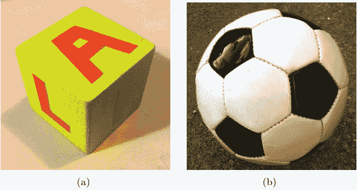

**图 1.1**  

(a) 一个立方体。(b) 一个足球。

共享曲线（即它们的边界），根据几何线性可以区分边和顶点。注意，后者是一个连通的点集，但其补集不是。


类似地，图 1.1(b) 中描绘的足球可以近似为一个球体（这是一个粗略的近似，因为球由多块皮革体积块组成，尽管球体是一个曲面）。根据颜色，可以区分五边形和六边形的面，即其边界包含五条或六条边和顶点的面。

图 1.2(a) 中描绘的房子也可以被类比为一个三维几何对象，其中可以根据材料（木材、石头、玻璃等）、几何性质、颜色或其他特征来区分体积、面、边和顶点。实际上，图 1.2(a) 中显示的是房子的*图像*；这是一个二维图像，可以根据诸如颜色、强度等属性细分为二维区域。

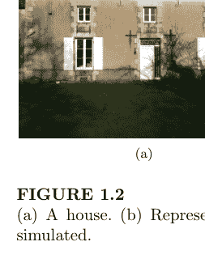

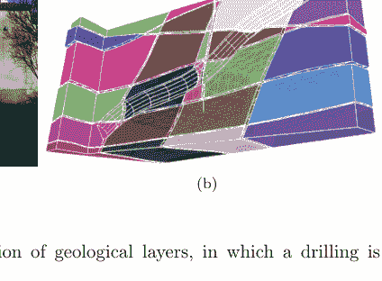

**图 1.2**  

(a) 一座房子。(b) 地质层的表示，其中模拟了一次钻探。

处理细分对于各种应用领域都是必要的，例如：

- **地质学：** 可以根据地下不同层的构成材料来区分它们。地层可能会被断层破坏，即它们可能由多个块体组成。一个块体可以用一个体积来表示，并关联某种材料，体积的边界可以根据相邻块体细分为面、边和顶点。因此，一个地层对应一组体积，一个断层对应一组面，两个地层共享一组面。图 1.2(b) 描绘了地下部分的一种计算机表示。

- **医学：** 现在每个人都看过人脑的图像（或者很容易找到这样的图像），并且知道可以区分不同的解剖部位。为了检查脑部疾病，需要分析三维脑图像：一个重要任务就是识别解剖部位，以提取相关信息。这个任务就是图像分割。然后，人们可能有兴趣构建分割（即细分）后大脑的表示，例如为了模拟外科手术。

- 空间分布数据的研究：可以构建细分来研究各种现象。例如，设`P = {p1, …, pn}`是欧几里得平面中的一组点（这些点称为站点）。与`pi`关联的 Voronoï 面包含平面上任何到`pi`的距离小于或等于到任何其他站点的距离的点（注意 Voronoï 面是凸多边形）。Voronoï 边包含到其两个最近站点等距的点，而 Voronoï 顶点是到三个（或更多）最近站点等距的点。这定义了欧几里得平面的一个细分，即 Voronoï 图（参见图 1.3(a)），它是许多应用的基本工具，例如在流行病学、气象学等领域。

因此，粗略地说，一个细分的几何对象由不同维度的单元（顶点、边、面、体积等）组成，并且这些单元之间存在结构关系，因为一个单元的边界由较低维度的单元组成。例如，一个单元与其边界上的一个单元称为关联的；两个同维度的单元如果都关联于第三个单元，则它们是相邻的。

本书的一般框架是研究用于显式表示细分几何对象的数据结构，以及处理这些结构的操作。主要涉及两个领域：几何建模和图像处理。事实上，这些领域产生了不同的需求，说明数据结构与操作设计的一些后果是很有意义的。注意，本书中研究的所有概念和操作、数据结构和算法，在其他处理细分几何对象的领域中也很有用，如计算几何、离散几何、图像分析等。

### 1.1.2 不同的细分

有时，细分满足一些几何性质，其中可以区分*形状*性质或*结构*性质，而后者本身又可以是或多或少的*局部*或*全局*。

例如：

- 局部形状性质：（足球表示中的）面在球面上是凸的，正如欧几里得平面中任何 Voronoï 图的面一样。但房子并非如此，其中存在凹面，立方体也是如此；

- 全局形状性质：足球是一个球体，即曲面上的所有点具有相同的曲率。但立方体并非如此，其中存在尖锐的边；

- 局部结构性质：足球的面是五边形和六边形，即任何面关联五条或六条边和顶点。房子的面或欧几里得平面中 Voronoï 图的面没有这种规律性；

- 全局结构性质：足球或欧几里得平面中 Voronoï 图的任何边恰好关联两个面。更准确地说，任何*曲面*都可以通过沿边粘合面来构造，使得最多两个面共享一条边。但一般情况并非如此。例如（参见图 1.3(b)），在模拟植物生长时，植物的结构通常用树（在图论意义下）表示，而叶子用曲面的部分表示：因此，植物的表示是一个二维*复形*，即一个不满足曲面所有结构性质的几何对象。

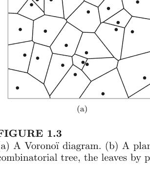

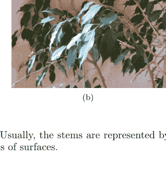

**图 1.3**  

(a) 一个 Voronoï 图。(b) 一株植物。通常，茎用组合树表示，叶子用曲面部分表示。

## 1.2 细分的显式表示

### 1.2.1 为什么需要显式表示？

显式意味着细分的表示基于单元及其结构关系的表示。更准确地说，一个有限细分（即包含有限数量单元的细分）的结构可以通过离散数据结构来实现。例如，线网的结构可以用图来表示：每条线对应一条边，线的端点对应一个顶点。

线网的形状由与图关联的属性表示，例如：

- 对于分段线性形状：每个顶点关联一个几何点的表示；因此，每条边关联一条连接与该边关联的两个顶点所对应的点的线段；为了避免退化，两个不同的顶点关联两个不同的点；

- 对于分段曲面形状：每条边关联一条曲线（例如样条曲线、Bézier 曲线等），使得相邻边关联的曲线共享端点。

注意，在这两种情况下，定义形状的属性必须满足一些性质，以符合细分的结构。

因此，定义表示细分的数据结构的关键点在于关注细分结构，即单元及其结构关系。通常，数据结构在某种程度上与图很接近。因此，*结构特征*（例如连通性）可以在数据结构上高效计算，这对于*提供关于对象的信息*或*控制其构造*是有用的。对象的结构也可以用于高效比较对象或匹配对象，例如在模式识别应用中。

最后，请记住，形状是*局部定义*为单元的属性的：这通常被称为*拓扑与嵌入之间的区分*¹。如上所述，形状属性必须满足一些性质，以便与结构保持一致。此外，结构与形状之间存在相对的独立性。例如，可以修改线网的形状而保持其结构不变，只需修改表示线网的图的顶点所关联的点即可。类似的修改对于铰接机械对象的动画或其他应用（如几何建模、计算几何、离散几何、计算机图形学、图像处理与分析等）可能很有用。

> ¹ 拓扑表示结构，嵌入表示形状。

显然，形状和结构并非完全独立，根据操作的不同，两者可能相互影响。例如，在模拟植物生长时，新枝的产生改变了植物的结构；起初，枝条很小，几乎看不见，然后其长度增加，改变了树的形状；在某种程度上，结构影响形状。相反，当两个枝条碰撞时，它们可能粘合在一起：在某种程度上，形状影响结构。更正式地说，这些影响将对应于应用于实现细分的数据结构的操作的参数和结果。

### 1.2.2 显式表示的一些优势

假设需要为给定应用设计一种处理几何对象的数据结构。显式表示细分可能是有用的，例如当对象被细分且细分本身对应用有意义时。例如，显式表示地质层的所有单元，可以将它们对应的材料与体积关联起来。这类似于上面讨论的所有示例，即可以将几何特征、颜色、材料等表示为与单元关联的属性。换句话说，*关于对象的许多信息可以根据细分来组织*，并可以表示为单元的属性。

由于细分被表示出来，*局部操作*可以应用于*单元*。例如，圆角操作可以应用于顶点和边（参见图1.4）。它包括：

- 首先应用*倒角*：参见图1.4(a)和图1.4(b)。这是一种结构操作，将顶点和边“扩展”为面，面的结构取决于被替换的顶点或边的结构。例如，与三条边关联的顶点基本上被替换为一个三角形面；

- 然后计算与倒角单元相关联的曲面片：参见图1.4(c)。

**图1.4** 顶点和边的倒角与圆角。(a) 一个立方体。(b) 边`e1`、`e2`和顶点`v`被倒角。(c) 通过将曲面片与倒角单元关联实现圆角（`e1`、`e2`、`v`及其他单元已被倒角）。

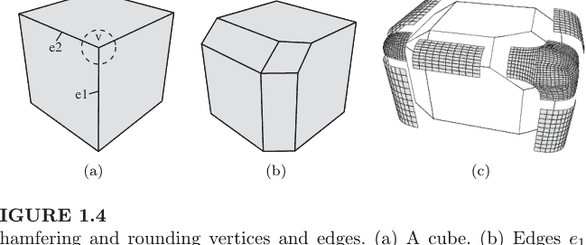

单元之间的*结构关系*对于许多*全局*操作也是有用或必要的。例如，在模拟建筑物中的遍历时，所表示房间之间的邻接关系使得控制遍历成为可能：显然，离开一个房间时，不可能进入一个不相邻的房间。

细分几何对象在某种程度上相当于对其进行离散化，而离散化几何对象对于许多过程可能是必要或有用的，例如：

- 模拟某些现象有时涉及求解偏微分方程，例如模拟地质层中的流体流动、建筑物中的热量等。通常（参见有限元方法、有限差分方法、有限体积方法），这需要对对象或包含对象的几何空间部分进行离散化²，即计算具有规则单元（单纯形、立方体）的网格；

- 计算机图形学或计算几何中的许多过程将几何对象作为三角形网格处理，因为许多计算可以针对三角形高效设计，例如为图像合成目的计算光线与三角形的交点。

## 1.3 众多的数据结构

为了表示细分，人们已经构思了许多数据结构：参见第9章。事实上，根据细分的*结构性质*，可以构思*优化的数据结构*。例如，可以用图来表示任何线框网格的结构。如果线框网格对应于一条*曲线*，即最多有两条边与一个顶点关联，则其结构可以用列表表示。这可以推广到更高维的几何对象。

因此，这些众多的数据结构可以根据以下方面进行分类：

- 局部结构性质，即单元的结构性质。例如，已经定义了几种单纯形结构来表示三角剖分（适用于任意维度）：单元是顶点、边、三角形、四面体等。这类结构可以推广到其他规则单元，例如立方体结构（单元是顶点、边、正方形、立方体、超立方体等）、单纯形积结构（单元是单纯形的乘积，如同立方体是边的乘积）。已经定义了细胞结构来表示具有任意单元的细分：事实上，单元从来不是“任意”的，它们总是满足某些结构性质。

- 全局结构性质，与单元组装在一起的方式有关。例如，细分总是可以通过取单元并沿其边界的单元粘合来构造，即通过识别其边界的单元。可以添加约束。例如，是否允许多重关联，即是否可以识别属于同一单元边界的单元（例如，当与同一条边关联的两个顶点被识别时，就会创建一个环）。另一个例子如下。已经定义了许多结构来表示曲面的推广，即`n`维对象，可以通过取`n`维单元，并通过识别`(n − 1)`维单元将它们粘合来构造，使得至多两个`n`单元与一个`(n − 1)`单元关联。还定义了许多结构来表示这些曲面推广的一个子类，即用于这种无边界可定向对象等。

### 1.3.1 为什么需要众多数据结构？

实际上，有两个问题：

1. *为什么假设对象满足某些性质？* 主要因为：

   - *表示的连贯性。* 用边界表示体积是几何建模中众所周知的方法，例如应用于CAD应用。例如，取我们现实世界中的一个简单对象，如一个木制立方体；它对应一个体积，其边界是一个无边界可定向曲面，由六个面、十二条边和八个顶点组成。但不可定向曲面不能定义三维空间中体积的边界。因此，当数据结构考虑到只能表示无边界可定向曲面时，就不可能构造出在通常三维空间中无法表示的对象；

   - *操作的优化。* 例如，对象通常是可三角剖分的，而三角剖分非常适合计算机图形学或计算几何中的许多操作，例如如上所述，检测（并计算）光线与三角形的交点很容易；

   - *但并非总能假设对象仍然满足性质。* 其他操作在三角剖分上执行起来并不那么容易，例如布尔运算（并、交、差）。这些操作应用于三角剖分时，不会直接产生三角剖分（参见图1.5(a)）。一个初步的想法是在处理交点时分割单纯形（参见图1.5(b)），但存在一些例子表明该过程可能不收敛，因为添加新的单纯形可能会产生新的交点；因此，在这种情况下，处理细胞结构而不是单纯形结构可能更方便；

**图1.5** 布尔运算与单纯形对象。(a) 两个单纯形对象的交集不是单纯形对象。(b) 单纯形分割产生新的交点。

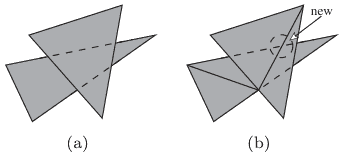

   - *并且不要忘记一些额外成本。* 如前所述，处理三角剖分可能是高效的，因此可以对细胞对象进行三角剖分；但如果某些操作应用于三角形单元时更高效，那么三角形单元的数量会比初始单元多，因此需要处理更多单元。此外，信息可能会丢失（或显式信息可能变成隐式信息）。例如，假设初始结构具有与应用相关的含义，例如表示木制立方体。三角剖分后，每个初始正方形面对应多个三角形：要么信息丢失，要么在需要时计算该信息（例如这里通过计算共面的三角形）。

2. *为什么不用通用结构？* 大家都知道答案，这适用于任何数据结构：

   - *表示的优化。* 上面给出的关于线框网格或线框曲线（图或列表）的表示示例可以推广到任何维度，从而推广到所有为表示细分而设计的数据结构。换句话说，许多结构性质可以通过使某些信息隐式化来优化表示。

   - *这可以优化操作。* 记住，体积有时由其边界表示，边界是无边界可定向曲面。直观地说，这样的曲面有两个侧面，一个朝向内部，另一个朝向外部。假设每个侧面对应一种颜色（例如内部为黑色，外部为白色）。可以通过取两个侧面都着色（一面黑一面白）的面，并通过识别边来构造曲面，使得相邻面的颜色一致，即曲面的每个侧面只有一种颜色。存在实现可定向曲面的数据结构：因此，在识别边时没有选择，面被一致地粘合。如果数据结构不考虑方向，则有必要检查面如何粘合，以便以一致的方式进行；因此，通用结构的操作成本高于专用结构；

   - *或者不。* 优化数据结构意味着不丢失任何信息；但通常，通用结构中的某些显式信息在优化结构中会变成隐式信息。当某些操作需要这些信息时，必须进行计算，从而导致额外成本。

### 1.3.2 多种结构的一些意义

对于给定的应用，同时处理多种数据结构可能很有意义。例如，在建筑设计中，可以为建筑的每一层设计一幅二维图纸：这时可以处理一种表示二维细分的数据结构。然后，构建每一层的三维表示，这时需要处理一种表示三维细分的数据结构。接着，通过一系列操作将不同楼层连接起来，生成建筑的三维表示。然后，如前所述，为了模拟某些物理现象，可以将三维结构离散化（划分为四面体或立方体网格）；也可以对三维结构的表面进行三角剖分，以便高效地生成建筑（或其部分）的图像。

在地质应用中，可以从三维地震图像重建表示断层或层间界面的曲面。然后，可以从这些曲面构建三维细分，表示地层的不同区块。对于某些操作，对区块的表面进行三角剖分是有用的。对于其他过程，例如模拟石油流动，将细分离散化为四面体或立方体网格可能是有用的。

对于某些应用，当需要表示规模很大的细分时，同时使用多种数据结构来表示一个细分的不同部分可能是有用的。实际上，结构不规则性往往局部集中在细分中：因此，规则部分使用专门的数据结构表示，与不规则性对应的部分使用更通用的数据结构表示，并维护数据结构之间的对应关系，以便将所有信息整合在一起。

## 1.4 胞腔结构

本书主要关注胞腔结构，即表示细分时，胞腔不满足任何特定结构性质。主要可以区分两类胞腔结构：

- *关联图*：图的节点对应胞腔，图的边表示胞腔之间的关联关系。这样的图可以无歧义地表示不存在*多重关联*的细分，即一个胞腔不能多次关联到另一个胞腔。例如，无法无歧义地表示一个环，即一条边与一个顶点关联两次；

- *有序模型*：这类模型基于比胞腔更基本的元素；例如，可以区分这两者。

- 基于组合映射，已经设计出高效的数据结构，连同处理这些结构的操作，用于几何建模、计算几何、离散几何、计算机图形学、图像处理与分析等目的；基于这些结构和操作，可以设计几何建模软件的内核来处理细分；

- 可以推导出若干专门类别的组合映射，以表示满足某些结构性质的细分，从而说明优化机制；

- 组合映射与有序模型、组合映射与关联图、组合映射与单纯结构之间的形式联系是众所周知的；因此，可以在所有这些结构之间设计转换操作。

### 1.4.1 一些历史里程碑

组合映射的概念最早是在数学中，更确切地说是在组合学领域中定义和研究的。最初，曲面上的映射是曲面的胞腔分解。Vince 在其论文“Combinatorial maps”[212]中写道：

> “研究映射的经典方法是曲面的胞腔分解。Edmonds [103]、Tutte [207]等人则采用了通过图嵌入这一更新的方法。我们的意图是给出映射的一种纯组合推广，称为组合映射。……”

因此，在20世纪80年代中期，对应2-映射、2-G映射和`n`-G映射的组合映射以及它们与胞腔对象细分的关系已经为人所知。

与此同时，在几何建模、计算几何、计算机图形学、计算机视觉和图像处理领域，为表示胞腔对象而定义的数据结构也相继出现。第一个是翼边数据结构，由Baumgart在20世纪70年代中期为计算机视觉目的而定义[17]。该结构已被证明与2-映射等价（但定义不相似）。

在20世纪80年代中期，人们定义了几种与2-映射和3-映射、2-G映射和3-G映射等价（且定义相似）的结构，因为当时人们关注的是处理二维和三维胞腔对象的细分。在20世纪80年代末，人们提出了与`n`-G映射和`n`-映射等价的结构，用于表示任意维度的曲面推广。

在20世纪80年代末及整个90年代，许多工作涉及表示“非流形”对象的数据结构定义，即复杂胞腔对象，映射链[104]是这些工作成果的代表性结构之一。

据我们所知，在几何建模、计算几何、离散几何、计算机图形学、图像处理与分析领域，还没有关于细分几何对象表示的专著。此外，许多工作都涉及组合映射在数学和计算机科学不同领域中的应用：人们研究了组合映射的许多子类、相关概念和操作。因此，本书的一个主要目标是，以一种连贯的方式汇集与组合映射相关的重要概念，使其适合组合映射在几何建模、计算几何、离散几何、计算机图形学、图像处理与分析等领域中的应用。

### 1.4.2 内容概要

本书主要研究组合映射的两个子类，即`n`-G映射和`n`-映射。本书组织如下：

- 第2章：首先，通过介绍曲面的分类，引入一些基本的拓扑概念和词汇；其次，回顾一些与离散数学结构（如置换和图）相关的技术性概念，这些是表示细分（例如关联图）的数据结构的基础；

- 第3章：从细分几何对象出发，以直观的方式展示如何推导出形式模型，即`n`-G映射和`n`-映射，以表示对象的结构；

- 第4章和第5章：这两章的组织方式相同，分别专门讨论`n`-G映射和`n`-映射。定义了与这些结构相关的所有概念；然后定义了用于构造任意`n`-G映射和`n`-映射的基本操作。从数学定义推导出数据结构和迭代器。最后，补充了一些有用的概念；

- 第6章：定义了处理`n`-G映射和`n`-映射的基本操作，例如带边界的组合映射的闭包、胞腔的移除与收缩，以及它们的逆操作（插入与扩张）；还定义了其他经典操作，如倒角、拉伸和三角剖分；

- 第7章：组合映射已被实现并用于几何建模和图像处理目的；针对这两个应用领域，说明了几何操作和软件的基本原理；

- 第8章：回顾了单纯结构的定义；然后将胞腔对象定义为按胞腔组织的单纯对象，并引入不同的子类，主要是胞腔准流形。接着阐述了`n`-G映射与`n`维准流形之间的等价性。还阐述了无多重关联的`n`-G映射与`n`-曲面（即关联图的一个子类）之间的对应关系；表明还存在其他类别的组合映射，例如用于表示`n`维胞腔复合体的映射链；


- 第9章：为表示细分，人们定义了许多有序模型。本章研究n-G映射、n-映射与几种为表示准流形而设计的有序模型之间的对应关系；
- 第10章：最后一章包含若干（部分）结论性评论。

本页有意留为空白。

# 2

## 初步概念

本章研究两组基本概念，主要基于 [1, 125]：

- 第一组与我们所关注的对象相关：几何对象的*细分*。将遵循 Griffith 关于曲面分类的方法 [125] 进行说明，然后扩展到更高维情形；
- 第二组与这些细分的*表示*相关。这里我们关注定义可在几何软件中处理的数据结构：这类表示是代数式的，基于等价于图的著名离散结构。

有些概念并未正式定义，因为本章的目的是给出关于拟流形（的细分）以及*等同*（基本构造操作）的直观理解。拟流形在第 8 章中正式定义。拓扑学入门可参见 [1, 196, 180, 133]。

### 2.1 基本拓扑概念

这里介绍一些经典词汇。

#### 2.1.1 基本元素

*球*：参见图 2.1(a)、(b) 和 (c)。

设 `ℝⁿ = {x = (x₁, …, xₙ)|xᵢ ∈ ℝ, 1 ≤ i ≤ n}` 为通常的 *n 维*空间。设 `r ∈ ℝ`。

- `Bᵣⁿ(x) = {y ∈ ℝⁿ|d(x, y) < r}`，其中 `d(x, y)` 表示 `x` 与 `y` 之间的通常欧几里得距离，即 `ℝⁿ` 中以 x 为中心、半径为 r 的 *n 维开球*；
- `B̄ᵣⁿ(x) = {y ∈ ℝⁿ|d(x, y) ≤ r}` 是 `ℝⁿ` 中以 x 为中心、半径为 r 的 *n 维闭球*；

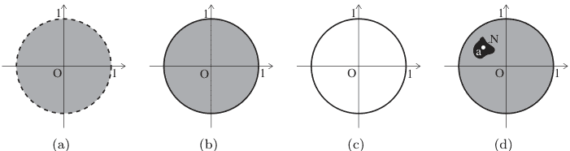

## 图 2.1

(a) $B_1^2(O)$，其中 $O=(0,0)$。

(b) $\overline{B}_1^2(O)$。

(c) $S_1^1(O)$。

(d) $N$ 是 $\overline{B}_1^2(O)$ 中点 $a$ 的一个邻域。

- `S_r^{n-1}(x)={y∈ℝⁿ∣d(x,y)=r}` 是 `ℝⁿ` 中以 `x` 为中心、半径为 `r` 的 `(n-1)` 维球面。

例如，`B_1^1(O)=I_1=]-1,1[`，`B̄_1^1(O)=Ī_1=[-1,1]`，`S_1^0={-1,1}`。注意，当 `m≥n` 时，在 `ℝ^m` 中可以定义任意维数的球和 `(n-1)` 维球面。

*开集与闭集*

设 `A⊂ℝⁿ`。若对于每一个 `x∈A`，存在某个 `ε>0` 使得 `B_ε(x)⊂A`，则 `A` 是 `ℝⁿ` 的*开集*；注意 `∅` 和 `ℝⁿ` 都是开集。设 `B⊂ℝⁿ`。若 `ℝⁿ\setminus B` 是 `ℝⁿ` 的开集，则 `B` 是 `ℝⁿ` 的*闭集*；注意 `∅` 和 `ℝⁿ` 也是闭集。

开集的任意并是开集；开集的有限交是开集。反之，闭集的有限并是闭集；闭集的任意交是闭集。例如，设 `B(x)` 为 x 周围所有任意半径开球的交集。容易看出 x 属于 `B(x)`，但 `ℝⁿ` 中任何其他点都不属于 `B(x)`（若 `y≠x`，则 y 不属于 `B_{d(x,y)/2}(x)`），所以 `B(x)={x}` 是闭集，因为 `ℝⁿ\setminus{x}` 是开集。

*邻域*：参见图 2.1(d)。

设 `A⊂ℝⁿ`。`A` 的子集 `N` 是点 `a∈A` 的一个邻域，如果存在 `A` 中的开集 `V` 使得 `a∈V⊂N`。

*内部、闭包、边界*：参见图 2.2。

设 `A⊂ℝⁿ`。`Ã`，即 `A` 的*内部*，是包含在 `A` 中的所有开集的并：换言之，`A` 的内部是包含在 `A` 中的最大开集。`Ā`，即 `A` 的*闭包*，是包含 `A` 的所有闭集的交：换

## 图 2.2

- (a) A = {(x, y) | 1 < x ≤ 2 and 1 < y < 2}.
- (b) Ã = {(x, y) | 1 < x < 2 and 1 < y < 2}.
- (c) Ā = {(x, y) | 1 ≤ x ≤ 2 and 1 ≤ y ≤ 2}.
- (d) ∂A = {(x, y) | ((x = 1 or x = 2) and 1 ≤ y ≤ 2) or (1 ≤ x ≤ 2 and (y = 1 or y = 2))}.

言之，A 的闭包是包含 A 的最小闭集。`∂A`，即 A 的边界，是 `Ā \ Ã`。例如，对于任意 x 和 r，`B̄_rⁿ(x)` 是 `B_rⁿ(x)` 的闭包，`B_rⁿ(x)` 是 `B̄_rⁿ(x)` 的内部，`S_r^{n-1}(x)` 是 `B_rⁿ(x)` 的边界；它也是 `B̄_rⁿ(x)` 的边界。还请注意，对于任何 A，都有 `Ã̃ = Ã` 且 `Ā̄ = Ā`。

#### 2.1.2 连续映射，同胚

设 `A ⊂ ℝⁿ`，并设 `f : A → ℝ^m`。若对于任何 `x ∈ A` 和任何 `ε > 0`，存在 `δ > 0`，使得 `f(B_δⁿ(x)) ⊂ B_εᵐ(f(x))`，则 `f` 是连续映射。等价地，`f` 连续当且仅当对于 `R^m` 中每个开集 `V`，`f^{-1}(V)` 是 `A` 的开子集，其中 `f^{-1}(V)` 是 `A` 中所有满足 `f(x) ∈ V` 的点 `x` 的集合。例如，`S_1^1(O)` 与 `C`（如图 2.3 所示）之间存在连续映射，但 `S_1^1(O)` 与 `C′`（也如图 2.3 所示）之间不存在连续映射。

`f : A → B` 是同胚，如果它是具有连续逆的连续一一映射；在这种情况下，称 `A` 和 `B` 同胚（或拓扑等价）。

例如（参见图 2.3），所有无边界曲线都是同胚的，并且都与单位 1 维球面 `S_1^1(O)` 同胚，其中 `O = (0,0) ∈ ℝ²`；由于 `S_1^1(O)` 中任何点 `x` 都有一个与 `I_1 = ]−1,1[ ⊂ ℝ` 同胚的邻域，因此任何无边界曲线的任何点也满足相同性质。类似地，所有有边界曲线都是同胚的，并且都与 `Ī_1 = [−1,1] ⊂ ℝ` 同胚。

直观地说，如果可以通过连续变形 `A` 得到 `B`，则 `A` 和 `B` 同胚。例如，取一根线（参见图 2.4(a)）并使其变形（参见图 2.4(b)），它仍然是原来的线：除了形状改变之外没有任何变化，因此

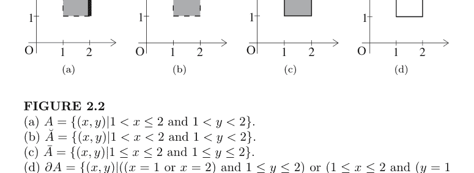

## 图 2.3

`S₁¹(O)`、`C₁¹(O)`、`SP` 和 `C` 是无边界曲线，且都是同胚的；但它们与 `C′`（有边界曲线）不同胚，也与 `C″`（不是曲线）不同胚。

## 图 2.4

- (a) 一根线。
- (b) 变形后的线仍然是线。
- (c) 两根焊接在一起的线等价于一根线。
- (d) 将一根线的两端焊接起来会得到别的东西。
- (e) 在每根线的端点焊接多根线也会得到别的东西。

所得到的对象与最初的线同胚。更一般地，取任意两根线，它们都是同胚的。如果在每根线的一个端点将两根线焊接起来（参见图 2.4(c)），所得到的对象等价于一根线（只需延长一根线即可得到结果对象）；但如果将一根线的两端焊接起来（参见图 2.4(d)），所得到的对象不等价于最初的线；类似地，如果在每根线的一个端点焊接多于两根线（参见图 2.4(e)），所得到的对象也不等价于一根线。因此，同胚的概念直观上与连续变形的概念相关；换言之，连续变形不会改变拓扑，尽管拓扑变化的概念直观上与一般情形下的切割和粘贴操作相关，因为我们在图 2.4(c) 中看到，某些特殊的粘贴（反之亦然，切割）情形并不会改变拓扑。

重要的是要谨慎对待这些关于拓扑等价的直观解释。取五根线 a、b、c、d、e，并将它们焊接起来得到图 2.5(a) 中所示的对象 `W`。`W` 与图 2.5(b) 中所示的 `W′` 同胚，方法是将 a 与 a′、b 与 b′、c 与 c′、d 与 d′、e 与 e′ 关联起来。如果你想证明，取 `W` 并使其变形以得到 `W′`！要做到这一点，必须在三维空间中使对象变形：在平面内，不可能通过变形 `W` 得到 `W′`（按照上述线的关联方式），因为 e 不能穿过由 a、b、c 和 d 构成的曲线。换言之，`W` 与 `W′` 之间存在同胚，它将每根线 x 与对应的 x′ 关联起来，但包含 `W` 的平面与包含 `W′` 的平面之间不存在同胚，能够将每根线 x 与对应的线 x′ 关联起来。

类似地，取一条纸条（参见图 2.6(a)）并将两个相对的“边”粘在一起，得到环带：参见图 2.6(b)。如果做同样的事情，但在粘之前将纸条扭转两次，得到的对象

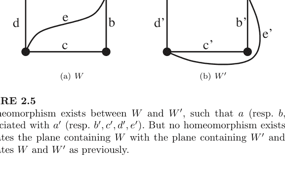

## 图 2.5

`W` 与 `W′` 之间存在同胚，使得 a（分别为 b、c、d、e）与 a′（分别为 b′、c′、d′、e′）关联。但不存在这样的同胚：它同时关联包含 `W` 的平面与包含 `W′` 的平面，并按前述方式关联 `W` 与 `W′`。

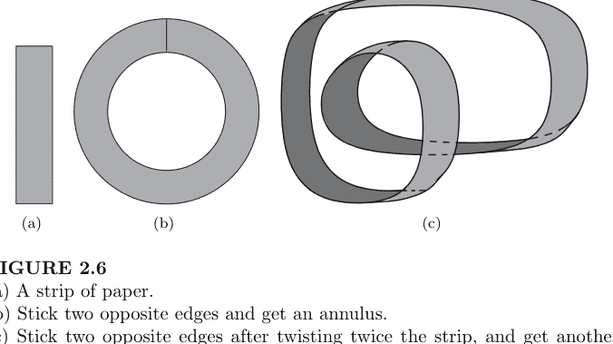

## FIGURE 2.6

(a) A strip of paper.

(b) Stick two opposite edges and get an annulus.

(c) Stick two opposite edges after twisting twice the strip, and get another annulus, homeomorphic to the annulus depicted in (b).

is also an annulus (even if it is not obvious): cf. Fig. 2.6(c). Moreover, you cannot deform in the 3-dimensional space the first annulus in order to get the second one (but you could do that in a higher dimensional space). As before, the two annuli are homeomorphic, but no homeomorphism exists between the 3-dimensional space and itself, which associates the two annuli.

### 2.2 Paper Surfaces

We have seen in the previous section that when the notion of topological equivalence is taken into account, two types of curves can be distinguished: curves without boundary, which are all homeomorphic, and curves with boundary, which are also all homeomorphic. It is also possible to define a categorization of surfaces, but it is more complicated than for curves. This is the goal of this section, in which Griffiths’s approach is followed (cf. [125]).

#### 2.2.1 Basic Elements

Assume a sheet of paper is so thin that it has no volume at all: it is called a face (i.e. a 2-dimensional cell). Moreover, the boundary of the paper sheet is subdivided into edges and vertices (respectively 1-dimensional and 0-dimensional cells), i.e. for instance, a standard sheet of paper is bounded by four edges (corresponding to the straight lines of its boundary), meeting two by two at the four corners of the paper sheet, which correspond to the four vertices. It

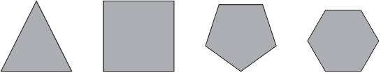

## FIGURE 2.7

(a) A triangle. (b) A square. (c) A pentagon. (d) A hexagon.

is of course possible to handle triangular paper sheets (their boundaries are made by three edges and three vertices), or any *polygonal* sheet of paper (cf. Fig. 2.7). Note that the boundary of any face is a cycle of edges and vertices.

More precisely, the face is the interior of the sheet of paper, and each edge is the interior of a straight line of the boundary of the sheet of paper (in other words, a cell does not contain its boundary). So, the set of cells (face, edges, vertices) makes a *partition*¹ of the sheet of paper.

#### 2.2.2 Basic Construction Operation: Identification of Edges

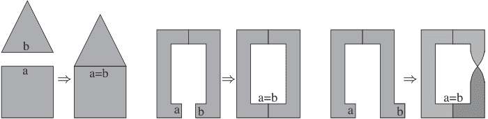

## FIGURE 2.8

(a) Gluing a square with a triangle.

(b) Making an annulus.

(c) Making a Möbius strip.

*Surfaces* can be constructed by pasting such paper sheets along their boundaries, but it is necessary to take the structure of the boundaries into account: more precisely, the basic construction operation consists in gluing

two faces by sticking two edges of their boundaries. Once glued, the two edges are *identified* into one edge (cf. Fig. 2.8).

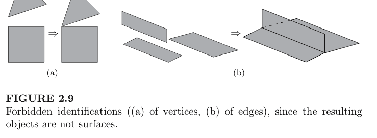

## FIGURE 2.9

Forbidden identifications ((a) of vertices, (b) of edges), since the resulting objects are not surfaces.

It is forbidden to glue two faces by simply identifying two vertices; it is also forbidden to glue more than two edges: in both cases, the result is not a surface (cf. Fig. 2.9).

So a paper surface can be made of a single face, or by many faces glued by identifying several pairs of edges. It is thus *subdivided* (i.e. partitioned) into vertices, edges and faces.

*Incidence and adjacency relations*


The “boundary” relation corresponds to the *incidence* relation: more precisely, an edge (resp. a vertex) which belongs to the boundary of a face is incident to the face, and conversely, the face is incident to the edge (resp. to the vertex). Moreover, if a vertex is part of the boundary of an edge (i.e. the vertex meets the edge), the vertex and the edge are incident to each other. Usually, adjacency is defined in the following way: two `i`-cells are *adjacent* if they share a common cell in their boundaries. For instance, two faces (resp. two edges) are adjacent if they share an edge or a vertex (resp. a vertex). Adjacency is sometimes defined in a generalized way: two cells are adjacent if they are incident to the same cell: for instance, two vertices are adjacent if they are incident to the same edge or to the same face.

### Surface boundary

A *free* edge is incident to a single face; it is *sewn*² when it is incident to two faces. The *boundaries* of a subdivided surface are made by the free edges: moreover, they are *cycles* of free edges. When a surface has no free edge, it is *without boundary*, for instance the surface of a cube, made by gluing six square faces: the initial twenty-four edges are identified into the resulting twelve sewn edges of the cube.

²The use of the word “sew” comes from the fact that, for constructing paper surfaces, instead of gluing faces by sticking two edges into one edge, it is also possible to sew the faces together around the resulting edge.

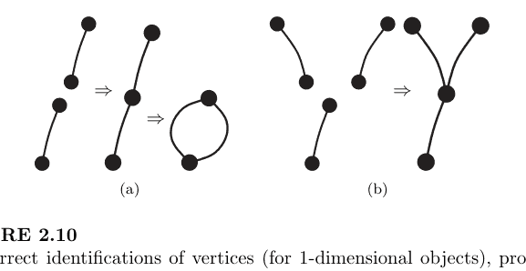

**FIGURE 2.10**

(a) Correct identifications of vertices (for 1-dimensional objects), producing curves.

(b) Forbidden identifications of vertices, which do not produce a curve.

### Unnecessary constraints

In order to simplify the study of surface construction, assume the boundary of any face contains at least three edges and three vertices. Similarly, assume that the boundary of an edge contains at least, and thus exactly, two vertices (in other words, no edge is a loop). Moreover, when two edges are identified, they belong to the boundaries of two distinct faces: in other words, it is forbidden to identify two edges incident to a same face.

In fact, these constraints are added in order to reduce the number of possible configurations obtained when gluing together sheets of paper, but it is still possible to construct any surface, even when these constraints are satisfied. For instance, if it is not possible to construct an annulus by identifying a pair of edges incident to one face, it is possible to construct an annulus by identifying two pairs of edges of two faces! So, with these “unnecessary constraints”, it is not possible to construct any subdivision of any surface, but it is possible to construct subdivisions of any surfaces.

These constraints are very different from the two previous ones, added for constructing only surfaces. This can be observed by considering the following characteristic property of surfaces, informally stated as: any point of any surface, which is not a boundary point, has a neighborhood (i.e. a “part around”) which is homeomorphic to an open 2-dimensional ball³. In particular, this is true for any interior point of any face. More generally:

- when two faces are glued by identifying two free edges, any point of the resulting edge has a neighborhood which is homeomorphic to an open 2-dimensional ball (since this point results from the identification of two distinct boundary points, its neighborhood results from the union of two 2-dimensional half balls which were the neighborhoods of the two initial points);

- on the contrary, when two faces are glued by identifying two vertices, the neighborhood of the resulting vertex is homeomorphic to two 2-dimensional half balls which share a point, i.e. it is not homeomorphic to a 2-dimensional ball;

- similarly, when three (or more) faces are glued by identifying more than two edges, the neighborhood of any point of the resulting edge is not homeomorphic to a 2-dimensional ball. As seen before, this is similar in dimension 1: assume subdivided curves are constructed by welding pieces of wires. A piece of wire makes a curve; when two pieces of wires are welded, they still make a curve; when three pieces of wires are welded at a same point, they do not make a curve... (cf. Fig. 2.10).

### Orientability

The annulus and the Möbius strip (cf. Fig. 2.8) are made similarly (two free edges, which are not adjacent, are identified), but they are clearly different: the annulus has two boundaries, the Möbius strip has only one. Moreover, assume you handle real sheets of paper, and assume the two sides of each sheet of paper have different colours, for instance one side black and the other white: it is possible to get the same colour for each side of the annulus (in fact, the annulus has still two sides), but it is impossible to get the same colour along one side of the Möbius strip, since the Möbius strip has only one side! This well-known difference is related to orientability.

An edge is always orientable (cf. Fig. 2.11(a)): that means it is possible to choose a direction for going along this edge, i.e. an origin vertex and an extremity vertex. Note that any edge can be oriented in two ways, which are opposite (if you have chosen an origin vertex and an extremity vertex, you get the opposite orientation by exchanging the two vertices).

A face is always orientable: that means intuitively that it has two sides, i.e. you can go around all points of the faces by walking and turning always left (or oppositely always right); this corresponds also to the fact that the boundary of the face is a cycle of edges and vertices, which can be oriented into one direction or into the opposite direction (cf. Fig. 2.11(b)). So, orienting a face consists in choosing an orientation of its boundary, and thus each edge of this boundary is itself oriented; but the orientations of the edges are coherent along the boundary of the face.

The idea is quite similar for defining orientable surfaces: all faces are oriented, but in a coherent way, meaning that (cf. Figs. 2.11(c) and (d)):

- any sewn edge is oriented in opposite ways for its two incident faces; this is not intuitive, but this corresponds to the fact that if you have chosen to turn left for instance for one face, when the relative orientations of

  公共边方向相反时，你也选择了对另一个面左转；

- 自由边构成定向边界，即边的定向环。

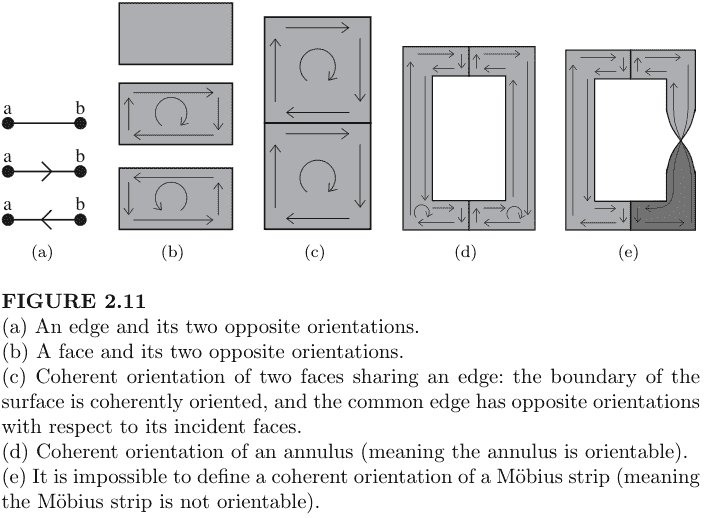

**图 2.11**  

(a) 一条边及其两个相反的方向。  

(b) 一个面及其两个相反的方向。  

(c) 共享一条边的两个面的相干定向：表面的边界是相干定向的，且公共边相对于其关联的面具有相反的方向。  

(d) 环面（圆环）的相干定向（意味着圆环是可定向的）。  

(e) 不可能定义莫比乌斯带的相干定向（意味着莫比乌斯带是不可定向的）。

当一个表面是可定向的（即可以相干定向）时，可以定义两个相反的方向（例如参见圆环）。当一个表面是不可定向的时，不可能定义相干定向（例如参见图 2.11(e) 中的莫比乌斯带）。

还要注意，当边界是相干定向时，你可以通过沿着它粘合一个具有相同边数且以相干定向方式的面来将其闭合。因此，如果一个带边界的表面是可定向的，你可以将其闭合为没有边界的可定向表面：例如，你可以通过沿其边界粘贴另一个面来闭合一个面；你可以通过沿两个边界粘贴两个面来闭合一个圆环；在两种情况下你都得到一个*拓扑球面*（如果你的纸张是可延展的，你可以修改所得形状以得到一个几何球面）。但如果一个带边界的表面是不可定向的（即不能以上述方式相干定向），那么无论你如何尝试闭合边界，都不可能得到没有边界的可定向表面。

无边界的可定向表面（如球面、环面等）的一个重要性质是它可以*嵌入*到通常的三维空间中（即你可以在该空间中赋予它形状），使得它将其划分为三个部分：“内部”（有界）体积、表面本身以及“外部”（无界）体积。这在 1 维中类似，但这里所有曲线都是可定向的：嵌入到通常的平面中时，任何无边界的曲线都将其划分为三个部分：一个“内部”（有界）面、曲线本身和一个“外部”（无界）面。

## 2.3 纸面分类

### 2.3.1 拓扑曲面

可以与任意纸面 `S` 关联若干个数：

- `b(S)` 是 `S` 的*边界数*；

- `c(S)` 是 `S` 的*欧拉示性数*，定义为：

  `c(S) = v(S) − e(S) + f(S)`

  其中 `v(S)`、`e(S)` 和 `f(S)` 分别是 `S` 的顶点数、边数和面数。

- `q(S)` 是 `S` 的*可定向因子*，定义为：

  `q(S) = { 0 如果 S 是可定向的；1 如果 S 是不可定向的且 (b(S) + q(S)) 为奇数；2 否则。 }`

- `g(S)` 是 `S` 的*亏格*，定义为： `g(S) = 1 − (b(S) + c(S) + q(S))/2.`

例如，图 2.7 中描绘的所有多边形都有一个边界；它们的欧拉示性数等于 1，它们是可定向的，所以其可定向因子等于 0，且其亏格为零。所有多边形都有这些特征（都只有一个边界，它们是可定向的，它们的欧拉示性数等于 1，因为它们有一个面，且顶点数和边数相等），但其他表面也有，例如一个正方形和一个三角形的粘合，或两个正方形的粘合：参见图 2.8(a) 和图 2.11(c)。圆环有两个边界，其欧拉示性数等于 0，它是可定向的，所以其亏格等于 0。莫比乌斯带有一个边界，其欧拉示性数等于 0，它是不可定向的，所以其可定向因子等于 1 且其亏格等于 0。

所有这些数都是整数，且对于任意纸面 `S`，`b(S)`、`q(S)` 和 `g(S)` 都是正数。

拓扑曲面 `TS_{b,q,g}`，其中 `0 ≤ q ≤ 2`，是所有满足 `b(S) = b`、`q(S) = q`、`g(S) = g` 的纸面 `S` 的集合。任意纸面都属于唯一的拓扑曲面 `TS_{b,q,g}`；且任意拓扑曲面都包含


### 图 2.12 添加一个面

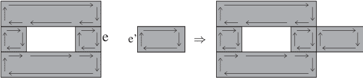

无穷多个纸面。这里的重要事实是*分类定理*：

> 属于同一拓扑曲面的所有纸面都是同胚的，且所有同胚的纸面都属于同一拓扑曲面。

为了对这一重要性质获得部分直观认识，将研究纸面的构造，通过区分识别操作的若干情况。注意当一个表面不可定向时，任何进一步的两个边的识别都不能产生可定向表面（这也可以通过研究所有可能的识别情况及其对定向的影响来证明）。

设 $S$ 为 $TS_{b,q,g}$ 的一个纸面，且 $b \ge 1$，设 $e$ 为 $S$ 的边界上的一条边，设 $c$ 为其欧拉示性数。设 $S'$ 为涉及 $e$ 和另一条自由边 $e'$ 的识别的结果，设 $b'$、$c'$、$q'$ 和 $g'$ 分别为其边界数、欧拉示性数、可定向因子和亏格。

*添加一个面：* 图 2.12

设 $F$ 为不属于 $S$ 的一张纸片，设 $e'$ 为 $F$ 的一条边。

当 $e$ 与 $e'$ 识别时，$e$ 所属的边界被修改：在 $S'$ 中，该边界由相同的边构成，只是 $e$ 被 $F$ 的边代替，$e'$ 除外。所以 $b' = b$。

设 $x$ 为 $F$ 的顶点数（或边数）。$S'$ 与 $S$ 的顶点数、边数和面数的差分别为 $x - 2$、$x - 1$ 和 1（因为四个顶点被识别为两个顶点，两条边被识别为一条边，且 $S$ 增加了一个面）。所以 $c' = c$。

可定向性未改变。如果 $S$ 是可定向的，它可以被定向，并且可以以这样的方式定义 $F$ 的定向使得 $S'$ 是相干定向的（取 $e'$ 为 $e$ 的逆向），因此 $S'$ 是可定向的。如果 $S$ 是不可定向的，$S'$ 也是不可定向的。所以 $q' = q$，因为 $b' = b$ 且 $c' = c$。

最后，$g' = g$ 因为 $b' = b$、$c' = c$ 且 $q' = q$。

### 图 2.13 移除一个边界

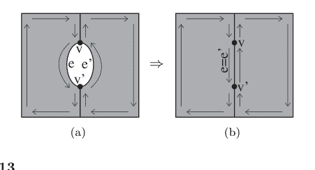

### 图 2.14 缩短一个边界

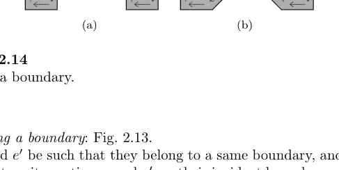

移除一个边界：图 2.13。

设 e 和 e' 属于同一边界，且它们共享其两个端点顶点 v 和 v'：因此其关联的边界仅包含 e 和 e'。识别 e 和 e' 只有一种可能的方式，因为不允许环，边界消失。所以 $b' = b − 1$。

此识别移除一条边（e 和 e' 被识别），所以 $c' = c + 1$。

可定向性未被修改。如果 S 是可定向的，它可以相干定向：假设 e 从 v 指向 v'；因此 e' 从 v' 指向 v，因为它们在其关联边界中是连续的，且该边界是相干定向的；因此 e 和 e' 识别后得到的边相对于其关联的面是相干定向的。所以 $q' = q$ 因为 $b' = b − 1$ 且 $c' = c + 1$。

最后，$g' = g$ 因为 $b' = b − 1$、$c' = c + 1$ 且 $q' = q$。

缩短一个边界：图 2.14。

设 e 和 e' 属于同一边界，且它们恰好共享一个顶点 v。识别 e 和 e' 只有一种可能的方式，因为不允许环：在这种情况下，e 和 e' 的两个顶点 v1 和 v2 最初不同被识别为一个顶点 v12，且所得边关联于两个不同的顶点 v 和 v12。

由于 $e$ 和 $e'$ 在 $S$ 中都关联于 $v$，且 $v_1 \ne v_2$，关联于 $e$ 和 $e'$ 的边界包含其他边。$e$ 和 $e'$ 的识别将这些边从边界中移除，但它仍然存在，且没有产生新的边界。所以 $b' = b$。

此识别移除一条边（$e$ 和 $e'$ 被识别）并移除一个顶点（$v_1$ 和 $v_2$ 被识别），所以 $c' = c$。

可定向性未被修改。如果 $S$ 是可定向的，它可以相干定向：假设 $e$ 从 $v$ 指向 $v_1$；因此 $e'$ 从 $v_2$ 指向 $v$，因为它们在其关联边界中是连续的，且该边界是相干定向的；因此 $e$ 和 $e'$ 识别后得到的边相对于其关联的面是相干定向的，且边界保持相干定向（$e'$ 之前的边指向 $v_2$ 且 $e$ 之后的边从 $v_1$ 出发，它们在所得边界中变得连续，都关联于 $v_{12}$）。所以 $q' = q$ 因为 $b' = b$ 且 $c' = c$。

最后，$g' = g$ 因为 $b' = b$、$c' = c$ 且 $q' = q$。

注意一个仅包含一个面的纸面属于 $TS_{1,0,0}$。任何通过“添加一个面”或“缩短一个边界”构造的纸面也属于 $TS_{1,0,0}$。所有这些纸面都是圆盘，且与二维闭球同胚。如果对一个圆盘应用“移除一个边界”，你得到一个球面，即 $TS_{0,0,0}$ 的一个元素，与二维球面同胚。

### 制作一个边界，或制作一个扭转：图 2.8(b) 和 (c)

设 e 和 e' 属于同一边界，且它们不共享任何顶点。因此，它们在其关联边界中不是连续的。假设 e（分别 e'）的端点顶点为 v1 和 v2（分别 v'1 和 v'2）。识别 e 和 e' 有两种方式：第一种方式识别 v1 和 v'1、v2 和 v'2，第二种方式识别 v1 和 v'2、v2 和 v'1。一种情况下（“制作一个边界”），会产生一个新的边界（例如，从一个原始圆盘构造出一个圆环）；在另一种情况下（“制作一个扭转”），不会产生新的边界（例如，从一个圆盘构造出一个莫比乌斯带）。

1. 如果情况是“制作一个边界”：
   - 根据定义，$b' = b + 1$；
   - 四个顶点被识别为两个顶点，两条边被识别为一条边，所以 $c' = c - 1$；
   - 不难看出此识别不会改变可定向性（如果表面是可定向的，它可以被定向，所以 $e$ 和 $e'$ 被定向，且只有一种方式可以识别 $e$ 和 $e'$ 使得所得边是相干定向的：这种方式对应于“制作一个边界”！）。所以 $q' = q$ 因为 $b' = b + 1$ 且 $c' = c - 1$；
   - $g' = g$ 因为 $b' = b + 1$、$c' = c - 1$ 且 $q' = q$。

2. 若情况为“做一个扭转”：
   - 按定义，$b' = b$；
   - 四个顶点被识别为两个顶点，两个边被识别为一条边，所以 $c' = c - 1$；
   - 不难看出所得曲面是非定向的：特别地，如果识别前曲面是定向的，则只有一种方式识别 $e$ 和 $e'$ 使得不产生边界，在这种情况下，所得边相对于其相邻面不是一致定向的。我们断言 $q' = q + 1$。注意你可以从识别情况中容易地推导出 $b + c$ 为偶数当 $S$ 是定向时：因此，如果 $S$ 是定向的，$b' + c'$ 为奇数且 $q' = 1$。还要注意，如果 $S$ 不是定向的，$b' + c'$ 的奇偶性与 $b + c$ 的奇偶性相反。
   - $g' = g$ 因为 $b' = b$，$c' = c - 1$ 且 $q' = q + 1$。

通过对圆盘应用 b 次“做一个边界”，你得到一个有 b 个边界的球面（圆盘因此是一个有 1 个边界的球面）。如果你对莫比乌斯带应用“移除一个边界”，你得到一个射影平面。如果你对圆盘两次应用“做一个扭转”，你得到一个带一个边界的克莱因瓶：参见图 2.15(a) 和图 2.16(c)。如果你对带一个边界的克莱因瓶应用“移除一个边界”，你得到一个克莱因瓶：参见图 2.15(b)。

注意如果你多次应用“做一个扭转”，你可以得到一个曲面使得其定向因子大于 2：我们将在下面看到，凭借交换定理，这与本节开头所述的曲面分类并不矛盾。

### 做一个洞，或做两次扭转：图 2.16

设 e 和 e' 为 S 的两条边，使得它们不与同一边界相邻。e 和 e' 的识别导致两个边界合并为一个边界。例如，观察图 2.16(a) 的环面：有两种方式识别 e 和 e'：第一种情况（参见图 2.16(b)），你得到一个带一个边界的环面，第二种情况你得到图 2.16(c) 中描绘的对象，它如我们将看到的，是一个带一个边界的克莱因瓶。更精确地说，区分两种情况：

1. “做一个洞”。此情况由 $S'$ 是定向的这一事实定义（因此 $S$ 也是定向的）；
2. “做两次扭转”。此情况由 $S'$ 不是定向的这一事实定义。

在两种情况下，$b' = b - 1$，因为两个不同的边界合并为一个边界，且 $c' = c - 1$，因为四个顶点被识别为两个顶点，且两条边被识别为一条边。其他特征为：

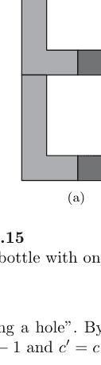

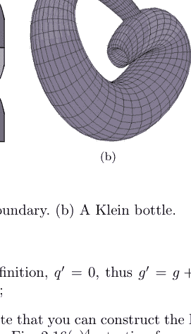

### FIGURE 2.15

(a) A Klein bottle with one boundary. (b) A Klein bottle.

1. “做一个洞”。按定义，$q' = 0$，因此 $g' = g + 1$，因为 $q' = q$，$b' = b - 1$ 且 $c' = c - 1$；
2. “做两次扭转”。注意你可以构造图 2.16(c)⁴ 中描绘的带一个边界的克莱因瓶，起始于图 2.16(d) 中描绘的圆盘（它是一个圆盘，因为它可以通过对一个面两次应用“添加一个面”来构造），通过两次应用“做一个扭转”，以便识别 e₁ 和 e₂，然后 e₃ 和 e₄。更精确地说：
   - e₁ 和 e₂ 的识别显然是一个扭转；
   - 在此识别之后，e₃ 和 e₄ 属于同一边界；它们不是相邻的，且它们的识别不会产生新的边界：这因此是另一个扭转。

这可以推广，我们得到 $q' = q + 2$ 且 $g' = g$，因为 $b' = b - 1$ 且 $c' = c - 1$。

### 交换定理：图 2.17

所有可能的情况都已研究（注意定义情况的条件是互斥且覆盖所有情况），但本节开头描述的分类仍不完整，因为定向因子可以取任意正值：你可以添加任意多的扭转。交换定理断言 $TS_{b,q,g} = TS_{b-2,g+1}$ 当 $q \ge 3$ 时。例如，

> ⁴It is a Klein bottle, although the relation with the Klein bottle with one boundary depicted in Fig. 2.15(a) is not obvious! Nevertheless, it is possible to transform the second one to get the first one. Note that in order to get a proof of equivalence, it would be necessary to prove that the transformations do not change the topology...

### FIGURE 2.16

- (a) An annulus.
- (b) A torus with one boundary.
- (c) A Klein bottle with one boundary.
- (d) A disc.

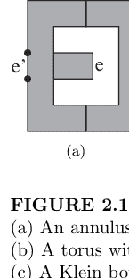

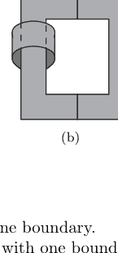

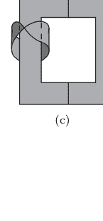

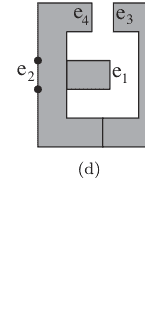

观察图 2.17 中描绘的对象：它由若干面 M、V、U、K、B 和 R 组成。你可以通过应用“添加一个面”、“缩短一个边界”以及一次“做一个边界”来构造由 M、K、U 和 V 组成的曲面，所以它属于 $TS_{2,0,0}$。B 通过“添加一个面”并一次应用“做一个洞”来添加，所以对应的曲面属于 $TS_{1,0,1}$。最后，通过应用“添加一个面”并一次“做一个扭转”来添加 R，所得曲面属于 $TS_{1,1,1}$。你也可以先通过两次应用“添加一个面”来粘合 M、K、B。你可以通过应用“添加一个面”并一次“做一个扭转”来添加 R，所以对应的曲面属于 $TS_{1,1,0}$。通过应用“添加一个面”、一次“做一个扭转”然后“缩短一个边界”来添加 V：曲面属于 $TS_{1,2,0}$。最后，通过应用“添加一个面”和“做一个扭转”来添加 U，所得曲面属于 $TS_{1,3,0}$。这可以推广，我们得到交换定理（参见 [125] 完整研究和证明）：

> 设 S 是一个纸面曲面，使得通过其构造得到的特征为 b、q、g。如果 $q \ge 3$，则 S 的特征等价于 b、q − 2、g + 1。最后，S 属于拓扑曲面：

- $TS_{b,0,g}$，如果 $q = 0$；
- $TS_{b,1,u}$，如果 $q$ 为奇数；且 $u = g + (q − 1)/2$；
- $TS_{b,2,v}$，如果 $q$ 为偶数且不为零；且 $v = g + q/2 − 1$。

## 2.3.2 构造任意曲面的任意细分

现在我们可以忘记“不必要的约束”，这些约束在简化曲面构造研究时很有用。因此，在一般情况下，一条边

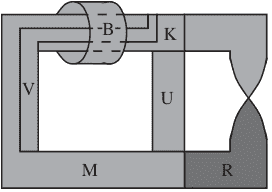

### FIGURE 2.17

First construction: $(M,K,U,V)\in TS_{2,0,0};\ (M,K,U,V,B)\in TS_{1,0,1};\ (M,K,U,V,B,R)\in TS_{1,1,1}$.

Second construction: $(M,K,B,R)\in TS_{1,1,0};\ (M,K,B,R,V)\in TS_{1,2,0};\ (M,K,B,R,V,U)\in TS_{1,3,0}$.

可以是一个环（即两次与一个顶点相邻），两个与一个面相邻的自由边可以被识别。

因此，一个面是一个圆盘，其边界是一个由边和顶点组成的环，包含至少一条边和一个顶点。任意两个自由边都可以被识别，可能“通过连续性”涉及其边界顶点的识别（注意可能有超过两个顶点被一起识别）。

例如，图 2.18 上描绘了两个新情况（完整研究参见 [164]）：

- 一个面上的两条边被识别，涉及产生一个由一条边和一个顶点组成的新边界的创建：图 2.18(a)；此情况类似于“做一个边界”；
- 分别与顶点 $v_1$ 和 $v$、$v$ 和 $v_2$ 相邻的两条边 $v_1$ 和 $v$、$v$ 和 $v_2$（这三个顶点互不相同）被识别⁵。初始配置类似于“缩短一个边界”的情况（参见图 2.14），但边以另一种方式被识别，即第一条边，取定向 $v_1v$ 与另一条边，取定向 $vv_2$ 被识别，从而在曲面中产生一个扭转并识别顶点 $v$、$v_1$ 和 $v_2$；
- 通常，新情况是“组合”上述情况。例如，添加一个与一条边和一个顶点相邻的面可以移除一个由一条边和一个顶点组成的边界（参见图 2.18(b)）。另一个例子是射影平面的构造：取一个面使得其边界由两条边和两个顶点组成；识别

> ⁵ The identification of two edges corresponds to the existence of a homeomorphism between these two edges. The homeomorphism is “extended” onto the boundaries of the edges by continuity, and remains usually a homeomorphism; the identification corresponds to the fact that any pair of corresponding points is identified into one point.

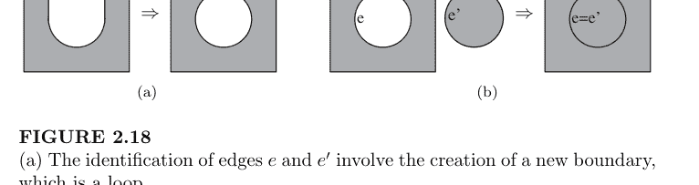

### FIGURE 2.18

(a) 边 e 和 e′ 的识别涉及一个新边界的创建，该边界是一个环。

(b) 通过添加一个面来移除“环边界”。

of these two edges remove the boundary. Note that the edges can be identified in two ways: a sphere can be created, but also a projective plane, according to the way the edges are identified. In the case of the projective plane, a new twist is added.

## Connectivity

迄今为止，所有考虑的曲面都是连通的，即非正式地说，由一块组成：直观上，你可以在曲面上在任意两点之间行走。更正式地，X ⊂ ℝⁿ 中两点 x 和 y 之间的路径，其中 x, y ∈ X，指的是一个连续映射 γ : [0,1] → X，使得 γ(0) = x 且 γ(1) = y。x 和 y 被称作由路径 γ 连接。当 γ(0) = γ(1) 时，路径是闭合的。

设 X ⊂ ℝⁿ，并设 R 是定义在 X 的点上的关系，使得 xRy 当且仅当 x 和 y 在 X 中由一条路径连接。R 是一个等价关系，其等价类是 X 的连通分支：换句话说，在一个连通分支的任意两点之间在 X 中存在一条路径，而在两个不同连通分支的两点之间在 X 中不存在路径。

我们可以将曲面的表示推广以考虑非连通曲面，即由若干个连通分支组成的曲面；特征数（边界数、可定向因子、亏格）的定义可以被调整，但更令人感兴趣的是——因为更精确——去考察每个连通分支的特征。

## 2.4 Manifolds, Quasi-manifolds, Pseudo-manifolds, Complexes

### 2-dimensional manifolds


让我们将度为 k 的多边形定义为一个闭盘（即 2 维闭球），其边界是一个由 k 条边和 k 个顶点组成的环，k ≥ 1。多边形包含一个面（即 2 维胞腔），它是多边形的内部：注意面的每一点都有一个邻域与开盘（即 2 维开球）同胚。每条边（即 1 维胞腔）与 1 维开球同胚（因此边的每一点的邻域也是如此），每个顶点（即 0 维胞腔）是（与）一个点同胚的。任何曲面的细分都可以通过识别至多两条自由边（并且通过连续性识别这些边的边界）来构造：因此，缝合边上的每一点也有一个邻域与开盘同胚（因此无边界曲面上的任意点也是如此）。这一性质：每一点都有一个与盘同胚的邻域，刻画了无边界的曲面，也称为无边界的 2 维流形。这一性质可以扩展以刻画任意曲面（即任意 2 维流形）：每个内部点都有一个与盘同胚的邻域，每个边界点都有一个与“半盘”同胚的邻域。

注意我们可以以类似的方式定义 1 维流形。这里的基本元素是 1 维闭球，由一条边（与 1 维开球同胚，作为其任意一点的邻域）和其两个端点顶点组成。任何曲线的细分都可以通过识别至多两个自由顶点来构造：因此，每个缝合顶点也有一个邻域与开 1 维球同胚，并且无边界的任意曲线（也称为无边界的 1 维流形）的任意点的邻域也是如此。带边界的曲线可以通过以下事实来刻画：每个内部点都有一个与 1 维球同胚的邻域，而边界点有一个与“半 1 维球”同胚的邻域。

## n-dimensional simplices

为了构造 n 维“对象”，我们需要 n 维胞腔。对于本节，我们选择 n 维单形，因此需要一些通常的定义。R^n 的点 v0, …, vk 是线性无关的，如果向量 v1 − v0, …, vk − v0 是线性无关的。R^n 中两点 x 和 y 之间的线段是集合 {z = tx + (1 − t)y, t ∈ [0, 1]}。子集 A 是凸的，如果 x, y ∈ A 则 x 和 y 之间的线段包含于 A。集合 A 的凸包是包含 A 的所有凸集的交集。

设 k ≥ 0。k 维单形 σ，或 k-单形，是 R^n 中 k + 1 个线性无关点 v0, …, vk 的凸包；σ 表示为 v0…vk。点 vi 是 σ 的顶点。设 {w0, …, wm} 是 σ 的顶点的子集，则 w0…wm 是一个 m 维面，或 m-面：参见图 2.19。当 m < k 时，该面是真面，否则是主面。注意单形包含其边界，该边界由其所有真面组成：因此单形，或其任意面，与闭球同胚（注意我们也可以定义面，或胞腔，使其与开球同胚）。因此 0-单形

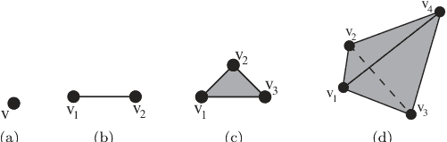

**FIGURE 2.19**

(a) 一个 0-单形 *v*。

(b) 一个 1-单形 *v₁v₂* 有两个 0-面 *v₁* 和 *v₂*，以及一个 1-面 *v₁v₂*。

(c) 一个 2-单形 有三个 0-面，三个 1-面 和一个 2-面。

(d) 一个 3-单形 有四个 0-面，六个 1-面，四个 2-面 和一个 3-面。

是一个点，1-单形是一条线段，2-单形是一个三角形，3-单形是一个四面体，等等。

## Quasi-manifolds, manifolds, pseudo-manifolds and orientability

设闭 *n*-胞腔与 *n*-单形同胚（参见图 2.20(a)、(b) 和 (c)），使得同胚保持单形的结构，即闭 *n*-胞腔包含一个 *n*-胞腔及其边界，由 *k*-胞腔组成（0 ≤ *k* < *n*）。我们可以通过取这样的闭 *n*-胞腔并识别成对的自由 (*n* − 1)-胞腔（及其边界）来构造 n 维拟流形。识别操作可以通过考虑两个自由 (*n* − 1)-胞腔之间的一个同胚来定义，将其通过连续性延拓到 (*n* − 1)-胞腔的边界上，然后识别由“延拓的同胚”关联的任意点：参见图 2.20(d)、(e) 和 (f)。注意我们可以像 2 维情形那样定义自由胞腔、缝合胞腔、拟流形的边界等概念。

拟流形的这种构造可以推广以考虑更一般的胞腔：参见第 8 章。无论如何，注意 1 维和 2 维拟流形是流形，即曲线和曲面：对于维度不超过 2 的情况，这两个概念没有区别。

现在让我们将 *n* 维 *无边界流形* 定义为无边界的 *n* 维拟流形，使得每一点都有一个与 *n* 维开球同胚的邻域（该定义可以扩展到带边界的流形）。对于高于二维的维度，这些概念是不同的，因为存在不是流形的拟流形：

- 如上定义的闭 *n*-胞腔（即与闭 *n*-单形同胚）与闭 *n*-球同胚，因此它是一个具有一个边界的流形。我们稍后会看到，其他 *n*-胞腔的定义不涉及这一性质（参见第 8 章）；

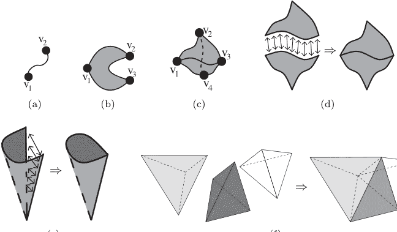

# **FIGURE 2.20**

(a) 一个闭 1-胞腔。

(b) 一个闭 2-胞腔。

(c) 一个闭 3-胞腔。

(d) 两个闭 2-胞腔；左侧的箭头表示两个 1-胞腔之间的同胚，导致它们的识别。

(e) 一个闭 2-胞腔上两条边的识别。

(f) 一个 3 维拟流形（它是一个流形）的构造。

- 其他拟流形可以是流形：例如，参见图 2.20(f)。自由 2-胞腔边界上任意一点的邻域是一个半 3-球。当两个 2-胞腔被识别时，对应于两个被识别点的两个半球变成一个 3-球。对于被识别的边或顶点的点，半球被粘合并形成半球（因为所有边和顶点都属于所得对象的边界）。除了看邻域，你也可以看点的链路，即邻域的边界，这也可以为 3-胞腔的点定义为以该点为中心的小 2-球与 3-胞腔的交集。这样的链路对于边界点是盘，对于内部点是球；

- 现在看图 2.21(a) 中描绘的对象：它是一个立方体，由二十四个四面体粘合而成（四个四面体粘合形成一个底面为正方形的金字塔，该正方形将是立方体的一个面，且六个这样的金字塔粘合在一起）。点 v（位于立方体上表面中心）的链路由立方体内部的一个半球组成，由立方体表面上的一个盘封闭。该盘的边界由四个部分 l1 ⊂ f1, l2 ⊂ f2, l3 ⊂ f3, l4 ⊂ f4 组成。如果面 f1 与面 f2 识别且面 f3 与面 f4 识别，使得边 e1 和 e3（分别 e5 和 e6, e7 和 e8）被识别，且顶点 v1 和 v3 被识别，则所得对象仍然是一个流形（并且你可以在通常的 3 维空间中构造所得对象）。例如，点 v 的链路变成所得对象中的一个球，因为 l1（分别 l4）与 l2（分别 l3）被识别。如果面 f1 与面 f3 识别且面 f2 与面 f4 识别，使得边 e1, e2, e3 和 e4 被一起识别，边 e5（分别 e6）与边 e7（分别 e8）被识别，且顶点 v1, v2, v3 和 v4 被一起识别，则所得对象仍然是一个拟流形，但它不是一个流形（并且你无法在通常的 3 维空间中构造所得对象）：例如，顶点 v 的链路现在是通过将 l1 与 l3 识别，l2 与 l4 识别而得到，产生一个带一个柄的环面（即其亏格等于 1），它不是一个 3-球的边界；因此，v 的邻域与 3-球不同胚。

我们将看到，可以定义数据结构，使得可以保证任何实例都对应于一个拟流形；但就我们所知，没有人知道如何定义数据结构，使得可以保证任何实例都对应于一个流形。这对应于拟流形的（结构）可以组合地定义，即作为离散结构（相关的数学领域被称为“组合拓扑”）。流形并非如此，因为就我们所知，没有人知道如何组合地刻画球：换句话说，不存在离散的计算能够判断一个“对象”是否是一个球。

另一个方面是：就我们所知，没有分类——

# 图2.21

(a) 由二十四个四面体构成的立方体。

(b) 可定向的2维伪流形。

(c) 一个2维复形。

n维流形的分类与二维情形类似，尽管若干概念可以被推广。例如，可定向性可以为拟流形定义，从而可以为流形定义，更一般地可以为伪流形定义。非正式地说，n维伪流形（参见图2.21(b)）可以通过粘合闭n-胞腔来构造：

- 通过识别至多两个自由(n − 1)-胞腔及其边界（如拟流形那样）；

- 通过识别k维胞腔，0 ≤ k < n − 1；

- 以这样的方式：给定任意两个n-胞腔σ和σ′，存在一个序列σ0,⋯,σp，使得σ = σ0，σ′ = σp，并且σj与σj+1在一个共同的(n − 1)维胞腔中相遇，0 ≤ j < p。

伪流形的定义（在结构上）是组合式的，如同拟流形的定义一样。此外，令SM^n（相应地 SQM^n，SPM^n）为n维流形（相应地拟流形、伪流形）的集合：则SM^n ⊂ SQM^n ⊂ SPM^n。换句话说，任何流形都是拟流形，而拟流形本身也是伪流形。但存在不是拟流形的伪流形（例如参见图2.21(b)），同样也存在不是流形的拟流形。

无边界伪流形是指不存在自由(n−1)-胞腔的伪流形。如果无边界伪流形的n-胞腔可以被一致地定向，即任意两个共享一个共同(n − 1)-胞腔的n-胞腔在该(n−1)-胞腔上诱导相反的定向，则该伪流形是可定向的。注意，如果已知n-胞腔定向的定义，那么这个定义是自洽的。事实上，闭

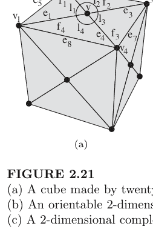

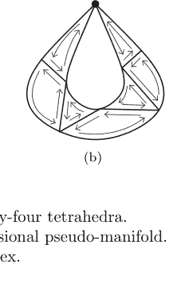

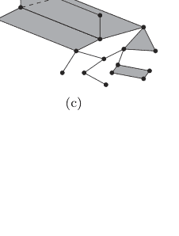

n-胞腔的边界是较低维的流形（即伪流形）。让我们将闭n-胞腔的定向（从而相应n-胞腔的定向）定义为其边界的定向：由于我们知道如何为n = 1定义定向，因此可以为任意n定义定向。也可以为带边界的伪流形定义可定向性，从而为任何（拟）流形定义可定向性。

其他概念也可以推广到任何维度，例如欧拉示性数，它等于胞腔数量的交错和。这些概念将在后续章节中针对拟流形进行研究。

最后，注意可以定义其他对象集合。例如，复形可以按如下方式构造性地定义：取一组维度不超过n的闭胞腔，并识别这些闭胞腔边界上的胞腔；你得到一个n维复形（参见图2.21(c)）。

### 2.5 离散结构

为了在计算机中处理此类拟流形（以及更一般的复形），有必要定义数据结构。我们将区分对象结构的表示（其“拓扑”）与其形状的表示（其“嵌入”，通常在某个ℝⁿ中）。

例如（参见图2.22），假设嵌入ℝ³中的三角剖分曲面由一组三角形描述，每个三角形由三个点定义。一种可能的数据结构是Triangle列表，每个Triangle是九个浮点数的元组，定义ℝ³中三个点的坐标。这种结构没有清楚地区分曲面拓扑的表示和形状的表示。为了知道两个三角形是否相邻，有必要比较坐标值，即考虑形状。此外，众所周知，浮点数的不精确或误差（例如某些计算的结果）可能导致曲面的不精确表示。因此可能无法检查两个三角形是否相邻。

另一种表示如下。曲面仍然对应一个Triangle列表，但Triangle现在是三个指向Point的指针的元组，每个Point是三个浮点数的元组，对应于ℝ³中一个点的三个坐标。该数据结构的先决条件是：一个点（相应地一个三角形）只被表示一次（两个不同的Point对应ℝ³中两个不同的点，两个不同的Triangle对应两个不同的三角形）。现在，三角剖分的结构被“独立于”其形状地表示出来。例如，为了检查两个三角形是否相邻，会比较指向点的指针，产生精确的信息；这里不涉及点的坐标。

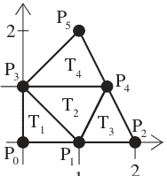

## 图2.22

*三角剖分* $S$。

$S$的第一种表示是：$S=(T_1,T_2,T_3,T_4)$, $T_1=((0,0),(1,0),(0,1))$, $T_2=((1,0),(0,1),(1.5,1))$, $T_3=((1,0),(2,0),(1.5,1))$, $T_4=((0,1),(1.5,1),(1,2))$。

另一种表示是：$S=(T_1,T_2,T_3,T_4)$, $T_1=(&P_0,&P_1,&P_3)$, $T_2=(&P_1,&P_3,&P_4)$, $T_3=(&P_1,&P_4,&P_2)$, $T_4=(&P_3,&P_4,&P_5)$, $P_0=(0,0)$, $P_1=(1,0)$, $P_2=(2,0)$, $P_3=(0,1)$, $P_4=(1.5,1)$, $P_5=(1,2)$。$&P$表示对点$P$的引用。

注意，为了处理三角剖分曲面，已经设计了更精确的数据结构（例如参见文献[183]）。

拟流形的*结构*可以用组合方式描述，即通过离散结构来描述。对于拟流形的特定子集（如可定向拟流形），或对于更一般的对象（如复形），也是如此（参见后续章节）。但如前所述，这并非对于所有复形子集都是可能的，例如对于流形。

### 2.5.1 离散映射

我们将要定义的离散结构是代数，即它们由离散对象来定义，这些对象上定义了函数。这样的代数可以等价地定义为图，并且可以容易地实现⁶。以下定义将说明相关术语。

$（多重）集$, $（多重）图$

一个元素在*集*中出现一次，而在*多重集*中可以出现多次。从现在起，所有（多重）集都是离散的，并且通常是有限的，即任何（多重）集包含*有限*个元素。

*有向多重图*（相应地*图*）是一个二元组$(V,E)$，其中$V$是

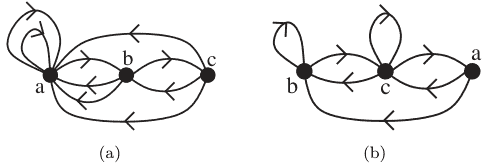

## 图2.23

(a) 一个多重图：$V=\{a,b,c\}$, $E=\{(a,a),(a,a),(a,b),(b,a),(b,a),(b,c),(c,b),(c,a),(c,a)\}$。

(b) 一个图：$V=\{a,b,c\}$, $E=\{(a,b),(b,b),(b,c),(c,b),(c,c),(c,a),(a,c)\}$。

顶点的集合，$E$是边的多重集（相应地集），边是$V$中一对顶点（参见图2.23）。边$(x,y)$（其中$x,y\in V$）从$x$取向$y$，$x$是边的*起点*，$y$是其终点；该边与$x$和$y$关联，反之亦然；当$x=y$时，该边是一个环。*二部*有向图是这样的图：其顶点集可以划分为两个子集$V_1$和$V_2$，使得每条边都与$V_1$中的一个顶点和$V_2$中的一个顶点关联。所有与图相关的经典概念，如路径、连通分量等，均视为已知。

*关系、函数、置换、对合、复合*

设$F$和$G$为两个集合。$F$和$G$之间的关系$R$是一组对$(x,y)$的集合，其中$x\in F$且$y\in G$，即它是$F\times G$（$F$和$G$的*笛卡尔积*）的子集，即$\{(x,y)\mid x\in F, y\in G\}$。任何关系都可以关联一个有向图（反之亦然），即图$(F\cup G,R)$：参见图2.24(a)。当$F$和$G$不相交时，该图是二部的。

当$xRy\Rightarrow yRx$时，关系$R$是*对称的*：参见图2.24(b)和(c)；换句话说，当两个顶点$x$和$y$在关联图中由$(x,y)$连接时，它们也由$(y,x)$连接。*无向边*$\{x,y\}$可以由两条相反边$(x,y)$和$(y,x)$的集合来定义，*无向图*可以定义为与对称关系关联的图。

*函数*（或*映射*）$\phi$是一种关系，使得对于任何$x\in F$，恰好存在一个$y\in G$满足$(x,y)\in\phi$；$y$记作$\phi(x)$；因此，在相应的图中，每个顶点恰好有一条边（参见图2.24(d)）。设$F'\subset F$，并设$G'\subset G$为$F'$的元素在$\phi$下所有*像*的集合，即$G'=\{y\in G\mid\exists x\in F',\phi(x)=y\}$。那么$\phi':F'\to G'$，定义为：$\forall x\in F',\phi'(x)=\phi(x)$，是$\phi$在$F'$上的限制，记作$\phi'=\phi|_{F'}$。与$\phi'$对应的图是与$\phi$关联的图的*子图*，包含与$F'$的元素对应的顶点。

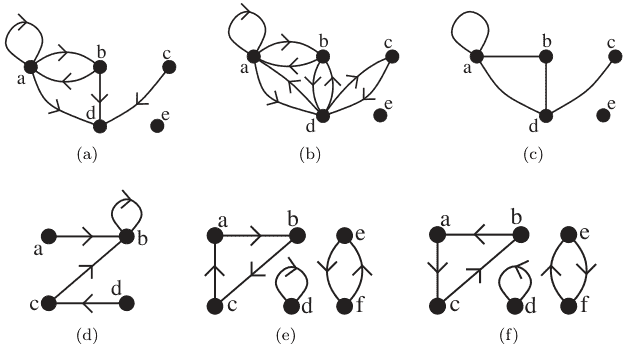

### FIGURE 2.24

- (a) 关系 $R$ 的图：$F=\{a,b,c\}$, $G=\{a,b,d,e\}$, $R=\{(a,a),(a,b),(a,d),(b,b),(b,d),(c,d)\}$。

- (b) 对称关系 $R'$ 的图：$F'=G'=\{a,b,c,d,e\}$, $R'=\{(a,a),(a,b),(a,d),(b,a),(b,d),(c,d),(d,a),(d,b),(d,c)\}$。

- (c) 与 $R'$ 关联的非定向图的另一种表示。

- (d) 函数 $\phi$ 的图：$F=\{a,b,c,d\}$, $G=\{b,c\}$, $\phi=\{(a,b),(b,b),(c,b),(d,c)\}$。

- (e) 一个置换 $P$：$F=\{a,b,c,d,e,f\}$, $P=\{(a,b),(b,c),(c,a),(d,d),(e,f),(f,e)\}$。

- (f) $P^{-1}$，$P$ 的逆为：$P^{-1}=\{(b,a),(c,b),(a,c),(d,d),(e,f),(f,e)\}$。

所有以这些顶点为原点的边，以及它们的终点顶点。

函数是 *单射* 的（即它是 *单射*）当且仅当，对任意 $x, y \in F$，$x \neq y$ 蕴含 $\phi(x) \neq \phi(y)$；因此，在对应的图中，$G$ 中元素的对应顶点至多是一条边的终点。

函数是 *满射* 的（即它是 *满射*）当且仅当，对任意 $y \in G$，存在 $x \in F$ 使得 $y = \phi(x)$；因此，在对应的图中，$G$ 中元素的对应顶点至少是一条边的终点。

函数是 *双射* 的（即它是 *双射* 或一一映射）当且仅当它是单射且满射：因此，在对应的图中，$F$ 中元素的对应顶点是边的原点，且 $G$ 中元素的对应顶点是边的终点。

*逆* 双射 $\phi^{-1}$ 是 $G$ 与 $F$ 之间的双射，使得其图是通过反转所有边得到的；换句话说，$\phi(x) = y \implies \phi^{-1}(y) = x$。


当 $F = G$ 时，双射是 *置换*，对应的图是一组基本环，因为每个顶点都是边的原点和终点；请注意，置换的逆也是一个置换（参见图 2.24(e) 和 (f)）。设 $P$ 为置换：$P$ 的 *不动点* 是满足 $P(x) = x$ 的任意元素 $x$；因此，不动点对应于关联图中带环的顶点。

`Id` 表示 *恒等*，即满足对任意 $x$ 都有 $Id(x) = x$ 的置换。换句话说，所有元素对 $Id$ 都是不动点。

*对合* $I$ 是其自身的逆的置换，即 $I = I^{-1}$，意味着 $I(x) = y \implies I(y) = x$。因此关联图是非定向图，且每个连通分量由带环的单个顶点或两个顶点构成的边组成：参见图 2.25(a)。

设 $F, G, H$ 为三个集合，$f$ 和 $g$ 为两个函数：$f : F \to G$, $g : G \to H$，且 $f$ 为满射。$g \circ f : F \to H$，$f$ 与 $g$ 的 *复合* 定义为：$g \circ f(x) = g(y)$，其中 $y = f(x)$，对任意 $x \in F$，即 $g \circ f(x) = g(f(x))$。$g \circ f$ 对应的图以 $F \cup H$ 为顶点集，其边对应于与 $f$ 和 $g$ 关联的图的并集中长度为 2 的路径⁷。

请注意，两个双射的复合是双射，两个置换的复合是置换，两个对合的复合是置换（参见图 2.25），而对合与其自身的复合是恒等（因为它等于其逆）。

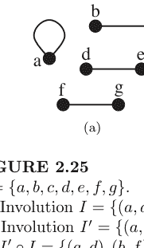

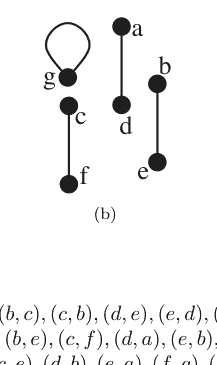

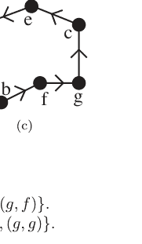

### FIGURE 2.25

$F = \{a, b, c, d, e, f, g\}$。

- (a) 对合 $I = \{(a, a), (b, c), (c, b), (d, e), (e, d), (f, g), (g, f)\}$。

- (b) 对合 $I' = \{(a, d), (b, e), (c, f), (d, a), (e, b), (f, c), (g, g)\}$。

- (c) $I' \circ I = \{(a, d), (b, f), (c, e), (d, b), (e, a), (f, g), (g, c)\}$。

设 $P$ 为置换。$P^0$ 表示 $Id$，$P^k$ 表示 $P \circ P^{k-1} = P^{k-1} \circ P$（因此 $P^1$ 表示 $P$，$P^2$ 表示 $P \circ P$，等等）。

## 2.5.2 Hypermaps, Group of Permutations, Orbits

设 $S = \{P_1, \ldots, P_k\}$ 为定义在集合 $D$ 上的置换集合。$(D, P_1, \ldots, P_k)$ 是 `k` 维超图⁸；关联图是图 $(D, P_1), \ldots, (D, P_k)$ 的并集：参见图 2.26。

> ⁸ 作为本书主要讨论的 n-Gmaps 和 n-maps，超图是组合映射的特殊类：这些结构之间的关系在第 8 章中解释。

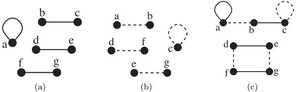

### FIGURE 2.26

$D=\{a,b,c,d,e,f,g\}$。

- (a) 对合 $I=\{(a,a),(b,c),(c,b),(d,e),(e,d),(f,g),(g,f)\}$。

- (b) 对合 $I'=\{(a,b),(b,a),(c,c),(d,f),(e,g),(f,d),(g,e)\}$。

- (c) 2 维超图 $(D,I,I')$，包含两个连通分量。

设 $S' = \{P_{i_1}, \ldots, P_{i_j}\}$ 为 $S$ 的子集。$\langle S'\rangle$ 是由 $S'$ 生成的置换群，或置换群：它是所有置换 $P$ 的集合，使得 $P$ 要么是 $Id$，要么是 $S'$ 中的置换或其逆，要么是 $S'$ 中置换及其逆的任意复合。例如，设 $I$ 和 $I'$ 为图 2.26(a) 和 (b) 中描绘的对合。$\langle I, I'\rangle$ 是 $\{Id, I, I', I' \circ I, I \circ I', I \circ I' \circ I, I' \circ I \circ I', \ldots\}$。

相对于 $S'$，元素 $d$ 的轨道是集合 $\langle S'\rangle(d) = O(d) = \{P(d) \mid P \in \langle S'\rangle\}$。它是所有可以通过从 $d$ 出发应用 $S'$ 中置换（的逆）的任意复合到达的元素集合（请注意 $d$ 属于其任意轨道，因为 $Id$ 属于任意置换群）。$\langle S'\rangle(d)$ 也表示，根据上下文，表示子超图 $(O(d), P_{i_1}|_{O(d)}, \ldots, P_{i_j}|_{O(d)})$，其中 $P_{i_k}|_{O(d)}$ 是 $P_{i_k}$ 在 $O(d)$ 上的限制（请注意这些限制是良定义的，因为轨道的定义）。当 $S'=S$ 时，$d$ 的对应轨道是 *与 $d$ 相邻的连通分量*。例如，查看图 2.26(c) 中描绘的 2 维超图：与 $a$（分别 $f$）相邻的连通分量包含元素 $a=I(d)$，$b=I'(a)$，$c=I\circ I'(a)$（分别 $f=I(d)$，$e=I\circ I'(f)$，$g=I(f)$）。最后，请注意不同的复合可以产生相同的元素，例如 $e=I\circ I'(f)=I'\circ I(f)$，$f=I\circ I'\circ I\circ I'(f)$，等等。

设 $H=(D,P_1,\ldots,P_k)$ 和 $H'=(D',P'_1,\ldots,P'_k)$ 为两个超图。$\phi:D\to D'$ 是 $H$ 与 $H'$ 之间的 *同构*，如果 $\phi$ 是 $D$ 与 $D'$ 之间的双射，且满足：$\forall d\in D,\ \forall i\in\{1,\ldots,k\},\ \phi(P_i(d))=P'_i(\phi(d))$。$H$ 与 $H'$ 是同构的（由 $\phi$）。对应的图是同构的，且对每个 $i$，对应于置换 $P_i$ 的边与对应于置换 $P'_i$ 的边相关联。

## 2.5.3 Partial Functions, Partial Permutations, Partial Involutions and Related Notions

设 $F'$, $F$, $G$ 为三个集合，使得 $F'\subset F$。如果 $f:F'\to G$ 是函数，则它是 $F$ 到 $G$ 的 *偏函数*；因此，要么 $f(x)\in G$ 若 $x\in F'\subset F$，要么 $f(x)$ 未定义若 $x\in F\setminus F'$：在后一种情况下，记作 $f(x)=\varnothing$，关联的有向图中没有以 $x$ 为原点的边（参见图 2.27(a)）。与函数相关的所有先前概念都可以扩展到偏函数。例如，*偏置换* 的一种替代定义如下（参见图 2.27(b)）：偏置换是函数 $P:F\cup\{\varnothing\}\to F\cup\{\varnothing\}$ 使得：

- 1. $P(\varnothing)=\varnothing$；

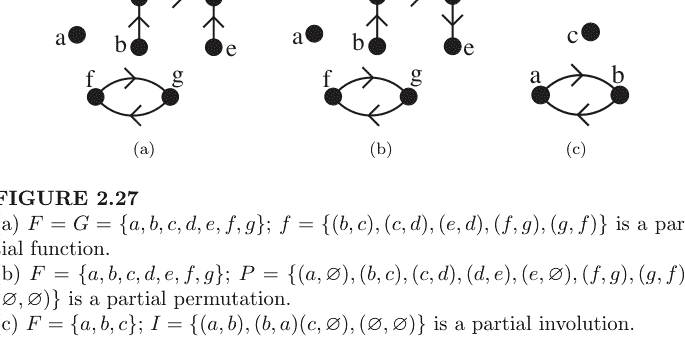

### FIGURE 2.27

- (a) $F = G = \{a, b, c, d, e, f, g\}$；$f = \{(b, c), (c, d), (e, d), (f, g), (g, f)\}$ 是偏函数。

- (b) $F = \{a, b, c, d, e, f, g\}$；$P = \{(a, \varnothing), (b, c), (c, d), (d, e), (e, \varnothing), (f, g), (g, f), (\varnothing, \varnothing)\}$ 是偏置换。

- (c) $F = \{a, b, c\}$；$I = \{(a, b), (b, a), (c, \varnothing), (\varnothing, \varnothing)\}$ 是偏对合。

- 2. $\forall x_1, x_2 \in F$, $P(x_1) = P(x_2) \neq \varnothing \implies x_1 = x_2$。

换句话说，$\varnothing$ 表示“未定义”。设 $F'$ 为 $P$ 在其上定义的 $F$ 的子集。因此，对任意 $x \in F'$, $P(x) \neq \varnothing$，且对任意 $x \in F \setminus F'$, $P(x) = \varnothing$。$P^{-1}$，$P$ 的逆，定义为：

- 1. $P^{-1}(\varnothing) = \varnothing$；

- 2. 设 $y \in F$；如果存在 $x \in F$ 使得 $P(x) = y$，则 $P^{-1}(y) = x$，否则 $P^{-1}(y) = \varnothing$。

请注意，对任意 $x \in F$，要么 $P(x) = \varnothing$，要么 $P^{-1}(P(x)) = x$。

偏对合 $I$ 是偏置换，使得 $\forall x \in F$，要么 $P(x) = \varnothing$，要么 $P(x) \neq \varnothing \implies P(P(x)) = x$（参见图 2.27(c)）。

超图可以使用偏置换而不是置换来定义。假设对任意偏函数都有 $f(\varnothing) = \varnothing$，则很容易定义偏置换的复合，从而也定义与一组偏置换相关的置换群。与一组偏置换相关的元素的轨道按之前的方式定义，但 $\varnothing$ 不属于轨道；设 $S = \{P_1, \ldots, P_k\}$ 为定义在 $F$ 上的偏置换集合：$\langle S\rangle(x) = \{P(x) \mid P \in \langle S\rangle\} \setminus \{\varnothing\}$，对 $x \in F$。与之前一样，它也表示该元素集合连同 $S$ 的偏置换。

## 2.6 关联图

为了表示细分对象的拓扑结构，已经提出了许多离散结构。其中一个重要子集是*关联图*，也称为*序*，并且已经定义了几类关联图，以便表示不同类的细分对象 [102, 195, 18, 84]。

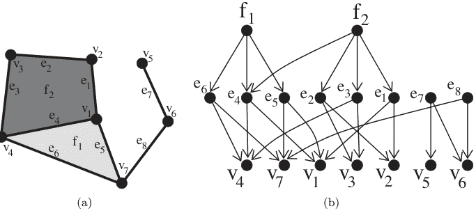

**图 2.28**

(a) 一个 2 维复形。 (b) 对应的关联图。

例如，观察图 2.28(a) 中描绘的 2 维复形；该复形满足一个重要的拓扑性质：该复形中*不存在多重关联*。更精确地，该性质可以如下为 2 维情况定义：

- 1. 任意 2 维（分别 1 维）胞腔在其边界上恰好关联一次任意 1 维（分别 0 维）胞腔。换句话说，如果你考虑通过识别边或顶点来构造此类复形：

  - 在任何识别之前，每个面由至少三条边和三个顶点构成的边界；

  - 在任何识别之前，每条边的边界由恰好两个顶点构成；

  - 只有当它们不关联同一个面时，两条边（自由或非自由）才能被识别；

  - 任何识别（边、顶点）都不会产生环；

- 2. 对于给定的面和给定的顶点，面的至多一个“角”关联到该顶点（参见图 2.29(a) 的反例）。

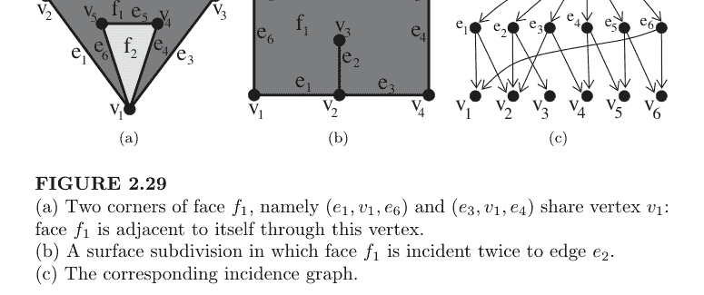

**图 2.29**

(a) 面 `f1` 的两个角，即 (`e1`, `v1`, `e6`) 和 (`e3`, `v1`, `e4`) 共享顶点 `v1`：面 `f1` 通过该顶点与自身相邻。

(b) 一个面细分，其中面 `f1` 两次关联到边 `e2`。

(c) 对应的关联图。

关联图可以描述不存在多重关联的 `n` 维复形的拓扑结构（参见第 8 章对关联图及其相关复形的精确研究）。为了构造此类复形关联的图（参见图 2.28(b)）：

- 1. 用图的顶点关联任意一个胞腔；此外，还将胞腔的维数与相应的胞腔关联（这不是一个要求，有几种关联图的定义省略了维数，可以从图中表示的其他信息中获取）；在图 2.28(b) 中，胞腔的维数由图顶点的高度表示；

- 2. 对于每一对关联的 `i` 维和 (`i` − 1) 维胞腔，在图的相应顶点之间关联一条有向边。

事实上，该图是 `i` 维和 (`i` − 1) 维胞腔之间的关联关系的图；在图中，对应于 `i` 维胞腔的顶点是边的起点，这些边的终点是与该胞腔边界的 (`i` − 1) 维胞腔关联的顶点。关联图的基础思想因此简单而直观。注意，已经提出了其他变体以表示复形类或更一般的对象，例如从中移除了子部分的复形 [195]。

被表示时，它必须从关联图计算出来。观察图 2.28(a) 中描绘的复形的面 `f₁`：其边界由顶点 `v₁`、`v₄` 和 `v₇`，边 `e₄`、`e₅` 和 `e₆` 构成。如果你绕着面转，你会按与 (`v₁`, `e₄`, `v₄`, `e₆`, `v₇`, `e₅`) 等价的序列（或其逆序列）遇到这些胞腔，该序列描述了这些胞腔在 `f₁` 边界中的“顺序”。为了从关联图中提取该序列，你必须遍历图，从 `v₁` 开始，然后转到其关联边 `e₄`，然后转到另一个关联顶点 `v₄`，依此类推。

现在观察图 2.29(b) 和 (c) 中描绘的复形及其对应的关联图。首先，注意面 `f₁` 两次关联到 `e₂`；因此存在多重关联，并且关联图不能明确地描述该复形的拓扑结构！无论如何，尝试绕着面 `f₁` 转，从顶点 `v₁` 沿边 `e₁` 开始；然后我们必须转到另一个关联顶点 `v₂`，但现在存在两个不同于 `e₁` 的关联边，即 `e₂` 和 `e₃`：那么，图中什么信息使得能够选择 `e₂` 以跟随 `f₁` 的边界？

还要注意，可能很难定义专门用于特定复形的关联图子类。例如，可以构造关联图，其中一个 1-胞腔关联到多于两个 0-胞腔；那么，关联图需要满足什么性质才能表示拟流形？此类性质已被定义（参见 [84]，例如），但它们不是关联图定义的内在属性，与“有序”结构如 n-Gmaps 和 n-maps（参见第 4 章和第 5 章）相反。

由于只有不存在多重关联的复形可以用关联图表示，只能关联特定的嵌入，通常是线性嵌入，即 0-胞腔关联到一个点，1-胞腔关联到一条线段，2-胞腔关联到平面的一部分，等等，并且这些胞腔的嵌入满足胞腔之间的关联关系（例如，与 1-胞腔关联的 0-胞腔关联的点是与 1-胞腔关联的线段的端点）。

几何建模、计算几何、离散几何、计算机图形学、图像处理和分析中的许多应用需要处理非线性对象，例如参数曲线和曲面等，以及可能发生多重关联的对象。因此，已经提出了许多“有序”模型（例如 [17, 214, 203, 39, 165, 104]）。还要注意，通常为处理有序模型设计构造操作比为处理关联图设计构造操作更容易。n-Gmaps（分别 n-maps）是有序模型的典型代表，专门用于表示拟流形（分别定向拟流形）的拓扑结构，这就是为什么本书致力于这些结构。

# 3

*直观介绍*

在本直观介绍中，我们展示了如何表示第 2 章中引入的拟流形细分物的拓扑结构。*n*-maps 和 *n*-Gmaps 在第 3.1 节和第 3.2 节中介绍。两种模型各有优缺点。*n*-maps 允许描述定向细分，而 *n*-Gmaps 允许描述定向和非定向细分。*n*-maps 表示定向拟流形所需的内存是 *n*-Gmaps 的一半。然而由于定义不均匀，*n*-maps 的算法比 *n*-Gmaps 更复杂。基于这些原因，两种模型都很有趣，可以根据特定应用的具体需求进行选择。

在本章中，不同的模型从要描述的对象开始引入，通过对胞腔进行连续分解。注意，这种构造仅用于理解 darts 的概念，darts 是组合映射的基本元素，以及这些 darts 之间的不同链接。在实践中，*n*-maps 和 *n*-Gmaps 通过高级操作处理。

## 3.1 *n*-maps

*n*-maps 可以按以下方式引入：给定一个定向拟流形，直观的构造包括按递减维数分解所有胞腔，直到得到孤立的有向边，并在每一步保持分解元素之间的关系。

### 3.1.1 无边界的对象

首先让我们考虑没有边界的定向拟流形。

#### 3.1.1.1 1D

观察图 3.1(a) 中给出的没有边界的 1D 定向拟流形，即所有边以一致方式定向的闭合多边形曲线。拟流形由五个边（标记为 `e₁` 到 `e₅`）和五个

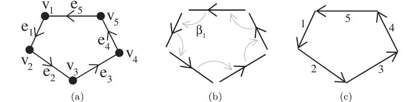

**图 3.1**

(a) 一个没有边界的 1D 定向拟流形。

(b) 多边形曲线的分解产生了一组由 β₁ 链接的孤立有向边。

(c) 对应 1-map 的表示。darts 画成有向边；β₁ 没有明确表示：它由边的邻接暗示。

顶点（标记为 `v₁` 到 `v₅`）组成。为了得到描述该多边形曲线的 1-map，曲线被分解成边，通过将每个顶点拆分为两个，产生图 3.1(b) 中绘制的孤立有向边的集合。这些有向边是 1-map 定义的基础的原子元素，称为 darts。在这些 darts 上定义了一个关系，称为 β₁，以便将一个有向边与在拆分前共享一个公共顶点的多边形曲线的下一个有向边链接。注意，由于拟流形没有边界，可以确定对于每条边，存在恰好一条这样的边。darts 的集合加上关系 β₁ 是描述初始 1D 定向拟流形的 1-map（参见图 3.1(c)）。β₁ 是一个置换，即从 darts 集合到 darts 集合的双射。

1D 拟流形的每个顶点和每条边在对应的 1-map 中由恰好一个 dart 描述。在图 3.1 的例子中，顶点 `v₁` 和边 `e₁` 由 dart 1 描述：更一般地，每个 dart 恰好对应一个顶点和一个有向边的对（dart 1 对应于对 (`v₁`, `e₁`)）。注意，只有有向边的第一个端点由 dart 描述；第二个端点将由 β₁ 链接的 dart 描述。


多重关联可以被考虑，如图 3.2(a) 所示的例子，其中顶点 `v₁` 两次关联到边 `e₁`，该边因此是一个环。在这种情况下，对应的 1-map 如图 3.2(c) 所示只包含一个 `dart`，该 `dart` 通过 `β₁` 与自身链接。

可以同时表示多个 1D 定向拟流形。在这种情况下，整个多边形曲线集合可以用一个 1-map 描述，每个多边形曲线作为 1-map 的不同连通分量表示。根据定义，两个 `darts` `d₁` 和 `d₂` 属于同一个连通分量，如果 `d₁` 和 `d₂` 之间存在由 `β₁` 两两链接的 `darts` 路径。对于任意 `dart` `d`，`⟨β₁⟩(d)` 是与 `β₁` 相关的 `d` 的轨道：它是连通

# FIGURE 3.2

(a) 一个没有边界的 1D 有向拟流形，它是一个环（即一条边其两个端点为同一个顶点）。

(b) 分解产生一条与自身由 `β₁` 链接的有向边。

(c) 对应 1-图的表示。

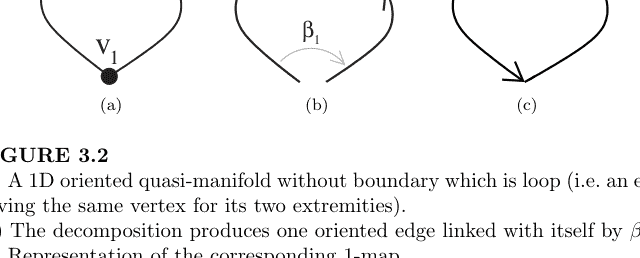

# FIGURE 3.3

(a) 三个不相交的没有边界的 1D 有向拟流形。

(b) 对应的 1-图包含三个连通分支，每个多边形曲线一个。

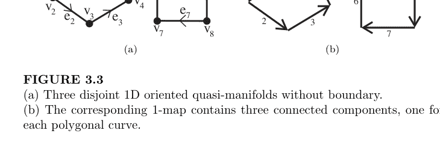

包含 `d` 的分支很容易确定，从 `d` 出发，通过尽可能多次地应用 `β₁` 即可检索其连通分支的所有 `darts`。

图 3.3(a) 给出了三个不相交的 1D 有向拟流形的例子，对应的 1-图见图 3.3(b)。该 1-图包含三个连通分支，每个对应一个 1D 有向拟流形，对应于 `darts` 集合 `{1, 2, 3, 4, 5}`、`{6, 7, 8, 9}` 和 `{10, 11, 12}`。

##### 3.1.1.2 2D

同样的过程可以应用于没有边界的 2D 有向拟流形，即闭合有向曲面，如图 3.4(a) 所给的例子。拟流形由四个面组成，标记为 `f₁` 到 `f₄`，九条边和七个顶点。注意无界面 `f₁` 的存在，这是因为该对象没有边界。

# FIGURE 3.4

(a) 一个没有边界的 2D 有向拟流形。

(b) 曲面的分解产生一组由 `β₂` 链接的孤立有向面。

(c) 描述孤立有向面边界的有向多边形曲线的分解产生一组由 `β₁` 链接的孤立有向边。

(d) 对应 2-图的表示。`Darts` 和 `β₁` 如上所示表示。由 `β₂` 关联的两个 `darts` 由灰色线段连接。

首先，有向曲面通过将每条边拆分为两部分进行分解，产生图 3.4(b) 中绘制的孤立有向面集合。由于初始拟流形是相干定向的（即所有面具有相同的定向），则为每条拆分边检索到正确的定向，即在拆分前描述同一条边的两条边定向方向相反。两条拆分边在初始对象中描述同一条边的信息是通过添加一个链接两条边的关系 `β₂` 来表示的。注意该关系是对称的，因此 `β₂` 是一个对合，即从边集合到边集合的双射，等于其逆。

每个孤立面的边界是一个 1D 有向拟流形，因此上面为 1D 情况介绍的构造适用：每个闭合有向多边形曲线通过将每个顶点拆分为两部分进行分解，产生孤立有向边的集合（见图 3.4(c)），这就是描述初始 2D 有向拟流形的 2-图的 `darts` 集合。与 1D 类似，添加一个 `β₁` 关系以链接一条有向边和同一面中在拆分前共享一个公共顶点的下一条边。

注意两个关系 `β₁` 和 `β₂` 在分解过程中直接定义在有向边（即 `darts`）上。因此 2-图是 `darts` 集合加上 `β₁`，一个置换，和 `β₂`，一个对合（见图 3.4(d)）。还要注意 2D 拟流形的每条边在对应的 2-图中恰好由两个 `darts` 描述。`Darts` 用黑色箭头绘制，有时编号或标记。`β₂` 关系由穿过两个相关 `darts` 的灰色线段表示（例如 `β₂(1)=5`，`β₂(2)=17`），而 `β₁` 关系隐式表示，因为两个相关的 `darts` 连续绘制（例如 `β₁(1)=2`，`β₁(2)=3`）。

2-图的每个 `dart` 描述了初始 2D 有向拟流形中一个顶点 `v` 的一部分、一条有向边 `e` 的一部分和一个有向面 `f` 的一部分，这三个胞腔 `v`、`e` 和 `f` 彼此相邻。此外，`v` 是有向边 `e` 的起点。例如图 3.4(d) 中的 `dart` 1 在图 3.4(a) 中描述了顶点 `v₁` 的一部分、边 `e₂` 的一部分和面 `f₂` 的一部分（并且 `v₁`、`e₂` 和 `f₂` 全部相邻）。图 3.5(a) 的 2-图中每个 `dart` 对应的顶点、边和面部分在图 3.5(b) 中表示。

每个 `dart` 描述顶点的一部分、边的一部分和面的一部分这一事实对 `n`-图中胞腔的定义有重要影响。事实上，有必要考虑属于同一胞腔的所有 `darts` 的集合以描述整个胞腔。这些 `darts` 集合可以从给定的 `dart` `d` 通过某些特定的轨道检索得到：

- `⟨β₁⟩(d)` 是包含 `dart` `d` 的面；
- `⟨β₂⟩(d)` 是包含 `dart` `d` 的边；
- `⟨β₂ ∘ β₁⁻¹⟩(d)` 是包含 `dart` `d` 的顶点。

例如，在图 3.5(a) 给出的 2-图中，包含 `dart` 1 的顶点为 `⟨β₂ ∘ β₁⁻¹⟩(1) = {1,6,9}`；包含 `dart` 1 的边为 `⟨β₂⟩(1) = {1,5}`，包含 `dart` 1 的面为 `⟨β₁⟩(1) = {1,2,3,4}`。更一般地，每个胞腔由属于同一胞腔的所有 `darts` 的集合组成；胞腔的结构由 `βᵢ` 关系给出（见图 3.6）。

该分解过程可应用于任何没有边界的 2D 有向拟流形。图 3.4 中描绘了平面的一个细分，图 3.7 中描绘了细分环面。

与 1D 情况类似，可以同时表示多个 2D 有向拟流形。每个拟流形由一个不同的连通分支描述，整个 2-图描述所有考虑的对象。两个 `darts` `d₁` 和 `d₂` 属于同一连通分支，如果 `d₁` 和 `d₂` 之间存在由 `β₁` 或 `β₂` 两两链接的 `darts` 路径。对于任意 `dart` `d`，`⟨β₁, β₂⟩(d)` 表示包含 `d` 的连通分支：从 `d` 出发，通过尽可能多次地应用 `β₁` 和 `β₂` 即可检索其连通分支的所有 `darts`。

##### 3.1.1.3 3D

当然，可以使用类似的过程分解没有边界的 3D 有向拟流形以获得 3-图。图 3.8(a) 中描绘的 3D 拟流形由三个体积组成（深灰色的六面体、浅灰色的底面为正方形的金字塔加上一个无界体积），十个面、十六条边和九个顶点。首先，拟流形通过将每个面拆分为两部分分解为孤立有向体积。这产生了图 3.8(b) 中显示的孤立有向体积集合；两条拆分面在拆分前描述同一面这一信息是通过添加一个

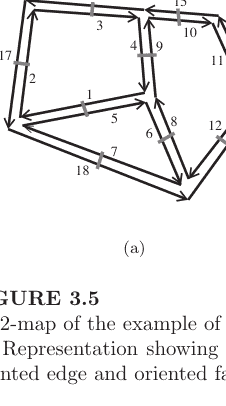

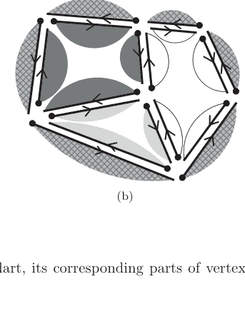

# FIGURE 3.6

2-图 Fig. 3.5(a) 中胞腔的例子。

(a) 包含 `dart` 1 的 0-胞腔（顶点）。

(b) 包含 `dart` 1 的 1-胞腔（边）。

(c) 包含 `dart` 1 的 2-胞腔（面）。

# FIGURE 3.7

(a) 一个没有边界的 2D 有向拟流形，即一个面、两条边和一个顶点的环面曲面细分。

(b) 该 2-图包含四个 `darts`，描述了前述细分。

# FIGURE 3.8

(a) 一个没有边界的 3D 有向拟流形。

(b) 3D 有向拟流形的分解产生一组由 `β₃` 链接的孤立有向体积。

(c) 孤立体积边界的有向曲面分解产生一组由 `β₂` 链接的孤立有向面。

关系 `β₃` 链接两个面（是对称的）。每个体积可以通过其边界来描述，该边界是有向曲面，即没有边界的 2D 有向拟流形。因此可以应用上面为 2D 拟流形介绍的分解过程。每个有向曲面通过将每条边拆分为两部分分解为孤立面。这产生了图 3.8(c) 中给出的孤立有向面集合。每个面可以通过其边界来描述，该边界是有向多边形曲线。

然后每个有向多边形曲线通过将每个顶点拆分为两部分分解为有向边，产生图 3.9(a) 中给出的孤立有向边集合：这就是 3-图的 `darts` 集合。为了获得描述原始 3D 有向拟流形的 3-图，所有 `β` 关系都转移到 `darts` 上。对于 `β₁` 和 `β₂` 来说这是直接的，因为它们已经定义在有向边上，而有向边恰好对应于 `darts`。但对于 `β₃` 来说并非如此，它链接成对的有向面。由于这些有向面通过相同的分解过程拆分为 `darts`，最终得到两个同构的 `darts` 集合。因此，两个有向面之间的 `β₃` 关系可以直接报告到描述这两个面的 `darts` 上。如果两个 `darts` 属于由 `β₃` 链接的两个面，并且它们属于在分解前为同一条边的两条拆分边，则这两个 `darts` 由 `β₃` 链接。由于同一面的两个拆分部分是相干定向的（即方向相反），并且这两个部分的所有 `darts` 都被链接

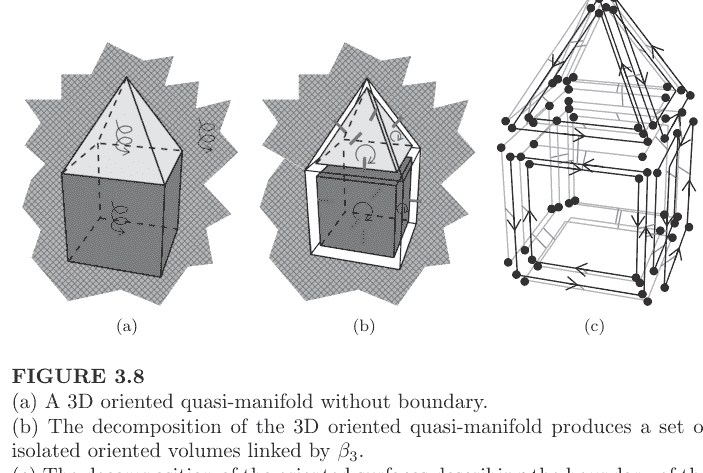

# 图 3.9

(a) 图 3.8(c) 中孤立面边界所描述的有向多边形曲线的分解产生了一组由 `β₁` 链接的孤立有向边。

(b) 对应的 3-图。

(c) 六面体和金字塔之间分隔面的放大图。

两两通过 `β₃`，我们得到重要的性质 `β₁ ∘ β₃` 是一个对合，即 `β₁ ∘ β₃ = β₃ ∘ β₁⁻¹`。该性质可在图 3.9(c) 中检验，该图是对六面体和金字塔之间分隔面的放大：`β₃(15) = 33`，`β₃(16) = 36`，`β₃(17) = 35` 且 `β₃(18) = 34`。请注意 `β₁ ∘ β₃` 是一个对合；例如 `β₁ ∘ β₃(15) = 34` 且 `β₁ ∘ β₃(34) = 15`。

图 3.9(b) 显示了 3-图的表示，其中每个 `dart` 均绘制为有向线段；由 `β₁` 链接的两个 `dart` 连续绘制；由 `β₂` 链接的两个 `dart` 反向平行绘制，并由一条小灰线连接；通常 `β₃` 关系在图形上不表示，因为它们可以从面的形状中推得。然而，有时某些 `β` 关系会被明确绘制以强调某些特定关系。

图 3.10 显示了图 3.9(b) 中给出的 3-图的三个体积。图 3.10(a) 表示包围六面体和金字塔的无界体积。

在 3-图中，每个 `dart` 对应于初始 3D 有向拟流形的一个顶点 `v` 的一部分、一条边 `e` 的一部分、一个面 `f` 的一部分以及一个体积 `vol` 的一部分，这四个胞 `v`、`e`、`f` 和 `vol` 彼此关联。与之前的 2D 情况一样，描述一个胞的 `dart` 集合对应于一个特定的轨道：

+   • `⟨β₁, β₂⟩(d)` 是包含 `dart` `d` 的体积；

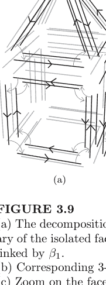

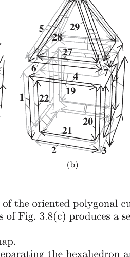


## 图 3.10

(a)、(b) 和 (c)：图 3.9(b) 中给出的 3-图的三个体积的分离表示。

+   - `⟨β₁, β₃⟩(d)` 是包含 `d` 的面；
+   - `⟨β₂, β₃⟩(d)` 是包含 `d` 的边；
+   - `⟨β₂ ∘ β₁⁻¹, β₃ ∘ β₁⁻¹⟩(d)` 是包含 `d` 的顶点。

图 3.9(b) 中描绘的 3-图的某些胞的示例在图 3.10 和 3.11 中表示。图 3.10 给出了该 3-图的三个体积。在图 3.11 中，属于所考虑胞的 `dart` 以粗黑线绘制。(a) 表示包含 `dart` 18 的面，由 `⟨β₁, β₃⟩(18)` 的八个 `dart` 描述，(b) 表示包含 `dart` 18 的边，由 `⟨β₂, β₃⟩(18)` 的六个 `dart` 描述，以及 (c) 表示包含 `dart` 18 的顶点，由 `⟨β₂ ∘ β₁⁻¹, β₃ ∘ β₁⁻¹⟩(18)` 的十个 `dart` 描述。

与之前的维度一样，可以同时表示多个 3D 有向拟流形。在这种情况下，每个拟流形由描述所有所考虑对象的同一 3-图的一个不同的连通分支描述。两个 `dart` `d₁` 和 `d₂` 属于同一连通分支，如果 `d₁` 和 `d₂` 之间存在由 `β₁`、`β₂` 或 `β₃` 两两链接的 `dart` 路径。对任意 `dart` `d`，`⟨β₁, β₂, β₃⟩(d)` 是包含 `dart` `d` 的连通分支。

#### 3.1.2  带边界的对象

上一节中引入的逐步分解过程也可以应用于从有向细分中提取 `n`-图


## 图 3.11

3-图中的胞示例。

(a) 包含 `dart` 18 的面。

(b) 包含 `dart` 18 的边。

(c) 包含 `dart` 18 的顶点。

带边界的拟流形。原理相似，即胞通过降低维度逐步分解，唯一的区别是属于边界的 *i*-胞不被分割，因为这些胞只属于一个 (*i* + 1)-胞的边界。

##### 3.1.2.1  1D

在 1D 中，有边界的有向拟流形是有向开多边形曲线。在图 3.12(a) 描绘的示例中，该对象由四条边（标记为 *e*₁ 到 *e*₄）和五个顶点（标记为 *v*₁ 到 *v*₅）组成。曲线通过将每个顶点拆分为两个来分解为边，除了属于边界的顶点（本例中为顶点 *v*₁ 和 *v*₅）。事实上，这样的顶点只属于一条边的边界，因此无需拆分。如前所述，`dart` 表示一条有向边及其原点顶点。因此存在四个 `dart`，对应于 (*v*₁, *e*₁)、(*v*₂, *e*₂)、(*v*₃, *e*₃) 和 (*v*₄, *e*₄)。*v*₅ 在此情况下未明确表示¹。

描述未拆分顶点的 `dart` 在有向多边形曲线中在其之前没有 `dart`（示例中的 `dart` 1）。在多边形曲线的另一端，存在一条边（示例中的 `e₄`），其只有起始顶点被描述。在对应的 1-图中，描述该边的 `dart` 没有 `β₁` 的后继（示例中的 `dart` 4）：为编码这一事实，使用特殊值 `∅`，且 `β₁(4) = ∅`。更一般地，`dart` `d` 是 1-自由的当且仅当 `β₁(d) = ∅`。

与无边界的 1D 拟流形一样，每个 `dart` 描述一个顶点和一条边。由于存在 1-自由 `dart`，`β₁` 关系不再是对合，而是部分置换（多个 `dart` 可以通过 `β₁` 链接到 `∅`）。


## 图 3.12

(a) 一个 1D 有向带边界拟流形。

(b) 多边形曲线的分解产生了一组由 `β₁` 链接的孤立有向边。

(c) 对应的 1-图。

##### 3.1.2.2  2D

在 2D 中，有边界的有向拟流形（有边界的有向曲面，见图 3.13 中的示例）通过将每条边拆分为两个来分解为孤立面，除了属于边界的边（本例中如边 `e₃`）。事实上，这样的边只属于一个面的边界，因此无需拆分。按定义，对应的 `dart` 是自由的，其 `β₂` 像为 `∅`。然后每个多边形曲线，无论是否有边界，都被分解。这产生了图 3.13(d) 所示的 2-图，其中包含十二个 `dart`。`Dart` 2、3、7、10、11、12 属于边界，因此它们是 2-自由的，因为它们 `β₂` 的像为 `∅`（例如 `β₂(2) = ∅` 且 `dart` 2 被称为 2-自由）。

与无边界的 2D 有向拟流形情况相比，`β₂` 现在是部分对合而不再是对合。胞的定义没有修改，然而可以区分不同类型的胞。顶点和面可以是 `dart` 的循环（无边界情况）或 `dart` 的序列（有边界情况）；而边可以由一个 `dart` 组成（有边界情况）或两个 `dart` 组成（无边界情况）。连通分支的定义也没有区别。


## 图 3.13

(a) 一个 2D 有向带边界拟流形。

(b) 曲面的分解产生了一组由 `β₂` 链接的孤立有向面。

(c) 描述孤立有向面边界的有向多边形曲线的分解结果。

(d) 对应的 2-图。


## 图 3.14

(a) 一个 3D 有向带边界拟流形。

(b) 3D 有向带边界拟流形的分解产生了一组由 `β₃` 链接的孤立有向体积。

(c) 描述孤立体积边界的有向曲面的分解产生了一组由 `β₂` 链接的孤立有向面。

##### 3.1.2.3  3D

图 3.14 中给出的 3D 有向带边界拟流形由三个体积组成（深灰色的六面体和两个带正方形底面的金字塔）、十三个面、十八条边和九个顶点。它通过将每个面拆分为两个来分解为孤立体积（见图 3.14(b)），除了属于边界的面。在示例中，只有三个面不属于边界（立方体与两个金字塔之间的两个面，以及两个金字塔之间的一个面）。事实上，属于边界的面只属于一个体积，因此无需拆分。对于这些面，没有其他面通过 `β₃` 关联，因此按定义它们的 `dart` 的 `β₃` 像为 `∅`：这些 `dart` 是 3-自由的。然后每个有向曲面，无论是否有边界，都被分解，产生一组孤立有向面（见图 3.14(c)）。

最后每个有向曲线，无论是否有边界，都被分解为一组孤立有向边，对应于 `dart`（见图 3.15(a)）。不同的 `β` 关系以与无边界情况相同的方式记录在 `dart` 上，产生图 3.15(b) 所示的 3-图。属于边界的 `dart` 没有通过 `β₃` 关联的另一个 `dart`。对于这样的 `dart` *d*，`β₃(d) = ∅` 且 *d* 是 3-自由的（例如本例中的 `dart` 1、2、3、4）。观察分隔六面体和白色金字塔的面（见图 3.15(c)）：`β₃(5) = 12`，`β₃(6) = 11`，`β₃(7) = 10` 且 `β₃(8) = 9`。可以验证 `β₁ ∘ β₃` 是一个部分对合（例如 `β₁ ∘ β₃(6) = 12` 且 `β₁ ∘ β₃(12) = 6`）。

与无边界的 3D 有向拟流形情况相比，`β₃` 不再是对合而是部分对合，且 `β₁ ∘ β₃` 也是部分对合（作为部分置换和部分对合的组


> ¹ 这通常不是问题，因为这种情况在实践中不会出现。此外，如果需要，可以特别考虑这种情况以检索缺失的顶点。事实上，`dart` 对应于一条有向边；因此，可以通过将一条有向边及其两个关联顶点与一个 `dart` 关联来解释所有概念。我们选择通过将一条有向边及其原点顶点与一个 `dart` 关联来描述与 *n*-图相关的所有概念，以便简化若干解释。


**图 3.15**

- (a) 对图 3.14(c) 中孤立面边界所描述的有向多边形曲线进行分解，得到由 `β₁` 链接的一组孤立有向边。
- (b) 对应的 3-map。
- (c) 六面体与白色金字塔之间分隔面的放大图。

posed)。注意 3D 有向拟流形可以包含一个或多个连通分支。

边、面和体积的定义没有修改；然而，顶点的定义是不同的。事实上，当 3-map 没有边界时，属于与 `d` 相同顶点的 `darts` 集合为 `⟨β₂∘β₁⁻¹, β₃∘β₁⁻¹⟩(d)`。根据轨道的定义，该 `darts` 集合包含可通过 `β₂∘β₁⁻¹` 和 `β₃∘β₁⁻¹` 及其逆的任意组合从 `d` 得到的所有 `darts`。一个可能的组合是 `β₂∘β₁⁻¹∘(β₃∘β₁⁻¹)⁻¹`，其等于 `β₂∘β₃`。然而，当考虑带边界的 3-map 时，对于 1-自由 `darts` 这一等式不再成立。如果 `dart` `d` 满足 `β₃(d)` 是 1-自由的，则 `β₁∘β₃⁻¹(d) = ∅`，从而 `β₂∘β₁⁻¹∘β₁∘β₃⁻¹(d) = ∅`；并且如果 `β₃(d)` 不是 2-自由的，则 `β₂∘β₃(d) ≠ ∅`。

因此，如果仅考虑轨道 `⟨β₂∘β₁⁻¹, β₃∘β₁⁻¹⟩(d)` 中的 `darts`，则可能遗漏一些描述与 `d` 相同顶点的 `darts`。这一问题在图 3.16 中得到说明，该图为一个 3-map，具有两个共享一个面且仅有两个 `darts` `{5, 9}` 的体积，其中 `β₃(5) = 9`。该面具有 1-边界，因为 `β₁(5) = ∅` 且 `β₁(9) = ∅`。`⟨β₂∘β₁⁻¹, β₃∘β₁⁻¹⟩(1) = {1, 2}`，因为 `β₂∘β₁⁻¹(1) = 2`，且所有其他组合都给出 `∅` 或 `dart` 1：`β₂∘β₁⁻¹(2) = ∅`，`β₃∘β₁⁻¹(2) = ∅`，`β₃∘β₁⁻¹(1) = ∅`，`β₁∘β₂(1) = ∅`，`β₁∘β₃(1) = ∅`，`β₁∘β₂(2) = ∅`，`β₁∘β₃(2) = ∅`：描述与 `dart` 1 相同顶点的所有 `darts` 都未被达到。


**图 3.16**  
无边界 3-map 的顶点定义不能直接应用于具有 1-边界的 3-map。

为解决此问题，将 `β₂∘β₃` 添加到所考虑的轨道中。因此，描述与 `d` 相同顶点的 `darts` 集合由轨道 `⟨β₂∘β₁⁻¹, β₃∘β₁⁻¹, β₂∘β₃⟩(d)` 给出。在图 3.16 给出的示例中，将 `β₂∘β₃` 添加到轨道生成元中解决了问题：`⟨β₂∘β₁⁻¹, β₃∘β₁⁻¹, β₂∘β₃⟩(1) = {1, 2, 3, 4, 5}`。注意，与其他单元一样，顶点的结构由对应轨道的 `darts` 之间的关系给出。然而，与维度不为 0 的单元不同，这些关系在这里是两个置换的复合，因此使用了不属于该顶点的一些 `darts`。

图 3.15(b) 所示 3-map 的若干单元在图 3.17 中表示。属于所考虑单元的 `darts` 以粗黑线绘制。(a) 表示包含 `dart` 13 的体积，由 `⟨β₁, β₂⟩(13)` 的二十四个 `darts` 描述，(b) 表示包含 `dart` 13 的面，由 `⟨β₁, β₃⟩(13)` 的八个 `darts` 描述，(c) 表示包含 `dart` 13 的边，由 `⟨β₂, β₃⟩(13)` 的六个 `darts` 描述，(d) 表示包含 `dart` 13 的顶点，由 `⟨β₁∘β₂, β₁∘β₃, β₂∘β₃⟩(13)` 的九个 `darts` 描述。

#### 3.1.3 任意维度的推广

逐次分解的过程可以在任意维度推广。从有或无边界的 nD 有向拟流形出发，所有单元按降序从 n 到 2 逐次分解。在此过程结束时，得到一组孤立有向边，对应于 n-map 的 `darts`，外加 n 个关于这些 `darts` 的关系。`β₁` 是部分置换，而 `β₂`，…，`βₙ` 是部分对合。

每个 `dart` `d` 对应于一个 `(n+1)`-元组单元 `(c₀, …, cₙ)`，且所有这些单元彼此关联。一个 `dart` 描述顶点的一部分、有向边的一部分、有向面的部分，…，有向 n-单元的一部分。因此包含 `dart` `d` 的每个 i-单元都是可以通过特定轨道检索到的一组 `darts`。

对于具有边界的对象，使用特殊值 `∅`，且 `βᵢ(d) = ∅` 编码了 `dart` `d` 对 `βᵢ` 没有邻居 `dart` 的事实。

**图 3.17**

3-map 中的单元示例。
- (a) 包含 `dart` 13 的体积。
- (b) 包含 `dart` 13 的面。
- (c) 包含 `dart` 13 的边。
- (d) 包含 `dart` 13 的顶点。

### 3.2 n-Gmaps

对于 n-Gmaps，逐次分解的过程与上一节中对 n-maps 解释的过程相似。只有两个不同之处：
- 1. 原始对象不是有向的（可以是有向的也可以不是）；
- 2. 应用一次额外的分解：过程不是以边结束，而是将边分解为孤立顶点。

由于这些相似性，n-Gmaps 使用上一节中介绍的相同示例进行解释，并且所有分解步骤不再重复解释，只解释最后一步。

**图 3.18**
- (a) 一个无边界的 1D 拟流形。
- (b) 多边形曲线的分解产生由 `α₁` 链接的一组孤立边。
- (c) 描述孤立边边界的顶点对的分解产生由 `α₀` 链接的一组孤立顶点。
- (d) 对应 1-Gmap 的表示。`Darts` 由黑色线段表示，每个线段都与象征 `α₁` 的黑色圆盘关联，并与象征 `α₀` 的小灰色线段关联。

#### 3.2.1 无边界的对象

首先让我们从无边界的拟流形开始。

##### 3.2.1.1 1D

观察图 3.18(a) 中表示的无边界 1D 拟流形。曲线通过将每个顶点拆分为两个而分解为孤立边：图 3.18(b)。关系 `α₁` 链接在拆分前共享公共顶点的两条边。注意，由于拟流形无边界，可以确定所有顶点都被配对。然后将每条边的边界分解为顶点，产生图 3.18(c) 中绘制的孤立顶点集合，称为 `darts`：关系 `α₀` 链接在拆分前属于同一边的两个 `darts`。`darts` 集合加上两个关系 `α₀` 和 `α₁` 就是描述初始 1D 拟流形的 1-Gmap（见图 3.18(d)）。`α₀` 和 `α₁` 是对称的，它们是对合。

`Darts` 由线段绘制，有时编号或标记。由 `α₁` 链接的两个 `darts` 连续绘制，由一个小圆盘连接（例如 `α₁(1) = 10` 且 `α₁(2) = 3`），而由 `α₀` 链接的两个 `darts` 连续绘制，由一个小灰色线段分隔（例如 `α₀(1) = 2` 且 `α₀(10) = 9`）。

1D 拟流形的每个顶点和每条边在对应的 1-Gmap 中由恰好两个 `darts` 描述。在图 3.18 的示例中，顶点 `v₁` 由 `darts` 1 和 10 描述，边 `e₁` 由 `darts` 1 和 2 描述。因此，每个 `dart` 恰好对应于一个顶点和一条边的配对（`dart` 1 对应于配对 `(v₁, e₁)`）。


**图 3.19**
- (a) 一个无边界的 1D 拟流形，它是一个环。
- (b) 分解产生两个顶点，它们既由 `α₀` 又由 `α₁` 链接在一起。
- (c) 对应 1-Gmap 的表示。

初始 1D 拟流形可以具有多重关联单元，如图 3.19(a) 所示的示例，其中顶点 `v₁` 与边 `e₁` 关联两次。图 3.19(c) 所示的对应 1-Gmap 仅包含两个 `darts`，它们既由 `α₀` 又由 `α₁` 链接在一起。

1-Gmap 可以表示多个 1D 拟流形，因此可以包含多个连通分支：例如三个不相交的 1D 拟流形（图 3.20(a)）和对应的 1-Gmap（图 3.20(b)），其包含三个对应于 `darts` 集合 `{1, . . . , 10}`、`{11, . . . , 18}` 和 `{19, . . . , 24}` 的连通分支。两个 `darts` `d₁` 和 `d₂` 属于同一连通分支，如果 `d₁` 和 `d₂` 之间存在 `darts` 路径，即由 `α₀` 和 `α₁` 链接的 `darts` 序列。对于任意 `dart` `d`，`⟨α₀, α₁⟩(d)` 是包含 `d` 的连通分支，并且从 `d` 出发，通过尽可能多次应用 `α₀` 和 `α₁`，可以检索到其连通分支的所有 `darts`。

##### 3.2.1.2 2D

同样的过程可以应用于无边界的 2D 拟流形。图 3.21(a) 给出的拟流形由四个面 `f₁` 到 `f₄` 组成，九条边和七个顶点。对第 56 页图 3.4 中 2-maps 示例应用的分解过程在这里产生图 3.21(b) 所示的孤立边集合，外加两个关系：`α₂` 链接两条拆分边，`α₁` 链接两个拆分顶点。与 2-maps 的唯一区别在于拟流形不是有向的，因此没有元素是有向的，且每个关系是对称的。因此 `α₁` 和 `α₂` 是对合。

然后再添加一次分解：每条边的边界被分解为顶点，产生一组孤立顶点，外加关系 `α₀`，它链接在分解前属于同一边的两个顶点（参见图 3.21(c)）。这些孤立顶点是描述初始 2D 拟流形的 2-Gmap 的 `darts`。

为了获得描述原始 2D 拟流形的 2-Gmap，所有 `α` 关系都被传播到 `darts` 上。这对于 `α₀` 来说是直接的

## FIGURE 3.21

(a) 一个没有边界的 2D 拟流形。
(b) 曲面的分解产生了孤立的面，而描述孤立面边界的多边形曲线的分解产生了由关系 `α₁` 和 `α₂` 链接的孤立边。
(c) 描述孤立边边界的顶点对的分解产生了一组由 `α₀` 链接的孤立顶点。
(d) 对应的 2-Gmap 表示。

`⟨α₀, α₂⟩(2) = {1, 2, 19, 20}` 且包含 `dart` 2 的面为 `⟨α₀, α₁⟩(2) = {1, 2, 3, 4, 5, 6, 7, 8}`。更一般地，每个胞腔由属于同一胞腔的所有 `darts` 的集合组成；胞腔的结构由 `αᵢ` 关系给出（见图 3.23）。

该分解过程对任何没有边界的 2D 拟流形都有效：参见图 3.24 中带有一个环面的例子。

一个 2-Gmap 可以有多个连通分支。两个 `darts` `d₁` 和 `d₂` 属于同一个连通分支，如果 `d₁` 和 `d₂` 之间存在由 `α₀`、`α₁` 或 `α₂` 两两链接的 `darts` 路径。对于任意 `dart` `d`，`⟨α₀, α₁, α₂⟩(d)` 表示包含 `d` 的连通分支：从 `d` 开始，其连通分支中的所有 `darts` 的集合可以通过应用 `α₀`、`α₁` 和 `α₂` 得到。


## FIGURE 3.22

(a) 图 3.21 示例的 2-Gmap。
(b) 表示每个 `dart` 对应的顶点、边和面的各部分。

##### 3.2.1.3 3D

当然，类似的过程可以应用于没有边界的 3D 拟流形以获得 3-Gmap。应用于第 60 页图 3.8 和 3.9 中给出的 3-map 示例的分解过程产生图 3.25(b) 中给出的孤立边集合以及三个关系：`α₃` 链接两个分裂面，`α₂` 链接两个分裂边，`α₁` 链接两个分裂顶点。与 3-map 的相同过程的唯一区别在于每个关系是对称的，因为 3D 拟流形是非定向的，因此三个关系 `α₁`、`α₂` 和 `α₃` 都是对合。

然后，每个边的边界被分解为顶点，产生一组孤立顶点以及关系 `α₀`，该关系链接在分解前属于同一边的两个顶点（参见图 3.25(c)）。这些孤立顶点是 3-Gmap 的 `darts`。

为了获得描述原始 3D 定向拟流形的 3-Gmap，所有 `α` 关系都被传播到 `darts` 上。对于 `α₀`、`α₁` 和 `α₂`，这与 2D 情况的上文所述相同。`α₃` 关系将分裂面配对：由于这些面通过相同的分解过程分裂为 `darts`，每个分裂面对应于 `α₀` 和 `α₁` 的一个轨道，并且两个对应的分裂面是同构的。因此，两个分裂面之间的 `α₃` 关系可以直接传播到对应的 `darts` 上。两个 `darts` 由 `α₃` 链接，如果它们属于两个对应的分裂面，并且它们属于在分解前为同一顶点（<|message|> 边） 的两个分裂顶点（边）。由于同一面两个分裂部分的 `darts` 两两由 `α₃` 链接，`α₀ ∘ α₃` 和 `α₁ ∘ α₃` 都是对合。

对应的 3-Gmap 给出在图 3.26(a)。`α₃` 通常不在图中表示，因为它可以从面的形状中得到。看


**FIGURE 3.23**  
图 3.22(a) 的 2-Gmap 的胞腔示例。
(a) 包含 `dart` 2 的 0-胞腔（顶点）。
(b) 包含 `dart` 2 的 1-胞腔（边）。
(c) 包含 `dart` 2 的 2-胞腔（面）。

在图 3.26(b) 中分隔六面体和金字塔的面：`α₃(1) = 9`，`α₃(2) = 10`，…，`α₃(8) = 16`（反之亦然）。因此，可以验证 `α₀ ∘ α₃` 和 `α₁ ∘ α₃` 都是对合：例如 `α₀ ∘ α₃(1) = α₀(9) = 10` 且 `α₀ ∘ α₃(10) = α₀(2) = 1`，且 `α₁ ∘ α₃(1) = α₁(9) = 16` 且 `α₁ ∘ α₃(16) = α₁(8) = 1`。

图 3.27 显示了图 3.26(a) 给出的 3-Gmap 的三个体积。图 3.27(a) 是包围六面体和金字塔的无界体积。

在 3-Gmap 中，每个 `dart` 对应于初始 3D 拟流形的一个顶点 `v` 的一部分、一条边 `e` 的一部分、一个面 `f` 的一部分和一个体积 `vol` 的一部分，这四个胞腔 `v`、`e`、`f` 和 `vol` 彼此相邻。如前所述的 2D 情况，每个胞腔对应于一个特定的轨道：
+ `⟨α₀, α₁, α₂⟩(d)` 是包含 `dart` `d` 的体积；
+ `⟨α₀, α₁, α₃⟩(d)` 是包含 `d` 的面；
+ `⟨α₀, α₂, α₃⟩(d)` 是包含 `d` 的边；
+ `⟨α₁, α₂, α₃⟩(d)` 是包含 `d` 的顶点。

图 3.26(a) 给出的 3-Gmap 的若干胞腔在图 3.27 和 3.28 中表示。图 3.27 给出了 3-Gmap 的三个体积。在图 3.28 中，属于所考虑胞腔的 `darts` 用粗黑线绘制。(a) 表示包含 `dart` 1 的面，由 `⟨α₀, α₁, α₃⟩(1)` 的十六个 `darts` 描述，(b) 表示包含 `dart` 1 的边，由 `⟨α₀, α₂, α₃⟩(1)` 的十二个 `darts` 描述，以及 (c) 表示包含 `dart` 1 的顶点，由 `⟨α₁, α₂, α₃⟩(1)` 的二十个 `darts` 描述。

与之前的维度一样，若干 3D 拟流形可以由一个包含若干连通分支的 3-Gmap 描述。两个 `darts` `d₁` 和 `d₂` 属于同一个连通分支，如果存在 `darts`

## FIGURE 3.25

(a) 一个没有边界的 3D 拟流形。
(b) 3D 拟流形的分解，然后描述孤立体积边界的表面的分解，然后描述孤立面边界的多边形曲线的分解产生了一组由关系 `α₁`、`α₂` 和 `α₃` 链接的孤立边。
(c) 描述孤立边边界的顶点对的分解产生了一组由 `α₀` 链接的孤立顶点。

## FIGURE 3.26

(a) 描述图 3.25(a) 中给出的没有边界的 3D 拟流形的 3-Gmap。
(b) 六面体和金字塔之间面的放大图。


**FIGURE 3.27**  
(a)、(b) 和 (c)：属于图 3.26(a) 给出的 3-Gmap 的三个体积的分离表示。

the `darts`（见图 3.30(c)）。图 3.30(d) 给出的 2-Gmap 包含二十四个 `darts`。对应于曲面边界的十二个 `darts` 为 5、6、7、8、13、14、15、16、17、18、23、24：例如 `α₂(5) = 5` 且 `dart` 5 被称为 2-自由。

与没有边界的 2D 拟流形的情况一样，`α₀`、`α₁` 和 `α₂` 都是对合。胞腔如前所述定义，然而可以区分不同类型的 1-胞腔：一条边可以由一个、两个或四个 `darts` 组成。还要注意的是，一个 2-Gmap 仍然可以描述有或没有边界的 2D 拟流形的若干连通分支。

#### 3.2.2.3 3D

应用于图 3.31 中给出的带边界的 3D 拟流形的分解过程（使用与第 66 页图 3.14 和 3.15 中给出的示例相同的分解过程用于 3-map）产生图 3.31(b) 中给出的孤立边集合以及三个关系：`α₁` 链接两个分裂面，`α₂` 链接两个分裂边，`α₁` 链接两个分裂顶点。每个关系是对称的，因此 `α₁`、`α₂` 和 `α₃` 都是对合。在示例中，只有三个面不属于边界（立方体与两个金字塔之间的两个面，以及两个金字塔之间的一个面）。所有其他面都没有分裂，对于它们，`α₃` 等于恒等。然后每个有或无边界的边被分解，产生 `darts`（见图 3.31(c)）。

描述图 3.31(a) 中给出的带边界的 3D 拟流形的最终 3-Gmap


## FIGURE 3.28

3-Gmap 中的胞腔示例。
+ (a) 包含 `dart` 1 的面。
+ (b) 包含 `dart` 1 的边。


+   (c) 包含 `dart` 1 的顶点。

表示在图 3.32 中。对应于 3D 拟流形边界的 `darts` 为 3-自由，即它们是 `α3` 的不动点。看图 3.32(b) 中分隔六面体和金字塔的面：`α3(1) = 9`，`α3(2) = 10`，...，`α3(8) = 16`（反之亦然）。`α0∘α3` 和 `α1∘α3` 在这些 `darts` 上是对合的，对于对应于边界的 `darts` 也是如此。

由若干连通分支组成的 3-Gmap 可以表示若干有或无边界的 3D 拟流形，且胞腔的定义保持不变。

图 3.32(a) 给出的 3-Gmap 的若干胞腔在图 3.33 中表示。属于所考虑胞腔的 `darts` 用粗黑线绘制。(a) 表示包含 `dart` 17 的体积，由 `⟨α0, α1, α2⟩(17)` 的四十八个 `darts` 描述，(b) 表示包含 `dart` 17 的面，由 `⟨α0, α1, α3⟩(17)` 的十六个 `darts` 描述，(c) 表示包含 `dart` 17 的边，由 `⟨α0, α2, α3⟩(17)` 的十二个 `darts` 描述，以及 (d) 表示包含 `dart` 17 的顶点，由 `⟨α0, α1, α2⟩(17)` 的十八个 `darts` 描述。

### 3.2.3 Generalization in Any Dimension

与 `n-map` 一样，连续分解的过程可以在任何维度上推广。从有或无边界的 `nD` 拟流形开始，

#### 图 3.29

(a) 一个带边界的一维拟流形。

(b) 多边形曲线的分解产生一组由 `α₁` 连接的孤立边。

(c) 对描述孤立边边界的顶点对进行分解的结果。

(d) 相应 1-Gmap 的表示。


#### 图 3.30

(a) 一个带边界的二维拟流形。

(b) 将曲面分解为孤立的面，然后对描述孤立面边界的多边形曲线进行分解，产生一组由关系 `α₁` 和 `α₂` 连接的孤立边。

(c) 对描述孤立边边界的顶点对进行分解的结果。

(d) 相应 2-Gmap 的表示。

#### 图 3.31

(a) 一个带边界的三维拟流形示例。

(b) 将三维拟流形分解成孤立体积、对描述孤立体积边界的曲面进行分解、以及对描述孤立面边界的多边形曲线进行分解的结果。

(c) 对描述孤立边边界的顶点对进行分解的结果。


#### 图 3.32

(a) 描述图 3.31(a) 中带边界三维拟流形的 3-Gmap。

(b) 放大观察将六面体与白色棱锥分隔开的面。


#### 图 3.33

3-Gmap 中单元的示例。

- (a) 包含 `dart` 17 的体。
- (b) 包含 `dart` 17 的面。
- (c) 包含 `dart` 17 的边。
- (d) 包含 `dart` 17 的顶点。

所有单元按维度从 `n` 到 1 递减依次分解。在这一过程结束时，得到一组孤立顶点，它们对应于 `n-Gmap` 的 `darts`，以及这些 `darts` 上的 `n + 1` 个对合 `α0, . . . , αn`。

每个 `dart` `d` 对应于一个由单元组成的 `n + 1` 元组 `(c0, . . . , cn)`，且所有这些单元彼此关联。一个 `dart` 描述一个顶点的一部分、一条边的一部分、一个面的一部分……以及一个 `n`-单元的一部分。因此，每个包含 `dart` `d` 的 `i`-单元是一组 `dart`，这些 `dart` 可以借助某些特定的轨道来获取。与前面一样，单元之间的关联和邻接概念可以直接转置到相应的 `dart` 集合上。

对于带边界的对象，`αᵢ(d) = d` 表示 `dart` `d` 在 `αᵢ` 下没有相邻 `dart`。这与 `n-maps` 不同，`n-maps` 的约定是：`βᵢ(d) = ∅`。实际上，对于 `n-maps`，满足 `β₁(d) = d` 的 `dart` `d` 是一个环（参见第 8 章中基于单纯形解释的说明）。

# 4

# *n*-Gmaps

`*n*-Gmap` 是一种组合数据结构，能够描述带边界或不带边界的 `*n*` 维可定向或不可定向拟流形。上一章已经对 `*n*-maps` 和 `*n*-Gmaps` 进行了直观介绍。

在本章中，第 4.1 节定义了 `*n*-Gmaps`，以及单元、单元之间的关联和邻接关系等基本概念。第 4.2 节介绍了一些可用于修改现有 `*n*-Gmaps` 的基本操作。这些操作允许添加/移除 `darts`、增大/减小 `*n*-Gmap` 的维度、合并/拆分 `*n*-Gmaps`；缝合/拆缝合（sew/unsew）操作允许识别单元。第 4.3 节将证明，这些操作构成了一个小的操作基，能够构造任意 `*n*-Gmap`。此外，`*n*-Gmaps` 可以考虑单元之间的多重关联，并展示了一些与多重关联相关的特定形态，例如悬垂单元和折叠单元。第 4.4 节介绍了一种可用于实现 `*n*-Gmaps` 的数据结构，以及一些用于开发处理 `*n*-Gmaps` 的计算机软件的算法。第 4.5 节包含一些与 `*n*-Gmaps` 相关的补充概念。

本书先研究 `*n*-Gmaps`，再研究 `*n*-maps`，因为前者的定义更简单：它是齐次的，即其定义中涉及的所有函数都是对合。这简化了许多定义和算法。

### 4.1 基本定义

如上一章所述，`*n*-Gmap` 由一组 `darts` 定义，在这组 `darts` 上作用着 `n + 1` 个对合，并满足某些复合约束。由此得到 `*n*-Gmaps` 的如下定义。

**定义 1（*n*-Gmap）** `n` 维广义映射（即 `n-Gmap`），其中 `0 ≤ n`，是一个 `(*n* + 2)` 元组 `G = (D, α₀, . . . , αₙ)`，其中：

- 1. `D` 是一组有限的 `darts`；
- 2. `∀i ∈ {0, . . . , n}`：`αᵢ` 是 `D` 上的一个对合；
- 3. `∀i ∈ {0, . . . , n − 2}, ∀j ∈ {i + 2, . . . , n}`：`αᵢ ∘ αⱼ` 是一个对合。


#### 图 4.1

1-Gmap、2-Gmap 和 3-Gmap 的示例。

(a) 一个 1-Gmap `(D, α₀, α₁)`。

(b) 一个 2-Gmap `(D, α₀, α₁, α₂)`。

(c) 一个 3-Gmap `(D, α₀, α₁, α₂, α₃)`。

一个 0-Gmap `(D, α₀)` 代表一组孤立顶点或顶点对（因此对应 0-球面）的结构（拓扑）；一个 1-Gmap `(D, α₀, α₁)` 代表一组带边界或不带边界的多边形曲线的结构（参见图 4.1(a)）；一个 2-Gmap `(D, α₀, α₁, α₂)` 代表一组曲面的结构（参见图 4.1(b)）；一个 3-Gmap `(D, α₀, α₁, α₂, α₃)` 代表体积装配体的结构（参见图 4.1(c)）……

如前面所见，在描述带边界的对象时，`darts` 可能在某些对合下与自身相连。如果 `dart` `d` 由 `αᵢ` 连接到自身，则它是 `i`-自由的；否则它是 `i`-缝合的（参见定义 2 和图 4.2 中的示例）。

**定义 2（i-自由、i-缝合）** 设 `G = (D, α₀, …, αₙ)` 是一个 `n-Gmap`，`d ∈ D`，`i ∈ {0, …, n}`：

- 若 `αᵢ(d) = d`，则 `d` 是 `i`-自由的；
- 若 `αᵢ(d) = d₂` 且 `d ≠ d₂`，则 `d` 与 `dart` `d₂ ∈ D` 是 `i`-缝合的。

当一个 `dart` 对某个对合是自由的，它就是该对合的一个不动点。

在实际应用中，处理带边界的对象可能很有用。通常，嵌入到通常的三维欧几里得空间中的三维细分对象具有二维边界，这些边界是无边界的曲面：它由多个体组成，而这些体的边界也是无边界曲面。因此，这些对象可以用 3-Gmap 表示，其中所有 `darts` 都是 0-缝合、1-缝合、2-缝合的，而一些 `darts` 可以是 3-自由的。更一般地，除了 `αₙ` 之外，所有对合通常都没有不动点。

然而，在最一般的情况下，边界可以存在于所有维度：例如，假设一个 `n` 维对象被另一个对象切割，例如


#### 图 4.2

一个具有 0-边界、1-边界和 2-边界的 2-Gmap。

例如，`dart` 1 是 0-自由的，即 `α₀(1) = 1`。因此 `dart` 1 属于一条仅与一个顶点关联的边。

`Dart` 2 是 1-自由的，即 `α₁(2) = 2`，因此它属于一条边，且没有其他边与同一个顶点和同一个面关联。

`Dart` 3 是 2-自由的，即 `α₂(3) = 3`，因此 `dart` 3 属于一条仅与一个面关联的边。

被一个 `(n − 1)` 维超平面切割：这个超平面可以切割任意维度的单元，从而产生任意维度的边界。`i`-边界（即维度 `i` 上的边界）对应于 `darts` 可以是 `i`-自由的（对于任意 `i`）这一事实。

正如我们在直观介绍中所见，一个 `n-Gmap` 可以有不同的连通分量。借助定义 3，可以检索到与给定 `dart` 属于同一连通分量的 `darts` 的集合：一个连通分量对应于所有对合下的一个轨道。

**定义 3（连通分量）** 设 `G = (D, α₀, …, αₙ)` 是一个 `n-Gmap`，`d ∈ D`。`⟨α₀, …, αₙ⟩(d)` 是包含 `d` 的连通分量。

如前所述，根据上下文，轨道可以指一组 `darts`，也可以指这组 `darts` 及相应的对合。借助这一定义，我们可以直接测试给定的 `n-Gmap` 是否连通，即是否只由一个连通分量组成，只需测试某个 `dart` 的连通分量是否等于该 `n-Gmap` 的所有 `darts` 的集合（参见定义 4）。

**定义 4（连通的 n-Gmap）** 设 `G = (D, α₀, …, αₙ)` 是一个 `n-Gmap`。当且仅当 `⟨α₀, …, αₙ⟩(d)` 等于 `D`（其中 `d ∈ D`）时，`G` 是连通的。

请记住，可以将一个图与像 `n-Gmap` 这样的离散结构相关联：图的一个节点对应一个 `dart`，编号为 `i` 的边连接两个节点，这两个节点对应于由 `αᵢ` 连接的两个 `darts`（当一个 `dart` 是一个

fixed point for some involution, the corresponding edge in the graph is a loop). So, many notions related to graph theory can be directly applied to `$n$-Gmaps`. For instance, as for graph theory, the notion of connectivity is related to the notion of path given in Def. 5.

### Definition 5 (path)

Let `$G=(D,\alpha_0,\ldots,\alpha_n)$` be an `n-Gmap` and `d,d'\in D`. A path between `d` and `d'` is a sequence of darts `$(d_1,\ldots,d_k)$` such that `d_1=d`, `d_k=d'` and `∀ i∈{2,\ldots,k}`, `d_i=\alpha_{k_i}(d_{i-1})`, with `k_i∈{0,\ldots,n}`.

Given any pair of darts `d` and `d'` that belong to the same connected component, there exists a path between `d` and `d'`. Reciprocally, if `d` and `d'` do not belong to the same connected component, there is no path between `d` and `d'`.

As seen in the previous chapter, a dart corresponds to an `$(n+1)$-tuple` of incident cells of different dimensions (vertex, edge, face, volume, ...). In other words, a dart describes a "small part" of each cell, this explains why cells are not the basic elements of `n-Gmaps`, contrary to incidence graphs for instance. A consequence is the fact that very local notions and operations can be defined: for instance, if an edge is a loop, we can distinguish its two extremities, even if it is incident to only one vertex (cf. example in Fig. 3.19 page 71). More generally, `n-Gmaps` naturally take multi-incidence into account, and this can be useful for representing free-form objects.

### Definition 6 (i-cell)

Let `$G=(D,\alpha_0,\ldots,\alpha_n)$` be an `n-Gmap`, `d\in D`, and `i\in\{0,\ldots,n\}`. The `i`-dimensional cell (or `i`-cell) containing `d` is

```
c_i(d)=⟨α0,…,αi-1,αi+1,…,αn⟩(d).
```

The cells can equivalently be defined as connected components of the `$(n-1)$-Gmap` of cells defined in Def. 7.

### Definition 7 ($(n-1)$-Gmap of $i$-cells)

Let `$G=(D,\alpha_0,\ldots,\alpha_n)$` be an `n-Gmap`, `n>0`, and `i\in\{0,\ldots,n\}`. The `$(n-1)$-Gmap` of `i-cells` is `$G_{c_i}=(D,\alpha_0,\ldots,\alpha_{i-1},\alpha_{i+1},\ldots,\alpha_n)$`. When `n=0`, `D` is the set of 0-cells.

Thanks to this definition of cells, incidence and adjacency relations between cells can be easily expressed (cf. Def. 8).

### Definition 8 (incidence and adjacency)

Let `$G=(D,\alpha_0,\ldots,\alpha_n)$` be an `n-Gmap`, `d,d'\in D`, and `i,j\in\{0,\ldots,n\}`, `i\ne j`.

- cells `c_i(d)` and `c_j(d')` are incident iff `c_i(d)∩c_j(d')≠∅`;
- cells `c_i(d)` and `c_i(d')` are adjacent iff `∃ d1∈c_i(d)` and `∃ d2∈c_i(d')`, `d1≠d2`, such that `d1=α_i(d2)`.

Note that, according to this definition, a cell is never incident to itself since `i` must be different from `j`, but it can be adjacent to itself: for instance a loop is adjacent to itself, and more generally cells can be multi-incident to other cells: cf. Section 4.3.

It is possible to test if two `n-Gmaps` describe the topology of the same subdivision, i.e. the same set of cells and the same structure of incidence relations. This corresponds to the isomorphism notion. Two `n-Gmaps` are isomorphic if there is a one-to-one mapping between their darts which preserves all involutions (cf. Def. 9).

### Definition 9 (isomorphism)


Two $n$-Gmaps $G = (D, \alpha_0, \ldots, \alpha_n)$ and $G' = (D', \alpha'_0, \ldots, \alpha'_n)$ are isomorphic if there exists an isomorphism mapping $D$ onto $D'$, i.e. a one-to-one mapping $f : D \to D'$, such that $\forall d \in D$, $\forall i \in \{0, \ldots, n\}$: $f(\alpha_i(d)) = \alpha'_i(f(d))$.

It is also possible to test if an $n$-Gmap $G'$ is included in a second $n$-Gmap $G$, or in other words if there exists a part of $G$ being isomorphic to $G'$. An $n$-Gmap is subisomorphic to a second one if an injective mapping exists between the darts of the first $n$-Gmap onto the darts of the second $n$-Gmap that preserves all the involutions inside the concerned part of the second $n$-Gmap (cf. Def. 10 and example in Fig. 4.3).

### Definition 10 (subisomorphism)

An $n$-Gmap $G' = (D', \alpha'_0, \ldots, \alpha'_n)$ is isomorphic to a submap of $G = (D, \alpha_0, \ldots, \alpha_n)$ if there exists a subisomorphism between $D'$ and $D$, i.e. an injective mapping $f : D' \to D$, such that $\forall d \in D'$, $\forall i \in \{0, \ldots, n\}$:

- if $d$ is not $i$-free, then $f(\alpha'_i(d)) = \alpha_i(f(d))$;
- otherwise, either $f(d)$ is $i$-free, or $\forall d_k \in D'$, $f(d_k) \ne \alpha_i(f(d))$.

### Figure 4.3

Submap isomorphism example.

- (a) A 2-Gmap $G$.
- (b) 2-Gmap $G'$ which is a submap of $G$ as it is obtained from $G$ by deleting the six darts in $c_2(5)$ and the ten darts in $c_2(7)$.
- (c) 2-Gmap $G''$ which is not isomorphic to a submap of $G$ as the injection $f$ that respectively matches darts $1''$ to $4''$ to darts $1$ to $4$ does not verify the conditions of Def. 10: dart $1''$ is 2-free and it is matched with dart $1$ which is 2-sewn with dart $3$ which is itself matched with $3''$ (i.e. $f^{-1}(3) = 3''$).

## 4.2 Basic Operations

In the previous section, several basic definitions concerning $n$-Gmaps have been introduced. Now some basic operations are defined, allowing to modify existing $n$-Gmaps. Note that many high level operations have been defined, sometimes based on these basic ones, allowing to directly construct and modify $n$-Gmaps. Even if the basic operations introduced here can be directly used to interactively construct an object, their interest is mainly theoretical by providing a small basis of operations allowing to build any $n$-Gmap. The high level operations usually handle orbits, as cells for instance, although basic operations handle directly the darts and the involutions. All these operations take as input an $n$-Gmap and produce another $n$-Gmap which is the result of the operation.

### 4.2.1 Basic Tools

The first basic tool consists in adding a new dart in an $n$-Gmap. To guarantee the validity of the $n$-Gmap, the new dart is isolated, i.e. it is free for all dimensions ($\forall i \in \{0,\ldots,n\}$, $\alpha_i(d) = d$). This operation can be used several times to add any number of isolated darts in the $n$-Gmap.

#### Definition 11 (add isolated dart)

Let $G = (D, \alpha_0, \ldots, \alpha_n)$ be an $n$-Gmap. The $n$-Gmap obtained from $G$ by adding an isolated dart $d \notin D$ is $G_{+d} = (D \cup \{d\}, \alpha'_0, \ldots, \alpha'_n)$, where $\forall i \in \{0,\ldots,n\}$, $\alpha'_i$ is defined by:

- $\forall e \in D$, $\alpha'_i(e) = \alpha_i(e)$;
- $\alpha'_i(d) = d$.

#### Definition 12 (remove isolated dart)

Let $G = (D, \alpha_0, \ldots, \alpha_n)$ be an $n$-Gmap and $d \in D$ be an isolated dart, i.e. $\forall i \in \{0,\ldots,n\}$, $\alpha_i(d) = d$. The $n$-Gmap obtained from $G$ by removing $d$ is $G_{-d} = (D \setminus \{d\}, \alpha'_0, \ldots, \alpha'_n)$, where $\forall i \in \{0,\ldots,n\}$, $\alpha'_i$ is the restriction of $\alpha_i$ to the set of remaining darts, i.e. $\alpha'_i = \alpha_i|_{D \setminus \{d\}}$.

Since only isolated darts are removed, the result of the operation is an $n$-Gmap. Note that any dart can be removed, but it is necessary to isolate it by applying (maybe several times) the `unsew` operation (cf. Section 4.2.3).

The operation which increases the dimension of an $n$-Gmap is straightforward, and its definition is given in Def. 13. Increasing by one the dimension of an $(n-1)$-Gmap $G$ leads to create one $n$-cell for each connected component of $G$. All $i$-cells, for $0 \le i \le n - 1$, are not modified by this operation.

#### Definition 13 (increase dimension)

Let $G = (D, \alpha_0, \ldots, \alpha_{n-1})$ be an $(n-1)$-Gmap. The $n$-Gmap obtained from $G$ by increasing its dimension is $G^+ = (D, \alpha_0, \ldots, \alpha_{n-1}, \alpha_n)$, where $\alpha_n$ is the identity on $D$, i.e. $\forall d \in D$, $\alpha_n(d) = d$.

The operation which decreases the dimension of an $n$-Gmap $G$ is defined in Def. 14. This operation is the inverse of the increase dimension operation. It leads to the disappearance of all the $n$-cells that were in $G$.

#### Definition 14 (decrease dimension)

Let $G = (D, \alpha_0, \ldots, \alpha_n)$ be an $n$-Gmap such that $\forall d \in D$, $\alpha_n(d) = d$. The $n$-Gmap obtained from $G$ by decreasing its dimension is $G^- = (D, \alpha_0, \ldots, \alpha_{n-1})$.

Note that this operation is restricted to an $n$-Gmap which has all its darts $n$-free, in order to get the inverse of the operation which increases the dimension. However, it is possible to first $n$-unsew all the non-$n$-free darts, and then to decrease the dimension of the resulting $n$-Gmap.

Two distinct $n$-Gmaps can be merged into a same $n$-Gmap, which connected components are thus the connected components of the initial $n$-Gmaps (cf. Def. 15). The number of cells (resp. of connected components) of the resulting $n$-Gmap is the sum of the numbers of cells (resp. of connected components) of the two initial $n$-Gmaps.

#### Definition 15 (merge)

Let $G = (D, \alpha_0, \ldots, \alpha_n)$ and $G' = (D', \alpha'_0, \ldots, \alpha'_n)$ be two $n$-Gmaps such that $D \cap D' = \varnothing$. The $n$-Gmap obtained by merging $G$ and $G'$ is $G \cup G' = (D'', \alpha''_0, \ldots, \alpha''_n)$, defined by:

- $D'' = D \cup D'$;
- $\forall d \in D''$, $\forall i \in \{0, \ldots, n\}$, $\alpha''_i(d) = \alpha_i(d)$ if $d \in D$; $\alpha''_i(d) = \alpha'_i(d)$ if $d \in D'$.

The reverse operation consists in splitting a given $n$-Gmap in two. It is based on the `restrict` operation defined in Def. 16: it takes as input a given $n$-Gmap and a subset of darts which correspond to a set of connected components, and builds the $n$-Gmap restricted to this set of darts.

#### Definition 16 (restrict)

Let $G = (D, \alpha_0, \ldots, \alpha_n)$ be an $n$-Gmap, and $D' \subseteq D$, such that $\forall d \in D'$, $\forall i \in \{0, \ldots, n\}$, $\alpha_i(d) \in D'$. The $n$-Gmap obtained by restricting $G$ to $D'$ is $G|_{D'} = (D', \alpha'_0, \ldots, \alpha'_n)$, where $\forall i \in \{0, \ldots, n\}$, $\alpha'_i = \alpha_i|_{D'}$.

请注意，`restrict` 操作只有在给定的飞镖集合 $D'$ 对应于一组连通分量的情况下才有可能。事实上，否则，我们会得到一些与不属于 $D'$ 的元素相连的飞镖，这与对合定义相矛盾，从而与 $n$-Gmap 的定义相矛盾。然而，我们可以通过先使用所需的 `unsew` 操作来隔离该飞镖集合，对任意飞镖集合使用 `restrict` 操作。

`split` 操作在 Def. 17 中给出，以 $n$-Gmap $G$ 和飞镖子集 $D'$ 作为输入，并通过两次使用 `restrict` 操作生成两个 $n$-Gmap：第一次针对 $D'$，第二次针对 $D \setminus D'$。

#### Definition 17 (split)

设 $G = (D, \alpha_0, \ldots, \alpha_n)$ 为一个 $n$-Gmap，且 $D' \subseteq D$ 满足 $\forall d \in D', \forall i \in \{0, \ldots, n\}, \alpha_i(d) \in D'$。通过沿 $D'$ 分裂 $G$ 所得到的两个 $n$-Gmap 为 $G_{s_1}(D') = G|_{D'}$ 和 $G_{s_2}(D') = G|_{D \setminus D'}$。

很容易证明每个操作都是其对应操作的逆运算。为此，我们必须证明从 $G$ 出发，使用一个操作然后使用对应的逆操作，我们得到一个 $n$-Gmap $G'$，它与 $G$ 同构：对于每个操作，都很容易选择导致此结论的操作参数。

### 4.2.2 Sew Operations

直观上，$i$-sew 操作允许通过 $\alpha_i$ “连接”一些 $i$-自由飞镖，对于给定的 $i$。为了满足 $n$-Gmap 定义的“组合约束”（即当 $|i - j| \ge 2$ 时 $\alpha_i \circ \alpha_j$ 是一个对合），我们通常需要关联的不仅是两个飞镖而是多个飞镖：例如，如果我们在 2-Gmap 中通过 $\alpha_2$ 连接两个飞镖，则有必要也连接由 $\alpha_0$ 关联的飞镖。对于 $i$-sew 操作，我们选择关联最少的飞镖数，使得操作结果是一个 $n$-Gmap。

事实上，$i$-sew 操作意味着某些单元的识别：例如，当两个飞镖在 2-Gmap 中通过 $\alpha_2$ 缝合时，对应的边被识别为一条边：这种识别可能涉及初始边所关联顶点的识别。

因此，并非总是可以应用 $i$-sew 操作：需要识别的单元必须具有相同的结构。更精确地说，两个单元必须彼此同构。事实上，当两个单元具有不同的结构时，我们不知道如何进行它们的识别。例如，不可能缝合一个立方体和一个四面体，因为我们不知道如何将一个正方形面与一个三角形面进行识别。因此，在定义 `sew` 操作之前，我们需要能够测试 `sew` 是否可能。“可 $i$-sew” 的性质在 Def. 18 中详细说明。

#### Definition 18 (i-sewable)


设 `G = (D, α₀, …, αₙ)` 为一个 `n-Gmap`，`i ∈ {0, …, n}`，`d, d′ ∈ D`。设 `o_d` 表示 `⟨α₀, …, α_{i−2}, α_{i+2}, …, αₙ⟩(d)`，且 `o_{d′}` 表示 `⟨α₀, …, α_{i−2}, α_{i+2}, …, αₙ⟩(d′)`。`d` 与 `d′` 可 `i-sew` 当且仅当 `d ≠ d′`，`αᵢ(d) = d`，`αᵢ(d′)=d′` 且存在 `o_d` 与 `o_{d′}` 之间的同构 `f`，使得 `f(d)=d′`。此外，如果 `o_d=o_{d′}` 则 `f=f^{-1}`。

考虑整个轨道 `⟨α₀,…,α_{i−2},α_{i+2},…,αₙ⟩(d)` 和 `⟨α₀,…,α_{i−2},α_{i+2},…,αₙ⟩(d′)` 是为了在缝合后满足 `αᵢ∘αⱼ` 当 `|i−j|≥2` 时为对合的条件：事实上，`i-sew` 操作会将 `o_d` 的所有飞镖与 `o_{d′}` 的飞镖“连接”在一起。`d` 和 `d′` 必须是 `i-自由` 的，因此 `o_d` 和 `o_{d′}` 中的所有飞镖也是 `i-自由` 的，因为当 `|i−j|≥2` 时 `αᵢ∘αⱼ` 是对合。`d` 和 `d′` 必须不同（否则 `i-sew` 不会改变任何东西）。最后，注意 `o_d=o_{d′}` 是可能的：相应的缝合会创建折叠单元（见第 4.3 节）。

请注意，任意一对自由飞镖在任何 `0-Gmap` 和任何 `1-Gmap` 中总是可缝合的。事实上，在这些情况下，轨道 `o_d` 和 `o_{d′}` 只包含一个飞镖，且集合 `{0,…,i−2,i+2,…,n}` 为空。这意味着我们可以在任何 `0-Gmap` 和任何 `1-Gmap` 中无条件地缝合任意一对自由飞镖。

“可 `i-sew`” 的概念用于在 Def. 19 中定义 `i-sew` 操作。应用 `i-sew` 操作后，`o_d` 和 `o_{d′}` 中的所有飞镖都通过 `αᵢ` 相连。这意味着包含飞镖 `d` 和 `d′` 的两个 `(i−1)`-单元被识别。此外，其他一些单元也可能被识别，即与两个被识别的 `(i−1)`-单元关联的 `j`-单元，其中 `j∈{0,…,i−2,i+1,…,n}`（见下文示例）。

## Definition 19 (i-sew)

设 `G=(D,α₀,…,αₙ)` 为一个 `n-Gmap`，`i∈{0,…,n}`，`d,d′∈D` 使得 `d` 和 `d′` 可由 Def. 18 的同构 `f` `i-sew`。通过 `d` 和 `d′` 的 `i-sewing` 从 `G` 得到 `n-Gmap` 为 `G_{i-sew}(d,d′)=(D,α₀,…,α_{i−1},α′_i,α_{i+1},…,αₙ)`，其中 `α′_i` 定义为：`∀ e∈D`，

- if `e∈ o_d`, `α′_i(e)=f(e)`;
- if `o_d≠ o_{d′}` and `e∈ o_{d′}`, `α′_i(e)=f^{-1}(e)`;
- otherwise, `α′_i(e)=αᵢ(e)`.

给定一个 `n-Gmap` 和两个可 `i-sew` 的飞镖，`i-sewing` 操作本质上只是将 `o_d` 中的所有飞镖与其在 `o_{d′}` 中的“等价”飞镖相连。更精确地说，`α′_i` 直接由 `αᵢ` 和同构 `f` 给出。因此，`d` 和 `d′` 的 `i-sew` 产生与 `o_d` 中任意飞镖 `d″` 和 `o_{d′}` 中 `f(d″)` 的 `i-sew` 相同的 `n-Gmap`。

`0-Gmap` 中 `0-sew` 操作的一个例子如图 4.4 所示。两个孤立顶点被分组形成一个 `0-球面`（即一对顶点），通过用 `α₀` 连接两个对应的飞镖。如上所述，`0D` 中的 `0-sew` 操作只涉及给定的两个飞镖。

`1-Gmap` 中 `1-sew` 操作的一个例子如图 4.5 所示。两个

¹ 记住 `f` 是 `o_d` 与 `o_{d′}` 之间的同构，当且仅当：

`∀ e∈ o_d, ∀ j∈{0,…,i−2,i+2,…,n}, f(α_j(e))=α_j(f(e))`

不同的顶点通过用 `α₁` 连接两个对应的飞镖而被识别。如上所述，`1D` 中的 `1-sew` 操作只涉及给定的两个飞镖。

`1-sew` 操作的第二个例子在图 4.6 中给出，但现在是在 `3-Gmap` 中。图 4.6(a) 中初始的 `3-Gmap` 中，两个体积之间的面包含十六个飞镖并且具有 `1-边界`。事实上，飞镖 1、2、3 和 4 是 `1-自由` 的。`1-sew` 操作应用于飞镖 1 和 2，产生图 4.6(b) 所示的 `3-Gmap`，其中飞镖 1 与飞镖 2 `1-sew`，且飞镖 3 与飞镖 4 `1-sew`。事实上，`o₁ = ⟨α₃⟩(1) = {1,3}`，`o₂ = ⟨α₃⟩(2) = {2,4}` 且 `o₁` 与 `o₂` 之间的同构 `f` 满足 `f(1) = 2` 且 `f(3) = 4`。请注意，如果 `1-sew` 操作应用于飞镖 3 和 4，也会得到相同的结果。

`2-Gmap` 中 `2-sew` 操作的一个例子在图 4.7 中给出。包含飞镖 1 和 7 的两个 `1-单元` 被识别，涉及它们两个端点的识别。`2-sew` 操作是可能的，因为要识别的两个边具有相同的结构。请注意，在 `2-Gmap` 中，对于具有 `2-自由` 飞镖的边只有两种可能的配置：要么它由一个 `0-自由` 飞镖组成，要么它由两个通过 `α₀` 连接的飞镖组成。在第一种情况下，只有一种方法可以 `2-sew` 两个边的飞镖。在第二种情况下，缝合两个边 `e₁` 和 `e₂` 有两种可能性，因为 `e₁` 的一个飞镖可以与 `e₂` 的两个飞镖中的任意一个进行 `2-sew`。这两种可能性解释了为什么非定向对象可以被表示：两个飞镖可以被缝合以沿着一条边产生扭转（见图 4.8 中的例子）。

对于 `3-Gmap`，`2-sew` 操作是相似的，并且没有额外的约束。事实上，轨道 `o_d` 和 `o_d'` 与对合 `α₀` 相关，如 2-


## FIGURE 4.4

`0-Gmap` 中 `0-sew` 操作。

- (a) `0-Gmap` `G = (D, α₀ = Id_D)` 包含两个孤立飞镖。
- (b) 具有两个孤立顶点的对应 `0D` 拟流形。
- (c) `0-Gmap` `G₀-sew(1,2)`：`α₀(1) = 2`（反之亦然）。
- (d) 对应的 `0D` 拟流形。

## FIGURE 4.5

`1-Gmap` 中 `1-sew` 操作。

- (a) `1-Gmap` `G = (D, α₀, α₁ = Id_D)` 包含四个飞镖。
- (b) 具有两条边和四个顶点的对应 `1D` 拟流形。
- (c) `1-Gmap` `G₁-sew(2,3)`：`α₁(2) = 3`（反之亦然）。
- (d) 对应的 `1D` 拟流形。图 (b) 中的两个顶点 `v₂` 和 `v₃` 被识别为顶点 `v₁′`。

## FIGURE 4.6

`3-Gmap` 中 `1-sew` 操作。

(a) `3-Gmap` `G` 的局部表示。聚焦于分隔两个体积且具有 `1-边界` 的面。

(b) `3-Gmap` `G₁-sew(1, 2)`：`α₁(1) = 2` 且 `α₁(3) = 4`（反之亦然）。


**Figure 4.7**

`2-Gmap` 中的 `2-sew` 操作。

- (a) `2-Gmap` `$G=(D,\alpha_0,\alpha_1,\alpha_2=\mathrm{Id}_D)$` 包含十二个 darts。
- (b) 对应的 `2D` 拟流形具有两个面、六条边和六个顶点。
- (c) `2-Gmap` `$G_{2\text{-sew}}(1,7)$`：`$\alpha_2(1)=7$` 且 `$\alpha_2(2)=8$`（反之亦然）。
- (d) 对应的 `2D` 拟流形。边 `$e_3$` 和 `$e_4$` 被识别为边 `$e'_1$`；顶点 `$v_1$` 和 `$v_4$`（分别 `$v_3$` 和 `$v_5$`）被识别为顶点 `$v'_1$`（分别 `$v'_2$`）。

`Gmaps`，因此只有两种可能的配置，要么是一个 dart `0-free`，要么是两个由 `$\alpha_0$` 链接的 darts。`3D` 情况的唯一区别是 `2-sew` 操作可能导致两个体积的识别，如果这两个被 `2-sewn` 的 darts 在操作前不属于同一个体积。


**Figure 4.8**

识别两条边的两种可能性的说明。

- (a) 表示正方形的 `2-Gmap` `$G$`。
- (b) 可定向的 `2-Gmap` `$G_{2\text{-sew}}(3,8)$`：它描述了一个环面。
- (c) 非定向的 `2-Gmap` `$G_{2\text{-sew}}(3,7)$`：它描述了一个莫比乌斯带。

Fig. 4.9 中给出了 `3-Gmap` 中 `3-sew` 操作的一个例子。通过用 `$\alpha_3$` 将属于两个初始面的所有 darts 两两链接来识别两个 `2-胞`。这一面的识别涉及两个面边界的识别（两个面的每对边和每对顶点根据同构 `$f$` 关系被两两识别）。这种 `3-sew` 操作并非总能实现：两个初始面必须可 `3-sew`，即它们必须具有相同的结构。

**Figure 4.9**

`3-Gmap` 中的 `3-sew` 操作。

- (a) `3-Gmap` `$G=(D,\alpha_0,\alpha_1,\alpha_2,\alpha_3=\mathrm{Id}_D)$` 包含九十六个 darts。
- (b) 对应的 `3D` 拟流形具有两个体积、十二个面、二十四条边和十六个顶点。
- (c) `3-Gmap` `$G_{3\text{-sew}}(1,9)$`：`$\alpha_3(1)=9$`，`$\alpha_3(2)=10$`，`$\alpha_3(3)=11$`，`$\alpha_3(4)=12$`，`$\alpha_3(5)=13$`，`$\alpha_3(6)=14$`，`$\alpha_3(7)=15$` 且 `$\alpha_3(8)=16$`（反之亦然）。
- (d) 对应的 `3D` 拟流形。设用其所含顶点的序列表示一个胞。面 `$(v_1,v_2,v_3,v_4)$` 和 `$(v_5,v_6,v_7,v_8)$` 被识别为一个面 `$(v'_1,v'_2,v'_3,v'_4)$`。边 `$(v_1,v_2)$` 和 `$(v_6,v_5)$`（分别 `$(v_2,v_3)$` 和 `$(v_5,v_8)$`，`$(v_3,v_4)$` 和 `$(v_8,v_7)$`，`$(v_4,v_1)$` 和 `$(v_7,v_6)$`）被识别为边 `$(v'_1,v'_2)$`（分别 `$(v'_2,v'_3)$`，`$(v'_3,v'_4)$`，`$(v'_4,v'_1)$`）。顶点 `$v_1$` 和 `$v_6$`（分别 `$v_2$` 和 `$v_5$`，`$v_3$` 和 `$v_8$`，`$v_4$` 和 `$v_7$`）被识别为顶点 `$v'_1$`（分别 `$v'_2$`，`$v'_3$`，`$v'_4$`）。


在此示例中，很容易验证 darts 1 和 5 是可 `3-sew` 的。`$o_1=\{1,2,3,4,5,6,7,8\}$` 和 `$o_2=\{9,10,11,12,13,14,15,16\}$` 是同构的，同构 `$f$` 定义为 `$f(i)=i+8$`，对于 `$1\le i\le 8$`，并且对于每个 dart `$e\in o_1$` 我们有 `$\alpha_0(f(e))=f(\alpha_0(e))$` 且 `$\alpha_1(f(e))=f(\alpha_1(e))$`。


**Figure 4.10**

`3-Gmap` 中两个不可 `3-sew` darts 的例子。

- (a) Darts 1 和 2 不可 `3-sew`。我们无法定义一一映射，因为两个 `2-胞` 的 darts 数量不同。
- (b) Darts 3 和 4 不可 `3-sew`。如果我们考虑从 `$f(3)=4$` 开始定义的映射 `$f$`，我们有 `$\alpha_0(f(3))=\alpha_0(4)=4$` 而 `$f(\alpha_0(3))\neq 4$`。这不是一个同构。

Fig. 4.10 说明了 `3-sew` 操作无法应用的两种情况。在第一个例子中，darts 1 和 2 不可 `3-sew`，因为面 `$c_2(1)$` 和 `$c_2(2)$` 的 darts 数量不同。因此 `$o_1$` 和 `$o_2$` 之间不存在一一映射。在第二个例子中，两个面 `$c_2(3)$` 和 `$c_2(4)$` 的结构不同：第一个面没有 `0-边界`，而第二个面有一个 `0-边界`。因此 `$o_3$` 和 `$o_4$` 之间不存在同构。

### 4.2.3 Unsew 操作

`i-unsew` 操作，定义于 Def. 20，是 `i-sew` 操作的逆。它总是可以对非 `i-free` darts 进行 `i-unsew`。

**Definition 20 (i-unsew).** 设 `G=(D,α₀,…,αₙ)` 是一个 `n-Gmap`，`i∈{0,…,n}` 且 `d∈D` 是一个非 `i-free` dart。由 `G` 通过 `i-unsew d` 和 `α_i(d)` 得到 `n-Gmap` 为 `G_{i-unsew(d)}=(D,α₀,…,α_{i-1},α'_i,α_{i+1},…,αₙ)`，其中 `α'_i` 定义为：`∀ e∈D`，

- 如果 `e∈⟨α₀,…,α_{i-2},α_i,α_{i+2},…,α_n⟩(d)`，`α'_i(e)=e`；
- 否则，`α'_i(e)=α_i(e)`。

`i-unsew` 操作是将 `α_i` 设置为该轨道 `⟨α₀,…,α_{i-2},α_i,α_{i+2},…,α_n⟩(d)` 中每个 dart `e` 的恒等。因此，对该轨道中任意一个 dart 应用 `i-unsew` 会产生相同的结果。

很容易证明 `i-sew` 和 `i-unsew` 互为逆：对两个 `i-free` darts `d` 和 `d'` 应用 `i-sew`，然后对 `d` 应用 `i-unsew`，会得到原始的 `n-Gmap`；对 dart `d` 应用 `i-unsew`，该 dart 为非 `i-free`，然后对 `d` 和 `d'` 应用 `i-sew`，使得 `d` 和 `d'` 原本由 `α_i` 链接，会得到原始的 `n-Gmap`。因此，我们可以通过查看 sew 操作的例子并反向阅读图形来看到 unsew 操作的例子。例如，考虑 Fig. 4.6(b) 给出的 `3-Gmap`，对 dart 1 应用 `1-unsew` 操作会得到 Fig. 4.6(a) 给出的 `3-Gmap`。另一个例子，从 Fig. 4.9(c) 给出的 `3-Gmap` 开始，对 dart 1 应用 `3-unsew` 操作会得到 Fig. 4.9(a) 给出的 `3-Gmap`。

### 4.3 完备性，多重关联

在本节中，我们证明任何 `n-Gmap` 都可以通过基本操作构建。为此，提出了两种构建 `n-Gmap` 的基本构造方法：第一种方法是通过迭代创建过程，从 0 维开始逐步增加 `n-Gmap` 的维度直到对象的维度，并在每一步为新维度缝合一些 darts；第二种方法直接在对象的维度开始，添加一些孤立的 darts，并在任意维度缝合一些 darts。注意，与基本操作一样，这些构造方法的主要兴趣主要在理论上，实际应用中通常使用高级操作。

### 4.3.1 通过增加维度构造

第一种构造方法对应于为 `n-Gmaps` 的直观介绍所描述的分解过程的逆（参见第 3.2 节）。它从 `0D` 开始，包含一组 darts 且 `α₀` 等于恒等式。该 darts 集描述了一组孤立顶点。然后对一些 darts 进行 `0-sew`，以便将对应的顶点配对。维度通过添加初始化为恒等式的 `α₁` 而增加。这产生了一组孤立边，其边界是之前的顶点对。然后对一些 darts 进行 `1-sew` 以粘合对应的边，通过识别顶点。这产生了一组细分曲线。维度通过添加初始化为恒等式的 `α₂` 而增加，产生了一组孤立面，其边界是之前的细分曲线。现在对一些 darts 进行 `2-sew` 以识别一些边以及它们的边界。这沿着它们的边粘合对应的面，产生了一组细分曲面，依此类推。

该过程可以在任意维度中推广。为此，迭代应用以下两个操作：

- 通过添加初始化为恒等式的 `α_n` 增加维度；
- 对一些 darts 进行 `n-sew` 以识别一些 `(n-1)`-胞（及其边界）。记住，只有当它们具有相同的结构时，两个 `(n-1)`-胞的识别才可能。

Figs. 4.11 和 4.12 中给出了 `2D` 对象构造的整个过程的一个例子。它从只包含孤立 darts 的 `0-Gmap` 开始（见 Fig. 4.11(a)），对应于孤立顶点（见 (d)）。应用了七次 `0-sew` 操作以配对对应的顶点

**Figure 4.11**

通过应用第一种方法构造 `2D` 对象。第一行显示不同的 `n-Gmaps`，第二行显示对应的对象。

- (a) `0-Gmap` `$(D,I_D)$` 对应于 (d)，一组孤立顶点。
- (b) 经过七次 `0-sew` 后得到的 `0-Gmap` `$(D,\alpha_0)$`。该 `0-Gmap` 对应于 (e) 中显示的顶点对。
- (c) `1-Gmap` `$(D,\alpha_0,I_D)$` 对应于 (f) 中显示的孤立边集合。


# 图 4.12

接续图 4.11。


(a) `1-Gmap` (`D`, `α₀`, `α₁`) 由图 4.11(c) 经七次 `1-sew` 操作得到。此 `1-Gmap` 对应于 (d) 中所示的两个多边形线。

(b) `2-Gmap` (`D`, `α₀`, `α₁`, `Id_D`) 对应于 (e) 中所示的两个面。

(c) `2-Gmap` (`D`, `α₀`, `α₁`, `α₂`) 经一次 `2-sew` 操作得到。在 (f) 中为相应的 2D 分割对象。

一起（例如在 dart 1 和 2 之间，或在 dart 3 和 4 之间）。这产生了图 (b) 中所示的 `0-Gmap`，其对应于 (e) 中给出的分割。现在 `0-Gmap` 的维度被增加以得到图 (c) 中所示的 `1-Gmap`，其中 `α₁` 等于恒等映射。此操作将所有配对的顶点变换为边（见 (f)）。

构造在图 4.12 中继续。应用七次 `1-sew` 操作以通过分组孤立边来构造多边形线（例如在 dart 1 和 6 之间，或在 dart 2 和 3 之间）。这产生了图 4.12(a) 中所示的 `1-Gmap`（对应于 (d) 中给出的分割）。现在 `1-Gmap` 的维度被增加以得到图 (b) 中所示的 `2-Gmap`，其中 `α₂` 等于恒等映射。此操作将所有多边形线变换为面（见 (e)）。最后 `2-sew` 操作被应用于


dart 1 和 7。这产生了图 (c) 中所示的 `2-Gmap`，其对应于图 (f) 中所示的分割曲面。

图 4.13 中给出了第二个示例，展示了 3D 对象的构造。前几步与之前的 2D 示例相似。从由孤立 dart 组成的 `0-Gmap` 开始（未显示），应用 `0-sew` 和增加维度操作，产生图 (a) 中所示的 `1-Gmap`。然后应用 `1-sew` 操作，并增加 `1-Gmap` 的维度（见 (b)）。然后应用 `2-sew` 操作，并增加 `2-Gmap` 的维度（见 (c)）。最后一步是应用 `3-sew` 操作。这产生了图 (d) 中所示的 `3-Gmap`，其对应于图 (h) 中所示的 3D 分割对象。

可以应用逆操作以破坏给定的 `n-Gmap`：这恰好对应于用于 `n-Gmap` 直观展示的分解过程（参见第 3.2 节）。首先，应用 `n-unsew` 操作直到所有 dart 均为 `n-free`，然后降低 `n-Gmap` 的维度。此过程迭代直至得到一个 `α₀` 等于恒等映射的 `0-Gmap`。作为这种“破坏过程”的示例，我们可以考虑以相反方向给出的构造过程的示例（见图 4.11、4.12 和 4.13），通过应用 `i-unsew`（分别减小维度）操作代替 `i-sew`（分别增加维度）操作。

### 4.3.2 直接在给定维度中构造

第二种构造方法是在维度 `n` 中直接工作。从空的 `n-Gmap` 开始，添加孤立 dart 的操作被应用尽可能多次。接下来，可以在此 `n-Gmap` 中应用 `i-sew` 操作，其中 `i ∈ {0, …, n}`（与之前的构造不同，之前的构造只能对 `k-Gmap` 应用 `k-sew` 操作）。

构造示例在图 4.14 中给出：它对应于图 4.11 和 4.12 中的同一对象，但现在应用第二种构造方法。与第一种方法的主要区别是：

- 初始 `n-Gmap` 具有其最终维度，并包含孤立 dart（此处为 `2-Gmap`，见图 4.14(a)）；
- sew 操作可以按任意顺序应用；例如可以先应用 `0-sew` 操作（见图 4.14(b)），然后 `2-sew` 操作（见图 4.14(c)），最后 `1-sew` 操作（见图 4.14(d)）。

图 4.15 中给出了图 4.13 中描绘的对象的第二种构造。初始 `3-Gmap` 包含一组孤立 dart（未显示）。然后 sew 操作可以按任意顺序应用。例如，它们可以按图 4.13 中的相同顺序应用：先进行 `0-sew` 操作，然后 `1-sew` 操作，然后 `2-sew` 操作，最后进行 `3-sew` 操作。每个步骤后得到的 `3-Gmaps` 与图 4.13(a)、(b)、(c) 和 (d) 中的相似，唯一的区别是 Gmaps 的维度，维度始终为

## 图 4.13

通过应用第一种方法构造 3D 对象（部分表示）。第一行显示不同的 `n-Gmaps`，第二行显示相应的对象。

(a) `1-Gmap` (`D`, `α₀`, `Id_D`) 对应于 (e)，一组孤立边。

(b) `2-Gmap` (`D`, `α₀`, `α₁`, `Id_D`) 经四十次 `1-sew` 操作和一次增加维度操作后得到。此 `2-Gmap` 对应于十一张面，显示在 (f) 中。

(c) `3-Gmap` (`D`, `α₀`, `α₁`, `α₂`, `Id_D`) 经二十次 `2-sew` 操作和一次增加维度操作后得到。此 `3-Gmap` 对应于图 (g) 中所示的 3D 分割对象，包含两个体积。

(d) `3-Gmap` (`D`, `α₀`, `α₁`, `α₂`, `α₃`) 经一次 `3-sew` 操作后得到，(h) 为相应的 3D 分割对象。

## 图 4.14

通过应用第二种方法构造 2D 对象。第一行显示不同的 `2-Gmaps`，第二行显示相应的对象。

(a) `2-Gmap` (`D`, `Id_D`, `Id_D`, `Id_D`) 对应于 (e)，一组具有边界的孤立面。

(b) `2-Gmap` (`D`, `α0`, `Id_D`, `Id_D`)，经七次 `0-sew` 操作后得到，对应于图 (f) 中所示的对象。

(c) `2-Gmap` (`D`, `α0`, `Id_D`, `α2`)，经一次 `2-sew` 操作后得到，对应于图 (g) 中所示的对象。

(d) `2-Gmap` (`D`, `α0`, `α1`, `α2`)，经七次 `1-sew` 操作后得到，对应于图 (h) 中所示的对象。


## 图 4.15

通过应用第二种方法构造 3D 对象（部分表示）。在此示例中，不同的 `3-Gmaps` 被描绘，但未显示相应的对象。

- (a) `3-Gmap` (`D`, `α₀`, `Id_D`, `Id_D`, `Id_D`)。
- (b) 经四次 `3-sew` 操作后得到的 `3-Gmap`。
- (c) 经三十六次 `1-sew` 操作后得到的 `3-Gmap`。
- (d) 经二十次 `2-sew` 操作后得到的 `3-Gmap`。

3 在整个构造过程中保持不变。因此，对应的细胞对象不同，因为每个 dart 始终描述顶点、边、面和体积的一部分（与图 4.13 中所示的构造相反）。

图 4.15 中选择了另一种顺序。首先应用 `0-sew` 操作，产生图 (a) 中所示的 `1-Gmap`。然后应用 `3-sew` 操作（见 (b)）。由于这些操作涉及非 `0-free` dart，它们会修改由 `α₀` 链接的 dart 对的 `α₃`。这是为了满足 `α₀ ∘ α₃` 为对合的约束。然后应用 `1-sew` 操作（见 (c)）。在非 `3-free` 的 dart 之间进行的四次 `1-sew` 操作会使由 `α₃` 链接的 dart 的 `α₁` 发生修改（以满足 `α₁ ∘ α₃` 为对合的约束）。最后，应用 `2-sew` 操作，产生图 (d) 中所示的 `3-Gmap`。

可以应用逆操作以破坏给定的 `n-Gmap`。`i-unsew` 操作可以按任意顺序应用，直到所有 dart 均被孤立，然后删除所有这些孤立 dart，产生空的 `n-Gmap`。作为这些破坏操作的示例，我们可以考虑以相反方向给出的构造操作的示例（见图 4.14 和 4.15），通过应用 `i-unsew` 代替 `i-sew` 操作。

最后请注意，对于实际应用，直接在所需维度中工作更灵活，因为 sew（和/或 unsew）操作可以按任意顺序应用。

### 4.3.3 完备性

现在我们证明任何 `n-Gmap` 都可以通过两种构造方法构造。首先，我们证明任何 `n-Gmap` 都可以通过逆过程破坏；然后，由于任何基本操作都有逆操作，任何 `n-Gmap` 都可以通过应用逆操作的逆序列来构造。

让我们从第一种方法开始。

### 定理 1（第一种方法对 n-Gmap 构造或破坏的完备性）

任何 `n-Gmap` 都可以通过一系列 `unsew` 和减小维度操作变换为维度 0 的一组孤立 dart，`unsew` 始终应用于可能的最高维度。反之，任何 `n-Gmap` 都可以从维度 0 的一组孤立 dart 开始构造，仅使用增加维度和 `sew` 操作，`sew` 始终应用于可能的最高维度。

该定理的证明很简单。对于定理的第一部分，让我们从 `n-Gmap` `G` 开始。对于每个非 `n-free` dart `d`，应用 `n-unsew` 操作。此操作可以对任何非 `n-free` dart 应用，并且至少将 `n-free` dart 的数量增加两个。因此，最后得到一个所有 dart 均为 `n-free` 的 `n-Gmap`。现在可以应用减小维度操作，产生一个 `(n − 1)-Gmap`。该过程可以迭代直至得到一个由一组维度 0 的孤立 dart 组成的 `0-Gmap`。为了证明定理的第二部分，让我们考虑前述操作序列的逆序，通过用其逆操作替换每个操作（减小维度用增加维度替换，`i-unsew` 用 `i-sew` 替换）。该序列将维度 0 的一组孤立 dart 变换为 `G`。

对于第二种构造方法也可以陈述类似的定理和证明。

### 定理 2（第二种方法对 n-Gmap 构造或破坏的完备性）

任何 `n-Gmap` 都可以通过一系列 `i-unsew` 和删除孤立 dart 操作变换为空的 `n-Gmap`。反之，任何 `n-Gmap` 都可以从空的 `n-Gmap` 开始构造，仅使用添加孤立 dart 和 `i-sew` 操作。

该定理第一部分的证明基于这样一个事实：`i-unsew` 操作可以应用于任何非 `i-free` dart，至少将非 `i-free` dart 的数量增加两个。当一个 dart 被孤立时，它可以被移除。这产生一个操作序列，最后破坏 `n-Gmap`：为了得到初始 `n-Gmap`，可以按逆序应用逆操作，从而证明了该定理。


## FIGURE 4.16

一个在 `2-Gmap` 中创建多重关联的 `2-sew` 操作。

- (a) `2-Gmap` `G=(D,α₀,α₁,α₂=Id_D)` 包含八个 darts。
- (b) 对应的 2D quasi-manifold 包含一个面、四条边和四个顶点。
- (c) `2-Gmap` `G_2-sew(3,8)` 描述了一个圆柱。
- (d) 对应的 2D quasi-manifold。边 `e₁` 和 `e₂` 被识别为边 `e'_1`；顶点 `v₁` 和 `v₄`（分别 `v₂` 和 `v₃`）被识别为顶点 `v'_1`（分别 `v'_2`）。边 `e'_1` 与面关联两次。

### 4.3.4 Multi-Incidence

任何 `n-Gmap` 都可以通过基本构造操作来构造。让我们现在研究可以实现的结构配置。事实上，`sew` 操作有两种情况：第一种是将两个不同的单元识别；第二种是将一个单元与其自身识别。对于实际应用，识别（几乎）总是应用于两个不同的单元。

#### 4.3.4.1 Identification of Two Distinct Cells

这种标准情况已在第 4.2.2 节给出的所有示例中进行了说明。但请注意，`n-Gmaps` 的一个重要属性是它能够表示包含多重关联单元的细分。因此，可以使用少量单元来描述复杂的细分：例如，可以从单个四边形面开始构造一个环面，从而得到环面的最小细分。构造的第一部分包括对属于同一正方形面但不属于两条相邻边的两个 darts 应用 `2-sew` 操作。例如在图 4.16 中，darts 3 和 8 被 `2-sew`。这将面折叠到自身，产生一个圆柱（如果 darts 3 和 7 被 `2-sew`，则会得到一个 Möbius 带，参见图 4.8(c) 第 94 页）。在这个圆柱中，面与包含 dart 3 的边关联两次，因为 3 和 8 = `α₂(3)` 都属于该边和该面。为了得到环面，darts 1 和 6 被 `2-sew`：这导致圆柱边界的两个边被识别为一条边，该边也与面关联两次。

悬空单元对应于多重关联的一种特殊情况。2D 示例如图 4.17 所示：两个 darts 被 `2-sew`，它们属于同一面的两条相邻边。这会创建一个悬空边，即一条边


## FIGURE 4.17

一个在 `2-Gmap` 中创建悬空边的 `2-sew` 操作。

- (a) `2-Gmap` (`D`, `α₀`, `α₁`, `Id_D`) 包含十四個 darts。
- (b) 对应的 2D quasi-manifold 有一个面、七条边和七个顶点。
- (c) `2-Gmap` `G_2-sew(1,2)`。
- (d) 对应的 2D quasi-manifold。边 `e₁` 和 `e₂` 被识别为边 `e'_1`；顶点 `v₁` 和 `v₂` 被识别为顶点 `v'_1`。边 `e'_1` 是悬空的。

它与一个面关联两次（因为 darts 1 和 `α₂(1)=2` 属于同一面和同一边），并且其两个顶点之一仅与该边关联（因为 `α₂(1)=2=α₁(1)`）。悬空边可以在任何维度中创建。在 3D 中，类似的构造可以通过使用 `3-sew` 操作来创建悬空面。更一般地，悬空单元可以在任何维度中创建。

#### 4.3.4.2 Identification of a Cell with Itself

`sew` 操作的第二种可能情况包括将一个单元与其自身识别，如果存在不同于恒等式的自同构，即将单元映射到自身的同构。将单元与其自身识别会导致折叠单元。这样的识别在图 4.18 和 4.19 中有所说明。在第一个示例中，`2-sew` 操作在 `2-Gmap` 中应用于一个 dart 及其通过 `α₀` 的像；因此最初，两个 darts 都属于同一边。事实上，这是由可缝合和缝合操作的定义允许的，并且正如我们在图 4.18(c) 中看到的那样，这导致了一个 `2-Gmap`。然而，图 4.18(d) 中显示的对应 2D quasi-manifold 相当不寻常：事实上，边 `e'_1`，它是边 `e₁` 与自身识别的结果，与一个面和一个顶点关联：这不是像图 4.17 示例中的悬空边；还请注意，它不是一个环，因为不属于边界的环与两个不同的面关联。

图 4.19 中为 `3-Gmap` 中的 `3-sew` 操作给出了一个类似的示例。从表示一个立方体的 `3-Gmap` 开始，一个面的 dart（dart 1）与属于同一面但属于相反边的 dart（dart 6）进行 `3-sew`。这是因为该面有七个不同于恒等式的自同构，并且 darts 1 和 6 之间的这种关联对应于这些自同构之一。`3-sew` 之后，`α₃(1)=6`，`α₃(2)=5`，`α₃(3)=4`，`α₃(8)=7`（反之亦然）。这产生了一个具有折叠面

## FIGURE 4.19

一个在 `3-Gmap` 中创建折叠单元的 `3-sew` 操作。

(a) `3-Gmap` (`D`, `α₀`, `α₁`, `α₂`, `Id_D`) 包含四十八个 darts。

(b) 对应的 3D quasi-manifold 有一个体积、六个面、十二条边和八个顶点。

(c) `3-Gmap` `G³-sew(1, 6)`。

(d) 对应的 3D quasi-manifold。面 (`v₁`, `v₂`, `v₃`, `v₄`) 折叠到自身。它与边 (`v₁'`, `v₂'`) 关联两次，后者是边 (`v₁`, `v₂`) 和 (`v₄`, `v₃`) 识别的结果。此外，包含 darts 3 和 7 的两条边被折叠，因为它们与同一个顶点关联两次。

### 4.4 Data Structures, Iterators and Algorithms

在本节中，定义了数据结构和算法，以便在计算机软件中处理 `n-Gmaps`。我们选择使用算法语言以便于在不同的编程语言中编码。为了简化记号，我们在算法中不区分指向元素的指针和元素本身。

这里的目标是描述一种编码 darts 和对合的方式。这里我们选择基于指针的结构的解决方案，但很容易修改这里给出的算法以处理其他可能性。请注意，我们这里只描述数据结构的组合部分。你可以参阅第 7 章，了解两个展示如何表示几何部分的示例。这里介绍的解决方案是例如在 Moka 中使用的，该模型器基于 `3-Gmaps` [211]。

#### 4.4.1 Data Structures

正如我们在 `n-Gmaps` 的定义中所看到的，基本元素是 dart。因此主要的数据结构是实现 darts 的结构。在维度 `n` 中，dart 结构包含一个 `Alphas` 数组，包含 `n + 1` 个指针来表示不同的 `αᵢ` 链接。

除了 `n + 1` 个指针之外，dart 结构还包含一个 Boolean 的 `Marks` 数组

用于标记 darts。这些标记在多个算法中用于以恒定时间测试一个 dart 是否已被处理。它们也可以用于标记具有特定属性的 *n*-Gmap 的某个部分。标记的数量由一个常数 `NB_MARKS` 定义，可以由用户根据其需求固定。一般来说，8 对于通常的应用已经足够。在我们的算法中，标记满足一个重要不变量：对于未使用的标记，所有 darts 始终未被标记。该不变量使我们能够避免在算法中初始化标记，并且通常在每个算法结束时仅取消标记已标记的 darts 比取消标记所有 darts 更有效。

### Listing 4.1

Dart data structure for *n*-Gmaps

```
structure Dart
{
    pointer to Dart Alphas[n+1];
    Boolean Marks[NB_MARKS];
};
```


`nGMap` 结构主要由一组 darts `Darts` 和一组整数 `FreeMarks` 组成，用于管理 `Boolean` 标记。请注意，`nGMap` 的维度 `n` 可以是全局常量、模板参数或创建 `n`-Gmap 的函数的参数。

### Listing 4.2

nGMap data structure

```text
structure nGMap
{
    set of Dart Darts;
    set of integer FreeMarks;
};
```

`nGMap` 具有一组空闲标记，即未被使用的标记。创建新的 `nGMap` 时，我们在空闲标记集合中添加 `0` 到 `NB_MARKS − 1` 之间的所有整数，对应于所有可用的标记（参见算法 1）。

当算法需要一个标记时，我们只需从该集合中获取一个索引并将其从集合中移除（参见算法 2）。如上所述，标记满足不变量：`gm` 的所有 darts 对于这个新标记都是未标记的。我们可以在算法中使用这个标记，并在结束时取消标记所有已标记的 darts 并通过将它添加到空闲标记集合中来释放标记（参见算法 3）。在释放标记之前，用户必须确保 `gm` 的所有 darts 对于该标记都是未标记的。此测试未在算法 3 中执行，因为它代价高昂，但可以为调试目的而添加。

我们可以通过测试它是否属于 `FreeMarks` 来测试一个标记是否空闲或已保留。此外，给定一个已保留的标记 `i`，我们可以测试一个 dart `d` 是否被标记或

**算法 1：**`createNGMap(n)`：创建新的 n-GMap

**输入：** `n`：n-GMap 的维度。

**输出：** 一个空的新 n-GMap。

```text
1  gm ← a new nGMap;
2  gm.Darts ← ∅;
3  gm.FreeMarks ← ∅;
4  for i ← 0 to NB_MARKS − 1 do
5      add i in gm.FreeMarks;
6  return gm;
```

**算法 2：**`reserveMarkNGMap(gm)`：为 n-Gmaps 预留新标记

**输入：** `gm`：一个 n-GMap。

**输出：** 新预留标记的索引；如果没有更多可用标记则为 `−1`。

```text
1  if gm.FreeMarks is empty then return −1;
2  i ← an element of gm.FreeMarks;
3  remove i from gm.FreeMarks;
4  return i;
```

**算法 3：**`freeMarkNGMap(gm, i)`：为 n-Gmaps 释放预留标记

**输入：** `gm`：其所有 darts 对标记 `i` 均未标记的 n-GMap；`i`：预留标记的索引。

**结果：** 释放预留标记 `i`。

```text
1  add i into gm.FreeMarks;
```

不是通过直接查看 `d.Marks[i]`（见算法 4），并且我们可以通过将 `d.Marks[i]` 设置为 `true`/`false` 来标记/取消标记该 dart（见算法 5 和 6）。

**算法 4：**`isMarkedNGMap(d, i)`：测试 dart 是否为 n-Gmaps 标记

**输入：** `d`：一个 dart；`i`：预留标记的索引。

**输出：** 当且仅当 `d` 对标记 `i` 被标记时为 `True`。

```text
1  return d.Marks[i];
```

**算法 5：**`markNGMap(d, i)`：为 n-Gmaps 标记一个 dart

**输入：** `d`：一个 dart；`i`：预留标记的索引。

**结果：** 将 dart `d` 标记为标记 `i`。

```text
1  d.Marks[i] ← true;
```

**算法 6：**`unmarkNGMap(d, i)`：为 n-Gmaps 取消标记一个 dart

**输入：** `d`：一个 dart；`i`：预留标记的索引。

**结果：** 取消 dart `d` 对标记 `i` 的标记。

```text
1  d.Marks[i] ← false;
```

所有这些算法的复杂度均为常数时间，因为我们仅使用原子操作且没有循环，除算法 1 外，但在这种情况下 `NB_MARKS` 是一个常数值。我们使用栈来存储空闲标记的集合，从而可以以常数时间访问新的空闲标记，并以常数时间插入和删除元素。

请注意，可以在 `nGMap` 数据结构中添加一组布尔掩码，该掩码为每个标记定义了对应于已标记/未标记的值。借助这些掩码，我们能够以常数时间反转 n-Gmap 所有 darts 的标记值。这对于在我们知道它们全部被标记时取消 n-Gmap 所有 darts 的标记非常高效。

### 4.4.2 迭代器

正如我们之前所见，cell 是通过轨道概念定义的。因此，能够遍历给定 n-Gmap 的给定轨道所属的 darts 非常重要。幸运的是，这可以通过算法 7 轻松实现。该算法是通用的，因为它允许遍历任意轨道 `⟨αᵢ₁, …, αᵢₖ⟩(d)`

在主循环期间第二次在取消标记步骤期间），并且所有操作都是原子操作。

算法 7 例如可以用序列 `(0, ..., i − 1, i + 1, ..., n)` 来使用，以便遍历包含给定 dart 的 `i`-cell `c_i(d)` 的所有 darts，对于任意 `i ∈ {0, ..., n}`。例如，我们可以使用序列 `(0, 1, 2)` 来遍历包含给定 dart 的 3-Gmap 中的体积的所有 darts。

请注意，该通用算法可以在若干特定情况下通过使用 n-Gmaps 的属性进行优化。例如，我们可以避免使用栈 `P` 来遍历 3-Gmap 中面的 darts，因为存在允许遍历这些 darts 的线性顺序：例如，给定 dart `d`，我们依次应用 `α0` 和 `α1` 以遍历轨道 `⟨α0, α1⟩(d)`，然后对 `d` 应用 `α3`，并再次依次应用 `α0` 和 `α1`。这项优化基于 `α0 ∘ α3` 和 `α1 ∘ α3` 都是对合的事实。其他轨道的遍历也可以出于类似原因以这种方式进行优化。

该算法是若干其他算法的基础，这些算法允许根据关联和邻接关系遍历某些特定 cell。我们通过展示三个有用的示例来说明这一点。在第一个示例中，详细说明在算法 8 中，我们遍历 n-Gmap 的每个 i-cell 的一个 dart。该算法允许我们恰好处理每个 i-cell 一次。

**算法 8：n-Gmaps 的每个 `i`-cell 的一个 dart 的迭代器**

**输入：** `gm`：一个 n-Gmap；`i ∈ {0, ..., n}`。

**结果：** 遍历 `gm` 的每个 `i`-cell 的一个 dart。

```text
1  ma ← reserveMarkNGMap(gm);
2  foreach dart d ∈ gm.Darts do
3      if not isMarkedNGMap(d,ma) then
4          // process dart d
5          mark all the darts in c_i(d) for ma;
6  unmark all darts for ma;
7  freeMarkNGMap(gm,ma);
```

算法 8 遍历 n-Gmap 的所有 darts，并且对于每个未标记的 dart `d`，它会为 `ma` 标记包含 `d` 的 `i`-cell `c_i(d)` 的 darts。请注意，这些 darts 是通过使用序列 `(0, ..., i − 1, i + 1, ..., n)` 的算法 7 进行标记的。为了优化算法，我们在算法 7 中使用算法 8 中预留的相同标记 `ma`（事实上，由于第 5 行的目标是标记 `c_i(d)` 中的所有 darts，因此在迭代器中为这些 darts 使用局部标记并在迭代器结束时取消标记这些 darts 是无用且低效的）。在算法 8 结束时，我们需要取消标记所有已标记的 darts。这里我们处于 n-Gmap 的所有 darts 均被标记的情况，因此我们可以简单地否定标记 `ma` 的掩码。

算法 8 的复杂度与 n-Gmap 的 dart 数量成线性关系，因为每个 dart 都在第一个循环（算法第 2 行）中被考虑，因此每个 dart 在第 5 行中恰好被标记一次。

第二个示例给出的算法 9 是在给定两个维度 `i` 和 `j` 且 `i ≠ j` 的情况下，遍历与给定 `j`-cell 关联的每个 `i`-cell 的一个 dart。

**算法 9：n-Gmaps 的与 `j`-cell 关联的每个 `i`-cell 的一个 dart 的迭代器**

**输入：** `gm`：一个 n-Gmap；`d ∈ gm.Darts`：一个 dart；`i ∈ {0, …, n}`；`j ∈ {0, …, n}`；且 `i ≠ j`。

**结果：** 遍历与 `c_j(d)` 关联的每个 `i`-cell 的一个 dart。

```text
1  ma ← reserveMarkNGMap(gm);
2  foreach dart e ∈ c_j(d) do
3      if not isMarkedNGMap(e,ma) then
4          // process dart e
5          mark all the darts in c_i(e) for ma;
6  unmark all marked darts for ma;
7  freeMarkNGMap(gm,ma);
```

该算法与前一个算法类似，只是将对 n-Gmap 所有 darts 的循环替换为对 `c_j(d)` 所有 darts 的循环（通过使用算法 7 实现）。根据 n-Gmaps 中关联的定义，我们可以确定在此循环期间我们至少会发现每个关联 `i`-cell 的一个 dart，并且通过使用标记，我们确保每个 `i`-cell 只被处理一次。为了取消标记所有已标记的 darts，我们通过反转已标记和未标记 darts 的角色来重用相同的算法。

该算法的复杂度与遍历期间发现的 dart 数量成线性关系，即与 `c_j(d)` 的 dart 数量加上关联 cell 的 dart 数量成线性关系。

最后一个示例给出的算法 10 允许遍历与给定 `i`-cell 相邻的每个 `i`-cell 的一个 dart。

再次我们使用与前两个示例相同的原理，但在这里，我们必须为每个 `e ∈ c_i(d)` 测试 dart `α_i(e)`。事实上，由于 n-Gmaps 中邻接关系的定义，我们知道 `c_i(d)` 的所有相邻 `i`-cell 都可以通过此类 dart 到达。

**算法 10：n-Gmaps 的与 `i`-cell 相邻的每个 `i`-cell 的一个 dart 的迭代器**

**输入：** `gm`：一个 n-GMap；`d ∈ gm.Darts`：一个 dart；`i ∈ {0, ..., n}`。

**结果：** 遍历与 `c_i(d)` 相邻的每个 `i`-cell 的一个 dart。

```text
1  ma ← reserveMarkNGMap(gm);
2  foreach dart e ∈ c_i(d) do
3      if not isMarkedNGMap(e.Alphas[i], ma) then
4          // process dart e.Alphas[i]
5          mark all the darts in c_i(e.Alphas[i]) for ma;
6  unmark all marked darts for ma;
7  freeMarkNGMap(gm,ma);
```

到达其结束位置（即遍历结束）。下一节中给出的一些算法使用这种类型的实现（例如第 121 页的算法 19 和 20）。

### 4.4.3 基础工具

我们现在提出实现第 4.2 节中定义的基础工具的算法。

**算法 11：**`isFreeNGMap(d, i)`：测试 dart 对 n-Gmaps 是否为 `i`-自由

**输入：** `d`：一个 dart；`i ∈ {0, ..., n}`。

**输出：** 当且仅当 `d` 为 `i`-自由时为 `True`。

```text
1  return d.Alphas[i] = d;
```

添加孤立 darts 和删除孤立 darts 的算法是直接的，因为它们只是在 darts 集合中添加或删除元素。在算法 12 中，当我们创建一个 dart 时，我们将所有 `α` 链接初始化为新 dart 本身，以便它在所有维度上都是 `i`-自由的。此外，我们将其所有标记初始化为 `false`，以便它对所有可能的标记都是未标记的。

请记住，删除 dart 操作只能应用于孤立 darts。因此算法 13 以孤立 dart 作为输入并将其从 darts 集合中删除。测试 `d` 是否孤立很容易：我们测试 `d` 是否对所有 `i ∈ {0,...,n}` 都是 `i`-自由的。

这三个算法的复杂度为常数时间，因为 `n` 和

**算法 12：**`createDartNGMap(gm)`：在 n-Gmap 中创建一个新的孤立 dart

```text
Input: gm: an n-Gmap.
Output: A new isolated dart added in gm.
1 Dart d ← a new Dart;
2 add d in gm.Darts;
3 for i ← 0 to n do
4   d.Alphas[i] ← d;
5 for i ← 0 to NB_MARKS − 1 do
6   d.Marks[i] ← false;
7 return d;
```

**算法 13：**`removeIsolatedDartNGMap(gm, d)`：从 n-Gmap 中移除一个孤立 dart

```text
Input: gm: an n-Gmap;
      d ∈ gm.Darts: an isolated dart.
Result: d is removed from gm.
1 remove d from gm.Darts;
```

`NB_MARKS` 是常量，我们可以使用允许常数时间插入和删除元素的 dart 容器。

现在我们介绍两个分别增加和减少给定 n-Gmap 维度的算法。实际上，这些操作会创建一个新的 `n′`-Gmap，它是初始 n-Gmap 的副本，但在增加维度的情况下我们会添加一个新的对合，在减少维度的情况下我们会移除一个。因此我们首先定义算法 14，它将给定的 n-Gmap 复制到第二个 `n′`-Gmap 中，只复制 `αᵢ` 链接，`i` 在 `n` 和 `n′` 之间较小维度。

在复制过程中，我们需要保持原始 n-Gmap 中每个 dart 与其在副本中对应 dart 之间的关联。这是通过关联数组完成的，例如可以是哈希表或二叉搜索树。注意，如果 `n < n′`，我们不需要为 `n < i ≤ n′` 的新 dart 初始化 `αᵢ`，因为这是创建新 dart 的算法所完成的。还要注意，我们复制了自由标记，以及所有 dart 的所有标记的值。根据具体需求，我们可以删除这些标记的副本，使 `gm′` 没有保留标记。

算法 15 实现增加给定 n-Gmap 维度的操作：它仅创建一个新的 `(n + 1)`-Gmap `gm′`，然后将 `gm` 复制到 `gm′` 中。

算法 16 实现减少给定 n-Gmap 维度的操作：它仅创建一个新的 `(n − 1)`-Gmap `gm′`，然后将 `gm` 复制到 `gm′` 中。注意，这里我们要求给定的 n-Gmap 的所有 dart 都是 `n`-自由的。

**算法 14：**`copyNGMap(gm, gm′)`：将一个 n-Gmap 复制到第二个 `n′`-Gmap

```text
Input: gm: an n-Gmap;
       gm′: an n′-Gmap.
Result: Copy gm into gm′ until minimum(n, n′).

1  gm′.Darts ← ∅;
2  gm′.FreeMarks ← gm.FreeMarks;
3  assoc ← an empty associative array between darts;
4  foreach dart d ∈ gm.Darts do
5      assoc[d] ← createDartNGMap(gm′);
6  k ← min(n, n′);
7  foreach dart d ∈ gm.Darts do
8      d′ ← assoc[d];
9      for i ← 0 to k do
10         d′.Alphas[i] ← assoc[d.Alphas[i]];
11     for i ← 0 to NB_MARKS − 1 do
12         d′.Marks[i] ← d.Marks[i];
```

**算法 15：**`increaseDimNGMap(gm)`：增加 n-Gmap 的维度

```text
Input: gm: an n-Gmap.
Output: The (n + 1)-Gmap obtained from gm by increasing its dimension.

1  gm′ ← createNGMap(n + 1);
2  copyNGMap(gm, gm′);
3  return gm′;
```

我们可以在算法中添加一个测试来检查该先决条件是否得到满足。此外，我们也可以删除此要求，因为即使 n-Gmap 存在一些 `n`-缝合的 dart，也有可能减少 n-Gmap 的维度。在这种情况下，我们得到的结果与先将这些 dart `n`-解缝，然后再减少维度相同。

**算法 16：**`decreaseDimNGMap(gm)`：减少 n-Gmap 的维度

```text
Input: gm: an n-Gmap having all its darts n-free.
Output: The (n − 1)-Gmap obtained from gm by decreasing its dimension.

1  gm′ ← createNGMap(n − 1);
2  copyNGMap(gm, gm′);
3  return gm′;
```

这三个算法的复杂度与给定 n-Gmap 的 dart 数 `#d` 成线性关系，再乘以在关联数组中访问元素的复杂度。此访问对于哈希表或二叉搜索树可以在 `O(log #d)` 中完成，因此复杂度为 `O(#d · log #d)`。注意，使用正确的哈希函数，哈希表在平均情况下允许常数时间访问。


现在我们介绍两个允许合并两个给定的 n-Gmap 以及将给定的 n-Gmap 限制为其 dart 子集的算法。与前面两个算法一样，这些操作作为结果构建一个新的 n-Gmap，在合并的情况下它是两个初始 n-Gmap 的副本，在限制的情况下它是初始 n-Gmap 的部分副本。因此，这两个算法再次使用关联数组来链接原始 dart 和副本。

算法 17 实现两个给定 n-Gmap 的合并操作。此操作总是可能的，因为在我们的数据结构中，两个不同的 n-Gmap 必然有两个不同的 dart 集合，而对于 n-Gmap 的另一种实现可能并非如此。

在新的 n-Gmap 中，我们认为一个标记是自由的，如果它在 n-Gmap `gm` 和 `gm′` 中都是自由的：这解释了第 2 行，它将 `gm″.FreeMarks` 初始化为两个自由标记集合的交集。在关联数组中，我们将每个原始 dart 与其对应的副本关联起来，既针对 `gm` 也针对 `gm′`。在创建所有 dart 之后，我们只需要使新 dart 之间具有与初始 n-Gmap 中原始链接相同的链接。这可以直接通过关联数组完成。

### 算法 17：`mergeNGMaps(gm, gm′)`：合并两个给定的 n-Gmap

```text
Input: gm, gm′: two n-Gmaps.
Output: The n-Gmap obtained by merging gm and gm′.

1  gm″ ← createNGMap(n);
2  gm″.FreeMarks ← gm.FreeMarks ∩ gm′.FreeMarks;
3  assoc ← an empty associative array between darts;
4  foreach dart d ∈ gm.Darts ∪ gm′.Darts do
5      assoc[d] ← createDartNGMap(gm″);
6  foreach dart d ∈ gm.Darts ∪ gm′.Darts do
7      d′ ← assoc[d];
8      for i ← 0 to n do
9          d′.Alphas[i] ← assoc[d.Alphas[i]];
10     for i ← 0 to NB_MARKS − 1 do
11         d′.Marks[i] ← d.Marks[i];
12 return gm″;
```

算法 18 实现将 n-Gmap 限制为给定 dart 子集的操作。如第 89 页定义 16 所见，此操作只有在 dart 子集对应于一组连通分量的情况下才可能。因此我们首先测试该属性是否满足，并在满足时才构建受限的 n-Gmap。注意，我们可以提出不同的变体，例如使用与不属于 D′ 的 dart 链接的所有非自由 dart，或不进行测试而假设用户始终给出连通分量集合的不安全版本……

合并操作的复杂度与两个给定 n-Gmap 的 dart 数（`#d₁` 和 `#d₂`）成线性关系，再乘以在关联数组中访问元素的复杂度，即 `O((#d₁ + #d₂) · log(#d₁ + #d₂))`。限制操作的复杂度与 `D′` 中的 dart 数成线性关系，乘以 `log |D′|`（这对应于复制的成本），加上初始测试的成本（检查 dart 子集是否对应于一组连通分量：第 1-3 行）。如果 `D′` 是一个搜索元素需要 log 时间的容器，则测试复杂度为 `O(|D′| · log |D′|)`。然而该测试可以通过首先标记 `D′` 中的所有 dart，然后遍历所有 dart 并仅验证每个 dart `d` 的 `αᵢ(d)` 是否被标记，从而在 `O(|D′|)` 中完成。因此算法 18 的整体复杂度为 `O(|D′| · log |D′|)`。

### 4.4.4 Sew/Unsew 操作

现在我们介绍 i-sew 操作及其逆操作 i-unsew。如第 4.2.2 节在介绍 sew 操作时所见，并非总是可以 i-sew 两个 dart：它们必须是 i-sewable。算法 19 允许测试两个给定 dart 是否为 i-sewable。该算法直接遵循第 90 页定义 18 给出的 i-sewable 定义。其主要原理是同时遍历两个轨道 `o_d` 和 `o_d′`，在测试其确实为同构的同时逐步构建同构。

首先在第 1 行，我们验证 `d ≠ d′` 且 `d` 和 `d′` 是 i-自由的。如果不是，则两个 dart 不是 i-sewable。其次我们创建两个通用迭代器，对应于两个轨道 `o_d = ⟨α₀, …, αᵢ₋₂, αᵢ₊₁, …, αₙ⟩(d)`

算法18：`restrictNGMap(gm, D')`：将n-Gmap限制到darts的一个子集

输入：`gm`：一个n-Gmap；

       `D' ⊆ gm.Darts`：darts的一个子集。

输出：将`gm`限制到`D'`后得到的n-Gmap。

1 foreach dart d ∈ D' do

2   for i ← 0 to n do

3     if d.Alphas[i] ∉ D' then error;

4 gm' ← createNGMap(n);

5 gm'.FreeMarks ← gm.FreeMarks;

6 assoc ← an empty associative array between darts;

7 foreach dart d ∈ D' do

8   assoc[d] ← createDartNGMap(gm');

9 foreach dart d ∈ D' do

10  d' ← assoc[d];

11  for i ← 0 to n do

12    d'.Alphas[i] ← assoc[d.Alphas[i]];

13  for i ← 0 to NB_MARKS − 1 do

14    d'.Marks[i] ← d.Marks[i];

15 return gm';

算法19：`sewableNGMap(gm,d,d′,i)`：测试两个darts对于n-Gmaps是否i-可缝合

输入：`gm`：一个n-Gmap；

        `d, d′ ∈ gm.Darts`：两个darts；

        `i ∈ {0,…,n}`。

输出：当且仅当`d`与`d′`是i-可缝合的，返回True。

1 if d = d′ or not isFreeNGMap(d,i) or not isFreeNGMap(d′,i) then

2   return false;

3 it ← generic iterator(gm,d,(0,…,i−2,i+2,…,n));

4 it′ ← generic iterator(gm,d′,(0,…,i−2,i+2,…,n));

5 f ← an empty associative array between darts;

6 while it is not to its end and it′ is not to its end do

7   f[it] ← it′;

8   foreach j ∈ {0,…,i−2,i+2,…,n} do

9     if it.Alphas[j] is defined in f and

10    f[it.Alphas[j]] ≠ it′.Alphas[j] then

11      return false;

12   advance it to its next position;

13   advance it′ to its next position;

14 if it is not to its end or it′ is not to its end then

15   return false;

16 return true;

且 `$o_{d'} = \langle \alpha_0,\ldots,\alpha_{i-2},\alpha_{i+2},\ldots,\alpha_n\rangle(d')$`。在主循环中，对于`it`和`it’`所指向的每一对darts，我们考虑`it`邻域中已经被考虑过的所有darts。确实，我们已经通过关联数组`f`在这些darts之间建立了同构，并且需要测试`i`-可缝合操作的局部性质是否满足（即 `f(α_j(it)) = α_j(it')`，其中 `f(it) = it'`）。如果不满足，我们直接返回`false`，因为知道两个darts `d`和`d'`不是`i`-可缝合的。否则我们继续主循环，直到至少一个迭代器结束。如果只有一个迭代器结束，则这两个darts不是`i`-可缝合的（两个轨道没有相同数量的darts）；否则，它们是`i`-可缝合的，我们返回`true`。

`i`-可缝合算法的复杂度为：`o_d`和`o_{d'}`两者中较小轨道中darts数量`#d`乘以`log #d`的线性时间。实际上，我们只要一个迭代器到达其结束位置就停止主循环，除了对关联数组中元素的访问是对数时间外，所有操作都是原子性的，而内层循环（第8行）以常数`n`为界。

`i`-缝合操作在算法20中给出，其中`i ∈ {0,…,n}`。该算法直接遵循`i`-缝合操作的定义（见第91页的定义19）。主循环遍历两个轨道 `o_d = ⟨α₀,…,αᵢ₋₂,αᵢ₊₂,…,αₙ⟩(d)` 和 `o_{d'} = ⟨α₀,…,αᵢ₋₂,αᵢ₊₂,…,αₙ⟩(d')`，并通过`α_i`将所有darts对关联起来。

**算法20：** `sewNGMap(gm,d,d’,i)`：为`n`-Gmaps执行两个darts的i-缝合

**输入：** `gm`：一个`n`-Gmap；

`d,d' ∈` `gm.Darts`：两个i-可缝合的darts；

`i ∈ {0,…,n}`。

**结果：** 缝合darts `d`和`d’`。

1  it ← generic iterator(gm,d,(0,...,i−2,i+2,...,n));

2  it’ ← generic iterator(gm,d’,(0,...,i−2,i+2,...,n));

3  while it is not to its end do

4      it.Alphas[i] ← it’;

5      it’.Alphas[i] ← it;

6      advance it to its next position;

7      advance it’ to its next position;

该算法的关键在于再次使用两个泛型迭代器 `(\mathrm{gm},d,(0,\ldots,i-2,i+2,\ldots,n))` 和 `(\mathrm{gm},d',(0,\ldots,i-2,i+2,\ldots,n))`，通过相同的`α`链接遍历两个轨道。由于我们知道`d`和`d'`是`i`-可缝合的，并且由于泛型迭代器按相同顺序使用序列中给定的索引，因此在`while`循环的每一步，两个迭代器都指向由定义19的同构`f`关联的两个darts。因此，我们只需将两个被指向的darts通过`α_i`关联起来，然后将两个迭代器移动到它们各自的下一个位置。注意，由于`α_i`是一个对合，这种关联是双向的。当两个迭代器到达其结束位置时，算法结束。

该算法的复杂度与轨道`⟨α₀, …, αᵢ₋₂, αᵢ₊₂, …, αₙ⟩(d)`中的darts数量成线性关系。

i-解缝操作在算法21中给出，其中`i ∈ {0, …, n}`。与i-缝合算法一样，它直接遵循i-解缝的定义（见第96页的定义20）。它遍历轨道`⟨α₀, …, αᵢ₋₂, αᵢ₊₂, …, αₙ⟩(d)`中的所有darts，并将dart `αᵢ(e)`与自身i-链接，将dart `e`与自身链接。

# 算法21：`unsewNGMap(gm,d,i)`：为n-Gmaps解缝两个darts

输入：`gm`：一个n-Gmap；

    `d ∈ gm.Darts`：一个非i-自由的dart；

    `i ∈ {0, …, n}`。

结果：解缝darts `d`和`αᵢ(d)`。

1 foreach dart e ∈ ⟨α₀, …, αᵢ₋₂, αᵢ₊₂, …, αₙ⟩(d) do

2   (e.Alphas[i]).Alphas[i] ← e.Alphas[i];

3   e.Alphas[i] ← e;

解缝算法的复杂度与所遍历轨道`⟨α₀, …, αᵢ₋₂, αᵢ₊₂, …, αₙ⟩(d)`中的darts数量成线性关系。

### 4.5 补充内容

本节提供一些补充定义：边界映射、对偶性、可定向性，最后给出2-Gmaps的分类，这与曲面的分类相对应。

注意，与这些新概念对应的算法没有给出，但推导出来并不复杂。对于边界映射和对偶映射，其原理与复制n-Gmap类似，只是根据定义修改α链接。

### 4.5.1 边界映射

在许多应用中，n-Gmaps的所有对合（除αₙ外）都没有不动点，即不存在dart `d`使得`αᵢ(d) = d`（其中`i < n`）。因此，每个n-cell的边界对应于一个无边界的(n − 1)-准流形，但对应于n-Gmap的n维准流形可以具有边界，这些边界对应于边界的(n − 1)-Gmap的连通分量。

考虑一个除维度n外没有边界的n-Gmap G。`G∂`是`G`的边界的(n − 1)-Gmap：因此它对应于一个无边界的(n − 1)-准流形。它通过保留`G`的所有n-自由darts以及所有`α_i`（∀`i ∈ {0, …, n−2}`）来定义。`α'_{n−1}`通过如下方式定义：对于每个n-自由dart，沿着darts路径`α_{n−1} ∘ (α_n ∘ α_{n−1})^k`跳过不属于边界的darts，直到获得一个n-自由dart。对于`n = 1`或`n = 2`，`G_∂`的任何分量都表示`G`的一个边界（参见图4.20中的2D示例）。对于`n ≥ 3`，`G_∂`的任何分量表示一个(n−1)-准流形，它覆盖`G`的一个边界。

边界概念在定义21中被推广，以便为任意n-Gmap定义i-边界映射。给定一个n-Gmap G，i-边界映射`G_{∂_i}`是一个覆盖`G`的不同i-边界的n-Gmap。更精确地说，`G`的不同i-边界与`G_{∂_i}`的连通分量之间存在一一对应。

# 定义21（i-边界映射） 设`G = (D, α_0, …, α_n)`是一个n-Gmap，且`i ∈ {0, …, n}`。i-边界映射`G_{∂_i} = (D', α'_0, …, α'_n)`是如下定义的n-Gmap：

+   1. `D' = {d ∈ D | d是i-自由的}`；

+   2. ∀`d' ∈ D'`：

+      • ∀`j ∈ {0, …, i−2, i+2, …, n}`，`α'_j(d') = α_j(d')`；

+      • `α'_{i+1}(d') = d'`；`α'_{i+1}(d') = d'`；

+      • `α'_{i−1}(d') = α_{i−1} ∘ (α_i ∘ α_{i−1})^k(d')`

+        `k`是使得`α_{i−1} ∘ (α_i ∘ α_{i−1})^k(d')`为i-自由的最小整数。

注意，`α'_{i−1}(d')`的定义有两种可能情况。第一种情况是，在沿着dart路径`α_{i−1}∘(α_i∘α_{i−1})^k(d')`前进时，到达一个i-自由dart `d'' ≠ d'`。在这种情况下，`α'_{i−1}(d') = d''`。第二种情况是，在沿着路径`α_{i−1}∘(α_i∘α_{i−1})^k(d')`前进时，到达一个(i−1)-自由dart。在这种情况下，路径继续前进，直到获得`d'`，它是路径中第一个i-自由dart，且`α'_{i−1}(d') = d'`。另外注意，根据定义，i-边界映射中的所有darts都是i-自由且(i+1)-自由的。

还要注意，广义的i-边界映射与初始n-Gmap具有相同的维度。对于`i < n`，这是必需的，以便在闭包操作（参见第185页第6.1节）期间将初始n-Gmap的darts与i-边界映射的darts正确关联。然而，对于`i = n`则不需要，因为没有高于i的维度。

当除`α_n`外的所有对合都没有不动点时，这个广义的i-边界映射定义可用于重新获得n-Gmap G的经典边界。首先计算`G_{∂_n}`，然后降低其维度（根据定义，`G_{∂_n}`中的每个dart `d`都满足`α_n(d) = d`），从而产生`G_∂`。

# 定义22（边界映射） 设`G`是一个除了可能在维度n处有边界外无其他边界的n-Gmap。边界的(n−1)-Gmap为`G_∂ = G^{−}_{∂_n}`。


# FIGURE 4.20

(a) 2-Gmap G with 2-boundary.

(b) The corresponding 2-boundary map `G∂₂ = (D′, α₀′, α₁′, α₂′ = Id_D)`. 1-Gmap `G∂ = G∂₂̄ = (D′, α₀′, α₁′)` corresponds to a closed curve, i.e. to the boundary of the surface represented by G.

图 4.20 给出了一个具有 2-边界的 2-Gmap 及其对应的 2-边界映射的示例。图 4.21 中给出了第二个示例，展示了一个具有 3-边界的 3-Gmap 及其对应的 3-边界映射。注意在两种情况下，我们都通过降低其维度得到边界的 (n − 1)-Gmap。图 4.22 中给出的第三个示例展示了一种我们为定义 `α′_{i−1}(d′)` 而得到 `d′` 的情况（针对 darts 1、6、12 和 15）。

图 4.23 展示了图 4.22(a) 中给出的 2-Gmap 的 1-边界映射（该映射具有 1-边界和 2-边界），图 4.24 给出了 3-Gmap 的 1-边界映射的示例。

给定一个具有 i-边界的 n-Gmap G，则可以“填充”所有 i-边界，将 n-Gmap 与其 i-边界映射 `G∂ᵢ` 的一个拷贝链接起来。更精确地说，`G` 中属于边界的每个 dart 都通过 `αᵢ` 与 `G∂ᵢ` 拷贝中对应的 dart 链接：这产生了第 6.1 节中详细描述的 n-Gmap 的 i-闭包。

### 4.5.2 Duality


对偶性是一个经典概念，对于几何对象而言，它是两个具有相似结构但维度顺序相反的对象的联系。一个经典的例子是嵌入在平面中的平面图，它描述了顶点、边和面。它的对偶图也嵌入在平面中，是一个平面图，其中每个顶点（分别边、面）对应于初始图的面（分别边、顶点）。另一个经典的例子是点集的`Delaunay`分割，它是同一点集的`Voronoï`分割的对偶。

# FIGURE 4.21

(a) 3-Gmap G with 3-boundary (three volumes two by two adjacent).

(b) The corresponding 3-boundary map G∂3 = (D′, α0′, α1′, α2′, α3′ = IdD). 2-Gmap G∂ = G∂3− = (D′, α0′, α1′, α2′) corresponds to a surface, which is the boundary of the 3-dimensional manifold represented by G.


# FIGURE 4.22

(a) 2-Gmap G with 1-boundaries and 2-boundaries.

(b) The corresponding 2-boundary map G∂2 = (D′, α0′, α1′, α2′ = IdD). For example, darts 6 and 23 are 1-free in G∂2 since 6 = α1 ∘ (α2 ∘ α1)0(6) and α1 ∘ (α2 ∘ α1)2(23) = 23 are 2-free in G. G∂1 is given in Fig. 4.23.


**FIGURE 4.23**

1-boundary map`$G_{\partial_1}$`of the 2-Gmap given in Fig. 4.22(a) composed with four darts describing two isolated edges.


**FIGURE 4.24**

(a) Partial representation of 3-Gmap`$G$`. Zoom on the face separating two volumes which has a 1-boundary.

(b) The corresponding 1-boundary map`$G_{\partial_1} = (D', \alpha'_0, \alpha'_1 = \mathrm{Id}_D, \alpha'_2 = \mathrm{Id}_D, \alpha'_3)$`. Darts 1 and 2 (resp. 3 and 4) are 0-sewn in`$G_{\partial_1}$`, and darts 1 and 3 (resp. 2 and 4) are 3-sewn in`$G_{\partial_1}$`.

对于`$n$`-Gmaps，定义对偶的含义是反转`$\alpha$`对合的顺序（见 Def. 23）。

# **Definition 23 (Dual**`$n$`**-Gmap)**

Let`$G = (D, \alpha_0, \ldots, \alpha_n)$`be an`$n$`-Gmap. The dual`$n$`-Gmap of`$G$`is`$G^* = (D, \alpha_n, \ldots, \alpha_0)$`.

根据`$n$`-Gmaps 中单元的定义，`$i$`-单元被变换为`$(n-i)$`-单元。凭借此定义，可以很容易证明`$G^{**} = G$`。

图 4.25 中展示了一个没有边界的 2-Gmap`$G = (D, \alpha_0, \alpha_1, \alpha_2)$`的示例，以及它对应的对偶 2-Gmap`$G^* = (D, \alpha_2, \alpha_1, \alpha_0)$`。`$G$`由七个顶点、九条边和四个面组成，而`$G^*$`由四个顶点、九条边和七个面组成。

如图 4.26 所示，对偶映射定义对具有边界的`$n$`-Gmaps 有效。在此示例中，2-Gmap`$G = (D, \alpha_0, \alpha_1, \alpha_2)$`在所有维度上都有边界。它的对偶是 2-Gmap`$G^* = (D, \alpha_2, \alpha_1, \alpha_0)$`。`$G$`由五个顶点、五条边和三个面组成，而`$G^*$`由三个顶点、五条边和五个面组成。

### 4.5.3 Orientability

`$n$`-Gmaps 可以描述可定向和不可定向拟流形的拓扑结构（参见第 3 章）。定义 24 允许我们测试给定的`$n$`-Gmap 是否

# FIGURE 4.25

(a) 2-Gmap G = (D, α₀, α₁, α₂) without boundary.

(b) The dual 2-Gmap G* = (D, α₂, α₁, α₀). The vertex located down left (resp. down right, up left, up right) corresponds to the square face down (resp. the triangle, the square face up, the external face) in Fig. 4.25(a).


# FIGURE 4.26

(a) 2-Gmap G = (D, α₀, α₁, α₂) having boundaries in all dimensions.

(b) The dual 2-Gmap G* = (D, α₂, α₁, α₀).


# **FIGURE 4.27**

Orientable and nonorientable 2-Gmaps.

(a) An orientable 2-Gmap.`$E_1$`is the set of darts in black, and`$E_2$`is the set of darts in gray. Any pair of darts`$d,d'$`such that`$d=\alpha_i(d')$`belong to two different sets,`$\forall i\in\{0,1,2\}$`.

(b) A nonorientable 2-Gmap. It is not possible to define two sets`$E_1$`and`$E_2$`satisfying the orientable condition.

可定向或不可定向。它是可定向的，如果 dart 集合可以分成两部分，使得任何对合都将两个属于不同集合的 dart 链接起来。

**Definition 24 (Orientable**`$n$`**-Gmap)** An`$n$`-Gmap`$G=(D,\alpha_0,\ldots,\alpha_n)$`is orientable if`$D=E_1\cup E_2$`, such that`$E_1\cap E_2=\varnothing$`, and`$\forall d\in D,\ \forall i\in\{0,\ldots,n\},\ d$`is not`$i$`-free`$\Rightarrow d$`and`$\alpha_i(d)$`do not belong to the same set`$E_1$`or`$E_2$`.`$G$`is nonorientable otherwise.

图 4.27 中展示了两个 2-Gmaps，第一个是可定向的而第二个不是。在第一种情况下，可以定义两个满足可定向条件的 dart 集合。在第二种情况下，这是不可能的：例如，如果`$E_1=\{1,3,5,7\}$`且`$E_2=\{2,4,6,8\}$`，这两个集合对`$\alpha_0$`和`$\alpha_1$`满足可定向条件，但对`$\alpha_2$`不满足，因为`$\alpha_2(3)=7$`，而 dart 3 和 7 都属于`$E_1$`。任何其他`$E_1$`和`$E_2$`的配对都不会对`$\alpha_0$`或`$\alpha_1$`满足可定向条件。我们将在第 5.5.2 节第 178 页看到如何计算任何可定向`$n$`-Gmap 的定向。

可定向条件也可以以类似的方式为任何`$i$`-单元（更一般地为任何轨道）定义：参见 Def. 25。与可定向`$n$`-Gmap 的定义唯一的区别是这里只考虑给定单元的 darts，并且所有对合都除`$\alpha_i$`外。

**Definition 25 (Orientable**`$i$`**-cell)** An`$i$`-cell`$c$`in an`$n$`-Gmap`$G=(D,\alpha_0,\ldots,\alpha_n)$`is orientable if`$c=E_1\cup E_2$`, such that`$E_1\cap E_2=\varnothing$`, and`$\forall d\in c,\ \forall j\in\{0,\ldots,n\},\ j\ne i,\ d$`is not`$j$`-free`$\Rightarrow d$`and`$\alpha_j(d)$`do not belong to the same set`$E_1$`or`$E_2$`.`$c$`is nonorientable otherwise.

如果一个`$n$`-Gmap 是可定向的，那么它的所有`$i$`-单元对所有`$i\in\{0,\ldots,n\}$`都是可定向的（更一般地，所有轨道都是可定向的）。然而反之不成立。一个`$n$`-Gmap 即使所有单元都是可定向的也可能是不可定向的，如图 4.27(b) 所见。事实上，这个 2-Gmap 是不可定向的，而它的所有单元都是可定向的。例如面`$c_2(1)$`是可定向的，因为不考虑`$\alpha_2$`，只考虑`$\alpha_0$`和`$\alpha_1$`。

当`$n$`-Gmap 可定向时，两个子集`$E_1$`和`$E_2$`对应于相应拟流形的两个定向，并且这两个定向彼此相反（见图 4.27(a)）。当所有对合都没有不动点时，集合`$E_1$`和`$E_2$`等于`$\{\alpha_1 \circ \alpha_0, ..., \alpha_n \circ \alpha_0\}$`的两个轨道（参见第 5.5.2 节，其中研究了`$n$`-map 与`$n$`-Gmap 之间的联系）。

### 4.5.4 Classification of 2-Gmaps

凭借本章给出的定义，给定一个没有 0 边界也没有 1-边界的连通 2-Gmap G，可以计算第 2.3 节中为纸面分类引入的 G 的不同拓扑特征：

- **b(G)** 是 G 的 2-边界的数量，即 G₀ 的连通分支数；

- **χ(G)** 是 G 的欧拉-庞加莱特征：

  \[

  χ(G) = -#⟨α₂⟩ + #⟨α₀, α₁⟩ + #⟨α₀, α₂⟩ + #⟨α₁, α₂⟩

  \]

  #⟨⟩ 表示轨道的数量，参见第 8.3.2.1 页第 329 页，了解有关此特征的详细信息；

- **q(G)** 是 G 的可定向因子定义为：

  \[

  q(G) = \begin{cases}

  0 & \text{if G is orientable;}\\

  1 & \text{if G is nonorientable and } (b(G)+q(G)) \text{ is odd;}\\

  2 & \text{otherwise.}

  \end{cases}

  \]

- **g(G)** 是 G 的亏格定义为：

  \[

  g(G) = 1 - (b(G) + χ(G) + q(G))/2.

  \]

这些特征使得可以通过三元组`(b(G), q(G), g(G))`对连通 2-Gmap 进行分类，该三元组与相关曲面的分类有关。注意我们可以按其每个连通分支对非连通 2-Gmap 进行分类。下面的数组给出了常见曲面的一些特征：

| Type of surface | (b(G), q(G), g(G)) |
|---|---|
| Sphere | (0, 0, 0) |
| Torus | (0, 0, 1) |
| Double torus | (0, 0, 2) |
| Disk | (1, 0, 0) |
| Annulus | (2, 0, 0) |
| Projective plane | (0, 1, 0) |
| Klein bottle | (0, 2, 0) |

请注意，*n*-边界数、欧拉-庞加莱示性数和可定向性概念对任何维数的 *n*-广义地图 都有定义（欧拉-庞加莱示性数参见第329页第8.3.2.1节），但对于 *n* > 2，它们并不能提供分类。

# 5 n-地图

n-地图是一种组合数据结构，允许描述有边界或无边界的 n 维有向拟流形。与上一章引入的 n-广义地图 的主要区别在于，n-地图不能描述不可定向的拟流形。与 n-广义地图 相比，n-地图的主要优点是表示可定向拟流形时只需使用一半的 darts¹。主要缺点是定义的“不均匀性”，这往往导致算法更加复杂。我们像 n-广义地图 一样组织本章，以强调这两种数据结构之间的异同。5.1 节定义了 n-地图，以及胞腔、胞腔之间的关联和邻接关系等基本概念。5.2 节介绍了一些允许修改现有 n-地图的基本操作。这些操作允许添加/删除 darts、提高/降低 n-地图的维数、合并/拆分 n-地图；缝合/解除缝合操作允许将胞腔等同起来。我们在 5.3 节中表明，这些操作构成一个小的操作基，足以构建任意 n-地图。此外，还指出可以考虑胞腔之间的多重关联，并图示了一些与多重关联相关的具体配置，例如悬垂胞腔和折叠胞腔。5.4 节提出了实现 n-地图的一种可能的数据结构，以及一些用于开发处理 n-地图的计算机软件的算法。5.5 节介绍了一些与 n-地图相关的附加概念。5.5.2 节研究了 n-地图与 n-广义地图之间的关系。

¹ 当表示一个可定向拟流形时，相应的 n-广义地图 表示两个可能的定向，而相应的 n-地图 只表示其中一个定向。

### 5.1 基本定义

如第3章所见，n-地图由一组 darts 以及作用于其上的置换和对合定义，并满足某些约束。由此得到 n-地图的如下定义。

**定义26（n-地图）** n 维组合地图（即 n-地图），其中 0 ≤ n，是一个 (n+1) 元组 M = (D, β₁, …, βₙ)，其中：

1. `$D$` 是一个有限的 darts 集合；

2. `$\beta_1$` 是`$D$`上的一个偏置换；令`$\beta_0$`表示`$\beta_1^{-1}$`；

3. `$\forall i \in \{2,\ldots,n\}:\ \beta_i$` 是`$D$`上的一个偏对合；

4. `$\forall i \in \{0,\ldots,n-2\},\ \forall j \in \{3,\ldots,n\}$`，当`$i+2\leq j$`时，`$\beta_i\circ\beta_j$`是一个偏对合。


**图5.1** 1-地图、2-地图和3-地图的示例。(a) 一个 1-地图`$(D,\beta_1)$`。(b) 一个 2-地图`$(D,\beta_1,\beta_2)$`。(c) 一个 3-地图`$(D,\beta_1,\beta_2,\beta_3)$`。

一个 0-地图`$(D)$`是表示孤立顶点的 darts 集合；一个 1-地图`$(D,\beta_1)$`表示有向多边形曲线的结构（参见图5.1(a)）；一个 2-地图`$(D,\beta_1,\beta_2)$`表示有向细分曲面的结构（参见图5.1(b)）；一个 3-地图`$(D,\beta_1,\beta_2,\beta_3)$`表示有向体积的组合结构（参见图5.1(c)）……

`$\beta_0=\beta_1^{-1}$`是一个偏置换。对于`$i\in\{2,\ldots,n\}$`，`$\beta_i$`是一个偏对合，因此`$\beta_i=\beta_i^{-1}$`。

由于所有`$\beta$`关系都是偏关系，darts 可以与`$\varnothing$`相链接：这对应着`$n$`-地图可以描述有边界的对象。如果 dart`$d$`通过`$\beta_i$`与`$\varnothing$`链接，则它是`$i$`-自由的，否则它是`$i$`-缝合的（参见定义27及图5.2中的示例）。

**定义27（**`$i$`**-自由，**`$i$`**-缝合）**

设`$M=(D,\beta_1,\ldots,\beta_n)$`是一个`$n$`-地图，`$d\in D$`，且`$i\in\{0,\ldots,n\}$`：

- 如果`$\beta_i(d)=\varnothing$`，则`$d$`是`$i$`-自由的；

- 如果`$\beta_i(d)=d_2$`，则`$d$`与 dart`$d_2\in D$`是`$i$`-缝合的。


**图5.2** 具有 1-边界和 2-边界的 2-地图。

例如，dart 1 是 0-自由的，即`β_0(1)=∅`。因此 dart 1 属于一条在同一条面中没有前一条边的边。dart 2 是 1-自由的，即`β_1(2)=∅`。因此 dart 2 属于一条在同一条面中没有下一条边的边。dart 3 是 2-自由的，即`β_2(3)=∅`，所以它属于一条只关联一个面的边。

一般而言，边界可以存在于所有维度；在实际应用中，`n`维对象通常没有边界，除非在维度`n`上，即除了`β_n`外没有自由的 darts。

注意，0-边界（即一条只关联一个顶点的边，例如被平面切割的边）对应于对所有`i ∈ {1, …, n}`都自由的 dart。实际上，只要 dart `d_1` 与 dart `d_2` 是`i`-缝合的（`i ∈ {1, …, n}`），包含 dart `d_1` 的边就关联两个顶点：包含 dart `d_1` 的顶点和包含 dart `d_2` 的顶点（参见下文胞腔的定义）。

正如在直观介绍中所见，一个`n`-地图可以包含不同的连通分量。借助定义28，可以找到与给定 dart 属于同一连通分量的所有 darts 的集合。这就是由所有置换构成的轨道的 darts 集合。

**定义28（连通分量）** 设`M = (D, β_1, …, β_n)`是一个`n`-地图，`d ∈ D`。`⟨β_1, …, β_n⟩(d)`是包含`d`的连通分量。

如前所述，根据上下文，轨道可以表示一组 darts，或者表示这组 darts 连同相应的`β`关系。借助这一定义，可以直接测试给定的`n`-地图是否连通，即是否只由一个连通分量组成：只需测试包含某个 dart 的连通分量是否等于该`n`-地图的所有 darts 的集合（参见定义29）。

**定义29（连通`n`-地图）** 设`M = (D, β_1, …, β_n)`是一个`n`-地图。如果`⟨β_1, …, β_n⟩(d)`等于`D`，其中`d ∈ D`，则`M`是连通的。

正如在图论中一样，连通性的概念与定义30中给出的路径的概念相关。

**定义30（路径）** 设`M = (D, β_1, …, β_n)`是一个`n`-地图，`d, d' ∈ D`。`d`和`d'`之间的一条路径是一个 darts 序列`(d_1, …, d_k)`，使得`d_1 = d`，`d_k = d'`，且`∀ i ∈ {2, …, k}`，`d_i = β_{k_i}(d_{i-1}) ∈ D`，其中`k_i ∈ {0, …, n}`。

对于任意一对属于同一连通分量的 darts `d` 和 `d'`，在`d`和`d'`之间存在一条路径。反过来，如果`d`和`d'`不属于同一连通分量，则在`d`和`d'`之间不存在路径。

在一个`n`-地图中，一个 dart 对应一个由不同维度的有向胞腔（顶点、边、面、体……）组成的`(n + 1)`元组，该元组中的每一对胞腔都相关联。此外，顶点是有向边的起点。换言之，dart 描述了每个有向胞腔的“一小部分”（这解释了为什么胞腔不是`n`-地图的基本元素）。一个结果是，可以定义非常局部的概念和操作：例如，如果一条边是一个环，即使它只关联一个顶点，它的两个端点也可以区分。更一般地，`n`-地图天然地考虑多重关联，这对于表示自由形态对象可能很有用。

正如我们在直观介绍中所见，包含给定 dart 的胞腔对应于某个特定的轨道（参见定义31）。

**定义31（`i`-胞腔）** 设`M = (D, β_1, …, β_n)`是一个`n`-地图，`d ∈ D`，`i ∈ {0, …, n}`。包含`d`的`i`维胞腔（即`i`-胞腔）为`c_i(d)`：

- 如果`i = 0`，`c_0(d) = ⟨{β_j ∘ β_k | ∀ j, k ∈ {1, …, n}, j < k}⟩(d)`；

- 否则，`c_i(d) = ⟨β_1, …, β_{i-1}, β_{i+1}, …, β_n⟩(d)`。

胞腔也可以等价地定义为定义32中给出的胞腔的`(n - 1)`-地图的连通分量。对于`i = 0`，这一性质只有在没有 1-边界的`n`-地图中才成立。实际上，在这样的地图中，0-胞腔的定义等于简化形式`⟨β_2 ∘ β_0, …, β_n ∘ β_0⟩`，而对于有 1-边界的`n`-地图则不然（如图3.16，第68页，中的例子所示）。

**定义32（`i`-胞腔的`(n - 1)`-地图）** 设`M = (D, β_1, …, β_n)`是一个`n`-地图，`n ≥ 1`，`i ∈ {0, …, n}`。`i`-胞腔的`(n - 1)`-地图为`M_{c_i}`：

- 如果`i = 0`，`M_{c_0} = (D, β_2 ∘ β_0, …, β_n ∘ β_0)`；

- 否则，`M_{c_i} = (D, β_1, …, β_{i-1}, β_{i+1}, …, β_n)`。

借助这个胞腔定义，可以直接获取胞腔之间的关联和邻接关系（参见定义33）。

**定义33（关联与邻接）** 设`M = (D, β_1, …, β_n)`是一个`n`-地图，`d, d' ∈ D`，且`i, j ∈ {0, …, n}`，`i ≠ j`。


**Figure 5.3**

(a) 3-map `M`. For example, `β_1(1) = 2`, `β_1(2) = 3`, `β_1(3) = 4` and `β_1(4) = 1`.

(b) The inverse 3-map `M^{-1}`. For example, `β_1(1) = 4`, `β_1(4) = 3`, `β_1(3) = 2` and `β_1(2) = 1`.

Note that there are two different cases for the adjacency definition: a first one for 0-cells and a second one for `i`-cells when `i > 0`. Two vertices are incident if two darts exist in the two vertices which are linked by any `β_k`. For `i > 0`, the two darts must be linked by `β_i`. Note that the second condition of the adjacency definition (`d_2 = β_i(d_1)`) is required for `i = 1`, but not if `i` is greater than 1, because in this case `β_i` is an involution. Note also that, according to this definition, a cell is never incident to itself, since `i` must be different from `j`; but it can be adjacent to itself: for instance a loop is adjacent to itself, and more generally cells which are multi-incident to other cells: cf. Section 5.3.

An `n`-map `M` describes an nD oriented quasi-manifold. The inverse of `M` describes the same quasi-manifold, but with the reverse orientation (cf. Def. 34 and example in Fig. 5.3).

**Definition 34 (inverse)** Let `M = (D, β_1, …, β_n)` be an `n`-map. The `n`-map inverse of `M` is `M^{-1} = (D, β_1^{-1}, β_2, …, β_n)`.

It can be tested if two `n`-maps describe the same subdivision, through the isomorphism notion. Two `n`-maps are isomorphic if there is a one-to-one mapping between their darts which preserves all relations (cf. Def. 35).

`n`-maps. Note that many high level operations have been defined, sometimes based on these basic ones, allowing to construct and modify `n`-maps. Even if the basic operations introduced in this section can be directly used to interactively construct an object, their interest is mainly theoretical: they provide a small basis of operations allowing to build any `n`-map. The high level operations usually handle orbits, as cells for instance, although basic operations handle directly the darts and the `β` functions. All these operations take an `n`-map as input, and produce another `n`-map which is the result of the operation.

### 5.2.1 Basic Tools

The first basic tool consists in adding a new dart in an `n`-map. To guarantee the validity of the `n`-map, the new dart is isolated, i.e. `∀ i ∈ {0, …, n}`, `β_i(d) = ∅`. This operation can be used several times to add any number of isolated darts in the `n`-map.

**Definition 37 (add isolated dart)** Let `M = (D, β_1, …, β_n)` be an `n`-map. The `n`-map obtained from `M` by adding an isolated dart is `M+d = (D ∪ {d}, β_1', …, β_n')`; `∀ i ∈ {1, …, n}`, `β_i'` is defined by:

- `∀ e ∈ D`, `β_i'(e) = β_i(e)`;
- `β_i'(d) = ∅`.

The inverse operation given in Def. 38 consists in removing an isolated dart.

**Definition 38 (remove isolated dart)** Let `M = (D, β_1, …, β_n)` be an `n`-map, and let `d ∈ D` be an isolated dart, i.e. `∀ i ∈ {0, …, n}`, `β_i(d) = ∅`. The `n`-map obtained from `M` by removing `d` is `M-d = (D \ {d}, β_1', …, β_n')`; `∀ i ∈ {1, …, n}`, `β_i'` is the restriction of `β_i` to the set of remaining darts, i.e. `β_i' = β_i|D\{d}`.

Since only isolated darts are removed, the result of the operation is obviously an `n`-map. Note that any dart can be removed, but it is necessary to isolate it by applying (maybe several times) the `unsew` operation (cf. Section 5.2.3 for the definition of the `unsew` operation).

**Definition 39 (increase dimension)** Let `M = (D, β_1, …, β_{n-1})` be an `(n-1)`-map. The `n`-map obtained from `M` by increasing its dimension is `M+ = (D, β_1, …, β_n)`, where `β_n` is defined by: `∀ d ∈ D`, `β_n(d) = ∅`.

involutions when `|i - j| ≥ 2`. Note that a dart can be `i`-sewn with itself; more generally, it is possible that `o_d = o_d'`: the corresponding `sew` will create folded cells (see Section 5.3).

Note that any pair of free darts is always `i`-sewable in any 1-map and in any 2-map; for these cases, orbits `o_d` and `o_d'` contain only one dart, and the set `{1, …, i - 2, i + 2, …, n}` is empty. So, no precondition is required for sewing darts in 1-maps and in 2-maps. Similarly, it is always possible to `2-sew` free darts in 3-maps.

The notion of “being `i`-sewable” is used to define the `i-sew` operation in Def. 45. When applying the `i-sew` operation, all the darts in `o_d` and `o_d'` are linked by `β_i`. This implies the identification of the two `(i - 1)`-cells containing darts `d` and `d'`. Moreover, several other cells can be identified i.e. the `j`-cells incident to the two identified `(i - 1)`-cells, with `j ∈ {0, …, i - 2, i + 1, …, n}` (cf. below for some examples).

**Definition 45 (`i-sew`)** Let `M = (D, β_1, …, β_n)` be an `n`-map, `n > 0`, `i ∈ {2, …, n}`, and let `d, d' ∈ D` be such that `d` and `d'` are `i`-sewable by the isomorphism `f` of Def. 44. The `n`-map obtained from `M` by the `i`-sewing of `d` and `d'` is `M_i-sew(d, d') = (D, β_1, …, β_{i-1}, β_i', β_{i+1}, …, β_n)`, where `β_i'` is defined by: `∀ e ∈ D`,


- if `e ∈ o_d`, `β_i′(e) = f(e)`;

- if `o_d ≠ o_d′` and `e ∈ o_d′`, `β_i′(e) = f^{−1}(e)`;

- otherwise, `β_i′(e) = β_i(e)`.

Given an n-map and two i-sewable darts, the i-sew operation consists simply in linking all the darts in `o_d` with their “equivalent” darts in `o_d′`. More precisely, `β_i′` is directly given by `β_i` and isomorphism `f`. So, the i-sew of `d` and `d′` produces the same n-map than the i-sew of any dart `d″` of `o_d` and the corresponding dart `f(d″)` of `o_d′`.

As often for n-maps, there is a special case for the dimension 1, described in Def. 46; this is due to the fact that `β₁` is a partial permutation, as other β’s are partial involutions. More precisely, there are two differences with the generic definition for other dimensions: first, `β₁` being a partial permutation, the inverse relation has not to be defined; second, given two darts `e` and `e′ = f(e)`, it is necessary to define `β₁(e) = e′` if `e` has the same orientation than `d`, and `β₁(e′) = e` otherwise (see example in Fig. 5.6) to obtain a correct orientation of all the linked darts. `e` has the same orientation than `d` if `e ∈ {⟨β_i ∘ β_j |∀i, j ∈ {3, …, n}, i < j⟩}(d)`.

## Definition 46 (1-sew)

Let `M = (D, β₁, …, β_n)` be an n-map, and let `d, d′ ∈ D` be such that `d` and `d′` are 1-sewable by the isomorphism `f` of Def. 44. Let `o₁` denote `{⟨β_i ∘ β_j |∀i, j ∈ {3, …, n}, i < j⟩}(d)`. The n-map obtained from `M` by the 1-sewing of `d` and `d′` is `M₁-sew(d, d′) = (D, β₁′, β₂, …, β_n)`, where `β₁′` is defined by: `∀e ∈ D`,

## FIGURE 5.6

1-sew operation in a 3-map.

(a) Partial representation of 3-map `M`. Zoom on a face separating two volumes, which has a 1-boundary.

(b) 3-map `M1-sew(4, 1)`: now, `β1(4) = 1` and `β1(8) = 5`.

## FIGURE 5.7

2-sew operation in a 2-map.

(a) 2-map `M = (D, β1, β2 = ∅)` contains six darts.

(b) The corresponding 2D quasi-manifold has two oriented faces, six edges and six vertices.

(c) 2-map `M2-sew(3, 4)`: `β2(3) = 4` (and `β2(4) = 3`).

(d) The corresponding 2D quasi-manifold. Edges `e3` and `e4` are identified into edge `e1′`; vertices `v1` and `v4` (resp. `v3` and `v5`) are identified into vertex `v1′` (resp. `v2′`).

## FIGURE 5.8

3-sew operation in a 3-map.

(a) 3-map `M = (D, β₁, β₂, β₃ = ∅)` contains 48 darts.

(b) The corresponding 3D quasi-manifold has two oriented volumes, twelve oriented faces, twenty-four oriented edges and sixteen vertices.

(c) 3-map `G₃-sew(1,5)`: `β₃(1) = 5`, `β₃(2) = 8`, `β₃(3) = 7` and `β₃(4) = 6` (and conversely).

(d) The corresponding 3D quasi-manifold. Let denote a cell by a sequence of its incident vertices. Faces `(v₁,v₂,v₃,v₄)` and `(v₆,v₅,v₈,v₇)` are identified into one face `(v₁′,v₂′,v₃′,v₄′)`. Edges `(v₁,v₂)` and `(v₆,v₅)` (resp. `(v₂,v₃)` and `(v₅,v₈)`, `(v₃,v₄)` and `(v₈,v₇)`, `(v₄,v₁)` and `(v₇,v₆)`) are identified into edge `(v₁′,v₂′)` (resp. `(v₂′,v₃′)`, `(v₃′,v₄′)`, `(v₄′,v₁′)`). Vertices `v₁` and `v₆` (resp. `v₂` and `v₅`, `v₃` and `v₈`, `v₄` and `v₇`) are identified into vertex `v₁′` (resp. `v₂′`, `v₃′`, `v₄′`).


## FIGURE 5.9

3-图中不可 3-缝合的两个例子。

(a) 箭 1 和 5 不能 3-缝合。无法定义一一映射，因为两个 2-胞的箭数不同。

(b) 箭 8 和 12 不能 3-缝合。设 `f` 为由 `f(8) = 12`, `f(9) = 15`, `f(10) = 14` 和 `f(11) = 13` 定义的一一映射。`β₁(f(8)) = β₁(12) = ∅` 而 `f(β₁⁻¹(8)) = f(11) = 13`。这不是一个同构。

图 5.8 给出了 3-图中 3-缝合操作的例子。两个 2-胞通过将属于两个初始面的所有箭两两地用 `β₃` 链接起来而被识别。这种面的识别涉及边界的识别（两个面的每对边和每对顶点在同构 `f` 关系下两两被识别）。这种 3-缝合操作并不总是可能：两个初始面必须可 3-缝合，即它们必须具有相同的结构。在此示例中，很容易验证箭 1 和 5 是可 3-缝合的。`o₁ = {1,2,3,4}` 和 `o₂ = {5,6,7,8}` 是同构的，同构 `f` 由 `f(1) = 5`, `f(2) = 8`, `f(3) = 7` 和 `f(4) = 6` 定义，并且对于每个箭 `e ∈ o₁`，`β₁(f(e)) = f(β₁⁻¹(e))`。

3-缝合操作不能应用于图 5.9 中描绘的两个例子。在第一个例子中，箭 1 和 5 不能 3-缝合，因为面 `c₂(1)` 和 `c₂(5)` 的箭数不同。因此 `o₁` 和 `o₅` 之间不存在一一映射。在第二个例子中，两个面 `c₂(8)` 和 `c₂(12)` 不具有相同的结构：第一个面没有 1-边界而第二个面有一个 1-边界。因此 `o₈` 和 `o₁₂` 之间不存在同构。

### 5.2.3 Unsew Operations

i-unsew 操作在 Def. 47 中定义（在 Def. 48 中为 1-unsew 操作的特定情况）；它是 i-sew 操作的逆。非 i-自由箭的 i-unsew 总是可以进行。

## Definition 47 (i-unsew)

Let `M = (D, β₁, …, βₙ)` be an n-map, `i ∈` 


`{2, …, n}` and let `d ∈ D` be a non i-free dart. The n-map obtained from `M` by i-unsewing `d` and `βi(d)` is `Mi-unsew(d) = (D, β1, …, βi−1, βi′, βi+1, …, βn)`, where `βi′` is defined by: `∀e ∈ D`,

- if `e ∈ ⟨β1, …, βi−2, βi, βi+2, …, βn⟩(d)`, `βi′(e) = ∅`;

- otherwise, `βi′(e) = βi(e)`.

i-unsew 操作在于将 `βi` 设为 `∅` 用于轨道 `⟨β1, …, βi−2, βi, βi+2, …, βn⟩(d)` 的每个箭。因此，对该轨道的任何箭应用 i-unsew 产生相同的结果。

对于 Def. 48 中给出的 1-unsew 操作，必须考虑两个不同的轨道：首先 `o1 = {⟨βi ∘ βj | ∀i, j ∈ {3, …, n}, i < j⟩}(d)` 是具有与 `d` 相同方向的第一条边的全部箭，其次 `o2 = ⟨β3, …, βn⟩(β1(d)) \ {⟨βi ∘ βj | ∀i, j ∈ {3, …, n}, i < j⟩}(β1(d))` 是具有相反方向的第二条边的全部箭。`o1` 和 `o2` 中的每个箭必须用 `β1` 与 `∅` 链接，所有其他关系不被修改。在折叠边的情形下，`o1 ∪ o2` 是折叠边的全部箭的集合。

## Definition 48 (1-unsew)

Let `M = (D, β1, …, βn)` be an n-map and `d ∈ D` be a non 1-free dart. Let `o1` denote `⟨{βi ∘ βj | ∀i, j ∈ {3, …, n}, i < j}⟩(d)` and `o2` denote `⟨β3, …, βn⟩(β1(d)) \ {⟨βi ∘ βj | ∀i, j ∈ {3, …, n}, i < j⟩}(β1(d))`. The n-map obtained from `M` by 1-unsewing `d` and `β1(d)` is `M1-unsew(d) = (D, β1′, β2, …, βn)`, where `β1′` is defined by: `∀e ∈ D`,

- if `e ∈ o1 ∪ o2`: `β1′(e) = ∅`;

- otherwise: `β1′(e) = β1(e)`.

可以证明 i-sew 和 i-unsew 互为逆：对两个 i-自由箭 `d` 和 `d′` 应用 i-sew，然后对 `d` 应用 i-unsew，会得到原始的 n-map；对箭 `d` 应用 i-unsew，该箭是非 i-自由的，然后对 `d` 和 `d′` 应用 i-sew，使得 `d` 和 `d′` 原本由 `βi` 链接，会得到原始的 n-map。因此，我们可以通过查看缝合操作的例子并按反方向考虑图来看到 unsew 操作的例子。例如，考虑图 5.6(b) 给出的 3-map 并对箭 4 应用 1-unsew 操作，会得到图 5.6(a) 所示的 3-map。另一个例子，从图 5.8(c) 给出的 3-map 出发，通过对箭 1 应用 3-unsew 操作得到图 5.8(a) 给出的 3-map。

### 5.3 Completeness, Multi-Incidence

任何 n-map 都可以通过基本操作构建，遵循两种基本构造方法之一。第一种方法在于应用对应于 3-sew 操作，产生图 (d) 所示的 3-map：它对应于图 (h) 所示的 3D 分割对象。

可以应用逆操作来破坏给定的 n-map：这正好对应于为 n-map 的直观介绍所描述的分解过程（参见第 3.1 节）。首先应用 n-unsew 操作直到所有箭都 n-自由，然后降低 n-map 的维度。该过程迭代进行，直到在 1D 得到一组箭，其上 `β₁` 等于 `∅`。作为这种“破坏过程”的例子，我们可以考虑为构造过程给出的例子按反方向（参见图 5.10 和 5.11），并应用 i-unsew（分别降低维度）操作代替 i-sew（分别增加维度）操作。

### 5.3.2 Construction Directly in a Given Dimension

第二种基本构造方法在于直接在维度 n 工作。从空的 n-map 开始，应用添加孤立箭的操作尽可能多次。接下来可以应用任何 i-sew 操作，对于 `i ∈ {1, …, n}`（与之前的构造不同，之前的构造只能对 k-map 应用 k-sew 操作）。

图 5.12 表示了应用第二种构造方法构造图 5.10 所示对象的例子。与第一种方法的主要区别是：

- 初始 map 是具有最终维度的 n-map，包含孤立箭（这里是一个 2-map，见图 5.12(a)）；

- 可以以任意顺序应用不同的缝合操作；例如，可以先应用 1-sew 操作（见图 5.12(b)），然后是 2-sew 操作；反之，可以先应用 2-sew 操作（见图 5.12(c)），然后是 1-sew 操作。在两种情况下，都得到相同的 2-map：参见图 5.12(d)。

图 5.13 给出了对图 5.11 所示对象进行的第二次构造。初始 3-map 包含一组孤立箭（见 (a)）。然后可以以任意顺序应用缝合操作。例如，可以遵循图 5.11 中的相同顺序：先进行 1-sew 操作，然后是 2-sew 操作，最后是 3-sew 操作。每个步骤后得到的 3-map 与图 5.11(a)、(b)、(c) 和 (d) 中的相似，唯一的区别是 map 的维度在整个构造过程中始终为 3。因此，对应的细胞对象不同，因为每个箭始终描述顶点、边、面和体积的一部分（与图 5.11 所示的对象相反）。

图 5.13 中选择了另一种顺序。首先应用 3-sew 操作；得到的 3-map 显示在 (b) 中。然后应用 1-sew 操作，产生图 (c) 所示的 3-map。四个在非 3-自由箭之间的 1-sew 操作意味着 `β₁` 对于由 `β₃` 链接的箭的修改（为了

## FIGURE 5.10

使用第一种方法构造 2D 对象。第一行显示不同的 n-map，第二行显示相应的对象。

(a) 1-map `(D, β₁ = ∅)` 对应于 (e)，一组孤立的有向边。

(b) 1-map `(D, β₁)` 在七次 1-sew 操作后得到。该 1-map 对应于图 (f) 所示的两个有向多段线。

(c) 2-map `(D, β₁, β₂ = ∅)` 对应于图 (g) 所示的两个有向面。

(d) 2-map `(D, β₁, β₂)` 在一次 2-sew 操作后得到。在 (h) 中对应的 2D 分割对象。

## FIGURE 5.12

应用第二种方法构造 2D 对象。第一行显示不同的 2-map，第二行显示相应的对象。

(a) 2-map `(D, β₁ = ∅, β₂ = ∅)` 对应于 (e)，一组具有边界的孤立有向面。

(b) 2-map `(D, β₁, β₂ = ∅)` 由 (a) 经七次 1-sew 操作得到；它对应于图 (f) 所示的对象。

(c) 2-map `(D, β₁ = ∅, β₂)` 由 (a) 经一次 2-sew 操作得到；它对应于图 (g) 所示的对象。

(d) 2-map `(D, β₁, β₂)` 对应于图 (h) 所示的 2D 有向分割对象。该 2-map 要么由 (b) 经一次 2-sew 操作得到，要么由 (c) 经七次 1-sew 操作得到。


## 图 5.13

通过第二种方法构造三维对象（部分表示）。在此示例中，绘制了不同的 3-map，但没有绘制相应的对象。

+   (a) 3-map `(D, β₁ = ∅, β₂ = ∅, β₃ = ∅)`，即一组孤立飞镖。

+   (b) 经过四次 3-缝合操作后得到的 3-map。

+   (c) 经过三十六次 1-缝合操作后得到的 3-map。

+   (d) 经过二十次 2-缝合操作后得到的 3-map。

以满足 `β₁ ∘ β₃` 是部分对合这一约束）。最后，应用 2-缝合操作，产生如 (d) 所示的 3-map。

可以应用逆操作来销毁给定的 n-map。不同的 i-解缝操作可以按任意顺序应用，直到所有飞镖都被孤立；然后移除所有这些孤立飞镖，产生一个空的 n-map。作为这些销毁操作的示例，可以考虑将构造操作的示例反向进行（参见图 5.12 和图 5.13），并使用 i-解缝操作代替 i-缝合操作。

最后，请注意，对于实际应用，直接在所需维度上工作更为灵活，因为缝合（和/或解缝）操作可以按任意顺序应用。

### 5.3.3 完备性

借助这两种构造方法，可以构造任意 n-map。

### 定理 3（第一种 n-map 构造或销毁方法的完备性）


任意 `n-map` 都可以通过一系列解缝和降维操作变换为 0 维中的一组孤立飞镖，且解缝操作总是应用于尽可能高的维度。反之，任意 `n-map` 都可以从 0 维中的一组孤立飞镖出发，仅通过升维和缝合操作来构造，且缝合操作总是应用于尽可能高的维度。

这个定理的证明很容易。首先，证明任何 `n-map` 都可以通过应用一系列降维和解缝操作，分解为 0 维中的一组飞镖。设 `M` 为一个 `n-map`。对任意非 `n-自由飞镖` 应用 `n-解缝` 操作。该操作总是可以应用于非 `n-自由飞镖`，并且至少使 `n-自由飞镖` 的数量增加两个。因此，最终所得 `n-map` 的所有飞镖都是 `n-自由` 的。接下来，可以应用降维操作，产生一个 `(n − 1)-map`。该过程可以重复，直到获得由一个孤立飞镖集组成的 `0-map`。为了证明定理的第二部分，让我们按相反顺序考虑上述操作序列，并将每个操作替换为它的逆操作（将降维替换为升维，将 `i-解缝` 替换为 `i-缝合`）。该序列将 `0-map` 变换为 `M`。

对第二种构造方法，可以陈述类似的定理和证明。

### 定理 4（第二种 `n-map` 构造或销毁方法的完备性）

任意 `n-map` 都可以通过一系列 `i-解缝` 和移除孤立飞镖操作变换为空的 `n-map`。反之，任意 `n-map` 都可以从空 `n-map` 开始，应用添加孤立飞镖和 `i-缝合` 操作来构造。

该定理第一部分的证明基于以下事实：`i-解缝` 操作可以应用于任意非 `i-自由飞镖`，至少使 `i-自由飞镖` 的数量增加两个。当一个飞镖被孤立时，它可以被移除。这样我们得到一个操作序列，它最终销毁了 `n-map`；为了得到最初的 `n-map`，可以按相反顺序应用逆操作，从而证明了该定理。

### 5.3.4 多重关联

任意 `n-map` 都可以通过基本构造操作来构造；现在研究可能的配置。实际上，缝合操作有两种情况：第一种是两个不同单元的识别；第二种是一个单元与其自身的识别。对于实际应用，识别（几乎）总是应用于两个不同单元。

#### 5.3.4.1 两个不同单元的识别

这个标准情形已经在第 5.2.2 节给出的所有示例中说明。但请注意，`n-map` 的一个重要性质是它可以表示包含多重关联单元的细分。因此，可以用少量单元来描述复杂的细分。例如，可以从一个四边形面开始构造环面，得到环面的最小细分。构造的第一部分包括将 `2-缝合` 操作应用于属于同一个正方形面、但不属于两条连续边的两个飞镖。在图 5.14 的示例中，飞镖 2


**图 5.14**

`2-map` 中的 `2-缝合` 操作，创建多重关联。

(a) `2-map` $M=(D,\beta_1,\beta_2=\varnothing)$ 包含四个飞镖。

(b) 对应的二维拟流形具有一个有向面、四条边和四个顶点。

(c) `2-map` $M_{2\text{-sew}}(2,4)$ 描述了一个圆柱。

(d) 对应的二维拟流形。边 $e_1$ 和 $e_2$ 被识别为边 $e'_1$；顶点 $v_1$ 和 $v_4$（分别为 $v_2$ 和 $v_3$）被识别为顶点 $v'_1$（分别为 $v'_2$）。边 $e'_1$ 与该面关联两次。

和 4 被 `2-缝合`。这将面折叠到自身，产生一个圆柱。在这个圆柱中，该面与包含飞镖 2 的边关联两次，因为 2 和 4 = $\beta_2(2)$ 都属于该边和该面。为了得到环面，将飞镖 1 和 3 进行 `2-缝合`。构成圆柱边界的这两条边因此被识别为一条边，该边也与该面关联两次。

悬垂单元对应于多重关联的一种特殊情况。图 5.15 中描绘了一个二维示例：属于同一面的两条连续边的两个飞镖被 `2-缝合`。这创建了一条悬垂边，即一条与该面关联两次的边（因为飞镖 1 和 $\beta_2(1)=2$ 属于同一面和同一条边），并且它的两个顶点中只有一个仅与此边关联（因为 $\beta_2(1)=2=\beta_1(1)$）。悬垂边可以在任意维度中创建。在三维中，类似的构造可以通过应用 `3-缝合` 操作来创建悬垂面。更一般地，悬垂单元可以在任意维度中构造。

**图 5.15**

`2-map` 中的 `2-缝合` 操作，创建悬垂边。

+ (a) `2-map` M = (D, β₁, β₂ = ∅) 包含七个飞镖。

+ (b) 对应的二维拟流形具有一个有向面、七条边和七个顶点。

+ (c) `2-map` M₂-sew(1, 2)。

+ (d) 对应的二维拟流形。边 e₁ 和 e₂ 被识别为边 e₁′；顶点 v₁ 和 v₂ 被识别为顶点 v₁′。边 e₁′ 是悬垂边。

#### 5.3.4.2 一个单元与自身的识别

缝合操作的第二种可能情形是：如果存在至少一个不同于恒等映射的自同构，即一个将单元映射到其自身的同构，则将该单元与自身识别。这会导致一个折叠单元。此类识别在图 5.16 和图 5.17 中进行了说明。在第一个示例中，`2-缝合` 操作在 `2-map` 中应用于一个飞镖与其自身之间。实际上，这是“可缝合的”定义和缝合操作所允许的；如图 5.16(c) 所示，这产生了一个 `2-map`，对应于图 5.16(d) 所示的二维拟流形。请注意，边 $e'_1$ 是由边 $e_1$ 与其自身识别得到的，它与一个面和一个顶点：这不是图 5.15 示例中的悬垂边；还要注意，它也不是环，因为不属于边界的环与两个不同的面关联。

图 5.17 给出了一个类似的示例。在 `3-map` 中应用 `3-缝合` 操作。初始 `3-map` 表示一个立方体，一个面的一个飞镖（飞镖 1）与属于同一面但位于相对边上的飞镖（飞镖 3）进行 `3-缝合`。这是可能的，因为该面有四个自同构，而飞镖 1 和 3 之间的这种关联对应于其中一个自同构。`3-缝合` 后，β₃(1) = 3，β₃(2) = 2，β₃(3) = 1，β₃(4) = 4。所得的 `3-map` 具有一个折叠面和两条折叠边。与前面二维的情况一样，该面不是悬垂面，因为它的边界由三条边组成，其中一条边与两个顶点关联，另两条边是折叠边。原始面 (v₁, v₂, v₃, v₄) 被变换为一个与两个顶点 v₁′ 和 v₂′ 关联的面。边 (v₁, v₂) 和 (v₄, v₃) 被识别为边 (v₁′, v₂′)；边 (v₁, v₄) 被折叠为与顶点 v₁′ 关联的一条边，边 (v₂, v₃) 被折叠为与顶点 v₂′ 关联的一条边。请注意，由于四个自同构将面映射到其自身，因此可以对该单元与其自身进行四种不同的识别，每一种都会产生一个不同的 `3-map`。但在每种情况下，所得的面都是折叠的。

这种特定的识别一般不用于通常的应用。它可以很容易地避免，要么以构造的方式在缝合操作的定义中增加一个约束，要么直接对 `n-map` 的定义增加一个约束。在第一种情况下，`i-缝合` 操作被限制为仅将属于两个不同轨道 ⟨β₁, …, βᵢ₋₂, βᵢ₊₂, …, βₙ⟩ 的两个飞镖作为输入。在第二种情况下，在 `n-map` 的定义中增加一个约束，要求任意飞镖 `d` 不属于 ⟨β₁, …, βᵢ₋₂, βᵢ₊₂, …, βₙ⟩(βᵢ(d))。注意，通过在遍历 `n-map` 时搜索这样的飞镖，很容易测试该约束是否满足。


**图 5.16**

`2-缝合` 操作在一个 `2-图` 上，创建了一个折叠单元。

(a) `2-图` $M=(D,\beta_1,\beta_2=\varnothing)$ 包含四个 `darts`。

(b) 对应的 2D 拟流形有一个定向面，四个边和四个顶点。

(c) `2-图` $M_2$-sew$(1,1)$。

(d) 对应的 2D 拟流形。边 $e_1$ 折叠到自身上。它仅与一个顶点 $v'_1$ 相关联，$v'_1$ 是 $v_1$ 和 $v_2$ 识别的结果，尽管它不是一个环。


**图 5.17**

`3-缝合` 操作在一个 `3-图` 上，创建了折叠单元。

(a) `3-图` $M=(D,\beta_1,\beta_2,\beta_3=\varnothing)$ 包含二十四个 `darts`。

(b) 对应的 3D 拟流形有一个定向体积，六个面，十二个边和八个顶点。

(c) `3-图` $M_3$-sew$(1,3)$。

(d) 对应的 3D 拟流形。面 $(v_1,v_2,v_3,v_4)$ 折叠到自身上。它两次与边 $(v'_1,v'_2)$ 相关联，$(v'_1,v'_2)$ 是边 $(v_1,v_2)$ 和 $(v_4,v_3)$ 识别的结果。此外，包含 `dart` 2 和 4 的两个边是折叠的，因为它们两次与同一个顶点相关联。

### 5.4 数据结构、迭代器和算法

在本节中，数据结构和算法被定义以便在计算机软件中处理 `n-图`。我们选择使用算法语言以便于在不同的编程语言中编码。为了简化记号，我们在算法中不区分指向一个元素的指针和元素本身。

这里的目标是描述一种编码 `darts` 和关系的方案。我们选择基于指针结构的解决方案，但很容易修改算法以处理其他可能性。注意，这里仅描述了数据结构的组合部分。你可以在第 7 章看到两个示例，展示如何表示几何部分。这里介绍的解决方案例如在 CGAL [61] 的组合图包中使用。

#### 5.4.1 数据结构

`n-图` 的定义的基本元素是 `dart`。因此主要的数据结构是表示 `darts` 的那个。在维度 `n` 中，一个 `dart` 结构包含一个 `Betas` 数组，其中有 `n + 1` 个指针用于表示不同的 `βi` 链接。我们选择在这里显式编码 `β0` 关系以提高效率。事实上，在算法中，通常需要检索给定 `dart` 的同一面中的两个邻居 `darts`。如果编码了 `β0`，此操作以恒定时间执行，而否则需要遍历面 [或更糟，如果所考虑的面具有 `1-边界`，则需要遍历 `n-图` 的所有 `darts`]。

**列表 5.1** `n`-图的 Dart 数据结构

```
structure Dart
{
    pointer to Dart Betas[n+1];
    Boolean Marks[NB_MARKS];
};
```

除了 `n + 1` 个指针之外，`dart` 结构还包含一个 `Boolean` 数组 `Marks`，用于标记 `darts`。这些标记在多个算法中用于以恒定时间测试一个 `dart` 是否已被处理。它们也可以用于标记具有特定属性的 `n-图` 的一部分。标记的数量由一个常数 `NB_MARKS` 定义，可以由用户根据其需求固定。一般来说，8 个对于通常的应用已经足够。在算法中，标记满足一个重要不变量：对于未使用的标记，所有 `darts` 始终未被标记。这一不变量使我们能够避免在算法中初始化标记，并且通常比取消所有 `darts` 的标记更有效的做法是仅在每个算法结束时取消已标记的 `darts` 的标记。

`nMap` 结构主要由一组 `darts` `Darts` 和一组整数 `FreeMarks` 组成，用于管理 `Boolean` 标记。注意 `nMap` 的维度 `n` 可以是全局常量、模板参数或创建 `n-图` 的函数的参数。`null_dart` 是一个特定的 `dart`，用于描述空闲 `darts`。如 `n-图` 的定义所述，`dart` `d` 是 `i-自由` 的当且仅当 `βi(d) = ∅`。这里使用一个 `dart` 代替 `∅` 的特定值 [例如 `NULL`] 使我们能够在算法中使用 `null_dart` 作为哨兵 [参见例如算法 29]。注意，这个特定 `dart` 不属于 `n-图` 的 `darts` 集合。

**列表 5.2** `nMap` 数据结构

```
structure nMap
{
  set of Dart Darts;
  set of integer FreeMarks;
  Dart null_dart;
};
```

`nMap` 具有一组空闲标记，即未使用的标记。创建新的 `nMap` 时，我们在空闲标记集合中添加 0 到 `NB_MARKS − 1` 之间的所有整数，这对应于所有可用的标记 [参见算法 22]。此外我们初始化特殊 `dart` `null_dart` 使其对所有 `βi` 都链接到自身。这将使我们能够在不事先测试空闲 `darts` 的特殊情况下组合多个 `β` 链接。最后 `null_dart` 的所有标记都初始化为 `false`。

**算法 22**：`createNMap(n)`：创建一个新的 `n`-图

*输入*：`n`：`n`-图的维度。  
*输出*：一个空的新 `n`-图。

```
1 cm ← a new nMap;
2 cm.Darts ← ∅;
3 cm.FreeMarks ← ∅;
4 for i ← 0 to n do
5   cm.null_dart.Betas[i] ← cm.null_dart;
6 for i ← 0 to NB_MARKS − 1 do
7   add i in cm.FreeMarks;
8   cm.null_dart.Marks[i] ← false;
9 return cm;
```

当算法需要一个标记时，我们只需从该集合中获取一个索引并将其从集合中移除 [参见算法 23]。如上所述，标记满足不变量：`cm` 的所有 `darts` 对于这个新标记都是未标记的。我们可以在算法中使用这个标记，并在结束时取消所有已标记 `darts` 的标记并通过将它添加到空闲标记集合中来释放标记 [参见算法 24]。在释放标记之前，必须确保 `cm` 的所有 `darts` 对于该标记都是未标记的。此测试未在算法 24 中执行，因为它代价高昂，但可以为调试目的添加。

**算法 23**：`reserveMarkNMap(cm)`：为 `n`-图保留一个新标记

*输入*：`cm`：一个 `n`-图。  
*输出*：一个新保留标记的索引；如果没有更多可用标记则为 `-1`。

```
1 if cm.FreeMarks is empty then return -1;
2 i ← an element of cm.FreeMarks;
3 remove i from cm.FreeMarks;
4 return i;
```

**算法 24**：`freeMarkNMap(cm,i)`：为 `n`-图释放一个保留标记

*输入*：`cm`：其所有 `darts` 对于标记 `i` 都是未标记的 `n`-图；`i`：保留标记的索引。  
*结果*：释放保留标记 `i`。

```
1 add i into cm.FreeMarks;
```

我们可以通过测试它是否属于 `FreeMarks` 来测试一个标记是否空闲或已保留。此外，给定一个保留标记 `i`，我们可以通过直接查看 `d.Marks[i]` 来测试一个 `dart` `d` 是否被标记 [参见算法 25]，并且我们可以通过将 `d.Marks[i]` 设置为 `true`/`false` 来标记/取消标记这个 `dart` [参见算法 26 和 27]。

**算法 25**：`isMarkedNMap(d,i)`：测试 `n`-图中的一个 `dart` 是否被标记

*输入*：`d`：一个 `dart`；`i`：保留标记的索引。  
*输出*：当且仅当 `d` 对于标记 `i` 被标记时为 `True`。

```
1 return d.Marks[i];
```

最后，算法 28 描述了给出给定索引 `i` 时返回 `βi` 的逆置换的索引 `inv(i)` 的函数。

所有这些算法的复杂度为恒定时间，因为只应用原子操作，并且没有循环，除了算法 22；但在这种情况下 `n` 和 `NB_MARKS` 是常数值。一个栈被用来存储空闲标记的集合，允许以恒定时间访问新的空闲标记以及以恒定时间插入和移除元素。

注意，可以在 `nMap` 数据结构中添加一个 `Boolean` 掩码数组，该数组为每个标记定义

**Algorithm 26:** `markNMap(d,i)`: mark a dart for `n`-maps

**Input:** `d`: a dart;  
`i`: the index of a reserved mark.  
**Result:** Mark dart `d` for mark `i`.

```
1 d.Marks[i] ← true;
```

**Algorithm 27:** `unmarkNMap(d,i)`: unmark a dart for `n`-maps

**Input:** `d`: a dart;  
`i`: the index of a reserved mark.  
**Result:** Unmark dart `d` for mark `i`.

```
1 d.Marks[i] ← false;
```

对应于标记/未标记的值。借助这些掩码，我们能够以恒定时间反转 `n-图` 所有 `darts` 的标记值。这在我们知道它们全部被标记时非常有效地取消 `n-图` 所有 `darts` 的标记。

#### 5.4.2 迭代器

正如我们之前看到的，单元是通过轨道概念定义的。因此能够遍历属于 `n-图` 给定轨道的 `darts` 是很重要的。幸运的是，这可以通过算法 29 轻松实现。该算法是通用的，因为它允许遍历任何轨道 ⟨βᵢ₁, ..., βᵢₖ⟩(d)，适用于任何有效序列 (i₁, ..., iₖ) 和任何 `dart` `d`。我们说序列 (i₁, ..., iₖ) 是有效的如果：

- ∀j ∈ {1, ..., k}: iⱼ ∈ {0, ..., n};

- ∀j,l ∈ {1, ..., k}: j ≠ l ⇒ iⱼ ≠ iₗ;

- 0 ∈ (i₁, ..., iₖ) ⇔ 1 ∈ (i₁, ..., iₖ)。

使用整数的 *序列*，因为整数的顺序可以在算法中被考虑 [参见例如第 172 页的算法 43]。

注意，根据轨道的定义，我们需要考虑函数 `βᵢⱼ` 及其逆 `β⁻¹ᵢⱼ`。当 `iⱼ > 1` 时，`βᵢⱼ` 是一个部分对合，因此 `β⁻¹ᵢⱼ = βᵢⱼ`。对于 `i_j = 0` 和 `i_j = 1`，我们根据第三个有效性条件确保 `inv(i_j)` 出现在序列中，因此我们可以确定 `β⁻¹ᵢⱼ` 也将被考虑。

**Algorithm 28:** `inv(i)`: return the inverse index of i for `n`-maps

**Input:** `i` ∈ {0, ..., n}.  
**Output:** The inverse index of `i`.

```
1 if i = 0 then return 1;
2 else if i = 1 then return 0;
3 return i;
```

### Algorithm 29: Generic iterator for `n`-maps


**Input:**

- `cm`: an $n$-map;

- $d \in \text{cm.Darts}$: a dart;

- $(i_1,\ldots,i_k)$: a valid sequence of integers between $0$ and $n$.

**Result:** Run through all the darts of $\langle\beta_{i_1},\ldots,\beta_{i_k}\rangle(d)$.

```
 1 ma ← reserveMarkNMap(cm);
 2 P ← an empty stack of pointer to Dart;
 3 push(P,d);
 4 markNMap(d,ma);
 5 markNMap(cm.null_dart,ma);
 6 while P is not empty do
 7     cur ← top(P);
 8     // process dart cur
 9     pop(P);
10     for j ← 1 to k do
11         if not isMarkedNMap(cur.Betas[i_j],ma) then
12             markNMap(cur.Betas[i_j],ma);
13             push(P,cur.Betas[i_j]);
14 unmark all marked darts and cm.null_dart for ma;
15 freeMarkNMap(cm,ma);
```

Algorithm 29 makes a breadth-first traversal. For that we use a stack of darts to process. We take a dart, $cur$, which belongs to $\langle\beta_{i_1},\ldots,\beta_{i_k}\rangle(d)$, and we process it. Then for each $i_j$ in the sequence, we know that $\beta_{i_j}(cur)$ belongs also to $\langle\beta_{i_1},\ldots,\beta_{i_k}\rangle(d)$. Thus we need to process it and for that it is enough to add it in the stack of dart to process. Before doing so, we test if this dart is marked. Indeed, if it is the case, this dart was already processed. Otherwise, we mark it in order to not reconsider it later and push it in the stack.

At the end of the algorithm, we must unmark all the marked darts in order to satisfy the property that all the darts are always unmarked for unused marks. This can be achieved easily by reusing the same algorithm to iterate onto these darts and reversing the role of marked and unmarked darts.

The complexity of this algorithm is linear in the number of darts of $\langle\beta_{i_1},\ldots,\beta_{i_k}\rangle(d)$, because each dart is considered exactly twice (a first time during the main loop, a second time during the unmarking step), and all operations are atomic ones.

Algorithm 29 can for example be used with the sequence $(0,\ldots,i-1,i+1,\ldots,n)$ in order to iterate through all darts of the $i$-cell $c_i(d)$ containing a given dart, for any $i \in \{1,\ldots,n\}$. For instance, the sequence $(0,1,2)$ is used to iterate through all the darts of the volume containing a given dart in a 3-map.

Note that this generic algorithm can be optimized for several specific cases by using the properties of $n$-maps. For example, the use of stack $P$ can be avoided, when iterating through the darts of a face in a 3-map, because a linear order exists for these darts. For instance, given dart $d$, we apply successively $\beta_1$ in order to traverse orbit $\langle\beta_1\rangle(d)$, then apply $\beta_3$ to $d$, and apply again successively $\beta_1$. This optimization is based upon the fact that $\beta_1 \circ \beta_3$ is a partial involution. The traversal of other orbits can be optimized in this way for similar reasons.

### Algorithm 30: Vertex iterator for $n$-maps

**Input:** `cm`: an $n$-map; $d \in \text{cm.Darts}$: a dart.

**Result:** Run through all the darts of $c_0(d)$.

```
1 ma ← reserveMarkNMap(cm);
2 P ← an empty stack of pointer to Dart;
3 push(P,d);
4 markNMap(d,ma);
5 markNMap(cm.null_dart,ma);
6 while P is not empty do
7   cur ← top(P);
8   // process dart cur
9   pop(P);
10  for i ← 1 to n − 1 do
11    for j ← i + 1 to n do
12      if not isMarkedNMap(cur.Betas[j].Betas[i],ma) then
13        markNMap(cur.Betas[j].Betas[i],ma);
14        push(P,cur.Betas[j].Betas[i]);
15      if not isMarkedNMap(cur.Betas[inv(i)].Betas[j],ma) then
16        markNMap(cur.Betas[inv(i)].Betas[j],ma);
17        push(P,cur.Betas[inv(i)].Betas[j]);
18 unmark all marked darts and cm.null_dart for ma;
19 freeMarkNMap(cm,ma);
```

The principle of this algorithm is similar to the principle of Algorithm 29. The only difference is about the considered relations. We follow here the definition of 0-cells in an $n$-map (cf. Def. 31) and thus we need to consider $\beta_i \circ \beta_j$ for any $1 \leq i < j \leq n$, and their inverses.

The complexity of Algorithm 30 is linear in the number of darts of $c_0(d)$ (because $n$ is constant).

These two algorithms are a basis for several other algorithms allowing to iterate through some specific cells based on incidence and adjacency relations. We illustrate this by showing three useful examples. In the first one, detailed in Algorithm 31, we run through one dart per each $i$-cell of an $n$-map. This algorithm allows us to process each $i$-cell exactly once.

### Algorithm 31: Iterator over one dart per each $i$-cell for $n$-maps

**Input:** `cm`: an $n$-map; $i \in \{0, \ldots, n\}$.

**Result:** Run through one dart per each $i$-cell of `cm`.

```
1  ma ← reserveMarkNMap(cm);
2  foreach dart d ∈ cm.darts do
3    if not isMarkedNMap(d,ma) then
4      // process dart d
5      mark all the darts in c_i(d) for ma;
6  unmark all darts for ma;
7  freeMarkNMap(cm,ma);
```

Algorithm 31 runs through all darts of the $n$-map, and for each nonmarked dart $d$, it marks the darts of the $i$-cell $c_i(d)$ containing $d$. Note that these darts are marked by using Algorithm 29 with the sequence $(0,\ldots,i-1,i+1,\ldots,n)$ for $i>0$ or Algorithm 30 for $i=0$. To optimize the algorithm, we use in Algorithms 29 and 30 the same mark `ma` reserved in Algorithm 31 (indeed, as the goal of line 5 is to mark all the darts in $c_i(d)$, it is useless and inefficient to use a local mark in Algorithms 29 or 30 for iterating through these darts, and to unmark these darts at the end of the iterator). At the end of Algorithm 31, we need to unmark all the marked darts. Here we are in the case where all the darts of the $n$-map are marked, thus we can simply negate the mask of mark `ma`.

The complexity of Algorithm 31 is linear in the number of darts of the $n$-map because each dart is considered in the first loop (line 2 of the algorithm), and thus each dart is marked exactly once in line 5.

A second example given in Algorithm 32 consists in iterating through one dart per each $i$-cell incident to a given $j$-cell for two given dimensions $i$ and $j$, with $i \ne j$.

This algorithm is similar to the previous one, by replacing the loop over all the darts of the $n$-map by a loop over all the darts of $c_j(d)$ (loop achieved by using Algorithms 29 or 30). Thanks to the definition of incidence in $n$-maps, we are sure that during this loop we discover at least one dart of each incident $i$-cell, and by using a mark, we ensure to process each $i$-cell only once.

### Algorithm 32: Iterator over one dart per each $i$-cell incident to a $j$-cell for $n$-maps

**Input:**

- `cm`: an $n$-map;

- $d \in \text{cm.Darts}$: a dart;

- $i \in \{0,\ldots,n\}$;

- $j \in \{0,\ldots,n\}$; with $i \ne j$.

**Result:** Run through one dart per each $i$-cell incident to $c_j(d)$.

```
1 ma ← reserveMarkNMap(cm);
2 foreach dart e ∈ c_j(d) do
3   if not isMarkedNMap(e,ma) then
4     // process dart e
5     mark all the darts in c_i(e) for ma;
6 unmark all marked darts for ma;
7 freeMarkNMap(cm,ma);
```

To unmark all the marked darts, we reuse the same algorithm by reversing the role of marked and unmarked darts.

The complexity of this algorithm is linear in the number of darts discovered during the traversal, i.e. in the number of darts of $c_j(d)$ plus the number of darts of the incident cells.

The last example given in Algorithm 33 allows to run through one dart per each $i$-cell adjacent to a given $i$-cell, for $i > 0$.

Once again we use the same principle as for the two previous examples, but here, we have to test dart $\beta_i(e)$ for each $e \in c_i(d)$. Indeed, due to the definition of adjacency relations in $n$-maps, we know that all adjacent $i$-cells to $c_i(d)$ can be reached by such a dart. For $i = 1$ it is also required to test $\beta_i^{-1}(e)$, i.e. $\beta_0(e)$. It is easy to modify this algorithm to consider the case $i = 0$ thanks to Def. 33.


Note that we generally implement the iterators as data structures (like iterators in STL [12]) allowing to start a traversal, move to the next position, get the current element pointed to by the iterator and test if the iterator has reached its end position (i.e. the traversal is finished). Some algorithms given in next sections use this type of implementation (for example Algorithms 42 and 43 page 171).

### 5.4.3 Basic Tools

We propose now algorithms implementing the basic tools defined in Section 5.2.

## 算法33：对于*n*-地图，遍历与一个i-胞腔相邻的每个i-胞腔的一个dart

```
**Input:** cm: an *n*-map;  
　　　　d ∈ cm.Darts: a dart;  
　　　　i ∈ {1, …, *n*}.  
**Result:** Run through one dart per each i-cell adjacent to cᵢ(d).

1. ma ← reserveMarkNMap(cm);  
2. **foreach** dart e ∈ cᵢ(d) **do**  
3.　 **if** *not* isMarkedNMap(e.Betas[i],ma) **then**  
4.　　 // process dart e.Betas[i]  
5.　　 mark all the darts in cᵢ(e.Betas[i]) for ma;  
6.　 **if** i = 1 **and not** isMarkedNMap(e.Betas[0],ma) **then**  
7.　　 // process dart e.Betas[0]  
8.　　 mark all the darts in cᵢ(e.Betas[0]) for ma;  
9. unmark all marked darts for ma;  
10. freeMarkNMap(cm,ma);
```

算法34实现了一种测试给定dart是否为*i*-自由（i-free）的方法。它仅需查看βᵢ(d)是否等于**null_dart**。

## 算法34：isFreeNMap(cm,d,i)：测试一个dart对于*n*-地图是否为i-自由

```
**Input:** cm: an *n*-map;  
　　　　d ∈ cm.Darts: a dart;  
　　　　i ∈ {0, …, *n*}.  
**Output:** True iff d is i-free.  
1. return d.Betas[i] = cm.null_dart;
```

添加和移除孤立dart的算法很直接，因为它们仅需在dart集合中添加或移除元素。在算法35中，当我们创建一个dart时，将所有β链接初始化为`cm.null_dart`，使其在所有维度上都是i-自由的。此外，我们将所有标记（marks）初始化为false，以便在所有可能的标记上都是未标记的。

请记住，移除dart的操作只能应用于孤立dart。因此，算法36将一个孤立dart作为输入，并将其从dart集合中移除。测试d是否为孤立dart很简单：我们测试d对于所有i ∈ {0, …, *n*}是否为i-自由的。

这三个算法的时间复杂度是常数，因为*n*和`NB_MARKS`是常数，并且我们可以使用一个支持常数时间插入和删除元素的dart容器。

现在我们介绍两个算法，分别用于增加和降低给定*n*-地图的维度。实际上，这些操作会创建一个新的*n′*-地图，它是初始*n*-地图的一个副本，但在增加维度时，

## 算法35：`createDartNMap(cm)`：在*n*-地图中创建一个新的孤立dart

**输入：** `cm`：一个*n*-地图。

**输出：** 在`cm`中添加一个新的孤立dart。

```
1  Dart d ← a new Dart;
2  add d in cm.Darts;
3  for i ← 0 to n do
4      d.Betas[i] ← cm.null_dart;
5  for i ← 0 to NB_MARKS − 1 do
6      d.Marks[i] ← false;
7  return d;
```

## 算法36：`removeIsolatedDartNMap(cm,d)`：在*n*-地图中移除一个孤立dart

**输入：** `cm`：一个*n*-地图；

`d ∈ cm.Darts`：一个孤立dart。

```
1  remove d from cm.Darts;
```

我们添加一个新的关系，而在降低维度时则移除一个关系。因此，我们首先定义算法37，它将给定的*n*-地图复制到第二个*n′*-地图，仅复制*i*在0与*n*和*n′*中较小维度之间的βᵢ链接。

在复制过程中，我们需要保持原始*n*-地图中的每个dart与副本中对应dart之间的关联。这可以通过关联数组（例如，哈希表或二叉搜索树）来实现。注意，如果*n* < *n′*，当*n* < *i* ≤ *n′*时，我们不需要为新dart初始化βᵢ，因为这由创建新dart的算法完成。还要注意，我们复制自由标记以及所有dart的所有标记值。根据特定需求，我们可以移除这些标记的副本，使cm′没有保留的标记。

算法38实现了增加给定*n*-地图维度的操作：它只创建一个新的(*n* + 1)-地图cm′，然后将cm复制到cm′。

算法39实现了降低给定*n*-地图维度的操作：它只创建一个新的(*n* − 1)-地图cm′，然后将cm复制到cm′。注意，这里我们要求给定的*n*-地图的所有dart都是*n*-自由的。我们可以在算法中添加一个测试来检查是否满足这个前置条件。此外，我们也可以移除这个要求，因为即使一个*n*-地图有些dart是*n*-缝合的，也可能可以降低其维度。在这种情况下，我们获得的结果与先对所有此类dart进行*n*-解缝，再降低维度的结果相同。

这三个算法的复杂度与dart数量成线性关系。

开始测试该性质是否满足，并且仅当它满足时才构造受限的n-map。注意，我们可以提出不同的变体，例如，将与不属于D′的dart关联的所有非自由dart解缝，或者一个不进行测试且假定用户总是给出一组连通分量的非安全版本……

## 算法41：restrictNMap(cm,D′)：将n-map限制到dart的一个子集

```
Input: cm: an n-map;
    D′ ⊆ cm.Darts: a subset of darts.
Output: The n-map obtained by restricting cm to D′.
1 foreach dart d ∈ D′ do
2   for i ← 0 to n do
3     if d.Betas[i] ∉ D′ then error;
4 cm′ ← createNMap(n);
5 cm′.FreeMarks ← cm.FreeMarks;
6 assoc ← an empty associative array between darts;
7 assoc[cm.null_dart] ← cm′.null_dart;
8 foreach dart d ∈ D′ do
9   assoc[d] ← createDartNMap(cm′);
10 foreach dart d ∈ D′ do
11   d′ ← assoc[d];
12   for i ← 0 to n do
13     d′.Betas[i] ← assoc[d.Betas[i]];
14   for i ← 0 to NB_MARKS − 1 do
15     d′.Marks[i] ← d.Marks[i];
16 return cm′;
```

合并操作的复杂度与两个给定n-map的dart数量（#d1和#d2）成线性关系，乘以访问关联数组中元素的复杂度，即O((#d1 + #d2).log(#d1 + #d2))。限制操作的复杂度与D′中的dart数量乘以log|D′|成线性关系（这对应于复制的成本），再加上初始测试的成本（检查dart子集是否对应一组连通分量：第1-3行）。如果D′是一个搜索元素以对数时间进行的容器，则测试复杂度为O(|D′|.log|D′|)。然而，该测试可以在O(|D′|)时间内完成：首先标记D′中的所有dart，然后遍历所有这些dart，只需验证对于每个dart d，αi(d)是否被标记。因此，算法41的总体复杂度为O(|D′|.log|D′|)。

### 5.4.4 缝合/解缝操作

现在我们介绍i-缝合操作及其逆操作——i-解缝操作。正如在第5.2.2节介绍缝合操作时所见，并不总是能够对两个dart进行i-缝合：它们必须是i-可缝合的。算法42允许测试两个给定dart是否i-可缝合。该算法直接遵循第141页定义44中给出的i-可缝合定义。其主要原理是同时遍历两个轨道o_d和o_d'，逐步构建同构，同时测试它确实是一个同构。

```
Algorithm 42: sewableNMap(cm,d,d',i): test if two darts are i-sewable for n-maps
Input: cm: an n-map;
       d, d' ∈ cm.Darts: two darts;
       i ∈ {1,…,n}.
Output: True iff d is i-sewable with d'.
1 if not isFreeNMap(d,i) or not isFreeNMap(d',inv(i)) then
2   return false;
3 if d = d' then return true;
4 if i = 1 or i = 2 then
5   S ← (i + 2,…,n); it ← generic iterator(cm,d,S);
6   it' ← generic iterator(cm,d',S);
7 else
8   S ← (0,1,…,i − 2,i + 2,…,n); it ← generic iterator(cm,d,S);
9   it' ← generic iterator(cm,d',(1,0,2,…,i − 2,i + 2,…,n));
10 f ← an empty associative array between darts;
11 f[cm.null_dart] ← cm.null_dart;
12 while it is not to its end and it' is not to its end do
13   f[it] ← it';
14   foreach j ∈ S do
15     if it.Betas[i] is defined in f and
16     f[it.Betas[i]] ≠ it'.Betas[inv(i)] then
17       return false;
18   advance it to its next position;
19   advance it' to its next position;
20 if it is not to its end or it' is not to its end then
21   return false;
22 return true;
```

首先，在第1行，我们验证d是i-自由的，并且d是inv(i)-自由的。如果并非如此，则这两个dart不是i-可缝合的。其次，如果d = d'，它们总是可缝合的。第三，我们创建两个通用迭代器，它们对应…

respond to the two orbits o_d = ⟨β₁,…,β_{i−2},β_{i+2},…,β_n⟩(d) and o_{d'} = ⟨β₁,…,β_{i−2},β_{i+2},…,β_n⟩(d'). Note that if i > 2 we use two different sequences, one starting with (0,1) and the second one starting with (1,0). This allows to iterate through the two orbits in reverse directions, and thus to follow the i-sewable definition. During the main loop, for each pair of darts pointed by it and it', we consider all the darts in the neighborhood of it that are already considered. Indeed, we already have built the isomorphism between these darts through the association array f, and we need to test if the local property of the i-sewable operation is satisfied (i.e. f(β_j(it)) = β_j^{-1}(it'), with f(it) = it'). When it is not the case, we directly return false as we know that the two darts d and d' are not i-sewable. Otherwise we continue the main loop until finishing at least one iterator. If only one iterator has finished, the two darts are not i-sewable (the two orbits do not have the same number of darts); otherwise, they are i-sewable, and we return true.

The complexity of the i-sewable algorithm is linear in the number of darts #d in the smaller orbits among o_d and o_{d'} times log #d. Indeed, we stop the main loop as soon as one iterator has reached its end position, and all operations are atomic except the access to an element in the associative array which is in log, and the inner loop (line 14) is bounded by n which is a constant.

The i-sew operation is implemented by Algorithm 43, for i ∈ {2,…,n}. This algorithm follows directly the definition of the i-sew operation (see Def. 45 page 142). Mainly, we run through the two orbits o_d = ⟨β₁,…,β_{i−2},β_{i+2},…,β_n⟩(d) and o_{d'} = ⟨β₁,…,β_{i−2},β_{i+2},…,β_n⟩(d'), and put in relation two by two all pairs of darts by β_i.

## Algorithm 43: sewNMap(cm,d,d',i): i-sew two darts for n-maps

```
Input: cm: an n-map;
    d, d' ∈ cm.Darts: two i-sewable darts;
    i ∈ {2,…,n}.
Result: i-sew darts d and d'.
1 if i = 2 then
2   it ← generic iterator(cm,d,(4,…,n));
3   it' ← generic iterator(cm,d',(4,…,n));
4 else
5   it ← generic iterator(cm,d,(0,1,…,i−2,i+2,…,n));
6   it' ← generic iterator(cm,d',(1,0,2,…,i−2,i+2,…,n));
7 while it is not to its end do
8   it.Betas[i] ← it';
9   it'.Betas[i] ← it;
10  advance it to its next position;
11  advance it' to its next position;
```


The key point of this algorithm is the use once again of the two generic iterators. If `i > 2`, we use the two sequences `(0, 1, …, i − 2, i + 2, …, n)` and `(1, 0, 2, …, i − 2, i + 2, …, n)` to iterate through the two orbits by using the same `β` links, except for `β0` and `β1` which are used in reverse order (if `i = 2` the two orbits are considered in the same order as they do not contain `β1`). Since we know that `d` and `d′` are `i`-sewable, and since the generic iterator uses the indexes given in the sequence in the same order, at each step of the while loop, the two iterators point to two darts in relation by isomorphism `f` of Def. 45. For this reason, we only need to put the two pointed darts in relation by `βi`, then move the two iterators to their next positions. Note that the relation is done in both directions as `βi` is a partial involution (because `i ∈ {2, …, n}`). The algorithm ends when the two iterators reach their end positions.

Algorithm 44 shows the special case of 1-sew operation. Its principle is similar to the previous algorithm. The only difference is that there are two cases depending if `it ∈ ⟨{βi ∘ βj | ∀i, j ∈ {3, …, n}, i < j}⟩(d)` or not (as seen in Def. 46 page 142).

## Algorithm 44: `1sewNMap(cm,d,d′)` : 1-sew two darts for n-maps

Input: `cm`: an `n`-map;

`d, d′ ∈ cm.Darts`: two 1-sewable darts.

Result: 1-sew darts `d` and `d′`.

```
1 it ← generic iterator(cm,d,(3,…,n));
2 it′ ← generic iterator(cm,d′,(3,…,n));
3 while it is not to its end do
4   if it ∈ ⟨{βi ∘ βj | ∀i,j ∈ {3,…,n}, i < j}⟩(d) then i ← 1;
5   else i ← 0;
6   it.Betas[i] ← it′;
7   it′.Betas[inv(i)] ← it;
8   advance it to its next position;
9   advance it′ to its next position;
```

The complexity of the two sew algorithms is linear in the number of darts in the orbit `⟨β1,…,βi−2,βi+2,…,βn⟩(d)`. In the 1-sew algorithm, all the darts in `⟨{βi ∘ βj | ∀i,j ∈ {3,…,n}, i < j}⟩(d)` are marked. Testing if `it` belongs to this orbit is done in constant time by testing if it is marked.

The `i`-unsew operation is given in Algorithm 45, for `i ∈ {2,…,n}`. As for the `i`-sew algorithm, it follows directly the `i`-unsew definition (see Def. 47 page 146). It runs through all the darts of the orbit `⟨β1,…,βi−2,βi+2,…,βn⟩(d)`, and we `i`-sew darts `βi(e)` and `e` to `∅`.

## Algorithm 45: `unsewNMap(cm,d,i)` : i-unsew two darts for n-maps

Input: `cm`: an `n`-map;

`d ∈ cm.Darts`: a non `i`-free dart;

`i ∈ {2,…,n}`.

Result: `i`-unsew darts `d` and `βi(d)`.

```
1 foreach dart e ∈ ⟨β1,…,βi−2,βi+2,…,βn⟩(d) do
2   (e.Betas[i]).Betas[i] ← cm.null_dart;
3   e.Betas[i] ← cm.null_dart;
```

`{3,…,n}, i < j}⟩(d)` and `o2 = ⟨β3,…,βn⟩(β1(d))\{⟨{βi∘βj | ∀i,j ∈ {3,…,n}, i < j}⟩(β1(d))`.

## Algorithm 46: `1unsewNMap(cm,d)` : 1-unsew two darts for n-maps

Input: `cm`: an `n`-map;

`d ∈ cm.Darts`: a non 1-free dart.

Result: 1-unsew darts `d` and `β1(d)`.

```
1 foreach dart e ∈ ⟨β3,…,βn⟩(d) do
2   if e ∈ {⟨{βi∘βj | ∀i,j ∈ {3,…,n}, i < j}⟩}(d) then
3     (e.Betas[1]).Betas[0] ← cm.null_dart;
4     e.Betas[1] ← cm.null_dart;
5 foreach dart e ∈ ⟨β3,…,βn⟩(d.Betas[1]) do
6   if e ∉ {⟨{βi∘βj | ∀i,j ∈ {3,…,n}, i < j}⟩}(d.Betas[1]) then
7     (e.Betas[1]).Betas[0] ← cm.null_dart;
8     e.Betas[1] ← cm.null_dart;
```

The complexity of the two unsew algorithms is linear in the number of darts of the traversed orbit `⟨β1,…,βi−2,βi+2,…,βn⟩(d)`. For the 1-unsew operation, the darts belonging to `{⟨{βi∘βj | ∀i,j ∈ {3,…,n}, i < j}⟩}(d)` and to `{⟨{βi∘βj | ∀i,j ∈ {3,…,n}, i < j}⟩(β1(d))}` are marked. Test if a dart belongs to these orbits or not can thus be done in constant time.

### 5.5 Complements

In this section, some additional definitions and properties are studied: the notion of boundary map; the relations between `n`-Gmaps and `n`-maps; a classification of 2-maps, corresponding to the classification of surfaces; the duality notion.

Algorithms corresponding to these new notions are not described, but they


注意，`i`-边界 map 与初始 `n`-map 具有相同的维数。当 `i<n` 时，这是为了在闭包操作期间正确地关联初始 `n`-map 中的部分（参见第 6.1 节，第 185 页）与 `i`-边界 map 的部分。然而，当 `i=n` 时则不要求这一点，因为不存在高于 `i` 的维数。

`i`-边界 map 可用于恢复经典边界：当一个 `n`-map 除了维数 `n` 外没有边界时，计算 `M_{\partial_n}`，然后其维数会降低（根据定义，`M_{\partial_n}` 中的每个 dart `d` 都满足 `β_n(d)=\varnothing`）。

**定义 50（边界 map）** 设 `M` 是一个没有边界的 `n`-map，但维数 `n` 可能存在边界。`(n-1)`-map 边界 map 为 `M_{\partial}=M_{\partial_n}`。

图 5.18 展示了一个带有 2-边界的 2-map 及其对应的 2-边界 map。图 5.19 给出了第二个示例，展示一个带有 3-边界的 3-map 及其对应的 3-边界 map。注意，在这两种情况下，边界的 `(n-1)`-map 都是通过降低维数得到的。图 5.20 给出了第三个示例，其中对于 dart 7 和 11，`β'_{i-1}(d')` 的定义得到空集 `∅`。

对于 1-边界 map 存在一种特殊情况，定义见定义 51。

**定义 51（1-边界 map）** 设 `M=(D,β_1,…,β_n)` 是一个 `n`-map。1-边界 map `M_{\partial_1}=(D',β'_1,…,β'_n)` 是如下定义的 `n`-map：

+ 1. `D'={d∈D∣d 是 1-free}`；
+ 2. `∀ d'∈D'`：


**FIGURE 5.19**

(a) 3-map `M` with 3-boundary (three volumes two by two adjacent).

(b) The corresponding 3-boundary map `M_{\partial 3}=(D',β'_1,β'_2,β'_3=∅)`. 2-map `M_{\partial}=(D',β'_1,β'_2)` corresponds to a surface, which is the boundary of the 3-dimensional manifold represented by `M`.


**FIGURE 5.20**

(a) 2-map `M` with 1-boundaries and 2-boundaries.

(b) The corresponding 2-boundary map `M_{\partial 2}=(D',β'_1,β'_2=∅)`. Darts 7 and 11 are 1-free in `M_{\partial 2}` since `β_1∘(β_2∘β_1)^{-1}(7)=∅` and `β_1∘(β_2∘β_1)^{-1}(11)=∅` in `M`. `M_{\partial 1}` is given in Fig. 5.21.

# 图 5.21

1-边界映射 `M_{\partial_1}` of the 2-map given in Fig. 5.20(a). `M_{\partial_1}` is composed by two isolated darts.

# 图 5.22

(a) Partial representation of 3-map `M`. Zoom on a face separating two volumes which has a 1-boundary.

(b) The corresponding 1-boundary map `M_{\partial_1} = (D', β'_1 = ∅, β'_2 = ∅, β'_3)`. Darts 4 and 8 are 3-sewn in `M_{\partial_1}`.

- `∀ j ∈ {3,…,n}`, `β'_j(d') = β_j(d'')`, where `d'' = β_0^k(d')`, `k` being the smaller integer s.t. `β_0^k(d')` is 0-free;
- `β'_1(d') = ∅`; `β'_2(d') = ∅`.

The main difference with the definition of the `i`-boundary map for `i ∈ {2,…,n}` concerns the definition of the `β'_j(d')`. Instead of being directly equal to `β_j(d)`, we need to retrieve `β_j(d'')`, where `d''` the second extremity of the `⟨ β_1 ⟩` orbit. This is due to the fact that `β_1` is not an involution, and also to satisfy the constraint of the `n`-maps definition (i.e. `β_1 ∘ β_j` is a partial involution for any `j ∈ {3,…,n}`). To retrieve the second extremity of the `⟨ β_1 ⟩` orbit, `β_0` is applied, starting from dart `d'` as many times as necessary until obtaining a 0-free dart. Note that all the darts in a 1-boundary map are 1-free and 2-free (see two examples in Figs. 5.21 and 5.22).

Given an `n`-map `M` with `i`-boundaries, it is then possible to “fill in” all `i`-boundaries by linking the `n`-map with a copy of its `i`-boundary map `M_{\partial_i}`. More precisely, each dart of `M` belonging to a boundary is linked by `β_i` with its corresponding dart of the copy of `M_{\partial_i}`: this produces the `i`-closure of the `n`-map detailed in Section 6.1.

### 5.5.2 Links between n-maps and n-Gmaps

Let `G = (D, α_0, …, α_n)` be an `n`-Gmap, and let `Q` be its associated quasi-manifold. `G` is orientable (resp. connected, without boundary) iff `Q` is orientable (resp. connected, without boundary): cf. chapter 8. Let `Q` be ori-


entable, connected and without boundary (and so is `$G$`). `$Q$` can be oriented in two ways, inverse each from the other. Similarly, `$G$` “contains” these two inverse orientations; more formally, it contains two orbits `E_1` and `E_2` for `{\alpha_1\circ\alpha_0,\ldots,\alpha_n\circ\alpha_0}`. Note that, for any `i`, `0\le i\le n`, for any dart `d` of `E_1` (resp. `E_2`), `\alpha_i(d)` belongs to `E_2` (resp. `E_1`). `E_1` and `E_2` correspond to the two possible orientations of `G` (and `Q`).

More precisely, for any `i`, `1\le i\le n`, let `\rho_i` denote `\alpha_i\circ\alpha_0`. `O(G)`, the `n`-map of the orientations of `G`, is defined as `{D,\beta_1,\ldots,\beta_n}`. It is an `n`-map, which contains two connected components `M_1=(E_1,\beta_{1|E_1},\ldots,\beta_{n|E_1})` and `M_2=(E_2,\beta_{1|E_2},\ldots,\beta_{n|E_2})`, and `M_1` and `M_2` are inverse each from the other. `M_1` (resp. `M_2`) is an orientation of `G`, and corresponds thus to an orientation of `Q`.

Conversely, given two connected `n`-maps `M_1` and `M_2` which are inverse to each other, it is possible to construct an `n`-Gmap `G`, such that `O(G)`, its `n`-map of the orientations, contains two connected components isomorphic to `M_1` and to `M_2`.

At last, note that:
- if `G` is connected without boundary, `G` is not orientable iff `O(G)`, its `n`-map of the orientations, contains one connected component. In this case, the oriented quasi-manifold associated with `O(G)` is the recovering quasi-manifold of `Q` (as for instance, a projective plane can be recovered by an oriented sphere, or a Klein bottle can be recovered by an oriented torus);
- if `G` is connected with boundaries, its `n`-map of the orientations contains one connected component.

These relations between `n`-Gmaps and `n`-maps can be generalized.

# Definition 52 (transformation of an `n`-map into an `n`-Gmap)

Let `M=(D,\beta_1,\ldots,\beta_n)` be an `n`-map, where `D=\{d_1,\ldots,d_k\}`. The corresponding `n`-Gmap is `G=(D\cup D',\alpha_0,\ldots,\alpha_n)`, where `D'=\{d'_1,\ldots,d'_k\}` is such that `D\cap D'=\varnothing`, and `\forall i\in\{1,\ldots,k\}`:
- `\alpha_0(d_i)=d'_i` and `\alpha_0(d'_i)=d_i`;
- if `d_i` is `0`-free in `M` then `\alpha_1(d_i)=d_i` else `\alpha_1(d_i)=\alpha_0(\beta_0(d_i))`;
- if `d_i` is `1`-free in `M` then `\alpha_1(d'_i)=d'_i` else `\alpha_1(d'_i)=\beta_1(d_i)`;
- `\forall j\in\{2,\ldots,n\}`, if `d_i` is `j`-free in `M` then `\alpha_j(d_i)=d_i` and `\alpha_j(d'_i)=d'_i`, else `\alpha_j(d_i)=\alpha_0(\beta_j(d_i))` and `\alpha_j(d'_i)=\beta_j(d_i)`.

An intuitive explanation of the relation between `M` and `G` is the following. To transform an `n`-map `M` into a corresponding `n`-Gmap `G`, each dart `d_i` of `M` is associated with an inverse dart `d'_i` in `G`. An example of conversion of a

(a), which is one orientation of `G`. Black darts belong to this first orientation, gray darts belong to the second orientation.

At last, let `G` be an orientable `n`-Gmap, and let `M` be one of its orientation. Note that `G` has twice the number of darts of `M`. Thus, in order to describe an orientable quasi-manifold, the memory space occupation is the main advantage of an `n`-map. However, the main advantage of `n`-Gmaps is related to their homogeneous definitions, leading to generic algorithms without special cases, which are thus simpler to conceive.

## 5.5.3 Classification of 2-maps

Given a connected 2-map `M` having no 0 nor 1-boundary, it is possible to compute the different topological characteristics of `M` introduced in Section 2.3 for the classification of paper surfaces:
- `b(M)` is the number of 2-boundaries of `M`, i.e. the number of connected components of `M_0`;
- `\chi(M)` is the Euler-Poincaré characteristic of `M`:

  $$\chi(M)=\#\langle\beta_2\circ\beta_0\rangle-\#\langle\beta_2\rangle+\#\langle\beta_1\rangle+\{|\{d\mid\beta_2(d)=d\}\|$$

  `\#\langle\rangle` denotes the number of orbits, see Section 8.3.2.2 page 331 for details on this characteristic;
- `q(M)` is the orientability factor of `M`: `q(M)=0`, since a 2-map is always orientable;
- `g(M)` is the genus of `M` defined by `g(M)=1-(b(G)+\chi(G))/2`.

These characteristics make it possible to define a classification of connected 2-maps by the pair `(b(G),g(G))` related to the classification of the associated surfaces. Note that nonconnected 2-maps can be classified, by classifying each of their connected components. The following array gives some characteristics of usual surfaces:

| Type of surface | `(b(G),g(G))` |
|---|---|
| Sphere | `(0,0)` |
| Torus | `(0,1)` |
| Double torus | `(0,2)` |
| Disk | `(1,0)` |
| Annulus | `(2,0)` |

Note that the number of `n`-boundaries and the Euler-Poincaré characteristic are defined for any `n`-maps whatever their dimensions is (cf. Section 8.3.2.2 page 331 for Euler-Poincaré characteristic); but for `n>2`, no complete classification exists.

## 5.5.4 Duality

Remember that duality is a classical notion which makes the link between two objects having a similar structure, but regarding their dimensions in reverse order.

The definition of duality for `n`-maps can be easily deduced from the definition of duality for `n`-Gmaps and from the links between `n`-Gmaps and `n`-maps. Let `G=(D,\alpha_0,\ldots,\alpha_n)` be an orientable `n`-Gmap without boundary, and let `O(G)=(D,\beta_1,\ldots,\beta_n)` be its `n`-map of the orientations; so, for any `i`, `1\leq i\leq n`, `\beta_i=\alpha_i\circ\alpha_0`. Let `G^*=(D,\alpha_n,\ldots,\alpha_0)` be the dual of `G`.

In order to satisfy the relation between the associated quasi-manifolds, it is clear that `O(G^*)`, the dual of `O(G)`, has to be the `n`-map of the orientations of `G^*`, i.e. `O(G^*)`. The definition of `O(G)^*` can thus be easily deduced:
- let `n=1`. `G=(D,\alpha_0,\alpha_1)` and `O(G)=(D,\beta_1=\alpha_1\circ\alpha_0)`; `G^*=(D,\alpha_1,\alpha_0)`, and `O(G^*)=(D,\beta_1^{-1}=\alpha_0\circ\alpha_1)`;
- let `n>1`; then for any `i>1`, `\beta_i=\alpha_i\circ\alpha_0` is an involution, i.e. `\beta_i=\beta_i^{-1}`. `G=(D,\alpha_0,\ldots,\alpha_n)`, and `O(G)=(D,\beta_1=\alpha_1\circ\alpha_0,\ldots,\beta_n=\alpha_n\circ\alpha_0)`. `G^*=(D,\alpha_n,\ldots,\alpha_0)`, and `O(G^*)=(D,\beta_1^*=\alpha_{n-1}\circ\alpha_n,\ldots,\beta_{n-1}^*=\alpha_1\circ\alpha_n,\beta_n^*=\alpha_0\circ\alpha_n)`. `\beta_i^*=\beta_{n-i}=\beta_{n-i}^{-1}`, `1\leq i\leq n-1`, `\beta_i^*=\alpha_{n-i}\circ\alpha_n=\beta_{n-i}\circ\beta_n^{-1}=\beta_{n-i}\circ\beta_n`.

This leads to the following definition.

### Definition 54 (dual)

Let `M=(D,\beta_1,\ldots,\beta_n)` be an `n`-map without `n`-boundary. The dual map of `M` is `M^*` defined by:
- if `n=1`, `M^*=(D,\beta_1^{-1})`;
- otherwise, `M^*=(D,\beta_{n-1}\circ\beta_n,\ldots,\beta_1\circ\beta_n,\beta_n)`.

To ensure that the composition `\beta_i\circ\beta_n` can be done without loss of any relation, the `n`-map must be without `n`-boundary. This ensures that `\beta_n\ne\varnothing` and thus that composing `\beta_i` with `\beta_n` gives `\varnothing` only when `\beta_i=\varnothing`. This property is required to guarantee the important property that `M^{**}=M`. For all other dimensions `i\ne n`, the `n`-map can have `i`-boundary.

By definition of cells, `i`-cells are transformed into `(n-i)`-cells by duality. Thanks to this definition, it is straightforward to prove that `M^{**}=M`.

An example of a 2-map `M=(D,\beta_1,\beta_2)` without boundary is presented in Fig. 5.24, as its corresponding dual 2-map `M^*=(D,\beta_1\circ\beta_2,\beta_2)`. `M` is composed by seven vertices, nine edges and four faces, and `M^*` is composed by four vertices, nine edges and seven faces.


# 6.1.1 对于 $n$-Gmaps

As illustrated in Fig. 5.25, the dual definition is still valid for $n$-maps with boundaries. In this example, the 2-map $M=(D,\beta_1,\beta_2)$ is without 2-boundary, but with 1-boundaries. Its dual is 2-map $M^*=(D,\beta_1\circ\beta_2,\beta_2)$ is also without 2-boundary, but with 1-boundaries. $M$ is composed by six vertices, five edges and five faces, and $M^*$ is composed by five vertices, five edges and six faces.

$i$-边界映射的允许关闭一个边界，通过将其 darts 与 $n$-Gmap 或 $n$-map 的对应 $i$-自由 darts 识别。

$i$-闭合操作对于 $n$-Gmap $G$ 在 Def. 55 中定义。它包括为 $G$ 中的每个 $i$-自由 dart 创建新的 darts。然后，新 darts 通过 $\alpha_j$，$\forall j \in \{0, \ldots, n\}$，$j \ne i$ 相互链接，使用 $i$-边界映射 $G_{\partial i}$ 中的对应链接（参见 Def. 21 后 124）；每个新 dart 通过 $\alpha_i$ 与其对应的 dart 在 $G$ 中链接。

> **Definition 55** *(i-closure)*  设 $G = (D, \alpha_0, \ldots, \alpha_n)$ 为 $n$-Gmap，$i \in \{0, \ldots, n\}$，且 $G_{\partial i} = (D', \alpha'_0, \ldots, \alpha'_n)$ 为对应的 $i$-边界映射。$G$ 的 $i$-闭合是 $n$-Gmap $G_{i\text{-close}} = (D'', \alpha''_0, \ldots, \alpha''_n)$ 定义为：
>
> - 1. $D'' = D \cup \{d''_1, \ldots, d''_{|D'|}\}$，其中 $\{d''_1, \ldots, d''_{|D'|}\}$ 是一组新的 darts，使得双射 $f$ 将 $D'$ 映射到 $\{d''_1, \ldots, d''_{|D'|}\}$。
> - 2. $\forall j \in \{0, \ldots, n\}$ s.t. $j \ne i$:
>   - $\forall d \in D$, $\alpha''_j(d) = \alpha_j(d)$;
>   - $\forall d' \in D'$, $\alpha''_j(f(d')) = f(\alpha'_j(d'))$.
> - 3. $\forall d \in D \setminus D'$, $\alpha''_i(d) = \alpha_i(d)$;
> - 4. $\forall d' \in D'$, $\alpha''_i(d') = f(d)$, $\alpha''_i(f(d)) = d$.

$D'' \setminus D$（即新的 darts）与 $D'$（即 $G$ 的 $i$-边界的 darts）之间的链接是通过双射 $f$ 定义的。注意，两个 darts 集合之间可以考虑任意双射，因为新 darts 的顺序无关紧要。还要注意 $D' \subseteq D$，根据边界映射的定义：这解释了为什么新 darts 被添加到 $D$ 并与 $D'$ 链接。

1-闭合操作在图 6.1 中说明。从 (a) 中所示的具有边界的 1-Gmap 开始，通过应用 1-闭合操作得到 (b) 中所示的 1-Gmap；注意该 1-Gmap 没有边界。在初始 1-Gmap 中，有两个 1-自由 darts（编号为 1 和 6）；因此创建了两个新的 darts（编号为 7 和 8）；此外，$f(6)$（分别 $f(1)$）任意设为 7（分别 8）。由于 darts 1 和 6 在 1-边界映射 $G_{\partial 1}$ 中是 0-缝合的，对应的 darts 7 和 8 在 $G_{1\text{-close}}$ 中也是 0-缝合的：$\alpha''_1(1)=8$（分别 $\alpha''_1(6)=7$），因为 $f(1)=8$（分别 $f(6)=7$）。

### FIGURE 6.1

1-closure for 1-Gmap.

(a) A 1-Gmap $G$ with 1-boundary.

(b) The 1-Gmap $G_{1\text{-close}}$. 7 and 8 are new darts, such that $f(6) = 7$ and $f(1) = 8$.

1-闭合操作的另一个例子在图 6.2 中给出；它在此应用于 3-Gmap。在此示例中，四个 darts，即 1、6、7 和 12，是 1-自由 darts；因此创建了四个新的 darts，编号为 13、14、15 和 16，并分别通过双射 $f$ 与 1、6、7 和 12 关联。由于 darts 1 和 6 在 1-边界映射 $G_{\partial 1}$ 中是 0-缝合的，对应的 darts 13 和 14 在 $G_{1\text{-close}}$ 中也是 0-缝合的（darts 7 和 12 及其对应的 darts 15 和 16 也是如此）。此外，由于 6 和 12 在 1-边界映射 $G_{\partial_1}$ 中是 3-缝合的，14 和 16 在 $G_{1\text{-close}}$ 中也是 3-缝合的（1 和 7 及其对应的 darts 13 和 15 也是如此）。$\alpha''_1(1)=f(1)=13$（分别 $\alpha''_1(6)=14$，$\alpha''_1(7)=15$ 和 $\alpha''_1(12)=16$）。

### FIGURE 6.2

1-closure for 3-Gmap.

(a) A 3-Gmap $G$ with 1-boundary, 2-boundary and 3-boundary. The four darts 1, 6, 7 and 12 are 1-free.

(b) The 3-Gmap $G_{1\text{-close}}$. Dart 13, 14, 15 and 16 are new darts, respectively associated with darts 1, 6, 7 and 12.


图 6.3 中给出了 2-Gmap 中 2-闭合操作的示例。从 (a) 中描绘的具有 2-边界的 2-Gmap 开始，通过应用 2-闭合操作得到的 (b) 中所示的 2-Gmap 不再有 2-边界。在此示例中，有十二个 2-自由 darts，因此创建了十二个编号从 25 到 36 的新 darts。这些新 darts 通过 $\alpha''_2$ 与其对应的 darts 链接。此外，这些新 darts 通过对合 $\alpha''_0$ 和 $\alpha''_1$ 链接，根据 2-边界映射 $G_{\partial_2}$ 的对应对合。

### FIGURE 6.3

2-closure for 2-Gmap.

(a) A 2-Gmap $G$ with 2-boundary. Darts 5, 6, 7, 8, 13, 14, 15, 16, 17, 18, 23, 24 are 2-free.

(b) The 2-Gmap $G_{2\text{-close}}$. New darts are numbered from 25 to 36.

我们可以在图 6.4 中看到一个具有 1-边界和 2-边界的 2-Gmap。在这种情况下，2-闭合操作产生一个没有 2-边界的 2-Gmap，但它仍然具有 1-边界。

### FIGURE 6.4

2-closure for 2-Gmap.

(a) A 2-Gmap $G$ with 1-boundaries and 2-boundaries.

(b) The 2-Gmap $G_{2\text{-close}}$. New darts are numbered from 25 to 32. This 2-Gmap has no 2-boundary, but it still has 1-boundaries.


得益于 $i$-闭合定义，很容易定义一个 *闭合操作* 来消除所有维度中的所有边界。为此，依次应用所有可能的 $i$-闭合操作，从 $i=0$ 到 $i=n$。例如，从图 6.2(a) 中给出的 3-Gmap 开始（它没有 0-边界），并应用 1-闭合操作，得到图 6.2(b) 中所示的 3-Gmap：该 3-Gmap 没有 1-边界。然后应用 2-闭合操作，产生图 6.5(a) 中给出的 3-Gmap，它没有 2-边界。最后，应用 3-闭合操作，产生图 6.5(b) 中的 3-Gmap，它没有 3-边界，因此完全没有边界。

### FIGURE 6.5

Closure for 3-Gmap.

(a) The 3-Gmap $G'$ obtained from Fig. 6.2(b) by applying the 2-closure operation. Darts 17 to 32 are new darts.

(b) The 3-Gmap $G'_{3\text{-close}}$. The eighty black darts are new darts, describing the external volume enclosing the two initial cubes.


算法 47 实现了 $n$-Gmaps 的 $i$-闭合操作。该算法直接遵循 $i$-闭合定义（参见 Def. 55）。注意 $i$-边界映射并未显式计算；尽管如此，新 darts 是根据其定义链接的。

**Algorithm 47:** `closeNGMap(gm,i)`: i-close an $n$-Gmap

**Input:** `gm`: an $n$-Gmap;
$i \in \{0,\ldots,n\}$.

**Result:** `gm` is i-closed.

```text
1  foreach i-free dart d ∈ gm.Darts do
2      d′ ← createDartNGMap(gm);
3      d′.Alphas[i] ← d; d.Alphas[i] ← d′;
4      foreach j ∈ {0, …, i − 2, i + 2, …, n} do
5          d″ ← d.Alphas[j];
6          if not isFreeNGMap(d,j) and not isFreeNGMap(d″,i) then
7              d′.Alphas[j] ← d″.Alphas[i];
8              d″.Alphas[i].Alphas[j] ← d′;
9      if i > 0 then
10         d″ ← d.Alphas[i − 1];
11         while not isFreeNGMap(d″,i) and not isFreeNGMap(d″.Alphas[i],i − 1) do
12             d″ ← d″.Alphas[i].Alphas[i − 1];
13         if not isFreeNGMap(d″,i) then
14             d′.Alphas[i − 1] ← d″.Alphas[i];
15             d″.Alphas[i].Alphas[i − 1] ← d′;
```

在此算法中，新 darts 被创建并通过 $\alpha_i$ 与对应的 $i$-自由 darts 链接。这对应于 $i$-闭合定义的第 4 项。然后，其他 $\alpha$ 链接根据边界映射的定义确定。$\alpha_{i+1}$ 对于所有新 darts 初始化为恒等式（$i$-边界映射定义的第二项）：这是 `createDartNGMap` 函数的结果。

对于所有 $j \in \{0,\ldots,i-2,i+2,\ldots,n\}$，$\alpha_j$ 是从 $i$-自由 dart $d$ 上的 $\alpha_j$ 定义推导出来的。确实，$\alpha_i \circ \alpha_j$ 是一个对合。由于 $\alpha_i(d)=d'$ 且 $\alpha_i(d)=d''$，必须有 $\alpha_i(d')=\alpha_j(d'')$；因为 $d'=f(d)$ 且 $\alpha_i(d'')$ 等价于 $\alpha_j''(f(d))=f(\alpha_j'(d))$：这对应于 $i$-闭合定义的第 2 项（记住，在此算法中，$\alpha_i$ 也代表 $\alpha_i'$ 和 $\alpha_i''$）。

注意 $\alpha_j$ 只能在 $d$ 不是 $j$-自由且 $d''$ 不是 $j$-自由时定义。确实，如果 $d$ 是 $j$-自由，则 $d'$ 也必须是 $j$-自由；因此，无需操作，因为 darts 在所有维度中创建时都是自由的。如果 $d''$ 是 $i$-自由，则 $d'$ 与 $\alpha_i(d'')$ 之间的 $\alpha_j$ 链接尚无法定义：与 $\alpha_j(d)$ 关联的新 dart 尚未创建。此定义将在算法的未来步骤中完成，当处理 dart $\alpha_j(d)$ 时。确实，将有可能定义

$\alpha_j$ 链接是在处理 $\alpha_j(d)$ 时定义的；这就是为什么该定义在两个方向上都进行的原因。

$\alpha_{i-1}$ 是通过沿着 darts $\alpha_{i-1} \circ (\alpha_i \circ \alpha_{i-1})^k(d)$ 的路径进行初始化，直到获得一个 $i$-自由 dart，或者一个其由 $\alpha_i$ 关联的 dart 是 $(i-1)$-自由的 dart。第一种情况对应于 $i$-边界映射中 $\alpha'_{i-1}$ 的定义。然而，在这种情况下，不可能定义 $\alpha_{i-1}$，因为该定义涉及的第二个 dart 尚未创建：该定义将在该路径的第二个端点被处理时进行。对于这个第二个 dart，第一个 dart 不再是 $i$-自由的，因为其对应的 dart 已经被创建并通过 $\alpha_i$ 与其链接。然而，新的 dart 是 $(i-1)$-自由的，因为它尚未被 $(i-1)$-链接，这对应于第二种情况。因此，$\alpha_{i-1}(d') = \alpha_i(d'')$，并且反之亦然。由于 $d' = f(d)$ 且 $\alpha_i(d'') = f(\alpha_{i-1} \circ (\alpha_i \circ \alpha_{i-1})^k(d))$，这等价于 $\alpha''_{i-1}(f(d)) = f(\alpha_{i-1} \circ (\alpha_i \circ \alpha_{i-1})^k(d))$；这对应于 $i$-闭包定义中的第 2 项。

算法 47 的复杂度与 G-map 的 dart 数量成线性关系。事实上，每个 dart 在主 foreach 循环中恰好被考虑一次。在该循环中，每个操作都是原子的，除了 while 循环（第 11 行），其在路径 $\alpha_{i-1} \circ (\alpha_i \circ \alpha_{i-1})^k(d)$ 中的 dart 数量上是线性的。然而，这些 darts 被恰好考虑两次，第一次是在 $d$ 被处理时，第二次是在第二个 $i$-自由 dart 被处理时。换句话说，对于不同的 $i$-自由 dart 对，这些路径是不相交的。因此，该算法的整体复杂度与 n-Gmap 的 dart 数量成线性关系。

为了说明该算法的行为，考虑图 6.4(a) 中给出的 2-Gmap，并应用 2-闭包算法。Darts 以任意顺序处理，对于非 2-自由 darts 没有任何操作。因此，例如，从 dart $d = 5$ 开始。创建一个新的 dart $d' = 26$，并且 darts 5 和 26 被 2-缝合。第一个循环（第 4 行）只考虑 $j = 0$。由于 $d'' = 6$ 是 2-自由的，新 dart 没有被 0-缝合。第二个循环（第 11 行）允许定义 $\alpha_1$。从 $d'' = 4$ 开始，经过一次迭代到达 $d'' = 18$；它是 2-自由的，因此 $\alpha_1$ 未为 $d'$ 定义。然后处理另一个 2-自由 dart，例如 $d = 17$。与前一种情况类似，创建一个新的 dart $d' = 28$，darts 17 和 28 被 2-缝合，$\alpha_0$ 和 $\alpha_1$ 未为新 dart 28 定义。现在如果考虑 dart $d = 18$，则创建一个新的 dart $d' = 27$，并且 darts 18 和 27 被 2-缝合。首先，由于 $d'' = 17$ 不是 2-自由的，$\alpha_0(27)$ 被定义为 $\alpha_2(17) = 28$，并且 $\alpha_0(28)$ 被定义为 27（第 7 行和第 8 行）。其次，从 $d'' = 9$ 开始，经过一次迭代到达 $d'' = 5$；dart 5 不是 2-自由的，但 $\alpha_2(5)$ 是 1-自由的。因此 $\alpha_1(27)$ 被定义为 $\alpha_2(5) = 26$，并且 $\alpha_1(26)$ 被定义为 27（第 14 行和第 15 行）。


在 3D 中原理类似。例如，考虑图 6.5(a) 中给出的 3-Gmap，并应用 3-闭包操作。如果首先处理 dart `d = 32`，则创建一个新的 dart `d' = 32'`，并且 darts `32` 和 `32'` 被 3-缝合。第一个循环（第 4 行）考虑 `j ∈ {0,1}`，但在两种情况下，`α_j(32)` 都是 3-自由的。第二个循环（第 11 行）允许定义 `α_2`。从 `d'' = α_2(32)` 开始，经过一次迭代得到 `d'' = 19`；它是 3-自由的，因此 `α_2` 未为 dart `32'` 定义。现在考虑 `d = 31`；创建一个新的 dart `d' = 31'`，并且 darts `31` 和 `31'` 被 3-缝合。在第一个循环期间，darts `31'` 和 `32'` 被 0-缝合。现在考虑 `d = 20`；创建一个新的 dart `d' = 20'`，并且 darts `20` 和 `20'` 被 3-缝合。第一个循环期间没有进行缝合；darts `20'` 和 `31'` 被 2-缝合，因为得到 dart `d'' = 31`，其满足 `α_3(31)` 是 2-自由的，并且它不是 3-自由的。

# 6.1.2 对于 n-图

对于 `i ≥ 2` 的 i-闭包操作，对于 n-图 `M` 在定义 56 中定义。与 n-Gmaps 一样，会为 `M` 中每个 i-自由 dart 创建新的 darts；这些 darts 通过 `β_j`，`∀j ∈ {1,…,n}`，`j ≠ i`，根据 i-边界映射 `M_{\partial_i}` 的逆中的相应链接进行相互链接（参见定义 49 第 175 页）；每个新 dart 通过 `β_i` 与其在 `M` 中的对应 dart 链接。

**定义 56 (i-闭包)** 设 `M = (D, β_1, …, β_n)` 是一个 n-图，`i ∈ {2,…,n}`，且 `M_{\partial_i}^{-1} = (D', β_1', …, β_n')` 是 `M` 的 i-边界映射的逆。`M` 的 i-闭包是 n-图 `M_i-close = (D'', β_1'', …, β_n'')` 定义为：

1. `D'' = D ∪ {d''_1, …, d''_{|D'|}}`，其中 `{d''_1, …, d''_{|D'|}}` 是一组新 darts，使得双射 `f` 将 `D'` 映射到 `{d''_1, …, d''_{|D'|}}`；
2. `∀j ∈ {1,…,n}` 使得 `j ≠ i`：
   - `∀d ∈ D`，`β_j''(d) = β_j(d)`；
   - `∀d' ∈ D'`，`β_j''(f(d')) = f(β_j'(d'))`；
3. `∀d ∈ D \ D'`，`β_i''(d) = β_i(d)`；
4. `∀d ∈ D'`，`β_i''(d) = f(d)`，`β_i''(f(d)) = d`。

2-闭包操作在图 6.6 中进行了说明。从 (a) 中具有边界的 2-图开始，通过应用 2-闭包操作得到的图 (b) 中的 2-图没有 2-边界。在初始 2-图中有六个 2-自由 darts，因此创建了六个新的 darts，编号为 13 到 18。这些新 darts 通过 `β_2''` 与其对应的 darts 链接。此外，这些新 darts 通过 `β_1''` 相互链接，根据 2-边界映射 `M_{\partial_2}^{-1}` 的逆中的相应链接。

图 6.7 中描绘的 2-图具有 1-边界和 2-边界。在这种情况下，2-闭包操作产生一个没有 2-边界的 2-图，但它仍然具有 1-边界。


**FIGURE 6.6**  

2-图 的 2-闭包。  

(a) 一个具有 2-边界的 2-图 `M`。Darts `2, 3, 7, 10, 11, 12` 是 2-自由的。  

(b) 2-图 `M_2-close`。新 darts 编号为 13 到 18。


**FIGURE 6.7**  

2-图 的 2-闭包。  

(a) 一个具有 1-边界和 2-边界的 2-图 `M`。  

(b) 2-图 `M_2-close`。新 darts 编号为 12 到 15。该 2-图没有 2-边界，而仍然具有 1-边界。

1-闭包操作在定义 57 中定义。

**定义 57 (1-闭包)** 设 `M = (D, β_1, …, β_n)` 是一个 n-图，`n > 0`，且 `M_{\partial_1} = (D', β_1', …, β_n')` 是相应的 1-边界映射。`M` 的 1-闭包是 n-图 `M_1-close = (D'', β_1'', …, β_n'')` 定义为：

1. `D'' = D ∪ {d''_1, …, d''_{|D'|}}`，其中 `{d''_1, …, d''_{|D'|}}` 是一组新 darts，使得双射 `f` 将 `D'` 映射到 `{d''_1, …, d''_{|D'|}}`；
2. `∀j ∈ {2,…,n}`：
   - `∀d ∈ D`，`β_j''(d) = β_j(d)`；
   - `∀d' ∈ D'`，`β_j''(f(d')) = f(β_j'(d'))`；
3. `∀d ∈ D \ D'`，`β_1''(d) = β_1(d)`；
4. `∀d ∈ D'`，`β_1''(d) = f(d)`，`β_1''(f(d)) = β_0^k(d)`，其中 `k` 是使得 `β_0^k(d)` 是 0-自由的最小正整数。

与 `i ≥ 2` 的 i-闭包定义相比有两个区别。首先，考虑 1-边界映射 `M_{\partial_1}` 而不是其逆。事实上，`D'` 中的所有 darts 都是 1-自由的，因此 `M_{\partial_1} = M_{\partial_1}^{-1}`。其次，`β_1''(f(d))` 不等于 `d`，因为 `β_1` 不是对合。它等于 `β_0^k(d)`，`k` 为使得 `β_0^k(d)` 是 0-自由的最小正整数。直观上，`β_1` 定义了多边形线，而 `β_0` 是 incident 于 `d` 的开放多边形线的第二个端点。

1-闭包操作在图 6.8 中进行了说明。


**FIGURE 6.8**  

1-图 的 1-闭包。  

(a) 一个具有 1-边界的 1-图 `M`。  

(b) 1-图 `M_1-close`。Dart `4` 是新的。

从 (a) 中描绘的具有边界的 1-图开始，通过应用 1-闭包操作得到图 (b) 中没有边界的 1-图。在初始 1-图中，有一个 1-自由 dart（编号为 3），因此创建了一个 dart（编号为 4）。`β_1''(3) = f(3) = 4`，因为 dart `4` 是对应于 dart `3` 的新 dart。然而，定义 `β_1''(4)` 更复杂，因为需要检索属于同一多边形线的 0-自由 dart。因此必须计算 `β_0^k(3)`，其中 `k` 是使得 `β_0^k(3)` 是 0-自由的最小正整数。因此 `β_1''(4) = β_0^2(3) = 1`。

1-闭包操作的另一个例子在图 6.9 中给出，但这里是对于 3-图。有两个 1-自由 darts 编号为 3 和 4，因此创建了两个新的 darts（编号为 7 和 8）。由于 darts 3 和 4 在 1-边界映射 `M_{\partial_1}` 中是 3-缝合的，对应的 darts 7 和 8 在 `M_1-close` 中也同样地是 3-缝合的：`β_1''(3) = f(3) = 7`，因为 dart `7` 对应于 1-自由 dart `3`（类似地，`β_1''(4) = 8`），并且 `β_1''(7) = β_0^3(3) = 1`（类似地，`β_1''(8) = β_0^2(4) = 2`）。


## FIGURE 6.9

1-closure for 3-map.

(a) A 3-map `M` with 1-boundary, 2-boundary and 3-boundary. Darts `3` and `4` are 1-free.

(b) The 3-map `M_{1-close}`. Dart `7` and `8` are new darts associated with darts `3` and `4`.

As for `n`-GMaps, a *closure operation* can be defined for removing all boundaries for all dimensions. For that, all the possible `i`-closure operations are applied, from `i = 1` to `i = n`. For example, starting from the 3-map given in Fig. 6.9(a), the 1-closure operation produces the 3-map shown in Fig. 6.9(b), which has no 1-boundary. Then, the 2-closure operation produces the 3-map given in Fig. 6.10(a), which has no 2-boundary. Finally, the 3-closure operation produces the 3-map given in Fig. 6.10(b), which has no 3-boundary, and thus no boundary at all.

Algorithm 48 implements the `i`-closure operation for `n`-maps and for `i ∈ {2, …, n}`. This algorithm follows directly the `i`-closure definition (see Def. 56). As for Algorithm 47, the `i`-boundary map is not explicitly computed.

In this algorithm, the new darts are created and linked by `β_i` with the corresponding `i`-free darts (cf. item 4 of the `i`-closure definition). Then, the other `β` links are defined, according to the definition of the boundary map. `β_{i+1}` is initialized to `∅` for all the new darts (second item of the `i`-boundary map definition), by definition of the `createDartNMap` function.

All `j`, such that `|i-j| ≥ 2`, have to be considered, thus two cases occur: if `i = 2`, this is the set `{4, …, n}`; otherwise, this is the set `{0, 1, …, i-2, i+2, …, n}`. For all `j` in this set, `β_j` is deduced from the definition of `β_i` for the `i`-free dart `d`. Indeed, `β_i ∘ β_j` is a partial involution. As `β_i(d) = d'` and `β_j(d) = d''`, it is necessary to have `β_j(d') = β_i(d'')`. Since `d' = f(d)`, defining `β_j^{-1}(d') = β_i(d'')` is equivalent to define `β_j''^{-1}(f(d)) = f(β_j'(d))`: this corresponds to item 2 of the `i`-closure definition (remember that in the algorithm, `β_i` denotes also `β_i'` and `β_i''`).


## FIGURE 6.10

Closure for 3-map.

(a) The 3-map `M'` obtained from Fig. 6.9(b) by applying the 2-closure operation. Darts `9` to `16` are new darts.

(b) The 3-map `M'_{3-close}`. The forty black darts are new darts, describing the external volume enclosing the two initial cubes.

```
Algorithm 48: closeNMap(cm,i): i-close an n-map

Input: cm: an n-map;
       i ∈ {2, …, n}.
Result: cm is i-closed.

1  if i = 2 then S ← {4, …, n};
2  else S ← {0, 1, …, i − 2, i + 2, …, n};
3  foreach i-free dart d ∈ cm.Darts do
4      d′ ← createDartNMap(cm);
5      d.Betas[i] ← d′; d′.Betas[i] ← d;
6      foreach j ∈ S do
7          d″ ← d.Betas[j];
8          if not isFreeNMap(cm,d,j) and not isFreeNMap(cm,d″,i)
9          then
10             d′.Betas[inv(j)] ← d″.Betas[i];
11             d″.Betas[i].Betas[j] ← d′;
12         d″ ← d.Betas[inv(i − 1)];
13         while not isFreeNMap(cm,d″,i) and not isFreeNMap(cm,d″.Betas[i],inv(i − 1)) do
14             d″ ← d″.Betas[i].Betas[inv(i − 1)];
15         if not isFreeNMap(cm,d″,i) then
16             d′.Betas[i − 1] ← d″.Betas[i];
17             d″.Betas[i].Betas[inv(i − 1)] ← d′;
```

Note that `β_j` is defined for `d` only if `d` is not `j`-free and `d''` is not `i`-free. Indeed, if `d` is `j`-free, then `d'` must be also `j`-free, and thus there is nothing to do as darts are created free in all dimensions. If `d''` is `i`-free, it is not possible yet to define the `β_j` links between `d'` and `β_i(d'')`, as the new dart associated with `β_j(d)` is not yet created. This will be done in a future step of the algorithm, when dart `β_j(d)` will be processed. This is why this definition is done in both directions.


β_{i-1} is initialized by following the path of darts β_{i-1}^{-1}∘(β_i∘β_{i-1}^{-1})^k(d) until obtaining either an i-free dart or a dart such that its associated dart by β_i is (inv(i-1))-free. The first case corresponds to the definition of β'_{i-1} in the i-boundary map. However, it is not possible to define β_{i-1} as the second dart concerned by this definition is not yet created. The definition will be done when the second extremity of this path will be processed. For this second dart, the first dart is no longer i-free, because its corresponding dart has already been created, and linked with it by β_i. However, the new dart is (inv(i-1))-free as it is not yet (inv(i-1))-linked. In this second case, β_{i-1}(d') is defined as β_i(d''), and reciprocally. As d' = f(d) and β_i(d'') = f(β_{i-1}^{-1}∘(β_i∘β_{i-1}^{-1})^k(d)), this is equivalent to β''_{i-1}(f(d)) = f(β_{i-1}^{-1}∘(β_i∘β_{i-1}^{-1})^k(d)), which corresponds to item 2 of the i-closure definition.

Note that β_{i-1}^{-1} is used, because the i-closure definition uses the inverse of the i-boundary map (this is only necessary for i = 2).

The complexity of Algorithm 48 is linear in number of darts of cm. Indeed, each dart is considered exactly once in the main foreach loop. In this loop, each operation is atomic except the while loop (line 12) which is linear in number of darts in the path β_{i-1}^{-1}∘(β_i∘β_{i-1}^{-1})^k(d). However these darts are considered exactly twice, the first time when d is processed, and the second time when the second i-free dart is processed. In other words, these paths are disjoint for each different pair of i-free darts. So, the overall complexity of the algorithm which is linear in number of darts of the n-map.

The behaviour of this algorithm can be illustrated on the examples provided in Fig. 6.7(a) and Fig. 6.10(a). Since it is close to the behavior of Algorithm 47, this is left to the reader.

The 1-closure operation for n-maps is implemented by Algorithm 49. It is similar to Algorithm 48, the two main differences are that both β_0 and β_1 links have to be defined, and second that β_{i-1} does not exist.

As for Algorithm 48, a new dart d' is created and linked by β_1 with an existing 1-free dart. Then, e = β_0^k(d) is computed, such that k is the smallest integer such that e is 0-free. e and d' are 1-sewn. Then, during the foreach loop (line 7), the technique of the general algorithm is followed in order to link new dart d' with its neighbors, for each j ∈ {3, …, n}.

The complexity of Algorithm 49 is also linear in number of darts of cm, for the same reasons than for the general i-closure algorithm.

The behaviour of this algorithm can be illustrated by considering the 3-map depicted in Fig. 6.9(a). In this 3-map, there are only two 1-free darts. Let us start with d = 3; a new dart d' = 7 is created, and darts 3 and 7 are 1-sewn. Then, after the while loop (line 5), dart e = 1 is reached, and darts 7 and 1 are 1-sewn. During the foreach loop (line 7), only j = 3 is considered, and thus d″ = 6. However, as dart 6 is 0-free, β3 is not updated for dart 7. Then dart d = 4 is considered: a new dart d′ = 8 is created, and darts 4 and 8 are 1-sewn. Dart e = 2, and darts 8 and 2 are 1-sewn. At last, since dart d = 4 is not 3-free and dart d″ = β3(4) = 1 is not 0-free, darts 8 and 7 are 3-sewn.

## Algorithm 49: 1closeNMap(cm): 1-close an n-map

Input: cm: an n-map.

Result: cm is 1-closed.

```
1 foreach 1-free dart d ∈ cm.Darts do
2   d′ ← createDartNMap(cm);
3   d.Betas[1] ← d′; d′.Betas[0] ← d;
4   e ← d;
5   while not isFreeNMap(cm,e,0) do e ← e.Betas[0];
6   d′.Betas[1] ← e; e.Betas[0] ← d′;
7   foreach j ∈ {3,…,n} do
8     d″ ← d.Betas[j];
9     if not isFreeNMap(cm,d,j) and not isFreeNMap(cm,d″,0)
10      then
11       d′.Betas[j] ← d″.Betas[0];
12       d″.Betas[0].Betas[j] ← d′;
```

# 6.2 Removal

The removal operation consists in removing a given i-cell c while merging the two (i + 1)-cells incident to c when they exist; when there is only one (i + 1)-cell incident to c, no cells are merged. The basic operation is the i-removal, which consists in removing an i-cell. Two examples are depicted in Fig. 6.11. Starting from the 2D object in Fig. 6.11(a), first, the two edges e1 and e2 are removed, producing the object given in Fig. 6.11(b). The two faces incident to edge e1 in the initial object are merged into one face (this is similar for the two faces incident to edge e2). Then, the two vertices v1 and v2 are removed, producing the object in Fig. 6.11(c). The two edges incident to vertex v1 are merged into one edge (as the two edges incident to vertex v2).

Given an nD object, the i-removal operation is defined for i ∈ {0,…,n − 1}. Indeed, for i = n, there is no (i + 1)-cell incident to c. Moreover, it is not possible to remove any i-cell: at most two (i + 1)-cells are incident to c,

## 图 6.12

1-Gmap 的 0-移除。

- (a) 1-Gmap G。
- (b) 1-Gmap G_R0({6,7})。


## 图 6.13

2-Gmap 的 1-移除。

- (a) 2-Gmap G。
- (b) 2-Gmap G_R1({3,4,9,10})。


## 图 6.14

2-Gmap 的 0-移除。

- (a) 2-Gmap G。
- (b) 2-Gmap G_R0({2, 3, 15, 20})。

## 图 6.15

悬边的 1-移除。

- (a) 2-Gmap G；边 {3, 4, 5, 6} 是一条悬边。
- (b) 2-Gmap G_R1({3, 4, 5, 6})。

α₀'(1) = 4，α₀'(4) = 1，α₀'(16) = 19，且 α₀'(19) = 16。这产生了图 6.14(b) 中的 2-Gmap G_R0({2, 3, 15, 20})；它对应于初始 2-Gmap，其中顶点 {2, 3, 15, 20} 被移除，并且与它关联的两条边被合并。

在这三个例子中，被移除的 i-胞腔与两个 (i+1)-胞腔相关联，操作将这两个 (i+1)-胞腔合并为一个 (i+1)-胞腔。在图 6.15 的例子中，只有一个面与边 {3, 4, 5, 6} 关联，因此该边是一条悬边。这条边是唯一与顶点 {4, 5} 关联的边，因此移除它同时也要移除顶点 {4, 5}；参见图 6.15(b)。

在定义 i-移除操作之前，定义 58 给出了 i-可移除性条件：它刻画了哪些胞腔可以被移除。如上所述，如果一个 i-胞腔最多与两个 (i+1)-胞腔关联，那么它可以被移除。

## 定义 58（可移除胞腔）设 n-Gmap G = (D, α₀, …, αₙ) 中的 i-胞腔 C 是可移除的，如果：

- i = n − 1；
- 或 0 ≤ i < n − 1，并且 ∀d ∈ C，α_{i+1} ∘ α_{i+2}(d) = α_{i+2} ∘ α_{i+1}(d)。

注意，在 n-Gmap 中，一个 (n−1)-胞腔总是可移除的。这是拟流形（quasi-manifold）定义的一个推论：在 n 维空间中，最多有两个 n-胞腔与给定的 (n−1)-胞腔关联。当 0 ≤ i < n − 1 时，条件“∀d ∈ C，α_{i+1} ∘ α_{i+2}(d) = α_{i+2} ∘ α_{i+1}(d)”保证了最多有两个 (i+1)-胞腔与 C 关联：C1 与 C 中的给定 dart d 关联，C2 与 α_{i+1}(d) 关联（可能 C1 = C2）。

i-移除操作在定义 59 中给出。它可以作用于一个可移除的 i-胞腔 C；如上所述，移除 C 会使与 C 关联的 dart 的 α_i 失效。用 D^S 表示这组 dart。得到的 n-Gmap 通过移除 C 的所有 dart，并重新定义 D^S 中 dart 的 α_i 来获得。对于每个 dart d ∈ D^S，沿着 dart 路径 (α_i ∘ α_{i+1})^k ∘ α_i(d) 前进，直到得到一个属于 D^S 的 dart。所有其他的 α_j（j ≠ i）不修改；不属于 D^S 的 dart 的 α_i 也不修改。

## 定义 59（胞腔移除）设 G = (D, α0, …, αn) 是一个 n-Gmap，C 是一个可移除的 i-胞腔。设 D^S = α_i(C) \ C 是与 C 通过 α_i 关联但不属于 C 的 dart 集合。在 G 中对 C 执行 i-移除得到的 n-Gmap 为 G_{R_i}(C) = (D′, α′0, …, α′n)，定义如下：

- D′ = D \ C；
- ∀j ∈ {0, …, n}，j ≠ i，α′j = αj|D′；
- ∀d ∈ D′ \ D^S，α′i(d) = αi(d)；
- ∀d ∈ D^S，α′i(d) = (αi ∘ α_{i+1})^k ∘ αi(d)，其中 k 是满足 (αi ∘ α_{i+1})^k ∘ αi(d) ∈ D^S 的最小正整数。

修改 αi 时所沿的 dart 路径对应于 (αi ∘ α_{i+1})^k ∘ αi，其中 k 是使得到达一个属于 D^S 的 dart 的最小正整数。在前面的四个例子中，k 总是等于 1。但 k 可能大于 1，例如在出现多重关联（multi-incidence）的构型中，如图 6.16 所示。在图 6.16(a) 的初始 2-Gmap 中，一条边是环。当这条边被移除时，与 dart 5（分别地 12）关联的 dart 路径为 (4 = α1(5), 2 = α1 ∘ α2 ∘ α1(5), 12 = (α1 ∘ α2)^2 ∘ α1(5))（分别地 (3, 1, 5)）。

如图 6.17 所示，其他构型也可能导致 k > 1，例如当 n-Gmap 有边界时。在这个例子中，图 6.17(a) 的初始 2-Gmap 有一个 1-边界；边 {1, 2, 9, 10} 与该边界关联。对于它的移除，与 8 关联的路径为 (1 = α1(8), 9 = α1 ∘ α2 ∘ α1(8), 8 = (α1 ∘ α2)^2 ∘ α1(8))。因此，执行 1-移除后，边 {7, 8} 与边界关联。

很容易证明，给定 n-Gmap G 的一个可移除 i-胞腔 C，


**图 6.16**

2-Gmap 中环的 1-移除。

(a) 2-Gmap $G$；边 $\{1,2,3,4\}$ 是一个环。

(b) $G_{R_1}(\{1,2,3,4\})$。


**图 6.17**

带边界的 2-Gmap 中一条边的 1-移除。

(a) 2-Gmap $G$。

(b) $G_{R_1}(\{1,2,9,10\})$。

## 算法 51：removeNGMap(gm,d,i)：为 n-Gmap 移除给定的 i-胞腔

输入：gm：一个 n-Gmap；d ∈ gm.Darts：一个使得 c₁(d) 可移除的 dart；i ∈ {0,…,n−1}。

结果：移除 i-胞腔 cᵢ(d)。


```
1 ma ← reserveMarkNGMap(gm);
2 mark all the darts in cᵢ(d) for ma;
3 foreach dart d′ ∈ cᵢ(d) do
4   d₁ ← d′.Alphas[i];
5   if not isMarkedNGMap(d₁,ma) then
6     d₂ ← d′.Alphas[i + 1].Alphas[1];
7     while isMarkedNGMap(d₂,ma) do
8       d₂ ← d₂.Alphas[i + 1].Alphas[i];
9     d₁.Alphas[i] ← d₂;
10 foreach dart d′ ∈ cᵢ(d) do
11   remove d′ from gm.Darts;
12 freeMarkNGMap(gm,ma);
```

为了恰好考虑每条路径一次，有必要构思一个更复杂的算法。

### 6.2.2 对于 n-maps

现在研究 n-maps 移除操作的定义和算法。它们与为 n-Gmaps 设计的定义和算法类似；但与 n-maps 通常的情况一样，当考虑 β₁ 时会出现特殊情况。首先研究几个例子，实际上就是用于 n-Gmaps 的那些例子。

图 6.18 给出了 1D 中 0-移除的一个例子。顶点 {4} 被移除，β₁′(3) 被设为 5，产生了图 6.18(b) 中的 1-map。与顶点 {4} 关联的两条边被合并。注意这与 1-Gmap 的同一操作之间的差别。对于 0-移除，在 1-map 中修改的是 β₁，而在 1-Gmap 中修改的是 α₀′（0 是被移除胞腔的维数）。此外，dart 路径现在是有方向的，因为 β₁ 是部分置换而非对合。

图 6.19 描绘了 2-map 中 1-移除的一个例子。从图 6.19(a) 的初始 2-map 开始，边 {4,5} 被移除。对 dart 3 和 9 修改了 β₁。对 dart 3 构造了一条 dart 路径，从 β₁(3) 开始并应用 β₁∘β₂。得到 dart 6，它不属于被移除的边；因此 β₁′(3) = 6。类似地，β₁′(9) = 1。最后，dart 4 和 5 被移除，产生了图 6.19(b) 中的 2-map；边 {4,5} 被移除，与它关联的两个面被合并。这里，其原理与

## 图 6.18

1-map 的 0-移除。

- (a) 1-map M。

- (b) 1-map $M_{R_0}(\{4\})$。


## 图 6.19

2-map 的 1-移除。

- (a) 2-map M。

- (b) 2-map $M_{R_1}(\{4,5\})$。


## 图 6.20

2-map 的 0-移除。

- (a) 2-map M。

- (b) 2-map M_{R0}({1,8})。


## 图 6.21

2-map 中悬边的 1-移除。

- (a) 2-map M；边 {2,3} 是悬边。

- (b) 2-map M_{R1}({2,3})。


2-Gmap 的 1-移除完全相同。唯一区别在于，针对 dart 3 和 9（它们与被移除边中的某个 dart 是 0-缝合的）修改了 β₁，但没有针对 dart 1 和 6（与被移除边中的某个 dart 是 1-缝合的）修改 β₁；而在相应的 2-Gmap 中，α₁ 针对这四个对应的 dart 都被修改。此外，与前面的例子一样，dart 路径现在是有方向的。

图 6.20 展示了 2-map 中 0-移除的一个例子，说明对于维数 0，修改略有不同。从图 6.20(a) 的初始 2-map 中移除顶点 {1,8}。通过沿 dart 路径 β₁ ∘ β₁ 前进，为 dart 7 和 10 计算 β₁'。然而这还不够，因为 dart 7 和 10 通过 β₂ 与 dart 8 和 1 关联。因此有必要定义 β₂'(7) = 10 和 β₂'(10) = 7。这个例子表明，对于 n-map，0-移除操作是一个特例：所有 β 都必须被修改，而不仅仅是 βᵢ。

图 6.21 的例子展示了悬边的移除。

可移除性条件在定义 60 中给出：它是 $n$-Gmap 相同定义直接的转置。唯一的区别是使用 $\beta_{i+1}^{-1}$ 而不是 $\beta_{i+1}$；由于 $\beta_{i+1}$ 对于 $i>0$ 是一个偏对合，这个区别仅在 $i=0$ 时才重要。例如在图 6.20(a) 的 2-map 中，顶点 $\{1,8\}$ 是 0-可移除的，因为 $\beta_1\circ\beta_2(1)=\beta_2\circ\beta_0(1)=8$ 且 $\beta_1\circ\beta_2(8)=\beta_2\circ\beta_0(8)=1$。

## Definition 60 (removable cell)

$n$-map $M=(D,\beta_1,\ldots,\beta_n)$ 中的一个 $i$-cell $C$ 当且仅当满足以下条件时是 $i$-可移除的：

- $i=n-1$;

- 或 $0\le i<n-1$，且 $\forall d\in C$, $\beta_{i+1}\circ\beta_{i+2}(d)=\beta_{i+2}\circ\beta_{i+1}^{-1}(d)$。

$i$-移除操作，对于 $i\ge 1$，在定义 61 中给出。它也是 $n$-Gmap 相同定义的直接转置。设 $D^S$ 为与被移除的 $i$-cell $C$ $i$-相连的 darts 集合。$\beta_i$ 对 $D^S$ 中的所有 darts 均被修改；事实上，使用了 $\beta_i^{-1}$ 以便正确处理 $i=1$ 的情况。对于每个 dart $d\in D^S$，沿着 darts 的路径 $(\beta_i\circ\beta_{i+1})^k\circ\beta_i(d)$ 进行追踪，直到达到 $D^S$ 中的一个 dart，即路径的第二端点，或得到 $\varnothing$，当 $n$-map 有边界时。这两种情况对应于同一个条件：$k$ 是使路径上的 dart 不属于 $C$ 的最小正整数。

## Definition 61 (cell removal)

设 $M=(D,\beta_1,\ldots,\beta_n)$ 是一个 $n$-map 且 $C$ 是一个可移除的 $i$-cell，$i\ge1$。设 $D^S=\beta_i^{-1}(C)\setminus C$。$M$ 中 $C$ 的 $i$-移除得到的 $n$-map 为 $M_{R_i}(C)=(D',\beta'_1,\ldots,\beta'_n)$，定义如下：

- $D'=D\setminus C$;

- $\forall j\in\{1,\ldots,n\}$, $j\ne i$, $\beta'_j=\beta_j|_{D'}$;

- $\forall d\in D'\setminus D^S$, $\beta'_i(d)=\beta_i(d)$;

- $\forall d\in D^S$, $\beta'_i(d)=(\beta_i\circ\beta_{i+1})^k\circ\beta_i(d)$, $k$ 为使 $(\beta_i\circ\beta_{i+1})^k\circ\beta_i(d)\notin C$ 的最小正整数。

图 6.22 所示的例子中移除了一个环。与 dart 6 关联的路径以 $\beta_1(6)=2$ 开始；然后通过应用 $\beta_1\circ\beta_2$ 得到属于被移除边的 dart 1。因此再次应用 $\beta_1\circ\beta_2\circ\beta_1$，到达 dart 3，它不属于被移除的边。

图 6.23 中描绘了一个具有 1-边界的 2-map。被移除的边 $\{1,7\}$ 与该边界相邻。与 dart 4 关联的 darts 路径对应于 $\beta_1\circ\beta_2\circ\beta_1$，产生 $\varnothing$，它不属于 $C$；因此，$k=1$ 且 $\beta'_1(4)=\varnothing$。

0-移除操作在定义 62 中定义。如上所述，所有 $\beta_j$ 都必须被修改。这是由于一个顶点的 darts 通过 $\beta_j$ 与其他 darts 相连（而对于其他 $i$-cells，$i>0$，则不成立）。$\beta_j$ 被修改，

通过对 $\beta_j^{-1}(C) \setminus C$ 中的所有 darts 遵循 darts 路径 $\beta_j \circ (\beta_1)^k$。首先，尽可能多次应用 $\beta_1$ 以到达不属于 $C$ 的 dart，然后应用 $\beta_j$。

## Definition 62 (0-cell removal)

设 $M = (D, \beta_1, ..., \beta_n)$ 是一个 $n$-map 且 $C$ 是一个可移除的 0-cell。$M$ 中 $C$ 的 0-移除得到的 $n$-map 为 $M_{R0}(C) = (D', \beta'_1, ..., \beta'_n)$，定义如下：

- $D' = D \setminus C$;

- $\forall j \in \{1, ..., n\}, \forall d \in D'$:

  - if $d \notin \beta_j^{-1}(C) \setminus C$, $\beta'_j(d) = \beta_j(d)$;

  - otherwise, $\beta'_j(d) = \beta_j \circ (\beta_1)^k(d)$, $k$ 为满足 $\beta_j \circ (\beta_1)^k(d) \notin C$ 的最小正整数。

再次看图 6.20；$C = \{1,8\}$。对于 $j = 1$，$\beta_1^{-1}(C) \setminus C = \{7,10\}$；因此，$\beta'_1(7) = 2$ 且 $\beta'_1(10) = 8$。对于 $j = 2$，$\beta_2^{-1}(C) \setminus C = \{7,10\}$，因此 $\beta'_2(7) = 10$ 且 $\beta'_2(10) = 7$。$k = 1$ 对于所有情况。

图 6.24 中给出了 3D 中 0-移除的一个例子。顶点 $\{1,3,6,8,10,11\}$ 从图 6.24(b) 所示的 3-map 中移除（仅绘制了被移除顶点周围的 darts）。该顶点是 0-可移除的，因为对于其每个 dart 都有 $\beta_1 \circ \beta_2 = \beta_2 \circ \beta_0$（例如 $\beta_1 \circ \beta_2(1) = \beta_2 \circ \beta_0(1) = 10$）。对于 $j = 1$，$\beta_1^{-1}(C) \setminus C = \{2,4,5,7,9,12\}$，例如 $\beta'_1(2) = \beta_1(8)$。对于 $j = 2$，$\beta_2^{-1}(C) \setminus C = \{2,4,5,7,9,12\}$，例如 $\beta'_2(2) = \beta_2 \circ \beta_1(2) = 9$。对于 $j = 3$，$\beta_3^{-1}(C) \setminus C = \{2,4,5,7,9,12\}$，例如 $\beta'_3(2) = \beta_3 \circ \beta_1(2) = 7$。

算法 52 允许检查给定的 $i$-cell 是否可移除。这是对相应定义的直接实现。

## FIGURE 6.22

Removal of a loop in a 2-map.

(a) 2-map M; edge {1,2} is a loop.

(b) 2-map M_R1({1,2}).


## FIGURE 6.23

Removal of an edge in a 2-map with boundaries.

(a) 2-map M.

(b) 2-map M_R1({1,7}).


## FIGURE 6.24

Removal of a vertex in a 3-map.

- (a) A 3D subdivided object.

- (b) Corresponding 3-map M (partial representation).

- (c) 3-map M_{R0}({1,3,6,8,10,11}).

```
**Algorithm 53:** `removeNMap(cm,d,i)`: remove an *i*-cell for *n*-maps

**Input:** `cm`: an *n*-map;  
&nbsp;&nbsp;&nbsp;&nbsp;&nbsp;&nbsp;&nbsp;&nbsp;&nbsp;&nbsp;`d ∈ cm.Darts`: a dart such that `cᵢ(d)` is removable;  
&nbsp;&nbsp;&nbsp;&nbsp;&nbsp;&nbsp;&nbsp;&nbsp;&nbsp;&nbsp;`i ∈ {1, …, n − 1}`.

**Result:** Remove the *i*-cell `cᵢ(d)`.
```text

 1  ma ← reserveMarkNMap(cm);

 2  mark all the darts in cᵢ(d) for ma;

 3  foreach dart d′ ∈ cᵢ(d) do

 4      d₁ ← d′.Betas[inv(i)];

 5      if not isMarkedNMap(cm,d₁,ma) then

 6          d₂ ← d′.Betas[i + 1].Betas[i];

 7          while isMarkedNMap(cm,d₂,ma) do

 8              d₂ ← d₂.Betas[i + 1].Betas[i];

 9          if d₁ ≠ cm.null_dart then

10              if d₂ ≠ cm.null_dart then

11                  d₁.Betas[i] ← d₂;

12                  if i = 1 then d₂.Betas[0] ← d₁;

13              else

14                  d₁.Betas[i] ← cm.null_dart;

15          else

16              if d₂ ≠ cm.null_dart then

17                  d₂.Betas[inv(i)] ← cm.null_dart;

18  foreach dart d′ ∈ cᵢ(d) do

19      remove d′ from cm.Darts;

20  freeMarkNMap(cm,ma);

```
```

## Algorithm 54: OremoveNMap(cm,d): remove a 0-cell for n-maps

```
Input: cm: an n-map;
    d ∈ cm.Darts: a dart such that c₀(d) is removable.
Result: Remove the 0-cell c₀(d).
1 ma ← reserveMarkNMap(cm);
2 mark all the darts in c₀(d) for ma;
3 foreach dart d′ ∈ c₀(d) do
4   d₁ ← d′.Betas[0];
5   if not isMarkedNMap(cm,d₁,ma) then
6     d₂ ← d′.Betas[1];
7     while isMarkedNMap(cm,d₂,ma) do
8       d₂ ← d₂.Betas[1];
9     if d₁ ≠ cm.null_dart then
10      if d₂ ≠ cm.null_dart then
11        d₁.Betas[1] ← d₂; d₂.Betas[0] ← d₁;
12      else
13        d₁.Betas[1] ← cm.null_dart;
14      for j ← 2 to n do
15        if not isFreeNMap(cm,d₁,j) then
16          d₁.Betas[j] ← d₂.Betas[0].Betas[j];
17    else
18      if d₂ ≠ cm.null_dart then
19        d₂.Betas[0] ← cm.null_dart;
20 foreach dart d′ ∈ c₀(d) do
21   remove d′ from cm.Darts;
22 freeMarkNMap(cm,ma);
```

## FIGURE 6.26

1-contraction for 1-Gmap.

- (a) 1-Gmap G.

- (b) 1-Gmap $G_{C_1}\{7,8\}$.


## FIGURE 6.27

1-contraction for 2-Gmap.

- (a) 2-Gmap `G`.
- (b) 2-Gmap `$G_{C_1}\{3,4,9,10\}$`.


## FIGURE 6.28

2-contraction for 2-Gmap.

- (a) 2-Gmap `G`.
- (b) 2-Gmap `G_{C2}({1, 2, 3, 4})`.

In 2D, the edge contraction is the dual of the edge removal: cf. Fig. 6.27. In this example, edge `{3, 4, 9, 10}` is contracted, by modifying `α₁` for the four darts `2`, `5`, `11` and `18`. For each dart, a path of darts is followed, starting with `α₁` and applying `α₁ ∘ α₀`. In the resulting 2-Gmap `G_{C₁}({3, 4, 9, 10})` (cf. Fig. 6.27(b)), edge `{3, 4, 9, 10}` is contracted and its two incident vertices are merged.

In 2D, the face contraction is the dual of the vertex removal: cf. Fig. 6.28. Face `{1, 2, 3, 4}` is contracted by modifying `α₂` for the four darts `5`, `6`, `13` and `14`. For each dart, a path of darts is computed, starting with `α₂` and applying `α₂ ∘ α₁`. In the resulting 2-Gmap `G_{C₂}({1, 2, 3, 4})` (cf. Fig. 6.28(b)), face `{1, 2, 3, 4}` is contracted, and its two incident edges are merged.

The contractibility condition characterizes the i-cells which can be contracted: cf. Def. 63. This condition can be deduced from the i-removability condition, by replacing i + 1 (resp. i + 2) by i − 1 (resp. i − 2), according to duality.

### Definition 63 (contractible cell)
An i-cell `C` in an n-Gmap `G = (D, α₀, …, αₙ)` is contractible if:
- `i = 1`;
- or `1 < i ≤ n`, and, `∀d ∈ C, α_{i−1} ∘ α_{i−2}(d) = α_{i−2} ∘ α_{i−1}(d)`.

The i-contraction operation can be deduced from the i-removal operation, by duality. Let `C` be a contractible i-cell. The n-Gmap resulting from the i-contraction of `C` is obtained by removing the darts of `C`, and by modifying `α_i` for the darts linked with `C`, by following the paths of darts corresponding to `(α_i ∘ α_{i−1})^k ∘ α_i`.

### Definition 64 (cell contraction)
Let `G = (D, α₀, …, αₙ)` be an n-Gmap and `C` be a contractible i-cell. Let `D^S = α_i(C) \ C` be the set of darts i-linked


# **图 6.29**

1-收缩一个悬挂边。

(a) 2-Gmap `$G$`；边 `{3,4,5,6}` 是一个悬挂边。

(b) 2-Gmap `$G_{C_1}(\{3,4,5,6\})$`。

with `C` which do not belong to `C`. The n-Gmap resulting from the i-contraction of `C` in `G` is `G_{C_i}=(D',α'_0,…,α'_n)` defined by:
- `D'=D\setminus C`;
- `∀ j∈{0,…,n}, j≠ i, α'_j=α_j\vert_{D'}`;
- `∀ d∈ D'\setminus D^S, α'_i(d)=α_i(d)`;
- `∀ d∈ D^S, α'_i(d)=(α_i∘α_{i-1})^k∘α_i(d)`,  
  `k` being the smaller positive integer such that `(α_i∘α_{i-1})^k∘α_i(d)∈ D^S`.

As for the removal operation, `k` can be greater than 1. For instance, a dangling edge is contracted in the example presented in Fig. 6.29. Starting from dart `2`, the dart corresponding to `(α_1∘α_0)^2∘α_1` leads to dart `7`, which does not belong to the contracted edge. Note that removing or contracting edge `{3,4,5,6}` produce, in this configuration, the same 2-Gmap.

It is easy to prove that given an n-Gmap `G` and a contractible i-cell `C`, `G_{C_i}(C)` obtained by the contraction of `C` in `G` is an n-Gmap. Note that the contraction operation can be extended in order to simultaneously contract several disjoint cells of same or different dimensions. Moreover, a general operation can be defined in order to simultaneously contract and remove several disjoint cells of same or different dimensions (see [77]).

The algorithms implementing the test of i-contractibility condition and the contraction operation, given in Algorithms 55 and 56, correspond to the algorithms described for the removal operation, in which `i+1` (resp. `i+2`) is replaced by `i-1` (resp. `i-2`).

The complexities of these two algorithms are the same than the complexities for the removal operation, i.e. linear in number of darts of the contracted cell.

# Algorithm 55: isContractibleNGMap(gm,d,i): test if an i-cell is contractible for n-Gmaps

```
Input: gm: an n-Gmap;
    d ∈ gm.Darts: a dart;
    i ∈ {0,...,n}.
Output: True iff c_i(d) is contractible.
1 if i = 0 then return false;
2 if i = 1 then return true;
3 foreach dart d' ∈ c_i(d) do
4   if d'.Alphas[i - 2].Alphas[i - 1] ≠ d'.Alphas[i - 1].Alphas[i - 2]
5     then
6       return false;
7 return true;
```

# Algorithm 56: contractNGMap(gm,d,i): contract an i-cell for n-Gmaps

```
Input: gm: an n-Gmap;
    d ∈ gm.Darts: a dart such that c_i(d) is contractible;
    i ∈ {1,...,n}.
Result: Contract the i-cell c_i(d).
1 ma ← reserveMarkNGMap(gm);
2 mark all the darts in c_i(d) for ma;
3 foreach dart d' ∈ c_i(d) do
4   d1 ← d'.Alphas[i];
5   if not isMarkedNGMap(d1,ma) then
6     d2 ← d'.Alphas[i - 1].Alphas[i];
7     while isMarkedNGMap(d2,ma) do
8       d2 ← d2.Alphas[i - 1].Alphas[i];
9     d1.Alphas[i] ← d2;
10 foreach dart d' ∈ c_i(d) do
11   remove d' from gm.Darts;
12 freeMarkNGMap(gm,ma);
```

# FIGURE 6.30

1-contraction for 1-map.

- (a) 1-map `M`.
- (b) 1-map `M_{C1}({4})`.


# FIGURE 6.31

1-contraction for 2-Gmap.

- (a) 2-map `M`.
- (b) 2-map `M_{C1}({4,5})`.


## 6.3.2 For n-maps

As explained above, the i-contraction operation is the dual of the (n − i)-removal operation. In 1D, as illustrated in the example given in Fig. 6.30, the 1-contraction is the dual of the 0-removal. In this example, edge `{4}` is contracted, by setting `β′1(3) = 5`. Note that this produces the same 1-map than the removal of vertex `{4}`.

Figure 6.31 represents an example of 1-contraction in a 2-map. Edge `{4,5}` is contracted by modifying `β1` for darts `3` and `9`, by following paths of darts related to `β1 ∘ β1`. So, `β′1(3) = 1` and `β′1(9) = 6`. Edge `{4,5}` is contracted and its two incident vertices are merged.

For the example represented in Fig. 6.32, face `{1,2}` is contracted, by modifying `β2` for darts `3` and `7`, by following paths of darts related to `β2 ∘ β1 ∘ β2`.


# FIGURE 6.32

2-contraction for 2-map.

- (a) 2-map `M`.
- (b) 2-map `M_{C2}({1,2})`.

So, `β₂'(3) = 7` and `β₂'(7) = 3`. Face `{1,2}` is contracted and its two incident edges are merged.

The contractibility condition is defined in Def. 65. This definition is the direct transposition of the same definition for n-Gmaps. The only difference is the use of `β_{i-2}^{-1}` instead of `α_{i-2}`; this is important for `i = 2` and `i = 3`, since `β₁` is a partial permutation.

### Definition 65 (contractible cell)
An i-cell `C` in an n-map `M = (D, β₁, …, βₙ)` is contractible if:
- `i = 1`;
- or `1 < i ≤ n`, and `∀d ∈ C, β_{i-1} ∘ β_{i-2}(d) = β_{i-2}^{-1} ∘ β_{i-1}(d)`.

Note that when `i = 2`, this condition becomes `β₁ ∘ β₀(d) = β₁ ∘ β₁(d)`. Thus a face, i.e. a 2-cell, is contractible if each of its darts is either a loop, i.e. it is linked with itself by `β₁`, or belongs to a cycle of two darts linked by `β₁`. Indeed, all other configurations are prohibited by this condition.

The i-contraction operation, for `i ≥ 2`, is defined in Def. 66.

### Definition 66 (cell contraction)
Let `M = (D, β₁, …, βₙ)` be an n-map, and `C` be a contractible i-cell, `i ≥ 2`. Let `D^S = βᵢ(C) \ C`. The n-map resulting from the i-contraction of `C` in `M` is `M_{Cᵢ} = (D', β₁', …, βₙ')`, defined by:
- `D' = D \ C`;
- `∀j ∈ {1, …, n}, j ≠ i, βⱼ' = βⱼ|_{D'}`;
- `∀d ∈ D' \ D^S, βᵢ'(d) = βᵢ(d)`;
- `∀d ∈ D^S, βᵢ'(d) = (βᵢ ∘ β_{i-1})ᵏ ∘ βᵢ(d)`, `k` being the smaller positive integer s.t. `(βᵢ ∘ β_{i-1})ᵏ ∘ βᵢ(d) ∉ C`.


# **FIGURE 6.33**

1-contraction of a dangling edge.

(a) 2-map `$M$`; edge `${2,3}$` is dangling.

(b) 2-map `$M_{C_1}({2,3})$`.


The 1-contraction operation is defined in Definition 67 (cf. Figs. 6.30 and 6.31). There are two differences with the general case. First, the set of darts for which $\beta_1$ has to be modified is $D^S = \beta_0(C) \\ C$: $\beta_0$ is applied, instead of $\beta_1$, since $\beta_1$ is a partial permutation. Second, a path of darts corresponding to $(\beta_1)^k(d)$ is followed until obtaining a dart which does not belong to $C$.

# Definition 67 (1-cell contraction)

Let $M = (D, \beta_1, \ldots, \beta_n)$ be an $n$-map, and $C$ be a contractible 1-cell. Let $D^S = \beta_0(C) \\ C$. The $n$-map resulting from the 1-contraction of $C$ in $M$ is $M_{C_1} = (D', \beta'_1, \ldots, \beta'_n)$, defined by:

- $D' = D \\ C$;
- $\forall j \in \{2, \ldots, n\},\ \beta'_j = \beta_j|_{D'}$;
- $\forall d \in D' \\ D^S,\ \beta'_1(d) = \beta_1(d)$;
- $\forall d \in D^S,\ \beta'_1(d) = (\beta_1)^k(d)$, where $k$ is the smaller positive integer s.t. $(\beta_1)^k(d) \notin C$.

An example of 1-contraction is presented in Fig. 6.33. Edge ${2,3}$ is dangling: cf. Fig. 6.33(a). $D^S = {1}$, and $\beta'_1(1) = 4$ (with $k = 2$). Note that the same 2-map is produced by the removal of edge ${2,3}$.

Algorithm 57 implements the test of the contractibility condition. This is a direct implementation of the corresponding definition.

The $i$-contraction operation is implemented by Algorithm 58, for $i \geq 2$, and Algorithm 59 implements the 1-contraction operation.

As for the contraction operation for $n$-Gmaps, the complexities of these algorithms are linear in number of darts of the contracted cell.

# Algorithm 57: isContractibleNMap(cm,d,i): test if an i-cell is contractible for n-maps

```
Input: cm: an n-map;
        d ∈ cm.Darts: a dart;
        i ∈ {0, ..., n}.
Output: True iff c_i(d) is contractible.
1 if i = 0 then return false;
2 if i = 1 then return true;
3 foreach dart d' ∈ c_i(d) do
4     if d'.Betas[i − 2].Betas[i − 1] ≠ d'.Betas[i − 1].Betas[inv(i − 2)]
5     then
6         return false;
7 return true;
```

# Algorithm 58: contractNMap(cm,d,i): contract an i-cell for n-maps

```
Input: cm: an n-map;
        d ∈ cm.Darts: a dart such that c_i(d) is contractible;
        i ∈ {2, ..., n}.
Result: Contract the i-cell c_i(d).
1 ma ← reserveMarkNMap(cm);
2 mark all the darts in c_i(d) for ma;
3 foreach dart d' ∈ c_i(d) do
4     d1 ← d'.Betas[i];
5     if not isMarkedNMap(cm,d1,ma) then
6         d2 ← d'.Betas[i − 1].Betas[i];
7         while isMarkedNMap(cm,d2,ma) do
8             d2 ← d2.Betas[i − 1].Betas[i];
9         if d1 ≠ cm.null_dart then
10            if d2 ≠ cm.null_dart then
11                d1.Betas[i] ← d2;
12            else
13                d1.Betas[i] ← cm.null_dart;
14        else
15            if d2 ≠ cm.null_dart then
16                d2.Betas[i] ← cm.null_dart;
17 foreach dart d' ∈ c_i(d) do
18     remove d' from cm.Darts;
19 freeMarkNMap(cm,ma);
```

## 算法 59：`1contractNMap(cm,d)`：为 $n$-映射收缩一个1-胞腔

**输入：** `cm`：一个 $n$-映射；

$d \in \text{cm.Darts}$：一个 dart，使得 $c_1(d)$ 是可收缩的。

**结果：** 收缩1-胞腔 $c_1(d)$。

```
1  ma ← reserveMarkNMap(cm);
2  mark all the darts in c₁(d) for ma;
3  foreach dart d′ ∈ c₁(d) do
4      d₁ ← d′.Betas[0];
5      if not isMarkedNMap(cm,d₁,ma) then
6          d₂ ← d′.Betas[1];
7          while isMarkedNMap(cm,d₂,ma) do
8              d₂ ← d₂.Betas[1];
9          if d₁ ≠ cm.null_dart then
10             if d₂ ≠ cm.null_dart then
11                 d₁.Betas[1] ← d₂; d₂.Betas[0] ← d₁;
12             else
13                 d₁.Betas[1] ← cm.null_dart;
14         else
15             if d₂ ≠ cm.null_dart then
16                 d₂.Betas[0] ← cm.null_dart;
17 foreach dart d′ ∈ c₁(d) do
18     remove d′ from cm.Darts;
19 freeMarkNMap(cm,ma);
```

## 图 6.34

1-G映射的0-插入。

(a) 两个1-G映射 G 和 C，由双射 γ 连接。

(b) 1-G映射 G I₀(C, γ)。

# 6.4 插入

插入操作是删除操作的逆操作。它包括在已有的 (i+1)-胞腔内添加一个新的 i-胞腔，并可能将该 (i+1)-胞腔一分为二。插入操作在本章中仅针对 n-G映射定义；对于 n-映射的转换可以毫无困难地完成。由于插入是删除的逆操作，第6.2.1节中给出的示例也说明了插入操作，只是这里从结果开始。

观察图6.34(a)中的1-G映射 G 和 C。C 描述一个0-胞腔，它被插入到 G 的一个1-胞腔中，生成图6.34(b)所示的1-G映射 G I₀(C, γ)。γ 是一个双射（在图中用灰色虚线表示），将 C 映射到该1-胞腔的 dart 上；更准确地说，γ(a) = 5 且 γ(b) = 6。所得1-G映射的 dart 集合是 G 和 C 的两个 dart 集合的并集；其对合要么根据 G 定义（当涉及 G 的两个 dart 时），要么根据 C 定义（当涉及 C 的两个 dart 时），要么根据 γ 定义（当涉及 G 的一个 dart 和 C 的一个 dart 时）。

图6.35(a)中表示了两个2-G映射 G 和 C。C 描述一条边，它被插入到 G 的一个面中，生成图6.35(b)所示的2-G映射 G I₁(C, γ)。双射 γ 描述了1-胞腔插入面的方式：更准确地说，γ(a) = 2，γ(b) = 11，γ(c) = 10，γ(d) = 3。所得2-G映射的构造与一维情况类似。

注意，如果插入根据 γ′ 定义，即 γ′(a) = 3，γ′(b) = 11，γ′(c) = 10，γ′(d) = 2，则边插入所在的面不会被分割。所得2-G映射是不可定向的；更准确地说，其拓扑特征与莫比乌斯带相同。这说明了通过双射 γ 描述胞腔插入方式的意义。

图6.36和图6.37展示了2-G映射中0-插入和1-插入的示例。在图6.37中，C 描述一条悬边，且 γ 定义为

## 图 6.35

2-G映射的1-插入。

(a) 两个2-G映射 G 和 C，由双射 γ 连接。

(b) 2-G映射 G_{I1}(C,γ)。


## 图 6.36

2-G映射的0-插入。

(a) 两个2-G映射 G 和 C，由双射 γ 连接。

(b) 2-G映射 G_{I0}(C,γ)。


## 图 6.37

悬边的1-插入。

(a) 两个2-G映射 G 和 C，由双射 γ 连接。C 中的边是悬边。

(b) 2-G映射 G_{I_1}(C, γ)。

仅针对 C 的 dart 的一个子集，即 α₁(b) = c，α₁(c) = b，γ(a) = 2，γ(d) = 3。注意，由于 dart b 和 c 在 C 中由 α₁ 连接，它们在 G_{I₁}(C, γ) 中仍由 α₁ 连接。这说明了用 n-G映射描述待插入胞腔的意义。

一般的 i-插入操作需要三个参数作为输入：

- n-G映射 G，在其中插入一个 i-胞腔；
- n-G映射 C，描述要插入的 i-胞腔；
- γ，描述 i-胞腔插入方式的函数。更准确地说，γ 是 C 的 dart 的子集 BV′ 与 G 的 dart 的子集 BV 之间的双射。

当 C 根据 γ 可 i-插入到 G 中时（参见定义68），插入才能实现。更准确地说，必须满足四个条件：

- C 恰好包含一个可删除的 i-胞腔。该条件是为了确保插入和删除操作的互逆性；
- BV′ 的 dart 在 C 中是 i-自由的，因为这些 dart 将与 BV 的 dart 进行 i-连接；
- 对于 BV ∪ BV′ 中的所有 dart，γ 与 G 和 C 中的对合 α_j 可交换，对于所有满足 |i − j| ≥ 2 的 j。该条件确保所得 n-G映射中的 α_j 是一个对合；
- 第四个条件也是为了确保插入和删除操作的互逆性：如果在所得 n-G映射中删除 C，所经过的 dart 路径将通向初始 n-G映射中由 α_i 连接的 dart。

## 定义68（可插入胞腔）

设 G = (D, α₀, …, αₙ) 和 C = (D′, α′₀, …, α′ₙ) 为两个 n-G映射，i ∈ {0, …, n}，γ 是从 BV′ ⊆ D′ 到 BV ⊆ D 的双射。如果以下条件成立，则 C 根据 γ 可 i-插入到 G 中：

- $C$ 恰好包含一个可删除的 $i$-胞腔；
- $\forall d' \in BV'$，$d'$ 是 $i$-自由的；
- $\forall j \in \{0,\ldots,n\}$ 使得 $|i-j| \ge 2$：
  - $\forall d \in BV$ 使得 $\alpha_j(d) \in BV$，$\gamma^{-1} \circ \alpha_j(d) = \alpha'_j \circ \gamma^{-1}(d)$；
  - $\forall d' \in BV'$ 使得 $\alpha'_j(d') \in BV'$，$\gamma \circ \alpha'_j(d') = \alpha_j \circ \gamma(d')$；
- $\forall d \in BV$，$\alpha_i(d) = \gamma \circ (\alpha'_{i+1} \circ \alpha'_i)^k \circ \alpha'_{i+1} \circ \gamma^{-1}(d)$，

  $k$ 为满足 $(\alpha'_{i+1} \circ \alpha'_i)^k \circ \alpha'_{i+1} \circ \gamma^{-1}(d) \in BV'$ 的最小正整数。

例如，在图6.35中，$BV=\{2,3,10,11\}$，$BV'=\{a,b,c,d\}$。前两个条件显然满足（$C$ 是可删除的，且 $\forall d \in BV'$，$d$ 是1-自由的）。第三个条件平凡满足（不存在 $j \in \{0,1,2\}$ 使得 $|1-j|\ge 2$）。第四个条件也满足：例如，$\alpha_1(2)=3$ 且 $\gamma \circ \alpha'_2 \circ \gamma^{-1}(2)=3$（$k=0$）；对于 $BV$ 的其他 dart 也类似。

对于图6.36，$BV=\{1,2,13,14\}$，$BV'=\{a,b,c,d\}$。$C$ 是0-可删除的。$BV'$ 的 dart 是0-自由的。第三个条件满足：例如，$\gamma^{-1} \circ \alpha_2(1)=d=\alpha'_2 \circ \gamma^{-1}(1)$（对其他 dart 也类似）。第四个条件也满足：例如，$\alpha_0(1)=2$ 且 $\gamma \circ \alpha'_1 \circ \gamma^{-1}(1)=2$（$k=0$）；对于 $BV$ 中的其他 dart 也类似。

$i$-插入操作在定义69中定义。将 $C$ $i$-插入 $G$ 所得的 $n$-G映射为 $G_i(C,\gamma)$：其 dart 集合是 $G$ 和 $C$ 的两个 dart 集合的并集；其对合根据 $G$ 的对合（当涉及 $G$ 的两个 dart 时）、或 $C$ 的对合（当涉及 $C$ 的两个 dart 时）、或根据 $\gamma$（当涉及 $G$ 的一个 dart 和 $C$ 的一个 dart 时）来定义。

## 定义69（插入）

设 $G=(D,\alpha_0,\ldots,\alpha_n)$ 和 $C=(D',\alpha'_0,\ldots,\alpha'_n)$ 为两个 $n$-G映射，$BV\subseteq D$，$BV'\subseteq D'$，$\gamma$ 是从 $BV'$ 到 $BV$ 的双射，使得 $C$ 是根据 $\gamma$ 的可插入 $i$-胞腔。将 $C$ $i$-插入 $G$ 所得的 $n$-G映射为 $G_i(C,\gamma)=(D'',\alpha''_0,\ldots,\alpha''_n)$，定义如下：

- $D''=D\cup D'$；
- $\forall j\in\{0,\ldots,n\}$，$j\ne i$：
  $$\forall d\in D,\ \alpha''_j(d)=\alpha_j(d);\quad \forall d'\in D',\ \alpha''_j(d')=\alpha'_j(d');$$
- $\forall d\in D\setminus BV$，$\alpha''_i(d)=\alpha_i(d);\quad \forall d'\in D'\setminus BV'$，$\alpha''_i(d')=\alpha'_i(d');$
- $\forall d\in BV$，$\alpha''_i(d)=\gamma^{-1}(d);\quad \forall d'\in BV'$，$\alpha''_i(d')=\gamma(d')$。

所得 $n$-G映射 $G_i(C,\gamma)$ 的定义很直接，定义中复杂的部分是 $i$-可插入性条件，该条件保证了操作的有效性。

算法60是 $i$-可插入性条件的直接实现。


### 算法 60: `isInsertableNGMap(gm, c, i, assoc)`: 测试 `i`-单元是否可插入 `n`-Gmaps

**输入：** `gm`, `c`: 两个 `n`-Gmaps;  
`i ∈ {0, ..., n}`;  
`assoc`: 一个从 `c.Darts` 到 `gm.Darts` 的映射。

**输出：** 当且仅当 `c` 可以根据 `assoc` 插入到 `gm` 中时为 True。

```
1  if c contains more than one i-cell then return false;
2  if the i-cell in c is not removable then return false;
3  assoc⁻¹ ← an associative array between darts, inverse of assoc;
4  foreach dart d ∈ assoc do
5      if not isFreeNGMap(d, i) then return false;
6      d′ ← assoc[d];
7      foreach j ∈ {0, ..., i − 2, i + 2, ..., n} do
8          if d.Alphas[j] ∈ assoc and
              assoc[d.Alphas[j]] ≠ assoc[d].Alphas[j] then
9              return false;
10         if d′.Alphas[j] ∈ assoc⁻¹ and
                assoc⁻¹[d′.Alphas[j]] ≠ assoc⁻¹[d′].Alphas[j] then
11             return false;
12     d₂ ← d.Alphas[i + 1];
13     while d₂ ∉ assoc do
14         d₂ ← d₂.Alphas[i].Alphas[i + 1];
15     if assoc[d₂] ≠ d′.Alphas[i] then return false;
16 return true;
```

映射 `assoc`，对应于 Def. 68 中的 `γ`，以关联数组的形式实现（例如哈希表或二叉搜索树），从 `c.Darts` 到 `gm.Darts`。测试一个 dart `d` 是否属于 `assoc` 等价于在可插入性条件定义中测试 `d` 是否属于 `BV′`。`assoc⁻¹` 由 `assoc` 计算得到（`assoc⁻¹` 对应于 `γ⁻¹`），并存储在第二个关联数组中。它允许测试给定的 dart `d` 是否属于 `BV`。请注意，根据 `assoc` 和 `assoc⁻¹` 的定义，遍历 `assoc` 的 darts（因此是 `BV′`）并考虑 `d′ ← assoc[d]` 等价于遍历 `assoc⁻¹` 的 darts（因此是 `BV`）。

`i`-插入操作由算法 61 实现。不是构建新的 `n`-Gmap `Gi(C, γ)`，`n`-Gmap `gm` 被修改以获得与 `Gi(C, γ)` 同构的 `n`-Gmap。因此，只有 `assoc` 和 `assoc⁻¹` 的 darts 的 `Alphas[i]` 链接需要被修改。

### 算法 61: `insertNGMap(gm, c, i, assoc)`: 在 `n`-Gmap 中插入一个 `i`-单元

输入：`gm`: 一个 `n`-Gmap;  
`c`: 一个 `n`-Gmap，根据 `assoc` 是可插入的 `i`-单元;  
`i ∈ {0, …, n}`;  
`assoc`: 一个从 `c.Darts` 到 `gm.Darts` 的映射。

结果：沿 `assoc` 将 `i`-单元 `c` 插入到 `gm` 中。

```
1 foreach dart d′ ∈ c.Darts do
2   add d′ in gm.Darts;
3   remove d′ from c.Darts;
4   if d′ ∈ assoc then
5     d′.Alphas[i] ← assoc[d′];
6     assoc[d′].Alphas[i] ← d′;
```

算法 60 的复杂度为 `n`-Gmap `c` 的 darts 数 `#d` 与在关联数组中访问元素的复杂度 `log #d` 的线性乘积。事实上，可以在线性时间内遍历 `i`-单元 `c`，以测试 `c` 是否包含多于一个 `i`-单元。然后，可以再次在线性时间内测试该 `i`-单元是否可移除。`assoc` 中的元素数受限于 `c` 中的 darts 数，因此每次在 `assoc` 或 `assoc⁻¹` 中的访问都在 `log #d` 内。最后，沿路径 `(α′i+1 ◦ α′i) k ◦ α′i+1 ◦ γ⁻¹(d)` 的循环的复杂度受限于 `c` 中的 darts 数，因为所考虑的路径是不相交的。这给出了算法的全局复杂度。

算法 61 的复杂度也在 `n`-Gmap `c` 的 darts 数 `#d` 与 `log #d` 的线性乘积中。这是显而易见的，因为 `c` 中的所有 darts 都被处理，使用由 `assoc` 描述的链接。


**图 6.38**

四个操作之间的链接：移除、收缩、插入和扩展。

# 6.5 扩展

扩展操作是收缩操作的逆操作。它在现有的给定 `(i − 1)`-单元内部添加一个新的 `i`-单元，可能将该 `(i − 1)`-单元切分为两个。如前所述，扩展操作在这里仅针对 `n`-Gmaps 定义；对于 `n`-maps 的转换可以在没有特殊困难的情况下完成。

图 6.38 总结了四个操作之间的链接：移除、收缩、插入和扩展。

可扩展性条件和扩展操作，定义在 Defs. 70 和 71 中，直接由可插入性条件和插入操作通过对偶性推导得出（即 `i + 1` 被 `i − 1` 替换）。

### 定义 70（可扩展单元）

设 `G = (D, α₀, …, αₙ)` 和 `C = (D′, α₀′, …, αₙ′)` 为两个 `n`-Gmaps，`i ∈ {0, …, n}`，且 `γ` 是从 `BV′ ⊆ D′` 到 `BV ⊆ D` 的双射。`C` 根据 `γ` 可 `i`-扩展到 `G` 当且仅当：

- `C` 恰好包含一个可收缩的 `i`-单元；

- `∀d′ ∈ BV′`, `d′` 是 `i`-自由的；

- `∀j ∈ {0, …, n}` s.t. `|i − j| ≥ 2`:

  - `∀d ∈ BV` s.t. `αⱼ(d) ∈ BV`, `γ⁻¹ ∘ αⱼ(d) = αⱼ′ ∘ γ⁻¹(d)`;

  - `∀d′ ∈ BV′` s.t. `αⱼ′(d′) ∈ BV′`, `γ ∘ αⱼ′(d′) = αⱼ ∘ γ(d′)`;

- `∀d ∈ BV`, `αᵢ(d) = γ ∘ (α′ᵢ₋₁ ∘ α′ᵢ)ᵏ ∘ α′ᵢ₋₁ ∘ γ⁻¹(d)`，`k` 为使 `(α′ᵢ₋₁ ∘ α′ᵢ)ᵏ ∘ α′ᵢ₋₁ ∘ γ⁻¹(d) ∈ BV′` 成立的最小正整数。

### 定义 71（扩展）

设 `G = (D, α₀, …, αₙ)` 和 `C = (D′, α₀′, …, αₙ′)` 为两个 `n`-Gmaps，`BV ⊆ D`，`BV′ ⊆ D′`，`γ` 是从 `BV′` 到 `BV` 的双射，使得 `C` 根据 `γ` 是一个可扩展的 `i`-单元。`C` 在 `G` 中 `i`-扩展的结果 `n`-Gmap 为 `G_Ei(C, γ) = (D″, α₀″, …, αₙ″)`，定义为：

- `D″ = D ∪ D′`;

- `∀ j ∈ {0, …, n}, j ≠ i`:

  - `∀ d ∈ D, α″_j(d) = α_j(d)`; `∀ d′ ∈ D′, α″_j(d′) = α′_j(d′)`;  

- `∀ d ∈ D \ BV, α″_i(d) = α_i(d)`; `∀ d′ ∈ D′ \ BV′, α″_i(d′) = α′_i(d′)`;  

- `∀ d ∈ BV, α″_i(d) = γ⁻¹(d)`; `∀ d′ ∈ BV′, α″_i(d′) = γ(d′)`.

请注意，`i`-扩展操作的定义与 `i`-插入操作的定义相同，唯一的区别在于考虑的是可扩展的 `i`-单元而不是可插入的 `i`-单元。

由于扩展操作是收缩操作的逆操作，第 6.3.1 节中介绍的示例也说明了扩展操作，但这里从结果开始。图 6.39 表示在 `2`-Gmap 中的 `1`-扩展。从图 6.39(a) 开始，`2`-Gmap `C` 描述的边被扩展到 `2`-Gmap `G` 中，根据 `γ`，产生图 6.39(b) 中表示的 `G_{E_1}(C, γ)`。

**图 6.39**

`2`-Gmap 的 `1`-扩展。

(a) 两个 `2`-Gmaps `G` 和 `C`，由双射 `γ` 链接。

(b) `2`-Gmap `G_{E_1}(C, γ)`。

图 6.40 说明了在 `2`-Gmap 中的 `2`-扩展。从图 6.40(a) 开始，`2`-Gmap `C` 描述的面被扩展到 `2`-Gmap `G` 中，根据 `γ`。这产生了图 6.40(b) 中表示的 `G_{E_2}(C, γ)`。

由于扩展和插入非常相似，对应的算法也非常相似：参见算法 62 和 63。因此，这两个算法的复杂度也线性于 `n`-Gmap `c` 的 darts 数 `#d` 乘以 `log #d`。


**图 6.40**

`2`-Gmap 的 `2`-扩展。

(a) 两个 `2`-Gmaps `G` 和 `C`，由双射 `γ` 链接。

(b) `2`-Gmap `G_{E_2}(C, γ)`。

### 算法 62: `isExpansibleNGMap(gm,c,i,assoc)`: 测试 `i`-单元是否可扩展 `n`-Gmaps

**输入：** `gm`, `c`: 两个 `n`-Gmaps;  
`i ∈ {0, …, n}`;  
`assoc`: 一个从 `c.Darts` 到 `gm.Darts` 的映射。

**输出：** 当且仅当 `c` 可以根据 `assoc` 在 `gm` 中扩展时为 True。

```
1  if c contains more than one i-cell then return false;
2  if the i-cell in c is not contractible then return false;
3  assoc⁻¹ ← an associative array between darts, inverse of assoc;
4  foreach dart d ∈ assoc do
5      if not isFreeNGMap(d,i) then return false;
6      d′ ← assoc[d];
7      foreach j ∈ {0,…,i−2,i+2,…,n} do
8          if d.Alphas[j] ∈ assoc and
              assoc[d.Alphas[j]] ≠ assoc[d].Alphas[j] then
9              return false;
10         if d′.Alphas[j] ∈ assoc⁻¹ and
                assoc⁻¹[d′.Alphas[j]] ≠ assoc⁻¹[d′].Alphas[j] then
11             return false;
12     d₂ ← d.Alphas[i−1];
13     while d₂ ∉ assoc do
14         d₂ ← d₂.Alphas[i].Alphas[i−1];
15     if assoc[d₂] ≠ d′.Alphas[i] then return false;
16 return true;
```

### 算法 63: `expandNGMap(gm, c, i, assoc)`: 在 `n`-Gmap 中扩展一个 `i`-单元

输入：`gm`: 一个 `n`-Gmap;  
`c`: 根据 `assoc` 是一个可扩展的 `i`-单元;  
`i ∈ {0, …, n}`;  
`assoc`: 一个从 `c.Darts` 到 `gm.Darts` 的映射。

结果：沿 `assoc` 将 `i`-单元 `c` 在 `gm` 中扩展。

```
1 foreach dart d' ∈ c.Darts do
2   add d' in gm.Darts;
3   remove d' from c.Darts;
4   if d' ∈ assoc then
5     d'.Alphas[i] ← assoc[d'];
6     assoc[d'].Alphas[i] ← d';
```

# 6.6 倒角

倒角操作以 `i`-单元作为参数，并将其替换为 `n`-单元。它允许通过对其尖锐单元进行倒圆来平滑物体。在 2D 中，顶点或边可以被倒角（参见图 6.41 中的示例）。在两种情况下，当没有多重关联发生时，被倒角的单元被替换为一个新的面，该面的边界边数等于与被倒角单元关联的面数。例如在图 6.41 中：

- 当顶点被倒角时，新面与三条边关联；

- 当边被倒角时，新面与两条边关联。

请注意，只有给定的单元被倒角：例如，当倒角一条边时，其关联的顶点不会被倒角。

在 3D 中，顶点（参见图 6.42）、边（参见图 6.43）或面可以被倒角。当没有多重关联发生时，被倒角的单元被替换为一个体积，该体积的边界面数等于与被倒角单元关联的体积数。例如在图 6.42 中，新体积与八个面关联；在图 6.43 中，新体积与四个面关联。请再次注意，只有给定的单元被倒角，而不是其关联的单元。

这里介绍的倒角操作是一个基本操作。如图 6.44 所示，它是广义倒角操作的基础，后者包括多次应用基本倒角操作。在此示例中，从图 6.44(a) 表示的 3D 物体开始，先对边 `e` 进行倒角，然后对倒角边 `e` 之前与之关联的两个顶点进行倒角。这产生了图 6.44(b) 表示的物体，经过合并若干新单元的清理步骤之后。

**图 6.43**

(a) 由四个立方体组成的一个 3D 子分割对象。

(b) 边 `e` 的倒角。

**图 6.44**

(a) 由四个立方体组成的一个 3D 子分割对象。

(b) 将广义倒角操作应用于边 `e` 的结果。

`i`-倒角操作在定义 72 中定义。该操作以 `n`-Gmap `G` 和其一个 `i`-单元 `C` 作为输入。它主要包括为每个 `i + 1 ≤ j ≤ n` 创建新的箭头集合 `D^j`。直观上，每个 `D^j` 对应于倒角初始 `i`-单元所需的 `j`-单元。

### 定义 72（倒角）

设 `G = (D, α0, …, αn)` 为一个 `n`-Gmap，`C` 为其一个 `i`-单元，其中 `i ∈ {0, …, n − 1}`。`C` 在 `G` 中进行 `i`-倒角得到的 `n`-Gmap 为 `G_i-chf(C) = (D′, α′0, …, α′n)` 定义为：

- `∀j ∈ {i + 1, …, n}`，令 `D^j` 为一组新箭头，使得双射 `φ^j` 将 `C` 映射到 `D^j` 上。令 `φ^i` 在 `C` 上为恒等映射；

- `D′ = D ∪_{j=i+1}^n D^j`;  

- 1. `∀j ∈ {0, …, n}, j ≠ i + 1, ∀d ∈ D, α′j(d) = αj(d)`;  

  2. `∀d ∈ D \ C, α′i+1(d) = αi+1(d)`;  

  3. `∀d ∈ C, α′i+1(d) = φ^{i+1}(d)`。

- `∀j ∈ {i + 1, …, n}, ∀d ∈ C`:  

  4. `∀k ∈ {0, …, i − 1}, α′k(φ^j(d)) = φ^j(αk(d))`;  

  5. `∀k ∈ {i, …, j − 1}, α′k(φ^j(d)) = φ^j(αk+1(d))`;  

  6. `α′j(φ^j(d)) = φ^{j−1}(d)`;  

  7. 如果 `j < n`, `α′j+1(φ^j(d)) = φ^{j+1}(d)`;  

  8. `∀k ∈ {j + 2, …, n}, α′k(φ^j(d)) = φ^j(αk(d))`。

倒角操作在图 6.45 中示出；它被应用于描述立方体表面的 `2`-Gmap 的顶点 `C = {1,2,3,4,5,6}`。`D^1 = {1^1,2^1,3^1,4^1,5^1,6^1}` 和 `D^2 = {1^2,2^2,3^2,4^2,5^2,6^2}` 是新箭头集合，`φ^1`（分别 `φ^2`）将箭头 `d` 与 `d^1`（分别 `d^2`）关联。

`α′` 对合在 `D` 上由定义中的第 1-3 项定义。对于示例，没有任何变化，除了 `C` 的箭头，根据 `φ^1`（第 3 项）与 `D^1` 的箭头 `1`-链接：因此，每个与初始对象中面角相连的箭头现在都与一个新的箭头相连（例如，`α′1(1) = 1^1`）；这是向每个面的每个角插入一条新边的第一部分。

`α′` 对合在新箭头上由定义中的第 4-8 项定义：

- 对于 `D^1`：

  - 通过根据 `α1` 定义 `α′0`（第 5 项），在初始面中插入的每条边被构造；这是向每个面的每个角插入一条新边的第二部分（例如，`α′0(1^1) = 2^1`）；

  - `α′1` 根据 `C` 的箭头的 `α′1` 定义（第 6 项）定义：因此 `α′1` 是一个对合（例如，`α′1(1^1) = 1`）；这是向每个面的每个角插入一条新边的最后部分；

**图 6.45**

`2`-Gmap 的 `0`-倒角。

- (a) 描述立方体表面（部分绘制）的 `2`-Gmap `G`。

- (b) `2`-Gmap `G₀-chf({1, 2, 3, 4, 5, 6})`。

- `D¹` 的每个箭头都与 `D²` 中对应的箭头 `2`-链接（第 7 项）：这是插入新面的第一部分（例如，`α₂′(1¹) = 1²`）；

- 对于 `D²`：

  - 面是通过根据 `α₁` 和 `α₂` 定义 `α₀′` 和 `α₁′`（第 5 项）构造的；这是插入新面的第二部分（例如，`α₀′(1²) = 2²` 和 `α₁′(1²) = 6²`）；这是插入新面的第二部分；

  - `D²` 的每个箭头都与 `D¹` 中对应的箭头 `2`-链接（第 6 项）：因此，`α₂′` 是一个对合（例如，`α₂′(1²) = 1¹`）；这是插入新面的最后部分。

将倒角操作应用于 `2`-Gmap 中的边 `C = {1, 2, 3, 4}` 在图 6.46 中示出。`D² = {1², 2², 3², 4²}` 是新箭头集合。对于 `D` 的箭头没有任何变化，除了 `C` 的箭头通过 `α₂′` 与对应的新箭头相连（第 1-3 项）：这是插入新面的第一部分（例如，`α₂′(1¹) = 1²`）。对于 `D²`：

- `α₀′` 根据 `α₀` 定义（第 4 项）；这是构造新面的第一部分（例如，`α₀′(1²) = 2²`）；

- `α₁′` 根据 `α₂` 定义（第 5 项）；这是构造新面的第二部分（例如，`α₁′(1²) = 3²`）；


**图 6.46** 2-Gmap 的 1-倒角。

(a) 描述立方体表面（部分绘制）的 2-Gmap `G`。  

(b) 2-Gmap `G_{1-chf}({1,2,3,4})`。

`α'_2` 根据 `C` 的箭头的 `α'_2` 定义（第 6 项）定义；因此，`α'_2` 是一个对合（例如，`α'_2(1^2) = 1^1`）。这是插入新面的最后部分。

`i`-倒角操作由算法 64 实现。如上所述，给定的 `n`-Gmap 被修改，而不是构建操作结果的新 `n`-Gmap。算法是对定义的直接翻译。首先创建新箭头，并存储到 `phi` 关联数组中（对于每个 `j ∈ {1,…,n}` 有一个关联数组 `phi[j]`）。然后根据定义为这些箭头定义 `α` 链接。

请记住，`α_{i+1}` 会为 `c_i(d)` 的箭头修改（第 18 行）。为了避免副作用，这是在第二轮循环中完成的，在定义了新箭头的所有 `α` 链接之后。因此，这些新箭头链接的定义基于 `n`-Gmap 的原始 `α` 链接。此外，由于同样的原因，在第二轮循环中也必须小心，以便正确遍历 `c_i(d)` 的箭头。为此，在第一轮循环期间（第 2 行），`c_i(d)` 的箭头被存储到一个数据结构中（例如一个栈）；第二轮循环的迭代是通过该数据结构进行的，而不是通过单元迭代器（第 17 行）。

算法 64 的复杂度与倒角的 `i`-单元的箭头数 `#d` 乘以 `log #d` 成线性关系。事实上，`n` 为常数，遍历 `j` 和 `k` 的循环（第 7、8、10 和 15 行）是有界的，因此可以视为常数，并且对关联数组的访问以对数时间完成。

## 算法 64：`chamferingNGMap(gm, d, i)`：对 n-Gmap 倒角一个 i-单元

**输入：**

- `gm`：一个 `n`-Gmap；
- `d ∈ gm.Darts`：一个箭头；
- `i ∈ {0, ..., n−1}`。

**结果：** 倒角 `i`-单元 `c_i(d)`。

```text
1 phi ← an array of n − i + 1 empty associative arrays between darts;
2 foreach dart d' ∈ c_i(d) do
3     phi[i][d'] ← d';
4     for j ← i + 1 to n do
5         phi[j][d'] ← createDartNGMap(gm);
6 foreach dart d' ∈ c_i(d) do
7     for j ← i + 1 to n do
8         for k ← 0 to i − 1 do
9             phi[j][d'.Alphas[k]] ← phi[j][d'.Alphas[k]];
10        for k ← i to j − 1 do
11            phi[j][d'.Alphas[k]] ← phi[j][d'.Alphas[k + 1]];
12        phi[j][d'.Alphas[j]] ← phi[j − 1][d'];
13        if j < n then
14            phi[j][d'.Alphas[j + 1]] ← phi[j + 1][d'];
15        for k ← j + 2 to n do
16            phi[j][d'.Alphas[k]] ← phi[j][d'.Alphas[k]];
17 foreach dart d' ∈ c_i(d) do
18     d'.Alphas[i + 1] ← phi[i + 1][d'];
```


**图 6.47** 挤出操作示例。

(a) 一个 2D 对象（一个面）和一条路径。  

(b) 沿路径挤出该面的结果。

`α₂''(dd'¹) = d(α₁'(d'))¹`。例如，`α₂''(b2¹) = b3¹`。

在图 6.49 中，一个 2-Gmap 沿一条路径挤出。`G_extr(G')` 中的三个箭头 `dd'⁰`、`dd'¹` 和 `dd'²` 对应于每一对 `(d, d')`，其中 `d`（分别 `d'`）是 `G`（分别 `G'`）的箭头。链接箭头的规则与 1D 情况相似：

- `α₀''(dd'⁰) = d(α₀'(d'))⁰`。例如，`α₀''(a1⁰) = a2⁰`;
- `α₀''(dd'¹) = (α₀(d))d'¹`。例如，`α₀''(a1¹) = b1¹`;
- `α₀''(dd'²) = (α₀(d))d'²`。例如，`α₀''(a1²) = b1²`;
- `α₁''(dd'⁰) = dd'¹`（且互为逆）。例如，`α₁''(a1⁰) = a1¹`;
- `α₁''(dd'²) = (α₁(d))d'²`。例如，`α₁''(a1²) = h1²`;
- `α₂''(dd'⁰) = (α₁(d))d'⁰`。例如，`α₂''(a1⁰) = h1⁰`;
- `α₂''(dd'¹) = dd'²`（且互为逆）。例如，`α₂''(a1¹) = a1²`;
- `α₃''(dd'⁰) = (α₂(d))d'⁰`。例如，`α₃''(h1⁰) = i1⁰`;
- `α₃''(dd'¹) = (α₂(d))d'¹`。例如，`α₃''(h1¹) = i1¹`;
- `α₃''(dd'²) = d(α₁'(d'))²`。例如，`α₃''(a2²) = a3²`。

**图 6.49** 2-Gmap 的挤出。

(a) 描述沿路径 `G'` 挤出对象的 2-Gmap `G`。  

(b) 3-Gmap `G_extr(G')`。  

(c) 对所得 3-Gmap 的放大，显示从 dart `a` 发出的 darts。


这些规则可以推广到维度 `n`，挤出操作在定义 73 中定义。定义了 `n + 1` 个双射 `φʲ`，以便将来自同一对原始箭头的不同箭头关联起来（即 `φⁱ(dd') = dd'ⁱ`）。定义中的前三项为 `D⁰` 的箭头定义 `α''`，接下来的三项为 `Dⁿ` 的箭头定义 `α''`，最后四项为 `D¹, …, Dⁿ⁻¹` 的箭头定义 `α''`（请注意，`D⁰` 和 `Dⁿ` 的定义只是一般定义的特例）。

## 定义 73（挤出）

设 `G = (D, α₀, …, αₙ)` 为一个 `n`-Gmap，且 `G' = (D', α₀', α₁')` 为一个 `1`-Gmap。`G` 沿 `G'` 挤出得到的 `(n + 1)`-Gmap 为 `G_extr(G') = (D'', α₀'', …, α''_{n+1})`，定义为：

- `∀j ∈ {0, …, n}`，令 `Dʲ` 为一组新箭头，使得双射 `φʲ` 将 `D × D'` 映射到 `Dʲ` 上；
- `D'' = ∪_{j=0}^n Dʲ`；
- `∀d ∈ D, ∀d' ∈ D'`：

  1. `α₀''(φ⁰(d, d')) = φ⁰(d, α₀'(d'))`;
  2. `α₁''(φ⁰(d, d')) = φ¹(d, d')`;
  3. `∀i ∈ {2, …, n + 1}, αᵢ''(φ⁰(d, d')) = φ⁰(α_{i-1}(d), d')`;
  4. `∀i ∈ {0, …, n − 1}, αᵢ''(φⁿ(d, d')) = φⁿ(αᵢ(d), d')`;
  5. `α''_n(φ^n(d, d')) = φ^{n-1}(d, d')`;
  6. `α''_{n+1}(φ^n(d, d')) = φ^n(d, α'_1(d'))`.

- `∀j ∈ {1, …, n−1}, ∀d ∈ D, ∀d' ∈ D'`：

  7. `∀i ∈ {0, …, j−1}, α''_i(φ^j(d, d')) = φ^j(α_i(d), d')`;
  8. `α''_j(φ^j(d, d')) = φ^{j-1}(d, d')`;
  9. `α''_{j+1}(φ^j(d, d')) = φ^{j+1}(d, d')`;
  10. `∀i ∈ {j+2, …, n+1}, α''_i(φ^j(d, d')) = φ^j(α_{i-1}(d), d')`.

挤出操作由 Algorithm 65 实现。与之前的操作不同，`n`-Gmap `gm` 不会被修改。会构建一个新的 `(n + 1)`-Gmap，即沿 `gm'` 定义的路径对 `gm` 进行挤出的结果。事实上，不可能修改 `gm`，因为所得 Gmap 的维度为 `n + 1`。该算法直接遵循定义。首先，创建 `gm'` 的 darts，并将双射 `φ'` 存储在 `n + 1` 个关联数组中。其次，处理所有 darts 对 `(d, d')`，以定义所有 `α` 对合。

请注意，与倒角算法不同，不会发生任何副作用，因为给定的 `n`-Gmap 未被修改。

Algorithm 65 的复杂度为 `n`-Gmap `gm` 的 darts 数 `#d1` 与 `1`-Gmap `gm'` 的 darts 数 `#d2` 乘以 `log(#d1 + #d2)` 的线性。

请注意，可以从挤出操作推导出若干操作。例如，设 `G` 为连通 `n`-Gmap，`Q` 为关联的拟流形。锥操作应用于 `G`，会创建一个 `(n + 1)`-Gmap，记为 `G_cone`，使得其关联的拟流形为 `Q` 的锥体（参见第 8.1 节）。

## Algorithm 65：`extrudeNGMap(gm, gm′)`

**Input:** `gm`: an `n`-Gmap;  
　　　`gm′`: a 1-Gmap.

**Output:** The `(n + 1)`-Gmap result of the extrusion of `gm` along `gm′`.

```text
1  phi ← an array of n + 1 empty associative arrays from pairs of darts to darts;
2  gm′ ← createNGMap(n + 1);
3  foreach dart d ∈ gm.Darts do
4      foreach dart d′ ∈ gm′.Darts do
5          for i ← 0 to n do
6              phi[i][(d, d′)] ← createDartNGMap(gm′);
7  foreach dart d ∈ gm.Darts do
8      foreach dart d′ ∈ gm′.Darts do
9          phi[0][(d, d′)].Alphas[0] ← phi[0][(d, d′.Alphas[0])];
10         phi[0][(d, d′)].Alphas[1] ← phi[1][(d, d′)];
11         for i ← 2 to n + 1 do
12             phi[0][(d, d′)].Alphas[i] ← phi[0][(d.Alphas[i − 1], d′)];
13         for i ← 0 to n − 1 do
14             phi[n][(d, d′)].Alphas[i] ← phi[n][(d.Alphas[i], d′)];
15         phi[n][(d, d′)].Alphas[n] ← phi[n − 1][(d, d′)];
16         phi[n][(d, d′)].Alphas[n + 1] ← phi[n][(d, d′.Alphas[1])];
17         for j ← 1 to n − 1 do
18             for i ← 0 to j − 1 do
19                 phi[j][(d, d′)].Alphas[i] ← phi[j][(d.Alphas[i], d′)];
20             phi[j][(d, d′)].Alphas[j] ← phi[j − 1][(d, d′)];
21             phi[j][(d, d′)].Alphas[j + 1] ← phi[j + 1][(d, d′)];
22             for i ← j + 2 to n + 1 do
23                 phi[j][(d, d′)].Alphas[i] ← phi[j][(d.Alphas[i − 1], d′)];
```


## Definition 74（锥）

Let `G = (D, α0, …, αn)` be an `n`-Gmap. The `(n + 1)`-Gmap resulting from the cone of `G` is `G_cone = (D'', α''0, …, α''_{n+1})`, defined by:

- `∀j ∈ {0, …, n}`，let `D^j` be a set of new darts, such that a bijection `φ^j` maps `D` onto `D^j`; let `D'` be a set of new darts, such that a bijection `φ'` maps `D` onto `D'`;
- `D'' = D' ∪_{j=0}^n D^j`;
- `∀d ∈ D`:

  1. `α''_0(φ^0(d)) = φ'(d)`;
  2. `α''_1(φ^0(d)) = φ^1(d)`;
  3. `∀i ∈ {2, …, n + 1}, α''_i(φ^0(d)) = φ^0(α_{i-1}(d))`;
  4. `∀i ∈ {0, …, n − 1}, α''_i(φ^n(d)) = φ^n(α_i(d))`;
  5. `α''_n(φ^n(d)) = φ^{n-1}(d)`;
  6. `α''_{n+1}(φ^n(d)) = φ^n(d)`.

- `∀j ∈ {1, …, n−1}, ∀d ∈ D`：

  7. `∀i ∈ {0, …, j−1}, α''_i(φ^j(d)) = φ^j(α_i(d))`;
  8. `α''_j(φ^j(d)) = φ^{j-1}(d)`;
  9. `α''_{j+1}(φ^j(d)) = φ^{j+1}(d)`;
  10. `∀i ∈ {j+2, …, n+1}, α''_i(φ^j(d)) = φ^j(α_{i-1}(d))`.

- `∀d ∈ D`：

  11. `α''_0(φ^0(d)) = φ^0(d)`;
  12. `∀i ∈ {1, …, n+1}, α''_i(φ^0(d)) = φ^0(α_{i-1}(d))`.

## 6.8 Triangulation

锥操作可以推广以在 `n`-Gmap 的单元上创建锥体：这对应于 *triangulation*，在下一节中描述。

本章介绍的最后一个操作是 *triangulation*。该操作通过在其中插入一个顶点来分割给定的 `i`-单元。

如 Fig. 6.50 所示，1-triangulation 操作是在边内添加一个顶点。对于边的每个 dart `d`，创建一个新的 dart `d^0`：`α'_0(d) = d^0`，`α'_1(d^0) = (α_0(d))^0`，且 `α'_2(d^0) = (α_2(d))^0`（且可逆）。其他 `α` 链接保持不变。

2-triangulation 操作是在面内添加一个顶点。初始面被分割成 `k` 个面，每个面对应其 `k` 条关联边：参见 Fig. 6.51。对于面的每个 dart `d`，创建两个 darts `d^0` 和 `d^1`：`α'_0(d^0) = d^1`，`α'_1(d) = d^1`，`α'_1(d^0) = (α_0(d))^0`，`α'_2(d^0) = (α_1(d))^0`，且 `α'_2(d^1) = (α_1(d))^1`（且可逆）。其他 `α` 链接保持不变。

在更高维度中操作类似。Fig. 6.52(a) 表示对表示立方体的 3-Gmap 的 3-单元进行 3-triangulation 的结果。Fig. 6.52(b) 表示对其中一个体积的放大：对于体积的每个 dart `d`，创建三个新的 darts `d^0`、`d^1` 和 `d^2`：`α'_0(d^0) = d^1`，`α'_0(d^2) = (α_0(d))^2`，`α'_1(d^0) = (α_0(d))^0`，`α'_1(d^1) = d^2`，`α'_2(d) = d^2`，`α'_2(d^0) = (α_1(d))^0`，`α'_2(d^1) = (α_1(d))^1`，`α'_3(d^0) = (α_2(d))^0`，`α'_3(d^1) = (α_2(d))^1`，且 `α'_3(d^2) = (α_2(d))^2`（且可逆）。其他 `α` 链接保持不变。


该过程可以推广到任意维度。`n-Gmap` 的一般 `i-triangulation` 操作在 Def. 75 中定义。该操作以 `n-Gmap` `G` 及其 `i-单元` `C` 作为输入。与之前两个操作一样，对于每个 `j ∈ {0,…,i−1}` 创建新的 darts 集合 `D^j`，并通过双射 `φ^j` 与初始 darts 关联。项目 1 指出，对于不属于 `C` 的 darts，`α'` 链接保持不变。项目 2、3 和 4 定义了 `D^0` 的 darts 的 `α'` 链接。接下来的 2 项定义了 `C` 中 darts 的 `α'` 链接。它们未被修改，除了 `α'_{i−1}`。最后五项给出了 `D^k` 的 darts 的 `α'` 链接的定义，∀`k ∈ {1,…,i−1}`。

## Definition 75 (triangulation)
Let `G = (D, α0, …, αn)` be an `n-Gmap`, and `C` be one of its `i-cells`, with `1 ≤ i ≤ n`. The `n-Gmap` resulting from the `i-triangulation` of `C` in `G` is `G_i-triangulation(C) = (D', α0', …, αn')`, defined by:

+ ∀`j ∈ {0,…,i−1}`, let `D^j` be a set of new darts, such that a bijection `φ^j` maps `C` onto `D^j`. Let `φ^i` be the identity on `C`;
+ `D' = D ∪_{j=0}^{i−1} D^j`;
+ 1. ∀`d ∈ D \ C`, ∀`j ∈ {0,…,n}`, `α'_j(d) = α_i(d)`.


### FIGURE 6.52
3-Gmap 的 3-triangulation。

(a) 对表示立方体的 3-Gmap 中 3-单元进行 3-triangulation 的结果。
(b) 对 3-triangulation 产生的其中一个体积的放大。

+ ∀`d ∈ C`:
+ 2. `α′₀(φ⁰(d)) = φ¹(d)`;
+ 3. ∀`j ∈ {1, …, i}`, `α′ⱼ(φ⁰(d)) = φ⁰(αⱼ₋₁(d))`;
+ 4. ∀`j ∈ {i + 1, …, n}`, `α′ⱼ(φ⁰(d)) = φ⁰(αⱼ(d))`;
+ 5. ∀`j ∈ {0, …, n}`, `j ≠ i − 1`, `α′ⱼ(d) = αⱼ(d)`;
+ 6. `α′ᵢ₋₁(d) = φ⁻¹(d)`;

+ ∀`k ∈ {1, …, i − 1}`, ∀`d ∈ C`:
+ 7. ∀`j ∈ {0, …, k − 2}`, `α′ⱼ(φᵏ(d)) = φᵏ(αⱼ(d))`;
+ 8. `α′ₖ₋₁(φᵏ(d)) = φᵏ⁻¹(d)`;
+ 9. `α′ₖ(φᵏ(d)) = φᵏ⁺¹(d)`;
+ 10. ∀`j ∈ {k + 1, …, i}`, `α′ⱼ(φᵏ(d)) = φᵏ(αⱼ₋₁(d))`;
+ 11. ∀`j ∈ {i + 1, …, n}`, `α′ⱼ(φᵏ(d)) = φᵏ(αⱼ(d))`.

该操作由 Algorithm 66 实现。`n-Gmap` `gm` 被修改以获得 `i-triangulation` 操作的结果。该操作与之前两个操作类似：创建新的 darts 并存储在 `phi` 关联数组中（对于每个 `j ∈ {0,…,i}` 有一个关联数组 `phi[j]`）。根据定义修改这些 darts 的 `α` 对合。算法返回属于新顶点的 dart，因为该 dart 在操作后可能被使用。

### Algorithm 66: `triangulationNGMap(gm,d,i)`: triangulation of an *i*-cell for *n*-Gmaps

**Input:** `gm`: an *n*-Gmap;  
`d ∈ gm.Darts`: a dart;  
`i ∈ {1, ..., n}`.

**Result:** Make a triangulation of the *i*-cell `cᵢ(d)`.

**Output:** A dart of the new vertex.

```text
1  phi ← an array of i + 1 empty associative arrays between darts;
2  foreach dart d′ ∈ cᵢ(d) do
3      for j ← 0 to i − 1 do
4          phi[j][d′] ← createDartNGMap(gm);
5      phi[i][d′] ← d′;
6  foreach dart d′ ∈ cᵢ(d) do
7      phi[0][d′].Alphas[0] ← phi[1][d′];
8      for j ← 1 to i do
9          phi[0][d′].Alphas[j] ← phi[0][d′.Alphas[j − 1]];
10     for j ← i + 1 to n do
11         phi[0][d′].Alphas[j] ← phi[0][d′.Alphas[j]];
12     for k ← 1 to i − 1 do
13         for j ← 0 to k − 2 do
14             phi[k][d′].Alphas[j] ← phi[k][d′.Alphas[j]];
15         phi[k][d′].Alphas[k − 1] ← phi[k − 1][d′];
16         phi[k][d′].Alphas[k] ← phi[k + 1][d′];
17         for j ← k + 1 to i do
18             phi[k][d′].Alphas[j] ← phi[k][d′.Alphas[j − 1]];
19         for j ← i + 1 to n do
20             phi[k][d′].Alphas[j] ← phi[k][d′.Alphas[j]];
21 foreach dart d′ ∈ cᵢ(d) do
22     d′.Alphas[i − 1] ← phi[i − 1][d′];
23 return phi[0][d];
```


### FIGURE 6.53
(a) A 2D object.  
(b) The result of the 1-triangulation operation applied to the edges of (a).  
(c) The result of the 2-triangulation operation applied to the faces of (b). This is the barycentric triangulation of the initial object.

与倒角操作类似，`cᵢ(d)` 中的 darts 的 `αᵢ₋₁` 链接被修改（第 22 行）。为避免副作用，此修改在第二个循环中进行，在为新 darts 定义 `α` 链接之后。此外，`cᵢ(d)` 的 darts 在第一个循环中被存储在数据结构中（第 2 行）；第二个循环的迭代是通过数据结构进行的，而不是通过单元迭代器（第 21 行）。最后，算法返回属于新顶点的其中一个 dart，因为它可以在其他算法中使用（如我们在第 265 页算法 74 中将会看到）。

算法 66 的复杂度与给定 `i-单元` 的 darts 数目 `#d` 乘以 `log #d` 成线性关系。

给定 `n-Gmap` 的 *barycentric triangulation* 可以通过对 `n-Gmap` 的 `i-单元` 从 `i = 1` 到 `i = n` 应用 `i-三角剖分` 操作来定义。例如，参见图 6.53(a) 中表示的 2D 对象。它包含 12 个顶点、17 条边和 6 个面。1-三角剖分操作应用于其所有边，产生图 6.53(b) 中表示的 2D 对象。该对象包含 29 个顶点、34 条边和 6 个面。然后，2-三角剖分操作应用于其所有面，产生图 6.53(c) 中表示的 2D 对象。该对象包含 35 个顶点、84 条边和 50 个面。这就是初始对象的重心三角剖分：一个顶点对应于初始对象的每个单元。


### FIGURE 7.1
Example of embedding of a 2-map in `ℝ²`. Embedding of vertices is represented by dashed lines, embedding of edges is represented by lines and embedding of faces is not represented.

`M` 的 embedding 与 `M` 具有相同的结构。注意，这里解释的机制对 `n-maps` 和 `n-Gmaps` 都有效。一种经典的方法是将 `n-map` 嵌入到欧几里得空间 `ℝᵈ` 中。注意，`n-map` 的维数 `n` 不一定等于欧几里得空间的维数 `d`。`n` 将被称为 *组合维数*，而 `d` 将被称为 *环境维数*。

2-map 嵌入到 `ℝ²` 中的表示见图 7.1。2-map 的每个顶点都与 `ℝ²` 中的一个点相关联（例如顶点 `{1,6}` 与点 `(0,2)` 相关联，顶点 `{7}` 与点 `(1,3)` 相关联）；每条边都与一个开线段相关联（例如边 `{6}` 与线段 `](0,2),(1,3)[` 相关联，边 `{1,5}` 与线段 `](0,2),(2,2)[` 相关联）；每个面都与一个开平面区域相关联（面 `{5,6,7}` 与由 `{(x,y) ∈ ℝ²|y > 2 and y < x-2 and y < -x+4}` 定义的平面区域相关联，面 `{1,2,3,4}` 与由 `{(x,y) ∈ ℝ²|x > 0 and x < 2 and y > 0 and y < 2}` 定义的平面区域相关联）。

我们可以通过检查 2-map 中两个相邻单元是否与平面中的两个相邻元素相关联且反之亦然来验证此示例是一个正确的嵌入。例如，与点 `(0,2)` 相关联的顶点 `{1,6}` 与与线段 `](0,2),(2,2)[` 相关联的边 `{1,5}` 相邻，且点 `(0,2)` 属于该线段的边界。

该 2-map 被“线性嵌入”到 `ℝ²` 中：顶点与点相关联，边与线段相关联，面与多边形相关联。


### FIGURE 7.2
Embedding a 2-map in ℝ²: edges and faces are implicitely embedded.

更一般地，线性嵌入是将 `iD` 超平面的一部分与每个 `i-单元` 相关联。这种类型的嵌入经常被使用，因为它易于处理。然而还存在许多其他类型的嵌入。例如，可以使用样条曲线嵌入边或使用 NURBS 曲面嵌入面。然而即使在这些情况下，嵌入仍然是将 `iD` 几何元素与 `i-单元` 相关联，并且与单元之间的关联相关的约束仍必须得到满足。给定嵌入的选择将取决于应用的具体需求。

注意，可以避免显式描述所有几何对象，当其中一些对象可以通过其他单元的嵌入和 `n-map` 中的关联关系计算出来时。例如，上面介绍的线性嵌入，这里为简化起见以 `n = 2` 解释。在这种情况下，任何边的嵌入都是其两个端点所关联的两个点为端点的开线段。因此，不必显式地将开线段与边相关联，因为它们可以从 0-嵌入中获取。类似地，任何面的嵌入都是一个平面的一部分，其边界包含与相邻边相关联的所有线段。因此，也不需要显式描述此 2-嵌入，因为它可以通过 1-嵌入获取。因此，只需将点与顶点相关联即可线性嵌入 2-map（参见图 7.2）。这通常是定义线性嵌入的方式，对任意 `n` 而言。注意，一致性约束仍必须得到满足：例如，与同一条边相邻的两个顶点所关联的点必须定义一条线段，即它们必须不同；与一个面相邻的顶点的点必须共面，否则面的形状未定义；等等。

相反，可以采用对偶方法，这里为简化起见以线性嵌入和 `n = 2` 解释；但实际上，它通常应用于非线性嵌入（例如修剪曲面：参见 [2]）。将 `ℝ³` 的一个平面与任何面相关联。该平面是面的支撑空间。与共享一条边的两个相邻面相关联的曲面沿一条线相交：该线是公共边的支撑空间。与共享一个顶点的所有边相关联的所有线在一点相交，该点是顶点的嵌入。与一条边相关联的线段由其支撑线定义，由其相邻顶点的点所限制。类似地，与一个面相关联的平面部分可以从其支撑平面和与相邻边相关联的线获取。事实上，所有嵌入信息都可以从与面相关联的支撑空间获取，因为其他单元的嵌入可以推导出来。这里也必须满足一致性约束：例如，与一条边共享的两个边的平面必须不同。该方法可以推广到更高维，也可用于非线性嵌入。例如，与面相关联的支撑空间通常是自由曲面（例如 NURBS）。

隐式嵌入的主要优点是：
+ 1. 减小内存占用：需要存储的几何元素更少，需要描述的链接更少；
+ 2. 简化操作：只需处理一种类型的嵌入；
+ 3. 提高有效性保证：某些单元嵌入的有效性约束可能因使用相邻单元的嵌入而得到保证。

主要缺点是存在额外成本，因为可能需要显式计算（关于）不同的隐式嵌入；但通常这种成本很小。

将嵌入与 `i-单元` 相关联有多种可能性。然而由于单元是 darts 的集合，这种关联始终是通过 darts 完成的。例如，可以向每个 dart 添加一个指针，该指针指向包含该 dart 的 `i-单元` 的嵌入。此解决方案允许直接访问所有嵌入。然而它需要更新 `i-单元` 的所有 darts 的指针以初始化其嵌入。此外，每个 dart 和每个具有嵌入的维数 `i` 都有一个指针。也可以创建一个关联数组，将 `i-单元` 的每个 dart 与其对应的嵌入关联起来。这允许在不修改 dart 数据结构的情况下添加或删除特定嵌入。此外，如果使用哈希表，则可以平均在常数时间内访问 dart 的嵌入。作为最后一个例子，可以只将每个 `i-单元` 的一个 dart 与对应的 `i-嵌入` 关联起来。节省内存空间，因为描述的关系更少；此外，这可以加快修改 darts 与嵌入之间链接的一些操作，因为只有一个 dart 需要修改。然而，这会减慢对给定 dart 的嵌入的访问速度，因为有必要遍历其 *i*-cell 的所有 darts 才能找到与嵌入链接的 dart。

## 7.2 几何建模
`*n*-Gmaps` 和 `*n*-maps` 已用于几何建模以构造和修改几何对象。本节重点介绍 `Moka [211]` 的构想，这是一款基于 3-Gmaps 的 3D 几何建模器。选择 3-Gmaps 是为了简化数据结构和操作的实现，归功于其同质性。许多实现选择与维度无关。首先，我们在第 7.2.1 节中解释 `*n*-Gmaps` 在 `ℝᵈ` 中的线性嵌入。然后在第 7.2.2 节中描述几何操作。最后，在第 7.2.3 节中提供了一个对象构造的示例。

### 7.2.1 *n*-Gmaps 在 ℝᵈ 中的嵌入
如上所述，`*n*-Gmap` 通过为 `*n*-Gmap` 的每个顶点关联 `ℝᵈ` 中的一个点而线性嵌入到 `ℝᵈ` 中。其他单元被隐式嵌入。为了表示顶点与点之间的这种关联，我们选择将每个顶点的 *一个* dart 与其对应的点链接起来。这一选择是为了有利于修改操作，因为只需修改一个 dart 与其嵌入之间的关联即可修改嵌入。这种解决方案是以访问嵌入操作为代价的，因为必须遍历属于该顶点的所有 darts 才能找到具有链接的那个。需要注意的是，与点链接的 dart 的选择无关紧要：可以从同一顶点的任何 dart 中选择。

对于描述与金字塔相邻的立方体的 3-Gmap 的这种嵌入在图 7.3(a) 中进行了说明。九个点与 3-Gmap 的九个顶点相关联，并且每个顶点的一个 dart 与其关联的点链接。图 7.3(b) 显示了 `MOKA` 中表示该对象的快照。

为了表示这种嵌入，`Dart` 数据结构（在第 4.4 节第 108 页引入）通过添加一个指针（称为 `Point`）进行修改，该指针指向描述关联点的结构。点由 `d double` 的数组表示，对应于坐标（参见结构 `GeometricalPoint`）。

### Listing 7.1
### FIGURE 7.3
(a) 3-Gmap 在 `ℝ³` 中的嵌入。
(b) 在 `Moka` 中描述的该对象的快照。

### dD point data structure
```text
structure GeometricalPoint
{ double coord[d] ; };
```

基本方法允许管理与 `n-Gmaps` 关联的几何点。检索与给定顶点关联的点在算法 67 中描述。检查顶点的 darts：如果当前 dart 的 `Point` 指针非 `NULL`，则返回关联的点。如果所有 darts 都链接到 `NULL`，则该顶点没有关联的点。当 `n-Gmap` 正确嵌入时，这种情况不应该发生，但在构造新对象期间可能会发生。

算法 67 的复杂度与 `c₀(d)` 中的 darts 数量成线性关系。需要注意的是，平均情况下会检查一半的 darts，因为一旦找到与 `Point` 关联的 dart，循环就会结束。


算法 68 实现了将给定顶点关联的点设置为给定值 `p` 的方法。首先检查是否已将点与顶点关联（第 1 行）。当不是这种情况时，创建一个新点并将其与 `dart d` 关联（第 3 行和第 4 行）。最后将点的数值设置为 `p`（第 5 行）。

算法 68 的复杂度也与 `c₀(d)` 中的 `darts` 数量成线性关系，这是由于对现有点的第一次搜索。

算法 69 描述了删除与给定顶点关联的点的方法。该算法的复杂度也与 `c₀(d)` 中的 `darts` 数量成线性关系。

```
**Algorithm 67:** getPoint(d): get the geometrical point associated with a vertex

**Input:** gm: an embedded *n*-GMap;

&emsp;&emsp;&emsp;&emsp;&emsp;d ∈ gm.Darts: a dart.

**Output:** The geometrical point associated with c₀(d).

1. **foreach** dart e ∈ c₀(d) **do**
2. &emsp;**if** e.Point ≠ NULL **then**
3. &emsp;&emsp;**return** e.Point;
4. **return** NULL;
```

```
**Algorithm 68:** setPoint(d,p): set the geometrical point associated with a vertex

**Input:** gm: an embedded *n*-GMap;

&emsp;&emsp;&emsp;&emsp;&emsp;d ∈ gm.Darts: a dart;

&emsp;&emsp;&emsp;&emsp;&emsp;p: a geometrical point.

**Result:** Set the geometrical point associated with c₀(d) to p.

1. p′ ← getPoint(d);
2. **if** p′ = NULL **then**
3. &emsp;p′ ← create new GeometricalPoint;
4. &emsp;d.Point ← p′;
5. set the point in p′ to p;
```

```
**Algorithm 69:** `deletePoint(d)`: delete the geometrical point associated with a vertex

**Input:** gm: an embedded *n*-Gmap;

             d ∈ gm.Darts: a dart.

**Result:** Delete the geometrical point associated with c₀(d).

1. `foreach dart e ∈ c₀(d) do`
2.   `if e.Point ≠ NULL then`
3.      `delete e′.Point;`
4.      `e′.Point ← NULL;`
5.      `return;`
```

### 7.2.2 几何操作

第 4.4 节和第 6 章（第 108 页和第 185 页）中已介绍了一些用于处理 *n*-Gmaps 的组合操作。这些操作必须修改以处理嵌入的 *n*-Gmaps，以便相应地更新嵌入。幸运的是，这可以很容易地完成，这是由于对象拓扑与其嵌入之间的区别。确实，`darts` 和 `α` 链接对应于对象的拓扑，而几何点集合对应于嵌入。如以下所示，操作可以仅处理拓扑，仅处理嵌入，或同时处理两者。

通常当顶点被修改时，关联的几何点也必须被修改。修改 *n*-Gmap 中顶点的操作是：创建新顶点；销毁现有顶点；合并多个顶点；分割一个顶点。相应的嵌入操作是：创建新的几何点；删除关联的几何点；移除除一个之外的所有几何点；复制几何点。需要注意的是，一些组合操作不涉及嵌入修改。例如，*i*-close 操作对于 *i* > 0 时就是这种情况（参见第 6.1 节第 185 页）。确实，此操作不会创建新的 `darts`，也不会合并或分割现有顶点。操作创建的新 `darts` 与现有 `darts` 链接，因此它们将属于现有顶点。所有结果顶点都对应于初始顶点，其嵌入不会被修改。

#### 7.2.2.1 立方体创建

算法 70 描述了在 *n*-Gmap 中拓扑创建立方体（*n* ≥ 2）。创建六个正方形面，并进行 2-sewn（参见图 7.4(a)）。创建正方形面很简单：它包括创建八个 `darts`，两两通过 `α₀` 和 `α₁` 缝合（此处未给出算法）。由于此操作纯粹是组合的，所有 `darts` 都起相同的作用。

```
**Algorithm 70:** `createTopoCube(gm)`: create a topological cube in an *n*-Gmap

**Input:** `gm`: an *n*-Gmap, *n* ≥ 2.

**Output:** A dart of the new topological cube created in `gm`.

```text

1  for i ← 0 to 5 do

2      d[i] ← one dart of a new square face created in gm;

3  sewNGMap(gm,d[0],d[4].Alpha₀.Alpha₁.Alpha₀.Alpha₁,2);

4  sewNGMap(gm,d[0].Alpha₀.Alpha₀.Alpha₁,d[3].Alpha₀.Alpha₁.Alpha₁,2);

5  sewNGMap(gm,d[0].Alpha₀.Alpha₁.Alpha₀.Alpha₁,

           d[2].Alpha₀.Alpha₁.Alpha₁,2);

6  sewNGMap(gm,d[0].Alpha₁,d[1].Alpha₀.Alpha₁.Alpha₁,2);

7  sewNGMap(gm,d[5],d[2].Alpha₁,2);

8  sewNGMap(gm,d[5].Alpha₀.Alpha₁,d[1].Alpha₁.Alpha₀,2);

9  sewNGMap(gm,d[5].Alpha₁.Alpha₀.Alpha₁,d[4].Alpha₁,2);

10 sewNGMap(gm,d[5].Alpha₁,d[3].Alpha₁.Alpha₀,2);

11 sewNGMap(gm,d[1].Alpha₁.Alpha₀.Alpha₁,

           d[2].Alpha₁.Alpha₀.Alpha₁,2);

12 sewNGMap(gm,d[1],d[4].Alpha₁.Alpha₀.Alpha₁,2);

13 sewNGMap(gm,d[2],d[3].Alpha₁.Alpha₀.Alpha₁,2);

14 sewNGMap(gm,d[3],d[4],2);

15 return d[0];

```
```

可以很容易地添加几何层以便在 ℝᵈ 中创建嵌入的立方体。由于组合操作创建了新的顶点，几何层包括创建新的 *d*D 点。拓扑立方体创建后，*d*D 点与相应的 `darts` 关联。算法 71 描述了在 ℝ³ 中几何创建立方体（参见图 7.4(b)）。

需要注意的是，该算法可以改进，因为在拓扑立方体创建时没有任何点与任何 `dart` 关联。因此，可以避免在 `setPoint` 函数中进行的测试，以搜索已与几何点关联的顶点中的 `dart`。

#### 7.2.2.2 几何缝合

几何操作的第二个示例在算法 72 中描述：几何 *i*-sew 操作。应用组合操作时可能会合并多个顶点；因此，额外的几何层包括删除与这些合并顶点关联的几何点。这种删除是作为预备步骤添加到第 122 页算法 20 中，该算法实现了组合 *i*-sew 操作。需要注意的是没有顶点被识别


## FIGURE 7.4

(a) Creation of a topological cube in an n-Gmap, n ≥ 2.

(b) Embedding of this topological cube in ℝ³.

通过 0-sew 操作，并且因此在这种情况下嵌入没有修改。

当两个顶点合并时，只需保留其中一个关联点。两个 i-单元由迭代器 `it` 和 `it'` 遍历。如果 `it` 和 `it'` 不属于同一个顶点，则删除第二个几何点。删除之后，`n-Gmap` 未正确嵌入，因为某些顶点不再与几何点关联。然而，这通过 `i-sew` 操作得到纠正。由于一个顶点的只有一个 `dart` 与几何点相连，因此不需要其他修改。

该几何 `i-sew` 操作的复杂度与拓扑 `sew` 相同，即在轨道 ⟨α₀, …, αᵢ₋₂, αᵢ₊₂, …, αₙ⟩(`d`) 中的 `dart` 数上是线性的。确实，可以使用标记来在第 5 行中恰好测试每个顶点一次。

几何 3-sew 在两个孤立体积之间的一个例子描述在图 7.5 中。操作后两个体积通过识别包含 `dart d` 和 `d'` 的两个面而粘合起来。可以验证在图 7.5(b) 中嵌入被正确更新：与 `sew` 之前包含 `dart d'` 的面的关联顶点相连的所有 3D 点都被删除，并且它们与包含 `dart d` 的面的对应顶点合并。注意金字塔的几何形状被变形，因为与包含 `dart d'` 的面关联的顶点的四个 3D 点被修改了。

注意在所提出的版本中，该操作不是对称的：`3-sew(d, d')` 的几何结果与 `3-sew(d', d)` 的结果不同。除了保留第一个点之外，还可以使用其他解决方案来更新几何，例如计算两个点的平均值。

## Algorithm 71: `createGeomCube(gm)`: create a cube in an $n$-Gmap embedded in $\mathbb{R}^3$

```
**Input:** gm: an embedded $n$-Gmap, $n \ge 2$.

**Output:** A dart of the new cube created in gm.
```

```text
1  d ← createTopoCube(gm);
2  setPoint(d, (0, 2, 2));
3  setPoint(d.Alphas[0], (2, 2, 2));
4  setPoint(d.Alphas[1].Alphas[0], (0, 0, 2));
5  setPoint(d.Alphas[1].Alphas[1].Alphas[0].Alphas[1].Alphas[0], (2, 0, 2));
6  d′ ← d.Alphas[2].Alphas[1].Alphas[0].Alphas[1].Alphas[1].Alphas[2];
7  setPoint(d′, (0, 2, 0));
8  setPoint(d′.Alphas[0], (2, 2, 0));
9  setPoint(d′.Alphas[1].Alphas[0], (0, 0, 0));
10 setPoint(d′.Alphas[0].Alphas[1].Alphas[0], (2, 0, 0));
11 return d;
```

#### 7.2.2.3 Geometrical Removal

Algorithm 73 实现对嵌入 `n-Gmaps` 的删除操作（在第 199 页第 6.2.1 节中引入）的修改。当一个单元被删除时，可能发生两种类型的修改：首先，某些顶点的某些 `darts` 被删除；因此必须确保与几何点相连的 `darts` 在操作后仍然存在；其次，某些顶点可能会消失：因此必须删除关联的点。

在算法中，我们遍历 `c_i(d)` 中所有尚未考虑的 `darts`（第 2 行）。确实在第二个循环（第 5 行）中，顶点 `c_0(d′)` 中的所有 `darts` 必须只处理一次。为此，在第二个循环期间对已考虑的 `darts` 进行标记（第 5 行）。

对于每个与被删除的 `i`-单元关联的顶点，我们测试其所有 `darts` 是否都被删除。如果全部被删除，则关联的几何点也被删除（第 12 行）；否则（第 13 行），我们测试与几何点相连的 `dart` 是否属于 `c_i(d)`。在这种情况下，该 `dart` 将被操作删除，并且顶点与其关联点的链接将会丢失。为了解决这个问题，几何点与操作中未被删除的 `dart` 关联（第 14 行）。这里使用第二个标记来以恒定时间测试一个 `dart` 是否属于 `c_i(d)`。

注意 0-删除操作有一个特殊情况（第 15 行）：在这种情况下唯一的几何修改是删除与被删除顶点关联的几何点。

最后，应用组合 `i`-删除操作，因为此时嵌入是正确的（第 16 行）。

Algorithm 73 的复杂度与组合操作相同：它在线性于被删除 `i`-单元的 `darts` 数量上。

## Algorithm 72: geomSewNGMap(gm, d, d', i): i-sew two darts for embedded n-Gmaps

Input: gm: an embedded n-Gmap; d, d' ∈ gm.Darts: two i-sewable darts; i ∈ {0, …, n}.

Result: i-sew darts d and d' by updating the embedding.

```
1 if i ≠ 0 then
2   it ← generic iterator(gm,d,(0, …, i − 2, i + 2, …, n));
3   it' ← generic iterator(gm,d',(0, …, i − 2, i + 2, …, n));
4   while it is not to its end do
5     if it' ∉ c0(it) then
6       deletePoint(it');
7     advance it to its next position;
8     advance it' to its next position;
9 sewNGMap(gm,i,d,d');
```

得益于两个标记，所有操作都在恒定时间内完成，并且没有 `dart` 被处理两次。

该操作在图 7.6 中通过嵌入 2-Gmap 中的 1-删除进行了说明。初始嵌入 2-Gmap 给出在图 7.6(a) 中，其中边 `{3, 4, 5, 6}` 将被删除。假设 `dart 3` 首先被处理。然后我们遍历 `c0(3)` 中的所有 `darts`。找到 `dart 6`，它与几何点相连，因此 `e'` 被设为 6。接下来找到 `dart 2`，它不属于被删除的边，因此 `todelete` 被设为 false 且 `d1` 被设为 2。顶点未被完全删除，因此我们仅测试与几何点相连的 `dart` 是否将被删除。这里 `dart 6` 属于被删除的边，因此嵌入通过将几何点与 `dart 2` 链接来更新。`c0(3)` 中的所有 `darts` 已被考虑，因此它们在第一个循环中不再被再次考虑。然后找到 `dart 4`（例如）；它属于与被删除边关联的第二个顶点。我们遍历该顶点中的所有 `darts` `{4,5}`。找到 `dart 4`。由于它与几何点相连，`e'` 被设为 4，但两个 `darts` 都属于被删除的边，因此 `todelete` 保持为 true。这意味着顶点将在组合操作期间被删除，因此关联的几何点被删除。得到的嵌入 2-Gmap 给出在图 7.6(b) 中。

#### 7.2.2.4 Geometrical Triangulation

嵌入 `n-Gmaps` 的另一个操作示例是 Algorithm 74 给出的三角剖分操作。会创建一个新顶点，而现有顶点没有修改。因此额外的几何层仅包括创建新的几何点并将其与新顶点 `c0(d')` 关联。由于在创建时该新顶点没有关联点，我们可以避免在设置 `c₀(d′)` 的点之前搜索 `dart` 是否已与几何点相连。

我们可以将点定义为给定单元的重心。为了计算一个 *i*-单元的重心，我们遍历与该 *i*-单元关联的所有顶点，并对所有这些顶点关联的点求和。像往常一样，对已考虑顶点的 `darts` 进行标记以避免多次对同一几何点求和。

### 7.2.3 Example of Modeling of an Object

现在说明了使用 Moka 构造具有嵌入 3-GMaps 的几何对象的用法。第一个可用的操作是创建一些基本对象：折线、多边形、立方体、金字塔、球体、环面（见图 7.7 中的示例）。当然，所有这些操作都通过 `darts`、`α` 链接和 3D 点创建对象的组合和几何部分。

可以在基本对象上应用操作，例如平移、旋转、缩放、闭合、删除、收缩、插入、扩展、挤出，


**FIGURE 7.5**

(a) An embedded 3-GMap describing two isolated volumes.

(b) The 3-GMap obtained after the geometrical 3-sew of darts *d* and *d′*.

# 算法73：geomRemoveNGMap(gm,d,i)：为嵌入n-Gmap移除一个i-单元

输入：gm：一个嵌入n-Gmap；d ∈ gm.Darts：一个满足c₁(d)可i-移除的dart；i ∈ {0,…,n−1}。

结果：移除i-单元c₁(d)并更新嵌入。


```
1 if i ≠ 0 then
2   foreach dart d' ∈ c₁(d) not already considered do
3     todelete ← true;
4     e' ← NULL;
5     foreach dart e ∈ c₀(d') do
6       if e ∉ c₁(d) then
7         todelete ← false;
8         d₁ ← e;
9       if e.Point ≠ NULL then
10        e' ← e;
11     if todelete then
12       delete e'.Point; e'.Point ← NULL;
13     else if e' ∈ c₁(d) then
14       d₁.Point ← e'.Point; e'.Point ← NULL;
15 else deletePoint(d);
16 removeNGMap(gm,d,i);
```

倒角、布尔运算……图7.8展示了使用灯笼²构造的示例。

创建一个正方形和一条包含十条边的路径（图7.8(a)）。然后对正方形的四个顶点进行倒角，以平滑四个角（图7.8(b)）。该面沿路径挤出，得到图7.8(c)所示的体积。下一步（图7.8(d)），修改点的几何形状，以形成灯笼的外形：选择属于同一层级（即具有相同z坐标）的所有点，并沿z轴平移以正确定位这些点；然后应用同质变换以缩小所选截面的尺寸。接着，对灯笼的四个主面进行细分（图7.8(e)）：给定一个面和细分次数k，相应操作将该面细分为k²个面。此操作多次应用插入操作：在面的边界上和已插入的边中插入顶点，并在这些新顶点之间插入边。最后一步，移除细分产生的四个中心面

> ²此构造灵感来源于3ds Max教程“使用样条线和放样建模灯笼”。


**图 7.6**

(a) 一个嵌入2-Gmap $G$。

(b) 通过对悬挂边 $\{3,4,5,6\}$ 使用几何1-移除操作，从 $G$ 得到的2-Gmap $G_{R_1(\{3,4,5,6\})}$。

```
**算法74：** `geomTriangulationN GMap(gm,d,i,p)`：嵌入n-Gmap的i-单元几何三角剖分

**输入：**
- `gm`：一个嵌入n-Gmap；
- $d \in \mathrm{gm.Darts}$：一个dart；
- $i \in \{1,\ldots,n\}$；
- $p$：一个几何点。

**结果：** 对i-单元 $c_i(d)$ 围绕点 $p$ 进行三角剖分。

1. `d′ ← triangulationNGmap(gm,d,i);`
2. `setPoint(d′,p);`
```

（图7.8(f)所示对象为最终灯笼。）

Moka中还有许多其他操作。其中，对于几何建模非常有用的一种是核心细化（corefinement），它是布尔运算的基础。例如，此操作可以创建灯笼的窗户，如图7.9所示。前述构造方法的最后两步（细分四个主面并移除中心面）被以下操作替代：在灯笼上创建一个横梁（图7.9(a)），以及在灯笼与该第一个横梁之间进行差集运算，以在第一个方向上为灯笼开孔（参见图7.9(b)）。在第二个主方向上创建第二个横梁（图7.9(c)），并应用灯笼与该第二个横梁之间的差集运算，以在第二个方向为灯笼开孔（参见图7.9(d)）。请注意，最终对象与第一种方法构造的对象并非完全相同。这里构造的是带有两个手柄的2-闭3-Gmap，而第一种构造得到的是具有四个2-边界的3-Gmap。

另一个示例如图7.10所示：通过应用布尔运算构造螺钉。第一行，对六边形挤出体与椭圆进行交集运算：这创建了螺钉头。第二行，首先对螺钉头和圆柱体应用并集运算；其次，对并集结果与螺旋体应用差集运算。这产生了右下角所示的最终螺钉。

克莱因瓶的构造如图7.11所示。首先创建正方形面和挤出路径（图7.11(a)）。还创建了第三条路径，描述沿挤出路径拉伸面的缩放系数。相应的挤出对象如图7.11(b)所示；其沿路径的尺寸并非恒定。这还不是克莱因瓶，因为这是一个具有两个2-边界的曲面，对应于路径的两个端点。通过在这两个边界中的四对dart上应用2-缝合来识别这些边界，产生图


# 图 7.7

Moka中可用的基本对象示例。


**图 7.8**

使用Moka构造灯笼。

(a) 创建正方形和一条包含十条边的路径。

(b) 对正方形的四个顶点进行倒角。

(c) 沿路径挤出该面。

(d) 平移和同质变换某些点。

(e) 细分四个大面。

(f) 移除四个中心面。


**图 7.9**

使用Moka通过核心细化构造灯笼。

(a) 在灯笼上创建一个横梁。

(b) 从灯笼中减去横梁的结果。

(c) 在第二个主方向上创建穿过灯笼的横梁。

(d) 从灯笼中减去第二个横梁的结果。


**图 7.10**

使用Moka通过核心细化构造螺钉（图片来自[126]）。

# 图 7.11

使用Moka构造克莱因瓶。

(a) 创建正方形、挤出路径和缩放路径。

(b) 挤出结果。

(c) 对2-边界中的四对dart应用2-缝合后的结果。

(d) 平滑步骤后获得的最终结果。


7.11(c)所示的克莱因瓶。克莱因瓶的自交仅仅是几何上的：在该交线处没有顶点或边。实际上，不可能在ℝ³中嵌入克莱因瓶而不发生自交。最后，应用使用样条线的平滑操作，得到图7.11(d)所示的最终结果。

Moka已被用于不同项目，这些项目中用户需要描述真实的3D对象，可能具有多重关联并混合不同类型的单元。例如，Moka被用于描述物理对象，以提出基于拓扑的物理模拟[177, 176]，或定义离散金字塔，以表示具有不同离散嵌入的图像中的对象[72, 92]。

MokaARCHI项目[134, 136]基于Moka，从2D AutoCAD平面图重建3D建筑（见图7.12）。

Moka还被用作构建3D地质模型的基本内核；并为处理以下问题专门构思了几种特定操作：


# 图 7.13

使用MOKA进行地质描述（图片来自[126]）。


# 图 7.14

应用核心细化操作以在地质基底中钻取一口井。

# 7.3 图像处理

*n*-Gmap和*n*-map可用于描述标记图像中区域的分割，从而可以构思出高效的图像处理算法。这符合**结构图像处理**方法，因为*n*-Gmap和*n*-map可以被视为图的自然扩展，用于描述标记图像中的区域。实际上，在二维中，2-map或2-Gmap是平面图的表示。

### 7.3.1 预备概念

2D图像的每个像素都与一个*标签*相关联，该标签是有限标签集合中的一个值。如果两个像素$(x,y)$和$(x',y')$满足$|x-x'|+|y-y'|=1$，则它们是4-相邻的，即两个像素共享其边界的一条边。如果两个不同像素$(x,y)$和$(x',y')$满足$\max(|x-x'|,|y-y'|)=1$，则它们是8-相邻的，即两个像素共享其边界的一条边或一个点。一个像素列表是一条*k-路径*（其中$k=4$或8），如果路径中每对连续像素都是*k-相邻的*。一个像素集合是*k-连通的*，如果该集合中任意一对像素都通过该集合内像素的一条*k-路径*相连。标记图像中的*区域*是具有相同标签的4-连通像素的最大集合。像素上存在字典序：$(x,y)<(x',y')$ 如果 $x<x'$ 或（$x=x'$ 且 $y<y'$）。此顺序扩展到区域：$R_i<R_j$ 如果 $\min(R_i)<\min(R_j)$，其中 $\min(R)$ 是区域 $R$ 的最小像素。

这些概念在图7.15(a)中说明。像素a与像素b、c、d和e是4-相邻的，与像素b、c、d、e、f、g、h和i是8-相邻的。该图像中有6个区域，标记为$R_1$到$R_6$。还考虑了一个额外区域，标记为$R_0$，称为无限区域，即图像的补集。

*像素间框架* [145, 143, 146, 141, 142] 涉及像素、linels（即分隔每对4-相邻像素的单位线段）以及 pointels（对应于linels的端点）（参见图7.15(b)）。主要地，像素间框架可以定义为2D图像定义拓扑，类似于经典拓扑。例如，曲线可以定义为linels和pointels的特定集合，并且可以定义类似于欧几里得空间中曲线属性的属性。

给定一个2D标记图像，通常需要描述区域以及这些区域之间的不同邻接关系。实际上，许多图像处理都需要此信息，例如自底向上分割算法中使用的区域合并。为此提出的第一个数据结构

## 图 7.15

(a) 一幅二维标记图像。(b) 像素间元素。


描述此类信息的是区域邻接图（RAG）：图像的每个区域对应一个顶点，若两个对应区域相邻，则这两个顶点之间由一条边连接 [193]。RAG 有几个优点：它是一种简单的数据结构（图），并且可以定义在任意维度上。给定一个区域，很容易检索其所有相邻区域。在 RAG 中，合并两个相邻区域可以通过收缩连接两个对应顶点的边来实现。然而，它也存在几个缺点。首先，RAG 没有考虑多重邻接关系。当两个区域多次相邻时，对应的 RAG 中只有一条边。其次，与给定区域相邻的区域不是有序的³，而这种顺序对于许多操作往往很重要。第三，RAG 并未描述与标记图像对应的细分中的所有单元。在二维中，仅描述了 2-单元（即区域），以及某些对应于 RAG 边的 1-单元（即分隔区域的边界）。

为了解决这些缺点，人们提出了若干解决方案，例如对偶图 [217, 152]。但这类特设解决方案仅在二维中有效，无法扩展到更高维度。为了提出一个通用定义，包括对多重邻接和顺序关系的描述，许多工作得出结论：一个好的解决方案是将该定义建立在 n-地图的基础上，类似的方案也已被提出 [95, 110, 32, 66]。这里描述的是 [66] 中针对二维标记图像定义的解决方案，其主要优点之一是它可以扩展到三维 [59]。

### 7.3.2 二维拓扑地图

使用 2-地图来描述给定二维标记图像对应的细分。2-地图的边描述了区域的

## 图 7.16

(a) 描述图 7.15(a) 的二维标记图像的 2-地图。

(b) 与该 2-地图关联的区域包含树。子关系用黑色线段表示，samecc 关系用灰色箭头表示。

边界（参见图 7.16(a)）。两个相邻区域共享其边界的一部分：这部分在 2-地图中由一条边描述，该边包含两个 dart。事实上，多亏了无限区域 R0，2-地图在所有维度上都是无界的。在示例中（参见图 7.16(a)），区域 R1 和 R2 相邻，在 2-地图中，边 {3,5} 描述这一邻接关系。此外，当两个区域多重相邻时（例如区域 R1 和 R3，它们相邻两次），2-地图中有两条对应的边（边 {2,7} 和 {4,9}）。

由于 2-地图是有序模型，区域周围的边界顺序被自然考虑。例如，从属于区域 R1 的 dart 1 开始，应用 β1 关系产生 dart 序列 (1, 2, 3, 4)，从而可以沿顺时针方向遍历 R1 的外部边界。当一个区域有 k 个孔（例如区域 R3 有 1 个孔）时，它就有 k 个内部边界，每个孔对应一个。从属于某个内部边界的一个 dart 开始，应用 β1 关系，即可沿逆时针方向遍历该内部边界。对于区域 R3 的内部边界，得到 dart 序列 (11, 12, 13)。这两个方向是一致的（外部边界顺时针，内部边界逆时针）：在遍历边界时，区域始终位于有向边界的右侧。

2-地图描述了图像按区域进行的细分。面对应于区域。边对应于区域之间的邻接关系，即它们公共边界的一部分。顶点对应于边界之间的邻接关系。借助 2-地图的性质，所有单元之间的关联和邻接关系都以有序的方式描述。然而，对于有孔的区域存在问题。在这种情况下（如示例中的区域 R3），区域有多个边界（一个外部边界和 k 个内部边界），并且在 2-地图中这些不同边界之间没有链接：它们对应于不同的连通分量。

为解决这一问题，添加了一棵区域包含树来描述所有的包含关系。直观上，如果区域 R_i 被区域 R_j 包围，则称 R_i 被 R_j 包含。更精确地说，如果所有从 R_i 的某个像素出发到达 R_0 的某个像素的 8-路径都穿过区域 R_j，则 R_i 被 R_j 包含。如果 R_i 被 R_j 包含，且不存在区域 R_k 使得 R_i 被 R_k 包含且 R_k 被 R_j 包含，则称 R_i 被 R_j 直接包含。

在我们的示例中，区域 R_4 被区域 R_3 包含，因为所有从 R_4 的像素出发的路径都要穿过区域 R_3 才能到达 R_0。区域 R_2 不被区域 R_1 包含，因为存在一些从 R_2 到 R_0 的路径不包含 R_1 的像素。R_4 被 R_3 和 R_0 包含，但它仅被 R_3 直接包含。

“直接包含”关系通过区域包含树来编码。该树对图像中的每个区域有一个节点，其根对应于无限区域 R_0。在树中，如果区域 R_i 被 R_j 直接包含，则 R_i 是 R_j 的子节点。R_i 的所有子区域通过 samecc 关系按 8-连通分量分组：属于同一连通分量且具有相同父节点的两个区域属于同一个带 samecc 关系的区域列表。对于每个 8-连通分量，仅将其中（按字典序）最小的子区域描述为树中 R_i 的子节点，其他区域将通过 samecc 关系被检索。

区域包含树与 2-地图是关联的。2-地图的每个 dart 都已知其所属区域，记作 d.Region；每个区域也已知其一个 dart，记作 R.Representative。该 dart 必须属于 R 的外部边界，并且对应的边必须包含 R 的外部边界中较小的点元（按字典序较小）。

图 7.16(b) 描述了与图 7.16(a) 中给出的 2-地图关联的区域包含树（标记图像参见图 7.15(a)）。三个区域 R_1、R_2 和 R_3 直接包含于区域 R_0，并且它们属于同一个 8-连通分量。其中较小的区域是 R_1，它在树中是 R_0 的子节点，另外两个区域 R_2 和 R_3 通过 samecc 关系与 R_1 关联。类似地，三个区域 R_4、R_5 和 R_6 直接包含于区域 R_3，并且属于同一个 8-连通分量。其中较小的区域是 R_4，它在树中是 R_3 的子节点，另外两个区域 R_5 和 R_6 通过 samecc 关系与 R_4 关联。

借助区域包含树以及树与 2-地图之间的链接，可以检索给定区域 R 的所有边界。R 的外部边界由 ⟨β_1⟩(R.Representative) 给出。对于 R 的所有子区域 R′，其所有内部边界可通过 ⟨β_1⟩(β_2(R′.Representative)) 获得（因为 R′ 是一个 8-连通分量中较小的区域，并且借助 Representative 的性质，我们知道 β_2(R′.Representative) 必然属于 R 的一个内部边界，参见图 7.16）。


## 图 7.17

(a) 2-地图。

(b) 它在像素间矩阵中的嵌入。

(c) darts 与对 (p,l) 之间的某些链接。

与点元（属于同一顶点的 dart 必然与同一个点元相关联）。边嵌入可以通过从由对 (p,l) 给出的初始线元开始遍历真实线元，并沿真实线元前进，直到获得一个真实点元或回到初始线元（当边界是一个环时）来检索。最后，区域嵌入可以通过从区域内部的像素开始，应用由真实线元阻断的泛洪填充算法来检索。初始像素凭借与区域外部边界关联的对 (p,l)，并考虑到该边界为顺时针方向，而得以获得。

由描述二维标记图像的 2-地图、区域包含树及其在像素间矩阵中的嵌入所组成的模型，称为二维拓扑地图。利用这三个组成部分，可以设计高效的二维图像处理高层操作。

### 7.3.3 操作

### 7.3.3.1 拓扑地图构建

定义的第一个操作是从二维标记图像构建二维拓扑地图。算法 75 实现了一种增量式解决方案，主要包含以下步骤：逐行遍历图像的所有像素，为当前像素创建一个正方形，并依据局部配置移除当前像素左侧和上方的两条边，以及该像素左上角的顶点。在图像的扫描线过程中，last 表示当前像素左侧的 dart，up 表示上方的 dart。一个重要的不变式是：描述比当前像素更小（按字典序）像素的 2-地图已经构建完毕。这个不变式是将当前像素对应的正方形与之前的 2-地图进行 2-缝合所必需的。

**算法 75：** 二维拓扑图的增量构建

**输入：** `I`：一个大小为 `n₁ × n₂` 像素的二维标记图像。


**输出：** 与 `I` 对应的二维拓扑图。

```text
1  cm ← createNMap(2);
2  last ← Build the upper border of the image in the 2-map cm;
3  emb ← an interpixel matrix of size (n₁ + 1, n₂ + 1) initialized to false;
4  for j ← 0 to n₂ do
5      for i ← 0 to n₁ do
6          up ← computeUpFromLast(cm,last);
7          tmp ← createSquare(cm,last,up,(i,j),n₁);
8          V ← c₀(last);
9          if pixel(i − 1,j) belongs to the same region than pixel(i,j) then
10             V ← V \ c₁(last);
11             removeNMap(cm,last,1);
12         else switch on linel ((i,j),3) in emb;
13         if pixel(i,j − 1) belongs to the same region than pixel(i,j) then
14             V ← V \ c₁(up);
15             removeNMap(cm,up,1);
16         else switch on linel ((i,j),0) in emb;
17         if V = {v₀,…} ≠ ∅ then
18             if isRemovableNMap(cm,v₀,0) then
19                 if v₀.Betas[1] ≠ v₀ then removeNMap(cm,v₀,0);
20             else switch on pointel (i,j) in emb;
21         last ← tmp;
22  Remove all the darts connected with last;
23  tree ← Compute the enclosure tree of regions;
24  return (cm,emb,tree)
```


**图 7.18**

(a) 折叠在圆柱体上的二维标记图像。

(b) 开始构建之前在 2-图中创建的初始边界。

为了考虑与无限区域的边界，图像四周各扩展一个像素，这些额外的像素属于无限区域。为了避免针对这些像素的特殊情况从而简化算法，每一行的最后一个像素与下一行的第一个像素视为同一像素（见图 7.18(a)）。这种等同处理等价于将图像折叠在圆柱体上，并使各行产生偏移，因此现在只需沿 `x` 方向推进当前像素即可遍历整个图像。

为了满足图像第一个像素（像素 `(0, 0)`）的不变量，首先在 2-图中构建一个上边界（参见图 7.18(b)）。该边界由第一个像素左侧的一个 dart 以及图像第一行像素上方的所有 dart 组成。该边界向图像右侧扩展一个像素以考虑无限区域。为了模拟圆柱体上的折叠，`β₁` 将第一个像素左侧的 dart 与第一行最后一个像素上方的 dart 相连（在图中用虚线曲线表示）。只需在图像右侧的列中增加一个像素，因为由于圆柱体的作用，一行的最后一个像素也就是下一行的第一个像素。第一个像素左侧的 dart 就是第一个 `last` dart，准备与描述像素 `(0, 0)` 的方块进行 2-缝合。借助这个边界，图像的每个像素都可以被处理，而无需对第一列/最后一列和第一行/最后一行进行特殊处理。

在构建算法的主循环（第 4 行和第 5 行）中，我们处理像素 `(i, j)`。首先创建一个方块，并将其与 dart `last` 和 `up` 进行 2-缝合。这在算法 76 中完成，其中首先创建四个 dart，并通过 `β₁` 连接（第 1 至 5 行）。然后，dart `res[0]` 与 dart `last` 进行 2-缝合，dart `res[1]` 与 dart `up` 进行 2-缝合（第 6 和 7 行）。最后，根据左上角点元的位置 `(x, y)` 初始化四个新 dart 的嵌入。考虑到图像在圆柱体上的弯曲，点元的位置按图像宽度加一取模计算。该函数返回 dart `res[2]`，它是新方块右侧的 dart，即处理图像下一个像素时的下一个 `last`。

注意，在构建算法的主循环中，只需保留 `last` dart，因为通过算法 77 可以从 `last` 计算出 `up` dart（算法 77 主要是绕包含 dart `last` 的顶点旋转，直到得到一个 2-自由 dart）。

在构建算法的下一步中，考虑包含 dart `last` 和 `up` 的两条边以及包含 dart `last` 的顶点，以测试它们是否应被移除或保留。如果像素 `(i-1, j)` 与当前像素属于同一区域，则必须移除包含 `last` 的边。实际上，在这种情况下，这两个像素之间没有边界。注意，如果 `i = 0`，像素 `(-1, j)` 属于无限区域 `R₀`。因此，如果当前像素也属于无限区域（当 `j = n₂` 时），则两个像素属于同一区域；否则，它们属于两个不同区域。如果 `i = n₁`，像素 `(i, j)` 属于无限区域，并且仅当像素 `(i-1, j)` 也属于无限区域（当 `j = n₂` 时）时，两个像素才属于同一区域。

**算法 76：** `createSquare(cm,last,up,(x,y),w)`：创建一个新的方块，并与 dart `last` 和 `up` 进行 2-缝合

**输入：** `cm`：一个二维拓扑图；

`last`：当前像素左侧的 dart；

`up`：当前像素上方的 dart；

`(x,y)`：方块左上角点元的坐标；

`w`：图像的宽度。

**结果：** 创建一个新的方块，并与 dart `last` 和 `up` 进行 2-缝合，其中 `(x,y)` 为方块左上角点元的坐标（在 `x` 轴上对 `w + 1` 取模）。

**输出：** 新方块右侧的 dart。

```text
1  for i ← 0 to 3 do
2      res[i] ← createDartNMap(cm);
3      if i > 0 then
4          res[i].Betas[0] ← res[i − 1]; res[i − 1].Betas[1] ← res[i];
5  res[0].Betas[0] ← res[3]; res[3].Betas[1] ← res[0];
6  res[0].Betas[2] ← last; last.Betas[2] ← res[0];
7  res[1].Betas[2] ← up; up.Betas[2] ← res[1];
8  x′ ← (x + 1) % (w + 1); y′ ← y + ((x + 1) / (w + 1));
9  res[0].Emb ← ((x,y + 1),1); res[1].Emb ← ((x,y),0);
10 res[2].Emb ← ((x′,y′),3); res[3].Emb ← ((x′,y′ + 1),2);
11 return res[2];
```

**算法 77：** `computeUpFromLast(cm,last)`：给定当前像素左侧的 dart，获取其上方（up）的 dart

**输入：** `cm`：一个二维拓扑图；

`last`：当前像素左侧的 dart。

**输出：** `up`：当前像素上方的 dart。

```text
1  up ← last.Betas[0];
2  while not isFreeNMap(cm,up,2) do
3      up ← up.Betas[2].Betas[0]
4  return up;
```

类似地，如果像素 `(i, j-1)` 与当前像素属于同一区域，则必须移除包含 `up` 的边。如果 `j = 0`，像素 `(i, j-1)` 属于无限区域，并且当像素 `(i, j)` 也属于无限区域时，两个像素属于同一区域（`j = n₂` 时同理）。通过应用第 205 页 6.2.2 节中给出的 1-移除操作来移除一条边。当一条边未被移除时（第 12 行和第 16 行），对应的线元会在像素间矩阵上被打开，因为该线元分隔了两个属于不同区域的像素。

最后，我们测试包含 dart `last` 的顶点是否需要被移除。为此，在处理边之前，将 `c₀(last)` 中的 dart 集合存储在 `V` 中（第 8 行）。当一条边被移除时，该边的 dart 也从 `V` 中移除（第 10 行和第 14 行）。实际上，由于这些 dart 被移除，它们不再属于与 `last` 关联的顶点。处理完边之后，如果 `V` 为空（第 17 行），则没有更多的顶点需要处理。否则，至少存在一个 dart `v₀ ∈ V`。如果 `c₀(v₀)` 是可移除的，并且 dart `v₀` 不是环，则必须移除该顶点。如果顶点可移除但边是环，则必须保留该顶点；否则，这将导致边也被移除，从而丢失一个边界。最后，如果顶点不可移除，则将点元 `(i, j)`（即对应于顶点 `c₀(v₀)` 的点元）打开。实际上，在这种情况下，有不止两个线元与该点元关联。

像素 `(i, j)` 的处理到此结束。`last` dart 被移动到最近创建的方块右侧的 dart 上，即像素 `(i+1, j)` 的下一个 `last` dart。注意，由于圆柱体上的折叠，一行的最后一个像素无需特殊处理：一行的下一个 `last` 等于下一行的第一个 `last`。

在构建 2-图的过程中，可以计算与区域及不同单元相关的信息。例如，要计算每个区域的平均颜色，我们将添加到给定区域的每个像素的颜色累加，并递增其像素数量。在拓扑图构建完成后，通过将颜色总和除以像素数量即可直接计算出平均颜色。另一个例子是，要计算每条边的梯度，可以用被该边分隔的两个像素的颜色差的绝对值来初始化包含 dart `last` 的边的梯度（对包含 dart `up` 的边也类似），并将这两条边的长度初始化为 1。然后，当顶点被移除时，两条关联边的两个梯度（和两个长度）相加。在构建结束时，每条边与其所有线元的梯度总和及其长度相关联。借助这两个值，每条边的梯度可以直接计算出来。

图 7.19 展示了我们构建算法针对先前示例中使用的二维图像的前几个步骤。初始边界见图 7.18(b)。创建对应像素 `(0, 0)` 的方块之后的 2-图如图 7.19(a) 所示。该像素与像素 `(-1, 0)` 和像素 `(0, -1)` 都不属于同一区域（后两者都属于 `R₀`），因此这两条边被移除。然后测试顶点 `c₀(last)`：由于它是 removable 且 dart `last` 不是环，顶点被移除，产生 7.19(b) 中给出的 2-图。然后创建像素 `(1, 0)` 对应的正方形（见 7.19(c)）。像素 `(0, 0)` 与 `(1, 0)` 之间的边被移除，因为这两个像素属于同一区域（见 7.19(d)）。然后顶点满足条件从而被移除（见 7.19(e)）。最后 7.19(f) 显示了对应于像素 `(2, 0)` 的正方形创建后 2-图。


**图 7.19**

+ (a) 像素 `(0, 0)` 的正方形创建后。  
+ (b) 处理像素 `(0, 0)` 后。  
+ (c) 像素 `(1, 0)` 的正方形创建后。  
+ (d) 处理两个边后。  
+ (e) 处理像素 `(1, 0)` 后。  
+ (f) 像素 `(2, 0)` 的正方形创建后。


**图 7.20**

+ (a) 处理像素 `(12, 0)` 后。  
+ (b) 像素 `(13, 0)` 的正方形创建后。  
+ (c) 处理两个边后。  
+ (d) 处理像素 `(13, 0)` 后。  
+ (e) 由于 `x` 坐标的取模，`last` 镖在下一行的第一个像素之前绘制的相同配置。  
+ (f) 处理像素 `(13, 1)` 后。

图 7.20(a) 显示了处理到像素 `(12, 0)` 为止所有像素后的 2-图。下一个像素是 `(13, 0)`，即第一行的最后一个像素。与其他像素一样，描述该像素的正方形被创建（见 7.20(b)）。由于最后一行属于无限区域，它不属于与其左侧像素相同的像素（最后一行除外），并且它属于与其上方像素相同的区域。因此包含 `last` 的边被保留而包含 `up` 的边被移除，产生 7.20(c) 所示的 2-图。然后包含 `last` 的顶点被移除（见 7.20(d)）。该 2-图等价于 7.20(e) 中绘制的图，这是由于图像在圆柱体中折叠。事实上，与镖 `last` 和 `β₁(last)` 关联的两个点具有 `n₁ + 1` 作为 `x` 坐标。借助取模计算（见算法 76 第 8 行），它们被移动到 `x = 0` 并到下一行。得到的配置关于像素 `(0, 1)` 与像素 `(0, 0)` 的初始边界的初始配置相似。第二行的每个像素上方都有一个镖，第一像素左侧有一个镖。因此第二行的像素可以被处理。处理完第二行所有像素后得到的 2-图如图 7.20(f) 所示。

**图 7.21**

+ (a) 处理像素 `(13, 2)` 后。  
+ (b) 处理像素 `(13, 3)` 后。  
+ (c) 处理像素 `(13, 4)` 后。  
+ (d) 处理像素 `(13, 5)` 后。  
+ (e) 处理像素 `(13, 6)` 后。  
+ (f) 处理像素 `(13, 7)` 后。

图 7.21 中显示了处理图像不同行的每个最后一个像素后得到的各 2-图。2-图被逐步构建，同时初始边界逐步向下移动。考虑完图像的所有像素后，得到图 7.21(f) 给出的 2-图。


**图 7.22**

(a) 处理像素 `(0, 8)` 后。  
(b) 处理像素 `(1, 8)` 后。  
(c) 处理像素 `(12, 8)` 后。  
(d) 处理像素 `(13, 8)` 后。

最后一步是处理属于无限区域的最后一行像素。如图 7.22 所示，初始边界逐步与描述图像的 2-图断开。在处理完图像的最后一个像素（我们示例中的像素 `(13, 8)`）后，描述图像的 2-图被提取。由于该最后一个像素与其左侧和上方区域属于同一区域，包含镖 `last` 和 `up` 的两条边都被移除，从而边界与 2-图的其余部分断开。该边界不再有用，可以被移除（第 22 行）。最后，计算区域的包围树（提取算法第 23 行）。该算法在此未描述（见 [66]）。然后计算拓扑图，即其三个部分：2-图、其嵌入以及区域的包围树。

算法 75 的复杂度与图像像素数呈线性。事实上，所有这些像素都被处理一次，并且循环中应用的所有操作要么是原子操作，要么与所考虑单元（顶点和边）的镖数呈线性，并且没有单元被考虑两次。

构造算法可以通过替换像素是否属于同一区域的测试（第 9 行和第 13 行）来修改以用于不同的用途。例如，给定一个 2D 图像，可以在同时构造相应拓扑图的同时计算预分割。像素根据其颜色之间的距离进行比较：如果该距离小于用户给定的阈值，则它们属于同一区域。此修改版本可用于在处理大图像时减少拓扑图的内存占用。

### 7.3.3.2 区域合并

算法 78 描述了在拓扑图中合并两个区域的操作。该操作以拓扑图加上一个镖 `d` 作为输入，该镖属于分隔要合并的两个区域的边。它使用边移除操作作为基本工具（见第 212 页算法 53）。然而，由于区域可以多重相邻，必须遍历属于 `c₂(d)` 的所有镖（即包含 `d` 的同一面）并移除分隔要合并的两个区域的所有边。此外，当移除一条边时，与该边关联的所有 linel 必须被关闭（算法第 5 行）。

在 foreach 循环之后，分隔两个区域的所有边都被移除并且其对应的嵌入被关闭。现在，每个与非环边关联的可移除顶点必须被移除。事实上，在移除一条边后，一个原本不可移除的顶点可能变得可移除。在这种情况下，顶点必须被移除，以便每条边恰好对应于区域之间的邻接关系。最后一步是更新区域的包围树。事实上，两个区域的合并可能会修改包围关系。注意最后这两个步骤只涉及两个被修改的区域，因此修改是局部的。所以，只检查与被移除边关联的顶点，以及包含和被包含的两个合并区域的区域。

**算法 78：** `mergeRegions(cm,d)` — merge two regions in a topological map

```text
Input: cm: a 2D topological map;
        d: a dart.
Result: cm is modified by merging the two regions d.Region and d.Betas[2].Region.
1  R2 ← d.Betas[2].Region;
2  merge information of d.Region and R2;
3  foreach dart d' in c2(d) do
4    if d'.Betas[2].Region = R2 then
5      switch off all the linels between d'.Emb and d'.Betas[2].Emb;
6      removeNMap(cm,d',1);
7  remove each removable vertex incident to a non loop edge;
8  update the enclosure tree of regions of cm;
```


让我们考虑我们示例的拓扑图（见图 7.16），其中合并算法应用于镖 2，该镖分隔区域 R1 和 R3。在主循环中，边 {2,7} 和 {4,9} 被移除，这两条边都属于这两个区域的公共边界。对于嵌入，对应于这两条边的五个 linel 被关闭。这是通过从由 d'.Emb 给出的对 (p,l) 开始，并沿着 linel 的路径跟随直到得到由 d'.Betas[2].Emb 给出的路径的第二端点来实现的。路径中的所有 linel 恰好有一个后继，因此在跟随 linel 时没有歧义。在我们的示例中，当边 {2,7} 被移除时，我们从 2.Emb = (a,3) 开始。该 linel 被关闭，如该边的第二个 linel。然后得到点元 b，它是镖 7 = β2(2) 的点元：路径的末端被到达。类似地，当边 {4,9} 被移除时，其三个 linel 被关闭。

这产生了图 7.23(a) 所示的 2-图，它不是拓扑图，因为某些邻接关系由多于一条边表示。区域 R1' = R1 ∪ R3 现在与区域 R0 相邻一次，与区域 R2 相邻一次，但这两种邻接关系中的每一种在 2-图中都由两条边描述。

为了解决这个问题，算法的下一步将检查与被移除边关联的四个顶点。顶点 {3,6} 和 {8,22} 被移除，因为它们是可移除的并且与非环边关联。移除后，另外两个顶点 {1,21} 和 {5,10} 与环关联：因此它们未被移除（否则两个不同区域之间的边界将被完全移除）。这产生了图 7.24 所示的 2-图。注意当顶点被移除时，嵌入通过将其对应的点元关闭来更新。在我们的示例中，两个点元 a

**图 7.23**

- (a) 从图 7.16(a) 的 2-图移除区域 $R_1$ 和 $R_3$ 之间的两个边后得到的 2-图。

- (b) 其在像素间矩阵中的嵌入。


**图 7.24**

- (a) 从图 7.23(a) 的 2-图移除与非环相邻的可移除顶点后得到的 2-图。

- (b) 其在像素间矩阵中的嵌入。


并且 $b$ 被关闭，因为对应的顶点被移除，而两个点元 $c$ 和 $d$ 被关闭，因为对应的顶点与环相邻。例如，$1.\mathrm{Emb}=(d,2)$ 且 $21.\mathrm{Emb}=(d,0)$ 且 $d$ 现在关闭。

合并算法的最后一步是更新区域的包围树（此处未提供算法）。第一次修改在于在树中移除对应于第二个区域的节点，并将该节点的所有子节点作为对应于第一个区域的节点的子节点。事实上，两个区域现在合并为一个区域，该区域包含最初在两个被合并区域中包围的所有区域。

然后当两个区域的合并创建新的包围区域或移除包围区域时，包围关系会被更新。在我们的例子中，区域 $R_1$ 和 $R_3$ 的合并创建了一个新的包围区域。事实上，$R_2$ 现在被包围在 $R'_1$ 中，而在合并之前 $R_2$ 既不被包围在 $R_1$ 中也不被包围在 $R_3$ 中。$R'_1$ 的所有子节点都可以通过遍历其所有的 darts 并按 $\langle\beta_1\rangle$ 的连通分量对这些 darts 进行分组来重建。每个连通分量对应于新区域的一个边界：第一个是外部边界，其余的是内部边界。对于每个内部边界，我们遍历对应的连通分量，从而到达被包围在新区域中且属于同一连通分量的所有区域。

### 7.3.3.3 图像分割

区域合并操作是通用图像分割方法的核心工具，该方法在算法 79 中描述。该算法采用自底向上方法：它根据给定的 oracle 合并相邻区域。这是区域邻接图上类似算法的直接翻译。首先（第 1 行），构造一个 dart 列表，每个拓扑图的边对应一个 dart。然后处理该列表中的所有 darts，使得每条边恰好被处理一次。对于每个 dart $d$，Oracle 指出包含 $d$ 的边是否必须被移除，如果是，则应用 mergeRegions 算法以合并该边周围的两个区域。

**算法 79：** 使用拓扑图的 2D 图像分割

```text
Input: cm: a 2D topological map describing a labeled image;
       Oracle: an oracle.

Result: cm is modified to describe the segmentation of the labeled image according to Oracle.

1. List ← one dart per edge of cm;
2. foreach dart d in List do
3.     if Oracle(d) then
4.         mergeRegions(cm,d);
```

该分割算法是通用的，因为它由 Oracle 引导，Oracle 可以是任何用户定义的函数。在下面，为灰度图像定义了不同的 oracles，但也可以为彩色图像定义类似的函数。第一个简单的 oracle 在算法 80 中定义，使用每个区域的平均灰度级，并允许在两个区域的平均灰度级之间的距离小于用户定义给定的阈值 $\tau$ 时合并这两个区域。

**算法 80：** criterionMeanGray(d)：基于平均灰度级的合并准则

```text
Input: d: a dart.
Result: true iff d.Region and d.Betas[2].Region must be merged.
1. R1 ← d.Region; R2 ← d.Betas[2].Region;
2. dist ← |R1.mean_gray − R2.mean_gray|;
3. return dist < τ;
```

该准则通过向每个区域关联的信息中添加所有像素灰度级之和和区域大小来计算。借助这两个值，每个区域的平均灰度级可以在常数时间内计算。这两个值可以在构造算法（算法 75）期间直接计算。此外，当两个区域合并时，它们可以在常数时间内增量更新（算法 78 的第 2 行）。

该准则的主要优点是其简单性。然而它并不能产生非常好的分割结果。文献 [105] 中提出了一种更好的解决方案，使用外部和内部对比度。$e.ext$ 是拓扑图中每条边 $e$ 关联的外部对比度。它是被属于边 $e$ 的 linel 分隔的两个 4-邻接像素之间的最小灰度级差。$R.int$ 是拓扑图中每个区域 $R$ 关联的内部对比度。它是属于 $R$ 中像素的最小生成树中两个像素之间的最大灰度级差。直观上，$R.int$ 是根据连接这些像素的最小路径将 $R$ 中的两个像素分开的最大值（按灰度值差的最小值）。

外部对比度可以在构造算法期间初始化。当创建一条新边时，其外部对比度被初始化为被该边分隔的两个像素的灰度值差。当移除一个顶点时，两个相邻边被合并，结果边的外部对比度通过保留两个初始边的最小值来更新。内部对比度也可以在分割算法期间初始化和更新。事实上，如果 $R$ 中的所有像素具有相同的灰度值，则 $R.int$ 等于 0，并且当两个区域 $R_1$ 和 $R_2$ 沿边 $e$ 合并时，$R'_1.int = e.ext$，其中 $e$ 是分隔这两个区域的外部对比度最小的边。

借助这些对比度，我们可以使用算法 81 决定是否必须合并两个区域。给定一个属于分隔两个区域 $R_1$ 和 $R_2$ 的外部对比度最小的边的 dart $d$，该算法测试边的外部对比度是否小于两个合并区域的最小内部对比度。不是直接考虑内部对比度，而是添加函数 $f(R)$ 给出的值，这允许在内部对比度不显著时对内部对比度进行加权。文献 [105] 的作者建议使用 $f(R) = k/|R|$，其中 $|R|$ 是 $R$ 中的像素数，$k$ 是用户定义的参数，允许调整该方法。

**算法 81：** criterionContrast(d)：基于对比度的合并准则

```text
Input: d: a dart belonging to the edge with the smallest external contrast separating regions d.Region and d.Betas[2].Region.
Result: true iff d.Region and d.Betas[2].Region must be merged.
1. R1 ← d.Region; R2 ← d.Betas[2].Region;
2. return c1(d).ext ≤ min(R1.int + f(R1), R2.int + f(R2));
```

为了使用该准则，在分割算法中增加了一个预处理步骤，允许按外部对比度对所有边进行排序。因此，darts 列表在构造后立即排序（在算法 79 的第 1 行之后）。然后，在 foreach 循环中，这些边将按外部对比度递增的顺序处理。

第三个合并准则在算法 82 中定义，但与前两个不同，使用的是几何准则而不是色度准则。如果较小的区域的大小小于用户定义给定的阈值 $\zeta$，则合并两个区域。此操作可以在分割过程之后使用，以清理分割结果，移除所有小的区域，这些区域通常可被视为噪声。附加信息是每个区域的大小，存储在所有区域中，在构造算法期间初始化，并在区域合并方法期间更新。

**算法 82：** criterionSize(d)：基于区域大小的合并准则

```text
Input: d: a dart.
Result: true iff d.Region and d.Betas[2].Region must be merged.
1. R1 ← d.Region; R2 ← d.Betas[2].Region;
2. minsize ← min(R1.size, R2.size);
3. return minsize < ζ;
```

使用 2D 拓扑图的分割算法的一些结果在图 7.25 中给出，用于三幅 2D 图像：水果、自行车和小屋，大小为 800 × 600 像素。这些图像根据平均灰度级准则进行分割，得到左列中的图像。然后这些图像再次进行分割，但现在使用区域大小准则，得到右列中的图像。区域大小准则使我们能够


(a)


(b)


(c)


(d)


(e)


(f)

## FIGURE 7.25

使用均值灰度准则进行图像分割（左列），然后使用区域大小准则（右列）。

(a) τ = 20。 (b) ζ = 20。 (c) τ = 35。 (d) ζ = 20。 (e) τ = 30。 (f) ζ = 20。

## TABLE 7.1

使用均值灰度准则和大小准则进行分割得到的各类拓扑图信息。Original 是由未分割图像构建的拓扑图；Segmented 是使用均值灰度准则进行分割后得到的拓扑图；Small regions 是使用区域大小准则进行分割后得到的最终拓扑图。

|  | Original |  | Segmented |  | Small regions |  |

|---|---|---|---|---|---|---|

| Image | #Darts | #Regions | #Darts | #Regions | #Darts | #Regions |

| Fruits | 1,661,114 | 384,798 | 21,092 | 5,005 | 2,292 | 475 |

| Bike | 1,782,074 | 423,081 | 32,254 | 7,944 | 1,406 | 304 |

| Hut | 1,807,908 | 435,105 | 43,668 | 10,940 | 4,054 | 878 |

清理第一次分割方法的结果。这些结果说明了我们的图像分割算法的一个优点，即可以从任意图像划分开始（即从已分割或未分割的图像开始）。这使得可以使用不同的准则串联多个步骤。

使用基于对比度的准则对同一图像获得的结果如图 7.26 所示。该第二准则更好地保留了物体的边界（例如对水果而言是可见的）。

表 7.1 和 7.2 描述了我们在实验中获得的相应拓扑图的 darts 数和区域数。从未分割图像中提取的拓扑图的 darts 数和区域数很重要（平均 414 000 个区域，1,750,000 个 darts）。分割步骤后，平均有 7,600 个区域和 25,500 个 darts。然后基于区域大小的分割产生具有少量 darts 和区域的拓扑图（平均 470 个区域和 1,940 个 darts）。

在 2D 拓扑图上已定义了其他操作：例如可以引用鲁棒区域填充算法 [65]、保持整个划分拓扑的形变划分方法 [74]、控制分割过程中 Betti 数演化的拓扑准则 [100] 或近似图像的数字多边形曲线的方法 [69]。事实上，拓扑图的主要优点是能够完整描述图像划分的拓扑，同时易于添加几何和色度信息。此外，还可以定义用于修改划分的高效操作。因此，它们是高效图像处理方法的非常好的基础工具。

此外，本章中引入的拓扑图和相应操作已扩展到 3D [59]。最后，基于拓扑图的分层表示已被提出 [44, 45, 200] 以便

## TABLE 7.2

使用对比度和大小准则进行分割得到的各类拓扑图信息。*Original* 是由未分割图像构建的拓扑图；*Segmented* 是使用对比度准则进行分割后得到的拓扑图；*Small regions* 是使用区域大小准则进行分割后得到的最终拓扑图。

|  | Original |  | Segmented |  | Small regions |  |

|---|---|---|---|---|---|---|

| Image | #Darts | #Regions | #Darts | #Regions | #Darts | #Regions |

| Fruits | 1,661,114 | 384,798 | 11,228 | 4,485 | 1,050 | 320 |

| Bike | 1,782,074 | 423,081 | 25,360 | 10,013 | 1,320 | 401 |

| Hut | 1,807,908 | 435,105 | 19,448 | 7,480 | 1,532 | 446 |

表示同一图像在不同层级上的不同分割。所有这些工作都说明了 *n*-maps 在图像处理中的价值。

## Cellular Structures as Structured Simplicial Structures

到目前为止，我们一直关注 *n*-Gmaps 和 *n*-maps 的定义、构造操作以及用于几何建模、计算几何、离散几何、计算机图形学、图像处理和分析的嵌入定义。但请注意，只提供了可以与 *n*-Gmaps 和 *n*-maps 关联的几何对象的 *示例*。一个重要问题仍然存在：*哪些几何对象* 对应于 *n*-Gmaps 和 *n*-maps，更一般地对应于包括关联图在内的细胞结构？

例如：

- 假设一个关联图包含一条关联到三个顶点的边：是否可能为其关联一个几何对象？¹

- 假设一个二维关联图或一个 2-Gmap 描述了一个细分环面。添加一个以该环面为边界的三维胞腔（通过向关联图添加一个与环面的所有面关联的三维胞腔，或通过增加 2-Gmap 的维度）。对应的对象是什么？一个完整的环面？²

*事实上，任何细胞结构都可以与其对应的单纯形类比相关联。该单纯形类比是一个三角剖分：它由单纯形组成，即顶点、边、三角形、四面体等，并且形式上描述了与细胞结构相关联的对象的拓扑。*

但将细胞结构的解释定义为单纯形对象似乎很奇怪。为什么不建立细胞结构与“细分对象”³之间的直接关系呢？

- 拓扑学中的经典对象是单纯形复形（参见第 8.1.1 节）和 CW-复形 [174, 1, 115]（参见第 8.1.2 节）。这些对象的胞腔 *同胚于球*，而我们上面看到存在细胞结构，其胞腔不对应于球。此外，据我们所知，不存在球的组合刻画，即无法检查一个细胞结构以判断其（子部分）是否对应于一个球：因此，给定一个细胞结构，甚至无法判断是否可以直接与其关联一个 CW-复形。

- 存在不能被三角剖分的 CW-复形。但所有细胞结构（如 n-Gmaps 或关联图）都有单纯形类比。这意味着这些细胞结构只考虑可三角剖分的对象。这对应于这些细胞结构是组合结构（由一组离散对象定义，离散映射在其上作用），而只有单纯形对象（以及由单纯形派生的对象）具有组合刻画（参见第 8.1.1 节和第 8.1.2 节）。

单纯形类比的直观思想与经典的重心三角剖分概念相关。设 O 是 ℝⁿ 中的 k 维“细分对象”，其所有胞腔均为凸胞腔（作为结果，任何胞腔都同胚于球）。O 的重心三角剖分按以下方式增量构造（参见图 8.1）：

- “三角剖分”所有顶点：它仅由将 O 的所有顶点替换为编号为 0 的顶点组成（注意 0 是顶点的维度）；

- 三角剖分所有边。给定一条边，它由在边的重心处添加一个编号为 1 的新顶点组成（1 为边的维度），并将边替换为与该新顶点相关的三角剖分，即由两条边组成，两条边都关联到该新顶点和初始边的端点之一；

- 三角剖分所有面。给定一个面，它由在面的重心处添加一个编号为 2 的新顶点组成（2 为面的维度），并将面替换为与该新顶点相关的三角剖分，即由一组三角形组成，每个三角形关联到一个编号为 0 的顶点、一个编号为 1 的顶点和一个编号为 2 的顶点；

- 对所有 i-胞腔迭代此过程，i 从 3 增加到 k；最后一次三角剖分产生 O 的重心三角剖分。

注意，重心三角剖分的任何主要 i 维单纯形（即不关联到更高维单纯形的单纯形）都关联到 i + 1 个顶点，编号从 0 到 i。更一般地：

- 初始 i 维胞腔与编号为 i 的顶点之间存在一一对应；


- 任何初始 `i` 维胞腔的内部对应于关联的编号为 `i` 的顶点，以及关联到该顶点且其关联顶点编号小于或等于 `i` 的所有 `j` 维单纯形（`1 ≤ j ≤ i`）。

¹ 是的

² 否

³ 请注意，“细分对象”迄今尚未正式定义！


# 图 8.1

- (a) 初始的二维几何对象。
- (b) 0-胞腔的重心三角剖分。
- (c) 1-胞腔的重心三角剖分。
- (d) 2-胞腔的重心三角剖分，得到初始对象的重心三角剖分。

因此，给定一个满足某些几何性质的几何对象，可以与之关联一个几何单纯形类比。现在，几何将被省略；更一般地，我们将看到如何为本书中研究的任何胞腔结构（n-Gmap 或关联图）关联一个单纯形（组合）类比。单纯形类比的顶点也将被编号，提供初始胞腔的表示；当胞腔结构可以与 ℝⁿ 中具有凸胞腔的几何对象关联时，胞腔结构的单纯形类比对应于几何对象的重心三角剖分。

首先，将研究两大类单纯形（组合）结构，以及这些类之间的关系。然后，定义胞腔（组合）结构的单纯形类比。最后，从单纯形与胞腔结构之间的对应关系推导出若干结论。

# 8.1 单纯形结构

## 8.1.1 抽象单纯形复形

本节主要基于 [1]。

### 抽象单纯形复形

# 定义 76（抽象单纯形复形） 抽象单纯形复形 `K` 是一个给定有限集 `V` 的非空子集的集合，使得：

- 1. `{v}` ∈ `K` 对每个 `v` ∈ `V` 成立；
- 2. `τ ⊆ σ ∈ K ⟹ τ ∈ K`。

`K` 的元素称为单纯形。设 `σ ∈ K` 且 `|σ| = i + 1`；`σ` 称为（抽象）`i` 维单纯形，或 `i`-单纯形。`V` 的元素称为顶点，且任何顶点 `v ∈ V` 与 0-单纯形 `{v}` ∈ `K` 视为同义。

设 `σ ∈ K`。`τ ⊆ σ` 是 `σ` 的一个面：如果 `τ = σ`，则它是 `σ` 的主面，或主面，否则它是 `σ` 的真面。`σ` 的边界是其真面的集合；它是一个抽象单纯形复形。`σ` 的星（resp. 真星）是 `σ` 为其面（resp. 真面）的单纯形的集合：因此，`σ` 包含在其星中，但不包含在其真星中。`K` 的主单纯形，或主单纯形，是其真星为空的单纯形。

例。设 `V_ex = {v1, v2, v3, v4, v5, v6}`，且 `K_ex = {{v1}, {v2}, {v3}, {v4}, {v5}, {v6}, {v1, v2}, {v1, v3}, {v2, v3}, {v2, v6}, {v3, v4}, {v3, v5}, {v3, v6}, {v4, v5}, {v5, v6}, {v1, v2, v3}, {v2, v3, v6}, {v3, v4, v5}}`。`{v1, v2, v3}` 的边界为 `{{v1}, {v2}, {v3}, {v1, v2}, {v1, v3}, {v2, v3}}`。`{v3}` 的星（resp. `{v2, v3}`）为 `{{v3}, {v1, v3}, {v2, v3}, {v3, v4}, {v3, v5}, {v3, v6}, {v1, v2, v3}, {v2, v3, v6}, {v3, v4, v5}}`（resp. `{{v2, v3}, {v1, v2, v3}, {v2, v3, v6}}`）。注意 `K_ex`，如同任何抽象单纯形复形，都完全由其主单纯形 `{v5, v6}`, `{v1, v2, v3}`, `{v2, v3, v6}`, `{v3, v4, v5}` 定义，由于 Def. 76 的性质 2。

可以在抽象单纯形复形上定义函数。

# 定义 77（抽象单纯形映射） 设 `K` 和 `L` 为抽象单纯形复形。抽象单纯形映射 `f : K → L` 是从 `K` 的顶点到 `L` 的顶点的映射，满足：如果 `v0, v1, …, vi` 是 `K` 中一个单纯形的顶点，则 `f(v0), f(v1), …, f(vi)` 是 `L` 中一个单纯形的顶点。如果 `f` 是双射，则 `f` 称为同构，且 `K` 和 `L` 称为同构。

例。存在一个抽象单纯形映射，介于前一示例中定义的抽象单纯形复形 `K_ex` 与如下定义的抽象单纯形复形 `K'_ex` 之间：设 `V'_ex = {v1', v2', v3', v4', v6'}`，且 `K'_ex = {{v1'}, {v2'}, {v3'}, {v4'}, {v6'}, {v1', v2'}, {v1', v3'}, {v2', v3'}, {v2', v6'}, {v3', v4'}, {v3', v6'}, {v1', v2', v3'}, {v2', v3', v6'}}`。该抽象单纯形映射将 `v1` 与 `v1'` 关联，`v2` 与 `v2'` 关联，`v3` 与 `v3'` 关联，`v4` 与 `v4'` 关联，`v5` 与 `v3'` 关联，`v6` 与 `v6'` 关联，

### 单纯形复形

设 `K` 为抽象单纯形复形：`K` 是一个组合对象。可以与 `K` 关联一个几何对象，它是 `K` 的几何实现：


# 图 8.2

(a) 一个单纯形复形。
(b) 一个单纯形复形，是 (a) 的单纯形复形通过将 `P1` 与 `P1'`、`P2` 与 `P2'`、`P3` 与 `P3'`、`P4` 与 `P4'`、`P5` 与 `P5'` 以及 `P6` 与 `P6'` 关联的单纯形映射的像。

单纯形映射在底层空间上诱导连续映射。设 `f : K → L` 为单纯形映射。定义 `|f| : |K| → |L|` 如下：如果 `x ∈ |K|`，则 `x` 属于 `K` 中唯一的单纯形 `P0 P1 … Pi` 的内部；设 `x = Σj=0^i λj Pj`，其中 `λj` 是 `x` 的重心坐标，并定义 `|f|(x) = Σj=0^i λj f(Pj)`。`|f|` 是连续的；如果它是同胚，则称为线性同胚。注意 `|f|` 是线性同胚当且仅当 `f` 是同构。

### 几何实现

每个单纯形复形 `K` 确定一个抽象单纯形复形 `A(K) = {{P0, P1, …, Pi} | P0 P1 … Pi 是 K 的 i-单纯形}`。

反之：

# 定义 81（抽象单纯形复形的几何实现）

设 `K` 为抽象单纯形复形。`K` 的几何实现是一个对 `(φ, GR(K))`，其中 `GR(K)` 是一个单纯形复形且 `φ` 是 `K` 的顶点与 `GR(K)` 的顶点之间的双射，使得 `{v0, v1, …, vi}` 是 `K` 的 `i`-单纯形当且仅当 `φ(v0) φ(v1) … φ(vi)` 是 `GR(K)` 的 `i`-单纯形。

每个抽象单纯形复形都有唯一的几何实现， up to 同构。

还要注意，单纯形复形之间的单纯形映射诱导相应抽象单纯形复形之间的抽象单纯形映射；反之，两个抽象单纯形复形之间的抽象单纯形映射诱导其几何实现之间的单纯形映射。

### 操作

# 图 8.3

(a) 添加顶点。
(b) 若干锥：例如，1-单纯形 `{D, E}` 是 0-单纯形 `{D}` 关于顶点 `E` 的锥；2-单纯形 `{A, B, C}` 是 1-单纯形 `{A, B}` 关于顶点 `C` 的锥。
(c) 若干顶点的等同，即 `B` 与 `F` 等同，`C` 与 `D` 等同，然后 `C = D` 与 `G` 等同。

每个抽象单纯形复形都可以从对应于空顶点集的空抽象单纯形复形开始，通过以下三个操作构造（参见图 8.3）。设 `K` 为抽象单纯形复形且 `V` 为其顶点集：

- 1. 向 `V` 添加一个顶点并向 `K` 添加相应的 0-单纯形；
- 2. 创建一个锥：给定一个顶点 `v`，以及 `K` 的一个子复形 `K′`，该操作对于 `K′` 的每个 `i`-单纯形 `σ = {v0, v1, …, vi}`，向 `K` 添加 `(i + 1)`-单纯形 `{v0, v1, …, vi, v}` 及其所有面，排除仍属于 `K` 的单纯形。一个特例如下。孤立的 `i`-单纯形 `σ` 是一个主 `i`-单纯形连同其边界，使得其所有面仅与 `σ` 及其面相关联（即该单纯形是一个连通分支）。任何孤立的 `i`-单纯形都可以从孤立的 `(i−1)`-单纯形 `τ` 开始构造，通过添加一个新顶点 `v` 并在 `τ` 与 `v` 之间做锥。因此，任何孤立的 `i`-单纯形都可以通过从孤立的 0-单纯形开始，应用 `i` 次该操作来构造。
- 3. 等同两个顶点 `v` 和 `v′`：该操作在 `V` 中以及 `K` 的所有单纯形中用新顶点 `v″`，有时记为 `v = v′`，替换 `v` 和 `v′`（注意初始抽象单纯形复形与结果抽象单纯形复形之间存在抽象单纯形映射）。显然，只有当 `v ≠ v′` 时才会发生变化。此外，由于抽象单纯形是顶点集合，且抽象单纯形复形是单纯形集合，等同两个顶点可能导致：
  - 使一个单纯形退化：当 `v` 和 `v′` 同时属于一个单纯形时即为这种情况。例如，在对应于图 8.2(a) 的抽象单纯形复形 `Kex` 中将 `v3` 与 `v5` 等同，会导致 1-单纯形 `{v3, v5}` 退化为 0-单纯形 `{v3 = v5}`，以及 2-单纯形 `{v3, v4, v5}` 退化为 1-单纯形 `{v3 = v5, v4}`；


- - 等同其他单纯形。显然，0-单纯形 `{v}` 和 `{v'}` 等同为 `{v = v'}`。其他单纯形也可以被等同：例如，在对应于图 8.2(a) 的抽象单纯形复形 `Kex` 中将 `v3` 与 `v5` 等同，会导致 `{v3, v4}` 与 `{v5, v4}` 等同，`{v3, v6}` 与 `{v5, v6}` 等同。

## 8.1.2 半单纯形集

本节主要基于 [174]。

### 半单纯形集

# 定义 82（半单纯形集） `n` 维半单纯形集 `S = (K, (dj)j=0,...,n)` 定义为（参见图 8.4）：

- - `K = (⋃i=0n Ki)`，其中 `Ki` 是称为 `i`-单纯形的有限集合；
- - `∀j ∈ {0, ..., n}, 面算子 dj : K ⟶ K` 满足：
- - `∀i ∈ {1, ..., n}, ∀j ∈ {0, ..., i}, dj : Ki ⟶ Ki−1`；`∀j > i, dj` 在 `Ki` 上未定义，且在 `K0` 上没有面算子被定义；
- - 面算子的交换性质：`∀i ∈ {2, ..., n}, ∀σ ∈ Ki, ∀j, k ∈ {0, ..., i}, dk(dj(σ)) = dj−1(dk(σ))` 对 `k < j` 成立。

设 `σ` 为 `S` 的 `i`-单纯形。单纯形 `τ` 是 `σ` 的 `k`-面，如果存在面算子 `dj_{i−1}, ..., dj_k` 的序列使得 `τ = dj_k(...dj_{i−1}(σ))`（注意，由于面算子的交换性质，任何面算子序列都等价于唯一一个面算子序列，使得算子指标递减，即 `j_{i−1} > ... > j_k`）。如果序列为空，则 `τ = σ` 且 `τ` 是 `σ` 的主面，或主面；否则 `τ` 是 `σ` 的真面。`σ` 的边界是其真面的集合（有时连同相关的面算子：在这种情况下，边界是一个半单纯形集）。`σ` 的星（resp. 真星）是 `σ` 为其面（resp. 真面）的单纯形的集合。主单纯形，或主单纯形，是其真星为空的单纯形。可以与任何半单纯形集关联一个有向图：因此很容易扩展与图相关的一些概念，例如连通分支。

注意，与抽象单纯形集不同，半单纯形集允许单纯形之间的多重关联。例如，一条边可以两次关联到一个顶点（它是环）；更一般地，一个 `i`-单纯形可以关联到少于

**图 8.4**

(a) 一个半单形集。i-单形表示为几何 i-单形，面算子由箭头表示（`d_j` 对应编号为 `j` 的箭头）。`B` 是 `P` 的 0-面，因为 `d0(d2(P)) = d1(d0(P)) = B`。单形 `P` 的边界包含单形 `A, B, C, G, H, I`。单形 `B` 的星形包含单形 `B, G, P, I, Q, J`。

(b) 另一个半单形集，使得 (a) 和 (b) 所示的半单形集之间存在半单形集态射。请注意 `N'` 两次关联到 `C'`，并且 2-单形 `R'` 关联到 0-单形 `C'` 和 `D'`。还请注意 `L'` 和 `M'` 具有相同的边界，如 `K'` 和 `O'`。

(c) （分别 (d)）(a) （分别 (b)）所示半单形集的几何实现。


比 `i + 1` 个顶点更多。此外，不同的 `i`-单形可以关联到相同的顶点；它们甚至可以共享相同的边界。

可以在半单形集上定义函数。

**定义 83 （半单形集态射）。** 设 `S = (K, (d_j)_{j=0,...,n})` 和 `S' = (K', (d'_j)_{j=0,...,n})` 为半单形集。态射 `f : S → S'` 是从 `K` 的单形到 `K'` 的单形的映射，满足：

- `∀i, 0 ≤ i ≤ n, f : K_i → K'_i`;
- `∀i, 0 < i ≤ n, ∀σ ∈ K_i, ∀j, 0 ≤ j ≤ i, f(d_j(σ)) = d'_j(f(σ))`.

如果 `f` 是双射，则 `f` 称为同构，且 `S` 和 `S'` 称为同构。

两个半单形集之间存在半单形集态射，分别描绘于图 8.4(a) 和 (b)，该态射将任意单形 `Z` 与单形 `Z'` 关联，除了 `E` 与 `C'` 关联。

### CW-复形

本段基于 [180]。

设 `B̄ⁿ` （分别 `Bⁿ`）表示 `n` 维闭 （分别开）球。在本段中，`n` 维开胞腔表示与 `Bⁿ` 同胚的空间。

**定义 84 （CW-复形）。** `CW`-复形是一个空间 `X` 和一组不相交的开胞腔 `{e_α}`，其并集为 `X`，使得：

- 1. `X` 是 Hausdorff⁵；
- 2. 对于集合中的每个开 `n`-胞腔 `e_α`，存在一个连续映射 `f_α : B̄ⁿ → X` 将 `Bⁿ` 同胚地映射到 `e_α`，并将 `∂B̄ⁿ`，即 `B̄ⁿ` 的边界，映射到有限个开胞腔的并集，每个胞腔的维数小于 `n`；
- 3. 集合 `A` 在 `X` 中是闭的，如果对每个 `α`，`A ∩ ē_α` 在 `ē_α` 中是闭的，其中 `ē_α` 表示 `e_α` 的闭包。

概括地说，`CW`-复形是一组由连续粘合函数“粘合”在一起的球。

### 几何实现

存在无法直接与半单形集关联的 `CW`-复形；更一般地，如上所述，存在甚至不可三角化的 `CW`-复形。

相反，半单形集的几何实现是一个 `CW`-复形。设 `S = (K, (d_j)_{j=0,...,n})` 为半单形集。对于 `i = 0` 到 `n`，对于任意 `i`-单形 `σ`，将一个闭 `i` 维球与 `σ` 关联，并定义粘合函数 `f_σ` 使其“满足”面算子，即它将球的边界映射到对应于 `d_j(σ)` 的胞腔的并集，`0 ≤ j ≤ i`。

任意半单形集都有唯一的几何实现， up to 同构 （参见图 8.4(c) 和 (d)）。还请注意，半单形集之间的半单形集态射会在相应的几何实现之间诱导出连续函数。

因此，半单形集的单形可以具有非凸形状。实际上，半单形集可以使用 Bézier 三角空间 [155] 等进行嵌入。

### 操作

任何半单形集都可以从空半单形集开始，通过以下三个操作构造 （参见图 8.5）。设 `S = (K = (⋃_{i=0}^n K_i), (d_j)_{j=0,...,n})` 为 `n` 维半单形集：

- 1. 向 `K₀` 添加一个新的 0-单形；
- 2. 创建锥：设 `v` 为 `K₀` 的 0-单形，且 `K′` 为 `K` 的子集，使得 `(K′, (d_j/K′))` 为半单形集。设 `K″` 为单形集合，使得 `K′` 与 `K″` 之间存在双射 `φ`。更精确地，对于 `0 ≤ j ≤ n`，`φ` 将 `K′` 的 `j`-单形与 `K″` 的 `(j + 1)`-单形关联。然后，对于 `K″` 的任意 `j`-单形 `τ`：
    - 如果 `j = 1`，`d₁(τ) = φ⁻¹(τ)` 且 `d₀(τ) = v`；
    - 否则 `d_j(τ) = φ⁻¹(τ)` 且对于 `0 ≤ k < j`，`d_k(τ) = φ(d_k(φ⁻¹(τ)))`。
    如抽象单形复形一样，可以推导出用于从孤立 `(i − 1)`-单形构造孤立 `i`-单形的操作（记住孤立 `i`-单形是 `i`-单形连同其边界；它是半单形集的连通分支，并且关联到 `i + 1` 个不同的 0-单形）；
- 3. 识别两个单形。设 `σ₁` 和 `σ₂` 为两个 `i`-单形，它们具有相同的边界，即 `∀j, 0 ≤ j ≤ i, d_j(σ₁) = d_j(σ₂)` （如果 `i = 0`，则条件 trivially 满足）。然后 `σ₁` 和 `σ₂` 被替换为一个新的 `i`-单形 `μ`，使得：
    - `∀j, 0 ≤ j ≤ i, d_j(μ) = d_j(σ₁)`;
    - `∀τ ∈ K_{i+1}, ∀j, 0 ≤ j ≤ i + 1, 如果 d_j(τ) = σ₁ 或 d_j(τ) = σ₂，则 d_j(τ) 被修改以等于 μ`。

**图 8.5**

(a) 向空半单形集添加 11 个顶点。
(b) 作为锥创建 1- 和 2-单形。
(c) 识别顶点。接下来，通过识别两个 1-单形得到图 8.4(b) 所示的半单形集。


当 `σ₁ = σ₂` 时，几乎没有什么变化。当 `σ₁ ≠ σ₂` 时，与抽象单形复形相反，没有“副作用”：所有单形仍在 `K` 中，除了 `σ₁` 和 `σ₂` 被 `μ` 替换之外：没有其他单形被识别，也没有单形退化。请注意，初始半单形集与结果半单形集之间存在半单形集态射。最后，还请注意此操作可以推广。给定任意两个 `i`-单形，广义操作首先通过多次应用基本识别操作来识别单形的边界，然后识别 `i`-单形本身。

## 8.1.3 单形结构的转换

半单形集是比抽象单形复形“更一般”的结构：如上所述，半单形集允许单形之间的多重关联，但抽象单形复形不允许。这意味着可以与任何抽象单形复形关联一个半单形集，但反之则不成立。更精确地说：


# 8.2 编号单纯结构和细胞结构

参见例如 [39, 165, 85]。

## 8.2.1 编号单纯结构

### 编号半单纯集

#### 定义 85（编号半单纯集）
编号半单纯集 `(S, ν)` 是一个 `n` 维半单纯集 `S` 以及一个函数 `ν : K₀ → [0, n]`，其中 `K₀` 是 `S` 的 0-单纯形的集合，使得：

- 对于 `S` 的任意主 0-单纯形 `σ`，`ν(σ) = 0`；
- 对于任意 `i`，`1 ≤ i ≤ n`，对于 `S` 的任意主 `i`-单纯形 `σ`，`ν` 将关联到 `σ` 的 0-单纯形集合映射到的整数集合为 `[0, i]`。

该定义的推论是任意 `i`-单纯形关联到 `(i + 1)` 个不同的顶点：参见图 8.6(a)。此外，可以定义面算子 `(d_j)_{j=0,...,n}`，使得对于任意 `i`，`0 ≤ i ≤ n` 以及任意 `i`-单纯形 `σ`，`ν(v₀) < ... < ν(v_j) < ... < ν(v_i)`，其中 `v_j = d₀(d₁(... \hat{d}_j(... d_i(σ))))` 对于 `0 ≤ j ≤ i`；注意如果 `σ` 是主单纯形，则 `ν(v_j) = j`，对于 `0 ≤ j ≤ i`。如果 `i = 0`，则称 `σ` 为编号 `(ν(σ))`，否则 `σ` 为编号 `(ν(v₀),...,ν(v_i))`。注意存在不能被编号的半单纯集：参见图 8.6(b)。

`i` 维胞腔，或 `i`-胞腔，是一个编号为 `(i)` 的 0-单纯形，连同所有关联的 `j`-单纯形编号为 `(ν₀,...,ν_{j-1},i)`，`1 ≤ j ≤ i`：参见图 8.6(c)。


**图 8.6**

(a) 一个编号半单纯集。注意面算子的编号对应于 0-单纯形的编号。

(b) 一个不能被编号的半单纯集。

(c) (a) 中编号半单纯集的胞腔。

## 图 8.7

(a) 添加 0-单纯形。

(b) 通过在 0-单纯形上取锥构造孤立的 1-单纯形。

(c) 通过在 1-单纯形上取锥构造孤立的 2-单纯形。

(d) 0-单纯形的识别。图 8.6(a) 中的编号半单纯集现在可以通过识别一些 1-单纯形来构造。

任意编号半单纯集都可以通过以下三个操作从空半单纯集开始构造（参见图 8.7）：

- 添加一个新的编号为 `(0)` 的 0-单纯形；
- 通过添加一个新的编号为 `(i)` 的 0-单纯形并在该 0-单纯形与一个孤立的 `(i − 1)`-单纯形之间作锥，构造一个编号为 `(0, …, i)` 的孤立 `i`-单纯形；
- 识别两个 `i`-单纯形 `σ₁` 和 `σ₂`，如果它们满足以下条件：要么 `i = 0` 且 `ν(σ₁) = ν(σ₂)`，要么 `i ≠ 0` 且 `σ₁` 和 `σ₂` 具有相同的边界。该操作可以推广：给定两个具有相同编号的 `i`-单纯形 `σ₁` 和 `σ₂`，广义操作首先通过多次应用基本识别操作来识别 `σ₁` 和 `σ₂` 的边界，然后识别 `σ₁` 和 `σ₂` 本身。

### 编号单纯拟流形

#### 定义 86（编号单纯拟流形）
`n` 维编号单纯拟流形是一个编号半单纯集，可以通过以下操作从空半单纯集开始构造（参见图 8.8(a)）：

- 添加孤立的 `n`-单纯形；


**图 8.9**

(a) 一个 0 维拟流形。

(b) 细胞锥。

(c) 顶点的识别。

(d) 细胞锥。

(e) 边的识别。

- 对于任意不同的 `n`-单纯形 `σ` 和 `σ′`，在 `S` 中存在 `n`-单纯形的序列 `σ₁, …, σₚ`，使得 `σ₁ = σ`，`σₚ = σ′`，且对于 `1 ≤ i < p`，存在一个 `(n − 1)`-单纯形，它是 `σᵢ` 和 `σᵢ₊₁` 的公共面。

很容易证明编号单纯拟流形满足上述三个性质。

## 细胞拟流形

**定义 87（细胞拟流形）** `n` 维细胞拟流形 `S` 是一个 `n` 维编号单纯拟流形，使得（参见图 8.9）：

- 如果 `n = 0`，则 `S` 是编号为 `(0)` 的 0-单纯形的集合，它们被划分为由一个或两个 0-单纯形组成的连通分支；
- 如果 `n > 0`，则 `S` 可以通过以下两个操作构造：
  1. 在 `(n − 1)` 维细胞拟流形 `S′` 上构造细胞锥。该操作包括对 `S′` 的每个连通分支作锥，与连通分支相关的新顶点编号为 `n`；
  2. 识别两个 `(n − 1)` 维胞腔。设 `c₁` 和 `c₂` 是 `S` 的两个 `(n − 1)` 维胞腔，使得 `c₁`（分别 `c₂`）的每个 `(n − 1)`-单纯形关联到仅一个 `n`-单纯形，且存在 `c₁` 与 `c₂` 之间的同构 `φ`：
     * 如果 `c₁ ≠ c₂`，则操作包括根据 `φ` 识别 `c₁` 和 `c₂` 的 `(n − 1)`-单纯形（及其边界）；
* 如果 `$c_1 = c_2$`，`$\phi$` 是一个自同构，且操作可以应用的条件是 `$\phi = \phi^{-1}$` 且 `$\phi$` 不是 `c_1` 上的恒等映射。在这种情况下，操作也包括根据 `φ` 识别 `c_1` 的 `(n-1)`-单纯形（及其边界）。`c_1` 称为自身弯折。

0 维细胞拟流形的一个由两个顶点组成的连通分支对应于 0-球面。在此类连通分支上作细胞锥会产生关联到两个顶点的边。通过识别此类边的端点顶点构造曲线。在闭曲线上作细胞锥产生面，可以通过识别边将它们粘合在一起。这里我们得到了第 2 章中介绍的纸面构造。更正式地，任意 2 维细胞拟流形的几何实现是一个曲面，即 2 维流形。该性质在更高维不成立。存在 3 维细胞拟流形，其几何实现不是流形：参见图 8.8(c) 和第 2.4 节。

注意胞腔被定义为在细胞拟流形上作锥（这是第 2 章中一个问题的答案：*什么是胞腔？*）。还要注意胞腔的内部始终是细胞拟流形的内部，无论胞腔如何粘合。这是因为 *胞腔被识别*在一起，而不是简单地粘合胞腔的部分（如编号单纯拟流形的情况）。最后，细胞拟流形的几何实现始终是一个伪流形，因为细胞拟流形是一个编号单纯拟流形。

## 8.2.2 $n$-Gmaps 的单纯解释

*编号单纯拟流形和预映射*

设 `Q = (S, ν)` 是一个编号单纯拟流形，其中 `S = (K = \bigcup_{i=0}^{n} K_i), (d_j)_{j=0,...,n})`。记住 `Q` 可以通过添加孤立的 `n`-单纯形并识别 `(n-1)`-单纯形来构造，使得任意 `(n-1)`-单纯形关联到至多两个 `n`-单纯形。由于任意 `n`-单纯形的编号为 `[0,n]`，任意 `(n-1)`-单纯形的编号为 `[0,n] - {i}` 对于某个 `i, 0 ≤ i ≤ n`。`Q` 的构造然后完全由 `n`-单纯形的集合和 `(n+1)` 个 *邻接函数* 表示，例如 `a_i : K_n → K_n, 0 ≤ i ≤ n`，使得对于任意 `n`-单纯形 `σ`：

- 要么 `a_i(σ) = σ`，且 `σ` 是关联到其编号为 `[0,n] - {i}` 的 `(n-1)`-面的唯一 `n`-单纯形；
- 要么 `a_i(σ) = σ' ≠ σ`，且 `σ` 和 `σ'` 是关联到同一编号为 `[0,n] - {i}` 的 `(n-1)`-面的两个 `n`-单纯形。

注意任意 `a_i` 都是对合。

现在让我们定义 `n`-预映射。

**图 8.10**

(a) 一个 2 维编号单纯形拟流形。

(b) 对应的预映射。

**定义 88 (n-预映射)**

`n` 维预映射，满足 `0 ≤ n`，是一个 `(n + 2)`-元组 `P = (D, α₀, …, αₙ)` 其中：

- 1. `D` 是一个有限的箭头集合；
- 2. `∀i ∈ {0, …, n}, αᵢ` 是 `D` 上的一个对合。

显然如上定义的 `(Kₙ, a₀, …, aₙ)` 是一个 `n`-预映射：参见图 8.10。因此，任何编号单纯形拟流形都可以与唯一的 `n`-预映射关联。例如在图 8.10 中，箭头 1 （分别 2, 3, 4, 5, 6, 7, 8, 9, 10）与 2-单纯形 A （分别 B, C, D, E, F, G, H, I, J）关联。E 和 F 共享一个编号为 `(1,2)` 的 1-单纯形，因此 `α₀(5) = 6` 且 `α₀(6) = 5`；E 是唯一与编号为 `(0,2)` 的 1-面相邻的 2-单纯形，所以 `α₁(5) = 5`；E 和 D 共享一个编号为 `(0,1)` 的 1-单纯形，因此 `α₂(5) = 4` 且 `α₂(4) = 5`。

反之，设 `P = (D, α₀, …, αₙ)` 是一个 `n`-预映射。设 `I` 为任意非空序列 `(j₀, …, jᵢ) ⊂ [0,n]`：将轨道 `⟨α₀, …, α̂ⱼ₀, …, α̂ⱼᵢ, …, αₙ⟩` 的集合关联到一组编号为 `(j₀, …, jᵢ)` 的单纯形，记为 `⟨⟩_{[0,n]∖I}`。

例如在图 8.10 中：

- A （分别 B, C, D, E, F, G, H, I, J）与 `⟨⟩(1) = ⟨α̂₀, α̂₁, α̂₂⟩(1) = ⟨⟩_{[0,2]∖{0,1,2}}(1)` （分别 `⟨⟩(2), ⟨⟩(3), ⟨⟩(4), ⟨⟩(5), ⟨⟩(6), ⟨⟩(7), ⟨⟩(8), ⟨⟩(9), ⟨⟩(10)`）关联；
- 编号为 `(1,2)` 的 1-单纯形，即 L （分别 N, P, m, n, o, p），对应于 `⟨α₀⟩(1) = ⟨⟩_{[0,2]∖{1,2}}(1)` （分别 `⟨α₀⟩(3), ⟨α₀⟩(5), ⟨α₀⟩(7), ⟨α₀⟩(8), ⟨α₀⟩(9), ⟨α₀⟩(10)`）；编号为 `(0,2)` 的 1-单纯形，即 k （分别 l, q, r, Q, S, U），对应于 `⟨α₁⟩(6) = ⟨⟩_{[0,2]∖{0,2}}(6)` （分别 `⟨α₁⟩(1), ⟨α₁⟩(4), ⟨α₁⟩(5), ⟨α₁⟩(2), ⟨α₁⟩(8), ⟨α₁⟩(3)`）；编号为 `(0,1)` 的 1-单纯形，即 K （分别 M, O, R, T），对应于 `⟨α₂⟩(1) = ⟨⟩_{[0,2]∖{0,1}}(1)` （分别 `⟨α₂⟩(2), ⟨α₂⟩(4), ⟨α₂⟩(7), ⟨α₂⟩(9)`）；
- 编号为 `(2)` 的 0-单纯形，即 b （分别 d, f, h），对应于 `⟨α₀, α₁⟩(1) = ⟨⟩_{[0,2]∖{2}}(1)` （分别 `⟨α₀, α₁⟩(8), ⟨α₀, α₁⟩(3), ⟨α₀, α₁⟩(5)`）；编号为 `(1)` 的 0-单纯形，即 c （分别 e, i），对应于 `⟨α₀, α₂⟩(7) = ⟨⟩_{[0,2]∖{1}}(7)` （分别 `⟨α₀, α₂⟩(9), ⟨α₀, α₂⟩(1)`）；编号为 `(0)` 的 0-单纯形，即 a （分别 g, j），对应于 `⟨α₁, α₂⟩(1) = ⟨⟩_{[0,2]∖{0}}(1)` （分别 `⟨α₁, α₂⟩(4), ⟨α₁, α₂⟩(2)`）。

面算子定义如下：设 `I = (j₀, …, jᵢ)` 满足 `i ≥ 1`，`d` 为一个箭头，`σ` 为与 `⟨⟩_{[0,n]∖I}(d)` 关联的单纯形；则 `dᵢ(σ)` 是与 `⟨⟩_{[0,n]∖(I − {jᵢ})}(d)` 关联的 `(i − 1)`-单纯形。例如在图 8.10 中：

- `d₀(A) = L`，因为 A 与 `⟨⟩_{[0,2]∖{0,1,2}}(1) = ⟨⟩(1)` 关联而 L 与 `⟨⟩_{[0,2]∖({0,1,2}−{0})}(1) = ⟨α₀⟩(1)` 关联；`d₁(A) = l`，因为 l 与 `⟨⟩_{[0,2]∖({0,1,2}−{1})}(1) = ⟨α₁⟩(1)` 关联；`d₂(A) = K`，因为 K 与 `⟨⟩_{[0,2]∖({0,1,2}−{2})}(1) = ⟨α₂⟩(1)` 关联；注意这与以下事实一致：对于任意 `i`，`0 ≤ i ≤ n`，`αᵢ` 对应于 `n`-单纯形之间通过 `dᵢ` 得到的公共面相邻的“邻接关系”；
- `d₀(K) = i` （分别 `d₁(K) = a`），因为 K 与 `⟨⟩_{[0,2]∖{0,1}}(1) = ⟨α₂⟩(1)` 关联而 i （分别 a）与 `⟨⟩_{[0,2]∖{1}}(1) = ⟨α₀, α₂⟩(1)` （分别 `⟨⟩_{[0,2]∖{0}}(1) = ⟨α₁, α₂⟩(1)`）关联；`d₀(l) = b` （分别 `d₁(l) = a`），因为 l 与 `⟨⟩_{[0,2]∖{0,2}}(1) = ⟨α₁⟩(1)` 关联而 b （分别 a）与 `⟨⟩_{[0,2]∖{2}}(1) = ⟨α₀, α₁⟩(1)` （分别 `⟨⟩_{[0,2]∖{0}}(1) = ⟨α₁, α₂⟩(1)`）关联；`d₀(L) = b` （分别 `d₁(L) = i`），因为 L 与 `⟨⟩_{[0,2]∖{1,2}}(1) = ⟨α₀⟩(1)` 关联而 b （分别 i）与 `⟨⟩_{[0,2]∖{2}}(1) = ⟨α₀, α₁⟩(1)` （分别 `⟨⟩_{[0,2]∖{1}}(1) = ⟨α₀, α₂⟩(1)`）关联；

最后，任何与轨道 `⟨⟩_{[0,n]∖{i}} = ⟨α₀, …, α̂ᵢ, …, αₙ⟩` 对应的 0-单纯形都被编号为 `i` （且这与面算子的编号一致）。

因此，任何 `n`-预映射都可以与唯一的 `n` 维编号单纯形拟流形关联。

总之，`n` 维编号单纯形拟流形等价于 `n`-预映射，且上述描述的转换过程互为逆过程。

## 细胞拟流形和 n-Gmap

上述转换过程对于 `n` 维细胞拟流形和 `n`-Gmap 仍然适用。因此，`n` 维细胞拟流形等价于 `n`-Gmap。

更精确地说，0 维细胞拟流形是一组分量，每个分量包含一个或两个编号为 0 的顶点。0-Gmap `G = (D, α₀)` 的每个连通分量包含一个或两个箭头：因此，轨道 `⟨⟩_{[0]∖{0}} = ⟨⟩` 在第一种情况下对应于一个编号为 0 的顶点，在第二种情况下对应于两个编号为 0 的顶点。

假设 `(n − 1)` 维细胞拟流形 `Q` 等价于 `(n − 1)`-Gmap `G = (D, α₀, …, αₙ₋₁)`。设 `Q′` 为通过为 `Q` 的所有连通分量构造细胞锥而定义的 `n` 维细胞拟流形；设 `G′ = (D, α₀, …, αₙ₋₁, αₙ = Id)`，其中 `Id` 是 `D` 上的恒等映射，为通过增加其维数从 `G` 推导出的 `n`-Gmap。则 `Q′` 等价于 `G′`。事实上（参见图 8.11）：

- `Q` 中编号为 `{j₀, …, jᵢ}` 的任意 `i`-单纯形 `σ` 都是 `Q′` 的单纯形。设 `d` 为一个箭头，使得 `σ` 在 `G` 中对应于轨道 `O = ⟨α₀, …, α̂ⱼ₀, …, α̂ⱼᵢ, …, αₙ₋₁⟩(d)`；`σ` 在 `G′` 中也对应于轨道 `O′ = ⟨α₀, …, α̂ⱼ₀, …, α̂ⱼᵢ, …, αₙ₋₁, αₙ⟩(d)`，且 `O` 与 `O′` 相等，因为 `αₙ = Id`；
- `Q′` 中与 `σ` 关联的唯一一个 `(i+1)`-单纯形 `σ′`，编号为 `{j₀, …, jᵢ, n}`：`σ′` 对应于 `G′` 中的轨道 `⟨α₀, …, α̂ⱼ₀, …, α̂ⱼᵢ, …, αₙ₋₁, α̂ₙ⟩(d)`，显然等于 `O`；
- 最后，对于 `Q` 的每个连通分量，在 `Q′` 中创建一个唯一的编号为 `n` 的 0-单纯形；对应于 `G′` 中与 `G` 中相应连通分量关联的唯一轨道 `⟨α₀, …, αₙ₋₁⟩`。

假设 `n` 维细胞拟流形 `Q` 等价于 `n`-Gmap `G = (D, α₀, …, αₙ₋₁, αₙ)`。设 `c₁` 和 `c₂` 为两个 `(n − 1)`-胞，分别与 `(n − 1)`-单纯形 `σ₁` 和 `σ₂` 相邻，使得 `σ₁ ≠ σ₂`，`σ₁` （分别 `σ₂`）与唯一的 `n`-单纯形相邻，且一个同构 `φ` 关联 `c₁` 和 `c₂`，且 `φ(σ₁) = σ₂` （且 `φ = φ⁻¹` 若 `c₁ = c₂`）。设 `d₁` （分别 `d₂`）为 `D` 中对应于与 `σ₁` （分别 `σ₂`）相邻的 `n`-单纯形的箭头：注意 `⟨αₙ⟩(d₁) = {d₁}` 对应于 `σ₁` （分别 `⟨αₙ⟩(d₂) = {d₂}` 对应于 `σ₂`）。设 `Q′` 为通过根据 `φ` 识别 `c₁` 和 `c₂` 而定义的 `n` 维细胞拟流形；设 `G′ = (D, α₀, …, αₙ₋₁, α′ₙ)` 为通过 `n`-缝合 `d₁` 和 `d₂` 从 `G` 推导出的 `n`-Gmap。则 `Q′` 等价于 `G′`。事实上：


- 同构 `φ` 诱导出轨道 `⟨α₀, …, αₙ₋₂⟩(d₁)` 与 `⟨α₀, …, αₙ₋₂⟩(d₂)` 之间的同构 `φ′` （或若 `φ` 在 `c₁` 上为自同构，则在轨道 `⟨α₀, …, αₙ₋₂⟩(d₁)` 上满足 `φ′ = φ′⁻¹` 的自同构）；

- 识别 `σ₁` 和 `σ₂` （以及由 `φ` 对应的所有单纯形）对应于通过 `α′ₙ` 链接 `d₁` 和 `d₂` （以及由 `φ′` 对应的所有箭头），因为 `⟨α′ₙ⟩(d₁) = {d₁, d₂}`。

## 图 8.11

(a) 一个连通的 1 维细胞拟流形。

(b) 通过细胞锥得到的连通 2 维细胞拟流形。

(c) 对应于 (a) 的 1-Gmap。

(d) 对应于 (b) 的 2-Gmap。i （分别 j）在 (a) 中对应于 (c) 中的轨道 `⟨⟩(1)` （分别 `⟨α₀⟩(1)`）。i （分别 j）在 (b) 中对应于 (d) 中的轨道 `⟨α₂⟩(1)` （分别 `⟨α₀, α₂⟩(1)`）。i′ （分别 j′），与 i （分别 j）关联，对应于 (d) 中的轨道 `⟨⟩(1)` （分别 `⟨α₀⟩(1)`）。(a) 的连通分量 （分别 (b) 的）对应于 (c) 中的轨道 `⟨α₀, α₁⟩(1)` （分别对应于 (d) 中的轨道 `⟨α₀, α₁, α₂⟩(1)`）；(b) 中编号为 (2) 的 0-单纯形 `v` 对应于 (d) 中的轨道 `⟨α₀, α₁⟩(1)`。

因此，n-Gmap 对应于细胞拟流形，而预映射对应于编号单纯形拟流形。任何细胞拟流形的任何胞的内部对应于一个细胞拟流形的内部；这对于编号单纯形拟流形的任何胞并不成立。这对应于以下事实：给定任意 n-Gmap，指标相差至少 2 的对合可交换；这对于任意预映射并不成立。

## 可定向拟流形和 (超)映射

设 `Q` 为 n 维编号单纯形拟流形，设 `P = (D, α₀, …, αₙ)` 为关联的预映射。记住单纯形在半单纯形集合中隐式定向。例如，查看图 8.12 中的 2 维单纯形拟流形：假设 2-单纯形按其编号定向，即其定向对应于序列 `(0, 1, 2)`。因此，2-单纯形的定向是与之共享 1-单纯形的 2-单纯形定向的逆。这个性质可以推广到任意维数。这意味着，给定 `P` 中对应于箭头 `d` 的 n-单纯形 `σ`，其定向与对应于箭头 `αᵢ(d)` 的 n-单纯形的定向相反，其中 `0 ≤ i ≤ n`。

设 `Q` 为无边界的连通拟流形，即任何 `(n − 1)`-单纯形与两个不同的 n-单纯形相邻；这意味着 `P` 也是连通的，且 `P` 中的所有对合都没有不动点。`Q` 是可定向的，如果可以以一致的方式定向所有 n-单纯形。这可以通过以下方式检查。选择一个 n-单纯形及其隐式定向；对于


# FIGURE 8.12

在编号的单纯形拟流形中，n-单形的隐式定向与它共享一个 (n − 1)-单形的 n-单形的隐式定向相反。

选择与它共享一个 `(n − 1)`-单形的单形，取其隐式定向的逆；迭代此过程，即通过邻接遍历整个拟流形。如果所有单形都一致定向，则 `Q` 可定向（且已定向），否则 `Q` 不可定向。另一种方法是在选择一个 n-单形及其隐式定向后，遍历必须具有该定向的所有单形，即遍历与初始单形相邻的单形的相邻单形，然后迭代此过程。最后，要么遍历了 `Q` 的一半单形，且 `Q` 可定向（遍历的单形集合对应于一个定向，剩余的单形对应于另一个定向），要么遍历了 `Q` 的所有单形，且 `Q` 不可定向。

此过程可应用于关联的连通预映射 `P`。设 `H = (D, α₁ ∘ α₀, …, αₙ ∘ α₀)` 为 `P` 的定向的超映射。`H` 至多包含两个连通分支：要么 `H` 包含两个连通分支，且 `P` 可定向（与 `Q` 相同），要么 `H` 包含一个连通分支，且 `P` 不可定向（与 `Q` 相同）。

反之，设 `H = (D, β₁, …, βₙ)` 为连通 n-超映射。`H⁻¹ = (D, β₁⁻¹, …, βₙ⁻¹)` 是 `H` 的逆超映射。设 `H′ = (D′, β₁′, …, βₙ′)`，使得 `D ∩ D′ = ∅`，且存在一个同构 `φ`，将 `H` 映射到 `H′` 的逆（换言之，`H′` 是 `H⁻¹` 的一个拷贝）。定义 `P = (D ∪ D′, π₀, …, πₙ)`，其中：

- `π₀|D = φ`; `π₀|D′ = φ⁻¹`;

- 对于 `1 ≤ i ≤ n`，`πᵢ|D = βᵢ′ ∘ φ`; `πᵢ|D′ = βᵢ ∘ φ⁻¹`。

`P` 是一个连通可定向预映射，其定向的超映射包含两个连通分支，分别为 `H` 和 `H′`。

一个特例是 *n*-Gmaps 与 *n*-maps 之间的关系，它们满足类似的性质。设 `$G=(D,\alpha_0,\ldots,\alpha_n)$` 为连通 *n*-Gmap，使得所有对合都无不动点，并设 `$C$` 为其关联的胞腔拟流形。设 `$M=(D,\alpha_1\circ\alpha_0,\ldots,\alpha_n\circ\alpha_0)$`：它是 `$G$` 的定向的 *n*-map。`$M$` 至多包含两个连通分支。如果 `$M$` 包含两个连通分支，则称 `$G$` 可定向，且 `$C$` 可定向，否则称 `$G$` 不可定向，且 `$C$` 不可定向。

反之，设 `$M$` 为连通 *n*-map。利用 `$M$` 和 `$M$` 的一个 *n*-map 逆，可以构造一个连通可定向 *n*-Gmap，使得其定向的映射包含两个连通分支，分别为两个初始映射。

所有这些概念都可以推广到带边界的 n 维编号单纯形拟流形（resp. 带边界的胞腔拟流形）、*n*-preamps（resp. *n*-Gmaps）和带部分置换的 *n*-超映射（resp. 带部分置换的 *n*-maps）。

## Some remarks about cellular quasi-manifolds

因此，*n*-Gmaps 对应于胞腔拟流形，其胞腔对应于拟流形的内部。一个关键点是拟流形可以组合地定义：它们比流形更一般，但据我们所知，没有定义过其他类，使得：

- 它包含流形；

- 它可以组合地定义；

- 且它严格包含于拟流形集合中。

因此，据我们所知，拟流形集合是“最小”的集合，它包含流形并且可以组合地定义，即组合结构定义直接考虑了期望的性质。当然，可以通过添加可以组合地定义和计算的性质来定义子类：例如，可以定义无多重关联的 *n*-Gmaps，它们等价于 *n*-曲面，即关联图的子集（cf. Section 8.2.4）⁸；*n*-Gmaps 可以被限制使得所有胞腔的同调为球的同调（cf. [4]）；但其本身的表示，作为对合作用的箭头集合，并未被修改。

类似的论述也可以针对拟流形的胞腔。这样的胞腔比单纯形更“一般”，单纯形也可以组合地定义；但对于几何建模或图像分析中的某些应用，需要

> ⁸ 同样，关联图的定义使得可以表示不是拟流形的胞腔；*n*-曲面被定义为满足某些性质的关联图；但其本身的表示，作为关联关系作用的胞腔集合，并未被修改。

# FIGURE 8.14

(a) 面 `f1` 的两个角，即 `(e1, v1, e6)` 和 `(e3, v1, e4)` 共享顶点 `v1`：面 `f1` 通过此顶点与自身相邻。

(b) 一个曲面细分，其中面 `f1` 两次与边 `e2` 相邻。

(c) 对应的关联图。

我们声称这样的关联图无法考虑多重关联，但似乎可以从出现多重关联的细分中推导出关联图：cf. Fig. 8.14。因此，有必要精确定义可以与这样的关联图无歧义地关联的几何对象。

这里的关键概念是 cell-tuple [39] 的概念。设 `ci` 为主要 i-胞腔，即关联图中不是边端点的胞腔：例如，Fig. 8.13 中的 `f1`、`f2`、`e7`、`e8` 都是主要胞腔。设 `(c0, …, ci)` 为胞腔序列，使得：

- 对于任意 `j`，`0 ≤ j ≤ i`，`cj` 为 j-胞腔；

- 对于任意 `j`，`0 ≤ j < i`，`cj+1` 与 `cj` 之间存在一条边。

现在将 i-单形 `{c0, …, ci}` 与 `(c0, …, ci)` 关联；如果你将此过程推广到所有主要胞腔，你将得到抽象单纯复形的主要单形。此外，这个抽象单纯复形可以编号，通过将每个复形的顶点与其维度关联，因为复形的每个顶点都对应于关联图的一个胞腔：cf. Fig. 8.15。

现在看 Fig. 8.15(b)，其中描绘了对应于 Fig. 8.14(b) 的胞腔拟流形。这个胞腔拟流形对应于一个 2-Gmap，但它不是抽象单纯复形：有多个边共享相同的边界；例如有两条边与对应于 `v2` 和 `f1` 的顶点相邻：因此，不可能将关联图与 Fig. 8.14(b) 中描绘的细分关联。

现在看 Fig. 8.14(c) 中描绘的关联图：该关联图并未描述 Fig. 8.14(b) 中描绘的曲面的拓扑。如果构造关联的抽象单纯复形，你会看到


# **FIGURE 8.15**

(a) 对应于 Fig. 8.13 的关联图的编号抽象单纯复形。

(b) 对应于 Fig. 8.14(b) 中描绘的细分的胞腔拟流形：它不是抽象单纯复形，因为多个边共享相同的边界。

(c) 对应于 Fig. 8.14(a) 中描绘的细分的胞腔拟流形。

只有一个 2-单形与顶点 `v₃` 相邻，即 `{v₃, e₂, f₁}`，这与 Fig. 8.15(b) 中描绘的胞腔拟流形不对应。

Fig. 8.14(a) 中描绘的细分也是如此。如果你构造似乎自然对应于该细分的关联图，然后是关联的抽象单纯复形，你会看到只有一个 1-单形连接与 `v₁` 和 `f₁` 关联的 0-单形，但在与细分关联的胞腔拟流形中存在两个这样的 1-单形：cf. Fig. 8.15(c)，并且再次，这两个 1-单形共享相同的边界，因此它不是抽象单纯复形：与之前一样，这表示多重关联。

总之，任何关联图都有一个单纯形类比，即（编号的）抽象单纯复形。但如果你试图从给定的细分中直观地推导出关联图，请注意多重关联！这就是为什么关联图通常用于表示具有凸胞腔的细分，从而避免多重关联：这样的细分是正则 CW-复形 [39, 139]：胞腔同胚于球（由于凸性性质），且不会发生多重关联（出于同样的原因）。

## 8.2.4  n-Gmaps and Incidence Graphs

*Definitions and properties*

n-曲面构成了关联图的一个子类，其接近于 n-

G映射。为了定义n-曲面，需要一些预备定义：参见图8.16。

设`G`是一个关联图，并令`c^i`是`G`的一个顶点。`c^i`的闭包是`G`的一个子图，使得`c^i`是其根；换句话说，它包含`c^i`、所有满足在`G`中存在从`c^i`到`c^k`的路径的顶点`c^k`（因此`k < i`），以及`G`中连接这些顶点的所有边。`c^i`的边界是`c^i`的闭包减去`c^i`及其关联边。设`G^-`是从`G`反转所有边而得到的图；`c^i`的星（相应地，真星）是`G`中对应于`G^-`中`c^i`的闭包（相应地，`c^i`的边界）的子图。`c^i`在`G`中的邻域是`G`的一个子图，它包含星的全体顶点和`c^i`的边界，以及连接这些顶点的所有边。`c^i`的严格邻域是`c^i`的邻域减去`c^i`及其所有关联边，再加上所有满足边(`c^{i+1}`, `c^i`)和(`c^i`, `c^{i-1}`)在`G`中存在的边(`c^{i+1}`, `c^{i-1}`)。

**定义89（n-曲面）[84, 85]**

- 1. 一个关联图是一个0-曲面，如果它恰好由两个顶点`c^0`和`c'^0`组成，并且没有边；

- 2. 一个关联图`G`是一个n-曲面，n > 0，如果它是连通的，并且对于任意顶点`c^i`，`c^i`的严格邻域是一个(n − 1)-曲面。

请记住，0-球面是两个点的集合：因此0-球面的结构对应于0-曲面。刻画n-曲面的性质是一个局部性质，它必须对图的任意顶点成立，即对相关细分的任意胞腔成立。与n-G映射的对应关系将在下面解释。

注意，所有主胞腔的维数都是n。此外，n-曲面满足以下切换性质：参见图8.16(f)和(g)。设`G`是一个n-曲面，向其添加两个顶点`c^{n+1}`和`c^{-1}`，并添加将`c^{n+1}`与任何编号为n的顶点相连、以及将任何编号为0的顶点与`c^{-1}`相连的边。那么对于任意胞腔`x^i`和`y^j`，`b(x^i) ∩ s(y^j)`要么为空，要么恰好由两个元素组成，其中`b(x^i)`（相应地，`s(y^j)`）是`x^i`的边界中编号为i − 1的顶点的集合（相应地，`y^j`的星中编号为j + 1的顶点的集合）。

## n-曲面与无边界且无多重关联的连通n-G映射之间的转换

设`S`是一个n-曲面。设`D`是所有(n+1)-胞腔元组(`c^0`, …, `c^n`)的集合，即满足|`(c^0, …, c^n)| = n + 1`：换句话说，一个(n+1)-胞腔元组对应于相关编号半单纯集中的一个主单纯形。设`t = (c^0, …, c^i, …, c^n) ∈ D`，其中`0 ≤ i ≤ n`：由切换性质，`D`中存在唯一的胞腔元组`t' = (c^0, …, c'^i, …, c^n)`，它与`t`共享除`c^i`之外的所有胞腔；然后定义`switch_i(t) = t'`和`switch_i(t') = t`。已经证明，`G = (D, switch_0, …, switch_n)`是一个满足[5]的连通n-G映射：

**图8.16**

(a) 描述图8.13(a)中二维对象的关联图。

(b) `f₁`的闭包。

(c) `v₁`的星。

(d) `e₄`的邻域。

(e) `e₄`的严格邻域。

(f) 曲面细分的一部分。

(g) 对应于(f)的关联图部分，说明了切换性质。例如，(`e₁,f₁,c³`)（分别地，(`v₁,e₁,f₁`)、(`c⁻¹,v₁,e₁`)）对应于(`e₁,f₃,c³`)（分别地，(`v₁,e₂,f₁`)、(`c⁻¹,v₃,e₁`)）。


- 1. `G`无边界，即所有对合`switch_i`都没有不动点；

- 2. `G`无多重关联，即¹⁰

   `∀d ∈ D, ∀I ⊆ N = {0, …, n}, ⟨⟩_{N\I}(d) = ⋂_{i∈I} ⟨⟩_{N\{i}}(d).`

n-曲面与无边界且无多重关联的连通n-G映射之间的等价性导致了这样的事实：任意n-曲面的单纯类比是一个n维胞腔拟流形。刻画n-曲面的局部性质，即任意胞腔的严格邻域是一个(n − 1)-曲面，对应于任意i-胞腔是(n − 1)-G映射这一事实。

# 8.3 一些推论

# 8.3.1 映射链

**定义与基本操作**

对于若干应用而言，处理其他类别的“对象”可能是有用的，例如那些胞腔是拟流形但自身并非拟流形的细分“对象”。这引出了映射链的定义：

**定义90（映射链）[104]** 一个n维映射链是一个元组`C = ((G^i)_{i=0,…,n}, (σ^i)_{i=1,…,n})`，满足（参见图8.17(a)和(b)）：

- 1. `∀i, 0 ≤ i ≤ n, G^i = (D^i, α_0^i, …, α_{i-1}^i, α_i^i = ω)`是一个i维广义映射，使得`ω`在`D^i`上无定义；

- 2. `∀i, 1 ≤ i ≤ n, σ^i : D^i ⟶ D^{i-1}`；

   对于 `i ≥ 2`，`σ^i`满足：对于`D^i`的任意达特`d`：

   - (a) 对于任意`j`，`0 ≤ j ≤ i − 2`，`σ^i(α_j^i(d)) ∈ {σ^i(d), α_j^{i-1}(σ^i(d))}`（换句话说，`σ^i`是一个将`G^i`的轨道`⟨α_0^i, …, α_{i-2}^i⟩`与`G^{i-1}`的轨道`⟨α_0^{i-1}, …, α_{i-2}^{i-1}⟩`的（一个子集）相关联的函数）；

   - (b) `σ^{i-1} ∘ σ^i ∘ α_{i-1}^i(d) = σ^{i-1} ∘ σ^i(d)`。

i-G映射的任意连通分量是一个i维胞腔，即i-胞腔：这就是为什么`α_i^i = ω`无定义，以便仅描述胞腔的内部。这些胞腔通过面算子`σ^i`连接。

映射链可以按以下方式构造：取孤立的胞腔及其边界，然后等同胞腔（参见图8.17(e)和(f)）。更精确地说，首先注意，任意n-G映射都可以关联一个映射链（参见图8.17(c)和(d)以及下面的转换过程）。因此，一个孤立的i-胞腔`c_i`是对应于i-G映射`G^{c_i} = (D^{c_i}, α_0^{c_i}, …, α_{i-1}^{c_i}, α_i^{c_i} = Id)`的映射链，该i-G映射包含唯一的连通分量。`G^{c_i}`的典范边界是(`D^{c_i}, α_0^{c_i}, …, α_{i-1}^{c_i}`)。因此，与`G^{c_i}`关联的映射链包含一个i-胞腔及其典范边界（参见图8.17(e)）。然后很容易定义一种操作来等同两个i-胞腔`G^{c_i} = (D^{c_i}, α_0^{c_i}, …, α_{i-1}^{c_i}, α_i^{c_i} = ω)`和`G^{c'_i} = (D^{c'_i}, α_0^{c'_i}, …, α_{i-1}^{c'_i}, α_i^{c'_i} = ω)`，使得：

- 1. 存在一个函数`φ : D^{c_i} → D^{c'_i}`，使得对于任意`d ∈ D^{c_i}`，对于任意`j`，`0 ≤ j ≤ i − 1`，`φ(α_j^{c_i}(d)) ∈ {φ(d), α_j^{c'_i}(φ(d))}`；换句话说，这些胞腔之间存在一种对应关系，因此它们的结构中有公共元素；

- 2. 对于任意`d ∈ D^{c_i}`，`σ^i(d) = σ^i(φ(d))`。换句话说，这两个胞腔共享相同的边界。

该操作包括：对于任意满足`σ^{i+1}(d′) = d ∈ G^{c_i}`的达特`d′ ∈ G^{i+1}`，修改`σ^{i+1}`，使得`σ^{i+1}(d′) = φ(d)`，并移除`G^{c_i}`。


已经定义了映射链的子类：例如，当对于任意`i ≥ 1`，`σ^i`是i-胞腔边界的轨道`⟨α_0^i, …, α_{i-2}^i⟩`与一个(i − 1)-胞腔之间的同构时，i-胞腔的结构与其边界之间存在严格的对应关系。这些性质可用于定义优化的数据结构。

## n-G映射与n维映射链之间的转换

设`G = (D, α_0, …, α_n)`是一个n-G映射。n维映射链`C = ((G^i = (D^i, α_0^i, …, α_{i-1}^i, ω))_{i=0,…,n}, (σ^i)_{i=1,…,n})`可以与`G`关联，其中（参见图8.17(c)和(d)）：

1. 对于任意`i`，`0 ≤ i ≤ n`，在`G`的轨道`⟨α_{i+1}, …, α_n⟩`的集合与`D^i`之间存在一个双射`φ^i`。例如，在图8.17(c)和(d)中：

    - (d)中`D^2`的所有达特对应于(c)中的轨道`⟨⟩`；

    - (d)中`D^1`的所有达特对应于(c)中的轨道`⟨α_2⟩`；例如，`a`（相应地，`k`）对应于`⟨α_2⟩(1)`（相应地，`⟨α_2⟩(11)`）；

    - (d)中`D^0`的所有达特对应于(c)中的轨道`⟨α_1, α_2⟩`；例如，`A`（相应地，`B`）对应于`⟨α_1, α_2⟩(1)`（相应地，`⟨α_1, α_2⟩(2)`）；

2. For any `i`, `0 ≤ i ≤ n`, for any `j`, `0 ≤ j ≤ i-1`, for any dart `d ∈ D^i`, `α_j^i(d) = φ^i(⟨α_{i+1},…,α_n⟩(α_j(d')))`, where `d' ∈ D` and `φ^i(⟨α_{i+1},…,α_n⟩(d')) = d`. For instance in Figs. 8.17(c) and (d):

    - Involutions `α_0^2` and `α_1^2` in (d) correspond to `α_0` and `α_1` in (c), since `⟨⟩(d)` is equivalent to `d`;

    - `α_0^1(a) = b` since `a` corresponds to `⟨α_2⟩(1)` and `b` corresponds to `⟨α_2⟩(α_0(1))`; similarly, `α_0^1(k) = l` since `k` corresponds to `⟨α_2⟩(11)` and `l` corresponds to `⟨α_2⟩(12)`, where `12 = α_0(11)`.

3. For any `i`, `1 ≤ i ≤ n`, for any dart `d ∈ D^i`, `σ^i(d) = φ^i(⟨α_i,…,α_n⟩(d'))`, where `d' ∈ D` and `φ^i(⟨α_{i+1},…,α_n⟩(d')) = d`. For instance in Figs. 8.17(c) and (d):

    - `σ^2(1) = a` in (d), since `a` corresponds to `⟨α_2⟩(1)` in (c);

    - `σ^1(a) = A` (resp. `σ^1(l) = F`) in (d) since `a` corresponds to `⟨α_2⟩(1)` and `A` corresponds to `⟨α_1, α_2⟩(1)` (resp. `l` corresponds to `⟨α_2⟩(12)` and `F` corresponds to `⟨α_1, α_2⟩(12)`) in (c).


**FIGURE 8.17.**  
(a) The chain of maps corresponding to the incidence graph of Fig. 8.13.  
(b) A chain of maps with multi-incidence.  
(c) The 2-Gmap corresponding to the cellular quasi-manifold depicted in Fig. 8.15(b).  
(d) The chain of maps corresponding to the 2-Gmap of (c).  
(e) Isolated cells.  
(f) Identifying 0-cells. The identification of two 1-cells will produce the chain of maps depicted in (a).

## Simplicial interpretation of chains of maps

A simplicial analog can be associated with any chain of maps `C = ((G^i = (D^i, α_0^i, …, α_{i-1}^i))_{i=0,…,n}, (σ^i)_{i=1,…,n})`. The conversion is easily deduced from that of n-G-maps. For any `i`, `0 ≤ i ≤ n`, the simplicial interpretation of `G^i` is that of any i-Gmap, but it describes the interior of i-cells, since `α_i^i = ω` is undefined; so, all orbits involving `α_i^i` do not exist, meaning that all simplices in the simplicial interpretation of `G^i` are incident to a vertex numbered `i`. All face operators linking simplices which are internal to an i-cell are defined as for the simplicial interpretation of any i-Gmap. Face operators linking simplices issued from different cells correspond to face operators `σ^i`. More precisely, let `i` be such that `0 ≤ i ≤ n`:

1. Let `J` be any nonempty sequence `{j_0,…,j_k} ⊂ [0,i]`, such that `j_k = i`; associate a set of simplices numbered `(j_0,…,j_k = i)` with the set of orbits `⟨[0,i] \ J⟩` of `G^i`;

2. Assume `k > 0`. Let `l` be such that `0 ≤ l ≤ k-1`, `d` be a dart of `D^i` and `σ` be the simplex associated with `⟨[0,i] \ {j_0,…,j_l,…,j_k = i}⟩(d)`. Then `dι(σ)` is the simplex associated with `⟨[0,i] \ {j_0,…,j_{l-1},j_{l+1},…,j_k = i}⟩(σ^{j_{k-1}+1}(…(σ^i(d)))`;

3. Each vertex corresponding to an orbit `⟨[0,i] \ {i}⟩` of `G^i` is numbered `i`.

It is also possible to define conversion processes between equivalent subclasses of chains of maps and incidence graphs, as for connected n-Gmaps without boundary and without multi-incidence and n-surfaces.

Note also that other subclasses of combinatorial maps can be defined, according to the topological properties which have to be satisfied (cf. [104] for instance).

## 8.3.2 Euler-Poincaré Characteristic for Combinatorial Maps

The Euler-Poincaré characteristic is a well-known topological invariant¹¹: if two subdivisions are homeomorphic, then their Euler-Poincaré characteristics are equal. The converse assertion is used in practice, i.e. if the Euler-Poincaré characteristics of two subdivisions are different, it is sure that the subdivisions are not homeomorphic.

The Euler-Poincaré characteristic of an n-dimensional simplicial “object” is the alternate sum of the number of i-simplices, for `0 ≤ i ≤ n`, i.e.:

```
χ = Σ_{i=0}^{n} (-1)^i |K_i|
```

where `K_i` is the set of i-simplices.

### 8.3.2.1 For n-Gmaps

The definition of the Euler-Poincaré characteristic of an n-Gmap can be easily deduced from the simplicial interpretation of n-Gmaps, since an orbit for `i` involutions corresponds to an `(n − i)`-simplex.

**Definition 91 (Euler-Poincaré characteristic of an n-Gmap).** Let `G = (D, α₀, …, αₙ)` be an n-Gmap, with `n ≥ 0`. Its Euler-Poincaré characteristic `χ(G)` is:

```
χ(G) = Σ_{i=0}^{n} (-1)^{(n−i)} Σ_{0 ≤ k₀ < … < k_{i−1} ≤ n} #⟨α_{k₀}, …, α_{k_{i−1}}⟩
```

where `#⟨α_{k₀}, …, α_{k_{i−1}}⟩` is the number of orbits `⟨α_{k₀}, …, α_{k_{i−1}}⟩`.

For instance:

- When `n = 0`, `χ(G) = #⟨⟩ = |D|`, i.e. it is equal to the number of vertices in the associated cellular quasi-manifold;

- When `n = 1`, `χ(G) = −#⟨⟩ + #⟨α₁⟩ + #⟨α₀⟩`, i.e. it is equal to the numbers of vertices numbered (0) and (1) minus the number of edges of the associated cellular quasi-manifold. When `G` is connected and without 0 and 1-boundary, i.e. it corresponds to a closed polygonal curve, `#⟨α₀⟩ = #⟨α₁⟩ = #⟨⟩/2`; thus `χ(G) = 0`, it is the Euler-Poincaré characteristic of a circle. When `G` is connected, without 0-boundary but with 1-boundaries, i.e. it corresponds to an open polygonal curve, `#⟨α₀⟩ = #⟨⟩/2` and `#⟨α₁⟩ = 1 + #⟨⟩/2`; thus `χ(G) = 1`, it is the Euler-Poincaré characteristic of a segment;

- When `n = 2`, `χ(G) = #⟨⟩ − #⟨α₀⟩ − #⟨α₁⟩ − #⟨α₂⟩ + #⟨α₀, α₁⟩ + #⟨α₀, α₂⟩ + #⟨α₁, α₂⟩`, i.e. it is equal to the number of triangles minus the number of edges (numbered (1,2), (0,2), (0,1)) plus the number of vertices (numbered (2), (1), (0)). Four examples of 2-Gmaps are depicted in Fig. 8.18, together their Euler-Poincaré characteristics. For instance, for `G₁` depicted in Fig. 8.18(a): `#⟨⟩ = 12`, `#⟨α₀⟩ = #⟨α₁⟩ = 6`, `#⟨α₂⟩ = 10`, `#⟨α₀, α₁⟩ = 2`, `#⟨α₀, α₂⟩ = 5` and `#⟨α₁, α₂⟩ = 4`. Thus `χ(G₁) = 12 − 6 − 6 − 10 + 2 + 5 + 4 = 1`: this is the Euler-Poincaré characteristic of a disk. Note that the Euler-Poincaré characteristics of an annulus, of a Möbius strip and of a torus are equal;

- When `n = 3`, `χ(G) = −#⟨⟩ + #⟨α₀⟩ + #⟨α₁⟩ + #⟨α₂⟩ + #⟨α₃⟩ − #⟨α₀, α₁⟩ − #⟨α₀, α₂⟩ − #⟨α₀, α₃⟩ − #⟨α₁, α₂⟩ − #⟨α₁, α₃⟩ − #⟨α₂, α₃⟩ + #⟨α₀, α₁, α₂⟩ + #⟨α₀, α₁, α₃⟩ + #⟨α₁, α₂, α₃⟩`.

**FIGURE 8.18.**  
Examples of 2-Gmaps and their Euler-Poincaré characteristics.  
(a) `G₁` describes a disk: `χ(G₁) = 1`.  
(b) `G₂` describes an annulus: `χ(G₂) = 0`.  
(c) `G₃` describes a Möbius strip: `χ(G₃) = 0`.  
(d) `G₄` describes a torus: `χ(G₄) = 0`.


For a `2-Gmap` having no 0 nor 1-boundary, `#⟨α₀⟩ = #⟨α₁⟩ = #⟨⟩/2`. Thus the previous formula `χ(G) = #⟨⟩ − #⟨α₀⟩ − #⟨α₁⟩ − #⟨α₂⟩ + #⟨α₀, α₁⟩ + #⟨α₀, α₂⟩ + #⟨α₁, α₂⟩` can be simplified: `χ(G) = −#⟨α₂⟩ + #⟨α₀, α₁⟩ + #⟨α₀, α₂⟩ + #⟨α₁, α₂⟩`. This formula can be rewritten into `χ(G) = (#⟨α₁ ∘ α₀⟩ + #⟨α₂ ∘ α₀⟩ + #⟨α₂ ∘ α₁⟩ − |D|)/2` by using properties on orbits and the fact that `G` has no 0 nor 1-boundary (see [165] for details).


If the `2-Gmap` has no 0 nor 1-boundary and no folded cell, `#⟨α₂⟩ = 2#⟨α₀, α₂⟩` and the previous formula becomes `χ(G) = #⟨α₀⟩ − #⟨α₀, α₂⟩ + #⟨α₁, α₂⟩`. This gives the classical definition of the Euler-Poincaré characteristics equals to the number of vertices minus the number of edges plus the number of faces.

`2-Gmap` `G₅` depicted in Fig. 8.19(a) contains 1-boundary and 2-boundary. `#⟨⟩ = 36`, `#⟨α₀⟩ = #⟨α₁⟩ = 19`, `#⟨α₂⟩ = 21`, `#⟨α₀, α₁⟩ = 5`, `#⟨α₀, α₂⟩ = 11` and `#⟨α₁, α₂⟩ = 8`: thus `χ(G₂) = 36 − 19 − 19 − 21 + 5 + 11 + 8 = 1`: this is the Euler-Poincaré characteristic of a disk.

`3-Gmap` `G₆` depicted in Fig. 8.19(b) is such that `#⟨⟩ = 80`, `#⟨α₀⟩ = #⟨α₁⟩ = 40`, `#⟨α₂⟩ = 72`, `#⟨α₃⟩ = 72`, `#⟨α₀, α₁⟩ = 11`, `#⟨α₀, α₂⟩ = 20`, `#⟨α₀, α₃⟩ = 36`, `#⟨α₁, α₂⟩ = 13`, `#⟨α₁, α₃⟩ = 36`, `#⟨α₂, α₃⟩ = 32`, `#⟨α₀, α₁, α₂⟩ = 2`, `#⟨α₀, α₁, α₃⟩ = 10`, `#⟨α₀, α₂, α₃⟩ = 16`, `#⟨α₁, α₂, α₃⟩ = 9`: thus `χ(G₂) = −80 + 40 + 40 + 40 + 72 − 11 − 20 − 36 − 13 − 36 − 32 + 2 + 10 + 16 + 9 = 1`, it is the Euler-Poincaré characteristic of a 3D ball.

At last, the definition of the Euler-Poincaré characteristic, and thus its computation, can be simplified for `n`-Gmaps satisfying some properties, for instance when there is no folded cell.

# 8.3.2.2 For `n`-maps

The definition of the Euler-Poincaré characteristic of an `n`-map is based upon the correspondence between an `n`-map `M` and an equivalent `n`-Gmap `G` (see Section 5.5.2); each dart of the `n`-map is described by two darts joined by `α₀` in the corresponding `n`-Gmap. 这里我们考虑 `M` 无边界的情况。 根据定义，`G` 也无边界。 `G` 的 Euler-Poincaré 特征为：

`χ(G) = Σ_{i=0}^{n} (-1)^{(n-i)} Σ_{0≤k₀<...<k_{i-1}≤n} #⟨α_{k₀},...,α_{k_{i-1}}⟩`.

该和可分解为四部分：

`χ(G) = (-1)^n #⟨⟩ + (-1)^{(n-1)} Σ_{0≤k₀≤n} #⟨α_{k₀}⟩ + Σ_{i=2}^{n} (-1)^{(n-i)} Σ_{0=k₀<k₁<...<k_{i-1}≤n} #⟨α₀,α_{k₁},...,α_{k_{i-1}}⟩ + Σ_{i=2}^{n} (-1)^{(n-i)} Σ_{0<k₀<...<k_{i-1}≤n} #⟨α_{k₀},...,α_{k_{i-1}}⟩`.

对于第一项，`(-1)^n #⟨⟩ = (-1)^n |D_G|`（`|D_G|` 是 `G` 的箭数，其等于 `M` 的箭数 `2|D|` 的两倍）。

对于第二项，由于 `G` 无边界，`#⟨α_{k₀}⟩ = |D_G|/2` 对任意 `k₀ ∈ {0,...,n}` 成立。 这给出 `(-1)^{(n-1)} Σ_{0≤k₀≤n} #⟨α_{k₀}⟩ = (-1)^{(n-1)} (n+1) |D_G|/2`.

根据轨道的定义，`⟨α_{k₀},...,α_{k_{i-1}}⟩ ≡ ⟨α_{k₁}∘α_{k₀},...,α_{k_{i-1}}∘α_{k₀}⟩`. 该性质用于和的最后两部分。 首先：

`⟨α₀,α_{k₁},...,α_{k_{i-1}}⟩ = ⟨α_{k₁}∘α₀,...,α_{k_{i-1}}∘α₀⟩ = ⟨β_{k₁},...,β_{k_{i-1}}⟩`.

这里使用了 `n`-map 与 `n`-Gmap 之间转换的定义来关联 `α_{k_j}∘α₀` 与 `β_{k_j}`。

其次：

`⟨α_{k₀},...,α_{k_{i-1}}⟩ = ⟨α_{k₁}∘α_{k₀},...,α_{k_{i-1}}∘α_{k₀}⟩ = ⟨β_{k₁}∘β_{k₀},...,β_{k_{i-1}}∘β_{k₀}⟩`.

这里 `α_{k_j}∘α_{k₀}` 变换为 `α_{k_j}∘α₀∘α₀∘α_{k₀}` 并使用 `n`-map 与 `n`-Gmap 之间转换的定义得到 `β_{k_j}∘β_{k₀}`（这里 `k_j > 1` 因此 `β_{k_j}` 是对合）。

这给出了无边界 `n`-map 的 Euler-Poincaré 特征：

### Definition 92 (Euler-Poincaré characteristic of an `n`-map)

Let `M = (D,β₁,...,βₙ)` be an `n`-map without boundary, with `n > 0`. Its Euler-Poincaré characteristic `χ(M)` is the alternated sum:

`χ(M) = (-1)^(n-1)(n - 1)|D| + Σ_{i=2}^n (-1)^(n-i) Σ_{0<k₁<...<k_{i-1}≤n} #⟨β_{k₁},...,β_{k_{i-1}}⟩ + Σ_{i=2}^n (-1)^(n-i) Σ_{0<k₀<...<k_{i-1}≤n} #⟨β_{k₁}∘β_{k₀},...,β_{k_{i-1}}∘β_{k₀}⟩`.

注意，可以将此公式推广以考虑带边界的 `n`-map，但定义变得更复杂，因为需要考虑自由箭的情况。

对于 1D，前述定义变为 `χ(M) = 0`. 任意无边界的 `1-map` `M`（即闭合多边形曲线）具有圆的 Euler-Poincaré 特征。

对于 2D，前述定义变为 `χ(M) = -|D| + #⟨β₁⟩ + #⟨β₂⟩ + #⟨β₂∘β₁⟩`. 图 8.20 显示了两个 `2-map` 示例及其对应的 Euler-Poincaré 特征。 对于图 8.20(a) 中的 `M₁`，`|D| = 6`，`#⟨β₁⟩ = 3`，`#⟨β₂⟩ = 3`，`#⟨β₂∘β₁⟩ = 2`：因此 `χ(M₁) = -6 + 3 + 3 + 2 = 2`：这是球面的 Euler-Poincaré 特征。 对于图 8.20(b) 中的 `M₂`，`|D| = 4`，`#⟨β₁⟩ = 1`，`#⟨β₂⟩ = 2`，`#⟨β₂∘β₁⟩ = 1`：因此 `χ(M₂) = -4 + 1 + 2 + 1 = 0`：这是环面的 Euler-Poincaré 特征。


#### FIGURE 8.20

Examples of 2-maps and their Euler-Poincaré characteristics.

- (a) `M₁` describes a sphere: `χ(M₁) = 2`.

- (b) `M₂` describes a torus: `χ(M₂) = 0`.

对于 3D，前述定义变为 `χ(M) = 2|D| - #⟨β₁⟩ - #⟨β₂⟩ - #⟨β₃⟩ + #⟨β₁,β₂⟩ + #⟨β₁,β₃⟩ + #⟨β₂,β₃⟩ - #⟨β₂∘β₁⟩ - #⟨β₃∘β₁⟩ - #⟨β₃∘β₂⟩ + #⟨β₂∘β₁,β₃∘β₁⟩`.

在 2D 中，`2-map` 无 1-边界但可能有 2-边界的 Euler-Poincaré 特征可通过 `2-map` `M` 与等价 `2-Gmap` `G` 之间的对应关系计算。 在这种情况下，`2-Gmap` 没有 0 边界也没有 1 边界，因此 `χ(G) = −#⟨α₂⟩ + #⟨α₀, α₁⟩ + #⟨α₀, α₂⟩ + #⟨α₁, α₂⟩`. 由于 `G` 无 0-边界，`#⟨α₂⟩ = 2#⟨α₀, α₂⟩ − |{d|α₀(d) = α₂(d)}|`. 确实，对于满足 `α₀(d) = α₂(d)` 的箭 `d`，有一个轨道 `⟨α₂⟩` 对应一个轨道 `⟨α₀, α₂⟩`，而对于其他箭，有两个轨道 `⟨α₂⟩` 对应一个轨道 `⟨α₀, α₂⟩`. 然后 `M` 与 `G` 之间的对应关系给出 `2-map` 的 Euler-Poincaré 特征：

`χ(M) = #⟨β₂ ∘ β₀⟩ − #⟨β₂⟩ + #⟨β₁⟩ + |{d|β₂(d) = d}|`.

如果 `2-map` 没有 1-边界且没有折叠单元，`|{d|α₀(d) = α₂(d)}| = 0` 且前述公式变为 `χ(M) = #⟨β₂ ∘ β₀⟩ − #⟨β₂⟩ + #⟨β₁⟩`. 这给出了经典的 Euler-Poincaré 特征定义等于顶点数减去边数加上面数。

让我们考虑从图 8.20(a) 中给出的 `2-map` `M₁` 得到 `2-map` `M₃`，其中我们移除了两个箭 5 和 6。 `#⟨β₁⟩ = 1`，`#⟨β₂⟩ = 3`，`#⟨β₂ ∘ β₀⟩ = 2` 且 `|{d|β₂(d) = d}| = 0`：因此 `χ(M₃) = 1 − 3 + 2 + 0 = 0`：这是环面的 Euler-Poincaré 特征。

# 9 Comparison with Other Cellular Data Structures

本章将 `n`-maps 和 `n`-Gmaps 与相关的细胞数据结构进行比较。 已提出许多不同的数据结构来描述细分对象。 它们可根据以下标准分类：

- 表示对象的维度；

- 表示对象的拓扑性质：非流形、伪流形、拟流形、可定向、不可定向...

- 单元类型：规则单元，如三角形（更一般地为单形）、四边形（更一般地为立方体、简并体）、一般单元...

请记住，`n`-maps 允许表示具有一般单元的 `n` 维可定向拟流形，而 `n`-Gmaps 允许表示具有一般单元的 `n` 维可定向和不可定向拟流形。 因此，本章仅将比较限制在对应于这两个类的结构上（另见例如 [164, 208]）。 更一般的讨论将在下一章 10 中进行。

概括地说，关于表示细分几何对象的第一个数据结构工作是 Baumgart 在 1970 年代初定义的 `winged-edge` 数据结构 [17]。 然后，在 1980 年代，几何建模和计算几何领域的许多工作涉及定义用于表示可定向（拟）流形无边界的数据结构，然后是一般（拟）流形，维度为 2，然后维度为 3，最后维度为 `n`（参见下一节）。 在 1980 年代末和 1990 年代，许多用于表示复形的数据结构被构思，从维度 2 到维度 `n`（参见例如 [102, 195, 216, 104, 159]）。

与此同时，几位作者研究了用于表示单纯对象的数据结构和操作（例如 [90]）。 当处理 `n` 维拟流形时，表示 `n`-单元之间的邻接关系等思想已应用于单纯结构，也应用于细胞结构（参见例如 [183]）。

请注意，在 1990 年代和 2000 年代，定义接近流形的子类是单纯结构、关联图和有序细胞结构的一个重要研究课题（参见例如 [89, 91, 85, 39, 165]）。

自 2000 年代初以来，探索了两个非常有趣的研究方向：

- 层次结构的构思，例如用于在不同细节级别表示对象（例如 [88, 200, 148]）； 这也是图像分析社区自 1990 年代初以来感兴趣的课题（例如 [151, 44, 197, 188]）；

- 表示的压缩，例如用于存储巨大的细分（例如 [204, 190, 129]）。

### 9.1 History of Combinatorial Maps

关于组合映射的第一个工作始于 1960 年代的数学，更确切地说是在组合学领域，以便在平面中表示平面图。 它们在 [103] 中引入以描述 *多面体曲面*，然后在 [206, 137] 中正式定义。 在不同的工作中使用了不同的名称：*planar maps*、*topological graphs*、*constellations* 或 *rotation systems*。 这些概念在组合图论中用于平面图的紧凑编码问题、根平面图的枚举或地图着色问题 [54, 55, 191, 192]。

当图嵌入在平面中时，边在顶点周围是有序的，例如根据顺时针方向。 然后可以定义一个函数 `f`，为每条边给出其在其中一个顶点周围的下一条边。 然而，由于每条边有两个不同的后继，一个对应每个端点顶点，每条边有两个关联边，因此 `f` 不是一个函数¹。 这个问题可以通过将每条边切成两半边来解决：这样，每半边只有一个端点，因此 `f` 只有一个后继。 这种切割需要添加一个关系，将同一条边产生的两个半边关联起来。 这给出了平面映射的原始定义：平面映射是一组半边（根据组合映射的术语称为“darts”），加上在这组半边上定义的两个函数：`σ`，给出其关联顶点的下一半边；`α`，给出同一条边产生的另一半边。 形式上，`σ` 是一个置换，`α` 是一个对合。

借助这两个函数，可以恢复顶点、边和面的概念。 顶点是从给定半边通过反复应用 `σ` 直到回到初始半边而得到的半边循环。 边是由 `α` 链接的两个半边的集合。 由于平面映射描述了嵌入在平面中的平面图，边的循环描述了面的边界。 给定半边 `h`，面的下一半边是 `σ ∘ α(h)`，记为 `φ(h)`。 一个面

#### FIGURE 9.1

平面图与 2-图的关系。

- (a) 嵌入平面中的平面图。

- (b) 对应的平面图。`D = {1, …, 18}` 是半边的集合；`σ` 用灰色箭头表示；`α` 将两个共享一个小垂直线段的半边连接起来。

- (c) 对应的 `2-图`。

因此是从给定半边出发，通过反复应用 `φ` 直到回到初始半边所得到的半边环。

如图 9.1 所示，平面图等价于无边界的 `2-图`，其中 darts 对应于半边，`β₁` 对应于 `φ`，`β₂` 对应于 `α`. 图 9.1(b) 显示了一个平面图，图 9.1(c) 显示了对应的 `2-图`. 例如：`σ(1) = 7`，`σ(7) = 9` 且 `σ(9) = 1`；`α(1) = 2` 且 `α(2) = 1`；`φ(2) = 7`，`φ(7) = 6`，`φ(6) = 4` 且 `φ(4) = 2`.

平面图在 1980 年代被组合学领域的几项工作所扩展，导致了与 `2-Gmaps` [47] 等价的概念以及 `n-Gmaps` [212]。


在 1980 年代，几何建模、计算几何和计算机图形学相关的工作中也重新获得了类似的概念。例如，半边数据结构 `[214]` 基本上是一个无边界的 `2-图`。还定义了多个版本和变体 `[172, 86]`（参见第 `9.2.2` 节）。四边数据结构接近 `2-Gmaps`：参见第 `9.3.1` 节；面-边数据结构接近 `3-Gmaps`：参见第 `9.3.2` 节。径向边数据结构 `[216]` 被定义为表示 `2` 维复形，即 `2D` 非流形。事实上，该结构非常接近 `3-图`，并扩展以考虑多种“非流形配置”：参见第 `9.2.3` 节和第 `9.2.4` 节。

在 1980 年代末，`2-图`被扩展到 `3D` `[9, 10, 203]` 和 `nD` `[162, 165]`。在原始定义中，`n-图`允许描述无边界的 `n` 维可定向拟流形。用于表示有或无边界的 `n` 维可定向拟流形的扩展在形式上要晚得多 `[189, 83]`，即使许多人很长时间以来在许多不同的软件中一直使用不同的修改 `n-图`的实现来允许边界。

## TABLE 9.1

`Winged-edge` 指针，以及与 `2-图`的关系。每个边对应于由 `β₂` 链接的两个 `darts`

| Winged-edge pointer | In 2-maps |
| --- | --- |
| vertex1 | vertex `emb₀(d)` |
| vertex2 | vertex `emb₀(β₂(d))` |
| right_face | face `emb₂(β₂(d))` |
| left_face | face `emb₂(d)` |
| prev_left_face | winged edge `β₀(d)` |
| next_left_face | winged edge `β₁(d)` |
| prev_right_face | winged edge `β₁(β₂(d))` |
| next_right_face | winged edge `β₀(β₂(d))` |

也在 1980 年代末，`n-Gmaps` 在几何建模领域被引入 `[162, 165]`。

同时，在 1980 年代末，与图像处理相关的几项工作开始使用组合图来描述 `2D` 分割图像：它们扩展了基于区域邻接图 `[36]` 的先前工作。这些工作在 1990 年代得以延续：提出了几种基于 `2-图`及其变体的图像处理算法（如拓扑边界图 `[109, 110]` 或离散图 `[36, 95, 40]`）。主要涉及图像编辑方法 `[16, 116, 37]` 和图像分割算法 `[42, 41, 33, 32, 3, 144, 43, 66]`。在 2000 年代初，之前的工作被扩展用于处理 `3D` 图像，得益于 `3-图`的使用 `[34, 58, 59, 15, 98, 100, 97]`。

## 9.2 Oriented Cellular Quasi-Manifolds

### 9.2.1 Winged-edge

为了描述计算机视觉目的的 `2D` 分割而定义的第一种数据结构是 `winged-edge` 数据结构 `[17]`。

该数据结构的主要元素是 `winged-edge`，它是一个具有指向不同关联单元的八个指针的边。主要的结构信息与四个指针有关，这些指针使得可以通过围绕关联顶点顺时针和逆时针访问关联边成为可能：参见图 `9.2`。`winged-edge` 通常用于实体建模，即表示多面体的边界表面。按惯例，顺时针顺序对应于从多面体外部的视角，并且该顺序用于遍历分割。

## FIGURE 9.2

- (a) 第 `56` 页图 `3.4(a)` 中所示的无边界 `2D` 拟流形的 `Winged-edge` 表示。边 `e1` 的八个指针由箭头绘制。
- (b) 对应的 `2-图`。


除了 `winged-edges` 的列表外，还有顶点列表和面列表。顶点和面与不同的信息相关联：例如，每个顶点关联一个 `3D` 点，每个面关联一种颜色，并且每个顶点（或面）关联一个指针，使得可以访问其一个关联的 `winged-edge`。

`Winged-edges` 允许表示无边界的可定向 `2D` 流形：它们等价于无边界的 `2-图`。每个 `winged-edge` 对应于由 `β₂` 链接的一对 `darts`；`winged-edges` 之间的关系可以很容易地翻译成 `2-图`中的对应关系（参见表 `9.1`）。请注意，顶点和面的列表通常也存在于 `2-图`数据结构中（参见第 `7` 章），当定义 `0-` 和 `2-`嵌入时；在这种情况下，嵌入通常与关联单元的一个 `dart` 链接，以便从给定的嵌入访问结构信息。

`Winged-edge` 结构在图 `9.2(a)` 中表示；它对应于第 `56` 页图 `3.4(a)` 中描绘的 `2D` 对象；对应的 `2-图`在图 `9.2(b)` 中表示。例如，`vertex1(e1) = v1`，`vertex2(e1) = v4`，`left_face(e1) = f2`，`right_face(e1) = f3`，`prev_left_face(e1) = e2`，`next_left_face(e1) = e4`，`prev_right_face(e1) = e8`，`next_right_face(e1) = e5`。

提出了一种 `winged-edge` 数据结构的简化版本，其中并非所有指针都被表示 `[179]`。该版本使用更少的内存空间，但只允许以顺时针方向遍历面的边界。请注意，这种内存优化也可以对 `2-图`进行，通过不在 `dart` 数据结构中显式表示 `β₀`。`winged-edges` 的扩展也在 `[48]` 中提出，以便描述有或无边界的 `2-`流形。

## TABLE 9.2

`Half-edge` 关系以及与 `2-图`的关系

| Half-edge pointer | In 2-maps |
| --- | --- |
| vertex | vertex `emb₀(d)` |
| face | face `emb₂(d)` |
| previous half-edge | `β₀(d)` |
| next half-edge | `β₁(d)` |
| opposite half-edge | `β₂(d)` |

### 9.2.2 Half-edge

与 `winged-edge` 数据结构相关的一个问题是边之间的指针对应于根据某个顶点（或面）的边之间的邻接关系。说明这一问题的简单方法是考虑一个无边界的可定向曲面分割，其中一条边 `e` 是一个环：因此，`vertex1(e) = vertex2(e)`。以一致的方式遍历关联单元是可能的，但对于 `e` 而言比对于关联两个不同顶点的边而言更复杂。由于遍历可能很复杂，可能需要设计复杂的修改操作。

为了解决这个问题，`winged-edge` 数据结构通过将每条边拆分为两个半边而被修改。半边恰好关联一个面和一个顶点：因此，即使发生多关联也不会产生混淆。

这一思想是面-边数据结构 `[214]`、半边数据结构 `[172]` 以及 `DCEL` 数据结构 `[86]`（`DCEL`，即双连通边列表）的定义基础。这三种数据结构是等价的，唯一的区别是半边之间关系的名称（例如，`opposite` 有时称为 `twin` 或 `pair`，`previous` 有时称为 `prev`）。这可能是描述具有不规则面的曲面网格最常用的数据结构。参见 `[140]` 以比较不同版本的半边，并进行高效实现。

半边数据结构的主要元素是半边：四个指针将半边与关联单元关联起来：参见图 `9.3`。

除了半边的列表外，还有顶点列表和面列表。每个顶点和每个面都关联一些信息，并且一个指针将其链接到其一个关联的半边。

半边数据结构允许表示无边界的可定向 `2D` 流形。它们直接等价于无边界的 `2-图`：例如，半边对应于 `darts`（参见表 `9.2`）。顶点和面的两个列表也存在于 `2-图`数据结构中，当定义 `0-` 和 `2-`嵌入时。

图 `9.3(a)` 显示了一个半边数据结构，它表示第 `56` 页图 `3.4(a)` 中描绘的 `2D` 对象。半边从 `1` 编号到 `18`。例如，`previous(4) = 1`，`next(4) = 3`，`opposite(4) = 9`，`vertex(4) = v1` 且 `face(4) = f2`。

## FIGURE 9.3

(a) 半边数据结构，对应于图 `3.4(a)` 第 `56` 页所示的无边界 `2D` 拟流形。
(b) 对应的顶点-边数据结构。


顶点-边数据结构 `[214]` 是面-边数据结构的对偶版本。指针 `next` 和 `previous` 被替换以便围绕顶点而非围绕面进行遍历。半边和 `opposite` 对于两种数据结构是相同的。这两种表示是对偶的：对一种数据结构围绕顶点进行遍历等价于对另一种数据结构围绕面进行遍历。如第 `5.5.4` 节第 `182` 页所述，很容易将一种表示转换为其对偶。设 `next_d`、`previous_d` 和 `opposite_d` 为对偶表示的指针。对于每个半边 `h` 及其对应的对偶半边 `h_d`，成立以下性质：

- `opposite_d(h_d) = opposite(h)`；
- `previous_d(h_d) = opposite(previous(h))`；
- `next_d(h_d) = next(opposite(h))`.

图 `9.3(b)` 显示了对应于图 `9.3(a)` 中表示的面-边结构的顶点-边结构。例如，`opposite_d(4) = opposite(4) = 4`，`previous_d(4) = opposite(previous(4)) = 5`，且 `next_d(4) = next(opposite(4)) = 8`。

半边数据结构等价于角表数据结构 `[194]`。角等价于半边，`next`、`previous` 和 `opposite` 角关系等价于半边的 `next`、`previous` 和 `opposite` 关系。注意，对于三角网格，角表可以通过仅两个整数数组和一组规则以紧凑方式编码。还要注意，半边数据结构也可以以类似的紧凑方式编码。

最后，半边数据结构已被扩展以表示有或无边界的 `2-`流形 `[168]`。

## TABLE 9.3

边使用关系，以及与 `3-图`的对应

| name | pointer to | in 3-maps |
| --- | --- | --- |
| vertex_ptr | vertex-use | `emb₀(d)` |
| ccw_ptr | edge-use | `β₀(d)` |
| cw_ptr | edge-use | `β₁(d)` |
| radial_ptr | edge-use | `β₂(d)` |
| mate_ptr | edge-use | `β₃(d)` |

### 9.2.3 Radial-edge

径向边数据结构在 `[215]` 中被定义为翼边数据结构的扩展，以便表示 `2D` 非流形，即 `2` 维复形：请记住，`2` 维复形可以通过添加 `0 ≤ i ≤ 2` 的孤立 `i-`单元并识别 `0 ≤ j ≤ 1` 的同构 `j-`单元来构造。因此，同一个边上可能有不止两个面相交；顶点或边可能存在，但它们不与面相交。

径向边数据结构的主要概念是边使用元素。设 `(f, e)` 为任意一对相邻的面和边。与 `(f, e)` 相关联有两个边使用元素。更精确地说，记住 `f` 可以通过定义其相邻边的相干定向来定向；然后与 `(f, e)` 相关联的每个边使用对应于 `f` 和 `e` 的一种可能相干定向。

在边使用元素上定义了若干关系。设 `f` 为一个面，`e` 为与 `f` 相交的边：

- 与 `f` 相关联的边使用元素根据 `ccw_edge_use` 组织成两个反向定向的循环；`cw_edge_use` 是 `ccw_edge_use` 的逆；
- 设 `f′` 为一个面，使得它通过 `e` 直接与 `f` 相邻，即 `f` 和 `f′` 共享 `e`，并且从 `f` 出发，通过绕 `e` 旋转而不经过另一个面即可到达 `f′`。对应于 `(f, e)` 和 `(f′, e)` 的两个相干定向的边使用元素循环，根据它们的直接邻接关系，通过 `radial_edge_use` 相连；
- 对应于 `(f, e)` 的两个边使用元素通过 `mate_edge_use` 相连。

图 `9.4(b)` 显示了径向边数据结构的一个示例，它表示嵌入在 `ℝ³` 中的 `2D` 物体，由三个与同一条边相交的正方形面组成。该图中仅绘制了边使用，表示为箭头，其中一些被编号。例如 `ccw_ptr(1) = 7`，`cw_ptr(1) = 8`，`radial_ptr(1) = 2` 且 `mate_ptr(1) = 6`。

## FIGURE 9.4

(a) 径向边数据结构的十一个拓扑元素。
(b) 三个正方形面与同一条边相交的径向边表示。


除了边使用的列表外，还有十个其他实体被表示并相互关联。其中有六个“拓扑实体”：`model` 是 `3D` 建模空间，`region` 是体积，`shell` 是边界曲面，`face-use` 是一个面，`loop-use` 是一个面的边界，`vertex-use` 是一个顶点；以及四个“几何实体”：`face`、`loop`、`edge` 和 `vertex`，它们包含与“拓扑实体”相关联的相应几何信息和/或属性。表示了自上而下和自下而上的层次关系，即每个维度为 `i` 的拓扑实体都有其维度为 `i − 1` 和 `i + 1` 的相邻元素的列表。`Wireframe` 允许表示不属于面边界的孤立边路径，`single vertex` 允许表示孤立顶点，无论是在 `shell` 中还是在 `loop` 中。图 `9.4(a)` 显示了这些不同实体及其链接。

径向边数据结构旨在表示嵌入在 `ℝ³` 中的 `2` 维复形的拓扑。因此，实体可以通过其边界曲面隐式表示，并且此类实体的集合可以通过径向边数据结构表示。因此，该结构使得能够表示 `3` 维细分物体。更精确地说，如果 `2D` 复形的拓扑被描述，就没有理由在边使用元素上通过不同的指针定义面之间的顺序。举例来说，取三条边，为每条边选择一个顶点，并识别这三个顶点：你得到一个 `1` 维复形。嵌入在 `ℝ³` 中，相邻边之间没有定义的顺序。但如果物体嵌入到 `ℝ²` 中，可以在边上定义一个顺序，对应于面存在这一事实（在这种情况下，边周围有一个面）；具有其嵌入空间的物体是一个 `2` 维流形。对于径向边数据结构也是如此。基本上，边使用元素加上其上定义的关联，即底层有序结构，定义了 `3` 维定向拟流形。注意，该有序结构等价于 `3-图`，如表 `9.3` 所示。径向边数据结构的其他元素推广了可以表示的对象集合；例如，一个面的边界可以由多个边循环组成；一个面的边界可以由单个顶点组成；一个顶点可以与一个体积和一条不与更高维单元相交的边路径相交，等等。

## TABLE 9.4

定向边关系，以及与 `3-图`的对应

| name | pointer to | in 3-maps |
| --- | --- | --- |
| svert | vertex | `emb₀(d)` |
| sedg | edge | `emb₁(d)` |
| sfac | face | `emb₂(d)` |
| snxt | oriented-edge | `β₁(d)` |
| ssym | oriented-edge | `β₂(d)` |
| radial | oriented-edge | `β₃(d)` |

### 9.2.4 Handle-face

`handle-face` 数据结构 `[169]` 是半边数据结构的扩展，旨在描述有或无边界的 `3D` 可定向拟流形。它与径向边数据结构非常相似。

主要概念是有向边；有向边对应于径向边数据结构中的边使用元素，对应于 `3-图`中的 `dart`：参见表 `9.4`。有向边表示半面的边界，借助指针 `snxt`，并且它们与所属的单元相连。存在两个指针 `ssym` 和 `radial`，将邻近的有向边链接成对 ²。

`handle-face` 数据结构使得能够表示具有边界的 `3D` 拟流形；因此，径向指针仅为不属于边界的边定义。还要注意，这里定义的径向指针链接两个相反的半面；在原始径向边数据结构中，径向指针链接两个边使用元素，即沿一条边的两个相反半面。

除了有向边之外，还有九个其他实体被表示并相互关联：`3-manifold`、`surface`、`boundary surface`、`face`、`half-face`、`edge`、`surface-edge`、`vertex` 和 `surface vertex`。每个实体都有两个不同的版本，具体取决于它是否属于边界或内部。此外，还表示了自上而下和自下而上的层次关系，即每个维度为 `i` 的拓扑实体都有其维度为 `i − 1` 和 `i + 1` 的相邻元素的列表。因此，该数据结构与径向边数据结构类似

`structure, a mix between an incidence graph and an ordered data structure. Several constraints are defined between the different relations in order to guarantee the topological validity of the model (for example `sym(sym(oe)) = oe` or `radial(radial(oe)) = oe`).`

`Partial Entity Structure [159]` and `OpenVolumeMesh [150]` are very similar to the radial-edge and to the handle-face data structures: their basic element is also a kind of half-edge, with a relation defined in order to describe half-faces, plus a radial and an opposite pointer, and additional entities and top-down and bottom-up relations between these entities.

### 9.2.5 Nef Polyhedron


An n-dimensional Nef-polyhedron is defined as the set of points in ℝⁿ generated by a finite number of intersection and complement operations of open halfspaces. So, Nef polyhedra can be n-dimensional manifolds with or without boundary, or non-manifolds mixing different dimensional parts. They were first defined by the mathematician W. Nef [182, 24]. Data structures, algorithms and implementation are described in [131], and [130] provides a free available implementation in 3D.

The main interest of Nef-polyhedron is to be closed for Boolean operations, which are set union, set intersection, set difference, set complement, interior, exterior, boundary, closure. The main difference between Nef-polyhedra and other data structures introduced in this chapter is the fact that the definition of Nef-polyhedra is a geometric one (intersection of halfspaces), and not a topological one. For this reason, it is not possible here to make a clear distinction between the combinatorial part of the data structure and its embedding. Due to these intrinsic differences, a comparison is not directly possible between Nef polyhedra and n-maps and n-Gmaps.

## 9.3 Orientable and Nonorientable Cellular Quasi-Manifolds

### 9.3.1 Quad-edge

The basic element of the quad-edge data structure [127] is the quad-edge, i.e. an oriented and directed edge. Let `e` be an edge, and let `v₁`, `v₂`, `f₁`, `f₂` be its incident vertices and faces. Intuitively, a direction of `e` corresponds to the choice of `v₁` or `v₂` as origin vertex, the other being the destination vertex (the edge is directed from its origin to its destination). Similarly, an orientation of `e` corresponds intuitively to the choice of `f₁` or `f₂` (the edge is oriented towards a face; this corresponds to a clockwise or counterclockwise orientation, according to `v₁` or `v₂`). Since the direction and the orientation are


**FIGURE 9.5**

(a) Quad-edge representation of the 2D quasi-manifold without boundary given in Fig. 3.21(a) page 73. The four pointers from quad-edge 1 are drawn by arrows. Dual darts are drawn in grey.

(b) The two corresponding 2-Gmaps. Primal is drawn in black, and dual in grey (`α₁` is not drawn for the dual).

the other structures presented above (for example 2-maps, 2-Gmaps or half-edges).

### 9.3.2 Facet-edge

The *facet-edge* structure [93] is the 3D extension of the quad-edge structure. Let `f` be a face and `e` be an edge of a 3D manifold. Two coherent cycles of edges can be associated with `f`, corresponding to its two orientations. Similarly (and by duality), two coherent cycles of faces can be associated with `e`, according to the chosen direction of rotation around `e`. Intuitively, the basic element of the facet-edge structure is the facet-edge pair `a = (e, f)`, where face `f` is incident to edge `e`. Four facet-edge elements correspond to a facet-edge pair, depending on the two directions of the rings around `e` and `f`.

Four functions are defined on the facet-edge elements: `fnext` gives the next facet-edge element in the facet-ring, i.e. the facet-edge element with the same edge and the next facet; `enext` gives the next facet-edge element in the edge-ring, i.e. the facet-edge element with the same facet and the next edge; `rev` corresponds to the same facet-edge pair, but considering the facet with its opposite direction; `clock` corresponds to the same facet-edge pair, but considering the edge and the facet with their opposite directions. Moreover the dual is also described; thus, each facet-edge element is associated with its dual, thanks to the `dual` function.

The facet-edge structure allows to represent orientable and nonorientable 3D quasi-manifold without boundary. It is equivalent to 3-Gmaps, when a 3-Gmap and its dual are simultaneously represented: cf. Table 9.6.

**TABLE 9.6**

Facet-edge relations, and correspondence with 3-Gmaps

| name | pointer to | in 3-Gmaps |
|---|---|---|
| `aOrg` | vertex | `$emb_0(d)$` |
| `Sdual` | fe-pair | `$dual(d)$` |
| `eNext` | fe-pair | `$\alpha_1(\alpha_0(d))$` |
| `fNext` | fe-pair | `$\alpha_2(\alpha_3(d))$` |
| `Rev` | fe-pair | `$\alpha_3(d)$` |
| `Clock` | fe-pair | `$\alpha_0(\alpha_3(d))$` |

Eight facet-edge elements correspond to each facet-edge pair: four clocked and oriented versions of the facet-edge, plus four clocked and oriented versions of its dual representation. In [93], the authors define a data structure extending the quad-edge data structure, in order to get a compact encoding: only four facet-edge pairs are represented in a 2 × 2 matrix, each facet-edge pair being retrieved by a pointer to the matrix plus two indices, and only two pointers are explicitly represented: `data` and `next`. Once again, such compact representation can also be adapted to encode other models.

### 9.3.3 Cell-tuple

Brisson [38, 39] studied the representation of subdivisions of $n$-dimensional manifolds without multi-incidence. He pointed out the important relations between incidence graphs and what he called “ordered models”, making it possible to:

- formally define properties satisfied by incidence graphs which correspond to quasi-manifolds;
- conceive operations for converting equivalent incidence graphs and ordered models.

More precisely, let `M` be an $n$-dimensional subdivided manifold without boundary, such that no multi-incidence occurs. `M` is thus a regular $CW$-complex³: its structure can be described unambiguously by an incidence graph. Since `M` is a manifold, it satisfies particular properties studied by Brisson, mainly the switch property (cf. Section 8.2.4). Let `(c_{i-1}, c_i, c_{i+1})` be three incident cells of respective dimensions `i-1`, `i`, `i+1`, for `0 ≤ i ≤ n` (a fictive `(-1)`-cell (resp. `(n+1)`-cell) is added, incident to all 0-cells (resp. all `n`-cells)). Then `switch(c_{i-1}, c_i, c_{i+1}) = c_i'`, such that `c_i'` is the only `i`-cell different from `c_i`, which is also incident to both `c_{i-1}` and `c_{i+1}`. Consequently, `switch(c_{i-1}, c_i', c_{i+1}) = c_i`. Operator `switch` is thus an involution on the set of triples of incident cells of consecutive dimensions.

Let `C` be the set of cell-tuples, i.e. any element `(c_0, …, c_i, …, c_n)` of `C` is such that:

- the dimension of cell `c_j` is `j`, for `0 ≤ j ≤ n`,
- `c_j` is incident to `c_{j+1}`, for `0 ≤ j ≤ n-1`.

The `(n + 1)` operators `switch_i : C → C` can be deduced from operator `switch`, by:

$$switch_i(c_0, \dots, c_{i-1}, c_i, c_{i+1}, \dots, c_n) = (c_0, \dots, c_{i-1}, c_i', c_{i+1}, \dots, c_n)$$

where `c_i' = switch(c_{i-1}, c_i, c_{i+1})`. Any `switch_i` operator is thus an involution on `C`. `(C, {switch_i})` is a cell-tuple structure. Note that it is easy to prove that `switch_i ∘ switch_j` is an involution, for `0 ≤ j ≤ i-2 < i ≤ n`. So, any `n`-dimensional cell-tuple structure is an `n`-Gmap: cell-tuples correspond to darts, and for `0 < i < n`, `switch_i` corresponds to `α_i`.

So, starting from subdivisions of manifolds without multi-incidence, Brisson:

- pointed out and studied the properties of the associated incidence graphs;
- deduced the notion of cell-tuple structure;
- showed the link with the barycentric triangulation of the manifold (cf. Section 8), establishing thus the link between incidence graphs, cell-tuple structures and their simplicial analogs;
- showed the relations between the cell-tuple structure and close structures of lower dimensions, namely the quad-edge structure and the facet-edge structure.


# 10 结束语

为了表示和处理细分几何对象，人们在不同的领域中针对各种应用提出了许多数据结构与操作，例如几何建模、计算几何、离散几何、计算机图形学、图像处理与分析等。[17, 8, 167, 214, 127, 107, 215, 93, 102, 87, 38, 163, 162, 94, 10, 195, 128, 170, 181, 203, 108, 57, 39, 132, 183, 153, 165, 104, 184, 154, 110, 49, 19, 159, 31, 45, 90, 84, 88, 66, 175, 185, 157, 60, 50, 158]。

所有结构都基于结构信息（拓扑）的表示，而形状（嵌入）则由与单元关联的属性来表示。拓扑与嵌入之间的这种区分使得可以方便地定义与不同嵌入需求（线性嵌入、曲线嵌入）相对应的不同数据结构；这也简化了操作的定义以及软件部件的重用。

值得注意的是（这令人安心），所提出的解决方案往往是相似的，无论它们最初来自哪个领域。更准确地说，大多数为表示细分结构信息而设计的*拓扑模型*都符合一个总体框架。

## 总体框架

*单纯形结构是这一框架的基础。* 可以区分出两类：

- 一类与抽象单纯复形相关，并且不考虑单纯形之间的多重关联。因此，这类结构通常被线性嵌入，即作为单纯复形嵌入。诸如顶点等同这样的基本操作可能导致其他单纯形被等同，或导致退化单纯形；

- 另一类与（半）单纯集相关，并且考虑多重关联。因此，这类结构可以用曲线形状嵌入，例如三角贝塞尔空间。基本操作只修改它们所作用的单纯形。

目前已经提出了用于在满足某些性质的抽象单纯复形和半单纯集之间进行转换的操作。此外，为了表示抽象单纯复形或半单纯集的子类，主要为了表示接近（拟）流形的对象（例如参见 [183, 90]），也提出了优化结构。例如：

- 拟流形被定义为通过添加`n`-单纯形并等同`(n−1)`-单纯形而构造的对象，其方式是最多两个`n`-单纯形共享一个`(n−1)`-单纯形。该定义对于半单纯集是一致的。但当应用于抽象单纯复形时会出现若干问题，因为单纯形的等同可能导致单纯形退化 [89]；

- 已经提出了用于表示拟流形的优化数据结构；主要是表示`n`-单纯形以及`n`-单纯形之间的邻接关系。

单纯形对象在组合拓扑中是众所周知的：已经定义了许多操作，以及许多拓扑性质和计算这些性质的方法。因此，用于定义表示细分的结构的总体框架以单纯形结构为基础，这一点非常有意思，因为许多概念、构造、性质和算法都可以扩展到该框架中的其他结构。例如，已经有可能将笛卡尔积的定义从单纯集扩展到组合映射 [166]；类似地，受半单纯集对应定义的启发，一个拓扑性质——即同调——已经被直接定义在组合映射上 [78, 4]。

为了表示具有立方单元、更一般地具有单纯体单元的细分，人们定义了立方结构和单纯体结构。它们基于单纯形结构和笛卡尔积 [185, 186]：

- 二维立方体是两个一维立方体（即两条边）的笛卡尔积；更一般地，`n`维立方体是`n`条边的笛卡尔积。可以从半单纯集推导出立方集：立方体是基本元素（正如单纯形是半单纯集的基本元素），它们通过面算子相互连接；

- 更一般地，单纯体（simploid）是任意维单纯形的笛卡尔积；例如，棱柱是一条边和一个三角形的笛卡尔积。单纯体集是从半单纯集推导出来的：它们的基本元素是单纯体，通过面算子相互连接。

这类结构对于图像处理与分析（因为像素、体素以及更一般的图像基本元素都与`n`维立方体相关联）很有用，也适用于计算机图形学、几何建模或计算几何，以处理弯曲几何单纯体的装配。与单纯形结构一样，可以定义用于表示立方集和单纯体集子类的优化结构。

具有规则单元的结构的一个主要优点在于，其定义中已经纳入了相容性约束，并且在表示具有规则单元的细分时，它们比细胞结构更高效。缺点是包含任意单元的细分不能被直接表示。当需要表示这样的细分时，就必须任意细分单元，并添加信息以记忆原始单元。此外，一些自然会产生任意单元的操作（例如布尔运算）不能直接应用于这类具有规则单元的结构。

细胞结构也基于单纯形结构：通过*编号机制*，可以将单元隐式定义为单纯形的特定子集。细胞结构主要可以分为两类：

- 一类与关联图相关；它们对应于被组织成单元的抽象单纯复形，并且不考虑单元之间的多重关联。关联图不能自然地整合关于单元的相容性约束：因此，单元可以是复形，甚至不是拟流形。相容性约束必须被显式地检查，例如基于`n`-曲面的定义（记住，`n`-曲面是与拟流形对应的关联图的子类）。为了简化，关联图通常通过将*凸*空间与单元相关联来进行线性嵌入；这样单元就与球体同胚，这种嵌入的关联图对应于*正则CW复形*¹。由于结构本身不整合相容性约束，操作必须考虑这些约束，但这通常很困难。例如，几何建模中常见的许多操作不会产生凸单元；

- 另一类与组合映射相关；它们对应于被组织成单元的半单纯集，并且考虑单元之间的多重关联。组合映射自然地整合相容性约束：主要是单元为拟流形。由于这些约束在结构定义本身中就已经被纳入，因此操作可以很容易地定义。此外，组合映射可以线性嵌入，也可以通过将曲线空间与单元相关联来嵌入。因此，组合映射可以用于比关联图更广泛的应用类别。缺点在于，当组合映射与关联图等价时，它们通常会占用更多空间；不过请注意，对于几何建模、计算几何、离散几何、计算机图形学、图像处理与分析中的应用，这个比率通常并不重要；而且处理组合映射的操作比处理关联图的操作耗时更少，因为处理关联图时必须检查更多的约束。

目前也已经提出了用于在同时满足某些性质的关联图和组合映射之间进行转换的操作。此外，为了表示细分的子类，已经定义了优化结构，例如用于`n`维拟流形的`n-G映射`和用于`n`维定向拟流形的`n-映射`。与关联图相反，子类被表示这一事实在结构定义中就被考虑到了，从而带来优化²。

因此，这个用于定义表示细分的结构的总体框架是合理可靠的，因为它以单纯形结构和安全的机制（笛卡尔积、用于隐式定义单元的编号）为基础。它的范围很广，从具有规则单元的结构到具有任意单元的结构，从复形到定向拟流形。存在优化机制，用于定义适合特定细分于类的结构。因此，给定一个应用，就有可能定义一个非常适合该应用需求的结构。

## 模型选择

拓扑模型的选择显然取决于人们打算处理的对象的“性质”，也取决于必须应用的操作、时空复杂度以及软件开发的复杂度 [21, 96]。因此，这是一个经典问题：选择一种数据结构，需要考虑到：

1. 对象的“性质”，即对象所满足的拓扑性质。人们可以总是使用一种为表示“任意”细胞复形而设计的通用结构，但相对于优化结构而言，它通常更占空间，也可能更耗时，因为需要处理更多的信息。同样显而易见的是，使用一种为某个子类设计的结构来处理更大类的细分，可能导致严重错误。例如，即使从某个细分中直观地推导出一个关联图是可能的——在该细分中，某些单元与其他单元多重关联——但所得关联图的形式化解释绝不会与初始细分对应；

2. 应用于对象的操作。对于某些结构，不可能定义某些操作，因为这些操作自然会产生不满足结构隐式性质的对象（例如，单纯形对象的布尔运算）；

²`n`-曲面是满足某种结构性质的关联图。该性质不会导致优化的表示，必须对其进行检查，以了解一个关联图是否表示拟流形。相反，在`n-G映射`与拟流形之间存在一一对应关系，并且与为表示细胞复形而设计的映射链相比，`n-G映射`是一种优化表示。

- 3. 结构和操作的空间/时间成本。

给定一个细分（subdivision）类别 $C$（例如，拟流形），对应于更大类别 $L$（例如，胞腔复形）的结构 $S_L$ 通常比对应于 $C$ 的优化结构 $S_C$ 占用更多的内存空间：这对应于这样一个事实，即某些信息在 $S_L$ 中是显式的，而在 $S_C$ 中是隐式的。

显然，操作的时间复杂度也必须加以考虑：当某些操作经常需要将一些隐式信息显式化时，（根据空间复杂度）效率较低的模型可能是更好的选择。例如，可以用面的列表来表示多面体，但邻接关系和关联关系因此没有被显式表示；所以，这种表示在构造对象时往往效率不高，因为许多构造操作都要用到邻接和关联信息。相反，许多算法并不需要整个几何数据结构中包含的所有信息，专门化的结构可能是更好的选择 [190]（例如，某些渲染算法使用面的列表）。

- 4. 操作设计的成本。

例如，几种结构的定义没有考虑到被表示对象必须满足的一致性约束（例如，与三个顶点相关联的一条边可以用关联图来表示）。因此，构造过程必须控制对象的有效性。例如，为了构造任意无边界可定向曲面的任意细分，定义了欧拉算子 [173, 171]：每个算子同时创建或删除若干胞腔；因此，为处理关联图而设计欧拉算子，即使并不复杂，也不像为处理那些直接考虑一致性约束的结构而定义的其他基本操作（例如，为 $n$-Gmaps 插入一个 `dart` 并缝合）那样容易设计。此外，欧拉算子从未被推广到构造 $n$ 维拟流形；这是效率低下，还是困难，或者两者兼而有之？

因此，我们清楚地认识到，"唯一最佳结构"并不存在，但某些结构可能非常适合特定的处理过程。因此，可以从本书提出的通用框架中推导出的转换算法，对于实际应用非常重要。

## 组合地图

当由于某种原因（所表示对象的"性质"，或操作的特殊性）需要处理胞腔对象时，我们认为组合地图是设计数据结构的一个良好起点：

- 1. 一致性属性在组合地图的定义本身中就被考虑到了。例如，任何 $n$-GMap 都表示一个 $n$ 维拟流形。因此，任何构造 $n$-GMap 的操作都会构造出一个有效的拟流形；例如，没有必要通过欧拉算子来控制其有效性；

- 2. 很少的基本操作就能构造出任何组合地图。可以设计许多低级或高级操作，以满足各种应用的不同构造需求，并证明这些操作的有效性；

- 3. 可以定义局部操作，以仔细控制对象在构造过程中的修改。在这些局部操作的基础上，还定义了全局操作，例如用于与几何建模、计算几何、离散几何、计算机图形学、图像处理与分析相关的各种处理过程；

- 4. 可以为胞腔细分的子类定义优化结构，以实现高效表示。由于这些结构彼此接近，因此可以：

  - 为一种结构重用为另一种结构设计的软件部分；

  - 或者设计软件以高效实现多种结构；

- 5. 组合地图基于单一类型的元素，即 `dart`，以及满足清晰简单一致性约束的 `dart` 之间的函数。这简化了相关数据结构和算法的实现。

为了表示平面的细分，更一般地，曲面的细分，`2-maps` 和 `2-Gmaps` 对应着其他众所周知的数据结构的核心部分。这使得可以清晰地区分结构信息与形状信息或为优化某些处理过程而添加的冗余信息。基于组合地图，人们提出了若干实现方案，包含或多或少显式的信息，以获得高效的数据结构。

在更高维度上，组合地图的优势更加明显，因为定义特定的数据结构变得更加困难。因此，可以安全地设计许多局部和全局构造操作、计算拓扑性质的操作，并为不同类型的（线性或曲线）嵌入推导出高效的实现。

更具体地说，$n$-maps 和 $n$-Gmaps 都对应于有边界或无边界拟流形，但 $n$-maps 表示可定向的拟流形，而 $n$-Gmaps 还可以表示不可定向的拟流形。然而，这两种结构各有其优势，选择哪一种取决于你的具体应用需求。例如，$n$-Gmaps 的定义是"同质的"，因为所有函数都是对合。这简化了相关概念的定义和算法的设计。$n$-maps 的定义更为复杂，因为 $\beta_1$ 是部分置换，而其他 $\beta_i$ 是部分对合。然而，在表示可定向对象时，$n$-maps 使用的 `dart` 数量是 $n$-Gmaps 的一半。因此，如果内存占用是你的应用的一个关键标准，并且只处理可定向对象，那么使用 $n$-maps 也许是更好的解决方案。但如果处理不可定向对象，或者你希望通过避免特殊情况（这些情况有时很复杂）来简化操作的实现，那么使用 $n$-Gmaps 也许是更好的解决方案。

## 关于 $n$-Gmaps 和 $n$-maps 的一些参考文献

$n$-maps 和 $n$-Gmaps 被用于几何建模、计算几何、离散几何、计算机图形学、图像处理与分析中的许多不同工作，例如：

- 2D 和 3D 图像分割与处理：分割 [36, 16, 95, 40, 110, 42, 41, 33, 32, 35, 19, 34, 20, 26, 144, 31, 43, 63, 66, 25, 175, 67, 59, 99, 98, 14, 73]，离散操作 [81, 82, 100]，鲁棒区域填充 [65]，轮廓逼近 [68, 69]，可变形模型 [101, 75, 74]；

- 基于组合地图的层次模型的定义，以及这些层次模型在不同应用中的使用：[44, 46, 45, 198, 199, 72, 200, 197, 147, 112, 118, 121, 148, 113, 122, 120, 119, 210, 209]；

- 组合地图比较工具的定义：同构与子同构 [71, 70, 83, 202]，组合地图签名 [123, 124]，频繁子地图发现 [124]，编辑距离 [51, 52, 213, 53]；

- 通用操作的定义：移除与收缩 [77, 72, 112, 113]，插入与扩张 [13]，倒角 [156]，压缩 [190, 106]，加厚 [28]，笛卡尔积 [166]；

- 拓扑不变量的计算：增量式欧拉-庞加莱示性数 [80]，规范多边形模式 [64]，贝蒂数和同调群 [78, 187, 79, 6, 188, 76]；

- 用于地质学、建筑学等的几何建模：[21, 7, 29, 30, 114, 126, 135, 136, 11]；

- 用于计算机图形学的动画与仿真：[205, 27, 201, 160, 161, 177, 176, 22, 138, 23, 111]。

有几个库实现了一些组合地图和高级操作，例如：

- `CGAL` [61] 中的 `Combinatorial maps`（组合地图）包是 $n$-maps 的通用实现，`Linear cell complexes`（线性胞腔复形）包 [62] 是其嵌入层；

- `CGoGN` [149] 是一个实现 $n$-maps 和 $n$-Gmaps 以及由它们推导出的层次结构的库，适用于 $n = 1, 2, 3$；

- `Girl` [117] 是一个基于 `2-maps` 的二维图像处理软件；

- `MoKA` [211] 是一个基于 `3-Gmaps` 的几何建模器。

请注意，这些库根据所针对应用的具体需求，为不同的 $n$ 和不同的用途实现 $n$-maps 或 $n$-Gmaps。这再次说明了 $n$-maps 和 $n$-Gmaps 通用定义的价值，它们具有足够的通用性，可用于几何建模、计算几何、离散几何、计算机图形学、图像处理与分析等各种应用。

## 参考文献

[1] M. K. Agoston. Algebraic Topology, a first course. Pure and applied mathematics. Marcel Dekker Ed., 1976.

[2] M. K. Agoston. Computer Graphics and Geometric Modeling. Springer, 2005.

[3] E. Ahronovitz, C. Fiorio, and S. Glaize. Topological operators on the topological graph of frontiers. In Proc. of International Conference Discrete Geometry for Computer Imagery, volume 1568 of LNCS, pages 207–217, Marne-la-Vallée, France, 1999.

[4] S. Alayrangues, G. Damiand, P. Lienhardt, and S. Peltier. Homology of cellular structures allowing multi-incidence. Submitted, 2013.

[5] S. Alayrangues, X. Daragon, J.-O. Lachaud, and P. Lienhardt. Equivalence between closed connected n-G-maps without multi-incidence and n-surfaces. Journal of Mathematical Imaging and Vision, 32(1):1–22, 2008.

[6] S. Alayrangues, S. Peltier, G. Damiand, and P. Lienhardt. Border operator for generalized maps. In Proc. of International Conference on Discrete Geometry for Computer Imagery, volume 5810 of LNCS, pages 300–312, Montréal, Canada, September 2009. Springer Berlin/Heidelberg.


[7] E. Andres, R. Breton, and P. Lienhardt. SpaMod: design of a spatial modeler. In Proc. of Digital and Image Geometry, volume 2243 of LNCS, pages 90–107. Springer Verlag, 2001.

[8] S. Ansaldi, L. de Floriani, and B. Falcidieno. Geometric modeling of solid objects by using a face adjacency graph representation. Computer Graphics, 19(3):131–139, 1985.

[9] D. Arques and P. Koch. Définition et implémentation de pavages dans l’espace. Technical Report 46, Laboratoire d’Informatique, UFR Sciences et Techniques, Besançon, France, August 1988.

[10] D. Arques and P. Koch. Modélisation de solides par les pavages. In Proc. of Pixim, pages 47–61, Paris, France, 1989.

[11] K. Arroyo Ohori, G. Damiand, and H. Ledoux. Constructing an n-dimensional cell complex from a soup of (n-1)-dimensional faces. In Proc. of International Conference on Applied Algorithms, volume 8321 of LNCS, page to appear, Kolkata, India, January 2014.

[12] M. H. Austern. Generic Programming and the STL. Addison Wesley, 1999.

[13] M. Baba-Ali, G. Damiand, X. Skapin, and D. Marcheix. Insertion and expansion operations for n-dimensional generalized maps. In Proc. of International Conference on Discrete Geometry for Computer Imagery, volume 4992 of LNCS, pages 141–152, Lyon, France, April 2008. Springer Berlin/Heidelberg.

[14] F. Baldacci, A. Braquelaire, and G. Damiand. 3D topological map extraction from oriented boundary graph. In Proc. of International Workshop on Graph-Based Representations in Pattern Recognition, volume 5534 of LNCS, pages 283–292, Venice, Italy, May 2009. Springer Berlin/Heidelberg.

[15] F. Baldacci, A. Braquelaire, P. Desbarats, and J.P. Domenger. 3D image topological structuring with an oriented boundary graph for split and merge segmentation. In Proc. of International Conference on Discrete Geometry for Computer Imagery, volume 4992 of LNCS, pages 541–552, Lyon, France, April 2008. Springer Berlin/Heidelberg.

[16] P. Baudelaire and M. Gangnet. Planar maps: an interaction paradigm for graphic design. In Proc. of SIGCHI Conference on Human Factors in Computing Systems, volume 20, pages 313–318. ACM, May 1989.

[17] B. Baumgart. A polyhedron representation for computer vision. In Proc. of AFIPS National Computer Conference, volume 44, pages 589–596, 1975.

[18] G. Bertrand. New notions for discrete topology. In Proc. of International Conference on Discrete Geometry for Computer Imagery, volume 1568 of LNCS, pages 218–228, Marne-la-Vallée, France, 1999. Springer.

[19] Y. Bertrand, G. Damiand, and C. Fiorio. Topological encoding of 3D segmented images. In Proc. of International Conference on Discrete Geometry for Computer Imagery, volume 1953 of LNCS, pages 311–324, Uppsala, Sweden, December 2000. Springer Berlin/Heidelberg.

[20] Y. Bertrand, G. Damiand, and C. Fiorio. Topological map: Minimal encoding of 3D segmented images. In Proc. of International Workshop on Graph-Based Representations in Pattern Recognition, pages 64–73, Ischia, Italy, May 2001.

[21] Y. Bertrand and J-F. Dufourd. Algebraic specification of a 3D-modeler based on hypermaps. CVGIP: Graphical Models and Image Processing, 56(1):29–60, January 1994.

[22] R. Bézin, B. Crespin, X. Skapin, O. Terraz, and P. Meseure. Topological operations for geomorphological evolution. In Proc. of Workshop on Virtual Reality Interaction and Physical Simulation, pages 139–148, Lyon, France, 2011.

[23] R. Bézin, A. Peyrat, B. Crespin, O. Terraz, X. Skapin, and P. Meseure. Interactive hydraulic erosion using CUDA. Machine Graphics and Vision, 20(2):157–172, 2011.

[24] H. Bieri and W. Nef. Elementary set operations with d-dimensional polyhedra. In Computational Geometry and its Applications, volume 333 of LNCS, pages 97–112. Springer Berlin Heidelberg, 1988.

[25] K. Bouchefra, P. Bonnin, and A. De Cabrol. Data image fusion using combinatorial maps. In Proc. of SPIE, volume 5909, pages 5909II–5909II–8, 2005.

[26] P. Bourdon, O. Alata, G. Damiand, C. Olivier, and Y. Bertrand. Geometrical and topological informations for image segmentation with monte carlo markov chain implementation. In Proc. of International Conference on Vision Interface, pages 413–420, Calgary, Alberta, Canada, May 2002.

[27] S. Brandel, D. Bechmann, and Y. Bertrand. STIGMA: a 4-dimensional modeller for animation. In Proc. of Computer Animation and Simulation, Eurographics, pages 103–126, Lisbonne, September 1999. Springer Vienna.

[28] S. Brandel, D. Bechmann, and Y. Bertrand. Thickening: an operation for animation. The Journal of Vision and Computer Animation, 11:261–277, 2000.

[29] S. Brandel, S. Schneider, M. Perrin, N. Guiard, J.-F. Rainaud, P. Lienhardt, and Y. Bertrand. Automatic building of structured geological models. In Proc. of ACM Symposium on Solid Modeling and Applications, pages 59–69. Eurographics Association, June 2004.

[30] S. Brandel, S. Schneider, M. Perrin, N. Guiard, J.-F. Rainaud, P. Lienhardt, and Y. Bertrand. Automatic building of structured geological models. Journal of Computing and Information Science in Engineering, 5(2), 2005.

[31] A. Braquelaire, G. Damiand, J.-P. Domenger, and F. Vidi. Comparison and convergence of two topological models for 3D image segmentation. In Proc. of International Workshop on Graph-Based Representations in Pattern Recognition, volume 2726 of LNCS, pages 59–70, York, England, July 2003. Springer Berlin/Heidelberg.

[32] J.-P. Braquelaire and J.-P. Domenger. Representation of segmented images with discrete geometric maps. Image and Vision Computing, 17(10):715–735, 1999.

[33] J.P. Braquelaire and L. Brun. Image segmentation with topological maps and inter-pixel representation. Journal of Visual Communication and Image Representation, 9(1):62–79, March 1998.

[34] J.P. Braquelaire, P. Desbarats, and J.P. Domenger. 3D split and merge with 3-maps. In Proc. of International Workshop on Graph-Based Representations in Pattern Recognition, pages 32–43, Ischia, Italy, May 2001.

[35] J.P. Braquelaire, P. Desbarats, J.P. Domenger, and C.A. Wüthrich. A topological structuring for aggregates of 3D discrete objects. In Proc. of International Workshop on Graph-Based Representations in Pattern Recognition, pages 193–202, Austria, May 1999.

[36] J.P. Braquelaire and P. Guitton. A model for image structuration. In Proc. of Computer Graphics International, pages 426–435, Genève, Switzerland, May 1988.

[37] J.P. Braquelaire and P. Guitton. 2D1/2 scene update by insertion of contour. Computers & Graphics, 15(1):41–48, 1991.

[38] E. Brisson. Representing geometric structures in d dimensions: topology and order. In Proc. of ACM Symposium Computational Geometry, pages 218–227, Saarbrücken, Germany, June 1989.

[39] E. Brisson. Representing geometric structures in d dimensions: topology and order. Discrete & Computational Geometry, 9(1):387–426, 1993.

[40] L. Brun. Segmentation d’images couleur à base topologique. Thèse de doctorat, Université Bordeaux 1, December 1996.

[41] L. Brun and J.P. Domenger. A new split and merge algorithm with topological maps and inter-pixel boundaries. In Proc. of International Conference in Central Europe on Computer Graphics and Visualization, pages 21–30, February 1997.

[42] L. Brun, J.P. Domenger, and J.P. Braquelaire. Discrete maps: a framework for region segmentation algorithms. In Proc. of International Workshop on Graph-Based Representations in Pattern Recognition, pages 83–92, Lyon, April 1997. published in Advances in Computing (Springer).

## 参考文献

- [43] L. Brun、J.-P. Domenger 和 M. Mokhtari。由离散映射定义的分割图像的增量修改。*《视觉通信与图像表示杂志》*，14(3):251–290，2003年。

- [44] L. Brun 和 W.G. Kropatsch。组合金字塔导论。见*《数字与图像几何会议录》*，LNCS 第2243卷，第108–127页，2001年。

- [45] L. Brun 和 W.G. Kropatsch。组合金字塔。见*《IEEE国际图像处理会议录》*，第2卷，第33–37页，西班牙巴塞罗那，2003年。

- [46] L. Brun 和 W.G. Kropatsch。收缩核与组合映射。*《模式识别快报》*，24(8):1051–1057，2003年。

- [47] R. Bryant 和 D. Singerman。带边界曲面上的映射理论基础。*《牛津数学季刊》*，2(36):17–41，1985年。

- [48] A. Castelo、H.C.V. Lopes 和 T. Tavares。曲面的手柄体表示与莫尔斯算子。见*《SPIE会议录》*，第1830卷，第270–283页，1992年。


- [49] P.R. Cavalcanti、P.C.P. Carvalho 和 L.F. Martha。非流形建模：一种基于空间细分的方法。*《计算机辅助设计》*，29(3):299–320，1997年。
- [50] D. Cazier 和 P. Kraemer。X-maps：一种用于非流形建模的高效模型。见*《国际形状建模会议录》*，第226–230页。IEEE会议出版服务，2010年6月。短文。
- [51] C. Combier、G. Damiand 和 C. Solnon。测量广义映射的距离。见*《基于图的模式识别表示国际研讨会会议录》*，LNCS 第6658卷，第82–91页，德国明斯特，2011年5月。施普林格柏林/海德堡。
- [52] C. Combier、G. Damiand 和 C. Solnon。从最大公共子映射到广义映射的编辑距离。*《模式识别快报》*，33(15):2020–2028，2012年11月。
- [53] C. Combier、G. Damiand 和 C. Solnon。用于图像匹配的映射编辑距离与图编辑距离。见*《基于图的模式识别表示国际研讨会会议录》*，LNCS 第7877卷，第152–161页，奥地利维也纳，2013年5月。施普林格柏林/海德堡。
- [54] R. Cori。*《平面图的一种编码及其应用》*。博士论文，巴黎第七大学，1973年。
- [55] R. Cori。平面图的一种编码及其应用。见*《Astérisque》*，第27卷。法国数学学会，法国巴黎，1975年。
- [56] T.H. Cormen、C.E. Leiserson、R.L. Rivest 和 C. Stein。*《算法导论》*。麻省理工出版社，剑桥、伦敦，第3版，2009年。
- [57] G. Crocker 和 W. Reinke。可编辑的非流形边界表示。*《计算机图形学与应用》*，11(2)，1991年。
- [58] G. Damiand。*《2D和3D图像表示的最小拓扑模型的定义与研究》*。博士论文，蒙彼利埃第二大学，2001年12月。
- [59] G. Damiand。3D图像表示的拓扑模型：定义与增量提取算法。*《计算机视觉与图像理解》*，109(3):260–289，2008年3月。
- [60] G. Damiand。*《对组合地图和广义地图的贡献：简化、模型、拓扑不变量与应用》*。研究指导资格论文，里昂第一大学，2010年9月。
- [61] G. Damiand。组合地图。见*《CGAL用户与参考手册》*。CGAL编委会，3.9版，2011年。`http://www.cgal.org/Pkg/CombinatorialMaps`.
- [62] G. Damiand。线性胞腔复形。见*《CGAL用户与参考手册》*。CGAL编委会，4.0版，2012年。`http://www.cgal.org/Pkg/LinearCellComplex`.
- [63] G. Damiand、O. Alata 和 C. Bihoreau。在马尔可夫图像分割中使用2D拓扑地图信息。见*《国际离散几何与计算机图像会议录》*，*LNCS* 第2886卷，第288–297页，意大利那不勒斯，2003年11月。施普林格柏林/海德堡。
- [64] G. Damiand 和 S. Alayrangues。使用广义地图计算规范多边形图式。见*《国际拓扑与几何图论会议录》*，*《离散数学电子笔记》* 第31卷，第287–292页，法国巴黎，2008年8月。爱思唯尔。
- [65] G. Damiand 和 D. Arrivault。基于2D拓扑地图的新轮廓填充算法。见*《基于图的模式识别表示国际研讨会会议录》*，LNCS 第4538卷，第319–329页，西班牙阿利坎特，2007年6月。施普林格柏林/海德堡。
- [66] G. Damiand、Y. Bertrand 和 C. Fiorio。二维图像表示的拓扑模型：定义与最优提取算法。*《计算机视觉与图像理解》*，93(2):111–154，2004年2月。
- [67] G. Damiand 和 L. Brun。*《离散几何与数字图像，第4章：用于图像分析的组合地图》*，第4章，第103–120页。IC2论丛：信号与图像。法国巴黎 Hermès，2007年8月。
- [68] G. Damiand 和 D. Coeurjolly。一种用于2D图像离散轮廓重建的通用并行算法。见*《国际视觉计算研讨会会议录》*，LNCS 第5359卷，第792–801页，美国内华达州拉斯维加斯，2008年12月。施普林格柏林/海德堡。
- [69] G. Damiand 和 D. Coeurjolly。一种用于2D数字曲线多边形逼近的通用并行算法。*《实时图像处理杂志》*，6(3):145–157，2011年9月。
- [70] G. Damiand、C. de la Higuera、J.-C. Janodet、E. Samuel 和 C. Solnon。一种用于带孔平面图子同构的多项式算法。见*《国际图挖掘与学习研讨会会议录》*，比利时鲁汶，2009年7月。
- [71] G. Damiand、C. de la Higuera、J.-C. Janodet、E. Samuel 和 C. Solnon。子映射同构的多项式算法：在图像中搜索模式的应用。见*《基于图的模式识别表示国际研讨会会议录》*，LNCS 第5534卷，第102–112页，意大利威尼斯，2009年5月。施普林格柏林/海德堡。
- [72] G. Damiand、M. Dexet-Guiard、P. Lienhardt 和 E. Andres。定义组合金字塔的移除与收缩操作：在空间建模器设计中的应用。*《图像与视觉计算》*，23(2):259–269，2005年2月。
- [73] G. Damiand 和 A. Dupas。用于2D和3D图像分割的组合地图。见*《数字几何算法》*，*LNCVB* 第2卷，第359–393页。施普林格荷兰，2012年。
- [74] G. Damiand、A. Dupas 和 J.-O. Lachaud。结合拓扑地图、多标签简单点和最小长度多边形以实现高效数字划分模型。见*《国际组合图像分析研讨会会议录》*，LNCS 第6636卷，第56–69页，西班牙马德里，2011年5月。施普林格柏林/海德堡。
- [75] G. Damiand、A. Dupas 和 J.-O. Lachaud。具有拓扑控制的完全可变形3D数字划分模型。*《模式识别快报》*，32(9):1374–1383，2011年7月。
- [86] M. de Berg、M. van Kreveld、M. Overmars 和 O. Schwarzkopf。*《计算几何：算法与应用》*。施普林格出版社，2000年1月。
- [87] L. De Floriani 和 B. Falcidieno。用于实体对象表示的层次边界模型。*《ACM图形学汇刊》*，7(1):42–60，1988年。
- [88] L. De Floriani、P. Magillo 和 E. Puppo。非流形网格的多分辨率拓扑表示。*《计算机辅助设计》*，36(2):141–159，2004年2月。
- [89] L. De Floriani、M. Mesmoudi、F. Morando 和 E. Puppo。任意维度中非流形对象的分解。*《图形模型》*，65(1-3):2–22，2003年。
- [90] L. De Floriani、F. Morando 和 E. Puppo。抽象单纯复形的一种表示：分析与比较。见*《国际离散几何与计算机图像会议录》*，LNCS 第2886卷，第454–464页，意大利那不勒斯，2003年11月。施普林格。
- [91] L. De Floriani、F. Morando 和 E. Puppo。通过分解为近似流形部分来表示非流形对象。见*《ACM实体建模与应用研讨会会议录》*，第304–309页，美国华盛顿州西雅图，2003年6月。ACM出版社。
- [92] M. Dexet。*《基于离散对象拓扑的几何建模器架构与二维和三维重建方法》*。博士论文，普瓦捷大学，2006年12月。
- [93] D. Dobkin 和 M. Laszlo。三维细分操作的原语。见*《计算几何研讨会会议录》*，第86–99页，加拿大滑铁卢，1987年6月。
- [98] A. Dupas and G. Damiand. 拓扑图中的局部与全局区域合并比较。载于 Proc. of International Workshop on Combinatorial Image Analysis, LNCS 第 4958 卷，第 420–431 页，美国纽约布法罗，2008 年 4 月。Springer Berlin/Heidelberg。
- [99] A. Dupas and G. Damiand. 拓扑图用于 3D 图像分割的初步结果。载于 Proc. of International Conference on Discrete Geometry for Computer Imagery, LNCS 第 4992 卷，第 507–518 页，法国里昂，2008 年 4 月。Springer Berlin/Heidelberg。
- [100] A. Dupas and G. Damiand. 具有拓扑控制的区域合并。Discrete Applied Mathematics, 157(16):3435–3446, 2009 年 8 月。
- [101] A. Dupas, G. Damiand, and J.-O. Lachaud. 3D 图像数字可变形模型的多标签简单点定义。载于 Proc. of International Conference on Discrete Geometry for Computer Imagery, LNCS 第 5810 卷，第 156–167 页，加拿大蒙特利尔，2009 年 9 月。Springer Berlin/Heidelberg。
- [102] H. Edelsbrunner. 计算几何中的算法。Springer, New-York, 1987。
- [103] J. Edmonds. 多面体表面的组合表示。Notices American Mathematical Society, 7, 1960。
- [104] H. Elter and P. Lienhardt. 细胞复形作为结构化半单纯集。International Journal of Shape Modeling, 1(2):191–217, 1994。
- [105] P.F. Felzenszwalb and D.P. Huttenlocher. 基于图的图像分割的高效方法。International Journal of Computer Vision, 59(2):167–181, 2004。
- [106] X. Feng, Y. Wang, Y. Weng, and Y. Tong. 3D 中的紧凑组合映射。载于 Proc. of the First International Conference on Computational Visual Media, CVM’12, 第 194–201 页，柏林，海德堡，2012。Springer-Verlag。
- [107] M. Ferri, C. Gagliardi, and L. Grasselli. PL 流形的图论表示：结晶的综述。Aequationes Mathematicae, 31:121–141, 1986。
- [108] V. Ferruci and A. Paoluzzi. 多维多面体的挤出与边界求值。Computer-Aided Design, 23(1):40–50, 1991。
- [109] C. Fiorio. 图像分析中的像素间方法：一种拓扑和分割算法。Thèse de doctorat, Université Montpellier II, 1995 年 11 月。
- [110] C. Fiorio. 用于图像分析的拓扑一致表示：边界拓扑图。载于 Proc. of International Conference Discrete Geometry for Computer Imagery, LNCS 第 1176 卷，第 151–162 页，法国里昂，1996 年 11 月。
- [111] E. Fléchon, F. Zara, G. Damiand, and F. Jaillet. 物理模拟的通用拓扑框架。载于 Proc. of International Conference in Central Europe on Computer Graphics and Visualization, WSCG Full papers proceedings, 第 104–113 页，捷克共和国普热罗夫，2013 年 6 月。
- [112] S. Fourey and L. Brun. 向 n-D 空间中的组合金字塔迈出的第一步。载于 Proc. of International Workshop on Graph-Based Representations in Pattern Recognition, LNCS 第 5534 卷，第 304–313 页，意大利威尼斯，2009 年 5 月。Springer。
- [113] S. Fourey and L. Brun. n-d 组合金字塔的高效编码。载于 Proc. of International Conference on Pattern Recognition, 第 1036–1039 页。IEEE Computer Society, 2010。
- [114] D. Fradin, D. Meneveaux, and P. Lienhardt. 处理复杂室内场景的基于层次拓扑模型。Computer Graphics Forum, 25(2):149–162, 2006 年 6 月。
- [115] R. Fritsch and R.A. Piccinini. 拓扑中的细胞结构。Cambridge University Press, 1990。
- [116] M. Gangnet, J.C. Herve, T. Puddet, and J.M. Van Thong. 平面图的增量计算。ACM Computer Graphics, 23(3):345–354, 1989。
- [117] GIRL: General Image Representation Library. `http://girl.labri.fr`.
- [118] R. Goffe, L. Brun, and G. Damiand. 不规则金字塔的自顶向下构造方案。载于 Proc. of International Conference On Computer Vision Theory and Applications, 第 163–170 页，葡萄牙里斯本，2009 年 2 月。
- [119] R. Goffe, L. Brun, and G. Damiand. 用于大图像表示的切片自顶向下组合金字塔。International Journal of Imaging Systems and Technology, 21(1):28-36, 2011 年 3 月。
- [120] R. Goffe, L. Brun, and G. Damiand. 切片自顶向下金字塔与大组织学图像分割。载于 Proc. of International Workshop on Graph-Based Representations in Pattern Recognition, LNCS 第 6658 卷，第 255–264 页，德国明斯特，2011 年 5 月。Springer Berlin/Heidelberg。
- [121] R. Goffe, G. Damiand, and L. Brun. 从大图像中提取切片自顶向下不规则金字塔。载于 Proc. of International Workshop on Combinatorial Image Analysis, Research Publishing Services, 第 123–137 页，墨西哥坎昆，2009 年 11 月。RPS, Singapore。
- [122] R. Goffe, G. Damiand, and L. Brun. 用于大图像分割的自顶向下金字塔中的因果提取方案。载于 Proc. of International Workshop on Structural and Syntactic Pattern Recognition, LNCS 第 6218 卷，第 264–274 页，土耳其伊兹密尔切什梅，2010 年 8 月。Springer Berlin/Heidelberg。
- [123] S. Gosselin, G. Damiand, and C. Solnon. 组合映射的签名。载于 Proc. of International Workshop on Combinatorial Image Analysis, LNCS 第 5852 卷，第 370–382 页，墨西哥坎昆，2009 年 11 月。Springer Berlin/Heidelberg。
- [124] S. Gosselin, G. Damiand, and C. Solnon. 频繁子图发现。载于 Proc. of Symposium on Combinatorial Pattern Matching, LNCS 第 6661 卷，第 429–440 页，意大利巴勒莫，2011 年 6 月。Springer Berlin/Heidelberg。
- [125] H.-B. Griffiths. Surfaces. Cambridge University Press, Cambridge, 2nd edition, 1981。
- [126] N. Guiard. 通过表面协同细化构建 3D 地质模型。Thèse de doctorat, École des Mines de Paris, 2006 年 5 月。
- [127] L. Guibas and J. Stolfi. 一般细分操作和 Voronoi 图计算的原语。ACM Transaction on Graphics, 4(2):74–123, 1985。


[128] E.L. Gursoz, Y. Choi, and F.B. Prinz. 非流形边界的基于顶点的表示。载于 Proc. of Geometric Modeling for Product Engineering, 第 107–130 页。North-Holland, 1990。
[129] T. Gurung and J. Rossignac. SOT：四面体网格的紧凑表示。载于 Proc. of SIAM/ACM Joint Conference on Geometric and Physical Modeling, SPM, 第 79–88 页，美国纽约，2009。ACM。
[130] P. Hachenberger and L. Kettner. Nef 多面体的 3D 布尔运算。载于 CGAL User and Reference Manual. CGAL Editorial Board, 4.3 edition, 2013。
[131] P. Hachenberger, L. Kettner, and K. Mehlhorn. 3d 选择性 nef 复形的布尔运算：数据结构、算法、优化实现与实验。Computational Geometry, 38(1-2):64–99, 2007。Special Issue on {CGAL}。
[132] O.H. Hansen and N.J. Christiansen. n 维边界拓扑模型。载于 Proc. of ACM Symposium on Solid Modeling Foundations and CAD/CAM Applications, 第 65–73 页，加拿大蒙特利尔，1993 年 5 月。
[133] A. Hatcher. 代数拓扑。Cambridge University Press, 2002。
[134] S. Horna. 从 2D 数字平面重建 3D 建筑群的几何与拓扑。Thèse de doctorat, Université de Poitiers, 2008 年 11 月。
[135] S. Horna, G. Damiand, D. Meneveaux, and Y. Bertrand. 从 2D 建筑平面构建 3D 室内场景拓扑。载于 Proc. of International Conference on Computer Graphics Theory and Applications, 第 37–44 页，西班牙巴塞罗那，2007 年 3 月。
[136] S. Horna, D. Meneveaux, G. Damiand, and Y. Bertrand. 一致性约束与 3D 建筑重建。Computer-Aided Design, 41(1):13–27, 2009 年 1 月。
[137] A. Jacques. 星座与拓扑图。载于 Proc. of Combinatorial Theory and Applications, 第 2 卷，第 657–673 页，匈牙利布达佩斯，1970。
[138] T. Jund, P. Kraemer, and D. Cazier. 用于人群模拟的统一结构。Computer Animation and Virtual Worlds, 23(3):311–320, 2012。
[139] T. Kaczynski, K. Mischaikow, and M. Mrozek. 计算同调。Springer, 2004。
[140] L. Kettner. 使用通用编程设计多面体表面数据结构。Computational Geometry, 13(1):65–90, 1999。
[141] E. Khalimsky, R. Kopperman, and P.R. Meyer. 数字平面中的边界。Journal of Applied Mathematics and Stochastic Analysis, 3(1):27–55, 1990。
[142] T.Y. Kong, R. Kopperman, and P.R. Meyer. 数字拓扑的拓扑方法。American Mathematical Monthly, 98(10):901–917, 1991。
[143] T.Y. Kong and A. Rosenfeld. 数字拓扑：导论与综述。Computer Vision, Graphics, and Image Processing, 48(3):357–393, 1989。
[144] U. Köthe. Xpmaps 与拓扑分割——平面有限拓扑的统一方法。载于 Proc. of International Conference Discrete Geometry for Computer Imagery, LNCS 第 2301 卷，第 22–33 页，法国波尔多，2002 年 4 月。
- [145] V.A. Kovalevsky. 离散拓扑与轮廓定义. *Pattern Recognition Letters*, 2(5):281–288, 1984.
- [146] V.A. Kovalevsky. 图像分析中有限拓扑的应用. *Computer Vision, Graphics, and Image Processing*, 46:141–161, 1989.
- [147] P. Kraemer, D. Cazier, and D. Bechmann. 多分辨率半边. In *Proc. of Spring Conference on Computer Graphics*, pages 242–249. ACM Press, April 2007.
- [148] P. Kraemer, D. Cazier, and D. Bechmann. 多分辨率细分曲面表示的半边扩展. *The Visual Computer*, 25(2):149–163, 2009.
- [149] P. Kraemer, L. Untereiner, T. Jund, S. Thery, and D. Cazier. CGoGN：基于组合映射的 N 维网格. In *Proc. of International Meshing Roundtable*, pages 485–503. Springer International Publishing, October 2013. http://cgogn.unistra.fr/.
- [150] M. Kremer, D. Bommes, and L. Kobbelt. OpenVolumeMesh - 用于三维多面体复形的通用基于索引的数据结构. In *Proc. of International Meshing Roundtable*, pages 531–548, 2012.
- [151] W.G. Kropatsch. 通过对偶图收缩构建不规则金字塔. *Vision, Image and Signal Processing*, 142(6):366–374, 1995.
- [152] W.G. Kropatsch and H. Macho. 使用对偶不规则金字塔寻找连通分量的结构. In *Proc. of International Conference on Discrete Geometry for Computer Imagery*, pages 147–158, September 1995.
- [153] T.L. Kunii and S. Takahashi. 通过流形和 CW 复形进行区域导向地图建模. In *Proc. of IFIP TC 5/WG 2 Working Conf. on Geometric Modeling in Computer Graphics*, pages 5–20, Genoa, Italy, 1993.
- [154] V. Lang and P. Lienhardt. 使用单纯集进行几何建模. In *Proc. of Pacific Graphics*, Seoul, Korea, 1995.
- [155] V. Lang and P. Lienhardt. 单纯集与三角面片. In *Proc. of Computer Graphics International*, Pohang, Korea, 1996.
- [156] F. Ledoux, J.-M. Mota, A. Arnould, C. Dubois, P. Le Gall, and Y. Bertrand. 倒角的形式化规范. *Techniques et Sciences Informatiques*, 21(8):1–26, 2002.
- [157] F. Ledoux, J.-C. Weill, and Y. Bertrand. GMDS：一种通用网格数据结构. In *Proc. of International Meshing Roundtable*, USA, 2008.
- [158] F. Ledoux, J.-C. Weill, and Y. Bertrand. 高性能计算环境中通用网格数据结构的定义. *Developments and Applications in Engineering Computational Technology*, 26:49–80, 2010.
- [159] S.H. Lee and K. Lee. 部分实体结构：基于部分拓扑实体的快速紧凑非流形边界表示. In *Proc. of ACM Symposium on Solid Modeling and Applications*, Ann Arbor, USA, 2001.
- [160] P.-F. Léon, X. Skapin, and P. Meseure. 基于拓扑的动画用于描述地质演化. *Machine Graphics & Vision*, 15(3):481–491, January 2006.
- [161] P.-F. Léon, X. Skapin, and P. Meseure. 用于描述具有动态结构的二维模型的基于拓扑的动画模型. In *Proc. of Workshop on Virtual Reality Interaction and Physical Simulation*, pages 67–76, Grenoble, France, 2008. Eurographics Association.
- [162] P. Lienhardt. n 维空间的细分与 n 维广义映射. In *Proc. of ACM Symposium on Computational Geometry*, pages 228–236, Saarbrücken, Germany, June 1989.
- [163] P. Lienhardt. 曲面的细分与广义映射. In *Proc. of Eurographics*, pages 439–452, Hamburg, Germany, 1989.
- [164] P. Lienhardt. 曲面的细分与二维广义映射. *RAIRO: Theoretical Informatics and Applications*, 25(2):171–202, 1991.
- [165] P. Lienhardt. n 维广义组合映射与细胞拟流形. *International Journal of Computational Geometry and Applications*, 4(3):275–324, 1994.
- [166] P. Lienhardt, X. Skapin, and A. Bergey. 单纯结构与细胞结构的笛卡尔积. *International Journal on Computational Geometry and Applications*, 14(3):115–159, June 2004.
- [167] S. Lins and A. Mandel. 图编码的三流形. *Discrete Mathematics*, 57:261–284, 1985.
- [168] H. Lopes, S. Pesco, G. Tavares, M. Maia, and A. Xavier. 用于曲面及其地形建模应用的柄体表示. *International Journal of Shape Modeling*, 09(01):61–77, 2003.
- [169] H. Lopes and G. Tavares. 用于建模三流形的结构算子. In *Proc. of ACM Symposium on Solid Modeling and Applications*, SMA '97, pages 10–18, New York, NY, USA, 1997. ACM.
- [170] Y. Luo and G.A. Lukacs. 用于形体特征和非流形实体对象的边界表示. In *Proc. of ACM/Siggraph Symposium on Solid Modeling Foundations and CAD/CAM Applications*, Austin, Texas, USA, 1990.
- [171] M. Mäntylä. 计算拓扑：计算机图形学和几何建模中拓扑操作与查询的研究. *Acta Polytechnica Scandinavica*, 37, 1983.
- [172] M. Mäntylä. *An Introduction to Solid Modeling.* Computer Science Press, 1988.
- [173] M. Mäntylä and R. Sulonen. GWB：具有欧拉算子的实体建模器. *Computer Graphics and Applications*, 2(7):17–31, 1982.
- [174] J. P. May. *Simplicial objects in algebraic topology.* Van Nostrand, Princeton, 1967.
- [175] H. Meine and U. Köthe. GeoMap：拓扑与几何的统一表示. In *Proc. of International Workshop on Graph-Based Representations in Pattern Recognition*, volume 3434 of *LNCS*, pages 132–141, Poitiers, France, April 2005. Springer Berlin Heidelberg.
- [176] P. Meseure, E. Darles, and X. Skapin. 基于拓扑的质量/弹簧系统. In *Proc. of Computer Animation and Social Agents (short papers)*, St Malo, France, June 2010.
- [177] P. Meseure, E. Darles, and X. Skapin. 基于拓扑的物理仿真. In *Proc. of Workshop on Virtual Reality Interaction and Physical Simulation*, pages 1–10, Copenhagen, Denmark, November 2010.
- [178] M. E. Mortenson. *Geometric Modeling.* John Wiley & Sons, Inc., New York, NY, USA, 1985.
- [179] D.E. Muller and F.P. Preparata. 寻找两个凸多面体的交集. *Theoretical Computer Science*, 7(2):217–236, 1978.
- [180] J. R. Munkres. *Elements of Algebraic Topology.* Perseus Books, 1984.
- [181] S. Murabata and M. Higashi. 用于集合运算和曲面运算的非流形几何建模. In *Proc. of IFIP/RPI Geometric Modeling Conference*, Rensselaerville, NY, USA, 1990.
- [182] W. Nef. *Beiträge zur Theorie der Polyeder, mit Anwendungen in der Computergraphik.* Herbert Lang, Bern, 1978.
- [183] A. Paoluzzi, F. Bernardini, C. Cattani, and V. Ferrucci. 使用单纯复形进行与维数无关的建模. *ACM Transactions on Graphics*, 12(1):56–102, 1993.
- [184] V. Pascucci, V. Ferrucci, and A. Paoluzzi. 基于维数无关的凸胞分层多面体复形：表示方案与实现问题. In *Proc. of Symposium on Solid Modeling and Applications*, pages 163–174, 1995.
- [185] S. Peltier, L. Fuchs, and P. Lienhardt. 简单纯集的同调. In *Proc. of International Conference on Discrete Geometry for Computer Imagery*, volume 4245 of *LNCS*, pages 235–246, Szeged, Hungary, 2006. Springer Berlin Heidelberg.
- [186] S. Peltier, L. Fuchs, and P. Lienhardt. 简单纯集：定义、运算与单纯集比较. *Discrete Applied Mathematics*, 157:542–557, 2009.


- [187] S. Peltier, A. Ion, Y. Haxhimusa, W.G. Kropatsch, and G. Damiand. 使用不规则图金字塔计算图像的同调群生成元. In *Proc. of International Workshop on Graph-Based Representations in Pattern Recognition*, volume 4538 of *LNCS*, pages 283–294, Alicante, Spain, June 2007. Springer Berlin/Heidelberg.

- [188] S. Peltier, A. Ion, W.G. Kropatsch, G. Damiand, and Y. Haxhimusa. 直接使用图金字塔计算图像同调的生成元. *Image and Vision Computing*, 27(7):846–853, June 2009.

- [189] M. Poudret, A. Arnould, Y. Bertrand, and P. Lienhardt. 开放组合映射. Research Notes 2007-1, Laboratoire SIC E.A. 4103, F-86962 Futuroscope Cedex, France, October 2007.

- [190] S. Prat, P. Gioia, Y. Bertrand, and D. Meneveaux. 任意维度的连通性压缩. *The Visual Computer*, 21(8):876–885, 2005.

- [191] G. Ringel. *Map Color Theorem*. Springer-Verlag, 1974.

- [192] G. Ringel. 组合映射着色定理. *Journal of Graph Theory*, 1(2):141–155, 1977.

- [193] A. Rosenfeld. 数字图像中的邻接性. *Information and Control*, 26(1):24–33, 1974.

- [194] J. Rossignac. 三维压缩变得简单：基于角表面的 Edgebreaker 配合 zip-and-wrap. In *Proc. of International Conference on Shape Modeling and Applications*, pages 278–283, 2001.

- [195] J. Rossignac and M. O'Connor. SGC：具有内部结构和不完整边界的点集的与维数无关的模型. *Geometric Modeling for Product Engineering*, pages 145–180, 1989.

- [196] H. Seifert and W. Threlfall. *A textbook of topology*. Academic Press, New York, 1980.

- [197] C. Simon 和 G. Damiand。用于多级三维图像分割的广义地图金字塔。载于《计算机图像离散几何国际会议录》，LNCS 第 4245 卷，第 530–541 页，匈牙利塞格德，2006 年 10 月。Springer 柏林/海德堡。

- [198] C. Simon、G. Damiand 和 P. Lienhardt。n 维广义地图的金字塔。载于《基于图的模式识别表征国际研讨会会议录》，LNCS 第 3434 卷，第 142–152 页，法国普瓦捷，2005 年 4 月。Springer 柏林/海德堡。

- [199] C. Simon、G. Damiand 和 P. Lienhardt。广义地图金字塔的感受野：广义轨道的概念。载于《计算机图像离散几何国际会议录》，LNCS 第 3429 卷，第 56–67 页，法国普瓦捷，2005 年 4 月。Springer 柏林/海德堡。

- [200] C. Simon、G. Damiand 和 P. Lienhardt。nD 广义地图金字塔：定义、表示和基本操作。《模式识别》，39(4):527–538，2006 年 4 月。

- [201] X. Skapin 和 P. Lienhardt。利用笛卡尔积进行动画制作。载于《计算机动画与仿真会议录》，Eurographics，第 187–201 页。Springer 维也纳，2000 年。

- [202] C. Solnon、G. Damiand、C. de la Higuera 和 J.-C. Janodet。关于子地图同构的复杂性。载于《基于图的模式识别表征国际研讨会会议录》，LNCS 第 7877 卷，第 21–30 页，奥地利维也纳，2013 年 5 月。Springer 柏林/海德堡。

- [203] J.-C. Spehner。地图与铺砌中的合并。《理论计算机科学》，86:205–232，1991 年。

- [204] G. Taubin 和 J. Rossignac。通过拓扑手术进行几何压缩。《ACM 图形学汇刊》，17(2):84–115，1998 年。

- [205] O. Terraza 和 P. Lienhardt。用于模拟细分二维和三维对象变形的基本工具研究——应用于木材内部生长和鱼类生长模拟。载于《计算机动画与仿真会议录》，第 6 届 Eurographics 动画与仿真研讨会，第 104–129 页，荷兰马斯特里赫特，1995 年。Springer。

- [206] W.T. Tutte。平面地图普查。《加拿大数学杂志》，15:249–271，1963 年。

- [207] W.T. Tutte。组合有向地图。《加拿大数学杂志》，5(31):986–1004，1979 年。

- [208] L. Čomič 和 L. de Floriani。在二维、三维和更高维中对细胞复合体进行建模和操作。载于 *数字几何算法*，*LNCVB* 第 2 卷，第 109–144 页。Springer 荷兰，2012 年。

- [209] L. Untereiner。*多分辨率网格表示：应用于细分体。* 博士学位论文，斯特拉斯堡大学，2013 年 11 月。

- [210] L. Untereiner、D. Cazier 和 D. Bechmann。任意拓扑细分网格的 n 维多分辨率表示。*图形模型*，75(5):231–246，2013 年 9 月。

- [211] F. Vidil 和 G. Damiand。Moka。`http://moka-modeller.sourceforge.net/`，2003 年。

- [212] A. Vince。组合地图。*组合理论杂志 B 辑*，34:1–21，1983 年。

- [213] T. Wang、G. Dai、B. Ni、D. Xu 和 F. Siewe。带标签的组合地图之间的距离度量。*计算机视觉与图像理解*，116(12):1168–1177，2012 年。

- [214] K. Weiler。曲面环境中用于实体建模的基于边的数据结构。*计算机图形学与应用*，5(1):21–40，1985 年。

- [215] K. Weiler。径向边数据结构：非流形几何边界建模的拓扑表示。载于 *IFIP WG 5.2 工作会议录*，美国伦塞拉维尔，1986 年。

- [216] K. Weiler。径向边结构：非流形几何边界建模的拓扑表示。载于 *用于 CAD 应用的几何建模*，第 217–254 页。Elsevier Science，1988 年。

- [217] D. Willersinn 和 W.G. Kropatsch。不规则金字塔的对偶图收缩。载于 *国际信号处理会议录*，第 3 卷，第 251–256 页，以色列耶路撒冷，1994 年。

此页有意留白。

## 处理细分几何对象的通用框架

## 组合地图：用于计算机图形学和图像处理的高效数据结构

本书汇集了与组合地图相关的重要思想，并解释了这些地图如何应用于几何建模和图像处理。它重点介绍组合地图的两个子类：n-Gmaps 和 n-maps。

本书适合几何建模、计算与离散几何、计算机图形学、图像处理与分析领域的研究人员和研究生阅读，介绍了处理细分几何对象时有用的数据结构、操作和算法。书中展示了如何研究用于显式表示细分几何对象的数据结构，并描述了处理这些结构的操作。本书还展示了数据结构与操作设计的成果。

## 特色

- 讨论组合地图在计算机图形学和图像处理中的应用
- 介绍基本的拓扑和数学概念
- 展示如何推导用于表示对象结构的正式模型
- 解释如何构造 n-Gmaps 和 n-maps
- 描述处理 n-Gmaps 和 n-maps 的操作
- 将胞腔对象作为由胞腔构造的单纯对象来呈现
- 比较 n-Gmaps、n-maps 以及几种用于表示拟流形的有序模型
