# Autodesk Revit 2018 商业设计使用指南

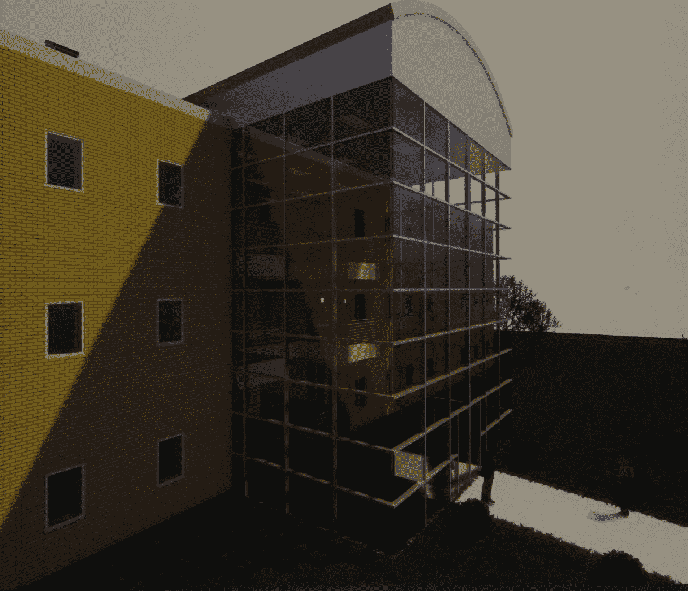

## 兑换您的代码

获取专属奖励内容

本书附有一个唯一的访问码，可让您访问专属奖励内容。一旦您兑换了代码，该书将添加到您的 SDC Publications 图库中。您可以登录账户并进入账户库，随时随地访问您的文件。

## 兑换您的代码

- 1. 登录您的 SDC Publications 账户或访问 SDCpublications.com/Register 注册
- 2. 登录账户后，访问 SDCpublications.com/Redeem
- 3. 输入下方代码：

```
FKT4 F4JS RL1K L8Q1
```

- 4. 访问 SDCpublications.com/Library 从账户库访问此书的专属内容。

有关下载和打开文件的常见问题解答，请访问 SDCpublications.com/FAQ

如需技术支持，请访问 SDCpublications.com/Contact-Us

**教师：** 您可以通过登录教师账户并访问我们网站上本书的详情页获取本书的下载资源。


## 前言

致学生：

本书的编写假设读者没有使用 Autodesk Revit 的相关经验。本书的目的是为学生提供全面的建筑工具和技术知识，以供学校和工业界使用。

本书由一系列教程组成，主要聚焦于单一项目的开发。当你完成本书后，你将学会如何对商业项目的所有主要建筑方面进行记录和建模。这包括平面图、室内和室外立面、墙和建筑剖面，以及房间面层表和打印图纸整理。

有几个视频作为本书的补充。结合书籍学习这些视频有助于读者理解 Revit 的建筑功能。本书和视频还将帮助准备 Autodesk 建筑认证考试；更多信息请参见附录 A。

务必检查在线提供的额外奖励材料。

> 错误：
>
> 请定期检查出版者网站，查看本书印刷后发现的任何错误或拼写错误。只需访问 www.SDCpublications.com 并导航到本书的页面。点击页面右上角的“View/Submit errata”（查看/提交错误）链接。如果您发现错误，请提交，以便我们在下一版本中进行更正。
>
> 您可以通过 service@SDCublications.com 向出版者提供意见或问题。除非与本书的问题有关，否则请勿通过电子邮件咨询 Revit 问题。

致教师：

本书是为使用 Revit 2018 的建筑专业学生设计的。注意：学生可以使用 Revit Architecture 2018 顺利完成本书。在本书中，学生开发了一栋两层商业建筑。图纸从平面图开始，一直发展到类似于本书封面的写实渲染图。

在本书中，创建模型时涵盖了许多 Revit 工具和技术。此外，以适用于当前行业的方式涵盖了行业标准和规范。某些练习需要访问互联网。

每章末尾都有自测题和复习题。自测题的答案在《教师指南》中提供。本书每年更新一次，以适应最新版本的 Revit。可以从出版者获取《教师资源指南》。其中包含：
- 每章末尾问题的答案
- 每个待交作业的示例图像
- 每节涵盖的工具和主题大纲
- 对学生额外作业的建议
- 作者的联系信息

关于作者：

Dan Stone 是一位注册建筑师，在建筑领域拥有二十多年的经验。他目前在明尼苏苏达州德尔鲁特的 LHB（一家拥有 270 人的多学科公司；www.LHBcorp.com）担任 BIM 管理员，为区域办公室提供培训、咨询和支持。Dan 是建筑规范协会 (CSI) 的成员，曾在超级苏利尔学院和北达科他州大学 (NDSU) 教过 12 年 AutoCAD 和 Revit 课程；此外，他还是认证文档技师 (CDT)。Stone 编写了以下教材（由 SDC Publications 出）：
* 使用 Autodesk Revit 2018 进行住宅设计
* 使用 Autodesk Revit 2018 进行商业设计
* 使用 Autodesk Revit 2018 进行设计整合（建筑、结构和机电）
* 使用 Autodesk Revit 2018 进行室内设计（与合作者 Aaron Hansen 共同）
* 使用 AutoCAD 进行住宅设计
* 使用 AutoCAD 2013 进行商业设计
* 建筑制图章节（与 Steven H. McNeill, AIA, LEED AP 合著）
* 使用 Sketching、SketchUp 和 Photoshop 进行室内设计（与 Steven H. McNeill 合著）
* 针对室内设计师的 Google SketchUp 8 基础

您可以通过 service@SDublications.com 向出版者提供意见或建议。

社交媒体：

学生可以使用 Twitter 和 LinkedIn 等社交媒体开始建立专业人脉和知识。在社交媒体上关注作者以获取新文章、技巧和错误更新。考虑关注您所在的设计公司和协会（AIA、CSI 等）；这可能会让你在面试中获得优势！

作者博客：http://bimchapters.blogspot.com/

Twitter

@DanStone_MN

LinkedIn

https://www.linkedin.com/in/daninstenem

感谢：

如果没有家人的支持，我无法完成这本书：Cheri, Kayla & Carter。

非常感谢 Stephen Schroff 和 SDC Publications 让本书成为可能！

- 自测验与复习题
- 5-4 栏手简介
- 自测验与复习题
- 自测验与复习题
- 7-3 放置设备（灯具与散流器）
- 7-4 标注
- 自测验与复习题
- 自测验与复习题
- 13-4 创建室内渲染 | 13-28

下方的每个类别都有几个短视频，时长约 3-5 分钟，可以在学习本书时按顺序观看，随着新视频的加入：
1. 用户界面
2. 墙体
3. 门与窗
4. 楼梯
5. 屋顶
6. 地板
7. 天花板
8. 立面
9. 剖面
10. 进度表
11. 渲染
12. 设计选项
13. 图纸与列表
14. 协作

本章将向你介绍 Autodesk Revit 2018。你将学习用户界面以及如何打开和保存项目并调整视图。建议花大量时间学习这些材料，这将有助于你顺利完成各个章节。

## 练习 1-1：Revit 有什么？

Autodesk Revit（建筑、结构和 MEP）是世界上第一个参数化建筑设计软件。这款革命性的软件首次让建筑辅助设计超越了高科技铅笔。Revit 是 AutoCAD、Civil 3D、Inventor、3DS Max、Maya 等许多流行设计程序的产物。Revit 可以被视为信息建模（BIM）流程的基础。BIM 过程围绕一个虚拟的、信息丰富的 3D 模型。在这个模型中，所有的建筑元素都得到了表示，并包含了制造商、成本、阶段等信息。一旦在 Revit 中开发了模型，就可以使用插件和应用程序进一步利用这些数据。例如：设施管理、分析（能量、结构、照明）、施工顺序、成本估计、法规符合性等等！对于充分利用其潜力的设计师来说，Revit 是一个无值的工具。迭代设计过程可以使用设计选项等特殊功能来完成。材料选择可以开发并附加到模型中的各种元素，其中一个更改会在整个项目中调整。进度表的威力可以确定数量和文档参数（这是 BIM 中的“I”，代表信息）。最后，基于 Revit 的三维特性允许设计师展示引人的图像和动画。这些图形有助于更清晰地向客户和其他相关方传达设计意图。本书将涵盖许多此类工具和技术以辅助创作过程。

## 什么是参数化模型？

Revit 是一个从零开始使用先进技术设计的程序。“参数化”一词描述了修改一个元素时，相邻元素会自动修改以保持预先建立的关系的过程。例如，如果墙发生了移动，垂直墙的长度会伸缩以保持与墙的连接。此外，连接在墙上的元素也会移动，例如墙柜、门、窗户、气栅等。

Revit 代表“立即修改”（Revise Instantly）；在一个视图中进行的更改会自动更新到所有其他视图和进度表中。例如，如果你在内立面图中移动一扇门，平面图会自动更新。如果你删除一扇门，它将从所有其他视图和进度表中删除。

Revit 的主要目标是消除传统与 CAD 程序相关的许多重复性和单调的任务，为设计、协调和可视化留出更多时间。例如，当项目任何地方发生更改时，所有的图纸编号、立面标签和引用泡会自动更新。因此，很难找到引用错误的节点标签。

理解参数化模型如何工作的最佳方法是描述 Revit 项目：单个文件包含你的整个项目。尽管你可能是在 2D 绘图，但你实际上是在 3D 建模。事实上，建筑项目是一个 3D 模型。从这个 3D 模型中，你可以生成 2D 立面、2D 剖面和透视图。因此，当你在立面图中删除一扇门时，你实际上是从 3D 模型中删除了这扇门，所有的 2D 视图都由此生成并自动更新。


了解 Revit 是参数化模型的另一种方法是，参数可以控制几何图形的大小和形状。例如，窗户可以设置两个参数来控制窗户的大小。从窗户属性中，可以在不使用任何绘图工具（如缩放或移动）的情况下控制窗户的大小。此外，参数设置（示例中的宽度和高度）可以保存在窗户模型（称为族）中。你可以将 2' x 4' 的设置保存为“类型 A”，将 2' x 6' 保存为“类型 B”。每个保存的值列表被称为族中的类型。因此，这个双悬窗族可以表示无限数量的窗户尺寸！你将在稍后的章节中学习更多内容。

Revit 不支持专业的土木设计。

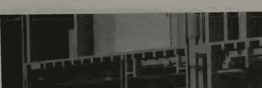

现在任何时候都是为了确保读者理解：Revit 不具备、也从不具备向后兼容性。这意味着没有“另存为”（Save-As）功能，无法回到之前的 Revit 版本。此外，旧版本的 Revit 无法打开以新格式保存的文件、项目或内容。因此，在升级任何项目或内容之前，请务必考虑你的学校或雇主目前标准的是哪个版本。当在更高版本的软件中打开时，Revit 会自动升级旧的建筑 Revit 模型（包含建筑、结构、机械、水暖和电气均建模）。这是一个一次性的过程，可能需要几分钟。

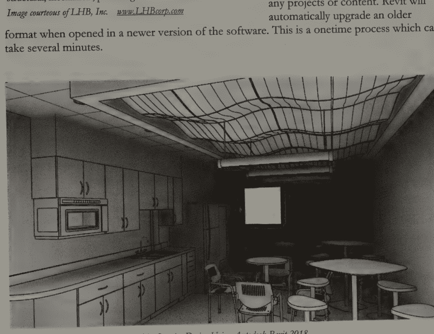

使用 Autodesk Revit 2018 室内设计创建的茶室 3D 模型

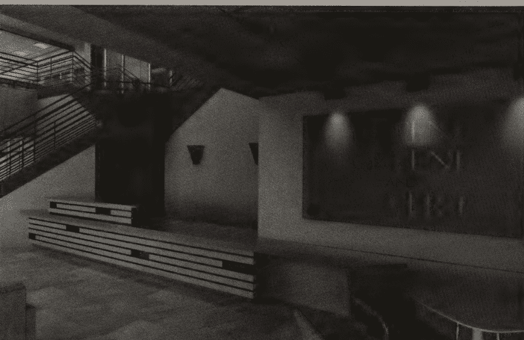

使用 Autodesk Revit 2018 室内设计的大厅渲染图

很多人都会问，为什么使用 Revit 而不是其他程序？答案无疑取决于情况以及个人或组织的特定需求。

通常情况下，这是大多数公司使用 Revit 的原因：
- 许多设计师和绘图员正在使用 Revit 来简化重复的绘图任务，并将更多精力专注于项目的设计和细节。
- Revit 是一个非常先进的程序，为建筑设计提供了许多功能。Revit 在不断开发，Autodesk 定期提供增量更新和补丁；Revit 2018 在上一版本发布一年后发布。
- Revit 专为建筑设计设计，包含以下功能：
    - Mental Ray 和 Autodesk 渲染器实时渲染
    - 阶段（Phasing）；模型随时间发生变化
    - 设计方案（Design Options）；模型在同一时期内发生变化
    - 实时进度表（Live schedules）
    - 通过 Autodesk A360 进行云渲染
    - 通过 Autodesk A360 进行概念性能量分析
    - 通过 Autodesk A360 进行采光分析

# 一些 Revit 基本概念

以下内容是对 Revit 作为软件应用程序的基本组织结构的简要概述。你不应该过度纠结于这些概念和术语，因为当你完成书中教程的操作时，它们将变得更有意义。这些讨论仅仅是为了打下基础，让你对 Revit 的工作原理有一个通用的参考框架。

Revit 平台有三种基本类型的元素：
- 模型元素（Model Elements）
- 基准元素（Datum Elements）
- 视图特定元素（View-Specific Elements）

将模型元素想象成建筑建成后你可以接触到的物体。它们通常是 3D 的，但有时也是 2D 的。模型元素有两种类型：
- 宿主元素（Host Elements）：墙、地板、板、屋顶、天花板——每种“版本”的 Revit 工具都是相同的。
- 模型组件（Model Components）：楼梯、门、家具、梁、柱、管道、风管、灯具、模型线。
- 某些模型组件在放置于项目之前需要一个宿主。例如，窗只能放置在宿主中，根据元素的创建方式，宿主可以是墙、屋顶或地板。如果宿主被删除，所有宿主或依赖元素都将自动删除。

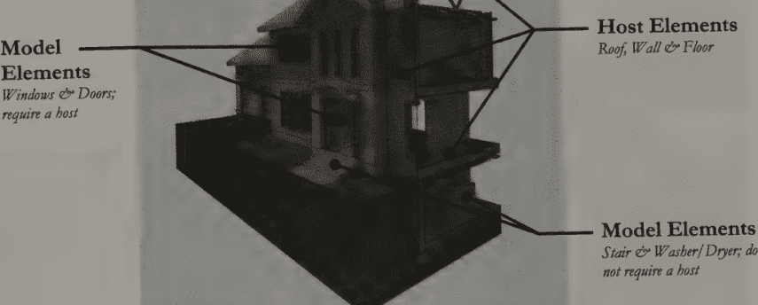

基准元素是建筑内部的参考平面，图形和参数定义模型中各种元素的位置。这些功能在 Revit 的“版本”中都可用。基准元素有三种类型：
- 网格（Grids）
    - 通常在平面图中布置，用于定位柱和梁等结构元素以及墙。网格出现在平面图、立面和剖视图。在一个视图中移动网格会移动所有视图中的网格，因为它们是同一个元素。（网格视图示例见下一页。）
- 标高（Levels）
    - 用于定义垂直关系，主要是你行走的表面。它们只出现在立面和剖视图。许多元素是相对于标高放置的；当标高移动时，这些元素也会随之移动（例如：门、窗、柜体、天花板）。**警告：如果删除了标高，那些相同的“依赖”元素也将从项目中删除！**
- 参考平面（Reference Planes）
    - 它们与网格类似，出现在平面和立面剖视图。它们末端没有像网格那样的参考气泡。Revit 将许多任务分解为简单的 2D 任务，从而产生 3D 几何形状。参考平面用于定义在 3D 模型中工作的 2D 。它们可以放置在任何视图，无论是水平还是垂直。

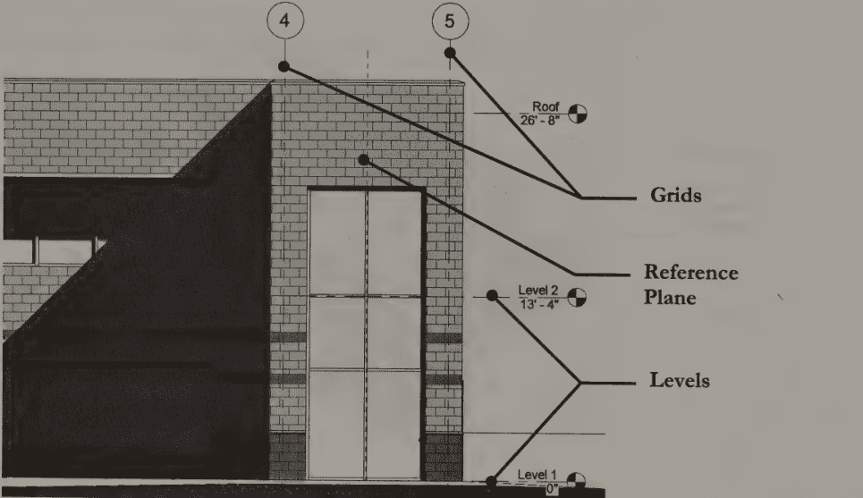

顾如名，即将讨论的项目只显示在特定的视图中。以下是对 Revit 作为软件应用程序的基本组织结构的简要概述。你不应该过度纠结于这些概念和术语，因为当你完成书中教程的操作时，它们将变得更有意义。这些讨论仅仅是为了打下基础，让你对 Revit 的工作原理有一个通用的参考框架。
- 标注（Annotation）
- 细节（Details）
- 立面（Elevations）
- 填充区域（Filled Regions）
- 网格（Grids）
- 平面（Plans）
- 参考平面（Reference Planes）
- 剖面（Sections）
- 进度表（Schedules）
- 符号（Symbols）
- 视图（Views）

除了你通常工作的“扁平化”2D 视图外，你还可以通过 3D 视图和相机更自然地看到你的设计。3D 视图仅仅是从外部查看项目的非透视 3D 视图。相机视图是真正的透视视图；相机可以在建筑内外部创建。就像 2D 视图一样，这些 3D/相机视图可以放置在打印的图纸上。Revit 提供了许多工具来探索 3D 视图，例如剖框（Section Box）、方向盘（Steering Wheel）、临时隐藏和隔离（Temporary Hide and Isolate）以及渲染（Render）。

左侧图像是设置为“阴影模式”的 3D 视图并开启了阴影。右侧图像是在建筑内部设置的相机视图；视图设置为“隐藏线”而非阴影，且相机位于人眼高度。

明表是根据项目中已放置或建模的内容生成的信息列表。可以创建明表，如下所示的门表示例，它列出了项目中存在的每扇门相关的任何数据。Revit 允许你直接在明表中进行操作。明表视图中的任何更改都会反映正在编辑的元素。同样，如果从此明表中删除一扇门，该门也将从项目中被删除。

| 门编号 | 宽度 | 高度 | 材料 | 类型 | 材料 | 门头 | 门框 | 门槛 | 玻璃 | 自由额定 | 五金组 |
|---|---|---|---|---|---|---|---|---|---|---|---|
| 1048 | 3'-0" | 7'-0" | MDW | D010 | P10 | 11AE.01 | | | | | 34 |
| 1048B | 3'-0" | 7'-0" | MDW | D010 | P10 | 11AE.01 | | | | 20 MIN | 34 | |
| 1049 | 3'-0" | 7'-0" | MDW | D010 | P10 | 11AE.01 | | | | | 34 | |
| 1049B | 3'-0" | 7'-0" | MDW | D010 | P10 | 11AE.01 | | | | 20 MIN | 34 | |
| 1050 | 3'-0" | 7'-0" | MDW | D010 | P10 | 11AE.01 | | | 1/4" TEMP | | 34 | |
| 1050B | 3'-0" | 7'-0" | MDW | D010 | P10 | 11AE.01 | | | 1/4" TEMP | | 34 | |
| 1051 | 3'-0" | 7'-0" | MDW | D010 | P10 | 11AE.01 | | | 1/4" TEMP | | 34 | |
| 1051B | 3'-0" | 7'-0" | MDW | D010 | P10 | 11AE.01 | | | 1/4" TEMP | | 34 | |
| 1052 | 3'-0" | 7'-0" | MDW | D010 | P10 | 11AE.01 | | | 1/4" TEMP | | 34 | |
| 1052B | 3'-0" | 7'-0" | MDW | D010 | P10 | 11AE.01 | | | 1/4" TEMP | | 34 | |
| 1053 | 3'-0" | 7'-0" | MDW | D010 | P10 | 11AE.01 | | | 1/4" TEMP | | 34 | |


| 1053B | 3'-0" | 7'-0" | MDW | D010 | P10 | 11AE.01 | | | 1/4" TEMP | | 34 | |

| 1054 | 3'-0" | 7'-0" | MDW | D010 | P10 | 11AE.01 | | | 1/4" TEMP | | 34 | |

| 1054B | 3'-0" | 7'-0" | MDW | D010 | P10 | 11AE.01 | | | 1/4" TEMP | | 34 | |

| 1055 | 3'-0" | 7'-0" | MDW | D010 | P10 | 11AE.01 | | | 1/4" TEMP | | 34 | |

| 1055B | 3'-0" | 7'-0" | MDW | D010 | P10 | 11AE.01 | | | 1/4" TEMP | | 34 | |

| 1056 | 3'-0" | 7'-0" | MDW | D010 | P10 | 11AE.01 | | | 1/4" TEMP | | 34 | |

| 1056B | 3'-0" | 7'-0" | MDW | D010 | P10 | 11AE.01 | | | 1/4" TEMP | | 34 | |

| 1057 | 3'-0" | 7'-0" | MDW | D010 | P10 | 11AE.01 | | | 1/4" TEMP | | 34 | |

| 1057B | 3'-0" | 7'-0" | MDW | D010 | P10 | 11AE.01 | | | 1/4" TEMP | | 34 | |

| 1058 | 3'-0" | 7'-0" | MDW | D010 | P10 | 11AE.01 | | | 1/4" TEMP | | 34 | |

| 1058B | 3'-0" | 7'-0" | MDW | D010 | P10 | 11AE.01 | | | 1/4" TEMP | | 34 | |

| 1059 | 3'-0" | 7'-0" | MDW | D010 | P10 | 11AE.01 | | | 1/4" TEMP | | 34 | |

| 1059B | 3'-0" | 7'-0" | MDW | D010 | P10 | 11AE.01 | | | 1/4" TEMP | | 34 | |

| 1060 | 3'-0" | 7'-0" | MDW | D010 | P10 | 11AE.01 | | | 1/4" TEMP | | 34 | |

| 1060B | 3'-0" | 7'-0" | MDW | D010 | P10 | 11AE.01 | | | 1/4" TEMP | | 34 | |

你可以将图纸看作是打印视图和明表的纸张。视图和明表被放在图纸上并进行安排。一旦视图放置在图纸上，它的气泡会自动填充且不能放置在其他图纸上。每个视图的设置称为“视图比例”，控制每个图纸上图形的大小；视图比例也控制尺寸。


Revit 是一个强大且程序。由于其功能强大，它具有学习曲线，尽管其直观的设计使其比其他 CAD 或 BIM 程序更容易学习。然而，与其他任何东西一样，将其分解成较小的部分时，我们可以轻松学会利用 Revit 的威力。这就是本书的目标。

本节将介绍用户界面（UI）的不同方面。对于任何程序，理解用户界面都是使用程序功能的关键。


提示：查看有关用户界面的在线视频。

除了后续章节将介绍的快速访问工具栏和信息中心外，你还在中心位置看到产品名称、版本和当前文件视图。正如之前提到的，版本是重要的，因为除非你与其他人员/或顾问协调过，否则你不希望升级；每个人必须使用相同版本的 Revit。注意：左侧的“R”图标与之前的版本不同——应用程序菜单已由“文件”选项卡取代。

访问文件工具，如保存、打印、导出和打印（包括纸质打印和电子打印）。你还可以访问控制整个 Revit 应用程序而不仅仅是当前项目的控件，例如“选项”（关于选项的更多信息，请见本节末尾）。


这两个图标（来自文件选项卡）可以切换右侧整个区域，显示你最近访问过的文档（左侧图标）或你已打开的文档列表。

在“最近文档”列表中，点击列出的文档即可打开它。这节省了时间，因为你不需要点击“打开 -> 项目”并浏览文档（在这里，文档和项目是一个意思）。最后，点击“图钉”可以防止项目在打开其他项目时从列表中顶出。

在“打开的文档”列表中，你正在工作的活动项目列在第一；点击另一个项目将切换到该打开的项目。

本书中称为 QAT，此单条工具栏提供了对常用工具（打开、保存、撤销、重做、测量、标记等）的访问。它位于 Ribbon 带上方或下方。

| | | 建筑 | 结构 | 系统 | 插入 | 标注 | 分析 | 体量与场地 | 协作 | 视图 | 管理 | 修改 |

|---|---|---|---|---|---|---|---|---|---|---|---|---|

| | | | | | | | | | | | | | |

| 修改 | 粘贴 | | | | | | | | | | | | |

| 选择 | 属性 | 剪贴板 | | | | | | 视图 | 测量 | 创建 |

“修改”选项卡上提供了多种对当前模型进行操作并从中提取信息的工具。当在模型中选择元素时，额外的修改工具会自动附加到此选项卡（请参见下一页的*修改上下文选项卡*）。

> 提示：在遵循本书中的指令时，请勿将“修改”选项卡与“修改”工具混淆。

| | | | | | | | | | | | | | | |

|---|---|---|---|---|---|---|---|---|---|---|---|---|---|

| 修改 | 视图模板 | 视图图形 | 过滤线条 | 细线 | 显示隐藏线 | 移除隐藏线 | 裁剪轮廓 | 云渲染 | 渲染库视图 | 3D 剖面视图 |

| 选择 | | | | | | | | | | | | | | |

**视图**选项卡上的视图允许你创建 3D 模型的新视图；这包括看起来像 2D 的视图（例如平面图、立面和剖面）以及 3D 视图（例如等轴测和透视图）。

**视图**选项卡还提供了控制视图外观的工具，从可以看到哪些类型的元素（例如水暖装置、家具或剖面标记）到线宽。

*注意：线宽在项目级别进行控制，但可以根据视图逐个进行覆盖。*

最后，注意*图形*面板右下角的箭头。当你看到这样的箭头时，可以点击它打开一个对话框，其中包含与面板工具集（本例中为图形）相关的设置。悬停在箭头上会显示工具提示，它将你将打开哪个对话框。

当某些工具激活或模型中选中了元素时，会附加*修改*选项卡；这被称为*上下文选项卡*。下方的第一个图像显示了*放置墙*选项卡，它在添加墙时提供各种选项。下一个示例显示，当选择一个或多个墙时，可以访问*修改墙*上下文选项卡。

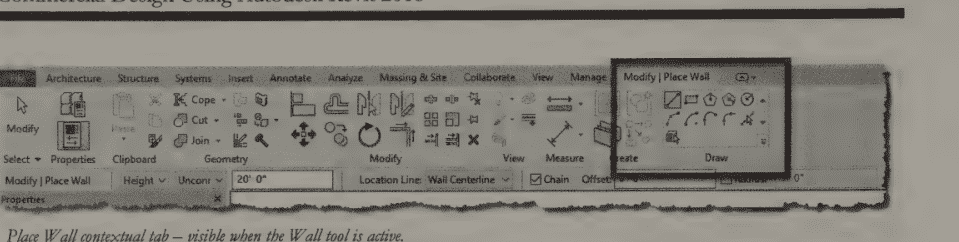

放置墙上下文选项卡 – 选中墙时可见。

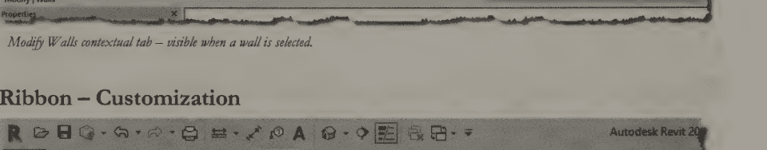

墙墙上下文选项卡 – 选中墙时可见。

| 属性 | | | | | |

| --- | --- | --- | --- | --- | --- |

| 平面图 | | 墙门 | 组件 | 幕墙系统 |

| 平面图：层 | 编辑类型 | | 天花板 | 幕墙网格 |

| | | 柱 | 地板 | 窗龙 |

栏的自定义空间并不多。你可以做的事情之一是点击并按住底部列表标题的左鼠标按钮来拖动面板。如果你有双显示器设置，可以将此面板放置在绘制窗口内或另一个屏幕上。

上面的图像显示了来自“建筑”选项卡的“创建”面板，它已从栏中分离并浮动在绘制窗口中。注意“插入”选项卡处于激活状态。因此，在访问其他工具时，你可以持续访问“创建”工具。注意，“建筑”选项卡上没有“创建”面板，因为它是可以移动的，而不如此。

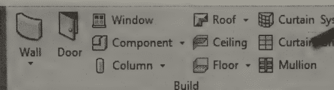

当你需要将分离的面板移回栏时，请执行以下操作：悬停在屏幕上，显示带有侧边栏的图像，然后点击右上角的“返回面板到栏”图标（如上所示）。

> 供参考：每当你的显示器分辨率过低或你没有在屏幕上最大化 Revit 程序时，按钮可能会被修改以占用较少的空间；请将右侧图像与“创建”面板进行比较。

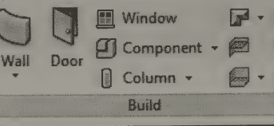

如果你在计算机上安装了 Revit 插件，你可能会在栏上看到一个新选项卡。某些插件是免费的，而另一些则需要付费。如果插件只有一个工具，它会被添加到名为“插件”的汇总选项卡中（如下图所示）。

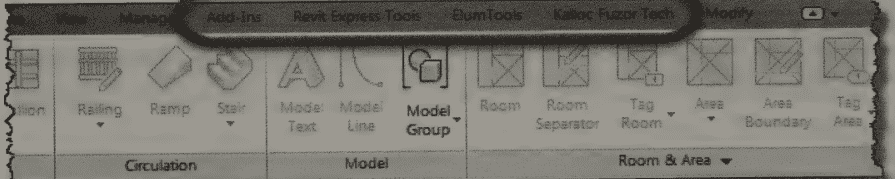

这并不是真的在自定义界面，但在“选项”中，可以进行几项调整——例如关闭不使用的选项卡和工具。然而，例如关闭电气工具反过来限制了可以创建的参数类型数量。

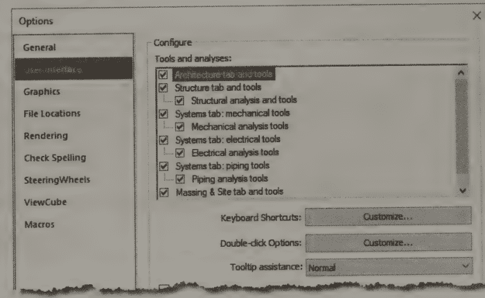

栏可以四种状态之一显示：

- 展开的栏

- 最小化到选项卡

- 最小化到面板

此项的意图是扩大绘制空间。然而，在查看视图时，建议将栏保持展开状态，以查看选项。下方的图像显示了展开的状态。当你使用程序时，请注意此状态以查看处于最小化状态的选项。请参考右侧图像：

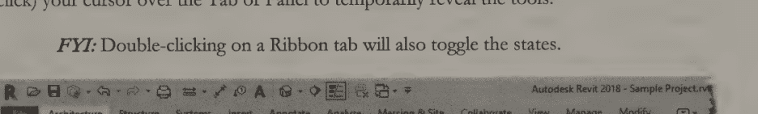

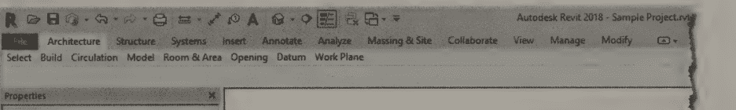

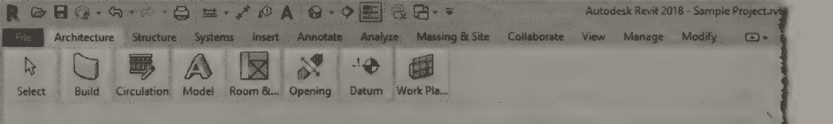

栏可以通过以下方式显示：

- 1 选项卡（默认）

- 2 窗格

- 3 工具

该功能在书中显示，点击此处以切换。。图像显示了了化状态。

- 1 选项卡：建筑

- 2 窗格：创建

- 3 工具：墙

在选择墙时，点击此工具以获取选项。下方的图像显示了这些选项：

- 1 选项卡：建筑

- 2 窗格：创建

- 3 工具：墙

栏可以通过以下方式显示四种状态之一：

- 1 选项卡：建筑

- 2 窗格：创建

- 3 工具：墙

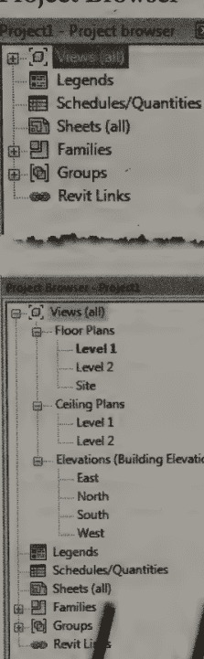

项目浏览器是 Revit 项目数据库的“中央总站”。所有的视图、进度表、图纸和内容都可以通过此层次列表进行访问。左侧的第一张图片显示了七大类别；任何旁边带有“加”号的项目都包含子类别或项目。

双击视图、图例、进度表或图纸将打开并进行编辑；当前正在编辑的项目以**粗体**显示（如左侧示例中的第 1 级）。右键点击将显示弹出菜单，其中包含“删除”和“复制”等选项。

在项目浏览器顶部的“视图(全部)”上点击右键，你会找到一个“搜索”选项，用于搜索视图、族等等，这在处理包含数百个项目需要筛选的大型项目时非常有用。

与属性面板（Properties Palette）一样，项目浏览器的宽度也可以调整。当两者堆叠在一起时，它们可能会一起移动。你也可以将两者直接堆叠；在这种情况下，你会在底部看到如左侧第二张图片所示的每个对应的标签页。

项目浏览器应该保持打开状态；如果你不小心点击右上角的“X”关闭了它，可以通过 视图 -> 窗口 -> 用户界面 -> 项目浏览器 重新打开它。

如果你有第二个显示器，可以将项目浏览器和属性面板移动到第二个显示器上，以便在绘图窗口留出更多工作空间。

该区域位于最左侧，显示关于命令或选中元素的行信息。状态栏右侧显示所选元素的数量。选择数字左侧的小漏斗图标可以点击打开“过滤”对话框，它允许你将当前选择范围缩小到特定类别；例如，你可以选择整个平面图，然后将其过滤为仅显示“门”。这与属性面板中的“选择过滤器”不同，后者会保留所有内容。

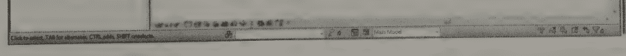

在状态栏上，右侧的五个图标（如下图所示）控制元素的选择方式。从左到右这些是：

- 选择链接

- 选择下部元素

- 选择固定元素

- 按面选择元素

- 在选择区域上拖动元素

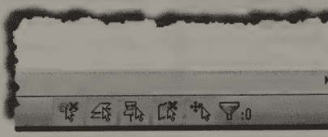

将光标悬停在图标上，可以查看其名称以及其功能的简要描述。这些是可开启或关闭的切换按钮；每个图标右上角的红色“X”意味着你无法在模型中选择该类型的元素。这些控制防止意外移动或删除物体。如果你在选择某些内容时遇到困难，请保持这些开启状态；你可能不小心切换了其中某一个。

最后，状态栏中间的两个下拉列表控制设计选项（Design Options）和工作集（Worksets）（见上一页图片）。后者在书中未介绍，但设计选项会介绍。工作集涉及多个设计师同时在模型中的能力。

```
1/8" = 1'-0"
```

这是一个功能，让你方便地访问控制每个视图显示设置的工具（例如比例、细节、图形样式等）。选项在不同视图之间略有不同：2D视图、3D视图、图纸和进度表。需要注意的是，这些设置仅影响当前视图（即应用程序标题栏上列出的视图）。所有这些设置在属性面板中可用，但此工具栏无法像属性面板那样被关闭。

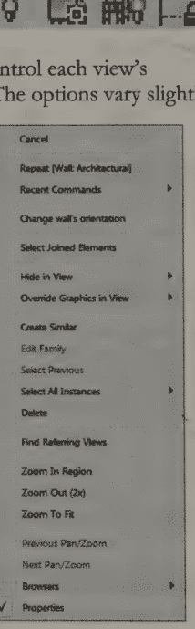

每当你右键点击鼠标时，上下文菜单就会出现在光标附近（见图所示）。该菜单上的选项将根据激活的工具或选中的元素而变化。

这是你操作建筑信息模型 (BIM) 的地方。在这里看到当前视图（平面、立面或剖面）、进度表或图纸。所做的任何更改都会传播到整个数据库。

此项目实际上不是 Revit UI 的一部分，但通过你启动时使用的各种模板，它在绘图窗口中默认可见，因此在此处值得提及。四个立面标记指向项目的每一侧，并最终指示了你可以在哪张图纸上找到建筑每一侧的立面图。你现在只需要知道，你应该在每个平面视图中看到的四个立面标记的中间绘制你的平面图；**不要**删除它们，因为这将从项目浏览器删除相关的视图。

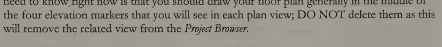

有几个与用户界面相关的设置，它们与当前模型没有关联。这意味着这些设置适用于你计算机上安装的 Revit，而不是仅适用于你计算机上的某一个模型或文件。其中一些是：

| 用户界面 |

| :--- |

| 通用 |

| 选项 |

| 警告 |

| 文件位置 |

| 拼写 |

| 转向轮 |

| 视图立方 |

| 宏 |

| 渲染 |

带区和菜单在学习 Revit 这样的程序时非常有帮助；但大多数用户很少使用它们！将鼠标移动到屏幕边缘选择命令的过程是非常低效的，特别是对于那些每周五天都这么做的人来说。这里是一些例子：

- 使用滚轮进行缩放（旋转滚轮）、平移（按住滚轮并移动鼠标）和缩放范围（双击滚轮）。

- Revit 符合许多操作系统的标准。大多数程序（包括 Revit）都有几个可以通过快捷键访问的标准命令。这里是一些例子（同时按下两个键）：

| | | |

| :--- | :--- | :--- |

| Ctrl + S | 保存 | 保存当前模型 |

| Ctrl + A | 全选 | 选择所有内容 |

| Ctrl + Z | 撤销 | 撤销上一步操作 |

| Ctrl + X | 剪切 | 剪切到剪剪贴板 |

| Ctrl + C | 复制 | 不替换 Revit 的视图/级别 |

| Ctrl + V | 粘贴 | 用于模型/视图/级别之间的复制 |

| Ctrl + Tab | 切换视图 | 在打开的视图之间切换 |

| Ctrl + P | 打印 | 打开打印对话框 |

| Ctrl + N | 新建 | 创建新项目文件 |

| F7 | 拼写 | 启动拼写检查功能 |

| Enter | 上一个命令 | 重复上一个命令 |

- 如果你记得，文件选项卡上的“打开文档”区域列出了你计算机上当前打开的所有视图。通过点击列表中的名称，你可以“切换”到该视图。快捷键是按 Ctrl + Tab 快速循环打开的图纸。

- 许多 Revit 命令也有键盘快捷键。所以，当你右手放在鼠标上（且不离开“设计”区域）时，你的左手在想画墙时可以输入 WA，例如。你可以通过点击 视图（选项卡） -> 用户界面（下拉列表） -> 键盘快捷键来查看所有预加载的快捷键并添加新的快捷键。

请注意，任何自定义的键盘快捷键都是针对你正在使用的计算机的，而不是项目。你可以使用**导出**按钮（参见右侧图像）将整个键盘快捷键列表保存到文件中，并将其**导入**到另一台计算机的 Revit副本中。

到此，对 Revit 用户界面的简要介绍结束。书中将对这些工具和操作进行更详细的介绍。

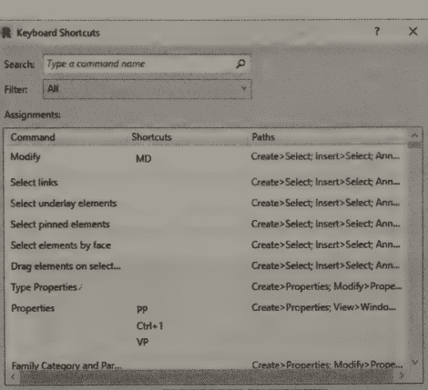

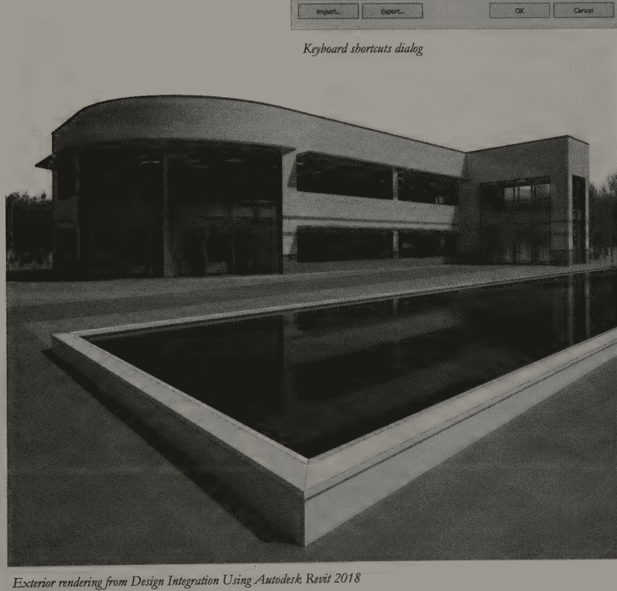

1-25

打开、保存和关闭 Revit 项目

打开 Revit 2018：

开始 -> 所有应用程序 -> Autodesk -> Revit 2018

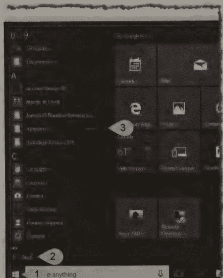

或者从桌面上双击 Revit 图标。

这在你的计算机上可能略有不同，如果需要帮助，请咨询你的导师或系统管理员。

默认情况下，Revit将在“最近文件”窗口中打开，该窗口将显示你最近工作过的项目缩略图。点击预览将打开项目。

- 点击“打开”链接（参见右侧图像）。

你可以点击“项目”下的“打开”，或点击快速访问工具栏上的“打开”。

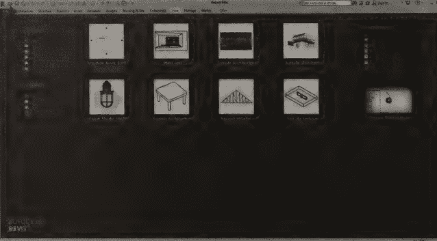

图 1-3.1 最近文件启动屏幕

接下来你将打开一个现有的 Revit 项目文件。你将选择从 SDCpublications.com 在线提供的示例文件；更多信息请参阅内扉。


- 点击“打开”对话框顶部的下拉框（图 1-3.2）。浏览到你下载的文件（提供的文件需要从 `www.SDCpublications.com` 下载）。

提示：如果你无法访问在线示例文件，可以替换任何你能找到的 Revit 文件。你可以在电脑硬盘此处找到一些示例文件：`C:\Program Files\Autodesk\Revit 2018\Samples`

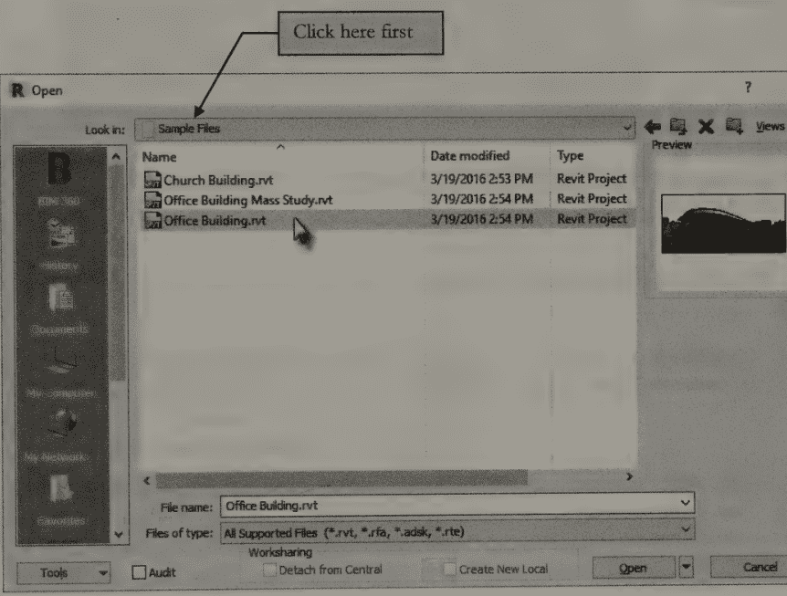

图 1-3.2 打开对话框，从 SDCpublications.com 下载的内容

- 选择名为 `Office Building.rvt` 的文件并点击“打开”。

学习提示：注意所选文件的预览。这将帮助你在花费时间打开它之前选择正确的文件。

`Office Building.rvt` 文件现已打开，绘图窗口显示最后保存的视图（图 1-3.3）。

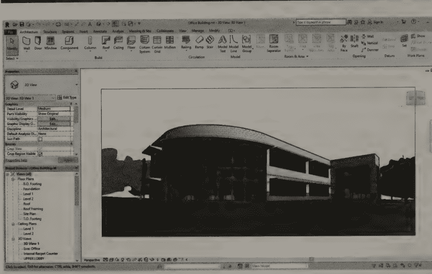

图 1-3.3 示例文件“Office Building.rvt”

“文件”选项卡列出了你计算机上当前打开的项目和视图（图 1-3.4）。

- 1. 点击“文件”选项卡 → “打开文档”（图标）（图 1-3.4）。

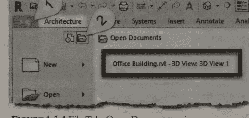

注意，列表中列出了 `Office Building.rvt` 项目文件。项目名称旁边是你计算机上打开的视图名称（例如：楼层平面图、立面图）。

图 1-3.4 文件选项卡：打开文档视图

当你打开其他视图时，它们将此添加到列表中。每个视图都以项目名称作为前缀。当前视图（即你正在工作的视图）位于列表顶部。你可以通过点击这些项从此菜单快速切换已打开的视图。

你也可以使用“视图”选项卡中的“切换窗口”工具，两者的功能基本上是相同的。

1-28

Revit 允许你同时打开多个项目。

- 5. 点击快速访问工具栏上的“打开”。

- 6. 按照之前介绍的说明，浏览到下载的在线文件。

- 7. 选择名为 `Church Building.rvt` 的文件并点击“打开”（图 1-3.5）。

提示：如果你找不到文件，请替换其中一个示例文件。

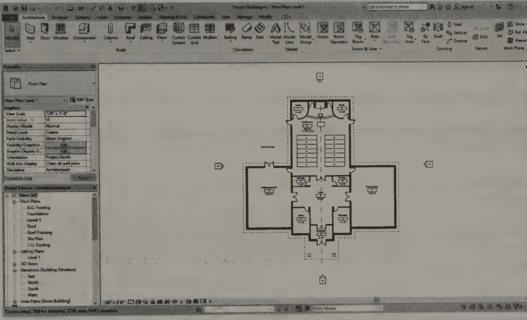

图 1-3.5 示例文件“Church Building.rvt”

- 8. 从“文件”选项卡点击“打开文档”（图 1-3.6）。

注意，现在列出了 `Church Building.rvt` 项目以及一个视图：Floor Plan: Level 1。

尝试通过点击 `Office Building-rvt - 3D View: 3D View 1` 在项目之间进行切换。

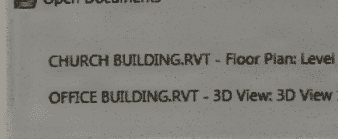

图 1-3.6 打开文档

## 关闭 Revit 项目

- 9. 选择“文件”选项卡 -> “关闭”。

如果提示保存，请点击“不保存”。

当你打开了多个视图时，这将关闭当前项目。

10. 重复之前的步骤以关闭项目。

养成经常保存的习惯，以防止断电或程序崩溃导致工作丢失。

你也可以通过快速访问工具栏保存。

要保存项目副本，请使用“另存为”。

最后，从“文件”选项卡选择“退出”。这将任何视图。

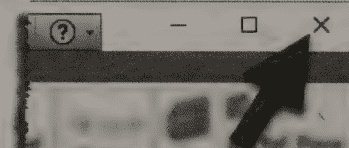

## 创建新项目

打开 Revit。

设置新项目的步骤非常简单。正如之前提到的，打开 Revit 会进入“最近文件”窗口。

- 1. 选择“文件” -> “新建”。

“新建”对话框让你指定要使用的模板，或者完全不使用模板。

- 2. 选择“建筑模板”（图 1-4.1）。

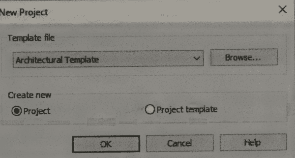

图 1-4.1 新建对话框

- 3. 点击“确定”。你现在有一个未命名的项目。

要命名未命名的项目，只需“保存”。第一次保存未命名项目时，将提示指定名称和位置。

- 4. 选择“文件”选项卡 -> “保存”。

- 5. 为你的项目指定名称和位置。如果在教室环境中，你的导师可能会指定文件的位置。

模板文件允许以你喜欢或需要的预设设置开始项目。例如，你可以将单位设置为英制或公制：你可以加载你最常用的门、窗族。你还可以预加载公司的标题块，甚至为项目设置好所有的表。对于使用 Revit 的设计公司来说，自定义模板是必须的，并且对变得日益熟练的学生非常有用。

注意：

从现在开始，假设读者了解如何创建、打开和保存项目文件。如有需要请返回本节。如果你仍然需要进一步帮助，请询问你的导师。

# 练习 1-5

学习在图中平移和缩放对于准确高效的绘图和可视化至关重要。我们现在将回顾这些命令，以便你在第一个设计练习中使用它们。

打开 Revit。

你将从提供的在线文件中选择示例文件。

- 1. 点击快速访问工具栏上的“打开”。

- 2. 浏览到下载的在线文件。

- 3. 选择名为 `Church Building.rvt` 的文件并点击“打开”（图 1-5.1）。

> 提示：如果找不到在线文件，可以替换 Revit 自带的训练文件，位于 `C:\Program Files\Autodesk\Revit 2018\Samples`。

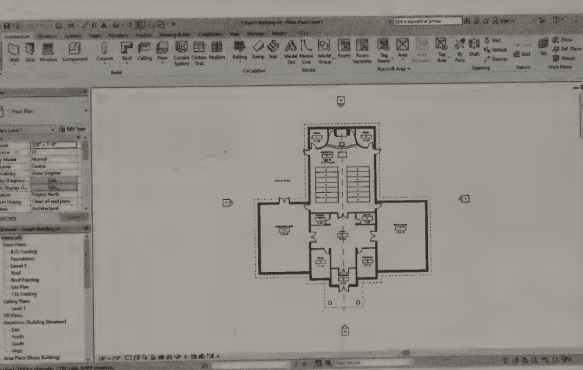

图 1-5.1 Church Building.rvt 项目

如果加载的默认视图是**平面图：层 1**，请双击项目浏览器中**视图**->**平面图**项下的**层 1**。当层 1 是绘图窗口中的活动或当前视图时，它将显示为粗体。

你可以从**导航栏**或使用鼠标上的滚轮来访问缩放工具。

缩放图标包含多个与缩放相关的工具：

- *默认（即可见）的图标是“区域缩放”，它允许你通过窗口形式选择一个区域进行放大。*

- 缩放图标是一个**拆分按钮**。

- 点击按钮的向下箭头部分会显示相关的缩放工具列表。

- 你将在下一页看到下拉列表。

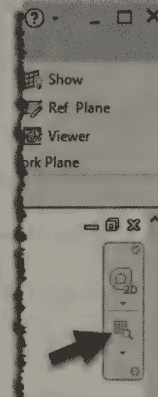

- 4. 选择**缩放图标**的顶部部分（见右侧图像）。

- 5. 在你的平面视图上拖动一个窗口（图 1-5.2）。

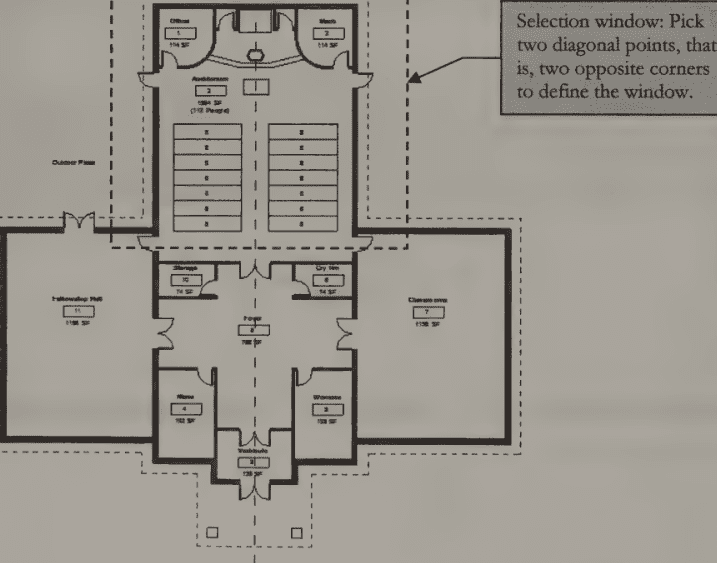

图 1-5.2 放大窗口

你现在应该已经放大了指定的区域（图 1-5）。

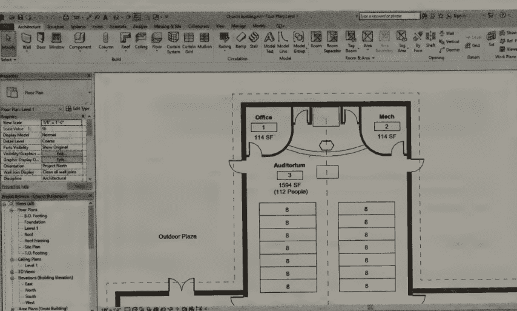

图 1-5 放大结果

- 6. 点击缩放图标旁边的向下箭头（图 1-5.4）。选择**上一个平移/缩放**。

你现在应该回到了起始位置。每当你选择此图标时，你都是在恢复到之前的视图状态。如果你进行了一些平移和多次缩放，有时可能需要多次选择此选项。

- 7. 按住滚轮按钮进行**放大**到较小的区域，然后进行**平移**（即调整所看到的视图部分）。

平移工具只是改变你在屏幕上看到的视图部分；它并不会实际移动模型。

花几分钟时间尝试其他的**缩放**工具，看看它们是如何工作的。完成后，在继续之前点击**缩放至适应**。

提示：你可以双击鼠标上的滚轮按钮在当前视图中缩放至范围。

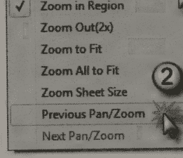

图 1-5.4 缩放图标下拉列表

点击快速访问工具（QAT）上的默认 3D 视图图标将加载 3D 视图。这允许你快速切换到 3D 视图。

- 点击默认 3D 视图图标。

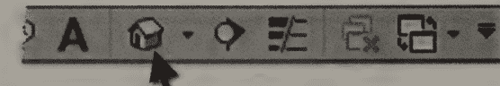

- 进入文件选项卡中的打开文档列表，注意 3D 视图和平面图视图都列底部。

> 记住：你可以在这里切换视图。

- 点击 `Esc` 键关闭文件选项卡。

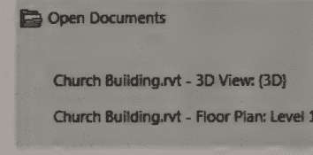

视图立方提供了便捷的 3D 视图视图控制。这项技术已应用于 Autodesk 的许多程序中，以确保用户拥有无缝的操作体验。

- 你应该会在绘图窗口的右上角看到视图立方（图 1-5）。如果没有，可以通过点击视图 -> 用户界面 -> 视图立方来开启它。

> 提示：视图立方仅在 3D 视图中显示。

将光标悬停在立方体上即可激活它。当你在立方上移动时，你会看到高亮区域。点击它将进入绘图窗口中的高亮区域。你也可以在立方上点击并拖动鼠标来旋转模型。最后，在右键菜单中有几个选项，立方上方的主图标可以在迷失方向时带回到起点！

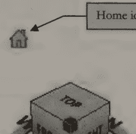

- 尝试一下视图立方，完成后点击主图标。

> 记住：主图标只有在光标位于视图立方上时才会显示。

## 导航轮 Navigation Wheel

与视图立方类似，导航轮有助于导航模型。使用导航轮，你可以穿过模型，通过走廊并进入房间。导航轮尚未进步到为你开门的程度；因此你会像幽灵一样穿过关闭的门或墙壁！

通过点击导航栏上的上方图标可以激活导航轮。

遗憾的是，学习 Revit 学习导航轮还太早了。

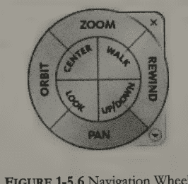

- 3. 点击上方。

## 使用滚轮

滚轮是导航模型的强大工具。你可以用它放大、缩小和平移视图。

- 放大：向前滚动滚轮。

- 缩小：向后滚动滚轮。

- 平移：按住滚轮并移动鼠标。

提示：你可以双击鼠标上的滚轮按钮在当前视图中缩放至范围。

## 练习 1-6：使用帮助系统

帮助系统提供了关于 Revit 的大量信息。你可以用它来寻找答案、学习如何使用功能以及排除故障。

- 1. 点击屏幕右上角的问号图标。

帮助系统是一个在线资源，因此你需要连接互联网。它会不断更新新信息和提示。

- 2. 在搜索框中输入你的搜索词。

- 3. 按键盘上的**回车**键。

搜索结果显示在下列表中。你可以点击任何链接以获取更多该主题的信息。

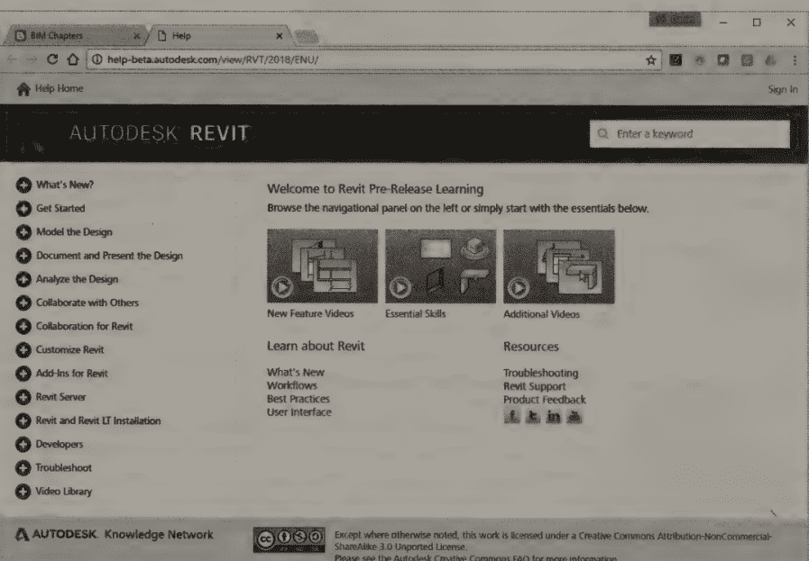

图 1-6.1 搜索结果

## 练习 1-7：Autodesk 360 简介

我们将通过介绍 Autodesk 360 来结束本章，它是 Autodesk 所有云服务的“零点”。学生务必阅读这些信息，以便在书中介绍使用这些云服务的具体步骤时能够跟上进度。读者并不一定非要使用 Autodesk 的云服务才能成功完成本书。

书中用到的主要功能包括：

- 将你的工作保存到 Autodesk 360，这样你就可以随时随地访问数据，并确保文件存储在安全的备份位置。此功能对所有人免费，但稍稍后将讨论某些局限性。

- 将你的写实渲染项目发送到云端，以大幅缩短整体处理时间。此功能对学生免费，其他人可以使用免费试用版。

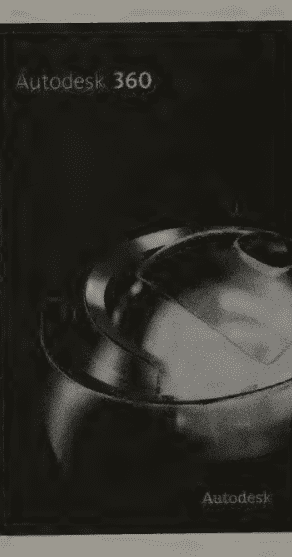

以下是 Autodesk 360 在其网站上的描述：

> Autodesk 360 云端框架提供了工具和服务，可将设计扩展到桌面之外。简化您的工作流，实现有效的协作，并随时随地访问和共享您的工作。凭借云端近乎无限的计算能力，Autodesk 360 可以扩展以满足业务需求，而无需传统桌面软件所需的基础设施或前期投资。

在我们详细讨论 Autodesk 360 之前，让我们先定义什么是“云”。云是一种服务（或一组服务），它部分或完全存在于网络上。它创建于互联网，互联网主要涉及下载信息，以及你正在创建和处理的数据。这些内容大部分存在于你的笔记本电脑或台式电脑之外。这使得普通用户能够获得海量的存储空间、计算能力软件，如果他们必须实际在办公室、学校或家里拥有、安装和维护这些资源，是负担不起的。从某种意义上说，这类似于工具租赁中心，因为普通人负担不起电钻，拥有一把电钻也没有成本效益。然而，只需支付所有和维护的一小部分费用，就可以租赁几小时。在这种情况下，大家赢了！

# 使用 Autodesk Revit 2018 进行商业设计

### 创建免费的 Autodesk A360 账户

个人为了访问 Autodesk A360，需要做的第一件事是在 `https://a360.autodesk.com/` 创建免费账户（学生：见下文提示）；具体步骤将在本节中介绍，因此你现在不需要执行此操作。该账户属于个人，而不是计算机、Revit 或 AutoCAD 的安装程序，亦不是来自你的雇主或学校。每位想要访问 Autodesk A360 服务的人都必须创建一个账户，这将赋予他们用户名和密码。

> 提示：学生应该在 `http://www.autodesk.com/education/home` 创建账户。这是你下载免费 Autodesk 软件同一个地方。请务必使用你的学校邮箱，因为这是识别你具备合格学生身份的标识。一旦你在那里创建了账户，就可以使用相同的用户名和密码访问 Autodesk A360。遵循这些步骤将让你获得更多的存储空间和无限制云端渲染！

通常情况下，你有三种方式可以访问 Autodesk A360 云服务：

- Autodesk A360 网站

- 在 Revit 或 AutoCAD 内部；本地计算机

- 移动设备、智能手机或平板电脑

## Autodesk A360 网站

当你将文档存储在云端时，可以通过 Web 浏览器访问它们。在这里，你可以管理文件、在不运行完整应用程序的情况下查看文件（不支持某些文件格式）并共享它们。这些功能使用了一些高级浏览器技术，因此你需要确保浏览器是最新版本；具体而言：

查看大多数 2D 文档，请使用这些浏览器：

- Mozilla® 10 及更高版本

- Google Chrome™ 16 及更高版本

- Microsoft® Internet Explorer® 8 及更高版本

- Apple® Safari® 5.1 及更高版本

同时查看 2D 和 3D 文档，请使用这些浏览器：

- Mozilla® 10 及更高版本

- Google Chrome™ 16 及更高版本

重要：根据你的浏览器，可能需要 Adobe Flash® Player 来上传文件和查看视频。

## 开始使用 Autodesk Revit 2018

在计算机上使用 Autodesk Revit 2018，可以直接在云端处理文件。你实际上是在处理文件的本地版本，当它们发生变化时，它们会自动与在线版本同步。请记住，这不适用于 Revit 具备的“工作共享”多用户环境。

当 A360 Desktop 安装在你的本地计算机系统时，你将在 Windows 10 系统中看到它的图标，如图 1-7.5 所示。如果你右键点击此图标，将看到几个选项，如打开本地文件夹、打开网站视图、立即同步、暂停同步和首选项。

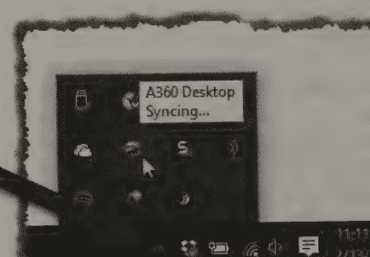

点击“首选项”（Preferences）会显示图 1-7.6 所示的对话框。在这里你可以查看可用空间、启用系统启动时以及链接文件时的自动登录。你也可以强制“退出”（Sign Out）以手动断开与云端的连接。你的文件本地版本仍保存在计算机上，但 Autodesk A360 链接将无法显示它们。

# 使用 Autodesk Revit 2018 进行商业设计

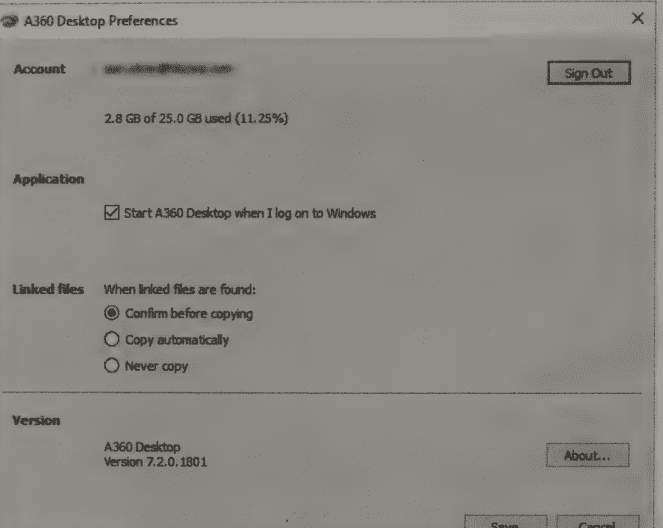

图 1-7.6 计算机的 A360 桌面设置

使用“云端渲染”（Render in Cloud）功能时，你必须在应用程序内登录 Autodesk360。这是云服务验证你的任务请求的方式。你需要是学生、拥有与 Autodesk 订阅关联的账户，或者预付了 Autodesk 点数。

在 A360 选项卡上（图 1-7.7 - 显示为 AutoCAD），你有几个与 A360 云服务相关的工具和设置。其中一个选项是备份你对 AutoCAD 软件所做的任何自定义。只要你登录了 Autodesk A360，这些设置就会跟随你到使用的每台电脑。在学习本书的过程中，你可能不需要执行此操作。你还可以共享文档；这可能是提交课堂作业的选项。较新的功能是“共享设计视图”（Share Design View），它允许不同位置的多个人查看同一幅图纸。

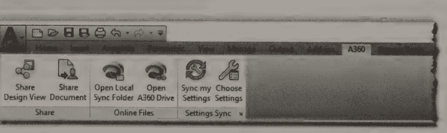

图 1-7.7 AutoCAD 应用程序内的云工具

## 开始使用 Autodesk Revit 2018

首次登录 A360 时，系统会弹出一个对话框，设置与数据同步相关的默认选项（类似于图 1-7.8）。

此选项用于同步你在 AutoCAD 中的自定义设置。如前所述，在获得经验之前，你可能不想这样做；如果你弄乱了某些设置，你不希望这些设置跟随你到另一台电脑。

稍后可以通过**命令行窗口**（Command Window）中输入**选项**（Options）来访问这些设置。在**在线**（Online）选项卡中，你将看到这些选项以及额外信息（图 1-7.9）。注意列出的*云存储*容量。

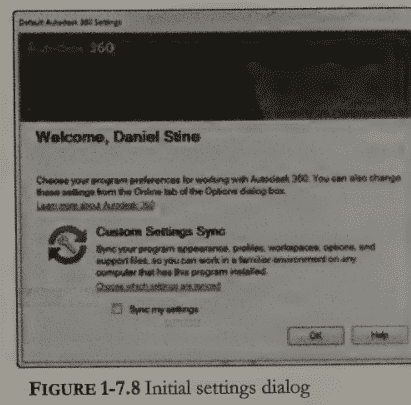

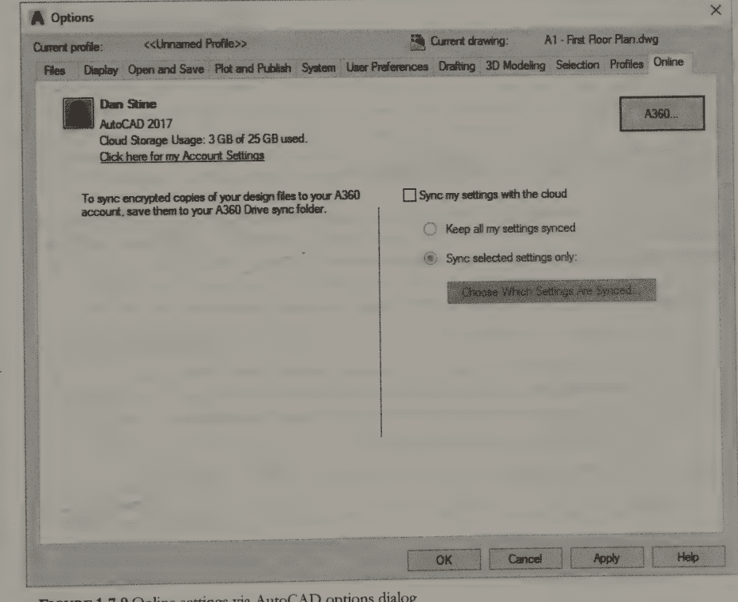

图 1-7.9 通过 AutoCAD 选项对话框进行在线设置

## Autodesk A360 手机

一旦通过 Autodesk A360 将文件存储在云端，你也可以在平板或智能手机上访问它们，你需要有一个名为 A360 – View & Markup CAD files 的免费应用程序，适用于 Apple 和 Android 手机和平板。

一些移动功能包括：

- 打开存储在 Autodesk 360 账户中的视图文件

- 2D 和 3D DWG™ 和 DWF™ 文件

- Revit® 和 Navisworks®

- 使用多点触控缩放、平和平旋转图纸

- 查看图纸中的元数据和其他元素

- 寻找帮助你与协作者通信的工具


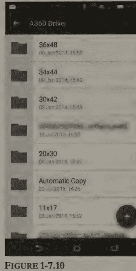

Android 应用通过 Google Play 安装，Apple 应用来自 Apple App Store

图 1-10 在智能手机上查看文件

## 设置你的 Autodesk A360 账户

接下来的步骤将引导你完成在 Autodesk A360 上设置免费在线账户的过程。这些步骤对于完成本书并非至关重要，所以如果你对创建 Autodesk A360 账户有任何顾虑——就不要创建。

1. 创建免费的 Autodesk A360 账户，请执行以下操作之一：

   a. 如果你是学生，请在 `http://students.autodesk.com` 创建账户。

   b. 如果你工作的公司拥有订阅制的 Autodesk 软件，请让你的合同管理员（Contract Administrator，这是你办公室里的某人）为你创建一个账户，并通过 `http://subscription.autodesk.com` 向你发送邀请。

   c. 其他所有人在 `https://a360.autodesk.com` 创建账户。

   供提示：Autodesk 360 URL 中“http”末尾的“s”表示这是一个安全网站。

2. 打开你的应用程序：AutoCAD 或 Revit。

3. 点击应用程序窗口右上角的“登录”（Sign In）选项（图 1-7.11）。

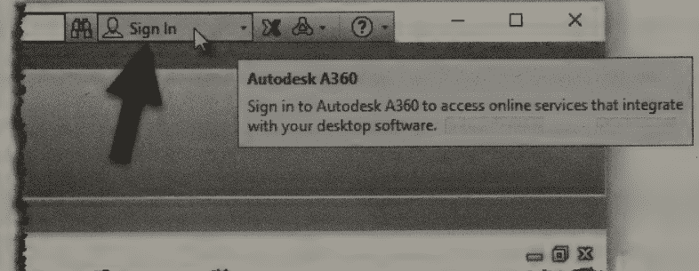

图 1-7.11 登录 Autodesk A360

建议你在学习本书的过程中，通过 Autodesk A360 将所有工作保存在云端，这样你就能为文件提供一个安全、可靠的位置。你可以通过这里讨论的三种方法从多个位置访问这些文件。在闪存盘、便携式硬盘或像 `Dropbox` 的其他云类型位置中保留一份文件的独立副本仍然是重要的。如果你的主文件发生损坏，这将会非常重要。你应该手动将文件备份到备份位置，以免损坏的文件自动损坏到你的备份文件。

**提示：** 如果你有一个无法打开的文件，请尝试以下操作：

- 手动将文件备份到备份位置，以免损坏的文件自动损坏到你的备份文件。

# 使用 Autodesk Revit 2018 进行商业设计

注意功能区（Ribbon）、选项和属性面板已更改，显示与墙相关的设置。接下来你将修改这些设置。

提示：默认情况下，新墙的底部将位于当前楼层高度，墙的顶部通过下一步所示的选项栏设置。

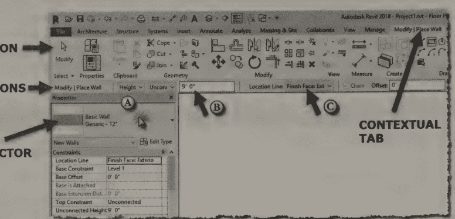

图 2-1.3 功能区、选项栏和类型选择器

- 3. 将功能区、选项栏和类型选择器修改如下所示（图 2-1.3）：

  - a. 类型选择器：点击此区域并选择“Basic Wall: Generic - 12”。
  - b. 高度：将高度从 `14'-0"` 更改为 `9'-0"`。
  - c. 位置面：将此项设置为“Finish Face: Exterior”。
  - d. 点击矩形图标。（这允许你一次性绘制四面墙[即绘制一个矩形，而不是一次画一面墙]。）

现在你准备好绘制外墙了。

- 4. 在绘制窗口中，点击左上角。

提示：确保在四个元素标记内绘制（见右图所示）。

5. 开始向下并向右移动鼠标。当两个临时的屏幕监听尺寸约为 `100'`（东到西）和 `60'`（前后）时点击。


获得精确的尺寸目前并不那么重要，因为它们稍后会进行修改。

你的绘图看起来应该与图 2-1.4 相似；相似之处在于现在的尺寸不需要精确，而且建筑相对于四个标高标记的位置可能会略有不同。

临时尺寸将一直显示，直到用户触发下一个操作。在显示尺寸期间，你可以点击尺寸文本并调整墙的尺寸。此外，默认情况下临时尺寸参考墙的中心——你只需通过点击位于每个中心、外表面和内表面上的控制点即可更改这一点。


图 2-1.4 外墙

在接下来的几步中，你将创建网格并建立墙与网格之间的关系，使得移动网格会导致墙随之移动。

## 网格：

网格用于确定建筑中结构柱和梁的位置。添加网格涉及选择 Grid 工具，然后在绘制窗口中选取两个点。

- 6. 点击`Ribbon`上的 `Modify`（完成对 `Wall` 工具的使用），然后选择 `Architecture` -> `Datum` -> `Grid`。

提示：在 Structure（结构）选项卡中也可以找到相同的 Grid（网格）工具。

# 使用 Autodesk Revit 2018 进行商业设计

接下来你将在建筑左侧绘制一条垂直网格。一旦画完所有网格，你将使用一个特殊工具将网格与墙对齐并锁定该关系。

- 7. [第一次选取] `Click` 并在建筑左下方进行绘制，如图 2-1.5 所示。

提示：'Click' 总是意味着左键点击，除非特别要求右键点击。

- 8. [第二次选取] 向上移动光标（即垂直方向），你会看到一条青色的虚线，这表示你已对齐到垂直平面，角度尺寸显示为 90 度。在建筑北边缘稍远处（如图 2-1.5 所示）点击。


图 2-1.5 绘制网格

你现在画了第一条网格线。接下来你将快速绘制四条网格线，两条水平和两条垂直。

> 注意：Grid 工具将保持激活，直到你选择另一个工具或选择 Modify（选择 Modify 允许你在绘制窗口中选择其他元素）。

在中心位置绘制另一个垂直网格。在**选取第一个点之前**，确保看到青色的参考线指示网格线将与之前的网格对齐，然后选取两个点（图 2-1.6）。

10. 绘制图 2-1.6 所示的剩余网格线。再次担心网格线的精确位置，只需确保末端对齐即可。

## 快速开始：小型办公室


图 2-1.6 添加的网格

接下来你把两条水平网格线改为字母。

- 11. 放大上方网格的气泡。
- 12. 点击 Modify 然后点击网格线进行选取。
- 13. 选取网格后，点击气泡内的深蓝色文本。
- 14. 输入 A 并按回车（图 2-1.7）。
- 15. 再次点击 Modify。
- 16. 将另一条水平网格改为 B。


图 2-1.7 网格编辑

## 对齐

接下来你将使用 Align 工具重新定位网格，使其“对齐”墙面。步骤非常简单：从 Ribbon 上选择 Align 工具，选取参考线（即墙面）；然后选择要移动的项目（即网格线）。此工具适用于许多对象！

# 使用 Autodesk Revit 2018

- 17. 从 Ribbon 上选择 Modify -> Align。

> 提醒：当 Align 工具激活时，在选项栏的 Prefer 旁边选择 Wall faces（墙面），然后选择相邻网格线 1 的墙面。

## 多重对齐：墙面

- 19. [Align：第二次选取] 选取网格线 1。

网格线现在应该与墙的外表面对齐。在使用 Align 工具后，你有“锁定”该关系的选项；接下来你执行此操作。锁定此关系仅在工具激活时可用。之后你需要再次使用 Align 工具。

- 1. 点击解锁的锁图标以“锁定”网格线与墙之间的关系（见图 2-1.8）。
- 2. 使用概述步骤将剩余网格线与其相邻墙对齐并锁定。不要网格线 2 的位置（即中心的垂直网格）。


## 尺寸

接下来你将在网格线上添加尺寸，并用它们驱动墙和网格的位置，同时学会锁定它们。

- 1. 选择 Modify，然后在绘制窗口内任何地方右键点击 Zoom To Fit（缩放适应）。

选择 Annotate -> Dimensions -> Aligned。此时你处于尺寸工具中。注意 Ribbon 和选项栏上的各种控制控件。你可以设置尺寸样式（通过类型选择器）、尺寸类型（线性、半径等）以及优先选择墙的哪个部分（例如：面、中心、核心面）。

对齐尺寸


- 23. 使用上方所示的功能区、选项栏和属性面板（这些应该是默认设置），选取网格线 1。

提示：网格线在你选取之前会预先高亮，这有助于确保你选取正确的项目（例如，网格线而非墙）。小心不要选取墙。

- 24. 现在选取网格线 2，然后选取网格线 3。

你的最后一个选取点是决定尺寸线应该在哪里。

- 25. 点击图 2-1.9 所示的位置来放置尺寸线。

> 提示：不要点击任何物体附近，否则 Revit 将将尺寸字符串延伸到该项目上。


图 2-1.9 添加尺寸

# 使用 Revit 2018 进行商业设计

注意，当尺寸字符串被选取时，你会看到一个带有斜杠的 EQ 符号。此符号表示尺寸字符串的各个部分长度不相等。下一步将向你展示如何轻松让这些尺寸相等！

- 26. 选取尺寸字符串后，点击位于尺寸中间附近的 EQ 符号。

网格线现在等间距分布（图 2-1.10），这种关系将一直保持，直到再次选择 EQ 符号关闭“尺寸相等”功能。

> 注意：当关闭尺寸相等或删除尺寸时，网格线不会回到原始位置；Revit 不记得网格之前在哪里。

通常情况下，你不想点击这里的锁图标，因为那会锁定当前尺寸并导致网格线无法移动。


图 2-1.10 切换尺寸相等

接下来你将从网格线 1 到网格线 3 添加一个“总建筑”尺寸。此尺寸可用于驱动建筑的总尺寸（始终保持网格线 2 等间距）。

- 27. 使用 Aligned 尺寸工具从网格线 1 到网格线 3 添加一个尺寸，然后点击放置尺寸线（图 2-1.11）。


图 2-1.11 添加了总建筑尺寸

## 快速入门：小型办公室

当使用尺寸驱动几何图形的位置时，您需要选择想要移动的物体，然后选择尺寸文本以输入新值。您不能直接选择尺寸，因为 Revit 不知道你想移动左侧、右侧还是两条网格线。在图形界面上，直接选择尺寸唯一能的操作是点击锁头符号来“锁定”该尺寸，然后根据需要点击蓝色尺寸文本添加后缀。接下来，您将调整建筑的整体尺寸。

- 28. 点击修改（Modify）（或按两次 Esc 键）以确保已取消或完成尺寸工具，且没有任何内容选中。
- 29. 选择网格线 3。
- 30. 在选中网格线 3 的情况下，点击尺寸文本并输入 `101`，然后按回车键。

> 注意：如果不提供英尺或英寸符号，Revit 默认使用英尺。

- 31. 重复之前的步骤，在 A 和 B 网格线之间添加一个尺寸，然后调整模型使尺寸显示为 `68'-00"`。


图 2-1.12 确定建筑尺寸

# 使用 Autodesk Revit 2018 进行商业设计

您的项目看起来应该与图 2-1.12 相似。您应该注意到尺寸必须“触碰”两个或多个物体（在本例中为网格线）。此外，由于墙体必须与网格对齐并锁定，移动网格会导致墙体随之移动。

在移动内墙之前，您要做的最后一件事是将通用墙替换为更具体的墙类型。这在设计公司中是常见情况；在设计完善到可以选择外墙系统之前，通用墙是作为“占位符”添加的。

更换墙的过程非常简单：选择墙体并从类型选择器（Type Selector）中选择不同的类型。这将向您展示如何快速选择所有外墙，以便您可以一次性更改它们！

- 32. 点击修改，然后将光标悬停在其中一个外墙上使其高亮。（先不要点击）。
- 33. 在外墙被高亮（即已预选）的情况下，松开鼠标并按 Tab 键，直到四面墙都被预高亮。

> 注意：Tab 键会在光标下方的各种物体之间循环。当前选项应包括一堵墙、一链墙和一条网格线。

- 34. 在四面墙都高亮的情况下，点击选中它们。
- 35. 在选中所有四面墙的情况下，从属性面板（Properties Palette）上的类型选择器中选择“基础墙：外墙 - CMU 砖”（Basic Wall: Exterior - Brick from CMU）。


## 详细程度

Revit 允许您控制墙体中显示的详细程度。

- 36. 在位于视图窗口左下角的视图栏（View Control Bar）上，将详细程度设置为**精细（Fine）**。


正如下面的两张图片所示，*粗略（Coarse）*仅显示墙类型的轮廓，而*精细（Fine）*会显示墙的各个组件（例如：砖、绝缘层、混凝土块等）。


图 2-1.13 详细程度——粗略（左）对比精细（右）

现在您已经确定了外墙、正确放置了网格线并在项目中锁定了它们的关系，您现在可以进行室内空间的布局了。

## 内墙

37-54. 在选中**墙体（Wall）**工具的情况下，将**功能区（Ribbon）、选项栏（Options Bar）**和**属性面板（Properties Palette）**修改为如下内容（另见下页图像）：

- a. **类型选择器**：设置为*基础墙：内墙 – 4 7/8" 隔墙（1小时）* (Basic Wall: Interior – 4 7/8" Partition (1-hr))
- b. **高度**：屋顶 (Roof)
- c. **位置线**：设置为中心线 (Centerline)。
- d. **链（Chain）**：关闭。

*注：提供的 OCR 文本包含大量重复和碎片部分，已根据逻辑流进行了清理和整合。*

56. 将 `40'-0"` 尺寸更改为 `110'-00"`。

57. 选择网格线 A并将 `68'-0"` 尺寸更改为 `38'-0"`。

你的模型现在看起来与图 2-1.21 相似。注意内墙保持了其 `22'-0'` 的净尺寸，因为内墙有一个锁定在外墙上的尺寸，而外墙有一个锁定在网格线 A 的对齐方式。


图 2-1.21 调整尺寸

58. 点击快速访问工具（QAT）上的撤销图标以恢复 `68'` 尺寸。

你的建筑现在现在应该是 `110'-0"` x `68'-0"`。

59. 保存你的项目 (`Small Office.rvt`)。

提示：你可以使用测量工具列出两点之间的距离。当你想快速验证墙之间的净尺寸时这非常有帮助。只需点击图标并吸附到两点，Revit 就会临时显示距离。你还可以点击选项栏上的“链”，让 Revit 累加多次拾取的总长度。

# 使用 Revit 2018 进行商业设计

## 练习 2-2：门

在本次练习中，你将为你的小型办公室建筑添加门。

- 1. 打开在练习 2-1 中创建的 `Small Office.rvt`。

## 放置门

- 2. 在功能带上选择 建筑 -> 建造 -> 门 工具（图 2-2.1）。

注意功能带、选项栏和属性面板已经发生变化，显示了与门相关的选项。接下来你将修改这些设置。

类型选择器指示门的样式、手高。点击右侧的向下箭头将列出所有预加载到当前项目中的门。


你开始使用的默认模板提供了几种尺寸的单扇平开门。注意，在图 2-2.2 中，列表中有两个标准高度。`80"` (`6'-8"`) 的门是标准住宅高度，`84"` (`7'-0"`) 的门是标准商业门高度。


- 3. 将元素类型选择器更改为 `Single-Flush: 36" x 84"`，并点击功能带上“放置”中的“标记”。
- 4. 将光标移动到墙上，并按照图 2-2.3 所示的位置放置门。（先不要点击。）

注意门的开启向会根据你的光标倾向于墙的哪一侧而改变。

同样注意 Revit 显示了监听式尺寸，以帮助你将门放置在正确的位置。

- 5. 点击放置门。Revit 会自动修剪墙体并添加门标记。

提示：如果需要，在点击之前按下空格键可以翻转门的开启向。

- 6. 在门仍被选中时，点击更改开启向（控制箭头）符号，使门向墙体开启（如果它目前不是这样的话，图 2-2.4）。


接下来你将相对于相邻墙重新定位门。

- 7. 点击“修改”以完成门工具。
- 8. 点击你刚刚放置的门（而不是门标记）来选中它。
- 9. 点击见证线握手，使临时尺寸引用正确的门框和墙面，如图 2-2.5 所示。

提示：如果默认位置不是你关心的，你也可以点击并拖动见证线握手到另一墙或线上。

- 10. 点击尺寸文字，输入 `4"` 并按回车。确保你添加了英寸符号，否则你得到的是英尺而不是英寸（图 2-2.5）。


遗憾的是，商业模板中加载的门族没有门框。输入的 4" 尺寸为 2" 的门框和 2" 的墙提供了空间。安装在你硬盘上的库以及 Revit 的“网络库”通过门提供了一些带框的门。使用族编辑器可以创建任何门和门框的组合。族编辑器是 Autodesk Revit 内部的一个特殊模式，允许创建自定义参数化内容，包括带有侧窗、横窗等等的门！

## 镜像门

现在将使用镜像命令快速在相邻墙对面面创建另一扇门。

- 11. 选中门后，点击上下文选项卡上的“镜像 -> 选取镜像轴”。
- 12. 在选项栏上，点击“复制”。如果没有选择复制，则门将被移动而不是复制。
- 13. 在选中门且镜像命令激活时，将光标悬停在相邻墙上，直到虚线出现（图 2-2.6）。


图 2-2.6 镜像门

如你在图 2-2.7 所示，门已经镜像。


## 练习 2-3：窗户

在这个练习中，你将为你的小型办公室建筑添加窗户。

- 打开在练习 2-2 中创建的 `Small Office.rvt`。

### 放置窗户

- 选择 `建筑 -> 建造 -> 窗户`。

注意功能区（Ribbon）、选项栏和属性面板（Properties Palette）已发生变化，显示与窗户相关的选项。接下来你将修改这些设置。

类型选择器（Type Selector）指示窗户的样式、宽度和高度。点击右侧的箭头列出当前项目中加载的所有窗户。

- 在激活窗户工具时，执行以下操作（图 2-3-1）：
  - 将类型选择器更改为 `Fixed: 36" x 48"`。
  - 确认功能区的“放置时标记”（Tag on Placement）已关闭状态。
  - 留意属性面板中的窗台高度（Sill Height）值。


图 2-3-1 功能区和选项栏：窗户工具已激活

- 将光标移动到墙上，并如图 2-3-2 所示放置两个窗户。注意窗户的位置会根据光标倾向于墙的哪侧而改变。

供参考：窗台高度由属性面板控制，你将在本书的后续部分学习。目前使用了默认尺寸。

### 5. 按照以下要求调整临时尺寸：

- a. 按照图 2-3.2 的尺寸。
- b. 使用引证线抓手（witness line grip）调整引证线位置。

- 6. 使用复制命令，采用类似于上一个练习中复制门的方法，将两个窗户复制到每个办公室中，如图 2-3.3 所示。（不需要担心精确的尺寸。）
- 7. 保存你的项目（`Small Office.rvt`）。


窗户不会随网格线和内墙一起调整；可以通过添加尺寸来使其生效。如果你尝试再次将总尺寸从 110' 更改为 40'，Revit 会提示你在更改之前需要删除一些窗户。像门一样，窗户也需要宿主。

所有窗户都可以通过临时尺寸调整。选中的窗户是项目中可选的最大宽度（基于启动项目时使用的模板文件），但它不是砌体尺寸。然而，可以随时动态添加额外的窗户尺寸。此外，你还可以创建自己的模板文件，其中包含你通常在类型设计工作中所需的门、窗户、墙等。

除了预加载的窗户外，通过加载在硬盘上的族库和 Autodesk Web 库，还有几种窗户样式（例如：双悬窗、平开窗等）。你还可以在族编辑器（Family Editor）中创建几乎形式的窗户设计。

### 捕捉符号：

到此时，你应该已经意识到 Revit 在绘图窗口移动光标时建议的捕捉点（snaps）。

当显示捕捉符号时停顿光标片刻，屏幕上会出现工具提示。然而，当你熟悉了捕捉符号后，就可以更早地选择（图 2-4）。

`TAB` 键可以循环切换光标附近可用的捕捉点。

键盘快捷键可以关闭一次选取的其他捕捉。例如，如果在墙体命令期间在键盘上输入 `SE`，Revit 将仅为下次选取查找端点。

最后，输入 `SO`（关闭捕捉）将关闭一次选取的所有捕捉点。

| 符号 | 位置 | 键盘快捷键 |
|---|---|---|
| X | 相交 | `SI` |
| ☐ | 端点 | `SE` |
| △ | 中点 | `SM` |
| ○ | 中心 | `SC` |
| X | 最近点 | `SN` |
| L | 垂直 | `SP` |
| Q | 切线 | `ST` |

图 2-3.4 捕捉参考表

## 练习 2-4：屋顶

你现在将为你的建筑添加一个简单的屋顶。

- 1. 打开在练习 2-3 中创建的 `Small Office.rvt`。

你将要的第一件事是快速查看建筑的 3D 视图，并注意到外墙需要进行调整。

- 2. 点击快速访问工具栏（QAT）上的默认 3D 视图图标。

3D 图标切换当前项目的默认 3D 视图。你的视图应该类似于图 2-4.1。注意外墙高度不够。


- 3. 在 3D 视图中，将光标悬停在其中一个外墙上进行预高亮，然后（在点击之前）按 `Tab` 键预高亮“墙墙链”（即所有外墙），然后点击选择它们。

接下来你将访问所选墙体的属性，以便调整墙高。在 Revit 中，所做出的几乎任何设计决定都可以随时调整。

- 4. 在所选墙体的属性中：
  - a. 约束（Constraint）：`Roof`
  - b. 顶部偏移（Top Offset）：
  - c. 点击应用（图 2-4.2）。


图 2-4.2 所选墙体

所选墙体的顶部将与当前层对齐（例如 `Level 1`）。


图 2-4.2 外墙

### 绘制屋顶

现在外墙高度正确，你现在将添加屋顶。

- 1. 在项目浏览器中双击 `Level 1` 返回。
- 2. 点击 `建筑 -> 建造 -> 按平面绘制屋顶`（图 2-4.3）。

功能区、选项栏和属性面板已被绘制选项取代。

- 3. 选择所有外墙：
  - a. 将光标悬停其中一个外墙上进行预高亮。
  - b. 按 `Tab` 选择“墙链”（即所有外墙）。
  - c. 点击选择外墙。


图 2-4.3 屋顶工具


图 2-4.4 绘制工具

- 4. 在选项栏中，弹出提示选择你想创建屋顶的方法。
  - a. 确保未勾选斜坡（Slope）（图 2-4.4）。

### 快速开始：小型办公室

此时你应该拥有四条线，每面墙一条，代表你正在创建的屋顶边缘。在绘制屋顶时，你需要确保线条不重叠，并在需要用修剪（Trim）命令清理角。你的绘制线条不需要根据添加方式（即选取墙体并 Tab 选择）额外编辑。


在完成屋顶绘制之前，你需要调整将创建的屋顶的层。默认情况下，屋顶元素的顶部表面将与当前层对齐（例如 `Level 1`）。你将其更改为屋顶层。

- 10. 在属性面板中，将基础层设置为 `Roof`（图 2-4.5）。
图 2-4.5 屋顶实例属性
- 11. 点击功能区上的绿色勾钩。
- 12. 在几何连接提示中点击“是”（图 2-4.6）。


几何连接选项将使线条在剖面中看起来正确。如果你点击“否”，墙和地板线条将相互重叠并看起来很乱。

图 2-4.6 几何连接提示

# 使用 Autodesk Revit 2018 进行商业设计

屋顶现在已创建，在剖面上，它将穿过面层延伸到混凝土块，因为在添加线条时选择了“延伸至核心”（extend to core）。此外，由于你使用了功能带上的“拾取墙”（Pick Walls）选项（这是默认选项），屋顶边缘将随外墙移动。

- 13. 要查看屋顶，点击默认 3D 视图（Default 3D View）图标。
- 14. 要调整 3D 视图，按住 `Shift` 键的同时按下鼠标轮并移动鼠标。


- 15. 点击绘图窗口右上角的 X 关闭当前视图 (3D)。这将关闭 3D 视图，但不会关闭项目或层1 层视图。

> 记住：点击应用程序标题栏右上角的 X 将关闭 Revit，但如果需要，它会先提示你保存。

- 16. 保存你的项目。


## 练习 2-5：标注、房间标签与表

在 Revit 中添加文本非常简单。在练习中，你将在平面图下方添加标题。你还将放置房间标签。

### 放置文本

- 1. 打开练习 2-4 中创建的 `Small Office.rvt`。
- 2. 确保你的当前视图是层1（`Level 1`）。在项目浏览器的平面图（Plans）标题下，“Level 1”字样将加粗显示。如果层1 不是当前视图，只需双击项目浏览器中的 `Level 1` 即可。
- 3. 选择 `注释 -> 文本 -> 功能带上的文本`。

再次注意功能带已更改，显示了与活动工具相关的选项（图 2-5.1）。


图 2-5.1 带有文本工具的功能带

类型选择器（Type Selector）指示文本样式（它决定了字体样式、高度等）；用户可以创建额外的文本样式。从功能带上的此上下文选项卡，还可以设置对齐方式（即：左对齐、居中或右对齐）。

- 4. 将功能带设置得与上方显示相同，并点击平面图下方放置文本（图 2-5.2）。
- 5. 输入 `OFFICE BUILDING – Option A`，然后点击平面视图中的某处以完成文本（不要按回车键）。

类型选择器中的文本高度是指文本在打印纸张上的尺寸。例如，如果你打印了平面图，当文本在类型选择器中被设置为 1/4 时，你应该能够将尺子置在文本上，并读出 1/4。

在 CAD 程序中，文本大小可能是一个复杂的过程；而 Revit 使其变得非常简单。你需要做的是更改层1 的视图比例，Revit 会自动调整文本和注释以匹配该比例——这样它们在纸上打印时高度始终为 1/4。


**图 2-5.2** 放置文本

你现在不会更改比例，但可以通过*视图控制栏*（View Control Bar）（图 2-5.3）进行。如果你想尝试更改，只需确保在完成后将其设置回 `$1/4'' = 1'-0''` 即可。

你现在应该注意到，你的文本甚至门窗符号的大小都变成了原来的一半（当你从 `$1/4''` 更改到 `$1/2`）。你应该你应该，这种比例调整只会影响当前视图（即层1）。如果你切换到层2（如果你有的话），你会发现它仍然被设置为 `$1/4'' = 1'-0''`。这很好，因为你有时需要更大比例的平面来显示更多细节。

| 平面图层 | 编辑类型 |
| :--- | :--- |
| 图形 | ... |
| 新比例 | `1/8'' = 1'-0''` |
| 比例值 | W |
| 绘图角度 | `0° = 1'-0''` |
| 细节级别 |  |
| 可见性/图形 | `1/2'' = 1'-0''` |
| 叠加 | 项目正北 |
| 取向 | `1/2'' = 1'-0''` |
| 视图比例 | `3/4'' = 1'-0''` |
| 颜色索引 | 按图层 |
| 隐藏线条 | `3/8'' = 1'-0''` |
| 颜色索引，背景 | `1'' = 1'-0''` |
| 细节分析 | `1/2'' = 1'-0''` |
| 插入 | `1/2'' = 1'-0''` |
| 属性 | `1/2'' = 1'-0''` |
| 场地平面 | `1/2'' = 1'-0''` |
| 裁剪区域 | `1/2'' = 1'-0''` |
| 裁剪切除 | `1/2'' = 1'-0''` |
| 层 | `1/2'' = 1'-0''` |
| 视图 (建筑立面) | `1/2'' = 1'-0''` |
| 北 |  |
| 南 |  |

> 点击此处查看当前视图的比例列表。

**图 2-5.3** 设置比例

### 放置房间标签

房间标签必须在放置房间（Room）之前。房间元素用于定义空间并持有有关空间的信息（例如：地面、面积等）。请参考 AUGI 杂志上关于此主题的的文章（www.augi.com）。就像门标签一样，房间标签仅列出了标记元素的信息。房间功能搜索由墙封闭的区域；当你创建它时，有效区域会被预亮。默认情况下，Revit 会在光标位置放置房间标签。

- 1. 选择 `建筑 -> 房间与区域`。
- 2. 将类型选择器设置为房间标签：带面积房间标签（Room Tag With Area），并确保功能带上已选中。
- 3. 按图 2-5.4 所示的顺序点击每个房间；观察虚线以对齐标签。


图 2-5.4 放置房间和房间标签

当房间工具激活时，模型中已放置的房间呈浅蓝色，你可以看到哪些空间已经放置了房间。大“X”也是房间的一部分。当房间工具未激活时，可以将光标悬停在“X”大致位置直到它高亮，然后点击选择房间。选中房间对象后，可以通过属性面板（Properties Palette）对其修改或删除。

- 9. 点击修改（Modify）结束当前工具。

房间变为不可，“X”消失。注意选中的房间标签显示了存储在房间对象中的信息：名称、编号和面积。

> 提示：面积随墙自动更新。接下来你将更改房间名称。

- 10. 点击房间1的标签将其选中。

当房间标签被选中时，“深蓝色”文本是可以编辑的，而“浅蓝色”文本则不是。不可编辑的文本示例是图框上实际的“图纸编号”（Sheet Number）文本。

- 11. 点击房间名称文本，输入 `OFFICE` 并按键盘上的回车键。
- 12. 将房间 2-4 也命名为 `OFFICE`。
- 13. 将大房间名称改为 `LOBBY`。
- 14. 现在将两个房间（5 和 6）保持为“Room”。

### 表

你开始项目使用的模板已经设置了房间表和门表。因此从你放置第一个门和房间开始，这些表就开始自动填充了！你将快速查看此处完成本部分。

- 13. 在项目浏览器中，点击“表/数量”（Schedules/Quantities）旁边的 "+" 号展开该部分（如果需要），然后双击“房间表”（Room Schedule）打开该视图。

房间表是 Revit 模型的表格视图。这些信息是“实时的”并且可以更改（图 2-5.5）。

## 快速开始：小型办公室

| 房间编号 | 房间名称 | 地面层 | 脚线面层 | 墙面层 | 天花板面层 | 天花板高度 | 备注 |
| :--- | :--- | :--- | :--- | :--- | :--- | :--- | :--- |
| 1 | OFFICE | | | | | | |
| 2 | OFFICE | | | | | | |
| 3 | OFFICE | | | | | | |
| 4 | OFFICE | | | | | | |
| 5 | Room | | | | | | |
| 6 | Room | | | | | | |
| 7 | LOBBY | | | | | | |

图 2-5.5 房间表

接下来你将更改那两个为“room”的名称，并发现平面图自动更新了！

- 16. 点击编号5的房间名称列，将文本改为 `MEN'S TOILET RM`。
- 17. 点击房间6的房间名称列，将文本改为 `WOMEN'S TOILET RM`。
- 18. 点击绘图窗口右上角的“X”关闭房间表视图。

| 房间编号 | 房间名称 |
| :--- | :--- |
| 1 | OFFICE |
| 2 | OFFICE |
| 3 | OFFICE |
| 4 | OFFICE |
| 5 | MEN'S TOILET R |
| 6 | WOMEN'S TOILE |
| 7 | LOBBY |

- 19. 切换到层1（如果需要）并放大房间 5 和 6（图 2-5-6）。

注意房间名称已经更新，因为这两个视图（平面图和表）列出了项目数据库中同一个“参数值”。


## 练习 2-6：

打印

为了完善对 Revit 的基础知识，你最后需要了解的是如何打印当前视图。

打印当前视图：

- 1. 在 `Level 1` 视图中，在任何地方点击右键并选择“缩放工作”(Zoom to Fit)。
- 2. 选择“文件”(File)选项卡 -> “打印”(Print)。
- 3. 调整设置以与图 2-6.1 所示一致。
- 从你有访问的列表中选择一个打印机。
- 将打印范围(Print Range)设置为“当前窗口可见部分”(Visible portion of current window)。


图 2-6.1 打印对话框

- 4. 点击“设置”(Setup)按钮调整额外的打印设置。
- 5. 调整设置以与图 2-6.2 所示一致。
- 设置缩放(Zoom to)为：“适应页面”(Fit to page)

## 快速入门：小型办公室


图 2-6.2 打印设置对话框


- 6. 点击“确定”(OK)关闭打印设置对话框并返回打印界面。

- 7. 点击左下角的“预览”(Preview)按钮。这将通过验证图纸将正确放置在页面上来节省纸和时间（图 2-6.3）。

- 8. 点击预览窗口顶部的“打印”(Print)按钮。

- 9. 点击“确定”(OK)打印到选定的打印机。


图 2-6.3 打印预览

2-39

## 打印机还是绘仪？

`Revit` 可以打印到计算机上安装的任何打印机或绘仪。

`Printer`是一种使用较小纸张的输出设备（例如 8½"x11" 或 11"x17"）。`Plotter`是一种使用较大纸张的输出设备；绘仪通常有一卷或多卷尺寸从 18 英寸宽到 36 英寸宽的纸。卷纸绘仪带有内置切割器，例如可以从 36 英寸宽的卷纸上切出 24"x36" 的纸张。


带有三个纸卷的绘仪

彩色打印机 / 复印机

## 自测题：

以下问题可以作为检查你对本课知识的方法。答案可以在页面底部。

- 1. 测量工具(`Measure tool`)用于为图纸标注。（对/错）
- 2. 当你放置门时，`Revit` 会自动修剪墙线。（对/错）
- 3. 捕捉(`Snap`)将帮助你画得更快、更准确。（对/错）
- 4. 6'-8" 的门是 _______________ 建筑中的标准门高。
- 5. 使用墙体工具时，可以在 _______________ 栏上快速调整高度。

## 复习题：

以下问题可能由你的老师分配，用于评估你对本节内容的掌握情况。你的老师拥有复习题的答案。

- 1. 视图的视图比例是通过点击视图控制栏上列出的比例设置的。（对/错）
- 2. 标注仅需点击鼠标两次即可放置。（对/错）
- 3. 图中文字的相对大小是由视图比例控制的。（对/错）
- 4. 你可以通过双击项目浏览器(`Project Browser`)中该视图的标签来快速切换到另一个视图。（对/错）
- 5. 你无法选择墙窗的哪一侧偏移。（对/错）
- 6. 可以使用 _______________ 键循环来列出两面墙之间的距离，而无需绘制标注。
- 7. 在门工具中，你可以可以通过属性面板(`Properties Palette`)中的 _______________ 门的样式和尺寸。

自测答案：

1 - F, 2 - T, 3 - T, 4 - Residential（住宅建筑）, 5 - Options（选项）

2-41

## 商业用途使用 Autodesk Revit 2018

## 第 3

平面图（一层）：

在本节中，你将绘制一栋办公楼的一层平面图。该办公楼将在后续章节中进一步开发。建议在此节上花费足够的时间，因为后面的课程将在此基础上进行构建。

## 练习 3-1：

项目概述

项目计划书在项目的设计前阶段创建。建筑师与建筑（或用户小组）合作，在开始设计之前收集尽可能多关于项目的信息。

收集的信息包括：

- 房间：需要哪些房间？
- 尺寸：房间需要多大？（例如，会议中心的厕所比牙科诊所的大得多。）
- 邻接关系：这个房间需要挨着那个房间。（例如，公共厕所需要可以从公共大厅进入。）

有了项目计划书后，建筑师就可以开始设计过程。虽然可能（并且将会）对项目计划书进行修改，但它被作为满足客户需求的目标。

在这个项目中，你并没有真正意义上的项目计划书。然而，相同的信息将提供。

## 项目概述

在这个项目中，你将创建一个位于乡村环境中的三层办公楼。项目计划书将在后续章节中提供。如右侧图像所示。


3-1

## 商业设计使用 Autodesk Revit 2018

该建筑不满足特定的建筑规范。尽管如此，我们将从使用通用样式开始。一旦我们决定了它们是什么，就会将其更改为自定义样式。

之前的章节是从更完整的模板开始的。本章从模板开始，以便学习。


图 3-1.1 一层平面图


图 3-1.2 南立

## 练习 3-2：

外墙

你将通过绘制外墙开始第一层平面图。像许多项目一样，早期你可能不确定外墙是什么。因此，我们将从使用通用样式开始。一旦我们决定了它们，就会更改。

## 调整墙体设置

- 使用**建筑模板**(`Architectural Template`)启动新项目。*警告：*确保选择了正确的模板，这是本书的剩余部分。

本章从默认模板开始，以便你有学习创建。

- 从工具带中选择**墙**工具，并对墙体选项进行以下更改（图 3-2.1）：
  - 墙样式：基本墙 - Generic -12”
  - 高度：未连接
  - 高度：3’ 0”
  - 位置线：外表面
  - 链：勾选


## 绘制外墙

- 绘制图 3-2.2 所示的墙。确保你的尺寸正确。使用**测量**工具验证你的尺寸。不要添加标注。

> 注意：如果你顺时针方向绘制，你的墙的外侧将正确放置。你也可以使用空格键切换哪侧是外侧。

## 创建自定义墙样式

`Revit` 提供了多种预定义的墙样式，从金属龙骨石膏板到混凝土块和砖空墙。然而，你有时需要 `Revit` 尚未预定义的墙样式。你接下来将学习此功能。

首先，你将快速查看 `Revit` 提供的更复杂的墙类型，以便了解它们是如何设置的。

- 选中墙工具，从类型选择器下拉列表中选择墙类型基本墙：外墙 – 砖在 CMU（见右侧图像）。
- 点击属性面板上的“编辑类型”按钮（图 3-2.3）。
- 你处于类型属性对话框中。点击结构参数旁边的“编辑”按钮（图 3-2.4）。


3-4

# 平面图（首层）


图 3-2.3 属性面板

图 3-2.4 类型属性

最后，你进入了“编辑组件”（Edit Assembly）框。在这里，你可以修改现有的类型或创建新类型。<<点击预览以显示所选墙类型的预览（类型 3-2.5）。


图 3-2.5 编辑组件

在这里，“编辑组件”对话框允许你更改现有墙的组成或创建一个新墙。

在“编辑组件”对话框中需要注意的点（图 3-2.5）：

- 顶部标记为外侧，底部为内侧。
- 你将看到水平行（即核心边界 Core Boundary），用于识别核心材料。核心材料可用于放置墙和对墙进行标注。例如，墙工具将允许你以内侧或外侧核心面作为参考线绘制墙。在内墙上，你通常会标注到 CMU（混凝土砌块）的面上，而不是石膏板的完成面。这样做是为了方便计算，并为承包商提供你将建造墙体所需的信息。
- 每一行都是一层。通过点击某层并选择“向上”或“向下”按钮，你可以在墙组件内重新定位材料或图层。
- 8. 点击每个打开的对话框中的“取消”以关闭它们。
- 9. 在“类型选择器”中将墙体样式设回“基本墙：通用型 – 12英寸”。
- 10. 再次在属性面板上点击“编辑类型”按钮。
- 11. 点击“复制”（Duplicate）。
- 12. 为新墙类型输入“砖块与 CMU 空心墙”（Brick & CMU cavity wall），然后点击“确定”（图 3-2.6）。


图 3-2.6 新墙类型名称

- 13. 点击“结构”参数旁边的“编辑”按钮。

# 平面图（首层）

使用“插入”按钮和“向上”、“向下”按钮，如图 3-2.7 所示将图层添加到你的新墙体样式中。

| 功能 | 材料 | 厚度 |
|---|---|---|
| 面层 1 [4] | 砖块，普通 | 4'' |
| 隔/空气层 [3] | 空气 | 2'' |
| 隔/空气层 [3] | 刚性绝缘体 | 2'' |
| 膜层 | 防潮 | 0'' |
| 核心边界 | 上方层包裹 | 0'' |
| 结构 [1] | 混凝土砌块 | 8'' |
| 核心边界 | 下方层包裹 | 0'' |
| 基底 [2] | 金属 – 龙条 | 2 1/2'' |
| 面层 2 [5] | 石膏墙板 | 5/8'' |

图 3-2.7 新图层

砌体通常在平面图和较小的细节图中正常方式绘制。这有助于绘图和标注的计算。例如，8'' 的混凝土子块实际上是 7-7/8''。

此外，注意 CMU、刚性绝缘体、空气层和砖块的厚度总和为 16''。墙的这部分将直接位于下方的 16''（CMU）基础墙上。

- 14. 你的对话框应该看起来像图 3-2.8。点击“确定”关闭所有对话框。


图 3-2.8 为新墙类型的编辑组件

3-7

# 使用 Autodesk Revit 2018 进行商业设计

下一步是更改之前绘制的墙的墙类型。

- 1. 选择功能带上的“修改”按钮；这允许你选择图纸中的元素。
- 2. 缩小以看到整个平面图。从一个角拖动鼠标到另一个角，在平面图上画一个窗口以选择所有墙。
- 3. 选中墙后，从“类型选择器”下拉列表中选取“基本墙：砖块与 CMU 空心墙”。

> 提示：如果在选择墙体后，“类型选择器”未激活且没有显示任何墙类型，你可能还选择了其他元素，如文字或标注。尝试找到这些元素并删除它们（剖面标记除外）。你也可以点击“过滤”按钮（选中对象时位于功能带上），并取消勾选要排除在当前选择之外的元素类型。

你应该会注意到墙的厚度发生了变化，但墙的空心线和填充尚未显示。这由每个视图的“详细程度”选项控制。


- 18. 点击绘图窗口左下角控制栏上的“详细程度”图标。
- 19. 选择“中等”（Medium）。

你现在应该看到带有填充的砖块和 CMU 厚度。如果你在绘制墙时没有注意，某些墙可能会显示砖块在内侧。

- 20. 选择“修改”（或按 Esc 键）；选择一面墙。你会看到一个符号，允许通过点击该符号翻转墙（图 3-2.9）。


图 3-2.9 选中墙；注意某些墙的砖块在内侧

# 平面图（首层）

- 21. 无论是否需要墙，点击翻转符号尝试其操作。

> 提示：翻转符号始终位于墙的外侧（或 Revit 认为的外侧）。

- 22. 如果需要调整墙使砖块位于外侧，请现在进行。你可能需要选择墙（体）并使用“移动”工具重新定位墙以匹配要求。

> 提示：如果你通过“属性面板”将“位置线”设置为“中心线”，在翻转时将弄乱整体尺寸。完成后，将“位置线”设回“外面”。

- 23. 将项目保存为 ex3-2.rvt。


> 提示：选中墙时，可以使用功能带上的“移动”工具来准确移动墙。

- 遵循以下步骤移动：
- 选择墙
- 点击“移动”工具
- 选择墙上的任意一点
- 在所需方向上启动光标（不要点击）
- 输入要移动墙的距离并按回车。

最后，将中庭的三面墙改为幕墙（全玻璃）。这将让光进入天井并更好地识别入口。

- 24. 拖动选择窗口（从左到右）选择天井周围的三面墙，或按键盘上的 Ctrl 键选择它们。
- 25. 选中墙后，从“类型选择器”向下选择“幕墙：幕墙1”。

你的天井被幕墙围绕（图 3-2.10）。在随后的课程中，我们将为幕墙添加水平和垂直梁。

你可以通过 3D 视图很好地看到进度。注意 Revit 显示幕墙为透明。由于应用了砖块图案，其他墙在外侧有阴影。


- 26. 将项目保存为 ex3-2.rvt。

`Revit`会自动设置填充和线宽。


图 3-2.10 完成练习


图 3-2.11 完成练习

## 练习 3-3：内墙

在本节中将为首层绘制内墙。

## 调整墙设置

- 1. 从功能带上选择“建筑 ->  -> 墙”。
- 2. 在功能带、选项栏和“类型选择器”上对墙选项进行以下更改（图 3-2.1）：
    * 墙样式：基本墙：内侧 – 4/8隔断 (1小时)
    * 高度：2 层
    * 位置线：墙中心线

## 绘制内墙

- 3. 按照图 3-3.1 所示绘制一面“垂直”墙。你将在第 4 步调整其精确位置。


图 3-3.1 第一面内墙

- 4. 选择“修改 -> 对齐”工具，将其与天井的外墙边缘对齐（图 3-3.1）。完成后，墙看起来应该像图 3-3.2。

重复上述步骤，在中庭西侧创建相同的墙。

## 修改现有墙类型

接下来你将添加一些额外的内墙。你将绘制 8'' 的 CMU 墙。`Revit` 在你启动项目的默认模板文件中确实有一个 8" 的砌体墙类型。然而，该墙类型的厚度为 7-7/8''，这是块的实际尺寸。平面图通常按标义尺寸（即 8''）而非实际尺寸（7-7/8''）绘制。这样做是为了方便计算，使切割最少。因此，与其创建一个新墙类型，你可以直接修改现有墙类型。

注意：有些人可能不同意这种方法。然而，仍在此项目中进行这些更改，以便你更多了解墙的工作原理，并确保书中所有任务都能按预期或设计运行。

- 6. 选择墙类型基本墙：通用型 - 8"砌体。
- 7. 选择属性面板上的“编辑”按钮查看墙的类型参数，然后点击“结构”参数的编辑。
- 8. 在“编辑组件”对话框中将砌体厚度从 7/8'' 改为 8''，然后对每个对话框选择“确定”（不要关闭属性面板）。

有时在创建模式下，不会列出相对于你想绘制新墙的尺寸。处理此问题的方法之一是绘制临时详细线作为参考。在使用临时线作为参考后，你可以将其删除。

- 9. 从功能带上选择“注释 -> 详细线 -> 详细线”，显示的“垂直”线并不重要，但通过类型选择器选择一条连续线。
- 10. 绘制图 3-3.3 所示的“垂直”线；确保捕捉到天井墙的中点作为你的第一个点。


接下来你将绘制电梯井，位于中庭中心并后退 35'-0'（因此线条）。

电梯的内部尺寸为 7'-4" x 6'-10"。由于你知道内部尺寸，你将需要调整位置线以匹配信息。

- 11. 使用墙工具绘制基本墙：通用型 - 8"砌体。
12. 将位置线（Location Line）设置为完成面：内（Finish Face: Interior）。
13. 绘制电梯井。

确保位置位于位于，这样你的电井尺寸就是正确的。在绘制窗口（Drawing Window）中的任何位置绘制电井，稍后你将调整精确位置。

提示：内部尺寸列在上方。

14. 选择代表电梯井的 4 墙，然后选择移动工具（Move tool）。


提示：混凝土块有各种宽度，大多数为 16 英寸长、8 英寸高。当有简单的规则可以遵循时，请确保你设计的墙体符合错缝（coursing）。这适用于 CMU（混凝土砌块）墙内的墙长度和开口。

平面图中 CMU 错缝的尺寸规则：

- e'-0" 或 e'-8"，其中 e 是任何偶数（例如 6'-0" 或 24'-8"）
- o'-4", 其中 o 是任何奇数（例如 5'-4"）

15. 捕捉到电井的中点作为第一个点，然后捕捉到你临时详细线的中间端点（图 3-3.4）。你应该放大以验证你的捕捉情况。不要绘制尺寸线；这些尺寸仅供参考。

图 3-3.3

临时详细线

# 使用 Autodesk Revit 2018 进行商业化设计

电梯井并未完全位于中厅中心，且距离南侧幕墙后 35'-0"。

- 16. 此时你可以删除临时线。选择该线，然后右键点击并选择删除，或按键盘上的 Delete 键。


图 3-3.4 将电梯井移至到位

提示：选中墙体时，你可以通过属性面板（Properties Palette）查看该墙的属性（如果不可见，输入 'PP' 打开面板）。点击电梯井墙之一，并验证其高度为 36'-0"。

## 修改现有墙体

接下来我们想要更改建筑与东、西楼梯井之间的墙体部分。要做到这一点，你需要拆分当前墙、修剪角部，然后绘制一面 8 英寸的砌石墙。

- 17. 放大西楼梯井并选择拆分元素工具（Split Element，位于 Ribbon 上的 Modify 选项卡）。
- 18. 点击墙中间的某处（图 3-3.5）。
- 19. 选择 Modify → Modify → 修剪（Trim）来修剪角部，使外墙仅出现在外部边界处（图 3-3.6）。

提示：选择你想要保留的墙体部分。

## 平面图（一层）


图 3-3.5 拆分工具

图 3-3.6 修剪工具

## 额外的自定义墙体类型


我们决定楼梯井主要是功能性的，墙上不需要石膏板。在接下来的步骤中，你将创建一个与之前创建的类似的外部墙类型，只是没有石膏板和金属龙骨。此外，你还将创建一个自定义墙类型来关闭我们在之前步骤中创建的开口。面墙的一侧将有石膏板和金属龙骨。

- 20. 使用墙类型 `Basic Wall: Brick & CMU cavity wall` 为起点，创建一个名为 `Brick & CMU cavity wall (no GWB)` 的新墙类型。移除石膏板和金属龙骨并保存新墙类型。（记得点击 `Duplicate`）。

- 21. 将西楼梯井周围的三面外墙更改为上一步创建的新墙类型。

3-15

22. 使用墙类型 `Basic Wall; Brick & CMU cavity wall` 为起点，创建一个名为 `8" Masonry with GWB 1S` 的新墙类型。移除砖、空隙、刚性绝缘层并保存新墙类型（图 3-3.7）。

提示：为你的自定义墙类型制定一套标准的命名系统将很有用。如果名称太长，将很难阅读。示例中有：

* `GWB` = 石膏板（并意味着带有龙骨）
* `1S` = 仅在墙的一侧进行面层处理。

| 功能 | 材质 | 厚度 |
|---|---|---|
| 核心边界 | 上层包裹 | 0" |
| 结构 [1] | 混凝土砌块 | 8" |
| 核心边界 | 下层包裹 | 0" |
| 基层 [2] | 金属 – 挂条 | 2½" |
| 面层 2 [5] | 石膏板 | 5½" |

图 3-3.7 新层

23. 绘制一面墙，使石膏面层在办公室侧继续，必要时使用对齐工具（`Align`）（图 3-3.8）。

使用测量工具（`Measure tool`）确保楼梯井尺寸正确；不要绘制尺寸线。

接下来你将使用镜像（`Mirror`）更新东侧楼梯，但首先你将绘制一个参考平面（`Reference Plane`）作为轴。

24. 从 `Ribbon` 绘制参考平面。

25. 绘制一个参考平面，捕捉到南墙。

26. 选择东墙（图 3-3.9）。

27. 选择电梯井（图 3-3.9）。


提示：混凝土块有各种宽度，大多数为 16 英寸长、8 英寸高。当有简单的规则可以遵循时，请确保你设计的墙体符合错缝。这适用于 CMU 墙内的墙长度和开口。

28. 使用镜像工具更新电梯井。

提示：选中墙体时，你可以通过属性面板查看该墙的属性（如果不可见，输入 `'PP'` 打开面板）。点击电梯井墙之一，并验证其高度为 `36'-0"`。

29. 使用测量工具确保楼梯井尺寸正确；不要绘制尺寸线。

30. 使用墙工具将墙类型设置为 `Basic Wall: Interior`。

31. 使用测量工具验证准确性。


图 3-3.4 将电梯井移至到位


图 3-3.4 将电梯井移至

## 练习 3-4：电梯

本课程将向你展示如何将电梯插入井中。

### 插入电梯

`Revit` 提供了许多*族*，这些是可以插入项目的预定义元素。然而，许多元素并非直接可用，例如电梯。你将从网上获取电梯族。在线库是你获取用于项目的电梯族的地方。

- 打开项目 `ex3-3.rvt` 并**另存为** `ex3-4.rvt`。

- 点击 `Ribbon` 上的 **插入**选项卡。

- 选择 **载入族** → **从库加载** → 从 `Ribbon` 上的 **加载族**。

- 从下载的“Required Families”文件夹加载 **Elevator-Electric.rfa**；有关下载教材提供的电子内容的信息，请见内封。

- 在项目浏览器中，点击 **族** 旁边的加号以展开列表（图 3-4-1）。

- 展开 **特殊设备** 列表，然后是 **电梯-Electric**。

你必须从网上下载电梯。当然，你需要连接互联网。

如你所见，四个电梯已加载到你的项目中。类似于墙体类型，你可以直接添加任何这些类型，也可以修改或创建一个新类型。接下来，你将在**类型属性**对话框中添加信息，以便记录指定的电梯。

- 右键点击电梯类型 **2000 lbs**，然后从弹出菜单中选择**类型属性**。

现在你会看到所选电梯类型的属性列表。

- 点击 **预览** 按钮（如有必要）查看


> 图 3-4-1 电梯族：项目浏览器

# 使用 Autodesk Revit 2018 进行商业设计

对电梯类型进行图形审查。将视图设置为 3D 视图：`View 1`。

9. 添加以下信息（图 3-4-2）：

- 模型：`MadeUp 8864`
- 制造商：梯斯电梯 (`ThyssenKrupp Elevator`)
- URL：`www.thysenelevator.com`

这些数据进入了 BIM（建筑信息模型）中的 I。


图 3-4-2 电梯属性

10. 点击确定关闭对话框。

### 平面图（一层）

11. 从项目浏览器（`Project Browser`）将 `2000 lbs` 电梯类型拖入第一层平面图。

提示：你也可以使用架构（Architecture）选项卡中的组件（Component）工具来放置电梯。

电梯类型将附在你的光标上，准备好插入。

12. 在电梯井内移动光标并调整，直到电梯“吸附”到位置，然后点击（图 3.4.10）。

13. 按两次 `Esc` 键退出 `Revit`，表示你已完成电梯的放置。

现在，你需要在每楼的井道墙上添加电梯门；这类似于墙上的普通门。

14. 与之前介绍的步骤类似，从提供的在线内容加载“Elevator Door – Center” 族。

15. 从项目浏览器将 `36” x 84”` 电梯门类型拖入第一层平面图（图 3-4.3）。

16. 将电梯门放置在墙中心，并与轿厢上的电梯门对齐（图 3-4.4）。

> 提示：如果门插入在墙的错误侧，选择门并双击控制箭头（Control Arrows）以在墙内进行翻转。

- 特殊设备
- 电梯门-中心 (`Elevator Door-Center`)
- `32” x 84”`
- `42” x 84"`
- `48” x 84"`
- `900 x 2100mm`
- 电动电梯 (`Elevator-Electric`)
- `2000 lbs`
- `2500 lbs`
- `3000 lbs`
- `3500 lbs`
- 楼梯
- 结构柱

图 3-4.3 项目浏览器中的电梯门


图 3-4.4 添加到平面上的电梯门

注意，当选择电梯时，会显示翻转图标（控制箭头）。类似于门和墙，你可以点击此图标来翻转井道内电梯的方向。

17. 将你的项目保存为 `ex3-4.rvt`。

### 平面图（一层）

#### 练习 3-5：门和窗

本课将更详细地查看门和窗的插入。

### 插入门

`Revit` 在提供多种不同的门族（families）方面做得非常出色。考虑到门是建筑项目的重要部分，这是很合理的。提供的族包括折叠门、双开门、推拉门、节门（车库门）和垂直卷帘门等。除了本地硬盘上的族外，在其他互联网网站上还有更多可用（有些是免费的，有些不是）。

你开始时使用的默认模板仅包含“门”（Doors）类别下的 S（单平门 Single Flush）组。如果你想插入其他样式，需要从库中加载它们。此步骤的原因是，当你加载一个族时，`Revit` 实际上会将数据复制到你的项目文件中。如果将所有可能的族都加载到项目中，不仅在大量的门列表中很难找到你想要的，而且在绘制墙之前，文件大小就会变得很大。

你将通过向项目加载几个族来开始此节内容。

1. 打开项目 `ex3-4.rvt` 并另存为 `ex3-5.rvt`。

2. 从“插入”（`Insert`）选项卡选择功能带上的“加载族”（`Load Family`）按钮。

3. 浏览 US Imperial 文件夹。


每个文件代表一个族，接下来你将向项目加载四个族。


图 3-5-2 硬盘上的门

4. 打开“门”（Doors）文件夹，然后选择“玻璃墙双层”（Curtain Wall Double Glass），点击打开（图 3-5.2）。

5. 重复步骤 2-4 加载以下（在线）族：

- 双玻 1 (`Double-Glass 1`)
- 侧窗 (`Sidelights`)
- 单玻 1 (`Single-Glass 1`)


6. 在项目浏览器中，展开“族”（Families）和“门”（Doors）以查看加载的族（图 3-5.3）。

如果在项目浏览器中展开一个门，将看到与该族相关的门尺寸。右键点击门尺寸可以重命名、删除或复制。为了添加门尺寸，复制它们并修改新项目的属性。

接下来，你将把门插入电梯井。

从“架构”（Architecture）选项卡选择“门”（Door）工具，然后从属性面板（Properties Palette）上的类型选择器选择“单平门：36" x 84""

在西侧电梯井插入两扇门，如图 3-5.4 所示。记住你正在向砌墙插入门，因此你的门的位置和尺寸需要与砌缝配合（因此，门尺寸还需要包含门框）。

重复之前的步骤将门插入东侧电梯井。

完成一层的门的插入（图 3-5.5）。使用以下指南：

- a. 所有门的宽度都应为 36"，高度为 7'-0"。
- b. 你现在不会将门插入玻璃墙。你将在后续课程中设计玻璃墙时这样做。
- c. 使用图 3-5.5 所示的样式和近似位置。
- d. 厅相对的门应该对齐。
- 提示：在插入第二组门时，观察/等待参考线出现，这表示对齐。
- e. 如图所示放置门，给出精确位置。


图 3-5.5 带有门的底层


图 3-5.6 门类型属性

### 插入窗

向项目中添加窗与添加门非常相似。与门一样，你开始使用的模板文件在项目中预加载了一个族，即“固定窗”（FIXED）族。查看类型选择器下拉列表，你会看到各种可插入的尺寸。此时，你应该还能看到你在上一个练习中加载的“侧窗”（SIDELIGHT）族。首先，你将使用侧窗族添加一些室内窗。

#### 室内窗（侧窗）

1. 选中“窗”（Window）工具，从类型选择器选择“侧窗 1：18" x 84""。

2. 在厅的西侧，如图 3-5.7 所示插入侧窗；不要添加尺寸。

确保侧窗框与墙的厅侧平齐。你可以在点击插入之前将光标移动到想要放置门框的墙侧来控制该选项。绘制窗后，你可以选择框并使用翻转图标（类似于门和墙）。

13. 重复之前的步骤，在厅的东侧插入侧窗。


### 外窗

14. 使用书中之前介绍的方法，在“固定窗”（FIXED）族中创建一个新的窗尺寸。创建“固定窗：32" x 48""。创建此新尺寸是为了适应平面图中的砌缝。平面图中适应砌缝的最大（预加载）窗是 24"。

15. 调整新窗尺寸的窗台高度以适应砌缝。将“固定窗：32" x 48""的窗台高度设置为 3'-4"（图 3-5.8）。


图 3-5.8 修改了窗台的新窗尺寸

## Array列 Array

阵列工具允许你快速复制几个间距相同的对象。你将使用阵列工具来复制窗：

- 17. 点击修改（Modify）工具，然后选择你的窗。
- 18. 选中窗户后，从修改（Modify）选项卡中选择阵列（Array）工具。
- 19. 在选项栏（Options Bar）中，在数量（Number）字段处输入 6。
- 20. 在窗的中点点击左鼠标键，向东方向移动鼠标，直到显示的尺寸为 8'-6"。
- 21. 你现在应该能看到墙上的窗阵列了。8'-6" 不是排布间距，因此请选择选项栏上的激活尺寸（Activate Dimensions）按钮，然后在显示的尺寸中输入 8'-8" 以调整窗洞开口。这允许你更准确地调整尺寸。


# 使用 Autodesk Revit 2018 进行商业设计

22. 在第一层剩余的三面墙上设置窗户（图 3-5.12）。考虑以下几点：

- 这是使用镜像（Mirror）工具的极佳方法。
- 如果你需要为镜像反射轴创建一个临时墙，请确保将临时墙设置为**中心线**（centerline）。
- 你可以使用参考平面（Reference Plane）在东西方向上镜像窗户。
- 使用测量（Measure）工具验证准确性。
- 使用 `Ctrl` 键选择多个窗户。


图 3-5.12 完成的窗户布局

| 清理房屋：如前所述，你可以查看加载到项目中的各种族和类型。加载的族和类型越多，项目文件就越大，无论你是否在项目中使用它们。因此，清除任何你知道在当前项目中不需要的门、窗等是一个好主意。 |
| :--- |
| 窗户 (Windows) |
| 固定 (Fixed) |
| 16" x 24" |
| 16" x 48" |
| 16" x 72" |
| 24" x 24" |
| 24" x 48" |
| 24" x 72" |
| 32" x 48" |
| 36" x 24" |
| 36" x 48" |
| 36" x 72" |
| 侧窗 1 (Sidelights 1) |

23. 在项目浏览器（Project Browser）中，导航到族（Families） -> 窗户（Windows） -> 固定（Fixed）。右键点击 36" x 48" 并选择删除（Delete）。

图 3-5.13 项目浏览器

### 自测：

以下问题可以用来检查你对本课知识的掌握情况。答案可以在页面底部。

- 1. 选项栏允许你在首次绘制时设置墙的高度。（对/错）
- 2. 不可以以核心的内面或外面作为参考点绘制墙。（对/错）
- 3. 元素无法使用移动（Move）工具精确地移动。（对/错）
- 4. 必须在功能带（Ribbon）中选择工具，才能选择元素作为你的项目。
- 5. 墙必须选中才能看到它的翻转（flip）图标。

### 复习题：

你的老师可能会布置以下问题，以评估你对本节内容的掌握情况。你的老师拥有复习题的答案。

- 1. Revit 带有预定义的门和窗户。（对/错）
- 2. 长度 3'-8" 是一个砌体尺寸。（对/错）
- 3. 你可以在项目浏览器中删除未使用的族和类型。（对/错）
- 4. 不可能从互联网加载族和类型。（对/错）
- 5. 在插入窗户时，无法选择窗户位于墙的哪侧。（对/错）
- 6. 什么工具会将一面墙拆分成两个较小的部分？
- 7. 该工具允许你匹配两个相邻墙的表面。
- 8. 你有时使用拆分（Split Element）命令将一面墙变成两面墙。（对/错）
- 9. 你可以使用该工具在其中多次复制一个元素。
- 10. 模板文件中预加载了少量门、窗户和墙。（对/错）

自测答案：

1-T, 2-F, 3-F, 4-Modify（修改）, 5-Selected（选中）

## Note：

# 第 4 课

平面图（第 2 和第 3 层）：

在本节中，你将设置上方两楼。这主要涉及从第一层复制元素并在过程中进行一些修改。你还将调整层间高度并在楼梯井中插入楼梯。

### 练习 4-1：从第一层复制公共墙

#### 设置第二层（和第三层）

你首先需要对第二层（和第三层）进行一些调整。你开始项目时的默认模板已经有一个二层视图。第三层尚未设置，所以你将执行此操作：

- 打开 `ex-5.rvt` 并另存为 `ex-1.rvt`。
- 在项目浏览器中，双击平面图（Floor Plans）下的 Level 2（第2层）视图（图 4-1）。

当前视图在项目浏览器中始终以粗体显示。

你现在应该能看到二层平面图。注意在此视图显示的深色墙线存在于这一层。浅灰色线是下方楼的墙（图 4-2）。

你将关闭下层视图，并将详细程度（Detail Level）设置为以便在墙体中显示更多细节。

- 确保没有选中任何内容且属性面板（Properties Palette）已打开（输入 `PP` 打开它）；当未选中任何内容时，属性面板显示当前视图的属性。


图 4-1.2 二层视图

- 4. 确保未选中任何内容且属性面板已打开（输入 `PP` 打开它）；当未选中任何内容时，属性面板显示当前视图的属性。


在属性中进行以下调整：

a. 详细程度：中（Medium）

b. 范围层（Base Level）

c. 范围（Underlay）：无（None）


- 5. 点击应用（Apply）。你现在应该看到二层平面图，如下所示（图 4-3）。


图 4-1.3 修改后的二层视图

## 平面图（第 2 和第 3 层）

由于你要从第一层复制的墙需要延伸到上方，你需要在复制之前设置第三层。

添加另一层非常简单。切换到立面视图并绘制层（Level datum）。

- 6. 双击项目浏览器列表中立面（Elevations）下的四个立面视图之一。如果你在立面中看到你的绘图，尝试另一个视图。

- 7. 在绘图区域，选择修改（Modify），然后选择建筑（Architecture）-> 标（Level）。

- 8. 当你移动光标靠近 Level 2 时，将看到显示一个尺寸（图 4-4）。

   a. 勾选“制作平面视图”（Make Plan View）

   b. 向右点击两个点以绘制层。

   c. 在点击两个点之前，确保对齐。


图 4-1.4 局部（Partial）南立面

# 使用 Autodesk Revit 2018 进行商业设计

注意 Level 3 平面视图已自动添加到项目浏览器中（见右图）。


提示：默认模板在平面图中显示了四个立面标记。这些标记代表四个预设视图（在立面下）将看到的内容。因此，你应该在四个符号的大致中心开始绘制平面图。符号可以通过鼠标拖动。这将在第 7 节中详细介绍。


现在你将从第一层复制墙和门。

- 9. 切换到 Level 1 视图（见步骤 2）。

- 10. 选择所有内墙（电梯井除外）、门和内窗。

>提示：你需要按住 Ctrl 键来选择多次拾取的多个元素。你可以拖动窗户来选择多个对象。

- 11. 选中对象后，在功能带的上下文选项卡中从修改 | 墙 剪贴板复制到剪贴板，或使用键盘上的 Ctrl + C。

- 12. 点击功能带上的修改（Modify）并切换回 Level 2 视图。

- 13. 选择修改 -> 剪贴板 -> 粘贴（向下箭头）-> 与当前视图对齐（Aligned to Current View）。

供参考信息：对齐粘贴将使新元素与下方的原始元素对齐，但位于当前层。


## 平面图（二、三层）

注意墙体、门和内窗现在已复制到 2 层（图 4-1.5）。我们仍然需要复制外窗和电梯门。

此外，注意新门具有不同的编号（注意：只有在复制/粘贴时选中了它们，第 2 层才会有标签），而内窗的编号相同。这是为什么呢？这与建筑文档的行业标准有关。每个尺寸和配置相同的内窗在整个项目中都具有相同的类型编号（这是一个**类型参数** Type Parameter）。每扇门都有唯一的编号，因为门有很多变量，如锁、合页链、闭门器、应急推杆、材料和防火额等（这是一个**实例参数** Instance Parameter）。为了方便找到门，许多建筑公司会通过选择门所通向的房间号来生成门号。你可以通过选择门标签并点击文本来更改门号。门表将自动更新。

- 14. 使用上一步步骤中的相同技术，将外窗和电梯门复制到 2 层。

提示：在复制窗口之前，你需要取消窗口的分组（窗口是通过数组分组的）。选择其中一个窗口，并在功能带上点击取消分组（ungroup）按钮。

为什么不把这些内墙画得和外墙以及电梯井一样高 36'-0" ？


模拟真实世界的施工有几个原因。主要是，当井是一个连续的墙体时，你可以确保井在楼层之间是对齐的。虽然厕所和中庭的内墙是对齐的，但它们并不一定如此，因为它们被楼构造隔开了；这允许以后轻松修改某一层。

图 4-1.5（部分）2 层 – 添加的墙体

# 使用 Autodesk Revit 2018 进行商业设计

最后，你把若干元素复制到 3 层。但在将它们粘贴到 3 层之前，你需要更改墙体（在 2 层）的高度设置，因为上方（目前）还没有可以延伸墙体的对象（例如，屋顶或地板）。

- 15. 在 2 层视图中，选择所有内墙、门和窗（电梯井除外）。

你需要将选择范围缩小到仅墙体。

- 16. 点击功能带上的筛选（Filter）按钮。

- 17. 取消勾选除“墙”之外的所有列表项目（图 4-1.6）。

列表取决于选择集中包含哪些元素（图 4-1.6）。

- 18. 点击确定。


图 4-1.6 筛选对话框

现在只选择了墙体。

- 19. 在属性面板中，将“顶部约束”（Top Constraint）改为“未连接”（Unconnected），然后点击应用。

> 注意：如果你在不更改顶部约束的情况下粘贴墙体，它仍会被设置为 3 层，且顶部偏移为 10'-0"。

- 20. 再次选择元素，现在将选中元素复制到剪贴板。

- 21. 切换到 3 层，并按照上述第 4 步列出的要求修改视图属性（例如，下视 Underlay 和详细程度 Detail Level）。

- 22. 将 2 层元素（对齐当前视图）粘贴到 3 层，包括外窗和电梯门。

- 23. 再次选择所有 2 层墙体，并将顶部约束设回 3 层。

- 24. 保存你的项目。

## 练习 4-2：额外的内墙

这个短练习将帮助巩固你学学的命令。你将在项目中添加墙体和开口。

### 添加墙体

- 1. 如图 4.2.1 所示，在 1 层添加内墙和门。使用你之前使用的轻骨墙。使用对齐（Align）工具对齐未标注尺寸的墙体以及之前绘制的相邻墙。

> 注意：门没有标记为单扇平开门。此外，尺寸是到内墙的中心线以及外墙的完成面。


- 2. 与步骤 1 类似，在 3 层添加图 4-2.2 所示的墙体和门。


- 3. 使用镜像（Mirror）命令将图 4-2.2 中的墙镜像到 3 层的另外三个角。

**提示：** 绘制一个“水平”参考平面。

- 4. 最后，修改建筑南侧的每侧的小办公室（图 4-2.3 和图 4-2.4）。

> 提示：如果你使用修剪（Trim）工具（参考图 4-2.3 中的提示），你需要选择“删除实例”（Delete Instance）来删除被删除墙体部分的门。

供参考：你对 3 层的修改包括在顶层添加了几间拥有“良好”视野的行政办公室。你删除了南侧的小办公室以为接待台留出空间。

- 5. 保存你的项目。

## 平面图（二、三层）


图 4-1.5（部分）2 层 – 添加的墙体


图 4-1.5（部分）2 层 – 添加的墙体

## 练习 4-3：设置层高高

- 1. 打开楼高设置。

- 2. 打开项目浏览器。

- 3. 选择楼层。

- 4. 更改高度。

- 5. 保存你的项目。

## 自测：

以下问题可以作为检查你对本课知识的方法。答案可以在底部找到。

- 1. 平面图默认设置从下方显示墙体。（对/错）

- 2. 在立面图中无法添加新的楼层。（对/错）

- 3. 你应该在立面图中开始绘制平面图。（对/错）

- 4. 你可以使用对齐工具对齐墙体与其他墙体。（对/错）

- 5. 在哪里更改高度？

## 复习题：

以下问题可能是老师分配的，用于评估你对本节的掌握。老师有答案。

- 1. 复制粘贴对象到另一个楼层并让它们对齐是不可能的。

- 2. 如果井道墙要从底层一直一直到屋顶，且不在每个楼层中断，则墙体应按该高度绘制。（对/错）

- 3. 每个 Revit 视图都保存为单独的文件。（对/错）

- 4. 你可以使用修剪工具选择要删除的墙部分。（对/错）

- 5. 你可以通过更改立面中的高程（例如从 24'-0" 改为 22'-0"）来更改层高。（对/错）

- 6. 如果你不想要下方楼层的墙体，视图属性中的哪个参数应设置为“无”？

- 7. 在立面图中使用该工具创建新的平面楼层。

- 8. 你可以使用该工具从一组选中的元素中快速选择某种类型的元素。

- 9. 绘制楼梯时显示的剩余数量。

# 使用 Autodesk Revit 2018 进行商业设计

# 第 5 节

## 垂直交通

本章将介绍 Revit 中的楼梯（Stair）、扶手（Railing）和坡道（Ramp）工具。考虑到世界上楼梯和扶手的种类极其丰富，这是最具挑战性的功能之一。这些工具具有一些局限性，无法适应所有情况。在这些情况下，可能需要使用内置族（In-Place families）来建模高度定制的楼梯和/或扶手。

前几个“练习”将对 Revit 中的楼梯和扶手工具进行基础介绍。这些章节中对于律事务所项目没有强制性步骤。但是，强烈建议在完成本章后续所需的步骤之前复习这些信息。

### 练习 5-1：楼梯和扶手简介

在进入细节之前，本节的第一部分将提供 Revit 中楼梯和扶手的广泛概述。


这张图片是一个在 Revit 中建模的楼梯和扶手的写实渲染图。此示例来自作者的《使用 Autodesk Revit 进行室内设计》教材。注意扶手出现在三个楼梯“间”（runs）的两侧，并沿[第二]楼的边缘。

### 基础楼梯和扶手术语

首先，让我们定义一些 Revit 中与楼梯和扶手相关的术语。这些术语通常对应现实世界的建筑/施工术语。然而，主要目标是在 Revit 的语境下定义这些术语。


图 5-1.1a 基础扶手    图 5-1.1b 基础楼梯

- Revit 楼梯元素

  - 楼间（Run）：主楼层之间和/或楼平台之间的连续楼梯部分，由踢面（Risers）和踏板（Treads）组成。

  - 踏板（Tread）：你踩在上面的平坦水平部分。

  - 踢面（Riser）：填充踏板间隙的垂直部分。并非所有楼梯都有踢面。

  - 楼鼻（Nosing）：踢面和踏板交汇的外边缘。

  - 楼平台（Landing）：建筑主楼层之间的中间水平面（即地板）。建筑规范要求，如果楼梯“间”上升的高度超过一定距离，则需要设置楼平台——以便人们能有一个安全的休息的地方。

  - 支持件（Supports，也称为缘板 Stringer）：支撑踏板和踢面的结构元件。对于商业项目，这通常是钢管或 C 型钢。楼梯通常每侧各有一个缘板。对于较宽的楼梯，可能需要一个或多个缘板。它们要么跨越楼层（例如从 1 层到 2 层），要么可以锚定在相邻墙壁上。

## 垂直交通

- 剖切标记（Cut Marks）：在 2D 平图中，楼梯与视图剖面相交的地方——会添加一条斜线来在图形上切断楼梯。这允许看到楼梯下方的空间。

- 楼梯路径（注释）

  - 向下/向上箭头：在 2D 平图中，箭头通过图形指示楼梯的上升或下降。箭头通常与文本配合使用（见下一个定义）。

  - 向下/向上文本：与箭头配合使用的文本，用于明确楼梯的方向，如果不查看其他视图（例如剖面），很难确定这一点，而打印的图集可能不包含这些视图（例如，一个小型的改新项目）。

  - 提示：箭头和文本会自动添加到新楼梯中，但可以删除。如果需要将它们添加到模型中，在注释（Annotation）选项卡上存在楼梯路径工具。

- 踏板数量（注释）：此工具位于注释选项卡上，沿楼梯“间”放置一系列数字，指示踢面或踏板的总数。

- Revit 元素

  - 栏柱（Balusters）：从地板向上延伸到“顶轨（top rail）”的垂直元件。对于商业项目，建筑规范规定 4 英寸球体不能穿过扶手系统。提示：如果使用玻璃面板，则不需要栏柱。

  - 扶手（Handrails）：连续的圆弧元件，通过“支持件”安装在墙壁或栏柱上，沿地板边缘、坡道或楼梯“间”设置，供人们手扶以防跌倒。

  - 护栏（Guardrail）：较高的扶手系统，可能包含扶手，以防止从楼梯或地板边缘跌落。提示：在美国，当需要护栏时，其高度至少为 42 英寸。

  - 支持件（Supports）：用于将扶手连接到墙壁或栏柱的支架。

  - 顶轨（Top Rails）：扶手系统顶部的连续栏——由栏柱支撑。

### 楼梯的平面图表示

在 Revit 平图中，楼梯及其附的扶手并不是显示为被楼梯剖面切断的真实 3D 元素。相反，它们是混合的 2.5D 表示，遵循传统的建筑平面图图形标准。这种示例可以在图 5-1.2a 中看到。注意楼梯和扶手的所有部分都延伸到剖切标记。对比图 5-1.2b，它是同一座楼梯的真实 3D 视图；扶手几乎不可见，且没有剖切标记。两个示例的剖面高度均如图 5-1.2c 所示，为 3’-0”。

# 使用 Autodesk Revit 2018 进行商业设计


图 5-1.2a 平图 – 2.5D 表示


图 5-1.2b 平图 – 真实 3D 视图


图 5-1.2c 平图 – 显示剖面高度

楼梯和扶手工具将在后的“练习”中详细介绍。但首先，是对这些工具的高级介绍。

### 楼梯工具

Revit 有单一楼梯工具；**组件创建楼梯（Stair by Component）**。注意*绘制创建楼梯（Stair by Sketch）*已被移除。


### 扶手工具

Revit 有两个主要的工具可以用于建模扶手：

- 绘制路径（Sketch Path）

- 附于主机（Place on Host）

**绘制路径工具**允许向当前楼层添加连续的扶手部分。**选取主机（Pick Host）**命令为楼梯或坡道添加扶手提供了一种快捷方法，如果在创建楼梯时需要删除它们非常有用。

除了这两个扶手工具外，在创建楼梯和坡道时也可以创建扶手。在楼梯或坡道命令期间，选择功能带上的**扶手**按钮可以指定扶手类型及其放置方式（图 5-1.3）。Revit 会在两侧添加扶手。创建后，可以删除一个或两个扶手。选取主机工具的一个困难点是，它只有在没有扶手时才有效。

**倾斜扶手提示：**如果通过修改子元素使地板倾斜，扶手将不会随地板倾斜。相反，请在绘制模式下对地板使用倾斜箭头。

### 基础楼梯类型

Revit 有三种根本不同的楼梯类型，用于正确建模施工中常见的各种楼梯。

楼梯类型：

- 组装楼梯（Assembled Stair）

- 现浇楼梯（Monolithic Stair，也称为现场浇筑）

- 预制楼梯（Precast Stair）

组装楼梯

Revit 的组装楼梯代表了施工中最常见的楼梯类型：混凝土盆和钢制踢面（图 5-1.4）。木制的住宅楼梯也可以通过此选项实现。对于这种类型，Revit 为踏板、踢面和支持件提供了单独的设置。

现浇楼梯（也称为现场浇筑）

当楼梯使用现浇混凝土（CIP）建造时，应使用单体楼梯类型（图 5-1.5）。这种楼梯通常用于建筑外部（场地设计）或主体结构也是现浇混凝土的建筑内部。这种楼梯的属性与组装楼梯类型有所不同——例如，可以指定最小厚以及底部是倾斜还是阶梯状。结构设计师可以在此类元素中添加钢筋。

## 垂直交通


图 5-1.5 整体楼梯示例

## 预制楼梯

当楼梯的各个部分在场外用混凝土制造并运送到施工现场时，可以使用预制楼梯类型来妥善表示这种特殊情况（图 5-1.6）。请注意用于连接和支撑各个部分的特殊槽口。这种楼梯类型也可以添加钢筋。提示：这种楼梯类型只能通过“按组件楼梯”（Stair by Component）命令创建。


图 5-1.6 预制楼梯类型示例

# 使用 Autodesk Revit 2018 进行商业设计

由于不同楼梯类型之间的参数各异，通过类型选择器（Type Selector）将一种类型的楼梯（例如：组合式 Assembled）切换到另一种（例如：整体式 Monolithic）通常不是一项简单任务。最大的问题是，组合式楼梯可以选择踢面（riser）或踏板（tread）结束，而整体式和预制楼梯只能以踏板结束。切换类型时，需要修改楼梯或从头重新创建。

要查看“以踢面结束”（End with Riser）与“以踏板结束”（End with Tread）选项的区别，请对比图 5-1.2c（设置为以踢面结束）和图 5-1.4（设置为以踏板结束）。在这个示例中，“端”是指顶部，且每个选项在施工中都很常见。如果楼梯直接停止在楼边缘，则使用“以踢面结束”选项。当楼梯距离主地板有一段距离，并添加了类似于平台的东西填充间隙时，则使用“以踏板结束”选项。


这张图片是本节开头所示楼梯和扶手设计的另一个视图。2 层楼边缘的扶手与寄宿楼梯的扶手是独立的元素。

## 图形控制


# 使用 Autodesk Revit 2018 进行商业设计

在 Revit 中有多种管理楼梯和扶手可见性的方法。大多数情况下，这些选项适用于所有楼梯和扶手，无论使用何种工具创建它们。

## 对象样式（项目范围设置）

Revit 项目中最高级别的图形控制是`管理 → 对象样式`（`Manage → Object Styles`）（图 5-1.7）。在这里，可以指定楼梯各个部分的线条粗细和颜色（扶手也亦然）。对于楼梯和扶手，只有在没有视图特定覆盖或过滤器的情况下，这些设置才会生效。提示：将列出的术语与之前的图像进行比较。

## 可见性/图形覆盖（视图特定设置）

也可以通过`可见性/图形覆盖`（`Visibility/Graphics Overrides`）对话框（图 5-1.8）按视图控制楼梯/扶手的图形；在视图中，输入 `VV`。例如，可能拆除图或规范图应该显示较少的细节……这可以在这些视图中实现。


图 5-1.17 对象样式对话框 – 楼梯的项目全范围图形控制


图 5-1.18 可见性/图形覆盖对话框 – 楼梯的视图特定图形控制

## 计算踏板/踢面尺寸

尽管 Revit 会自动为你计算高度和踏板尺寸，但理解发生的情况仍然是一个好主意。

踢面通常被计算为建筑规范允许的最大值。偶尔，大楼梯会有较小的踢面，以营造出更优雅的楼梯。

同样，踏板通常被设计为建筑规范允许的最小值。作者曾设计过一个滑雪木屋，为了让穿滑雪鞋的人感到舒适，踏板深度比规范要求的更深。

最大且最短的踏板会产生最陡峭的楼梯。这占用的地板空间较少；见下一张图片。太陡的楼梯既不舒适也不安全。

建筑规范因地而异；对于本次练习，你将使用踢面最大 7 英寸，踏板最小 12 英寸（11 英寸踏板加上 1 英寸防滑）。

规范通常要求单段楼梯中的每个踏板尺寸相同；同样如此


计算踢面的数量和尺寸：

- 已知：

  踢面：最大 7 英寸。

  层间高：13'-4"。

计算踢面数量：

13'-4 除以 7"（或 160"）再除以 7" = 22.857

所以你需要 23 个踢面，每个高度为 6 15/16 英寸。


### 多层

当选择“按组件楼梯”工具时，Revit 进入创建楼梯模式。首先设置底层和顶层，这决定了踏板和踢面。接下来，开始绘制楼梯，第一个点是底部。默认绘制模式是“运行”（`Run.`）。这种模式允许你点击两个点并让 Revit 自动创建踢面和边界线。你点击的点之间的距离决定了创建多少踏板和踢面。点击两个远的点将创建一个从层到层的单段楼梯。

以下三张图片显示了如何绘制单段楼梯。


在点击第一个点后，移动光标，直到屏幕上的文字（在第一个点附近）显示“剩余 0”（0 REMAINING），点击第二个点。如果需要对齐，在点击第二个点之前你会看到水平或垂直对齐线。


在此时可以对踢面和边界线进行操作；例如：移动边界线使楼梯变宽，或旋转它以顺应斜墙，或者你甚至可以旋转单个踢面，也许是为了做舞台？


点击“完成编辑模式”（`Finish Edit Mode`，即绿色打勾符号）将创建楼梯。注意，默认会在两侧添加扶手，并相对于视图的切割平面（通过视图范围）添加切割符号。

查看图 5-2.2，你可以看到楼梯在3D 摄像视图中的外观。注意每侧带有扶手的护栏。这两栏护栏是由“楼梯”（`Stair`）托管的。这类似于门由墙托管的方式。如果删除了楼梯，你可以删除其中一个或两个护栏，而楼梯本身不受影响。

接下来，你将查看 Revit 如何在需要时自动创建平台。

## 平台

创建中间平台非常简单。你的前两个点选择必须少于所需的踢步数。然后，如图 5-2.3 和 5-2.4 所示，选取第 3 和第 4 个点。第一个示例显示了一个 L 型楼梯，第二个是带有对齐平台的直梯。请参阅下一页的图 5-2.5 查看这些完成楼梯的3D 视图。


图 5-2.2 楼梯的 3D 视图


已创建 22 个踢步，剩余 0

图 5-2.3 绘制带有平台的楼梯 – L 型楼梯


已创建 22 个踢步，剩余 0

图 5-2.4 绘制带有平台的楼梯 – 直梯

## 变体

接下来，你将查看如何自定义草图线条以适应特殊情况。

首先，在草图模式（`Sketch mode`）下，边界线（`Boundary Line (s）`）可以如图 5-2.6 所示进行旋转。

下一张图 5-2.7 显示了如何修改边界线以遵循多个角度。在编辑模式（`Edit mode`）下，在功能区（`Ribbon`）上选择边界（`Boundary`）选项。你现在可以绘制新线条并修改现有线条。

边界线必须是连续的，且总数只有两个（侧边，而不是线条）。因此，可以建模的内容存在一些限制。


图 5-2.6 旋转边界线使楼梯的一侧呈倾角


图 5-2.7 编辑边界线使楼梯的一侧遵循不规则墙体

在草图模式下，也可以修改踢步（`Risers`）。首先，你选择踢步（`Riser`）选项（图 5-2.8），然后绘制额外的线条，这些线条代表踏板的边缘。可以在图 5-2-9a 和 b 中看到此示例。绿色边界线被修剪了；这导致楼梯（stringer）在最后一个踢步之前停止。要绘制曲线踢步线，只需在踢步绘制选项处于激活时，从功能区选择圆弧选项之一。绘制曲线并完成草图。


图 5-2-9a 自定义踢步修改

图 5-2-9b 3D 视图中的自定义踢步

## 楼板条件

Revit 对楼梯板（stringer）形状的控制有限。例如，它只能是矩形的——但你可以调整其尺寸。建模楼板还有其他方法；你可以隐藏内置的楼板，并在护栏系统的底部添加一个槽钢型的楼板，或者单独对其进行建模。

你可以修改楼梯板的起始和结束位置。这通常是为了匹配结构工程师或楼梯制造商开发的设计。通常，楼板会延伸到梁或地板边缘。以下是实现方法……

5-18

在草图模式下，使用`边界`（`Boundary`）选项（图 5-2.8）如图 5-2.10 所示，在最后一个踢步之后绘制一条小短线。选择此线，并在选项栏上将其*坡度*（`Slope`）设置为`Flat`）。如果需要，你还可以调整*高度修正*（`Height Correction`）选项，使楼板顶部与相邻的墙脚对齐。最终结果如图 5-2.10 所示。


图 5-2.10 楼板选项

另一个选项是直接将*边界*（`Boundary`）拖过最后一个*踢步*（`Riser`）。这仅适用于楼板倾斜的情况。

## 宽度

与通过草图创建楼梯（`Stair by Sketch`）在一个类型属性对话框中包含所有属性不同，通过组件创建楼梯（`Stair by Component`）具有整个楼梯的类型属性以及各种组件的类型属性：运行类型、平台类型、支撑和标记类型。


图 5-3.5 与“钢制平台楼梯”相关的两个楼梯组件的类型属性

在上面的图中，可以选择材料和踏板剖面等内容。这意味着在需要时可以复制并修改整个楼段类型（`Run Type`）——例如，一个项目有一个简单的实用楼梯和一个更正式的开放式楼梯。此外注意可以为支撑件选择剖面：截面剖面（`Section Profile`）。因此，我们可以定义在商业建筑中常见的倒角形状。记住，使用“通过绘制楼梯”（`Stair by Sketch`），支撑件只能是矩形。

一旦你开始使用此工具，所有设置将变得更有意义。但到此时，你应该已经基本了解，整个系统楼梯有属性，而楼梯的单个组件有单独的属性（即类型）。

## 使用组件绘制楼梯创建楼梯

在使用组件绘制楼梯（`Stair by Component`）创建楼梯时，3D“组件”会在此过程中创建。使用此工具时，不像使用“通过绘制楼梯”工具那样看到或编辑单个草线条（例如边界和踢板）。这使得在点击“编辑模式”之前更容易看到楼梯的样子。此外，由于没有草线条，可以创建一个具有多个切换的楼梯。

以下是楼梯工具的基本步骤：

- 从最低层开始
- 选择楼梯工具
- 在“楼梯类型选择器”中验证楼梯样式
- 在“属性”中验证底部和顶层设置
- 在“选项栏”上调整设置
  - 位置线（水平）
  - 偏移宽度
  - 平台创建
  - 参见下方的图 5-3-6
- Pick点以定义一个或多个楼段
- 可选：根据需要向顶部或底部添加平台
  - 在“组件绘制楼梯”工具中，在功能带上选择“平台”（`Landing`）
- 可选：选择并删除单个支撑元素
  - 例如，如果中间平台有一个门
  - 如果需要，使用“支撑”选项进行替换


该图像显示了在“组件绘制楼梯”工具激活时的选项栏（5-3-6）。请确保为“位置线”选择最佳选项。如果在楼梯井内，其中一个外部支撑选项可能是更方便的选项。注意，这些设置在同一个楼梯索引内的每个楼段可能会有所不同。

| 位置线：楼段中心 | 偏移：0' 0" | 实际楼段宽度：3' 0" | 自动平台 |

图 5-3-6 “组件绘制楼梯”工具的选项栏

在屏幕上拾点与“通过绘制楼梯”工具类似。两次点击可以创建一个从楼到楼的连续单楼段，或者如下面的图像所示，多次点击会创建多个楼段。整个过程中，Revit 会指示在到达下一层之前剩余多少个踢板。


图 5-3-7 使用“组件绘制楼梯”工具创建楼梯

## 楼梯平台

一旦创建了组件，并在“组件绘制楼梯”工具中，可以选择单个组件。在第一张图（图 5-3.8）中选择了中间平台。注意这里有握手。每侧有一个握手，每个楼段有一个握手。下一张图像（图 5-3.9）显示了点击并拖拽如何修改平台。在这个示例中，移动了三个握手以更改中间平台的尺寸和形状。


只有当在选项栏上勾选“自动平台”时，平台才会在楼段之间自动添加。如果楼梯顶部或底部需要额外的平台结构，请选择“平台”选项（见下图），然后绘制一个与相邻楼段接触的闭合回路。


| 修改 | 创建楼梯 |
|---|---|
| 楼段 | 平台 |
| 组件 | |

结果是一个在三侧都添加了支撑件的平台，如图 5-3.10 上部所示。选择末端支撑允许你删除它。注意侧支撑如何调整以对齐。选择平台后，可以看到支撑可以删除。注意设置会根据楼段而变化。选择平台，在属性面板中显示高度。


## 非直线平台

一旦组件被创建，并在“组件绘制楼梯”工具中，可以选择单个组件。注意这里有握手。每侧有一个握手，每个楼段有一个握手。点击并拖拽可以修改平台。


## 楼梯支撑

当选择支撑（也称为大楼板/Stringer）时，端部有三种切割方式：水平、垂直和垂直垂直（图 5-3.15）。默认设置为垂直垂直。此设置仅在顶部或底部楼段的末端可调整。注意图像中，楼梯每一侧的设置可以有所不同。

这些支撑选项比“通过绘图创建楼梯”（`Stair by Sketch`）工具更具局限性。回顾该章节，我们可以控制大楼板是继续倾斜还是保持水平，以及它的垂直尺寸。使用“通过组件创建楼梯”（`Stair by Component`）工具时，只有在有楼梯承接的情况下扩展大楼板。


水平 垂直 垂直

图 5-3.15 支撑端部的三个切割选项：分别为水平、垂直和垂直垂直

Revit 在支撑过渡方面通常做得很好。但正如下方左侧的示例所示，有时会出现问题。这并不是 Revit 的错。问题在于我们没有给 Revit 足够的空间来进行适当的过渡。一旦调整了楼板，我们就能看到右侧的可实施结果。正如我们后面看到的，栏手也是如此。


支撑过渡问题 支撑过渡修正


# 使用 Autodesk Revit 2018 进行商业设计

图 5-3.16 处理未正确过渡的支持

上一幅图像中的示例（图 5-16）显示了两个从同一个楼板通往下一层的楼段。实现此目的的步骤将在下一节“楼梯段”中介绍。


图 5-17 选中的楼梯段

## 楼梯段

选择单个楼梯段时，如图 5-17 所示，握手有几个调整选项。

拖动侧边握手会修改楼梯宽度——仅针对选中的楼段。每个楼段可以有不同的宽度。

拖动顶端（或底端）握手将更改所选楼段的台阶数量。相反的楼段将增加（或减少）相同数量的步骤；见图 5-18。


图 5-18 调整的楼梯段握手

选中的楼段还可以使用方向键进行微调（Nudge）。当将楼梯远离楼板移动时，Revit 将自动扩展楼板以匹配新的楼梯位置。

如上一节所示，可以在楼梯实例内建模额外的楼段。这可能是为了通用楼梯或通往相邻屋顶。操作方法如下：

- 在编辑模式下，选择楼板。`5-3-19`
- 将“相对高度”`Relative Height`复制到剪贴板；选中并按`CTRL + C`
- 在功能带上选择“楼段”`Run`命令（第 #1 步，图 5-3.20）


图 5-3-19 选定楼板显示的高度

## 垂直交通

- 将属性面板下拉菜单切换到“楼段”`Runs`（第 #2 步，图 5-3.20）
- 将楼板高度粘贴到“相对基高度”`Relative Base Height`；`CTRL + V`（第 #3 步，图 5-3.20）
- 绘制楼梯段（图 5-3.21）


结果是一个与楼板连接的新楼段，如随后的两幅图像所示。注意楼板段无法连接多个楼梯段。因此，请确保先建模所需的主路径。此外，如果需要重新定位次楼梯段，它将与楼板断开。然而，可以调整楼板，一旦它接触到楼段，就会自动与之连接。

图 5-3.20 从中间楼板添加额外的楼梯段


图 5-3.21 添加到楼梯的额外楼段


图 5-3.22 修改后楼梯的 3D 视图

5-31

## 楼梯局限性

与“通过绘图创建楼梯”相比，“通过组件创建楼梯”在建模楼梯段或楼板方面有一些局限。例如，楼梯边缘不能如前节所示呈角度角。底部踏板也不能扩展或圆角。

处理这些局限的方法是将楼梯组件转换为基于绘图的楼段或楼板。

## 练习 5-4:

## 护栏介绍

本“练习”将对 Revit 中的护栏工具进行基础介绍。本节中，对于律事务所项目没有强制性的操作步骤。但是，强烈建议在完成本章后续所需的步骤之前，审阅这些信息。


## 护栏类型

选择“护栏”`Railing`命令时，当前项目中的护栏类型将列在类型选择器中。将此列表与项目浏览器中“族\护栏\护栏”下列出的项目进行对比。项目浏览器中列出的项目可以进行“复制”或“删除”。


图 5-4.1 类型选择器；护栏工具激活状态


图 5-4.2 项目浏览器中的“族\护栏”

## 护栏组件类型

与楼梯工作类似，护栏有几个层级属性（即类型属性）。这些可以在图 5-4.3 中看到。注意有一个选择“顶轨”`Top Rail`和“扶手”`Handrail`类型的选项。此外，还有一个在同一条护栏上设置两个扶手的选项。这允许在护栏的两侧放置扶手。

“顶轨”和“扶手”下拉列表中的可用选项基于当前项目中创建的“类型”。这些选项可以在项目浏览器中看到，如图 5-4.4 所示。这些类型可以通过右键菜单进行“复制”或“删除”。


图 5-4.3 栏杆 – 矩形护栏属性

图 5-4.4 护栏使用的组件族

从概念上讲，请注意“顶轨”和“扶手”比仅仅选择一个形状要复杂，这将有助于你理解 Revit 对这些元素类型的内部结构。前一张图中选定的“顶轨”和“扶手”相关的属性可以在图 5-4.5 中看到。

在 Revit 中，“轮廓”`Profile`是一个 2D 闭合轮廓——一系列连接的线和弧。示例可以参见图 5-4.7。与其他族类似，轮廓可以被参数化。因此，这个简单的圆圈能够代表多个直径。图 5-4.6 所示的项目浏览器显示了此轮廓两个尺寸（即类型）。就像门一样，这些类型可以被复制并创建新尺寸，而无需创建新的轮廓族。然而，创建新轮廓很容易：新建 → `轮廓.rft`模板。

## 垂直交通

## 类型属性

| 族 | 系统族：扶手类型 | 加载... |
| --- | --- | --- |
| 类型 | 圆形 - 1 1/2" | 复制... |
| | | 重命名... |

## 类型属性

| 族 | 系统族：顶轨类型 | 加载... |
| --- | --- | --- |
| 类型 | 矩形 - 2" x 2" | 复制... |
| | | 重命名... |

## 类型参数

| 参数 | 值 |
| --- | --- |
| 轮廓 | 圆形扶手：1 1/2" |
| 投影 | 0' 3/4" |
| 转换 | 简单 |
| 材料和饰面 | |
| 材质 | <按类别> |
| 延伸（起始/底部） | |
| 长度 | 0' 0" |
| 加上踏步深度 | |
| 延伸（末端/顶部） | |
| 延伸样式 | 无 |
| 长度 | 0' 0" |
| 端部 | |
| 起始/底部端部 | 无 |
| 末端/顶部端部 | 无 |

## 类型参数

| 参数 | 值 |
| --- | --- |
| 扶手间隙 | -0' 1" |
| 投影 | 矩形扶手：2" x 2" |
| 转换 | 鹅颈 |
| 材料 | |
| 材质 | <按类别> |
| 延伸（起始/底部） | |
| 长度 | 0' 0" |
| 加上踏步深度 | |
| 延伸样式 | 无 |
| 长度 | 0' 0" |
| 端部 | |
| 起始/底部端部 | 无 |
| 末端/顶部端部 | 无 |


图 5-4.5 与“栏杆 - 矩形”相关的两个护栏组件类型的类型属性

- 底部-乙烯
- C型槽轮廓
- 圆形扶手
- 1 1/2"
- 1"
- 椭圆扶手
- 护面-平
- 组合板-复合
- 排水槽轮廓-斜面
- 女儿墙-预制
- 矩形扶手
- 2" x 2"
- 预制板
- 板边缘-加厚
- 正方形扶手
- 预制缘
- 楼梯踏步
- 墙扫光


图 5-4.7 编辑器中的圆形扶手轮廓

图 5-4.6 扶手与顶轨类型

在图 5-4.5 中，注意“顶轨”和“扶手”都有一个“端部”`Termination`选项。此外，还有一个在同一条护栏上设置两个扶手的选项。这允许在护栏的两侧放置扶手。

## 栏柱布置

“楼梯结构”`Rail Structure`对话框定义了所有的水平/平行元素（顶部和扶手除），而“编辑栏柱布置”`Edit Baluster Placement`定义了栏杆系统内所有的垂直元素。如图 5-413 所示，该对话框有两个部分：主模式`Main Pattern`和柱子`Posts`。


图 5-4.13 栏柱布置对话框；护栏 - 管件 `4'-0'` 主模式间距

### 主模式

在示例中，对于“护栏 - 管件”，并没有严格意义上的“主模式”。这是因为“主模式”是由水平/平行的杆定义的。在这个示例中，主模式是栏杆系统的“结构性”支撑，其间距为 `4'-0"`（注意图 5-4.13 中高亮的值）。供参考：中心间距为 `4'-0"` 的 1" 直径管可能可能不足以在栏杆顶部边缘产生规范所需的侧向抗力。

比较两个护栏示例（图 5-4.9），我们看到“管件”类型的“主模式间距为 4'-0””（图 5-4.13），而“矩形”选项的间距仅为 4"（图 5-4.14）。


图 5-4.14 编辑栏柱布置对话框；护栏 – 矩形 `4"` 主模式间距

每行的主模式设置：

- **名称 `Name`**：为主模式中的每个栏柱定义的用户自定义名称。这主要有助于保持整洁。
- **栏柱族 `Baluster Family`**：此下拉列表列出了当前项目中加载的所有栏柱族（柱子或面板）。注意，*无 `None`* 也是一个选项。
- **底部 `Base`**：选择栏柱底部放置的位置。内置选项有*宿主 `Host`*和*顶部扶手元素 `Top Rail Element`*。此外，所有命名的栏（来自“编辑栏”对话框）也会出现在这里。供参考：宿主可以是楼梯、地板或坡道。
- **底部偏移 `Base Offset`**：使用此设置使栏柱相对于选定的*底部*进行垂直移动。该值可以是正数（向上）或负数（向下）。
- **顶部 `Top`**：与*底部*设置类似，顶部设置指定了栏柱顶部的位置。栏柱的高度取决于具体情况，例如，托管在楼梯上（斜坡）与在地板上（平直）。
- **顶部偏移 `Top Offset`**：使用此设置使栏柱相对于选定的*顶部*进行垂直移动。该值可以是正数（向上）或负数（向下）。


- **与上一个的距离 (Dist. From previous)**：确定栏柱之间的间距。
- **偏移量 (Offset)**：使栏柱相对于绘制的路径进行水平偏移。该值可以是正数也可以是负数。

这两个示例都简单易于理解。所示的示例描绘了一个更复杂的栏柱模式。注意选定的“底部”和“顶部”选项与“编辑栏”对话框中的名称相关。整个“模式”会沿着栏杆长度重复。同时请注意对齐（Justify）和额外长度填充（Excess Length Fill）设置。


| 名称 | 栏柱族 | 底部 | 底部偏移 | 顶部 | 顶部偏移 | 与上一个的距离 | 偏移量 |
|---|---|---|---|---|---|---|---|
| 1 | 模式开始 | 栏柱 - 正方形 1* | N/A | N/A | 0' 0' | N/A | |
| 2 | 主要 | 栏柱 - 正方形 3* | 内部底部 | 内部顶部 | 0' 0' | N/A | |
| 3 | 次要 | 栏柱 - 正方形 3* | 内部底部 | 内部顶部 | 0' 0' | N/A | |
| 4 | 次要 | 栏柱 - 正方形 3* | 内部底部 | 内部顶部 | 0' 0' | N/A | |
| 5 | 次要 | 栏柱 - 正方形 3* | 内部底部 | 内部顶部 | 0' 0' | N/A | |
| 6 | 主要 | 栏柱 - 正方形 3* | 宿主 | 栏杆 | 0' 0' | N/A | |
| 7 | 模式结束 | 栏柱 - 正方形 1* | N/A | N/A | 0' 3' | | |

图 5-4.15 更复杂的栏柱布置示例，按踏步放置

另一个变体是图 5-4.16 下方的示例。在这种住宅类应用中，每个踏步有两个栏柱。注意作为起始点所选的更复杂的柱子族。


图 5-4.16 护栏

# 使用 Autodesk Revit 2018 进行商业设计

在这种住宅类应用中，每个踏步有两个栏柱。注意护栏顶部的侧向力（如图 5-4.17 所示）。栏柱的高度取决于具体情况，例如，托管在楼梯（斜坡）与在地板上（平直）。中心间距为 4'-0" 的 1" 直径管可能可能不足以在栏杆顶部边缘产生规范所需的侧向抗力。


图 5-4.17 栏柱布置

# 柱子 (Posts)

“楼梯结构”对话框定义了所有的水平/平行元素（顶部和扶手除），而“编辑栏柱布置”定义了栏杆系统内所有的垂直元素。如图 5-413 所示，该对话框有两个部分：主模式和柱子。

- **名称 (Name)**：用户定义的每个栏柱名称。
- **栏柱族 (Baluster Family)**：此下拉列表列出了当前项目中加载的所有栏柱族（柱子或面板）。注意，*无（None）* 也是一个选项。
- **底部 (Base)**：选择栏柱底部放置的位置。内置选项有*宿主*Host）和*顶部扶手元素*Top Rail Element）。此外，所有命名的栏（来自“编辑栏”对话框）也会出现在这里。供参考：宿主可以是楼梯、地板或坡道。
- **底部偏移 (Base Offset)**：使用此设置使栏柱相对于选定的*底部*进行垂直移动。该值可以是正数（向上）或负数（向下）。
- **顶部 (Top)**：与*底部*设置类似，顶部设置指定了栏柱顶部的位置。栏柱的高度取决于具体情况，例如，托管在楼梯上（斜坡）与在地板上（平直）。
- **顶部偏移 (Top Offset)**：使用此设置使栏柱相对于选定的*顶部*进行垂直移动。该值可以是正数（向上）或负数（向下）。
- **与上一个的距离 (Dist. From previous)**：确定栏柱之间的间距。
- **偏移量 (Offset)**：使栏柱相对于绘制的路径进行水平偏移。该值可以是正数也可以是负数。

| 名称 | 栏柱族 | 底部 | 底部偏移 | 顶部 | 顶部偏移 | 与上一个的距离 | 偏移量 |
|---|---|---|---|---|---|---|---|
| 1 | 起点 | 栏柱 - 正方形 1* | N/A | N/A | 0' 0' | N/A | |
| 2 | 主要 | 栏柱 - 正方形 3* | 内部底部 | 内部顶部 | 0' 0' | N/A | |
| 3 | 次要 | 栏柱 - 正方形 3* | 内部底部 | 内部顶部 | 0' 0' | N/A | |
| 4 | 次要 | 栏柱 - 正方形 3* | 内部底部 | 内部顶部 | 0' 0' | N/A | |
| 5 | 次要 | 栏柱 - 正方形 3* | 内部底部 | 内部顶部 | 0' 0' | N/A | |
| 6 | 主要 | 栏柱 - 正方形 3* | 宿主 | 栏杆 | 0' 0' | N/A | |
| 7 | 终点 | 栏柱 - 正方形 1* | N/A | N/A | 0' 3' | | |

图 5-4.15 更复杂的栏柱布置示例，按踏步放置

另一个变体是图 5-4.16 下方的示例。在这种住宅类应用中，每个踏步有两个栏柱。注意作为起始点所选的更复杂的柱子族。


图 5-4.16 护栏

在“编辑栏”对话框中，可以插入新行，也可以对当前行进行复制或删除。行的顺序并不重要，因为高度（Height）参数决定了它的位置，但保持相同的相对顺序是有帮助的——因此有了“向上”和“向下”按钮。最后，展开预览选项允许您在不关闭对话框或点击应用的情况下查看结果。然而，点击应用将更新模型无需关闭对话框。这显示的是模型中的更改，而不是通用的示例预览。

# 柱子 (Posts)

“楼梯结构”对话框定义了所有的水平/平行元素（顶部和扶手除），而“编辑栏柱布置”定义了栏杆系统内所有的垂直元素。如图 5-413 所示，该对话框有两个部分：主模式和柱子。


图 5-4.13 栏柱布置对话框；护栏 - 管件 (4'-0') 主模式间距

## 主模式

在示例中，对于“护栏 - 管件”，并没有严格意义上的“主模式”。这是因为“主模式”是由水平/平行的杆定义的。在这个示例中，主模式是栏杆系统的“结构性”支撑，其间距为 4'-0"（注意图 5-4.13 中高亮的值）。供参考：中心间距为 4'-0" 的 1" 直径管可能可能不足以在栏杆顶部边缘产生规范所需的侧向抗力。

# 使用 Autodesk Revit 2018 进行商业设计

比较两个护栏示例（图 5-4.9），我们看到“管件”类型的“主模式间距为 4'-0””（图 5-4.13），而“矩形”选项的间距仅为 4"（图 5-4.14）。


图 5-4.14 编辑栏柱布置对话框；护栏 – 矩形（4”主模式间距）

每行的主模式设置：

- **名称 (Name)**：为主模式中的每个栏柱定义的用户自定义名称。这主要有助于保持整洁。
- **栏柱族 (Baluster Family)**：此下拉列表列出了当前项目中加载的所有栏柱族（柱子或面板）。注意，*无（None）* 也是一个选项。
- **底部 (Base)**：选择栏柱底部放置的位置。内置选项有*宿主*Host）和*顶部扶手元素*Top Rail Element）。此外，所有命名的栏（来自“编辑栏”对话框）也会出现在这里。供参考：宿主可以是楼梯、地板或坡道。
- **底部偏移 (Base Offset)**：使用此设置使栏柱相对于选定的*底部*进行垂直移动。该值可以是正数（向上）或负数（向下）。
- **顶部 (Top)**：与*底部*设置类似，顶部设置指定了栏柱顶部的位置。栏柱的高度取决于具体情况，例如，托管在楼梯上（斜坡）与在地板上（平直）。
- **顶部偏移 (Top Offset)**：使用此设置使栏柱相对于选定的*顶部*进行垂直移动。该值可以是正数（向上）或负数（向下）。
- **与上一个的距离 (Dist. From previous)**：确定栏柱之间的间距。
- **偏移量 (Offset)**：使栏柱相对于绘制的路径进行水平偏移。该值可以是正数也可以是负数。

这两个示例都简单易于理解。所示的示例描绘了一个更复杂的栏柱模式。注意选定的“底部”和“顶部”选项与“编辑栏”对话框中的名称相关。整个“模式”会沿着栏杆长度重复。同时请注意对齐（Justify）和额外长度填充（Excess Length Fill）设置。


| 名称 | 栏柱族 | 底部 | 底部偏移 | 顶部 | 顶部偏移 | 与上一个的距离 | 偏移量 |
|---|---|---|---|---|---|---|---|
| 1 | 模式开始 | 栏柱 - 正方形 1* | N/A | N/A | 0' 0' | N/A | |
| 2 | 主要 | 栏柱 - 正方形 3* | 内部底部 | 内部顶部 | 0' 0' | N/A | |
| 3 | 次要 | 栏柱 - 正方形 3* | 内部底部 | 内部顶部 | 0' 0' | N/A | |
| 4 | 次要 | 栏柱 - 正方形 3* | 内部底部 | 内部顶部 | 0' 0' | N/A | |
| 5 | 次要 | 栏柱 - 正方形 3* | 内部底部 | 内部顶部 | 0' 0' | N/A | |
| 6 | 主要 | 栏柱 - 正方形 3* | 宿主 | 栏杆 | 0' 0' | N/A | |
| 7 | 模式结束 | 栏柱 - 正方形 1* | N/A | N/A | 0' 3' | | |

图 5-4.15 更复杂的栏柱布置示例，按踏步放置

另一个变体是图 5-4.16 下方的示例。在这种住宅类应用中，每个踏步有两个栏柱。注意作为起始点所选的更复杂的柱子族。


图 5-4.16 护栏

# 柱子 (Posts)

“楼梯结构”对话框定义了所有的水平/平行元素（顶部和扶手除），而“编辑栏柱布置”定义了栏杆系统内所有的垂直元素。如图 5-413 所示，该对话框有两个部分：主模式和柱子。

- **名称 (Name)**：用户定义的每个栏柱名称。
- **栏柱族 (Baluster Family)**：此下拉列表列出了当前项目中加载的所有栏柱族（柱子或面板）。注意，*无（None）* 也是一个选项。
- **底部 (Base)**：选择栏柱底部放置的位置。内置选项有*宿主*Host）和*顶部扶手元素*Top Rail Element）。此外，所有命名的栏（来自“编辑栏”对话框）也会出现在这里。供参考：宿主可以是楼梯、地板或坡道。
- **底部偏移 (Base Offset)**：使用此设置使栏柱相对于选定的*底部*进行垂直移动。该值可以是正数（向上）或负数（向下）。
- **顶部 (Top)**：与*底部*设置类似，顶部设置指定了栏柱顶部的位置。栏柱的高度取决于具体情况，例如，托管在楼梯上（斜坡）与在地板上（平直）。
- **顶部偏移 (Top Offset)**：使用此设置使栏柱相对于选定的*顶部*进行垂直移动。该值可以是正数（向上）或负数（向下）。
- **与上一个的距离 (Dist. From previous)**：确定栏柱之间的间距。
- **偏移量 (Offset)**：使栏柱相对于绘制的路径进行水平偏移。该值可以是正数也可以是负数。

| 名称 | 栏柱族 | 底部 | 底部偏移 | 顶部 | 顶部偏移 | 与上一个的距离 | 偏移量 |
|---|---|---|---|---|---|---|---|
| 1 | 起点 | 栏柱 - 正方形 1* | N/A | N/A | 0' 0' | N/A | |
| 2 | 主要 | 栏柱 - 正方形 3* | 内部底部 | 内部顶部 | 0' 0' | N/A | |
| 3 | 次要 | 栏柱 - 正方形 3* | 内部底部 | 内部顶部 | 0' 0' | N/A | |
| 4 | 次要 | 栏柱 - 正方形 3* | 内部底部 | 内部顶部 | 0' 0' | N/A | |
| 5 | 次要 | 栏柱 - 正方形 3* | 内部底部 | 内部顶部 | 0' 0' | N/A | |
| 6 | 主要 | 栏柱 - 正方形 3* | 宿主 | 栏杆 | 0' 0' | N/A | |
| 7 | 终点 | 栏柱 - 正方形 1* | N/A | N/A | 0' 3' | | |

## 垂直交通

在创建楼梯（或坡道）之前，我们可以调整与栏杆相关的两个设置。在创建楼梯时，点击丝带区上的“栏杆（Railing）”按钮。这将打开如图 5-4.2 所示的栏杆对话框。在此处可以更改栏杆的类型以及其相对于弦梁板和踏板的位置。请注意，这两个设置稍后都可以更改。


由于栏杆是由楼梯托管的，因此修改路径时只能进行少数项操作。

如下图像所示（图 5-4.21），栏杆系统可以在楼梯的顶部或底部（或两处）延伸。


图 5-4.21 在楼梯顶部延伸栏杆 – 沿开放楼边缘

执行此操作（在楼梯和栏杆创建后）：


- 从楼梯或楼梯的顶部、底部（或 3D 视图）开始
- 选择栏杆
- 点击丝带区上的“编辑路径（Edit Path）”
- 从丝带区选择一个绘制选项（例如：直线 Line、圆弧 Arc）
- 从楼梯托管栏杆的端点绘制线条
- 选择新绘制的线条（一次选择一个）
- 在选项栏上将“坡度（Slope）”选项设置为“平直（Flat）”
- 参见图 5-4.22

## 使用 Autodesk Revit 2018 进行进行商业设计


如果栏杆在楼边缘发生变化，例如扶手停止，或需要如图 5-4.12 所示在栏杆中添加弦梁板，则需要添加一个独立的栏杆元素——即作为楼梯托管栏杆的一部分。在这种情况下，技巧是调整草图线条，以确保两个栏杆之间没有异常的重叠或间隙。

当选中两个草图线段时，选项栏会更改并显示**栏杆连接（Rail Join）**选项。如果栏杆之间的过渡效果不符合预期，可以对其进行更改。这与在草图模式下丝带区上的**编辑连接（Edit Joins）**工具类似。

## → 绘制路径工具

当需要创建楼梯或坡道之外的栏杆时，请使用**栏杆 → 绘制路径（Railing → Sketch Path）**工具。选择此命令后，您需要选择一个栏杆系统遵循的绘制路径。如果栏杆带有扶手（Handrail），其放置位置取决于绘制路径的方向。在草图模式下，点击丝带区上的“预览（Preview）”选项查看即将绘制的栏杆（类似于“组件化楼梯”的工作方式）。

绘制的栏杆可以托管在楼板上——即使是斜坡地板。在草图模式下，选择丝带区上的“选取新宿主（Pick New Host）”选项，然后选择地板。绘制栏杆的默认宿主与当前平面视图相关的标。

5-48

接下来的两个主题扶手（Handrails）和顶栏（Top Rails）是 Revit 中与栏杆类型相关的较新功能。在 Revit 2013 之前，这些元素是在“编辑栏杆（Edit Rails）”对话框中定义的。现在它们是它们自己的子元素，并且可以在模型中独立于主栏杆进行被选择（可能需要按 Tab 键）。了解这一点很有帮助，以防您正在处理旧版本的项目文件——即使它们已经进行过升级。这些旧格式的栏杆不允许选择扶手或顶栏。

## 扶手 (Handrail)

在 Revit 中，扶手是栏杆类型内部使用的一个组件。它不能单独使用。请记住，对扶手类型进行的任何更改都将影响所有使用它的地方。在特定栏杆类型的上下文中工作时，很容易编辑扶手类型，而可能没有注意到相同的扶手类型被用于另一种栏杆类型。在某些情况下，需要复制扶手类型。

以下是与扶手相关的主要选项：

- 轮廓（Profile）
- 材质（Material）
- 延伸（Extension，顶部和底部）
- 端部（Terminations）
- 支撑（Supports）

对其中一些选项进行了调整以产生如下所示的结果（图 5-4.23）。将涵盖完成此操作所需的步骤。


# 使用 Autodesk Revit 2018 进行商业设计

首先，注意栏杆类型是指定扶手的地方（图 5-4.24）。在这种情况下，使用了两个栏杆类型——楼梯托管栏杆的一部分和独立的栏杆元素。在这种情况下，技巧是调整草图线条，以确保两个栏杆之间没有异常的重叠或间隙。


当栏杆在楼边缘发生变化时，例如扶手停止，或需要如图 5-4.12 所示在栏杆中添加弦梁板，则需要添加一个独立的栏杆元素——即作为楼梯托管栏杆的一部分。在这种情况下，技巧是调整草图线条，以确保两个栏杆之间没有异常的重叠或间隙。

当选中两个草图线段时，选项栏会更改并显示**栏杆连接（Rail Join）**选项。

注意（图 5-4.24）所示栏杆类型是指定扶手的地方。


图 5-4.42 底部扶手设置（例如：扶手 2）

# 编辑轨道（顶轨或扶手）

当选中扶手（Handrail）或顶轨（Top Rail）时，功能区上会出现一个编辑护栏路径的选项。此选项仅允许在与护栏对齐的垂直平面内编辑路径。

可以通过将光标悬停在顶轨上，小心不要移动鼠标，然后按下 `Tab` 键并在高亮后点击来选择扶手或顶轨。一旦被选中，轨道将显示为透明蓝色。

供你参考（FYI）：从旧版 Revit 项目或模板文件升级的楼梯（2013 年之前的任何文件）不具备顶轨和扶手选项。这些元素是在“编辑轨道（Edit Rail）”结构对话框中定义的。因此，它们不是护栏内部的可选择元素。在这种情况下，可能需要重新创建护栏。

当护栏的扩展样式（Extension Style）选项（墙体、楼、柱和无）无法满足您的需求时，请使用**编辑轨道选项（Edit Rail option）**。在立面或 3D 视图中点击此项可以定义自定义路径。

右侧的图 5-4-30 显示了正在修改的顶轨路径。注意，每当描绘制一条线时，几何形状就会出现。

自定义结果可以见图 5-4-31。

遗憾的是，目前护栏无法改变平面/方向——例如绕过柱子。

选中顶轨并点击功能区上的“重置轨道（Reset Rail）”将撤销任何更改。


> 图 5-4-30 编辑顶轨路径


图 5-4.31 定义的自定义顶轨

图 5-4.32

仅扶手，支撑物中心间距最大 6'-00" (O.C.)。

## 仅扶手

当楼梯或坡道贴墙设置时，不需要护栏或防护栏（图 5-42）。在这种情况下，我们只需要一个不带护栏的扶手。遗憾的是，这无法直接实现，因为没有“扶手（Handrail）工具”，只有“护栏（Railing）工具”。以下是实现方法……


第一步是复制一个护栏——矩形（Rectangle）类型是一个很好的选择，因为它需要的更改较少。在下一个护栏的类型属性（Type Properties）中，将“顶轨（Top Use）”设置为“无（None）”（图 5-4.33）。接下来，点击“轨道结构（Rail Structure）”的编辑并删除所有使用。最后，点击“栏柱布置（Baluster Placement）”的编辑并将所有内容（主模式和柱子）都设置为“无（None）”（图 5-4.34）。

图 5-4.33 从护栏中省略顶轨

# 使用 Autodesk Revit 2018 进行商业设计


# 扶手支撑

在扶手类型内，应选择支撑物（图 5-4.35）。族（Family）下拉菜单显示当前加载到项目文件中的特殊族。“布局（Layout）”选项可以选择剩余参数中哪些是可编辑的。在示例中，“最大间距（Maximum Spacing）”导致间距参数处于激活状态，但“对齐方式（Justification）”和“数量（Number）”处于未激活状态（即灰色）。

自动放置的支撑物并不总是位于理想位置。幸运的是，可以对其进行重新定位甚至单独删除。要修改支撑物：


图 5-4.35 扶手支撑设置

5-56

必须选中它。要选择支撑物，悬停在支撑物上（不要移动它），然后轻点（不是按下）`Tab` 键直到支撑物高亮——然后点击选择。选择大钉图标取消该实例的固定（图 5-4.36）。现在可以根据需要移动或删除它。


图 5-4.36 支撑物已选中并取消固定

# 新的托管机会

Revit 现在能够将护栏托管到具有修改点的地面上，并且所示，还可以托管到墙顶部——即使墙体已通过“编辑轮廓（Edit Profile）”进行过修改。


# 护栏示例文件

确保检查提供的在线文件中护栏示例文件。你可以下载此文件，打开它，选择一个护栏并查看其属性以了解它是如何工作的。


## 练习 5-5：坡道和斜地板

当两个楼层不平齐或需要无障碍通行时，必须提供坡道。在 Revit 中对此建模有两种主要方法。一种是使用“坡道（Ramp）工具”，另一种是使用地板工具。大多数情况下应使用后者。


### 坡道工具：

首先我们将回顾坡道工具的工作原理，然后讨论它的局限性。在平面图中启动坡道工具，并进入“草图（Sketch）”模式，如图 5-5.1 所示。首先，确保“底层（Base Level）”和“顶层（Top Level）”设置正确。根据图 5-5.1 的设置，会自动添加“平台（Landings）”。正如图 5-5.2 所示，坡道的几何草图线条可以进行修改。


图 5-5.1 自动添加平台

图 5-5.2 坡道的几何线条可以修改

### 坡道模式的完成

一旦坡道草图完成（如图 5-5.3 所示），选择“完成（Finish）”选项。坡道通常是基于楼层的，如图 5-5.3 所示。在图 5-5.3 所示，坡道路径通常是倾斜的。如图 5-5.4 所示，在平面图中可以看到扶栏位于图 5-5.4 错误的侧面。


图 5-5.3 坡道模式的完成


图 5-5.4 扶栏位于错误的侧面

在 3D 视图中查看坡道（如图 5-5.4 所示），注意到扶手在错误的侧面。通过“翻转（flip）”工具可以将扶手移动到正确的侧面。如图 5-5.5 所示，选择护栏时，“底缘偏移量（Stringer Offset）”可以重新定位护栏。如图 5-5.6 所示，截面显示了厚度。注意坡道的“最大坡度（Max Slope）”设置，这定义了每垂直上升 1 英尺所需的水平距离。


图 5-5.5 坡道的实例和类型属性


图 5-5.6 坡道截面（显示厚度）


图 5-5.7 坡道截面（显示实体）

5-61

在涵盖了坡道工具的基本知识后，我们将介绍其局限性。坡道工具不像地板工具那样允许创建“构造层”。如图 5-5.5 所示，仅有一个简单的“厚度（Thick）”属性来定义坡道的厚度。因此，坡道在平面图（图 5-5.8）和截面（图 5-5.9）中看起来都不正确，因为坡道只有一个材质参数。另一个局限性是“标高点（Spot Elevation）”和“标坡度（Spot Slope）”注释工具作用于坡道元素。


可以使用“涂漆（Paint）”工具为坡道表面应用不同的材质，但截面和细节仍然看起来不对。坡道无法如上图所示那样与相邻的楼层构造连接。

### 倾斜地板 (Sloped Floor):

使用坡道（Ramp）工具的替代方案是使用地板（Floor）工具并将其调整为倾斜。

首先，我们将查看与上一个示例中创建相同“坡道”的结果。此地板元素可以具有多个构造“层（Layers）”，包括一个独立的面层层。此外，我们可以根据需要应用高程标注（Spot Elevation）和/或 坡度标注（Spot Slope）。下方的平面图应用了坡度标注元素，用以指示倾斜角度和方向（图 5-5.10）。


图 5-5.10 在两个楼层之间添加倾斜地板元素


图 5-5.11 剖面所示倾斜地板 - 与相邻平地板连接

如上方的剖面所示，倾斜地板与相邻平地板元素良好地连接，形成连续的整体视觉效果，这在这种情况下很常见（图 5-5.11）。注意使用“连接（Join）”命令来实现这种效果。

使用地板而非坡道的唯一局限性是无法自动添加栏杆（Railing）。然而，可以手动添加栏杆并将其托管到地板。

## 使用 Autodesk 2018 进行商业设计

考虑到坡道和地板这两个示例，通常更倾向于使用地板而不是坡道。现在我们来查看如何创建倾斜地板。

有四种方法可以使地板倾斜：

- 草图绘制定义定义坡度（Sketch line defines slope）
- 草图线条定义固定高度（Sketch line defines constant height）（更适用于既有状况）
- 草图模式下的坡度箭头（Slope Arrow）
- 形状编辑（Shape Editing）（通常避免用于简单的坡道）

当选择草图绘制线条时，可以在选项栏上将其设置为“定义坡度（Defines Slope）”（图 5-12）。对于坡道，仅需设置一条边为“定义坡度”。一旦选择了定义坡度，就可以修改坡度参数；例如 1"/12"。


图 5-5.12 在地板草图中使用“定义坡度”

## 垂直交通

在草图模式下选择草图绘制时，有一个参数叫做“定义固定高度（Defines Constant Height）”（图 5-5.13）。勾选此框允许修改“相对于基部的偏移（Offset From Base）”。此值设置了该编辑相对于所选楼层的特定高度。当在记录既有状况且坡度未知，或未按照原始施工文件完美建造时，这非常有帮助。


图 5-5.13 在地板草图中使用“定义固定高度”

在草图模式下，坡度箭头选项非常易使用；只需在功能带上选择坡度箭头选项，并指向以定义地板倾斜的方向（图 5-5.14）。选中坡度箭头后，属性面板列出了与坡度相关的设置。将“指定（Specify）”更改为“坡度（Slope）”允许设置坡度参数；例如 1"/12"。


图 5-5.14 在地板草图中使用坡度箭头

## 使用 Autodesk Revit 2018 进行商业

形状编辑（Shape Editing）有点复杂，除非表面扭曲或坡道底部需要是平的，否则应避免使用。此功能更多用于地板/屋顶周围板的倾斜。要使用此选项，选择完成的地板（非草图模式），并点击功能带上的“修改子元素（Modify Sub Elements）”工具（图 5-5.15）。选择一个角手柄，并编辑显示在手柄旁的偏移值。编辑坡道另一侧的手柄。按 `Esc` 键完成命令。

如果坡道底部需要是平的，选择地板，进入“编辑类型（Edit Type）”，然后“编辑结构（Edit Structure）”。将每层的“变化（Vary）”选项设置为具有平底（图 5-5.15）。


图 5-5.15 修改地板元素与地板结构


图 5-5.16 平底的地板

### 练习 5-6：电梯

超过一层的商业建筑通常配有电梯，以便方便并符合无障碍规范：

### 井道墙

首先，电梯包含在一个由四面墙定义的垂直井内，如右侧图像所示（图 5-6.1）。这些墙使用 Revit 的墙工具进行建模。在示例中，砌石墙是承重墙（即它们是结构性的），将支撑楼层和屋顶。如果它们在每层楼上都建造，则会在井道旁边添加单独的墙。

井道的尺寸由电梯制造商定义。宽度和深度取决于“轿厢”尺寸和需求。高度取决于电梯的类型——这通常包括一个底井（最低停点之下的区域）和越层（最高停点之上的空间）。

### 井道开口

在井道位置，为了确保井道正确且符合规范的最佳方法是使用“井道开口（Shaft Opening）”工具。这种工具会穿过楼层。根据需要，这种工具放置在井道内或外部是允许的。在记录既有状况时，这非常有帮助的。


## 商业设计使用 Autodesk Revit 2018

接下来，你将在东侧和西侧的楼井中添加楼梯。Revit 提供了一个强大的楼梯工具，允许你根据预定义的各种约束条件快速设计楼梯（例如，“7”英寸最大踢高）。

## 类型参数

在绘制楼梯之前，查看楼梯族中的选项将很有帮助。

- 1. 打开 `ex4-3.rvt` 并另存为 `ex5-7.rvt`。
- 2. 从项目计数器中，展开 `族 (Families) -> 楼梯 (Stairs) -> 楼梯 (Stair)`（即点击这些标签旁边的加号）。
- 3. 右键点击“7" max riser 11" tread”楼梯，从弹出的菜单中选择“类型属性 (Type Properties)”选项。

现在你应该能看到图 5-7.1 所示的选项。

花几分钟查看一下选项。我们将快速回顾以下内容：

- 踏步 (Tread)：平面视图中的踏步深度。
- 踢面长度 (Nosing Length)：踏步通常深度为 12"（英寸），其中 1" 的深度会与下一个踏步交叉。此交叉被称为踢口。
- 踢高 (Riser)：这提供了 Revit 允许的最大尺寸（根据规范，或者如果你想要更小）。实际尺寸取决于层高。
- 楼踢 (Stringer)：这些尺寸根据楼梯宽度、材料等而异。结构工程师会在设计楼梯后提供此类信息。
- 成本 (Cost)：估算占位符。


图 5-7.1 楼梯类型

#平面绘制

你将绘制一个标准的折返楼梯。起初使用 Revit 绘制楼梯时，计算踢高的数量和平台将很有帮助。当你熟悉了楼梯工具后，就不再需要进行这些计算了。将 12'-0" 的层高除以 7"，得到 20.57。显然，楼梯不能有部分的踢高，因此向上取整为 21。因此，12'-0" 除以 21 等于 6.86"。这样你有 21 个高为 6.86" 的踢面。此外，大多数规范要求在 12'-0" 的楼梯中设置平台。

- 4. 确保你在 Level 1 平面视图。
- 5. 放大到西侧楼井。
- 6. 点击功能带上的“建筑 (Architecture)”选项卡。
- 7. 选择“楼梯 (Stair)”工具（循环面板）。
- 8. 在选项栏上，将位置线 (Location Line) 设置为“外部支撑：右 (Exterior Support: Right)”。
- 9. 同样在选项栏上，将实际宽度 (Actual Width) 设置为 3'-6"。


楼梯

| 位置线 (Location Line) | 偏移 (Offset) | 实际宽度 (Actual Run Width) | 自动平台 (Automatic Landing) |
| :--- | :--- | :--- | :--- |
| 外部支撑：右 (Exterior Support: Right) | 0' 0" | 3' 6" | |

10. 将光标放置如图 5-4.3 所示；你正在选择第一阶的起点。确保你吸附到最近的墙上。

11. 按照图 5-7.4、5-7.5 和 5-7.6 所示选择剩余位置。

12. 按住 `Ctrl` 键选择两个楼间（但不选择平台/扶手）。

13. 点击绿色勾钩完成楼梯（图 5-7.2）。


图 5-7.2 楼梯上下文选项卡

- 14. 切换到 Level 2 并重复之前的步骤，从 Level 2 添加到 Level 3。

## 商业设计使用 Autodesk Revit 2018

注意，当你绘制楼梯时，Revit 会显示已绘制的踢面数量以及到达下一层还需要绘制的踢面数量。如果你在绘制完所有要求的踢面之前点击“完成楼梯”，Revit 将显示错误消息。


提示：Revit 已经绘制了层之间的中间平台。然而，主楼层的平台尚未创建，但可以使用楼梯工具中的平台（Landing）选项。某些项目会将主楼结构延伸到楼井中，作为该层的平台并支撑楼梯。在随后的课程中，你将绘制延伸到楼井的地板系统。

- 15. 为东侧楼梯重复这些步骤。
- 16. 为东侧和西侧楼梯的二、三层添加门（仅限内部！）。


- 17. 保存你的项目。最终楼梯还需要一些处理，但只需几步，你就有了一个很好的占位符。使用本章前面介绍的信息，可以进一步开发楼梯。Revit 默认会在楼梯两侧添加扶手（在楼梯工具期间可以在功能带上关闭）。扶手是独立的元素，寄宿于楼梯，就像门寄宿于墙一样。你可以选择并删除扶手而不必删除楼梯。但如果楼梯被删除了，扶手也必须消失。

# 商业设计使用 Autodesk Revit

## 自测

以下问题可以用来检查你对本节知识的掌握情况。答案位于下方。

- 1. Revit 自动绘制了层之间的中间平台。
- 2. 楼梯文件可以在计数器中找到。
- 3. 楼梯在三维视图显示。
- 4. 楼梯无法被删除。
- 5. 楼梯族位于项目计数器中。

## 复习

以下问题通过方式评估你的知识。

- 1. 楼梯可以被移动。
- 2. 踏步通常深度为 12"。
- 3. 楼梯选项位于功能带上。
- 4. 楼梯线可以被删除。
- 5. 楼梯线可以被延伸。
- 6. 楼梯线可以被锁定。
- 7. 楼梯实例可以被重新定位。
- 8. 在开始楼梯后提供了它。
- 9. 踢面可以被变短。
- 10. 踢面基于层高。

自测答案：1-T 2-F 3-T 4-F 5-T

# 第6课

屋顶

在开始制作屋顶之前，你会改变屋顶的坡度（坡角）。

### 折线屋顶

本节将创建一个折线屋顶。

### 添加高程

- 1. 打开 `ex5-7.rvt` 并另存为 `ex6-1.rvt`。
- 2. 打开南侧仰视图。
- 3. 选择功能带上的“建筑 (Architecture) -> 高程 (Datum) -> 高程 (Level)”。
- 4. 在顶部绘制一个 36'-0" 的高程线，使其与下方的线对齐。


重命名高程

- 5. 按 `Esc` 键或选择功能带上的“修改 (Modify)”。
- 6. 现在选择刚刚绘制的高程线。
- 7. 选中高程后，点击[高程名称]文本重命名。
- 8. 将高程改为 **T.O. Masonry**（图 6-1.1）。

*提示：T.O. 意味着“顶部（Top Of）”。*

# 商业设计 Revit 2018


图 6-1.1 重命名的高程

- 9. 在弹出提示时点击“是”以重命名相应的视图（图 6-1.2）。

这些步骤与添加三层相同。注意“T.O. Masonry”标签现在出现在项目计数器的“平面图”部分。如果你不需要 T.O. Masonry 天花板图，只需右键点击并将其删除。

### 添加折线屋顶

- 10. 打开新建的 T.O. Masonry 平面视图。
- 11. 在属性中，在未选择任何内容时，将（下层/Underlay）范围：层”设置为 Level 3。
- 12. 选择“建筑 (Architecture) -> 建造 (Build) -> 屋顶 (Roof)”。
- 13. 从下拉列表中选择“按轮廓绘制屋顶 (Roof by Footprint)”。
- 14. 点击属性过滤器（Properties Filter）下拉菜单，并如图 6-1.3 所示选择 New <Sketch>。
- 15. 确保勾选了定义坡度（Defines Slope），然后将坡度（Slope）更改为 6/12"。点击应用（Apply）。

这将使屋顶坡度变为 6/12，这意味着水平方向每 12"，屋顶垂直方向将上升 6"。

- 16. 现在提示你选择外墙以定义轮廓。**仅**选择定义了建筑 120'-0" x 60'-0" 部分的墙段（图 6-1.4）。选择墙体的外侧。

你会在图 6-1.4 中发现，沿矩形边缘有三个部分是开放的，因为没有可供选择的墙体。你需要绘制三条线来封闭“轮廓”。


- 17. 从功能带（Ribbon）中选择线条工具（Line tool）（图 6-1.5）。

# 使用 Autodesk Revit 2018 进行商业设计


图 6-1.5 功能带：屋顶工具激活

- 18. 绘制三条线以创建一个完整的矩形，确保使用捕捉功能（snaps）精确地捕捉到现有线的端点；一条线横跨中庭，另外两条线位于楼梯间处（图 6-1.4）。
- 19. 现在点击 *功能带* 上的**绿色对钩标记**。
- 20. 当提示将高亮墙体附加到屋顶时，点击**否（NO）**（图 6-1.6）。

你现在可以在平面图中看到部分屋顶。裁剪面位于“地板”水平上方 4'-0"，因此你看到的是在石墙顶面（T.O. Masonry）水平上方 4'-0" 处的屋顶厚度。


图 6-1.6 提示

- 切换到立面视图查看南立，如图 6-1.7 所示。
- 你也可以切换到默认 3D 视图，通过*快速访问工具栏*以等轴视图查看屋顶。


图 6-1.7 南立

在查看你创建的屋顶后，切换回平面视图：**T.O. Masonry**。你现在要在东侧楼梯间上方添加一个屋顶。

- 21. **放大**东侧楼梯间。
- 22. 选择**屋顶（Roof）**工具并点击*“按轮廓创建屋顶（Roof by Footprint）”*。
- 23. 在*选项栏*中勾选**定义坡度（Defines slope）**（图 6-1.5），选取楼梯间的三条外墙。
- 24. **取消勾选定义坡度**，然后选择**线条（Line）**工具，并如图 6-1.8 所示绘制一条线以封闭轮廓。确保使用捕捉功能来精确地绘制围合区域。
- 25. 点击**修改（Modify）**按钮并选择你刚刚绘制的线条。


**图 6-1.8** 屋顶轮廓；东侧楼梯

**图 6-1.9** 修改后的屋顶轮廓；东侧楼梯

- 26. 使用**移动（Move）**命令将线条向西移动 **6'-0”****（图 6-1.9）。
- 27. 点击*功能带*上的**绿色对钩标记**以完成屋顶。
- 28. 当提示将高亮墙体附加到屋顶时，点击**否（NO）**（图 6-1.6）。

# 使用 Autodesk Revit 2018 进行商业设计

- 29. 切换到南立面视图（图 6-1.10）。
- 30. 切回 T.O. Masonry 视图。
- 31. 选择东侧楼梯间上方的屋顶元素。
- 32. 切换到默认 3D 视图并调整视图，使其与图 6-1.11 相似。

> 注意在南立面中，楼梯屋顶的脊线没有延伸到主屋顶。


图 6-1.10 南立；东侧楼梯

提示：在视图立方（ViewCube）上拖动。

- 33. 选择 修改（Modify） -> 几何形状（Geometry） -> 合并/取消合并屋顶（Join/Unjoin Roof）。

你现在将选择想要合并的两个屋顶的边缘。


- 34. 选择较小屋顶的边缘；见图 6-1.11。
- 35. 选择较大屋顶的边缘；见图 6-1.11。

# 屋顶

你的屋顶现在应该与图 6-1.12 相似。再次查看南立面查看结果。

- 36. 重复之前的步骤在西楼梯间上方创建一个屋顶。提示：你也可以尝试参考平面（Reference Plane）。


# 中庭屋顶：

接下来在中庭区域创建一个屋顶。我们需要在玻璃墙上方创建一个 4'-0" 高的铝板，从而抬高中庭屋顶。你需要创建一个墙类型。

- 37. 切换到平面图下的 T.O. Masonry 视图。
- 38. 选择墙工具并选择普通墙（Basic Wall: Generic），然后点击复制（Duplicate）。
- 39. 点击属性面板（Properties Palette）上的编辑（Edit）。
- 40. 输入名称“铝”。
- 41. 点击结构（Structure）旁边的插入添加新层。将材料设置为铝，并通过将厚度改为 5/8" 来完成（图 6-1.13）。
- 42. 绘制三面墙，使其与玻璃墙对齐。确保使用捕捉功能并将高度设置为 4'-0"（图 6-1.14）。


# 使用 Revit 2018 进行商业设计

南北方向的墙体需要足够延伸回主屋顶以避免空洞。


- 43. 使用**屋顶（Roof）**工具选择刚刚绘制的三面墙并使用轮廓选项；勾选“定义坡度（Defines slope）”。
- 44. 使用**线条（Line）**工具绘制一条线来封闭侧（图 6-1.14）。这将创建一个封闭矩形以完成屋顶；取消勾选“定义坡度”。
- 45. 在完成屋顶之前，在**属性面板（Properties Palette）**中将基础偏移（Base offset）设置为 **4'-0**。这会将屋顶放置在你绘制的 4'-0' 高墙上方。
- 46. 选择**绿色对钩标记**。你的 3D 视图应该与图 6-1.15 相似。像楼梯屋顶一样，中庭屋顶需要与主屋顶合并。
- 47. 当提示将墙附加到屋顶时，点击**否（NO）**（图 6-1.6）。
- 48. 使用**合并/取消合并屋顶（Join/Unjoin Roof）**工具将中庭屋顶与主屋顶合并（类似于本节的步骤 32-34）。


图 6-1.15 3D 视图

查看侧立面。如果屋顶没有完全延伸到主屋顶，选择屋顶并点击功能带上的编辑轮廓（Edit Footprint）将线条向建筑内部进一步移动。完成后，它看起来应该像图 6-1.16。


接下来你将以等轴视图快速查看目前为止为止的项目。

- 49. 点击快速访问工具栏上的 3D 视图图标。


通过对表面着色可以改进 3D 视图。

- 50. 通过视图控制栏（View Control Bar）将视觉样式设置为着色（Shaded）（图 6-1.17）。

# 使用 Autodesk Revit 2018 进行商业设计

**提示：** 你也可以从视图控制栏开启阴影（见右侧图像）。这会让较大、复杂模型的查看和打印速度慢很多，因此要少用。


3D 模型现在应该是着色的了（图 6-1.18）。

> Revit 自动让窗户和玻璃墙透明。


图 6-1.18 着色模型

在继续之前，你将调整 3 层内部墙的顶部约束以绑定到新高度。

- 51. 切换到 3 层平面图并选择所有内墙。将它们的顶部约束（Top Constraint）调整为新高度：T.O. Masonry。
- 52. 保存你的项目。

尝试调整视图；点击并拖动视图立方（ViewCube）。


# 练习 6-2：

天窗

这个短练习涵盖了在你的屋顶上插入天窗。该过程与插入窗户非常相似。事实上，Revit 将天窗类型与窗口类型列在一起，因此你使用窗口工具向项目中插入天窗。从技术上，天窗是一种屋顶窗。

# 插入天窗

你将在立面视图中放置天窗。

- 1. 加载项目 `ex6-1.rvt`。
- 2. 切换到南立面视图。
- 3. 选择窗口工具并将天窗族（skylight.rfa）加载到项目中（通过功能带上的加载族按钮）。
- 4. 在类型选择器中选择“天窗：24" x 27"”。
- 5. 如图 6-2.1 所示，在屋顶上大致放置四个天窗。


你现在准备好在屋顶上放置天窗了。Revit 在放置天窗时只会寻找屋顶元素，因此你不需要担心天窗出现在墙里。

# 使用 Autodesk Revit 2018 进行商业设计

- 6. 按 Esc 键或点击“修改”工具取消“窗”工具。

接下来，你将希望天窗彼此对齐。

- 7. 切换到西立面图视图。
- 8. 选择可见的一个天窗。

你现在应该已经选中了天窗，并可以看到临时尺寸，这些尺寸允许你调整元素的精确位置。有时，尺寸不会对准你想要作为引用的模型上的某个点。Revit 允许你调整临时尺寸指向哪个点。

- 9. 点击并拖动图 6-2.2 所示的抓手（等待其吸附）移动到主屋顶的脊部（图 6-2.3）。


图 6-2.2 西立面：选择天窗时显示的默认尺寸。

点击尺寸文本并将文本更改为 22'-8"。

注意：这将调整天窗相对于屋顶的位置。

- 10. 选择西立面上的另一个天窗，并调整使其与你刚刚修改的那个匹配。
- 11. 切换到东立面图并重复上述步骤进行调整。


你的图纸看起来应该与上面相似。注意天窗标签正好位于天窗上方。你接下来将调整它。

- 12. **放大其中一个天窗并点击**天窗标签（南视图）。
- 13. 你应该会看到标签底部附近出现一个符号；拖动此符号将标签向下移动（图 6-2.5）。
- 14. 调整天窗标签的位置，使标签不与天窗重叠（图 6–2.6）。
- 15. 调整其他天窗标签；当你重新定位这些标签时，你可能会看到一条参考线出现，表示符号将自动与相邻符号对齐。

花一分钟查看你的着色 3D 视图，并尝试更改视图以便透过天窗玻璃看到下方的空间（图 6-2.7）。

- 16. **保存**为 `ex6-2.rvt`。


图 6-2.5 放大的天窗细节


图 6-2.7 着色的天窗符号


图 6-2.6 放大的符号细节 – 修改后的

# 练习题 6-3：屋顶设计方案（样式、坡度和悬挑）

在本节中，你将学习使用“屋顶”工具绘制当今建筑中常用的各种屋顶形式。

# 开始新 Revit 项目

你将为本节开始一个新项目，以便快速比较使用“屋顶”工具的结果。

- 使用默认的 default.rte 模板开始新项目。
- 切换到北立面图视图，并将名为 Level 2 的标高重命名为 T.O. Masonry。这将是你的屋顶的参考点。点击“是”自动重命名相应的视图。
- 切换到 Level 1 平面图视图。

> 提示：只需选择 Level 标高并点击标高文本即可进行重命名。


## 绘制建筑

- 将 Level 1 的“详细程度”设置为中等，这样墙内即可可见材质填充。
- 使用“墙”工具，将墙类型设置为“外墙 - 材质木柱上的砖墙”，绘制一个 40'-0" 比 20'-0" 的建筑（图 6-3.1）。

> 提示：使用底部的视图控制栏。

> 提示：默认墙高是可以的；它应该是 20'-0"。


# 使用 Autodesk Revit 2018 进行商业设计

确保在立面标签内绘制建筑。

> 提示：如果你在使用“墙”工具时使用功能带上的“矩形”选项，可以一步到位画出建筑。


立面标签 – 显示了 (4) 个，它们对应于 (4) 个立面视图。

图 6-3.1 建筑和立面标签

你将复制建筑，以便总共拥有四栋建筑。你将在每栋建筑上绘制不同类型的屋顶。

- 6. 在墙体周围绘制一个窗户。复制建筑，以便你总共有四栋建筑。你将在每栋建筑上绘制不同的屋顶。
- 6. 在墙体周围绘制一个窗户。复制建筑，以便你总共有四栋建筑。你将在每栋建筑上绘制不同的屋顶。
- 6. 在墙体周围绘制一个窗户。复制建筑，以便你总共有四栋建筑。你将在每栋建筑上绘制不同的屋顶。
- 6. 在墙体周围绘制一个窗户。复制建筑，以便你总共有四栋建筑。你将在每栋建筑上绘制不同的屋顶。 35'

> 提示：选择第一栋建筑，然后使用“排列”命令复制 4 个。


图 6-3.2 四栋建筑

- 7. 选择所有四栋建筑。


## 坡屋顶 (Hip Roof)

各种屋顶形式主要由“定义坡度”设置决定。在激活“屋顶”工具时，在选项栏中显示。


- 8. 切换到 T.O. Masonry 平面图。
- 9. 选择按轮廓。
- 10. 设置悬挑为 2"，并确保选项栏上的“定义坡度”已勾选。


- 11. 选择西立面的墙体。

> 提示：选择外侧后完成编辑模式。

- 12. 点击功能带上的绿色勾号完成屋顶。
- 13. 点击“是”将墙体连接到屋顶。
- 14. 切换到南立面（图 6-3.3）。


图 6-3.3 南立面 – 坡屋顶

你会发现默认墙高比我们要求的要。然而，当屋顶在正确位置绘制并将墙体连接到屋顶时，墙体会自动调整。如果之后抬高或降低屋顶，墙体会随之移动；你可以在南立面上通过移动工具尝试。

- 15. 切换到 3D 视图（图 6-3.4）。


> 如果你想，可以更改“视觉样式”。点击底部视图控制栏上的图标。

图 6-3.4 3D 视图 – 坡屋顶

## 山墙顶 (Gable Roof)

- 16. 回到 T.O. Masonry 视图（不是该层的平面图）。
- 17. 选择“屋顶”工具，然后按轮廓。
- 18. 设置悬挑为 2"，并确保选项栏上的“定义坡度”已勾选。
- 19. 仅选择两条长 40'-0" 的墙体。
- 20. 取消勾选“定义坡度””。
- 21. 选择剩余的两条墙体（图 6-3.5）。
- 22. 点击功能带上的绿色勾号完成屋顶。
- 23. 点击“是”将墙体连接到屋顶。
- 24. 切换到南立面视图（图 6-3.6）。


- 25. 切换到 3D 视图（图 6-3.7）。

墙体在山墙端延伸以顺应屋顶底部。

> 供参考：你可能会奇怪为什么屋顶在平面视图中看起来很奇怪。如果你记得，每个视图都有自己的截面。截面恰好低于屋顶的最高部分——因此，屋顶是在截面处显示的。如果你在属性面板中（未选择任何对象时）点击“视图范围”，然后将截面调整到高于屋顶最高点，那么你就能看到脊线了。


图 6-3.7 3D 视图 – 坡顶

## 单坡屋顶 (Shed Roof)

- 26. 回到 T.O. Masonry 视图。
- 27. 选择屋顶工具，然后选择“按轮廓创建屋顶”（Roof by Footprint）。
- 28. 在选项栏中勾选“定义投影”（Defines slope）。
- 29. 在选项栏中将悬伸（overhang）设置为 2'-0"。
- 30. 选择东墙（40'-0" 墙体，右侧）。
- 31. 在选项栏中取消勾选“定义投影”。
- 32. 选择剩余的三面墙（图 6-3.8）。


图 6-3.8 已选墙体

- 33. 在属性面板中，将坡度或屋顶坡降设置为 3/12（图 6-3.9）。
- 34. 点击属性面板上的“应用”。
- 35. 点击功能带上的绿色勾号完成屋顶绘制。
- 36. 选择“是”以将墙体连接到屋顶上。


提示：你也可以通过更改坡度文本（见图 6-3.8）来改变屋顶的坡度；只需选择文本并输入新数字即可。

提示：在屋顶线仍处于选中状态时，可以使用控制箭头来翻转屋顶悬伸的方向，以防不小心选错了墙体侧面导致悬伸位于建筑内部。

- 37. 切换到南立面视图（图 6-3.10）。


# 使用 Autodesk Revit 2018 进行商业建筑设计

- 38. 切换到默认 3D 视图（图 6-3.11）。


一旦绘制屋绘制，你就可以轻松地更改屋顶的悬伸。你将在单坡屋顶上尝试这一点。你还将使屋顶坡度方向相反。

- 39. 在 T.O. Masonry 视图中，从功能带中选择“修改”，然后选择单坡屋顶。
- 40. 点击功能带上的“编辑轮廓”（Edit Footprint）。
- 41. 点击东侧屋顶草图线进行选择。
- 42. 从选项栏中取消勾选“定义投影”。
- 43. 现在选择西侧屋顶线并勾选“定义投影”。


如果你现在选择绿色勾号，单坡屋顶将向相反方向倾斜。但在在此之前，你将调整高侧的屋顶悬伸。

- 44. 再次点击东侧屋顶线进行选择。
- 45. 在选项栏中将悬伸改为 **6'-0"**。

更改悬伸只会影响所选的屋顶线。

- 46. 选择**绿色勾号**。
- 47. 切换到南视图查看更改（图 6-3.12）。

因此你可以看到，编辑对象比删除后重来要容易得多。只需记住，对屋顶进行更改时必须处于草图模式（*Edit Sketch*）。此外，当选中草图线时，会显示其属性。单坡屋顶示例此结束。


## 平屋顶 (Flat Roof)

- 48. 回到 **T.O. Masonry 平面**视图。
- 49. 选择“建筑 → 按轮廓创建屋顶”。
- 50. 将悬伸设置为 **2'-0"**，并确保选项栏中未勾选“定义投影”。
- 51. 现在选择所有四面墙体。
- 52. 点击**绿色勾号**。
- 53. 选择“是”将墙体连接到屋顶。


- 54. 切换到南立面视图（图 6-3.13）。
- 55. 同时，查看默认 3D 视图（图 6-3.14）。


- 56. 保存你的项目

想了解更多吗？Revit 有更多创建屋顶形状的工具和技术，但这超出了本书的范围。如果你想了解更多关于屋顶或其他的内容，请查看以下资源：

- [Revit 官网](https://www.autodesk.com)
- [Revit 新闻](https://www.revitcity.com)
- [Revit 博客](https://www.revitclinic.com)

## 参考材料：屋顶相对于墙的位置

本章的剩余页面仅供参考，不需要应用于你的模型中。鼓励学习这些信息，以便熟悉屋顶工具。后续示例使用了砖墙和混凝土墙。下面的图像显示了该墙类型的属性。注意构造边界（Core Boundary）内的唯一项目是砌块（即 CMU），厚度为 8"。在阅读剩余材料时请记住这一点。


接下来的示例将向你展示如何在垂直和水平方向上控制屋顶系统相对于墙的位置。决定位置的屋顶属性基本上涉及三者之间的关系：标高、外墙系统和屋顶系统的边缘。还有几个与屋顶相关的属性（例如坡度、构造等），目前不会提到，以便读者专注于几个基本原理。

本页的示例显示了启用了“延伸至墙体（构造边界）”并绘制的坡度屋顶，且悬伸设置为 2'-0"。由于选择了“延伸至墙体”，屋顶边缘的位置相对于外墙的构造边界，而不是墙的完成面。见上一页关于墙构造边界的讨论。


# 需要考虑的 Revit 屋顶属性

**延伸至墙体（构造边界）(To Core)**：在绘制屋顶时，此选项在选项栏中勾选。

**椽子或桁架 (Rafter Or Truss)**：此选项是屋顶对象的实例参数；左上示例设置为“椽子”，另一个设置为“桁架”。

> 注意：延伸至墙体（构造边界）选项会影响墙与屋顶之间的相对关系，正如你将此示例与下一页进行对比时看到的。

**基准 (Base Level)**：设置为 Level 2：通过将各种对象关联到层，可以调整楼层（即标高），并让门窗、地板、家具、屋顶等随该层一起垂直移动。

**相对于基层的偏移 (Base Offset: From Level)**：设置为 0'-0"；可以是正或负数，即使层移动，它也会保持不变。

## 屋顶 (Roof)

本页的示例显示了未启用“延伸至墙体（构造边界）”且悬伸设置为 2'-0" 的坡度屋顶。注意屋顶悬伸源自墙的外表面（与上一个启用延伸功能的示例中的构造边界面相比）。


# 需要考虑的 Revit 屋顶属性

**延伸至墙体（构造边界）(To Core)**：在绘制屋顶时，此选项在选项栏中未被勾选。

**椽子或桁架 (Rafter Or Truss)**：此选项是屋顶对象的实例参数；左上示例设置为“椽子”，另一个设置为“桁架”。

> 注意：延伸至墙体（构造边界）选项会影响墙与屋顶之间的相对关系，正如你将此示例与上一页示例进行对比时看到的。

**基准 (Base Level)**：设置为 Level 2。通过将各种对象关联到层，可以调整楼层（即标高），并让门窗、地板、家具、屋顶等随该层一起垂直移动。

**相对于基层的偏移 (Base Offset: From Level)**：设置为 0'-0"；可以是正或负数，即使层移动，它也会保持不变。


还有许多其他属性和技术可以用于项目的屋顶，例如控制檐板设计的椽子切口（Rafter Cut）和檐口深度（Fascia Depth）。此外，你还可以对屋顶边缘应用扫掠（sweep），在建筑周围添加 1x 檐板。这些属于中高级概念，在此处将不再涵盖。

屋顶工具的学习到此结束！

| 属性 | |
||---|---|
| 基础屋顶 | 通用 - 12" |
| 屋顶 (1) | 编辑类型 |
| 约束 | |
| 标准层 | Level 2 |
| 房间边界 | |
| 与质量体相关 | |
| 离基准层偏移 | 1'-0" |
| 截止层 | 0'-0" |
| 构造 | |
| 椽子切口 | 垂直切 (Plumb Cut) |

## 自测：

以下问题可以用于检查你对本节内容的掌握情况。答案可以在页面底部找到。

- 1. 完成屋顶定义后，不需要点击“完成屋顶”（对/否）
- 2. 当将墙与屋顶连接时，屋顶下方的墙会自动适应屋顶底部。（对/否）
- 3. 屋顶挑出的设置可以在选项栏中使用。（对/否）
- 4. 要在有 4 面墙的建筑上创建人坡屋顶，其中两面墙不应勾选该选项。
- 5. 是否可以更改选中对象时显示的临时尺寸的参考点？（是/否）

## 复习题：

教师可能会布置以下问题，用以评估你对本节知识的掌握情况。老师拥有复习题的答案。

- 1. 使用“按轮廓屋顶”选项创建屋顶时，你需要创建一个封闭的周线。（对/否）
- 2. 在屋顶“完成”后可以更改“定义斜坡”设置吗？（是/否）
- 3. 天窗需要旋转以与屋顶平面（坡度）对齐。（对/否）
- 4. 天窗在阴影视图中会自动使玻璃变透明。（对/否）
- 5. 使用屋顶工具时，你可以使用功能区中的工具填充缺失的线段以关闭周边界。
- 6. 你使用参数来调整屋顶相对于当前工作平面（视图）的垂直位置。
- 7. 天窗在立面图中无法重新定位。（对/否）
- 8. 当你选错墙的一侧且挑檐显示在内部时，你需要使用[翻转]功能来翻转屋脊。

自测答案：

1 - F, 2 - T, 3 - T, 4 – 定义斜坡, 5 - Y

# 第 7

### 楼板系统与反射天花板图：

在本节中，你将学习创建楼板结构和反射天花板图。

尽管你现在已经定义了楼层，但你还没有一个代表楼板系统质量的对象。你将添加带有楼梯、电梯和中庭孔的楼板系统。

天花板系统允许你按房间指定天花板材质以及地面的高度。一旦添加了天花板，它将显示在剖面图中（剖面将在本书后面的部分创建）。

### 练习 7-1：

楼板系统

与其他 Revit 元素类似，你可以从几个预定义的系统族中进行选择。你也可以创建新类型。

### Level 1，现层板

绘制楼板与绘制屋顶非常相似（第 5 节）；你可以选择墙体来定义边界，并绘制线条来填充空白并在楼板元素中添加孔洞（剪切口）。

- 打开 ex6-2.rvt 并另存为 ex7-1.rvt。
- 切换到 Level 1 楼平面视图。
- 选择 建筑 (Architecture) -> 建造 (Build) -> 楼板（向下箭头） -> 建筑楼板 (Floor: Architectural)。
- 在属性面板上点击“编辑类型”（Edit Type）。
- 从顶部的类型列表中选择类型 Generic – 12"。
- 点击“复制”（Duplicate）以开始创建一个新的楼板类型。
- 输入 6" Slab on Grade，然后点击确定。
- 点击“结构”参数旁边的“编辑”按钮。


9. 将所示结构层的材质更改为：现浇混凝土 混凝土灰色，并将厚度更改为 "6"。
10. 接下来你将在板上添加地毯。点击“插入”并使用向上/向下按钮正确定位层（图 7-1.1）。

- 11. 添加另一层：
    a. 功能：面层 1 [4]
    b. 材质：地毯 Carpet (1)
    c. 厚度：1/4"
    （图 7-1.1）
- 12. 点击确定关闭打开的对话框。
- 13. 选择 Level 1 上的所有区域；这应该包括中庭的幕墙（穿过幕墙的部分）和楼梯间（图 7-1.3）。

提示：选择墙的内侧；如果需要，你可以使用控制箭头。

- 14. 点击绿色勾号。


### 楼板系统与反射天花板图

在本节中，你将学习创建楼板结构和反射天花板图。

尽管你现在已经定义了楼层，但你还没有一个代表楼板系统质量的对象。你将添加带有楼梯、电梯和中庭孔的楼板系统。

天花板系统允许你按房间指定天花板材质以及地面的高度。一旦添加了天花板，它将显示在剖面图中（剖面将在本书后面的部分创建）。

### 练习 7-1：楼板系统

与其他 Revit 元素类似，你可以从几个预定义的系统族中进行选择。你也可以创建新类型。

### Level 1，现层板

绘制楼板与绘制屋顶非常相似（第 5 节）；你可以选择墙体来定义边界，并绘制线条来填充空白并在楼板元素中添加孔洞（剪切口）。

- 打开 `ex6-2.rvt` 并另存为 `ex7-1.rvt`。
- 切换到 Level 1 楼平面视图。
- 选择 `建筑 (Architecture) -> 建造 (Build) -> 楼板（向下箭头） -> 建筑楼板 (Floor: Architectural)`。
- 在属性面板上点击“编辑类型”（Edit Type）。
- 从顶部的类型列表中选择类型 `Generic – 12"`。
- 点击“复制”（Duplicate）以开始创建一个新的楼板类型。
- 输入 `6" Slab on Grade`，然后点击确定。
- 点击“结构”参数旁边的“编辑”按钮。

30. 缩放至西侧楼梯间。
31. 绘制一条水平线来定义楼梯的边缘；使用 Revit 的吸附功能精确地选取顶部踏步，如图 7-1.8 所示。
32. 选择修剪工具（Trim），并修剪图 7-1.9 中引的三条线。
33. 对东侧楼梯间重复这些步骤。
34. 接下来，你将选取电梯井的四面墙，选择墙体靠近井的一侧；务必使用功能带上“绘制”面板中的“选取墙体”（Pick Walls）功能。

## 楼板系统与反射天花板图

你现在准备好定义中庭楼板的边缘了。

- 35. 使用线条工具（来自“绘制”面板）绘制中庭楼板边缘（5 条线），如图 7-1.10 所示。

36. 点击绿色对钩标记完成楼板绘制。
37. 在提示“你是否希望延伸到此楼层级的墙体连接到其底部？”时点击“是”。
38. 在提示“合并与楼板系统重叠的墙体”时（图 7-11），点击“是”。

更改 2 层的可见性以关闭楼板填充图案。

这完成了 2 层的楼板系统。接下来你将把刚刚创建的楼板复制到 3 层。你可以切换到 3 层并按照与 2 层相同的步骤手动绘制楼板；然而，由于两个楼层完全相同，复制它会更快。

40. 选择你刚刚创建的 2 层楼板元素，并在功能带上选择“修改楼板 -> 剪贴板 -> 复制”。

> 提示：选取重叠的元素（例如外墙和楼板（即楼板系统）的边缘）可能需要使用 `TAB` 键。选取楼板元素的唯一方法是选取它的边缘。当你的光标移动到元素上方时，Revit 会临时高亮这些元素。但由于楼板边缘可能没有可选择的“暴露”边缘（例如，我们在中庭区域那样），你必须对当前光标位置的选取选项进行切换。当光标悬停在楼板边缘上时（最好是高亮了外墙时），按 `TAB` 键切换可用选项。提示框将显示元素；当选择楼板名称时，点击鼠标进行选取。

41. 切换到 3 层。
42. 选择“修改 -> 剪贴板 -> 粘贴（向下箭头） -> 对齐到当前视图”。
43. 更改 3 层的可见性以关闭楼板填充图案。

## 楼板系统与反射天花板图

通过查看 3D 模型来探索你的工作（图 7-1.12）。

注意 Revit 如何自动对表面应用颜色和填充图案，以帮助你（以及你的客户）用最少的努力更好地视觉化你的设计。这些颜色和材料与应用于每个元素上的材料有关。你将在渲染章节中学习更多内容。

- 44. 将你的项目保存为 `ex7-1.rvt`。

本节将探索 Revit 绘制反射天花板图的工具。这将包括绘制不同类型的天花板系统。

## 吊顶声学天花板系统

- 1. 打开 `ex7-1.rvt` 并另存为 `ex7-2.rvt`。
2. 从项目浏览器中切换到 1 层天花板平面视图。

注意，天花板平面图中门和窗户是不可见的。天花板平面视图具有类似于平面图的切割平面。你可以通过选择“视图范围”旁边的“编辑”看到这一点。切割平面是 7'-6"。你可能会在天花板平面图中看到这个切割平面（图 7-2.1）。在天花板平面图中没有 7'-6"。点击 <<显示更多信息...

## 楼板系统与反射天花板图

- 3. 选择“建筑 -> 天花板”。

在天花板平面图中没有 7'-6"。

- 4. 在属性面板中选择天花板类型。

切割平面是 7'-6"。你可能会看到天花板类型（图 7-2.2）。

- 5. 在“高度偏移”中设置 9'-0"。

你现在可以放置天花板了。

- 6. 将光标移动到楼板边缘（图 7-2.3）。
- 7. 将光标移动到西侧建筑区域。

切割平面是 9'-0"。

- 8. 选择“修改”。
- 9. 在网格时。
- 10. 使用移动工具。
- 11. 选中网格时（图 7-2.5）。
    a. 选取网格。
    b. 避免小瓷砖。

## 修改吊顶声学天花板系统

修改网格相对容易。接下来你将调整高度。

- 12. 从功能带。
- 13. 将高度更改为 8'-6"。
- 14. 从类型选择器。
- 15. 选中网格时，使用旋转工具。
- 16. 你的图应该类似于图 7-2.6。

接下来，你将查看石膏板（或干燥）天花板系统。过程与放置网格相同。此外，你将创建一个天花板类型。

## 石膏板天花板系统

你为石膏板天花板创建一个天花板类型。为了更好地识别具有石膏板天花板的区域，你将为天花板类型设置点图案。这将为石膏板天花板提供良好的图形表示。首先，我们将创建一个新材料来定义点图案，并应用于我们的石膏板天花板类型。

- 17. 从“管理”选项卡，选择“材料”。这是你在为墙系统的每一层分配材料时选择的材料列表。
- 18. 选择“石膏墙板”，右键点击它并选择“复制”，然后输入名称“石膏天花板”。
- 19. 在“表面”区域，选取向下箭头并从列表中选择“石膏-灰泥”，然后点击“确定”查看第 11 章。

**注意：** 外观资源也应该被复制，但现在不进行。

**图 7-2.7** 材料对话框

# 地板系统与反射天花板图

表面图案（Surface Pattern）设置将向石膏板天花板区域添加接缝图案。当设置为“无”（none）时，天花板没有图案（基础天花板类型）。

因此，如果你希望 Carpet 1 面层永远不要有接缝图案，可以通过材料（Materials）对话框将表面图案更改为无，而无需更改每个视图的可见性覆盖（visibility override）。

- 20. 选择 `建筑（Architecture） -> 构建（Build） -> 天花板（Ceiling）`。
- 21. 在属性（Properties）面板上点击编辑类型（Edit Type）。
- 22. 将类型下拉菜单设置为 `GWB on Mtl. Stud`。
  提示：你选择此项是因为它与你将创建的天花板相似。
- 23. 点击重复（Duplicate），并使用 Gypsum Ceiling Board（石膏板）命名。
- 24. 选择结构（Structure）参数旁边的编辑（Edit）。
- 25. 按照所示设置值（图 7-2.8）：
  a. 1-½" Mtl Stud
  b. 3/4" Mtl Stud
  c. Gypsum Ceiling Board（这是你在步骤 18 中创建的材料）。
- 26. 两次确定（OK）。

提示：你刚刚创建的组件代表了一个典型的吊顶石膏板系统。金属龙骨（Metal Stud）相互垂直并用吊线悬挂，类似于 ACT（声学天花板板）系统。你现在准备好绘制石膏板天花板了。

- 27. 确保属性面板上的类型选择器（Type Selector）中选择了 Gypsum Ceiling Board。
- 28. 将天花板高度设置为 8'-0"。

- 29. 选择 1 层的两个卫生间，即电梯北侧的两个房间（图 7-2.9）。

你现在在厕所的完成面上 8'-0" 处有了石膏板天花板。

# 绘制天花板

接下来，你将在中庭区域绘制一个天花板。然而，由于地板有开口，你不能简单地选择房间来放置天花板。你需要像在上一个练习中绘制地板系统一样描绘天花板。首先，你需要在二层楼板边缘绘制一个过梁（bulkhead）。过梁是悬挂在上方楼板上的墙体部分，为天花板系统创建一个封闭的边缘。

- 30. 仍在 1 层反射天花板图（Reflected Ceiling Plan）视图中，选择墙工具（Wall tool）。
- 31. 将墙体属性设置为 `Interior - 4 7/8" Partition (1-hr)`，并将底偏量（Base Offset）设置为 9'-6"（这将墙的底部置于当前楼层——在本例中为1层之上 9'-6" 处）（图 7-2.10）。
- 32. 将顶部约束（Top Constraint）设置为向上到第2 层（Up to Level 2）（图 7-2.10）。

提示：下次画墙时，你必须将底偏量改回 0'-0"，否则你的墙将离开地面 9'-6"。

- 33. 绘制过梁；确保吸附到楼板边缘。此外，确保墙位于地板系统下方，而不是在开口处。根据你设置的定位线（Location Line），从右到左或从左到右画墙体来完成此操作（图 7-2.11）。

- 34. 选择天花板工具，然后从功能带（Ribbon）上点击描绘天花板（Sketch Ceiling）。
- 35. 使用选取墙（Pick Walls）
- 36. 点击绿色勾选标记并将项目保存为 `ex7-2.rvt`。

# 地板系统与反射天花板图

# 练习 7-3:

## 放置灯具（灯具和风口器）

在此练习中，你将学习如何在反射天花板图中加载并放置灯具和机械设备。

### 加载族（Loading Families）

在放置灯具之前，你需要将它们加载到项目中。

- 1. 从功能带上选择 `建筑（Architecture） -> 构建（Build） -> 组件（Component）`。
- 2. 从功能带上选择加载族（Load Family）（图 7-3-1）。
- 3. 双击 `Lighting\Architect\Internal` 文件夹，并双击 `Troffer Light-2x4 Parabolic.rfa`。

在放置灯具之前，你将加载其他族。

- 4. 再次选择加载族，浏览到 `Mechanical\Architectural\Air-Side\Terminals`。
- 5. 选择 `Square Diffuser（方形风口）` 和 `Square Return Register（方形回风口）`，按住 `Ctrl` 键选择两者然后打开。

  提示：你可以按住 `Ctrl` 键同时加载同一文件夹中的多个组件。

### 放置族（Placing Families）

你现在准备好在天花图中放置元素了。

- 6. 在功能带仍选中组件的情况下，从类型选择器中选取 `Troffer Light–2x4' Parabolic:2'x4' (2 Lamp)`。
- 7. 在 1 层 RCP 上，如图 7-3.3 所示放置灯具。

提示：你可以使用阵列（array）快速放置多个灯具。你可能需要使用移动（Move）命令（或更好的对齐（Align）工具）来移动灯具，使其完美符合 ACT 网格。

- 1. 现在如图 7-3.4 所示放置另一个 2x4 灯具。注意灯具没有自动与网格对齐。有时你会这样做。此外，注意灯具遮挡了部分天花网格。

  提示：放置灯具时可以按空格键进行旋转。

- 2. 使用旋转（Rotate）和移动（Move）使灯具对齐网格（图 7-3.5）。
- 3. 一旦灯具旋转，使用复制（Copy）工具和吸附（snaps）来添加旋转后的灯具更简单。复制灯具以匹配图 7-3.5 中的布局。

  提示：你可以在选项栏上勾选“多个”（multiple）来快速复制多个灯具。

- 4. 从类型选择器中选择 `Square Diffuser; 24"24"`。


- 5. 如图 7-3.6 所示放置风口。
- 6. 从类型选择器中选择 `Square Return Register; 24"24"`。
- 7. 如图 7-3.6 所示放置回风口。
- 8. 将项目保存为 `ex7.rvt`。


73.4 RCP；已添加灯具

# 使用 Autodesk 2018

## 反射天花板图符号

`Revit` 提供了绘制反射天花板图（RCP）所需的许多行业符号。如图 7-3.5 所示，供风用 X 表示，回风用对角线表示。通常有一个 RCP 符号图例，显示每个符号和图案及其代表的内容。


## 组件属性（Component Properties）

如果你想调整组件（例如灯具），可以在项目浏览器中找到它并点击它（注意右键菜单有选择图中所有实例的选项）并选择属性（`Properties`）。你将看到 `2x4 (2 Lamp)` 的对话框。

你还可以点击重复添加更多尺寸（例如 `4x4'` 灯具）。


7-3.5 RCP；已旋转灯具


你还可以选择插入的组件并在属性面板中查看该特定实例的额外属性。

7-3.6 RCP；机械

应当指出，在专业实践中，机械和电气设计通常在单独的模型中创建，然后链接到建筑模型中。

# 练习 7-4

## 注释（Annotations）

此短节将介绍向你的 RCP 添加注释。稍后的章节将更详细地介绍注释。

### 添加注释

- 1. 从功能带上选择 注释（Annotations） -> 文字（Text） -> 文字（Text）。
- 2. 从类型选择器选取 `3/32" Arial`。
- 3. 选择图 7-4.1 所示的引线（Leader）选项。


接下来，你将添加一条注释，指示中庭区域向上方开放（即此处没有地板或天花板）。首先你将绘制一条引线，`Revit` 将允许你输入文本。

- 4. 添加图 7-4.2 所示的引线之一（即箭头）。
- 5. 添加图 7-4.2 所示的注释“OPEN TO ABOVE”（向上开放）。

  a. 执行以下操作以添加右侧箭头：
   i. 点击修改（`Modify`）；
   ii. 点击文字选中它；
   iii. 点击功能带上的右侧箭头图标。


# 使用 Autodesk Revit 2018 进行商业设计

### 向项目中添加文本样式

你可以为项目添加额外的文本样式。某些公司偏于使用具有手写风格的字体，而另一些公司则偏于类似 Arial 的字体。这些偏好可以保存在公司的模板文件中，以保持风格一致性并随时可用。接下来你将添加新的文本样式。

- 6. 点击文本工具。
- 7. 在属性面板上选择“编辑类型”（`Edit Type`）。

## 地板系统与反射天花板图

- 8. 选择“复制”（`Duplicate`）并输入 `1/4" Outline Text`（图 7-4.3）。
- 9. 接下来对类型属性进行以下调整（图 7-4.4）：
    - a. 文本字体：`Swis721 Bdoul BT`
    - b. 文本大小：`1/4"`

注意：你可以使用任何 Windows True-Type 字体。如果你没有此字体，请选择另一个匹配的字体（见下图 7-4.5）。

你在步骤 9 中输入的文本大小是打印时的文本尺寸。如果你更改了图纸比例，文本大小会自动变化，因此文本在打印时始终是正确的尺寸。最好是先将图纸设置为正确的比例，因为更改图纸比例可能会产生大量工作：重新定位调整大小后的文本，这些文本可能会覆盖某些内容或对于房间来说太大。

- 10. 点击“确定”关闭打开的对话框。

现在你应该可以在属性面板的类型选择器中使用新的文本样式了。

- 11. 使用新的文本样式创建下方所示文本（图 7-4.5）。
- 12. 删除示例文本（除非你的老师另有说明）。
- 13. 另存为 `ex7-4.rvt`。


# Revit 中的测试文本

图 7-4.5 新文本样式示例

# 使用 Autodesk Revit 2018 进行商业设计

## 自测题

以下问题可以用来检查你对本节知识掌握。答案可以在页面底部找到。

- 1. 你必须选择墙体来定义地板区域。（T/F）
- 2. 使用 `Ctrl` 键在选择选项之间循环切换。（T/F）
- 3. 当你在平面视图中添加地板对象时，地板不会立即显示在其他视图中（例如 3D、剖面图等）。（T/F）
- 4. 如果你需要添加一个新产品（如外墙抹灰），你可以使用 ________ 工具，以便将其添加到墙类型和其他系统中。
- 5. 使用文本工具时，你有 ________ 种不同类型的引线选项。

## 复习题

你的老师可能会布置以下问题，以评估你对本节知识的掌握情况。你的老师拥有这些复习题的答案。

- 1. 不可能创建新的文本样式。（T/F）
- 2. 你可以根据需要向族（Family）中添加额外的分散器。（T/F）
- 3. 灯具会自动旋转以与天花板网对齐。（T/F）
- 4. 你可以按房间调整天花板高度。（T/F）
- 5. 使用 ________ 按钮将额外的元素插入到当前项目中（例如：线性框族）。
- 6. 引线只能按照它们最初绘制的顺序删除。（T/F）
- 7. 如果天花板网需要呈角度布置，请使用 ________ 工具。
- 8. 如果天花板板小于其正常尺寸的一半，请使用 ________ 工具调整天花板网的位置。
- 9. 使用“可见性/图形覆盖”（`Visibility/Graphics Override`）对话框可以控制对象表面图案的可见性（例如石膏板天花板的波点纹理）。（T/F）
- 10. 在完成练习 7-4 后，你的项目当前尺寸是多少？________________________

自测答案：

1 – F, 2 – F, 3 – F, 4 – Material, 5 – 4

# 第 8 节：室内与室外立面

本节将涵盖室内和室外立面。你开始时默认模板已经为你设置了四个主要的室外立面。你将研究 `Revit` 如何生成立面以及立面标签在该过程中的作用。还将介绍一个名为“设计选项”（`Design Options`）的功能。

## 练习 8-1：创建和查看室外立面

在这里你将学习设置室外立面以及如何控制某些选项。

### 设置室外立面

尽管你已经设置了主要的室外立面，你仍将学习设置一个立面的步骤。许多项目有四个室外立面，因此所有外部表面都是立面化的。

- 打开你的项目 `ex7-4.rvt`，并另存为 `ex8-1.rvt`。
- 切换到层 1 平面视图。
- 选择 （View） -> 创建（Create） -> 立面（Elevation）。
- 提示：选择拆分按钮的主体，而不是箭头。
- 如图 8-1.1 所示，在平面图中放置临时立面标签。
- 注意：当你在屏幕上移动光标时，立面标签会自动指向建筑。


你现在已经在项目浏览器的“立面”分组中添加了一个立面。

放置立面标签后，你应该在项目浏览器中重命名立面标签。

- 在项目浏览器中，在“立面”下，选择刚刚添加的立面标签；它应该是“Elevation 1 – a”。
- 右点击视图标签并选择“重命名”。
- 7. 类型：South Temp

名称应该具有描述性，这样你通过标签就能判断立面的位置。这对于具有多个室外立面的大型项目来说是重要的。

- 双击项目浏览器中的 South Temp。

立面显示可能不正确。切换回层 1 平面视图。

## 16. 现在切换到立面视图：南 Temp（South Temp）。

你的立面应该与图 8-1.6 相似。如果需要，点击裁剪区域并调整其大小以匹配图 8-1.6。

由于平面图中“切割线”线的位置，中庭幕墙和屋顶现在以剖面形式显示。


图 8-1.6 穿过中庭的立面

注意屋顶并非完全可见。这与图 8-1.6 显示的裁剪窗口无关，而是与平面图中设置的“远裁剪平面”（Far Clip Plane）有关。

- 17. 调整 Level 1 平面中的“远裁剪平面”，使整个屋顶在 South Temp视图中显示。

接下来，你将调整立面标记以为中庭幕墙设置一个详细立面。

- 18. 在 Level 1 平图中，调整立面标记以仅显示中庭幕墙（图 8-1.7）。
- 19. 切换到 South Temp 以查看“详细”立面（图 8-1.8）。
- 20. 调整 South Temp 视图的属性以关闭裁剪区域的可见性；也可以通过视图控制（View Control Bar）完成。
- 21. 将你的项目保存为 `ex8-1.rvt`。

# 使用 Autodesk Revit 2018 进行商业设计


图 8-1.7 中庭幕墙详细立面


裁剪区域：在第 20 步中应关闭可见性。

详细立面：

这样的详细立面将用于标注幕墙构件的间距（尚未绘制）并添加关于玻璃类型和面层等注释。这可能会放置在带有窗类型的图纸上，或者带有幕墙细节的图纸上。

图 8-1.8 中庭幕墙详细立面

## 练习 8-2：修改项目模型：外立面

本练习目的是演示可以在任何地方进行更改，并且所有其他图都会自动更新。

### 修改外立面

- 1. 打开 `ex8-1.rvt` 并另存为为 `ex8-2`。
- 2. 打开东立面视图。
- 3. 使用窗户工具并在类型选择器（Type Selector）中选择 `Fixed: 32" x 48"`。

你将在立面中插入窗户。这首先证明了你确实可以在立面中添加窗户而不仅仅是平面图，其次证明了其他视图会自动更新。

注意，当选择了放置的窗户时，你会看到常规尺寸帮助你准确放置窗户。当你移动窗户时，你应该看到一条青色的水平虚线，表示默认窗台高度。

- 4. 按照图 8-2-1 所示放置窗户；确保窗户底部“吸附”到青色的窗台线上。


- 5. 切换到 Level 1 平面视图；注意窗户已添加（图 8-2.2）。

提示：如果窗户朝向内部，使用控制箭头在墙内翻转窗户。它看起来应该像图 8-2.2 中的窗户。


- 6. 切换回东立面视图。
- 7. 按照图 8-2.3 所示添加窗户。


如果你按照第 3 课所述布置了内墙，那么在 Level 1 建筑北侧插入窗户时，你会收到一条警告消息。这是因为东北角房间的内墙与外墙冲突。`Revit` 足够智能可以看到该冲突并引起你的注意。在这种情况下，你可能希望窗户间距均匀，因此你将忽略冲突并在平面图中移动墙。

- 8. 点击右上角的红色 **X** 以忽略墙/窗户冲突警告（图 8-2.4）。如果你没有收到此警告，请跳过此步。


图 8-2.4 冲突警告

- 9. 切换到 Level 1 平面视图并按照图 8-2.5 所示修改墙。

提示：你将需要使用分割工具（Split tool）在墙偏移处将其断开。然后你可以选择墙（仅选择墙；门会自动随墙移动）并使用移动工具（Move tool）将其向北移动（勾选选项栏上的“分离/Disjoin”）。同时注意东墙上的窗户需要翻转。


图 8-2.5 Level 1 – 东北角

# 使用 Autodesk 2018 进行设计

10. 切换到 Level 1 RCP 视图。修复天花板。

注意：天花板网格可能与修改后的墙不对齐。如果是这样，请参见下面的说明（图 8-2.6）。

大多数情况下，当你移动房间时，`Revit` 会自动更新天花板网格以适应新房间。但在修改过程中，房间边界可能会丢失。在这种情况下，你必须删除网格并重新插入——选择它并点击“编辑草图/edit sketch”。

## 删除天花板网格

选择天花板网格时，`Revit` 仅允许你。


11. 切换到 Level 1 RCP 视图。

9. 如图 8-3.4 所示，调整高程标签的控制线。拖动“裁剪平面/视图范围”线到所示位置。确保“远端裁剪平面”延伸过门壁龛，否则它将不会显示。

10. 回到东侧中庭（East Atrium）视图。

除了调整视图高度外，你的视图已经准备就绪了。

- 11. 选择裁剪区域并向上拖动顶部中间的操作，以增加垂直方向的视图尺寸（图 8-3.5）。


图 8-3.5 东侧中庭立面 - 已选择裁剪区域

图 8-3.4 高程标签调整

# Autodesk Revit 2018 商业设计

如果为三层绘制了天花板（你的老师可能分配了此任务），你可能会将裁剪区域向下延伸到那里。室内立面通常不会在剖面中显示墙体、屋顶和地板。像这样的中庭立面在地板方面可能是一个例外。

- 12. 现在将裁剪区域的顶部向下拉到距离 3 层上方约 9'-6" 处。（如果你为 3 层绘制了天花板，请前往天花板。）
- 13. 将裁剪区域的底部向上拉，使其与 1 层楼板的顶部对齐。
- 14. 在视图控制栏上，将比例设置为 `¼"=1'-0"`。

你的立面看起来应该像图 8-3.6 所示。


你可以保持裁剪区域开启以帮助定义立面的边界。你也可以将其关闭。然而，直接位于裁剪区域下方的某些线可能会消失。你可以使用细线（Detail Line）工具手动定义边界。

此外，注意标高标记已自动调整以匹配新比例。在空间允许的情况下，大多数室内立面的比例为 `¼" = 1'-0"`。

- 15. 将你的项目保存为 `ex8-3.rvt`。

## 练习 8-4：修改项目模型：室内立面

这个短练习类似于练习 8-2，将查看 `Revit` 在任何地方更改任何内容的能力。所有图纸都从一个 3D 模型生成。

### 修改室内立面

- 1. 打开 `ex8-3.rvt` 并另存为 `ex8-4.rvt`。
- 2. 打开东侧中庭立面视图。

你将移动两扇门并增加一扇。

- 3. 选择 2 层和 3 层上的两个单门；使用 `Ctrl` 键一次选择多个对象。
- 4. 使用移动工具将门向右（南）移动 6'-0”（图 8-4.1）。
- 5. 在东侧中庭立面视图中，使用门工具在 2 层最左侧（北侧）放置一扇 `Sgl Flush: 36" x 84”` 门（见图 8-4.1）。


使用 Autodesk Revit 2018 进行商业设计

现在是时候查看平面图的效果了。

- 6. 切换到 2 层平面图视图（图 8-4.2）。

你也可以在 3 层看到类似的变化。


当在立面中放置门时

在立面中，你可以调整许多内容。例如天花板高度、室内/室外窗、墙体位置（垂直于当前视图）等。

- 7. 将你的项目保存为 `ex8-4`。

## 练习 8-5：为幕墙添加竖弯

此练习将涵盖设计幕墙系统涉及的步骤（仅从视角考虑，不涉及结构）。这操作起来异常地简单。

### 添加幕墙网格

首先，在幕墙上绘制一个网格。这为你稍后要添加的竖弯设定了位置。

- 1. 打开 `ex8-4.rvt` 并另存为 `ex8-5.rvt`。
- 2. 切换到南侧视图。
- 3. 选择 建筑 -> 建造 -> 幕墙网格。
- 4. 如图 8-5.1 所示绘制网格。确保在 2 层和 3 层添加水平网格。


# Autodesk Revit 2018 商业设计

如果幕墙网线没有落在正确位置，你可以选择它并调整屏幕上显示的尺寸。要在网格线上选择网格，请按 `Tab` 键直到幕墙网格高亮显示，然后点击选择。

- 5. 选择幕墙网格工具，然后在功能带上点击“单段”（One Segment）（图 8-5.2）。


图 8-5.2 幕墙网格工具的功能带选项

- 6. 绘制两条垂直线以设置主入口位置（图 8-5.3）。你不需要绘制尺寸。


图 8-5.3 门位置的幕墙网格


注意，“单段”选项将网格限制在你点击的“单元格”内，而不是像其他那样从顶部延伸到底部。接下来，你将在设置角落周围的网格线。这可以通过东侧或西侧视图完成，类似于之前的步骤。然而，也可以在 3D 视图中完成。

- 7. 点击快速访问工具栏上的 3D 图标。
- 8. 使用幕墙网格工具，添加图 8-5.4 所示的网格线。从外角开始，网格间距设为 5'-4"（最后一个间距会小一些）。

## 室内和外部立面

当你放置水平网格时移动光标，你应该能看到网格“吸附”到角落周围的网格；此时你点击鼠标。在立方体上拖动光标以从不同视图查看项目。


## 门

在立面中，你可以调整许多内容。一些例子是天花板高度、室内/室外窗、墙体位置（垂直于当前视图）等。

- 9. 回到南侧视图，选择单元格；将光标放在边缘上按 `Tab` 键直到边缘高亮，然后点击选择。
- 10. 选中单元格后，从类型选择器中选择 `Door-Curtain-Wall-Single-36" x 84”`。

> 门（图 8-5.5）。 提示：按照第 3 章概述的步骤将门族加载到你的项目。
- 11. 重复上述步骤处理其他 3’-4” 宽单元格（图 8-5.6）。


# 使用 Autodesk Revit 2018 进行商业设计


## 幕墙竖弯

到为止，你只是设定了幕墙竖弯的间距。接下来你需要放置幕墙竖弯。它们通常有许多形状和尺寸（深度通常与幕墙的高度）。

- 12. 切换到 3D 视图。
- 13. 选择 建筑 -> 建造 -> 竖弯。
- 14. 从类型选择器中选择 `Rectangular Mullion; 2.5" x 5"`（图 8-5.7）。
- 15. 选择你之前放置的所有网线以及边界（排除外角和南侧底部的水平）。


## 室内和外部立面

接下来，你将在南侧底部添加水平竖弯。你需要放置此竖弯，使其不穿过门洞。

- 16. 选中竖弯工具时，在功能带上点击“网线段”（Grid Line Segment）（图 8-5.7A）。
- 17. 点击六个单元格的底部边缘（跳过两个门洞），以放置水平竖弯（图 8-5.8）。


- 18. 点击每扇门旁边的两条垂直线以放置一个竖弯（图 8-5.8）。

在这个示例中，你不会放置角竖弯。当两块玻璃在角落用硅胶固定在一起时，这将是接缝状态。然而，图 8-5-7B 显示了可以添加的角竖弯。

所有视图现在都会更新以显示幕墙竖弯。

- 19. 切换到 1 层平面图以查看添加的幕墙竖弯和门（图 8-5-9）。


- 20. 将你的项目保存为 `ex8-5.rvt`。

### 练习 8-6：设计选项

本练习将探索一项名为“设计选项”（Design Options）的功能。该功能允许你为设计的某部分提供两个或更多选项，而无需保存项目的副本，从而避免在选出首选设计选项之前维护多个项目。

此功能可以在项目设计的早期阶段使用，也可用于从招标到施工图阶段的管理。设计选项与“分阶段”（phasing）不同，分阶段是随时间推移管理模型的变化，而设计选项是在同一时间范围内对模型的变化进行管理。

#### 设计选项概述

一个 Revit 项目在任何时候都可能包含多个设计方案研究。例如，你可能在一个项目中包含 (A) 入口雨棚方案研究、(B) 董事会议室方案研究以及 (C) 卫生间布局方案研究。这些研究中的每一个都可以关联多个设计选项。例如，入口雨棚研究可能有三个选项：1. 平屋顶、2. 山墙屋顶和 3. 坡斜玻璃屋顶。

对项目内某一区域的特定研究被称为“设计选项集”（Design Option Set），与设计选项集相关的设计被称为“选项”（Options）。设计选项集和选项都可以命名。

设计选项集中的其中一个选项被指定为“主选项”（Primary option）（其他的被称为“次要选项”Secondary options）；主选项是在所有新建和现有视图中默认显示的选项。然而，你可以调整视图的“可见性”（Visibility）来显示不同的选项。通常，你会复制一个视图，调整可见性并将其重命名，以便在触手可及的地方查看每个选项。

当你或业主选定首选设计时，将该选项设置为主选项。最后，你选择名为“接受主选项”（Accept Primary）的工具，该工具会删除次要选项和设计选项集，将主选项作为主建筑模型的一部分留下。

#### 设计选项集


下图（图 8-6.1）是设计选项对话框的概述：


图 8-6.1 设计选项对话框；已选择现代布局选项

## 室内和外立面

关于设计选项对话框的说明：

### 编辑按钮：

你可以通过选择一个选项（在左侧窗口区域）并点击“编辑选定”（Edit Selected）按钮来编辑设计选项。接下来，在该设计选项中添加、移动和删除元素。

完成设计选项的编辑后，重新打开设计选项对话框并点击“完成编辑”（Finish Editing）按钮。

如果你当前处于选项编辑模式，设计选项中的“正在编辑”（Now Editing）区域将显示正在修改的选项名称，否则显示“主模型”（Main Model）。

### 选项集按钮：

“新建”（New）按钮始终可用。你可以快速设置多个选项集。每当你创建一个新选项集时，Revit 会自动创建一个名为“选项 1”的主选项。

其他按钮仅在左侧窗口列表突出显示（即选中）了某个选项集时才可用。

“接受主选项”（Accept Primary）会将所选集合的主选项变为建筑模型的一个普通部分，并删除该集合和次要选项。这是一种“清理环境”的方法，通过消除不必要的信息来更好地管理项目并保持文件大小较小。

### 选项按钮：

这些按钮仅在选项集内选中了某个选项（主或次要）时才可用。你可以快速设置多个选项，而无需立即向它们添加任何内容（如墙体、组件等）。

“设为主选项”（Make Primary）按钮允许你将次要选项的状态更改为主选项。如前所述，主选项是在现有和新建视图中默认显示的选项。

“复制”（Duplicate）按钮将把所选选项中的所有元素复制到新选项中（这会增大文件大小，因为从技术上讲你向项目添加了额外内容）。然后你可以使用复制的选项（如墙、家具等）作为下一个设计选项的起点。如果各种选项非常相似，这种方法非常方便。

# 使用 Autodesk Revit 2018 进行商业设计

现在，你将运用这些知识了！

## 设置设计选项集

在练习中，你将创建两个设计选项集：一个用于幕墙，另一个用于屋顶。设计选项功能的基本思想是：你先设置选项集，然后开始绘制与当前选项相关的元素。因此，你通过状态栏上的设计选项下拉列表选择要编辑的选项，相对于该设计选项进行添加和修改，最后将下拉列表设回“主模型”。

但在你的情况下，你希望将已经绘制的内容移动到“选项 1”。Revit 有一个功能允许你将内容移动到设计选项集，这意味着内容会被复制到你选择的每个选项中。此选项适用于幕墙，因为第二个选项将是类似的。

### 在你的项目中设置设计选项

首先，你将设置设计选项。

- 1. 打开设计选项对话框（图 8-6）。
- 2. 选择设计选项区域（见下文）。
- 3. 在选项集中点击“新建”（New）。
- 4. 为选项集命名（图 8-6.4）。
- 5. 输入选项名称（图 8-6.5）。
- 6. 输入选项名称（图 8-6.6）。

你现在将创建两个设计选项集：一个用于幕墙，另一个用于屋顶。如果你创建一个设计选项集并将屋顶放在另一个中，你实际上会有四个选项。你可以匹配幕墙。

## 室内和外立面

已创建一个名为“选项 1”的选项集。（图 8-6.2）。

- 7. 在选项集中（图 8-6.3），点击“新建”（New）。
- 8. 为选项集命名。
- 9. 创建一个次要选项（图 8-6.7）。

### 幕墙设计选项

你现在准备好设置不同的选项了。

- 9. 切换到默认 3D 视图。
- 10. 选择三个幕墙部分（中庭周围三个主要区域）以及幕墙上方的三面短墙。
- 提示：确保在选中整个幕墙区域时点击，而不是仅仅是龙骨或单元格。你可能需要使用 `Tab` 键在光标下的可用选项之间进行切换。
- 11. 选择状态栏上的“添加到集合”（Add to Set）图标
- 12. 在对话框中选择“幕墙”，然后点击确定。

所选项目现在都位于“选项集：幕墙”下的选项 1 和选项 2 中。

从现在开始，你只有在选项 1 或选项 2 的“编辑模式”下才能修改幕墙；在这种情况下情况会发生反转，你无法编辑主建筑模型；这是因为在状态栏上选择了“排除选项”（exclude options）。

13. 选择幕墙（Curtainwall）：选项 2

（即：在状态栏的设计选项列表中，选择“选项集：幕墙”，“选项：选项 2”。请参见右侧图像。）

现在你应该会注意到主建筑模型呈浅灰色且不可编辑。（不可编辑是因为状态栏上选了“仅限活动选项”）。

| 主模型 |

|---|---|

| 幕墙 |

| 选项 1（主） |

| 选项 2 |

| 庭室 |

| 选项 1（主） |

| 选项 2 |

| 主模型 |

14. 在 3D 视图中缩放到幕墙区域。
15. 使用“建模”（Modeling）选项卡上的“幕墙网格”（Curtain Grid）工具，在较大的垂直空间之间等间距地添加水平线，如图 8-6.8 所示（你应该能够从此视图角度放置所有的网格线）。

> 提示：在第 1 层的门两侧放置网格时，使用功能带上的“除所选外的全部（All except picked）”设置。


图 8-6.8

3D 视图：添加的水平幕墙网格线

16. 从“建筑”（Architecture）选项卡选择“立柱”（Mullion）工具。
17. 从类型选择器（图 8-6.8）中选择“矩形立柱：2.5" x 5" 矩形”（Rectangular Mullion）。
18. 选择每一条网格线以放置水平立柱（图 8-6.9）。


19. 如要完成设计选项的编辑，从状态栏的设计选项列表中选择“主模型”（Main Model）。

看起来你所有的更改都消失了，对吧？嗯，如果你还记得本练习介绍中的内容，所有新创建和现有视图默认显示“主选项”（Primary Option）。因此，当你完成“幕墙：选项 2”的编辑后，默认 3D 视图切换回了主选项（当前设置为选项 1）。

接下来你将创建一个新视图，并调整其“可见性”（Visibility），以显示幕墙选项集中的选项 2。

## 商业中使用 Autodesk Revit 2018

首先，你将创建一个 3D 视图的副本。

- 20. 在“项目浏览器”中，在“3D 视图”下，右键点击 {3D} 标签。
- 21. 从弹出菜单选择“复制视图”（Duplicate View） -> “从...复制”（Duplicate from）。

你现在有了一个名为 Copy of {3D} 的 3D 视图副本。

- 22. 将新视图重命名为“幕墙选项 2”（Curtainwall Option 2）。
- 23. 切换到你的新视图（如果需要）。
- 24. 在键盘上输入 `VV` 打开当前视图的“可见性/图形覆盖”（Visibility/Graphics Overrides）。
- 25. 点击对话框顶部的“设计选项”（Design Options）选项卡。注意，在你在项目创建创建设计选项之前，该选项卡是不存在的。
- 26. 将幕墙的设计选项参数更改为“选项 2”（图 8-6.10）。


> 图 8-610 可见性/图形覆盖对话框：修改了幕墙设计选项的可见性
- 27. 点击“确定”关闭对话框。

现在，通过 {3D} 视图和“幕墙：选项 2”视图，你可以快速在设计选项之间切换。这两个视图都可以放置在同一张图纸上并打印出来进行设计评审。供你参考：当设计选项以这种方式“硬连接”时，你永远无法在 във视图中编辑任何其他幕墙选项，因为它们在当前视图中是不可见的（这仅在视图被设置为“自动”时起作用）。

## 庭室屋顶设计选项

与为幕墙创建第二个选项的准备工作类似，你对庭室屋顶进行同样的操作。然而，第二个屋顶选项与第一个选项完全不同，因此将当前屋顶移动到“庭室屋顶选项集”中的每个选项是没有意义的，你最终会完全从“庭室：选项 2”中删除屋顶（在这种情况下删除屋顶没有问题，但另一种场景可能包含数百个实体需要移动到选项 1，那么从选项 2 中删除它们将要困难得多）。接下来你将探索如何将内容移动到选项集中的某一个选项。

- 28. 切换到默认 3D 视图。
- 29. 选择庭室和幕墙区域上屋顶。
- 30. 再次从状态栏选择“添加到集合”（Add to Set）。

你现在可以指定要将选中元素复制到的选项集和特定选项（图 8-6.11）。

- 31. 从下拉列表中选择“庭室屋顶”（Atrium Roof）（图 8-6.11）。
- 32. 从列表中取消勾选“选项 2”。
- 33. 点击“确定”关闭“添加到集合”对话框。

你现在已将屋顶复制到名为“庭室屋顶”的选项集的选项 1 中，而选项 2 仍为空。

你现在准备好为选项 2 创建屋顶了。

- 34. 从设计选项列表中选择“庭室屋顶：选项 2”（Atrium Roof: Option 2）。请参见右侧图像。


## 商业中使用 Autodesk Revit 2018


- 35. 切换到 3D 视图。
- 36. 缩放该区域。
- 37. 点击“建筑”（Architecture In-Place）。
- 38. 从类别中选择“屋顶”（Roofs）。
- 39. 点击“确定”。


图 8-6.12 类别

## 内部和外部立面

- 40. 从功能带上选择“拉伸”（Extrusion）。


图 8-6.13

- 41. 选择一个“平面”（Plane）并点击“确定”。


- 42. 将光标移动到墙的边缘并按 `Tab` 键，直到周围出现虚线，然后点击。


图 8-6.16 南立面；选择墙以建立平面

- 43. 在选项栏上，为深度（Depth）输入 -40'-0"。
- 44. 从功能带上的绘制面板点击“圆弧（起点点半径）”（Start End Radius）。
- 45. 点击 8-6.18 所示的三个点以绘制圆弧。


图 8-6.18 南立面；绘制圆弧定义屋顶

现在你将在上一个弧形上方再画一个 1'-0" 的弧形。

- 46. 在丝带上选择“修改”（Modify）。
- 47. 在选中绘制圆形工具的情况下，在选项栏（Options Bar）上为偏移量（Offset）输入 1'-0"。
- 48. 选择与图 8-6.18 所示相同的三个点。

注意，弧形是相对于你选取的点偏移 1'-0" 绘制的。如果你以相反的方向选取前两个点，弧形将向另一个方向偏移（在这种情况下是向下）。

接下来，你将绘制两条短线来连接两个弧形的端点。这将创建一个闭合区域，这是在完成草图之前所必须的。可以这样想：在 Revit 创建第三个维度之前，你必须完全指定至少两个维度。

- 49. 点击绘制面板上的“直线”（straight line）图标。这这将使你从绘制弧形切换到绘制直线段。
- 50. 放大并在弧形的每个末端画一条短线，如图 8-6.19 所示；尝试在选取前输入 SE，以便更容易地吸附到弧形的端点。（确保偏移量已设回为零。）


- 51. 点击丝带上的绿色勾标记以完成实体挤出。

> 提示：如果你收到任何警告，可能是因为轮廓的一个或多个角部没有形成完美的交汇。放大查看，并使用修剪（Trim）工具来封闭角部。

# 内部和外部立面 (INTERIOR and EXTERIOR ELEVATIONS)

你仍处于创建族模式。在完成之前，你将为屋顶元素应用材料。

- 52. 点击新的屋顶进行选择。
- 53. 在属性面板（Properties Palette）上，点击材料（Material）值字段，然后点击出现的“...”图标。


打开材料对话框。

- 54. 在 `AEC` 材料库中，在 `Metal` 标题下，从预定义的材料列表中双击“金属屋顶”`Roofing, Metal`，然后点击确定。

> 提示：注意在渲染外观 `Render Appearance` 选项卡上，金属屋顶的渲染材料设置为阳极铝铜 `Aluminum Anodized Bronze`。

- 55. 点击“应用”以关闭属性面板。

你现在准备好完成族了。

- 56. 从丝带上点击“完成模型”`完成模型` 绿色勾标记。

你也准备好暂时完成当前设计选项的编辑。

- 57. 从状态栏上的设计选项列表中选择“主模型”`Main Model`。

与之前一样，你刚刚操作的选项并不是“中庭屋顶设计集”`Atrium Roof Design Set` 中的主选项，因此当前视图恢复到“中庭屋顶选项 1”。

你将创建一个 3D 视图，其中“选项 2”在幕墙选项集和中庭屋顶选项集中都被设置为可见的。

- 58. 复制默认 3D 视图。
- 59. 重命名复制后的视图 `Atrium – Option 2`。
- 60. 切换到新视图 `Atrium – Option 2`。
- 61. 输入 `VV` 以访问可见性/图形覆盖 `Visibility/Graphics Overrides`。
- 62. 在设计选项 `Design Options` 选项卡上，将设计选项 `Design Option` 列中的两个选项集都设置为“选项 2”。
- 63. 点击确定关闭对话框。

你现在可以看到你的新屋顶选项的 3D 视图。然而，你意识到幕墙以上的墙需要根据屋顶选项进行修改；因此，将墙放在“中庭屋顶选项集”而不是“幕墙选项集”更有意义。


接下来，你将进行此更改，然后修改墙以符合曲线屋顶选项。

- 64. 在默认 3D 视图中打开幕墙选项集中的两个选项之一，即进入编辑模式，选择幕墙上的三面墙并剪切剪贴板 `Cut to Clipboard`。
- 65. 现在打开中庭屋顶选项集中的两个选项之一，并使用“对齐相同粘贴” `Paste Aligned Same Place` 粘贴这三面墙。

图 8-6.20 中庭 – 2

这三面墙现在存在于“中庭屋顶：选项 1”集和“中庭屋顶：选项 2”集中。现在你将修改选项 2 的墙。

- 66. 进入“中庭屋顶：选项 2”的编辑模式。
- 67. 在你新创建的 3D 视图“Atrium Roof 2”中，放大幕墙上方需要延伸到曲线屋顶的南墙。
- 68. 点击墙以选择它。
- 69. 点击丝带上的“附加顶部/基底” `Attach Top/Base`。


图 8-6.21 选中墙后的丝带

## 内部和外部立面 `INTERIOR and EXTERIOR ELEVATIONS`

此功能允许你将墙附加到另一个对象上。在本例中，你将选取曲线屋顶，这将导致墙延伸并符合曲线屋顶的底部。

`Edit Profile` 按钮选中墙时在丝带上同样可见，将使墙延伸并符合曲线屋顶的底部。

- 70. 悬停在曲线屋顶上选取它。
- 71. 完成编辑以符合曲线屋顶的底部。
- 72. 选择主模型。


图 8-6.21 中庭 – 2

## 练习 9-1：文本

本节介绍了在 Revit 中使用“文本” `Text` 命令应用注释。我们还将查看 Revit 的拼写检查和查找/替换工具，包括它们的局限性。

关于文本工具首先需要知道的是，尽量少使用它！相反，优先使用动态标签 `live tags`、注释 `keynotes` 和尺寸而不是静态文本，以确保信息的准确。当模型中的内容发生变化时，文本不会更新或移动——尤其是当文本不可见，或者不在正在修改模型的视图中时。

尽管如此，文本命令在 Revit 中仍然是必要的且经常被使用。


### 文本

可以通过快速访问栏、注释 `Annotate` 选项卡或在键盘上输入 `TX` 来启动文本工具。

#### 属性

文本

`3/2" Arial`

首先要做的是考虑类型选择器 `Type Selector` 中的当前文本类型。文本类型的名称至少应包含尺寸和字体。尺寸是打印页面上的实际尺寸，无论绘图比例如何。


还有一些可选的步骤，但在此时你可以在绘图窗口内点击或点击并拖动开始输入。

以下是开始文本时“点击”和“点击并拖动”选项的区别：

- **点击 `Click`**；定义新文本的起始点。打字时不会自动换行。必须按 Enter 键才能开始新行；这在文字处理世界中被称为“硬回车” `hard return`。
- **点击并拖动 `Click and Drag`**；定义一个输入文本的窗口区域。高度实际上并不重要。宽度决定了打字时某行何时自动换到下一行。使用这种方法可以通过拖动文本框的一个角来轻松地调整段落。

只要不使用“硬回车”，将来可以随时调整文本框宽度和行数。要执行此操作，必须选中文本，然后通过左鼠标点击并拖动来重新定位右侧的控制点。


图 9-1.2 选择并调整文本框宽度

右侧的图像显示了调整文本框的结果——文本元素从两行变成了四行。

如果在最初输入时在每行文本末尾都按了 Enter 键，文本将不会按所述进行自动调整。可以在以下两张图片中看到这种示例。注意，在某些情况下，这样做是为了确保文本格式不被改变。


图 9-1.3 文本宽度调整

# 使用 Autodesk Revit 2018 进行商业设计


图 9-1.4

带有硬回车的文本

图 9-1.5

修改文本框宽度时文本不调整

请记住，此工具是严格的 2D 且特定视图的。如果在多个视图中需要相同的文本，则需要重新输入或复制/粘贴。然而，对于可能出现在所有楼层图纸上的通用注释，例如，可以使用图例视图 `Legend View`。Revit 在建筑 `Architecture` 选项卡上有一个单独的工具称为“模型文本” `Model Text`，用于模型内部需要 3D 文本的场景。

## 文本格式化

除了刚刚涵盖的基本主题外，还有许多格式化选项可以应用于文本。这些调整可以在创建文本时进行，也可以在任何时间进行。格式化选项主要可以在文本命令的 Ribbon 带上或在选中文本时找到。


图 9-1.6 在创建文本时 Ribbon 上的格式化选项

图像中标识的格式化选项是：

1. 引线 `Leader` 选项
2. 引线位置
3. 文本对齐

### 引线选项

引线 `Leader` 是从文本延伸出的线条，末端带有箭头，用于指向图中的某些内容。使用文本命令时，默认选项是没有引线。这可以是左上角高亮的选项。剩余的三个选项决定了引线的图形外观；单段、双段或如图 9-1.7 所示的弯曲。设计公司通常会对这些选项之一进行标准化，以保持外观一致。

#### 单段引线 `ONE SEGMENT LEADER`

#### 双段引线 `TWO SEGMENT LEADER`

#### 弯曲引线 `CURVED LEADER`

图 9-1.7 引线选项

包含引线的步骤如下：

- 启动文本命令
- 通过类型选择器选择文本类型
- 选择引线选项
- 指定引线位置
- 输入文本
- 点击完成

一旦创建了引线，就可以通过左鼠标点击并拖动来重新定位。


商业设计 Autodesk 2018


双段引线 `TWO SEGMENT LEADER`

当选择文本时，Ribbon 上显示引线选项。在以下图像中，可以看到引线的箭头。注意，在某些情况下，这样做是为了确保文本格式不被改变。


图 9-1.4

带有硬回车的文本

图 9-1.5

在输入文本时，引线可以是直线或弯曲。宽度决定了打字时，某行何时自动换到下一行。使用这种方法允许通过拖动文本框的一个角来轻松地调整段落。

只要不使用“硬回车”，文本框宽度和行数可以在将来任何时候调整。要执行此操作，必须选中文本，然后通过左鼠标点击并拖动来重新定位右侧的控制点。


图 9-1.2 选择并调整文本框宽度

右侧的图像显示了调整文本框的结果——文本元素从两行变成了四行。

如果在最初输入时在每行文本末尾都按了 Enter 键，文本将不会按所述进行自动调整。可以在以下两张图片中看到这种示例。注意，在某些情况下，这样做是为了确保文本格式不被改变。


图 9-1.3 文本宽度调整

# 使用 Autodesk Revit 2018 进行商业设计


图 9-1.4

带有硬回车的文本

图 9-1.5

修改文本框宽度时文本不调整

请记住，此工具是严格的 2D 且特定视图的。如果在多个视图中需要相同的文本，则需要重新输入或复制/粘贴。然而，对于可能出现在所有楼层图纸上的通用注释，例如，可以使用图例视图 `Legend View`。Revit 在建筑 `Architecture` 选项卡上有一个单独的工具称为“模型文本” `Model Text`，用于模型内部需要 3D 文本的场景。

## 文本格式化

除了刚刚涵盖的基本主题外，还有许多格式化选项可以应用于文本。这些调整可以在创建文本时进行，也可以在任何时间进行。格式化选项主要可以在文本命令的 Ribbon 带上或在选中文本时找到。


图 9-1.6 在创建文本时 Ribbon 上的格式化选项

图像中标识的格式化选项是：

1. 引线 `Leader` 选项
2. 引线位置
3. 文本对齐

### 引线选项

引线 `Leader` 是从文本延伸出的线条，末端带有箭头，用于指向图中的某些内容。使用文本命令时，默认选项是没有引线。这可以是左上角高亮的选项。剩余的三个选项决定了引线的图形外观；单段、双段或如图 9-1.7 所示的弯曲。设计公司通常会对这些选项之一进行标准化，以保持外观一致。

#### 单段引线 `ONE SEGMENT LEADER`

#### 双段引线 `TWO SEGMENT LEADER`

#### 弯曲引线 `CURVED LEADER`

图 9-1.7 引线选项

包含引线的步骤如下：

- 启动文本命令
- 通过类型选择器选择文本类型
- 选择引线选项
- 指定引线位置
- 输入文本
- 点击完成

一旦创建了引线，就可以通过左鼠标点击并拖动来重新定位。


商业设计 Autodesk 2018


双段引线 `TWO SEGMENT LEADER`

当选择文本时，Ribbon 上显示引线选项。在以下图像中，可以看到引线的箭头。注意，在某些情况下，这样做是为了确保文本格式不被改变。


在输入文本时，引线可以是直线或弯曲。宽度决定了打字时，某行何时自动换到下一行。使用这种方法允许通过拖动文本框的一个角来轻松地调整段落。

只要不使用“硬回车”，文本框宽度和行数可以在将来任何时候调整。要执行此操作，必须选中文本，然后通过左鼠标点击并拖动来重新定位右侧的控制点。

## 文本格式

下一节将介绍段落面板上的列表选项。此功能仅在编辑文本元素的内容时可用；要进行此操作，请选择文本，然后点击文本进入编辑模式。


- 4" 面层砖
- 1" 空气层
- 3" 硬质绝缘层
- 8" 混凝土砌块单元 `CMU`
- 3 5/8" 金属杆，中心间距 16"
- 5/8" 石膏板
- 1. 4" 面层砖
- 2. 1" 空气层
- 3. 3" 硬质绝缘层
- 4. 8" 混凝土砌块单元 `CMU`
- 5. 3 5/8" 金属杆，中心间距 16"
- 6. 5/8" 石膏板
- a. 4" 面层砖
- b. 1" 空气层
- c. 3" 硬质绝缘层
- d. 8" 混凝土砌块单元 `CMU`
- e. 3 5/8" 金属杆，中心间距 16"
- f. 5/8" 石膏板
- A. 4" 面层砖
- B. 1" 空气层
- C. 3" 硬质绝缘层
- D. 8" 混凝土砌块单元 `CMU`
- E. 3 5/8" 金属杆，中心间距 16"
- F. 5/8" 石膏板

图 9-1.14 在文本内定义行的四种选项

在某些情况下，你必须按 Enter 键来强制后续文本换到新行，并自动生成列表，即项目符号、字母或数字。

# 使用 Autodesk Revit 2018 进行商业设计

点击**增加缩进**工具将按如下所示缩进列表。图 9-15。若稍后撤销此操作，请点击该行并选择**减少缩进**。

似乎没有方法可以更改缩进列表值的内容。可以使用退格键，然后再次进行不带数字/字母的缩进。


图 9-1.15 列表内的缩进

点击第一行内部，点击**加号**或**减号**图标可以让你更改列表的起始数字/字母。

文本格式化选项还支持**下标**和**上标**，如示例所示。


图 9-1.16 上标示例

此外，注意**全大写**图标；此图标会将选定文本更改为全大写。当使用此功能时，Revit 会记住原始格式——因此，稍后关闭全大写功能将恢复原始格式。

## 管理文本类型

使用文本工具时，类型选择器中列出的选项是当前项目中定义的文本类型的结果。大多数设计公司会在其模板中定义好所需的所有文本类型。

访问类型属性有两种方法。一种是从“类型”命令开始，然后在“属性”面板中点击“编辑类型”。另一种是点击下方图中所示“标注”选项卡中“类型”面板内的箭头。


类型属性如右侧示例所示，图 9-1.17，非常浅显自明。以下是每种属性的简要描述。

| 命令 | 功能... |
|---|---|
| 颜色 | 这会影响打印，因此通常设置为黑色。 |
| 线宽 | 仅用于引导线。 |
| 背景 | 切换：不透明或透明。 |
| 显示 | 切换：显示或隐藏。 |
| 引导线偏移 | 调整引导线的距离。 |
| 引导线头 | 从列表中选择。 |
| 文本字体 | 从列表中选择。 |
| 文本大小 | 调整文本大小。 |
| 制表符 | 调整制表字符。 |
| 粗体 | 粗文本的默认设置。 |
| 斜体 | 斜文本的默认设置。 |
| 下划线 | 下划线文本的默认设置。 |
| 宽度因子 | 调整文本宽度。 |

## 替换文本类型

除了替换文本元素的内容外，另一种方法是替换文本类型。例如，某些导入的使用了不同的字体，而你希望所有内容保持一致。这与“查找/替换”工具没有直接关系，但了解如何完成此任务是非常重要的。


此操作将替换当前视图或整个项目中的所有文本。即使使用右键选项“在视图中隐藏”隐藏的文本也会被更改。

当选择特定的文本类型时，Revit 窗口右下角的选择计数将显示所选元素的总数。图 9-1.22。这可以用于在替换文本类型之前快速检查。例如，如果意图只是替换几个文本实例，但计数却是几百个，这说明其他视图也使用了该类型，可能由于它是由项目中的其他人员创建的，因此不应该进行更改。当多个学科的人在同一个项目中工作时，情况尤为如此。


图 9-1.21 通过右键点击选择所有实例


图 9-1.22 总元素选择计数

## 练习 9-2：标注

本练习将涵盖 Revit 中标注的方方面面


关于标注，要理解的第一点是，它们是二维的且特定于视图——就像“注释”选项卡上的所有命令一样。

标注元素与被标注的对象之间存在关联。如果该对象被删除，标注也将随之删除，即使该标注在当前视图中不可见。例如，如果从 3D 视图中删除一个墙，那么平面视图中与该墙相关的任何标注（即使它们可能已经不存在）都将被删除。

由于标注与模型中的特定元素关联，因此在放置标注时，确保选择了正确的元素非常重要。例如，在平面图中，点击标注的位置可能有多个元素堆叠在一起：网格线、墙边缘、窗边缘、墙脚线。可能需要按 `Tab` 键循环切换选项以选择正确的项目（在按 `Tab` 键期间，高亮的元素将显示在屏幕底部的状态栏上）。

每个标注命令将按照下图所示在“注释”选项卡上出现的顺序进行介绍。


| 命令 | 功能描述... |
|---|---|
| 1. 对齐标注 (Aligned) | 最常用的标注工具；在平行参考线（例如墙或管道）或多个点之间进行标注 |
| 2. 线性 (Linear) | 点之间的标注，且始终保持水平或垂直 |
| 3. 角度 (Angular) | 测量两个参考线之间的角度 |
| 4. 径向 (Radial) | 指明曲线或元素的半径 |
| 5. 直径 (Diameter) | 指明弧或圆的直径 |
| 6. 弧长 (Arc Length) | 测量沿曲线的线/元素长度 |
| 7. 高度标注 (Spot Elevation) | 列出元素上选取点（例如地板、天花板、墙面）的高度 |
| 8. 坐标标注 (Spot Coordinate) | 指明选取点的北/南和东/西位置 |
| 9. 坡度标注 (Spot Slope) | 用于指示平面图中坡道的坡度或屋顶的坡度 |

以下平面图显示了在元素上选取点（例如地板、天花板、墙面）时列出的高度。这种标注类型也用于墙、曲线等。


# 对齐标注 (Aligned)

此工具是最常用的标注工具；它位于快速访问工具 (`QAT`)。

使用对齐标注的步骤：
- 查看类型选择器
- 选择第一个参考线
- 选择所需的类型
- 选择第二个参考线
- 创建对齐标注
- 或者：
  - 修改类型选择器
  - 完成标注

当对齐标注工具激活时，它可以创建垂直或水平的标注。在右示例中，它可以创建墙的垂直标注。

下图显示了当对齐标注工具激活时的界面。


图 9-2.2 使用对齐标注

| 线性标注 (Linear) |
| --- |
| 弧长标注 (Arc Length) |
| 高度标注 (Spot Elevation) |
| 坐标标注 (Spot Coordinate) |
| 坡度标注 (Spot Slope) |
| 直径标注 (Diameter) |
| 径向标注 (Radial) |
| 角度标注 (Angular) |
| 对齐标注 (Aligned) |

**类型选择器 (Type Selector)：** 一旦工具启动，从类型选择器中选择所需的**类型**（图 9-2.3）。此列表会根据项目而异。

图 9-2.3 选择标注类型

## 选择偏好

默认是墙中心线。


图 9-2.4 指定选择偏好

与其更改此下拉列表，另一种方法是将光标悬停在所需的截面上，然后按 `Tab` 键。

# 单个与自动标注


图 9-2.5 指定单个或自动标注

将此选项切换到“整个墙”，默认将为所选墙的整个长度添加标注。如果也选择了“墙面”，则会创建图中所示的整体标注（图 9-2.6）。

# 使用 Autodesk Revit 2018 商业


图 9-2.6 自动标注 – 示例 1

当选择“整个墙”选项时，选项栏会提供如图 9-2.5 所示的若干选项。当选项栏设置为“墙中心线”且选项对话框设置为“开口中心线”和“交叉墙”时，下方所示的标注字符串将自动创建（图 9-2.7）。


图 9-2.7 自动标注 – 示例 2

在接下来的示例（图 9-2.8）中，当选项栏设置为“墙面”且选项对话框设置为“开口宽度”和“交叉墙”时，下方所示的标注字符串将自动创建


## 线性 - 尺寸

使用此工具强制 Revit 保持水平和垂直尺寸段或字符串。

- 添加线性尺寸的步骤：
- 检查类型选择器（Type Selector）的选择
- 选择第一个引用
  - 墙体和/或网格的交点，或
  - 按 `tab` 键选择特定的引用或引用对象
- 选择第二个引用
- 可选：选择额外的引用
- 点击任何可标注尺寸以外的区域以完成命令

此工具将自动选取点而非元素面。在右侧所示的示例中，在选取两个待标注的点后，鼠标移动的方向（在此情况下为向上或向左）将决定尺寸是水平还是垂直的——按下空格键（`Space Bar`）也可以在两种方向之间切换。


如果模型进行了调整，这些尺寸将自动更新，无论它们位于哪个视图中。同样，如果删除了其中一个元素，这些尺寸也将被删除。

## 角度 - 尺寸

使用此工具指示两个引用之间的角度。

- 添加角度尺寸的步骤：
- 检查类型选择器和选项栏（Options Bar）的选择
- 选择第一个引用
- 选择第二个引用
- 点击放置尺寸线和文本的位置

使用角度工具提供了一种测量两个元素之间角度的方法。在右侧的示例中，尺寸可以处于三个不同的位置：一个是当前的位置，一个在右下角，另一个较大的钝角在左侧。

如果修改了两个引用，无论角度尺寸位于哪个视图中，它都将自动更新。


## 半径 - 尺寸

使用此工具指示弧线或圆形引用的半径。这可以是地板、墙体、管道或细部线的边缘。

- 添加半径尺寸的步骤：
- 检查类型选择器和选项栏的选择
- 选择引用
- 点击放置尺寸线和文本的位置

默认情况下，半径尺寸延伸到弧线或圆的中心点。如果平面视图被裁剪，并且该视图启用了注释裁剪（Annotation Crop），则中心点必须在裁剪区域内可见。


一旦放置了半径，可以选择该半径尺寸，并将中心点的抓取点（grip）重新定位到更靠近弧线的位置。此外，可以通过类型属性（Type properties）关闭中心标记（Center Mark）符号。在某些情况下，应该对中心标记本身进行标注，以便承包商能够准确地在建筑内定位元素。

## 直径 - 尺寸

使用此工具指示弧线或圆形引用的直径。这可以是地板、墙体、管道或细部线的边缘。

- 添加直径尺寸的步骤：
- 检查类型选择器和选项栏的选择
- 选择引用
- 点击放置尺寸线和文本的位置

## 弧长 - 尺寸

使用此工具测量沿曲线引用线条的长度。这可以是地板、墙体、管道或细部线的边缘。

- 添加弧长尺寸的步骤：
- 检查类型选择器和选项栏的选择
- 选择引用
- 点击放置尺寸线和文本的位置

## 高程标注 - 尺寸

使用此工具指示表面的高程。

- 添加高程标注的步骤：
- 检查类型选择器和选项栏
- 选择引用
- 点击放置文本和引线的位置

列出的高程是基于下面列出的三个选项之一。这是一个名为“高程原点”（Elevation Origin）的类型属性。因此，可以使用所有三个选项，即使它们紧挨挨在一起。

高程标注类型的高程原点选项：
- 项目基点（Project Base Point）
- 测量基点（Survey Point）
- 相对值（Relative）

项目基点：

此选项与项目中的高程基数字有关。例如，带有 Revit Level 1 的默认模板，其高程为 0'-0"。在此示例中，所有设置为“项目基点”的高程标注都将相对于项目内的 0'-0"。


测量基点：

测量基点是另一种坐标系，用于与地球上的实际位置和海平面高度对齐。因此，任何设置为“测量基点”的高程标注都将显示相对于测量基点设置的值。例如，当 Level 1 地板的项目基点设置为 0'-0"（或 100'-0"）时，Level 1 的测量值可能是 650'-0"，以匹配土木工程师放坡平图上等高线显示的高程数字。Revit 能够在高程标注工具的上下文中同时跟踪这两个坐标系。


相对值：

当高程标注的高程原点设置为“相对值”时，列出的值与其放置的平面视图相关。


## 坐标标注

使用此工具指示点的北/南、东/西位置。

- 添加坐标标注的步骤：
- 检查类型选择器和选项栏的选择
- 选择引用
- 点击放置尺寸线和文本的位置

此功能用于指示建筑内的位置，但在许多情况下并非必须。它也可以设置为“相对值”或“项目基点”。

## 坡度标注

使用此工具在平面图中指示坡度，在立面图中指示坡度（Pitch）。

- 添加坡度标注的步骤：
- 检查类型选择器和选项栏的选择
- 选择引用
- 点击放置尺寸线和文本的位置

平面视图：

在平面图中可以使用坡度标注指示地板的坡度，例如坡道。然而，根据目前的功能，坡道无法应用坡度标注。因此，坡道应建模为斜坡地板，这样就可以应用坡度标注。

立面视图：

在立面图中可以使用坡度标注指示屋顶的坡度，如右侧示例所示。

> **提示：** 在坡顶上放置标注时，使用 `Tab` 键选择正确的表面。默认选取的是脊线，这并不是屋面的相同坡度。

坡度元素在属性面板中有一个实例参数，可以在“箭头”和“三角形”之间切换。

## 修改尺寸

当需要修改尺寸时，有一些点需要注意。

- 修改尺寸的方法：
- 编辑引线
- 修改文本
- 重新定位文本
- 锁定尺寸
- 驱动几何位置
- 修改类型

编辑引线：

在放置尺寸后，可能会添加墙体或开口，与其删除尺寸字符串并添加新的，Revit 提供了**编辑引线**工具。只需选择尺寸，然后从丝带右侧点击编辑引线按钮。激活后，点击新的引用以**添加引线**，点击现有的引用以**移除引线**。


修改文本：

当选择尺寸时，点击文本或尺寸值，会出现尺寸文本对话框（图 9-2.9）。

Revit 不允许在文本替换框中使用尺寸值。

# 上方

前缀 21' - 8" 后缀

# 下方

## 重新定位文本

选择一个维度时，在文本网格上点击并拖动可以对文本进行重新定位。

当文本移过其中一条参考线时，Revit 默认会添加引线，如右所示（图 9-2.11）。在尺寸上点击鼠标右键，会在弹出菜单中显示相关命令（图 9-2.12）；选择“重置尺寸位置”会将文本移回原始位置。


图 9-2.11 尺寸文本引线

## 锁定尺寸

选择一个维度时，点击锁图标（图 9-2.13）将防止尺寸值改变。这不会阻止模型元素移动，但为了保持尺寸值，两个参考元素都会随之移动。例如，如果在定义走廊的两堵墙之间锁定尺寸，移动其中一墙将移动另一堵墙，以确保尺寸宽度不变。


图 9-2.12 右键选项

当选择以某种方式约束的元素时，Revit 将显示锁符号。即使锁定的尺寸在当前视图中不可见（图 9-2.14），情况也是如此。点击此图标将解锁约束。

当删除锁定的尺寸时，Revit 会询问是否也删除约束。因此，可以删除尺寸但保留约束。


图 9-2.13 选中的尺寸


图 9-2.14 锁定元素

## 商业设计 Autodesk Revit 2018

驱动几何形状的位置：类似于临时尺寸，永久尺寸也可用于重新定位几何形状，例如墙体、管道等。关键是先选择需要重新定位的元素，然后点击尺寸文本。一个常见的错误是直接选择尺寸然后点击文本。这只会打开“尺寸文本”对话框。此外，要考虑如果只选择尺寸而不选择元素，Revit 将不知道应该移动哪个引用元素；是移动左侧的、右侧的，还是两者等距离移动？

提示：点击临时尺寸文本下方的“尺寸图标”，可以将临时尺寸转换为永久尺寸。

更改尺寸类型：选择一个维度时，点击类型选择器并从可用选项中选择。更改类型可能会影响图形外观、舍入以及备用单位显示（例如公制）。

图 9-2.15 选中的临时尺寸

## 创建和修改尺寸类型

有时需要修改尺寸以匹配图形上的统一标准或客户需求。Revit 允许创建并修改该类型的所有尺寸。在更改尺寸类型时要小心，因为这将在当前项目中进行更新。这些更改不会对任何其他项目或模板产生影响。

要修改类型，可以启动尺寸命令并点击“编辑类型”，或者在“注释”选项卡上尺寸面板的扩展面板区域中选择“类型”选项之一（图 9-2.16）。


图 9-2.16 编辑尺寸类型

要创建新类型，点击“类型属性”对话框中的“复制”选项。

图 9-2.17 显示了可以更改的各种选项。

一个选项是单位格式。选择此选项将打开图 9-2.18 中的“格式”对话框。注意，尺寸样式可以像“管理”选项卡那样链接到项目单位。取消此选项允许此尺寸样式以特定方式进行舍入，并执行其他一些操作，如“抑制 0 英尺”并控制符号（例如货币符号）。

在模板文件中设置通常所需的所有尺寸样式将节省大量时间并有助于执行标准。

提示：要查看项目中特定尺寸样式的实例数量，选择一个实例，然后右键点击并选择“选择项目中的所有实例”。选中的总数将显示状态栏过滤器图标附近的右下角。


图 9-2.17 尺寸类型属性


图 9-2.18 尺寸单位格式

## 尺寸相等

选择一个维度时，会出现一个带有红色斜杠的 `EQ` 符号，如图 9-2.19 所示。点击此切换按钮将使该字符串中的所有尺寸段在两个端之间等间距。


图 9-2.19 选中的尺寸文本

下面的图像（图 9-2.20）显示了点击 `EQ` 图标的结果；`EQ` 图标不再带有斜杠。即使锁定的尺寸在当前视图中不可见（图 9-2.14）。点击此图标将解锁约束。

当删除锁定的尺寸时，Revit 会询问是否也删除约束。因此，可以删除尺寸但保留约束。


图 9-2.20 等等的尺寸文本


图 9-2.21 等等的尺寸字符串

## 练习 9-3：标记

标签的基本原理是表示元素内部的信息，这被广泛用于细部工作。本节将学习标记如何工作。

| 梁 | 面积 | 参考 | 备注 |
| :--- | :--- | :--- | :--- |
| 按类别标记 | 标记所有 | 房间标记 | 视图 |
| 材料标记 | 楼标记 | 空间标记 | 编号 |
| 标记 | 多重标记 | 钢筋 | |

标记元素的流程非常简单：
- 从快速访问工具栏选择“按类别标记”工具。
- 根据需要调整选项栏上的设置。
- 点击要标记的元素。
- 标记取决于类别。

标记依赖于放置时选择的元素。你不能简单地移动标记到另一个元素并期望 Revit 识别此更改。同样，如果删除了元素，标记也将从模型中删除，即使标记在另一个视图中。

例如，菱形形状内的“M1”标记列出了墙类型（即类型标记）。因为墙标记列出的是类型参数，所有实例将报告相同的值。门编号“1”报告的是元素的标记值，这是一个实例参数。因此，每个门可能有一个不同的数字。注意某些标记开启了引线选项。当标记位于房间外时，这特别有用。

## 使用 Revit 2018 进行商业设计

实际上报告的是类型选择器中列出的名称。引线可以修改为箭头或点。


图 9-3.1 添加了标记的平面图

所有这些标记都是使用同一个工具放置的：按类别标记。稍后你将学习如何为每个类别指定使用哪种标记（例如墙、家具、地板、窗户等）。

下面的剖面/室内立面图（图 9-3.2）显示了标记了许多相同元素，正如上一页平面图中标记的那样。如果更改了墙的类型标记，墙标记将在所有视图中立即更新：平面图、立面图、剖面图和进度表。

必须手动添加标记来修复此。在这里没有自动添加是因为你在平面图中添加了它们，不像添加剖面标记时。如果从项目中删除该视图，所有这些标记将自动删除。


某些标签实际上可以报告元素内发现的多个参数值。例如，本示例中使用的吊顶标签（`Ceiling Tag`）列出了类型名称（`Type Name`）、天花板高度，并有一个显示“A.F.F.”的固定文本。许多标签可以被选中并直接编辑，这实际上会更改元素内的值。更改 `8’-0”` 的天花板高度会导致天花板位置在垂直方向上发生。

可以对一个元素进行多次标记。你可以多次添加相同的标签。在下面的示例中，你可以在门的每一侧都放置一个墙墙标签（`Wall Tag`）。你也可以添加不同的标签，从同一个元素报告不同的信息。墙墙标签“`M1`”和材料标签“`PT-1`”是两个从同一面墙提取信息的不同标签。


图 9-3.2 添加了标签的剖面/室内立面

大多数设计公司都会花一点时间调整标签，使文字稍小一些，并修改或删除线条。这可以通过选中标签然后在型带（`Ribbon`）上点击“编辑族”（`Edit Family`）轻松完成。修改后的标签可以重新加载回项目并保存到公司模板中供以后使用。

在最新版本的 `Revit` 中，可以在 3D 视图中添加标签（图 9-3.3b）。在标记 3D 视图之前，你必须锁定它（图 9-3.3a），以防止更改视图并干扰标签相对于被标记元素的位置。


图 9-3.3A 锁定 3D 视图

当“引引线”（`Leader`）选项关闭时，标签将居中位于所选元素上。这种初始位置并不总是如意的（例如下方的 `D1` 和 `C1` 标签），你必须移动每个标签使其易于阅读。


图 9-3.3B 添加了标签的锁定 3D 视图

目前无法在 3D 视图中添加房间标签（`Room Tags`）。

了解标签中显示的信息存储在何处是有用的。通常需要更改这些值。在图 9-3.4 中，你可以看到“`PT-1`”是分配给墙类型的描述（`Description`）。

提示：要查找分配给特定墙类型的材料：选择墙 → `Edit Type` → `Edit Structure` → 观察材料列。

# 注释


图 9-3-4 材料标签中使用的描述值

墙的*类型标记*（`Type Mark`）可以在属性对话框中找到；从属性面板中选择墙 -> `Edit Type`。注意图 9-3-5 所示，*类型标记*被设置为“`M1`”。如果你编辑了此值，该墙墙的标签将立即更新。

由于标签中显示的所有信息实际上存储在被标记的元素中，因此删除标签永远不会丢失任何信息。

> 供参考：即使元素在另一个标签不可见的视图中移动，标签也会随元素一起移动。


图 9-3-5 墙标签中使用的选中墙的*类型标记*

# 使用 Autodesk 2018 进行商业设计

下面的图像（图 9-3.6）显示了激活标签工具时在选项栏（`Options Bar`）上可用的设置。

- 标签只能是*水平的*（`Horizontal`）或*垂直的*（`Vertical`）。
- 点击*标签...*（`Tags...`）按钮允许你在当前项目中加载了同一类别的多个标签时，指定使用哪些标签。
- 勾选*引引线*（`Leader`）将在标签和元素之间画一条线。
  - *连接端*（`Attached End`）：引引线始终接触元素。
  - *自由端*（`Free End`）：允许你移动引引线的末端。
  - *长度*（`Length`）：这决定了引引线的初始长度。


图 9-3.6 放置期间的标签选项

点击*标签...*按钮时，你会得到如图 9-3.7 所示的*已加载标签*（`Loaded Tags`）对话框。注意某些类别没有加载族。如果你尝试标记元素，`Revit` 将提示你加载标签。

点击右侧列中的标签名称将允许你从多个类型/族中进行选择（如果当前项目中可用）。如果你在平面视图中使用一种标签类型，而在立面视图中使用另一种，你将访问此对话框


图 9-3.7 已加载的标签

> 供参考：可以让 `Revit` 替换默认标签，然后选择已放置的标签并通过类型选择器（`Type Selector`）进行交换。
> 提示：如果你想用另一种标签替换几个标签：选择其中一个标签 -> 右键点击。


墙的`Type Mark`（类型标记）可以在属性对话框中找到；从属性面板中选择墙 -> `编辑类型`（Edit Type）。注意图 9-3-5 所示，`类型标记`被设置为“M1”。如果你编辑了此值，该墙墙的标签将立即更新。

由于标签中显示的所有信息实际上存储在被标记的元素中，因此删除标签永远不会丢失任何信息。

> 供参考：即使元素在另一个标签不可见的视图中移动，标签也会随元素一起移动。


图 9-3-5 墙标签中使用的选中墙的`类型标记`

9-35

# 使用 Autodesk 2018 进行商业设计

下面的图像（图 9-3.6）显示了当标签工具激活时，在选项栏（Options Bar）上可用的设置。

- 标签只能是`水平的`（Horizontal）或`垂直的`（Vertical）。
- 点击`标签...`（Tags...）按钮允许你在当前项目中加载了同一类别的多个标签时，指定使用哪些标签。
- 勾选`引引线`（Leader）选项将在标签和元素之间画一条线。
  - `连接端`（Attached End）：引引线始终接触元素。
  - `自由端`（Free End）：允许你移动引引线的末端。
  - `长度`（Length）：这决定了引引线的初始长度。


图 9-3.6 放置期间的标签选项

点击`标签...`按钮时，你会得到如图 9-3.7 所示的`已加载标签`（Loaded Tags）对话框。注意某些类别没有加载族。如果你尝试标记元素，Revit 将提示你加载标签。

点击右侧列中的标签名称将允许你从多个类型/族中进行选择（如果当前项目中可用）。如果你在平面视图中使用一种标签类型，而在立面视图中使用另一种，你将访问此对话框


图 9-3.7 已加载的标签

> 供参考：可以让 Revit 替换默认标签，然后选择已放置的标签并通过类型选择器（Type Selector）进行交换。

> 提示：如果你想用另一种标签替换几个标签：选择其中一个标签 -> 右键点击。

# 注释

-

# 使用 Autodesk Revit 2018 进行商业设计

## 共享参数文件

创建共享参数非常简单，但之后管理它们可能会很麻烦。从功能带上选择“管理” -> “共享参数”以打开参数对话框（图 9-4.1）。此对话框管理一个简单的文本文件，不应手动编辑。如果尚未创建文本文件，您需要选择“创建”按钮，并为共享参数文件提供文件名和位置。

请记住，此文件将是您所有共享参数的主记录。您通过此文件在项目、模板和族类中创建共享参数。因此，即使您有多个办公地点，为整个公司维护一个文件也是最理想的。当然，这条规则也有例外。这个单文件应该存储在服务器上，并设置软件部署，以自动将用户计算机指向到共享参数文件上。这也可以通过点击共享参数对话框中的“浏览”按钮手动完成。

一旦共享参数被加载到项目、模板或族类中，该文本文件就不再被引用。因此，从技术上讲，在向顾问或承包商传输项目文件时，您不需要随项目发送此文件。

文件名应简单且易于查找。您应该为您使用的每个 Revit 版本创建一个新的文本文件；并在文件名包含包含。某些较新的参数类型会导致旧版本的软件拒绝该文本文件。

## 创建共享参数

打开共享参数对话框。在这里，您可以轻松地创建组和参数。“组”仅仅是容器（或文件夹），用于组织您随时间推移可能会创建的大量参数。从零开始时，您在创建第一个共享参数之前，必须先创建一个组。

要创建一个新组，点击“组”标题下的“新建”按钮。在多学科的事务所中，您应该为每个学科至少准备一个组。参数以后可以移动，所以起初不要太过于担心这一点。


9-40

## 标注

点击`参数`标题下的`新建`按钮，以在当前`组`中创建一个新参数。您只需要提供三项信息：

- 名称
- 学科
- 参数类型
- 提示信息


在此示例中，参见右侧图像（图 9-4.2）；我们将创建一个名为“净宽”的参数，它将用于我们的门族类中（但也可以用于其他类别，因为在此级别未进行指定）。其他标准选项，例如`实例`与`类型`之分，是在项目或族类中设置参数时分配的。

`学科`选项仅会简单地更改`参数类型`下拉菜单中的选项。`参数类型`下拉菜单让 Revit 了解您正在创建的参数中将存储什么类型的信息。许多编程语言要求在使用参数之前对其声明，且稍后无法更改。从这个意义上说，Revit 基本上是一种图形编程语言。

`编辑提示信息`按钮允许输入参数的描述。任何在项目中工作的人员在将光标悬停在属性色板或编辑类型对话框中的参数上时，都会看到该描述。

当创建一个新的`共享参数`时，会为其分配一个唯一的代码。下图（图 9-4.3）显示了为刚创建的“净宽”参数创建的代码。出于这个原因，在几个月后简单地创建另一个`共享参数`文件并让其工作保持相同的。


图 9-4.3

## 在族类中创建共享参数

一旦共享参数被加载到项目、模板或族类中，该文本文件就不再被引用。因此，从技术上讲，在向顾问或承包商传输项目文件时，您不需要随项目发送此文件。

9-41

# 使用 Autodesk Revit 2018 进行商业设计

## 共享参数文件

在此示例中，参见右侧图像（图 9-4.2）；我们将创建一个名为“净宽”的参数，它将用于我们的门族类中（但也可以用于其他类别，因为在此级别未进行指定）。其他标准选项，例如`实例`与`类型`之分，是在项目或族类中设置参数时分配的。

`学科`选项仅会简单地更改`参数类型`下拉菜单中的选项。`参数类型`下拉菜单让 Revit 了解您正在创建的参数中将存储什么类型的信息。许多编程语言要求在使用参数之前对其声明，且稍后无法更改。从这个意义上说，Revit 基本上是一种图形编程语言。

`编辑提示信息`按钮允许输入参数的描述。任何在项目中工作的人员在将光标悬停在属性色板或编辑类型对话框中的参数上时，都会看到该描述。

当创建一个新的`共享参数`时，会为其分配一个唯一的代码。下图（图 9-4.3）显示了为刚创建的“净宽”参数创建的代码。出于这个原因，在几个月后简单地创建另一个`共享参数`文件并让其工作保持相同的。


图 9-4.3

## 在族类中创建共享参数

一旦共享参数被加载到项目、模板或族类中，该文本文件就不再被引用。因此，从技术上讲，在向顾问或承包商传输项目文件时，您不需要随项目发送此文件。

将共享参数加载到文件库或空气处理单元 (`AHU`) 中，可以确保这些参数不会出现在休息椅或 `VAV` 盒子中。

供参考：这同样适用于族参数 (`Family Parameters`)，但这些信息无法进行标记或计划。

## 处理问题

当共享参数管理不当时，可能会产生许多问题。最常见的情况是了两个同名的共享参数。这通常发生在新用户删除了共享参数文件之后。随后他们尝试手动重新创建它，但不知道之前提到的唯一代码（`unique code`）是不同的，Revit 会将其视为不同的共享参数。这个问题通常出现的第一个地方是项目中的进度表显示为空白，尽管已放置的内容其中包含信息。在这种情况下，进度表使用的是某个特定版本的共享参数，只有使用该相同版本共享参数的内容才会显示在表内。

解决此问题的办法是打开包含错误参数的内容，并将参数与正确的共享参数重新关联。没有必要删除错误的参数，这是件好事，因为删除可能会导致现有公式出现问题。

如果你从合作的另一公司获取内容，且他们使用了共享参数，你可能将这些参数从族编辑器中导出到你的共享参数文件中。它们最初将位于“导出参数”组中，但可以移动到更合适的位置。这允许在你的文件中重新创建该唯一代码。

如果你与另一家公司的共享参数同名，且你们正并在同一个模型上工作，那就是问题了。你必须决定使用哪一个版本。可以使用某些工具批量对族组添加和修改共享参数。其中一种工具位于 Revit 2018 的新扩展程序中，可以通过订阅网站获取。

## 结论

使用共享参数是充分利用 Revit 强大功能的必要条件。与任何复杂的工具一样，需要花一点努力才能完全理解及其细微差别。一旦你掌握了该功能并将其应用到公司的内容和模板中，你的工作效率将会大大提高，并减少项目中出现错误和遗漏的可能性。

## 练习 9-5：注释 (Keynoting)

本练习将概述 Revit 中的注释系统。本节没有需要应用到项目中的步骤。在下一章（第 10 章——立面、剖面和节点）结束时，你将应用其中的一些概念。

## 混合方法

管理注释的一种简单方法是使用带有符号和描述性文本的自定义符号族，并在每个族实例切换文本的可见性。这样，注释被放置在平面图中且是隐藏的，而相同的注释也放置在图例（或制图视图）中且是可见的。

注意在平面图中，选中注释并关闭了自定义实例参数“描述可见性 (Description Visible)”（图 9-5.1）。


下一张图片显示了同一个族在图例视图中放置并选中。在此视图中，“描述可见性”被勾选了（图 9-5.2）。


图 9-5.2 图例中开启了“描述可见性”的注释

右侧图像显示了注释编号 1 的类型属性。注意“注释 (Keynote)”和“描述 (Description)”是类型参数。这有助于防止有人使用不同的描述使用同一个编号。

这需要每个平面类型对应不同的族：例如，平面图、装修图、拆除图、规范图，每个族对应每个注释都有一个类型。

供参考：此示例使用了 Revit 2016 引入的多行参数。


图 9-5.3 选中注释的类型属性

## 使用 Revit 2018

## 材料注释

我们经常希望用“智能”文本识别模型中的材料。在这种情况下，我们讨论的是位于系统族（如墙、天花板）、可加载族（如家具、柜体）或表面涂料（覆盖族定义的材料）中的材料。在 Revit 模型中识别材料有两种方法（图 9-5.4）：

- 材料注释 (`Material Keynote`)
- 材料标记 (`Material Tag`)


供参考：尽管为某些元素定义多种材料（例如墙内的几层：砖、隔缘层、石膏板等），我们只能对视图中暴露的材料进行注释/标记。墙内的材料无法被标记。

两个示例材料注释和材料标记显示在图中——引用墙体（图 9-5.5）。带框的文本是材料标记。


两个值都定义在下方的材料浏览器中（图 9-5.6）。

- 材料注释 -> 必须从注释文件中选择
- 材料标记 -> 用户可以在此处输入任何值


图 9-5.6 材料中的注释

当使用这些方法之一时，如果更改了族/类型（材料材料）或在元素上涂了不同的材料，标记将会更新。当复制材料时，注释值也会复制（即新材料列出了相同的注释值）；然而，标记值不会。如果你希望多种材料不使用相同值，则后者更好。

## 使用 Autodesk Revit 2018

## 元素注释

注释可以几乎消除 Revit 中的“死板”文本。在这里我们将快速介绍注释的工作原理以及。

首先，注释信息存储在一个简单的文本文件中。Revit 项目只能引用一个注释文件。该文件通过“注释 → 注释 (Annotate → Keynotes)”定义（图 9-5.7）。

其次，Revit 中的每个基于模型的元素都有一个注释类型参数（图 9-5.8）。编辑此字段会打开注释对话框（图 9-5.9），该列表基于上述外部文件。

第三，使用“元素注释 (Element Keynote)”工具根据预定义的注释值“标记”元素。

第五，创建注释图例并将其放置在任何带有注释的图中。


图 9-5.7 注释设置对话框

图 9-5.8 注释类型参数

图 9-5.9 Revit 内部查看的注释对话框

结果可以在下方的图中看到（图 9-5.10）。默认注释标记显示注释编号，它与图例中的相同编号和描述对应。结果是图形看起来“整洁”，没有过多的文本。

| 注释值 | 注释文本 |
| --- | --- |
| 06 18 00.C3 | 1/2 密度板 |
| 06 15 00.C7 | 1" 密度板 |
| 05 22 08.A2 | 1x2 木质装饰 |
| 05 22 00.A4 | 1x4 木质装饰 |
| 06 40 00.A1 | 塑料层压板 |
| 06 40 01.A1 | 防潮 |
| 06 22 13.01 | 3/8" 金属轻骨 |
| 03 23 13.11 | 3x3 金属轻骨 |
| 09 29 00.D2 | 1 层 5/8" 石膏板 |
| 09 91 00 | 踢脚线 |
| 11 13 00 | 装装平台设备 |


- 午餐室立面 - 北侧
- 1/4" - 1'-0"

图 9-5.10 注释图例和带有注释的视图示例

## 商业化使用 Autodesk Revit 2018

对于这种替代方法，我们将从创建一个自定义注释文件开始。在微软记事本中创建一个空文件，并将其保存到项目文件夹中的某处（图 9-11）。

为了更好地理解此文件的格式，请注意以下内容：

- 1. 分组定义
  - 唯一编号
  - 描述性文本
- 2. 注释编号
- 3. 注释文本
- 4. 分组标识符

注释文件必须存储在所有用户都可以访问的服务器上（不一定需要具有编辑权限）。

下方的结果将在下一页进行阐说明……


9-52

## 标注

上一页显示的立面添加了“元素注释”（Element Keynotes）。默认的注释标签（Keynote tag）具有类型属性，可以隐藏注释编号和框，并显示注释编号。

模型中的所有元素在注释类型属性上都应用了公司批准的标准注释。这些信息可以在内容库中预填充，以简化生产流程并确保公司内部的一致性。

## Keynote Manager + Revit 插件

在 Revit 中维护注释系统的一个挑战是，文本文件一次只能由一个人编辑。此外，在进行更改后，必须手动重新加载（注意注释设置对话框上的“重新加载”按钮）才能在 Revit 会话中看到更改（9-5.12）。

使用 Revit 的第三方插件 `Keynote Manager +` 可以提供帮助。该工具具有以下功能：

- 多用户支持
- 自动重新加载
- 拼写检查
- 指明项目中使用的注释（带有房屋图标）
- 自动排序
- 添加注释和链接
- URL 链接

提示：为了存储额外的注释和外部链接，会在注释文件旁边创建一个同名的 XML 文件。


图 9-5.13 Revit 中的注释管理器调面板

请务必查看 Revolution Design 开发的 `Keynote Manager`，这是一个可以帮助简化 Revit 中注释使用的强大插件。多个用户也可以同时在注释文件中进行工作。

URL: `http://revolutiondesign.biz/keynotemanager/KMfeatures.html`

9-53

## 用户注释 (User Keynotes)

用户注释的工作方式与元素注释相同，但有一个例外……

当选择了“用户注释”工具时，系统会提示用户选择一个元素进行注释。接下来，必须从注释列表（即文本文件）中进行选择。

虽然这为过程增加了一些灵活性，但也提供了选择错误注释的机会。在下方的示例（图 9-5.14）中，选中的底柜标记了三个注释（用黄色高亮）。其中一个是元素注释，另外两个是用户注释——这两个用户注释指示的是完全不同的内容。


图 9-5.14 应用于单个模型元素上的多个用户注释

如果使用当，用户注释工具会很有帮助。然而，使用它的人必须经过训练，并在每次使用该工具时仔细挑选。

## 自测题：

以下问题可以作为检查你对本节知识的方法。答案可以在本页底部找到。

- 1. 删除开启“相等”切换的尺寸将始终删除模型中的约束。（T/F）
- 2. 要移动元素，只需点击尺寸并编辑文本。（T/F）
- 3. 材料注释（Material Keynote）和材料标签（Material Tag）是标注材料的两种方法。（T/F）
- 4. 在文本元素中按回车键会限制修改文本框手柄的能力，并调整行数。（T/F）
- 5. 要测量沿曲线的长度，请使用此尺寸工具：

## 复习题：


以下问题可能由老师分配，以评估你对本节知识的掌握情况。老师拥有复习题的答案。

- 1. 设置为“相等”的尺寸字符串只能显示“EQ”，而不能显示实际尺寸值。（T/F）
- 2. 单个文本元素可以同时具有曲线和直线引线。（T/F）
- 3. 拼写检查仅对文本元素有效，不适用于标签或注释。（T/F）
- 4. 基础文本的使用应降至最低。（T/F）
- 5. 同一个元素即使在同一个视图中也可以被标记多次。（T/F）
- 6. 使用线性尺寸来确保尺寸保持水平。（T/F）
- 7. Revit 的注释系统需要一个外部文本文件。（T/F）
- 8. 文本引线只能按照添加的相反顺序删除。（T/F）
- 9. Revit 可以一次对墙上的所有开洞进行标注。（T/F）
- 10. “用户注释”在每次使用该工具时，都会通过从列表中选择错误的项目而提供产生人为错误的机会。（T/F）

自测答案：

1 - F, 2 - F, 3 - T, 4 - T, 5 - T

# 剖面与节点

剖面是建筑中主要工具之一。它们有助于理解垂直关系。在传统的 CAD 中，剖面有时与现场情况冲突。剖面显示的细节比平面图多。

## 练习 10：放置剖面标记

- 1. 打开 `10-6`。
- 2. 切换到一层。
- 3. 打开 `视图 -> 剖面`。
- 4. 如图 10-1 所示绘制剖面标记。
- 5. 将新剖面命名为“纵向剖面”。
- 6. 切换到纵向剖面（图 10-1.2）。
- 7. 在平面图中调整远裁剪范围，使整个楼梯显示且裁剪区域不可（图 10-1.3）。
- 8. 在视图控制栏上，更改视图属性将详细程度设置为中等。（注意墙体如何变化以显示更多细节。）
- 9. 如图 10-1.4 所示放大到电梯井区域。

# Autodesk Revit 2018 商业设计

你应该注意到剖面图中增加了细节级别。例如，地板中的混凝土填充线和电梯井内的 CMU 节点缝线。这些增加的细节有助于图纸更易读。

接下来你将添加一个剖面视图。

- 10. 如图 10-1.5 所示创建一个剖面。

提示：你可以使用控制箭头使剖面看起来朝向另一个方向。


图 10-1.5 1 层视图；剖面标记（已选中）

- 11. 在项目浏览器中将新的剖面视图重命名为 `Cross Section 1`（横剖面 1）。
- 12. 调整远裁剪平面（如果需要），使整个中屋顶在 `Cross Section 1` 视图中可见。
- 13. 切换到 `Cross Section 1` 视图。
- 14. 通过视图控制栏（图 10-1.6）将详细级别设置为“中”，并关闭裁剪区域可见性。

提示：这两个设置也可以通过属性面板进行控制。

# 剖面与细节

Revit 会自动对剖面中的对象显示比切割平面之外（即投影中）对象以及在立面图中显示的对象更粗的线条。


此外，当详细级别设置为中时，墙体和地板会被填充以表示剖面中的材料。

注意，`Cross Section 1` 视图中会自动显示纵向剖面标记。如果你切换到纵向剖面视图，你将看到 `Cross Section 1` 剖面标记。遵循 Revit “随处可更改”的哲学，你可以选择另一个剖面视图中的剖面标记并调整其各种属性，例如远裁剪平面。

- 15. 将你的项目保存为 `ex10-1.rvt`。

供参考：在任何带有剖面标记的视图中，你可以双击圆形引用气泡快速切换到该剖面视图。

# 练习 10-2:

在剖面视图中修改项目模型

同样，类似于立面视图，你可以在剖面视图中修改项目模型。这包括调整门的位置和天花板的高度。

## 在剖面视图中修改

在本节中，你将在剖面视图中移动和删除一扇门。

- 1. 打开 `ex10-1.rvt` 并另存为 `ex10-2.rvt`。
- 2. 切换到 `Cross Section 1` 视图。
- 3. 在 2 层，将单玻璃门向北移动 `5'-0"` 并删除上一节中添加的门；参见修改后的剖面视图图 10-2.1。（未修改的视图见图 10-1.6。）
- 4. 调整右下房间的天花板高度，使其比 1 层高 `9'-0"`（图 10-2.1）。

> 提示：选择天花板并简单更改出现的临时尺寸（或使用属性面板）。


- 5. 切换到 2 层视图（图 10-2.2）。


你应该能看到门位于新位置，另一扇门已被删除。

- 6. 切换到东侧中庭视图（图 10-2.3）。


你也可以在这里看到变化。将此立面与第 7 节的图 7-4.1 进行比较。此外，注意剖面标记已自动添加到立面图中。记住，你可以双击剖面气泡切换到该视图。

- 7. 将你的项目保存为 `ex10-2.rvt`。

# 练习 10-3:

墙剖面

到本节为止，你已经绘制了建筑剖面。建筑剖面通常比例为 1/16" 或 1/8"，且细节和注释较少。墙剖面以较大的比例绘制，并有更多细节。接下来你将查看设置墙剖面。

## 设置墙剖面视图

- 1. 打开 `ex10-2.rvt` 并另存为 `ex10-3.rvt`。
- 2. 切换到 `Cross Section 1` 视图。
- 3. 选择 `视图 -> 创建 -> 标注 (Callout)`。
- 4. 如图 10-3.1 所示放置标注标记。

**提示：** *点击左上角然后在右下角（不要拖动）来放置标注标记。*

a. 从类型选择器中选择剖面：**Wall Section**（墙剖面）。


使用标注标记的*控制柄*（Control Grips）如图 10-3.1 所示移动引用气泡。


注意项目浏览器中添加了一个视图。因为标注是剖面视图的详细引用，所以保持剖面视图名称与标注相似。此外，标注与剖面视图的区别在于标注在每个视图中都会引用。这种做法是典型的，建筑剖面引用平面图，而墙剖面引用建筑剖面。如果你在平面图中添加过多信息，平面可能会变得混乱。

- 6. 双击标注标记的引用气泡打开 `Cross Section 1` 视图（图 10-3.2）。


图 10-3.2 Cross Section 1

- 7. 在视图属性中，将比例设置为 `3/4" = 1'-0"`，并将详细级别设置为“细 (Fine)”（图 10-3.3）。提示：这可以通过视图控制栏完成。

注意层符号也发生了变化（图 10-3.4）。


如果你放大标注视图的一部分，可以看到视图中添加的细节。墙的内部线条（即贴面线）已添加，材料显示了填充（图 10-3.5）。


你可以可以使用连接 (Join) 工具处理上述所示的地板与墙的状态。只需点击图标和你想连接的两个元素。查看图 10-3-6 的“连接”状态；每个视图都已更新！你可以使用详细线条 (Detail Lines) 工具向图中添加更详细的信息。例如，你可以显示砌缝、窗框、砖通风孔和防水板。像之前一样，你可以关闭并调整裁剪区域。

- 8. 将你的项目保存为 `ex10-3.rvt`。


# 练习 10-4:

注释

此练习将探索在墙剖面中添加注释和尺寸。

## 为 Cross Section 1 标注添加注释和尺寸

- 1. 打开 `ex10-3.rvt` 并另存为 `ex10-4.rvt`。
- 2. 切换到 `Cross Section 1` 视图。
- 3. 调整视图属性使裁剪区域不可（在未选择模型时通过属性面板进行）。
- 4. 添加两个尺寸并如图 10-4.1 所示调整层参考符号。

> 提示：砌体开口

这些尺寸主要是给铺设 CMU 和砖的瓦工使用的。通常，当对砌体进行尺寸标注时，尺寸带有后缀 M.O。这代表 Masonry Opening（砌体开口），清楚地表示该尺寸识别了墙上的开口。你接下来将添加后缀。


- 5. 选择窗口处的尺寸并选择蓝色文本（即 `4'-0”`）。
- 6. 在后缀 (Suffix)字段字段输入 `M.O.`（图 10-4.2）。
- 7. 点击确定。

# 剖面与细节


**图 10-4.3** 显示了带有后缀的尺寸。

- 8. 添加**图 10-4.4** 所示的额外尺寸；确保添加后缀。

# 使用 Autodesk Revit 2018 进行商业设计


- 9. 添加如图 10-4.5 所示带有引线线的注释。（参见步骤 10 。）

a. 铝制窗系统，典型

b. 砖空心墙

c. 混凝土金属楼板和钢桁架

d. 隔气层上的地面混凝土板-


- 10. 文本样式应设置为 `3/32" Arial`；它可能仍设置为你使用的最后文本样式（本书中的 1/4" 轮廓文本）。
- 11. 选择文本并使用柄和对齐按钮使文本看起来像图 10-4.5。

供参考：建筑文本通常为全大写。

- 12. 保存你的项目。

## 练习 10-5：详情

本练习将向你展示如何开发与 3D 模型没有任何关联的 2D 节点。你可能会问，为什么要这样做呢？许多设计公司多年来针对典型情况开发了节点库。这些节点包含了公司整体大量的“具化知识”（embodied knowledge）。针对出现过并导致公司产生损失的某些情况，图中添加了许多注释和尺寸。例如，窗头节点可能会显示防水板，它可以引导墙体内的任何水分——而不是让其进入窗户或建筑内部。这时，可能还添加了一条注释，指示承包商在窗户每侧安装防水板，以确保水分不会从防水板末端流出并滞留在墙内。

如果每个节点都是穿过模型的实时切剖面，那么设计师就必须花时间添加所有这些注释，更重要的是，还不能遗漏任何一个，即使是从引用的页面中输入它们——类似于你现在读这本书时做的那样。（你是否漏掉了什么，并且不得不回去进行修正？此外，如果模型的部分发生了变化，节点可能会乱掉。或者，从实时模型中提取的项目发生了变化，不再是典型情况了。）

因此，如你所见，设计公司维护和利用静态 2D 节点是有原因的。注意：有时这些节点被用作相似节点的起点。这节省了无需从头开始的时间。

应该指出的是，在将节点“丢进”项目之前，应该对其进行审查。如果注释说“在金属屋面板底部涂抹防火层”，而你的建筑是预制混凝土板，那么你需要更改注释和图纸。节点的其他所有部分可能完美匹配你正在进行的项目设计。

## 链接 AutoCAD 图纸

本练习将探索在需要使用旧版节点时，如何将 AutoCAD 图纸链接到 Revit 中。

在 Revit 原生格式中重新创建这些节点比链接 AutoCAD 图纸更好。链接进的外部文件有减慢你的 BIM 体验并引入损坏的风险。这对于在 AutoCAD 或 AutoCAD Civil 3D 中创建场地平面来说尤其如此。场地平面通常距离原点（即 AutoCAD 图纸中的 0,0,0 坐标）非常远，这会产生几个问题。

通常情况下，最好避免在 Revit 中使用 AutoCAD DWG 文件。然而，当需要时，它们应该始终被“链接”（Linked in）而不是“导入”（Imported），并且永远不要“炸散”（Exploded）。导入 DWG 文件会导致它们难以管理，而炸散会产生大量的额外文字样式、填充图案和其他会让 BIM 数据库混乱的项目。

## 使用 Autodesk 2018 进行商业设计

- 1. 打开 `ex10-rvt` 并另存为 `ex10-5.rvt`。

当在 Revit 中对用传统 CAD 程序绘制的现有建筑进行建模时，AutoCAD DWG 文件可以直接链接到平面视图中，并作为底图来绘制墙体以及放置门窗。

在我们的示例中，我们有一个 DWG 文件，其中包含我们想要引用并放置在办公建筑项目图纸上的节点。要做到这一点，你需要创建一个图视图（Drafting View）并将 CAD 文件链接到该图视图中。图视图是 BIM 项目内部的 2D 图纸，它与 3D 模型没有直接关系。

- 2. 点击功能带上的 `视图 (View) -> 创建 (Create) -> 视图 (Drafting View)`。

现在系统提示你为新的图视图输入名称和比例；如有需要可以更改。

- 3. 输入以下内容（图 10-5.1）：

    - a. 名称：典型屋面排水节点 (Typical Roof Drain Detail)
    - b. 比例：`1/2" = 1'-0"`

- 4. 点击确定创建新的图视图。


现在你在项目浏览器的“视图 (Views)”下有一个新部分，名为“图视图 (节点) (Drafting Views (Detail))”。在该部分内是你新的图视图——典型屋面排水节点。

在这个新的图视图中，你可以开始使用注释 (Annotate) 和修改 (Modify) 卡上的各种工具从头开始绘制节点。或者，在这个示例中，你可以链接一个 DWG 文件。

这个屋面排水节点是一个说明为什么 2D 节点（无论是 DWG 还是 Revit 原生）在 Revit 中仍然非常有用的例子。正如之前提到的，许多公司都在开发标准节点。随着建筑材料的更换和问题的出现，这些节点被不断添加和完善。要在模型中切出一个 3D 屋面排水剖面，然后添加所有注释，将花费大量时间，如果人们还能记得那些注释是什么的话。现在你将使用提供的文件链接 DWG 文件。

- 5. 在新创建的图视图中，从功能带上选择 `插入 (Insert) -> 链接 CAD (Link CAD)`。
- 6. 浏览到从发行网站下载的文件中的 DWG 文件夹。

## 剖面与节点

- 7. 选择文件 `Typical Roof Drain.DWG`。
- 8. 将颜色设置为黑白（图 10-5.2）。


图 10-5.2 链接 AutoCAD 图纸

- 7. Select the file `Typical Roof Drain.DWG`.
- 8. Set the Colors to Black and White (Figure 10-5.2).


图 10-5.2 链接 AutoCAD 图纸

- 7. Select the file `Typical Roof Drain.DWG`.
- 8. Set the Colors to Black and White (Figure 10-5.2).


## 练习 10-5：详情

本练习将向你展示如何开发与 3D 模型没有任何关联的 2D 节点。你可能会问，为什么要这样做呢？许多设计公司多年来针对典型情况开发了节点库。这些节点包含了公司整体大量的“具化知识”。针对出现过并导致公司产生损失的某些情况，图中添加了许多注释和尺寸。例如，窗头节点可能会显示防水板，它可以引导墙体内的任何水分——而不是让其进入窗户或建筑内部。这时，可能还添加了一条注释，指示承包商在窗户每侧安装防水板，以确保水分不会从防水板末端流出并滞留在墙内。

如果每个节点都是穿过模型的实时切剖面，那么设计师就必须花时间添加所有这些注释，更重要的是，还遗漏任何一个，即使是从引用的页面中输入它们——类似于你现在读这本书时做的那样。（你是否漏掉了什么，并且不得不回去进行修正？此外，如果模型的部分发生了变化，节点可能会乱掉。或者，从实时模型中提取的项目发生了变化，不再是典型情况了。）

因此，如你所见，设计公司维护和利用静态 2D 节点是有原因的。注意：有时这些节点被用作相似节点的起点。这节省了无需从头开始的时间。

应该指出的是，在将节点“丢进”项目之前，应该对其进行审查。如果注释说“在金属屋面板底部涂抹防火层”，而你的建筑是预制混凝土板，你需要更改注释和图纸。节点的其他所有部分可能完美匹配你正在进行的项目设计。

## 链接 AutoCAD 图纸

本练习将探索在需要使用旧版节点时，如何将 AutoCAD 图纸链接到 Revit 中。

在 Revit 原生格式中重新创建这些节点比链接 AutoCAD 图纸更好。链接进的外部文件有减慢你的 BIM 体验并引入损坏的风险。这对于在 AutoCAD 或 AutoCAD Civil 3D 中创建场地平面来说尤其如此。场地平面通常距离原点（即 AutoCAD 图纸中的 `0,0,0` 坐标）非常远，这会产生几个问题。


通常情况下，最好避免在 Revit 中使用 AutoCAD DWG 文件。然而，当需要时，它们应该始终被“链接”（`Linked in`）而不是“导入”（`Imported`），并且永远不要“炸散”（`Exploded`）。导入 DWG 文件会导致它们难以管理，而炸散会产生大量的额外文字样式、填充图案和其他会让 BIM 数据库混乱的项目。

## 使用 Autodesk 2018 进行商业设计

- 1. 打开 `ex10-rvt` 并另存为 `ex10-5.rvt`。

AutoCAD DWG 文件可以直接链接到平面视图中，并作为底图来绘制墙体以及放置门窗，当在 Revit 中对用传统 CAD 程序绘制的现有建筑进行建模时。

在我们的示例中，我们有一个 DWG 文件，其中包含我们想要引用并放置在办公建筑项目图纸上的节点。要做到这一点，你需要创建一个图视图（`Drafting View`）并将 CAD 文件链接到该图视图中。图视图是 BIM 项目内部的 2D 图纸，它与 3D 模型没有直接关系。

- 2. 点击功能带上的 `视图 (View)` -> `创建 (Create)` -> `视图 (Drafting View)`。

现在系统提示你为新的图视图输入名称和比例；如有需要可以更改。

- 3. 输入以下内容（图 10-5.1）：

    - a. 名称：典型屋面排水节点 (`Typical Roof Drain Detail`)

    - b. 比例：1/2" = 1'-0"

- 4. 点击确定创建新的图视图。


现在你在项目浏览器的“视图 (Views)”下有一个新部分，名为“图视图 (节点) (`Drafting Views (Detail)`)”。在该部分内是你新的图视图——典型屋面排水节点。

在这个新的图视图中，你可以开始使用注释 (`Annotate`) 和修改 (`Modify`) 卡上的各种工具从头开始绘制节点。或者，在这个示例中，你可以链接一个 DWG 文件。

这个屋面排水节点是一个说明为什么 2D 节点（无论是 DWG 还是 Revit 原生）在 Revit 中仍然非常有用的例子。正如之前提到的，许多公司都在开发标准节点。随着建筑材料的更换和问题的出现，这些节点被不断添加和完善。要在模型中切出一个 3D 屋面排水剖面，然后添加所有注释，将花费大量时间，如果人们还能记得那些注释是什么的话。现在你将使用提供的文件链接 DWG 文件。

- 5. 在新创建的图视图中，从功能带上选择 `插入 (Insert)` -> `链接 CAD (Link CAD)`。

- 6. 浏览到从发行网站下载的文件中的 DWG 文件夹。

## 剖面与节点

- 7. 选择文件 `Typical Roof Drain.DWG`。

- 8. 将颜色设置为黑白（图 10-5.2）。


- 9. 链接 DWG 文件时，使用 文件。

- 10. ( ( ) )


## 练习 10-5：详情

本练习将向你展示如何开发与 3D 模型没有任何关联的 2D 节点。你可能会问，为什么要这样做呢？许多设计公司多年来针对典型情况开发了节点库。这些节点包含了公司整体大量的“具化知识”。针对出现过并导致公司产生损失的某些情况，图中添加了许多注释和尺寸。例如，窗头节点可能会显示防水板，它可以引导墙体内的任何水分——而不是让其进入窗户或建筑内部。这时，可能还添加了一条注释，指示承包商在窗户每侧安装防水板，以确保水分不会从防水板末端流出并滞留在墙内。

如果每个节点都是穿过模型的实时切剖面，那么设计师就必须花时间添加所有这些注释，更重要的是，还不能遗漏任何一个，即使是从引用的页面中输入它们——类似于你现在读这本书时做的那样。（你是否漏掉了什么，并且不得不回去进行修正？此外，如果模型的部分发生了变化，节点可能会乱掉。或者，从实时模型中提取的项目发生了变化，不再是典型情况了。）

因此，如你所见，设计公司维护和利用静态 2D 节点是有原因的。注意：有时这些节点被用作相似节点的起点。这节省了无需从头开始的时间。

应该指出的是，在将节点“丢进”项目之前，应该对其进行审查。如果注释说“在金属屋面板底部涂抹防火层”，而你的建筑是预制混凝土板，你需要更改注释和图纸。节点的其他所有部分可能完美匹配你正在进行的项目设计。

## 链接 AutoCAD 图纸

本练习将探索在需要使用旧版节点时，如何将 AutoCAD 图纸链接到 Revit 中。

在 Revit 原生格式中重新创建这些节点比链接 AutoCAD 图纸更好。链接进的外部文件有减慢你的 BIM 体验并引入损坏的风险。这对于在 AutoCAD 或 AutoCAD Civil 3D 中创建场地平面来说尤其如此。场地平面通常距离原点（即 AutoCAD 图纸中的 0,0,0 坐标）非常远，这会产生几个问题。

通常情况下，最好避免在 Revit 中使用 AutoCAD DWG 文件。然而，当需要时，它们应该始终被“链接”（Linked in）而不是“导入”（Imported），并且永远不要“炸散”（Exploded）。导入 DWG 文件会导致它们难以管理，而炸散会产生大量的额外文字样式、填充图案和其他会让 BIM 数据库混乱的项目。

## 使用 Autodesk 2018 进行商业设计

- 1. 打开 `ex10-rvt` 并另存为 `ex10-5.rvt`。

AutoCAD DWG 文件可以直接链接到平面视图中，并作为底图来绘制墙体以及放置门窗，当在 Revit 中对用传统 CAD 程序绘制的现有建筑进行建模时。

在我们的示例中，我们有一个 DWG 文件，其中包含我们想要引用并放置在办公建筑项目图纸上的节点。要做到这一点，你需要创建一个图视图（Drafting View）并将 CAD 文件链接到该图视图中。图视图是 BIM 项目内部的 2D 图纸，它与 3D 模型没有直接关系。

- 2. 点击功能带上的 `视图 (View)` -> `创建 (Create)` -> `视图 (Drafting View)`。

现在系统提示你为新的图视图输入名称和比例；如有需要可以更改。

- 3. 输入以下内容（图 10-5.1）：

    - a. 名称：典型屋面排水节点 (Typical Roof Drain Detail)

    - b. 比例：1/2" = 1'-0"

- 4. 点击确定创建新的图视图。


现在你在项目浏览器的“视图 (Views)”下有一个新部分，名为“图视图 (节点) (Drafting Views (Detail))”。在该部分内是你新的图视图——典型屋面排水节点。

在这个新的图视图中，你可以开始使用注释 (Annotate) 和修改 (Modify) 卡上的各种工具从头开始绘制节点。或者，在这个示例中，你可以链接一个 DWG 文件。

这个屋面排水节点是一个说明为什么 2D 节点（无论是 DWG 还是 Revit 原生）在 Revit 中仍然非常有用的例子。正如之前提到的，许多公司都在开发标准节点。随着建筑材料的更换和问题的出现，这些节点被不断添加和完善。要在模型中切出一个 3D 屋面排水剖面，然后添加所有注释，将花费大量时间，如果人们还能记得那些注释是什么的话。现在你将使用提供的文件链接 DWG 文件。

- 5. 在新创建的图视图中，从功能带上选择 `插入 (Insert)` -> `链接 CAD (Link CAD)`。

- 6. 浏览到从发行网站下载的文件中的 DWG 文件夹。

## 剖面与节点

- 7. 选择文件 `Typical Roof Drain.DWG`.

- 8. 将颜色设置为黑白（图 10-5.2）。


## 练习 10-5：详情

本练习将向你展示如何开发与 3D 模型没有任何关联的 2D 节点。你可能会问，为什么要这样做呢？许多设计公司多年来针对典型情况开发了节点库。这些节点包含了公司整体大量的“具化知识”。针对出现过并导致公司产生损失的某些情况，图中添加了许多注释和尺寸。例如，窗头节点可能会显示防水板，它可以引导墙体内的任何水分——而不是让其进入窗户或建筑内部。这时，可能还添加了一条注释，指示承包商在窗户每侧安装防水板，以确保水分不会从防水板末端流出并滞留在墙内。

如果每个节点都是穿过模型的实时切剖面，那么设计师就必须花时间添加所有这些注释，更重要的是，还不能遗漏任何一个，即使是从引用的页面中输入它们——类似于你现在读这本书时做的那样。（你是否漏掉了什么，并且不得不回去进行修正？此外，如果模型的部分发生了变化，节点可能会乱掉。或者，从实时模型中提取的项目发生了变化，不再是典型情况了。）

因此，如你所见，设计公司维护和利用静态 2D 节点是有原因的。注意：有时这些节点被用作相似节点的起点。这节省了无需从头开始的时间。

应该指出的是，在将节点“丢进”项目之前，应该对其进行审查。如果注释说“在金属屋面板底部涂抹防火层”，而你的建筑是预制混凝土板，你需要更改注释和图纸。节点的其他所有部分可能完美匹配你正在进行的项目设计。

## 链接 AutoCAD 图纸

本练习将探索在需要使用旧版节点时，如何将 AutoCAD 图纸链接到 Revit 中。

在 Revit 原生格式中重新创建这些节点比链接 AutoCAD 图纸更好。链接进的外部文件有减慢你的 BIM 体验并引入损坏的风险。这对于在 AutoCAD 或 AutoCAD Civil 3D 中创建场地平面来说尤其如此。场地平面通常距离原点（即 AutoCAD 图纸中的 `0,0,0` 坐标）非常远，这会产生几个问题。

通常情况下，最好避免在 Revit 中使用 AutoCAD `DWG` 文件。然而，当需要时，它们应该始终被“链接”`Linked in`而不是“导入”`Imported`，并且永远不要“炸散”`Exploded`。导入 `DWG` 文件会导致它们难以管理，而炸散会产生大量的额外文字样式、填充图案和其他会让 BIM 数据库混乱的项目。

## 使用 Autodesk 2018 进行商业设计

- 1. 打开 `ex10-rvt` 并另存为 `ex10-5.rvt`。

`AutoCAD DWG` 文件可以直接链接到平面视图中，并作为底图来绘制墙体以及放置门窗，当在 Revit 中对用传统 CAD 程序绘制的现有建筑进行建模时。

在我们的示例中，我们有一个 `DWG` 文件，其中包含我们想要引用并放置在办公建筑项目图纸上的节点。要做到这一点，你需要创建一个图视图 `Drafting View` 并将 CAD 文件链接到该图视图中。图视图是 BIM 项目内部的 2D 图纸，它与 3D 模型没有直接关系。

- 2. 点击功能带上的 `View` -> `Create` -> `Drafting View`。

现在系统提示你为新的图视图输入名称和比例；如有需要可以更改。

- 3. 输入以下内容（图 10-5.1）：

    - a. 名称：典型屋面排水节点 `Typical Roof Drain Detail`
    - b. 比例：`1/2" = 1'-0"`

- 4. 点击确定创建新的图视图。


现在你在项目浏览器的“视图 `Views`”下有一个新部分，名为“图视图 (节点) `Drafting Views (Detail)`”。在该部分内是你新的图视图——典型屋面排水节点。

在这个新的图视图中，你可以开始使用注释 `Annotate` 和修改 `Modify` 卡上的各种工具从头开始绘制节点。或者，在这个示例中，你可以链接一个 `DWG` 文件。

这个屋面排水节点是一个说明为什么 2D 节点（无论是 `DWG` 还是 Revit 原生）在 Revit 中仍然非常有用的例子。正如之前提到的，许多公司都在开发标准节点。随着建筑材料的更换和问题的出现，这些节点被不断添加和完善。要在模型中切出一个 3D 屋面排水剖面，然后添加所有注释，将花费大量时间，如果人们还能记得那些注释是什么的话。现在你将使用提供的文件链接 `DWG` 文件。

- 5. 在新创建的图视图中，从功能带上选择 `Insert` -> `Link CAD`。

- 6. 浏览到从发行网站下载的文件中的 `DWG` 文件夹。

## 剖面与节点

- 7. 选择文件 `Typical Roof Drain.DWG`。

- 8. 将颜色设置为黑白（图 10-5.2）。


## 练习 10-5：详情

本练习将向你展示如何开发与 3D 模型没有任何关联的 2D 节点。你可能会问，为什么要这样做呢？许多设计公司多年来针对典型情况开发了节点库。这些节点包含了公司整体大量的“具化知识”。针对出现过并导致公司产生损失的某些情况，图中添加了许多注释和尺寸。例如，窗头节点可能会显示防水板，它可以引导墙体内的任何水分——而不是让其进入窗户或建筑内部。这时，可能还添加了一条注释，指示承包商在窗户每侧安装防水板，以确保水分不会从防水板末端流出并滞留在墙内。

如果每个节点都是穿过模型的实时切剖面，那么设计师就必须花时间添加所有这些注释，更重要的是，还不能遗漏任何一个，即使是从引用的页面中输入它们——类似于你现在读这本书时做的那样。（你是否漏掉了什么，并且不得不回去进行修正？此外，如果模型的部分发生了变化，节点可能会乱掉。或者，从实时模型中提取的项目发生了变化，不再是典型情况了。）

因此，如你所见，设计公司维护和利用静态 2D 节点是有原因的。注意：有时这些节点被用作相似节点的起点。这节省了无需从头开始的时间。

应该指出的是，在将节点“丢进”项目之前，应该对其进行审查。如果注释说“在金属屋面板底部涂抹防火层”，而你的建筑是预制混凝土板，你需要更改注释和图纸。节点的其他所有部分可能完美匹配你正在进行的项目设计。

## 链接 AutoCAD 图纸

本练习将探索在需要使用旧版节点时，如何将 AutoCAD 图纸链接到 Revit 中。

在 Revit 原生格式中重新创建这些节点比链接 AutoCAD 图纸更好。链接进的外部文件有减慢你的 BIM 体验并引入损坏的风险。这对于在 AutoCAD 或 AutoCAD Civil 3D 中创建场地平面来说尤其如此。场地平面通常距离原点（即 AutoCAD 图纸中的 `0,0,0` 坐标）非常远，这会产生几个问题。

通常情况下，最好避免在 Revit 中使用 AutoCAD `DWG` 文件。然而，当需要时，它们应该始终被“链接”(`Linked in`)而不是“导入”(`Imported`)，并且永远不要“炸散”(`Exploded`)。导入 `DWG` 文件会导致它们难以管理，而炸散会产生大量的额外文字样式、填充图案和其他会让 BIM 数据库混乱的项目。

## 使用 Autodesk 2018 进行商业设计

- 1. 打开 `ex10-rvt` 并另存为 `ex10-5.rvt`。

`AutoCAD DWG` 文件可以直接链接到平面视图中，并作为底图来绘制墙体以及放置门窗，当在 Revit 中对用传统 CAD 程序绘制的现有建筑进行建模时。

在我们的示例中，我们有一个 `DWG` 文件，其中包含我们想要引用并放置在办公建筑项目图纸上的节点。要做到这一点，你需要创建一个图视图（`Drafting View`）并将 CAD 文件链接到该图视图中。图视图是 BIM 项目内部的 2D 图纸，它与 3D 模型没有直接关系。

- 2. 点击功能带上的 `视图 (View)` -> `创建 (Create)` -> `视图 (Drafting View)`。

现在系统提示你为新的图视图输入名称和比例；如有需要可以更改。

- 3. 输入以下内容（图 10-5.1）：

    - a. 名称：典型屋面排水节点 (`Typical Roof Drain Detail`)

    - b. 比例：`1/2" = 1'-0"`

- 4. 点击确定创建新的图视图。


现在你在项目浏览器的“视图 (`Views`)”下有一个新部分，名为“图视图 (节点) (`Drafting Views (Detail)`)”。在该部分内是你新的图视图——典型屋面排水节点。

在这个新的图视图中，你可以开始使用注释 (`Annotate`) 和修改 (`Modify`) 卡上的各种工具从头开始绘制节点。或者，在这个示例中，你可以链接一个 `DWG` 文件。

这个屋面排水节点是一个说明为什么 2D 节点（无论是 `DWG` 还是 Revit 原生）在 Revit 中仍然非常有用的例子。正如之前提到的，许多公司都在开发标准节点。随着建筑材料的更换和问题的出现，这些节点被不断添加和完善。要在模型中切出一个 3D 屋面排水剖面，然后添加所有注释，将花费大量时间，如果人们还能记得那些注释是什么的话。现在你将使用提供的文件链接 `DWG` 文件。

- 5. 在新创建的图视图中，从功能带上选择 `插入 (Insert)` -> `链接 CAD (Link CAD)`。

- 6. 浏览到从发行网站下载的文件中的 `DWG` 文件夹。

## 剖面与节点

- 7. 选择文件 `Typical Roof Drain.DWG`.

- 8. 将颜色设置为黑白（图 10-5.2）。


这个屋面排水节点是一个说明为什么 2D 节点（无论是 `DWG` 还是 `Revit` 原生）在 `Revit` 中仍然非常有用的例子。正如之前提到的，许多公司都在开发标准节点。随着建筑材料的更换和问题的出现，这些节点被不断添加和完善。要在模型中切出一个 3D 屋面排水剖面，然后添加所有注释，将花费大量时间，如果人们还能记得那些注释是什么的话。现在你将使用提供的文件链接 `DWG` 文件。

- 5. 在新创建的图视图中，从功能带上选择 `Insert` -> `Link CAD`。
- 6. 浏览到从发行网站下载的文件中的 `DWG` 文件夹。

## 剖面与节点

- 7. 选择文件 `Typical Roof Drain.DWG`。
- 8. 将颜色设置为黑白（图 10-5.2）。


这些节点包含了公司整体大量的“具化知识”。针对出现过并导致公司产生损失的某些情况，图中添加了许多注释和尺寸。例如，窗头节点可能会显示防水板，它可以引导墙体内的任何水分——而不是让其进入窗户或建筑内部。这时，可能还添加了一条注释，指示承包商在窗户每侧安装防水板，以确保水分不会从防水板末端流出并滞留在墙内。

如果每个节点都是穿过模型的实时切剖面，那么设计师就必须花时间添加所有这些注释，更重要的是，还不能遗漏任何一个，即使是从引用的页面中输入它们——类似于你现在读这本书时做的那样。（你你漏掉了什么，并且不得不回去进行修正？此外，如果模型的部分发生了变化，节点可能会乱掉。或者，从实时模型中提取的项目发生了变化，不再是典型情况了。）

因此，如你所见，设计公司维护和利用静态 2D 节点是有原因的。注意：有时这些节点被用作相似节点的起点。这节省了无需从头开始的时间。

应该指出的是，在将节点“丢进”项目之前，应该对其进行审查。如果注释说“在金属屋面板底部涂抹防火层”，而你的建筑是预制混凝土板，你需要更改注释和图纸。节点的其他所有部分可能完美匹配你正在进行的项目设计。

## 链接 AutoCAD 图纸

本练习将探索在需要使用旧版节点时，如何将 AutoCAD 图纸链接到 `Revit` 中。

在 `Revit` 原生格式中重新创建这些节点比链接 AutoCAD 图纸更好。链接进的外部文件有减慢你的 BIM 体验并引入损坏的风险。这对于在 AutoCAD 或 AutoCAD Civil 3D 中创建场地平面来说尤其如此。场地平面通常距离原点（即 AutoCAD 图纸中的 0,0,0 坐标）非常远，这会产生几个问题。

通常情况下，最好避免在 `Revit` 中使用 AutoCAD `DWG` 文件。然而，当需要时，它们应该始终被“链接”`Linked in`而不是“导入”`Imported`，并且永远不要“炸散”`Exploded`。导入 `DWG` 文件会导致它们难以管理，而炸散会产生大量的额外文字样式、填充图案和其他会让 BIM 数据库混乱的项目。

## 使用 Autodesk 2018 进行商业设计

- 1. 打开 `ex10-rvt` 并另存为 `ex10-5.rvt`。

`AutoCAD DWG` 文件可以直接链接到平面视图中，并作为底图来绘制墙体以及放置门窗，当在 `Revit` 中对用传统 CAD 程序绘制的现有建筑进行建模时。

在我们的示例中，我们有一个 `DWG` 文件，其中包含我们想要引用并放置在办公建筑项目图纸上的节点。要做到这一点，你需要创建一个图视图 `Drafting View` 并将 CAD 文件链接到该图视图中。图视图是 BIM 项目内部的 2D 图纸，它与 3D 模型没有直接关系。

- 2. 点击功能带上的 `View` -> `Create` -> `Drafting View`。

现在系统提示你为新的图视图输入名称和比例；如有需要可以更改。

- 3. 输入以下内容（图 10-5.1）：
    - a. 名称：典型屋面排水节点 `Typical Roof Drain Detail`
    - b. 比例：1/2" = 1'-0"
- 4. 点击确定创建新的图视图。


现在你在项目浏览器的“视图 `Views`”下有一个新部分，名为“图视图 (节点) `Drafting Views (Detail)`”。在该部分内是你新的图视图——典型屋面排水节点。

在这个新的图视图中，你可以开始使用注释 `Annotate` 和修改 `Modify` 卡上的各种工具从头开始绘制节点。或者，在这个示例中，你可以链接一个 `DWG` 文件。

这个屋面排水节点是一个说明为什么 2D 节点（无论是 `DWG` 还是 `Revit` 原生）在 `Revit` 中仍然非常有用的例子。正如之前提到的，许多公司都在开发标准节点。随着建筑材料的更换和问题的出现，这些节点被不断添加和完善。要在模型中切出一个 3D 屋面排水剖面，然后添加所有注释，将花费大量时间，如果人们还能记得那些注释是什么的话。现在你将使用提供的文件链接 `DWG` 文件。

- 5. 在新创建的图视图中，从功能带上选择 `Insert` -> `Link CAD`。
- 6. 浏览到从发行网站下载的文件中的 `DWG` 文件夹。

## 剖面与节点

- 7. 选择文件 `Typical Roof Drain.DWG`。
- 8. 将颜色设置为黑白（图 10-5.2）。


## 练习 10-5：详情

本练习将向你展示如何开发与 3D 模型没有任何关联的 2D 节点。你可能会问，为什么要这样做呢？许多设计公司多年来针对典型情况开发了节点库。这些节点包含了公司整体大量的“具化知识”。针对出现过并导致公司产生损失的某些情况，图中添加了许多注释和尺寸。例如，窗头节点可能会显示防水板，它可以引导墙体内的任何水分——而不是让其进入窗户或建筑内部。这时，可能还添加了一条注释，指示承包商在窗户每侧安装防水板，以确保水分不会从防水板末端流出并滞留在墙内。

如果每个节点都是穿过模型的实时切剖面，那么设计师就必须花时间添加所有这些注释，更重要的是，还不能遗漏任何一个，即使是从引用的页面中输入它们——类似于你现在读这本书时做的那样。你是否漏掉了什么，并且不得不回去进行修正？此外，如果模型的部分发生了变化，节点可能会乱掉。或者，从实时模型中提取的项目发生了变化，不再是典型情况了。

因此，如你所见，设计公司维护和利用静态 2D 节点是有原因的。注意：有时这些节点被用作相似节点的起点。这节省了无需从头开始的时间。

应该指出的是，在将节点“丢进”项目之前，应该对其进行审查。如果注释说“在金属屋面板底部涂抹防火层”，而你的建筑是预制混凝土板，你需要更改注释和图纸。节点的其他所有部分可能完美匹配你正在进行的项目设计。

## 链接 AutoCAD 图纸

本练习将探索在需要使用旧版节点时，如何将 AutoCAD 图纸链接到 Revit 中。

在 Revit 原生格式中重新创建这些节点比链接 AutoCAD 图纸更好。链接进的外部文件有减慢你的 BIM 体验并引入损坏的风险。这对于在 AutoCAD 或 AutoCAD Civil 3D 中创建场地平面来说尤其如此。场地平面通常距离原点，即 AutoCAD 图纸中的 `0,0,0` 坐标非常远，这会产生几个问题。

通常情况下，最好避免在 Revit 中使用 AutoCAD DWG 文件。然而，当需要时，它们应该始终被“链接”`Linked in`而不是“导入”`Imported`，并且永远不要“炸散”`Exploded`。导入 DWG 文件会导致它们难以管理，而炸散会产生大量的额外文字样式、填充图案和其他会让 BIM 数据库混乱的项目。

## 使用 Autodesk 2018 进行商业设计

### 使用 Autodesk Revit 进行商业设计

- 1. 打开 `ex10-rvt` 并另存为 `ex10-5.rvt`。

AutoCAD DWG 文件可以直接链接到平面视图中，并作为底图来绘制墙体以及放置门窗，当在 Revit 中对用传统 CAD 程序绘制的现有建筑进行建模时。

在我们的示例中，我们有一个 DWG 文件，其中包含我们想要引用并放置在办公建筑项目图纸上的节点。要做到这一点，你需要创建一个图视图 `Drafting View` 并将 CAD 文件链接到该图视图中。图视图是 BIM 项目内部的 2D 图纸，它与 3D 模型没有直接关系。

- 2. 点击功能带上的 `视图` `View` -> `创建` `Create` -> `视图` `Drafting View`。

现在系统提示你为新的图视图输入名称和比例；如有需要可以更改。

- 3. 输入以下内容：

    - a. 名称：典型屋面排水节点 `Typical Roof Drain Detail`
    - b. 比例：`1/2" = 1'-0"`

- 4. 点击确定创建新的图视图。


现在你在项目浏览器的“视图 `Views`”下有一个新部分，名为“图视图 `Drafting Views (Detail)`”。在该部分内是你新的图视图——典型屋面排水节点。

在这个新的图视图中，你可以开始使用注释 `Annotate` 和修改 `Modify` 卡上的各种工具从头开始绘制节点。或者，在这个示例中，你可以链接一个 DWG 文件。

这个屋面排水节点是一个说明为什么 2D 节点无论是 DWG 还是 Revit 原生在 Revit 中仍然非常有用的例子。正如之前提到的，许多公司都在开发标准节点。随着建筑材料的更换和问题的出现，这些节点被不断添加和完善。要在模型中切出一个 3D 屋面排水剖面，然后添加所有注释，将花费大量时间，如果人们还能记得那些注释是什么的话。现在你将使用提供的文件链接 DWG 文件。

- 5. 在新创建的图视图中，从功能带上选择 `插入` `Insert` -> `链接 CAD` `Link CAD`。
- 6. 浏览到从发行网站下载的文件中的 DWG 文件夹。

## 剖面与节点

- 7. 选择文件 `Typical Roof Drain.DWG`。
- 8. 将颜色设置为黑白。


## 地板细节

你将绘制的前两个细节是简单的细节，由详细细线 `Detail Lines`、填充区域 `Filled Regions`、文字和标注尺寸组成。

你将绘制一种被称为“水磨石”`terrazzo`的高端地板和墙脚细节。这种面层以液体状态浇筑，允许干燥然后抛光至光滑的光面。颜色和骨料选项几乎是无限。

- 按照本节之前介绍的步骤，创建一个新的图视图 `drafting view`。
- 名称：水磨石底座细节 `Terrazzo Base Detail`
- 比例：`3" = 1'-0"`


带有黄铜镶嵌的水磨石地板示例


图 10-5.7 水磨石地板和墙底细节

## 剖面与细节

2. 使用标注 `Annotate` 选项卡中的详细细线工具，使用宽线 `Wide Lines` 绘制一条长度为 `8"` 的地板线。

> 提示：`8"` 的尺寸是随机的，除了地板表面的一部分外不代表任何内容。


3. 使用中线 `Medium Lines` 样式绘制一条同样长为 `8"` 的垂直线。此线应距离地板线的右边缘约 `2"`。

4. 在功能带上选择 `修改` `Modify` -> `偏移` `Offset`。
5. 在选项栏 `Options Bar` 上，输入 `3/8"` 的偏移值。


6. 当预览线出现在水平线上方时，拾取地板线。


7. 现在将垂直线向左偏移 `3/8"`。

- 选择顶部的水平线，通过功能带将线样式 `Line Style` 从宽线 `Wide Lines` 改为中线 `Medium Lines`。
- 将顶线向上偏移 `6"`。
- 选择新的水平线，然后将其右端拖动到垂直线处。


- 从标注 `Annotate` 选项卡中选择详细细线 `Detail Line` 工具。
- 从绘制 `Draw` 面板选择圆角弧 `Fillet Arc`。
- 将线样式设置为中线 `Medium Lines`。
- 勾选并设置半径为 `1/4"`。


- 点击你想要保留的两条线的部分。


线条现在已被修剪，并添加了一个弧。

- 重复这些步骤以圆化墙底的顶边。

14. 在功能带上选择 `标注` `Annotate` -> `详细` `Detail` -> `填充区域` `Filled Region`。

- a. 从绘制 `Draw` 面板选择拾取线条 `Pick Lines` 选项。
- b. 从样式 `Style` 面板选择细线 `Thin Lines`。


15. 拾取定义地板和墙底边缘的五条线和两个弧。


17. 使用修剪 `Trim` 工具清理角。

29. 添加尺寸和标注。

30. 选择尺寸。

31. 点击编辑类型 `Edit Type`。

32. 点击单位格式旁边的按钮。

33. 取消勾选使用项目设置 `Use Project Settings`。

34. 勾选抑制 0 英尺 `Suppress 0 feet`。


你的尺寸现在应该只显示 `6"` 而不是 `0'-6"`。由于你在类型属性中进行了修改，所有尺寸都将应用此更改。如果你想要两种选项，你首先需要复制尺寸类型，这类似于创建新的墙、门和窗类型。

36. 选择其中一个标注。

37. 点击编辑类型 `Edit Type`。

38. 将引导箭头更改为填充 30 度箭头 `Arrow Filled 30 Degree`。

39. 点击确定。

你的细节现在看起来与本练习开始时的相似。此细节现在可以放在图纸上。你还可以导出此细节并将其保存到你和同事使用的细节库中。要导出细节，只需在项目浏览器中右键点击名称并选择“另存为新文件”。要将此文件加载到另一个项目中，选择 `插入` -> `从文件插入` -> `从文件插入视图`。

# 商业设计 Autodesk Revit 2018

现在，你将再次使用相同的工具和技术绘制另一个细节。请记住，每个详图都应该有自己的制图视图 `drafting view`。这是 Revit 管理图纸上引用泡泡的要求。


# 40. 创建一个新的制图视图

a. 命名：`Floor Transition Detail`（地面过渡详图）

b. 比例：`3" = 1'-0"`

# 41. 按照以下指南绘制详图

a. 细节将按 `3"=1'-0` 的比例绘制（这决定了文字和引线的大小）。

b. 铺贴图案为斜向向上小尺寸（Diagonal Up-Small）；这需要像上一个练习一样创建一个新的填充区域（Fill Region）样式以获取更多信息。

c. 填缝（即瓷砖下方区域）使用“密实砂”（Sand – Dense）进行填充；这同样需要一个新的填充区域样式。

d. 绘制厚度为 `1/4"`、宽度为 `4"` 的瓷砖。

e. 弹性地板显示厚度为 `1/4"`。

f. 实体表面（如 Corian）门槛宽度为 `1/4"`；在两个地板厚度之间画一个圆弧。

g. 使填充与实心填充匹配：

i. 复制 `Solid Black Filled`（实心黑色）填充区域样式。

ii. 将样式命名为 `Solid Gray`（实灰色）。

iii. 将填充颜色设置为浅灰色（RGB 颜色 192）。


图 10-5.8 地面过渡详图：陶瓷砖到弹性地板

# 剖面与细节

之前的绘图通常出现在门洞处，门的位置也会显示在详图中。这让承包商知道门槛应直接位于门石板正下方。

# 带抽屉的底柜

本节将直接进入柜体细节的绘制。这些细节通常基于行业标准尺寸，因此可以省略许多尺寸和材料厚度（假设项目手册/规范已涵盖了这些内容）。

# 42. 创建一个制图视图

a. 命名：`Base Cabinet Detail – Drawers`（底柜细节 – 抽屉）

b. 比例：`1" = 1'-0"`

`Revit` 提供了许多细节组件（Detail Components），有助于创建 2D 细节。细节组件库中提供了如钢龙骨侧视图、钢梁和角钢剖面等内容。下方的细节利用了 `Revit` 附带的三个细节组件：刨边板、木材和台面。仅使用细节线（Detail Line）工具绘制的是抽屉顶部、抽屉拉手（即把手）以及厚重的墙/地板线。


# 43. 使用细节线工具绘制右侧图像所示的地板和墙线，使用 `Wide Lines`（宽线）样式。（不要添加标注）。

接下来，你将从细节组件库中加载台面 Family。

# 44. 从功能带上选择 Annotate（注释）-> Detail Component（细节组件）-> Detail Component（细节组件）。

# 45. 点击功能带上的 Load Family（加载族）。

# 46. 点击左侧的 Imperial Detail Library（英制细节库）快捷（或直接打开 Detail Items 文件夹）。

# 47. 现在，浏览到 Div 12-Furnishings（家具） -> 123000-Casework（木柜） -> 123600-Countertops（台面）。

# 48. 选择 `Countertop-Section.rfa` 并点击 Open（打开）。

在类型选择器中，当前选择了深度为 `24"` 的 `Countertop-Section`，已准备好放置。

# 49. 如图所示放置台面

a. 与墙对齐

b. 距离地面 `3'-0"`（标注到从顶部起的第二条线；开放的粗线是为了强调添加的塑料层层表面而做的夸大处理）。

c. 选中台面后，在属性面板（Properties Palette）中调整值：

i. 背墙深度（Backsplash Depth）：`0' 1"`

ii. 台面深度（Counter Depth）：`2'-1"`

iii. 厚度（Thickness）：`0' 1/2"`

d. 先不要添加标注。

在选中台面时注意不要点击控制点（grips），这将调整其尺寸；这是因为这些值与实例参数相关，而不是类型参数。

接下来，你将加载并放置 2x 木材。地板上的两个高为 `4"`，是由 `2x6` 裁割而成的。因此，你需要加载一个 `2x4` Family，创建一个副本并将高度从 `3 1/2"` 调整为 `4"`。

# 50. 按照刚刚涵盖的步骤，从以下位置加载 `Nominal Cubic Lumber-Section.RFA`：Detail Item -> Div 06-Wood and Plastic（木材与塑料） -> 061100-Wood Framing（木框架）。


# 剖面与细节

为了减少木材 Family 的类型数量，系统会弹出 `Specify Types`（指定类型）对话框。这让你选择所需的尺寸——稍后可以添加更多。

| Family: | Types: | 类型 | 深度 (全部) | 宽度 (全部) | 关键字 (全部) |
|---|---|---|---|---|---|
| Nominal Cut Lumber-Section. | | 1x10 | 0' 9/4" | 0' 3/4" | 06 11 00.B1 |
| | | 1x12 | 0' 1/4" | 0' 3/4" | 06 11 00.B12 |
| | | 2x3 | 0' 1/2" | 0' 1/2" | 06 11 00.C1 |
| | | 2x5 | 0' 1/4" | 0' 1/2" | 06 11 00.E1 |
| | | 2x6 | 0' 1/2" | 0' 1/2" | 06 11 00.F1 |
| | | 2x8 | 0' 1/4" | 0' 1/2" | 06 11 00.G1 |

在左侧列出的每个 family 上选择一个或多个类型

# 51. 按住 Ctrl 键选择 1x4 和 2x4，然后点击 OK。

# 52. 在类型选择器中选择 2x4。

# 53. 点击 Edit Type（编辑类型）。

# 54. 点击 Duplicate（复制）。

# 55. 输入名称为 `2x4 Cabinets`。

# 56. 将高度从 `3½` 更改为 `4"`。

# 57. 点击 OK 关闭类型属性。

# 58. 如图右侧所示，将两个 `2x4` 底柜细节放置在地面上。（不要添加标注。）

# 59. 如图所示放置两个 `1x4` 组件。

接下来，你将加载用于绘制刨边板的细节组件。这个 Family 类似于墙体工具。你选择两个点和两条线，就会生成一个填充图案。类型选择器中也有许多可用的厚度。

# 60. 按照刚刚涵盖的步骤，从以下位置加载 `Particle board-Section.raf`：Detail Items -> Div 06-Wood and Plastic -> 061600-Sheathing（护墙板）。


# 商业设计 使用 Revit 2018

# 61. 从类型选择器中选择 `3/4"`。

# 62. 绘制右侧图像所示的两个 `3/4"` 零件；它们是底柜的顶部和底部。


# 63. 绘制背板，如果需要 `3/8"` 厚度选项。见下方。提示：在绘制时使用临时线以便留位。完成后删除它们。

最新的刨边板会自动显示在上方。这就是如何创建缺口。如果需要更改台面顺序，只需使用功能带上的选项。


# 64. 使用之前涵盖的方法绘制底柜其余部分，并包含以下信息

a. EQ 标注为 `6"`。

b. 抽屉底部和背板均为 `1/2"` 刨边板；其他部分均为 `3/4"`。

c. 使用细线（Thin Lines）绘制拉手（如图 10-9 剖面所示）。使用中线（Medium Lines）绘制橡胶地板。

d. 添加未提供的标注；尽可能像书中所示所示。

e. 仅添加第一张图所示的所有注释和标注。


# 使用 Autodesk Revit 2018 进行商业设计

# 65. 按照刚刚介绍的步骤，绘制下方所示的地柜。将绘图视图命名为 `Base Cabinet Detail`（底柜详情）。比例尺也设定为 `1" = 1'-0"`。

提示：复制 `Base Cabinet Detail – Drawer` 并将其修改为此细节；此细节的大部分内容与之前完全相同。


图 10-5.10 柜体剖（门+抽屉）

柜体细节不需要对每一个角落都标注尺寸，因为它们在建筑行业中是非常标准化的。此外，项目说明通常会引用行业标准，承包商可以参考该标准来获取木材的典型尺寸、厚度和等级。

上方柜体细节显示的垂直尺寸标注为“VARIES - SEE ELEV.”（变化 - 见立面）。这种标注而不是具体的数字，允许细节图表示多种情况。内部立面需要包含这些尺寸，这些可能是标准的 36 英寸，也可能是较低的无障碍通行高度。

## 天花板细节

接下来，你将在天花板处绘制一个典型的嵌入式灯槽细节。这通常用于商业/公共卫生间。

# 66. 创建一个新的绘图视图

- a. 命名：`Toilet Room Ceiling Detail`（卫生间天花板细节）

- b. 比例：`1½" = 1'-0`

- c. 更多注释请下一页。

# 67. 将以下细节组件（Detail Components）加载到你的项目中

- a. Div 09-Finishes -> 092000-Plaster and Gypsum Board -> 092200-Supports -> 092216-Non-Structural Metal Framing

  - i. `Interior Metal Runner Channels-Section.rfa`

  - ii. `Interior Metal Studs-Side.rfa`

- b. Div 09-Finishes -> 092000-Plaster and Gypsum Board -> 092900-Gypsum Board -> `Gypsum Wallboard-Section.rfa`

- c. Div 09-Finishes -> 09500-Ceilings -> 095100-Acoustical Ceilings

  - i. `Suspension Wall Angle-Section.rfa`

  - ii. `Suspended Acoustic Ceiling-Square Edge-Section.rfa`


图 10-5.11 天花板细节

> 提示：细节中的注释应如所示对齐边缘。此外，除非完全无法避免，否则引线不应交叉尺寸或其他引线。

# 使用 Autodesk Revit 2018 进行商业设计

在使用细节组件时，你偶尔会遇到一些让它们看起来不符合你预期的挑战。例如，许多公司传统上将石膏板显示为连续状态——不指示接缝。大多数承包商都理解这一点，设计师通常也不希望暗示石膏板应以特定的方式或顺序安装。然而，我们无法使用线条（Linework）工具将细节组件中的某些线条设置为不可见。

在使用细节组件时你会遇到的另一个问题是，所有内容都是按真实尺寸绘制的。你可能会想：“这不是件好事吗？”通常情况下是，但某些东西经常需要放大，以便在打印页面上清晰可见。以金属轻骨龙槽为例；当它与石膏板细节组件并置时，它被完全隐藏了，因为石膏板的线宽比龙槽要粗。最好的办法是编辑族（Family），让龙槽具有更粗的权重，并将其厚度向内夸大（你不需要改变整体宽度）。然而，这种更改超出了练习的范围，因此你将执行以下操作：

# 68. 删除龙槽组件，使用中等线条（Medium Lines）从石膏板处绘制。

# 69. 将灯具设置为 `4½ x ¼`，并带有 `1` 英寸的圆。使用之前创建的实心填充（Solid Gray）。

# 70. 使用线条绘制蛋格格（egg-crate）。创建一个垂直填充区域（Vertical Fill Region）。

# 71. 添加所示的注释和尺寸。


## 固定学生桌（Fixed Student Desk）

这是教室里一张连续的课桌。

# 72. 创建一个新的绘图视图

- a. 命名：`Fixed Student Desk`

- b. 比例：`1½" = 1'-0`

- c. 更多注释见下一页。


# 使用 Autodesk Revit 2018 进行商业设计

# 73. 加载以下细节

- a. Div 06-Wood\062200-Millwork\Standard Millwork-Section.rfa

  - i. 加载 `1x2` 和 `1x4` 尺寸。

# 74. 按照指南制作学生桌

- a. 所有颗粒板和装饰均为细节组件。

- b. 倾斜挡使用木纹填充（Wood Fill Pattern）。

- c. 指向 `1'-0"` 的曲线应这样绘制：

  - i. 首先使用普通引线添加 "PLAM" 注释；

  - ii. 使用线条工具（Detail Line）；

  - iii. 选择样条（Spline）；

  - iv. 将线条设置为细（Thin）；

  - v. 从引线角开始绘制曲线。

- d. 在顶部工作表面添加水平线条，以便在添加尺寸时有处可选。

你可以看到，某些细节组件并置时线宽异常。木装饰和颗粒板在剖图中，因此应该具有相同的线宽。你必须编辑族来进行此更改。

## 使用注释（Keynotes）功能

`Revit` 中的内容（2D 和 3D）都分配了一个默认注释值。注释用于节省空间并制作细节；它是一个编号而不是完整的注释，相邻的图例列出了每个数字的含义。此图例适用于图上的所有细节。接下来将学习它是如何工作的。将复制 `Fixed Student Desk`，添加注释并创建注释图例。

# 75. 在项目浏览器中右键点击 Fixed Student Desk。

# 76. 选择 复制 -> 细节图。

# 77. 将新视图命名为 `Fixed Student Desk – Keynotes`。

# 78. 删除所有注释，但保留尺寸。

# 79. 从功能区选择 标注 -> 注释。


## 剖面与细节

# 80. 激活注释工具时，点击图 10-5.13 所示的 1/2 颗粒板；在选择之前你会看到高亮。

# 81. 点击两个额外点来定义引线和文本位置，就像放置文本一样。

你现在图图中放置了一个注释。这仅适用于细节组件（在绘图视图中），不适用于线条，因为它们太通用了。接下来你将看到这个注释标记来自哪里。

# 82. 选择 1/2 颗粒板；进入其类型属性。

注意列出的注释值。这是在你加载的族中定义的。

现在你将看到如何更改族注释文件以“意味着”其他内容。你可以直接更改族，也可以先创建一个重复类型。


# 83. 点击显示注释的单元格。

# 84. 点击右侧出现的小图标（不在“等于”列中）。

你看到一个相当详尽的注释列表。花几分钟探索注释引用的各个部分和描述。


注意顶部的路径。这是用于注释的文本文件位置。该文件的路径通过“标注”选项卡标签面板展开区域中的“注释设置”图标设置。

# 使用 Autodesk Revit 2018 进行商业设计

# 85. 检查注释文本文件后点击取消。


# 86. 点击确定关闭类型属性对话框。

最后要学习的是创建注释图例（Keynote Legend）。此图例可以添加到任何带有注释的图纸上。如果在右侧对话框中选择了“按图纸”选项，则仅列出特定图纸上的注释。

# 87. 从视图选项卡选择注释图例。

# 88. 点击确定接受名称 Keynote Legend。

# 89. 点击确定接受默认属性并创建图例。

你应该看到所示的注释图例。

提示：确保编号方式仍设置为“按注释”，以便在此看到所有注释。


稍后在第 12 章，你将学习如何将视图放在图纸上。

| 注释值 | 注释文本 |
|---|---|
| 06 16.00 | 1/2" 颗粒板 |
| 06 16.00 | 1" 颗粒板 |
| 06 22.00 | 1x2 木装饰 |
| 06 22.00 | 1x4 木装饰 |
| 09 22.16 | 3 5/8" 金属轻骨架 |
| 09 22.16 | 3 5/8" 金属龙槽 |
| 09 29.00 | 5/8" 石膏板 |

# 90. 添加剩余的注释然后保存。

最后，你可以创建引用制图视图而非模型真实视图的立面和剖面。这是你又一次打破了 `Revit` 图纸张智能化和编号协调的场景之一。

要执行此操作，你需要选择“立面”或“剖面”工具，而不是立即在图中拾取点，而是从选项栏（Options Bar）中选择项目中已存在的视图。即使你还没有放置任何排水器，也可以切换到屋顶平面视图并添加一个引用屋顶排水详情的剖面。

以下步骤目前不需要执行：

# 91. 切换到屋顶平面图视图。


- 92. 在“视图”选项卡上选择“剖面”工具。

- 93. 在丝带/选项栏设置中（图 10-5.14）：

    - a. 类型选择：详细视图 (`Detail View`)

    - b. 引用其他视图：勾选

    - c. 引用其他视图下拉列表：典型屋顶排水详情 (`Typical Roof Drain Detail`)


FIGURE 10-5.14 引用屋顶排水详情的剖面

- 94. 拾取两点，大致如右侧图像所示。

尝试双击蓝色气泡头；它应该会带你进入屋顶排水详情。一旦详情放置在图纸上，气泡头将自动填充！

- 95. 另存为 `10-5.rvt`。

# 使用 Autodesk 2018 进行商业设计

## 自测题：

以下问题可以作为检查你对本节知识掌握情况的方法。

答案可以在页面底部找到。

- 1. 剖面标记（选中时）的控件与立面标记的控件相似。（T/F）

- 2. 在大比例立面图（以及剖面内抬升的区域）中，Revit 会显示砌块分层。（T/F）

- 3. 在大比例剖面图（即墙剖面）中，Revit 除了显示材质填充外，还会显示砌块分层。（T/F）

- 4. “裁剪区域”在剖面视图中由一个黑色矩形表示。（T/F）

- 5. 使用 ________ 工具引用建筑剖面上的较大剖面。

## 复习题：

以下问题可能由你的老师分配，以评估对本节知识的掌握。你的老师拥有复习题的答案。

- 1. 裁剪区域的可见性可以控制。（T/F）

- 2. 在不放置文字的情况下无法绘制引线（带箭头的线）。（T/F）

- 3. 当向视图添加剖面标记时，所有其他相关视图都会自动添加一个剖面标记。（T/F）

- 4. 在剖面视图中可以修改对象（如门、窗和天花板）。（T/F）

- 5. 你无法使用裁剪区域调整“视图深度”。（T/F）

- 6. 放置剖面标记后你应该执行的第一件事是什么？

________________

- 7. 如果文字在剖面视图中看起来过大，可能是该视图的 ________________ 可能设置不正确。

- 8. 缩写 M.O. 代表 ________________。

- 9. 描述双击剖面气泡时发生了什么：

________________。

- 10. Revit 在文字命令中提供了 ________ 种引线选项。

# 第 11

室内设计：

本节探索了平面图的各种“功能”（如果可以这么的话），例如卫生间布局（即灯具和隔断）、橱柜和箱柜（例如接待台和定制柜子）。此外，你将学习如何将家具放置到你的项目中。

# 练习 11-1：

卫生间布局

卫生间布局涉及放置坐式马桶、厕所隔断和洗手盆。这些房间有许多与残疾人士无性相关的规范问题。这些规范不同州之间不同（甚至不同城市也不同）。

你将通过加载几个要放置在项目的组件开始此练习。

- 1. 打开 `ex10-rvt` 并另存为 `ex11-1.rvt`。

- 2. 从“插入”选项卡中选择“加载族”，并将以下项目加载到当前项目中：

    a. 本地文件（即在你的硬盘上）

      `Plumbing\Architectural\Fixtures\Water Closet\Toilet-Commercial-Wall-3D.rfa`

    b. `Plumbing Fixtures\Architectural\Fixtures\Urinals\Urinal-Wall-3D`

    在线文件（即 SDC Publications，见内封页）

      c. `Sink-Wall-Rectangular`

      d. `Grab Bar-3D`

      e. `Toilet Stall-Accessible-Front-Braced-3D`

      f. `Toilet Stall-Braced-3D`

      g. `Urinal Screen-3D`

这些文件代表了将用于设计卫生间的各种族。可以为非典型情况创建自定义族。

# 使用 Autodesk Revit 2018 进行商业设计

- 3. 切换到 `Level 1` 视图。

下一步将是放置厕所隔间。

- 4. 使用“组件”工具，从选项栏中拾取 `Toilet Stall-Accessible-Braced-3D: 60" x 60" Clear`。

- 5. 放大到卫生间。

- 6. 如图图 11.1 所示放置卫生间。

- 7. 放置厕所隔间：`Toilet Stall-Braced-3D: 36" x 60" Clear`，如图 11.2 所示。


FIGURE 11-1 厕所隔间

接下来，你将放置标准隔间。

- 8. 拾取带有灯具的墙。

- 9. 将墙向东移动。

- 10. 如图 11.2 所示添加额外组件（等等，文字说是图 11.3）。

# 室内设计

- 8. 选择中间墙并移动它。

- 9. 将远墙向东移动。

- 12. 如图 11.3 所示添加额外组件。


FIGURE 11-2 标准灯具


FIGURE 11-3 额外组件

# 使用 Autodesk 2018 进行商业设计

之前提到的，建筑规范因地而异。无障碍区域的厕桶通常比典型的高。你现在将房间布局复制到其他楼。

- 13. 根据图 11.5，删除 `Level 2` 和 `3` 的墙。

- 14. 将 `Level 1` 的墙和厕所布局复制到剪贴板，然后对齐粘贴到 `Levels 2` 和 `3`。


FIGURE 11-4 楼层的墙


FIGURE 11-5 删除的墙

# 室内立面视图

接下来，你将为男卫生间设置一个室内立面视图。你还将在立面视图中的洗手盆上方添加镜子。

- 15. 切换到 `Level 1` 并放置一个面向西墙（带有灯具的墙）的室内立面；见图 11.6。

- 16. 在项目浏览器中将新视图重命名为 `Mens Toilet – Typical`。

- 17. 切换到新视图。调整裁剪区域使混凝土板不可见。你的视图应该像 11.7。

你可能会看到图 11.7 所示的建筑剖面引用。这通常不会出现在室内立面视图中，特别是因为它没有交叉立面视图。你将在下一步中移除引用。你不能简单地删除它，因为会将其从所有视图删除并删除剖面。

- 18. 如果看到建筑剖面标记，点击剖面引用以选择它，然后右键点击并从弹出菜单选择“在视图中隐藏 -> 元素”（图 11.8）。

# 商业设计 Autodesk Revit 2018

19. 从在线 Revit 库加载组件 `Specialty Equipment\Toilet Room Specialties\ Mirror.rfa`。

20. 在内立面图中，在洗手池上方墙面上放置一个 `72" x 48"` 的镜子。使用对齐（`Align`）工具将镜子与中间的水池对齐（图 11-1.9）。

21. 添加图 11-1.9所示所示注释和尺寸。根据需要调整固定装置/组件的高度和位置。


图 11-1.8 隐藏注释


图 11-1.9 更新后的内立面

注意：请记住，Revit 带的许多符号（或任何程序）并不一定是由建筑师绘制或审核的。重点在于，默认值（如安装高度）可能不符合 ADA、国家、州或当地规范。诸如镜子等项目，从地面到反射面的最大高度，Revit 的标准组件可能不符合规定。然而，当你将当地规范应用于这些族文件时，你可以在将来重复使用它们。

# 调整反射天花板图

由于你在东侧卫生间增加了一堵墙，反射天花板图所使用的房间定义是不正确的。你将在此进行调整。如果你在第 2 层和第 3 层删删除并粘贴了新墙，也会遇到类似的问题。

- 22. 切换到 `Level 1 RCP`（图 11-1.10）。

- 23. 从此视图隐藏内立面标记（右键点击并选择“在视图中隐藏”）。

- 24. 删除男厕的天花板。

- 25. 放置一个新的天花板以适应房间。

- 26. 选择中庭的天花板网格，然后选择编辑边界（`Edit Boundary`）以调整中庭区域天花板网格边缘的参考线（图 11-1.11）。

> 注意：你也可以在步骤 24/25 中使用这种方法。

- 27. 纠正第 2 层和第 3 层的天花板。

- 28. 将你的项目保存为 `ex11-1.rvt`。


## 练习 11-2：橱柜

在此练习中，你将学习向项目中添加橱柜和家具。一如往，Revit 提供了几个族文件可以放置在项目中。

# 放置橱柜

你将在 1 层的茶水间添加底柜和吊柜。

- 1. 打开 `ex11-1.rvt` 并另存为 `ex11-2.rvt`。

- 2. 切换到 `Level 1` 视图并放大到图 11-2.1 所示区域。


图 11-2.1 1 层 – 东北角

- 3. 将以下组件加载到项目中（所有本地文件 – 文件后列出的文件夹）：

  - na. `Counter Top to Sink Hole (Casework\Counter Tops)`

  - nb. `Base Cabinet-Double Door Sink Unit (Casework\Base Cabinets)`

  - nc. `Base Cabinet-Single Door (Casework\Base Cabinets)`

  - d. `Base Cabinet-4 Drawers (Casework\Base Cabinets)`

  - ne. `Upper Cabinet-Double Door-Wall (Casework\Wall Cabinets)`

  - f. `Sink Kitchen-Single (Plumbing\Architectural\Fixtures` 文件夹)

  - g. `Refrigerator (Specialty Equipment\Domestic` 文件夹)

你现在准备好将橱柜放置在平面图中。

# 室内设计

注意：与其他组件（如门和窗）一样，加载几种类型来代表最有价值/实用的尺寸。橱柜通常以 3" 为增量出现，不同类型（如单门或双门）有最大和最小尺寸。

| 属性 | 搜索 |
| :--- | :--- |
| `Base Cabinet-4 Drawers` | 24" |
| `Base Cabinet-4 Drawers` | 12" |
| | 15" |
| | 18" |
| | 21" |
| | 24" |
| `Base Cabinet-Double Door Sink Unit` | 24" |
| | 27" |
| | 30" |
| | 36" |
| | 39" |
| | 42" |
| | 45" |
| | 48" |
| `Base Cabinet-Single Door` | 12" |
| 最近使用的项目 | |
| `Base Cabinet-4 Drawers` | 24" |

- 4. 使用组件工具，从元素选择器中选择 `Base Cabinet-4 Drawers: 24"`。

- 5. 按照图 11-2.2 放置橱柜。

> 注意：控制箭头在橱柜正面；光标在背面。按下空格键进行旋转（即在放置之前）。

- 6. 按照图 11-2.3 放置另外两个底柜，中间是一个 24" 单门柜，北端是一个 48" 水池。


按照图 11-2.4 添加剩余项目；确保使用捕捉（snaps），例如将水池放置在一侧，并捕捉到水池和台面孔的相同中点。


图 11-2.4 完成的平面图

- 7. 添加一个内立面标记来设置内立面（图 11-2.4）。

- 8. 将新立面重命名为 **Break Room (east)**。

- 9. 切换到新视图 **Break Room (east)**。

- 10. 调整裁剪区域（`Crop Region`），使地面不可见。

- 11. 你的视图应该像 **Figure 11-2.5**。


你将在立面上添加注释和尺寸。你也可以在立面上添加 2D 线条。

- 12. 将视图比例设为 `1/2" = 1'-0"`。

- 13. 按照图 11-2.6 添加注释和尺寸。


- 14. 使用 Architecture 选项卡上的 `Model Line` 工具在冰箱后面的墙上画线，指示底座。

# 使用 Autodesk Revit 2018

当你选择 `Model Line` 工具时，Revit 会问你想要在哪个平面上画图（图 11-2.7）。这将允许 Revit 将所有的线条工作限制在一个特定的平面上。你将不知道线条将在什么深度绘制。

- 15. 选择一个平面（图 11-2.7），然后在立面图中选择墙（使用 TAB 键确保在选择前列出墙）。

> 注意：如果提示切换到不同的视图，说明你选择了错误的平面。取消并重试。


16. 画线，并捕捉到底柜踢脚（toe kick）的端点。

注意：Architecture 选项卡上的 `Model Line` 工具与 Annotate 选项卡上的 `Detail Line` 工具的主要区别在于，使用 `Model Line` 工具绘制的任何线条将出现在看到该面的其他视图中。另一方面，使用 `Detail Line` 工具绘制的任何线条将出现在创建它们的视图中。因此，在这个示例中，你可能想使用 `Detail Line` 工具绘制线条，这样底座就不会出现在建筑和墙剖面中。然而，现在不要更改此。

- 17. 选择线条，并在类型选择器中将线条样式（`Line Style`）更改为细线（`Thin Lines`）。

- 18. 将你的项目保存为 `ex11-2.rvt`。

## 练习 11-3：家具

本节将涵盖布局家具所需的步骤。过程与之前涵盖卫生间和橱柜相同。。制造商开始提供 Revit 内容，例如可以查看 www.hayworth.com。

# 加载必要的族文件

- 1. 打开 `ex11-2.rvt` 并另存为 `ex11-3.rvt`。

- 2. 选择组件工具并将以下项目加载到当前项目中：

  - * 本地文件（即在你的硬盘上）

    - na. `Work Station Cubicle.rfa (Furniture System)`

    - b. `Work Station Desktops (Furniture\Seating)`

    - c. `Sofa-Pensi (Furniture\Seating)`

    - d. `Chair-Breuer (Furniture\Seating)`

    - e. `Chair-Executive (Furniture\Seating)`

    - f. `Chair-Task Arms (Furniture\Seating)`

    - g. `Table-Round (Furniture\Table)`

  - * 在线文件（即 SDC Publications）

    - nh. `Copier-Floor`

这些文件代表将用于设计办公室的各种族文件。

> 注意：

你可以设置打开对话框（点击加载族时显示）的查看模式。一种选项是缩略图模式（`Thumbnail mode`）；它会显示当前文件夹中每个文件的小型缩略图。这有助于更容易看到可插入的许多符号和图形。你可以按住 Ctrl 键并滚动鼠标滚轮来放大预览图像。

## 设计办公室家具布局

- 1. 切换到 `Level 3`（三层视图）。

- 2. 如图 11-3.1 所示放置家具。


图 11-3.1 Level 3 – 家具布局

## 办公室布局的 3D 视图

接下来你将查看办公室区域的 3D 视图。这涉及到调整屋顶和天窗的可见性。

- 切换到默认 3D 视图。

- 确保没有选中任何内容且属性面板已打开。

- 点击“可见性/图形覆盖”参数旁边的“编辑”。

- 取消勾选“屋顶”类别并点击“确定”。

现在，屋顶不应该是可见的。然而，你仍然能看到天窗悬浮在空中。接下来你将让它们消失。

- 选择悬浮在办公室上方的一个天窗。

- 点击视图控制栏上的“临时隐藏/隔离”。

你应该能看到图 11-3.2 所示的菜单出现在“临时隐藏/隔离”图标旁边。这允许你隔离一个对象（使其成为屏幕上唯一的物体）或隐藏它（使对象变为临时可见）。


- 11. 点击菜单中的“隐藏类别”（图 11-3.2）。

> 学习提示：这将隐藏所有天窗；你也可以保持为“隐藏元素”并逐个选择每个天窗。

- 12. 通过在视图立方体上点击并拖动鼠标，调整你的 3D 视图使其看起来与图 11-3.3 相似。

现在你将恢复 3D 视图的原始可见性设置。


13. 点击“隐藏/隔离”图标并从弹出菜单中选择“重置临时隐藏/隔离”。

**注意：** “临时隐藏/隔离”功能仅用于在处理模型时对元素可见性进行临时控制。如果你想要永久结果，可以点击“将隐藏/隔离应用到‘视图’”选项。此外，“隐藏/隔离”图标的右侧是“显示隐藏元素”图标（灯泡图标），它将清晰地显示任何之前隐藏的元素。

14. 重置 3D 可见性设置，使屋顶可见。

15. 将你的项目另存为 `ex11-3.rvt`。

注意家具和卫生间以 3D 形式表示。


图 11-3.3 屋顶不可见的 3D 视图

## 在线内容

互联网上的几个位置提供了用于 Revit 的额外内容。有些是免费的，有些不是。希望会有更多的产品制造商开始基于其所制造的产品的内容，让人们更容易将该制造商的产品包含在他们的项目中（无论是虚拟项目还是现实项目）。

以下网站也包含可以下载的内容：

- `www.revitcity.com`
- `revit.autodesk.com/library/html`（旧版 Revit 内容库）
- `www.turbosquid.com/revit-market`

你应该偶尔搜索互联网查看是否有额外的可用内容。你可以搜索“revit content”；确保包含引号。诸如 `www.archvision.com` 提供的渲染内容将在第 11 章中介绍。

## 练习题 11-4：添加护栏

本节将涵盖布局护栏所需的步骤。这些步骤与绘制墙体类似；你选择你的样式并绘制其路径。

### 在中庭添加护栏

- 1. 打开 `ex11-3.rvt` 并另存为 `ex11-4.rvt`。
- 2. 切换到 Level 2（二层视图）。
- 3. 选择 `建筑 -> 交通 -> 栏杆 -> 绘制路径`。
- 4. 缩放进入中庭区域（电梯南侧）。

在此时刻，你将绘制一条代表护栏路径的线。栏杆会偏移到线的一的一侧，类似于墙体。但是，你没有像使用墙体工具那样的“位置线”选项，因此你必须按照特定方向绘制护栏，以确保护栏位于地板而不是悬浮在地板边缘之外。

- 5. 如图 11-4.1 所示，沿地板边缘绘制一条线。

> 提示：从选项栏中选择“链”，以便用更少的点击次数绘制栏杆。


- 6. 点击功能区上的绿色勾号以完成栏杆工具。

栏杆现在已经绘制完成。在下一步操作中，你将切换到 3D 视图并查看如何快速更改栏杆样式。这还涉及更改栏杆的高度。大多数建筑规范要求当落差超过 30 英寸时，栏杆高度为 42 英寸。这被称为护栏。

- 7. 切换到 3D 视图。
- 8. 缩放查看栏杆。注意图 11-4.2 所示的栏杆。


- 9. 点击功能区上的绿色勾号以完成栏杆工具。
- 10. 重置 3D 可见性设置，使屋顶可见。

# 使用 Autodesk Revit 2018 进行商业设计

# 第 12

明表：

你将继续学习 Revit 中提供的强大功能。这包括创建参数明表的能力；你可以删除明表中的门编号，Revit 将自动从平面图中删除对应的门。

## 练习 12-1：

房间标签和门标签

本练习将介绍如何在平面图上添加房间标签和门标签。当你插入门时，Revit 会自动为它们添加标签。然而，如果你复制或镜像一扇门，可能会丢失标签并必须手动添加。

### 添加房间标签

你将为 1 层平面图上的每个房间添加房间标签。

- 1. 选择 `建筑 (Architecture) -> 房间与区域 (Room & Area) -> 房间 (Room)`。


> 提示：通过属性面板（Properties Palette）更改楼梯间房间元素的高度，使其到达 Level 3 + 10'-0"，而不是在第 2 层和第 3 层添加新的房间对象。

放置房间/房间标签与在反射天花板图中放置天花板类似；当你的光标移动到房间上方时，该房间（边界）会高亮显示。当想要放置房间元素的房间高亮时，点击即可放置。

- 2. 在中庭区域内点击光标放置房间，这将自动放置一个房间标签（图 12-1.1）。

默认情况下，Revit 将将该空间标记为“Room”并编号为“1”。你将把这些改为其他内容。

- 3. 按 ESC 键或选择 `修改 (Modify)` 以取消房间命令。
- 4. 点击刚刚放置的房间标签将其选中。
- 5. 现在点击房间名称文本进行更改；输入 Atrium（中庭）。
- 6. 现在点击房间编号进行更改；输入 100。
- 7. 为 1 层的每个房间添加房间标签（使用房间工具），每个房间编号递增 1（图 12-1.1）。

楼梯间通常被编号为楼梯 #1、楼梯 #2 等。相同的编号会被放置在每一层。这是因为楼梯间实际上是一个高大的房间，面层将适用于整个楼梯间，而不是每一层。当你尝试放置具有相同名称和编号的标签时，Revit 会发出警告；参见上一页的提示以避免此问题。

- 8. 为第 2 层和第 3 层添加房间/标签。第 2 层编号应从 200 开始，第 3 层从 300 开始。（第 2 层见图 12-1.2；第 3 层见图 12-1.3。）


图 12-1.2 第2 层 – 房间标签


### 添加门标签

接下来你将为任何缺少标签的门添加门标签。此外，你将调整门编号以与房间编号对应。

Revit 按照门进入图面的顺序对门进行编号。如果 1 号门在 1 层，而 2 号门在 3 层等，这将导致很难通过门编号找到门。通常，门编号与门所开启的房间编号相同。例如，如果一扇门开启编号为 304 的办公室，则门编号也为 304。如果办公室有两个门，则门编号分别为 304A 和 304B。

- 9. 切换到 1 层视图。
- 10. 点击功能带上的 `标注 (Annotate) -> 标签 (Tag) -> 标签类别 (Tag Category)` 按钮（图 12-1.4）。


注意当光标在屏幕上移动时，对于任何可以带有标签的元素，当光标悬停在其上方时Revit 会显示标签。Revit 实际上在你点击鼠标时才会放置标签。

- 11. 取消勾选选项栏上的 `引线 (Leader)` 选项。
- 12. 为每个没有标签的门放置门标签；对每一层执行此操作。
- 13. 重新编号所有门标签，使其与它们开启的房间对应；对每一层执行此操作（图 12-1.5）。

记住：点击 `修改 (Modify)`，选择标签 (Tag)，然后点击编号进行编辑。


提示：全部标记 (TAG ALL...)

此工具允许你一次性快速标记所定类型（例如门）的所有元素。选择工具后，从列表中选择元素类型，并指定是否需要引线。当你点击确定时，Revit 会标记该视图中所有未标记的门。

- 14. 将你的项目另存为 `ex12-rvt`。

## 练习 12-2：

生成门明表

本练习将介绍根据建筑模型现有信息（即标签）创建门明表。

### 创建明表视图

门明表仅仅是建筑模型的另一个视图。然而，它显示的是数值数据而非图形数据。就像图形视图一样，更改视图会更改所有相关视图。例如，如果从明表中删除门编号，该门也会从平面图和立图中删除。

- 打开 `ex12-rvt` 并另存为 `ex12-2.rvt`。
- 点击功能带上的 `视图 (View) -> 创建 (Create) -> 明表/数量 (Schedule/Quantities)`。
- 在 `类别 (Category)` 下选择 `门 (Doors)`，确保阶段 (Phase) 设置为新建 (New Construction)，然后点击确定（图 12-2.1）。


现在应该是 `明表属性 (Schedule Properties)` 对话框，你可以在此指定显示哪些信息以及如何排序。

- 4. 在 `字段 (Fields）` 选项卡中，添加要在明表中显示的信息（图 12-2.2）：

    - a. `标记 (Mark)` （提示：每次点击添加 (Add)。）
    - b. `宽度 (Width)`
    - c. `高度 (Height)`
    - d. `框材料 (Frame Material)`
    - e. `框类型 (Frame Type)`
    - f. `消防等级 (Fire Rating)`

` 按钮调整顺序。

- 5. 在 `排序/分组 (Sorting/Grouping)` 选项卡中，将明表按 `标记（Mark，即门编号）` 排序（图 12-2.3）。

> 提示：格式（Formatting）和外观（Appearance）选项卡允许你调整明表外观。在明表放置到图纸之前，格式不会显示。只有视图和图纸可以打印——明表或图例。


- 6. 点击 `确定` 按钮生成视图。

现在应该有一个类似于图 12-2.4 的明表。

| 建筑 (Architecture) | 结构 (Structure) | 系统 (Systems) | 分析 (Analysis) | 会议与场地 (Meeting & Site) | 管理 (Manage) | 添加- | 修改明表/Modify Schedule/ |

| :--- | :--- | :--- | :--- | :--- | :--- | :--- | :--- |

| 属性 (Properties) | 格式 (Format) | 计算数据 (Calculated Data) | 重用 (Reuse) | 隐藏 (Hide) | 插入数据 (Insert) | 任务 (Task) | |

| 行 (Rows) | | | | | | | |

| | A | B | C | D | E | F | |

| | | 宽度 | 高度 | 目标 框材料 | 消防等级 | | |

| | | | | | | 编辑类型 | 名称 | |

| 可见性/图形 (Visibility/Graphics) | | | | | | | | |

| 层数据 (Layer Data) | | | | | | | |

| 视图名称 (View Name) | | | | | | | |

| 阶段过滤器 (Phase Filter) | | | | | | | |

| 字段 (Fields) | | | | | | | |

| 排序/分组 (Sorting/Grouping) | | | | | | | |

| 格式 (Formatting) | | | | | | | |

| 外观 (Appearance) | | | | | | | |

| 属性帮助 (Properties help) | | | | | | | | |

| 项目辅助 (Project assist) | | | | | | | | |

| (i) (墙剖) | | | | | | | | |

| 制图视图 (Drafting Views (Detail)) | | | | | | | | |

| 明表/选项 (Schedules/Options) | | | | | | | | |

| 门和框明表 (DOOR AND FRAME SCHEDULE) | | | | | | | |

| :--- | :--- | :--- | :--- | :--- | :--- | :--- | :--- |

| 宽度 (WIDTH) | 高度 (HEIGHT) | 材料 (MATL) | 类型 (TYPE) | 头部 (HEAD) | 门框 (JAMB) | 门槛 (SILL) | 玻璃 (GLAZING) | 消防组头部 (FIRE HDRWR) |

| 105A | 2' - 8' | HM | B01 | 11-AB.01 | | | | 34 |

| 105B | 2' - 7' | ALM | B04 | 11-AB.01 | BAX.01 | 门槛 | 7" TEMP | 卡扣头部叶 (CARD HEADER H. LEAV) |

| 105C | 2' - 7' | HM | B01 | 11-AB.01 | | | | 20 MIN | 魔开启 (MAG OPENS) |

| 105D | 2' - 7' | HM | B01 | 11-AB.01 | | | | 1/4" TEMP | 33 |

| 105E | 2' - 7' | HM | B01 | 11-AB.01 | | | | 1/4" TEMP | 33 |

| 105F | 2' - 7' | HM | B01 | 11-AB.01 | | | | 1/4" TEMP | 33 |

| 105G | 2' - 7' | HM | B01 | 11-AB.01 | | | | 1/4" TEMP | 33 |

| 105H | 2' - 7' | HM | B01 | 11-AB.01 | | | | 1/4" TEMP | 33 |

| 105I | 2' - 7' | HM | F10 | 20-AB.01 | BAX.01 | | | 25 MIN | 34 |

| 105J | 2' - 7' | HM | F10 | 20-AB.01 | BAX.01 | | | | 34 |

| 105K | 2' - 7' | HM | B01 | 11-AB.01 | | | | 25 MIN | | 35 |

| 105L | 2' - 7' | HM | B01 | 11-AB.01 | | | | 1/4" TEMP | | 35" |

提示：你可以选择文件 -> 导出 -> 报告 -> 明表来创建一个文本文件 (*txt)，该文件可以在 Excel 等其他程序中使用。示例来自一个真实项目；注意详细的表头信息。

图片鸣谢 LHB (`www.LHBcorp.com`)。

12-7

# 商业使用 Autodesk Revit 2018

接下来你将看到在平面图中添加门如何自动更新门表。同样地，从门表中删除门也会从平面图中删除该扇门。

- 7. 切换到 1 层（Level 1）视图。
- 8. 如图 12-5 所示添加一扇门；门编号为 111C。


图 12-5 1 层 – 已添加门

- 9. 在项目浏览器的“项目表/数量”下切换到“门表”视图。注意门 111C 已添加（图 12-2.6）。

| 109 | 3' - 0'' | 7' - 0'' |

|---|---|---|

| 110 | 3' - 0'' | 7' - 0'' |

| 111A | 6' - 0'' | 7' - 0'' |

| 111B | 3' - 0'' | 7' - 0'' |

| 111C | 3' - 0'' | 7' - 0'' |

| 201A | 6' - 0'' | 7' - 0'' |

| 201B | 3' - 0'' | 7' - 0'' |

图 12-2.6 更新后的门表

# 表表

你将从门表视图中删除门 111C。

- 10. 点击带有编号 111C 的单元格。
- 11. 现在点击功能区上的“删除”按钮（图 1-2.7）。


你将收到一个提示。Revit 正在告知你实际的门将从项目模型中删除（图 1-2.8）。

- 12. 点击“确定”删除门（图 1-2.8）。


- 13. 切换回 1 层视图，注意门 111C 及其标签已从项目模型中删除。
- 14. 将你的项目另存为 `ex12-3.rvt`。

提示：你也可以在门表中更改门编号，甚至更改尺寸；然而，更改尺寸实际上会更改门族，从而影响所有该类型的门。

该图显示了一个包含几扇门的真实 Revit 项目；注意门编号与房间编号相匹配。此外，阴影部分是现有（Revit 可以很好地管理阶段）。


12-9

# 练习 12-3：生成房间装修面表

在此次练习中，你将创建一个房间装修面表。该过程与之前的练习类似。你还将根据与房间元素关联的信息创建一个颜色编码的平面图。

# 创建房间装修面表

- 1. 打开 `ex12-2.rvt` 并另存为 `ex12-3.rvt`。
- 2. 从功能区选择“视图 -> 创建 -> 进度表/数量”按钮。
- 3. 在“类别”下选择“房间”，然后点击“确定”（图 12-3-1）。
- 4. 在“表属性”对话框的“字段”选项卡中，添加以下要进行计划的字段（图 12-3-2）：

  - a. 编号 (Number)
  - b. 名称 (Name)
  - c. 踢线面 (Base Finish)
  - d. 地板面 (Floor Finish)
  - e. 墙面 (Wall Finish)
  - f. 天花板面 (Ceiling Finish)
  - g. 面积 (Area)


图 12-3-1 新表对话框

面积通常不会出现在房间装修面表中。然而，你将将其添加到你的表中，以查看 Revit 允许的各种选项。

- 5. 在“排序/分组”选项卡上，将表设置为按“编号”字段进行排序。


- 6. 在“外观”选项卡中，选择“1/4" Arial”作为标题文本字体（图 12-3-3）。
- 7. 点击“确定”生成房间表。

# 表表


**图 12-3.2**

表属性 - 字段

**图 12-3.3**

表属性 - 外观


| 编号 | 房间名称 | 踢线面 | 地板面 | 西侧面 | 天花板面 | 面积 |
|---|---|---|---|---|---|---|
| #1 | 楼梯 | | | | | 168 SF |
| #2 | 楼梯 | | | | | 166 SF |
| 101 | 中庭 | | | | | 313 SF |
| 102 | 开放式办公室 | | | | | 168 SF |
| 103 | 会议室 | | | | | 197 SF |
| 104 | 餐厅 | | | | | 204 SF |
| 105 | 办公室 | | | | | 237 SF |
| 106 | 机械间 | | | | | 161 SF |
| 107 | 房间 | | | | | 131 SF |
| 108 | 休息室 | | | | | 136 SF |
| 110 | 办公室 | | | | | 104 SF |
| 111 | 办公室 | | | | | 143 SF |
| 200 | 中庭 | | | | | 2308 SF |
| 201 | 办公室 | | | | | 1769 SF |
| 202 | 通信室 | | | | | 3062 SF |
| 203 | 办公室 | | | | | 131 SF |
| 204 | 厕间 | | | | | 161 SF |
| 205 | 中庭 | | | | | 1759 SF |
| 300 | 开放房间 | | | | | 165 SF |
| 301 | 开放式办公室 | | | | | 243 SF |
| 302 | 房间 | | | | | 289 SF |
| 303 | 房间 | | | | | 232 SF |
| 305 | 办公室 | | | | | 226 SF |
| 306 | 办公室 | | | | | 125 SF |
| 307 | 房间 | | | | | 125 SF |
| 308 | 男厕/储物室 | | | | | 125 SF |
| 309 | 办公室 | | | | | 232 SF |
| 310 | 办公室 | | | | | 232 SF |
| 311 | 开放式办公室 | | | | | 1870 SF |
| 312 | 办公室 | | | | | 243 SF |
| 313 | 办公室 | | | | | 240 SF |
| 315 | 房间 | | | | | 161 SF |

你的表应该与左侧的相似。

- 8. 调整“名称”列的大小，使所有房间名称可见。将光标放在“名称”和“踢线面”之间并向右拖，直到所有名称可见（图 12-3.4）。

格式（例如粗体文本）在放置图纸之前不会显示。

**图 12-3.4** 房间表视图

12-11

# 修改和填充房间表

对于门表，房间表是建筑模型的表格视图。因此你可以在表或图中更改房间名称或编号。

- 1. 在房间表视图中，将房间 307 的名称（这应该是厕间正北的房间）更改为 MECH/ELECT RM。

> 提示：点击当前房间名称，然后点击出现的向下箭头。这将提供当前表中所有名称，否则你可以输入新名称。

- 10. 切换到 3 层视图，更改更新后房间标签的值。

你可以一次性为多个房间输入装修信息。你将这样做。

- 11. 在 3 层图中，选择所有私人办公室的房间（而不是房间标签），共 9 个（图 12-3.5）。

> 注意：按住 `Ctrl` 键选择多个元素。

> 提示：将光标移动到房间标签附近而不是覆盖它，移动到房间——会出现巨大的“X”，表示房间已选中（见下图）。


图 12-3.5 3 层 – 选中的房间

- 12. 接下来你将在属性面板中进行更改，如果需要，输入 `PP` 打开它。

这里列出的参数也是房间表中可用的字段。当显示多个标签且参数不相同时（例如，不同的名称）时，该字段将留空。否则，将显示所选房间元素的值。接下来你将输入装修值。

- 13. 如果“名称”字段为空，输入 `OFFICE`，以便这九间房间被标记为办公室。

- 14. 为装修输入以下内容（图 12-3.6）：
  - 踢线面：木质 (`Wood`)
  - 天花板面：`ACT 1` (`ACT` = 声学天花板板)
  - 墙面：`WVC 1` (`WVC` = 乙烯墙纸)
  - 地板面：地毯 1 (`Carpet 1`)


- 15. 点击“应用”。
- 16. 切换回房间表视图查看自动更新（图 12-3.7）。

你也可以直接在房间表视图中输入数据。

- 17. 为男厕和女厕输入以下数据：
  - 踢线面：`COVED CT`
  - 天花板：石膏板 (`Gyp. Bd.`)
  - 墙面：`CT`
  - 地板：`CT`

希望在将来，Revit 能够输入之前的装修类型！

> 提示：你可以通过选择属性面板中的编辑按钮添加字段并调整格式。这将提供你创建表时可用的选项。


# 设置颜色编码平面图

有了房间，你可以快速设置颜色编码平面图。这些平面图根据示例中的房间名称用颜色指示哪些房间是办公室、交通区域、公共区域等。

- 18. 切换到 3 层视图。
- 19. 选择“标注 -> 颜色填充 -> 颜色填充图例”。
- 20. 点击平面图右侧下方。
- 21. 选择“名称”并对以下提示点击“确定”（图 12-3.8）。

你现在有一个颜色编码平面图，其中颜色根据房间名称分配；例如，所有名为“Office”的房间具有相同的颜色（图 12-3.9）。


图 12-3.8 颜色填充提示

22. 选择图 12-3.9 所示的房间图例。
23. 点击功能带上的“编辑方案”（图 12-3.110）。


图 12-3.10 功能带；已选择颜色图例键

每个唯一的房间名称将获得不同的颜色。在完成之前，你将更改一种颜色和一种填充图案。

24. 点击区分所需的颜色。


图 12-3.11 编辑颜色方案对话框


25. 点击 `PANTONE...` 按钮选择标准的潘通色（图 12-3.12）。

Autodesk Revit 2018 商业设计

26. 选择任何你喜欢的颜色（图 12-3.13）。


图 12-3.13 潘通颜色选择器

27. 点击确定接受。
28. 现在点击“MECH/ELEC RM”（机械/电气房间）的填充图案。
29. 点击向下箭头并从列表中选择“Vertical-small”（小垂直）。
30. 点击确定。

你的平面图现在应该显示了你为中庭（Atrium）选择的新颜色，并且在机械房间中有一个阴影图案。颜色图例除了房间元素中常见的许多其他变量外，还可以按“部门”（Department，请参见图 12-3.11）进行排序。（例如，室内设计师可以根据地板面层创建基于颜色填充的平面图。）

31. 将你的项目保存为 `ex12-4.rvt`。


提示：在属性面板中，如果你不想让椅子和马桶等 3D 对象遮挡其下方的颜色，可以将“颜色方案位置”设置为“前景”(`foreground`)。

## 自测题：

以下问题可以作为检查你对本节知识掌握的方法。答案可以在页面底部。

- 1. Revit 被称为建筑信息模型器（BIM）。（对/错）
- 2. 当放置房间元素时，会计算房间的面积。（对/错）
- 3. Revit 可以使用“全部标记”（Tag All）工具对给定楼层上所有未标记的门进行标记。（对/错）
- 4. 你可以在门表或房间表中添加或删除各种字段。（对/错）
- 5. 使用 __________ 工具为向平面视图中的房间添加颜色。

## 复习题：

以下问题可能由你的老师分配，以评估你对本节内容的掌握情况。你的老师拥有复习题的答案。

- 1. 你可以添加带引线的门标记。（对/错）
- 2. 你可以将你的表导出到可以在 MS Excel 中使用的文件中。（对/错）
- 3. 可以从门表中删除扇门。（对/错）
- 4. 表格格式只有在你将表放置在图纸上时显示。（对/错）
- 5. 无法同时向多个房间添加面层信息（例如：底座面层、墙面面层。（对/错）
- 6. 在设置颜色方案时，你可以在编辑方案对话框中调整颜色和 __________ 图案。
- 7. 使用 __________ 调板来调整平面视图中与每个房间相关的各种字段。
- 8. 大多数门表按行业标准的 __________ 字段排序。
- 9. Revit 提供了 __________ 颜色库的访问。

自测答案：

1 – 对, 2 – 对, 3 – 对, 4 – 对, 5 – Legend（图例）

# 第 13

## 场地与渲染：

在本章中，你将查看 Revit 的照片级渲染能力以及基础的场地开发工具。Autodesk 并没有重复发明轮子，而是制作了许多高端渲染程序，如 Autodesk 3DS Max、Autodesk Maya 和 Autodesk Renderer，它们以各种方式与 Revit 模型配合；集成选项随着每个新版本的发布而改进。

## 练习 13-1：场地工具

本节将为读者快速概述 Revit 中可用的场地工具。场地工具并不是用于一个先进的场地开发包。Autodesk 还有其他更强大的开发复杂场地程序，例如 AutoCAD Civil 3D 2018。这些程序供专业土木工程师和测量师使用。这些先进土木 CAD 程序生成的等高线可用于 Revit 中生成地形对象。

在本节中，你将从零创建一个地形对象——你还将添加人行道。

一旦创建了地形对象（地形对象或元素是代表部分或全部场地的 3D 体），标高线将出现在建筑和墙体剖面上。

Autodesk Revit 2018 商业设计

## 场地工具概述

以下是这些内容的简要描述。


### 地形表面（Toposhape）：根据点自动创建等高线。


### 子区域（Subregion）：允许定义特定区域。

### 分割表面（Split Surface）：此工具与分割工具类似，用于合并表面。

### 合并表面（Merge Surfaces）：在表面分割后，你可以将它们合并。

### 梯度区域（Graded Region）：此工具用于设置标高。

### 边界线（Property Line）：创建边界线。

### 建筑平台（Building Pad）：用于定义场地的一部分。

### 停车组件（Parking Component）：这些是停车布局。

### 场地组件（Site Component）：长椅、垃圾桶等物品。

### 等高线标注（Label Cont）：为等高线添加高度。

## 场地设置（Site Settings）：

设置对话框控制项目范围设置。

可以通过模型面板右下角的箭头访问场地设置。你应该注意，设置下的各种工具会影响整个项目。


### 等高线显示（Contour Line Display）：控制是否显示等高线以及显示间距。

### 剖面图形（Section Graphics）：此区域控制土壤在剖面中的外观。

### 填充底座高度（Elevation of poche base）：控制剖面图中填充的深度。

### 属性数据（Property Data）：此部分控制角度和长度的显示方式。

# 使用 Autodesk Revit 2018 进行商业设计

## 在 Revit 中创建地形

- 1. 打开文件 `12-3.rvt` 并另另存为 `13-1.rvt`。
- 2. 切换到场地（Site）平面图视图。
  - a. 调整类别可见性，使你的视图与图 13-1.1 匹配。同时，将“详细程度（Detail Level）”设置为“精细（Fine）”。隐藏立面和剖面标记。


在这里你基本上会看到项目的屋顶平面视图（图 13-1.1）。此视图的可见性设置为让你从上方俯视项目，并开启了各种“场地（site）”类别，除非它们尚未创建，否则它们会自动显示。接下来，你将快速查看此视图的视图范围（View Range），以便理解是如何设置的。

- 3. 点击“修改（Modify）”工具，确保没有选中任何内容且处于处于激活状态。这将确保你可以通过属性面板（Properties Palette）访问“视图属性”。
- 4. 在属性面板中，向下滚动并选择“视图范围”旁边的“编辑（Edit）”。

在这里你可以看到场地是从一层上方 200 英尺处查看的，因此如果建筑/屋顶要像平面图那样被“切割”，它的高度必须比这高。视图深度（View Depth）在这里可能会是个问题：在陡峭的场地上，如果场地穿过了视图范围，整个场地将可见。然而，完全位于视图范围之下的项目将不可见。

| 主要范围 (Primary Range) | | 偏移 (Offset) |
| :--- | :--- | :--- |
| 顶部 (Top): | 关联级别 (Level 1) | 200' 0" |
| 切平面 (Cut plane): | 关联级别 (Level 4) | 200' 0" |
| 底部 (Bottom): | 下方级别 (Level Below) | 0' 0" |
| 视图深度 (View Depth) | | |
| 级别 (Level): | 下方级别 (Level Below) | 0' 0" |

图 13-1.2 场地视图范围设置

- 5. 在“视图深度”部分中，将“级别”设置为“无限（Unlimited）”。
此更改将确保在更陡峭的场地上所有内容都能显示。
- 6. 点击“确定”。

你现在准备好创建场地对象了。Revit 中代表场地的元素称为地形表面（Toposurface）”。

> 提示：结构工程师可以使用地形表面工具来模拟岩石边缘，这将有助于确定基础需要如何设计。

- 7. 从功能带中选择“构筑与场地（Massive & Site） -> 建模场地（Model Site） -> 地形表面（Toposurface）”。

默认情况下，功能带上选中了“放置点（Place Point）”工具；你现在进入了草图模式。这允许你在视图中的不同高度处放置点——Revit 将根据这些点生成 3D 表面，提供的点越多，表面就越精确。注意选项栏（图 13-1.3），你可以在屏幕上放置点时为每个点输入高度。

| 修改 (Modify) | 编辑表面 (Edit Surface) | 高度 (Elevation) | 0' 0" |
| :--- | :--- | :--- | :--- |

图 13-1.3 地形表面工具的选项栏

## 我在选项栏中应该输入什么高度？

你为每个点输入的高度与你项目中设置的级别基准有关——例如，查看你的南外立面图（图 13-1.4）。记得第一层被设置为 0'-0"。


正如你在南立面图中所看到的，你唯一想在高度为 0'-0" 处添加点的地方是门处。其他任何地方都应该是 4'-0"，这样地面标高就不会高于基础墙顶部并接触到砖块，可能会堵塞排水孔和砖通风口。

- 8. 将高度设置为 0'-0"，选取图 13-1.5 所示的六个点；这些点是外门的位置。

> 提示：在使用地形表面工具时，你可以切换到“1 楼平面图”视图；只需在功能带上再次点击“放置点”工具即可。

- 9. 在选项栏上将高度改为 -0'-4"（不要忘记负号），然后沿着建筑周线选取尚未被选中的所有内外角。


- 10. 将高度设置为 -2'-6"，并指向图 13-1.6 所示的十个点，这些点定义了地形表面的边界。

> 知识点：所选的高度通常会提供远离建筑的正向斜坡——这在立面和剖面图中是可见的。

### 草图线条 (Sketchy Lines)

在视图的“图形显示选项”中，你可以开启“草图线条”并调整两个相关设置的滑块：抖动（Jitter）和延伸（Extensions）。第一个决定线条的样式的程度，后者控制线条在转角处的交叉距离。

此选项是按视图设置的。你也将希望为此视图开启“平滑线条（smooth lines）”。


## 场地与渲染


图 13-8 场地视图范围，标高 -2'-6"

- 11. 再次在功能带上点击完成即可完成。


此更改将确保在更陡峭的场地上所有内容都能显示。Revit 将根据这些点生成地形表面，你提供的点越多，表面就越精确。你可以使用等高线或点来开发渲染图像。切换到 3D 视图查看生成的场地表面（图 13-1.7）。


图 13-1.7 3D 视图

地形表面这在立面和剖面图中是可见的。

- 12. 切换到 3D 视图查看生成的场地表面（图 13-1.8）。


图 13-1.8 3D 视图

Revit 将自动为新相机打开一个视图窗口。花几分钟查看视图，并记住你在视图中看到和看不到的内容（图 13-2.2）。

- 6. 回到 Level 1 平面视图。

- 7. 使用相机手柄调整相机，使其看起来与图 13-2.3 相似。

提示：如果平面视图看不到看不到相机，请在项目浏览器（3D View 1）中右键点击 3D 视图名称并选择“显示相机”（Show Camera）。


图 13-2.2 初始相机视图


图 13-2.3 修改后的相机 – Level 1

8. 现在切换到 3D View 1 并调整裁剪区域（Crop Region），使其看起来与图 13-2.4 相似。同时，在属性面板中取消勾选“远端裁剪活动”（Far Clip Active）。

这将是我们稍后在此练习中渲染视图。


# 为对象分配材料

材料是你的建筑将要使用的材料的扫描图像或计算机生成的表示。

通常，材料是在建模过程中添加的。例如，当你创建材料时（使用“管理”选项卡上的“材料”命令），你可以在那时分配一种材料。当然，你以后可以回来添加或更改它。接下来，你将更改分配给外墙砖的材料。

- 9. 回到 Level 1 平面视图。

- 10. 在平面图中选择某处外墙。

- 11. 点击属性面板中的“编辑类型”（Edit Type），然后点击“编辑结构”（Edit structure）。

- 12. 注意外墙面层所选中的材料是“普通砖”（Brick, Common）；点击该单元格（图 13-2.5）。

## 场地与渲染

- 13. 点击“Brick, Common”标签右侧的“...”。

现在你将查看“Brick, Common”这种材料的定义。

你现在处于“材料”（Materials）对话框中。你应该会注意到左侧已经选择了一种材料。接下来你将选择另一种砖块材料。

- 14. 点击“替换资产”（Replace Asset）（步骤 13-2.7 中的第 1 步），

你可以浏览列表并选择列表中的任何材料来分配给 Revit 中的“Brick, Common”材料。该材料不必是砖块，但如果将其他东西分配给“Brick, Common”材料，将会引起困惑。


图 13-2.5 外墙装配


图 13-2.6 材料对话框

# 使用 Autodesk Revit 2018 进行商业设计

- 15. 在“砌体”（Masonry）部分向下滚动，双击“非均匀连续铺 - 红色”（Non-uniform Running - Red），然后点击“X”关闭资产浏览器（Asset Browser）（图 13-2.7）。


注意材料现在已更新。

- 16. 点击“确定”关闭所有打开的对话框。

现在，当你渲染任何关联了“Non-uniform Running - Red”材料的元素（墙、天花板等）时，将具有红砖的外观。

如果你需要超过一种砖的颜色，请将该材料分配给另一种墙类型。

图 13-2.7 Revit 资产库

# 太阳路径

可以开启名为“太阳路径”（Sun Path）的功能。它显示了太阳在一天和一年内的路径。在 3D 视图中可以通过控制栏访问它。


一旦，你可以点击并拖动太阳沿着它的每日或年度路径！


14-14

# 项目位置

接下来你将指定项目在地球上的位置。这将使你的渲染光照准确。

- 17. 从功能带选择`管理` → `项目位置` → `位置`。

- 18. 在`项目地址`字段中输入 `Minneapolis, MN`。

  - a. 如果你愿意可以输入你的位置。
  - b. 也可以输入实际街道地址。

- 19. 按`回车`（Enter）。

你现在应该看到如下所示基于互联网的地图，包括纬度和经度。


图 13-2-8 位置天气和场地对话框

- 20. 点击`确定`（OK）保存位置设置。

# 使用 Autodesk Revit 2018 进行商业设计

# 太阳设置

接下来你将定义太阳和阴影设置。你将探索各种可用选项。

- 21. 从功能带选择 `管理` → `设置` → `其他设置` → `太阳设置`。

- 22. 进行以下更改（图 13-2.9）：

  a. 太阳研究（Solar Study）：静态（Still）。
  b. 取消勾选“楼层地面”（Ground Plane at Level）。
  c. 在左侧选择“夏至”（Summer Solstice）。
  d. 将年份更改为今年。


13-2.9 太阳设置对话框

- 23. 点击“确定”关闭对话框。

# 设置环境

你对设置建筑环境的选择有限。如果你需要比 Revit 直接提供的更多控制，你将需要使用另一个程序，例如 Autodesk 3DS Max 2018，它设计用于与 Revit 配合并创建极高质量的渲染和动画；它甚至具有有助于验证 LEED®（环境与能源设计）要求的光照功能。你可以调整光照和背景。

13-16

- 24. 切换到你的相机视图 3D View 1，然后选择控制栏上的显示渲染（Show Rendering）图标；它看起来像茶壶（图 13-2.10）。提示：只有当你处于 3D 视图时它才可见，与导航视图（Navigation View）和视图立方体（ViewCube）相同。渲染对话框已打开（图 13-2.11）。此对话框允许你控制即将探索的环境设置并实际创建渲染（你稍后会完成）。


图 13-2.10 渲染对话框

- 25. 在“光照”（Lighting）部分，点击下拉箭头选择“方案”（Scheme）。选择“太阳”（Sun）或“人工”（Artificial）（图 13-2.11）。


图 13-2.11 渲染对话框

- 27. 点击“人工光照”（Artificial Lighting）按钮（图 13-2.13）。


图 13-2.13 场景

- 28. 点击“取消”（Cancel）关闭人工对话框。

- 29. 点击背景区域的下拉箭头选择“样式”（Style）（图 13-2.14）。


图 13-2.14 背景样式

- 30. 选择“天空”（Sky）（这应该是是默认值）。

- 31. 点击右上角的“X”关闭渲染对话框；你所有的渲染设置都将保存在此视图。

接下来你将在渲染中放置几棵树。你将调整它们的精确位置，使其靠近框架渲染的边缘，以免遮挡太多建筑。

- 32. 切换到场地（Site）视图，并选择架构（Architecture） → 建造（Build） → 从功能带中放置组件（Place a Component）（如果渲染对话框仍打开，请将其关闭）。

- 33. 在功能带的类型选择器上选择“RPC树 - 落叶：大白杨 25英尺”（RPC Tree – Deciduous: Large Aspen 25’）。提示：如果类型选择器未列出该树，点击“加载族”（Load Family）从“植物”（Plantings）文件夹加载落叶树族。

- 34. 按照图 13-2.15 放置三棵树。（你稍后会把其中一棵变小。）

13-18


图 13-2.15 添加了树木的 Level 1

35. 在平面图中调整树木，并在 **3D 视图**中查看效果，使你的 3D 视图与图 13-2.16 相似。

36. 在 Level 1 平面图中，选择图 13-2.14 中显示的较小的树木。

37. 在属性面板（Properties Palette）上点击编辑类型（Edit Type）。点击复制（Duplicate）并输入名称 `RPC Tree - Deciduous: Large Aspen 18'`.


图片由 LHB (www.LHBcorp.com) 提供

38. 将高度（Height）更改为 18'（从 25'），然后点击确定（OK）关闭打开的对话框。

之前的三个步骤允许你所放置的树木具有更多的多样性。否则，它们的高度将完全相同，这看起来并不自然。


- 39. 打开 **3D View 1** 相机视图。

- 40. 再次打开 **Rendering（渲染）** 对话框。

- 41. 确保将 *Quality（质量）*设置为 **Draft（草稿）**。

> 供参考：随着质量级别的提高，处理渲染的时间会显著增加。

- 42. 从渲染对话框中点击 **Render（渲染）**。

在 Revit 处理渲染时，你将看到一个进度条（图 13-2.17）。

| 渲染进度 | 7% |
|---|---|
| 人工灯光: | 10 |
| 已用时间: | 0:00:00:12 |
| 已完成层级: | Level 1 (93.75%) / 10 |

图 13-2.17 渲染进度

几分钟后，取决于你电脑的速度，你应该会得到一张与下方图 13-2-18 类似的渲染图像。你可以通过调整渲染对话框中的质量设置来提高图像质量。然而，这些较高的设置需要更多的时间来生成渲染。在保存 Revit 项目文件之前的最后一步是将渲染后的图像保存到文件中。

供参考：每当你对模型进行更改时，都必须重新渲染视图以获取更新的图像。取决于你视图的具体设置，你可能看到来自办公室中庭（Atrium）某一个灯光模型透出的光。此外，注意穿过玻璃墙的栏杆；Revit 设置的窗户玻璃是透明的！


图 13-2-18 渲染视图

- 43. 从渲染对话框中选择 **Export（导出.）**。

> 供参考：“Save to Project（保存到项目）”按钮会将图像保存到 Revit 项目中以便放置在图上。这很方便，但会让项目尺寸变大，因此你应该删除旧的！

- 44. 选择一个位置并提供文件名。

- 45. 将 **Save As（另存为）** 类型设置为 **JPEG**。

- 46. 点击保存（Save）。

- 47. 如果您是学生或在拥有 Autodesk 订阅的公司工作，尝试使用 **View（视图）** 卡上的 **Render in Cloud（云渲染）**工具。将设置调整到最高分辨率，查看渲染速度有多快。点击 **Render Gallery（渲染库）**按钮保存结果！**注意：** 你必须先登录 Autodesk 360。

你刚刚保存的图像文件现在可以插入 MS Word 或 Adobe Photoshop 中进行编辑。尝试增加质量和打印 DPI 再次渲染，例如，Medium 和 300dpi。

# 练习 13-3：在剖面中渲染等轴测图

本练习将向你介绍一个名为 Section Box（剖切框）的视图工具。该工具不一定与渲染相关，但这两个工具结合使用可以产生一些有趣的结果。剖切框适用于任何 3D 视图，甚至是相机视图。可以在整个设计过程中使用它可以更好地可视化模型。

## 设置 3D 视图

- 1. 打开文件 `ex13-2.rvt` 并另存为 `ex13-3.rvt`。

- 2. 通过 QAT 上的 3D 图标切换到默认 3D 视图（而不是练习 13-2 中的 3D View 1）。

- 确保未选中任何内容，以便属性面板显示视图属性（View Properties）。

- 4. 激活 Section Box 参数，然后点击确定（OK）。

你应该能看到建筑周围出现了一个框，类似于图 13-3.1。选中后，你可以通过其握手（grips）调整框的大小。框外的任何物体都是不可见的。这是在等轴测视图中研究建筑特定区域的极佳方法。你接下来将尝试此功能。


图 13-3.1 激活了剖切框的 3D 视图

- 5. 为了练习使用剖切框，拖动视图周围的握手，直到你的视图类似于图 13-3.2。


**注意：** 这需要 ViewCube 工具。


- 6. 调整剖切框，使其类似于图 13-3.3。


- 7. 从 Manage（管理）选项卡中选择 Additional Settings（附加设置），更改以下设置（图 13-3.4）：

  a. 2月8
  b. 2月
  c. 上午 8:00


图 13-3.4 日设置

- 8. 将质量设置为 Medium。

- 9. 选择背景区域。

- 10. 复制外观（Appearance）。

- 11. 点击渲染（Render）。

几分钟后，取决于你电脑的速度，你应该会得到一张与下方图 13-2-18 类似的图像。你可以通过调整渲染对话框中的质量设置来提高图像质量。然而，这些较高的设置需要更多的时间来生成渲染。图像 13-3.5。


图 13-2.17 渲染视图

## 调整元素的材料

如前，大多数元素都分配了材料。

- 12. 切换到 Level 1 视图。

- 13. 选择一个隔墙。

- 14. 在属性面板上点击编辑类型（Edit Type）。

- 15. 点击材料（Material）。

- 16. 将外观更改为 Stone - Polished - Black。

- 17. 使用搜索框输入 "Granite"。

- 18. 关闭对话框。


- 19. 重新渲染 3D 视图。
- 20. 将你的项目保存为 `13-3.rvt`。

## 复制材料

了解如何正确复制模型中的材料很重要，以免无意影响其他内容。此页信息主要供参考，不需要在你的模型中执行。

如果你在模型中复制材料，外观资产将与新材料以及你复制的材料相关。例如，在第一张图（右侧），我们右键点击地毯（1）并复制它。在复制之前，名为“RED”的外观资产并不是共享的（箭头 #3）。

一旦外观资产完成复制（第三张图），你可以展开信息部分并重命名资产。现在你可以对此材料进行更改而不会影响其他材料。

# 练习 13-4：

创建室内渲染

创建室内渲染与外部渲染非常相似。本练习将引导你完成创建高质量室内渲染图的步骤。

## 设置相机视图：

- 1. 打开 `ex13-3.rvt` 并另另存为 `ex13-4.rvt`。
- 2. 打开第 2 层（Level 2）视图。
- 3. 从快速访问工具栏（QAT）选择 3D 视图 -> 相机。
- 4. 按照图 13-4.1 所示放置相机。

Revit 对相机和目标使用默认高度。这些高度基于当前楼层的标高。这些参考点可以通过相机属性进行编辑。


Revit 将自动打开新生成的相机视图。你的视图应该与图 13-4.2 相似。

提示：请确保你在第 2 层创建了相机，并按照正确的顺序选择了点。


图 13-4.2 材料选择器

- 5. 使用裁剪区域矩形，修改视图使其像**图 13-4.3** 所示。

提示：你必须切换到平面视图来调整相机的视野深度以便看到树木。

记住：如果相机未在平面视图中显示，请右键点击项目浏览器中的相机视图标签并选择“显示相机”。如果你之前没有为三层大厅添加天花板，现在应该现在添加。

提示：在此图中，第二层和第三层添加了天花板，以便为渲染图进行“清理”处理。


图 13-4.3 修改后的室内相机

## 使用 Autodesk 2018 进行商业设计

- 6. 回到第 2 层查看修改后的相机视图设置；如果你看不到相机，请在项目浏览器中右键点击相机名称，并从弹出的菜单中选择“显示相机”。

注意，由于裁剪区域的变化，视野三角形变得更宽了（图 13-4.4）。


图 13-4.4 修改后的相机 – 第 2 层

- 7. 在第 2 层平面视图中选择相机。
- 8. 将眼睛高度（Eye Elevation）更改为 5'-6"（图 13-5）。
- 9. 点击应用。

你的室内相机视图现在应该与图 13-4.6 相似。这看起来就像是一个站在第 1 层向上看的人。垂直线由于宽视野（裁剪区域）而发生了畸真。这与使用 10-15mm 镜头的相机在完工建筑中获得的效果相似。

| 属性 |  |
| :--- | :--- |
| 3D 视图 | 编辑类型 |
| 3D 视图: 3D 视图 2 |  |
| 范围 |  |
| 裁剪视图 | [x] |
| 裁剪区域可见 | [x] |
| 远裁剪活动 | [x] |
| 远裁剪偏移 | 95' 11/256" |
| 范围框 | [x] |
| 相机 |  |
| 渲染设置 | 编辑... |
| 锁定方向 |  |
| 透视 |  |
| 眼睛高度 | 5' 6" |
| 目标高度 | 17' 6" |
| 相机位置 | 显式 |
| 标识数据 |  |
| 视图模板 | <无> |
| 视图名称 | 3D 视图 |
| 属性帮助 | 应用 |

图 13-4.5 相机属性

13-30

## 创建图

接下来你将对视图进行渲染。

- 10. 从视图控制栏选择“显示渲染对话框”。
- 11. 将方案设置为“室内：仅太阳”（Interior: Sun only）。
- 12. 将太阳落日设置为“光照：右上角阳光”（Lighting: Sunlight Top Right）。
- 13. 点击“渲染”开始渲染过程。


这取决于你电脑的速度，需要几分钟时间。完成后，视图应该与图 13-4.7 相似。

- 14. 从渲染对话框中点击“导出”，将文件保存到硬盘上。将文件命名为 `Atrium.jpg`（jpeg 文件格式）。

你现在可以在 Adobe Photoshop 中打开 `Atrium.jpg` 文件，或将其插入 MS Word 中进行处理或打印。

要切换回普通的隐藏视图，请点击渲染对话框中的“显示模型”。

你可以做很多事情让渲染图看起来更好。你可以添加室内灯具和道具（例如，墙上的挂画、台面上的物品和草坪家具）。一旦你添加了室内灯，就可以将太阳设置为设置为夜晚并渲染场景。

> 提示：将输出设置为“打印机”而非“屏幕”可以让你生成更高质量的图像，这可能需要几个小时，而不是几天。

Revit 提供了将太阳设置为夜晚并渲染场景的能力。这取决于你电脑的速度，需要几分钟时间。完成后，视图应该与图 13-4.7 相似。


图 13-4.7 渲染渲染。


图 13-4.7 渲染视图


图 13-4.7 渲染视图


图 13-4.7 渲染视图

## 夜间场景

你可以做很多事情让渲染图看起来更好。你可以添加室内灯具和道具（例如，墙上的挂画、台面上的物品和草坪家具）。一旦你添加了室内灯，就可以将太阳设置为设置为夜晚并渲染场景。

- 15. 点击裁剪选项，如左侧所示，可以开启环境阴影或投影投影。
- 16. 打开渲染对话框。
- 17. 确保方案设置为“室内：仅太阳”。
- 18. 在相机中，点击“渲染”。


图 13-4.7 渲染视图


图 13-4.8 夜间视图

注意你可以在幕墙玻璃上看到反射。Revit 能够准确渲染玻璃和抛光金属（如电梯门）。这创建了更真实的渲染。

- 19. 将项目另存为 `13-4.rvt`。

> 提示：将视觉样式设置为真实可以产生很好的效果，无需渲染。这会让视图显示但不显示其他视图。

- 15. 点击裁剪选项，如左侧所示，可以开启环境阴影或投影投影投影。
- 16. 打开渲染对话框。
- 17. 确保方案设置为“室内：仅太阳”。
- 18. 在相机中，点击“渲染”。


## 练习 13-5：

在渲染中添加人物

Revit 提供了一些 RPC（写实内容）人物可以添加到你的渲染图中。这些文件来自一家为渲染提供 3D 照片内容的公司（http://www.archvision.com）。你可以按组合或购买这些内容。除了人物，他们还提供汽车、植物、树木、办公设备等物品。

- 1. 打开 `ex13-4.rvt` 并另存为 `13-5.rvt`。
- 2. 切换到第 2 层。
- 3. 选择 组件 -> 放置组件。
- 4. 点击功能带上的“加载族”按钮。
- 5. 浏览到 Entourage 文件夹并同时选择 RPC Male 和 RPC Female 文件（使用 Ctrl/ 同时选择两个）并点击“打开”。
- 6. 按照图 13-5.1 所示放置一个男性和一个女性。


圆圈中的线（图 13-5.1）代表人物看向的方向。你只需旋转对象即可调整。

7. 切换到 Level 1 视图。
8. 放置几个其他可用人员（类似于图 13-5.3 所示）。

| 属性 |  |
|---|---|
| RPC 男性 LaRon |  |
| RPC 女性 Cathy |  |
| Cynthia Florence |  |
| Lisa Tina YinYin |  |
| RPC 男性 Alex |  |
| Dwayne |  |


图 13-5.3 Level 1 – 添加了人员的视图

9. 切换到你的室内中庭相机视图。
+ 10. 使用之前使用的白天设置渲染中庭视图。

你的渲染图现在应该包含人物了，并且看起来与图 13-5.4 相似。

添加人物和其他“道具”可以为你的模型提供比例感，使其看起来更真实。毕竟，建筑是为人人服务的。这些对象可以从任何角度查看。尝试从不同角度变换新的相机视图，看看人物如何调整以匹配视图和透视，例如从三楼向下看 Level 1。


图 13-5.4 添加了人员的室内中庭视图；渲染视图

# 11. 将你的项目保存为 `ex13-5.rvt`。

Revit 还有几个设置可以在不进行渲染的情况下让你的相机视图看起来更真实。右侧的图像就是一个示例。它的视觉样式被设置为“真实”（Realistic）（注意即使是 RPC 人员可见的），这创建了一个明亮的图像。该视图在“图形显示选项”对话框中开启了“环境阴影”（Ambient Shadows）和“摄影曝光”（Photographic Exposure）。另一个选项是将视觉样式设置为“光线追踪”（Ray Trace）。


图 13-5-5

添加了人员的室内中庭视图；

设置为“真实”的 Revit 相机视图

下图显示了通过 Archvision 可用的所有交通内容。使用他们的订阅选项时，你可以访问他们所有的内容（包括人物、摄像机等）。使用 Archvision Dashboard 程序，你只需将内容拖入 Revit 即可。学生应该联系 Archvision 咨询特殊的学生选项。这些元素在“真实”视图、渲染和 A360 云渲染中有效。

# RPC 汽车


# 使用 Autodesk Revit 2018 进行商业设计

自测：

以下问题可以用来检查你对本节知识的掌握。答案可以在页面底部。

+ 1. 创建相机会向项目浏览器列表添加视图。（对/错）
+ 2. 材料定义在 Revit 的“材料”对话框中。（对/错）
+ 3. 在插入灯具后，你需要在渲染并从灯具获取光线之前调整好几个设置。（对/错）
+ 4. 你无法创建夜间渲染，因为太阳一直是开启的。（对/错）
+ 5. 使用 ___________ 在 3D 中删除模型的大部分。

复习题：

教师可能会分配以下问题来评估你对本节知识的掌握情况。教师拥有复习题的答案。

+ 1. 你无法让人物“指向”特定的方向。（对/错）
+ 2. 你无法根据日期/月份/位置获得准确的光照。（对/错）
+ 3. 向项目中添加族（Families）不会增大项目文件的大小。（对/错）
+ 4. 创建写实渲染可能需要计算机花费大量时间处理。（对/错）
+ 5. RPC 人员只能从一个角度查看。（对/错）
+ 6. RPC 组件不产生阴影。（对/错）
+ 7. 调整 ___________ 以显示更多的透视视图。
+ 8. 你使用 ___________ 工具加载并插入 RPC 人员。
+ 9. 你可以通过相机的 __________ 调整相机的视野高度（Eye Elevation）参数。
+ 10. （完成的）练习 13-5 文件大小是多少？ ___________ MB

自测答案：

1 – 对, 2 – 对, 3 – 错, 4 – 错, 5 – 剖切框 (Section Box)

# 第 14 节

施工图集：

本节将介绍把你绘制的所有内容整合到图纸上。

图纸一旦设置好，就可以打印。基本上，你将所创建的各种视图放置在图纸上。每个视图的比例基于你在绘制该视图时设置的比例，正确设置比例非常重要，因为它影响文字和符号的大小。完成图纸设置后，你将拥一组可以打印的图，可以单独打印或全部打印。参见“图纸上的视图”获取更多信息。

# 练习 14-1：

设置图纸

# 创建图纸视图

+ 1. 打开 `ex13-rvt` 并另存为 `14-1.rvt`。
2. 选择 `14-1.rvt`。


接下来 Revit 将提示你选择要使用的标题栏。

+ 3. 点击确定以选择 `14-1.rvt`。


| 开发者 | Harbor |
|---|---|
| 平层平面图 | 1 |
| 项目编号 | 2016-04 |
| 日期 | 2016年7月12日 |
| 绘制者 | Dan Stone |
| 审核员 | Bob T. |
| A101 |  |

+ 6. 缩小以查看整张图。
+ 7. 将 Level 1 视图从项目浏览器拖到图纸上。
+ 8. 移动光标直到它对齐。
+ 9. 在“白色”区域点击以取消选择 Level 1 视图。


+ 10. 放大左下角以查看图符号。
+ 11. 缩小以查看整张图。
+ 12. 添加另外两个图纸并在它们上设置 Level 2 和 3：
- a. 图纸 A102 -> Level 2 平图
- b. 图纸 A103 -> Level 3 平图


图 14-1.6 南、北外立面

接下来，你将关闭南视图中的树。通常情况下，你会在所有视图中关闭它们。然而，这里你只在南视图中关闭它们，以展示你可以控制单个图纸上的可见性。

- 16. 点击南立面视图的任意位置以选择它。
- 17. 现在右键点击，并从弹出菜单中选择“激活视图”（Activate View）(参见图像）。提示：你也可以在视图内双击。

此时，你处于视口（viewport）中，可以对项目模型进行更改以控制可见性，这是你接下来要执行的操作。

- 18. 在键盘上输入 `VV`（不要按回车）。
- 19. 在可见性对话框中，取消勾选“植物”（Planting）。
- 20. 关闭打开的对话框。
- 21. 在绘图区域的任意位置右键点击，并从弹出菜单中选择“禁用视图”（Deactivate View）。提示：你也可以双击视口外部来禁用。

# 使用 Autodesk Revit 2018 进行商业设计

现在，南立面的树已经关闭，但北立面没有。


图 14-1.7 南、北外立（南视图已移除树）

- 22. 为另外两个外立面（东侧和西侧）创建另一个图纸；图纸编号应为 A201。

现在你停顿一下，并注意到 Revit 在你将图放置在图纸上时会自动引用这些图纸。

- 23. 切换到第 1 层（Level 1）（参见图 14-1.8）。

注意图 14-1.8，数字 A200 代表该图所在的图纸编号。数字一 (1) 是查找图纸 A200 的图纸编号。


图 14-1.8 第 1 层 - 立面。引用标签已填充

## 设置剖面

- 24. 创建编号为 A300 的图纸，标题为“建筑剖面”（Building Sections）。
- 25. 在平面图中，穿过中庭视图添加一个横剖面。
- 26. 如图 14-1.9 所示，添加三个建筑剖面。


- 27. 切换到第 1 层平面，并放大到图 14-1.0 所示的区域。

再次注意，当被引用的视图放置在图纸上时，引用气泡会自动填充。如果图被移动到另一个图纸，引用气泡会自动更新。

你也可以在图 14-1.9（上方）中看到建筑剖面上的引用气泡已填充。

记住，每个视图的“视图比例”（View Scale）控制文字、尺寸和符号的大小。这确保了无论图纸/视图的比例如何，打印在图纸上的所有注释都是相同的大小。如果你在上方 A300 图纸左下角的开放空间添加了一个 3"1'-0" 的大图；该注释的大小将与相邻的建筑剖面视图相同。


## 设置剩余图纸

接下来，你为尚未放置在图纸上的剩余视图设置图纸（3D视图除外）。

创建以下图纸并将相应的视图放置其中：

- A111 第 1 层反射天花板图
- A112 第 2 层反射天花板图
- A113 第 3 层反射天花板图
- A400 墙剖面
- A500 室内立面
- A600 详图（参见图 14-1.13）
- A800 明表
- 统计表/数量（全部）
- A101 - 第 1 层平面图
- A102 - 第 2 层平面图


- A103 - 第 3 层平面图

- A111 - 第 1 层反射天花板图

- A112 - 第 2 层反射天花板图

- A113 - 第 3 层反射天花板图

- A200 - 外立面

- A201 - 外立面

- A300 - 建筑剖面

- A400 - 墙剖面

- A500 - 室内立面

- A600 - 详图

- A800 - 表

- 族 (Families)

注意，新创建的图纸可以在项目浏览器（Project Browser）的“图纸（全部）”下找到（图 14-1.11）。

图 14-1.11

项目浏览器；图纸（全部）

# 施工图集

问题：在一个具有数百个视图的大项目中，我如何知道是否已将每个视图都放在图纸上？

回答：Revit 有一个名为“浏览器组织”（Browser Organization）的功能，可以隐藏所有已放置在图纸上的视图。你接下来将尝试一下。

- 28. 通览项目浏览器，查看列出了多少视图。（参见第 10 页的图 14-1.13）。
- 29. 选择项目浏览器顶部的“视图（全部）”（图 14-1.12）。
- 30. 在类型选择器中选择“未在图纸上”（not on sheets）（图 14-1.12）。
- 31. 注意项目浏览器中的列表少了。（参见第 10 页的图 14-1.15）。

项目浏览器现在显示未放置在图纸上的视图。当然，你可能有一些视图不需要放在图纸上，但此功能有助于消除错误。接下来重置项目浏览器。

- 32. 使用描述的过程将项目浏览器重置为“全部”（图 14-1.12）。

右侧的图像 14-1.13 显示了第 8 章创建的详图。回想一下，这些不是直接关联到 3D 模型的 2D 绘制。


14-9

# 方案图纸

最后，你将设置一个图纸来显示两个方案视图。

- 33. 创建名为“中庭方案”（Atrium Options）的图纸并将其编号为 A900。
- 34. 打开“中庭方案 2”和“幕墙方案 2”，并将比例更改为 1/4" = 1'-0"。
- 35. 将上述两个视图放置在图 A900 上。（参见图 14-1.16）。


图 14-1.14 项目浏览器；视图（全部）

图 14-1.15 项目浏览器；视图（未在图纸上）

# 施工图集


图 14-1.16 中庭方案图；添加了两个视图

方案图可以向客户或承包商展示替代方案。

- 36. 将你的项目保存为 `ex14-1.rvt`。

图纸边可以修改以匹配设计院，包括添加扫描 logo；然而，使用 Revit 原格式创建 logo 会更好。正如你看到的，Revit 模板图纸尺寸为 30"x42"。然而，大多数设计院统一使用 22"x34"，因为半尺寸集可以很容易地打印在 11"x17" 纸上。半尺寸集是桌上参考的理想尺寸。此外，它是全尺寸集的四分之一。

| 22"x34" |
| :--- |
| 11"x17" |

图 14-1.17 标准 22"x34" 图纸可以按半比例打印为 11"x17"

# 练习 14-2：图索引

Revit 有自动创建图索引的能力。图索引放置在图集的第一幅图中，以便承包商在需要时找到特定信息。某些图集可能有数百张图纸。你现在将学习这个。

## 创建图列表

- 1. 打开 `ex14-rvt` 并另存为 `ex14-2`。
- 2. 选择 `视图 -> 创建 -> 明表 -> 图列表（Sheet List）`。

你现在处于图列表对话框中。在这里，你指定图索引中需要的字段以及如何排序列表（图 14-2.1）。此过程与设置明表的步骤相同。

- 3. 将“图纸编号”和“图纸名称”添加到右侧（点击添加 ->）。
- 4. 在“排序”选项卡上，按“图纸编号”排序。
- 5. 点击确定。


图 14-2.1 图列表属性对话框，图编号和名称已“添加”

现在你应该注意到图纸名称被截断了，因为列宽不够。你接下来将进行调整。

# 施工图集

- 6. 将光标移动到绘图列表表的右边缘，点击并向右拖动，直到看到完整名称（图 14-2.2）。


图 14-2.2 图视图；注意图纸名称在右列被截断了

*提示：通过属性面板，你可以调整“排序/分组”选项卡上的设置，按编号对图纸进行排序。*


图 14-2.3 图视图；图纸名称现在可见

14-13

使用 Autodesk Revit 2018 进行商业设计

## 设置标题表

现在，你将创建一个标题表，用于放置你的图纸索引。

- 7. 创建新图表：
  a. 编号：T001
  b. 名称：标题表 (Title Sheet)
- 8. 从项目浏览器的“进度表/数量”类别中，将名为“图表列表 (Sheet List)”的视图放置到标题表中。一旦在图纸上，拖动“三角形”抓手来调整列宽（图 14-2.4）。

接下来，你将放置一张已保存到文件的渲染图（位图）。如果你还没有创建位图，应该回看第 11 节并现在创建一个（否则，在必要时，你可以可以使用硬盘上的任何 BMP 或 JPG 文件）。

- 9. 选择 `插入 → 导入 → 图像`。
- 10. 浏览到你的 JPG 或 BMP 位图文件，选择它并点击“打开”以放置图像。
- 11. 点击你的标题表以定位图像。

你的图纸看起来应该与图 14-2.5 类似。


图 14-2.4 图纸上的图表


图 14-2.5 图表视图：添加了图表列表、文本和图像的标题表

14-14

# 施工图集

- 12. 使用文本命令添加图 14-2.5 所示的标题。
  - a. 创建一个名为 1” Arial 的新文本样式。

当你的项目中有位图时，你可以通过“位图图像”对话框来管理它们。

- 13. 选择 `插入 → 导入 → 管理图像`。

你现在处于“位图图像”对话框中，它提供了关于图像的少量信息，并允许你从项目中删除它（图 14-2.6）。你也可以使用“从……重新加载”按钮将图像替换为另一张图像。


图 14-2.6 位图图像对话框

- 14. 点击确定以关闭位图图像对话框。
- 15. 将你的项目保存为 `ex14-2.rvt`。

# 提示：出现在图表列表中

如果你在图表上设置了演示图，且不想让它显示在图表索引（即图表列表）中，只需在属性面板中取消勾选“出现在图表列表中”即可。

14-15

# 练习 14-3：

打印一套图纸

Revit 除了打印单个图纸外，具有打印整套图纸的能力。你现在将学习这一点。

## 打印一套图纸

- 1. 打开 `ex14-2.rvt`。
- 2. 选择 `文件标签页 → 打印`。
- 3. 在打印范围区域，点击“选定的视图/图纸”选项（图 14-3.1）。
- 4. 点击打印范围内的“选择...”按钮。


14-16

# 施工图集

你现在应该看到所有视图和图纸的列表（图 14-3.2）。


注意底部，你可以**同时显示图纸和视图**，或者分别显示。因为你正在打印一套图纸，所以你只想显示图纸。

- 5. **取消勾选视图** 选项。

列表现在仅限于项目中设置的图纸。

- 6. 选择所有的绘图图纸。
- 7. 点击 **确定** 关闭“视图/图纸”对话框。

**图 14-3.2** 选择打印

**供参考：** 一旦你选择了要打印的图纸，就可以点击 **保存**。这将图纸列表保存到你选择的名称中。然后，下次需要打印这些图纸时，你可以从顶部的下拉列表中选择该名称（图 14-3.2）。对于非常大的项目（例如，带有楼层图的项目），你可以保存一个“平面图”列表，并保存每个“室内立面”列表。

- 8. 如果你**真的想打印一整套图纸**，可以通过点击确定来实现。否则，点击 **取消**。
- 9. 你不需要为了时间而保存文件。

14-17

使用 Autodesk Revit 2018 进行商业设计

## 自测题：

以下问题可以作为检查你对本节知识的方法。答案可以在此页底部找到。

1. 你必须在设置好图表后手动填写（对/错）
2. 你不能通过视口控制对象的可见性（对/错）
3. 可以看到只显示列表的列表（对/错）
4. 当项目中有位图时，你可以通过位图图像对话框管理它们（对/错）
5. 只有当你真的想打印一整套图纸时，你就可以点击确定（对/错）
6. 你不需要为了时间而保存文件（对/错）

复习题：

以下问题可以作为评估你对本章节知识掌握情况的方式。

1. 你必须在设置好图表后手动填写（对/错）
2. 你不能通过视口控制对象的可见性（对/错）
3. 可以看到只显示列表的列表（对/错）
4. 当项目中有位图时，你可以通过位图图像对话框管理它们（对/错）
5. 使用工具创建（对/错）
6. 使用工具编辑（对/错）
7. 气泡不会随移动自动更新（对/错）

自测答案：1-错，2-错，3-对，4-错，5-对

14-18

# 第 15 节：

Revit 内容简介

本章将介绍许多关于创建内容的基本概念。读者将从中受益。

# 练习 15-1：

基础图族概念

Revit 有三种主要的图族；它们是

- 系统族 (System Families)
- 可加载图族 (Loadable Families)
- 内部图族 (In-Place Families)

本书将主要关注第二种，即可加载图族。以下是各类的简要介绍。

系统族：Autodesk 将其泛指为现场施工的部分。墙、地板、天花板、屋顶、楼梯、风管和管道都是系统族。这些图族仅存在于项目中。


与可加载图族不同，系统族无法存在于项目之外。图像显示了带有各种材质的墙。

系统族具有承载可加载图族的能力。宿主图的概念将在后面的章节中详细介绍，但这里有一个简单的解释：宿主图族（如窗口）只能存在于墙中；它会随墙移动，并在墙被删除时被删除。

遗憾的是，系统族无法存在项目之外的独立文件中，如果能在那里预定义几种类型将非常有帮助。因此，你的选项是在 Revit 模板中定义系统族，或者在项目之间复制/粘贴。本文作者倾向于加载相关内容，而不是让杂项填充选择列表。总有一些技巧和变通方法来实现这种概念，但并不像可加载图族那样简单。

## 可加载图族：

在工厂制造并运送到现场的建筑组件主要构成了可加载图族。这些通常被称为“图族”而非“可加载图族”，本书将主要使用该术语并指代可加载图族。建筑元素如门、窗、家具、箱体、梁、电器、电气设备（如插座和开关）、电气柜、机械设备（如 VAV 箱、空气处理机和热水器）、风管配件和给排水设备（如马桶和洗手盆）构可加载图族。

正如名称所示，这些图族可以存储在项目环境之外的文件中（*efa 是族扩展名，而 *rvt 是文件扩展名）。使用“加载”命令（位于插入标签页上），可以将一个或多个图族加载到项目环境中进行放置。


给排水设备，例如这个马桶，是“可加载的”，也就是说，它们可以于项目之外的文件中。

# Revit 内容创建介绍

- 系统族 (System Family)
- 实例化族 (In-Place Family)
- 可加载族 (Loadable Family)


# 嵌套族 (Nested Families)

可以将一个或多个*族*插入到另一个*族*中；这被称为族的嵌套。这种方法的一个用途场景可能是双悬窗，如上图所示。虽然可以在项目中简单地将两个窗户靠在一起放置，但这不能代表窗户在项目中需要记录的方式以及如何交付到现场的真实情况。通常，这两个窗户由窗户制造商连接在一起，并作为一个单元运输和安装。通过将一个族嵌套到另一个族并进行复制，你可以快速创建一个双窗单元，该单元也可以被标记为一个整体。最后，嵌套族的位置通常可以通过参数更容易地控制，因为它们充当一个元素，而不是几个甚至几百个元素。

# 使用 Autodesk Revit 2018 进行商业设计

# 宿主族 (Hosted Families)

可加载族可以创建为宿主式的或非宿主式的。如上述简述，宿主是一个系统族（例如，墙、地板或屋顶），当宿主被移动、复制或删除时，宿主族也会随之移动、复制或删除。


此功能有助于解决一些协调问题，但同时也产生了一些新问题。

解决的问题：

当墙移动时，橱柜、卫生洁具、窗户、特种设备（例如纸巾抽纸器、扶手、镜子等）、门和电气设备（例如电灯开关和插座）都会随墙移动。这极很大地帮助了最后阶段的协调工作。


产生的问题：

在使用宿主内容时出现了一些问题。例如，在设计厨房时，墙柜是宿主式的。这使得很难快速镜像化自己的厨房设计。此外，当送风口由天花板作为宿主时，当天花板垂直移动时，风管偶尔会出现问题。

有时，其收益大于所产生的问题。


> 提示：一种技术是最初将内容创建为非宿主式，然后将该族嵌套到宿主族中，这样你就可以获得这两种类型，这样做非常方便，因为无法在两种类型之间进行转换。以下是你想做的几个快速示例：厨房中的墙柜有时悬挂在半岛台面上方。此外，安装在天花板上的灯具有时悬挂在没有天花板的机械房或地下室内。


# 族类型 (Family Types)

Revit 族有能力在名为参数的占位符中存储信息。这些参数在创建时定义，用于存储特定类型的信息；例如：文本、整数、数字、长度、货币、是/否。这有助于在输入数据时验证数据。你不能在设置为货币的参数中输入文本。最后，某些参数（如长度）可以与族中的实际尺寸关联。调整长度参数值实际上会更改族的大小。

墙柜 (Wall Cabinet)。

考虑到上一段中的信息，现在是时候讨论如何处理几何形状相同但有细微差异的内容了；例如，一个墙柜是一个矩形箱，具有四种不同的高度、两种不同的深度和多种宽度。

可以创建 100 个独立的族，每个族代表一个墙柜。然而，管理它们将非常麻烦；如果需要进行一次更改，你必须打开 100 个文件并进行 100 次相同的更改。这就是“族类型”用用场。

一个族可以定义多个类型（Types）。类型仅仅是所有参数设置的保存状态。例如，墙柜可能有以下两个类型：

| 参数 | 值 | 参数 | 值 |
|---|---|---|---|
| 宽度 (Width) | 24" | 宽度 (Width) | 27" |
| 深度 (Depth) | 14" | 深度 (Depth) | 14" |
| 高度 (Height) | 24" | 高度 (Height) | 24" |
| 模型 (Model) | W241424 | 模型 (Model) | W271424 |
| 制造商 (Manufacturer) | Merillat | 制造商 (Manufacturer) | Merillat |
| LEED–500mi | 是/否 | LEED–500mi | 是/否 |

通常，类型名称比 Type A 和 Type B 更有意义。如你所见，各种参数可以在每个类型内进行编辑。一个墙柜族可以代表 100 组不同的设置。

上表中的某些信息对 3D 几何形状有直接影响；宽度、深度和高度参数可以与族中的尺寸关联。当参数更改时，族的大小实际上会发生变化。因此，只需要在项目环境中更改族类型，即可更改已放置族的大小。当然，某些信息对 3D 几何形状没有影响，而是被用于跟踪设计和进度。共享参数可以出现在表中。

# 使用 Revit 2018 进行商业设计

规则总有例外，但通常情况下，每当几何形状变化时，你就创建一个新的族。例如，一个族可以代表单门的墙柜。但当墙柜宽度决定为双门时，就需要一个新的族。这种几何变化在单个族内无法轻松管理。上面的示例具有不同的手手和门位置。

项目环境中的族类型：

在项目环境中使用内容时，族和类型如下所示（图 15-1）。注意椅子定义了一个类型，而桌子有三个。设计团队中的任何人都可以手动添加或删除任何族的类型。


# 类型目录 (Type Catalog)


在继续之前，关于族类型最后一个概念需要说明。当一个族加载到项目时，它的所有类型都会自动加载。有时是这样，其他时候不是。图 15-2 显示了列表，如果你加载了前面描述的具有 100 个类型的族，列表将变得很长，但只使用一个深度和两个高度。为了更好地管理这种情况，Revit 有一个名为“类型目录”的功能。与其将所有类型加载到项目，系统会提示你选择所需的类型。这个过程一直持续直到加载特定的族。图 15-1.3 显示了通过类型目录加载族时选择特定类型的对话框。

| 宽法兰 (W-Wide Flange) | 类型 (Types): | W (all) | A (all) | d (all) | Tf (all) |
|---|---|---|---|---|---|
| W44X335 | 835 | 0.68 SF | 3' | 1' 115/128" | 1' 320/256" | 0' 225/256" | 0' 179/256" |
| W44X290 | 290 | 0.59 SF | 3' | 1' 77/128" | 0' 225/256" | 0' 201/256" | 0' 27/64" |
| W44X260 | 260 | 0.55 SF | 3' | 1' 77/128" | 0' 206/256" | 0' 9/1/128" | 0' 17/32" |
| W44X230 | 230 | 0.47 SF | 3' | 6' 115/128" | 0' 191/256" | 0' 1/32" | 0' 1/8" |
| W44X593 | 593 | 1.21 SF | 3' | 4' 15/128" | 0' 176/256" | 0' 168/256" | 0' 219/256" |
| W44X560 | 560 | 1.08 SF | 3' | 6' 63/128" | 0' 151/256" | 0' 145/256" | 0' 19/256" |
| W44X431 | 431 | 0.88 SF | 3' | 5' 77/128" | 0' 138/256" | 0' 187/256" | 0' 23/64" |
| W44X397 | 397 | 0.76 SF | 3' | 5' 31/128" | 0' 123/256" | 0' 141/256" | 0' 21/256" |
| W44X362 | 362 | 0.74 SF | 3' | 4' 77/128" | 0' 114/256" | 0' 131/256" | 0' 23/256" |
| W44X324 | 324 | 0.66 SF | 3' | 4' 51/128" | 0' 103/256" | 1' 115/128" | 0' 15/128" |

为左侧列出的每个族在右侧选择一个或多个类型。

图 15-1.3 通过类型目录加载族时选择特定类型。

类型目录的实现和使用将在书中后部分介绍。

在下一节课中创建的第一个族甚至没有类型，因为类型是可选的。

使用 Autodesk Revit 2018 进行商业设计

## 实例与类型参数

在为族（Family）创建参数时，你需要决定它是实例（Instance）还是类型（Type）参数。记住，参数是信息的占位符，其中某些参数可以与几何尺寸和可见性关联。

实例参数仅影响项目环境中已选择或正准备创建的一个或多个族，而类型参数则影响项目内该族的所有实例。

描述项目中如何使用实例/类型参数的一个很好的例子是考虑窗户。查看下图，你可以看到这扇窗户被设置为：宽度和高度是类型参数，而窗台高（Sill Height）是实例参数。供参考：你仅通过图像中提供的标签（图 15-1）才能这一点。

这符合行业惯例，即尺寸相同（例如宽度和高度）的内容用公共标签标记。例如，下面的窗户在项目中可能被称为“窗户（Window）”。因此，如果确定所有窗户都需要增大尺寸以引入更多自然光，那么更改一个窗户的“类型”就会更改项目中所有窗户的大小。相反，窗台高尺寸需要是一个实例参数。窗户可能距离一楼上方 4 英寸，距离二楼下方 8 英寸。可以编辑族并将参数从类型更改为实例，但有一个例外：模板文件中预定义的某些参数是不可编辑的。你甚至无法更改它们的名称。最后一点：族的宽度和深度被设置为类型或实例，取决于设计团队希望在项目中如何使用它。


15-1 窗户视图

## 族模板

在开始新建族时，你需要知道它是什么以及它将在项目中如何被使用。通过这些信息，你可以选择一个模板来开始内容创建。选择正确的模板可以节省最基础的参数，在某些情况下对于工作至关重要。例如，这些模板具有以下设置：

| 参数 | 值 | 参数 | 值 |
|---|---|---|---|
| 宽度 (Width) | 3'-0" | 宽度 (Width) | 3'-0" |
| 高度 (Height) | 7'-0" | 高度 (Height) | 4'-0" |
| 框宽 (Frame Width) | 3" | 窗台高 (Sill Height) | 3'-0" |
| 模型 (Model) | 空 | 模型 (Model) | 空 |
| 制造商 (Manufacturer) | 空 | 制造商 (Manufacturer) | 空 |

其他模板（如通用模型 Generic Model）没有预定义的宽度和高度。此外，Revit 附带了模板文件。本书将仅对其中少数模板进行讨论，但在完成本书后，许多模板都是显而自懂的。

## 族类别

另一个需要涵盖的内容是族类别（Family Category）。每个族都需要被分配到一个特定的类别。这是自动完成的，如图 15-1 所示。类别设置起两项基本作用：它控制使用哪个命令来放置族，并与项目中的可见性直接相关；关闭特定视图中的类别将使该视图中的所有窗户消失。


15-1 族类别

## 自定义库

无论你是为个人使用还是为大型公司创建内容，都应该有一个关于如何以及何处存储你自定义内容的计划。这个问题可能有无限种解决方案，这里建议一个相对简单的方案。最好的做法是将自定义的 Revit 内容存储在单独的文件夹中，而不是在包含 OOTB 内容的文件夹中（OOTB = out of the box，意味着随软件自带的内容）。最好将为了符合公司图形或设计标准而创建或编辑的内容隔离开来。此外，每当新版本的 Revit 发布时，你将需要移动所有的 OOTB 文件夹以找到你的自定义内容。

Revit 有一组特定的文件夹用于存放 OOTB 内容（见图 15-6）。一个建议是在并行位置创建这些相同的文件夹并将你的内容放在那里。这样，当需要内容时，你可以先查看 OOTB 位置，然后是公司位置。在在某个时刻，你的自定义内容可能足以让你反转查找内容的顺序（即：先看公司文件夹，后看 OOTB 文件夹）。当然，在公司环境中，内容应该位于于服务器上，以便所有人都能访问相同的内容，并对其进行备份！

## 族的命名

你硬盘或服务器上族文件（.rfa）的名称也是用户在 Revit 中看到的名称。以下信息仅供参考，因为族的命名没有硬性规定。

族的名称应该是尽可能简洁和简短的，它不应包含将出现在类型名称中的信息，反之亦然。例如：

| 族名称 | 类型名称 |
|---|---|
| 金属物柜 – 高型 (Metal Locker – Tall) | 高型 18" x 18" (Tall 18" x 18") |

- 标注 (Annotations)
- 边界条件 (Boundary Conditions)
- 电线槽 (Cable Tray)
- 柜体 (Casework)
- 柱 (Columns)
- 管线 (Conduit)
- 按图案划分帘墙面板 (Curtain Panel By Pattern)
- 幕墙 (Curtain Walls)
- 详细项目 (Detail Items)
- 门 (Doors)
- 风管 (Duct)
- 电气 (Electrical)
- 环境要素 (Entourage)
- 消防 (Fire Protection)
- 家具 (Furniture)
- 家具具系统 (Furniture System)
- 照明 (Lighting)
- 质量 (Mass)
- 机械 (Mechanical)
- 洞口 (Openings)
- 管道 (Pipe)
- 植物植被 (Planting)
- 水路 (Plumbing)
- 剖面 (Profiles)
- 栏杆 (Railings)
- 场地 (Site)
- 特种设备 (Specialty Equipment)
- 结构柱 (Structural Columns)
- 结构连接 (Structural Connections)
- 结构基础 (Structural Foundations)
- 结构框架 (Structural Framing)
- 钢筋形状 (Structural Rebar Shapes)
- 结构挡土墙 (Structural Retaining Walls
- 结构支撑 (Structural Stiffeners)
- 结构桁 (Structural Trusses)
- 可持续设计 (Sustainable Design)
- 标题表 (Titleblocks)


## Revit 内容创建简介

族的名称应该尽可能通用，以便设计团队的其他成员或公司内部能够快速确定各种族。如果只使用一种类型的物柜，那么族的名称可以更通用。同样，族内部的类型名称应尽可能容易理解；显示物柜的尺寸而不是型号。例如：


通用命名法：

| 族名称 | 类型名称 |
|---|---|
| 金属物柜 – 高型 (Metal Locker – Tall) | 高型 18" x 18" (Tall 18" x 18") |

详细命名法：

| 族名称 | 类型名称 |  |
|---|---|---|
| Arrow 物柜 - 高型 (Arrow Locker - Tall) | ALT18160 | 透视视角中的族。 |

记住，一个族内部通常定义了多个类型。因此，上述示例具有名称非常相似的类型，定义了多种物柜尺寸。

如果设计根据项目类型使用了多个制造商，上述详细命名法就是合适的；可能他们专注于设施并设计各种类型的储物室。

基于上述示例的另一种选择是使用详细的族名称和通用的类型名称：

| 族名称 | 类型名称 |
|---|---|
| Arrow 物柜 - 高型 (Arrow Locker - Tall) | 18" x 18" |

良好的命名法将提高项目环境中的效率。许多族是通过全能工具添加到 Revit 模型中的：组件：放置组件（Component: Place a Component，位于架构选项卡）。当组件激活状态时，元素类型选择器会列出加载到项目中的族；即所有没有像窗户和门那样拥有自己插入工具的族。

解决此问题的方案是实施某种缩写或前缀命名系统。

# 使用 Autodesk Revit 2018 进行商业设计

- 族 (Families)
- 标注符号 (Annotation Symbols)
- 柜体 (Casework)
- 天花板 (Ceilings)
- 柱 (Columns)
- 墙面板 (Curtain Panels)
- 幕墙系统 (Curtain Systems)
- 幕墙竖胶 (Curtain Wall Mullions)
- 细节项目 (Detail Items)
- 门 (Doors)
- 地板 (Floors)
- 家具 (Furniture)
- 灯具 (Lighting Fixtures)
- 停车位 (Parking)
- 图案 (Pattern)
- 植物植物 (Planting)
- 水洁器具 (Plumbing Fixtures)
- 轮廓 (Profiles)
- 栏 (Railings)
- 坡道 (Ramps)
- 屋顶 (Roofs)
- 场地 (Site)
- 特殊设备 (Specialty Fixtures)
- 结构梁系统 (Structural Beam Systems)
- 结构柱 (Structural Columns)
- 结构基础 (Structural Foundations)
- 结构框架 (Structural Framing)
- 墙 (Walls)
- 窗 (Windows)

如前所述，每个“族”都属于一个“族类别”。这些类别列在“项目浏览器”中；请注意，列表取决于当前加载到项目中的内容。创建一个两个字母的前缀可以在“元素类型选择器”中按类别对内容排序。例如：

```
CW = Casework
FN = Furniture
PF = Plumbing Fixtures
SE = Specialty Equipment
```

这种命名规范将允许所有相关内容在“元素类型选择器”中分组合在一起。


图 15-7 项目环境中的项目浏览器，显示了族类别

使用此类命名规范时，公司的名称或缩写不能出现在名称的开头。

族和类型的命名具有很强的主观性，因此一家公司的解决方案可能与另一家完全不同。但无论如何，在每项设计内部都应该制定并达成某种标准的共识。

图 1-5-8 环境中的元素类型选择器，显示了可以通过组件工具放置的可用族。左侧：默认命名，添加前缀以控制排序顺序。

15-12

## 练习 15-2：盒子：创建几何形状

重点将放在与“族”相关的 Revit 功能和技术上，而不是几何形状上。将创建一个简单的盒子，然后展示在族内部以及族上可以做的许多事情。因此，为了保持简单，将使用一个基础盒子。

本练习演示了如何开始创建一个族并开发一个可以调整尺寸的 3D 盒子；即参数化盒子。请注意，在首次涵盖某个主题时将提供更详细的步骤和图形。同一主题的后续步骤将不那么详细，可能不包含图形。因此，按顺序学习课程是有益的。

## 创建新族

1. 打开 Revit

   a. 使用 32 位和 64 位版本软件的用户没有区别。对于此盒子来说，使用哪一个都重要。


2. 文件选项卡 -> 新 -> 族 (图 15-2.1)

假设 Revit 安装恰当，你应该看到一个巨大的文件列表供选择。如果没有，你可以从 Autodesk.website 下载族模板文件。

模板名称显而易见地说明每个文件的用途。当选择模板时，Revit 会创建该文件的副本并将其打开，作为一个名为 Family1 的未命名族，直到保存为止。

图 15-2 开始创建一个新族

3. 选择 `Generic Model.rft` 并点击确定 (图 15-2.2)。


图 15-2.2 选择族模板文件

初始视图是顶部的俯视平面 (图 15-2.3)。如项目浏览器所示，通过模板文件已建立了以下视图：

- 平面图
- 天花板平面
- 3D 视图
- 立面
  - 后方
  - 前
  - 左
  - 右

图 15-2.3 显示参考平面的初始视图

15-14

## Revit 内容创建简介

在初始的平面视图（图 15-2.3）中，有两个参考平面：一个水平，一个垂直。这两个参考平面定义了即将创建的内容在每个方向上的范围。两个平面的交点还定义了原点。原点是在项目中的放置族时相对于鼠标光标的插入点。最终，要创建的盒子需要位于参考平面的交点上。

参考平面不会出现在项目环境中。然而，Revit 可以感知它们，并可以在进行标注和与其他元素对齐时使用它们；这取决于参考平面的几个属性的设置，但无论如何，参考平面永远是不可见的。

## 创建新族的框架

创建 Revit 内容时使用的一种常用方法是先添加参考平面，使其具有参数化，创建 3D 几何形状并将其边缘锁定到参考平面上。这允许将复杂的族分解为更容易管理的元素，并控制多个 3D 对象（例如，移动一个参考平面会移动多个 3D 对象）。

在接下来的几步中，你将创建参考平面，最终将控制 3D 盒子的尺寸和位置。


4. 选择 参考平面。

要添加参考平面，只需点击两点。参考平面随后在所有视图中可见，除非切换关闭。注意，新添加的平面在当前视图中不可见，除非切换了“显示”。

5. 添加一个水平平面 (图 15-2.4)。

参考平面随后在当前视图中可见。注意，除非切换了“显示”，否则新添加的平面在当前视图中不可见。


图 15-2.4 添加水平参考平面

6. 切换到右立。

注意新添加的平面在该视图中可见，左视图也是如此。


图 15-2.5 新创建的参考平面在侧视图中可见

7. 关闭右立面并切换回平面视图。

8. 如图 15-2.6 所示大致绘制另外三个参考平面。

9. 在功能带上选择“修改”，以完成参考平面命令。


图 15-2.6 添加了三个参考平面

10. 选择上方水平参考平面 (图 15-2.7)。

11. 编辑临时尺寸为 2-'0" (图 15-2.7)。

    a. 如果需要，调整参考平面的端点使其交叉并形成如下所示的角。步骤：选择一个参考平面，然后点击并拖动可见的端点抓手。


# Revit 内容创建介绍


- 13. 在项目浏览器中，双击“视图”下的“正视图（Front）”。

正视图（或南立面）显示了在次次练习中创建的四个参考平面中的两个。只要在视图范围内，所有垂直于视图的参考平面都是可见的。此外，中心（左/右）参考平面和与基面（Ref. Level）对齐的参考平面也是可见的，这两个都来自模板。


图 15-2.9 正视图

接下来，将绘制一个参考平面作为 3D 盒体顶部的引导线。参考平面总是垂直于正在定义的“平面”绘制的。

- 14. 在“基面（Ref. Level）”上方 `2'-0"` 处绘制一个参考平面（图 15-2.10）。


图 15-2.10 正视图；重新定位的基面

- 15. 回到平面视图，在项目浏览器中双击“平面图（Floor Plans）”下的“基面（Ref. Level）”，或者双击蓝色目标标记；参见图 15-2.10。

# 创建 3D 几何形状

现在已经使用参考平面建立了框架或引导线，就可以创建 3D 几何形状了。将创建一个简单的立方。

- 16. 从功能带上选择“创建（Create）→ 形状（Forms）→ 实体挤伸（Extrusion）”。


- 17. 在外部参考平面内绘制一个正方形（图 15-2.11）。

    - 在功能带的“绘制（Draw）面板面板选择“矩形（rectangle）”。

    - 注意选项栏（Options Bar）上的深度被设置为 `1'-0"`，这没问题。

    - 这里的确切尺寸并不重要。


图 15-2.11 用于 3D 挤伸的草图

在创建*实体挤伸（Solid Extrusion）*时，会像图 15-2.11 所示绘制一个简单的 2D 轮廓。这定义了挤伸的边界。当选择“完成挤伸（finish extrusion）”时，2D 轮廓将垂直于草图挤伸，达到*选项栏（Options Bar）*上指定的厚度（或深度）。

2D 草图必须是“干净的”，意味着在角处不会发生间隙或重叠。因为选择了矩形选项，所以轮廓将自动是“干净的”。

- 18. 选择*功能带（Ribbon）*上的**绿色勾钩**。


通过前面的三个简单步骤，创建了一个 3D 立方。这个立方现在将作为我们的“测试对象”，用于介绍在*族（Family）*中可以执行的许多基本选项和设置。

# Revit 内容创建介绍

本次练习的最后一步是将 3D 几何形状对齐并锁定到参考平面上。

因此，每当参考平面移动时，几何形状也会之移动。Revit 提供了一个工具可以轻松地完成此操作；它被称为“对齐（Align）”。该工具将两条线和/或表面对齐。一旦使用了对齐工具，就可以“锁定（lock）”这种关系的机会。这种锁定在族内部创建了一个参数化关系。这只是族中可以进行参数化的工具之一。

- 19. 在功能带上选择“修改（Modify）-> 对齐（Align）”。


- 20. 选择右侧的垂直参考平面（图 15-2.12）。

- 21. 选择立方体的右侧。

立方体的右侧现在应该与参考平面对齐（图 15-2.12）。如果移动的是参考平面而不是立方体的边缘，请点击撤销（Undo）”。在使用对齐工具时，先选择不移动的元素。

- 22. 点击出现的锁图标，以锁定立方体边缘与参考平面之间的关系。

    - a. 15-2.12 显示了图标在初始位置，处于未锁定状态。

    - b. 点击“未锁定”图标将将其更改为“锁定”图标。

    - c. 当选中参考平面时，会显示“锁定”图标。

        i. 这让用户知道存在一个“锁定”。

        ii. 点击“锁定”图标将解锁该关系。

    - d. 选择 3D 立方不会显示锁定图标（除非在“编辑草图”模式下）。

    15-2.13


图 15-2.12 将 3D 几何形状对齐到参考平面

- 23. **对齐并锁定**立另外另外面（图 15-2.13）。

    - a. 记得先选择*参考平面（Reference Plane）*。

    - b. 如果选择顺序错误，在*快速访问工具栏（Quick Access Toolbar）*上选择*撤销（Undo）*。

3D 立方的四面现在与平面视图中创建的*参考平面（Reference Planes）*具有参数化关系。

接下来，3D 立方的顶部和底部将与参考平面*对齐并锁定（Aligned and Locked）*。

- 24. 通过*项目浏览器（Project Browser）*切换到**正视图（Front view）**。

图 15-2.13 与参考平面对齐的 3D 立方面

- 25. 将高 `1'-0”` 的立方顶部与参考平面对齐并锁定（图 15-2.14）。


- 26. 选中 3D 立方不会显示锁定图标（除非在“编辑草图”模式下）。*此处原文逻辑可能有误，根据上下文翻译为：*

- 选中 3D 立方不会显示锁定图标（除非在“编辑草图”模式下）。

- 27. 选中功能 ，，      11 22    . 3D 立方。

         1111。

- 28. ..。

- 29. 回到平面平面。# 族

由于 3D 立方已经绑定到参考平面，每当参考平面移动时，几何形状也会移动。

- 30. 选中参考平面并使用移动工具将其移动 `1'-0”`（图 15-2.17）。

    - a. 移动工具只有在选中内容时才可见。

    - b. 这里的距离并不重要。


图 15-2.17 参考平面移动的底部

- 31. 在*快速访问工具栏*上点击撤销（Undo）以撤销上一步操作。

现在将该*族（Family）*加载到项目中，以展示该过程。一旦进入项目，该内容与本文创建的外部*族*没有直接连接。

- 32. 打开一个**新项目（new project）**，如果需要。

    - a. 使用默认模板。

- 33. 按 **Ctrl + Tab** 回到**族编辑器（Family Editor）**。

    - a. `Ctrl+Tab` 在打开的项目和视图之间切换。

在将*族*加载到项目之前，应先将其保存为文件。主要目的是为了建立*族*名称。*族*的文件名将成为 Revit 项目中内容的名称。

- 34. 将族保存到硬盘并为 `Box.rfa`。

    - a. 文件保存的位置并不重要；但创建一个文件夹来存储本文创建的所有文件会更好。

    - b. 强烈建议备份所有数据文件。如果 Revit 文件损坏，备份可能是唯一的解决方案；另一个选项是将文件发送给 Autodesk 支持部门，他们可能能够救回它。

- 35. 点击功能带上的“加载到项目（Load into Project）”按钮。

Revit 自动切换回 Revit 项目。

- 36. 在项目中的：选择 建筑（Architecture）→ 建造（Build）→ 组件（Component）。

- 37. 当元素类型选择器中当前为 Box 族时，在平面视图中的任意位置点击以放置立方体的实例。

- 38. 点击快速访问工具栏上的 3D 图标查看 3D 立方。

- 39. 将族保存为 Box，将项目保存为 Box Project。


## 练习 15-3:

## 盒子：添加参数

在本练习中，将介绍使盒子变为参数化的所需步骤。在此情况下，“参数化”意味着某些参数控制着盒子的尺寸。因此，在项目环境中，可以选择该盒子，进入其属性，编辑几个参数（例如宽度和高度），然后盒子将相应地改变尺寸。这是一个非常强大的功能，可以节省创建内容的时间，因为不需要为每种尺寸都创建一个族（Family）。

所有参数要么是是类型（Type）参数，要么是实例（Instance）参数。在本章的 15-8 节介绍了这一概念的介绍。本练习将帮助更好地解释它们的区别以及如何实现它们。

- 1. 打开上一个练习中创建的盒子。

    - a. 建议为每个练习保存一个“盒子”族的副本，以防出现问题时需要回溯到旧文件。也许可以复制“盒子”族文件并将其重命名为 Box 15-2，以保存上一个练习的族文件副本。

### 添加尺寸

使 3D 几何参数化的第一步是在视图中添加尺寸。将在平面图中添加两个尺寸，它们最终将绑定到参数上，以控制 3D 盒子的宽度和深度。

- 2. 在参考面（Ref. Level）平面图中，选择 注（Annotate） -> 尺寸（Dimension） -> 对齐（Aligned）。

- 3. 点击左侧和右侧的参考平面，然后点击第三点以确定尺寸线的位置（图 15-3.1）。


> 提示：第三次点击需要在空白区域，因为点击其他物体会添加另一个尺寸段。

> 提示：小心选择参考平面而不是 3D 盒子。

- 4. 与前两个步骤类似，为盒子的另一侧添加另一个尺寸（图 15-3.2）。


Revit 内容创建介绍

## 创建参数

现在尺寸已经放置好，它们可以绑定到参数了。尺寸可以绑定到以前创建的参数，也可以根据所选尺寸创建新参数。将采用后者，即选择一个尺寸然后为它创建一个参数。


在定义参数时，用户必须指定以下内容：

- 名称（Name）

- 参数类型（Parameter Type）

    - 共享参数（Shared Parameter）

    - 参数分组位于（Group parameter under）

    - 实例或类型（Instance or Type）

    - 类别（Discipline）

- 参数类型（Type of Parameter）

一旦你开始使用它们，你将更好地理解各种设置是如何工作的，但以下描述是作为后续步骤将涵盖内容的入门。

**名称：** 参数名称应具有描述性。它可以包含空格和符号。然而，应避免使用破折号和其他数学公式，因为在 Revit 使用它们进行计算时会产生困义。名称是区分大小大小的。Revit 中一种常见的命名规范是用所有自定义参数使用大写字母，以将 Revit 参数与自定义参数区分开。名称可以随时更改。

**参数类型：** 参数类型需要一点时间来完全理解。这里将提供一个简单的解释，以免在早期过深地陷入细节。

**族参数（Family parameters）：** 不能出现在进度表中（例如，门标签或族进度表）中，也无法用于标签（tags）。因此，如果有人创建一个*族参数*来跟踪回收内容，那么该值（例如 80%）将无法出现在进度表中，无法出现在标签中（例如，一个列出项目编号并在下方直接列出 80% 值的标签）。这是本书最初将使用的选项。

**共享参数（Shared parameters）：** 可以被多个项目和族共享，并出现在进度表和标签中。这种方法需要使用外部文本文件来管理参数。

15-31

使用 Autodesk Revit 2018 进行商业设计

**参数分组位于：** 参数分组设置仅指定了将参数放置在项目中的位置（在属性对话框中显示时，见图 15-3.3）。在参数创建后，可以随时更改此设置。


**实例与类型：** 实例与类型的区别已经讨论过，参见第 15-8 页。在参数创建后，可以随时更改此设置。

**类别（Discipline）：** 这仅仅是管理大量值类型的方法，如下文所示。


**参数类型（Type of Parameter）：** 参数类型是 Revit 知道特定位置将存储什么类型信息的方式。


**类别（Discipline）：** 这仅仅是管理大量值类型的方法，如下文所示。


| 类别 | 值 |
| :--- | :--- |
| 通用 | 50 |
| 电气 | 60 |
| 电气 | 800 |
| 力 | 45 |
| 结构 | kip |

# Revit 内容创建简介

接下来，将为盒子的高度创建一个实例参数（Instance Parameter）。一旦该盒子族被加载到项目中，高度就可以在不同的盒子之间发生变化（即实例属性）。然而，如果更改了宽度（或深度），项目中的所有盒子都将发生变化。你稍后将在项目中测试这一点。

- 9. 切换到“前视图”（Front view）。

注意，宽度尺寸在此视图中不可见。

- 10. 从参考平面到盒子顶部添加一个尺寸。

- 11. 给尺寸添加一个“高度”参数（参见图 15-3.7 和 15-3.8）。

  - a. 确保选中“实例”（Instance）选项。


图 15-3.7 创建高度参数

如图 15-3.8 所示，已成功添加高度参数。此尺寸在相反的视图（在本例中为后视图）中可见，但在侧视图（在本例中为左视图和右视图）中可见。


图 15-3.8 前视图；已添加高度参数

# 灵活测试族（Flexing the Family）：

既然族中添加了参数化尺寸，在加载到项目之前，必须对其进行测试并确保它们按预期工作。

- 12. 通过*快速访问工具栏*切换到 **3D 视图**。

- 13. 点击功能带上的**类型**（Types）工具。


> 参考：注意功能带上的最后两个工具在每个标签页中重复出现；这是为了方便族编辑器中使用。

**族类型**（Family Types）对话框已打开（图 15-3.9）。注意创建的三个参数出现在指定的*尺寸*（Dimensions）标题下。“灵活测试”*族*的最简单方法是将此对话框移到一侧，调整尺寸并按*应用*（Apply）。当选中*应用*时，更改将应用到*族*中，无需关闭对话框。

此外，注意高度参数名称旁边有（“默认”/default）。这是因为它是一个实例参数。高度可以变化，但在最初放置族时，将使用“默认”值。

| 参数 | 值 | 公式 | 锁定 |
|---|---|---|---|
| 深度 | 4' 0" | | |
| 高度 (默认) | 2' 0" | | |
| 宽度 | 4' 0" | | |
| 类型图像 | | | |
| 键注 | | | |
| 模型 | | | |
| 制造商 | | | |
| 类型注释 | | | |
| URI | | | |
| 描述 | | | |
| 组装代码 | | | |
| 成本 | | | |

图 15-3.9 族类型对话框

- 14. 在族类型对话框中，进行以下调整：

- 高度: `6"`

- 宽度: `1'-00"`

- 参见图 15-3.10。


图 15-3.10 族类型对话框 - 修改

- 15. 将对话框移到一侧，以便看到盒子的 3D 视图，并拖动对话框标题栏；这将允许看到盒子的更改。

- 16. 点击应用。

>Tip：在对话框中点击应用会将更改提交到模型。这允许用户在关闭对话框并可能需要重新打开它之前，查看修改是否正确。如果不需要先进行视觉检查，可以直接选择“确定”（OK）按钮——不需要先点击应用。

# 使用 Autodesk Revit 2018

盒子的尺寸现在应如底图 15-3.11 所示进行修改。在测试族时，尺寸的更改足够大，足以让人明显看出，仅将数字改变一两英寸可能很难在视觉上察觉到调整。

接下来将盒子加载到项目环境中；在那里将显示如何通过属性调整族。

由于宽度和深度是类型参数（Type Parameters），任何更改都会影响所有盒子的实例。相反，由于高度是实例参数——一次更改只会影响选定的对象。


- 17. 打开上一个练习项目 Box Project。不要关闭 Box 族。

- 18. 按 `Ctrl+Tab` 直到 Box 族变为当前（`Ctrl+Tab` 在当前打开的视图之间切换）。

- 19. 点击功能带上的“加载到项目”按钮。


Box Project 是一个 Revit 项目，其中已经包含一个名为“Box”的族，该族在上一个练习结束时已加载。当 Revit 发现正在加载的族名称与之前加载的相同时，它会向用户显示“族已加载”（Family Already Loaded）对话框，参见图 15-3.12，提供了一些选项供选择。Revit 不假设正在加载的文件是已加载文件的替换品；相反，用户必须通过选择覆盖选项或取消加载来决定。可能是创建了完全不同的盒子，不应替换当前加载的；在这种情况下，将点击取消并重命名族。应选择第一个覆盖选项，例如成本。

- 20. 点击覆盖现有版本。


图 15-3.12 族已存在

**提示：**如果加载的文件与文件中的版本相比，Revit 才会显示“族已存在”提示。如果用户打开了多个项目，将弹出一个对话框让用户选择加载哪个项目。Box 项目变为当前视图，Box 族的大小将匹配新添加的值。

# 使用 Autodesk Revit 2018

- 21. 在任何视图（例如层1、立面、3D）中，选择之前放置的 Box。注意选中的元素变为蓝色，功能带上显示了修改选项卡。

- 22. 选中 Box，注意属性面板。在此练习中创建的三个参数中，只有一个显示在实例参数下（参见图 15-3.13）。另外两个参数宽度和深度将在接下来的类型参数对话框中显示。


图 15-3.13 更新 Box 的实例属性

- 23. 在属性对话框中，点击“编辑类型”（`Edit Type`）。两个类型参数出现在类型属性框中；参见图 15-3.14。接下来将显示实例参数和类型参数之间的确差异。然而，在此返回查看章节早前的实例和类型参数（参见第 8 页）可能帮助。


- 24. 点击“取消”关闭对话框。

接下来将放置两个额外的盒子以显示实例参数和类型参数之间的差异。可以通过点击架构选项卡上的“放置组件”按钮（像放置第一个盒子那样），或通过简单复制现有盒子来实现。

- 25. 如果未选中盒子，请选中它，然后在功能带上点击“复制”。

> 警告：不要点击剪贴板面板中的“复制”命令；那是用于复制视图或项目的！相反，使用修改面板上的“复制”命令。

- 26. 如图 15-3.15 所示，向右创建两个 6'-0" 的 Box 族。


- 27. 选中左侧的 Box 实例，然后查看其类型参数；在属性面板上点击“编辑类型”。

- 28. 将宽度参数从 1'-0" 更改为 4'-0"。

- 29. 点击确定关闭类型参数对话框。

由于宽度是类型参数，所有 Box 实例都会立即更新；参见下方图 15-36。每个的深度深度高度保持不变。在项目的任何地方选择哪个 Box 没有区别。如果此盒子存在于 20 个楼层和多个阶段，它们都将得到更新。这是一个重要的理解概念，就像用这种技术很容易进行多次修正或修订一样，在设计中同样很容易犯多个错误。

如果需要额外的宽度，则需要在族中添加额外的类型，或者需要创建一个全新的族。参考：如果几何形状相同，只需更改尺寸，人们通常会在现有族中创建一个新类型，而不是新族。


图 15-36 修改了类型参数宽度

接下来将研究实例参数高度。为了看到此更改，需要打开垂直视图（例如立面）或 3D 视图。

- 30. 通过项目浏览器切换到南外立面。


图 15-37 南外立面

注意盒子均为 6" 高（图 15-37），这是在加载到当前项目之前之前在族编辑器中设置的。

31. 选择中间的方框，并通过属性面板查看其实例属性（Instance Properties）。

32. 将高度（Height）从 6" 改为 2'-3½"。

注意，只有被选中的实例发生了变化。


> 提示：如果在编辑属性面板对话框之前选中了多个实例，可以一次更改多个实例。此外，如果需要修改整个项目（Project）中的每一个实例，只需选择一个，然后右键点击并选择“选择所有实例”（Select all instances）选项。在使用第二个提示时应格外小心，因为当选择“整个项目”选项时，所有视图、所有层级以及当前项目的所有阶段都会发生变化。

33. 同时保存项目（Project）和族（Family），因为它们将在下一次练习中进一步开发。

# Revit 模型内容样式指南

年前，Autodesk 了一了一份旨在帮助标准化 Revit 内容创建方法的文档。这在办公室之间共享项目以及从制造商网站下载内容时非常有帮助。具体而言，添加标签（tags）和计划（scheduling）将得到极大简化。该文件已无法从 Autodesk 直接获取，但可以在浏览器中搜索“Revit Model Content Style Guide”来找到。

# 练习 15-4：

方框：公式与材料

本次练习将涵盖添加公式和材料的能力。

能够添加公式的能力意味着宽度参数（Width Parameter）可以被“编程”，使其始终为深度参数（depth Parameter）尺寸的一半，这就是本次练习将探索的示例。此外，还可以根据搁板的长度控制层支架的间距，或者根据下方窗户的宽度控制过梁（lintel）的大小；在这种情况下，过梁需要位于窗户族中。显而易见，这种可能性是非常多的。

在族编辑器（Family Editor）中定义材料意味着组件在放置到项目中的瞬间即可进行渲染。并不总是能预判应该使用什么材料，但通常有一个已选中的选项比什么都不选（那时会渲染为纯灰色）要方便得多。


# 添加公式：

以下步骤展示了如何向参数添加公式。

- 1. 打开上一个练习中创建的方框族。

  a. 建议为每个练习保存一份方框族的副本，以防出现问题时需要使用旧文件进行回滚。可以复制方框族文件并将其重命名为 Box 15-3，以保存上一次练习的族副本。

- 2. 点击功能带上的类型（Types）按钮（见右图）。


# 使用 Autodesk Revit 2018 进行商业设计

注意下方的族类型（Family Type）对话框中存在一列名为“公式”（Formula）的列。每当在该列中输入任何内容时，该参数的“值”（Value）将变为灰色（即该行）；公式的结果将成为该参数的值。下方显示了一个初步示例。


FIGURE 15-4.1 族类型对话框

打开并探索 Revit 自带的各种族通常很有帮助；这可以为如何执行某些操作提供许多见解。下图显示了用于定义 Revit 自带的管道弯头族的几个公式。公式旁边的值是相邻公式的结果；在这种情况下，无法手动输入值。

 (注：此处根据原文逻辑对应图555，原文此处应为描述)

*修正衔接：*

下图显示了用于定义 Revit 自带的管道弯头族的几个公式。公式旁边的值是相邻公式的结果；在这种情况下，无法手动输入值。


FIGURE 15-4.2 示例

- 3. 在宽度（Width）参数的公式列中输入：`Depth/2`。

- 4. 观察族类型对话框中的变化


FIGURE 15-4.3 示例

- 提示：在使用公式时，请记住：

- 必须区分大小写。

- 在公式中输入 "depth" 而不是 "Depth" 会报错。

- 在使用公式之前，参数必须存在。

- 如果删除了参数，所有使用它的公式也会被删除。

- 如果重命名了参数，所有使用它的公式也会被更新。

# 使用 Autodesk Revit 2018 进行商业设计

以下是公式可以使用的基本符号：

字体 加法：`+`

- 减法：`-`

- 乘法：`*`

- 除法：`/`

- 正切

- 余弦：`Cos`

- 正弦：`Sin`

- 逻辑判断

观察方框的尺寸变化


FIGURE 15-4.4 示例

- 5. 打开项目文件。

- 6. 切换项目。

- 7. 点击功能带上的“加载到项目”（`Load into Project`）按钮。

- 8. 选择一个方框，并将其深度改为 6"

  a. 点击相邻单元格。

  b. 观察宽度的变化。

- 9. 点击 OK 关闭对话框。

- 10. 回到方框族。


FIGURE 15-4.5 示例

# 内容创建简介

以下修订将不会保存；点击取消按钮以放弃下一步。

- 11. 将宽度的公式更改为直接读取 Depth（见图 15-4.6）。


因此，可以让一个参数等于另一个参数。

- 12. 点击取消以放弃公式。另一种实现前图和步骤所示结果的方法是让一个参数控制两个维度。这将使参数数量从三个减少到两个。下一页的图像（见图 15-4.7）显示了一个示例。只需选择之前绘制的尺寸，然后从标签下拉列表中选择所需的参数。这仅在选择尺寸时可见。

一个参数可以控制多个维度。参数必须是长度类型（而不是文本、货币、体积、是/否）才能与尺寸配合。标签下拉列表会自动过滤列表。

尺寸最好引用参考平面而不是 3D 几何体。

注意在图 15-4.6 中，材料设置为“按类别”（By Category）。这将更改为特定的族材料。


FIGURE 15-4.6 3D 几何体的实例参数

- 15. 点击带有 <By Category> 的单元格以显示右侧的小链接按钮；见图 15-4.6。

- 16. 点击链接按钮打开材料对话框。

族加载的材料数量有限；见图 15-4.7。接下来的步骤将展示如何创建一个新材料并定义它。

# 使用 Autodesk Revit 2018 进行商业设计


图 15-4.7 用于箱族（Box Family）的材料，而非箱项目（Box Project）

- 17. 点击左下角的**新建材料**（Create New Material）图标；见图 15-4.7 中的箭头。

- 18. 右键点击新的*材质*（Material）并**重命名**（Rename）为**Box Material**；见图 15-4.8。

- 19. 点击**表面纹理**（Surface Pattern）预览区域（当前设置为“无”）；见图 15-4.9。

**提示：**确保选择了“图形”（Graphics）选项卡以显示表面纹理区域。


图 15-4.8 命名新材料

# Revit 内容创建简介


图 15-4.9 设置表面纹理

将创建一个新的“模型”（Model）表面纹理。在项目环境中，“模型”纹理不会随视图比例发生缩放，它设计用于现实世界中的物品，如外墙板、瓷砖、CMU 块等，如立面图中所示。相反，“绘图”（Drafting）纹理会随视图比例发生缩放，通常用于剖面图中表示某种材料的代表性图案。

- 20. 选择纹理类型为“模型”，并按照图 15-4.10 所示的步骤创建一个名为 3” Tile 的基于“模型”的填充纹理（Fill Pattern）。


图 15-4.10 创建新的基于模型的表面纹理

- 21. 点击确定关闭填充纹理对话框，但不要关闭材料对话框！

# 使用 Autodesk Revit 2018 进行商业设计

接下来你将添加一个外观资源（Appearance asset），这样就可以控制材料在渲染中的显示。

- 22. 点击添加外观资源（图 15-4.11）。

- 23. 将渲染外观设为 3in Square - Terra Cotta（从外观库中选择）。


图 15-4.11 选择渲染外观

- 24. 点击确定关闭材料对话框。

现在填充纹理是可见的，见图 15-4.12。然而，在项目进行加载并渲染之前，渲染外观是不可见的。请按照教科书中之前介绍的步骤，将族加载到项目中，并在 3D 视图中进行渲染。

> **提示：**在加载族时，如果项目已经存在一个名为“box material”的材料（如上例所示），则项目中的材料定义将具有优先权，只要两者不完全相同。

- 25. 保存箱族（Box Family）。


图 15-4.12 族编辑器

- 26. 将更新后的族加载到 Box 项目（项目文件）。

当新更新的族加载到项目时，填充纹理会立即显示（图 15-4.13）。可以在每个箱的每个面上选择填充纹理，并根据需要进行旋转和重新定位。


图 15-4.13 项目环境中的族

- 27. 切换到 3D 或相机视图并创建渲染以查看渲染外观材质。

- a. 在箱下方添加一个地板，阴影将如右图所示出现。

- 28. 保存项目。


图 15-4.14 环境中的渲染

# 在项目环境中更改材料

到目前为止，箱的材料是在族内部“硬编码”的，无法在项目环境中更改。在最后一组步骤中将介绍实现此点的技术。

为了更清楚：可以在单个族中创建多个 2D 形状。例如，一扇门有框、门扇和玻璃面板；见右图（图 15-15）。因此，让 Revit 提供一个控制所有内容的内置参数将是有意义的。


在门示例中，为每个所需的材料创建了参数。接下来，族中的每个实体都映射到一个参数上。一个参数可以控制多个 3D 元素的材质，例如，“glass material”控制所有玻璃部件，见图 15-15。

- 29. 在*箱族*（Box Family）中点击“类型”（Types）按钮。

- 30. 点击“添加...”（Add...）按钮创建一个新的*参数*（Parameter）。

- 31. 如图 15-16 所示修改*材料属性*（Material Properties）对话框。

    - a. **名称**（Name）：Finish Material

    - b. **分组于**（Group under）：Materials and Finishes（材料与面层）

    - c. **类型**（Type）：Material

- 32. 点击确定。


- 33. 在类型对话框中，将 Finish Material 的“值”（value）改为 Box Material。（见图 15-4.17。）


图 15-4.17 为新参数设置材料

此时已创建了一个新参数，但它没有控制任何内容。在接下来的几步中，你把 3D 箱的材质映射到新创建的参数。之后，族类型参数将更改箱材质的唯一方法。


- 34. 点击确定关闭类型对话框。

- 35. 选择箱并查看面板（Properties Palette）。

- 36. 点击材质参数右侧的小映射图标（见图 15-4.18）。

图 15-4.18 材质映射到参数

# 使用 Autodesk 2018 进行商业设计

关联族参数（Associate Family Parameter）对话框现在显示。Revit 向用户列出类型为“材质”的参数（而非文本、货币等）。此时，唯一的选项是刚刚创建的参数。


- 37. 从列表中选择 Finish Material，然后点击确定（见图 15-4.19）。

图 15-4.19 材质映射到参数


图 15-4.20 已映射的材质


现在材质已映射到参数，注意映射图标现在带有一个等号，且整行其余变为灰色；见图 15-4.20。材质变灰表示族类型参数现在正在控制此实例参数（Instance Parameter）。

- 38. 再次保存箱族。
- 39. 将族加载到箱项目。
- 40. 选择其中一个箱并查看其类型参数。
- 41. 注意 Finish Material 现在是一个选项。
- 42. 保存箱项目文件。

# 练习 15-5：

## 箱：族类型与分类

本练习将学习族类型（Family Types）。类型仅仅是指在族中保存各种参数设置的能力，它们不需要在每个项目中手动输入。

到目前为止，本章创建了一个只有一个类型的族。如果没有专门创建，任何新族都自动有一个类型；一旦加载到项目环境，该类型名称与族名称相同。本练习将研究如何在族编辑器中创建几个预定义的类型，以及如何在项目中的现有少数类型上创建额外的类型。

最后，将学习分类（Categories）的使用。Revit 使用分类来控制可见性并决定使用哪个命令来放置族（例如门工具、窗工具、机械设备工具、组件工具）。

- 1. 打开名为 Box 的族。
- 2. 点击功能带上的“类型”按钮。

# 使用 Autodesk Revit 2018 进行商业设计

接下来，将在“Box族”（Box Family）中创建四个类型（Types）。每个类型都将被分配不同的深度（Depth）。

- 在“族类型”（Family Types）对话框中，点击“新建...”（New...）按钮。
- 为第一个类型的名称输入 `2'-0" x 4'-0"`（图 15-5.2）。


图 15-5.2 命名族类型

类型的名称应当具有描述性，并且不要与族名称（Family name）的任何部分重复（即硬盘上文件名）。在本示例中，将使用精确尺寸作为类型名称。在其他情况下，列出模型型号或其他描述性词汇可能更有用。

- 点击“确定”（OK）。


现在，名称下拉列表中存在一个类型。注意，该类型名称与下方的值匹配；这是刻意为之。然而，应当说明，名称和值之间可能是不一致的。名称并不直接控制参数值（Parameter values），例如，名称 `2'-0" x 4'-0"` 不会自动使深度（Depth）和宽度（Width）的值相匹配。因此，创建族的人需要进行一些 QA（质量保证）检查。这将在接下来的步骤中予以明确。

图 15-5.3 已命名的族类型

- 再次点击“新建...”（New...）按钮。
- 输入名称 `3'-0" x 6'-0"`。
- 记住，由于上一个练习中添加了公式，宽度（Width）始终是深度（Depth）的一半。

“Box族”现在创建了两个类型；在项目环境（Project Environment）中可以轻松选择它们。

### Revit 现在管理两个完整的参数列表，每个类型一个。

正如将要证明的，值（即宽度和深度）可以在两个列表之间发生变化。

如图 15-5.4 所示，新类型没有更改下方的参数值。接下来将进行更改。


- 8. 在当前类型为 `3'-0" x 6'-0"` 的情况下，将深度（Depth）更改为 `6'-0'`。


- 9. 使用名称下拉列表，在两个选项之间切换；注意参数值的变化（图 15-5.5A 和 b）。

15-61

# 使用 Autodesk Revit 2018 进行商业设计

- 10. 为以下信息创建另外两个类型：
  a. 名称：`4'-0' x 8'-0'`, `5'-6' x 11'-0'`
  b. 深度：`8'-0'`, `11'-0'`

现在，“Box族”中已定义了几个类型，将将其加载到项目环境中以查看它们如何工作。

- 11. 打开 `Box` 项目文件（如果尚未打开）。
- 12. 在 `Box` 族文件中，点击“载入到项目”（Load into Project）按钮。
- 13. 选择“覆盖现有版本”（Overwrite the existing version）。
- 14. 从功能带上的“建筑”（Architecture）选项卡中选择“组件”（Component）工具。
- 15. 选择类型选择器（Type Selector）（图 15-5.5）。


图 15-5.5 类型选择器

在项目环境中，现在“Box族”中有两个类型。正如图 15-5.4 所示，新类型没有更改下方的参数值。接下来将进行更改。

（注：此处根据原文逻辑整合翻译）

现在，“Box族”中存在一个类型。注意，该类型名称与下方的值匹配；这是刻意为之。然而，应当说明，名称和值之间可能是不一致的。名称并不直接控制参数值，例如，名称 `2'-0" x 4'-0"` 不会自动使深度和宽度的值相匹配。因此，创建族的人需要进行一些 QA（质量保证）检查。这将在接下来的步骤中予以明确。

- 再次点击“新建...”（New...）按钮。
- 输入名称 `3'-0" x 6'-0"`。
- 记住，由于上一个练习中添加了公式，宽度始终是深度的一半。

“Box族”现在创建了两个类型；在项目环境中可以轻松选择它们。

Revit 现在管理两个完整的参数列表，每个类型一个。

正如将要证明的，值（即宽度和深度）可以在两个列表之间发生变化。

如图 15-5.4 所示，新类型没有更改下方的参数值。接下来将进行更改。

- 8. 在当前类型为 `3'-0" x 6'-0'` 的情况下，将深度（Depth）更改为 `6'-0'`。
- 9. 使用名称下拉列表，在两个选项之间切换；注意参数值的变化（图 15-5.5A 和 b）。
- 10. 为以下信息创建另外两个类型：
  a. 名称：`4'-0' x 8'-0'`, `5'-6' x 11'-0'`
  b. 深度：`8'-0'`, `11'-0'`

现在，“Box族”中已定义了几个类型，将将其加载到项目环境中以查看它们如何工作。

- 11. 打开 `Box` 项目文件（如果尚未打开）。
- 12. 在 `Box` 族文件中，点击“载入到项目”（Load into Project）按钮。
- 13. 选择“覆盖现有版本”（Overwrite the existing version）。
- 14. 从功能带上的“建筑”（Architecture）选项卡中选择“组件”（Component）工具。
- 15. 选择类型选择器（Type Selector）（图 15-5.5）。

在项目环境中，现在“Box族”中有两个类型。注意，该类型名称与下方的值匹配；这是刻意为之。然而，应当说明，名称和值之间可能是不一致的。名称并不直接控制参数值，例如，名称 `2'-0" x 4'-0"` 不会自动使深度和宽度的值相匹配。因此，创建族的人需要进行一些 QA（质量保证）检查。这将在接下来的步骤中予以明确。

- 再次点击“新建...”（New...）按钮。
- 输入名称 `3'-0" x 6'-0"`。
- 记住，由于上一个练习中添加了公式，宽度始终是深度的一半。

- 10.
  a. 名称：`4'-0' x 8'-0'`, `5'-6' x 11'-0'`
  b. 深度：`8'-0'`, `11'-0'`

- 11. 打开 `Box` 项目文件（如果尚未打开）。
- 12. 在 `Box` 族文件中，点击“载入到项目”（Load into Project）按钮。
- 13. 选择“覆盖现有版本”（Overwrite the existing version）。
- 14. 从功能带上的“建筑”（Architecture）选项卡中选择“组件”（Component）工具。
- 15. 选择类型选择器（Type Selector）（图 15-5.5）。

# 第 16 节

## 阶段与工作共享简介：

本章将开始一个小型的新练习，旨在探索 Revit 中的两个重要功能：阶段（Phasing）和工作共享（Worksharing）。除非项目是完全全新的，否则它将使用 Revit 的阶段功能。此外，如果一个项目需要由多个人同时进行，则它将利用 Revit 的工作共享功能。

**注意：本教程可以在任何时间与书中其他内容分开独立完成。**

## 练习 16-1：

### 阶段简介

任何涉及改建或扩建的项目都应该使用 Revit 中的**阶段（Phases）**功能。Revit 通常被称为三维建模软件。然而，Revit 随时间管理元素的能力被视为第四维度。本节将介绍 Revit 的阶段功能。

**阶段（Phasing）**对话框（见图 16-1.1）可以从“管理”（Manage）选项卡访问。


**图 16-1.1** 项目阶段选项卡，阶段对话框

## 使用 Autodesk 2018 进行商业设计

大多数现有/改建项目包含两个阶段（见图 16-1.1）：

- 现有（Existing）
- 新建（New Construction）

可以创建额外的阶段，如阶段 2 和阶段 3（在这种情况下，“新建”可能会被重命名为阶段 1）。永远不应该存在名为“拆除”（Demolition）的阶段，因为 Revit 会自动处理此项（稍后会详细介绍）。

Revit 通过两组简单的参数管理阶段：

- 元素（Elements）：
  - 创建阶段（Phase Created）
  - 拆除阶段（Phase Demolished）
- 视图（Views）：
  - 阶段（Phase）
  - 阶段过滤器（Phase Filter）

在这四个参数中，Revit 能够随时间管理元素并控制何时显示它们。

## 元素阶段属性

正如刚才提到的，Revit 中的每个模型元素都有两个阶段参数，如图 16-1.2 中选中的墙所示。

当元素创建时，会自动分配“创建阶段”（Phase Created）参数——该设置与元素创建所在视图的阶段设置匹配。换句话说，在“阶段”设置为“新建”的平面图视图中，在该视图中创建的所有模型元素的“创建阶段”参数都将设置为“新建”。


“拆除阶段”（Phase Demolished）参数永远不会自动设置。Revit 无法知道某物体是否被拆除。

## 视图阶段属性

每个视图有两个与阶段相关的参数，如图 16-1.3 中的平面图视图所示。添加到此视图的任何元素都将被指定阶段阶段。

“阶段”（Phase）参数可以设置为项目中存在的任何阶段。此设置可以随时更改；但最好为每个阶段准备一个平面图视图——因此，“阶段”设置通常不会更改。

此设置代表查看模型时的时间点。

**提示：** 在公司/个人模板中创建现有和拆除视图。

## 阶段过滤器：

“阶段过滤器”（Phase Filter）设置根据元素的阶段设置控制显示在视图中的元素。

要理解阶段过滤器设置如何影响视图，请查看**管理 → 阶段 → 阶段过滤器**（见图 16-4）。

元素将以三种方式之一显示：

- **按类别（By Category）** - 正常显示，无更改
- **已覆盖（Overridden）** - 根据“图形覆盖”选项卡的设置进行修改
- **不显示（Not Displayed）** - 这些元素被隐藏

注意不要将*阶段过滤器*列标题“新（New）、现有（Existing）、已拆除（Demolished）和临时（Temporary）”误认为是字面上的阶段——它们不是。相反，它们是根据视图的阶段设置以及元素的“创建”和“阶段拆除”确定的“当前状态”（又称**阶段状态** Phase Status）。

例如，*现有*视图中*现有*墙的“当前状态”是*新*的，因为阶段相同。想象一下你正处在 1980 年，看着一面在 1980 年建造的墙——它是一面新墙。同样，*新建*视图中的*新建*墙在阶段过滤器的工作机制下也被视为*新*的（现在所有*现有*墙都被视为*现有*）。你现在站在 2015 年，看着一面在 1980 年建造的墙。


# 使用 Autodesk Revit 2018 进行商业设计


图 16-1.4 阶段过滤器；阶段对话框

下面的三幅图是同一个模型在三个不同视图中的——每个视图都有不同的阶段和阶段过滤器设置组合。接下来的几页将详细解释每种情况。


视图设置：

| 阶段 (Phase) | 阶段过滤器 (Phase Filter) |
| :--- | :--- |
| 现有 (Existing) | 显示全部 (Show Complete) |
| 新建 (New Construction) | 显示以前 + 拆除 (Show Previous + Demo) |
| 新建 (New Construction) | 显示以前 + 新建 (Show Previous + New) |

16-4

## 阶段与工作共享简介

### 现有状况：

对现有建筑建模时，创建一个“1层-现有”视图；对每个层如此操作。此视图具有以下设置：

- 阶段：现有 (Existing)
- 阶段过滤器：显示全部 (Show Complete)


“创建阶段”为“现有”。拆除阶段”为“新建”。阶段过滤器”为“按类别”。阶段状态为“新”。

图 16-1.5 现有视图

### 拆除状况：

当需要拆除时，创建一个“1层-拆除”视图；对每个层如此操作。此视图具有以下设置：

- 阶段：新建 (New Construction)
- 阶段过滤器：显示以前 + 拆除 (Show Previous + Demo)


“创建阶段”为“新建”。拆除阶段为“现有”。阶段过滤器为“显示以前 + 拆除”。阶段状态为“已覆盖”。

图 16-1.6 拆除视图

16-6

## 使用 Autodesk 2018 进行商业设计

### 新建状况：

所有 Revit 模板的默认平面视图都设置为“新建”。对于具有现有和拆除状况的项目，将这些视图重命名为类似“1层-新建”可能会有所帮助（每层如此）。此视图具有以下设置：

- 阶段：现有 (Existing)
- 阶段过滤器：显示以前 + 新建 (Show Previous + New)

图 16-1.7 所示的门和幕墙的“创建阶段”设置为“新建”。现有墙呈现阴影是因为阶段过滤器对现有元素应用了覆盖（稍后会详细介绍）。

拆除孔洞在 Revit 中呈现了一个独特的情况。当一个开口洞（例如门或窗）被墙拆除时，Revit 会自动用墙填充开口洞。默认情况下，这面墙与宿墙类型相同（可以选择并更改其他类型）。这面特殊墙没有任何阶段设置，且无法删除。如果墙上需要开口洞，则需要隐藏墙或添加开口洞族。如果拆除了门，这面特殊墙也会被删除。


图 16-1.7 新建视图

## 分阶段与工作共享介绍

此处使用的阶段过滤器（Phase Filter）将“已拆除（Demolished）”项目设置为“不显示（Not Displayed）”。同时，“现有（Existing）”项目设置为“覆盖（Overridden）”，这就是现有墙填充了灰色填充图案的原因。接下来将介绍覆盖设置。

**提示：** 较小的项目可能会在新建图中显示拆除项目，在这种情况下，使用“显示所有阶段（Show All Phase）”过滤器可能更好。

## 与分阶段相关的图形覆盖

当阶段过滤器的阶段状态（Phase Status）设置为“覆盖（Overridden）”时，我们需要查看分阶段对话框中的“图形覆盖（Graphic Overrides）”选项卡来了解其含义（图 16-1.8）。


图 16-1.8 图形覆盖选项卡；分阶段对话框

在特定视图的上下文中，如果元素被视为“现有”，且所选的阶段过滤器将“现有”设置为“覆盖”，则会显示上述“现有”行的设置。

在平面图中，被视图范围（View Range）截取的所有墙都将具有**黑色**线条，线宽为**3**（图 16-1.9）。只需点击“截交/线条（Cut/Lines）”下方的框即可查看这些设置。


图 16-1.9 线条设置；图形覆盖

16-7

# 使用 Autodesk Revit 2018 进行商业设计

在本例中，现有墙的实心填充图案被设置为灰色（图 16-1.10）。这种约定有助于在打印的投标和施工文件中清晰地将现有墙与新墙体区分开来。

供参考：阶段覆盖将覆盖视图中的几乎所有其他图形设置（视图过滤器除外）。

在 16-1.8 的“图形覆盖”选项卡中，“已拆除（Demolished）”行（阶段状态）的“隐藏（Hidden）”意味着可见性选项已取消勾选（对比图 16-1.10）。任何空白框均没有覆盖设置，Revit 将继续使用“按类别（By Category）”默认值。


同样在 16-1.8“图形覆盖”选项卡中，注意对“新建（New）”阶段状态应用了若干覆盖。但注意图 16-1.4 的“阶段过滤器”选项卡，“新建”列中没有项目被设置为“覆盖”。因此，“新建”的覆盖设置目前不适用于整个项目中的任何内容。

## 分阶段与房间

房间（Room）元素只有一个阶段参数：阶段（Phase）。该参数根据其所在视图的阶段状态进行设置。该参数是只读的，无法更改。


图 16-1.10 填充图案设置；图形覆盖

图 16-1.11 现有视图中房间元素的阶段设置

在上面的图像中，视图阶段设置为“现有”。如果将视图阶段更改为其他任何内容，房间和房间标签都将被隐藏。房间不是一种在现实世界中建造的模型元素，因此它们的处理方式略有不同。

正如我们稍将看到的，当墙被设置为拆除时，Revit 无法在建筑中新的更大的区域内维持现有的房间元素。因此，房间按阶段独立存在。这种遗憾的副作用是，现有房间不需要任何更改，即可为项目中的每个阶段添加另一个房间元素。房间名称和编号每次都是手动输入的，且各阶段之间之间没有任何连接。

**提示：** 可以将现有房间无更改地复制/粘贴到新视图中。这将节省重新输入房间名称和编号的时间。然而，两个阶段之间仍然没有连接。

在下面的图像中，我们看到同一个模型，但一个墙和门被拆除了。显示的房间和房间标签与现有视图中显示的元素是完全独立的元素。


图 16-1.2 新建视图中房间的阶段设置

## 分阶段与标注

大多数标注元素不受分阶段的影响；它们是视图特定的，可以标记“新建”或“现有”的元素。然而，请注意少数例外。

视图标记（如剖面、立面和标注）都具有阶段和阶段过滤器设置。实际上，当选择这些元素时，属性面板中显示的属性与该元素所在视图激活时看到的视图属性相同。标签和视图是连接的——也就是说，删除剖面标签时，对应的视图也会被删除。

如果视图的阶段设置从“新建”更改为“现有”，则该视图中的所有视图标记将被隐藏（而不是被删除）。

另一个例外是，如果被标记的元素由于阶段相关的视图设置调整而消失，标签也会消失。

# 使用 Autodesk Revit 2018 进行商业设计

## 练习 16-2：

工作共享介绍

总体而言，该系统非常稳定，问题极少。

> 供参考：Revit 工作共享无法在 Dropbox 等云存储服务上运行。网络延迟过大，会产生多个问题，包括文件损坏。最近在通过互联网使用 Revit 工作共享方面有了进展，但它们涉及 Revit 特定的软件和/或硬件。

## 工作共享

当项目需要多人协作工作时，必须使用工作共享。从模板启动的项目没有工作共享功能。

工作共享的基本概念可以借助下图进行描述。中心文件（Central File）存储在服务器上，用户创建本地文件（Local File）。对本地文件进行修改时，修改会被“推送”到中心文件，然后“拉取”下来。所有检出的元素在同步（Sync）期间通常会被释放（relinquished）。有人打开中心文件而其他人在本地文件中工作并不是坏事，虽然对人数没有限制，但当人数超过 10 人时，项目可能会变得缓慢。


图 16-2.1 Revit 项目工作共享

## 分阶段与工作共享介绍

只需点击几次鼠标，即可启用 Revit 的工作共享功能；本节将介绍如何操作。

主要的工作共享工具方便地位于状态栏上（图 16-2.2）。这些相同的工具以及其他几个工具位于功能区中的“协作（Collaboration）”选项卡中。普通用户只需状态栏工具即可，但我们必须从


图 16-2.2 功能区上的工作共享工具

## 启用工作共享

要启用工作共享，请执行以下操作：

- 确保项目文件位于服务器上的共享位置

- 打开 Revit 项目

- 点击图 16-2.2 所示功能区的“协作”

- 选择“与网络协作（Collaborate with your network）”，点击“确定”（图 16-2-3）

- 保存项目

- 点击“是”（图 16-2-4）

项目文件已启用工作共享。此时应关闭项目文件，所有用户将创建本地文件（将在下一节中介绍）。通常没有再次打开此文件的理由，即使只有一个人在项目中工作。有人打开中心文件而其他人在本地文件中工作并不是坏事，但遵循这一规则有助于减少问题。


图 16-2.3 启用工作共享（协作）

# 使用 Autodesk Revit 2018 进行商业设计

使用 A360 进行协作的选项如图 16-2.3 所示，这是 Autodesk 提供的一项付费云服务，允许不同办公室的设计公司共同编辑同一个 Revit 模型。

一旦启用共享（Worksharing），在中心文件（Central File）旁边会创建两个文件夹——其中一个与项目同名（图 16-2.5）。“temp”文件夹仅在中心文件打开时存在。

**重要：** 中心文件不能移动，且定义文件路径的文件夹不能更改。

如果需要移动中心文件，则需要一套特殊的步骤。这涉及打开中心文件，或者打开从中心文件分离（Detached From Central）的本地文件——这将在后文中讨论。


| 名称 | 修改日期 | 类型 | 大小 |
|---|---|---|---|
| Revit_temp | 2/15/2015 7:51 AM | 文件文件夹 | |
| Winston Towers Level 41 Remodel_backup | 2/15/2015 7:51 AM | 文件文件夹 | |
| Winston Towers Level 41 Remodel1.rvt | 2/15/2015 7:51 AM | Revit 项目 | 4,192 KB |

图 16-2.5 为共享创建的文件夹

## 创建本地文件

一旦创建了中心文件，实际上没有理由再次直接打开它。相反，每个人都创建一个创建一个本地文件进行工作。本节将描述如何操作。

创建本地文件的步骤非常简单：

- 打开 Revit

  - 使用桌面图标或开始菜单

  - 不要从 Windows 资源管理器中双击中心文件

- 点击“打开”（Open）

- 浏览并选择中心文件

- 确保勾选了**创建新本地（Create New Local）**（图 16-2.6）

  - 选择中心文件时，此项默认应勾选

- 点击**打开（Open）**按钮

## 分阶段与工作共享简介


**图 16-2** 创建新本地复选框；Revit 打开对话框

**创建新本地**选项会将中心文件复制到用户的本地硬盘上（图 16-2.7）。文件所在的位置根据**选项（Options）**->**文件位置（File Locations）**对话框中的“用户文件默认路径”设置决定。本地文件的名称略有不同：**中心文件名 + 用户名**。进程完成后，该用户将处于新复制的本地文件中。


**图 16-2.7** 在用户硬盘硬盘上创建的本地文件

每个本地文件都关联一个**用户名（Username）**；本地文件名在末尾包含用户名，以帮助区分。用户名在“选项（Options）”对话框中指定（图 16-2.8）。此处初始设置为与 Windows 登录名/用户名匹配。可以更改用户名——事实上，当你登录 Autodesk 云服务时，Revit 将其更改以匹配你的 Autodesk A360 用户名（如果你在本地文件中，用户名不会更改）。

# 使用 Autodesk Revit 2018 进行商业设计


图 16-2.8 “选项”对话框中的用户名设置

如果保存在本地文件中的用户名（这与文件名并没有实际关系）与“选项”对话框中指定的当前用户名不匹配，Revit 将警告你这种情况是不可的。在这种情况下，本地文件将无法与中心文件同步。如果/当上述 Revit 更改用户名以匹配 Autodesk A360 账户时就会出现这个问题。在这种情况下，应该关闭文件并按照之前涵盖的步骤创建一个新文件。

Revit 用户名是跟踪哪些内容已被检出（checked out）的标识符。两个用户不能具有相同的用户名。重复用户名（无论是同一或不同时间）都会导致 Revit 数据库损坏。

## 保存；本地与中心

一旦启用共享，在本地文件中工作的每个用户有两种方式可以保存工作：**本地保存并与中心文件同步（Local Save and Synchronize with Central）**（图 16-2.9）。此处将介绍这两个选项。


图 16-2.9 快速访问工具栏上的保存图标

在本地文件中，用户在快速访问工具栏上有两个选项。

- **本地保存（Local Save）**

  第一个是普通的**保存（Save）**图标（看起来像软磁盘）。每次选择它，项目都会保存到硬盘上。这确保了如果 Revit 崩溃或断电，数据不会丢失。本地保存很快，因为它不涉及网络，且在本地文件中活跃工作期间应频繁执行。

- **与中心文件同步（Synchronize with Central）**

  第二个选项选项将你的本地更改保存到中心文件，并将从中心文件下载最新更改到你的本地文件中。

## 分阶段与工作共享简介

“与中心文件同步”命令打开下方所示的对话框。


图 16-2.10 同步

释放（Relinquish）

在上面的图像中只有一个类别可用：工作集（Worksets）。勾选此项允许你释放元素以便他人编辑。

同步前后的保存（Save Before and After）

同步前保存有助于数据丢失。同步后保存确保文件是最新的。

压缩中心（Compact Central）

此选项用于减小中心文件的大小。它耗时明显增加。

注释（Comment）

这允许用户对所做的更改添加简要说明。如果文件需要回滚，这将很有。

**提示：** 作者建议用户每天创建一个新的本地文件。现有的本地文件无法从。

# 使用 Autodesk Revit 2018 进行商业设计

本地文件允许用户在其中工作。这还确保用户在最新版本的模型上工作，例如，中心文件中存在尚未下载的更改。

## 从中心文件分离

每当需要新的中心文件或用户想要查看文件而不进行更改时，都应该使用“从中心文件分离”。

如果中心文件损坏，可以使用任何本地文件替换中心文件。执行此操作：

- 打开 Revit（不要双击项目文件）

- 点击打开

- 浏览并选择本地文件

- 勾选“从中心文件分离”选项（图 16-2.11）

- 点击打开

- 选择分离并保留设置

你现在处于一个未命名的、未保存的中心文件中。只需将文件保存到服务器，它将成为一个中心文件。此时，你需要创建本地文件。

如果有人想在不进行更改的情况下查看 Revit 项目文件，他们需要打开从中心文件分离的文件。这样做将无法将更改保存回原始中心文件，因为 Revit 不知道它。需要注意的是，即使将中心文件复制到桌面，在打开时也会自动转换为本地文件。有些人犯了错误——没有意识到他们正在用用户名检出内容！会复制文件以查看他人如何创建 Revit 模型——这种错误的后果是，在元素被检回之前，参与项目的工作人员无法编辑模型的部分。

# 识别危险信号（Red Flags）

在“打开”（Open）对话框中，如果你选择了一个你认为是中心文件（Central File），但“创建本地”（Create Local）未被勾选，这就是一个危险信号！该选项未被勾选的原因有两个：

- 该文件实际上是本地文件（Local File）

    - 你可能不小心选择了本地文件而非中心文件

    - 有人可能不小心用本地文件覆盖了中心文件

    - 在这种情况下，他们需要执行“另存为”（Save As）；在选项中选择“新建中心”（Make New Central）并将文件保存到相同位置。所有人都需要创建一个新的本地文件

- 该文件是不同版本的 Revit

    - 除非团队中的每个人都准备好进行升级，否则不应升级 Revit 项目

    - 如果文件保存在较高版本的 Revit 中，则必须使用该版本

## 工作集（Worksets）

- 一旦在 Revit 项目中启用了工作共享（Worksharing），每个元素、视图和族都会与一个工作集相关联。工作集有几个用途：

- 允许多人在同一个文件/模型中协作的底层机制

- 打开特定的工作集可以限制加载的几何图形，从而节省计算机资源

- 控制整个项目或单个视图的可见性

回看图16-2.3，注意当激活工作共享时，建模元素（如果存在的话）被分在两个默认工作集中：

- 共享标高和网格（Shared Levels and Grids）

- Workset!（工作集！）

模型中所有的标高和网格都与同一个命名的工作集相关。供参考！在创建新的标高或网格时，用户需要确保它们位于正确的工作集上。

模型中的所有其他元素都放置在 Workset1 上。此外，每个视图都与其自己的工作集相关——即每个视图和每个族有一个唯一的工作集。

这种默认设置对于许多项目已经足够了。在大型复杂的项目中，会创建额外的工作集。例如：

- 核心与外壳（Core and Shell）

- 1 层（Level 1）

- 1 层家具（Level 1 Furniture）

- 2 层（Level 2）

- 2 层家具（Level 2 Furniture）

- 等


图 16-2.12 指定工作集；打开对话框

将模型元素隔离在不同的工作集上主要是为了节省资源。例如，在“打开”对话框中，用户可以选择只打开“1 层”和“1 层家具”工作集（图 16-2.12）。对于一座300层的建筑，这可以节省大量的 RAM/内存。

当前 Revit 项目中的工作集列在状态栏的工作集下拉列表中（图 16-2.13）。选中的工作集将是所有新元素被放置的地方。在这个示例中，所有模型元素都将仅进入 Workset。

如果元素在错误的工作集上创建了，更改起来非常简单。一旦启用工作共享，所有元素都具有一个工作集参数（图 16-2.14）。只需从“属性”（Properties）色面板的列表中选择不同的工作集即可。


## 工作集对话框

可以通过状态栏上的工作集图标（图 16-2.13）访问工作集对话框（图 16-2.15）。


图 16-2.15 工作集对话框

点击“新建”（New）可以创建额外的工作集。也可以使用按钮打开和关闭工作集。在关闭工作集时，可以选择哪些元素被关闭。

工作集列决定了哪些用户可以编辑元素。

“可编辑”（Editable）列：如果设置为“是”（Yes），则其他人可以编辑该工作集；如果设置为“否”（No），则只有当前用户可以编辑。通过取消勾选“可见”（Visible）选项，可以隐藏项目中的工作集元素。

## 可见性（Visibility）

工作集的可见性

在每个视图中，你可以控制哪些工作集的可见性。这对于大型项目非常有用，因为你可以只显示当前视图所需的元素。

在“可见性图形覆盖”（Visibility/Graphics Over）对话框中，可以通过“工作集”选项卡来控制可见性（图 16-2.16）。这允许你根据视图显示或隐藏工作集。


图 16-2.16 视图可见性

## 工作共享显示（Worksharing Display）

状态栏上的工作共享显示切换按钮可以高亮显示当前项目中的工作集（图 16-2.17）。这允许你通过不同的颜色来高亮不同的工作集。取消勾选“高亮”选项可以关闭高亮显示。


图 16-2.17 工作共享显示

## 使工作集变为可编辑（Making Worksets Editable）

正如前面提到的，不应将整个工作集变为可编辑，因为这样其他人无法编辑。大多数情况下，当你开始编辑时，Revit 会自动锁定元素。但是，某些编辑是间接的，需要用户手动设置为可编辑。当选中元素或元素并点击右键时，有两个相关的选项（图 16-2.18）：

- 使工作集变为可编辑（Make Worksets Editable）

- 使元素变为可编辑（Make Elements Editable）

通常只使用第二个选项——它只锁定元素而非整个工作集。


图 16-2.18 使工作集变为可编辑

## 工作集与链接模型


如果链接模型和宿主具有相同命名的工作集，那么 Revit 将连接它们。例如，如果结构网格位于“网格”工作集，而建筑模型也有“网格”工作集，它们将连接起来。关闭建筑模型中网格的全局可见性将关闭关闭结构网格。这通常是在建筑师使用“复制/监控”来复制网格时完成的。结构工程师每个链接模型也将有一个独立的工作集列表。这为每个链接模型的工作集可见性提供了粒度控制。要查看链接模型中的工作集：

- 在任何视图中，输入 `VV`
- 点击“Revit 链接”选项卡（图 16-2.19）
- 点击所需链接的“显示设置”按钮
- 点击“工作集”选项卡


图 16-2.19 链接模型中的工作集

当中心文件正在被访问时，其他人无法访问它这包括与中心文件同步或打开文件。打开文件期间可能会出现需要关闭的提示。理想情况下，每个用户在文件打开时不要离开电脑。

### 登录 A360

登录 Autodesk A360 时，为了访问云服务，Revit 需要 A360 用户名和 Revit 用户名匹配。如果通过“选项”更改了 Revit 用户名，则用户需要创建一个新的本地文件。

### 结

这结束了对工作共享的介绍。对于参与工作共享项目的每个人来说，理解这些信息对于确保项目成功并避免出现重大问题或停机至关重要。

## 练习 16-3: 阶段练习

本节将提供 Revit 阶段（Phasing）功能的实操教程。该练习涉及对现有建筑进行改造。

- 1. 从在线内容（参见书籍内扉页）打开名为 `Existing Widget Engineering Building.rvt` 的 Revit 项目文件——此文件位于 Phasing and Worksharing（阶段与协作）文件夹中。还有另一个名称相似的文件，请确保你使用的是正确的文件。
- 2. 确保已打开 Level 1 平面视图（图 16-3.1）。

注意，此视图设置的阶段（Phase）被设置为 Existing（现有）。因此，在此视图中添加的所有元素都将是现有的。在教程中，方框选中的房间将被转换为会议室。Level 2 也会进行一些修改，将在后续讨论。


图 16-3.1 阶段设置为现有的 Level 1 平面图

- 3. 切换到 Level 2 平面视图（图 16-3.2）。

在这一层，目标是在方框区域内添加带有墙和门的办公室。

### 使用 Autodesk Revit 2018 进行商业设计


| 属性 (Properties) | 值 (Value) |
| :--- | :--- |
| 平面图 (Floor Plan) |  |
| 编辑类型 (Edit Type) |  |
| 层 (Floor Plan Level) |  |
| 方案 (Schemes) |  |
| 默认分析显示...(Default Analysis Display...) | 无 |
| 太阳路径 (Sun Path) |  |
| 裁剪区域可见 (Crop Region Visible) |  |
| 裁剪 (Annotation Crop) |  |
| 视图范围 (View Range) |  |
| 关联层 (Associated Level) | 2 |
| 深度裁剪 (Depth Clipping) | 无裁剪 (No clip) |
| 视图模板 (View Template) |  |
| 视图名称 (View Name) |  |
| 依赖关系 (Dependency) | 独立 (Independent) |
| 图纸上的标题 (Title on Sheet) |  |
| 参考图纸参考单位 (Referencing Sheet Reference Unit) |  |
| 阶段过滤器 (Phase Filter) | 显示全部 (Show All) |
| 阶段 (Phase) | 现有 (Existing) |
| 属性帮助 (Properties help) |  |

属性帮助

选择视图组件嵌入选项...

应用

(i) 平面图

Level 1

Level 2

颜色索引

图 16-3.2 阶段设置为现有的 Level 2 平面图

下一步将为“现有”（Existing）和“新建筑”（New Construction）阶段设置独立的视图。

- 4. 在项目浏览器（Project Browser）中，右键点击 Level 1 并选择“重命名”（Rename）。
    a. 将视图名称更改为 Level 1 – Existing。
    b. 点击“否”（No）以不重命名相应的层和视图。
- 5. 对 Level 2 重复上述步骤，创建一个名为 Level 2 – Existing 的新平面。
- 6. 右键点击 Level 1 – Existing 并选择“复制视图”（Duplicate View）→“复制”（Duplicate）。
- 7. 将新创建的视图重命名为 Level 1 – New；点击“否”不重命名层。
- 8. 在 Level 1 – New 平面视图未选中内容的情况下，在属性面板（Properties Palette）中更改以下内容（16-3.3）：
    a. 阶段过滤器 (Phase Filter): 显示之前+新建 (Show Previous + New)
    b. 阶段 (Phase): 新建筑 (New Construction)
- 9. 重复前三个步骤创建 Level 2 – New。

接下来，你将复制这两个平面视图，并调整它们针对“新建筑”的阶段设置。

由于选择了阶段过滤器，现有墙体在新视图中显示为填充状态。接下来，我们将实心填充调整为灰色，而不是纯黑色。

### 阶段与协作简介


图 16-3. 设置了阶段设置的 Level 1 - New 平面图

- 10. 选择 管理（Manage）→ 阶段（Phasing）。
- 11. 选择阶段过滤器（Phase Filter）选项卡（图 16-3.4）。

注意我们为 Level 1 - New 设置的阶段过滤器是“显示之前+新建”。现有项目将被“覆盖”（Overridden）。这就是墙体被填充为黑色的原因。接下来我们将在下一个选项卡中调整覆盖设置。

### 使用 Autodesk Revit 2018 进行商业设计


**图 16-3.4** 阶段过滤器选项卡，阶段对话框

- 12. 选择**图形覆盖**Graphic Override）选项卡。
- 13. 按照图 16-3.5 所示的步骤将填充颜色更改为灰色。


**图 16-3.5** 图形覆盖选项卡，阶段对话框

### 阶段与协作简介

你应该应该注意到，在所有“新”视图中，墙体现在都填充为灰色而不是黑色。然而，墙线也是灰色的，用黑色会更好。你也将进行这一更改。

- 14. 在阶段对话框中进行以下更改，以将现有元素的线条调整为黑色（图 16-3.6）。


图 16-3.6 图形覆盖选项卡；阶段对话框

注意现有墙体现在填充为实灰色，但线条是实心黑色（图 16-3.7）。这将使现有元素与新元素形成良好对比。


现在视图设置好可以在“现有”视图中查看原始状况，在“新”视图中查看新施工部分。

图 16-3.7 带有阴色的现有墙

### 使用 Autodesk Revit 2018 进行商业设计

#### 拆除 (Demolition)

接下来，某些元素将被设置为拆除，并将创建第三组视图查看拆除工作。

- 15. 切换到 Level 1 – Existing 平面视图。
- 16. 缩放查看图 16-3.8 所示的办公室 104 和 105。


图 16-3.8 Level 1 – Existing 平面图——墙和两扇门正待拆除

- 17. 按住 `Ctrl` 键，选择图中所示的墙和两扇门。
- 18. 选中这三个元素后，将拆除阶段设置为“新建筑”（图 16-3.9）。

注意，选中墙和两扇门时，类型选择器显示“多选”（Multiple），下方的下拉列表指示当前选中了三个元素。当选中多个元素时，仅显示通用属性。在这种情况下，有五个参数。


图 16-3.9 拆除设置为“新”

- 19. 将光标移回绘图区域并按 `Esc`，或点击修改按钮以取消选择元素。

由于你处于现有视图，视图没有发生任何变化。

- 20. 切换到 Level 1 – New 平面视图（图 16-3.10）。

注意，由于新视图的阶段设置，墙和两扇门被隐藏了。阶段过滤器**显示之前+新建**（Show Previous + New）设置为隐藏拆除元素。一个有趣的现象是，Revit 会自动用匹配的墙体填充拆除开口（门和窗）。这面墙可以选中并调整为另一种墙类型，但如果需要一个没有门框的“空白”开口，则需要通过右键隐藏元素或使用视图过滤器手动隐藏填充部分。


图 16-3.10 Level 1 – New 平面图——墙和两扇门被隐藏

- 21. 选中图 16-3.10 所示的其中一个填充墙。
- 22. 注意属性面板中的以下内容：
    a. 默认墙类型匹配拆除门的宿主。
    b. 类型选择器允许选择不同类型。
    c. 没有阶段参数。
    d. 这面墙可以在不删除门的情况下删除。

### 使用 Autodesk Revit 2018 进行设计

接下来你将拆除家具。首先，我们将看到现有项目可以在“新建筑”视图中设置为拆除。其次，将与组内拆除元素相关的问题。

- 23. 在仍在 Level 1 – New 平面视图中，选择办公室 105 书桌旁的一把椅子。
- 24. 将拆除阶段设置为“新建筑”。

椅子在“新”平面视图中立即消失。

- 25. 切换回 Level 1 – Existing 视图查看椅子仍在那里。
- 26. 在任意一个 Level 1 平面视图中，选择办公室 105 的带椅子的圆桌。

注意选中的元素是一个组（Group），且没有列出阶段属性。可以对组进行编辑并将组内元素更改为拆除，但这将影响组内的所有元素——这并不是我们想要的。因此，有两种选择：为拆除创建另一个组，或者直接对要拆除元素取消分组。

- 27. 选中组，点击功能带上的“取消组”（Ungroup）。
- 28. 选中桌子和四把椅子，将拆除参数设置为“新建筑”。
- 29. 重复这些步骤拆除办公室 104 和 105 的所有家具。不要删除现有视图中的家具标记。

> 提示：有时在“新”视图中拆除元素会更容易，因为元素在被设置为拆除时就会消失。这样一来，一旦视图中所有元素都隐藏了，你就知道处理了所有内容。这对于那些在较大元素下隐藏较小元素的系统家具特别有用。

#### 添加新元素

将办公室转换为较大会议室的下一步是添加扇门。

- 30. 在 Level 1 – New 平面视图中，如图 16-3.11 所示添加一扇门。
- 31. 按 `Esc` 结束门命令，然后选择该门。


16-3.11 在 Level 1 – New 平面图中添加了门

### 阶段与工作共享介绍

注意所选门中的属性中，其“创建阶段”（Phase Created）为“新建筑”（New Construction），这与当前视图的阶段设置一致。此外，“拆除阶段”（Phase Demolished）设置为“无”（none）。

- 32. 查看“Level 1 – Existing”视图，新门的位置在图形上没有发生变化。

接下来将创建一个视图来记录拆除工作。这是一个放置在图纸上的视图，用于指示需要拆除的元素。承包商在投标和施工期间需要这些信息。

- 33. 右键点击“Level 1 – New”视图，选择“复制视图”（Duplicate View）→“复制”（Duplicate）。
- 34. 将新创建的视图重命名为“Level 1 – Demolition”。
- 35. 将“Level 1 – Demolition”的“阶段过滤”（Phase Filter）更改为“显示之前+拆除”（Show Previous + Demo）；阶段设置应已设置为“新建筑”。


图 16-3.12 Level 1 – Demolition 平面视图

此新视图用虚线显示所有需要拆除的元素——这是行业的标准规范（图 16-3.12）。通常，不会显示家具等移动物品。注意，新门的洞口也被标记出来了。这告诉承包商需要移除现有墙体的一部分；应在拆除视图中添加尺寸，以便准确确定新门的位置。

16-31

### 使用 Autodesk Revit 2018 进行商业设计

在拆除视图中，注意“阶段”被设置为“新建筑”。视图阶段必须是“现有”（Existing）才能使拆除过滤器（Demo Filter）生效。此外，由于阶段过滤（显示之前+拆除），只会出现“现有”和“拆除”元素。尽管视图阶段被设置为“新建筑”，但所有新元素都被隐藏了。

- 36. 利用刚刚创建的信息，创建一个“Level 2 – Demolition”平面视图。
- 37. 在“Level 2 – New”楼平面视图中，拆除图 16-3.13 中用虚线显示的八张办公桌。

接下来，将添加新墙和门。

- 38. 在“Level 2 – New”楼平面视图中，添加图 16-3.14 所示的墙和门；将两面墙在外部墙窗框上中心对齐。

在“新”视图中刚刚创建的所有墙和门，其“创建阶段”都已设置为“新建筑”。这些元素不会出现在现有视图或拆除视图中。

#### 房间元素

关于阶段介绍的最后一点需要考虑的因素是房间（Room）元素。

- 39. 在“Level 1 – Existing”视图中，选择 Office 105 的房间元素。


在属性面板中，注意“阶段”被设置为“现有”，且无法更改。现有房间只出现在现有视图中，而新房间只出现在新视图中。阶段是根据其放置所在的房间视图设置的。

- 40. 切换到“Level 1 – New”并放大新的会议室。


### 阶段与工作共享介绍

注意，整个视图中没有任何房间元素。考虑到我们特定的改造项目，这种逻辑开始变得合理。当两个房间变成一个较大的房间时，Revit 无法自动将两个现有房间合并为一个——尤其是在不影响现有视图保真度的情况下。

因此，必须在“新”平面视图中单独添加房间元素。

- 41. 在“Level 1 – New”视图中，为新的会议室添加一个房间。
- 42. 将名称更改为 CONFERENCE，将编号更改为 105。
- 43. 在“Level 1 – New”视图中，按照图 16-3.15 所示添加房间；名称和所示。


刚刚添加的四个房间其“阶段”均设置为“新建筑”。这些房间没有出现在现有视图中。根据这些步骤，应该注意到现有房间与相同位置的新房间之间没有连接。

> 提示：对于没有变化的房间元素（即名称和编号在“现有”和“新”视图中相同的房间），可以从一个视图复制到另一个视图。

- 44. 在图 16-3.16 所示的 Level 2 – New 视图中添加三个房间。


### 使用 Autodesk Revit 2018

拆除视图中的房间标签

拆除视图只会显示“新”房间，因为视图阶段被设置为“新建筑”。这是一个挑战，因为我们想要显示现有房间。一个技巧或变通方法是创建一个“现有”视图并隐藏除房间标签以外的所有内容。这个新视图可以放在拆除视图之上。事实上，当将一个视图放在另一个之上时，Revit 会允许你进行对齐（你会看到 X 和 Y 轴的对齐）。

#### 拆除阶段

重要的是强调Revit 会自动处理拆除阶段。在“阶段”对话框中不应出现实际拆除阶段。

#### 结论

这结束了阶段的介绍。关于这个主题还有更多内容，但演示的内容足以开始阶段操作。

## 练习 16-4：工作共享

本节将提供工作共享的实践，即多人同时在项目中工作。本教程的特殊之处在于最好由两个人同时在网络环境下进行。

提示：工作共享无法通过 Dropbox、Google Drive 或 Microsoft OneDrive 等工具在互联网上运行。

如果无法两人同时执行此教程，可以在一台电脑上进行模拟。模拟两个用户的步骤：

- 用户 A：
  - 打开 Revit
  - 应用程序 -> 选项
  - 将用户名更改为 User A
  - 从步骤 #1 开始项目
  - 以 User A 继续操作
- 用户 B（重要：在开始第二个用户说明之前不要遵循这些步骤 - 从第40页开始）：
  - 打开第二个 Revit Revit
  - 这不是打开另一个项目文件
  - 双击桌面图标
  - 在你的电脑上启动第二个 Revit 会话
  - 应用程序 -> 选项
  - 将用户名更改为 User B
  - 按用户 B 的说明打开项目文件


- 使用此 Revit 会话遵循用户 B 的步骤

- 注意标题栏上的本地文件名包含后缀“User B”

- 在关闭 Revit 会话之前

  - 应用程序 -> 选项

  - 恢复你的原始用户名

提示：不要登录 360，因为这将更改你的用户名。

# 使用 Autodesk Revit 2018

上述列出的让 Revit 在同一台电脑上“看到”两个用户的步骤，在每次打开 Revit 时必须执行。因此，如果无法一次完成整个教程，每次都必须遵循这些步骤。原因与 Revit 存储用户名的方式有关。当用户名更改时，会调整一个文件 (`Revit.ini`)。每次打开 Revit 时，它都会读取此文件来确定用户名。显然，只能有一个用户名，它是基于最后一次更改的 Revit 会话。

**警告：保持耐心并轮流**

两个用户必须按照列出的顺序遵循步骤，否则教程无效。当用户 A 有步骤时，用户 B 应该空闲——什么都不做。没有两个用户同时工作的步骤。一旦理解了基础知识，鼓励学生尝试多个用户同时“操作”。然而，为了突出工作共享的实际运作方式，我们需要一个用户做出更改，然后让另一个用户执行某些操作，以便清晰地看到事件序列。

**启用工作共享**

第一步是启用工作共享。**这仅由一人完成。** 如果此教程涉及第二个人，鼓励该人员观看用户 A 执行这些步骤。

> 提示：最好运行两次教程——第二次时切换角色。

- 1. **用户 A：** 打开上一个练习中完成的阶段项目 **`Existing Widget Engineering Building.rvt`**。

    a. 如果两个人都要遵循此教程，请先确保文件在网络上。

    b. 在“打开”对话框中，注意底部的工作共享选项——它们是灰色的，因为选文件没有启用工作共享（图 16-4.1）。


图 16-4.1 打开对话框中的工作共享选项

启用工作共享的过程从简单打开“工作集”(`Worksets`)对话框开始。

- 2. **用户 A：** 点击功能带上的“协作”(`Collaborate`)工具（图 16-4.2）。

# 分阶段与协作简介


图 16-4.2 缎上的“协作”工具

此过程可能需要一或两分钟，取决于您的计算机速度（以及项目的大小）。

“协作”对话框现在打开（图 16-4）。

- 3. **用户 A**：在网络内进行协作，点击“确定”关闭对话框。

此时工作共享文件尚未保存，因此没有人可以在其中进行工作。

- 4. **用户 A**：点击快速访问工具栏上的保存图标（图 16-4.4）。

- 注意到保存图标右侧的图标……它目前呈灰色禁用状态。

- 5. **用户 A**：在最后一个与工作相关的提示中点击“是”（图 16-4.5）。

位于您打开文件位置的文件现在已成为**中心文件**。请小心不要编辑、移动或重命名中心文件旁的文件夹。

在快速访问工具栏上，常规保存图标现在变为灰色，而右侧的“与中心同步”图标处于激活状态（图 16-4.6）。将来，请记住，当您处于中心文件时情况确实如此——尽管你不应该处于中心文件中。事实上，一旦关闭此文件，您通常需要重新打开它。

- 6. 点击快速访问工具栏（QAT）上的“与中心同步”（图 16-4.6）。


# 使用 Autodesk Revit 2018 进行商业设计

- 7. 勾选所有可更改的复选框，“紧凑中心模型”除外；忽略灰色复选框，然后点击“确定”（图 16-4.7）。

- 8. **用户 A**：关闭项目并关闭 Revit。


图 16-4.6 与中心同步


图 16-4.7 与中心同步对话框

Revit 项目已正式转换为工作共享文件。用户 A 并不需要完全关闭 Revit 即可继续下一步。然而，为了将中心文件的设置步骤与文件中的多个工作者区分开，应用程序关闭了。

- 9. **用户 A**：打开 Revit – 尚未打开项目文件；不要通过 Windows 资源管理器双击该文件。

- 10. **用户 A**：选择快速访问工具栏上的“打开”图标。

- 11. **用户 A**：浏览并选择中心文件，即本节开始时的相同文件和位置（见图 16-4.8）。先不要双击打开文件。

# 分阶段与协作简介


**图 16-4** 已选择中心文件；打开对话框

在“打开”对话框（图 16-4）中，Revit 可以检测到所选文件是中心文件。当选了中心文件且文件版本与您正在使用的 Revit 版本匹配时，**创建新本地文件**选项会被自动勾选。这很好——每个用户都将将在本地文件中工作。

- 12. **用户 A**：在选择中心文件并勾选“创建新本地文件”的情况下点击“打开”。

用户 A 现在位于本地文件中，该文件与中心文件有特殊连接。在后台，中心文件被复制到本地“文档”文件夹，并重命名以包含用户名后缀（图 16-4-8）。


**图 16-4-8** Windows 资源管理器；本地文件

# 使用 Autodesk Revit 2018 进行商业设计

**警告**：如果通过 Windows 资源管理器手动复制并打开中心文件，它也将成为与中心文件连接的本地文件。

注意，在本地文件中，快速访问工具栏上的两个保存图标均为激活状态（图 16-10）。点击左侧图标快速保存到驱动器上的本地文件（每 15 分钟保存一次）。当有人需要访问您检出的元素或在关闭 Revit 之前，点击“与中心同步”（每小时一次）。


图 16-10 本地保存与中心同步

现在用户 B 将打开。

- 13. **用户 B**：打开 Revit – 尚未打开项目文件。

    a. **重要提示**：如果是同一个人模拟第二个用户，请参考本节开头的步骤。

    b. 如果有第二个用户，请遵循这些步骤。

- 14. **用户 B**：选择快速访问工具栏上的“打开”图标。

- 15. **用户 B**：浏览并选择中心文件；不要双击打开文件。

- 16. **用户 B**：在选择中心文件并勾选“创建新本地文件”的情况下点击“打开”。

用户 B 现在位于本地文件中，该文件与中心文件有特殊连接。在后台，中心文件被复制到本地“文档”文件夹，并重命名以包含用户名后缀（图 16-4-8）。

- 17. **用户 B**：缩放模型。

- 18. **用户 B**：切换到新视图。

- 19. **用户 B**：更改门向向。

- 20. **用户 B**：点击快速访问工具栏上的保存图标。

- 21. **用户 B**：点击“与中心同步”图标。

- 22. **用户 B**：勾选所有可更改的复选框，“紧凑中心模型”除外。

- 23. **用户 B**：点击“确定”。

- 24. **用户 A**：点击“与中心同步”图标。

- 25. **用户 A**：确保勾选所有可更改的复选框，“紧凑中心模型”除外。

用户 A 现在看到了 B 做的更改。每当完成一次与中心同步（SWC），本地模型和中心模型之间的差异就会被保存。

## 分阶段与工作共享简介

29. **用户 A**: 执行“与中央文件同步”(`Synchronize with Central`)。

30. **用户 B**: 先不要执行 SWC（同步与中央文件）！！！

中央文件是最新的；然而，用户 B 的本地文件中门显示的开启向仍然是错误的。接下来，你将看到第二个也是最后一个与工作共享相关的警告。

31. **用户 B**: 尝试将 203 办公室的门移动到房间中心或再次移动。

图 16-4.15 所示的警告表示用户 B 现在已检出该元素（checkout）。但是，在用户 B 将元素位于正确位置之前，Revit 不允许其操作元素；所谓的正确位置是指所有用户中对该元素的最新更改。


FIGURE 16-4.15 工作共享警告

32. **用户 B**: 点击*取消*，然后执行 **SWC**。

用户 B 的本地文件现在已更新，他们现在可以自由编辑门了。

33. **用户 B**: 尝试将门移动到房间中心（图 16-4.16）。

关于工作共享的这些就这些了！这些相同的步骤适用于任何数量的用户；然而，如果模型中同时有超过 8-10 个用户，项目性能可能会受到影响。

最后需要讨论的是一天结束时该做什么以及第二天该做什么。

| 办公室 |

| :--- |

| 202 |

| 127 平方 |

| 办公室 |

| 203 |

| 210 平方 |


FIGURE 16-4.16 用户 B 移动了门

16-43

# 使用 Autodesk Revit 2018 进行商业设计

我们假设一天结束了，设计团队准备回家了。

- 34. 用户 B：执行 SWC 然后关闭 Revit。

- a. 对于模拟两个用户的单用户操作，在关闭 Revit 之前，在“选项”中将“用户名”改为 User A。

- 35. 用户 A：执行 SWC 然后关闭 Revit。

现在我们假设是第二天，用户 A 准备开始开始项目工作。这建议每天都创建一个新的本地文件。

- 36. 用户 A：打开 Revit。

- a. 确保通过“选项”将“用户名”设置为 User A。

- 37. 用户 A：点击“打开”图标。

- 38. 用户 A：浏览到中央文件（而不是本地文件）。

- 39. 用户 A：选择文件，并勾选“新建本地文件”，点击“打开”。

用户 A 被提示是覆盖昨天的文件，还是复制旧文件并在文件名中添加“时间戳”——然后创建一个新的本地文件。如果你在昨天结束时同步了更改，请使用第一个选项。如果你想稳妥起见，可以使用第二个选项。然而，第二个选项可能会很快填满你的硬盘空间。

- 40. 用户 A：点击“向现有文件名追加时间戳”（图 16-4.17）。

用户 A 现在处于一个“新鲜”的本地文件中，该文件将包含昨晚其他工作人员可能所做的任何更改。这个新的本地文件将受益于另一个用户运行的“压缩中央文件”(`Compact Central`)。

旧的本地文件已被重命名，如果需要可以访问（图 16-4.18）。


如本文所述，任何本地文件在需要都可以替换中央文件。此外，如果你只想“查看” Revit 模型，请确保在打开对话框中勾选“从中央文件分离”(`Detach from Central`)。这将打开一个与中央文件无连接的未命名文件。

16-44

# 分阶段与工作共享

| 名称 | 修改日期 | 类型 | 大小 |

| :--- | :--- | :--- | :--- |

| Autodesk Application Manager | 2015/8/8 上午 10:04 | 文件夹 | |

| Existing Widget Office Building_User_A_22Feb2015_14016_backup | 2015/2/22 下午 3:40 | 文件夹 | |

| Existing Widget Office Building_User_A_backup | 2015/2/22 下午 3:40 | 文件夹 | |

| Existing Widget Office Building_User_A.rvt | 2015/2/22 下午 3:40 | Revit 项目 | 47,128 KB |

| Existing Widget Office Building_User_A_22Feb2015_15416.rvt | 2015/2/22 下午 3:40 | Revit 项目 | 47,128 KB |

FIGURE 16-4.18 文件夹中的带时间戳本地文件

# 41. 用户 A：SWC 然后是 Revit。

这就是对 Revit 工作共享的简要介绍。鼓励学生在示例项目中进行多个用户同时进行的更改。

# Collaboration for Revit

工作共享的一项新开发是 Collaboration for Revit。该技术允许多个用户通过互联网在同一个模型中工作。目前尚未提供，但请访问 Autodesk 门户获取更多信息：http://www.autodesk.com/collaboration-for-revit

16-45

# 自测：以下问题用于检查你对本节的理解。答案在页面底部。

- 1. 分阶段使 Revit 实现 4D 建模。（对/错）

- 2. 超过一个人可以在任何项目中工作。（对/错）

- 3. 对于工作共享项目，用户在本地文件中工作。（对/错）

- 4. 应该创建一个“拆除”(`Demolition`)阶段。（对/错）

- 5. 作者建议每天创建一个新的本地文件。（对/错）

# 复习题：可能会分配以下问题评估你对该部分的理解。

- 1. 要拆除的元素直接被删除。（对/错）

- 2. 工作集可以优化资源。（对/错）

- 3. 可以创建额外的工作集。（对/错）

- 4. 项目只能有两个阶段：“现有”和“新建”。（对/错）

- 5. 为了随意查看项目，只需将其复制到 Windows 资源管理器。（对/错）

- 6. 拆除阶段设置为“新建”。（对/错）

- 7. 对于工作共享项目，每个人都会实时看到所有更改。（对/错）

- 8. 中央压缩每天应该运行一次。（对/错）

- 9. Revit 中的每个元素都有分阶段过滤器。（对/错）

- 10. Revit 需要 A360 用户名匹配。（对/错）

自测答案：1–对, 2–错, 3–对, 4–错, 5–对

# 索引

A

- 激活视图 14-5

- 对齐 2-5, 15-24

- 标注 1-7, 2-33, 9-1

C

- 橱柜 11-8

- 标注 10-8

- 摄像头 13-10, 13-28

- 摄像投影 13-30

- 天花板高度 7-11, 10-6

- 天花板属性 7-11

- 天花板工具 7-18, 11-7

- 删除天花板 8-10

- 关闭项目 1-30

- 颜色方案图例 12-14

- 组件 7-19, 11-1

- 控制箭头 6-21, 11-20

- 复制 2-21

- 复制到剪贴板 4-4

- 裁剪区域 8-4, 8-13, 11-10, 13-11, 13-29

- 帘网格 8-17

D

- 基准元素 1-6

- 禁用视图 14-5

- 默认 3D 视图 1-36

- 设计选项 8-23

- 细节程度 2-11, 4-2

- 尺寸工具 2-6, 8-10, 9-16, 10-12, 15-29

- 尺寸 3-31

- 等于 2-8, 2-15, 9-30

- 锁定 2-16

- 砌石 3-13

- 临时 2-3

E

- 标高 8-1, 11

- 电梯 5-6

F

- 族 15-4

- 族类型 5-1, 59

- 文件类型 1-7

- 填充模式 10-24, 53

- 门 2-22

- 地板工具 5-4, 63

G

- 网格 1-6, 3

- 隐藏视图 不

- 图纸 14-9

- 族 15-4

K

- 注释 9-48, 50

L

- 层 4-3, 10, 1

- 链接 CAD (DWG) 10-16

- 线型 11-11

- 线段 7-10, 21

- 族 3-21

M

- 材质 7-14, 13-12, 52

N

- 嵌套族 15-2

O

- 偏移 10-24

- 选项 7-7

# 使用 Revit 2018 进行商业设计

P

- 参数 9-39

- 分阶段 7-25

- 打印 14-3

- 项目浏览器 11-11

- 项目位置 14-9

- 项目组织 13-17

R

- 栏 5-22

- 坡道 5-5

- 标记平面 10-4

- 渲染 13-14

- 渲染外观 13-16

- 房间计划 11-12

- 房间标签 9-31

S

- 保存 11-10

- 设置 13-6

- 绘制线型 13-5

- 捕捉 2-27

- 实体挤出 15-21

- 分割 3-14

T

- 状态栏 11-15

- 太阳路径 13-2

- 太阳设置 13-5

- 表面模式 7-3

- 系统族 15-1

- TAB 键 7-8

- 标记未标记 2-23

- 临时隐藏/隔离 11-15

- 文本 7-25, 9-2

- 标题框 14-1

- 厕位间 11-2

- 地形 13-2, 13-5

- 修剪 3-14

- 类型目录 10-29, 15

- 类型选择 1-11

U

- 用户界面 1-11

V

- 视图立方 1-36

- 视图属性 10-10

- 视图范围 7-10, 13-4

- 视图比例 10-10

- 视图类型 1-8

- 视口 14-3

- 可见性覆盖 7-3, 11-15

- 墙工具 2-1, 2-2, 3-3

- 墙偏移

- 底部偏移 6-8, 7-17

- 链 3-3

- 墙工具

- 编辑组装 3-5

- Web 库 3-20

- 窗户工具 2-25, 3-29

- 窗户，属性 3-30

- 工作计划 11-12

- 工作共享 16-10

Z

- 缩放 1-33

# 关于我们


SDC Publications 专注于创作卓越的书籍，这些书籍旨在无缝集成到课程中，或帮助自学者掌握新技能。我们致力于满足客户需求并保持实惠的价格，这只是我们的书籍被全美国和加拿大近 1,200 所学院和大学采用等原因之一。

SDC Publications 是一家由家族所有并经营的公司，自 1985 年以来一直致力于创作高质量书籍。我们所有的书籍都自豪地在美国印刷。

我们的技术类书籍随每个软件版本的发布进行更新，确保您始终跟上最新技术。我们的许多书籍都带有视频增强内容以帮助学生，并提供教师资源以帮助导师。

访问 SDCpublications.com，查看我们为您提供的所有书籍。


# 永不停止

## 持续前进

将您在本书中学到的技能提升到新水平，或学习全新的知识。SDC Publications 提供涵盖广泛主题的书籍，专为各种水平和经验的用户设计。随着您不断提高技能，SDC Publications 将为您提供持续学习所需的工具。访问 SDCPublications.com 查看我们所有最新的书籍。

## 主题

- 3D 动画
- BIM
- CAD
- CAM
- 工程
- 工程制图
- FEA / CAE
- 室内设计
- 编程

## 软件

- Adams
- ANSYS
- AutoCAD
- AutoCAD Architecture
- AutoCAD Civil 3D
- Autodesk 3ds Max
- Autodesk Inventor
- Autodesk Maya
- Autodesk Revit
- CATIA
- Creo Parametric
- Creo Simulate
- Draftshift
- LabVIEW
- MATLAB
- NX
- OnShape
- SketchUp
- SOLIDWORKS
- SOLIDWORKS Simulation

## 为什么选择 SDC Publications？

- 定期且及时的更新
- 价格实惠
- 针对所有水平的用户设计
- 由专业人士和教育者编写
- 提供多种学习方法

# 使用 Autodesk Revit 2018 进行商业设计

- 从入门级别开始
- 基于项目的教程，从头到尾设计一栋办公楼
- 包含近 100 个视频教程的访问权限
- 奖励材料涵盖 Insight 360、查找缺失元素等更多内容
- 帮助您准备 Autodesk Revit Architecture 认证考试

《使用 Autodesk Revit 2018 进行商业设计》专为使用 Revit 2018 的建筑学生设计。其意图为您提供在学校和工业界使用的工具和技术的全面知识。本书采用基于项目的方法来学习 Revit 的建筑工具，在此过程中您将开发一栋三层办公楼。每本书还包含了对近 100 个视频教程的访问权限，旨在进一步帮助您掌握 Autodesk。通用建筑规范和行业惯例以适用于当前练习的方式介绍。

前两章旨在让您熟悉用户界面以及 Revit 2018 的许多常用菜单和工具。第二章创建了一个小型办公室，向您展示开始使用 Autodesk Revit 是多么简单。到第二章结束，您将感到兴奋并准备好承担规模更大的项目。

在书的其余部分中，您将开发一栋三层办公楼。绘图将从平面图开始，并开发出像书顶部那样的照片级渲染图。在这些章节中，将更详细地介绍了 Revit 2018 的许多建筑工具和功能。

## 描述

## 目录

1. 开启 Autodesk Revit 2018
2. 快速上手：小型办公室
3. 平面图（一层）
4. 平面图（二层和三层）
5. 垂直交通
6. 屋顶
7. 地板系统与反射天花图
8. 内外立面
9. 注释
10. 剖面与节点
11. 室内设计
12. 图表
13. 场地与渲染
14. 施工图集
15. Revit 内容创建简介
16. 分阶段与协作索引

## 关于视频

购买本书后，还可以获得近 100 个视频（近五个小时的内容）。这些视频将每个主题拆分为短视频，以便您可以轻松导航到 Autodesk Revit 中工具或功能的特定方面。这使得视频既是强大的学习工具，又是方便的视频参考。这使得菜单选择变得简单，让学习 Revit 变得直观简单。这就像作者就在身边向您展示如何如何使用 Autodesk Revit 中的所有工具一样。


