# 竞赛编程


## 致谢

Steven 想感谢：

- 上帝、耶稣基督、圣灵，感谢赐予我在竞赛编程方面的天赋与热情。
- 我亲爱的妻子 Grace Suryani，感谢她允许我将我们宝贵的时间投入这个项目。
- 我的弟弟兼合著者 Felix Halim，感谢他分享许多数据结构、算法和编程技巧，帮助改进本书的写作。
- 我的父亲 Lin Tjie Fong 和母亲 Tan Hoey Lan，感谢他们养育我们并鼓励我们在学习和工作中表现出色。
- 新加坡国立大学计算学院，感谢聘用我并允许我教授 CS3233——“竞赛编程”课程，本书正源于此。
- 塑造了我的竞赛编程与教练技能的新加坡国立大学/前新加坡国立大学教授/讲师：Andrew Lim Leong Chye 教授、Tan Sun Teck 博士、Aaron Tan Tuck Choy、Sung Wing Kin 博士、Ken、Alan Cheng Holun 博士。
- CS3233 的助教同僚以及 NUS 的 ACM ICPC 教练：Su Zhan、Ngo Minh Duc、Melvin Zhang Zhiyong、Bramandia Ramadhana。
- 我在 2008/2009 学年第二学期（Sem2 AY2008/2009）的 CS3233 学生，感谢他们启发我编写这些讲义；以及 2009/2010 学年第二学期（Sem2 AY2009/2010）的 CS3233 学生，感谢他们帮助我验证本书内容并提供 Live Archive 贡献。
- 我的朋友 Ilham Winata Kurnia，感谢他审阅书稿。

## 序言

很久以前（确切地说是 2003 年 11 月 11 日星期二 UTC 3:55:57），我收到一封电子邮件，其中有这样一句话：我应该简单地说，凭借 UVa 网站，你孕育了一个新的文明；凭借你写的书（他指的是与 Steven Skiena 合著的《Programming Challenges: The Programming Contest Training Manual》[23]），你激励士兵们继续前进。愿你长寿，通过培养出超人般的程序员来服务人类。

虽然这显然有些夸张，但说实话，我开始稍微思考这件事，并有了一个梦想：围绕我在 UVa 教学工作中启动的项目创建一个社区，让来自世界各地的人按照这个理想一起工作。仅仅在互联网上搜索，我立刻发现很多人已经在创建一个网站环，用出色的工具来弥补 UVa 网站的许多不足。

对我来说更令人印象深刻的是来自印度尼西亚的非常年轻的学生 Steven Halim 的“Methods to Solve”（解题方法），我开始相信这个梦想总有一天会成为现实，因为该网站的内容是一位算法与信息学天才辛勤工作的成果。此外，他公开宣称的目标与我的梦想的主要部分相吻合：服务人类。最妙的是，他有一个兴趣和能力相似的兄弟，Felix Halim。

遗憾的是，真正开始合作花了这么长时间，但生活就是这样。幸运的是，我们所有人都在以平行的方式继续工作，而你手中的这本书就是最好的证明。

我无法想象还有比这更好的 UVa Online Judge 网站补充材料，因为它使用了大量来自该网站的例子，这些例子经过精心挑选，并按问题类型和求解技术分类，对网站用户来说是极其有用的帮助。通过掌握和练习本书中的大多数编程习题，读者可以轻松在 UVa 在线评测系统中达到解决 500 道题，这将使他们在约 100000 名 UVa OJ 用户中进入前 400–500 名。

因此，显然《竞赛编程：提高编程竞赛的下界》这本书适合那些希望在即将到来的 ICPC 区域赛和 IOI 中提升排名的程序员。两位作者本人都曾作为参赛者经历这些竞赛（ICPC 和 IOI），如今又作为教练经历这些竞赛。但它也是新手的必备伙伴，因为正如 Steven 和 Felix 在引言中所说：“这本书不是只读一遍，而是要读好几遍。”

此外，它包含用于实现给定算法的实用 C++ 源代码。因为理解问题是一回事，了解算法是另一回事，而用简短高效的代码将它们实现好则很棘手。在你把这本非凡的书读三遍之后，你会意识到自己是一个好得多的程序员，而且更重要的是，一个更快乐的人。

Miguel A. Revilla  
UVa Online Judge 网站创建者  
ACM-ICPC 国际指导委员会成员兼题目档案管理员  
巴利亚多利德大学  
http://uva.onlinejudge.org  
http://acmicpc-live-archive.uva.es

## 前言

这是一本每位竞赛程序员都必须阅读——并掌握——的书，至少在其编程生涯的中期阶段：当他们想从“仅仅知道一些编程语言命令”和“一些算法”跃升为顶尖程序员时。

本书的典型读者将是：
- 成千上万名参加一年一度 ACM 国际大学生程序设计竞赛（ICPC）[27] 区域赛的大学学生。
- 数百名参加一年一度国际信息学奥林匹克竞赛（IOI）[12] 的中学或高中学生。
- 他们的教练，正在寻找全面的训练材料 [9]。
- 基本上任何喜欢用计算机解决问题的人。

请注意，本书*不是*为新手程序员准备的。我们写这本书时，将它面向这样的读者：具备基本编程方法论知识，熟悉至少一种编程语言（C/C++/Java），并且已经学过计算机科学大学课程第一年通常教授的基础数据结构与算法（或同等内容）。

由于其内容的多样性，本书*不是*只读一遍，而是要读好几遍。本书正文中散布着许多练习和编程问题；如果在当时不知道解法，可以先跳过，但在读者积累了新的知识能够解决它们之后，可以稍后再回来处理。解决这些练习有助于强化本书所教授的概念，因为它们通常包含对所讨论主题的有趣变化或变体，所以请务必尝试它们。

使用 uva.onlinejudge.org/index.php?option=com_onlinejudge&Itemid=8&category=118、felix-halim.net/uva/hunting.php、www.uvatoolkit.com/problemssolve.php 和 www.comp.nus.edu.sg/~stevenha/programming/acmoj.html 来帮助你处理本书中列出的 UVa [17] 问题。

我们知道，一个人大概不能仅仅通过掌握本书的*当前版本*就赢得 ACM ICPC 区域赛或在 IOI 中获得金牌。虽然我们在本书中收录了大量材料，但我们很清楚，要实现这一壮举，需要的远不止本书所能提供的内容。本书通篇为那些渴望更多的人列出了一些指引。

我们相信，随着 ICPC 和 IOI 在未来许多年仍将继续举办，本书现在和将来都会与许多大学和高中学生相关。新学生在掌握本书之后去寻找更多挑战之前，将需要本书所呈现的“基础”知识。但在你做出任何假设之前，请查看本书的目录，看看我们所说的“基础”是什么意思。

如果在 2010 年及以后，ICPC 和 IOI 的竞赛水平因为许多参赛者掌握了本书内容而提高，我们会很高兴。我们希望看到世界各地的许多 ICPC 和 IOI 教练，尤其是东南亚的教练，采用本书，因为他们知道如果不掌握本书*内及超出本书*的主题，他们的学生就没有机会在未来的 ICPC 和 IOI 中取得好成绩。如果这种“所需下界知识”的提高发生了，那么本书就实现了其提升这个时代人类知识水平的目标。

为了人类更美好的未来，  
Steven 和 Felix Halim

附言：要获取示例源代码，请访问 http://sites.google.com/site/stevenhalim。  
要获取 PowerPoint 幻灯片/其他教学材料（仅限教练），请向 stevenhalim@gmail.com 发送个人请求邮件。

## 作者简介

### Steven Halim 博士 <stevenhalim@gmail.com>


Steven Halim 目前是新加坡国立大学计算学院（SoC, NUS）的讲师。他在 NUS 教授多门编程课程，范围从基础编程方法论、中级数据结构与算法，一直到使用本书的“竞赛编程”模块。他是 NUS 两支 ACM ICPC 队伍和新加坡 IOI 队的教练。他曾作为学生参加多场 ACM ICPC 区域赛（新加坡 2001、会津 2003、上海 2004）。到目前为止，他和 NUS 的其他教练已经成功培养出一支 ACM ICPC 世界总决赛入围队伍（2009-2010），以及两名 IOI 银牌获得者和两名铜牌获得者（2009）。

### Felix Halim，博士候选人 <felix.halim@gmail.com>


Felix Halim 目前是同一所大学——NUS 计算学院（SoC, NUS）的博士生。就编程竞赛而言，Felix 比他哥哥拥有更丰富多彩的声誉。他曾是 IOI 2002 的参赛者。他的队伍（当时来自 Bina Nusantara University）参加了 ACM ICPC 马尼拉区域赛 2003-2004-2005，并分别获得第 10 名、第 6 名和第 10 名。然后，在他最后一年，他的队伍终于赢得了 ACM ICPC 高雄区域赛 2006，并因此成为 ACM ICPC 2007 年东京世界总决赛入围者（荣誉提名）。如今，felix_halim 积极参加 TopCoder Single Round Matches，他的最高评级是黄色等级选手。


## 约定

本书展示了许多 C++ 代码。其中许多使用了竞赛程序员常用的 typedef、快捷方式或宏，以加快编码速度。在这个简短的章节中，我们列出了几个示例。

```cpp
#define _CRT_SECURE_NO_DEPRECATE // suppress some compilation warning messages (for VC++ users)

// Shortcuts for "common" data types in contests
typedef long long ll;
typedef vector<int> vi;
typedef pair<int, int> ii;
typedef vector<ii> vii;
typedef set<int> si;
typedef map<string, int> msi;

// To simplify repetitions/loops, Note: define your loop style and stick with it!
#define REP(i, a, b) \
    for (int i = (a); i <= int(b); i++) // a to b, and variable i is local!
#define TRvi(c, it) \
    for (vi::iterator it = (c).begin(); it != (c).end(); it++)
#define TRvii(c, it) \
    for (vii::iterator it = (c).begin(); it != (c).end(); it++)
#define TRmsi(c, it) \
    for (msi::iterator it = (c).begin(); it != (c).end(); it++)

#define INF 2000000000 // 2 billion
// If you need to know how to use memset:
#define MEMSET_INF 127 // about 2B
#define MEMSET_HALF_INF 63 // about 1B
//memset(dist, MEMSET_INF, sizeof dist); // useful to initialize shortest path distances
//memset(dp_memo, -1, sizeof dp_memo); // useful to initialize DP memoization table
//memset(arr, 0, sizeof arr); // useful to clear array of integers
```

## 缩写

- **ACM**：计算机协会
- **AC**：已接受（通过）
- **APSP**：全源最短路径
- **AVL**：Adelson-Velskii Landis（二叉搜索树）
- **BNF**：巴科斯-诺尔范式
- **BFS**：广度优先搜索
- **BST**：二叉搜索树
- **CC**：硬币找零
- **CCW**：逆时针
- **CS**：计算机科学
- **DAG**：有向无环图
- **DAT**：直接寻址表
- **D&C**：分治法
- **DFS**：深度优先搜索
- **DP**：动态规划
- **ED**：编辑距离
- **GCD**：最大公约数
- **ICPC**：国际大学生程序设计竞赛
- **IOI**：国际信息学奥林匹克
- **LA**：Live Archive [11]
- **LCA**：最近公共祖先
- **LCM**：最小公倍数
- **LCS**：最长公共子序列
- **LIS**：最长递增子序列
- **MCM**：矩阵链乘
- **MCMF**：最小费用最大流
- **MLE**：内存超限
- **MST**：最小生成树
- **MWIS**：最大权独立集
- **OJ**：在线评测系统
- **PE**：格式错误
- **RB**：红黑（二叉搜索树）
- **RMQ**：区间最小值查询
- **RSQ**：区间和查询
- **RTE**：运行时错误
- **SSSP**：单源最短路径
- **STL**：标准模板库
- **TLE**：时间超限
- **UVa**：巴利亚多利德大学 [17]
- **WA**：错误答案
- **WF**：世界总决赛

## 表格清单

- 1.1 近年 ACM ICPC 亚洲区域赛题目类型 ........ 4
- 1.2 练习：对这些 UVa 题目进行分类 ........ 4
- 1.3 题目类型（简表） ........ 5
- 1.4 针对不同输入规模 n 的“最差可接受算法”经验法则 ........ 6

- 3.1 DP 决策表 ........ 45

- 4.1 近年 ACM ICPC 亚洲区域赛中的一些图论问题 ........ 59
- 4.2 图遍历算法决策表 ........ 69
- 4.3 SSSP 算法决策表 ........ 77

- 5.1 近年 ACM ICPC 亚洲区域赛中的一些数学问题 ........ 93

- 6.1 近年 ACM ICPC 亚洲区域赛中的一些字符串处理问题 ........ 110

- 7.1 近年 ACM ICPC 亚洲区域赛中的一些（计算）几何问题 ........ 120

## 图清单

- 1.1 巴利亚多利德大学（UVa）在线评测系统，又称西班牙 OJ [17] — 10
- 1.2 ACM ICPC Live Archive [11] — 10
- 1.3 USACO 训练网关 [18] — 11
- 1.4 TopCoder [26] — 11
- 1.5 启发作者撰写本书的一些参考书 — 13
- 2.1 BST（左）和堆（右）的示例 — 17
- 2.2 各种图表示法的示例 — 18
- 2.3 调用 initSet() 创建 5 个不相交集 — 20
- 2.4 调用 unionSet(i, j) 合并不相交集 — 20
- 2.5 调用 findSet(i) 确定代表元素（并压缩路径） — 21
- 2.6 调用 isSameSet(i, j) 判断两个元素是否属于同一集合 — 21
- 2.7 数组 A {8, 7, 3, 9, 5, 1, 10} 的线段树 — 22
- 2.8 将数组 A 更新为 {8, 7, 3, 9, 5, 100, 10}。只有叶到根路径上的节点受影响。 — 23
- 3.1 八皇后问题的一个解：{2, 4, 6, 8, 3, 1, 7, 5} — 28
- 3.2 UVa 10360 - Rat Attack 在 d = 1 时的图示 — 30
- 3.3 UVa 410 - Station Balance 的可视化 — 36
- 3.4 UVa 410 - 观察 1 — 36
- 3.5 UVa 410 - 观察 2 — 36
- 3.6 UVa 410 - 贪心解法 — 37
- 3.7 ACM ICPC WF2009 - A - A Careful Approach 的图示 — 38
- 3.8 UVa 11450 - 自底向上 DP 解法 — 44
- 3.9 最长递增子序列 — 46
- 3.10 硬币找零 — 47
- 3.11 ACM ICPC Singapore 2007 - Jayjay the Flying Squirrel Collecting Acorns — 51
- 3.12 树上的最大权独立集（MWIS） — 53
- 3.13 将树根化 — 54
- 3.14 树上的 MWIS - 解法 — 55
- 4.1 本节前部所用的示例图 — 59
- 4.2 DFS 动画 — 62
- 4.3 引入另外两个 DFS 属性：dfs_number 和 dfs_low — 63
- 4.4 使用 dfs_num 和 dfs_low 寻找割点 — 64
- 4.5 同样使用 dfs_num 和 dfs_low 寻找桥 — 64
- 4.6 有向图及其强连通分量（SCC）的示例 — 65
- 4.7 BFS 动画（来自 UVa 336 [17]） — 68
- 4.8 最小生成树（MST）问题示例（来自 UVa 908 [17]） — 70
- 4.9 用于 MST 问题的 Kruskal 算法（来自 UVa 908 [17]） — 71
- 4.10 “最大”生成树问题 — 71
- 4.11 部分“最小”生成树问题 — 72
- 4.12 最小生成“森林”问题 — 72
- 4.13 次优生成树（来自 UVa 10600 [17]） — 73
- 4.14 从 MST 中寻找次优生成树 — 73
- 4.15 加权图上的 Dijkstra 动画（来自 UVa 341 [17]） — 75
- 4.16 Dijkstra 在含负权边的图上失效 — 76
- 4.17 Bellman-Ford 算法能够检测负环的存在（来自 UVa 558 [17]） — 76
- 4.18 Floyd-Warshall 算法解释 — 78
- 4.19 使用中间顶点（可能）缩短路径 — 79
- 4.20 Floyd-Warshall 的 DP 表 — 79
- 4.21 最大流图示（来自 UVa 820 [17] - ICPC World Finals 2000 Problem E） — 81
- 4.22 使用 DFS 实现 Ford-Fulkerson 方法较慢 — 82
- 4.23 顶点拆分技术 — 84
- 4.24 最大独立路径与最大边不相交路径的比较 — 84
- 4.25 特殊图（从左到右）：树、有向无环图、二分图 — 85
- 4.26 DAG 中的最小路径覆盖（来自 LA 3126 [11]） — 88
- 4.27 二分匹配可以归约为最大流问题 — 90
- 4.28 二分图上的 MWIS 示例（来自 LA 3487 [11]） — 90
- 4.29 将二分图上的 MWIS 归约为最大流问题（来自 LA 3487 [11]） — 91
- 4.30 图 4.29 的解法（来自 LA 3487 [11]） — 91
- 6.1 A = 'ACAATCC' 与 B = 'AGCATGC' 的字符串对齐示例（得分 = 7） — 113
- 6.2 S = 'acacag$' 的后缀 Trie（左）和后缀树（右）（图来自 [24]） — 114
- 6.3 S1 = 'acatg?' 和 S2 = 'gct$' 的广义后缀树（图来自 [24]） — 116
- 6.4 S = 'acacag$' 的后缀数组（图来自 [24]） — 116
- 6.5 S = 'acacag$' 的后缀树与后缀数组对比（图来自 [24]） — 116
- 7.1 圆 — 122
- 7.2 三角形 — 122
- 7.3 四边形 — 124
- 7.4 大圆与大圆距离（弧 A-B）（图来自 [46]） — 125
- 7.5 点集 P 的凸包 CH(P) — 128
- 7.6 田径跑道（来自 UVa 11646） — 131


## 第 1 章：引言

> *我想参加 ACM ICPC 世界总决赛！*  
> ——一位专注的学生

*在本章中，我们向读者介绍竞赛编程的世界。希望你喜欢这段旅程，并热情地继续阅读和学习，直到本书的最后一页。*

### 1.1 竞赛编程

概括来说，“竞赛编程”就是：“给定众所周知的计算机科学（CS）问题，尽可能快地解决它们！”。

让我们逐一解析这些术语。“众所周知的 CS 问题”这一说法意味着，在竞赛编程中，我们处理的是已解决的 CS 问题，而*不是*研究性问题（其解决方案仍然未知）。当然，有些人（至少出题人）以前已经解决过这些问题。“解决它们”意味着我们必须把 CS 知识提升到某个所需水平，以便我们也能编写出可运行的代码来解决这些问题——也就是在使用出题人的秘密输入数据时，得到与出题人*相同*的输出。“尽可能快”是竞赛要素，而这是一种非常自然的人类行为。

请注意，精通竞赛编程*不是*最终目标，它只是手段。真正的最终目标是培养全面发展的计算机科学家/程序员，使他们更能准备好开发更好的软件，或在未来面对更难的 CS 研究问题。ACM 国际大学生程序设计竞赛（ICPC）[27] 的创始人怀有这一愿景，而我们作者也认同它。通过本书，我们尽自己的一点力量，帮助当代和后代在面对近年 ICPC 和国际信息学奥林匹克（IOI）中频繁出现的著名 CS 问题时更具竞争力。

求解 UVa Online Judge [17] 第 10911 号问题（组建测验队伍）的示例。

简化的问题描述：设 (x,y) 为学生房子在二维平面上的坐标。有 2N 名学生，我们想把他们两两配成 N 组。设 dᵢ 为第 i 组中两名学生房子之间的距离。组成 N 组，使得 \(\sum_{i=1}^{N} d_i\) 最小。约束：N ≤ 8；0 ≤ x, y ≤ 1000。先思考，尽量不要马上翻页！

现在问问自己，你是哪一种？请注意，如果你对本章展示的材料或术语不清楚，可以在通读本书一遍后再重读本章。

- **非竞赛程序员 A（又名“迷糊者”）：**
  - 第 1 步：阅读问题……困惑 @-@，以前从未见过这类问题。
  - 第 2 步：试着写点代码……从阅读不简单的输入和输出开始。
  - 第 3 步：意识到他的所有尝试都失败了：
    - **贪心解法**：根据最短距离将学生配对，会得到**错误答案（WA）**。
    - 使用回溯的**穷举搜索**会得到**超时（TLE）**。
    - 经过 5 小时的努力（典型比赛时长），仍未产生**通过（AC）**的解法。
- **非竞赛程序员 B（放弃）：**
  - 第 1 步：阅读问题……然后意识到他以前见过这类问题。但也想起自己还没学会如何解决这类问题……他不知道这个问题有一个简单的解法：**动态规划（DP）**……
  - 第 2 步：跳过这个问题，去读另一道题。
- **（仍然）非竞赛程序员 C（慢）：**
  - 第 1 步：阅读问题并意识到这是一个“一般图匹配”问题。一般来说，这个问题**必须**使用 **‘Edmonds 花收缩算法’** [34] 来解决。但由于输入规模很小，这个问题可以用动态规划解决！
  - 第 2 步：编写 I/O 例程，编写递归自顶向下 DP，测试解法，**调试** >_<……
  - 第 3 步：*仅在 3 小时后*，他的解法才被判为 AC（通过所有秘密测试数据）。
- **竞赛程序员 D：**
  - 与程序员 C 相同，但在 30 分钟内完成上述所有步骤。
- **非常强的竞赛程序员 E：**
  - 当然，一位非常强的竞赛程序员（例如 TopCoder [26] 中的红色‘target’选手）可能在 15 分钟内解决这个“经典”问题……

### 1.2 保持竞争力的技巧

如果你想成为上例中竞赛程序员 D 或 E 那样的人，也就是说，你想在 IOI [12] 中表现出色、获得参赛资格并夺得奖牌；想在 ACM ICPC [27] 的国家赛、区域赛乃至世界总决赛中晋级；或者想在其他编程竞赛中取得好成绩，那么本书绝对适合你！

在后续章节中，你将学习近年编程竞赛中经常出现的基础到中等难度的数据结构和算法，这些内容汇编自许多资料 [19, 6, 20, 2, 4, 14, 21, 16, 23, 1, 13, 5, 22, 15, 47, 24]（见图 1.5）。但你不仅会学习算法，还会学习如何高效实现它们，并将它们应用到合适的竞赛题目中。

除此之外，你还会从我们的经验中学到许多零碎的编程技巧，这些技巧在比赛场景中可能会有所帮助。下面我们先给你几条通用技巧：

#### **技巧 0：更快地输入代码！**

不是开玩笑！尽管这条建议可能没多大意义，因为 ICPC 和 IOI 都不是打字速度比赛，但我们见过近年一些 ICPC 比赛中，第 *i* 名和第 *i + 1* 名之间只差几分钟。当你能解出与竞争对手相同数量的题目时，胜负就取决于编码技能以及……打字速度。

#### 1.2.1 技巧 1：快速识别问题类型

在 ICPC 中，参赛者会拿到一组类型各异的题目（约 7-11 道）。根据我们对近年 ICPC 亚洲区域赛题集的观察，我们可以像表 1.1 那样对问题类型及其出现频率进行分类。关于 IOI，请参考 IOI 2009 大纲 [8] 和 [28]。

| 编号 | 类别 | 子类别 | 本书位置 | 出现频率 |
|---:|---|---|---|---|
| 1. | 杂项 | 直接题 | 1.2 节 | 1-2 |
|  |  | 模拟 | 1.3 节 | 0-1 |
| 2. | 穷举搜索 | 迭代 | 3.1 节 | 0-1 |
|  |  | 回溯 | 3.1 节 | 0-1 |
| 3. | 分治 |  | 3.2 节 | 0-1 |
| 4. | 贪心 | 经典 | 3.3.1 节 | ≈0 |
|  |  | 原创 | 3.3.2 节 | 1 |
| 5. | 动态规划 | 经典 | 3.4.2 节 | ≈0 |
|  |  | 原创 | 3.4.3 节 | 1-2（最多可达 3） |
| 6. | 图论 |  | 第 4 章 | 1-2 |
| 7. | 数学 |  | 第 5 章 | 1-2 |
| 8. | 字符串处理 |  | 第 6 章 | 1 |
| 9. | 计算几何 |  | 第 7 章 | 1 |
| 10. | 一些较难问题 |  |  | 0-1 |
|  |  | 每套题总计 | 7-16（通常 ≤ 11） |

*表 1.1：近年 ACM ICPC 亚洲区域赛问题类型*

表 1.1 中的分类改编自 [18]，且绝非完整。有些问题，例如“排序”，没有在这里分类，因为它们“平凡”，只在“更大”的问题中用作“子程序”。我们没有纳入“递归”，因为它嵌入在其他类别中。我们也省略了“数据结构相关问题”，这类问题将归类为“杂项”。

当然，问题类型可以混合搭配：一道题可以归入不止一种类型，例如 Floyd Warshall 算法既可以是图问题——全源最短路径（APSP，4.7 节）——的解法，也可以是一种动态规划（DP）算法（3.4 节）。

未来，这些分类可能会增加或改变。一个重要的例子是 DP。这项技术在 20 世纪 40 年代之前并不为人所知，在 20 世纪 90 年代中期之前也不常用于 ICPC 或 IOI，但如今它已是必备内容。在近年的 2010 年 ICPC 世界总决赛中，有 ≥ 3 道 DP 问题（总共 11 道）。

作为练习，请阅读表 1.2 中列出的 UVa [17] 问题，并判断它们的问题类型。第一道已经为你填好。掌握本书后，填写这张表会很容易。

| UVa | 标题 | 问题类型 | 提示 |
|---:|---|---|---|
| 10360 | 老鼠攻击 | 穷举搜索或动态规划 | 3.1 或 3.4 节 |
| 10341 | 解决它 |  | 3.2 节 |
| 11292 | Loowater 之龙 |  | 3.3 节 |
| 11450 | 婚礼购物 |  | 3.4 节 |
| 11635 | 酒店预订 |  | 4.3 + 4.5 节 |
| 11506 | 愤怒的程序员 |  | 4.8 节 |
| 10243 | 火！火！！火！！！ |  | 4.9.1 节 |
| 10717 | 造币厂 |  | 5.3.2 节 |
| 11512 | GATTACA |  | 6.4 节 |
| 10065 | 无用的瓷砖包装工 |  | 7.3 节 |

*表 1.2：练习：对这些 UVa 问题进行分类*


## 

目标不仅仅像表 1.1 那样把问题映射到类别中。当你熟悉本书的大部分主题后，你可以像表 1.3 那样将问题仅分为四种类型。

**表 1.3：问题类型（紧凑形式）**

| 序号 | 类别 | 信心与预期解题速度 |
|---|---|---|
| A. | 我以前解过这种类型 | 有信心现在能再次解出（并且很快） |
| B. | 我以前解过这种类型 | 但我知道编写解法需要时间 |
| C. | 我以前见过这种类型 | 但当时我没有解出或无法解出 |
| D. | 我以前没见过这种类型 | 我现在可能解得出，也可能解不出 |

为了保持竞争力，你必须经常将题集中读到的问题归类为 A 类（或至少 B 类）。

#### 1.2.2 技巧 2：进行算法分析

一旦你设计出一个算法来解决编程竞赛中的某个特定问题，你现在必须问这个问题：给定最大输入规模（通常在良好的题目描述中给出），当前开发的算法及其时间/空间复杂度，能否通过该特定问题给定的时间/内存限制？

有时，解决一个问题的方法不止一种。然而，其中一些可能不正确，一些则不够快……经验法则是：头脑风暴出许多可能的算法——然后选择**最简单且可行的**那个（快到足以通过时间和内存限制，同时仍能产生正确答案！）。

例如，输入 n 的最大规模是 100K，即 10⁵（1K = 1,000），而你的算法是 O(n²) 阶。你的常识告诉你 (100K)² 是一个极大的数，它是 10¹⁰。因此，你会尝试设计一个更快（且正确）的算法来解决问题，比如 O(n log₂ n) 阶。现在 10⁵ log₂ 10⁵ 只是 1.7 × 10⁶……由于如今的计算机相当快，几秒内可以处理高达 1M 即 10⁶（1M = 1,000,000）次操作，你的常识告诉你这个算法很可能可以通过时间限制。

现在考虑这个场景。你只能设计出 O(n⁴) 阶的算法。看起来相当糟糕，对吧？但如果 n ≤ 10……那么你就完成了。直接实现你的 O(n⁴) 算法即可，因为 10⁴ 只是 10K，而你的算法只会使用相对较少的计算时间。

因此，通过结合给定的输入规模和声明的时间/内存限制来分析算法的复杂度，你可以更好地判断应该尝试编写算法代码（这会花费你的时间，尤其是在时间受限的 ICPC 和 IOI 中），还是先尝试改进算法，或转而解决题集中的其他问题。

在本书中，我们不会讨论算法分析的概念。我们假设你具备这项基本技能。请查阅这本参考书：《算法导论》[4]，并确保你理解如何：

- 证明算法的正确性（尤其是贪心算法，见第 3.3 节）。
- 分析迭代算法和递归算法的时间/空间复杂度。
- 进行摊还分析（见 [4] 第 17 章）——尽管在竞赛中很少使用。
- 进行输出敏感分析，以分析依赖输出规模的算法，例如：借助后缀树（见第 6.4 节）查找查询串 Q 的精确字符串匹配时的 O(|Q| + occ) 复杂度。

许多新手程序员通常会跳过这个阶段，并忍不住直接编写他们能想到的第一个算法（通常是朴素版本），然后最终意识到所选的数据结构效率不高，或者他们的算法不够快（或错误）。**我们的建议：在你确定算法既正确又足够快之前，不要急于编码。**

为了帮助你判断多快才算‘足够快’，我们制作了表 1.4。在许多算法书中也能找到这类表 1.4 的变体。不过，我们在这里从编程竞赛的角度又给出了一个。通常，题目描述中会给出输入规模约束。利用以下逻辑假设：一台典型的 2010 年 CPU 能在 1 秒内完成 1M 次操作，且时间限制为 3 秒（大多数 UVA 在线评测 [17] 问题使用的典型时间限制），我们可以预测仍能通过时间限制的‘最差’算法。通常，最简单的算法时间复杂度较差，但如果它已经能通过时间限制，那就直接使用它！

| $n$ | 最差 AC 算法 | 注释 |
|---|---|---|
| $\le 10$ | $O(n!), O(n^6)$ | 例如：枚举排列 |
| $\le 20$ | $O(2^n), O(n^5)$ | 例如：DP + 位掩码技巧 |
| $\le 50$ | $O(n^4)$ | 例如：三维 DP + $O(n)$ 循环，选择 $\binom{n}{k=4}$ |
| $\le 100$ | $O(n^3)$ | 例如：Floyd Warshall 算法 |
| $\le 1K$ | $O(n^2)$ | 例如：冒泡/选择/插入排序 |
| $\le 100K$ | $O(n\log_2 n)$ | 例如：归并排序、构建线段树 |
| $\le 1M$ | $O(n), O(\log_2 n), O(1)$ | 通常，竞赛题目有 $n < 1M$（例如：读取输入） |

表 1.4：针对不同输入规模 $n$（仅单个测试用例）的‘最差 AC 算法’经验法则，假设一台 2010 年的 CPU 能在 1 秒内计算 1M 项，且时间限制为 3 秒。

此外，我们还有几条其他经验法则：

- $2^{10} \approx 10^3$，$2^{20} \approx 10^6$。
- 最大 32 位有符号整数：$2^{31}-1 \approx 2 \times 10^9$（或最多约 9 个十进制数字）；  
  最大 64 位有符号整数（long long）为 $2^{63}-1 \approx 9 \times 10^{18}$（或最多约 18 个十进制数字）。  
  如果需要稍大的正数 $[0 \ldots 2^{64}-1]$，请使用‘unsigned’。  
  如果你需要存储 $\ge 2^{64}$ 的整数，则需要使用大整数技巧（第 5.4 节）。
- 具有深度为 $k$ 的嵌套循环、每层大约运行 $n$ 次迭代的程序，其复杂度为 $O(n^k)$。
- 如果你的程序是递归的，每层有 $b$ 个递归调用，并且有 $L$ 层，那么该程序的复杂度大致为 $O(b^L)$。但这是一个上界。实际复杂度取决于每层执行什么操作，以及是否可以进行一些剪枝。
- 以每个单元格 $O(k)$ 填充二维矩阵的动态规划算法，其复杂度为 $O(k \times n^2)$。
- 基于比较的排序算法的最佳时间复杂度为 $\Omega(n\log_2 n)$。
- 大多数情况下，$O(n\log_2 n)$ 算法对于大多数竞赛问题已经足够。

作为本节的练习，请回答以下问题：

- 1. 有 \(n\) 个网页，\(1 \leq n \leq 10M\)。每个网页 \(i\) 具有不同的页面排名 \(r_i\)。你想选出页面排名最高的前 10 个页面。哪种方法更可行？
  - (a) 将所有 \(n\) 个网页的页面排名加载到内存中，排序（第 2.2.1 节），然后选出前 10 个。
  - (b) 使用优先队列数据结构（堆）（第 2.2.2 节）。

- 2. 给定一个最多包含 \(10K\) 个整数的列表 L，你希望频繁查询 \(\operatorname{sum}(i,j)\) 的值，即 L[i] + L[i+1] + ... + L[j] 的和。你应该使用哪种数据结构？
  - (a) 简单数组（第 2.2.1 节）。
  - (b) 平衡二叉搜索树（第 2.2.2 节）。
  - (c) 哈希表（第 2.2.2 节）。
  - (d) 线段树（第 2.3.3 节）。
  - (e) 后缀树（第 6.4 节）。
  - (f) 用动态规划预处理过的简单数组（第 2.2.1 和 3.4 节）。

- 3. 你需要计算一个带权有向无环图（DAG）中两个顶点之间的‘最短路径’，其中 \(|V|, |E| \leq 100K\)。可以使用哪些算法？
  - (a) 动态规划 + 拓扑排序（第 3.4、4.2 和 4.9.2 节）。
  - (b) 广度优先搜索（第 4.3 节）。
  - (c) Dijkstra 算法（第 4.5 节）。
  - (d) Bellman-Ford 算法（第 4.6 节）。
  - (e) Floyd-Warshall 算法（第 4.7 节）。

- 4. 基于时间复杂度，哪种算法生成前 \(10K\) 个素数列表更快？（第 5.3.1 节）
  - (a) 埃拉托斯特尼筛法（第 5.3.1 节）。
  - (b) 对于每个数 \(i \in [1 - 10K]\)，用素性测试函数测试 \(i\) 是否为素数。

#### 1.2.3 技巧 3：精通编程语言

ICPC 允许使用几种编程语言，包括 C/C++ 和 Java。我们应该精通哪一种？我们的经验给出以下答案：尽管我们更偏好带有内置标准模板库（STL）的 C++，我们仍然需要精通 Java，尽管它较慢，因为这种语言拥有强大的 BigInteger、字符串处理和 GregorianCalendar API。下面给出一个简单示例（UVa 问题 623：500! 的部分解答）：

计算 25!（25 的阶乘）。答案非常大：15,511,210,043,330,985,984,000,000。

这远远超出了 C/C++ 中最大的内置数据结构（unsigned long long：\(2^{64} - 1\)）。使用 C/C++，你编写这个简单问题会很困难，因为 C/C++ 目前还没有对大整数数据结构的原生支持。与此同时，Java 代码就只是这样：


```java
import java.util.*;
import java.math.*;

class Main { // standard class name in UVa OJ
    public static void main(String[] args) {
        BigInteger fac = new BigInteger.valueOf(1); // :)
        for (int i = 2; i <= 25; i++)
            fac = fac.multiply(BigInteger.valueOf(i)); // wow :)
        System.out.println(fac);
    }
}
```

另一个例证可以让你确信，掌握一门编程语言是有益的。阅读这个输入：共有 N 行，每行总是以字符‘0’开头，后跟‘.’，然后是位数未知的数字 x，最后每行总是以三个点“...”结尾。见下面的示例。

```
2
0.1227...
0.517611738...
```

一种解法如下：

```cpp
#include <iostream> // or <cstdio>
using namespace std;
char digits[100]; // using global variables in contests can be a good strategy

int main() {
    scanf("%d", &N);
    while (N--) { // we simply loop from N, N-1, N-2, ... 0
        scanf("0.%[0-9]...", &digits); // surprised?
        printf("the digits are 0.%s\n", digits);
    }
}
```

并没有多少 C/C++ 程序员知道上面的技巧。虽然 scanf/printf 是 C 风格的 I/O 例程，但它们仍然可以用在 C++ 代码中。许多 C++ 程序员总是‘强迫’自己使用 cin/cout；在我们看来，它们不如 scanf/printf 灵活，而且更慢。

在 ICPC 中，编码根本不应当成为你的瓶颈。也就是说，一旦你想出了能够通过给定时间限制的“最差 AC 算法”，你就应当能够把它转化为无 bug 的代码，并且能快速完成！试着做做下面的练习。如果你需要超过 10 行代码才能解决它们，你就需要深入重新学习你的编程语言！熟练掌握编程语言例程会在编程竞赛中给你很大帮助。

- 1. 给定一个表示 X 进制数的字符串，例如 FF（16 进制，十六进制），将其转换为 Y 进制，例如 255（10 进制，十进制），2 ≤ X, Y ≤ 36。（更多细节见第 5.4.2 节。）
- 2. 给定一个最多包含 1M 个元素的整数列表 L，判断值 v 是否存在于 L 中？（更多细节见第 2.2.1 节。）
- 3. 给定一个日期，判断该日期是星期几（星期一、星期二、……、星期日）？
- 4. 给定一个长字符串，将所有“一个字符后跟两个连续数字”的出现替换为“***”，例如 S = “a70 and z72 will be replaced, but aa24 and a872 will not” 将变换为 S = “*** and *** will be replaced, but aa24 and a872 will not”。

#### 1.2.4 技巧 4：掌握测试代码的艺术

你以为自己已经搞定了某道题。你已经识别出它的类型，为它设计了算法，计算了算法的时间/空间复杂度——它会在给定的时间和内存限制内——并且编写了算法代码。但是，你的解法仍然没有被接受（Accepted，AC）。

根据不同的编程竞赛，你可能会也可能不会因为部分解决题目而得分。在 ICPC 中，只有当你们队伍的代码解决所有评测方的秘密测试用例时，你才能得分，就是这样，你获得 AC。其他响应，如 Presentation Error（PE）、Wrong Answer（WA）、Time Limit Exceeded（TLE）、Memory Limit Exceeded（MLE）、Run Time Error（RTE）等，都不会增加你们队伍的分数。在 IOI（2009 年规则）中，存在部分得分系统，在该系统中，你的得分将基于你为该题提交的最新代码所通过的测试用例数/测试用例总数，但评测只会在比赛结束后进行，所以你必须非常确定你的代码运行正常。

无论哪种情况，你都需要能够设计出良好、有依据且刁钻的测试用例。题目描述中给出的样例输入输出默认过于简单，因此不是衡量代码正确性的好方法。

与其因为得到非 AC 响应而浪费提交次数（并受到时间或分数惩罚），你可能想先设计一些刁钻的测试用例，在自己的机器上测试，并确保你的代码能够正确解决它（否则，提交解法就没有意义，对吧？）。

有些教练会让他们的学生通过设计测试用例来相互竞争。如果学生 A 的测试用例能击破其他学生的代码，那么 A 将获得奖励分。你也可以在团队训练中试试这个 :)。这个概念也被用于 TopCoder [26] 的“挑战阶段”（challenge phase）。

根据我们的经验，以下是设计良好测试用例的一些准则：

- 1. 必须包含样例输入，因为答案已经给出……在 Windows 中使用‘fc’，或在 UNIX 中使用‘diff’，来帮助检查你的代码输出与样例输出是否一致。
- 2. 必须包含边界情况。逐步增大输入规模，直到可能的最大值。有时你的程序在小输入规模下能工作，但当输入规模增大时就会出错。检查溢出、越界等情况。
- 3. 对于多组输入测试用例，连续使用两个完全相同的测试用例。两者必须输出相同的结果。这是为了检查你是否忘记初始化某些变量；如果第一个实例产生正确输出而第二个没有，就很容易发现这一点。
- 4. 通过找出题目描述中‘隐藏’的情况来创建刁钻的测试用例。
- 5. 如果题目描述没有说明，不要假设输入总是格式良好（尤其是写得糟糕的编程题）。尝试在输入中插入空白字符（空格、制表符），并检查你的代码是否能够正确读入这些值。
- 6. 最后，生成大型随机测试用例。看看你的代码是否按时终止，并且仍然给出大致合理的输出（这里的正确性很难验证——这个测试只是为了验证你的代码能在时间限制内运行）。

然而，在所有这些细致的步骤之后，你可能仍然会得到非 AC 响应。在 ICPC 中，你和你的队伍实际上可以利用评测方的响应来决定下一步行动。在这类竞赛中积累更多经验后，你就能做出更好的判断。看看下面的练习：

美国计算机奥林匹克竞赛（USA Computing Olympiad）有一个非常有用的训练网站 [18]，可供你学习编程竞赛。这个网站更面向 IOI 参赛者。直接访问他们的网站，注册账户，并训练自己。


图 1.3：USACO 训练网关 [18]

TopCoder 会频繁举办“单轮赛”（Single Round Match，SRM）[26]，其中包含若干道应在 1–2 小时内解决的题目。随后，你有机会通过提供刁钻的测试用例来“挑战”其他参赛者的代码。这个在线评测系统使用评分系统（红色、黄色、蓝色等选手等级）来奖励真正擅长解题的参赛者，给予他们更高的评分，而不是奖励那些碰巧解决了“更多”简单题的更勤奋的参赛者。


图 1.4：TopCoder [26]

### 1.3 入门：Ad Hoc 问题

我们将通过介绍 ICPC 中的第一种题型来结束本章：Ad Hoc 问题。根据 USACO 训练网关 [18]，Ad Hoc 问题是‘无法归入其他任何类别’的问题，其中每个题目描述及其对应解法都是‘独特的’。Ad Hoc 问题可以进一步分为两类：直接型——其解法只需把题目要求翻译成代码；或模拟型——必须模拟一组规则才能得到答案。

Ad Hoc 问题几乎通常都会出现在编程竞赛中。以总共 10 道题作为基准，可能会有 1–2 道 Ad Hoc 问题。如果 Ad Hoc 问题较简单，它通常是编程竞赛中队伍最先攻克的题目。但也存在编码复杂的 Ad Hoc 问题，一些队伍会策略性地推迟到最后一个小时才解决它们。假设有 60 支队伍参赛，如果你的队伍在 ICPC 区域赛中只能做这种类型的题目，那么你们很可能处于下半区（排名 30–60）。

在继续下一章之前，先通过解决这些 Ad Hoc 问题来让你的编码技能运转起来。我们从 UVA 在线评测系统 [17] 的每一卷中各选了一道 Ad Hoc 问题（截至 2010 年 8 月 9 日共有 28 卷），另外还从 ACM ICPC Live Archive [11] 中选了几道。注意，下面有些‘简单’的 Ad Hoc 问题其实很‘刁钻’。


#### 与 Ad Hoc 问题相关的编程练习：

- 1. UVa 100 - 3n + 1 问题（按照题目描述，注意“between”一词！）
- 2. UVa 272 - TeX 引号（只需将所有双引号替换为 TeX 风格的引号）
- 3. UVa 394 - 地图制作者（数组操作）
- 4. UVa 483 - 单词重排（从左到右逐字符读取）
- 5. UVa 573 - 蜗牛（注意边界情况！）
- 6. UVa 661 - 烧断保险丝（模拟）
- 7. UVa 739 - Soundex 索引（直接的转换问题）
- 8. UVa 837 - 光线与透明度（先对 x 轴排序）
- 9. UVa 941 - 排列（求字符串的第 n 个排列，存在简单公式）
- 10. UVa 10082 - WERTYU（键盘模拟）
- 11. UVa 10141 - 征求建议书（此题可通过一次线性扫描解决）
- 12. UVa 10281 - 平均速度（距离 = 速度 × 经过时间）
- 13. UVa 10363 - 井字棋（模拟井字棋游戏）
- 14. UVa 10420 - 征服者名单（简单频率统计）
- 15. UVa 10528 - 大调音阶（题目描述中给出了音乐知识）
- 16. UVa 10683 - 十进制钟表（简单的时钟系统转换）
- 17. UVa 10703 - 空闲点（数组规模“很小”，500 x 500）
- 18. UVa 10812 - 击败让分（注意边界情况！）
- 19. UVa 10921 - 查找电话号码（简单的转换问题）
- 20. UVa 11044 - 寻找 Nessy（存在一行代码解法）
- 21. UVa 11150 - 可乐（注意边界情况！）
- 22. UVa 11223 - O: dah, dah, dah!（繁琐的摩尔斯电码转换问题）
- 23. UVa 11340 - 报纸（使用“直接寻址表”将字符映射为整数值）
- 24. UVa 11498 - Nlogonia 的划分（直接的问题）
- 25. UVa 11547 - 自动回答（存在一行代码解法）
- 26. UVa 11616 - 罗马数字（罗马数字转换问题）
- 27. UVa 11727 - 削减成本（对 3 个数排序并取中位数）
- 28. UVa 11800 - 确定形状（Ad Hoc 几何问题）
- 29. LA 2189 - Mobile Casanova（Dhaka06）
- 30. LA 3012 - 全整数平均值（Dhaka04）
- 31. LA 3173 - Wordfish（Manila06）（STL next_permutation、prev_permutation）
- 32. LA 3996 - 数字计数（Danang07）
- 33. LA 4202 - 已婚男子的日程表（Dhaka08）
- 34. LA 4786 - 条形码（World Finals Harbin10）

### 1.4 章末注释

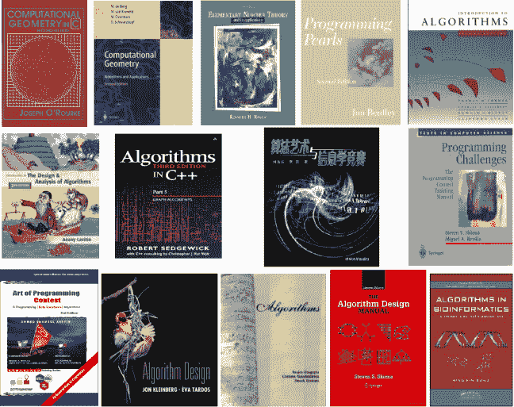

图 1.5：启发作者编写本书的一些参考书

本章及后续章节得到了许多教科书（见图 1.5）和互联网资源的支持。技巧 1 改编自 USACO 训练网关 [18] 的介绍文字。关于技巧 2 的更多细节可在许多计算机科学书籍中找到，例如 [4] 的第 1-5 章、第 17 章。技巧 3 的参考资源包括 http://www.cppreference.com、C++ STL 的 http://www.sgi.com/tech/stl/，以及 Java API 的 http://java.sun.com/javase/6/docs/api。若想获得更多洞见以进行更好的测试（技巧 4），不妨稍微绕道去读一些软件工程书籍。除了技巧 5 中提到的在线评测系统外，还有许多其他在线评测系统，例如

- SPOJ http://www.spoj.pl，
- POJ http://acm.pku.edu.cn/JudgeOnline，
- TOJ http://acm.tju.edu.cn/toj，
- ZOJ http://acm.zju.edu.cn/onlinejudge/，
- Ural/Timus OJ http://acm.timus.ru 等。

本章讨论了大约 **34 道编程练习题**。

## 第 2 章：数据结构与库

> 如果我看得更远，那只是因为站在巨人的肩膀上。
>
> —— 艾萨克·牛顿

本章为后续章节奠定基础。

### 2.1 数据结构

数据结构是“一种存储和组织数据的方式”，用于支持高效的插入、查询、搜索、更新和删除。尽管数据结构本身并不能解决给定的编程问题——真正解决问题的是在其上运行的算法，但针对给定问题使用最高效的数据结构，可能决定是通过题目的时间限制还是超出时间限制。组织同一数据有许多方式，有时某种方式在不同情境下会优于另一种方式，正如我们将在下面的讨论中看到的那样。熟悉本章讨论的数据结构，是理解后续章节算法的必要条件。

正如本书前言所述，我们假设你熟悉第 2.2 节列出的基本数据结构，因此本书不再复习它们。我们只是强调一点：它们在 C++ STL 和 Java API 中都有内置库（请注意，在本书的这个版本中，我们大多数示例代码是从 C++ 的角度编写的）。如果你对第 2.2 节提到的任何术语或数据结构没有把握，请阅读本书，并快速在参考书（例如 [3]）中查阅和学习该术语，待你掌握这些数据结构的基本概念后再继续。

请注意，对于竞赛编程，你只需要能够使用（即了解其优点、缺点以及时间/空间复杂度）某种数据结构来解决相应的竞赛题即可。了解其理论背景固然好，但可以跳过。

本章分为两部分。第 2.2 节包含基本数据结构及其可内置于库中的基本操作。第 2.3 节包含更多目前我们必须自行构建库的数据结构。因此，第 2.3 节的讨论比第 2.2 节更详细。

[1] 第 2.2 节的材料通常在计算机科学课程的一级“数据结构与算法”课程中讲授。鼓励计划参加 IOI 等竞赛的高中生自学这些材料。

### 2.2 带内置库的数据结构

#### 2.2.1 线性数据结构

如果数据结构的元素形成一个序列，则该数据结构被归类为*线性*数据结构。掌握下面所有这些基本线性数据结构，是在当今编程竞赛中取得好成绩的必要条件。

- C/C++ 和 Java 中的静态数组

  当需要存储一组顺序数据并稍后通过其索引访问时，这显然是编程竞赛中最常用的数据结构。由于编程题通常会说明最大输入规模，因此声明的数组大小通常为该值 + 少量额外缓冲。数组的典型维度包括：一维、二维、三维，很少超过四维。数组的典型操作包括：访问某些索引、对数组排序、线性扫描或二分查找数组。

- 可调整大小的数组，又称向量：C++ STL `<vector>`（Java ArrayList）

  其他方面与静态数组相同，但具有自动调整大小的特性。如果事先（即在运行程序之前）不知道数组大小，使用向量比使用数组更好。通常，我们会用某个猜测值初始化其大小，以获得更好的性能。典型操作包括：`push_back()`、`at()`、`[]` 运算符、`erase()`，并且通常使用迭代器扫描向量内容。

**静态/可调整大小数组中的高效排序与搜索**

数组上通常执行两种核心操作：排序和搜索。

计算机科学教科书中提到了*许多*排序算法，我们将其分类为：

- 1. $O(n^2)$ 基于比较的排序算法 [4]：冒泡/选择/插入排序。

  这些算法速度较慢，通常会被避免使用，但理解它们很重要。

- 2. $O(n\log n)$ 基于比较的排序算法 [4]：归并/堆/随机快速排序。

  我们可以使用 C++ STL `<algorithm>` 中的 `sort`、`partial_sort`、`stable_sort` 来实现此目的（Java 中为 `Collections.sort`）。我们只需指定所需的比较函数，这些库例程会处理其余部分。

- 3. 特殊用途排序算法 [4]：$O(n)$ 计数排序、基数排序、桶排序。

  了解这些特殊用途算法是有好处的，因为如果问题具有特殊特征（例如计数排序适用于小范围整数），它们可以加快排序时间，但它们在编程竞赛中很少出现。

然后，在数组中查找一个元素基本上有三种方式，我们将其分类为：

- 1. 从索引 0 到索引 $n-1$ 的 $O(n)$ 线性搜索（在编程竞赛中避免使用）。
- 2. $O(\log n)$ 二分查找：使用 C++ STL `<algorithm>` 中的 `lower_bound`（或 Java `Collections.binarySearch`）。如果输入未排序，先使用上述 $O(n\log n)$ 排序算法对其排序一次，以便多次使用二分查找，是很有成效的。
- 3. 使用哈希实现 $O(1)$（但对于大多数竞赛题，没有哈希也能应对）。

- 链表：C++ STL `<list>`（Java LinkedList）

  尽管这种数据结构几乎总是出现在数据结构与算法教科书中，但在典型的竞赛题中通常会避免使用链表。原因：它涉及指针，并且从理论上讲访问数据较慢，因为必须从列表的头部或尾部开始执行访问。


#### 2.2.2 非线性数据结构

对于某些计算问题，除了按顺序排列数据之外，还有其他更好的组织数据方式。通过高效实现下面所示的非线性数据结构，你可以更快地搜索条目，从而加速使用这些结构的算法。

例如，如果你想存储一个动态的配对集合（如 name → index 对），那么使用下面的 C++ STL `<map>` 只需几行代码就能获得 **O(log n)** 的插入/搜索/删除性能；而如果将同样的信息存储在一个静态的 `struct` 数组中，插入/搜索/删除可能需要 **O(n)** 的时间，而且你必须自己编写代码。

- **栈：** C++ STL `<stack>`（Java Stack）  
  这种数据结构作为算法的一部分用于解决特定问题（例如后缀表达式计算、7.3 节中的 Graham 扫描）。栈只允许从顶部进行插入（push）和删除（pop）。这种行为称为后进先出（LIFO），与现实世界中的普通栈相同。典型操作有 `push()`/`pop()`（从栈顶插入/移除）、`top()`（获取栈顶内容）、`empty()`。

- **队列：** C++ STL `<queue>`（Java Queue）  
  这种数据结构用于广度优先搜索（BFS）等算法中（4.3 节）。队列只允许从后端（rear）插入（enqueue），且只允许从头部（front）删除（dequeue）。这种行为称为先进先出（FIFO），与现实世界中的普通队列类似。典型操作有 `push()`/`pop()`（从队列后端插入/从队列前端取出）、`front()`/`back()`（获取队列前端/后端的内容）、`empty()`。

- **平衡二叉搜索树（BST）：** C++ STL `<map>`/`<set>`（Java TreeMap/TreeSet）  
  BST 是一种将数据组织成树结构的方式。在每个以 x 为根的子树中，BST 性质成立：x 左子树中的项都小于 x，x 右子树中的项都大于（或等于）x。这样组织数据（见图 2.1 左）允许 **O(log n)** 的插入、搜索和删除，因为执行这些操作只需要 **O(log n)** 最坏情况下的根到叶扫描（详见 [4]）——但这仅在 BST 是平衡的时才有效。  
    
    实现一棵 *无 bug* 的平衡 BST（如 AVL² 树或红黑（RB）树）在时间受限的比赛环境中是繁琐且困难的。幸运的是，C++ STL 提供了 `<map>` 和 `<set>`，它们通常就是 RB 树的实现，因此所有操作都是 **O(log n)**。精通这两个 STL 模板可以在比赛中节省大量宝贵的编码时间！区别很简单：`<map>` 存储（键 → 数据）对，而 `<set>` 只存储键。

- **堆：** C++ STL `<queue>`：`priority_queue`（Java PriorityQueue）  
  堆是另一种将数据组织成树结构的方式。堆也像 BST 一样是二叉树，但它必须是 *完全* 的。与强制 BST 性质不同，堆强制的是堆性质：在每个以 x 为根的子树中，x 的左、右子树中的项都小于 x（见图 2.1 右）。这个优先级保证了堆顶是最大元素。堆中通常没有“搜索”的概念，只有插入和删除，这些操作可以通过遍历 **O(log n)** 的叶到根或根到叶路径轻松完成 [4]。

² 然而，对于一些棘手的比赛问题，你必须“增强你的数据结构”（见 [4] 第 14 章），此时需要 AVL 树的知识，因为 C++ STL `<map>` 或 `<set>` 无法轻松地增强。

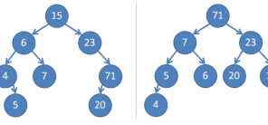

图 2.1：BST（左）和堆（右）的示例

堆非常适合模拟优先队列，其中具有最高优先级的项可以在 O(log n) 时间内删除，新项也可以在 O(log n) 时间内插入优先队列。`priority_queue` 的实现可在 C++ STL `<queue>` 中找到。优先队列是某些算法的重要组成部分，例如解决最小生成树（MST）问题的 Kruskal 算法（4.4 节）和解决单源最短路径（SSSP）问题的 Dijkstra 算法（4.5 节）。

该数据结构还用于在 C++ STL `<algorithm>` 中执行 `partial_sort`。这是通过取出最大元素 k 次来完成的（k 是要排序的最顶部项的数量）。由于每次删除最大元素的时间为 O(log n)，因此 `partial_sort` 的时间复杂度为 O(k log n)。

- **哈希表：** C++ STL 无原生支持（Java HashMap/HashSet/Hashtable）  
  哈希表是另一种非线性数据结构，但我们不建议在比赛中使用它，除非必要。原因：设计一个好的哈希函数相当棘手，而且 C++ STL 没有原生支持。此外，C++ STL 的 `<map>` 或 `<set>` 通常已经足够好，因为编程比赛问题的典型输入规模 ≤ 1M，这使得哈希表的 O(1) 与平衡 BST 的 O(log 1M) 实际差别并不大。  
    
    然而，一种哈希表的变体确实在比赛中使用，即“直接寻址表”（Direct Addressing Table，DAT），其中键本身决定索引，从而绕过了“哈希函数”的需要。例如，UVa 11340 - Newspaper，所有可能的 ASCII 字符 [0-255] 都被赋予特定的货币值，如 'a' → '3'，'W' → '10'，...，'I' → '13'。

编程练习：练习使用基础数据结构和算法（使用库函数）：

- 静态数组、C++ STL `<vector>`、`<bitset>`、直接寻址表
  1. UVa 482 - Permutation Arrays（简单的数组操作）
  2. UVa 594 - One Two Three Little Endian（使用 `<bitset>` 轻松操作位串）
  3. UVa 11340 - Newspaper（直接寻址表）
- C++ STL `<algorithm>`
  1. UVa 146 - ID Codes（使用 `next_permutation`）
  2. UVa 10194 - Football a.k.a. Soccer（多字段排序，使用 `sort`）
  3. UVa 10258 - Contest Scoreboard（多字段排序，使用 `sort`）
- 排序相关的问题
  1. UVa 299 - Train Swapping（逆序数^4 问题，可用冒泡排序解决）
  2. UVa 612 - DNA Sorting（逆序数 + `stable_sort`）
  3. UVa 10810 - Ultra Quicksort（逆序数 - 需要 O(n log n) 的归并排序）
  4. UVa 11462 - Age Sort（计数排序问题，见 [4]）
  5. UVa 11495 - Bubbles and Buckets（逆序数 - 需要 $O(n \log n)$ 的归并排序）

^4 逆序数问题：计算使列表有序所需的交换次数。

- C++ STL `<stack>`
  1. UVa 127 - “Accordion” Patience（用 `<stack>` 模拟洗牌）
  2. UVa 514 - Rails（使用 `<stack>` 模拟过程）
  3. UVa 673 - Parentheses Balance（经典问题）
  4. UVa 727 - Equation（中缀转后缀表达式）

- C++ STL `<queue>`
  1. UVa 336 - A Node Too Far（在 BFS 中使用 `<queue>`，4.3 节）
  2. UVa 10901 - Ferry Loading III（使用 `<queue>` 进行模拟）
  3. UVa 11034 - Ferry Loading IV（使用 `<queue>` 进行模拟）

- C++ STL `<map>/<set>`
  1. UVa 10226 - Hardwood Species（使用 `<map>`）
  2. UVa 11239 - Open Source（使用 `<map>` 和 `<set>` 高效地检查之前的字符串）
  3. UVa 11308 - Bankrupt Baker（使用 `<map>` 和 `<set>` 帮助管理数据）
  4. UVa 11136 - Hoax or what（使用 `<set>` 中的 multiset）

- C++ STL `priority_queue`（使用 `<queue>`）
  1. UVa 908 - Re-connecting Computer Sites（Kruskal 算法中的 `priority_queue`，4.4 节）
  2. UVa 11492 - Babel（Dijkstra 算法中的 `priority_queue`，4.5 节）
  3. LA 3135 - Argus（Beijing04）

### 2.3 使用自建库的数据结构

截至 2010 年 8 月 9 日，本节中展示的重要数据结构在 C++ STL 或 Java API 中尚不支持。因此，为了具备竞争力，参赛者必须在比赛期间拥有无 bug 的实现。在本节中，我们只讨论这些数据结构的思路。

#### 2.3.1 图

图是一种无处不在的数据结构，出现在许多计算机科学问题中。图就是顶点和边的集合（边存储这些顶点之间的连通性信息）。在第 3 章和第 4 章中，我们将会探讨许多重要的图问题和算法。在本小节中，我们只简要讨论存储图信息的四种基本方式（还有其他方式）。假设我们有一个图 $G$，有 $V$ 个顶点和 $E$ 条边，下面是存储它们的方法：

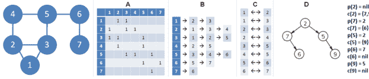


##### A 邻接矩阵

通常采用二维数组的形式。

在涉及图的竞赛题中，通常 $V$ 是已知的，因此我们可以通过建立一个二维的、$O(V^2)$ 的静态数组：`int AdjMat[V][V]` 来构建一个‘连通性表’。对于无权图，如果顶点 $i$-$j$ 之间存在边，我们设置 `AdjMat[i][j] = 1`，否则设置为 0。对于加权图，如果顶点 $i$-$j$ 之间存在权重为 $w(i,j)$ 的边，我们设置 `AdjMat[i][j] = weight(i, j)`，否则设置为 0。

如果经常查询*小型稠密图*中两个顶点之间的连通性，邻接矩阵是合适的；但它不适合*大型稀疏图*，因为二维数组中会有太多空白单元格（包含零）。即使顶点 $v$ 只有少量邻居，邻接矩阵枚举顶点 $v$ 的邻居列表也恰好需要 $O(V)$ 时间——这是许多图算法中常用的一项操作。一种更紧凑、更高效的图表示形式是邻接表。

##### B 邻接表

通常采用 C++ STL `vector<vii> AdjList` 的形式，其中 vii 定义为：

```cpp
typedef pair<int, int> ii; typedef vector<ii> vii; // our data type shortcuts
```

在邻接表中，我们有一个包含 $V$ 个顶点的*向量*，并且对于每个顶点 $v$，我们存储另一个向量，其中包含与 $v$ 有连接的（相邻顶点及其边权重）对。如果图是无权图，只需存储 weight = 0，或去掉第二个属性。

使用邻接表，我们可以高效地枚举顶点 $v$ 的邻居列表。如果 $v$ 有 $k$ 个邻居，则这种枚举的复杂度为 $O(k)$。由于这是大多数图算法中最常见的操作之一，建议将邻接表作为默认选择。

##### C 边列表

通常采用 C++ STL `priority_queue<pair<int, ii> > EdgeList` 的形式。

在边列表中，我们存储边的列表，通常按某种顺序排列。这种结构对于用于 MST 的 Kruskal 算法（第 4.4 节）非常有用，其中边集合按长度从最短到最长排序。

##### D 父子节点树结构

通常采用 `int parent` 和 C++ STL `vector<int> child` 的形式。

如果图是一棵树（无环且 $E = V - 1$ 的连通图），类似于目录/文件夹结构，那么还存在另一种数据结构形式。对于每个顶点，我们只存储两个属性：父节点（根顶点为 NULL）和子节点列表（叶节点为 NULL）。

练习：给出图 4.1 中所示图的邻接矩阵、邻接表和边列表。

#### 2.3.2 并查集（Union-Find Disjoint Sets）

并查集（Union-Find Disjoint Sets）是一种用于对不相交集合的集合进行建模的数据结构，它具有高效<sup>4</sup>完成以下操作的能力：1). ‘查找’某个元素属于哪个集合（或测试两个元素是否属于同一集合）；2). 将两个不相交集合‘合并’为一个更大的集合。这两个操作对于 Kruskal 算法（第 4.4 节）或涉及‘划分’的问题很有用，例如跟踪无向图的连通分量（见第 4.2 节）。

这些看似简单的操作并不能由只处理单个集合的 C++ STL `<set>` *高效地*支持。拥有一个集合的*向量*，并循环遍历每个集合以找出哪个集合

#### 2.3.3 线段树

在本小节中，我们讨论另一种能够高效回答*动态*区间查询的数据结构。作为起点，我们讨论这样一个问题：给定一个区间 [i..j]，找出数组中最小元素的下标。这通常被称为区间最小值查询（Range Minimum Query，RMQ）。例如，给定下面大小为 7 的数组 A，RMQ(1, 3) = 2，因为下标 2 包含 A[1]、A[2] 和 A[3] 中的最小元素。为了检验你对 RMQ 的理解，请验证在下面的数组 A 上，RMQ(3, 4) = 4、RMQ(0, 0) = 0、RMQ(0, 1) = 1，以及 RMQ(0, 6) = 5。

```text
Values  =   8  |  7  |  3  |  9  |  5  |  1  |  10
Array A =
Indices =   0  |  1  |  2  |  3  |  4  |  5  |  6
```

解决这个 RMQ 有几种方法。一种朴素算法是从下标 i 到 j 遍历数组，并报告具有最小值的下标。但每次查询的复杂度为 O(n)。当 n 很大时，这种算法可能不可行。

在本节中，我们用线段树来解决 RMQ：这是一种类似于堆的二叉树，但通常不是完全二叉树。对于上面的数组 A，线段树如图 2.7 所示。这棵树的根节点包含完整区间，从 [0, N - 1]。并且对于每个区间 [l, r]，我们将其分割为 [l, (l + r) / 2] 和 [(l + r) / 2 + 1, r]，直到 l = r。参见下面 O(n log n) 的 `build_segment_tree` 例程。在线段树已经构建好的情况下，回答一次 RMQ 现在可以在 O(log n) 内完成。

例如，我们想回答 RMQ(1, 3)。图 2.7 中的执行过程（红色实线）如下：从根节点 [0, 6] 开始，我们知道 RMQ(1, 3) 的答案在顶点 [0, 6] 的左侧，因为 [0, 6] 仍然大于 RMQ(1, 3)，因此 [0, 6] 中存储的 min（最小值）值 = 5 并不合适，因为它是比 RMQ(1, 3) 更大的区间 [0, 6] 上的最小值。

我们移动到左区间 [0, 3]。在顶点 [0, 3] 处，我们必须搜索两侧，因为 [0, 3] 仍然大于 RMQ(1, 3)，并且与左区间 [0, 1] 和右区间 [2, 3] *两者*都相交。

右区间是 [2, 3]，它位于所需的 RMQ(1, 3) 内，因此从该节点内存储的最小值可知 RMQ(2,3) = 2。我们*不*需要继续向下遍历。

左区间是 [0, 1]，它尚未位于 RMQ(1, 3) 内，因此需要再次分割。从 [0, 1] 出发，我们向右移动到区间 [1, 1]，此时它位于 RMQ(1, 3) 内。然后，我们将最小值 = 1 返回给调用者。

回到区间 [0, 3]，我们现在知道 RMQ(1, 1) = 1 且 RMQ(2, 3) = 2。由于 A[1] = 7 且 A[2] = 3，因此 A[RMQ(1, 1)] > A[RMQ(2, 3)]，所以我们知道 RMQ(1, 3) = 2。

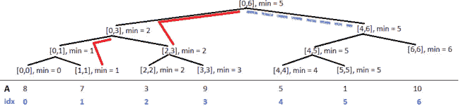

图 2.7：数组 A {8, 7, 3, 9, 5, 1, 10} 的线段树

我们来看另一个例子：RMQ(4, 6)。图 2.7 中的执行过程（蓝色虚线）如下：我们再次从根节点 [0, 6] 开始。由于它比查询区间大，我们向右移动到区间 [4, 6]。由于该区间正好就是 RMQ(4, 6)，我们只需返回该节点中存储的最小元素的下标，即 5。因此 RMQ(4, 6) = 5。我们不必遍历树中不必要的部分！在最坏情况下，我们会有两条从根到叶的路径，这仅为 O(log n)。例如在 RMQ(3, 4) = 4 中，我们有一条从 [0, 6] 到 [3, 3] 的根到叶路径，以及另一条从 [0, 6] 到 [4, 4] 的根到叶路径。

如果数组 A 是静态的，那么使用线段树来解决 RMQ 就大材小用了，因为存在一种动态规划（DP）解法，它需要 O(n log n) 的一次性预处理和每次 RMQ 的 O(1) 时间。这个 DP 解法将在后面的第 3.4.3 节中讨论。

如果数组 A 经常更新，线段树就会变得有用。例如，如果 A[5] 现在从 1 改为 100，那么我们需要做的是更新从叶节点到根节点的路径，这可以在 O(log n) 内完成。而 DP 解法需要再进行一次 O(n log n) 的预处理才能完成同样的操作。

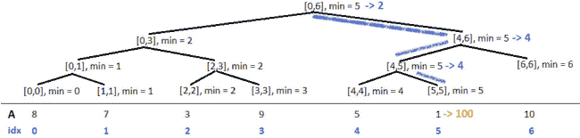

图 2.8：将数组 A 更新为 {8, 7, 3, 9, 5, 100, 10}。只有叶到根节点受到影响。

我们的线段树库实现如下所示。这里展示的代码支持静态的区间最小/最大/求和查询（动态更新部分留作练习）。当然，还有其他实现线段树的方法，例如一种更高效的版本，仅在需要时扩展区间。

```cpp
#include <iostream>
#include <math.h>
#include <vector>
using namespace std;

// Segment Tree Library
// The segment tree is stored like a heap array
#define RANGE_SUM 0
#define RANGE_MIN 1
#define RANGE_MAX 2
vi segment_tree;

void init_segment_tree(int N) { // if original array size is N,
    // the required segment_tree array length is 2*2^(floor(log2(N)) + 1);
    int length = (int) (2 * pow(2.0, floor(log((double)N) / log(2.0)) + 1));
    segment_tree.resize(length, 0); // resize this vector and fill with 0
}

void build_segment_tree(int code, int A[], int node, int b, int e) {
    if (b == e) { // as b == e, either one is fine
        if (code == RANGE_SUM) segment_tree[node] = A[b]; // store value of this cell
        else                  segment_tree[node] = b;     // if RANGE_MIN/MAXIMUM, store index
    }
```


```cpp
else { // recursively compute the values in the left and right subtrees
    int leftIdx = 2 * node, rightIdx = 2 * node + 1;
    build_segment_tree(code, A, leftIdx, l, (b + e) / 2);
    build_segment_tree(code, A, rightIdx, (b + e) / 2 + 1, e);
    int lContent = segment_tree[leftIdx], rContent = segment_tree[rightIdx];

    if (code == RANGE_SUM) // make this segment contains sum of left and right subtree
        segment_tree[node] = lContent + rContent;
    else { // (code == RANGE_MIN/MAXIMUM)
        int lValue = A[lContent], rValue = A[rContent];
        if (code == RANGE_MIN) segment_tree[node] = (lValue <= rValue) ? lContent : rContent;
        else                   segment_tree[node] = (lValue >= rValue) ? lContent : rContent;
    }
} } }

int query(int code, int A[], int node, int b, int e, int i, int j) {
    if (i > e || j < b) return -1; // if the current interval does not intersect query interval
    if (b >= i && e <= j) return segment_tree[node]; // if the current interval is inside query interval

    // compute the minimum position in the left and right part of the interval
    int p1 = query(code, A, 2 * node, b, (b + e) / 2, i, j);
    int p2 = query(code, A, 2 * node + 1, (b + e) / 2 + 1, e, i, j);

    // return the position where the overall minimum is
    if (p1 == -1) return p2; // can happen if we try to access segment outside query
    if (p2 == -1) return p1; // same as above

    if (code == RANGE_SUM)       return p1 + p2;
    else if (code == RANGE_MIN)  return (A[p1] <= A[p2]) ? p1 : p2;
    else                         return (A[p1] >= A[p2]) ? p1 : p2;
}

int main() {
    int A[] = {8,7,3,9,5,1,10};
    init_segment_tree(7); build_segment_tree(RANGE_MIN, A, 1, 0, 6);
    printf("%d\n", query(RANGE_MIN, A, 1, 0, 6, 1, 3)); // answer is index 2
    return 0;
}
```

练习1：画出数组 A = {10, 2, 47, 3, 7, 9, 1, 98, 21, 37} 的线段树，并回答 RMQ(1, 7) 和 RMQ(3, 8)！

练习2：使用上面练习1中的同一棵树，回答这个区间求和查询（Range Sum Query, RSQ）(i, j)，即从 A[i] + A[i + 1] + ... + A[j] 的和。RSQ(1, 7) 和 RSQ(3, 8) 分别是多少？这是解决该问题的一个好方法吗？（见第3.4节）

练习3：上述线段树代码缺少更新操作。请添加一个 O(log n) 的更新函数，以更新线段树中某个段的值！

使用我们自带的库进行数据结构的编程练习：

- 图（简单图，更多内容见第4节）
  - 1. UVa 291 - 圣诞老人的房子（简单回溯）
  - 2. UVa 10928 - 我亲爱的邻居（统计“出度”）
- 并查集（Union-Find Disjoint Sets）
  - 1. UVa 459 - 图的连通性（也可用第4.2节中的“洪水填充”解决）
  - 2. UVa 793 - 网络连接（简单）
  - 3. UVa 912 - 来自火星的直播
  - 4. UVa 10158 - 战争
  - 5. UVa 10301 - 圆环与胶水（涉及计算几何，见第7章）
  - 6. UVa 10369 - 北极网络（也可用最小生成树（MST）解决，见第4.4节）
  - 7. UVa 10505 - 蒙太古 vs 卡普莱特
  - 8. UVa 10583 - 无处不在的宗教（合并后统计剩余的不相交集合数量）
  - 9. UVa 10608 - 朋友（查找包含元素最多的集合）
  - 10. UVa 11503 - 虚拟朋友（在代表元素中维护集合属性（大小））
- 线段树
  - 1. UVa 11235 - 高频值（范围最大值查询）
  - 2. UVa 11297 - 人口普查（二维线段树/四叉树）
  - 3. UVa 11402 - 啊嘿，海盗！（需要对线段树进行更新）
  - 4. LA 2191 - 电位器（达卡06）
  - 5. LA 3294 - 终极食竹者（达卡05）（二维线段树++）
  - 6. LA 4108 - 天际线（新加坡07）

### 2.4 本章注释

第2.2节中提到的基本数据结构几乎可以在每一本数据结构和算法教材中找到，其库的参考资料可以在线获取：http://www.cppreference.com 和 http://java.sun.com/javase/6/docs/api。

第2.3节中提到的数据结构的补充参考资料如下：对于图数据结构，一本好的教材是[21]。对于并查集，参见[4]的第21章。对于线段树及其他与几何相关的数据结构，参见[6]。

随着经验的积累，特别是通过阅读 TopCoder 的代码，你将掌握使用这些数据结构的更多技巧。这一点很难言传。因此，请花些时间研究本书中列出的示例代码。

关于字符串专用数据结构（**后缀树**和**后缀数组**）的讨论推迟到第6.4节。然而，本书仍无法涵盖许多其他数据结构。如果你想在编程竞赛中获胜，掌握本书之外的更多内容将增加你在竞赛中取得更好成绩的机会，例如**AVL树**、**红黑树**、**伸展树**，它们在某些需要实现并扩展平衡二叉搜索树的竞赛问题中很有用；**Fenwick（二叉索引）树**可用于实现累积频率表；**四叉树**用于划分二维空间；等等。

注意，本书中展示的许多高效数据结构都体现了分治（Divide and Conquer）的思想（在第3.2节中讨论）。

本章讨论了大约 **43 道编程练习题**。

## 第3章：问题求解范式
## 

> *如果你的手里只有一把锤子，那么一切东西看起来都像钉子*  
> ——亚伯拉罕·马斯洛，1962年

本章重点介绍编程竞赛中常用的四种问题求解范式：完全搜索（Complete Search）、分治（Divide & Conquer）、贪心（Greedy）和动态规划（Dynamic Programming）。掌握所有这些问题求解范式将帮助参赛者用合适的“工具”去处理每个问题，而不是用暴力解法“锤打”所有问题……这显然不具备竞争力。在开始阅读之前，我们建议：不要只记住本章所讲问题的解法，而要记住解决这些问题的方法和精神！

### 3.1 完全搜索

完全搜索（Complete Search），也称为暴力法（brute force）或递归回溯（recursive backtracking），是一种通过搜索（尽可能）整个搜索空间来获得所需解的问题求解方法。

在编程竞赛中，当明显没有巧妙算法可用时（例如枚举 {1, 2, 3, ..., N} 的*所有*排列的问题，显然需要 *O(N!)* 次操作），或者当这些巧妙算法虽然存在但属于大材小用、而输入规模恰好很小时（例如回答第2.3.3节中的范围最小值查询问题，但作用于 *N ≤ 100* 的静态数组——用 *O(N)* 循环即可解决），参赛者*应该*采用完全搜索解法。

在 ICPC 中，完全搜索应是首先考虑的解法，因为它通常容易想到，也容易编码/调试。一个*无 Bug* 的完全搜索解法在编程竞赛中*绝不*应该收到错误答案（Wrong Answer, WA），因为它会搜索*整个*搜索空间。然而，许多编程问题确实存在比完全搜索更好的解法。因此，完全搜索解法可能会收到超时（Time Limit Exceeded, TLE）的裁决。通过适当的分析，你可以在尝试编写任何代码之前确定可能的结果（TLE 还是 AC）（第1.2.2节中的表1.4是一个很好的衡量标准）。如果完全搜索很可能通过时间限制，那就大胆去做。这样你就有了时间去处理更难的问题——那些完全搜索太慢的问题。而在 IOI 中，我们通常需要更好的问题求解技巧。

有时，在一个难题的小规模实例上运行完全搜索，可以从输出中得到一些模式，利用这些模式可以设计更快的算法。完全搜索解法还可以作为更快但非平凡算法的验证器（但仅限于小规模实例）。

#### 3.1.1 示例

在本节中，我们给出这一简单范式的两个示例，并提供一些技巧，让完全搜索解法有更大机会通过所要求的时间限制。

我们展示两个完全搜索的示例：一个采用迭代实现，另一个采用递归实现（回溯）。我们还会提到一些优化技巧，使某些“不可能”的情况变得可能。

- 1. 迭代完全搜索：UVa 725 - 除法

  问题简述：找出并显示所有满足以下条件的5位数对：这两个数合起来恰好使用数字0到9各一次，且第一个数除以第二个数等于整数 N，其中 2 ≤ N ≤ 79。即 abcde / fghij = N，其中每个字母代表一个不同的数字。其中一个数的首位数字允许为零，例如 79546 / 01283 = 62；94736 / 01528 = 62。

  快速分析表明，fghij 只能从 01234 到 98765，约有 ≈ 100K 种可能。对每个尝试的 fghij，我们可以通过 fghij * N 得到 abcde，然后检查所有数字是否互不相同。10万次操作量很小。因此，迭代完全搜索是可行的。

  练习1：遍历所有可能的 fghij 而不是 abcde 有什么好处？

  练习2：对 abcdefghij 进行排列的 10! 算法可行吗？

- 2. 递归回溯：UVa 750 - 八皇后问题

  问题简述：在国际象棋（标准8x8棋盘）中，可以在棋盘上放置八个皇后，使得任意一个皇后都无法被其他皇后吃掉。编写一个程序，在给定其中一个皇后的初始位置（即棋盘上的坐标 (a, b) 必须有一个皇后）的情况下，找出所有这样的可行排列。

  一个朴素解法会尝试 8x8 棋盘上 8 个皇后的所有 8^8 ≈ 17M 种可能排列，将每个皇后放入每个可能的格子，然后过滤掉无效排列。这样的完全搜索会收到超时（TLE）的回应。我们应该进一步缩小搜索空间。

  我们知道任意两个皇后不能在同一列，因此可以将问题简化为寻找 8! 种行位置的有效排列：row[i] 存储第 i 列中皇后的行位置。示例：如图3.1所示，row = {2, 4, 6, 8, 3, 1, 7, 5} 是该问题的一个解；row[1] = 2 表示第1列的皇后放在第2行，等等（本例中索引从1开始）。这样建模后，搜索空间从 8^8 = 17M 降到 8! = 40K。

  我们还知道任意两个皇后不能在同一条对角线上。假设皇后 A 在 (i, j)，皇后 B 在 (k, l)，则它们互相攻击当且仅当 abs(i - k) == abs(j - l)。你可以随意将两个皇后放在同一条对角线上来验证这个公式。

  然后，递归回溯解法将按照上述两个约束，从第1列到第8列逐个放置皇后。最后，如果找到一个候选解，检查其中一个皇后是否满足输入的约束，即 row[b] == a。该解法即可通过（Accepted）。

  我们在下一页下方提供了代码。如果你以前从未编写过递归回溯解法，请仔细研究它，也许可以用你自己的编码风格重新编写。例如，你也可以使用 C++ STL 的 <algorithm>: next_permutation 代替。


#### 3.1.2 技巧

编写完全搜索解法时最大的风险在于它能否通过时间限制。如果限制是 1 分钟，而你的程序当前运行 1 分 5 秒，你可能更想先调整程序的“关键代码”，而不是痛苦地用更快的算法重做此题——设计更快的算法可能并不简单。

在设计解法时，尤其是完全搜索解法时，你可以考虑以下技巧，以提高通过时间限制的机会。

##### 技巧 1：生成与过滤

生成大量候选解，然后选出正确解（或剔除错误解）的程序称为“过滤器”——回想一下时间复杂度为 8⁸ 的朴素 8 皇后求解器。那些不经过任何错误尝试而直接锁定正确答案的程序称为“生成器”——回想一下复杂度为 8! 并加上对角线检查的改进版 8 皇后求解器。

通常，过滤器更易于编码，但运行更慢。请计算一下，以判断过滤器是否足够好，或者是否需要编写生成器。

##### 技巧 2：尽早剪掉不可行的搜索空间

在生成解时（见上面的技巧 1），我们可能遇到永远不会通向完整解的部分解。我们可以在那里剪枝，转而探索其他部分。例如，看看上面 8 皇后解法中的对角线检查。假设我们已在 row[1] = 2 放置一个皇后，那么再在 row[2] = 1 或 row[2] = 3 放置一个皇后会导致对角线冲突，而在 row[2] = 2 放置另一个皇后会导致行冲突。从这些分支中的任何一个继续下去都永远不会得到有效解。因此，我们可以就在这个节点剪掉这些分支，只关注 row[2] = {4, 5, 6, 7, 8} 这些有效位置，从而节省总体运行时间。

##### 技巧 3：利用对称性

有些问题具有对称性，我们应尝试利用对称性来减少执行时间！在 8 皇后问题中，共有 92 个解，但由于该问题存在旋转和反射对称性，只有 12 个唯一（或基本）解 [35]。你可以利用这一事实，只生成这 12 个唯一解；如果需要，再通过旋转和反射这 12 个唯一解来生成全部 92 个解。

##### 技巧 4：预计算（又称预先计算）

有时，在程序本身执行之前生成表或其他数据结构，以便尽可能快地查找结果，会很有帮助。这称为预计算，即以内存/空间换取时间。

再次以上面的 8 皇后问题为例。如果我们知道只有 92 个解，那么可以创建一个二维数组 `int solution[92][8]`，然后用 8 个皇后行位置的全部 92 个有效排列填充它！就是这样：我们编写一个生成器程序（会消耗一些运行时间）来填充这个二维数组 solution，但之后我们生成一个新程序并提交代码，该代码只打印出在 (a, b) 放置 1 个皇后时对应的正确排列（非常快）。

##### 技巧 5：尝试反向求解问题

令人惊讶的是，有些竞赛题从反向求解时似乎比正面求解容易得多。要留意按逆序处理数据，或构建一种以非显而易见顺序审视数据的解题方法。

用一个例子最能说明这个技巧：UVa 10360 - Rat Attack（鼠灾）。简化的问题描述：想象一个包含老鼠的二维数组（最大 1024 × 1024）。某些单元格中有 n ≤ 20000 只老鼠，确定应该对哪个单元格 (x, y) 投放毒气弹，使得从 (x − d, y − d) 到 (x + d, y + d) 的方形区域内杀死的老鼠数量最多。值 d 是毒气弹的威力（d 最大为 50），见图 3.2。

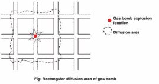

图 3.2：UVa 10360 - Rat Attack（鼠灾）示意图，d = 1

第一种选择是正面求解此问题：尝试轰炸 1024² 个单元格中的每一个，看看哪一个最有效。对于每个被轰炸的单元格 (x, y)，我们需要进行 O(d²) 次扫描，以统计方形轰炸半径内杀死的老鼠数量。在最坏情况下，数组大小为 1024² 且 d = 50，这需要 1024² × 50² = 261M 次操作。显然会超时（TLE）！

第二种选择是反向求解此问题：创建一个数组 int killed[1024][1024]。对于坐标 (x, y) 处的每个 n 只老鼠种群，将数组 killed[i][j] 的值加上：如果炸弹放置在 (i, j) 且 (i, j) 位于方形轰炸半径内（即 |i − x| ≤ d 且 |j − y| ≤ d），那么在 (x, y) 处会被杀死的老鼠数量。这个预处理需要 O(n × d²) 次操作。然后，为了确定最佳炸弹放置位置，我们找出数组 killed 中条目值最高的坐标，这可以在 O(1024²) 次操作内完成。对于最坏测试用例（n = 20000，d = 50），这种反向方法只需要 20000 × 50² + 1024² = 51M 次操作，比正面求解约快 5.1 倍！

##### 技巧 6：优化源代码

有许多技巧可用于优化代码。理解计算机硬件，尤其是 I/O、内存和缓存行为，可以帮助你设计更好的程序。一些例子：

- 1. 使用更快的 C 风格 scanf/printf，而不是 cin/cout。
- 2. 使用期望复杂度为 O(n log n) 且缓存友好的快速排序（作为“内省排序”的一部分内置于 C++ STL sort 中），而不是真正 O(n log n) 但对（缓存）内存不友好的归并排序。
- 3. 以行优先方式（逐行）访问二维数组，而不是逐列访问。
- 4. 对整数进行位运算比使用位数组更快（见第 3.4.3 节），等等。
- 5. 对于埃拉托斯特尼筛法，使用 STL `<bitset>` 而不是 `vector<bool>`（见第 5.3.1 节）。
- 6. 通过将庞大的数据结构设置为全局作用域，只声明一次，这样就不必把该结构作为函数参数传递。
- 7. 根据题目描述中可能的最大输入，只分配一次内存，而不是在多输入问题中为每个测试用例重新分配内存。

浏览互联网或参考书，查找有关如何加速代码的更多信息。

##### 技巧 7：使用更好的数据结构和算法 :)

不开玩笑。使用更好的数据结构和算法总是胜过上面技巧 1-6 中提到的任何优化技巧。如果其他所有方法都失败，就放弃完全搜索方法。

可用完全搜索解决的编程练习：

- 迭代法
  - 1. UVa 154 - Recycling（尝试所有组合）
  - 2. UVa 441 - Lotto（6 层嵌套循环！）
  - 3. UVa 639 - Don't Get Rooked（生成 2^16 种可能组合，剪掉无效组合）
  - 4. UVa 725 - Division（本节已详细说明）
  - 5. UVa 10360 - Rat Attack（此题也可使用 1024^2 DP 区间和解决）
  - 6. UVa 10662 - The Wedding（3 层嵌套循环！）
  - 7. UVa 11242 - Tour de France（迭代完全搜索 + 排序）
  - 8. UVa 11804 - Argentina（5 层嵌套循环！）
- 递归回溯
  - 1. UVa 193 - Graph Coloring（最大独立集）
  - 2. UVa 222 - Budget Travel（输入规模不大）
  - 3. UVa 524 - Prime Ring Problem（另见第 5.3.1 节）
  - 4. UVa 624 - CD（输入规模小，使用回溯；也可用 DP 解决）
  - 5. UVa 628 - Passwords（回溯）
  - 6. UVa 729 - The Hamming Distance Problem（回溯）
  - 7. UVa 750 - 8 Queens Chess Problem（本节已给出解法）
  - 8. UVa 10285 - Longest Run on a Snowboard（回溯，也可用 DP 解决）
  - 9. UVa 10496 - Collecting Beepers（小规模 TSP 实例）
  - 10. LA 4793 - Robots on Ice（World Finals Harbin10，推荐用于练习的题目）

最近 2010 年 ACM ICPC 世界总决赛中的 Problem I - 'Robots on Ice' 可视为对“剪枝策略”的严峻考验。问题很简单：给定一个带有 3 个检查点 {A, B, C} 的 M x N 棋盘，找一条长度为 (M x N) 的哈密顿路径，从坐标 (0, 0) 到坐标 (0, 1)。这条哈密顿路径必须分别在行程的 1/4、1/2 和 3/4 处经过检查点 {A, B, C}。约束：2 ≤ M, N ≤ 8。

朴素的递归回溯算法会超时（TLE）。为了加速，我们必须在以下情况下剪枝搜索空间：

- 1). 它在 1/4、1/2 或 3/4 距离处没有经过相应的目标检查点；
- 2). 它早于目标时间经过目标检查点；
- 3). 从当前位置无法按时到达下一个检查点；
- 4). 由于当前路径挡住了去路，它无法到达终点 (0, 1)。

这 4 种剪枝策略足以解决 LA 4793。


### 3.2 分治法

分治法（缩写为 D&C）是一种问题求解范式，我们通过将问题“划分”成更小的部分并“征服”它们，试图使问题变得*更简单*。步骤如下：

- 1. 将原问题划分为*子问题*——通常是一半或接近一半，
- 2. 为每个子问题找到（子）解——这些子问题现在更容易，
- 3. 如果需要，合并这些子解，以产生主问题的完整解。

我们在本书前面的章节中已经见过这种 D&C 范式：第 2.2.1 节中的各种排序算法，如快速排序、归并排序、堆排序以及二分查找，都利用了这种范式。第 2.2.2 节和第 2.3.3 节中二叉搜索树、堆和线段树组织数据的方式，也体现了分治法的精神。

#### 3.2.1 二分查找的有趣用法

在本节中，我们围绕一个著名的二分查找算法来讨论 D&C 范式的精神。我们仍然将二分查找归类为“分治”范式，尽管一些文献（例如 [14]）建议应将其归类为“减治（减半）”范式，因为它实际上并不“合并”结果。我们强调这个算法，是因为许多竞赛选手知道它，但很少有人意识到它还可以以不同于普通用法的方式使用。

##### 二分查找：普通用法

回顾：二分查找的*普通*用法是在*静态有序数组*中查找一个元素。我们检查有序数组的中间部分，看它是否就是我们要找的元素。如果找到了，或者没有更多元素需要搜索，我们就停止。否则，我们判断答案在有序数组的左半部分还是右半部分。由于每次查询后搜索空间的大小都会减半（二分），该算法的复杂度为 O(log n)。在第 2.2.1 节中，我们已经看到该算法有库例程，例如 C++ STL <algorithm>: lower_bound、Java Collections.binarySearch。

这*并非*使用和应用二分查找的唯一方式。运行二分查找算法的前提——一个*静态有序数组（或向量）*——也可以在其他不常见的数据结构中找到，如下面结构化树上的根到叶路径。

##### 在不常见数据结构上的二分查找（Thailand ICPC National Contest 2009）

问题简述：给定一棵有 N 个顶点的带权（家族）树，N ≤ 80K，具有一个特殊性质：*顶点值从根到叶子递增*。从起始顶点 v 出发，找到权值至少为 P 且最靠近根的祖先顶点。这样的查询最多有 Q ≤ 20K 个。

朴素解法是对每次查询进行线性 O(N) 扫描：从给定顶点 v 开始，然后沿家族树向上移动，直到遇到第一个值 < P 的祖先。总体而言，由于有 Q 个查询，该方法运行时间为 O(QN)，并且由于 N ≤ 80K 且 Q ≤ 20K，会超时。

更好的解法是先存储所有 20K 个查询。然后使用 O(N) 的深度优先搜索（DFS）算法（第 4.2 节）从根开始*只遍历一次*家族树。搜索某个不存在的值，使 DFS 探索*整棵*树，并在过程中构建一个局部的根到叶*有序*数组——这是因为根到叶路径上的顶点权值递增。然后，对于查询中询问的每个顶点，沿当前从根到该顶点的路径执行 O(log N) 的**二分查找**，即 *lower_bound*，以获得权值至少为 P 且最靠近根的祖先。最后，进行 O(Q) 的后处理以输出结果。该方法的总体时间复杂度为 O(Q log N)，现在可以接受了。

##### 二分法

到目前为止，我们看到的是二分查找在静态有序数组中查找元素的用法。然而，二分查找的**原理**也可以用于求一个可能难以通过数学计算得到其根的函数。

示例问题：你想通过贷款买车，并希望分 *m* 个月每月支付 *d* 美元。假设汽车原价为 *v* 美元，银行在每月末对每一笔未还款项收取 *i*% 的利率。你每月必须支付多少钱 *d*（四舍五入到小数点后 2 位）？

假设 *d* = 576，*m* = 2，*v* = 1000，*i* = 10%。一个月后，你的贷款变为 1000 × (1.1) - 576 = 524。两个月后，你的贷款变为 524 × (1.1) - 576 ≈ 0。

但如果我们只知道 *m* = 2、*v* = 1000 和 *i* = 10%，如何确定 *d* = 576？换句话说，求根 *d*，使得贷款支付函数 *f*(*d*, 2, 1000, 10) ≈ 0。*简单*的方法是运行二分法²。我们选择一个合理的范围作为起点。在这种情况下，我们想在范围 [*a*...*b*] 内找到 *d*。*a* = 1，因为我们必须支付一些钱（至少 *d* = 1 美元）。*b* = (1 + *i*) × *v*，因为我们最早能在 *m* = 1 时完成支付，即如果我们在一个月后恰好支付 (1 + *i*%) × *v* = (1 + 10%) × 1000 = 1100 美元。然后，我们按如下方式应用二分法得到 *d*：

- 如果我们每月支付 *d* = (*a* + *b*)/2 = (1 + 1100)/2 = 550.5 美元，那么两个月后我们少还了 53.95 美元，因此我们知道必须*增加*每月还款额。
- 如果我们每月支付 *d* = (550.5 + 1100)/2 = 825.25 美元，那么两个月后我们多还了 523.025 美元，因此我们知道必须*减少*还款额。
- 如果我们每月支付 *d* = (550.5 + 825.25)/2 = 687.875 美元，那么两个月后我们多还了 234.5375 美元，因此我们知道必须*减少*还款额。
- …经过几次对数级迭代后，准确地说，经过 O(log₂((*b* − *a*)/ε)) 次迭代，其中 ε 是我们可以容忍的误差量。
- 最后，如果我们每月支付 *d* = 576.190476... 美元，那么两个月后我们成功还清贷款（误差现在小于 ε），因此我们知道 *d* = 576 是答案。

为使二分法³有效，我们必须确保初始实数范围 [*a*...*b*] 中两个端点的函数值，即 *f*(*a*) 和 *f*(*b*)，具有相反的符号（在上述问题中成立）。本示例中的二分法只需要 log₂ 1099/ε 次尝试。使用较小的 ε = 1e-9，这约为 40 次尝试。即使我们使用更小的 ε = 1e-15，也仍然只需要约 60 次尝试⁴。与线性尝试 *d* = [1...1100]/ε 的每个可能值相比，二分法更高效。

² 我们将“二分查找原理”这一术语用于指代一种分治技术，它涉及将可能答案的范围减半。我们将“二分查找算法”（在有序数组中查找某个元素的索引）和“二分法”（求函数的根）作为该原理的实例。

³ 注意，二分法（使用二分查找原理）的要求与更广为人知的二分查找算法略有不同，后者需要有序数组。

⁴ 因此，一些竞赛程序员选择“循环 100 次”来保证终止，而不是测试误差是否已小于 ε，因为某些浮点误差可能导致死循环。

##### 二分答案

二分答案（Binary Search ‘the Answer’）是另一种可能非常强大的问题求解策略。下面以 UVa 714 - Copying Books 展示该策略。

在这个问题中，给定 *m* 本书，编号为 1, 2, ..., *m*，它们可能有不同的页数（*p₁, p₂, ..., pₘ*）。你想为每本书复印一份。你的任务是将这些书分配给 *k* 个抄写员，*k* ≤ *m*。每本书只能分配给一个抄写员，并且每个抄写员必须得到一段*连续*的书。也就是说，存在一个递增的数列 0 = *b₀* < *b₁* < *b₂* < ... < *bₖ₋₁* < *bₖ* = *m*，使得第 *i* 个抄写员得到编号在 *bᵢ₋₁* + 1 和 *bᵢ* 之间的一段书。复印所有书所需的时间由被分配工作最多的抄写员决定。任务是最小化分配给单个抄写员的最大页数。

这个问题存在动态规划解法，但已经可以通过以二分查找方式猜测答案来解决！假设 *m* = 9，*k* = 3，且 *p₁, p₂, ..., p₉* 分别为 100、200、300、400、500、600、700、800 和 900。

如果我们猜测 *ans* = 1000，那么问题变得“更简单”，即如果工作最多的抄写员最多只能复印 1000 页，这个问题能解决吗？答案是“否”。我们可以贪心地分配任务为：抄写员 1 得到 {100, 200, 300, 400}，抄写员 2 得到 {500}，抄写员 3 得到 {600}，但我们还有 3 本书 {700, 800, 900} 未分配。答案至少为 1000。

如果我们猜测 *ans* = 2000，那么我们可以贪心地分配任务为：抄写员 1 得到 {100, 200, 300, 400, 500}，抄写员 2 得到 {600, 700}，抄写员 3 得到 {800, 900}。我们仍有一些余量，即抄写员 1、2 和 3 分别还有 {500, 700, 300} 的未使用余量。答案至多为 2000。

这个 *ans* 可以在 *lo* = 1（1 页）和 *hi* = *p₁* + *p₂* + ... + *pₘ*（所有页）之间进行二分查找。

可用分治法解决的问题的编程练习：

- 1. UVa 679 - Dropping Balls（类似二分查找）
- 2. UVa 714 - Copying Books（二分查找 + 贪心）
- 3. UVa 957 - Popes（完全搜索 + 二分查找：upper_bound）
- 4. UVa 10077 - The Stern-Brocot Number System（二分查找）
- 5. UVa 10341 - Solve It（二分法）
- 6. UVa 10369 - Arctic Networks（也可用 Kruskal 求 MST 解决——第 4.4 节）
- 7. UVa 10474 - Where is the Marble?
- 8. UVa 10611 - Playboy Chimp（二分查找）
- 9. UVa 11262 - Weird Fence（二分查找 + 二分图匹配，见第 4.9.3 节）
- 10. LA 2565 - Calling Extraterrestrial Intelligence Again（Kanazawa02）（二分查找 + 数学）
- 11. LA 2949 - Elevator Stopping Plan（Guangzhou03）（二分查找 + 贪心）
- 12. LA 3795 - Against Mammoths（Tehran06）
- 13. LA 4445 - A Careful Approach（完全搜索 + 二分法 + 贪心）
- 14. IOI 2006 - Joining Paths
- 15. IOI 2009 - Mecho（二分查找 + BFS）
- 16. My Ancestor - Thailand ICPC National Contest 2009（题目由 Felix Halim 提供）
- 17. 参见第 7.5 节“用于几何问题的分治法”


### 3.3 贪心法

如果一个算法在每一步都做出局部最优选择，并希望借此找到最优解，那么该算法被称为贪心算法。在某些情况下，贪心法有效——解法代码短小且运行高效。但对于*许多*其他情况，它并不有效。正如[4]中所讨论的，一个问题必须具备两点，贪心算法才能对其有效：

- 1. 它具有最优子结构。
  
  问题的最优解包含子问题的最优解。

- 2. 它具有贪心性质（备注：很难证明其正确性！）。
  
  如果我们做出当前看起来最好的选择，并在之后解决剩余的子问题，我们仍能达到最优解。我们永远不必重新考虑之前的选择。

#### 3.3.1 经典示例

假设我们有大量不同面额的硬币，即 25、10、5 和 1 美分。我们想用*最少数量*的硬币找零。以下贪心算法适用于该问题的这组面额：持续使用不大于剩余待找金额的最大面额硬币。示例：如果面额为 {25, 10, 5, 1} 美分，我们要找零 42 美分，可以这样做：42-25 = 17 → 17-10 = 7 → 7-5 = 2 → 2-1 = 1 → 1-1 = 0，总共 5 枚硬币。这是最优的。

上述找零示例具备贪心算法成功的两个要素：

- 1. 它具有最优子结构。
  
  我们已经看到，在找零 42 美分的原问题中，我们必须使用 25+10+5+1+1。这是原问题的一个最优 5 枚硬币解！
  
  现在，其子问题的最优解包含在这个 5 枚硬币解中，即
  - a. 要找零 17 美分，我们必须使用 10+5+1+1（4 枚硬币），
  - b. 要找零 7 美分，我们必须使用 5+1+1（3 枚硬币），等等

- 2. 它具有贪心性质。
  
  给定每个金额 *V*，我们贪心地用不大于该金额 *V* 的最大面额硬币减去它。可以证明（为简洁起见此处不展示），使用与此不同的其他策略不会得到最优解。

然而，这个贪心算法并*不*适用于*所有*硬币面额集合，例如 {1, 3, 4} 美分。要用该集合找零 6 美分，贪心算法会选择 3 枚硬币 {4, 1, 1}，而不是使用 2 枚硬币 {3, 3} 的最优解。这个问题将在 3.4.2 节中重新讨论。

算法教科书中还有许多其他经典的贪心算法示例，例如：用于最小生成树（MST）问题的 Kruskal 算法——4.4 节，用于单源最短路径（SSSP）问题的 Dijkstra 算法——4.5 节，贪心活动选择问题[4]，霍夫曼编码[4]，等等。

#### 3.3.2 非经典示例

如今的竞赛题通常不会要求解决平凡的经典贪心问题。相反，我们会遇到需要创造力的新颖问题，如下所示。

##### UVa 410 - 车站平衡（Station Balance）

给定 \(1 \le C \le 5\) 个可存放 0、1 或 2 个标本的腔室，\(1 \le S \le 2C\) 个标本，以及 \(M\)：\(S\) 个标本的质量列表，确定我们应该将每个标本存放在哪个腔室中，以最小化 IMBALANCE。可视化解释见图 3.3。

\(A = (\sum_{j=1}^{S} M_j)/C\)，即 \(A\) 是所有质量在 \(C\) 个腔室上的平均值。

\(\mathrm{IMBALANCE} = \sum_{i=1}^{C} |X_i - A|\)，即每个腔室中的质量相对于 \(A\) 的差之和。

其中 \(X_i\) 是第 \(i\) 个腔室中标本的总质量。

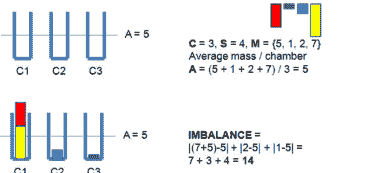

图 3.3：UVa 410 - 车站平衡（Station Balance）的可视化

这个问题可以使用贪心算法解决。但首先，我们必须做出几个观察。如果存在一个空腔室，那么至少有一个装有 2 个标本的腔室必须被移到这个空腔室中！否则空腔室会对 IMBALANCE 贡献太大！见图 3.4。

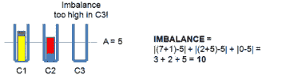

图 3.4：UVa 410 - 观察 1

下一个观察：如果 \(S > C\)，那么 \(S-C\) 个标本必须与某个腔室中已有的另一个标本配对。鸽巢原理！见图 3.5。

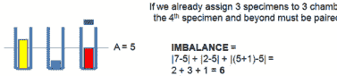

图 3.5：UVa 410 - 观察 2

现在，可以简化问题的关键洞察是：如果 \(S < 2C\)，则添加质量为 0 的虚拟 \(2C-S\) 个标本。例如，\(C = 3, S = 4, M = \{5, 1, 2, 7\} \Rightarrow C = 3, S = 6, M = \{5, 1, 2, 7, 0, 0\}\)。然后，根据质量对这些标本排序，使得 \(M_1 \le M_2 \le \ldots \le M_{2C-1} \le M_{2C}\)。在此示例中，\(M = \{5, 1, 2, 7, 0, 0\} \rightarrow \{0, 0, 1, 2, 5, 7\}\)。通过添加虚拟标本然后排序，一种贪心策略“出现”了。我们现在可以：
将质量为 $M_1$ 和 $M_{2C}$ 的标本配对并放入腔室 1，然后将质量为 $M_2$ 和 $M_{2C-1}$ 的标本配对并放入腔室 2，依此类推……
这种贪心算法——称为“负载均衡”——有效！见图 3.6。

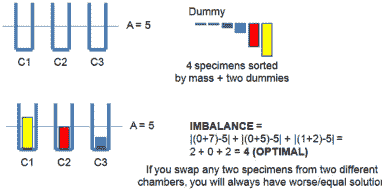

图 3.6：UVa 410 - 贪心解法

要提出这种做法，因为它很轻量，但往往会导致 WA 结果。在比赛时间内证明某个问题具有最优子结构和贪心性质可能很耗时，因此竞赛程序员通常会这样做：

他会查看输入规模。如果对于完全搜索或动态规划（见 3.4 节）的时间复杂度来说它“足够小”，他会使用其中一种方法，因为两者都能确保正确答案。只有当他知道题目给定的输入规模对于他最好的完全搜索或 DP 解法来说肯定太大时，他才会使用贪心解法。

话虽如此，如今许多出题人确实会把这种能否使用贪心算法的问题的输入规模设置在某个合理范围内，以便参赛者无法利用输入规模快速确定所需算法！

可用贪心法解决的编程练习（提示略）：

- 1. UVa 410 - Station Balance（本节详细讨论）
- 2. UVa 10020 - Minimal Coverage
- 3. UVa 10340 - All in All
- 4. UVa 10440 - Ferry Loading II
- 5. UVa 10670 - Work Reduction
- 6. UVa 10763 - Foreign Exchange
- 7. UVa 11054 - Wine Trading in Gergovia
- 8. UVa 11292 - Dragon of Loowater
- 9. UVa 11369 - Shopaholic

在本节中，我们想强调另一种解题技巧：*分解！*

虽然竞赛题中只使用*少数*基本算法（本书涵盖了其中大部分），但更难的问题可能需要*组合*两种（或更多）算法来求解。对于这类问题，尝试将问题分解成若干部分，以便可以独立求解不同部分。我们用一个近期的顶级编程题来说明这种分解技术，该题结合了我们刚学过的*三个*问题求解范式：完全搜索、分治法和贪心法！

##### ACM ICPC 2009 世界总决赛 - Problem A - A Careful Approach（谨慎的方法）

给定一个飞机着陆场景。该场景中有 2 ≤ n ≤ 8 架飞机。每架飞机都有一个可以安全着陆的时间窗口。该时间窗口由两个整数 a_i、b_i 指定，它们给出第 i 架飞机可以安全着陆的闭区间 [a_i, b_i] 的起点和终点。数字 a_i 和 b_i 以分钟为单位，并满足 0 ≤ a_i ≤ b_i ≤ 1440。本题中，飞机着陆时间可忽略不计。然后，你的任务是：

- 1. 计算一个满足这些时间窗口的所有飞机着陆的**顺序**。
  
  提示：顺序 = 排列 = 完全搜索？
- 2. 此外，飞机着陆应**尽可能拉开**，以使相邻着陆之间可实现的最小时间间隔尽可能大。例如，如果三架飞机分别在上午 10:00、10:05 和 10:15 着陆，那么最小间隔是五分钟，出现在前两架飞机之间。并非所有间隔都必须相同，但最小间隔应尽可能大！
  
  提示：这是否类似于“贪心活动选择”问题[4]？
- 3. 输出答案，将其分为分钟和秒，并四舍五入到最接近的秒。
  
  见图 3.7 的图示：线 = 飞机的时间窗口；星号 = 其着陆安排。

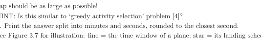

**解决方案：**

由于飞机数量最多为 8，因此只需尝试所有 8! = 40320 种可能的飞机着陆顺序即可找到最优解。这是问题的**完全搜索**部分，可以使用 C++ STL `next_permutation` 轻松解决。

现在，对于每个特定的着陆顺序，我们想知道尽可能大的着陆窗口。假设我们使用某个窗口长度 L。我们可以通过强制第一架飞机尽可能早着陆，并让后续飞机在 `max(a[that plane], previous landing time + L)` 着陆，来贪心地检查这个 L 是否可行。这是一个**贪心算法**。

窗口长度 L 太长/太短会超出/低于 `b[last plane]`，因此我们必须减小/增大 L。我们可以对答案 L 进行二分查找——**分治法**。由于我们只希望答案四舍五入到最接近的整数，因此当误差 ε ≤ 1e-3 时停止二分查找就足够了。更多细节，请研究下一页展示的我们的 AC 源代码。


```cpp
/* World Final 2009, A - A Careful Approach, LA 4445 (Accepted) */
#include <algorithm>
#include <cmath>
#include <stdio.h>
using namespace std;

int i, n, caseNo = 1, order[8];
double a[8], b[8], timeGap, maxTimeGap; // timeGap is the variable L mentioned in text

double greedyLanding() { // with certain landing order, and certain timeGap,
                         // try landing those planes and see what is the gap to b[order[n - 1]]
  double lastLanding = a[order[0]]; // greedy, first aircraft lands immediately
  for (i = 1; i < n; i++) { // for the other aircrafts
    double targetLandingTime = lastLanding + timeGap;
    if (targetLandingTime <= b[order[i]])
      // this aircraft can land, greedily choose max of a[order[i]] or targetLandingTime
      lastLanding = max(a[order[i]], targetLandingTime);
    else
      return 1; // returning positive value will force binary search to reduce timeGap
  }
  // returning negative value will force binary search to increase timeGap
  return lastLanding - b[order[n - 1]];
}

int main() {
  while (scanf("%d", &n), n) { // 2 <= n <= 8
    for (i = 0; i < n; i++) {
      scanf("%lf %lf", &a[i], &b[i]); // [ai, bi] is the interval where plane i can land safely
      a[i] *= 60; b[i] *= 60; // originally in minutes, convert to seconds
      order[i] = i;
    }

    maxTimeGap = -1; // variable to be searched for
    do { // permute plane landing order, 8!
      double lowVal = 0, highVal = 86400; // min 0s, max 1 day = 86400s
      timeGap = -1; // start with infeasible solution
      // This example code uses 'double' data type. This is actually not a good practice
      // Some other programmers avoid the test below and simply use 'loop 100 times (precise enough)'
      while (fabs(lowVal - highVal) >= 1e-3) { // binary search timeGap, ERROR = 1e-3 is OK here
        timeGap = (lowVal + highVal) / 2.0;    // we just want the answer to be rounded to nearest int
        double retVal = greedyLanding();       // round down first
        if (retVal <= 1e-2) // must increase timeGap
          lowVal = timeGap;
        else // if (retVal > 0) // infeasible, must decrease timeGap
          highVal = timeGap;
      }
      maxTimeGap = max(maxTimeGap, timeGap); // get the max over all permutations
    }
    while (next_permutation(order, order + n)); // keep trying all permutations

    // another way for rounding is to use printf format string: %.0lf:%.0lf
    maxTimeGap = (int)(maxTimeGap + 0.5); // round to nearest second
    printf("Case %d: %d:%02d\n", caseNo++, (int)(maxTimeGap / 60), (int)maxTimeGap % 60);
  } // return 0;
  // Challenge: rewrite this code to avoid double!
}
```

### 3.4 动态规划

动态规划（以下简称为 DP）可能是本章讨论的四种问题求解范式中最具挑战性的一种。因此，在继续之前，请确保你已经掌握了前面章节提到的内容。另外，准备好看到大量递归和递推关系！

#### 3.4.1 用 UVa 11450 - Wedding Shopping 说明 DP

简化问题描述：给定每件衣物（例如 3 件衬衫、2 条腰带、4 双鞋……）的不同型号，*为每件衣物购买一个型号*。由于预算有限，我们的花费不能超过预算，但希望花掉*尽可能多*的钱。但也有可能因为预算太少而无法为每件衣物各买一个型号。

输入由两个整数 1 ≤ M ≤ 200 和 1 ≤ C ≤ 20 组成，其中 M 是预算，C 是你必须购买的衣物数量。然后是这 C 件衣物的信息。对于 `garment_id` ∈ [0 ... C-1]，我们知道一个整数 1 ≤ K ≤ 20，它表示该 garment_id 对应衣物的不同型号数量，随后是 K 个整数，表示该 garment_id 对应衣物每个型号的价格 ∈ [1 ... 1000]。

输出应包含一个整数，表示在*不超过初始金额*的情况下，为每件衣物各买一件所需的最大花费。如果无解，输出 “no solution”。

例如，如果输入如下（测试用例 A）：

- M = 20，C = 3
- garment_id 0 的 3 个型号 → 6 4 <u>8</u> // 注意输入中的价格未排序
- garment_id 1 的 2 个型号 → 5 <u>10</u>
- garment_id 2 的 4 个型号 → <u>1</u> 5 3 5

那么答案是 19，它可能来自购买*带下划线*的物品（8+10+1）。

注意这个解不是唯一的，因为我们还可以有 (6+10+3) 和 (4+10+5)。

然而，如果输入如下（测试用例 B）：

- M = 9（*预算非常有限*），C = 3
- garment_id 0 的 3 个型号 → 6 4 8
- garment_id 1 的 2 个型号 → 5 10
- garment_id 2 的 4 个型号 → 1 5 3 5

那么答案是 “no solution”，因为即使购买所有最便宜的型号 (4+5+1) = 10，仍然 > M。

##### 方法 1：完全搜索（超时）

首先，让我们看看完全搜索（回溯）能否解决这个问题：从 `money_left = M` 和 `garment_id = 0` 开始。尝试 `garment_id = 0` 中的所有可能型号（最多 20 个型号）。如果选择了型号 i，则从 `money_left` 中减去型号 i 的价格，然后递归地对 `garment_id = 1` 执行相同过程（也可以最多有 20 个型号），依此类推。如果最后一个 `garment_id = C − 1` 的型号已经被选择，则停止。如果在到达最后一个 `garment_id` 之前 `money_left < 0`，则剪枝这个部分解。在所有有效组合中，选择一个使 `money_left` 尽可能接近 0 但仍 ≥ 0 的组合。这会使花费的钱最大化，即 (`M − money_left`)。

我们可以形式化定义这些完全搜索的递推式：

- 1. 如果 `money_left < 0`（即金额变为负数），  
  `shop(money_left, garment_id) = INVALID`（实践中，我们可以返回一个很大的负值）
- 2. 如果已经购买了最后一个 `garment_id` 的一个型号（即一个候选解），  
  `shop(money_left, garment_id) = M - money_left`（这是实际花费的钱）
- 3. 一般情况下，对于当前 `garment_id` 的所有型号 `[1...K]`  
  `shop(money_left, garment_id) =`  
  `    max(shop(money_left - price[garment_id][model], garment_id + 1))`  
  我们希望最大化这个值（回想一下，无效值有很大的负值）

这个解可以正确工作，但**非常慢**！让我们分析它的最坏情况时间复杂度。在最大的测试用例中，`garment_id 0` 最多有 20 个选择；`garment_id 1` *也*最多有 20 个选择；……；最后一个 `garment_id 19` *也*最多有 20 个选择。因此，这样的完全搜索在最坏情况下会运行 `20 × 20 × ... × 20` 共 20 次，即 `20^20` = 一个**非常非常大**的数。如果我们*只*了解完全搜索，就无法解决这个问题。

##### 方法 2：贪心（答案错误）

既然我们希望最大化花掉的预算，为什么不选择每个 `garment_id` 中仍然符合预算的最贵型号呢？例如在上面的测试用例 A 中，我们选择 `garment_id = 0` 中花费为 8 的最贵型号 3（`money_left = 20-8 = 12`），然后选择 `garment_id = 1` 中花费为 10 的最贵型号 2（`money_left = 12-10 = 2`），接着对于 `garment_id = 2`，由于 `money_left` 不允许我们购买花费为 3 或 5 的其他型号，我们只能选择花费为 1 的型号 1。这一贪心策略对上面的测试用例 A+B 都“有效”，并分别得到相同的最优解 (8+10+1) = 19 和 “no solution”。它运行也非常快，最坏情况下为 20 + 20 + ... + 20 共 20 次 = 400 次操作。

但贪心在许多其他情况下并不可行。下面的测试用例就是一个反例：

```text
M = 12, C = 3
3 models of garment_id 0 → 6 4 8
2 models of garment_id 1 → 5 10
4 models of garment_id 2 → 1 5 3 5
```

贪心策略选择 `garment_id = 0` 中花费为 8 的型号 3（`money_left = 12-8 = 4`），因此我们没有足够的钱购买 `garment_id = 1` 中的任何型号，并错误地报告 “no solution”。最优解实际上是 **(4+5+3 = 12)**，它用完了我们所有预算。

##### 方法 3：自顶向下 DP（通过）

要解决这个问题，我们必须使用 DP。让我们看看使 DP 生效的关键要素：

- 1. 这个问题具有最优子结构。  
  这体现在上面的完全搜索递推式 3 中；子问题的解是原问题解的一部分。虽然最优子结构也是使贪心算法生效的相同要素，但这个问题缺少“贪心性质”这一要素。
- 2. 这个问题具有重叠子问题。  
  这是 DP 的关键点！搜索空间实际上并不像上面完全搜索讨论中分析的 `20^20` 那么大，因为**许多**子问题实际上是重叠的！


让我们验证这个问题是否具有重叠子问题。假设某个 `garment_id` 中有 2 个模型具有相同价格 $p$。那么，完全搜索在任选其中一个模型后，都会转到同一个子问题 `shop(money_left - p, garment_id + 1)`！类似地，如果 `money_left` 与所选模型价格的某种组合导致 `money_left₁ - p₁ = money_left₂ - p₂`，也会出现这种情况。同一个子问题会被计算多次！效率低下！

那么，这个问题中有多少个不同的子问题（又称状态）？答案是仅有 $201 \times 20 = 4,020$ 个。因为 `money_left` 只有 201 种可能（从 0 到 200，含端点），`garment_id` 只有 20 种可能（从 0 到 19，含端点）。每个子问题只需计算一次。如果能保证这一点，我们就能更快地解决这个问题。

这个 DP 解法的实现出奇地简单。如果我们已经有了递归回溯（前面展示的递推关系），可以通过执行以下少量额外步骤来实现自顶向下 DP：

- 1. 用占位值（例如‘-1’）初始化一个 DP‘memo’表。DP 表的维度必须等于不同子问题的大小。
- 2. 在递归函数开始时，只需检查当前状态之前是否已经计算过。
  - (a) 如果是，直接从 DP memo 表返回值，O(1)。
  - (b) 如果不是，按常规计算（只计算一次），然后将计算值存入 DP memo 表，以便后续对此子问题的调用能快速完成。

分析 DP 解法很容易。如果它有 $M$ 个状态，则至少需要 $O(M)$ 的内存空间。如果填充该状态中的一个单元格需要 $O(k)$ 步，那么总体时间复杂度为 $O(kM)$。上述 UVa 11450 - Wedding Shopping 问题有 $M = 201 \times 20 = 4020$，且 $k = 20$（因为对于每个 `garment_id`，我们最多需要遍历 20 个模型）。因此时间复杂度为 4020 × 20 = 80400，非常容易处理。下面给出我们的代码作为示例，尤其面向那些以前从未编写过自顶向下 DP 算法的人。

```cpp
/* UVa 11450 - Wedding Shopping */
#include <iostream>
#include <algorithm>
#include <string.h>
using namespace std;

int M, C, K, price[25][25]; // price[garment_id (<= 20)][model (<= 20)]
int memo[210][25]; // dp table memo[money_left (<= 200)][garment_id (<= 20)]

int shop(int money_left, int garment_id) {
    if (money_left < 0)
        return -1000000000; // fail, return a large negative number (1B)
    if (garment_id == C) // we have bought last garment
        return M - money_left; // done, return this value
    if (memo[money_left][garment_id] != -1) // if this state has been visited before
        return memo[money_left][garment_id]; // simply return it
    int max_value = -1000000000;
    for (int model = 1; model <= price[garment_id][0]; model++) // try all possible models
        max_value = max(max_value, shop(money_left - price[garment_id][model], garment_id + 1));
    return memo[money_left][garment_id] = max_value; // assign max_value to dp table + return it!
}

int main() { // easy to code if you are already familiar with it
  int i, j, TC, score;

  scanf("%d", &TC);
  while (TC--) {
    scanf("%d %d", &M, &C);
    for (i = 0; i < C; i++) {
      scanf("%d", &K);
      price[i][0] = K; // to simplify coding, we store K in price[i][0]
      for (j = 1; j <= K; j++)
        scanf("%d", &price[i][j]);
    }

    memset(memo, -1, sizeof memo); // initialize DP memo table
    score = shop(M, 0); // start the top-down DP
    if (score < 0)
      printf("no solution\n");
    else
      printf("%d\n", score);
  }
} // return 0;
```

##### 方法 4：自底向上 DP（已通过）

还有另一种编写 DP 解法的方式，称为**自底向上 DP**。这实际上是 DP 的‘真正形式’，又称‘表格法’。构建自底向上 DP 的步骤如下：

- 1. 像上面的自顶向下 DP 一样，确定完全搜索的递推关系。
- 2. 用已知初始值初始化 DP 表的部分内容。
- 3. 根据完全搜索的递推关系确定如何填充 DP 表的其余部分，通常需要使用一个或多个嵌套循环来完成。

对于上述 UVa 11450，我们可以如下编写自底向上 DP。为便于讨论，请参见图 3.8，它展示了上面的测试用例 A。

首先，建立一个大小为 201 × 20 的布尔矩阵 can_reach[money_left][garment_id]。起初，只有通过购买 garment_id = 0 的任意模型可到达的单元格为 true。参见图 3.8 最左侧，其中第 0 列只有行‘20-6 = 14’、‘20-4 = 16’和‘20-8 = 12’为 true。

然后，我们从第二件衣物循环到最后一件衣物。如果可以从上一列的任意状态到达该状态，即从状态 can_reach[a + 前一个 garment_id 的任意模型价格][b - 1] 到达，则将 can_reach[a][b] 设为 true。参见图 3.8 中间，例如，can_reach[11][1] 可以通过在 garment_id = 1 中购买价格为 5 的模型，从 can_reach[11 + 5][0] 到达；can_reach[2][1] 可以通过在 garment_id = 1 中购买价格为 10 的模型，从 can_reach[2 + 10][0] 到达；等等。

最后，答案可以在最后一列中找到。找到该列中离索引 0 最近且被设为 true 的单元格。在图 3.8 最右侧，单元格 can_reach[1][2] 就是答案。这意味着我们可以通过购买各种衣物模型的组合，以某种方式到达该状态（money_left = 1）。最终答案实际上是 M - money_left，或者在此例中为 20-1 = 19。如果最后一列中没有单元格被设为 true，则答案为“无解”。

##### 自顶向下与自底向上 DP 的对比

如你所见，自底向上 DP 表的填充方式不如自顶向下 DP 直观，因为它需要对我们在前几节中推导出的完全搜索递推关系中的符号进行一些‘反转’。然而，我们知道有些程序员实际上觉得自底向上版本更直观。使用哪种 DP 风格由你决定。为了帮助你决定在遇到 DP 解法时应采用哪种风格，我们在表 3.1 中给出了自顶向下与自底向上 DP 的权衡比较。

| 自顶向下 | 自底向上 |
|---|---|
| **优点：**<br>1. 它是从普通完全搜索递归的自然转换<br>2. 仅在必要时计算子问题（有时这更快） | **优点：**<br>1. 如果许多子问题被重复访问，则更快，因为没有递归调用的开销<br>2. 可以使用 DP“即时”技术节省内存空间（见上方代码中的注释） |
| **缺点：**<br>1. 如果由于递归调用开销导致许多子问题被重复访问，则更慢（通常在编程竞赛中不会因此扣分）<br>2. 如果有 \(M\) 个状态，它最多可能使用 \(O(M)\) 的表大小，这可能在有些难题中导致内存超限（MLE） | **缺点：**<br>1. 对某些倾向于递归的程序员来说，这可能不直观<br><br>2. 如果有 \(M\) 个状态，自底向上 DP 会访问并填充所有这 \(M\) 个状态的值 |

表 3.1：DP 决策表

#### 3.4.2 几个经典 DP 示例

还有许多其他著名问题具有高效的 DP 解法。我们将这些问题视为经典问题，因此任何希望在 ICPC 或 IOI 中取得好成绩的人都必须了解它们！

##### 最长递增子序列（LIS）

问题：给定一个序列 {X[0], X[1], ..., X[N−1]}，顾名思义，确定其最长递增子序列（LIS）⁵。注意，‘子序列’不一定是连续的。

**示例：**

\(N = 8\)，序列 = {−7, 10, 9, 2, 3, 8, 8, 1}

LIS 为 {−7, 2, 3, 8}，长度为 4。

解法：设 LIS(i) 为以索引 i 结尾的 LIS，则有如下递推式：

- 1. LIS(0) = 1 // 基本情况
- 2. LIS(i) = ans，用下面的循环计算：

```cpp
int ans = 1;
for (int j = 0; j < i; j++) // O(n)
    if (X[i] > X[j]) // if we can extend LIS(j) with i
        ans = max(ans, 1 + LIS(j))
```

⁵ 这个问题还有其他变体：最长递减子序列、最长非递增/非递减子序列，以及利用 LIS 有序且可二分查找这一事实的 O(n log k) 解法。更多细节见 http://en.wikipedia.org/wiki/Longest_increasing_subsequence。注意，递增子序列可以建模为有向无环图（DAG）。因此，寻找 LIS 等价于在 DAG 中寻找最长路径。


答案是区间 [0 ... N-1] 内所有 k 的 LIS(k) 中的最大值。

| 索引 | 0 | 1 | 2 | 3 | 4 | 5 | 6 | 7 |
|---|---|---|---|---|---|---|---|---|
| X | -7 | 10 | 9 | 2 | 3 | 8 | 8 | 1 |
| LIS(i) | 1 | 2 | 2 | 2 | 3 | 4 | 4 | 2 |

图 3.9：最长递增子序列

在图 3.9 中，我们可以看到：

LIS(0) 为 1，即数字 -7 本身。

LIS(1) 现在为 2，因为我们可以构成长度为 2 的 {-7, 10}。

LIS(2) 也为 2，因为我们可以构成 {-7, 9}，但不能构成 {-7, 10} + {9}，因为它是非递增的。

LIS(3) 也为 2，我们只能构成 {-7, 2}。{-7, 10} + {2} 或 {-7, 9} + {2} 都是非递增的。

LIS(4) 现在为 3，因为我们可以扩展 {-7, 2} + {3}，并且这是其他形式中最长的。

以此类推，直到 LIS(7)。答案在 LIS(5) 或 LIS(6) 中，二者的长度均为 4。

LIS 问题中显然有许多重叠子问题，但只有 N 个状态，即对于所有 i ∈ [0 ... N-1]，以索引 i 结尾的 LIS。由于我们需要用 O(n) 的循环计算每个状态，因此这个 DP 算法的运行时间为 O(n^2)。可以通过某种回溯例程沿着箭头重建 LIS 解（仔细查看图 3.9 中 LIS(5) 或 LIS(6) 的箭头）。

##### 硬币找零（CC）——通用版本

问题^6：给定目标金额 V 分以及 N 种硬币的面额列表，即对于硬币类型 i ∈ [0 ... N-1]，有 coinValue[i]（以分为单位），我们必须使用的最少硬币数量是多少才能得到金额 V？假设任意类型的硬币供应无限。

示例 1：

V = 10，N = 2，coinValue = {1, 5}

我们可以使用：

- A. 十个 1 分硬币 = 10 x 1 = 10；使用的硬币总数 = 10
- B. 一个 5 分硬币 + 五个 1 分硬币 = 1 x 5 + 5 x 1 = 10；使用的硬币总数 = 6
- C. 两个 5 分硬币 = 2 x 5 = 10；使用的硬币总数 = 2 -> 最优

回想一下，如果硬币面额合适，我们可以使用贪心解法——如上面的示例 1（参见第 3.3 节）。但对于一般情况，我们必须使用 DP——如下面的示例 2：

示例 2：

V = 7，N = 4，coinValue = {1, 3, 4, 5}

贪心解法会回答 3，使用 5+1+1 = 7，但最优解是 2，仅使用 4+3！

解法：使用以下完全搜索递推式：

- 1. coin(0) = 0 // 产生 0 分需要 0 个硬币
- 2. coin(< 0) = INVALID ->（在实践中，我们只返回一个很大的正数）
- 3. coin(value) = 1 + min(coin(value - coinValue[i])) ∀i ∈ [0..N-1]

答案在 coin(V) 中。

⁶这个问题还有其他变体，例如计算有多少种找零方式，以及硬币供应有限的变体。

| <0 | 0 | 1 | 2 | 3 | 4 | 5 | 6 | 7 | 8 | 9 | 10 |
|---|---|---|---|---|---|---|---|---|---|---|---|
| ∞ | 0 | 1 | 2 | 3 | 4 | 1 | 2 | 3 | 4 | 5 | 2 |

$V = 10$, $N = 2$,  
coinValue = {1, 5}

自底向上和自顶向下 DP 恰好都会生成相同的表……

图 3.10：硬币找零

在图 3.10 中，我们可以看到：

coin(0) = 0，基本情况一。

coin(< 0) = ∞，基本情况二。

coin(1) = 1，来自 1 + coin(1−1)，因为 1 + coin(1−5) 不可行。

coin(2) = 2，来自 1 + coin(2−1)，因为 1 + coin(2−5) 也不可行。

……coin(3) 和 coin(4) 同理。

coin(5) = 1，来自 1 + coin(5−5) = 1 个硬币，小于 1 + coin(5−1) = 5 个硬币。

以此类推，直到 coin(10)。答案在 coin(10) 中，其值为 2。

我们可以看到，这个硬币找零问题中有许多重叠子问题，但只有 $O(V)$ 个可能状态！由于每个状态需要尝试 $O(N)$ 个硬币，因此这个 DP 解法的总体时间复杂度为 $O(VN)$。

##### 最大和

简化问题陈述：给定一个 n x n（1 ≤ n ≤ 100）的整数数组，每个整数范围为 [-127, 127]，找出一个具有最大值的极小子矩形。

示例：下面的 4 x 4 数组（n = 4）的最大子矩形值为 15。

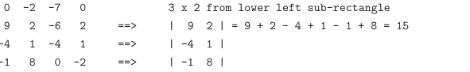

如下所示，朴素地解决这个问题行不通，因为这是一个 $100^6$ 算法。

```cpp
maxSubRect = -127*100*100; // lowest possible value for this problem
for (int i = 0; i < n; i++) for (int j = 0; j < n; j++) // start coord
  for (int k = i; k < n; k++) for (int l = j; l < n; l++) { // end coord
    subRect = 0; // sum items in this sub-rectangle
    for (int a = i; a <= k; a++) for (int b = j; b <= l; b++)
      subRect += arr[a][b];
    maxSubRect = max(maxSubRect, subRect); // keep largest so far
  }
```

解法：对于静态范围问题，有几种（众所周知的）DP 解法。DP 可以用于这个问题，因为计算一个较大的子矩形必然涉及计算其中的较小子矩形，而这种计算涉及重叠的子矩形！

一种可能的 DP 解法是将这个 n x n 数组转换为 n x n 求和数组，其中 arr[i][j] 不再表示其自身的值，而是子矩形 (0, 0) 到 (i, j) 内所有元素的和。这可以在读取输入时轻松地即时完成，并且仍为 $O(n^2)$。

```cpp
scanf("%d", &n);
for (int i = 0; i < n; i++) for (int j = 0; j < n; j++) {
    scanf("%d", &arr[i][j]);
    if (i > 0) arr[i][j] += arr[i - 1][j]; // if possible, add values from top
    if (j > 0) arr[i][j] += arr[i][j - 1]; // if possible, add values from left
    if (i > 0 && j > 0) arr[i][j] -= arr[i - 1][j - 1]; // to avoid double count
} // inclusion-exclusion principle
```

这段代码将输入数组（如左所示）转换为求和数组（如右所示）：

```text
0  -2  -7   0    ==>    0  -2  -9  -9
9   2  -6   2    ==>    9   9  -4   2
-4  1  -4   1    ==>    5   6 -11  -8
-1  8   0  -2    ==>    4  13  -4  -3
```

现在，借助这个求和数组，我们可以在 $O(1)$ 内回答任意子矩形 (i, j) 到 (k, l) 的和！假设我们想知道 (1, 2) 到 (3, 3) 的和。我们可以将求和数组分成 4 个部分并计算

`arr[3][3] - arr[0][3] - arr[3][1] + arr[0][1] = -3 - 13 - (-9) + (-2) = -9.`

```text
0 [-2] | -9 [-9]
----------------
9   9  | -4   2
5   6  | -11 -8
4 [13]  -4 [-3]
```

借助这个 $O(1)$ 的 DP 公式，现在可以在 $100^4$ 内解决这个问题。

```cpp
maxSubRect = -127*100*100; // lowest possible value for this problem
for (int i = 0; i < n; i++) for (int j = 0; j < n; j++) // start coord
    for (int k = i; k < n; k++) for (int l = j; l < n; l++) { // end coord
        subRect = arr[k][l]; // this is sum of all items from (0, 0) to (k, l): O(1)
        if (i > 0) subRect -= arr[i - 1][l]; // O(1)
        if (j > 0) subRect -= arr[k][j - 1]; // O(1)
        if (i > 0 && j > 0) subRect += arr[i - 1][j - 1]; // inclusion-exclusion: O(1)
        maxSubRect = max(maxSubRect, subRect);
    }
```

经验教训：并非每个范围问题都需要像第 2.3.3 节那样使用线段树！像这样输入数据为静态的问题通常可以用 DP 技术解决。

- 练习 1：上面的解法运行时间为 $100^4$。存在 $100^3$ 的解法。你能想出如何构造这个解法吗？
- 练习 2：如果给定的静态数组是一维的，会怎样？你能构造一个类似的 $O(1)$ DP 解法来回答范围求和查询(i, j)，即 `arr[i] + arr[i+1] + ... + arr[j]` 吗？
- 练习 3：使用练习 2 的解法在 $O(n^2)$ 内求一维数组中的最大和。你能进一步将解法改进到 $O(n)$ 吗？
- 练习 4：现在，如果查询是在一维静态数组上的范围最小值查询(i, j)，会怎样？第 2.3.3 节的解法使用线段树。你能否仅利用 DP 来解决同样的问题——假设这次没有更新操作？

##### 备注

还有其他经典 DP 问题我们选择不在本书中涵盖，例如矩阵链乘法 [4]、最优二叉搜索树 [14]、0-1 背包 [5, 14]。不过，Floyd Warshall 算法将在第 4.7 节讨论；字符串编辑距离、最长公共子序列（LCS）以及其他字符串上的 DP 将在第 6.3 节讨论。

#### 3.4.3 非经典示例

尽管 DP 是近年来编程竞赛中最常出现的问题类型之一，但上面那些处于*纯粹形式*的经典 DP 问题通常不会再次出现在近期的 ICPC 或 IOI 中。我们必须学习它们，以更深入地理解 DP。但一旦我们学会了，就必须继续解决许多其他非经典 DP 问题，并培养我们的“DP 技巧能力”。如下所示，有许多从简单到中级的有趣 DP 技巧。尝试在相应的在线评测系统中解决这些问题，以进一步提高你的 DP 技能。我们根据*我们*感知的难度水平（从易到难）对以下 DP 问题进行了分组和排序。每个示例中都有 DP 技巧课程。祝您愉快 :)。

##### 1. 切割木棍（UVa 10003）

简化问题陈述：给定一根长度 1 ≤ l ≤ 1000 的木棍，对该木棍进行 1 ≤ n ≤ 50 次切割（给出范围 (0 … l) 内的坐标）。切割成本由被切割木棍的长度决定。找出一个切割顺序，使总成本最小！

示例：l = 100，n = 3，切割坐标：coord = {25, 50, 75}（已排序）

如果我们从左到右切割，那么将产生成本 = 225

- 1. 在坐标 25 处切割，总成本 = 100；
- 2. 在坐标 50 处切割，总成本 = 100 + 75 = 175；
- 3. 在坐标 75 处切割，总成本 = 175 + 50 = 225；

然而，最优答案是：200

- 1. 在坐标 50 处切割，总成本 = 100；
- 2. 在坐标 25 处切割，总成本 = 100 + 50 = 150；
- 3. 在坐标 75 处切割，总成本 = 150 + 50 = 200；

解法：使用以下完全搜索递推式 + 自顶向下 DP（记忆化）：cut(left, right)

- 1. 如果 (left + 1 = right)，其中 left 和 right 是数组 coord 中的索引，则 cut(left, right) = 0，因为我们只剩下 1 段，不再需要切割。
- 2. 否则，尝试所有可能的切割点，并使用下面的代码选择最小成本：

```cpp
// cost = initially infinity (a very large integer)
for (int i = left + 1; i < right; i++) // max 50 steps
    cost = min(cost, cut(left, i) + cut(i, right) + (coord[right] - coord[left]));
// after the loop above is done, we know that cut(left, right) = cost
```

经验教训：上述完全搜索递推式只有 50×50 种可能的 left/right 索引配置（状态），运行仅需 50 × 50 × 50 = 125K 次操作！很容易将这个完全搜索/递归回溯递推式转换为自顶向下 DP，也就是记忆化技术！


##### 2. 组建测验团队（UVa 10911）

关于简化题意和完整解法代码，请参考第 1 章中提到的第一个问题。这个问题的宏大名称是“小规模一般图上的最小权完美匹配”。一般而言，这个问题很难，解法是 Edmonds 匹配算法（见 [34]），它并不容易编码。

然而，如果输入规模很小，最多 \(M \le 20\)，那么下面的 DP + 位掩码技术可以奏效。思路很简单，以 \(M = 6\) 为例：当还没有任何匹配时，状态为 `bit_mask=000000`。如果物品 0 和物品 2 匹配，我们可以通过这些简单的位运算打开第 0 位和第 2 位，即 `bit_mask | (1 << 0) | (1 << 2)`，于是状态变为 `bit_mask=000101`。然后，如果从这个状态出发，物品 1 和物品 5 匹配，状态变为 `bit_mask=010111`。当状态全为‘1’时，就得到了完美匹配，在此例中为：`bit_mask=111111`。

尽管到达某个状态有很多方式，但不同状态只有 \(O(2^M)\) 个！对于每个状态，我们记录为到达该状态所必须完成的先前匹配的最小权重。由于我们想要完美匹配，那么对于当前为“关”的位 \(i\)，我们必须用一个 \(O(M)\) 的循环从 \([i+1 \ldots M-1]\) 中找到最佳的另一个“关”位 \(j\)。这个检查同样通过位运算完成，即 `(!(bit_mask & (1 << j)))`——对 \(j\) 也类似。该算法运行时间为 \(O(M \times 2^M)\)。在 UVa 10911 问题中，\(M = 2N\) 且 \(2 \le N \le 8\)，因此这种 DP + 位掩码方法是可行的。更多细节，请研究第 1.2 节中给出的代码。

经验教训：DP + 位掩码可以求解一般图上 \(M \le 20\) 的小规模匹配实例。

练习：第 1.2 节的代码写道“这个 ‘break’ 是必要的。你明白为什么吗？”，提示是：“它有助于将时间复杂度从 \(O((2N)^2 \times 2^{2N})\) 降低到 \(O((2N) \times 2^{2N})\)”。回答它！

##### 3. 鱼贩（SPOJ 101）

简化题意：给定城市数量 \(3 \le n \le 50\)、可用时间 \(1 \le t \le 1000\)，以及两个 \(n \times n\) 矩阵（一个给出旅行时间，另一个给出两个城市之间的通行费），从第一个城市 0 选择一条路线，使得在特定时间 \(t\) 内到达最后一个城市 \(n - 1\) 时所需支付的通行费尽可能少。输出两项信息：实际使用的通行费总额和实际旅行时间。

注意这个问题中有两个可能相互冲突的要求。要求一是*最小化*沿途通行费。要求二是*确保*我们在分配时间内到达最后一个城市，这可能意味着我们必须在路径的某些部分支付更高的通行费。要求二是一个*硬性*约束。我们必须满足它，否则就没有解。

在尝试若干测试用例后应当很清楚，像 Dijkstra 算法（4.5 节）这样的贪心单源最短路径（SSSP）算法——在其纯粹形式下——行不通，因为选择最短旅行时间来确保我们用时少于可用时间 \(t\)，未必会得到尽可能小的通行费。另一方面，选择沿途最便宜的通行费可能无法确保我们在可用时间 \(t\) 内到达。这两个要求不能相互独立！

解法：我们可以使用以下完全搜索递推式 + 自顶向下 DP（记忆化）`go(curCity, time_left)`，它返回信息对（实际支付的通行费，实际使用的时间）：

- 1. `go(any curCity, < 0) = make_pair(INF, INF);` // 如果时间耗尽，就不能继续前进。
- 2. `go(n - 1, ≥ 0) = make_pair(0, 0);` // 到达最后一个城市，不再需要支付/旅行。
- 3. 一般情况下，`go(curCity, time_left)` 最好用下面的 C++ 代码来描述：

```cpp
pair<int, int> go(int curCity, int time_left) { // top-down DP, returns a pair
    if (time_left < 0) // invalid
        return make_pair(INF, INF); // a trick: return large value so that this state is not chosen
    if (curCity == n - 1) // at last city
        return make_pair(0, 0); // no need to pay toll, and time needed is 0
    if (memo[curCity][time_left].first != -1) // visited before
        return memo[curCity][time_left]; // simply return the answer

    pair<int, int> answer = make_pair(INF, INF);
    for (int neighbor = 0; neighbor < n; neighbor++) // try to go to another city
        if (curCity != neighbor) { // force us to always move
            pair<int, int> nextCity = go(neighbor,
                time_left - travelTime[curCity][neighbor]); // go to the other city
            // among neighboring cities, pick the one that has minimum cost
            if (nextCity.first + toll[curCity][neighbor] < answer.first) {
                answer.first = nextCity.first + toll[curCity][neighbor];
                answer.second = nextCity.second + travelTime[curCity][neighbor];
            }
        }
    memo[curCity][time_left] = answer;
    return answer; // store the answer to memo table as well as returning the answer to the caller
}
```

经验教训：一些图最短（最长）路径问题看起来可以用第 4 章的经典（通常是贪心）图算法解决，但实际上应该使用 DP 技术⁷。

⁷ 这个问题也可以用修改过的 Dijkstra 算法解决。

##### 4. ACORN（ACM ICPC Singapore 2007 LA 4106）

简化题意：给定 $t$ 棵橡树、所有树的高度 $h$、Jayjay 从一棵树飞到另一棵树时失去的高度 $f$，$1 \leq t, h \leq 2000$，$1 \leq f \leq 500$，以及每棵橡树上橡果的位置：`acorn[tree][height]`，确定 Jayjay 在一次下降中最多能收集多少颗橡果。示例：如果 $t = 3, h = 10, f = 2$ 且 `acorn[tree][height]` 如图 3.11 所示，最佳下降路径总共收集 8 颗橡果（虚线）。

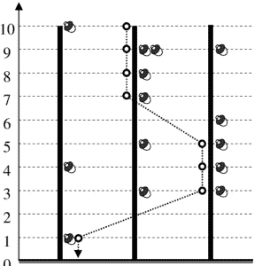

图 3.11：ACM ICPC 新加坡 2007——飞鼠 Jayjay 收集橡果

**朴素 DP 解法：** 使用一个记忆化表 `total[tree][height]`，它存储在 Jayjay 位于某棵树的某个高度时可能收集到的最多橡果数。然后 Jayjay 递归地尝试要么在同一棵橡树上向下移动 (-1) 个单位，要么从此位置飞到*另外 t−1 棵*橡树（-f）个单位。

这种方法最多需要 2000 × 2000 = 4M 个状态，时间复杂度为 4M × 2000 = 8B 次操作。这种方法显然会 TLE！

**更好的 DP 解法：** 我们实际上可以忽略“Jayjay 当前在哪棵树上”这一信息，因为只需记忆化它们之中的最优值就足够了。设置一个表：`dp[height]`，存储在 Jayjay 处于该高度时可能收集到的最多橡果数。下面这个自底向上的 DP 代码只需要 2000 = 2K 个状态，时间复杂度为 2000 × 2000 = 4M：

```cpp
for (int tree = 0; tree < t; tree++) // initialization
    dp[h] = max(dp[h], acorn[tree][h]);
for (int height = h - 1; height >= 0; height--)
    for (int tree = 0; tree < t; tree++) {
        acorn[tree][height] +=
            max(acorn[tree][height + 1], // from this tree, +1 above
                ((height + f <= h) ? dp[height + f] : 0)); // best from tree at height + f
        dp[height] = max(dp[height], acorn[tree][height]); // update this too
    }
printf("%d\n", dp[0]); // solution will be here
```

**经验教训：** 当朴素 DP 状态太大，导致整体 DP 时间复杂度不可行时，要思考*除显而易见的方法之外*的其他方式来表示可能的状态。记住，没有哪道编程竞赛题是无法解决的，出题人一定知道某种技巧。

##### 5. 自由括号（ACM ICPC Jakarta 2008 LA 4143）

**简化题意：** 给定一个简单的算术表达式，它只由*加法和减法*运算符组成，即 `1 − 2 + 3 − 4 − 5`。只要表达式仍然*合法*，你可以随意在表达式中的任何位置放置任意多个*括号*。你能得到多少个不同的数？对于上面的简单表达式，答案是 6：

| 表达式 | 结果 | 表达式 | 结果 |
|---|---:|---|---:|
| `1 − 2 + 3 − 4 − 5` | −7 | `1 − (2 + 3 − 4 − 5)` | 5 |
| `1 − (2 + 3) − 4 − 5` | −13 | `1 − 2 + 3 − (4 − 5)` | 3 |
| `1 − (2 + 3 − 4) − 5` | −5 | `1 − (2 + 3) − (4 − 5)` | −3 |

该表达式只由 2 ≤ *N* ≤ 30 个小于 100 的非负整数组成，数字之间用加法或减法运算符分隔。第一个操作数之前和最后一个数字之后没有运算符。

为了解决这个问题，我们需要作出三点观察：

- 1. 我们只需要在‘−’（负号）后面放置左括号，因为它会反转后续‘+’和‘−’运算符的含义；
- 2. 只有在已经使用了 *X* 个左括号时，你才能放置 *X* 个右括号——我们需要存储这一信息，以便正确处理子问题；
- 3. 最大值为 100 + 100 + ... 100（30 次）= 3000，最小值为 100 − 100 − ... − 100（29 次）= −2800——这一信息需要存储，我们将在下面看到。

更容易识别的 DP 状态有：

- 1. ‘idx’——当前正在处理的位置，我们需要知道现在在哪里。
- 2. ‘open’——左括号的数量，我们需要这一信息以生成合法表达式。


但这两个状态仍不唯一。例如，这个部分表达式：“1-1+1-1...” 的状态为 idx=3（索引：0、1、2、3 已处理），open=0（不能再放右括号），其总和为 0。接着，“1-(1+1-1)...” 也具有相同的状态 idx=3、open=0，且总和为 0。但 “1-(1+1)-1...” 具有相同的状态 idx=3、open=0，但总和为 -2。这个 DP 状态仍不唯一。因此我们需要额外的值来区分它们，即值 ‘val’，以使这些状态唯一。

我们可以用 bool state[idx][open][val] 表示该问题的所有可能状态，这是一个三维数组。由于 ‘val’ 的范围从 -2800 到 3000（5801 个不同值），状态数为 30 × 30 × 5801 ≈ 5M，而每个状态只需 O(1) 处理——足够快。代码如下：

```c
void rec(int idx, int open, int val) {
    if (memo[idx][open][val + 3500]) // this state has been reached before
        return; // notice the + 3500 trick to convert negative indices to [0 ... 7000]
               // negative indices are not friendly for accessing a static array!
    memo[idx][open][val + 3500] = 1; // set this state to be reached

    if (idx == N) { // last number, current value is one of the possible
        used[val + 3500] = 1; // result of expression
        return;
    }

    int nval = val + num[idx] * sig[idx] * ((open % 2 == 0) ? 1 : -1);
    if (sig[idx] == -1) // option 1: put an open bracket only if sign is -
        rec(idx+1, open+1, nval); // no effect if sign is +
    if (open > 0) // option 2: put close bracket, can only do this if we
        rec(idx+1, open-1, nval); // already have some open brackets
    rec(idx+1, open, nval); // option 3: normal, do nothing
}

// Prepare a bool array ‘used’, initially set to all false,
//     then run this top-down DP.
// The solution is all the values in array ‘used’,
//     offset by -3500, that are flagged as true.
```

经验教训：该问题的 DP 形式化并不简单。尝试找到一种能够唯一标识子问题的状态表示。进行观察，并考虑从那里入手解决问题。

##### 6. 树上的最大加权独立集

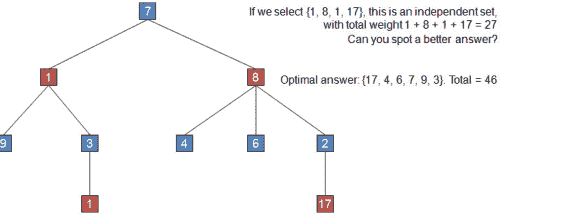

图 3.12：树上的最大加权独立集（MWIS）

简化问题陈述：给定一个带权图 $G$，求其上的最大加权独立集（MWIS）。如果图 $G$ 的顶点子集中任意两个顶点之间在 $G$ 中都没有边，则称该子集为独立集（IS）。我们的任务是选择 $G$ 中权重最大的 IS。如果图 $G$ 是一棵树，该问题有简单的 DP 解（见图 3.12）。

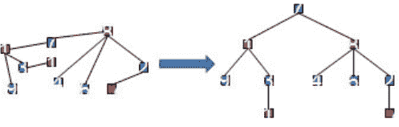

图 3.13：为树定根

提示：对于几乎所有与树相关的问题，如果树尚未定根，我们需要先“为树定根”。如果树没有专门指定为根的顶点，则任选一个顶点作为根。这样做后，可能会出现关于子树的子问题，就像这个树上的 MWIS 问题（见图 3.13）。

一旦有了有根（子）树，我们就可以建立关于其子节点的 MWIS 递推关系。一种形式是：$C(v, selected) =$ 以‘v’为根的子树在‘selected’时的最大权重。

**基本情况（叶节点）：**

- A. 如果叶节点 $v$ 未被选中，则以 $v$ 为根的 MWIS 为 0。

  $C(v, false) = 0$，对所有叶节点 $v$

- B. 如果叶节点 $v$ 被选中，则以 $v$ 为根的 MWIS 为 $v$ 的权重。

  $C(v, true) = w(v)$，对所有叶节点 $v$

**递推关系（内部节点）：**

- A. 如果根 $v$ 被选中，则加上 $v$ 的权重，但 $v$ 的所有子节点都不能被选中。

  $C(v, true) = \sum_{ch \in children(v)} C(ch, false) + w(v)$

- B. 如果根 $v$ 未被选中，则 $v$ 的子节点可以被选中也可以不被选中（取最大值）。

  $C(v, false) = \sum_{ch \in children(v)} \max(C(ch, false), C(ch, true))$

答案将在根节点处取得：$\max(C(root, false), C(root, true))$。DP 解可以用自顶向下或自底向上的方式实现。由于只有 $2 \times V$ 个状态，DP 解运行时间为 $O(kV)$，其中 $k$ 是树中一个顶点的平均子节点数！

经验教训：树上的优化问题可以用 DP 技术求解。其解法通常涉及将信息传给父节点，并从有根树的子节点获取信息。

#### 3.4.4 关于编程竞赛中动态规划的备注

在过去（20 世纪 90 年代），如果参赛者擅长 DP，他就能成为“编程竞赛之王”，因为通常 DP 问题是“决胜题”。但现在，掌握 DP 是一项基本要求！没有这些知识，你无法在竞赛中表现出色。然而，我们必须不断提醒本书的读者：不要通过背诵经典 DP 问题的解法就声称自己掌握了 DP！尝试回归使用 DP 解决问题的基本方法：确定能够唯一且高效表示子问题的状态（表），然后决定如何填表，可以通过自顶向下递归或自底向上循环。

⁸供参考：独立集的补集是顶点覆盖。

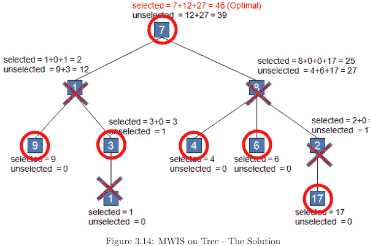

我们建议，除了 3.4.3 节所示的例子之外，参赛者还应学习近期编程竞赛中不断出现的更新形式的 DP 问题，尤其是使用“四边形不等式”、凸性质、二分查找等加速 DP 解的技巧。

可用动态规划求解问题的编程练习：

- **最长递增子序列（LIS） – 经典题**
  1. UVa 103 - 堆叠盒子（DAG 中最长路径 ≈ LIS）
  2. UVa 111 - 历史评分（简单直接）
  3. UVa 231 - 测试捕手（简单直接）
  4. UVa 481 - 什么上升了？（必须使用 O(n log k) 的 LIS）
  5. UVa 497 - 战略防御计划（必须打印解）
  6. UVa 10051 - 立方体塔（可建模为 LIS）
  7. UVa 10534 - Wavio 序列（必须使用两次 O(n log k) 的 LIS）
  8. UVa 11790 - Murcia 的天际线（经典 LIS+LDS 的组合，带权）
  9. UVa 11003 - 盒子
  10. UVa 11456 - 火车排序（取 max(LIS(i) + LDS(i - 1), ∀i ∈ [0...N-1])）
  11. LA 2815 - 铺砌积木（Kaohsiung03）

- **硬币找零 – 经典题**
  1. UVa 147 - 美元（类似 UVa 357 和 UVa 674）
  2. UVa 166 - 找零
  3. UVa 357 - 让我数一数方法（硬币找零问题的一个变体）
  4. UVa 674 - 硬币找零
  5. UVa 10306 - 电子硬币
  6. UVa 10313 - 付出代价
  7. UVa 11137 - 巧妙的立方货币（使用 long long）
  8. UVa 11517 - 精确找零

- **最大和**
  1. UVa 108 - 最大和（最大二维和，本节详述）
  2. UVa 836 - 最大子矩阵（最大二维和）
  3. UVa 10074 - 占领土地（最大二维和）
  4. UVa 10667 - 最大块（最大二维和）
  5. UVa 10827 - 环面上的最大和（最大二维和）
  6. UVa 507 - Jill 再次骑行（最大一维和/最大连续子序列）
  7. UVa 10684 - 头奖（最大一维和/最大连续子序列）

- **0-1 背包 – 经典题**
  1. UVa 562 - 分割硬币
  2. UVa 990 - 潜水寻金
  3. UVa 10130 - 超级促销
  4. LA 3619 - 不同素数之和（Yokohama06）

- **字符串编辑（对齐）距离 – 经典题（见 6.3 节）**

- **最长公共子序列 – 经典题（见 6.3 节）**

- **非经典题（中等难度）**
  1. UVa 116 - 单向 TSP（类似 UVa 10337）
  2. UVa 473 - 喧闹的摇滚乐手
  3. UVa 607 - 安排讲座
  4. UVa 10003 - 切割木棍（本书中讨论）
  5. UVa 10337 - 飞行计划（可用 Dijkstra 求解的 DP）
  6. UVa 10891 - 求和游戏（二维状态）
  7. UVa 11450 - 婚礼购物（本书中讨论）
  8. LA 3404 - 原子赛车（Tokyo05）

- **DP + 位掩码**
  1. UVa 10364 - 正方形（可使用位掩码技术）
  2. UVa 10651 - 卵石纸牌
  3. UVa 10908 - 最大正方形
  4. UVa 10911 - 组建测验队伍（本节详述）
  5. LA 3136 - 趣味游戏（Beijing04）
  6. PKU 2441 - 安排公牛

- **基于‘图问题’的 DP**
  1. UVa 590 - 永远在奔跑
  2. UVa 910 - 电视游戏（简单直接）
  3. UVa 10681 - Teobaldo 的旅行
  4. UVa 10702 - 旅行商
  5. LA 4201 - 切换灯泡（Dhaka08）
  6. SPOJ 101 - 鱼贩


### 3.5 章节笔记

- 具有非平凡状态的DP
  1. LA 4106 - ACORN（Singapore07）（带降维的DP）
  2. LA 4143 - Free Parentheses（Jakarta08）（题目由Felix Halim提供）
  3. LA 4146 - ICPC Team Strategy（Jakarta08）（三状态DP）
  4. LA 4336 - Palindromic paths（Amritapuri08）
  5. LA 4337 - Pile it down（Amritapuri08）
  6. LA 4525 - Clues（Hsinchu09）
  7. LA 4526 - Inventory（Hsinchu09）
  8. LA 4643 - Twenty Questions（Tokyo09）

- 树形DP
  1. UVa 10243 - Fire! Fire!! Fire!!!（树上的最小顶点覆盖 ≈ 最大独立集）
  2. UVa 11307 - Alternative Arborescence（最小色数和，6种颜色足够）
  3. LA 3685 - Perfect Service（Kaohsiung06）
  4. LA 3794 - Party at Hali-Bula（Tehran06）
  5. LA 3797 - Bribing FIPA（Tehran06）
  6. LA 3902 - Network（Seoul07）
  7. LA 4141 - Disjoint Paths（Jakarta08）

本章“完整搜索”材料的主要来源是USACO训练网关[18]。

我们采用“完整搜索”这个名称，而不是“暴力搜索”，因为我们认为某些完整搜索解法虽然完整，但可以足够巧妙和快速，例如**分支限界**和**A*搜索**（本书尚未讨论这两者）。我们认为“巧妙的暴力搜索”这个说法有点自相矛盾。

分治范式通常以其流行算法的形式使用：二分查找（二分法）、归并/快速/堆排序，以及数据结构：二叉搜索树、堆、线段树等。稍后我们将在计算几何（第7.5节）中看到更多分治。

*基本*的贪心与动态规划（DP）技术总是包含在流行的算法教材中，例如 Introduction to Algorithms [4]、Algorithm Design [13]、Algorithms [5]、Programming Challenges [23]、The Art of Algorithms and Programming Contests [16]、Art of Programming Contest [1]。然而，为了跟上这些技术日益增长的难度和创造性，尤其是DP技术，我们加入了更多来自互联网的参考资料：TopCoder算法教程[25]以及近期的编程竞赛，例如ACM ICPC Regional Kaohsiung 2006、Singapore 2007、Jakarta 2008、Central European Olympiad in Informatics 2009等。

然而，对于某些现实问题，尤其是被归类为NP完全[4]的问题，目前讨论的许多方法将不再适用。例如，0-1背包问题具有$O(NW)$的DP复杂度，如果$W$很大，就太慢了。为此，人们使用启发式方法或局部搜索：束搜索、禁忌搜索[10]、遗传算法、蚁群优化等。

本章讨论了大约**109道编程练习**。

## 第4章：图

*许多现实问题可以归类为图问题。有些问题有高效解法。有些问题目前还没有。在本章中，我们学习各种具有已知高效解法的图问题，涵盖基本遍历、最小生成树、最短路径和网络流算法。*

### 4.1 概述与动机

在本章中，我们讨论编程竞赛中常见的图问题、解决这些问题的算法，以及这些算法的实际实现。如何存储图信息的问题已在前面第2.3.1节中讨论过。

我们假设读者熟悉以下术语：顶点/节点、边、无权/加权、无向/有向、入度/出度、自环/多重边（多重图）与简单图、稀疏/稠密、路径、环、孤立顶点与可达顶点、（强）连通分量、子图、树/森林、完全图、有向无环图、二分图、欧拉/哈密顿路径/回路。如果你遇到任何不熟悉的术语，请到Wikipedia [46]搜索该特定术语。

表4.1总结了我们迄今对近期ACM ICPC亚洲区域赛中图问题的研究及其ICPC Live Archive [11] ID。尽管图问题如此之多（本章讨论了许多），它们在一个题目集中只出现一次或两次。问题是：“我们必须学习哪些？”如果你想在竞赛中取得好成绩，除了学习所有这些材料，别无选择。

### 4.2 深度优先搜索

#### 基本形式与应用

深度优先搜索——缩写为DFS——是一种遍历图的简单算法。借助全局数组`int dfs_num[V]`（初始设为“未访问”，即常量值`DFS_WHITE = 0`），DFS从起始顶点开始，在尝试其他分支之前，访问从起始顶点能到达的最深顶点。注意，这个访问顺序在很大程度上取决于我们排列某顶点邻居的方式，即序列0 → 1 → 3 → 2（回溯到3）→ 4也是一种可能的访问序列。还要注意，一次调用`dfs(u)`只会访问所有与顶点`u`*相连*的顶点。这就是为什么在图4.1中，通过调用`dfs(0)`，顶点5、6和7当前未被访问。

这里展示的DFS代码与前面第3.1节展示的递归回溯代码非常相似。如果我们把典型回溯代码的伪代码（在下面复现）与上面展示的DFS代码进行比较，可以看到主要区别只在于我们是否标记已访问顶点。DFS会标记。回溯不会。由于不重复访问顶点，DFS的运行时间为$O(V + E)$，但回溯的时间复杂度呈指数增长。

```c
void backtracking(state) {
    if (hit end state or invalid state) // invalid state includes states that cause cycling
        return; // we need terminating/pruning condition
    for each neighbor of this state // regardless it has been visited or not
        backtracking(neighbor);
}
```

#### 其他应用

DFS不仅对遍历图有用。它还可用于解决许多其他图问题。

##### 在无向图中寻找连通分量

一次调用`dfs(u)`只会访问实际与`u`相连的顶点，这一事实可用于寻找（并计数）无向图的连通分量（关于有向图上的类似问题，请见下文进一步内容）。我们可以简单地使用以下代码，从剩余未访问顶点之一重新开始DFS，以寻找下一个连通分量（直到所有顶点都被访问）：

```c
// all sample codes involving REP use this macro
#define REP(i, a, b) \
  for (int i = int(a); i <= int(b); i++)

// inside int main()
numComponent = 0;
memset(dfs_num, DFS_WHITE, sizeof dfs_num);
REP (i, 0, V - 1)
    if (dfs_num[i] == DFS_WHITE) {
        printf("Component %d, visit: ", ++numComponent);
        dfs(i);
        printf("\n");
    }
printf("There are %d connected components\n", numComponent);

// For the sample graph, the output is like this:
// Component 1, visit: 0 1 2 3 4
// Component 2, visit: 5
// Component 3, visit: 6 7
```

**练习：**我们也可以使用并查集（Union-Find Disjoint Sets）来解决这个图问题。怎么做？

##### 泛洪填充——为连通分量加标签

DFS除了用于寻找（并计数）连通分量之外，还可用于其他目的。这里，我们展示如何通过对`dfs(u)`做简单调整来为连通分量*加标签*。通常，我们使用连通分量的编号来“标记”（或“着色”）该分量。这种变体更广为人知的名称是“泛洪填充”。

```c
void floodfill(int u, int color) {
    dfs_num[u] = color; // not just a generic DFS_BLACK
    TRvii(AdjList[u], v) // try all neighbors v of vertex u, note that we use our TRvii macro again
        if (dfs_num[v->first] == DFS_WHITE) // avoid cycle
            floodfill(v->first, color); // v is an (neighbor, weight) pair
}

// inside int main()
numComponent = 0;
memset(dfs_num, DFS_WHITE, sizeof dfs_num);
REP (i, 0, V - 1) // for each vertex u in [0..V-1], note that we use our REP macro again
    if (dfs_num[i] == DFS_WHITE) // if not visited
        floodfill(i, ++numComponent);
REP (i, 0, V - 1)
    printf("Vertex %d has color %d\n", i, dfs_num[i]);

// For the sample graph, the output is like this:
// Vertex 0 1 2 3 4 have color 1
// Vertex 5 has color 2
// Vertex 6 7 has color 3
```

**练习：**泛洪填充更常见于二维网格（隐式图）上执行。尝试解决UVa 352、469、572等。

##### 通过DFS生成树检查图边性质

在图的某个连通分量上运行DFS会形成一棵DFS*生成树*（如果图有多个连通分量，并且对每个分量运行DFS，则形成DFS*生成森林*）。在`DFS_WHITE`（未访问）和`DFS_BLACK`（已访问且已完成）之上，再增加一种顶点状态：`DFS_GRAY = 2`（已访问但尚未完成），我们可以利用这棵DFS生成树（或生成森林）将图的边分为四类：

1. **树边：**DFS遍历过的边，即从状态为`DFS_GRAY`的顶点指向状态为`DFS_WHITE`的顶点。
2. **后向边：**属于环的一部分，即也从状态为`DFS_GRAY`的顶点指向状态为`DFS_GRAY`的顶点。注意，通常我们不把双向边视为存在“环”（我们需要记住`dfs_parent`来区分这种情况，见下面的代码）。
3. **前向/交叉边：**从状态为`DFS_GRAY`的顶点指向状态为`DFS_BLACK`的顶点。这两类边通常不用于编程竞赛题目。

图4.2展示了在图4.1的示例图上依次调用`dfs(0)`、`dfs(5)`，最后调用`dfs(6)`的动画（从左上到右下）。我们可以看到1 → 2 → 3 → 1是一个（真正的）环，并且我们将边(3 → 1)归类为后向边；而0 → 1 → 0不是环，边(1 → 0)只是一条双向边。这种DFS变体的代码如下所示。


## 

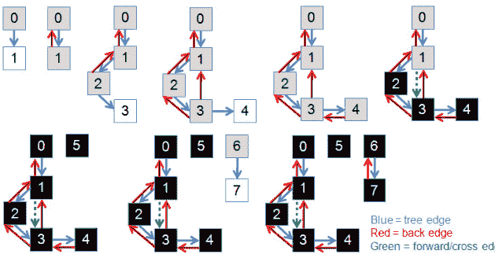

图 4.2：DFS 动画

```cpp
void graphCheck(int u) { // DFS for checking graph edge properties...
  dfs_num[u] = DFS_GRAY; // color this as GRAY (temporary)
  TRvii (AdjList[u], v) { // traverse this AdjList
    if (dfs_num[v->first] == DFS_WHITE) { // GRAY to WHITE
      // printf(" Tree Edge (%d, %d)\n", u, v->first);
      dfs_parent[v->first] = u; // parent of this children is me
      graphCheck(v->first);
    }
    else if (dfs_num[v->first] == DFS_GRAY) { // GRAY to GRAY
      if (v->first == dfs_parent[u])
        printf(" Bidirectional (%d, %d) - (%d, %d)\n", u, v->first, v->first, u);
      else
        printf(" Back Edge (%d, %d) (Cycle)\n", u, v->first);
    }
    else if (dfs_num[v->first] == DFS_BLACK) // GRAY to BLACK
      printf(" Forward/Cross Edge (%d, %d)\n", u, v->first);
  }
  dfs_num[u] = DFS_BLACK; // now color this as BLACK (DONE)
}
```

#### 寻找割点与桥

动机问题：给定一张道路图（无向图），其中所有交叉口（顶点）和道路（边）都关联有代价，破坏一个交叉口或一条道路，使得道路网络瘫痪，并且代价最小。这是一个在无向图（道路图）中寻找最小代价割点（交叉口）或最小代价桥（道路）的问题。

“割点”定义为图 G 中的一个*顶点*，移除它会使 G 不连通。没有割点的图称为“双连通图”。类似地，“桥”定义为图 G 中的一条*边*，移除它会使 G 不连通。这两个问题通常针对无向图定义，尽管它们对有向图也仍然有良好的定义。

寻找割点的朴素算法（也可以稍作调整来寻找桥）：

1. 运行 $O(V+E)$ 的 DFS，统计原图的连通分量数量
2. 对所有顶点 $v \in V$ // $O(V)$
   - (a) 切除（移除）顶点 $v$ 及其关联边
   - (b) 运行 $O(V+E)$ 的 DFS，检查连通分量数量是否增加
   - (c) 如果是，则 $v$ 是割点/切割顶点：恢复 $v$ 及其关联边

这个朴素算法会调用 DFS $O(V)$ 次，因此运行时间为 $O(V \times (V+E)) = O(V^2 + VE)$。但这*不是*最好的算法，因为我们实际上只需运行一次 $O(V+E)$ 的 DFS，就能找出所有割点和桥。

这个 DFS 变体由 John Hopcroft 和 Robert Endre Tarjan 提出（见 [4] 中的问题 22.2），它只是前面所示 DFS 代码的又一个扩展。

该算法维护两个数字：$dfs\_num(u)$ 和 $dfs\_low(u)$。其中，$dfs\_num(u)$ 存储顶点 $u$ *第一次*被访问时的迭代计数器，而不仅仅用于区分 $DFS\_WHITE$ 与 $DFS\_GRAY/DFS\_BLACK$。另一个数字 $dfs\_low(u)$ 存储从 $u$ 的 DFS 生成子树可达的最低 $dfs\_num$。当顶点 $u$ 第一次被访问时，初始有 $dfs\_low(u) = dfs\_num(u)$。之后，只有当存在环（存在一些后向边）时，$dfs\_low(u)$ 才可能变得更小。注意，如果 $v$ 是 $u$ 的直接父节点，我们不会用后向边 $(u,v)$ 更新 $dfs\_low(u)$。

为清晰起见，参见图 4.3。在这两个示例图中，我们运行 `articulationPointAndBridge()`。假设在图 4.3 左侧的图中，访问顺序为 0（第 0 次迭代）→ 1（1）→ 2（2）（回溯到 1）→ 4（3）→ 3（4）（回溯到 4）→ 5（5）。可以看到这些迭代计数器在 `dfs_num` 中被正确显示。由于该图中没有后向边，所以所有 `dfs_low = dfs_num`。

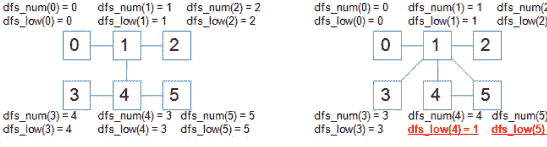

图 4.3：引入另外两个 DFS 属性：`dfs_num` 和 `dfs_low`

在图 4.3 右侧的图中，访问顺序为 0（第 0 次迭代）→ 1（1）→ 2（2）（回溯到 1）→ 3（3）（回溯到 1）→ 4（4）→ 5（5）。存在一条重要的后向边形成环，即边 5-1 是环 1-4-5-1 的一部分。这使得顶点 1、4 和 5 能够到达顶点 1（其 `dfs_num` 为 1）。因此，{1, 4, 5} 的 `dfs_low` 都是 1。

当我们位于顶点 $u$，$v$ 是 $u$ 的邻居，并且 $dfs\_low(v) \ge dfs\_num(u)$ 时，$u$ 是一个割点。这是因为 $dfs\_low(v)$ *不小于* $dfs\_num(u)$ 这一事实意味着，不存在与顶点 $v$ 相连且能到达具有更低 $dfs\_num(w)$ 的顶点 $w$ 的后向边（这进一步意味着 $w$ 是 DFS 生成树中 $u$ 的父节点）。因此，要从 $v$ 到达 $u$ 的那个父节点，必须经过顶点 $u$。这意味着移除顶点 $u$ 会使图不连通。

特殊情况：DFS 生成树的根（被选为 DFS 调用起点的顶点）只有当它拥有多于一个子节点时才是割点（这是一个该算法无法检测到的平凡情况）。

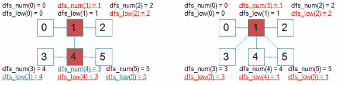

图 4.4：使用 `dfs_num` 和 `dfs_low` 寻找割点

更多细节参见图 4.4。在图 4.4 左侧的图中，顶点 1 和 4 是割点，因为例如在边 1-2 中，我们看到 `dfs_low(2) ≥ dfs_num(1)`，而在边 4-5 中，我们也看到 `dfs_low(5) ≥ dfs_num(4)`。在图 4.4 右侧的图中，顶点 1 是割点，因为例如在边 1-5 中，`dfs_low(5) ≥ dfs_num(1)`。寻找桥的过程类似。当 `dfs_low(v) > dfs_num(u)` 时，边 u-v 是一座桥。在图 4.5 中，对于左图和右图，几乎所有边都是桥。只有右图中的边 1-4、4-5 和 5-1 不是桥。这是因为——例如——对于边 4-5，`dfs_low(5) ≤ dfs_num(4)`，也就是说，即使移除这条边 4-5，我们也可以确定顶点 5 仍然能够通过另一条绕过顶点 4 的路径到达顶点 1，因为 `dfs_low(5) = 1`。

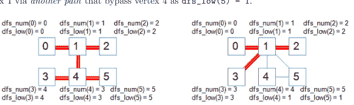

图 4.5：同样使用 `dfs_num` 和 `dfs_low` 寻找桥

该算法的代码片段如下：

```cpp
void articulationPointAndBridge(int u) {
    dfs_low[u] = dfs_num[u] = dfsNumberCounter++; // dfs_low[u] <= dfs_num[u]
    TRvii (AdjList[u], v)
        if (dfs_num[v->first] == DFS_WHITE) { // a tree edge
            dfs_parent[v->first] = u; // parent of this children is me
            if (u == dfsRoot) // special case
                rootChildren++; // count children of root
            articulationPointAndBridge(v->first);
            if (dfs_low[v->first] >= dfs_num[u]) // for articulation point
                articulation_vertex[u] = true; // store this information first
            if (dfs_low[v->first] > dfs_num[u]) // for bridge
                printf(" Edge (%d, %d) is a bridge\n", u, v->first);
            dfs_low[u] = min(dfs_low[u], dfs_low[v->first]); // update dfs_low[u]
        }
        else if (v->first != dfs_parent[u]) // a back edge and not direct cycle
            dfs_low[u] = min(dfs_low[u], dfs_num[v->first]); // update dfs_low[u]
}
```

```cpp
// inside int main()
dfsNumberCounter = 0;
memset(dfs_num, DFS_WHITE, sizeof dfs_num);
printf("Bridges:\n");
REP (i, 0, V - 1)
  if (dfs_num[i] == DFS_WHITE) {
    dfsRoot = i; rootChildren = 0;
    articulationPointAndBridge(i);
    articulation_vertex[dfsRoot] = (rootChildren > 1); // special case
  }

printf("Articulation Points:\n");
REP (i, 0, V - 1)
  if (articulation_vertex[i])
    printf(" Vertex %d\n", i);
```

#### 寻找有向图中的强连通分量

DFS 的另一个应用是在*有向*图中寻找*强连通分量*。这与寻找无向图的连通分量是不同的问题。在图 4.6 中，我们有一张与图 4.1 中的图相似的图，但现在边是有向的。我们可以看到，尽管图 4.6 中的图看起来像“连通”成一个分量，但它实际上“不强”。在有向图中，我们更关心“强连通分量（SCC）”这一概念，即如果在 SCC 中任取一对顶点 *u* 和 *v*，我们都能找到从 *u* 到 *v* 的路径，反之亦然。图 4.6 中实际上有三个 SCC，如高亮所示：{0}、{1, 3, 2} 和 {4, 5, 7, 6}。

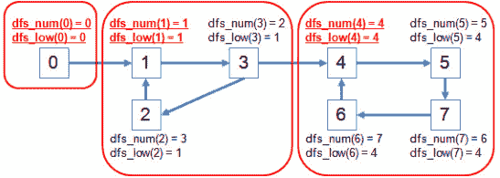

图 4.6：有向图及其强连通分量（SCC）的示例

至少有两种已知的寻找 SCC 的算法：Kosaraju 算法——在 [4] 中解释，以及 Tarjan 算法 [45]。本书采用 Tarjan 的版本，因为它从我们之前关于寻找割点和桥的讨论中自然扩展而来——割点和桥的算法同样由 Tarjan 提出。

该算法的基本思想是：SCC 构成 DFS 生成树的子树，而这些子树的根也是 SCC 的根。为了判断顶点 *u* 是否是某个 SCC 的根，Tarjan 的 SCC 算法使用 *dfs_num* 和 *dfs_low*，即检查是否 *dfs_low(u) = dfs_num(u)*。被访问的顶点按照其 *dfs_num* 压入栈中。当 DFS 从某棵子树返回时，顶点会从栈中弹出。如果该顶点是某个 SCC 的根，那么该顶点以及在它之前弹出的所有顶点就构成该 SCC。代码如下：


#### 拓扑排序（在有向无环图上）

有向无环图（DAG）的拓扑排序或拓扑排序次序，是将 DAG 中的顶点排成一个线性次序，使得若 DAG 中存在边 $(u \to v)$，则顶点 $u$ 排在顶点 $v$ 之前。每个 DAG 都有一个或多个拓扑排序。实现拓扑排序算法的方法有几种。最简单的方法是稍微修改本节中最简单的 DFS 实现。

```cpp
void topoVisit(int u) {
    dfs_num[u] = DFS_BLACK;
    TRVi (AdjList[u], v)
        if (dfs_num[v->first] == DFS_WHITE)
            topoVisit(v->first);
    topologicalSort.push_back(u); // this is the only change
}

// inside int main()
topologicalSort.clear(); // this global vector stores topological sort in reverse order
memset(dfs_num, DFS_WHITE, sizeof dfs_num);
REP (i, 0, V - 1)
    if (dfs_num[i] == DFS_WHITE)
        topoVisit(i);
reverse(topologicalSort.begin(), topologicalSort.end());
REP (i, 0, topologicalSort.size() - 1)
    printf("%d\n", topologicalSort[i]);
```

在 topoVisit(u) 中，只有在访问完 u 下面的所有子树之后，我们才把 u 追加到已探索顶点列表中。由于 vector 只支持从尾部进行*高效插入*，我们通过简单地在输出阶段反转打印顺序来规避这个问题。这个用于寻找（一个有效的）拓扑排序的简单算法同样归功于 Tarjan。它和 DFS 一样，运行时间为 $O(V + E)$。

练习：你理解为什么在标准 DFS 代码中追加 `topologicalSort.push_back(u)` 就足以帮助我们找到 DAG 的拓扑排序吗？用你自己的话解释一下！

深度优先搜索（DFS）的编程练习：

- 寻找连通分量 / 洪水填充
  1. UVa 260 - X 游戏
  2. UVa 352 - 季节性战争（洪水填充）
  3. UVa 459 - 图连通性（也可用并查集解决）
  4. UVa 469 - 佛罗里达湿地（洪水填充）
  5. UVa 572 - 油田（洪水填充）
  6. UVa 657 - 骰子已掷出（洪水填充）
  7. UVa 782 - 轮廓绘制（洪水填充）
  8. UVa 784 - 迷宫探索（洪水填充）
  9. UVa 785 - 网格着色（洪水填充）
  10. UVa 852 - 判定围棋胜负（洪水填充）
  11. UVa 10336 - 语言排名（洪水填充）
  12. UVa 10926 - 有多少依赖？
  13. UVa 10946 - 你想填什么？（洪水填充）
  14. UVa 11110 - 等分（洪水填充）
  15. UVa 11518 - 多米诺骨牌 2（洪水填充）
  16. UVa 11749 - 可怜的贸易顾问（也可用并查集解决）
- 寻找割点 / 桥
  1. UVa 315 - 网络（割点）
  2. UVa 610 - 街道方向（桥）
  3. UVa 796 - 关键链路（桥）
  4. UVa 10199 - 导游（割点）
- 寻找强连通分量
  1. UVa 10731 - 测试
  2. UVa 11504 - 多米诺骨牌
  3. UVa 11709 - 信任组
  4. UVa 11770 - 照亮远方
- 拓扑排序（另见第 4.9.2 节中 DAG 的最短/最长路径问题）
  1. UVa 124 - 遵循命令
  2. UVa 200 - 稀有顺序
  3. UVa 872 - 排序
  4. UVa 10305 - 任务排序

### 4.3 广度优先搜索

#### 基本形式与应用

广度优先搜索——缩写为 BFS——是图遍历算法的另一种形式。BFS 首先将初始源顶点 *s* 插入队列，然后按如下方式处理队列：

在无权图中，由一条边连接的两个相邻顶点之间的距离就是一单位。因此，我们之前见过的某个顶点的层数，恰好就是从源点到该顶点的最短路径长度。例如在图 4.7 中，从标号为‘35’的顶点到标号为‘30’的顶点的最短路径为 3，因为‘30’在 BFS 访问序列的第三层。如果我们存储 BFS 生成树，那么重建最短路径：35 → 15 → 10 → 30 就很容易，即顶点‘30’记住‘10’是其父节点，顶点‘10’记住‘15’，顶点‘15’记住‘35’（源点）。

应选择哪种图遍历算法？表 4.2 可能会有所帮助。

| | O(V + E) DFS | O(V + E) BFS |
|---|---|---|
| 优点 | 使用更少内存 | 能解决无权图上的 SSSP |
| 缺点 | 不能解决无权图上的 SSSP | 使用更多内存 |
| 代码 | 编码稍容易 | 编码稍长 |

表 4.2：图遍历算法决策表

广度优先搜索（BFS）的编程练习：

- 无权图上的单源最短路径
  1. UVa 336 - 节点太远
  2. UVa 383 - 航运路线
  3. UVa 417 - 单词索引
  4. UVa 429 - 单词变换
  5. UVa 439 - 骑士移动
  6. UVa 532 - 地下城主（三维 BFS）
  7. UVa 567 - 风险
  8. UVa 627 - 网络（必须打印路径）
  9. UVa 762 - 我们廉价运送
  10. UVa 924 - 传播消息
  11. UVa 928 - 永恒真理
  12. UVa 10009 - 条条大路通向哪里？
  13. UVa 10044 - Erdos 数（解析部分很麻烦）
  14. UVa 10067 - 玩转轮子（题目描述中的隐式图）
  15. UVa 10102 - 彩色场中的路径
  16. UVa 10150 - 双联词（BFS 状态是字符串！）
  17. UVa 10422 - FEN 中的骑士
  18. UVa 10610 - 地鼠与鹰
  19. UVa 10653 - 炸弹！不，它们是地雷！！（BFS 实现必须高效）
  20. UVa 10959 - 聚会，第一部分
  21. UVa 11049 - 基本墙迷宫（一些受限移动 + 打印路径）
  22. UVa 11352 - 疯狂国王
  23. UVa 11513 - 9 数码（从目标状态开始 BFS + 高效数据结构）
  24. UVa 11545 - 在黑暗中避开丛林
  25. UVa 11730 - 数字变换（需要质因数分解，见第 5.3.1 节）
  26. UVa 11792 - Krochanska 在这里！（注意“重要站点”的定义）
  27. LA 3290 - 邀请你的朋友（加上 Dijkstra 算法）
  28. LA 4408 - 解锁锁
  29. LA 4637 - 使用 Sed 的重复替换
  30. LA 4645 - 被感染的土地
- **变体**
  1. UVa 10004 - 双着色（二分图检查）
  2. UVa 11080 - 放置守卫（二分图检查，一些棘手情况）
  3. UVa 11101 - 商场狂热（从商场1进行多源 BFS，在商场2边界取得最小值）
  4. UVa 11624 - 火灾！（多源 BFS）

### 4.4 Kruskal 算法

#### 基本形式与应用

引入问题：给定一个连通、无向、带权图 $G$（见图 4.8 中最左侧的图），选择边的一个子集 $E' \subseteq G$，使得图 $G$ 仍然连通，并且所选边 $E'$ 的总权重最小。

为了满足连通性条件，$E'$ 中的边必须形成一棵*树*，它跨越（覆盖）$G$ 中的所有 $V \in G$——即*生成树*！$G$ 中可能有若干棵有效的生成树，例如见图 4.8 中间和右侧。其中一棵就是满足最小权重条件的所需解。

这个问题称为最小生成树（MST）问题，并且有许多实际应用，正如我们将在本节后面看到的那样。

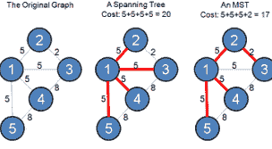

图 4.8：最小生成树（MST）问题示例（来自 UVa 908 [17]）

这个 MST 问题可以用几种著名算法解决，即 Prim 算法和 Kruskal 算法，二者都是贪心算法，并在 [4, 21, 14, 23, 16, 1, 13, 5] 中有所解释。对于编程竞赛，我们选择 Kruskal 算法，因为借助 2 种数据结构，它的实现非常容易。

小约瑟夫·伯纳德·克鲁斯卡尔（Joseph Bernard Kruskal Jr.）的算法首先按权重非递减的顺序在 $O(E \log E)$ 内对 $E$ 条边排序。这可以很容易地使用 `priority_queue` 完成（或者，也可以使用 `vector` 和 `sort`）。然后，它*贪心地*尝试将 $O(E)$ 条成本最小的边加入解中，只要这种加入不会形成环。这个环检查可以很容易地使用并查集完成。代码很短，总体运行时间为 $O(E \log E)$。

```cpp
typedef pair<int, int> ii; // we use ii as a shortcut of integer pair data type

priority_queue<pair<int, ii> > EdgeList; // sort by edge weight O(E log E)
// PQ default: sort descending. To sort ascending, we can use <(negative) weight(i, j), <i, j> >
```


```cpp
// for each edge with (i, j, weight) format
//   EdgeList.push(make_pair(-weight, make_pair(i, j)));
// alternative implementation: use STL vector and algorithm:sort

mst_cost = 0; initSet(V); // all V are disjoint sets initially, see Section 2.3.2
while (!EdgeList.empty()) { // while there exist more edges, O(E)
    pair<int, ii> front = EdgeList.top(); EdgeList.pop();
    if (!sameSet(front.second.first, front.second.second)) { // if no cycle
        mst_cost += (-front.first); // add (negated) -weight of e to MST
        unionSet(front.second.first, front.second.second); // link these two vertices
    }
}
// note that the number of disjoint sets must eventually be one!
// otherwise, no MST has been formed...
```

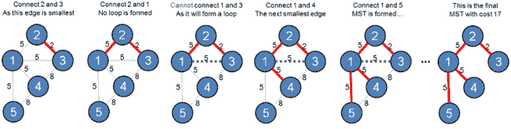

图 4.9：用于 MST 问题的克鲁斯卡尔算法（来自 UVa 908 [17]）

练习：这里展示的实现仅在 EdgeList 为空时停止。在某些情况下，我们可以更早地停止克鲁斯卡尔算法。何时以及如何修改代码来处理这种情况？图 4.9 展示了在图 4.8 最左侧¹所示的图上执行克鲁斯卡尔算法的过程。

#### 其他应用

基本 MST 问题的变体很有趣。在本节中，我们将探讨其中一些。

##### ‘最大’生成树

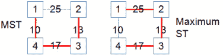

图 4.10：‘最大’生成树问题

这是一个简单的变体，我们想要最大生成树，而不是最小生成树。在图 4.10 中，我们看到 MST 与最大 ST 之间的比较。解决方案：按非递增顺序排序边。


图 4.11：部分‘最小’生成树问题

##### 部分‘最小’生成树

在这个变体中，我们不是从空白状态开始。给定图中的一些边已经固定，必须作为生成树解决方案的一部分。我们必须从那里继续构建‘MST’，因此得到的生成树可能不再整体最小。这就是我们把‘最小’一词加上引号的原因。在图 4.11 中，我们看到一个示例：边 1-2 已经固定（左图）。实际的 MST 为 10+13+17 = 40，它省略了边 1-2（中图）。然而，这个问题的解决方案必须是 (25)+10+13 = 48，它使用了边 1-2（右图）。

这个变体的解决方案很简单。在考虑所有固定边之后，我们继续在剩余的可用边上运行克鲁斯卡尔算法。

##### 最小生成‘森林’

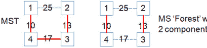

图 4.12：最小生成‘森林’问题

在这个变体中，我们希望满足生成准则，即所有顶点必须被某些边覆盖，但只要生成准则得到满足，即使生成树尚未形成，我们也可以停止。当我们有一个生成‘森林’时，就可能出现这种情况。通常，题目描述会事先给出所需连通分量的数量。在图 4.12 左图中，我们观察到该图的 MST 为 10+13+17 = 40。但如果我们想要一个具有 2 个连通分量的生成森林，那么图 4.12 右图中的解决方案仅为 10+13 = 23。

求最小生成森林很简单。照常运行克鲁斯卡尔算法，但一旦连通分量的数量等于预先确定的目标数量，我们就可以终止算法。

##### 次优生成树

有时，我们会希望有一个备用方案。在寻找 MST 的背景下，我们可能不仅想要 MST，还想要次优生成树，以防 MST 不可用。图 4.13 展示了 MST（左图）和次优 ST（右图）。我们可以看到，次优 ST 实际上就是与 MST 仅相差两条边的 MST，即从 MST 中取出一条边，并向 MST 中加入另一条弦边²。在这个例子中：取出边 4-5，并加入边 2-5。

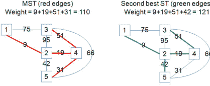

图 4.13：次优生成树（来自 UVa 10600 [17]）

一个简单的解决方案是：首先在 $O(E \log E)$ 时间内对边排序，然后在 $O(E)$ 时间内使用克鲁斯卡尔算法求出 MST。然后，对于 MST 中的每条边，将其权重设为 INF（无穷大）以‘删除’它——实际上，这只是一个非常大的数。然后尝试在 $O(VE)$ 时间内找到次优 ST，因为 MST 中有 $V-1$ 条边需要尝试。图 4.14 展示了在给定图上运行该算法的过程。请记住，MST 和次优 ST 都是生成树，即它们都是连通的！总体而言，该算法的运行时间为 $O(E \log E + E + VE)$。

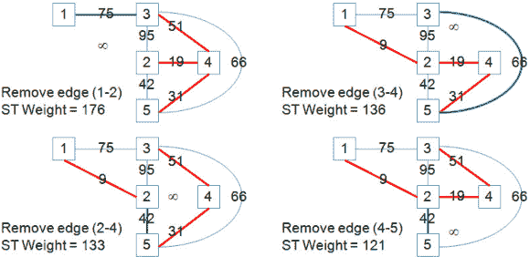

图 4.14：从 MST 求次优生成树

#### 克鲁斯卡尔算法的编程练习：

- **标准应用（用于 MST）**
  - 1. UVa 908 - Re-connecting Computer Sites（本节讨论）
  - 2. UVa 10034 - Freckles（直接的 MST 问题）
  - 3. UVa 10307 - Killing Aliens in Borg Maze（用 BFS 构建 SSSP 图，然后求 MST）
  - 4. UVa 11228 - Transportation System（分别输出短边与长边）
  - 5. UVa 11631 - Dark Roads（图中所有边的权重之和减去 MST 中所有边的权重之和）
  - 6. UVa 11710 - Expensive Subway（如果图仍未连通，输出‘Impossible’）
  - 7. UVa 11733 - Airports（每次更新时维护成本）
  - 8. UVa 11747 - Heavy Cycle Edges（对弦边的权重求和）
  - 9. LA 4138 - Anti Brute Force Lock

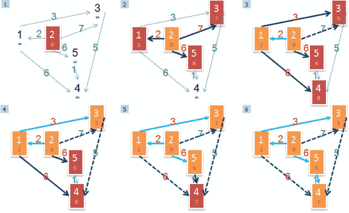

图 4.15：加权图上的 Dijkstra 动画演示（来自 UVa 341 [17]）

图 4.15 展示在一个简单加权图 $|V| = 5$ 且 $|E| = 7$ 上运行 Dijkstra 算法的示例：

- 1. 一开始，只有 $\mathrm{dist}[\mathrm{source}] = \mathrm{dist}[2] = 0$，$\mathrm{pq}$ 为 $\{(0,2)\}$。
- 2. 从顶点 2 出发，我们松弛顶点 $\{1, 3, 5\}$。现在 $\mathrm{dist}[1] = 2$，$\mathrm{dist}[3] = 7$，且 $\mathrm{dist}[5] = 6$。顶点 2 处理完毕。我们的 $\mathrm{priority\_queue}$ $\mathrm{pq}$ 的内容为 $\{(2,1), (6,5), (7,3)\}$。
- 3. 在 pq 中未处理的顶点 $\{1, 5, 3\}$ 中，顶点 1 具有最小的 $\mathrm{dist}[1] = 2$，并且位于 pq 的前端。我们出队 $(2,1)$ 并松弛其所有邻居 $\{3, 4\}$，使得 $\mathrm{dist}[3] = \min(\mathrm{dist}[3], \mathrm{dist}[1]+\mathrm{weight}(1,3)) = \min(7, 2+3) = 5$ 以及 $\mathrm{dist}[4] = 8$。顶点 1 处理完毕。现在 pq 包含 $\{(5,3), (6,5), (7,3), (8,4)\}$。可以看到，顶点 3 有两个条目。但这没关系，因为我们的 Dijkstra 实现稍后只会选择距离最小的那个。
- 4. 我们出队 $(5,3)$ 并尝试执行 $\mathrm{relax}(3,4)$，但 $5+5 = 10$，而 $\mathrm{dist}[4] = 8$（来自路径 2-1-4）。所以 $\mathrm{dist}[4]$ 保持不变。顶点 3 处理完毕，pq 包含 $\{(6,5), (7,3), (8,4)\}$。
- 5. 我们出队 $(6,5)$ 并 $\mathrm{relax}(5, 4)$，使得 $\mathrm{dist}[4] = 7$（从 2 到 4 的更短路径现在是 2-5-4，而不是 2-1-4）。顶点 5 处理完毕，pq 包含 $\{(7,3), (7,4), (8,4)\}$。
- 6. 现在，$(7,3)$ 可以被忽略，因为我们知道 $d > \mathrm{dist}[3]$（即 $7 > 5$）。然后 $(7,4)$ 像之前一样被处理。最后 $(8,4)$ 再次被忽略，因为 $d > \mathrm{dist}[4]$（即 $8 > 7$）。由于优先队列为空，Dijkstra 算法在此停止。

### 4.6 贝尔曼-福特算法

如果输入图具有负边权，Dijkstra 算法可能会失败。图 4.16 是一个 Dijkstra 算法失败的简单示例。Dijkstra 算法贪心地先设置 $\mathrm{dist}[3] = 3$，并使用该值来松弛 $\mathrm{dist}[4] = \mathrm{dist}[3]+\mathrm{weight}(3,4) = 3+3 = 6$，但随后 $\mathrm{dist}[3] = \mathrm{dist}[2]+\mathrm{weight}(2,3) = 10+(-10) = 0$。正确答案是 $\mathrm{dist}[4] = \mathrm{dist}[3]+\mathrm{weight}(3,4) = 0+3 = 3$。

为了在存在负边权的情况下求解 SSSP 问题，必须使用更通用（但更慢）的贝尔曼-福特算法。该算法由理查德·欧内斯特·贝尔曼（动态规划技术的先驱）和小莱斯特·兰道夫·福特（第 4.8 节中 Ford-Fulkerson 方法的发明者）提出。该算法很简单：将所有 E 条边松弛 V − 1 次！

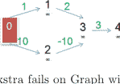

这基于这样的思想：`dist[source] = 0`，并且如果我们松弛一条边(source, u)，那么 `dist[u]` 将具有正确的值。如果我们随后松弛一条边(u, v)，那么 `dist[v]` 也将具有正确的值……如果我们已经将所有 E 条边松弛 V − 1 次，那么从源顶点到距源最远顶点（路径长度：V−1 条边）的最短路径应该已被正确计算。代码很简单：

```cpp
vector<int> dist(V, INF); dist[s] = 0; // INF = 2B not MAX_INT to avoid overflow
REP (i, 0, V - 1) // relax all E edges V−1 times, O(V)
  REP (u, 0, V - 1) // these two loops as O(E)
    TRvii (AdjList[u], v) // has edge and can be relaxed
      dist[v->first] = min(dist[v->first], dist[u] + v->second);
REP (i, 0, V - 1)
  printf("SSSP(%d, %d) = %d\n", s, i, dist[i]);
```

如果图存储为邻接矩阵，则贝尔曼-福特算法的复杂度为 $O(V^3)$；如果图存储为邻接表，则为 $O(VE)$。与 Dijkstra 算法相比，这（要）慢得多。因此，贝尔曼-福特算法通常仅在输入图不太大，并且*不保证*所有边权均为非负时，才用于求解 SSSP 问题！

贝尔曼-福特算法还有一个有趣的用途。在将所有 E 条边松弛 V−1 次之后，SSSP 问题应该已经解决，即我们无法再松弛任何顶点。这一事实可用于检查是否存在*负环*，尽管这类问题定义不明确。在图 4.17 左图中，我们看到一个带有负环的简单图。经过 1 遍后，`dist[1] = 973` 且 `dist[2] = 1015`（中图）。经过 V − 1 = 2 遍后，`dist[1] = 988` 且 `dist[2] = 946`（右图）。但由于存在负环，我们仍然可以再做一次，即松弛 `dist[1] = 946+15 = 961 < 988`！

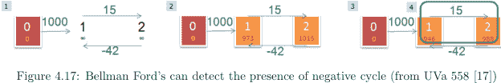

```cpp
bool negative_cycle_exist = false;
REP (u, 0, V - 1) // one more pass to check
  TRvii (AdjList[u], v)
    if (dist[v->first] > dist[u] + v->second) // should be false, but if possible
      negative_cycle_exist = true; // then negative cycle exists!
printf("Negative Cycle Exist? %s\n", negative_cycle_exist ? "Yes" : "No");
```

表 4.3 中，我们给出了一个面向编程竞赛的 SSSP 算法决策表。它旨在帮助读者根据各种图条件决定选择哪种算法。

| 图条件 | BFS | Dijkstra 算法 | Bellman Ford 算法 |
|---|---|---|---|
|  | $O(V + E)$ | $O((V + E) \log V)$ | $O(VE)$ |
| 无权 | 最佳：$V, E \le 1M$ | 尚可：$V, E \le 50K$ | 差：$VE \le 1M$ |
| 加权 | 除树和 DAG 外会 WA | 最佳：$V, E \le 50K$ | 尚可：$VE \le 1M$ |
| 负权 | WA | WA | 最佳：$VE \le 1M$ |
| 负环 | 无法检测 | 无法检测 | 可以检测 |

表 4.3：SSSP 算法决策表

Dijkstra 和 Bellman Ford 算法的编程练习：

- Dijkstra 标准应用（用于加权 SSSP）
  1. UVa 341 - 直达旅行（实际上可用 Floyd Warshall 算法求解）
  2. UVa 929 - 数字迷宫（在二维迷宫图上）
  3. UVa 10278 - 消防站
  4. UVa 10603 - 倒水
  5. UVa 10801 - 电梯换乘（仔细建模图！）
  6. UVa 10986 - 发送电子邮件（直接的 Dijkstra 应用）
  7. UVa 11377 - 机场设置（仔细建模图！）
  8. UVa 11492 - 巴别塔（仔细建模图！）
  9. UVa 11635 - 酒店预订（Dijkstra + BFS）
  10. LA 3290 - 邀请你的朋友（+ BFS）
- Bellman Ford 标准应用（用于带负环的加权 SSSP）
  1. UVa 558 - 虫洞（检查负环是否存在）
  2. UVa 10557 - XYZZY
  3. UVa 11280 - 飞往弗雷德里克顿（修改的 Bellman Ford 算法）

### 4.7 Floyd Warshall 算法

#### 基本形式与应用

动机问题：给定一个连通加权图 $G$，其中 $V \le 100$，以及两个顶点 $s1$ 和 $s2$，在 $G$ 中找一个顶点 $v$，使其成为最佳会合点，即 $dist[s1][v] + dist[s2][v]$ 在所有可能的 $v$ 中最小。最佳解法是什么？

该问题需要从两个源点 s1 和 s2 到 G 中所有顶点的最短路径信息。这可以通过两次调用 Dijkstra 算法轻松完成。一次从 s1 出发生成从 s1 到各点的最短距离数组 dist1，另一次从 s2 出发生成 dist2。然后遍历图中所有可能顶点，找到使 dist1[v] + dist2[v] 最小的 v。我们能做得更好吗？

如果已知给定图的 $V \le 100$，那么从实现角度看，甚至有一种“更简单”的算法可以尽可能快地解决此问题！

将小图加载到邻接矩阵中，然后运行下面这段带 3 层嵌套循环的简短代码。当它结束时，`AdjMatrix[i][j]` 将包含 *G* 中任意一对顶点 *i* 和 *j* 之间的最短路径距离。原问题现在变得简单了。

```text
REP (k, 0, V - 1) // recall that #define REP(i, a, b) for (int i = int(a); i <= int(b); i++)
  REP (i, 0, V - 1)
    REP (j, 0, V - 1)
      AdjMatrix[i][j] = min(AdjMatrix[i][j], AdjMatrix[i][k] + AdjMatrix[k][j]);
```

该算法称为 Floyd Warshall 算法，由 Robert W Floyd 和 Stephen Warshall 发明。Floyd Warshall 是一种 DP 算法，由于其 3 层嵌套循环⁴，显然运行时间为 O(V^3)，但给定问题中 |V| ≤ 100，因此可行。一般来说，Floyd Warshall 解决另一个经典图问题：全源最短路径（APSP）问题。与多次调用 SSSP 算法相比，它是（针对小图的）另一种选择。

1. 调用 V 次 O((V + E) log V) 的 Dijkstra = 若 E = O(V^2)，则为 O(V^3 log V)。
2. 调用 V 次 O(VE) 的 Bellman Ford = 若 E = O(V^2)，则为 O(V^4)。

在编程竞赛环境中，Floyd Warshall 的主要吸引力基本上在于其实现速度——仅 4 行短代码。如果给定图很小，请毫不犹豫地使用该算法——即使你只需要 SSSP 问题的解。

#### Floyd Warshall 的 DP 解法说明

我们提供本节是为了让有兴趣了解 Floyd Warshall 为何有效的读者受益。如果你只想使用该算法本身，可以跳过本节。不过，研究本节可以进一步增强你的 DP 技能。请注意，有些图问题没有经典算法，必须用 DP 技术求解。

Floyd Warshall 的基本思想是逐步允许使用中间顶点来构成最短路径。设顶点标号为 0 到 V-1。我们开始时只考虑直接边，即顶点 i 到顶点 j 的最短路径，记为 sp(i,j) = 边 (i,j) 的权重。然后，我们借助来自顶点 [0 ... k] 的受限中间顶点，找出任意两个顶点之间的最短路径。首先只允许 k = 0，然后 k = 1，……直到 k = V-1。

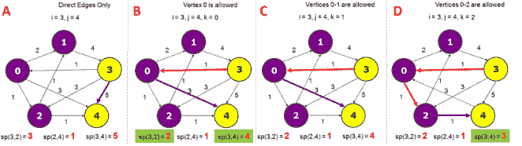

图 4.18：Floyd Warshall 算法说明

> ⁴ Floyd Warshall 算法必须使用邻接矩阵，以便能在 O(1) 时间内访问边 (i, j) 的权重。

在图 4.18 中，我们想求 $sp(3,4)$。最短可能路径是 3-0-2-4，代价为 3。但如何得到这个解？我们知道，仅考虑直接边时，$sp(3,4)=5$，如图 4.18.A 所示。$sp(3,4)$ 的解最终会从 $sp(3,2)+sp(2,4)$ 得到。但仅考虑直接边时，$sp(3,2)+sp(2,4)=3+1$ 仍然 $>3$。

当我们允许 $k=0$，即现在可以将顶点 0 用作中间顶点时，$sp(3,4)$ 被减小为 $sp(3,4)=sp(3,0)+sp(0,4)=1+3=4$，如图 4.18.B 所示。注意，当 $k=0$ 时，我们后面会用到的 $sp(3,2)$ 也从 3 降到 $sp(3,0)+sp(0,2)=1+1=2$。Floyd Warshall 会仅将顶点 0 作为中间顶点，处理所有顶点对的 $sp(i,j)$。

当我们允许 $k=1$，即现在可以将顶点 0 和 1 用作中间顶点时，结果 $sp(3,4)$、$sp(3,2)$ 和 $sp(2,4)$ 都没有变化。

当我们允许 $k=2$，即现在可以将顶点 0、1 和 2 用作中间顶点时，$sp(3,4)$ 再次被减小为 $sp(3,4)=sp(3,2)+sp(2,4)=2+1=3$。Floyd Warshall 对 $k=3$ 重复此过程，最后对 $k=4$ 重复，但 $sp(3,4)$ 仍保持为 3。

我们定义 $D^k_{i,j}$ 为仅将 $[0..k]$ 作为中间顶点时从 $i$ 到 $j$ 的最短距离。

那么，Floyd Warshall 的递推式如下：

$D^{-1}_{i,j}=weight(i,j)$。这是不使用任何中间顶点时的基本情况。

$D^k_{i,j}=min(D^{k-1}_{i,j},D^{k-1}_{i,k}+D^{k-1}_{k,j})=min(\text{不使用顶点 }k,\text{ 使用 }k)$，对于 $k\geq 0$，见图 4.19。

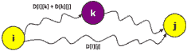

图 4.19：使用中间顶点（可能）缩短路径

这种 DP 形式要求我们逐层填写表项。要填写表 $k$ 中的一项，我们利用表 $k-1$ 中的项。例如，要计算 $D^2_{3,4}$（表 $k=2$ 中的第 3 行、第 4 列，索引从 0 开始），我们查看 $D^1_{3,4}$ 与 $D^1_{3,2}+D^1_{2,4}$ 之和中的最小值。说明见图 4.20。

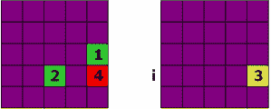

图 4.20：Floyd Warshall 的 DP 表

朴素实现使用大小为 $O(V^3)$ 的三维矩阵 $D[k][i][j]$。不过，我们可以利用一种节省空间的技巧：去掉维度 $k$，并“即时”计算 $D[i][j]$。因此，Floyd Warshall 算法只需要 $O(V^2)$ 空间，尽管其运行时间仍为 $O(V^3)$。

#### 其他应用

**传递闭包（Warshall 算法）**

Stephen *Warshall* 开发了用于求解传递闭包问题的算法：给定一个图，判断顶点 *i* 是否与 *j* 连通。该变体使用逻辑按位运算符，比算术运算符快得多。初始时，如果顶点 *i* 直接连接到顶点 *j*，则 `d[i][j]` 包含 1（真），否则为 0（假）。运行下面 O(V^3) 的 Warshall 算法后，我们可以通过检查 `d[i][j]` 来判断任意两个顶点 *i* 和 *j* 是直接还是间接连通。

```text
REP (k, 0, V - 1)
  REP (i, 0, V - 1)
    REP (j, 0, V - 1)
      d[i][j] = d[i][j] | (d[i][k] & d[k][j]);
```

**最小最大与最大最小**

最小最大路径问题是：在从 *i* 到 *j* 的所有可能路径中，找出最大边权的最小值。从 *i* 到 *j* 可能有很多路径。对于从 *i* 到 *j* 的单条路径，我们选取该路径上的最大边权。然后，对于从 *i* 到 *j* 的所有可能路径，选择最大边权最小的那条。最大最小的反向问题定义类似。

使用 Floyd Warshall 的解法如下所示。首先，将 `d[i][j]` 初始化为边 (i,j) 的权重。这是两个直接相连顶点的默认最小最大代价。对于没有任何直接边的顶点对 i-j，设置 `d[i][j] = INF`。然后，我们尝试所有可能的中间顶点 *k*。最小最大代价 `d[i][j]` 是（其自身）与（`d[i][k]` 或 `d[k][j]` 中的最大值）二者的最小值。

```text
REP (k, 0, V - 1)
  REP (i, 0, V - 1)
    REP (j, 0, V - 1)
      d[i][j] = min(d[i][j], max(d[i][k], d[k][j]));
```

练习：在本节中，我们向你展示了如何用 Floyd Warshall 算法求解最小最大（以及最大最小）问题。不过，该问题也可以建模为 MST 问题，并使用 Kruskal 算法求解。请找出方法！

Floyd Warshall 算法的编程练习：

- Floyd Warshall 标准应用（用于小图上的 APSP 或 SSSP）
  1. UVa 186 - 旅行路线（图很小）
  2. UVa 341 - 直达旅行（图很小）
  3. UVa 423 - MPI 漩涡（图很小）
  4. UVa 821 - 页面跳转（ICPC 世界总决赛“最简单”的题目之一）
  5. UVa 10075 - 航空公司（带有特殊的大圆距离，见第 7.2 节）
  6. UVa 10171 - 与 Miguel 教授会面（利用 APSP 信息很容易求解）
  7. UVa 11015 - 05-32 会合（图很小）
  8. UVa 10246 - 阿斯泰利克斯和奥贝利克斯
  9. UVa 10724 - 道路建设（添加一条边只会改变“少数几处”）
  10. UVa 10793 - 兽人进攻（Floyd Warshall 简化了此问题）
  11. UVa 10803 - 雷霆山（图很小）
  12. UVa 11463 - 突击队（利用 APSP 信息很容易求解）


#### 变体
- 1. UVa 334 - 识别并发事件（传递闭包只是子问题）
- 2. UVa 534 - Frogger（极小极大）
- 3. UVa 544 - Heavy Cargo（极大极小）
- 4. UVa 869 - 航空公司比较（运行两次 Warshall 算法，然后比较邻接矩阵）
- 5. UVa 925 - 请不要再有先修课程了！
- 6. UVa 10048 - Audiophobia（极小极大）
- 7. UVa 10099 - Tourist Guide（极大极小）

### 4.8 Edmonds Karp 算法

#### 基本形式与应用

引入问题：想象一个连通的带权有向图表示管道网络，其中管道是边，分流点是顶点。每条管道的容量等于该边的权重。还有两个特殊顶点：源点 s 和汇点 t。该图中从源点 s 到汇点 t 的最大流是多少？（想象水在管道网络中流动，我们想知道这个管道网络能够通过的最大水量？）这个问题称为最大流问题。图 4.21 展示了该问题的示例。

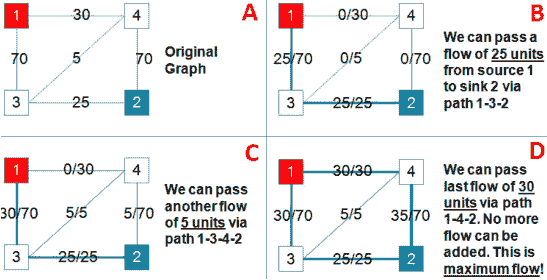

图 4.21：最大流示例（来自 UVa 820 [17] - ICPC 世界总决赛 2000 题目 E）

一种解法是 Ford-Fulkerson 方法——由发明 Bellman-Ford 算法的 Lester Randolph Ford Jr. 和 Delbert Ray Fulkerson 提出。伪代码如下：

```text
max_flow = 0
while (there exists an augmenting path p from s to t) { // iterative algorithm
    augment flow f along p, i.e.
        f = min edge weight in the path p
        max_flow += f // we can send flow f from s to t
        forward edges -= f // reduce capacity of those edges
        backward edges += f // increase capacity of reverse edges
}
output max_flow
```

在上面的伪代码中，有几种寻找增广路径的方法，每种方法的时间复杂度不同。本节重点介绍两种方式：通过 DFS 或通过 BFS。

使用 DFS 实现的 Ford-Fulkerson 方法可在 $O(f^*E)$ 时间内运行，其中 $f^*$ 是 max_flow 的值。这是因为可以构造如图 4.22 所示的图，其中每次路径增广只会将沿路径的边容量减少 1。这一过程将重复 $f^*$ 次。在图 4.22 中，为 200 次。流量图中的边数满足 $E \ge V - 1$，以确保至少存在 1 条 s-t 流；这一事实决定了单次 DFS 运行时间为 $O(E)$。总体时间复杂度为 $O(f^*E)$。

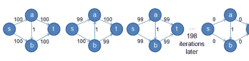

Ford-Fulkerson 方法的一种更好实现是使用 BFS 寻找 s 与 t 之间按层数/跳数计的最短路径。该算法由 Jack Edmonds 和 Richard Karp 发现，因此称为 Edmonds-Karp 算法。其运行时间为 $O(VE^2)$，因为可以证明经过 $O(VE)$ 次迭代后，所有增广路径都将被耗尽。感兴趣的读者可以查阅 [4] 等书籍，以进一步学习该算法。由于 BFS 的运行时间也是 $O(E)$，因此总体时间复杂度为 $O(VE^2)$。Edmonds-Karp 算法在图 4.22 中只需要两条 s-t 路径：s-a-t（发送 100 单位流）和 s-b-t（再发送 100 单位流）。

```cpp
map<int, int> p; // parent map to reconstruct path
int f, s, t; // global variables

// inside int main()
int max_flow = 0;
while (1) { // this will be run max O(VE) times
  f = 0;

  queue<int> q; map<int, int> dist; // O(E) BFS and record path p
  q.push(s); dist[s] = 0; // start from source
  while (!q.empty()) {
    int u = q.front(); q.pop(); // queue: layer by layer!
    if (u == t) break; // modification 1: reach sink t, stop BFS

    TRvii (AdjList[u], v) // for each neighbours of u
      // modification 2: also check AdjMat as edges may disappear
      if (AdjMat[u][v->first] > 0 && !dist.count(v->first)) {
        dist[v->first] = dist[u] + 1; // then v is reachable from u
        q.push(v->first); // enqueue v for next steps
        p[v->first] = u; // modification 3: parent of v->first is u
      }
  }

  augmentPath(t, INF); // path augmentation in O(V)
  if (f == 0) break; // seems that we cannot pass any more flow
  max_flow += f;
}
printf("Max flow = %d\n", max_flow);

void augmentPath(int v, int minEdge) {
    if (v == s) { // managed to get back to source
        f = minEdge; // minEdge of the path
        return;
    }
    else if (p.count(v)) { // augment if there is a path
        // we need AdjMat for fast lookup here
        augmentPath(p[v], min(minEdge, AdjMat[p[v]][v]));
        AdjMat[p[v]][v] -= f; // forward edges -> decrease
        AdjMat[v][p[v]] += f; // backward edges -> increase
    }
} // for more details why we must do that, consult references!
```

上面的代码片段展示了如何实现 Edmonds-Karp 算法，使其仍能达到 $O(VE^2)$ 的时间复杂度。该代码对同一个流量图*同时*使用邻接表（用于快速枚举邻居）和邻接矩阵（用于快速访问边权重）。

一般来说，这个 $O(VE^2)$ 的 Edmonds-Karp 实现足以解决编程竞赛中的大多数网络流问题。然而，对于更难的问题，我们可能需要 $O(V^2E)$ 的 Dinic 算法或 $O(V^3)$ 的 Push-Relabel（relabel-to-front）最大流算法 [4]。

练习：这里展示的 Edmonds-Karp 算法实现使用 AdjMatrix 存储每条边的剩余容量。更好的方法是存储每条边的流量，然后由边容量减去边上的流量来推导剩余容量。请修改该实现！

#### 其他应用

最大流问题还有其他一些有趣的应用。这里讨论六个例子，另一些将推迟到 4.9 节。注意，本节展示的一些技巧可能适用于其他图问题。

##### 最小割

定义 s-t 割 $C = (S,T)$ 为 $V(G)$ 的一个划分，使得源点 $s \in S$，汇点 $t \in T$。还要定义 $C$ 的*割集*为集合 $\{(u,v) \in E \mid u \in S, v \in T\}$，使得如果移除 $C$ 的割集中的所有边，则从 $s$ 到 $t$ 的最大流为 0（即 $s$ 与 $t$ 不连通）。s-t 割 $C$ 的代价定义为 $C$ 的割集中各边容量之和。最小割问题就是最小化 s-t 割的容量。这个问题比在图中寻找桥更一般（见 4.2 节），即在这种情况下，我们可以割开*不止*一条边，但希望以最小代价做到这一点。

这个问题的解法很简单。计算最大流的副产品就是最小割。在图 4.21.D 中，我们可以看到饱和的边，即该边上的流量等于该边容量，属于最小割！即边 1-4（容量 30，流量 30）、3-4（5/5）和 3-2（25/25）。割的代价为 30+5+25 = 60。这是所有可能的 s-t 割中的最小值。从源点 $s$ 仍可达的所有顶点属于集合 $S$。其余顶点属于集合 $T$。这里，$S = \{1,3\}$，$T = \{4,2\}$。

##### 多源多汇最大流

有时，我们可能有不止一个源点和/或不止一个汇点。然而，这个变体并不比原始的单源单汇最大流问题更难。创建一个超级源点 $ss$ 和一个超级汇点 $st$。用无限容量将 $ss$ 与所有源点 $s$ 相连，并用无限容量将 $st$ 与所有汇点 $t$ 相连，然后照常运行 Edmonds-Karp 算法。

##### 带顶点容量的最大流

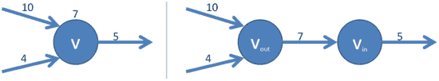

图 4.23：顶点拆分技术

我们还可以有一个最大流变体，其中容量不仅定义在边上，也定义在顶点上。要解决这个变体，可以使用顶点拆分技术。通过将顶点 $v$ 拆分为 $v_{in}$ 和 $v_{out}$，把入边重新分配给 $v_{in}$、出边重新分配给 $v_{out}$，并将原顶点 $v$ 的权重作为边 $(v_{in}, v_{out})$ 的权重，可以将带顶点权重的图转换为更常见的无顶点权重图。详情见图 4.23。然后照常运行 Edmonds-Karp 算法。

##### 最大独立路径

寻找从源点 $s$ 到汇点 $t$ 的最大数量独立路径的问题可以归约为最大流问题。如果两条路径除 $s$ 和 $t$ 外不共享任何顶点（顶点不相交），则称它们是独立的。解法：从 $G$ 构造一个带顶点容量的流网络 $N = (V, E)$，其中 $N$ 是 $G$ 的完全副本，只是每个 $v \in V$ 的容量为 1（即每个顶点只能使用一次），并且每条 $e \in E$ 的容量也为 1（即每条边也只能使用一次）。然后照常运行 Edmonds-Karp 算法。

##### 最大边不相交路径

寻找从 $s$ 到 $t$ 的最大数量边不相交路径与寻找最大独立路径类似。唯一的区别是这次没有任何顶点容量（即两条边不相交路径仍可共享同一个顶点）。从 $s = 1$ 到 $t = 7$ 的独立路径与边不相交路径之间的比较见图 4.24。

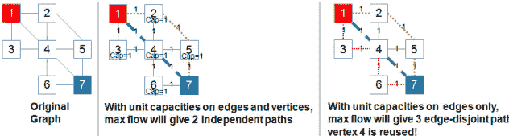

图 4.24：最大独立路径与最大边不相交路径的比较


#### 最小费用（最大）流

最小费用流问题是指寻找通过流网络发送一定量流量（通常为最大流）的*最便宜*方式的问题。在该问题中，每条边都有两个属性：通过该边的流量容量以及使用该边的费用。最小费用（最大）流，简称 MCMF，可以通过将 Edmonds Karp 算法中用于寻找增广路径的 BFS 替换为 Bellman-Ford 算法（Dijkstra 算法可能不适用，因为残量流图中的边权可能为负）来解决。

Ford Fulkerson / Edmonds Karp 算法的编程练习：

- Edmonds Karp 标准应用（最大流/最小割）
  - 1. UVa 820 - Internet Bandwidth（本节讨论）
  - 2. UVa 10480 - Sabotage（最小割）
  - 3. UVa 10779 - Collector's Problem（最大流）
  - 4. UVa 11506 - Angry Programmer（最小割）
- 变体
  - 1. UVa 563 - Crimewave（最大独立路径：单位边容量和顶点容量）
  - 2. UVa 10330 - Power Transmission（带顶点容量，本节讨论）
  - 3. UVa 10511 - Councilling
  - 4. UVa 10594 - Data Flow（基础 MCMF 问题）
  - 5. UVa 10806 - Dijkstra, Dijkstra.（最大边不相交路径 + 最小费用）

### 4.9 特殊图

如果给定图是*特殊*的，一些基本图问题可以有更简单/更快的多项式算法。到目前为止，我们识别出了编程竞赛中常见的以下特殊图：**树**、**有向无环图（DAG）**和**二分图**。出题者可能会通过给出大数据规模，将针对一般图的正确算法判定为超时（TLE），从而迫使参赛者针对这些特殊图使用专门算法。在本节中，我们将讨论这些特殊图上的一些流行图问题（参见图 4.25）。

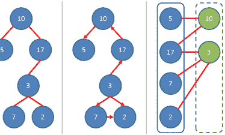

图 4.25：特殊图（左到右）：树、有向无环图、二分图

#### 4.9.1 树

树是一种具有以下特征的特殊图：有 $E = V - 1$（任何 $O(V + E)$ 算法都是 $O(V)$），没有环，连通，且任意一对顶点之间存在唯一路径。

##### 寻找树中的关节点和桥

在 4.2 节中，我们已经看到了用于寻找图的关节点和桥的 $O(V + E)$ Tarjan DFS 算法。然而，如果给定图是一棵树，问题就变得更简单：树上的所有边都是桥，所有内部顶点（度 > 1）都是关节点。这仍然是 $O(V)$，因为我们必须扫描树来计算内部顶点的数量，但代码更简单。

##### 加权树上的单源最短路径

在 4.5 和 4.6 节中，我们看到了两种用于解决加权图上 SSSP 问题的通用算法（$O((E + V) \log V)$ 的 Dijkstra 算法和 $O(VE)$ 的 Bellman-Ford 算法）。然而，如果给定图是一棵树，SSSP 问题就变得更简单：任何 $O(V)$ 的图遍历算法（即 BFS 或 DFS）都可以用来解决此问题。树中任意两个顶点之间只有一条唯一路径，因此我们只需遍历树来找到连接这两个顶点的路径，而这两个顶点之间的最短路径基本上就是这条唯一路径的边权之和。

##### 加权树上的全源最短路径

在 4.7 节中，我们看到了一个用于解决加权图上 APSP 问题的通用算法（$O(V^3)$ 的 Floyd Warshall 算法）。然而，如果给定图是一棵树，APSP 问题就变得更简单：从每个顶点重复 SSSP 过程 $V$ 次，因此复杂度为 $O(V^2)$。

但这仍然可以改进到 $O(V + Q \times L)$：其中 $Q$ 是查询次数，$L$ 是最低公共祖先（LCA）实现的复杂度（更多细节参见 [40]）。我们从任意顶点 $v$ 运行一次 $O(V)$ 的 DFS/BFS，以找出 $dist[v]$ 到树中其他顶点的距离。然后，我们可以通过报告 $dist[v][i] + dist[v][j] - 2 \times dist[v][LCA(i, j)]$ 来回答该树上的任何最短路径查询 $(i, j)$。

##### 树的直径

图的直径定义为任意一对顶点之间的最大距离。要找到图的直径，我们首先要找到每对顶点之间的最短路径（APSP 问题）。这些路径中的最大长度就是图的直径。对于一般图，我们可能需要 4.7 节中讨论的 $O(V^3)$ Floyd Warshall 算法。然而，如果给定图是一棵树，问题就变得更简单：从任意节点 $s$ 执行 DFS/BFS 找到最远的顶点 $x$，然后从顶点 $x$ 再执行一次 DFS/BFS，得到从 $x$ 出发真正最远的顶点 $y$。沿着 $x$ 到 $y$ 的唯一路径长度就是该树的直径。这个解法只需要调用两次 $O(V)$ 的图遍历算法。

##### 树上的最大加权独立集

在 3.4 节中，我们展示了一个树形 DP 示例，它在 $O(V)$ 时间内解决了树上的最大加权独立集（MWIS）问题。在下面的 4.9.3 节中，我们将重新讨论二分图上的这个问题，它可以归约为最大流问题，并使用 Edmonds Karp 算法在 $O(VE^2)$ 时间内运行。然而，该问题在一般图上是 NP 完全的。

与树相关的编程练习（另见 3.4.3 节“树形 DP”主题）：

- 1. UVa 112 - Tree Summing（回溯）
- 2. UVa 115 - Climbing Trees（树遍历，LCA）
- 3. UVa 122 - Trees on the level（树遍历）
- 4. UVa 536 - Tree Recovery（树遍历，从前序+中序重建树）
- 5. UVa 615 - Is It A Tree?（图性质检查）
- 6. UVa 699 - The Falling Leaves（前序遍历）
- 7. UVa 712 - S-Trees（树遍历）
- 8. UVa 10308 - Roads in the North（树的直径，本节讨论）
- 9. UVa 10459 - The Tree Root（树的直径+中心）
- 10. UVa 10701 - Pre, in and post（从前序+中序重建树）
- 11. UVa 10938 - Flea Circus（使用 LCA）
- 12. UVa 11695 - Flight Planning（树的直径+中心）

#### 4.9.2 有向无环图

有向无环图，缩写为 DAG，是一种具有以下特征的特殊图：有向且无环。

##### DAG 上的单源最短路径

如果给定图是 DAG，单源最短路径（SSSP）问题会变得简单得多，因为 DAG 至少有一个拓扑序！我们可以使用 4.2 节中的 $O(V+E)$ 拓扑排序算法找到一个这样的拓扑序，然后按照该顺序松弛边。拓扑序将确保如果顶点 $b$ 有一条来自顶点 $a$ 的入边，那么顶点 $b$ 会在顶点 $a$ 之后被松弛。这样，只需一次 $O(V+E)$ 的线性遍历，距离信息的传播就是正确的！

##### DAG 上的单源最长路径

单源最长路径问题，即从起始顶点 $s$ 出发寻找最长路径，在一般图上是 NP 完全的 [39]。然而，如果图没有环（在 DAG 中确实如此），该问题又变得容易了。DAG 中的最长路径（又称关键路径）的解法只是对上述 DAG 中 SSSP 解法的一个小改动，即只需将所有边权取反。

##### DAG 上的最小路径覆盖

动机问题：想象图 4.26.A 中的顶点是乘客，如果一辆出租车可以按时先服务乘客 $u$ 再服务乘客 $v$，我们就在两个顶点 $u-v$ 之间画一条边。问题是：必须部署多少辆出租车才能服务所有乘客？

上述动机问题的答案是两辆出租车。在图 4.26.D 中，我们看到一个可能的解决方案。一辆出租车（红色虚线）服务乘客 1（红色）、乘客 2（蓝色），然后乘客 4（黄色）。另一辆出租车（绿色虚线）服务乘客 3（绿色）和乘客 5（橙色）。所有乘客只需两辆出租车即可服务。

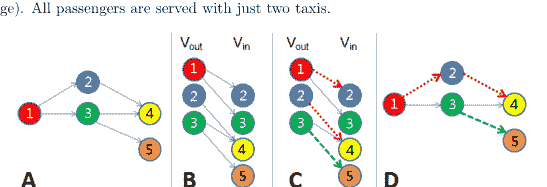

图 4.26：DAG 中的最小路径覆盖（来自 LA 3126 [11]）

通常，DAG 中的最小路径覆盖（MPC）问题描述为：找到覆盖 DAG $G = (V, E)$ 中*每个顶点*的最少路径数。

该问题有一个多项式解法：从 G 构造二分图 $G' = (V_{out} \cup V_{in}, E')$，其中 $V_{out} = \{v \in V : v \text{ 的出度为正}\}$，$V_{in} = \{v \in V : v \text{ 的入度为正}\}$，且 $E' = \{(u,v) \in V_{out} \times V_{in} : (u,v) \in E\}$。这个 $G'$ 是一个二分图。在二分图 $G'$ 上寻找匹配迫使我们从每个 $v \in V_{out}$ 中选择至多一条出边（对于 $V_{in}$ 类似）。DAG G 初始有 $n$ 个顶点，可以用 $n$ 条长度为 0 的路径（顶点本身）覆盖。使用边 $(a, b)$ 在顶点 $a$ 和顶点 $b$ 之间的一次匹配表示我们可以少用一条路径，因为它可以同时覆盖顶点 $a \in V_{out}$ 和 $b \in V_{in}$。因此，如果 $G'$ 中的最大基数二分匹配（MCBM）大小为 $m$，那么我们只需要 $n - m$ 条路径来覆盖 G 中的每个顶点。

解决 G 中 MPC 所需的 $G'$ 中的 MCBM 将在下面讨论。二分匹配的解法是多项式的，因此 DAG 中 MPC 的解法也是多项式的。请注意，一般图中的 MPC 是 NP 完全的 [42]。

与 DAG 相关的编程练习：

- DAG 上的单源最短/最长路径
  - 1. UVa 103 - Stacking Boxes
  - 2. UVa 10000 - Longest Paths
  - 3. UVa 10166 - Travel（最短路径）
  - 4. UVa 10029 - Edit Step Ladders
  - 5. UVa 10350 - Liftless EME（最短路径）
  - 6. UVa 11324 - The Largest Clique（先找 SCC，再在 DAG 上求最长路径）
  - 7. LA 3294 - The Ultimate Bamboo Eater（使用二维线段树）
  - 8. Ural/Timus OJ 1450 - Russian pipelines
  - 9. PKU 3160 - Father Christmas flymouse
- DAG 中的路径计数
  - 1. UVa 825 - Walking on the Safe Side（图是 DAG，DP）
  - 2. UVa 926 - Walking Around Wisely（图是 DAG，DP）
  - 3. UVa 988 - Many paths, one destination（拓扑排序 + DAG 上的 DP）


- DAG 中的最小路径覆盖
  - LA 2696 - Air Raid
  - LA 3126 - Taxi Cab Scheme

#### 4.9.3 二分图

二分图是一种具有以下特征的特殊图：顶点集合 V 可以划分为两个不相交的集合 V₁ 和 V₂，并且所有边 (u, v) ∈ E 都具有 u ∈ V₁ 且 v ∈ V₂ 的性质。最常见的应用是（二分图）匹配问题，如下所示。

##### 二分图最大基数匹配

引例（来自 TopCoder [26] Open 2009 Qualifying 1）：将一组数字两两配对，使得每一对的和都是质数。例如，给定数字 {1, 4, 7, 10, 11, 12}，我们可以有：{1 + 4 = 5}、{1 + 10 = 11}、{1 + 12 = 13}、{4 + 7 = 11}、{7 + 10 = 17} 等。

实际任务：给定一个数字列表 N，返回 N 中所有能够与 N[0] 成功配对、并作为某个完整配对方案一部分的元素列表（即 N 中的每个元素 a 都与 N 中唯一的另一个元素 b 配对，使得 a + b 为质数），按升序排序。上述例子的答案是 {4, 10}——不包括 12。这是因为，尽管 (1 + 12) 是质数，但剩下的 4 个数将无法配对；而如果我们将 (1 + 4) 配对，则有 (7 + 10)、(11 + 12)；如果我们将 (1 + 10) 配对，则有 (4 + 7)、(11 + 12)。

约束条件：列表 N 包含偶数个元素（在 [2...50] 范围内，含端点）。N 的每个元素都将在 1 到 1000 之间（含端点）。N 的每个元素都互不相同。

尽管这个问题涉及寻找质数，但它并不是纯数学问题，因为 N 中的元素不超过 1K——1000 以下的质数并不多。问题在于，我们不能进行完全搜索式配对，因为第一对有 50C₂ 种可能，第二对有 48C₂ 种可能，……，直到最后一对有 2C₂ 种可能。DP + 位掩码技术也不可行，因为 50! 太大了。

解决这个问题的关键在于意识到，这种配对或匹配是在二分图上进行的！要得到质数，我们需要将 1 个奇数 + 1 个偶数相加，因为 1 个奇数 + 1 个奇数 = 偶数，而偶数不是质数；1 个偶数 + 1 个偶数 = 也是偶数，也不是质数。因此，我们可以将奇数/偶数分别划分到 set1/set2，并在 set1[i] + set2[j] 为质数时，从 set1 向 set2 连边。

构建出这个二分图后，解法就很简单了：如果 set1 和 set2 的大小不同，则无法完成完整配对。否则，如果两个集合的大小都是 n/2，则尝试将 set1[0] 与 set2[k] 匹配，其中 k = [0...n/2 − 1]，并对剩余部分执行二分图最大基数匹配（MCBM）。这个问题可以用最大流算法解决，例如 O(VE²) 的 Edmonds-Karp 算法。如果我们还能得到 n/2 − 1 个匹配，则将 set2[k] 加入答案。对于这个测试用例，答案是 {4, 10}。

通过设置一个连接到 set1 中所有顶点的虚拟源点，以及一个连接到 set2 中所有顶点的虚拟汇点，可以将二分图匹配归约为最大流问题。通过将该图中所有边的容量设为 1，我们迫使 set1 中的每个顶点只能与 set2 中的一个顶点匹配。最大流将等于原图上可能的最大匹配数（见图 4.27）。

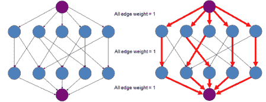

图 4.27：二分图匹配可以归约为最大流问题

##### 二分图最大权独立集

引例：假设有两个用户：用户 A 和用户 B。每个用户都有若干事务，例如 A 有 \(\{A_1,A_2,\ldots,A_n\}\)，并且每个事务都有一个权重，例如 \(W(A_1), W(A_2)\) 等。这些事务使用共享资源，例如事务 A1 使用 \(\{r_1,r_2\}\)。对资源的访问是排他的，例如，如果选择了 A1，那么用户 B 的任何使用 \(r_1\) 或 \(r_2\) 的事务都不能被选择。保证用户 A 的两个请求永远不会使用同一资源，但来自不同用户的两个请求可能会竞争同一资源。我们的任务是最大化所选事务的权重之和！

让我们对这个题目做几个关键词分析。如果选择了用户 A 的某个事务，那么用户 B 中共享部分或全部资源的那些事务就不能被选择。这是 **独立集** 的一个强烈提示。并且，由于我们希望最大化所选事务的权重之和，所以这是 **最大权独立集（MWIS）**。又因为只有两个用户（两个集合），并且题目保证同一用户内部的事务之间不存在资源冲突，所以我们可以确定输入图是一个 **二分图**。因此，这个问题实际上是 **二分图上的 MWIS**。

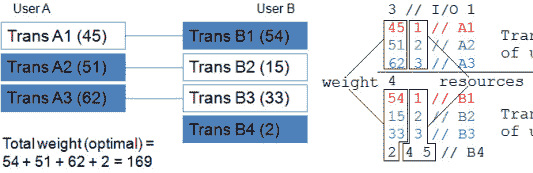

图 4.28：二分图上 MWIS 的示例（来自 LA 3487 [11]）

让我们看图 4.28 的示例说明。我们有两个用户。我们将 A 的所有事务列在左边，将 B 的所有事务列在右边。如果两个事务共享相似的资源，我们就在它们之间连一条边。例如，事务 A1 使用资源 1，事务 B1 也使用资源 1。因为 A1（权重为 45）和 B1（权重为 54）共享同一资源，所以我们在它们之间连一条边。事实上，还有两条边：A2 -- B2 和 A3 -- B3。事务 B4 没有边，因为它使用的资源 \(\{4,5\}\) 没有与任何其他事务共享。在这个实例中，\(\{B_1(54), A_2(51), A_3(62), B_4(2)\}\) 是 MWIS，总权重 = 54+51+62+2 = 169。

为了求解非平凡情况，我们必须将这个问题归约为最大流问题。对于用户 A，我们将原始顶点代价（选择该顶点的权重）作为从源点到该顶点的容量；对于用户 B，将其作为从该顶点到汇点的容量。然后，对于集合 A 和 B 之间的任意边，赋予‘无限’容量。见图 4.29。

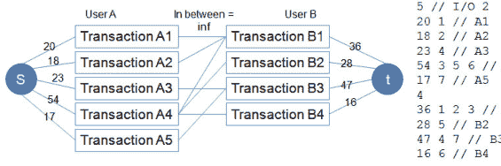

图 4.29：将二分图上的 MWIS 归约为最大流问题（来自 LA 3487 [11]）

然后，我们在这个流图上运行 \(O(VE^2)\) 的 Edmonds-Karp 算法。最大流算法终止后，解为 {s 分量 ∩ 用户 A 中的顶点} + {t 分量 ∩ 用户 B 中的顶点}，其中 s 分量（t 分量）是运行最大流后仍可到达源点（汇点）的顶点。在图 4.30 中，解为：{A1(20), A2(18), A4(54)} + {B3(47)} = 139。这个值也可以通过以下方式得到：MWIS = 总权重 − 最大流 = 259 − 120 = 139。

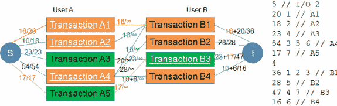

图 4.30：图 4.29 的解（来自 LA 3487 [11]）

与二分图相关的编程练习：

- 二分图最大基数匹配（图建模 + 最大流）
  - UVa 670 - The Dog Task
  - UVa 753 - A Plug for Unix
  - UVa 10080 - Gopher II
  - UVa 10092 - The Problem with the Problemsetter
  - UVa 10735 - Euler Circuit
  - UVa 11045 - My T-Shirt Suits Me
  - UVa 11418 - Clever Naming Patterns
  - TopCoder Open 2003 Semifinal Round 4 - Division 1, Level 3 - RookAttack
  - TopCoder Open 2009: Qualifying 1 - Prime Pairs
  - LA 4407 - Gun Fight
- 二分图中的最大权独立集
  - UVa 11159 - Factors and Multiples（与上述二分图匹配类似的解法）
  - LA 3487 - Duopoly（也见于 Zhejiang Online Judge 题目 2129）
- 二分图中的最大顶点覆盖
  - UVa 11419 - SAM I AM（最小顶点覆盖）
  - LA 2523 - Machine Schedule（也见于 PKU 1325 - Machine Schedule）
  - PKU 2226 - Muddy Fields

### 4.10 本章注释

请注意，近来的 ICPC 和 IOI 通常不会只要求参赛者解决涉及这些图算法纯形式的问题。新问题通常要求参赛者组合两种或更多算法，或者将算法与某些高级数据结构结合起来，例如在同一问题中同时使用 BFS 和 Dijkstra 算法，以计算同一张图在带权和无权版本上的最短路径；将 DAG 中的最长路径与线段树数据结构结合，等等。

本章虽然已经相当长，但仍然省略了许多已知的图算法和图问题，这些问题有时会在 ICPC 或 IOI 中考查，即：用于求强连通分量的 **Kosaraju** 算法、最小生成树的 **Prim** 和 **Boruvka** 算法、第 k 短路径、**Euler** 路径/回路、**Fleury** 算法、**中国邮递员问题**、**哈密顿**路径/回路、双调旅行商问题、树形图、**Tarjan** 离线最近公共祖先、最大流的 **Dinic** 或 **Push Relabel** 算法、循环流问题、**Kuhn-Munkres（匈牙利）**匹配算法、**Edmonds** 花收缩，等等。

如果你想提高在 ACM ICPC 中的获胜机会，请花些时间在本章之外学习它们。这些较难的内容很少出现在 *区域赛* 中；如果出现，它们通常会成为 *决胜题*。像这样的较难图问题更有可能出现在 ACM ICPC World Finals 级别。

然而，对于 IOI 参赛者来说，IOI 大纲中的大多数图论内容已在本章中涵盖。

本章大约讨论了 **173 道编程练习**。


## 第 5 章：数学

> 我们每天都用数学来预测天气、报时、处理金钱。
> 数学不只是公式或方程；它是逻辑，是理性，
> 是用头脑解开我们所知的最大谜团。
>
> —— 电视剧《NUMB3RS》

近期的 ICPC 赛事（尤其是在亚洲）通常包含一到两道数学题。本章旨在帮助参赛者应对这类问题。

### 5.1 概述与动机

与上一章的图论主题一样，近期的 ICPC 题目集中也存在数学问题——每套题目至少有一道，有时可能有两道（见表 5.1）！

| LA | 题目名称 | 来源 | 数学问题（算法） |
|---:|---|---|---|
| 2194 | 午餐会 | Dhaka06 | |
| 2195 | 数零 | Dhaka06 | 素数 |
| 2953 | 阶乘之和 | Guangzhou03 | |
| 2955 | Vivian 的问题 | Guangzhou03 | |
| 3172 | 无限……的周期 | Manila06 | |
| 3399 | 连续……之和 | Japan05 | 素数 |
| 3904 | 瓷砖编码 | Seoul07 | 组合数学 |
| 3997 | 数值惊喜 | Danang07 | |
| 4104 | MODEX | Singapore07 | 模幂运算（Java BigInteger） |
| 4203 | 三角形谜题 | Dhaka08 | |
| 4209 | 阻止末日 | Dhaka08 | 公式化简 + BigInt |
| 4270 | 离散平方根 | Hefei08 | |
| 4340 | 找出恐怖分子 | Amritap08 | |
| 4406 | 不可约分数 | K Lumpur08 | |
| 4715 | 评级风险 | Phuket09 | Farey 序列 |
| 4721 | Nowhere Money | Phuket09 | 斐波那契、Zeckendorf 定理 |

*表 5.1：近期 ACM ICPC 亚洲区域赛中的一些数学问题*

编程竞赛中出现数学问题并不令人意外，因为计算机科学深深植根于数学。‘computer’（计算机）一词本身来自‘compute’（计算），因为计算机主要就是为帮助人类计算数字而建造的。

我们知道，不同国家在大学前教育中对数学训练的侧重点不同。因此，对一些 ICPC 新手参赛者来说，‘Euler Phi’（欧拉函数）是一个熟悉的术语，但对另一些人来说，这个术语听起来完全陌生。也许是因为他以前没学过，也许是因为在他的母语中这个术语叫法不同。在本章中，我们希望通过列出编程竞赛中经常出现的常见数学术语、定义、问题和算法，为读者营造一个更公平的竞争环境。

### 5.2 Ad Hoc 数学问题

我们先从 Ad Hoc 数学问题开始本章。它们基本上是涉及数学的竞赛题，只需要不超过基础编程技巧即可解决。

与 Ad Hoc 数学相关的编程练习：

- 1. UVa 344 - 罗马数字（罗马数字与十进制之间的转换）
- 2. UVa 377 - 奶牛计算（四进制运算）
- 3. UVa 10346 - 彼得的烟（简单数学）
- 4. UVa 10940 - 扔卡片 II（用暴力找规律，然后利用该规律）
- 5. UVa 11130 - 台球反弹（使用台球桌反射技巧）
- 6. UVa 11231 - 黑白绘画（发现规律后使用 O(1) 公式）
- 7. UVa 11313 - 美食游戏（类似 UVa 10346）
- 8. UVa 11428 - 立方数（带完全搜索的简单数学）
- 9. UVa 11547 - 自动答案（存在一行 O(1) 解法）
- 10. UVa 11723 - 给道路编号（简单数学）
- 11. UVa 11805 - Bafana Bafana（存在非常简单的 O(1) 公式）

### 5.3 数论

尽可能多地掌握*数论*领域中的主题很重要，因为如果你了解问题背后的理论，一些数学问题就会变得简单（或更容易）。否则，要么纯暴力求解会导致 TLE 响应，要么由于给定输入太大，在没有一些预处理的情况下你根本无法处理。

#### 5.3.1 素数

从 2 开始的自然数：{2, 3, 4, ...}，如果它只能被 1 或自身整除，就被认为是**素数**。第一个（也是唯一一个偶数）素数是 2。接下来的素数是：3、5、7、11、13、17、19、23、29、……以及无穷多个素数（证明见 [20]）。在范围 [0...100] 内有 25 个素数，在 [0...1000] 内有 168 个素数，在 [0...7919] 内有 1000 个素数，在 [0...10000] 内有 1229 个素数，等等……

素数是数论中的一个重要主题，也是许多编程问题的来源¹。在本节中，我们将讨论涉及素数的算法。

##### 优化的素数测试函数

本节介绍的第一个算法用于测试给定自然数 *N* 是否为素数，即 `bool isPrime(N)`。最朴素的版本是按定义测试，即测试 *N* 是否能被 `divisor ∈ [2 … N−1]` 整除。这当然可行，但运行时间为 *O(N)*——就除法次数而言。这不是最好的方法，有几种可能的改进。

第一个改进是测试 *N* 是否能被 `divisor ∈ [2 … √N]` 整除，即当 *divisor* 已经大于 √N 时就停止。这是因为如果 *N* 能被 *p* 整除，那么 *N = p × q*。如果 *q* 小于 *p*，那么 *q* 或 *q* 的一个素因子早就会整除 *N*。这是 *O(√N)*，已经比上一版本快得多，但仍可改进为快两倍。

第二个改进是测试 *N* 是否能被 `divisor ∈ [3, 5, 7 … √N]` 整除，即我们只测试到 √N 的奇数。这是因为只有一个偶数素数，即数字 2，可以单独测试。这是 *O(√N/2)*，也同样是 *O(√N)*。

第三个改进²对竞赛题来说已经足够好，就是测试 *N* 是否能被 *≤ √N 的素因子*整除。这是因为如果一个素数 *X* 不能整除 *N*，那么测试 *X* 的倍数是否能整除 *N* 就没有意义。这比 *O(√N)* 更快，大约是 *O(⌊#primes ≤ √N⌋)*。例如，在 [1 … √(10⁶)] 中有 500 个奇数，但同一范围内只有 168 个素数。不超过 *M* 的素数个数——记为 π(*M*)——的界为 *O(M/(ln(M) − 1))*，因此这个素数测试函数的复杂度约为 *O(√N/ln(√N))*。

代码见下面的下一段讨论。

##### 埃拉托斯特尼筛法：生成素数列表

如果我们想生成范围 [0 … *N*] 内的素数列表，有一个比逐个测试该范围内每个数是否为素数更好的算法。该算法称为‘*埃拉托斯特尼*筛法’，由亚历山大的埃拉托斯特尼发明。其工作原理如下。

首先，它把范围内的所有数都设为‘可能是素数’，但把数字 0 和 1 设为非素数。然后，它把 2 当作素数，并划掉 2 的所有倍数³，从 2 × 2 = 4、6、8、10、……开始，直到该倍数大于 *N*。接着，它把下一个未被划掉的数 3 当作素数，并划掉 3 的所有倍数，从 3 × 3 = 9、12、15、18、……开始。然后它取 5，并划掉 5 的所有倍数，从 5 × 5 = 25、30、35、40、……开始。之后，在范围 [0 … *N*] 内所有未被划掉的数都是素数。该算法大约执行 *N* × (1/2 + 1/3 + 1/5 + 1/7 + … + 1/范围 (*N*) 内最后一个素数) 次操作。利用‘不超过 *n* 的素数倒数之和’，我们最终得到大约 *O(N log log N)* 的时间复杂度 [44]。

由于使用筛法生成 ≤ 10K 的小素数列表很快（我们下面的库代码在竞赛设置下可达到 10⁷），我们选择对较小的素数使用筛法，而把优化的素数测试函数保留给较大的素数——见前面的讨论。合并后的代码如下：

```cpp
#include <bitset> // compact STL for Sieve, more efficient than vector<bool>!
ll _sieve_size; // ll is defined as: typedef long long ll;
bitset<10000010> bs; // 10^7 + small extra bits should be enough for most prime-related problems
vi primes; // compact list of primes in form of vector<int>

void sieve(ll upperbound) { // create list of primes in [0 .. upperbound]
  _sieve_size = upperbound + 1; // add 1 to include upperbound
  bs.reset(); bs.flip(); // set all numbers to true
  bs.set(0, false); bs.set(1, false); // except index 0 and 1
  for (ll i = 2; i <= _sieve_size; i++) if (bs.test(i)) {
    // cross out multiples of i starting from i * i!
    for (ll j = i * i; j <= _sieve_size; j += i) bs.set(size_t(j), false);
    primes.push_back((int)i); // also add this to vector that contains list of primes
  }
} // call this method in main method

bool isPrime(ll N) { // a good enough deterministic prime tester
  if (N <= _sieve_size) return bs.test(N); // O(1) for small primes
  REP (i, 0, primes.size() - 1) if (N % primes[i] == 0) return false;
  return true; // it takes long runtime time if N is a large prime!
} // Note: only work for N <= (last prime in vi "primes")^2

// in int main()
sieve(10000000); // can go up to 10^7
printf("%d\n", isPrime(5915587277)); // 10 digit prime
```

##### 用于寻找素因子的优化试除法

在数论中，我们知道素数 $N$ 只有 1 和它自身作为因子，而**合数** $N$，即非素数，可以唯一地写成其素因子的乘积。也就是说，素数是整数的乘法构建块。例如，$N = 240 = 2 \times 2 \times 2 \times 3 \times 5 = 2^4 \times 3 \times 5$（后一种形式称为**素幂分解**）。

一种朴素算法生成素数列表（例如用筛法），并检查其中有多少个确实能整除整数 $N$——而不改变 $N$。这可以改进！

更好的算法利用一种分治思想。整数 $N$ 可以表示为：$N = PF \times N'$，其中 $PF$ 是一个素因子，$N'$ 是另一个数，即 $N/PF$——也就是说，我们可以通过取出因子 $PF$ 来减小 $N$ 的规模。我们可以持续这样做，直到最终 $N' = 1$。特殊情况是 $N$ 本身实际上就是一个素数。下面的代码模板接收一个整数 $N$，并返回素因子列表——见下面的代码。

```cpp
vi primeFactors(int N) {
  vi factors;           // vi "primes" (generated by sieve) is optional
  int PF_idx = 0, PF = primes[PF_idx]; // using PF = 2, 3, 4, ..., is also ok.
  while (N != 1 && (PF * PF <= N)) { // stop at sqrt(N), but N can get smaller
    while (N % PF == 0) { N /= PF; factors.push_back(PF); } // remove this PF
    PF = primes[++PF_idx]; // only consider primes!
  }
  if (N != 1) factors.push_back(N); // special case if N is actually a prime
  return factors;
}
```


```cpp
// in int main()
sieve(100); // prepare list of primes [0 .. 100]
vi result = sieve_primes(10000); // with that, we can factor up to 100^2 = 10000
vi::iterator last = unique(result.begin(), result.end()); // to remove duplicates
for (vi::iterator i = result.begin(); i != last; i++) // output: 2 and 5
    printf("%d\n", *i);
```

在最坏情况下——当 $N$ 是素数时，这种使用试除法的素因数分解算法需要测试所有不超过 $\sqrt{N}$ 的较小素数，数学上记为 $O(\pi(\sqrt{N})) = O(\sqrt{N}/\ln\sqrt{N})$。然而，如果给定的是合数，该算法相当快。

关于素数问题的编程练习：

- 1. UVa 294 - 约数
- 2. UVa 406 - 素数切割
- 3. UVa 516 - 素数之地
- 4. UVa 524 - 素数环问题（需要回溯）
- 5. UVa 543 - 哥德巴赫猜想
- 6. UVa 583 - 素因数
- 7. UVa 686 - 哥德巴赫猜想（II）
- 8. UVa 897 - 变位素数
- 9. UVa 914 - 跳跃冠军
- 10. UVa 993 - 数字的乘积
- 11. UVa 10006 - 卡迈克尔数
- 12. UVa 10042 - 史密斯数
- 13. UVa 10140 - 素数距离
- 14. UVa 10200 - 素数时间
- 15. UVa 10235 - 简单反素数（反向素数）
- 16. UVa 10311 - 哥德巴赫与欧拉
- 17. UVa 10394 - 孪生素数（相邻素数）
- 18. UVa 10533 - 数位素数
- 19. UVa 10539 - 近似素数
- 20. UVa 10637 - 互素数
- 21. UVa 10650 - 确定素数（找出 3 个等距的连续素数）
- 22. UVa 10699 - 计算因子数
- 23. UVa 10738 - 黎曼与梅滕斯
- 24. UVa 10789 - 素数频率
- 25. UVa 10852 - 较小素数
- 26. UVa 10924 - 素数单词
- 27. UVa 10948 - 首要问题
- 28. UVa 11287 - 伪素数
- 29. UVa 11408 - 计算 DePrimes
- 30. UVa 11466 - 最大素因数

#### 5.3.2 最大公约数（GCD）与最小公倍数（LCM）

两个整数 $(a, b)$ 的最大公约数（GCD），记作 $gcd(a,b)$，定义为满足 $d \mid a$ 且 $d \mid b$ 的最大正整数 $d$，其中 $x \mid y$ 表示 $x$ 整除 $y$。GCD 示例：$gcd(4,8) = 4$、$gcd(10,5) = 5$、$gcd(20,12) = 4$。GCD 的一个实际用途是化简分数，例如 $\frac{4}{8} = \frac{4/gcd(4,8)}{8/gcd(4,8)} = \frac{1}{2}$。

使用高效的欧几里得算法 [20, 4] 求两个整数之间的 GCD 是一件容易的事，它可以实现为一行代码（见下文）。因此，在数学相关的竞赛题中，求 GCD 通常不是真正的问题，而只是更大解决方案的一部分。

GCD 与最小（或最低）公倍数（LCM）密切相关。两个整数 $(a, b)$ 的 LCM，记作 $lcm(a,b)$，定义为满足 $a \mid l$ 且 $b \mid l$ 的最小正整数 $l$。LCM 示例：$lcm(4,8) = 8$、$lcm(10,5) = 10$、$lcm(20,12) = 60$。文献 [20] 已证明：$lcm(a,b) = a \times b/gcd(a,b)$。这也可以实现为一行代码（见下文）。

```cpp
int gcd(int a, int b) { return (b == 0 ? a : gcd(b, a % b)); }
int lcm(int a, int b) { return (a * (b / gcd(a, b))); } // divide before multiply!
```

多于 2 个数的 GCD，例如 $gcd(a,b,c)$，等于 $gcd(a,gcd(b,c))$，依此类推；LCM 也类似。GCD 和 LCM 算法的运行时间均为 $O(\log_{10} n)$，其中 $n = max(a,b)$。

与 GCD 和/或 LCM 相关的编程练习：

- 1. UVa 332 - 由循环小数得到有理数
- 2. UVa 412 - Pi
- 3. UVa 530 - 二项式对决
- 4. UVa 10193 - 你只需要爱
- 5. UVa 10407 - 简单除法
- 6. UVa 10680 - LCM
- 7. UVa 10717 - 铸币厂（需要在 LCM/GCD 基础上进行完全搜索）
- 8. UVa 10791 - 最小和 LCM（素因数分解 + 棘手情况）
- 9. UVa 10892 - LCM 基数
- 10. UVa 11388 - GCD LCM（必须理解 GCD 与 LCM 之间的关系）
- 11. UVa 11417 - GCD

#### 5.3.3 欧拉函数（Phi 函数）

既然我们已经讨论了素数和 GCD，现在可以定义互素。两个整数 $a$ 和 $b$ 若满足 $gcd(a,b) = 1$，则称它们互素，例如 25 和 42。

有一个有趣的问题：找出小于 $N$ 且与 $N$ 互素的正整数（见下面的编程练习）。朴素算法从 counter = 0 开始，遍历 $i \in [1 \ldots N]$，如果 $gcd(i,N) = 1$ 就增加计数器，但对于很大的 $N$ 这会很慢。

更好的算法是欧拉函数（Phi 函数）[36]。欧拉 phi 函数 $\varphi(N)$ 用于计算上述问题的解。$\varphi(N) = N \times \prod_{p \mid N}(1 - \frac{1}{p})$，其中我们遍历 $N$ 的所有素因数。例如 $N = 36 = 2^2 \times 3^2$。$\varphi(36) = 36 \times (1 - \frac{1}{2}) \times (1 - \frac{1}{3}) = 12$。

事实上，小于或等于 36 且与 36 互素的整数只有 12 个。它们是 1、5、7、11、13、17、19、23、25、29、31 和 35。由于我们需要分解 $N$，该算法的复杂度与前面提到的用试除法分解整数的复杂度相似。代码如下。

```cpp
int EulerPhi(int N) {
  vi factors = primeFactors(N);
  vi::iterator new_end = unique(factors.begin(), factors.end()); // get unique
  int result = N;
  for (vi::iterator i = factors.begin(); i != new_end; i++)
    result = result / *i;
  return result;
}
```

与欧拉函数（Phi 函数）相关的编程练习：

- 1. UVa 10179 - 不可约基本分数（欧拉 Phi 函数的直接应用）
- 2. UVa 10299 - 亲戚（欧拉 Phi 函数的另一个直接应用）
- 3. UVa 10820 - 发送一个表格（a[i] = a[i - 1] + 2 × φ(i)）
- 4. UVa 11064 - 数论
- 5. UVa 11327 - 枚举有理数

#### 5.3.4 扩展欧几里得：求解线性丢番图方程

引例：假设一位家庭主妇买了苹果和橙子，总花费为 8.39 SGD。如果每个苹果 25 分、每个橙子 18 分，那么她每种水果各买了多少个？

这个问题可以建模为含两个变量的线性方程：$25x + 18y = 839$。由于我们知道 $x$ 和 $y$ 都必须是整数，因此这个线性方程称为线性*丢番图*方程。即使只有一个方程，我们也能求解含两个变量的线性丢番图方程！这与第 5.5.5 节后面讨论的线性方程组不同。线性丢番图方程的解法如下 [20]。

设 $a$ 和 $b$ 为整数，且 $d = gcd(a, b)$。若 $d \mid c$ 不成立，则方程 $ax + by = c$ 没有整数解。但如果 $d \mid c$，则有无穷多个整数解。第一个解 $(x_0, y_0)$ 可以用下文所示的*扩展欧几里得*算法求出（另见 [4, 第 31 章]），其余解可由 $x = x_0 + (b/d)n$、$y = y_0 - (a/d)n$ 导出，其中 $n$ 为整数。

```cpp
// store x, y, and d as global variables
void extendedEuclid(int a, int b) {
  if (b == 0) { x = 1; y = 0; d = a; return; }
  extendedEuclid(b, a % b);
  int x1 = y;
  int y1 = x - (a / b) * y;
  x = x1;
  y = y1;
}
```

使用 `extendedEuclid`，可以轻松求解含两个变量的线性丢番图方程。

对于上面的引例：$25x + 18y = 839$，我们有：$a = 25, b = 18, \text{extendedEuclid}(25, 18) = ((-5, 7), 1)$，即 $25 \times (-5) + 18 \times 7 = 1$。

将上述方程的左右两边同时乘以 $839/\gcd(25, 18) = 839$，得到：$25 \times (-4195) + 18 \times 5873 = 839$。因此，$x = -4195 + (18/1)n,\ y = 5873 - (25/1)n$。

由于我们需要 $x$ 和 $y$ 非负，因此有：$-4195 + 18n \geq 0$ 且 $5873 - 25n \geq 0$，即 $4195/18 \leq n \leq 5873/25$，即 $233.05 \leq n \leq 234.92$。

$n$ 唯一可能的整数是 234。

因此 $x = -4195 + 18 \times 234 = 17$，$y = 5873 - 25 \times 234 = 23$，即她买了 17 个苹果（每个 25 分）和 23 个橙子（每个 18 分），总花费为 8.39 SGD。

与扩展欧几里得算法相关的编程练习：

- 1. UVa 718 - 摩天大楼楼层
- 2. UVa 10090 - 弹珠（使用线性丢番图方程的解）
- 3. UVa 10104 - 欧几里得问题（纯扩展欧几里得问题）

#### 5.3.5 模运算

编程问题中的一些数学计算最终可能产生非常大的正数（或非常小的负数）结果，超出最大整数数据类型的范围（目前是 C++ 中的 64 位 `long long`）。有时，我们只关心结果对某个数取模后的值。

例如，在 UVa 10176 - 海洋深处！让它变浅！！中，要求我们将一个很长的二进制数（最多 100 位）转换为十进制。快速计算可知，可能的最大数为 $2^{100} - 1$，这超出了 64 位整数的范围。然而，该问题只问结果是否能被 131071 整除。因此，我们需要做的是逐位将二进制转换为十进制，然后快速对中间结果执行模 131071 运算。如果最终结果为 0，那么该二进制表示的实际数（我们从未真正计算它）就能被 131071 整除。

与模运算相关的编程练习：

- 1. UVa 374 - 大数取模
- 2. UVa 602 - 今天星期几？
- 3. UVa 10174 - 夫妻—单身汉—老处女数
- 4. UVa 10176 - 海洋深处！让它变浅！！（如上所述）
- 5. UVa 10212 - 最后一个非零数字
- 6. UVa 10489 - 巧克力盒
- 7. LA 4104 - MODEX


#### 5.3.6 斐波那契数

莱昂纳多·斐波那契数列定义如下：$fib(0)=0$，$fib(1)=1$，且对于 $n\ge 2$，$fib(n)=fib(n-1)+fib(n-2)$。这将产生以下熟悉的模式：0, 1, 1, 2, 3, 5, 8, 13, 21, 34, 55, 89, …，可以通过 $O(n)$ 的动态规划（DP）技术推导出来。这种模式有时会出现在一些完全没有提及“Fibonacci”这一术语的竞赛题中，例如下面练习中的某些题目（如 UVa 900 等）。注意，斐波那契数列增长非常快，有时涉及斐波那契的问题必须使用 Java BigInteger 库来解决（参见 5.4 节，其中有涉及大整数的快速解法）。

斐波那契数有许多有趣的性质。其中之一是**齐肯多夫定理（Zeckendorf's theorem）**：每个正整数都可以用唯一的方式表示为一个或多个互不相同的斐波那契数之和，且该和中不包含任何两个连续的斐波那契数。

**与斐波那契相关的编程练习：**

- 1. UVa 495 - Fibonacci Freeze（使用 Java BigInteger 类）
- 2. UVa 763 - Fibinary Numbers（齐肯多夫表示）
- 3. UVa 900 - Brick Wall Patterns（组合数学，模式与斐波那契相似）
- 4. UVa 948 - Fibonaccimal Base（齐肯多夫表示）
- 5. UVa 10183 - How many Fibs?
- 6. UVa 10229 - Modular Fibonacci
- 7. UVa 10334 - Ray Through Glasses（使用 Java BigInteger 类）
- 8. UVa 10450 - World Cup Noise（组合数学，模式与斐波那契相似）
- 9. UVa 10497 - Sweet Child Makes Trouble（组合数学，模式为斐波那契变体）
- 10. UVa 10579 - Fibonacci Numbers
- 11. UVa 10862 - Connect the Cable Wires（模式最终与斐波那契非常相似）
- 12. UVa 11000 - Bee
- 13. UVa 11161 - Help My Brother (II)（斐波那契 + 中位数）
- 14. UVa 11780 - Miles 2 Km（该问题背景与斐波那契数有关）

#### 5.3.7 阶乘

$n$ 的阶乘，即 $fac(n)$，定义如下：如果 $n=0$，则为 1；如果 $n>0$，则为 $n\times fac(n-1)$。阶乘也增长得非常快，可能也需要 Java BigInteger 库（见 5.4 节）。

**与阶乘相关的编程练习：**

- 1. UVa 160 - Factors and Factorials
- 2. UVa 324 - Factorial Frequencies
- 3. UVa 568 - Just the Facts
- 4. UVa 623 - 500!（使用 Java BigInteger 类）
- 5. UVa 884 - Factorial Factors
- 6. UVa 10061 - How many zeros & how many digits?（有一个公式可以解决）
- 7. UVa 10139 - Factovisors（有一个公式可以解决）
- 8. UVa 10858 - Recover Factorial
- 9. UVa 10220 - I Love Big Numbers!（使用 Java BigInteger 类）
- 10. UVa 10323 - Factorial! You Must Be Kidding
- 11. UVa 10780 - Again Prime? No time.
- 12. UVa 11347 - Multifactorials
- 13. UVa 11415 - Count the Factorials

### 5.4 Java BigInteger 类

#### 5.4.1 基本特性

当基于整数的数学计算的中间结果和/或最终结果无法存储在最大的内置整数数据类型中，且给定问题不使用任何模运算技术时，我们必须求助于 BigInteger（有时也称作 BigNum）库。一个简单的例子：尝试计算 25!（25 的阶乘）。结果是 15,511,210,043,330,985,984,000,000，这超出了 C/C++ 中 64 位无符号 long long 的容量。

BigInteger 库的工作方式是将大整数存储为一个（长）字符串。例如，我们可以将 10^21 存储在字符串 num1 = "1,000,000,000,000,000,000,000" 中而没有任何问题，而它在 C/C++ 的 64 位无符号 long long 中已经溢出了。然后，对于常见的数学运算，BigInteger 库使用某种逐位运算来处理两个大整数操作数。例如，对于 num2 = "17"，num1 * num2 的计算如下：

```
num1       =  1,000,000,000,000,000,000,000
num2       =                         17
           ------------------------------ *
             7,000,000,000,000,000,000,000
            10,000,000,000,000,000,000,000
           ------------------------------ +
num1 * num2 = 17,000,000,000,000,000,000,000
```

加法和减法是 BigInteger 中两个较简单的运算。乘法需要多一些编程工作。高效的除法以及计算一个数的幂则更复杂。无论如何，在紧张的竞赛环境下用 C/C++ 编写这些库例程可能会错误百出，即使我们可以在 ICPC 中携带包含此类 C/C++ 库的笔记。幸运的是，Java 有一个 BigInteger 类可用于此目的（截至 2010 年 8 月 9 日，C++ STL 目前还没有这样的库，因此对于 BigInteger 问题，使用 Java 是一个好主意）。

Java BigInteger（BI）类支持以下基本整数运算：加法——add(BI)，减法——subtract(BI)，乘法——multiply(BI)，除法——divide(BI)，余数——remainder(BI)，除法与余数的组合——divideAndRemainder(BI)，模运算——mod(BI)（与 remainder(BI) 略有不同），以及幂运算——pow(int exponent)。例如，下面这段简短的 Java 代码是 UVa 10925 - Krakovia 的解法，该题只要求 BigInteger 加法（对 N 张大额账单求和）和除法（将大额总和分给 F 个朋友）。

```java
import java.io.*;
import java.util.*; // Scanner class is inside this package
import java.math.*; // BigInteger class is inside this package

class Main { /* UVa 10925 - Krakovia */
  public static void main(String[] args) {
    Scanner sc = new Scanner(System.in);
    int caseNo = 1;
    while (true) {
      int N = sc.nextInt(), F = sc.nextInt(); // N bills, F friends
      if (N == 0 && F == 0) break;
      BigInteger sum = BigInteger.valueOf(0); // use valueOf to initialize
      for (int i = 0; i < N; i++) { // sum the N large bills
        BigInteger V = sc.nextBigInteger(); // for reading next BigInteger!
        sum = sum.add(V); // this is BigInteger addition
      }
      System.out.println("Bill #" + (caseNo++) + " costs " +
        sum + ": each friend should pay " + sum.divide(BigInteger.valueOf(F)));
      System.out.println(); // the line above is BigInteger division
    } } }                 // divide the large sum to F friends
```

#### 5.4.2 附加特性

Java BigInteger 类还有一些在编程竞赛中可能有用的附加特性。它恰好内置了 GCD 例程 gcd(BI)、模算术函数 modPow(BI exponent, BI m)，以及进制转换器 toString(int radix)。

**再谈 GCD**

当我们需要计算两个大整数的 GCD 时，不必担心。看下面 UVa 10814 - Simplifying Fractions 的例子，该题要求我们用分子和分母的最大公约数同时除它们，将给定的（大）分数化简为最简形式。

```java
import java.io.*;
import java.util.*;
import java.math.*;

class Main { /* UVa 10814 - Simplifying Fractions */
  public static void main(String[] args) {
    Scanner sc = new Scanner(System.in);
    int N = sc.nextInt();
    while (N-- > 0) {
      BigInteger p = sc.nextBigInteger();
      String ch = sc.next(); // ignore this one
      BigInteger q = sc.nextBigInteger();
      BigInteger gcd_pq = p.gcd(q); // wow :)
      System.out.println(p.divide(gcd_pq) + " / " + q.divide(gcd_pq));
    } } }
```

**再谈模运算**

上一节中提出的问题之一是 LA 4104 - MODEX。题目要求我们求 x^y(mod n) 的值。事实证明，这个问题可以用以下方式解决：

```java
import java.io.*;
import java.util.*;
import java.math.*;

class Main { /* LA 4104 - MODEX */
    public static void main(String[] args) {
        Scanner sc = new Scanner(System.in);
        int nTC = sc.nextInt();
        while (nTC-- > 0) {
            BigInteger x = BigInteger.valueOf(sc.nextInt());
            BigInteger y = BigInteger.valueOf(sc.nextInt());
            BigInteger n = BigInteger.valueOf(sc.nextInt());
            System.out.println(x.modPow(y, n)); // look ma, it's in the library ;)
        }
    }
}
```

**进制转换**

进制转换实际上是一个并不太困难⁴的数学问题，但有了 Java BigInteger 类，这个问题变得更加简单。我们可以按如下所示以任意进制（radix）构造并打印一个大整数：

```java
import java.io.*;
import java.util.*;
import java.math.*;

class Main { /* UVa 10551 - Basic Remains */
    public static void main(String[] args) {
        Scanner sc = new Scanner(System.in);
        while (true) {
            int b = sc.nextInt();
            if (b == 0) break;
            String p_str = sc.next();
            BigInteger p = new BigInteger(p_str, b); // special constructor!
            String m_str = sc.next();
            BigInteger m = new BigInteger(m_str, b); // 2nd parameter is the radix/base
            System.out.println(p.mod(m).toString(b)); // can output in any radix/base
        }
    }
}
```

本章其他部分**未**提及的与 BigInteger（大整数）相关的编程练习：

- 1. UVa 343 - What Base Is This?（进制转换）
- 2. UVa 355 - The Bases Are Loaded（进制转换）
- 3. UVa 389 - Basically Speaking（进制转换）
- 4. UVa 424 - Integer Inquiry（大整数加法）
- 5. UVa 446 - Kibbles 'n' Bits 'n' Bits（进制转换）
- 6. UVa 636 - Squares（进制转换进阶）
- 7. UVa 10083 - Division（大整数 + 数论）
- 8. UVa 10551 - Basic Remains（大整数取模与进制转换）

⁴例如：(132)₈ = 1 × 8² + 3 × 8¹ + 2 × 8⁰ = 64 + 24 + 2 = (90)₁₀；(90)₁₀ 转换为二进制：90（不断除以 2）→ 45(0) → 22(1) → 11(0) → 5(1) → 2(1) → 1(0) → 0(1) = (1011010)₂（倒序读取）。


- 9. UVa 10814 - 简化分数（大整数最大公约数）
- 10. UVa 10106 - 乘积（大整数乘法）
- 11. UVa 10473 - 简单进制转换（进制转换）
- 12. UVa 10523 - 非常简单！！！（大整数加法、乘法和幂运算）
- 13. UVa 10925 - Krakovia（大整数加法和除法）
- 14. LA 4104 - MODEX（大整数模幂）

### 5.5 数学杂题

在本节中，我们列出了一些在编程竞赛中出现过多次的数学问题。掌握这些问题的解法，可以让你在面对类似问题或需要以这些知识作为解题一部分的问题时占据优势。这里提到的术语也可作为进一步学习的*关键词*。

#### 5.5.1 组合数学

**组合数学**[31] 是*离散*数学的一个分支，研究有限或**可数**离散结构。涉及组合数学的编程问题通常以“有多少个[对象]”“数一数[对象]”等为题，不过有些出题人会在题目名称中隐藏这一事实。这类问题的代码通常很短，但找出递推公式需要一定的数学天赋和耐心。在 ICPC 比赛中，如果题目集中出现这类问题，可以安排一名队员推导公式，另外两人专心解决其他问题。一旦得到公式，由于其通常很简短，要快速编码实现。

例如，尝试解决 UVa 10401 - 三角形计数。这个问题描述很简短：“给定长度分别为 1, 2, ..., *n* 的 *n* 根木棍，任取其中 3 根组成一个三角形。你能组成多少个不同的三角形？（3 ≤ *n* ≤ 1M）”。注意，如果两个三角形至少有一对边的长度不同，则视为不同三角形。如果运气好，你可能只需几分钟就能发现规律；否则，这个问题可能直到比赛结束也无人解出。提示：当 *n* = 3, 4, 5, 6, 7, 8, 9, 10 时，答案分别为 0, 1, 3, 7, 13, 22, 34, 50。

组合数学相关编程练习（另见上文斐波那契数）：

- 1. UVa 326 - 使用差分表外推
- 2. UVa 369 - 组合数（注意溢出问题）
- 3. UVa 991 - 安全问候（卡特兰数）
- 4. UVa 10007 - 树的计数（卡特兰数，详见 [30]）
- 5. UVa 10219 - 找到方法！（使用 Java BigInteger 类）
- 6. UVa 10303 - 有多少棵树（卡特兰数）
- 7. UVa 10375 - 选择与除法
- 8. UVa 10784 - 对角线
- 9. UVa 10790 - 有多少个交点？
- 10. UVa 10918 - 三行平铺
- 11. UVa 11069 - 一个图论问题
- 12. UVa 11115 - 杰克叔叔（$N^D$，使用 Java BigInteger 类）
- 13. UVa 11204 - 乐器（只有第一个选择起作用）
- 14. UVa 11310 - 送货危机
- 15. UVa 11401 - 三角形计数（发现规律，编码很容易）
- 16. UVa 11554 - 倒霉的享乐主义（与 UVa 11401 类似）

#### 5.5.2 循环查找

**循环查找**[32] 是找出迭代函数值序列中循环的问题。

对于任意函数 $f:S\to S$ 和任意初值 $x_0\in S$，迭代函数值的序列 $x_0,x_1=f(x_0),x_2=f(x_1),\ldots,x_i=f(x_{i-1}),\ldots$ 最终必然会把某个值用到两次（即出现循环），也就是说 $\exists\ i\ne j$ 使得 $x_i=x_j$。一旦出现这种情况，序列必然从 $x_i$ 到 $x_{j-1}$ 的值构成循环并不断重复。设 $\mu$ 为最小的下标 $i$，设 $\lambda$（循环长度）为满足 $x_\mu=x_{\mu+\lambda}$ 的最小正整数。给定 $f$ 和 $x_0$，循环查找问题就是求出 $\mu$ 和 $\lambda$。

例如，在 UVa 350 - 伪随机数中，给定一个伪随机数生成器 $f(x)=(Z\times x+I)\%M$，其中 $x_0=L$，我们要在某个数字重复出现之前求出序列的长度。

一种能通用解决该问题的朴素算法使用数据结构（例如 C++ STL 的 `<set>`、哈希表或直接寻址表）来存储某个数 $x_i$ 已在序列中被访问过的信息；然后对之后出现的每个 $x_i$（$i>j$），检查 $x_i$ 是否已存储在数据结构中。如果已存储，则意味着 $x_j=x_i$，$\mu=j$，$\lambda=i-j$。该算法的时间复杂度为 $O(\mu+\lambda)$，但也至少需要 $O(\mu+\lambda)$ 的空间来存储过去的值。

有一种更好的算法，称为 Floyd 循环查找算法 [32]，其时间复杂度同为 $O(\mu+\lambda)$，但只使用 $O(1)$ 的内存空间——远小于朴素版本。下面是该算法可运行的 C/C++ 实现：

```cpp
pair<int, int> floyd_cycle_finding(int (*f)(int), int x0) {
  // The main phase of the algorithm, finding a repetition x_i = x_{2i}, hare speed is 2x tortoise’s
  int tortoise = f(x0), hare = f(f(x0)); // f(x0) is the element/node next to x0
  while (tortoise != hare) { tortoise = f(tortoise); hare = f(f(hare)); }
  // Find the position μ of the hare and tortoise move at the same speeds
  int mu = 0; hare = tortoise; tortoise = x0;
  while (tortoise != hare) { tortoise = f(tortoise); hare = f(hare); mu += 1; }
  // Find the length of the shortest cycle starting from x_mu, hare moves, tortoise stays
  int lambda = 1; hare = f(tortoise);
  while (tortoise != hare) { hare = f(hare); lambda += 1; }
  return make_pair(mu, lambda);
}
```

循环查找相关编程练习：

- 1. UVa 350 - 伪随机数（Floyd 循环查找算法的直接应用）
- 2. UVa 408 - 均匀生成器
- 3. UVa 944 - 快乐数（与 UVa 10591 类似）
- 4. UVa 10591 - 快乐数
- 5. UVa 11036 - 最终周期序列
- 6. UVa 11053 - 约瑟夫问题：重装上阵
- 7. UVa 11549 - 计算器难题

#### 5.5.3 现有（或虚构的）数列与数制

一些 Ad Hoc 数学问题涉及现有（或虚构的）数列或数制的定义，我们的任务是生成某个范围内的数列/数字，或者其中的第 n 个，或者根据定义验证给定的数列/数字是否有效，等等。通常，只要仔细遵循题目描述，就足以解决问题。

数列与数制相关编程练习：

- 数列
  - 1. UVa 100 - 3n + 1 问题
  - 2. UVa 413 - 上升与下降序列
  - 3. UVa 694 - 考拉兹序列（与 UVa 100 类似）
  - 4. UVa 10408 - 法里序列
  - 5. UVa 10930 - A 序列
  - 6. UVa 11063 - B2 序列
- 数制
  - 1. UVa 136 - 丑数
  - 2. UVa 138 - 门牌号
  - 3. UVa 443 - 谦虚数
  - 4. UVa 640 - 自身数（DP）
  - 5. UVa 962 - 出租车数（预计算答案）
  - 6. UVa 974 - 卡普雷卡数
  - 7. UVa 10001 - 孟加拉数
  - 8. UVa 10006 - 卡迈克尔数
  - 9. UVa 10042 - 史密斯数
  - 10. UVa 10044 - 埃尔德什数（可用 BFS 解决）
  - 11. UVa 10591 - 快乐数（可用 Floyd 循环查找算法解决）
  - 12. UVa 11461 - 平方数
  - 13. UVa 11472 - 漂亮数

#### 5.5.4 概率论

**概率论**是数学的一个分支，研究随机现象的分析。尽管像单次抛硬币这样的事件是随机的，但如果重复很多次，随机事件的序列会表现出某些统计规律，可以被研究和预测。

在编程竞赛中，这类问题要么可以用某个闭式公式解决，要么别无选择，只能枚举完整的搜索空间。

概率相关编程练习：

- 1. UVa 474 - 正反面概率
- 2. UVa 542 - 法国 98
- 3. UVa 10056 - 概率是多少？
- 4. UVa 10491 - 牛与汽车
- 5. UVa 11176 - 连胜
- 6. UVa 11181 - 概率|给定
- 7. UVa 11500 - 吸血鬼

#### 5.5.5 线性代数

**线性方程**定义为未知数（变量）的次数为**线性**（常数，或常数与未知数一次幂的乘积）的方程，例如 `X + Y = 2`。**线性方程组**定义为由 $n$ 个线性方程组成、包含 $n$ 个未知数（变量）的集合，例如 `X + Y = 2` 和 `2X + 5Y = 6`，其解为 $X = \frac{1}{3}, Y = \frac{2}{3}$。注意与**线性丢番图方程**的区别：线性方程组的解可以是非整数！

求解线性方程组的方法有多种，其中一种是“高斯消元法”，详见 [5, 37]。

线性代数相关编程练习：

- 1. UVa 10089 - 重新包装
- 2. UVa 10109 - 求解线性方程组
- 3. UVa 10309 - 关灯

### 5.6 本章注释

我们承认，本章之外仍有很多其他的数学问题和算法。这最后一节为更多主题提供指引。

如果需要比这里介绍的**更快的素数测试**函数，可以使用非确定性的**米勒-拉宾**算法 [41]——在已知最大输入规模 $N$ 的竞赛环境中，可以将其变为确定性算法。


在本章中，我们已经看到一种相当有效的试除法，用于寻找整数的质因数。为了更快的**整数分解**，可以使用 **Pollard’s rho** 算法 [4]。然而，如果要分解的整数是一个大质数，那么这仍然是一件缓慢的事情。这一事实正是现代密码学技术中的安全性所在。

关于质数还有其他定理、假设和猜想，例如 Carmichael 函数、黎曼假设、哥德巴赫猜想、孪生质数猜想等。然而，当这些东西出现在*编程*竞赛中时，通常会给出它们的定义！

我们可以使用矩阵乘法在 \(O(\log n)\) 时间内计算 \(f_b(n)\)，但这在竞赛环境中通常并不需要，除非出题人使用非常大的 \(n\)。

编程竞赛中可能出现的其他数学问题包括涉及以下内容的问题：**中国剩余定理**（例如 UVa 756 - Biorhythms）、**整除性**性质（例如 UVa 995）、**帕斯卡三角形**、**组合博弈**（例如针对 UVa 10165 - Stone Game（Nim 游戏）、国际象棋、井字棋等游戏的 **Sprague-Grundy 定理**）、涉及非常规**网格**系统的问题（例如 UVa 10182 - Bee Maja）等。

注意，（计算）几何也是数学的一部分，但由于我们有一章专门讨论它，因此我们将与几何问题相关的讨论保留在第 7 章。

就 ICPC 中取得好成绩而言，你的 ICPC 队伍中至少有一名强大的数学家的想法是很好的。这是因为题目集中通常存在一两个数学问题，其解法很短，但要得到解法/公式却需要很强的思考能力。

我们建议有兴趣的读者多浏览一些数论相关内容——参见 [20] 之类的书籍、http://mathworld.wolfram.com/、Wikipedia，并做更多与数学问题相关的编程练习，访问 http://projecteuler.net/ [7]。

本章大约讨论了 **175 道编程练习**。

## 第 6 章：字符串处理

> *人类基因组大约有 33 亿碱基对*
> — 人类基因组计划

> *在本章中，我们将再介绍一个在 ICPC 中会考查的主题，即：字符串处理。处理（长）字符串在生物信息学研究领域相当常见，其中一些问题在 ICPC 中作为竞赛题目出现。*

### 6.1 概述与动机

尽管不如前两章中的图和数学问题那么频繁，字符串处理问题也出现在近期的 ICPC 中（见表 6.1）。一些与字符串相关的问题具有巨大的输入。因此，解法必须使用高效的字符串数据结构和算法。

| LA | 题目名称 | 来源 | 字符串问题（算法） |
|---|---|---|---|
| 2460 | Searching Sequence ... | Singapore01 | 经典字符串对齐问题（DP） |
| 2972 | A DP Problem | Tehran03 | 线性方程分词 |
| 3170 | AGTC | Manila06 | 经典字符串编辑问题（DP） |
| 3669 | String Cutting | Hanoi06 | Ad Hoc 字符串处理 |
| 3791 | Team Arrangement | Tehran06 | Ad Hoc 字符串处理 |
| 3901 | Editor | Seoul07 | 最长重复子串 |
| 3999 | The longest constant gene | Danang07 | 至少 2 个字符串的最长公共子串 |
| 4200 | Find the Format String | Dhaka08 | Ad Hoc 字符串处理 |
| 4657 | Top-10 | Jakarta09 | 后缀数组 + 线段树 |

表 6.1：近期 ACM ICPC 亚洲区域赛中的一些字符串处理问题

### 6.2 Ad Hoc 字符串处理问题

我们以提到 Ad Hoc 字符串处理问题来开始本章。它们是涉及字符串的竞赛问题，只需要不超过基础编程技巧。我们只需仔细阅读题目描述中的要求并编写代码。有时，纯字符数组（又称字符串）操作就足够了。有时，我们需要像 `C <string.h>`、`C++ <string>` 类或 Java String 类这样的字符串库。例如，我们可以使用 C 中的 strstr 在较长字符串中查找某个子串（也称为字符串匹配或字符串搜索），使用 C 中的 strtok 根据某些分隔符将较长字符串分词为若干标记。以下是一些示例：

与 Ad Hoc 字符串处理相关的编程练习：

- 1. UVa 148 - Anagram Checker（+ 回溯）
- 2. UVa 159 - Word Crosses
- 3. UVa 263 - Number Chains
- 4. UVa 353 - Pesky Palindromes
- 5. UVa 401 - Palindromes
- 6. UVa 409 - Excuses, Excuses!（字符串匹配）
- 7. UVa 422 - Word Search Wonder（在网格中进行字符串搜索）
- 8. UVa 537 - Artificial Intelligence?
- 9. UVa 644 - Immediate Decodability
- 10. UVa 865 - Substitution Cypher（简单字符替换映射）
- 11. UVa 902 - Password Search
- 12. UVa 10010 - Where's Waldorf?（在网格中进行字符串搜索）
- 13. UVa 10115 - Automatic Editing
- 14. UVa 10197 - Learning Portuguese
- 15. UVa 10293 - Word Length and Frequency
- 16. UVa 10391 - Compound Words（使用高效数据结构！）
- 17. UVa 10508 - Word Morphing
- 18. UVa 10815 - Andy's First Dictionary
- 19. UVa 10878 - Decode the Tape
- 20. UVa 10896 - Known Plaintext Attack
- 21. UVa 11056 - Formula 1（涉及不区分大小写的字符串比较）
- 22. UVa 11062 - Andy's Second Dictionary
- 23. UVa 11221 - Magic Square Palindrome（无需 DP 即可求解）
- 24. UVa 11233 - Deli Deli
- 25. UVa 11278 - One-Handed Typist
- 26. UVa 11362 - Phone List
- 27. UVa 11385 - Da Vinci Code（字符串操作 + 斐波那契数）
- 28. UVa 11048 - Automatic Correction of Misspellings
- 29. UVa 11713 - Abstract Names（修改后的字符串比较函数）
- 30. UVa 11716 - Digital Fortress（简单密码）
- 31. UVa 11734 - Big Number of Teams will Solve This（修改后的字符串比较函数）

然而，ACM ICPC 近期的竞赛问题通常不会要求解决基础字符串处理，除非是那种所有队伍都应能解决的“送分”题。有些字符串处理问题可以用动态规划（DP）技术解决。我们在 6.3 节讨论它们。其他一些字符串处理问题必须处理**长**字符串，因此必须使用像后缀树或后缀数组这样高效的字符串数据结构。我们在 6.4 节讨论这些数据结构以及使用这些数据结构的若干专门算法。

### 6.3 使用动态规划的字符串处理

本节讨论一些可以用 3.4 节所讨论的 DP 技术解决的字符串处理问题。

#### 6.3.1 字符串对齐（编辑距离）

字符串对齐（或编辑距离）问题定义如下：给定两个字符串 A 和 B，以最大对齐得分（或最小编辑操作数）将 A 与 B 对齐¹：

在将 A 与 B 对齐后，对于所有索引 i，字符 A[i] 与 B[i] 之间存在以下几种可能：

- 1. 字符 A[i] 与 B[i] **匹配**（假设我们给出“+2”得分），
- 2. 字符 A[i] 与 B[i] **不匹配**，并且我们用 B[i] 替换 A[i]（“-1”得分），
- 3. 我们在 A[i] 中插入一个空格（也是“-1”得分），或
- 4. 我们从 A[i] 中删除一个字母（也是“-1”得分）。

例如：

```
A = 'information'    -> '_ _ _ _information_'
B = 'bioinformatics' -> 'bioinformatic_s'
        ----22222222---- -> String Alignment Score = 9 x 2 - 6 = 12
```

尝试所有可能对齐的暴力解法，对于长字符串 A 和/或 B，通常会导致超时（TLE）判决。该问题的解法是著名的 DP 解法（Needleman-Wunsch 算法 [24]）。考虑两个字符串 A[1 ... n] 和 B[1 ... m]。我们定义 V(i,j) 为 A[1 ... i] 与 B[1 ... j] 之间最优对齐的得分，而 score(A,B) 是字符 A 与字符 B 对齐时的得分。

基本情况：

```
V(0,0) = 0 // no score for matching two empty strings
```

递推式：对于 i > 0 且 j > 0：

```
V(0,j) = V(0,j-1) + score(_, B[j]) // insert space j times to make alignment
V(i,0) = V(i-1,0) + score(A[i], _) // delete i times to make alignment
V(i,j) = max(option1, option2, option3), where
option1 = V(i-1,j-1) + score(A[i], B[j]) // score of match or mismatch
option2 = V(i-1,j) + score(A[i], _) // delete
option3 = V(i,j-1) + score(_, B[j]) // insert
```

简而言之，该 DP 算法关注最后一对字符的三种可能性，即它必须是匹配/不匹配、删除或插入。虽然我们不知道哪一种最好，但我们可以尝试所有可能性，同时避免重复计算重叠子问题（即基本上是一种 DP 技术）。

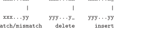

使用一个简单的代价函数，其中匹配得到 +2 分，而不匹配、插入、删除都得到 -1 分，A = 'ACAATCC' 和 B = 'AGCATGC' 的字符串对齐得分细节如下所示

¹ 对齐是指向字符串 A 或 B 中插入空格，使它们具有相同字符数的过程。


| | - | A | G | C | A | T | G | C |
|---|---|---|---|---|---|---|---|---|
| - | 0 | -1 | -2 | -3 | -4 | -5 | -6 | -7 |
| A | -1 | 2 | 1 | 0 | -1 | -2 | -3 | -4 |
| C | -2 | 1 | 1 | 3 | 2 | 1 | 0 | -1 |
| A | -3 | 0 | 0 | 2 | 5 | 4 | 3 | 2 |
| A | -4 | -1 | -1 | 1 | 4 | 4 | 3 | 2 |
| T | -5 | -2 | -2 | 0 | 3 | 6 | 5 | 4 |
| C | -6 | -3 | -3 | 2 | 2 | 5 | 5 | 7 |
| C | -7 | -4 | -4 | -1 | 1 | 4 | 4 | 7 |

图 6.1：A = ‘ACAATCC’ 与 B = ‘AGCATGC’ 的字符串比对示例（得分 = 7）

在图 6.1 中，比对得分为 7（右下角）。从右下角单元格开始，沿着虚线（红色）箭头回溯以重构解。对角线箭头表示匹配或不匹配（例如最后一个 ‘C’）。垂直箭头表示删除（例如 ..CAT.. 变为 ..C_A_..）。水平箭头表示插入（例如 A_C.. 变为 AGC..）。

```
A = ‘A_CAAT[C]C’
B = ‘AGC_AT[G]C’
```

由于我们需要填满 n × m 矩阵表中的所有条目，且每个条目都可以在 O(1) 时间内计算，因此时间复杂度为 O(nm)。空间复杂度为 O(nm)——即 DP 表的大小。

#### 6.3.2 最长公共子序列

最长公共子序列（Longest Common Subsequence，LCS）问题定义如下：给定两个字符串 A 和 B，它们之间的最长公共子序列是什么。例如，A = ‘ACAATCC’ 和 B = ‘AGCATGC’ 的 LCS 长度为 5，即 ‘AGATC’。

LCS 的解法与前面介绍的字符串比对解法非常相似。将不匹配的代价设为负无穷，插入和删除的代价设为 0，匹配的代价设为 1。这样会使字符串比对解法从不考虑不匹配。

#### 6.3.3 回文

回文是指从两个方向读都相同的字符串。一些回文查找问题的变体可以用 DP 技术解决，如下例所示：给定一个长度最多为 1000 个字符的字符串，确定通过删除零个或多个字符所能得到的最长回文长度。示例：

- ‘ADAM’ → ‘ADA’（长度为 3，删除 ‘M’）
- ‘MADAM’ → ‘MADAM’（长度为 5，不删除任何字符）
- ‘NEVERODDOREVENING’ → ‘NEVERODDOREVEN’（长度为 14，删除 ‘ING’）

DP 解法：令 len(l, r) 表示字符串 A[l ... r] 中最长回文的长度。

```
Base cases:
If (l = r), then len(l, r) = 1. // true in odd-length palindrome
If (l + 1 = r), then len(l, r) = 2 if (A[l] = A[r]), or 1 otherwise. // true in even-length palindrome
```

递推式：
如果 \(A[l] = A[r]\)，则 \(len(l,r) = 2 + len(l+1,r-1)\)。  // 两个端点的字符相同
否则 \(len(l,r) = max(len(l,r-1), len(l+1,r))\)。  // 增加左侧或减少右侧

与使用 DP 进行字符串处理相关的编程练习：

- 1. UVa 164 - String Computer（字符串比对/编辑距离）
- 2. UVa 531 - Compromise（最长公共子序列 + 打印方案）
- 3. UVa 10066 - The Twin Towers（最长公共子序列——但不是针对‘字符串’）
- 4. UVa 10100 - Longest Match（最长公共子序列）
- 5. UVa 10192 - Vacation（最长公共子序列）
- 6. UVa 10405 - Longest Common Subsequence（正如题目名称所示）
- 7. UVa 10739 - String to Palindrome（字符串转回文）
- 8. UVa 11151 - Longest Palindrome（最长回文）
- 9. LA 2460 - Searching Sequence Database in Molecular Biology（字符串比对）

### 6.4 后缀树与后缀数组

后缀树和后缀数组是两种高效且相关的字符串数据结构。我们没有将本主题放在第 2 章，因为这两种数据结构是专门针对字符串的。

#### 6.4.1 后缀树：基本思想

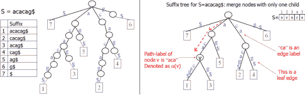

图 6.2：S = ’acacag$’ 的后缀 Trie（左）与后缀树（右）（图来自 [24]）

考虑字符串² S = ’acacag$’，S 的后缀³ Trie 是一棵树，包含 S 的所有可能后缀（见图 6.2 左）。共享公共前缀的两个后缀会共享前几个顶点，例如 ’cag$’ 和 ’cacag$’ 在分叉前共享前两个顶点 ’ca’。叶子包含后缀的索引。S 的后缀树是合并了只有一个子节点的顶点后的后缀 Trie（见图 6.2 右）。注意图中的“边标签”和“路径标签”。

练习：画出 S = ’competitive$’ 的后缀树！

² 注意，S 通常会在末尾附加一个特殊字符 ‘$’，它在字典序上小于 S 中使用的所有字母。

³ 字符串的后缀是一种“特殊情况”的子串，它一直延伸到字符串的最后一个字符。

#### 6.4.2 后缀树的应用

假设字符串 $S$ 的后缀树⁴已经构建完成，我们可以将其用于以下应用：

**在 $O(|Q| + occ)$ 内进行精确字符串匹配**

使用后缀树，我们可以在 $O(|Q|+occ)$ 时间内找到查询字符串 $Q$ 在 $S$ 中的所有（精确）出现位置，其中 $|Q|$ 是查询字符串 $Q$ 本身的长度，$occ$ 是 $Q$ 在 $S$ 中的出现总次数——无论字符串 $S$ 有多长。当后缀树已经构建完成时，这种方法比许多精确字符串匹配算法（例如 KMP）都*更快*。

使用后缀树时，我们的任务是在后缀树中搜索表示查询字符串 $Q$ 的顶点 $x$。这只需沿着边标签从根到叶遍历一次即可完成。路径标签为 $= Q$ 的顶点就是目标顶点 $x$。然后，以 $x$ 为根的子树中的叶子就是 $Q$ 在 $S$ 中的出现位置。之后，我们可以读取存储在该子树叶子中的这些子串的起始索引。

例如，在图 6.2 右侧所示的 $S = ’acacag$’$ 的后缀树中，若 $Q = ’aca’$，我们只需从根开始遍历，沿着边标签 ‘a’，再沿着边标签 ‘ca’，找到路径标签为 ‘aca’ 的顶点 $x$（沿图 6.2 右侧的红色虚线箭头）。该顶点 $x$ 的叶子指向索引 1（子串：’acacag$’）和索引 3（子串：’acag$’）。

练习：现在尝试查找查询字符串 $Q = ’ca’$ 和 $Q = ’cat’$！

**在 $O(n)$ 内查找最长重复子串**

使用后缀树，我们还可以轻松找到 $S$ 中的最长重复子串。$S$ 的后缀树中最深的内部顶点 $X$ 就是答案。顶点 $X$ 可以通过 $O(n)$ 的树遍历找到。$X$ 是内部顶点这一事实意味着它表示字符串 $S$ 的多个后缀（叶子），并且这些后缀共享一个公共前缀（重复子串）。$X$ 是从根出发最深的内部顶点这一事实意味着其路径标签就是最长重复子串。

例如，在图 6.2 右侧所示的 $S = ’acacag$’$ 的后缀树中，最长重复子串是 ‘aca’，因为它是那个最深的内部顶点的路径标签。

练习：查找 $S = ’cgacattacatta$’$ 中的最长重复子串！

**在 $O(n)$ 内查找最长公共子串**

使用后缀树可以在线性时间内解决两个或多个字符串的最长公共子串（不是子序列）⁵问题。考虑两个字符串 $S1$ 和 $S2$；我们可以为 $S1$ 和 $S2$ 构建一棵带有两个不同结束标记的广义后缀树，例如 $S1$ 使用字符 ‘#’，$S2$ 使用字符 ‘$’。然后，我们标记每个内部顶点，该顶点的叶子表示同时属于 $S1$ 和 $S2$ 的后缀——这意味着这些后缀共享一个公共前缀。接着，我们报告最深的被标记顶点作为答案。

例如，对于 $S1 = ’acgath#$’$ 和 $S2 = ’cgt$’$，最长公共子串是长度为 2 的 ’cg’。在图 6.3 中，我们看到根以及路径标签为 ‘cg’、‘g’ 和 ‘t’ 的顶点都有两个不同的叶子标记。最深的被标记顶点是 ‘cg’。两个后缀 $cgat#$ 和 $cgt$ 共享公共前缀 ‘cg’。

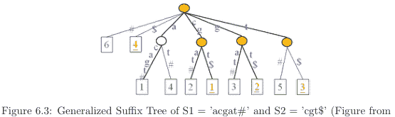

练习：查找 S1 = 'steven$' 和 S2 = 'seven$' 的最长公共子串！

#### 6.4.3 后缀数组：基本思想

在竞赛环境中构建高效的后缀树有些复杂且有风险。幸运的是，我们将要描述的另一种数据结构——由 Udi Manber 和 Gene Myers 发明的后缀**数组**——具有与后缀树相似的功能，但更易于实现，尤其是在编程竞赛环境中。因此，我们将跳过关于构建后缀树的讨论，转而关注后缀数组。

基本上，后缀数组是一个整数数组，包含已排序后缀的索引。例如，考虑同一个 S = 'acacag$'，其中 *n* = 7。S 的后缀数组是 *n* 的一个整数排列，如图 6.4 所示。注意，我们将终止符号 $ 视为字典序最小的字符。

| 后缀 | 位置 |
|---|---|
| acacag$ | 1 |
| cacag$ | 2 |
| acag$ | 3 |
| cag$ | 4 |
| ag$ | 5 |
| g$ | 6 |
| $ | 7 |

⇒ 排序

| SA[i] | 后缀 |
|---|---|
| 7 | $ |
| 1 | acacag$ |
| 3 | acag$ |
| 5 | ag$ |
| 2 | cacag$ |
| 4 | cag$ |
| 6 | g$ |

图 6.4：S = 'acacag$' 的后缀数组（图来自 [24]）

后缀树和后缀数组密切相关。如图 6.5 所示，后缀树的叶子（从左到右）按后缀数组顺序排列。简而言之，后缀树中的一个**顶点**对应后缀数组中的一个**区间**！

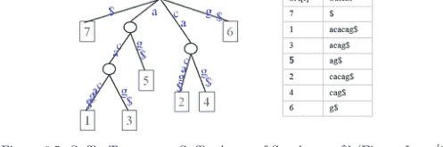

对于竞赛题目中的许多实际字符串操作，后缀数组已经足够好用。在本节中，我们介绍两种在给定字符串 S[0 . . . n-1] 时构建后缀数组的简单方法。


```cpp
#include <iostream>
#include <stdlib.h>
#include <string.h>
using namespace std;

char S[1001]; // this naive Suffix Array cannot go beyond 1000 characters
int SA[1001], n;                              // compare suffixes
int SA_cmp(const void *a, const void *b) { return strcmp(S + *(int*)a, S + *(int*)b); }

int main() { // first approach: O(n^2 log n), only for n <= 1000
  n = strlen(gets(S));
  for (int i = 0; i < n; i++) SA[i] = i; // sort * comparison
  qsort(SA, n, sizeof(int), SA_cmp);     // O(n log n) * O(n) = O(n^2 log n)
  for (int i = 0; i < n; i++) printf("%d %s\n", SA[i], S+SA[i]);
} // return 0;
```

当应用于字符串 S = `acacag$` 时，这段仅使用排序库对所有后缀进行排序的简单代码将生成正确的后缀数组 = {6, 0, 2, 4, 1, 3, 5}（注意索引从 0 开始）。然而，除了 n ≤ 1000 的竞赛题之外，这几乎没有什么用处。

构建后缀数组的一种更好方法是按长度递增对后缀进行 O(n log n) 排序。我们从长度为 1、2、4、8、……直至 n 的后缀开始。由于长度呈指数增长，我们只需要 O(log n) 步。因此总体复杂度为 O(n log^2 n)。有了这种复杂度，处理长度 n ≤ 100K 的字符串——这是编程竞赛的典型范围——就不成问题。库代码如下所示。解释参见 [29, 24]。

```cpp
#include <algorithm>
#include <iostream>
#include <stdlib.h>
#include <string.h>
using namespace std;
#define MAXN 200010
int RA[MAXN], SA[MAXN], LCP[MAXN], *FC, *SC, step;
char S[MAXN], Q[MAXN];

bool cmp(int a, int b) {
  if (step==-1 || FC[a]!=FC[b]) return FC[a] < FC[b];
  return FC[a+(1<<step)] < FC[b+(1<<step)];
}

void suffix_array(char *S, int n) { // O(n log^2(n))
  for (int i=0; i<n; i++) RA[i] = S[SA[i] = i];
  for (FC=RA, SC=LCP, step=-1; (1<<step)<n; step++) {
    sort(SA, SA+n, cmp);
    int cnt = 0;
    for (int i=0; i<n; i++) {
      if (i>0 && cmp(SA[i-1],SA[i])) cnt++;
      SC[SA[i]] = cnt;
    }
    if (cnt==n-1) break; // all distinct, no need to continue
    swap(FC,SC);
  }
  for (int i=0; i<n; i++) RA[SA[i]] = i;
}
```

现在，在后缀数组已经构建好的情况下，我们可以在 $O(m \log n)$ 内，在长度为 $n$ 的字符串 $S$ 中搜索长度为 $m$ 的查询字符串 $Q$。这比后缀树版本慢 $O(\log n)$ 倍，但在实践中相当可接受。$O(m \log n)$ 的复杂度来自这样一个事实：我们可以对已排序的后缀进行 $O(\log n)$ 次二分查找，并且每个后缀最多进行 $O(m)$ 次比较。

$Q$ 在 $S$ 的后缀数组中的出现位置是连续的，这一事实可用于在类似的 $O(m \log n) + O(occ)$ 时间内处理最长重复子串和最长公共子串问题。例如，在 `S = 'acacag$'` 中，重复子串 `'ca'` 出现在 `SA[4]` 和 `SA[5]` 中。对于 `S_1 = 'acgat#'` 与 `S_2 = 'cgt$'` 之间的公共子串，我们可以将两个字符串拼接成 `S = 'acgat#cgt$'`，构建拼接字符串的后缀数组，然后修改比较函数以检查标记字符 `'#'` 和 `'$'`。

我们在后缀数组中查找查询字符串 $Q$ 的代码如下所示：

```cpp
pair<int, int> range(int n, char *Q) {
    int lo = 1, hi = n, m = strlen(Q), mid = lo; // index 0 - null
    while (lo <= hi) {                          // valid range = [1..n]
        mid = (lo + hi) / 2;
        int cmp = strncmp(S + SA[mid], Q, m);
        if (cmp == 0)    break; // found
        else if (cmp > 0) hi = mid - 1;
        else              lo = mid + 1;
    }

    if (lo > hi)
        return make_pair(-1, -1); // not found

    for (lo = mid; lo >= 1 && strncmp(S + SA[lo], Q, m) == 0; lo--);
    lo++;
    for (hi = mid; hi <= n && strncmp(S + SA[hi], Q, m) == 0; hi++);
    hi--;

    return make_pair(lo, hi);
}

int main() {
    int n = strlen(gets(S));
    suffix_array(S, n + 1); // NULL is included!
    for (int i = 1; i <= n; i++) // SA[0] is the NULL
        printf("%d %s\n", SA[i], S + SA[i]);

    gets(Q);
    pair<int, int> pos = range(n, Q);
    if (pos.first != -1 && pos.second != -1) {
        printf("%s is found in SA [%d ... %d] of %s\n", Q, pos.first, pos.second, S);
        printf("They are:\n");
        for (int i = pos.first; i <= pos.second; i++)
            printf("  %s\n", S + SA[i]);
    }
    else
        printf("%s is not found in %s\n", Q, S);

    return 0;
}
```

#### 与后缀数组相关的编程练习

- 1. UVa 719 - Glass Beads（最小字典序旋转，可用 SA 解决）
- 2. UVa 10526 - Intellectual Property
- 3. UVa 11107 - Life Forms
- 4. UVa 11512 - GATTACA
- 5. LA 4657 - Top 10（ACM ICPC 雅加达 2009，出题人：Felix Halim）
- 6. https://www.spoj.pl/problems/SARRAY/（出题人：Felix Halim）

### 6.5 章末注记

关于字符串比对（编辑）、最长公共子序列、后缀树和后缀数组的材料由新加坡国立大学计算学院的 **A/P Sung Wing Kin, Ken** [24] 提供。

6.3 节讨论的字符串比对问题称为**全局比对问题**。目前最好的解法是 *O(nm/log² n)* [24]，但编码复杂。然而，如果给定的竞赛题仅限 *d 次插入或删除*，我们可以只关注 DP 矩阵的主对角线，将 Needleman-Wunsch 算法加速到 *O(dn)*。

对于局部比对问题的特殊情形，存在一种类似于 Needleman-Wunsch 算法的更好算法（**Smith-Waterman 算法** [24]）。

当所有字符互不相同时，最长公共子序列问题可以在 *O(n log n)* 内解决 [24]。

本章未讨论其他字符串匹配算法：**Rabin-Karp、Boyer-Moore、Knuth-Morris-Pratt（KMP）、Aho-Corasick** 等。但对于许多涉及字符串的竞赛题，使用 C `<string.h>` 中的 `strstr` 或 C++ STL `<string>` 中的 `string.find()` 等库函数通常已经足够。如果比赛时需要更快的字符串匹配算法，我们建议使用本章讨论的后缀数组。

关于后缀数组的更多示例应用，请阅读 [29] 的文章“后缀数组——一种编程竞赛方法”。

还有一些其他字符串处理问题我们尚未涉及：**语法与解析**（例如巴科斯范式）、**编码/解码/密码/密码学**、**最短公共超串**、**正则表达式**（使用 Java）、用于字符串处理的**哈希技术**、**后缀自动机**等。

本章大约讨论了 **54 道编程练习**。

## 第7章：（计算）几何

> 不懂几何者不得入内。  
> ——雅典柏拉图学园

### 7.1 概述与动机

几乎所有 ICPC 题目集都至少有一道几何题。如果幸运的话，它要求你给出某种你在大学预科阶段学过且仍然记得的几何解法，或者可以通过绘制几何对象推导出的解法。然而，许多几何问题更加复杂，找到正确算法也更困难。表 7.1 展示了近期 ACM ICPC 亚洲区域赛中的一些几何问题。

| LA | 题目名称 | 来源 | 几何问题（算法） |
|---:|---|---|---|
| 2797 | Monster Trap | Aizu03 | |
| 3169 | Boundary Points | Manila06 | 凸包 |
| 3616 | How I Wonder ... | Yokohama06 | |
| 4107 | TUSK | Singapore07 | |
| 4410 | Shooting the Monster | KLumpur08 | |
| 4413 | Triangle Hazard | KLumpur08 | |
| 4532 | Magic Rope | Hsinchu09 | |
| 4639 | Separate Points | Tokyo09 | |
| 4642 | Malfatti Circles | Tokyo09 | 三角形与圆 |
| 4717 | In-circles Again | Phuket09 | 三角形中的圆 |

表 7.1：近期 ACM ICPC 亚洲区域赛中的一些（计算）几何问题

¹ 为避免此错误，通常我们这样进行浮点数比较测试：`fabs(a - b) < EPS`，其中 `EPS` 通常是像 1e-9 这样的小数。


我们将本章分为两部分。第一部分是第 7.2 节的**几何基础**。我们回顾许多（并非全部）编程竞赛中常用的英文几何术语和公式。第二部分讨论第 7.4 - 7.5 节的**计算几何**，其中我们使用可以用几何方式表述的*数据结构和算法*。

### 7.2 几何基础

由于 ACM ICPC 参赛者来自不同的国籍、语言和背景，下面这些英文几何术语有时可能看起来陌生。在此，我们尝试提供一个列表——它不可能详尽无遗——供参赛者在遇到几何问题时作为快速参考。

#### 直线

- 1. **直线**可以用数学方程描述：$y = mx + c$ 或 $ax + by + c = 0$。$y = mx + c$ 方程涉及“梯度”/“斜率”$m$。
- 注意：小心具有“无穷大”斜率的垂直线。通常，我们在求解代码中单独处理垂直线（几何问题中*特殊情况*的示例）。
- 2. 一条**线段**是长度有限、有两个端点的直线。

**与直线相关的编程练习：**

- 1. UVa 184 - 激光线
- 2. UVa 270 - 排队
- 3. UVa 833 - 瀑布
- 4. UVa 10180 - 罗普兰的绳索危机（线段上的最近点）
- 5. UVa 10242 - 第四点
- 6. UVa 10263 - 铁路
- 7. UVa 11068 - 一个简单的任务（直线 ax + by + c）
- 8. UVa 11277 - 银弹（完全搜索 + 下文讨论的共线测试）
- 9. LA 4601 - 欧几里得（2009 年美国东南部赛区）

#### 圆（见图 7.1）

- 1. 在二维*笛卡尔*坐标系中，以 $(a, b)$ 为圆心、半径为 $r$ 的**圆**是所有满足 $(x - a)^2 + (y - b)^2 = r^2$ 的点 $(x, y)$ 的集合。
- 2. 常数 $\pi$ 是欧几里得空间中*任意*圆的周长与其直径的**比值**。为避免精度误差，编程竞赛中最安全的值是 $\pi = 2 \times acos(0.0)$，除非题目描述中已定义该常数！
- 3. 圆的**周长** $c$ 与**直径** $d$ 的关系为 $c = \pi \times d$，其中 $d = 2 \times r$。
- 4. 周长为 $c$、角度为 $\alpha$（单位为度²）的圆的**弧**长为 $\frac{\alpha}{360.0} \times c$。

² 人类通常使用度，但编程语言中的许多数学函数使用弧度。请查阅你的编程语言手册以确认这一点。为帮助换算，只需记住一 $\pi$ 弧度等于 180 度。

- 5. 半径为 *r*、角度为 *α*（单位为度）的圆的**弦**长可通过**余弦定理**得到：\(2r^2 \times (1 - \cos(α))\)——参见下文关于三角形的讨论中对这一定理的解释。
- 6. 半径为 *r* 的圆的**面积** A 为 \(A = π × r^2\)。
- 7. 面积为 A、角度为 α（单位为度）的圆的**扇形**面积为 \(\frac{α}{360.0} × A\)。
- 8. 圆的**弓形**面积可通过从相应扇形的面积中减去一个等腰三角形的面积得到，该三角形的边长为：*r*、*r* 和弦长。

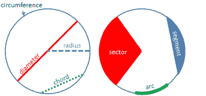

图 7.1：圆

**仅与圆相关的编程练习：**

- 1. UVa 10005 - 打包多边形（完全搜索：经过 2 点的圆，测试其他点）
- 2. UVa 10012 - 它有多大（圆半径，使用完全搜索）
- 3. UVa 10136 - 巧克力曲奇（经过 2 点的圆）
- 4. UVa 10221 - 卫星（求圆的弧长和弦长）
- 5. UVa 10342 - 圆内多边形（圆内的 n 边正多边形）
- 6. UVa 10451 - 古村运动（n 边正多边形的内切圆/外接圆）
- 7. UVa 10589 - 面积（检查点是否在 4 个圆的交集内）

#### 三角形（见图 7.2）

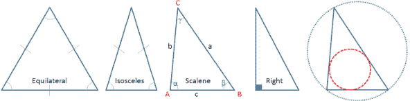

图 7.2：三角形

- 1. **三角形**是具有三个顶点和三条边的多边形（定义见下文）。三角形有几种类型：
  - **等边三角形**，三条边长度相同，所有内角均为 60 度；
  - **等腰**三角形，有两条边长度相同；
  - **不等边**三角形，没有边长度相同；
  - **直角**三角形，其中一个内角为 90 度（或一个**直角**）。
- 2. 底为 $b$、高为 $h$ 的三角形的**面积** $A$ 为 $A = 0.5 \times b \times h$。
- 3. 三边为 $a$、$b$、$c$ 的三角形的**周长** $p$ 为 $p = a + b + c$。
- 4. **海伦公式**：三边为 $a$、$b$、$c$ 的三角形的面积 $A$ 为 $A = \sqrt{s \times (s-a) \times (s-b) \times (s-c)}$，其中 $s = 0.5 \times p$（三角形的**半周长**）。
- 5. 面积为 $A$、半周长为 $s$ 的三角形的**内切圆**半径为 $r = A/s$。
- 6. 三边为 $a$、$b$、$c$、面积为 $A$ 的三角形的**外接圆**半径为 $R = a \times b \times c/(4 \times A)$。
- 7. 在**三角学**中，**余弦定理**（又称**余弦公式**或**余弦法则**）是关于一般三角形的命题，它将该三角形各边的长度与其某个角的余弦联系起来。参见图 7.2 中的不等边（中间）三角形。采用此处描述的记号，有：$c^2 = a^2 + b^2 - 2 \times a \times b \times \cos(\gamma)$。该公式可针对另外两个角 $\alpha$ 和 $\beta$ 改写。
- 8. 在三角学中，**正弦定理**（又称**正弦公式**或**正弦法则**）是联系任意三角形各边长度与其角的正弦的方程。参见图 7.2 中的不等边（中间）三角形。采用那里描述的记号，有：$\frac{a}{\sin(\alpha)} = \frac{b}{\sin(\beta)} = \frac{c}{\sin(\gamma)}$。
- 9. 在三角学中，**勾股定理**是**余弦定理**的特例。勾股定理仅对直角三角形成立。如果角 $\gamma$ 是直角（度量为 $90^\circ$ 或 $\pi/2$ 弧度），则 $\cos(\gamma) = 0$，于是余弦定理简化为：$c^2 = a^2 + b^2$。
- 10. 在三角学中，**毕达哥拉斯三元组**是由三个正整数 $a$、$b$、$c$ 组成的三元组，满足 $a^2 + b^2 = c^2$。这样的三元组通常写作 $(a,b,c)$。一个著名的例子是 $(3,4,5)$。如果 $(a,b,c)$ 是毕达哥拉斯三元组，那么对任意正整数 $k$，$(ka,kb,kc)$ 也是。**本原毕达哥拉斯三元组**是指其中 $a$、$b$、$c$ 互质的三元组。本原毕达哥拉斯三元组描述直角三角形的三条整数边长，尽管逆命题不一定成立。

与三角形相关的编程练习（可能再次涉及圆）：

- 1. UVa 143 - 果园树木（计算三角形内的整数点）
- 2. UVa 190 - 过三点的圆（三角形的外接圆）
- 3. UVa 438 - 圆的周长（三角形的外接圆）
- 4. UVa 10195 - 圆桌骑士（三角形的内切圆，海伦公式）
- 5. UVa 10286 - 五边形的麻烦（正弦定理）
- 6. UVa 10347 - 中线（给定三角形的 3 条中线，求其面积）
- 7. UVa 10991 - 区域（海伦公式、余弦定理、扇形面积）
- 8. UVa 11152 - 彩色花朵（三角形的内切圆和外接圆，海伦公式）
- 9. UVa 11437 - 三角形乐趣
- 10. UVa 11479 - 这是最简单的问题吗？（性质检查）
- 11. UVa 11524 - 内切圆（三角形中圆的又一种变体）
- 12. UVa 11579 - 三角形麻烦
- 13. LA 4413 - 三角形危险
- 14. LA 4717 - 再次内切圆

#### 矩形

- 1. **矩形**是具有四条边、四个顶点和四个直角的多边形。
- 2. 宽为 \(w\)、高为 \(h\) 的矩形的**面积** \(A\) 为 \(A = w \times h\)。
- 3. 宽为 \(w\)、高为 \(h\) 的矩形的**周长** \(p\) 为 \(p = 2 \times (w + h)\)。
- 4. **正方形**是 \(w = h\) 时矩形的特例。

**与矩形相关的编程练习：**

- 1. UVa 201 - 正方形
- 2. UVa 476 - 图形中的点：矩形
- 3. UVa 922 - 海边矩形
- 4. UVa 10502 - 计数矩形（完全搜索）
- 5. UVa 10908 - 最大正方形（隐式正方形）
- 6. UVa 11207 - 最简单的方法（将矩形切成 4 个等大的正方形）
- 7. UVa 11455 - 看看我的四边形（性质检查）

#### 梯形

- 1. **梯形**是具有四条边、四个顶点和一对平行边的多边形。如果梯形的两条非平行边长度相同，则得到**等腰梯形**。
- 2. 底为 \(w1\)、另一条与底平行的边为 \(w2\)、高为 \(h\) 的梯形的**面积** \(A\) 为 \(A = 0.5 \times (w1 + w2) \times h\)。

#### 四边形

- 1. **四边形**或**四角形**是具有四条边（和四个顶点）的多边形。上文提到的矩形、正方形和梯形都是四边形。图 7.3 还展示了一些示例：**平行四边形**、**筝形**、**菱形**。


图 7.3：四边形


#### 球体

- 1. 球体是三维空间中一种完美圆形的几何物体。

- 2. 球体上任意两点 A 和 B 之间的**大圆距离** [38] 是沿着**球体表面**上一条路径的最短距离。该路径等于经过 A、B 两点的该球体**大圆**的弧长。

球体的大圆定义为沿球体表面延伸并将球体切成两个相等半球的圆。为了求解大圆距离，我们求出该大圆的圆心角 AOB（见图 7.4），并利用它来确定弧长。

虽然相当罕见，但有些竞赛题目会使用这种距离度量。通常，球体表面上的两个点以（纬度，经度）对的形式给出。下面的库代码将帮助我们在给定球体上两个点和球体半径的情况下获得最短的大圆距离。关于此库代码的推导，请参阅 [38]。

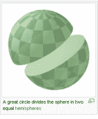


图 7.4：大圆与大圆距离（弧 A-B）（图来自 [46]）

```cpp
double greatCircleDistance(double pLat, double pLong,
                           double qLat, double qLong, double radius) {
    pLat *= PI / 180; pLong *= PI / 180;
    qLat *= PI / 180; qLong *= PI / 180;
    return radius * acos(cos(pLat)*cos(pLong)*cos(qLat)*cos(qLong) +
                         cos(pLat)*sin(pLong)*cos(qLat)*sin(qLong) +
                         sin(pLat)*sin(qLat));
}
```

与大圆距离相关的编程练习：

- 1. UVa 535 - 环球旅行者
- 2. UVa 10075 - 航空公司（含APSP）
- 3. UVa 10316 - 航空枢纽
- 4. UVa 10897 - 旅行距离
- 5. UVa 11817 - 穿越地球

#### 多边形

- 1. **多边形**是由有限条直线段组成的闭合路径或回路所围成的平面图形。这些线段称为边。两条边相交的点称为多边形的顶点或角。多边形的内部有时称为其本体。

- 2. 如果在多边形内部画出的任意线段都不会与多边形的任何边相交，则该多边形称为**凸多边形**。否则，该多边形称为**凹多边形**。

- 3. 对于具有 \(n\) 对顶点坐标且按某种顺序（顺时针或逆时针）给出的 \(n\) 边形（无论是凸还是凹），其面积 \(A\) 为：

\[
A = \frac{1}{2}\left|\begin{array}{cc}
x_1 & y_1 \\
x_2 & y_2 \\
x_3 & y_3 \\
\vdots & \vdots \\
x_n & y_n
\end{array}\right|
= \frac{1}{2}(x_1y_2 + x_2y_3 + x_3y_4 + \cdots + x_ny_1 - x_2y_1 - x_3y_2 - x_4y_3 - \cdots - x_1y_n)
\]

这可以写成下面的库代码。请注意，我们的默认设置是所有坐标均为整数，并尽可能使用整数运算。如果给定的点不是整数，则需要修改此代码的一部分：

```cpp
struct point { int x, y; } // a point has two members

int determinant(vector<point> P) { // default: integer computation
  int result = 0, x1, y1, x2, y2;
  for (int i = 0; i < P.size(); i++) {
    x1 = P[i].x; x2 = P[(i + 1) % P.size()].x;
    y1 = P[i].y; y2 = P[(i + 1) % P.size()].y;
    result += (x1 * y2 - x2 * y1);
  }
  return result;
}

// area is half of the determinant and the result may be a non-integer
double area(vector<point> P) { return fabs(determinant(P) / 2.0); }
```

- 4. 对于具有 \(n\) 对坐标且按某种顺序（顺时针或逆时针）给出的 \(n\) 边形，其周长 \(p\) 可以用勾股定理计算：

```cpp
double perimeter(vector<point> P) { // point has x & y
  double result = 0.0, x1, y1, x2, y2, dx, dy;
  for (int i = 0; i < P.size(); i++) {
    x1 = P[i].x; x2 = P[(i + 1) % P.size()].x;
    y1 = P[i].y; y2 = P[(i + 1) % P.size()].y;
    dx = x2 - x1;
    dy = y2 - y1;
    result += sqrt(dx * dx + dy * dy);
  }
  return result;
}
```

- 5. 使用一个相当稳健的^3几何谓词测试——称为 **CCW（逆时针）测试**（又称 **左转测试**），可以轻松测试多边形是否为凸（或凹）。

CCW 测试是计算几何中一个简单但重要的谓词测试。该测试接受平面上的 3 个点 \(p\)、\(q\)、\(r\)，并判断序列 \(p \rightarrow q \rightarrow r\) 是否为左转^4。例如，\(CCW(p,q,r)\)，其中 \(p=(0,0)\)、\(q=(1,0)\)、\(r=(0,1)\) 为真。此测试可以使用以下库代码实现：

```cpp
int turn(point p, point q, point r) {
    int result = (r.x - q.x) * (q.y - p.y) - (r.y - q.y) * (p.x - q.x);
    if (result < 0) return -1; // P->Q->R is a right turn
    if (result > 0) return 1;  // P->Q->R is a left turn
    return 0; // P->Q->R is a straight line, i.e. P, Q, R are collinear
}

// Note: sometimes, we change the '> 0' to '>= 0' to accept collinear points
bool ccw(point p, point q, point r) { return (turn(p, q, r) > 0); }
```

借助上述库代码，我们现在可以通过验证多边形中所有连续三个点是否在按逆时针顺序访问时都进行左转来检查多边形是否为凸。如果我们能找到至少一个不满足该条件的三元组，那么多边形就是凹的。

与多边形相关的编程练习：

- 1. UVa 478 - 图形中的点：矩形、圆形和三角形（点在多边形内）
- 2. UVa 634 - 多边形（点在多边形内）
- 3. UVa 10078 - 艺术画廊（测试多边形是否为凸）
- 4. UVa 10112 - Myacm 三角形（像 UVa 478 那样用面积测试检查点是否在三角形内）
- 5. UVa 11447 - 水库日志（多边形面积）
- 6. UVa 11473 - 校园道路（多边形周长）

当然，还有许多其他几何形状、物体和公式尚未涉及，例如 3D 物体等。到目前为止，我们所介绍的是编程竞赛中出现频率较高的那些。

其他与基础几何相关的编程练习（未在上面列出）：

- 1. UVa 10088 - 我岛上的树（Georg A. Pick 定理：\(A = i + \frac{b}{2} - 1\)，参见 [43]）
- 2. UVa 10297 - Beavergnaw（圆锥、圆柱、体积）
- 3. UVa 10387 - 台球（展开表面、三角学）
- 4. UVa 11322 - 圆柱体（圆、矩形、圆柱体）
- 5. UVa 11507 - Bender B. Rodriguez 问题（模拟）

### 7.3 格雷厄姆扫描

点集 \(P\) 的**凸包**是包含 \(P\) 中每个点（要么在 \(CH(P)\) 的边界上，要么在其内部）的最小凸多边形 \(CH(P)\)（见图 7.5.D）。\(CH(P)\) 中的每个顶点都是原集合 \(P\) 中的一个顶点。因此，寻找凸包的算法必须决定选择 \(P\) 中的哪些顶点作为凸包的一部分。


图 7.5：点集 \(P\) 的凸包 \(CH(P)\)

可用的凸包算法有好几种。在本节中，我们选择 \(O(n \log n)\) 的罗纳德·格雷厄姆扫描算法。该算法首先根据所有 \(n\) 个点相对于一个称为基准点的角度对 \(P\) 中的点进行排序（图 7.5.A）。在我们的例子中，我们选择 \(P\) 中最低且最右的点作为基准点（参见图 7.5.B 中的点 0 以及其余点的逆时针顺序）。

然后，该算法维护一个候选点栈 \(S\)。\(P\) 中的每个点都会被压入 \(S\) 一次，而最终不会成为 \(CH(P)\) 一部分的点会从 \(S\) 中弹出。观察图 7.5.C。栈先前包含（栈底）11-0-1-2（栈顶），但当我们尝试插入 3 时，1-2-3 构成右转，因此我们弹出 2。现在 0-1-3 是左转，因此我们将 3 压入栈，此时栈包含（栈底）11-0-1-3（栈顶）。

当格雷厄姆扫描结束时，留在 \(S\) 中的就是 \(CH(P)\) 的点（见图 7.5.D），栈包含（栈底）11-0-1-4-7-10-11（栈顶）。格雷厄姆扫描消除了所有右转！检查 \(CH(P)\) 中顶点的序列总是构成左转——这是一个凸多边形。

下面是格雷厄姆扫描的实现，省略了之前已经展示过的部分（如 ccw 函数）：

```cpp
point pivot; // global variable
vector<point> polygon, CH;

int area2(point a, point b, point c) {
    return a.x * b.y - a.y * b.x + b.x * c.y - b.y * c.x + c.x * a.y - c.y * a.x;
}

int dist2(point a, point b) { // function to compute distance between 2 points
    int dx = a.x - b.x, dy = a.y - b.y; return dx * dx + dy * dy;
}

bool angle_cmp(point a, point b) { // important angle-sorting function
    if (area2(pivot, a, b) == 0) // collinear
        return dist2(pivot, a) < dist2(pivot, b); // which one closer

    int d1x = a.x - pivot.x, d1y = a.y - pivot.y;
    int d2x = b.x - pivot.x, d2y = b.y - pivot.y;
    return (atan2((double)d1y, (double)d1x) - atan2((double)d2y, (double)d2x)) < 0;
}
```


```cpp
vector<point> GrahamScan(vector<point> Polygon) {
  // first, find P0 = point with lowest Y and if tie: rightmost X
  int i, P0 = 0, N = Polygon.size();
  for (i = 1; i < N; i++)
    if (Polygon[i].y < Polygon[P0].y ||
        (Polygon[i].y == Polygon[P0].y && Polygon[i].x > Polygon[P0].x))
      P0 = i;

  point temp = Polygon[0]; // swap selected vertex with Polygon[0]
  Polygon[0] = Polygon[P0];
  Polygon[P0] = temp;

  // second, sort points by angle w.r.t. P0, skipping Polygon[0]
  pivot = Polygon[0]; // use this global variable as reference
  sort(Polygon.begin() + 1, Polygon.end(), angle_cmp);

  // third, the ccw tests
  stack<point> S;
  point prev, now;
  S.push(Polygon[N - 1]); // put two starting vertices into stack S
  S.push(Polygon[0]);

  i = 1; // and start checking the rest
  while (i < N) { // note: N must be >= 3 for this method to work
    now = S.top();
    S.pop(); prev = S.top(); S.push(now); // trick to get the 2nd item from top of S
    if (ccw(prev, now, Polygon[i])) { // if these 3 points make a left turn
      S.push(Polygon[i]); // accept
      i++;
    }
    else // otherwise
      S.pop(); // pop this point until we have a left turn
  }

  vector<point> ConvexHull;
  while (!S.empty()) { // from stack back to vector
    ConvexHull.push_back(S.top());
    S.pop();
  }
  ConvexHull.pop_back(); // the last one is a duplicate of first one

  return ConvexHull; // return the result
}
```

与凸包相关的编程练习：

- 1. UVa 109 - 飞毛腿克星
- 2. UVa 218 - 消灭飞蛾
- 3. UVa 361 - 警察与强盗
- 4. UVa 681 - 凸包求解（用于入门的纯凸包问题）
- 5. UVa 811 - 加固森林（结合凸包的完全搜索）
- 6. UVa 10002 - 质心（凸多边形的重心、凸包）
- 7. UVa 10065 - 无用的瓷砖打包机（外加多边形面积）
- 8. UVa 10135 - 聚集新生
- 9. UVa 10173 - 最小外接矩形
- 10. UVa 11626 - 凸包

### 7.4 相交问题

在几何问题中，我们几乎可以取任意一对对象，判断它们是否相交；如果相交，那么交点/交面积/交体积是什么？这是竞赛中许多计算几何问题的来源。

线段相交是最常见的相交问题之一。我们可以通过若干次 ccw 测试来判断两条线段是否相交（代码如下）。

```cpp
struct line { point p1, p2; };

int intersect(line line1, line line2) {
    return
        ((ccw(line1.p1, line1.p2, line2.p1) * ccw(line1.p1, line1.p2, line2.p2)) <= 0)
        &&
        ((ccw(line2.p1, line2.p2, line1.p1) * ccw(line2.p1, line2.p2, line1.p2)) <= 0);
}
```

然而，相交也可能发生在两条线段之外的不同类型对象之间。其他对象包括：立方体、盒子、圆、多边形、三角形、矩形等。下面给出一些示例。

与相交问题相关的可解编程练习：

- 线段相交
  - 1. UVa 191 - 相交
  - 2. UVa 378 - 相交直线
  - 3. UVa 866 - 相交线段
  - 4. UVa 920 - 阳光山
  - 5. UVa 972 - 地平线
  - 6. UVa 10902 - 挑棍游戏
  - 7. UVa 11343 - 孤立线段
- 其他对象
  - 1. UVa 453 - 相交圆（圆与圆）
  - 2. UVa 460 - 重叠矩形（矩形与矩形）
  - 3. UVa 737 - 闪耀的立方体（立方体与立方体）
  - 4. UVa 904 - 重叠空中交通管制（三维盒与三维盒）
  - 5. UVa 10301 - 圆环与胶水（圆与圆）
  - 6. UVa 10321 - 多边形相交（凸多边形与凸多边形）
  - 7. UVa 11122 - 三角形相交（三角形与三角形）
  - 8. UVa 11345 - 矩形（矩形与矩形）
  - 9. UVa 11515 - 起重机（圆与圆，外加动态规划）
  - 10. UVa 11601 - 避免重叠（矩形与矩形）
  - 11. UVa 11639 - 守卫土地（矩形与矩形）

### 7.5 再谈分治法

若干计算几何问题可以用分治范式求解，该范式已在第 3.2 节详细阐述。下面给出其中一个示例。

#### 几何问题的二分法


图 7.6：田径跑道（来自 UVa 11646）

假设我们有如下问题：给定一个期望的足球场，其期望长宽比 = A : B，两个弧来自同一个圆，圆心位于球场中央，田径跑道的长度（周长：2× 长 + 2× 弧）为 400m，求球场的实际长和宽？见图 7.6。

用纸笔很难求出解，但借助计算机和二分法（二分查找），我们可以轻松找到解。

假设我们对 L 的值进行二分查找，那么可由 b × L / a 得到 W。期望的弧长为 (400 − 2 × L)/2。现在我们可以用三角学通过三角形 CMX 计算半径 r 和角度 θ（见图 7.6）。有了 r 和 θ，我们就能计算实际弧长。然后将该值与期望弧长比较，以决定是需要增大还是减小长度 L。代码的重要部分如下所示。

```cpp
lo = 0.0; hi = 400.0; // the range of answer
while (fabs(lo - hi) > 1e-9) { // do bisection method on L
    L = (lo + hi) / 2.0;
    W = b * L / a; // W can be derived by L
    expected_arc = (400 - 2.0 * L) / 2.0;
    half_L = 0.5 * L; half_W = 0.5 * W;
    r = sqrt(half_L * half_L + half_W * half_W);
    angle = 2.0 * atan(half_W / half_L) * 180.0 / PI;
    this_arc = angle / 360.0 * PI * (2.0 * r);
    if (this_arc > expected_arc) hi = L;
    else                         lo = L;
}
printf("Case %d: %.12lf %.12lf\n", caseNo++, L, W);
```

与本节相关的编程练习：

- 1. UVa 10245 - 最近点对问题（正如题名所示）
- 2. UVa 10566 - 交叉梯子（二分法）
- 3. UVa 11378 - 贝伊之战（也是最近点对问题）
- 4. UVa 11646 - 田径跑道（二分法，圆心位于跑道中心）
- 5. UVa 11648 - 分割土地（二分法）

### 7.6 本章注释

本章部分材料源自新加坡国立大学计算学院 **Cheng Holun, Alan 博士** 提供的材料。

还有许多其他凸包算法，例如 **Jarvis 步进法**、**礼品包装法** 和 **上/下凸包法**，它们的时间复杂度与 **Graham 扫描法** 大致相似。本章介绍的 Graham 扫描算法通常足以应对大多数竞赛问题。

还有一种尚未讨论的计算几何技术：**平面扫描**。感兴趣的读者应查阅以下书籍 [19, 6, 4]。

如果你正在备战 ICPC，最好让团队中的一名成员深入研究这一主题。此人应掌握基本几何公式和高级计算几何技术。他必须训练自己熟悉某些几何问题中的许多退化（特殊）情况，并能够处理精度误差等。

本章大约讨论了 **96 道编程练习**。

## 附录 A

### 题目致谢

本书讨论的题目主要取自 UVa 在线评测系统 [17] 和 ACM ICPC Live Archive [11]。我们已尽力联系原作者并获取许可。

到目前为止，我们已联系以下出题人并获得许可：Sohel Hafiz、Shahriar Manzoor、Manzurur Rahman Khan、Rujia Liu、Gordon Cormack、Jim Knisely、Melvin Zhang 和 Colin Tan。

如果本书中讨论的某一题目的作者中，有我们尚未联系且不允许其题目用于本书者，我们将用来自不同出题人的另一道类似题目替换该题。


## 附录 B

### 我们期待您的反馈

您，作为读者，可以帮助我们提高本书未来版本的质量。如果您发现本书中的任何技术、语法、拼写等错误，或者您想为本书的未来版本贡献某些部分（例如，我有更好的示例/算法来说明某个观点）等，请直接向主要作者发送电子邮件：stevenhalim@gmail.com。

### 参考文献

- [1] Ahmed Shamsul Arefin. *编程竞赛的艺术（来自 Steven 的网站）。* Gyankosh Prokashoni（在线可用），2006。
- [2] Jon Bentley. *编程珠玑。* Addison Wesley，第2版，2000。
- [3] Frank Carrano. *C++ 中的数据抽象与问题求解。* Pearson，第5版，2007。
- [4] Thomas H. Cormen、Charles E. Leiserson、Ronald L. Rivest 和 Cliff Stein. *算法导论。* MIT Press，第2版，2001。
- [5] Sanjoy Dasgupta、Christos Papadimitriou 和 Umesh Vazirani. *算法。* McGraw Hill，2008。
- [6] Mark de Berg、Marc van Kreveld、Mark Overmars 和 Otfried Cheong Schwarzkopf. *计算几何：算法与应用。* Springer，第2版，2000。
- [7] Project Euler。Project Euler。http://projecteuler.net/。
- [8] Michal Forišek。IOI 大纲。http://people.ksp.sk/~misof/ioi-syllabus/ioi-syllabus-2009.pdf。
- [9] Steven Halim 和 Felix Halim。新加坡国立大学的竞争性编程。Ediciones Sello Editorial S.L.（发表于 2010 年 ACM ICPC 世界总决赛合作学习倡议研讨会 CLIS @ 中国哈尔滨，2010）。
- [10] Steven Halim、Roland Hock Chuan Yap 和 Felix Halim。面向低自相关二元序列问题的随机局部搜索工程。载于 *约束编程的原理与实践*，第 640–645 页，2008。
- [11] Competitive Learning Institute。ACM ICPC 在线档案。http://acm.uva.es/archive/nuevopotal。
- [12] IOI。国际信息学奥林匹克。http://ioinformatics.org。
- [13] Jon Kleinberg 和 Eva Tardos. *算法设计。* Addison Wesley，2006。
- [14] Anany Levitin. *算法设计与分析导论。* Addison Wesley，第1版，2002。
- [15] 刘汝佳。*算法竞赛入门经典（中文）。* 清华大学出版社，2009。
- [16] 刘汝佳和黄亮。*算法与程序设计竞赛的艺术（中文）*。清华大学出版社，2003。
- [17] 巴利亚多利德大学。在线评测系统。http://uva.onlinejudge.org。
- [18] 美国计算机奥林匹克。USACO 训练计划入口。http://train.usaco.org/usacogate。
- [19] Joseph O'Rourke. *C 语言计算几何*。Cambridge University Press，第2版，1998。
- [20] Kenneth H. Rosen. *初等数论及其应用*。Addison Wesley Longman，第4版，2000。
- [21] Robert Sedgewick. *C++ 算法，第 1-5 部分*。Addison Wesley，第3版，2002。
- [22] Steven S Skiena. *算法设计手册*。Springer，2008。
- [23] Steven S. Skiena 和 Miguel A. Revilla. *编程挑战*。Springer，2003。
- [24] Wing-Kin Sung. *生物信息学算法：实践导论*。CRC Press（Taylor & Francis Group），第1版，2010。
- [25] TopCoder。算法教程。http://www.topcoder.com/tc?d1=tutorials&d2=alg_index&module=Static。
- [26] TopCoder。单轮比赛（SRM）。http://www.topcoder.com/tc。
- [27] 贝勒大学。ACM 国际大学生程序设计竞赛。http://icpc.baylor.edu/icpc。
- [28] Tom Verhoeff。IOI 竞赛任务 20 年。*信息学奥林匹克*，3:149–166，2009。
- [29] Adrian Vladu 和 Cosmin Negruşeri。后缀数组——一种编程竞赛方法。2008。
- [30] 维基百科。卡特兰数。http://en.wikipedia.org/wiki/Catalan_number。
- [31] 维基百科。组合数学。http://en.wikipedia.org/wiki/Combinatorics。
- [32] 维基百科。寻环（检测）。http://en.wikipedia.org/wiki/Cycle_detection。
- [33] 维基百科。并查集数据结构。http://en.wikipedia.org/wiki/Disjoint-set_data_structure。
- [34] 维基百科。Edmond 匹配算法。http://en.wikipedia.org/wiki/Edmond's_matching_algorithm。
- [35] 维基百科。八皇后问题。http://en.wikipedia.org/wiki/Eight_queens_puzzle。
- [36] 维基百科。欧拉函数。http://en.wikipedia.org/wiki/Euler’s_totient_function。
- [37] 维基百科。求解线性方程组的高斯消元法。http://en.wikipedia.org/wiki/Gaussian_elimination。
- [38] 维基百科。大圆距离。http://en.wikipedia.org/wiki/Great-circle_distance。
- [39] 维基百科。最长路径问题。http://en.wikipedia.org/wiki/Longest_path_problem。
- [40] 维基百科。最近公共祖先。http://en.wikipedia.org/wiki/Lowest_common_ancestor。
- [41] 维基百科。Miller-Rabin 素性测试。http://en.wikipedia.org/wiki/Miller-Rabin_primality_test。
- [42] 维基百科。路径覆盖。http://en.wikipedia.org/wiki/Path_cover。
- [43] 维基百科。Pick 定理。http://en.wikipedia.org/wiki/Pick’s_theorem。
- [44] 维基百科。埃拉托斯特尼筛法。
- [45] 维基百科。Tarjan 强连通分量算法。http://en.wikipedia.org/wiki/Tarjan’s_strongly_connected_components_algorithm。
- [46] 维基百科。自由百科全书。http://en.wikipedia.org。
- [47] 吴永辉和王建德。*实用算法分析与程序设计（中文）。* 人民邮电出版社，2009。

## 索引

- ACM，1
- 全源最短路径，78
  - 极小极大与极大极小，80
  - 传递闭包，80
- 多边形面积，126
- 数组 / 向量，15
- 关节点，62
- 回溯法，27
- Bellman-Ford 算法，76
- 贝尔曼，理查德，76
- BigInteger，参见 Java BigInteger 类
- 二分搜索，32
- 二叉搜索树，16
- 生物信息学，参见 字符串处理
- 二分法，33
- bitset，96
- 广度优先搜索，67
- 桥，62
- 暴力法，26
- CCW 测试，126
- 组合数学，105
- 竞争性编程，1
- 完全搜索，26
- 计算几何，参见 几何
- 连通分量，60
- 凸包，128
- 割边，参见 桥
- 割点，参见 关节点
- 寻环，106
- 数据结构，14
- 分解，38
- 深度优先搜索，58
- Dijkstra 算法，74
- 迪杰斯特拉，埃兹格·维贝，74
- 亚历山大的丢番图，99
- 直接寻址表，17
- 分治法，32
- 动态规划，40
- 编辑距离，112
- Edmonds-Karp 算法，82
- 埃德蒙兹，杰克，82
- 昔兰尼的埃拉托斯特尼，95
- 欧几里得算法，98
  - 扩展欧几里得，99
- 亚历山大的欧几里得，98
- 欧拉 φ，*参见* 欧拉函数
- 欧拉函数，98
- 欧拉，莱昂哈德，98
- 阶乘，101
- 斐波那契数，101
- 斐波那契，列奥纳多，101
- 洪水填充，61
- Floyd-Warshall 算法，78
- 弗洛伊德，罗伯特·W，78
- Ford-Fulkerson 算法，81
- 福特二世，莱斯特·兰道夫，76，81
- 富尔克森，德尔伯特·雷，81
- 高斯消元法，108
- 几何，120
- Graham 扫描，128
- 格雷厄姆，罗纳德，128
- 图，58
  - 数据结构，18
- 最大公约数，98
- 贪心算法，35
- 哈希表，17
- 堆，16
- 亚历山大的希罗，123
- 希罗公式，123
- ICPC，1
- 相交问题，130
- IOI，1
- Java BigInteger 类，102
  - 基数转换，104
  - GCD，103
  - modPow，103
- 卡普，理查德，82
- Kruskal 算法，70
- 克鲁斯卡尔，约瑟夫·伯纳德，70
- 余弦定理，123
- 正弦定理，123
- 最小公倍数，98
- 左转测试，*参见* CCW 测试
- 库，14
- 线性代数，108
- 线性丢番图方程，99
- 链表，15
- 在线档案，10
- 最长公共子序列，113
- 最长公共子串，115
- 最近公共祖先，86
- 曼伯，乌迪，116
- 数学，93
- 最大流，81
  - 最大边不相交路径，84
  - 带顶点容量的最大流，84
  - 最大独立路径，84
  - 最小费用（最大）流，85
  - 最小割，83
  - 多源多汇最大流，83
- 最小生成树，70
  - “最大”生成树，71
  - 最小生成“森林”，72
  - 部分“最小”生成树，72
  - 次佳生成树，72
- 模运算，100
- 迈尔斯，吉恩，116
- 网络流，*参见* 最大流
- 数制，107
- 数论，94
- 回文，113
- Pick 定理，127
- 皮克，格奥尔格·亚历山大，127
- 素数，94
  - 素性测试，95
  - 素因子，96
  - 埃拉托斯特尼筛法，95
- 概率论，108
- 勾股定理，123
- 勾股三元组，123
- 队列，15
- 区间最小值查询，22
- 线段树，22
- 序列，107
- 单源最短路径
  - 检测负环，76
  - 负权，75
  - 无权，68
  - 加权，74
- 特殊图，85
  - 二分图，89
    - 最大基数二分匹配，89
    - 最大加权独立集，90
  - 有向无环图，87
    - 最长路径，87
    - 最小路径覆盖，87
    - SSSP，87
  - 树，86
    - APSP，86
    - 关节点和桥，86
    - 树的直径，86
    - 最大加权独立集，86
    - SSSP，86
- 栈，15
- 字符串对齐，112
- 字符串匹配，111
- 字符串处理，110
- 字符串搜索，*参见* 字符串匹配
- 强连通分量，65
- 后缀数组，116
- 后缀树，114
  - 应用
    - 精确字符串匹配，115


- 最长公共子串，115
- 最长重复子串，115
- 塔扬，罗伯特·恩德雷，63，65
- TopCoder，10
- 拓扑排序，66
- 并查集（不相交集合），19
- USACO，10
- UVa，10
- 沃歇尔，斯蒂芬，78，80
