# 编译原理：原理、技术与工具（培生新国际版）

## 第1章 引言

编程语言是向人和机器描述计算的记号系统。我们所知的世界依赖于编程语言，因为所有计算机上运行的所有软件都是用某种编程语言编写的。但是，程序在运行之前，必须首先被翻译成计算机可以执行的形式。

完成这种翻译的软件系统称为*编译器*。

本书讨论如何设计和实现编译器。我们将会发现，只需少数基本思想就可以为各种各样的语言和机器构造翻译器。除编译器之外，编译器设计的原理和技术还适用于许多其他领域，因此计算机科学家在职业生涯中很可能会多次复用这些知识。编译器编写的研究涉及编程语言、机器体系结构、语言理论、算法和软件工程。

在本预备章节中，我们介绍语言翻译器的不同形式，概述典型编译器的总体结构，并讨论影响编译器发展的编程语言和机器体系结构趋势。我们还就编译器设计与计算机科学理论之间的关系提出一些看法，并概述编译器技术在编译之外的应用。最后，我们简要介绍学习编译器所需的若干关键编程语言概念。

### 1.1 语言处理器

简单地说，编译器是一个程序，它可以读取用某种语言编写的程序——*源语言*——并将其翻译成用另一种语言编写的等价程序——*目标语言*；见图1.1。编译器的一个重要任务是报告在翻译过程中检测到的源程序中的任何错误。

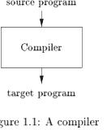

如果目标程序是可执行的机器语言程序，那么用户就可以调用它来处理输入并产生输出；见图1.2。

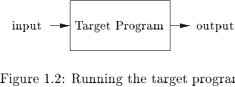

*解释器*是另一种常见的语言处理器。解释器不是通过翻译生成目标程序，而是看起来直接对用户提供的输入执行源程序中指定的操作，如图1.3所示。

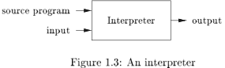

编译器生成的机器语言目标程序在将输入映射为输出时通常远比解释器快。然而，解释器通常能比编译器提供更好的错误诊断，因为它逐条执行源程序语句。

**示例1.1.** Java语言处理器将编译和解释结合起来，如图1.4所示。Java源程序可以首先被编译为一种称为*字节码*的中间形式，然后由虚拟机解释执行字节码。这种安排的一个好处是，在一台机器上编译出的字节码可以在另一台机器上解释执行，甚至可能通过网络传输。

为了更快地完成从输入到输出的处理，一些称为*即时*编译器的Java编译器会在运行中间程序处理输入之前，立即将字节码翻译成机器语言。

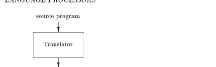

图1.4：混合编译器

除了编译器之外，生成可执行目标程序可能还需要其他几个程序，如图1.5所示。源程序可能被划分为存储在不同文件中的模块。收集源程序的任务有时交给一个称为*预处理器*的单独程序来完成。预处理器还可以将称为宏的简写形式展开为源语言语句。

修改后的源程序随后被送入编译器。编译器可能生成汇编语言程序作为输出，因为汇编语言作为输出更容易生成，也更容易调试。随后，汇编语言由一个称为*汇编器*的程序处理，该程序输出可重定位的机器代码。

大型程序通常是分块编译的，因此可重定位的机器代码可能需要与其他可重定位的目标文件和库文件链接在一起，形成实际在机器上运行的代码。*链接器*解析外部内存地址，即一个文件中的代码可能引用另一个文件中的位置。然后，*加载器*将所有可执行的目标文件汇总到内存中以便执行。

#### 1.1.1 第1.1节的练习

- **练习1.1.1：** 编译器与解释器之间的区别是什么？
- **练习1.1.2：** （a）编译器相对于解释器有哪些优点？（b）解释器相对于编译器有哪些优点？
- **练习1.1.3：** 在语言处理系统中，编译器生成汇编语言而不是机器语言有什么优点？
- **练习1.1.4：** 将高级语言翻译成另一种高级语言的编译器称为*源到源*翻译器。使用C作为编译器的目标语言有什么优点？
- **练习1.1.5：** 描述汇编器需要执行的一些任务。


## 第1章 引言

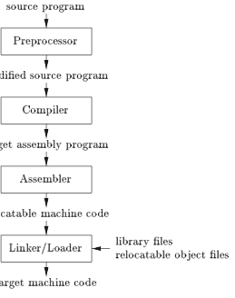

图1.5：语言处理系统

### 1.2 编译器的结构

到目前为止，我们一直把编译器看作一个单独的盒子，它把源程序映射为语义上等价的目标程序。如果把盒子稍微打开一点，就会看到这个映射有两个部分：分析和综合。

*分析*部分把源程序分解成若干组成部分，并给它们赋予语法结构。然后它利用这种结构创建源程序的中间表示。如果分析部分检测到源程序在语法上构造不当或在语义上不健全，那么它必须提供有用的消息，以便用户采取纠正措施。分析部分还收集有关源程序的信息，并将其存储在一个称为*符号表*的数据结构中，该数据结构与中间表示一起传递给综合部分。

*综合*部分根据中间表示和符号表中的信息构造所需的目标程序。分析部分通常称为编译器的*前端*；综合部分是*后端*。

如果更详细地考察编译过程，就会看到它按一系列*阶段*运行，每个阶段把源程序的一种表示转换为另一种表示。图1.6给出了编译器的一种典型阶段分解。在实践中，若干阶段可以组合在一起，并且组合阶段之间的中间表示不必显式构造。符号表存储有关整个源程序的信息，编译器的所有阶段都会使用它。有些编译器在前端和后端之间有一个与机器无关的优化阶段。这个优化阶段的目的是对中间表示进行变换，以便后端能够生成比从未优化的中间表示出发所生成的更好的目标程序。由于优化是可选的，图1.6所示的两个优化阶段中可能缺少其中一个或另一个。

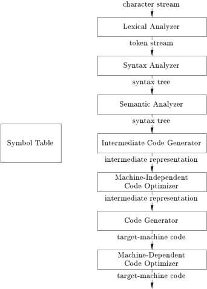

图1.6：编译器的阶段

### 1.2.1 词法分析

编译器的第一个阶段称为*词法分析*或*扫描*。词法分析器读取组成源程序的字符流

|  |  |  |
|---|---|---|
| 1 | `position` | ... |
| 2 | `initial` | ... |
| 3 | `rate` | ... |

**符号表**

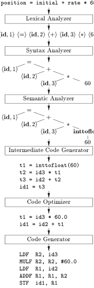

图1.7：赋值语句的翻译

### 1.2.2 语法分析

编译器的第二个阶段是*语法分析*或*解析*。语法分析器使用词法分析器产生的记号的第一个分量，创建一种树状中间表示，用来描绘记号流的语法结构。一种典型的表示是*语法树*，其中每个内部结点表示一个操作，该结点的子结点表示该操作的参数。记号流(1.2)的语法树如图1.7中语法分析器的输出所示。

这棵树显示了赋值

```
position = initial + rate * 60
```

中的操作将要执行的顺序。这棵树有一个内部结点标记为 * ，其左子结点为⟨id, 3⟩，右子结点为整数60。结点⟨id, 3⟩表示标识符rate。标记为 * 的结点明确表示我们必须首先将rate的值乘以60。标记为 + 的结点表示我们必须将这个乘法的结果加到initial的值上。树的根标记为 = ，表示我们必须将这个加法的结果存入标识符position的位置。这种操作顺序与算术的通常约定一致，即乘法优先于加法，因此乘法应在加法之前执行。

编译器的后续阶段利用这种语法结构来帮助分析源程序并生成目标程序。第4章我们将使用上下文无关文法来规定编程语言的语法结构，并讨论从某些文法类自动构造高效语法分析器的算法。第2章和第5章我们将看到，语法制导定义有助于规定编程语言构造的翻译。

### 1.2.3 语义分析

*语义分析器*使用语法树和符号表中的信息，检查源程序与语言定义的语义一致性。它还收集类型信息，并将其保存在语法树或符号表中，供中间代码生成期间后续使用。

语义分析的一个重要部分是*类型检查*，其中编译器检查每个运算符是否具有匹配的操作数。例如，许多编程语言定义要求数组下标为整数；如果用浮点数作为数组下标，编译器必须报告错误。

语言规范可能允许某些称为*强制转换*的类型转换。例如，二元算术运算符可以应用于一对整数或一对浮点数。如果该运算符应用于一个浮点数和一个整数，编译器可以将该整数转换或强制转换为浮点数。

### 1.2.5 代码优化

与机器无关的代码优化阶段试图改进中间代码，以便产生更好的目标代码。通常“更好”意味着更快，但也可能需要其他目标，例如更短的代码，或功耗更低的目标代码。例如，一个直截了当的算法生成中间代码(1.3)，对来自语义分析器的树表示中的每个运算符使用一条指令。

先使用简单的中间代码生成算法，再进行代码优化，是生成良好目标代码的一种合理方式。优化器可以推断出，在编译时可以将60从整数到浮点数的转换一次完成，因此可以通过用浮点数60.0替换整数60来消除inttofloat操作。此外，t3只被使用一次，用于将其值转换为id1，所以优化器可以将(1.3)变换为更短的序列

```
t1 = id3 * 60.0
id1 = id2 + t1                                      (1.4)
```

不同编译器执行的代码优化量差异很大。在那些优化做得最多的编译器中，即所谓的“优化编译器”，相当多的时间花在这个阶段上。有些简单的优化可以显著改善目标程序的运行时间，而不会使编译速度降低太多。从第8章开始将详细讨论与机器无关的优化和与机器相关的优化。

### 1.2.6 代码生成

代码生成器以源程序的中间表示作为输入，并将其映射为目标语言。如果目标语言是机器代码，则为程序使用的每个变量选择寄存器或内存位置。然后，将中间指令翻译成执行相同任务的机器指令序列。代码生成的一个关键方面是明智地分配寄存器来保存变量。

例如，使用寄存器R1和R2，中间代码(1.4)可能被翻译为机器代码

```
LDF  R2,  id3
MULF R2,  R2, #60.0
LDF  R1,  id2
ADDF R1,  R1, R2
STF  id1, R1                                      (1.5)
```

每条指令的第一个操作数指定一个目的地。每条指令中的F告诉我们它处理浮点数。代码中的


## 1.2 编译器的结构

(1.5) 将地址 id3 的内容加载到寄存器 R2 中，然后将其与浮点常量 60.0 相乘。`#` 表示 60.0 应被视为立即常量。第三条指令将 id2 移入寄存器 R1，第四条指令将先前在寄存器 R2 中计算出的值加到该寄存器。最后，寄存器 R1 中的值被存储到 id1 的地址中，因此该代码正确地实现了赋值语句 (1.1)。第8章将讨论代码生成。

上述关于代码生成的讨论忽略了源程序中标识符的存储分配这一重要问题。正如我们将在第7章中看到的，运行时的存储组织方式取决于所编译的语言。存储分配决策可以在中间代码生成期间或代码生成期间做出。

### 1.2.7 符号表管理

编译器的一个基本功能是记录源程序中使用的变量名，并收集每个名称的各种属性信息。这些属性可以提供关于名称所分配的存储空间、其类型、其作用域（程序中其值可能被使用的位置）以及对于过程名而言的参数数量和类型、每个参数的传递方式（例如，按值或按引用）以及返回类型等信息。

符号表是一种数据结构，其中包含每个变量名的记录，并有存储该名称属性的字段。该数据结构的设计应使编译器能够快速找到每个名称的记录，并快速地从该记录中存储或检索数据。第2章将讨论符号表。

### 1.2.8 阶段分遍组合

对阶段的讨论涉及编译器的逻辑组织。在具体实现中，多个阶段的活动可能会组合成一个遍，它读取一个输入文件并写入一个输出文件。例如，词法分析、语法分析、语义分析和中间代码生成等前端阶段可以组合成一遍。代码优化可以是一个可选的遍。然后可能有一遍后端处理，包含针对特定目标机器的代码生成。

一些编译器集合是围绕精心设计的中间表示构建的，这些中间表示允许特定语言的前端与特定目标机器的后端进行交互。利用这些集合，我们可以通过将不同的前端与该目标机器的后端组合，为同一目标机器生成不同源语言的编译器。同样，我们可以通过将一个前端与不同目标机器的后端组合，为不同目标机器生成编译器。

### 1.2.9 编译器构造工具

编译器编写者与任何软件开发者一样，可以利用包含语言编辑器、调试器、版本管理器、性能分析器、测试框架等工具的现代软件开发环境。除了这些通用的软件开发工具外，还创建了其他更专门的工具来帮助实现编译器的各个阶段。

这些工具使用专门的描述语言来规范和实现特定组件，其中许多使用了相当复杂的算法。最成功的工具是那些隐藏了生成算法细节并生成易于集成到编译器其余部分的组件的工具。一些常用的编译器构造工具包括：

- 1. *语法分析器生成器*，可以从编程语言的文法描述中自动生成语法分析器。
- 2. *词法分析器生成器*，可以从语言记号的正则表达式描述中生成词法分析器。
- 3. *语法制导翻译引擎*，生成用于遍历分析树并生成中间代码的例程集合。
- 4. *代码生成器生成器*，可以根据一组规则从中间语言的每个操作转换为目标机器语言的规则生成代码生成器。
- 5. *数据流分析引擎*，有助于收集值如何从程序的一部分传递到其他部分的信息。数据流分析是代码优化的关键部分。
- 6. *编译器构造工具包*，提供一整套用于构造编译器各个阶段的集成例程。

我们将在本书中介绍这些工具中的许多。

## 1.3 编程语言的演变

第一批电子计算机出现在20世纪40年代，它们使用机器语言编程，通过0和1的序列明确告诉计算机要执行哪些操作以及按什么顺序执行。这些操作本身非常底层：将数据从一个位置移动到另一个位置、将两个寄存器的内容相加、比较两个值等等。不用说，这种编程方式缓慢、繁琐且容易出错。而且一旦编写完成，程序很难理解和修改。

称为“脚本”。Awk、JavaScript、Perl、PHP、Python、Ruby 和 Tcl 是脚本语言的常见例子。用脚本语言编写的程序通常比用 C 等语言编写的等效程序短得多。

### 1.3.2 对编译器的影响

由于编程语言和编译器的设计密切相关，编程语言的进步对编译器编写者提出了新的要求。他们必须设计算法和表示形式来翻译和支持新的语言特性。自20世纪40年代以来，计算机体系结构也在不断演变。编译器编写者不仅要跟踪新的语言特性，还必须设计能够充分利用新硬件能力的翻译算法。

编译器可以通过最小化用高级语言编写的程序的执行开销来促进高级语言的使用。编译器在使高性能计算机体系结构对用户应用程序有效方面也至关重要。事实上，计算机系统的性能在很大程度上依赖于编译器技术，以至于在计算机构建之前，编译器就被用作评估体系结构概念的工具。

编写编译器具有挑战性。编译器本身就是一个大型程序。此外，许多现代语言处理系统在同一个框架内处理多种源语言和目标机器；也就是说，它们充当编译器集合，可能包含数百万行代码。因此，良好的软件工程技术对于创建和发展现代语言处理器至关重要。

编译器必须正确翻译源语言中可能编写的无限程序集合。从源程序生成最优目标代码的问题一般来说是不可判定的；因此，编译器编写者必须权衡解决哪些问题以及使用哪些启发式方法来接近生成高效代码的问题。

学习编译器也是学习理论如何与实践结合，我们将在第1.4节中看到。

本书的目的是教授编译器设计中使用的的方法论和基本思想。本书并不打算教授构建最先进语言处理系统可能用到的所有算法和技术。然而，本书的读者将获得基本的知识和理解，从而能够相对容易地学习如何构建编译器。

### 1.3.3 第1.3节练习

**练习1.3.1：** 指出以下术语中哪些是：

- a) 命令式
- b) 声明式
- c) 冯·诺依曼
- d) 面向对象
- e) 函数式
- f) 第三代
- g) 第四代
- h) 脚本


适用于以下哪些语言：

- 1) C     2) C++     3) Cobol     4) Fortran     5) Java
- 6) Lisp   7) ML      8) Perl      9) Python    10) VB.

## 1.4 构建编译器的科学

编译器设计中充满优美的例子：通过从数学上抽象出问题的本质，解决现实世界中的复杂问题。这些例子极好地说明了如何利用抽象来解决问题：取一个问题，建立能抓住关键特征的数学抽象，并用数学技术求解。问题的表述必须建立在对计算机程序特性的扎实理解之上，而解决方案必须通过经验进行验证和提炼。

编译器必须接受所有符合该语言规范的源程序；源程序的集合是无限的，任何程序都可能非常庞大，可能由数百万行代码组成。编译器在翻译源程序时执行的任何变换都必须保持被编译程序的语义。因此，编译器编写者不仅影响他们创建的编译器，还影响其编译器所编译的所有程序。这种杠杆作用使得编写编译器特别有意义；然而，它也使编译器开发充满挑战。

### 1.4.1 编译器设计与实现中的建模

对编译器的研究主要是研究我们如何设计正确的数学模型并选择正确的算法，同时在通用性和能力与简单性和效率之间取得平衡。

一些最基本的模型是有限状态机和正则表达式，我们将在第3章接触它们。这些模型可用于描述程序的词法单元（关键字、标识符等），也可用于描述编译器识别这些单元所使用的算法。同样属于最基本模型的还有上下文无关文法，用于描述编程语言的句法结构，例如括号或控制结构的嵌套。我们将在第4章学习文法。类似地，树是表示程序结构及其翻译为目标代码的重要模型，我们将在第5章看到这一点。

### 1.4.2 代码优化的科学

编译器设计中的“优化”一词，指的是编译器为生成比直观代码更高效的代码所做的尝试。因此，“优化”是一个误称，因为无法保证编译器生成的代码与执行同一任务的任何其他代码一样快或更快。

在现代，编译器所执行的代码优化既变得更加重要，也变得更加复杂。它变得更复杂，是因为处理器架构变得更加复杂，从而带来更多改进代码执行方式的机会。它变得更重要，是因为大规模并行计算机需要大量优化，否则其性能会下降几个数量级。随着多核机器（芯片上带有大量处理器的计算机）可能普及，所有编译器都将不得不面对利用多处理器机器的问题。

靠“临时拼凑”构建一个健壮的编译器即便并非不可能，也十分困难。因此，围绕代码优化问题已经建立起一套广泛而有用的理论。采用严谨的数学基础，使我们能够证明某项优化是正确的，并且对所有可能的输入都能产生预期效果。从第9章开始，我们将看到，如果编译器要生成优化良好的代码，图、矩阵和线性规划等模型为何是必要的。

另一方面，仅有纯理论是不够的。与许多现实世界问题一样，不存在完美的答案。事实上，我们在编译器优化中提出的大多数问题都是不可判定的。编译器设计中最重要的技能之一，是提出正确的问题来求解。我们首先需要很好地理解程序的行为，并通过充分的实验和评估来验证我们的直觉。

编译器优化必须满足以下设计目标：

- 优化必须是正确的，即保持被编译程序的语义；
- 优化必须改善许多程序的性能；
- 编译时间必须保持合理；并且
- 所需的工程投入必须可控。

正确性的重要性再怎么强调也不为过。如果生成的代码不必正确，那么编写一个能生成快速代码的编译器是轻而易举的！优化编译器如此难以做对，以至于我们敢说没有哪个优化编译器是完全无错的！因此，编写编译器最重要的目标就是正确。

第二个目标是，编译器必须能有效改善许多输入程序的性能。通常，性能指程序执行的速度。尤其是在嵌入式应用中，我们可能还希望最小化生成代码的大小。对于移动设备，还希望代码能最小化功耗。通常，加速执行时间的优化同样也能节省功耗。除性能外，错误报告和调试等可用性方面也很重要。

第三，我们需要保持较短的编译时间，以支持快速的开发和调试周期。随着机器速度越来越快，这一要求已更容易满足。通常，程序最初是在不进行程序优化的情况下开发和调试的。这不仅缩短了编译时间，更重要的是，未优化程序更容易调试，因为编译器引入的优化常常会模糊源代码与目标代码之间的关系。在编译器中开启优化有时会暴露源程序中的新问题；因此必须再次对优化后的代码进行测试。额外测试的需求有时会阻碍在应用中使用优化，尤其是在应用性能并非关键时。

最后，编译器是一个复杂系统；我们必须保持系统简单，以确保编译器的工程和维护成本可控。我们可以实现的程序优化有无数种，而要创建一项正确且有效的优化需要付出相当大的努力。我们必须对优化进行优先级排序，只实现那些能在实践中遇到的源程序上带来最大收益的优化。

因此，在学习编译器的过程中，我们不仅学习如何构建编译器，还学习解决复杂且开放式问题的一般方法论。编译器开发所采用的方法既涉及理论，也涉及实验。我们通常先根据对重要问题的直觉来表述问题。

## 1.5 编译器技术的应用

编译器设计不仅仅关乎编译器；许多人在学校里学习了通过研究编译器获得的技术，但严格说来，他们从未编写过（甚至部分编写过）用于主流编程语言的编译器。编译器技术还有其他重要用途。此外，编译器设计还影响计算机科学的其他几个领域。在本节中，我们回顾该技术最重要的交互和应用。

### 1.5.1 高级编程语言的实现

高级编程语言定义了一种编程抽象：程序员使用该语言表达算法，而编译器必须将该程序翻译为目标语言。一般来说，较高级的编程语言更容易编写程序，但效率较低，也就是说，目标程序运行得更慢。使用低级语言的程序员对计算有更多控制权，原则上可以生成更高效的代码。不幸的是，较低级的程序更难编写，而且——更糟糕的是——可移植性更差、更容易出错，也更难维护。优化编译器包含改进生成代码性能的技术，从而抵消高级抽象带来的低效。


**示例 1.2：** C 编程语言中的 register 关键字是编译器技术与语言演化之间相互作用的一个早期例子。20 世纪 70 年代中期 C 语言被创建时，人们认为有必要让程序员控制哪些程序变量驻留在寄存器中。随着有效的寄存器分配技术被开发出来，这种控制变得不再必要，大多数现代程序也不再使用这一语言特性。

事实上，使用 **register** 关键字的程序可能会损失效率，因为程序员往往并不是寄存器分配这类非常底层问题的最佳判断者。寄存器分配的最优选择在很大程度上取决于机器体系结构的具体细节。将寄存器分配等底层资源管理决策硬编码，实际上可能会损害性能，尤其是当程序运行在并非为其编写的机器上时。□

编程语言流行选择的诸多转变都朝着提高抽象层次的方向发展。C 是 20 世纪 80 年代占主导地位的系统编程语言；20 世纪 90 年代启动的许多新项目选择了 C++；Java 于 1995 年推出，并在 20 世纪 90 年代后期迅速流行。每一轮引入的新编程语言特性都推动了编译器优化方面的新研究。下文概述了推动编译器技术取得重大进展的主要语言特性。

几乎所有常见编程语言，包括 C、Fortran 和 Cobol，都支持用户定义的聚合数据类型（如数组和结构体）以及高级控制流（如循环和过程调用）。如果我们只是把每个高级构造或数据访问操作直接翻译成机器码，结果会非常低效。一系列被称为*数据流优化*的编译器优化已被开发出来，用于分析数据在程序中的流动，并消除这些构造之间的冗余。它们能有效生成与熟练程序员在较低层次编写的代码相媲美的代码。

面向对象最早于 1967 年在 Simula 中引入，并已被纳入 Smalltalk、C++、C# 和 Java 等语言。面向对象背后的关键思想是

- 1. 数据抽象和
- 2. 属性继承，

这两者都被发现能使程序更加模块化、更易于维护。面向对象程序与用许多其他语言编写的程序不同，因为它们由更多但更小的过程组成（在面向对象术语中称为*方法*）。因此，编译器优化必须能够跨源程序的过程边界良好地执行。过程内联——即用过程体替换过程调用——在这里特别有用。用于加速虚拟方法调度的优化也已被开发出来。

## 1.5 编译器技术的应用

Java 具有许多使编程更容易的特性，其中许多特性此前已在其他语言中引入。Java 语言是类型安全的；也就是说，一个对象不能被当作不相关类型的对象使用。所有数组访问都会经过检查，以确保它们位于数组边界内。Java 没有指针，也不允许指针运算。它具有内置的垃圾回收机制，可自动释放不再使用的变量所占用的内存。尽管所有这些特性使编程更容易，但它们会带来运行时开销。已开发出编译器优化来降低这种开销，例如，通过消除不必要的范围检查，以及将过程之外不可访问的对象分配在栈上而不是堆上。还开发了有效算法来最小化垃圾回收的开销。

此外，Java 被设计为支持可移植和移动代码。程序以 Java 字节码形式分发，而字节码必须被解释，或者在运行时动态编译成本地代码。动态编译也已在其他场景中得到研究，在这些场景中，信息在运行时被动态提取，并用于生成优化程度更高的代码。在动态优化中，最小化编译时间很重要，因为它是执行开销的一部分。一种常用技术是仅编译和优化程序中会被频繁执行的部分。

### 1.5.2 计算机体系结构的优化

计算机体系结构的快速演进也导致对新编译器技术的需求永无止境。几乎所有高性能系统都利用同样两项基本技术：*并行性*和*存储层次结构*。并行性可以在多个层次上体现：在*指令级*，多个操作同时执行；在*处理器级*，同一应用的不同线程在不同处理器上运行。存储层次结构是对一个基本限制的回应：我们可以构建非常快的存储或非常大的存储，但不能构建既快又大的存储。

### 并行性

所有现代微处理器都利用指令级并行性。然而，这种并行性可以对程序员隐藏。程序编写得就像所有指令都按顺序执行一样；硬件动态检查顺序指令流中的依赖关系，并在可能时并行发射它们。在某些情况下，机器包含可改变指令顺序以提高程序并行性的硬件调度器。无论硬件是否重排指令，编译器都可以重新排列指令，使指令级并行更有效。

指令级并行也可以显式地出现在指令集中。VLIW（超长指令字）机器的指令能够发射

### 1.5.3 新计算机体系结构的设计

在计算机体系结构设计的早期，编译器是在机器建成之后才开发的。这种情况已经改变。由于使用高级语言编程已成为常态，计算机系统的性能不仅取决于其原始速度，还取决于编译器能多好地利用其特性。因此，在现代计算机体系结构开发中，编译器在处理器设计阶段就被开发，并且在模拟器上运行的编译代码被用来评估所提出的体系结构特性。

### RISC

编译器如何影响计算机体系结构设计的最著名例子之一是 RISC（精简指令集计算机）体系结构的发明。在此发明之前，趋势是开发逐渐复杂的指令集，旨在使汇编编程更容易；这些体系结构被称为 CISC（复杂指令集计算机）。例如，CISC 指令集包括复杂的存储器寻址模式以支持数据结构访问，以及保存寄存器并在栈上传递参数的过程调用指令。

编译器优化通常可以通过消除复杂指令之间的冗余，将这些指令归约为少量更简单的操作。因此，构建简单指令集是可取的；编译器可以有效地使用它们，而硬件也更容易优化。

大多数通用处理器体系结构，包括 PowerPC、SPARC、MIPS、Alpha 和 PA-RISC，都基于 RISC 概念。尽管 x86 体系结构——最流行的微处理器——具有 CISC 指令集，但为 RISC 机器开发的许多思想仍被用于处理器本身的实现中。此外，使用高性能 x86 机器的最有效方式就是只使用其简单指令。

### 专用体系结构

在过去三十年中，人们提出了许多体系结构概念。它们包括数据流机、向量机、VLIW（超长指令字）机、SIMD（单指令多数据）处理器阵列、脉动阵列、共享内存多处理器和分布式内存多处理器。这些体系结构概念中的每一个的发展都伴随着相应编译器技术的研究与开发。

其中一些思想已经进入嵌入式机器的设计中。由于整个系统可以容纳在单个芯片上，处理器不再需要是预先封装好的商品化单元，而是可以针对特定应用进行定制，以实现更好的成本效益。因此，与通用处理器不同——在通用处理器中，规模经济已导致计算机体系结构


## 1.5.4 程序翻译

虽然我们通常将编译视为从高级语言到机器级的翻译，但同样的技术也可用于在不同类型的语言之间进行翻译。以下是程序翻译技术的一些重要应用。

### 二进制翻译

编译器技术可用于将一种机器的二进制代码翻译成另一种机器的二进制代码，从而使一台机器能够运行原本为另一指令集编译的程序。二进制翻译技术已被多家计算机公司用于提高其机器上软件的可用性。特别是，由于 x86 个人计算机市场的主导地位，大多数软件产品都以 x86 代码形式提供。人们已开发出二进制翻译器，将 x86 代码转换为 Alpha 和 SPARC 代码。Transmeta 公司在实现 x86 指令集时也使用了二进制翻译。Transmeta Crusoe 处理器不是直接在硬件中执行复杂的 x86 指令集，而是一种 VLIW 处理器，依靠二进制翻译将 x86 代码转换为本地 VLIW 代码。

二进制翻译还可用于提供向后兼容性。1994 年，当 Apple Macintosh 中的处理器从 Motorola MC68040 改为 PowerPC 时，二进制翻译被用来让 PowerPC 处理器运行旧版 MC68040 代码。

### 硬件综合

不仅大多数软件是用高级语言编写的；甚至硬件设计也大多用 Verilog 和 VHDL（超高速集成电路硬件描述语言）等高级硬件描述语言来描述。硬件设计通常在寄存器传输级（RTL）描述，其中变量表示寄存器，表达式表示组合逻辑。硬件综合工具自动将 RTL 描述转换为门级电路，然后映射到晶体管，最终映射到物理布局。与编程语言编译器不同，这些工具通常要花数小时来优化电路。将设计在更高层次（如行为级或功能级）进行翻译的技术也已存在。

### 数据库查询解释器

除了描述软件和硬件之外，语言在许多其他应用中也有用。例如，查询语言，尤其是 SQL（结构化查询语言），用于搜索数据库。数据库查询由包含关系运算符和布尔运算符的谓词组成。它们可以被解释或编译成命令，以在数据库中搜索满足该谓词的记录。

### 编译式模拟

模拟是一种通用技术，用于许多科学和工程学科中，以理解现象或验证设计。模拟器的输入通常包括设计描述和该特定模拟运行的具体输入参数。模拟可能非常昂贵。我们通常需要在许多不同的输入集上模拟许多可能的设计备选方案，而每个实验在高性能机器上可能需数天才能完成。与其编写解释设计的模拟器，不如编译该设计以生成机器码，从而原生地模拟该特定设计，这样速度更快。编译式模拟的运行速度可比基于解释器的方法快几个数量级。编译式模拟用于许多最先进的工具中，这些工具模拟用 Verilog 或 VHDL 编写的设计。

## 1.5.5 软件生产力工具

程序可以说是迄今为止最复杂的工程产物；它们包含许多许多细节，每一个细节都必须在程序完全工作之前正确无误。因此，程序中错误泛滥；错误可能导致系统崩溃、产生错误结果、使系统易受安全攻击，甚至导致关键系统发生灾难性故障。测试是定位程序中错误的主要技术。

一个有趣且有前景的补充方法是使用数据流分析来静态地定位错误（即在程序运行之前）。数据流分析可以沿所有可能的执行路径发现错误，而不仅仅是像程序测试那样由输入数据集所执行的路径。许多最初为编译器优化而开发的数据流分析技术，可用于创建辅助程序员完成软件工程任务的工具。

找出所有程序错误的问题是不可判定的。数据流分析可以被设计为向程序员警告具有特定错误类别的所有可能语句。但如果这些警告大多是误报，用户就不会使用该工具。因此，实用的错误检测器通常既不健全也不完备。也就是说，它们可能无法发现程序中的所有错误，并且并非所有报告的错误都保证是真实错误。尽管如此，各种静态分析已被开发出来，并被证明能有效发现实际程序中的错误，例如解引用空指针或已释放指针。错误检测器可能不健全这一事实，使它们与编译器优化显著不同。优化器必须保守，在任何情况下都不能改变程序的语义。

在本节的其余部分，我们将提到程序分析在最初为编译器优化代码而开发的技术基础上，提高软件生产力的几种方式。特别重要的是静态检测程序何时可能存在安全漏洞的技术。

### 类型检查

类型检查是一种有效且成熟的技术，用于捕获程序中的不一致。它可用于捕获错误，例如，将操作应用于错误类型的对象，或者传递给过程的参数与该过程的签名不匹配。程序分析可以通过分析程序中数据的流动，超越发现类型错误。例如，如果指针被赋值为 null 然后立即被解引用，程序显然有错误。

同样的技术可用于捕获各种安全漏洞，其中攻击者提供字符串或其他数据，而程序粗心地使用这些数据。用户提供的字符串可被标记为“dangerous”类型。如果该字符串未检查格式是否正确，那么它仍为“dangerous”，并且如果这种类型的字符串能够在程序某一点影响代码的控制流，那么就存在潜在的安全缺陷。

### 边界检查

用较低级语言编程比用高级语言编程更容易出错。例如，系统中的许多安全漏洞是由用 C 编写的程序中的缓冲区溢出造成的。因为 C 没有数组边界检查，所以需要用户确保数组访问不越界。如果未能检查用户提供的数据是否会溢出缓冲区，程序可能被诱骗将用户数据存储到缓冲区之外。攻击者可以操纵输入数据，使程序行为异常并危及系统安全。人们已开发出在程序中查找缓冲区溢出的技术，但成功有限。

如果程序是用包含自动范围检查的安全语言编写的，这个问题就不会发生。用于消除冗余范围检查的同一数据流分析也可用于定位缓冲区溢出。然而，主要区别在于，未能消除范围检查只会导致很小的运行时开销，而未能识别潜在的缓冲区溢出可能危及系统安全。因此，虽然使用简单技术来优化范围检查就足够了，但需要复杂分析（例如跨过程跟踪指针的值）才能在错误检测工具中获得高质量的结果。


## 1.6 编程语言基础

使 *x* 成为类变量，并表示无论创建该类的多少个对象，*x* 都只有一份副本。此外，编译器可以确定这个整型 *x* 在内存中的存放位置。相比之下，如果从这个声明中省略“static”，那么该类的每个对象都会有自己存放 *x* 的位置，而编译器无法在程序运行前确定所有这些位置。

### 1.6.2 环境与状态

在讨论编程语言时，我们必须做出的另一个重要区分是：程序运行期间发生的变化影响的是数据元素的值，还是影响的是对这些数据名称的解释。例如，执行诸如 `x = y + 1` 这样的赋值会改变名称 *x* 所表示的值。更具体地说，该赋值会改变 *x* 所表示的位置中的值。

*x* 所表示的位置可以在运行时发生变化，这一点可能不那么明显。例如，正如我们在示例 1.3 中讨论的那样，如果 *x* 不是静态（或“类”）变量，那么该类的每个对象都有自己存放变量 *x* 实例的位置。在这种情况下，对 *x* 的赋值可以改变这些“实例”变量中的任意一个，具体取决于包含该赋值的方法被应用于哪个对象。

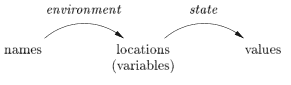

图 1.8：从名称到值的两阶段映射

名称与内存（*存储*）中位置的关联，以及随后与值的关联，可以用两个随程序运行而变化的映射来描述（见图 1.8）：

- 1. *环境*是从名称到存储中位置的映射。由于变量引用位置（用 C 的术语说是“左值”），我们也可以将环境定义为从名称到变量的映射。
- 2. *状态*是从存储中的位置到其值的映射。也就是说，用 C 的术语说，状态将左值映射到其对应的右值。

环境根据语言的作用域规则而变化。

**示例 1.4：** 考虑图 1.9 中的 C 程序片段。整型 *i* 被声明为全局变量，同时也被声明为函数 *f* 的局部变量。当 *f* 正在执行时，环境会进行调整，使名称 *i* 引用为 *f* 局部变量 *i* 预留的位置；对 *i* 的任何使用（例如所示的赋值 *i* = 3）都会引用该位置上的局部 *i*。通常，局部 *i* 会在运行时栈上分配一个位置。

```
...
int i;                 /* global i        */
...
void f(...) {
    int i;             /* local i         */
    ...
    i = 3;             /* use of local i  */
    ...
}
...
        x = i + 1;    /* use of global i */
```

图 1.9：名称 *i* 的两次声明

当正在执行的是 *f* 以外的函数 *g* 时，对 *i* 的使用不能引用 *f* 的局部 *i*。在 *g* 中对名称 *i* 的使用必须位于 *i* 的某个其他声明的作用域内。一个例子是显式展示的语句 `x = i+1`，它位于某个未展示定义的过程内部。*i + 1* 中的 *i* 想必引用全局 *i*。与大多数语言一样，C 中的声明必须先于其使用，因此位于全局 *i* 之前的函数不能引用它。

图 1.8 中的环境和状态映射是动态的，但有一些例外：

- 1. 名称到位置的*静态绑定与动态绑定*。大多数名称到位置的绑定是动态的，我们将在本节中讨论这种绑定的若干方法。有些声明，例如图 1.9 中的全局 *i*，可以在编译器生成目标代码时一次性分配存储中的位置。
- 2. 位置到值的*静态绑定与动态绑定*。位置到值的绑定（图 1.8 中的第二阶段）通常同样是动态的，因为在运行程序之前我们无法知道某个位置中的值。声明的常量是一个例外。例如，C 定义

```
#define ARRAYSIZE 1000
```

将名称 **ARRAYSIZE** 静态绑定到值 1000。我们可以通过查看该语句来确定这种绑定，并且知道程序执行时这种绑定不可能改变。

² 从技术上讲，C 编译器会为全局 *i* 分配一个虚拟内存中的位置，而由加载器和操作系统决定 *i* 将位于机器物理内存中的何处。然而，我们不必担心诸如此类的“重定位”问题，因为它们对编译没有影响。相反，我们把编译器用于其输出代码的地址空间视为给出了物理内存位置。

### 名称、标识符和变量

尽管“名称”和“变量”这两个术语常常指同一事物，但我们谨慎地使用它们，以区分编译时名称和变量在运行时表示的位置。

*标识符*是一个字符串（通常是字母或数字），它指代（标识）某个实体，例如数据对象、过程、类或类型。所有标识符都是名称，但并非所有名称都是标识符。名称也可以是表达式。例如，名称 *x.y* 可能表示由 *x* 表示的结构中的字段 *y*。这里，*x* 和 *y* 是标识符，而 *x.y* 是名称，但不是标识符。像 *x.y* 这样的复合名称称为*限定名称*。

*变量*引用存储中的特定位置。同一个标识符被多次声明是很常见的；每一次这样的声明都会引入一个新变量。即使每个标识符只声明一次，递归过程的局部标识符在不同时间也会引用存储中不同的局部位置。

### 1.6.3 静态作用域和块结构

大多数语言（包括 C 及其家族）使用静态作用域。C 的作用域规则基于程序结构；声明的作用域由该声明在程序中出现的位置隐式确定。后来的语言（如 C++、Java 和 C#）还通过使用 **public**、**private** 和 **protected** 等关键字来提供对作用域的显式控制。

在本节中，我们考虑带块的语言的静态作用域规则，其中*块*是声明和语句的分组。C 使用花括号 { 和 } 来界定块；为同一目的而使用 **begin** 和 **end** 的替代做法可追溯到 Algol。

**示例 1.5：** 粗略地说，C 的静态作用域策略如下：

- 1. 一个 C 程序由一系列变量和函数的顶层声明组成。
- 2. 函数内部可以有变量声明，其中变量包括局部变量和参数。每个此类声明的作用域限于它所在的函数。
- 3. 名称 *x* 的顶层声明的作用域由其后整个程序组成，但位于同时声明了 *x* 的函数内的那些语句除外。

关于 C 静态作用域策略的更多细节涉及语句内部的变量声明。我们接下来以及在示例 1.6 中考察此类声明。□

### 过程、函数和方法

为了避免每次想谈论可被调用的子程序时都要说“过程、函数或方法”，我们通常将它们统称为“过程”。例外情况是：当明确谈论像 C 这样只有函数的语言中的程序时，我们会称它们为“函数”。或者，如果我们讨论的是像 Java 这样只有方法的语言，我们会改用该术语。

函数通常返回某种类型的值（“返回类型”），而过程不返回任何值。C 及类似语言只有函数，它们把过程视为具有特殊返回类型“void”的函数，以表示没有返回值。像 Java 和 C++ 这样的面向对象语言使用“方法”这一术语。方法的行为可以像函数，也可以像过程，但它们与特定类相关联。

在 C 中，块的语法如下：

- 1. 一种语句类型是块。块可以出现在其他类型语句（如赋值语句）可以出现的任何地方。
- 2. 块是后跟一系列语句的一系列声明，全部由花括号包围。

注意，这种语法允许块相互嵌套。这种嵌套特性称为*块结构*。C 家族语言具有块结构，只是函数不能定义在另一个函数内部。

如果块 *B* 是包含声明 *D* 的最内层嵌套块，我们就说声明 *D*“属于”块 *B*；也就是说，*D* 位于 *B* 内，但不位于任何嵌套在 *B* 内的块中。

块结构语言中变量声明的静态作用域规则如下。如果名称 *x* 的声明 *D* 属于块 *B*，那么 *D* 的作用域是整个 *B*，但嵌套在 *B* 内任意深度且在其中重新声明了 *x* 的任何块 *B'* 除外。这里，如果在 *B'* 中属于 *B'* 的同一名称 *x* 的另一个声明 *D'* 存在，则称 *x* 在 *B'* 中被重新声明。


表达这条规则的等价方式是关注名字 *x* 的一次使用。令 *B*₁、*B*₂、…、*B*ₖ 为包围该次 *x* 使用的所有块，其中 *B*ₖ 最小，嵌套在 *B*ₖ₋₁ 内，而 *B*ₖ₋₁ 又嵌套在 *B*ₖ₋₂ 内，依此类推。寻找最大的 *i*，使得存在一个属于 *B*ᵢ 的 *x* 声明。该次 *x* 使用引用 *B*ᵢ 中的声明。或者换句话说，该次 *x* 使用位于 *B*ᵢ 中声明的作用域内。

```cpp
main() {
    int a = 1;
    int b = 1;
    {
        int b = 2;
        {
            int a = 3;
            cout << a << b;
        } // B3
        {
            int b = 4;
            cout << a << b;
        } // B4
        cout << a << b;
    } // B2
    cout << a << b;
} // B1
```

图 1.10：一个 C++ 程序中的块

**例 1.6：** 图 1.10 中的 C++ 程序有四个块，其中包含变量 *a* 和 *b* 的若干定义。为便于记忆，每个声明将其变量初始化为该声明所属块的编号。

例如，考虑块 *B*₁ 中的声明 `int a = 1`。其作用域是整个 *B*₁，但嵌套在 *B*₁ 内（可能嵌套很深）且自身有 *a* 声明的那些块除外。紧接嵌套在 *B*₁ 内的 *B*₂ 没有 *a* 声明，但 *B*₃ 有。*B*₄ 没有 *a* 声明，因此块 *B*₃ 是整个程序中唯一处于属于 *B*₁ 的名字 *a* 声明作用域之外的地方。也就是说，该作用域包括 *B*₄ 以及 *B*₂ 的全部，但 *B*₂ 中位于 *B*₃ 内的部分除外。所有五个声明的作用域总结在图 1.11 中。

| 声明 | 作用域 |
|---|---|
| `int a = 1;` | $B_1 - B_3$ |
| `int b = 1;` | $B_1 - B_2$ |
| `int b = 2;` | $B_2 - B_4$ |
| `int a = 3;` | $B_3$ |
| `int b = 4;` | $B_4$ |

图 1.11：例 1.6 中各声明的作用域

从另一个角度看，让我们考虑块 *B*₄ 中的输出语句，并将那里使用的变量 *a* 和 *b* 绑定到正确的声明。按大小递增顺序排列的包围块列表是 *B*₄、*B*₂、*B*₁。注意 *B*₃ 并不包围所讨论的位置。*B*₄ 有一个 *b* 声明，因此该次 *b* 使用引用的就是这个声明，打印出的 *b* 值为 4。然而，*B*₄ 没有 *a* 声明，因此我们接下来查看 *B*₂。该块也没有 *a* 声明，所以我们继续查看 *B*₁。幸运的是，该块中有一个声明 `int a = 1`，因此打印出的 *a* 值为 1。假如没有这样的声明，该程序就会出错。□

### 1.6.4 显式访问控制

类和结构为其成员引入了新的作用域。如果 *p* 是某个类的对象，且该类有一个字段（成员）*x*，那么 *p.x* 中对 *x* 的使用引用该类定义中的字段 *x*。与块结构类似，类 C 中成员声明 *x* 的作用域延伸到任何子类 C′，除非 C′ 有同名的局部声明 *x*。

通过使用 public、private 和 protected 之类的关键字，C++ 或 Java 等面向对象语言提供了对超类中成员名访问的显式控制。这些关键字通过限制访问来支持封装。因此，私有名字被有意赋予这样的作用域：它只包括与该类关联的方法声明和定义，以及任何“友元”类（C++ 术语）。受保护的名字可被其子类访问。公共名字可从类外部访问。

在 C++ 中，类定义可以与该类部分或全部方法的定义分开。因此，与类 C 关联的名字 *x* 可能有一段代码区域位于其作用域之外，随后是另一段位于其作用域之内的区域（方法定义）。事实上，作用域内和作用域外的区域可以交替出现，直到所有方法都已定义。

### 1.6.5 动态作用域

从技术上讲，任何基于只有在程序执行时才能知道的因素的作用域策略都是动态的。然而，术语 *动态作用域* 通常指以下策略：名字 *x* 的一次使用引用最近被调用且尚未终止的、具有该声明的过程中的 *x* 声明。这种类型的动态作用域只出现在特殊情况下。我们将考虑两个动态策略的例子：C 预处理器中的宏展开，以及面向对象编程中的方法解析。

### 声明与定义

对于编程语言概念，“声明”和“定义”这两个看似相似的术语实际上相当不同。声明告诉我们事物的类型，而定义告诉我们它们的值。因此，int i 是 i 的声明，而 i = 1 是 i 的定义。

当我们处理方法或其他过程时，这种差异更为显著。在 C++ 中，方法在类定义中声明，给出该方法的参数和结果的类型（通常称为该方法的 *签名*）。然后，在另一个地方定义该方法，即给出执行该方法的代码。类似地，常见的做法是在一个文件中定义 C 函数，并在使用该函数的其他文件中声明它。

**例 1.7：** 在图 1.12 的 C 程序中，将 a 识别为表示表达式 (x + 1) 的宏。但 x 是什么？我们无法静态地解析 x，也就是无法根据程序文本解析 x。

```c
#define a (x+1)

int x = 2;

void b() { int x = 1; printf("%d\n", a); }

void c() { printf("%d\n", a); }

void main() { b(); c(); }
```

图 1.12：一个其名字必须动态确定作用域的宏

事实上，为了解释 x，我们必须使用通常的动态作用域规则。我们检查当前所有活动的函数调用，并选取最近被调用的、具有 x 声明的函数。该次 x 使用引用的就是这个声明。

在图 1.12 的示例中，函数 *main* 首先调用函数 *b*。当 *b* 执行时，它打印宏 a 的值。由于必须用 (x + 1) 替换 a，我们将该次 x 使用解析为函数 *b* 中的声明 int x=1。原因是 *b* 有 x 的声明，因此 *b* 中 *printf* 里的 (x + 1) 引用这个 x。于是，打印出的值为 2。

在 *b* 结束后，*c* 被调用，我们再次需要打印宏 a 的值。然而，*c* 唯一可访问的 *x* 是全局 *x*。因此，*c* 中的 *printf* 语句引用这个 *x* 声明，打印出的值为 3。□

动态作用域解析对于多态过程也很重要，这类过程对同一个名字有两个或更多定义，且仅取决于参数的类型。在某些语言中，例如 ML（见第 7.3.3 节），可以为名字的所有使用静态确定类型，在这种情况下，编译器可以将过程名 $p$ 的每次使用替换为对相应过程代码的引用。然而，在其他语言中，例如 Java 和 C++，有时编译器无法做出这种判定。

### 静态作用域与动态作用域的类比

尽管可以有任意多种静态或动态的作用域策略，但常规（块结构）静态作用域规则与常规动态策略之间存在着有趣的关系。在某种意义上，动态规则之于时间，正如静态规则之于空间。静态规则要求我们找到其单元（块）最紧密地包围使用处物理位置的声明，而动态规则要求我们找到其单元（过程调用）最紧密地包围使用时间的声明。

**例 1.8：** 面向对象编程的一个显著特征是，每个对象能够响应消息调用合适的方法。换句话说，执行 $x.m()$ 时调用的过程取决于当时 $x$ 所表示对象的类。一个典型例子如下：

- 1. 有一个类 $C$，其中有一个名为 $m()$ 的方法。
- 2. $D$ 是 $C$ 的子类，并且 $D$ 有自己的名为 $m()$ 的方法。
- 3. 存在一次 $m$ 的使用，形式为 $x.m()$，其中 $x$ 是类 $C$ 的对象。

通常，在编译时无法判断 $x$ 将是类 $C$ 还是子类 $D$。如果方法应用发生多次，那么很可能有些应用作用于 $x$ 所表示、属于类 $C$ 但不属于 $D$ 的对象，而另一些应用则作用于类 $D$ 的对象。直到运行时，才能决定 $m$ 的哪个定义是正确的。因此，编译器生成的代码必须确定对象 $x$ 的类，并调用名为 $m$ 的其中一个方法。

### 1.6.6 参数传递机制

所有编程语言都有过程的概念，但它们在过程如何获得参数方面可能不同。在本节中，我们将考虑*实际参数*（在过程调用中使用的参数）如何与*形式参数*（在过程定义中使用的参数）关联。所使用的机制决定了调用序列代码如何处理参数。绝大多数语言使用“传值调用”或“传引用调用”，或两者兼用。我们将解释这些术语，以及另一种主要具有历史意义的、称为“传名调用”的方法。


## 1.6 编程语言基础

### 按值调用

在*按值调用*中，实参会被求值（如果它是表达式）或复制（如果它是变量）。该值被放置在所调用过程对应的形参所属的位置。C 和 Java 使用这种方法，C++ 以及大多数其他语言也常采用此方式。*按值调用*的效果是：被调用过程对形参所做的所有计算都局限于该过程内部，实参本身不能被改变。

但请注意，在 C 语言中，我们可以传递指向变量的指针，从而允许被调用方修改该变量。同样，在 C、C++ 或 Java 中，将数组名作为参数传递时，被调用过程实际上得到的是指向数组本身的指针或引用。因此，如果 *a* 是调用过程中的一个数组名，并且它按值传递给对应的形参 *x*，那么像 *x[i]* = 2 这样的赋值实际上会把数组元素 *a[i]* 改为 2。原因是：虽然 *x* 获得的是 *a* 值的一份副本，但该值实际上是指向名为 *a* 的数组所在存储区域起始位置的指针。

类似地，在 Java 中，许多变量实际上是对其所代表对象的引用或指针。这一观察适用于数组、字符串以及所有类的对象。尽管 Java 完全使用*按值调用*，但每当我们把对象名传递给被调用过程时，该过程接收到的值实际上是指向该对象的指针。因此，被调用过程能够影响对象本身的值。

### 按引用调用

在*按引用调用*中，实参的地址作为对应形参的值传递给被调用方。被调用方代码中对形参的使用是通过跟随这个指针到达调用方所指示的位置来实现的。因此，对形参的修改会表现为对实参的修改。

然而，如果实参是一个表达式，那么该表达式会在调用之前被求值，其值被存储在一个独立的位置中。对形参的修改会改变这个位置中的值，但对调用方的数据没有影响。

*按引用调用*用于 C++ 中的“ref”参数，并且是许多其他语言中的一个选项。当形参是大型对象、数组或结构时，它几乎是必不可少的。原因是严格的*按值调用*要求调用方将整个实参复制到对应形参所属的空间中。当参数很大时，这种复制代价很高。正如我们在讨论*按值调用*时所指出的，Java 等语言通过只复制对这些对象的引用来解决传递数组、字符串或其他对象的问题。其效果是，对于除整数或实数等基本类型之外的任何对象，Java 的行为都像是使用了*按引用调用*。

### 按名调用

第三种机制——按名调用——曾在早期编程语言 Algol 60 中使用。它要求被调用方以这样的方式执行：仿佛实参被字面替换为被调用方代码中的形参，就像形参是代表实参的宏一样（同时重命名被调用过程中的局部名称以保持其区分）。当实参是表达式而不是变量时，会出现一些有违直觉的行为，这也是该机制如今不受青睐的原因之一。

### 1.6.7 别名

按引用调用参数传递或其模拟（如 Java 中对象引用按值传递）有一个有趣的后果。两个形参有可能指向同一位置；这样的变量被称为彼此的*别名*。因此，任何两个看似分别从两个不同形参取值的变量，也可能成为彼此的别名。

**示例 1.9：** 假设 *a* 是属于过程 *p* 的一个数组，*p* 调用另一个过程 *q(x, y)*，调用方式为 *q(a, a)*。再假设参数按值传递，但数组名实际上是指向数组存储位置的引用，就像 C 语言或类似语言那样。现在，*x* 和 *y* 变成了彼此的别名。重要的是，如果在 *q* 内部有赋值 *x[10] = 2*，那么 *y[10]* 的值也会变为 2。 □

事实证明，如果编译器要优化程序，理解别名及其产生机制是至关重要的。正如我们将在第 9 章开始看到的，在许多情况下，只有当我们能确定某些变量不是别名时，才能优化代码。例如，我们可能确定 *x* = 2 是变量 *x* 唯一被赋值的地方。如果是这样，我们就可以把对 *x* 的使用替换为对 2 的使用；例如，把 *a* = *x*+3 替换为更简单的 *a* = 5。但是，假设还有另一个与 *x* 互为别名的变量 *y*。那么赋值 *y* = 4 可能会产生改变 *x* 的意外效果。这也可能意味着把 *a* = *x*+3 替换为 *a* = 5 是一个错误；此时 *a* 的正确值可能是 7。

### 1.6.8 第 1.6 节练习

- **练习 1.6.1：** 对于图 1.13(a) 中的块结构 C 代码，指出赋给 *w*、*x*、*y* 和 *z* 的值。
- **练习 1.6.2：** 对于图 1.13(b) 中的代码，重复练习 1.6.1。
- **练习 1.6.3：** 对于图 1.14 中的块结构代码，假设通常的静态作用域声明规则，给出十二个声明中每一个的作用域。

```c
int w, x, y, z;
int i = 4; int j = 5;
{
    int j = 7;
    i = 6;
    w = i + j;
}
x = i + j;
{
    int i = 8;
    y = i + j;
}
z = i + j;
```

```c
int w, x, y, z;
int i = 3; int j = 4;
{
    int i = 5;
    w = i + j;
}
x = i + j;
{
    int j = 6;
    i = 7;
    y = i + j;
}
z = i + j;
```

(a) 练习 1.6.1 的代码　　　　　　　　　(b) 练习 1.6.2 的代码

图 1.13：块结构代码

```c
{
    int w, x, y, z;    /* Block B1 */
    {
        int x, z;      /* Block B2 */
        {
            int w, x;  /* Block B3 */
        }
    }
    {
        int w, x;       /* Block B4 */
        {
            int y, z;  /* Block B5 */
        }
    }
}
```

图 1.14：练习 1.6.3 的块结构代码

- **练习 1.6.4：** 下面的 C 代码会打印出什么？

```c
#define a (x+1)
int x = 2;
void b() { x = a; printf("%d\n", x); }
void c() { int x = 1; printf("%d\n", a); }
void main() { b(); c(); }
```

### 1.7 第 1 章总结

- **语言处理器。** 一个集成软件开发环境包含多种不同类型的语言处理器，例如编译器、解释器、汇编器、链接器、加载器、调试器、性能分析器。
- **编译器阶段。** 编译器以一系列阶段的方式运行，每个阶段都将源程序从一种中间表示转换为另一种中间表示。
- **机器语言和汇编语言。** 机器语言是第一代编程语言，随后是汇编语言。用这些语言编程既耗时又容易出错。
- **编译器设计中的建模。** 编译器设计是理论对实践影响最大的领域之一。已被证明有用的模型包括自动机、文法、正则表达式、树以及许多其他模型。
- **代码优化。** 虽然代码无法真正被“优化”，但提升代码效率的科学既复杂又非常重要。它是编译研究中的一个重要部分。
- **高级语言。** 随着时间的推移，编程语言逐步承担了越来越多原先留给程序员的任务，例如内存管理、类型一致性检查或代码的并行执行。
- **编译器与计算机体系结构。** 编译器技术影响计算机体系结构，同时也受到体系结构进展的影响。现代体系结构中的许多创新都依赖于编译器能够从源程序中提取出有效利用硬件能力的机会。
- **软件生产率和软件安全。** 使编译器能够优化代码的同一技术也可以用于各种程序分析任务，从检测常见程序错误到发现程序容易受到“黑客”发现的多种入侵方式中的某一种攻击。
- **作用域规则。** 对 *x* 的声明的作用域，是指在该上下文中对 *x* 的使用都引用该声明。如果仅通过查看程序就能确定声明的作用域，则该语言使用*静态作用域*或*词法作用域*。否则，该语言使用*动态作用域*。
- **环境。** 名称与内存位置以及随后与值的关联，可以用*环境*和*状态*来描述：*环境*将名称映射到存储中的位置，*状态*将位置映射到它们的值。
- **块结构。** 允许块嵌套的语言被称为具有*块结构*。在嵌套块 *B* 中的名称 *x*，如果在外层块中没有其他对 *x* 的声明位于中间块中，则它在包围块中声明的 *x* 的声明 *D* 的作用域内。
- **参数传递。** 参数从调用过程传递给被调用过程，可以按值传递，也可以按引用传递。当大型对象按值传递时，传递的值实际上是对对象本身的引用，从而产生有效的按引用调用。


- **别名。** 当参数（实际上）按引用传递时，两个形参可能引用同一个对象。这种可能性使得一个变量的改变会影响另一个变量。

### 1.8 第1章参考文献

关于到1967年为止已创建并投入使用的编程语言（包括 Fortran、Algol、Lisp 和 Simula）的发展，见 [7]。关于截至1982年创建的编程语言（包括 C、C++、Pascal 和 Smalltalk），见 [1]。

GNU 编译器集合（gcc）是 C、C++、Fortran、Java 和其他语言的开源编译器的常用来源 [2]。Phoenix 是一个编译器构造工具包，它提供了一个集成框架，用于构建本书所讨论编译器的程序分析、代码生成和代码优化阶段 [3]。

关于编程语言概念的更多信息，我们推荐 [5,6]。关于计算机体系结构及其如何影响编译的更多内容，我们建议 [4]。

- 1. Bergin, T. J. 和 R. G. Gibson，*编程语言历史*，ACM Press，New York，1996。
- 2. http://gcc.gnu.org/.
- 3. http://research.microsoft.com/phoenix/default.aspx.
- 4. Hennessy, J. L. 和 D. A. Patterson，*计算机组织与设计：硬件/软件接口*，Morgan-Kaufmann，San Francisco，CA，2004。
- 5. Scott, M. L.，*编程语言语用学，第二版*，Morgan-Kaufmann，San Francisco，CA，2006。
- 6. Sethi, R.，*编程语言：概念与构造*，Addison-Wesley，1996。
- 7. Wexelblat, R. L.，*编程语言历史*，Academic Press，New York，1981。

## 第2章 一个简单的语法制导翻译器

本章介绍本书第3章至第6章中的编译技术。它通过开发一个可运行的 Java 程序来说明这些技术，该程序将具有代表性的编程语言语句翻译成三地址码——一种中间表示。本章重点介绍编译器的前端，特别是词法分析、语法分析和中间代码生成。第7章和第8章展示如何从三地址码生成机器指令。

我们从小处着手，创建一个语法制导翻译器，将中缀算术表达式映射为后缀表达式。然后，我们扩展该翻译器，将图2.1所示的代码片段映射为图2.2所示形式的三地址码。

可运行的 Java 翻译器见附录A。使用 Java 很方便，但并非必需。事实上，本章的思想早于 Java 和 C 的诞生。

```java
{
    int i; int j; float a[100]; float v; float x;

    while ( true ) {
        do i = i+1; while ( a[i] < v );
        do j = j-1; while ( a[j] > v );
        if ( i >= j ) break;
        x = a[i]; a[i] = a[j]; a[j] = x;
    }
}
```

图2.1：待翻译的代码片段

```
1:  i = i + 1
2:  t1 = a [ i ]
3:  if t1 < v goto 1
4:  j = j - 1
5:  t2 = a [ j ]
6:  if t2 > v goto 4
7:  ifFalse i >= j goto 9
8:  goto 14
9:  x = a [ i ]
10: t3 = a [ j ]
11: a [ i ] = t3
12: a [ j ] = x
13: goto 1
14:
```

图2.2：图2.1中程序片段的简化中间代码

### 2.1 引言

编译器的分析阶段将源程序分解为若干组成部分，并为其生成一种内部表示，称为中间代码。综合阶段将中间代码翻译为目标程序。

分析是围绕待编译语言的“*语法*”组织的。编程语言的*语法*描述其程序的正确形式，而语言的*语义*定义其程序的含义；也就是说，每个程序在执行时做什么。为了指定语法，我们在2.2节介绍一种广泛使用的表示法，称为上下文无关文法或 BNF（Backus-Naur 范式）。就目前可用的表示法而言，语言的语义比语法难描述得多。因此，为了指定语义，我们将使用非形式化描述和具有启发性的示例。

除了指定语言的语法之外，上下文无关文法还可用于帮助指导程序的翻译。在2.3节中，我们介绍一种面向文法的编译技术，称为*语法制导翻译*。语法分析（或句法分析）在2.4节中介绍。

本章其余部分将快速浏览图2.3所示的编译器前端模型。我们从语法分析器开始。为简单起见，我们考虑将中缀表达式语法制导翻译为后缀形式，这种表示法中运算符出现在其操作数之后。例如，表达式 9 − 5 + 2 的后缀形式是 9 5 − 2 +。翻译为后缀形式足够丰富，可以说明语法分析，同时又足够简单，以至于翻译器可以在2.5节中完整给出。这个简单的翻译器处理像 9 − 5 + 2 这样的表达式，该表达式由用加号和减号分隔的数字组成。从如此简单的表达式开始的一个原因是，语法分析器可以直接处理运算符和操作数的单个字符。

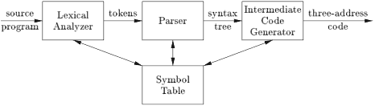

图2.3：编译器前端模型

词法分析器使翻译器能够处理多字符结构（如标识符），这些结构被写为字符序列，但在语法分析期间被视为称为*记号*的单元；例如，在表达式 `count + 1` 中，标识符 `count` 被视为一个单元。2.6节中的词法分析器允许数字、标识符和“空白”（空格、制表符和换行符）出现在表达式中。

接下来，我们考虑中间代码生成。图2.4说明了两种中间代码形式。一种形式称为*抽象语法树*，或简称为*语法树*，表示源程序的层次化语法结构。在图2.3的模型中，语法分析器生成一棵语法树，该树进一步被翻译为三地址码。有些编译器将语法分析和中间代码生成合并为一个组件。

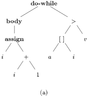

```
1: i = i + 1
2: t1 = a [ i ]
3: if t1 < v goto 1
```

图2.4：“do i = i + 1; while (a[i] < v);”的中间代码

图2.4(a)中抽象语法树的根表示整个 do-while 循环。根的左子节点表示循环体，该循环体仅由赋值语句 `i = i + 1;` 组成。根的右子节点表示条件 `a[i] < v`。语法树的实现见2.8节。

另一种常见的中间表示如图2.4(b)所示，是一系列“三地址”指令；更完整的示例见图2.2。这种形式的中间代码得名于形式为 $x = y\ op\ z$ 的指令，其中 $op$ 是二元运算符，$y$ 和 $z$ 是操作数的地址，$x$ 是运算结果的地址。一条三地址指令至多执行一个操作，通常是计算、比较或分支。

在附录A中，我们将本章的技术结合起来，用 Java 构建一个编译器前端。该前端将语句翻译为汇编级指令。

### 2.2 语法定义

在本节中，我们介绍一种表示法——“上下文无关文法”，或简称“文法”——用于指定语言的语法。本书将通篇使用文法来组织编译器前端。

文法自然地描述大多数编程语言结构的层次结构。例如，Java 中的 if-else 语句可以具有以下形式

$$\text{if ( expression ) statement else statement}$$

也就是说，if-else 语句是由关键字 **if**、左括号、一个表达式、右括号、一个语句、关键字 **else** 和另一个语句连接而成。使用变量 $expr$ 表示表达式，使用变量 $stmt$ 表示语句，这条结构规则可以表示为

$$stmt \rightarrow if\ (\ expr\ )\ stmt\ else\ stmt$$

其中箭头可以读作“可以具有以下形式”。这样的规则称为*产生式*。在产生式中，像关键字 **if** 和括号这样的词法元素称为*终结符*。像 $expr$ 和 $stmt$ 这样的变量表示终结符序列，称为*非终结符*。

#### 2.2.1 文法的定义

一个*上下文无关文法*有四个组成部分：

- 1. 一组*终结符*符号，有时称为“记号”。终结符是由文法定义的语言的基本符号。
- 2. 一组*非终结符*，有时称为“语法变量”。每个非终结符表示一组终结符串，具体方式我们将加以描述。
- 3. 一组*产生式*，其中每个产生式由一个非终结符（称为产生式的*头*或左部）、一个箭头，以及一个……的序列


## 2.2 语法定义

### 记号与终结符

在编译器中，词法分析器读取源程序的字符，将它们分组为称为词素的词法上有意义的单元，并产生表示这些单元的输出记号。一个记号由两个部分组成：记号名和属性值。记号名是供语法分析器进行语法分析使用的抽象符号。通常，我们将这些记号名称为*终结符*，因为它们在编程语言的文法中作为终结符号出现。属性值（如果存在）是指向符号表的指针，该符号表包含有关该记号的附加信息。此附加信息不属于文法的一部分，因此在我们讨论语法分析时，常常将记号与终结符同义使用。

终结符和/或非终结符，称为产生式的*体*或*右部*。产生式的直观意图是指定某个构造的一种书写形式；如果头部非终结符表示一个构造，那么体表示该构造的一种书写形式。

- 4. 将其中一个非终结符指定为*开始*符号。

我们通过列出产生式来指定文法，其中开始符号的产生式列在最前面。我们假定记号（如 < 和 <=）以及粗体字符串（如 **while**）是终结符。斜体名称是非终结符，任何非斜体名称或符号都可假定为终结符。¹ 为便于记法，以同一非终结符为头部的产生式可以将其体分组，各备选体之间用符号 | 分隔，我们将其读作“或”。

¹ 单个斜体字母将用于其他目的，尤其是在第4章详细研究文法时。例如，我们将使用 X、Y 和 Z 来讨论某个符号，该符号要么是终结符，要么是非终结符。然而，任何包含两个或更多字符的斜体名称仍将表示非终结符。

**例2.1：** 本章的几个例子使用由数字以及加号和减号组成的表达式；例如，9−5+2、3−1 或 7 这样的字符串。由于加号或减号必须出现在两个数字之间，我们将这类表达式称为“由加号或减号分隔的数字列表”。以下文法描述了这些表达式的语法。产生式为：

```
list  →  list + digit                                      (2.1)
list  →  list − digit                                      (2.2)
list  →  digit                                             (2.3)
digit →  0 | 1 | 2 | 3 | 4 | 5 | 6 | 7 | 8 | 9                 (2.4)
```

以非终结符 *list* 为头部的三个产生式的体可以等价地分组：

*list* → *list* + *digit* | *list* − *digit* | *digit*

按照我们的约定，该文法的终结符是符号 + − 0 1 2 3 4 5 6 7 8 9

非终结符是斜体名称 *list* 和 *digit*，其中 *list* 是开始符号，因为它的产生式最先给出。□

如果一个产生式以某个非终结符为头部，我们就说该产生式是*针对*这个非终结符的。终结符串是零个或多个终结符组成的序列。零个终结符组成的串写作 ε，称为*空串*。

### 2.2.2 推导

文法从开始符号开始，通过反复用一个非终结符的产生式的体替换该非终结符来推导字符串。能够从开始符号推导出的终结符串构成该文法定义的*语言*。

**例2.2：** 例2.1的文法定义的语言由用加号和减号分隔的数字列表组成。非终结符 *digit* 的十个产生式允许它代表任意终结符 0、1、…、9。由产生式(2.3)，单个数字本身就是一个列表。产生式(2.1)和(2.2)表达了这样的规则：任意列表后跟一个加号或减号，再跟另一个数字，就构成一个新列表。

产生式(2.1)到(2.4)就是定义所需语言的全部内容。例如，我们可以如下推导出 9−5+2 是一个*列表*。

- a) 9 是 *list*，由产生式(2.3)，因为 9 是 *digit*。
- b) 9−5 是 *list*，由产生式(2.2)，因为 9 是 *list*，而 5 是 *digit*。
- c) 9−5+2 是 *list*，由产生式(2.1)，因为 9−5 是 *list*，而 2 是 *digit*。

**例2.3：** 另一种稍有不同的列表是函数调用中的参数列表。在 Java 中，参数括在圆括号内，例如调用函数 max 时带有参数 x 和 y 的调用 max(x, y)。这类列表的一个细微之处是，在终结符 ( 和 ) 之间可能遇到空参数列表。我们可以用以下产生式开始为这类序列开发文法：

² 严格来说，ε 可以是来自任意字母表（符号集合）的零个符号组成的串。

$$\begin{aligned}
call &\rightarrow id\ (\ optparams\ )\\
optparams &\rightarrow params\mid\epsilon\\
params &\rightarrow params\ ,\ param\mid param
\end{aligned}$$

注意，*optparams*（“可选参数列表”）的第二个可能体是 ε，它表示符号的空串。也就是说，*optparams* 可以被空串替换，因此一个 *call* 可以由函数名后跟两个终结符组成的串 () 构成。注意，*params* 的产生式类似于例2.1中 *list* 的产生式，只是用逗号代替算术运算符 + 或 -，并用 *param* 代替 *digit*。我们没有给出 *param* 的产生式，因为参数实际上是任意表达式。稍后，我们将讨论各种语言构造（如表达式、语句等）的合适产生式。

*语法分析*是这样一个问题：接受一个终结符串，并弄清楚如何从文法的开始符号推导出它；如果无法从文法的开始符号推导出它，则报告该串中的语法错误。语法分析是整个编译过程中最基本的问题之一；第4章将讨论语法分析的主要方法。在本章中，为简单起见，我们从 `9-5+2` 这样的源程序开始，其中每个字符都是一个终结符；一般而言，源程序包含字符序列，这些字符序列由词法分析器分组为记号，记号的首个组成部分是由语法分析器处理的终结符。

### 2.2.3 语法分析树

语法分析树以图形方式展示文法的开始符号如何推导出语言中的一个串。如果非终结符 A 有一个产生式 $A\rightarrow XYZ$，那么一棵语法分析树可以有一个标记为 A 的内部结点，并有三个从左到右分别标记为 X、Y 和 Z 的子结点：

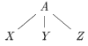

形式地说，给定一个上下文无关文法，根据该文法的一棵*语法分析树*是一棵具有以下性质的树：

- 1. 根结点标记为开始符号。
- 2. 每个叶结点标记为一个终结符或 ε。
- 3. 每个内部结点标记为一个非终结符。
- 4. 如果 A 是标记某个内部结点的非终结符，而 $X_1, X_2, \ldots, X_n$ 是从左到右该结点各子结点的标记，那么必须存在一个产生式 $A\rightarrow X_1X_2\cdots X_n$。这里，$X_1, X_2, \ldots, X_n$ 各自表示一个终结符或非终结符。作为一种特殊情况，如果 \(A \to \varepsilon\) 是一个产生式，那么标记为 *A* 的结点可以有一个标记为 \(\varepsilon\) 的单独子结点。

### 树术语

树数据结构在编译中占有突出地位。

- 一棵树由一个或多个*结点*组成。结点可以带有*标记*，在本书中这些标记通常是文法符号。当我们绘制树时，常常仅用这些标记来表示结点。
- 恰好有一个结点是*根*。除根以外的所有结点都有唯一的*父结点*；根没有父结点。当我们绘制树时，将某个结点的父结点放在该结点上方，并在二者之间画一条边。于是根就是最高的（顶部）结点。
- 如果结点 *N* 是结点 *M* 的父结点，那么 *M* 是 *N* 的子结点。一个结点的子结点称为兄弟结点。它们有从左到右的顺序，当我们绘制树时，就按这种方式排列给定结点的子结点。
- 没有子结点的结点称为*叶结点*。其他结点——那些有一个或多个子结点的结点——是*内部结点*。
- 结点 *N* 的*后代*可以是 *N* 本身、*N* 的子结点、*N* 的子结点的子结点，依此类推，任意层数。如果 *M* 是 *N* 的后代，我们就说结点 *N* 是结点 *M* 的*祖先*。

**例2.4.** 例2.2中对 9−5+2 的推导由图2.5中的树说明。树中的每个结点都用文法符号标记。一个内部结点及其子结点对应一个产生式；内部结点对应产生式的头部，子结点对应体。

在图2.5中，根标记为 *list*，即例2.1中文法的开始符号。根的子结点从左到右分别标记为 *list*、+ 和 *digit*。注意

```
list → list + digit
```

是例2.1文法中的一个产生式。根的左子结点与根类似，只是其子结点标记为 − 而不是 +。三个标记为 *digit* 的结点各有一个由数字标记的子结点。

从左到右，语法分析树的叶结点构成该树的*产出*，即从语法分析树根部的非终结符*生成*或*推导*出的串


## 2.2 语法定义

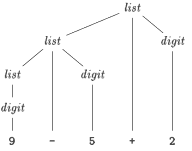

图2.5：根据示例2.1中的文法，9−5+2的语法分析树

树。在图2.5中，产出是9−5+2；为方便起见，所有叶子都显示在最底层。此后，我们不一定按这种方式排列叶子。任何树都赋予其叶子一种自然的从左到右顺序，其依据是：如果X和Y是同一父节点的两个子节点，且X在Y的左边，那么X的所有后代都在Y的所有后代的左边。

由文法生成的语言的另一种定义是：可由某棵语法分析树生成的字符串集合。为给定的终结符串寻找语法分析树的过程称为对该字符串进行*解析*。

### 2.2.4 二义性

在讨论一个字符串根据某文法所具有的*结构*时，我们必须谨慎。一个文法可能有不止一棵语法分析树生成给定的终结符串。这样的文法称为*二义性*的。要证明一个文法是二义性的，我们只需找到一个终结符串，它是多棵语法分析树的产出。由于具有多棵语法分析树的字符串通常有多种含义，因此我们需要为编译应用设计无二义性的文法，或者使用带附加规则的二义性文法来消除二义性。

**示例2.5：** 假设我们像示例2.1那样使用单个非终结符*string*，并且不区分数字和列表。我们可以写出如下文法：

```
string → string + string | string − string | 0 | 1 | 2 | 3 | 4 | 5 | 6 | 7 | 8 | 9
```

将*数字*和*列表*的概念合并到非终结符*string*中在表面上是有道理的，因为单个数字是*列表*的一种特殊情况。

然而，图2.6表明，对于这个文法，像9−5+2这样的表达式有不止一棵语法分析树。9−5+2的两棵树对应于对该表达式加括号的两种方式：(9−5)+2和9−(5+2)。第二种加括号方式使该表达式的值为出乎意料的2，而不是通常的6。示例2.1的文法不允许这种解释。□

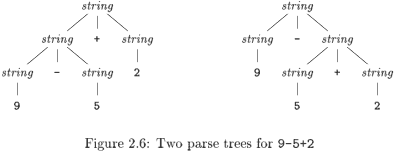

### 2.2.5 运算符的结合性

按照惯例，9+5+2等价于(9+5)+2，9-5-2等价于(9-5)-2。当一个像5这样的操作数左右两边都有运算符时，需要约定来决定哪个运算符作用于该操作数。我们说运算符+向左结合，因为一个两边都有加号的操作数属于其左边的运算符。在大多数编程语言中，四个算术运算符——加法、减法、乘法和除法——都是左结合的。

一些常见运算符（如幂运算）是右结合的。另一个例子是，C及其后继语言中的赋值运算符=是右结合的；也就是说，赋值a=b=c的处理方式与表达式a=(b=c)相同。

像a=b=c这样带有右结合运算符的字符串由以下文法生成：

```
right  →  letter = right | letter
letter →  a | b | ... | z
```

像-这样的左结合运算符的语法分析树与像=这样的右结合运算符的语法分析树之间的对比见图2.7。注意，9-5-2的语法分析树向左下方生长，而a=b=c的语法分析树向右下方生长。

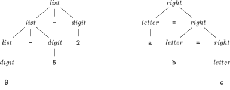

图2.7：左结合和右结合文法的语法分析树

### 2.2.6 运算符的优先级

考虑表达式9+5*2。该表达式有两种可能的解释：(9+5)*2或9+(5*2)。+和*的结合性规则适用于同一运算符的出现，因此不能解决这种二义性。当存在不止一种运算符时，需要定义运算符相对优先级的规则。

如果*先于+获取其操作数，我们就说*的优先级高于+。在普通算术中，乘法和除法的优先级高于加法和减法。因此，在9+5*2和9*5+2中，5都由*获取；也就是说，这两个表达式分别等价于9+(5*2)和(9*5)+2。

**示例2.6：** 算术表达式的文法可以根据一张显示运算符结合性和优先级的表来构造。我们从四个常见算术运算符和一张优先级表开始，按优先级递增的顺序列出这些运算符。同一行上的运算符具有相同的结合性和优先级：

| 结合性 | 运算符 |
| --- | --- |
| 左结合 | `+` `-` |
| 左结合 | `*` `/` |

我们为两个优先级层次创建两个非终结符*expr*和*term*，并额外创建一个非终结符*factor*，用于生成表达式中的基本单元。目前表达式中的基本单元是数字和带括号的表达式。

$$\mathit{factor} \rightarrow \mathit{digit}\ \mid\ (\ \mathit{expr}\ )$$

现在考虑具有最高优先级的二元运算符*和/。由于这些运算符是左结合的，其产生式类似于左结合列表的产生式。

$$\begin{aligned}\mathit{term} &\rightarrow \mathit{term} * \mathit{factor}\\ &\mid\ \mathit{term} / \mathit{factor}\\ &\mid\ \mathit{factor}\end{aligned}$$

类似地，*expr*生成由加法运算符分隔的项列表。

$$\begin{aligned}\mathit{expr} &\rightarrow \mathit{expr} + \mathit{term}\\ &\mid\ \mathit{expr} - \mathit{term}\\ &\mid\ \mathit{term}\end{aligned}$$

因此，得到的文法是

$$\begin{aligned}\mathit{expr} &\rightarrow \mathit{expr} + \mathit{term}\ \mid\ \mathit{expr} - \mathit{term}\ \mid\ \mathit{term}\\ \mathit{term} &\rightarrow \mathit{term} * \mathit{factor}\ \mid\ \mathit{term} / \mathit{factor}\ \mid\ \mathit{factor}\\ \mathit{factor} &\rightarrow \mathit{digit}\ \mid\ (\ \mathit{expr}\ )\end{aligned}$$

### 推广示例2.6的表达式文法

我们可以把因子看作一种不能被任何运算符“撕裂”的表达式。所谓“撕裂”，是指将运算符放在任何因子的任意一侧，都不会使该因子的除整体之外的任何部分成为该运算符的操作数。如果该因子是带括号的表达式，括号会防止这种“撕裂”；而如果该因子是单个操作数，它就不能被撕裂。

一个项（不同时也是因子）是一种可被最高优先级的运算符——*和/——撕裂，但不能被较低优先级运算符撕裂的表达式。一个表达式（不是项或因子）可被任何运算符撕裂。

我们可以把这个思想推广到任意数量n个优先级层次。我们需要n+1个非终结符。第一个非终结符（如示例2.6中的*factor*）永远不能被撕裂。通常，该非终结符的产生式体只有单个操作数和带括号的表达式。然后，对于每个优先级层次，有一个非终结符表示只能被该层次或更高层次的运算符撕裂的表达式。通常，该非终结符的产生式体包括表示该层次运算符用法的体，再加上一个仅为下一更高层次非终结符的体。

使用这个文法，一个表达式是由+或−号分隔的项列表，而一个项是由*或/号分隔的因子列表。注意，任何带括号的表达式都是因子，因此借助括号，我们可以构造出具有任意深嵌套（以及任意深的树）的表达式。□

**示例2.7：** 关键字使我们能够识别语句，因为大多数语句以关键字或特殊字符开头。该规则的例外包括赋值和过程调用。图2.8中（二义性）文法定义的语句在Java中是合法的。

在*stmt*的第一个产生式中，终结符*id*表示任意标识符。*expression*的产生式未给出。第一个产生式所指定的赋值语句在Java中是合法的，尽管Java将=视为可以出现在表达式内部的赋值运算符。例如，Java允许a = b = c，而该文法不允许。

非终结符*stmts*生成一个可能为空的语句列表。*stmts*的第二个产生式生成空列表ε。第一个产生式生成一个可能为空的语句列表，后跟一个语句。

分号的位置很微妙；它们出现在每个不以*stmt*结尾的产生式体的末尾。这种方法避免了在if语句和while语句等以嵌套子语句结尾的语句之后累积分号。当嵌套子语句是赋值语句或do-while语句时，分号将作为子语句的一部分生成。□


## 2.2 语法定义

```
stmt  →  id = expression ;
        |  if ( expression ) stmt
        |  if ( expression ) stmt else stmt
        |  while ( expression ) stmt
        |  do stmt while ( expression );
        |  { stmts }

stmts →  stmts stmt
        |  ε
```

图2.8：Java 语句子集的文法

### 2.2.7 第2.2节练习

**练习2.2.1：** 考虑上下文无关文法

```
S  →  S S + | S S * | a
```

- a) 说明该文法如何生成字符串 `aa+a*`。
- b) 为该字符串构造一棵分析树。
- c) 该文法生成什么语言？证明你的答案。

**练习2.2.2：** 以下每个文法生成什么语言？每种情况都要证明你的答案。

- a) `S → 0 S 1 | 0 1`
- b) `S → + S S | − S S | a`
- c) `S → S ( S ) S | ε`
- d) `S → a S b S | b S a S | ε`
- e) `S → a | S + S | S S | S * ( S )`

**练习2.2.3：** 练习2.2.2中的哪些文法是有二义性的？

**练习2.2.4：** 为以下每种语言构造无二义性的上下文无关文法。每种情况都要证明你的文法是正确的。

- a) 后缀表示法中的算术表达式。
- b) 由逗号分隔的标识符组成的左结合列表。
- c) 由逗号分隔的标识符组成的右结合列表。
- d) 由整数和标识符组成、包含四个二元运算符 `+`、`−`、`*`、`/` 的算术表达式。
- e) 在（d）的算术运算符中加入一元加号和一元减号。

**练习2.2.5：**

- a) 证明以下文法生成的所有二进制串的值都能被3整除。**提示。** 对分析树中的节点数进行归纳。

  $$num \to 11 \mid 1001 \mid num\ 0 \mid num\ num$$

- b) 该文法是否生成所有值能被3整除的二进制串？

**练习2.2.6：** 为罗马数字构造一个上下文无关文法。

## 2.3 语法制导翻译

语法制导翻译通过将规则或程序片段附加到文法中的产生式来完成。例如，考虑由以下产生式生成的表达式 *expr*：

$$expr \to expr_1 + term$$

这里，*expr* 是两个子表达式 *expr*₁ 和 *term* 的和。（*expr*₁ 中的下标仅用于区分产生式体中的 *expr* 实例与产生式头部的 *expr*。）我们可以利用其结构来翻译 *expr*，如下面的伪代码所示：

```
translate expr₁;
translate term;
handle +;
```

使用该伪代码的一个变体，我们将在2.8节中为 *expr* 构建语法树：先为 *expr*₁ 和 *term* 构建语法树，然后通过为 + 构造一个节点来处理 +。为方便起见，本节中的示例是将中缀表达式翻译为后缀表示法。

本节介绍与语法制导翻译相关的两个概念：

- **属性。** 属性是与编程结构关联的任意量。属性的例子包括表达式的数据类型、生成代码中的指令数，或生成代码或子表达式中第一条指令的位置，以及其他各种可能。由于我们使用文法符号（非终结符和终结符）来表示编程结构，因此将属性的概念从编程结构扩展到表示它们的符号。
- *（语法制导）翻译方案。* 翻译方案是一种将程序片段附加到文法产生式上的表示法。当语法分析期间使用该产生式时，这些程序片段被执行。所有这些片段执行按照语法分析所诱导的顺序组合起来的结果，产生对应用此分析/综合过程的程序的翻译。

本章将始终使用语法制导翻译来将中缀表达式翻译为后缀表示法、对表达式求值，以及为编程结构构建语法树。关于语法制导形式体系的更详细讨论见第5章。

### 2.3.1 后缀表示法

本节中的示例涉及翻译为后缀表示法。表达式 E 的*后缀表示法*可以归纳定义如下：

- 1. 如果 $E$ 是变量或常量，那么 $E$ 的后缀表示法就是 $E$ 本身。
- 2. 如果 $E$ 是形如 $E_1$ op $E_2$ 的表达式，其中 op 是任意二元运算符，那么 $E$ 的后缀表示法为 $E_1' E_2'\ \mathrm{op}$，其中 $E_1'$ 和 $E_2'$ 分别是 $E_1$ 和 $E_2$ 的后缀表示法。
- 3. 如果 $E$ 是形如 $(E_1)$ 的带括号表达式，那么 $E$ 的后缀表示法与 $E_1$ 的后缀表示法相同。

**例2.8：** $(9-5)+2$ 的后缀表示法是 $95-2+$。也就是说，根据规则（1），9、5和2的翻译分别是常量9、5和2。然后，根据规则（2），$9-5$ 的翻译是 $95-$。根据规则（3），$(9-5)$ 的翻译相同。翻译完带括号的子表达式后，我们可以对整个表达式应用规则（2），其中 $(9-5)$ 充当 $E_1$，2 充当 $E_2$，得到结果 $95-2+$。

再举一例，$9-(5+2)$ 的后缀表示法是 $952+-$。也就是说，$5+2$ 首先被翻译为 $52+$，而这个表达式成为减号的第二个参数。□

后缀表示法不需要括号，因为运算符的位置和*元数*（参数个数）只允许对后缀表达式进行一种解码。“技巧”是从左到右反复扫描后缀串，直到找到一个运算符。然后，向左查找正确数量的操作数，并将该运算符与其操作数分组。对该运算符的操作数求值，并用结果替换它们。然后重复该过程，继续向右并搜索另一个运算符。

**例2.9：** 考虑后缀表达式 $952+*3-$。从左扫描，我们首先遇到加号。向左看，找到操作数5和2。它们的和7替换 $52+$，于是得到字符串 $97-3*$。现在，最左边的

属性具有这样一个理想性质：它们可以在一次自底向上的分析树遍历中求值。在5.1节中，我们将讨论另一类重要属性：“继承”属性。非正式地说，继承属性在分析树某节点处的值，由该节点本身、其父节点及其在分析树中的兄弟节点的属性值决定。

**例2.10：** 图2.9中的带注释分析树基于图2.10中的语法制导定义，该定义用于将由加号或减号分隔的数字组成的表达式翻译为后缀表示法。每个非终结符都有一个字符串值属性 *t*，表示该非终结符在分析树中生成的表达式的后缀表示法。语义规则中的符号 `||` 是字符串连接运算符。

| 产生式 | 语义规则 |
|---|---|
| `expr → expr₁ + term` | expr.t = expr₁.t \|\| term.t \|\| '+' |
| `expr → expr₁ − term` | expr.t = expr₁.t \|\| term.t \|\| '−' |
| `expr → term` | expr.t = term.t |
| `term → 0` | term.t = '0' |
| `term → 1` | term.t = '1' |
| `⋮` | `⋮` |
| `term → 9` | term.t = '9' |

图2.10：中缀到后缀翻译的语法制导定义

数字的后缀形式就是该数字本身；例如，与产生式 `term → 9` 关联的语义规则规定，只要该产生式在分析树的某个节点上使用，`term.t` 的值就是 9 本身。其他数字的翻译类似。例如，当应用产生式 `expr → term` 时，`term.t` 的值成为 `expr.t` 的值。

产生式 `expr → expr₁ + term` 推导出一个包含加运算符的表达式。³ 加运算符的左操作数由 `expr₁` 给出，右操作数由 `term` 给出。与该产生式关联的语义规则

$$expr.t = expr_1.t \ ||\ term.t \ ||\ '+'$$

通过分别连接左、右操作数的后缀形式 `expr₁.t` 和 `term.t`，然后追加加号，来构造属性 `expr.t` 的值。该规则是“后缀表达式”定义的形式化。□

³在本规则以及许多其他规则中，同一个非终结符（这里是 `expr`）会出现多次。`expr₁` 中下标 1 的目的是区分产生式中 `expr` 的两次出现；“1”不是非终结符的一部分。更多细节见“区分非终结符不同用法的约定”框。


## 区分非终结符不同使用的约定

在规则中，我们经常需要区分同一个非终结符在产生式头部和/或体部中的多次使用；例如，见示例2.10。原因是在语法分析树中，由同一非终结符标记的不同节点通常对其翻译具有不同的值。我们将采用以下约定：非终结符在产生式头部不带下标，在体部带不同下标。这些都是同一非终结符的出现，下标不是其名称的一部分。然而，读者应注意具体翻译示例（使用此约定）与通用产生式如$A \to X_1X_2,\ldots,X_n$之间的区别，其中带下标的$X$表示任意一列文法符号，而不是名为$X$的特定非终结符的实例。

### 2.3.3 简单语法制导定义

示例2.10中的语法制导定义具有以下重要性质：表示产生式头部非终结符翻译的字符串，是产生式体中非终结符翻译的按产生式相同顺序的拼接，并在其间穿插一些可选附加字符串。具有此属性的语法制导定义称为*简单*的。

**示例2.11：** 考虑图2.10中的第一个产生式和语义规则：

$$\begin{aligned}
\text{产生式} &\qquad \text{语义规则}\\
expr \to expr_1 + term &\qquad expr.t = expr_1.t\,\|\|\,term.t\,\|\|\,'+'
\end{aligned}\tag{2.5}$$

这里，翻译$expr.t$是$expr_1$和$term$的翻译拼接，后跟符号$+$。注意在产生式体和语义规则中，$expr_1$和$term$出现的顺序相同。它们翻译之前或之间没有额外的符号。在此示例中，唯一额外的符号出现在末尾。□

在讨论翻译方案时，我们将看到，简单的语法制导定义可以通过仅按定义中出现的顺序打印附加字符串来实现。

### 2.3.4 树的遍历

树的遍历将用于描述属性求值以及指定翻译方案中代码片段的执行。树的*遍历*从根开始，按某种顺序访问树的每个节点。

深度优先遍历从根开始，按任意顺序（不一定从左到右）递归访问每个节点的子节点。之所以称为“深度优先”，是因为它只要可以就访问节点的未访问子节点，因此它会尽快访问离根尽可能远（“深”）的节点。

图2.11中的过程`visit(N)`是一个深度优先遍历，按从左到右的顺序访问节点的子节点，如图2.12所示。在此遍历中，我们在完成节点之前（即，确保子节点上的翻译已经计算之后）加入了在每个节点计算翻译的动作。通常，与遍历相关的动作可以是我们选择的任何动作，也可以什么动作都没有。

```text
procedure visit(node N) {
    for ( each child C of N, from left to right ) {
        visit(C);
    }
    evaluate semantic rules at node N;
}
```

图2.11：树的深度优先遍历

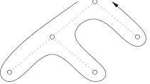

图2.12：树的深度优先遍历示例

语法制导定义不强制要求语法分析树上属性的任何特定求值顺序；任何在计算某个属性所依赖的所有其他属性之后才计算它的求值顺序都是可接受的。综合属性可以在任何自底向上的遍历中求值，即在节点的子节点属性被求值之后再求值该节点属性的遍历。通常，对于综合属性和继承属性并存的情况，求值顺序问题相当复杂；见5.2节。

### 2.3.5 翻译方案

图2.10中的语法制导定义通过将字符串作为属性附加到语法分析树的节点来构建翻译。我们现在考虑一种不需要操作字符串的替代方法；它通过执行程序片段增量地产生相同的翻译。

### 前序和后序遍历

前序和后序遍历是深度优先遍历的两个重要特例，在深度优先遍历中，我们按从左到右的顺序访问每个节点的子节点。通常，我们遍历树是为了在每个节点执行某个特定动作。如果动作在首次访问节点时执行，则称该遍历为*前序遍历*。类似地，如果动作在最后一次离开节点之前执行，则称其为树的*后序遍历*。图2.11中的过程`visit(N)`是后序遍历的一个例子。

前序和后序遍历根据节点动作的执行时间，定义了节点上的相应顺序。以节点*N*为根的（子）树的*前序*由*N*组成，后跟其每个子节点的子树（如果有）从左到右的前序。以*N*为根的（子）树的*后序*由*N*的每个子节点的子树（如果有）从左到右的后序组成，后跟*N*本身。

语法制导翻译方案是一种通过将程序片段附加到文法产生式上来指定翻译的表示法。翻译方案类似于语法制导定义，不同之处在于它明确指定了语义规则的求值顺序。

嵌入在产生式体中的程序片段称为*语义动作*。动作执行的位置用花括号括起来并写在产生式体中表示，如下所示：

$$\mathit{rest} \to +\ \mathit{term}\ \{\mathrm{print}('+')\}\ \mathit{rest}_1$$

当我们考虑表达式文法的另一种形式时，将会看到这样的规则，其中非终结符*rest*表示“表达式中除第一项之外的所有内容”。这种文法形式将在2.4.5节讨论。同样，*rest*₁中的下标用于区分产生式体中非终结符*rest*的这一实例与产生式头部的*rest*实例。

为翻译方案绘制语法分析树时，我们通过为动作构造一个额外的子节点来表示该动作，该子节点用虚线连接到与产生式头部对应的节点。例如，图2.13显示了上述产生式和动作的语法分析树部分。语义动作节点没有子节点，因此在首次看到该节点时执行该动作。

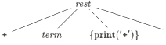

图2.13：为语义动作构造了一个额外叶节点

**示例2.12：** 图2.14中的语法分析树在额外的叶节点处有打印语句，这些叶节点通过虚线连接到语法分析树的内部节点。翻译方案如图2.15所示。底层文法生成由加号和减号分隔的数字组成的表达式。嵌入在产生式体中的动作将此类表达式翻译为后缀表示法，前提是我们对树执行从左到右的深度优先遍历，并在访问打印语句的叶节点时执行每个打印语句。

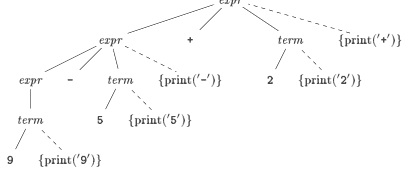

图2.14：将9-5+2翻译为95-2+的动作

```text
expr  →  expr₁ + term   {print('+')}
expr  →  expr₁ - term   {print('-')}
expr  →  term
term  →  0              {print('0')}
term  →  1              {print('1')}
       ⋮
term  →  9              {print('9')}
```

图2.15：翻译为后缀表示法的动作

图2.14的根表示图2.15中的第一个产生式。在后序遍历中，我们首先执行根最左子树中的所有动作，该子树对应左操作数，也与根一样标记为*expr*。然后访问没有动作的叶节点+。接下来执行右操作数*term*子树中的动作，最后执行额外节点处的语义动作`{print('+')}`。

由于*term*的产生式右侧只有一个数字，该数字由这些产生式的动作打印。对于产生式*expr* → *term*，不需要输出，并且只需要在……中打印运算符。


前两个产生式各自的动作。当在语法分析树的后序遍历过程中执行时，图 2.14 中的动作会打印出 95-2+。□

注意，尽管图 2.10 和图 2.15 中的方案产生相同的翻译，但它们构造翻译的方式不同；图 2.10 将字符串作为属性附加到语法分析树的节点上，而图 2.15 中的方案则通过语义动作逐步打印出翻译。

图 2.14 中语法分析树里的语义动作将中缀表达式 9-5+2 翻译为 95-2+，其方式是：将 9-5+2 中的每个字符恰好打印一次，并且不为子表达式的翻译使用任何存储。当以这种方式逐步生成输出时，字符打印的顺序很重要。

翻译方案的实现必须确保语义动作按照它们在语法分析树后序遍历中出现的顺序执行。该实现不必实际构造语法分析树（通常也不会构造），只要确保语义动作的执行方式，如同我们构造了一棵语法分析树，然后在其后序遍历过程中执行这些动作即可。

### 2.3.6 第 2.3 节练习

- **练习 2.3.1：** 构造一个语法制导翻译方案，将算术表达式从中缀表示法翻译为前缀表示法，其中运算符出现在其操作数之前；例如，-xy 是 x - y 的前缀表示法。给出输入 9-5+2 和 9-5*2 的带注释语法分析树。
- **练习 2.3.2：** 构造一个语法制导翻译方案，将算术表达式从后缀表示法翻译为中缀表示法。给出输入 95-2* 和 952*- 的带注释语法分析树。
- **练习 2.3.3：** 构造一个语法制导翻译方案，将整数翻译为罗马数字。
- ! **练习 2.3.4：** 构造一个语法制导翻译方案，将不超过 2000 的罗马数字翻译为整数。
- **练习 2.3.5：** 构造一个语法制导翻译方案，将后缀算术表达式翻译为等价的前缀算术表达式。

## 2.4 语法分析

语法分析是确定一个终结符串如何能由文法生成的过程。在讨论这个问题时，设想正在构造一棵语法分析树是有帮助的，尽管编译器在实践中可能不会构造这样一棵树。然而，语法分析器必须原则上能够构造这棵树，否则无法保证翻译正确。

本节介绍一种称为“递归下降”的语法分析方法，它既可用于语法分析，也可用于实现语法制导翻译器。下一节将给出一个完整的 Java 程序，实现图 2.15 的翻译方案。一个可行的替代方案是使用软件工具，直接从翻译方案生成翻译器。第 4.9 节描述了这样一种工具——Yacc；它无需修改就能实现图 2.15 的翻译方案。

对于任何上下文无关文法，都存在一个语法分析器，它分析一个包含 *n* 个终结符的串至多需要 O(n³) 时间。但立方时间通常过于昂贵。幸运的是，对于实际编程语言，我们通常可以设计出能够快速分析的文法。线性时间算法足以分析实践中出现的几乎所有语言。编程语言语法分析器几乎总是对输入进行单次从左到右的扫描，每次向前看一个终结符，并在扫描过程中构造语法分析树的各个部分。

大多数语法分析方法属于两类之一，分别称为*自顶向下*和*自底向上*方法。这些术语指的是语法分析树中节点的构造顺序。在自顶向下语法分析器中，构造从根开始，向叶子推进；而在自底向上语法分析器中，构造从叶子开始，向根推进。自顶向下语法分析器之所以流行，是因为使用自顶向下方法更容易手工构造高效的语法分析器。然而，自底向上语法分析可以处理更大类别的文法和翻译方案，因此，从文法直接生成语法分析器的软件工具通常使用自底向上方法。

### 2.4.1 自顶向下语法分析

我们通过考虑一个非常适合这类方法的文法来介绍自顶向下语法分析。本节后面将讨论一般自顶向下语法分析器的构造。图 2.16 中的文法生成 C 或 Java 语句的一个子集。我们使用粗体终结符 **if** 和 **for** 分别表示关键字“if”和“for”，以强调这些字符序列被当作单元，即作为单个终结符。此外，终结符 **expr** 表示表达式；一个更完整的文法会使用非终结符 *expr*，并为非终结符 *expr* 设置产生式。类似地，**other** 是表示其他语句构造的终结符。

```
stmt →  expr ;
      |  if ( expr ) stmt
      |  for ( optexpr ; optexpr ; optexpr ) stmt
      |  other

optexpr →  ε
        |  expr
```

图 2.16：C 和 Java 中某些语句的文法

像图 2.17 那样的语法分析树的自顶向下构造，是从根开始进行的：根标记为开始非终结符 *stmt*，然后重复执行以下两个步骤。

- 1. 在标记为非终结符 *A* 的节点 *N* 处，为 *A* 选择一个产生式，并在 *N* 处为该产生式体中的符号构造子节点。
- 2. 找到下一个要构造子树的节点，通常是树中最左边尚未展开的非终结符。

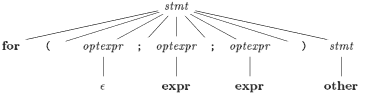

图 2.17：根据图 2.16 中的文法构造的一棵语法分析树

对于某些文法，上述步骤可以在对输入串的单次从左到右扫描期间实现。当前在输入中被扫描的终结符通常称为*向前看*符号。

初始时，*向前看*符号是输入串的第一个，即最左边的终结符。图 2.18 说明了针对输入串

```
for ( ; expr ; expr ) other
```

构造图 2.17 中语法分析树的过程。

初始时，终结符 for 是向前看符号，语法分析树的已知部分由根组成，根在图 2.18(a) 中标记为开始非终结符 *stmt*。目标是构造语法分析树的其余部分，使得该语法分析树生成的串与输入串匹配。

为了发生匹配，图 2.18(a) 中的非终结符 *stmt* 必须推导出一个以向前看符号 for 开头的串。在图 2.16 的文法中，只有一个 *stmt* 产生式可以推导出这样的串，因此我们选择它，并构造根的子节点，这些子节点用该产生式体中的符号标记。语法分析树的这一展开如图 2.18(b) 所示。

图 2.18 中的三个快照各自都有箭头，标记输入中的向前看符号以及语法分析树中正在考虑的节点。一旦在某个节点处构造了子节点，我们接下来就考虑最左边的子节点。在图 2.18(b) 中，刚刚在根处构造了子节点，并且正在考虑标记为 for 的最左边子节点。

当语法分析树中正在考虑的节点对应于一个终结符，并且该终结符与向前看符号匹配时，我们就在语法分析树和输入中同时前进。输入中的下一个终结符成为新的向前看符号，并且考虑语法分析树中的下一个子节点。在图 2.18(c) 中，语法分析树中的箭头已经前进到根的下一个子节点，输入中的箭头已经前进到下一个终结符，即 (。再前进一次，语法分析树中的箭头将指向标记为非终结符 *optexpr* 的子节点，输入中的箭头将指向终结符 ;。

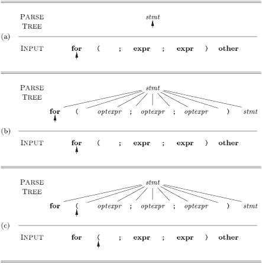

图 2.18：从左到右扫描输入时的自顶向下语法分析

在标记为非终结符 *optexpr* 的节点处，我们重复为非终结符选择产生式的过程。以 ε 为产生式体的产生式（“ε 产生式”）需要特殊处理。目前，当没有其他产生式可用时，我们将其作为默认选择；我们将在第 2.4.3 节回到这个问题。对于非终结符 *optexpr* 和向前看符号 ;，使用 ε 产生式，因为 ; 不匹配 *optexpr* 的唯一另一个产生式，该产生式以终结符 *expr* 作为其产生式体。

一般来说，为非终结符选择产生式可能涉及试错；也就是说，我们可能不得不尝试一个产生式，如果发现第一个不合适，就回溯以尝试另一个产生式。如果在使用某个产生式之后，我们无法完成语法分析树以匹配输入

字符串。然而，在一种称为预测解析的重要特殊情况下，不需要回溯，我们接下来讨论这种情况。

### 2.4.2 预测解析

*递归下降解析*是一种自顶向下的语法分析方法，其中使用一组递归过程来处理输入。每个过程与文法的一个非终结符相关联。这里，我们考虑一种简单的递归下降解析形式，称为*预测解析*，其中*前瞻*符号无歧义地确定每个非终结符对应过程体中的控制流。分析输入字符串期间的过程调用序列隐式地定义了该输入的语法分析树，并且如果需要，还可以用来构建显式的语法分析树。

图 2.19 中的预测解析器由图 2.16 中文法中非终结符 *stmt* 和 *optexpr* 的过程，以及一个附加过程 *match* 组成，后者用于简化 *stmt* 和 *optexpr* 的代码。过程 *match(t)* 将其参数 *t* 与*前瞻*符号进行比较，如果匹配，则前进到下一个输入终结符。因此，*match* 会改变变量 *lookahead* 的值，该变量是一个保存当前扫描输入终结符的全局变量。

解析从调用起始非终结符 *stmt* 的过程开始。使用与图 2.18 相同的输入时，*lookahead* 最初是第一个终结符 *for*。过程 *stmt* 执行对应于产生式

```text
stmt → for ( optexpr ; optexpr ; optexpr ) stmt
```

的代码。在产生式体的代码中——即过程 *stmt* 的 *for* 分支——每个终结符都与*前瞻*符号匹配，每个非终结符都导致对其过程的调用，调用顺序如下：

```text
match(for); match('(');
optexpr(); match(';'); optexpr(); match(';'); optexpr();
match(')'); stmt();
```

预测解析依赖于关于产生式体可以生成的首符号的信息。更准确地说，令 α 为文法符号串（终结符和/或非终结符）。我们将 FIRST(α) 定义为这样的终结符集合：这些终结符作为由 α 生成的一个或多个终结符串的第一个符号出现。如果 α 是 ε 或可以生成 ε，那么 ε 也在 FIRST(α) 中。

如何计算 FIRST(α) 的细节在第 4.4.2 节中。这里，我们仅使用*临时*推理来推断 FIRST(α) 中的符号；通常，α 要么以终结符开头，因此该终结符是 FIRST(α) 中的唯一符号；要么 α 以非终结符开头，而该非终结符的产生式体以终结符开头，在这种情况下，这些终结符是 FIRST(α) 的唯一成员。

例如，对于图 2.16 的文法，以下是 FIRST 的正确计算。

```text
void stmt() {
    switch (lookahead) {
    case expr:
        match(expr); match(';'); break;
    case if:
        match(if); match('('); match(expr); match(')'); stmt();
        break;
    case for:
        match(for); match('(');
        optexpr(); match(';'); optexpr(); match(';'); optexpr();
        match(')'); stmt(); break;
    case other:
        match(other); break;
    default:
        report("syntax error");
    }
}

void optexpr() {
    if (lookahead == expr) match(expr);
}

void match(terminal t) {
    if (lookahead == t) lookahead = nextTerminal;
    else report("syntax error");
}
```

图 2.19：预测解析器的伪代码

```text
FIRST(stmt) = {expr, if, for, other}
FIRST(expr) = {expr}
```

如果存在两个产生式 A → α 和 A → β，就必须考虑 FIRST 集合。暂时忽略 ε-产生式，预测解析要求 FIRST(α) 和 FIRST(β) 不相交。然后可以使用前瞻符号来决定使用哪个产生式；如果前瞻符号在 FIRST(α) 中，则使用 α。否则，如果前瞻符号在 FIRST(β) 中，则使用 β。

### 2.4.3 何时使用 ε-产生式

当没有其他产生式可以使用时，我们的预测解析器使用 ε-产生式作为默认选择。对于图 2.18 的输入，在终结符 for、( 和 C 匹配之后，前瞻符号是 ;。此时过程 optexpr 被调用，其体中的代码

```text
if ( lookahead == expr ) match(expr);
```

被执行。非终结符 *optexpr* 有两个产生式，其体分别为 **expr** 和 ε。前瞻符号“;”与终结符 **expr** 不匹配，因此体为 **expr** 的产生式不能应用。事实上，该过程返回，既不改变前瞻符号，也不做其他任何事情。什么都不做对应于应用一个 ε-产生式。

更一般地，考虑图 2.16 中产生式的一个变体，其中 *optexpr* 生成一个表达式非终结符，而不是终结符 **expr**：

```text
optexpr  ->  expr
            |  ε
```

因此，*optexpr* 要么使用非终结符 *expr* 生成一个表达式，要么生成 ε。在解析 *optexpr* 时，如果前瞻符号不在 FIRST(*expr*) 中，则使用 ε-产生式。

关于何时使用 ε-产生式的更多内容，参见第 4.4.3 节中关于 LL(1) 文法的讨论。

### 2.4.4 设计预测解析器

我们可以推广第 2.4.2 节中非形式化介绍的技术，使其适用于任何这样的文法：对于属于任一非终结符的产生式体，其 FIRST 集合互不相交。我们还将看到，当我们有一个翻译方案——即带有嵌入动作的文法——时，可以将这些动作作为为解析器设计的过程的一部分来执行。

回想一下，*预测解析器*是一个由每个非终结符对应的过程组成的程序。非终结符 A 的过程做两件事。

- 1. 它通过检查前瞻符号来决定使用哪个 A 产生式。如果前瞻符号在 FIRST(α) 中，则使用体为 α（其中 α 不是 ε，即空串）的产生式。如果对于任何前瞻符号，两个非空体之间存在冲突，那么我们就不能在此文法上使用这种解析方法。此外，如果 A 的 ε-产生式存在，并且前瞻符号不在 A 的任何其他产生式体的 FIRST 集合中，则使用该 ε-产生式。
- 2. 然后该过程模仿所选产生式的体。也就是说，体中的符号从左到右依次“执行”。非终结符通过调用该非终结符对应的过程来“执行”，与前瞻符号匹配的终结符通过读取下一个输入符号来“执行”。如果在某一点，体中的终结符与前瞻符号不匹配，则报告语法错误。

图 2.19 是将这些规则应用于图 2.16 中语法的结果。

## 2.5 简单表达式的翻译器

详细讨论表达式的翻译，因为它们作为构造出现在如此多的语言中。

一个语法制导翻译方案通常用作翻译器的规范。图 2.21（重复自图 2.15）中的方案定义了这里要执行的翻译。

```text
expr  →  expr + term    { print('+') }
      |  expr - term    { print('-') }
      |  term

term  →  0              { print('0') }
      |  1              { print('1') }
      |  ⋮
      |  9              { print('9') }
```

图 2.21：翻译为后缀表示法的动作

通常，给定方案的底层文法必须经过修改，才能用预测解析器进行解析。特别是，图 2.21 中方案底层的文法是左递归的，而正如我们在上一节所看到的，预测解析器无法处理左递归文法。

我们似乎有一个冲突：一方面，我们需要一个便于翻译的文法；另一方面，我们需要一个显著不同、便于解析的文法。解决方案是先从易于翻译的文法开始，再仔细地将其转换为便于解析的形式。通过消除图 2.21 中的左递归，我们可以得到一个适合在预测递归下降翻译器中使用的文法。

### 2.5.1 抽象语法与具体语法

设计翻译器的一个有用起点是一种称为抽象语法树的数据结构。在表达式的抽象语法树中，每个内部节点表示一个运算符；该节点的子节点表示该运算符的操作数。更一般地，任何编程构造都可以通过为该构造设计一个运算符，并将该构造在语义上有意义的组成部分视为操作数来处理。

在图 2.22 中 9-5+2 的抽象语法树里，根表示运算符 +。根的子树表示子表达式 9-5 和 2。将 9-5 归组为一个操作数反映了同一优先级运算符从左到右求值。由于 - 和 + 具有相同的优先级，9-5+2 等价于 (9-5)+2。

抽象语法树，或简称为语法树，在某种程度上类似于语法分析树。然而，在语法树中，内部节点表示编程构造，而在语法分析树中，内部节点表示非终结符。文法中的许多非终结符表示编程构造，但其他非终结符


## 2.5 简单表达式的翻译器

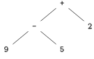

图 2.22：9-5+2 的语法树

是某种“辅助”节点，例如表示项、因子或表达式的其他变体。在语法树中，这些辅助节点通常不需要，因此被丢弃。为了强调这种对比，分析树有时被称为*具体语法树*，而底层文法被称为该语言的*具体语法*。

在图 2.22 的语法树中，每个内部节点都与一个运算符关联，没有用于*单产生式*（产生式体仅由单个非终结符组成，别无其他）的“辅助”节点，例如 `expr → term`，也没有用于像 `rest → ε` 这样的 ε 产生式的辅助节点。

翻译方案最好基于这样的文法：其分析树尽可能接近语法树。图 2.21 中文法对子表达式的分组类似于语法树中的分组。例如，加法运算符的子表达式由产生式体 `expr + term` 中的 *expr* 和 *term* 给出。

### 2.5.2 调整翻译方案

图 2.20 中概述的左递归消除技术也可以应用于包含语义动作的产生式。首先，该技术可扩展到 *A* 的多个产生式。在我们的例子中，*A* 是 *expr*，并且 *expr* 有两个左递归产生式和一个非左递归产生式。该技术将产生式 `A → Aα | Aβ | γ` 转换为

$$
\begin{aligned}
A &\to \gamma R \\
R &\to \alpha R \mid \beta R \mid \epsilon
\end{aligned}
$$

其次，我们需要转换含有内嵌动作的产生式，而不仅仅是终结符和非终结符。产生式中内嵌的语义动作在转换中只是被原样携带，就好像它们是终结符一样。

**例 2.13：** 考虑图 2.21 的翻译方案。令

$$
\begin{aligned}
A & = expr \\
\alpha & = +\ term\ \{\ print('+')\ \} \\
\beta & = -\ term\ \{\ print('-')\ \} \\
\gamma & = term
\end{aligned}
$$

那么，消除左递归的转换产生图 2.23 中的翻译方案。图 2.21 中的 *expr* 产生式已被转换为 *expr* 的一个产生式，并且新的非终结符 *rest* 扮演 *R* 的角色。*term* 的产生式重复自图 2.21。图 2.24 展示了如何使用图 2.23 中的文法翻译 9-5+2。□

```
expr  →  term rest
rest  →  + term { print('+') } rest
      |  - term { print('-') } rest
      |  ε
term  →  0 { print('0') }
      |  1 { print('1') }
      |  ...
      |  9 { print('9') }
```

图 2.23：消除左递归后的翻译方案

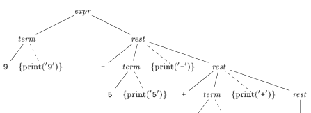

图 2.24：将 9-5+2 翻译为 95-2+

必须谨慎进行左递归消除，以确保我们保留语义动作的顺序。例如，图 2.23 中转换后的方案在产生式体中间具有动作 { print('+') } 和 { print('-') }，在每种情况下都位于非终结符 *term* 和 *rest* 之间。如果将这些动作移到末尾，即 *rest* 之后，那么翻译就会变得不正确。我们留给读者证明：届时 9-5+2 会被错误地翻译成 952+-，即 9-(5+2) 的后缀表示法，而不是期望的 95-2+，即 (9-5)+2 的后缀表示法。

### 2.5.3 非终结符的过程

图 2.25 中的函数 *expr*、*rest* 和 *term* 实现了图 2.23 中的语法制导翻译方案。这些函数模仿对应非终结符的产生式体。函数 *expr* 通过调用 *term*() 然后调用 *rest*() 来实现产生式 *expr* → *term rest*。

```c
void expr() {
    term(); rest();
}

void rest() {
    if ( lookahead == '+') {
        match('+'); term(); print('+'); rest();
    }
    else if ( lookahead == '-') {
        match('-'); term(); print('-'); rest();
    }
    else { } /* do nothing with the input */ ;
}

void term() {
    if ( lookahead is a digit ) {
        t = lookahead; match(lookahead); print(t);
    }
    else report("syntax error");
}
```

图 2.25：非终结符 *expr*、*rest* 和 *term* 的伪代码。

函数 *rest* 实现图 2.23 中非终结符 *rest* 的三个产生式。如果向前看符号是加号，则应用第一个产生式；如果向前看符号是减号，则应用第二个产生式；在所有其他情况下应用产生式 *rest* → ε。*rest* 的前两个产生式由过程 *rest* 中 if 语句的前两个分支实现。如果向前看符号是 +，则通过调用 *match*('+') 匹配加号。在调用 *term*() 之后，通过写出加号字符来实现语义动作。第二个产生式类似，只是用 - 代替 +。由于 *rest* 的第三个产生式以 ε 为右部，函数 *rest* 中最后的 else 子句什么也不做。

*term* 的十个产生式生成十个数字。由于这些产生式中的每一个都生成一个数字并打印它，图 2.25 中的同一段代码实现了它们全部。如果测试成功，变量 *t* 保存由 *lookahead* 表示的数字，以便在调用 *match* 之后写出。注意，*match* 会改变向前看符号，因此需要保存该数字以便稍后打印。⁵

### 2.5.4 简化翻译器

在展示完整程序之前，我们将对图 2.25 中的代码做两处简化变换。这些简化会将过程 *rest* 合并到过程 *expr* 中。当翻译具有多级优先级的表达式时，这种简化会减少所需的过程数量。

首先，某些递归调用可以替换为迭代。当过程体中执行的最后一条语句是对同一过程的递归调用时，该调用被称为*尾递归*。例如，在函数 *rest* 中，向前看符号为 + 和 - 时对 *rest*() 的调用是尾递归的，因为在这些分支的每一个中，对 *rest* 的递归调用都是给定 *rest* 调用所执行的最后一条语句。

对于无参数的过程，尾递归调用可以简单地替换为跳转到过程开头。*rest* 的代码可以重写为图 2.26 的伪代码。只要向前看符号是加号或减号，过程 *rest* 就匹配该符号，调用 *term* 匹配一个数字，并继续该过程。否则，它跳出 while 循环并从 *rest* 返回。

```c
void rest() {
    while( true ) {
        if( lookahead == '+' ) {
            match('+'); term(); print('+'); continue;
        }
        else if( lookahead == '-' ) {
            match('-'); term(); print('-'); continue;
        }
        break ;
    }
}
```

图 2.26：消除图 2.25 中过程 *rest* 的尾递归。

其次，完整的 Java 程序将包含另一处更改。一旦图 2.25 中对 *rest* 的尾递归调用被替换为迭代，唯一剩下的对 *rest* 的调用就在过程 *expr* 中。因此，可以通过用过程 *rest* 的主体替换调用 *rest*()，将这两个过程集成到一个过程中。

### 2.5.5 完整程序

我们翻译器的完整 Java 程序出现在图 2.27 中。图 2.27 的第一行以 `import` 开头，提供对包 `java.io` 的访问，用于系统输入和输出。其余代码由两个类 `Parser` 和 `Postfix` 组成。类 `Parser` 包含变量 `lookahead` 以及函数 `Parser`、`expr`、`term` 和 `match`。

执行从函数 `main` 开始，它定义在类 `Postfix` 中。函数 `main` 创建类 `Parser` 的实例 `parse`，并调用其函数 `expr` 来解析一个表达式。

函数 `Parser` 与其类同名，是一个构造函数；当创建该类的对象时，它会自动被调用。从其在类 `Parser` 开头的定义可以注意到，构造函数 `Parser` 通过读取一个记号来初始化变量 `lookahead`。由单个字符组成的记号由系统输入例程 `read` 提供，它从输入文件读取下一个字符。注意，`lookahead` 被声明为整数而不是字符，以预期后续章节将引入除单个字符之外的其他记号。

函数 `expr` 是第 2.5.4 节所讨论简化的结果；它实现图 2.23 中的非终结符 `expr` 和 `rest`。图 2.27 中 `expr` 的代码调用 `term`，然后有一个 while 循环，不断测试 `lookahead` 是否匹配 `+` 或 `-`。当控制到达 `return` 语句时，会退出这个 while 循环。在循环内部，使用 `System` 类的输入/输出设施写出一个字符。

函数 `term` 使用 Java 类 `Character` 中的例程 `isDigit` 来测试 `lookahead` 符号是否为数字。例程 `isDigit` 期望应用于一个字符；然而，`lookahead` 被声明为整数，以预期未来的扩展。结构 `(char) lookahead` 将 `lookahead` 强制转换或强制为字符。与图 2.25 相比有一处小改动：写出向前看字符的语义动作发生在调用 `match` 之前。

函数 `match` 检查终结符；如果向前看符号匹配，则读取下一个输入终结符，否则通过执行以下语句发出错误信号

```java
throw new Error("syntax error");
```

这段代码创建一个类 `Error` 的新异常，并向它提供字符串 `syntax error` 作为错误消息。Java 不要求在 `throws` 子句中声明 `Error` 异常，因为它们仅用于本不应发生的异常事件。

可以使用 Java 的异常处理设施来简化错误处理。一种方法是定义一个新异常，比如 `SyntaxError`，它扩展系统类 `Exception`。然后，当在 `term` 或 `match` 中检测到错误时，抛出 `SyntaxError` 而不是 `Error`。此外，在 `main` 中处理该异常：将调用 `parse.expr()` 包含在一个 `try` 语句中，该语句捕获异常 `SyntaxError`，写出消息并终止。我们需要向图 2.27 的程序中添加一个类 `SyntaxError`。为完成该扩展，除了 `IOException` 之外，函数 `match` 和 `term` 现在必须声明它们可以抛出 `SyntaxError`。调用它们的函数 `expr` 也必须声明它可以抛出 `SyntaxError`。


## 2.5 简单表达式的翻译器

```java
import java.io.*;
class Parser {
    static int lookahead;

    public Parser() throws IOException {
        lookahead = System.in.read();
    }

    void expr() throws IOException {
        term();
        while(true) {
            if (lookahead == '+') {
                match('+'); term(); System.out.write('+');
            }
            else if (lookahead == '-') {
                match('-'); term(); System.out.write('-');
            }
            else return;
        }
    }

    void term() throws IOException {
        if (Character.isDigit((char)lookahead)) {
            System.out.write((char)lookahead); match(lookahead);
        }
        else throw new Error("syntax error");
    }

    void match(int t) throws IOException {
        if (lookahead == t) lookahead = System.in.read();
        else throw new Error("syntax error");
    }
}

public class Postfix {
    public static void main(String[] args) throws IOException {
        Parser parse = new Parser();
        parse.expr(); System.out.write('\n');
    }
}
```

图 2.27：将中缀表达式翻译成后缀形式的 Java 程序

### Java 的一些显著特性

那些不熟悉 Java 的读者可能会发现以下关于 Java 的注释有助于阅读图 2.27 中的代码：

- Java 中的类由一系列变量定义和函数定义组成。
- 即使没有参数，也需要用圆括号括住函数参数列表；因此我们写成 `expr()` 和 `term()`。这些函数实际上是过程，因为它们不返回值，这由函数名前的关键字 `void` 表示。
- 函数通过“按值”传递参数或访问共享数据进行通信。例如，函数 `expr()` 和 `term()` 使用类变量 `lookahead` 检查向前看符号，它们都能访问该变量，因为它们都属于同一个类 `Parser`。
- 与 C 一样，Java 使用 `=` 表示赋值，`==` 表示相等，`!=` 表示不等。
- `term()` 定义中的“throws IOException”子句声明可能发生名为 `IOException` 的异常。当函数 `match` 使用例程 `read` 时没有可读取的输入，就会发生这种异常。任何调用 `match` 的函数也必须声明在其自身执行期间可能发生 `IOException`。

## 2.6 词法分析

词法分析器从输入中读取字符，并将它们分组为“词法单元对象”。除了用于语法分析决策的终结符之外，词法单元对象还以属性值的形式携带附加信息。到目前为止，没有必要区分“词法单元”和“终结符”这两个术语，因为语法分析器会忽略词法单元所携带的属性值。在本节中，词法单元是带有附加信息的终结符。

构成单个词法单元的输入字符序列称为*词素*。因此，我们可以说词法分析器根据词法单元的词素表示来实例化词法单元。

本节的词法分析器允许数字、标识符和“空白”（空格、制表符和换行符）出现在表达式中。它可用于扩展上一节的表达式翻译器。由于必须扩展图 2.21 的表达式文法以允许数字和标识符，我们将借此机会也允许乘法和除法。扩展后的翻译方案见图 2.28。

```
expr   →   expr + term     { print('+') }
       |   expr - term     { print('-') }
       |   term

term   →   term * factor   { print('*') }
       |   term / factor   { print('/') }
       |   factor

factor →   ( expr )
       |   num             { print(num.value) }
       |   id              { print(id.lexeme) }
```

图 2.28：翻译为后缀表示法的动作

在图 2.28 中，假定终结符 **num** 具有属性 *num.value*，它给出与此处出现的 **num** 对应的整数值。终结符 **id** 具有一个字符串值属性，写作 *id.lexeme*；我们假定该字符串是构成此 **id** 词法单元实例的实际词素。

用于说明词法分析器工作方式的伪代码片段将在本节末尾汇编成 Java 代码。本节的方法适用于手写词法分析器。3.5 节介绍一个名为 Lex 的工具，它根据规范生成词法分析器。用于保存标识符相关信息的符号表或数据结构将在 2.7 节讨论。

### 2.6.1 去除空白和注释

2.5 节的表达式翻译器会看到输入中的每个字符，因此多余字符（如空格）会导致它失败。大多数语言允许词法单元之间出现任意数量的空白。注释在语法分析期间同样被忽略，因此也可以将它们视为空白。

如果词法分析器消除了空白，语法分析器就永远不必考虑它。另一种做法是修改文法，将空白纳入语法，但这要难实现得多。

图 2.29 中的伪代码通过只要看到空格、制表符或换行符就读取输入字符来跳过空白。变量 *peek* 保存下一个输入字符。行号和上下文在错误消息中有助于精确定位错误；代码使用变量 *line* 统计输入中的换行字符。

```
for ( ; peek = next input character ) {
    if ( peek is a blank or a tab ) do nothing;
    else if ( peek is a newline ) line = line+1;
    else break;
}
```

图 2.29：跳过空白

### 2.6.2 预读

词法分析器可能需要预读一些字符，才能决定要返回给语法分析器的词法单元。例如，C 或 Java 的词法分析器在看到字符 > 后必须预读。如果下一个字符是 =，那么 > 是字符序列 >= 的一部分，即“大于或等于”运算符的词法单元的词素。否则，> 本身构成“大于”运算符，而词法分析器已经多读了一个字符。

在输入上预读的一种通用方法是维护一个输入缓冲区，词法分析器可从中读取字符并回推字符。仅从效率角度就足以证明使用输入缓冲区是合理的，因为一次取一块字符通常比一次取一个字符更高效。指针跟踪已分析的那部分输入；回推一个字符通过向后移动指针来实现。输入缓冲技术将在 3.2 节讨论。

通常一个字符的预读就足够了，因此一个简单的解决方案是使用一个变量（比如 peek）来保存下一个输入字符。本节的词法分析器在收集数字的数字或标识符的字符时会预读一个字符；例如，它会读过 1 以区分 1 和 10，并读过 t 以区分 t 和 true。

词法分析器只在必须预读时才预读。像 `*` 这样的运算符无需预读即可识别。在这种情况下，peek 被设为空白，当调用词法分析器查找下一个词法单元时，该空白将被跳过。本节的不变式断言是：当词法分析器返回一个词法单元时，变量 peek 要么保存当前词法单元的词素之后的字符，要么保存一个空白。

### 2.6.3 常量

只要表达式的文法中出现单个数字，就似乎有理由允许在其位置使用任意整数常量。可以通过为这类常量创建终结符（比如 num）来允许整数常量，也可以将整数常量的语法纳入文法。将字符合集成整数并计算其整体数值的工作通常交给词法分析器，因此在语法分析和翻译期间，数字可以作为单个单元处理。


## 2.6 词法分析

本节中的词法分析器通过使用一个表来保存字符串，解决了两个问题：

- *单一表示。* 字符串表可以将编译器的其余部分与字符串的表示形式隔离开来，因为编译器的各个阶段可以使用表中字符串的引用或指针。引用也比字符串本身更容易高效地操作。
- *保留字。* 保留字可以通过用保留字符串及其词法单元值初始化字符串表来实现。当词法分析器读取一个可能构成标识符的字符串或词素时，它首先检查该词素是否在字符串表中。如果是，则从表中返回词法单元；否则，返回一个带有终结符 id 的词法单元。

在 Java 中，字符串表可以使用一个名为 *Hashtable* 的类实现为哈希表。声明

```java
Hashtable words = new Hashtable();
```

将 `words` 设置为一个默认的哈希表，它将键映射到值。我们将用它把词素映射到词法单元。图 2.31 中的伪代码使用 `get` 操作来查找保留字。

```text
if ( peek holds a letter ) {
    collect letters or digits into a buffer b;
    s = string formed from the characters in b;
    w = token returned by words.get(s);
    if ( w is not null ) return w;
    else {
        Enter the key-value pair (s, (id, s)) into words
        return token (id, s);
    }
}
```

图 2.31：区分关键字与标识符

这段伪代码从输入中收集一个由字母和数字组成、以字母开头的字符串 `s`。我们假设 `s` 尽可能长；也就是说，词法分析器只要遇到字母和数字，就会继续从输入中读取。当遇到字母或数字以外的内容（例如空白）时，词素被复制到缓冲区 `b` 中。如果表中存在 `s` 的条目，则返回通过 `words.get` 检索到的词法单元。这里的 `s` 可能是一个关键字（`words` 表最初就用它初始化），也可能是一个先前已输入表中的标识符。否则，将词法单元 `id` 和属性 `s` 安装到表中并返回。

### 2.6.5 一个词法分析器

本节到目前为止的伪代码片段组合在一起，形成一个返回词法单元对象的函数 `scan`，如下所示：

```text
Token scan() {
    skip white space, as in Section 2.6.1;
    handle numbers, as in Section 2.6.3;
    handle reserved words and identifiers, as in Section 2.6.4;
    /* if we get here, treat read-ahead character peek as a token */
    Token t = new Token(peek);
    peek = blank /* initialization, as discussed in Section 2.6.2 */;
    return t;
}
```

本节的其余部分将函数 `scan` 实现为用于词法分析的 Java 包的一部分。该包称为 lexer，包含用于词法单元的类以及一个包含函数 scan 的类 Lexer。

词法单元及其字段的类如图 2.32 所示；它们的方法未显示。类 Token 有一个字段 tag，用于语法分析决策。子类 Num 增加了一个用于整数值的字段 value。子类 Word 增加了一个用于保留字和标识符的字段 lexeme。

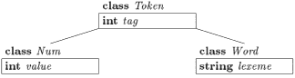

图 2.32：类 *Token* 及其子类 *Num* 和 *Word*

每个类都单独放在一个文件中。类 Token 的文件如下：

```java
1) package lexer;                 // File Token.java
2) public class Token {
3)     public final int tag;
4)     public Token(int t) { tag = t; }
5) }
```

第 1 行标识包 lexer。字段 tag 在第 3 行声明为 final，因此一旦设置就不能更改。第 4 行的构造函数 Token 用于创建词法单元对象，例如

```java
new Token('+')
```

它创建一个类 Token 的新对象，并将其字段 tag 设置为‘+’的整数表示。（为简洁起见，我们省略了惯用的方法 toString，它会返回适合打印的字符串。）

```java
1) package lexer;                         // File Lexer.java
2) import java.io.*; import java.util.*;
3) public class Lexer {
4)     public int line = 1;
5)     private char peek = ' ';
6)     private Hashtable words = new Hashtable();
7)     void reserve(Word t) { words.put(t.lexeme, t); }
8)     public Lexer() {
9)         reserve( new Word(Tag.TRUE, "true") );
10)        reserve( new Word(Tag.FALSE, "false") );
11)    }
12)    public Token scan() throws IOException {
13)        for( ; ; peek = (char)System.in.read() ) {
14)            if( peek == ' ' || peek == '\t' ) continue;
15)            else if( peek == '\n' ) line = line + 1;
16)            else break;
17)        }
       /* continues in Fig. 2.35 */
```

图 2.34：词法分析器的代码，第 1 部分（共 2 部分）

类 Word 同时用于保留字和标识符，因此第 4 行的构造函数 Word 需要两个参数：一个词素和一个对应的整数 tag 值。可以通过执行以下代码为保留字 true 创建一个对象：

```java
new Word(Tag.TRUE, "true")
```

它创建一个新对象，其字段 tag 设置为 Tag.TRUE，字段 lexeme 设置为字符串 "true"。

用于词法分析的类 Lexer 出现在图 2.34 和图 2.35 中。第 4 行的整数变量 line 统计输入行数，第 5 行的字符变量 peek 保存下一个输入字符。

保留字在第 6 行到第 11 行处理。表 words 在第 6 行声明。第 7 行的辅助函数 reserve 将一个字符串-单词对放入表中。构造函数 Lexer 中的第 9 行和第 10 行初始化该表。它们使用构造函数 Word 创建 word 对象，这些对象被传递给辅助函数 reserve。因此，在第一次调用 scan 之前，表已用保留字 "true" 和 "false" 初始化。

图 2.34–2.35 中 scan 的代码实现了本节中的伪代码片段。第 13 行到第 17 行的 for 语句跳过空白、制表符和换行符。控制离开 for 语句时，peek 保存一个非空白字符。

读取数字序列的代码在第 18 行到第 25 行。函数 isDigit 来自内置类 Character。它在第 18 行用于检查 peek 是否为数字。如果是，则第 19 行到第 24 行的代码累加输入中数字序列的整数值，并返回一个新的 Num 对象。

```java
18)    if( Character.isDigit(peek) ) {
19)        int v = 0;
20)        do {
21)            v = 10*v + Character.digit(peek, 10);
22)            peek = (char)System.in.read();
23)        } while( Character.isDigit(peek) );
24)        return new Num(v);
25)    }
26)    if( Character.isLetter(peek) ) {
27)        StringBuffer b = new StringBuffer();
28)        do {
29)            b.append(peek);
30)            peek = (char)System.in.read();
31)        } while( Character.isLetterOrDigit(peek) );
32)        String s = b.toString();
33)        Word w = (Word)words.get(s);
34)        if( w != null ) return w;
35)        w = new Word(Tag.ID, s);
36)        words.put(s, w);
37)        return w;
38)    }
39)    Token t = new Token(peek);
40)    peek = ' ';
41)    return t;
42) }
43) }
```

图 2.35：词法分析器的代码，第 2 部分（共 2 部分）

第 26 行到第 38 行分析保留字和标识符。关键字 **true** 和 **false** 已在第 9 行和第 10 行保留。因此，如果字符串 s 未被保留，则到达第 35 行，所以它必定是标识符的词素。第 35 行因此返回一个新的 word 对象，其 lexeme 设置为 s，tag 设置为 Tag.ID。最后，第 39 行到第 41 行将当前字符作为词法单元返回，并将 peek 设置为空白，该空白将在下次调用 scan 时被剥离。

### 2.6.6 第 2.6 节练习

**练习 2.6.1：** 扩展第 2.6.5 节中的词法分析器，以删除注释，定义如下：

-   a) 注释以 `//` 开头，并包含直到该行末尾的所有字符。
-   b) 注释以 `/*` 开头，并包含直到下一次出现字符序列 `*/` 为止的所有字符。

**练习 2.6.2：** 扩展 2.6.5 节中的词法分析器，使其能够识别关系运算符 <、<=、==、!=、>=、>。

**练习 2.6.3：** 扩展 2.6.5 节中的词法分析器，使其能够识别诸如 2.、3.14 和 .5 之类的浮点数。

## 2.7 符号表

*符号表*是编译器用来保存源程序构造信息的数据结构。这些信息由编译器的分析阶段逐步收集，并由综合阶段用来生成目标代码。符号表中的条目包含关于标识符的信息，例如其字符串（或词素）、类型、在存储中的位置以及任何其他相关信息。符号表通常需要支持程序中同一标识符的多次声明。

根据 1.6.1 节，声明的作用域是该声明适用的程序部分。我们将通过为每个作用域建立单独的符号表来实现作用域。带有声明⁸的程序块将拥有自己的符号表，并为块中的每个声明设置一个条目。这种方法也适用于其他建立作用域的构造；例如，类会有自己的表，并为每个字段和方法设置一个条目。

本节包含一个符号表模块，适合与本章中的 Java 翻译器片段一起使用。当我们在附录 A 中组装翻译器时，将按原样使用该模块。同时，为简单起见，本节的主要示例是一种精简语言，只包含涉及符号表的关键构造，即块、声明和因子。省略所有其他语句和表达式构造，以便我们专注于符号表操作。程序由带有可选声明的块以及由单个标识符组成的“语句”构成。每个这样的语句表示对该标识符的一次使用。下面是该语言的一个示例程序：

```
{ int x; char y; { bool y; x; y; } x; y; }
```

1.6.3 节中的块结构示例处理了名字的定义和使用；输入 (2.7) 仅由名字的定义和使用组成。

我们将执行的任务是打印一个修改后的程序，其中声明已被删除，并且每个“语句”的标识符后面跟一个冒号和它的类型。

⁸例如，在 C 中，程序块要么是函数，要么是由花括号分隔且内部包含一个或多个声明的函数片段。

### 2.7.1 块的符号表优化

块的符号表实现可以利用最近嵌套规则。嵌套确保适用的符号表链形成栈。栈顶是当前块的表。栈中位于其下的是外围块的表。因此，符号表可以以类似栈的方式分配和释放。

一些编译器维护一个包含可访问条目的单一哈希表；所谓可访问条目，是指未被嵌套块中的声明隐藏的条目。这样的哈希表支持基本恒定时间的查找，代价是在进入和退出块时插入和删除条目。退出块 B 时，编译器必须撤销由于块 B 中的声明而对哈希表所做的任何更改。它可以通过使用辅助栈来跟踪处理块 B 期间对哈希表所做的更改，从而做到这一点。

此外，语句可以是一个块，因此我们的语言允许嵌套块，其中标识符可以被重新声明。

块的*最近嵌套规则*是：标识符 x 位于 x 的最近嵌套声明的作用域内；也就是说，从出现 x 的块开始，由内向外检查块所找到的 x 的声明。

**例 2.15：** 下面的伪代码使用下标来区分同一标识符的不同声明：

```
1)  {    int x₁; int y₁;
2)      {    int w₂; bool y₂; int z₂;
3)           ··· w₂ ···; ··· x₁ ···; ··· y₂ ···; ··· z₂ ···;
4)      }
5)      ··· w₀ ···; ··· x₁ ···; ··· y₁ ···;
6)  }
```

下标不是标识符的一部分；它实际上是适用于该标识符的声明所在的行号。因此，x 的所有出现都位于第 1 行声明的作用域内。第 3 行出现的 y 位于第 2 行 y 的声明的作用域内，因为 y 在内层块中被重新声明。然而，第 5 行出现的 y 位于第 1 行 y 的声明的作用域内。

第 5 行出现的 w 大概位于此程序片段之外某个 w 声明的作用域内；其下标 0 表示一个全局的或对此块外部的声明。

最后，z 在嵌套块内声明并使用，但不能在第 5 行使用，因为嵌套声明仅适用于嵌套块。□

块的最近嵌套规则可以通过链接符号表来实现。也就是说，嵌套块的表指向其外围块的表。

**例 2.16：** 图 2.36 显示了例 2.15 中伪代码的符号表。$B_1$ 是从第 1 行开始的块的表，$B_2$ 是从第 2 行开始的块的表。图的顶部是额外的符号表 $B_0$，用于语言提供的任何全局声明或默认声明。在我们分析第 2 行到第 4 行期间，环境由对最低符号表（即 $B_2$ 的表）的引用表示。当我们继续到第 5 行时，$B_2$ 的符号表变得不可访问，环境转而引用 $B_1$ 的符号表；从该表可以到达全局符号表，但不能到达 $B_2$ 的表。

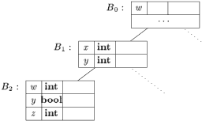

图 2.36：例 2.15 的链式符号表

图 2.37 中链式符号表的 Java 实现定义了一个类 Env，它是 **environment**（环境）的缩写。⁹ 类 Env 支持三种操作：

-   **创建一个新的符号表。** 图 2.37 第 6 行到第 8 行的构造函数 `Env(p)` 创建一个 Env 对象，其中包含名为 `table` 的哈希表。通过将字段 `prev` 设置为 `p`，该对象链接到环境值参数 `p`。尽管形成链的是 Env 对象，但谈论表被链接起来更为方便。
-   **在当前表中放入一个新条目。** 哈希表保存键值对，其中：
    -   *键* 是一个字符串，或者更确切地说，是对字符串的引用。我们也可以使用对标识符的 token 对象的引用作为键。
    -   *值* 是类 Symbol 的一个条目。第 9 行到第 11 行的代码不需要知道条目的结构；也就是说，该代码独立于类 Symbol 中的字段和方法。

⁹ “Environment”（环境）是程序某一点相关的符号表集合的另一种叫法。

```java
1)  package symbols;                         // File Env.java
2)  import java.util.*;
3)  public class Env {
4)      private Hashtable table;
5)      protected Env prev;
6)
7)      public Env(Env p) {
8)          table = new Hashtable(); prev = p;
9)      }
10)
11)     public void put(String s, Symbol sym) {
12)         table.put(s, sym);
13)     }
14)
15)     public Symbol get(String s) {
16)         for( Env e = this; e != null; e = e.prev ) {
17)             Symbol found = (Symbol) e.table.get(s);
18)             if( found != null ) return found;
19)         }
20)         return null;
21)     }
22) }
```

图 2.37：类 Env 实现链式符号表

-   **通过搜索表链来获取标识符的条目，从当前块的表开始。** 第 12 行到第 18 行中该操作的代码返回符号表条目或 `null`。

符号表的链接导致树结构，因为多个块可以嵌套在一个外围块内。图 2.36 中的虚线提醒我们，链式符号表可以形成一棵树。

### 2.7.2 符号表的使用

实际上，符号表的作用是将信息从声明传递到使用。当分析 x 的声明时，一个语义动作将关于标识符 x 的信息“放入”符号表。随后，与诸如 factor → id 这样的产生式相关联的语义动作从符号表中“获取”关于该标识符的信息。对于典型的运算符 op，表达式 E₁ op E₂ 的翻译只依赖于 E₁ 和 E₂ 的翻译，而不直接依赖于符号表，因此我们可以添加任意数量的运算符，而不改变通过符号表从声明到使用的基本信息流。

**例 2.17：** 图 2.38 中的翻译方案说明了如何使用类 *Env*。该翻译方案专注于作用域、声明以及

用途。它实现了示例 2.14 中描述的翻译。如前所述，对于输入

```
program  →  block                         { top = null; }

block    →  '{'                           { saved = top;
                                             top = new Env(top);
                                             print("{ "); }
           decls stmts '}'                 { top = saved;
                                             print("} "); }

decls    →  decls decl
         |  ε

decl     →  type id ;                     { s = new Symbol;
                                             s.type = type.lexeme;
                                             top.put(id.lexeme, s); }

stmts    →  stmts stmt
         |  ε

stmt     →  block
         |  factor ;                       { print("; "); }

factor   →  id                             { s = top.get(id.lexeme);
                                             print(id.lexeme);
                                             print(": ");
                                             print(s.type); }
```

图 2.38：使用符号表翻译带块的语言

```
{ int x; char y; { bool y; x; y; } x; y; }
```

该翻译方案会剥离声明并生成

```
{ { x:int; y:bool; } x:int; y:char; }
```

注意，在图 2.38 中，产生式的体已经对齐，使得所有文法符号出现在一列中，而所有动作出现在第二列中。因此，产生式体的组成部分常常分布在多行中。

现在考虑语义动作。该翻译方案分别在进入和退出块时创建和丢弃符号表。变量 *top* 表示栈顶符号表，位于符号表链的头部。底层文法的第一个产生式是 *program* → *block*。在 *block* 之前的语义动作将 *top* 初始化为 **null**，其中没有任何条目。

第二个产生式 *block* → '{' *decls* *stmts* '}' 在进入和退出块时都有动作。在进入块时、*decls* 之前，一个语义动作使用局部变量 *saved* 保存对当前符号表的引用。该产生式的每次使用都有其自己的局部变量 *saved*，与该产生式任何其他使用中的局部变量不同。在递归下降分析器中，*saved* 将是 *block* 对应过程的局部变量。递归函数的局部变量处理将在 7.2 节讨论。代码 `top = new Env(top);` 将变量 *top* 设置为一个新创建的符号表，该表在进入块之前链接到 *top* 的前一个值。变量 *top* 是类 *Env* 的对象；构造函数 *Env* 的代码出现在图 2.37 中。

在退出块时、'}' 之后，一个语义动作将 *top* 恢复为进入块时保存的值。实际上，这些符号表形成一个栈；将 *top* 恢复为其保存值会弹出块中声明的影响。[^10] 因此，块中的声明在块外不可见。

声明 *decl* → **type** *id* 会为所声明的标识符产生一个新条目。我们假设记号 **type** 和 *id* 各有一个关联属性，分别是所声明标识符的类型和词素。我们不深入讨论符号对象 *s* 的所有字段，但假设有一个字段 *type* 给出符号的类型。我们创建一个新的符号对象 *s*，并通过 *s.type* = **type**.*lexeme* 正确设置其类型。完整条目通过 *top.put(id.lexeme, s)* 放入栈顶符号表。

产生式 *factor* → *id* 中的语义动作使用符号表获取该标识符的条目。*get* 操作从 *top* 开始，在符号表链中搜索第一个条目。检索到的条目包含关于该标识符所需的任何信息，例如标识符的类型。□

## 2.8 中间代码生成

编译器前端构造源程序的中间表示，后端据此生成目标程序。在本节中，我们考虑表达式和语句的中间表示，并给出如何产生此类表示的教程示例。

### 2.8.1 两类中间表示

正如 2.1 节、尤其是图 2.4 所暗示的，两种最重要的中间表示是：

- 树，包括分析树和（抽象）语法树。
- 线性表示，尤其是“三地址代码”。

抽象语法树（或简称语法树）已在 2.5.1 节介绍，并将在 5.3.1 节更正式地重新讨论。在语法分析过程中，会创建语法树节点来表示重要的程序设计构造。随着分析的进行，信息以与节点关联的属性的形式添加到节点中。属性的选择取决于要执行的翻译。

另一方面，三地址代码是一系列基本程序步骤，例如两个值相加。与树不同，它没有层次结构。正如我们将在第 9 章看到的，如果要对代码进行任何重要的优化，就需要这种表示。在这种情况下，我们将构成程序的长三地址语句序列划分为“基本块”，基本块是总是依次执行、没有分支的语句序列。

除了创建中间表示之外，编译器前端还检查源程序是否遵循源语言的语法和语义规则。这种检查称为 *静态检查*；一般来说，“静态”意味着“由编译器完成”。[^11] 静态检查确保某些类型的程序设计错误（包括类型不匹配）在编译期间被检测并报告。

编译器有可能在发出三地址代码步骤的同时构造语法树。然而，常见的情况是：编译器在语法分析器“做出”构造语法树的动作时发出三地址代码，但并不实际构造完整的树数据结构。相反，编译器将语义检查或其他目的所需的节点及其属性，连同用于语法分析的数据结构一起存储。这样，构造三地址代码所需的那些语法树部分在需要时可用，而在不再需要时消失。我们将在第 5 章详细讨论这一过程。

### 2.8.2 语法树的构造

我们将首先给出一个构造语法树的翻译方案，然后在 2.8.4 节展示如何修改该方案，以便在生成语法树的同时或代替语法树发出三地址代码。

回顾 2.5.1 节，语法树

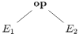

表示通过将运算符 **op** 应用于由 *E₁* 和 *E₂* 表示的子表达式而形成的表达式。可以为任何构造创建语法树，而不仅仅是表达式。每个构造由一个节点表示，其子节点对应该构造在语义上有意义的组成部分。例如，C 语言 while 语句的语义上有意义的组成部分是：

```
while ( expr ) stmt
```

表达式 *expr* 和语句 *stmt*。[^12] 这种 while 语句的语法树节点有一个运算符（我们称为 **while**）和两个子节点——*expr* 和 *stmt* 的语法树。

图 2.39 中的翻译方案为一种具有代表性但非常有限的表达式和语句语言构造语法树。该翻译方案中的所有非终结符都有一个属性 *n*，它是语法树的一个节点。节点实现为类 *Node* 的对象。

类 *Node* 有两个直接子类：*Expr* 用于各种表达式，*Stmt* 用于各种语句。每种语句类型都有 *Stmt* 的对应子类；例如，运算符 **while** 对应于子类 *While*。

运算符 **while** 的语法树节点（子节点为 *x* 和 *y*）由以下伪代码创建

```
new While(x, y)
```

它通过调用与类同名的构造函数 *While* 创建类 *While* 的对象。正如构造函数对应于运算符，构造函数参数对应于抽象语法中的操作数。

当我们研究附录 A 中的详细代码时，我们将看到方法如何放置在此类层次结构中它们所属的位置。在本节中，我们只非正式地讨论少数几个方法。

我们将依次考虑图 2.39 中的每个产生式和规则。首先解释定义不同类型语句的产生式，然后解释定义我们有限类型表达式的产生式。

#### 语句的语法树

对于每种语句构造，我们在抽象语法中定义一个运算符。对于以关键字开头的构造，我们将使用该关键字作为运算符。因此，对于 while 语句有一个运算符 **while**，对于 do-while 语句有一个运算符 **do**。条件语句可以通过定义两个运算符来处理

[^10]: 除了显式保存和恢复符号表之外，我们也可以改为向类 *Env* 添加静态操作 *push* 和 *pop*。

[^11]: 其反义词“动态”意味着“在程序运行时”。许多语言还会进行某些动态检查。例如，像 Java 这样的面向对象语言有时必须在程序执行期间检查类型，因为应用于对象的方法可能取决于该对象的特定子类。

[^12]: 右括号只用于将表达式与语句分隔开。左括号实际上没有意义；它只是为了看起来顺眼，因为如果没有它，C 将允许括号不配对。


```
program → block    { return block.n; }
block → '{' stmts '}'    { block.n = stmts.n; }
stmts → stmts_1 stmt    { stmts.n = new Seq(stmts_1.n, stmt.n); }
      | ε    { stmts.n = null; }
stmt → expr ;    { stmt.n = new Eval(expr.n); }
     | if ( expr ) stmt_1    { stmt.n = new If(expr.n, stmt_1.n); }
     | while ( expr ) stmt_1    { stmt.n = new While(expr.n, stmt_1.n); }
     | do stmt_1 while ( expr ) ;    { stmt.n = new Do(stmt_1.n, expr.n); }
     | block    { stmt.n = block.n; }
expr → rel = expr_1    { expr.n = new Assign('=', rel.n, expr_1.n); }
     | rel    { expr.n = rel.n; }
rel → rel_1 < add    { rel.n = new Rel('<', rel_1.n, add.n); }
    | rel_1 <= add    { rel.n = new Rel('<=', rel_1.n, add.n); }
    | add    { rel.n = add.n; }
add → add_1 + term    { add.n = new Op('+', add_1.n, term.n); }
    | term    { add.n = term.n; }
term → term_1 * factor    { term.n = new Op('*', term_1.n, factor.n); }
     | factor    { term.n = factor.n; }
factor → ( expr )    { factor.n = expr.n; }
       | num    { factor.n = new Num(num.value); }
```

图 2.39：表达式和语句的语法树构造

## 2.8 中间代码生成

**ifelse** 和 **if** 分别用于带 else 部分和不带 else 部分的 if 语句。在我们的简单示例语言中，我们不使用 **else**，因此只有 if 语句。添加 **else** 会带来一些解析问题，我们将在第 4.8.2 节讨论。

每个语句运算符都有一个对应的同名类，首字母大写；例如，类 *If* 对应 **if**。此外，我们定义子类 *Seq*，它表示一个语句序列。该子类对应文法的非终结符 **stmts**。这些类都是 *Stmt* 的子类，而 *Stmt* 又是 *Node* 的子类。

图 2.39 中的翻译方案说明了语法树节点的构造。一个典型的规则是 if 语句的规则：

```
stmt → if ( expr ) stmt_1 { stmt.n = new If(expr.n, stmt_1.n); }
```

if 语句的有意义组成部分是 **expr** 和 **stmt_1**。语义动作将节点 **stmt.n** 定义为子类 *If* 的新对象。构造函数 *If* 的代码未显示。它创建一个以 **if** 为标签的新节点，并以节点 **expr.n** 和 **stmt_1.n** 作为子节点。

表达式语句不以关键字开头，因此我们定义一个新的运算符 **eval** 和类 *Eval*（它是 *Stmt* 的子类），来表示作为语句的表达式。相关规则是：

```
stmt → expr ; { stmt.n = new Eval(expr.n); }
```

### 在语法树中表示块

图 2.39 中剩余的语句构造是块，它由一系列语句组成。考虑以下规则：

```
stmt → block { stmt.n = block.n; }
block → '{' stmts '}' { block.n = stmts.n; }
```

第一条规则说明，当语句是一个块时，它具有与该块相同的语法树。第二条规则说明，非终结符 **block** 的语法树就是块中语句序列的语法树。

为简单起见，图 2.39 中的语言不包含声明。即使附录 A 中包含了声明，我们也将看到块的语法树仍然是块中语句的语法树。由于声明中的信息被纳入符号表，它们在语法树中并不需要。因此，无论是否带有声明，块在中间代码中都只是另一种语句构造。

语句序列通过为空语句使用叶子 **null**，并为语句序列使用运算符 **seq** 来表示，如下所示：

```
stmts → stmts_1 stmt { stmts.n = new Seq(stmts_1.n, stmt.n); }
```

**例 2.18：** 在图 2.40 中，我们看到表示块或语句列表的语法树的一部分。该列表中有两条语句，第一条是 if 语句，第二条是 while 语句。我们没有显示该语句列表之上的树部分，并且仅将每个必要的子树显示为三角形：两个用于 if 和 while 语句条件的表达式树，以及两个用于其子语句的语句树。

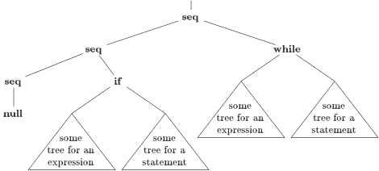

图 2.40：由 if 语句和 while 语句组成的语句列表的部分语法树

### 表达式的语法树

此前，我们通过使用三个非终结符 *expr*、*term* 和 *factor* 来处理 `*` 高于 `+` 的优先级。非终结符的数量恰好是表达式中优先级层数加一，正如我们在第 2.2.6 节所建议的那样。在图 2.39 中，我们在一个优先级层上有两个比较运算符 `<` 和 `<=`，以及通常的 `+` 和 `*` 运算符，因此我们增加了一个额外的非终结符，称为 *add*。

抽象语法允许我们对“相似”的运算符进行分组，以减少表达式实现中的情况数和节点子类数。在本章中，我们将“相似”理解为运算符的类型检查和代码生成规则相似。例如，通常运算符 `+` 和 `*` 可以分组，因为它们可以用相同的方式处理——它们对操作数类型的要求相同，并且它们各自产生一条将某个运算符应用于两个值的三地址指令。一般来说，抽象语法中运算符的分组基于编译器后续阶段的需要。图 2.41 中的表格指定了若干 Java 运算符的具体语法和抽象语法之间的对应关系。

| 具体语法 | 抽象语法 |
|---|---|
| `=` | 赋值 |
| \|\| | 条件 |
| `&&` | 条件 |
| `== !=` | 关系 |
| `< <= >= >` | 关系 |
| `+ -` | 运算 |
| `* / %` | 运算 |
| `!` | 非 |
| `-` 一元 | 负号 |
| `[]` | 访问 |

*图 2.41：若干 Java 运算符的具体语法和抽象语法*

在具体语法中，所有运算符都是左结合的，除了赋值运算符 `=` 是右结合的。同一行上的运算符具有相同的优先级；也就是说，`==` 和 `!=` 具有相同的优先级。各行按优先级递增的顺序排列；例如，`==` 的优先级高于运算符 `&&` 和 `=`。−<sub>unary</sub> 中的下标 *unary* 仅仅是为了区分前导一元负号（如 −2）和二元减号（如 2−a）。运算符 `[]` 表示数组访问，如 `a[i]`。

抽象语法列指定运算符的分组。赋值运算符 `=` 单独成组。组 cond 包含条件布尔运算符 `&&` 和 `||`。组 rel 包含 `==` 和 `<` 所在行上的关系比较运算符。组 op 包含像 `+` 和 `*` 这样的算术运算符。一元负号、布尔取反和数组访问各自单独成组。

图 2.41 中具体语法和抽象语法之间的映射可以通过编写翻译方案来实现。图 2.39 中非终结符 *expr*、*rel*、*add*、*term* 和 *factor* 的产生式指定了图 2.41 中运算符的一个代表性子集的具体语法。这些产生式中的语义动作创建语法树节点。例如，规则

```
term → term₁ * factor { term.n = new Op('*', term₁.n, factor.n); }
```

创建类 Op 的一个节点，它实现图 2.41 中分组在 op 下的运算符。构造函数 Op 除了具有用于子表达式的节点 `term₁.n` 和 `factor.n` 之外，还有一个参数 `'*'` 来标识实际的运算符。

### 2.8.3 静态检查

静态检查是在编译期间完成的一致性检查。它们不仅确保程序可以成功编译，而且有可能在程序运行之前及早发现编程错误。静态检查包括：

- *语法检查。* 语法不仅仅是文法。例如，诸如一个标识符在 a 中最多声明一次这样的约束


作用域，或者 break 语句必须有一个外围循环或 switch 语句，这些属于语法层面的，尽管它们并未被编码在用于解析的文法中，也不由该文法强制执行。

- **类型检查。** 语言的类型规则保证运算符或函数被应用于正确数量和类型的操作数。如果类型之间需要转换，例如，当整数与浮点数相加时，类型检查器可以向语法树中插入一个运算符来表示该转换。下面我们使用常用术语“强制转换”来讨论类型转换。

### 左值和右值

我们现在考虑一些可以在为源程序构造语法树期间完成的简单静态检查。一般而言，复杂的静态检查可能需要先构造中间表示，然后再对其进行分析。

赋值号左侧和右侧的标识符含义存在区别。在下列每个赋值中

```
i = 5;
i = i + 1;
```

右侧指定一个整数值，而左侧指定该值要存储的位置。术语 *左值* 和 *右值* 分别指适合出现在赋值左侧和右侧的值。也就是说，右值是我们通常认为的“值”，而左值是位置。

静态检查必须确保赋值的左侧表示一个左值。像 i 这样的标识符具有左值，像 a[2] 这样的数组访问也具有左值。但像 2 这样的常量不适合出现在赋值左侧，因为它具有右值，但没有左值。

### 类型检查

类型检查确保一个结构的类型与其上下文所期望的类型匹配。例如，在 if 语句中

```
if ( expr ) stmt
```

表达式 *expr* 应具有类型 boolean。

类型检查规则遵循抽象语法的运算符/操作数结构。假设运算符 *rel* 表示诸如 ≤ 的关系运算符。运算符组 *rel* 的类型规则是：它的两个操作数必须具有相同类型，且结果具有类型 boolean。使用属性 *type* 表示表达式的类型，令 E 由应用于 E₁ 和 E₂ 的 *rel* 组成。当 E 的节点被构造时，可以通过执行如下代码来检查 E 的类型：

```
if (E₁.type == E₂.type) E.type = boolean;
else error;
```

将实际类型与期望类型匹配的思想仍然适用，即使在以下情况中也是如此：

- **强制转换。** 如果操作数的类型被自动转换为运算符所期望的类型，就发生*强制转换*。在诸如 `2 * 3.14` 的表达式中，通常的变换是将整数 2 转换为等价的浮点数 2.0，然后对得到的一对浮点操作数执行浮点运算。语言定义规定了允许的强制转换。例如，上面讨论的 `rel` 的实际规则可能是 `E₁.type` 和 `E₂.type` 可转换为同一类型。在这种情况下，比较一个整数和一个浮点数就是合法的。

- **重载。** Java 中的运算符 `+` 在应用于整数时表示加法；在应用于字符串时表示连接。如果一个符号根据其上下文具有不同含义，则称该符号是*重载的*。因此，`+` 在 Java 中是重载的。重载运算符的含义通过考虑其操作数和结果的已知类型来确定。例如，如果我们知道 `x`、`y` 或 `z` 中任意一个是字符串类型，那么我们知道 `z = x + y` 中的 `+` 是连接。然而，如果我们还知道其中另一个是整数类型，那么就存在类型错误，并且这种对 `+` 的使用没有意义。

### 2.8.4 三地址代码

一旦构造出语法树，就可以通过求值属性并在树中节点处执行代码片段来完成进一步的分析与综合。我们通过遍历语法树来生成三地址代码，以此说明这种可能性。具体来说，我们展示如何编写函数来处理语法树，并作为副作用生成所需的三地址代码。

#### 三地址指令

三地址代码是如下形式的指令序列

$$x = y\ op\ z$$

其中 x、y 和 z 是名称、常量或编译器生成的临时变量；**op** 表示一个运算符。

数组将通过使用以下两种指令变体来处理：

```
x[y] = z
x = y[z]
```

第一种将 z 的值放入位置 x[y]，第二种将 y[z] 的值放入位置 x。

三地址指令按顺序执行，除非条件或无条件跳转强制改变执行顺序。我们为控制流选择以下指令：

| 指令 | 含义 |
|---|---|
| `ifFalse x goto L` | 如果 x 为假，则接下来执行标号为 L 的指令 |
| `ifTrue x goto L` | 如果 x 为真，则接下来执行标号为 L 的指令 |
| `goto L` | 接下来执行标号为 L 的指令 |

通过在前面加上前缀 `L:`，可以将标号 L 附加到任意指令上。一条指令可以有多个标号。

最后，我们需要复制值的指令。下面的三地址指令将 y 的值复制到 x：

```
x = y
```

#### 语句的翻译

语句被翻译成三地址代码，方法是使用跳转指令来实现通过该语句的控制流。图 2.42 中的布局说明了 if *expr* then *stmt₁* 的翻译。布局中的跳转指令

```
ifFalse x goto after
```

在 *expr* 求值为假时跳过 *stmt₁* 的翻译。其他语句结构也类似地翻译，方法是使用适当的跳转绕过其各组件的代码。

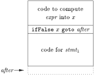

*图 2.42：if 语句的代码布局*

为了具体起见，我们在图 2.43 中给出类 *If* 的伪代码。类 *If* 是 *Stmt* 的子类，其他语句结构的类也是如此。*Stmt* 的每个子类都有一个构造函数——在本例中是 *If* 的构造函数——以及一个函数 *gen*，调用它来为这类语句生成三地址代码。

```java
class If extends Stmt {
    Expr E; Stmt S;
    public If(Expr x, Stmt y) { E = x; S = y; after = newlabel(); }
    public void gen() {
        Expr n = E.rvalue();
        emit("ifFalse " + n.toString() + " goto " + after);
        S.gen();
        emit(after + ":");
    }
}
```

*图 2.43：类 If 中的函数 gen 生成三地址代码*

图 2.43 中的构造函数 If 为 if 语句创建语法树节点。它以两个参数调用，一个表达式节点 x 和一个语句节点 y，并将它们保存为属性 E 和 S。构造函数还通过调用函数 newlabel() 为属性 after 分配一个唯一的新标号。该标号将按照图 2.42 中的布局使用。

一旦为源程序构造出整个语法树，就在语法树的根处调用函数 gen。由于在我们的简单语言中程序是一个块，因此语法树的根表示该块中的语句序列。所有语句类都包含一个函数 gen。

图 2.43 中类 If 的函数 gen 的伪代码具有代表性。它调用 E.rvalue() 来翻译表达式 E（作为 if 语句一部分的布尔值表达式），并保存 E 返回的结果节点。表达式的翻译将在稍后讨论。然后函数 gen 生成一个条件跳转，并调用 S.gen() 来翻译子语句 S。

#### 表达式的翻译

我们现在通过考虑包含二元运算符 op、数组访问和赋值的表达式，以及常量和标识符，来说明表达式的翻译。为简单起见，在数组访问 y[z] 中，我们要求 y 是一个标识符。^13 关于表达式中间代码生成的详细讨论，请参见第 6.4 节。

我们将采用简单的方法：为表达式语法树中的每个运算符节点生成一条三地址指令。不为标识符和常量生成代码，因为它们可以作为指令中的地址出现。如果类 Expr 的节点 x 具有运算符 op，则生成一条指令，将节点 x 处的值计算到编译器生成的“临时”名称中，比如 t。因此，i-j+k 会翻译成两条指令

^13 这种简单语言支持 a[a[n]]，但不支持 a[n][n]。注意 a[a[n]] 的形式为 a[E]，其中 E 是 a[n]。


```
t1 = i - j
t2 = t1 + k
```

随着数组访问和赋值操作的出现，我们需要区分*左*值和*右*值。例如，`2*a[i]` 可以通过计算 `a[i]` 的*右*值并将其存入一个临时变量来翻译，如下所示：

```
t1 = a[i]
t2 = 2 * t1
```

但是，如果 `a[i]` 出现在赋值的左侧，我们不能简单地用一个临时变量来代替 `a[i]`。

简单的方法是使用两个函数 *lvalue* 和 *rvalue*，它们分别出现在图 2.44 和图 2.45 中。当函数 *rvalue* 应用于非叶子节点 x 时，它会生成指令来计算 x 的值并将其存入一个临时变量，然后返回一个表示该临时变量的新节点。当函数 *lvalue* 应用于非叶子节点时，它也会生成指令来计算 x 以下的子树，并返回一个表示 x 的“地址”的节点。

我们先描述函数 *lvalue*，因为它的情形较少。当应用于节点 x 时，如果 x 是标识符的节点（即 x 属于 *Id* 类），函数 *lvalue* 直接返回 x。在我们简单的语言中，表达式具有*左*值的唯一另一种情形是当 x 表示数组访问时，例如 `a[i]`。在这种情况下，x 的形式为 *Access(y, z)*，其中 *Access* 类是 *Expr* 的子类，y 表示被访问数组的名称，z 表示该数组中选定元素的偏移量（下标）。对于图 2.44 中的伪代码，函数 *lvalue* 调用 *rvalue(z)*，以在需要时生成计算 z 的*右*值的指令。然后它构造并返回一个新的 *Access* 节点，其子节点为数组名 y 和 z 的*右*值。

```
Expr lvalue(x : Expr) {
    if (x is an Id node) return x
    else if (x is an Access(y,z) node and y is an Id node) {
        return new Access(y,rvalue(z));
    }
    else error;
}
```

图 2.44：函数 *lvalue* 的伪代码

### **示例 2.19：**

当节点 x 表示数组访问 `a[2*k]` 时，调用 *lvalue(x)* 会生成一条指令

```
t = 2 * k
```

并返回一个新节点 x'，表示*左*值 `a[t]`，其中 t 是一个新的临时变量。

详细来说，代码片段

- 当 $x$ 表示 $y = z$ 时，代码首先计算 $z' = rvalue(z)$。它根据 *lvalue*(y) = z' 生成一条指令，并返回节点 z'。

### **示例 2.20：**

当应用于以下语法树时：

```
a[i] = 2*a[j-k]
```

函数 rvalue 生成

```
t3 = j - k
t2 = a[t3]
t1 = 2 * t2
a[i] = t1
```

也就是说，根节点是一个 Assign 节点，其第一个参数为 `a[i]`，第二个参数为 `2*a[j-k]`。因此，适用第三种情形，函数 rvalue 递归地计算 `2*a[j-k]`。该子树的根节点是用于 * 的 Op 节点，这会在计算左操作数 `2` 之前创建一个新的临时变量 t1，然后计算右操作数。常量 `2` 不生成任何三地址代码，其右值作为值为 2 的 Constant 节点返回。

右操作数 `a[j-k]` 是一个 Access 节点，这会在对该节点调用函数 rvalue 之前创建一个新的临时变量 t2。然后递归地对表达式 `j-k` 调用 rvalue。作为这次调用的副作用，在创建新的临时变量 t3 之后，生成三地址语句 `t3 = j - k`。接着，返回到对 `a[j-k]` 的 rvalue 调用，临时变量 t2 被赋值为整个访问表达式的右值，即 `t2 = a[t3]`。

现在，我们返回到对 Op 节点 `2*a[j-k]` 的 rvalue 调用，该调用之前创建了临时变量 t1。作为副作用，生成三地址语句 `t1 = 2 * t2` 以计算这个乘法表达式。最后，对整个表达式的 rvalue 调用通过以下方式完成：先对左侧的 `a[i]` 调用 rvalue，然后生成三地址指令 `a[i] = t1`，其中赋值的右侧被赋给左侧。

### 表达式的更好代码

我们可以改进图 2.45 中的函数 rvalue，通过以下几种方式生成更少的三地址指令：

- 在后续的优化阶段减少复制指令的数量。例如，如果之后不再使用 $t$，指令对 $t = i+1$ 和 $i = t$ 可以合并为 $i = i+1$。
- 通过考虑上下文，从一开始就生成更少的指令。例如，如果三地址赋值的左侧是数组访问 $a[t]$，那么右侧必须是一个名字、常量或临时变量，所有这些都只需一个地址。但如果左侧是名字 $x$，那么右侧可以是使用两个地址的操作 $y$ op $z$。

我们可以通过修改翻译函数来避免一些复制指令，生成一条计算例如 j+k 的部分指令，但不指定结果放置的位置，用结果的**null**地址来表示：

`null = j + k` (2.8)

这个空结果地址随后根据情况被替换为标识符或临时变量。如果 j+k 位于赋值的右侧，例如 `i=j+k;`，则将其替换为标识符，此时 (2.8) 变为

```
i = j + k
```

但是，如果 j+k 是一个子表达式，例如 `j+k+1`，那么 (2.8) 中的空结果地址会被替换为一个新的临时变量 t，并生成一条新的部分指令

```
t = j + k
null = t + 1
```

许多编译器尽一切努力生成与专家编写的手工汇编代码一样好甚至更好的代码。如果使用了代码优化技术（例如第 9 章中的那些技术），那么一种有效的策略很可能是：对中间代码生成采用简单的方法，并依赖代码优化器来消除不必要的指令。

### 2.8.5 第 2.8 节的练习

**练习 2.8.1：** C 和 Java 中的 for 语句形式如下：

```
for ( expr1 ; expr2 ; expr3 ) stmt
```

第一个表达式在循环之前执行；它通常用于初始化循环索引。第二个表达式是在每次循环迭代之前执行的测试；如果表达式变为 0，则退出循环。循环本身可以被看作语句 `{stmt expr3;}`。第三个表达式在每次迭代结束时执行；它通常用于递增循环索引。for 语句的含义类似于

```
expr1 ; while ( expr2 ) {stmt expr3 ; }
```

为 for 语句定义一个类 *For*，类似于图 2.43 中的类 *If*。

**练习 2.8.2：** 编程语言 C 没有布尔类型。说明 C 编译器如何将 if 语句翻译成三地址代码。

### 2.9 第 2 章小结

本章中的语法制导技术可用于构造编译器前端，例如图 2.46 所示的那些。

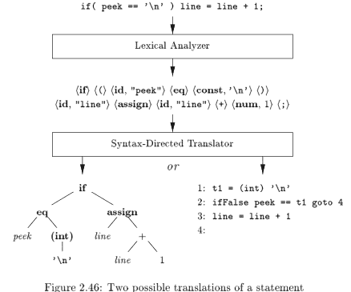

图 2.46：一条语句的两种可能翻译

- 语法制导翻译器的起点是源语言的文法。*文法*描述了程序的层次结构。它由称为*终结符*的基本符号和称为*非终结符*的变量符号定义。这些符号表示语言构造。文法的规则或*产生式*由一个称为产生式*头*或*左部*的非终结符和一个称为产生式*体*或*右部*的终结符和非终结符序列组成。有一个非终结符被指定为*开始*符号。

- 在指定翻译器时，将属性附加到编程构造上是有帮助的，其中*属性*是与构造相关联的任何量。由于构造由文法符号表示，属性的概念也扩展到文法符号。属性的示例包括与表示数字的终结符 `num` 相关联的整数值，以及与表示标识符的终结符 `id` 相关联的字符串。

- *词法分析器*一次读取一个字符的输入，并产生一个*记号*流作为输出，其中记号由终结符以及属性值形式的附加信息组成。在图 2.46 中，记号被写成用 ⟨ ⟩ 括起来的元组。记号 `(id, "peek")` 由终结符 `id` 和一个指向包含字符串 `"peek"` 的符号表条目的指针组成。翻译器使用该表来保持


### 2.9 第2章小结

跟踪已经出现过的保留字和标识符。

-   *语法分析* 是确定如何通过反复用某个产生式的体替换非终结符，从文法的开始符号推导出终结符串的问题。从概念上讲，语法分析器构建一棵语法分析树，其中根节点标有开始符号，每个非叶节点对应一个产生式，每个叶节点标有终结符或特殊符号 ε。语法分析树推导出叶节点上的终结符串，从左到右读取。

-   高效的语法分析器可以手工构建，使用一种称为预测分析的自顶向下（从语法分析树的根到叶）方法。*预测分析器* 为每个非终结符都有一个过程；过程体模仿非终结符的产生式，并且通过向前查看输入流中的一个符号，可以无歧义地确定通过过程体的控制流。关于其他语法分析方法，见第4章。

-   语法制导翻译通过将规则或程序片段附加到文法中的产生式来完成。本章只考虑了*综合属性*——任意节点 x 处的综合属性的值只能依赖于 x 的子节点（如果有）处的属性。*语法制导定义* 将规则附加到产生式；这些规则计算属性值。*翻译方案* 将称为*语义动作*的程序片段嵌入产生式体。这些动作按语法分析期间使用产生式的顺序执行。

-   语法分析的结果是源程序的一种表示，称为*中间代码*。图2.46说明了两种主要的中间代码形式。*抽象语法树* 具有表示编程结构的节点；节点的子节点给出有意义的子结构。或者，*三地址代码* 是指令序列，其中每条指令执行一个单一操作。

-   *符号表* 是保存标识符信息的数据结构。当分析标识符的声明时，信息被放入符号表。当该标识符随后被使用（例如作为表达式中的一个因子）时，语义动作从符号表中获取信息。

标识符的种类可由词法分析器从符号表中读取，以帮助它确定必须传递给语法分析器的正确记号。

这些交互如图3.1所示。通常，这种交互通过让语法分析器调用词法分析器来实现。这一调用（由`getNextToken`命令表示）使词法分析器从其输入中读取字符，直到它能够识别下一个词素，并为其产生下一个记号，然后将其返回给语法分析器。

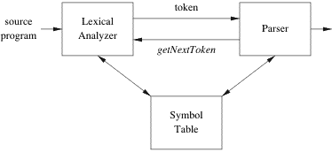

图3.1：词法分析器与语法分析器之间的交互

由于词法分析器是编译器中读取源文本的部分，因此除了识别词素之外，它还可以执行某些其他任务。其中一项任务是剔除注释和空白（空格、换行、制表符，也许还有输入中用于分隔记号的其他字符）。另一项任务是将编译器生成的错误消息与源程序关联起来。例如，词法分析器可以跟踪已看到的换行字符数，从而将行号与每条错误消息关联起来。在某些编译器中，词法分析器会制作源程序的副本，并将错误消息插入适当位置。如果源程序使用宏预处理器，宏展开也可以由词法分析器执行。

有时，词法分析器被划分为两个过程的级联：

-   a) *扫描* 由不需要对输入进行记号化的简单过程组成，例如删除注释，以及将连续的空白字符合并为一个。

-   b) *词法分析*本身是更复杂的部分，它从扫描器的输出产生记号。

### 3.1.1 词法分析与语法分析

编译器的分析部分通常被分为词法分析和语法分析（句法分析）两个阶段，原因有很多。

-   1. 设计简单性是最重要的考虑因素。将词法分析和语法分析分离，通常使我们能够简化其中至少一项任务。例如，一个必须把注释和空白作为语法单元处理的语法分析器，会比一个可以假定注释和空白已由词法分析器删除的语法分析器复杂得多。如果我们在设计一种新语言，分离词法和语法关注点可以带来更清晰的总体语言设计。

-   2. 编译器效率得到提高。单独的词法分析器使我们能够应用仅服务于词法任务而非语法分析任务的专门技术。此外，用于读取输入字符的专门缓冲技术可以显著加快编译器的速度。

-   3. 编译器的可移植性得到增强。特定于输入设备的特性可以限制在词法分析器中。

### 3.1.2 记号、模式和词素

在讨论词法分析时，我们使用三个相关但不同的术语：

-   *记号* 是由记号名和一个可选属性值组成的一对。记号名是表示一种词法单元的抽象符号，例如某个特定关键字，或表示一个标识符的输入字符序列。记号名是语法分析器所处理的输入符号。在下文中，我们通常用粗体书写记号名。我们常常用记号名来指代记号。

-   *模式* 是对一个记号的词素可能采用的形式的描述。当关键字作为记号时，模式就是构成该关键字的字符序列。对于标识符和其他一些记号，模式是一种更复杂的结构，可由许多字符串*匹配*。

-   *词素* 是源程序中与某个记号的模式匹配的字符序列，并被词法分析器识别为该记号的一个实例。

**例3.1：** 图3.2给出了一些典型记号、它们的非正式描述模式以及一些示例词素。为了了解这些概念在实践中如何使用，请看下面的C语句

```c
printf("Total = %d\n", score);
```

其中 printf 和 score 都是与记号 id 的模式匹配的词素，而 "Total = %d\n" 是与 literal 记号的模式匹配的词素。

在许多编程语言中，以下类别涵盖大多数或全部记号：

| 记号 | 非正式描述 | 示例词素 |
|---|---|---|
| if | 字符 i、f | if |
| else | 字符 e、l、s、e | else |
| comparison | < 或 > 或 <= 或 >= 或 == 或 != | <=、!= |
| id | 字母后跟字母和数字 | p1、score、D2 |
| number | 任意数值常量 | 3.14159、0、6.02e23 |
| literal | 由 " 包围的除 " 之外的任何内容 | "core dumped" |

图3.2：记号的示例

-   1. 每个关键字一个记号。关键字的模式与关键字本身相同。

-   2. 运算符的记号，可以单独表示，也可以归入类中，例如图3.2中提到的记号 comparison。

-   3. 一个表示所有标识符的记号。

-   4. 一个或多个表示常量的记号，例如数字和字面量字符串。

-   5. 每个标点符号的记号，例如左括号和右括号、逗号和分号。

### 3.1.3 记号的属性

当一个模式可以匹配多个词素时，词法分析器必须向编译器的后续阶段提供关于所匹配的特定词素的附加信息。例如，记号 **number** 的模式既匹配 0 也匹配 1，但代码生成器必须知道在源程序中找到的是哪个词素，这一点极其重要。因此，在许多情况下，词法分析器返回给语法分析器的不仅是记号名，还有一个描述该记号所表示词素的属性值；记号名影响语法分析决策，而属性值影响语法分析之后记号的翻译。

我们将假定记号至多有一个关联属性，尽管该属性可以具有组合若干信息片段的结构。最重要的例子是记号 id，我们需要将大量信息与该记号关联起来。通常，关于标识符的信息——例如它的词素、它的类型，以及首次找到它的位置（以便在必须发出关于该标识符的错误消息时使用）——保存在符号表中。因此，标识符的适当属性值是指向该标识符的符号表条目的指针。


### 3.1. 词法分析器的作用

### 识别记号时的棘手问题

通常，给定描述某个记号的词素的模式后，当匹配的词素出现在输入中时，识别它们相对简单。然而，在某些语言中，当我们看到一个与某个记号对应的词素实例时，并不能立即确定。下面的例子取自 Fortran，采用 Fortran 90 仍允许的固定格式。在语句

```
DO 5 I = 1.25
```

中，直到看到 1 后面的点，才能看出第一个词素是 DO5I，即标识符记号的实例。注意，固定格式 Fortran 中的空格会被忽略（一种古老约定）。如果我们看到的是逗号而不是点，那么就会得到一条 do 语句

```
DO 5 I = 1,25
```

其中第一个词素是关键字 DO。

**例 3.2：** Fortran 语句

```
E = M * C ** 2
```

的记号名称及相关属性值以下面的成对序列形式给出。

- `<id，指向符号表项 E 的指针>`
- `<assign_op>`
- `<id，指向符号表项 M 的指针>`
- `<mult_op>`
- `<id，指向符号表项 C 的指针>`
- `<exp_op>`
- `<number，整数值 2>`

注意，在某些对中，尤其是运算符、标点和关键字，不需要属性值。在这个例子中，记号 **数字** 被赋予了一个整数值属性。在实践中，典型的编译器会改为存储表示该常量的字符串，并使用指向该字符串的指针作为 **数字** 的属性值。

### 3.1.4 词法错误

在没有其他组件帮助的情况下，词法分析器很难判断存在源代码错误。例如，如果在 C 程序中首次遇到字符串 fi，上下文为：

```
fi ( a == f(x)) ...
```

词法分析器无法判断 fi 是关键字 if 的拼写错误，还是一个未声明的函数标识符。由于 fi 是记号 id 的合法词素，词法分析器必须把记号 id 返回给语法分析器，并让编译器的某个其他阶段——在此情况下很可能是语法分析器——处理由于字母换位导致的错误。

然而，假设出现这样一种情况：由于没有任何记号模式能匹配剩余输入的任何前缀，词法分析器无法继续。最简单的恢复策略是“恐慌模式”恢复。我们从剩余输入中连续删除字符，直到词法分析器能在剩余输入的开头找到一个格式良好的记号。这种恢复技术可能会使语法分析器困惑，但在交互式计算环境中可能相当够用。

其他可能的错误恢复动作包括：

- 1. 从剩余输入中删除一个字符。
- 2. 向剩余输入中插入一个缺失字符。
- 3. 用一个字符替换另一个字符。
- 4. 交换两个相邻字符的位置。

可以尝试这类变换来修复输入。最简单的此类策略是看剩余输入的一个前缀能否通过一次变换转换为合法词素。这种策略是合理的，因为实践中大多数词法错误只涉及单个字符。更一般的纠正策略是找到将源程序转换为仅由合法词素组成所需的最少变换次数，但在实践中这种方法被认为代价太高，不值得付出这样的努力。

### 3.1.5 第 3.1 节练习

**练习 3.1.1：** 将下列 C++ 程序：

```
float limitedSquare(x) float x; {
    /* returns x-squared, but never more than 100 */
    return (x<=-10.0||x>=10.0)?100:x*x;
}
```

划分成适当的词素，以 3.1.2 节的讨论为指南。哪些词素应获得关联的词法值？这些值应该是什么？

**练习 3.1.2：** 像 HTML 或 XML 这样的标记语言与传统编程语言不同，因为其标点（标记）要么非常多（如 HTML 中），要么是用户可定义的集合（如 XML 中）。此外，标记通常可以带有参数。建议如何将下列 HTML 文档：

```html
Here is a photo of <B>my house</B>:
<P><BR>
See <A HREF = "morePix.html">More Pictures</A> if you
liked that one.<P>
```

划分成适当的词素。哪些词素应获得关联的词法值，这些值应该是什么？

## 3.2 输入缓冲

在讨论识别输入中的词素这一问题之前，让我们考察一些可以加速读取源程序这一简单而重要任务的方法。这项任务之所以困难，是因为我们常常必须越过下一个词素向前查看一个或多个字符，才能确定得到的是正确的词素。3.1 节中“识别记号时的棘手问题”方框给出了一个极端的例子，但有很多情况我们需要至少向前查看一个额外字符。例如，直到看到一个不是字母或数字、因而不属于 id 词素的字符，我们才能确定已经看到了标识符的结尾。在 C 中，像 -、= 或 < 这样的单字符运算符，也可能像 ->、== 或 <= 这样的双字符运算符的开头。因此，我们将引入一种双缓冲区方案，以安全地处理较大的向前查看。然后我们考虑一种涉及“哨兵”的改进，它可以节省检查缓冲区末尾的时间。

### 3.2.1 缓冲区对

由于处理字符需要花费时间，而且在编译大型源程序期间必须处理大量字符，人们开发了专门的缓冲技术，以减少处理单个输入字符所需的开销。一种重要的方案涉及两个交替重新装载的缓冲区，如图 3.3 所示。

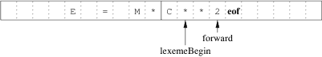

图 3.3：使用一对输入缓冲区

每个缓冲区的大小相同，为 N，而 N 通常是磁盘块的大小，例如 4096 字节。使用一条系统读取命令，我们就可以把 N 个字符读入一个缓冲区，而不是每个字符使用一次系统调用。如果输入文件中剩余的字符少于 N 个，那么一个特殊字符（用 eof 表示）标记源文件的结尾，并且它不同于源程序可能出现的任何字符。

维护两个指向输入的指针：

- 1. 指针 `lexemeBegin` 标记当前词素的开始位置，我们正试图确定该词素的范围。
- 2. 指针 `forward` 向前扫描，直到找到模式匹配；进行这种判断的确切策略将在本章剩余部分讨论。

一旦确定了下一个词素，就将 `forward` 设置为其右端字符。然后，在将该词素记录为返回给语法分析器的记号的属性值之后，将 `lexemeBegin` 设置为刚找到的词素之后的那个字符。在图 3.3 中，我们看到 `forward` 已经越过了下一个词素 `**`（Fortran 的幂运算符）的末尾，因此必须向左回退一个位置。

推进 `forward` 要求我们先测试是否已经到达某个缓冲区的末尾；如果是，就必须从输入中重新装载另一个缓冲区，并把 `forward` 移到新装载缓冲区的开头。只要我们从不需要向前查看得那么远，以至于词素长度加上向前查看的距离之和大于 $N$，我们就永远不会在确定词素之前覆盖其所在缓冲区中的该词素。

### 3.2.2 哨兵

如果我们按所述使用 3.2.1 节的方案，那么每次推进 `forward` 时都必须检查是否已经移出了某个缓冲区；如果移出了，还必须重新装载另一个缓冲区。因此，对于读入的每个字符，我们要做两次测试：一次测试缓冲区末尾，一次确定读入的是什么字符（后者可能是一个多路分支）。如果扩展每个缓冲区，使其末尾容纳一个*哨兵*字符，我们就可以把缓冲区末尾测试与当前字符测试合并。哨兵是一个不能成为源程序一部分的特殊字符，自然的选择是字符 `eof`。

图 3.4 显示了与图 3.3 相同的布局，但加入了哨兵。注意，`eof` 仍用作整个输入结束的标记。任何出现在缓冲区末尾以外位置的 `eof` 都意味着输入已经结束。图 3.5 总结了推进 `forward` 的算法。注意，第一个 switch（它可以成为基于 `forward` 所指字符的多路分支的一部分）是我们所做的唯一测试，除非我们实际上位于某个缓冲区的末尾或输入的末尾。

## 3.3 记号的规格说明

正则表达式是用于指定词素模式的一种重要记法。虽然它们不能表达所有可能的模式，但它们在指定（spec-）方面非常有效。


### 3.3 记号的规格说明

> ### 缓冲区空间会用完吗？
> 
> 在大多数现代语言中，词素很短，一两个字符的前瞻就足够了。因此，缓冲区大小 *N* 为几千时已经足够，3.2.1 节的双缓冲区方案可以正常工作。然而，也存在一些风险。例如，如果字符串可能非常长，跨越许多行，那么我们就可能面临词素长度超过 *N* 的情况。为了避免长字符串带来的问题，我们可以将它们视为各组件的连接，每个组件来自字符串所写到的每一行。例如，在 Java 中，通常的做法是每行写一段来表示长字符串，并在每段末尾用 + 运算符连接各段。
> 
> 当可能需要任意长度的前瞻时，会出现更困难的问题。例如，像 PL/I 这样的一些语言并不把关键字当作保留字；也就是说，你可以使用与关键字（如 **DECLARE**）同名的标识符。如果词法分析器收到的 PL/I 程序文本以 **DECLARE (ARG1, ARG2, . . .** 开头，它就无法确定 **DECLARE** 是关键字，而 **ARG1** 等是被声明的变量，还是 **DECLARE** 是一个过程名及其参数。因此，现代语言倾向于保留其关键字。然而，如果不这样做，也可以把 **DECLARE** 这样的关键字当作有歧义的标识符，让语法分析器来解决该问题，也许还要结合符号表查找。

规定我们实际需要用于记号的模式类型。在本节中，我们将学习正则表达式的形式化记号，并在 3.5 节中了解这些表达式如何在词法分析器生成器中使用。然后，3.7 节展示如何通过将正则表达式转换为执行指定记号识别的自动机来构建词法分析器。

### 3.3.1 字符串与语言

一个*字母表*是任意有限符号集。符号的典型例子是字母、数字和标点。集合 {0,1} 是*二进制字母表*。ASCII 是字母表的一个重要例子；它被用于许多软件系统中。Unicode 包含来自世界各地字母表的约 100,000 个字符，是字母表的另一个重要例子。

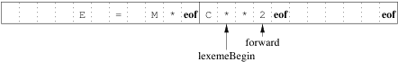

图 3.4：每个缓冲区末尾的哨兵

```
switch ( *forward++ ) {
    case eof:
        if (forward is at end of first buffer ) {
            reload second buffer;
            forward = beginning of second buffer;
        }
        else if (forward is at end of second buffer ) {
            reload first buffer;
            forward = beginning of first buffer;
        }
        else /* eof within a buffer marks the end of input */
            terminate lexical analysis;
        break;
    Cases for the other characters
}
```

图 3.5：带哨兵的前瞻代码

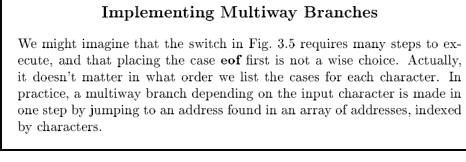

一个字母表上的*字符串*是从该字母表中取出的有限符号序列。在语言理论中，术语“句子”和“单词”常被用作“字符串”的同义词。字符串 *s* 的长度通常写作 $|s|$，是 *s* 中符号出现的次数。例如，**banana** 是一个长度为六的字符串。*空串*，记作 $\epsilon$，是长度为零的字符串。

一个*语言*是某个固定字母表上的任意可数字符串集合。这个定义非常宽泛。像 $\emptyset$（*空集*）或 {$\epsilon$}（只包含空串的集合）这样的抽象语言，在此定义下都是语言。所有语法上良构的 C 程序的集合，以及所有语法正确的英语句子的集合，也是如此，尽管后两种语言很难精确规定。注意，“语言”的定义并不要求给语言中的字符串赋予任何含义。定义字符串“含义”的方法将在第 5 章讨论。

### 字符串各部分的术语

以下与字符串相关的术语是常用的：

- 1. 字符串 *s* 的*前缀*是从 *s* 末尾删除零个或多个符号后得到的任意字符串。例如，`ban`、`banana` 和 $\epsilon$ 都是 `banana` 的前缀。
- 2. 字符串 *s* 的*后缀*是从 *s* 开头删除零个或多个符号后得到的任意字符串。例如，`nana`、`banana` 和 $\epsilon$ 都是 `banana` 的后缀。
- 3. *s* 的*子串*是通过从 *s* 中删除任意前缀和任意后缀得到的。例如，`banana`、`nan` 和 $\epsilon$ 都是 `banana` 的子串。
- 4. 字符串 *s* 的*真*前缀、*真*后缀和*真*子串分别是指 *s* 的那些不等于 $\epsilon$ 或不等于 *s* 本身的前缀、后缀和子串。
- 5. *s* 的*子序列*是通过删除 *s* 中零个或多个不一定连续的位置上的符号后形成的任意字符串。例如，`baan` 是 `banana` 的一个子序列。

如果 *x* 和 *y* 是字符串，那么 *x* 和 *y* 的连接，记作 *xy*，是通过将 *y* 追加到 *x* 后形成的字符串。例如，如果 *x* = `dog` 且 *y* = `house`，那么 *xy* = `doghouse`。空串在连接运算下是单位元；也就是说，对任意字符串 *s*，有 $\epsilon s = s\epsilon = s$。

如果我们把连接看作乘积，就可以如下定义字符串的“幂运算”。定义 $s^0$ 为 $\epsilon$，并且对所有 $i > 0$，定义 $s^i$ 为 $s^{i-1}s$。由于 $\epsilon s = s$，因此有 $s^1 = s$、$s^2 = ss$、$s^3 = sss$，依此类推。

### 3.3.2 语言上的运算

在词法分析中，语言上最重要的运算是并、连接和闭包，它们在图 3.6 中形式化定义。并是集合上熟悉的运算。语言的连接是通过以所有可能的方式从第一个语言取一个字符串、从第二个语言取一个字符串并将它们连接起来而形成的所有字符串。语言 *L* 的*(Kleene)闭包*，记作 $L^*$，是将 *L* 连接零次或多次得到的字符串集合。注意，$L^0$，即“将 *L* 连接零次”，定义为 {$\epsilon$}，并且归纳地，$L^i$ 为 $L^{i-1}L$。最后，正闭包记作 $L^+$，与 Kleene 闭包相同，但不包含 $L^0$ 项。也就是说，除非某个字符串在 *L* 本身中，否则它不会在 $L^+$ 中。

| 运算 | 定义与记号 |
|---|---|
| $L$ 与 $M$ 的并 | $L \cup M = \{s \mid s \text{ is in } L \text{ or } s \text{ is in } M\}$ |
| $L$ 与 $M$ 的连接 | $LM = \{st \mid s \text{ is in } L \text{ and } t \text{ is in } M\}$ |
| $L$ 的 Kleene 闭包 | $L^* = \bigcup_{i=0}^{\infty} L^i$ |
| $L$ 的正闭包 | $L^+ = \bigcup_{i=1}^{\infty} L^i$ |

图 3.6：语言运算的定义

**例 3.3.** 设 $L$ 是字母集合 {A, B, ..., Z, a, b, ..., z}，并设 $D$ 是数字集合 {0, 1, ..., 9}。我们可以用两种本质上等价的方式来看待 $L$ 和 $D$。一种方式是，$L$ 和 $D$ 分别是大写和小写字母以及数字的字母表。第二种方式是，$L$ 和 $D$ 是语言，其所有字符串恰好长度为一。下面是由语言 $L$ 和 $D$ 使用图 3.6 中的运算符构造出的一些其他语言：

- 1. $L \cup D$ 是字母和数字的集合——严格地说，是包含 62 个长度为 1 的字符串的语言，其中每个字符串要么是一个字母，要么是一个数字。
- 2. $LD$ 是 520 个长度为 2 的字符串的集合，每个字符串由一个字母后跟一个数字组成。
- 3. $L^4$ 是所有 4 个字母的字符串的集合。
- 4. $L^*$ 是所有字母字符串的集合，包括空串 $\epsilon$。
- 5. $L(L \cup D)^*$ 是所有以字母开头的字母和数字字符串的集合。
- 6. $D^+$ 是所有一个或多个数字的字符串的集合。

### 3.3.3 正则表达式

假设我们想描述有效 C 标识符的集合。它几乎正好是上面第 (5) 项所描述的语言；唯一的区别是下划线也被包含在字母中。

在例 3.3 中，我们能够通过为字母集合和数字集合命名，并使用语言运算符并、连接和闭包来描述标识符。这个过程非常有用，以至于一种称为*正则表达式*的记号已被广泛用于描述所有可以通过将这些运算符应用于某个字母表的符号而构造出的语言。在这种记号中，如果 *letter* 被设定为表示任意字母或下划线，而 *digit* 是

### 3.3 记号的规格说明

如果建立一个符号来表示任意数字，那么我们就可以用以下表达式描述 C 标识符的语言：

`letter_ ( letter_ | digit )*`

上面的竖线表示并集，圆括号用于对子表达式分组，星号表示“零次或多次出现”，而将 letter_ 与表达式的其余部分并置表示连接。

正则表达式使用下述规则，由更小的正则表达式递归构造而成。每个正则表达式 r 表示一个语言 L(r)，该语言也由 r 的子表达式所表示的语言递归定义。下面是定义某个字母表 Σ 上的正则表达式以及这些表达式所表示语言的规则。

**基础：** 有两条规则构成基础：

- 1. ε 是正则表达式，L(ε) 为 {ε}，即仅以空串为唯一成员的语言。
- 2. 如果 a 是 Σ 中的一个符号，那么 a 是正则表达式，且 L(a) = {a}，即该语言只有一个长度为 1 的字符串，且该字符串的唯一位置上是 a。注意，按照约定，我们用斜体表示符号，用粗体表示其对应的正则表达式。[^1]

**归纳：** 归纳分为四个部分，通过它们可由较小的正则表达式构造出较大的正则表达式。假设 r 和 s 是分别表示语言 L(r) 和 L(s) 的正则表达式。

- 1. (r)|(s) 是正则表达式，表示语言 L(r) ∪ L(s)。
- 2. (r)(s) 是正则表达式，表示语言 L(r)L(s)。
- 3. (r)* 是正则表达式，表示 (L(r))*。
- 4. (r) 是正则表达式，表示 L(r)。最后一条规则说明，我们可以在表达式周围添加额外的括号对，而不改变它们所表示的语言。

按照上述定义，正则表达式常常包含不必要的括号对。如果采用以下约定，我们可以去掉某些括号对：

- a) 一元运算符 * 具有最高优先级，并且是左结合的。
- b) 连接具有次高优先级，并且是左结合的。
- c) | 具有最低优先级，并且是左结合的。

[^1]: 然而，当讨论 ASCII 字符集中的特定字符时，我们通常对该字符及其正则表达式都使用等宽字体。

在这些约定下，例如，我们可以将正则表达式 `(a|)((b)*(c))` 替换为 `a|b*c`。这两个表达式都表示这样的字符串集合：要么是单个 a，要么是零个或多个 b 后跟一个 c。

**例 3.4：** 令 Σ = {a, b}。

- 1. 正则表达式 `a|b` 表示语言 {a, b}。
- 2. `(a|b)(a|b)` 表示 {aa, ab, ba, bb}，即字母表 Σ 上所有长度为 2 的字符串构成的语言。同一语言的另一个正则表达式是 `aa|ab|ba|bb`。
- 3. `a*` 表示由零个或多个 a 组成的所有字符串构成的语言，即 {ε, a, aa, aaa, ...}。
- 4. `(a|b)*` 表示由零个或多个 a 或 b 的实例组成的所有字符串的集合，即由 a 和 b 组成的所有字符串：{ε, a, b, aa, ab, ba, bb, aaa, ...}。同一语言的另一个正则表达式是 `(a*b*)*`。
- 5. `a|a*b` 表示语言 {a, b, ab, aab, aaab, ...}，即字符串 a 以及所有由零个或多个 a 组成并以 b 结尾的字符串。

能够由正则表达式定义的语言称为*正则集合*。如果两个正则表达式 r 和 s 表示同一个正则集合，则称它们是*等价的*，并写作 r = s。例如，`(a|b) = (b|a)`。正则表达式有许多代数定律；每条定律都断言两种不同形式的表达式是等价的。图 3.7 给出了对任意正则表达式 r、s 和 t 成立的一些代数定律。

| 定律 | 描述 |
|---|---|
| `r\|s = s\|r` | `\|` 是可交换的 |
| `r\|(s\|t) = (r\|s)\|t` | `\|` 是可结合的 |
| `r(st) = (rs)t` | 连接是可结合的 |
| `r(s\|t) = rs\|rt; (s\|t)r = sr\|tr` | 连接对 `\|` 可分配 |
| `εr = rε = r` | ε 是连接的单位元 |
| `r* = (r\|ε)*` | 闭包中保证包含 ε |
| `r** = r*` | `*` 是幂等的 |

**图 3.7：正则表达式的代数定律**

### 3.3.4 正则定义

为了表示方便，我们可能希望为某些正则表达式命名，并在后续表达式中使用这些名称，就好像这些名称本身就是符号一样。如果 Σ 是基本符号的字母表，那么*正则定义*是如下形式的一系列定义：

$$
\begin{aligned}
d_1 &\to r_1\\
d_2 &\to r_2\\
&\cdots\\
d_n &\to r_n
\end{aligned}
$$

其中：

- 1. 每个 $d_i$ 都是一个新符号，不在 $\Sigma$ 中，并且不同于任何其他 $d$，且
- 2. 每个 $r_i$ 都是字母表 $\Sigma \cup \{d_1,d_2,\ldots,d_{i-1}\}$ 上的正则表达式。

通过将 $r_i$ 限制为只使用 $\Sigma$ 和先前定义的 $d$，我们避免了递归定义，并且可以为每个 $r_i$ 构造一个仅基于 $\Sigma$ 的正则表达式。具体做法是：首先替换 $r_2$ 中对 $d_1$ 的使用（$r_2$ 除 $d_1$ 外不能使用任何其他 $d$），然后用 $r_1$ 和（替换后的）$r_2$ 替换 $r_3$ 中对 $d_1$ 和 $d_2$ 的使用，依此类推。最后，在 $r_n$ 中，对于 $i = 1, 2, \ldots, n-1$，我们将每个 $d_i$ 替换为 $r_i$ 的替换版本，其中每个版本都只含有 $\Sigma$ 中的符号。

**例 3.5：** $C$ 标识符是由字母、数字和下划线组成的字符串。下面是 $C$ 标识符语言的一个正则定义。按照惯例，我们将对正则定义中定义的符号使用斜体。

$$
\begin{aligned}
letter\_ &\to A|B|\cdots|Z|a|b|\cdots|z|\_\\
digit &\to 0|1|\cdots|9\\
id &\to letter\_(letter\_|digit)^*
\end{aligned}
$$

**例 3.6：** 无符号数（整数或浮点数）是诸如 5280、0.01234、6.336E4 或 1.89E−4 这样的字符串。正则定义

$$
\begin{aligned}
digit &\to 0|1|\cdots|9\\
digits &\to digit\ digit^*\\
optionalFraction &\to .\ digits\ |\ \epsilon\\
optionalExponent &\to (E(+|-|\epsilon)\ digits)\ |\ \epsilon\\
number &\to digits\ optionalFraction\ optionalExponent
\end{aligned}
$$

是对这组字符串的精确规范。也就是说，*optionalFraction* 要么是小数点（点）后跟一个或多个数字，要么缺失（空串）。*optionalExponent* 若不缺失，则要么是 E 后跟一个可选的 + 或 − 号，再后跟一个或多个数字。注意，小数点后必须至少有一个数字，因此 *number* 不匹配 1.，但匹配 1.0。

### 3.3.5 正则表达式的扩展

自 20 世纪 50 年代 Kleene 引入带有并、连接和 Kleene 闭包这些基本运算符的正则表达式以来，人们为增强正则表达式指定字符串模式的能力，添加了许多扩展。这里我们提及一些最初被纳入 Unix 工具（如 Lex）的表示法扩展，它们在词法分析器的规范说明中特别有用。本章的参考文献包含了对当今使用的一些正则表达式变体的讨论。

- 1. *一个或多个实例。* 一元后缀运算符 `+` 表示正则表达式及其语言的正闭包。也就是说，如果 `r` 是正则表达式，那么 `(r)+` 表示语言 `(L(r))+`。运算符 `+` 与运算符 `*` 具有相同的优先级和结合性。两条有用的代数定律 `r* = r+|ε` 和 `r+ = rr* = r*r` 将 Kleene 闭包与正闭包联系起来。

- 2. *零个或一个实例。* 一元后缀运算符 `?` 表示“零次或一次出现”。也就是说，`r?` 等价于 `r|ε`，或者换句话说，`L(r?) = L(r) ∪ {ε}`。`?` 运算符与 `*` 和 `+` 具有相同的优先级和结合性。

- 3. *字符类。* 正则表达式 `a₁|a₂|···|aₙ`（其中每个 `aᵢ` 都是字母表中的符号）可以替换为简写 `[a₁a₂···aₙ]`。更重要的是，当 `a₁, a₂, …, aₙ` 构成逻辑序列（例如连续的大写字母、小写字母或数字）时，我们可以用 `a₁-aₙ` 替换它们，即只写首尾两个符号并用连字符分隔。因此，`[abc]` 是 `a|b|c` 的简写，`[a-z]` 是 `a|b|···|z` 的简写。

**例 3.7：** 使用这些简写，我们可以将例 3.5 的正则定义改写为：

```
letter  →  [A-Za-z]
digit   →  [0-9]
id      →  letter_ ( letter_ | digit )*
```

例 3.6 的正则定义也可以简化为：

```
digit   →  [0-9]
digits  →  digit+
number  →  digits ( . digits)? ( E [+−]? digits )?
```

### 3.3 记号的规格说明

### 3.3.6 第3.3节练习

**练习3.3.1：** 查阅语言参考手册，针对以下每种语言确定：(i) 构成输入字母表的字符集（不包括那些只能出现在字符串或注释中的字符），(ii) 数值常量的词法形式，以及 (iii) 标识符的词法形式：(a) C (b) C++ (c) C# (d) Fortran (e) Java (f) Lisp (g) SQL。

**练习3.3.2：** 描述以下正则表达式所表示的语言：

- a) `a(a|b)*a`。
- b) `((ε|a)b*)*`。
- c) `(a|b)*a(a|b)(a|b)`。
- d) `a*ba*ba*`。
- e) `(aa|bb)*((ab|ba)(aa|bb)*(ab|ba)(aa|bb)*)*`。

**练习3.3.3：** 在长度为 *n* 的字符串中，以下各项分别有多少个？

- a) 前缀。
- b) 后缀。
- c) 真前缀。
- d) 子串。
- e) 子序列。

**练习3.3.4：** 大多数语言都是*大小写敏感*的，因此关键字只能有一种写法，描述其词素的规则表达式也非常简单。然而，有些语言（如 SQL）是*大小写不敏感*的，因此关键字可以用小写、大写或任意大小写混合形式书写。例如，SQL 关键字 SELECT 也可以写成 select、Select 或 sElEcT。说明如何为大小写不敏感语言中的关键字编写正则表达式。通过为 SQL 中的“select”编写表达式来说明这一思想。

**练习3.3.5：** 为以下语言编写正则定义：

- a) 所有按顺序包含五个元音的小写字母串。
- b) 所有字母按字典序升序排列的小写字母串。
- c) 注释：由 `/*` 和 `*/` 包围的字符串，且中间不出现 `*/`，除非它位于双引号（`"`）内。
- d) 所有没有重复数字的数字串。*提示：* 先用少量数字（如 {0, 1, 2}）尝试此问题。
- e) 所有至多有一个重复数字的数字串。
- f) 所有由 a 和 b 组成的串，其中 a 的个数为偶数且 b 的个数为奇数。
- g) 非正式记法的国际象棋走法集合，例如 p-k4 或 kbp×qn。
- h) 所有不包含子串 *abb* 的 a 和 b 的串。
- i) 所有不包含子序列 *abb* 的 a 和 b 的串。

**练习3.3.6：** 为以下字符集编写字符类：

- a) 前十个字母（到“j”为止）的大写或小写形式。
- b) 小写辅音字母。
- c) 十六进制数中的“数字”（对于 9 以上的“数字”，选择大写或小写）。
- d) 可以出现在合法英文句子末尾的字符（例如感叹号）。

以下练习（直到并包括练习3.3.10）讨论来自 Lex（我们将在第3.5节详细讨论的词法分析器生成器）的扩展正则表达式记法。扩展记法列于图3.8。

**练习3.3.7：** 注意，这些正则表达式赋予以下所有符号（*运算符字符*）特殊含义：

`\  "  .  $  [  ]  *  +  ?  {  }  |  /`

如果需要在字符串中表示它们自身，就必须关闭其特殊含义。我们可以通过将该字符引用在长度为一个或多个字符的字符串中来做到这一点；例如，正则表达式 `"*"` 匹配字符串 `*`。还可以通过在运算符字符前加反斜杠来获得其字面含义。因此，正则表达式 `\\*` 也匹配字符串 `*`。编写一个匹配字符串 `"\\"` 的正则表达式。

**练习3.3.8：** 在 Lex 中，*补字符类*表示除字符类中列出的字符之外的任何字符。我们用 `^` 作为第一个字符来表示补类；这个符号（脱字符）本身不属于被补的类，除非它列在类自身中。因此，`[^A-Za-z]` 匹配任何不是大写或小写字母的字符，而 `[^\^\n]` 表示除脱字符（或换行符，因为换行符不能出现在任何字符类中）之外的任何字符。证明对于每个带补字符类的正则表达式，都存在一个不带补字符类的等价正则表达式。

| 表达式 | 匹配 | 示例 |
|---|---|---|
| `c` | 单个非运算符字符 c | `a` |
| `\\c` | 字符 c 的字面形式 | `\*` |
| `"s"` | 字符串 s 的字面形式 | `"**"` |
| `.` | 除换行符外的任意字符 | `a.*b` |
| `^` | 行首 | `^abc` |
| `$` | 行尾 | `abc$` |
| `[s]` | 字符串 s 中的任意一个字符 | `[abc]` |
| `[^s]` | 不在字符串 s 中的任意一个字符 | `[^abc]` |
| `r*` | 零个或多个匹配 r 的字符串 | `a*` |
| `r+` | 一个或多个匹配 r 的字符串 | `a+` |
| `r?` | 零个或一个 r | `a?` |
| `r{m,n}` | r 出现 m 到 n 次 | `a{1,5}` |
| `r₁r₂` | 一个 r₁ 后跟一个 r₂ | `ab` |
| `r₁ \| r₂` | 一个 r₁ 或一个 r₂ | `a\|b` |
| `(r)` | 与 r 相同 | `(a\|b)` |
| `r₁/r₂` | 当 r₁ 后跟 r₂ 时的 r₁ | `abc/123` |

*图3.8：Lex 正则表达式*

**练习3.3.9：** 正则表达式 `r{m,n}` 匹配模式 r 的 m 到 n 次出现。例如，`a{1,5}` 匹配由一到五个 a 组成的字符串。证明对于每个包含这种形式重复运算符的正则表达式，都存在一个不带重复运算符的等价正则表达式。

**练习3.3.10：** 运算符 `^` 匹配行左端，`$` 匹配行右端。运算符 `^` 也用于引入补字符类，但上下文总能明确其意图。例如，`[^aeiou]*$` 匹配任何不包含小写元音的完整行。

- a) 如何判断 `^` 的预期含义是哪一个？
- b) 是否总能将使用 `^` 和 `$` 运算符的正则表达式替换为不使用这两个运算符中任何一个的等价表达式？

**练习3.3.11：** UNIX shell 命令 sh 在文件名表达式中使用图3.9中的运算符来描述文件名集合。例如，文件名表达式 `*.o` 匹配所有以 `.o` 结尾的文件名；`sort1.?` 匹配所有形如 `sort1.c` 的文件名，其中 c 是任意字符。说明如何仅使用基本并、连接和闭包运算符将 sh 文件名表达式替换为等价的正则表达式。

| 表达式 | 匹配 | 示例 |
|---|---|---|
| `'s'` | 字符串 *s* 的字面形式 | `'\'` |
| `\c` | 字符 *c* 的字面形式 | `\'` |
| `*` | 任意字符串 | `*.o` |
| `?` | 任意字符 | `sort1.?` |
| `[s]` | *s* 中的任意一个字符 | `sort1.[cso]` |

*图3.9：shell 命令 sh 使用的文件名表达式*

**练习3.3.12：** SQL 允许一种基本形式的模式，其中两个字符具有特殊含义：下划线（`_`）代表任意一个字符，百分号（`%`）代表任意 0 个或多个字符组成的字符串。此外，程序员可以定义任意字符（比如 *e*）作为转义字符，因此位于 `_`、`%` 或另一个 *e* 之前的 *e* 会使紧随其后的字符按其字面含义解释。已知哪个字符是转义字符，说明如何将任意 SQL 模式表示为正则表达式。

## 3.4 记号的识别

上一节学习了如何用正则表达式表示模式。现在，我们必须研究如何取出所有所需记号的模式，并构建一段代码，该代码检查输入字符串并找到一个前缀，该前缀是与某个模式匹配的词素。我们的讨论将使用以下贯穿示例。

```
stmt  →  if expr then stmt
      |  if expr then stmt else stmt
      |  ε
expr  →  term relop term
      |  term
term  →  id
      |  number
```

*图3.10：分支语句的文法*

**例3.8：** 图3.10 的文法片段描述了一种简单形式的分支语句和条件表达式。该语法与 Pascal 语言的语法相似，因为 **then** 显式出现在条件之后。


### 3.4 记号的识别

对于 relop，我们使用 Pascal 或 SQL 这类语言中的比较运算符，其中 = 表示“等于”，<> 表示“不等于”，因为它展示了词素的一种有趣结构。

就词法分析器而言，文法的终结符 if、then、else、relop、id 和 number 是词法单元的名称。这些词法单元的模式通过正则定义来描述，如图 3.11 所示。id 和 number 的模式与我们在示例 3.7 中看到的类似。

```text
digit   → [0-9]
digits  → digit+
number  → digits ( . digits)? ( E [+-]? digits )?
letter  → [A-Za-z]
id      → letter ( letter | digit )*
if      → if
then    → then
else    → else
relop   → < | > | <= | >= | = | <>
```

图 3.11：示例 3.8 中词法单元的模式

对于该语言，词法分析器将识别关键字 if、then 和 else，以及匹配 relop、id 和 number 模式的词素。为简化问题，我们采用常见假设：关键字同时也是保留字；也就是说，即使它们的词素与标识符的模式匹配，它们也不是标识符。

此外，我们赋予词法分析器一个任务：通过识别如下定义的“词法单元”ws 来去除空白字符：

```text
ws → ( blank | tab | newline)+
```

这里，blank、tab 和 newline 是我们用来表示同名 ASCII 字符的抽象符号。词法单元 ws 与其他词法单元的不同之处在于：当我们识别到它时，并不会把它返回给语法分析器，而是从空白字符之后的那个字符开始重新进行词法分析。返回给语法分析器的是紧随其后的那个词法单元。

我们为词法分析器设定的目标总结在图 3.12 中。该表针对每个词素或词素族，显示了返回给语法分析器的是哪个词法单元名称，以及返回什么属性值（如 3.1.3 节所讨论）。注意，对于六个关系运算符，使用符号常量 LT、LE 等作为属性值，以指示我们找到的是 relop 词法单元的哪一个实例。找到的具体运算符将影响编译器输出的代码。

| 词素 | 词法单元名称 | 属性值 |
|---|---|---|
| 任意空白 | - | - |
| if | if | - |
| then | then | - |
| else | else | - |
| 任意 id | id | 指向表项的指针 |
| 任意 number | number | 指向表项的指针 |
| < | relop | LT |
| <= | relop | LE |
| = | relop | EQ |
| <> | relop | NE |
| > | relop | GT |
| >= | relop | GE |

图 3.12：词法单元、模式及属性值

### 3.4.1 转换图

在构造词法分析器的过程中，作为中间步骤，我们首先将模式转换为风格化的流程图，称为“转换图”。在本节中，我们手工完成从正则表达式模式到转换图的转换；但在 3.6 节中，我们将看到，存在一种机械的方法可以从正则表达式集合构造这些图。

转换图有一组节点或圆圈，称为状态。每个状态表示在扫描输入以查找匹配若干模式之一的词素的过程中可能出现的一种情况。我们可以把状态看作是对我们在 lexemeBegin 指针和 forward 指针之间所见字符的全部必要信息的概括（如图 3.3 所示的情形）。

边从转换图的一个状态有向地指向另一个状态。每条边都用一个符号或一组符号标记。如果我们处于某个状态 s，而下一个输入符号是 a，我们就查找从状态 s 出发、标记为 a（可能还标记有其他符号）的边。如果我们位于这样一条边上，就前进 forward 指针，并进入该边所指向的转换图状态。我们假设所有转换图都是确定性的，即从给定状态出发、标记中带有给定符号的边永远不会超过一条。从 3.5 节开始，我们将放宽确定性条件，这会让词法分析器设计者的工作轻松得多，尽管对实现者来说会更棘手。关于转换图的一些重要约定如下：

- 1. 某些状态被称为*接受*状态或*最终*状态。这些状态表示已经找到了一个词素，尽管实际的词素可能并不包含 *lexemeBegin* 指针和 *forward* 指针之间的所有位置。我们总是
- 2. 此外，如果必须将 *forward* 指针回退一个位置（即词素不包含将我们带到接受状态的那个符号），那么我们还需要在该接受状态附近放置一个 \*。在我们这个示例中，永远不需要将 *forward* 回退超过一个位置，但如果需要，我们可以给接受状态附加任意数量的 \*。
- 3. 有一个状态被指定为*开始状态*或*初始状态*；它由一条标记为 “start” 的边从外部进入来表示。转换图总是在读取任何输入符号之前从开始状态开始。

**示例 3.9：** 图 3.13 是一个转换图，它识别与词法单元 **relop** 匹配的词素。我们从状态 0（开始状态）开始。如果看到的第一个输入符号是 <，那么在匹配 **relop** 模式的词素中，我们只可能是在看 <、<> 或 <=。因此我们进入状态 1，并查看下一个字符。如果它是 =，则识别出词素 <=，进入状态 2，并返回词法单元 **relop**，属性值为 LE——这是表示这个特定比较运算符的符号常量。如果在状态 1 时下一个字符是 >，那么我们面对的是词素 <>，进入状态 3，返回一个已找到不等于运算符的指示。对于任何其他字符，词素是 <，我们进入状态 4 返回该信息。但请注意，状态 4 带有一个 \*，表示我们必须将输入回退一个位置。

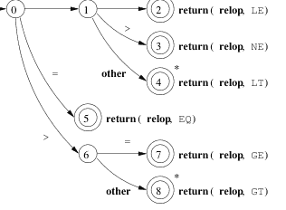

图 3.13：**relop** 的转换图

另一方面，如果在状态 0 中看到的第一个字符是 =，那么这个字符本身就一定是词素。我们立即从状态 5 返回这一事实。剩下的可能性是第一个字符是 >。那么，我们必须进入状态 6，并根据下一个字符决定词素是 >=（如果接下来看到的是 = 号），还是仅为 >（对于任何其他字符）。注意，如果在状态 0 中看到除 <、= 或 > 之外的任何字符，我们就不可能是在查看 relop 词素，因此不会使用这个转换图。

### 3.4.2 保留字和标识符的识别

识别关键字和标识符会带来一个问题。通常，像 if 或 then 这样的关键字都是保留字（正如我们贯穿示例中的情形），因此，即使它们看起来像标识符，它们也不是标识符。因此，尽管我们通常使用像图 3.14 那样的转换图来查找标识符词素，但该图也会识别我们贯穿示例中的关键字 if、then 和 else。

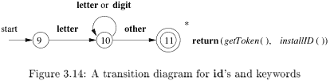

对于看起来像标识符的保留字，有两种处理方法：

- 1. 预先将保留字装入符号表。符号表表项中的一个字段表明这些字符串绝不是普通标识符，并指明它们代表哪个词法单元。我们假设图 3.14 中采用的就是这种方法。当我们找到一个标识符时，调用 `installID` 将其放入符号表（如果它尚不在表中），并返回指向所找到词素的符号表表项的指针。当然，在词法分析期间不在符号表中的任何标识符都不可能是保留字，因此它的词法单元是 `id`。函数 `getToken` 检查所找到词素的符号表表项，并返回符号表声称该词素所代表的词法单元名称——要么是 `id`，要么是最初装入表中的某个关键字词法单元。
- 2. 为每个关键字创建单独的转换图；图 3.15 展示了关键字 `then` 的一个示例。注意，这样的转换图由一些状态组成，这些状态表示在依次看到关键字的每个字母之后的情形，随后是对“非字母或数字”的测试，即任何不能作为标识符继续的字符。必须检查标识符是否已经结束，否则在正确词法单元应为 `id` 的情况下，我们可能会返回词法单元 `then`，例如词素 `thenvalue` 以 then 作为其真前缀。如果我们采用这种方法，那么我们必须对词法单元进行优先级排序，以便保留字


### 3.4 记号的识别

当词素同时匹配关键字和 id 两种模式时，关键字的识别优先于 id。我们在示例中*不*使用这种方法，这就是图 3.15 中的状态未编号的原因。

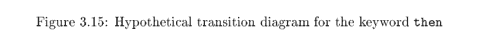

图 3.15：关键字 then 的假想转换图

### 3.4.3 贯穿示例的完成

我们在图 3.14 中看到的 id 的转换图具有简单的结构。从状态 9 开始，它检查词素是否以字母开头，如果是，则转到状态 10。只要输入包含字母和数字，我们就停留在状态 10。当我们第一次遇到不是字母或数字的字符时，就转到状态 11 并接受找到的词素。由于最后一个字符不是标识符的一部分，我们必须将输入回退一个位置；并且如第 3.4.2 节所讨论的，我们将找到的内容录入符号表，并判定它是关键字还是真正的标识符。

记号 **number** 的转换图如图 3.16 所示，这是目前为止我们见过的最复杂的转换图。从状态 12 开始，如果看到数字，就转到状态 13。在该状态中，我们可以读取任意数量的后续数字。然而，如果看到除数字、小数点或 E 之外的任何字符，就说明我们看到的是一个整数形式的数字；123 就是一个例子。这种情况通过进入状态 20 来处理；在该状态中，我们返回记号 **number** 以及一个指向常量表的指针，找到的词素会被录入该表。这些机制未在图中显示，但与我们处理标识符的方式类似。

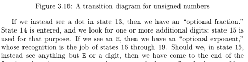

图 3.16：无符号数的转换图

如果在状态 13 看到的是小数点，那么我们就遇到了“可选小数部分”。进入状态 14，并寻找一个或多个后续数字；状态 15 用于此目的。如果看到 E，那么我们就遇到了“可选指数部分”，其识别由状态 16 到 19 负责。如果在状态 15 看到的不是 E 或数字，那么小数部分已经结束，没有指数部分，我们经由状态 21 返回找到的词素。

最后一个转换图如图 3.17 所示，用于空白字符。在该图中，我们寻找一个或多个“空白”字符，图中用 `delim` 表示——通常这些字符是空格、制表符、换行符，以及语言设计认为不属于任何记号的其他字符。

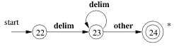

图 3.17：空白字符的转换图

请注意，在状态 24 中，我们找到了一个连续空白字符块，后面跟着一个非空白字符。我们将输入回退到从该非空白字符开始，但不返回语法分析器。相反，我们必须在空白之后重新开始词法分析过程。

### 3.4.4 基于转换图的词法分析器体系结构

使用一组转换图来构建词法分析器有几种方式。无论采用何种总体策略，每个状态都由一段代码表示。我们可以想象有一个变量 `state`，保存某个转换图当前状态的编号。基于 `state` 值的 switch 语句会将我们转到每个可能状态对应的代码，在那里执行该状态的动作。通常，一个状态的代码是一个 switch 语句或多路分支，它通过读取并检查下一个输入字符来确定下一个状态。

**例 3.10：** 在图 3.18 中，我们看到 `getRelop()` 的代码梗概，这是一个 C++ 函数，其工作是模拟图 3.13 的转换图，并返回一个 `TOKEN` 类型的对象，即一个由记号名（本例中必须是 `relop`）和属性值（本例中是六个比较运算符之一的代码）组成的二元组。`getRelop()` 首先创建一个新对象 `retToken`，并将其第一个分量初始化为 `RELOP`，即记号 `relop` 的符号代码。

我们在 case 0（当前状态为 0 的情况）中看到状态的典型行为。函数 `nextChar()` 从输入中获取下一个字符，并将其赋给局部变量 `c`。然后我们检查 `c` 是否是我们期望找到的三个字符之一，并在每种情况下按图 3.13 的转换图进行状态转换。例如，如果下一个输入字符是 `=`，就转到状态 5。

如果下一个输入字符不能开始一个比较运算符，则调用函数 `fail()`。`fail()` 的行为取决于词法分析器的全局错误恢复策略。它应当将前向指针重置为 `lexemeBegin`，以便允许另一个转换图应用于

- 2. 我们可以“并行”运行各个转换图，将下一个输入字符同时提供给所有转换图，并允许每个转换图进行其所需的任何转换。如果使用这种策略，我们必须小心处理这样的情况：一个转换图找到了与其模式匹配的词素，而一个或多个其他转换图仍能处理输入。通常的策略是取输入中与任一模式匹配的最长前缀。例如，这条规则允许我们优先选择标识符词素而不是关键字 then，或者优先选择运算符 -> 而不是 -。

- 3. 首选方法（也是我们将在后续章节中采用的方法）是将所有转换图合并为一个。我们让转换图读取输入，直到没有可能的下一个状态，然后取与任一模式匹配的最长词素，正如上文第 (2) 项所讨论的。在我们的贯穿示例中，这种合并很容易，因为任意两个记号都不可能以同一个字符开头；也就是说，第一个字符会立即告诉我们正在寻找哪个记号。因此，我们可以简单地将状态 0、9、12 和 22 合并为一个开始状态，而保持其他转换不变。然而，一般来说，为多个记号合并转换图的问题会更复杂，我们很快就能看到。

### 3.4.5 第 3.4 节练习

- **练习 3.4.1：** 给出转换图，使其识别的语言与练习 3.3.2 中每个正则表达式所识别的语言相同。

- **练习 3.4.2：** 给出转换图，使其识别的语言与练习 3.3.5 中每个正则表达式所识别的语言相同。

以下练习（直到练习 3.4.12）介绍 Aho-Corasick 算法；该算法用于在文本字符串中识别一组关键字，所需时间与文本长度及所有关键字长度之和成正比。该算法使用一种特殊形式的转换图，称为*字典树*。字典树是一种树状转换图，从节点到其子节点的边上带有不同的标记。字典树的叶子表示已识别的关键字。

Knuth、Morris 和 Pratt 提出了一种在文本字符串中识别单个关键字 b₁b₂⋯bₙ 的算法。这里的字典树是一个具有 n + 1 个状态（从 0 到 n）的转换图。状态 0 是初始状态，状态 n 表示接受，即发现了该关键字。从 0 到 n − 1 的每个状态 s，都有一条到状态 s + 1 的转换，标记为符号 bₛ₊₁。例如，关键字 abaa 的字典树如下：

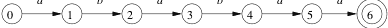

为了快速处理文本字符串并在这些字符串中搜索关键字，对于关键字 b₁b₂⋯bₙ 和该关键字中的位置 s（对应于其字典树的状态 s），定义一个*失效函数* f(s) 是很有用的，其计算方式如图 3.19 所示。其目标是：*b₁b₂···b<sub>f(s)</sub>* 是 *b₁b₂···bₙ* 的最长真前缀，同时也是 *b₁b₂···bₙ* 的后缀。*f(s)* 之所以重要，是因为如果我们试图用 *b₁b₂···bₙ* 匹配一个文本字符串，并且已经匹配了前 *s* 个位置，但随后失败（即文本字符串的下一个位置不是 *b<sub>s+1</sub>*），那么 *f(s)* 就是 *b₁b₂···bₙ* 中可能匹配到当前位置为止的文本字符串的最长真前缀。当然，文本字符串的下一个字符必须是 *b<sub>f(s)+1</sub>*，否则仍然有问题，必须考虑一个更短的前缀，即 *b<sub>f(f(s))</sub>*。

```text
1)  t = 0;
2)  f(1) = 0;
3)  for (s = 1; s < n; s++) {
4)      while (t > 0 && b₍s+1₎ != b₍t+1₎) t = f(t);
5)      if (b₍s+1₎ == b₍t+1₎) {
6)          t = t + 1;
7)          f(s + 1) = t;
        }
8)      else f(s + 1) = 0;
    }
```

图 3.19：计算关键字 *b₁b₂···bₙ* 的失效函数的算法

例如，上面为 *ababaa* 构造的字典树的失效函数为：

| *s* | 1 | 2 | 3 | 4 | 5 | 6 |
|---|---|---|---|---|---|---|
| *f(s)* | 0 | 0 | 1 | 2 | 3 | 1 |

例如，状态 3 和 1 分别表示前缀 *aba* 和 *a*。*f(3) = 1*，因为 *a* 是 *aba* 的最长真前缀，同时也是 *aba* 的后缀。另外，*f(2) = 0*，因为 *ab* 的既是真前缀又是后缀的最长字符串是空串。

- **练习 3.4.3：** 为下列字符串构造失效函数：
  - a) abababaab。
  - b) aaaaaa。
  - c) abaaabb。

- **练习 3.4.4：** 通过对 *s* 进行归纳，证明图 3.19 的算法能正确计算失效函数。

- **练习 3.4.5：** 证明图 3.19 第 (4) 行中的赋值 *t = f(t)* 最多执行 *n* 次。由此证明，对于长度为 *n* 的关键字，整个算法只花费 *O(n)* 时间。


### 3.4 记号的识别

- b) 为 $s_6$ 构造失败函数。
- c) 为 $s_7$ 构造失败函数。
- !! d) 证明：任意 $s_n$ 的失败函数都可表示为 $f(1)=f(2)=0$，并且对于 $2<j\leq |s_n|$，$f(j)$ 为 $j-|s_{n-k}|$，其中 $k$ 是满足 $|s_k|\leq j+1$ 的最大整数。
- !! e) 在 KMP 算法中，当我们试图判断关键字 $s_k$ 是否出现在文本串 $w_{k+1}$ 中时，失败函数连续应用的最大次数是多少？

Aho 和 Corasick 建议应用 KMP 算法来识别文本串中的任意一组关键字。在这种情况下，trie 是一棵真正的树，从根节点开始分支。对于任何关键字的某个前缀（不一定是真前缀）所对应的每个字符串，都有一个状态。对应于字符串 $b_1b_2\cdots b_k$ 的状态的父状态，是对应于 $b_1b_2\cdots b_{k-1}$ 的状态。如果一个状态对应于一个完整的关键字，那么它就是接受状态。例如，图 3.21 显示了关键字 he、she、his 和 hers 的 trie。

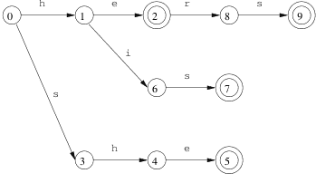
图 3.21：关键字 he、she、his、hers 的 trie

一般 trie 的失败函数定义如下。假设 $s$ 是对应于字符串 $b_1b_2\cdots b_n$ 的状态。那么 $f(s)$ 是对应于 $b_1b_2\cdots b_n$ 的最长真后缀的状态，该真后缀同时也是某个关键字的前缀。例如，图 3.21 的 trie 的失败函数为：

| $s$ | 1 | 2 | 3 | 4 | 5 | 6 | 7 | 8 | 9 |
| --- | ---: | ---: | ---: | ---: | ---: | ---: | ---: | ---: | ---: |
| $f(s)$ | 0 | 0 | 0 | 1 | 2 | 0 | 3 | 0 | 3 |

**! 练习 3.4.10：** 修改图 3.19 的算法，以计算一般 trie 的失败函数。*提示：* 主要区别在于，我们不能像图 3.19 的第 (4) 行和第 (5) 行那样，简单地检验 $b_{s+1}$ 与 $b_{t+1}$ 是否相等或不等。相反，从任一状态出发，都可能有多条关于不同字符的转移，如图 3.21 中从状态 1 出发既有关于 e 的转移，也有关于 i 的转移。这些转移中的任何一条都可能到达一个状态，该状态表示最长的、同时也是某个前缀的后缀。

**练习 3.4.11：** 为下列关键字集合构造 trie，并计算失败函数：

- a) aaa、abaaa 和 ababaaa。
- b) all、fall、fatal、llama 和 lame。
- c) pipe、pet、item、temper 和 perpetual。

**练习 3.4.12：** 证明你从练习 3.4.10 得到的算法运行时间仍然是关键字长度之和的线性时间。

## 3.5 词法分析器生成器 Lex

本节介绍一个名为 Lex 的工具（在较新的实现中称为 Flex），它允许人们通过指定正则表达式来描述记号的模式，从而指定一个词法分析器。Lex 工具的输入表示法称为 Lex 语言，而该工具本身称为 Lex 编译器。在幕后，Lex 编译器将输入模式转换为转换图，并在名为 lex.yy.c 的文件中生成模拟该转换图的代码。从正则表达式到转换图的这种转换是如何发生的，其机制是接下来几节的主题；这里我们只学习 Lex 语言。

### 3.5.1 Lex 的使用

图 3.22 说明了 Lex 的使用方式。一个输入文件（我们称为 **lex.l**）用 Lex 语言编写，描述要生成的词法分析器。Lex 编译器将 **lex.l** 转换为一个 C 程序，放在一个始终名为 **lex.yy.c** 的文件中。后一个文件由 C 编译器编译为始终名为 **a.out** 的文件。C 编译器的输出是一个可工作的词法分析器，它可以接收输入字符流并产生记号流。

编译后的 C 程序（在图 3.22 中称为 **a.out**）通常用作语法分析器的子程序。它是一个返回整数的 C 函数，该整数是某个可能记号名的代码。属性值——无论是另一个数字代码、指向符号表的指针，还是空值——都放在全局变量 **yylval** 中，该变量由词法分析器和语法分析器共享，从而可以简单地返回记号的名称和属性值。

²顺便提一下，**yylval** 和 **lex.yy.c** 中出现的 **yy** 指的是 Yacc 语法分析器生成器，我们将在第 4.9 节中描述它，它通常与 Lex 一起使用。

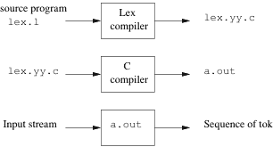
图 3.22：用 Lex 创建词法分析器

### 3.5.2 Lex 程序的结构

一个 Lex 程序具有如下形式：

```
declarations
%%
translation rules
%%
auxiliary functions
```

声明部分包括变量声明、*显式常量*（声明为代表某个常量的标识符，例如某个记号的名称）以及正则定义，其风格如第 3.3.4 节所述。

转换规则均具有如下形式

```
Pattern  { Action }
```

每个模式都是一个正则表达式，它可以使用声明部分中的正则定义。动作是代码片段，通常用 C 编写，不过也已经创建了许多使用其他语言的 Lex 变体。

第三部分包含动作中使用的任何附加函数。或者，这些函数可以单独编译，并与词法分析器一起加载。

Lex 创建出的词法分析器与语法分析器协同工作的方式如下。当被语法分析器调用时，词法分析器开始逐个字符地读取其剩余输入，直到找到输入中与某个模式 $P_i$ 匹配的最长前缀。然后它执行相关联的动作 $A_i$。通常，$A_i$ 会返回到语法分析器；但如果它没有返回（例如，因为 $P_i$ 描述的是空白或注释），那么词法分析器会继续寻找其他词素，直到某个相应动作导致返回语法分析器为止。词法分析器向语法分析器返回一个值，即记号名，但在需要时使用共享的整型变量 `yylval` 传递关于所找到词素的附加信息。

**例 3.11：** 图 3.23 是一个 Lex 程序，它识别图 3.12 中的记号并返回找到的记号。关于这段代码的几点观察将向我们介绍 Lex 的许多重要特性。

在声明部分，我们看到一对特殊括号：`%{` 和 `%}`。这些括号内的任何内容都会直接复制到文件 `lex.yy.c` 中，而不会被当作正则定义处理。通常会在那里放置显式常量的定义，使用 C 的 `#define` 语句将唯一的整数代码与每个显式常量关联起来。在我们的例子中，我们在注释中列出了显式常量的名称：LT、IF 等等，但没有展示将它们定义为特定整数。

声明部分中还有一系列正则定义。它们使用第 3.3.5 节所述的正则表达式扩展表示法。在后续定义或转换规则的模式中使用的正则定义，都用花括号括起来。因此，例如，`delim` 被定义为由空格、制表符和换行符组成的字符类的简写；后两者正如在所有 UNIX 命令中那样，分别用反斜杠后跟 `t` 或 `n` 表示。然后，`ws` 通过正则表达式 `{delim}+` 定义为一个或多个分隔符。

注意，在 *id* 和 *number* 的定义中，圆括号用作分组元符号，并不代表它们自身。相反，*number* 定义中的 E 代表其自身。如果我们希望使用某个 Lex 元符号（例如任意圆括号、`+`、`*` 或 `?`）来表示其自身，可以在它们前面加上反斜杠。例如，我们在 *number* 的定义中看到 `\.` 表示点号，因为该字符是一个元符号，表示“任意字符”，这在 UNIX 正则表达式中很常见。

在辅助函数部分，我们看到两个这样的函数：`installID()` 和 `installNum()`。与声明部分中出现在 `%{...%}` 之间的部分一样，辅助部分中的所有内容都会直接复制到文件 `lex.yy.c` 中，但可以在动作中使用。

最后，让我们考察图 3.23 中间部分的一些模式和规则。首先，*ws* 是在第一部分声明的标识符，它关联一个空动作。如果发现空白，我们不返回语法分析器，而是寻找另一个词素。第二个记号具有简单的正则表达式模式 *if*。如果我们在输入中看到两个字母 *if*，并且它们后面没有跟另一个字母或数字（否则会使词法分析器找到输入中匹配 *id* 模式的更长前缀），那么词法分析器就从输入中消耗这两个字母，并返回记号名 IF，即显式常量 IF 所代表的整数。关键字 *then* 和 *else* 的处理类似。

第五个记号具有由 *id* 定义的模式。注意，尽管像 *if* 这样的关键字既匹配这个模式，也匹配较早的模式，但 Lex 会选择哪个

³ 如果 Lex 与 Yacc 一起使用，那么通常会在 Yacc 程序中定义显式常量，并在 Lex 程序中不定义而直接使用它们。由于 `lex.yy.c` 是与 Yacc 的输出一起编译的，因此这些常量将可供 Lex 程序中的动作使用。


### 3.5 词法分析器生成器 Lex

```lex
%{
    /* definitions of manifest constants
    LT, LE, EQ, NE, GT, GE,
    IF, THEN, ELSE, ID, NUMBER, RELOP */
%}

/* regular definitions */
delim       [ \t\n]
ws          {delim}+
letter      [A-Za-z]
digit       [0-9]
id          {letter}({letter}|{digit})*
number      {digit}+(\.{digit}+)?(E[+-]?{digit}+)?

%%
{ws}        {/* no action and no return */}
if          {return(IF);}
then        {return(THEN);}
else        {return(ELSE);}
{id}        {yylval = (int) installID(); return(ID);}
{number}    {yylval = (int) installNum(); return(NUMBER);}
"<"         {yylval = LT; return(RELOP);}
"<="        {yylval = LE; return(RELOP);}
"="         {yylval = EQ; return(RELOP);}
"<>"        {yylval = NE; return(RELOP);}
">"         {yylval = GT; return(RELOP);}
">="        {yylval = GE; return(RELOP);}

%%

int installID() {/* function to install the lexeme, whose
                    first character is pointed to by yytext,
                    and whose length is given, into the
                    symbol table and return a pointer
                    thereto */
}

int installNum() {/* similar to installID, but puts numer-
                    ical constants into a separate table */
}
```

图3.23：图3.12中记号的Lex程序

在最长匹配前缀匹配两个或多个模式的情况下，首先列出该模式。当匹配到 *id* 时，采取的动作有三重：

- 1. 调用函数`installID()`，将找到的词素放入符号表。
- 2. 该函数返回一个指向符号表的指针，该指针被放入全局变量`yylval`中，可供语法分析器或编译器的后续组件使用。注意，`installID()`可以使用两个由Lex生成的词法分析器自动设置的变量：
  - (a) `yytext`是指向词素开头的指针，类似于图3.3中的`lexemeBegin`。
  - (b) `yyleng`是找到的词素的长度。
- 3. 将记号名ID返回给语法分析器。

当匹配模式 *number* 的词素时，采取的动作类似，使用辅助函数`installNum()`。□

### 3.5.3 Lex中的冲突解决

我们已经提到Lex在输入的多个前缀匹配一个或多个模式时，用于决定选择正确词素的两条规则：

- 1. 总是优先选择较长前缀而非较短前缀。
- 2. 如果最长可能前缀匹配两个或多个模式，则优先选择Lex程序中先列出的模式。

**例3.12：** 第一条规则告诉我们要继续读取字母和数字，以找到这些字符的最长前缀并将其归组为标识符。它还告诉我们要将`<=`视为单个词素，而不是选择`<`作为一个词素、`=`作为下一个词素。第二条规则使关键字成为保留字，前提是我们在程序中把关键字列在id之前。例如，如果then被确定为输入中匹配任何模式的最长前缀，并且模式then在`{id}`之前，如图3.23所示，那么返回记号THEN，而不是ID。□

### 3.5.4 前瞻运算符

Lex会自动读取构成所选词素的最后一个字符之后的一个字符，然后回退输入，使得只从输入中消耗词素本身。然而，有时我们希望某个模式仅在后面跟着某些其他字符时才与输入匹配。如果是这样，我们可以在模式中使用斜杠来指示模式中匹配词素的部分的结束。斜杠/之后是一个附加模式，只有在能够确定所讨论的记号已出现之前，必须匹配该附加模式，但匹配这个第二模式的内容不是词素的一部分。

**例3.13：** 在Fortran和其他一些语言中，关键字不是保留字。这种情况会产生问题，例如语句

```
IF(I,J) = 3
```

其中IF是数组名，而不是关键字。该语句与如下形式的语句形成对比：

```
IF( condition ) THEN . . .
```

其中IF是关键字。幸运的是，我们可以确定关键字IF总是后面跟着一个左括号、一些文本——条件——其中可能包含括号、一个右括号和一个字母。因此，我们可以为关键字IF编写如下Lex规则：

```
IF / \(.*\){letter}
```

该规则说明，词素匹配的模式只是两个字母IF。斜杠表示后面跟着一个附加模式，但不匹配词素。在这个模式中，第一个字符是左括号。由于该字符是Lex元符号，因此必须在它前面加一个反斜杠，以表示它取其字面含义。点和星号匹配“任何不含换行符的字符串”。注意，点是Lex元符号，表示“除换行符外的任何字符”。它后面跟着一个右括号，同样用反斜杠给出该字符的字面含义。附加模式后面跟着符号letter，它是一个正则定义，表示所有字母的字符类。

注意，为了使这个模式万无一失，我们必须预处理输入以删除空白。我们的模式中既没有为空白做安排，也无法处理条件跨越多行的情况，因为点不会匹配换行符。

例如，假设要求该模式匹配输入的前缀：

```
IF(A<(B+C)*D)THEN...
```

前两个字符匹配IF，下一个字符匹配`\(`，接下来的九个字符匹配`.*`，再接下来的两个匹配`\)`和letter。注意第一个右括号（在C之后）后面没有字母。这无关紧要；我们只需要找到某种使输入匹配该模式的方式。我们得出结论：字母IF构成词素，它们是记号`if`的一个实例。

### 3.5.5 第3.5节练习

练习3.5.1：描述如何对图3.23的Lex程序进行以下修改：

- a) 添加关键字`while`。
- b) 将比较运算符改为C语言中相应的运算符。
- c) 允许下划线（_）作为附加字母。
- ! d) 添加一个带有记号STRING的新模式。该模式由一个双引号（`"`）、任意字符串和一个最后的双引号组成。然而，如果字符串中出现双引号，则必须在其前面加反斜杠（`\`）进行转义，因此字符串中的反斜杠必须用两个反斜杠表示。词法值是去掉外围双引号的字符串，并移除用于转义字符的反斜杠。字符串应装入字符串表。

练习3.5.2：编写一个Lex程序，复制文件，将每个非空空白序列替换为单个空格。

练习3.5.3：编写一个Lex程序，复制C程序，将关键字float的每个实例替换为double。

! 练习3.5.4：编写一个Lex程序，将文件转换为“猪拉丁语”。具体来说，假设文件是由空白分隔的单词（字母组）序列。每次遇到一个单词：

- 1. 如果首字母是辅音，将其移到单词末尾，然后添加ay。
- 2. 如果首字母是元音，只需在单词末尾添加ay。

所有非字母都原样复制到输出中。

! 练习3.5.5：在SQL中，关键字和标识符不区分大小写。编写一个Lex程序，识别关键字SELECT、FROM和WHERE（大小写字母的任意组合），以及记号ID；就本练习而言，你可以将ID视为以字母开头的任意字母和数字序列。你不需要将标识符装入符号表，但要说明“install”函数与图3.23中针对区分大小写标识符所描述的函数会有何不同。

## 3.6 有限自动机

现在我们将了解Lex如何将其输入程序转换为词法分析器。这一转换的核心是称为*有限自动机*的形式化方法。它们本质上是图，类似于转换图，但有一些区别：

- 1. 有限自动机是*识别器*；它们只是对每个可能的输入字符串说“是”或“否”。
- 2. 有限自动机有两种类型：
  - (a) *非确定性有限自动机*（NFA）对其边的标签没有限制。一个符号可以标记从同一状态出发的多条边，而ε（空串）是一种可能的标签。
  - (b) *确定性有限自动机*（DFA）对于每个状态和其输入字母表中的每个符号，都恰好有一条带有该符号的边离开该状态。

确定性和非确定性有限自动机都能识别相同的语言。事实上，这些语言正是正则表达式所能描述的相同语言，称为*正则语言*。[^4]

### 3.6.1 非确定性有限自动机

一个*非确定性有限自动机*（NFA）由以下部分组成：

- 1. 状态的一个有限集合$S$。
- 2. 输入符号的一个集合$\Sigma$，即*输入字母表*。我们假设$\varepsilon$（表示空串）永远不是$\Sigma$的成员。
- 3. 一个转移函数，对于每个状态和$\Sigma \cup \{\varepsilon\}$中的每个符号，给出一个*下一状态*集合。
- 4. 一个来自$S$的开始状态$s_0$，被指定为*开始状态*（或*初始状态*）。
- 5. 状态的一个集合$F$，它是$S$的子集，被指定为*接受状态*（或*最终状态*）。

我们可以用*转换图*表示NFA或DFA，其中节点是状态，带标签的边表示转移函数。当且仅当$t$是状态$s$在输入$a$下的下一状态之一时，存在一条从状态$s$到状态$t$的标签为$a$的边。该图非常像转换图，只是：

[^4]: 有一个小缺陷：按照我们的定义，正则表达式无法描述空语言，因为在实际中我们永远不会想使用这种模式。然而，有限自动机可以定义空语言。理论上，∅被当作一个额外的正则表达式，仅仅是为了定义空语言。


- a) 同一个符号可以标记从一个状态到若干不同状态的多条边，并且
- b) 一条边可以由 ε（空串）标记，而不是由输入字母表中的符号标记，或者除这些符号之外还由 ε 标记。

**例3.14：** 识别正则表达式 `(a|b)*abb` 所表示语言的 NFA 的转移图如图3.24所示。这个抽象示例描述了所有以特定字符串 `abb` 结尾的 a 和 b 组成的字符串，将在本节中一直使用。不过，它类似于描述实际关注语言的正则表达式。例如，描述所有名称以 `.o` 结尾的文件的一个表达式是 `any*.o`，其中 `any` 代表任意可打印字符。

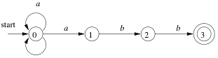

图3.24：一个非确定性有限自动机

按照我们对转移图的约定，状态3周围的双圈表示该状态是接受状态。注意，从起始状态0到达接受状态的唯一方式是沿着某条路径：先在状态0停留一段时间，然后通过从输入中读取 `abb` 依次进入状态1、2和3。因此，只有以 `abb` 结尾的字符串才能到达接受状态。

### 3.6.2 转移表

我们也可以用*转移表*表示 NFA，其行对应于状态，其列对应于输入符号和 ε。给定状态和输入对应的表项，是将转移函数应用于这些参数所得到的值。如果转移函数没有关于该状态-输入对的信息，我们就在表中该对的位置填入 ∅。

**例3.15：** 图3.24中 NFA 的转移表如图3.25所示。

| 状态 | a | b | ε |
|---|---|---|---|
| 0 | {0,1} | {0} | ∅ |
| 1 | ∅ | {2} | ∅ |
| 2 | ∅ | {3} | ∅ |
| 3 | ∅ | ∅ | ∅ |

图3.25：图3.24中 NFA 的转移表

转移表的优点是，我们可以轻松找到给定状态和输入上的转移。其缺点是，当输入字母表很大时，它占用大量空间，而大多数状态在大多数输入符号上没有任何转移。

### 3.6.3 自动机对输入字符串的接受

一个 NFA 接受输入字符串 x，当且仅当转移图中存在一条从起始状态到某个接受状态的路径，使得沿该路径的符号拼出 x。注意，沿路径的 ε 标记实际上被忽略，因为空串不会对沿路径构造出的字符串有所贡献。

例3.16：字符串 aabb 被图3.24中的 NFA 接受。从状态0到状态3、标记为 aabb 并证明这一点的路径是：

0 --a--> 0 --a--> 1 --b--> 2 --b--> 3

注意，由同一字符串标记的多条路径可能通向不同状态。例如，路径

0 --a--> 0 --a--> 0 --b--> 0 --b--> 0

是从状态0出发、由字符串 aabb 标记的另一条路径。这条路径通向状态0，而状态0不是接受状态。然而，请记住，只要存在某条由该字符串标记的路径从起始状态通向接受状态，NFA 就接受该字符串。其他通向非接受状态的路径的存在无关紧要。□

由 NFA 定义（或接受）的语言，是标记从起始状态到接受状态的某条路径的字符串集合。如前所述，图3.24中的 NFA 定义的语言与正则表达式 `(a|b)*abb` 所定义的语言相同，即字母表 {a,b} 中所有以 abb 结尾的字符串。我们可以用 L(A) 表示自动机 A 接受的语言。

例3.17：图3.26是一个接受 `L(aa*|bb*)` 的 NFA。字符串 aaa 被接受，因为存在路径

0 --ε--> 1 --a--> 2 --a--> 2 --a--> 2

注意，ε 在连接中“消失”，因此该路径的标记为 aaa。□

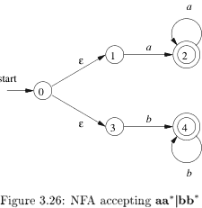

### 3.6.4 确定性有限自动机

确定性有限自动机（DFA）是 NFA 的一个特例，其中：

- 1. 没有在输入 ε 上的转移，并且
- 2. 对于每个状态 *s* 和输入符号 *a*，恰好有一条从 *s* 出发、标记为 *a* 的边。

如果我们用转移表表示 DFA，那么每个表项都是单个状态。因此，我们可以表示这个状态而不使用用于构成集合的花括号。

虽然 NFA 是识别某种语言字符串的算法的抽象表示，但 DFA 是用于识别字符串的简单而具体的算法。确实幸运的是，每个正则表达式和每个 NFA 都可以转换为接受同一语言的 DFA，因为在构建词法分析器时，我们真正实现或模拟的是 DFA。下面的算法展示了如何将 DFA 应用于一个字符串。

**算法3.18：模拟DFA。**

**输入：** 一个以文件结束字符 eof 结尾的输入字符串 *x*。一个 DFA *D*，其起始状态为 *s₀*、接受状态集合为 *F*、转移函数为 *move*。

**输出：** 如果 *D* 接受 *x*，则回答“是”；否则回答“否”。

**方法：** 将图3.27中的算法应用于输入字符串 *x*。函数 *move(s, c)* 给出在输入 *c* 下从状态 *s* 经一条边到达的状态。函数 *nextChar* 返回输入字符串 *x* 的下一个字符。

**例3.19：** 在图3.28中，我们看到一个接受语言 (a|b)*abb 的 DFA 的转移图，该语言与图3.24中的 NFA 所接受的语言相同。给定输入字符串 *ababb*，该 DFA 进入状态序列0、1、2、1、2、3，并返回“是”。

```text
s = s0;
c = nextChar();
while ( c != eof ) {
    s = move(s, c);
    c = nextChar();
}
if ( s is in F ) return "yes";
else return "no";
```

图3.27：模拟一个 DFA

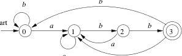

图3.28：接受 (a|b)*abb 的 DFA

### 3.6.5 第3.6节练习

**练习3.6.1：** 第3.4节练习中的图3.19为 KMP 算法计算失效函数。说明在给定该失效函数的情况下，我们如何从一个关键字 $b_1b_2\cdots b_n$ 构造一个 $n+1$ 个状态的 DFA 来识别 $\Sigma^*b_1b_2\cdots b_n$，其中点表示“任意字符”。此外，该 DFA 可以在 $O(n)$ 时间内构造。

**练习3.6.2：** 为练习3.3.5中的每种语言设计有限自动机（确定性的或非确定性的）。

**练习3.6.3：** 对于图3.29中的 NFA，指出所有标记为 $aabb$ 的路径。该 NFA 接受 $aabb$ 吗？

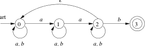

图3.29：练习3.6.3的 NFA

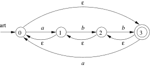

图3.30：练习3.6.4的 NFA

**练习3.6.4：** 对图3.30中的 NFA 重复练习3.6.3。

**练习3.6.5：** 给出以下 NFA 的转移表：

- a) 练习3.6.3。
- b) 练习3.6.4。
- c) 图3.26。

## 3.7 从正则表达式到自动机

正则表达式是描述词法分析器和其他模式处理软件的首选表示法，正如第3.5节所反映的那样。然而，实现该软件需要模拟 DFA（如算法3.18），或者可能需要模拟 NFA。由于 NFA 常常在某个输入符号上有多种转移选择（如图3.24在状态0上对输入 a 所做的那样），或者在 ε 上有多种选择（如图3.26从状态0所做的那样），甚至可以选择在 ε 或真实输入符号上进行转移，因此它的模拟不如 DFA 那样直接。于是，通常重要的是将一个 NFA 转换为接受同一语言的 DFA。

在本节中，我们将首先展示如何将 NFA 转换为 DFA。然后，我们使用这种称为“子集构造法”的技术，给出一种在 NFA 到 DFA 的转换比直接模拟更耗时的情况下（词法分析除外）直接模拟 NFA 的有用算法。接下来，我们展示如何将正则表达式转换为 NFA；如果需要，可以从 NFA 构造 DFA。最后，我们讨论实现正则表达式的各种方法所固有的时间-空间权衡，并了解如何为你的应用选择合适的方法。

### 3.7.1 将 NFA 转换为 DFA

子集构造法背后的总体思想是：所构造 DFA 的每个状态对应于一个 NFA 状态集合。在读取输入之后


### 3.7 从正则表达式到自动机

a₁a₂···aₙ，DFA 所处的状态对应于 NFA 从其开始状态出发、沿标记为 a₁a₂···aₙ 的路径所能到达的状态集合。

DFA 的状态数可能相对于 NFA 的状态数呈指数级增长，这在我们尝试实现该 DFA 时可能带来困难。然而，基于自动机的词法分析方法的部分威力在于：对于真实语言，NFA 和 DFA 的状态数大致相同，并不会出现这种指数行为。

**算法3.20：** 从 NFA 构造 DFA 的*子集构造*。

**输入：** 一个 NFA *N*。

**输出：** 一个接受与 *N* 相同语言的 DFA *D*。

**方法：** 我们的算法为 D 构造转移表 D<sub>tran</sub>。D 的每个状态都是一个 NFA 状态集合，我们构造 D<sub>tran</sub>，使得 D 能够“并行地”模拟 N 在给定输入串上所有可能的移动。我们的第一个问题是如何正确处理 N 的 ε-转移。在图3.31中，我们看到若干函数的定义，这些函数描述了算法所需的、对 N 的状态进行的基本计算。注意，s 是 N 的单个状态，而 T 是 N 的状态集合。

| 操作 | 描述 |
|---|---|
| ε-closure(s) | 仅通过 ε-转移从 NFA 状态 s 可达的 NFA 状态集合。 |
| ε-closure(T) | 仅通过 ε-转移从集合 T 中某个 NFA 状态 s 可达的 NFA 状态集合；= ∪_{s∈T} ε-closure(s)。 |
| move(T, a) | 从 T 中某个状态 s 出发、存在关于输入符号 a 的转移所能到达的 NFA 状态集合。 |

图3.31：NFA 状态上的操作

我们必须探索 N 在读取某个输入串之后可能处于的那些状态集合。作为基础，在读取第一个输入符号之前，N 可以处于 ε-closure(s₀) 中的任意状态，其中 s₀ 是它的开始状态。对于归纳步骤，假设 N 在读取输入串 x 之后可以处于状态集合 T 中。如果它接下来读取输入 a，那么 N 可以立即转移到 move(T, a) 中的任意状态。然而，在读取 a 之后，它还可能进行若干 ε-转移；因此，在读取 xa 之后，N 可以处于 ε-closure(move(T, a)) 的任意状态。按照这些思想，D 的状态集合 Dstates 及其转移函数 D<sub>tran</sub> 的构造如图3.32所示。

```
initially, ε-closure(s₀) is the only state in Dstates, and it is unmarked;
while (there is an unmarked state T in Dstates) {
    mark T;
    for (each input symbol a) {
        U = ε-closure(move(T, a));
        if (U is not in Dstates)
            add U as an unmarked state to Dstates;
        Dtran[T, a] = U;
    }
}
```

图3.32：子集构造

D 的开始状态是 ε-closure(s₀)，D 的接受状态是所有那些包含 N 的至少一个接受状态的 N 状态集合。为了完成对子集构造的描述，我们只需说明如何对任意 NFA 状态集合 T 计算 ε-closure(T)。这个过程如图3.33所示，是从一个状态集合出发在图中进行的直接搜索。在这种情况下，可以想象图中只存在标记为 ε 的边。

```
push all states of T onto stack;
initialize ε-closure(T) to T;
while ( stack is not empty ) {
    pop t, the top element, off stack;
    for ( each state u with an edge from t to u labeled ε )
        if ( u is not in ε-closure(T) ) {
            add u to ε-closure(T);
            push u onto stack;
        }
}
```

图3.33：计算 ε-closure(T)

**例3.21：** 图3.34显示了另一个接受 (a|b)*abb 的 NFA；它恰好就是我们在3.7节中将直接根据该正则表达式构造的 NFA。让我们对图3.34应用算法3.20。

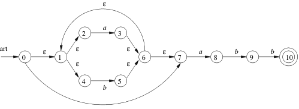

图3.34：用于 `(a|b)*abb` 的 NFA N

等价 DFA 的开始状态 A 是 ε-closure(0)，即 A = {0, 1, 2, 4, 7}，因为这些恰好是从状态0出发、经过所有边都标记为 ε 的路径所能到达的状态。注意，一条路径可以没有边，因此状态0可以沿一条标记为 ε 的路径从自身到达。

输入字母表是 {a, b}。因此，我们的第一步是标记 A，并计算 Dtran[A, a] = ε-closure(move(A, a)) 和 Dtran[A, b] = ε-closure(move(A, b))。在状态0、1、2、4和7中，只有2和7在 a 上有转移，分别转移到3和8。因此，move(A, a) = {3, 8}。又因为 ε-closure({3, 8}) = {1, 2, 3, 4, 6, 7, 8}，所以我们得出

$Dtran[A,a] = \varepsilon\text{-closure}(\mathrm{move}(A,a)) = \varepsilon\text{-closure}(\{3,8\}) = \{1,2,3,4,6,7,8\}$

我们称这个集合为 $B$，因此 $Dtran[A,a] = B$。

现在，我们必须计算 $Dtran[A,b]$。在 $A$ 中的状态里，只有4在 $b$ 上有转移，并且它转移到5。因此，

$Dtran[A,b] = \varepsilon\text{-closure}(\{5\}) = \{1,2,4,5,6,7\}$

我们称上述集合为 $C$，因此 $Dtran[A,b] = C$。

| NFA 状态 | DFA 状态 | a | b |
|---|---|---|---|
| {0, 1, 2, 4, 7} | A | B | C |
| {1, 2, 3, 4, 6, 7, 8} | B | D | D |
| {1, 2, 4, 5, 6, 7} | C | B | C |
| {1, 2, 4, 5, 6, 7, 9} | D | B | E |
| {1, 2, 4, 5, 6, 7, 10} | E | B | C |

图3.35：DFA $D$ 的转移表 $Dtran$

如果我们用未标记的集合 $B$ 和 $C$ 继续这个过程，最终会达到 DFA 的所有状态都被标记的地步。这个结论是有保证的，因为由十一个 NFA 状态组成的集合“只有” $2^{11}$ 个不同子集。我们实际构造出的五个不同 DFA 状态、它们对应的 NFA 状态集合，以及 DFA $D$ 的转移表如图3.35所示，$D$ 的转移图如图3.36所示。状态 $A$ 是开始状态，而包含 NFA 状态10的状态 $E$ 是唯一的接受状态。

注意，对于同一语言，$D$ 比图3.28中的 DFA 多一个状态。状态 $A$ 和 $C$ 具有相同的 move 函数，因此可以合并。我们将在3.9.6节讨论最小化 DFA 状态数的问题。

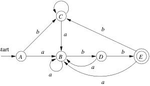

图3.36：对图3.34应用子集构造的结果

### 3.7.2 NFA 的模拟

许多文本编辑程序中使用的一种策略是：根据正则表达式构造一个 NFA，然后使用类似即时子集构造的方法来模拟该 NFA。下面概述这种模拟。

**算法3.22：** 模拟 NFA。

**输入：** 一个以文件结束字符 *eof* 结尾的输入串 *x*。一个 NFA *N*，其开始状态为 *s₀*，接受状态集为 *F*，δ-转移函数为 *move*。

**输出：** 如果 *N* 接受 *x*，则回答“yes”；否则回答“no”。

**方法：** 该算法维护一个当前状态集合 *S*，其中的状态是从 *s₀* 出发、沿标记为目前已读取输入的路径所能到达的状态。如果 *c* 是由函数 `nextChar()` 读取的下一个输入字符，那么我们首先计算 `move(S,c)`，然后使用 ε-closure() 闭包该集合。该算法如图3.37所示。

```
1)   S = ε-closure(s₀);
2)   c = nextChar();
3)   while (c != eof) {
4)       S = ε-closure(move(S,c));
5)       c = nextChar();
6)   }
7)   if (S ∩ F != ∅) return "yes";
8)   else return "no";
```

图3.37：模拟 NFA

### 3.7.3 NFA 模拟的效率

如果仔细实现，算法3.22可以相当高效。由于其中涉及的思想在许多涉及图搜索的类似算法中很有用，我们将更详细地考察这一实现。我们需要的数据结构是

- 1. 两个栈，每个栈保存一个 NFA 状态集合。其中一个栈 *oldStates* 保存“当前”状态集合，即图3.37第(4)行右侧的 *S* 值。第二个栈 *newStates* 保存“下一”状态集合——第(4)行左侧的 *S*。还有一个未展示的步骤：当我们在第(3)行到第(6)行的循环中反复执行时，*newStates* 会被转移到 *oldStates*。
- 2. 一个布尔数组 *alreadyOn*，以 NFA 状态为索引，用于指示哪些状态在 *newStates* 中。虽然数组和栈保存相同的信息，但查询 *alreadyOn[s]* 比在栈 *newStates* 中搜索状态 *s* 要快得多。正是为了这种效率，我们同时维护这两种表示。
- 3. 一个二维数组 *move[s, a]*，保存 NFA 的转移表。该表中的条目是状态集合，用链表表示。

为了实现图3.37的第(1)行，我们需要将数组 *alreadyOn* 中的每个条目设置为 FALSE，然后对于 ε-closure(*s₀*) 中的每个状态 *s*，将 *s* 压入 *oldStates*，并将 *alreadyOn[s]* 设置为 TRUE。对状态 *s* 的这一操作，以及第(4)行的实现，都可以借助一个我们称为 *addState(s)* 的函数来完成。该函数将状态 *s* 压入 *newStates*，将 *alreadyOn[s]* 设置为 TRUE，并对 *move[s, ε]* 中的状态递归调用自身，以推进 ε-closure(*s*) 的计算。然而，为了避免重复工作，我们必须注意绝不要对已经位于栈 *newStates* 上的状态调用 *addState*。图3.38概述了该函数。

```
9)    addState(s) {
10)       push s onto newStates;
11)       alreadyOn[s] = TRUE;
12)       for (t on move[s, ε])
13)           if (!alreadyOn[t])
14)               addState(t);
15)   }
```

图3.38：添加一个新状态 *s*，已知它不在 *newStates* 上

我们通过查看 *oldStates* 上的每个状态 *s* 来实现图3.37的第(4)行。我们首先找到状态集合 *move[s, c]*，其中 *c* 是下一个输入，并且对于每个

对于尚未在*newStates*中的那些状态，我们对它应用*addState*。注意，*addState*的效果是计算ε-闭包，并将所有这些状态也加入*newStates*（如果它们尚未在其中）。这一系列步骤总结于图3.39。

```c
16)   for ( s on oldStates ) {
17)     for ( t on move[s,c] )
18)       if ( !alreadyOn[t] )
19)         addState(t);
20)     pop s from oldStates;
21)   }

22)   for ( s on newStates ) {
23)     pop s from newStates;
24)     push s onto oldStates;
25)     alreadyOn[s] = FALSE;
26)   }
```

图3.39：图3.37中步骤(4)的实现

现在，假设NFA *N*有*n*个状态和*m*条转移；也就是说，*m*是对所有状态求和的、该状态向外转移所依据的符号（或ε）数量。不计图3.39第(19)行对*addState*的调用，第(16)行至第(21)行的循环所花费的时间为*O(n)*。也就是说，我们最多绕该循环*n*次，并且循环的每一步都需要常数工作量，除了在*addState*中花费的时间。第(22)行至第(26)行的循环也是如此。

在图3.39的一次执行期间，也就是图3.37步骤(4)的一次执行期间，对给定状态只可能调用一次*addState*。原因在于，每当我们调用*addState(s)*时，都会在图3.38第(11)行将*alreadyOn[s]*置为TRUE。一旦*alreadyOn[s]*为TRUE，图3.38第(13)行和图3.39第(18)行的测试就会阻止再次调用。

一次调用*addState*所花费的时间（不包括第(14)行递归调用所花费的时间），对于第(10)行和第(11)行是*O(1)*。对于第(12)行和第(13)行，时间取决于状态*s*有多少条ε转移出去。我们不知道给定状态的这个数量，但知道所有状态总共最多有*m*条转移。因此，在图3.39代码的一次执行期间，所有对*addState*的调用在第(12)行和第(13)行上花费的总时间为*O(m)*。*addState*其余步骤的总时间为*O(n)*，因为每次调用是常数时间，并且最多有*n*次调用。

我们得出结论：如果实现得当，执行图3.37第(4)行的时间为*O(n + m)*。第(3)行至第(6)行的while循环的其余部分每次迭代花费*O(1)*时间。如果输入*x*的长度为*k*，那么该循环中的总工作量为*O(k(n + m))*。

图3.37第(1)行可以在*O(n + m)*时间内执行，因为它本质上就是图3.39的步骤，其中*oldStates*仅包含

其中再次，*i*和*f*是新状态，分别是起始状态和接受状态。注意，在两个基础构造中，对于ε或某个*a*作为*r*的子表达式的每次出现，我们都构造一个不同的NFA，并使用新状态。

**归纳：** 假设*N(s)*和*N(t)*分别是正则表达式*s*和*t*的NFA。

- a) 假设*r* = *s*|*t*。那么*r*的NFA *N(r)*按图3.40构造。这里，*i*和*f*是新状态，分别是*N(r)*的起始状态和接受状态。存在从*i*到*N(s)*和*N(t)*的起始状态的ε转移，并且它们的每个接受状态都有到接受状态*f*的ε转移。注意，*N(s)*和*N(t)*的接受状态在*N(r)*中不是接受状态。由于从*i*到*f*的任何路径都必须只经过*N(s)*或*N(t)*，并且由于离开*i*或进入*f*的ε不改变该路径的标签，我们得出结论：*N(r)*接受*L(s) ∪ L(t)*，这与*L(r)*相同。也就是说，图3.40是并运算符的正确构造。
  
    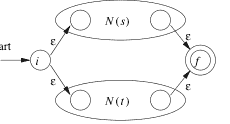
  
    图3.40：两个正则表达式并集的NFA
- b) 假设*r* = *st*。那么按图3.41构造*N(r)*。*N(s)*的起始状态成为*N(r)*的起始状态，*N(t)*的接受状态是*N(r)*的唯一接受状态。*N(s)*的接受状态和*N(t)*的起始状态合并为一个状态，并具有进入或离开这两个状态的所有转移。图3.41中从*i*到*f*的路径必须先经过*N(s)*，因此其路径将以*L(s)*中的某个字符串开始。然后路径继续经过*N(t)*，所以路径的标签以*L(t)*中的字符串结束。正如我们很快将论证的，接受状态从没有出边，起始状态从没有入边，因此路径在离开*N(s)*后不可能重新进入*N(s)*。因此，*N(r)*恰好接受*L(s)L(t)*，并且是*r* = *st*的正确NFA。
  
    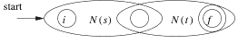
  
    图3.41：两个正则表达式连接的NFA
- c) 假设$r = s^*$。那么对于$r$，我们构造图3.42所示的NFA $N(r)$。这里，$i$和$f$是新状态，分别是$N(r)$的起始状态和唯一接受状态。要从$i$到$f$，我们可以沿着引入的标记为$\epsilon$的路径，这处理了$L(s)^0$中的一个字符串；或者我们可以到$N(s)$的起始状态，经过该NFA，然后从其接受状态回到其起始状态零次或多次。这些选项允许$N(r)$接受$L(s)^1$、$L(s)^2$等中的所有字符串，因此$N(r)$接受的整个字符串集合是$L(s^*)$。
  
    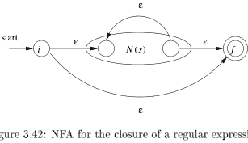
- d) 最后，假设$r = (s)$。那么$L(r) = L(s)$，并且我们可以将NFA $N(s)$用作$N(r)$。

□

算法3.23中的方法描述包含提示，说明归纳构造为何能按预期工作。我们不会给出正式的正确性证明，但会列出所构造NFA的几个性质，以及一个至关重要的事实：$N(r)$接受语言$L(r)$。这些性质本身很有意思，并且有助于进行形式化证明。

- 1. $N(r)$的状态数最多是$r$中运算符和操作数数量的两倍。这个界来自以下事实：算法的每一步最多创建两个新状态。
- 2. $N(r)$有一个起始状态和一个接受状态。接受状态没有出转移，起始状态没有入转移。
- 3. $N(r)$中除接受状态外的每个状态，要么有一条关于$\Sigma$中符号的出转移，要么有两条出转移，且都关于$\epsilon$。

**例3.24：** 让我们使用算法3.23为$r = (a|b)^*abb$构造一个NFA。图3.43显示了$r$的语法分析树，它类似于第2.2.3节中为算术表达式构造的语法分析树。

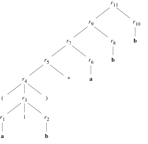

图3.43：`(a|b)*abb`的语法分析树

对于子表达式$r_1$，即第一个$a$，我们构造NFA：


状态编号的选择是为了与后续内容保持一致。对于`r₂`，我们构造：


现在我们可以使用图3.40的构造来组合`N(r₁)`和`N(r₂)`，得到`r₃ = r₁|r₂`的NFA；该NFA如图3.44所示。


图3.44：`r₃`的NFA

`r₄ = (r₃)`的NFA与`r₃`的NFA相同。然后，`r₅ = (r₃)*`的NFA如图3.45所示。我们使用图3.42中的构造，从图3.44中的NFA构建了这个NFA。


现在，考虑表达式`r₆`，它是另一个`a`。我们再次使用`a`的基础构造，但必须使用新状态。即使$r_1$和$r_6$是相同的表达式，也不允许重用我们为$r_1$构造的NFA。

$r_6$的NFA是：


为了得到$r_7 = r_5r_6$的NFA，我们应用图3.41的构造。我们合并状态7和7'，得到图3.46的NFA。以这种方式继续，为称为$r_8$和$r_{10}$的两个子表达式构造新的NFA，我们最终构造出$(a|b)^*abb$的NFA，这正是我们在图3.34中首次见到的NFA。


### 3.7.5 字符串处理算法的效率

我们观察到，算法3.18处理字符串$x$的时间为$O(|x|)$，而在第3.7.3节中我们得出结论：可以在与$|x|$和NFA转移图大小的乘积成正比的时间内模拟一个NFA。显然，它


### 3.7 从正则表达式到自动机

用 DFA 来模拟比用 NFA 更快，因此我们可能会想，模拟 NFA 到底有没有意义。

可能偏向使用 NFA 的一个问题是：子集构造在最坏情况下会使状态数呈指数增长。虽然从原理上说，DFA 的状态数不会影响算法 3.18 的运行时间，但如果状态数变得太大，以致转移表无法装入主存，那么真实运行时间就必须把磁盘 I/O 计算在内，因而会明显增加。

**例 3.25：** 考虑由如下形式的正则表达式描述的语言族 $L_n = (a|b)^*a(a|b)^{n-1}$，也就是说，每种语言 $L_n$ 都由 a 和 b 组成的字符串构成，并且从右端向左数第 n 个字符是 a。很容易构造一个具有 (n+1) 个状态的 NFA。它在任何输入下都停留在初始状态，但在输入 a 时也可以选择转到状态 1。从状态 1 出发，它在任何输入下转到状态 2，依此类推，直到在状态 n 接受。图 3.47 展示了这个 NFA。


图 3.47：一个 NFA，其状态数远少于最小等价 DFA

然而，任何用于语言 $L_n$ 的 DFA 都至少要有 $2^n$ 个状态。我们不会证明这一事实，但其思路是：如果两个长度为 n 的字符串能使该 DFA 到达同一状态，那么我们可以利用这两个字符串最后一次不同的位置（因此其中一个必为 a，另一个为 b），以相同方式继续构造字符串，直到它们在最后 n−1 个位置上相同。此时该 DFA 将处于一个必须既接受又不接受的状态。幸运的是，正如我们提到的，词法分析很少涉及这类模式，实际中我们并不期望遇到状态数异常庞大的 DFA。□

然而，词法分析器生成器和其他字符串处理系统常常从正则表达式开始。我们面临的选择是：把正则表达式转换为 NFA 还是 DFA。因此，转向 DFA 的额外开销就是在 NFA 上执行算法 3.20 的开销（也可以直接从正则表达式转到 DFA，但工作量本质上相同）。如果该字符串处理器会被执行很多次，正如词法分析的情况那样，那么为转换为 DFA 付出任何开销都是值得的。然而，在其他字符串处理应用中，例如 grep，用户指定一个正则表达式以及一个或几个文件，要在这些文件中搜索该表达式的模式，此时跳过构造 DFA 的步骤而直接模拟 NFA 可能更高效。

让我们考虑用算法 3.23 把正则表达式 r 转换为 NFA 的开销。一个关键步骤是为 r 构造语法分析树。在第 4 章中，我们将看到几种能够在线性时间内构造这棵语法分析树的方法，也就是在 O(|r|) 时间内，其中 |r| 表示 r 的大小——即 r 中运算符和操作数的数量之和。也很容易验证，算法 3.23 的每个基础构造和归纳构造都花费常数时间，因此转换为 NFA 所花费的总时间是 O(|r|)。

此外，正如我们在第 3.7.4 节中观察到的，我们构造的 NFA 至多有 2|r| 个状态和至多 4|r| 条转移。也就是说，按照第 3.7.3 节的分析，有 n ≤ 2|r| 且 m ≤ 4|r|。因此，在输入字符串 x 上模拟这个 NFA 需要时间 O(|r| × |x|)。这个时间支配了构造 NFA 所花费的时间 O(|r|)，因此可以得出结论：可以取一个正则表达式 r 和字符串 x，并在 O(|r| × |x|) 时间内判断 x 是否属于 L(r)。

子集构造所花费的时间高度依赖于所得 DFA 的状态数。首先请注意，在图 3.32 的子集构造中，关键步骤是由状态集 T 和输入符号 a 构造状态集 U，这与算法 3.22 的 NFA 模拟中由旧状态集构造新状态集非常相似。我们已经得出结论：如果正确实现，这一步所花费的时间至多与 NFA 的状态数和转移数成正比。

假设我们从正则表达式 r 开始，并将其转换为 NFA。这个 NFA 至多有 2|r| 个状态和至多 4|r| 条转移。此外，至多有 |r| 个输入符号。因此，对于所构造的每个 DFA 状态，我们必须构造至多 |r| 个新状态，而每个新状态至多花费 O(|r|) 时间。因此，构造具有 s 个状态的 DFA 的时间为 O(|r|²s)。

在常见情况下，s 大约为 |r|，子集构造花费 O(|r|³) 时间。然而，在最坏情况下，如例 3.25 所示，这个时间为 O(|r|²2^|r|)。图 3.48 总结了当给定正则表达式 r 并希望生成一个识别器来判断一个或多个字符串 x 是否属于 L(r) 时的各种选择。

| 自动机 | 初始 | 每个字符串 |
|---|---:|---:|
| NFA | O(\|r\|) | O(\|r\| × \|x\|) |
| DFA 典型情况 | O(\|r\|³) | O(\|x\|) |
| DFA 最坏情况 | O(\|r\|²2^\|r\|) | O(\|x\|) |

图 3.48：识别正则表达式语言的各种方法的初始开销和每字符串开销

如果每字符串开销占主导，正如我们构建词法分析器时那样，

### 3.8 词法分析器生成器的设计

### 3.8.1 生成的词法分析器的结构

图 3.49 概述了由 Lex 生成的词法分析器的体系结构。作为词法分析器的程序包含一个模拟自动机的固定程序；目前我们暂不限定该自动机是确定性的还是非确定性的。词法分析器的其余部分由 Lex 自身根据 Lex 程序创建的组件构成。


图 3.49：一个 Lex 程序被转换为转移表和动作，供有限自动机模拟器使用

这些组件包括：

- 1. 自动机的转移表。
- 2. 那些由 Lex 直接传递到输出中的函数（见第 3.5.2 节）。
- 3. 来自输入程序的动作，它们以代码片段的形式出现，由自动机模拟器在适当的时候调用。

为了构造自动机，我们首先取出 Lex 程序中的每个正则表达式模式，并使用算法 3.23 将其转换为 NFA。我们需要一个单一自动机来识别匹配程序中任意模式的词素，因此我们引入一个新的开始状态，并通过 ε 转移连接到模式 pᵢ 的 NFA Nᵢ 的每个开始状态，从而将所有 NFA 合并为一个。这种构造如图 3.50 所示。


图 3.50：根据一个 Lex 程序构造的 NFA

**例 3.26：** 我们用下面这个简单而抽象的示例来说明本节的思路：

- `a` { 模式 $p_1$ 的动作 $A_1$ }
- `abb` { 模式 $p_2$ 的动作 $A_2$ }
- `a+b*` { 模式 $p_3$ 的动作 $A_3$ }

注意，这三个模式呈现了第 3.5.3 节中讨论的某些冲突。特别地，字符串 `abb` 同时匹配第二个和第三个模式，但我们将把它视为模式 $p_2$ 的词素，因为该模式在上面的 Lex 程序中列在前面。于是，像 `aabb...` 这样的输入字符串有许多前缀匹配第三个模式。Lex 的规则是取最长匹配，因此我们继续读取 b，直到遇到另一个 a，此时我们报告的词素就是开头那些 a 后面跟着当时读到的所有 b。

图 3.51 显示了三个分别识别这三个模式的 NFA。第三个是算法 3.23 输出结果的简化形式。然后，图 3.52 显示了通过添加开始状态 0 和三条 ε 转移，将这三个 NFA 合并成一个 NFA。

### 3.8.2 基于 NFA 的模式匹配

如果词法分析器模拟如图 3.52 所示的 NFA，那么它必须从输入中我们称之为 *lexemeBegin* 的位置开始读取输入。当它在输入中向前移动名为 *forward* 的指针时，它会按照算法 3.22 计算在每个位置所处的状态集。

最终，NFA 模拟会到达输入上的某一点，此时不再有新状态。到那时，任何更长的输入前缀都不可能使该 NFA 到达接受状态；相反，状态集将始终为空。因此，我们可以确定作为匹配某个模式的最长前缀的词素了。


### 3.8 词法分析器生成器的设计


图 3.51：$a$、$abb$ 和 $a^*b^+$ 的 NFA


图 3.52：组合 NFA


图 3.53：处理输入 `aaba` 时进入的状态集合序列

我们在状态集合序列中向后查找，直到找到一个包含一个或多个接受状态的状态集合。如果该集合中有多个接受状态，则选择与 Lex 程序列表中最早出现的模式 p_i 相关联的那个接受状态。将前向指针移回词素的末尾，并执行与模式 p_i 相关联的动作 A_i。

**例 3.27：** 假设我们有例 3.26 中的模式，且输入以 *aaba* 开头。图 3.53 给出了我们从初始状态 0 的 ε 闭包（即 {0, 1, 3, 7}）开始并由此继续时，进入的图 3.52 中 NFA 的状态集合。读完第四个输入符号后，我们处于一个空状态集合中，因为图 3.52 中状态 8 在输入 `a` 上没有出转移。

因此，我们需要回退，寻找一个包含接受状态的状态集合。注意，如图 3.53 所示，读完 `a` 后，我们处于一个包含状态 2 的集合中，因此表明模式 `a` 已被匹配。然而，读完 `aab` 后，我们处于状态 8，这表明 `a*b+` 已被匹配；前缀 `aab` 是使我们到达接受状态的最长前缀。因此，我们选择 `aab` 作为词素，并执行动作 A_3，该动作应包含向语法分析器返回，表明已找到模式为 p_3 = `a*b+` 的词法单元。□

### 3.8.3 用于词法分析器的 DFA

另一种架构类似于 Lex 的输出，它使用算法 3.20 的子集构造，将所有模式的 NFA 转换为等价的 DFA。在每个 DFA 状态内部，如果存在一个或多个接受 NFA 状态，则确定其接受状态被表示的第一个模式，并使该模式成为该 DFA 状态的输出。

**例 3.28：** 图 3.54 给出了一个转移图，它基于由子集构造从图 3.52 中的 NFA 构造出的 DFA。接受状态用该状态所标识的模式来标记。例如，状态 {6, 8} 有两个接受状态，分别对应于模式 `abb` 和 `a*b+`。由于前者列在前面，因此它就是与状态 {6, 8} 相关联的模式。□

我们在词法分析器中使用 DFA 的方式与使用 NFA 非常相似。我们模拟该 DFA，直到某一点不存在下一状态（或者严格地说，下一状态是 ∅，即对应于 NFA 状态空集的死状态）。此时，我们沿着进入过的状态序列回退，并且一旦遇到接受 DFA 状态，就执行与该状态的模式相关联的动作。

**例 3.29：** 假设图 3.54 的 DFA 给定输入 *abba*。进入的状态序列是 0137、247、58、68，并且在最后的 *a* 处，状态 68 没有出转移。因此，我们从末尾开始考虑该序列，在这种情况下，68 本身就是一个接受状态，它报告模式 p_2 = `abb`。□


图 3.54：处理模式 $a$、$abb$ 和 $a^*b^+$ 的 DFA 转移图

### 3.8.4 实现向前看运算符

回顾第 3.5.4 节，Lex 模式 $r_1/r_2$ 中的 Lex 向前看运算符 / 有时是必要的，因为某个特定词法单元的模式 $r_1$ 可能需要描述一些尾部上下文 $r_2$，以便正确识别实际的词素。在将模式 $r_1/r_2$ 转换为 NFA 时，我们将 / 当作 ε 处理，因此实际上并不在输入中查找 /。然而，如果 NFA 识别出输入缓冲区的一个前缀 $xy$ 与该正则表达式匹配，那么词素的末尾并不是 NFA 进入其接受状态的位置。相反，末尾出现在 NFA 进入满足以下条件的状态 $s$ 时：

- 1. $s$ 在（虚设的）`/` 上有一个 ε 转移。
- 2. 存在一条从 NFA 的起始状态到状态 $s$、拼出 $x$ 的路径。
- 3. 存在一条从状态 $s$ 到接受状态、拼出 $y$ 的路径。
- 4. 对于满足条件 1-3 的任意 $xy$，$x$ 都尽可能长。

如果 NFA 中在虚设的 / 上只有一个 ε 转移状态，那么词素的末尾出现在最后一次进入该状态时，如下例所示。如果 NFA 中在虚设的 / 上有多个 ε 转移状态，那么找到正确状态 $s$ 的一般问题要复杂得多。

**例 3.30：** 例 3.13 中带向前看的 Fortran IF 模式的 NFA 如图 3.55 所示。注意，从状态 2 到状态 3 的 ε 转移表示向前看运算符。状态 6 表示关键字 IF 的出现。然而，每当进入状态 6 时，我们通过向后扫描到状态 2 的最后一次出现来找到词素 IF。

### DFA 中的死状态

严格来说，图 3.54 中的自动机并不完全是一个 DFA。原因是 DFA 从其输入字母表中的每个输入符号上，从每个状态都有一个转移。这里，我们省略了到死状态 ∅ 的转移，因此也省略了死状态在每个输入上到自身的转移。之前的 NFA 到 DFA 示例没有办法从起始状态到达 ∅，但图 3.52 的 NFA 可以。

然而，当我们构造用于词法分析器的 DFA 时，重要的是要以不同方式处理死状态，因为我们必须知道何时不再有任何识别更长词素的可能性。因此，我们建议始终省略到死状态的转移，并消除死状态本身。事实上，这个问题比看起来更难，因为 NFA 到 DFA 的构造可能产生若干无法到达任何接受状态的状态，而我们必须知道何时到达了这些状态中的任何一个。第 3.9.6 节讨论如何将所有这些状态合并为一个死状态，从而使其识别变得容易。同样有趣的是，如果我们使用算法 3.20 和 3.23 从正则表达式构造 DFA，那么该 DFA 除了 ∅ 之外不会含有任何无法通向接受状态的状态。


图 3.55：识别关键字 IF 的 NFA

### 3.8.5 第 3.8 节的练习

**练习 3.8.1：** 假设我们有两个词法单元：(1) 关键字 `if`，以及 (2) 标识符，它们是由除 `if` 以外的字母组成的字符串。请给出：

- a) 这些词法单元的 NFA，以及
- b) 这些词法单元的 DFA。

**练习 3.8.2：** 对由以下内容组成的词法单元重复练习 3.8.1：(1) 关键字 `while`，(2) 关键字 `when`，以及 (3) 由字母和数字组成的字符串构成的标识符，该字符串以字母开头。

**! 练习 3.8.3：** 假设我们修改 DFA 的定义，允许每个状态在每个输入符号上有零个或一个出转移（而不是像标准 DFA 定义中那样恰好有一个这样的转移）。那么某些正则表达式会拥有比在标准 DFA 定义下更小的“DFA”。请给出一个这样的正则表达式的例子。

**!! 练习 3.8.4：** 设计一个算法来识别形如 `r₁/r₂` 的 Lex 向前看模式，其中 `r₁` 和 `r₂` 是正则表达式。说明你的算法在以下输入上的工作过程：

- a) `(abcd|abc)/d`
- b) `(a|ab)/ba`
- c) `aa*/a*`

## 3.9 基于 DFA 的模式匹配器的优化

本节介绍三种已用于实现和优化由正则表达式构造的模式匹配器的算法。

- 1. 第一种算法在 Lex 编译器中很有用，因为它直接从正则表达式构造 DFA，而不构造中间 NFA。得到的 DFA 也可能比通过 NFA 构造的 DFA 具有更少的状态。
- 2. 第二种算法通过合并具有相同未来行为的状态，最小化任何 DFA 的状态数。该算法本身相当高效，运行时间为 O(n log n)，其中 n 是 DFA 的状态数。
- 3. 第三种算法生成比标准二维表更紧凑的转移表表示。

### 3.9.1 NFA 的重要状态

为了开始讨论如何直接从正则表达式构造 DFA，我们必须首先剖析算法 3.23 的 NFA 构造，并考虑各种状态所扮演的角色。如果 NFA 的一个状态具有非 ε 出转移，则称该状态为重要状态。注意，子集构造（算法 3.20）在计算 ε-closure(move(T, a))（即从 T 出发在输入 a 上可达的状态集合）时，只使用集合 T 中的重要状态。也就是说，只有当状态 s 是重要状态时，状态集合 move(s, a) 才非空。在子集构造过程中，如果两组 NFA 状态满足以下条件，则可以将它们视为相同（就像它们是同一个集合一样）：

- 1. 具有相同的重要状态，并且
- 2. 要么两者都有接受状态，要么两者都没有。


## 3.9.2 从语法树计算的函数

当通过算法3.23从正则表达式构造NFA时，我们可以对重要状态作更多说明。唯一的重要状态是在基础部分中为正规表达式里某个特定符号位置作为初始状态引入的那些状态。也就是说，每个重要状态对应于正则表达式中的一个特定操作数。

所构造的NFA只有一个接受状态，但这个状态没有出转换，因此不是重要状态。通过将一个唯一的右端标记#串接到正则表达式r之后，我们为r的接受状态增加一个在#上的转换，使其成为(r)#的NFA的重要状态。换句话说，通过使用增广正则表达式(r)#，在子集构造进行过程中我们可以不再考虑接受状态；当构造完成时，任何具有在#上的转换的状态都必定是接受状态。

NFA的重要状态直接对应于正则表达式中持有字母表符号的位置。正如我们将看到的，用语法树来表示正则表达式是有用的，其中叶子对应于操作数，内部结点对应于运算符。内部结点分别根据其标记为串接运算符（点）、并运算符|或星运算符*而称为cat结点、or结点或star结点。我们可以像在2.5.1节中对算术表达式所做的那样，为正则表达式构造语法树。

**例3.31：** 图3.56给出了我们的贯穿示例中正则表达式的语法树。cat结点用圆圈表示。□


图3.56：(a|b)*abb#的语法树

语法树中的叶子用ε或字母表符号标记。对于每个未标记ε的叶子，我们附加一个唯一整数。我们将这个整数称为该叶子的*位置*，也称为其符号的一个位置。注意一个符号可以有多个位置；例如，*a*在图3.56中具有位置1和3。语法树中的位置对应于所构造NFA的重要状态。

**例3.32：** 图3.57给出了与图3.56相同的正则表达式的NFA，其中重要状态已编号，其他状态用字母表示。NFA中的编号状态与语法树中的位置以我们即将看到的方式相对应。


图3.57：由算法3.23为(a|b)*abb#构造的NFA

## 3.9.2 从语法树计算的函数

为了直接从正则表达式构造DFA，我们构造其语法树，然后计算四个函数：*nullable*、*firstpos*、*lastpos*和*followpos*，定义如下。每个定义都针对某个特定的增广正则表达式(r)#的语法树。

- 1. 对于语法树结点*n*，*nullable(n)*为真当且仅当由*n*表示的子表达式在其语言中包含ε。也就是说，该子表达式可以“变为空”或空串，尽管它也可能表示其他串。

- 2. *firstpos(n)*是以*n*为根的子树中位置组成的集合，这些位置对应于以*n*为根的子表达式的语言中至少一个串的第一个符号。

- 3. *lastpos(n)*是以*n*为根的子树中位置组成的集合，这些位置对应于以*n*为根的子表达式的语言中至少一个串的最后一个符号。

- 4. 对于位置*p*，*followpos(p)*是整个语法树中位置*q*的集合，使得存在某个串*x* = *a₁a₂⋯aₙ*属于L((r)#)，并且对于某个*i*，可以通过将*aᵢ*匹配到语法树的位置*p*、将*aᵢ₊₁*匹配到位置*q*来解释*x*属于L((r)#)。

**例3.33：** 考虑图3.56中对应于表达式(a|b)*a的cat结点*n*。我们断言*nullable(n)*为假，因为这个结点生成所有以*a*结尾的*a*和*b*组成的串；它不生成ε。另一方面，它下面的star结点是可空的；例如，它生成所有其他的*a*和*b*组成的串。

*firstpos(n)* = {1, 2, 3}。在诸如*aa*这样的典型生成串中，该串的第一个位置对应于树的位置1；而在诸如*ba*这样的串中，该串的第一个位置来自树的位置2。然而，当结点*n*的表达式所生成的串仅为*a*时，这个*a*来自位置3。

*lastpos(n)* = {3}。也就是说，无论结点*n*的表达式生成什么串，最后一个位置都是来自树中位置3的*a*。

*followpos*的计算更棘手，但我们很快就会看到进行该计算的规则。下面是推理的一个例子：*followpos(1)* = {1, 2, 3}。考虑一个串⋯*ac*⋯，其中*c*是*a*或*b*，而*a*来自位置1。也就是说，这个*a*是由表达式(a|b)*中的*a*生成的那些之一。这个*a*后面可以跟来自同一子表达式的另一个*a*或*b*，在这种情况下*c*来自位置1或2。也有可能这个*a*是由(a|b)*生成的串中的最后一个，在这种情况下符号*c*必须是来自位置3的*a*。因此，1、2和3恰好是可以跟在位置1之后的位置。□

## 3.9.3 计算 *nullable*、*firstpos* 和 *lastpos*

我们可以通过对树高进行直接的递归来计算*nullable*、*firstpos*和*lastpos*。*nullable*和*firstpos*的基础规则与归纳规则总结在图3.58中。*lastpos*的规则与*firstpos*的规则基本相同，但在cat结点的规则中必须交换孩子*c₁*和*c₂*的角色。

| 结点 *n* | *nullable(n)* | *firstpos(n)* |
|---|---|---|
| 标记为ε的叶子 | **真** | ∅ |
| 具有位置*i*的叶子 | **假** | {*i*} |
| or结点 *n* = *c₁* \| *c₂* | *nullable(c₁)* 或 *nullable(c₂)* | *firstpos(c₁)* ∪ *firstpos(c₂)* |
| cat结点 *n* = *c₁c₂* | *nullable(c₁)* 且 *nullable(c₂)* | 若 *nullable(c₁)*，则 *firstpos(c₁)* ∪ *firstpos(c₂)*；否则 *firstpos(c₁)* |
| star结点 *n* = *c₁\** | **真** | *firstpos(c₁)* |

图3.58：计算*nullable*和*firstpos*的规则

**例3.34：** 在图3.56的所有结点中，只有star结点是可空的。从图3.58的表格中我们注意到，没有叶子是可空的，因为它们各自对应于非ε操作数。or结点不是可空的，因为它的两个孩子都不是可空的。star结点是可空的，因为每个star结点都是可空的。最后，每个cat结点至少有一个不可空的孩子，因此不是可空的。

图3.59给出了每个结点的*firstpos*和*lastpos*计算，其中*firstpos(n)*位于结点*n*的左侧，*lastpos(n)*位于其右侧。每个叶子的*firstpos*和*lastpos*都只包含其自身，这符合图3.58中非ε叶子的规则。对于or结点，我们取孩子处*firstpos*的并集，并对*lastpos*做同样处理。star结点的规则说明，我们取该结点唯一孩子处的*firstpos*或*lastpos*值。

现在考虑最低的cat结点，我们称其为*n*。为了计算*firstpos(n)*，我们首先考虑左操作数是否可空，在此情况下它是可空的。因此，*n*的*firstpos*是其每个孩子的*firstpos*的并集，即{1,2} ∪ {3} = {1,2,3}。*lastpos*的规则没有明确出现在图3.58中，但正如我们提到的，这些规则与*firstpos*的规则相同，只是交换了孩子。也就是说，为了计算*lastpos(n)*，我们必须询问它的右孩子（位置3的叶子）是否可空，而它不可空。因此，*lastpos(n)*与右孩子的*lastpos*相同，即{3}。□

## 3.9.4 计算 *followpos*

最后，我们需要了解如何计算*followpos*。正则表达式中的一个位置可以跟在另一个位置之后的方式只有两种。

- 1. 如果*n*是一个cat结点，左孩子为*c₁*，右孩子为*c₂*，那么对于*lastpos(c₁)*中的每个位置*i*，*firstpos(c₂)*中的所有位置都在*followpos(i)*中。

- 2. 如果*n*是一个star结点，且*i*是*lastpos(n)*中的一个位置，那么*firstpos(n)*中的所有位置都在*followpos(i)*中。

**例3.35：** 让我们继续使用贯穿示例；回想一下，*firstpos*和*lastpos*已在图3.59中计算。*followpos*的规则1要求我们查看每个cat结点，并将右孩子*firstpos*中的每个位置放入左孩子*lastpos*中每个位置的*followpos*中。对于图3.59中最低的cat结点，该规则说明位置3在*followpos*(1)和*followpos*(2)中。上面的下一个cat结点说明4在*followpos*(3)中，其余两个cat结点给出5在*followpos*(4)中、6在*followpos*(5)中。


图 3.59：语法树 `(a|b)*abb#` 中各节点的 *firstpos* 和 *lastpos*

我们还必须对星号节点应用规则 2。该规则告诉我们，位置 1 和 2 同时属于 *followpos*(1) 和 *followpos*(2)，因为该节点的 *firstpos* 和 *lastpos* 都是 {1, 2}。完整的 *followpos* 集合汇总在图 3.60 中。□

| 位置 *n* | *followpos*(*n*) |
|---|---|
| 1 | {1, 2, 3} |
| 2 | {1, 2, 3} |
| 3 | {4} |
| 4 | {5} |
| 5 | {6} |
| 6 | ∅ |

图 3.60：函数 *followpos*

我们可以通过构造一个有向图来表示函数 *followpos*：每个位置对应一个节点，当且仅当 *j* 属于 *followpos*(*i*) 时，从位置 *i* 到位置 *j* 有一条弧。图 3.61 展示了图 3.60 中函数对应的有向图。


图 3.61：函数 *followpos* 的有向图

毫不奇怪，*followpos* 的图几乎就是底层正则表达式对应的不带 ε 转换的 NFA，并且如果我们进行以下操作，它就会成为一个真正的 NFA：

- 1. 将根节点 *firstpos* 中的所有位置设为初始状态，
- 2. 将从 *i* 到 *j* 的每条弧标记为位置 *i* 上的符号，
- 3. 将与结束标记 # 关联的位置设为唯一的接受状态。

### 3.9.5 将正则表达式直接转换为 DFA

### 算法 3.36：从正则表达式 r 构造 DFA

**输入：** 一个正则表达式 *r*。

**输出：** 识别 *L(r)* 的 DFA *D*。

**方法：**

- 1. 从扩展正则表达式 *(r)#* 构造语法树 *T*。
- 2. 使用 3.9.3 节和 3.9.4 节的方法，计算 *T* 的 *nullable*、*firstpos*、*lastpos* 和 *followpos*。
- 3. 通过图 3.62 的过程构造 *Dstates*（DFA *D* 的状态集合）和 *Dtran*（*D* 的转换函数）。*D* 的状态是 *T* 中位置的集合。最初，每个状态都是“未标记的”，在考虑其出转换之前，状态才变为“已标记”。*D* 的起始状态是 *firstpos(n₀)*，其中节点 *n₀* 是 *T* 的根。接受状态是那些包含结束标记符号 # 位置的状态。

**示例 3.37：** 现在我们可以把运行示例的各个步骤组合起来，为正则表达式 *r* = (a|b)*abb 构造一个 DFA。*(r)#* 的语法树出现在图 3.56 中。我们观察到，对于这棵树，*nullable* 只为星号节点为真，并且我们在图 3.59 中展示了 *firstpos* 和 *lastpos*。*followpos* 的值出现在图 3.60 中。

树根的 *firstpos* 值是 {1, 2, 3}，因此这个集合就是 *D* 的起始状态。称这个状态集合为 *A*。我们必须计算 *Dtran[A, a]* 和 *Dtran[A, b]*。在 *A* 的位置中，1 和 3 对应于 *a*，而 2 对应于 *b*。因此，*Dtran[A, a] = followpos(1) ∪ followpos(3) = {1, 2, 3, 4}*，

## 基于 DFA 的模式匹配器的优化

图 3.36 中的状态 \(A\) 和 \(C\) 实际上是等价的，因为两者都不是接受状态，并且在任何输入上它们都转换到相同的状态——在输入 \(a\) 时到 \(B\)，在输入 \(b\) 时到 \(C\)。此外，状态 \(A\) 和 \(C\) 的行为都像图 3.63 中的状态 123。同样，图 3.36 中的状态 \(B\) 的行为像图 3.63 中的状态 1234，状态 \(D\) 的行为像状态 1235，状态 \(E\) 的行为像状态 1236。

事实证明，对于任何正则语言，总是存在一个唯一的（到状态名称）最小状态 DFA。此外，可以通过对相同语言的任何 DFA 进行等价状态分组，从该 DFA 构造出这个最小状态 DFA。对于 \(L((ab)^*abb)\)，图 3.63 就是最小状态 DFA，它可以通过将图 3.36 的状态划分为 \(\{A,C\}\{B\}\{D\}\{E\}\) 来构造。

为了理解将任何 DFA 转换为其最小状态等价 DFA 的状态划分算法，我们需要了解输入字符串是如何区分状态的。我们说字符串 \(x\) 区分状态 \(s\) 和状态 \(t\)，如果从 \(s\) 和 \(t\) 出发沿着标签为 \(x\) 的路径到达的状态中，恰好有一个是接受状态。如果存在某个字符串能够区分它们，则状态 \(s\) 与状态 \(t\) 是可区分的。

**示例 3.38：** 空字符串区分任何接受状态和任何非接受状态。在图 3.36 中，字符串 \(bb\) 区分状态 \(A\) 和状态 \(B\)，因为 \(bb\) 将 \(A\) 带到非接受状态 \(C\)，但将 \(B\) 带到接受状态 \(E\)。□

状态最小化算法通过将 DFA 的状态划分为无法区分的状态组来工作。然后每个状态组合并成最小状态 DFA 的单个状态。该算法通过维护一个划分来工作，其中每个组是尚未被区分的状态集合，而来自不同组的任意两个状态已知是可区分的。当划分无法通过拆分任何组来进一步细化时，我们就得到了最小状态 DFA。

最初，划分由两个组组成：接受状态和非接受状态。基本步骤是取当前划分的某个组，比如 \(A = \{s_1,s_2,\ldots,s_k\}\)，以及某个输入符号 \(a\)，看看 \(a\) 是否可以用于区分组 \(A\) 中的任何状态。我们检查 \(s_1,s_2,\ldots,s_k\) 中每个状态在输入 \(a\) 上的转换，如果到达的状态落在当前划分的两个或更多组中，我们就将 \(A\) 拆分成一组子组，使得 \(s_i\) 和 \(s_j\) 在同一组中当且仅当它们在输入 \(a\) 上到达同一组。我们重复这个拆分过程，直到对于任何输入符号，没有组可以被进一步拆分。这个想法在下一个算法中形式化。

### 算法 3.39：最小化 DFA 的状态数

**输入：** 一个 DFA \(D\)，其状态集合为 \(S\)，输入字母表为 \(\Sigma\)，起始状态为 \(s_0\)，接受状态集合为 \(F\)。

**输出：** 接受与 \(D\) 相同语言且状态数尽可能少的 DFA \(D'\)。

**方法：**

- 1. 从初始划分 \(\Pi\) 开始，它有两个组：\(F\) 和 \(S - F\)，即 \(D\) 的接受状态和非接受状态。
- 2. 应用图 3.64 的过程构造新的划分 \(\Pi_{\text{new}}\)。

```
初始时，令 Π_new = Π;
for (Π 的每个组 G) {
    将 G 划分为若干子组，使得两个状态 s 和 t
        在同一个子组中，当且仅当对于所有
        输入符号 a，状态 s 和 t 在 a 上的转换
        到达 Π 的同一组中的状态；
        /* 最坏情况下，一个状态会单独成为一个子组 */
        将 Π_new 中的 G 替换为所有形成的子组的集合；
}
```

图 3.64：\(\Pi_{\text{new}}\) 的构造

- 3. 如果 \(\Pi_{\text{new}} = \Pi\)，令 \(\Pi_{\text{final}} = \Pi\) 并继续步骤 (4)。否则，用 \(\Pi_{\text{new}}\) 代替 \(\Pi\) 重复步骤 (2)。
- 4. 在 \(\Pi_{\text{final}}\) 的每个组中选择一个状态作为该组的代表。这些代表将是最小状态 DFA \(D'\) 的状态。\(D'\) 的其他组成部分构造如下：

### 为什么状态最小化算法有效

我们需要证明两件事：在 \(\Pi_{\text{final}}\) 中保持在同一个组中的状态不能被任何字符串区分，而在不同组中的状态是可区分的。第一个是对 \(i\) 的归纳：如果在算法 3.39 的步骤 (2) 的第 \(i\) 次迭代之后，\(s\) 和 \(t\) 在同一个组中，那么不存在长度不超过 \(i\) 的字符串能够区分它们。我们将归纳的细节留给你。

第二个是对 \(i\) 的归纳：如果在步骤 (2) 的第 \(i\) 次迭代中状态 \(s\) 和 \(t\) 被放在不同的组中，那么存在一个字符串能够区分它们。基础情况是当 \(s\) 和 \(t\) 在初始划分中被放在不同组时，这很简单：一个必须是接受状态，另一个不是，因此 ε 区分它们。对于归纳步骤，必须存在一个输入 \(a\) 以及状态 \(p\) 和 \(q\)，使得 \(s\) 和 \(t\) 在输入 \(a\) 上分别到达状态 \(p\) 和 \(q\)。此外，\(p\) 和 \(q\) 必须已经被放在不同的组中。然后根据归纳假设，存在某个字符串 \(x\) 区分 \(p\) 和 \(q\)。因此，\(ax\) 区分 \(s\) 和 \(t\)。


## 消除死状态

最小化算法有时会产生一个带有一个死状态的 DFA——该状态不是接受状态，并且在每个输入符号上都转移到自身。从技术上讲，这个状态是必需的，因为 DFA 必须对每个状态和每个符号都有转移。然而，如第 3.8.3 节所述，我们常常希望知道何时不再有任何接受的可能性，从而可以确定已经看到了正确的词素。因此，我们可能希望消除死状态，并使用缺少某些转移的自动机。该自动机比最小状态 DFA 少一个状态，但严格来说不是 DFA，因为缺少到死状态的转移。

- (a) $D'$ 的开始状态是包含 $D$ 的开始状态的组的代表。
- (b) $D'$ 的接受状态是那些包含 $D$ 的接受状态的组的代表。注意，每个组要么只包含接受状态，要么只包含非接受状态，因为我们一开始就将这两类状态分开，而且图 3.64 的过程总是形成先前构造的组的子组。
- (c) 令 $s$ 为 $\Pi_{final}$ 的某个组 $G$ 的代表，并令 $D$ 中从 $s$ 在输入 $a$ 上的转移指向状态 $t$。令 $r$ 为 $t$ 所在组 $H$ 的代表。那么在 $D'$ 中，存在从 $s$ 到 $r$ 在输入 $a$ 上的转移。注意，在 $D$ 中，组 $G$ 中的每个状态在输入 $a$ 上都必须转移到组 $H$ 的某个状态，否则组 $G$ 就会按照图 3.64 被拆分。

**例 3.40：** 让我们重新考虑图 3.36 的 DFA。初始划分由两个组 $\{A,B,C,D\}\{E\}$ 组成，它们分别是非接受状态和接受状态。为构造 $\Pi_{new}$，图 3.64 的过程在输入 $a$ 和 $b$ 上考虑这两个组。组 $\{E\}$ 无法拆分，因为它只有一个状态，所以 $\{E\}$ 在 $\Pi_{new}$ 中保持完整。另一个组 $\{A,B,C,D\}$ 可以拆分，因此我们必须考虑每个输入符号的影响。在输入 $a$ 上，这些状态中的每一个都转移到状态 $B$，因此无法使用以 $a$ 开头的约束来区分这些状态。在输入 $b$ 上，状态 $A$、$B$ 和 $C$ 转移到组 $\{A,B,C,D\}$ 的成员，而状态 $D$ 转移到 $E$，即另一个组的成员。因此，在 $\Pi_{new}$ 中，组 $\{A,B,C,D\}$ 被拆分为 $\{A,B,C\}\{D\}$，本轮的 $\Pi_{new}$ 为 $\{A,B,C\}\{D\}\{E\}$。在下一轮中，我们可以将 $\{A,B,C\}$ 拆分为 $\{A,C\}\{B\}$，因为 A 和 C 在输入 b 上各自转移到 $\{A,B,C\}$ 的成员，而 B 转移到另一个组 $\{D\}$ 的成员。因此，第二轮之后，$\Pi_{new}=\{A,C\}\{B\}\{D\}\{E\}$。对于第三轮，我们无法拆分剩下的唯一一个具有多个状态的组，因为 A 和 C 在每个输入上都转移到同一状态（因而转移到同一组）。我们得出结论：$\Pi_{final}=\{A,C\}\{B\}\{D\}\{E\}$。

现在，我们将构造最小状态 DFA。它有四个状态，对应于 $\Pi_{final}$ 的四个组，让我们选择 A、B、D 和 E 作为这些组的代表。初始状态是 A，唯一的接受状态是 E。图 3.65 显示了该 DFA 的转移函数。例如，从状态 E 在输入 b 上的转移到 A，因为在原始 DFA 中，E 在输入 b 上转移到 C，而 A 是 C 所在组的代表。同理，从状态 A 在 b 上的转移到 A 自身，而所有其他转移与图 3.36 中相同。□

| 状态 | a | b |
|---|---|---|
| A | B | A |
| B | B | D |
| D | B | E |
| E | B | A |

图 3.65：最小状态 DFA 的转移表

### 3.9.7 词法分析器中的状态最小化

要将状态最小化过程应用于第 3.8.3 节生成的 DFA，我们必须从这样的划分开始算法 3.39：将所有识别特定记号的状态分到同一组，同时将所有不指示任何记号的状态放入一个组。一个例子应能清楚说明这种扩展。

**例 3.41：** 对于图 3.54 的 DFA，初始划分为

$\{0137,7\}\{247\}\{8,58\}\{68\}\{\emptyset\}$

也就是说，状态 0137 和 7 属于同一组，因为二者都不宣告任何记号。状态 8 和 58 属于同一组，因为二者都宣告记号 **a b⁺**。注意，我们添加了一个死状态 $\emptyset$，假定它在输入 a 和 b 上转移到自身。该死状态也是状态 8、58 和 68 在 a 上缺失转移的目标。

我们必须将 0137 与 7 拆分，因为它们在输入 a 上转移到不同的组。我们还将 8 与 58 拆分，因为它们在 b 上转移到不同的组。因此，所有状态都各自成组，图 3.54 就是识别其三个记号的最小状态 DFA。

回想一下，作为词法分析器的 DFA 通常会去掉死状态，而我们将缺失的转移视为结束记号识别的信号。

### 3.9.8 在 DFA 模拟中以时间换空间

表示 DFA 转移函数的最简单、最快的方法是使用以状态和字符为索引的二维表。给定一个状态和下一个输入字符，我们访问该数组以找到下一个状态以及必须执行的任何特殊动作，例如，向语法分析器返回一个记号。由于典型的词法分析器的 DFA 有数百个状态，并涉及 128 个输入字符的 ASCII 字母表，该数组消耗不到一兆字节。

然而，编译器也出现在非常小的设备中，在这些设备中，甚至一兆字节的存储也可能太多。对于这种情况，有许多方法可以用来压缩转移表。例如，我们可以用转移列表——即字符-状态对——来表示每个状态，并以一个默认状态结束；对于不在列表中的任何输入字符，就选择该默认状态。如果我们选择最常出现的下一状态作为默认状态，通常可以大幅减少所需存储量。

有一种更精巧的数据结构，使我们能够将数组访问的速度与带默认值的列表压缩结合起来。我们可以将该结构视为四个数组，如图 3.66 所示。⁵ *base* 数组用于确定状态 $s$ 的条目的基址位置，这些条目位于 *next* 和 *check* 数组中。*default* 数组用于在 *check* 数组告诉我们由 $base[s]$ 给出的位置无效时，确定一个备选基址位置。


图 3.66：用于表示转移表的数据结构

⁵ 在实践中，还会有另一个以状态为索引的数组，用于给出与该状态关联的动作（如果有的话）。

为了计算 $nextState(s, a)$，即状态 $s$ 在输入 $a$ 上的转移，我们检查位置 $l = base[s] + a$ 处的 *next* 和 *check* 条目，其中字符 $a$ 被视为整数，假定范围为 0 到 127。如果 $check[l] = s$，则该条目有效，状态 $s$ 在输入 $a$ 上的下一状态为 $next[l]$。如果 $check[l] \ne s$，则我们确定另一个状态 $t = default[s]$，并重复该过程，就像 $t$ 是当前状态一样。更形式化地，函数 $nextState$ 定义如下：

```c
int nextState(s,a) {
    if ( check[base[s] + a] == s ) return next[base[s] + a];
    else return nextState(default[s],a);
}
```

图 3.66 所示结构的预期用途是利用状态之间的相似性来缩短 *next-check* 数组。例如，状态 $t$ 是状态 $s$ 的默认状态，它可能是表示“我们正在处理一个标识符”的状态，如图 3.14 中的状态 10。也许状态 $s$ 是在看到字母 *th* 后进入的，*th* 是关键字 *then* 的前缀，也可能成为某个标识符词素的前缀。在输入字符 $e$ 上，我们必须从状态 $s$ 转移到一个特殊状态，该状态记住我们已经看到了 *the*；除此之外，状态 $s$ 的行为与 $t$ 相同。因此，我们将 $check[base[s] + e]$ 设置为 $s$（以确认该条目对 $s$ 有效），并将 $next[base[s] + e]$ 设置为记住 *the* 的状态。此外，$default[s]$ 被设置为 $t$。

虽然我们可能无法选择 *base* 值使得没有 *next-check* 条目未被使用，但经验表明，依次为各状态分配 *base* 值，并为每个 $base[s]$ 值分配最低整数，使得状态 $s$ 的特殊条目不会被先前占用，这种简单策略所使用的空间仅比最小可能空间略多。

### 3.9.9 第 3.9 节练习

**练习 3.9.1：** 扩展图 3.58 的表格，以包含运算符 (a) ? 和 (b) +。

**练习 3.9.2：** 使用算法 3.36 将练习 3.7.3 的正则表达式直接转换为确定有限自动机。

**! 练习 3.9.3：** 我们可以通过证明两个正则表达式的最小状态 DFA 在状态重命名意义下相同，来证明它们等价。用这种方式证明以下正则表达式：$(a|b)^*$、$(a^*|b^*)^*$ 和 $((ε|a)b^*)^*$ 都是等价的。*注：* 你可能已经在回答练习 3.7.3 时为这些表达式构造了 DFA。

**! 练习 3.9.4：** 为以下正则表达式构造最小状态 DFA：

- a) $(a|b)^*a(a|b)$.
- b) $(a|b)^*a(a|b)(a|b)$.
- c) $(a|b)^*a(a|b)(a|b)(a|b)$.


你看出模式了吗？

**!! 练习 3.9.5：** 为了使例 3.25 中的非形式化断言形式化，证明：对于正则表达式

\[(a|b)^*a(a|b)(a|b)\cdots(a|b)\]

其中 (a|b) 在末尾出现 *n − 1* 次，任何确定有限自动机都必须至少有 \(2^n\) 个状态。*提示：* 观察练习 3.9.4 中的模式。每个状态表示关于输入历史的什么条件？

### 3.10 第 3 章小结

- *记号。* 词法分析器扫描源程序，并输出一个记号序列，这些记号通常一次一个地传递给语法分析器。有些记号可能只由一个记号名组成，而另一些记号还可能带有一个关联的词法值，该值提供关于在输入中发现的该记号特定实例的信息。
- *词素。* 每当词法分析器向语法分析器返回一个记号时，它都带有一个关联的词素——即该记号所表示的输入字符序列。
- *缓冲。* 由于通常需要向前扫描输入以确定下一个词素在哪里结束，词法分析器通常需要对其输入进行缓冲。循环使用一对缓冲区，并在每个缓冲区内容的末尾放置一个哨兵来警示其结束，是加速输入扫描过程的两种技术。
- *模式。* 每个记号都有一个模式，该模式描述哪些字符序列可以构成对应于该记号的词素。与给定模式匹配的单词集合（或字符串集合）称为语言。
- *正则表达式。* 这些表达式通常用于描述模式。正则表达式由单个字符构建，使用并、连接和 Kleene 闭包（或任意次数）运算符。
- *正则定义。* 复杂的语言集合（例如描述编程语言记号的模式）通常由正则定义来定义，正则定义是一系列语句，每条语句定义一个变量来表示某个正则表达式。一个变量的正则表达式可以在其正则表达式中使用先前定义的变量。
- **扩展正则表达式表示法。** 许多附加运算符可以作为简写出现在正则表达式中，以便更容易地表达模式。示例包括 `+` 运算符（一个或多个）、`?`（零个或一个）以及字符类（由每个字符之一组成的字符串的并集）。
- **转换图。** 词法分析器的行为通常可以用转换图来描述。这些图具有状态，每个状态表示在当前搜索与某个可能模式匹配的词素期间所见字符历史的某些信息。从一个状态到另一个状态有箭头（或转换），每个箭头指示可能使词法分析器发生该状态变化的下一输入字符。
- **有限自动机。** 它们是转换图的形式化，包括对起始状态和一个或多个接受状态的描述，以及状态集合、输入字符和状态之间的转换。接受状态表示已找到某个记号的词素。与转换图不同，有限自动机既可以在输入字符上进行转换，也可以在空输入上进行转换。
- **确定有限自动机。** DFA 是一种特殊的有限自动机，对于每个输入符号，每个状态恰好有一条输出转换。此外，不允许在空输入上进行转换。DFA 易于模拟，并且很适合作为词法分析器的实现，类似于转换图。
- **非确定有限自动机。** 不是 DFA 的自动机称为非确定自动机。NFA 通常比 DFA 更容易设计。词法分析器的另一种可能架构是：在扫描输入字符时，将每个可能模式的 NFA 可能处于的所有状态制成表格。
- **模式表示之间的转换。** 可以将任何正则表达式转换为大小大致相同的 NFA，它识别与该正则表达式所定义相同的语言。此外，任何 NFA 都可以转换为同一模式的 DFA，尽管在最坏情况下（常见编程语言中从未遇到），自动机的大小可能呈指数增长。还可以将任何非确定或确定有限自动机转换为一个正则表达式，该正则表达式定义由该有限自动机识别的相同语言。
- **Lex。** 有一类软件系统，包括 Lex 和 Flex，它们是词法分析器生成器。用户使用扩展正则表达式表示法指定记号的模式。Lex 将这些表达式转换为词法分析器，该词法分析器本质上是一个识别任何这些模式的确定有限自动机。
- **有限自动机的最小化。** 对于每个 DFA，都存在一个接受相同语言的最小状态 DFA。此外，给定语言的最小状态 DFA 在除各状态名称不同之外是唯一的。

### 3.11 第 3 章参考文献

正则表达式最早由 Kleene 在 20 世纪 50 年代提出 [9]。Kleene 感兴趣的是描述可由 McCulloch 和 Pitts [12] 的神经活动有限自动机模型表示的事件。自那时起，正则表达式和有限自动机已在计算机科学中得到广泛使用。

各种形式的正则表达式从一开始就被用于许多流行的 Unix 工具中，例如 awk、ed、egrep、grep、lex、sed、sh 和 vi。可移植操作系统接口（POSIX）的 IEEE 1003 和 ISO/IEC 9945 标准定义了 POSIX 扩展正则表达式，它们与最初的 Unix 正则表达式相似，但有一些例外，例如字符类的助记表示。许多脚本语言（如 Perl、Python 和 Tcl）已采用正则表达式，但通常带有不兼容的扩展。

熟悉的有限自动机模型以及有限自动机的最小化（如算法 3.39）来自 Huffman [6] 和 Moore [14]。非确定有限自动机最早由 Rabin 和 Scott [15] 提出；算法 3.20 的子集构造表明确定有限自动机与非确定有限自动机等价，它也来自该文献。

McNaughton 和 Yamada [13] 最早给出了一种将正则表达式直接转换为确定有限自动机的算法。第 3.9 节描述的算法 3.36 最早由 Aho 在创建 Unix 正则表达式匹配工具 egrep 时使用。该算法也被用于 awk [3] 中的正则表达式模式匹配例程。使用非确定自动机作为中间介质的思路归功于 Thompson [17]。后一篇论文还包含直接模拟非确定有限自动机的算法（算法 3.22），Thompson 在文本编辑器 qed 中使用了该算法。

Lesk 开发了 Lex 的第一个版本，随后 Lesk 和 Schmidt 使用算法 3.36 创建了第二个版本 [10]。此后已实现了许多 Lex 的变体。GNU 版本 Flex 可以在 [4] 处下载，并附带文档。流行的 Lex 变体包括 JFlex [7] 和 JLex [8]。

KMP 算法（在第 3.4 节练习中、紧接练习 3.4.3 之前讨论过）来自 [11]。它推广到多关键字的版本出现在 [2] 中，Aho 在 Unix 工具 egrep 的首次实现中使用了它。

有限自动机和正则表达式的理论见 [5]。字符串匹配技术的综述见 [1]。

- 1. Aho, A. V.，“在字符串中查找模式的算法”，载于 *理论计算机科学手册*（J. van Leeuwen 编），第 A 卷，第 5 章，MIT Press，Cambridge，1990。
- 2. Aho, A. V. 和 M. J. Corasick，“高效字符串匹配：一种书目检索辅助手段”，*Comm. ACM* 18:6 (1975)，第 333–340 页。
- 3. Aho, A. V.、B. W. Kernighan 和 P. J. Weinberger，*AWK 编程语言*，Addison-Wesley，Boston，MA，1988。
- 4. Flex 主页 http://www.gnu.org/software/flex/，自由软件基金会。
- 5. Hopcroft, J. E.、R. Motwani 和 J. D. Ullman，*自动机理论、语言和计算导论*，Addison-Wesley，Boston MA，2006。
- 6. Huffman, D. A.，“时序机的综合”，*J. Franklin Inst.* 257 (1954)，第 3–4、161、190、275–303 页。
- 7. JFlex 主页 http://jflex.de/。
- 8. http://www.cs.princeton.edu/~appel/modern/java/JLex。
- 9. Kleene, S. C.，“神经网中事件的表示”，载于 [16]，第 3–40 页。
- 10. Lesk, M. E.，“Lex——一种词法分析器生成器”，*Computing Science Tech. Report* 39，Bell Laboratories，Murray Hill，NJ，1975。一篇标题相同但由 E. Schmidt 作为合著者的类似文档出现在 *Unix 程序员手册* 第 2 卷中，Bell Laboratories，Murray Hill NJ，1975；参见 http://dinosaur.compilertools.net/lesk/index.html。
- 11. Knuth, D. E.、J. H. Morris 和 V. R. Pratt，“字符串中的快速模式匹配”，*SIAM J. Computing* 6:2 (1977)，第 323–350 页。
- 12. McCulloch, W. S. 和 W. Pitts，“神经活动中内在观念的逻辑演算”，*Bull. Math. Biophysics* 5 (1943)，第 115–133 页。
- 13. McNaughton, R. 和 H. Yamada，“自动机的正则表达式与状态图”，*IRE Trans. on Electronic Computers* EC-9:1 (1960)，第 38–47 页。
- 14. Moore, E. F.，“关于时序机的思想实验”，载于 [16]，第 129–153 页。
- 15. Rabin, M. O. 和 D. Scott，“有限自动机及其判定问题”，*IBM J. Res. and Devel.* 3:2 (1959)，第 114–125 页。
- 16. Shannon, C. 和 J. McCarthy（编），*自动机研究*，Princeton Univ. Press，1956。
- 17. Thompson, K.，“正则表达式搜索算法”，*Comm. ACM* 11:6 (1968)，第 419–422 页。


## 第4章 语法分析

本章专门讨论编译器中通常使用的语法分析方法。我们首先介绍基本概念，然后介绍适合手工实现的技术，最后介绍已在自动化工具中使用的算法。由于程序可能包含语法错误，我们讨论语法分析方法的扩展，以便从常见错误中恢复。

按照设计，每种编程语言都有精确的规则，规定良构程序的语法结构。例如，在C语言中，程序由函数组成，函数由声明和语句组成，语句由表达式组成，依此类推。编程语言结构的语法可以通过上下文无关文法或BNF（巴科斯-诺尔范式）表示法来指定，后者在第2.2节中介绍。文法为语言设计者和编译器编写者都带来了显著的好处。

- 文法给出编程语言的一种精确而又易于理解的语法规范。
- 对于某些类别的文法，我们可以自动构造一个高效语法分析器，以确定源程序的语法结构。附带的好处是，语法分析器构造过程可以揭示在语言初始设计阶段可能被遗漏的语法歧义和问题点。
- 恰当设计的文法赋予语言的结构，有助于将源程序翻译成正确的目标代码并检测错误。
- 文法允许通过添加执行新任务的新结构来迭代地演进或开发语言。这些新结构可以更容易地集成到遵循该语言文法结构的实现中。

### 4.1 引言

在本节中，我们考察语法分析器如何融入典型编译器。然后，我们研究算术表达式的典型文法。表达式文法足以说明语法分析的本质，因为用于表达式的语法分析技术可以推广到大多数编程结构。本节最后讨论错误处理，因为当语法分析器发现其输入不能由文法生成时，必须优雅地做出响应。

#### 4.1.1 语法分析器的作用

在我们的编译器模型中，语法分析器从词法分析器获得一个记号串，如图4.1所示，并验证该记号名串可以由源语言的文法生成。我们希望语法分析器以可理解的方式报告任何语法错误，并从常见错误中恢复，以继续处理程序的剩余部分。从概念上讲，对于良构程序，语法分析器构造一棵语法分析树，并将其传递给编译器的其余部分以进行进一步处理。事实上，不必显式构造语法分析树，因为检查和翻译动作可以与语法分析交错进行，正如我们将看到的那样。因此，语法分析器和前端其余部分完全可以由单个模块实现。


图4.1：语法分析器在编译器模型中的位置

对于文法，有三类通用的语法分析器：通用型、自顶向下型和自底向上型。诸如Cocke-Younger-Kasami算法和Earley算法之类的通用语法分析方法可以分析任何文法（见文献注释）。然而，这些通用方法效率太低，无法用于生产编译器。

编译器中常用的方法可以分为自顶向下或自底向上两类。正如名称所示，自顶向下方法从顶部（根）到底部（叶）构造语法分析树，而自底向上方法从叶开始逐步向上到达根。无论哪种情况，语法分析器的输入都是从左到右、一次一个符号地扫描。

最高效的自顶向下和自底向上方法只适用于文法的子类，但其中若干类，特别是LL和LR文法，具有足够的表达能力来描述现代编程语言中的大多数语法结构。手工实现的语法分析器通常使用LL文法；例如，第2.4.2节的预测分析方法适用于LL文法。对于更大的LR文法类，语法分析器通常使用自动化工具构造。

在本章中，我们假定语法分析器的输出是来自词法分析器的记号流的语法分析树的某种表示。实际上，在语法分析期间可能会执行许多任务，例如将各种记号的信息收集到符号表中、执行类型检查和其他类型的语义分析，以及生成中间代码。我们已将这些活动全部归入图4.1中的“前端其余部分”框。这些活动将在后续章节中详细讨论。

#### 4.1.2 代表性文法

为便于参考，这里给出本章将考察的一些文法。以**while**或**int**等关键字开头的结构相对容易分析，因为关键字引导选择必须应用以匹配输入的文法产生式。因此，我们集中讨论表达式，由于运算符的结合性和优先级，表达式更具挑战性。

下面的文法体现了结合性和优先级，它类似于第2章中用于描述表达式、项和因子的文法。$E$表示由加号分隔的项组成的表达式，$T$表示由乘号分隔的因子组成的项，$F$表示因子，它可以是括号表达式或标识符：

$$
\begin{aligned}
E &\to E + T \mid T \\
T &\to T * F \mid F \\
F &\to (E) \mid \mathrm{id}
\end{aligned}
\tag{4.1}
$$

表达式文法（4.1）属于适合自底向上分析的LR文法类。该文法可以加以调整，以处理额外的运算符和额外的优先级层次。然而，它不能用于自顶向下分析，因为它是左递归的。

下面的表达式文法（4.1）的非左递归变体将用于自顶向下分析：

$$
\begin{aligned}
E &\to T\ E' \\
E' &\to +\ T\ E' \mid \epsilon \\
T &\to F\ T' \\
T' &\to *\ F\ T' \mid \epsilon \\
F &\to (E) \mid \mathrm{id}
\end{aligned}
\tag{4.2}
$$

尽快发现错误；也就是说，当来自词法分析器的记号流不能根据该语言的文法继续分析时。更准确地说，它们具有*可行前缀性质*，这意味着一旦看到输入的一个前缀无法补全为该语言中的串，它们就检测到已经发生错误。

在语法分析期间强调错误恢复的另一个原因是，许多错误无论其成因如何，都表现为语法错误，并在语法分析无法继续时暴露出来。少数语义错误，例如类型不匹配，也可以被高效地检测到；然而，在编译时准确检测语义和逻辑错误通常是一项困难的任务。

语法分析器中的错误处理程序有一些目标，陈述起来简单，但实现起来具有挑战性：

- 清晰而准确地报告错误的存在。
- 足够快地恢复每个错误，以便检测后续错误。
- 对正确程序的处理增加最小的开销。

幸运的是，常见错误都是简单错误，相对直接的错误处理机制通常就足够了。

错误处理程序应如何报告错误的存在？至少，它必须报告源程序中检测到错误的位置，因为实际错误很可能发生在前几个记号内。一种常见策略是打印出错行，并用指针指向检测到错误的位置。

#### 4.1.4 错误恢复策略

一旦检测到错误，语法分析器应如何恢复？尽管尚无策略被证明普遍可接受，但少数方法具有广泛适用性。最简单的方法是语法分析器在检测到第一个错误时，带着有信息量的错误消息退出。如果语法分析器能够恢复到这样一种状态——即可以继续处理输入，并有合理希望进一步处理会提供有意义的诊断信息——那么通常会发现更多错误。如果错误不断堆积，编译器最好在超过某个错误限制后放弃，而不是产生令人烦恼的“虚假”错误雪崩。

本节其余部分将讨论以下恢复策略：恐慌模式、短语层次、错误产生式和全局纠正。

##### 恐慌模式恢复

使用这种方法时，语法分析器在发现错误后，一次丢弃一个输入符号，直到找到一组指定的*同步记号*之一。*同步记号*通常是分隔符，例如分号或 }，它们在源程序中的作用清晰且无歧义。编译器设计者

## 4.2 上下文无关文法

文法在第 2.2 节中引入，用于系统地描述表达式和语句等程序设计语言结构的语法。使用语法变量 *stmt* 表示语句，变量 *expr* 表示表达式，产生式

stmt → if ( expr ) stmt else stmt        (4.4)

规定了这种形式条件语句的结构。其他产生式则精确地定义 *expr* 是什么，以及 *stmt* 还可以是什么。

本节回顾上下文无关文法的定义，并介绍用于讨论语法分析的术语。特别地，推导的概念对于讨论语法分析过程中产生式的应用顺序非常有帮助。

### 4.2.1 上下文无关文法的形式定义

根据第 2.2 节，一个上下文无关文法（简称文法）由终结符、非终结符、一个开始符号和产生式组成。

- 1. *终结符* 是构成串的基本符号。“记号名”是“终结符”的同义词；当明确我们谈论的只是记号名时，我们经常用“记号”一词来表示终结符。我们假定终结符是词法分析器输出的记号的第一个组成部分。在式 (4.4) 中，终结符是关键字 **if** 和 **else** 以及符号“(”和“)”。
- 2. *非终结符* 是表示串集合的语法变量。在式 (4.4) 中，*stmt* 和 *expr* 是非终结符。非终结符所表示的串集合有助于定义该文法产生的语言。非终结符对语言施加一种层次结构，这种结构是语法分析和翻译的关键。
- 3. 在一个文法中，有一个非终结符被指定为 *开始符号*，它所表示的串集合就是该文法产生的语言。按照惯例，开始符号的产生式列在最前面。
- 4. 文法的产生式规定了终结符和非终结符可以组合成串的方式。每个 *产生式* 由以下部分组成：
  - (a) 一个非终结符，称为产生式的 *头部* 或 *左部*；该产生式定义头部所表示的某些串。
  - (b) 符号 →。有时用 ::= 代替箭头。
  - (c) 一个 *体* 或 *右部*，由零个或多个终结符和非终结符组成。体的各组成部分描述头部非终结符的串可以被构造的一种方式。

**例 4.5：** 图 4.2 中的文法定义简单算术表达式。在该文法中，终结符是

```
id + - * / ( )
```

非终结符是 *expression*、*term* 和 *factor*，并且 *expression* 是开始符号 □。

```
expression → expression + term
expression → expression - term
expression → term
term       → term * factor
term       → term / factor
term       → factor
factor     → ( expression )
factor     → id
```

图 4.2：简单算术表达式的文法

### 4.2.2 记法约定

为了避免总是必须说明“这些是终结符”“这些是非终结符”等等，本书剩余部分将使用以下文法记法约定。

- 1. 下列符号是终结符：
  - (a) 字母表前部的小写字母，如 *a*、*b*、*c*。
  - (b) 运算符符号，如 +、* 等。
  - (c) 标点符号，如括号、逗号等。
  - (d) 数字 0、1、...、9。
  - (e) 粗体串，如 **id** 或 **if**，其中每个都表示单个终结符符号。
- 2. 下列符号是非终结符：
  - (a) 字母表前部的大写字母，如 *A*、*B*、*C*。
  - (b) 字母 *S*，它出现时通常是开始符号。
  - (c) 小写斜体名称，如 *expr* 或 *stmt*。
  - (d) 在讨论程序设计结构时，可以用大写字母表示这些结构的非终结符。例如，表达式、项和因子的非终结符通常分别用 *E*、*T* 和 *F* 表示。
- 3. 字母表后部的大写字母，如 *X*、*Y*、*Z*，表示 *文法符号*；即非终结符或终结符。
- 4. 字母表后部的小写字母，主要是 *u*、*v*、...、*z*，表示（可能为空的）终结符串。
- 5. 小写希腊字母，例如 *α*、*β*、*γ*，表示（可能为空的）文法符号串。因此，一个一般产生式可以写成 `A → α`，其中 *A* 是头部，*α* 是体。
- 6. 一组具有公共头部 *A* 的产生式 `A → α₁, A → α₂, ..., A → αₖ`（它们都是 *A-产生式*）可以写成 `A → α₁ | α₂ | ··· | αₖ`。称 `α₁, α₂, ..., αₖ` 为 *A* 的候选式。
- 7. 除非另有说明，第一条产生式的头部是开始符号。

**例 4.6：** 使用这些约定，例 4.5 的文法可以简洁地重写为

$$
\begin{aligned}
E &\to E + T \mid E - T \mid T \\
T &\to T * F \mid T / F \mid F \\
F &\to (E) \mid \mathrm{id}
\end{aligned}
$$

这些记法约定告诉我们，*E*、*T* 和 *F* 是非终结符，其中 *E* 是开始符号。其余符号是终结符。□

### 4.2.3 推导

通过采用推导的观点，可以使语法树的构造变得精确；在这种观点下，产生式被看作重写规则。从开始符号开始，每个重写步骤用一个产生式的体替换一个非终结符。这种推导观点对应于语法树的自顶向下构造，但推导所提供的精确性在讨论自底向上分析时将特别有用。正如我们将看到的，自底向上分析与一类称为“最右”推导的推导有关；在这种推导中，每一步都重写最右边的非终结符。

例如，考虑以下只有一个非终结符 *E* 的文法，它向文法 (4.3) 添加了一个产生式 `E → −E`：

$$E \to E + E \mid E * E \mid -E \mid (E) \mid \mathrm{id} \tag{4.7}$$

产生式 `E → −E` 表示：如果 *E* 表示一个表达式，那么 `−E` 也必须表示一个表达式。用 `−E` 替换单个 *E* 可以写成

$$E \Rightarrow -E$$

读作“E 推导出 −E”。产生式 $E \to (E)$ 可以用于将任意文法符号串中的任意 $E$ 实例替换为 $(E)$，例如 $E * E \Rightarrow (E) * E$ 或 $E * E \Rightarrow E * (E)$。我们可以取单个 $E$，按任意顺序反复应用产生式，从而得到一系列替换。例如，

$$E \Rightarrow -E \Rightarrow -(E) \Rightarrow -(id)$$

我们称这样一系列替换为从 $E$ 到 $-(id)$ 的一个 *推导*。这个推导证明了串 $-(id)$ 是表达式的一个具体实例。

对于推导的一般定义，考虑位于文法符号序列中间的一个非终结符 $A$，如 $\alpha A\beta$，其中 $\alpha$ 和 $\beta$ 是任意的文法符号串。假设 $A \to \gamma$ 是一个产生式。那么，我们写成 $\alpha A\beta \Rightarrow \alpha\gamma\beta$。符号 $\Rightarrow$ 表示“经过一步推导出”。当一系列推导步骤 $\alpha_1 \Rightarrow \alpha_2 \Rightarrow \cdots \Rightarrow \alpha_n$ 将 $\alpha_1$ 重写为 $\alpha_n$ 时，我们说 $\alpha_1$ 推导出 $\alpha_n$。我们常常希望说“经过零步或多步推导出”。为此，可以使用符号 $\Rightarrow^*$。因此，

- 1. 对任意串 $\alpha$，有 $\alpha \Rightarrow^* \alpha$；并且
- 2. 如果 $\alpha \Rightarrow^* \beta$ 且 $\beta \Rightarrow^* \gamma$，那么 $\alpha \Rightarrow^* \gamma$。

同样，$\Rightarrow^+$ 表示“经过一步或多步推导出”。

如果 $S \Rightarrow^* \alpha$，其中 $S$ 是文法 $G$ 的开始符号，则称 $\alpha$ 是 $G$ 的一个 *句型*。注意，句型可以同时包含终结符和非终结符，也可以为空。$G$ 的 *句子* 是不含非终结符的句型。一个文法*产生的语言*是它的句子集合。因此，终结符串 $w$ 属于 $L(G)$（即 $G$ 产生的语言），当且仅当 $w$ 是 $G$ 的句子（或 $S \Rightarrow^* w$）。可以由一个文法产生的语言称为 *上下文无关语言*。如果两个文法产生相同的语言，则称这两个文法是 *等价的*。

串 $-(id + id)$ 是文法 (4.7) 的句子，因为存在一个推导

$$E \Rightarrow -E \Rightarrow -(E) \Rightarrow -(E + E) \Rightarrow -(id + E) \Rightarrow -(id + id) \qquad (4.8)$$

串 $E$、$-E$、$-(E)$、…、$-(id + id)$ 都是该文法的句型。我们写成 $E \Rightarrow^* -(id + id)$，以表示 $-(id + id)$ 可以由 $E$ 推导出。

在推导的每一步，都要做两个选择。我们需要选择替换哪个非终结符；做出这个选择后，必须挑选一个以该非终结符为头部的产生式。例如，下面 $-(id + id)$ 的另一种推导与推导 (4.8) 在最后两步不同：

$$E \Rightarrow -E \Rightarrow -(E) \Rightarrow -(E + E) \Rightarrow -(E + id) \Rightarrow -(id + id) \qquad (4.9)$$


图 4.3：−(id + id) 的语法分析树

**归纳：** 假设我们已经构造了一棵语法分析树，其产出为 α<sub>i−1</sub> = X<sub>1</sub>X<sub>2</sub> ··· X<sub>k</sub>（注意，按照我们的记号约定，每个文法符号 X<sub>i</sub> 要么是非终结符，要么是终结符）。假设 α<sub>i</sub> 是通过将非终结符 X<sub>j</sub> 替换为 β = Y<sub>1</sub>Y<sub>2</sub> ··· Y<sub>m</sub> 而从 α<sub>i−1</sub> 推导得到的。也就是说，在推导的第 i 步，将产生式 X<sub>j</sub> → β 应用于 α<sub>i−1</sub>，从而推导出 α<sub>i</sub> = X<sub>1</sub>X<sub>2</sub> ··· X<sub>j−1</sub>βX<sub>j+1</sub> ··· X<sub>k</sub>。

为了模拟推导的这一步骤，在当前语法分析树中从左往右找到第 j 个非 ε 叶子。该叶子标记为 X<sub>j</sub>。给这个叶子添加 m 个子节点，从左到右分别标记为 Y<sub>1</sub>, Y<sub>2</sub>, ..., Y<sub>m</sub>。作为特殊情况，如果 m = 0，则 β = ε，我们给第 j 个叶子添加一个标记为 ε 的子节点。

**例 4.10：** 由推导 (4.8) 构造出的语法分析树序列如图 4.4 所示。在推导的第一步，E ⇒ −E。为了模拟这一步骤，给初始树的根节点 E 添加两个子节点，分别标记为 − 和 E。结果就是第二棵树。

在推导的第二步，−E ⇒ −(E)。因此，给第二棵树中标记为 E 的叶子添加三个子节点，分别标记为 (、E 和 )，得到产出为 −(E) 的第三棵树。按这种方式继续，我们得到第六棵树作为完整的语法分析树。□

由于语法分析树忽略句型中符号被替换顺序的变化，因此推导与语法分析树之间是多对一关系。例如，推导 (4.8) 和 (4.9) 都对应图 4.4 中同一棵最终的语法分析树。

在下文中，我们将经常通过生成最左推导或最右推导来进行语法分析，因为语法分析树与最左推导或最右推导之间都存在一一对应关系。最左推导和最右推导都为句型中的符号替换选取了一种特定顺序，因此它们也消除了顺序上的差异。不难证明，每棵语法分析树都关联唯一的最左推导和唯一的最右推导。

## 4.2 上下文无关文法


图 4.4：推导 (4.8) 的语法分析树序列

### 4.2.5 二义性

根据第 2.2.4 节，如果某个文法对某个句子产生不止一棵语法分析树，则称该文法是*二义的*。换句话说，二义文法就是会对同一句子产生不止一个最左推导或不止一个最右推导的文法。

**例 4.11：** 算术表达式文法 (4.3) 对句子 `id + id * id` 允许两个不同的最左推导：

```
E  ⇒  E + E            E  ⇒  E * E
⇒  id + E             ⇒  E + E * E
⇒  id + E * E         ⇒  id + E * E
⇒  id + id * E        ⇒  id + id * E
⇒  id + id * id       ⇒  id + id * id
```

相应的语法分析树如图 4.5 所示。

注意，图 4.5(a) 的语法分析树反映了通常假定的 + 和 * 的优先级，而图 4.5(b) 的树则没有。也就是说，习惯上认为运算符 * 的优先级高于 +，这对应于我们通常会将 `a + b * c` 这样的表达式求值为 `a + (b * c)`，而不是 `(a + b) * c`。□

对大多数语法分析器而言，希望文法是无二义的，因为否则我们无法唯一确定为一个句子选择哪棵语法分析树。在其他情况下，使用精心选择的二义文法以及*消歧规则*会很方便，这些规则“丢弃”不想要的语法分析树，只给每个句子留下一棵树。


图 4.5：**id+id\*id** 的两棵语法分析树

### 4.2.6 验证文法生成的语言

尽管编译器设计者很少对完整的程序设计语言文法这样做，但能够论证给定产生式集合生成某一特定语言是有用的。通过编写简洁的抽象文法并研究其生成的语言，可以研究棘手的构造。下面我们将为条件语句构造这样一个文法。

证明文法 $G$ 生成语言 $L$ 分为两部分：证明由 $G$ 生成的每个串都在 $L$ 中，反过来证明 $L$ 中的每个串确实都能由 $G$ 生成。

**例 4.12：** 考虑以下文法：

$$S \to ( S ) S \mid \epsilon \tag{4.13}$$

起初可能不明显，但这个简单文法生成所有平衡括号串，并且只生成这样的串。为了说明原因，我们首先证明由 $S$ 推导出的每个句子都是平衡的，然后证明每个平衡串都可由 $S$ 推导出。为了证明由 $S$ 推导出的每个句子都是平衡的，我们对推导中的步数 $n$ 使用归纳证明。

**基础：** 基础情形是 $n = 1$。从 $S$ 一步能推导出的唯一终结符串是空串，它显然是平衡的。

**归纳：** 现在假设所有少于 $n$ 步的推导都产生平衡句子，并考虑恰好 $n$ 步的最左推导。这样的推导一定具有如下形式

$$S \Rightarrow (S)S \Rightarrow_{lm} (x)S \Rightarrow_{lm}^{*} (x)y$$

从 $S$ 推导 $x$ 和 $y$ 的步骤少于 $n$ 步，因此根据归纳假设，$x$ 和 $y$ 是平衡的。因此，串 $(x)y$ 必定是平衡的。也就是说，它的左括号和右括号数量相等，并且每个前缀中左括号数量不少于右括号数量。

既然已经证明由 $S$ 可推导出的任何串都是平衡的，接下来必须证明每个平衡串都可由 $S$ 推导出。为此，对串的长度使用归纳法。

**基础：** 如果串的长度为 0，则它必定是 $\epsilon$，它是平衡的。

**归纳：** 首先观察到每个平衡串的长度都是偶数。假设每个长度小于 $2n$ 的平衡串都可由 $S$ 推导出，并考虑一个长度为 $2n$ 的平衡串 $w$，其中 $n \ge 1$。$w$ 必定以左括号开头。令 $(x)$ 是 $w$ 的最短非空前缀，其中左括号和右括号数量相等。那么 $w$ 可以写成 $w = (x)y$，其中 $x$ 和 $y$ 都是平衡的。由于 $x$ 和 $y$ 的长度小于 $2n$，根据归纳假设它们可由 $S$ 推导出。因此，我们可以找到一个如下形式的推导

$$S \Rightarrow (S)S \Rightarrow^* (x)S \Rightarrow^* (x)y$$

这证明了 $w = (x)y$ 也可由 $S$ 推导出。$\square$

### 4.2.7 上下文无关文法与正则表达式

在结束这一节关于文法及其性质的内容之前，我们确认文法是一种比正则表达式更强大的表示方法。每个可由正则表达式描述的构造都可由文法描述，但反之不成立。或者等价地说，每个正则语言都是上下文无关语言，但反之不成立。

例如，正则表达式 $(a|b)^*abb$ 和文法

$$
\begin{aligned}
A_0 &\rightarrow aA_0 \mid bA_0 \mid aA_1 \\
A_1 &\rightarrow bA_2 \\
A_2 &\rightarrow bA_3 \\
A_3 &\rightarrow \epsilon
\end{aligned}
$$

描述同一语言，即以 $abb$ 结尾的由 $a$ 和 $b$ 组成的串的集合。

我们可以机械地构造一个文法，以识别与非确定有限自动机（NFA）相同的语言。上面的文法就是使用以下构造从图 3.24 中的 NFA 构造出来的：

- 1. 对 NFA 的每个状态 $i$，创建一个非终结符 $A_i$。
- 2. 如果状态 $i$ 在输入 $a$ 下转移到状态 $j$，则添加产生式 $A_i \rightarrow aA_j$。如果状态 $i$ 在输入 $\epsilon$ 下转到状态 $j$，则添加产生式 $A_i \rightarrow A_j$。
- 3. 如果 $i$ 是接受状态，则添加 $A_i \rightarrow \epsilon$。
- 4. 如果 $i$ 是开始状态，则令 $A_i$ 为该文法的开始符号。


另一方面，语言 $L=\{a^n b^n \mid n\ge 1\}$ 中 a 和 b 的数量相等，它是这样一个语言的典型例子：该语言可以用文法描述，但不能用正则表达式描述。为了说明原因，假设 $L$ 是由某个正则表达式定义的语言。我们可以构造一个具有有限状态数（设为 $k$）的 DFA $D$ 来接受 $L$。由于 $D$ 只有 $k$ 个状态，对于以超过 $k$ 个 a 开头的输入，$D$ 必然两次进入某个状态，设为 $s_i$，如图 4.6 所示。假设从 $s_i$ 回到自身的路径标记为序列 $a^{j-i}$。由于 $a^i b^i$ 在该语言中，因此必须存在一条从 $s_i$ 到接受状态 $f$、标记为 $b^i$ 的路径。但是，那么也存在一条从初始状态 $s_0$ 经过 $s_i$ 到 $f$、标记为 $a^j b^i$ 的路径，如图 4.6 所示。因此，$D$ 也接受 $a^j b^i$，而它不在该语言中，这与 $L$ 是 $D$ 所接受语言的假设矛盾。


通俗地说，我们说“有限自动机不能计数”，意思是有限自动机不能接受像 $\{a^n b^n \mid n\ge 1\}$ 这样的语言，因为那要求它在看到 b 之前记录 a 的数量。同样，“文法可以计数两个项，但不能计数三个项”，正如我们将在第 4.3.5 节考虑非上下文无关的语言构造时看到的那样。

## 4.2.8 第 4.2 节练习

**练习 4.2.1：** 考虑上下文无关文法：

$$S \to SS+ \mid SS* \mid a$$

以及字符串 $aa+a*$。

- a) 给出该字符串的最左推导。
- b) 给出该字符串的最右推导。
- c) 给出该字符串的语法树。
- d) 该文法有歧义还是无歧义？说明理由。
- e) 描述该文法生成的语言。

**练习 4.2.2：** 对以下每个文法和字符串重复练习 4.2.1：

- a) \(S \to 0S1 \mid 01\)，字符串为 000111。
- b) \(S \to +SS \mid *SS \mid a\)，字符串为 +*aaa。
- ! c) \(S \to S(S)S \mid \epsilon\)，字符串为 (()())。
- ! d) \(S \to S+S \mid S*S \mid (S) \mid S* \mid a\)，字符串为 \((a+a)*a\)。
- ! e) \(S \to (L) \mid a\) 和 \(L \to L,S \mid S\)，字符串为 \(((a,a),a)\)。
- !! f) \(S \to aSbS \mid bSaS \mid \epsilon\)，字符串为 aababb。
- ! g) 以下布尔表达式文法：

```
bexpr   →  bexpr or bterm | bterm
bterm   →  bterm and bfactor | bfactor
bfactor →  not bfactor | ( bexpr ) | true | false
```

**练习 4.2.3：** 为以下语言设计文法：

- a) 所有由 0 和 1 组成的字符串的集合，使得每个 0 后面紧跟至少一个 1。
- ! b) 所有由 0 和 1 组成的*回文*字符串集合；也就是说，字符串正读和反读相同。
- ! c) 所有由 0 和 1 组成且 0 和 1 数量相等的字符串集合。
- !! d) 所有由 0 和 1 组成且 0 和 1 数量不等的字符串集合。
- ! e) 所有不包含子串 011 的由 0 和 1 组成的字符串集合。
- !! f) 所有形如 \(xy\) 的由 0 和 1 组成的字符串集合，其中 \(x \ne y\) 且 \(x\) 和 \(y\) 长度相同。

**! 练习 4.2.4：** 有一种常用的扩展文法记法。在这种记法中，产生式体中的方括号和花括号是元符号（如 → 或 |），含义如下：

- i) 文法符号或符号序列外的方括号表示这些结构是可选的。因此，产生式 \(A \to X\ [Y]\ Z\) 与两个产生式 \(A \to X\ Y\ Z\) 和 \(A \to X\ Z\) 效果相同。
- ii) 文法符号或符号序列外的花括号表示这些符号可以重复任意次，包括零次。因此，\(A \to X\ \{Y\ Z\}\) 与无限序列产生式 \(A \to X\)、\(A \to X\ Y\ Z\)、\(A \to X\ Y\ Z\ Y\ Z\)、\(A \to X\ Y\ Z\ Y\ Z\ Y\ Z\) 等效果相同。

证明这两种扩展不会增加文法的表达能力；也就是说，任何能由带有这些扩展的文法生成的语言，都能由不带这些扩展的文法生成。

**练习 4.2.5：** 使用练习 4.2.4 中描述的花括号简化以下用于语句块和条件语句的文法：

```
stmt      →  if expr then stmt else stmt
          |  if expr then stmt
          |  begin stmtList end
stmtList  →  stmt ; stmtList | stmt
```

**! 练习 4.2.6：** 将练习 4.2.4 的思想扩展为允许产生式体中出现文法符号的任意正则表达式。证明这种扩展不会使文法能够定义任何新语言。

**! 练习 4.2.7：** 如果不存在形如 $S \Rightarrow^* wXy \Rightarrow^* wxy$ 的推导，则文法符号 X（终结符或非终结符）是*无用*的。也就是说，X 永远不能出现在任何句子的推导中。

- a) 给出一个算法，从文法中消除所有包含无用符号的产生式。
- b) 将你的算法应用于文法：

```
S  →  0 | A
A  →  AB
B  →  1
```

**练习 4.2.8：** 图 4.7 中的文法为单个数值标识符生成声明；这些声明涉及数字的四个不同且独立的属性。

```
stmt       →  declare id optionList
optionList →  optionList option | ε
option     →  mode | scale | precision | base
mode       →  real | complex
scale      →  fixed | floating
precision  →  single | double
base       →  binary | decimal
```

图 4.7：多属性声明的文法

- a) 泛化图 4.7 的文法，允许 \(n\) 个选项 \(A_i\)，其中 \(n\) 固定，\(i = 1, 2, \ldots, n\)，且 \(A_i\) 可以是 \(a_i\) 或 \(b_i\)。你的文法应只使用 \(O(n)\) 个文法符号，并且产生式总长度应为 \(O(n)\)。

- 1. 将语言的句法结构分离为词法部分和非词法部分，提供了一种将编译器前端模块化为两个规模可控组件的便捷方式。
- 2. 语言的词法规则通常相当简单，描述它们不需要像文法那样强大的记法。
- 3. 对于词法单元，正则表达式通常比文法提供更简洁且更易理解的记法。
- 4. 从正则表达式自动构造词法分析器比从任意文法构造更高效。

对于哪些内容应放入词法规则、哪些应放入语法规则，并没有固定准则。正则表达式最适合描述标识符、常量、关键字和空白等构造的结构。另一方面，文法最适合描述嵌套结构，如平衡括号、匹配的 begin-end、对应的 if-then-else 等。这些嵌套结构无法用正则表达式描述。

#### 4.3.2 消除歧义

有时可以通过重写有歧义的文法来消除歧义。例如，我们将从以下“悬空 else”文法中消除歧义：

```
stmt   →  if expr then stmt
       |   if expr then stmt else stmt           (4.14)
       |   other
```

这里“other”代表任何其他语句。根据该文法，复合条件语句

```
if E1 then S1 else if E2 then S2 else S3
```

具有图 4.8 所示的语法树。¹


图 4.8：条件语句的语法树

文法 (4.14) 是有歧义的，因为字符串

$$\text{if } E_1\text{ then if } E_2\text{ then } S_1\text{ else } S_2 \tag{4.15}$$

有两个语法树，如图 4.9 所示。


图 4.9：一个有歧义句子的两个语法树

在所有具有这种形式条件语句的编程语言中，都优先选择第一个语法树。一般规则是：“将每个 else 与最近的未匹配 then 匹配。”² 这种消除歧义规则理论上可以直接合并到文法中，但在实践中很少将其内建到产生式中。

**例 4.16：** 我们可以将悬空 else 文法 (4.14) 重写为以下无歧义文法。其思想是，出现在 then 和 else 之间的语句必须是“匹配的”；也就是说，内部语句不能以未匹配的或开放的 then 结尾。匹配语句要么是不包含开放语句的 if-then-else 语句，要么是任何其他类型的无条件语句。因此，我们可以使用图 4.10 中的文法。该文法生成与悬空 else 文法 (4.14) 相同的字符串，但它只允许字符串 (4.15) 有一种分析；即把每个 else 与最近的先前未匹配 then 关联的那种分析。□

¹ E 和 S 上的下标只是为了区分同一非终结符的不同出现，并不意味着不同的非终结符。

² 我们应注意，C 及其衍生语言也属于这一类。尽管 C 族语言不使用关键字 then，但其作用由其后条件对应的右括号承担。


```text
stmt          → matched_stmt
              | open_stmt
matched_stmt  → if expr then matched_stmt else matched_stmt
              | other
open_stmt     → if expr then stmt
              | if expr then matched_stmt else open_stmt
```

图 4.10：if-then-else 语句的无二义文法

### 4.3.3 消除左递归

如果一个文法含有非终结符 A，使得对某个串 α 存在推导 A ⇒⁺ Aα，则该文法是*左递归的*。自顶向下语法分析方法不能处理左递归文法，因此需要一种变换来消除左递归。在第 2.4.5 节中，我们讨论了*直接左递归*，即存在形如 A → Aα 的产生式。这里，我们研究一般情形。在第 2.4.5 节中，我们说明了如何将左递归的一对产生式 A → Aα | β 替换为非左递归产生式：

$$A \to \beta A'$$
$$A' \to \alpha A' \mid \varepsilon$$

而不改变可由 A 推导出的串。这条规则本身对许多文法就足够了。

**例 4.17：** 这里重复给出非左递归表达式文法 (4.2)，

$$\begin{aligned}
E &\to T\ E'\\
E' &\to +\ T\ E' \mid \varepsilon\\
T &\to F\ T'\\
T' &\to *\ F\ T' \mid \varepsilon\\
F &\to (\ E\ ) \mid id
\end{aligned}$$

它是通过从表达式文法 (4.1) 中消除直接左递归得到的。左递归的一对产生式 E → E + T | T 被替换为 E → T E' 和 E' → + T E' | ε。T 和 T' 的新产生式也通过消除直接左递归类似地得到。□

直接左递归可以用以下技术消除，该技术适用于任意数量的 A-产生式。首先，将产生式分组为

$$A \to A\alpha_1 \mid A\alpha_2 \mid \cdots \mid A\alpha_m \mid \beta_1 \mid \beta_2 \mid \cdots \mid \beta_n$$

其中没有 βᵢ 以 A 开头。然后，将 A-产生式替换为

$$\begin{aligned}
A &\to \beta_1A' \mid \beta_2A' \mid \cdots \mid \beta_nA' \\
A' &\to \alpha_1A' \mid \alpha_2A' \mid \cdots \mid \alpha_mA' \mid \varepsilon
\end{aligned}$$

非终结符 $A$ 生成与之前相同的串，但不再是左递归的。该过程消除了 $A$ 和 $A'$ 产生式中的所有左递归（前提是没有 $\alpha_i$ 为 $\varepsilon$），但它不能消除涉及两步或更多步推导的左递归。例如，考虑文法

$$\begin{aligned}
S &\to Aa \mid b \\
A &\to Ac \mid Sd \mid \varepsilon
\end{aligned} \tag{4.18}$$

非终结符 $S$ 是左递归的，因为 $S \Rightarrow Aa \Rightarrow Sda$，但它不是直接左递归的。

下面的算法 4.19 系统地从一个文法中消除左递归。如果文法没有环（形如 $A \Rightarrow^+ A$ 的推导）或 $\varepsilon$-产生式（形如 $A \to \varepsilon$ 的产生式），则保证该算法有效。环可以系统地从一个文法中消除，$\varepsilon$-产生式也可以（见习题 4.4.6 和 4.4.7）。

**算法 4.19：消除左递归。**

**输入：** 无环且无 $\varepsilon$-产生式的文法 $G$。

**输出：** 一个等价的、无左递归的文法。

**方法：** 对 $G$ 应用图 4.11 中的算法。注意，所得的非左递归文法可能含有 $\varepsilon$-产生式。□

```text
1. Arrange the nonterminals in some order A₁, A₂, …, Aₙ.
2. for ( each i from 1 to n ) {
3.     for ( each j from 1 to i−1 ) {
4.         replace each production of the form Aᵢ → Aⱼγ by the productions Aᵢ → δ₁γ | δ₂γ | ⋯ | δₖγ, where Aⱼ → δ₁ | δ₂ | ⋯ | δₖ are all the current Aⱼ-productions
5.     }
6.     eliminate the immediate left recursion among the Aᵢ-productions
7. }
```

图 4.11：从文法中消除左递归的算法

图 4.11 中的过程如下工作。在 $i = 1$ 的第一次迭代中，第 (2) 行到第 (7) 行的外层 for 循环消除 $A_1$-产生式中的任何直接左递归。因此，任何剩余的形如 $A_1 \to A_l\alpha$ 的 $A_1$ 产生式都必须有 $l > 1$。在外层 for 循环的第 $i-1$ 次迭代之后，所有满足 $k < i$ 的非终结符 $A_k$ 都已被“清理干净”；也就是说，任何产生式 $A_k \to A_l\alpha$ 都必须有 $l > k$。因此，在第 $i$ 次迭代中，第 (3) 行到第 (5) 行的内层循环会逐步提高任何产生式 $A_i \to A_m\alpha$ 中的下限，直到 $m \ge i$。然后，在第 (6) 行消除 $A_i$ 产生式中的直接左递归，会迫使 $m$ 大于 $i$。

**例 4.20：** 让我们对文法 (4.18) 应用算法 4.19。严格来说，由于存在 $\varepsilon$-产生式，该算法并不能保证有效；但在这个例子中，产生式 $A \to \varepsilon$ 被证明是无害的。

我们将非终结符排序为 $S$、$A$。$S$-产生式中没有直接左递归，因此在 $i = 1$ 的外层循环期间不会发生任何操作。对于 $i = 2$，我们在 $A \to S\,d$ 中用 $S$ 的替换式进行代入，得到以下 $A$-产生式。

$$A \to A\,c \mid A\,a\,d \mid b\,d \mid \varepsilon$$

消除这些 $A$-产生式中的直接左递归后，得到以下文法。

$$\begin{aligned}
S &\to A\,a \mid b\\
A &\to b\,d\,A' \mid A'\\
A' &\to c\,A' \mid a\,d\,A' \mid \varepsilon
\end{aligned}$$

### 4.3.4 左因子化

左因子化是一种文法变换，用于生成适合预测分析或自顶向下语法分析的文法。当两个候选 $A$-产生式之间的选择不明确时，我们或许能够重写这些产生式，将决定推迟到已经看到足够多的输入、能够做出正确选择时。

例如，如果有两个产生式

$$\begin{aligned}
stmt &\to \text{if } expr \text{ then } stmt \text{ else } stmt\\
    &\mid \text{if } expr \text{ then } stmt
\end{aligned}$$

看到输入 if 时，我们无法立即判断应选择哪个产生式来展开 $stmt$。一般来说，如果 $A \to \alpha\beta_1 \mid \alpha\beta_2$ 是两个 $A$-产生式，并且输入以由 $\alpha$ 推导出的非空串开头，我们不知道应将 $A$ 展开为 $\alpha\beta_1$ 还是 $\alpha\beta_2$。然而，我们可以通过将 $A$ 展开为 $\alpha A'$ 来推迟决定。然后，在看到由 $\alpha$ 推导出的输入后，我们将 $A'$ 展开为 $\beta_1$ 或 $\beta_2$。如果进行左因子化，原始产生式变为

$$\begin{aligned}
A &\to \alpha A'\\
A' &\to \beta_1 \mid \beta_2
\end{aligned}$$

**算法 4.21：对文法进行左因子化。**

**输入：** 文法 $G$。

**输出：** 一个等价的左因子化文法。

**方法：** 对每个非终结符 A，找出它的两个或更多候选式共有的最长前缀 α。如果 α ≠ ε——即存在非平凡公共前缀——则用以下产生式替换所有 A-产生式 A → αβ₁ | αβ₂ | ··· | αβₙ | γ，其中 γ 表示所有不以 α 开头的候选式：

$$A \to \alpha A' \mid \gamma$$
$$A' \to \beta_1 \mid \beta_2 \mid \cdots \mid \beta_n$$

这里 A′ 是一个新的非终结符。反复应用该变换，直到一个非终结符的任意两个候选式都没有公共前缀。□

**例 4.22：** 下面的文法抽象了“悬空 else”问题：

$$S \to i E t S \mid i E t S e S \mid a$$
$$E \to b$$

这里，i、t 和 e 分别代表 if、then 和 else；E 和 S 分别代表“条件表达式”和“语句”。左因子化后，该文法变为：

$$S \to i E t S S' \mid a$$
$$S' \to e S \mid \varepsilon$$
$$E \to b$$

因此，在输入 i 时，我们可以将 S 展开为 iEtSS′，并等到已经看到 iEtS 后，再决定是将 S′ 展开为 eS 还是展开为 ε。当然，这两个文法都是二义性的，并且在输入 e 时，不清楚应选择 S′ 的哪个候选式。例 4.33 讨论了摆脱这一困境的方法。□

### 4.3.5 非上下文无关语言结构

典型编程语言中的一些语法结构不能仅用文法来指定。这里，我们考虑其中两个结构，并用简单的抽象语言来说明这些困难。

**例 4.25：** 本例中的语言抽象了检查标识符在程序中使用之前是否已声明的问题。该语言由形如 wcw 的串组成，其中第一个 w 表示标识符 w 的声明，c 表示中间的程序片段，第二个 w 表示该标识符的使用。

抽象语言为 $L_1 = \{wcw \mid w \text{ is in } (a|b)^*\}$。$L_1$ 由所有这样的单词组成：它们由一段重复的 a 和 b 组成的串构成，中间用 c 分隔，例如 aabcaab。虽然证明这一点超出了本书的范围，但 $L_1$ 的非上下文无关性直接意味着像 C 和 Java 这样的编程语言具有非上下文无关性，这些语言要求标识符在使用前声明，并且允许标识符具有任意长度。

因此，C 或 Java 的文法并不区分不同字符串的标识符。而是将所有标识符表示为


通过语法中的**id**之类的记号。对于这类语言的编译器，语义分析阶段会检查标识符在使用之前是否已声明。□

**例4.26：** 本例中的非上下文无关语言抽象了检查函数声明中形参数量是否与函数使用中实参数量一致的问题。该语言由形如 `a^n b^m c^n d^m` 的串组成。（回想 `a^n` 表示由 *n* 个 a 组成的串。）这里 `a^n` 和 `b^m` 可以分别表示声明为具有 *n* 个和 *m* 个参数的两个函数的形参列表，而 `c^n` 和 `d^m` 表示对这两个函数的调用中的实参列表。

该抽象语言是 `L₂ = {a^n b^m c^n d^m | n ≥ 1 and m ≥ 1}`。也就是说，`L₂` 由正则表达式 `a^*b^*c^*d^*` 生成的语言中的串组成，并且其中 `a` 的个数与 `c` 的个数相等，`b` 的个数与 `d` 的个数相等。该语言不是上下文无关的。

同样，函数声明和使用的典型语法本身并不关心参数个数的计数。例如，类C语言中的函数调用可以由以下文法指定：

```
stmt       →  id ( expr_list )
expr_list  →  expr_list , expr
           |  expr
```

其中 `expr` 有合适的产生式。检查调用中的参数个数是否正确通常是在语义分析阶段完成的。□

### 4.3.6 第4.3节练习

**练习4.3.1：** 下面是仅针对符号 `a` 和 `b` 上的正则表达式的文法，它使用 `+` 代替 `|` 表示并集，以避免与文法中竖线作为元符号的使用发生冲突：

```
rexpr     →  rexpr + rterm | rterm
rterm     →  rterm rfactor | rfactor
rfactor   →  rfactor * | rprimary
rprimary  →  a | b
```

- a) 对该文法提取左公因子。
- b) 提取左公因子是否使该文法适合自顶向下分析？
- c) 除提取左公因子外，还要从原文法中消除左递归。
- d) 所得文法是否适合自顶向下分析？

**练习4.3.2：** 对下列文法重复练习4.3.1：

- a) 练习4.2.1的文法。
- b) 练习4.2.2(a)的文法。
- c) 练习4.2.2(c)的文法。
- d) 练习4.2.2(e)的文法。
- e) 练习4.2.2(g)的文法。

**练习4.3.3：** 提出以下文法以消除4.3.2节讨论的“悬空else二义性”：

```
stmt        → if expr then stmt
              | matchedStmt
matchedStmt → if expr then matchedStmt else stmt
              | other
```

证明该文法仍然是二义的。

## 4.4 自顶向下分析

自顶向下分析可以看作是为输入串构造分析树的问题：从根开始，并按前序（深度优先，如2.3.4节所讨论）创建分析树的结点。等价地，自顶向下分析可以看作是为输入串寻找一个最左推导。

**例4.27：** 图4.12中针对输入 `id+id*id` 的分析树序列，是根据文法(4.2)进行的一次自顶向下分析，该文法重复如下：

```
E  → T E′
E′ → + T E′ | ε
T  → F T′
T′ → * F T′ | ε
F  → ( E ) | id
```

这个树序列对应于该输入的一个最左推导。□

在自顶向下分析的每一步，关键问题是确定为某个非终结符（比如A）要应用的产生式。一旦选定了A产生式，分析的其余部分就是将该产生式体中的终结符与输入串进行“匹配”。

本节从一种一般形式的自顶向下分析——递归下降分析——开始，它可能需要回溯才能找到要应用的正确的A产生式。2.4.2节介绍了预测分析，它是递归下降分析的一种特殊情况，不需要回溯。预测分析通过向前查看输入中固定数量的符号来选择正确的A产生式，通常我们可能只查看一个符号（即下一个输入符号）。


图4.12：对**id + id * id**的自顶向下分析

例如，考虑图4.12中的自顶向下分析，它构造了一棵包含两个标记为E'的结点的树。在第一个E'结点（按前序）处，选择产生式 E' → +TE'；在第二个E'结点处，选择产生式 E' → ε。预测分析器可以通过查看下一个输入符号在E'产生式之间进行选择。

对于能够构造向前查看输入中k个符号的预测分析器的文法类，有时称为LL(k)类。我们将在4.4.3节讨论LL(1)类，但会先在预备性的4.4.2节中引入称为FIRST和FOLLOW的某些计算。根据一个文法的FIRST和FOLLOW集合，我们将构造“预测分析表”，这些表明确给出了自顶向下分析过程中产生式的选择。我们将会看到，这些集合在自底向上分析中也有用。

在4.4.4节中，我们给出一个非递归分析算法，它显式地维护一个栈，而不是通过递归调用隐式地维护栈。最后，在4.4.5节中，我们讨论自顶向下分析过程中的错误恢复。

### 4.4.1 递归下降分析

```
void A() {
1)        Choose an A-production, A → X₁X₂⋯Xₖ;
2)        for (i = 1 to k) {
3)            if (Xᵢ is a nonterminal)
4)                call procedure Xᵢ();
5)            else if (Xᵢ equals the current input symbol a)
6)                advance the input to the next symbol;
7)            else /* an error has occurred */;
          }
}
```

图4.13：自顶向下分析器中非终结符的典型过程

递归下降分析程序由一组过程组成，每个非终结符对应一个过程。执行从开始符号对应的过程开始；如果该过程体扫描完整个输入串，则它停止并宣布成功。图4.13给出了一个典型非终结符的伪代码。注意，这段伪代码是非确定性的，因为它一开始就以未指定的方式选择要应用的A产生式。

一般的递归下降分析可能需要回溯；也就是说，它可能需要对输入进行重复扫描。然而，分析程序设计语言构造时很少需要回溯，因此回溯分析器并不常见。即使对于自然语言分析之类的情况，回溯也不是很高效，像练习4.9.4的动态规划算法或厄利方法（见参考文献说明）这样的表格方法更受青睐。

为了允许回溯，需要修改图4.13的代码。首先，我们不能在第(1)行选择唯一的A产生式，因此必须按某种顺序尝试若干个产生式中的每一个。然后，第(7)行的失败不是最终失败，而只是表明需要返回第(1)行并尝试另一个A产生式。只有当没有更多A产生式可尝试时，我们才宣布发现了输入错误。为了尝试另一个A产生式，我们需要能够将输入指针重置到第一次到达第(1)行时所处的位置。因此，需要一个局部变量来存储该输入指针，以备将来使用。

**例4.29：** 考虑文法

```
S → c A d
A → a b | a
```

为了对输入串 w = cad 自顶向下构造分析树，首先从一棵仅包含一个标记为S的结点的树开始，并让输入指针指向w的第一个符号c。S只有一个产生式，所以我们用它展开S，得到图4.14(a)的树。最左边的叶子标记为 *c*，它与输入 *w* 的第一个符号匹配，因此我们将输入指针推进到 *w* 的第二个符号 *a*，并考虑下一个叶子，标记为 *A*。


现在，我们使用第一个候选式 *A* → *a b* 展开 *A*，得到图4.14(b)的树。第二个输入符号 *a* 匹配成功，因此我们将输入指针推进到第三个输入符号 *d*，并将 *d* 与下一个标记为 *b* 的叶子进行比较。由于 *b* 与 *d* 不匹配，我们报告失败并回到 *A*，看看 *A* 是否还有另一个尚未尝试、但可能产生匹配的候选式。

在回到 *A* 时，我们必须将输入指针重置到位置2，即第一次到达 *A* 时所处的位置，这意味着 *A* 的过程必须将输入指针存储在一个局部变量中。

*A* 的第二个候选式产生图4.14(c)的树。叶子 *a* 与 *w* 的第二个符号匹配，叶子 *d* 与第三个符号匹配。由于我们已经为 *w* 构造出一棵分析树，因此停止并宣布分析成功完成。□

左递归文法可能导致递归下降分析器（即使带有回溯）进入无限循环。也就是说，当我们试图展开非终结符 *A* 时，最终可能发现自己再次试图展开 *A*，却没有消耗任何输入。

### 4.4.2 FIRST和FOLLOW

自顶向下和自底向上分析器的构造都借助与文法 *G* 相关联的两个函数FIRST和FOLLOW。在自顶向下分析期间，FIRST和FOLLOW使我们能够根据下一个输入符号选择要应用哪个产生式。在应急模式错误恢复期间，FOLLOW产生的记号集合可用作同步记号。

定义FIRST(α)，其中α是任意文法符号串，为从α推导出的串的首终结符集合。如果 α ⇒* ε，那么ε也在FIRST(α)中。例如，在图4.15中，*A* ⇒* cγ，因此c在FIRST(*A*)中。

为了预览FIRST在预测分析期间可以如何使用，考虑两个 *A* 产生式 *A* → α | β，其中FIRST(α)和FIRST(β)是不相交集合。然后，我们可以通过查看下一个输入


## 4.4. 自顶向下分析


图 4.15：终结符 c 在 FIRST(A) 中，而 a 在 FOLLOW(A) 中

对于符号 a，由于 a 最多只能位于 FIRST(α) 和 FIRST(β) 二者之一中，而不会同时位于两者中。例如，如果 a 在 FIRST(β) 中，就选择产生式 A → β。这个想法将在 4.4.3 节定义 LL(1) 文法时进一步探讨。

对于非终结符 A，定义 FOLLOW(A) 为：在某些句型中可以紧跟在 A 右边的终结符 a 的集合；也就是说，存在某个 α 和 β，使得推导 S ⇒* αAβ 成立时的终结符 a 的集合，如图 4.15 所示。注意，在推导过程中的某个时刻，A 和 a 之间可能曾经有一些符号，但如果是这样，它们推导出了 ε 并消失了。此外，如果 A 可以是某个句型中的最右符号，那么 $ 就在 FOLLOW(A) 中；回想一下，$ 是一个特殊的“结束标记”符号，约定它不是任何文法的符号。

为了计算所有文法符号 X 的 FIRST(X)，应用以下规则，直到任何 FIRST 集合都不能再添加终结符或 ε 为止。

- 1. 如果 X 是终结符，则 FIRST(X) = {X}。
- 2. 如果 X 是非终结符，且 X → Y₁Y₂...Yₖ 是某个 k ≥ 1 的产生式，那么当对于某个 i，a 在 FIRST(Yᵢ) 中，并且 ε 在 FIRST(Y₁), ..., FIRST(Yᵢ₋₁) 中时，将 a 放入 FIRST(X)；也就是说，Y₁...Yᵢ₋₁ ⇒* ε。如果对于所有 j = 1, 2, ..., k，ε 都在 FIRST(Yⱼ) 中，则将 ε 加入 FIRST(X)。例如，FIRST(Y₁) 中的所有内容必定在 FIRST(X) 中。如果 Y₁ 不能推导出 ε，那么我们不会向 FIRST(X) 添加更多内容；但如果 Y₁ ⇒* ε，则添加 FIRST(Y₂)，依此类推。
- 3. 如果 X → ε 是产生式，则将 ε 加入 FIRST(X)。

现在，我们可以按如下方式计算任意符号串 X₁X₂...Xₙ 的 FIRST。将 FIRST(X₁) 中所有非 ε 符号加入 FIRST(X₁X₂...Xₙ)。如果 ε 在 FIRST(X₁) 中，则再加入 FIRST(X₂) 中的非 ε 符号；如果 ε 在 FIRST(X₁) 和 FIRST(X₂) 中，则再加入 FIRST(X₃) 中的非 ε 符号；依此类推。最后，如果对于所有 i，ε 都在 FIRST(Xᵢ) 中，则将 ε 加入 FIRST(X₁X₂...Xₙ)。

为了计算所有非终结符 A 的 FOLLOW(A)，应用以下规则，直到任何 FOLLOW 集合都不能再添加任何内容为止。

- 1. 将 $ 放入 FOLLOW(S) 中，其中 S 是开始符号，$ 是输入右端结束标记。
- 2. 如果存在产生式 \(A \to \alpha B\beta\)，那么 \(\mathrm{FIRST}(\beta)\) 中除 \(\epsilon\) 之外的所有符号都在 \(\mathrm{FOLLOW}(B)\) 中。
- 3. 如果存在产生式 \(A \to \alpha B\)，或者存在产生式 \(A \to \alpha B\beta\) 且 \(\mathrm{FIRST}(\beta)\) 包含 \(\epsilon\)，那么 \(\mathrm{FOLLOW}(A)\) 中的所有符号都在 \(\mathrm{FOLLOW}(B)\) 中。

**示例 4.30：** 再次考虑非左递归文法 (4.28)。于是：

- 1. \(\mathrm{FIRST}(F)=\mathrm{FIRST}(T)=\mathrm{FIRST}(E)=\{(,\mathrm{id}\}\)。要了解原因，请注意 F 的两个产生式体以这两个终结符号 \(\mathrm{id}\) 和左括号开头。T 只有一个产生式，其产生式体以 F 开头。由于 F 不能推导出 \(\epsilon\)，FIRST(T) 必定与 FIRST(F) 相同。同样的论证也适用于 FIRST(E)。
- 2. \(\mathrm{FIRST}(E')=\{+,\epsilon\}\)。原因是 E' 的两个产生式中，一个产生式体以终结符 \(+\) 开头，另一个产生式体是 \(\epsilon\)。每当一个非终结符能推导出 \(\epsilon\) 时，我们就把 \(\epsilon\) 放入该非终结符的 FIRST 集合中。
- 3. \(\mathrm{FIRST}(T')=\{*,\epsilon\}\)。其推理与 FIRST(E') 类似。
- 4. \(\mathrm{FOLLOW}(E)=\mathrm{FOLLOW}(E')=\{),\$\}\)。由于 E 是开始符号，FOLLOW(E) 必须包含 \(\$\)。产生式体 \((E)\) 解释了为什么右括号在 FOLLOW(E) 中。对于 E'，注意该非终结符只出现在 E 产生式的末尾。因此，FOLLOW(E') 必定与 FOLLOW(E) 相同。
- 5. \(\mathrm{FOLLOW}(T)=\mathrm{FOLLOW}(T')=\{+,),\$\}\)。注意，T 在产生式体中出现时后面总是跟着 E'。因此，FIRST(E') 中除 \(\epsilon\) 之外的所有符号都必须在 FOLLOW(T) 中；这解释了符号 \(+\)。然而，由于 FIRST(E') 包含 \(\epsilon\)，E' ⇒* ε，并且在 E 产生式体中 E' 是跟在 T 之后的完整串，所以 FOLLOW(E) 中的所有符号也必须出现在 FOLLOW(T) 中。这解释了符号 \(\$\) 和右括号。至于 T'，由于它只出现在 T 产生式的末尾，因此必有 FOLLOW(T')=FOLLOW(T)。
- 6. \(\mathrm{FOLLOW}(F)=\{+,*,),\$\}\)。其推理与第 (5) 点中 T 的推理类似。

□

### 4.4.3 LL(1) 文法

可以为称为 LL(1) 的一类文法构造预测分析器，即不需要回溯的递归下降分析器。LL(1) 中的第一个“L”表示从左到右扫描输入，第二个“L”表示产生最左推导，“1”表示在每一步使用一个输入符号向前看来作出语法分析动作决策。

#### 预测分析器的转换图

转换图对于可视化预测分析器很有用。例如，文法 (4.28) 的非终结符 \(E\) 和 \(E'\) 的转换图如图 4.16(a) 所示。为了根据文法构造转换图，首先要消除左递归，然后对文法提取左因子。然后，对于每个非终结符 A：

- 1. 创建一个初始状态和一个终止（返回）状态。
- 2. 对于每个产生式 \(A \to X_1X_2\cdots X_k\)，创建一条从初始状态到终止状态的路径，边上的标记分别为 \(X_1, X_2,\ldots,X_k\)。如果 \(A\to\epsilon\)，则这条路径是一条标记为 \(\epsilon\) 的边。

预测分析器的转换图与词法分析器的转换图不同。分析器对每个非终结符都有一个转换图。边上的标记可以是记号或非终结符。在记号（终结符）上的转换意味着：如果该记号是下一个输入符号，我们就进行该转换。在非终结符 A 上的转换是对 A 的过程的调用。

对于 LL(1) 文法，是否走 \(\epsilon\) 边的二义性可以通过将 \(\epsilon\) 转换设为默认选择来解决。

只要沿路径的文法符号序列保持不变，转换图就可以简化。我们也可以用非终结符 A 的转换图来替换标记为 A 的边。图 4.16(a) 和 (b) 中的转换图是等价的：如果我们沿从 E 到接收状态的路径追踪，并对 E' 进行替换，那么在两组图中，沿路径的文法符号都组成形如 \(T+T+\cdots+T\) 的符号串。图 (b) 可以通过与 2.5.4 节中类似的变换从图 (a) 得到；在 2.5.4 节中，我们使用尾递归消除和过程体替换来优化非终结符的过程。

LL(1) 文法类足够丰富，足以覆盖大多数编程构造，不过在为源语言编写合适的文法时仍需小心。例如，任何左递归文法或二义性文法都不可能是 LL(1) 文法。

文法 \(G\) 是 LL(1) 的，当且仅当对于 \(G\) 的两个不同产生式 \(A\to\alpha\) 和 \(A\to\beta\)，以下条件成立：

- 1. 不存在终结符 \(a\)，使得 \(\alpha\) 和 \(\beta\) 都能推导出以 \(a\) 开头的符号串。
- 2. \(\alpha\) 和 \(\beta\) 中至多有一个能推导出空串。
- 3. 如果 \(\beta\Rightarrow^*\epsilon\)，那么 \(\alpha\) 不能推导出以 FOLLOW(\(A\)) 中某个终结符开头的任何符号串。类似地，如果 \(\alpha\Rightarrow^*\epsilon\)，那么 \(\beta\) 不能推导出以 FOLLOW(\(A\)) 中某个终结符开头的任何符号串。


图 4.16：文法 4.28 中非终结符 \(E\) 和 \(E'\) 的转换图

前两个条件等价于 FIRST(α) 和 FIRST(β) 是不相交集合这一陈述。第三个条件等价于：如果 ε 在 FIRST(β) 中，则 FIRST(α) 与 FOLLOW(A) 是不相交集合；类似地，如果 ε 在 FIRST(α) 中，则 FIRST(β) 与 FOLLOW(A) 是不相交集合。

可以为 LL(1) 文法构造预测分析器，因为只需查看当前输入符号就可以选择应用于某个非终结符的合适产生式。控制流构造及其具有区分作用的关键字通常满足 LL(1) 约束。例如，如果我们有以下产生式：

```
stmt → if ( expr ) stmt else stmt
     | while ( expr ) stmt
     | { stmt_list }
```

那么关键字 if、while 以及符号 { 告诉我们，如果要找到一个语句，哪一个候选产生式是唯一可能成功的。

接下来的算法将 FIRST 和 FOLLOW 集合中的信息收集到预测分析表 \(M[A, a]\) 中，该表是一个二维数组，其中 A 是非终结符，a 是终结符或输入结束标记 $。该算法基于以下思想：如果下一个输入符号 \(a\) 在 \(\mathrm{FIRST}(\alpha)\) 中，就选择产生式 \(A \to \alpha\)。唯一复杂的情况出现在 \(\alpha = \epsilon\)，或更一般地 \(\alpha \Rightarrow^* \epsilon\) 时。在这种情况下，如果当前输入符号在 \(\mathrm{FOLLOW}(A)\) 中，或者输入已经到达 $ 且 $ 在 \(\mathrm{FOLLOW}(A)\) 中，我们仍应选择 \(A \to \alpha\)。

#### 算法 4.31：预测分析表的构造

**输入：** 文法 \(G\)。

**输出：** 分析表 \(M\)。

**方法：** 对于文法的每个产生式 \(A \to \alpha\)，执行以下操作：

- 1. 对于 \(\mathrm{FIRST}(\alpha)\) 中的每个终结符 \(a\)，将 \(A \to \alpha\) 加入到 \(M[A, a]\) 中。
- 2. 如果 \(\epsilon\) 在 \(\mathrm{FIRST}(\alpha)\) 中，则对于 \(\mathrm{FOLLOW}(A)\) 中的每个终结符 \(b\)，将 \(A \to \alpha\) 加入到 \(M[A, b]\) 中。如果 \(\epsilon\) 在 \(\mathrm{FIRST}(\alpha)\) 中，且 $ 在 \(\mathrm{FOLLOW}(A)\) 中，也把 \(A \to \alpha\) 加入到 \(M[A, \$]\) 中。


## 4.4. 自顶向下分析

如果在执行上述步骤后，M[A,a] 中完全没有产生式，则将 M[A,a] 设置为 **error**（我们通常用表中的空条目来表示）。□

**示例 4.32：** 对于表达式文法 (4.28)，算法 4.31 生成如图 4.17 所示的分析表。空白条目为错误条目；非空白条目表示用于展开非终结符的产生式。

| 非终结符 | id | + | * | ( | ) | $ |
| --- | --- | --- | --- | --- | --- | --- |
| E | E → T E' |  |  | E → T E' |  |  |
| E' |  | E' → +TE' |  |  | E' → ε | E' → ε |
| T | T → F T' |  |  | T → F T' |  |  |
| T' |  | T' → ε | T' → *FT' |  | T' → ε | T' → ε |
| F | F → id |  |  | F → (E) |  |  |

*图 4.17：示例 4.32 的分析表 M*

考虑产生式 E → TE'。由于

FIRST(TE') = FIRST(T) = {(, id}

该产生式被添加到 M[E, id] 和 M[E, (] 中。产生式 E' → +TE' 被添加到 M[E', +] 中，因为 FIRST(+TE') = {+}。由于 FOLLOW(E') = {), $}，产生式 E' → ε 被添加到 M[E', )] 和 M[E', $] 中。□

算法 4.31 可以应用于任何文法 G 以产生分析表 M。对于每个 LL(1) 文法，每个分析表条目唯一地标识一个产生式或指示一个错误。然而，对于某些文法，M 可能有多个条目被多重定义。例如，如果 G 是左递归的或有歧义的，那么 M 将至少有一个多重定义的条目。尽管左递归消除和左因子分解很容易实现，但有些文法无论如何修改都无法产生 LL(1) 文法。

以下示例中的语言根本没有 LL(1) 文法。

**示例 4.33：** 以下文法抽象了悬空 else 问题，此处从示例 4.22 重复给出：

```
S → iEtSS' | a
S' → eS | ε
E → b
```

该文法的分析表如图 4.18 所示。M[S', e] 的条目同时包含 S' → eS 和 S' → ε。

| 非终结符 | a | b | e | i | t | $ |
| --- | --- | --- | --- | --- | --- | --- |
| S | S → a |  |  | S → iEtSS' |  |  |
| S' |  |  | S' → ε<br>S' → eS |  |  | S' → ε |
| E |  | E → b |  |  |  |  |

*图 4.18：示例 4.33 的分析表 M*

该文法是有歧义的，这种歧义体现在当看到 e（else）时需要选择使用哪个产生式。我们可以通过选择 S' → eS 来消除这种歧义。这个选择对应于将 else 与最近的前一个 then 相关联。注意，选择 S' → ε 会阻止 e 被放入栈中或从输入中移除，这显然是错误的。

### 4.4.4 非递归预测分析

可以通过显式维护一个栈来构建非递归预测分析器，而不是通过递归调用隐式地实现。该分析器模拟最左推导。如果 w 是到目前为止已匹配的输入，则栈中保存一个文法符号序列 α，使得

S ⇒*<sub>lm</sub> wα

图 4.19 中的表驱动分析器具有一个输入缓冲区、一个包含文法符号序列的栈、一个由算法 4.31 构建的分析表以及一个输出流。输入缓冲区包含待解析的字符串，后跟结束标记 $。我们复用符号 $ 来标记栈底，初始时栈中 $ 上方包含文法的开始符号。

分析器由一个程序控制，该程序考虑栈顶符号 X 和当前输入符号 a。如果 X 是非终结符，则分析器通过查阅分析表 M 的条目 M[X, a] 来选择 X 产生式。（此处可以执行额外代码，例如构造语法树节点的代码。）否则，它检查终结符 X 和当前输入符号 a 是否匹配。

分析器的行为可以用其配置来描述，配置给出了栈内容和剩余输入。下一个算法描述了如何操作配置。

**算法 4.34：** 表驱动预测分析。

**输入：** 字符串 w 和文法 G 的分析表 M。

**输出：** 如果 w 在 L(G) 中，则输出 w 的最左推导；否则输出错误指示。

| 已匹配输入 | 栈 | 输入 | 动作 |
| --- | --- | --- | --- |
|  | E$ | id + id * id$ | 输出 E → TE' |
|  | TE'$ | id + id * id$ | 输出 T → FT' |
|  | FT'E'$ | id + id * id$ | 输出 F → id |
| id | T'E'$ | + id * id$ | 匹配 id |
| id | E'$ | + id * id$ | 输出 T' → ε |
| id | + TE'$ | + id * id$ | 输出 E' → + TE' |
| id | TE'$ | id * id$ | 匹配 + |
| id | FT'E'$ | id * id$ | 输出 T → FT' |
| id | T'E'$ | id * id$ | 输出 F → id |
| id + id | T'E'$ | * id$ | 匹配 id |
| id + id | * FT'E'$ | * id$ | 输出 T' → * FT' |
| id + id * | FT'E'$ | id$ | 匹配 * |
| id + id * | T'E'$ | id$ | 输出 F → id |
| id + id * id | T'E'$ | $ | 匹配 id |
| id + id * id | E'$ | $ | 输出 T' → ε |
| id + id * id | $ | $ | 输出 E' → ε |

*图 4.21：预测分析器在输入 id + id * id 上所做的移动*

请注意，该推导中的句型对应于已匹配的输入（在“已匹配输入”列中）后跟栈内容。显示已匹配输入只是为了强调这种对应关系。出于同样的原因，栈顶在左侧；当我们考虑自底向上分析时，将栈顶显示在右侧会更自然。输入指针指向“输入”列中字符串的最左端符号。□

### 4.4.5 预测分析中的错误恢复

这里关于错误恢复的讨论涉及表驱动预测分析器的栈，因为栈明确列出了分析器希望与输入剩余部分匹配的终结符和非终结符；这些技术也可用于递归下降分析。

在预测分析期间，当栈顶的终结符与下一个输入符号不匹配，或者当非终结符 A 位于栈顶、a 是下一个输入符号且 M[A, a] 为 **error**（即分析表条目为空）时，就会检测到错误。

**恐慌模式**

恐慌模式错误恢复基于这样的想法：跳过输入上的符号，直到出现选定同步标记集合中的某个标记。其有效性取决于同步集合的选择。应选择这些集合，以使分析器能够从实践中可能出现的错误中快速恢复。一些启发式方法如下：

- 1. 作为起点，将 FOLLOW(A) 中的所有符号放入非终结符 A 的同步集合中。如果我们跳过标记直到看到 FOLLOW(A) 中的某个元素，并从栈中弹出 A，那么解析很可能会继续。

- 2. 仅使用 FOLLOW(A) 作为 A 的同步集合是不够的。例如，如果分号终止语句，如在 C 语言中，那么开始语句的关键字可能不会出现在表示表达式的非终结符的 FOLLOW 集合中。因此，赋值后缺少分号可能导致下一个语句的开头关键字被跳过。通常，语言中的结构存在层次关系；例如，表达式出现在语句中，语句出现在块中，等等。我们可以将开始高层结构的符号添加到低层结构的同步集合中。例如，我们可以将开始语句的关键字添加到生成表达式的非终结符的同步集合中。

- 3. 如果我们把 FIRST(A) 中的符号添加到非终结符 A 的同步集合中，那么当输入中出现 FIRST(A) 中的某个符号时，就可能根据 A 恢复解析。

- 4. 如果非终结符能够产生空串，那么推导出 ε 的产生式可以用作默认。这样做可能会推迟某些错误的检测，但不会导致错误被遗漏。这种方法减少了错误恢复期间必须考虑的非终结符数量。

- 5. 如果栈顶的终结符无法匹配，一个简单的想法是弹出该终结符，发出消息说明该终结符已被插入，然后继续解析。实际上，这种方法将标记的同步集合视为由所有其他标记组成。

**示例 4.36：** 当按照通常的文法 (4.28) 解析表达式时，使用 FIRST 和 FOLLOW 符号作为同步标记效果相当好。该文法的分析表（图 4.17）在图 4.22 中重复给出，其中 “synch” 表示从相关非终结符的 FOLLOW 集合获得的同步标记。各非终结符的 FOLLOW 集合摘自示例 4.30。

图 4.22 中的表格按如下方式使用。如果分析器查找条目 M[A, a] 时发现其为空白，则跳过输入符号 a。如果条目是 “synch”，则弹出栈顶的非终结符以尝试恢复解析。如果栈顶的标记与输入符号不匹配，则我们弹出栈中的该标记，如前所述。


| 非终结符 | **输入符号** |  |  |  |  |  |
|---|---|---|---|---|---|---|
|  | **id** | **+** | **\*** | **(** | **)** | **$** |
| *E* | *E* → *TE′* |  |  | *E* → *TE′* | 同步 | 同步 |
| *E′* |  | *E′* → +*TE′* |  |  | *E′* → ε | *E′* → ε |
| *T* | *T* → *FT′* | 同步 |  | *T* → *FT′* | 同步 | 同步 |
| *T′* |  | *T′* → ε | *T′* → *FT′* |  | *T′* → ε | 同步 |
| *F* | *F* → id | 同步 | 同步 | *F* → (*E*) | 同步 | 同步 |

图4.22：添加到图4.17语法分析表中的同步记号

对于错误输入 ) id + * id，图4.22的分析器和错误恢复机制的行为如图4.23所示。□

| 栈 | 输入 | 备注 |
|---|---|---|
| *E* $ | id + id $ | 错误，跳过 ) |
| *E* $ | id * + id $ | id 在 FIRST(*E*) 中 |
| *TE′* $ | id * + id $ |  |
| *FT′E′* $ | id * + id $ |  |
| id *T′E′* $ | id * + id $ |  |
| *T′E′* $ | * + id $ |  |
| *\*FT′E′* $ | + id $ |  |
| *FT′E′* $ | + id $ | 错误，*M*[*F*, +] = 同步 |
| *T′E′* $ | + id $ | *F* 已弹出 |
| *E′* $ | + id $ |  |
| +*TE′* $ | + id $ |  |
| *TE′* $ | id $ |  |
| *FT′E′* $ | id $ |  |
| id *T′E′* $ | id $ |  |
| *T′E′* $ | $ |  |
| *E′* $ | $ |  |
| $ | $ |  |

图4.23：预测分析器所做的语法分析和错误恢复动作

上述关于恐慌模式恢复的讨论没有涉及错误消息这一重要问题。编译器设计者必须提供信息丰富的错误消息，这些消息不仅描述错误，还必须把注意力引向发现错误的位置。

## 4.4. 自顶向下分析

### 短语级恢复

短语级错误恢复的实现方式是：用指向错误例程的指针填充预测分析表中的空白项。这些例程可以修改、插入或删除输入中的符号，并发出适当的错误消息。它们也可以从栈中弹出符号。修改栈符号或将新符号压入栈是否合适值得怀疑，原因有几个。第一，分析器执行的步骤可能完全不对应语言中任何词的推导。第二，我们必须确保不存在无限循环的可能。检查任何恢复动作最终都会导致消耗一个输入符号（或者在已到达输入末尾时使栈缩短），是防止此类循环的好方法。

### 4.4.6 第4.4节习题

**习题 4.4.1：** 对下列每个文法，设计预测分析器并给出分析表。你可以先对文法进行提取左公因子和/或消除左递归。

- a) 习题4.2.2(a)的文法。
- b) 习题4.2.2(b)的文法。
- c) 习题4.2.2(c)的文法。
- d) 习题4.2.2(d)的文法。
- e) 习题4.2.2(e)的文法。
- f) 习题4.2.2(g)的文法。

**!! 习题 4.4.2：** 是否可能通过以任何方式修改文法，为习题4.2.1的语言（操作数为 *a* 的后缀表达式）构造一个预测分析器？

**习题 4.4.3：** 计算习题4.2.1文法的 FIRST 和 FOLLOW。

**习题 4.4.4：** 计算习题4.2.2每个文法的 FIRST 和 FOLLOW。

**习题 4.4.5：** 文法 $S \to a\ S\ a\ \mid\ a\ a$ 生成所有偶数长度的 *a* 串。我们可以为该文法设计一个带回溯的递归下降分析器。如果我们选择先用产生式 $S \to a$ 展开，那么我们将只能识别串 *aa*。因此，任何合理的递归下降分析器都会先尝试 $S \to a\ S\ a$。

- a) 证明该递归下降分析器能识别输入 *aa*、*aaaa* 和 *aaaaaaaa*，但不能识别 *aaaaaa*。
- !! b) 该递归下降分析器识别什么语言？

以下习题是为任意文法构造“乔姆斯基范式”文法的有用步骤，如习题4.4.8所定义。

**! 习题 4.4.6：** 若没有产生式体为 ε（称为 ε-产生式），则称一个文法是 ε-自由的。

- a) 给出一个算法，将任意文法转换为生成相同语言的 ε-自由文法（可能例外是空串——没有 ε-自由文法能生成 ε）。**提示：** 首先找出所有 *可空的* 非终结符，即它们可以（也许经过很长的推导）生成 ε。
- b) 将你的算法应用于文法 $S \to aSbS \mid bSaS \mid \epsilon$。

**! 习题 4.4.7：** *单一产生式* 是产生式体为单个非终结符的产生式，即形如 $A \to B$ 的产生式。

- a) 给出一个算法，将任意文法转换为无单一产生式的 ε-自由文法，且生成相同语言（可能例外是空串）。**提示：** 首先消除 ε-产生式，然后找出哪些非终结符对 $A$ 和 $B$ 可以通过一串单一产生式满足 $A \Rightarrow^* B$。
- b) 将你的算法应用于4.1.2节中的文法(4.1)。
- c) 证明，作为(a)部分的结果，我们可以将一个文法转换为等价的文法，该文法没有 *环*（即对于某个非终结符 $A$，存在一步或多步推导 $A \Rightarrow^+ A$）。

**!! 习题 4.4.8：** 如果每个产生式要么形如 $A \to BC$，要么形如 $A \to a$，其中 $A$、$B$ 和 $C$ 是非终结符，$a$ 是终结符，则称一个文法处于 *乔姆斯基范式*（CNF）。说明如何将任意文法转换为同一语言的 CNF 文法（可能例外是空串——没有 CNF 文法能生成 ε）。

**! 习题 4.4.9：** 每个具有上下文无关文法的语言，对于长度为 $n$ 的串，都可以在至多 $O(n^3)$ 时间内被识别。

一种简单的实现方法称为 *Cocke-Younger-Kasami*（或 CYK）算法，它基于动态规划。也就是说，给定一个串 $a_1a_2\cdots a_n$，我们构造一个 $n$ 乘 $n$ 的表 $T$，使得 $T_{ij}$ 是生成子串 $a_i a_{i+1}\cdots a_j$ 的非终结符集合。如果底层文法是 CNF（见习题4.4.8），那么只要按正确顺序填表：先填 $j-i$ 值最小的项，一个表项就可以在 $O(n)$ 时间内填好。编写一个能正确填写表项的算法，并证明你的算法需要 $O(n^3)$ 时间。填好表后，如何确定 $a_1a_2\cdots a_n$ 是否在该语言中？

**习题 4.4.10：** 说明在按习题4.4.9填好表后，如何在 O(n) 时间内为输入串 \(a_1a_2\cdots a_n\) 恢复一棵语法分析树。**提示：** 修改该表，使其对每个表项 \(T_{ij}\) 中的每个非终结符 \(A\)，记录其他表项中某对非终结符，这对非终结符证明了将 \(A\) 放入 \(T_{ij}\) 是合理的。

**习题 4.4.11：** 修改你在习题4.4.9中的算法，使其对任意串都能找出将该串变为底层文法语言中的串所需的最少插入、删除和变异错误数（每个错误为单个字符）。

```
stmt      →  if e then stmt stmtTail
          |  while e do stmt
          |  begin list end
          |  s
stmtTail  →  else stmt
          |  ε
list      →  stmt listTail
listTail  →  ; list
          |  ε
```

图4.24：某些类型语句的文法

**习题 4.4.12：** 图4.24给出了某些类型语句的文法。你可以将 \(e\) 和 \(s\) 视为分别代表条件表达式和“其他语句”的终结符。如果我们通过每当看到输入中的 else 就优先消耗它来解决关于可选“else”展开（在 **stmtTail** 中）的冲突，就可以为该文法构造一个预测分析器。利用4.4.5节描述的同步记号思想：

- a) 为该文法构造一个错误校正预测分析表。
- b) 说明你的分析器在下列输入上的行为：
  - (i) `if e then s ; if e then s end`
  - (ii) `while e do begin s ; if e then s ; end`

## 4.5 自底向上分析

自底向上分析对应于为输入串构造语法分析树，从叶子（底部）开始，逐步向上朝根（顶部）进行。将分析描述为构造语法分析树的过程是方便的，尽管前端实际上可能直接执行翻译而不构造显式树。图4.25中的树快照序列说明了


根据表达式文法(4.1)对记号流 **id * id** 进行的自底向上分析。

## 4.5 自底向上分析

本节介绍一种通用的自底向上分析风格，称为移进-归约分析。能够为其构建移进-归约分析器的最大一类文法——LR文法，将在4.6节和4.7节中讨论。虽然手工构建LR分析器工作量太大，但称为自动分析器生成器的工具可以很容易地从合适的文法构造出高效的LR分析器。本节中的概念有助于编写合适的文法，以有效利用LR分析器生成器。实现分析器生成器的算法见4.7节。

### 4.5.1 归约

我们可以将自底向上分析视为将串w“归约”为文法开始符号的过程。在每个归约步骤中，与某个产生式体匹配的特定子串被该产生式头部的非终结符所替换。

在自底向上分析过程中，关键决策是在何时进行归约以及应用哪个产生式。

**示例4.37：** 图4.25中的快照展示了一个归约序列；所用文法为表达式文法(4.1)。下面将根据以下字符串序列来讨论这些归约：

$$\mathbf{id * id},\quad F * id,\quad T * id,\quad T * F,\quad T,\quad E$$

该序列中的字符串由快照中所有子树的根组成。序列以输入串 **id * id** 开始。第一次归约使用产生式 $F \to id$ 将最左边的 id 归约为 **F**，得到 **F * id**。第二次归约将 $F$ 归约为 $T$，得到 $T * id$。

现在，我们面临一个选择：是将串$T$（它是$E \to T$的产生式体）归约，还是将由第二个 id 组成的串（它是$F \to id$的产生式体）归约。这里没有将$T$归约为$E$，而是将第二个 id 归约为$F$，得到串$T * F$。最后将$T$归约为开始符号$E$，分析完成。□

根据定义，归约是推导中一步的逆过程（回顾一下，在推导中，句型中的非终结符被其某个产生式的体所替换）。因此，自底向上分析的目标是反向构造一个推导。以下推导与图4.25中的分析相对应：

$$E \Rightarrow T \Rightarrow T * F \Rightarrow T * id \Rightarrow F * id \Rightarrow id * id$$

这个推导实际上是一个最右推导。

### 4.5.2 句柄剪枝

在对输入进行从左到右扫描的过程中，自底向上分析反向构造一个最右推导。非正式地说，“句柄”是与某个产生式体匹配的子串，其归约代表了沿最右推导反向的一步。

例如，为了清晰起见，我们给记号$id$加上下标。根据表达式文法(4.1)对$id_1 * id_2$进行分析时，各句柄如图4.26所示。尽管$T$是产生式$E \to T$的产生式体，但符号$T$并不是句型$T * id_2$中的句柄。如果确实将$T$替换为$E$，将得到串$E * id_2$，而该串不能从开始符号$E$推导出来。因此，与某个产生式体匹配的最左子串不一定是句柄。

| 右句型 | 句柄 | 归约产生式 |
|---|---|---|
| $id_1 * id_2$ | $id_1$ | $F \to id$ |
| $F * id_2$ | $F$ | $T \to F$ |
| $T * id_2$ | $id_2$ | $F \to id$ |
| $T * F$ | $T * F$ | $T \to T * F$ |
| $T$ | $T$ | $E \to T$ |

图4.26：对$id_1 * id_2$分析过程中的句柄

形式化地说，如果 $S \Rightarrow^*_{rm} \alpha A w \Rightarrow \alpha \beta w$（如图4.27所示），那么位于$\alpha$之后的产生式$A \to \beta$就是$\alpha \beta w$的一个句柄。或者，右句型$\gamma$的一个句柄是这样一个产生式$A \to \beta$和$\gamma$中的一个位置（该位置处可以找到串$\beta$），使得在该位置用$A$替换$\beta$后，得到$\gamma$的最右推导中的上一个右句型。


图4.27：$\alpha\beta w$的分析树中的句柄$A \to \beta$

请注意，句柄右侧的串$w$必须只包含终结符号。为方便起见，我们称产生式体$\beta$（而非$A \to \beta$）为句柄。注意，我们说“一个句柄”而不是“该句柄”，因为文法可能有歧义，$\alpha \beta w$可能存在不止一个最右推导。如果文法无歧义，那么该文法的每个右句型都恰好有一个句柄。

通过“句柄剪枝”可以得到反向的最右推导。也就是说，我们从待分析的终结符号串$w$开始。如果$w$是当前文法的一个句子，那么令$w = \gamma_n$，其中$\gamma_n$是某个尚未可知的最右推导的第$n$个右句型：

$$S \Rightarrow \gamma_0 \Rightarrow \gamma_1 \Rightarrow \gamma_2 \Rightarrow \cdots \Rightarrow \gamma_{n-1} \Rightarrow \gamma_n = w$$

为了按相反顺序重构这个推导，我们在$\gamma_n$中定位句柄$\beta_n$，并用相应产生式$A_n \to \beta_n$的头部替换$\beta_n$，从而得到上一个右句型$\gamma_{n-1}$。注意，我们还不知道如何找到句柄，但稍后就会看到相关方法。

然后重复这个过程。也就是说，在$\gamma_{n-1}$中定位句柄$\beta_{n-1}$并归约该句柄，得到右句型$\gamma_{n-2}$。如果继续这个过程能够产生只包含开始符号$S$的右句型，则停止并宣布分析成功完成。归约中所用产生式序列的逆序就是输入串的一个最右推导。

### 4.5.3 移进-归约分析

移进-归约分析是自底向上分析的一种形式，其中栈保存文法符号，输入缓冲区保存待分析串的其余部分。我们将会看到，句柄总是在它被识别为句柄之前出现在栈顶。

我们用`$`标记栈底，也标记输入的右端。按照惯例，在讨论自底向上分析时，我们将栈顶显示在右侧，而不是像自顶向下分析那样显示在左侧。初始时，栈为空，输入为串$w$，如下所示：

| 栈 | 输入 |
|---|---|
| `$` | `$w$` |

在对输入串进行从左到右扫描的过程中，分析器将零个或多个输入符号移进到栈上，直到准备归约栈顶的由文法符号组成的串$\beta$。然后将$\beta$归约为相应产生式的头部。分析器重复这一循环，直到检测到错误，或者直到栈中包含开始符号且输入为空：


一旦进入这种配置，分析器就停止并宣布分析成功完成。图4.28展示了移进-归约分析器根据表达式文法(4.1)分析输入串`id₁*id₂`时可能采取的动作。

| 栈 | 输入 | 动作 |
|---|---|---|
| `$` | `id₁ * id₂ $` | 移进 |
| `$ id₁` | `* id₂ $` | 按 `F → id` 归约 |
| `$ F` | `* id₂ $` | 按 `T → F` 归约 |
| `$ T` | `* id₂ $` | 移进 |
| `$ T *` | `id₂ $` | 移进 |
| `$ T * id₂` | `$` | 按 `F → id` 归约 |
| `$ T * F` | `$` | 按 `T → T * F` 归约 |
| `$ T` | `$` | 按 `E → T` 归约 |
| `$ E` | `$` | 接受 |

图4.28：移进-归约分析器在输入`id₁*id₂`上的配置

虽然主要操作是移进和归约，但移进-归约分析器实际上可以作出四种可能的动作：(1)移进、(2)归约、(3)接受和(4)报错。

- 1. **移进。** 将下一个输入符号移进到栈顶。
- 2. **归约。** 待归约串的右端必须位于栈顶。在栈中定位该串的左端，并决定用哪个非终结符替换该串。
- 3. **接受。** 宣布分析成功完成。
- 4. **报错。** 发现语法错误并调用错误恢复例程。

在移进-归约分析中使用栈的合理性源于一个重要事实：句柄最终总是出现在栈顶，而绝不会在栈内部。考虑任意最右推导中两个连续步骤的可能形式，即可证明这一事实。图4.29展示了两种可能的情况。在情况(1)中，A被替换为βBy，然后产生式体βBy中最右边的非终结符B被替换为γ。在情况(2)中，A同样先被展开，但这次产生式体是仅由终结符组成的串y。下一个最右非终结符B将位于y左侧的某处。

换句话说：

(1) $S \xRightarrow[rm]{*} \alpha A z \Rightarrow \alpha \beta B y z \Rightarrow \alpha \beta \gamma y z$

(2) $S \xRightarrow[rm]{*} \alpha B x A z \Rightarrow \alpha B x y z \Rightarrow \alpha \gamma x y z$


图 4.29：最右推导中连续两步的情形

现在考虑情形 (1) 的逆向过程，此时一个移进-归约分析器刚刚到达如下配置

| 栈 | 输入 |
|---|---|
| `$αβγ` | `yz$` |

分析器将句柄 γ 归约为 B，从而到达如下配置

```
$αβB                 yz$
```

分析器现在可以通过零次或多次移进动作将串 y 移进栈中，从而到达如下配置

```
$αβBy                 z$
```

此时句柄 βBy 位于栈顶，并被归约为 A。

现在考虑情形 (2)。在配置

```
$αγ                    yz$
```

中，句柄 γ 位于栈顶。在将句柄 γ 归约为 B 之后，分析器可以移进串 xy，使下一个句柄 y 位于栈顶，准备归约为 A：

```
$αBxy                 z$
```

在这两种情况下，分析器在完成一次归约后，都必须移进零个或多个符号，才能将下一个句柄放到栈顶。它从来不需要深入栈中去寻找句柄。

### 4.5.4 移进-归约分析中的冲突

存在一些上下文无关文法，无法对其使用移进-归约分析。针对这种文法的每个移进-归约分析器都可能在某个配置中——即使分析器知道整个栈的内容以及接下来的 k 个输入符号——无法决定是移进还是归约（移进/归约冲突），或者无法决定在多个归约中应选择哪一个（*归约/归约冲突*）。现在给出一些产生这类文法的语法结构示例。从技术上讲，这些文法不属于 4.7 节定义的 LR(k) 文法类；我们称它们为非 LR 文法。LR(k) 中的 k 指的是输入中向前看符号的数量。编译中使用的文法通常属于 LR(1) 类，最多只需一个向前看符号。

**示例 4.38：** 二义性文法绝不可能是 LR 文法。例如，考虑 4.3 节中的悬空-else 文法（4.14）：

```
stmt → if expr then stmt
     | if expr then stmt else stmt
     | other
```

如果有一个移进-归约分析器处于如下配置

```
STACK                         INPUT
... if expr then stmt         else ... $
```

无论栈中它下面是什么，我们都无法判断 *if expr then stmt* 是否是句柄。这里存在一个移进/归约冲突。根据输入中 **else** 后面跟的内容，将 *if expr then stmt* 归约为 *stmt* 可能是正确的，或者移进 **else** 然后寻找另一个 *stmt* 以完成 *if expr then stmt else stmt* 这一分支也可能是正确的。

请注意，移进-归约分析可以被调整，用来分析某些二义性文法，例如上面的 if-then-else 文法。如果我们在解决 **else** 上的移进/归约冲突时选择移进，分析器的行为将符合我们的预期：将每个 else 与前面未匹配的 **then** 相关联。我们将在 4.8 节讨论针对这类二义性文法的分析器。□

另一种常见的冲突情形是：我们已经知道存在句柄，但栈的内容和下一个输入符号不足以确定归约时应使用哪个产生式。下一个示例说明了这种情况。

**示例 4.39：** 假设我们有一个词法分析器，它对所有名字都返回记号名 **id**，无论其类型如何。再假设我们的语言通过过程名来调用过程，参数用括号括起来，而数组也使用相同的语法来引用。由于数组引用中的下标和过程调用中的参数的翻译方式不同，我们希望使用不同的产生式来生成实参表和下标表。因此，我们的文法可能（除其他产生式外）包含如图 4.30 所示的产生式。

```
(1)    stmt        →  id ( parameter_list )
(2)    stmt        →  expr := expr
(3)    parameter_list →  parameter_list , parameter
(4)    parameter_list →  parameter
(5)    parameter    →  id
(6)    expr         →  id ( expr_list )
(7)    expr         →  id
(8)    expr_list    →  expr_list , expr
(9)    expr_list    →  expr
```

图 4.30：涉及过程调用和数组引用的产生式

一个以 `p(i,j)` 开头的语句，在分析器看来是记号流 **id**(**id**, **id**)。在将前三个记号移进栈中之后，移进-归约分析器将处于如下配置

```
                 STACK                         INPUT
                 ... id ( id                  , id ) ...
```

显然，栈顶的 **id** 必须被归约，但应使用哪个产生式呢？如果 p 是过程，正确的选择是产生式 (5)；如果 p 是数组，则正确的选择是产生式 (7)。栈并不能说明这一点；必须使用从 p 的声明中获得的符号表信息。

一种解决方案是将产生式 (1) 中的记号 id 改为 **procid**，并使用一个更复杂的词法分析器，当它识别出某个词素是过程名时，返回记号名 **procid**。这样做要求词法分析器在返回记号之前查询符号表。

如果我们进行这一修改，那么在处理 p(i,j) 时，分析器将要么处于如下配置

```
                 STACK                         INPUT
                 ... procid ( id                , id ) ...
```

要么处于上面的配置。在前一种情况下，我们选择按产生式 (5) 归约；在后一种情况下，按产生式 (7) 归约。请注意，从栈顶数起的第三个符号决定了应进行的归约，尽管该符号并未参与这次归约。移进-归约分析可以利用栈中较深处的信息来指导分析。

### 4.5.5 4.5 节的练习

**练习 4.5.1：** 对于练习 4.2.2(a) 中的文法 `S → 0 S 1 | 0 1`，指出下列各右句型中的句柄：

- **a)** 000111.
- **b)** 00S11.

**练习 4.5.2：** 对练习 4.2.1 中的文法 `S → S S + | S S * | a` 以及下列右句型，重复练习 4.5.1：

- **a)** `SSS + a* +.`
- **b)** `SS + a*a+.`
- **c)** `aaa*a++.`

**练习 4.5.3：** 给出下列输入串和文法的自底向上分析过程：

- **a)** 输入串 000111，使用练习 4.5.1 中的文法。
- **b)** 输入串 `aaa*a++`，使用练习 4.5.2 中的文法。

## 4.6 LR 分析简介：简单 LR

当今最流行的自底向上分析器类型基于一种称为 LR(k) 分析的概念；其中“L”表示对输入进行从左到右扫描，“R”表示反向构造最右推导，k 表示在做出分析决策时使用的向前看输入符号的数量。k = 0 或 k = 1 的情形具有实际意义，这里我们只考虑 k ≤ 1 的 LR 分析器。当省略 (k) 时，默认其为 1。

本节介绍 LR 分析的基本概念，以及构造移进-归约分析器的最简单方法，称为“简单 LR”（简称 SLR）。即使 LR 分析器本身是使用自动分析器生成器构造的，对基本概念有所了解也是很有帮助的。我们从“项”和“分析器状态”开始；LR 分析器生成器的诊断输出通常包含分析器状态，可以用它们来定位分析冲突的来源。

4.7 节将介绍两种更复杂的方法——规范 LR 和 LALR——它们被用于大多数 LR 分析器中。

### 4.6.1 为什么使用 LR 分析器？

LR 分析器是表驱动的，与 4.4.4 节的非递归 LL 分析器非常相似。如果可以使用本节和下一节中的某种方法为一个文法构造分析表，则该文法被称为 LR 文法。直观地讲，要使一个文法成为 LR 文法，只需一个从左到右的移进-归约分析器能够在右句型的句柄出现在栈顶时识别出句柄即可。

LR 分析因多种原因而具有吸引力：

- LR 分析器可以被构造出来，以识别几乎所有可以用上下文无关文法描述的编程语言结构。非 LR 的上下文无关文法确实存在，但对于典型的编程语言结构，通常可以避免使用它们。


### 4.6 LR 分析简介：简单 LR

-   LR 分析方法已知是最通用的非回溯移进-归约分析方法，但它可以像其他更原始的移进-归约方法一样高效地实现（见文献注记）。
-   LR 分析器在从左到右扫描输入的过程中，一旦能够检测到语法错误，就会立即检测到。
-   可使用 LR 方法分析的文法类，是可使用预测方法或 LL 方法分析的文法类的真超集。要使一个文法成为 LR(k) 文法，我们必须能够在向前看 k 个输入符号的情况下，识别出一个产生式右部在某个右句型中的出现。这一要求远不如 LL(k) 文法的要求严格；对于 LL(k) 文法，我们必须只看到产生式右部所推导内容的前 k 个符号，就能识别出该产生式的使用。因此，LR 文法能够描述比 LL 文法更多的语言，这并不令人意外。

LR 方法的主要缺点是，对于典型的程序设计语言文法，手工构造 LR 分析器的工作量太大。需要一种专门工具，即 LR 分析器生成器。幸运的是，已有许多这样的生成器可用；我们将在 4.9 节讨论其中最常用的一种——Yacc。这种生成器接收一个上下文无关文法，并自动为该文法生成一个分析器。如果文法包含二义性或其他在从左到右扫描输入时难以分析的构造，那么分析器生成器会定位这些构造并提供详细的诊断消息。

## 4.6.2 项与 LR(0) 自动机

移进-归约分析器如何知道何时移进、何时归约？例如，在图 4.28 中，当栈内容为 $T$、下一个输入符号为 `*` 时，分析器如何知道栈顶的 $T$ 不是句柄，因此合适的动作是移进而不是将 $T$ 归约为 $E$？

LR 分析器通过维护状态来记录分析进行到何处，从而做出移进-归约决策。状态表示“项”的集合。文法 $G$ 的 LR(0) 项（简称项）是 $G$ 的一个产生式，并在其右部的某个位置带有一个点。因此，产生式 $A \to XYZ$ 产生四个项

$$
\begin{aligned}
A &\to \cdot XYZ\\
A &\to X\cdot YZ\\
A &\to XY\cdot Z\\
A &\to XYZ\cdot
\end{aligned}
$$

产生式 $A \to \varepsilon$ 只生成一个项，即 $A \to \cdot$。

直观地说，一个项表示在输入中的某一给定位置上，我们已经看到了一个产生式的多少。例如，项 $A \to \cdot XYZ$ 表示我们希望在接下来的输入中看到一个可由 $XYZ$ 推导出的串。项 $A \to X\cdot YZ$ 表示我们刚刚在输入中看到了一个可由 $X$ 推导出的串，并希望接下来看到一个可由 $YZ$ 推导出的串。项 $A \to XYZ\cdot$ 表示我们已经看到了右部 $XYZ$，并且现在可能到了将 $XYZ$ 归约为 $A$ 的时候。

### 表示项集

生成自底向上分析器的分析器生成器可能需要方便地表示项和项集。注意，一个项可以用一对整数表示：第一个整数是底层文法中某个产生式的编号，第二个整数是点的位置。项集可以用这些整数对的列表表示。然而，正如我们将看到的，所需的项集通常包含“闭包”项，即点位于右部起始位置的项。这些项总是可以由集合中的其他项重新构造出来，因此不必将它们包含在列表中。

一个称为规范 LR(0) 项集族的 LR(0) 项集集合，为构造用于做出分析决策的确定性有限自动机提供了基础。这种自动机称为 LR(0) 自动机。特别地，LR(0) 自动机的每个状态表示规范 LR(0) 项集族中的一个项集。图 4.31 所示的表达式文法 (4.1) 的自动机将作为讨论文法规范 LR(0) 项集族的贯穿示例。

为了构造文法的规范 LR(0) 项集族，我们定义一个增广文法以及两个函数：CLOSURE 和 GOTO。如果 $G$ 是一个以 $S$ 为开始符号的文法，那么 $G'$（$G$ 的增广文法）就是在 $G$ 中新增开始符号 $S'$ 和一个产生式 $S' \to S$ 后得到的文法。这个新开始产生式的目的是向分析器指出何时应停止分析并宣布接受输入。也就是说，当且仅当分析器即将按 $S' \to S$ 进行归约时，才发生接受。

### 项集的闭包

如果 $I$ 是文法 $G$ 的一个项集，那么 CLOSURE($I$) 是由以下两条规则从 $I$ 构造出的项集：

1.  初始时，将 $I$ 中的每个项都加入 CLOSURE($I$)。
2.  如果 $A \to \alpha\cdot B\beta$ 在 CLOSURE($I$) 中，且 $B \to \gamma$ 是一个产生式，那么将项 $B \to \cdot\gamma$ 加入 CLOSURE($I$)（如果它还不在其中）。反复应用这条规则，直到没有新的项可以加入 CLOSURE($I$) 为止。

³严格来说，根据 3.6.4 节的定义，该自动机并不是确定性的，因为我们没有与空项集相对应的死状态。因此，存在一些状态-输入对没有下一个状态。


**图 4.31：** 表达式文法 (4.1) 的 LR(0) 自动机

直观地说，$\mathrm{CLOSURE}(I)$ 中的 $A \to \alpha\cdot B\beta$ 表示在分析过程的某个时刻，我们接下来可能会看到可由 $B\beta$ 推导出的子串作为输入。由 $B\beta$ 推导出的子串将具有一个前缀，该前缀可通过应用某个 $B$-产生式从 $B$ 推导出来。因此，我们为所有 $B$-产生式添加项；也就是说，如果 $B \to \gamma$ 是一个产生式，我们还将 $B \to \cdot\gamma$ 包含在 $\mathrm{CLOSURE}(I)$ 中。

**例 4.40：** 考虑如下增广表达式文法：

```
E' → E
E  → E + T | T
T  → T * F | F
F  → (E) | id
```

如果 $I$ 是仅含一个项 $\{[E' \to \cdot E]\}$ 的集合，那么 $\mathrm{CLOSURE}(I)$ 包含图 4.31 中的项集 $I_0$。

为了看清闭包是如何计算的，`E′ → ·E` 由规则 (1) 放入 `CLOSURE(I)`。由于点右边紧挨着一个 `E`，我们加入点位于左端的 `E`-产生式：`E → ·E + T` 和 `E → ·T`。现在后一个项中点的右边紧挨着一个 `T`，所以我们加入 `T → ·T * F` 和 `T → ·F`。接下来，点右边的 `F` 迫使我们要加入 `F → ·(E)` 和 `F → ·id`，但不需要再加入其他项。□

闭包可以按图 4.32 所示计算。实现函数 *closure* 的一种方便方法是维护一个布尔数组 *added*，以 G 的非终结符为索引，使得当我们为每个 `B`-产生式 `B → γ` 添加项 `B → γ` 时，*added*[B] 被置为 **true**。

```
SetOfItems CLOSURE(I) {
    J = I;
    repeat
        for ( each item A → α·Bβ in J )
            for ( each production B → γ of G )
                if ( B → ·γ is not in J )
                    add B → ·γ to J;
    until no more items are added to J on one round;
    return J;
}
```

**图 4.32：** CLOSURE 的计算

注意，如果某个 `B`-产生式以点位于左端的形式被加入 `I` 的闭包，那么所有 `B`-产生式都会以类似方式加入该闭包。因此，在某些情况下，不必实际列出由 `CLOSURE` 加入 `I` 的项 `B → ·γ`。列出其产生式被如此加入的非终结符 `B` 就足够了。我们将所有感兴趣的项集分为两类：

1.  *内核项*：初始项 `S′ → ·S`，以及所有点不在左端的项。
2.  *非内核项*：所有点位于左端的项，但 `S′ → ·S` 除外。

此外，每个感兴趣的项集都是通过对一个内核项集求闭包形成的；当然，在闭包中加入的项永远不可能是内核项。因此，如果我们丢弃所有非内核项，并且知道它们可以通过闭包过程重新生成，就可以用很少的存储空间表示我们真正感兴趣的项集。在图 4.31 中，非内核项位于某个状态方框的阴影部分。


### GOTO 函数

第二个有用的函数是 GOTO(I,X)，其中 I 是项集，X 是文法符号。GOTO(I,X) 定义为所有这样的项 [A → αX·β] 所组成集合的闭包：其中 [A → α·Xβ] 在 I 中。直观上，goto 函数用于定义文法对应的 LR(0) 自动机中的转移。自动机的状态对应于项集，而 GOTO(I,X) 指定了在输入 X 下从 I 对应状态出发的转移。

**例 4.41：** 如果 I 是由两个项组成的集合 {[E' → E·], [E → E· + T]}，那么 GOTO(I,+) 包含以下项

```
E → E + ·T
T → T * ·F
T → ·F
F → ·(E)
F → ·id
```

我们通过检查 I 中圆点紧右侧为 + 的项来计算 GOTO(I,+)。E' → E· 不是这样的项，但 E → E· + T 是。我们将圆点移过 + 得到 E → E + ·T，然后取这个单元素集合的闭包。□

现在我们可以给出构造 C 的算法，C 是增广文法 G' 的 LR(0) 项集的规范族——该算法如图 4.33 所示。

```
void items(G') {
    C = {CLOSURE({[S' → ·S]})};
    repeat
        for ( each set of items I in C )
            for ( each grammar symbol X )
                if ( GOTO(I,X) is not empty and not in C )
                    add GOTO(I,X) to C;
    until no new sets of items are added to C on a round;
}
```

图 4.33：LR(0) 项集规范族的计算

**例 4.42：** 文法 (4.1) 的 LR(0) 项集规范族和 GOTO 函数如图 4.31 所示。GOTO 由图中的转移编码。□

## 4.6 LR 分析简介：简单 LR

### LR(0) 自动机的使用

“简单 LR”（即 SLR）分析的核心思想是根据文法构造 LR(0) 自动机。该自动机的状态是规范 LR(0) 项集中的项集，转移由 GOTO 函数给出。表达式文法 (4.1) 的 LR(0) 自动机已出现在前面的图 4.31 中。

LR(0) 自动机的开始状态是 CLOSURE({[S′ → ·S]})，其中 S′ 是增广文法的开始符号。所有状态都是接受状态。我们用“状态 i”指代与项集 Iᵢ 对应的状态。

LR(0) 自动机如何帮助做出移进-归约决策？移进-归约决策可按如下方式做出。假设文法符号串 γ 使 LR(0) 自动机从开始状态 0 到达某个状态 j。那么，如果状态 j 在下一个输入符号 a 上有转移，就移进 a。否则，我们选择归约；状态 j 中的项将告诉我们使用哪个产生式。

将在 4.6.3 节介绍的 LR 分析算法使用其栈来跟踪状态以及文法符号；事实上，文法符号可以从状态恢复，因此栈中保存的是状态。下一个例子预览如何使用 LR(0) 自动机和状态栈来做出移进-归约分析决策。

**例 4.43：** 图 4.34 说明了移进-归约分析器在输入 `id * id` 上使用图 4.31 中 LR(0) 自动机的动作。我们使用栈保存状态；为清晰起见，栈中状态对应的文法符号显示在 SYMBOLS 列中。在第 (1) 行，栈保存自动机的开始状态 0；对应符号是栈底标记 `$`。

| 行 | 栈 | 符号 | 输入 | 动作 |
|---|---|---|---|---|
| (1) | 0 | `$` | `id * id $` | 移入 5 |
| (2) | 05 | `$ id` | `* id $` | 按 `F → id` 归约 |
| (3) | 03 | `$ F` | `* id $` | 按 `T → F` 归约 |
| (4) | 02 | `$ T` | `* id $` | 移入 7 |
| (5) | 027 | `$ T *` | `id $` | 移入 5 |
| (6) | 0275 | `$ T * id` | `$` | 按 `F → id` 归约 |
| (7) | 02710 | `$ T * F` | `$` | 按 `T → T * F` 归约 |
| (8) | 02 | `$ T` | `$` | 按 `E → T` 归约 |
| (9) | 01 | `$ E` | `$` | 接受 |

图 4.34：`id * id` 的分析

下一输入符号是 `id`，状态 0 在 `id` 上有一条转移到状态 5 的边。因此我们移进。在第 (2) 行，状态 5（符号 `id`）已被压入栈。状态 5 在输入 `*` 上没有转移，因此我们归约。由状态 5 中的项 [F → id·]，归约按产生式 F → id 进行。就符号而言，归约的实现方式是从栈中弹出产生式体（在第 (2) 行，体是 **id**），并压入产生式头（本例中为 *F*）。就状态而言，我们为符号 **id** 弹出状态 5，这使状态 0 成为栈顶，然后寻找关于 *F*（产生式头）的转移。在图 4.31 中，状态 0 在 *F* 上有一条转移到状态 3 的边，因此我们压入状态 3，对应符号为 *F*；见第 (3) 行。

再举一例，考虑第 (5) 行，状态 7（符号 \*）位于栈顶。该状态在输入 **id** 上有一条转移到状态 5 的边，因此我们压入状态 5（符号 **id**）。状态 5 没有转移，因此我们按 *F* → **id** 归约。当我们为体 **id** 弹出状态 5 时，状态 7 成为栈顶。由于状态 7 在 *F* 上有一条转移到状态 10 的边，我们压入状态 10（符号 *F*）。□

### 4.6.3 LR 分析算法

LR 分析器的示意图如图 4.35 所示。它由输入、输出、栈、驱动程序以及分为两部分（ACTION 和 GOTO）的分析表组成。驱动程序对所有 LR 分析器都相同；只有分析表随分析器不同而变化。分析程序每次从输入缓冲区读取一个字符。在移进-归约分析器会移进一个符号的地方，LR 分析器移进一个*状态*。每个状态概括了其下方栈中包含的信息。


图 4.35：LR 分析器的模型

栈保存一个状态序列 s₀s₁ … sₘ，其中 sₘ 在栈顶。在 SLR 方法中，栈保存来自 LR(0) 自动机的状态；规范 LR 和 LALR 方法类似。根据构造，每个状态都有一个对应的文法符号。回忆一下，状态对应于项集，并且如果 GOTO(Iᵢ, X) = Iⱼ，则存在从状态 i 到状态 j 的转移。所有到状态 j 的转移都必须针对同一个文法符号 X。因此，除开始状态 0 外，每个状态都关联一个唯一的文法符号。[^4]

### LR 分析表的结构

分析表由两部分组成：分析动作函数 ACTION 和转移函数 GOTO。

1. ACTION 函数以状态 i 和终结符 a（或 $，输入结束标记）为参数。ACTION[i, a] 的值可以是以下四种形式之一：

   a. 移入 j，其中 j 是一个状态。分析器采取的动作实际上将输入 a 移入栈，但用状态 j 表示 a。

   b. 归约 A → β。分析器采取的动作实际上将栈顶的 β 归约为头部 A。

   c. 接受。分析器接受输入并结束分析。

   d. 错误。分析器在其输入中发现错误并采取某些纠正动作。关于这种错误恢复例程如何工作，我们将在 4.8.3 节和 4.9.4 节中进一步讨论。

2. 我们将定义在项集上的 GOTO 函数扩展到状态：如果 GOTO[I_i, A] = I_j，那么 GOTO 也将状态 i 和非终结符 A 映射到状态 j。

### LR 分析器格局

为了描述 LR 分析器的行为，使用一种表示分析器完整状态的记号会有帮助：其栈和剩余输入。LR 分析器的一个格局是一个二元组：

(s0 s1 ⋯ sm, ai ai+1 ⋯ an $)

其中第一个分量是栈内容（栈顶在右侧），第二个分量是剩余输入。这个格局表示右句型

X1 X2 ⋯ Xm ai ai+1 ⋯ an

其方式与移进-归约分析器基本相同；唯一的区别是，栈中保存的不是文法符号，而是可以从中恢复文法符号的状态。也就是说，Xi 是由状态 si 表示的文法符号。注意，s0 是分析器的开始状态，它不表示文法符号，并用作栈底标记，同时在分析中扮演重要角色。

[^4]: 反之不一定成立；也就是说，可能有多个状态具有相同的文法符号。例如，图 4.31 的 LR(0) 自动机中的状态 1 和 8 都是通过 E 上的转移进入的，或者状态 2 和 9 都是通过 T 上的转移进入的。


## 4.6. LR 分析简介：简单 LR

### LR 分析器的行为

分析器从上述格局出发的下一个动作，通过读取当前输入符号 a_i 和栈顶状态 s_m，然后查询分析动作表中的条目 ACTION[s_m, a_i] 来确定。四种动作类型各自执行后得到的格局如下：

- 1. 如果 ACTION[s_m, a_i] = shift s，则分析器执行移进动作；它将下一个状态 s 移入栈，进入格局

  (s_0 s_1 ... s_m s, a_i a_{i+1} ... a_n $)

  符号 a_i 不必保存在栈中，因为如果需要，可以从 s 恢复它（实际中从不需要）。当前输入符号现在是 a_{i+1}。
- 2. 如果 ACTION[s_m, a_i] = reduce A → β，则分析器执行归约动作，进入格局

  (s_0 s_1 ... s_{m-r} s, a_i a_{i+1} ... a_n $)

  其中 r 是 β 的长度，且 s = GOTO[s_{m-r}, A]。这里分析器先从栈中弹出 r 个状态符号，露出状态 s_{m-r}。然后分析器将 s（即 GOTO[s_{m-r}, A] 的条目）压入栈。在归约动作中，当前输入符号不变。对于我们将要构造的 LR 分析器，X_{m-r+1} ... X_m（即与从栈中弹出的状态对应的文法符号序列）将总是与归约产生式的右部 β 匹配。

  LR 分析器的输出在归约动作之后通过执行与该归约产生式关联的语义动作来生成。目前，我们假设输出仅包括打印该归约产生式。
- 3. 如果 ACTION[s_m, a_i] = accept，则分析完成。
- 4. 如果 ACTION[s_m, a_i] = error，则分析器已发现错误并调用错误恢复例程。

下面总结 LR 分析算法。所有 LR 分析器都以这种方式工作；一个 LR 分析器与另一个 LR 分析器之间的唯一区别在于分析表中 ACTION 和 GOTO 字段的信息。

### 算法 4.44：LR 分析算法。

**输入：** 一个输入串 w，以及文法 G 的一张带有函数 ACTION 和 GOTO 的 LR 分析表。

**输出：** 如果 $w$ 在 $L(G)$ 中，则输出 $w$ 的自底向上分析的归约步骤；否则输出错误指示。

**方法：** 初始时，分析器的栈中有 $s_0$，其中 $s_0$ 是初始状态，输入缓冲区中有 $w$\$。然后分析器执行图 4.36 中的程序。

```
let a be the first symbol of w$;
while(1) { /* repeat forever */
    let s be the state on top of the stack;
    if ( ACTION[s,a] = shift t ) {
        push t onto the stack;
        let a be the next input symbol;
    } else if ( ACTION[s,a] = reduce A → β ) {
        pop |β| symbols off the stack;
        let state t now be on top of the stack;
        push GOTO[t,A] onto the stack;
        output the production A → β;
    } else if ( ACTION[s,a] = accept ) break; /* parsing is done */
    else call error-recovery routine;
}
```

**图 4.36：** LR 分析程序

**例 4.45：** 图 4.37 显示了表达式文法 (4.1) 的 LR 分析表的 ACTION 和 GOTO 函数，这里重复列出并给产生式编号：

- 1. $E \to E + T$
- 2. $E \to T$
- 3. $T \to T * F$
- 4. $T \to F$
- 5. $F \to (E)$
- 6. $F \to id$

动作代码为：

- 1. $s_i$ 表示移进并将状态 $i$ 压栈；
- 2. $r_j$ 表示按编号为 $j$ 的产生式归约；
- 3. $acc$ 表示接受；
- 4. 空白表示错误。

注意，对于终结符 $a$，GOTO[$s,a$] 的值可在与状态 $s$ 上输入 $a$ 的移进动作相连的 ACTION 字段中找到。GOTO 字段给出非终结符 $A$ 的 GOTO[$s,A$]。尽管我们尚未解释图 4.37 中的条目是如何选择的，但我们很快将讨论这个问题。

|  | 栈 | 符号 | 输入 | 动作 |
|---|---|---|---|---|
| (1) | 0 |  | `id * id + id $` | 移进 |
| (2) | 0 5 | `id` | `* id + id $` | 按 `F → id` 归约 |
| (3) | 0 3 | `F` | `* id + id $` | 按 `T → F` 归约 |
| (4) | 0 2 | `T` | `* id + id $` | 移进 |
| (5) | 0 2 7 | `T *` | `id + id $` | 移进 |
| (6) | 0 2 7 5 | `T * id` | `+ id $` | 按 `F → id` 归约 |
| (7) | 0 2 7 10 | `T * F` | `+ id $` | 按 `T → T * F` 归约 |
| (8) | 0 2 | `T` | `+ id $` | 按 `E → T` 归约 |
| (9) | 0 1 | `E` | `+ id $` | 移进 |
| (10) | 0 1 6 | `E +` | `id $` | 移进 |
| (11) | 0 1 6 5 | `E + id` | `$` | 按 `F → id` 归约 |
| (12) | 0 1 6 3 | `E + F` | `$` | 按 `T → F` 归约 |
| (13) | 0 1 6 9 | `E + T` | `$` | 按 `E → E + T` 归约 |
| (14) | 0 1 | `E` | `$` | 接受 |

**图 4.38：** LR 分析器在 `id * id + id` 上的移动

然后使用以下算法构造分析表中的 ACTION 和 GOTO 条目。该算法要求我们知道文法中每个非终结符 A 的 FOLLOW(A)（见第 4.4 节）。

### 算法 4.46：构造 SLR 分析表。

**输入：** 一个增广文法 `G'`。

**输出：** `G'` 的 SLR 分析表函数 ACTION 和 GOTO。

**方法：**

- 1. 构造 `C = {I₀, I₁, …, Iₙ}`，即 `G'` 的 LR(0) 项目集族。
- 2. 状态 `i` 由 `Iᵢ` 构造。状态 `i` 的分析动作确定如下：

  - (a) 如果 `[A → α·aβ]` 在 `Iᵢ` 中，且 GOTO(`Iᵢ`, `a`) = `Iⱼ`，则将 ACTION[`i`,`a`] 置为“移进 `j`”。这里 `a` 必须是终结符。
  - (b) 如果 `[A → α·]` 在 `Iᵢ` 中，则对 FOLLOW(`A`) 中的所有 `a`，将 ACTION[`i`,`a`] 置为“归约 `A → α`”；这里 `A` 不能是 `S'`。
  - (c) 如果 `[S' → S·]` 在 `Iᵢ` 中，则将 ACTION[`i`,`$`] 置为“接受”。

  如果上述规则产生任何冲突动作，则称该文法不是 SLR(1)。在这种情况下，算法无法生成分析器。
- 3. 状态 \(i\) 的 goto 转移对所有非终结符 \(A\) 按以下规则构造：如果 \(\mathrm{GOTO}(I_i,A)=I_j\)，则 \(\mathrm{GOTO}[i,A]=j\)。
- 4. 所有未由规则 (2) 和 (3) 定义的条目均置为“错误”。
- 5. 分析器的初始状态是由包含 \([S' \to \cdot S]\) 的项目集构造的状态。

□

由算法 4.46 确定的 ACTION 和 GOTO 函数组成的分析表称为 \(G\) 的 *SLR(1) 表*。使用 \(G\) 的 SLR(1) 表的 LR 分析器称为 \(G\) 的 *SLR(1) 分析器*，而具有 SLR(1) 分析表的文法称为 *SLR(1)* 文法。我们通常省略“SLR”后的“(1)”，因为这里不处理向前看符号多于一个的分析器。

**例 4.47：** 下面为增广表达式文法构造 SLR 表。该文法的 LR(0) 项目集规范族如图 4.31 所示。首先考虑项目集 \(I_0\)：

\[
\begin{aligned}
E' &\to \cdot E\\
E &\to \cdot E + T\\
E &\to \cdot T\\
T &\to \cdot T * F\\
T &\to \cdot F\\
F &\to \cdot (E)\\
F &\to \cdot \mathrm{id}
\end{aligned}
\]

项目 \(F \to \cdot (E)\) 产生条目 ACTION[0, (] = shift 4，项目 \(F \to \cdot\, \mathrm{id}\) 产生条目 ACTION[0, id] = shift 5。\(I_0\) 中的其他项目不产生动作。现在考虑 \(I_1\)：

\[
\begin{aligned}
E' &\to E\cdot\\
E &\to E\cdot + T
\end{aligned}
\]

第一个项目产生 ACTION[1, $] = accept，第二个产生 ACTION[1, +] = shift 6。接下来考虑 \(I_2\)：

\[
\begin{aligned}
E &\to T\cdot\\
T &\to T\cdot * F
\end{aligned}
\]

由于 FOLLOW(\(E\)) = {$, +, )}，第一个项目使

\[
\mathrm{ACTION}[2,\$] = \mathrm{ACTION}[2,+] = \mathrm{ACTION}[2,)] = \mathrm{reduce}\ E \to T
\]

第二个项目使 ACTION[2, *] = shift 7。继续这样做，我们得到图 4.37 所示的 ACTION 和 GOTO 表。在该图中，归约动作中产生式的编号与它们在原文法 (4.1) 中出现的顺序相同。也就是说，\(E \to E + T\) 是编号 1，\(E \to T\) 是 2，依此类推。□


## 4.6. LR 分析简介：简单 LR

**例 4.48：** 每个 SLR(1) 文法都是无歧义的，但有许多无歧义文法不是 SLR(1)。考虑具有如下产生式的文法

```
S → L = R | R
L → * R | id
R → L                                      (4.49)
```

把 L 和 R 分别看作代表左值和右值，并把 * 看作表示“……”的内容”的运算符。⁵ 文法 (4.49) 的规范 LR(0) 项集族如图 4.39 所示。


*图 4.39：文法 (4.49) 的规范 LR(0) 项集族*

考虑项集 I₂。该集合中的第一个项使 ACTION[2, =] 为“移进 6”。由于 FOLLOW(R) 包含 =（要明白原因，考虑推导 S ⇒ L = R ⇒ *R = R），第二个项将 ACTION[2, =] 置为“归约 R → L”。由于 ACTION[2, =] 中同时有移进项和归约项，状态 2 在输入符号 = 上存在移进/归约冲突。

文法 (4.49) 是无歧义的。这个移进/归约冲突源于以下事实：SLR 分析器构造方法的能力不足以记住足够的左上下文，以便在已经看到一个可归约为 L 的串之后，决定分析器在输入 = 上应采取什么动作。接下来要讨论的规范方法和 LALR 方法将在更大的文法集合上获得成功，包括文法 (4.49)。然而请注意，存在一些无歧义文法，对于这些文法，每一种 LR 分析器构造方法都会产生带有分析动作冲突的分析动作表。幸运的是，在编程语言应用中通常可以避免这类文法。□

> ⁵ 如同第 2.8.3 节，左值表示一个位置，右值是可以存储在某个位置中的值。

### 4.6.5 可行前缀

为什么 LR(0) 自动机可用于做出移进-归约决策？一个文法的 LR(0) 自动机刻画了可以出现在该文法的移进-归约分析器栈上的文法符号串。栈内容必须是某个右句型的前缀。如果栈中保存 α，而输入剩余部分为 x，那么一系列归约将把 αx 变为 S。用推导来说，S ⇒* αx。

然而，并非右句型的所有前缀都能出现在栈上，因为分析器不得移进超过句柄。例如，假设

$$
E \xRightarrow[\mathrm{rm}]{*} F * id \xRightarrow[\mathrm{rm}]{} (E) * id
$$

那么，在分析过程中的不同时刻，栈中将保存 (、(E 和 (E)，但它绝不能保存 (E)*，因为 (E) 是一个句柄，分析器必须在移进 * 之前将其归约为 F。

可以出现在移进-归约分析器栈上的右句型前缀称为*可行前缀*。它们的定义如下：可行前缀是某个右句型的前缀，且不越过该句型最右句柄的右端。按照这个定义，总可以在可行前缀末尾添加终结符，以得到一个右句型。

SLR 分析基于这样一个事实：LR(0) 自动机识别可行前缀。我们说项 A → β₁·β₂ 对可行前缀 αβ₁ 是有效的，如果存在推导 S ⇒* αAw ⇒* αβ₁β₂w。一般来说，一个项会对许多可行前缀有效。

A → β₁·β₂ 对 αβ₁ 有效这一事实，在我们发现分析栈上有 αβ₁ 时，对于应当移进还是归约提供了很多信息。特别地，如果 β₂ ≠ ε，则它表明我们尚未将句柄移进栈，因此我们的动作是移进。如果 β₂ = ε，那么看起来 A → β₁ 就是句柄，我们应当用这个产生式进行归约。当然，两个有效项可能对同一个可行前缀告诉我们要做不同的事情。其中一些冲突可以通过查看下一个输入符号来解决，另一些可以通过第 4.8 节的方法来解决，但我们不应假定：如果将 LR 方法应用于任意文法，所有分析动作冲突都能解决。

我们可以容易地计算每个可能出现在 LR 分析器栈上的可行前缀的有效项集合。事实上，LR 分析理论的一个核心定理是：可行前缀 γ 的有效项集合恰好是在该文法的 LR(0) 自动机中，从初始状态沿标记为 γ 的路径到达的项集合。本质上，有效项集合体现了可以从栈中收集到的所有有用信息。这里我们不会证明这个定理，但会给出一个例子。

### 项作为 NFA 的状态

通过把项本身当作状态，可以构造一个用于识别可行前缀的非确定性有限自动机 $N$。存在一条从 $A \to \alpha\cdot X\beta$ 到 $A \to \alpha X\cdot\beta$ 的标记为 $X$ 的转移，还存在一条从 $A \to \alpha\cdot B\beta$ 到 $B \to \cdot\gamma$ 的标记为 $\epsilon$ 的转移。那么，项集（即 $N$ 的状态集）的 CLOSURE($I$) 恰好是第 3.7.1 节中定义的 NFA 状态集的 $\epsilon$-闭包。因此，GOTO($I, X$) 给出由子集构造法从 $N$ 构造出的 DFA 中，从 $I$ 出发在符号 $X$ 上的转移。从这个角度看，图 4.33 中的过程 items($G'$) 正是把子集构造法本身应用于以项为状态的 NFA $N$。

**例 4.50：** 让我们再次考虑增广表达式文法，其项集和 GOTO 函数在图 4.31 中给出。显然，串 $E+T^*$ 是该文法的一个可行前缀。图 4.31 中的自动机在读完 $E+T^*$ 后将处于状态 7。状态 7 包含如下项

$$
\begin{aligned}
T &\to T * \cdot F\\
F &\to \cdot (E)\\
F &\to \cdot id
\end{aligned}
$$

这些恰好是对 $E+T^*$ 有效的项。要明白原因，考虑以下三个最右推导：

$$
\begin{aligned}
E' &\Rightarrow_{rm} E \\
&\Rightarrow_{rm} E+T \\
&\Rightarrow_{rm} E+T*F
\end{aligned}\qquad
\begin{aligned}
E' &\Rightarrow_{rm} E \\
&\Rightarrow_{rm} E+T \\
&\Rightarrow_{rm} E+T*F \\
&\Rightarrow_{rm} E+T*(E)
\end{aligned}\qquad
\begin{aligned}
E' &\Rightarrow_{rm} E \\
&\Rightarrow_{rm} E+T \\
&\Rightarrow_{rm} E+T*F \\
&\Rightarrow_{rm} E+T*(E) \\
&\Rightarrow_{rm} E+T*id
\end{aligned}
$$

第一个推导表明 $T\to T*\cdot F$ 的有效性，第二个表明 $F\to\cdot(E)$ 的有效性，第三个表明 $F\to\cdot id$ 的有效性。可以证明对于 $E+T^*$ 不存在其他有效项，不过这里我们不会证明这一事实。

### 4.6.6 第 4.6 节练习

**练习 4.6.1：** 描述以下文法的所有可行前缀：

- a) 练习 4.2.2(a) 中的文法 $S \to 0S1 \mid 01$。
- b) 练习 4.2.1 中的文法 $S \rightarrow SS+ \mid SS* \mid a$。
- c) 练习 4.2.2(c) 中的文法 $S \rightarrow (S(S) \mid \epsilon$。

**练习 4.6.2：** 为练习 4.2.1 的（增广）文法构造 SLR 项集。计算这些项集的 GOTO 函数。给出该文法的分析表。该文法是 SLR 吗？

**练习 4.6.3：** 给出练习 4.6.2 中的分析表在输入 $aa*a+$ 上的动作。

**练习 4.6.4：** 对于练习 4.2.2(a)–(g) 中的每个（增广）文法：

- a) 构造 SLR 项集及其 goto 函数。
- b) 指出你的项集中的任何动作冲突。
- c) 如果存在 SLR 分析表，则构造它。

**练习 4.6.5：** 证明以下文法：

$$
\begin{aligned}
S &\rightarrow A\,a\,A\,b \mid B\,b\,B\,a \\
A &\rightarrow \epsilon \\
B &\rightarrow \epsilon
\end{aligned}
$$

是 LL(1) 但不是 SLR(1)。

**练习 4.6.6：** 证明以下文法：

$$
\begin{aligned}
S &\rightarrow S\,A \mid A \\
A &\rightarrow a
\end{aligned}
$$

是 SLR(1) 但不是 LL(1)。

**!! 练习 4.6.7：** 考虑由下式定义的文法族 $G_n$：

$$
\begin{aligned}
S &\rightarrow A_i b_i && \text{对于 } 1 \leq i \leq n \\
A_i &\rightarrow a_j A_i a_j \mid a_j && \text{对于 } 1 \leq i,j \leq n \text{ 且 } i \neq j
\end{aligned}
$$

证明：

- a) $G_n$ 有 $2n^2-n$ 个产生式。
- b) $G_n$ 有 $2^n+n^2+n$ 个 LR(0) 项集。
- c) $G_n$ 是 SLR(1)。

这一分析对 LR 分析器可能达到的规模有何启示？


### ! 练习4.6.8：

我们曾建议，可以将单个项视为一个非确定有限自动机的状态，而将有效项的集合视为确定有限自动机的状态（参见4.6.5节中关于“项作为NFA状态”的方框）。对于练习4.2.1的文法 \(S \rightarrow S + S \mid S * S \mid a\)：

- a) 根据上述方框中给出的规则，为该文法的有效项绘制转换图（NFA）。
- b) 对(a)部分的NFA应用子集构造（算法3.20）。所得的DFA与该文法的LR(0)项集相比如何？
- !! c) 证明在所有情况下，对由文法有效项得到的NFA应用子集构造都会产生该文法的LR(0)项集。

### ! 练习4.6.9：

以下是一个歧义文法：

$$\begin{aligned} S &\rightarrow AS \mid b \\ A &\rightarrow SA \mid a \end{aligned}$$

为该文法构造其LR(0)项集的集合。如果我们尝试为该文法构建LR解析表，会出现某些冲突动作。它们是什么？假设我们尝试使用该解析表，在发生冲突时非确定地选择一个可能的动作。展示输入 \(abab\) 上所有可能的动作序列。

### 4.7 更强大的 LR 分析器

在本节中，我们将把前面的LR解析技术扩展为在输入上使用一个向前看符号。有两种不同的方法：

- 1. “规范LR”或简称“LR”方法，它充分利用向前看符号。该方法使用大量项，称为LR(1)项。
- 2. “向前看LR”或“LALR”方法，它基于LR(0)项集，并且比典型的基于LR(1)项的解析器拥有少得多的状态。通过将向前看符号谨慎地引入LR(0)项，我们可以用LALR方法处理比SLR方法多得多的文法，并构建出不大于SLR表的解析表。在大多数情况下，LALR是首选方法。

在介绍这两种方法之后，我们最后讨论如何在内存有限的环境中压缩LR解析表。

### 4.7.1 规范LR(1)项

现在我们将给出从文法构造LR解析表的最一般技术。回想一下，在SLR方法中，如果项集 \(I_i\) 包含项 \([A \to \alpha\cdot]\) 且输入符号 \(a\) 在 FOLLOW(\(A\)) 中，则状态 *i* 要求按 \(A \to \alpha\) 归约。然而，在某些情况下，当状态 *i* 位于栈顶时，栈上的可行前缀 \(\beta\alpha\) 使得在任何右句型中 \(\beta A\) 都不能后跟 \(a\)。因此，按 \(A \to \alpha\) 的归约在输入 \(a\) 上应无效。

**例4.51：** 让我们重新考虑例4.48，其中在状态2中有项 \(R \to L\cdot\)，它可能对应于上面的 \(A \to \alpha\)，而 \(a\) 可能是 \$ 符号，它在 FOLLOW(\(R\)) 中。因此，SLR解析器在状态2中要求按 \(R \to L\) 归约，且下一个输入为 \$（由于状态2中的项 \(S \to L\cdot R\)，也要求移进动作）。然而，例4.48的文法中没有以 \(R = \cdots\) 开头的右句型。因此，状态2——它仅对应于可行前缀 \(L\)——实际上不应要求将该 \(L\) 归约为 \(R\)。□

有可能在状态中携带更多信息，使我们能够排除某些这类由 \(A \to \alpha\) 进行的无效归约。通过在必要时分裂状态，我们可以让LR解析器的每个状态准确指出：对于一个可能归约到 \(A\) 的句柄 \(\alpha\)，哪些输入符号可以跟在它后面。

这些额外信息通过重新定义项来并入状态，使项包含一个终结符作为第二个分量。项的一般形式变为 \([A \to \alpha\cdot\beta, a]\)，其中 \(A \to \alpha\beta\) 是一个产生式，而 \(a\) 是一个终结符或右端标记 \$。我们称这样的对象为LR(1)项。其中的1指第二个分量的长度，称为该项的*向前看符号*。⁶ 在形如 \([A \to \alpha\cdot\beta, a]\) 的项中，若 \(\beta\) 不是 \(\epsilon\)，则向前看符号没有影响；但形如 \([A \to \alpha\cdot, a]\) 的项仅当下一个输入符号是 \(a\) 时才要求按 \(A \to \alpha\) 归约。因此，我们只对那些使 \([A \to \alpha\cdot, a]\) 成为栈顶状态中的LR(1)项的输入符号 \(a\) 强制按 \(A \to \alpha\) 归约。这样的 \(a\) 的集合始终是 FOLLOW(\(A\)) 的子集，但正如例4.51所示，它可能是真子集。

形式化地说，如果存在推导 \(S \Rightarrow^* \delta A w \Rightarrow_{rm} \delta\alpha\beta w\)，其中

- 1. \(\gamma = \delta\alpha\)，且
- 2. 要么 \(a\) 是 \(w\) 的第一个符号，要么 \(w\) 是 \(\epsilon\) 且 \(a\) 是 \$，

则称LR(1)项 \([A \to \alpha\cdot\beta, a]\) 对可行前缀 \(\gamma\) 有效。

**例4.52：** 让我们考虑文法

> ⁶ 当然，向前看符号也可以是长度大于1的串，但这里我们不讨论这样的向前看符号。

$$S \to B B$$
$$B \to a B \mid b$$

存在一个最右推导 \(S \Rightarrow^* aaBab \Rightarrow aaaBab\)。通过在上述定义中令 \(\delta = aa\)、\(A = B\)、\(w = ab\)、\(\alpha = a\)、\(\beta = B\)，我们看到项 \([B \to a\cdot B, a]\) 对可行前缀 \(\gamma = aaa\) 有效。还存在一个最右推导 \(S \Rightarrow^* BaB \Rightarrow Baab\)。由这个推导我们看到项 \([B \to a\cdot B, \$]\) 对可行前缀 \(Baa\) 有效。

### 4.7.2 构造LR(1)项集

构建有效LR(1)项集集合的方法与构建LR(0)项集规范集合的方法基本相同。我们只需修改CLOSURE和GOTO这两个过程。

```
SetOfItems CLOSURE(I) {
    repeat
        for ( each item [A → α·Bβ, a] in I )
            for ( each production B → γ in G′ )
                for ( each terminal b in FIRST(βa) )
                    add [B → ·γ, b] to set I;
    until no more items are added to I;
    return I;
}

SetOfItems GOTO(I, X) {
    initialize J to be the empty set;
    for ( each item [A → α·Xβ, a] in I )
        add item [A → αX·β, a] to set J;
    return CLOSURE(J);
}

void items(G′) {
    initialize C to {CLOSURE({[S′ → ·S, $]})};
    repeat
        for ( each set of items I in C )
            for ( each grammar symbol X )
                if ( GOTO(I, X) is not empty and not in C )
                    add GOTO(I, X) to C;
    until no new sets of items are added to C;
}
```

图4.40：文法 \(G′\) 的LR(1)项集构造

为了理解CLOSURE操作的新定义，特别是为什么 \(b\) 必须在 FIRST(\(\beta a\)) 中，考虑对某个可行前缀 \(\gamma\) 有效的项集中形如 \([A \to \alpha\cdot B\beta, a]\) 的项。那么存在一个最右推导 \(S \Rightarrow^* \delta A a w \Rightarrow^* \delta \alpha B \beta a w\)，其中 \(\gamma = \delta\alpha\)。假设 \(\beta a w\) 推导出终结符串 \(b y\)。那么对于每个形如 \(B \to \eta\) 的产生式（其中 \(\eta\) 为某个串），我们有推导 \(S \Rightarrow^* \gamma B b y \Rightarrow^* \gamma \eta b y\)。因此，\([B \to \cdot\eta, b]\) 对 \(\gamma\) 有效。注意，\(b\) 可以是从 \(\beta\) 推导出的第一个终结符，或者在推导 \(\beta a w \Rightarrow^* b y\) 中 \(\beta\) 可能推导出 \(\epsilon\)，因此 \(b\) 也可以是 \(a\)。概括这两种可能性，我们说 \(b\) 可以是 FIRST(\(\beta a\)) 中的任何终结符，其中FIRST是4.4节中的函数。注意 \(x\) 不能包含 \(b y\) 的第一个终结符，所以 FIRST(\(\beta a\)) = FIRST(\(\beta a\)). 我们现在给出LR(1)项集的构造。


图4.41：文法(4.55)的GOTO图

**算法4.53：** LR(1)项集的构造。

**输入：** 一个增广文法 \(G′\)。

**输出：** LR(1)项集，它们是对 \(G′\) 的一个或多个可行前缀有效的项集。

**方法：** 用于构造项集的CLOSURE和GOTO过程以及主例程*items*如图4.40所示。

**例4.54：** 考虑以下增广文法。

$$\begin{aligned}
S' &\to S\\
S &\to CC\\
C &\to cC\mid d
\end{aligned}\tag{4.55}$$

我们首先计算 \(\{[S' \to \cdot S,\ \$]\}\) 的闭包。为了求闭包，我们在CLOSURE过程中将项 \([S' \to \cdot S,\ \$]\) 与项 \([A \to \alpha\cdot B\beta,\ a]\) 匹配。也就是说，\(A = S'\)、\(\alpha = \epsilon\)、\(B = S\)、\(\beta = \epsilon\)、\(a = \$\)。函数CLOSURE告诉我们，对于每个产生式 \(B \to \gamma\) 和FIRST(\(\beta a\))中的每个终结符 \(b\)，添加 \([B \to \gamma,\ b]\)。就当前文法而言，\(B \to \gamma\) 必须是 \(S \to CC\)，并且由于 \(\beta\) 是 \(\epsilon\) 且 \(a\) 是 \$，\(b\) 只能是 \$。因此我们添加 \([S \to \cdot CC,\ \$]\)。

我们继续通过为FIRST(\(C\$\))中的 \(b\) 添加所有项 \([C \to \cdot\gamma,\ b]\) 来计算闭包。也就是说，将 \([S \to \cdot CC,\ \$]\) 与 \([A \to \alpha\cdot B\beta,\ a]\) 匹配，我们有 \(A = S\)、\(\alpha = \epsilon\)、\(B = C\)、\(\beta = C\)、\(a = \$\)。由于 \(C\) 不推导空串，FIRST(\(C\$\)) = FIRST(\(C\))。由于FIRST(\(C\))包含终结符 \(c\) 和 \(d\)，我们添加项 \([C \to \cdot cC,\ c]\)、\([C \to \cdot cC,\ d]\)、\([C \to \cdot d,\ c]\) 和 \([C \to \cdot d,\ d]\)。新项中没有哪个在点号右边紧邻非终结符，因此我们完成了第一个LR(1)项集。初始项集为

$$\begin{aligned}
I_0:\quad &S' \to \cdot S,\ \$\\
&S \to \cdot CC,\ \$\\
&C \to \cdot cC,\ c/d\\
&C \to \cdot d,\ c/d
\end{aligned}$$

为书写方便，省略了方括号，并且我们使用记号 \([C \to \cdot cC,\ c/d]\) 作为两个项 \([C \to \cdot cC,\ c]\) 和 \([C \to \cdot cC,\ d]\) 的简写。

现在我们对各种 \(X\) 值计算 GOTO(\(I_0, X\))。对于 \(X = S\)，我们必须闭包项 \([S' \to \cdot S,\ \$]\)。由于点号在右端，不可能进行额外的闭包。因此我们得到下一个项集

$$I_1:\quad S' \to S\cdot,\ \$$$

对于 \(X = C\)，我们闭包 \([S \to C\cdot C,\ \$]\)。我们添加第二个分量为 \$ 的 \(C\) 产生式，然后不能再添加更多，得到

$$\begin{aligned}
I_2:\quad &S \to C\cdot C,\ \$\\
&C \to \cdot cC,\ \$\\
&C \to \cdot d,\ $
\end{aligned}$$

接下来，令 \(X = c\)。我们必须闭包 \(\{[C \to c\cdot C,\ c/d]\}\)。我们添加第二个分量为 \(c/d\) 的 \(C\) 产生式，得到


$I_3:\quad C \to c\cdot C,\ c/d$

$\qquad\quad C \to \cdot cC,\ c/d$

$\qquad\quad C \to \cdot d,\ c/d$

最后，令 $X = d$，我们得到如下的项目集

$I_4:\quad C \to d\cdot,\ c/d$

我们已经完成了对 $I_0$ 上 GOTO 的考察。从 $I_1$ 不会得到新项目集，但 $I_2$ 在 $C$、$c$ 和 $d$ 上有 goto。对于 GOTO($I_2$, $C$)，我们得到

$I_5:\quad S \to CC\cdot,\ \$$

不需要求闭包。为了计算 GOTO($I_2$, $c$)，我们对 $[C \to c\cdot C,\ \$$]$ 求闭包，得到

$I_6:\quad C \to c\cdot C,\ \$$

$\qquad\quad C \to \cdot cC,\ \$$

$\qquad\quad C \to \cdot d,\ \$$

注意，$I_6$ 与 $I_3$ 仅在第二分量上不同。我们将看到，一个文法的多个 LR(1) 项目集常常具有相同的第一分量而第二分量不同。当我们为同一文法构造 LR(0) 项目集族时，每个 LR(0) 项目集将与一个或多个 LR(1) 项目集的第一分量集合相重合。在讨论 LALR 分析时，我们还会进一步说明这种现象。

继续考察 $I_2$ 的 GOTO 函数，GOTO($I_2$, $d$) 显然是

$I_7:\quad C \to d\cdot,\ \$$

现在来看 $I_3$，$I_3$ 在 $c$ 和 $d$ 上的 GOTO 分别是 $I_3$ 和 $I_4$，而 GOTO($I_3$, $C$) 为

$I_8:\quad C \to cC\cdot,\ c/d$

$I_4$ 和 $I_5$ 没有 GOTO，因为所有项目的点都在右端。$I_6$ 在 $c$ 和 $d$ 上的 GOTO 分别是 $I_6$ 和 $I_7$，而 GOTO($I_6$, $C$) 为

$I_9:\quad C \to cC\cdot,\ \$$

其余项目集没有 GOTO，因此我们完成了。图 4.41 展示了这十个项目集及其 goto。

### 4.7.3 规范 LR(1) 分析表

我们现在给出从 LR(1) 项目集构造 LR(1) ACTION 和 GOTO 函数的规则。这些函数像之前一样用表来表示。唯一的区别在于表项的值。

### 算法 4.56：构造规范-LR 分析表。

**输入：** 一个增广文法 G′。

**输出：** G′ 的规范-LR 分析表函数 ACTION 和 GOTO。

**方法：**

- 1. 构造 C′ = {I₀, I₁, …, Iₙ}，即 G′ 的 LR(1) 项目集族。
- 2. 解析器的状态 i 由 Iᵢ 构造。状态 i 的解析动作按如下确定。
  - (a) 如果 [A → α·aβ, b] 在 Iᵢ 中，且 GOTO(Iᵢ, a) = Iⱼ，则置 ACTION[i, a] 为 “shift j”。这里 a 必须是终结符。
  - (b) 如果 [A → α·, a] 在 Iᵢ 中，且 A ≠ S′，则置 ACTION[i, a] 为 “reduce A → α”。
  - (c) 如果 [S′ → S·, $] 在 Iᵢ 中，则置 ACTION[i, $] 为 “accept”。
  如果上述规则产生了任何冲突动作，我们就称该文法不是 LR(1) 的。在这种情况下，算法无法产生解析器。
- 3. 对于所有非终结符 A，使用如下规则构造状态 i 的 goto 转换：如果 GOTO(Iᵢ, A) = Iⱼ，则置 GOTO[i, A] = j。
- 4. 所有未由规则 (2) 和 (3) 定义的条目均置为 “error”。
- 5. 解析器的初始状态是由包含 [S′ → ·S, $] 的项目集构造出的状态。

由算法 4.56 产生的解析动作和 goto 函数所构成的表称为*规范 LR(1) 分析表*。使用此表的 LR 解析器称为规范-LR(1) 解析器。如果解析动作函数没有多重定义的条目，则称给定的文法为 *LR(1) 文法*。和以前一样，如果不会引起混淆，我们省略“(1)”。

**示例 4.57。** 文法 (4.55) 的规范分析表如图 4.42 所示。产生式 1、2、3 分别是 S → CC、C → cC 和 C → d。

每个 SLR(1) 文法都是 LR(1) 文法，但对于一个 SLR(1) 文法，规范 LR 解析器可能比同一文法的 SLR 解析器具有更多的状态。上一个示例的文法是 SLR 的，其 SLR 解析器有七个状态，而图 4.42 中有十个状态。

| 状态 | ACTION c | ACTION d | ACTION $ | GOTO S | GOTO C |
|---|---|---|---|---|---|
| 0 | s3 | s4 |  | 1 | 2 |
| 1 |  |  | acc |  |  |
| 2 | s6 | s7 |  |  | 5 |
| 3 | s3 | s4 |  |  | 8 |
| 4 | r3 | r3 |  |  |  |
| 5 |  |  | r1 |  |  |
| 6 | s6 | s7 |  |  | 9 |
| 7 |  |  | r3 |  |  |
| 8 | r2 | r2 |  |  |  |
| 9 |  |  | r2 |  |  |

图 4.42：文法 (4.55) 的规范分析表

### 4.7.4 构造 LALR 分析表

我们现在介绍最后一种解析器构造方法，即 LALR（向前看-LR）技术。这种方法在实践中经常使用，因为由它得到的表比规范 LR 表小得多，而且大多数常见的编程语言语法结构都可以方便地用 LALR 文法表示。SLR 文法也几乎如此，但有少数结构无法用 SLR 技术方便地处理（例如参见示例 4.48）。

为了比较解析器的大小，一个文法的 SLR 和 LALR 表总是具有相同数量的状态，而对于像 C 这样的语言，这个数量通常为几百个状态。对于同样大小的语言，规范 LR 表通常会有几千个状态。因此，构造 SLR 和 LALR 表比构造规范 LR 表更容易、更经济。

作为引入，让我们再次考虑文法 (4.55)，其 LR(1) 项目集如图 4.41 所示。取一对看起来相似的状态，如 I₄ 和 I₇。这两个状态都只有第一分量为 C → d· 的项目。在 I₄ 中，向前看符号是 c 或 d；在 I₇ 中，$ 是唯一的向前看符号。

要看出 I₄ 和 I₇ 在解析器中作用的区别，请注意该文法生成正则语言 c\*dc\*d。当读入输入 cc···cdc···cd 时，解析器将第一组 c 及其后的 d 移入栈中，在读入 d 后进入状态 4。然后解析器调用按 C → d 进行归约，条件是下一个输入符号是 c 或 d。要求后面跟 c 或 d 是有意义的，因为这些符号是 c\*d 中字符串可以开始时的符号。如果第一个 d 后跟的是 $，那么我们有像 ccd 这样的输入，它不在该语言中，而当下一个输入是 $ 时，状态 4 正确地报告错误。解析器在读完第二个 d 后进入状态 7。此时，解析器必须在输入中看到 $，否则它开始的字符串就不是 c\*dc\*d 的形式。因此，状态 7 在输入 $ 时按 C → d 归约，而在输入 c 或 d 时报告错误，这是有道理的。

现在，我们将 I₄ 和 I₇ 替换为 I₄₇，即 I₄ 与 I₇ 的并集，它由 [C → d·, c/d/$] 所表示的三个项目组成。从 I₀、I₂、I₃ 和 I₆ 在 d 上到 I₄ 或 I₇ 的 goto 现在进入 I₄₇。状态 47 的动作是在任何输入上归约。修改后的解析器在本质上与原解析器行为相同，尽管在某些原解析器会声明错误的情况下它可能会将 d 归约为 C，例如在输入如 ccd 或 cddcd 时。错误最终会被发现；事实上，它会在任何更多输入符号被移入之前就被发现。

更一般地，我们可以寻找具有相同核心（即第一分量集合）的 LR(1) 项目集，并将这些具有共同核心的项目集合并为一个项目集。例如，在图 4.41 中，I₄ 和 I₇ 就是这样一对，核心为 {C → d·}。类似地，I₃ 和 I₆ 构成另一对，核心为 {C → c·C, C → ·cC, C → ·d}。还有一对，即 I₈ 和 I₉，共同核心为 {C → cC·}。注意，一般来说，一个核心是当前文法的一组 LR(0) 项目，而一个 LR(1) 文法可能产生不止两个具有相同核心的项目集。

由于 GOTO(I, X) 的核心只依赖于 I 的核心，因此合并后的集合的 goto 本身也可以被合并。因此，在合并项目集时修改 goto 函数没有问题。动作函数则被修改，以反映合并中所有项目集的非错误动作。

假设我们有一个 LR(1) 文法，即其 LR(1) 项目集不会产生解析动作冲突。如果我们将所有具有相同核心的状态替换为它们的并集，那么产生的并集有可能出现冲突，但出于以下原因，这种冲突不太可能发生：假设在并集中，由于存在项目 [A → α·, a] 调用按 A → α 归约，同时存在另一个项目 [B → β·γ, b] 调用移位，从而在向前看符号 a 上产生冲突。那么，形成该并集的某个项目集一定包含项目 [A → α·, a]，并且由于所有这些状态的核心相同，它一定包含某个 c 的项目 [B → β·γ, c]。但这样，该状态在 a 上就有相同的移进/归约冲突，而文法就不是所假设的 LR(1) 文法。因此，具有共同核心的状态的合并绝不会产生原来某个状态中不存在的移进/归约冲突，因为移位动作只依赖于核心，而不依赖于向前看符号。

然而，合并有可能产生归约/归约冲突，如下例所示。

**示例 4.58：** 考虑文法

```
S' → S
S  → a A d | b B d | a B e | b A e
A  → c
B  → c
```

它生成四个字符串 acd、ace、bcd 和 bce。读者可以通过构造项目集来验证该文法是 LR(1) 的。这样做之后，


我们发现项目集 {[A → c, d], [B → c, e]} 对可行前缀 αc 有效，而 {[A → c, e], [B → c, d]} 对可行前缀 βc 有效。这两个集合都没有冲突，且它们的核心相同。然而，它们的并集（即

$$\begin{aligned} A &\to c,\ d/e \\ B &\to c,\ d/e \end{aligned}$$

）会产生归约/归约冲突，因为在输入 d 和 e 上，A → c 和 B → c 两者的归约都被要求。

现在我们可以给出两种 LALR 表构造算法中的第一种。总体思路是构造 LR(1) 项目集；如果没有冲突出现，就合并具有相同核心的集合。然后，我们根据合并后的项目集族构造分析表。我们即将描述的方法主要作为 LALR(1) 文法的定义。构造完整的 LR(1) 项目集族需要过多空间和时间，因此在实际中并不实用。

**算法 4.59：** 一种简单但耗费空间的 LALR 表构造方法。

**输入：** 一个增广文法 G′。

**输出：** G′ 的 LALR 分析表函数 ACTION 和 GOTO。

**方法：**

- 1. 构造 C = {I₀, I₁, …, Iₙ}，即 LR(1) 项目集的集合族。
- 2. 对于 LR(1) 项目集中出现的每个核心，找出具有该核心的所有集合，并用它们的并集替换这些集合。
- 3. 令 C′ = {J₀, J₁, …, Jₘ} 为得到的 LR(1) 项目集。状态 j 的分析动作按照与算法 4.56 相同的方式由 Jⱼ 构造。如果存在分析动作冲突，该算法无法生成分析器，并称该文法不是 LALR(1) 文法。
- 4. GOTO 表的构造如下。如果 J 是一个或多个 LR(1) 项目集的并集，即 J = I₁ ∪ I₂ ∪ … ∪ Iₖ，那么 GOTO(I₁, X)、GOTO(I₂, X)、…、GOTO(Iₖ, X) 的核心相同，因为 I₁, I₂, …, Iₖ 都具有相同的核心。令 K 为所有与 GOTO(I₁, X) 具有相同核心的项目集的并集。于是 GOTO(J, X) = K。

算法 4.59 生成的表称为 G 的 *LALR 分析表*。如果没有分析动作冲突，则称给定文法是 *LALR(1) 文法*。第 (3) 步构造的项目集族称为 *LALR(1) 族*。

### 4.7 更强大的 LR 分析器

**例 4.60：** 再次考虑文法 (4.55)，其 GOTO 图如图 4.41 所示。正如我们提到的，有三对项目集可以合并。$I_3$ 和 $I_6$ 用它们的并集替换：

$$\begin{aligned} I_{36}:\quad &C \to c\cdot C,\ c/d/\$ \\ &C \to \cdot cC,\ c/d/\$ \\ &C \to \cdot d,\ c/d/\$ \end{aligned}$$

$I_4$ 和 $I_7$ 用它们的并集替换：

$$I_{47}:\quad C \to d\cdot,\ c/d/\$ $$

并且 $I_8$ 和 $I_9$ 用它们的并集替换：

$$I_{89}:\quad C \to cC\cdot,\ c/d/\$ $$

压缩后的项目集对应的 LALR 动作和 goto 函数如图 4.43 所示。

| 状态 | 动作 c | 动作 d | 动作 \$ | GOTO S | GOTO C |
|---|---|---|---|---|---|
| 0 | s36 | s47 |  | 1 | 2 |
| 1 |  |  | acc |  |  |
| 2 | s36 | s47 |  |  | 5 |
| 36 | s36 | s47 |  |  | 89 |
| 47 | r3 | r3 | r3 |  |  |
| 5 |  |  | r1 |  |  |
| 89 | r2 | r2 | r2 |  |  |

图 4.43：例 4.54 文法的 LALR 分析表

为了看清 GOTO 是如何计算的，考虑 GOTO($I_{36}$, $C$)。在原来的 LR(1) 项目集中，GOTO($I_3$, $C$) = $I_8$，而 $I_8$ 现在是 $I_{89}$ 的一部分，因此我们令 GOTO($I_{36}$, $C$) 为 $I_{89}$。如果我们考虑 $I_{36}$ 的另一部分 $I_6$，也会得到相同结论。即 GOTO($I_6$, $C$) = $I_9$，而 $I_9$ 现在是 $I_{89}$ 的一部分。再看另一个例子，考虑 GOTO($I_{2}$, $c$)，该表项在 $I_2$ 对输入 $c$ 执行移进动作之后被使用。在原来的 LR(1) 项目集中，GOTO($I_2$, $c$) = $I_6$。由于 $I_6$ 现在是 $I_{36}$ 的一部分，GOTO($I_2$, $c$) 变为 $I_{36}$。因此，图 4.43 中状态 2 和输入 c 的表项被置为 s36，表示移进并将状态 36 压入栈。

当处理语言 c*dc*d 中的字符串时，图 4.42 的 LR 分析器和图 4.43 的 LALR 分析器会执行完全相同的移进和归约序列，尽管栈中状态的名字可能不同。例如，如果 LR 分析器将 $I_3$ 或 $I_6$ 压入栈，LALR 分析器会将 $I_{36}$ 压入栈。这种关系对 LALR 文法一般成立。对于正确输入，LR 分析器和 LALR 分析器会相互模仿。

当处理错误输入时，在 LR 分析器已经宣布错误之后，LALR 分析器可能还会继续执行一些归约。然而，在 LR 分析器宣布错误之后，LALR 分析器绝不会再移进另一个符号。例如，对于输入 `cd` 后跟 \$，图 4.42 的 LR 分析器会将

```
0 3 3 4
```

压入栈，并在状态 4 发现错误，因为 \$ 是下一个输入符号，而状态 4 在 \$ 上的动作为 error。相反，图 4.43 的 LALR 分析器会执行相应的动作，将

```
0 36 36 47
```

压入栈。但是状态 47 在输入 \$ 上的动作是归约 $C \to d$。于是 LALR 分析器将其栈变为

```
0 36 36 89
```

现在状态 89 在输入 \$ 上的动作是归约 $C \to cC$。栈变为

```
0 36 89
```

于是又要求进行类似的归约，得到栈

```
0 2
```

最后，状态 2 在输入 \$ 上的动作为 error，因此现在发现了错误。

### 4.7.5 LALR 分析表的高效构造

我们可以对算法 4.59 做几处修改，以避免在创建 LALR(1) 分析表的过程中构造完整的 LR(1) 项目集族。

- 首先，我们可以用任何 LR(0) 或 LR(1) 项目集 \(I\) 的核来表示它，即用那些要么是初始项目——\([S' \to \cdot S]\) 或 \([S' \to \cdot S, \$]\)——要么其点位于产生式体开头以外其他位置的项目来表示。
- 我们可以通过向前看符号的传播和自发产生过程，从 LR(0) 项目核构造 LALR(1) 项目核；我们很快会描述该过程。
- 如果拥有 LALR(1) 核，我们可以使用图 4.40 的 CLOSURE 函数对每个核求闭包，然后按照算法 4.56 计算表项，从而生成 LALR(1) 分析表，就好像 LALR(1) 项目集是规范 LR(1) 项目集一样。

**例 4.61：** 我们将使用例 4.48 中的非 SLR 文法作为高效 LALR(1) 表构造方法的例子，下面以增广形式重述该文法：

```
S' → S
S  → L = R | R
L  → *R | id
R  → L
```

该文法的完整 LR(0) 项目集如图 4.39 所示。这些项目集的核如图 4.44 所示。

$$\begin{aligned}
I_0 &: S' \to \cdot S & I_5 &: L \to id\cdot \\
I_1 &: S' \to S\cdot & I_6 &: S \to L = \cdot R \\
I_2 &: S \to L\cdot = R & I_7 &: L \to *\cdot R \\
     & R \to L\cdot & I_8 &: R \to L\cdot \\
I_3 &: S \to R\cdot & I_9 &: S \to L = R\cdot \\
I_4 &: L \to *R\cdot
\end{aligned}$$

图 4.44：文法 (4.49) 的 LR(0) 项目集的核

现在，我们必须把适当的向前看符号附加到核中的 LR(0) 项目上，以创建 LALR(1) 项目集的核。在一个 LALR(1) 项目集 J 中，向前看符号 b 可以通过两种方式附加到 LR(0) 项目 B → γ·δ 上：

- 1. 存在一个项目集 I，其中有一个核项目 A → α·β, a，且 J = GOTO(I, X)，并且按图 4.40 所述构造

  $$\operatorname{GOTO}(\operatorname{CLOSURE}(\{[A \to \alpha\cdot\beta, a]\}), X)$$

  时，无论 α 是什么，都包含 [B → γ·δ, b]。这样的向前看符号 b 称为对 B → γ·δ *自发产生*的。作为一种特殊情况，在初始项目集中，向前看符号 \$ 是对项目 S' → ·S 自发产生的。
- 2. 一切都与 (1) 相同，但 a = b，并且按图 4.40 所述，GOTO(CLOSURE({[A → α·β, b]}), X) 包含 [B → γ·δ, b] 仅仅是因为 A → α·β 将 b 作为其关联的向前看符号之一。在这种情况下，我们说向前看符号从 I 的核中的 A → α·β *传播*到 J 的核中的 B → γ·δ。注意，传播不依赖于特定的向前看符号；要么所有向前看符号都从一个项目传播到另一个项目，要么都不传播。


### 4.7 更强大的 LR 分析器

我们需要为每一组 LR(0) 项确定自发产生的向前看符号，并且确定哪些项从哪些项传播向前看符号。这个测试实际上相当简单。设 # 是当前文法中不存在的符号。设 \(A \to \alpha \cdot \beta\) 是集合 \(I\) 中的一个核 LR(0) 项。对于每个 \(X\)，计算 \(J = \operatorname{GOTO}(\operatorname{CLOSURE}(\{[A \to \alpha\cdot\beta,\#]\}),X)\)。对于 \(J\) 中的每个核项，检查其向前看符号集合。如果 # 是一个向前看符号，那么这些向前看符号从 \(A \to \alpha\cdot\beta\) 传播到该项。任何其他向前看符号都是自发产生的。这些想法在下面的算法中得以精确表述，该算法还利用了一个事实：\(J\) 中唯一的核项必须在点的左边紧邻 \(X\)；也就是说，它们必须具有 \(B \to \gamma X\cdot\delta\) 的形式。

### 算法 4.62：确定向前看符号。

**输入：** 一组 LR(0) 项 \(I\) 的核 \(K\) 和一个文法符号 \(X\)。

**输出：** 由 \(I\) 中的项为 \(\operatorname{GOTO}(I,X)\) 中的核项自发产生的向前看符号，以及 \(I\) 中向前看符号从中传播到 \(\operatorname{GOTO}(I,X)\) 中核项的项。

**方法：** 算法见图 4.45。□

```
for ( \(K\) 中的每个项 \(A \to \alpha\cdot\beta\) ) {
    \(J := \operatorname{CLOSURE}(\{[A \to \alpha\cdot\beta,#]\});\)
    if ( \([B \to \gamma X\cdot\delta,a]\) 在 \(J\) 中，且 \(a \neq #\) )
        得出向前看符号 \(a\) 是为 \(\operatorname{GOTO}(I,X)\) 中的项
            \(B \to \gamma X\cdot\delta\) 自发产生的;
    if ( \([B \to \gamma X\cdot\delta,#]\) 在 \(J\) 中 )
        得出向前看符号从 \(I\) 中的 \(A \to \alpha\cdot\beta\) 传播到
            \(\operatorname{GOTO}(I,X)\) 中的 \(B \to \gamma X\cdot\delta\);
}
```

图 4.45：发现传播的和自发的向前看符号

我们现在准备将向前看符号附加到 LR(0) 项集合的核上，以形成 LALR(1) 项集合。首先，我们知道 $ 是初始 LR(0) 项集合中 \(S' \to \cdot S\) 的一个向前看符号。算法 4.62 给出了所有自发产生的向前看符号。列出所有这些向前看符号后，我们必须允许它们传播，直到无法进一步传播为止。有许多不同的方法，所有这些方法在某种意义上都跟踪已经传播到某个项中但尚未传播出去的“新”向前看符号。下一个算法描述了一种将向前看符号传播到所有项的技术。

### 算法 4.63：LALR(1) 项集合族的核的高效计算。

**输入：** 一个增广文法 \(G'\)。

**输出：** \(G'\) 的 LALR(1) 项集合族的核。

**方法：**

- 1. 构造 \(G\) 的 LR(0) 项集合的核。如果空间不是特别紧张，最简单的方法是如第 4.6.2 节那样构造 LR(0) 项集合，然后删除非核项。如果空间严重受限，我们可能希望只存储每个集合的核项，并通过首先计算 \(I\) 的闭包来计算项集合 \(I\) 的 GOTO。
- 2. 对每个 LR(0) 项集合的核和文法符号 \(X\) 应用算法 4.62，以确定哪些向前看符号是为 GOTO(\(I\),\(X\)) 中的核项自发产生的，以及向前看符号从 \(I\) 中的哪些项传播到 GOTO(\(I\),\(X\)) 中的核项。
- 3. 初始化一个表，该表给出每个项集合中每个核项所关联的向前看符号。最初，每个项仅关联那些我们在步骤 (2) 中确定为自发产生的向前看符号。
- 4. 对所有集合中的核项进行重复遍历。当我们访问项 \(i\) 时，我们使用步骤 (2) 中列表化的信息查找 \(i\) 将其向前看符号传播到的核项。\(i\) 的当前向前看符号集合被添加到 \(i\) 传播其向前看符号的每个项已经关联的集合中。我们继续对核项进行遍历，直到没有新的向前看符号被传播为止。

□

**示例 4.64：** 让我们为示例 4.61 的文法构造 LALR(1) 项的核。LR(0) 项的核已在图 4.44 中给出。当我们对项集合 \(I_0\) 的核应用算法 4.62 时，首先计算 CLOSURE({[S' → ·S, #]})，结果为

```
S' → ·S, #        L → ·*R, #/ =
S → ·L = R, #     L → ·id, #/ =
S → ·R, #         R → ·L, #
```

在闭包的各项中，我们看到有两个项的向前看符号 = 是自发产生的。第一个是 L → ·*R。该项在点的右边是 *，产生了 [L → *·R, =]。也就是说，= 是 L → *·R 的自发产生的向前看符号，该项位于项集合 \(I_4\) 中。类似地，[L → id·, =] 告诉我们 = 是 \(I_5\) 中 L → id· 的自发产生的向前看符号。

由于 # 是闭包中所有六个项的向前看符号，我们确定 \(I_0\) 中的项 S' → ·S 将向前看符号传播到以下六个项：

\(S' \to S\cdot\) 在 \(I_1\) 中　　\(L \to *\cdot R\) 在 \(I_4\) 中
\(S \to L\cdot = R\) 在 \(I_2\) 中　　\(L \to id\cdot\) 在 \(I_5\) 中
\(S \to R\cdot\) 在 \(I_3\) 中　　\(R \to L\cdot\) 在 \(I_2\) 中

| 从 | 到 |
|---|---|
| \(I_0\): \(S' \to \cdot S\) | \(I_1\): \(S' \to S\cdot\)<br>\(I_2\): \(S \to L\cdot = R\)<br>\(I_2\): \(R \to L\cdot\)<br>\(I_3\): \(S \to R\cdot\)<br>\(I_4\): \(L \to *\cdot R\)<br>\(I_5\): \(L \to id\cdot\) |
| \(I_2\): \(S \to L\cdot = R\) | \(I_6\): \(S \to L = \cdot R\) |
| \(I_4\): \(L \to *\cdot R\) | \(I_4\): \(L \to *\cdot R\)<br>\(I_5\): \(L \to id\cdot\)<br>\(I_7\): \(L \to *R\cdot\)<br>\(I_8\): \(R \to L\cdot\) |
| \(I_6\): \(S \to L = \cdot R\) | \(I_4\): \(L \to *\cdot R\)<br>\(I_5\): \(L \to id\cdot\)<br>\(I_8\): \(R \to L\cdot\)<br>\(I_9\): \(S \to L = R\cdot\) |

图 4.46：向前看符号的传播

在图 4.47 中，我们展示了算法 4.63 的步骤 (3) 和 (4)。标记为 INIT 的列显示了每个核项的自发产生的向前看符号。这些只是前面讨论过的两个 = 出现位置，以及初始项 \(S' \to \cdot S\) 的自发向前看符号 $。

在第一遍遍历中，向前看符号 $ 从 \(I_0\) 中的 \(S' \to \cdot S\) 传播到图 4.46 中列出的六个项。向前看符号 = 从 \(I_4\) 中的 \(L \to *\cdot R\) 传播到 \(I_7\) 中的项 \(L \to *R\cdot\) 和 \(I_8\) 中的 \(R \to L\cdot\)。它也会传播到自身和 \(I_5\) 中的 \(L \to id\cdot\)，但这些向前看符号已经存在。在第二遍和第三遍遍历中，唯一新传播的向前看符号是 =，这些 = 在第二遍中为 \(I_2\) 和 \(I_4\) 的后继发现，在第三遍中为 \(I_6\) 的后继发现。在第四遍遍历中没有新向前看符号被传播，因此最终的向前看符号集合显示在图 4.47 的最右列中。

注意，在使用 SLR 方法时在示例 4.48 中发现的移进/归约冲突在 LALR 技术下已经消失。原因是 \(I_2\) 中的 \(R \to L\cdot\) 仅关联向前看符号 $，因此与 \(I_2\) 中由项 \(S \to L\cdot = R\) 生成的关于 = 的移进语法分析动作没有冲突。□

在列表末尾放置，并且在一个终结符的位置我们可以使用记号“any”，意思是如果当前输入符号到目前为止尚未在列表中找到，那么无论输入是什么我们都应该执行该动作。此外，错误条目可以安全地被归约动作替换，以便在一行中进一步统一。错误将在稍后、在移进动作之前被检测到。

**示例 4.65：** 考虑图 4.37 的语法分析表。首先，注意状态 0、4、6 和 7 的动作一致。我们可以用下面的列表来表示它们：

| 符号 | 动作 |
|---|---|
| id | s5 |
| ( | s4 |
| **any** | error |

状态 1 有一个类似的列表：

| 符号 | 动作 |
|---|---|
| + | s6 |
| $ | acc |
| **any** | error |

在状态 2 中，我们可以用 r2 替换错误条目，因此归约产生式 2 的动作将在除 * 外的任何输入上发生。因此状态 2 的列表是

| 符号 | 动作 |
|---|---|
| * | s7 |
| **any** | r2 |

状态 3 只有 error 和 r4 条目。我们可以用后者替换前者，因此状态 3 的列表只包含一对 (**any**, r4)。状态 5、10 和 11 可以类似地处理。状态 8 的列表是

| 符号 | 动作 |
|---|---|
| + | s6 |
| ) | s11 |
| **any** | error |

状态 9 的列表是

| 符号 | 动作 |
|---|---|
| * | s7 |
| **any** | r1 |

□

我们还可以用列表来编码 GOTO 表，但这里看来更有效的做法是为每个非终结符 A 建立一个对列表。A 的列表上的每一对都具有形式 *(currentState, nextState)*，表示

```
GOTO[currentState, A] = nextState
```


### 4.7 更强大的 LR 分析器

这种技术很有用，因为 GOTO 表的任一列中往往只有相当少的状态。原因在于，非终结符 *A* 上的 GOTO 只能是从某个项集推导出的状态，而在这些项中，有些项的点号左侧紧挨着 *A*。如果 *X* ≠ *Y*，则不存在任何项集含有 *X* 和 *Y* 同时紧挨点号左侧的项。因此，每个状态至多出现在一个 GOTO 列中。

为了进一步压缩空间，我们注意到 GOTO 表中的错误条目永远不会被查询。因此，我们可以用该列中最常见的非错误条目替换每个错误条目。该条目成为默认条目；在每列的列表中，用一个带有 **any** 而不是 *currentState* 的二元组来表示它。

**示例 4.66：** 再次考虑图 4.37。*F* 列在状态 7 处有条目 10，所有其他条目要么是 3，要么是错误。我们可以将错误替换为 3，并为 *F* 列创建列表

| 当前状态 | 下一状态 |
|---|---|
| 7 | 10 |
| **any** | 3 |

类似地，*T* 列的一个合适列表是

| 当前状态 | 下一状态 |
|---|---|
| 6 | 9 |
| **any** | 2 |

对于 *E* 列，我们可以选择 1 或 8 作为默认条目；无论哪种情况，都需要两个条目。例如，我们可以为 *E* 列创建列表

|  |  |
|---|---|
| 4 | 8 |
| **any** | 1 |

□

在这些小例子中，空间节省可能具有误导性，因为在示例中创建的列表条目总数加上从状态指向动作列表、从非终结符指向下一状态列表的指针，相比于图 4.37 的矩阵实现，空间节省并不显著。对于实用的文法，列表表示所需的空间通常不到矩阵表示所需空间的百分之十。3.9.8 节讨论的用于有限自动机的表压缩方法也可以用来表示 LR 分析表。

### 4.7.7 第 4.7 节的练习

**练习 4.7.1：** 为练习 4.2.1 的文法 $S \rightarrow S\ S\ + \mid S\ S\ * \mid a$ 构造

- a) 规范 LR，以及
- b) LALR

项集。

**练习 4.7.2：** 对练习 4.2.2(a)–(g) 中的每个（增广）文法重复练习 4.7.1。

**！练习 4.7.3：** 对于练习 4.7.1 的文法，使用算法 4.63 从 LR(0) 项集的内核计算 LALR 项集族。

**！练习 4.7.4：** 证明以下文法

$S \rightarrow A\ a \mid b\ A\ c \mid d\ c \mid b\ d\ a$
$A \rightarrow d$

是 LALR(1) 但不是 SLR(1)。

**！练习 4.7.5：** 证明以下文法

$S \rightarrow A\ a \mid b\ A\ c \mid B\ c \mid b\ B\ a$
$A \rightarrow d$
$B \rightarrow d$

是 LR(1) 但不是 LALR(1)。

### 4.8 使用二义性文法

事实上，每个二义性文法都不是 LR 文法，因此不属于前两节讨论的任何文法类。然而，某些类型的二义性文法在语言的规范说明和实现中非常有用。对于表达式这类语言构造，二义性文法比任何等价的无二义性文法提供了更简短、更自然的规范。二义性文法的另一个用途是隔离常见的语法构造，以便进行特殊情况优化。使用二义性文法时，我们可以通过仔细地向文法添加新的产生式来指定特殊情况的构造。

尽管我们使用的文法是二义性的，但在所有情况下，我们都指定了消歧规则，使得每个句子只允许一棵语法分析树。这样，整个语言的规范就变得无二义性了，有时还可以设计一个遵循相同消歧选择的 LR 分析器。我们强调，二义性构造应当少用，并且严格受控；否则无法保证分析器所识别的语言到底是什么。

### 4.8.1 用优先级和结合性解决冲突

考虑带有运算符 + 和 * 的表达式二义性文法（4.3），此处为方便起见重复如下：

$$E \to E + E \mid E * E \mid (E) \mid \mathrm{id}$$

该文法是二义性的，因为它没有指明运算符 + 和 * 的结合性或优先级。无二义性文法（4.1）包含产生式 $E \to E + T$ 和 $T \to T * F$，它生成相同的语言，但给予 + 比 * 更低的优先级，并使两个运算符都是左结合的。我们可能更倾向于使用二义性文法，原因有二。首先，正如我们将看到的，我们可以轻松地改变运算符 + 和 * 的结合性和优先级，而不会干扰（4.3）的产生式或所得分析器中的状态数量。其次，无二义性文法的分析器会花费相当大的一部分时间进行归约 $E \to T$ 和 $T \to F$，这些产生式的唯一作用是强制结合性和优先级。而二义性文法（4.3）的分析器不会浪费时间在这些单产生式（体仅由单个非终结符组成的产生式）的归约上。

由 $E' \to E$ 增广的二义性表达式文法（4.3）的 LR(0) 项集如图 4.48 所示。由于文法（4.3）是二义性的，当我们尝试从项集构造 LR 分析表时，会出现分析动作冲突。与项集 $I_7$ 和 $I_8$ 对应的状态会产生这些冲突。假设我们使用 SLR 方法构造分析动作表。$I_7$ 在 $E \to E + E$ 归约与 + 或 * 移入之间产生的冲突无法解决，因为 + 和 * 都在 FOLLOW($E$) 中。因此，在输入 + 和 * 上都会要求两个动作。$I_8$ 也产生了类似的冲突，即在 $E \to E * E$ 归约与输入 + 和 * 的移入之间。实际上，我们的每种 LR 分析表构造方法都会产生这些冲突。

然而，这些问题可以使用 + 和 * 的优先级和结合性信息来解决。考虑输入 id + id * id，它会使基于图 4.48 的分析器在处理完 id + id 后进入状态 7；特别是，分析器到达如下配置

| 前缀 | 栈 | 输入 |
|---|---|---|
| $E + E$ | 0 1 4 7 | $*\ \mathrm{id}\ \$$ |

为方便起见，与状态 1、4 和 7 对应的符号也显示在前缀（PREFIX）列下。

如果 * 的优先级高于 +，我们知道分析器应该将 * 移入栈中，准备将 + 及其周围的 id 符号归约为一个表达式。图 4.37 中的 SLR 分析器就是基于同一语言的某个无二义性文法做出这一选择的。另一方面，如果 + 的优先级高于 *，我们知道分析器应该将 $E + E$ 归约为 $E$。因此，+ 后跟 * 的相对优先级唯一地决定了状态 7 中归约 $E \rightarrow E + E$ 与移入 * 之间的分析动作冲突应如何解决。


如果输入是 $id + id + id$，分析器在处理输入 $id + id$ 后仍然会到达一个配置，其栈为 $0\ 1\ 4\ 7$。在输入 + 上，状态 7 再次出现移入/归约冲突。不过，此时 + 运算符的结合性决定了如何解决该冲突。如果 + 是左结合的，正确的动作是按 $E \rightarrow E + E$ 归约。也就是说，第一个 + 周围的 id 符号必须首先分组。这一选择同样与无二义性文法的 SLR 分析器所做的选择一致。

总之，假设 + 是左结合的，状态 7 在输入 + 上的动作应该是按 $E \rightarrow E + E$ 归约；假设 * 的优先级高于 +，状态 7 在输入 * 上的动作应该是移入。类似地，假设 * 是左结合的且优先级高于 +，我们可以论证状态 8（只有当 $E * E$ 是栈顶三个文法符号时才可能出现在栈顶）在输入 + 和 * 上都应该执行归约 $E \rightarrow E * E$。对于输入 +，理由是 * 的优先级高于 +；而对于输入 *，理由则是 * 是左结合的。


### 4.8. 使用二义性文法

按照这种方法，我们得到了如图4.49所示的LR语法分析表。产生式1到4分别是$E \to E + E$、$E \to E * E$、$E \to (E)$和$E \to id$。有趣的是，如果从图4.37中无二义性表达式文法(4.1)的SLR表中删除单一产生式$E \to T$和$T \to F$的归约，也会得到类似的分析动作表。像表达式文法这样的二义性文法，可以在LALR和规范LR语法分析的上下文中以类似方式处理。

| 状态 | 动作: id | 动作: + | 动作: * | 动作: ( | 动作: ) | 动作: $ | 转移: E |
|---|:---:|:---:|:---:|:---:|:---:|:---:|:---:|
| 0 | s3 |  |  | s2 |  |  | 1 |
| 1 |  | s4 | s5 |  |  | acc |  |
| 2 | s3 |  |  | s2 |  |  | 6 |
| 3 |  | r4 | r4 |  | r4 | r4 |  |
| 4 | s3 |  |  | s2 |  |  | 7 |
| 5 | s3 |  |  | s2 |  |  | 8 |
| 6 |  | s4 | s5 |  |  | s9 |  |
| 7 |  | r1 | r5 |  | r1 | r1 |  |
| 8 |  | r2 | r2 |  | r2 | r2 |  |
| 9 |  | r3 | r3 |  | r3 | r3 |  |

图4.49：文法(4.3)的语法分析表

### 4.8.2 “悬空-else”二义性

再次考虑下面的条件语句文法：

$$
\begin{aligned}
stmt &\to if\ expr\ then\ stmt\ else\ stmt\\
     &\mid if\ expr\ then\ stmt\\
     &\mid other
\end{aligned}
$$

正如我们在4.3.2节中指出的，该文法是二义性的，因为它没有解决悬空-else二义性。为了简化讨论，我们考虑该文法的一个抽象形式，其中$i$代表if expr then，$e$代表else，$a$代表“所有其他产生式”。那么我们可以将文法写成带有增广产生式$S' \to S$的形式：

$$
\begin{aligned}
S' &\to S\\
S &\to i\ S\ e\ S\mid i\ S\mid a
\end{aligned}
\tag{4.67}
$$

文法(4.67)的LR(0)项集如图4.50所示。


图4.50：增广文法(4.67)的LR(0)状态

(4.67)中的二义性在$I_4$中引起了一个移进/归约冲突。在那里，$S \to iS\cdot eS$要求在输入$e$上移进，而由于$\mathrm{FOLLOW}(S)=\{e,\$\}$，项$S \to iS\cdot$要求在输入$e$上按$S \to iS$进行归约。

转回if-then-else的术语，给定

```
if expr then stmt
```

在栈上，且else是第一个输入符号时，我们是应该将else移进栈中（即移进else），还是归约if expr then stmt（即按$S \to iS$归约）？答案是应该移进else，因为它与前面的then“关联”。用文法(4.67)的术语来说，输入上的e（代表else）只能构成当前栈顶iS开始的文法体的一部分。如果输入中e之后的内容无法被解析为S，从而完成文法体iSeS，那么可以证明不存在其他可能的语法分析。

我们得出结论：$I_4$中的移进/归约冲突在输入e上应该以移进的方式解决。使用这种在输入e上对$I_4$中语法动作冲突的解决方法，从图4.50中的这些项集构造出的SLR语法分析表如图4.51所示。产生式1到3分别是$S \to iSeS$、$S \to iS$和$S \to a$。

| 状态 | 动作: i | 动作: e | 动作: a | 动作: $ | 转移: S |
|---|:---:|:---:|:---:|:---:|:---:|
| 0 | s2 |  | s3 |  | 1 |
| 1 |  |  |  | acc |  |
| 2 | s2 |  | s3 |  | 4 |
| 3 |  | r3 |  | r3 |  |
| 4 |  | s5 |  | r2 |  |
| 5 | s2 |  | s3 |  | 6 |
| 6 |  | r1 |  | r1 |  |

图4.51：“悬空-else”文法的LR语法分析表

例如，在输入`iiaea`上，语法分析器进行的移进如图4.52所示，这与“悬空-else”的正确解决方式相对应。在第(5)行，状态4在输入`e`上选择移进动作，而在第(9)行，状态4在输入`$`上调用按`S → iS`归约。

|   | 栈 | 符号 | 输入 | 动作 |
|---|:---|:---|:---|:---|
| (1) | 0 |  | `i i a e a $` | 移进 |
| (2) | 0 2 | `i` | `i a e a $` | 移进 |
| (3) | 0 2 2 | `i i` | `a e a $` | 移进 |
| (4) | 0 2 2 2 3 | `i i a` | `e a $` | 按`S → a`归约 |
| (5) | 0 2 2 4 | `i i S` | `e a $` | 移进 |
| (6) | 0 2 2 4 5 | `i i S e` | `a $` | 移进 |
| (7) | 0 2 2 4 5 3 | `i i S e a` | `$` | 按`S → a`归约 |
| (8) | 0 2 2 4 5 6 | `i i S e S` | `$` | 按`S → iSeS`归约 |
| (9) | 0 2 4 | `i S` | `$` | 按`S → iS`归约 |
| (10) | 0 1 | `S` | `$` | 接受 |

图4.52：输入`iiaea`上的语法分析动作

作为比较，如果我们不能使用二义性文法来指定条件语句，那么我们就不得不使用像例4.16中那样更冗长的文法。

### 4.8.3 LR语法分析中的错误恢复

当LR语法分析器查找语法动作表并发现错误项时，它就会检测到错误。错误绝不会通过查找转移表来检测。LR语法分析器只要发现到目前为止所扫描的输入部分没有有效的延续，就会立即报告错误。规范LR语法分析器在报告错误之前不会进行任何一次归约。SLR和LALR语法分析器可能会在报告错误之前进行若干次归约，但它们绝不会将错误的输入符号移进栈中。

在LR语法分析中，我们可以按如下方式实现恐慌模式错误恢复。我们沿着栈向下扫描，直到找到一个状态`s`，该状态对某个非终结符`A`有转移。然后丢弃零个或多个输入符号，直到找到一个可以合法地跟在`A`后面的符号`a`。然后语法分析器压入状态$GOTO(s, A)$，并恢复正常的语法分析。非终结符`A`可能有多个选择。通常这些非终结符代表主要的程序组成部分，如表达式、语句或程序块。例如，如果`A`是非终结符`stmt`，那么`a`可能是分号或`}`，它们标志着语句序列的结束。

这种恢复方法试图消除包含语法错误的短语。语法分析器确定从`A`派生出的某个字符串包含错误。该字符串的一部分已经被处理，处理的结果是栈顶的一系列状态。该字符串的其余部分仍在输入中，语法分析器试图通过在输入中寻找一个可以合法地跟在`A`后面的符号来跳过该字符串的其余部分。通过从栈中移除状态、跳过输入，并将$GOTO(s, A)$压入栈中，语法分析器假装它已经找到了一个`A`的实例，并恢复正常的语法分析。

短语级恢复通过检查LR语法分析表中的每个错误项，并根据语言的使用习惯判断程序员最可能导致该错误的错误类型来实现。然后可以构造适当的恢复过程；对于每个错误项，可能会以被认为合适的方式修改栈顶和/或第一个输入符号。

在设计LR语法分析器的具体错误处理例程时，我们可以将动作字段中的每个空白项填充为一个指向错误例程的指针，该错误例程将执行编译器设计者选择的适当动作。这些动作可能包括从栈中或输入中（或两者）插入或删除符号，或者改变和交换输入符号。我们必须做出选择，以确保LR语法分析器不会陷入无限循环。一个安全的策略可以保证至少有一个输入符号最终会被移除或移进，或者如果到达了输入的末尾，栈最终会缩小。应该避免弹出覆盖非终结符的栈状态，因为这种修改会从栈中消除一个已经被成功解析的构造。

**例4.68：** 再次考虑表达式文法

$$E \to E + E \mid E * E \mid (E) \mid id$$

图4.53显示了图4.49中该文法的LR语法分析表，并对其进行了错误检测和恢复的修改。我们将每个在某些输入符号上要求特定归约的状态中的错误项替换为归约动作，从而改变了各状态。这种改变的效果是将错误检测推迟到进行了一次或多次归约之后，但在任何移进动作发生之前，错误仍然会被捕获。图4.49中剩余的空白项已被替换为对错误例程的调用。

错误例程如下。

- **e1：** 此例程从状态0、2、4和5调用，这些状态都期望操作数的开始，即id或左括号。相反，发现的是+、*或输入结束。
  - 压入状态3（即状态0、2、4和5在id上的转移）；
  - 发出诊断信息“缺少操作数”。
- **e2：** 在发现右括号时，从状态0、1、2、4和5调用。
  - 从输入中移除右括号；
  - 发出诊断信息“右括号不匹配”。


### 4.8 使用二义性文法

| 状态 | ACTION id | ACTION + | ACTION * | ACTION ( | ACTION ) | ACTION $ | GOTO E |
|---|---|---|---|---|---|---|---|
| 0 | s3 | e1 | e1 | s2 | e2 | e1 | 1 |
| 1 | e3 | s4 | s5 | e3 | e2 | acc |  |
| 2 | s3 | e1 | e1 | s2 | e2 | e1 | 6 |
| 3 | r4 | r4 | r4 | r4 | r4 | r4 |  |
| 4 | s3 | e1 | e1 | s2 | e2 | e1 | 7 |
| 5 | s3 | e1 | e1 | s2 | e2 | e1 | 8 |
| 6 | e3 | s4 | s5 | e3 | s9 | e4 |  |
| 7 | r1 | r1 | s5 | r1 | r1 | r1 |  |
| 8 | r2 | r2 | r2 | r2 | r2 | r2 |  |
| 9 | r3 | r3 | r3 | r3 | r3 | r3 |  |

图4.53：带有错误例程的 LR 分析表

**e3：** 当期望一个运算符，却发现 **id** 或右括号时，从状态 1 或 6 调用。

> 将状态 4（对应于符号 +）压入栈；
> 发出诊断信息“缺少运算符。”

**e4：** 当发现输入结束时，从状态 6 调用。

> 将状态 9（用于右括号）压入栈；
> 发出诊断信息“缺少右括号。”

对于错误输入 *id +)*，分析器所进入的配置序列如图 4.54 所示。

| 栈 | 符号 | 输入 | 动作 |
|---|---|---|---|
| 0 |  | id + ) $ |  |
| 0 3 | id | + ) $ |  |
| 0 1 | E | + ) $ |  |
| 0 1 4 | E + | ) $ | “右括号不匹配” |
| 0 1 4 | E + | $ | e2 删除右括号 |
| 0 1 4 | E + | $ | “缺少操作数” |
| 0 1 4 3 | E + id | $ | e1 将状态 3 压入栈 |
| 0 1 4 7 | E + | $ |  |
| 0 1 | E + | $ |  |

图4.54：LR 分析器进行的分析及错误恢复动作

### 4.8.4 第4.8节练习

**! 练习4.8.1：** 下面是一个歧义文法，用于具有 *n* 个二元中缀运算符、位于 *n* 个不同优先级层次的表达式：

$$E \to E\,\theta_1\,E \mid E\,\theta_2\,E \mid \cdots \mid E\,\theta_n\,E \mid (E) \mid \mathrm{id}$$

- a) 作为 *n* 的函数，SLR 项目集是什么？
- b) 你如何解决 SLR 项目中的冲突，使得所有运算符都是左结合的，并且 $\theta_n$ 的优先级高于 $\theta_{n-1}$，$\theta_{n-1}$ 的优先级高于 $\theta_{n-2}$，依此类推？
- c) 给出你在 (b) 部分中的决定所产生的 SLR 分析表。
- d) 对图 4.55 所示的无歧义文法重复 (a) 和 (c) 部分，该文法定义相同的表达式集合。
- e) 这两个（歧义和无歧义）文法的项目集数量以及分析表大小如何比较？这种比较对于使用歧义表达式文法说明了什么？

```
E₁ → E₁ θ₁ E₂ | E₂
E₂ → E₂ θ₂ E₃ | E₃
...
Eₙ → Eₙ θₙ Eₙ₊₁ | Eₙ₊₁
Eₙ₊₁ → ( E₁ ) | id
```

图4.55：n 个运算符的无歧义文法

**! 练习4.8.2：** 图 4.56 中给出了某种语句的文法，类似于练习 4.4.12 中讨论的文法。同样，*e* 和 *s* 是终结符，分别表示条件表达式和“其他语句”。


图4.56：某些种类语句的文法

- a) 为该文法构造 LR 分析表，用解决悬空 else 问题的常规方法解决冲突。
- b) 通过用额外的归约动作或合适的错误恢复例程填充分析表中的空白项，实现错误校正。
- c) 展示你的分析器在以下输入上的行为：
  - (i) if *e* then *s* ; if *e* then *s* **end**
  - (ii) while *e* do **begin** *s* ; if *e* then *s* ; **end**

### 4.9 分析器生成器

本节说明如何使用分析器生成器来帮助构建编译器的前端。我们将以 LALR 分析器生成器 Yacc 作为讨论的基础，因为它实现了前两节讨论的许多概念，并且广泛可用。Yacc 代表“yet another compiler-compiler”（又一个编译器编译器），反映了 20 世纪 70 年代初分析器生成器的流行，当时 Yacc 的第一个版本由 S. C. Johnson 创建。Yacc 在 UNIX 系统上作为一个命令可用，并已被用于帮助实现许多生产编译器。

### 4.9.1 分析器生成器 Yacc

可以按照图 4.57 所示的方式使用 Yacc 构造一个翻译器。首先，准备一个文件，比如 translate.y，其中包含该翻译器的 Yacc 规格说明。UNIX 系统命令

```
yacc translate.y
```

使用算法 4.63 中概述的 LALR 方法，将文件 translate.y 转换为名为 y.tab.c 的 C 程序。程序 y.tab.c 是用 C 编写的 LALR 分析器的一种表示，还包含用户可能已经准备好的其他 C 例程。LALR 分析表按第 4.7 节所述进行压缩。通过使用以下命令，将 y.tab.c 与包含 LR 分析程序的 ly 库一起编译：

```
cc y.tab.c -ly
```

我们得到所需的目标程序 a.out，它执行原始 Yacc 程序所指定的翻译。⁷ 如果需要其他过程，可以像任何 C 程序一样，将它们与 y.tab.c 一起编译或加载。

⁷ 名称 ly 取决于系统。


图4.57：使用 Yacc 创建输入/输出翻译器

一个 Yacc 源程序有三部分：

```
declarations
%%
translation rules
%%
supporting C routines
```

**例4.69：** 为了说明如何准备一个 Yacc 源程序，让我们构造一个简单的台式计算器，它读入一个算术表达式，对其求值，然后打印其数值。我们将从以下算术表达式文法开始构建这个台式计算器：

```
E → E + T | T
T → T * F | F
F → ( E ) | digit
```

记号 `digit` 是 0 到 9 之间的单个数字。由图 4.58 给出了一个根据该文法得到的 Yacc 台式计算器程序。□

```
%{
#include <ctype.h>
%}

%token DIGIT

%%
line   : expr '\n'      { printf("%d\n", $1); }
       ;
expr   : expr '+' term  { $$ = $1 + $3; }
       | term
       ;
term   : term '*' factor { $$ = $1 * $3; }
       | factor
       ;
factor : '(' expr ')'  { $$ = $2; }
       | DIGIT
       ;

%%
yylex() {
    int c;
    c = getchar();
    if (isdigit(c)) {
        yylval = c-'0';
        return DIGIT;
    }
    return c;
}
```

图4.58：简单台式计算器的 Yacc 规格说明

### 声明部分

Yacc 程序的声明部分有两节；两节都是可选的。在第一节中，我们放入普通的 C 声明，以 `%{` 和 `%}` 分隔。在这里，我们放置第二和第三部分的翻译规则或过程所使用的任何临时变量的声明。在图 4.58 中，这一节只包含 include 语句

```c
#include <ctype.h>
```

该语句使 C 预处理器包含标准头文件 `<ctype.h>`，其中包含谓词 `isdigit`。
声明部分还包括文法记号的声明。在图 4.58 中，语句

```yacc
%token DIGIT
```

声明 DIGIT 为一个记号。在此节中声明的记号随后可以在 Yacc 规格说明的第二和第三部分中使用。如果使用 Lex 创建词法分析器，将记号传递给 Yacc 分析器，那么这些记号声明也会提供给由 Lex 生成的分析器，如第 3.5.2 节所讨论。

### 翻译规则部分

在 Yacc 规格说明中第一个 %% 对之后的部分，我们放入翻译规则。每条规则由一个文法产生式及关联的语义动作组成。我们一直书写的一组产生式：

⟨head⟩ → ⟨body⟩₁ | ⟨body⟩₂ | … | ⟨body⟩ₙ

在 Yacc 中将写成

```
⟨head⟩ : ⟨body⟩₁   {semantic action}₁
       | ⟨body⟩₂   {semantic action}₂
       ...
       | ⟨body⟩ₙ   {semantic action}ₙ
       ;
```

在 Yacc 产生式中，未加引号且未声明为记号的字母和数字字符串被视为非终结符。带引号的单个字符，例如 `'c'`，被视为终结符 c，以及该字符所表示记号的整数代码（即 Lex 会将 `'c'` 的字符代码作为整数返回给分析器）。可选的体可以用竖线分隔，每个头及其可选体和相应语义动作之后跟一个分号。第一个头被视为开始符号。

一个 Yacc 语义动作是一个 C 语句序列。在语义动作中，符号 `$$` 指与头部的非终结符关联的属性值，而 `$i` 指与体中的第 i 个文法符号（终结符或非终结符）关联的值。每当我们用关联的产生式进行归约时，就执行该语义动作，因此通常语义动作根据各个 `$i` 计算 `$$` 的值。在 Yacc 规格说明中，我们写了两个 E 产生式

```
E → E + T  |  T
```

以及它们关联的语义动作如下：

```
expr : expr '+' term   { $$ = $1 + $3; }
     | term
     ;
```

注意，第一个产生式中的非终结符 term 是体的第三个文法符号，而 + 是第二个。与第一个产生式关联的语义动作将体中的 expr 和 term 的值相加，并将结果赋给头部的非终结符 expr 的值。我们完全省略了第二个产生式的语义动作，因为对于体中只有一个文法符号的产生式，复制该值就是默认动作。通常，`{ $$ = $1; }` 是默认语义动作。注意，我们添加了一个新的开始产生式

```
line : expr '\n'      { printf("%d\n", $1); }
```

到 Yacc 规格说明中。这个产生式表示，台式计算器的输入是一个表达式后跟一个换行字符。与该产生式关联的语义动作打印该表达式的十进制值，后跟一个换行字符。


### 4.9 分析器生成器

### 支持性 C 例程部分

Yacc 规范的第三部分由支持性 C 例程组成。必须提供一个名为 `yylex()` 的词法分析器。使用 Lex 生成 `yylex()` 是一种常见选择；见 4.9.3 节。其他过程（如错误恢复例程）可按需添加。

词法分析器 `yylex()` 产生由记号名及其关联属性值组成的记号。如果返回诸如 DIGIT 这样的记号名，则该记号名必须在 Yacc 规范的第一部分中声明。与记号关联的属性值通过 Yacc 定义的变量 `yylval` 传递给解析器。

图 4.58 中的词法分析器非常粗糙。它使用 C 函数 `getchar()` 一次读取一个输入字符。如果该字符是数字，则将该数字的值存入变量 `yylval`，并返回记号名 DIGIT。否则，将该字符本身作为记号名返回。

### 4.9.2 将 Yacc 与二义性文法一起使用

现在让我们修改 Yacc 规范，使生成的台式计算器更有用。首先，我们将允许台式计算器对一系列表达式求值，每行一个表达式。我们还将允许表达式之间出现空行。为此，我们将第一条规则改为

```
lines : lines expr '\n'   { printf("%g\n", $2); }
      | lines '\n'
      | /* empty */
      ;
```

在 Yacc 中，空候选式（如第三行所示）表示 ε。

其次，我们将扩大表达式类，使其包含带小数点的数字而非单个数字，并包含算术运算符 +、−（二元和一元）、* 和 /。指定这类表达式的最简单方法是使用以下文法

*E → E + E | E − E | E * E | E / E | − E | ( E ) | number*

所得的 Yacc 规范如图 4.59 所示。

```c
%{
#include <ctype.h>
#include <stdio.h>
#define YYSTYPE double  /* double type for Yacc stack */
%}
%token NUMBER
%left '+' '-'
%left '*' '/'
%right UMINUS
%%
lines : lines expr '\n'   { printf("%g\n", $2); }
      | lines '\n'
      | /* empty */
      ;
expr  : expr '+' expr     { $$ = $1 + $3; }
      | expr '-' expr      { $$ = $1 - $3; }
      | expr '*' expr      { $$ = $1 * $3; }
      | expr '/' expr      { $$ = $1 / $3; }
      | '(' expr ')'       { $$ = $2; }
      | '-' expr %prec UMINUS { $$ = - $2; }
      | NUMBER
      ;
%%
yylex() {
        int c;
        while (( c = getchar() ) == ' ' );
        if (c == '.' || (isdigit(c)) ) {
                ungetc(c, stdin);
                scanf("%lf", &yylval);
                return NUMBER;
        }
        return c;
}
```

图 4.59：一个更高级的台式计算器的 Yacc 规范。

由于图 4.59 的 Yacc 规范中的文法是二义性的，LALR 算法将生成语法分析动作冲突。Yacc 会报告所生成的语法分析动作冲突的数量。通过使用 −v 选项调用 Yacc，可以获得项目集和语法分析动作冲突的描述。该选项会生成一个附加文件 y.output，其中包含为该文法找到的项目集的核、LALR 算法生成的语法分析动作冲突的描述，以及一个可读的 LR 分析表表示，展示这些语法分析动作冲突是如何解决的。每当 Yacc 报告发现语法分析动作冲突时，明智的做法是创建并查阅文件 `y.output`，以了解这些语法分析动作冲突为何产生，以及它们是否被正确解决。

除非另有指示，Yacc 将使用以下两条规则解决所有语法分析动作冲突：

- 1. 归约/归约冲突通过选择 Yacc 规范中首先列出的冲突产生式来解决。
- 2. 移进/归约冲突以移进为准解决。该规则能正确解决由悬空 else 二义性引起的移进/归约冲突。

由于这些默认规则可能并不总是编译器编写者想要的，Yacc 提供了一种解决移进/归约冲突的通用机制。在声明部分，我们可以为终结符赋予优先级和结合性。声明

```
%left '+' '-'
```

使 + 和 - 具有相同优先级并且是左结合的。我们可以通过编写以下内容来声明一个运算符是右结合的

```
%right '^'
```

并且我们可以通过编写以下内容来强制一个运算符成为非结合二元运算符（即该运算符的两次出现完全不能组合）

```
%nonassoc '<'
```

记号按照它们在声明部分出现的顺序被赋予优先级，最先出现的优先级最低。同一声明中的记号具有相同的优先级。因此，声明

```
%right UMINUS
```

在图 4.59 中赋予记号 UMINUS 一个高于前面五个终结符的优先级级别。

Yacc 通过为冲突中涉及的每个产生式以及冲突中涉及的每个终结符附加优先级和结合性来解决移进/归约冲突。如果必须在移进输入符号 a 与按产生式 A → α 归约之间选择，那么当产生式的优先级高于 a 的优先级，或者二者优先级相同且产生式的结合性为左结合时，Yacc 会选择归约。否则，选择移进作为动作。

通常，一个产生式的优先级被视作与其最右终结符的优先级相同。在大多数情况下，这是合理的决定。例如，给定产生式

```
E → E + E | E * E
```

当向前看符号为 + 时，我们更愿意按 $E \rightarrow E+E$ 归约，因为产生式体中的 + 与向前看符号具有相同优先级，但为左结合。当向前看符号为 * 时，我们更愿意移进，因为该向前看符号的优先级高于产生式中的 +。

在最右终结符不能为产生式提供适当优先级的情况下，我们可以通过向产生式追加以下标记来强制指定优先级

```yacc
%prec <terminal>
```

于是该产生式的优先级和结合性将与这个终结符的优先级和结合性相同，而该终结符大概是在声明部分定义的。对于使用这种优先级和结合性机制解决的移进/归约冲突，Yacc 不会报告。

这个“终结符”可以是一个占位符，如图 4.59 中的 UMINUS；该终结符不会由词法分析器返回，而只是为了给某个产生式定义优先级而声明。在图 4.59 中，声明

```yacc
%right UMINUS
```

为记号 UMINUS 赋予一个高于 * 和 / 的优先级。在翻译规则部分，标记：

```yacc
%prec UMINUS
```

位于产生式

```yacc
expr : '-' expr
```

的末尾，使该产生式中的一元减运算符具有高于任何其他运算符的优先级。

### 4.9.3 使用 Lex 创建 Yacc 词法分析器

Lex 被设计用于生成可与 Yacc 一起使用的词法分析器。Lex 库将提供一个名为 yylex() 的驱动程序，这是 Yacc 对其词法分析器所要求的名称。如果使用 Lex 生成词法分析器，我们将 Yacc 规范第三部分中的例程 yylex() 替换为以下语句

```c
#include "lex.yy.c"
```

并且我们让每个 Lex 动作返回一个 Yacc 已知的终结符。通过使用 #include "lex.yy.c" 语句，程序 yylex 可以访问 Yacc 的记号名，因为 Lex 输出文件会作为 Yacc 输出文件 y.tab.c 的一部分被编译。

在 UNIX 系统下，如果 Lex 规范位于文件 first.l 中，而 Yacc 规范位于 second.y 中，我们可以执行

```text
lex first.l
yacc second.y
cc y.tab.c -ly -ll
```

以获得所需的翻译器。图 4.60 中的 Lex 规范可以代替图 4.59 中的词法分析器。最后一个模式表示“任意字符”，必须写成 `\n|.`，因为 Lex 中的点号匹配除换行符之外的任意字符。

```text
number    [0-9]+(\.[0-9]*)?|\.[0-9]+
%%
[ ]       { /* skip blanks */ }
{number}  { sscanf(yytext, "%lf", &yylval);
              return NUMBER; }
\n|.      { return yytext[0]; }
```

图 4.60：图 4.59 中 yylex() 的 Lex 规范

### 4.9.4 Yacc 中的错误恢复

在 Yacc 中，错误恢复使用一种错误产生式形式。首先，用户决定哪些“主要”非终结符将关联错误恢复。典型选择是生成表达式、语句、块和函数的非终结符的某个子集。然后，用户向文法中添加形如 *A → error α* 的错误产生式，其中 *A* 是主要非终结符，*α* 是文法符号串，也可能是空串；**error** 是 Yacc 的保留字。Yacc 将从这样的规范生成解析器，并把错误产生式当作普通产生式处理。

然而，当 Yacc 生成的解析器遇到错误时，它会以特殊方式处理那些项目集中包含错误产生式的状态。遇到错误时，Yacc 从其栈中弹出符号，直到找到栈中最顶层的、其基础项目集包含形如 *A → error α* 的项目的状态。然后，解析器将一个虚构的记号 **error** “移进”到栈上，就好像它在输入中看到了记号 **error** 一样。

当 α 为 ε 时，立即归约到 *A*，并调用与产生式 *A → error* 关联的语义动作（该动作可能是用户指定的错误恢复例程）。然后，解析器丢弃输入符号，直到找到一个可以继续正常分析的输入符号。

如果 α 非空，Yacc 会在输入中向前跳过，寻找可归约为 α 的子串。如果 α 完全由终结符组成，那么它会在输入中寻找这个终结符串，并通过将它们移进栈来“归约”它们。此时，解析器的栈顶将有 **error α**。然后，解析器将把 **error α** 归约为 *A*，并恢复正常分析。

例如，形如以下形式的错误产生式


```yacc
%{
#include <ctype.h>
#include <stdio.h>
#define YYSTYPE double  /* double type for Yacc stack */
%}
%token NUMBER
%left '+' '-'
%left '*' '/'
%right UMINUS
%%
lines : lines expr '\n'  { printf("%g\n", $2); }
      | lines '\n'
      | /* empty */
      | error '\n' { yyerrok; }
;
expr : expr '+' expr  { $$ = $1 + $3; }
     | expr '-' expr  { $$ = $1 - $3; }
     | expr '*' expr  { $$ = $1 * $3; }
     | expr '/' expr  { $$ = $1 / $3; }
     | '(' expr ')'   { $$ = $2; }
     | '-' expr %prec UMINUS { $$ = - $2; }
     | NUMBER
;
%%
#include "lex.yy.c"
```

图 4.61：带错误恢复的桌面计算器

*stmt* → error ;

会向语法分析器指明：一旦看到错误，就应刚好跳过下一个分号之后的位置，并假定已经找到一个语句。这个错误产生式的语义例程不需要操纵输入，而是可以生成诊断消息，并设置一个标志以禁止生成目标代码，例如。

**例 4.70：** 图 4.61 展示了图 4.59 中带有错误产生式的 Yacc 桌面计算器

```yacc
lines : error '\n'
```

这个错误产生式使得桌面计算器在输入行中发现语法错误时暂停正常分析。遇到该错误时，

### 4.10 第4章小结

- **推导。** 从文法的开始非终结符出发，并连续地用其某个产生式的体替换它，这一过程称为推导。如果总是替换最左（或最右）非终结符，则该推导称为最左（分别为最右）推导。
- **语法树。** 语法树是推导的图示，其中推导中出现的每个非终结符都有一个结点。一个结点的子结点是在推导中替换该非终结符时所使用的符号。同一终结符串的语法树、最左推导和最右推导之间存在一一对应关系。
- **二义性。** 如果某个终结符串有两棵或更多不同的语法树，或等价地有两个或更多最左推导或两个或更多最右推导，则称该文法为二义文法。在实际感兴趣的大多数情况下，可以重新设计二义文法，使其成为同一语言的无二义文法。然而，应用某些技巧的二义文法有时会带来更高效的分析器。
- **自顶向下和自底向上分析。** 分析器通常根据其工作方式区分：自顶向下（从文法的开始符号开始，自顶向下构造语法树）还是自底向上（从构成语法树叶子的终结符开始，自底向上构造树）。自顶向下分析器包括递归下降分析器和 LL 分析器，而最常见的自底向上分析器是 LR 分析器。
- **文法设计。** 适合自顶向下分析的文法通常比自底向上分析器使用的文法更难设计。必须消除左递归，即一个非终结符推导出以同一非终结符开头的串的情形。还必须提取左公因子——将同一非终结符的、产生式体具有公共前缀的产生式分组。
- **递归下降分析器。** 这些分析器为每个非终结符使用一个过程。该过程查看其输入，并决定对其非终结符应用哪个产生式。产生式体中的终结符在适当时机与输入匹配，而体中的非终结符则导致调用其过程。在选择了错误产生式的情况下，可能需要进行回溯。
- **LL(1) 分析器。** 如果只看下一个输入符号就能为给定非终结符选择正确的产生式来展开，则这样的文法称为 LL(1) 文法。这些文法允许我们构造预测分析表，该表对每个非终结符和每个向前看符号给出正确的产生式选择。通过在一些或所有没有合法产生式的表项中放入错误例程，可以便于错误校正。
- **移进-归约分析。** 自底向上分析器通常根据下一个输入符号（向前看符号）和栈内容，选择是将下一个输入移进栈，还是归约栈顶的一些符号。归约步骤取栈顶的一个产生式体，并用该产生式的头替换它。
- **可行前缀。** 在移进-归约分析中，栈内容始终是一个可行前缀——即某个右句型的前缀，其右端不超出该右句型的句柄的右端。句柄是在该句型的最右推导的最后一步中引入的子串。
- **有效项目。** 项目是产生式体某处带有点的产生式。如果某个项目对应的产生式用于生成句柄，并且该可行前缀包含点左边的所有符号而不包含点右边的符号，则该项目对该可行前缀是有效的。
- **LR 分析器。** 几种 LR 分析器中的每一种都首先为所有可能的可行前缀构造有效项目集（称为 LR 状态），并在栈上跟踪每个前缀的状态。有效项目集指导移进-归约分析决策。如果存在点位于产生式体右端的有效项目，我们倾向于归约；如果向前看符号在某个有效项目中紧挨着点的右边出现，我们倾向于将该符号移进栈。
- **简单 LR 分析器。** 在 SLR 分析器中，如果向前看符号在某个句型中可以跟在那个产生式的头之后，我们就执行由点位于右端的有效项目所隐含的归约。如果没有分析动作冲突，则该文法是 SLR 文法，且可以应用此方法；也就是说，不存在这样的项目集和向前看符号：有两个产生式可供归约，或者存在归约或移进的选择。
- **规范 LR 分析器。** 这种更复杂的 LR 分析器形式使用由向前看符号集扩充的项目，这些符号可以跟在底层产生式的使用之后。只有当存在点位于右端的有效项目，且当前向前看符号是该项目的允许符号之一时，才选择归约。规范 LR 分析器可以避免 SLR 分析器中存在的一些分析动作冲突，但对于同一文法，其状态数通常比 SLR 分析器多得多。
- **向前看 LR 分析器。** LALR 分析器通过合并具有相同核（项目集，忽略相关的向前看符号集）的状态，兼具 SLR 和规范 LR 分析器的许多优点。因此，状态数与 SLR 分析器的状态数相同，但 SLR 分析器中存在的一些分析动作冲突可能在 LALR 分析器中被消除。LALR 分析器已成为实践中的首选方法。
- **二义文法的自底向上分析。** 在许多重要情况下，例如分析算术表达式时，我们可以使用二义文法，并利用诸如运算符优先级之类的辅助信息来解决移进与归约之间，或两个不同产生式归约之间的冲突。因此，LR 分析技术可扩展到许多二义文法。
- **Yacc。** 分析器生成器 Yacc 接受一个（可能）二义的文法和冲突解决信息，并构造 LALR 状态。然后它生成一个函数，该函数使用这些状态执行自底向上分析，并在每次执行归约时调用一个关联函数。

### 4.11 第4章参考文献

上下文无关文法形式体系源于 Chomsky [5]，是自然语言研究的一部分。这一思想也被用于两种早期语言的语法描述：Backus [2] 的 Fortran 和 Naur [26] 的 Algol 60。学者 Panini 在公元前 400 年到公元前 200 年之间设计了一种等价的语法记法来规定梵语文法规则 [19]。

二义性现象最早由 Cantor [4] 和 Floyd [13] 观察到。Chomsky 范式（习题 4.4.8）来自 [6]。上下文无关文法理论在 [17] 中总结。

递归下降分析是早期编译器（如 [16]）和编译器编写系统（如 META [28] 和 TMG [25]）的首选方法。LL 文法由 Lewis 和 Stearns [24] 引入。习题 4.4.5（递归下降的线性时间模拟）来自 [3]。

最早的分析技术之一由 Floyd [14] 提出，涉及运算符优先级。Wirth 和 Weber [29] 将该思想推广到不涉及运算符的语言的分析器。这些技术如今很少使用，但可以视为通向 LR 分析的一系列改进中的环节。

LR 分析器由 Knuth [22] 引入，规范 LR 分析表也源于此。这种方法曾被认为不实用，因为分析表比当时典型计算机的主存还大，直到 Korenjak [23] 给出了一种为典型程序设计语言生成规模合理的分析表的方法。DeRemer 开发了如今仍在使用的 LALR [8] 和 SLR [9] 方法。二义文法的 LR 分析表构造来自 [1] 和 [12]。

Johnson 的 Yacc 很快证明了用 LALR 分析器生成器为生产编译器生成分析器的实用性。Yacc 分析器生成器的手册见 [20]。开源版本 Bison 在 [10] 中描述。一个类似的基于 LALR 的分析器生成器 CUP [18] 支持用 Java 编写的动作。自顶向下分析器生成器包括 Antlr [27]（一个接受 C++、Java 或 C# 动作的递归下降分析器生成器）和 LLGen [15]（一个基于 LL(1) 的生成器）。

Dain [7] 给出了关于语法错误处理的参考文献目录。


### 4.11 第4章参考文献

练习4.4.9中描述的通用动态规划语法分析算法由J. Cocke（未发表）、Younger [30]和Kasami [21]独立发明；因此称为“CYK算法”。Earley [11]提出了一种更复杂的通用算法，它为给定输入的每个子串制表LR项；该算法虽然一般情况下也是O(n³)，但在无歧义文法上仅为O(n²)。

- 1. Aho, A. V., S. C. Johnson, and J. D. Ullman，“歧义文法的确定性语法分析”，*ACM 通讯* 18:8（1975年8月），第441–452页。
- 2. Backus, J. W.，“苏黎世ACM-GAMM会议提出的国际代数语言的语法和语义”，*国际信息处理会议论文集*，UNESCO，巴黎，（1959）第125–132页。
- 3. Birman, A. and J. D. Ullman，“带回溯的语法分析算法”，*信息与控制* 23:1（1973），第1–34页。
- 4. Cantor, D. C.，“论Backus系统的歧义问题”，*ACM 杂志* 9:4（1962），第477–479页。
- 5. Chomsky, N.，“描述语言的三种模型”，*IRE 信息论汇刊* IT-2:3（1956），第113–124页。
- 6. Chomsky, N.，“论文法的一些形式性质”，*信息与控制* 2:2（1959），第137–167页。
- 7. Dain, J.，“语言翻译系统中语法错误处理的参考文献目录”，1991。可从 comp.compilers 新闻组获取；见 http://compilers.iecc.com/comparch/article/91-04-050 。
- 8. DeRemer, F.，“LR(k)语言的实用翻译器”，博士论文，MIT，马萨诸塞州剑桥，1969。
- 9. DeRemer, F.，“简单LR(k)文法”，*ACM 通讯* 14:7（1971年7月），第453–460页。
- 10. Donnelly, C. and R. Stallman，“Bison：与YACC兼容的语法分析器生成器”，http://www.gnu.org/software/bison/manual/ 。
- 11. Earley, J.，“一种高效上下文无关语法分析算法”，*ACM 通讯* 13:2（1970年2月），第94–102页。
- 12. Earley, J.，“语法描述中的歧义与优先级”，*信息学报* 4:2（1975），第183–192页。
- 13. Floyd, R. W.，“论短语结构语言中的歧义”，*ACM 通讯* 5:10（1962年10月），第526–534页。
- 14. Floyd, R. W.，“语法分析与算符优先级”，*ACM 杂志* 10:3（1963），第316–333页。
- 15. Grune, D. and C. J. H. Jacobs，“一种对程序员友好的LL(1)语法分析器生成器”，Software Practice and Experience 18:1（1988年1月），第29–38页。另见 http://www.cs.vu.nl/~ceriel/LLgen.html 。
- 16. Hoare, C. A. R.，“Elliott Algol翻译器报告”，Computer J. 5:2（1962），第127–129页。
- 17. Hopcroft, J. E., R. Motwani, and J. D. Ullman，《自动机理论、语言和计算导论》，Addison-Wesley，马萨诸塞州波士顿，2001。
- 18. Hudson, S. E. 等，“Java中的CUP LALR语法分析器生成器”，可从 http://www2.cs.tum.edu/projects/cup/ 获取。
- 19. Ingerman, P. Z.，“建议采用Panini-Backus形式”，Comm. ACM 10:3（1967年3月），第137页。
- 20. Johnson, S. C.，“Yacc——另一种编译器编译器”，计算科学技术报告32，贝尔实验室，新泽西州默里山，1975。可从 http://dinosaur.compilertools.net/yacc/ 获取。
- 21. Kasami, T.，“一种用于上下文无关语言的高效识别与语法分析算法”，AFCRL-65-758，空军剑桥研究实验室，马萨诸塞州贝德福德，1965。
- 22. Knuth, D. E.，“论从左到右的语言翻译”，Information and Control 8:6（1965），第607–639页。
- 23. Korenjak, A. J.，“一种构造LR(k)处理器的实用方法”，Comm. ACM 12:11（1969年11月），第613–623页。
- 24. Lewis, P. M. II and R. E. Stearns，“语法制导转换”，J. ACM 15:3（1968），第465–488页。
- 25. McClure, R. M.，“TMG——一种语法制导编译器”，Proc. 20th ACM Natl. Conf.（1965），第262–274页。
- 26. Naur, P. 等，“算法语言ALGOL 60报告”，Comm. ACM 3:5（1960年5月），第299–314页。另见 Comm. ACM 6:1（1963年1月），第1–17页。
- 27. Parr, T.，“ANTLR”，http://www.antlr.org/ 。
- 28. Schorre, D. V.，“Meta-II：一种面向语法的编译器编写语言”，Proc. 19th ACM Natl. Conf.（1964）第D1.3-1–D1.3-11页。
- 29. Wirth, N. and H. Weber，“Euler：Algol的一种推广及其形式定义：第I部分”，Comm. ACM 9:1（1966年1月），第13–23页。
- 30. Younger, D. H.，“上下文无关语言在n³时间内的识别与语法分析”，Information and Control 10:2（1967），第189–208页。

## 第5章

## 语法制导翻译

本章展开第2.3节的主题：在上下文无关文法的指导下进行语言翻译。本章的翻译技术将在第6章应用于类型检查和中间代码生成。这些技术对于实现用于专门任务的小型语言也很有用；本章包含一个来自排版领域的例子。

如第2.3.2节所述，我们通过将*属性*附加到表示该构造的文法符号上来把信息与语言构造关联起来。语法制导定义通过将语义规则与文法产生式关联来指定属性的值。例如，一个中缀到后缀的翻译器可能有如下产生式和规则

| 产生式 | 语义规则 |
|---|---|
| E → E₁ + T | E.code = E₁.code ‖ T.code ‖ ' +' (5.1) |

这个产生式有两个非终结符E和T；E₁中的下标区分了E在产生式体中的出现与E作为头部的出现。E和T都有一个字符串值属性*code*。该语义规则规定，字符串*E.code*由*E₁.code*、*T.code*和字符`'+'`连接而成。虽然该规则明确表明E的翻译是由E₁、T和`'+'`的翻译构建而成，但通过直接操作字符串来实现翻译可能效率不高。

根据第2.3.5节，语法制导翻译方案将称为语义动作的程序片段嵌入产生式体中，如下所示

```
E → E₁ + T { print ' +' }                (5.2)
```

按照惯例，语义动作括在花括号内。（如果花括号作为文法符号出现，我们将它们括在单引号内，如下所示

### 5.1. 语法制导定义

### 继承属性的另一种定义

如果我们允许节点$N$处的继承属性$B.c$用$N$的子节点处的属性值以及$N$自身、其父节点和其兄弟节点处的属性值来定义，那么并不会启用额外的翻译。这样的规则可以通过创建$B$的额外属性来“模拟”，比如$B.c_1, B.c_2, \ldots$。这些是合成属性，它们复制标号为$B$的节点的子节点所需的属性。然后我们使用属性$B.c_1, B.c_2, \ldots$代替子节点处的属性，将$B.c$作为继承属性来计算。这样的属性在实践中很少需要。

虽然我们不允许节点$N$处的继承属性用节点$N$的子节点处的属性值来定义，但我们确实允许节点$N$处的合成属性用节点$N$自身的继承属性值来定义。终结符可以有合成属性，但不能有继承属性。终结符的属性具有由词法分析器提供的词法值；SDD本身没有用于计算终结符属性值的语义规则。

**例5.1：** 图5.1中的SDD基于我们熟悉的、带有运算符$+$和$*$的算术表达式文法。它计算以结束标记$n$终止的表达式。在该SDD中，每个非终结符都有一个称为$val$的合成属性。我们还假设终结符digit有一个合成属性$lexval$，它是由词法分析器返回的整数值。

| 产生式 | 语义规则 |
|---|---|
| 1) $L \to E\ n$ | $L.val = E.val$ |
| 2) $E \to E_1 + T$ | $E.val = E_1.val + T.val$ |
| 3) $E \to T$ | $E.val = T.val$ |
| 4) $T \to T_1 * F$ | $T.val = T_1.val \times F.val$ |
| 5) $T \to F$ | $T.val = F.val$ |
| 6) $F \to ( E )$ | $F.val = E.val$ |
| 7) $F \to digit$ | $F.val = digit.lexval$ |

图5.1：简单台式计算器的语法制导定义

产生式1（$L \to E\ n$）的规则将$L.val$设置为$E.val$，我们将会看到它是整个表达式的数值。产生式2（$E \to E_1 + T$）也有一条规则，它将头部$E$的$val$属性计算为$E_1$和$T$处值之和。在任意语法分析-

对于标记为 E 的树节点 N，E 的 *val* 值等于 N 的标记为 E 和 T 的子节点处 *val* 值之和。

产生式3，E → T，有一条规则，该规则将 E 的 *val* 值定义为与 T 对应子节点处的 *val* 值相同。产生式4与第二个产生式类似；其规则将子节点处的值相乘而不是相加。产生式5和6的规则复制某个子节点处的值，类似于第三个产生式的规则。产生式7将 *F.val* 赋为数字的值，即词法分析器返回的词法单元 *digit* 的数值。□

只涉及综合属性的 SDD 称为 *S* 属性的；图5.1中的 SDD 具有这一性质。在 S 属性 SDD 中，每条规则根据产生式体中的属性，为产生式头部的非终结符计算一个属性。

为简单起见，本节示例中的语义规则没有副作用。在实践中，允许 SDD 具有有限的副作用会很方便，例如打印台式计算器计算出的结果，或与符号表交互。一旦在第5.2节讨论了属性的求值顺序，我们将允许语义规则计算任意函数，可能涉及副作用。

S 属性 SDD 可以自然地与 LR 分析器一起实现。事实上，图5.1中的 SDD 与图4.58的 Yacc 程序相对应，后者说明了 LR 分析过程中的翻译。不同之处在于，在产生式1的规则中，Yacc 程序将值 *E.val* 作为副作用打印出来，而不是定义属性 *L.val*。

无副作用的 SDD 有时称为*属性文法*。属性文法中的规则完全根据其他属性和常量的值来定义一个属性的值。

#### 5.1.2 在语法树节点上计算 SDD

为了直观地理解 SDD 所指定的翻译，借助语法树会有所帮助，尽管翻译器不必实际构建语法树。因此，可以想象 SDD 的规则是这样应用的：先构造一棵语法树，然后使用这些规则计算语法树每个节点上的所有属性。显示其属性值的语法树称为*带注释的语法树*。

我们如何构造带注释的语法树？按什么顺序求值属性？在计算语法树某节点上的一个属性之前，我们必须先计算该属性的值所依赖的所有属性。例如，如果所有属性都是综合属性，如例5.1所示，那么必须先计算某节点所有子节点处的 *val* 属性，然后才能计算该节点自身的 *val* 属性。

对于综合属性，我们可以按任意自底向上的顺序求值属性，例如按语法树的后序遍历顺序；S 属性定义的求值将在第5.2.3节讨论。

对于同时具有继承属性和综合属性的 SDD，甚至不能保证存在一种在节点上求值属性的顺序。例如，考虑非终结符 A 和 B，它们分别具有综合属性 A.s 和继承属性 B.i，以及如下产生式和规则

| 产生式 | 语义规则 |
| --- | --- |
| A → B | A.s = B.i;<br>B.i = A.s + 1 |

这些规则是循环的；如果不先计算另一个，就不可能计算节点 N 处的 A.s 或 N 的子节点处的 B.i。图5.2示意了语法树中某对节点处 A.s 和 B.i 的循环依赖关系。


图5.2：A.s 与 B.i 相互之间的循环依赖

要确定给定 SDD 可能需要翻译的任意语法树中是否存在任何循环依赖，在计算上是困难的。¹ 幸运的是，有一些有用的 SDD 子类足以保证存在一种求值顺序，我们将在第5.2节中看到。

¹ 不展开细节地说，虽然该问题是可判定的，但由于它具有指数时间复杂度，即使 P = NP，也不能用多项式时间算法解决。

**例5.2.** 图5.3展示了输入串 `3 * 5 + 4` 的带注释语法树，该树使用图5.1的文法和规则构造。假定 *lexval* 的值由词法分析器提供。每个非终结符节点都有一个按自底向上顺序计算出的属性 *val*，我们看到与每个节点关联的结果值。例如，在某个带有标记为 * 的子节点的节点处，在计算其第一个和第三个子节点处的 T.val = 3 和 F.val = 5 之后，我们应用规则：T.val 是这两个值的乘积，即 15。

当语法树的结构与源代码的抽象语法不“匹配”时，继承属性很有用。下一个例子展示如何使用继承属性来克服这种由为分析而非翻译设计的文法所导致的不匹配。


图5.3：3 * 5 + 4 的带注释语法树

**例5.3：** 图5.4中的 SDD 计算诸如 3 * 5 和 3 * 5 * 7 这样的项。输入 3 * 5 的自顶向下分析从产生式 \(T \to F T'\) 开始。这里，\(F\) 生成数字 3，但运算符 * 由 \(T'\) 生成。因此，左操作数 3 与 * 出现在语法树的不同子树中。因此将使用一个继承属性把操作数传递给运算符。

本示例中的文法摘自常见表达式文法的一个非左递归版本；我们在第4.4节中曾用这样的文法作为贯穿示例来说明自顶向下分析。

| | 产生式 | 语义规则 |
| --- | --- | --- |
| 1) | \(T \to F T'\) | \(T'.inh = F.val\)<br>\(T.val = T'.syn\) |
| 2) | \(T' \to * F T'_1\) | \(T'_1.inh = T'.inh \times F.val\)<br>\(T'.syn = T'_1.syn\) |
| 3) | \(T' \to \epsilon\) | \(T'.syn = T'.inh\) |
| 4) | \(F \to digit\) | \(F.val = digit.lexval\) |

图5.4：基于适合自顶向下分析的文法的 SDD

非终结符 \(T\) 和 \(F\) 各有一个综合属性 \(val\)；终结符 \(digit\) 有一个综合属性 \(lexval\)。非终结符 \(T'\) 有两个属性：一个继承属性 \(inh\) 和一个综合属性 \(syn\)。

这些语义规则基于这样的思想：运算符 * 的左操作数是继承而来的。更准确地说，产生式 T′ → * F T′ 的头部 T′ 继承产生式体中 * 的左操作数。给定项 x * y * z，x * y * z 对应子树的根继承 x。然后，* z 对应子树的根继承 x * y 的值；如果项中还有更多因子，依此类推。一旦累积了所有因子，就使用综合属性将结果沿树向上传递。

为了了解这些语义规则如何使用，考虑图5.5中 3 * 5 的带注释语法树。语法树中最左边的叶子标记为 digit，其属性值为 lexval = 3，其中 3 由词法分析器提供。其父节点对应产生式4，F → digit。与该产生式关联的唯一语义规则定义 F.val = digit.lexval，其值为 3。


图5.5：3 × 5 的带注释语法树

在根节点的第二个子节点处，继承属性 T′.inh 由与产生式1关联的语义规则 T′.inh = F.val 定义。因此，* 运算符的左操作数 3 跨过根节点的子节点从左向右传递。

T′ 节点处的产生式是 T′ → * F T′。（我们在带注释语法树中保留下标1，以区分 T′ 的两个节点。）继承属性 T′₁.inh 由与产生式2关联的语义规则 T′₁.inh = T′.inh × F.val 定义。

由 T′.inh = 3 和 F.val = 5，得到 T′₁.inh = 15。在 T′₁ 的较低节点处，产生式为 T′ → ε。语义规则 T′.syn = T′₁.inh 定义 T′₁.syn = 15。T′ 各节点处的 syn 属性将值 15 沿树向上传递到 T′ 节点，在该节点处 T.val = 15。

#### 5.1.3 第5.1节练习

练习5.1.1：对于图5.1的 SDD，给出以下表达式的带注释语法树：

- a) (3 + 4) * (5 + 6)。


- b) 1 * 2 * 3 * (4 + 5).
- c) (9 + 8 * (7 + 6) + 5) * 4.

**练习 5.1.2：** 扩展图 5.4 的 SDD，以处理如图 5.1 中的表达式。

**练习 5.1.3：** 使用你在练习 5.1.2 中得到的 SDD，重复练习 5.1.1。

## 5.2  SDD 的求值顺序

“依赖图”是用于确定给定分析树中属性实例求值顺序的有用工具。虽然带注释的分析树显示属性的值，但依赖图有助于我们确定这些值如何计算。

在本节中，除了依赖图之外，我们还定义两类重要的 SDD：“S-属性”和更一般的“L-属性”SDD。这两类所指定的翻译与我们已学习的语法分析方法很好地契合，并且实践中遇到的大多数翻译都可以写成至少符合其中一类的要求。

#### 5.2.1  依赖图

*依赖图*描述特定分析树中属性实例之间的信息流；从一个属性实例到另一个属性实例的边表示计算后者需要前者的值。边表示语义规则所隐含的约束。更详细地说：

- 对于每个分析树节点，比如说一个由文法符号 X 标记的节点，依赖图对于与 X 关联的每个属性都有一个节点。

- 假设与产生式 *p* 关联的语义规则根据 *X.c* 的值定义综合属性 *A.b* 的值（该规则除了 *X.c* 之外还可能根据其他属性定义 *A.b*）。那么，依赖图中有一条从 *X.c* 到 *A.b* 的边。更准确地说，在应用产生式 *p* 的每个标记为 *A* 的节点 *N* 处，创建一条指向 *N* 处属性 *b* 的边，该边来自 *N* 的对应于产生式体中该符号 X 实例的子节点处的属性 *c*。

- 假设与产生式 *p* 关联的语义规则根据 *X.a* 的值定义继承属性 *B.c* 的值。那么，依赖图中有一条从 *X.a* 到 *B.c* 的边。对于每个标记为 *B* 且对应于产生式 *p* 体中该 *B* 的一次出现的节点 *N*，创建一条指向 *N* 处属性 *c* 的边，该边来自对应于 X 的这次出现的节点 *M* 处的属性 *a*。注意 M 可以是 N 的父节点或兄弟节点。

**例 5.4：** 考虑以下产生式和规则：

| 产生式 | 语义规则 |
|---|---|
| `E → E₁ + T` | `E.val = E₁.val + T.val` |

在每个标记为 E 的节点 N 处，其子节点对应于该产生式的体，N 处的综合属性 *val* 使用两个子节点（标记为 E₁ 和 T）处的 *val* 值计算。因此，对于使用该产生式的每棵分析树，依赖图的一部分看起来像图 5.6。作为惯例，我们将分析树边显示为虚线，而依赖图的边为实线。□


图 5.6：E.val 由 E₁.val 和 T.val 综合而成

**例 5.5：** 一个完整依赖图的示例出现在图 5.7 中。依赖图的节点用数字 1 到 9 表示，对应于图 5.5 中带注释的分析树中的属性。


图 5.7：图 5.5 中带注释的分析树的依赖图

节点 1 和 2 表示与两个标记为 *digit* 的叶子节点关联的属性 *lexval*。节点 3 和 4 表示与两个标记为 F 的节点关联的属性 *val*。从 1 到节点 3 以及从 2 到节点 4 的边来自定义 *F.val* 根据 *digit.lexval* 的语义规则。事实上，*F.val* 等于 *digit.lexval*，但边表示依赖关系，而不是与 *lexval* 相等。

节点 5 和 6 表示与非终结符 *T'* 的每次出现关联的继承属性 *T'.inh*。从 3 到 5 的边来自规则 *T'.inh = F.val*，该规则根据左子节点处的 *F.val* 定义根节点右子节点处的 *T'.inh*。我们看到从节点 5 到 6 的边（针对 *T'.inh*）以及从节点 4 到 6 的边（针对 *F.val*），因为这些值相乘来计算节点 6 处的属性 *inh*。

节点 7 和 8 表示与 *T'* 的每次出现关联的综合属性 *syn*。从 6 到节点 7 的边来自与图 5.4 中产生式 3 关联的语义规则 *T'.syn = T'.inh*。从 7 到节点 8 的边来自与产生式 2 关联的语义规则。

最后，节点 9 表示属性 *T.val*。从 8 到 9 的边来自与产生式 1 关联的语义规则 *T.val = T'.syn*。□

#### 5.2.2  属性求值的排序

依赖图刻画了我们可以对分析树各节点处属性求值的可能顺序。如果依赖图有一条从节点 *M* 到节点 *N* 的边，那么对应于 *M* 的属性必须在 *N* 的属性之前求值。因此，唯一允许的求值顺序是节点序列 *N₁, N₂, …, Nₖ*，使得如果依赖图中有一条从 *Nᵢ* 到 *Nⱼ* 的边，则 *i < j*。这种排序将有向图嵌入一个线性顺序中，称为图的*拓扑排序*。

如果图中存在任何环，那么就没有拓扑排序；也就是说，无法在这棵分析树上对 SDD 求值。然而，如果没有环，那么总是至少有一个拓扑排序。要理解原因，由于没有环，我们肯定可以找到一个没有入边的节点。因为如果没有这样的节点，我们就可以从一个前驱走到另一个前驱，直到回到某个已经见过的节点，从而产生一个环。将这个节点作为拓扑顺序中的第一个，从依赖图中删除它，并对剩余节点重复该过程。

**例 5.6：** 图 5.7 的依赖图没有环。一种拓扑排序是节点已经编号的顺序：1, 2, …, 9。注意图中每条边都从一个节点指向编号更高的节点，因此这个顺序肯定是拓扑排序。也存在其他拓扑排序，例如 1, 3, 5, 2, 4, 6, 7, 8, 9。□

#### 5.2.3  S-属性定义

如前所述，给定一个 SDD，很难判断是否存在任何分析树，其依赖图有环。在实践中，可以使用保证求值顺序的 SDD 类来实现翻译，因为这些类不允许依赖图有环。此外，本节介绍的两类 SDD 可以结合自顶向下或自底向上分析高效实现。

第一类定义如下：

- 如果每个属性都是综合属性，则 SDD 是 *S-属性* 的。

**例 5.7：** 图 5.1 的 SDD 是一个 S-属性定义的例子。每个属性 *L.val*、*E.val*、*T.val* 和 *F.val* 都是综合的。

当 SDD 是 S-属性时，我们可以按分析树节点的任意自底向上顺序对其属性求值。通常特别简单的是，通过对分析树进行后序遍历，并在遍历最后一次离开节点 N 时对节点 N 处的属性求值。也就是说，我们将下面定义的函数 *postorder* 应用于分析树的根（另见 2.3.4 节中“前序和后序遍历”框）：

```
postorder(N) {
    for ( each child C of N, from the left ) postorder(C);
    evaluate the attributes associated with node N;
}
```

S-属性定义可以在自底向上分析期间实现，因为自底向上分析对应于后序遍历。具体来说，后序恰好对应于 LR 分析器将产生式体归约为其头部时的顺序。这一事实将在 5.4.2 节中使用，以在 LR 分析期间对综合属性求值并将它们存储在栈上，而不显式创建树节点。

#### 5.2.4  L-属性定义

第二类 SDD 称为 *L-属性定义*。这一类背后的思想是，在产生式体关联的属性之间，依赖图边可以从左到右，但不能从右到左（因此称为“L-属性”）。更准确地说，每个属性必须是

- 1. 综合的，或
- 2. 继承的，但规则受到如下限制。假设有一个产生式 A → X₁X₂⋯Xₙ，并且有一个由与该产生式关联的规则计算的继承属性 Xᵢ.a。那么该规则只能使用：
  - (a) 与头部 A 关联的继承属性。
  - (b) 与位于 Xᵢ 左侧的符号 X₁, X₂, …, Xᵢ₋₁ 的出现关联的继承属性或综合属性。


## 5.2 SDD 的求值顺序

(c) 与 $X_i$ 自身的这次出现相关联的继承属性或综合属性，但仅以这样的方式：由这个 $X_i$ 的属性所形成的依赖图中不存在环。

### 例 5.8：
图 5.4 中的 SDD 是 L-属性的。要理解原因，考虑继承属性的语义规则，为方便起见这里重复如下：

| 产生式 | 语义规则 |
|---|---|
| $T \to F\ T'$ | $T'.inh = F.val$ |
| $T' \to *\ F\ T'_1$ | $T'_1.inh = T'.inh \times F.val$ |

这些规则中的第一条仅使用 $F.val$ 来定义继承属性 $T'.inh$，并且 $F$ 出现在产生式体中 $T'$ 的左边，符合要求。第二条规则使用与头部相关联的继承属性 $T'.inh$ 和 $F.val$ 来定义 $T'_1.inh$，其中 $F$ 出现在产生式体中 $T'_1$ 的左边。

在这些情况中，规则都按要求使用了“来自上方或来自左侧”的信息，符合该类的定义。其余属性是综合属性。因此，该 SDD 是 L-属性的。□

### 例 5.9：
任何包含以下产生式和规则的 SDD 都不可能是 L-属性的：

| 产生式 | 语义规则 |
|---|---|
| $A \to B\ C$ | $A.s = B.b;$<br>$B.i = f(C.c, A.s)$ |

第一条规则 $A.s = B.b$ 在 S-属性或 L-属性 SDD 中都是合法的规则。它用子结点（即产生式体中的一个符号）处的属性来定义综合属性 $A.s$。

第二条规则定义了继承属性 $B.i$，因此整个 SDD 不可能是 S-属性的。此外，尽管该规则是合法的，但该 SDD 不可能是 L-属性的，因为属性 $C.c$ 被用于帮助定义 $B.i$，而 $C$ 在产生式体中位于 $B$ 的右边。虽然语法分析树中的属性可以在 L-属性 SDD 中使用，但它们必须位于其属性正在被定义的符号的左边。□

#### 5.2.5 带受控副作用的语义规则

在实践中，翻译会涉及副作用：台式计算器可能会打印结果；代码生成器可能会将标识符的类型录入符号表。对于 SDD，我们在属性文法和翻译方案之间取得平衡。属性文法没有副作用，并允许任何与依赖图一致的求值顺序。翻译方案强制从左到右求值，并允许语义动作包含任意程序片段；翻译方案将在 5.4 节讨论。

我们将以下列方式之一控制 SDD 中的副作用：

- 允许不约束属性求值的附带副作用。换句话说，当基于依赖图的任何拓扑排序进行属性求值都产生“正确”的翻译时，允许副作用，其中“正确”取决于应用。
- 约束所有允许的求值顺序，使得对于任何允许的顺序都产生相同的翻译。这些约束可以看作添加到依赖图中的隐式边。

作为附带副作用的一个例子，让我们修改例 5.1 的台式计算器以打印结果。不使用将结果保存在综合属性 L.val 中的规则 L.val = E.val，而是考虑：

| 产生式 | 语义规则 |
|---|---|
| 1) $L \to E\ n$ | $print(E.val)$ |

为其副作用而执行的语义规则，例如 print(E.val)，将被视为与产生式头部相关联的哑综合属性的定义。修改后的 SDD 在任何拓扑排序下都产生相同的翻译，因为打印语句在最后执行，即在结果计算到 E.val 之后执行。

### 例 5.10：
图 5.8 中的 SDD 接受一个简单声明 D，它由一个基本类型 T 后跟一个标识符列表 L 组成。T 可以是 int 或 float。对于列表中的每个标识符，将该类型录入该标识符的符号表条目。我们假设为一个标识符录入类型不会影响任何其他标识符的符号表条目。因此，条目可以按任意顺序更新。该 SDD 不检查标识符是否被多次声明；可以修改它来做到这一点。

| 产生式 | 语义规则 |
|---|---|
| 1) $D \to T\ L$ | $L.inh = T.type$ |
| 2) $T \to int$ | $T.type = integer$ |
| 3) $T \to float$ | $T.type = float$ |
| 4) $L \to L_1,\ id$ | $L_1.inh = L.inh$<br>$addType(id.entry,L.inh)$ |
| 5) $L \to id$ | $addType(id.entry,L.inh)$ |

图 5.8：简单类型声明的语法制导定义

非终结符 D 表示一个声明，根据产生式 1，它由一个类型 T 后跟一个标识符列表 L 组成。T 有一个属性 T.type，即声明 D 中的类型。非终结符 L 也有一个属性，我们称它为 inh，以强调它是继承属性。L.inh 的目的是将声明的类型沿标识符列表向下传递，以便将其添加到适当的符号表条目中。

产生式 2 和 3 各自求值综合属性 T.type，赋予其适当的值，integer 或 float。该类型在产生式 1 的规则中传递给属性 L.inh。产生式 4 将 L.inh 沿语法分析树向下传递。也就是说，值 $L_1.inh$ 在语法分析树结点处通过从该结点的父结点复制 L.inh 的值来计算；父结点对应于产生式的头部。

产生式 4 和 5 也有一条规则，其中函数 addType 被调用，带有两个参数：

- 1. id.entry，一个指向符号表对象的词法值，以及
- 2. L.inh，被赋给列表中每个标识符的类型。

我们假设函数 addType 正确地将类型 L.inh 安装为所表示标识符的类型。

输入串 float id1, id2, id3 的依赖图出现在图 5.9 中。数字 1 到 10 表示依赖图的结点。结点 1、2 和 3 表示与标记为 id 的每个叶子相关联的属性 entry。结点 6、8 和 10 是哑属性，表示函数 addType 应用于一个类型和这些 entry 值之一。


图 5.9：声明 float id1, id2, id3 的依赖图

结点 4 表示属性 T.type，并且实际上是属性求值开始的地方。然后该类型被传递给结点 5、7 和 9，它们表示与非终结符 L 的每次出现相关联的 L.inh。□

#### 5.2.6 第 5.2 节练习

**练习 5.2.1：** 图 5.7 的依赖图的所有拓扑排序是什么？

**练习 5.2.2：** 对于图 5.8 的 SDD，给出以下表达式的带注释语法分析树：

- a) int a, b, c.
- b) float w, x, y, z.

**练习 5.2.3：** 假设我们有一个产生式 A → BCD。四个非终结符 A、B、C 和 D 每个都有两个属性：s 是综合属性，i 是继承属性。对于下面每组规则，说明 (i) 这些规则是否与 S-属性定义一致，(ii) 这些规则是否与 L-属性定义一致，以及 (iii) 这些规则是否与任何求值顺序一致？

- a) A.s = B.i + C.s.
- b) A.s = B.i + C.s 且 D.i = A.i + B.s.
- c) A.s = B.s + D.s.
- ! d) A.s = D.i，B.i = A.s + C.s，C.i = B.s，且 D.i = B.i + C.i.

**! 练习 5.2.4：** 该文法生成带有“十进制”点的二进制数：

```
S → L . L | L
L → L B | B
B → 0 | 1
```

设计一个 L-属性 SDD 来计算 S.val，即输入串的十进制数值。例如，串 101.101 的翻译应为十进制数 5.625。提示：使用继承属性 L.side 来指示一个位位于十进制点的哪一侧。

**!! 练习 5.2.5：** 为练习 5.2.4 中描述的文法和翻译设计一个 S-属性 SDD。

**!! 练习 5.2.6：** 在自顶向下可分析文法上通过 L-属性 SDD 实现算法 3.23，该算法将正则表达式转换为非确定性有限自动机。假设有一个记号 char 表示任意字符，并且 char.lexval 是它所表示的字符。你还可以假设存在一个函数 new()，它返回一个新状态，即该函数以前从未返回过的状态。使用任何方便的记法来指定 NFA 的转移。


## 5.3 语法制导翻译的应用

本章中的语法制导翻译技术将在第 6 章应用于类型检查和中间代码生成。这里，我们选取一些例子来说明若干有代表性的 SDD。

本节的主要应用是构造语法树。由于一些编译器将语法树用作中间表示，一种常见的 SDD 形式会将其输入串转换为树。为了完成到中间代码的翻译，编译器随后可以遍历语法树，使用另一组规则；这组规则实际上是在语法树上而非分析树上运行的 SDD。（第 6 章还会讨论应用 SDD 但从不显式构造树的中间代码生成方法。）

我们考虑两个用于为表达式构造语法树的 SDD。第一个是 S 属性定义，适合在自底向上分析期间使用。第二个是 L 属性定义，适合在自顶向下分析期间使用。

本节的最后一个例子是一个处理基本类型和数组类型的 L 属性定义。

#### 5.3.1 语法树的构造

如第 2.8.2 节所述，语法树中的每个节点表示一个结构；该节点的子节点表示该结构的有意义组成部分。表示表达式 $E_1 + E_2$ 的语法树节点带有标签 $+$，并有两个分别表示子表达式 $E_1$ 和 $E_2$ 的子节点。

我们将用具有适当数量字段的对象来实现语法树的节点。每个对象都将有一个 *op* 字段，即该节点的标签。这些对象还将具有如下附加字段：

-   如果节点是叶子，则一个附加字段保存该叶子的词法值。构造函数 $Leaf(op, val)$ 创建一个叶子对象。或者，如果把节点视为记录，那么 $Leaf$ 返回指向该叶子的新记录的指针。
-   如果节点是内部节点，则附加字段的数量与该节点在语法树中的子节点数量相同。构造函数 $Node$ 接受两个或更多参数：$Node(op,c_1,c_2,\ldots,c_k)$ 创建一个对象，其第一个字段为 $op$，并具有 $k$ 个附加字段，分别对应 $k$ 个子节点 $c_1,\ldots,c_k$。

**例 5.11：** 图 5.10 中的 S 属性定义为只涉及二元运算符 $+$ 和 $−$ 的简单表达式文法构造语法树。像通常一样，这些运算符处于同一优先级，并且都是左结合的。所有非终结符都有一个综合属性 *node*，它表示语法树的一个节点。

每当使用第一个产生式 $E \to E_1 + T$ 时，其规则都会创建一个节点，该节点的 *op* 为 $+$，并有两个分别对应子表达式的子节点 $E_1.node$ 和 $T.node$。第二个产生式也有类似的规则。

| 产生式 | 语义规则 |
|---|---|
| 1) `E → E₁ + T` | `E.node = new Node('+', E₁.node, T.node)` |
| 2) `E → E₁ − T` | `E.node = new Node('−', E₁.node, T.node)` |
| 3) `E → T` | `E.node = T.node` |
| 4) `T → ( E )` | `T.node = E.node` |
| 5) `T → id` | `T.node = new Leaf(id, id.entry)` |
| 6) `T → num` | `T.node = new Leaf(num, num.val)` |

*图 5.10：为简单表达式构造语法树*

对于产生式 3，`E → T`，不会创建节点，因为 `E.node` 与 `T.node` 相同。类似地，对于产生式 4，`T → ( E )`，也不会创建节点。`T.node` 的值与 `E.node` 相同，因为圆括号只用于分组；它们会影响分析树和语法树的结构，但一旦完成其作用，就不再需要将它们保留在语法树中。

最后两个 `T` 产生式右侧只有一个终结符。我们使用构造函数 `Leaf` 创建一个合适的节点，该节点成为 `T.node` 的值。

图 5.11 展示了对输入 `a − 4 + c` 构造语法树的过程。语法树的节点以记录形式显示，`op` 字段放在最前面。语法树的边现在用实线表示。正在展开的分析树不必实际构造，它用点线表示。第三种线用虚线表示，表示 `E.node` 和 `T.node` 的值；每条线都指向相应的语法树节点。


*图 5.11：a − 4 + c 的语法树*

在底部，我们看到由 `Leaf` 构造的 `a`、`4` 和 `c` 的叶子。我们假设词法值 `id.entry` 指向符号表，而词法值 `num.val` 是常量的数值。根据规则 5 和规则 6，这些叶子或指向它们的指针成为三个标记为 `T` 的分析树节点处的 `T.node` 值。注意，根据规则 3，指向 `a` 的叶子的指针也是分析树中最左边的 `E` 的 `E.node` 值。

规则 2 使我们创建一个节点，其 `op` 等于减号，并带有指向前两个叶子的指针。然后，规则 1 通过将 `−` 对应的节点与第三个叶子组合起来，产生语法树的根节点。

如果在分析树的后序遍历期间求值这些规则，或者在自底向上分析期间随归约求值这些规则，那么图 5.12 所示的步骤序列最终会使 `p₅` 指向所构造语法树的根。

1.  $p_1 = \text{new } Leaf(id,\ entry\text{-}a);$
2.  $p_2 = \text{new } Leaf(num,\ 4);$
3.  $p_3 = \text{new } Node('-',\ p_1, p_2);$
4.  $p_4 = \text{new } Leaf(id,\ entry\text{-}c);$
5.  $p_5 = \text{new } Node('+',\ p_3, p_4);$

*图 5.12：为 a − 4 + c 构造语法树的步骤*

对于为自顶向下分析设计的文法，即使分析树的结构与语法树的结构显著不同，也会使用相同的步骤序列构造出相同的语法树。

**例 5.12：** 图 5.13 中的 L 属性定义执行与图 5.10 中的 S 属性定义相同的翻译。文法符号 `E`、`T`、`id` 和 `num` 的属性与例 5.11 中讨论的相同。

本例中构造语法树的规则与例 5.3 中台式计算器的规则类似。在台式计算器示例中，项 $x \times y$ 通过将 $x$ 作为继承属性传递来求值，因为 $x$ 和 $y$ 出现在分析树的不同部分。这里，其思想是通过将 $x$ 作为继承属性传递来为 $x + y$ 构造语法树，因为 $x$ 和 $y$ 出现在不同的子树中。非终结符 $E'$ 与例 5.3 中的非终结符 $T'$ 对应。请比较图 5.14 中 $a - 4 + c$ 的依赖图与图 5.7 中 $3 \times 5$ 的依赖图。

非终结符 $E'$ 有一个继承属性 *inh* 和一个综合属性 *syn*。属性 $E'.inh$ 表示到目前为止已构造的部分语法树。具体而言，它表示输入串前缀对应的树的根，该前缀位于 $E'$ 的子树左侧。在图 5.14 的依赖图中的节点 5 处，$E'.inh$ 表示标识符 $a$ 的部分语法树的根，即 $a$ 的叶子。在节点 6 处，$E'.inh$ 表示表达式 $a - 4$ 的部分语法树的根。在节点 7 处，$E'.inh$ 表示整个语法树的根。信息从分析树的一部分流向另一部分。下一个例子说明结构上的不匹配如何可能源于语言的设计，而不是源于分析方法施加的约束。

**例 5.13：** 在 C 中，类型 `int [2][3]` 可以读作“由 2 个‘3 个整数的数组’组成的数组”。相应的类型表达式 `array(2, array(3, integer))` 由图 5.15 中的树表示。运算符 `array` 接受两个参数：一个数字和一个类型。如果类型用树表示，那么该运算符返回一个标记为 `array` 的树节点，并有两个分别表示数字和类型的子节点。


*图 5.15：int[2][3] 的类型表达式*

使用图 5.16 中的 SDD，非终结符 $T$ 生成基本类型或数组类型。非终结符 $B$ 生成基本类型 **int** 和 **float** 之一。当 $T$ 推导出 $BC$ 且 $C$ 推导出 $\epsilon$ 时，$T$ 生成基本类型。否则，$C$ 生成一个由整数序列组成的数组，每个整数都由方括号括起来。

| 产生式 | 语义规则 |
|---|---|
| $T \rightarrow BC$ | $T.t = C.t$<br>$C.b = B.t$ |
| $B \rightarrow int$ | $B.t = integer$ |
| $B \rightarrow float$ | $B.t = float$ |
| $C \rightarrow [ num ]\ C_1$ | $C.t = array(num.val, C_1.t)$<br>$C_1.b = C.b$ |
| $C \rightarrow \epsilon$ | $C.t = C.b$ |

*图 5.16：$T$ 生成基本类型或数组类型*

非终结符 $B$ 和 $T$ 有一个表示类型的综合属性 $t$。非终结符 $C$ 有两个属性：一个继承属性 $b$ 和一个综合属性 $t$。继承属性 $b$ 沿树向下传递基本类型，综合属性 $t$ 累积结果。

输入串 **int[2][3]** 的带注释分析树如图 5.17 所示。图 5.15 中相应的类型表达式通过将类型 *integer* 从 $B$ 沿 $C$ 的链经继承属性 $b$ 向下传递来构造。数组类型则沿 $C$ 的链经属性 $t$ 向上综合。

更详细地说，在 $T \rightarrow BC$ 的根节点处，非终结符 $C$ 使用继承属性 $C.b$ 从 $B$ 继承类型。在最右边的 $C$ 节点处，


## 5.3. 语法制导翻译的应用

产生式为 $C \to \varepsilon$，因此 $C.t$ 等于 $C.b$。对于产生式 $C \to [\ num\ ]\ C_{1}$ 的语义规则设置 $C.t = \text{array}(num.val, C_{1}.t)$，即将运算符 `array` 应用于操作数 `num.val` 和 $C_{1}.t$。□


图5.17：数组类型的语法制导翻译

#### 5.3.3 第5.3节练习

**练习5.3.1：** 下面是一个涉及运算符 $+$ 和整数或浮点操作数的表达式文法。浮点数通过包含小数点来区分。

$$E \to E + T \mid T$$
$$T \to \text{num} . \text{num} \mid \text{num}$$

- a) 给出一个SDD，以确定每个项 $T$ 和表达式 $E$ 的类型。
- b) 扩展(a)中的SDD，将表达式翻译为后缀表示法。使用任意运算符 `intToFloat` 将整数转换为等价的浮点数。

**练习5.3.2：** 给出一个SDD，将带有 $+$ 和 $*$ 的中缀表达式翻译为不带冗余括号的等价表达式。例如，由于两个运算符都从左结合，且 $*$ 的优先级高于 $+$，$((a*(b+c))*(d))$ 翻译为 $a * (b + c) * d$。

**练习5.3.3：** 给出一个SDD，对涉及运算符 $+$ 和 $*$、变量 $x$ 和常量的表达式（如 $x * (3 * x + x * x)$）进行微分。假设不发生化简，因此例如 $3 * x$ 将被翻译为 $3 * 1 + 0 * x$。

## 5.4 语法制导翻译方案

语法制导翻译方案是语法制导定义的一种补充表示法。5.3节中语法制导定义的所有应用都可以使用语法制导翻译方案来实现。

根据2.3.5节，*语法制导翻译方案*（SDT）是一个上下文无关文法，其产生式体中嵌入了程序片段。这些程序片段称为*语义动作*，可以出现在产生式体中的任何位置。按照惯例，我们将动作放在花括号中；如果花括号需要作为文法符号，则对其加引号。

任何SDT都可以通过先构建语法分析树，然后按从左到右的深度优先顺序执行动作来实现；也就是说，在前序遍历期间执行。一个例子见5.4.3节。

通常，SDT在语法分析过程中实现，而不构建语法分析树。在本节中，我们重点介绍使用SDT实现两类重要的SDD：

- 1. 底层文法是LR可分析的，且SDD是S属性的。
- 2. 底层文法是LL可分析的，且SDD是L属性的。

我们将看到，在这两种情况下，SDD中的语义规则如何转换为SDT，其中动作在正确的时间执行。在语法分析过程中，产生式体中的动作一旦其左侧的所有文法符号都匹配完成，就立即执行。

可以通过用不同的*标记非终结符*替代每个嵌入动作来刻画可在语法分析过程中实现的SDT；每个标记M只有一个产生式，M → ε。如果带有标记非终结符的文法能够用给定方法分析，则该SDT可以在语法分析过程中实现。

#### 5.4.1 后缀翻译方案

迄今为止，最简单的SDD实现发生在我们可以自底向上分析文法且SDD是S属性的时候。在这种情况下，我们可以构造一个SDT，其中每个动作放在产生式的末尾，并随产生式体归约为产生式头一起执行。所有动作都位于产生式体右端的SDT称为*后缀SDT*。

**例5.14：** 图5.18中的后缀SDT实现了图5.1的桌面计算器SDD，只做了一处修改：第一个产生式的动作打印一个值。其余动作与语义规则完全对应。由于底层文法是LR，且SDD是S属性的，这些动作可以在语法分析器的归约步骤中正确执行。

```
L  →  E n       { print(E.val); }
E  →  E₁ + T     { E.val = E₁.val + T.val; }
E  →  T          { E.val = T.val; }
T  →  T₁ * F     { T.val = T₁.val * F.val; }
T  →  F          { T.val = F.val; }
F  →  ( E )      { F.val = E.val; }
F  →  digit      { F.val = digit.lexval; }
```

图5.18：实现桌面计算器的后缀SDT

#### 5.4.2 后缀SDT的语法分析栈实现

后缀SDT可以在LR分析过程中在归约发生时执行动作来实现。每个文法符号的属性可以放在栈上，以便在归约期间能够找到它们。最佳方案是将属性与文法符号（或表示这些符号的LR状态）一起放在栈本身的记录中。

在图5.19中，语法分析器栈包含记录，其中有一个字段用于文法符号（或分析器状态），其下方有一个字段用于属性。三个文法符号X、Y、Z位于栈顶；也许它们即将根据形如A → X Y Z的产生式进行归约。这里，我们将X.x表示为X的一个属性，依此类推。一般来说，我们可以允许更多属性，要么使记录足够大，要么在栈上放置指向记录的指针。对于小属性，使记录足够大可能更简单，即使某些字段有时未被使用。然而，如果一个或多个属性大小无界——比如字符串——那么最好在栈记录中放置指向属性值的指针，并将实际值存储在某个更大的、共享的存储区域中，该区域不属于栈。

| 状态/文法符号 | 综合属性 |
|---|---|
| X | X.x |
| Y | Y.y |
| Z | Z.z |

*栈顶*

图5.19：带综合属性字段的语法分析器栈

如果属性都是综合属性，并且动作发生在产生式末尾，那么当我们将产生式体归约为头时，就可以计算头的属性。如果我们按形如A → X Y Z的产生式归约，那么X、Y和Z的所有属性都可用，且位于栈上的已知位置，如图5.19所示。动作执行后，A及其属性位于栈顶，即X记录所在的位置。

**例5.15：** 让我们重写例5.14中桌面计算器SDT的动作，使它们显式操作语法分析器栈。这种栈操作通常由语法分析器自动完成。

| 产生式 | 动作 |
| --- | --- |
| L → E **n** | { print(stack[top − 1].val);<br>top = top − 1; } |
| E → E₁ + T | { stack[top − 2].val = stack[top − 2].val + stack[top].val;<br>top = top − 2; } |
| E → T | |
| T → T₁ * F | { stack[top − 2].val = stack[top − 2].val × stack[top].val;<br>top = top − 2; } |
| T → F | |
| F → ( E ) | { stack[top − 2].val = stack[top − 1].val;<br>top = top − 2; } |
| F → **digit** | |

图5.20：在自底向上语法分析栈上实现桌面计算器

假设栈保存在一个称为stack的记录数组中，top是指向栈顶的游标。因此，stack[top]表示栈顶记录，stack[top − 1]表示其下方的记录，依此类推。此外，我们假设每个记录都有一个名为val的字段，用于保存该记录中所表示的任何文法符号的属性。因此，我们可以将出现在栈上第三个位置的属性E.val称为stack[top − 2].val。整个SDT如图5.20所示。

例如，在第二个产生式E → E₁ + T中，我们向栈顶下方两个位置获取E₁的值，并在栈顶找到T的值。所得的和被放置在归约后头E将出现的位置，即当前栈顶下方两个位置。原因是在归约之后，最上面的三个栈符号被一个符号替换。计算E.val后，我们从栈顶弹出两个符号，因此放置E.val的记录现在将位于栈顶。

在第三个产生式E → T中，不需要动作，因为栈长度不变，且栈顶的T.val值将直接成为E.val的值。同样的观察适用于产生式T → F和F → **digit**。产生式F → ( E )略有不同。虽然值不变，但在归约期间从栈中移除两个位置，因此值必须移动到归约后的位置。

注意，我们省略了操作栈记录第一个字段的步骤——该字段给出LR状态或以其他方式表示文法符号。如果我们执行LR分析，分析表在每次归约时告诉我们新状态是什么；见算法4.44。因此，我们可以

只需将该状态放入新栈顶的记录中。□

#### 5.4.3 产生式内部带动作的SDT

动作可以放在产生式体中的任意位置。它在处理完其左侧所有符号后立即执行。因此，如果有产生式 B → X { a } Y，那么动作 a 在识别出 X（如果 X 是终结符）或由 X 推导出的所有终结符（如果 X 是非终结符）之后执行。更准确地说，

- 如果分析是自底向上的，那么一旦这次出现的 X 出现在分析栈顶，我们就执行动作 *a*。
- 如果分析是自顶向下的，那么我们就在尝试展开这次出现的 X（如果 Y 是非终结符）或检查输入中的 Y（如果 Y 是终结符）之前执行 *a*。

可在分析期间实现的SDT包括后缀SDT以及第5.5节中考虑的一类实现L属性定义的SDT。并非所有SDT都能在分析期间实现，正如我们将在下一个例子中看到的那样。

**例5.16：** 作为一个有问题SDT的极端例子，假设我们把台式计算器运行示例改造成一个打印表达式前缀形式而不是计算表达式的SDT。产生式和动作如图5.21所示。

```
1)  L → E n
2)  E → { print('+'); } E₁ + T
3)  E → T
4)  T → { print('*'); } T₁ * F
5)  T → F
6)  F → ( E )
7)  F → digit { print(digit.lexval); }
```

图5.21：分析期间用于中缀到前缀转换的问题SDT

不幸的是，不可能在自顶向下或自底向上分析期间实现这个SDT，因为分析器必须在知道这些符号是否会出现于其输入中之前很久就执行关键动作，比如打印 * 或 + 的实例。

分别使用标记非终结符 M₂ 和 M₄ 来表示产生式2和4中的动作，在输入为数字时，移进-归约分析器（见4.5.3节）会在按 M₂ → ε 归约、按 M₄ → ε 归约和移进该数字之间产生冲突。□

任何SDT都可以按如下方式实现：

1. 忽略动作，分析输入并生成一棵分析树作为结果。
2. 然后，检查每个内部结点 \(N\)，比如对应产生式 \(A \to \alpha\) 的结点。为 \(N\) 添加额外的子结点来表示 \(\alpha\) 中的动作，使得 \(N\) 从左到右的子结点恰好包含 \(\alpha\) 的符号和动作。
3. 对这棵树进行前序遍历（见2.3.4节），一旦访问到标记为动作的结点，就执行该动作。

例如，图5.22显示了插入动作后表达式 \(3 * 5 + 4\) 的分析树。如果我们按前序访问结点，就得到该表达式的前缀形式：\(+\ *\ 3\ 5\ 4\)。


#### 5.4.4 从SDT中消除左递归

由于没有左递归的文法可以确定性地自顶向下分析，我们在4.3.3节考察了左递归消除。当文法是一个SDT的一部分时，我们还需要考虑如何处理动作。

首先，考虑简单情形，其中我们唯一关心的是SDT中动作的执行顺序。例如，如果每个动作只是打印一个字符串，我们只关心字符串的打印顺序。在这种情况下，以下原则可以指导我们：

- 在转换文法时，把动作当作终结符来处理。

## 5.4. 语法制导翻译方案

该原则基于这样的思想：文法转换保持生成串中终结符的顺序。因此，在任何从左到右的分析（自顶向下或自底向上）中，动作都按相同顺序执行。

消除左递归的“技巧”是取两个产生式

A → Aα | β

它们生成由 β 和任意多个 α 组成的串，并用一个新非终结符 R（表示第一个产生式的“剩余部分”）替换为生成相同串的产生式：

```
A → βR
R → αR | ε
```

如果 β 不以 A 开头，那么 A 就不再具有左递归产生式。用正则表达式的话说，在两套产生式下，A 由 β(α)* 定义。关于 A 有更多递归或非递归产生式的情况，见4.3.3节。

**例5.17：** 考虑以下来自将中缀表达式翻译为后缀记法的SDT的E产生式：

```
E → E₁ + T { print('+'); }
E → T
```

如果对 E 应用标准转换，左递归产生式的剩余部分是

α = + T { print('+'); }

而另一个产生式的体 β 是 T。如果我们为 E 的剩余部分引入 R，就得到产生式集合：

```
E → T R
R → + T { print('+'); } R
R → ε
```

当SDD的动作计算属性而不仅仅是打印输出时，我们在从文法中消除左递归时必须更加小心。然而，如果SDD是S属性的，那么我们总可以通过在新产生式中的适当位置放置计算属性的动作来构造一个SDT。

我们将针对单个递归产生式、单个非递归产生式以及左递归非终结符的单个属性的情形给出一个通用模式；推广到每种类型有多个产生式并不困难，只是符号表示比较繁琐。假设这两个产生式是

```
A → A₁ Y  {A.a = g(A₁.a, Y.y)}
A → X      {A.a = f(X.x)}
```

这里，A.a 是左递归非终结符 A 的综合属性，X 和 Y 是单个文法符号，分别具有综合属性 X.x 和 Y.y。它们可以表示由若干文法符号组成的串，每个符号都有自己的属性，因为该模式在递归产生式中使用任意函数 g 计算 A.a，在第二个产生式中使用任意函数 f 计算 A.a。在每种情况下，f 和 g 都把它们在该SDD中允许访问的属性作为参数，而该SDD是S属性的。

我们希望把底层文法转换为

```
A → X R
R → Y R | ε
```

图5.23提示了新文法上的SDT必须做什么。在(a)中我们看到后缀SDT在原文法上的效果。我们应用一次 f，对应于使用产生式 A → X，然后应用 g 的次数与我们使用产生式 A → A Y 的次数相同。由于 R 生成由 Y 组成的“剩余部分”，其翻译依赖于其左边的串，即形如 XYY⋯Y 的串。每次使用产生式 R → Y R 都会导致一次 g 的应用。对于 R，我们使用继承属性 R.i 来累积连续应用 g 的结果，起始值为 A.a。


图5.23：从后缀SDT中消除左递归

此外，R 还有一个综合属性 R.s，未在图5.23中显示。该属性在 R 结束其 Y 符号的生成时首次计算，这由使用产生式 R → ε 表明。然后 R.s 被复制到树上，因此它可以成为整个表达式 XYY⋯Y 的 A.a 值。图5.23显示了 A 生成 XYY 的情形，我们看到 (a) 的根处 A.a 的值有两次 g 的使用。树 (b) 底部的 R.i 也是如此，而正是这个 R.s 值被复制到那棵树上。

为完成这一翻译，我们使用以下SDT：

```
A  →  X  {R.i = f(X.x)}  R  {A.a = R.s}
R  →  Y  {R₁.i = g(R.i, Y.y)}  R₁  {R.s = R₁.s}
R  →  ε  {R.s = R.i}
```

注意，继承属性 R.i 在产生式体中 R 的使用之前立即求值，而综合属性 A.a 和 R.s 在产生式末尾求值。因此，计算这些属性所需的任何值都将可从左侧已计算的内容中获得。

#### 5.4.5 用于L属性定义的SDT

在5.4.1节中，我们将S属性SDD转换为后缀SDT，动作位于产生式的右端。只要底层文法是LR的，后缀SDT就可以自底向上地分析和翻译。

现在，我们考虑L属性SDD的更一般情形。我们将假定底层文法可以自顶向下分析，因为否则通常不可能结合LL或LR分析器来执行该翻译。对于任何文法，下面的技术都可以通过把动作附加到分析树并在树的前序遍历期间执行它们来实现。

将L属性SDD转换为SDT的规则如下：

1. 把计算非终结符 A 的继承属性的动作嵌入到产生式体中该 A 出现之前的位置。如果 A 的若干继承属性以无环方式相互依赖，则对属性求值排序，使最先需要的属性先计算。
2. 把计算产生式头部的综合属性的动作放在该产生式体的末尾。

我们将用两个扩展例子说明这些原则。第一个涉及排版。它说明编译技术如何能用于我们通常不认为是编程语言的应用的语言处理。第二个例子关于为一种典型程序设计语言构造（一种while语句形式）生成中间代码。

**例5.18：** 这个例子受到排版数学公式的语言的启发。Eqn 是这类语言的早期例子；Eqn 的思想仍然可以在 TeX 排版系统中找到，本书就是用 TeX 生成的。

我们将只关注定义下标、下标的下标等能力，忽略上标、堆叠分数以及所有其他数学特性。在 Eqn 语言中，人们写 a sub i sub j 来排版表达式 aᵢⱼ。一个用于盒子（由矩形包围的文本元素）的简单文法是

## 5.4. 语法制导翻译方案

$B \rightarrow B_1\ B_2 \mid [B_1\ \text{sub}\ B_2] \mid (B_1) \mid \text{text}$

对应于这四个产生式，盒子可以是以下之一

- 1. 两个盒子并置，其中第一个盒子 $B_1$ 位于另一个盒子 $B_2$ 的左侧。
- 2. 一个盒子和一个下标盒子。第二个盒子以较小的尺寸出现，位置更低，并且位于第一个盒子的右侧。
- 3. 一个带括号的盒子，用于对盒子和下标进行分组。Eqn 和 \TeX 都使用花括号进行分组，但我们将使用普通的圆括号，以避免与 SDT 中包围动作的花括号混淆。
- 4. 一个文本字符串，即任意字符字符串。

这个文法是有二义性的，但如果我们把下标和并置设为右结合，并让 **sub** 的优先级高于并置，我们仍然可以用它进行自底向上分析。

表达式将通过由较小的盒子构造较大的盒子来排版。在图 5.24 中，$E_1$ 和 $height$ 的盒子即将并置，以形成 $E_1.height$ 的盒子。$E_1$ 的左侧盒子本身由 $E$ 的盒子和下标 1 构造而成。下标 1 的处理方式是将其盒子缩小约 30%、降低，并放在 $E$ 的盒子之后。尽管我们将 $height$ 视为一个文本字符串，但其盒子内的矩形显示了如何由各个字母的盒子构造出它。


图 5.24：由较小的盒子构造较大的盒子

在这个例子中，我们只关注盒子的垂直几何。水平几何——盒子的宽度——也很有趣，尤其是当不同字符具有不同宽度时。可能并不容易看出来，但图 5.24 中的每个不同字符都有不同的宽度。

与盒子垂直几何相关的值如下：

- a) *字号*用于设置盒子内的文本。我们假设不在下标中的字符使用 10 点字号，即本书的字体大小。此外，我们假设如果一个盒子的字号为 $p$，那么其下标盒子具有较小的字号 $0.7p$。继承属性 $B.ps$ 将表示盒子 $B$ 的字号。该属性必须是继承的，因为上下文根据下标层数决定给定盒子需要缩小多少。
- b) 每个盒子都有一个*基线*，它是一个垂直位置，对应于文本行的底线，不计入像“g”这样延伸到正常基线以下的字母。在图 5.24 中，虚线表示盒子 *E*、*height* 以及整个表达式的基线。包含下标 1 的盒子的基线经过调整，以降低下标。
- c) 盒子有一个*高度*，即从盒子顶部到基线的距离。综合属性 *B.ht* 给出盒子 *B* 的高度。
- d) 盒子有一个*深度*，即从基线到盒子底部的距离。综合属性 *B.dp* 给出盒子 *B* 的深度。

图 5.25 中的 SDD 给出了计算字号、高度和深度的规则。产生式 1 用于将初值 10 赋给 *B.ps*。

| 产生式 | 语义规则 |
|---|---|
| 1) $S \to B$ | $B.ps = 10$ |
| 2) $B \to B_1\ B_2$ | $B_1.ps = B.ps$<br>$B_2.ps = B.ps$<br>$B.ht = \max(B_1.ht, B_2.ht)$<br>$B.dp = \max(B_1.dp, B_2.dp)$ |
| 3) $B \to B_1\ \mathrm{sub}\ B_2$ | $B_1.ps = B.ps$<br>$B_2.ps = 0.7 \times B.ps$<br>$B.ht = \max(B_1.ht, B_2.ht - 0.25 \times B.ps)$<br>$B.dp = \max(B_1.dp, B_2.dp + 0.25 \times B.ps)$ |
| 4) $B \to (\ B_1\ )$ | $B_1.ps = B.ps$<br>$B.ht = B_1.ht$<br>$B.dp = B_1.dp$ |
| 5) $B \to \mathrm{text}$ | $B.ht = \mathrm{getHt}(B.ps, \mathrm{text.lexval})$<br>$B.dp = \mathrm{getDp}(B.ps, \mathrm{text.lexval})$ |

产生式 2 处理并置。字号沿语法分析树向下复制；也就是说，一个盒子的两个子盒子从较大的盒子继承相同的字号。高度和深度沿树向上通过取最大值计算。也就是说，较大盒子的高度是其两个组成部分高度的最大值，深度同理。

产生式 3 处理下标，是最微妙的部分。在这个大幅简化的例子中，我们假设被下标盒子的字号是其父盒子字号的 70%。实际情况要复杂得多，因为下标不能无限缩小；在实践中，经过几层之后，下标的字号

## SONiC 系统架构

SONiC（云中开放网络软件）是基于 Linux 的开源网络操作系统。它运行在来自多个供应商的商用 ASIC 上，并提供全套网络功能，这些功能已在全球最大云服务提供商的数据中心中经过生产环境验证。本页介绍 SONiC 架构。

下图展示了 SONiC 的高层架构，它提供了支持多种 ASIC 和多种硬件平台的灵活性。


### 容器化的 SONiC 组件

SONiC 由多个基于 Docker 的容器组成。SONiC 架构中的关键组件包括：

- **Teamd** 将用于链路聚合（LAG）的 teamd 协议容器化。
- **FPM（转发平面管理器）** 将 BGP 及其他路由协议栈容器化。
- **SNMP** 将 SNMP 服务器容器化。
- **DHCP 中继** 将 DHCP 中继功能容器化。
- **LLDP** 将链路层发现协议容器化。
- **Pmon** 将平台监控服务容器化。
- **NAT** 将网络地址转换功能容器化。

## 5.4. 语法制导翻译方案

表达式“动态地”，而不是将其作为属性计算。然而，在我们的第一种表述中，我们通过连接创建一个字符串值属性。

**例 5.19：** 对于这个例子，我们只需要一个产生式：

$$S \to \text{while }(C)\ S_1$$

这里，$S$ 是生成各种语句的非终结符，可能包括 if 语句、赋值语句及其他语句。在这个例子中，$C$ 表示条件表达式——一个求值为真或假的布尔表达式。

在这个控制流示例中，我们唯一生成的东西是标签。所有其他中间代码指令都假定由未展示的 SDT 部分生成。具体来说，我们生成形式为 label $L$ 的显式指令，其中 $L$ 是标识符，以表示 $L$ 是后续指令的标签。我们假设中间代码类似于第 2.8.4 节中介绍的中间代码。

我们的 while 语句的含义是：对条件 $C$ 求值。如果为真，控制转到 $S_1$ 的代码开始处。如果为假，控制转到 while 语句代码之后的代码。$S_1$ 的代码必须设计为在完成时跳转到 while 语句代码的开始处；跳转到对 $C$ 求值的代码开始处的跳转未在图 5.27 中显示。

我们使用以下属性来生成正确的中间代码：

- 1. 继承属性 $S.next$ 标记在 $S$ 完成后必须执行的代码开始处。
- 2. 综合属性 $S.code$ 是实现语句 $S$ 并以跳转到 $S.next$ 结束的中间代码步骤序列。
- 3. 继承属性 $C.true$ 标记如果 $C$ 为真时必须执行的代码开始处。
- 4. 继承属性 $C.false$ 标记如果 $C$ 为假时必须执行的代码开始处。
- 5. 综合属性 $C.code$ 是实现条件 $C$ 并跳转到 $C.true$ 或 $C.false$（取决于条件为真还是为假）的中间代码步骤序列。

为 while 语句计算这些属性的 SDD 如图 5.27 所示。有几点值得说明：

- 函数 $new$ 生成新标签。
- 变量 $L_1$ 和 $L_2$ 保存我们在代码中需要的标签。$L_1$ 是 while 语句代码的开始处，并且我们需要安排


即 S₁ 执行完后跳转到那里。这就是我们将 S₁.next 设为 L₁ 的原因。L₂ 是 S₁ 的代码起始位置，它成为 C.true 的值，因为当 C 为真时我们会分支到那里。

-   注意，C.false 被设为 S.next，因为当条件为假时，我们执行必须跟在 S 的代码之后的任何代码。
-   我们使用 || 作为中间代码片段连接符号。因此 S.code 的值以标号 L₁ 开始，接着是条件 C 的代码，另一个标号 L₂，然后是 S₁ 的代码。

这个 SDD 是 L-属性的。当我们把它转换为 SDT 时，唯一剩下的问题是如何处理标号 L₁ 和 L₂，它们是变量而不是属性。如果把动作看作哑非终结符，那么这类变量可以被视为哑非终结符的综合属性。由于 L₁ 和 L₂ 不依赖于任何其他属性，可以将它们赋给产生式中的第一个动作。实现该 L-属性定义的、带有内嵌动作的结果 SDT 如图 5.28 所示。


**图 5.27：** while 语句的 SDD

**图 5.28：** while 语句的 SDT

#### 5.4.6 第 5.4 节练习

**练习 5.4.1：** 我们在 5.4.2 节提到，可以从分析栈上的 LR 状态推断该状态代表哪个文法符号。我们将如何发现这一信息？

**练习 5.4.2：** 重写以下 SDT：

```
A → A {a} B | A B {b} | 0
B → B {c} A | B A {d} | 1
```

使底层文法变为非左递归。这里，*a*、*b*、*c* 和 *d* 是动作，0 和 1 是终结符。

**练习 5.4.3：** 以下 SDT 计算一个由 0 和 1 组成的字符串作为正二进制整数的值。

$$\begin{aligned}
B &\rightarrow B_1\ 0\ \{B.val = 2 \times B_1.val\}\\
  &\mid B_1\ 1\ \{B.val = 2 \times B_1.val + 1\}\\
  &\mid 1\ \{B.val = 1\}
\end{aligned}$$

重写此 SDT，使底层文法不是左递归的，但仍然对整个输入字符串计算出相同的 $B.val$ 值。

**练习 5.4.4：** 编写与例 5.19 类似的 L-属性 SDD，用于以下产生式，每个产生式都表示一种常见的控制流结构，如在编程语言 C 中那样。你可能需要生成一条三地址语句以跳转到特定标号 $L$，在这种情况下应生成 `goto L`。

-   a) $S \rightarrow \text{if }(C)\ S_1\ \text{else}\ S_2$
-   b) $S \rightarrow \text{do }S_1\ \text{while }(C)$
-   c) $S \rightarrow \{\, '\{'\ L\ '\}'\,\};\quad L \rightarrow L\ S\mid\epsilon$

注意，列表中的任何语句都可能从其中间跳转到下一条语句，因此仅仅按顺序为每条语句生成代码是不够的。

**练习 5.4.5：** 按照例 5.19 的方式，将你在练习 5.4.4 中的每个 SDD 转换为 SDT。

**练习 5.4.6：** 修改图 5.25 的 SDD，加入一个综合属性 $B.le$，表示盒子的长度。两个盒子连接后的长度是各自长度之和。然后将你的新规则添加到图 5.26 的 SDT 中的适当位置。

**练习 5.4.7：** 修改图 5.25 的 SDD，加入由盒子之间的运算符下标表示的上标。如果盒子 $B_2$ 是盒子 $B_1$ 的上标，则将 $B_2$ 的基线置于 $B_1$ 的基线上方，距离为 $B_1$ 字号的 0.6 倍。将新的产生式和规则加入图 5.26 的 SDT。

## 5.5 实现 L-属性 SDD

由于许多翻译应用可以使用 L-属性定义来处理，本节将更详细地考虑它们的实现。以下方法通过遍历语法分析树进行翻译：

-   1. **构建语法分析树并标注。** 该方法适用于任何非循环 SDD。我们在 5.1.2 节介绍了带标注的语法分析树。
-   2. **构建语法分析树，添加动作，并按先序遍历执行动作。** 该方法适用于任何 L-属性定义。我们在 5.4.5 节讨论了如何将 L-属性 SDD 转换为 SDT；特别地，我们讨论了如何根据这类 SDD 的语义规则将动作内嵌到产生式中。

本节讨论以下在语法分析期间进行翻译的方法：

-   3. **使用递归下降分析器**，为每个非终结符使用一个函数。非终结符 *A* 对应的函数接收 *A* 的继承属性作为参数，并返回 *A* 的综合属性。
-   4. **即时生成代码，** 使用递归下降分析器。
-   5. **结合 LL 分析器实现 SDT。** 属性保存在分析栈上，规则从栈上已知位置获取所需属性。
-   6. **结合 LR 分析器实现 SDT。** 这种方法可能令人惊讶，因为 L-属性 SDD 的 SDT 通常把动作放在产生式中间，而在 LR 分析期间，直到整个产生式体构造完毕，我们甚至不能确定自己是否处于那个产生式单元中。然而，我们将会看到，如果底层文法是 LL 的，我们总是可以自底向上地同时处理语法分析和翻译。

#### 5.5.1 递归下降分析期间的翻译

-   a) 函数 *A* 的参数是非终结符 *A* 的继承属性。
-   b) 函数 *A* 的返回值是非终结符 *A* 的综合属性集合。

在函数 *A* 的函数体中，我们既需要分析，也需要处理属性：

-   1. 确定用于展开 *A* 的产生式。
-   2. 检查每个终结符在需要时是否出现在输入中。我们假设不需要回溯，但可以通过在失败时恢复输入位置，将方法扩展到带回溯的递归下降分析，如 4.4.1 节所述。

```
S  →  B
B  →  T B₁  |  T
T  →  F sub T₁  |  F
F  →  ( B )  |  text
```

两个新非终结符 T 和 F 的引入受到表达式中项和因子的启发。这里，由 F 生成的“因子”要么是带括号的盒子，要么是文本字符串。由 T 生成的“项”是带有一串下标的“因子”，而由 B 生成的盒子是一串并置的“项”。

B 的属性延续到 T 和 F，因为新增的非终结符也表示盒子；引入它们只是为了辅助语法分析。因此，T 和 F 都具有继承属性 ps 以及综合属性 ht 和 dp，其语义动作可以改编自图 5.26 的 SDT。

该文法尚未准备好进行自顶向下分析，因为 B 和 T 的产生式有公共前缀。以 T 为例。自顶向下分析器无法通过向前查看输入中的一个符号，在 T 的两个产生式之间做出选择。幸运的是，我们可以使用 4.3.4 节讨论的一种左公因子提取方法，使该文法就绪。对于 SDT，公共前缀的概念同样适用于动作。T 的两个产生式都以非终结符 F 从 T 继承属性 ps 开始。

图 5.30 中 T(ps) 的伪代码合并了 F(ps) 的代码。对 T → F sub T₁ | F 应用左公因子提取后，只有一处对 F 的调用；该伪代码展示了用 F 的代码替换这处调用的结果。

函数 T 将由 B 对应的函数以 T(0.0) 的形式调用，该函数未在本文展示。它返回一个由非终结符 T 生成的盒子的高度和深度组成的二元组；在实际实现中，它会返回一个包含高度和深度的记录。

函数 T 首先检查左括号；在这种情况下，它必须使用产生式 F → ( B ) 来处理。它保存括号内的 B 返回的任何内容，但如果该 B 后面没有右括号，则出现语法错误，必须以未展示的方式处理。

否则，如果当前输入是文本，则函数 T 使用 getHt 和 getDp 确定该文本的高度和深度。

然后 T 判断下一个盒子是否为下标，如果是，则调整字号。我们使用图 5.26 中产生式 B → B sub B 关联的动作来计算较大盒子的高度和深度。否则，我们只返回 F 原本会返回的内容：(h1, d1)。

#### 5.5.2 即时生成代码

构造作为属性值的长代码串（如例 5.20 中那样）是不可取的，原因有几个，包括复制或移动长字符串可能耗费的时间。在诸如我们贯穿使用的代码生成示例这样的常见情形中，我们可以改为通过在 SDT 中执行动作，将代码片段增量生成到数组或输出文件中。使这种技术可行所需的要素包括：


## 5.5. 实现L-属性SDD

```c
(float, float) T(float ps) {
    float h1, h2, d1, d2; /* locals to hold heights and depths */
    /* start code for F(ps) */
    if ( current input == '(' ) {
        advance input;
        (h1, d1) = B(ps);
        if (current input != ')') syntax error: expected ')';
        advance input;
    }
    else if ( current input == text ) {
        let lexical value text.lexval be t;
        advance input;
        h1 = getH(t, ps);
        d1 = getDp(ps, t);
    }
    else syntax error: expected text or '(';
    /* end code for F(ps) */
    if ( current input == sub ) {
        advance input;
        (h2,d2) = T(0.7 * ps);
        return (max(h1,h2 − 0.25 * ps), max(d1, d2 + 0.25 * ps));
    }
    return (h1,d1);
}
```

图5.30：方框的递归下降排版

- 1. 对于某个或多个非终结符，存在一个*主属性*。为方便起见，我们假设主属性都是字符串类型的。在示例5.20中，属性*S.code*和*C.code*是主属性；其他属性不是。
- 2. 主属性是综合属性。
- 3. 计算主属性的规则确保：
  - (a) 主属性是相关产生式体中出现的非终结符的主属性的连接，也许还包含其他非主属性元素，如字符串标签或标签*L1*和*L2*的值。
  - (b) 非终结符的主属性在规则中的出现顺序与这些非终结符在产生式体中的出现顺序相同。

作为上述条件的结果，可以通过发出连接中的非主属性元素来构造主属性。我们可以依赖产生式体中非终结符的函数的递归调用来增量地发出它们的主属性的值。

### 主属性的类型

我们关于主属性是字符串类型的简化假设实际上限制性太强。真正的要求是，所有主属性的类型必须具有可通过元素连接来构造的值。例如，任何类型的对象列表都是合适的，只要我们用允许元素高效追加到列表末尾的方式来表示这些列表。因此，如果主属性的目的是表示中间代码语句序列，我们就可以通过将语句写入对象数组的末尾来生成中间代码。当然，第5.5.2节所述的要求仍然适用于列表；例如，主属性必须通过按顺序连接其他主属性来组装。

**示例5.22：** 我们可以修改图5.29中的函数，以发出主翻译*S.code*的元素，而不是保存它们以便连接成*S.code*的返回值。修改后的函数*S*如图5.31所示。

```c
void S(label next) {
    label L1, L2; /* the local labels */
    if ( current input == token while ) {
        advance input;
        check '(' is next on the input, and advance;
        L1 = new();
        L2 = new();
        print("label", L1);
        C(next, L2);
        check ')' is next on the input, and advance;
        print("label", L2);
        S(L1);
    } else /* other statement types */
}
```

图5.31：while语句的即时递归下降代码生成

在图5.31中，*S*和*C*现在没有返回值，因为它们唯一的综合属性是通过打印产生的。此外，打印语句的位置很重要。输出打印的顺序是：首先是标签*L1*，然后是*C*的代码（与图5.29中*C.code*的值相同），然后是标签L2，最后是递归调用S产生的代码（与图5.29中*S.code*相同）。因此，这次调用S打印出的代码与图5.29中的返回值完全相同。□

顺便提一下，我们可以对底层SDT进行同样的修改：将主属性的构造转变为发出该属性元素的动作。在图5.32中，我们看到图5.28的SDT被修改为即时生成代码。

```
S  →  while ( { L1 = new(); L2 = new(); C.false = S.next;
              C.true = L2; print("label", L1); }
       C )     { S.next = L1; print("label", L2); }
S₁
```

图5.32：while语句即时代码生成的SDT

#### 5.5.3 L-属性SDD与LL语法分析

假设一个L-属性SDD基于LL文法，并且我们已按照第5.4.5节所述将其转换为带有嵌入产生式动作的SDT。然后，我们可以通过扩展分析栈以保存动作和属性求值所需的某些数据项，在LL语法分析期间执行翻译。通常，这些数据项是属性的副本。

除了表示终结符和非终结符的记录外，分析栈还将保存表示要执行动作的动作记录，以及保存非终结符综合属性的综合记录。我们使用以下两个原则来管理栈上的属性：

- 非终结符A的继承属性放在表示该非终结符的栈记录中。计算这些属性的代码通常由紧挨在A的栈记录上方的动作记录表示；事实上，L-属性SDD到SDT的转换确保了动作记录紧挨在A的上方。
- 非终结符A的综合属性放在一个单独的综合记录中，该记录在栈上紧挨在A的记录下方。

这种策略在分析栈上放置了多种类型的记录，并相信这些变体记录类型可以作为“栈记录”类的子类进行适当管理。在实践中，我们可能会将多个记录合并为一个，但将不同用途的数据分离到不同记录中或许能最好地解释这些思想。

动作记录包含指向要执行代码的指针。动作也可能出现在综合记录中；这些动作通常将综合属性的副本放置在栈中更下方的其他记录中，因为在综合记录及其属性被弹出栈之后，将在那里需要该属性的值。

让我们简要看一下LL语法分析，以了解需要制作属性临时副本的原因。从第4.4.4节可知，表驱动的LL分析器模拟最左推导。如果w是到目前为止已匹配的输入，那么栈中保存着一系列文法符号α，使得S ⇒_lm wα，其中S是开始符号。当分析器用产生式A → B C进行展开时，它将栈顶的A替换为B C。

假设非终结符C有一个继承属性C.i。对于A → B C，继承属性C.i可能不仅依赖于A的继承属性，还依赖于B的所有属性。因此，我们可能需要完全处理B之后才能计算C.i。因此，我们将计算C.i所需的所有属性保存在计算C.i的动作记录中，作为临时副本。否则，当分析器用B C替换栈顶的A时，A的继承属性将连同其栈记录一起消失。

由于底层SDD是L-属性的，我们可以确信当A上升到栈顶时，A的继承属性的值是可用的。因此，这些值将及时可用于复制到计算C的继承属性的动作记录中。此外，A的综合属性的空间不是问题，因为该空间位于A的综合记录中，当分析器用A → B C展开时，该记录仍保留在栈上B和C的下方。

在处理B时，我们可以执行动作（通过栈上紧挨在B上方的记录）按需复制其继承属性以供C使用，并且在B处理完毕后，B的综合记录可以在需要时复制其综合属性以供C使用。类似地，A的综合属性可能需要临时变量来帮助计算其值，这些临时变量可以在处理B然后C时复制到A的综合记录中。使所有这些属性复制得以工作的原则是：

- 所有复制都发生在单个非终结符的一次展开期间创建的记录之间。因此，这些记录中的每一个都知道栈中其他记录在它下方多远，并且可以安全地将值写入下方的记录。

下一个示例通过认真复制属性值来说明LL语法分析期间继承属性的实现。捷径或优化是可能的，特别是对于复制规则，它只是将一个属性的值复制到另一个属性。捷径推迟到示例5.24，该示例还说明了综合记录。

**示例5.23：** 本示例实现图5.32中的SDT，该SDT为while产生式即时生成代码。该SDT没有综合属性，除了表示标签的伪属性。

图5.33(a)显示了当我们即将使用while产生式展开S时的情况，大概是因为输入上的前瞻符号是


## 5.5. 实现 L-属性 SDD

**while。** 栈顶的记录对应 $S$，其中只包含继承属性 $S.next$，我们假设其值为 $x$。由于现在进行自顶向下分析，按照通常约定，我们将栈顶显示在左侧。


*图 5.33：根据 while 语句产生式展开 $S$*

图 5.33(b) 显示了刚展开 $S$ 之后的情形。在非终结符 $C$ 和 $S_1$ 前面有动作记录，它们对应于图 5.32 中底层 SDD 里的动作。$C$ 的记录为继承属性 `true` 和 `false` 留出了空间，而 $S_1$ 的记录为属性 `next` 留出了空间，正如所有 $S$ 记录都必须如此。我们将这些字段的值显示为 ?，因为尚不知道它们的值。

分析器接下来识别输入中的 `while` 和 `(`，并将它们的记录弹出栈。现在，第一个动作位于栈顶，必须执行。这个动作记录有一个字段 `snext`，保存继承属性 $S.next$ 的副本。当 $S$ 从栈中弹出时，$S.next$ 的值被复制到字段 `snext` 中，以便在计算 $C$ 的继承属性期间使用。第一个动作的代码为 L1 和 L2 生成新值，我们假设它们分别为 $y$ 和 $z$。下一步是让 $z$ 成为 $C.true$ 的值。赋值 `stack[top − 1].true = L2` 之所以这样写，是因为知道只有当此动作记录位于栈顶时它才会执行，所以 `top − 1` 指的是它下面的记录——即 $C$ 的记录。

然后，第一个动作记录将 L1 复制到第二个动作的字段 `aL1` 中，在那里它将用于计算 $S_1.next$。它还将 L2 复制到第二个动作的名为 `aL2` 的字段中；该动作记录需要这个值来正确打印其输出。最后，第一个动作记录将标签 $y$ 打印到输出中。

完成第一个动作并将其记录从栈中弹出后的情形如图 5.34 所示。$C$ 记录中的继承属性值已被正确填入，第二个动作记录中的临时变量 `aL1` 和 `aL2` 也是如此。


*图 5.34：执行 C 上方的动作之后*

此时，$C$ 被展开，我们假定已生成实现其测试条件的代码，该代码会按情况跳转到标签 $x$ 和 $z$。当 $C$ 记录从栈中弹出时，`)` 的记录成为栈顶，并使分析器检查其输入中是否有 `)`。

当 $S_1$ 上方的动作位于栈顶时，其代码设置 $S_1.next$ 并发出标签 $z$。执行该动作后，$S_1$ 的记录成为栈顶；当它被展开时，我们假定它能正确生成实现其所属语句类型的代码，然后跳转到标签 $y$。

**例 5.24：** 现在，考虑同一个 while 语句，但采用一种翻译方式：它把输出 $S.code$ 作为综合属性产生，而不是通过即时生成。为了跟上解释，记住以下不变式或归纳假设是有用的，我们假定每个非终结符都遵循它：

- 每个关联了代码的非终结符都会将该代码作为字符串留在其正下方的综合记录中。

假设该命题成立，我们将处理 while 产生式，使其保持该命题作为不变式。

图 5.35(a) 显示了在使用 while 语句产生式展开 $S$ 之前的情形。在栈顶，我们看到 $S$ 的记录；如同例 5.23 中那样，它有一个用于其继承属性 $S.next$ 的字段。紧挨着该记录下方，是这个 $S$ 出现处的综合记录。后者有一个用于 $S.code$ 的字段，正如所有 $S$ 的综合记录都必须有。我们还展示了它带有一些用于局部存储和动作的其他字段，因为图 5.28 中 while 产生式的 SDT 肯定是更大 SDT 的一部分。

我们对 $S$ 的展开基于图 5.28 的 SDT，并在图 5.35(b) 中示出。作为一种简化，在展开期间，我们假定继承属性 $S.next$ 直接赋给 $C.false$，而不是先放入第一个动作，再复制到 $C$ 的记录中。


让我们考察每个记录在成为栈顶时会做什么。首先，while 记录使记号 `while` 与输入匹配，它必须匹配，否则我们就不会以这种方式展开 $S$。在 `while` 和 `(` 从栈中弹出后，动作记录的代码被执行。它为 L1 和 L2 生成值，我们采用捷径，将它们直接复制到需要它们的继承属性：$S_1.next$ 和 $C.true$。该动作的最后两步使 L1 和 L2 被复制到名为“综合 $S_1.code$”的记录中。

$S_1$ 的综合记录承担双重职责：它不仅将保存综合属性 $S_1.code$，还将作为动作记录，完成整个产生式 $S \to while ( C ) S_1$ 的属性求值。特别地，当它到达栈顶时，它将计算综合属性 $S.code$，并将其值放入头部 $S$ 的综合记录中。

当 $C$ 成为栈顶时，它的两个继承属性都已计算出来。根据上述归纳假设，我们假定它正确生成执行其条件并跳转到适当标签的代码。我们还假定，在展开 $C$ 期间执行的动作会正确地将这段代码作为综合属性 $C.code$ 的值放入下面的记录中。

$C$ 被弹出后，$C.code$ 的综合记录成为栈顶。$S_1.code$ 的综合记录需要它的代码，因为那里是我们拼接所有代码元素以形成 $S.code$ 的地方。因此，$C.code$ 的综合记录有一个动作，将 $C.code$ 复制到 $S_1.code$ 的综合记录中。完成此操作后，记号 `)` 的记录到达栈顶，并促使检查输入中是否有 `)`。假设该测试成功，$S_1$ 的记录成为栈顶。根据我们的归纳假设，这个非终结符被展开，最终效果是它的代码被正确构造并放入 $S_1$ 的综合记录中的代码字段。

现在，$S_1$ 的综合记录的所有数据字段都已填入，因此当它成为栈顶时，该记录中的动作就可以执行。该动作使来自 $C.code$ 和 $S_1.code$ 的标签和代码按正确顺序拼接。所得字符串被放入下面的记录中，即 $S$ 的综合记录中。我们现在已正确计算 $S.code$，并且当 $S$ 的综合记录成为栈顶时，该代码可供放入栈中更下方的另一个记录，最终它将在那里被组合成一个更大的代码字符串，用于实现这个 $S$ 作为其一部分的程序元素。

### 能在 LR 文法上处理 L-属性 SDD 吗？

在 5.4.1 节中，我们看到，LR 文法上的每个 S-属性 SDD 都可以在自底向上分析期间实现。从 5.5.3 节可知，LL 文法上的每个 L-属性 SDD 都可以自顶向下分析。由于 LL 文法是 LR 文法的真子集，而 S-属性 SDD 是 L-属性 SDD 的真子集，我们能否自底向上处理每个 LR 文法和 L-属性 SDD？

不能，下面的直观论证说明了这一点。假设在 LR 文法中有产生式 $A \to B C$，并且存在一个继承属性 $B.i$ 依赖于 $A$ 的继承属性。当我们归约到 $B$ 时，我们仍未看到 $C$ 生成的输入，因此不能确定我们拥有产生式 $A \to B C$ 的一个体。这样，我们尚不能计算 $B.i$，因为我们不确定是否应使用与该产生式关联的规则。

也许我们可以等到归约到 $C$，并且知道必须将 $B C$ 归约为 $A$。然而，我们不知道 $A$ 的继承属性，因为即使在归约之后，我们也可能无法确定包含此 $A$ 的产生式体。我们可以推理说，这个决定也应推迟，因而进一步推迟 $B.i$ 的计算。如果一直这样推理，我们很快就会意识到，在整个输入被分析完之前，我们无法做出任何决定。本质上，我们最终采用了“先构建语法分析树，再执行翻译”的策略。

#### 5.5.4 L-属性 SDD 的自底向上分析

凡是能自顶向下完成的翻译，我们都能自底向上完成。更准确地说，给定 LL 文法上的一个 L-属性 SDD，我们可以调整该文法，以便在 LR 分析期间在新文法上计算相同的 SDD。这个“技巧”包括三个部分：


## 5.5 实现 L-属性 SDD

- **1.** 从 5.4.5 节中构造的 SDT 开始，该 SDT 在每个非终结符之前放置嵌入的动作以计算其继承属性，并在产生式末尾放置一个动作以计算综合属性。
- **2.** 在文法中为每个嵌入的动作引入一个标记非终结符。每个这样的位置都对应一个不同的标记，并且对于任意标记 \(M\) 都有一条产生式，即 \(M \to \epsilon\)。
- **3.** 如果标记非终结符 \(M\) 在某个产生式 \(A \to \alpha\{a\}\beta\) 中取代了动作 \(a\)，则修改该动作 \(a\)，并与 \(M \to \epsilon\) 关联一个动作 \(a'\)，该动作要
  - **(a)** 将动作 \(a\) 所需要的 \(A\) 或 \(\alpha\) 中各符号的任何属性复制为 \(M\) 的继承属性。
  - **(b)** 以与 \(a\) 相同的方式计算属性，但是将这些属性作为 \(M\) 的综合属性。

这种改变看起来是不合法的，因为通常与产生式 \(M \to \epsilon\) 关联的动作必须访问属于未出现在该产生式中的文法符号的属性。然而，我们将在 LR 分析栈上实现这些动作，因此所需的属性总是可以在栈中向下已知的若干位置处获得。

**示例 5.25：** 假设在某个 LL 文法中存在产生式 \(A \to BC\)，并且继承属性 \(B.i\) 通过某个公式 \(B.i = f(A.i)\) 由继承属性 \(A.i\) 计算得出。也就是说，我们关心的 SDT 片段是

$$A \to \{B.i = f(A.i);\}\ B\ C$$

我们引入标记 \(M\)，它有继承属性 \(M.i\) 和综合属性 \(M.s\)。前者将是 \(A.i\) 的副本，后者将是 \(B.i\)。SDT 将写成

$$A \to M\ B\ C$$
$$M \to \{M.i = A.i;\ M.s = f(M.i);\}$$

请注意，关于 \(M\) 的规则并不能直接访问 \(A.i\)，但事实上我们将做出安排，使诸如 \(A\) 这样的非终结符的每个继承属性都出现在栈中将来归约为 \(A\) 时所处位置的正下方。因此，当我们归约为 \(M\) 时，我们会发现 \(A.i\) 就在它的正下方，可以从那里读取它。另外，\(M.s\) 的值随 \(M\) 一起留在栈中，它实际上就是 \(B.i\)，并且正好出现在将来归约为 \(B\) 时所处位置的正下方。□

**示例 5.26：** 让我们将图 5.28 的 SDT 转换为能够与修订后文法的 LR 分析器一起工作的 SDT。我们在 \(C\) 之前引入标记 \(M\)，在 \(S_1\) 之前引入标记 \(N\)，因此基础文法变为

$$
\begin{aligned}
S &\to \text{while }(\,M\ C\,)\ N\ S_1\\
M &\to \epsilon\\
N &\to \epsilon
\end{aligned}
$$

### 标记为何有效

标记是只能推导出 ε 的非终结符，并且每个标记在所有产生式的所有产生式体中只出现一次。我们不会给出一个正式证明来说明当文法是 LL 时，可以在产生式体的任何位置添加标记非终结符，并且得到的文法仍然是 LR 的。不过，其直觉如下。如果文法是 LL 的，那么只需看到输入串 w 的第一个符号（如果 w = ε，则为后面的符号），我们就能确定 w 是由非终结符 A 在从产生式 A → α 开始的推导中推导出来的。因此，如果我们自底向上地分析 w，那么只要 w 的开头出现在输入中，我们就知道 w 的一个前缀必须被归约为 α，然后再归约为 S。特别地，如果我们在 α 中任意位置插入标记，LR 状态将会包含该标记必须存在这一事实，并且会在输入中的适当位置将 ε 归约为该标记。

在我们讨论与标记 \(M\) 和 \(N\) 关联的动作之前，让我们先概述关于属性存储位置的“归纳假设”。

- **1.** 在 while-产生式的整个产生式体之下——也就是栈中 while 之下——将是继承属性 \(S.next\)。我们可能不知道与此栈记录关联的非终结符或分析器状态，但我们可以确信，在我们开始识别由该 \(S\) 推导出的内容之前，该记录在某个固定位置会有一个字段来保存 \(S.next\)。
- **2.** 继承属性 \(C.true\) 和 \(C.false\) 将正好位于 \(C\) 的栈记录之下。由于假定文法是 LL 的，输入中出现 while 就向我们保证 while-产生式是唯一可能被识别的产生式，因此我们可以确定 \(M\) 会出现在栈中 \(C\) 的正下方，并且 \(M\) 的记录将保存 \(C\) 的继承属性。
- **3.** 类似地，继承属性 \(S_1.next\) 必须出现在栈中 \(S_1\) 的正下方，因此我们可以将该属性放在 \(N\) 的记录中。
- **4.** 综合属性 \(C.code\) 将出现在 \(C\) 的记录中。与往常一样，当属性值是一个长字符串时，我们期望在实践中记录中出现一个指向（表示该字符串的）对象的指针，而字符串本身则位于栈之外。
- **5.** 类似地，综合属性 \(S_1.code\) 将出现在 \(S_1\) 的记录中。

让我们跟踪一个 while 语句的分析过程。假设一个保存有 \(S.next\) 的记录出现在栈顶，并且下一个输入是终结符 **while**。我们将该终结符移入栈中。此时可以确定正在被识别的产生式就是 while-产生式，因此 LR 分析器可以移入“(”，并确定下一步必须将 ε 归约为 \(M\)。此时的栈如图 5.36 所示。我们还在该图中展示了与归约为 \(M\) 相关联的动作。我们为 \(L_1\) 和 \(L_2\) 创建值，它们存放在 \(M\)-记录的字段中。该记录中还有 \(C.true\) 和 \(C.false\) 的字段。这些属性必须位于记录的第二和第三个字段中，以便与在其他上下文中可能出现在 \(C\) 之下的其他栈记录保持一致，并且也必须为 \(C\) 提供这些属性。该动作通过给 \(C.true\) 和 \(C.false\) 赋值来完成，其中一个来自刚刚生成的 \(L_2\)，另一个通过向下访问栈中我们知道保存有 \(S.next\) 的位置来获得。

| ? | **while** | ( | \(M\) |
|---|---|---|---|
| \(S.next\) |  |  | \(C.true\) |
|  |  |  | \(C.false\) |
|  |  |  | \(L_1\) |
|  |  |  | \(L_2\) |

栈顶：\(M\)

```
L1 = new();
L2 = new();
C.true = L2;
C.false = stack[top − 3].next;
```

图 5.36：将 \(\epsilon\) 归约为 \(M\) 之后的 LR 分析栈

我们假定接下来的输入被正确地归约为 \(C\)。因此综合属性 \(C.code\) 被放到 \(C\) 的记录中。栈的这种变化如图 5.37 所示，该图还合并了之后被放到栈中 \(C\) 之上的接下来几个记录。

| ? | **while** | ( | \(M\) | \(C\) | ) | \(N\) | \(S_1\) |
|---|---|---|---|---|---|---|---|
| \(S.next\) |  |  | \(C.true\) | \(C.code\) |  | \(S_1.next\) | \(S_1.code\) |
|  |  |  | \(C.false\) |  |  |  |  |
|  |  |  | \(L_1\) |  |  |  |  |
|  |  |  | \(L_2\) |  |  |  |  |

栈顶：\(S_1\)

图 5.37：将 while-产生式的产生式体归约为 \(S\) 之前的栈

继续识别 while 语句，分析器接着应当在输入中找到“)”，并将其压入栈中一个自己的记录。此时，由于文法是 LL 的，分析器知道自己正在处理一个 while 语句，它将把 ε 归约为 \(N\)。与 \(N\) 关联的唯一数据是继承属性 \(S_1.next\)。注意，该属性需要放在 \(N\) 的记录中，因为它正好位于 \(S_1\) 的记录之下。用于计算 \(S_1.next\) 值的代码是

```
S_1.next = stack[top - 3].L1;
```

该动作会向下到达 \(N\) 之下的第三个记录（执行该代码时 \(N\) 位于栈顶），并取得 \(L1\) 的值。

接下来，分析器将剩余输入的前缀归约为 \(S\)，为了与产生式首部的 \(S\) 相区分，我们一直将其称为 \(S_1\)。计算得到 \(S_1.code\) 的值，并将其放入 \(S_1\) 的栈记录中。这一步将我们带到图 5.37 所示的状态。

此时，分析器将把从 while 到 \(S_1\) 的所有内容归约为 \(S\)。在这次归约过程中执行的代码是：

```
tempCode = label || stack[top − 4].L1 || stack[top − 3].code ||
  label || stack[top − 4].L2 || stack[top].code;
top = top − 5;
stack[top].code = tempCode;
```

也就是说，我们在变量 \(tempCode\) 中构造 \(S.code\) 的值。该代码与通常的形式相同，由两个标号 \(L1\) 和 \(L2\)、\(C\) 的代码以及 \(S_1\) 的代码构成。栈被弹出，因此 \(S\) 出现在原先 while 所在的位置。\(S\) 的代码值被放入该记录的代码字段中，在那里它可以被解释为综合属性 \(S.code\)。请注意，在整个讨论中，我们没有展示 LR 状态的操纵，这些状态也必须出现在栈中我们已经用文法符号填充的字段里。

#### 5.5.5 第 5.5 节的练习

- **练习 5.5.1：** 以 5.5.1 节的方式，用递归下降分析器实现你在练习 5.4.4 中的每个 SDD。
- **练习 5.5.2：** 以 5.5.2 节的方式，用递归下降分析器实现你在练习 5.4.4 中的每个 SDD。
- **练习 5.5.3：** 以 5.5.3 节的方式，用 LL 分析器实现你在练习 5.4.4 中的每个 SDD，并“即时”生成代码。
- **练习 5.5.4：** 以 5.5.3 节的方式，用 LL 分析器实现你在练习 5.4.4 中的每个 SDD，但将代码（或指向代码的指针）存储在栈中。
- **练习 5.5.5：** 以 5.5.4 节的方式，用 LR 分析器实现你在练习 5.4.4 中的每个 SDD。
- **练习 5.5.6：** 以 5.5.1 节的方式实现你在练习 5.2.4 中的 SDD。以 5.5.2 节的方式实现会有什么不同吗？


### 5.6 第5章小结

- **继承属性和综合属性：** 语法制导定义可以使用两类属性。分析树节点处的综合属性由该节点子节点处的属性计算得到。节点处的继承属性由该节点父节点和/或兄弟节点处的属性计算得到。
- **依赖图：** 给定一棵分析树和一个 SDD，我们在与每个分析树节点关联的属性实例之间画边，以表示边头处属性的值根据边尾处属性的值计算得到。
- **循环定义：** 在有问题的 SDD 中，我们会发现存在某些分析树，不可能找到一种计算所有节点上所有属性的顺序。这些分析树的关联依赖图中存在环。判定一个 SDD 是否具有这种循环依赖图是难处理的。
- **S 属性定义：** 在 S 属性 SDD 中，所有属性都是综合属性。
- **L 属性定义：** 在 L 属性 SDD 中，属性可以是继承属性或综合属性。然而，分析树节点处的继承属性只能依赖于其父节点的继承属性以及其左侧兄弟节点的（任意）属性。
- **语法树：** 语法树中的每个节点表示一个构造；该节点的子节点表示该构造的有意义组成部分。
- **实现 S 属性 SDD：** S 属性定义可以通过一个 SDT 实现，其中所有动作都位于产生式末尾（“后缀”SDT）。这些动作根据产生式体中各符号的综合属性计算产生式头的综合属性。如果基础文法是 LR 文法，那么这个 SDT 可以在 LR 分析器栈上实现。
- **从 SDT 中消除左递归：** 如果一个 SDT 只有副作用（不计算属性），那么文法的标准消除左递归算法允许我们像处理终结符一样携带这些动作。当需要计算属性时，如果该 SDT 是后缀 SDT，我们仍然可以消除左递归。
- **通过递归下降分析实现 L 属性 SDD：** 如果我们有一个基于自顶向下可分析文法的 L 属性定义，就可以构建一个无回溯的递归下降分析器来实现该翻译。继承属性成为其非终结符对应函数的参数，综合属性由该函数返回。
- **在 LL 文法上实现 L 属性 SDD：** 每个以 LL 文法为基础的 L 属性定义都可以在分析过程中一并实现。用于保存某非终结符综合属性的记录放在栈中该非终结符的下方，而该非终结符的继承属性则与该非终结符一起存储在栈中。动作记录也放在栈上，以便在适当的时候计算属性。
- **在 LL 文法上自底向上实现 L 属性 SDD：** 以 LL 文法为基础的 L 属性定义可以转换为 LR 文法上的翻译，并配合自底向上分析执行该翻译。文法变换引入“标记”非终结符，这些非终结符出现在自底向上分析器的栈上，并保存栈中位于其上方的非终结符的继承属性。综合属性与其非终结符一起保存在栈上。

### 5.7 第5章参考文献

语法制导定义是一种归纳定义，其中的归纳基于语法结构。因此，它们长期以来在数学中被非正式地使用。它们应用于编程语言，始于使用文法来组织 Algol 60 报告。

在 Samelson 和 Bauer [8] 以及 Brooker 和 Morris [1] 中可以找到调用语义动作的分析器思想。Irons [2] 使用综合属性构造了最早的语法制导编译器之一。L 属性定义类来自 [6]。

继承属性、依赖图以及 SDD 循环性测试（即是否存在某棵分析树，使得无法找到计算所有属性的顺序）来自 Knuth [5]。Jazayeri、Ogden 和 Rounds [3] 表明，循环性测试需要指数时间，该时间是 SDD 大小的函数。

Yacc [4] 等分析器生成器（另见第4章的文献注释）支持在分析期间进行属性求值。

Paakki [7] 的综述是查阅语法制导定义与翻译方面大量文献的起点。

- 1. Brooker, R. A. 和 D. Morris，“短语结构语言的通用翻译程序，” *J. ACM* 9:1 (1962)，第1–10页。
- 2. Irons, E. T.，“Algol 60 的语法制导编译器，” *Comm. ACM* 4:1 (1961)，第51–55页。
- 3. Jazayeri, M.、W. F. Ogden 和 W. C. Rounds，“属性文法循环性问题的固有指数复杂度，” *Comm. ACM* 18:12 (1975)，第697–706页。
- 4. Johnson, S. C.，“Yacc——又一个编译器编译器，”计算科学技术报告 32，贝尔实验室，新泽西州默里山，1975。可在 http://dinosaur.compilertools.net/yacc/ 获取。
- 5. Knuth, D.E.，“上下文无关语言的语义，” *Mathematical Systems Theory* **2**:2 (1968)，第127–145页。另见 *Mathematical Systems Theory* **5**:1 (1971)，第95–96页。
- 6. Lewis, P. M. II、D. J. Rosenkrantz 和 R. E. Stearns，“属性翻译，” *J. Computer and System Sciences* **9**:3 (1974)，第279–307页。
- 7. Paakki, J.，“属性文法范式——语言实现中的高层方法学，” *Computing Surveys* **27**:2 (1995)，第196–255页。
- 8. Samelson, K. 和 F. L. Bauer，“顺序公式翻译，” *Comm. ACM* **3**:2 (1960)，第76–83页。

## 第6章 中间代码生成

在编译器的分析-综合模型中，前端分析源程序并创建中间表示，后端据此生成目标代码。理想情况下，源语言的细节被限制在前端，目标机器的细节被限制在后端。通过适当定义的中间表示，可以将语言 *i* 的前端与机器 *j* 的后端组合起来，构建语言 *i* 到机器 *j* 的编译器。这种创建编译器套件的方法可以节省大量精力：只需编写 *m* 个前端和 *n* 个后端，就能构建 *m* × *n* 个编译器。

本章讨论中间表示、静态类型检查和中间代码生成。为简单起见，我们假设编译器前端按图6.1组织，其中语法分析、静态检查和中间代码生成按顺序完成；有时它们可以合并并折叠到语法分析中。我们将使用第2章和第5章的语法制导形式体系来规定检查和翻译。许多翻译方案可以在自底向上或自顶向下分析期间实现，使用第5章的技术。所有方案都可以通过创建语法树然后遍历该树来实现。


图6.1：编译器前端的逻辑结构

静态检查包括*类型检查*，它确保运算符作用于相容的运算对象。它还包括语法分析之后仍然存在的任何语法检查。例如，静态检查确保 C 中的 break 语句包含在 while、for 或 switch 语句内；如果不存在这样的外层语句，则报告错误。

本章的方法可用于多种中间表示，包括语法树和三地址代码，二者均在第2节介绍过。术语“三地址代码”来自一般形式为 x = y op z 的指令，它有三个地址：两个用于运算对象 y 和 z，一个用于结果 x。

在将给定源语言的程序翻译为给定目标机器的代码的过程中，编译器可能构造一系列中间表示，如图6.2所示。高层表示接近源语言，低层表示接近目标机器。语法树是高层表示；它们描述源程序自然的层次结构，非常适合静态类型检查之类的任务。


图6.2：编译器可能使用一系列中间表示

低层表示适合寄存器分配和指令选择等依赖于机器的任务。三地址代码的范围可以从高层到低层，具体取决于运算符的选择。对于表达式，语法树和三地址代码之间的差异是表面的，正如我们将在第6.2.3节看到的那样。例如，对于循环语句，语法树表示语句的组成部分，而三地址代码包含标号和跳转指令来表示控制流，就像机器语言那样。

中间表示的选择或设计因编译器而异。中间表示可以是一种实际语言，也可以由编译器各阶段共享的内部数据结构组成。C 是一种编程语言，但它经常被用作中间形式，因为它灵活、可编译为高效的机器代码，而且其编译器广泛可用。最初的 C++ 编译器由一个生成 C 代码的前端组成，并把 C 编译器当作后端。

### 6.1 语法树的变体

语法树中的节点表示源程序中的构造；一个节点的子节点表示该构造的有意义组成部分。表达式的有向无环图（以下称为 DAG）标识该表达式的公共子表达式（出现不止一次的子表达式）。正如我们将在本节看到的那样，可以使用构造语法树的相同技术来构造 DAG。


### 6.1 语法树的变体

### 6.1.1 表达式的有向无环图

与表达式的语法树类似，DAG 的叶子节点对应原子操作数，内部节点对应运算符。区别在于：如果 DAG 中的某个节点 N 表示一个公共子表达式，那么它可能有多个父节点；而在语法树中，公共子表达式的树会按该子表达式在原始表达式中出现的次数被重复复制。因此，DAG 不仅能更简洁地表示表达式，还能为编译器生成高效求值代码提供重要线索。

**示例 6.1：** 图 6.3 展示了表达式

\(a + a * (b − c) + (b − c) * d\)

的 DAG。

叶子节点 a 有两个父节点，因为 a 在表达式中出现了两次。更有趣的是，公共子表达式 b−c 的两次出现由同一个节点（标记为 − 的节点）表示。该节点有两个父节点，分别对应它在子表达式 a*(b−c) 和 (b−c)*d 中的两次使用。尽管 b 和 c 在整个表达式中各出现两次，但它们的节点各只有一个父节点，因为两次使用都在公共子表达式 b−c 中。□


图 6.3：表达式 \(a + a * (b − c) + (b − c) * d\) 的 DAG

图 6.4 中的 SDD 既可以构造语法树，也可以构造 DAG。在示例 5.11 中，它被用于构造语法树，其中函数 *Leaf* 和 *Node* 每次被调用时都会创建一个新节点。如果在创建新节点之前，这些函数先检查是否已存在相同的节点，那么它将构造一个 DAG。如果已经存在先前创建的相同节点，则返回现有节点。例如，在构造新节点 *Node(op, left, right)* 之前，我们要检查是否已存在一个节点，其标签为 *op*，且子节点 *left* 和 *right* 按该顺序排列。如果存在，*Node* 返回现有节点；否则，它创建一个新节点。

| 产生式 | 语义规则 |
|---|---|
| 1) \(E \rightarrow E_1 + T\) | \(E.node = new Node('+', E_1.node, T.node)\) |
| 2) \(E \rightarrow E_1 - T\) | \(E.node = new Node('-', E_1.node, T.node)\) |
| 3) \(E \rightarrow T\) | \(E.node = T.node\) |
| 4) \(T \rightarrow ( E )\) | \(T.node = E.node\) |
| 5) \(T \rightarrow id\) | \(T.node = new Leaf(id, id.entry)\) |
| 6) \(T \rightarrow num\) | \(T.node = new Leaf(num, num.val)\) |

图 6.4：用于生成语法树或 DAG 的语法制导定义

**示例 6.2：** 图 6.5 所示的步骤序列构造了图 6.3 中的 DAG，前提是 *Node* 和 *Leaf* 在可能的情况下返回现有节点，正如上面讨论的那样。我们假设 entry-a 指向 a 的符号表条目，其他标识符同理。

- 1. \(p_1 = Leaf(id, entry-a)\)
- 2. \(p_2 = Leaf(id, entry-a) = p_1\)
- 3. \(p_3 = Leaf(id, entry-b)\)
- 4. \(p_4 = Leaf(id, entry-c)\)
- 5. \(p_5 = Node('-', p_3, p_4)\)
- 6. \(p_6 = Node('*', p_1, p_5)\)
- 7. \(p_7 = Node('+', p_1, p_6)\)
- 8. \(p_8 = Leaf(id, entry-b) = p_3\)
- 9. \(p_9 = Leaf(id, entry-c) = p_4\)
- 10. \(p_{10} = Node('-', p_3, p_4) = p_5\)
- 11. \(p_{11} = Leaf(id, entry-d)\)
- 12. \(p_{12} = Node('*', p_5, p_{11})\)
- 13. \(p_{13} = Node('+', p_7, p_{12})\)

图 6.5：构造图 6.3 中 DAG 的步骤

当第 2 步重复调用 \(Leaf(id, entry-a)\) 时，上一次调用创建的节点被返回，因此 \(p_2 = p_1\)。类似地，第 8 步和第 9 步返回的节点与第 3 步和第 4 步返回的节点相同（即 \(p_8 = p_3\) 和 \(p_9 = p_4\)）。因此，第 10 步返回的节点必然与第 5 步返回的节点相同；即 \(p_{10} = p_5\)。□

### 6.1.2 构造 DAG 的值编号方法

通常，语法树或 DAG 的节点存储在一个记录数组中，如图 6.6 所示。数组的每一行代表一个记录，因此代表一个节点。在每个记录中，第一个字段是操作码，表示节点的标签。在图 6.6(b) 中，叶子节点有一个附加字段，用于保存词法值（在此情况下是符号表指针或常量），而内部节点有两个附加字段，分别表示左孩子和右孩子。


图 6.6：为 `i = i + 10` 分配的 DAG 节点数组

在这个数组中，我们通过节点记录在数组中的整数索引来引用节点。这个整数在历史上被称为该节点或该节点所表示的表达式的*值编号*。例如，在图 6.6 中，标签为 `+` 的节点值编号为 3，其左孩子和右孩子的值编号分别为 1 和 2。在实践中，我们可以使用指向记录的指针或对象的引用代替整数索引，但我们仍然将节点的引用称为其“值编号”。如果存储在适当的数据结构中，值编号有助于我们高效地构造表达式 DAG；下面的算法展示了这一点。

假设节点存储在一个数组中，如图 6.6 所示，并且每个节点通过其值编号来引用。设内部节点的*签名*为元组 ⟨op, l, r⟩，其中 op 是标签，l 是其左孩子的值编号，r 是其右孩子的值编号。对于一元运算符，可以假定 r = 0。

### 算法 6.3：构造 DAG 节点的值编号方法。

**输入：** 标签 `op`、节点 `l` 和节点 `r`。

**输出：** 数组中具有签名 ⟨op, l, r⟩ 的节点的值编号。

**方法：** 在数组中搜索一个节点 `M`，其标签为 `op`，左孩子为 `l`，右孩子为 `r`。如果存在这样的节点，返回 `M` 的值编号。如果不存在，则在数组中创建一个新节点 `N`，标签为 `op`，左孩子为 `l`，右孩子为 `r`，并返回其值编号。

虽然算法 6.3 能产生预期的输出，但每次定位一个节点时都搜索整个数组是昂贵的，尤其是当数组保存的是整个程序的表达式时。更高效的方法是使用哈希表，将节点放入“桶”中，每个桶通常只有少数几个节点。哈希表是支持*字典*的几种高效数据结构之一。¹ 字典是一种抽象数据类型，允许我们插入和删除集合中的元素，并判断给定元素当前是否在集合中。一种良好的字典数据结构（如哈希表）执行这些操作的时间是常数级或接近常数级的，与集合的大小无关。

¹ 关于支持字典的数据结构的讨论，参见 Aho, A. V., J. E. Hopcroft, and J. D. Ullman, *Data Structures and Algorithms*, Addison-Wesley, 1983。

为了构造 DAG 节点的哈希表，我们需要一个*哈希函数* h，它计算签名 ⟨op,l,r⟩ 的桶索引，其方式是将签名分布到各个桶中，使得任何一个桶不太可能获得远超平均份额的节点。桶索引 h(op,l,r) 由 op、l 和 r 确定性地计算得出，因此我们可以重复计算，并总能到达节点 ⟨op,l,r⟩ 的同一个桶索引。

桶可以实现为链表，如图 6.7 所示。一个由哈希值索引的数组保存着*桶头*，每个桶头指向链表中的第一个单元。在某个桶的链表中，每个单元保存着哈希到该桶的某个节点的值编号。也就是说，节点 ⟨op,l,r⟩ 可以在数组索引为 h(op,l,r) 的桶头所对应的链表上找到。


因此，给定输入节点 op、l 和 r，我们计算桶索引 h(op,l,r)，并搜索该桶中的单元链表，以查找给定的输入节点。通常，桶的数量足够多，使得每个链表的单元数不超过几个。然而，我们可能需要查看某个桶中的所有单元，并且对于在单元中找到的每个值编号 v，我们必须检查输入节点的签名 ⟨op,l,r⟩ 是否与链表中值编号为 v 的节点匹配（如图 6.7 所示）。如果找到匹配项，我们返回 v。如果找不到匹配项，我们就知道这样的节点不可能存在于任何其他桶中，因此我们创建一个新单元，将其添加到桶索引 h(op,l,r) 的单元链表中，并返回新单元中的值编号。

### 6.1.3 第 6.1 节的练习

- **练习 6.1.1：** 为表达式 \(((x + y) − ((x + y) ∗ (x − y))) + ((x + y) ∗ (x − y))\) 构造 DAG。


### 练习 6.1.2

构造以下表达式的 DAG，并确定其子表达式的值编号，假设 + 从左结合。

- a) \(a + b + (a + b)\)。
- b) \(a + b + a + b\)。
- c) \(a + a + (a + a + a + (a + a + a + a))\)。

### 6.2 三地址代码

在三地址代码中，一条指令的右侧至多有一个运算符；也就是说，不允许出现复合算术表达式。因此，像 \(x+y*z\) 这样的源语言表达式可以翻译为三地址指令序列

```
t₁ = y * z
t₂ = x + t₁
```

其中 \(t_1\) 和 \(t_2\) 是编译器生成的临时名字。这种对多运算符算术表达式和嵌套控制流语句的拆解，使三地址代码适合目标代码生成和优化，如第8章和第9章所讨论。为程序计算出的中间值使用名字，使得三地址代码易于重新排列。

**例 6.4：** 三地址代码是语法树或 DAG 的线性化表示，其中显式名字对应于图的内部结点。图6.3中的 DAG 在图6.8中重复给出，并附有对应的三地址代码序列。□


```
t₁ = b − c
t₂ = a * t₁
t₃ = a + t₂
t₄ = t₁ * d
t₅ = t₃ + t₄
```

(a) DAG

(b) 三地址代码

图6.8：一个 DAG 及其对应的三地址代码

### 6.2.1 地址与指令

三地址代码建立在两个概念之上：地址和指令。用面向对象的术语来说，这些概念对应于类，而各种地址和指令对应于相应的子类。或者，三地址代码也可以用带有地址字段的记录来实现；称为四元式和三元式的记录将在6.2.2节简要讨论。

一个地址可以是以下之一：

- **名字。** 为方便起见，我们允许源程序中的名字作为三地址代码中的地址出现。在实现中，源程序名字被替换为指向其符号表表项的指针，关于该名字的所有信息都保存在该表项中。
- **常量。** 在实践中，编译器必须处理许多不同类型的常量和变量。表达式中的类型转换将在6.5.2节讨论。
- **编译器生成的临时变量。** 每当需要一个临时变量时，就创建一个不同的名字，这很有用，尤其是在优化编译器中。在把寄存器分配给变量时，如果可能，这些临时变量可以合并。

现在我们考虑本书其余部分使用的常见三地址指令。改变控制流的指令将使用符号标号。符号标号表示三地址指令在指令序列中的索引。实际索引可以替换标号，这可以通过单独一趟处理或通过6.7节讨论的“回填”来完成。下面是常见三地址指令形式的列表：

- 1. 形式为 *x = y op z* 的赋值指令，其中 *op* 是二元算术或逻辑运算，*x*、*y* 和 *z* 是地址。
- 2. 形式为 *x = op y* 的赋值，其中 *op* 是一元运算。基本的一元运算包括一元减、逻辑非，以及例如把整数转换为浮点数的转换运算符。
- 3. 形式为 *x = y* 的*复制指令*，其中 *x* 被赋予 *y* 的值。
- 4. 无条件跳转 `goto L`。带有标号 *L* 的三地址指令是下一条要执行的指令。
- 5. 形式为 `if x goto L` 和 `ifFalse x goto L` 的条件跳转。这些指令分别在 *x* 为真和为假时执行带有标号 *L* 的指令作为下一条指令。否则，照常执行序列中的下一条三地址指令。
- 6. 诸如 if \(x\ relop\ y\) goto \(L\) 的条件跳转，它对 \(x\) 和 \(y\) 应用关系运算符（\(<, ==, >=, >\) 等），并且如果 \(x\) 与 \(y\) 满足关系 \(relop\)，则接下来执行带有标号 \(L\) 的指令。如果不满足，则按序列执行 if \(x\ relop\ y\) goto \(L\) 之后的三地址指令。
- 7. 过程调用和返回使用以下指令实现：param \(x\) 用于参数；call \(p,n\) 和 \(y = call\ p,n\) 分别用于过程调用和函数调用；以及 return \(y\)，其中 \(y\) 表示返回值，是可选的。它们的典型用法是三地址指令序列

  ```
  param x₁
  param x₂
  ⋮
  param xₙ
  call p,n
  ```

  作为过程 \(p(x_1,x_2,\ldots,x_n)\) 调用的一部分生成。整数 \(n\) 表示“call \(p,n\)”中的实际参数个数，它不是冗余的，因为调用可以嵌套。也就是说，前面的一些 param 语句可能是 \(p\) 返回其值之后才发生的一次调用的参数；该值成为后续调用的另一个参数。过程调用的实现将在6.9节概述。
- 8. 形式为 \(x = y[i]\) 和 \(x[i] = y\) 的索引复制指令。指令 \(x = y[i]\) 把 \(x\) 置为位置 \(y\) 之后 \(i\) 个内存单元处的位置中的值。指令 \(x[i] = y\) 把 \(x\) 之后 \(i\) 个单元处的位置的内容置为 \(y\) 的值。
- 9. 形式为 \(x = \&y\)、\(x = *y\) 和 \(*x = y\) 的地址与指针赋值。指令 \(x = \&y\) 把 \(x\) 的 r 值置为 \(y\) 的位置（l 值）。假定 \(y\) 是一个名字，也许是一个临时变量，它表示一个具有 l 值的表达式，例如 \(A[i][j]\)，而 \(x\) 是一个指针名或临时变量。在指令 \(x = *y\) 中，假定 \(y\) 是一个指针或一个临时变量，其 r 值是一个位置。\(x\) 的 r 值被置为等于该位置的内容。最后，\(*x = y\) 把 \(x\) 所指向对象的 r 值置为 \(y\) 的 r 值。

**例 6.5：** 考虑语句

```
do i = i+1; while (a[i] < v);
```

图6.9给出了该语句的两种可能翻译。图6.9(a)中的翻译使用一个符号标号 L，它附加在第一条指令上。(b)中的翻译给出指令的位置编号，从位置100开始（任意选择）。在两种翻译中，最后一条指令都是跳转到第一条指令的条件跳转。乘法 `i * 8` 适用于每个元素各占8个空间单位的数组。

> ²根据2.8.3节，l 值和 r 值分别适用于赋值语句的左侧和右侧。

```
L:   t₁ = i + 1                 100:  t₁ = i + 1
     i = t₁                       101:  i = t₁
     t₂ = i * 8                   102:  t₂ = i * 8
     t₃ = a[t₂]                   103:  t₃ = a[t₂]
     if t₃ < v goto L             104:  if t₃ < v goto 100
```

(a) 符号标号。(b) 位置编号。

图6.9：为三地址语句分配标号的两种方式

允许的运算符的选择是中间形式设计中的一个重要问题。运算符集合显然必须足够丰富，以实现源语言中的运算。接近机器指令的运算符使中间形式更容易在目标机上实现。然而，如果前端必须为某些源语言运算生成很长的指令序列，那么优化器和代码生成器可能不得不更费力地重新发现这些结构并为这些运算生成好的代码。

### 6.2.2 四元式

三地址指令的描述规定了每种指令的组成部分，但没有规定这些指令在数据结构中的表示。在编译器中，这些指令可以实现为对象，或实现为带有运算符字段和操作数字段的记录。三种这样的表示称为“四元式”、“三元式”和“间接三元式”。

一个四元式（或简称为“quad”）有四个字段，我们称为 `op`、`arg₁`、`arg₂` 和 `result`。`op` 字段包含运算符的内部代码。例如，三地址指令 `x = y + z` 的表示方式是把 `+` 放在 `op` 中，把 `y` 放在 `arg₁` 中，把 `z` 放在 `arg₂` 中，把 `x` 放在 `result` 中。以下是该规则的一些例外：

- 1. 带有 `x = minus y` 或 `x = y` 等一元运算符的指令不使用 `arg₂`。注意，对于像 `x = y` 这样的复制语句，`op` 是 `=`，而对于大多数其他运算，赋值运算符是隐含的。
- 2. 像 `param` 这样的运算符既不使用 `arg₂` 也不使用 `result`。
- 3. 条件跳转和无条件跳转把目标标号放在 `result` 中。

**例 6.6：** 赋值 `a = b * -c + b * -c` 的三地址代码出现在图6.10(a)中。特殊运算符 `minus` 用于区分


### 6.2 三地址代码

一元减运算符（如 $-c$）与二元减运算符（如 $b - c$）。注意，一元减“三地址”语句只有两个地址，复制语句 $a = t_5$ 也是如此。

图 6.10(b) 中的四元式实现了 (a) 中的三地址代码。

```text
t₁ = minus c
t₂ = b * t₁
t₃ = minus c
t₄ = b * t₃
t₅ = t₂ + t₄
a = t₅
```

|   | 运算符 | 参数₁ | 参数₂ | 结果 |
|---|-------|------|------|--------|
| 0 | minus | c    |      | t₁     |
| 1 | *     | b    | t₁   | t₂     |
| 2 | minus | c    |      | t₃     |
| 3 | *     | b    | t₃   | t₄     |
| 4 | +     | t₂   | t₄   | t₅     |
| 5 | =     | t₅   |      | a      |
|   |       | …    |      |        |


*(a) 三地址代码*                             *(b) 四元式*

**图 6.10：** 三地址代码及其四元式表示

为便于阅读，在图 6.10(b) 的 *arg₁*、*arg₂* 和 *result* 字段中，我们使用 a、b、c 等实际标识符，而不是指向它们符号表条目的指针。临时名既可以像程序员定义的名称那样加入符号表，也可以实现为带有自身方法的 *Temp* 类对象。

### 6.2.3 三元式

一个*三元式*只有三个字段，我们称之为 *op*、*arg₁* 和 *arg₂*。注意图 6.10(b) 中的 *result* 字段主要用于临时名。使用三元式时，我们通过位置而不是显式临时名来引用运算 *op* 的结果。因此，三元式表示会引用位置 (0)，而不是图 6.10(b) 中的临时变量 t₁。带括号的数字表示指向三元式结构本身的指针。在第 6.1.2 节中，位置或指向位置的指针称为值编号。

三元式等价于算法 6.3 中的签名。因此，表达式的 DAG 表示与三元式表示是等价的。这种等价性仅限于表达式，因为语法树变体和三地址代码对控制流的表示方式相当不同。

**例 6.7：** 图 6.11 中的语法树和三元式对应于图 6.10 中的三地址代码和四元式。在图 6.11(b) 的三元式表示中，复制语句 $a = t_5$ 的编码方式是将 a 放入 *arg₁* 字段，将 (4) 放入 *arg₂* 字段。

像 $x[i] = y$ 这样的三元运算在三元式结构中需要两个条目；例如，我们可以把 x 和 i 放在一个三元式中，把 y 放在下一个三元式中。类似地，$x = y[i]$ 可以通过将其视为两条指令 $t = y[i]$ 和 $x = t$ 来实现，其中 $t$ 是编译器生成的临时变量。注意，临时变量 $t$ 实际上不会出现在三元式中，因为临时值是通过其在三元式结构中的位置来引用的。

### 为什么需要复制指令？

一个用于翻译表达式的简单算法会为赋值生成复制指令，如图 6.10(a) 所示：我们将 $t_5$ 复制到 a，而不是直接把 $t_2 + t_4$ 赋给 a。每个子表达式通常都会获得自己的新临时变量来保存其结果，只有处理赋值运算符 = 时，我们才知道应将整个表达式的值放到哪里。代码优化遍（也许使用第 6.1.1 节的 DAG 作为中间形式）可以发现 $t_5$ 可以替换为 a。


|   | 运算符 | 参数1 | 参数2 |
|---|-------|------|------|
| 0 | minus | c    |      |
| 1 | *     | b    | (0)  |
| 2 | minus | c    |      |
| 3 | *     | b    | (2)  |
| 4 | +     | (1)  | (3)  |
| 5 | =     | a    | (4)  |
| … |       |      |      |

图 6.11：$a = b * -c + b * -c$ 的表示

四元式相对于三元式的一个优点体现在优化编译器中，因为优化编译器经常移动指令。使用四元式时，如果我们移动一条计算临时变量 $t$ 的指令，那么使用 $t$ 的指令无需改动。使用三元式时，运算结果通过其位置来引用，因此移动一条指令可能需要修改对该结果的所有引用。间接三元式不会出现这个问题，我们接下来讨论它。

*间接三元式*由指向三元式的指针列表组成，而不是由三元式本身列表组成。例如，我们使用一个数组 *instruction* 按所需顺序列出指向三元式的指针。那么，图 6.11(b) 中的三元式可以如图 6.12 那样表示。

使用间接三元式时，优化编译器可以通过重新排列 *instruction* 列表来移动指令，而不影响三元式本身。在 Java 中实现时，指令对象数组类似于间接三元式表示，因为 Java 将数组元素视为对象的引用。


图 6.12：三地址代码的间接三元式表示

### 6.2.4 静态单赋值形式

静态单赋值形式（SSA）是一种有助于某些代码优化的中间表示。SSA 与三地址代码有两个不同方面。第一，SSA 中的所有赋值都赋给具有不同名称的变量；因此称为*静态单赋值*形式。图 6.13 展示了同一个中间程序的三地址代码形式和静态单赋值形式。注意，在 SSA 表示中，下标用于区分变量 p 和 q 的每个定义。

```text
p = a + b          p₁ = a + b
q = p - c          q₁ = p₁ - c
p = q * d          p₂ = q₁ * d
p = e - p          p₃ = e - p₂
q = p + q          q₂ = p₃ + q₁
```

(a) 三地址代码。    (b) 静态单赋值形式。

图 6.13：三地址代码和 SSA 中的中间程序

同一个变量可能在程序的两条不同控制流路径中被定义。例如，源程序

```text
if ( flag ) x = -1; else x = 1;
y = x * a;
```

有两条控制流路径会定义变量 x。如果我们在条件语句的真分支和假分支中为 x 使用不同名称，那么在赋值 $y = x * a$ 中应使用哪个名称？这正是 SSA 第二个不同方面的用武之地。SSA 使用一种称为 φ 函数的记法约定来合并 x 的两个定义：

```text
if ( flag ) x₁ = -1; else x₂ = 1;
x₃ = φ(x₁, x₂);
```

这里，如果控制流经过条件语句的真分支，$\phi(x_1, x_2)$ 的值为 $x_1$；如果控制流经过假分支，则值为 $x_2$。也就是说，$\phi$ 函数返回这样的参数值：该参数对应于到达包含 $\phi$ 函数的赋值语句所经过的控制流路径。

### 6.2.5 第 6.2 节练习

**练习 6.2.1：** 将算术表达式 $a + -(b + c)$ 翻译为：

- a) 语法树。
- b) 四元式。
- c) 三元式。
- d) 间接三元式。

**练习 6.2.2：** 对以下赋值语句重复练习 6.2.1：

- i. $a = b[i] + c[i]$。
- ii. $a[i] = b*c - b*d$。
- iii. $x = f(y+1) + 2$。
- iv. $x = *p + \&y$。

**练习 6.2.3：** 说明如何将三地址代码序列转换为每个被定义变量都获得唯一变量名的形式。

### 6.3 类型与声明

类型的应用可以归为检查和翻译两类：

- *类型检查*使用逻辑规则来推理程序在运行时的行为。具体而言，它确保操作数的类型与运算符期望的类型匹配。例如，Java 中的 && 运算符期望其两个操作数为布尔类型；结果也是 boolean 类型。
- *翻译应用。* 根据名称的类型，编译器可以确定该名称在运行时所需的存储空间。类型信息还用于计算数组引用所表示的地址、插入显式类型转换，以及选择合适的算术运算符版本等。


### 6.3 类型与声明

本节考察在过程或类中声明的名字的类型和存储布局。过程调用或对象的实际存储在运行时分配，即在调用过程或创建对象时分配。然而，当我们在编译时检查局部声明时，可以安排*相对地址*；名字或数据结构分量的相对地址是距数据区起始位置的偏移量。

### 6.3.1 类型表达式

类型具有结构，我们将使用*类型表达式*来表示这种结构：类型表达式要么是基本类型，要么是通过将称为*类型构造器*的运算符应用于一个类型表达式而形成的。基本类型和构造器的集合取决于要检查的语言。

**例6.8：** 数组类型 `int[2][3]` 可以读作“由2个各含3个整数的数组组成的数组”，并写成类型表达式 `array(2, array(3, integer))`。该类型由图6.14中的树表示。运算符 *array* 接受两个参数：一个数字和一个类型。□


图6.14：`int[2][3]` 的类型表达式

我们将使用以下类型表达式的定义：

- 基本类型是类型表达式。语言的典型基本类型包括 *boolean*、*char*、*integer*、*float* 和 *void*；后者表示“无值”。
- 类型名是类型表达式。
- 通过将 *array* 类型构造器应用于一个数字和一个类型表达式，可以形成类型表达式。
- 记录是带有命名字段的数据结构。通过将 *record* 类型构造器应用于字段名及其类型，可以形成类型表达式。记录类型将在6.3.6节中通过将构造器 *record* 应用于包含字段条目的符号表来实现。
- 通过使用函数类型的类型构造器 → 可以形成类型表达式。我们用 *s → t* 表示“从类型 *s* 到类型 *t* 的函数”。当6.5节讨论类型检查时，函数类型将很有用。

### 类型名与递归类型

一旦定义了类，其名字就可以在 C++ 或 Java 中用作类型名；例如，考虑下面程序片段中的 Node

```
public class Node { ... }
...
public Node n;
```

名字可用于定义递归类型，而链表等数据结构需要递归类型。链表元素的伪代码如下

```
class Cell { int info; Cell next; ... }
```

将递归类型 Cell 定义为一个类，其中包含一个字段 info 和一个类型为 Cell 的字段 next。在 C 中，可以使用记录和指针定义类似的递归类型。本章的技术可沿用到递归类型。

- 如果 $s$ 和 $t$ 是类型表达式，那么它们的笛卡尔积 $s \times t$ 是类型表达式。为完整起见引入积；它们可用于表示类型的列表或元组（例如，用于函数参数）。我们假设 $\times$ 是左结合的，并且其优先级高于 $\to$。
- 类型表达式可以包含变量，其值是类型表达式。编译器生成的类型变量将在6.5.4节中使用。

表示类型表达式的一种方便方式是使用图。6.1.2节的值编号方法可以改造为类型表达式构造一个 dag，其中内部结点表示类型构造器，叶结点表示基本类型、类型名和类型变量；例如，参见图6.14³中的树。

³ 由于类型名表示类型表达式，它们可能建立隐式循环；参见“类型名与递归类型”专栏。如果将指向类型名的边重定向到这些名字所表示的类型表达式，那么由于递归类型，所得图可能包含环。

### 6.3.2 类型等价

两个类型表达式何时等价？许多类型检查规则具有如下形式：“如果两个类型表达式相等，则返回某个类型，否则报错。”当为类型表达式赋予名字，并且这些名字随后用于后续类型表达式时，就可能产生歧义。关键问题是类型表达式中的名字是代表其自身，还是另一个类型表达式的缩写。

当类型表达式用图表示时，两个类型是*结构等价*的当且仅当以下条件之一成立：

- 它们是相同的基本类型。
- 它们是通过将相同的构造器应用于结构等价的类型而形成的。
- 其中一个是表示另一个的类型名。

如果类型名被视为代表其自身，那么上述定义中的前两个条件导致类型表达式的*名字等价*。如果使用算法6.3，则名字等价的表达式被赋予相同的值编号。结构等价可以使用6.5.5节中的合一算法来测试。

### 6.3.3 声明

我们将使用一个简化文法来研究类型和声明，该文法一次只声明一个名字；带有名字列表的声明可以按例5.10所讨论的方式处理。文法如下：

```
D  →  T id ; D  |  ε
T  →  B C  |  record '{' D '}'
B  →  int  |  float
C  →  ε  |  [ num ] C
```

上述文法中处理基本类型和数组类型的片段曾在5.3.2节中用于说明继承属性。本节的差别在于我们既考虑类型，也考虑存储布局。

非终结符 *D* 生成声明序列。非终结符 *T* 生成基本类型、数组类型或记录类型。非终结符 *B* 生成基本类型 **int** 和 **float** 之一。非终结符 *C*（表示“分量”）生成由零个或多个整数组成的串，每个整数用方括号括起。数组类型由 *B* 指定的基本类型后跟非终结符 *C* 指定的数组分量组成。记录类型（见 *T* 的第二个产生式）是记录字段的声明序列，全部用花括号括起。

### 6.3.4 局部名字的存储布局

根据名字的类型，我们可以确定运行时该名字所需的存储量。在编译时，我们可以使用这些数量为每个名字分配一个相对地址。类型和相对地址保存在该名字的符号表条目中。对于长度可变的数据（如字符串），或者直到运行时才能确定大小的数据（如动态数组），处理方式是为指向数据的指针保留一个已知固定量的存储空间。运行时存储管理将在第7章讨论。

### 地址对齐

数据对象的存储布局受目标机器的寻址约束的强烈影响。例如，整数加法指令可能要求整数是**对齐**的，即放置在内存中的某些位置，例如可被4整除的地址。虽然十个字符的数组只需要足够容纳十个字符的字节，但编译器因此可能分配12字节——4的下一个倍数——留下2字节未使用。由于对齐考虑而未使用的空间称为*填充*。当空间紧张时，编译器可能对数据*打包*，从而不留下填充；此时可能需要在运行时执行额外的指令来定位打包后的数据，以便可以像数据已正确对齐一样对其进行操作。

假设存储由连续字节块组成，其中字节是可寻址内存的最小单位。通常，一个字节是8位，若干个字节构成一个机器字。多字节对象存储在连续的字节中，并赋予第一个字节的地址。

一个类型的宽度是该类型对象所需的存储单元数。基本类型（如字符、整数或浮点数）需要整数个字节。为了便于访问，数组和类等聚合体的存储被分配在一个连续的字节块中。^4

图6.15中的翻译方案（SDT）计算基本类型和数组类型的类型及其宽度；记录类型将在6.3.6节讨论。该 SDT 为每个非终结符使用综合属性 *type* 和 *width*，并使用两个变量 *t* 和 *w*，将类型和宽度信息从语法分析树中的 *B* 结点传递到产生式 **C → ε** 对应的结点。在语法制导定义中，*t* 和 *w* 将是 *C* 的继承属性。

*T* 产生式的主体由非终结符 *B*、一个动作和非终结符 *C* 组成，其中 *C* 出现在下一行。*B* 和 *C* 之间的动作将 *t* 置为 *B.type*，将 *w* 置为 *B.width*。如果 **B → int**，那么 *B.type* 置为 *integer*，*B.width* 置为4，即整数的宽度。类似地，如果 **B → float**，那么 *B.type* 为 *float*，*B.width* 为8，即浮点数的宽度。

*C* 的产生式决定 *T* 生成的是基本类型还是数组类型。如果 **C → ε**，那么 *t* 变为 *C.type*，*w* 变为 *C.width*。

否则，*C* 指定一个数组分量。**C → [ num ] C₁** 的动作通过将类型构造器 *array* 应用于操作数 *num.value* 和 *C₁.type* 来形成 *C.type*。例如，应用 *array* 的结果可能是如图6.14所示的树结构。

^4 如果所有指针都具有相同的宽度，那么 C 和 C++ 中指针的存储分配会更简单。原因是可能需要在得知指针可指向的对象的类型之前，就分配该指针的存储空间。


### 6.3 类型与声明


图 6.15：计算类型及其宽度

数组的宽度通过将元素的宽度乘以数组中元素的个数获得。如果连续整数的地址相差 4，那么整型数组的地址计算将包含乘以 4 的运算。这样的乘法为优化提供了机会，因此前端将其显式化是有帮助的。在本章中，我们忽略其他机器依赖性，例如数据对象在字边界上的对齐。

**示例 6.9：** 图 6.16 中的虚线显示了类型 int[2][3] 的语法分析树。实线显示了类型和宽度如何从 B 通过变量 *t* 和 *w* 沿 C 链向下传递，然后再作为综合属性 *type* 和 *width* 沿链向上返回。在检查带有 C' 节点的子树之前，变量 *t* 和 *w* 分别被赋值为 *B.type* 和 *B.width*。在 C → ε 对应的节点处，使用 *t* 和 *w* 的值来开始沿 C 节点链向上计算综合属性。


图 6.16：数组类型的语法制导翻译

### 6.3.5 声明序列

像 C 和 Java 这样的语言允许将单个过程中的所有声明作为一组进行处理。声明可能分布在 Java 过程中，但在分析该过程时仍然可以处理它们。因此，我们可以使用一个变量，比如 *offset*，来跟踪下一个可用的相对地址。

图 6.17 的翻译方案处理形式为 *T* **id** 的声明序列，其中 *T* 按图 6.15 的方式生成一个类型。在考虑第一个声明之前，*offset* 被设置为 0。每遇到一个新名字 *x*，*x* 就被加入符号表，其相对地址设置为 *offset* 的当前值，然后 *offset* 按 *x* 的类型的宽度递增。

```
P → { offset = 0; }
    D
D → T **id** ; { top.put(**id**.lexeme, T.type, offset);
                offset = offset + T.width; }
    D_1
D → ε
```

图 6.17：计算所声明名字的相对地址

产生式 *D* → *T* **id** ; *D*₁ 中的语义动作通过执行 *top.put*(**id**.lexeme, *T*.type, *offset*) 创建符号表条目。这里 *top* 表示当前符号表。方法 *top.put* 为 **id**.lexeme 创建一个符号表条目，其数据区中的类型为 *T*.type，相对地址为 *offset*。

如果第一个产生式写成一行，图 6.17 中 *offset* 的初始化就更加明显：

```
P → { offset = 0; } D                                (6.1)
```

生成 ε 的非终结符（称为标记非终结符）可用于重写产生式，使所有动作都出现在右部的末尾；参见第 5.5.4 节。使用标记非终结符 *M*，(6.1) 可以改写为：

```
P → M D
M → ε               { offset = 0; }
```

### 6.3.6 记录和类中的字段

图 6.17 中的声明翻译同样适用于记录和类中的字段。可以通过添加以下产生式，将记录类型加入到图 6.15 的文法中：

```
T → **record** '{' D '}'
```

该记录类型中的字段由 $D$ 生成的声明序列指定。可以使用图 6.17 的方法来确定字段的类型和相对地址，但需要注意两点：

- 记录中的字段名必须互不相同；也就是说，在 $D$ 生成的声明中，一个名字最多只能出现一次。
- 字段名的偏移量或相对地址是相对于该记录的数据区域的。

**示例 6.10：** 在记录内部使用名字 $x$ 作为字段，不会与记录外部对该名字的其他使用冲突。因此，以下声明中 $x$ 的三次使用是不同的，彼此之间不会冲突：

```
float x;
record { float x; float y; } p;
record { int tag; float x; float y; } q;
```

随后的赋值语句 $x = p.x + q.x$; 将变量 $x$ 设置为记录 $p$ 和 $q$ 中名为 $x$ 的字段之和，但 $x$ 在 $p$ 中的相对地址与 $x$ 在 $q$ 中的相对地址不同。□

为方便起见，记录类型将使用该记录类型的符号表来编码其字段的类型和相对地址。记录类型的形式为 $record(t)$，其中 $record$ 是类型构造器，$t$ 是一个符号表对象，保存该记录类型字段的信息。

图 6.18 中的翻译方案由一条产生式组成，该产生式将添加到图 6.15 中 $T$ 的产生式集合中。这个产生式有两个语义动作。$D$ 之前的嵌入动作保存现有符号表（记为 $top$），并将 $top$ 设置为一个新的符号表。它还保存当前的 $offset$，并将 $offset$ 设置为 0。$D$ 生成的声明将把类型和相对地址放入这个新的符号表中。$D$ 之后的动作使用 $top$ 创建记录类型，然后恢复保存的符号表和偏移量。

```
T → record '{'    { Env.push(top); top = new Env();
                    Stack.push(offset); offset = 0; }

    D '}'          { T.type = record(top); T.width = offset;
                    top = Env.pop(); offset = Stack.pop(); }
```

图 6.18：记录中字段名的处理

为了具体说明，图 6.18 中的动作给出了特定实现的伪代码。设类 Env 实现符号表。调用 Env.push(top) 将表示为 top 的当前符号表压入堆栈。然后将变量 top 设置为一个新的符号表。类似地，将 offset 压入名为 Stack 的堆栈，然后变量 offset 被设置为 0。

在 *D* 中的声明被翻译之后，符号表 *top* 保存了该记录中字段的类型和相对地址。此外，*offset* 给出了所有字段所需的存储空间。第二个动作将 *T.type* 设置为 `record(top)`，将 *T.width* 设置为 *offset*。然后，变量 *top* 和 *offset* 被恢复为它们被压入时的值，以完成该记录类型的翻译。

关于记录类型存储的讨论同样适用于类，因为不会为方法预留存储空间。参见练习 6.3.2。

### 6.3.7 第 6.3 节的练习

**练习 6.3.1：** 确定以下声明序列中各标识符的类型和相对地址：

```
float x;
record { float x; float y; } p;
record { int tag; float x; float y; } q;
```

**练习 6.3.2：** 将图 6.18 中字段名的处理扩展到类和单继承类层次结构。

- a) 给出类 *Env* 的一种实现，该实现允许链接符号表，使得子类既可以重定义字段名，也可以直接引用超类中的字段名。
- b) 给出一个翻译方案，为一个类中的字段（包括继承的字段）分配连续的数据区域。继承的字段必须保持它们在超类布局中被赋予的相对地址。

### 6.4 表达式的翻译

本章的其余部分探讨表达式和语句翻译过程中出现的问题。本节首先讨论将表达式翻译为三地址代码。包含多个运算符的表达式（如 `a + b * c`）将被翻译为每条指令至多包含一个运算符的指令序列。数组引用 `A[i][j]` 将展开为计算该引用地址的三地址指令序列。我们将在第 6.5 节中考虑表达式的类型检查，并在第 6.6 节中讨论使用布尔表达式来控制程序中的控制流。

### 6.4.1 表达式中的运算

图 6.19 中的语法制导定义使用属性 *code*（用于 *S*）以及属性 *addr* 和 *code*（用于表达式 *E*）来为赋值语句 *S* 构建三地址代码。属性 *S.code* 和 *E.code* 分别表示 *S* 和 *E* 的三地址代码。属性 *E.addr* 表示将...


### 6.4 表达式的翻译

| 产生式 | 语义规则 |
|---|---|
| S → **id** = E ; | S.code = E.code \|\|<br>**gen**(**top.get**(id.lexeme) '=' E.addr) |
| E → E₁ + E₂ | E.addr = **new** Temp()<br>E.code = E₁.code \|\| E₂.code \|\|<br>**gen**(E.addr '=' E₁.addr '+' E₂.addr) |
| \| - E₁ | E.addr = **new** Temp()<br>E.code = E₁.code \|\|<br>**gen**(E.addr '=' 'minus' E₁.addr) |
| \| ( E₁ ) | E.addr = E₁.addr<br>E.code = E₁.code |
| \| **id** | E.addr = **top.get**(id.lexeme)<br>E.code = '' |

图 6.19：表达式的三地址代码

保存 E 的值。回忆 6.2.1 节可知，地址可以是名字、常量或编译器生成的临时量。

考虑图 6.19 中语法定义的最后一条产生式 E → id。当表达式是单个标识符（比如说 x）时，x 本身就保存了该表达式的值。该产生式的语义规则将 E.addr 定义为指向该 id 实例在符号表中的条目。设 top 表示当前符号表。函数 top.get 作用于该 id 实例的字符串表示 id.lexeme 时，会获取对应的条目。E.code 被设置为空字符串。

当 E → ( E₁ ) 时，E 的翻译与子表达式 E₁ 的翻译相同。因此，E.addr 等于 E₁.addr，E.code 等于 E₁.code。

图 6.19 中的运算符 + 和一元 - 代表了一门典型语言中的运算符。E → E₁ + E₂ 的语义规则生成代码，从 E₁ 和 E₂ 的值计算出 E 的值。这些值被计算到新生成的临时名字中。如果 E₁ 计算到 E₁.addr，E₂ 计算到 E₂.addr，那么 E₁ + E₂ 就被翻译成 t = E₁.addr + E₂.addr，其中 t 是一个新的临时名字。E.addr 被设置为 t。通过连续执行 **new** Temp()，可以创建一系列不同的临时名字 t₁, t₂, ...。

为方便起见，我们使用记号 **gen**(x '=' y '+' z) 来表示三地址指令 x = y + z。当传递给 **gen** 时，出现在变量（如 x、y 和 z）位置上的表达式会被求值，而带引号的字符串（如 '='）则按字面处理。⁵ 其他三地址指令同样可以通过将 `gen` 应用于表达式和字符串的组合来构建。

⁵ 在语法定义中，**gen** 构建一条指令并返回它。在翻译方案中，**gen** 构建一条指令，并通过将其放入已生成指令流中增量式地发出它。

当我们翻译产生式 $E \to E_1 + E_2$ 时，图 6.19 中的语义规则通过拼接 `E₁.code`、`E₂.code` 以及一条将 $E_1$ 和 $E_2$ 的值相加的指令来构建 `E.code`。该指令将加法结果放入 $E$ 的一个新临时名字中，记为 `E.addr`。

$E \to -E_1$ 的翻译与此类似。规则为 $E$ 创建一个新的临时量，并生成一条执行一元取负运算的指令。

最后，产生式 $S \to \text{id} = E$ 生成将表达式 $E$ 的值赋给标识符 `id` 的指令。该产生式的语义规则使用函数 `top.get` 来确定由 `id` 表示的标识符的地址，这与 $E \to \text{id}$ 的规则类似。`S.code` 由将 $E$ 的值计算到 `E.addr` 所给地址的指令，以及随后对该 `id` 实例的地址 `top.get(id.lexeme)` 执行的赋值指令组成。

**示例 6.11：** 图 6.19 中的语法定义将赋值语句 $a = b + -c;$ 翻译为如下三地址代码序列：

```text
t₁ = minus c
t₂ = b + t₁
a = t₂
```

### 6.4.2 增量式翻译

代码属性可能成为很长的字符串，因此通常按照 5.5.2 节讨论的方式增量式生成。因此，可以不用像图 6.19 那样构建 `E.code`，而是安排只生成新的三地址指令，如图 6.20 的翻译方案所示。在增量式方法中，`gen` 不仅构造一条三地址指令，还将该指令追加到目前已生成的指令序列中。这个序列既可以保存在内存中以供进一步处理，也可以增量式地输出。

图 6.20 中的翻译方案与图 6.19 中的语法定义生成相同的代码。在增量式方法中，不使用代码属性，因为只有一个指令序列，由对 `gen` 的连续调用创建。例如，图 6.20 中 $E \to E_1 + E_2$ 的语义规则只是调用 `gen` 生成一条加法指令；将 $E_1$ 计算到 $E_1.addr$ 以及将 $E_2$ 计算到 $E_2.addr$ 的指令已经生成。

图 6.20 的方法也可以用于构建语法树。$E \to E_1 + E_2$ 的新语义动作通过一个构造器创建节点，如：

```text
E → E₁ + E₂   { E.addr = new Node('+', E₁.addr, E₂.addr); }
```

这里，属性 `addr` 表示节点的地址，而不是变量或常量。

```text
S → id = E ;    { gen( top.get(id.lexeme) '=' E.addr); }

E → E1 + E2     { E.addr = new Temp();
                  gen(E.addr '=' E1.addr '+' E2.addr); }

  | - E1        { E.addr = new Temp();
                  gen(E.addr '=' 'minus' E1.addr); }

  | ( E1 )      { E.addr = E1.addr; }

  | id          { E.addr = top.get(id.lexeme); }
```

图 6.20：增量式生成表达式的三地址代码

### 6.4.3 数组元素的寻址

如果数组元素存储在连续的位置块中，就可以快速访问它们。在 C 和 Java 中，对于具有 n 个元素的数组，数组元素编号为 0, 1, ..., n − 1。如果每个数组元素的宽度为 w，则数组 A 的第 i 个元素起始于位置

$$base + i \times w \qquad (6.2)$$

其中 *base* 是为数组分配的存储区的相对地址。也就是说，*base* 是 A[0] 的相对地址。

公式 (6.2) 可以推广到二维或更多维。在二维情况下，像 C 语言那样，记 A[i1][i2] 为第 i1 行中的第 i2 个元素。设 w1 为一行的宽度，w2 为一行中一个元素的宽度。则 A[i1][i2] 的相对地址可由下式计算：

$$base + i_1 \times w_1 + i_2 \times w_2 \qquad (6.3)$$

在 k 维情况下，公式为：

$$base + i_1 \times w_1 + i_2 \times w_2 + \cdots + i_k \times w_k \qquad (6.4)$$

其中，对于 1 ≤ j ≤ k，w_j 是 (6.3) 中 w_1 和 w_2 的推广。

或者，数组引用的相对地址也可以根据数组第 j 维的元素个数 n_j 以及数组中单个元素的宽度 w = w_k 来计算。在二维情况下（即 k = 2，w = w_2），A[i_1][i_2] 的位置为：

$$base + (i_1 \times n_2 + i_2) \times w \qquad (6.5)$$

在 k 维情况下，下面的公式计算出的地址与 (6.4) 相同：

$$base + ((\cdots ((i_1 \times n_2 + i_2) \times n_3 + i_3) \cdots ) \times n_k + i_k) \times w \qquad (6.6)$$

更一般地，数组元素的编号不必从 0 开始。在一维数组中，数组元素编号为 *low*、*low* + 1、...、*high*，且 *base* 是 $A[low]$ 的相对地址。计算 $A[i]$ 地址的公式 (6.2) 被替换为：

$$base + (i - low) \times w \tag{6.7}$$

表达式 (6.2) 和 (6.7) 都可以改写成 $i \times w + c$ 的形式，其中子表达式 $c = base - (low \times w)$ 可以在编译时预先计算。注意，当 $low$ 为 0 时，$c = base$。我们假设 $c$ 保存在 $A$ 的符号表条目中，这样 $A[i]$ 的相对地址只需将 $i \times w$ 与 $c$ 相加即可得到。

编译时预计算同样可以应用于多维数组元素的地址计算；参见练习 6.4.5。然而，有一种情况不能使用编译时预计算：数组大小是动态的时候。如果编译时不知道 $low$ 和 $high$ 的值（或它们在多维情况下的推广形式），就无法计算出像 $c$ 这样的常量。此时，像 (6.7) 这样的公式必须在程序执行时按原样求值。

上述地址计算基于数组的行主序布局，例如 C 语言就使用这种布局。二维数组通常以两种形式之一存储：*行主序*（逐行）或*列主序*（逐列）。图 6.21 展示了 2 × 3 数组 $A$ 在（a）行主序和（b）列主序下的布局。列主序形式用于 Fortran 语言家族。


图 6.21：二维数组的布局。

我们可以将行主序或列主序形式推广到多维。行主序形式的推广是：在存储块中扫描时，最右边的下标似乎变化最快，就像里程表上的数字一样。列主序形式推广到相反的排列，最左边的下标变化最快。


### 6.4 表达式的翻译

### 6.4.4 数组引用的翻译

为数组引用生成代码的主要问题，是将 6.4.3 节中的地址计算公式与数组引用的文法联系起来。设非终结符 $L$ 生成一个数组名，后跟一个索引表达式序列：

```
L → L [ E ] | id [ E ]
```

与 C 和 Java 一样，假设编号最小的数组元素为 0。让我们基于宽度使用公式 (6.4) 计算地址，而不是像 (6.6) 那样基于元素个数。图 6.22 中的翻译方案为含数组引用的表达式生成三地址代码。它由来自图 6.20 的产生式和语义动作，以及涉及非终结符 $L$ 的产生式组成。

```
S → id = E ; { gen(top.get(id.lexeme) '=' E.addr); }
    | L = E ; { gen(L.array.base '[' L.addr ']' '=' E.addr); }
E → E₁ + E₂   { E.addr = new Temp();
                gen(E.addr '=' E₁.addr '+' E₂.addr); }
    | id       { E.addr = top.get(id.lexeme); }
    | L        { E.addr = new Temp();
                gen(E.addr '=' L.array.base '[' L.addr ']'); }
L → id [ E ]  { L.array = top.get(id.lexeme);
                L.type = L.array.type.elem;
                L.addr = new Temp();
                gen(L.addr '=' E.addr '*' L.type.width); }
    | L₁ [ E ] { L.array = L₁.array;
                L.type = L₁.type.elem;
                t = new Temp();
                L.addr = new Temp();
                gen(t '=' E.addr '*' L.type.width);
                gen(L.addr '=' L₁.addr '+' t); }
```

图 6.22：数组引用的语义动作

非终结符 $L$ 有三个综合属性：

- 1. $L.addr$ 表示一个临时变量，在通过累加 (6.4) 中的项 $i_j \times w_j$ 来计算数组引用的偏移量时使用。
- 2. **L.array** 是指向该数组名符号表项的指针。数组的基地址（例如 **L.array.base**）用于在分析完所有索引表达式后确定数组引用的实际 *l*-值。
- 3. **L.type** 是由 **L** 生成的子数组的类型。对于任意类型 **t**，我们假设其宽度由 **t.width** 给出。我们使用类型而不是宽度作为属性，因为无论如何类型检查都需要类型。对于数组类型 **t**，假设 **t.elem** 给出元素类型。

产生式 **S → id = E;** 表示对非数组变量的赋值，按通常方式处理。**S → L = E;** 的语义动作生成一条带索引的复制指令，将表达式 **E** 表示的值赋给数组引用 **L** 表示的位置。回想一下，属性 **L.array** 给出该数组的符号表项。数组的基地址——其第 0 个元素的地址——由 **L.array.base** 给出。属性 **L.addr** 表示保存由 **L** 生成的数组引用偏移量的临时变量。因此，数组引用的位置是 **L.array.base[L.addr]**。生成的指令将地址 **E.addr** 处的 *r*-值复制到 **L** 的位置。

产生式 **E → E₁ + E₂** 和 **E → id** 与之前相同。新产生式 **E → L** 的语义动作生成代码，将 **L** 表示的位置中的值复制到一个新的临时变量中。该位置是 **L.array.base[L.addr]**，如上面对产生式 **S → L = E;** 的讨论。同样，属性 **L.array** 给出数组名，**L.array.base** 给出其基地址。属性 **L.addr** 表示保存偏移量的临时变量。数组引用的代码将基地址和偏移量指定位置处的 *r*-值放入由 **E.addr** 表示的新临时变量中。

**例 6.12：** 设 **a** 表示一个 2 × 3 的整数数组，并设 **c**、**i** 和 **j** 都表示整数。那么，**a** 的类型是 **array(2, array(3, integer))**。假设一个整数的宽度为 4，则其宽度 **w** 为 24。**a[i]** 的类型是 **array(3, integer)**，宽度为 **w₁ = 12**。**a[i][j]** 的类型是 integer。

表达式 **c + a[i][j]** 的带注释分析树如图 6.23 所示。该表达式被翻译为图 6.24 中的三地址指令序列。与通常一样，我们用每个标识符的名字来指代其符号表项。


图 6.23：`c + a[i][j]` 的带注释分析树

```
t₁ = i * 12
t₂ = j * 4
t₃ = t₁ + t₂
t₄ = a [ t₃ ]
t₅ = c + t₄
```

图 6.24：表达式 `c + a[i][j]` 的三地址代码

### 符号类型宽度

中间代码应当相对独立于目标机器，这样如果代码生成器被替换为面向另一种机器的代码生成器，优化器就不必做太多改动。然而，正如我们所描述的类型宽度计算那样，翻译方案中已经内置了关于基本类型的假设。例如，例 6.12 假设整数数组的每个元素占四个字节。某些中间代码（例如用于 Pascal 的 P-code）将数组元素大小的填写留给代码生成器，因此中间代码独立于机器字的大小。如果在我们的翻译方案中用符号常量替换 4（作为整数的宽度），我们本可以做到同样的事情。

### 6.4.5 第 6.4 节习题

**习题 6.4.1：** 为图 6.19 的翻译添加以下产生式的规则：

- a) **E → E₁ * E₂.**
- b) **E → + E₁**（一元加号）。

**习题 6.4.2：** 对图 6.20 的增量翻译重复习题 6.4.1。

**习题 6.4.3：** 使用图 6.22 的翻译来翻译以下赋值：

- a) `x = a[i] + b[j]`.
- b) `x = a[i][j] + b[i][j]`.
- c) `x = a[b[i][j]][c[k]]`.

**习题 6.4.4：** 修改图 6.22 的翻译，以处理 Fortran 风格的数组引用，即对于 n 维数组的 `id[E₁, E₂, ..., Eₙ]`。

**习题 6.4.5：** 将公式 (6.7) 推广到多维数组，并说明符号表中可以存储哪些值以及用它们计算偏移量。考虑以下情况：

- a) 一个二维数组 `A`，采用行主序形式。第一维的索引从 `l₁` 到 `h₁`，第二维的索引从 `l₂` 到 `h₂`。单个数组元素的宽度为 `w`。
- b) 与 (a) 相同，但数组按列主序形式存储。
- c) 一个 $k$ 维数组 $A$，按行主序形式存储，元素大小为 $w$。第 $j$ 维的索引从 $l_j$ 到 $h_j$。
- d) 与 (c) 相同，但数组按列主序形式存储。

**习题 6.4.6：** 一个整数数组 $A[i,j]$ 按行主序存储，索引 $i$ 的范围从 1 到 10，索引 $j$ 的范围从 1 到 20。每个整数占 4 个字节。假设数组 $A$ 从字节 0 开始存储。求以下元素的位置：

- a) $A[4,5]$
- b) $A[10,8]$
- c) $A[3,17]$。

**习题 6.4.7：** 如果 $A$ 按列主序存储，重复习题 6.4.6。

**习题 6.4.8：** 一个实数数组 $A[i,j,k]$ 的索引 $i$ 范围从 1 到 4，$j$ 范围从 0 到 4，$k$ 范围从 5 到 10。每个实数占 8 个字节。如果 $A$ 按行主序从字节 0 开始存储，求以下元素的位置：

- a) $A[3,4,5]$
- b) $A[1,2,7]$
- c) $A[4,3,9]$。

**习题 6.4.9：** 如果 $A$ 按列主序存储，重复习题 6.4.8。

### 6.5 类型检查

要进行*类型检查*，编译器需要为源程序的每个组成部分赋予一个类型表达式。然后，编译器必须确定这些类型表达式符合一组逻辑规则，这组规则称为源语言的*类型系统*。

类型检查有可能捕获程序中的错误。原则上，如果目标代码将元素的类型与元素的值一起携带，那么任何检查都可以动态完成。一个*健全*的类型系统消除了对类型错误进行动态检查的需要，因为它允许我们静态地确定这些错误在目标程序运行时不会发生。如果编译器保证它所接受的程序运行时不会出现类型错误，那么该语言的实现就是*强类型*的。

除了用于编译之外，类型检查的思想还被用于提高允许导入和执行软件模块的系统的安全性。Java 程序编译成与机器无关的字节码，这些字节码包含有关字节码中操作的详细类型信息。导入的代码在执行之前会经过检查，以防止无意错误和恶意行为。

### 6.5.1 类型检查规则

类型检查可以采取两种形式：综合与推断。*类型综合*从子表达式的类型构建表达式的类型。它要求名字在使用之前先声明。$E_1 + E_2$ 的类型由 $E_1$ 和 $E_2$ 的类型定义。类型综合的典型规则具有如下形式：

$$\frac{\text{如果 } f \text{ 的类型为 } s \to t \text{ 且 } x \text{ 的类型为 } s,}{\text{那么表达式 } f(x) \text{ 的类型为 } t} \tag{6.8}$$

这里，$f$ 和 $x$ 表示表达式，$s \to t$ 表示从 $s$ 到 $t$ 的函数。这条针对单参数函数的规则可以推广到多参数函数。通过将 $E_1 + E_2$ 视为函数应用 $add(E_1, E_2)$，规则 (6.8) 可以适用于它。⁶

*类型推断*根据语言构造的使用方式来确定其类型。预先看 6.5.4 节中的例子，设 $null$ 是一个测试列表是否为空的函数。那么，从用法 $null(x)$ 可以判断 $x$ 必须是一个列表。$x$ 中元素的类型未知；我们只知道 $x$ 必须是一个元素类型目前未知的列表。

表示类型表达式的变量使我们能够讨论未知类型。我们将用希腊字母 $\alpha, \beta, \ldots$ 表示类型表达式中的类型变量。类型推断的典型规则具有如下形式：

$$\frac{\text{如果 } f(x) \text{ 是一个表达式,}}{\text{那么对于某些 } \alpha \text{ 和 } \beta,\ f \text{ 的类型为 } \alpha \to \beta \text{ 且 } x \text{ 的类型为 } \alpha} \tag{6.9}$$

像 ML 这样的语言需要类型推断，因为它们会检查类型，但不要求声明名字。

⁶ 即使使用一些上下文信息来确定类型，我们仍将使用“综合”这个术语。对于重载函数，即同一个名字被赋予多个函数的情况，在某些语言中可能还需要考虑 $E_1 + E_2$ 的上下文。


### 6.5 类型检查

本节考虑表达式的类型检查。检查语句的规则与检查表达式的规则类似。例如，我们将条件语句“if (E) S;”视为将函数 *f* 应用于 *E* 和 *S*。用特殊类型 *void* 表示值的缺失。于是，函数 *f* 预期被应用于一个 *boolean* 和一个 *void*；应用的结果是一个 *void*。

### 6.5.2 类型转换

考虑像 *x + i* 这样的表达式，其中 *x* 的类型是 *float*，*i* 的类型是 *integer*。由于整数和浮点数在计算机内部的表示不同，并且对整数和浮点数进行运算时使用的机器指令也不同，编译器可能需要转换 + 的一个操作数，以确保执行加法时两个操作数具有相同的类型。

假设在必要时使用一元运算符 *(float)* 将整数转换为浮点数。例如，在表达式 2 * 3.14 的代码中，整数 2 被转换为浮点数：

```
t₁ = (float) 2
t₂ = t₁ * 3.14
```

我们可以扩展这类例子，以考虑运算符的整型和浮点型版本；例如，*int* 用于整数操作数，*float* 用于浮点数。

将通过扩展第 6.4.2 节中用于翻译表达式的方案来说明类型综合。我们引入另一个属性 *E.type*，其值为 *integer* 或 *float*。与 E → E₁ + E₂ 关联的规则建立在以下伪代码之上

```
if (E₁.type = integer and E₂.type = integer)  E.type = integer;
else if (E₁.type = float and E₂.type = integer)  ⋯
⋯
```

随着需要转换的类型数量增加，情况的数量会迅速增加。因此，当类型数量很大时，仔细组织语义动作变得很重要。

类型转换规则因语言而异。图 6.25 中 Java 的规则区分了 *拓宽* 转换和 *窄化* 转换，前者旨在保留信息，后者可能丢失信息。拓宽规则由图 6.25(a) 中的层次结构给出：层次结构中较低的任何类型都可以拓宽为较高的类型。因此，*char* 可以拓宽为 *int* 或 *float*，但 *char* 不能拓宽为 *short*。窄化规则由图 6.25(b) 中的图说明：如果存在从 *s* 到 *t* 的路径，则类型 *s* 可以窄化为类型 *t*。注意，*char*、*short* 和 *byte* 两两之间可以相互转换。


图 6.25：Java 中基本类型之间的转换

如果转换由编译器自动完成，则称从一种类型到另一种类型的转换为 *隐式* 转换。隐式类型转换也称为 *强制转换*，在许多语言中仅限于拓宽转换。如果程序员必须编写某些内容来引发转换，则称该转换为 *显式* 转换。显式转换也称为 *类型转换*。

用于检查 E → E₁ + E₂ 的语义动作使用两个函数：

- 1. \(max(t_1,t_2)\) 接受两个类型 \(t_1\) 和 \(t_2\)，并返回拓宽层次结构中这两个类型的最大者（或最小上界）。如果 \(t_1\) 或 \(t_2\) 不在该层次结构中，则声明错误；例如，任一类型是数组或指针类型。
- 2. \(widen(a,t,w)\) 在需要将类型为 \(t\) 的地址 \(a\) 的内容拓宽为类型 \(w\) 的值时生成类型转换。如果 \(t\) 和 \(w\) 是相同类型，则返回 \(a\) 本身。否则，它生成一条指令来执行转换，并将结果放入一个临时变量，该临时变量作为结果返回。假设仅有的类型是 \(integer\) 和 \(float\)，\(widen\) 的伪代码出现在图 6.26 中。

```
    Addr widen(Addr a, Type t, Type w) {
        if ( t = w ) return a;
        else if ( t = integer and w = float ) {
            temp = new Temp();
            gen(temp '=' '(float)' a);
            return temp;
        }
        else error;
    }
```

图 6.26：函数 *widen* 的伪代码

图 6.27 中 E → E₁ + E₂ 的语义动作说明了如何将类型转换添加到图 6.20 中用于翻译表达式的方案中。在语义动作中，如果 E₁ 的类型不需要转换为 E 的类型，则临时变量 a₁ 是 E₁.addr；否则，如果需要进行此转换，则 a₁ 是由 *widen* 返回的新临时变量。类似地，a₂ 要么是 E₂.addr，要么是保存 E₂ 类型转换后的值的新临时变量。如果两个类型都是 *integer* 或都是 *float*，则不需要任何转换。然而，一般情况下，我们可能会发现，将两个不同类型的值相加的唯一方法是将它们都转换为第三种类型。

```
E → E₁ + E₂  { E.type = max(E₁.type,E₂.type);
              a₁ = widen(E₁.addr,E₁.type,E.type);
              a₂ = widen(E₂.addr,E₂.type,E.type);
              E.addr = new Temp();
              gen(E.addr '=' a₁ '+' a₂); }
```

图 6.27：将类型转换引入表达式求值

### 6.5.3 函数和运算符的重载

一个 *重载* 符号根据其上下文具有不同的含义。当为名称的每次出现确定唯一含义时，重载就被 *解析*。本节仅关注通过只查看函数参数即可解析的重载，如 Java 中那样。

**例 6.13：** Java 中的 + 运算符表示字符串连接或加法，具体取决于其操作数的类型。用户定义的函数也可以重载，如下所示

```
void err() { ... }
void err(String s) { ... }
```

注意，通过查看函数 `err` 的参数，我们可以在它的这两个版本之间进行选择。□

以下是重载函数的类型综合规则：

```
if f can have type s_i → t_i, for 1 ≤ i ≤ n, where s_i ≠ s_j for i ≠ j
and x has type s_k, for some 1 ≤ k ≤ n
then expression f(x) has type t_k                    (6.10)
```

第 6.1.2 节的值编号方法可以应用于类型表达式，以基于参数类型高效地解析重载。在表示类型表达式的 DAG 中，我们为每个节点分配一个整数索引，称为值编号。使用算法 6.3，我们为节点构造一个签名，

使用符号 ∀（读作“对于任意类型”）和类型构造器 list，*length* 的类型可以写成

$$\forall \alpha.\ \mathrm{list}(\alpha) \to \mathrm{integer} \tag{6.12}$$

∀ 符号是 *全称量词*，它所应用的类型变量称为被它 *绑定*。绑定变量可以随意重命名，只要变量的所有出现都被重命名。因此，类型表达式

$$\forall \beta.\ \mathrm{list}(\beta) \to \mathrm{integer}$$

等价于 (6.12)。包含 ∀ 符号的类型表达式将非正式地称为“多态类型”。

每次应用多态函数时，其绑定类型变量可以表示不同的类型。在类型检查期间，每次使用多态类型时，我们用新变量替换绑定变量，并移除全称量词。

下一个例子非正式地推断 *length* 的类型，隐式地使用像 (6.9) 这样的类型推断规则，该规则在此重复：

**如果** \(f(x)\) 是一个表达式，  
**那么** 对于某些 \(\alpha\) 和 \(\beta\)，\(f\) 具有类型 \(\alpha \to \beta\)，且 \(x\) 具有类型 \(\alpha\)

**例 6.15.** 图 6.29 中的抽象语法树表示图 6.28 中 *length* 的定义。树的根标记为 *fun*，表示函数定义。其余非叶节点可以视为函数应用。标记为 + 的节点表示将运算符 + 应用于一对子节点。类似地，标记为 *if* 的节点表示将运算符 *if* 应用于由其子节点形成的一个三元组（对于类型检查而言，**then** 部分或 **else** 部分将被求值但不会同时求值，这并不重要）。


图 6.29：图 6.28 中函数定义的抽象语法树

从函数 *length* 的主体中，我们可以推断其类型。考虑标记为 *if* 的节点的子节点，从左到右。由于 *null* 预期被应用于列表，\(x\) 必须是一个列表。让我们使用变量 \(\alpha\) 作为列表元素类型的占位符；也就是说，\(x\) 具有类型“\(\alpha\) 的列表”。


### 6.5 类型检查

### 替换、实例与合一

如果 *t* 是类型表达式，*S* 是替换（从类型变量到类型表达式的映射），那么我们用 *S(t)* 表示将 *t* 中每个类型变量 α 的所有出现一致地替换为 *S(α)* 后的结果。*S(t)* 称为 *t* 的一个*实例*。例如，*list(integer)* 是 *list(α)* 的一个实例，因为它是将 *list(α)* 中的 α 替换为 *integer* 后的结果。然而请注意，*integer → float* 不是 α → α 的实例，因为替换必须将 α 的所有出现都替换为同一个类型表达式。

如果 *S(t₁) = S(t₂)*，那么替换 *S* 是类型表达式 *t₁* 和 *t₂* 的*合一子*。如果对于 *t₁* 和 *t₂* 的任何其他合一子 *S′*，都有：对任意 *t*，*S′(t)* 是 *S(t)* 的实例，那么 *S* 是 *t₁* 和 *t₂* 的*最一般合一子*。换言之，*S′* 对 *t* 施加的约束比 *S* 更多。

如果 *null(x)* 为真，则 *length(x)* 为 0。因此，*length* 的类型必须是“从 α 的列表到 integer 的函数”。这个推断出的类型与 else 部分中 *length* 的用法 *length(tl(x)) + 1* 一致。□

由于变量可以出现在类型表达式中，我们必须重新审视类型等价的概念。假设类型为 *s → s′* 的 *E₁* 被应用于类型为 *t* 的 *E₂*。我们不能简单地判断 *s* 和 *t* 是否相等，而必须对它们进行“合一”。非正式地说，我们通过将 *s* 和 *t* 中的类型变量替换为类型表达式，来判断 *s* 和 *t* 能否在结构上等价。

替换是从类型变量到类型表达式的映射。我们用 *S(t)* 表示将替换 *S* 应用于类型表达式 *t* 中的变量后的结果；参见关于“替换、实例与合一”的方框。如果存在某个替换 *S* 使得 *S(t₁) = S(t₂)*，则两个类型表达式 *t₁* 和 *t₂* *合一*。在实践中，我们关心的是最一般合一子，即对表达式中的变量施加约束最少的替换。合一算法见 6.5.5 节。

**算法 6.16：** 多态函数的类型推断。

**输入：** 一个程序，由一系列函数定义以及随后一个待求值的表达式组成。表达式由函数应用和名字组成，其中名字可以具有预定义的多态类型。

**输出：** 程序中名字的推断类型。

**方法：** 为简单起见，我们只处理一元函数。带两个参数的函数 *f(x₁, x₂)* 的类型可以表示为类型表达式 *s₁ × s₂ → t*，其中 *s₁* 和 *s₂* 分别是 *x₁* 和 *x₂* 的类型，*t* 是结果 *f(x₁, x₂)* 的类型。表达式 *f(a, b)* 可以通过将 *a* 的类型与 *s₁* 匹配、将 *b* 的类型与 *s₂* 匹配来检查。检查函数定义以及输入序列中的表达式。如果某个函数随后在表达式中被使用，则使用其推断类型。

- 对于函数定义 $fun\ id_1(id_2) = E$，创建新类型变量 $\alpha$ 和 $\beta$。将类型 $\alpha \to \beta$ 与函数 $id_1$ 关联，将类型 $\alpha$ 与参数 $id_2$ 关联。然后，推断表达式 $E$ 的类型。假设在对 $E$ 进行类型推断后，$\alpha$ 表示类型 $s$，$\beta$ 表示类型 $t$。函数 $id_1$ 的推断类型为 $s \to t$。用 $\forall$ 量词绑定 $s \to t$ 中仍未受约束的任何类型变量。

- 对于函数应用 $E_1(E_2)$，推断 $E_1$ 和 $E_2$ 的类型。由于 $E_1$ 被用作函数，其类型必须具有形式 $s \to s'$。（从技术上讲，$E_1$ 的类型必须与 $\beta \to \gamma$ 合一，其中 $\beta$ 和 $\gamma$ 是新类型变量。）令 $t$ 为 $E_2$ 的推断类型。对 $s$ 和 $t$ 进行合一。如果合一失败，则该表达式有类型错误。否则，$E_1(E_2)$ 的推断类型为 $s'$。

- 对于多态函数的每次出现，将其类型中的绑定变量替换为不同的新变量，并去掉 $\forall$ 量词。得到的类型表达式就是该次出现的推断类型。

- 对于首次遇到的名字，为其类型引入一个新变量。

□

**例 6.17：** 在图 6.30 中，我们推断函数 *length* 的类型。图 6.29 中语法树的根对应一个函数定义，因此我们引入变量 $\beta$ 和 $\gamma$，并将类型 $\beta \to \gamma$ 与函数 *length* 关联，将类型 $\beta$ 与 $x$ 关联；参见图 6.30 的第 1-2 行。

在根的右子节点处，我们将 **if** 视为一个多态函数，它应用于一个三元组，该三元组由一个布尔值和两个分别表示 **then** 和 **else** 部分的表达式组成。其类型为 $\forall \alpha.\ boolean \times \alpha \times \alpha \to \alpha$。

多态函数的每次应用都可以针对不同的类型，因此我们构造一个新变量 $\alpha_i$（其中 $i$ 来自“if”），并去掉 $\forall$；参见图 6.30 的第 3 行。**if** 的左子节点的类型必须与 $boolean$ 合一，其另外两个子节点的类型必须与 $\alpha_i$ 合一。

预定义函数 *null* 的类型为 $\forall \alpha.\ list(\alpha) \to boolean$。我们使用一个新类型变量 $\alpha_n$（其中 $n$ 来自“null”）来代替绑定变量 $\alpha$；参见第 4 行。由 *null* 应用于 $x$，我们推断 $x$ 的类型 $\beta$ 必须与 $list(\alpha_n)$ 匹配；参见第 5 行。

在 **if** 的第一个子节点处，来自 $null(x)$ 的类型 $boolean$ 与 **if** 期望的类型匹配。在第二个子节点处，类型 $\alpha_i$ 与 $integer$ 合一；参见第 6 行。

现在，考虑子表达式 $length(tl(x)) + 1$。我们为 $tl$ 的类型中的绑定变量 $\alpha$ 构造一个新变量 $\alpha_t$（其中 $t$ 来自“tail”）；参见第 8 行。由应用 $tl(x)$，我们推断 $list(\alpha_t) = \beta = list(\alpha_n)$；参见第 9 行。

由于 $length(tl(x))$ 是 $+$ 的一个操作数，其类型 $\gamma$ 必须与 $integer$ 合一；参见第 10 行。由此可知，*length* 的类型为 $list(\alpha_n) \to integer$。在……之后

$$((\alpha_1 \to \alpha_2) \times list(\alpha_3)) \to list(\alpha_2)$$

$$((\alpha_3 \to \alpha_4) \times list(\alpha_3)) \to \alpha_5$$

以下替换 $S$ 是这些表达式的最一般合一子。

| $x$ | $S(x)$ |
|---|---|
| $\alpha_1$ | $\alpha_1$ |
| $\alpha_2$ | $\alpha_2$ |
| $\alpha_3$ | $\alpha_1$ |
| $\alpha_4$ | $\alpha_2$ |
| $\alpha_5$ | $list(\alpha_2)$ |

这个替换将两个类型表达式映射为以下表达式。

$$((\alpha_1 \to \alpha_2) \times list(\alpha_1)) \to list(\alpha_2)$$

这两个表达式由图 6.31 中标记为 $\to:1$ 的两个节点表示。节点处的整数表示在编号为 1 的节点合一之后，这些节点所属的等价类。


**图 6.31：** 合一后的等价类

**算法 6.19.** 类型图中一对节点的合一。

**输入：** 一个表示类型的图，以及要合一的一对节点 $m$ 和 $n$。

**输出：** 如果节点 $m$ 和 $n$ 表示的表达式合一，则布尔值为 true；否则为 false。

**方法：** 节点由一个记录实现，该记录包含二元运算符字段以及指向左子节点和右子节点的指针。等价节点集合使用 set 字段维护。每个等价类中选择一个节点作为该等价类的唯一代表，方法是使其 set 字段包含空指针。等价类中其余节点的 set 字段将（可能通过集合中的其他节点间接地）指向代表节点。初始时，每个节点 $n$ 自成一个等价类，并以 $n$ 作为其自身的代表节点。

图 6.32 所示的合一算法对节点使用以下两种操作：


### 6.5 类型检查

```
boolean unify(Node m, Node n) {
  s = find(m); t = find(n);
  if (s == t) return true;
  else if (nodes s and t represent the same basic type) return true;
  else if (s is an op-node with children s1 and s2 and
           t is an op-node with children t1 and t2) {
       union(s, t);
       return unify(s1, t1) and unify(s2, t2);
  }
  else if (s or t represents a variable) {
       union(s, t);
       return true;
  }
  else return false;
}
```

图 6.32：合一算法。

- *find(n)* 返回当前包含节点 *n* 的等价类的代表节点。
- *union(m, n)* 合并包含节点 *m* 和 *n* 的等价类。如果 *m* 和 *n* 的等价类的代表节点中有一个是非变量节点，*union* 使该非变量节点成为合并后等价类的代表节点；否则，*union* 使原代表节点中的一个或另一个成为新的代表节点。*union* 规范中的这种不对称性很重要，因为变量不能作为包含类型构造器或基本类型的表达式的等价类的代表节点。否则，两个不等价的表达式可能通过该变量被合一。

集合上的 *union* 操作通过简单地改变一个等价类的代表节点的 *set* 字段来实现，使其指向另一个等价类的代表节点。要查找某个节点所属的等价类，我们沿着节点的 *set* 指针前进，直到到达代表节点（*set* 字段中指针为空的节点）。

注意，图 6.32 中的算法使用 *s = find(m)* 和 *t = find(n)*，而不是分别使用 *m* 和 *n*。如果 *m* 和 *n* 在同一个等价类中，则代表节点 *s* 和 *t* 相等。如果 *s* 和 *t* 表示同一个基本类型，则调用 *unify(m, n)* 返回 *true*。如果 *s* 和 *t* 都是二元类型构造器的内部节点，我们推测性地合并它们的等价类，并递归检查它们各自的子节点是否等价。通过先合并，我们在递归检查子节点之前减少了等价类的数量，因此算法会终止。

用表达式替换变量通过将变量的叶子加入包含该表达式节点的等价类来实现。假设 *m* 或 *n* 是变量的叶子。还假设该叶子已被放入一个等价类，该类中有一个表示带有类型构造器或基本类型的表达式的节点。那么 **find** 将返回一个反映该类型构造器或基本类型的代表节点，从而使一个变量不能与两个不同的表达式合一。□

**例 6.20：** 假设例 6.18 中的两个表达式由图 6.33 中的初始图表示，其中每个节点都在各自的等价类中。当应用算法 6.19 计算 `unify(1, 9)` 时，它注意到节点 1 和 9 都表示同一个运算符。因此它将 1 和 9 合并到同一个等价类中，并调用 `unify(6, 10)` 和 `unify(8, 14)`。计算 `unify(1, 9)` 的结果是前面图 6.31 所示的图。□


*图 6.33：每个节点都在各自等价类中的初始图*

如果算法 6.19 返回 true，我们可以构造一个作为合一子的替换 *S*，如下所示。对于每个变量 α，`find(α)` 给出节点 *n*，它是 α 的等价类的代表节点。由 *n* 表示的表达式是 *S*(α)。例如，在图 6.31 中，我们看到 α₃ 的代表节点是节点 4，它表示 α₁。α₅ 的代表节点是节点 8，它表示 `list(α₂)`。所得的替换 *S* 如例 6.18 中那样。

### 6.5.6 第 6.5 节练习

**练习 6.5.1：** 假设图 6.26 中的函数 `widen` 可以处理图 6.25(a) 层次中的任何类型，翻译下面的表达式。假设 *c* 和 *d* 是字符，*s* 和 *t* 是短整数，*i* 和 *j* 是整数，*x* 是浮点数。

- a) `x = s + c`.
- b) `i = s + c`.
- c) `x = (s + c) * (t + d)`.

**练习 6.5.2：** 正如在 Ada 中那样，假设每个表达式必须具有唯一类型，但仅从子表达式本身，我们只能推断出一组可能的类型。也就是说，将函数 $E_1$ 应用于参数 $E_2$，表示为 $E \rightarrow E_1(E_2)$，具有关联规则

$$E_1.\mathit{type} = \{\ t\mid\text{for some }s\text{ in }E_2.\mathit{type},\ s\rightarrow t\text{ is in }E_1.\mathit{type}\ \}$$

描述一个 SDD，它通过使用属性 $\mathit{type}$ 自底向上综合出一组可能类型，为每个子表达式确定唯一类型；并且一旦确定整个表达式的唯一类型，就自顶向下进行，为每个子表达式的类型确定属性 $\mathit{unique}$。

### 6.6 控制流

诸如 if-else 语句和 while 语句之类的语句的翻译与布尔表达式的翻译紧密相关。在编程语言中，布尔表达式常用于

- 1. *改变控制流。* 布尔表达式在改变控制流的语句中用作条件表达式。此类布尔表达式的值隐含在程序到达的位置中。例如，在 `if (E) S` 中，如果到达语句 $S$，则表达式 $E$ 必须为真。
- 2. *计算逻辑值。* 布尔表达式可以表示 *真* 或 *假* 作为值。此类布尔表达式可以类比算术表达式，使用带逻辑运算符的三地址指令求值。

布尔表达式的预期用途由其语法上下文决定。例如，关键字 if 后面的表达式用于改变控制流，而赋值右侧的表达式用于表示逻辑值。此类语法上下文可以通过多种方式指定：我们可以使用两个不同的非终结符、使用继承属性，或在解析期间设置一个标志。或者，我们可以构建语法树，并为布尔表达式的两种不同用途调用不同的过程。

本节集中讨论使用布尔表达式改变控制流。为清晰起见，我们为此引入一个新的非终结符 $B$。在第 6.6.6 节中，我们考虑编译器如何允许布尔表达式表示逻辑值。

### 6.6.1 布尔表达式

布尔表达式由布尔运算符（我们分别用 `&&`、`||` 和 `!` 表示 AND、OR 和 NOT 的 C 语言约定）应用于布尔表达式或关系表达式元素构成。关系表达式形式为 $E_1\ \mathit{rel}\ E_2$，其中 $E_1$ 和 $E_2$ 是算术表达式。本节考虑由以下文法生成的布尔表达式：

$$B \rightarrow B\ ||\ B\ \mid\ B\ &&\ B\ \mid\ !\ B\ \mid\ (\ B\ )\ \mid\ E\ \text{ rel }\ E\ \mid\ \text{true}\ \mid\ \text{false}$$

我们使用属性 $\textit{rel.op}$ 来指示 rel 表示六种比较运算符 $<$、$<=$、$=$、$!=$、$>$ 或 $>=$ 中的哪一种。按照惯例，我们假设 $||$ 和 $&&$ 是左结合的，并且 $||$ 的优先级最低，然后是 $&&$，然后是 $!$。

给定表达式 $B_1 || B_2$，如果我们确定 $B_1$ 为真，那么无需计算 $B_2$ 就可以得出整个表达式为真。类似地，给定 $B_1 && B_2$，如果 $B_1$ 为假，那么整个表达式为假。

编程语言的语义定义决定了布尔表达式的所有部分是否都必须求值。如果语言定义允许（或要求）布尔表达式的某些部分不求值，那么编译器可以通过只计算足以确定表达式值的部分来优化布尔表达式的求值。因此，在诸如 $B_1 || B_2$ 的表达式中，$B_1$ 和 $B_2$ 都不一定被完全求值。如果 $B_1$ 或 $B_2$ 是一个带副作用的表达式（例如，它包含一个改变全局变量的函数），那么可能得到意外结果。

### 6.6.2 短路代码

在*短路*（或*跳转*）代码中，布尔运算符 $&&$、$||$ 和 $!$ 被翻译成跳转。运算符本身不出现在代码中；相反，布尔表达式的值由代码序列中的一个位置表示。

**例 6.21：** 语句

```
if (x < 100 || x > 200 && x != y) x = 0;
```

可能被翻译成图 6.34 中的代码。在这个翻译中，如果控制到达标号 $L_2$，则布尔表达式为真。如果表达式为假，控制立即转到 $L_1$，跳过 $L_2$ 和赋值 $x = 0$。

```
if x < 100 goto L₂
ifFalse x > 200 goto L₁
ifFalse x != y goto L₁
L₂: x = 0
L₁:
```

*图 6.34：跳转代码*


### 6.6. 控制流

### 6.6.3 控制流语句

我们现在考虑在如下文法生成的语句上下文中，将布尔表达式翻译为三地址代码：

$$\begin{aligned}
S &\to \text{if }(B)\ S_1\\
S &\to \text{if }(B)\ S_1\ \text{else}\ S_2\\
S &\to \text{while }(B)\ S_1
\end{aligned}$$

在这些产生式中，非终结符 $B$ 表示布尔表达式，非终结符 $S$ 表示语句。

该文法是对我们在示例 5.19 中引入的 while 表达式运行示例的推广。与该示例中一样，$B$ 和 $S$ 都有一个综合属性 `code`，它给出到三地址指令的翻译。为简单起见，我们使用语法制导定义将翻译 $B.code$ 和 $S.code$ 构建为字符串。定义 `code` 属性的语义规则也可以通过构建语法树然后在树遍历期间发射代码来实现，或者通过第 5.5 节概述的任何方法来实现。

if $(B)\ S_1$ 的翻译由 $B.code$ 后跟 $S_1.code$ 组成，如图 6.35(a) 所示。在 $B.code$ 内部，有基于 $B$ 值的跳转。如果 $B$ 为真，控制流转到 $S_1.code$ 的第一条指令；如果 $B$ 为假，控制流转到紧随 $S_1.code$ 之后的指令。


图 6.35：if、if-else 和 while 语句的代码

$B.code$ 和 $S.code$ 中的跳转标签通过继承属性进行管理。对于布尔表达式 $B$，我们关联两个标签：$B.true$（若 $B$ 为真时控制流转到的标签）和 $B.false$（若 $B$ 为假时控制流转到的标签）。对于语句 $S$，我们关联一个继承属性 $S.next$，它表示紧接在 $S$ 的代码之后的指令的标签。在某些情况下，紧接在 $S.code$ 之后的指令是到某个标签 $L$ 的跳转。使用 $S.next$ 可以避免从 $S.code$ 内部跳转到指向 $L$ 的跳转。

图 6.36–6.37 中的语法制导定义在 if、if-else 和 while 语句的上下文中为布尔表达式生成三地址代码。

| 产生式 | 语义规则 |
|---|---|
| P → S | S.next = newlabel()<br>P.code = S.code &#124;&#124; label(S.next) |
| S → assign | S.code = assign.code |
| S → if ( B ) S₁ | B.true = newlabel()<br>B.false = S₁.next = S.next<br>S.code = B.code &#124;&#124; label(B.true) &#124;&#124; S₁.code |
| S → if ( B ) S₁ else S₂ | B.true = newlabel()<br>B.false = newlabel()<br>S₁.next = S₂.next = S.next<br>S.code = B.code<br>&nbsp;&nbsp;&nbsp;&nbsp;&#124;&#124; label(B.true) &#124;&#124; S₁.code<br>&nbsp;&nbsp;&nbsp;&nbsp;&#124;&#124; gen('goto' S.next)<br>&nbsp;&nbsp;&nbsp;&nbsp;&#124;&#124; label(B.false) &#124;&#124; S₂.code |
| S → while ( B ) S₁ | begin = newlabel()<br>B.true = newlabel()<br>B.false = S.next<br>S₁.next = begin<br>S.code = label(begin) &#124;&#124; B.code<br>&nbsp;&nbsp;&nbsp;&nbsp;&#124;&#124; label(B.true) &#124;&#124; S₁.code<br>&nbsp;&nbsp;&nbsp;&nbsp;&#124;&#124; gen('goto' begin) |
| S → S₁ S₂ | S₁.next = newlabel()<br>S₂.next = S.next<br>S.code = S₁.code &#124;&#124; label(S₁.next) &#124;&#124; S₂.code |

图 6.36：控制流语句的语法制导定义

我们假设 newlabel() 每次被调用时都会创建一个新标签，并且 label(L) 将标签 L 附加到将要生成的下一条三地址指令上。<sup>8</sup>

<sup>8</sup>如果按字面意义实现，语义规则将生成大量标签，并且可能将多个标签附加到一条三地址指令上。第 6.7 节的回填方法只在需要时才创建标签。或者，可以在后续的优化阶段消除不必要的标签。

一个程序由 P → S 生成的语句组成。与该产生式关联的语义规则将 S.next 初始化为一个新标签。P.code 由 S.code 后跟新标签 S.next 组成。产生式 S → assign 中的记号 assign 是赋值语句的占位符。赋值的翻译如第 6.4 节所述；在本控制流的讨论中，S.code 就是 assign.code。

在翻译 S → if (B) S1 时，图 6.36 中的语义规则创建一个新标签 B.true，并将其附加到为语句 S1 生成的第一条三地址指令上，如图 6.35(a) 所示。因此，在 B 的代码中跳转到 B.true 将转到 S1 的代码。此外，通过将 B.false 设置为 S.next，我们确保如果 B 求值为假，控制流将跳过 S1 的代码。

在翻译 if-else 语句 S → if (B) S1 else S2 时，布尔表达式 B 的代码包含跳出到 S1 代码第一条指令的跳转（若 B 为真），以及跳出到 S2 代码第一条指令的跳转（若 B 为假），如图 6.35(b) 所示。此外，控制流从 S1 和 S2 都流向紧接 S 的代码之后的三地址指令——其标签由继承属性 S.next 给出。在 S1 的代码之后出现一个显式的 goto S.next，以跳过 S2 的代码。S2 之后不需要 goto，因为 S2.next 与 S.next 相同。

S → while (B) S1 的代码由 B.code 和 S1.code 按图 6.35(c) 所示构成。我们使用一个局部变量 begin 来保存附加到该 while 语句第一条指令的新标签，该指令也是 B 的第一条指令。我们使用变量而不是属性，因为 begin 对于该产生式的语义规则来说是局部的。继承标签 S.next 标记若 B 为假时控制流必须转到的指令；因此，B.false 被设置为 S.next。一个新标签 B.true 被附加到 S1 的第一条指令；B 的代码在 B 为真时生成到该标签的跳转。在 S1 的代码之后，我们放置指令 goto begin，它使控制流跳回布尔表达式代码的开头。注意，S1.next 被设置为这个标签 begin，因此从 S1.code 内部的跳转可以直接转到 begin。

S → S1 S2 的代码由 S1 的代码后跟 S2 的代码组成。语义规则管理标签；S1 代码之后的第一条指令是 S2 代码的开头；而 S2 代码之后的指令也是 S 代码之后的指令。

我们将在第 6.7 节进一步讨论控制流语句的翻译。在那里我们将看到一种称为“回填”（backpatching）的替代方法，它一遍扫描即可为语句发射代码。

### 6.6.4 布尔表达式的控制流翻译

图 6.37 中布尔表达式的语义规则补充了图 6.36 中语句的语义规则。与图 6.35 的代码布局一样，布尔表达式 B 被翻译成三地址指令，这些指令使用到两个标签之一的条件跳转和无条件跳转来对 B 求值：若 $B$ 为真则转到 $B.true$，若 $B$ 为假则转到 $B.false$。

| 产生式 | 语义规则 |
|---|---|
| $B \to B_1 \parallel B_2$ | $B_1.true = B.true$<br>$B_1.false = newlabel()$<br>$B_2.true = B.true$<br>$B_2.false = B.false$<br>$B.code = B_1.code \parallel label(B_1.false) \parallel B_2.code$ |
| $B \to B_1 \&\& B_2$ | $B_1.true = newlabel()$<br>$B_1.false = B.false$<br>$B_2.true = B.true$<br>$B_2.false = B.false$<br>$B.code = B_1.code \parallel label(B_1.true) \parallel B_2.code$ |
| $B \to !B_1$ | $B_1.true = B.false$<br>$B_1.false = B.true$<br>$B.code = B_1.code$ |
| $B \to E_1\ rel\ E_2$ | $B.code = E_1.code \parallel E_2.code$<br>$\parallel\ gen('if'\ E_1.addr\ rel.op\ E_2.addr\ 'goto'\ B.true)$<br>$\parallel\ gen('goto'\ B.false)$ |
| $B \to true$ | $B.code = gen('goto'\ B.true)$ |
| $B \to false$ | $B.code = gen('goto'\ B.false)$ |

图 6.37：为布尔表达式生成三地址代码

图 6.37 中的第四个产生式 $B \to E_1\ rel\ E_2$ 被直接翻译成一条比较三地址指令，并带有到相应位置的跳转。例如，形如 $a < b$ 的 $B$ 翻译为：

```
if a < b goto B.true
goto B.false
```

$B$ 的其余产生式翻译如下：

- 1. 假设 $B$ 是 $B_1 \parallel B_2$ 的形式。如果 $B_1$ 为真，那么我们立即知道 $B$ 本身为真，因此 $B_1.true$ 与 $B.true$ 相同。如果 $B_1$ 为假，那么必须对 $B_2$ 求值，因此我们将 $B_1.false$ 设为 $B_2$ 代码中第一条指令的标签。$B_2$ 的真出口和假出口分别与 $B$ 的真出口和假出口相同。


- 2. $B_1 \&\& B_2$ 的翻译类似。

- 3. 对于形式为 $!B_1$ 的表达式 $B$，不需要生成代码：只需交换 $B$ 的真出口和假出口，即可得到 $B_1$ 的真出口和假出口。

- 4. 常量 **true** 和 **false** 分别翻译成跳转到 $B.true$ 和 $B.false$ 的跳转指令。

**示例 6.22：** 再次考虑示例 6.21 中的以下语句：

$$\text{if }(x < 100 \parallel x > 200 \&\& x != y)\ x = 0; \tag{6.13}$$

使用图 6.36 和图 6.37 中的语法制导定义，我们会得到图 6.38 中的代码。

```text
if x < 100 goto L₂
goto L₃
L₃:    if x > 200 goto L₄
goto L₁
L₄:    if x != y goto L₂
goto L₁
L₂:    x = 0
L₁:
```

图 6.38：简单 if 语句的控制流翻译

语句 (6.13) 构成一个由 图 6.36 中的 $P \to S$ 生成的程序。该产生式的语义规则生成一个新标号 $L_1$，即 $S$ 的代码之后的那条指令。语句 $S$ 的形式为 $(B)\ S_1$，其中 $S_1$ 是 $x = 0$；因此图 6.36 中的规则生成一个新标号 $L_2$，并将其附加到 $S_1.code$ 中的第一条（在本例中也是唯一一条）指令，即 $x = 0$。

由于 $||$ 的优先级低于 $\&\&$，因此 (6.13) 中的布尔表达式具有形式 $B_1 || B_2$，其中 $B_1$ 是 $x < 100$。按照图 6.37 中的规则，$B_1.true$ 是 $L_2$，即赋值 $x = 0$ 的标号；$B_1.false$ 是一个新标号 $L_3$，附加到 $B_2$ 的代码中的第一条指令上。

注意，生成的代码并非最优，因为该翻译比示例 6.21 中的代码多出三条指令（goto 指令）。指令 goto $L_3$ 是冗余的，因为 $L_3$ 就是紧随其后的指令的标号。两条 goto $L_1$ 指令可以通过使用 ifFalse 代替 if 指令来消除，如示例 6.21 所示。□

在示例 6.22 中，比较 $x > 200$ 被翻译成如下代码片段：

### 6.6.5 避免冗余的 goto

```text
test = E₁.addr rel.op E₂.addr
s = if B.true ≠ fall and B.false ≠ fall then
        gen('if' test 'goto' B.true) || gen('goto' B.false)
    else if B.true ≠ fall then gen('if' test 'goto' B.true)
    else if B.false ≠ fall then gen('ifFalse' test 'goto' B.false)
    else ''

B.code = E₁.code || E₂.code || s
```

图 6.39：B → E₁ rel E₂ 的语义规则

```text
B₁.true = if B.true ≠ fall then B.true else newlabel()
B₁.false = fall
B₂.true = B.true
B₂.false = B.false
B.code = if B.true ≠ fall then B₁.code || B₂.code
         else B₁.code || B₂.code || label(B₁.true)
```

图 6.40：B → B₁ || B₂ 的语义规则

`if ( x < 100 || x > 200 && x != y ) x = 0;`

被翻译成图 6.41 的代码。

```text
if x < 100 goto L₂
ifFalse x > 200 goto L₁
ifFalse x != y goto L₁
L₂:   x = 0
L₁:
```

图 6.41：使用贯穿（fall-through）技术翻译的 if 语句

与示例 6.22 一样，用于 P → S 的规则创建标号 L₁。与示例 6.22 的区别在于，当应用 B → B₁ || B₂ 的语义规则时，继承属性 B.true 为 fall（B.false 为 L₁）。图 6.40 中的规则创建一个新标号 L₂，以便在 B₁ 求值为 true 时跳过 B₂ 的代码。因此，B₁.true 为 L₂，B₁.false 为 fall，因为如果 B₁ 为 false，则必须对 B₂ 求值。

因此，生成 x < 100 的产生式 B → E₁ rel E₂ 是在 B.true = L₂ 且 B.false = fall 的条件下到达的。借助这些继承标号，图 6.39 中的规则因此生成一条指令 if x < 100 goto L₂。□

### 6.6.6 布尔值与跳转代码

本节的重点一直是如何使用布尔表达式来改变语句中的控制流。布尔表达式也可以按其值进行求值，例如在 `x = true;` 或 `x = a<b;` 这样的赋值语句中。

处理布尔表达式这两种角色的一种清晰方法是，首先为表达式建立语法树，使用以下任一方法：

- 1. *使用两遍。* 为输入构造完整的语法树，然后按深度优先顺序遍历该树，计算语义规则所指定的翻译。

- 2. *对语句使用一遍，但对表达式使用两遍。* 使用这种方法，我们会在检查 `S₁` 之前翻译 `while (E) S₁` 中的 `E`。不过，`E` 的翻译将通过建立其语法树并遍历该树来完成。

以下文法为表达式使用单个非终结符 `E`：

```text
S → id = E ; | if ( E ) S | while ( E ) S | S S
E → E || E | E && E | E rel E | E + E | ( E ) | id | true | false
```

非终结符 `E` 控制 `S → while (E) S₁` 中的控制流。同一个非终结符 `E` 在 `S → id = E;` 和 `E → E + E` 中表示一个值。

我们可以通过使用分开的代码生成函数来处理表达式的这两种角色。假设属性 `E.n` 表示表达式 `E` 的语法树节点，并且节点是对象。让方法 `jump` 在表达式节点处生成跳转代码，让方法 `rvalue` 生成代码以计算该节点的值并存入一个临时变量。

当 `E` 出现在 `S → while (E) S₁` 中时，在节点 `E.n` 处调用方法 `jump`。`jump` 的实现基于图 6.37 中布尔表达式的规则。具体来说，跳转代码通过调用 `E.n.jump(t, f)` 生成，其中 `t` 是 `S₁.code` 第一条指令的新标号，`f` 是标号 `S.next`。

当 `E` 出现在 `S → id = E;` 中时，在节点 `E.n` 处调用方法 `rvalue`。如果 `E` 的形式为 `E₁ + E₂`，则方法调用 `E.n.rvalue()` 生成如第 6.4 节所讨论的代码。如果 `E` 的形式为 `E₁ && E₂`，我们首先为 `E` 生成跳转代码，然后在跳转代码的真出口和假出口处分别将 true 或 false 赋给一个新临时变量。

例如，赋值 `x = a<b && c<d` 可以由 图 6.42 中的代码实现。

```text
ifFalse a < b goto L₁
ifFalse c < d goto L₁
t = true
goto L₂
L₁:  t = false
L₂:  x = t
```

图 6.42：通过计算临时变量的值来翻译布尔赋值

### 6.6.7 第 6.6 节练习

**练习 6.6.1：** 为图 6.36 的语法制导定义添加规则，以处理以下控制流结构：

- a) 一条 repeat 语句 **repeat** `S` **while** `B`。

- b) 一个 for 循环 for (S₁; B; S₂) S₃。

**练习 6.6.2：** 现代机器试图同时执行许多指令，包括分支指令。因此，如果机器推测性地沿一个分支执行，而控制实际走向另一条路径（所有推测性工作都被丢弃），则代价很高。因此，希望尽量减少分支数量。注意，图 6.35(c) 中 while 循环的实现每次迭代有两个分支：一个从条件 B 进入循环体，另一个跳回 B 的代码。因此，通常更可取的是将 while (B) S 实现为 if (B) { repeat S until !(B) }。说明这种翻译的代码布局是什么样的，并修改图 6.36 中 while 循环的规则。

! **练习 6.6.3：** 假设 C 语言中有一个“异或”运算符（当且仅当两个参数中恰好一个为 true 时结果为 true）。按照图 6.37 的风格写出该运算符的规则。

**练习 6.6.4：** 使用第 6.6.5 节避免 goto 的翻译方案翻译以下表达式：

- a) `if (a==b && c==d || e==f) x = 1;`

- b) `if (a==b || c==d || e==f) x = 1;`

- c) `if (a==b && c==d && e==f) x = 1;`

**练习 6.6.5：** 基于图 6.36 和图 6.37 中的语法制导定义，给出一个翻译方案。

**练习 6.6.6：** 修改图 6.36 和图 6.37 中的语义规则，以允许控制贯穿（fall through），使用类似图 6.39 和图 6.40 中的规则。

! **练习 6.6.7：** 练习 6.6.6 中用于语句的语义规则会生成不必要的标号。修改图 6.36 中用于语句的规则，以按需创建标号，使用特殊标号 `deferred` 表示尚未创建的标号。你的规则必须生成与示例 6.21 类似的代码。


**!! 练习 6.6.8：** 6.6.5节讨论了使用贯穿代码来最小化生成的中间代码中的跳转数量。然而，它没有利用将条件替换为其补集的选项，例如，将 `if a < b goto L₁; goto L₂` 替换为 `if a >= b goto L₂; goto L₁`。开发一个在需要时确实利用该选项的 SDT。

### 6.7 回填

在为布尔表达式和控制流语句生成代码时，一个关键问题是将跳转指令与其跳转目标匹配。例如，在 `if ( B ) S` 中，布尔表达式 $B$ 的翻译包含一个跳转：当 $B$ 为假时，跳转到 $S$ 的代码之后的那条指令。在单遍翻译中，必须在检查 $S$ 之前翻译 $B$。那么，跳过 $S$ 的代码的那个 `goto` 的目标是什么呢？在6.6节中，我们通过将标号作为继承属性传递到生成相关跳转指令的位置来解决这个问题。但随后需要单独的一遍来将标号绑定到地址。

本节采用一种互补的方法，称为*回填*，其中跳转列表作为综合属性传递。具体来说，当生成一个跳转时，该跳转的目标暂时保持未指定。每个这样的跳转都被放入一个跳转列表中，当能够确定合适的标号时，就填写这些跳转的标号。一个列表中的所有跳转都具有相同的目标标号。

### 6.7.1 使用回填的单遍代码生成

回填可用于在单遍中为布尔表达式和控制流语句生成代码。我们生成的翻译将与6.6节中的形式相同，只是在管理标号的方式上有所不同。

在本节中，非终结符 $B$ 的综合属性 *truelist* 和 *falselist* 用于管理布尔表达式的跳转代码中的标号。特别地，$B.truelist$ 将是一个跳转或条件跳转指令的列表，如果 $B$ 为真，我们必须将控制转移到的标号插入这些指令中。类似地，$B.falselist$ 是最终获得当 $B$ 为假时控制转移到的标号的指令列表。在为 $B$ 生成代码时，指向真出口和假出口的跳转保持不完整，标号字段未填写。这些不完整的跳转被适当地放入由 $B.truelist$ 和 $B.falselist$ 指向的列表中。类似地，语句 $S$ 有一个综合属性 $S.nextlist$，表示指向紧跟在 $S$ 的代码之后的那条指令的跳转列表。

为具体起见，我们为指令数组生成指令，标号将是该数组的索引。为了操作跳转列表，我们使用三个函数：

- 1. *makelist(i)* 创建一个新列表，其中仅包含 *i*（指令数组中的一个索引）；*makelist* 返回指向新创建列表的指针。
- 2. `merge(p₁, p₂)` 连接由 `p₁` 和 `p₂` 指向的列表，并返回指向连接后列表的指针。
- 3. `backpatch(p, i)` 将 `i` 作为目标标号插入由 `p` 指向的列表中的每条指令。

### 6.7.2 布尔表达式的回填

现在我们构造一个适合在自底向上分析期间为布尔表达式生成代码的翻译方案。文法中的标记非终结符 M 使语义动作在适当的时候获取下一条待生成指令的索引。文法如下：

$$B \to B_1 \parallel M\ B_2 \mid B_1 \ \&\&\ M\ B_2 \mid !\ B_1 \mid (B_1) \mid E_1\ \mathrm{rel}\ E_2 \mid \mathrm{true} \mid \mathrm{false}$$
$$M \to \epsilon$$

翻译方案如图6.43所示。

| # | 产生式与语义动作 |
|---|---|
| 1) | $B \to B_1 \parallel M\ B_2$  `{ backpatch(B₁.falselist, M.instr);`<br>`B.truelist = merge(B₁.truelist, B₂.truelist);`<br>`B.falselist = B₂.falselist; }` |
| 2) | $B \to B_1 \ \&\&\ M\ B_2$  `{ backpatch(M.instr, B₁.truelist);`<br>`B.truelist = B₂.truelist;`<br>`B.falselist = merge(B₁.falselist, B₂.falselist); }` |
| 3) | $B \to !\ B_1$  `{ B.truelist = B₁.falselist;`<br>`B.falselist = B₁.truelist; }` |
| 4) | $B \to (B_1)$  `{ B.truelist = B₁.truelist;`<br>`B.falselist = B₁.falselist; }` |
| 5) | $B \to E_1\ \mathrm{rel}\ E_2$  `{ B.truelist = makelist(nextinstr);`<br>`B.falselist = makelist(nextinstr + 1);`<br>`gen('if E₁.addr rel.op E₂.addr goto _');`<br>`gen('goto _'); }` |
| 6) | $B \to \mathrm{true}$  `{ B.truelist = makelist(nextinstr);`<br>`gen('goto _'); }` |
| 7) | $B \to \mathrm{false}$  `{ B.falselist = makelist(nextinstr);`<br>`gen('goto _'); }` |
| 8) | $M \to \epsilon$  `{ M.instr = nextinstr; }` |

图6.43：布尔表达式的翻译方案

考虑产生式 $B \to B_1 \parallel M\ B_2$ 的语义动作(1)。如果 $B_1$ 为真，则 $B$ 也为真，因此 $B_1.truelist$ 上的跳转成为 $B.truelist$ 的一部分。然而，如果 $B_1$ 为假，我们必须接下来测试 $B_2$，因此 $B_1.falselist$ 中跳转的目标必须是 $B_2$ 所生成代码的开始处。该目标通过标记非终结符 M 获得。该非终结符产生一个综合属性 M.instr，即紧接在 $B_2$ 的代码开始生成之前的下一指令索引。

为获得该指令索引，我们将语义动作与产生式 M → ε 关联：

```text
{ M.instr = nextinstr; }
```

变量 nextinstr 保存下一条后续指令的索引。当我们已经看到产生式 $B \to B_1 \parallel M\ B_2$ 的其余部分时，该值将被回填到 $B_1.falselist$ 上（即，列表 $B_1.falselist$ 中的每条指令都将收到 M.instr 作为其目标标号）。

产生式 $B \to B_1 \&\& M\ B_2$ 的语义动作(2)与(1)类似。产生式 $B \to !\ B_1$ 的动作(3)交换真列表和假列表。动作(4)忽略括号。

为简单起见，语义动作(5)生成两条指令：一条条件 goto 和一条无条件 goto。两者的目标都未填写。这些指令被放入新列表中，分别由 $B.truelist$ 和 $B.falselist$ 指向。


图6.44：x < 100 || x > 200 && x != y 的带注释的语法分析树

**例6.24：** 再次考虑表达式

x < 100 || x > 200 && x != y

图6.44显示了一棵带注释的语法分析树；为便于阅读，属性 truelist、falselist 和 instr 用其首字母表示。这些动作在树的深度优先遍历期间执行。由于所有动作都出现在产生式右部的末尾，它们可以在自底向上分析期间与归约一起执行。在根据产生式(5)将 x < 100 归约为 B 时，两条指令为：

```text
100:  if x < 100 goto _
101:  goto _
102:  if x > 200 goto 104
103:  goto _
104:  if x != y goto _
105:  goto _
```

(a) 将 104 回填到指令 102 之后。

```text
100:  if x < 100 goto _
101:  goto 102
102:  if x > 200 goto 104
103:  goto _
104:  if x != y goto _
105:  goto _
```

(b) 将 102 回填到指令 101 之后。

图6.45：回填过程中的步骤

赋值语句的那些产生式。然而，所给出的产生式足以说明用于翻译控制流语句的技术。

if、if-else 和 while 语句的代码布局与6.6节相同。我们隐含假设指令数组中的代码序列反映从一条指令到下一条指令的自然控制流。否则，必须插入显式跳转来实现自然的顺序控制流。

图6.46中的翻译方案维护跳转列表，当找到它们的目标时填写这些列表。如图6.43所示，由非终结符 B 生成的布尔表达式有两个跳转列表 $B.truelist$ 和 $B.falselist$，分别对应于 B 的代码的真出口和假出口。由非终结符 S 和 L 生成的语句有一个未填写的跳转列表，由属性 nextlist 给出，最终必须通过回填来完成。$S.nextlist$ 是按执行顺序指向语句 S 的代码之后那条指令的所有条件跳转和无条件跳转的列表。$L.nextlist$ 的定义类似。

考虑图6.46中的语义动作(3)。产生式 S → while ( B ) S₁ 的代码布局如图6.35(c)所示。产生式中标记非终结符 M 的两次出现

S → while M₁ ( B ) M₂ S₁

记录 B 的代码起始处和 S₁ 的代码起始处的指令编号。图6.35(c)中对应的标号分别是 begin 和 B.true。


### 6.7 回填

1. S → **if** ( B ) M S₁
   ```text
   { backpatch(B.truelist, M.instr);
     S.nextlist = merge(B.falselist, S₁.nextlist); }
   ```
2. S → **if** ( B ) M₁ S₁ N **else** M₂ S₂
   ```text
   { backpatch(B.truelist, M₁.instr);
     backpatch(B.falselist, M₂.instr);
     temp = merge(S₁.nextlist, N.nextlist);
     S.nextlist = merge(temp, S₂.nextlist); }
   ```
3. S → **while** M₁ ( B ) M₂ S₁
   ```text
   { backpatch(S₁.nextlist, M₁.instr);
     backpatch(B.truelist, M₂.instr);
     S.nextlist = B.falselist;
     gen('goto' M₁.instr); }
   ```
4. S → { L }                  { S.nextlist = L.nextlist; }
5. S → A ;                    { S.nextlist = null; }
6. M → ε                      { M.instr = nextinstr; }
7. N → ε                      { N.nextlist = makelist(nextinstr);
                                  gen('goto _'); }
8. L → L₁ M S                 { backpatch(L₁.nextlist, M.instr);
                                  L.nextlist = S.nextlist; }
9. L → S                      { L.nextlist = S.nextlist; }

图6.46：语句的翻译

同样，M 的唯一产生式是 M → ε。图6.46中的动作(6)将属性 M.instr 设置为下一条指令的编号。while 语句的主体 S₁ 执行后，控制流转向开头。因此，当我们将 **while** M₁ ( B ) M₂ S₁ 归约为 S 时，我们对 S₁.nextlist 进行回填，使该列表上的所有目标都成为 M₁.instr。在 S₁ 的代码之后追加一条显式跳转到 B 的代码开头的指令，因为控制流也可能“从底部掉出”。通过使 B.truelist 上的跳转转向 M₂.instr，将 B.truelist 回填为转到 S₁ 的开头。

当为条件语句 **if** ( B ) S₁ **else** S₂ 生成代码时，使用 S.nextlist 和 L.nextlist 的理由更有说服力。如果控制流从 S₁ “底部掉出”，例如 S₁ 是赋值语句时，我们必须在 S₁ 的代码末尾加入一条跳过 S₂ 代码的跳转。我们使用另一个标记非终结符在 S₁ 之后生成这条跳转。令非终结符 N 为该标记，其产生式为 $N \rightarrow \epsilon$。$N$ 具有属性 $N.nextlist$，它将是一个列表，由 $N$ 的语义动作(7)生成的跳转 `goto` 的指令编号组成。

图6.46中的语义动作(2)处理具有如下语法的 if-else 语句

$$S \rightarrow \text{if }(B)\ M_1\ S_1\ N\ \text{else}\ M_2\ S_2$$

当 $B$ 为真时，我们将跳转回填到指令 $M_1.instr$；后者是 $S_1$ 的代码开头。类似地，当 $B$ 为假时，我们将跳转回填为转到 $S_2$ 的代码开头。列表 $S.nextlist$ 包括跳出 $S_1$ 和 $S_2$ 的所有跳转，以及由 $N$ 生成的跳转。（变量 `temp` 是仅用于合并列表的临时变量。）

语义动作(8)和(9)处理语句序列。在

$$L \rightarrow L_1\ M\ S$$

中，按执行顺序，$L_1$ 的代码之后的指令是 $S$ 的开头。因此，$L_1.nextlist$ 列表被回填到 $S$ 的代码开头，即由 $M.instr$ 给出。在 $L \rightarrow S$ 中，$L.nextlist$ 与 $S.nextlist$ 相同。

注意，到目前为止，除规则(3)和(7)外，这些语义规则中的任何位置都会生成指令。所有其他代码都由与赋值语句和表达式关联的语义动作生成。控制流会触发适当的回填，从而使赋值和布尔表达式求值正确连接。

### 6.7.4 break、continue 和 goto 语句

在程序中改变控制流的最基本的编程语言构造是 goto 语句。在 C 中，像 goto L 这样的语句将控制转移到标号为 L 的语句——在此作用域中必须恰好有一条标号为 L 的语句。goto 语句可以通过为每个标号维护一个未填跳转列表，并在目标已知时回填目标来实现。

Java 取消了 goto 语句。然而，Java 允许称为 break 语句的受控跳转，它将控制送出封闭构造；还允许 continue 语句，它触发封闭循环的下一次迭代。以下摘自词法分析器的代码片段说明了简单的 break 和 continue 语句：

```text
1)  for ( ; ; readch() ) {
2)      if( peek == ' ' || peek == '\t' ) continue;
3)      else if( peek == '\n' ) line = line + 1;
4)      else break;
5)  }
```

控制从第4行的 break 语句跳转到封闭 for 循环之后的下一条语句。控制从第2行的 continue 语句跳转到用于求值 `readch()` 的代码，然后跳转到第2行的 if 语句。

如果 $S$ 是封闭循环构造，那么 break 语句就是跳转到 $S$ 的代码之后的第一条指令。我们可以通过以下方式为 break 生成代码：(1) 跟踪封闭循环语句 $S$；(2) 为 break 语句生成一条未填跳转；(3) 将这条未填跳转放入 $S.nextlist$，其中 *nextlist* 如第6.7.3节所述。

在构建语法树的两遍前端中，$S.nextlist$ 可以实现为 $S$ 对应节点中的一个字段。我们可以通过使用符号表将特殊标识符 *break* 映射到封闭循环语句 $S$ 的节点来跟踪 $S$。这种方法也能处理 Java 中的带标号 break 语句，因为符号表可用于将标号映射到带标号构造的语法树节点。

或者，不使用符号表访问 $S$ 的节点，而是将指向 $S.nextlist$ 的指针放入符号表。现在，当遇到 break 语句时，我们生成一条未填跳转，通过符号表查找 *nextlist*，并将该跳转加入列表，之后将如第6.7.3节所述对其进行回填。

continue 语句可以用类似于 break 语句的方式处理。两者的主要区别在于所生成跳转的目标不同。

### 6.7.5 第6.7节练习

**练习6.7.1：** 使用图6.43的翻译方案，翻译下列每个表达式。给出每个子表达式的真列表和假列表。可以假设生成的第一条指令地址为100。

- a) $a==b$ && $(c==d \ || \ e==f)$
- b) $(a==b \ || \ c==d)$ || $e==f$
- c) $(a==b$ && $c==d)$ && $e==f$

**练习6.7.2：** 图6.47(a) 是一个程序的轮廓，图6.47(b) 使用图6.46的回填翻译方案勾画了生成的三地址代码结构。这里，$i_1$ 到 $i_8$ 是生成指令的标号，这些指令分别开始每个“代码”段。实现该翻译方案时，对于每个布尔表达式 $B$，我们维护 $B$ 的代码中的两个位置列表，分别记为 $B.true$ 和 $B.false$。列表 $B.true$ 上的位置是最终填入如下标号的位置：只要 $B$ 为真，控制就必须流向该标号对应的语句；$B.false$ 类似地列出当 $B$ 为假时控制流向的标号所要填入的位置。此外，对于每个语句 $S$，我们维护一个位置列表，这些位置必须在 $S$ 完成时填入控制流向的标号。给出最终替换下列每个列表中的每个位置的值（$i_1$ 到 $i_8$ 之一）：

- (a) $B_3.false$
- (b) $S_2.next$
- (c) $B_4.false$
- (d) $S_1.next$
- (e) $B_2.true$


**练习6.7.3：** 使用图6.46的方案执行图6.47的翻译时，我们为每个语句创建列表 $S.next$，从赋值语句 $S_1$、$S_2$ 和 $S_3$ 开始，逐步处理越来越大的 if 语句、if-else 语句、while 语句和语句块。图6.47中有五个这种类型的构造语句：

- $S_4$：while ($B_3$) $S_1$。
- $S_5$：if ($B_4$) $S_2$。
- $S_6$：由 $S_5$ 和 $S_3$ 组成的块。
- $S_7$：语句 if ($B_2$) $S_4$ else $S_6$。
- $S_8$：整个程序。

对于这些构造语句中的每一个，都有一条规则允许我们根据其他 $S_j.next$ 列表以及程序中表达式的列表 $B_k.true$ 和 $B_k.false$ 来构造 $S_i.next$。给出以下规则：

- (a) $S_4.next$
- (b) $S_5.next$
- (c) $S_6.next$
- (d) $S_7.next$
- (e) $S_8.next$

### 6.8 switch 语句

“switch”或“case”语句在多种语言中可用。我们的 switch 语句语法如图6.48所示。有一个待求值的选择器表达式 $E$，后面跟着 $n$ 个常量值 $V_1,V_2,…,V_n$，表达式可能取这些值，其中可能包括一个 *default*“值”，如果没有其他值匹配，则它总是匹配该表达式。


### 6.8 switch 语句

```text
switch ( E ) {
    case V₁: S₁
    case V₂: S₂
        ⋮
    case Vₙ₋₁: Sₙ₋₁
    default: Sₙ
}
```

图 6.48：switch 语句语法

### 6.8.1 switch 语句的翻译

switch 的预期翻译是生成执行以下操作的代码：

- 1. 计算表达式 $E$。
- 2. 在 case 列表中找出与表达式值相同的值 $V_j$。回想一下，如果 case 中显式提到的值都不匹配，则默认值与该表达式匹配。
- 3. 执行与找到的值关联的语句 $S_j$。

步骤 (2) 是一个 $n$ 路分支，可以用几种方式之一实现。如果 case 数量很少，比如最多 10 个，那么使用一系列条件跳转是合理的，每个条件跳转测试一个单独的值，并转移到对应语句的代码。

实现这种条件跳转序列的一种紧凑方法是创建一个二元组表，每个二元组由一个值和对应语句代码的标号组成。表达式本身的值与默认语句的标号配对，在运行时放在表的末尾。编译器生成一个简单的循环，将表达式的值与表中的每个值进行比较，并确保如果找不到其他匹配，最后一项（默认项）一定会匹配。

如果值的数量超过 10 个左右，为这些值构造哈希表会更高效，并以各语句的标号作为条目。如果找不到 switch 表达式所具有的值的条目，则生成跳转到 default 语句的代码。

有一种常见的特殊情况可以比 $n$ 路分支更高效地实现。如果所有值都位于某个小范围内，比如从 $min$ 到 $max$，并且不同值的数量在 $max - min$ 中占合理比例，那么我们可以构造一个包含 $max - min$ 个“桶”的数组，其中桶 $j - min$ 包含值为 $j$ 的语句的标号；任何原本会空着的桶都包含默认标号。

要执行该 switch，计算表达式得到值 $j$；检查它是否在 $min$ 到 $max$ 范围内，并间接转移到偏移 $j - min$ 处的表项。例如，如果表达式是字符类型，则可以创建例如 128 项的表（取决于字符集），并直接通过该表进行转移，而无需进行范围检查。

### 6.8.2 switch 语句的语法制导翻译

图 6.49 中的中间代码是图 6.48 中 switch 语句的一种方便翻译。所有测试都出现在末尾，以便简单的代码生成器能够识别多路分支，并使用本节开头建议的最合适实现为其生成高效代码。

```text
code to evaluate E into t
goto test

L₁:        code for S₁
goto next

L₂:        code for S₂
goto next

...

Lₙ₋₁:      code for Sₙ₋₁
goto next
Lₙ:        code for Sₙ
goto next

test:      if t = V₁ goto L₁
           if t = V₂ goto L₂
           ...
           if t = Vₙ₋₁ goto Lₙ₋₁
           goto Lₙ
next:
```

图 6.49：switch 语句的翻译

图 6.50 所示的更直接的序列将要求编译器进行大量分析，以找到最高效的实现。注意，在单遍编译器中，将分支语句放在开头很不方便，因为那样编译器在看到每个语句 Sᵢ 时无法为其生成代码。

要翻译成图 6.49 的形式，当看到关键字 switch 时，我们生成两个新标号 test 和 next，以及一个新临时变量 t。然后，在解析表达式 E 时，我们生成将 E 计算到 t 中的代码。处理完 E 后，我们生成跳转 goto test。

然后，当看到每个 case 关键字时，我们创建一个新标号 Lᵢ 并将其输入符号表。我们将一个值-标号对放入一个仅用于存储 case 的队列，该对由 case 常量值 Vᵢ 和 Lᵢ（或指向 Lᵢ 的符号表项指针）组成。我们通过输出附在 Sᵢ 代码上的标号 Lᵢ，随后是跳转 goto next，来处理每个语句 case Vᵢ: Sᵢ。

在处理 switch 的源代码时，标号对。我们可以使用一个仅累积这些对的附加翻译来做到这一点。请草拟一个语法制导定义，生成这些对的列表，同时为每个 case 的动作语句 $S_i$ 生成代码。

## 6.9 过程的中间代码

过程和它们的实现将在第 7 章详细讨论，同时还会讨论名称存储的运行时管理。在本节中，我们用术语“函数”表示返回值的过程。我们简要讨论函数声明和函数调用的三地址代码。在三地址代码中，函数调用被展开为为调用做准备而求值参数，然后是调用本身。为简单起见，我们假设参数按值传递；参数传递方法在 1.6.6 节讨论。

**例 6.25：** 假设 $a$ 是一个整数数组，$f$ 是一个从整数到整数的函数。那么，赋值

```
n = f(a[i]);
```

可能翻译成以下三地址代码：

- 1)  $t_1 = i * 4$
- 2)  $t_2 = a[t_1]$
- 3)  `param t_2`
- 4)  $t_3 = call f, 1$
- 5)  $n = t_3$

前两行将表达式 $a[i]$ 的值计算到临时变量 $t_2$ 中，如 6.4 节所述。第 3 行使 $t_2$ 成为第 4 行调用 $f$ 的实参。该行还将返回值赋给临时变量 $t_3$。第 5 行将 $f(a[i])$ 的结果赋给 $n$。□

图 6.52 中的产生式允许函数定义和函数调用。（该语法会在最后一个参数后生成多余的逗号，但用于翻译说明已经足够。）非终结符 $D$ 和 $T$ 分别生成声明和类型，如 6.3 节所述。由 $D$ 生成的函数定义由关键字 `define`、返回类型、函数名、括号中的形参以及由花括号括起来的语句组成的函数体构成。非终结符 $F$ 生成零个或多个形参，其中形参由一个类型后跟一个标识符组成。非终结符 $S$ 和 $E$ 分别生成语句和表达式。$S$ 的产生式添加一个返回表达式值的语句。$E$ 的产生式添加函数调用，实参由 $A$ 生成。一个实参是一个表达式。

```text
D  →  define T id ( F ) { S }
F  →  ε | T id, F
S  →  return E ;
E  →  id ( A )
A  →  ε | E , A
```

图 6.52：向源语言添加函数

函数定义和函数调用可以使用本章已经介绍的概念来翻译。

- **函数类型。** 函数类型必须编码返回类型和形参的类型。令 `void` 表示一种特殊类型，表示无参数或无返回类型。因此，返回整数的函数 `pop()` 的类型是“从 void 到整数的函数”。函数类型可以通过将构造器 `fun` 应用于返回类型和参数类型的有序列表来表示。

- **符号表。** 令 `s` 为到达函数定义时的栈顶符号表。函数名被输入到 `s` 中，以便在程序的其余部分使用。函数的形参可以类比记录中的字段名来处理（见 图 6.18）。在 `D` 的产生式中，看到 `define` 和函数名后，我们压入 `s` 并建立一个新的符号表：

  ```text
  Env.push(top);  top = new Env(top);
  ```

  将新符号表称为 `t`。注意，`top` 作为参数传入 `new Env(top)`，因此新符号表 `t` 可以链接到前一个符号表 `s`。新表 `t` 用于翻译函数体。函数体翻译完后，我们回到前一个符号表 `s`。

- **类型检查。** 在表达式中，函数像任何其他运算符一样处理。因此，6.5.2 节中关于类型检查的讨论仍然适用，包括强制转换规则。例如，如果 `f` 是一个参数类型为 real 的函数，那么在调用 `f(2)` 时，整数 2 被强制转换为 real。

- **函数调用。** 在为函数调用 `id(E,E,...,E)` 生成三地址指令时，只需生成用于将参数 `E` 求值或归约为地址的三地址指令，然后为每个参数生成一条 `param` 指令。如果我们不想将参数求值指令与 `param` 指令混在一起，可以将每个表达式 `E` 的属性 `E.addr` 保存在一个数据结构中。


例如队列。一旦所有表达式都翻译完毕，随着队列被清空，就可以生成 `param` 指令。

过程是如此重要且频繁使用的编程结构，因此编译器必须为过程调用和返回生成良好的代码。处理过程参数传递、调用和返回的运行时例程是运行时支持包的一部分。第7章将讨论运行时支持的机制。

### 6.10 第6章小结

本章的技术可以组合起来构建一个简单的编译器前端，就像附录A中的那样。前端可以增量式地构建：

- *选择一种中间表示：* 中间表示通常是图形表示法和三地址代码的某种组合。如同语法树一样，图形表示法中的一个节点表示一个构造；一个节点的子节点表示其子构造。三地址代码得名于形如 `x = y op z` 的指令，每条指令至多有一个运算符。此外还有用于控制流的附加指令。

- *翻译表达式：* 带有复合运算的表达式可以通过为形如 `E → E₁ op E₂` 的每个产生式附加动作，展开为一系列单独运算。该动作要么为 `E` 创建一个节点，并以 `E₁` 和 `E₂` 的节点作为子节点，要么生成一条三地址指令，将 `op` 作用于 `E₁` 和 `E₂` 的地址，并将结果放入一个新的临时名，该临时名成为 `E` 的地址。

- *检查类型：* 表达式 `E₁ op E₂` 的类型由运算符 `op` 以及 `E₁` 和 `E₂` 的类型决定。强制转换是一种隐式类型转换，例如从 *整数* 到 *浮点数*。中间代码包含显式类型转换，以确保操作数类型与运算符所期望的类型精确匹配。

- *使用符号表实现声明：* 声明指定一个名字的类型。一个类型的宽度是具有该类型的名字所需的存储量。使用宽度，名字在运行时的相对地址可以计算为从数据区起始位置开始的偏移量。由于声明，名字的类型和相对地址被放入符号表，因此翻译器随后可以在该名字出现在表达式中时获取它们。

- *展平数组：* 为了快速访问，数组元素存储在连续位置中。数组的数组被展平，以便可以将它们视为单个元素的一维数组。数组的类型用于计算数组元素相对于数组基址的地址。

- *为布尔表达式生成跳转代码：* 在短路或跳转代码中，布尔表达式的值隐含在代码所到达的位置中。跳转代码很有用，因为布尔表达式 $B$ 通常用于控制流，如 `if (B) S` 中那样。布尔值可以通过适当地跳转到 `t=true` 或 `f=false` 来计算，其中 `t` 是一个临时名。使用跳转标签，可以通过继承对应于其真出口和假出口的标签来翻译布尔表达式。常量 `true` 和 `false` 分别翻译为跳转到真出口和假出口。

- *使用控制流实现语句：* 语句可以通过继承一个标签 `next` 来翻译，其中 `next` 标记该语句代码之后的第一条指令。条件语句 $S \rightarrow \text{if }(B)\ S_1$ 可以通过附加一个新标签来翻译，该标签标记 $S_1$ 的代码开头，并分别将新标签和 $S.next$ 作为 $B$ 的真出口和假出口传递。

- *或者，使用回填：* 回填是一种在一趟中为布尔表达式和语句生成代码的技术。其思想是维护不完整跳转的列表，其中列表上的所有跳转指令具有相同的目标。当目标已知时，通过填入目标来完成其列表上的所有指令。

- *实现记录：* 记录或类中的字段名可以视为一系列声明。记录类型编码字段的类型和相对地址。可以使用符号表对象来实现此目的。

### 6.11 第6章参考文献

本章中的大多数技术源于围绕 Algol 60 的一波设计与实现活动。到 Pascal [1] 和 C [6, 9] 被创建时，语法制导翻译到中间代码已经相当成熟。

UNCOL（Universal Compiler Oriented Language，面向编译器的通用语言）是一种神话般的通用中间语言，自20世纪50年代中期以来一直在寻求。给定一个 UNCOL，可以通过将给定源语言的前端与给定目标语言的后端连接起来来构造编译器 [10]。报告 [10] 中给出的自举技术通常用于重定向编译器。

UNCOL 将前端与后端混合和匹配的理想已经通过多种方式被接近。可重定向编译器由一个前端组成，该前端可以与多个后端组合，以在多台机器上实现给定语言。Neliac 是一种早期语言示例，其可重定向编译器 [5] 是用其自身语言编写的。另一种方法是将新语言的前端改造到现有编译器上。Feldman [2] 描述了向 C 编译器 [6] 和 [9] 添加 Fortran 77 前端。GCC（GNU Compiler Collection）[3] 支持 C、C++、Objective-C、Fortran、Java 和 Ada 的前端。

值编号及其通过散列的实现来自 Ershov [1]。

Gosling [4] 描述了使用类型信息来提高 Java 字节码的安全性。

通过使用合一求解方程组来进行类型推断已被多次重新发现；Milner [7] 描述了其在 ML 中的应用。关于类型的全面论述见 Pierce [8]。

- 1. Ershov, A. P.，“论算术运算的编程”，*Comm. ACM* 1:8 (1958)，第3–6页。另见 *Comm. ACM* 1:9 (1958)，第16页。
- 2. Feldman, S. I.，“使用现代工具实现可移植的 Fortran 77 编译器”，*ACM SIGPLAN Notices* 14:8 (1979)，第98–106页。
- 3. GCC 主页 http://gcc.gnu.org/，自由软件基金会。
- 4. Gosling, J.，“Java 中间字节码”，*Proc. ACM SIGPLAN Workshop on Intermediate Representations* (1995)，第111–118页。
- 5. Huskey, H. D.、M. H. Halstead 和 R. McArthur，“Neliac——Algol 的一种方言”，*Comm. ACM* 3:8 (1960)，第463–468页。
- 6. Johnson, S. C.，“可移植 C 编译器之旅”，贝尔电话实验室公司，新泽西州默里山，1979年。
- 7. Milner, R.，“编程中类型多态性理论”，*J. Computer and System Sciences* 17:3 (1978)，第348–375页。
- 8. Pierce, B. C.，*类型与编程语言*，MIT Press，马萨诸塞州剑桥，2002年。
- 9. Ritchie, D. M.，“UNIX C 编译器之旅”，贝尔电话实验室公司，新泽西州默里山，1979年。
- 10. Strong, J. J.、J. Wegstein、A. Tritter、J. Olsztyn、O. Mock 和 T. Steel，“与变化机器进行编程通信的问题：一种拟议解决方案”，*Comm. ACM* 1:8 (1958)，第12–18页。第2部分：1:9 (1958)，第9–15页。SHARE 通用语言特设委员会报告。
- 11. Wirth, N.，“Pascal 编译器的设计”，*Software—Practice and Experience* 1:4 (1971)，第309–333页。

## 第7章 运行时环境

编译器必须准确实现源语言定义中所体现的抽象。这些抽象通常包括我们在1.6节中讨论的概念，如名字、作用域、绑定、数据类型、运算符、过程、参数和控制流构造。编译器必须与操作系统及其他系统软件协作，以在目标机器上支持这些抽象。

为此，编译器创建并管理一个*运行时环境*，它假定其目标程序在该环境中执行。该环境处理各种问题，例如源程序中命名对象的存储位置的布局和分配、目标程序访问变量所使用的机制、过程之间的链接、传递参数的机制，以及到操作系统、输入/输出设备和其他程序的接口。

本章的两个主题是存储位置的分配以及对变量和数据的访问。我们将较为详细地讨论内存管理，包括栈分配、堆管理和垃圾回收。下一章中，我们将介绍为许多常见语言构造生成目标代码的技术。

### 7.1 存储组织

从编译器编写者的角度来看，执行中的目标程序在其自己的逻辑地址空间中运行，其中每个程序值都有一个位置。该逻辑地址空间的管理和组织由编译器、操作系统和目标机器共同承担。操作系统将逻辑地址映射为物理地址，这些物理地址通常散布在整个内存中。

目标程序在逻辑地址空间中的运行时表示由数据区和程序区组成，如图7.1所示。一个编译器用于


### 7.1 存储组织

像C++这类语言的编译器在Linux这类操作系统上可能会这样划分内存。


*图7.1：* 运行时内存划分为代码区和数据区的典型细分

在本书中，我们假设运行时存储由连续字节块组成，其中字节是可寻址内存的最小单位。一个字节是八位，四个字节组成一个机器字。多字节对象存储在连续字节中，并被赋予第一个字节的地址。

如第6章所讨论，名称所需的存储量由其类型决定。基本数据类型（如字符、整数或浮点数）可以存储在整数个字节中。聚合类型（如数组或结构）的存储必须足够大，以容纳其所有组成部分。

数据对象的存储布局深受目标机器寻址约束的影响。在许多机器上，整数相加指令可能要求整数对齐，即放在能被4整除的地址上。虽然长度为10的字符数组（如C中）只需要足够容纳十个字符的字节，但编译器可能分配12个字节以获得正确对齐，从而留下2个字节未使用。因对齐考虑而未使用的空间称为*填充*。当空间非常宝贵时，编译器可能*打包*数据，从而不留下填充；此时可能需要在运行时执行额外指令来定位打包数据，以便能够像数据已正确对齐一样对其进行操作。

生成的目标代码的大小在编译时固定，因此编译器可以将可执行目标代码放在一个静态确定的区域*代码区*中，通常位于内存低端。类似地，某些程序数据对象（如全局常量）的大小，以及编译器生成的数据（如支持垃圾回收的信息）的大小，可能在编译时已知，这些数据对象可以放在另一个静态确定的区域中，称为*静态区*。尽可能多地静态分配数据对象的一个原因是，这些对象的地址可以编译到目标代码中。在早期版本的Fortran中，所有数据对象都可以静态分配。

为了在运行时最大化空间利用率，另外两个区域*栈*和*堆*位于地址空间剩余部分的两端。这些区域是动态的；它们的大小可以随程序执行而变化。这些区域根据需要相向增长。栈用于存储称为活动记录的数据结构，这些数据结构在过程调用期间生成。

在实践中，栈向较低地址增长，堆向较高地址增长。然而，在本章及下一章中，我们将假设栈向较高地址增长，以便在所有示例中为表示方便而使用正偏移。

正如我们将在下一节看到的，活动记录用于在发生过程调用时存储有关机器状态的信息，例如程序计数器和机器寄存器的值。当控制从调用返回时，在恢复相关寄存器的值并将程序计数器设置为紧接调用之后的点之后，调用过程的活动记录可以重新开始。生命周期包含在某个活动生命周期内的数据对象，可以与和该活动相关的其他信息一起分配在栈上。

许多编程语言允许程序员在程序控制下分配和释放数据。例如，C语言具有函数*malloc*和*free*，可用于获取和归还任意大小的存储块。堆用于管理这类长寿命数据。7.4节将讨论可用于维护堆的各种内存管理算法。

### 7.1.1 静态存储分配与动态存储分配

运行时环境中数据到内存位置的布局和分配是存储管理中的关键问题。这些问题很棘手，因为程序文本中的同一名称在运行时可以指向多个位置。形容词*静态*和*动态*分别区分编译时和运行时。我们说，如果一个存储分配决策可以由编译器仅查看程序文本、而不查看程序执行时的行为来做出，那么该决策是静态的。相反，如果一个决策只能在程序运行时做出，那么该决策是动态的。许多编译器对动态存储分配使用以下两种策略的某种组合：

- 1. *栈存储。* 过程局部的名称在栈上分配空间。我们从7.2节开始讨论“运行时栈”。栈支持过程正常的调用/返回策略。
- 2. *堆存储。* 生命周期长于创建它的过程调用的数据，通常分配在可复用存储的“堆”上。我们从7.4节开始讨论堆管理。堆是虚拟内存的一个区域，允许对象或其他数据元素在创建时获得存储，并在失效时归还该存储。

为支持堆管理，“垃圾回收”使运行时系统能够检测无用数据元素并重用其存储，即使程序员没有显式归还其空间。自动垃圾回收是许多现代语言的基本特征，尽管要高效地完成这一操作很困难；对某些语言来说甚至可能无法实现。

### 7.2 空间的栈分配

几乎所有以过程、函数或方法作为用户定义动作单元的语言编译器，都至少将部分运行时内存作为栈来管理。每次调用过程¹时，其局部变量的空间被压入栈；当过程终止时，该空间从栈中弹出。正如我们将看到的，这种安排不仅允许在时间上不重叠的过程调用共享空间，还允许我们以这样的方式为过程编译代码：无论过程调用的顺序如何，其非局部变量的相对地址始终相同。

¹ 回想一下，我们用“过程”作为函数、过程、方法或子程序的统称。

### 7.2.1 活动树

如果过程调用（即过程的*活动*）在时间上不嵌套，那么栈分配将不可行。下面的例子说明过程调用的嵌套。

**例7.1：** 图7.2给出了一个程序的概要，该程序将九个整数读入数组*a*，并使用递归快速排序算法对它们排序。

主函数有三项任务。它调用*readArray*，设置哨兵，然后对整个数据数组调用*quicksort*。图7.3给出了一次程序执行可能产生的一系列调用。在此次执行中，对*partition*(1, 9)的调用返回4，因此*a*[1]到*a*[3]保存小于其选定分隔值*v*的元素，而较大的元素位于*a*[5]到*a*[9]中。□

```c
int a[11];
void readArray() { /* Reads 9 integers into a[1],..., a[9]. */
    int i;
}
int partition(int m, int n) {
    /* Picks a separator value v, and partitions a[m..n] so that
       a[m..p-1] are less than v, a[p] = v, and a[p+1..n] are
       equal to or greater than v. Returns p. */
    ...
}
void quicksort(int m, int n) {
    int i;
    if (n > m) {
        i = partition(m, n);
        quicksort(m, i-1);
        quicksort(i+1, n);
    }
}
main() {
    readArray();
    a[0] = -9999;
    a[10] = 9999;
    quicksort(1,9);
}
```

*图7.2：* 一个快速排序程序的概要

在这个例子中，正如一般情况一样，过程活动在时间上是嵌套的。如果过程*p*的一个活动调用过程*q*，那么*q*的那个活动必须在*p*的活动能够结束之前结束。有三种常见情况：

- 1. 过程*q*的活动正常终止。那么，在几乎所有语言中，控制都会在*p*中调用*q*的位置之后恢复。
- 2. *q*的活动，或*q*直接或间接调用的某个过程的活动异常中止；即执行无法继续。在这种情况下，*p*与*q*同时结束。
- 3. q的活动因q无法处理的异常而终止。过程p可能处理该异常，此时q的活动已终止而p的活动继续，尽管不一定从调用q的位置继续。如果p无法处理该异常，那么p的这次活动与q的活动同时终止，并且该异常大概会由某个其他打开的过程活动处理。

因此，我们可以用一棵树表示整个程序运行期间各过程的活动，这棵树称为*活动树*。每个节点对应一个活动，根节点是启动程序执行的“主”过程的活动。在表示过程*p*的某个活动的节点处，其子节点对应该*p*活动所调用的各过程的活动。我们按调用顺序从左到右显示这些活动。注意，一个子节点必须在其右侧的活动能够开始之前完成。


## 快速排序的一个版本

图 7.2 中的快速排序程序草图使用了两个辅助函数 *readArray* 和 *partition*。函数 *readArray* 仅用于将数据加载到数组 *a* 中。*a* 的第一个和最后一个元素不用于存放数据，而是用作在主函数中设置的“哨兵”。我们假定 *a*[0] 被设为比任何可能的数据值都低的值，而 *a*[10] 被设为比任何数据值都高的值。

函数 *partition* 划分数组中由参数 *m* 和 *n* 界定的一部分，使从 *a[m]* 到 *a[n]* 的低值元素位于开头，高值元素位于末尾，尽管这两组元素都不一定按排序顺序排列。我们不深入讨论 *partition* 的工作方式，只说明它可能依赖于哨兵的存在。图 9.1 中更详细的代码提示了 *partition* 的一种可能算法。

递归过程 *quicksort* 首先判断是否需要排序数组中多于一个元素。注意，单个元素总是“已排序”的，因此在这种情况下 *quicksort* 无事可做。如果有元素需要排序，*quicksort* 首先调用 *partition*，它返回一个索引 *i* 来分隔低值元素和高值元素。然后，这两组元素分别由两次对 *quicksort* 的递归调用进行排序。

**示例 7.2：** 图 7.4 给出了一个可能的活动树，它完成了图 7.3 中建议的调用与返回序列。函数用其名称的首字母表示。请记住，这棵树只是一种可能，因为后续调用的实参以及任意分支上的调用次数都受 *partition* 返回值的影响。□

运行时栈的使用得益于活动树与程序行为之间的若干有用关系：

- 1. 过程调用的序列对应于活动树的前序遍历。
- 2. 返回的序列对应于活动树的后序遍历。
- 3. 假设控制位于某个过程的特定活动内，该活动对应于活动树的节点 *N*。那么当前打开（*活跃*）的活动就是对应于节点 *N* 及其祖先的那些活动。这些活动被调用的顺序，就是从根开始沿到达 *N* 的路径上它们出现的顺序；它们将按相反顺序返回。

### 7.2 空间的栈式分配

```text
enter main()
    enter readArray()
        leave readArray()
        enter quicksort(1,9)
            enter partition(1,9)
            leave partition(1,9)
            enter quicksort(1,3)

                leave quicksort(1,3)
                enter quicksort(5,9)
                ...

                leave quicksort(5,9)
            leave quicksort(1,9)
    leave main()
```

图 7.3：图 7.2 程序的可能活动


图 7.4：表示 *quicksort* 一次执行期间调用的活动树

### 7.2.2 活动记录

过程调用和返回通常由称为*控制栈*的运行时栈管理。每个活跃活动在控制栈上都有一个*活动记录*（有时称为*帧*）；活动树的根位于栈底，而栈上的整个活动记录序列对应于活动树中从根到当前控制所在活动的路径。后一个活动（即当前控制所在活动）的记录位于栈顶。

**示例 7.3：** 如果控制当前位于图 7.4 所示活动树中的活动 *q*(2,3)，那么 *q*(2,3) 的活动记录位于控制栈顶。紧挨其下的是 *q*(1,3) 的活动记录，它是 *q*(2,3) 在树中的父节点。再往下是 *q*(1,9) 的活动记录，而栈底是 *m* 的活动记录，*m* 是主函数，也是活动树的根。

我们将按惯例把控制栈的栈底画得比栈顶高，因此在活动记录中，页面上位置最低的元素实际上最靠近栈顶。

活动记录的内容随所实现的语言而不同。下面列出活动记录中可能出现的几类数据（这些元素的汇总及可能顺序见图 7.5）：

|  |
| --- |
| 实参 |
| 返回值 |
| 控制链 |
| 访问链 |
| 保存的机器状态 |
| 局部数据 |
| 临时值 |

图 7.5：一般的活动记录

- 1. 临时值，例如在表达式求值过程中产生、且无法保存在寄存器中的那些临时值。
- 2. 属于该活动记录所对应过程的局部数据。
- 3. 保存的机器状态，其中包含调用该过程之前机器状态的信息。此类信息通常包括*返回地址*（程序计数器的值，被调用过程必须返回到该地址）以及调用过程使用过、在返回时必须恢复的寄存器内容。
- 4. 可能需要一个“访问链”来定位被调用过程所需、但在别处（例如在另一个活动记录中）找到的数据。访问链将在 7.3.5 节讨论。
- 5. 一个*控制链*，指向调用者的活动记录。
- 6. 被调用函数返回值（如果有）的空间。同样，并非所有被调用的过程都返回值；如果返回值，为了提高效率，我们可能更愿意把该值放在寄存器中。
- 7. 调用过程使用的实参。通常，为了提高效率，这些值在可能时不会放在活动记录中，而是放在寄存器中。不过，为了完全通用，我们仍为它们显示一个空间。

**示例 7.4.** 图 7.6 展示了控制流经图 7.4 的活动树时运行时栈的快照。部分树中的虚线指向已经结束的活动。由于数组 *a* 是全局的，在执行开始之前就为它分配了空间，并以过程 *main* 的一个活动开始，如图 7.6(a) 所示。


图 7.6：向下增长的活动记录栈

当控制到达 *main* 函数体中的第一个调用时，过程 *r* 被激活，其活动记录被压入栈中（图 7.6(b)）。*r* 的活动记录包含局部变量 *i* 的空间。回想一下，在图中栈顶位于底部。当控制从该活动返回时，其记录被弹出，栈上只留下 *main* 的记录。

然后控制到达对 *q* 的调用（q(1,9)），实参为 1 和 9，这次调用的活动记录被放到栈顶，如图 7.6(c) 所示。按照图 7.5 中的一般布局，*q* 的活动记录包含参数 *m* 和 *n* 以及局部变量 *i* 的空间。注意，*r* 的调用曾经使用过的空间在栈上被重新使用。q(1,9) 将无法获得 *r* 局部数据的任何痕迹。当 q(1,9) 返回时，栈上又只有 *main* 的活动记录。

在图 7.6 的最后两个快照之间发生了若干活动。曾经进行一次对 q(1,3) 的递归调用。活动 p(1,3) 和 q(1,0) 在 q(1,3) 的生命期内开始并结束，使得 q(1,3) 的活动记录留在栈顶（图 7.6(d)）。注意，当一个过程是递归的时，它的多个活动记录同时位于栈上是正常的。□

### 7.2.3 调用序列

过程调用由所谓的*调用序列*实现，它由在栈上分配活动记录并将信息填入其字段的代码组成。*返回序列*是类似的代码，用于恢复机器状态，以便调用过程在调用之后继续执行。

调用序列和活动记录的布局可能差异很大，即使在同一语言的不同实现之间也是如此。调用序列中的代码通常划分给调用过程（“调用者”）和它调用的过程（“被调用者”）。调用者与被调用者之间并没有精确的运行时任务划分；源语言、目标机器和操作系统会提出要求，这些要求可能使某种方案优于另一种。一般来说，如果一个过程从 n 个不同位置被调用，那么调用序列中分配给调用者的部分会被生成 n 次。然而，分配给被调用者的部分只生成一次。因此，最好尽可能多地把调用序列放入被调用者中——即被调用者可以依赖其知道的内容。不过我们将看到，被调用者并不能知道所有事情。

在设计调用序列和活动记录布局时，以下原则很有帮助：

- 1. 在调用者与被调用者之间传递的值通常放在被调用者活动记录的开头，从而使它们尽可能靠近调用者的活动记录。这样做的动机是：调用者可以计算调用的实参值并将它们放到自己的活动记录顶部，而不必创建被调用者的整个活动记录，甚至不必知道该记录的布局。此外，它还允许使用不总是接受相同数量或类型参数的过程，例如 C 的 `printf` 函数。被调用者知道相对于自己的活动记录应将返回值放在何处，而无论存在多少个参数，这些参数都会依次出现在栈上该位置的下面。
- 2. 定长项通常放在中间。从图 7.5 可见，此类项通常包括控制链、访问链和机器状态字段。如果每次调用都保存机器状态中完全相同的组成部分，那么同一段代码就可以为每次调用执行保存和恢复。此外，如果我们标准化机器状态信息，那么调试器之类的程序在发生错误时就能更容易地解读栈内容。
- 3. 大小可能无法足够早地知道的项放在活动记录的末尾。大多数局部变量具有固定长度，这

### 7.2 栈空间分配

可以由编译器通过检查变量的类型来确定。然而，有些局部变量的大小直到程序执行时才能确定；最常见的例子是动态大小的数组，其中被调用者的某个参数值决定了数组的长度。此外，临时变量所需的空间量通常取决于代码生成阶段在将临时变量保留在寄存器中的成功程度。因此，虽然临时变量所需的空间最终会为编译器所知，但在首次生成中间代码时可能尚不可知。

- 4. 我们必须审慎地定位栈顶指针。一种常见方法是让它指向活动记录中定长字段的末尾。随后，可以通过相对于栈顶指针的固定偏移量来访问定长数据，这些偏移量对中间代码生成器是已知的。这种方法的一个结果是，活动记录中的变长字段实际上位于栈顶“上方”。它们的偏移量需要在运行时计算，但也可以使用正偏移量从栈顶指针访问它们。


图 7.7. 调用者与被调用者之间的任务划分

图 7.7 给出了调用者和被调用者如何协作管理栈的一个示例。寄存器 *top_sp* 指向当前栈顶活动记录中机器状态字段的末尾。被调用者知道该位置在其活动记录中的位置，因此可以让调用者负责在将控制权传递给被调用者之前设置 *top_sp*。调用序列及其在调用者和被调用者之间的分工如下：

- 1. 调用者计算实际参数。
- 2. 调用者将返回地址和 `top_sp` 的旧值存入被调用者的活动记录。然后，调用者将 `top_sp` 增加到图 7.7 所示的位置。也就是说，`top_sp` 被移过调用者的局部数据和临时变量，以及被调用者的参数和状态字段。
- 3. 被调用者保存寄存器值和其他状态信息。
- 4. 被调用者初始化其局部数据并开始执行。

一个合适的、对应的返回序列是：

- 1. 被调用者将返回值放在参数旁边，如图 7.5 所示。
- 2. 被调用者利用机器状态字段中的信息恢复 `top_sp` 和其他寄存器，然后分支到调用者放在状态字段中的返回地址。
- 3. 尽管 `top_sp` 已被递减，调用者仍知道返回值相对于 `top_sp` 当前值的位置；因此调用者可以使用该值。

上述调用和返回序列允许被调用过程的参数数量在每次调用时变化（例如，C 的 `printf` 函数中就是这样）。注意，在编译时，调用者的目标代码知道它提供给被调用者的参数数量和类型。因此，调用者知道参数区的大小。然而，被调用者的目标代码也必须准备好处理其他调用，所以它等到被调用时再检查参数字段。使用图 7.7 的组织方式，描述参数的信息必须放在状态字段旁边，以便被调用者能够找到它。例如，在 C 的 `printf` 函数中，第一个参数描述其余参数，因此一旦定位到第一个参数，被调用者就能找到其他任何参数。

### 7.2.4 栈上的变长数据

运行时内存管理系统必须频繁处理那些大小在编译时未知、但属于过程局部因而可以分配在栈上的对象的空间分配。在现代语言中，大小无法在编译时确定的对象会在堆中分配空间，堆是我们将在第 7.4 节讨论的存储结构。然而，也可以在栈上分配大小未知的对象、数组或其他结构，这里我们讨论如何做到这一点。如果可能，优先将对象放在栈上的原因是，我们避免了对其空间进行垃圾回收的开销。注意，只有当对象是过程局部的，并且在过程返回后变得不可访问时，才能将栈用于该对象。

图 7.8 展示了一种分配变长数组（即大小取决于被调用过程的一个或多个参数值的数组）的常见策略。只要对象是被调用过程的局部对象，并且其大小取决于调用的参数，同样的方案也适用于任意类型的对象。

在图 7.8 中，过程 p 有三个局部数组，我们假设其大小无法在编译时确定。这些数组的存储空间不是 p 的活动记录的一部分，尽管它确实出现在栈上。活动记录本身只出现指向每个数组起始位置的指针。因此，当 p 正在执行时，这些指针位于相对于栈顶指针的已知偏移处，所以目标代码可以通过这些指针访问数组元素。


图 7.8：对动态分配数组的访问

图 7.8 还展示了由 p 调用的过程 q 的活动记录。q 的活动记录从 p 的数组之后开始，而 q 的任何变长数组都位于其之后。

对栈上数据的访问通过两个指针进行：top 和 top_sp。这里，top 标记栈的实际顶部；它指向下一个活动记录将要开始的位置。第二个指针 top_sp 用于查找栈顶活动记录的局部定长字段。为与图 7.7 保持一致，我们假定 top_sp 指向机器状态字段的末尾。在图 7.8 中，top_sp 指向 q 的活动记录中该字段的末尾。从那里，我们可以找到 q 的控制链字段，它引导我们到达 p 的活动记录中当 p 位于栈顶时 top_sp 所指向的位置。

重新定位 top 和 top_sp 的代码可以在编译时生成，其依据是将在运行时已知的大小。当 q 返回时，可以从 q 的活动记录中保存的控制链恢复 top_sp。top 的新值是（未恢复的旧值）top_sp 减去 q 的活动记录中机器状态、控制与访问链、返回值以及参数字段的长度（如图 7.5 所示）。这个长度对被调用者来说在编译时是已知的，尽管如果参数数量在调用 q 时可能变化，它可能取决于调用者。

### 7.2.5 第 7.2 节练习

**练习 7.2.1：** 假设图 7.2 的程序使用一个划分函数，该函数总是选择 a[m] 作为分隔值 v。另外，当数组 a[m], . . . , a[n] 被重新排序时，假设尽可能保留顺序。也就是说，首先按原始顺序出现所有小于 v 的元素，然后按原始顺序出现所有等于 v 的元素，最后按原始顺序出现所有大于 v 的元素。

- a) 画出对数字 9, 8, 7, 6, 5, 4, 3, 2, 1 进行排序时的活动树。
- b) 同时出现在栈上的活动记录的最大数量是多少？

**练习 7.2.2：** 当数字的初始顺序为 1,3,5, 7,9,2,4,6,8 时，重复练习 7.2.1。

**练习 7.2.3：** 图 7.9 中是递归计算斐波那契数的 C 代码。假设 f 的活动记录按顺序包含以下元素：（返回值、参数 n、局部变量 s、局部变量 t）；活动记录中通常还会有其他元素。下面的问题假设初始调用为 f(5)。

- a) 展示完整的活动树。
- b) 第一次 f(1) 即将返回时，栈及其活动记录是什么样子？
- c) 第五次 f(1) 即将返回时，栈及其活动记录是什么样子？

**练习 7.2.4：** 下面是两个 C 函数 f 和 g 的草图：

```c
int f(int x) { int i; ⋯ return i+1; ⋯ }
int g(int y) { int j; ⋯ f(j+1) ⋯ }
```

也就是说，函数 g 调用 f。画出 g 调用 f 之后、f 即将返回时栈顶的情况，从 g 的活动记录开始。你可以只考虑返回值、参数、控制链以及局部变量的空间；不必考虑代码草图中未显示的已存储状态或临时值或局部值。回答以下问题：


```c
int f(int n) {
    int t, s;
    if (n < 2) return 1;
    s = f(n-1);
    t = f(n-2);
    return s+t;
}
```

图7.9：练习7.2.3的斐波那契程序

- a) 哪个函数为每个元素在栈上创建空间？
- b) 哪个函数写入每个元素的值？
- c) 该元素属于哪个活动记录？

**练习7.2.5：** 在按引用传递参数的语言中，有一个函数 $f(x, y)$ 执行以下操作：

```text
x = x + 1; y = y + 2; return x+y;
```

如果将 $a$ 赋值为 3，然后调用 $f(a,a)$，返回值是什么？

**练习7.2.6：** C 函数 $f$ 定义如下：

```c
int f(int x, int *py, int **ppz) {
    **ppz += 1; *py += 2; x += 3; return x+*py+**ppz;
}
```

变量 $a$ 是指向 $b$ 的指针；变量 $b$ 是指向 $c$ 的指针，$c$ 是一个当前值为 4 的整数。如果我们调用 $f(c,b,a)$，返回值是什么？

### 7.3 栈上非局部数据的访问

在本节中，我们讨论过程如何访问它们的数据。尤其重要的是找到在过程 $p$ 内部使用但不属于 $p$ 的数据的机制。在允许过程在其他过程内部声明的语言中，访问变得更加复杂。因此，我们从 C 函数的简单情况开始，然后引入一种语言 ML，它既允许嵌套函数声明，也允许函数作为“一等对象”；也就是说，函数可以将函数作为参数，并返回函数作为值。可以通过修改运行时栈的实现来支持这种能力，我们将考虑几种修改第 7.2 节活动记录的方案。

### 7.3.1 无嵌套过程的数据访问

在 C 系列语言中，所有变量要么在单个函数内定义，要么在任何函数外定义（即“全局”）。最重要的是，不可能声明一个作用域完全在另一个过程内部的过程。相反，全局变量 *v* 的作用域由 *v* 声明之后的所有函数组成，但标识符 *v* 有局部定义的地方除外。在函数内声明的变量，其作用域仅包含该函数本身，如果函数有嵌套块，则包含该函数的一部分，如第 1.6.3 节所讨论。

对于不允许嵌套过程声明的语言，变量的存储分配和对这些变量的访问很简单：

- 1. 全局变量分配静态存储。这些变量的位置保持固定，并且在编译时已知。因此，要访问当前执行过程中任何非局部的变量，我们只需使用静态确定的地址。
- 2. 任何其他名称必须是栈顶活动记录的局部名称。我们可以通过栈的 *top_sp* 指针访问这些变量。

全局变量使用静态分配的一个重要好处是，声明的过程可以作为参数传递或作为结果返回（在 C 中，传递指向函数的指针），而数据访问策略无需实质性更改。根据 C 的静态作用域规则，在没有嵌套过程的情况下，任何对一个过程非局部的名称对所有过程都是非局部的，无论它们如何被激活。类似地，如果一个过程作为结果返回，那么任何非局部名称都引用为其静态分配的存储。

### 7.3.2 嵌套过程的问题

当语言允许过程声明嵌套，并且还使用通常的静态作用域规则时，访问变得复杂得多；也就是说，过程可以访问那些声明环绕其自身声明的过程的变量，遵循第 1.6.3 节中描述的块的嵌套作用域规则。原因是，在编译时知道过程 *p* 的声明直接嵌套在 *q* 中，并不能告诉我们它们在运行时活动记录的相对位置。事实上，由于 *p* 或 *q* 或两者都可能是递归的，栈上可能有 *p* 和/或 *q* 的多个活动记录。

找到适用于嵌套过程 *p* 中非局部名称 *x* 的声明是一个静态决策；可以通过扩展块的静态作用域规则来完成。假设 *x* 声明在外围过程 *q* 中。从 *p* 的活动记录找到 *q* 的相关活动记录是一个动态决策；它需要关于活动记录的额外运行时信息。这个问题的一个可能解决方案是使用“访问链接”，我们将在第 7.3.5 节中介绍。

### 7.3.3 支持嵌套过程声明的语言

C 系列语言以及许多其他熟悉的语言不支持嵌套过程，因此我们介绍一种支持嵌套过程的语言。嵌套过程在语言中的历史很长。Algol 60，C 的祖先，具有这种能力，它的后代 Pascal，一种曾经流行的教学语言，也具有这种能力。在后来具有嵌套过程的语言中，最具影响力的一种是 ML，我们将借用这种语言的语法和语义（有关 ML 的一些有趣特性，请参见“关于 ML 的更多内容”框）：

- ML 是一种*函数式语言*，意味着变量一旦声明并初始化，就不会改变。只有少数例外，例如数组，其元素可以通过特殊的函数调用更改。
- 变量通过如下形式的语句定义，并初始化其不可更改的值：
  
  `val ⟨name⟩ = ⟨expression⟩`
- 函数使用以下语法定义：
  
  `fun ⟨name⟩ ( ⟨arguments⟩ ) = ⟨body⟩`
- 对于函数体，我们将使用如下形式的 let 语句：
  
  `let ⟨list of definitions⟩ in ⟨statements⟩ end`

定义通常是 val 或 fun 语句。每个此类定义的作用域包括所有后续定义（直到 in），以及所有语句（直到 end）。最重要的是，函数定义可以嵌套。例如，函数 p 的函数体可以包含一个 let 语句，其中包括另一个（嵌套）函数 q 的定义。类似地，q 可以在自己的函数体内有函数定义，从而实现任意深度的函数嵌套。

### 7.3.4 嵌套深度

我们将*嵌套深度*1分配给不嵌套在任何其他过程内的过程。例如，所有 C 函数都处于嵌套深度 1。然而，如果过程 p 直接定义在嵌套深度为 i 的过程内，那么给 p 赋予嵌套深度 i + 1。

**示例7.5：** 图7.10包含我们一直使用的快速排序示例的 ML 草图。唯一处于嵌套深度 1 的函数是最外层的函数 *sort*，它读取包含 9 个整数的数组 *a*，并使用快速排序算法对它们进行排序。在 *sort* 内，第(2)行定义了数组 *a* 本身。注意 ML 声明的形式。*array* 的第一个参数表示我们希望数组有 11 个元素；所有 ML 数组都由从 0 开始的整数索引，因此该数组与图 7.2 中的 C 数组 `a` 非常相似。*array* 的第二个参数表示，最初，数组 `a` 的所有元素都保存值 0。这种初始值的选择使 ML 编译器能够推断出 `a` 是一个整数数组，因为 0 是整数，所以我们永远不必为 `a` 声明类型。

### 关于 ML 的更多内容

除了几乎是纯函数式之外，ML 还向习惯 C 及其系列语言的程序员展示了许多其他惊喜。

- ML 支持*高阶函数*。也就是说，函数可以将函数作为参数，并且可以构造和返回其他函数。这些函数反过来又可以将函数作为参数，达到任意层级。
- ML 本质上没有迭代，例如 C 的 for 和 while 语句。相反，迭代的效果通过递归实现。这种方法在函数式语言中是必不可少的，因为我们不能像 C 的 `for(i=0; i<10; i++)` 中那样更改迭代变量 `i` 的值。相反，ML 会创建一个函数参数，该函数会以逐渐增大的 `i` 值调用自身，直到达到极限。
- ML 支持列表和带标签的树结构作为原始数据类型。
- ML 不需要声明变量类型。相反，它在编译时推断类型，如果无法推断则视为错误。例如，`val x = 1` 显然使 `x` 具有整数类型，如果我们还看到 `val y = 2*x`，那么我们知道 `y` 也是整数。

在 *sort* 中还声明了几个函数：*readArray*、*exchange* 和 *quicksort*。在第(4)行和第(6)行中，我们表明 *readArray* 和 *exchange* 各自访问数组 `a`。请注意，在 ML 中，数组访问可能违反语言的函数式特性，这两个函数实际上都改变了 `a` 的元素值，就像 C 版本的快速排序一样。由于这些函数中的每一个都直接定义在嵌套深度为 1 的函数内，因此它们的嵌套深度都是 2。

第(7)行到第(11)行展示了 *quicksort* 的一些细节。局部值 `v`，即分区的枢轴，在第(8)行声明。函数 *partition* 在第(9)行定义。在第(10)行中，我们表明 *partition* 访问数组 `a` 和枢轴值 `v`，并且还调用函数 *exchange*。由于 *partition* 直接定义在嵌套深度为 2 的函数内，所以它处于深度 3。行


### 7.3. 对栈上非局部数据的访问

```text
1) fun sort(inputFile, outputFile) =
       let
2)         val a = array(11,0);
3)         fun readArray(inputFile) = ...
4)             ... a ... ;
5)         fun exchange(i,j) =
6)             ... a ... ;
7)         fun quicksort(m,n) =
               let
8)                   val v = ... ;
9)                   fun partition(y,z) =
10)                      ... a ... v ... exchange ...
                      in
11)                      ... a ... v ... partition ... quicksort
                      end
               in
12)          ... a ... readArray ... quicksort ...
       end;
```

图 7.10：使用嵌套函数的 ML 风格快速排序版本

（11）表明 *quicksort* 访问变量 *a* 和 *v*、函数 *partition*，并且递归地访问它自身。

第（12）行表明外层函数 *sort* 访问 *a*，并调用两个过程 *readArray* 和 *quicksort*。

### 7.3.5 访问链

对嵌套函数实现普通静态作用域规则的一种直接方法，是在每个活动记录中增加一个称为*访问链*的指针。如果过程 *p* 在源代码中直接嵌套在过程 *q* 内，那么 *p* 的任何一次活动中的访问链都指向 *q* 最近的一次活动。注意，*q* 的嵌套深度必须恰好比 *p* 的嵌套深度小 1。访问链形成一条从栈顶活动记录到一系列嵌套深度逐层递减的活动记录的链。当前正在执行的过程所能访问的数据和过程，其对应的活动记录都在这条链上。

假设栈顶的过程 *p* 位于嵌套深度 *nₚ*，且 *p* 需要访问 *x*，而 *x* 是定义在包围 *p* 的某个过程 *q* 中的元素，*q* 的嵌套深度为 *n_q*。注意，*n_q* ≤ *nₚ*，等号仅在 *p* 和 *q* 是同一过程时成立。为了找到 *x*，我们从栈顶 *p* 的活动记录开始，沿着访问链接力 *nₚ − n_q* 次，逐条活动记录跳转。最终我们会到达 *q* 的一个活动记录，而且它总是当前栈上 *q* 最靠上（即最新）的活动记录。该活动记录包含我们想要的元素 *x*。由于编译器知道活动记录的布局，因此在沿最后一条访问链所到达的 *q* 活动记录中，*x* 会位于某个固定偏移处。

**例 7.6：** 图 7.11 展示了执行图 7.10 中的函数 *sort* 可能产生的一组栈序列。与前面一样，我们用函数名的首字母来表示函数，并另外展示了各个活动记录中可能出现的一些数据，以及每个活动的访问链。在图 7.11(a) 中，我们看到：*sort* 先调用 *readArray* 将输入加载到数组 *a*，然后调用 *quicksort(1, 9)* 对数组进行排序。来自 *quicksort(1, 9)* 的访问链指向 *sort* 的活动记录，这并不是因为 *sort* 调用了 *quicksort*，而是因为在图 7.10 的程序中，*sort* 是包围 *quicksort* 的嵌套深度最近的函数。


图 7.11：用于查找非局部数据的访问链

在图 7.11 的后续步骤中，我们看到先递归调用 *quicksort(1, 3)*，接着调用 *partition*，而 *partition* 又调用 *exchange*。注意，*quicksort(1, 3)* 的访问链指向 *sort*，原因与 *quicksort(1, 9)* 的访问链相同。

在图 7.11(d) 中，*exchange* 的访问链越过了 *quicksort* 和 *partition* 的活动记录，因为 *exchange* 直接嵌套在 *sort* 内。这种安排没有问题，因为 *exchange* 只需要访问数组 *a*，而它要交换的两个元素由其自身的参数 *i* 和 *j* 指明。□

### 7.3.6 访问链的操作

访问链是如何确定的？简单的情况是过程调用针对某个特定过程，且调用中显式给出了该过程的名字。较困难的情况是调用过程参数；此时，直到运行时才知道实际被调用的过程是哪一个，而且被调用过程的嵌套深度在每次执行该调用时可能不同。因此，我们先考虑过程 q 显式调用过程 p 时应该发生的情况。有两种情况：

- 1. 过程 *p* 的嵌套深度比 *q* 更高。那么 *p* 必须直接定义在 *q* 内，否则 *q* 中的这次调用就不会位于过程名 *p* 的作用域内。因此，*p* 的嵌套深度恰好比 *q* 的嵌套深度大 1，且 *p* 的访问链必须指向 *q*。调用序列中只需包含一步，将指向 *q* 活动记录的指针放入 *p* 的访问链中即可。例如，*sort* 调用 *quicksort* 形成了图 7.11(a)，*quicksort* 调用 *partition* 形成了图 7.11(c)。
- 2. *p* 的嵌套深度 *nₚ* 小于或等于 *q* 的嵌套深度 *n_q*。为了使 *q* 中的这次调用处于名字 *p* 的作用域内，过程 *q* 必须嵌套在某个过程 *r* 中，而 *p* 是直接定义在 *r* 内的过程。因此，可以沿着从 *q* 的活动记录开始的访问链接力 *n_q − nₚ + 1* 次，从而找到 *r* 的最新活动记录。然后，*p* 的访问链必须指向 *r* 的这次活动。这种情况包括递归调用，此时 *p = q*。在这种情况下，只需要沿着访问链跳一次，*p* 和 *q* 的访问链相同。例如，*quicksort*(1, 9) 调用 *quicksort*(1, 3)，形成了图 7.11(b)。这种情况也包括相互递归调用，即两个或多个过程定义在同一个父过程中。

**例 7.7：** 作为情况（2）的一个例子，注意我们如何从图 7.11(c) 得到图 7.11(d)。被调用函数 *exchange* 的嵌套深度为 2，比调用函数 *partition* 的嵌套深度 3 小 1。因此，我们从 *partition* 的活动记录开始，沿着访问链接力 3 − 2 + 1 = 2 次，从 *partition* 的活动记录到 *quicksort*(1, 3) 的活动记录，再到 *sort* 的活动记录。因此，*exchange* 的访问链指向 *sort* 的活动记录，如图 7.11(d) 所示。

发现这一访问链的另一种等价方法很简单：沿着访问链跳 *n_q − n_p* 次，然后复制所到达记录中的访问链。在我们的例子中，跳一次到达 *quicksort*(1, 3) 的活动记录，并复制其中指向 *sort* 的访问链。注意，这个访问链对 *exchange* 是正确的，尽管 *exchange* 不在 *quicksort* 的作用域内；这两个函数是嵌套在 *sort* 内的兄弟函数。□

### 7.3.7 过程参数的访问链

当一个过程 *p* 作为参数传给另一个过程 *q*，然后 *q* 调用它的参数（因此在 *q* 的这次活动中实际上调用的是 *p*）时，*q* 可能不知道 *p* 在程序中出现的上下文。如果这样，*q* 就不可能知道如何为 *p* 设置访问链。解决这个问题的方法如下：当过程用作参数时，调用者在传递过程参数的名字的同时，还需要传递该参数对应的正确访问链。

调用者总是知道这条访问链，因为如果 *p* 由过程 *r* 作为实参传递，那么 *p* 必须是 *r* 可以访问的名字，因此 *r* 可以像直接调用 *p* 那样确定 *p* 的访问链。也就是说，我们使用 7.3.6 节中给出的构造访问链的规则。

**例 7.8：** 在图 7.12 中，我们看到了一个 ML 函数 *a* 的示意代码，它内部嵌套了函数 *b* 和 *c*。函数 *b* 有一个函数类型的参数 *f*，并会调用 *f*。函数 *c* 在自身内部定义了一个函数 *d*，然后 *c* 以实参 *d* 调用 *b*。

```text
fun a(x) =
    let
        fun b(f) =
            ... f ... ;
        fun c(y) =
            let
                fun d(z) = ...
                in
                    ... b(d) ...
                end
    in
        ... c(1) ...
    end;
```

图 7.12：使用函数参数的 ML 程序示意图

让我们跟踪执行 *a* 时发生的情况。首先，*a* 调用 *c*，因此我们在栈上 *a* 的活动记录之上放置 *c* 的活动记录。*c* 的访问链指向 *a* 的记录，因为 *c* 直接定义在 *a* 内。然后 *c* 调用 *b(d)*。调用序列建立 *b* 的活动记录，如图 7.13(a) 所示。

在这个活动记录中，包含实参 *d* 及其访问链，它们共同构成 *b* 活动记录中形式参数 *f* 的值。注意，*c* 知道 *d*，因为 *d* 定义在 *c* 内，因此 *c* 将自己的活动记录指针作为访问链传递。无论 *d* 是在哪里定义的，只要 *c* 位于该定义的作用域内，7.3.6 节中的三条规则之一就一定适用，并且 *c* 能提供这条访问链。


### 7.3 访问栈上的非局部数据


现在，让我们看看 b 做了什么。我们知道，在某个时刻，它使用了参数 f，其效果是调用 d。d 的活动记录出现在栈上，如图 7.13(b) 所示。要放入这个活动记录中的正确访问链可在参数 f 的值中找到；该链指向 c 的活动记录，因为 c 直接包围 d 的定义。注意，b 能够建立正确的链接，即使 b 不在 c 或 d 的定义作用域内。□

### 7.3.8 显示表

访问链方法访问非局部数据的一个问题是，如果嵌套深度变得很大，我们可能不得不沿着很长的链来访问所需数据。一种更高效的实现使用一个辅助数组 d，称为显示表（display），它由每个嵌套深度对应一个指针组成。我们安排得使 d[i] 在任何时候都指向栈上嵌套深度为 i 的任意过程的最高活动记录。显示表的示例如图 7.14 所示。例如，在图 7.14(d) 中，我们看到显示表 d，其中 d[1] 保存一个指向 sort 的活动记录的指针，这是嵌套深度为 1 的函数在栈上的最高（也是唯一）活动记录。此外，d[2] 保存一个指向 exchange 的活动记录的指针，这是深度 2 的最高记录，而 d[3] 指向 partition，即深度 3 的最高记录。

使用显示表的优点是，如果过程 p 正在执行，并且它需要访问属于某个过程 q 的元素 x，我们只需查看 d[i]，其中 i 是 q 的嵌套深度；我们沿着指针 d[i] 到达 q 的活动记录，其中 x 位于已知偏移处。编译器知道 i 是什么，因此它可以生成使用 d[i] 以及 x 相对于 *q* 的活动记录顶部的偏移来访问 x 的代码。因此，代码永远不需要沿着很长的访问链。


图 7.14：维护显示表

为了正确维护显示表，我们需要在新的活动记录中保存显示表项的先前值。如果深度为 *nₚ* 的过程 *p* 被调用，并且它的活动记录不是栈上深度为 *nₚ* 的过程的第一个活动记录，那么 *p* 的活动记录需要保存 *d[nₚ]* 的先前值，同时 *d[nₚ]* 本身被设置为指向 *p* 的这次激活。当 *p* 返回，并且其活动记录从栈中移除时，我们将 *d[nₚ]* 恢复为调用 *p* 之前的值。

**例 7.9：** 图 7.14 展示了操作显示表的几个步骤。在图 7.14(a) 中，深度 1 的 *sort* 调用了深度 2 的 *quicksort(1, 9)*。*quicksort* 的活动记录有一个位置用于存储 *d[2]* 的旧值，记为 *saved d[2]*，尽管在本例中，由于深度 2 之前没有活动记录，这个指针为空。

在图 7.14(b) 中，*quicksort(1, 9)* 调用 *quicksort(1, 3)*。由于两个调用的活动记录都在深度 2，我们必须将指向 *quicksort(1, 9)* 的指针（它位于 *d[2]* 中）存储在 *quicksort(1, 3)* 的记录中。然后，让 *d[2]* 指向 *quicksort(1, 3)*。

接下来，调用 *partition*。这个函数位于深度 3，因此我们首次使用显示表中的槽 *d[3]*，并让它指向 *partition* 的活动记录。*partition* 的记录有一个用于保存 *d[3]* 先前值的槽，但在本例中没有这样的值，因此该指针保持为空。此时的显示表和栈如图 7.14(c) 所示。

然后，*partition* 调用 *exchange*。该函数位于深度 2，因此其活动记录存储旧指针 *d[2]*，它指向 *quicksort(1, 3)* 的活动记录。注意显示表指针交叉；也就是说，*d[3]* 指向栈中比 *d[2]* 更靠下的位置。然而，这是正常情况；*exchange* 只能通过 *d[1]* 访问自己的数据和 *sort* 的数据。∎

### 7.3.9 第 7.3 节练习

**练习 7.3.1：** 图 7.15 中有一个 ML 函数 *main*，它以标准方式计算斐波那契数。函数 *fib* 将计算任意 *n* ≥ 0 的第 *n* 个斐波那契数。嵌套在它内部的是 *fib1*，它在假设 *n* ≥ 2 的情况下计算第 *n* 个斐波那契数；嵌套在 *fib1* 内部的是 *fib2*，它假设 *n* ≥ 4。注意，*fib1* 和 *fib2* 都不需要检查基本情况。请展示从调用 *main* 开始，直到第一次调用（对 *fib0(1)*）即将返回时所产生的活动记录栈。请展示栈上每个活动记录中的访问链。

**练习 7.3.2：** 假设我们使用显示表实现图 7.15 中的函数。请展示第一次调用 *fib0(1)* 即将返回时的显示表。同时，指出此时栈上每个活动记录中保存的显示表项。

```text
fun main () {
    let
        fun fib0(n) =
            let
                fun fib1(n) =
                    let
                        fun fib2(n) = fib1(n-1) + fib1(n-2)
                        in
                            if n >= 4 then fib2(n)
                            else fib0(n-1) + fib0(n-2)
                    end
            in
                if n >= 2 then fib1(n)
                else 1
            end
    in
        fib0(4)
end;
```

图 7.15：计算斐波那契数的嵌套函数

### 7.4 堆管理

堆是存储区中用于存放会一直存在的数据的部分，或者直到程序显式删除它们为止。虽然局部变量通常在其过程结束时变得不可访问，但许多语言使我们能够创建对象或其他数据，其存在不依赖于创建它们的那个过程激活。例如，C++ 和 Java 都为程序员提供了 `new`，用于创建对象；这些对象可以被传递——或者指向它们的指针可以被传递——从一个过程传到另一个过程，因此它们在创建它们的过程消失很久之后仍然存在。这类对象存储在堆上。

在本节中，我们讨论内存管理器，即负责在堆内分配和释放空间的子系统；它充当应用程序与操作系统之间的接口。对于像 C 或 C++ 这样手动分配存储块的编程语言（即，通过程序的显式语句，如 free 或 delete），内存管理器还负责实现释放。

在第 7.5 节中，我们将讨论垃圾回收，即查找堆中不再被程序使用、因而可以重新分配以存放其他数据项的空间的过程。对于像 Java 这样的语言，释放内存的是垃圾回收器。在需要时，垃圾回收器是内存管理器的一个重要子系统。

### 7.4.1 内存管理器

内存管理器随时跟踪堆存储中的所有空闲空间。它执行两个基本功能：

- *分配。* 当程序为变量或对象²请求内存时，内存管理器生成一块所请求大小的连续堆内存。如果可能，它使用堆中的空闲空间来满足分配请求；如果没有所需大小的块可用，它就设法通过从操作系统获取连续的虚拟内存字节来增加堆存储空间。如果空间耗尽，内存管理器将该信息传回应用程序。

- *释放。* 内存管理器将已释放的空间归还到空闲空间池中，以便它可以重用该空间来满足其他分配请求。即使程序的堆使用量下降，内存管理器通常也不会将内存归还给操作系统。

如果 (a) 所有分配请求都针对相同大小的块，并且 (b) 存储的释放是可预测的，例如先分配先释放，那么内存管理会简单得多。有些语言（如 Lisp）满足条件 (a)；纯 Lisp 只使用一种数据元素——一个双指针单元——所有数据结构都由它构建。条件 (b) 在某些情况下也成立，最常见的是可以在运行时栈上分配的数据。然而，在大多数语言中，(a) 和 (b) 通常都不成立。相反，分配的是不同大小的数据元素，并且没有好方法预测所有已分配对象的生命周期。

因此，内存管理器必须准备好以任意顺序处理任意大小的分配和释放请求，从一字节到与程序整个地址空间一样大。

以下是我们期望内存管理器具备的特性：

- *空间效率。* 内存管理器应最小化程序所需的总堆空间。这样做可以让更大的程序在固定的虚拟地址空间中运行。空间效率通过最小化“碎片化”来实现，这将在第 7.4.4 节讨论。

- *程序效率。* 内存管理器应充分利用内存子系统，使程序运行得更快。正如我们将在第 7.4.2 节看到的，执行一条指令所需的时间可能因对象在内存中的位置而差异很大。幸运的是，程序往往表现出“局部性”，这是第 7.4.3 节讨论的一种现象，指的是典型程序以非随机的聚集方式访问内存。通过关注对象在内存中的放置，内存管理器可以更好地利用空间，并有望使程序运行得更快。

² 在下文中，我们将把需要内存空间的事物称为“对象”，即使它们并不是“面向对象编程”意义上的真正对象。


### 7.4 堆管理

- **低开销。** 因为在许多程序中，内存分配和释放是频繁操作，所以这些操作尽可能高效很重要。也就是说，我们希望最小化*开销*——即执行分配和释放所花费的执行时间比例。请注意，分配的成本主要由小请求主导；管理大对象的开销不那么重要，因为它通常可以分摊到更大的计算量上。

### 7.4.2 计算机的存储层次结构

内存管理和编译器优化必须在了解内存行为方式的前提下进行。现代机器的设计使程序员可以编写正确的程序，而无需关注内存子系统的细节。然而，程序的效率不仅取决于执行的指令数量，还取决于执行每条指令所需的时间。执行一条指令所需的时间可能差异很大，因为访问内存不同部分所需的时间可能从纳秒到毫秒不等。因此，数据密集型程序可以从充分利用内存子系统的优化中显著受益。正如我们将在7.4.3节中看到的，它们可以利用“局部性”现象——典型程序的非随机行为。

内存访问时间的巨大差异源于硬件技术的基本限制；我们可以构建小而快的存储，或大而慢的存储，但无法构建既大又快的存储。如今根本不可能构建具有纳秒级访问时间的千兆字节存储，而高性能处理器正是以这样的速度运行。因此，几乎所有现代计算机都将其存储组织为*存储层次结构*。如图7.16所示，存储层次结构由一系列存储单元组成，其中较小较快的存储单元“更靠近”处理器，而较大较慢的存储单元则离得更远。

通常，处理器有少量寄存器，其内容由软件控制。其次，它有一级或多级缓存，通常由静态RAM构成，大小为几千字节到几兆字节。层次结构的下一层是物理（主）存，由数百兆字节或数千兆字节的动态RAM构成。物理内存随后由虚拟内存作为后备，虚拟内存由数千兆字节的磁盘实现。在进行内存访问时，机器首先在最近（最低层）的存储中查找数据；如果数据不在那里，则查找下一个更高层，以此类推。

寄存器稀缺，因此寄存器的使用针对特定应用进行定制，并由编译器生成的代码管理。层次结构的所有其他层级都是自动管理的；这样，不仅简化了编程任务，而且同一程序可以在具有不同内存配置的机器上有效运行。每次内存访问时，机器从最低层开始依次搜索内存的每一层，直到定位到数据。缓存完全由硬件管理，以跟上相对较快的RAM访问时间。由于磁盘相对较慢，虚拟内存由操作系统管理，并借助称为“转换后备缓冲器”的硬件结构。


*图7.16：典型的存储层次结构配置*

数据以连续存储块的形式传输。为了摊销访问成本，较慢的层次级别使用较大的块。主存与缓存之间，数据以称为*缓存行*的块传输，通常长32到256字节。虚拟内存（磁盘）与主存之间，数据以称为*页*的块传输，大小通常为4K到64K字节。

### 7.4.3 程序中的局部性

大多数程序表现出高度的*局部性*；也就是说，它们将大部分时间用于执行相对较小一部分代码，并且只访问一小部分数据。如果一个程序访问的内存位置很可能在短时间内再次被访问，我们就说该程序具有*时间局部性*。如果与被访问位置接近的内存位置也很可能在短时间内被访问，我们就说该程序具有*空间局部性*。

传统观点认为，程序90%的时间用于执行10%的代码。原因如下：

- 程序通常包含许多从未执行的指令。用组件和库构建的程序只使用所提供功能的一小部分。此外，随着需求变化和程序演进，遗留系统通常包含许多不再使用的指令。

#### 静态RAM和动态RAM

大多数随机存取存储器是*动态*的，这意味着它由非常简单的电子电路构成，这些电路会在短时间内失去电荷（从而“忘记”它们所存储的位）。这些电路需要定期刷新——即读出并重写它们的位。另一方面，*静态RAM*为每个位设计了更复杂的电路，因此所存储的位可以无限期保持，直到被改变。显然，使用动态RAM电路的芯片比使用静态RAM电路的芯片能存储更多位，因此我们常见到动态类型的大容量主存，而像缓存这样的较小存储器则由静态电路构成。

- 在程序的典型运行中，实际执行的只是可能被调用的代码的一小部分。例如，处理非法输入和异常情况的指令虽然对程序的正确性至关重要，但在任何特定运行中都很少被调用。

- 典型程序将大部分时间用于执行程序中的最内层循环和紧密递归循环。

局部性使我们能够利用现代计算机的存储层次结构，如图7.16所示。通过将最常见的指令和数据放在快而小的存储中，同时将其余部分留在慢而大的存储中，我们可以显著降低程序的平均内存访问时间。

研究发现，许多程序在访问指令和数据时都表现出时间局部性和空间局部性。然而，数据访问模式通常比指令访问模式表现出更大的差异。诸如将最近使用的数据保留在最快层次结构中的策略对常见程序很有效，但对某些数据密集型程序可能效果不佳——例如，那些循环遍历非常大的数组的程序。

我们通常无法仅通过查看代码就判断哪些代码段会被大量使用，尤其是对于特定输入。即使我们知道哪些指令被执行得很多，最快的缓存通常也不足以同时容纳所有这些指令。因此，我们必须动态调整最快存储的内容，并用它来保存近期可能被大量使用的指令。

#### 利用存储层次结构进行优化

将最近使用的指令保留在缓存中的策略往往效果很好；换句话说，过去通常是未来内存使用情况的良好预测器。当执行一条新指令时，下一条指令也很可能被执行。这种现象是空间局部性的一个例子。提高指令空间局部性的一种有效技术是让编译器将可能相继执行的基本块（总是按顺序执行的指令序列）连续放置——如果可能，放在同一页，甚至同一缓存行上。属于同一循环或同一函数的指令也很可能一起执行。³

#### 缓存体系结构

我们如何知道一个缓存行是否在缓存中？检查缓存中的每一行代价太高，因此通常的做法是限制缓存行在缓存中的放置位置。这种限制称为*组相联*。如果一个缓存行只能位于*k*个位置，则该缓存是*k路组相联*的。最简单的缓存是1路组相联缓存，也称为*直接映射*缓存。在直接映射缓存中，内存地址为*n*的数据只能放在缓存地址*n mod s*中，其中*s*是缓存的大小。类似地，*k路组相联*缓存被划分为*k*个组，其中地址为*n*的数据项只能映射到每个组中的位置*n mod (s/k)*。大多数指令缓存和数据缓存的相联度在1到8之间。当一条缓存行被带入缓存，而所有可容纳该行的可能位置都被占用时，通常会逐出最近最少使用的行。

我们还可以通过改变数据布局或计算顺序来改善程序中数据访问的时间局部性和空间局部性。例如，反复访问大量数据、每次只执行少量计算的程序性能不佳。更好的做法是，一旦将某些数据从存储层次结构中较慢的层级带到较快的层级（例如从磁盘带到主存），就在这些数据驻留于较快层级期间对其执行所有必要的计算。这一概念可以递归地应用于复用物理内存、缓存和寄存器中的数据。

### 7.4.4 减少碎片

在程序执行开始时，堆是一个连续的空闲空间单元。随着程序分配和释放内存，这个空间被分割成空闲和已用的内存块，而且空闲块不必位于堆的连续区域中。我们将这些空闲内存块称为*空洞*。对于每个分配请求，内存管理器必须将请求的内存块*放置*到一个足够大的空洞中。除非找到大小恰好合适的空洞，否则我们需要*分割*某个空洞，从而产生一个更小的空洞。

³ 当机器取回内存中的一个字时，同时*预取*接下来的几个连续内存字也相对便宜。因此，一种常见的存储层次结构特征是：每次访问某一层内存时，都从该层取回一个多字块。


### 7.4 堆管理

每次释放请求都会将已释放的内存块重新加入空闲空间池。我们*合并*相邻的空洞以形成更大的空洞，否则这些空洞只会变得越来越小。如果不加注意，空闲内存最终可能会变得*碎片化*，由大量小的、非连续的空洞组成。这样一来，就可能出现没有任何空洞大到足以满足未来请求的情况，即使总的空闲空间可能已经足够。

### 最佳适配与下次适配的对象放置

我们通过控制内存管理器在堆中放置新对象的方式来减少碎片化。经验发现，对于实际程序而言，最小化碎片化的一种良好策略是将请求的内存分配到足够大的最小可用空洞中。这种*最佳适配*算法倾向于保留大空洞，以满足后续更大的请求。另一种称为*首次适配*的方法将对象放入第一个（地址最低的）能够容纳它的空洞中，放置对象所需时间更少，但总体性能已被发现不如最佳适配。

为了更高效地实现最佳适配放置，我们可以根据空闲空间块的大小将其分到不同的箱中。一种实用的想法是为较小的尺寸设置更多箱，因为通常小对象要多得多。例如，GNU C 编译器 gcc 使用的 Lea 内存管理器将所有块按 8 字节边界对齐。对于从 16 字节到 512 字节的每个 8 字节倍数块，都有一个对应的箱。较大尺寸的箱按对数间隔设置（即每个箱的最小尺寸是前一个箱的两倍），并且在每个这样的箱内，块按其大小排序。总有一个空闲空间块可以通过向操作系统请求更多页来扩展。这个块被称为*荒野块*，由于其可扩展性，Lea 将其视为最大尺寸的箱。

- 如果像 Lea 内存管理器所处理的小尺寸请求那样，存在一个只包含该尺寸块的箱，我们可以从该箱中取任意块。
- 对于没有专用箱的尺寸，我们找到那个允许包含所需尺寸块的箱。在该箱内，我们可以使用首次适配或最佳适配策略：也就是说，我们要么寻找并选择第一个足够大的块，要么花更多时间找到最小的足够大的块。注意，当适配不精确时，该块的剩余部分通常需要放入尺寸更小的箱中。
- 然而，目标箱可能为空，或者该箱中的所有块都太小，无法满足空间请求。在这种情况下，我们只需使用下一个或几个更大尺寸的箱重复搜索。最终，我们要么找到一个可以使用的块，要么到达“荒野”块，从那里我们肯定能获得所需空间，必要时可以向操作系统请求为堆获取额外的页。

虽然最佳适配放置倾向于改善空间利用率，但在空间局部性方面可能并非最佳。程序在差不多同一时间分配的块往往具有相似的引用模式和相似的生命周期。因此，将它们放在一起可以改善程序的空间局部性。最佳适配算法的一种有用调整是：当找不到与请求尺寸完全相同的块时，修改放置方式。在这种情况下，我们使用*下次适配*策略，只要上次被拆分的块中仍有足够空间容纳新对象，就尝试将对象分配到该块中。下次适配也倾向于提高分配操作的速度。

### 管理和合并空闲空间

当对象被手动释放时，内存管理器必须将其块变为空闲，以便可以再次分配。在某些情况下，还可能将该块与堆中相邻的块组合（*合并*），形成更大的块。这样做有好处，因为我们总是可以用一个大块来完成总大小相同的小块的工作，但许多小块无法容纳一个大对象，而合并后的块可以。

如果我们像 Lea 对小尺寸所做的那样，为某一种固定大小的块保留一个箱，那么我们可能更愿意不把该尺寸的相邻块合并成双倍大小的块。更简单的做法是：将所有同一尺寸的块保存在所需数量的页中，并且从不合并它们。这样，一种简单的分配/释放方案是维护一个位图，箱中每个块对应一位。1 表示该块已被占用；0 表示其空闲。当一个块被释放时，我们将其 1 改为 0。当需要分配一个块时，我们找到任意一个对应位为 0 的块，将该位改为 1，并使用相应的块。如果没有空闲块，我们就获取一个新页，将其划分为适当大小的块，并扩展位向量。

当堆作为整体进行管理而不分箱时，或者如果我们愿意合并相邻块并在必要时将合并后的块移到另一个箱中时，事情会更复杂。有两种数据结构有助于支持相邻空闲块的合并：

- **边界标记。** 在每个块的低端和高端的两个位置，无论空闲还是已分配，我们都保留关键信息。在两端都保留一个空闲/使用位，用于说明该块当前是已分配（使用）还是可用（空闲）。与每个空闲/使用位相邻的是一个计数值，表示该块的总字节数。
- **双向链接的嵌入式空闲链表。** 空闲块（但不包括已分配的块）还链接在一个双向链表中。该链表的指针位于块自身内部，比如与两端的边界标记相邻。因此，空闲链表不需要额外空间，尽管它的存在确实给块的最小尺寸设置了下界；即使对象只有一个字节，块也必须容纳两个边界标记和两个指针。空闲链表上块的顺序未作规定。例如，链表可以按大小排序，从而便于最佳适配放置。

**例 7.10：** 图 7.17 展示了堆的一部分，其中包含三个相邻块 *A*、*B* 和 *C*。大小为 100 的块 *B* 刚刚被释放并返回空闲链表。由于我们知道 *B* 的起点（左端），我们也就知道恰好紧邻 *B* 左侧的那个块的终点，在本例中即 *A*。*A* 右端的空闲/使用位当前为 0，因此 *A* 也是空闲的。于是我们可以将 *A* 和 *B* 合并为一个 300 字节的块。


图 7.17：堆的一部分及一个双向链接的空闲链表

也可能出现这样的情况：紧邻 *B* 右侧的块 *C* 也是空闲的，此时我们可以将 *A*、*B* 和 *C* 全部合并。注意，如果我们只要能够合并就总是合并块，那么就不可能出现两个相邻的空闲块，因此我们永远不必查看超过与被释放块相邻的两个块之外的地方。在当前情况下，我们从已知的 *B* 左端开始，找到 *B* 的总字节数，该值位于 *B* 的左边界标记中，为 100 字节，从而找到 *C* 的起点。利用这些信息，我们找到 *B* 的右端以及其右侧块的起点。此时，我们检查 *C* 的空闲/使用位，发现其为 1，表示已使用；因此，*C* 不可用于合并。

由于我们必须合并 *A* 和 *B*，因此需要从空闲链表中移除其中之一。双向链接的空闲链表结构使我们能够找到 *A* 和 *B* 各自之前和之后的块。注意，不应假定物理上相邻的 *A* 和 *B* 在空闲链表上也相邻。知道空闲链表上 *A* 和 *B* 之前和之后的块后，就可以直接操作链表上的指针，用一个合并后的块替换 *A* 和 *B*。□

如果自动垃圾回收将所有已分配对象移动到连续存储中，就可以完全消除碎片化。垃圾回收与内存管理之间的交互将在第 7.6.4 节中更详细地讨论。

### 7.4.5 手动释放请求

我们以手动内存管理结束本节。在手动内存管理中，程序员必须像在 C 和 C++ 中那样显式安排数据的释放。理想情况下，任何不再被访问的存储都应被删除。反过来，任何可能被引用的存储都不得被删除。不幸的是，要强制保证这两个性质中的任何一个都很困难。除了要考虑……的困难之外


### 7.4 堆管理

手动释放内存，我们将描述程序员用来应对这些困难的一些技术。

### 手动释放的问题

手动内存管理容易出错。常见的错误有两种形式：未能删除无法再被引用的数据称为*内存泄漏*错误，而引用已删除的数据则是*悬空指针解引用*错误。

程序员很难判断程序将来是否不会再引用某个存储区域，因此第一种常见错误是没有删除永远不会再被引用的存储。注意，尽管内存泄漏可能会因内存使用增加而降低程序的执行速度，但只要机器内存不耗尽，它们就不会影响程序的正确性。许多程序可以容忍内存泄漏，尤其是当泄漏速度较慢时。然而，对于长时间运行的程序，尤其是操作系统或服务器代码这类不停机的程序，不出现泄漏是至关重要的。

自动垃圾回收通过释放所有垃圾来消除内存泄漏。即使有了自动垃圾回收，程序仍可能使用超出必要的内存。程序员可能知道某个对象永远不会被引用，即使对该对象的引用存在于某处。在这种情况下，程序员必须主动移除对永远不会被引用的对象的引用，以便这些对象能被自动释放。

过度热衷于删除对象可能导致比内存泄漏更严重的问题。第二种常见错误是删除某些存储，然后尝试引用已释放存储中的数据。指向已释放存储的指针称为*悬空指针*。一旦被释放的存储被重新分配给一个新变量，任何通过悬空指针进行的读取、写入或释放都可能产生看似随机的效果。我们将任何跟随指针并试图使用其所指向对象的操作（如读取、写入或释放）称为*解引用*该指针。

注意，通过悬空指针读取可能返回任意值。通过悬空指针写入会任意改变新变量的值。释放悬空指针所指向的存储意味着该新变量的存储可能被分配给另一个变量，新旧变量上的操作可能相互冲突。

与内存泄漏不同，在释放的存储被重新分配后解引用悬空指针几乎总是会引发难以调试的程序错误。因此，如果程序员不确定某个变量是否不可引用，他们更倾向于不释放该变量。

一种相关的编程错误是访问非法地址。这类错误的常见示例包括解引用空指针和访问越界数组元素。此类错误最好能被检测到，而不是让程序静默地破坏结果。事实上，许多安全漏洞正是利用了这类编程错误，某些程序输入导致对数据的意外访问，从而使“黑客”能够控制程序和机器。一种对策是让编译器在每次访问时插入检查，以确保访问在边界内。编译器的优化器可以发现并移除那些并非真正必要的检查，因为优化器可以推断出访问必定在边界内。

### 示例：Purify

Rational 的 Purify 是最流行的商业工具之一，用于帮助程序员查找程序中的内存访问错误和内存泄漏。Purify 通过添加额外的指令来检测二进制代码，在程序执行时检查错误。它维护一张内存映射，以指示所有已释放和已使用空间的位置。每个分配的对象都用额外空间括起来；对未分配位置或对象之间空间的访问会被标记为错误。这种方法能发现一些悬空指针引用，但当内存已被重新分配且有效对象占据该位置时则无法发现。如果越界数组访问恰好落在对象末尾插入的空间中，这种方法也能发现一些此类错误。

Purify 还能在程序执行结束时发现内存泄漏。它搜索所有已分配对象的内容以查找可能的指针值。任何没有指针指向它的对象都是一块泄漏的内存。Purify 会报告泄漏的内存量以及泄漏对象的位置。我们可以将 Purify 比作“保守的垃圾回收器”，这将在 7.8.3 节中讨论。

### 编程约定与工具

我们现在介绍一些最流行的约定和工具，它们被开发出来帮助程序员应对内存管理的复杂性：

- *对象所有权*在对象的生命周期可以静态推理时很有用。其思想是始终为每个对象关联一个*所有者*。*所有者*是指向该对象的指针，通常属于某个函数调用。*所有者*（即其所属函数）负责删除该对象或将对象传递给另一个*所有者*。同一对象也可以有其他非所有权指针；这些指针可以随时被覆盖，并且绝不应通过它们执行删除操作。这一约定消除了内存泄漏，以及重复删除同一对象的尝试。然而，它并不能帮助解决悬空指针引用问题，因为有可能通过非所有权指针指向一个已被删除的对象。
- *引用计数*在对象的生命周期需要动态确定时很有用。其思想是为每个动态分配的对象关联一个计数。每当创建对对象的引用时，我们递增引用计数；每当移除引用时，我们递减引用计数。当计数变为零时，该对象不再被引用，因此可以被删除。然而，这种技术无法捕获无用的循环数据结构，即一组对象无法被访问，但它们的引用计数不为零，因为它们相互引用。有关此问题的示例，请参见示例 7.11。引用计数确实能消除所有悬空指针引用，因为不存在对任何已删除对象的未决引用。引用计数代价高昂，因为它对每个存储指针的操作都增加了额外开销。
- *基于区域的内存分配*适用于生命周期与计算中特定阶段绑定的对象集合。当创建的对象仅在计算的某个步骤中使用时，我们可以将所有此类对象分配在同一区域中。一旦该计算步骤完成，我们就删除整个区域。这种*基于区域的内存分配*技术适用性有限。然而，只要能用，它就非常高效；它不需要逐个释放对象，而是批量删除区域中的所有对象。

### 7.4.6 第 7.4 节练习

**练习 7.4.1：** 假设堆由七个块组成，从地址 0 开始。各块的大小依次为 80、30、60、50、70、50、20、40 字节。当我们把一个对象放入块中时，如果剩余空间足以形成更小的块，则将其放在高端（这样较小的块可以轻松保留在空闲空间链表中）。但是，我们不能容忍少于 8 字节的块，因此如果对象几乎与所选块一样大，我们就给它整个块，并将对象放在块的低端。如果我们按顺序请求以下大小的对象空间：32、64、48、16，那么满足请求后，如果选择方法是：

- a) 首次适应。
- b) 最佳适应。

空闲空间列表看起来如何？

### 7.5 垃圾回收简介

无法被引用的数据通常被称为*垃圾*。许多高级编程语言通过提供自动垃圾回收来减轻程序员手动管理内存的负担，自动垃圾回收会释放不可达的数据。垃圾回收可以追溯到 1958 年 Lisp 的首次实现。其他提供垃圾回收的重要语言包括 Java、Perl、ML、Modula-3、Prolog 和 Smalltalk。


### 7.5 垃圾回收简介

本节介绍垃圾回收的许多概念。对象“可达”的概念也许直观，但我们需要精确；确切规则将在 7.5.2 节讨论。我们还在 7.5.3 节讨论一种简单但不完美的自动垃圾回收方法：引用计数。其思想是，一旦程序失去了对某个对象的所有引用，它就无法也不会再引用该存储。

7.6 节介绍基于追踪的收集器，这类算法会找出所有仍然有用的对象，然后把堆中所有其他块变为空闲空间。

### 7.5.1  垃圾回收器的设计目标

垃圾回收是回收那些存放着程序无法再访问的对象的存储块。我们需要假设对象具有一种可由垃圾回收器在运行时确定的类型。根据类型信息，我们可以知道对象有多大，以及对象的哪些组成部分包含指向其他对象的引用（指针）。我们还假设，对对象的引用总是指向对象起始地址，而绝不是指向对象内部位置的指针。因此，对同一个对象的所有引用都具有相同的值，并且可以很容易地识别。

用户程序（我们将称之为*修改器*）会修改堆中的对象集合。修改器通过从内存管理器获取空间来创建对象，并且可能引入和丢弃对现有对象的引用。当修改器程序无法“到达”某些对象时，这些对象就变成垃圾；这里的“到达”含义在 7.5.2 节中精确界定。垃圾回收器找到这些不可达对象，并把它们的空间交还给内存管理器来回收；内存管理器负责跟踪空闲空间。

#### 基本要求：类型安全

并非所有语言都适合自动垃圾回收。要让垃圾回收器工作，它必须能够判断任一给定数据元素或数据元素的组成部分是否是、或者是否可能被用作指向已分配内存空间块的指针。如果一种语言中任一数据组成部分的类型都可以确定，就说这种语言是*类型安全*的。有些类型安全语言（如 ML）可以在编译时确定类型。还有些类型安全语言（如 Java）的类型无法在编译时确定，但可以在运行时确定。后者称为*动态类型*语言。如果一种语言既不是静态类型安全，也不是动态类型安全，则称其为*不安全*的。

不安全语言不适合自动垃圾回收，不幸的是，C 和 C++ 等一些最重要的语言就属于此类。在不安全语言中，内存地址可以被任意操纵：可以对指针施加任意算术运算来创建新指针，也可以把任意整数强制转换为指针。因此，从理论上说，程序可以在任何时候引用内存中的任何位置。 consequently，不能认为任何内存位置是不可访问的，也就永远无法安全地回收任何存储。

在实践中，大多数 C 和 C++ 程序不会任意生成指针；人们已经开发并使用了一些理论上不健全、但经验上效果良好的垃圾回收器。我们将在 7.8.3 节讨论针对 C 和 C++ 的保守垃圾回收。

#### 性能指标

垃圾回收往往代价高昂，因此尽管它早在几十年前就被发明，并且能彻底防止内存泄漏，许多主流编程语言仍未采用它。多年来人们提出了许多不同方法，但并没有一个明显最佳的垃圾回收算法。在探讨各种方案之前，让我们先列举设计垃圾回收器时必须考虑的性能指标。

- *总执行时间。* 垃圾回收可能非常慢。重要的是，它不能显著增加应用程序的总运行时间。由于垃圾回收器必然要接触大量数据，其性能在很大程度上取决于它如何利用内存子系统。

- *空间占用。* 重要的是，垃圾回收要避免碎片化，并尽可能充分利用可用内存。

- *暂停时间。* 简单垃圾回收器有一个臭名昭著的问题：当垃圾回收毫无预警地启动时，会使程序——即修改器——突然暂停极长时间。因此，除了尽量缩短总执行时间外，还希望将最大暂停时间降到最低。作为一个重要的特殊情况，实时应用要求某些计算必须在时限内完成。我们必须要么在执行实时任务时抑制垃圾回收，要么限制最大暂停时间。因此，垃圾回收很少用于实时应用。

- *程序局部性。* 我们不能仅根据运行时间评估垃圾回收器的速度。垃圾回收器控制数据的放置位置，从而影响修改器程序的数据局部性。它可以通过释放并重用空间来改善修改器的时间局部性；也可以通过把一起使用的数据重定位到同一缓存或页面中，来改善修改器的空间局部性。

其中一些设计目标彼此冲突，必须通过考虑程序的典型行为来仔细权衡。此外，具有不同特征的对象可能适合不同的处理方式，这就要求收集器对不同类型的对象采用不同技术。

例如，分配的对象数量主要由小对象构成，因此分配小对象不能带来很大的开销。另一方面，考虑会重定位可达对象的垃圾回收器。处理大对象时重定位开销很高，而处理小对象时开销较小。

再如，一般而言，在基于追踪的收集器中，等待越久再回收垃圾，可回收对象所占比例就越大。原因在于对象常常“英年早逝”，所以如果等一段时间，许多新分配的对象就会变得不可达。因此，这种收集器平均到每个被收集的不可达对象上的开销更低。另一方面，不频繁的回收会增加程序的内存使用量、降低其数据局部性，并延长暂停时间。

相比之下，引用计数收集器会给修改器的许多操作引入固定开销，从而可能显著拖慢程序的整体执行速度。另一方面，引用计数不会造成长时间暂停，而且内存效率高，因为垃圾一经产生就能被发现（7.5.3 节讨论的某些循环结构除外）。

语言设计也会影响内存使用的特征。有些语言鼓励采用会产生大量垃圾的编程风格。例如，函数式或近乎函数式的编程语言中的程序会创建更多对象，以避免修改现有对象。在 Java 中，除整数和引用等基本类型外，所有对象都分配在堆上而不是栈上，即使它们的生命周期仅限于一次函数调用。这种设计使程序员不必操心变量的生命周期，但代价是产生更多垃圾。人们已经开发出编译器优化技术，用于分析变量的生命周期，并尽可能将它们分配在栈上。

### 7.5.2 可达性

我们把程序无需解引用任何指针就能直接访问的所有数据称为根集。例如，在 Java 中，程序的根集由所有静态字段成员及其栈上的所有变量组成。程序显然可以在任何时候访问其根集中的任何成员。递归地说，如果某个对象的引用存储在任一可达对象的字段成员或数组元素中，那么该对象本身也是可达的。

当程序经过编译器优化后，可达性会变得稍微复杂一些。首先，编译器可能会把引用变量保存在寄存器中。这些引用也必须视为根集的一部分。其次，尽管在类型安全语言中程序员不能直接操纵内存地址，但编译器为了加速代码常常会这样做。因此，编译后代码中的寄存器可能指向对象或数组的中间位置，也可能包含一个值，稍后会对该值应用偏移量以计算出合法地址。以下是优化编译器为让垃圾回收器找到正确根集所能做的一些事情：


### 7.5 垃圾回收简介

- 编译器可以将垃圾回收的调用限制在程序中某些特定的代码点，此时不存在“隐藏”引用。
- 编译器可以写出垃圾回收器可用于恢复所有引用的信息，例如指定哪些寄存器包含引用，或者对于给定内部地址的对象，如何计算其基地址。
- 编译器可以确保，在可能调用垃圾回收器时，对所有可达对象的基地址都存在引用。

可达对象集合随着程序执行而变化。它随着新对象的创建而增长，随着对象变为不可达而缩小。重要的是要记住，一旦某个对象变为不可达，它就不能再次变为可达。修改器执行四种基本操作来改变可达对象集合：

- *对象分配。* 这些操作由内存管理器执行，它为每个新分配的内存块返回一个引用。此操作会向可达对象集合中添加成员。
- *参数传递与返回值。* 对对象的引用从实际输入参数传递给对应的形式参数，并从返回结果传回调用者。这些引用所指向的对象保持可达。
- *引用赋值。* 形式为 *u* = *v* 的赋值（其中 *u* 和 *v* 是引用）有两个效果。首先，*u* 现在是对 *v* 所引用对象的引用。只要 *u* 可达，它所引用的对象就必然可达。其次，*u* 中原有的引用丢失。如果这个引用是某个可达对象的最后一个引用，那么该对象就变为不可达。每当一个对象变为不可达时，所有仅通过该对象中包含的引用才可达的对象也会变为不可达。
- *过程返回。* 当过程退出时，保存其局部变量的帧从栈中弹出。如果该帧持有对某个对象的唯一可达引用，那么该对象就变为不可达。同样，如果现在不可达的对象持有对其他对象的唯一引用，那么这些其他对象也会变为不可达，依此类推。

总之，新对象通过对象分配引入。参数传递和赋值可以传播可达性；赋值和过程结束可以终止可达性。当一个对象变为不可达时，它可能导致更多对象变为不可达。

有两种基本方法可以找出不可达对象。要么我们在可达对象变为不可达时捕获这些转换，要么定期定位所有可达对象，然后推断所有其他对象都是不可达的。第 7.4.5 节介绍的*引用计数*是第一种方法的著名近似。当修改器执行可能改变可达对象集合的动作时，我们维护对某个对象的引用计数。当计数变为零时，该对象就变为不可达。我们将在第 7.5.3 节更详细地讨论这种方法。

第二种方法通过传递地追踪所有引用来计算可达性。*基于追踪的*垃圾回收器首先将根集中的所有对象标记（“marking”）为“可达”，然后迭代检查可达对象中的所有引用，以找出更多可达对象，并将它们也标记为可达。这种方法必须追踪所有引用之后，才能判定任何对象为不可达。但是一旦计算出可达集合，它就能一次找出许多不可达对象，同时定位大量空闲存储。由于必须同时分析所有引用，我们可以选择重定位可达对象，从而减少碎片。有许多不同的基于追踪的算法，我们将在第 7.6 节和第 7.7.1 节讨论这些选项。

### 栈对象的生存

当调用一个过程时，一个其对象分配在栈上的局部变量 *v*，可能有指向 *v* 的指针被放入非局部变量中。这些指针在过程返回后仍将继续存在，但 *v* 的空间却消失了，从而导致悬空引用情形。我们是否应该像 C 语言那样，把像 *v* 这样的局部变量分配在栈上？答案是，许多语言的语义*要求*局部变量在其过程返回时不再存在。保留对此类变量的引用是一种编程错误，编译器没有义务修复程序中的这个缺陷。

### 7.5.3 引用计数垃圾回收器

我们现在考虑一个简单但不完美的垃圾回收器，它基于引用计数，在对象从可达变为不可达时识别垃圾；当对象的计数降为零时，该对象就可以被删除。使用引用计数垃圾回收器时，每个对象都必须有一个用于引用计数的字段。引用计数可以按如下方式维护：

1. *对象分配。* 新对象的引用计数设为 1。
2. *参数传递。* 传入过程的每个对象的引用计数都会增加。
3. *引用赋值。* 对于语句 `u = v`（其中 *u* 和 *v* 是引用），*v* 所引用对象的引用计数加一，而 *u* 原先引用的对象的计数减一。
4. **过程返回。** 当过程退出时，其活动记录中的局部变量所引用的对象，其计数要减一。如果多个局部变量持有对同一对象的引用，那么每存在一个这样的引用，该对象的计数就必须减一。
5. **传递性可达性丢失。** 每当一个对象的引用计数变为零时，我们还必须将该对象内部引用所指向的每个对象的计数减一。

引用计数有两个主要缺点：它无法回收不可达的循环数据结构，而且开销很大。循环数据结构相当常见；数据结构经常指回其父节点，或者作为交叉引用相互指向。

**例 7.11：** 图 7.18 显示了三个对象，它们之间存在引用，但没有任何来自其他地方的引用。如果这些对象都不是根集的一部分，那么它们全都是垃圾，但它们的引用计数都大于 0。如果我们使用引用计数进行垃圾回收，这种情况就无异于内存泄漏，因为这样一来，这些垃圾以及任何类似结构都永远不会被释放。


图 7.18：一个不可达的循环数据结构

引用计数的开销很高，因为每次引用赋值以及在过程入口和出口处都会引入额外的操作。这种开销与程序中的计算量成正比，而不仅仅与系统中的对象数量成正比。尤其值得关注的是对程序根集中的引用所做的更新。已经提出*延迟引用计数*的概念，作为消除因局部栈访问而更新引用计数所产生开销的一种手段。也就是说，引用计数不包括来自程序根集的引用。直到扫描完整个根集并且找不到对该对象的引用之后，该对象才被视为垃圾。

另一方面，引用计数的优点是垃圾回收以*增量*方式进行。尽管总开销可能很大，但这些操作分散在整个修改器的计算过程中。

尽管删除一个引用可能使大量对象变为不可达，但递归修改引用计数的操作可以很容易地推迟，并随时间分片执行。因此，当必须满足时间期限时，以及对于不能接受长时间突然停顿的交互式应用，引用计数是一种特别有吸引力的算法。另一个优点是垃圾会被立即回收，从而保持较低的空间占用。


### 7.5.4 第 7.5 节习题

**习题 7.5.1：** 如果满足以下条件，图 7.19 中对象的引用计数会发生什么变化：

a) 从 A 到 B 的指针被删除。
b) 从 X 到 A 的指针被删除。
c) 节点 C 被删除。

**习题 7.5.2：** 当图 7.20 中从 A 到 D 的指针被删除时，引用计数会发生什么变化？

### 7.6 基于追踪的回收简介

基于追踪的回收器不是在其创建时收集垃圾，而是定期运行，以找出不可达对象并回收其空间。通常，我们会运行

```text
/* marking phase */
1)  add each object referenced by the root set to list _Unscanned_
    and set its reached-bit to 1;
2)  while (_Unscanned_ ≠ ∅) {
3)      remove some object _o_ from _Unscanned_;
4)      for (each object _o′_ referenced in _o_) {
5)          if (_o′_ is unreached; i.e., its reached-bit is 0) {
6)              set the reached-bit of _o′_ to 1;
7)              put _o′_ in _Unscanned_;
        }
    }
}
/* sweeping phase */
8)  _Free_ = ∅;
9)  for (each chunk of memory _o_ in the heap) {
10)     if (_o_ is unreached, i.e., its reached-bit is 0) add _o_ to _Free_;
11)     else set the reached-bit of _o_ to 0;
    }
```

图7.21：标记-清除垃圾收集器

对象可以通过它们到达。_Unscanned_列表最初为空。此外，每个对象都包含一个位，用于指示它是否已经被到达（即 _reached_-bit）。在算法开始之前，所有已分配对象的已到达位都设置为0。

在图7.21的第(1)行，我们通过将根集引用的所有对象放入其中来初始化_Unscanned_列表。这些对象的已到达位也被设置为1。第(2)行到第(7)行是一个循环，在该循环中，我们依次检查每一个曾经被放入_Unscanned_列表的对象_o_。

第(4)行到第(7)行的for循环实现了对对象_o_的扫描。我们检查在_o_中找到引用的每个对象_o′_。如果_o′_已经被到达（其已到达位为1），那么就无需对_o′_做任何处理；它要么之前已经被扫描过，要么位于_Unscanned_列表中等待稍后扫描。然而，如果_o′_尚未被到达，那么我们需要在第(6)行将其已到达位设置为1，并在第(7)行将_o′_添加到_Unscanned_列表。图7.22说明了这一过程。图中显示了一个包含四个对象的_Unscanned_列表。该列表上的第一个对象（对应于上面讨论中的对象_o_）正在被扫描。虚线对应于可能从_o_到达的三类对象：

- 1. 之前已扫描过、无需再次扫描的对象。
- 2. 当前位于_Unscanned_列表上的对象。
- 3. 一个可到达但之前被认为不可到达的对象。


图7.22：标记-清除垃圾收集器标记阶段中对象之间的关系

第(8)行到第(11)行是清除阶段，回收在标记阶段结束时仍然不可到达的所有对象的空间。注意，这些对象将包括最初位于Free列表上的任何对象。由于不可到达对象的集合无法直接枚举，算法会扫描整个堆。第(10)行将空闲且不可到达的对象逐个放入Free列表。第(11)行处理可到达对象。我们将它们的已到达位设置为0，以便为垃圾收集算法的下一次执行保持正确的前置条件。 □

### 7.6.2 基本抽象

所有基于跟踪的算法都计算可到达对象的集合，然后取该集合的补集。因此，内存按如下方式回收：

- a) 程序或赋值器运行并发出分配请求。
- b) 垃圾收集器通过跟踪发现可达性。
- c) 垃圾收集器回收不可到达对象的存储空间。

图7.23用内存块的四种状态说明了这个循环：*Free*、*Unreached*、*Unscanned*和*Scanned*。内存块的状态可以存储在该块本身中，也可以隐式地体现在垃圾收集算法所使用的数据结构中。


图7.23：垃圾回收周期中内存的状态

虽然基于跟踪的算法在实现上可能有所不同，但都可以用以下状态来描述：

- 1. *Free.* 如果一个内存块准备好被分配，则它处于*Free*状态。因此，一个*Free*块不能持有可到达的对象。
- 2. *Unreached.* 除非通过跟踪证明某个块可到达，否则假定它是不可到达的。如果在垃圾回收过程中的任何时刻，某个块的可达性尚未确定，则它处于*Unreached*状态。每当内存管理器分配一个块时，其状态就会被设置为*Unreached*，如图7.23(a)所示。同样，在一轮垃圾回收之后，可到达对象的状态会被重置为*Unreached*，为下一轮做准备；请参见从*Scanned*到*Unreached*的转换，该转换以虚线显示，以强调它为下一轮做准备。
- 3. *Unscanned.* 已知可到达的块要么处于*Unscanned*状态，要么处于*Scanned*状态。如果一个块已知可到达，但它的指针尚未被扫描，则它处于*Unscanned*状态。当我们发现一个块可到达时，会发生从*Unreached*到*Unscanned*的转换；见图7.23(b)。
- 4. *Scanned.* 每个*Unscanned*对象最终都会被扫描并转换到*Scanned*状态。为了扫描一个对象，我们检查它内部的每一个指针，并沿着这些指针找到它们所引用的对象。如果某个引用指向一个*Unreached*对象，那么该对象会被放入*Unscanned*状态。当一个对象的扫描完成时，它就被置于*Scanned*状态；见图7.23(b)中的下方转换。一个*Scanned*对象只能包含对其他*Scanned*或*Unscanned*对象的引用，而绝不能包含对*Unreached*对象的引用。

当*Unscanned*状态中没有剩余对象时，可达性的计算就完成了。最后处于*Unreached*状态的对象是真正不可到达的。垃圾收集器回收它们占用的空间并将这些块置于*Free*状态，如图7.23(c)中的实线转换所示。为了准备下一轮垃圾回收，处于*Scanned*状态的对象被返回到*Unreached*状态；见图7.23(c)中的虚线转换。再次提醒，这些对象现在实际上仍然是可到达的。*Unreached*状态是合适的，因为当下一次垃圾回收开始时，我们希望所有对象都从该状态开始，到那时，当前可到达的任何对象可能确实已经变得不可到达了。

### 7.6 基于跟踪的回收简介

**示例7.13：** 让我们看看算法7.12的数据结构与上面介绍的四种状态有何关系。使用已到达位以及列表*Free*和*Unscanned*中的成员资格，我们可以区分所有四种状态。图7.24中的表格总结了算法7.12数据结构中四种状态的特征。 ◇

| 状态 | 在*Free*上 | 在*Unscanned*上 | 已到达位 |
|---|---|---|---|
| *Free* | 是 | 否 | 0 |
| *Unreached* | 否 | 否 | 0 |
| *Unscanned* | 否 | 是 | 1 |
| *Scanned* | 否 | 否 | 1 |

图7.24：算法7.12中状态的表示

### 7.6.3 优化标记-清除

基本标记-清除算法的最后一步开销很大，因为在不检查整个堆的情况下，没有简单的方法来仅找出不可到达的对象。Baker提出的一种改进算法维护了一个所有已分配对象的列表。为了找到不可到达对象的集合（我们必须将其归还给空闲空间），我们取已分配对象集合与已到达对象集合的差集。

**算法7.14：** Baker的标记-清除收集器。

**输入：** 一个对象根集、一个堆、一个空闲列表*Free*，以及一个已分配对象的列表，我们称之为*Unreached*。

**输出：** 修改后的*Free*和*Unreached*列表，其中*Unreached*保存已分配对象。

**方法：** 在此算法中，如图7.25所示，垃圾回收的数据结构是四个列表，分别名为*Free*、*Unreached*、*Unscanned*和*Scanned*，每个列表保存所有处于同名状态的对象。这些列表可以通过嵌入式双向链表实现，如第7.4.4节所述。对象中的已到达位不再使用，但我们假设每个对象

（对象）包含一些位，用来指示它所处的四种状态中的哪一种。最初，*空闲*（Free）是内存管理器维护的空闲列表，所有已分配的对象都在*未到达*（Unreached）列表上（内存管理器在向对象分配块时也会维护该列表）。

```
1. Scanned = Unscanned = ∅;
2. move objects referenced by the root set from Unreached to Unscanned;
3. while (Unscanned ≠ ∅) {
4.     move object o from Unscanned to Scanned;
5.     for (each object o' referenced in o) {
6.         if (o' is in Unreached)
7.             move o' from Unreached to Unscanned;
8.     }
9. }
10. Free = Free ∪ Unreached;
11. Unreached = Scanned;
```

图 7.25：Baker 的标记-清除算法

第(1)和第(2)行将*已扫描*（Scanned）列表初始化为空，并将*未扫描*（Unscanned）列表初始化为仅包含从根集可达的对象。注意，这些对象原本应在*未到达*（Unreached）列表上，必须从那里移除。第(3)至(7)行利用这些列表，直接实现了基本标记算法。具体来说，第(5)至(7)行的 for 循环检查一个未扫描对象 `o` 中的引用，如果这些引用 `o'` 中有任何一个尚未被到达，第(7)行就将 `o'` 改为*未扫描*（Unscanned）状态。

最后，第(10)行将仍在*未到达*（Unreached）列表上的对象取出，通过将它们移动到*空闲*（Free）列表来释放其所占的块。然后，第(11)行将所有处于*已扫描*（Scanned）状态的对象（即可达对象）取出，并重新将*未到达*（Unreached）列表初始化为恰好包含这些对象。可以想见，当内存管理器创建新对象时，这些新对象也会被添加到*未到达*列表，并从*空闲*列表中移除。

在本节的两个算法中，我们都假定归还给空闲列表的块在释放后保持原样。然而，如第 7.4.4 节所讨论的，将相邻的空闲块合并成更大的块往往是有利的。如果我们希望这样做，那么每次将块归还给空闲列表时（无论是在图 7.21 的第(10)行还是图 7.25 的第(10)行），我们都要检查其左右两侧的块，如果某一个也是空闲的，则进行合并。

## 7.6.4 标记-压缩垃圾回收器

*重定位*（Relocating）收集器会在堆中移动可达对象，以消除内存碎片。通常，可达对象所占用的空间远小于已释放的空间。因此，在识别出所有空洞之后，一种有吸引力的替代方案不是逐个释放它们，而是将所有可达对象重定位到堆的一端，将堆的其余部分留作一个大的空闲块。毕竟，垃圾回收器已经分析了可达对象内的每个引用，因此更新这些引用以指向新位置并不需要太多额外工作。因此，根集中的引用就是我们需要修改的全部引用。

将所有可达对象放在连续位置可以减少内存空间碎片化，使其更容易容纳大对象。此外，通过使数据占用更少的缓存行和页面，重定位提高了程序的时间局部性和空间局部性，因为大约同时创建的新对象会被分配到相邻的块中。如果相邻块中的对象被一起使用，它们可以从预取中受益。此外，维护空闲空间的数据结构也简化了；我们不再需要空闲列表，只需要一个指向这个单一空闲块起点的指针 *free*。

重定位收集器的不同之处在于，是就地重定位，还是提前为重定位预留空间：

-   本节描述的*标记-压缩收集器*就地压缩对象。就地重定位减少了内存使用。
-   第 7.6.5 节中更高效、更流行的*复制收集器*将对象从内存的一个区域移动到另一个区域。为重定位预留额外空间使得可达对象可以在被发现时就被移动。

算法 7.15 中的标记-压缩收集器有三个阶段：

-   1. 首先是标记阶段，类似于前面描述的标记-清除算法。
-   2. 其次，算法扫描堆的已分配部分，并为每个可达对象计算新地址。新地址从堆的低端开始分配，因此可达对象之间没有空隙。每个对象的新地址记录在一个称为*新位置*（NewLocation）的结构中。
-   3. 最后，算法将对象复制到它们的新位置，并更新对象中的所有引用，使其指向对应的新位置。所需地址可在*新位置*中查找。

### 算法 7.15：标记-压缩垃圾回收器。

**输入：** 对象根集、堆，以及一个指向空闲空间起点的指针 *free*。

**输出：** 指针 *free* 的新值。

**方法：** 该算法如图 7.26 所示；它使用以下数据结构：

-   1. 一个*未扫描*（Unscanned）列表，如算法 7.12 中一样。
-   2. 所有对象中的已到达位，同样如算法 7.12 中一样。为简化描述，当对象的 reached 位分别为 1 或 0 时，我们分别称对象为“已到达”或“未到达”。最初，所有对象都是未到达的。
-   3. 指针 *free*，它标记堆中未分配空间的起点。
-   4. 表 *NewLocation*。该结构可以是哈希表、搜索树或其他实现以下两种操作的结构：
    -   (a) 将 *NewLocation(o)* 设置为对象 *o* 的新地址。
    -   (b) 给定对象 *o*，获取 *NewLocation(o)* 的值。

我们不必关心所用的具体结构，但可以假定 *NewLocation* 是一个哈希表，因此“设置”和“获取”操作各自都能在平均常数时间内完成，与堆中有多少对象无关。

第一阶段（即标记阶段，第(1)至(7)行）与算法 7.12 的第一阶段基本相同。第二阶段（第(8)至(12)行）从堆的已分配部分中从左端（即低端）开始逐个访问每个块。这样一来，块被分配的新地址会按照旧地址的相同顺序递增。这种顺序很重要，因为当我们重定位对象时，可以确保只将对象向左移动，移到那些已经移动过的对象原先占据的空间中。

第(8)行将 *free* 指针从堆的低端开始。在这个阶段，我们使用 *free* 来表示第一个可用的新地址。我们只为那些被标记为已到达的对象 *o* 创建新地址。第(10)行将下一个可用地址赋给对象 *o*，第(11)行按对象 *o* 所需的存储量递增 *free*，因此 *free* 再次指向空闲空间的起点。

在最后一个阶段（第(13)至(17)行），我们再次访问已到达对象，访问顺序与第二阶段相同，也是从左到右。第(15)和第(16)行将一个已到达对象 *o* 的所有内部指针替换为正确的的新值，并使用 *NewLocation* 表来确定替换值。然后，第(17)行将带有已修订内部引用的对象 *o* 移动到它的新位置。最后，第(18)和第(19)行重新定位根集中那些本身不是堆对象的元素中的指针，例如静态分配或栈上分配的对象。图 7.27 示意了可达对象（未加阴影的那些）如何向堆的下方移动，同时内部指针如何被修改为指向已到达对象的新位置。□

## 7.6.5 复制收集器

复制收集器会提前预留对象可以移动的空间，从而打破追踪与查找空闲空间之间的依赖性。

```
/* mark */
1)  Unscanned = set of objects referenced by the root set;
2)  while (Unscanned ≠ ∅) {
3)      remove object o from Unscanned;
4)      for (each object o′ referenced in o) {
5)          if (o′ is unreached) {
6)              mark o′ as reached;
7)              put o′ on list Unscanned;
        }
    }
/* compute new locations */
8)  free = starting location of heap storage;
9)  for (each chunk of memory o in the heap, from the low end) {
10)     if (o is reached) {
11)         NewLocation(o) = free;
12)         free = free + sizeof(o);
        }
    }
/* retarget references and move reached objects */
13) for (each chunk of memory o in the heap, from the low end) {
14)     if (o is reached) {
15)         for (each reference o.r in o)
16)             o.r = NewLocation(o.r);
17)         copy o to NewLocation(o);
        }
    }
18) for (each reference r in the root set)
19)     r = NewLocation(r);
```

图 7.26：标记-压缩收集器

内存空间被划分为两个半空间：A 和 B。赋值器（mutator）在一个半空间（比如 A）中分配内存，直到它被填满，此时赋值器被停止，垃圾回收器将可达对象复制到另一个空间（比如 B）。当垃圾回收完成时，两个半空间的角色互换。赋值器被允许恢复并在 B 空间中分配对象，下一轮垃圾回收会将可达对象移动到 A 空间。下面的算法归功于 C. J. Cheney。

### 算法 7.16：Cheney 的复制收集器。

**输入：** 对象根集，以及一个堆，该堆由*源*（From）半空间（包含已分配对象）和*目标*（To）半空间（全部为空闲）组成。


**图 7.27：** 将可达对象移到堆的前部，同时保留内部指针

**输出：** 最终，*To* 半空间保存已分配的对象。*free* 指针指示 *To* 半空间中剩余空闲空间的起始位置。*From* 半空间完全空闲。

**方法：** 该算法如图 7.28 所示。Cheney 算法在 *From* 半空间中查找可达对象，并在到达它们时立即将其复制到 *To* 半空间。这种放置方式将相关对象分组在一起，并可能改善空间局部性。

在考察算法本身（即图 7.28 中的函数 *CopyingCollector*）之前，请先考虑第 (11) 行到第 (16) 行中的辅助函数 *LookupNewLocation*。该函数接收一个对象 *o*，如果 *o* 在 *To* 空间中尚无位置，则为其在 *To* 空间中寻找一个新位置。所有新位置都记录在结构 *NewLocation* 中，值为 NULL 表示 *o* 尚未分配位置。⁴ 与算法 7.15 中一样，结构 *NewLocation* 的确切形式可能有所不同，但可以假定它是一个哈希表。

如果在第 (12) 行发现 *o* 没有位置，那么在第 (13) 行将其分配到 *To* 半空间内空闲空间的起始处。第 (14) 行将 *free* 指针增加 *o* 所占用的空间大小，并在第 (15) 行将 *o* 从 *From* 空间复制到 *To* 空间。因此，对象从一个半空间移动到另一个半空间是作为副作用发生的：第一次查找该对象的新位置时就会发生。无论 *o* 的位置先前是否已建立，第 (16) 行都会返回 *o* 在 *To* 空间中的位置。

现在，我们可以考虑算法本身。第 (2) 行确定 *From* 空间中的所有对象都还没有新地址。在第 (3) 行，我们将两个指针 *unscanned* 和 *free* 初始化为 *To* 半空间的起始地址。指针 *free* 将始终指示 *To* 空间内空闲空间的起始位置。当我们向 *To* 空间添加对象时，地址低于 *unscanned* 的对象将处于 *Scanned* 状态，而位于 *unscanned* 和 *free* 之间的对象处于 *Unscanned* 状态。因此，*free* 总是领先于 *unscanned*；当后者追上前者时，就不再有 Unscanned 对象，垃圾回收也就完成了。请注意，我们是在 *To* 空间内完成工作的，尽管第 (8) 行检查的对象中的所有引用都会把我们带回 *From* 空间。

第 (4) 行和第 (5) 行处理从根集合可达的对象。注意，作为副作用，第 (5) 行对 LookupNewLocation 的某些调用会增加 free，因为这些对象的块会在 To 内分配。因此，只要到达第 (6) 行到第 (10) 行的循环，就会首次进入该循环，除非根集合没有引用任何对象（在这种情况下整个堆都是垃圾）。该循环随后扫描每个已添加到 To 且处于 Unscanned 状态的对象。第 (7) 行取出下一个未扫描对象 o。然后，在第 (8) 行和第 (9) 行，将 o 内的每个引用从其 From 半空间中的值转换为 To 半空间中的值。注意，作为副作用，如果 o 内的某个引用指向我们之前尚未到达的对象，那么第 (9) 行对 LookupNewLocation 的调用会在 To 空间中为该对象创建空间，并将该对象移动到那里。最后，第 (10) 行增加 unscanned，使其指向 To 空间中紧跟在 o 之后的下一个对象。□

⁴ 在典型的数据结构（如哈希表）中，如果 *o* 未分配位置，那么该结构中根本不会提及它。

### 7.6 基于追踪的回收简介

```text
1)  CopyingCollector() {
        for (all objects o in From space) NewLocation(o) = NULL;
        unscanned = free = starting address of To space;
        for (each reference r in the root set)
            replace r with LookupNewLocation(r);
        while (unscanned ≠ free) {
            o = object at location unscanned;
            for (each reference o.r within o)
                o.r = LookupNewLocation(o.r);
            unscanned = unscanned + sizeof(o);
        }
    }

    /* Look up the new location for object if it has been moved. */
    /* Place object in Unscanned state otherwise. */
11) LookupNewLocation(o) {
12)     if (NewLocation(o) == NULL) {
13)         NewLocation(o) = free;
14)         free = free + sizeof(o);
15)         copy o to NewLocation(o);
        }
16)     return NewLocation(o);
    }
```

**图 7.28：** 复制式垃圾回收器

### 7.6.6 比较成本

Cheney 算法的优点是不接触任何不可达对象。另一方面，复制式垃圾回收器必须移动所有可达对象的内容。对于大对象以及在多轮垃圾回收后仍存活的长寿命对象，这一过程尤其昂贵。我们可以将本节描述的四种算法各自的运行时间总结如下。每个估计都忽略处理根集合的成本。

-   *基本标记-清扫*（算法 7.12）：与堆中块的数量成正比。
-   *Baker 的标记-清扫*（算法 7.14）：与可达对象的数量成正比。
-   *基本标记-压缩*（算法 7.15）：与堆中块的数量加上可达对象的总大小成正比。
-   *Cheney 的复制收集器*（算法 7.16）：与可达对象的总大小成正比。

### 7.6.7 第 7.6 节练习

**练习 7.6.1：** 展示标记-清扫垃圾回收器在以下情况下的步骤

-   a) 图 7.19 中删除指针 *A* → *B* 后。
-   b) 图 7.19 中删除指针 *A* → *C* 后。
-   c) 图 7.20 中删除指针 *A* → *D* 后。
-   d) 图 7.20 中删除对象 *B* 后。

**练习 7.6.2：** Baker 标记-清扫算法在四个列表之间移动对象：*Free*、*Unreached*、*Unscanned* 和 *Scanned*。对于练习 7.6.1 中的每个对象网络，指出每个对象从垃圾回收开始之前直到刚刚结束之后所经历的列表序列。

**练习 7.6.3：** 假设我们对练习 7.6.1 中的每个网络执行标记-压缩垃圾回收。并且假设

-   i. 每个对象大小为 100 字节，并且
-   ii. 初始时，堆中的九个对象按字母顺序排列，从堆的字节 0 开始。

垃圾回收后每个对象的地址是什么？

**练习 7.6.4：** 假设我们对练习 7.6.1 中的每个网络执行 Cheney 的复制垃圾回收算法。并且假设

-   i. 每个对象大小为 100 字节。
-   ii. unscanned 列表按队列管理，并且当一个对象有多个指针时，可达对象按字母顺序加入队列，并且
-   iii. *From* 半空间从位置 0 开始，*To* 半空间从位置 10,000 开始。

垃圾回收后保留的每个对象 *o* 的 *NewLocation(o)* 值是什么？

### 7.7 短暂停垃圾回收

简单的基于追踪的收集器执行的是停止世界（stop-the-world）式垃圾回收，这可能会在用户程序执行中引入长时间暂停。我们可以通过一次执行一部分垃圾回收来缩短暂停时间。我们可以按时间划分工作，将垃圾回收与修改操作交错执行；也可以按空间划分工作，一次收集垃圾的一个子集。前者称为 *增量收集*，后者称为 *部分收集*。

增量收集器将可达性分析拆分为更小的单元，允许修改器在这些执行单元之间运行。可达集合会随着修改器的执行而变化，因此增量收集很复杂。正如我们将在第 7.7.1 节中看到的，找到一个略微保守的答案可以使追踪更高效。

最著名的部分收集算法是 *分代垃圾回收*；它根据对象已分配的时间长短对对象进行划分，并更频繁地收集新创建的对象，因为它们的生命周期往往更短。另一种算法是 *火车算法*，它也一次收集垃圾的一个子集，最适合应用于更成熟的对象。这两种算法可以结合使用，创建一个区别处理年轻对象和年长对象的部分收集器。我们将在第 7.7.3 节讨论部分收集背后的基本算法，然后更详细地描述分代算法和火车算法如何工作。

增量收集和部分收集的思想都可以加以调整，以创建在多处理器上并行收集对象的算法；参见第 7.8.1 节。

### 7.7.1 增量垃圾回收

增量收集器是保守的。虽然垃圾回收器不能收集不是垃圾的对象，但它不必收集所有垃圾


### 7.7 短暂停垃圾回收

在每一轮中，我们将收集后残留的垃圾称为*浮动垃圾*。当然，最好能尽量减少浮动垃圾。特别地，增量收集器不应该留下任何在收集周期开始时不可达的垃圾。如果我们能确保这种收集保证，那么一轮中未收集的任何垃圾将在下一轮被收集，并且不会因为这种垃圾收集方法而泄漏内存。

换句话说，增量收集器通过高估可达对象集合来确保安全。它们首先原子地处理程序根集，不受修改器干扰。找到初始未扫描对象集后，修改器的操作与跟踪步骤交错执行。在此期间，修改器可能改变可达性的任何操作都被简洁地记录在辅助表中，以便收集器恢复执行时做出必要的调整。如果在跟踪完成之前空间耗尽，收集器将完成跟踪过程，而不允许修改器执行。无论如何，当跟踪完成时，空间被原子地回收。

### 增量收集的精度

一旦一个对象变得不可达，该对象就不可能再次变为可达。因此，随着垃圾收集和修改的进行，可达对象集合只能

- 1. 由于垃圾收集开始后分配的新对象而增长，以及
- 2. 由于丢失对已分配对象的引用而缩小。

设垃圾收集开始时的可达对象集合为 *R*；设 *New* 为垃圾收集期间分配的对象集合，设 *Lost* 为自跟踪开始以来因引用丢失而变得不可达的对象集合。跟踪完成时可达的对象集合是

(R ∪ New) − Lost。

每次修改器丢失对对象的引用时都重新建立对象的可达性代价高昂，因此增量收集器不会尝试在跟踪结束时收集所有垃圾。遗留的任何垃圾——浮动垃圾——都应该是 *Lost* 对象的子集。形式化地，跟踪发现的对象集合 *S* 必须满足

(R ∪ New) − Lost ⊆ S ⊆ (R ∪ New)

### 简单增量跟踪

我们首先描述一种直接的跟踪算法，它找到上界 R ∪ New。在跟踪期间，修改器的行为被修改如下：

- 垃圾收集前存在的所有引用都被保留；也就是说，在修改器覆盖引用之前，其旧值被记住，并被视为包含该引用的额外未扫描对象。
- 所有创建的对象都被立即视为可达，并置于 *Unscanned*（未扫描）状态。

这种方案是保守但正确的，因为它找到 *R*（垃圾收集前所有可达对象的集合）加上 *New*（所有新分配对象的集合）。然而代价很高，因为该算法拦截所有写操作并记住所有被覆盖的引用。其中一些工作是不必要的，因为它们可能涉及垃圾收集结束时不可达的对象。如果我们能够检测到被覆盖的引用所指向的对象在本轮垃圾收集结束时是否不可达，就可以避免部分工作并提高算法的精度。下一个算法在这两个方向上走得相当远。

### 7.7.2 增量可达性分析

如果我们用基本的跟踪算法（如算法7.12）与修改器交错执行，那么一些可达对象可能被错误分类为不可达。问题在于修改器的行为可能违反算法的关键不变量；即，一个 *Scanned*（已扫描）对象只能包含对其他 *Scanned* 或 *Unscanned* 对象的引用，绝不能包含对 *Unreached*（未到达）对象的引用。考虑以下场景：

- 1. 垃圾收集器发现对象 \(o_1\) 可达并扫描 \(o_1\) 内的指针，从而将 \(o_1\) 置于 *Scanned* 状态。
- 2. 修改器将对一个 *Unreached*（但可达）对象 \(o\) 的引用存储到 *Scanned* 对象 \(o_1\) 中。它通过从当前处于 *Unreached* 或 *Unscanned* 状态的对象 \(o_2\) 中复制对 \(o\) 的引用来实现这一点。
- 3. 修改器丢失了对象 \(o_2\) 中对 \(o\) 的引用。可能在引用被扫描之前覆盖了 \(o_2\) 对 \(o\) 的引用，或者 \(o_2\) 可能已变得不可达并且从未到达 *Unscanned* 状态使其引用被扫描。

现在，\(o\) 通过对象 \(o_1\) 可达，但垃圾收集器可能既没有看到 \(o_1\) 中对 \(o\) 的引用，也没有看到 \(o_2\) 中对 \(o\) 的引用。

更精确且正确的增量跟踪的关键在于，我们必须记录所有将当前未到达对象的引用从未扫描对象复制到已扫描对象的情况。为了拦截有问题的引用转移，算法可以在跟踪期间以以下任何方式修改修改器的行为：

- **写屏障（Write Barriers）。** 当引用指向 *Unreached* 对象 \(o_2\) 时，拦截对 *Scanned* 对象 \(o_1\) 的引用写入。在这种情况下，将 \(o_2\) 分类为可达并放入 *Unscanned* 集合。或者，将写入对象 \(o_1\) 放回 *Unscanned* 集合以便重新扫描。
- **读屏障（Read Barriers）。** 拦截 *Unreached* 或 *Unscanned* 对象中引用的读取。每当修改器从处于 *Unreached* 或 *Unscanned* 状态的对象中读取对对象 \(o\) 的引用时，将 \(o\) 分类为可达并放入 *Unscanned* 集合。
- **转移屏障（Transfer Barriers）。** 拦截 *Unreached* 或 *Unscanned* 对象中原始引用的丢失。每当修改器覆盖 *Unreached* 或 *Unscanned* 对象中的引用时，保存被覆盖的引用，将其分类为可达，并将引用本身放入 *Unscanned* 集合。

上述选项都无法找到最小的可达对象集合。如果跟踪过程确定一个对象可达，那么即使跟踪完成前所有对它的引用都被覆盖，它仍保持可达。也就是说，找到的可达对象集合介于 $(R \cup New) - Lost$ 和 $(R \cup New)$ 之间。

写屏障是上述选项中最有效的。读屏障更昂贵，因为通常读操作远多于写操作。转移屏障不具备竞争力；由于许多对象“英年早逝”，这种方法会保留大量不可达对象。

#### 实现写屏障

我们可以用两种方式实现写屏障。第一种方法是在修改阶段记住写入 *Scanned* 对象的所有新引用。我们可以将所有引用放入列表中；列表大小与对 *Scanned* 对象的写操作数量成正比，除非从列表中去除重复项。注意，列表上的引用随后可能被覆盖，并且可能被忽略。

第二种更高效的方法是记住写入发生的位置。我们可以将它们作为已写入位置的列表记住，可能消除重复。注意，只要所有被写入的位置都被重新扫描，精确指出写入位置并不重要。因此，有几种技术可以让我们减少对重写位置具体细节的记忆。

- 与其记住确切地址或写入的对象和字段，不如只记住包含写入字段的对象。
- 我们可以将地址空间划分为固定大小的块，称为*卡片（cards）*，并使用位数组来记住哪些卡片被写入。
- 我们可以选择记住包含写入位置的页面。我们可以简单地保护包含 *Scanned* 对象的页面。这样，对 *Scanned* 对象的任何写入都会在无需执行任何显式指令的情况下被检测到，因为它们会引起保护违规，操作系统将引发程序异常。

通常，通过粗化我们记住写入位置的粒度，可以减少存储需求，但代价是增加重新扫描的工作量。在第一种方案中，修改对象中的所有引用都必须重新扫描，无论实际修改了哪个引用。在最后两种方案中，修改的卡片或修改的页面中的所有可达对象都需要在跟踪过程结束时重新扫描。

#### 组合增量与复制技术

上述方法足以用于标记-清除垃圾收集。复制收集稍微复杂一些，因为它与修改器的交互。*Scanned* 或 *Unscanned* 状态中的对象有两个地址，一个在 *From* 半空间，一个在 *To* 半空间。如算法7.16中那样，我们必须维护从对象旧地址到其重定位地址的映射。

对于如何更新引用，有两种选择。首先，我们可以让修改器在 *From* 空间中完成所有更改，并且仅在垃圾收集结束时更新所有指针并将所有内容复制到 *To* 空间。其次，我们也可以对 *To* 空间中的表示进行更改。每当修改器解引用指向 *From* 空间的指针时，如果存在新位置，该指针会被转换到 *To* 空间中的新位置。最终所有指针都需要转换为指向 *To* 空间。

### 7.7.3 部分收集基础

基本事实是对象通常“英年早逝”。人们发现，通常所有新分配对象中有80%到98%会在几百万条指令内或再分配一兆字节之前死亡。也就是说，对象往往在任何垃圾收集被调用之前就已变得不可达。因此，频繁地垃圾收集新对象是相当划算的。

然而，一次收集后幸存的对象很可能在后续多次收集中继续幸存。使用迄今描述的垃圾收集器，相同的成熟对象会在每一轮收集中被反复发现为可达，并且在复制收集器的情况下，会被反复复制。分代垃圾收集最常在堆中包含最年轻对象的区域工作，因此它往往以相对较少的工作收集大量垃圾。另一方面，主算法不会在年轻对象上花费很大比例的时间，但它确实限制了垃圾收集引起的暂停。因此，一个好的策略组合是对年轻对象使用分代收集，而一旦对象变成


### 7.7 短暂停垃圾回收

足够成熟时，将其“晋升”到由列车算法管理的独立堆中。

我们将一轮部分回收中要收集的对象集合称为*目标*集，将其余对象称为*稳定*集。理想情况下，部分回收器应回收目标集中所有从程序根集不可达的对象。然而，这样做需要追踪所有对象，而这正是我们一开始试图避免的。相反，部分回收器保守地只回收那些既不能通过程序根集、也不能通过稳定集到达的对象。由于稳定集中的某些对象本身可能不可达，因此我们有可能把目标集中实际上从根集没有任何路径的对象当作可达对象。

通过改变“根集”的定义，我们可以改造 7.6.1 节和 7.6.4 节中描述的垃圾回收器，使其以部分方式工作。根集现在不再仅指寄存器、栈和全局变量中持有的对象，还包括稳定集中所有指向目标集对象的对象。从目标对象到其他目标对象的引用仍像以前一样被追踪，以找出所有可达对象。我们可以忽略所有指向稳定对象的指针，因为在本轮部分回收中，这些对象都被视为可达。

为了识别那些引用目标对象的稳定对象，我们可以采用类似增量垃圾回收中使用的技术。在增量回收中，我们需要记住追踪过程中从已扫描对象到未到达对象的所有引用写入。在这里，我们需要记住整个修改器执行期间从稳定对象到目标对象的所有引用写入。每当修改器将一个指向目标集中对象的引用存入一个稳定对象时，我们就记住该引用或该写入的位置。我们将持有从稳定对象到目标对象的引用的对象集合称为这组目标对象的*记忆集*。如 7.7.2 节所讨论的，我们可以只记录被写入对象所在的卡或页，从而压缩记忆集的表示。

部分垃圾回收器通常实现为复制式垃圾回收器。非复制式回收器也可以通过使用链表跟踪可达对象来实现。下文描述的“分代”方案就是复制式回收如何与部分回收相结合的一个例子。

### 7.7.4 分代垃圾回收

分代垃圾回收是利用“大多数对象早夭”这一特性的有效方式。分代垃圾回收中的堆存储被分成一系列分区。我们采用将它们编号为 0,1,2,...,n 的约定，编号较小的分区存放较年轻的对象。对象首先在分区 0 中创建。当该分区填满时，就对其进行垃圾回收，并将其中的可达对象移入分区 1。现在，分区 0 又为空，我们继续在该分区中分配新对象。当分区 0 再次填满时，^5 就对其进行垃圾回收，并将其可达对象复制到分区 1，与先前复制过来的对象汇合。这一模式重复进行，直到分区 1 也填满，此时对分区 0 和 1 执行垃圾回收。

一般来说，每一轮垃圾回收都作用于编号为 *i* 或以下的所有分区，其中 *i* 为某个值；要选择的合适 *i* 是当前已满的编号最高的分区。每当一个对象在一次回收中存活下来（即被发现可达），它就会从所在分区晋升到下一个编号更高的分区，直到到达最旧的分区，即编号为 *n* 的分区。

使用 7.7.3 节引入的术语，当对分区 *i* 及以下分区进行垃圾回收时，从 0 到 *i* 的分区构成目标集，而 *i* 以上的所有分区构成稳定集。为了支持为所有可能的部分回收找到根集，我们为每个分区 *i* 维护一个*记忆集*，它由 *i* 以上分区中指向集合 *i* 中对象的所有对象组成。对集合 *i* 发起的部分回收，其根集包括分区 *i* 及以下分区的记忆集。

在这一方案中，每当我们回收 *i* 时，也会回收 *i* 以下的所有分区。采取这一策略有两个原因：

- 1. 由于年轻代包含更多垃圾，而且本来就更频繁地被回收，我们不妨在回收一个老年代时一并回收它们。
- 2. 按照这一策略，我们只需记住从老年代指向年轻代的引用。也就是说，无论是对最年轻代中的对象进行写入，还是将对象晋升到下一代，都不会导致任何记忆集更新。如果我们要回收某个分区而不回收更年轻的分区，那么年轻代就会成为稳定集的一部分，我们也就还必须记住从年轻代指向老年代的引用。

总之，该方案更频繁地回收年轻代，而这些代的回收尤其具有成本效益，因为“对象往往早夭”。老年代的垃圾回收耗时更长，因为它包括对所有年轻代的回收，而回收的垃圾比例较小。尽管如此，老年代确实需要偶尔回收，以清除不可达对象。最老的一代存放最成熟的对象；其回收代价高昂，因为这相当于一次完整回收。也就是说，分代回收器偶尔需要执行完整的追踪步骤，因此可能给程序执行引入长时间暂停。下一节将讨论一种仅处理成熟对象的替代方法。

^5 严格来说，分区并不会“填满”，因为如果需要，内存管理器可以用额外的磁盘块扩展它们。然而，除最后一个分区外，分区的大小通常有一个限制。我们将达到该限制称为“填满”该分区。

### 7.7.5 列车算法

虽然分代方法在处理不成熟对象方面非常高效，但对成熟对象则效率较低，因为每当有涉及它们的回收时，成熟对象都会被移动，而它们又不太可能是垃圾。为改进成熟对象的处理，人们开发了一种不同的增量回收方法，称为*列车算法*。它可用于回收所有垃圾，但更好的做法可能是对不成熟对象使用分代方法，并且仅在它们经过几轮回收而存活下来之后，才将其“晋升”到由列车算法管理的另一个堆中。列车算法的另一个优点是，我们永远不必执行完整的垃圾回收，而在分代垃圾回收中我们偶尔会这样做。

为了说明列车算法的动机，让我们看一个简单例子，说明为什么在分代方法中偶尔需要进行包含所有分区的垃圾回收轮次是必要的。图 7.29 显示了两个分区 *i* 和 *j* 中的两个相互链接的对象，其中 *i < j*。由于这两个对象都有来自其分区外部的指针，因此仅回收分区 *i* 或仅回收分区 *j* 都永远无法回收这两个对象中的任何一个。然而，它们实际上可能是一个没有外部链接的循环垃圾结构的一部分。一般来说，图中对象之间的“链接”可能涉及许多对象和很长的引用链。


图 7.29：一个跨分区的循环结构，它可能是循环垃圾

在分代垃圾回收中，我们最终会回收分区 *j*，并且由于 *i < j*，我们那时也会回收 *i*。于是，该循环结构将完全包含在正在回收的那部分堆中，我们就能判断它是否真的是垃圾。然而，如果我们从未有一轮回收同时包含 *i* 和 *j*，就会遇到循环垃圾问题，正如在垃圾回收中使用引用计数时那样。

列车算法使用固定长度的分区，称为*车厢*；如果不存在大于磁盘块的对象，一节车厢可以是一个磁盘块；车厢大小也可以更大，但一经确定便固定不变。车厢被组织成*列车*。一列列车中的车厢数量没有限制，列车数量也没有限制。车厢之间有一个字典序：先按列车编号排序，在一列列车内再按车厢编号排序，如图 7.30 所示。

列车算法回收垃圾有两种方式：

- 字典序中的第一节车厢（即第一列剩余列车中的第一节剩余车厢）在一次增量垃圾回收步骤中被回收。该步骤类似于分代算法中第一个分区的回收，因为我们维护一个所有指针的“记忆”列表


### 7.7 短暂停垃圾回收


图7.30：列车算法的堆组织

来自车厢外部。在这里，我们识别出完全没有引用的对象，以及完全包含在该车厢内的垃圾环。车厢中的可达对象总是被移动到其他某个车厢，因此每个被垃圾回收的车厢都会变空，并可以从列车中移除。

- 有时，第一趟列车没有外部引用。也就是说，从根集到该列车任何车厢都没有指针，并且各车厢的记忆集只包含来自该列车其他车厢的引用，而不包含来自其他列车的引用。在这种情况下，该列车是大量循环垃圾的集合，我们删除整趟列车。

### 记忆集

现在我们给出列车算法的细节。每个车厢都有一个记忆集，由指向该车厢中对象的所有引用组成。

- a) 同一列车中编号更高的车厢中的对象，以及
- b) 编号更高的列车中的对象。

此外，每趟列车都有一个记忆集，由来自编号更高列车的所有引用组成。也就是说，一趟列车的记忆集是其各车厢记忆集的并集，但不包括那些列车内部的引用。因此，可以通过将各车厢的记忆集划分为“内部”（同一列车）和“外部”（其他列车）部分来表示这两种记忆集。

注意，对对象的引用可以来自任何地方，而不仅仅来自按字典序编号更高的车厢。然而，这两个垃圾回收过程分别处理第一趟列车的第一个车厢和整个第一趟列车。因此，当在垃圾回收中使用记忆集时，不存在可能产生引用的更早对象，所以在任何时候记住指向更高编号车厢的引用都没有意义。当然，我们必须小心正确管理记忆集，每当修改器修改任何对象中的引用时都要更新它们。

### 管理列车

我们的目标是从第一趟列车中取出所有不是循环垃圾的对象。然后，第一趟列车要么变得只剩下循环垃圾，并因此在下一轮垃圾回收中被回收；要么如果垃圾不是循环的，那么它的车厢可以一次一个地被回收。

因此，我们需要偶尔启动新的列车，尽管一趟列车中的车厢数量没有限制，而且原则上每当需要更多空间时，我们都可以简单地向单趟列车添加新车厢。例如，对于某个 *k*，我们可以在每创建 *k* 个对象后启动一趟新列车。也就是说，一般情况下，新对象会被放入最后一趟列车的最后一个车厢（如果有空间），或者放入添加到最后一趟列车末尾的新车厢（如果没有空间）。然而，我们会周期性地改为用一节车厢启动一趟新列车，并把新对象放在那里。

### 垃圾回收一个车厢

列车算法的核心是在一轮垃圾回收中如何处理第一趟列车的第一个车厢。最初，可达集被取为该车厢中具有来自根集的引用的对象，以及具有该车厢记忆集中的引用的对象。然后，我们像在标记-清扫收集器中一样扫描这些对象，但我们不会扫描被收集车厢之外的任何已到达对象。经过这次追踪后，车厢中的一些对象可能被识别为垃圾。无需回收它们的空间，因为整个车厢无论如何都会消失。

然而，车厢中很可能有一些可达对象，这些对象必须被移动到其他地方。移动对象的规则是：

- 如果记忆集中存在来自任何其他列车（其编号将高于正在收集的车厢所属列车）的引用，则将该对象移动到这些列车之一。如果有空间，该对象可以进入发出引用的那趟列车的某个现有车厢；如果没有空间，则可以进入一个新的末尾车厢。
- 如果没有来自其他列车的引用，但有来自根集或来自第一趟列车的引用，则将该对象移动到同一趟列车的任何其他车厢；如果没有空间，则创建一个新的末尾车厢。如果可能，选择存在引用的车厢，以帮助将循环结构集中到单个车厢中。

在移动完第一个车厢中的所有可达对象后，我们删除该车厢。

### 恐慌模式

上述规则存在一个问题。为了确保所有垃圾最终都会被收集，我们需要确保每趟列车最终都会成为第一趟列车；并且如果这趟列车不是循环垃圾，那么最终

- ii. 指针 $A \to D$ 被改写为 $A \to H$。
- iii. 扫描 $B$。
- iv. 扫描 $D$。
- v. 指针 $B \to C$ 被改写为 $B \to I$。

假设不再改写更多指针，模拟整个增量垃圾回收。哪些对象是垃圾？哪些对象被放入 *空闲* 表？

**练习 7.7.2：** 在以下假设下重复练习 7.7.1：

- a) 事件 (ii) 和 (v) 的顺序互换。
- b) 事件 (ii) 和 (v) 在 (i)、(iii) 和 (iv) 之前发生。

**练习 7.7.3：** 假设堆恰好由图 7.30 所示三趟列车上的九个车厢组成（即忽略省略号）。车厢 11 中的对象 $o$ 有来自车厢 12、23 和 32 的引用。当我们垃圾回收车厢 11 时，$o$ 可能最终到哪里？

**练习 7.7.4：** 对 $o$ 具有以下情况重复练习 7.7.3：

- a) 只有来自车厢 22 和 31 的引用。
- b) 除来自车厢 11 的引用外没有其他引用。

**练习 7.7.5：** 假设堆恰好由图 7.30 所示三趟列车上的九个车厢组成（即忽略省略号）。我们当前处于恐慌模式。车厢 11 中的对象 $o_1$ 只有一个引用，来自车厢 12 中的对象 $o_2$。该引用被改写。当我们垃圾回收车厢 11 时，$o_1$ 可能发生什么？

### 7.8 垃圾回收的高级主题

我们以对四个附加主题的简要讨论来结束对垃圾回收的探讨：

- 1. 并行环境中的垃圾回收。
- 2. 对象的部分重定位。
- 3. 非类型安全语言的垃圾回收。
- 4. 程序员控制的垃圾回收与自动垃圾回收之间的交互。

### 7.8.1 并行与并发垃圾回收

当垃圾回收应用于在多处理器机器上并行运行的应用程序时，它变得更具挑战性。服务器应用程序同时运行数千个线程并不罕见；这些线程中的每一个都是一个修改器。通常，堆将由数 GB 的内存组成。

可伸缩的垃圾回收算法必须利用多个处理器的存在。我们说，如果一个垃圾回收器使用多个线程，那么它是 *并行* 的；如果它与修改器同时运行，那么它是 *并发* 的。

我们将描述一个并行的、且大部分并发的收集器：它使用一个并发且并行的阶段来完成大部分追踪工作，然后使用一个停顿世界阶段来保证所有可达对象都被找到并回收存储空间。该算法本身并未在垃圾回收中引入新的基本概念；它展示了我们如何组合到目前为止描述的思想，以创建并行与并发收集问题的完整解决方案。然而，由于并行执行的性质，会出现一些新的实现问题。我们将讨论该算法如何使用一种相当常见的工作队列模型来协调并行计算中的多个线程。

要理解该算法的设计，我们必须牢记问题的规模。即使是并行应用程序的根集也要大得多，它由每个线程的栈、寄存器组和全局可访问变量组成。堆存储量可能非常大，可达数据量也同样很大。修改发生的速率也高得多。

为了减少暂停时间，我们可以采用为增量分析开发的基本思想，使垃圾回收与修改重叠。回想一下，如第 7.7 节所述，增量分析执行以下三个步骤：

- 1. 找到根集。此步骤通常以原子方式执行，即停止修改器。
- 2. 将可达对象的追踪与修改器的执行交错进行。在此期间，每当修改器写入一个从 *已扫描* 对象指向 *未到达* 对象的引用时，我们就记住该引用。如第 7.7.2 节所讨论，对于记住这些引用的粒度，我们有多种选择。在本节中，我们将假设采用基于卡页的方案，即把堆划分为称为“卡页”的区段，并维护一个位图来指示哪些卡页是 *脏* 的（其内部有一个或多个引用被改写过）。
- 3. 再次停止修改器，以重新扫描所有可能持有指向未到达对象的引用的卡页。

对于大型多线程应用程序，由根集到达的对象集合可能非常大。在所有修改停止时，花费时间和空间访问所有这些对象是不可行的。此外，由于堆很大，而且庞大的

突变线程数量较多时，在扫描完所有对象一次之后，许多卡片可能需要重新扫描。因此，建议并行扫描其中一些卡片，同时允许突变器继续并发执行。

为了实现上述步骤(2)的并行追踪，我们将使用多个垃圾收集线程与突变器线程并发执行，以追踪**大多数**可达对象。然后，为实现步骤(3)，我们停止突变器并使用并行线程确保找到所有可达对象。

步骤(2)的追踪通过让每个突变器线程在完成自身工作的同时执行部分垃圾收集来实现。此外，我们使用专门纯粹用于收集垃圾的线程。一旦垃圾收集启动，每当突变器线程执行某些内存分配操作时，它也会执行一些追踪计算。纯垃圾收集线程仅在机器有空闲周期时才使用。作为一种增量分析，每当突变器写入一个从*已扫描*对象指向*未到达*对象的引用时，持有该引用的卡片被标记为脏，需要重新扫描。

以下是并行并发垃圾收集算法的概要。

1. 扫描每个突变器线程的根集，并将从该线程直接可达的所有对象置于*未扫描*状态。此步骤最简单的增量方法是等待突变器线程调用内存管理器，并让它扫描自己的根集（如果尚未完成）。如果某个突变器线程尚未调用内存分配函数，但其余追踪工作均已完成，则必须中断该线程以扫描其根集。

2. 扫描处于*未扫描*状态的对象。为支持并行计算，我们使用固定大小的*工作包*组成的工作队列，每个工作包包含若干*未扫描*对象。*未扫描*对象在被发现时放入工作包中。寻找工作的线程会从队列中取出这些工作包，并追踪其中的*未扫描*对象。该策略使追踪过程中的工作能够均匀分配到各工作线程。如果系统空间耗尽，无法找到空间创建这些工作包，我们只需标记持有这些对象的卡片，强制扫描它们。后者总是可行的，因为用于保存卡片标记的位数组已经分配。

3. 扫描脏卡片中的对象。当工作队列中不再有*未扫描*对象，且所有线程的根集都已扫描完毕时，重新扫描卡片以查找可达对象。只要突变器继续执行，脏卡片就会不断产生。因此，我们需要使用某种标准来停止追踪过程，例如只允许卡片被重新扫描一次或固定次数，或者当未处理卡片数量减少到某个阈值时停止。结果，这个并行并发步骤通常会在完成追踪之前终止，而追踪由下面的最后一步完成。

4. 最后一步保证所有可达对象都被标记为已到达。在所有突变器停止的情况下，现在可以使用系统中的所有处理器快速找到所有线程的根集。由于大多数对象的可达性已被追踪，预计只有少量对象会被置于*未扫描*状态。然后所有线程参与追踪其余可达对象并重新扫描所有卡片。

控制追踪发生的速率很重要。追踪阶段就像一场竞赛。突变器创建必须扫描的新对象和新引用，而追踪试图扫描所有可达对象并重新扫描在此期间产生的脏卡片。不宜在需要垃圾收集之前过早开始追踪，因为这会增加浮动垃圾的数量。另一方面，我们不能等到内存耗尽才开始追踪，因为那样突变器将无法向前推进，情况会退化为停止世界收集器。因此，算法必须适当选择开始收集的时间和追踪速率。可以利用先前收集周期中的突变率估计来帮助决策。追踪速率会动态调整，以考虑纯垃圾收集线程执行的工作。

## 7.8.2 部分对象重定位

如从7.6.4节开始所讨论的，复制或压缩收集器具有优势，因为它们消除了碎片。然而，这些收集器有相当大的开销。压缩收集器需要在垃圾收集结束时移动所有对象并更新所有引用。复制收集器在追踪过程中确定可达对象去向；如果追踪以增量方式执行，我们要么需要转换突变器的每个引用，要么在结束时移动所有对象并更新其引用。这两种选择都非常昂贵，尤其是对于大型堆。

我们可以改用复制式分代垃圾收集器。它能有效收集未成熟对象并减少碎片，但在收集成熟对象时可能开销很大。我们可以使用列车算法来限制每次分析的成熟数据量。然而，列车算法的开销对每个分区的记忆集大小很敏感。

有一种混合收集方案，它使用并发追踪来回收所有不可达对象，同时只移动一部分对象。该方法减少了碎片，而无需在每个收集周期承担完整重定位成本。

1. 在追踪开始之前，选择堆中将要被迁移的一部分。

2. 在标记可达对象时，同时记住所有指向指定区域中对象的引用。

3. 追踪完成后，并行清扫存储空间，以回收不可达对象占用的空间。

4. 最后，迁移占用指定区域的可达对象，并修正指向被迁移对象的引用。

## 7.8.3 不安全语言的保守收集

如7.5.1节所讨论的，不可能构建一个保证适用于所有C和C++程序的垃圾收集器。由于我们总是可以通过算术运算计算地址，C和C++中没有任何内存位置能够被证明是不可达的。然而，许多C或C++程序从不以这种方式伪造地址。已经证明，对于这类程序，可以构建一个在实践中工作良好的保守垃圾收集器——它不一定丢弃所有垃圾。

保守垃圾收集器假设我们不能伪造地址，也不能在没有地址指向同一内存块中某处的情况下推导出已分配内存块的地址。对于满足这种假设的程序，我们可以通过将可达内存中任何位置发现的任何位模式视为有效地址来找到所有垃圾，只要该位模式可以被解释为内存位置。这种方案可能将某些数据错误地归类为地址。然而，它是正确的，因为它只会导致收集器保守，并保留比必要更多的数据。

对象重定位要求将所有指向旧位置的引用更新为指向新位置，这与保守垃圾收集不兼容。由于保守垃圾收集器不知道某个特定位模式是否指实际地址，它无法将这些模式改为指向新地址。

以下是保守垃圾收集器的工作方式。首先，修改内存管理器，以维护所有已分配内存块的数据映射。该映射使我们能够轻松找到跨越某个地址的内存块的起始和结束边界。追踪首先扫描程序的根集，查找任何看起来像内存位置的位模式，而不必担心其类型。通过在数据映射中查找这些潜在地址，我们可以找到那些可能被到达的内存块的起始地址，并将它们置于未扫描状态。然后，我们扫描所有未扫描的内存块，找到更多（据推测）可达的内存块，并将它们放入工作列表，直到工作列表为空。追踪完成后，我们使用数据映射遍历堆存储，以定位并释放所有不可达的内存块。

## 7.8.4 弱引用

有时，程序员使用带有垃圾收集的语言，但也希望自己管理内存或部分内存。也就是说，程序员可能知道某些对象将永远不会再被访问，尽管


### 7.8 垃圾回收的高级主题

对对象的引用仍然存在。一个来自编译过程的例子将说明这个问题。

**例 7.17：** 我们已经看到，词法分析器通常通过为它看到的每个标识符创建一个对象来管理符号表。例如，这些对象可能作为词法值附加到表示这些标识符的语法树叶子节点上。然而，创建一个以标识符字符串为键的哈希表来定位这些对象也很有用。当词法分析器遇到作为标识符的词素时，该表使词法分析器更容易找到该对象。

当编译器越过标识符 I 的作用域时，其符号表对象不再有任何来自语法树的引用，或者可能不再有任何来自编译器使用的其他中间结构的引用。然而，指向该对象的引用仍然留在哈希表中。由于哈希表是编译器根集的一部分，该对象无法被垃圾收集。如果遇到另一个与 I 具有相同词素的标识符，那么就会发现 I 已超出作用域，并删除对其对象的引用。然而，如果没有遇到具有该词素的任何其他标识符，那么 I 的对象可能在整个编译过程中一直保持为无法回收却又无用的状态。□

如果例 7.17 所提示的问题很重要，那么编译器编写者可以安排在其作用域一结束时就删除哈希表中所有对对象的引用。然而，一种称为*弱引用*的技术允许程序员依赖自动垃圾收集，同时又不让堆被可达但实际上未使用的对象所拖累。这样的系统允许将某些引用声明为“弱”引用。一个例子就是我们一直在讨论的哈希表中的所有引用。当垃圾收集器扫描一个对象时，它不会追踪该对象内部的弱引用，也不会使它们指向的对象成为可达。当然，如果存在对该对象的另一个非弱引用，那么该对象仍然可能是可达的。

### 7.8.5 第7.8节练习

**练习 7.8.1：** 在第7.8.3节中，我们提出，对于不构造指向某个块内某处的表达式的 C 程序，除非存在指向同一块内某处的地址，否则可以进行垃圾收集。因此，我们排除如下代码

```
p = 12345;
x = *p;
```

因为尽管 p 可能意外地指向某个块，但可能没有指向该块的其他指针。另一方面，对于上面的代码，p 更可能不指向任何地方，执行该代码将导致段错误。然而，在 C 中，可以编写这样的代码：像 p 这样的变量保证指向某个块，但没有任何指针指向该块。请编写这样一个程序。

### 7.9 第7章小结

数据。如果一个程序很可能很快再次访问相同的内存位置，则它具有*时间局部性*；如果它很可能很快访问附近的内存位置，则它具有*空间局部性*。

- **减少碎片。** 随着程序分配和释放内存，堆可能变得*碎片化*，或者被分成大量小的不连续空闲空间或*空洞*。*最佳适配*策略——分配满足请求的最小可用空洞——已被经验证明效果良好。虽然最佳适配倾向于提高空间利用率，但它可能不是对空间局部性最有利的。可以通过合并或*合并*相邻空洞来减少碎片。

- **手动释放。** 手动内存管理有两个常见缺陷：不删除无法被引用的数据是*内存泄漏*错误，而引用已删除的数据是*悬空指针解引用*错误。

- **可达性。** *垃圾*是无法被引用或*可达*的数据。查找不可达对象有两种基本方法：要么在可达对象变为不可达时捕获这一转变，要么定期定位所有可达对象并推断所有剩余对象都是不可达的。

- **引用计数收集器**维护对对象的引用计数；当计数变为零时，该对象变为不可达。此类收集器引入了维护引用的开销，并且可能无法找到“循环”垃圾，这种垃圾由彼此引用的不可达对象组成，可能是通过一条引用链。

- **基于追踪的垃圾收集器**迭代地检查或追踪所有引用，以找到可达对象，从*根集*开始，该根集由无需解引用任何指针即可直接访问的对象组成。

- **标记-清除收集器**在第一个追踪步骤中访问并标记所有可达对象，然后清扫堆以释放不可达对象。

- **标记-压缩收集器**改进了标记-清除；它们在堆中*重新定位*可达对象以消除内存碎片。

- **复制收集器**打破了追踪与寻找空闲空间之间的依赖关系。它们将内存划分为两个*半空间*，A 和 B。分配请求从一个半空间（例如 A）得到满足，直到它填满，此时垃圾收集器接管，将可达对象复制到另一个空间（例如 B），并反转这两个半空间的作用。

- **增量收集器。** 简单的基于追踪的收集器在收集垃圾时停止用户程序。*增量收集器*将垃圾收集器的动作与*修改器*或用户程序的动作交错进行。修改器可能干扰增量可达性分析，因为它可能

### 7.10 第7章参考文献

- 2. Cheney, C. J.，“一种非递归的列表压缩算法”，*Comm. ACM* **13**:11（1970年11月），第677–678页。

- 3. Church, A.，*λ转换演算*，*Annals of Math. Studies*，第6号，Princeton University Press，Princeton, N. J.，1941。

- 4. Collins, G. E.，“一种列表重叠与擦除的方法”，*Comm. ACM* **2**:12（1960年12月），第655–657页。

- 5. Dijkstra, E. W.，“递归程序设计”，*Numerische Math.* **2**（1960），第312–318页。

- 6. Dijkstra, E. W., L. Lamport, A. J. Martin, C. S. Scholten, and E. F. M. Steffens，“即时垃圾收集：一项协作练习”，*Comm. ACM* **21**:11（1978），第966–975页。

- 7. Fenichel, R. R. and J. C. Yochelson，“一种用于虚拟内存计算机系统的 Lisp 垃圾收集器”，*Comm. ACM* **12**:11（1969），第611–612页。

- 8. Frege, G.，“Begriffsschrift（概念文字），一种以算术语言为模型、用于纯粹思想的公式语言”（1879）。载于 J. van Heijenoort，*From Frege to Gödel*，Harvard Univ. Press，Cambridge MA，1967。

- 9. Hudson, R. L. and J. E. B. Moss，“成熟对象的增量收集”，*Proc. Intl. Workshop on Memory Management*，*Lecture Notes In Computer Science* **637**（1992），第388–403页。

- 10. Johnson, S. C. and D. M. Ritchie，“C 语言调用序列”，Computing Science Technical Report 102，Bell Laboratories，Murray Hill NJ，1981。

- 11. Knuth, D. E.，*计算机程序设计艺术，第1卷：基本算法*，Addison-Wesley，Boston MA，1968。

- 12. Lieberman, H. and C. Hewitt，“一种基于对象生命周期的实时垃圾收集器”，*Comm. ACM* **26**:6（1983年6月），第419–429页。

- 13. McCarthy, J.，“符号表达式的递归函数及其机器计算”，*Comm. ACM* **3**:4（1960年4月），第184–195页。

- 14. McCarthy, J.，“Lisp 的历史”。见 R. L. Wexelblat（编），*History of Programming Languages*，Academic Press，New York，1981，第173–185页。

- 15. Minsky, M.，“一种使用二级存储的 LISP 垃圾收集器算法”，A. I. Memo 58，MIT Project MAC，Cambridge MA，1963。

- 16. Randell, B. and L. J. Russell，*Algol 60 实现*，Academic Press，New York，1964。

- 17. Wilson, P. R.，“单处理器垃圾收集技术”，ftp://ftp.cs.utexas.edu/pub/garbage/bigsurv.ps


## 第8章 代码生成

在我们的编译器模型中，最后一个阶段是代码生成器。它以编译器前端产生的中间表示（IR）以及相关符号表信息为输入，并输出一个语义等价的目标程序，如图8.1所示。

对代码生成器提出的要求很严格。目标程序必须保持源程序的语义，并且具有高质量；也就是说，它必须有效利用目标机器的可用资源。此外，代码生成器本身必须高效运行。

挑战在于，从数学上讲，为给定源程序生成最优目标程序的问题是不可判定的；代码生成中遇到的许多子问题（例如寄存器分配）在计算上是难解的。在实践中，我们必须满足于启发式技术，这些技术生成良好但不一定最优的代码。幸运的是，启发式方法已经足够成熟，精心设计的代码生成器可以生成比朴素代码生成器所生成代码快数倍的代码。

旨在生成高效目标程序的编译器会在代码生成之前包含一个优化阶段。优化器将IR映射为能够从中生成更高效代码的IR。一般来说，编译器的代码优化和代码生成阶段（通常称为后端）在生成目标程序之前可能会对IR进行多遍处理。第9章将详细讨论代码优化。无论代码生成之前是否发生优化阶段，本章介绍的技术都可以使用。

代码生成器有三个主要任务：指令选择、寄存器分配与指派，以及指令排序。8.1节概述了这些任务的重要性。指令选择涉及选择合适的靶机指令来实现IR语句。寄存器分配与指派涉及决定哪些值保留在哪些寄存器中。指令排序涉及决定以什么顺序调度指令的执行。

本章介绍代码生成器可用于将IR转换为简单寄存器机器的目标语言指令序列的算法。这些算法将使用8.2节中的机器模型来说明。第10章讨论面向复杂现代机器的代码生成问题，这些机器在单条指令内支持大量并行性。

在讨论代码生成器设计中的广泛问题之后，我们将说明编译器需要生成何种目标代码，以支持典型源语言中所体现的抽象。在8.3节中，我们概述数据区的静态分配和栈分配的实现，并说明如何将IR中的名字转换为目标代码中的地址。

许多代码生成器将IR指令划分为“基本块”，基本块由总是一起执行的指令序列组成。将IR划分为基本块是8.4节的主题。下一节介绍简单的局部变换，这些变换可用于将基本块转换为修改后的基本块，从而能够从中生成更高效的代码。这些变换是代码优化的初级形式，尽管更深入的代码优化理论要到第9章才会讨论。一个有用的局部变换示例是在中间代码层次发现公共子表达式，并由此用更简单的复制操作替换算术运算。

8.6节介绍一种简单的代码生成算法，该算法依次为每个语句生成代码，并尽可能长时间地将操作数保留在寄存器中。这类代码生成器的输出可以通过窥孔优化技术轻松改进，例如下一节8.7节所讨论的技术。

其余各节探讨指令选择和寄存器分配。

### 8.1 代码生成器设计中的问题

尽管具体细节取决于中间表示、目标语言和运行时系统的具体情况，但在几乎所有代码生成器的设计中都会遇到指令选择、寄存器分配与指派以及指令排序等任务。

代码生成器最重要的标准是它产生正确的代码。由于代码生成器可能面对大量特殊情况，正确性具有特别重要的意义。鉴于正确性至关重要，设计代码生成器使其易于实现、测试和维护是一个重要的设计目标。

#### 8.1.1 代码生成器的输入

代码生成器的输入是前端产生的源程序中间表示，以及符号表中的信息，这些信息用于确定IR中的名字所表示的数据对象的运行时地址。

IR的许多选择包括三地址表示，如四元式、三元式、间接三元式；虚拟机表示，如字节码和栈式机器代码；线性表示，如后缀表示法；以及图形表示，如语法树和DAG。本章中的许多算法是以第6章所考虑的表示来表述的：三地址代码、树和DAG。然而，我们讨论的技术也可以应用于其他中间表示。

在本章中，我们假设前端已经扫描、解析源程序并将其转换为相对低级的IR，因此IR中出现的名字的值可以由目标机器直接操作的数量表示，例如整数和浮点数。我们还假设所有语法错误和静态语义错误都已被检测出来，必要的类型检查已经完成，并且类型转换运算符已在需要的地方插入。因此，代码生成器可以在其输入不包含这类错误的假设下继续工作。

#### 8.1.2 目标程序

目标机器的指令集架构对构建能产生高质量机器代码的优秀代码生成器的难度有重大影响。最常见的目标机器架构是RISC（精简指令集计算机）、CISC（复杂指令集计算机）和基于栈的架构。

RISC机器通常具有许多寄存器、三地址指令、简单的寻址模式和相对简单的指令集架构。相比之下，CISC机器通常具有较少的寄存器、二地址指令、多种寻址模式、若干寄存器类别、变长指令以及带副作用的指令。

在基于栈的机器中，操作通过将操作数压入栈，然后对栈顶操作数执行操作来完成。为了实现高性能，栈顶通常保存在寄存器中。基于栈的机器几乎消失了，因为人们认为栈组织限制太多，并且需要过多的交换和复制操作。

然而，随着Java虚拟机（JVM）的引入，基于栈的架构又重新兴起。JVM是Java字节码的软件解释器，Java字节码是由Java编译器产生的中间语言。该解释器提供了跨多个平台的软件兼容性，这是Java成功的一个主要因素。

为了克服解释执行的性能损失（其代价可能达到约10倍），人们创建了*即时*（JIT）Java编译器。这些JIT编译器在运行时将字节码转换为目标机器的本地硬件指令集。提高Java性能的另一种方法是构建一个直接编译为目标机器机器指令的编译器，从而完全绕过Java字节码。

生成绝对机器语言程序作为输出具有这样的优点：它可以被放置在内存中的固定位置并立即执行。程序可以快速编译和执行。

生成可重定位机器语言程序（通常称为*目标模块*）作为输出，允许分别编译子程序。一组可重定位目标模块可以链接在一起，并由链接装入器装入执行。尽管如果生成可重定位目标模块，我们必须付出链接和装入的额外开销，但我们获得了很大的灵活性，能够分别编译子程序，并从某个目标模块调用其他先前编译的程序。如果目标机器不能自动处理重定位，编译器必须向装入器提供显式的重定位信息，以链接分别编译的程序模块。

生成汇编语言程序作为输出使代码生成过程稍微容易一些。我们可以生成符号指令，并使用汇编器的宏功能来帮助生成代码。付出的代价是代码生成之后的汇编步骤。

在本章中，我们将使用一台非常简单的类RISC计算机作为目标机器。我们为它添加一些类CISC寻址模式，以便也能讨论CISC机器的代码生成技术。为了可读性，我们使用汇编代码作为目标语言。只要地址可以根据偏移量和符号表中存储的其他信息计算出来，代码生成器就能像生成符号地址一样容易地为名字生成可重定位地址或绝对地址。

#### 8.1.3 指令选择

代码生成器必须将IR程序映射为目标机器可以执行的代码序列。执行这种映射的复杂性由以下因素决定：

- IR的层次
- 指令集架构的性质
- 所生成代码的期望质量。

如果IR是高级别的，代码生成器可以使用代码模板将每条IR语句转换为一个机器指令序列。然而，这种逐语句的代码生成往往会产生劣质代码，需要


### 8.1 代码生成器设计中的问题

进一步优化。如果中间表示（IR）反映了底层机器的某些低级细节，那么代码生成器可以利用这些信息生成更高效的代码序列。

目标机器指令集的性质对指令选择的难度有很大影响。例如，指令集的统一性和完整性是重要因素。如果目标机器不以统一方式支持每种数据类型，那么一般规则的每个例外都需要特殊处理。例如，在某些机器上，浮点操作使用单独的寄存器完成。

指令速度和机器习惯用法是其他重要因素。如果我们不关心目标程序的效率，指令选择就很简单。对于每种类型的三地址语句，我们可以设计一个代码框架，定义为该结构生成的目标代码。例如，每个形式为 `x = y + z` 的三地址语句（其中 `x`、`y` 和 `z` 是静态分配的）都可以翻译为以下代码序列：

```
LD  R0, y       // R0 = y          (load y into register R0)
ADD R0, R0, z   // R0 = R0 + z      (add z to R0)
ST  x, R0       // x = R0           (store R0 into x)
```

这种策略常常产生冗余的加载和存储操作。例如，三地址语句序列

```
a = b + c
d = a + e
```

将被翻译为：

```
LD  R0, b       // R0 = b
ADD R0, R0, c   // R0 = R0 + c
ST  a, R0       // a = R0
LD  R0, a       // R0 = a
ADD R0, R0, e   // R0 = R0 + e
ST  d, R0       // d = R0
```

这里，第四条语句是冗余的，因为它加载了一个刚刚存储的值；如果 `a` 后面不再使用，第三条语句也是冗余的。

生成代码的质量通常由其速度和大小决定。在大多数机器上，给定的 IR 程序可以通过许多不同的代码序列实现，不同实现之间存在显著的成本差异。因此，对中间代码的朴素翻译可能会导致目标代码正确但效率低到不可接受。

例如，如果目标机器有一条“增量”指令（`INC`），那么三地址语句 `a = a + 1` 可以用单条指令 `INC a` 更高效地实现，而不是用更明显的序列：将 `a` 加载到寄存器，将寄存器加 1，然后将结果存回 `a`：

该问题通过按中间代码生成器生成三地址语句的顺序生成代码来解决。在第 10 章中，我们将研究针对流水线机器的代码调度，这类机器可以在一个时钟周期内执行多个操作。

### 8.2 目标语言

熟悉目标机器及其指令集是设计好的代码生成器的先决条件。不幸的是，在关于代码生成的通用讨论中，不可能足够详细地描述任何目标机器，以便为该机器上的完整语言生成好的代码。在本章中，我们将使用一种简单计算机的汇编代码作为目标语言，该计算机具有许多寄存器机器的代表性。然而，本章介绍的代码生成技术也可以用于许多其他类别的机器。

### 8.2.1 一个简单的目标机器模型

我们的目标计算机模拟了一台三地址机器，具有加载和存储操作、计算操作、跳转操作和条件跳转。底层计算机是一台字节可寻址机器，有 `n` 个通用寄存器，`R0, R1, ..., R_{n-1}`。一个完整的汇编语言会有数十条指令。为了避免将概念隐藏在大量细节中，我们将使用一组非常有限的指令，并假设所有操作数都是整数。大多数指令由一个操作符、一个目标操作数、然后是一系列源操作数组成。标签可以出现在指令之前。我们假设以下类型的指令可用：

- **加载操作。** 指令 `LD dst, addr` 将位置 `addr` 中的值加载到位置 `dst` 中。该指令表示赋值 `dst = addr`。该指令最常见的形式是 `LD r, x`，它将位置 `x` 中的值加载到寄存器 `r` 中。形式为 `LD r1, r2` 的指令是一种*寄存器到寄存器复制*，其中寄存器 `r2` 的内容被复制到寄存器 `r1` 中。

- **存储操作。** 指令 `ST x, r` 将寄存器 `r` 中的值存储到位置 `x` 中。该指令表示赋值 `x = r`。

- **计算操作** 形式为 `OP dst, src1, src2`，其中 `OP` 是像 `ADD` 或 `SUB` 这样的运算符，`dst`、`src1` 和 `src2` 是位置，不一定是不同的。该机器指令的效果是将 `OP` 表示的操作应用于位置 `src1` 和 `src2` 中的值，并将操作结果放入位置 `dst`。例如，`SUB r1, r2, r3` 计算 `r1 = r2 - r3`。任何原先存储在 `r1` 中的值都会丢失，但如果 `r1` 是 `r2` 或 `r3`，则先读取旧值。只接受一个操作数的一元运算符没有 `src2`。

- **无条件跳转：** 指令 `BR L` 使控制流转移到带有标签 `L` 的机器指令。（`BR` 代表 *branch*，即分支。）

- **条件跳转** 形式为 `Bcond r, L`，其中 `r` 是寄存器，`L` 是标签，`cond` 表示对寄存器 `r` 中的值进行的任何常见测试。例如，如果寄存器 `r` 中的值小于零，`BLTZ r, L` 会导致跳转到标签 `L`；否则，控制流继续执行下一条机器指令。

我们假设目标机器具有多种寻址方式：

- 在指令中，位置可以是变量名 `x`，它指向为 `x` 预留的内存位置（即 `x` 的左值）。

- 位置也可以是形如 `a(r)` 的索引地址，其中 `a` 是变量，`r` 是寄存器。由 `a(r)` 表示的内存位置通过取 `a` 的左值并将其加到寄存器 `r` 中的左值来计算。例如，指令 `LD R1, a(R2)` 的效果是设置 `R1 = contents(a + contents(R2))`，其中 `contents(x)` 表示由 `x` 表示的寄存器或内存位置的内容。这种寻址方式对于访问数组很有用，其中 `a` 是数组的基地址（即第一个元素的地址），`r` 保存我们要越过该地址到达数组 `a` 中某个元素的字节数。

- 内存位置可以是由寄存器索引的整数。例如，`LD R1, 100(R2)` 的效果是设置 `R1 = contents(100 + contents(R2))`，即把通过将 100 加到寄存器 `R2` 的内容而得到的内存位置中的值加载到 `R1`。该特性对于跟踪指针很有用，我们将在下面的示例中看到。

- 我们还允许两种间接寻址模式：`*r` 表示在寄存器 `r` 的内容所表示的位置中找到的内存位置，`*100(r)` 表示在将 100 加到 `r` 的内容所获得的位置中找到的内存位置。例如，`LD R1, *100(R2)` 的效果是设置 `R1 = contents(contents(100 + contents(R2)))`，即把存储在通过将 100 加到寄存器 `R2` 的内容而得到的内存位置中的值加载到 `R1`。

- 最后，我们允许一种立即数寻址模式。常量以 `#` 为前缀。指令 `LD R1, #100` 将整数 100 加载到寄存器 `R1` 中，`ADD R1, R1, #100` 将整数 100 加到寄存器 `R1` 中。

指令末尾的注释以 `//` 开头。

**示例 8.2：** 三地址语句 `x = y - z` 可以通过以下机器指令实现：


## 第8章 代码生成

```text
LD  R1, y        // R1 = y
LD  R2, z        // R2 = z
SUB R1, R1, R2   // R1 = R1 - R2
ST  x, R1        // x = R1
```

也许我们可以做得更好。一个好的代码生成算法的目标之一是尽可能避免使用所有这四条指令。例如，y和z可能已经在寄存器中计算出来，如果是这样，我们就可以避免LD步骤。同样，如果x的值在寄存器集中使用并且随后不再需要，我们也许能够避免存储x。

假设a是一个数组，其元素是8字节值，也许是实数。还假设a的元素从0开始索引。我们可以通过以下机器指令执行三地址指令b = a[i]：

```text
LD  R1, i        // R1 = i
MUL R1, R1, 8    // R1 = R1 * 8
LD  R2, a(R1)    // R2 = contents(a + contents(R1))
ST  b, R2        // b = R2
```

也就是说，第二步计算8i，第三步将a的第i个元素的值放入寄存器R2，该值位于数组a的基地址之后8i字节的位置。

类似地，由三地址指令a[j] = c表示的向数组a的赋值通过以下指令实现：

```text
LD  R1, c        // R1 = c
LD  R2, j        // R2 = j
MUL R2, R2, 8    // R2 = R2 * 8
ST  a(R2), R1    // contents(a + contents(R2)) = R1
```

要实现简单的指针间接寻址，例如三地址语句x = *p，我们可以使用如下机器指令：

```text
LD  R1, p        // R1 = p
LD  R2, 0(R1)    // R2 = contents(0 + contents(R1))
ST  x, R2        // x = R2
```

通过指针的赋值*p = y类似地由以下机器代码实现：

```text
LD  R1, p        // R1 = p
LD  R2, y        // R2 = y
ST  0(R1), R2    // contents(0 + contents(R1)) = R2
```

最后，考虑如下条件跳转三地址指令：

```text
if x < y goto L
```

等效的机器代码大致如下：

```text
LD   R1, x       // R1 = x
LD   R2, y       // R2 = y
SUB  R1, R1, R2  // R1 = R1 - R2
BLTZ R1, M       // if R1 < 0 jump to M
```

这里，M是标签，表示由带有标签L的三地址指令生成的第一条机器指令。对于任何三地址指令，我们希望可以节省其中一些机器指令，因为所需的操作数已经在寄存器中，或者因为结果永远不需要存储。

#### 8.2.2 程序和指令的代价

我们经常将代价与编译和运行程序联系起来。根据我们感兴趣优化的程序方面，一些常见的代价度量包括编译时间的长度以及目标程序的大小、运行时间和功耗。

确定编译和运行程序的实际代价是一个复杂的问题。对于给定的源程序找到最优目标程序通常是一个不可判定问题，并且涉及的许多子问题是NP难的。正如我们已经指出的，在代码生成中，我们常常必须满足于产生良好但不一定最优目标程序的启发式技术。

在本章的剩余部分，我们将假设每条目标语言指令都有一个相关的代价。为简单起见，我们取一条指令的代价为1加上与操作数的寻址模式相关的代价。这个代价对应于指令的字长度。涉及寄存器的寻址模式没有额外代价，而涉及内存位置或常数的寻址模式有额外代价1，因为这样的操作数必须存储在指令后面的字中。一些例子：

- 指令`LD R0, R1`将寄存器R1的内容复制到寄存器R0。这条指令的代价为1，因为不需要额外的内存字。
- 指令`LD R0, M`将内存位置M的内容加载到寄存器R0。代价为2，因为内存位置M的地址位于指令后面的字中。
- 指令`LD R1, *100(R2)`将*contents(contents(100 + contents(R2)))*给出的值加载到寄存器R1。代价为2，因为常数100存储在指令后面的字中。

在本章中，我们假设目标语言程序在给定输入上的代价是程序在该输入上运行时执行的各条指令代价之和。好的代码生成算法力求最小化生成的目标程序在典型输入上执行的指令代价之和。我们将看到，在某些情况下，我们实际上可以为某类寄存器机器上的表达式生成最优代码。

#### 8.2.3 第8.2节练习

**练习8.2.1：** 假设所有变量都存储在内存位置中，为以下三地址语句生成代码。

- a) `x = 1`
- b) `x = a`
- c) `x = a + 1`
- d) `x = a + b`
- e) 以下两条语句

```text
x = b * c
y = a + x
```

**练习8.2.2：** 假设`a`和`b`是元素为4字节值的数组，为以下三地址语句生成代码。

- a) 以下四条语句的序列

```text
x = a[i]
y = b[j]
a[i] = y
b[j] = x
```

- b) 以下三条语句的序列

```text
x = a[i]
y = b[j]
z = x * y
```

- c) 以下三条语句的序列

```text
x = a[i]
y = b[x]
a[i] = y
```

**练习8.2.3：** 假设p和q位于内存位置中，为以下三地址序列生成代码：

```text
    y = *q
    q = q + 4
    *p = y
    p = p + 4
```

**练习8.2.4：** 假设x、y和z位于内存位置中，为以下序列生成代码：

```text
    if x < y goto L1
    z = 0
    goto L2
    L1: z = 1
```

**练习8.2.5：** 假设n位于内存位置中，为以下序列生成代码：

```text
    s = 0
    i = 0
    L1: if i > n goto L2
    s = s + i
    i = i + 1
    goto L1
    L2:
```

**练习8.2.6：** 确定以下指令序列的代价：

- a)

```text
LD R0, y
LD R1, z
ADD R0, R0, R1
ST x, R0
```

- b)

```text
LD R0, i
MUL R0, R0, 8
LD R1, a(R0)
ST b, R1
```

- c)

```text
LD R0, c
LD R1, i
MUL R1, R1, 8
ST a(R1), R0
```

- d)

```text
LD R0, p
LD R1, 0(R0)
ST x, R1
```

- e)

```text
LD R0, p
LD R1, x
ST 0(R0), R1
```

- f)

```text
LD   R0, x
LD   R1, y
SUB  R0, R0, R1
BLTZ *R3, R0
```

### 8.3 目标代码中的地址

在本节中，我们通过研究使用静态分配和栈分配为简单过程调用和返回生成代码，来说明如何将IR中的名称转换为目标代码中的地址。在第7.1节中，我们描述了每个正在执行的程序如何在其自己的逻辑地址空间中运行，该空间被划分为四个代码和数据区域：

1. 一个静态确定的区域*代码*，用于保存可执行的目标代码。目标代码的大小可以在编译时确定。
2. 一个静态确定的数据区域*静态*，用于保存全局常量和编译器生成的其他数据。全局常量和编译器数据的大小也可以在编译时确定。
3. 一个动态管理的区域*堆*，用于保存程序执行期间分配和释放的数据对象。*堆*的大小不能在编译时确定。
4. 一个动态管理的区域*栈*，用于保存过程调用和返回期间创建和销毁的活动记录。与*堆*一样，*栈*的大小不能在编译时确定。

#### 8.3.1 静态分配

为了说明简化过程调用和返回的代码生成，我们将重点关注以下三地址语句：

- `call callee`
- `return`
- `halt`
- `action`，它是其他三地址语句的占位符。

活动记录的大小和布局由代码生成器根据符号表中存储的名称信息确定。我们将首先说明如何在过程的激活记录中存储返回地址


### 8.3 目标代码中的地址

调用，以及过程调用后如何将控制返回到它。为方便起见，我们假设活动记录的第一个位置存放返回地址。

让我们首先考虑实现最简单情况——静态分配——所需的代码。这里，中间代码中的 call *callee* 语句可以由两条目标机指令序列实现：

```text
ST    callee.staticArea,  #here + 20
BR    callee.codeArea
```

ST 指令将返回地址保存在 *callee* 的活动记录开头，而 BR 将控制转移到被调用过程 *callee* 的目标代码。属性 *callee.staticArea* 是一个常量，给出 *callee* 的活动记录起始地址；属性 *callee.codeArea* 是一个常量，指向被调用过程 *callee* 在运行时内存的 *Code* 区中的第一条指令地址。

ST 指令中的操作数 #here+20 是字面返回地址；它是 BR 指令之后那条指令的地址。我们假设 #here 是当前指令的地址，并且调用序列中的三个常量加上两条指令的长度为 5 个字或 20 个字节。

一个过程的代码以返回到调用过程结束，但第一个过程没有调用者，因此其最后一条指令是 HALT，它将控制返回给操作系统。返回语句可以通过一条简单的跳转指令实现：

```text
BR    *callee.staticArea
```

该指令将控制转移到保存在 *callee* 的活动记录开头的地址。

**例 8.3：** 假设我们有以下三地址代码：

```text
                         // code for c
        action₁
        call p
        action₂
        halt

                         // code for p
        action₃
        return
```

图 8.4 给出了该三地址代码的目标程序。我们用伪指令 ACTION 表示执行语句 action 的机器指令序列，其中 action 表示与本讨论无关的三地址代码。我们任意地将过程 c 的代码起始地址设为 100，将过程 p 的代码起始地址设为 200。我们假设每条 ACTION 指令占 20 个字节。进一步假设这些过程的活动记录分别从位置 300 和 364 开始静态分配。

从地址 100 开始的指令实现以下语句：

```text
action₁; call p; action₂; halt
```

这些语句属于第一个过程 c。因此，执行从地址 100 处的指令 ACTION₁ 开始。地址 120 处的 ST 指令将返回地址 140 保存在机器状态字段中，该字段是 p 的活动记录的第一个字。地址 132 处的 BR 指令将控制转移到被调用过程 p 的目标代码中的第一条指令。

```text
100:   ACTION₁             // code for c
120:   ST 364, #140        // save return address 140 in location 364
132:   BR 200              // call p
140:   ACTION₂
160:   HALT                // return to operating system
       ...

                         // code for p
200:   ACTION₃
220:   BR *364              // return to address saved in location 364
       ...

                         // 300-363 hold activation record for c
300:                       // return address
304:                       // local data for c
       ...

                         // 364-451 hold activation record for p
364:                       // return address
368:                       // local data for p
```

图 8.4：静态分配的目标代码

执行 ACTION₃ 之后，执行位置 220 处的跳转指令。由于上面的调用序列已将位置 140 保存在地址 364 中，所以当执行地址 220 处的 BR 语句时，*364 表示 140。因此，当过程 p 终止时，控制返回到地址 140，过程 c 的执行继续。

### 8.3.2 栈分配

通过为活动记录中的存储使用相对地址，静态分配可以变为栈分配。然而，在栈分配中，过程的活动记录的位置直到运行时才可知。该位置通常存储在寄存器中，因此活动记录中的字可以通过相对于该寄存器值的偏移来访问。我们目标机的索引地址模式便于此目的。

活动记录中的相对地址可以看作相对于活动记录中任意已知位置的偏移，正如我们在第 7 章所见。为方便起见，

```text
                         // code for m
action₁
call q
action₂
halt

                         // code for p
action₃
return

                         // code for q
action₄
call p
action₅
call q
action₆
call q
return
```

图 8.5：例 8.4 的代码

并假设栈从地址 600 开始。目标程序如图 8.6 所示。

我们假设 ACTION₁ 包含一条条件跳转，跳转到从 q 返回序列的地址 456；否则，递归过程 q 将注定永远调用自身。

设 *msize*、*psize* 和 *qsize* 分别为 20、40 和 60。地址 100 处的第一条指令将 SP 初始化为 600，即栈的起始地址。就在控制从 m 转移到 q 之前，SP 的值为 620，因为 *msize* 为 20。随后，当 q 调用 p 时，地址 320 处的指令将 SP 增加到 680，p 的活动记录从此处开始；控制返回 q 后，SP 恢复为 620。如果 q 接下来的两次递归调用立即返回，则本次执行期间 SP 的最大值为 680。但请注意，最后使用的栈位置是 739，因为从位置 680 开始的 q 的活动记录延伸 60 个字节。

### 8.3.3 名字的运行时地址

过程的存储分配策略以及活动记录中局部数据的布局，决定了如何访问名字的存储。在第 6 章中，我们假设三地址语句中的名字实际上是指向该名字符号表条目的指针。这种方法有一个显著优点；它使编译器更具可移植性，因为即使将编译器移到需要不同运行时组织的另一台机器上，前端也无需更改。另一方面，在生成中间代码的同时生成具体的访问步骤序列可能具有……

```text
                                      // code for m
100:  LD SP, #600                    // initialize the stack
108:  ACTION₁                         // code for action₁
128:  ADD SP, SP, #msize              // call sequence begins
136:  ST 0(SP), #152                  // push return address
144:  BR 300                          // call q
152:  SUB SP, SP, #msize              // restore SP
160:  ACTION₂
180:  HALT
...

                                      // code for p
200:  ACTION₃
220:  BR *0(SP)                       // return
...

                                      // code for q
300:  ACTION₄                         // contains a conditional jump to 456
320:  ADD SP, SP, #qsize
328:  ST 0(SP), #344                  // push return address
336:  BR 200                          // call p
344:  SUB SP, SP, #qsize
352:  ACTION₅
372:  ADD SP, SP, #qsize
380:  ST 0(SP), #396                  // push return address
388:  BR 300                          // call q
396:  SUB SP, SP, #qsize
404:  ACTION₆
424:  ADD SP, SP, #qsize
432:  ST 0(SP), #440                  // push return address
440:  BR 300                          // call q
448:  SUB SP, SP, #qsize
456:  BR *0(SP)                       // return
...
600:                                // stack starts here
```

图 8.6：栈分配的目标代码


在优化编译器中具有显著优势，因为它让优化器能够利用它在简单三地址语句中看不到的细节。

无论哪种情况，名称最终都必须由访问存储位置的代码替换。因此，我们考虑简单三地址复制语句 `x = 0` 的一些细化。在处理完一个过程中的声明之后，假设 x 的符号表条目包含 x 的相对地址12。例如，考虑 x 位于从地址 *static* 开始的静态分配区中的情况。那么 x 的实际运行时地址是 *static* + 12。尽管编译器最终可以在编译时确定 *static* + 12 的值，但在生成访问该名称的中间代码时，静态区的位置可能未知。在这种情况下，生成三地址代码来“计算” *static* + 12 是合理的，并且理解该计算将在代码生成阶段、或可能由加载器在程序运行之前执行。赋值 `x = 0` 然后转换为

```
static[12] = 0
```

如果静态区从地址100开始，则该语句的目标代码是

```
LD 112, #0
```

## 8.3.4 第8.3节练习

### 练习 8.3.1：
假设采用栈分配，其中寄存器 SP 指向栈顶，为以下三地址语句生成代码。

```
call p
call q
return
call r
return
return
```

### 练习 8.3.2：
假设采用栈分配，其中寄存器 SP 指向栈顶，为以下三地址语句生成代码。

- a) `x = 1`
- b) `x = a`
- c) `x = a + 1`
- d) `x = a + b`
- e) 这两条语句

```
x = b * c
y = a + x
```

### 练习 8.3.3：
再次假设采用栈分配，并假设 `a` 和 `b` 是元素为4字节值的数组，为以下三地址语句生成代码。

- a) 四条语句序列

```
x = a[i]
y = b[j]
a[i] = y
b[j] = x
```

- b) 三条语句序列

```
x = a[i]
y = b[i]
z = x * y
```

- c) 三条语句序列

```
x = a[i]
y = b[x]
a[i] = y
```

### 8.4 基本块与流图

本节介绍中间代码的一种图表示，即使代码生成算法不显式构造该图，它也有助于讨论代码生成。代码生成受益于上下文。如果我们知道值如何定义和使用，就可以更好地进行寄存器分配，正如我们将在8.8节看到的那样。通过查看三地址语句序列，我们可以更好地进行指令选择，正如我们将在8.9节看到的那样。

该表示的构造如下：

- 1. 将中间代码划分为*基本块*，它们是最长连续三地址指令序列，具有以下性质：
  - (a) 控制流只能通过块中的第一条指令进入基本块。也就是说，没有跳转到块中间的跳转。
  - (b) 控制将离开该块而不停止或分支，除非可能在块的最后一条指令处。
- 2. 基本块成为*流图*的节点，其边指示哪些块可以跟随哪些其他块。

### 中断的影响

控制一旦到达基本块开头就必定继续到结尾这一观念需要稍微思考一下。有许多原因会使未在代码中显式反映的中断导致控制离开该块，也许永远不会返回。例如，像 $x = y/z$ 这样的指令似乎不影响控制流，但如果 $z$ 为0，它实际上可能导致程序中止。

我们不必担心这种可能性。原因如下。构造基本块的目的是优化代码。通常，当中断发生时，要么它会被处理，控制将返回到引起中断的指令，就好像控制从未偏离过一样；要么程序将因错误而停止。在后一种情况下，无论我们如何优化代码都无关紧要，即使我们依赖于控制到达基本块的末尾，因为程序无论如何都没有产生预期的结果。

从第9章开始，我们讨论流图上的变换，这些变换将原始中间代码转换为“优化”的中间代码，从而可以从中生成更好的目标代码。“优化”的中间代码使用本章的代码生成技术转换为机器代码。

### 8.4.1 基本块

我们的第一项工作是将三地址指令序列划分为基本块。我们从第一条指令开始一个新的基本块，并不断添加指令，直到遇到跳转、条件跳转或后续指令上的标号。在没有跳转和标号的情况下，控制从一条指令顺序前进到下一条指令。这个思想在以下算法中形式化。

**算法 8.5：** 将三地址指令划分为基本块。

**输入：** 一个三地址指令序列。

**输出：** 该序列的基本块列表，其中每条指令恰好分配给一个基本块。

**方法：** 首先，我们确定中间代码中那些作为*首指令*的指令，即某个基本块中的第一条指令。中间程序末尾之后的指令不作为首指令包括在内。寻找首指令的规则是：

- 1. 中间代码中的第一条三地址指令是首指令。
- 2. 任何作为条件或无条件跳转目标的指令是首指令。
- 3. 任何紧跟在条件或无条件跳转之后的指令是首指令。

然后，对于每个首指令，其基本块由它自身以及直到但不包括下一个首指令或中间程序末尾的所有指令组成。

```
1)  i = 1
2)  j = 1
3)  t1 = 10 * i
4)  t2 = t1 + j
5)  t3 = 8 * t2
6)  t4 = t3 - 88
7)  a[t4] = 0.0
8)  j = j + 1
9)  if j <= 10 goto (3)
10) i = i + 1
11) if i <= 10 goto (2)
12) i = 1
13) t5 = i - 1
14) t6 = 88 * t5
15) a[t6] = 1.0
16) i = i + 1
17) if i <= 10 goto (13)
```

**图 8.7：** 将10×10矩阵设置为单位矩阵的中间代码

**示例 8.6：** 图8.7中的中间代码将10×10矩阵**a**变为单位矩阵。虽然这段代码来自何处并不重要，它可能是图8.8中伪代码的翻译。在生成中间代码时，我们假设实值数组元素每个占8字节，并且矩阵**a**以行主序形式存储。

```
for i from 1 to 10 do
    for j from 1 to 10 do
        a[i, j] = 0.0;
for i from 1 to 10 do
    a[i, i] = 1.0;
```

**图 8.8：** 图8.7的源代码

首先，根据算法8.5的规则(1)，指令1是首指令。为了找到其他首指令，我们首先需要找到跳转。在此例中，指令9、11和17处有三个跳转，且都是条件跳转。根据规则(2)，这些跳转的目标是首指令；它们分别是指令3、2和13。然后，根据规则(3)，每个跳转之后的指令都是首指令；它们是指令10和12。注意，在此代码中指令17之后没有指令，但如果后面有代码，第18条指令也会是首指令。

我们得出结论，首指令是指令1、2、3、10、12和13。每个首指令的基本块包含从它自身直到下一个首指令之前的所有指令。因此，指令1的基本块仅为1；对于首指令2，其基本块仅为2。然而，首指令3的基本块由指令3到9（含）组成。指令10的块是10和11；指令12的块仅为12，指令13的块是13到17。□

### 8.4.2 下次使用信息

知道变量的值下一次何时使用对于生成良好代码至关重要。如果当前在寄存器中的变量值之后永远不会被引用，那么该寄存器可以分配给另一个变量。

三地址语句中名称的使用定义如下。假设三地址语句 *i* 将值赋给 *x*。如果语句 *j* 以 *x* 作为操作数，并且控制可以沿一条没有对 *x* 的中间赋值的路径从语句 *i* 流向 *j*，那么我们说语句 *j* 使用在语句 *i* 计算出的 *x* 的值。我们进一步说 *x* 在语句 *i* 处是活跃的。

我们希望为每个三地址语句 *x* = *y* + *z* 确定 *x*、*y* 和 *z* 的下次使用。目前，我们不关心包含该三地址语句的基本块之外的使用。

我们确定活跃性和下次使用信息的算法对每个基本块进行反向扫描。我们将信息存储在符号表中。我们可以像算法8.5那样轻松扫描三地址语句流以找到基本块的结尾。由于过程可能有任意副作用，为方便起见，我们假设每个过程调用开始一个新的基本块。

**算法 8.7：** 确定基本块中每条语句的活跃性和下次使用信息。

**输入：** 一个由三地址语句组成的基本块 *B*。我们假设符号表最初将 *B* 中所有非临时变量显示为在出口处活跃。

**输出：** 在 *B* 中的每个语句 *i*：*x* = *y* + *z* 处，我们将 *x*、*y* 和 *z* 的活跃性和下次使用信息附加到 *i*。

**方法：** 我们从 *B* 的最后一条语句开始，向后扫描到 *B* 的开头。在 *B* 中的每个语句 *i*：*x* = *y* + *z* 处，我们执行以下操作：

- 1. 将符号表中当前找到的关于 *x*、*y* 和 *z* 的下次使用和活跃性的信息附加到语句 *i*。


- 2. 在符号表中，将 $x$ 设置为“非活跃”和“无下一次使用”。
- 3. 在符号表中，将 $y$ 和 $z$ 设置为“活跃”，并将 $y$ 和 $z$ 的下一次使用设置为 $i$。

这里我们使用 $+$ 作为表示任意运算符的符号。如果三地址语句 $i$ 的形式为 $x = y + z$ 或 $x = y$，则步骤与上述相同，忽略 $z$。注意，步骤 (2) 和 (3) 的顺序不能互换，因为 $x$ 可能是 $y$ 或 $z$。$\square$

### 8.4.3 流图

一旦将中间代码程序划分为基本块，我们就用流图表示它们之间的控制流。流图的节点是基本块。从块 $B$ 到块 $C$ 存在一条边，当且仅当块 $C$ 中的第一条指令有可能紧跟在块 $B$ 的最后一条指令之后。这种边成立有两种方式：

- 从 $B$ 的末尾到 $C$ 的开头存在条件跳转或无条件跳转。
- 在三地址指令的原始顺序中，$C$ 紧跟在 $B$ 之后，并且 $B$ 不以无条件跳转结束。

我们说 $B$ 是 $C$ 的*前驱*，而 $C$ 是 $B$ 的*后继*。

通常我们添加两个节点，称为*入口*和*出口*，它们不对应可执行的中间指令。从入口到流图的第一个可执行节点有一条边，即到来自中间代码第一条指令的基本块。从任何包含可能成为程序最后执行指令的基本块到出口都有一条边。如果程序的最后一条指令不是无条件跳转，则包含程序最后一条指令的块是出口的一个前驱，但任何跳转到不属于程序的代码的基本块也是出口的前驱。

**例 8.8：** 例 8.6 中构造的基本块集合产生图 8.9 的流图。入口指向基本块 $B_1$，因为 $B_1$ 包含程序的第一条指令。$B_1$ 的唯一后继是 $B_2$，因为 $B_1$ 不以无条件跳转结束，并且 $B_2$ 的首指令紧跟在 $B_1$ 的末尾之后。

块 $B_3$ 有两个后继。一个是它自身，因为 $B_3$ 的首指令（指令 3）是 $B_3$ 末尾指令 9 处条件跳转的目标。另一个后继是 $B_4$，因为控制可以穿过 $B_3$ 末尾的条件跳转，然后进入 $B_4$ 的首指令。

只有 $B_6$ 指向流图的出口，因为要到达我们所构造流图的程序之后的代码，唯一方式就是穿过结束 $B_6$ 的条件跳转。$\square$


图 8.9：来自图 8.7 的流图

### 8.4.4 流图的表示

首先注意，从图 8.9 可以看出，在流图中，通常将跳转到指令编号或标签的跳转替换为跳转到基本块。回想一下，每个条件跳转或无条件跳转都是跳转到某个基本块的首指令，而现在跳转将指向这个块。这种变化的原因是，在构造流图之后，通常会对各个基本块中的指令进行大量修改。如果跳转是到指令，那么每当目标指令之一被修改时，我们就必须修正跳转的目标。

流图是相当普通的图，可以用任何适用于图的数据结构来表示。节点的内容（基本块）需要它们自己的表示。我们可以通过指向三地址指令数组中首指令的指针，以及指令数量的计数或指向最后一条指令的第二个指针，来表示节点的内容。然而，由于我们可能频繁地改变基本块中的指令数量，为每个基本块创建指令链表可能更高效。

### 8.4.5 循环

编程语言中的构造（如 while 语句、do-while 语句和 for 语句）自然会在程序中产生循环。由于几乎每个程序大部分时间都花在执行其循环上，因此编译器为循环生成良好的代码尤为重要。许多代码变换依赖于流图中“循环”的识别。我们说流图中的一个节点集合 $L$ 是一个循环，如果 $L$ 包含一个称为循环入口的节点，使得：

- 1. $e$ 不是整个流图的入口 ENTRY。
- 2. $L$ 中除 $e$ 以外的任何节点都没有 $L$ 之外的前驱。也就是说，从 ENTRY 到 $L$ 中任何节点的每条路径都经过 $e$。
- 3. $L$ 中的每个节点都有一条完全在 $L$ 内的非空路径到达 $e$。

**例 8.9：** 图 8.9 的流图有三个循环：

- 1. $B_3$ 自身。
- 2. $B_6$ 自身。
- 3. $\{B_2, B_3, B_4\}$。

前两个是带有指向自身边的单节点。例如，$B_3$ 形成一个循环，以 $B_3$ 作为其入口。注意，循环的最后一个要求是存在从 $B_3$ 到自身的非空路径。因此，像 $B_2$ 这样没有边 $B_2 \to B_2$ 的单节点不是循环，因为在 $\{B_2\}$ 内不存在从 $B_2$ 到自身的非空路径。

第三个循环 $L = \{B_2, B_3, B_4\}$ 以 $B_2$ 作为其循环入口。注意，在这三个节点中，只有 $B_2$ 有一个不在 $L$ 中的前驱 $B_1$。此外，这三个节点中的每一个都有一条保持在 $L$ 内到达 $B_2$ 的非空路径。例如，$B_2$ 有路径 $B_2 \to B_3 \to B_4 \to B_2$。

### 8.4.6 第 8.4 节练习

**练习 8.4.1：** 图 8.10 是一个简单的矩阵乘法程序。

- a) 将该程序翻译成本节中一直使用的三地址语句。假设矩阵元素是需要 8 字节的数字，并且矩阵按行主序存储。
- b) 为 (a) 中的代码构造流图。
- c) 识别 (b) 中流图中的循环。

```text
for (i=0; i<n; i++)
    for (j=0; j<n; j++)
        c[i][j] = 0.0;
for (i=0; i<n; i++)
    for (j=0; j<n; j++)
        for (k=0; k<n; k++)
            c[i][j] = c[i][j] + a[i][k]*b[k][j];
```

图 8.10：一个矩阵乘法算法

**练习 8.4.2：** 图 8.11 是使用筛法在适当大的数组 a 上统计 2 到 n 之间素数个数的代码。也就是说，最终 a[i] 为 TRUE，仅当不存在小于或等于 $\sqrt{i}$ 的素数能整除 i。我们将所有 a[i] 初始化为 TRUE，然后如果找到 j 的因子，就将 a[j] 设置为 FALSE。

- a) 将该程序翻译成本节中一直使用的三地址语句。假设整数需要 4 字节。
- b) 为 (a) 中的代码构造流图。
- c) 识别 (b) 中流图中的循环。

```text
for (i=2; i<=n; i++)
    a[i] = TRUE;
count = 0;
s = sqrt(n);
for (i=2; i<=s; i++)
    if (a[i]) /* i has been found to be a prime */ {
        count++;
        for (j=2*i; j<=n; j = j+i)
            a[j] = FALSE; /* no multiple of i is a prime */
    }
```

图 8.11：筛素数的代码

### 8.5 基本块的优化

我们通常只需在每个基本块内部执行*局部优化*，就能显著改善代码的运行时间。更彻底的*全局优化*考察信息如何在程序的基本块之间流动，将从第 9 章开始的后续章节中介绍。这是一个复杂的主题，需要考虑许多不同的技术。

### 8.5.1 基本块的 DAG 表示

许多重要的局部优化技术首先将基本块转换为 DAG（有向无环图）。在第 6.1.1 节中，我们引入了 DAG 作为单个表达式的表示。这一思想自然扩展到在一个基本块内创建的表达式的集合。我们按如下方式为基本块构造 DAG：

- 1. 对于基本块中出现的每个变量的初始值，DAG 中都有一个节点。
- 2. 对于块中的每个语句 *s*，都有一个与之关联的节点 *N*。*N* 的子节点是那些对应于在 *s* 之前对 *s* 所用操作数的最后定义的语句的节点。
- 3. 节点 *N* 用应用于 *s* 的运算符标记，并且附加到 *N* 的是它在块内为其最后定义的那些变量的列表。
- 4. 某些节点被指定为*输出节点*。这些是其变量在离开该块时*活跃*的节点；也就是说，它们的值可能在流图的另一个块中稍后使用。这些“活跃变量”的计算属于全局流分析的问题，将在第 9.2.5 节讨论。

基本块的 DAG 表示使我们能够对由该块表示的代码执行若干代码改进变换。

- a) 我们可以消除*局部公共子表达式*，即计算已经计算过的值的指令。
- b) 我们可以消除*死代码*，即计算从未使用的值的指令。
- c) 我们可以重排互不依赖的语句；这种重排可能减少临时值需要在寄存器中保存的时间。
- d) 我们可以应用代数定律重排三地址指令的操作数，有时从而简化计算。


### 8.5 基本块的优化

### 8.5.2 寻找局部公共子表达式

通过观察可以检测公共子表达式：当要添加一个新节点 *M* 时，检查是否已存在一个节点 *N*，它拥有相同顺序的相同子节点，并且运算符相同。如果是这样，*N* 计算出的值与 *M* 相同，可以用它来代替 *M*。这种技术在 6.1.1 节中被介绍为检测公共子表达式的“值编号”方法。

**示例 8.10：** 基本块

```
a = b + c
b = a - d
c = b + c
d = a - d
```

的 DAG 如图 8.12 所示。当我们为第三条语句 c = b + c 构造节点时，我们知道 b + c 中对 b 的使用指的是图 8.12 中标记为 − 的节点，因为这是 b 的最新定义。因此，我们不会混淆第一条语句和第三条语句所计算的值。


图 8.12：示例 8.10 中基本块的 DAG

然而，与第四条语句 d = a - d 对应的节点，其运算符为 −，子节点是带有附加变量 a 和 d₀ 的节点。由于运算符和子节点与第二条语句对应的节点完全相同，因此我们不会创建这个节点，而是将 d 添加到标记为 − 的节点的定义列表中。□

看起来，由于图 8.12 的 DAG 中只有三个非叶节点，示例 8.10 中的基本块可以替换为只包含三条语句的基本块。事实上，如果 b 在基本块出口处不是活跃的，那么我们就不需要计算这个变量，可以用 d 来接收图 8.12 中标记为 − 的节点所表示的值。这样，该基本块变为

```
a = b + c
d = a - d
c = d + c
```

### 8.5.4 代数恒等式的使用

代数恒等式代表了另一类重要的基本块优化。例如，我们可以应用算术恒等式，如

```
x + 0 = 0 + x = x        x - 0 = x
x × 1 = 1 × x = x        x/1 = x
```

来消除基本块中的计算。

另一类代数优化包括局部强度削减，即用一个更便宜的运算符替换一个更昂贵的运算符，例如：

| 昂贵 | 更便宜 |
|---|---|
| x² | = x × x |
| 2 × x | = x + x |
| x/2 | = x × 0.5 |

第三类相关优化是常量折叠。这里我们在编译时计算常量表达式，并用它们的值替换常量表达式。^3 因此，表达式 2 * 3.14 将被替换为 6.28。在实践中，由于程序中频繁使用符号常量，会出现许多常量表达式。

DAG 构造过程可以帮助我们应用这些以及其他更一般的代数变换，例如交换律和结合律。例如，假设语言参考手册规定 * 是可交换的，即 x * y = y * x。在我们创建一个以 M 为左子节点、N 为右子节点的标记为 * 的新节点之前，我们总是检查这样的节点是否已经存在。然而，由于 * 是可交换的，我们还应该检查是否存在运算符为 *、左子节点为 N、右子节点为 M 的节点。

关系运算符（如 < 和 =）有时会产生意想不到的公共子表达式。例如，条件 x > y 也可以通过减去两个参数并对减法设置的状况码进行测试来检查。^3 因此，对于 x - y 和 x > y，DAG 中可能只需要生成一个节点。

结合律也可能适用于暴露公共子表达式。例如，如果源代码中有赋值

```
a = b + c;
e = c + d + b;
```

可能会生成以下中间代码：

^2 算术表达式在编译时的求值方式应与运行时相同。K. Thompson 提出了一个优雅的常量折叠解决方案：编译常量表达式，立即执行目标代码，然后用结果替换该表达式。这样，编译器就不需要包含解释器。

^3 然而，减法可能会引入上溢和下溢，而比较指令则不会。

```
a = b + c
t = c + d
e = t + b
```

如果 t 在此基本块之外不需要，我们可以利用 + 的结合律和交换律将这个序列改为

```
a = b + c
e = a + d
```

编译器编写者应仔细阅读语言参考手册，以确定允许哪些计算重排，因为（由于可能的上溢或下溢）计算机算术并不总是遵循数学上的代数恒等式。例如，Fortran 标准规定，只要不违反括号的完整性，编译器可以对任何数学上等价的表达式进行求值。因此，编译器可以将 x * y - y * z 求值为 x * (y - z)，但不能将 a + (b - c) 求值为 (a + b) - c。因此，Fortran 编译器如果要按照语言定义优化程序，就必须跟踪源语言表达式中括号出现的位置。

### 8.5.5 数组引用的表示

乍一看，数组索引指令似乎可以像其他运算符一样处理。例如，考虑三地址语句序列：

```
x = a[i]
a[j] = y
z = a[i]
```

如果我们把 a[i] 看作一个涉及 a 和 i 的操作，类似于 a + i，那么可能看起来 a[i] 的两次使用是一个公共子表达式。在这种情况下，我们可能会试图通过将第三条指令 z = a[i] 替换为更简单的 z = x 来进行“优化”。然而，由于 j 可能等于 i，中间语句实际上可能改变 a[i] 的值；因此，进行这种更改是不合法的。

在 DAG 中表示数组访问的正确方法如下。

1. 对数组的赋值，如 x = a[i]，通过创建一个运算符为 =[] 的节点来表示，其两个子节点分别表示数组的初始值（此处为 a0）和索引 i。变量 x 成为这个新节点的标签。

2. 对数组元素的赋值，如 a[j] = y，通过创建一个新的运算符为 []= 的节点来表示，其三个子节点分别表示 a0、j 和 y。没有变量标记这个节点。不同之处在于，创建这个节点会杀死所有当前已构造的、其值依赖于 a_0 的节点。被杀死的节点不能再获得任何标签；也就是说，它不能再成为公共子表达式。

**示例 8.13：** 基本块

```
x = a[i]
a[j] = y
z = a[i]
```

的 DAG 如图 8.14 所示。首先创建 x 的节点 *N*，但当标记为 `[]=` 的节点被创建时，*N* 被杀死。因此，当为 z 创建节点时，它不能被识别为与 *N* 相同，而必须创建一个具有相同操作数 a_0 和 i_0 的新节点。□


图 8.14：一组数组赋值的 DAG

**示例 8.14：** 有时，即使一个节点的子节点中没有像示例 8.13 中 a_0 那样的数组作为附加变量，该节点也必须被杀死。同样，如果一个节点具有作为其后代的数组节点，即使其子节点都不是数组节点，它也可以杀死其他节点。例如，考虑三地址代码

```
b = 12 + a
x = b[i]
b[j] = y
```

这里发生的事情是，出于效率原因，b 被定义为数组 a 中的一个位置。例如，如果 a 的元素长度为四个字节，那么 b 表示 a 的第四个元素。如果 j 和 i 表示相同的值，那么 `b[i]` 和 `b[j]` 表示相同的位置。因此，第三条指令 `b[j] = y` 必须杀死带有附加变量 x 的节点，这一点很重要。然而，正如我们在图 8.15 中看到的，被杀死的节点和进行杀死的节点都将 a_0 作为孙节点，而不是子节点。□


图 8.15：杀死数组使用的节点不一定要将该数组作为其子节点

### 8.5.6 指针赋值和过程调用

当我们通过指针间接赋值时，例如在赋值

```
x = *p
*q = y
```

中，我们不知道 p 或 q 指向何处。实际上，x = *p 是对所有变量的使用，而 *q = y 是对所有变量的一种可能的赋值。因此，运算符 *= 必须以所有当前与标识符相关联的节点作为参数，这与死代码消除有关。更重要的是，*= 运算符会杀死 DAG 中迄今为止构造的所有其他节点。

我们可以进行一些全局指针分析，以限制指针在代码中某个位置可能引用的变量集合。即使是局部分析也可以限制指针的作用范围。例如，在序列

```
p = &x
*p = y
```

中，我们知道只有 x（而没有其他变量）被赋予了 y 的值，因此除了附加到 x 的节点之外，我们不需要杀死任何节点。

过程调用的行为与通过指针赋值非常相似。在缺乏全局数据流信息的情况下，我们必须假设一个过程会使用并更改它所能访问的任何数据。因此，如果过程 P 在变量 x 的作用域内，那么对 P 的调用既会使用带有附加变量 x 的节点，也会杀死该节点。

### 8.5.7 从 DAG 重新组装基本块

在执行了构造 DAG 过程中或构造后对 DAG 进行操作的尽可能的优化之后，我们可以从构建 DAG 的基本块重新生成三地址代码。对于每个


### 8.5 基本块的优化

对于每个有一个或多个附加变量的节点，我们构造一条三地址语句来计算其中一个变量的值。我们倾向于将结果计算到一个在基本块出口处活跃的变量中。但是，如果我们没有全局活跃变量信息可用，则需要假设程序的每个变量（但不包括编译器为处理表达式而生成的临时变量）在基本块出口处都是活跃的。

如果节点附加了多个活跃变量，则必须引入复制语句，以便为每个这样的变量赋予正确的值。有时，如果我们能安排使用两个变量中的一个来代替另一个，全局优化可以消除这些复制。

**示例8.15：** 回顾图8.12中的DAG。在示例8.10之后的讨论中，我们确定如果 *b* 在基本块出口处不活跃，那么三条语句

```
a = b + c
d = a - d
c = d + c
```

就足以重建该基本块。第三条指令 *c* = *d* + *c* 必须使用 *d* 作为操作数而不是 *b*，因为优化后的块从不计算 *b*。

如果 *b* 和 *d* 都在出口处活跃，或者我们不确定它们是否在出口处活跃，那么除了 *d* 之外还需要计算 *b*。我们可以用如下序列完成：

```
a = b + c
d = a - d
b = d
c = d + c
```

这个基本块仍然比原始块更高效。虽然指令数量相同，但我们将减法替换为了复制操作，这在大多数机器上往往更便宜。此外，通过进行全局分析，我们也许可以消除块外对这次 *b* 计算的引用，而用对 *d* 的使用来替代。在那种情况下，我们可以回到这个基本块并随后消除 *b* = *d*。直观地说，如果这次 *b* 的值被使用的地方，*d* 仍然持有相同的值，那么我们就可以消除这个复制。这种情况是否成立，取决于程序如何重新计算 *d*。□

在从DAG重建基本块时，我们不仅需要考虑用哪些变量来保存DAG节点的值，还需要考虑列出计算各个节点值的指令时的顺序。需要记住的规则是：

- 1. 指令的顺序必须遵循DAG中节点的顺序。也就是说，必须计算出节点的每个子节点的值之后，才能计算该节点的值。
- 2. 对数组的赋值必须位于对同一数组的所有先前赋值或求值之后，并按照这些指令在原始基本块中的顺序。
- 3. 对数组元素的求值必须位于（根据原始块）对同一数组的任何先前赋值之后。唯一允许的置换是，来自同一数组的两个求值可以按任意顺序进行，只要它们都没有越过对那个数组的赋值。
- 4. 对任何变量的使用必须位于（根据原始块）所有先前的过程调用或通过指针的间接赋值之后。
- 5. 任何过程调用或通过指针的间接赋值必须位于（根据原始块）对任何变量的所有先前求值之后。

也就是说，在重排代码时，任何语句都不能越过过程调用或通过指针的赋值，并且对同一个数组的使用只有在两者都是数组访问、而不是对数组元素的赋值时才可以互相跨越。

### 8.5.8 第8.5节的练习

**练习8.5.1：** 为基本块构造DAG

```
d = b * c
e = a + b
b = b * c
a = e - d
```

**练习8.5.2：** 简化练习8.5.1的三地址代码，假设

- a) 只有 *a* 在基本块出口处活跃。
- b) *a*、*b* 和 *c* 在基本块出口处活跃。

**练习8.5.3：** 为图8.9中块 *B₆* 的代码构造DAG。不要忘记包含比较 *i* ≤ 10。

**练习8.5.4：** 为图8.9中块 *B₃* 的代码构造DAG。

**练习8.5.5：** 扩展算法8.7以处理如下形式的三地址语句

- a) `a[i] = b`
- b) `a = b[i]`
- c) `a = *b`
- d) `*a = b`

**练习8.5.6：** 为基本块构造DAG

```
a[i] = b
*p = c
d = a[j]
e = *p
*p = a[i]
```

假设

- a) p 可以指向任何位置。
- b) p 只能指向 b 或 d。

**练习8.5.7：** 如果指针或数组表达式（如 `a[i]` 或 `*p`）被赋值后又被使用，且在此之间不可能被改变，我们可以利用这一情况来简化DAG。例如，在练习8.5.6的代码中，如果 p 不能指向 d，那么第四条语句 `e = *p` 可以用 `e = c` 代替。修改DAG构造算法以利用这类情况，并将你的算法应用于练习8.5.6的代码。

**练习8.5.8：** 假设一个基本块由以下C赋值语句构成

```
x = a + b + c + d + e + f;
y = a + c + e;
```

- a) 给出该基本块的三地址语句（每条语句只有一个加法）。
- b) 使用结合律和交换律修改该块，以使用尽可能少的指令数，假设 x 和 y 都在基本块出口处活跃。

### 8.6 一个简单的代码生成器

在本节中，我们将考虑一种为单个基本块生成代码的算法。它逐个考虑每条三地址指令，并跟踪哪些值在哪些寄存器中，从而避免生成不必要的加载和存储。

代码生成过程中的一个主要问题是如何最有利地使用寄存器。寄存器有四种主要用途：

- 在大多数机器体系结构中，操作的部分或全部操作数必须位于寄存器中才能执行操作。
- 寄存器是很好的临时存储位置——在求值一个较大的表达式时，用来保存子表达式的结果；更一般地说，用来保存仅在单个基本块内使用的变量。
- 寄存器用来保存*（全局）*值，这些值在一个基本块中计算，在其他块中使用，例如循环索引，它在循环过程中递增，并在循环内多次使用。
- 寄存器常用于辅助运行时存储管理，例如管理运行时堆栈，包括维护栈指针以及可能的栈顶元素。

这些需求是相互竞争的，因为可用的寄存器数量有限。本节中的算法假设有一组寄存器可用于保存在块内使用的值。通常，这组寄存器并不包括机器的所有寄存器，因为一些寄存器保留给全局变量和堆栈管理。我们假设，基本块在经过诸如合并公共子表达式等变换之后，已经转换为一个首选的三地址指令序列。我们进一步假设，对于每个运算符，恰好有一条机器指令，它接受寄存器中的必要操作数并执行该操作，将结果留在寄存器中。机器指令的形式为

- `LD reg, mem`
- `ST mem, reg`
- `OP reg, reg, reg`

### 8.6.1 寄存器描述符和地址描述符

我们的代码生成算法逐个考虑每条三地址指令，并决定需要哪些加载操作来将所需操作数调入寄存器。生成加载操作后，再生成操作本身。然后，如果需要将结果存储到内存位置，它还会生成该存储指令。

为了做出这些决策，我们需要一个数据结构，它告诉我们哪些程序变量的当前值在寄存器中，以及如果是这样，在哪个或哪些寄存器中。我们还需要知道给定变量的内存位置当前是否保存着该变量的正确值，因为该变量的新值可能已经在寄存器中计算出来但尚未存储。所需的数据结构具有以下描述符：

- 1. 对于每个可用寄存器，*寄存器描述符*跟踪其当前值位于该寄存器中的变量名。由于我们只使用那些在基本块内可供局部使用的寄存器，我们假设最初所有寄存器描述符都是空的。随着代码生成的进行，每个寄存器将保存零个或多个名字的值。
- 2. 对于每个程序变量，*地址描述符*跟踪可以找到该变量当前值的一个或多个位置。该位置可以是一个寄存器、一个内存地址、一个栈位置，或者是这些位置中的多个的某种集合。该信息可以存储在该变量名的符号表条目中。


#### 8.6.2 代码生成算法

该算法的一个关键部分是函数 getReg(I)，它为与三地址指令 I 关联的每个内存位置选择寄存器。函数 getReg 可以访问基本块中所有变量的寄存器描述符和地址描述符，还可能访问某些有用的数据流信息，例如在基本块出口处活跃的变量。我们将在介绍基本算法之后讨论 getReg。虽然我们不知道可用于基本块局部数据的寄存器总数，但假设寄存器足够多，以至于在通过将它们的值存入内存来释放所有可用寄存器之后，仍有足够的寄存器来完成任何三地址运算。

在三地址指令（如 x = y + z）中，我们将 + 视为通用运算符，将 ADD 视为等价的机器指令。因此，我们不利用 + 的交换律。于是，在实现该运算时，y 的值必须位于 ADD 指令中提到的第二个寄存器中，而绝不能位于第三个寄存器中。对该算法的一种可能改进是：只要 + 是可交换运算符，就为 x = y + z 和 x = z + y 都生成代码，并选择更好的代码序列。

### 运算的机器指令

对于诸如 x = y + z 的三地址指令，执行以下操作：

- 1. 使用 getReg(x = y + z) 为 x、y 和 z 选择寄存器。将这些寄存器分别称为 R_x、R_y 和 R_z。
- 2. 如果 y 不在 R_y 中（根据 R_y 的寄存器描述符），则发出指令 LD R_y, y'，其中 y' 是 y 的某个内存位置（根据 y 的地址描述符）。
- 3. 类似地，如果 z 不在 R_z 中，则发出指令 LD R_z, z'，其中 z' 是 z 的某个位置。
- 4. 发出指令 ADD R_x, R_y, R_z。

### 复制语句的机器指令

有一个重要的特殊情况：形如 x = y 的三地址复制语句。我们假设 getReg 总是为 x 和 y 选择同一个寄存器。如果 y 还不在该寄存器 R_y 中，则生成机器指令 LD R_y, y。如果 y 已经在 R_y 中，我们不做任何操作。只需调整 R_y 的寄存器描述符，使其将 x 包含为其中所存的值之一。

### 结束基本块

按照我们对该算法的描述，基本块使用的变量最终可能只有一个位置，即某个寄存器。如果该变量是仅在基本块内使用的临时变量，那没有问题；当基本块结束时，我们可以忘记该临时变量的值，并假定其寄存器为空。然而，如果该变量在基本块出口处活跃，或者我们不知道哪些变量在出口处活跃，那么就需要假定该变量的值以后还会用到。在这种情况下，对于每个变量 x，如果其地址描述符未说明其值位于 x 的内存位置中，我们就必须生成指令 \(\mathrm{ST}\ x, R\)，其中 R 是在基本块结束时存有 x 的值的寄存器。

### 管理寄存器描述符和地址描述符

当代码生成算法发出加载、存储和其他机器指令时，它需要更新寄存器描述符和地址描述符。规则如下：

- 1. 对于指令 \(\mathrm{LD}\ R, x\)
    - (a) 修改寄存器 \(R\) 的寄存器描述符，使其只保存 \(x\)。
    - (b) 修改 \(x\) 的地址描述符，将寄存器 \(R\) 添加为另一个位置。
- 2. 对于指令 \(\mathrm{ST}\ x, R\)，修改 \(x\) 的地址描述符，使其包含它自己的内存位置。
- 3. 对于实现三地址指令 \(x = y + z\) 的运算，例如 \(\mathrm{ADD}\ R_x, R_y, R_z\)
    - (a) 修改 \(R_z\) 的寄存器描述符，使其只保存 \(x\)。
    - (b) 修改 \(x\) 的地址描述符，使其唯一位置为 \(R_z\)。注意，现在 \(x\) 的内存位置不在 \(x\) 的地址描述符中。
    - (c) 从除 \(x\) 以外的任何变量的地址描述符中移除 \(R_z\)。
- 4. 当我们处理复制语句 \(x = y\) 时，在需要时生成将 \(y\) 加载到寄存器 \(R_y\) 的加载指令，并根据规则 1 管理所有加载语句的描述符之后：
    - (a) 将 \(x\) 添加到 \(R_y\) 的寄存器描述符中。
    - (b) 修改 \(x\) 的地址描述符，使其唯一位置为 \(R_y\)。

**例 8.16：** 让我们翻译由以下三地址语句组成的基本块：

```text
t = a - b
u = a - c
v = t + u
a = d
d = v + u
```

这里假设 t、u 和 v 是基本块内的临时变量，而 a、b、c 和 d 是在基本块出口处活跃的变量。由于尚未讨论函数 *getReg* 可能如何工作，我们暂且假设所需的寄存器数量足够，但当某个寄存器的值不再需要时（例如，它只保存一个临时变量，且该临时变量的所有使用都已过去），就复用该寄存器。

图 8.16 总结了生成的所有机器代码指令。该图还显示了每条三地址指令翻译前后的寄存器描述符和地址描述符。


图 8.16：生成的指令以及寄存器描述符和地址描述符的变化

对于第一条三地址指令 **t = a − b**，由于最初寄存器中没有任何内容，我们需要发出三条指令。因此，可以看到 a 和 b 被加载到寄存器 R1 和 R2 中，而值 t 在寄存器 R2 中产生。注意，我们可以将 R2 用于 t，因为先前位于 R2 中的值 b 在基本块内不再需要。由于 b 大概在基本块出口处活跃，如果它不在自己的内存位置中（如地址描述符所示），我们就必须先存储 R2 到 b 中。若我们需要 R2，是否这样做的决定将由 getReg 作出。

第二条指令 u = a - c 不需要加载 a，因为它已经在寄存器 R1 中。此外，我们可以将 R1 复用于结果 u，因为先前在该寄存器中的 a 的值在基本块内不再需要，而且如果基本块外需要 a，它的值就在自己的内存位置中。注意，我们修改 a 的地址描述符，以表明它不再位于 R1 中，而是位于名为 a 的内存位置中。

第三条指令 v = t + u 只需要加法。此外，我们可以将 R3 用于结果 v，因为该寄存器中 c 的值在基本块内不再需要，而且 c 的值在其自己的内存位置中。

复制指令 a = d 需要加载 d，因为它不在寄存器中。我们展示寄存器 R2 的描述符同时保存 a 和 d。将 a 添加到寄存器描述符中，是我们处理复制语句的结果，而不是任何机器指令的结果。

第五条指令 d = v + u 使用两个位于寄存器中的值。由于 u 是一个其值不再需要的临时变量，我们选择将其寄存器 R1 复用于 d 的新值。注意，d 现在只在 R1 中，而不在其自己的内存位置中。对于 a 也是如此，它在 R2 中，而不在名为 a 的内存位置中。因此，我们需要为基本块的机器代码添加一个“尾声”，将出口处活跃的变量 a 和 d 存储到它们的内存位置中。我们将这两条指令显示为最后两条指令。□

#### 8.6.3 函数 *getReg* 的设计

最后，让我们考虑如何为三地址指令 I 实现 *getReg(I)*。有许多选择，但也存在一些绝对禁止的选择，因为这些选择可能因丢失一个或多个活跃变量的值而导致代码不正确。我们从运算步骤的情形开始考察，并再次使用 x = y + z 作为通用示例。首先，我们必须为 y 选择一个寄存器，并为 z 选择一个寄存器。问题相同，因此我们将集中讨论为 y 选择寄存器 R_y。规则如下：

- 1. 如果 y 当前在某个寄存器中，则选择一个已经包含 y 的寄存器作为 R_y。不要发出加载该寄存器的机器指令，因为不需要这样做。
- 2. 如果 y 不在寄存器中，但存在当前为空的寄存器，则选择这样一个寄存器作为 R_y。
- 3. 困难的情形是：y 不在寄存器中，且当前没有空寄存器。我们仍然需要从允许的寄存器中选择一个，并需要使复用它是安全的。设 R 是一个候选寄存器

寄存器，并假设 \(v\) 是 \(R\) 的寄存器描述符表明位于 \(R\) 中的变量之一。我们需要确保 \(v\) 的值要么实际上不再需要，要么我们可以在其他地方获取 \(v\) 的值。可能的情况有：

- (a) 如果 \(v\) 的地址描述符表明 \(v\) 位于 \(R\) 之外的某处，那么就没问题。
- (b) 如果 \(v\) 是 \(x\)，即指令 \(I\) 正在计算的变量，并且 \(x\) 也不是指令 \(I\) 的其他操作数之一（本例中为 \(z\)），那么就没问题。原因是在这种情况下，我们知道 \(x\) 的这个值不会再被使用，因此可以随意忽略它。
- (c) 否则，如果 \(v\) 之后不再使用（也就是说，在指令 \(I\) 之后不再有对 \(v\) 的使用；并且如果 \(v\) 在离开该基本块时仍然活跃，那么 \(v\) 会在该基本块内被重新计算），那么就没问题。
- (d) 如果我们不满足前三种情况中的任何一种，那么就需要生成存储指令 \(ST\ v,R\)，将 \(v\) 的副本放入其自己的内存位置。这种操作称为*溢出*。

由于此刻 \(R\) 可能保存多个变量，我们对每个这样的变量 \(v\) 重复上述步骤。最后，\(R\) 的“得分”就是我们所需生成的存储指令数。选择得分最低的寄存器之一。

现在考虑寄存器 \(R_x\) 的选择。相关问题和选项几乎与 \(v\) 的情况相同，因此我们只说明不同之处。

- 1. 由于正在计算 \(x\) 的新值，只保存 \(x\) 的寄存器始终可以作为 \(R_x\) 的可接受选择。即使 \(x\) 是 \(y\) 和 \(z\) 之一，这一说法仍然成立，因为我们的机器指令允许一条指令中的两个寄存器相同。
- 2. 如果在指令 \(I\) 之后不再使用 \(y\)（其含义如第 (3c) 项中对变量 \(v\) 所述），并且在必要时加载之后 \(R_y\) 只保存 \(y\)，那么 \(R_y\) 也可以用作 \(R_x\)。关于 \(z\) 和 \(R_z\) 也有类似选项。

最后需要特别考虑的是 \(I\) 为复制指令 \(x = y\) 的情况。我们按上述方法选择寄存器 \(R_y\)。然后，我们总是选择 \(R_x = R_y\)。

### 8.6.4 第 8.6 节练习

**练习 8.6.1：** 对以下每个 C 赋值语句

```
a) x = a + b*c;
b) x = a/(b+c) - d*(e+f);
c) x = a[i] + 1;
d) a[i] = b[c[i]];
e) a[i][j] = b[i][k] + c[k][j];
f) *p++ = *q++;
```

生成三地址代码，假设所有数组元素都是各占四个字节的整数。在 (d) 和 (e) 部分中，假设 a、b 和 c 是常量，给出这些名称的数组第 0 个（首个）元素的位置，就像本章前面所有数组访问示例中那样。

**练习 8.6.2：** 重做练习 8.6.1 的 (d) 和 (e) 部分，假设数组 a、b 和 c 分别通过指针 pa、pb 和 pc 定位，这些指针分别指向各自首个元素的位置。

**练习 8.6.3：** 将你在练习 8.6.1 中得到的三地址代码转换为本节机器模型的机器代码。你可以按需使用任意多个寄存器。

**练习 8.6.4：** 使用本节的简单代码生成算法，将你在练习 8.6.1 中得到的三地址代码转换为机器代码，假设有三个寄存器可用。展示每一步之后的寄存器描述符和地址描述符。

**练习 8.6.5：** 重做练习 8.6.4，但假设只有两个寄存器可用。

### 8.7 窥孔优化

虽然大多数生产编译器通过仔细的指令选择和寄存器分配来生成优质代码，但少数编译器采用另一种策略：它们先生成朴素代码，然后通过对目标程序应用“优化”变换来提高目标代码的质量。“优化”一词有点误导，因为不能保证结果代码在任何数学度量下都是最优的。尽管如此，许多简单变换仍能显著改善目标程序的运行时间或空间需求。

一种简单而有效的局部改进目标代码的技术是*窥孔优化*，它通过检查目标指令的一个滑动窗口（称为*窥孔*）并在可能时用更短或更快的序列替换窥孔内的指令序列来实现。窥孔优化也可以直接应用于中间代码生成之后，以改进中间表示。

窥孔是程序上的一个小的滑动窗口。窥孔中的代码不必连续，尽管有些实现确实要求连续。窥孔优化的一个特点是，每次改进都可能产生额外改进的机会。一般来说，需要对目标代码进行多遍处理才能获得最大收益。本节将给出以下具有窥孔优化特征的程序变换示例：

- 冗余指令消除
- 控制流优化
- 代数化简
- 机器惯用法的使用

### 8.7.1 消除冗余的加载和存储

如果我们看到如下指令序列

```
LD R0, a
ST a, R0
```

在目标程序中，我们可以删除存储指令，因为每当它执行时，第一条指令都会确保 a 的值已经加载到寄存器 R0 中。注意，如果存储指令带有标签，我们就不能确定第一条指令总是在第二条之前执行，因此不能删除该存储指令。换句话说，为了使这种变换安全，这两条指令必须位于同一个基本块中。

上一节的简单代码生成算法不会生成这种性质的冗余加载和存储。然而，像 8.1.3 节中那样的朴素代码生成算法会生成这样的冗余序列。

### 8.7.2 消除不可达代码

窥孔优化的另一个机会是删除不可达指令。紧跟在无条件跳转之后的无标签指令可以被删除。可以重复此操作以消除一串指令。例如，为了调试目的，大型程序内部可能包含某些仅当变量 debug 等于 1 时才执行的代码片段。在中间表示中，这段代码可能如下所示

```
if debug == 1 goto L1
goto L2
L1: print debugging information
L2:
```

一个明显的窥孔优化是消除跳过跳转的跳转。因此，无论 debug 的值是什么，上面的代码序列都可以替换为

```
if debug != 1 goto L2
print debugging information
L2:
```

如果程序开始时将 debug 设为 0，常量传播会把该序列变换为

```
if 0 != 1 goto L2
print debugging information
L2:
```

现在第一条语句的参数总是求值为真，因此该语句可以替换为 goto L2。于是所有打印调试信息的语句都不可达，可以逐个消除。

### 8.7.3 控制流优化

简单的中间代码生成算法经常产生跳到跳转、跳到条件跳转或条件跳到跳转的指令。这些不必要的跳转可以通过以下类型的窥孔优化在中间代码或目标代码中消除。我们可以将序列

```
goto L1
...
L1: goto L2
```

替换为序列

```
goto L2
...
L1: goto L2
```

如果现在没有跳转到 L1 的指令，那么只要语句 L1: goto L2 前面是无条件跳转，就有可能删除该语句。类似地，序列

```
if a < b goto L1
...
L1: goto L2
```

可以替换为序列

```
if a < b goto L2
...
L1: goto L2
```

最后，假设只有一处跳转到 L1，并且 L1 前面是一个无条件 goto。那么序列

```
goto L1
.
.
.
L1: if a < b goto L2
L3:
```

可替换为以下序列

```
if a < b goto L2
goto L3
.
.
.
L3:
```

虽然两个序列中的指令数相同，但我们有时会跳过第二个序列中的无条件跳转，而绝不会跳过第一个序列中的无条件跳转。因此，第二个序列在执行时间上优于第一个序列。

### 8.7.4 代数化简与强度削弱

在第 8.5 节中，我们讨论了可用于化简 DAG 的代数恒等式。这些代数恒等式也可以被窥孔优化器用来消除三地址语句，例如窥孔中的

```
x = x + 0
```

或

```
x = x * 1
```

。

类似地，强度削弱变换可以在窥孔中应用，以在目标机上用等价的更廉价操作替换昂贵操作。某些机器指令比其他指令便宜得多，并且常常可以用作更昂贵运算符的特殊情况。例如，将 *x²* 实现为 *x × x* 总是比实现为对幂运算例程的调用更便宜。定点乘法与除以 2 的幂实现为移位更便宜。浮点除以常数可以近似为乘以常数，这可能更便宜。

### 8.7.5 机器惯用法的使用

目标机可能具有硬件指令来高效实现某些特定操作。检测允许使用这些指令的情形可以显著减少执行时间。例如，一些机器具有自动增量和自动减量寻址模式。这些模式在使用操作数的值之前或之后对操作数加一或减一。在压栈或弹栈（如参数传递）时，使用这些模式极大地提高了代码质量。这些模式也可用于像 x = x + 1 这样的语句的代码中。

### 8.7.6 第 8.7 节练习

- **练习 8.7.1：** 构造一个算法，在目标机器代码的滑动窥孔中执行冗余指令消除。
- **练习 8.7.2：** 构造一个算法，在目标机器代码的滑动窥孔中进行控制流优化。
- **练习 8.7.3：** 构造一个算法，在目标机器代码的滑动窥孔中进行简单的代数化简和强度削弱。

### 8.8 寄存器分配与指派

只涉及寄存器操作数的指令比涉及内存操作数的指令更快。在现代机器上，处理器速度通常比内存速度快一个数量级或更多。因此，在生成良好代码时，高效利用寄存器至关重要。本节介绍各种策略，用于在程序的每个点上决定哪些值应驻留在寄存器中（寄存器分配），以及每个值应驻留在哪个寄存器中（寄存器指派）。

寄存器分配与指派的一种方法是将目标程序中的特定值指派给某些寄存器。例如，我们可以决定将基地址指派给一组寄存器，将算术计算指派给另一组，将栈顶指派给固定寄存器，等等。

这种方法具有简化代码生成器设计的优点。其缺点是，如果应用得过于严格，会低效使用寄存器；某些寄存器可能在大量代码中未被使用，而其他寄存器却产生不必要的加载和存储。尽管如此，在大多数计算环境中，保留少量寄存器用于基址寄存器、栈指针等，并允许代码生成器按需使用其余寄存器，是合理的。

### 8.8.1 全局寄存器分配

第 8.6 节的代码生成算法使用寄存器在单个基本块持续期间保存值。然而，所有活跃变量都在每个块的末尾被存储。为了节省其中一些存储和相应的加载，我们可以安排将寄存器指派给频繁使用的变量，并跨块边界（*全局地*）保持这些寄存器一致。由于程序大部分时间花在内循环中，全局寄存器指派的一种自然方法是尝试在整个循环中将频繁使用的值保存在固定寄存器中。暂时假设我们知道流图的循环结构，并且知道在基本块中计算出的哪些值在该块之外被使用。下一章介绍计算这些信息的技术。

全局寄存器分配的一种策略是指派固定数量的寄存器来保存每个内循环中最活跃的值。所选值在不同循环中可能不同。尚未分配的寄存器可以像第 8.6 节那样用于保存某个块的局部值。这种方法有一个缺点：固定数量的寄存器并不总是适合用于全局寄存器分配的数量。然而，该方法实现简单，并曾用于 Fortran H，这是 IBM 在 20 世纪 60 年代末为 360 系列机器开发的优化 Fortran 编译器。

在早期的 C 编译器中，程序员可以通过使用寄存器声明在过程持续期间将某些值保存在寄存器中，从而显式地进行一些寄存器分配。明智地使用寄存器声明确实加速了许多程序，但鼓励程序员在自行进行寄存器分配之前，先分析其程序以确定程序的热点。

### 8.8.2 使用计数

在本节中，我们将假设：若在循环 $L$ 的持续期间将变量 $x$ 保存在寄存器中，并且 $x$ 已经在寄存器中，则对 $x$ 的每次引用可节省一个单位的成本。然而，如果我们使用第 8.6 节的方法为一个块生成代码，那么很有可能 $x$ 在一个块中被计算之后，如果该块中随后还有对 $x$ 的使用，它将保留在寄存器中。因此，对于循环 $L$ 中每次使用 $x$ 且在同一块中没有先于它的对 $x$ 的赋值的情况，我们计一个单位的节省。如果能够避免在块末尾存储 $x$，我们也节省两个单位。因此，如果给 $x$ 分配一个寄存器，那么对于循环 $L$ 中每个满足 $x$ 在出口处活跃且 $x$ 在该块中被赋值的块，我们计两个单位的节省。

在支出方面，如果 $x$ 在循环头入口处活跃，我们必须在进入循环 $L$ 之前立即将 $x$ 加载到其寄存器中。这次加载花费两个单位。类似地，对于循环 $L$ 的每个出口块 $B$，如果 $x$ 在 $B$ 的某个 $L$ 外后继的入口处活跃，我们必须存储 $x$，成本为二。然而，假设循环迭代多次，我们可以忽略这些支出，因为它们每次进入循环只发生一次。因此，在循环 $L$ 内为 $x$ 分配寄存器所能实现收益的近似公式为

$$\sum_{\text{blocks } B \text{ in } L} \bigl(\operatorname{use}(x,B)+2\operatorname{live}(x,B)\bigr) \tag{8.1}$$

其中 $\operatorname{use}(x,B)$ 是 $x$ 在 $B$ 中任何对 $x$ 的定义之前被使用的次数；如果 $x$ 在 $B$ 出口处活跃且在 $B$ 中被赋值，则 $\operatorname{live}(x,B)$ 为 1，否则为 0。注意 (8.1) 是近似的，因为循环中并非所有块都以相同频率执行，而且因为 (8.1) 基于循环迭代多次的假设。在特定机器上，必须推导出类似于 (8.1) 但可能与之相当不同的公式。

**例 8.17：** 考虑图 8.17 所示内循环中的基本块，其中跳转和条件跳转语句已被省略。假设分配寄存器 R0、R1 和 R2 在整个循环中保存值。为方便起见，每个块入口处和出口处的活跃变量分别显示在图 8.17 中每个块的正上方和正下方。关于活跃变量有一些微妙之处，我们将在下一章讨论。例如，注意 e 和 f 在 B1 末尾都活跃，但其中只有 e 在 B2 入口处活跃，只有 f 在 B3 入口处活跃。一般来说，一个块末尾的活跃变量是其每个后继块开头活跃变量的并集。


图 8.17：一个内循环的流图

对 x = a 计算 (8.1) 时，我们观察到 a 在 B1 出口处活跃并在那里被赋值，但在 B2、B3 或 B4 出口处不活跃。因此，\(\sum_{B \text{ in } L} use(a, B) = 2\)。于是，x = a 时 (8.1) 的值为 4。也就是说，选择 a 作为全局寄存器之一可以节省四个单位的成本。b、c、d、e 和 f 的 (8.1) 值分别为 5、3、6、4 和 4。因此，我们可以分别为寄存器 R0、R1 和 R2 选择 a、b 和 d。用 f(e) 或 f 代替 a 将是另一种具有相同表观收益的选择。图 8.18 显示了从图 8.17 生成的汇编代码，假设使用第 8.6 节的策略为每个块生成代码。我们没有显示图 8.17 中结束每个块的被省略的条件或无条件跳转所生成的代码，因此也没有按实际中会出现的那样把生成的代码显示为单一流。


图 8.18：使用全局寄存器分配的代码序列

### 8.8.3 外层循环的寄存器分配

在为内层循环分配了寄存器并生成了代码之后，我们可以将相同的思路逐步应用于越来越大的外层循环。如果一个外层循环 $L_1$ 包含一个内层循环 $L_2$，那么在 $L_2$ 中被分配寄存器的名字不必在 $L_1-L_2$ 中被分配寄存器。然而，如果我们选择在 $L_2$ 中为 $x$ 分配一个寄存器，而在 $L_1$ 中不为它分配，那么必须在进入 $L_2$ 时加载 $x$，并在退出 $L_2$ 时存储 $x$。在已对 $L$ 内嵌套的所有循环做出选择的情况下，如何为外层循环 $L$ 中选择要分配寄存器的名字推导判据，我们留作练习。

### 8.8.4 通过图着色进行寄存器分配

当一次计算需要一个寄存器，但所有可用寄存器都在使用中时，必须将其中一个已用寄存器的内容存储（*溢出*）到内存位置，以腾出一个寄存器。图着色是一种简单、系统的技术，用于分配寄存器并管理寄存器溢出。

在该方法中，使用两趟处理。第一趟中，选择目标机指令时就好像存在无限多个符号寄存器；实际上，中间代码中使用的名字成为寄存器名，三地址指令成为机器语言指令。如果访问变量所需的指令要使用栈指针、显示指针、基址寄存器或其他辅助访问的量，那么我们假定这些量保存在为各自目的保留的寄存器中。通常，它们的使用可以直接转换为机器指令中所提及地址的一种访问模式。如果访问更复杂，则必须将访问拆分为若干条机器指令，并且可能需要创建一个（或多个）临时符号寄存器。

一旦选定了指令，第二趟就将物理寄存器分配给符号寄存器。目标是找到一种使溢出代价最小的分配方案。

在第二趟中，对每个过程构造一个*寄存器干涉图*，其中节点是符号寄存器；如果一个节点在另一个节点定义的位置处仍然活跃，则用一条边连接这两个节点。例如，图 8.17 的寄存器干涉图将包含名字 a 和 d 的节点。在基本块 *B₁* 中，a 在定义 d 的第二条语句处仍然活跃；因此，图中 a 和 d 的节点之间将有一条边。

尝试用 *k* 种颜色对寄存器干涉图着色，其中 *k* 是可分配寄存器的数量。如果一个图中的每个节点都被分配了一种颜色，使得任意两个相邻节点都没有相同颜色，则称该图已被*着色*。一种颜色代表一个寄存器，颜色确保任意两个可能相互干涉的符号寄存器不会被分配同一个物理寄存器。

尽管判断一个图是否 *k* 可着色的问题一般是 NP 完全的，但在实践中，通常可以使用以下启发式技术快速完成着色。假设图 *G* 中某个节点 *n* 的邻居（通过一条边与 *n* 相连的节点）少于 *k* 个。从 *G* 中删除 *n* 及其边，得到图 *G′*。通过给 *n* 分配一种未分配给其任何邻居的颜色，可以将 *G′* 的 *k* 着色扩展为 *G* 的 *k* 着色。

通过从寄存器干涉图中反复消除边数少于 *k* 的节点，要么得到空图，此时我们可以按照节点被删除的逆序对其着色，从而为原图产生一个 *k* 着色；要么得到一个每个节点都有 *k* 个或更多相邻节点的图。在后一种情况下，*k* 着色不再可能。此时，通过引入用于存储和重新加载该寄存器的代码来溢出某个节点。Chaitin 设计了几种选择溢出节点的启发式方法。一条通用规则是避免将溢出代码引入内层循环。

### 8.8.5 第 8.8 节练习

- **练习 8.8.1：** 为图 8.17 中的程序构造寄存器干涉图。
- **练习 8.8.2：** 在假定我们在每次过程调用之前自动将所有寄存器保存到栈上、并在返回之后恢复它们的条件下，设计一种寄存器分配策略。

### 8.9 通过树重写进行指令选择

指令选择可能是一项规模很大的组合任务，尤其是对于寻址模式丰富的机器（如 CISC 机器），或者具有专用指令（例如用于信号处理）的机器。即使我们假定求值顺序已给定，并且寄存器由单独的机制分配，指令选择——即选择目标语言指令来实现中间表示中的运算符这一问题——仍然是一项规模很大的组合任务。

在本节中，我们将指令选择视为树重写问题。目标指令的树表示已在代码生成器的生成器中得到有效使用，这类生成器根据目标机器的高层规范自动构造代码生成器的指令选择阶段。对于某些机器，使用 DAG 而不是树可能会获得更好的代码，但 DAG 匹配比树匹配更复杂。

### 8.9.1 树翻译方案

在本节中，代码生成过程的输入将是目标机器语义层上的一系列树。这些树是我们在将运行时地址插入中间表示之后可能得到的结果，如第 8.3 节所述。此外，树的叶子包含其标号的存储类型信息。

**例 8.18：** 图 8.19 包含赋值语句 `a[i] = b + 1` 的一棵树，其中数组 `a` 存储在运行时栈上，变量 `b` 是内存位置 `M_b` 中的全局变量。局部变量 `a` 和 `i` 的运行时地址分别表示为相对于 `SP` 的常量偏移 `C_a` 和 `C_i`，`SP` 是保存指向当前活动记录起点的指针的寄存器。

对 `a[i]` 的赋值是一种间接赋值，其中将 `a[i]` 所在位置的右值设置为表达式 `b + 1` 的右值。数组 `a` 和变量 `i` 的地址分别通过将常量 `C_a` 和 `C_i` 的值加到寄存器 `SP` 的内容上来给出。我们假定所有值都是一字节字符，以简化数组地址计算。（某些指令集在地址计算期间对乘以常量（如 2、4 和 8）做了特殊规定。）

在树中，`ind` 运算符将其参数视为一个内存地址。作为赋值运算符的左子节点，`ind` 节点给出存储赋值运算符右侧右值的位置。如果 `+` 或 `ind` 运算符的参数是内存位置或寄存器，则将该内存位置或寄存器的内容作为值。树中的叶子用属性标记；下标表示属性的值。□


图 8.19：`a[i] = b + 1` 的中间代码树

通过应用一系列树重写规则将输入树归约为单个节点，从而生成目标代码。每条树重写规则的形式为

*替换* ← *模板* { *动作* }

其中 *替换* 是单个节点，*模板* 是一棵树，*动作* 是一个代码片段，如同在语法制导翻译方案中那样。

一组树重写规则称为*树翻译方案*。

每条树重写规则表示对模板所给树的一部分进行翻译。该翻译由与模板关联的动作所发出的、可能为空的机器指令序列组成。

模板的叶子是带下标的属性，与输入树中一样。有时，某些限制适用于模板中下标的值；这些限制被指定为语义谓词，只有在满足这些谓词之后，才称模板匹配。例如，一个谓词可以规定某个常量的值落在某个范围内。

树翻译方案是表示代码生成器指令选择阶段的一种便捷方式。作为树重写规则的一个例子，考虑寄存器到寄存器加法指令的规则：


该规则的使用方式如下。如果输入树包含一棵与该树模板匹配的子树，即一棵根节点标记为运算符 +、左右子节点分别是寄存器 i 和 j 中量的子树，那么我们可以用单个标记为 R_i 的节点替换该子树，并输出指令 ADD R_i, R_i, R_j。我们称这是对该子树的一次替换、一次*铺盖*。在某一时刻，可能有不止一个模板与一棵子树匹配；我们很快将描述一些在冲突情况下决定应用哪条规则的机制。

**例 8.19：** 图 8.20 包含目标机器中少数几条指令的树重写规则。这些规则将在本节中作为一个贯穿示例使用。前两条规则对应加载指令，接下来的两条


用于存储指令，其余用于索引加载和加法。注意，规则（8）要求常量的值为1。该条件将由语义谓词指定。□

### 8.9.2 通过平铺输入树进行代码生成

树翻译方案的工作原理如下：给定一棵输入树，树重写规则中的模板被用于平铺其子树。如果某个模板匹配，则输入树中匹配的子树将被替换为该规则的替换节点，并执行与该规则关联的动作。如果动作包含一系列机器指令，则输出这些指令。重复此过程，直到树被归约为一个节点，或者直到没有更多模板可以匹配。当输入树被归约为单个节点时，所生成的机器指令序列构成了该树翻译方案在给定输入树上的输出。

指定代码生成器的过程类似于使用语法制导翻译方案来指定翻译器。我们编写一个树翻译方案来描述目标机器的指令集。在实践中，我们希望找到一个方案，使得为每个输入树生成的指令序列成本最小。有几种工具可用于帮助从树翻译方案自动构建代码生成器。

**例8.20：** 让我们使用图8.20中的树翻译方案为图8.19中的输入树生成代码。假设使用第一条规则将常量 C_a 加载到寄存器 R0 中：

```text
1)    R_0 ← C_a    { LD R0, #a }
```

那么最左侧叶子的标签从 C_a 变为 R_0，并生成指令 LD R0, #a。现在第七条规则匹配根标记为+的最左子树：

```text
7)    R_0 ←    +
             ╱ ╲
          R_0   R_SP    { ADD R0, R0, SP }
```

使用这条规则，我们将该子树重写为标记为 R_0 的单个节点，并生成指令 ADD R0, R0, SP。此时树看起来像


此时，我们可以应用规则（5）将子树


归约为标记为 $R_1$ 的单个节点。我们也可以使用规则（6）将较大的子树


归约为标记为 $R_0$ 的单个节点，并生成指令 `ADD R0, R0, i(SP)`。假设使用单条指令计算较大的子树比较小的子树更高效，我们选择规则（6）得到


在右子树中，规则（2）适用于叶子 $M_b$。它生成一条指令，例如将 b 加载到寄存器 R1 中。现在，使用规则（8）我们可以匹配子树


并生成自增指令 `INC R1`。此时，输入树已被归约为


剩下的这棵树由规则（4）匹配，它将树归约为单个节点并生成指令 `ST *R0,R1`。我们生成以下代码序列：

```text
LD   R0, #a
ADD  R0, R0, SP
ADD  R0, R0, i(SP)
LD   R1, b
INC  R1
ST   *R0, R1
```

| # | 产生式 | 机器指令 |
|---|---|---|
| 1 | $R_i \to c_a$ | `{ LD R_i, #a }` |
| 2 | $R_i \to M_x$ | `{ LD R_i, x }` |
| 3 | $M \to M_x\ R_i$ | `{ ST x, R_i }` |
| 4 | $M \to ind\ R_i\ R_i$ | `{ ST *R_i, R_i }` |
| 5 | $R_i \to ind + c_a\ R_j$ | `{ LD R_i, a(R_j) }` |
| 6 | $R_i \to + R_i\ ind + c_a\ R_i$ | `{ ADD R_i, a(R_i) }` |
| 7 | $R_i \to + R_i\ R_j$ | `{ ADD R_i, R_i, R_j }` |
| 8 | $R_i \to + R_i\ c_i$ | `{ INC R_i }` |
| 9 | $R \to sp$ |  |
| 10 | $M \to m$ |  |

图8.21：由图8.20构造的语法制导翻译方案

$= ind + c_a\ sp\ ind + c_i\ sp + m_b\ c_1$

□

根据翻译方案的产生式，我们使用第4章中的某种LR语法分析器构造技术构建一个LR语法分析器。通过在与每个归约对应的归约时输出机器指令来生成目标代码。

代码生成文法通常是高度二义性的，在构造语法分析器时需要注意如何解决语法分析动作冲突。在没有成本信息的情况下，一般规则是倾向于更大的归约而不是更小的归约。这意味着在归约-归约冲突中，选择更长的归约；在移进-归约冲突中，选择移进动作。这种“最大吞噬”方法使得可以用单条机器指令执行更多的操作。

在代码生成中使用LR语法分析有一些好处。首先，语法分析方法高效且被充分理解，因此可以使用第4章描述的算法生成可靠且高效的代码生成器。其次，重新定向所生成的代码生成器相对容易；可以为新机器编写一个文法来描述其指令，从而构建一个新的代码选择器。第三，通过添加特殊情况产生式以利用机器惯用法，可以使生成的代码更加高效。

然而，也存在一些挑战。从左到右的求值顺序由语法分析方法固定。此外，对于具有大量寻址模式的某些机器，机器描述文法和生成的语法分析器可能会变得异常庞大。因此，需要专门的技术来编码和处理机器描述文法。我们还必须注意，所生成的语法分析器在解析表达式树时不会阻塞（没有下一步动作），这要么是因为文法没有处理某些运算符模式，要么是因为语法分析器对某些语法分析动作冲突做出了错误的决策。我们还需要确保语法分析器不会陷入对右侧具有单个符号的产生式进行归约的无限循环。循环问题可以在生成语法分析器表时使用状态分裂技术来解决。

### 8.9 通过树重写进行指令选择

### 8.9.4 语义检查例程

在代码生成翻译方案中，属性与输入树中出现的属性相同，但通常对下标可以拥有的值有限制。例如，一条机器指令可能要求属性值落在某个范围内，或者要求两个属性的值相关。

这些对属性值的限制可以指定为在归约之前调用的谓词。实际上，语义动作和谓词的普遍使用可以比纯语法化的代码生成器规范提供更大的灵活性和描述的简便性。可以使用通用模板来表示指令类，然后使用语义动作为特定情况选择指令。例如，加法指令的两种形式可以用一个模板表示：


语法分析动作冲突可以通过消歧谓词来解决，这些谓词允许在不同上下文中使用不同的选择策略。由于机器架构的某些方面（如寻址模式）可以归入属性中，因此可以实现更小的目标机器描述。这种方法的复杂之处在于，可能难以验证翻译方案作为目标机器忠实描述的准确性，尽管所有代码生成器都在一定程度上共享这个问题。

### 8.9.5 通用树匹配

基于前缀表示的LR语法分析方法倾向于二元运算符的左操作数。在前缀表示 op E₁ E₂ 中，由于E₁可以任意长，有限的向前看LR语法分析决策必须基于E₁的某个前缀做出。因此，模式匹配可能遗漏目标指令集中由右操作数导致的细微差别。

我们可以使用后缀表示来代替前缀表示。但是，基于LR语法分析的模式匹配会倾向于右操作数。

对于手工编写的代码生成器，我们可以使用如图8.20所示的树模板作为指导，并编写一个专门的匹配器。例如，如果输入树的根标记为 ind，那么唯一可能匹配的模式是规则（5）；否则，如果根标记为 +，那么可能匹配的模式是规则（6-8）。


可以通过树重写方案快速构造。此外，动态规划算法使代码生成器设计者无需解决冲突匹配，也无需决定求值顺序。

### 8.9.6 第 8.9 节习题

**习题 8.9.1：** 假设所有非常量操作数都位于内存位置，为以下每个语句构造语法树：

- a) `x = a * b + c * d;`
- b) `x[i] = y[j] * z[k];`
- c) `x = x + 1;`

使用图8.20中的树重写方案为每个语句生成代码。

**习题 8.9.2：** 使用图8.21中的语法制导翻译方案代替树重写方案，重复上述习题8.9.1。

**习题 8.9.3：** 扩展图8.20中的树重写方案，使其适用于 while 语句。

**习题 8.9.4：** 你会如何扩展树重写以适用于 DAG？

### 8.10 表达式的优化代码生成

当一个基本块只包含单个表达式求值时，或者如果我们接受一次为一个表达式生成基本块的代码就足够，我们可以最优地选择寄存器。在以下算法中，我们为表达式树（表达式的语法树）的节点引入一种编号方案，使得在用于求值该表达式的寄存器数量固定时，能够为该表达式树生成最优代码。

### 8.10.1 叶尔绍夫数

我们首先为表达式树的每个节点分配一个数，该数表示在不存储任何临时结果的情况下求值该节点需要多少个寄存器。这些数有时称为 *叶尔绍夫数*，以 A. 叶尔绍夫命名，他曾在具有单个算术寄存器的机器上使用类似方案。对于我们的机器模型，规则如下：

- 1. 将所有叶节点标记为 1。
- 2. 有一个子节点的内部节点的标号是其子节点的标号。
- 3. 有两个子节点的内部节点的标号是
  - (a) 如果子节点标号不同，则取子节点标号中的较大者。
  - (b) 如果子节点标号相同，则为其子节点标号加一。

**例8.23：** 在图8.23中，我们看到一棵表达式树（省略了运算符），它可能是表达式 $(a-b)+e\times(c+d)$ 的树，也可能是以下三地址代码的树：

```
t1 = a - b
t2 = c + d
t3 = e * t2
t4 = t1 + t3
```

五个叶节点均按规则 (1) 标记为 1。然后，我们可以为 $t1=a-b$ 的内部节点标号，因为它的两个子节点都已标号。规则 (3b) 适用，因此它的标号比其子节点的标号多一，即 2。对于 $t2=c+d$ 的内部节点也是如此。


**图8.23：** 标有叶尔绍夫数的树

现在，我们可以处理 $t3=e*t2$ 的节点。它的子节点标号为 1 和 2，因此根据规则 (3a)，$t3$ 节点的标号为最大值 2。最后，根节点（即 $t4=t1+t3$ 的节点）有一个标号为 2 的子节点，因此它得到标号 3。□

### 8.10.2 从带标号的表达式树生成代码

可以证明，在我们的机器模型中，所有操作数都必须位于寄存器中，并且寄存器既可以用于操作数也可以用于运算结果，节点的标号是在不存储任何临时结果的情况下求值该表达式所需的最少寄存器数。由于在这个模型中，我们必须加载每个操作数，并且必须计算每个内部节点对应的结果，所以唯一可能使生成代码劣于最优代码的情况是存在不必要的临时结果存储。这一论断的论证蕴含在以下算法中：使用等于根节点标号数量的寄存器，生成不存储临时结果的代码。

**算法8.24：** 从带标号的表达式树生成代码。

**输入：** 一棵带标号的树，其中每个操作数只出现一次（即没有公共子表达式）。

**输出：** 将根节点求值到寄存器中的最优机器指令序列。

**方法：** 以下是生成机器代码的递归算法。以下步骤从树的根节点开始应用。如果算法应用于标号为 $k$ 的节点，则只使用 $k$ 个寄存器。但是，所用寄存器有一个“基址” $b \ge 1$，因此实际使用的寄存器是 $R_b, R_{b+1}, \ldots, R_{b+k-1}$。结果总是出现在 $R_{b+k-1}$ 中。

- 1. 要为标号为 $k$ 且两个子节点标号相同（必然为 $k-1$）的内部节点生成机器代码，请执行以下操作：
  - (a) 使用基址 $b+1$ 递归地为右子节点生成代码。右子节点的结果出现在寄存器 $R_{b+k-1}$ 中。
  - (b) 使用基址 $b$ 递归地为左子节点生成代码；结果出现在 $R_{b+k-2}$ 中。
  - (c) 生成指令 OP $R_{b+k-1}, R_{b+k-2}, R_{b+k-1}$，其中 OP 是该内部节点对应的适当操作。
- 2. 假设有一个标号为 $k$ 的内部节点，其子节点标号不相等。那么其中一个子节点（称为“大”子节点）的标号为 $k$，另一个子节点（“小”子节点）的标号为某个 $m<k$。要使用基址 $b$ 为该内部节点生成代码，请执行以下操作：
  - (a) 使用基址 $b$ 递归地为大子节点生成代码；结果出现在寄存器 $R_{b+k-1}$ 中。
  - (b) 使用基址 $b$ 递归地为小子节点生成代码；结果出现在寄存器 $R_{b+m-1}$ 中。注意，由于 $m<k$，既不会使用 $R_{b+k-1}$，也不会使用编号更高的寄存器。
  - (c) 根据大子节点是右子节点还是左子节点，分别生成指令 OP $R_{b+k-1}, R_{b+m-1}, R_{b+k-1}$ 或指令 OP $R_{b+k-1}, R_{b+k-1}, R_{b+m-1}$。
- 3. 对于表示操作数 $x$ 的叶节点，如果基址为 $b$，则生成指令 $\mathrm{LD}\ R_b,x$。

□

**例8.25：** 让我们将算法8.24应用于图8.23的树。由于根节点的标号为3，结果将出现在 $R_3$ 中，并且只会使用 $R_1$、$R_2$ 和 $R_3$。根节点的基址为 $b=1$。由于根节点的子节点标号相同，我们首先为右子节点生成代码，基址为2。

当我们为根节点的右子节点（标号为 $t3$）生成代码时，发现大子节点是右子节点，小子节点是左子节点。因此我们首先为右子节点生成代码，$b=2$。应用针对标号相同的子节点和叶节点的规则，我们为标号为 $t2$ 的节点生成以下代码：

**方法：** 应用以下递归算法，从树的根节点开始，基址为 $b = 1$。对于标号为 $r$ 或更小的节点 $N$，该算法与算法8.24完全相同，这里不再重复这些步骤。然而，对于标号 $k > r$ 的内部节点，我们需要分别处理树的两侧，并存储较大子树的结果。该结果在计算节点 $N$ 之前从内存取回，最后一步将在寄存器 $R_{r-1}$ 和 $R_r$ 中执行。对基本算法的修改如下：

- 1. 节点 $N$ 至少有一个标号为 $r$ 或更大的子节点。选择较大的子节点（如果它们的标号相同，则任选一个）作为“大”子节点，并让另一个子节点作为“小”子节点。
- 2. 使用基址 $b = 1$ 递归地为大子节点生成代码。此次求值的结果将出现在寄存器 $R_r$ 中。
- 3. 生成机器指令 $\mathrm{ST}\ t_k, R_r$，其中 $t_k$ 是用于帮助计算标号为 $k$ 的节点的临时结果的临时变量。
- 4. 按如下方式为小子节点生成代码。如果小子节点的标号为 $r$ 或更大，则选择基址 $b = 1$。如果小子节点的标号为 $j < r$，则选择 $b = r-j$。然后递归地将此算法应用于小子节点；结果出现在 $R_r$ 中。
- 5. 生成指令 $\mathrm{LD}\ R_{r-1}, t_k$。
- 6. 如果大子节点是 $N$ 的右子节点，则生成指令 $\mathrm{OP}\ R_r, R_{r-1}, R_r$。如果大子节点是左子节点，则生成 $\mathrm{OP}\ R_r, R_r, R_{r-1}$。

**例8.27：** 让我们重新审视图8.23所表示的表达式，但现在假设 $r = 2$；也就是说，只有寄存器 R1 和 R2 可用于保存表达式求值中使用的临时值。当我们将算法8.26应用于图8.23时，我们看到根节点的标号大于 $r = 2$。因此，我们需要将其中一个子节点确定为“大”子节点。由于它们标号相同，任选其一即可。假设我们选择右子节点作为大子节点。

由于根节点的大子节点标号为2，寄存器足够。因此我们将算法8.24应用于该子树，$b = 1$ 且使用两个寄存器。生成的代码与图8.24中生成的代码非常相似，只是用寄存器 R1 和 R2 替代了 R2 和 R3。该代码为

```text
LD  R2, d
LD  R1, c
ADD R2, R1, R2
LD  R1, e
MUL R2, R1, R2
```


现在，由于根的左孩子需要两个寄存器，我们需要生成指令

```
ST  t3, R2
```

接下来处理根的左孩子。同样，寄存器的数量对这个孩子来说是足够的，代码如下

```
LD  R2, b
LD  R1, a
SUB R2, R1, R2
```

最后，我们用下面的指令重新加载保存根右孩子的临时值

```
LD  R1, t3
```

并用以下指令执行树根处的运算

```
ADD R2, R2, R1
```

完整的指令序列如图 8.25 所示。

```
LD  R2, d
LD  R1, c
ADD R2, R1, R2
LD  R1, e
MUL R2, R1, R2
ST  t3, R2
LD  R2, b
LD  R1, a
SUB R2, R1, R2
LD  R1, t3
ADD R2, R2, R1
```

图 8.25：图 8.23 中树的最优三寄存器代码，仅使用两个寄存器

### 8.10.4 第 8.10 节的练习

**练习 8.10.1：** 计算以下表达式的 Ershov 数：

- a) $a/(b+c)-d*(e+f)$。
- b) $a+b*(c*(d+e))$。
- c) \((-a + *p) * ((b - *q)/(−c + *r))\)。

**练习 8.10.2：** 为练习 8.10.1 中的每个表达式生成使用两个寄存器的最优代码。

**练习 8.10.3：** 为练习 8.10.1 中的每个表达式生成使用三个寄存器的最优代码。

**练习 8.10.4：** 将 Ershov 数的计算推广到内部节点具有三个或更多孩子的表达式树。

**练习 8.10.5：** 对数组元素的赋值，例如 `a[i] = x`，看起来是一个具有三个操作数 `a`、`i` 和 `x` 的运算符。你会如何修改树标记方案，以便为这种机器模型生成最优代码？

**练习 8.10.6：** 最初的 Ershov 数用于允许表达式的右操作数位于内存中而不是寄存器中的机器。你会如何修改树标记方案，以便为这种机器模型生成最优代码？

**练习 8.10.7：** 有些机器对某些单精度值需要两个寄存器。假设单寄存器量相乘的结果需要两个连续的寄存器，并且当我们计算 `a/b` 时，`a` 的值必须保存在两个连续的寄存器中。你会如何修改树标记方案，以便为这种机器模型生成最优代码？

### 8.11 动态规划代码生成

第 8.10 节中的算法 8.26 用与树的大小呈线性关系的时间从表达式树生成最优代码。该过程适用于所有计算都在寄存器中完成、并且指令由一个应用于两个寄存器或一个寄存器与一个内存位置的操作符组成的机器。

基于动态规划原理的算法可以用来扩展机器的类别，使得能够在线性时间内从表达式树生成最优代码。该动态规划算法适用于具有复杂指令集的广泛的寄存器机器。

动态规划算法可用于为任何具有 \(r\) 个可互换寄存器 \(R_0, R_1, \ldots, R_{r-1}\) 以及加载、存储和运算指令的机器生成代码。为简单起见，我们假设每条指令的代价为一个单位；不过，即使每条指令都有自己的代价，动态规划算法也可以很容易地修改后照常工作。

### 8.11.1 连续求值

动态规划算法将为表达式生成最优代码的问题划分为为给定表达式的子表达式生成最优代码的子问题。举一个简单的例子，考虑形式为 $E_1 + E_2$ 的表达式 $E$。$E$ 的最优程序由 $E_1$ 和 $E_2$ 的最优程序按某种顺序组合而成，随后再加上求值运算符 + 的代码。为 $E_1$ 和 $E_2$ 生成最优代码的子问题也以类似方式求解。

由动态规划算法产生的最优程序有一个重要性质。它会“连续地”求值表达式 $E = E_1\ \mathbf{op}\ E_2$。通过查看 $E$ 的语法树 $T$，我们可以理解这意味着什么：


这里 $T_1$ 和 $T_2$ 分别是 $E_1$ 和 $E_2$ 的树。

我们说程序 $P$ 连续地求值树 $T$，是指它首先求值 $T$ 中那些需要计算到内存中的子树。然后，它按 $T_1$、$T_2\)、根的次序，或按 $T_2$、$T_1$、根的次序求值 $T$ 的其余部分；无论哪种情况，必要时都使用之前从内存计算出的值。作为非连续求值的一个例子，$P$ 可能先求值 $T_1$ 的一部分，将值留在寄存器中（而不是内存中），接着求值 $T_2$，然后再回来求值 $T_1$ 的其余部分。

对于本节中的寄存器机器，我们可以证明，给定任意一个用于对表达式树 $T$ 求值的机器语言程序 $P$，都能找到一个等价程序 $P'$，使得

- 1. $P'$ 的代价不高于 $P$，
- 2. $P'$ 使用的寄存器数量不多于 $P$，且
- 3. $P'$ 连续地求值该树。

这个结果意味着，每棵表达式树都可以通过一个连续程序进行最优求值。

相比之下，具有偶-奇寄存器对的机器并不总是具有最优的连续求值；x86 体系结构在乘法和除法中使用寄存器对。对于这类机器，我们可以给出一些表达式树的例子，其中最优的机器语言程序必须先把根节点左子树的一部分求值到寄存器中，然后求值右子树的一部分，再求值左子树的另一部分，再求值右子树的另一部分，如此继续。对于使用本节中的机器对任何表达式树进行最优求值来说，这种来回反复是不必要的。

第 \(i\) 个分量。对于 $T$ 的根节点，向量中的最小代价就是计算 $T$ 的最小代价。

**示例 8.28：** 考虑一台具有两个寄存器 R0 和 R1 的机器，以及以下每条指令的代价为一个单位：

```
LD  Ri, Mj       // Ri = Mj
op  Ri, Ri, Rj    // Ri = Ri op Rj
op  Ri, Ri, Mj    // Ri = Ri op Mj
LD  Ri, Rj       // Ri = Rj
ST  Mi, Rj       // Mi = Rj
```

在这些指令中，$R_i$ 是 R0 或 R1，$M_j$ 是一个内存位置。运算符 $op$ 表示任意算术运算符。

让我们应用动态规划算法为图 8.26 中的语法树生成最优代码。在第一阶段，我们计算每个节点处所示的代价向量。为了说明这种代价计算，考虑叶子节点 $a$ 处的代价向量。$C[0]$，即将 $a$ 计算到内存中的代价，是 0，因为它已经在那里。$C[1]$，即将 $a$ 计算到一个寄存器中的代价，是 1，因为我们可以用指令 LD R0, a 将它加载到一个寄存器中。$C[2]$，即在有两个寄存器可用时将 $a$ 加载到一个寄存器中的代价，与只有一个寄存器可用时的代价相同。因此，叶子节点 $a$ 处的代价向量为 (0, 1, 1)。


图 8.26：$(a-b)+c*(d/e)$ 的语法树，每个节点处带有代价向量

考虑根节点处的代价向量。我们首先确定在有一个寄存器和两个寄存器可用时计算根节点的最小代价。机器指令 ADD R0, R0, M 与根节点匹配，因为根节点标有运算符 +。使用这条指令，在只有一个寄存器可用时计算根节点的最小代价是：将其右子树计算到内存中的最小代价，加上将其左子树计算到该寄存器中的最小代价，再加上该指令的 1 个代价单位。不存在其他方式。根节点的右孩子和左孩子处的代价向量表明，在只有一个寄存器可用时计算根节点的最小代价为 $5+2+1=8$。

现在考虑在有两个寄存器可用时计算根节点的最小代价。根据使用哪条指令来计算根节点，以及根节点的左右子树按什么顺序求值，会出现三种情况。


### 8.11 动态规划代码生成

- 1. 在有两个寄存器可用的情况下，将左子树计算到寄存器 R0 中；在有一个寄存器可用的情况下，将右子树计算到寄存器 R1 中；并使用指令 ADD R0, R0, R1 计算根。该序列的成本为 2 + 5 + 1 = 8。

- 2. 在有两个寄存器可用的情况下，将右子树计算到 R1 中；在有一个寄存器可用的情况下，将左子树计算到 R0 中；并使用指令 ADD R0, R0, R1。该序列的成本为 1 + 2 + 1 = 7。

- 3. 将右子树计算到内存位置 M 中；在有两个寄存器可用的情况下，将左子树计算到寄存器 R0 中；并使用指令 ADD R0, R0, M。该序列的成本为 5 + 2 + 1 = 8。

第二种选择给出最小成本 7。

将根计算到内存中的最小成本，等于在所有寄存器可用时计算根的最小成本加一；也就是说，我们先将根计算到一个寄存器中，然后存储结果。因此，根处的成本向量为 (8, 8, 7)。

根据成本向量，我们可以通过对树进行遍历轻松构造代码序列。对于图 8.26 中的树，假设有两个寄存器可用，一个最优代码序列为

```text
LD  R0, c        // R0 = c
LD  R1, d        // R1 = d
DIV R1, R1, e    // R1 = R1 / e
MUL R0, R0, R1   // R0 = R0 * R1
LD  R1, a        // R1 = a
SUB R1, R1, b    // R1 = R1 - b
ADD R1, R1, R0   // R1 = R1 + R0
```

动态规划技术已在许多编译器中使用，包括可移植 C 编译器的第二版 PCC2。该技术便于重定目标，因为动态规划适用于一大类机器。

### 8.11.3 8.11 节练习

**练习 8.11.1：** 为图 8.20 中的树重写方案增加成本，并使用动态规划和树匹配为练习 8.9.1 中的语句生成代码。

**!! 练习 8.11.2：** 你会如何扩展动态规划，以在 DAG 上进行最优代码生成？

### 8.12 第8章总结

- *代码生成*是编译器的最后阶段。代码生成器将前端产生的中间表示，或者如果存在代码优化阶段则由代码优化器产生的中间表示，映射为目标程序。
- *指令选择*是为每条 IR 语句选择目标语言指令的过程。
- *寄存器分配*是决定将哪些 IR 值保留在寄存器中的过程。图着色是编译器中执行寄存器分配的一种有效技术。
- *寄存器指派*是决定应由哪个寄存器保存给定 IR 值的过程。
- *可重定目标编译器*是一种能为多种指令集生成代码的编译器。
- *虚拟机*是针对为 Java 和 C# 等语言生成的字节码中间语言的解释器。
- *CISC 机器*通常是一种二地址机器，具有相对较少的寄存器、若干寄存器类别，以及带有复杂寻址模式的变长指令。
- *RISC 机器*通常是一种三地址机器，具有许多寄存器，其中的操作在寄存器中完成。
- *基本块*是连续三地址语句的最大序列，其中控制流只能从块的第一条语句进入，并从最后一条语句离开，且除基本块中的最后一条语句外，不会停止或分支。
- *流图*是程序的图形表示，其中图的节点是基本块，图的边显示控制如何在块之间流动。
- 流图中的*循环*是一个强连通区域，具有一个称为循环入口的单一入口点。
- 基本块的*DAG 表示*是一个有向无环图，其中 DAG 的节点表示块内的语句，节点的每个子节点对应于该语句中使用的一个操作数的最后一次定义所在的语句。
- *窥孔优化*是可应用于程序的局部代码改进变换，通常通过滑动窗口进行。
- **指令选择**可以通过树重写过程完成，其中使用与机器指令对应的树模式来铺砌语法树。我们可以将成本与树重写规则关联，并应用动态规划，为有用的机器类别和表达式获得最优铺砌。
- *Ershov 数*表示在不存储任何临时值的情况下求值一个表达式需要多少个寄存器。
- **溢出代码**是一种指令序列，它将寄存器中的值存入内存，以便腾出空间在该寄存器中保存另一个值。

### 8.13 第8章参考文献

本章涵盖的许多技术都起源于最早的编译器。Ershov 的标记算法出现于 1958 年 [7]。Sethi 和 Ullman [16] 在一个算法中使用了这种标记，他们证明该算法能为算术表达式生成最优代码。Aho 和 Johnson [1] 使用动态规划为 CISC 机器上的表达式树生成最优代码。Hennessy 和 Patterson [12] 对 CISC 和 RISC 机器架构的演变以及设计良好指令集所涉及的权衡进行了很好的讨论。

RISC 架构在 1990 年后开始流行，尽管其起源可以追溯到像 CDC 6600 这样的计算机，该机于 1964 年首次交付。1990 年前设计的许多计算机是 CISC 机器，但 1990 年后安装的大多数通用计算机仍然是 CISC 机器，因为它们基于 Intel 8086 架构及其后代（如 Pentium）。1963 年交付的 Burroughs B5000 是早期基于栈的机器。

本章提出的许多代码生成启发式方法已在各种编译器中使用。我们采用的在循环期间分配固定数量寄存器来保存变量的策略，已被 Lowry 和 Medlock [13] 在 Fortran H 的实现中使用。

从最早的编译器时代起，人们也一直在研究高效的寄存器分配技术。图着色作为一种寄存器分配技术，由 Cocke、Ershov [8] 和 Schwartz [15] 提出。人们已为寄存器分配提出了许多图着色算法的变体。我们对图着色的处理遵循 Chaitin [3] [4]。Chow 和 Hennessy 在 [5] 中描述了其用于寄存器分配的基于优先级的着色算法。关于用于寄存器分配的较新图拆分和重写技术的讨论，参见 [6]。

词法分析器和语法分析器生成器推动了模式导向指令选择的发展。Glanville 和 Graham [11] 将 LR 语法分析器生成技术用于自动指令选择。表驱动代码生成器演变为各种树模式匹配代码生成工具 [14]。Aho、Ganapathi 和 Tjiang [2] 在代码生成工具 *twig* 中将高效的树模式匹配技术与动态规划相结合。Fraser、Hanson 和 Proebsting [10] 在其简单高效的代码生成器生成器中进一步改进了这些思想。

- 1. Aho, A. V. 和 S. C. Johnson，“表达式树的最优代码生成”，*J. ACM* **23:3**，第 488–501 页。

- 2. Aho, A. V.、M. Ganapathi 和 S. W. K. Tjiang，“使用树匹配和动态规划的代码生成”，*ACM Trans. Programming Languages and Systems* **11:4**（1989），第 491–516 页。

- 3. Chaitin, G. J.、M. A. Auslander、A. K. Chandra、J. Cocke、M. E. Hopkins 和 P. W. Markstein，“通过着色进行寄存器分配”，*Computer Languages* **6:1**（1981），第 47–57 页。

- 4. Chaitin, G. J.，“通过图着色进行寄存器分配与溢出处理”，*ACM SIGPLAN Notices* **17:6**（1982），第 201–207 页。

- 5. Chow, F. 和 J. L. Hennessy，“基于优先级的着色寄存器分配方法”，*ACM Trans. Programming Languages and Systems* **12:4**（1990），第 501–536 页。

- 6. Cooper, K. D. 和 L. Torczon，*编译器工程*，Morgan Kaufmann，加利福尼亚州旧金山，2004。

- 7. Ershov, A. P.，“论算术运算的编程”，*Comm. ACM* **1:8**（1958），第 3–6 页。另见 *Comm. ACM* **1:9**（1958），第 16 页。

- 8. Ershov, A. P.，*Alpha 自动编程系统*，Academic Press，纽约，1971。

- 9. Fischer, C. N. 和 R. J. LeBlanc，*用 C 构建编译器*，Benjamin-Cummings，加利福尼亚州雷德伍德城，1991。

- 10. Fraser, C. W.、D. R. Hanson 和 T. A. Proebsting，“设计一个简单高效的代码生成器生成器”，*ACM Letters on Programming Languages and Systems* **1:3**（1992），第 213–226 页。

- 11. Glanville, R. S. 和 S. L. Graham，“一种新的编译器代码生成方法”，*第五届 ACM 编程语言原理研讨会会议记录*（1978），第 231–240 页。

- 12. Hennessy, J. L. 和 D. A. Patterson，*计算机体系结构：量化方法*，第三版，Morgan Kaufmann，旧金山，2003。

- 13. Lowry, E. S. 和 C. W. Medlock，“目标代码优化”，*Comm. ACM* **12:1**（1969），第 13–22 页。


### 8.13. 第8章参考文献

- 14. Pelegri-Llopart, E. 和 S. L. Graham, “表达式树的最优代码生成：BURS理论的一个应用,” *第十五届ACM程序设计语言原理年度研讨会会议记录* (1988), pp. 294–308.
- 15. Schwartz, J. T., *论程序设计：SETL项目中期报告*, 技术报告，纽约库朗数学科学研究所, 1973.
- 16. Sethi, R. 和 J. D. Ullman, “算术表达式最优代码的生成,” *ACM期刊* 17:4 (1970), pp. 715–728.

## 第9章 机器无关优化

高级语言结构如果只是简单地将每个结构独立地翻译成机器代码，可能会引入大量的运行时开销。本章讨论如何消除其中许多低效之处。删除目标代码中不必要的指令，或者用一条完成同样功能的更快的指令序列替换原来的指令序列，通常称为“代码改进”或“代码优化”。

*局部代码优化*（基本块内的代码改进）已在8.5节介绍。本章讨论*全局代码优化*，这种优化会考虑跨基本块出现的性质。我们从9.1节开始讨论代码改进的主要机会。

大多数全局优化都基于*数据流分析*，这是一类用于收集程序信息的算法。数据流分析的结果形式相同：对于程序中的每条指令，它们指定了该指令每次执行时都必须满足的某个性质。不同分析的区别在于它们所计算的性质不同。例如，*常量传播*分析计算程序中每个点、以及程序使用的每个变量在该点是否具有唯一的常量值。该信息可用于将变量引用替换为常量值。又如，*活跃性分析*确定程序中每个点上，某个特定变量在该点所保存的值是否在读取之前一定被覆盖。如果是这样，我们就不需要保留该值，无论是在寄存器中还是在内存位置中。

我们在9.2节介绍*数据流分析*，包括我们全局收集然后用于改进代码的几类重要信息。9.3节介绍*数据流框架*的一般思想，9.2节中的数据流分析是它的特例。我们可以对所有这些数据流分析实例使用基本相同的算法，并且

### 9.1 优化的主要来源

程序更容易编写，更重要的是，更容易理解和演化。通过让编译器消除冗余，我们可以两全其美：程序既高效又易于维护。

### 9.1.2 运行示例：快速排序

下面，我们将使用一个名为*快速排序*的排序程序片段来说明几种重要的代码改进变换。图9.1中的C程序源自Sedgewick¹，他讨论过此类程序的手工优化。这里我们不讨论该程序所有微妙的算法细节，例如 `a[0]` 必须包含被排序元素中的最小值，而 `a[max]` 必须包含最大值。

```c
void quicksort(int m, int n)
    /* recursively sorts a[m] through a[n] */
{
    int i, j;
    int v, x;
    if (n <= m) return;
    /* fragment begins here */
    i = m-1; j = n; v = a[n];
    while (1) {
        do i = i+1; while (a[i] < v);
        do j = j-1; while (a[j] > v);
        if (i >= j) break;
        x = a[i]; a[i] = a[j]; a[j] = x; /* swap a[i], a[j] */
    }
    x = a[i]; a[i] = a[n]; a[n] = x; /* swap a[i], a[n] */
    /* fragment ends here */
    quicksort(m,j); quicksort(i+1,n);
}
```

图9.1：快速排序的C代码

为了优化掉地址计算中的冗余，程序中的地址操作首先必须被分解为底层算术操作，以暴露出这些冗余。在本章余下部分，我们假设中间表示由三地址语句组成，其中临时变量用于保存中间表达式的所有结果。图9.1中标记的程序片段的中间代码如图9.2所示。

在这个例子中，我们假设整数占四个字节。赋值 `x = a[i]` 按6.4.4节的方式翻译成两条三地址语句：

> ¹R. Sedgewick, “实现快速排序程序,” *ACM通讯*, 21, 1978, pp. 847–857.

```text
(1)   i = m-1          (16)  t7 = 4*i
(2)   j = n            (17)  t8 = 4*j
(3)   t1 = 4*n         (18)  t9 = a[t8]
(4)   v = a[t1]        (19)  a[t7] = t9
(5)   i = i+1          (20)  t10 = 4*j
(6)   t2 = 4*i         (21)  a[t10] = x
(7)   t3 = a[t2]       (22)  goto (5)
(8)   if t3 < v goto (5) (23) t11 = 4*i
(9)   j = j-1          (24)  x = a[t11]
(10)  t4 = 4*j         (25)  t12 = 4*i
(11)  t5 = a[t4]       (26)  t13 = 4*n
(12)  if t5 > v goto (9) (27) t14 = a[t13]
(13)  if i > j goto (23) (28) a[t12] = t14
(14)  t6 = 4*i         (29)  t15 = 4*n
(15)  x = a[t6]        (30)  a[t15] = x
```

图9.2：图9.1中片段的三地址代码

```text
t6 = 4*i
x = a[t6]
```

如图9.2中步骤(14)和(15)所示。类似地，a[j] = x 变为

```text
t10 = 4*j
a[t10] = x
```

如步骤(20)和(21)所示。注意，原程序中的每次数组访问都转换为一对步骤，包括一次乘法和一次数组下标操作。因此，这个简短的程序片段转换成了相当长的三地址操作序列。

图9.3是图9.2程序的流图。块B₁是入口节点。图9.2中所有对语句的条件和无条件跳转，在图9.3中都被替换为对这些语句所在基本块的跳转（这些语句是基本块的首指令），如8.4节所述。在图9.3中有三个循环。块B₂和B₃各自构成循环。块B₂、B₃、B₄和B₅共同构成一个循环，B₂是唯一入口点。

### 9.1.3 语义保持变换

编译器可以在不改变程序所计算函数的前提下，通过多种方式改进程序。公共子表达式消除、复制传播、死代码消除和常量折叠是这类保持功能（或保持语义）的变换的常见例子；我们将逐一讨论。


程序常常会包含对同一值的多次计算，例如数组中的偏移量。如9.1.2节所述，其中一些重复计算是程序员无法避免的，因为它们位于源语言可访问的细节层次之下。例如，图9.4(a)中所示的块$B_5$计算了$4*i$和$4*j$，尽管程序员并没有显式要求这些计算。

```text
B₅

t6 = 4*i
x = a[t6]
t7 = 4*i
t8 = 4*j
t9 = a[t8]
a[t7] = t9
t10 = 4*j
a[t10] = x
goto B₂
```

```text
B₅

t6 = 4*i
x = a[t6]
t8 = 4*j
t9 = a[t8]
a[t8] = x
goto B₂
```


### 9.1.4 全局公共子表达式

如果表达式$E$之前已经被计算过，并且$E$中各变量的值自上次计算以来没有改变，那么$E$的一次出现被称为*公共子表达式*。如果我们可以使用$E$之前计算得到的值，就可以避免重新计算$E$；也就是说，保存$E$上次计算结果的变量$x$在此期间没有被改变。²

**示例9.1：** 图9.4(a)中对t7和t10的赋值分别计算了公共子表达式$4*i$和$4*j$。图9.4(b)中这些步骤已被消除，使用t6代替t7，使用t8代替t10。

**示例9.2：** 图9.5展示了从图9.3流图的块$B_5$和$B_6$中消除全局和局部公共子表达式后的结果。我们先讨论块$B_5$的变换，然后提及一些涉及数组的微妙之处。

在消除局部公共子表达式之后，$B_5$仍然会计算$4*i$和$4*j$，如图9.4(b)所示。两者都是公共子表达式；特别地，这三条语句

> ²如果$x$已经改变，我们仍然有可能复用$E$的计算结果，只要将$E$的值同时赋给一个新变量$y$和$x$，并用$y$的值代替对$E$的重新计算。


### 9.1. 优化的主要来源


图 9.5：公共子表达式消除后的 B₅ 和 B₆

```text
t8 = 4*j
t9 = a[t8]
a[t8] = x
```

B₅ 中的上述代码可以替换为

```text
t9 = a[t4]
a[t4] = x
```

这里使用在块 B₃ 中计算出的 t4。在图 9.5 中可以看到，当控制流从 B₃ 中对 4 * j 的求值传递到 B₅ 时，j 没有改变，t4 也没有改变，因此如果需要 4 * j，就可以使用 t4。

在 t4 替换 t8 之后，B₅ 中又显现出另一个公共子表达式。新表达式 a[t4] 对应于源级中 a[i] 的值。不仅 j 在控制流离开 B₃ 然后进入 B₅ 时保持其值，而且计算到临时变量 `t5` 中的值 `a[j]` 也保持其值，因为在此期间没有对数组 `a` 的元素进行赋值。因此，`B₅` 中的语句

```text
t9 = a[t4]
a[t6] = t9
```

可以替换为

```text
a[t6] = t5
```

类似地，图 9.4(b) 的块 `B₅` 中赋给 `x` 的值，可以看出与块 `B₂` 中赋给 `t3` 的值相同。图 9.5 中的块 `B₅` 是从图 9.4(b) 的 `B₅` 中消除对应于源级表达式 `a[i]` 和 `a[j]` 的值的公共子表达式后得到的结果。对图 9.5 中的 `B₆` 也进行了类似的系列变换。

图 9.5 的块 `B₁` 和 `B₆` 中的表达式 `a[t1]` **不**被视为公共子表达式，尽管 `t1` 在这两个地方都可以使用。在控制流离开 `B₁` 之后、到达 `B₆` 之前，它可能经过 `B₅`，而那里存在对 `a` 的赋值。因此，`a[t1]` 在到达 `B₆` 时的值可能与离开 `B₁` 时不同，把 `a[t1]` 当作公共子表达式是不安全的。

### 9.1.5 复制传播

图 9.5 中的块 `B₅` 可以通过使用两个新变换消除 `x` 来进一步改进。其中一个变换涉及形如 `u = v` 的赋值，这种赋值称为**复制语句**，或简称复制。如果在例 9.2 中讲得更详细一些，复制会更早出现，因为消除公共子表达式的常规算法会引入它们，其他几种算法也会如此。


图 9.6：公共子表达式消除过程中引入的复制

**例 9.3：** 为了从图 9.6(a) 中的语句 `c = d+e` 中消除公共子表达式，我们必须使用一个新变量 `t` 来保存 `d+e` 的值。在图 9.6(b) 中，赋给 `c` 的是变量 `t` 的值，而不是表达式 `d+e` 的值。由于控制流可能在给 `a` 赋值之后或给 `b` 赋值之后到达 `c = d+e`，因此把 `c = d+e` 替换为 `c = a` 或 `c = b` 都是不正确的。

复制传播变换背后的思想是：在复制语句 *u = v* 之后，尽可能用 *v* 代替 *u*。例如，图 9.5 的块 B₅ 中的赋值 *x = t3* 是一个复制。对 B₅ 应用复制传播后得到图 9.7 中的代码。这一改动看起来可能不是改进，但正如我们将在第 9.1.6 节中看到的，它使我们有机会消除对 *x* 的赋值。

```text
x = t3
a[t2] = t5
a[t4] = t3
goto B₂
```

图 9.7：复制传播后的基本块 B₅

### 9.1.6 死代码消除

如果在程序中的某一点，变量的值随后可能被使用，则称该变量在该点是*活跃*的；否则，称它在该点是*死亡*的。一个相关的概念是*死（或无用）代码*——即计算从未被使用的值的语句。虽然程序员不太可能有意引入死代码，但它可能作为先前变换的结果而出现。

**例 9.4：** 假设 `debug` 在程序中的不同位置被设置为 `TRUE` 或 `FALSE`，并用于如下语句

```text
if (debug) print ...
```

编译器可能推断出：每次程序到达这条语句时，`debug` 的值都是 `FALSE`。通常，这是因为存在一条特定的语句

```text
debug = FALSE
```

无论程序实际走哪条分支序列，该语句都必定是在对 `debug` 的值进行任何测试之前对 `debug` 的最后一次赋值。如果复制传播用 `FALSE` 替换 `debug`，那么打印语句就是死代码，因为它无法到达。我们可以从目标代码中同时消除测试和打印操作。更一般地说，在编译时推断出表达式的值为常量并使用该常量代替，称为*常量折叠*。□

复制传播的一个优点是，它常常使复制语句变成死代码。例如，复制传播后再进行死代码消除，会移除对 *x* 的赋值，并将图 9.7 中的代码变换为

```text
a[t2] = t5
a[t4] = t3
goto B₂
```

这段代码是对图 9.5 中块 B₅ 的进一步改进。

### 9.1.7 代码移动

循环是进行优化的非常重要的地方，尤其是内层循环，因为程序往往把大部分时间花在这些循环上。如果我们减少内层循环中的指令数，即使增加该循环外部的代码量，程序的运行时间也可能得到改善。

减少循环中代码量的一个重要改动是*代码移动*。这种变换取出一个无论循环执行多少次都产生相同结果的表达式（*循环不变计算*），并在循环之前求值该表达式。注意，“循环之前”这一概念假定循环存在一个入口，即一个基本块，所有从循环外部来的跳转都进入该块（见第 8.4.5 节）。

**例 9.5：** 在下面的 while 语句中，*limit − 2* 的求值是一个循环不变计算：

```text
while (i <= limit - 2) /* statement does not change limit */
```

代码移动将得到等价的代码

```text
t = limit - 2
while (i <= t)  /* statement does not change limit or t */
```

现在，*limit − 2* 的计算在我们进入循环之前只执行一次。以前，如果我们迭代循环体 *n* 次，就会进行 *n* + 1 次 *limit − 2* 的计算。□

### 9.1.8 归纳变量与强度削减

另一个重要的优化是找出循环中的归纳变量并优化其计算。如果存在一个正或负常数 *c*，使得每次给变量 *x* 赋值时，其值都增加 *c*，则称变量 *x* 为“归纳变量”。例如，*i* 和 *t2* 是图 9.5 中包含 B₂ 的循环中的归纳变量。归纳变量可以每轮循环迭代通过单次增量（加法或减法）来计算。用较廉价的操作（如加法）替换较昂贵的操作（如乘法）的变换称为*强度削减*。但归纳变量不仅有时允许我们执行强度削减；通常还可以消除一组归纳变量中除一个之外的所有变量，这些变量的值在循环中绕行时保持同步变化。


图 9.8：在块 B₃ 中对 `4 * j` 应用强度削减

处理循环时，采用“由内向外”的方式很有用；也就是说，我们将从内层循环开始，逐步处理越来越大的外围循环。因此，我们将从最内层循环之一——单独看 B₃——开始，看看这种优化如何应用于我们的快速排序示例。注意，`j` 和 `t4` 的值保持同步变化；每当 `j` 的值减 1，`t4` 的值就减 4，因为 `4 * j` 被赋值给 `t4`。因此，变量 `j` 和 `t4` 构成了一对归纳变量的良好示例。

当循环中有两个或更多归纳变量时，可能可以消除除一个之外的所有归纳变量。对于图 9.5 中 B₃ 的内层循环，我们不能完全消除 `j` 或 `t4`；`t4` 在 B₃ 中使用，`j` 在 B₄ 中使用。不过，我们可以说明强度削减以及归纳变量消除过程的一部分。最终，当考虑由块 B₂、B₃、B₄ 和 B₅ 组成的外层循环时，`j` 将被消除。


### 9.1 优化的主要来源

**示例 9.6：**

由于在图 9.5 中赋值给 t4 之后，关系式 t4 = 4 * j 必然成立，并且 t4 在 B₂ 周围的内层循环中没有被其他语句修改，因此在语句 j = j−1 之后，关系式 t4 = 4 * j + 4 必然成立。因此，我们可以将赋值 t4 = 4*j 替换为 t4 = t4−4。唯一的问题在于，当我们第一次进入基本块 B₃ 时，t4 还没有值。

由于我们必须在进入 B₃ 时保持关系式 t4 = 4 * j，所以在 j 本身被初始化的基本块末尾放置对 t4 的初始化，如图 9.8 中 B₁ 部分的虚线所示。尽管我们多添加了一条指令，并且该指令在 B₁ 中只执行一次，但用减法替换乘法会加快目标代码的执行速度——如果乘法比加法或减法花费更多时间的话，许多机器上正是如此。


图 9.9：进行归纳变量消除后的流图

我们用一个归纳变量消除的实例来结束本节。该示例处理的是包含 B₂、B₃、B₄ 和 B₅ 的外层循环中的 i 和 j。

**示例 9.7：** 在对 B₂ 和 B₃ 周围的内层循环应用强度削减后，i 和 j 的唯一用途是确定基本块 B₁ 中测试的结果。我们知道 i 和 t₂ 的值满足关系式 t₂ = 4 * i，而 j 和 t₄ 的值满足关系式 t₄ = 4 * j。因此，测试 t₂ ≥ t₄ 可以替代 i ≥ j。一旦完成这种替换，基本块 B₂ 中的 i 和基本块 B₃ 中的 j 就变成了死变量，对这些变量的赋值也变成了可消除的死代码。得到的流图如图 9.9 所示。□


图 9.10：练习题 9.1.1 的流图

我们讨论过的代码改进变换非常有效。在图 9.9 中，与原始流图 9.3 相比，基本块 B₂ 和 B₃ 中的指令数从 4 条减少到 3 条；B₅ 中的指令数从 9 条减少到 3 条；B₆ 中的指令数从 8 条减少到 3 条。诚然，B₁ 从 4 条指令增加到 6 条，但 B₁ 在该片段中只执行一次，因此总运行时间几乎不受 B₁ 大小的影响。

### 9.1.9　第 9.1 节的练习题

**练习 9.1.1：** 对于图 9.10 中的流图：

- a) 找出该流图中的循环。
- b) B₁ 中的语句 (1) 和 (2) 都是复制语句，其中 a 和 b 被赋予常量值。对于 a 和 b 的哪些使用，我们可以执行复制传播并将这些对变量的使用替换为对常量的使用？请在所有可能的地方进行替换。
- c) 为每个循环找出所有全局公共子表达式。
- d) 为每个循环找出所有归纳变量。务必考虑在 (b) 中引入的任何常量。
- e) 为每个循环找出所有循环不变计算。

**练习 9.1.2：** 将本节中的变换应用于图 8.9 的流图。

**练习 9.1.3：** 将本节中的变换应用于你从 (a) 练习 8.4.1；(b) 练习 8.4.2 得到的流图。

**练习 9.1.4：** 图 9.11 中是计算两个向量 A 和 B 的点积的中间代码。通过消除公共子表达式、对归纳变量执行强度削减并尽可能消除所有归纳变量来优化此代码。

```
dp = 0.
i = 0
L: t1 = i*8
   t2 = A[t1]
   t3 = i*8
   t4 = B[t3]
   t5 = t2*t4
dp = dp+t5
i = i+1
if i<n goto L
```

图 9.11：计算点积的中间代码

### 9.2 数据流分析导论

第 9.1 节中引入的所有优化都依赖于*数据流分析*。“数据流分析”指的是一组技术，用于推导数据沿程序执行路径流动的相关信息。例如，实现全局公共子表达式消除的一种方法需要我们确定，在程序的任何可能执行路径上，两个文本上相同的表达式是否计算出相同的值。再如，如果一条赋值的结果在任何后续执行路径上都不被使用，那么我们可以将该赋值作为死代码消除。这些以及其他许多重要问题都可以通过数据流分析来回答。

### 9.2.1　数据流抽象

按照第 1.6.2 节，程序的执行可以看作是对程序状态的一系列变换，程序状态由程序中所有变量的值组成，包括与运行时栈栈顶以下栈帧相关联的变量值。中间代码语句的每次执行都将一个输入状态变换为一个新的输出状态。输入状态与语句之前的*程序点*相关联，输出状态与语句之后的*程序点*相关联。

当我们分析程序的行为时，必须考虑程序执行可能经过的流图中所有可能的程序点序列（“路径”）。然后，我们从每个点可能出现的程序状态中提取出我们想要解决的特定数据流分析问题所需的信息。在更复杂的分析中，我们必须考虑在调用和返回执行时，在各个过程的流图之间跳转的路径。然而，在开始研究时，我们将专注于单个过程、单个流图内的路径。

让我们看看流图能告诉我们关于可能执行路径的哪些信息。

- 在一个基本块内，一条语句之后的程序点与下一条语句之前的程序点相同。
- 如果存在从基本块 B₁ 到基本块 B₂ 的边，那么 B₁ 最后一条语句之后的程序点可能紧跟着 B₂ 第一条语句之前的程序点。

因此，我们可以将*执行路径*（或简称为*路径*）定义为从点 p₁ 到点 pₙ 的点序列 p₁, p₂, ..., pₙ，使得对于每个 i = 1, 2, ..., n − 1，要么

- 1. pᵢ 是紧接在某条语句之前的点，且 pᵢ₊₁ 是紧接在该语句之后的点，或者
- 2. pᵢ 是某个基本块的末尾，且 pᵢ₊₁ 是某个后继基本块的开头。

一般来说，通过程序的执行路径可能有无限多条，并且执行路径的长度没有有限上界。程序分析用一组有限的事实来概括在程序的某个点可能出现的所有程序状态。不同的分析可能选择抽象出不同的信息，并且一般来说，没有任何一种分析必然是对状态的完美表示。

**示例 9.8：** 即使图 9.12 所示的简单程序也描述了无限多条执行路径。完全不进入循环时，最短的完整执行路径由程序点 (1, 2, 3, 4, 9) 组成。次短路径执行循环的一次迭代，由点 (1, 2, 3, 4, 5, 6, 7, 8, 3, 4, 9) 组成。我们知道，例如，程序点 (5) 第一次执行时，由于定义 *d*₁，*a* 的值是 1。我们说 *d*₁ 在第一次迭代中到达点 (5)。在随后的迭代中，*d*₃ 到达点 (5)，而 *a* 的值是 243。


图 9.12：说明数据流抽象的示例程序

一般来说，不可能跟踪所有路径上的所有程序状态。在数据流分析中，我们不区分到达某个程序点所经过的路径。此外，我们不跟踪完整的状态；而是抽象出某些细节，只保留分析所需的数据。下面两个示例将说明相同的程序状态如何在某个点导致抽象出不同的信息。

- 1. 为了帮助用户调试程序，我们可能希望找出某个变量在某个程序点可能具有的所有值，以及这些值可能在何处定义。例如，我们可以将程序点 (5) 的所有程序状态概括为：*a* 的值是 {1, 243} 中的某一个，并且可能由 {d₁, d₃} 中的某一个定义。可能沿某条路径到达某个程序点的定义被称为*到达定义*。


### 9.2 数据流分析导论

- 2. 反之，假设我们感兴趣的是实现常量折叠。如果对变量 $x$ 的一次使用仅由一个定义到达，并且该定义给 $x$ 赋了一个常量，那么我们可以简单地将 $x$ 替换为该常量。另一方面，如果 $x$ 的多个定义可能到达同一个程序点，那么我们就不能对 $x$ 执行常量折叠。因此，对于常量折叠，我们希望找出那些定义：无论走哪条执行路径，它们都是其变量到达给定程序点的唯一性定义。对于图 9.12 的点 (5)，不存在必须是在该点对 $a$ 的定义，因此对于点 (5) 的 $a$，该集合为空。即使一个变量在某点有唯一定义，该定义也必须给该变量赋一个常量。因此，我们可以简单地将某些变量描述为“不是常量”，而不是收集它们所有可能的值或所有可能的定义。

因此，我们看到，相同的信息可以依据分析目的的不同而以不同方式总结。□

### 9.2.2 数据流分析模式

在数据流分析的每次应用中，我们为每个程序点关联一个*数据流值*，它表示对该点可观察到的所有可能程序状态集合的一种抽象。可能的数据流值集合就是该应用的*域*。例如，到达定值的数据流值的域是程序中所有定义集合的所有子集构成的集合。一个特定的数据流值是一个定义集合，我们希望为程序中的每个点关联能够到达该点的精确定义集合。如上所述，抽象的选择取决于分析的目标；为了提高效率，我们只跟踪相关的信息。

我们分别用 IN[$s$] 和 OUT[$s$] 表示每条语句 $s$ 之前和之后的数据流值。*数据流问题*就是为所有语句 $s$ 的 IN[$s$] 和 OUT[$s$] 找到一组约束条件的解。约束条件有两组：一组基于语句的语义（“传递函数”），另一组基于控制流。

### 传递函数

语句之前和之后的数据流值受语句语义的约束。例如，假设我们的数据流分析涉及确定各点上变量的常量值。如果在执行语句 $b = a$ 之前变量 $a$ 的值为 $v$，那么在该语句之后 $a$ 和 $b$ 的值都将为 $v$。赋值语句之前和之后的数据流值之间的这种关系称为传递函数。

传递函数有两种形式：信息可以沿执行路径向前传播，也可以沿执行路径向后流动。在前向流问题中，语句 $s$ 的传递函数（我们通常记为 f_s）接收该语句之前的数据流值，并产生该语句之后的新数据流值。即，

OUT[s] = f_s(IN[s]).

反之，在后向流问题中，语句 s 的传递函数 f_s 将语句之后的数据流值转换为语句之前的新数据流值。即，

IN[s] = f_s(OUT[s]).

### 控制流约束

对数据流值的第二组约束来源于控制流。在一个基本块内，控制流很简单。如果一个块 B 由语句 s_1, s_2, ..., s_n 按此顺序组成，那么流出 s_i 的控制流值与流入 s_{i+1} 的控制流值相同。即，

IN[s_{i+1}] = OUT[s_i], 对所有 i = 1, 2, ..., n - 1。

然而，基本块之间的控制流边会在一个基本块的最后一条语句与后续块的第一条语句之间产生更复杂的约束。例如，如果我们感兴趣的是收集所有可能到达某个程序点的定义，那么到达一个基本块的首语句的定义集合，是各前驱块最后一条语句之后的定义集合的并集。下一节详细说明数据如何在块之间流动。

### 9.2.3 基本块上的数据流模式

虽然数据流模式在技术上涉及程序中每个点的数据流值，但我们可以通过认识到一个块内部发生的事情通常相当简单来节省时间和空间。控制流从块的开始流向结束，没有中断或分支。因此，我们可以用进入和离开块的数据流值来重新表述该模式。我们分别用 IN[B] 和 OUT[B] 表示每个基本块 B 之前和之后的数据流值。涉及 IN[B] 和 OUT[B] 的约束可以从 B 中各种语句 s 的涉及 IN[s] 和 OUT[s] 的约束推导出来，如下所述。

假设块 B 由语句 s_1, ..., s_n 按此顺序组成。如果 s_1 是基本块 B 的第一条语句，那么 IN[B] = IN[s_1]。类似地，如果 s_n 是基本块 B 的最后一条语句，那么 OUT[B] = OUT[s_n]。基本块 B 的传递函数（我们记为 f_B）可以通过组合该块中各语句的传递函数来推导。也就是说，设 f_{s_i} 为语句 s_i 的传递函数。那么 f_B = f_{s_n} ∘ ... ∘ f_{s_2} ∘ f_{s_1}。块的开始与结束之间的关系是

OUT[B] = f_B(IN[B]).

基本块之间由控制流引起的约束，可以很容易地通过分别用 $IN[B]$ 和 $OUT[B]$ 替换 $IN[s_1]$ 和 $OUT[s_n]$ 来重写。例如，如果数据流值是关于可能赋给变量的常量集合的信息，那么我们就有一个前向流问题，其中

$$IN[B] = \bigcup_{P\text{ a predecessor of }B} OUT[P].$$

当数据流是后向的（我们很快将在活跃变量分析中看到），方程类似，但 IN 和 OUT 的角色相反。即，

$$IN[B] = f_B(OUT[B])$$

$$OUT[B] = \bigcup_{S\text{ a successor of }B} IN[S].$$

与线性算术方程不同，数据流方程通常没有唯一解。我们的目标是找到满足两组约束（控制流约束和传递约束）的最“精确”解。也就是说，我们需要一个能够支持有效代码改进，但不为不安全变换（即改变程序计算内容的变换）提供正当理由的解。这个问题在“保守性”框中简要讨论，并在 9.3.4 节中更广泛地讨论。在以下各小节中，我们将讨论可由数据流分析解决的一些最重要的问题示例。

### 9.2.4 到达定值

“到达定值”是最常见且最有用的数据流模式之一。通过了解当控制到达每个点 $p$ 时，程序中每个变量 $x$ 可能在何处被定义，我们可以确定关于 $x$ 的许多信息。仅举两个例子：编译器随后就知道在点 $p$ 处 $x$ 是否为常量；而调试器可以判断，如果在点 $p$ 处使用 $x$，$x$ 是否可能是未定义变量。

我们说一个定义 $d$ 到达点 $p$，如果存在一条从紧跟在 $d$ 之后的点通向 $p$ 的路径，并且沿着该路径 $d$ 没有被“杀死”。如果沿着该路径的任何位置存在对变量 $x$ 的另一个定义，我们就说变量 $x$ 的某个定义被杀死。³ 直观地说，如果某个变量 $x$ 的定义 $d$ 到达点 $p$，那么 $d$ 可能就是点 $p$ 处使用的 $x$ 值最后一次被定义的位置。

变量 $x$ 的定义是一条给 $x$ 赋值或可能给 $x$ 赋值的语句。过程参数、数组访问和间接引用都可能具有别名，因此很难判断一条语句是否引用了某个特定变量 $x$。程序分析必须是保守的；如果我们不

> ³ 注意，该路径可能有循环，因此我们可能沿着路径遇到 $d$ 的另一次出现，而这并不会“杀死”$d$。


## 检测定义前可能的引用

下面说明如何利用到达定义问题的解来检测定义前使用。技巧是在流图入口处为每个变量 $x$ 引入一个哑定义。如果 $x$ 的哑定义到达某个可能使用 $x$ 的点 $p$，那么就可能存在在定义前使用 $x$ 的机会。注意，我们永远无法绝对确定程序存在错误，因为可能存在某种理由——也许涉及复杂的逻辑论证——说明为什么在不含 $x$ 的真实定义的情况下到达 $p$ 的路径永远不会被采用。

要判断语句 $s$ 是否给 $x$ 赋值，我们必须假设它可能给 $x$ 赋值；也就是说，语句 $s$ 之后的变量 $x$ 可能具有其在 $s$ 之前的原值，也可能具有由 $s$ 创建的新值。为简单起见，本章余下部分假设我们只处理没有别名的变量。这类变量包括大多数语言中的所有局部标量变量；对于 C 和 C++，那些地址曾在某处被计算过的局部变量被排除在外。

**例 9.9.** 图 9.13 展示了一个包含七个定义的流图。让我们关注到达块 $B_2$ 的定义。块 $B_1$ 中的所有定义都到达块 $B_2$ 的开头。块 $B_2$ 中的定义 $d_5$：$j = j - 1$ 也到达块 $B_2$ 的开头，因为在回到 $B_2$ 的循环中找不到 $j$ 的其他定义。然而，这个定义杀死了定义 $d_2$：$j = n$，使其无法到达 $B_3$ 或 $B_4$。不过，$B_2$ 中的语句 $d_4$：$i = i + 1$ 不会到达 $B_2$ 的开头，因为变量 $i$ 总是被 $d_7$：$i = u3$ 重新定义。最后，定义 $d_6$：$a = u2$ 也到达块 $B_2$ 的开头。


图 9.13：用于说明到达定义的流图

按照我们这样定义到达定义，有时会允许不精确性。然而，这些不精确性都处于“安全”或“保守”的方向。例如，注意我们假设流图的所有边都可以被遍历。这个假设在实践中可能不成立。例如，对于任何 $a$ 和 $b$ 的取值，控制流实际上都无法到达下面程序片段中的*语句 2*：

```
if (a == b) statement 1; else if (a == b) statement 2;
```

一般来说，判断流图中的每条路径是否都能被采用是一个不可判定问题。因此，我们简单地假设流图中的每条路径都能在程序的某次执行中被遵循。在到达定义的大多数应用中，即使某个定义可能不会到达某点，假设它可以到达该点也是保守的。因此，我们可以允许在程序任何执行中都从未被遍历的路径，也可以安全地允许定义穿过同一变量的有歧义定义。

> ### 数据流分析中的保守性
> 
> 由于所有数据流模式计算的都是在真实情况（由程序所有可能的执行路径定义）上的近似，因此我们必须确保任何误差都处于“安全”方向。一个策略决策如果永远不会让我们改变程序所计算的内容，那么它就是安全的（或保守的）。不幸的是，安全策略容易漏掉一些本可保留程序含义的代码改进，但基本上在所有代码优化中，都不存在一种什么都不漏掉的安全策略。使用不安全的策略通常是不可接受的——这种策略以提高代码速度为目的，却以改变程序所计算的内容为代价。
> 
> 因此，在设计数据流模式时，我们必须意识到信息将如何被使用，并确保我们做出的任何近似都处于“保守”或“安全”方向。每个模式和应用都必须独立考虑。例如，如果我们将到达定义用于常量折叠，那么认为某个定义会到达而实际上它不会到达是安全的（我们可能认为 x 不是常量，而事实上它是常量并且本可以被折叠），但认为某个定义不会到达而实际上它会到达则不安全（我们可能把 x 替换为一个常量，而程序有时会具有不同于该常量的 x 值）。

## 到达定义的传递方程

现在我们来建立到达定义问题的约束。我们首先考察单条语句的细节。考虑一个定义

$$d: u = v + w$$

这里以及下文中经常如此，+ 被用作一个通用二元运算符。

该语句“生成”变量 $u$ 的一个定义 $d$，并“杀死”程序中所有其他定义变量 $u$ 的定义，同时使其余传入定义不受影响。因此，定义 $d$ 的传递函数可以表示为

$$f_d(x) = gen_d \cup (x - kill_d) \tag{9.1}$$

其中 $gen_d = \{d\}$，即该语句生成的定义集合；$kill_d$ 是程序中 $u$ 的所有其他定义的集合。

正如第 9.2.2 节所讨论的，基本块的传递函数可以通过组合其中所含语句的传递函数来求得。形如式 (9.1) 的函数的组合（我们称之为“gen-kill 形式”）也具有这种形式，如下所示。假设有两个函数 $f_1(x) = gen_1 \cup (x - kill_1)$ 和 $f_2(x) = gen_2 \cup (x - kill_2)$。那么

$$f_{B_2}(x) = gen_2 \cup (gen_1 \cup (x - kill_1) - kill_2)$$

$$= (gen_2 \cup (gen_1 - kill_2)) \cup (x - (kill_1 \cup kill_2))$$

这条规则可扩展到由任意数量语句组成的块。假设块 $B$ 有 $n$ 条语句，其传递函数为 $f_i(x) = gen_i \cup (x - kill_i)$，其中 $i = 1, 2, \ldots, n$。那么块 $B$ 的传递函数可以写成：

$$f_B(x) = gen_B \cup (x - kill_B),$$

其中

$$kill_B = kill_1 \cup kill_2 \cup \cdots \cup kill_n$$

并且

$$gen_B = gen_n \cup (gen_{n-1} - kill_n) \cup (gen_{n-2} - kill_{n-1} - kill_n) \cup$$
$$\cdots \cup (gen_1 - kill_2 - kill_3 - \cdots - kill_n)$$

因此，与语句一样，基本块也会生成一组定义并杀死一组定义。`gen` 集合包含块内所有在紧接该块之后“可见”的定义——我们称它们为*向下暴露*。一个定义只有在同一基本块内没有被后续对同一变量的定义“杀死”时，才在该基本块中向下暴露。基本块的 *kill* 集合就是各条语句所杀死的所有定义的并集。注意，一个定义可能同时出现在基本块的 `gen` 和 `kill` 集合中。如果出现这种情况，它在 `gen` 中的事实优先，因为在 gen-kill 形式中，*kill* 集合先于 `gen` 集合应用。

**例 9.10：** 基本块

$$d_1:\quad a = 3$$
$$d_2:\quad a = 4$$

的 `gen` 集合为 $\{d_2\}$，因为 $d_1$ 不是向下暴露的。*kill* 集合同时包含 $d_1$ 和 $d_2$，因为 $d_1$ 杀死 $d_2$，反之亦然。尽管如此，由于减去 *kill* 集合的操作先于与 `gen` 集合的并集操作，该块传递函数的结果总是包含定义 $d_2$。□

## 控制流方程

接下来，我们考虑由基本块之间的控制流导出的约束集合。由于只要至少存在一条定义到达的路径，该定义就到达某个程序点，因此只要存在从 $P$ 到 $B$ 的控制流边，就有 $OUT[P] \subseteq IN[B]$。由于除非存在一条定义到达的路径，否则定义不能到达某点，因此 $IN[B]$ 不需要大于所有前驱块的到达定义的并集。也就是说，可以安全地假设

$$IN[B] = \bigcup_{P\text{ 是 }B\text{ 的前驱}} OUT[P]$$

我们将并集称为到达定义的*交汇运算符*。在任何数据流模式中，交汇运算符都是我们用来在这些路径汇合处汇总来自不同路径的贡献的运算符。

## 到达定义的迭代算法

我们假设每个控制流图都有两个空基本块：一个 ENTRY 节点，表示图的起点；以及一个 EXIT 节点，图中所有出口都通向它。由于没有定义到达图的起点，ENTRY 块的传递函数是一个简单的常量函数，返回 $\varnothing$ 作为答案。也就是说，$OUT[ENTRY] = \varnothing$。

到达定义问题由以下方程定义：

$$OUT[ENTRY] = \varnothing$$


并且对于除 ENTRY 之外的所有基本块 $B$，

$$\mathrm{OUT}[B] = \mathrm{gen}_B \cup (\mathrm{IN}[B] - \mathrm{kill}_B)$$

$$\mathrm{IN}[B] = \bigcup_{P\text{ 是 }B\text{ 的前驱}} \mathrm{OUT}[P]$$

这些方程可以使用以下算法求解。该算法的结果是方程的最小不动点，也就是说，在该解中，赋给各个 IN 和 OUT 的值被包含在任何其他解对应的值之中。下面算法的结果是可接受的，因为任何一个在 IN 或 OUT 集合中的定义确实必然能到达所描述的点。同时，这也是一个理想的解，因为它不包含任何我们可以确定不会到达的定义。

### 算法 9.11：到达定义

**输入：** 一个流图，其中已经为每个块 $B$ 计算了 $\mathrm{kill}_B$ 和 $\mathrm{gen}_B$。

**输出：** $\mathrm{IN}[B]$ 和 $\mathrm{OUT}[B]$，即到达流图中每个块 $B$ 入口和出口的定义集合。

**方法：** 我们使用一种迭代方法，从所有 $B$ 的“估计值”$\mathrm{OUT}[B] = \varnothing$ 开始，并逐步收敛到 IN 和 OUT 的目标值。由于我们必须迭代直到所有 IN（进而所有 OUT）收敛，我们可以使用一个布尔变量 *change* 来记录在每一轮遍历各块时是否有某个 OUT 发生了变化。然而，在本文以及后续描述的类似算法中，我们假定跟踪变化的精确机制是已知的，因此省去这些细节。

该算法如图 9.14 所示。前两行初始化某些数据流值。⁴ 第(3)行开始循环，迭代直到收敛，第(4)到第(6)行的内层循环将数据流方程应用于除入口之外的所有基本块。

直观地说，算法 9.11 将定义尽可能远地传播，直到它们被杀死为止，从而模拟程序所有可能的执行过程。算法 9.11 最终一定会停止，因为对于每个 $B$，$\mathrm{OUT}[B]$ 永远不会缩小；一旦某个定义被加入，就会永远保留在那里。（参见练习 9.2.6。）由于所有定义的集合是有限的，因此最终在 while 循环的某一轮中，不会有任何定义被加入任何 OUT，算法随即终止。此时终止是安全的，因为如果 OUT 没有变化，IN 也不会发生变化。

> ⁴ 细心的读者会注意到，我们可以很容易地将第(1)行和第(2)行合并。然而，在类似的数据流算法中，可能有必要用不同于初始化其他节点的方式来初始化入口或出口节点。因此，在所有迭代算法中，我们都遵循一种模式，即将第(1)行那样的“边界条件”与第(2)行的初始化分开应用。

```
1)  OUT[ENTRY] = ∅;
2)  for (除 ENTRY 外的每个基本块 B) OUT[B] = ∅;
3)  while (有任何一个 OUT 发生变化)
4)      for (除 ENTRY 外的每个基本块 B) {
5)          IN[B] = ⋃_{P 是 B 的前驱} OUT[P];
6)          OUT[B] = gen_B ∪ (IN[B] − kill_B);
        }
```

图 9.14：计算到达定义的迭代算法

在下一轮中 OUT 不会发生变化。而且，如果 IN 不发生变化，OUT 也不可能变化，因此在后续所有的迭代中都不会有变化。

流图中的节点数是对 while 循环迭代次数的上界。原因是：如果一个定义能够到达某个点，那么它一定是沿着一条无环路径到达的，而流图中的节点数就是对无环路径中节点数的一个上界。每经过一轮 while 循环，每个定义都会沿着相关路径前进至少一个节点，并且根据节点被访问的顺序，它通常会前进超过一个节点。

事实上，如果我们适当地排列第(4)行 for 循环中块的顺序，经验证据表明 while 循环的平均迭代次数小于 5（参见 9.6.7 节）。由于定义集合可以用位向量表示，对这些集合的运算可以通过对位向量的逻辑运算来实现，因此算法 9.11 在实践中非常高效。

**例 9.12：** 我们将图 9.13 流图中的七个定义 d₁、d₂、……、d₇ 用位向量表示，其中从左数第 i 位表示定义 dᵢ。集合的并运算通过取相应位向量的逻辑或来实现。两个集合的差 S − T 通过先对 T 的位向量取补，然后将该补与 S 的位向量做逻辑与来计算。

图 9.15 的表格给出了算法 9.11 中 IN 和 OUT 集合所取的值。初始值由上标 0 表示，如 OUT[B]⁰，由图 9.14 的第(2)行循环赋值。它们都是空集，用位向量 000 0000 表示。算法后续各轮的值也由上标表示，第一轮的记为 IN[B]¹ 和 OUT[B]¹，第二轮的记为 IN[B]² 和 OUT[B]²。

假设第(4)到第(6)行的 for 循环按以下顺序对 B 赋值：

$$B_1, B_2, B_3, B_4, EXIT$$

当 B = B₁ 时，由于 OUT[ENTRY] = ∅，IN[B₁]¹ 是空集，OUT[B₁]¹ 为 gen_B₁。该值与之前的值 OUT[B₁]⁰ 不同，因此我们知道第一轮就发生了变化（并且将继续进行第二轮）。

| 块 $B$ | $OUT[B]^0$ | $IN[B]^1$ | $OUT[B]^1$ | $IN[B]^2$ | $OUT[B]^2$ |
|---|---|---|---|---|---|
| $B_1$ | 000 0000 | 000 0000 | 111 0000 | 000 0000 | 111 0000 |
| $B_2$ | 000 0000 | 111 0000 | 001 1100 | 111 0111 | 001 1110 |
| $B_3$ | 000 0000 | 001 1100 | 000 1110 | 001 1110 | 000 1110 |
| $B_4$ | 000 0000 | 001 1100 | 001 0111 | 001 1110 | 001 0111 |
| EXIT | 000 0000 | 001 0111 | 001 0111 | 001 0111 | 001 0111 |

图 9.15：IN 和 OUT 的计算

然后我们考虑 $B = B_2$，并计算

$$\begin{aligned}
IN[B_2]^1 &= OUT[B_1]^1 \cup OUT[B_4]^0\\
&= 111\ 0000 \cup 000\ 0000 = 111\ 0000\\
OUT[B_2]^1 &= gen_{B_2} \cup (IN[B_2]^1 - kill_{B_2})\\
&= 000\ 1100 \cup (111\ 0000 - 110\ 0001) = 001\ 1100
\end{aligned}$$

这一计算总结于图 9.15 中。例如，在第一轮结束时，$OUT[B_2]^1 = 001\ 1100$，这反映了 $d_4$ 和 $d_3$ 在 $B_2$ 中生成，而 $d_3$ 到达 $B_2$ 的入口并且在 $B_2$ 中未被杀死。

注意，在第二轮之后，$OUT[B_2]^2$ 发生了变化，以反映 $d_6$ 也到达 $B_2$ 的入口且未被 $B_2$ 杀死。我们在第一轮时并没有了解到这一事实，因为从 $d_6$ 到 $B_2$ 出口的路径（即 $B_3 \to B_4 \to B_2$）并非在一轮中按照该顺序被遍历。也就是说，当我们了解到 $d_6$ 到达 $B_4$ 的出口时，我们已经计算完了第一轮中的 $IN[B_2]$ 和 $OUT[B_2]$。

第二轮之后，没有任何 OUT 集合发生变化。因此，经过第三轮之后，算法终止，此时的 IN 和 OUT 如图 9.15 的最后两列所示。□

### 9.2.5 活跃变量分析

某些代码改进变换依赖于与程序中控制流方向相反的信息；我们现在就来考察这样一个例子。在活跃变量分析中，我们希望知道对于变量 $x$ 和点 $p$，$x$ 在 $p$ 处的值是否会沿着从 $p$ 出发的某条路径被使用。如果是这样，我们就说 $x$ 在 $p$ 处是活跃的；否则，$x$ 在 $p$ 处是死的。

活跃变量信息的一个重要用途是基本块的寄存器分配。这个问题的有关方面已经在 8.6 节和 8.8 节中介绍过。当一个值在寄存器中计算出来，并且大概在块内被使用之后，如果它在块的出口处是死的，就没有必要保存该值。此外，如果所有寄存器都已占满而我们需要另一个寄存器，就应该优先使用具有死值的寄存器，因为该值不需要保存。

在这里，我们直接根据 $IN[B]$ 和 $OUT[B]$ 来定义数据流方程，它们分别表示在块 $B$ 之前和之后紧邻点上活跃的变量集合。这些方程也可以通过先定义单个语句的传递函数，再将这些传递函数组合成基本块的传递函数来推导。定义

- $def_B$ 为在 $B$ 中对该变量进行任何使用之前，被*定义*（即被明确赋值）的变量集合，以及
- $use_B$ 为在变量被定义之前，其值可能在 $B$ 中被使用的变量集合。

**例 9.13：** 例如，图 9.13 中的块 $B_2$ 明确使用了 $i$。除非 $i$ 和 $j$ 可能是彼此的别名，否则它也在对 $j$ 进行任何重新定义之前使用了 $j$。假设图 9.13 中的变量之间不存在别名，那么 $use_{B_2}=\{i,j\}$。此外，$B_2$ 明确定义了 $i$ 和 $j$。假设不存在别名，那么 $def_{B_2}=\{i,j\}$。□

根据这些定义，$use_B$ 中的任何变量都必须被视为在进入块 $B$ 时是活跃的，而 $def_B$ 中对变量的定义在 $B$ 的开始处肯定是死的。实际上，$def_B$ 中的成员资格“杀死”了由于从 $B$ 开始的路径而使变量保持活跃的任何机会。

因此，将 $def$ 和 $use$ 与未知量 IN 和 OUT 联系起来的方程定义如下：

$$IN[EXIT] = ∅$$

并且对于除 EXIT 之外的所有基本块 $B$，

$$IN[B] = use_B ∪ (OUT[B] − def_B)$$

$$OUT[B] = ⋃_{S 是 B 的后继} IN[S]$$

第一个方程规定了边界条件，即没有变量在程序出口处是活跃的。第二个方程说明，一个变量在进入一个块时是活跃的，如果它在该块中被重新定义之前就被使用，或者它在从该块出来时是活跃的且在该块中未被重新定义。第三个方程说明，一个变量在从某个块出来时是活跃的，当且仅当它在它的某个后继的入口处是活跃的。

这里应当注意活跃性方程与到达定义方程之间的关系：


- 这两组方程都以并集作为交汇（meet）运算符。原因是在每种数据流模式中，我们沿路径传播信息，并且只关心是否存在*任何*具有所需性质的路径，而不关心是否沿*所有*路径都为真。
- 然而，活跃性（liveness）的信息流是“反向”传播的，与控制流方向相反，因为在这个问题中，我们要确保变量*x*在点*p*处的使用被传递到执行路径中*p*之前的所有点，这样我们就可以在先前的点知道*x*的值将被使用。

为了求解一个反向问题，我们不是初始化 OUT[ENTRY]，而是初始化 IN[EXIT]。集合 IN 和 OUT 的角色互换，并且*使用*（use）和*定义*（def）分别替代*生成*（gen）和*杀死*（kill）。至于到达定值（reaching definitions），活跃性方程的解不一定是唯一的，而我们要的是活跃变量集合最小的解。所用算法本质上是算法9.11的反向版本。

**算法9.14：** 活跃变量分析。

**输入：** 一个流图，其中每个基本块的*定义*（def）和*使用*（use）已计算。

**输出：** IN[*B*]和OUT[*B*]，即流图中每个基本块*B*入口和出口处的活跃变量集合。

**方法：** 执行图9.16中的程序。□

```
IN[EXIT] = ∅;
for (each basic block B other than EXIT) IN[B] = ∅;
while (changes to any IN occur)
    for (each basic block B other than EXIT) {
        OUT[B] = ⋃_{S a successor of B} IN[S];
        IN[B] = use_B ∪ (OUT[B] − def_B);
    }
```

图9.16：计算活跃变量的迭代算法

### 9.2.6 可用表达式

表达式*x* + *y*在点*p*处是*可用*的，如果从入口节点到*p*的每条路径都计算*x* + *y*，并且在到达*p*之前的最后一次这种计算之后，没有对*x*或*y*的后续赋值。^5 对于可用表达式数据流模式，我们说一个基本块*杀死*表达式*x* + *y*，如果它赋值（或可能赋值）x或y，并且随后没有重新计算x + y。一个基本块生成表达式x + y，如果它确定地计算x + y，并且随后没有定义x或y。

^5 注意，正如本章通常所做的那样，我们把运算符+用作一个通用运算符，不一定代表加法。

注意，“杀死”或“生成”一个可用表达式的概念与到达定值中的并不完全相同。尽管如此，这些“kill”和“generate”概念的行为本质上与到达定值中的相同。

可用表达式信息的主要用途是检测全局公共子表达式。例如，在图9.17(a)中，如果4 * i在基本块B₃的入口点处可用，那么基本块B₃中的表达式4 * i将是一个公共子表达式。如果在基本块B₂中没有给i赋新值，或者如图9.17(b)那样，在B₂中给i赋值之后重新计算了4 * i，那么它就是可用的。


图9.17：跨基本块的潜在公共子表达式

我们可以从基本块开头到结尾，计算块中每个点处生成的表达式集合。在基本块之前的点处，没有生成任何表达式。如果在点p处表达式集合S可用，而q是p之后的点，两者之间的语句为x = y+z，那么我们通过以下两步形成在q处可用的表达式集合。

1. 将表达式y + z加入S。
2. 从S中删除任何涉及变量x的表达式。

注意这些步骤必须按正确顺序执行，因为x可能与y或z相同。到达基本块末尾后，S就是该基本块生成的表达式集合。被杀死的表达式集合是所有这样的表达式（比如y + z）：其中y或z在该基本块中被定义，并且y + z不由该基本块生成。

**例9.15：** 考虑图9.18中的四条语句。执行第一条后，b + c可用。执行第二条语句后，a − d变为可用，但b + c不再可用，因为b已被重新定义。第三条语句不会使b + c再次可用，因为c的值立即被改变。执行最后一条语句后，$a-d$不再可用，因为$d$已改变。因此没有生成任何表达式，并且所有涉及$a$、$b$、$c$或$d$的表达式都被杀死。$\square$

| 语句 | 可用表达式 |
|---|---|
| $a=b+c$ | $\varnothing$ |
| $b=a-d$ | $\{b+c\}$ |
| $c=b+c$ | $\{a-d\}$ |
| $d=a-d$ | $\varnothing$ |

图9.18：可用表达式的计算

我们可以用类似于计算到达定值的方式来求可用表达式。假设$U$是程序中一条或多条语句右侧出现的所有表达式的“全集”。对于每个基本块$B$，令$IN[B]$为$U$中在$B$开始之前的点处可用的表达式集合。令$OUT[B]$为在$B$结束之后的点处对应的集合。定义$e\_gen_B$为$B$生成的表达式，$e\_kill_B$为$U$中在$B$中被杀死的表达式集合。注意$IN$、$OUT$、$e\_gen$和$e\_kill$都可以用位向量表示。以下方程将未知量$IN$和$OUT$相互联系起来，并与已知量$e\_gen$和$e\_kill$联系起来：

$$OUT[ENTRY]=\varnothing$$

并且对于除ENTRY之外的所有基本块$B$，

$$OUT[B]=e\_gen_B\cup\left(IN[B]-e\_kill_B\right)$$

$$IN[B]=\bigcap_{P_a\text{ 为 }B\text{ 的前驱}}OUT[P_a].$$

上述方程看起来与到达定值的方程几乎相同。与到达定值一样，边界条件是$OUT[ENTRY]=\varnothing$，因为在ENTRY节点的出口处没有可用表达式。最重要的区别是交汇运算符是交集而不是并集。这个运算符是合适的，因为一个表达式在一个基本块开头可用，仅当它在所有前驱的末尾都可用。相反，一个定值只要到达其任意一个或多个前驱的末尾，就会到达该基本块的开头。

使用∩而不是∪，使得可用表达式方程的行为与到达定值方程不同。虽然两种集合都没有唯一解，但对于到达定值，与“到达”定义相对应的是集合最小的解，而我们通过从“没有任何东西到达任何地方”的假设开始并逐步构建到该解来获得它。这样，除非能找到一条将定值d传播到点p的实际路径，否则我们从不假设定值d可以到达点p。相反，对于可用表达式方程，我们要的是可用表达式集合最大的解，因此我们从一个过大的近似开始并向下迭代。

可能并不明显的是，通过从“所有东西（即集合U）在除入口块末尾之外的所有地方都可用”的假设开始，并且只消除那些我们能发现其不可用路径的表达式，我们确实会得到一个真正可用的表达式集合。对于可用表达式，生成精确可用表达式集合的一个子集是保守的。子集是保守的这一论据在于，我们使用该信息的预期目的是用先前计算的值替换可用表达式的计算。不知道某个表达式可用只会妨碍我们改进代码，而相信某个表达式可用但实际上不可用，则可能导致我们改变程序计算的内容。


图9.19：将OUT集合初始化为∅过于严格。

**例9.16：** 我们将集中讨论图9.19中的单个基本块B₂，以说明OUT[B₂]的初始近似对IN[B₂]的影响。令G和K分别缩写`e_gen_{B₂}`和`e_kill_{B₂}`。基本块B₂的数据流方程为

$$IN[B₂] = OUT[B₁] ∩ OUT[B₂]$$

$$OUT[B₂] = G ∪ (IN[B₂] − K)$$

这些方程可以重写为递推式，其中I^j和O^j是第j次

分别是 IN[$B_2$] 和 OUT[$B_2$] 的近似值：

$$I^{j+1} = OUT[B_1] \cap O^j$$

$$O^{j+1} = G \cup (I^{j+1} - K)$$

从 $O^0 = \varnothing$ 开始，我们得到 $I^1 = OUT[B_1] \cap O^0 = \varnothing$。然而，如果从 $O^0 = U$ 开始，那么我们得到 $I^1 = OUT[B_1] \cap O^0 = OUT[B_1]$，这正是应有的结果。直观上，从 $O^0 = U$ 开始得到的解更理想，因为它正确反映了这样一个事实：$OUT[B_1]$ 中未被 $B_2$ 杀死的表达式在 $B_2$ 的末尾是可用的。□

### 算法 9.17：可用表达式。

**输入：** 一个流图，已为每个基本块 $B$ 计算 $e_{kill_B}$ 和 $e_{gen_B}$。初始块为 $B_1$。

**输出：** IN[$B$] 和 OUT[$B$]，即流图中每个基本块 $B$ 入口处和出口处可用的表达式集合。

**方法：** 执行图 9.20 的算法。各步骤的解释与图 9.14 类似。□

```
OUT[ENTRY] = ∅;
for (each basic block B other than ENTRY) OUT[B] = U;
while (changes to any OUT occur)
    for (each basic block B other than ENTRY) {
        IN[B] = ⋂_{P a predecessor of B} OUT[P];
        OUT[B] = e_gen_B ∪ (IN[B] − e_kill_B);
    }
```

图 9.20：计算可用表达式的迭代算法

### 9.2.7 小结

在本节中，我们讨论了数据流问题的三个实例：到达定值、活跃变量和可用表达式。如图 9.21 所总结，每个问题的定义由数据流值的域、数据流方向、传递函数族、边界条件和交汇运算给出。我们一般将交汇运算记为 ∧。

最后一行展示了迭代算法中使用的初始值。选择这些值是为了让迭代算法找到方程的最精确解。这种选择严格来说并不属于数据流问题定义的一部分，因为它是迭代算法所需的一种辅助手段。还有其他求解该问题的方法。例如，我们看到了如何通过组合基本块中各个语句的传递函数来推导该基本块的传递函数；类似的组合方法可用于计算整个过程的传递函数，或从过程入口到任意程序点的传递函数。我们将在第 9.7 节讨论这种方法。

|  | 到达定值 | 活跃变量 | 可用表达式 |
|---|---|---|---|
| **域** | 定值集合 | 变量集合 | 表达式集合 |
| **方向** | 前向 | 后向 | 前向 |
| **传递函数** | gen_B ∪ (x − kill_B) | use_B ∪ (x − def_B) | e_gen_B ∪ (x − e_kill_B) |
| **边界** | OUT[ENTRY] = ∅ | IN[EXIT] = ∅ | OUT[ENTRY] = ∅ |
| **交汇 (∧)** | ∪ | ∪ | ∩ |
| **方程** | OUT[B] = f_B(IN[B])<br>IN[B] = ⋃_{P∈pred(B)} OUT[P] | IN[B] = f_B(OUT[B])<br>OUT[B] = ⋃_{S∈succ(B)} IN[S] | OUT[B] = f_B(IN[B])<br>IN[B] = ⋂_{P∈pred(B)} OUT[P] |
| **初始化** | OUT[B] = ∅ | IN[B] = ∅ | OUT[B] = U |

图 9.21：三个数据流问题的总结

### 9.2.8 第 9.2 节练习

**练习 9.2.1：** 对于图 9.10 的流图（见第 9.1 节练习），计算

- a) 每个基本块的 *gen* 和 *kill* 集合。
- b) 每个基本块的 IN 和 OUT 集合。

**练习 9.2.2：** 对于图 9.10 的流图，计算可用表达式的 *e_gen*、*e_kill*、IN 和 OUT 集合。

**练习 9.2.3：** 对于图 9.10 的流图，计算活跃变量分析的 *def*、*use*、IN 和 OUT 集合。

**! 练习 9.2.4：** 假设 V 是复数集合。下列哪种运算可以作为 V 上半格的交汇运算？

- a) 加法：(a + ib) ∧ (c + id) = (a + c) + i(b + d)。
- b) 乘法：(a + ib) ∧ (c + id) = (ac − bd) + i(ad + bc)。
- c) 逐分量最小值：$(a+ib) \wedge (c+id)=\min(a,c)+i\min(b,d)$。
- d) 逐分量最大值：$(a+ib) \wedge (c+id)=\max(a,c)+i\max(b,d)$。

### 可用表达式算法为何有效

我们需要解释为什么将除入口块外的所有 OUT 都初始化为 $U$（即所有表达式的集合）会得到数据流方程的一个保守解；也就是说，所有被判定为可用的表达式确实都是可用的。首先，由于在该数据流模式中交集是交汇运算，任何使表达式 $x+y$ 在某点被判定为不可用的原因，都会沿流图中的所有可能路径向前传播，直到 $x+y$ 被重新计算并再次变为可用为止。其次，$x+y$ 可能不可用的原因只有两个：

- 1. $x+y$ 在基本块 $B$ 中被杀死，因为 $x$ 或 $y$ 被定值，且其后没有重新计算 $x+y$。在这种情况下，第一次应用传递函数 $f_B$ 时，$x+y$ 就会从 OUT[$B$] 中被移除。
- 2. 沿某条路径，$x+y$ 从未被计算。由于 $x+y$ 从不在 OUT[ENTRY] 中，并且在所讨论的路径上从未被重新生成，我们可以通过对路径长度进行归纳证明：$x+y$ 最终会从该路径上的各个 IN 和 OUT 中被移除。

因此，当变化停止后，图 9.20 的迭代算法给出的解将只包含真正可用的表达式。

**练习 9.2.5：** 我们曾断言，如果一个基本块 $B$ 由 $n$ 条语句组成，且第 $i$ 条语句的 gen 和 kill 集合分别为 $gen_i$ 和 $kill_i$，那么基本块 $B$ 的传递函数的 gen 和 kill 集合 $gen_B$ 和 $kill_B$ 由下式给出

$$kill_B = kill_1 \cup kill_2 \cup \cdots \cup kill_n$$

$$gen_B = gen_n \cup (gen_{n-1}-kill_n) \cup (gen_{n-2}-kill_{n-1}-kill_n) \cup \cdots \cup (gen_1-kill_2-kill_3-\cdots-kill_n).$$

通过对 $n$ 进行归纳证明该断言。

**练习 9.2.6：** 通过对算法 9.11 第 (4) 行到第 (6) 行的 for 循环迭代次数进行归纳，证明任何 IN 或 OUT 都不会收缩。也就是说，一旦某个定值在某一轮被放入这些集合之一，它在后续轮次中就不会消失。

**! 练习 9.2.7：** 证明算法 9.11 的正确性。也就是说，证明：

- a) 如果定值 *d* 被放入 IN[*B*] 或 OUT[*B*]，那么分别存在一条从 *d* 到基本块 *B* 的开始或结束的路径，沿该路径，*d* 所定义的变量可能不会被重新定值。
- b) 如果定值 *d* 未被放入 IN[*B*] 或 OUT[*B*]，那么分别不存在一条从 *d* 到基本块 *B* 的开始或结束的路径，沿该路径，*d* 所定义的变量可能不会被重新定值。

**! 练习 9.2.8：** 证明关于算法 9.14 的以下内容：

- a) IN 和 OUT 从不收缩。
- b) 如果变量 *x* 被放入 IN[*B*] 或 OUT[*B*]，那么分别存在一条从基本块 *B* 的开始或结束出发的路径，沿该路径 *x* 可能被使用。
- c) 如果变量 *x* 未被放入 IN[*B*] 或 OUT[*B*]，那么分别不存在一条从基本块 *B* 的开始或结束出发的路径，沿该路径 *x* 可能被使用。

**! 练习 9.2.9：** 证明关于算法 9.17 的以下内容：

- a) IN 和 OUT 从不增长；也就是说，这些集合的后续值是其先前值的子集（不一定是真子集）。
- b) 如果表达式 *e* 从 IN[*B*] 或 OUT[*B*] 中被移除，那么分别存在一条从流图入口到基本块 *B* 的开始或结束的路径，沿该路径，*e* 要么从未被计算，要么在其最后一次计算之后，它的某个参数可能被重新定值。
- c) 如果表达式 *e* 保留在 IN[*B*] 或 OUT[*B*] 中，那么分别沿从流图入口到基本块 *B* 的开始或结束的每条路径，*e* 都会被计算，并且在最后一次计算之后，*e* 的任何参数都不可能被重新定值。

**! 练习 9.2.10：** 细心的读者会注意到，在算法 9.11 中，我们可以通过将所有基本块 *B* 的 OUT[*B*] 初始化为 gen_B 来节省一些时间。同样，在算法 9.14 中，我们可以将 IN[*B*] 初始化为 gen_B。为了在主题处理上保持统一，我们没有这样做，正如我们将在算法 9.25 中看到的那样。然而，在算法 9.17 中是否可以将 OUT[*B*] 初始化为 e_gen_B？为什么可以或为什么不可以？

**! 练习 9.2.11：** 到目前为止，我们的数据流分析没有利用条件语句的语义。假设我们在一个基本块的末尾发现如下测试

```
if (x < 10) goto ...
```

我们如何利用对测试 *x* < 10 含义的理解来改进对到达定值的认识？记住，这里的“改进”是指我们消除某些实际上永远无法到达某个程序点的到达定值。


### 9.3 数据流分析基础

在展示了数据流抽象的若干有用示例之后，我们现在从整体上抽象地研究数据流模式族。我们将形式化地回答关于数据流算法的几个基本问题：

- 1. 在什么情况下，数据流分析中使用的迭代算法是正确的？
- 2. 迭代算法得到的解有多精确？
- 3. 迭代算法会收敛吗？
- 4. 方程组的解是什么意思？

在 9.2 节中，我们在描述到达定义问题时非形式化地讨论了上述每个问题。我们没有对后续每个问题从头回答同样的问题，而是借助与已经讨论过的问题的类比来解释新问题。这里我们给出一种通用方法，一次性、严格地且面向一大类数据流问题回答所有这些问题。我们首先确定数据流模式所期望的性质，并证明这些性质对数据流算法的正确性、精确性和收敛性以及解的含义所产生的影响。因此，为了理解旧算法或构造新算法，我们只需证明所提出的数据流问题定义具有某些性质，上述所有困难问题的答案就立即可以获得。

为一类模式建立共同理论框架的想法也具有实际意义。该框架有助于我们在软件设计中识别算法中可复用的组件。不仅编码工作量减少，而且由于不必多次重新编写类似细节，编程错误也会减少。

一个*数据流分析框架* \((D,V,\wedge,F)\) 由以下部分组成：

- 1. 数据流的方向 \(D\)，其取值为 FORWARD 或 BACKWARD。
- 2. 一个半格（定义见 9.3.1 节），它包括值的*域* \(V\) 和一个*交运算符* \(\wedge\)。
- 3. 一族从 \(V\) 到 \(V\) 的传递函数 \(F\)。该函数族必须包含适用于边界条件的函数，即任意流图中特殊节点 ENTRY 和 EXIT 的常量传递函数。

### 9.3.1 半格

一个*半格*是一个集合 \(V\) 和一个二元交运算符 \(\wedge\)，使得对于 \(V\) 中的所有 \(x\)、\(y\) 和 \(z\)：

- 1. \(x \wedge x = x\)（交运算是*幂等*的）。
- 2. \(x \wedge y = y \wedge x\)（交运算是*交换*的）。
- 3. \(x \wedge (y \wedge z) = (x \wedge y) \wedge z\)（交运算是*结合*的）。

一个半格有一个*顶*元素，记作 \(\top\)，使得

对于 \(V\) 中的所有 \(x\)，\(\top \wedge x = x\)。

可选地，一个半格可以有一个*底*元素，记作 \(\bot\)，使得

对于 \(V\) 中的所有 \(x\)，\(\bot \wedge x = \bot\)。

#### 偏序

正如我们将看到的，半格的交运算符在域的值上定义了一个偏序。如果对于 \(V\) 中的所有 \(x\)、\(y\) 和 \(z\)，关系 \(\leq\) 满足以下条件，则它是集合 \(V\) 上的*偏序*：

- 1. \(x \leq x\)（该偏序是*自反*的）。
- 2. 如果 \(x \leq y\) 且 \(y \leq x\)，那么 \(x = y\)（该偏序是*反对称*的）。
- 3. 如果 \(x \leq y\) 且 \(y \leq z\)，那么 \(x \leq z\)（该偏序是*传递*的）。

对 \((V, \leq)\) 称为*偏序集*，或*部分有序集*。为偏序集定义一个 \(<\) 关系也很方便，定义为

\(x < y\) 当且仅当 \((x \leq y)\) 且 \((x \neq y)\)。

#### 半格的偏序

为半格 \((V, \wedge)\) 定义一个偏序 \(\leq\) 很有用。对于 \(V\) 中的所有 \(x\) 和 \(y\)，我们定义

\(x \leq y\) 当且仅当 \(x \wedge y = x\)。

因为交运算符是幂等、交换和结合的，所以按上述方式定义的 \(\leq\) 序是自反、反对称和传递的。要理解原因，观察：

- **自反性：** 对于所有 \(x\)，\(x \leq x\)。证明是：由于交运算是幂等的，\(x \wedge x = x\)。
- **反对称性：** 如果 \(x \leq y\) 且 \(y \leq x\)，那么 \(x = y\)。证明中，\(x \leq y\) 意味着 \(x \wedge y = x\)，而 \(y \leq x\) 意味着 \(y \wedge x = y\)。由 \(\wedge\) 的交换性，\(x = (x \wedge y) = (y \wedge x) = y\)。
- **传递性：** 如果 \(x \leq y\) 且 \(y \leq z\)，那么 \(x \leq z\)。证明中，\(x \leq y\) 且 \(y \leq z\) 意味着 \(x \wedge y = x\) 且 \(y \wedge z = y\)。于是
  \[
  (x \wedge z) = [(x \wedge y) \wedge z] = [x \wedge (y \wedge z)] = (x \wedge y) = x,
  \]
  这里利用了交运算的结合性。既然已证明 \(x \wedge z = x\)，我们就得到 \(x \leq z\)，从而证明传递性。

**例 9.18.** 9.2 节示例中使用的交运算符是集合并和集合交。它们都是幂等、交换和结合的。对于集合并，顶元素是 \(\varnothing\)，底元素是 \(U\)，即全集，因为对于 \(U\) 的任意子集 \(x\)，有 \(\varnothing \cup x = x\) 且 \(U \cup x = U\)。对于集合交，\(\top\) 是 \(U\)，\(\bot\) 是 \(\varnothing\)。半格的值域 \(V\) 是 \(U\) 的所有子集构成的集合，有时称为 \(U\) 的*幂集*，记作 \(2^U\)。

对于 \(V\) 中的所有 \(x\) 和 \(y\)，\(x \cup y = x\) 蕴含 \(x \supseteq y\)；因此，由集合并施加的偏序是 \(\supseteq\)，即集合包含关系。相应地，由集合交施加的偏序是 \(\subseteq\)，即集合被包含关系。也就是说，对于集合交，元素较少的集合在偏序中被认为更小。然而，对于集合并，元素*较多*的集合在偏序中被认为更小。说尺寸更大的集合在偏序中更小是反直觉的；然而，这种情况是这些定义不可避免的结果。

正如 9.2 节所讨论的，一组数据流方程通常有许多解，其中最大解（在偏序 \(\leq\) 的意义下）是最精确的。例如，在到达定义中，数据流方程的所有解中最精确的解是定义数量最少的那个解，它对应于由交运算（并）定义的偏序中的最大元素。在可用表达式中，最精确的解是表达式数量最多的那个解。同样，它是以集合交作为交运算所定义的偏序中的最大解。\(\square\)

#### 最大下界

交运算与它所施加的偏序之间还有另一个有用的关系。假设 \((V, \wedge)\) 是一个半格。域元素 \(x\) 和 \(y\) 的*最大下界*（或 *glb*）是一个元素 \(g\)，使得

- 1. \(g \leq x\)，
- 2. \(g \leq y\)，且
- 3. 如果 \(z\) 是任意满足 \(z \leq x\) 且 \(z \leq y\) 的元素，那么 \(z \leq g\)。

事实证明，\(x\) 和 \(y\) 的交是它们唯一的最大下界。要理解原因，令 \(g = x \wedge y\)。观察：[^6]

- \(g \leq x\)，因为 \((x \wedge y) \wedge x = x \wedge y\)。证明涉及对结合性、交换性和幂等性的简单运用。即，
  \[
  \begin{aligned}
  g \wedge x &= ((x \wedge y) \wedge x) = (x \wedge (y \wedge x)) =\\
  &(x \wedge (x \wedge y)) = ((x \wedge x) \wedge y) =\\
  &(x \wedge y) = g
  \end{aligned}
  \]

- \(g \leq y\)，证明类似。

- 假设 \(z\) 是任意满足 \(z \leq x\) 且 \(z \leq y\) 的元素。我们断言 \(z \leq g\)，因此，除非 \(z\) 也是 \(g\)，否则它不可能是 \(x\) 和 \(y\) 的 glb。证明如下：\((z \wedge g) = (z \wedge (x \wedge y)) = ((z \wedge x) \wedge y)\)。由于 \(z \leq x\)，我们知道 \((z \wedge x) = z\)，所以 \((z \wedge g) = (z \wedge y)\)。由于 \(z \leq y\)，我们知道 \(z \wedge y = z\)，因此 \(z \wedge g = z\)。我们已证明 \(z \leq g\)，并得出结论：\(g = x \wedge y\) 是 \(x\) 和 \(y\) 唯一的 glb。

[^6]: 并且，如果我们把偏序定义为 \(\geq\) 而不是 \(\leq\)，那么当交运算为集合交时就会出现问题，尽管对于集合并不会。

#### 并、最小上界与格

与偏序集元素上的 glb 运算对称，我们可以定义元素 \(x\) 和 \(y\) 的*最小上界*（或 *lub*）为满足 \(x \leq b\)、\(y \leq b\)，并且如果 \(z\) 是任意满足 \(x \leq z\) 且 \(y \leq z\) 的元素，则 \(b \leq z\) 的元素 \(b\)。可以证明，如果这样的元素 \(b\) 存在，那么它至多只有一个。

在真正的格中，对域元素有两种运算：我们已经见过的交运算，以及记作 \(\vee\) 的*并*运算符，它给出两个元素的最小上界（因此该最小上界在格中必须总是存在）。我们一直只讨论“半”格，即只存在交运算符和并运算符之一。也就是说，我们的半格是*交半格*。人们也可以讨论*并半格*，其中只存在并运算符；事实上，一些程序分析文献确实使用并半格的记法。由于传统数据流文献讨论的是交半格，本书也将如此。

#### 格图

将域 \(V\) 画成格图通常很有帮助。格图是一个图，其节点是 \(V\) 的元素，其边向下指向：如果 \(y \leq x\)，则从 \(x\) 到 \(y\) 有一条边。例如，图 9.22 展示了一个到达定义数据流模式的集合 \(V\)，其中有三个定义：\(d_1\)、\(d_2\) 和 \(d_3\)。由于 \(\leq\) 是 \(\supseteq\)，从这三个定义的任意子集到其每个超集都有一条向下的边。由于 \(\leq\) 具有传递性，我们通常省略从 \(x\)


### 9.3 数据流分析基础

只要图中还存在从 x 到 y 的另一条路径，我们就不画从 x 到 y 的边。因此，尽管 {d₁, d₂, d₃} ≤ {d₁}，我们也不画出这条边，因为它已经由经过 {d₁, d₂} 的路径所表示，例如。


同样有用的是注意到，我们可以从这类图中直接读出 meet 运算。因为 x ∧ y 是最大下界，它总是最高的 z，使得从 x 和 y 都有向下到 z 的路径。例如，如果 x 是 {d₁}，y 是 {d₂}，那么图 9.22 中的 z 就是 {d₁, d₂}，这是合理的，因为 meet 运算就是并集。顶元素会出现在格图的顶部；也就是说，从 ⊤ 到每个元素都有一条向下的路径。同样地，底元素会出现在底部，从每个元素到 ⊥ 都有一条向下的路径。

### 乘积格

虽然图 9.22 只涉及三个定义，但典型程序的格图可能相当大。数据流值的集合是定义的幂集，因此如果程序中有 n 个定义，它就包含 2ⁿ 个元素。然而，一个定义是否到达程序中的某一点，与其他定义的可达性是无关的。因此，我们可以用一个“乘积格”来表示定义的格⁷，该乘积格由每个定义对应的一个简单格构建而成。也就是说，如果程序中只有一个定义 d，那么该格将有两个元素：{}（空集，即顶元素）和 {d}（底元素）。

形式上，我们可以如下构建乘积格。假设 (A, ∧_A) 和 (B, ∧_B) 是（半）格。这两个格的乘积格定义如下：

- 1. 乘积格的域是 $A \times B$。

⁷ 在此讨论及后续内容中，我们通常会省略“半”字，因为像当前讨论的这种格确实具有 join 或 lub 运算，即使我们没有用到它。

- 2. 乘积格的 meet 运算 $\land$ 定义如下。如果 $(a,b)$ 和 $(a',b')$ 是乘积格的域元素，则

$$(a,b) \land (a',b') = (a \land_A a', b \land_B b'). \tag{9.19}$$

用 A 和 B 上的偏序 $\le_A$ 和 $\le_B$ 来表示乘积格上的 ≤ 偏序很简单：

$$(a,b) \le (a',b') \quad\text{当且仅当}\quad a \le_A a' \text{ 且 } b \le_B b'. \tag{9.20}$$

为了解为什么 (9.20) 可由 (9.19) 推出，观察：

$$(a,b) \land (a',b') = (a \land_A a', b \land_B b').$$

所以我们可能会问，在什么情况下 $(a \land_A a', b \land_B b') = (a,b)$？这恰好发生在 $a \land_A a' = a$ 且 $b \land_B b' = b$ 时。而这两个条件等同于 $a \le_A a'$ 且 $b \le_B b'$。

格的乘积是一个结合运算，因此可以证明规则 (9.19) 和 (9.20) 可以推广到任意数量的格。也就是说，给定格 $(A_i, \land_i)$（其中 $i = 1,2,\ldots,k$），那么按此顺序所有 k 个格的乘积，其域为 $A_1 \times A_2 \times \cdots \times A_k$，其 meet 运算定义为：

$$(a_1,a_2,\ldots,a_k) \land (b_1,b_2,\ldots,b_k) = (a_1 \land_1 b_1, a_2 \land_2 b_2, \ldots, a_k \land_k b_k)$$

其偏序定义为：

$$(a_1,a_2,\ldots,a_k) \le (b_1,b_2,\ldots,b_k) \text{ 当且仅当对于所有 } i \text{，} a_i \le_i b_i。$$

### 半格的高度

通过研究相关半格的“高度”，我们可以了解数据流分析算法的收敛速度。在偏序集 $(V, \le)$ 中，一个**升链**是一个序列 $x_1 < x_2 < \ldots < x_n$。半格的**高度**是任何升链中 $<$ 关系的最大数目；也就是说，高度是链中元素个数减一。例如，对于具有 n 个定义的程序，其到达定义半格的高度为 n。

如果半格具有有限高度，则证明迭代数据流算法的收敛性会容易得多。显然，由有限值集合组成的格具有有限高度；一个具有无限多个值的格也可能具有有限高度。常数传播算法中使用的格就是这样一种例子，我们将在 9.4 节中详细讨论。

### 9.3.2 传递函数

数据流框架中的传递函数族 $F : V \to V$ 具有以下性质：

- 1. $F$ 包含一个恒等函数 $I$，使得对于 $V$ 中的所有 $x$，有 $I(x)=x$。
- 2. $F$ 在复合运算下封闭；也就是说，对于 $F$ 中的任意两个函数 $f$ 和 $g$，由 $h(x)=g(f(x))$ 定义的函数 $h$ 也在 $F$ 中。

**例 9.21：** 在到达定义中，$F$ 包含恒等函数，即 *gen* 和 *kill* 均为空集的函数。复合运算下的封闭性实际上已在 9.2.4 节中证明；我们在此简要地重复该论证。假设我们有两个函数：

$$f_1(x)=G_1 \cup (x-K_1) \quad\text{和}\quad f_2(x)=G_2 \cup (x-K_2)。$$

那么：

$$f_2(f_1(x)) = G_2 \cup \big((G_1 \cup (x-K_1))-K_2\big)。$$

上面的右边在代数上等价于：

$$(G_2 \cup (G_1-K_2)) \cup (x-(K_1 \cup K_2))。$$

如果我们令 $K=K_1 \cup K_2$ 且 $G=G_2 \cup (G_1-K_2)$，那么我们已经证明了 $f_1$ 和 $f_2$ 的复合，即 $f(x)=G \cup (x-K)$，其形式使其成为 $F$ 的一员。如果我们考虑可用表达式，用于到达定义的相同论证也表明 $F$ 具有恒等函数并且在复合运算下封闭。□

### 单调框架

为了使迭代数据流分析算法能够工作，我们需要数据流框架满足另一个条件。我们说一个框架是*单调的*，如果对 $F$ 中的任何传递函数 $f$ 应用于 $V$ 的两个成员时，如果第一个成员不大于第二个成员，那么第一个结果也不大于第二个结果。

形式上，如果满足以下条件，则数据流框架 $(D,F,V,\wedge)$ 是*单调的*：

$$\text{对于 } V \text{ 中所有 } x \text{ 和 } y \text{ 以及 } F \text{ 中的 } f，\ x \leq y \text{ 蕴含 } f(x) \leq f(y)。 \tag{9.22}$$

等价地，单调性也可以定义为：

$$\text{对于 } V \text{ 中所有 } x \text{ 和 } y \text{ 以及 } F \text{ 中的 } f，\ f(x \wedge y) \leq f(x) \wedge f(y)。 \tag{9.23}$$

方程 (9.23) 说明，如果我们先对两个值求 meet，然后应用 $f$，结果绝不会大于先分别对各个值应用 $f$，然后对结果进行“meet”所得到的值。因为单调性的两种定义看起来如此不同，所以它们都很有用。在不同的情况下，我们会发现其中一个比另一个更有用。稍后，我们将简要证明它们确实是等价的。

我们首先假设 (9.22) 成立，并证明 (9.23) 成立。由于 $x \wedge y$ 是 $x$ 和 $y$ 的最大下界，我们知道：

$$x \wedge y \leq x \quad\text{且}\quad x \wedge y \leq y。$$

因此，根据 (9.22)：

$$f(x \wedge y) \leq f(x) \quad\text{且}\quad f(x \wedge y) \leq f(y)。$$

由于 $f(x) \wedge f(y)$ 是 $f(x)$ 和 $f(y)$ 的最大下界，我们得到 (9.23)。

反过来，我们假设 (9.23) 成立而不是 (9.22)。我们假设 $x \leq y$ 并使用 (9.23) 来推导出 $f(x) \leq f(y)$，从而证明 (9.22)。方程 (9.23) 告诉我们：

$$f(x \wedge y) \leq f(x) \wedge f(y)。$$

但由于假设了 $x \leq y$，根据定义，$x \wedge y = x$。因此 (9.23) 说明：

$$f(x) \leq f(x) \wedge f(y)。$$

由于 $f(x) \wedge f(y)$ 是 $f(x)$ 和 $f(y)$ 的最大下界，我们知道 $f(x) \wedge f(y) \leq f(y)$。因此：

$$f(x) \leq f(x) \wedge f(y) \leq f(y)$$

所以 (9.23) 蕴含 (9.22)。

### 分配性框架

通常，一个框架会满足比 (9.23) 更强的条件，我们称之为*分配性条件*：

$$f(x \wedge y) = f(x) \wedge f(y)$$

对于 $V$ 中的所有 $x$ 和 $y$ 以及 $F$ 中的所有 $f$ 都成立。当然，如果 $a=b$，那么根据幂等性 $a \wedge b=a$，所以 $a \leq b$。因此，分配性蕴含单调性，尽管反过来并不成立。

**例 9.24：** 设 $y$ 和 $z$ 是到达定义框架中的定义集合。设 $f$ 是由 $f(x)=G \cup (x-K)$ 定义的函数，其中 $G$ 和 $K$ 是某些定义集合。我们可以通过验证下式来确认到达定义框架满足分配性条件：

$$G \cup ((y \cup z)-K) = (G \cup (y-K)) \cup (G \cup (z-K))。$$

虽然上面的等式看起来可能令人生畏，但首先考虑 $G$ 中的那些定义。这些定义肯定同时属于左边和右边所定义的集合。因此，我们只需考虑不在 $G$ 中的定义。在这种情况下，我们可以在所有地方消去 $G$，并验证等式：

$$(y \cup z)-K = (y-K) \cup (z-K)。$$

后面的等式很容易用维恩图来验证。□


### 9.3 数据流分析基础

### 9.3.3 通用框架的迭代算法

我们可以推广算法 9.11，使其适用于大量不同类型的数据流问题。

**算法 9.25：** 通用数据流框架的迭代解。

**输入：** 一个数据流框架，包含以下组成部分：

- 1. 一个数据流图，其中带有特殊标记的 `ENTRY` 和 `EXIT` 节点，
- 2. 数据流方向 \(D\)，
- 3. 一个值集合 \(V\)，
- 4. 一个交汇运算符 \(\wedge\)，
- 5. 一个函数集合 \(F\)，其中 \(f_B \in F\) 是基本块 \(B\) 的转移函数，以及
- 6. \(V\) 中的一个常量值 \(v_{\mathrm{ENTRY}}\) 或 \(v_{\mathrm{EXIT}}\)，分别表示前向和后向框架的边界条件。

**输出：** 数据流图中每个基本块 \(B\) 的 `IN[B]` 和 `OUT[B]` 在 \(V\) 中的值。

**方法：** 求解前向和后向数据流问题的算法分别如图 9.23(a) 和 9.23(b) 所示。与 9.2 节中熟悉的迭代数据流算法一样，我们通过逐次逼近计算每个基本块的 `IN` 和 `OUT`。□

可以这样编写算法 9.25 的前向和后向版本：将实现交汇运算的函数作为参数，并将实现每个基本块转移函数的函数也作为参数。流图本身和边界值同样是参数。这样，编译器实现者就可以避免为编译器优化阶段所使用的每个数据流框架重新编写基本的迭代算法。

我们可以利用目前讨论的抽象框架来证明迭代算法的若干有用性质：

- 1. 如果算法 9.25 收敛，则其结果就是数据流方程的一个解。
- 2. 如果该框架是单调的，那么所找到的解是数据流方程的最大不动点（MFP）。*最大不动点* 是这样一种解：在任意其他解中，`IN[B]` 和 `OUT[B]` 的值都 ≤ MFP 的对应值。
- 3. 如果该框架的半格是单调的且具有有限高度，那么该算法保证收敛。

```text
1) OUT[ENTRY] = v_ENTRY;
2) for (each basic block B other than ENTRY) OUT[B] = ⊤;
3) while (changes to any OUT occur)
4)     for (each basic block B other than ENTRY) {
5)         IN[B] = ⋀_{P a predecessor of B} OUT[P];
6)         OUT[B] = f_B(IN[B]);
           }
```

(a) 前向数据流问题的迭代算法。

```text
1) IN[EXIT] = v_EXIT;
2) for (each basic block B other than EXIT) IN[B] = ⊤;
3) while (changes to any IN occur)
4)     for (each basic block B other than EXIT) {
5)         OUT[B] = ⋀_{S a successor of B} IN[S];
6)         IN[B] = f_B(OUT[B]);
           }
```

(b) 后向数据流问题的迭代算法。

图 9.23：迭代算法的前向版本和后向版本

我们将假定该框架是前向的来论证这些要点。后向框架的情形本质上相同。第一个性质很容易证明。如果在 while 循环结束时方程仍未满足，那么至少会有一个 OUT（前向情形）或 IN（后向情形）发生变化，我们就必须再次绕回循环。

为了证明第二个性质，我们首先证明：随着算法迭代，任意 B 的 IN[B] 和 OUT[B] 所取的值只会减小（按格的 ≤ 关系意义）。这一断言可以通过归纳法证明。

**基础：** 基础情形是证明第一次迭代后 IN[B] 和 OUT[B] 的值不大于初始化值。这一命题是显然的，因为所有块 B ≠ ENTRY 的 IN[B] 和 OUT[B] 都用 ⊤ 初始化。

**归纳：** 假设第 k 次迭代后的所有值都不大于第 (k − 1) 次迭代后的值，并证明第 k + 1 次迭代相对于第 k 次迭代也具有同样的性质。图 9.23(a) 的第 (5) 行给出

\[
IN[B] = \bigwedge_{P\ \text{a predecessor of}\ B} OUT[P].
\]

我们用记号 \(IN[B]^i\) 和 \(OUT[B]^i\) 表示第 i 次迭代时 \(IN[B]\) 和 \(OUT[B]\) 的值。假设 \(OUT[P]^k \le OUT[P]^{k-1}\)，根据交汇运算符的性质，可知 \(IN[B]^{k+1} \le IN[B]^k\)。接下来，第 (6) 行给出

\[
OUT[B] = f_B(IN[B]).
\]

由于 \(IN[B]^{k+1} \le IN[B]^k\)，由单调性可得 \(OUT[B]^{k+1} \le OUT[B]^k\)。

注意，观察到的 \(IN[B]\) 和 \(OUT[B]\) 值的每一次变化，都是满足方程所必需的。交汇运算符返回其输入的最大下界，而转移函数返回与基本块自身及其给定输入相一致的唯一解。因此，如果迭代算法终止，其结果值至少与任何其他解中的对应值一样大；也就是说，算法 9.25 的结果是方程的最大不动点（MFP）。

最后考虑第三点，其中数据流框架具有有限高度。由于每个 \(IN[B]\) 和 \(OUT[B]\) 的值都随每次变化而减小，并且如果在某一轮中没有任何变化算法就会停止，因此保证算法在经过不超过“框架高度与流图节点数之积”的轮数后收敛。

### 9.3.4 数据流解的含义

我们现在知道，使用迭代算法找到的解是最大不动点，但从程序语义的角度看，这个结果代表什么？为了理解数据流框架 \((D, F, V, \wedge)\) 的解，让我们首先描述该框架的理想解会是什么。我们将说明，理想解一般无法获得，但算法 9.25 会保守地逼近理想解。

#### 理想解

不失一般性，我们暂且假设所关心的数据流框架是一个前向流动问题。考虑基本块 \(B\) 的入口点。理想解首先找出从程序入口到 \(B\) 开始处的所有可能执行路径。一条路径只有在程序的某次计算恰好沿该路径执行时才是“可能的”。理想解随后会计算每条可能路径末端的数据流值，并对这些值应用交汇运算符，以求出它们的最大下界。这样，程序的任何执行都不可能为该程序点产生更小的值。此外，这个下界是紧的；对于流图中通往 \(B\) 的每条可能路径上计算出的值，不存在比它更大的数据流值能成为这些值的最大下界（glb）。

现在尝试更形式化地定义理想解。对于流图中的每个基本块 \(B\)，令 \(f_B\) 为 \(B\) 的转移函数。考虑任意路径

\[
P = \mathrm{ENTRY} \rightarrow B_1 \rightarrow B_2 \rightarrow \cdots \rightarrow B_{k-1} \rightarrow B_k
\]

从初始节点 ENTRY 到某个基本块 \(B_k\)。程序路径可能有环，因此一个基本块可能在路径 \(P\) 上出现多次。定义路径 \(P\) 的转移函数 \(f_P\) 为 \(f_{B_1}, f_{B_2}, \ldots, f_{B_{k-1}}\) 的复合。注意，\(f_{B_k}\) 不属于该复合，这反映了该路径到达的是基本块 \(B_k\) 的开始处，而不是其结束处。于是，执行该路径所产生的数据流值为 \(f_P(v_{\mathrm{ENTRY}})\)，其中 \(v_{\mathrm{ENTRY}}\) 是常量转移函数的结果，表示初始节点 ENTRY 处没有计算。因此，基本块 \(B\) 的理想结果为

\[
\mathrm{IDEAL}[B] = \bigwedge_{P,\;\text{a possible path from ENTRY to }B} f_P(v_{\mathrm{ENTRY}}).
\]

我们断言，就所讨论框架的格论偏序 \(\le\) 而言，

- 任何大于 IDEAL 的答案都是不正确的。
- 任何小于或等于理想值的值都是保守的，也就是安全的。

直观地说，值越接近理想值，结果就越精确。⁸ 要理解为什么解必须 \(\le\) 理想解，请注意：对任一基本块而言，任何大于 IDEAL 的解都可能是在忽略程序可能采取的某条执行路径后得到的，而我们无法确定沿着那条路径不存在某种影响，会使我们基于该较大解所做的任何程序改进失效。反过来，任何小于 IDEAL 的解都可以看作包含某些路径：这些路径要么在流图中不存在，要么虽然存在但程序永远不会沿其执行。这个较小的解只允许对程序的所有可能执行都正确的变换，但可能禁止 IDEAL 会允许的某些变换。

#### 路径交汇解

然而，正如 9.1 节所讨论的，找出所有可能的执行路径是不可判定的。因此我们必须进行近似。在数据流抽象中，我们假设流图中的每条路径都可能被采取。于是，我们可以定义 \(B\) 的路径交汇解为

\[
\mathrm{MOP}[B] = \bigwedge_{P,\;\text{a path from ENTRY to }B} f_P(v_{\mathrm{ENTRY}}).
\]

注意，与 IDEAL 一样，解 MOP[\(B\)] 在前向流动框架中给出 IN[\(B\)] 的值。如果考虑后向流动框架，我们就会把 MOP[\(B\)] 看作 OUT[\(B\)] 的值。

MOP 解中考虑的路径是所有可能执行路径的超集。因此，MOP 解不仅汇合所有可执行路径的数据流值，还汇合了额外的相关值

⁸ 注意，在前向问题中，值 IDEAL[\(B\)] 正是我们希望 IN[\(B\)] 成为的值。在后向问题中（此处不讨论），我们会把 IDEAL[\(B\)] 定义为 OUT[\(B\)] 的理想值。


考虑到那些不可能执行的路径，将理想解与额外项取 meet 不会产生比理想解更大的解。因此，对所有 $B$ 都有 $\operatorname{MOP}[B] \leq \operatorname{IDEAL}[B]$，我们可以简单地说 $\operatorname{MOP} \leq \operatorname{IDEAL}$。

### 最大固定点与 MOP 解的对比

注意在 MOP 解中，如果流图包含环，所考虑的路径数量仍然是无界的。因此，MOP 定义本身并不适合直接算法。迭代算法当然不会在应用 meet 运算符之前先找出通向某个基本块的所有路径。而是：

- 1. 迭代算法访问基本块，但不一定按照执行顺序访问。
- 2. 在每个汇合点，算法对目前得到的数据流值应用 meet 运算符。其中一些值是在初始化过程中人为引入的，并不代表从程序开始处的任何执行结果。

那么，MOP 解与算法 9.25 产生的 MFP 解之间是什么关系？

我们首先讨论节点的访问顺序。在一次迭代中，我们可能在访问某个基本块的前驱之前就访问该基本块。如果其前驱是 ENTRY 节点，那么 `OUT[ENTRY]` 已经用正确的常量值初始化。否则，它被初始化为 $\top$，一个不小于最终答案的值。根据单调性，使用 $\top$ 作为输入所得到的结果不小于期望解。在某种意义上，我们可以把 $\top$ 看作“无信息”的表示。


图 9.24：说明路径上提前应用 meet 的影响的流图

提前应用 meet 运算符会有什么影响？考虑图 9.24 中的简单示例，假设我们关心 $\operatorname{IN}[B_4]$ 的值。根据 MOP 的定义：

$$\operatorname{MOP}[B_4] = ((f_{B_3} \circ f_{B_1}) \land (f_{B_3} \circ f_{B_2}))(v_{ENTRY})$$

在迭代算法中，如果我们按 $B_1, B_2, B_3, B_4$ 的顺序访问节点，那么

$$\operatorname{IN}[B_4] = f_{B_3}\left(f_{B_1}(v_{ENTRY}) \land f_{B_2}(v_{ENTRY})\right)$$

在 MOP 定义中 meet 运算符在最后应用，而迭代算法提前应用了它。只有当数据流框架具有分配性时，答案才会相同。如果数据流框架是单调的但不具有分配性，我们仍然有 $\operatorname{IN}[B_4] \leq \operatorname{MOP}[B_4]$。回顾一般情况，如果对于所有基本块 $B$ 都有 $\operatorname{IN}[B] \leq \operatorname{IDEAL}[B]$，则解 $\operatorname{IN}[B]$ 是安全的（保守的）。当然，$\operatorname{MOP}[B] \leq \operatorname{IDEAL}[B]$。

我们现在简要说明为什么迭代算法提供的 MFP 解通常是安全的。对 $i$ 进行简单归纳可以证明，经过 $i$ 次迭代得到的值小于或等于所有长度不超过 $i$ 的路径上的 meet。但迭代算法只有在得到与无限次迭代相同的结果时才会终止。因此，结果不会大于 MOP 解。由于 $\operatorname{MOP} \leq \operatorname{IDEAL}$ 且 $\operatorname{MFP} \leq \operatorname{MOP}$，我们知道 $\operatorname{MFP} \leq \operatorname{IDEAL}$，因此迭代算法提供的 MFP 解是安全的。

### 9.3.5 第 9.3 节练习

**练习 9.3.1：** 构造三个格子的乘积的格图，其中每个格子基于单个定义 $d_i$，$i = 1, 2, 3$。你的格图与图 9.22 中的格图有何关系？

**! 练习 9.3.2：** 在 9.3.3 节中我们论证过，如果框架具有有限高度，则迭代算法收敛。这里有一个框架不具有有限高度，且迭代算法不收敛的例子。设值集合为非负实数，meet 运算符为最小值。有三个传递函数：

- i. 恒等函数 $f_I(x) = x$。
- ii. “减半”函数 $f_H(x) = x/2$。
- iii. “常数 1”函数 $f_O(x) = 1$。

传递函数集合 $F$ 由这三个函数以及通过所有可能方式复合它们得到的函数组成。

- a) 描述集合 $F$。
- b) 该框架的 $\leq$ 关系是什么？
- c) 给出一个流图及传递函数的分配，使得算法 9.25 不收敛。
- d) 该框架是单调的吗？是分配性的吗？

**! 练习 9.3.3：** 我们论证过，如果框架是单调且有限高度的，算法 9.25 收敛。这里有一个框架的例子表明单调性是必要的；仅有限高度是不够的。域 $V$ 是 $\{1,2\}$，meet 运算符是 min，函数集合 $F$ 只有恒等函数（$f_I$）和“交换”函数（$f_S(x) = 3 - x$，它交换 1 和 2）。

- a) 证明该框架是有限高度的但不是单调的。
- b) 给出一个流图及传递函数的分配，使得算法 9.25 不收敛。

**! 练习 9.3.4：** 令 $\operatorname{MOP}_i[B]$ 为从入口到基本块 $B$ 的所有长度不超过 $i$ 的路径上的 meet。证明在算法 9.25 的 $i$ 次迭代后，$\operatorname{IN}[B] \leq \operatorname{MOP}_i[B]$。同时证明，作为推论，如果算法 9.25 收敛，则它收敛到某个 $\leq$ MOP 解的值。

**! 练习 9.3.5：** 假设某个框架的函数集合 $F$ 中的所有函数都是 gen-kill 形式。也就是说，域 $V$ 是某个集合的幂集，且 $f(x) = G \cup (x - K)$，其中 $G$ 和 $K$ 是某些集合。证明如果 meet 运算符是 (a) 并集或 (b) 交集，则该框架是分配性的。

### 9.4 常量传播

第 9.2 节中讨论的所有数据流模式实际上都是分配性且有限高度的框架的简单例子。因此，迭代算法 9.25 适用于它们的前向或后向版本，并在每种情况下都产生 MOP 解。在本节中，我们将详细考察一个具有更有趣性质的实用数据流框架。

回忆常量传播，即“常量折叠”，它将每次执行时都求值为同一常量的表达式替换为该常量。下面描述的常量传播框架不同于迄今为止讨论的所有数据流问题，原因在于：

- a) 即使对于固定的流图，它也可能有无界的数据流值集合；
- b) 它不是分配性的。

常量传播是一个前向数据流问题。接下来介绍表示数据流值的半格和传递函数族。

### 9.4.1 常量传播框架的数据流值

数据流值的集合是一个乘积格，程序中每个变量对应一个分量。单个变量的格由以下部分组成：

- 1. 适合该变量类型的所有常量。
- 2. 值 NAC，代表 not-a-constant（非常量）。如果变量被确定不具有常量值，则将该变量映射到此值。该变量可能被赋予了输入值，或者由非常量变量派生而来，或者沿着到达同一程序点的不同路径被赋予了不同的常量。
- 3. 值 UNDEF，代表 undefined（未定义）。如果尚不能断言任何内容，则将该变量赋为此值；大概是没有发现该变量的任何定义到达所考虑的程序点。

注意 NAC 和 UNDEF 不是同一个东西；它们本质上是相反的。NAC 表示我们已经看到变量能被定义的路径如此之多，以至于我们知道它不是常量；UNDEF 表示我们对这个变量了解得太少，以至于无法给出任何断言。

一个典型整数值变量的半格如图 9.25 所示。这里顶部元素是 UNDEF，底部元素是 NAC。也就是说，偏序中最大的值是 UNDEF，最小的是 NAC。常量值是无序的，但它们都小于 UNDEF 且大于 NAC。如 9.3.1 节所讨论的，两个值的 meet 就是它们的最大下界。因此，对所有值 $v$：

$$\mathrm{UNDEF} \land v = v \quad\text{且}\quad \mathrm{NAC} \land v = \mathrm{NAC}.$$

对于任何常量 $c$：

$$c \land c = c$$

给定两个不同的常量 $c_1$ 和 $c_2$：

$$c_1 \land c_2 = \mathrm{NAC}.$$

该框架的一个数据流值是从程序中的每个变量到常量半格中某个值的映射。映射 $m$ 中变量 $v$ 的值记为 $m(v)$。

### 9.4.2 常量传播框架的 meet

数据流值的半格就是像图 9.25 那样的半格的乘积，每个变量一个半格。因此，$m \leq m'$ 当且仅当对所有变量 $v$ 都有 $m(v) \leq m'(v)$。换句话说，如果对所有变量 $v$ 都有 $m''(v) = m(v) \land m'(v)$，则 $m \land m' = m''$。


图 9.25：表示单个整型变量可能“值”的半格

### 9.4.3 常量传播框架的传递函数

下面我们假设一个基本块只包含一条语句。包含多条语句的基本块的传递函数可以通过组合各条语句对应的函数来构造。集合 $F$ 由某些传递函数组成，这些函数接受一个从变量到常量格中值的映射，并返回另一个这样的映射。

$F$ 包含恒等函数，它接受一个映射作为输入，并返回同一个映射作为输出。$F$ 还包含 ENTRY 结点的常量传递函数。给定任意输入映射，该传递函数返回一个映射 $m_0$，其中对所有变量 $v$，$m_0(v) = \text{UNDEF}$。这个边界条件是合理的，因为在执行任何程序语句之前，任何变量都没有定义。

一般来说，设 $f_s$ 为语句 $s$ 的传递函数，并设 $m$ 和 $m'$ 表示数据流值，使得 $m' = f_s(m)$。我们将根据 $m$ 与 $m'$ 之间的关系来描述 $f_s$。

- 1. 如果 $s$ 不是赋值语句，那么 $f_s$ 就是恒等函数。
- 2. 如果 $s$ 是对变量 $x$ 的赋值，那么对所有变量 $v \neq x$，有 $m'(v) = m(v)$，并且 $m'(x)$ 定义如下：
    - (a) 如果语句 $s$ 的右侧（RHS）是常量 $c$，那么 $m'(x) = c$。
    - (b) 如果右侧的形式为 $y + z$，那么$^9$
      $$
      m'(x) = \begin{cases} 
      m(y) + m(z) & \text{if } m(y) \text{ and } m(z) \text{ are constant values} \\ 
      \text{NAC} & \text{if either } m(y) \text{ or } m(z) \text{ is } \text{NAC} \\ 
      \text{UNDEF} & \text{otherwise} 
      \end{cases}
      $$
    - (c) 如果右侧是任何其他表达式（例如函数调用或通过指针赋值），那么 $m'(x) = \text{NAC}$。

$^9$ 像通常一样，+ 表示一个通用运算符，不一定是加法。


图 9.27：一个说明常量传播框架不具有分配性的示例

会产生 NAC，则算法 9.25 产生的输出为：在程序出口处 z = NAC。这个结果是安全的，但不精确。算法 9.25 不精确，因为它没有跟踪这种相关性：只要 x 为 2，y 就为 3，反之亦然。可以使用一个更复杂的框架来跟踪程序中变量所涉及的表达式对之间可能成立的所有等式；这是可能的，但代价要高得多；这种方法在练习 9.4.2 中讨论。

理论上，我们可以把这种精度损失归因于常量传播框架的非分配性。设 f₁、f₂ 和 f₃ 分别为表示块 B₁、B₂ 和 B₃ 的传递函数。如图 9.28 所示，

f₃(f₁(m₀) ∧ f₂(m₀)) < f₃(f₁(m₀)) ∧ f₃(f₂(m₀))

这使得该框架不具有分配性。□

| *m* | *m(x)* | *m(y)* | *m(z)* |
|---|---|---|---|
| m₀ | UNDEF | UNDEF | UNDEF |
| f₁(m₀) | 2 | 3 | UNDEF |
| f₂(m₀) | 3 | 2 | UNDEF |
| f₁(m₀) ∧ f₂(m₀) | NAC | NAC | UNDEF |
| f₃(f₁(m₀) ∧ f₂(m₀)) | NAC | NAC | NAC |
| f₃(f₁(m₀)) | 2 | 3 | 5 |
| f₃(f₂(m₀)) | 3 | 2 | 5 |
| f₃(f₁(m₀)) ∧ f₃(f₂(m₀)) | NAC | NAC | 5 |

图 9.28：非分配传递函数示例

### 9.4.6 结果的解释

值 UNDEF 在迭代算法中有两个用途：初始化 ENTRY 结点，以及在迭代之前初始化程序的内部点。这两种情况下含义略有不同。第一种含义是：在程序执行开始时变量是未定义的；第二种含义是：由于迭代过程开始时缺少信息，我们用顶元素 UNDEF 来近似解。在迭代过程结束时，ENTRY 结点出口处的变量仍将保持 UNDEF 值，因为 OUT[ENTRY] 从不改变。

UNDEF 也可能出现在其他一些程序点上。当出现这种情况时，意味着在到达该程序点的任何路径上都没有观察到该变量的定义。注意，按照我们定义交运算符的方式，只要存在一条定义某个变量的路径到达某程序点，该变量就不会具有 UNDEF 值。如果到达某程序点的所有定义都具有相同的常量值，那么即使该变量在某些程序路径上可能没有被定义，它也被视为常量。

通过假设程序是正确的，该算法能比不这样假设时找到更多常量。也就是说，算法为了方便，会为那些可能未定义的变量选择某些值，以使程序更高效。在大多数编程语言中，这种改变是合法的，因为未定义变量允许取任意值。如果语言语义要求所有未定义变量都必须被赋予某个特定值，那么我们必须相应地改变问题形式。反之，如果我们感兴趣的是找出程序中可能未定义的变量，则可以构造另一种数据流分析来提供该结果（见练习 9.4.1）。

**例 9.27：** 在图 9.29 中，基本块 *B*₂ 和 *B*₃ 出口处 *x* 的值分别为 10 和 UNDEF。由于 UNDEF ∧ 10 = 10，所以在进入基本块 *B*₄ 时 *x* 的值为 10。因此，在使用 *x* 的块 *B*₅ 中，可以通过将 *x* 替换为 10 来进行优化。如果执行的路径是 *B*₁ → *B*₃ → *B*₄ → *B*₅，那么到达基本块 *B*₅ 的 *x* 值就会是未定义的。因此，把对 *x* 的使用替换为 10 似乎是不正确的。

然而，如果谓词 *Q* 为假而 *Q′* 为真是不可能的，那么这条执行路径就永远不会发生。虽然程序员可能知道这一事实，但任何数据流分析都可能无法确定它。因此，如果我们假设程序是正确的，并且所有变量在使用前都已定义，那么基本块 *B*₅ 开始时 *x* 的值确实只能是 10。而如果程序一开始就是错误的，那么选择 10 作为 *x* 的值也不会比让 *x* 取某个随机值更糟。□


图 9.29：UNDEF 与常量的交

### 9.4.7 第 9.4 节练习

**练习 9.4.1：** 假设我们希望检测一个变量在到达其使用点的任意路径上未初始化的所有可能性。你会如何修改本节框架来检测这种情况？

**练习 9.4.2：** 一个有趣而强大的数据流分析框架可以通过如下方式得到：设想域 V 是表达式的所有可能划分，使得当且仅当两个表达式在到达所讨论点的任意路径上都必定具有相同的值时，它们才属于同一类。为了避免列出无限多个表达式，我们可以只列出最小等价表达式对来表示 V。例如，如果我们执行语句

```
a = b
c = a + d
```

那么最小等价集合是 {a ≡ b, c ≡ a + d}。由这些等价关系可推出其他等价关系，例如 c ≡ b + d 和 a + e ≡ b + e，但没有必要显式列出它们。

- a) 这个框架合适的交运算符是什么？
- b) 给出一种表示域值的数据结构，以及一种实现交运算符的算法。
- c) 应与语句关联的合适函数是什么？解释诸如 a = b+c 这样的语句对表达式划分（即 V 中的一个值）应产生的影响。
- d) 这个框架是单调的吗？具有分配性吗？

### 9.5 部分冗余消除

本节详细考虑如何最小化表达式求值次数。也就是说，我们希望考虑流图中所有可能的执行序列，并考察诸如 *x + y* 这样的表达式被求值的次数。通过移动 *x + y* 的求值位置并在必要时将结果保存在临时变量中，我们常常能够减少该表达式在许多执行路径上的求值次数，同时不增加任何路径上的求值次数。注意，流图中对 *x + y* 求值的不同位置数量可能会增加，但只要表达式 *x + y* 的求值次数减少，这相对而言并不重要。

应用这里开发的代码变换可提高生成代码的性能，因为正如我们将看到的，除非绝对必要，否则不会执行某个运算。每个优化编译器都会实现类似这里描述的变换，即使它使用的算法不如本节算法那么“激进”。然而，讨论这个问题还有另一个动机。要找到流图中对每个表达式求值的一个或多个正确位置，需要进行四种不同的数据流分析。因此，研究“部分冗余消除”（即最小化表达式求值次数）将加深我们对数据流分析在编译器中作用的理解。

程序中的冗余有几种形式。如第 9.1.4 节所述，冗余可能以公共子表达式的形式存在，即表达式的多次求值产生相同的值。冗余也可能以循环不变表达式的形式存在，即该表达式在循环的每次迭代中求值结果都相同。如果冗余只出现在某些路径上，而不一定出现在所有路径上，那么它也可能是部分冗余。公共子表达式和循环不变表达式可以看作部分冗余的特例；因此可以设计一个单一的部分冗余消除算法来消除各种形式的冗余。

下面，我们首先讨论冗余的不同形式，以建立对问题的直觉。然后描述广义冗余消除问题，最后给出算法。这个算法特别有趣，因为它涉及求解多个数据流问题，既有前向方向也有后向方向。

### 9.5.1 冗余的来源

图 9.30 展示了三种冗余形式：公共子表达式、循环不变表达式和部分冗余表达式。该图显示了每种优化前后的代码。


### 9.5 部分冗余消除


图 9.30：(a) 全局公共子表达式、(b) 循环不变代码外提、(c) 部分冗余消除的示例。

### 全局公共子表达式

在图 9.30(a) 中，块 *B₄* 中计算的表达式 *b + c* 是冗余的；无论到达那里的路径如何，当控制流到达 *B₄* 时，它都已经计算过了。正如在这个示例中观察到的那样，该表达式的值在不同路径上可能不同。我们可以通过将块 *B₂* 和 *B₃* 中对 *b + c* 的计算结果存入同一个临时变量（比如 *t*），然后在块 *B₄* 中将 *t* 的值赋给变量 *e*，而不是重新计算该表达式，来优化代码。如果在 *b + c* 的最后一次计算之后、进入块 *B₄* 之前，曾对 *b* 或 *c* 赋值，那么块 *B₄* 中的该表达式就不会是冗余的。

形式上，我们说一个表达式 *b + c* 在点 *p* 处是（完全）冗余的，如果它在该点处是第 9.2.6 节意义下的可用表达式。也就是说，表达式 *b + c* 已经沿到达点 *p* 的所有路径计算过，并且在最后一次计算该表达式之后，变量 *b* 和 *c* 没有被重新定义。后一个条件是必要的，因为即使表达式 *b + c* 在到达点 *p* 之前按文本顺序执行过，在点 *p* 处计算出的 *b + c* 的值也可能不同，因为操作数可能已经改变。

### 寻找“深层”公共子表达式

使用可用表达式分析来识别冗余表达式，仅适用于文本上完全相同的表达式。例如，应用公共子表达式消除会识别出代码片段

```text
t1 = b + c; a = t1 + d;
```

中的 t1 与

```text
t2 = b + c; e = t2 + d;
```

中的 t2 具有相同的值，只要变量 b 和 c 在这期间没有被重新定义。然而，它不会识别出 a 和 e 也是相同的。可以通过反复应用公共子表达式消除，直到某一轮不再发现新的公共子表达式，来找出这种“深层”公共子表达式。也可以使用习题 9.4.2 的框架来捕获深层公共子表达式。

### 循环不变表达式

图 9.30(b) 展示了一个循环不变表达式的示例。假设变量 b 和 c 都没有在循环内被重新定义，则表达式 b + c 是循环不变的。我们可以通过将循环中的所有重复执行替换为循环外的一次计算来优化程序。我们将该计算赋给一个临时变量，比如 t，然后用 t 替换循环中的该表达式。在执行诸如此类的“代码移动”优化时，还有一点需要考虑。我们不应该执行任何在未进行优化时不会执行的指令。例如，如果可能完全不执行循环不变指令就退出循环，那么我们就不应该将该指令移出循环。原因有两个。

- 1. 如果该指令会引发异常，那么执行它可能抛出原程序中不会发生的异常。
- 2. 当循环提前退出时，“优化后”的程序会比原程序花费更多时间。

为了确保 while 循环中的循环不变表达式能够被优化，编译器通常将语句

```text
while c {
    S;
}
```

表示为与语句

```text
if c {
    repeat
        S;
    until not c;
}
```

相同的形式。这样，循环不变表达式就可以刚好放置在 repeat-until 结构之前。

与公共子表达式消除（其中冗余的表达式计算会被直接删除）不同，循环不变表达式消除要求将循环内的一个表达式移到循环外。因此，这种优化通常称为“循环不变代码外提”。循环不变代码外提可能需要重复进行，因为一旦确定某个变量具有循环不变值，使用该变量的表达式也可能变为循环不变的。

### 部分冗余表达式

图 9.30(c) 展示了一个部分冗余表达式的示例。块 *B₄* 中的表达式 *b + c* 在路径 *B₁ → B₂ → B₄* 上是冗余的，但在路径 *B₁ → B₃ → B₄* 上不是。我们可以通过在块 *B₃* 中放置对 *b + c* 的计算，来消除前一条路径上的冗余。*b + c* 的所有结果都写入临时变量 *t*，并且块 *B₄* 中的计算被替换为 *t*。因此，与循环不变代码外提一样，部分冗余消除需要放置新的表达式计算。

### 9.5.2 能否消除所有冗余？

是否可能消除每条路径上的所有冗余计算？答案是否定的，除非允许我们通过创建新块来改变流图。

**例 9.28：** 在图 9.31(a) 所示的示例中，如果程序沿执行路径 *B₁ → B₂ → B₄* 执行，则 *b + c* 这一表达式在块 *B₄* 中被冗余计算。然而，我们不能简单地将 *b + c* 的计算移到块 *B₃*，因为这样做会在走路径 *B₁ → B₃ → B₅* 时产生对 *b + c* 的额外计算。

我们希望做的是仅沿从块 *B₃* 到块 *B₄* 的边插入 *b + c* 的计算。为此，可以将该指令放入一个新块（比如 *B₆*），并让从 *B₃* 出发的控制流在到达 *B₄* 之前经过 *B₆*。该变换如图 9.31(b) 所示。


图 9.31：B₃ → B₄ 是一条关键边。

我们将流图的*关键边*定义为：从具有多个后继的节点指向具有多个前驱的节点的任意边。通过沿关键边引入新块，我们总能找到一个块来容纳所需的表达式放置。例如，图 9.31(a) 中从 B₃ 到 B₄ 的边就是关键边，因为 B₃ 有两个后继，而 B₄ 有两个前驱。

增加块可能不足以消除所有冗余计算。如例 9.29 所示，我们可能需要复制代码，以隔离发现冗余的路径。

**例 9.29：** 在图 9.32(a) 所示的示例中，*b + c* 这一表达式沿路径 B₁ → B₂ → B₄ → B₆ 被冗余计算。我们希望从该路径的块 B₆ 中删除对 *b + c* 的冗余计算，并仅沿路径 B₁ → B₃ → B₄ → B₆ 计算该表达式。然而，源程序中不存在唯一对应于后一条路径的单个前置点或边。为了创建这样的程序点，我们可以复制块 B₄ 和 B₆ 这一对块，其中一对通过 B₂ 到达，另一对通过 B₃ 到达，如图 9.32(b) 所示。*b + c* 的结果保存在块 B₂ 的变量 *t* 中，并移入 B₆′ 的变量 *d* 中，B₆′ 是从 B₂ 到达的 B₆ 副本。□

由于路径数量随程序中条件分支数量呈指数增长，消除所有冗余表达式可能会大幅增加优化后代码的规模。因此，我们将关于冗余消除技术的讨论限制在那些可能引入额外块、但不复制控制流图部分的枝术。


图 9.32：通过代码复制消除冗余。

### 9.5.3 惰性代码移动问题

理想情况下，使用部分冗余消除算法优化的程序应具有以下性质：

- 1. 所有无需复制代码即可消除的表达式冗余计算都被消除。
- 2. 优化后的程序不执行任何原程序中不存在的计算。
- 3. 表达式在尽可能晚的时间计算。

最后一条性质很重要，因为被发现是冗余的表达式值通常保存在寄存器中，直到被使用。尽可能晚地计算一个值可以最小化其生命周期——即该值从被定义到最后一次被使用之间的持续时间，这反过来又能最小化其对寄存器的占用。我们将以尽可能延迟计算为目标来消除部分冗余的优化称为*惰性代码移动*。

为了建立对该问题的直觉，我们首先讨论如何分析单个表达式沿单条路径的部分冗余。为方便起见，在余下讨论中，我们假设每条语句自身就是一个基本块。


### 9.5 部分冗余消除

### 完全冗余

如果沿所有到达块 *B* 的路径，*e* 都已被求值，并且其后 *e* 的操作数没有被重定义，那么块 *B* 中的表达式 *e* 是冗余的。
设 *S* 是由包含表达式 *e* 的块组成的集合，这些块使 *B* 中的 *e* 成为冗余。从 *S* 中的块离开的边集必然构成一个*割集*；如果移除该割集，就会使块 *B* 与程序入口断开。此外，在从 *S* 中的块通向 *B* 的路径上，*e* 的操作数均未被重定义。

### 部分冗余

如果块 *B* 中的表达式 *e* 只是部分冗余，惰性代码移动算法会尝试通过在流图中放置表达式的额外副本，使 *e* 在 *B* 中完全冗余。如果尝试成功，优化后的流图也将有一组基本块 *S*，其中每个块都包含表达式 *e*，且这些块的出边是入口与 *B* 之间的一个割集。与完全冗余情形一样，在从 *S* 中的块通向 *B* 的路径上，*e* 的操作数均未被重定义。

### 9.5.4 表达式的可预期性

对插入的表达式施加了一个额外约束，以确保不会执行多余操作。表达式的副本只能放置在表达式*可预期*的程序点。我们说表达式 *b + c* 在点 *p* 处是*可预期的*，如果从点 *p* 出发的所有路径最终都会根据在该点可用的 *b* 和 *c* 的值计算表达式 *b + c* 的值。

现在考察沿无环路径 *B₁ → B₂ → … → Bₙ* 消除部分冗余需要什么。假设表达式 *e* 只在块 *B₁* 和 *Bₙ* 中求值，并且 *e* 的操作数在沿路径的块中未被重定义。有汇入该路径的入边，也有离开该路径的出边。当且仅当存在一条从块 *Bⱼ*（*i ≤ j < n*）离开、通向不使用 *e* 的值的执行路径的出边时，我们说 *e* 在块 *Bᵢ* 入口处*不可预期*。因此，可预期性限制了表达式可以被插入的最早位置。

如果 *e* 在 *Bᵢ* 入口处可用或是可预期的，我们可以创建一个包含边 *Bᵢ₋₁ → Bᵢ* 的割集，并使 *e* 在 *Bₙ* 中成为冗余。如果 *e* 在 *Bᵢ* 入口处可预期但不可用，我们必须沿入边放置表达式 *e* 的一个副本。

我们可以选择把表达式的副本放在哪里，因为流图中通常有多个满足所有要求的割集。在上述做法中，计算沿目标路径的入边引入，因此表达式在尽可能接近使用点处计算，同时不引入冗余。注意，这些引入的操作本身可能与程序中同一表达式的其他实例部分冗余。这种部分冗余可以通过将这些计算进一步上移来消除。

总之，表达式的可预期性限制了表达式可以被放置的最早位置；不能把表达式放得太早，以致在放置它的位置不可预期。表达式放置得越早，能消除的冗余就越多；而在所有消除相同冗余的方案中，最晚计算表达式的方案会最小化保存相关表达式值的寄存器的生存期。

### 9.5.5 惰性代码移动算法

上述讨论因此引出一个四步算法。第一步利用可预期性确定表达式可以放在哪里；第二步在不复制代码且不引入任何不需要的计算的前提下，从尽可能消除最多冗余操作的割集中找到*最早*的割集。这一步把计算放在其结果值首次可预期的程序点。第三步随后将割集下推，直到进一步延迟会改变程序语义或引入冗余的位置。第四步也是最后一步，是一个简单的遍历，通过删除仅使用一次的临时变量赋值来清理代码。每一步都通过一次数据流遍完成：第一步和第四步是后向流问题，第二步和第三步是前向流问题。

### 算法概述

- 1. 使用后向数据流遍找出每个程序点处所有可预期的表达式。
- 2. 第二步把计算放置在沿某条路径表达式值首次可预期的位置。在我们把表达式的副本放到该表达式首次可预期的位置之后，如果该表达式沿所有到达程序点 *p* 的路径都是可预期的，那么它在程序点 *p* 处将是*可用*的。可用性可以通过前向数据流遍求解。如果我们希望把表达式放在尽可能早的位置，只需找出那些表达式可预期但不可用的程序点。
- 3. 表达式一经可预期就执行，可能会在其被使用之前很久就产生一个值。如果一个表达式已被预期，并且在任何到达该程序点的路径上都尚未被使用，则该表达式在该程序点处是*可延迟*的。可延迟表达式通过前向数据流遍找到。我们将表达式放在这些表达式不能再被延迟的程序点。
- 4. 使用一次简单的最终后向数据流遍，消除对程序中仅使用一次的临时变量的赋值。

### 预处理步骤

现在给出完整的惰性代码移动算法。为使算法简单，我们假设初始时每条语句都位于其自身的基本块中，并且只在块的开头引入新的表达式计算。为确保这种简化不会降低该技术的有效性，如果一条边的目标节点有多个前驱，我们就在该边的源节点和目标节点之间插入一个新块。这样做显然也处理了程序中的所有关键边。

我们用两个集合来抽象每个块 *B* 的语义：*e_use*(B) 是在 *B* 中计算的表达式集合，*e_kill*(B) 是被注销的表达式集合，即任一操作数在 *B* 中被定义的表达式集合。在讨论图 9.34 所总结的四类数据流分析的定义时，将始终使用例 9.30。

**例 9.30：** 在图 9.33(a) 的流图中，表达式 *b + c* 出现了三次。由于块 *B*₉ 是循环的一部分，该表达式可能被计算多次。块 *B*₃ 中的计算不仅是循环不变的；它还是一个冗余表达式，因为其值已经在块 *B*₇ 中使用过。对于本例，我们只需计算 *b + c* 两次：一次在块 *B*₅ 中，一次在 *B*₂ 之后、*B*₇ 之前的路径上。惰性代码移动算法将把表达式计算放在块 *B*₄ 和 *B*₅ 的开头。

### 可预期表达式

回顾一下，如果从点 *p* 出发的所有路径最终都会根据在该点可用的 *b* 和 *c* 的值计算表达式 *b + c* 的值，那么表达式 *b + c* 在程序点 *p* 处是可预期的。

在图 9.33(a) 中，所有在入口处可预期 *b + c* 的块都显示为浅色阴影框。表达式 *b + c* 在块 *B*₃、*B*₄、*B*₅、*B*₆、*B*₇ 和 *B*₉ 中可预期。它在块 *B*₂ 的入口处不可预期，因为 *c* 的值在该块内被重新计算，因此任何路径都不会使用本应在 *B*₂ 开头计算的 *b + c* 的值。表达式 *b + c* 在 *B*₁ 的入口处不可预期，因为沿从 *B*₁ 到 *B*₂ 的分支它是不必要的（尽管沿路径 *B*₁ → *B*₃ → *B*₆ 会使用它）。类似地，由于存在从 *B*₈ 到 *B*₁₁ 的分支，该表达式在 *B*₈ 开头不可预期。表达式的可预期性可能沿路径振荡，如 *B*₇ → *B*₈ → *B*₉ 所示。

可预期表达式问题的数据流方程如图 9.34(a) 所示。该分析是一个后向遍。块 *B* 出口处的可预期表达式只有在不在 *e_kill*(B) 集合中时，才是入口处的可预期表达式。另外，块 *B* 将 *e_use*(B) 表达式集合生成为新的使用。在程序末尾，没有任何表达式是可预期的。由于我们感兴趣的是找出沿每个后续……


### 9.5 部分冗余消除


图 9.33：例 9.30 的流图

路径上，汇合运算符为集合交集。因此，内部点必须初始化为全集 $U$，正如第 9.2.6 节中针对可用表达式问题所讨论的那样。

### 可用表达式

在第二步结束时，表达式的副本将被放置在程序首次预期该表达式的位置。在这种情况下，如果在到达程序点 $p$ 的所有路径上都预期该表达式，则该表达式在程序点 $p$ 处可用。该问题类似于第 9.2.6 节中描述的可用表达式问题。不过，这里使用的传递函数略有不同。如果一个表达式满足以下条件，则它在基本块出口处可用：

|  | (a) 预期表达式 | (b) 可用表达式 |
|---|---|---|
| 论域 | 表达式集合 | 表达式集合 |
| 方向 | 后向 | 前向 |
| 传递函数 | $f_B(x)=e_{useB}\cup(x-e_{killB})$ | $f_B(x)=(anticipated[B].in\cup x)-e_{killB}$ |
| 边界 | $IN[EXIT]=\varnothing$ | $OUT[ENTRY]=\varnothing$ |
| 汇合（$\wedge$） | $\cap$ | $\cap$ |
| 方程 | $IN[B]=f_B(OUT[B])$<br>$OUT[B]=\bigwedge_{S\in succ(B)}IN[S]$ | $OUT[B]=f_B(IN[B])$<br>$IN[B]=\bigwedge_{P\in pred(B)}OUT[P]$ |
| 初始化 | $IN[B]=U$ | $OUT[B]=U$ |

|  | (c) 可延后表达式 | (d) 已用表达式 |
|---|---|---|
| 论域 | 表达式集合 | 表达式集合 |
| 方向 | 前向 | 后向 |
| 传递函数 | $f_B(x)=(earliest[B]\cup x)-e_{useB}$ | $f_B(x)=(e_{useB}\cup x)-latest[B]$ |
| 边界 | $OUT[ENTRY]=\varnothing$ | $IN[EXIT]=\varnothing$ |
| 汇合（$\wedge$） | $\cup$ | $\cup$ |
| 方程 | $OUT[B]=f_B(IN[B])$<br>$IN[B]=\bigwedge_{P\in pred(B)}OUT[P]$ | $IN[B]=f_B(OUT[B])$<br>$OUT[B]=\bigwedge_{S\in succ(B)}IN[S]$ |
| 初始化 | $OUT[B]=U$ | $IN[B]=\varnothing$ |

$earliest[B]=anticipated[B].in-available[B].in$

$latest[B]=(earliest[B]\cup postponable[B].in)\cap(e_{useB}\cup(\bigcap_{S\in succ(B)}(earliest[S]\cup postponable[S].in)))$

图 9.34：部分冗余消除中的四个数据流遍


图 9.35：例 9.31 的流图，说明可用性的使用

### 可延后表达式

第三步在保持原程序语义并尽量减少冗余的前提下，尽可能推迟表达式的计算。例 9.33 说明了这一步的重要性。

**例 9.33：** 在图 9.36 所示的流图中，表达式 *b + c* 沿路径 *B₁ → B₅ → B₆ → B₇* 被计算了两次。表达式 *b + c* 甚至在基本块 *B₁* 的开头就是预期的。如果我们在该表达式被预期时就立即计算它，那么我们就会在 *B₁* 中计算表达式 *b + c*。其结果将不得不从开头一直保存，经过由基本块 *B₂* 和 *B₃* 组成的循环的执行，直到在基本块 *B₇* 中使用它。相反，我们可以将表达式 *b + c* 的计算延迟到 *B₅* 的开头，以及延迟到控制流即将从 *B₄* 转移到 *B₇* 时。□

形式上，如果从入口节点到程序点 *p* 的每条路径上都会遇到 *x + y* 的一次早期放置，并且在最后一次这样的放置之后没有对 *x + y* 的后续使用，则表达式 *x + y* 可以**延后**到程序点 *p*。

**例 9.34：** 让我们再次考虑图 9.33 中的表达式 *b + c*。*b + c* 的两个最早位置是 *B₃* 和 *B₅*；注意，这两个基本块在图 9.33(a) 中同时被浅色和深色阴影标记，表明 *b + c* 对这些基本块而言既是预期的又不可用，而且只对这些基本块如此。我们不能将 *b + c* 从 *B₃* 延后到 *B₆*，因为 *b + c* 在 *B₅* 中被使用。不过，我们可以将它从 *B₃* 延后到 *B₄*。

但是，我们不能将 *b + c* 从 *B₄* 延后到 *B₇*。原因是，尽管 *b + c* 在 *B₄* 中未被使用，但将其计算改放到 *B₇* 会导致 *b + c* 沿路径 *B₅ → B₆ → B₇* 被冗余计算。正如我们将看到的，*B₄* 是我们能够计算 *b + c* 的最晚位置之一。


图 9.36：例 9.33 的流图，说明延后表达式的必要性

可延后表达式问题的数据流方程如图 9.34(c) 所示。该分析是一个前向遍。我们不能将表达式“延后”到程序入口，因此 OUT[ENTRY] = ∅。如果一个表达式在基本块 *B* 中未被使用，并且它可延后到 *B* 的入口，或者它属于 *earliest[B]*，则该表达式可延后到基本块 *B* 的出口。一个表达式可延后到某个基本块的入口，除非它的所有前驱都在其出口的可延后集合中包含该表达式。因此，汇合运算符为集合交集，并且内部点必须初始化为半格中的顶元素——全集。

粗略地说，表达式被放置在表达式从可延后转变为不可延后的*边界*处。更具体地说，表达式 *e* 可以放在基本块 *B* 的开头，仅当该表达式在进入 *B* 时属于 *B* 的 *earliest* 或 *postponable* 集合。此外，如果下列条件之一成立，则 *B* 位于 *e* 的延后边界上：

- 1. *e* 不在 *postponable[B]* 中。换句话说，*e* 在 $e_{useB}$ 中。
- 2. *e* 不能被延后到它的某个后继中。换句话说，*B* 存在一个后继，使得 *e* 在进入该后继时不在 *earliest* 或 *postponable* 集合中。

在上述两种情形中的任何一种下，表达式 *e* 都可以放在基本块 *B* 的前部，这是因为算法中的预处理步骤引入了新的基本块。

**例 9.35：** 图 9.33(b) 显示了分析结果。浅色阴影框表示其 *earliest* 集合包含 $b+c$ 的基本块。深色阴影表示在其 *postponable* 集合中包含 $b+c$ 的基本块。因此，表达式的最晚放置位置是基本块 $B_4$ 和 $B_5$ 的入口，因为

- 1. $b+c$ 在 $B_4$ 的 *postponable* 集合中，但不在 $B_7$ 的该集合中，并且
- 2. $B_5$ 的 *earliest* 集合包含 $b+c$，并且它使用了 $b+c$。

该表达式在基本块 $B_4$ 和 $B_5$ 中被存入临时变量 $t$，而在其他所有地方都用 $t$ 代替 $b+c$，如图所示。□

### 已用表达式

最后，使用一个后向遍来确定所引入的临时变量是否在其进入的基本块之外被使用。我们说表达式在程序点 $p$ 处*已用*，如果存在一条从 $p$ 出发的路径，在该路径上该表达式在其值被重新求值之前被使用。该分析本质上就是活跃性分析（针对表达式而非变量）。

已用表达式问题的数据流方程如图 9.34(d) 所示。该分析是一个后向遍。基本块 $B$ 出口处的已用表达式只有在不在 *latest* 集合中时，才是入口处的已用表达式。一个基本块将 $e_{useB}$ 中的表达式集合生成为新的使用。在程序出口处，没有任何表达式被使用。由于我们关心的是找出被任何后续路径使用的表达式，因此汇合运算符为集合并集。于是，内部点必须初始化为半格中的顶元素——空集。

### 综合起来

算法的所有步骤总结在算法 9.36 中。

**算法 9.36：** *惰性代码移动。*

**输入：** 一个流图，其中对每个基本块 $B$ 都已计算 $e_{useB}$ 和 $e_{killB}$。

**输出：** 一个修改后的流图，满足第 9.5.3 节中的四个惰性代码移动条件。

**方法：**

- 1. 对所有进入具有多个前驱的基本块的边，插入一个空基本块。
- 2. 对所有基本块 $B$，按图 9.34(a) 中的定义求出 *anticipated*[$B$].in。
- 3. 对所有基本块 $B$，按图 9.34(b) 中的定义求出 *available*[$B$].in。


- 4. 计算所有基本块 \(B\) 的最早放置位置：

\[
earliest[B] = anticipated[B].in - available[B].in
\]

- 5. 如图9.34(c)所定义，找出所有基本块 \(B\) 的 \(postponable[B].in\)。

- 6. 计算所有基本块 \(B\) 的最晚放置位置：

\[
\begin{aligned}
latest[B] &= (earliest[B] \cup postponable[B].in) \cap \\
&\quad (e\_use_B \cup \neg(\bigcap_{S \in succ(B)} (earliest[S] \cup postponable[S].in)))
\end{aligned}
\]

注意，\(\neg\) 表示相对于程序计算的所有表达式集合的补集。

- 7. 如图9.34(d)所定义，找出所有基本块 \(B\) 的 \(used[B].out\)。

- 8. 对于程序计算的每个表达式（例如 \(x+y\)），执行以下操作：
  - (a) 为 \(x+y\) 创建一个新的临时变量，例如 \(t\)。
  - (b) 对于所有满足 \(x+y \in latest[B] \cap used[B].out\) 的基本块 \(B\)，在 \(B\) 的开头添加 \(t = x+y\)。
  - (c) 对于所有满足 \(x+y\) 在

    \[
    e\_use_B \cap (\neg latest[B] \cup used[B].out)
    \]

    中的基本块 \(B\)，将每个原始的 \(x+y\) 替换为 \(t\)。

\(\square\)

## 小结

部分冗余消除在统一的算法中发现了多种不同形式的冗余操作。该算法展示了如何利用多个数据流问题来找到最优的表达式放置位置。

- 1. 放置约束由“预期表达式”分析提供，这是一种*向后*的数据流分析，使用集合交集作为交汇运算符，因为它确定在*所有*路径上，每个程序点*之后*是否使用了表达式。
- 2. 表达式的最早放置位置由满足“表达式被预期但不可用”的程序点给出。“可用表达式”通过*向前*的数据流分析得到，该分析使用集合交集交汇运算符，计算在*所有*路径上，每个程序点*之前*是否已经预期到某个表达式。
- 3. 表达式的最晚放置位置由“表达式不能再被推迟”的程序点给出。如果在*到达*某个程序点的*所有路径*上都没有遇到该表达式的使用，则表达式在该程序点是可以被推迟的。可推迟表达式通过*向前*的数据流分析得到，使用集合交集交汇运算符。
- 4. 除非临时赋值在*后续的某条路径*上被使用，否则应将其消除。我们通过*向后*的数据流分析来找出已使用的表达式，这次使用集合并集交汇运算符。

### 9.5.6 第9.5节的练习

**练习9.5.1：** 对于图9.37中的流图：

- a) 计算每个基本块开始和结束处的*anticipated*（预期表达式）。
- b) 计算每个基本块开始和结束处的*available*（可用表达式）。
- c) 计算每个基本块的*earliest*（最早放置位置）。
- d) 计算每个基本块开始和结束处的*postponable*（可推迟表达式）。
- e) 计算每个基本块开始和结束处的*used*（已使用表达式）。
- f) 计算每个基本块的*latest*（最晚放置位置）。
- g) 引入临时变量 *t*；说明它在何处被计算，在何处被使用。


图9.37：练习9.5.1的流图

**练习9.5.2：** 对图9.10的流图重复练习9.5.1（见9.1节的练习）。你可以将分析限制在表达式 *a + b*、*c − a* 和 *b \* d* 上。

**!! 练习9.5.3：** 本节讨论的概念也可以应用于消除部分死代码。如果变量在有些路径上是活跃的，而在其他路径上不是，那么对该变量的定义就是*部分死*的。我们可以通过只在变量活跃的路径上执行该定义来优化程序执行。与部分冗余消除中将表达式移动到原始位置之前不同，新的定义被放置在原始位置之后。请开发一种移动部分死代码的算法，使得表达式只在最终会被使用的地方被求值。

### 9.6 流图中的循环

在到目前为止的讨论中，循环并没有被区别对待；它们只是被当作其他任何形式的控制流。然而，循环非常重要，因为程序大部分时间都在执行循环，而提高循环性能的优化可能会产生显著的影响。因此，识别循环并对其进行特殊处理是至关重要的。

循环也会影响程序分析的运行时间。如果程序不包含任何循环，我们可以只对程序进行一次遍历就能获得数据流问题的答案。例如，一个向前数据流问题可以通过按照拓扑顺序访问所有节点一次来解决。

在本节中，我们介绍以下概念：支配节点、深度优先排序、回边、图深度和可归约性。这些概念对于我们后续讨论循环的发现以及迭代数据流分析的收敛速度都是必需的。

### 9.6.1 支配节点

如果流图的入口节点到节点 \(n\) 的每条路径都经过节点 \(d\)，则称流图的节点 \(d\) 支配节点 \(n\)，记作 \(d\) dom \(n\)。注意，根据这个定义，每个节点都支配自身。

**示例9.37：** 考虑图9.38中的流图，入口节点为1。入口节点支配所有节点（这个论断对任何流图都成立）。节点2只支配自身，因为控制流可以沿着以1 → 3开头的路径到达任何其他节点。节点3支配除1和2之外的所有节点。节点4支配除1、2和3之外的所有节点，因为从1出发的所有路径必须以1 → 2 → 3 → 4或1 → 3 → 4开头。节点5和6只支配自身，因为控制流可以通过经过另一个节点来绕过其中任何一个。最后，7支配7、8、9和10；8支配8、9和10；9和10只支配自身。□


图9.38：一个流图

以一种称为*支配树*的树的形式来呈现支配信息非常有用。在支配树中，入口节点是根，每个节点 *d* 只支配其在树中的后代。例如，图9.39展示了图9.38中流图的支配树。


图9.39：图9.38流图的支配树

支配树的存在源于支配关系的一个性质：每个节点 *n* 都有一个唯一的*直接支配节点 m*，它是从入口节点到 *n* 的任何路径上 *n* 的最后一个支配节点。就 *dom* 关系而言，直接支配节点 *m* 具有如下性质：如果 *d* ≠ *n* 且 *d* dom *n*，那么 *d* dom *m*。

我们将给出一个简单的算法来计算流图中每个节点 *n* 的支配节点，其原理是：如果 *p₁, p₂, ..., pₖ* 是 *n* 的所有前驱节点，并且 *d* ≠ *n*，那么 *d* dom *n* 当且仅当 *d* dom *pᵢ* 对每个 *i* 都成立。这个问题可以形式化为一个向前数据流分析。数据流值是基本块的集合。一个节点（除自身外）的支配节点集合是其所有前驱节点的支配节点集合的交集；因此交汇运算符是集合交集。基本块 *B* 的传递函数只是将 *B* 自身添加到输入节点集合中。边界条件是ENTRY节点支配自身。最后，内部节点的初始化是全集，即所有节点的集合。

**算法9.38：** 寻找支配节点。

**输入：** 一个流图 *G*，节点集合为 *N*，边集合为 *E*，入口节点为ENTRY。

**输出：** 对于 *N* 中的所有节点 *n*，输出 *D(n)*，即支配节点 *n* 的节点集合。

**方法：** 求解参数如图9.40所示的数据流问题。基本块就是节点。对于 *N* 中的所有 *n*，*D(n) = OUT[n]*。

使用该数据流算法寻找支配节点是高效的。图上的节点只需被访问少数几次，我们将在9.6.7节中看到这一点。

|  | 支配节点 |
|---|---|
| 定义域 | *N* 的幂集 |
| 方向 | 向前 |
| 传递函数 | *f<sub>B</sub>(x) = x ∪ {B}* |
| 边界 | OUT[ENTRY] = {ENTRY} |
| 交汇（∧） | ∩ |
| 方程 | OUT[B] = *f<sub>B</sub>(IN[B])*<br>IN[B] = ⋀<sub>P ∈ pred(B)</sub> OUT[P] |
| 初始化 | OUT[B] = *N* |

图9.40：计算支配节点的数据流算法

**示例9.39：** 让我们回到图9.38中的流图，并假设图9.23中第(4)到第(6)行的for循环按数值顺序访问节点。令 *D(n)* 为 *OUT[n]* 中的节点集合。由于1是入口节点，*D(1)* 在第(1)行被赋值为{1}。节点2只有1一个前驱，因此


### 9.6 流图中的循环

### 9.6.2 深度优先排序

如第2.3.4节所述，图的*深度优先搜索*从入口节点开始，尽可能快地访问远离入口节点的节点，从而只访问图中每个节点一次。深度优先搜索的搜索路径形成一棵*深度优先生成树*（DFST）。回顾第2.3.4节，前序遍历在访问节点的任何子节点之前先访问该节点，然后按从左到右的顺序递归访问其子节点。同样，后序遍历按从左到右的顺序递归访问节点的子节点，然后再访问节点本身。

还有一种对流图分析很重要的变体排序：*深度优先排序*是后序遍历的逆序。也就是说，在深度优先排序中，我们访问一个节点，然后遍历其最右边的子节点，再遍历其左边的子节点，依此类推。然而，在为流图构建树之前，我们需要选择节点的哪个后继成为树中最右边的子节点，哪个节点成为下一个子节点，依此类推。在给出深度优先排序算法之前，让我们看一个例子。

**示例9.40：** 图9.38中流图的一种可能的深度优先表示如图9.42所示。实线边构成树；虚线边是流图的其他边。树的深度优先遍历为：1 → 3 → 4 → 6 → 7 → 8 → 10，然后回到8，再到9。我们再次回到8，后退到7、6和4，然后前进到5。我们从5后退到4，再回到3和1。从1到2，然后从2后退到1，这样我们就遍历了整棵树。


图9.42：图9.38中流图的一种深度优先表示

因此，该遍历的前序序列为

1, 3, 4, 6, 7, 8, 10, 9, 5, 2。

图9.42中树的遍历的后序序列为

10, 9, 8, 7, 6, 5, 4, 3, 2, 1。

深度优先排序是后序序列的逆序，为

1, 2, 3, 4, 5, 6, 7, 8, 9, 10。

□

现在我们给出一个算法，用于寻找图的深度优先生成树和深度优先排序。正是这个算法从图9.38中找到了图9.42中的DFST。

**算法9.41：** 深度优先生成树与深度优先排序。

**输入：** 流图*G*。

**输出：** *G*的DFST*T*以及*G*的节点排序。

**方法：** 我们使用图9.43中的递归过程*search(n)*。该算法将*G*的所有节点初始化为"未访问"，然后调用*search(n₀)*，其中*n₀*是入口。当调用*search(n)*时，它首先将*n*标记为"已访问"，以避免将*n*重复添加到树中。它使用*c*从*G*的节点数倒数到1，在此过程中为节点*n*分配深度优先编号*dfn[n]*。边集合*T*构成*G*的深度优先生成树。

```text
void search(n) {
    mark n “visited”;
    for (each successor s of n)
        if (s is “unvisited”) {
            add edge n → s to T;
            search(s);
        }
    dfn[n] = c;
    c = c − 1;
}

main() {
    T = ∅; /* set of edges */
    for (each node n of G)
        mark n “unvisited”;
    c = number of nodes of G;
    search(n₀);
}
```

图9.43：深度优先搜索算法

**示例9.42：** 对于图9.42中的流图，算法9.41将*c*设置为10，并通过调用*search(1)*开始搜索。其余执行序列如图9.44所示。

| 操作 | 描述 |
|---|---|
| 调用`search(1)` | 节点1有两个后继。假设首先考虑s = 3；将边1 → 3添加到T。 |
| 调用`search(3)` | 将边3 → 4添加到T。 |
| 调用`search(4)` | 节点4有三个后继：3、5和6。假设首先考虑s = 6；将边4 → 6添加到T。 |
| 调用`search(6)` | 将6 → 7添加到T。 |
| 调用`search(7)` | 节点7有两个后继：4和8。但4已被`search(4)`标记为"已访问"，所以当s = 4时不执行任何操作。对于s = 8，将边7 → 8添加到T。 |
| 调用`search(8)` | 节点8有三个后继：3、9和10。假设首先考虑s = 10；将边8 → 10添加到T。 |
| 调用`search(10)` | 10有一个后继7，但7已被标记为"已访问"。因此，`search(10)`通过设置dfn[10] = 10和c = 9完成。 |
| 返回到`search(8)` | 设置s = 9并将边8 → 9添加到T。 |
| 调用`search(9)` | 9的唯一后继节点1已被"访问"，因此设置dfn[9] = 9和c = 8。 |
| 返回到`search(8)` | 8的最后一个后继节点3已被"访问"，因此当s = 3时不执行任何操作。此时，8的所有后继都已被考虑，因此设置dfn[8] = 8和c = 7。 |
| 返回到`search(7)` | 7的所有后继都已被考虑，因此设置dfn[7] = 7和c = 6。 |
| 返回到`search(6)` | 类似地，6的后继都已被考虑，因此设置dfn[6] = 6和c = 5。 |
| 返回到`search(4)` | 4的后继3已被"访问"，但5尚未被访问，因此将4 → 5添加到树中。 |
| 调用`search(5)` | 5的后继7已被"访问"，因此设置dfn[5] = 5和c = 4。 |
| 返回到`search(4)` | 4的所有后继都已被考虑，设置dfn[4] = 4和c = 3。 |
| 返回到`search(3)` | 设置dfn[3] = 3和c = 2。 |
| 返回到`search(1)` | 2尚未被访问，因此将1 → 2添加到T。 |
| 调用`search(2)` | 设置dfn[2] = 2，c = 1。 |
| 返回到`search(1)` | 设置dfn[1] = 1和c = 0。 |

图9.44：算法9.41在图9.42流图上的执行过程

### 9.6.3 深度优先生成树中的边

当我们为流图构建DFST时，流图的边分为三类。

- **1.** 有些边，称为*前进边*，从节点*m*指向树中*m*的真后代。DFST本身的所有边都是前进边。图9.42中没有其他前进边，但例如，如果4 → 8是一条边，它将属于此类别。
- **2.** 有些边从节点*m*指向树中*m*的祖先（可能指向*m*自身）。我们将这些边称为*回退边*。例如，图9.42中4 → 3、7 → 4、10 → 7、8 → 3和9 → 1都是回退边。
- **3.** 还有一些边*m* → *n*，其中*m*和*n*在DFST中互不为祖先。图9.42中只有边2 → 3和5 → 7属于此类。我们将这些边称为*交叉边*。交叉边的一个重要性质是，如果我们绘制DFST时按节点子节点加入树的顺序从左到右绘制，那么所有交叉边都是从右向左的。

应当注意，*m* → *n*是回退边当且仅当*dfn[m]* ≥ *dfn[n]*。要理解原因，请注意如果*m*是DFST中*n*的后代，那么*search(m)*在*search(n)*之前终止，因此*dfn[m]* ≥ *dfn[n]*。反之，如果*dfn[m]* ≥ *dfn[n]*，那么*search(n)*在*search(m)*之前终止，或者*m* = *n*。但如果存在边*m* → *n*，*search(n)*必须在*search(m)*之前开始，否则*n*是*m*的后继这一事实将使*n*成为DFST中*m*的后代。因此，*search(m)*活动的时间是*search(n)*活动时间的一个子区间，由此可知*n*是DFST中*m*的祖先。

### 9.6.4 回边与可归约性

*回边*是一条边*a* → *b*，其头*b*支配其尾*a*。对于任何流图，每条回边都是回退边，但并非每条回退边都是回边。如果流图在任何深度优先生成树中的所有回退边也都是回边，则称该流图是*可归约的*。换句话说，如果图是可归约的，那么所有DFST具有相同的回退边集合，而这些回退边恰好就是图中的回边。

**为什么回边是回退边？**

假设*a* → *b*是一条回边，即其头支配其尾。图9.43中导致节点*a*的*search*函数调用序列必定在流图中。这条路径当然必须包含*a*的任何支配者。因此，当调用*search(a)*时，对*search(b)*的调用必定处于活动状态。所以当*a*被添加到树中时，*b*已经在树中，且*a*作为*b*的后代被添加。因此，*a* → *b*必定是一条回退边。

然而，如果图是*不可归约的*，那么在所有DFST中，所有回边都是回退边，但每个DFST可能还有额外的非回边回退边。这些回退边在不同的DFST之间可能不同。因此，如果我们移除流图的所有回边后剩余图仍然存在环，则该图是不可归约的，反之亦然。

实践中出现的流图几乎总是可归约的。仅使用结构化控制流语句（如if-then-else、while-do、continue和break语句）生成的程序的流图总是可归约的。即使使用goto语句编写的程序也往往是可归约的，因为程序员在逻辑上是以循环和分支来思考的。

**示例9.43：** 图9.38中的流图是可归约的。图中的回退边都是回边；也就是说，它们的头支配各自对应的尾。

**示例9.44：** 考虑图9.45中的流图，其初始节点为1。节点1支配节点2和3，但2不支配3，3也不支配2。因此，该流图没有回边，因为没有任何边的头支配其尾。根据我们从*search(1)*中选择先调用*search(2)*还是*search(3)*，有两种可能的深度优先生成树。在第一种情况下，边3 → 2是回退边但不是回边；在第二种情况下，2 → 3是回退边但不是回边。直观地说，该流图不可归约的原因是循环2–3可以在两个不同的位置（节点2和3）进入。


图9.45：典型的不可归约流图


### 9.6 流图中的循环

### 9.6.5 流图的深度

给定该图的一棵深度优先生成树，*深度*是任意无环路径上后退边的最大数量。我们可以证明，该深度绝不会大于人们直观上所称的流图中循环嵌套的深度。如果流图是可归约的，我们可以在“深度”的定义中用“回边”替换“后退边”，因为任意 DFST 中的后退边恰好就是回边。于是深度的概念就与实际选定的 DFST 无关，我们可以真正地谈论“流图的深度”，而不是某个深度优先生成树所对应的流图深度。

**例 9.45：** 在图9.42中，深度为3，因为存在一条路径

$10 \rightarrow 7 \rightarrow 4 \rightarrow 3$

它包含三条后退边，但不存在包含四条或更多后退边的无环路径。这里“最深”路径只包含后退边是一种巧合；一般情况下，最深路径中可能混合包含后退边、前进边和交叉边。▫

### 9.6.6 自然循环

循环可以在源程序中以许多不同方式指定：可以写成 for 循环、while 循环或 repeat 循环；甚至可以用标号和 goto 语句定义。从程序分析的角度看，循环在源代码中如何出现并不重要。重要的是它们是否具有便于优化的性质。特别地，我们关心循环是否具有单入口节点；如果是，编译器分析就可以假定在每次循环迭代开始时某些初始条件成立。这种可能性促使我们需要定义“自然循环”。

*自然循环*由两个基本性质定义。

1. 它必须有一个单入口节点，称为*循环头*。该入口节点支配循环中的所有节点，否则它就不会是循环的唯一入口。
2. 必须有一条进入循环头的回边。否则，控制流不可能从“循环”直接返回循环头；也就是说，实际上不存在循环。

给定一条回边 $n \rightarrow d$，我们定义*该边的自然循环*为 $d$ 加上所有不经过 $d$ 就能到达 $n$ 的节点集合。节点 $d$ 是该循环的循环头。

**算法 9.46：** 构造一条回边的自然循环。

**输入：** 一个流图 \(G\) 和一条回边 \(n \rightarrow d\)。

**输出：** 由 *n* → *d* 的自然循环中所有节点组成的集合 loop。

**方法：** 令 *loop* 为 {*n*, *d*}。将 *d* 标记为“已访问”，使搜索不会越过 *d*。从节点 *n* 开始，在反向控制流图上执行深度优先搜索。将此次搜索访问到的所有节点插入 *loop*。该过程找出所有不经过 *d* 就能到达 *n* 的节点。

**例 9.47：** 在图9.38中，有五条回边，它们的头节点支配各自的尾节点：10 → 7、7 → 4、4 → 3、8 → 3 和 9 → 1。注意，这些恰好是流图中未显示的那些边。

回边10 → 7的自然循环为{7, 8, 10}，因为8和10是仅有的不经过7就能到达10的节点。回边7 → 4的自然循环由{4, 5, 6, 7, 8, 10}组成，因此包含10 → 7的循环。于是我们假定后者是包含在前者内部的内层循环。

回边4 → 3和8 → 3的自然循环具有相同的循环头，即节点3，而且它们也恰好具有相同的节点集合：{3, 4, 5, 6, 7, 8, 10}。因此我们将这两个循环合并为一个。该循环包含前面发现的两个较小循环。

最后，边9 → 1的自然循环是整个流图，因此是最外层循环。在这个例子中，四个循环彼此嵌套。然而，两个循环互不为子集的情况也很常见。□

在可归约流图中，由于所有后退边都是回边，我们可以将自然循环与每条后退边关联起来。该说法对不可归约图不成立。例如，图9.45中的不可归约流图有一个由节点2和3组成的环。该环中的两条边都不是回边，因此这个环不符合自然循环的定义。我们不会将该环识别为自然循环，也不会按自然循环对其进行优化。这种情况是可以接受的，因为通过假定所有循环都有单入口节点，我们可以简化循环分析，而且实践中不可归约程序本来就很罕见。

通过只将自然循环视为“循环”，我们得到一个有用的性质：除非两个循环具有相同的循环头，否则它们要么不相交，要么一个嵌套在另一个之中。因此，我们有了内层循环的自然概念：不包含其他循环的循环。

当两个自然循环具有相同的循环头时，如图9.46所示，很难判断哪个是内层循环。因此，我们假定：当两个自然循环具有相同的循环头，且二者互不真包含时，就将它们合并并视为单个循环。


图9.46：两个具有相同循环头的循环

**例 9.48：** 图9.46中回边3 → 1和4 → 1的自然循环分别为{1, 2, 3}和{1, 2, 4}。我们将它们合并为单个循环{1, 2, 3, 4}。

然而，图9.46中还有另一条回边2 → 1，它的自然循环将是{1, 2}，这是第三个以1为循环头的循环。该节点集合真包含于{1, 2, 3, 4}中，因此它不会与其他自然循环合并，而是作为嵌套在其中的内层循环处理。□

### 9.6.7 迭代数据流算法的收敛速度

现在可以讨论迭代算法的收敛速度了。如9.3.3节所述，算法可能执行的最大迭代次数是格的高度与流图中节点数的乘积。对于许多数据流分析，可以安排求值顺序，使算法在少得多的迭代次数内收敛。我们关心的性质是：一个节点上所有重要事件是否会沿着某条无环路径传播到该节点。在目前讨论的数据流分析中，到达定值、可用表达式和活跃变量具有该性质，但常量传播没有。更具体地说：

- 如果某个定值 \(d\) 在 \(IN[B]\) 中，那么存在一条从包含 \(d\) 的块到 \(B\) 的无环路径，使得 \(d\) 在该路径上的所有 \(IN\) 和 \(OUT\) 集合中。
- 如果表达式 \(x + y\) 在块 \(B\) 入口处*不可用*，那么存在某条无环路径表明：要么该路径从入口节点开始，且不包含任何注销或生成 \(x + y\) 的语句；要么该路径从某个注销 \(x + y\) 的块开始，并且沿该路径之后没有再次生成 \(x + y\)。
- 如果 \(x\) 在块 \(B\) 出口处活跃，那么存在一条从 \(B\) 到 \(x\) 某次使用的无环路径，沿该路径没有对 \(x\) 的定值。

我们应检查在以上每种情况下，带环的路径不会增加任何信息。例如，如果从块 \(B\) 末尾沿一条带环路径到达 \(x\) 的某次使用，我们可以消除该环，从而找到一条更短的路径，沿该路径仍可从 \(B\) 到达 \(x\) 的该次使用。

相比之下，常量传播不具有该性质。考虑一个简单程序，它有一个循环，其中包含一个基本块，语句为

```text
L:      a = b
        b = c
        c = 1
        goto L
```

第一次访问该基本块时，发现 c 的常量值为1，但 a 和 b 均未定义。第二次访问该基本块时，我们发现 b 和 c 的常量值均为1。需要访问该基本块三次，赋给 c 的常量值1才能到达 a。

如果所有有用信息都沿无环路径传播，我们就有机会调整迭代数据流算法中访问节点的顺序，使得在相对较少的遍历轮次后，就能确信信息已经沿所有无环路径传播。

回顾9.6.3节：如果 a → b 是一条边，那么仅当该边是后退边时，b 的深度优先编号才小于 a 的深度优先编号。对于前向数据流问题，最好按照深度优先顺序访问节点。具体地说，我们修改图9.23(a)中的算法，将第(4)行（它按流图中的基本块进行访问）替换为

```text
for (each block B other than ENTRY, in depth-first order) {
```

**例 9.49：** 假设有一条定值 d 沿其传播的路径，例如

3 → 5 → 19 → 35 → 16 → 23 → 45 → 4 → 10 → 17

其中整数表示沿路径各基本块的深度优先编号。那么，在图9.23(a)算法中第(4)行到第(6)行的循环第一次执行时，d 将从 OUT[3] 传播到 IN[5]、再到 OUT[5]，依此类推，直到 OUT[35]。它不会在该轮到达 IN[16]，因为16在35之前，当 d 被放入 OUT[35] 时，我们已经计算过 IN[16]。然而，下一次执行第(4)行到第(6)行的循环时，当我们计算 IN[16] 时，d 将被包含进来，因为它已在 OUT[35] 中。定值 d 还会传播到 OUT[16]、IN[23] 等，直到 OUT[45]，在那里它必须等待，因为本轮已经计算过 IN[4]。在第三趟中，d 传播到 IN[4]、OUT[4]、IN[10]、OUT[10] 和 IN[17]，因此在三趟之后，我们确定 d 到达块17。□

从这个例子中提取一般原则应该不难。如果在图9.23(a)中使用深度优先顺序，那么沿任意无环路径传播任意到达定值所需的趟数，至多比沿该路径从编号较大的块到编号较小的块所经过的边数多一。那些边恰好是后退边，因此所需趟数为一加深度。当然，算法9.11直到再执行一趟且没有产生任何变化之后，才会检测到所有定值都已到达其能够到达的位置。因此，该算法在使用深度优先

### 9.6. 流图中的循环

> **不可归约流图的一个原因**
> 
> 有一个地方我们通常不能指望流图可归约。如果我们像在算法9.46中为求自然循环所做的那样，把程序流图的边反向，那么得到的流图可能不可归约。直观原因是：典型程序虽然有单入口的循环，但这种循环有时有多个出口，而当我们把边反向时，这些出口就变成了入口。

块排序实际上等于深度加二。一项研究[^10]表明，典型流图的平均深度约为2.75。因此，该算法收敛得非常快。

[^10]: D. E. Knuth，“FORTRAN程序的实证研究”，*Software—Practice and Experience* 1:2 (1971)，第105–133页。

在逆向流问题（如活跃变量）中，我们按深度优先顺序的逆序访问结点。因此，我们可能在一次遍历中把块17中某变量的使用沿路径

3 → 5 → 19 → 35 → 16 → 23 → 45 → 4 → 10 → 17

反向传播到IN[4]，在这里必须等到下一遍才能到达OUT[45]。第二遍到达IN[16]，第三遍从OUT[35]到OUT[3]。

一般而言，深度加一遍就足以沿任意无环路径把变量的使用反向传播。然而，在每一遍中我们必须选择深度优先顺序的逆序来访问结点，因为这样，使用信息就能在单遍中沿任意递减序列传播。

到目前为止描述的界限，是对所有环路径不会为分析增加信息的问题的一个上界。在支配者等特殊问题中，算法收敛得更快。在输入流图可归约的情况下，按深度优先排序访问结点的数据流算法会在第一次迭代中得到每个结点正确的支配者集合。如果我们事先不知道输入是可归约的，那么还需要额外一次迭代才能确定已经收敛。

### 9.6.8 9.6节练习

**练习9.6.1：** 对于图9.10的流图（见9.1节的练习）：

- i. 计算支配关系。
- ii. 求每个结点的直接支配者。
- iii. 构造支配树。
- iv. 求该流图的一个深度优先排序。
- v. 对你第iv问的答案，指出前进边、后退边、交叉边和树边。
- vi. 该流图可归约吗？
- vii. 计算该流图的深度。
- viii. 求该流图的自然循环。

**练习9.6.2：** 对下列流图重复练习9.6.1：

- a) 图9.3。
- b) 图8.9。
- c) 你在练习8.4.1中得到的流图。
- d) 你在练习8.4.2中得到的流图。

! **练习9.6.3：** 证明下列关于*dom*关系的结论：

- a) 若a *dom* b且b *dom* c，则a *dom* c（*传递性*）。
- b) 若a ≠ b，则a *dom* b和b *dom* a不可能同时成立（*反对称性*）。
- c) 若a和b是n的两个支配者，则必有a *dom* b或b *dom* a。
- d) 除入口外的每个结点n都有一个唯一的*直接支配者*——在从入口到n的任意无环路径上最接近n的支配者。

! **练习9.6.4：** 图9.42是图9.38流图的一种深度优先表示。该流图还有多少种其他深度优先表示？记住，在区分深度优先表示时，子结点的顺序很重要。

!! **练习9.6.5：** 证明：一个流图可归约，当且仅当删去所有回边（即那些头支配其尾的边）后，所得流图是无环的。

! **练习9.6.6：** n个结点上的*完全流图*在任意两个结点i和j之间都有弧i → j（双向）。对于哪些n值，该图可归约？

! **练习9.6.7：** n个结点1, 2, . . . , n上的*完全无环流图*对所有满足i < j的结点i和j都有弧i → j。结点1是入口。

- a) 对于哪些*n*值，该图可归约？
- b) 如果对所有结点*i*都添加自环*i* → *i*，你对(a)的答案会改变吗？

! **练习9.6.8：** 回边*n* → *h*的自然循环定义为*h*加上所有不经过*h*就能到达*n*的结点集合。证明*h*支配*n* → *h*的自然循环中的所有结点。

!! **练习9.6.9：** 我们曾断言图9.45的流图不可归约。如果把弧替换为结点集合互不相交的路径（当然端点除外），那么该流图仍然不可归约。事实上，结点1不必是入口；它可以是沿某条路径从入口可达的任意结点，该路径的中间结点不属于四条明确展示的路径中的任何一条。证明其逆命题：每个不可归约流图都有一个类似图9.45的子图，但其中的弧可能被替换为结点互不相交的路径，且结点1可以是从入口经某条与其他四条路径结点互不相交的路径可达的任意结点。

!! **练习9.6.10：** 证明：每个不可归约流图的每种深度优先表示都有一条不是回边的后退边。

!! **练习9.6.11：** 证明：如果下述条件

\[
f(a) \land g(a) \land a \leq f(g(a))
\]

对所有函数*f*和*g*以及值*a*都成立，那么按深度优先排序进行迭代的通用迭代算法（算法9.25）在深度加二遍内收敛。

! **练习9.6.12：** 找出一个不可归约流图，它有两棵不同的DFST（深度优先搜索树），且深度不同。

! **练习9.6.13：** 证明下列结论：

- a) 若定义*d*在IN[*B*]中，则存在从包含*d*的块到*B*的某条无环路径，使得*d*在该路径上各处的IN和OUT中。
- b) 若表达式*x* + *y*在块*B*入口处*不*可用，则存在某条无环路径能证明这一事实；该路径要么从入口结点出发，且不包含任何杀死或生成*x* + *y*的语句，要么从某个杀死*x* + *y*的块出发，且沿该路径其后没有生成*x* + *y*。
- c) 若*x*在块*B*出口处活跃，则存在从*B*到*x*的某次使用的无环路径，沿该路径没有*x*的定义。

### 9.7 基于区域的分析

到目前为止，我们讨论的迭代数据流分析算法只是求解数据流问题的一种方法。这里我们讨论另一种方法，称为*基于区域的分析*。回想一下，在迭代分析方法中，我们为基本块创建传递函数，然后通过对这些块重复遍历来求不动点解。基于区域的分析不是仅为各个块创建传递函数，而是寻找能概括程序中逐步增大的区域之执行的传递函数。最终，构造出整个过程的传递函数并加以应用，从而直接得到所需的数据流值。

使用迭代算法的数据流框架由数据流值的半格和一个在复合下封闭的传递函数族来规定，而基于区域的分析需要更多要素。基于区域的框架既包括数据流值的半格，又包括传递函数的半格，后者必须具有交运算、复合运算和闭包运算。我们将在9.7.4节中看到所有这些要素的含义。

对于环路径可能改变数据流值的数据流问题，基于区域的分析特别有用。闭包运算能比迭代分析更有效地概括循环的效果。该技术对于过程间分析也很有用；在过程间分析中，与过程调用相关联的传递函数可以像与基本块相关联的传递函数那样处理。

为简单起见，本节只考虑前向数据流问题。我们首先用熟悉的到达定义示例来说明基于区域的分析如何工作。在9.8节研究归纳变量分析时，我们将展示该技术一个更有说服力的用途。

### 9.7.1 区域

在基于区域的分析中，程序被看作*区域*的层次结构，区域（粗略地说）是流图中只有一个入口点的部分。我们应当觉得把代码看作区域层次结构这一概念很直观，因为块结构过程天然组织为区域层次结构。块结构程序中的每条语句都是一个区域，因为控制流只能从语句开头进入。语句嵌套的每个层次对应区域层次结构中的一个层次。

形式地说，流图的一个*区域*是结点*N*和边*E*的集合，满足：

- 1. *N*中存在一个头结点*h*，它支配*N*中的所有结点。
- 2. 若某结点*m*能不经过*h*到达*N*中的结点*n*，则*m*也在*N*中。


### 9.7 基于区域的分析

- 3. $E$ 是 $N$ 中节点 $n_1$ 和 $n_2$ 之间所有控制流边的集合，可能除了一些进入 $h$ 的边之外。

**示例9.50：** 显然，自然循环是一个区域，但区域不一定有回边，也不一定包含任何循环。例如，在图9.47中，节点$B_1$、$B_2$以及边$B_1 \rightarrow B_2$构成一个区域；节点$B_1$、$B_2$、$B_3$以及边$B_1 \rightarrow B_2$、$B_2 \rightarrow B_3$、$B_1 \rightarrow B_3$同样构成一个区域。

但是，由节点$B_2$、$B_3$和边$B_2 \rightarrow B_3$组成的子图并不构成区域，因为控制流可以在节点$B_2$和$B_3$两处进入该子图。更准确地说，$B_2$和$B_3$互不支配对方，因此违反了区域的条件(1)。即使我们选择，比如说，$B_2$作为“头节点”，也会违反条件(2)，因为我们从$B_1$出发可以不经过$B_2$到达$B_3$，而$B_1$不在该“区域”中。□


图9.47：区域示例

### 9.7.2 可归约流图的区域层次结构

在下面的讨论中，我们假设流图是可归约的。如果偶尔必须处理不可归约的流图，则可以使用一种称为“节点分裂”的技术，这将在9.7.6节中讨论。

为了构造区域的层次结构，我们需要识别自然循环。回忆9.6.6节：在可归约流图中，任意两个自然循环要么不相交，要么一个嵌套在另一个之中。将可归约流图“解析”为其循环层次结构的过程，从每个基本块自身构成一个区域开始。我们将这些区域称为*叶区域*。然后，按照从内到外的顺序排列自然循环，即从最内层的循环开始。为了处理一个循环，我们分两步将整个循环替换为一个节点：

- 1. 首先，循环$L$的*循环体*（除指向头节点的回边之外的所有节点和边）被替换为表示区域$R$的节点。指向$L$头节点的边现在进入表示$R$的节点。从循环$L$的任何出口发出的边被替换为从$R$到同一目的地的边。但是，如果这条边是回边，则它会变成$R$上的一个自循环。我们称$R$为*体区域*。
- 2. 接下来，构造一个表示整个自然循环$L$的区域$R'$。我们称$R'$为*循环区域*。$R$和$R'$之间唯一的区别是后者包含指向循环$L$头节点的回边。换句话说，当$R'$在流图中替换$R$时，我们只需删除从$R$到自身的边。

我们继续这样做，将越来越大的循环归约为单个节点，先带有循环边，然后不带循环边。由于可归约流图的循环是嵌套的或不相交的，因此在此归约过程中构造的一系列流图中，循环区域的节点可以表示自然循环的所有节点。

最终，所有自然循环都被归约为单个节点。此时，流图可能被归约为单个节点，也可能剩余多个节点，且其中没有循环；也就是说，归约后的流图是一个多于一个节点的无环图。在前一种情况下，区域层次结构的构造就完成了；而在后一种情况下，我们为整个流图再构造一个体区域。

**示例9.51：** 考虑图9.48(a)中的控制流图。该流图中有一条回边，从$B_4$指向$B_2$。区域层次结构如图9.48(b)所示；图中显示的边是区域流图中的边。总共有8个区域：

- 1. 区域$R_1,\ldots,R_5$分别是表示基本块$B_1$至$B_5$的叶区域。每个基本块同时也是其所在区域中的一个出口块。
- 2. 体区域$R_6$表示流图中唯一循环的循环体；它由区域$R_2$、$R_3$、$R_4$以及三条区域间边$B_2 \to B_3$、$B_2 \to B_4$、$B_3 \to B_4$组成。它有两个出口块$B_3$和$B_4$，因为它们都有不包含在该区域内的出边。图9.49(a)显示了将$R_6$归约为单个节点后的流图。注意，虽然边$B_3 \to R_5$和$R_4 \to R_5$都已替换为边$R_6 \to R_5$，但必须记住后者代表前两条边，因为我们最终需要跨这条边传播传递函数，而且需要知道从$B_3$和$B_4$两个块流出的信息都会到达$R_5$的头节点。
- 3. 循环区域$R_7$表示整个自然循环。它包含一个子区域$R_6$和一条回边$B_4 \to B_2$。它也有两个出口节点，同样是$B_3$和$B_4$。图9.49(b)显示了整个自然循环被归约为$R_7$之后的流图。
- 4. 最后，体区域$R_8$是顶层区域。它包含三个区域$R_1$、$R_7$、$R_5$，以及三条区域间边$B_1 \to B_2$、$B_3 \to B_5$、$B_4 \to B_5$。当我们把流图归约为$R_8$时，它就变成一个单一节点。由于没有指向其头节点$B_1$的回边，因此无需最后一步将该体区域归约为循环区域。


图9.48：（a）到达定值问题的一个示例流图，（b）其区域层次结构


图9.49：将图9.48的流图归约为单一区域的步骤

为了总结层次化分解可归约流图的过程，我们给出以下算法。

**算法9.52：** 构造可归约流图的区域的自底向上顺序。

**输入：** 一个可归约流图$G$。

**输出：** 一个可用于基于区域的数据流问题的$G$的区域列表。

**方法：**

- 1. 以$G$的所有叶区域（由单个基本块组成）开始该列表，顺序任意。
- 2. 反复选择一个自然循环$L$，使得如果$L$内包含任何自然循环，则这些循环的体区域和循环区域已经添加到列表中。首先添加由$L$的循环体（即，除去指向$L$头节点的回边后的$L$）组成的区域，然后添加$L$的循环区域。
- 3. 如果整个流图本身不是自然循环，则在列表末尾添加由整个流图组成的区域。

### 9.7.3 基于区域的分析概述

对于每个区域$R_i$及其内部的每个子区域$R'_i$，我们计算一个传递函数$f_{R_i,IN[R'_i]}$，它概括了在$R$内部从$R$的入口到$R'$的入口的所有可能路径的执行效果。如果$R$内的基本块$B$有一条指向$R$外部某个基本块的出边，则称$B$为区域$R$的出口块。我们还为$R$的每个出口块$B$计算一个传递函数，记为$f_{R,OUT[B]}$，它概括了在$R$内部从$R$的入口到$B$的出口的所有可能路径的执行效果。

**“可归约”一词的由来**

我们现在可以看出可归约流图为什么被赋予这个名称。虽然我们不证明这一事实，但本书中使用的“可归约流图”的定义（涉及图中的回边）与若干通过机械方式将流图归约为单一节点的定义是等价的。9.7.2节中描述的折叠自然循环的过程就是其中之一。另一个有趣的定义是：可归约流图恰好是那些可以通过以下两个变换归约为单一节点的图：

- 1. **T₁：** 移除从节点到自身的边。
- 2. **T₂：** 如果节点*n*只有一个前驱*m*，且*n*不是流图的入口，则合并*m*和*n*。

当我们沿区域层次结构向上推进时，我们为逐渐变大的区域计算传递函数。我们从作为单个基本块的区域开始，其中$f_{R,IN[B]}$就是恒等函数，$f_{R,OUT[B]}$是基本块$B$本身的传递函数。随着我们沿层次结构向上移动，

- 如果$R$是体区域，则属于$R$的边在$R$的各子区域之间构成一个无环图。我们可以按子区域的拓扑序来计算传递函数。
- 如果$R$是循环区域，则我们只需要考虑指向$R$头节点的回边的影响。

最终，我们到达层次结构的顶部，并为作为整个流图的区域$R_n$计算传递函数。这些计算的具体执行方式将在算法9.53中给出。

下一步是计算每个基本块入口和出口处的数据流值。我们按相反的顺序处理各个区域，从区域$R_n$开始，沿层次结构向下推进。对于每个区域，我们计算其入口处的数据流值。对于区域$R_n$，我们应用$f_{R_n,IN[R_n]}(IN[ENTRY])$得到$R_n$中各子区域入口处的数据流值。重复此过程，直到到达区域层次结构叶节点处的基本块。


## 9.7.4 关于传递函数的必要假设

为了使基于区域的分析能够工作，我们需要对框架中传递函数集合的性质作出某些假设。具体来说，我们需要传递函数上的三种基本操作：复合、交和闭包；对于使用迭代算法的数据流框架，只需要第一种操作。

### 复合

一系列节点的传递函数可以通过复合表示各个节点的函数来推导。设 *f₁* 和 *f₂* 是节点 *n₁* 和 *n₂* 的传递函数。执行 *n₁* 后接 *n₂* 的效果由 *f₂* ∘ *f₁* 表示。函数复合已在 9.2.2 节讨论，使用到达定义的例子已在 9.2.4 节给出。回顾一下，设 *genᵢ* 和 *killᵢ* 为 *fᵢ* 的 *gen* 和 *kill* 集。那么：

$$f_2 \circ f_1(x) = gen_2 \cup ((gen_1 \cup (x - kill_1)) - kill_2)$$

$$= (gen_2 \cup (gen_1 - kill_2)) \cup (x - (kill_1 \cup kill_2))$$

因此，*f₂* ∘ *f₁* 的 *gen* 和 *kill* 集分别为 *gen₂* ∪ (*gen₁* − *kill₂*) 和 *kill₁* ∪ *kill₂*。同样的思路适用于任何 gen-kill 形式的传递函数。其他传递函数也可能封闭，但我们必须分别考虑每种情况。

### 交（Meet）

这里，传递函数本身是带有交运算符 ∧ 的半格的值。两个传递函数 *f₁* 和 *f₂* 的交 *f₁* ∧ *f₂* 定义为 (*f₁* ∧ *f₂*)(*x*) = *f₁*(*x*) ∧ *f₂*(*x*)，其中 ∧ 是数据流值的交运算符。传递函数上的交运算符用于合并具有相同终点的不同执行路径的效果。在不引起歧义的情况下，从现在起，我们也把传递函数的交运算符称为 ∧。对于到达定义框架，有

$$(f_1 \land f_2)(x) = f_1(x) \land f_2(x)$$

$$= (gen_1 \cup (x - kill_1)) \cup (gen_2 \cup (x - kill_2))$$

$$= (gen_1 \cup gen_2) \cup (x - (kill_1 \cap kill_2))$$

也就是说，*f₁* ∧ *f₂* 的 *gen* 和 *kill* 集分别为 *gen₁* ∪ *gen₂* 和 *kill₁* ∩ *kill₂*。同样，该论证适用于任何 gen-kill 传递函数集合。

- 要取传递函数的交，取各 *gen* 的并集和各 *kill* 的交集。
- 要复合传递函数，取各 *gen* 的并集以及各 *kill* 的并集。但例外的是，一个表达式如果由第一个函数生成、不由第二个函数生成、却被第二个函数杀死，则不在结果的 *gen* 中。
- 要取传递函数的闭包，保留其 *gen*，并将 *kill* 替换为 ∅。

前五个区域 $R_1,\ldots,R_5$ 分别是块 $B_1,\ldots,B_5$。对于 $1 \le i \le 5$，$f_{R_i,\mathrm{IN}[B_i]}$ 是恒等函数，而 $f_{R_i,\mathrm{OUT}[B_i]}$ 是块 $B_i$ 的传递函数：

$$f_{B_i,\mathrm{OUT}[B_i]}(x) = (x - kill_{B_i}) \cup gen_{B_i}.$$

| 区域 | 传递函数 | gen | kill |
|---|---|---|---|
| R4 | $f_{R4,\mathrm{IN}[R2]} = I$ | $\emptyset$ | $\emptyset$ |
| R4 | $f_{R4,\mathrm{OUT}[B2]} = f_{R2,\mathrm{OUT}[B2]} \circ f_{R4,\mathrm{IN}[R2]}$ | $\{d_1\}$ | $\{d_1\}$ |
| R4 | $f_{R4,\mathrm{IN}[R3]} = f_{R4,\mathrm{OUT}[B2]}$ | $\{d_4\}$ | $\{d_1\}$ |
| R4 | $f_{R4,\mathrm{OUT}[B3]} = f_{R3,\mathrm{OUT}[B3]} \circ f_{R4,\mathrm{IN}[R3]}$ | $\{d_1,d_5\}$ | $\{d_1,d_5\}$ |
| R4 | $f_{R4,\mathrm{IN}[R4]} = f_{R4,\mathrm{OUT}[B3]} \wedge f_{R4,\mathrm{OUT}[B2]}$ | $\{d_4,d_5\}$ | $\{d_1\}$ |
| R4 | $f_{R4,\mathrm{OUT}[B4]} = f_{R4,\mathrm{OUT}[B3]} \circ f_{R4,\mathrm{IN}[R4]}$ | $\{d_1,d_5,d_6\}$ | $\{d_1,d_2\}$ |
| R5 | $f_{R5,\mathrm{IN}[R4]} = f_{R4,\mathrm{OUT}[B4]}$ | $\{d_4,d_5,d_6\}$ | $\emptyset$ |
| R5 | $f_{R5,\mathrm{OUT}[B5]} = f_{B5,\mathrm{OUT}[B5]} \circ f_{R5,\mathrm{IN}[B5]}$ | $\{d_1,d_3\}$ | $\{d_1,d_3\}$ |
| R5 | $f_{R5,\mathrm{OUT}[B4]} = f_{R5,\mathrm{OUT}[B5]} \circ f_{R5,\mathrm{IN}[R4]}$ | $\{d_4,d_5,d_6\}$ | $\{d_1,d_2\}$ |
| R6 | $f_{R6,\mathrm{IN}[R1]} = I$ | $\emptyset$ | $\emptyset$ |
| R6 | $f_{R6,\mathrm{OUT}[B1]} = f_{R1,\mathrm{OUT}[B1]}$ | $\{d_1,d_2,d_3\}$ | $\{d_4,d_5,d_6\}$ |
| R6 | $f_{R6,\mathrm{IN}[R1]} = f_{R6,\mathrm{OUT}[B1]}$ | $\{d_1,d_2,d_3\}$ | $\{d_4,d_5,d_6\}$ |
| R6 | $f_{R6,\mathrm{OUT}[B5]} = f_{R6,\mathrm{OUT}[B1]} \circ f_{R6,\mathrm{IN}[R1]}$ | $\{d_1,d_3\}$ | $\{d_1,d_3\}$ |
| R6 | $f_{R6,\mathrm{OUT}[B4]} = f_{R6,\mathrm{OUT}[B5]} \circ f_{R6,\mathrm{IN}[R1]}$ | $\{d_1,d_2\}$ | $\{d_1,d_2\}$ |
| R6 | $f_{R6,\mathrm{IN}[R4]} = f_{R6,\mathrm{OUT}[B4]}$ | $\{d_2,d_3,d_4,d_5,d_6\}$ | $\{d_1\}$ |
| R6 | $f_{R6,\mathrm{OUT}[B5]} = f_{R6,\mathrm{OUT}[B4]} \circ f_{R6,\mathrm{IN}[R4]}$ | $\{d_2,d_3,d_4,d_5,d_6\}$ | $\{d_1\}$ |

图 9.51：使用基于区域的分析计算图 9.48(a) 中流图的传递函数

算法 9.53 的步骤 2 中构造的其余传递函数汇总于图 9.51。区域 R6 由区域 R2、R3 和 R4 组成，表示循环体，因此不包括回边 $B_4 \rightarrow B_2$。处理这些区域的顺序将是拓扑顺序：$R_2, R_3, R_4$。首先，$R_2$ 在 $R_6$ 内没有前驱；记住边 $B_4 \rightarrow B_2$ 通向 $R_6$ 外部。因此，$f_{R_6,\mathrm{IN}[B_2]}$ 是恒等函数¹¹，而 $f_{R_6,\mathrm{OUT}[B_2]}$ 是块 $B_2$ 本身的传递函数。

区域 $B_3$ 的头部在 $R_6$ 内有一个前驱，即 $R_2$。到其入口的传递函数就是到 $B_2$ 出口的传递函数 $f_{R_6,\mathrm{OUT}[B_2]}$，它已经计算过了。我们将此函数与 $B_3$ 在其自身区域内的传递函数复合，以计算到 $B_3$ 出口的传递函数。

最后，对于到 $R_4$ 入口的传递函数，我们必须计算

$$f_{R_6,\mathrm{OUT}[B_2]} \wedge f_{R_6,\mathrm{OUT}[B_3]}$$

因为 $B_2$ 和 $B_3$ 都是 $B_4$（$R_4$ 的头部）的前驱。将此传递函数与传递函数 $f_{R_4,\mathrm{OUT}[B_4]}$ 复合，得到所需的函数 $f_{R_6,\mathrm{OUT}[B_4]}$。例如注意，$d_3$ 在此传递函数中未被杀死，因为路径 $B_2 \rightarrow B_4$ 没有重新定义变量 $a$。

现在考虑循环区域 $R_7$。它只包含一个表示其循环体的区域 $R_6$。由于只有一条指向 $R_6$ 头部的回边 $B_4 \rightarrow B_2$，表示循环体执行 0 次或多次的传递函数就是 $f_{R_6,\mathrm{OUT}[B_4]}$：其 gen 集为 $\{d_4, d_5, d_6\}$，kill 集为 $\emptyset$。区域 $R_7$ 有两个出口，即块 $B_3$ 和 $B_4$。因此，将此传递函数与 $R_6$ 的每个传递函数复合，得到 $R_7$ 相应的传递函数。例如注意，由于存在诸如 $B_2 \rightarrow B_4 \rightarrow B_2 \rightarrow B_3$，甚至 $B_2 \rightarrow B_3 \rightarrow B_4 \rightarrow B_2 \rightarrow B_3$ 这样的路径，$d_6$ 会出现在 $f_{R_7,\mathrm{OUT}[B_3]}$ 的 gen 集中。

最后，考虑 $R_8$，即整个流图。其子区域是 $R_1$、$R_7$ 和 $R_5$，我们将按该拓扑顺序考虑它们。如前所述，传递函数 $f_{R_8,\mathrm{IN}[B_1]}$ 就是恒等函数，而传递函数 $f_{R_8,\mathrm{OUT}[B_1]}$ 就是 $f_{R_1,\mathrm{OUT}[B_1]}$，后者又是 $f_{B_1}$。

$R_7$ 的头部是 $B_2$，它只有一个前驱 $B_1$，因此到其入口的传递函数就是区域 $R_8$ 中从 $B_1$ 出去的传递函数。我们将 $f_{R_8,\mathrm{OUT}[B_1]}$ 与 $R_7$ 内到 $B_2$ 和 $B_4$ 出口的传递函数复合，以获得它们在 $R_8$ 内相应的传递函数。最后，我们考虑 $R_5$。其头部 $B_5$ 在 $R_8$ 内有两个前驱，即 $B_3$ 和 $B_4$。因此，我们计算 $f_{R_8,\mathrm{OUT}[B_3]} \wedge f_{R_8,\mathrm{OUT}[B_4]}$ 以得到 $f_{R_8,\mathrm{IN}[B_5]}$。由于块 $B_5$ 的传递函数是恒等函数，所以 $f_{R_8,\mathrm{OUT}[B_5]} = f_{R_8,\mathrm{IN}[B_5]}$。

步骤 3 根据传递函数计算实际的到达定义。在步骤 3(a) 中，$\mathrm{IN}_{R_8}[B_1] = \emptyset$，因为程序开始时没有到达定义。图 9.52 展示了步骤 3(b) 如何计算其余数据流值。从 $R_8$ 起点到其每个子区域起点的传递函数已经

¹¹严格来说，我们指的是 $f_{R_6,\mathrm{IN}[R_2]}$，但当像 $R_2$ 这样的区域是单个块时，在这种情况下使用块名而不是区域名通常更清楚。


计算时，只需应用一次传递函数，就能求出每个子区域起始处的数据流值。我们重复这些步骤，直到得到叶区域的数据流值；叶区域就是各个基本块。注意，图 9.52 中所示的数据流值，正是我们对同一流图应用迭代数据流分析时会得到的结果；当然，情况必然如此。□

```text
IN[R₈] = ∅
IN[R₁] = fᵣ₈,IN[R₁](IN[R₈]) = ∅
IN[R₇] = fᵣ₅,IN[R₇](IN[R₈]) = {d₁, d₂, d₃}
IN[R₅] = fᵣ₈,IN[R₅](IN[R₈]) = {d₂, d₃, d₄, d₅, d₆}
IN[R₆] = fᵣ₇,IN[R₆](IN[R₇]) = {d₁, d₂, d₃, d₄, d₅, d₆}
IN[R₄] = fᵣ₆,IN[R₄](IN[R₆]) = {d₂, d₃, d₄, d₅, d₆}
IN[R₃] = fᵣ₅,IN[R₃](IN[R₆]) = {d₂, d₃, d₄, d₅, d₆}
IN[R₂] = fᵣ₃,IN[R₂](IN[R₆]) = {d₁, d₂, d₃, d₄, d₅, d₆}
```

图 9.52：基于区域的流分析的最终步骤

### 9.7.6 处理不可归约流图

如果编译器或其他程序处理软件要处理的程序中，不可归约流图预计会很常见，那么我们建议使用迭代方法而不是基于层次的方法进行数据流分析。然而，如果我们只需应对偶尔出现的不可归约流图，那么下面的“节点分裂”技术就足够了。

尽可能从自然循环构造区域。如果流图不可归约，我们会发现所得区域图含有环，但没有回边，因此无法进一步解析该图。图 9.53(a) 给出了一种典型情形：它与图 9.45 的不可归约流图具有相同的结构，但图 9.53 中的节点实际上可能是复杂区域，正如其中较小的节点所示。

我们选取某个区域 R，它有多个前驱，且不是整个流图的首节点。如果 R 有 k 个前驱，就制作整个流图 R 的 k 个副本，并将 R 的首节点的每个前驱连接到 R 的一个不同副本。请记住，只有区域的首节点才可能在该区域之外有前驱。事实证明（尽管我们不会在此证明），在识别出新的回边并构造其区域之后，这种节点分裂会使区域数量至少减少一个。得到的图可能仍然不可归约，但通过交替进行分裂阶段与识别新自然循环并将其折叠为区域的阶段，最终会只剩下一个区域；也就是说，该流图已被归约。


图 9.53：复制一个区域以使不可归约流图变为可归约

**例 9.55：** 图 9.53(b) 所示的分裂已将边 \(R_{2b} \to R_3\) 变成回边，因为 \(R_3\) 现在支配 \(R_{2b}\)。因此，这两个区域可以合并为一个。得到的三个区域——\(R_1\)、\(R_{2a}\) 和新区域——构成一个无环图，因此可以合并为单个主体区域。这样，我们就把整个流图归约为单个区域。一般来说，可能需要进行额外的分裂；在最坏情况下，基本块的总数可能相对于原始流图中的块数呈指数级增长。□

我们还必须考虑：对分裂后的流图进行数据流分析得到的结果，与我们希望针对原始流图得到的答案之间有何关系。我们可以考虑两种方法。

- 1. 分裂区域可能有利于优化过程，我们可以直接修改流图，使某些块具有副本。由于进入每个重复块的路径只是到达原块的路径的一个子集，这些重复块处的数据流值往往比原块处可获得的信息更具体。例如，对于到达原块的每个重复块，可能到达它的定义更少。

- 2. 如果我们希望保留原始流图而不进行分裂，那么在对分裂后的流图进行分析之后，我们查看每个被分裂的块 \(B\) 及其对应的流块集合 \(B_1, B_2, \ldots, B_k\)。我们可以计算 \(\mathrm{IN}[B] = \mathrm{IN}[B_1] \land \mathrm{IN}[B_2] \land \cdots \land \mathrm{IN}[B_k]\)，对 OUT 也类似处理。

### 9.7.7 第 9.7 节练习

**练习 9.7.1：** 对于图 9.10 的流图（见第 9.1 节练习）：

- i. 找出所有可能的区域。不过，你可以从列表中省略仅由单个节点且没有边构成的区域。
- ii. 给出算法 9.52 构造的嵌套区域集合。
- iii. 按照第 9.7.2 节中题为“可归约性从何而来”的框所述，给出该流图的 T₁-T₂ 归约。

**练习 9.7.2：** 对以下流图重复练习 9.7.1：

- a) 图 9.3。
- b) 图 8.9。
- c) 你在练习 8.4.1 中的流图。
- d) 你在练习 8.4.2 中的流图。

**练习 9.7.3：** 证明每个自然循环都是区域。

**!! 练习 9.7.4：** 证明一个流图是可归约的，当且仅当可以使用以下操作将其变换为单个节点：

- a) 第 9.7.2 节框中所述的操作 T₁ 和 T₂。
- b) 第 9.7.2 节引入的区域定义。

**! 练习 9.7.5：** 证明：当你对不可归约流图应用节点分裂，然后对得到的已分裂图执行 T₁-T₂ 归约时，最终得到的节点数严格少于起始时的节点数。

**! 练习 9.7.6：** 如果交替应用节点分裂和 T₁-T₂ 归约来归约一个 n 个节点的完全有向图，会发生什么？

### 9.8 符号分析

本节将使用符号分析来说明基于区域的分析的用法。在这种分析中，我们以符号形式跟踪程序中变量的值，将其表示为输入变量和其他变量（我们称为*参考变量*）的表达式。用同一组参考变量表示变量值，可以揭示它们之间的关系。符号分析可用于多种目的，例如优化、并行化以及用于程序理解的分析。

```text
1)  x = input();
2)  y = x-1;
3)  z = y-1;
4)  A[x] = 10;
5)  A[y] = 11;
6)  if (z > x)
7)      z = x;
```

图 9.54：一个启发符号分析的示例程序

**例 9.56：** 考虑图 9.54 中的简单示例程序。这里，我们使用 $x$ 作为唯一的参考变量。符号分析会发现，在第 (2) 行和第 (3) 行各自的赋值语句之后，$y$ 的值为 $x-1$，$z$ 的值为 $x-2$。例如，这一信息有助于判断第 (4) 行和第 (5) 行中的两个赋值写入不同的内存位置，因此可以并行执行。此外，我们可以判断条件 $z > x$ 永远不为真，从而允许优化器完全删除第 (6) 行和第 (7) 行中的条件语句。$\square$

### 9.8.1 参考变量的仿射表达式

由于无法为所有计算出的值构造简洁的闭式符号表达式，我们选择一个抽象域，并用该域内最精确的表达式来近似计算。我们之前已经见过这种策略的一个例子：常量传播。在常量传播中，我们的抽象域由常量、一个 UNDEF 符号（当我们尚未确定该值是否为常量时使用）以及一个特殊的 NAC 符号（只要发现某个变量不是常量就使用）组成。

这里介绍的符号分析会尽可能将值表示为参考变量的*仿射表达式*。如果表达式可以表示为 $c_0 + c_1v_1 + \dots + c_nv_n$，其中 $c_0, c_1, \dots, c_n$ 是常量，那么该表达式关于变量 $v_1, v_2, \dots, v_n$ 是仿射的。这类表达式通常被非正式地称为线性表达式。严格来说，只有当 $c_0$ 为零时，仿射表达式才是线性的。我们关注仿射表达式，是因为它们常用于循环中的数组索引——这类信息对优化和并行化很有用。第 11 章将更详细地讨论这个主题。

**归纳变量。** 仿射表达式也可以不使用程序变量作为参考变量，而是用循环迭代次数来表示。如果变量的值可以表示为 \(c_1i + c_0\)，其中 \(i\) 是经过最近外层循环的迭代次数，那么这类变量称为*归纳变量*。

**例 9.57：** 考虑以下代码片段


```c
for (m = 10; m < 20; m++)
    { x = m*3; A[x] = 0; }
```

假设我们为该循环引入一个变量，比如 *i*，表示已执行的迭代次数。在循环的第一次迭代中，*i* 的值为 0，第二次为 1，依此类推。我们可以将变量 *m* 表示为 *i* 的仿射表达式，即 *m = i + 10*。变量 *x*（等于 3*m*）在循环的连续迭代中取值 30, 33, ..., 57。因此，*x* 具有仿射表达式 *x = 3i + 30*。我们得出结论：*m* 和 *x* 都是该循环的归纳变量。

将变量表示为循环索引的仿射表达式，可以显式地表示正在计算的一系列值，并支持若干变换。归纳变量所取的一系列值可以用加法而不是乘法来计算。这种变换称为“强度削弱”，在第8.7节和9.1节中介绍过。例如，我们可以通过将例9.57的循环重写为如下形式，来消除该循环中的乘法 `x = m*3`：

```c
x = 27;
for (m = 10; m < 20; m++)
    { x = x+3; A[x] = 0; }
```

此外，注意该循环中被赋值为 0 的位置 &A + 30、&A + 33、...、&A + 57 也是循环索引的仿射表达式。事实上，这一系列整数是唯一需要计算的内容。我们不需要同时保留 *m* 和 *x*；例如，上面的代码可以替换为：

```c
for (x = &A+30; x <= &A+57; x = x+3)
    *x = 0;
```

除了加速计算之外，符号分析对于并行化也很有用。当循环中的数组索引是循环索引的仿射表达式时，我们可以推理跨迭代访问的数据之间的关系。例如，我们可以判断每次迭代写入的位置都不同，因此循环中的所有迭代都可以在不同处理器上并行执行。此类信息在第10章和第11章中用于从串行程序中提取并行性。

### 其他参考变量

如果一个变量不是已选参考变量的线性函数，我们可以选择将其值作为后续操作的参考。例如，考虑下面的代码片段：

```c
a = f();
b = a + 10;
c = a + 11;
```

虽然函数调用后 *a* 所持有的值本身不能表示为任何参考变量的线性函数，但它可以作为后续语句的参考。例如，使用 *a* 作为参考变量，我们可以发现在程序末尾 *c* 比 *b* 大 1。

```text
1)  a = 0;
2)  for (f = 100; f < 200; f++) {
3)      a = a + 1;
4)      b = 10 * a;
5)      c = 0;
6)      for (g = 10; g < 20; g++) {
7)          d = b + c;
8)          c = c + 1;
        }
    }
```

图9.55：例9.58的源代码

**例9.58：** 本节贯穿使用的示例基于图9.55所示的源代码。内层和外层循环很容易理解，因为除 for 循环所要求之外，*f* 和 *g* 不会被修改。因此，可以将 *f* 和 *g* 替换为分别对外层和内层循环的迭代次数进行计数的参考变量 *i* 和 *j*。也就是说，我们可以令 *f* = *i* + 99 和 *g* = *j* + 9，并在各处替换 *f* 和 *g*。在翻译中间代码时，我们可以利用每个循环至少迭代一次这一事实，从而将 *i* ≤ 100 和 *j* ≤ 10 的测试推迟到循环末尾。图9.56展示了引入 *i* 和 *j* 并将 for 循环视为 repeat 循环后，图9.55代码的流图。

结果表明，*a*、*b*、*c* 和 *d* 都是归纳变量。代码每一行中赋给变量的值序列如图9.57所示。正如我们将看到的，可以找出这些变量关于参考变量 *i* 和 *j* 的仿射表达式。也就是说，在第(4)行，*a* = *i*；在第(7)行，*d* = 10*i* + *j* − 1；在第(8)行，*c* = *j*。□


图9.56：例9.58的流图及其区域层次

### 9.8.2 数据流问题表述

该分析找出参考变量的仿射表达式，这些参考变量被引入以：(1) 对每个循环中执行的迭代次数进行计数；(2) 在必要时保存区域入口处的值。该分析还找出归纳变量、循环不变量以及常量，作为退化仿射表达式。注意，该分析无法找出所有常量，因为它只跟踪参考变量的仿射表达式。

### 数据流值：符号映射

该分析的数据流值域是符号映射，符号映射是将程序中的每个变量映射到一个值的函数。该值要么是参考值的仿射函数，要么是表示非仿射表达式的特殊符号 NAA。如果只有一个变量，半格的底值是将该变量映射到 NAA 的映射。对于 *n* 个变量，半格就是各个半格的乘积。我们用 $m_{NAA}$ 表示将所有变量映射到 NAA 的半格底。我们可以像常量传播那样，定义将所有变量都映射到未知值的符号映射作为顶数据流值。然而，在基于区域的分析中我们不需要顶值。

**例9.59：** 例9.58代码中每个基本块关联的符号映射如图9.58所示。稍后我们将看到这些映射是如何发现的；它们是在图9.56的流图上进行基于区域的数据流分析的结果。

图9.57：例9.58中程序点处看到的值序列。

| 行 | 变量 | $i=1$<br>$j=1,\ldots,10$ | $i=2$<br>$j=1,\ldots,10$ | $1\leq i\leq 100$<br>$j=1,\ldots,10$ | $i=100$<br>$j=1,\ldots,10$ |
|---:|:---:|:---|:---|:---|:---|
| 3 | $a$ | 1 | 2 | $i$ | 100 |
| 4 | $b$ | 10 | 20 | $10i$ | 1000 |
| 7 | $d$ | $10,\ldots,19$ | $20,\ldots,29$ | $10i,\ldots,10i+9$ | $1000,\ldots,1009$ |
| 8 | $c$ | $1,\ldots,10$ | $1,\ldots,10$ | $1,\ldots,10$ | $1,\ldots,10$ |

图9.58：例9.58程序的符号映射。

|  | $m(a)$ | $m(b)$ | $m(c)$ | $m(d)$ |
|---|:---:|:---:|:---:|:---:|
| IN[$B_1$] | NAA | NAA | NAA | NAA |
| OUT[$B_1$] | 0 | NAA | NAA | NAA |
| IN[$B_2$] | $i-1$ | NAA | NAA | NAA |
| OUT[$B_2$] | $i$ | $10i$ | 0 | NAA |
| IN[$B_3$] | $i$ | $10i$ | $j-1$ | NAA |
| OUT[$B_3$] | $i$ | $10i$ | $j$ | $10i+j-1$ |
| IN[$B_4$] | $i$ | $10i$ | $j$ | $10i+j-1$ |
| OUT[$B_4$] | $i-1$ | $10i-10$ | $j$ | $10i+j-11$ |

与程序入口关联的符号映射是 $m_{NAA}$。在 $B_1$ 的出口处，$a$ 的值被置为 0。进入基本块 $B_2$ 时，$a$ 在第一次迭代中的值为 0，并在外层循环的后续每次迭代中递增 1。因此，$a$ 在第 $i$ 次迭代入口处的值为 $i-1$，在末尾处的值为 $i$。$B_2$ 入口处的符号映射将变量 $b$、$c$、$d$ 映射到 NAA，因为这些变量在进入外层循环时具有未知值。它们的值取决于外层循环到目前为止的迭代次数。$B_2$ 出口处的符号映射反映了该基本块中对 $a$、$b$ 和 $c$ 的赋值。其余符号映射可以用类似方式推导。一旦我们确定了图9.58中映射的有效性，就可以将图9.55中对 $a$、$b$、$c$ 和 $d$ 的每个赋值替换为相应的仿射表达式。也就是说，我们可以用图9.59中的代码替换图9.55。

### 语句的传递函数

该数据流问题的传递函数将符号映射映射为符号映射。为了计算赋值语句的传递函数，我们解释该语句的语义，并确定被赋值变量是否可以表示为右侧的

```text
1)  a = 0;
2)  for (i = 1; i <= 100; i++) {
3)      a = i;
4)      b = 10*i;
5)      c = 0;
6)      for (j = 1; j <= 10; j++) {
7)          d = 10*i + j - 1;
8)          c = j;
        }
    }
```

图 9.59：图 9.55 的代码，其中赋值被替换为参考变量 i 和 j 的仿射表达式

## 关于值映射上传递函数的注意事项

在符号映射上定义传递函数的方式中有一个微妙之处：对于计算效果如何表达，我们有多种选择。当 \(m\) 是某个传递函数输入的映射时，\(m(x)\) 实际上只是“变量 \(x\) 在入口处恰好具有的值”。我们非常努力地将传递函数的结果表示为输入映射所使用的参考变量的仿射表达式。

你应当注意像 \(f(m)(x)\) 这样的表达式的正确解释，其中 \(f\) 是传递函数，\(m\) 是映射，\(x\) 是变量。按照数学中的惯例，我们从左侧应用函数，这意味着我们先计算 \(f(m)\)，它是一个映射。由于映射是一个函数，我们可以随后将其应用于变量 \(x\) 以产生一个值。

如果 \(s\) 是对变量 \(x\) 的赋值语句，则所有其他变量的值保持不变。语句 \(s\) 的传递函数记为 \(f_s\)，定义如下：

1. 如果 \(s\) 不是赋值语句，则 \(f_s\) 是恒等函数。
2. 如果 \(s\) 是对变量 \(x\) 的赋值语句，则

\[
f_s(m)(v) =
\begin{cases}
m(v), & \text{对于所有变量 } v \ne x \\
c_0 + c_1m(y) + c_2m(z), & \text{如果 } x \text{ 被赋值为 } c_0 + c_1y + c_2z,\\
& (c_1 = 0, \text{ 或 } m(y) \ne \mathrm{NAA}), \text{ 且}\\
& (c_2 = 0, \text{ 或 } m(z) \ne \mathrm{NAA})\\
\mathrm{NAA}, & \text{否则。}
\end{cases}
\]

表达式 \(c_0 + c_1m(y) + c_2m(z)\) 旨在表示所有可能形式的表达式，这些表达式涉及任意变量 \(y\) 和 \(z\)，可能出现在对 \(x\) 的赋值右侧，并且使 \(x\) 得到一个值，该值是变量先前值的仿射变换。这些表达式是：\(c_0\)、\(c_0 + y\)、\(c_0 - y\)、\(y + z\)、\(y - z\)、\(c_1y\) 和 \(y/(1/c_1)\)。注意，在许多情况下，\(c_0\)、\(c_1\) 和 \(c_2\) 中的一个或多个为 \(0\)。

**例 9.60：** 如果赋值是 \(y = x + z\)，则 \(c_0 = 0\) 且 \(c_1 = c_2 = 1\)。如果赋值是 \(x = y/5\)，则 \(c_0 = c_2 = 0\)，且 \(c_1 = 1/5\)。

## 传递函数的复合

为了计算 \(f_2 \circ f_1\)，其中 \(f_1\) 和 \(f_2\) 是根据输入映射 \(m\) 定义的，我们用 \(f_1(m)(v_i)\) 的定义替换 \(f_2\) 定义中 \(m(v_i)\) 的值。我们将所有对 NAA 值的操作替换为 NAA。也就是说，

1. 如果 \(f_2(m)(v) = \mathrm{NAA}\)，则 \((f_2 \circ f_1)(m)(v) = \mathrm{NAA}\)。
2. 如果 \(f_2(m)(v) = c_0 + \sum_i c_i m(v_i)\)，则

\[
(f_2 \circ f_1)(m)(v) =
\begin{cases}
\mathrm{NAA}, & \text{如果对某个 } i \neq 0, c_i \neq 0 \text{ 有 } f_1(m)(v_i) = \mathrm{NAA} \\
c_0 + \sum_i c_i f_1(m)(v_i), & \text{否则}
\end{cases}
\]

**例 9.61：** 例 9.58 中各基本块的传递函数可以通过复合其组成语句的传递函数来计算。这些传递函数定义于图 9.60。

| \(f\) | \(f(m)(a)\) | \(f(m)(b)\) | \(f(m)(c)\) | \(f(m)(d)\) |
|---|---|---|---|---|
| \(f_{B1}\) | \(0\) | \(m(b)\) | \(m(c)\) | \(m(d)\) |
| \(f_{B2}\) | \(m(a) + 1\) | \(10m(a) + 10\) | \(0\) | \(m(d)\) |
| \(f_{B3}\) | \(m(a)\) | \(m(b) + 1\) | \(m(c) + 1\) | \(m(b) + m(c)\) |
| \(f_{B4}\) | \(m(a)\) | \(m(b)\) | \(m(c)\) | \(m(d)\) |

图 9.60：例 9.58 的传递函数

## 数据流问题的解

我们使用记号 \(\mathrm{IN}_{i,j}[B_3]\) 和 \(\mathrm{OUT}_{i,j}[B_3]\) 来指代块 \(B_3\) 在内层循环第 \(j\) 次迭代和外层循环第 \(i\) 次迭代中的输入和输出数据流值。对于其他块，我们使用 \(\mathrm{IN}_i[B_k]\) 和 \(\mathrm{OUT}_i[B_k]\) 来指代这些值在外层循环第 \(i\) 次迭代中的值。此外，我们可以看到

\[
\begin{aligned}
\mathrm{OUT}[B_k] &= f_{B_k}(\mathrm{IN}[B_k]), && \text{对于所有 } B_k \\
\mathrm{OUT}[B_1] &\ge \mathrm{IN}[B_2] \\
\mathrm{OUT}_i[B_2] &\ge \mathrm{IN}_{i,1}[B_3], && 1 \le i \le 10 \\
\mathrm{OUT}_{i,j-1}[B_3] &\ge \mathrm{IN}_{i,j}[B_3], && 1 \le i \le 100,\ 2 \le j \le 10 \\
\mathrm{OUT}_{i,10}[B_3] &\ge \mathrm{IN}_i[B_4], && 1 \le i \le 100 \\
\mathrm{OUT}_{i-1}[B_4] &\ge \mathrm{IN}_i[B_2], && 1 \le i \le 100
\end{aligned}
\]

图 9.61：嵌套循环每次迭代所满足的约束

图 9.58 中所示的符号映射满足图 9.61 中列出的由传递函数施加的约束。

第一个约束表明，基本块的输出映射是通过将该块的传递函数应用于输入映射而获得的。其余约束表明，基本块的输出映射必须大于或等于执行中后继块的输入映射。

注意，我们的迭代数据流算法无法产生上述解，因为它缺少用已执行迭代次数来表达数据流值的概念。基于区域的分析可用于找到这样的解，正如我们将在下一节中看到的。

## 9.8.3 基于区域的符号分析

我们可以扩展第 9.7 节中描述的基于区域的分析，以求出循环第 \(i\) 次迭代中变量的表达式。基于区域的符号分析与其他基于区域的算法一样，具有自底向上遍和自顶向下遍。自底向上遍用传递函数概括一个区域的效果，该传递函数将入口处的符号映射送到出口处的输出符号映射。在自顶向下遍中，符号映射的值被向下传播到内部区域。

区别在于我们如何处理循环。在第 9.7 节中，循环的效果用闭包算子来概括。给定一个体为 \(f\) 的循环，其闭包 \(f^*\) 定义为 \(f\) 所有可能应用次数的无限交。然而，为了找到归纳变量，我们需要确定变量的值是否是迄今已执行迭代次数的仿射函数。符号映射必须由正在执行的迭代次数参数化。此外，每当我们知道循环中执行的总迭代次数时，就可以使用该次数来求循环之后归纳变量的值。例如，在例 9.58 中，我们声称在执行第 \(i\) 次迭代后，\(a\) 的值为 \(i\)。由于该循环有 100 次迭代，循环结束时 \(a\) 的值必须为 100。

在下文中，我们首先定义用于符号分析的基本算子：传递函数的交和复合。然后我们展示如何使用它们对归纳变量执行基于区域的分析。

### 传递函数的交

当计算两个函数的交时，除非两个函数将变量映射到相同的值且该值不是 NAA，否则变量的值为 NAA。因此，

\[
(f_1 \wedge f_2)(m)(v) =
\begin{cases}
f_1(m)(v) & \text{如果 } f_1(m)(v)=f_2(m)(v) \\
\mathrm{NAA} & \text{否则}
\end{cases}
\]

### 参数化函数复合

为了将变量表示为循环索引的仿射函数，我们需要计算将函数复合给定次数后的效果。如果一次迭代的效果由传递函数 \(f\) 概括，那么执行 \(i\) 次迭代（对于某个 \(i \ge 0\)）的效果记为 \(f^i\)。注意，当 \(i = 0\) 时，\(f^i = f^0 = I\)，即恒等函数。

程序中的变量分为四类：

1. 如果 \(f(m)(x)=m(x)+c\)，其中 \(c\) 是常数，则对于每个 \(i \ge 0\) 的值，都有 \(f^i(m)(x)=m(x)+ci\)。我们说 \(x\) 是体由传递函数 \(f\) 表示的循环的*基本归纳变量*。

2. 如果 \(f(m)(x)=m(x)\)，则对于所有 \(i \ge 0\)，\(f^i(m)(x)=m(x)\)。变量 \(x\) 未被修改，并且在通过具有传递函数 \(f\) 的循环的任意多次迭代结束时保持不变。我们说 \(x\) 是该循环中的*符号常量*。

3. 如果 \(f(m)(x)=c_0+c_1m(x_1)+\cdots+c_nm(x_n)\)，其中每个 \(x_k\) 要么是基本归纳变量，要么是符号常量，则对于 \(i \ge 0\)，

\[
f^i(m)(x)=c_0+c_1f^i(m)(x_1)+\cdots+c_nf^i(m)(x_n).
\]

我们说 \(x\) 也是一个归纳变量，尽管不是基本归纳变量。注意，如果 \(i=0\)，上述公式不适用。

4. 在所有其他情况下，\(f^i(m)(x)=\mathrm{NAA}\)。

为了求执行固定次数迭代的效果，我们只需将上面的 \(i\) 替换为该次数。在迭代次数未知的情况下，最后一次迭代开始时的值由 \(f^*\) 给出。在这种情况下，其值仍能以仿射形式表示的唯一变量是循环不变变量。

\[
f^*(m)(v)=
\begin{cases}
m(v) & \text{如果 } f(m)(v)=m(v)\\
\mathrm{NAA} & \text{否则}
\end{cases}
\]

**例 9.62：** 对于例 9.58 中的最内层循环，执行 \(i\) 次迭代（\(i \ge 0\)）的效果由 \(f^i_{B_3}\) 概括。从 \(f_{B_3}\) 的定义可以看出，\(a\) 和 \(b\) 是符号常量，\(c\) 是基本归纳变量，因为它是


### 9.8 符号分析

每次迭代递增 1。\(d\) 是一个归纳变量，因为它是符号常量 \(b\) 和基本归纳变量 \(c\) 的仿射函数。因此，

$$f^i_{B_3}(m)(v) = \begin{cases}
m(a) & \text{if } v = a \\
m(b) & \text{if } v = b \\
m(c) + i & \text{if } v = c \\
m(b) + m(c) + i & \text{if } v = d.
\end{cases}$$

如果我们无法判断基本块 \(B_3\) 的循环迭代了多少次，那么我们就不能使用 \(f^i\)，而必须使用 \(f^*\) 来表示循环结束时的条件。在这种情况下，我们会得到

$$f^*_{B_3}(m)(v) = \begin{cases}
m(a) & \text{if } v = a \\
m(b) & \text{if } v = b \\
\text{NAA} & \text{if } v = c \\
\text{NAA} & \text{if } v = d.
\end{cases}$$

□

### 基于区域的算法

**算法 9.63：**基于区域的符号分析。

**输入：**一个可归约流图 \(G\)。

**输出：**\(G\) 中每个基本块 \(B\) 的符号映射 \(\mathrm{IN}[B]\)。

**方法：**我们对算法 9.53 做如下修改。

- **1.** 我们修改了为循环区域构造传递函数的方式。在原始算法中，我们使用 \(f_{R,\mathrm{IN}[S]}\) 传递函数，将循环区域 \(R\) 入口处的符号映射转换为执行了未知次数迭代后循环体 \(S\) 入口处的符号映射。它被定义为表示所有返回循环入口路径的传递函数的闭包，如图 9.50(b) 所示。这里我们定义 \(f_{R,i,\mathrm{IN}[S]}\) 表示从循环区域开始到第 \(i\) 次迭代入口的执行效果。因此，

$$f_{R,i,\mathrm{IN}[S]} = \left( \bigwedge_{\text{predecessors } B \text{ in } R \text{ of the header of } S} f_{S,\mathrm{OUT}[B]} \right)^{i-1}$$

- **2.** 如果某个区域的迭代次数已知，则通过将 \(i\) 替换为实际次数来计算该区域的摘要。

- **3.** 在自顶向下遍历中，我们计算 \(f_{R,i,\mathrm{IN}[B]}\) 以找出与循环第 \(i\) 次迭代入口关联的符号映射。

- **4.** 如果在区域 \(R_i\) 中某个变量的输入值 \(m(v)\) 被用在符号映射的右侧，并且进入该区域时 \(m(v) = \mathrm{NAA}\)，我们引入一个新的引用变量 \(t\)，将赋值 \(t = v\) 添加到区域 \(R_i\) 的开头，并将所有对 \(m(v)\) 的引用替换为 \(m(t)\)。如果我们此时不引入引用变量，\(v\) 所持有的 \(\mathrm{NAA}\) 值将会渗入内层循环。

$$
\begin{aligned}
f_{R_5,j,\mathrm{IN}[B_3]} &= f_{B_3}^{j-1} \\
f_{R_5,j,\mathrm{OUT}[B_3]} &= f_{B_3}^{j} \\
f_{R_6,\mathrm{IN}[B_2]} &= I \\
f_{R_6,\mathrm{IN}[R_5]} &= f_{B_2} \\
f_{R_6,\mathrm{OUT}[B_4]} &= I \circ f_{R_5,10,\mathrm{OUT}[B_3]} \circ f_{B_2} \\
f_{R_7,i,\mathrm{IN}[R_6]} &= f_{R_6,\mathrm{OUT}[B_4]}^{i-1} \\
f_{R_7,i,\mathrm{OUT}[B_4]} &= f_{R_6,\mathrm{OUT}[B_4]}^{i} \\
f_{R_8,\mathrm{IN}[B_1]} &= I \\
f_{R_8,\mathrm{IN}[R_7]} &= f_{B_1} \\
f_{R_8,\mathrm{OUT}[B_4]} &= f_{R_7,100,\mathrm{OUT}[B_4]} \circ f_{B_1}
\end{aligned}
$$

**图 9.62：**示例 9.58 中自底向上遍历时的传递函数关系。

**示例 9.64：**对于示例 9.58，我们在图 9.62 中展示了如何在自底向上遍历中计算程序的传递函数。区域 \(R_5\) 是内层循环，其循环体为 \(B_3\)。表示从区域 \(R_5\) 的入口到第 \(j\) 次迭代开始（\(j \ge 1\)）路径的传递函数是 \(f_{B_3}^{j-1}\)。表示到第 \(j\) 次迭代结束（\(j \ge 1\)）路径的传递函数是 \(f_{B_3}^{j}\)。

区域 \(R_6\) 由基本块 \(B_2\) 和 \(B_4\) 组成，循环区域 \(R_5\) 位于中间。从 \(B_2\) 和 \(R_5\) 的入口出发的传递函数可以按照原始算法中的相同方式计算。传递函数 \(f_{R_6,\mathrm{OUT}[B_4]}\) 表示基本块 \(B_2\) 与内层循环整个执行过程的复合，因为 \(f_{B_4}\) 是恒等函数。由于已知内层循环迭代 10 次，我们可以将 \(j\) 替换为 10，从而精确地总结内层循环的效果。其余传递函数可以用类似的方式计算。实际计算得到的传递函数如图 9.63 所示。

| 传递函数 | \(f(m)(a)\) | \(f(m)(b)\) | \(f(m)(c)\) | \(f(m)(d)\) |
|---|---|---|---|---|
| \(f_{R_5,j,\mathrm{IN}[B_3]}\) | \(m(a)\) | \(m(b)\) | \(m(c)+j-1\) | NAA |
| \(f_{R_5,j,\mathrm{OUT}[B_3]}\) | \(m(a)\) | \(m(b)\) | \(m(c)+j\) | \(m(b)+m(c)+j-1\) |
| \(f_{R_6,\mathrm{IN}[B_2]}\) | \(m(a)\) | \(m(b)\) | \(m(c)\) | \(m(d)\) |
| \(f_{R_6,\mathrm{IN}[R_5]}\) | \(m(a)+1\) | \(10m(a)+10\) | \(0\) | \(m(d)\) |
| \(f_{R_6,\mathrm{OUT}[B_4]}\) | \(m(a)+1\) | \(10m(a)+10\) | \(10\) | \(10m(a)+9\) |
| \(f_{R_7,i,\mathrm{IN}[R_6]}\) | \(m(a)+i-1\) | NAA | NAA | NAA |
| \(f_{R_7,i,\mathrm{OUT}[B_4]}\) | \(m(a)+i\) | \(10m(a)+10i\) | \(10\) | \(10m(a)+10i+9\) |
| \(f_{R_8,\mathrm{IN}[B_1]}\) | \(m(a)\) | \(m(b)\) | \(m(c)\) | \(m(d)\) |
| \(f_{R_8,\mathrm{IN}[R_7]}\) | \(0\) | \(m(b)\) | \(m(c)\) | \(m(d)\) |
| \(f_{R_8,\mathrm{OUT}[B_4]}\) | \(100\) | \(1000\) | \(10\) | \(1009\) |

**图 9.63：**示例 9.58 中自底向上遍历计算得到的传递函数

程序入口处的符号映射就是 \(m_{\mathrm{NAA}}\)。我们使用自顶向下遍历来计算各层嵌套区域入口处的符号映射，直到找到每个基本块的所有符号映射。我们首先计算区域 \(R_8\) 中基本块 \(B_1\) 的数据流值。

$$\begin{aligned}
\mathrm{IN}[B_1] &= m_{\mathrm{NAA}} \\
\mathrm{OUT}[B_1] &= f_{B_1}(\mathrm{IN}[B_1])
\end{aligned}$$

向下进入区域 \(R_7\) 和 \(R_6\)，我们得到

$$\begin{aligned}
\mathrm{IN}_i[B_2] &= f_{R_7,i,\mathrm{IN}[R_6]}(\mathrm{OUT}[B_1]) \\
\mathrm{OUT}_i[B_2] &= f_{B_2}(\mathrm{IN}_i[B_2])
\end{aligned}$$

最后，在区域 \(R_5\) 中，我们得到

$$\begin{aligned}
\mathrm{IN}_{i,j}[B_3] &= f_{R_5,j,\mathrm{IN}[B_3]}(\mathrm{OUT}_i[B_2]) \\
\mathrm{OUT}_{i,j}[B_3] &= f_{B_3}(\mathrm{IN}_{i,j}[B_3])
\end{aligned}$$

不出所料，这些方程产生了我们在图 9.58 中展示的结果。

示例 9.58 展示了一个简单程序，其中符号映射中使用的每个变量都具有仿射表达式。我们使用示例 9.65 来说明在算法 9.63 中引入引用变量的原因和方式。

```
1)  for (i = 1; i < n; i++) {
2)      a = input();
3)      for (j = 1; j < 10; j++) {
4)          a = a - 1;
5)          b = j + a;
6)          a = a + 1;
        }
    }
```

(a) 一个 \(a\) 值波动的循环。

```
for (i = 1; i < n; i++) {
    a = input();
    t = a;
    for (j = 1; j < 10; j++) {
        a = t - 1;
        b = t - 1 + j;
        a = t;
    }
}
```

(b) 引用变量 \(t\) 使 \(b\) 成为归纳变量。

**图 9.64：**引入引用变量的必要性

**示例 9.65：**考虑图 9.64(a) 中的简单示例。设 \(f_j\) 为总结内层循环执行 \(j\) 次迭代效果的传递函数。尽管循环执行过程中 \(a\) 的值可能会波动，但我们看到 \(b\) 是一个基于循环入口处 \(a\) 值的归纳变量；也就是说，\(f_j(m)(b) = m(a) - 1 + j\)。由于 \(a\) 被赋予一个输入值，内层循环入口处的符号映射将 \(a\) 映射为 NAA。我们引入一个新的引用变量 \(t\) 来保存入口处 \(a\) 的值，并按照图 9.64(b) 进行替换。

### 9.8.4 第 9.8 节的练习

**练习 9.8.1：**对于图 9.10 的流图（参见第 9.1 节的练习），给出以下基本块的传递函数：

- a) 基本块 \(B_2\)。
- b) 基本块 \(B_4\)。
- c) 基本块 \(B_5\)。

**练习 9.8.2：**考虑图 9.10 的内层循环，它由基本块 \(B_3\) 和 \(B_4\) 组成。如果 \(i\) 表示循环的次数，\(f\) 是从循环入口（即 \(B_3\) 的开头）到 \(B_4\) 出口的循环体（即不包括从 \(B_4\) 到 \(B_3\) 的边）的传递函数，那么 \(f^i\) 是什么？请记住，\(f\) 以映射 \(m\) 作为参数，而 \(m\) 为变量 \(a, b, d,\) 和 \(e\) 中的每一个都赋予一个值。我们用 \(m(a)\) 等来表示这些值，尽管我们不知道它们的真实值。

**练习 9.8.3：**现在考虑图 9.10 的外层循环，它由基本块 \(B_2, B_3, B_4,\) 和 \(B_5\) 组成。设 \(g\) 为循环体的传递函数，从 \(B_2\) 处的循环入口到 \(B_5\) 处的循环出口。设 \(i\) 度量 \(B_3\) 和 \(B_4\) 内层循环的迭代次数（我们无法知道该迭代次数），设 \(j\) 度量外层循环的迭代次数（我们同样无法知道）。\(g^j\) 是什么？

### 9.9 第9章小结

- **全局公共子表达式：**一种重要的优化是在两个不同的基本块中找出同一表达式的计算。如果一个在另一个之前，我们可以在第一次计算时保存结果，并在后续出现时使用保存的结果。

- **复制传播：**复制语句 \(u = v\) 将一个变量 \(v\) 赋给另一个变量 \(u\)。在某些情况下，我们可以用 \(v\) 替换所有对 \(u\) 的使用，从而同时消除该赋值和 \(u\)。

- **代码移动：**另一种优化是将计算移动到其所在的循环之外。只有当计算在每次循环时都产生相同的值时，这种更改才是正确的。

- **归纳变量：**许多循环都有归纳变量，即每次循环时都取线性值序列的变量。其中一些仅用于计数迭代，通常可以被消除，从而减少完成一次循环所需的时间。

- **数据流分析：**数据流分析模式定义程序中每个点的值。程序的语句具有关联的传递函数，将语句之前的值与之后的值联系起来。具有多个前驱的语句必须使用交汇（或汇合）运算符组合前驱处的值来定义其值。

- **基本块上的数据流分析：**由于数据流值在块内的传播通常非常简单，数据流方程通常为每个块设置两个变量，称为 IN 和 OUT，表示块开头和结尾的数据流值。


### 9.9 第9章小结

块，分别。一个块中各个语句的传递函数组合起来，得到该块整体的传递函数。

- **到达定值：** 到达定值数据流框架的取值是程序中为一个或多个变量定值的语句集合。块的传递函数会杀死（即删除）块中一定被重新定义的变量的定值，并加入（“生成”）块内出现的那些变量的定值。汇聚运算符为并集，因为定值只要到达某个点的任一前驱，就能到达该点。

- **活跃变量：** 另一个重要的数据流框架计算每个点上活跃（即在重新定义之前会被使用）的变量。该框架与到达定值类似，只是其传递函数反向运行。如果一个变量在块中先使用后定值，或者它在块末尾是活跃的且在块中未被重新定义，那么它在块入口处就是活跃的。

- **可用表达式：** 为了发现全局公共子表达式，我们需要确定每个点上的可用表达式——即已经计算过，并且该表达式的任何参数在最近一次计算之后都没有被重新定义的表达式。该数据流框架与到达定值类似，但汇聚运算符是交集而非并集。

- **数据流问题的抽象：** 常见的数据流问题（如前文所述的那些）可以用一种共同的数学结构来表示。其取值是半格（semilattice）的成员，半格的 meet（交）就是汇聚运算符。传递函数将格元素映射到格元素。允许的传递函数集合必须对复合封闭，并且包含恒等函数。

- **单调框架：** 半格通过“a ≤ b 当且仅当 a ∧ b = a”来定义 ≤ 关系。单调框架具有如下性质：每个传递函数都保持 ≤ 关系；也就是说，对于所有格元素 a 和 b 及传递函数 f，a ≤ b 蕴含 f(a) ≤ f(b)。

- **分配框架：** 这类框架满足条件：对于所有格元素 a 和 b 及传递函数 f，有 f(a ∧ b) = f(a) ∧ f(b)。可以证明，分配性条件蕴含单调性条件。

- **抽象框架的迭代求解：** 所有单调数据流框架都可以通过迭代算法求解。在该算法中，每个块的 IN 和 OUT 值被适当地初始化（取决于具体框架），然后反复应用传递和汇聚运算来计算这些变量的新值。这种求解总是安全的（它建议的优化不会改变程序的行为），但只有当框架是分配性的，该求解才能确定是最优解。

- *常量传播框架*：虽然像到达定值这样的基本框架是分配性的，但也存在一些有趣的单调但非分配的框架。其中之一是通过使用一个半格来传播常量，其元素是从程序变量到常量的映射，另外还有两个特殊值，分别表示“无信息”和“肯定不是常量”。

- *部分冗余消除*：许多有用的优化，例如代码移动和全局公共子表达式消除，都可以推广到一个称为“部分冗余消除”的单一问题。某些表达式是需要的，但只沿到达某点的部分路径可用；这时只在它们不可用的路径上计算这些表达式。正确应用这一思想需要求解四个不同数据流问题的序列，并执行其他操作。

- *支配节点*：如果到达某个节点的所有路径都必须经过另一个节点，则称后者支配前者。真支配者（proper dominator）是除该节点自身以外的支配者。除入口节点外，每个节点都有一个直接支配者——即被该节点所有其他真支配者所支配的那个真支配者。

- *流图的深度优先排序*：如果从流图的入口开始进行深度优先搜索，就会得到一棵深度优先生成树。节点的深度优先顺序就是对该树进行后序遍历所得序列的逆序。

- *边的分类*：当我们构造深度优先生成树时，流图中的所有边可分为三组：前进边（从祖先到真后代的边）、回退边（从后代到祖先的边）和交叉边（其余边）。一个重要性质是：所有交叉边在树中都是从右到左的。另一个重要性质是：在这些边中，只有回退边在深度优先顺序（逆后序）中其头部的编号低于其尾部的编号。

- *回边*：回边是其头部支配其尾部的边。无论为流图选择哪棵深度优先生成树，每条回边都是回退边。

- *可归约流图*：如果无论选择哪棵深度优先生成树，每条回退边都是回边，则称该流图是可归约的。绝大多数流图都是可归约的；那些控制流语句仅为常见的构成循环和分支的语句的流图，当然也是可归约的。

- **自然循环：** 自然循环是一个节点集合，含有一个头节点，该头节点支配集合中的所有节点，并且至少有一条回边进入该头节点。给定任意一条回边，我们可以构造它的自然循环：取该边的头，再加上所有不经过该头就能到达该边尾节点的节点。头节点不同的两个自然循环要么不相交，要么一个完全包含在另一个中；这一事实使我们能够讨论嵌套循环的层次结构，只要其中的“循环”都取为自然循环。

- **深度优先顺序使迭代算法高效：** 只要信息沿无环路径传播就足够（即循环不额外增加信息），迭代算法所需的趟数就很少。如果我们按深度优先顺序访问节点，那么任何向前传播信息的数据流框架（如到达定值）最多在 2 加上任意无环路径上回退边最大数量的趟数内收敛。对于向后传播的框架（如活跃变量），如果我们按深度优先顺序的逆序（即后序）访问节点，也有同样的结论。

- **区域：** 区域是节点和边的集合，其中有一个头节点 h，它支配区域中的所有节点。区域中除 h 以外的任何节点的前驱也必须在区域中。区域的边是区域节点之间的所有边，但进入头节点的某些或全部边可能除外。

- **区域与可归约流图：** 可归约流图可以解析成一个区域的层次结构。这些区域要么是循环区域（包含所有进入头节点的边），要么是主体区域（没有进入头节点的边）。

- **基于区域的数据流分析：** 数据流分析的迭代方法之外的一种替代方案是沿区域层次上下工作，计算从每个区域的头节点到该区域中每个节点的传递函数。

- **基于区域的归纳变量检测：** 区域分析的一个重要应用是用于一个数据流框架，该框架尝试计算循环区域中每个变量的公式，这些变量的值是循环迭代次数的仿射（线性）函数。

### 9.10 第9章参考文献

较早进行大量代码优化的两个编译程序是 Alpha [7] 和 Fortran H [16]。关于循环优化技术（如代码移动）的基础性专著是 [1]，不过这些思想的较早版本出现在 [8] 中。一本非正式发行的书 [4] 在传播代码优化思想方面颇具影响。


数据流分析的迭代算法首次描述见于 Vysotsky 和 Wegner 未发表的技术报告 [20]。数据流分析的科学性研究据说始于 Allen [2] 和 Cocke [3] 的两篇论文。

这里所描述的基于格论的抽象建立在 Kildall [13] 的工作之上。这些框架假定分配性，而许多框架并不满足这一性质。在若干此类框架出现之后，[5] 和 [11] 将单调性条件嵌入到模型中。

部分冗余消除由 [17] 首创。本章所描述的惰性代码移动算法基于 [14]。

支配节点最早用于 [13] 所描述的编译器中。然而，这一思想可追溯到 [18]。

可归约流图的概念源自 [2]。这里给出的这些流图结构来自 [9] 和 [10]。[12] 和 [15] 首次将流图的可归约性与常见的嵌套控制流结构联系起来，这解释了为什么这类流图如此常见。

用于基于区域分析的 $T_1$-$T_2$ 归约可归约性定义来自 [19]。基于区域的方法最早用于 [21] 所描述的编译器中。

6.2.4 节所介绍的静态单赋值（SSA）形式中间表示将数据流和控制流都纳入其表示中。SSA 有助于在通用框架 [6] 中实现许多优化变换。

### 9.10 第9章参考文献

- 1. Allen, F. E., “Program optimization,” *Annual Review in Automatic Programming* 5 (1969), pp. 239–307.
- 2. Allen, F. E., “Control flow analysis,” *ACM Sigplan Notices* 5:7 (1970), pp. 1–19.
- 3. Cocke, J., “Global common subexpression elimination,” *ACM SIGPLAN Notices* 5:7 (1970), pp. 20–24.
- 4. Cocke, J. and J. T. Schwartz, *Programming Languages and Their Compilers: Preliminary Notes*, Courant Institute of Mathematical Sciences, New York Univ., New York, 1970.
- 5. Cousot, P. and R. Cousot, “Abstract interpretation: a unified lattice model for static analysis of programs by construction or approximation of fixpoints,” *Fourth ACM Symposium on Principles of Programming Languages* (1977), pp. 238–252.
- 6. Cytron, R., J. Ferrante, B. K. Rosen, M. N. Wegman, and F. K. Zadeck, “Efficiently computing static single assignment form and the control dependence graph,” *ACM Transactions on Programming Languages and Systems* 13:4 (1991), pp. 451–490.
- 7. Ershov, A. P., “Alpha — an automatic programming system of high efficiency,” *J. ACM* 13:1 (1966), pp. 17–24.
- 8. Gear, C. W., “High speed compilation of efficient object code,” *Comm. ACM* 8:8 (1965), pp. 483–488.
- 9. Hecht, M. S. and J. D. Ullman, “Flow graph reducibility,” *SIAM J. Computing* 1 (1972), pp. 188–202.
- 10. Hecht, M. S. and J. D. Ullman, “Characterizations of reducible flow graphs,” *J. ACM* 21 (1974), pp. 367–375.
- 11. Kam, J. B. and J. D. Ullman, “Monotone data flow analysis frameworks,” *Acta Informatica* 7:3 (1977), pp. 305–318.
- 12. Kasami, T., W. W. Peterson, and N. Tokura, “On the capabilities of while, repeat, and exit statements,” *Comm. ACM* 16:8 (1973), pp. 503–512.
- 13. Kildall, G., “A unified approach to global program optimization,” *ACM Symposium on Principles of Programming Languages* (1973), pp. 194–206.
- 14. Knoop, J., “Lazy code motion,” *Proc. ACM SIGPLAN 1992 conference on Programming Language Design and Implementation*, pp. 224–234.
- 15. Kosaraju, S. R., “Analysis of structured programs,” *J. Computer and System Sciences* 9:3 (1974), pp. 232–255.
- 16. Lowry, E. S. and C. W. Medlock, “Object code optimization,” *Comm. ACM* 12:1 (1969), pp. 13–22.
- 17. Morel, E. and C. Renvoise, “Global optimization by suppression of partial redundancies,” *Comm. ACM* 22 (1979), pp. 96–103.
- 18. Prosser, R. T., “Application of boolean matrices to the analysis of flow diagrams,” *AFIPS Eastern Joint Computer Conference* (1959), Spartan Books, Baltimore MD, pp. 133–138.
- 19. Ullman, J. D., “Fast algorithms for the elimination of common subexpressions,” *Acta Informatica* 2 (1973), pp. 191–213.
- 20. Vysotsky, V. and P. Wegner, “A graph theoretical Fortran source language analyzer,” unpublished technical report, Bell Laboratories, Murray Hill NJ, 1963.
- 21. Wulf, W. A., R. K. Johnson, C. B. Weinstock, S. O. Hobbs, and C. M. Geschke, *The Design of an Optimizing Compiler*, Elsevier, New York, 1975.

## 第10章 指令级并行

每一款现代高性能处理器都能在一个时钟周期内执行多条操作。一个“价值十亿美元的问题”是：在具有指令级并行的处理器上，程序能以多快的速度运行？答案取决于：

- 1. 程序中潜在的并行性。
- 2. 处理器上可用的并行性。
- 3. 我们从原始顺序程序中提取并行性的能力。
- 4. 在给定调度约束下找到最佳并行调度的能力。

如果程序中的所有操作彼此高度依赖，那么再多的硬件或并行化技术也无法让程序并行快速运行。关于理解并行化的极限已有大量研究。典型的非数值应用具有许多固有的依赖关系。例如，这些程序有许多数据相关的分支，使得即使预测将要执行哪些指令都很困难，更不用说决定哪些操作可以并行执行了。因此，该领域的工作集中在放宽调度约束上，包括引入新的体系结构特性，而不是调度技术本身。

数值应用，如科学计算和信号处理，往往具有更多的并行性。这些应用处理大型聚合数据结构；对不同结构元素的操作通常是相互独立的，可以并行执行。额外的硬件资源可以利用这种并行性，并已在高性能通用机器和数字信号处理器中提供。这些程序往往具有简单的控制结构和规则的数据访问模式，并且已经开发出静态技术来从这些程序中提取可用的并行性。这类应用的代码调度很有意义

### 10.1. 处理器体系结构

| | *i* | *i + 1* | *i + 2* | *i + 3* | *i + 4* |
|---|---|---|---|---|---|
| 1. | IF | | | | |
| 2. | ID | IF | | | |
| 3. | EX | ID | IF | | |
| 4. | MEM | EX | ID | IF | |
| 5. | WB | MEM | EX | ID | IF |
| 6. | | WB | MEM | EX | ID |
| 7. | | | WB | MEM | EX |
| 8. | | | | WB | MEM |
| 9. | | | | | WB |

图 10.1：5 级指令流水线中连续的 5 条指令

因此，执行分支会在取分支目标时引入延迟，并在指令流水线中产生“打嗝”现象。高级处理器使用硬件根据分支执行历史来预测分支结果，并从预测的目标位置预取指令。然而，如果分支预测错误，仍然会出现分支延迟。

#### 10.1.2 流水线执行

有些指令需要多个时钟周期来执行。一个常见的例子是内存加载操作。即使内存访问在缓存中命中，缓存通常也需要几个时钟周期才能返回数据。如果允许不依赖于结果的后继指令继续执行，我们就说指令的执行是*流水线*的。因此，即使处理器每个时钟只能发射一条操作，也可能同时有多个操作处于执行阶段。如果最深的执行流水线有 n 级，那么潜在情况下可以有 n 个操作同时“在飞行中”。请注意，并非所有指令都是完全流水线的。浮点加法和乘法通常是完全流水线的，而浮点除法由于更复杂且执行频率较低，通常不是完全流水线的。

大多数通用处理器会动态检测连续指令之间的依赖关系，并在操作数不可用时自动暂停指令的执行。一些处理器，尤其是手持设备中嵌入的处理器，将依赖检查留给软件，以保持硬件简单和低功耗。在这种情况下，编译器负责在必要时在代码中插入“no-op”指令，以确保结果在需要时可用。


### 10.1.3 多指令发射

通过每个时钟周期发射多条操作，处理器可以让更多操作同时处于执行中。可以同时执行的最大操作数，可以通过将指令发射宽度乘以执行流水线的平均级数来计算。

与流水线一样，多发射机器上的并行性既可以由软件管理，也可以由硬件管理。依赖软件来管理并行性的机器称为*VLIW*（超长指令字）机器，而由硬件管理并行性的机器称为*超标量*机器。顾名思义，VLIW 机器的指令字比普通指令更宽，可以在单个时钟周期内编码多个待发射的操作。编译器决定哪些操作应并行发射，并将该信息显式编码在机器码中。另一方面，超标量机器具有普通的顺序执行语义的常规指令集。超标量机器自动检测指令间的依赖关系，并在操作数可用时发射这些指令。有些处理器同时包含 VLIW 和超标量功能。

简单的硬件调度器按照取指顺序执行指令。如果调度器遇到一条依赖指令，则它及其后的所有指令都必须等待依赖关系得到解决（即所需结果可用）后才能执行。显然，这类机器可以从静态调度器中获益，静态调度器可以将相互独立的操作按执行顺序相邻放置。

更复杂的调度器可以“乱序”执行指令。操作被独立地停顿，只有在其依赖的所有值都已生成后才允许执行。即使这些调度器也能从静态调度中获益，因为硬件调度器用于缓冲必须停顿的操作的空间是有限的。静态调度可以将独立操作放置在一起，从而更好地利用硬件。更重要的是，无论动态调度器多么复杂，它都无法执行尚未取到的指令。当处理器必须进行意外分支时，它只能在新取到的指令中寻找并行性。编译器可以通过确保这些新取到的指令能够并行执行来增强动态调度器的性能。

### 10.2 代码调度的约束

代码调度是一种程序优化形式，应用于代码生成器生成的机器码。代码调度受三种约束的限制：

- 1. *控制依赖约束。* 原始程序中执行的所有操作都必须在优化后的程序中执行。
- 2. *数据依赖约束。* 优化后程序中的操作必须与原始程序中对应的操作产生相同的结果。
- 3. *资源约束。* 调度不得超出机器上资源的承载能力。

这些调度约束保证了优化后的程序与原始程序产生相同的结果。然而，由于代码调度改变了操作的执行顺序，任意时刻的内存状态可能与顺序执行中的任何内存状态都不匹配。如果程序的执行被例如抛出的异常或用户插入的断点所中断，就会出现问题。因此，优化后的程序更难调试。请注意，这个问题并非代码调度所特有，而是适用于所有其他优化，包括部分冗余消除（第 9.5 节）和寄存器分配（第 8.8 节）。

### 10.2.1 数据依赖

显而易见，如果我们改变两个不涉及任何相同变量的操作的执行顺序，就不可能影响它们的结果。事实上，即使这两个操作读取相同的变量，我们仍然可以交换它们的执行顺序。只有当一个操作写入了另一个操作读取或写入的变量时，改变它们的执行顺序才可能改变结果。这样的操作对被称为共享*数据依赖*，必须保持它们的相对执行顺序。数据依赖有三种形式：

- 1. *真依赖：* 先写后读。如果一个写操作后面跟着对同一位置的读操作，则该读操作依赖于所写入的值；这种依赖称为真依赖。
- 2. *反依赖：* 先读后写。如果一个读操作后面跟着对同一位置的写操作，我们称从读到写存在反依赖。写操作最终本身并不会影响该读操作，但如果写操作发生在读操作之前，那么读操作将获取到错误的值。反依赖是命令式编程的副产品，在命令式编程中，相同的内存位置被用来存储不同的值。它不是“真”依赖，可以通过将值存储在不同位置来消除。
- 3. *输出依赖：* 先写后写。对同一位置的两次写操作共享输出依赖。如果该依赖被破坏，则在这两个操作都执行后，该内存位置的值将是错误的。

反依赖和输出依赖被称为*存储相关依赖*。它们不是“真”依赖，可以通过使用不同的位置存储不同的值来消除。请注意，数据依赖既适用于内存访问，也适用于寄存器访问。

### 10.2.2 查找内存访问之间的依赖关系

为了检查两个内存访问是否共享数据依赖，我们只需要判断它们是否可能引用同一位置；我们不需要知道正在访问的是哪个位置。例如，我们可以判断由指针 p 给出的地址和由同一指针的偏移 p + 4 给出的地址不可能引用同一位置，即使我们可能不知道 p 指向什么。数据依赖在编译时通常是不可判定的。编译器必须假定操作可能引用同一位置，除非它能证明并非如此。

**示例 10.1：** 给定以下代码序列

```
1)  a   =   1;
2)  *p  =   2;
3)  x   =   a;
```

除非编译器知道 p 不可能指向 a，否则它必须得出这三个操作需要串行执行的结论。从语句 (1) 到语句 (2) 存在一个输出依赖，从语句 (1) 和 (2) 到语句 (3) 存在两个真依赖。□

数据依赖分析对程序中使用的编程语言高度敏感。对于像 C 和 C++ 这样的类型不安全语言，指针可以被强制转换以指向任何类型的对象，因此需要复杂的分析来证明任意两个基于指针的内存访问之间相互独立。即使是局部或全局标量变量也可能被间接访问，除非我们能证明在程序的任何指令中它们的地址都没有被存储到任何地方。在像 Java 这样的类型安全语言中，不同类型的对象必然彼此不同。类似地，栈上的局部基本类型变量不能通过其他名称的访问产生别名。

正确发现数据依赖需要多种不同形式的分析。我们将重点关注编译器要检测程序中存在的所有依赖所必须解决的主要问题，以及如何在代码调度中使用这些信息。后续章节将展示如何执行这些分析。

#### 数组数据依赖分析

数组数据依赖是对数组元素访问中索引值进行消歧的问题。例如，循环

```
for (i = 0; i < n; i++)
    A[2*i] = A[2*i+1];
```

将数组 A 中的奇数元素复制到紧邻其前的偶数元素。由于循环中所有读取和写入的位置彼此不同，访问之间不存在依赖，循环中的所有迭代都可以并行执行。数组数据依赖分析，通常简称为*数据依赖分析*，对于数值应用的优化非常重要。该主题将在第 11.6 节中详细讨论。

#### 指针别名分析

如果两个指针可能引用同一个对象，我们说它们是*别名*。指针别名分析很困难，因为程序中存在许多可能成为别名的指针，并且每个指针随着时间的推移都可能指向无限多个动态对象。为了获得一定的精度，指针别名分析必须应用于程序中的所有函数。该主题将从第 12.4 节开始讨论。

#### 过程间分析

对于按引用传递参数的语言，需要进行过程间分析来确定同一个变量是否作为两个或多个不同的参数传递。这样的别名会在看似不同的参数之间产生依赖。类似地，全局变量也可以用作参数，从而在参数访问和全局变量访问之间产生依赖。过程间分析将在第 12 章中讨论，是确定这些别名所必需的。

### 10.2.3 寄存器使用与并行性之间的权衡

在本章中，我们假设源程序的机器无关中间表示使用无限数量的*伪寄存器*来表示可以分配至寄存器的变量。这些变量包括源程序中不能通过其他名称引用的标量变量，以及编译器生成的用于保存表达式中部分结果的临时变量。与内存位置不同，寄存器具有唯一的名称。因此，可以轻松地为寄存器访问生成精确的数据依赖约束。

中间表示中使用的无限数量的伪寄存器最终必须映射到目标机器上数量有限的物理寄存器。将多个伪寄存器映射到同一个物理寄存器会带来一个不幸的副作用：产生人为的存储依赖，从而限制指令级并行性。相反，并行执行指令需要更多的存储空间来保存同时计算的值。因此，最小化寄存器使用数量的目标与最大化指令级并行性的目标直接冲突。下面的示例 10.2 和 10.3 说明了存储与并行性之间这种经典的权衡。


## 硬件寄存器重命名

指令级并行最初在计算机体系结构中用于加速普通的顺序机器代码。当时的编译器并不了解机器中的指令级并行，其设计目标是优化寄存器的使用。它们有意重排指令以尽量减少所用寄存器的数量，结果也把可用的并行度降到最低。示例 10.3 说明了在表达式树计算中尽量减少寄存器使用量如何同时限制其并行性。

顺序代码中剩下的并行性如此之少，以至于计算机体系结构设计师发明了*硬件寄存器重命名*这一概念，以消除编译器中寄存器优化的影响。硬件寄存器重命名会在程序运行时动态改变寄存器的分配。它解释机器代码，将原本要写入同一寄存器的值存放到不同的内部寄存器中，并相应更新这些值的所有使用处，使其引用正确的寄存器。

由于人为的寄存器依赖约束最初是由编译器引入的，因此可以通过使用能够感知指令级并行的寄存器分配算法来消除它们。当机器的指令集只能引用少量寄存器时，硬件寄存器重命名仍然有用。这种能力使体系结构的实现能够将代码中少量的体系结构寄存器动态映射到多得多的内部寄存器。

**示例 10.2：** 下面的代码使用伪寄存器 t1 和 t2，分别将位置 a 和 c 中的变量值复制到位置 b 和 d 中的变量。

```text
LD t1, a    // t1 = a
ST b, t1    // b = t1
LD t2, c    // t2 = c
ST d, t2    // d = t2
```

如果已知所访问的所有内存位置彼此不同，那么这些复制操作可以并行进行。然而，如果为了尽量减少所用寄存器数量而将 t1 和 t2 分配给同一个寄存器，那么这些复制操作就必然被串行化。

**示例 10.3：** 传统的寄存器分配技术旨在尽量减少执行计算时所用的寄存器数量。考虑表达式

$(a + b) + c + (d + e)$

它在图 10.2 中表示为语法树。可以使用三个寄存器来完成此计算，如图 10.3 中的机器代码所示。


图 10.2：示例 10.3 中的表达式树

```text
LD r1, a       // r1 = a
LD r2, b       // r2 = b
ADD r1, r1, r2 // r1 = r1+r2
LD r2, c       // r2 = c
ADD r1, r1, r2 // r1 = r1+r2
LD r2, d       // r2 = d
LD r3, e       // r3 = e
ADD r2, r2, r3 // r2 = r2+r3
ADD r1, r1, r2 // r1 = r1+r2
```

图 10.3：图 10.2 中表达式的机器代码

然而，寄存器的复用会使计算串行化。唯一允许并行执行的操作是加载位置 a 和 b 中的值，以及加载位置 d 和 e 中的值。因此，并行完成该计算总共需要 7 步。

如果我们为每个部分和都使用不同的寄存器，那么该表达式可以在 4 步内求值，这正是图 10.2 中表达式树的高度。图 10.4 给出了这种并行计算方式。□


图 10.4：图 10.2 中表达式的并行求值

### 10.2.4 寄存器分配与代码调度之间的阶段排序

如果在调度之前分配寄存器，那么生成的代码往往会有许多存储依赖，从而限制代码调度。另一方面，如果在寄存器分配之前调度代码，那么所创建的调度可能需要过多寄存器，以至于寄存器溢出（将寄存器内容存储到内存位置，以便该寄存器可用于其他目的）可能会抵消指令级并行的优势。编译器应该先分配寄存器再调度代码吗？还是应该反过来？或者，我们是否需要同时处理这两个问题？

要回答上述问题，我们必须考虑所编译程序的特征。许多非数值应用并没有那么多可用的并行性。只需用少量寄存器来保存表达式中的临时结果即可。我们可以先采用第 8.8.4 节中的着色算法，为所有非临时变量分配寄存器，然后调度代码，最后为临时变量分配寄存器。

这种方法不适用于存在更多大型表达式的数值应用。我们可以采用分层方法，从最内层循环开始，由内向外优化代码。首先调度指令，并假设每个伪寄存器都会被分配自己的物理寄存器。调度之后再进行寄存器分配，并在必要时加入溢出代码，然后重新调度代码。对外层循环中的代码重复这一过程。当在共同的外层循环中一起考虑多个内层循环时，同一变量可能已被分配不同的寄存器。我们可以改变寄存器分配，以避免将值从一个寄存器复制到另一个寄存器。在第 10.5 节中，我们将结合特定调度算法进一步讨论寄存器分配与调度之间的交互。

### 10.2.5 控制依赖

在基本块内调度操作相对容易，因为一旦控制流到达该块的开头，所有指令都保证会执行。只要满足所有数据依赖，基本块中的指令可以任意重排。不幸的是，基本块通常非常小，尤其是在非数值程序中；平均而言，一个基本块中只有大约五条指令。此外，同一块中的操作往往高度相关，因此并行性很小。因此，跨基本块开发并行性至关重要。

优化后的程序必须执行原程序中的所有操作。只要额外指令不改变程序的行为，它就可以执行比原程序更多的指令。为什么执行额外指令会加速程序执行呢？如果我们知道某条指令很可能被执行，并且有空闲资源可以“免费”执行该操作，我们就可以*推测性地*执行该指令。当推测结果正确时，程序运行得更快。

如果指令 $i_2$ 的结果决定指令 $i_1$ 是否执行，则称指令 $i_1$ *控制依赖于*指令 $i_2$。控制依赖的概念对应于块结构程序中的嵌套层次概念。具体来说，在 if-else 语句

```text
if (c) s1; else s2;
```

中，s1 和 s2 控制依赖于 c。类似地，在 while 语句

```text
while (c) s;
```

中，循环体 s 控制依赖于 c。

**示例 10.4：** 在代码片段

```text
if (a > t)
    b = a*a;
d = a+c;
```

语句 `b = a*a` 和 `d = a+c` 与该片段的任何其他部分都没有数据依赖。语句 `b = a*a` 依赖于比较 `a > t`。然而，语句 `d = a+c` 不依赖于该比较，可以随时执行。假设乘法 `a * a` 不会引起任何副作用，那么只要仅在发现 a 大于 t 之后才写入 b，就可以推测性地执行该乘法。□

### 10.2.6 推测执行支持

内存加载是一类可以从推测执行中极大受益的指令。当然，内存加载非常常见。它们具有相对较长的执行延迟，加载中使用的地址通常可以提前获得，而且结果可以存储在一个新的临时变量中，而不会破坏任何其他变量的值。不幸的是，如果内存加载的地址非法，它们可能引发异常，因此推测性地访问非法地址可能导致正确的程序意外停止。此外，错误预测的内存加载可能导致额外的缓存缺失和页错误，这些代价极其高昂。

**示例 10.5：** 在代码片段

```text
if (p != null)
    q = *p;
```

中，如果 `p` 为空，推测性地解引用 `p` 将导致这个正确的程序因错误而停止。□

许多高性能处理器提供特殊功能来支持推测性内存访问。接下来我们介绍其中最重要的几种。


### 10.2 代码调度约束

> **动态调度机器**
> 
> 静态调度机器的指令集明确规定了哪些操作可以并行执行。然而，回顾第 10.1.2 节可知，机器体系结构允许在运行时决定哪些操作可以并行执行。采用动态调度时，同一机器码可以在同一系列中具有不同并行执行支持程度的机器（实现相同指令集的机器）上运行。事实上，机器码兼容性是动态调度机器的主要优势之一。
> 
> 由软件在编译器中实现的静态调度器，可以帮助动态调度器（由机器硬件实现）更好地利用机器资源。要为动态调度机器构建静态调度器，我们可以使用几乎与静态调度机器相同的调度算法，区别在于调度中留下的空操作指令无需显式生成。第 10.4.7 节将进一步讨论该问题。

即所有潜在的数据依赖都得到满足。除非机器拥有的资源远多于其他情况下可能用到的资源，否则不应激进地使用谓词执行。

### 10.2.7 一个基本机器模型

许多机器可以用以下简单模型表示。一台机器 $M = \langle R, T \rangle$ 由以下部分组成：

- 1. 一组操作类型 $T$，例如加载、存储、算术运算等。
- 2. 一个表示硬件资源的向量 $R = [r_1, r_2, \ldots]$，其中 $r_i$ 是第 $i$ 类资源可用的单元数。典型资源类型的例子包括内存访问单元、ALU 和浮点功能单元。

每个操作都有一组输入操作数、一组输出操作数和一个资源需求。每个输入操作数关联一个输入延迟，表示输入值必须在何时可用（相对于操作开始）。典型的输入操作数具有零延迟，意味着这些值在操作发射的时钟周期立即需要。类似地，每个输出操作数关联一个输出延迟，表示结果在何时可用，相对于操作开始。

每种机器操作类型 $t$ 的资源使用情况由二维资源预留表 $RT_t$ 建模。该表的宽度是机器中资源种类的数量，长度是该操作使用资源的持续时间。条目 $RT_t[i, j]$ 表示类型为 $t$ 的操作在发射后第 $i$ 个时钟周期使用的第 $j$ 种资源的单元数。为简化记号，如果 $i$ 指向表中不存在的条目（即 $i$ 大于执行该操作所需的时钟数），我们假设 $RT_t[i, j] = 0$。当然，对于任意 $t$、$i$ 和 $j$，$RT_t[i, j]$ 必须小于或等于 $R[j]$，即机器拥有的第 $j$ 种资源数量。

典型的机器操作在操作发射时只占用一个资源单元。有些操作可能使用多个功能单元。例如，乘加操作可能在第一个时钟周期使用乘法器，在第二个时钟周期使用加法器。有些操作（例如除法）可能需要占用一个资源若干个时钟周期。*全流水线*操作是指每个时钟周期都能发射的操作，即使它们的结果要到若干时钟周期之后才可用。我们无需显式地对流水线每个阶段的资源建模；用一个单元表示第一阶段即可。任何占用流水线第一阶段的操作为保证有权在后续时钟周期进入后续阶段。

```
1)  a = b
2)  c = d
3)  b = c
4)  d = a
5)  c = d
6)  a = b
```

图 10.5：展示数据依赖的一组赋值序列

### 10.2.8 第 10.2 节练习

**练习 10.2.1：** 图 10.5 中的赋值具有某些依赖关系。对于以下每一对语句，将依赖关系分类为 (i) 真依赖、(ii) 反依赖、(iii) 输出依赖或 (iv) 无依赖（即这些指令可以以任意顺序出现）：

- a) 语句 (1) 和 (4)。
- b) 语句 (3) 和 (5)。
- c) 语句 (1) 和 (6)。
- d) 语句 (3) 和 (6)。
- e) 语句 (4) 和 (6)。

**练习 10.2.2：** 完全按照括号所指示的方式计算表达式 ((u+v)+(w+x))+(y+z)（即不要使用交换律或结合律重排加法）。给出寄存器级机器码，以提供尽可能大的并行度。

**练习 10.2.3：** 对以下表达式重复练习 10.2.2：

- a) \( (u + (v + (w + x))) + (y + z) \)
- b) \( (u + (v + w)) + (x + (y + z)) \)

如果不去最大化并行度，而是最小化寄存器数量，那么计算需要多少步？通过使用最大并行度，我们节省了多少步？

**练习 10.2.4：** 练习 10.2.2 中的表达式可以通过图 10.6 所示的指令序列执行。如果我们拥有所需的任意多并行度，执行这些指令需要多少步？

```
1)  LD r1, v        // r1 = v
2)  LD r2, v        // r2 = v
3)  ADD r1, r1, r2  // r1 = r1 + r2
4)  LD r2, w        // r2 = w
5)  LD r3, x        // r3 = x
6)  ADD r2, r2, r3  // r2 = r2 + r3
7)  ADD r1, r1, r2  // r1 = r1 + r2
8)  LD r2, y        // r2 = y
9)  LD r3, z        // r3 = z
10) ADD r2, r2, r3  // r2 = r2 + r3
11) ADD r1, r1, r2  // r1 = r1 + r2
```

图 10.6：算术表达式的最小寄存器实现

**练习 10.2.5：** 使用第 10.2.6 节中的 CMOV 条件复制指令，翻译示例 10.4 中讨论的代码片段。你的机器码中有哪些数据依赖？

### 10.3 基本块调度

现在可以开始讨论代码调度算法了。我们从最简单的问题开始：调度由机器指令组成的基本块中的操作。最优求解该问题是 NP 完全的。但在实践中，典型的基本块只包含少量高度受限的操作，因此简单的调度技术就足够了。我们将针对该问题介绍一种简单但非常有效的算法，称为*列表调度*。

### 10.3.1 数据依赖图

我们用*数据依赖图* \(G = (N, E)\) 表示每个机器指令基本块，其中节点集合 \(N\) 表示块中机器指令的操作，有向边集合 \(E\) 表示操作之间的数据依赖约束。$G$ 的节点和边按如下方式构造：

- 1. \(N\) 中的每个操作 \(n\) 都有一个资源预留表 \(RT_n\)，其值就是与 \(n\) 的操作类型相关联的资源预留表。
- 2. \(E\) 中的每条边 \(e\) 都标有延迟 \(d_e\)，表示目标节点不得早于源节点发射后 \(d_e\) 个时钟周期发射。假设操作 \(n_1\) 之后是操作 \(n_2\)，并且两者访问同一位置，延迟分别为 \(l_1\) 和 \(l_2\)。也就是说，该位置的值在第一条指令开始后 \(l_1\) 个时钟周期产生，而第二条指令在该指令开始后 \(l_2\) 个时钟周期需要该值（注意 \(l_1 = 1\)、\(l_2 = 0\) 是典型情况）。那么，\(E\) 中存在一条边 \(n_1 \rightarrow n_2\)，标有延迟 \(l_1 - l_2\)。

**例 10.6：** 考虑一台简单机器，它每个时钟周期可以执行两个操作。第一个操作必须是分支操作或如下形式的 ALU 操作：

```asm
OP dst, src1, src2
```

第二个操作必须是如下形式的加载或存储操作：

```asm
LD dst, addr
ST addr, src
```

加载操作（LD）是全流水线的，需要两个时钟周期。然而，加载之后可以立即跟随一个存储操作 ST，该存储操作写入被读取的内存位置。所有其他操作都在一个时钟周期内完成。

图 10.7 展示了一个基本块示例的依赖图及其资源需求。我们可以设想 R1 是一个栈指针，用于访问栈上的数据，偏移量例如 0 或 12。第一条指令加载寄存器 R2，而加载的值要到两个时钟周期之后才可用。这一观察解释了从第一条指令到第二条和第五条指令的边上的标号 2，因为这两条指令都需要 R2 的值。类似地，从第三条指令到第四条指令的边上有一个延迟 2；加载到 R3 的值由第四条指令需要，并且要到第三条指令开始后两个时钟周期才可用。

由于我们不知道 R1 和 R7 的值之间有何关系，必须考虑像 8(R1) 这样的地址与地址 0(R7) 相同的可能性。


### 图形化资源预留表

通过由实心方块和空心方块组成的网格来可视化一个操作的资源预留表，通常很有用。每一列对应机器的一种资源，每一行对应该操作执行期间的各个时钟周期。假设该操作对任何一种资源的需求都不超过一个单元，我们可以用实心方块表示1，用空心方块表示0。此外，如果该操作是完全流水线化的，那么我们只需在第一行指出所使用的资源，资源预留表就变成单行。

例如，例10.6就使用了这种表示。在图10.7中，我们看到资源预留表表示为行。两个加法操作需要“alu”资源，而加载和存储需要“mem”资源。

选择一个拓扑序，但暂时我们只假设存在某种选择优先顺序的算法。接下来要描述的列表调度算法按照选定的优先拓扑序访问节点。节点最终被调度的顺序可能与访问顺序相同，也可能不同。但指令会尽可能早地放入调度中，因此指令倾向于大致按访问顺序被调度。

更详细地说，该算法根据每个节点与已调度节点之间的数据依赖约束，计算该节点可以执行的最早时间槽。接下来，将该节点所需的资源与一个收集了到目前为止已提交的所有资源的资源预留表进行核对。该节点被调度到具有充足资源的最早时间槽中。

**算法 10.7：** 对基本块进行列表调度。

**输入：** 一个机器资源向量 *R* = [r₁, r₂, . . .]，其中 rᵢ 是第 *i* 类资源可用的单元数，以及一个数据依赖图 *G* = (*N*, *E*)。*N* 中的每个操作 *n* 都标记有其资源预留表 *RTₙ*；*E* 中的每条边 *e* = *n₁* → *n₂* 都标记有 *dₑ*，表示 *n₂* 必须在 *n₁* 之后至少 *dₑ* 个时钟周期才能执行。

**输出：** 一个调度 *S*，它将 *N* 中的操作映射到能够启动操作并满足所有数据和资源约束的时间槽中。

**方法：** 执行图10.8中的程序。关于“优先拓扑序”可能是什么的讨论见10.3.3节。

### 10.3. 基本块调度

```text
RT = an empty reservation table;
for (each n in N in prioritized topological order) {
    s = max_{e:p→n in E}(S(p) + d_e);
        /* Find the earliest time this instruction could begin,
           given when its predecessors started. */
    while (there exists i such that RT[s + i] + RT_n[i] > R)
        s = s + 1;
        /* Delay the instruction further until the needed
           resources are available. */
    S(n) = s;
    for (all i)
        RT[s + i] = RT[s + i] + RT_n[i]
}
```

图10.8：一个列表调度算法

### 10.3.3 优先拓扑序

列表调度不会回溯；它对每个节点只调度一次且仅一次。它使用启发式优先级函数在准备调度下一批节点中进行选择。以下是关于节点可能的优先排序的一些观察：

- 在没有资源约束的情况下，最短调度由*关键路径*给出，即数据依赖图中最长路径。一个可用作优先级函数的度量是节点的*高度*，即图中从该节点出发的最长路径长度。
- 另一方面，如果所有操作都是独立的，那么调度的长度受可用资源约束。关键资源是使用次数与该资源可用单元数之比最大的资源。使用更多关键资源的操作可以赋予更高优先级。
- 最后，我们可以使用源顺序来打破操作之间的并列；在源程序中较早出现的操作应优先调度。

**例10.8：** 对于图10.7中的数据依赖图，包括执行最后一条指令所需时间在内的关键路径为6个时钟周期。也就是说，关键路径是最后五个节点，从加载 R3 到存储 R7。沿该路径各边的延迟总和为5，再加上最后一条指令所需的一个时钟。使用高度作为优先级函数，算法10.7找到了如图10.9所示的最优调度。注意，我们首先调度 R3 的加载，因为它具有最大的高度。R3 和 R4 的加法具有在第二个时钟被调度的资源，但加载的延迟为2迫使我们等到第三个时钟才能调度这个加法。也就是说，我们无法确定 R3 在时钟3开始之前已经具有所需的值。□


图10.9：对图10.7中的示例应用列表调度的结果

```text
1)  LD R1, a        LD R1, a        LD R1, a
2)  LD R2, b        LD R2, b        LD R2, b
3)  SUB R3, R1, R2   SUB R1, R1, R2   SUB R3, R1, R2
4)  ADD R2, R1, R2   ADD R2, R1, R2   ADD R4, R1, R2
5)  ST a, R3         ST a, R1         ST a, R3
6)  ST b, R2         ST b, R2         ST b, R4
          (a)              (b)              (c)
```

图10.10：习题10.3.1的机器代码

### 10.3.4 10.3节习题

**习题10.3.1：** 对于图10.10中的每个代码片段，画出数据依赖图。

**习题10.3.2：** 假设一台机器有一个 ALU 资源（用于 ADD 和 SUB 操作）和一个 MEM 资源（用于 LD 和 ST 操作）。假设所有操作都需要一个时钟，但 LD 需要两个时钟。然而，如例10.6所示，对同一内存位置的 ST 可以在该位置上的 LD 开始后一个时钟开始。为图10.10中的每个代码片段寻找一个最短调度。

**习题10.3.3：** 重做习题10.3.2，假设：

- i. 该机器有一个 ALU 资源和两个 MEM 资源。
- ii. 该机器有两个 ALU 资源和一个 MEM 资源。
- iii. 该机器有两个 ALU 资源和两个 MEM 资源。

```text
1)  LD R1, a
2)  ST b, R1
3)  LD R2, c
4)  ST c, R1
5)  LD R1, d
6)  ST d, R2
7)  ST a, R1
```

图10.11：习题10.3.4的机器代码

**习题10.3.4：** 假设采用例10.6的机器模型（如习题10.3.2中那样）：

- a) 画出图10.11代码的数据依赖图。
- b) 你的图（来自(a)部分）中所有关键路径是什么？
- c) 假设 MEM 资源无限，这七条指令的所有可能调度是什么？

### 10.4 全局代码调度

对于具有中等程度指令级并行性的机器，通过压缩各个基本块所创建的调度往往会使许多资源空闲。为了更好地利用机器资源，有必要考虑将指令从一个基本块移动到另一个基本块的代码生成策略。一次考虑多个基本块的策略称为*全局调度*算法。要正确进行全局调度，我们不仅必须考虑数据依赖，还必须考虑控制依赖。我们必须确保

- 1. 原始程序中的所有指令都在优化后的程序中执行，并且
- 2. 虽然优化后的程序可能推测执行额外指令，但这些指令不得有任何不良副作用。

### 10.4.1 基本代码移动

让我们首先通过一个简单示例来研究移动操作所涉及的问题。

**例10.9：** 假设我们有一台机器，可以在单个时钟内执行任意两个操作。每个操作执行时都有一个时钟的延迟，但加载操作除外，其延迟为两个时钟。为简单起见，我们假设示例中的所有内存访问都是有效的，并且都会在缓存中命中。图10.12(a)显示了一个具有三个基本块的简单流图。代码在图10.12(b)中展开为机器操作。由于数据依赖，每个基本块中的所有指令都必须串行执行；事实上，必须在每个基本块中插入一条空操作指令。

假设变量 *a*、*b*、*c*、*d* 和 *e* 的地址互不相同，并且这些地址分别存储在寄存器 R1 到 R5 中。因此，来自不同基本块的计算不共享任何数据依赖。我们观察到，无论是否采用分支，块 B₃ 中的所有操作都会执行，因此可以与块 B₁ 中的操作并行执行。我们不能将操作从 B₁ 下移到 B₃，因为它们用于确定分支的结果。

块 B₂ 中的操作控制依赖于块 B₁ 中的测试。我们可以在块 B₁ 中推测执行来自 B₂ 的加载，无需额外代价，并且每当采用分支时从执行时间中减少两个时钟。

存储操作不应推测执行，因为它们会覆盖内存位置中的旧值。然而，可以延迟存储操作。我们不能简单地将来自块 B₂ 的存储操作放入块 B₃，因为只有当控制流经过块 B₂ 时才应执行它。但是，我们可以将该存储操作放入 B₃ 的一个副本中。图10.12(c)显示了这样一种优化调度。优化后的代码在4个时钟内执行，这与单独执行 B₃ 所需的时间相同。□

例10.9表明，可以沿执行路径上下移动操作。本示例中每对基本块都具有不同的“支配关系”，因此关于何时以及如何在每对基本块之间移动指令的考虑也不同。如9.6.1节所述，如果从控制流图入口到 B′ 的每条路径都经过 B，则称块 B 支配块 B′。类似地，如果从 B′ 到图出口的每条路径都经过 B，则称块 B 后支配块 B′。当 B 支配 B′ 且 B′ 后支配 B 时，我们说 B 和 B′ 控制等价，意思是一个被执行当且仅当另一个被执行。对于图10.12中的示例，假设 B₁ 是入口，B₃ 是出口，

- 1. B₁ 和 B₃ 控制等价：B₁ 支配 B₃，且 B₃ 后支配 B₁，
- 2. B₁ 支配 B₂，但 B₂ 不后支配 B₁，并且


### 10.4. 全局代码调度


图10.12：例10.9中全局调度前后的流图

### 10.4.3 向下代码移动

假设我们有意将某个操作从块 *src* 沿一条控制流路径向下移动到块 *dst*。我们可以用与上文相同的方式推理这种代码移动。

**如果 *src* 不支配 *dst***

那么存在一条到达 *dst* 而无需先经过 *src* 的路径。同样，在这种情况下会执行一次额外操作。不幸的是，向下代码移动常被应用于写操作，而写操作具有覆盖旧值的副作用。我们可以通过复制从 *src* 到 *dst* 的路径上的基本块，并仅将操作放入 *dst* 的新副本中，来规避这个问题。另一种可用方法是使用谓词指令。我们用保护 *src* 块的谓词来保护被移动的操作。注意，谓词指令只能调度在由谓词计算支配的块中，否则该谓词将不可用。

**如果 *dst* 不后支配 *src***

如上文讨论，需要插入补偿代码，以便被移动的操作在所有不经过 *dst* 的路径上执行。这种变换同样类似于部分冗余消除，不同之处在于副本被放置在 *src* 块下方、将 *src* 与出口分隔开的割集中。

#### 向上和向下代码移动小结

从上述讨论可以看出，存在多种可能的全局代码移动，它们在收益、成本和实现复杂度方面各不相同。图10.13总结了这些不同的代码移动；各行对应以下四种情况：

| | 向上：*src* 后支配 *dst* | *dst* 支配 *src* | 推测 | 补偿代码 |
|---:|:---:|:---:|:---:|:---:|
| 1 | 是 | 是 | 否 | 否 |
| 2 | 否 | 是 | 是 | 否 |
| 3 | 是 | 否 | 否 | 是 |
| 4 | 否 | 否 | 是 | 是 |

图10.13：代码移动小结

- 1. 在控制等价块之间移动指令最简单且最具成本效益。不会执行任何额外操作，也不需要补偿代码。

- 2. 在向上（向下）代码移动中，如果源不后支配（支配）目标，则可能执行额外操作。如果额外操作可以无代价执行，并且经过源块的路径会执行，那么这种代码移动是有益的。

- 3. 在向上（向下）代码移动中，如果目标不支配（后支配）源，则需要补偿代码。带有补偿代码的路径可能会变慢，因此优化路径更频繁地执行很重要。

- 4. 最后一种情况结合了第二种和第三种情况的缺点：可能执行额外操作，并且需要补偿代码。

### 10.4.4 更新数据依赖

如下面的例10.10所示，代码移动会改变操作之间的数据依赖关系。因此，每次代码移动后都必须更新数据依赖。

**例10.10：** 对于图10.14所示的流图，对 *x* 的任一赋值都可以上移到顶部块，因为该变换保留了原程序中的所有依赖。然而，一旦我们将一个赋值上移，就不能再移动另一个赋值。更具体地说，我们看到变量 *x* 在代码移动之前于通往顶部块的出口处不是活跃的，但在移动之后是活跃的。如果某个变量在程序点处活跃，那么我们不能将对该变量的推测性定义移动到该程序点之上。


图10.14：说明代码移动引起的数据依赖变化的示例。

### 10.4.5 全局调度算法

上一节我们看到，代码移动可能使某些路径受益，同时损害其他路径的性能。好消息是，并非所有指令都生来平等。事实上，已有充分共识：程序执行时间的90%以上花在不到10%的代码上。因此，我们应致力于让频繁执行的路径运行得更快，同时可能让不频繁的路径运行得更慢。

编译器可以使用多种技术来估计执行频率。可以合理假设：最内层循环中的指令比外层循环中的代码执行得更频繁，并且向后跳转的分支比不跳转的分支更可能被执行。此外，用于保护程序出口或异常处理例程的分支语句不太可能被执行。然而，最佳频率估计来自动态剖析。在这种技术中，程序被插桩以在运行时记录条件分支的结果。然后程序在代表性输入上运行，以确定它们一般可能如何表现。已发现该技术获得的结果相当准确。此类信息可以反馈给编译器，用于其优化。

#### 基于区域的调度

现在我们描述一个直接的全局调度器，它支持两种最简单的代码移动形式：

- 1. 将操作上移到控制等价的基本块，以及

- 2. 将操作推测性地沿一个分支上移到支配前驱。

回顾第9.7.1节，区域是控制流图的一个子集，只能通过一个入口块到达。我们可以将任何过程表示为区域的层次结构。整个过程构成顶层区域，其中嵌套着表示函数中自然循环的子区域。我们假设控制流图是可归约的。

**算法10.11：** 基于区域的调度。

**输入：** 一个控制流图和机器资源描述。

**输出：** 一个调度 *S*，将每条指令映射到一个基本块和一个时间槽。

**方法：** 执行图10.15中的程序。一些简写术语应当显而易见：*ControlEquiv(B)* 是与块 *B* 控制等价的块集合；而 *DominatedSuc* 应用于一个块集合时，得到的是这样一些块的集合：它们是该集合中至少一个块的后继，并且被该集合中所有块支配。

算法10.11中的代码调度从最内层区域向外层进行。在调度一个区域时，每个嵌套子区域被视为黑盒；不允许指令移入或移出子区域。然而，只要满足其数据依赖和控制依赖，指令可以绕过子区域移动。

```text
for (each region R in topological order, so that inner regions
    are processed before outer regions) {
        compute data dependences;
        for (each basic block B of R in prioritized topological order) {
            CandBlocks = ControlEquiv(B) ∪
                         DominatedSucc(ControlEquiv(B));
            CandInsts = ready instructions in CandBlocks;
            for (t = 0, 1, … until all instructions from B are scheduled) {
                for (each instruction n in CandInsts in priority order)
                    if (n has no resource conflicts at time t) {
                        S(n) = ⟨B, t⟩;
                        update resource commitments;
                        update data dependences;
                    }
                update CandInsts;
            }
        }
    }
```

图10.15：一种基于区域的全局调度算法

所有回流到区域头部的控制边和依赖边都被忽略，因此得到的控制流图和数据依赖图是无环的。每个区域中的基本块按拓扑顺序访问。这种顺序保证：在基本块所依赖的所有指令被调度之前，不会调度该基本块。要在基本块 B 中调度的指令取自所有与 B 控制等价的块（包括 B），以及这些块中由 B 支配的直接后继。

使用列表调度算法为每个基本块生成调度。该算法维护一个候选指令列表 CandInsts，其中包含候选块中所有其前驱已被调度的指令。它逐个时钟生成调度。对于每个时钟，它按优先级顺序检查 CandInsts 中的每条指令，并在资源允许时将该指令调度到该时钟。然后算法10.11更新 CandInsts 并重复该过程，直到 B 中的所有指令都被调度。

CandInsts 中指令的优先级顺序使用与第10.3节所讨论的优先级函数类似的优先级函数。然而，我们做了一项重要修改。我们赋予来自与 B 控制等价的块的指令比来自后继块的指令更高的优先级。原因是后一类指令仅在块 B 中推测执行。


### 10.4. 全局代码调度

### 循环展开

在基于区域的调度中，循环迭代的边界是代码移动的屏障。一个迭代中的操作不能与另一个迭代中的操作重叠。缓解这个问题的一种简单但非常有效的技术是在代码调度之前将循环展开少量次数。例如如下 for 循环

```c
for (i = 0; i < N; i++) {
    S(i);
}
```

可以写成图 10.16(a) 的形式。类似地，如下 repeat 循环

```text
repeat
    S;
until C;
```

可以写成图 10.16(b) 的形式。展开会在循环体中产生更多指令，使全局调度算法能够找到更多并行性。

```c
for (i = 0; i+4 < N; i+=4) {
    S(i);
    S(i+1);
    S(i+2);
    S(i+3);
}
for (; i < N; i++) {
    S(i);
}
```

(a) 展开一个 for 循环。

```text
repeat {
    S;
    if (C) break;
    S;
    if (C) break;
    S;
    if (C) break;
    S;
} until C;
```

(b) 展开一个 repeat 循环。

图 10.16：展开后的循环

被调度。然而，此类代码移动的机会相对较少。我们移动所有满足以下条件的操作：

- (a) 可以移动，并且
- (b) 不能在其原生块中免费执行。

如果目标机器拥有大量未使用的硬件资源，这种简单策略效果很好。

### 10.4.7 与动态调度器的交互

动态调度器的优点是它可以根据运行时条件创建新的调度，而不必预先编码所有这些可能的调度。如果目标机器具有动态调度器，静态调度器的主要功能是确保高延迟指令被尽早取指，以便动态调度器能够尽可能早地发射它们。

缓存缺失是一类不可预测事件，它们可能对程序性能产生很大影响。如果有数据预取指令可用，静态调度器可以通过将这些预取指令放置得足够早来显著帮助动态调度器，使得数据在需要时已经在缓存中。如果没有预取指令可用，编译器估计哪些操作可能发生缓存缺失并尝试尽早发射它们是有用的。

如果目标机器上没有动态调度，静态调度器必须保守，并用最小延迟分隔每一对数据相关操作。然而，如果有动态调度可用，编译器只需按正确顺序放置数据相关操作以确保程序正确性。为了获得最佳性能，编译器应当给可能发生的依赖分配长延迟，给不太可能发生的依赖分配短延迟。

分支预测错误是性能损失的一个重要原因。由于较长的预测错误惩罚，很少执行路径上的指令仍然可能对总执行时间产生显著影响。应给予此类指令更高优先级，以降低预测错误的代价。

### 10.4.8 10.4 节练习

**练习 10.4.1：** 说明如何展开如下通用 while 循环

```c
while (C)
    S;
```

**练习 10.4.2：** 考虑如下代码片段：

```c
if (x == 0) a = b;
else a = c;
d = a;
```

### 10.5 软件流水线

- 机器可以在单个时钟内发射：一次加载、一次存储、一次算术运算和一次分支操作。
- 机器具有如下形式的回环操作

  ```text
  BL R, L
  ```

  该操作递减寄存器 $R$，并且除非结果为 0，否则分支到位置 $L$。
- 内存操作具有自动增量寻址模式，用寄存器后的 `++` 表示。每次访问后，寄存器会自动递增以指向下一个连续地址。
- 算术操作是完全流水化的；它们可以在每个时钟启动，但结果要到 2 个时钟后才可用。所有其他指令具有单时钟延迟。

如果一次调度一个迭代，在我们的机器模型上能得到的最佳调度如图 10.17 所示。该图还标出了关于数据布局的一些假设：寄存器 R1、R2 和 R3 分别保存数组 $A$、$B$ 和 $D$ 的起始地址，寄存器 R4 保存常量 $c$，寄存器 R10 保存值 $n-1$，该值已在循环外计算。该计算主要是串行的，总共需要 7 个时钟；只有回环指令与迭代中的最后一个操作重叠。□

```text
//    R1, R2, R3 = &A, &B, &D
//    R4          = c
//    R10         = n-1

L:    LD   R5, 0(R1++)
      LD   R6, 0(R2++)
      MUL  R7, R5, R6
      nop
      ADD  R8, R7, R4
      nop
      ST   0(R3++), R8        BL  R10, L
```

图 10.17：例 10.12 的局部调度代码

一般来说，通过展开循环的若干次迭代，我们可以获得更好的硬件利用率。然而，这样做也会增加代码大小，进而可能对整体性能产生负面影响。因此，我们必须折中，选择一个循环展开次数，既能获得大部分性能提升，又不会使代码膨胀太多。下一个例子说明了这种权衡。

**例 10.13：** 虽然例 10.12 中循环的每个迭代几乎找不到并行性，但不同迭代之间存在大量并行性。循环展开将循环的若干次迭代放入一个大的基本块中，并且可以使用简单的列表调度算法来调度这些操作并行执行。如果我们把示例中的循环展开四次，并对代码应用算法 10.7，就可以得到图 10.18 所示的调度。（为简单起见，我们现在忽略寄存器分配的细节。）该循环在 13 个时钟内执行，即每 3.25 个时钟执行一个迭代。

循环展开 $k$ 次至少需要 $2k + 5$ 个时钟，实现每 $2 + 5/k$ 个时钟执行一个迭代的吞吐量。因此，我们展开的迭代次数越多，循环运行得越快。当 $k \to \infty$ 时，完全展开的循环平均可以每两个时钟执行一个迭代。然而，我们展开的迭代次数越多，代码就越大。我们当然无法承担展开循环中的所有迭代。将循环展开 4 次会产生包含 13 条指令的代码，即最优值的 163%；将循环展开 8 次会产生包含 21 条指令的代码，即最优值的 131%。相反，如果我们希望只以例如最优值的 110% 运行，就需要将循环展开 25 次，这将产生包含 55 条指令的代码。□

### 10.5.2 循环的软件流水线

软件流水线提供了一种同时获得最优资源使用和紧凑代码的便捷方式。让我们用贯穿示例来说明这一思想。

**例 10.14：** 图 10.19 是例 10.12 中的代码展开五次后的结果。（我们再次省略寄存器使用的考虑。）第 $i$ 行显示在时钟 $i$ 发射的所有操作；第 $j$ 列显示来自迭代 $j$ 的所有操作。注意，每个迭代相对于其开始具有相同的调度，并且注意每个迭代在前一个迭代之后两个时钟启动。很容易看出，该调度满足所有资源和数据依赖约束。

我们观察到，在时钟 7 和 8 执行的操作与在时钟 9 和 10 执行的操作相同。时钟 7 和 8 执行原程序中前四个迭代的操作。时钟 9 和 10 也执行来自四个迭代的操作，这次来自迭代 2 到 5。事实上，我们可以继续执行这同一对多操作指令，以获得完成最旧迭代并添加新迭代的效果，直到用完所有迭代。

如果假设循环至少有 4 个迭代，那么这种动态行为可以用图 10.20 所示的代码简洁地编码。图中每一行对应一条机器指令。第 7 行和第 8 行形成一个 2 时钟循环，该循环执行 $n - 3$ 次，其中 $n$ 是原循环中的迭代次数。□


### 10.5. 软件流水线

```text
L:  LD
       LD
              LD
          MUL  LD
          ADD       LD
                ADD       LD
                          LD
          ST         MUL  LD
             ST           MUL
                          ADD
                              ADD
                   ST
                       ST   BL (L)
```

图 10.18：示例 10.12 的展开代码

| 时钟周期 | $j=1$ | $j=2$ | $j=3$ | $j=4$ | $j=5$ |
|---:|:---|:---|:---|:---|:---|
| 1 | LD |  |  |  |  |
| 2 | LD |  |  |  |  |
| 3 | MUL | LD |  |  |  |
| 4 |  | LD |  |  |  |
| 5 |  | MUL | LD |  |  |
| 6 | ADD |  | LD |  |  |
| 7 |  |  | MUL | LD |  |
| 8 | ST | ADD |  | LD |  |
| 9 |  |  |  | MUL | LD |
| 10 |  | ST | ADD |  | LD |
| 11 |  |  |  |  | MUL |
| 12 |  |  | ST | ADD |  |
| 13 |  |  |  |  |  |
| 14 |  |  |  | ST | ADD |
| 15 |  |  |  |  |  |
| 16 |  |  |  |  | ST |

图 10.19：示例 10.12 中代码的五个展开迭代

```text
1)       LD
2)       LD
3)       MUL   LD
4)             LD
5)             MUL   LD
6)       ADD         LD
7)  L:                 MUL   LD
8)       ST    ADD     LD    BL (L)
9)                         MUL
10)            ST    ADD
11)
12)                  ST    ADD
13)
14)                        ST
```

图 10.20：示例 10.12 的软件流水线代码

上述技术称为*软件流水线*，因为它是用于调度硬件流水线的技术在软件中的对应实现。我们可以将本例中每次迭代所执行的调度看作一条 8 级流水线。每隔 2 个时钟周期就可以在流水线上启动一个新的迭代。开始时，流水线上只有一个迭代。当第一个迭代进入第 3 级时，第二个迭代开始在流水线第 1 级执行。

到第 7 个时钟周期时，流水线已被前四个迭代完全填满。在稳态下，有四个连续的迭代同时执行。当流水线中最老的迭代退出时，一个新的迭代即被启动。当没有更多迭代需要启动时，流水线排空，流水线中的所有迭代都运行至完成。用于填充流水线的指令序列，即本例中的第 1 至 6 行，称为*序言*；第 7 行和第 8 行为*稳态*；用于排空流水线的指令序列，即第 9 至 14 行，称为*尾声*。

对于这个例子，我们知道该循环的运行速度不可能快于每个迭代 2 个时钟周期，因为机器每个时钟周期只能发射一次读操作，而每个迭代中有两次读操作。上述软件流水线循环的执行时间为 2n + 6 个时钟周期，其中 n 是原始循环中的迭代次数。当 n → ∞ 时，循环的吞吐率趋近于每两个时钟周期执行一个迭代。因此，与循环展开不同，软件流水线有可能用非常紧凑的代码序列编码出最优调度。

注意，为每个单独迭代所采用的调度并不是最短的。与图 10.17 所示的局部优化调度相比，可以看出在 ADD 操作之前引入了一个延迟。该延迟被策略性地放置，使得调度可以每两个时钟周期启动一次而不会发生资源冲突。如果我们仍然采用局部压缩的调度，那么为避免资源冲突，启动间隔就必须延长到 4 个时钟周期，吞吐率将减半。这个例子说明了流水线调度中的一个重要原则：必须仔细选择调度以优化吞吐率。局部压缩的调度虽然能使完成一个迭代的时间最短，但在流水线化时可能导致吞吐率次优。

### 10.5.3 寄存器分配与代码生成

我们首先讨论示例 10.14 中软件流水线循环的寄存器分配。

**示例 10.15：** 在示例 10.14 中，第一个迭代中乘法操作的结果在第 3 个时钟周期产生，并在第 6 个时钟周期使用。在这两个时钟周期之间，第二个迭代中的乘法操作在第 5 个时钟周期产生了新结果；该值在第 8 个时钟周期使用。这两个迭代的结果必须保存在不同的寄存器中，以防止它们相互干扰。由于干扰只发生在相邻的迭代对之间，因此使用两个寄存器就可以避免干扰，一个用于奇数迭代，另一个用于偶数迭代。由于奇数迭代的代码与偶数迭代的代码不同，稳态循环的规模扩大了一倍。这段代码可用于执行任何迭代次数为奇数且大于等于 5 的循环。

```c
if (N >= 5)
    N2 = 3 + 2 * floor((N-3)/2);
else
    N2 = 0;
for (i = 0; i < N2; i++)
    D[i] = A[i] * B[i] + c;
for (i = N2; i < N; i++)
    D[i] = A[i] * B[i] + c;
```

图 10.21：示例 10.12 中循环的源级展开

为了处理迭代次数少于 5 的循环和迭代次数为偶数的循环，我们生成其源级等价形式如图 10.21 所示的代码。第一个循环被流水线化，其机器级等价代码如图 10.22 所示。图 10.21 中的第二个循环不需要优化，因为它最多只能迭代四次。

### 10.5.4 Do-Across 循环

软件流水线也可以应用于迭代之间存在数据依赖的循环。这种循环称为*do-across 循环*。

```asm
1.      LD R5,0(R1++)
2.      LD R6,0(R2++)
3.      LD R5,0(R1++)  MUL R7,R5,R6
4.      LD R6,0(R2++)
5.      LD R5,0(R1++)  MUL R9,R5,R6
6.      LD R6,0(R2++)  ADD R8,R7,R4
7.  L:  LD R5,0(R1++)  MUL R7,R5,R6
8.      LD R6,0(R2++)  ADD R8,R9,R4  ST 0(R3++),R8
9.      LD R5,0(R1++)  MUL R9,R5,R6
10.     LD R6,0(R2++)  ADD R8,R7,R4  ST 0(R3++),R8  BL R10,L
11.                    MUL R7,R5,R6
12.                    ADD R8,R9,R4  ST 0(R3++),R8
13.
14.                    ADD R8,R7,R4  ST 0(R3++),R8
15.
16.                                               ST 0(R3++),R8
```

图 10.22：示例 10.15 中经过软件流水线和寄存器分配后的代码

**示例 10.16：** 代码

```c
for (i = 0; i < n; i++) {
    sum = sum + A[i];
    B[i] = A[i] * b;
}
```

在连续迭代之间存在数据依赖，因为 sum 的旧值与 A[i] 相加产生了 sum 的新值。如果机器能够提供足够的并行度，则求和可以在 O(log n) 时间内完成；但为便于讨论，我们简单地假设所有顺序依赖都必须被遵守，并且加法必须按原始顺序执行。由于我们假定的机器模型完成一次 ADD 需要两个时钟周期，该循环的执行速度不可能快于每两个时钟周期一个迭代。给机器增加更多的加法器或乘法器并不会使这个循环运行得更快。像这样的 do-across 循环，其吞吐率受到跨迭代依赖链的限制。

每个迭代的最佳局部压缩调度如图 10.23(a) 所示，软件流水线代码如图 10.23(b) 所示。这个软件流水线循环每两个时钟周期启动一个迭代，因此以最优速率运行。□

```asm
// R1 = &A; R2 = &B
// R3 = sum
// R4 = b
// R10 = n-1

L:  LD R5, 0(R1++)
    MUL R6, R5, R4
    ADD R3, R3, R5
    ST R6, 0(R2++)       BL R10, L
```

(a) 最佳局部压缩调度。

```asm
// R1 = &A; R2 = &B
// R3 = sum
// R4 = b
// R10 = n-2

    LD R5, 0(R1++)
    MUL R6, R5, R4
L:  ADD R3, R3, R5       LD R5, 0(R1++)
    ST R6, 0(R2++)       MUL R6, R5, R4  BL R10, L
                         ADD R3, R3, R5
                         ST R6, 0(R2++)
```

(b) 软件流水线版本。

图 10.23：do-across 循环的软件流水线化

### 10.5.5 软件流水线的目标与约束

软件流水线的主要目标是最大化长时间运行循环的吞吐率。次要目标是使生成的代码规模保持合理的小。换句话说，软件流水线循环应该具有较小的流水线稳态。我们可以通过要求每次迭代的相对调度相同，并以恒定间隔启动迭代来实现较小的稳态。由于循环的吞吐率就是启动间隔的倒数，因此软件流水线的目标就是最小化该间隔。

数据依赖图 $G = (N, E)$ 的软件流水线调度可以由以下内容指定：

- 1. 启动间隔 $T$，以及
- 2. 相对调度 $S$，它指定每个操作相对于其所属迭代开始时刻的执行时间。


因此，从 0 开始计数的第 *i* 次迭代中的操作 *n*，在时钟 *i* × *T* + *S*(*n*) 执行。与所有其他调度问题一样，软件流水线化有两类约束：资源和数据依赖。下面我们详细讨论每一类。

### 模块化资源预留

设机器的资源表示为 R = [r₁, r₂, …]，其中 rᵢ 是第 *i* 种资源的可用单元数。如果循环的一次迭代需要 nᵢ 个单位的资源 *i*，那么流水线循环的平均启动间隔至少为 maxᵢ(nᵢ/rᵢ) 个时钟周期。软件流水线化要求任意一对迭代之间的启动间隔具有常量值。因此，启动间隔必须至少为 maxᵢ[nᵢ/rᵢ] 个时钟。如果 maxᵢ(nᵢ/rᵢ) 小于 1，则值得将源代码展开少量次数。

**示例 10.17：** 让我们回到图 10.20 所示的软件流水线循环。回忆一下，目标机器每个时钟可以发射一个加载、一个算术运算、一个存储和一个回跳分支。由于该循环有两个加载、两个算术运算和一个存储操作，基于资源约束的最小启动间隔为 2 个时钟。


图 10.24：示例 10.13 中代码的四个连续迭代的资源需求

图 10.24 显示了四个连续迭代随时间变化的资源需求。随着更多迭代被启动，会使用更多资源，并在稳态中达到最大资源占用。设 $RT$ 为表示一次迭代资源占用的资源预留表，并设 $RT_s$ 表示稳态的资源占用。$RT_s$ 合并了相隔 $T$ 个时钟启动的四个连续迭代的资源占用。表 $RT_s$ 中第 0 行的资源占用对应于 $RT[0]$、$RT[2]$、$RT[4]$ 和 $RT[6]$ 中所占用资源之和。类似地，表中第 1 行的资源占用对应于 $RT[1]$、$RT[3]$、$RT[5]$ 和 $RT[7]$ 中所占用资源之和。也就是说，稳态中第 $i$ 行所占用的资源由下式给出

$$RT_s[i] = \sum_{\{t \mid (t \bmod 2)=i\}} RT[t].$$

我们将表示稳态的资源预留表称为流水线循环的*模块化资源预留表*。

要检查软件流水线调度是否存在任何资源冲突，我们只需检查模块化资源预留表的资源占用。当然，如果稳态中的资源占用能够被满足，那么前导和尾声中的资源占用也能被满足，前导和尾声是稳态循环之前和之后的代码部分。□

一般来说，给定启动间隔 $T$ 和一次迭代的资源预留表 $RT$，当且仅当对所有 $i = 0,1,\ldots,T-1$ 都有 $RT_s[i] \le R$ 时，流水线调度在资源向量为 $R$ 的机器上不存在资源冲突。

### 数据依赖约束

软件流水线化中的数据依赖与我们目前遇到的数据依赖不同，因为它们可能形成环。一个操作可能依赖于前一次迭代中同一操作的结果。仅用延迟来标记依赖边已经不够；我们还需要区分不同迭代中同一操作的实例。如果第 $i$ 次迭代中的操作 $n_2$ 必须在第 $i-\delta$ 次迭代中的操作 $n_1$ 执行之后至少延迟 $d$ 个时钟，则我们用标签 $(\delta,d)$ 标记依赖边 $n_1 \to n_2$。设 $S$ 为软件流水线调度，它是从数据依赖图的节点到整数的函数，并设 $T$ 为启动间隔目标。那么

$$(\delta \times T) + S(n_2) - S(n_1) \ge d.$$

迭代差 $\delta$ 必须非负。此外，给定一个数据依赖边环，至少有一条边具有正的迭代差。

**示例 10.18：** 考虑下面的循环，并假设我们不知道 $p$ 和 $q$ 的值。

```c
for (i = 0; i < n; i++)
    *(p++) = *(q++) + c;
```

我们必须假设任意一对 `*(p++)` 和 `*(q++)` 访问都可能指向同一内存位置。因此，所有读取和写入都必须按原始顺序执行。假设目标机器具有与示例 10.12 所述相同的特性，则该代码的数据依赖边如图 10.25 所示。但请注意，我们忽略了必须存在的循环控制指令，这些指令要么计算并测试 *i*，要么基于 R1 或 R2 的值进行测试。

```asm
// R1, R2 = q, p
// R3 = c
```


图 10.25：示例 10.18 的数据依赖图

相关操作之间的迭代差可以大于 1，如下例所示：

```c
for (i = 2; i < n; i++)
    A[i] = B[i] + A[i-2];
```

这里，第 *i* 次迭代中写入的值会在两次迭代之后使用。因此，对 *A[i]* 的存储与对 *A[i − 2]* 的加载之间的依赖边具有 2 次迭代的差。

循环中数据依赖环的存在会对其执行吞吐量施加另一个限制。例如，图 10.25 中的数据依赖环在来自连续迭代的加载操作之间施加了 4 个时钟节拍的延迟。也就是说，循环执行速度不能快于每 4 个时钟执行一次迭代。

流水线循环的启动间隔不小于

$$\max_{c\text{ a cycle in }G}\left\lceil\frac{\sum_{e\in c}d_e}{\sum_{e\in c}\delta_e}\right\rceil$$

个时钟。

总之，每个软件流水线循环的启动间隔受每次迭代中资源使用的约束。也就是说，启动间隔必须不小于每种资源所需单元数与机器上可用单元数之比。此外，如果循环具有数据依赖环，则启动间隔还进一步受环中延迟之和除以迭代差之和的约束。这些量中的最大值定义了启动间隔的下界。

### 10.5.6 软件流水线算法

软件流水线化的目标是找到具有尽可能小启动间隔的调度。该问题是 NP 完全的，并且可以形式化为整数线性规划问题。我们已经表明，如果我们知道最小启动间隔是多少，调度算法就可以在放置每个操作时使用模块化资源预留表来避免资源冲突。但在找到调度之前，我们并不知道最小启动间隔是多少。我们如何解决这个循环困境？

我们知道，启动间隔必须大于根据上文讨论的循环资源需求和依赖环计算出的界限。如果我们能找到满足该界限的调度，我们就找到了最优调度。如果找不到这样的调度，我们可以用更大的启动间隔重试，直到找到调度。请注意，如果使用启发式方法而不是穷举搜索，该过程可能找不到最优调度。

我们能否找到接近下界的调度，取决于数据依赖图的属性和目标机器的体系结构。如果依赖图是无环的，并且每条机器指令只需要一种资源的一个单元，那么我们很容易找到最优调度。如果硬件资源多于带依赖环的图所能使用的资源，那么也很容易找到接近下界的调度。对于这种情况，建议从下界作为初始启动间隔目标开始，然后在每次调度尝试时仅将目标增加一个时钟。另一种可能是使用二分搜索来找到启动间隔。我们可以将列表调度产生的单次迭代调度长度用作启动间隔的上界。

### 10.5.7 调度无环数据依赖图

为简单起见，我们现在假设要进行软件流水线化的循环只包含一个基本块。这个假设将在 10.5.11 节中放宽。

**算法 10.19：** 对无环依赖图进行软件流水线化。

**输入：** 一个机器资源向量 R = [r₁, r₂, . . .]，其中 rᵢ 是第 i 种资源的可用单元数，以及一个数据依赖图 G = (N, E)。N 中的每个操作 n 都标记有其资源预留表 RTₙ；E 中的每条边 e = n₁ → n₂ 都标记为 ⟨δₑ, dₑ⟩，表示 n₂ 必须在来自前 δₑ 次迭代的节点 n₁ 执行之后至少 dₑ 个时钟才能执行。

**输出：** 一个软件流水线调度 S 和一个启动间隔 T。


### 10.5. 软件流水线

**方法：** 执行图 10.26 中的程序。

```c
main() {
    T₀ = maxⱼ [ (∑ₙ,ᵢ RTₙ(i,j)) / rᵢ ];
    for (T = T₀, T₀ + 1, …, until all nodes in N are scheduled) {
        RT = an empty reservation table with T rows;
        for (each n in N in prioritized topological order) {
            s₀ = maxₚ→ₙ in E (S(p) + dₚ);
            for (s = s₀, s₀ + 1, …, s₀ + T − 1)
                if (NodeScheduled(RT,T,n,s)) break;
            if (n cannot be scheduled in RT) break;
        }
    }
}

NodeScheduled(RT,T,n,s) {
    RT′ = RT;
    for (each row i in RTₙ)
        RT′[(s + i) mod T] = RT′[(s + i) mod T] + RTₙ[i];
    if (for all i, RT′(i) ≤ R) {
        RT = RT′;
        S(n) = s;
        return true;
    }
    else return false;
}
```

图 10.26：无环图的软件流水线算法

算法 10.19 对无环数据依赖图进行软件流水线化。该算法首先根据图中操作的资源需求，求出启动间隔的一个界 T₀。然后它尝试以 T₀ 作为目标启动间隔，寻找一个软件流水线调度方案。如果找不到调度方案，算法就以逐渐增大的启动间隔重复尝试。

算法在每次尝试中使用表调度方法。它使用模资源预约表 RT 来跟踪稳态下的资源占用。操作按拓扑序调度，因此总可以通过推迟操作来满足数据依赖。为了调度一个操作，它首先根据数据依赖约束求出下界 s₀。然后调用 NodeScheduled 检查稳态下可能的资源冲突。如果存在资源冲突，算法尝试在下一个时钟调度该操作。如果发现该操作连续 $T$ 个时钟都冲突，那么由于资源冲突检测的模性质，进一步尝试注定无效。此时，算法认为本次尝试失败，并尝试另一个启动间隔。

尽可能早地调度操作的启发式倾向于最小化一次迭代的调度长度。然而，尽可能早地调度一条指令可能延长某些变量的生存期。例如，数据加载往往被调度得很早，有时远在其被使用之前。一种简单的启发式是反向调度依赖图，因为加载通常多于存储。

### 10.5.8 调度循环依赖图

依赖环使软件流水线化显著复杂化。当按拓扑序调度无环图中的操作时，与已调度操作的数据依赖只能对每个操作的放置施加下界。因此，总可以通过推迟操作来满足数据依赖约束。“拓扑序”的概念不适用于有环图。事实上，给定共享一个环的一对操作，放置其中一个操作会对第二个操作的放置同时施加下界和上界。

设 $n_1$ 和 $n_2$ 是依赖环中的两个操作，$S$ 是一个软件流水线调度，$T$ 是该调度的启动间隔。一条标签为 $\langle\delta_1,d_1\rangle$ 的依赖边 $n_1 \to n_2$ 对 $S(n_1)$ 和 $S(n_2)$ 施加如下约束：

$$(\delta_1 \times T) + S(n_2) - S(n_1) \ge d_1.$$

类似地，一条标签为 $\langle\delta_2,d_2\rangle$ 的依赖边 $n_1 \to n_2$ 施加约束

$$(\delta_2 \times T) + S(n_1) - S(n_2) \ge d_2.$$

因此，

$$S(n_1) + d_1 - (\delta_1 \times T) \le S(n_2) \le S(n_1) - d_2 + (\delta_2 \times T).$$

图中的*强连通分量*（SCC）是这样一组节点：分量中的每个节点都可以由分量中的其他每个节点到达。调度 SCC 中的一个节点会从上下两方面约束该分量中其他每个节点的时间。传递地讲，如果存在一条从 $n_1$ 到 $n_2$ 的路径 $p$，那么

$$S(n_2) - S(n_1) \ge \sum_{e \in p}(d_e - (\delta_e \times T)) \qquad (10.1)$$

注意：

- 沿任意环，δ 之和必须为正。如果它为 0 或负数，那就意味着环中的某个操作要么必须先于自身，要么必须在所有迭代中都在同一时钟执行。
- 一次迭代内操作的调度对所有迭代都相同；这一要求本质上就是“软件流水线”的含义。因此，沿一个环的延迟之和（数据依赖图中边标签的第二个分量）是启动间隔 $T$ 的下界。

由这两点可知，如果路径 $p$ 是一个环，那么对于任何可行的启动间隔 $T$，式 (10.1) 右侧的值都为负或零。因此，对节点放置的最强约束来自*简单*路径——即不包含环的路径。

因此，对于每个可行的 $T$，计算数据依赖对每一对节点的传递影响，等价于求从第一个节点到第二个节点的最长简单路径长度。此外，由于环不能增加路径长度，我们可以使用简单的动态规划算法在不需要“简单路径”要求的情况下求最长路径，并确信所得长度也会是最长简单路径的长度（见练习 10.5.7）。


图 10.27：例 10.20 中的依赖图和资源需求

**例 10.20：** 图 10.27 显示了一个包含四个节点 *a, b, c, d* 的数据依赖图。每个节点附带其资源预约表；每条边附带其迭代差和延迟。本例假设目标机器每种资源各有一个单元。由于第一类资源有三处使用、第二类资源有两处使用，启动间隔不得小于 3 个时钟。该图中有两个 SCC：第一个是由节点 *a* 单独构成的平凡分量，第二个由节点 *b、c* 和 *d* 组成。最长环 *b, c, d, b* 连接相隔 1 次迭代的节点，总延迟为 3 个时钟。因此，由数据依赖环约束提供的启动间隔下界也是 3 个时钟。

在调度中放置 $b$、$c$ 或 $d$ 中的任何一个，都会约束该分量中的所有其他节点。设 $T$ 为启动间隔。图 10.28 给出了传递依赖。部分 (a) 给出了每条边的延迟和迭代差 $\delta$。延迟直接表示，而 $\delta$ 则通过把值 $-\delta T$ “加”到延迟上来表示。

图 10.28(b) 给出了两个节点之间存在最长简单路径时的该路径长度；其表项是沿路径每条边的、由图 10.28(a) 给出的表达式之和。然后，在 (c) 和 (d) 中，我们看到将 $T$ 的两个相关值 3 和 4 代入 (b) 的表达式后所得的结果。两个节点的调度之差 $S(n_2)-S(n_1)$ 必须不小于表 (c) 或 (d) 中表项 $(n_1,n_2)$ 给出的值，具体取决于所选的 $T$ 值。

例如，考虑图 10.28 中从 $c$ 到 $b$ 的最长（简单）路径对应的表项，即 $2-T$。从 $c$ 到 $b$ 的最长简单路径是 $c\to d\to b$。沿这条路径的总延迟为 2，$\delta$ 之和为 1，表示迭代编号必须增加 1。由于 $T$ 是每次迭代相对于前一次迭代的时间，因此 $b$ 必须被调度的时钟至少比 $c$ 被调度的时钟晚 $2-T$ 个时钟。由于 $T$ 至少为 3，我们实际上是在说，$b$ 可以在 $c$ 之前 $T-2$ 个时钟调度，或在该时钟之后调度，但不能更早。

注意，考虑从 $c$ 到 $b$ 的非简单路径不会产生更强的约束。我们可以把涉及 $d$ 和 $b$ 的环的任意多次迭代添加到路径 $c\to d\to b$ 上。如果添加这样的环，我们得到的路径长度为 $2-T+k(3-T)$，因为沿路径的总延迟为 3，且 $\delta$ 之和为 1。由于 $T\geq 3$，该长度永远不会超过 $2-T$；也就是说，相对于 $c$ 的时钟，$b$ 的时钟的最强下界是 $2-T$，这正是通过考虑最长简单路径得到的界。

例如，由表项 $(b,c)$ 和 $(c,b)$ 可知

$$S(c)-S(b)\geq 1$$
$$S(b)-S(c)\geq 2-T.$$

即，

$$S(b)+1\leq S(c)\leq S(b)-2+T.$$

如果 $T=3$，

$$S(b)+1\leq S(c)\leq S(b)+1.$$

等价地说，$c$ 必须在 $b$ 之后一个时钟调度。然而，如果 $T=4$，

$$S(b)+1\leq S(c)\leq S(b)+2.$$

也就是说，$c$ 在 $b$ 之后一个或两个时钟调度。

给定所有点对的最长路径信息，我们可以容易地计算由于数据依赖而合法放置某个节点的范围。我们看到，在 $T=3$ 的情况下没有松弛量，并且松弛量随 $T$ 增大而增大。$\square$


**(a) 原始边。**

|  | a | b | c | d |
|---|---|---|---|---|
| a |  | 2 | 3 | 4 |
| b |  |  | 1 | 2 |
| c |  |  |  | 1 |
| d |  | 1−T |  |  |

**(b) 最长简单路径。**

|  | a | b | c | d |
|---|---|---|---|---|
| a |  | 2 | 3 | 4 |
| b |  |  | 1 | 2 |
| c | 2−T |  |  | 1 |
| d |  | 1−T | 2−T |  |

**(c) 最长简单路径（T=3）。**

|  | a | b | c | d |
|---|---|---|---|---|
| a |  | 2 | 3 | 4 |
| b |  |  | 1 | 2 |
| c |  | −1 |  | 1 |
| d |  | −2 | −1 |  |

**(d) 最长简单路径（T=4）。**

|  | a | b | c | d |
|---|---|---|---|---|
| a |  | 2 | 3 | 4 |
| b |  |  | 1 | 2 |
| c |  | −2 |  | 1 |
| d |  | −3 | −2 |  |

**图10.28：例10.20中的传递依赖**

### 10.5 软件流水线

## 算法10.21：软件流水线。

**输入：** 机器资源向量 \(R=[r_1,r_2,\ldots]\)，其中 \(r_i\) 是第 \(i\) 类资源可用的单元数；以及一个数据依赖图 \(G=(N,E)\)。\(N\) 中的每个操作 \(n\) 都标记有其资源预约表 \(RT_n\)；\(E\) 中的每条边 \(e=n_1\rightarrow n_2\) 都标记为 \(\langle\delta_e,d_e\rangle\)，表示 \(n_2\) 必须不早于 \(n_1\)（来自前第 \(\delta_e\) 次迭代）之后 \(d_e\) 个时钟周期执行。

**输出：** 一个软件流水线调度 \(S\) 和一个启动间隔 \(T\)。

**方法：** 执行图10.29中的程序。 □

算法10.21的高层结构与算法10.19类似，后者只处理无环图。在这种情况下，最小启动间隔不仅受资源需求约束，还受图中的数据依赖环约束。该图每次调度一个强连通分量。通过将每个强连通分量视为一个单元，强连通分量之间的边必然构成无环图。算法10.19的顶层循环按拓扑顺序调度节点，而算法10.21的顶层循环按拓扑顺序调度强连通分量。和之前一样，如果算法无法调度所有分量，则尝试更大的启动间隔。注意，如果给定无环数据依赖图，算法10.21的行为与算法10.19完全相同。

算法10.21还计算另外两个边集：\(E'\) 是所有迭代差为0的边的集合，\(E^*\) 是所有点对最长路径边。即，

```text
main() {
    E' = {e|e in E, δ_e = 0};
    T_0 = max( max_j [ (Σ_n RT_n(i,j)) / r_j ], max_{c in G} [ (Σ_{e in c} d_e) / (Σ_{e in c} δ_e) ] );
    for (T = T_0, T_0 + 1, ... or until all SCC's in G are scheduled) {
        RT' = an empty reserved table with T rows;
        E^* = AllPairsLongestPath(G,T);
        for each SCC C in G in prioritized topological order {
            for (all n in C)
                s_0(n) = max_{e=p→n in E*, p scheduled} (S(p) + d_e);
            first = some n such that s_0(n) is a minimum;
            s_0 = s_0(first);
            for (s = s_0; s < s_0 + T; s = s + 1)
                if (SccScheduled(RT,T,C,first,s)) break;
            if (C cannot be scheduled in RT) break;
        }
    }
}

SccScheduled(RT,T,C,first,s) {
    RT' = RT;
    if (not NodeScheduled(RT',T,first,s)) return false;
    for (each remaining n in C in prioritized
         topological order of edges in E') {
        s_l = max_{e=n'→n in E*, n' in C, scheduled} (S(n') + d_e − (δ_e × T));
        s_u = min_{e=n'→n in E*, n' in C, scheduled} (S(n') + d_e − (δ_e × T));
        for (s = s_l; s ≤ min(s_u, s_l + T − 1); s = s + 1)
            if (NodeScheduled(RT',T,n,s)) break;
        if (n cannot be scheduled in RT') return false;
    }
    RT = RT';
    return true;
}
```

**图10.29：用于循环依赖图的软件流水线算法**

对于每一对节点 \((p,n)\)，如果存在从 \(p\) 到 \(n\) 的至少一条路径，则 \(E^*\) 中存在一条边 \(e\)，其关联距离 \(d_e\) 是从 \(p\) 到 \(n\) 的最长简单路径。\(E^*\) 针对每个 \(T\) 值（启动间隔目标）计算。也可以仅使用 \(T\) 的符号值执行一次此计算，然后在每次迭代中替换 \(T\)，如例10.20所做。

算法10.21使用回溯。如果无法调度某个SCC，它会尝试将整个SCC推迟一个时钟重新调度。这些调度尝试最多持续 \(T\) 个时钟。回溯很重要，因为如例10.20所示，SCC中第一个节点的放置可能完全决定所有其他节点的调度。如果该调度恰好与到目前为止创建的调度不匹配，则尝试失败。

为了调度一个SCC，算法确定该分量中每个节点在满足 \(E^*\) 中的传递数据依赖的情况下可以调度的最早时间。然后它选择开始时间最早的那个节点作为要调度的*第一个*节点。算法随后调用 *SccScheduled*，尝试在最早开始时间调度该分量。算法最多进行 \(T\) 次尝试，开始时间逐次增大。如果失败，则算法尝试另一个启动间隔。

*SccScheduled* 算法类似于算法10.19，但有三个主要区别。

- 1. *SccScheduled* 的目标是在给定时间槽 \(s\) 调度强连通分量。如果强连通分量的*第一个*节点无法在 \(s\) 调度，则 *SccScheduled* 返回 false。如果需要，*main* 函数可以稍后时间槽再次调用 *SccScheduled*。

- 2. 强连通分量中的节点基于 \(E'\) 中的边按拓扑顺序调度。因为 \(E'\) 中所有边的迭代差均为0，这些边不跨越任何迭代边界，也不能形成环。（跨越迭代边界的边称为*循环携带*边）。只有循环携带依赖会对操作可调度的位置施加上界。因此，这种调度顺序以及尽可能早调度每个操作的策略，最大化了后续节点可调度的范围。

- 3. 对于强连通分量，依赖关系对节点可调度的范围同时施加下界和上界。*SccScheduled* 计算这些范围，并使用它们进一步限制调度尝试。

**例10.22：** 让我们将算法10.21应用于例10.20中的循环数据依赖图。该算法首先计算出此示例的启动间隔下界为3个时钟。我们注意到不可能满足这个下界。当启动间隔 \(T\) 为3时，图10.28中的传递依赖要求 \(S(d) - S(b) = 2\)。将节点 \(b\) 和 \(d\) 相隔两个时钟调度，会在长度为3的模块化资源预约表中产生冲突。

| 尝试 | 启动间隔 | 节点 | 范围 | 调度 | 模块化资源预约 |
|---|---|---|---|---|---|
| 1 | \(T = 3\) | \(a\) | \((0, \infty)\) | 0 | 图示资源预约矩阵 |
|  |  | \(b\) | \((2, \infty)\) | 2 |  |
|  |  | \(c\) | \((3, 3)\) | -- |  |
| 2 | \(T = 3\) | \(a\) | \((0, \infty)\) | 0 | 图示资源预约矩阵 |
|  |  | \(b\) | \((2, \infty)\) | 3 |  |
|  |  | \(c\) | \((4, 4)\) | 4 |  |
|  |  | \(d\) | \((5, 5)\) | -- |  |
| 3 | \(T = 3\) | \(a\) | \((0, \infty)\) | 0 | 图示资源预约矩阵 |
|  |  | \(b\) | \((2, \infty)\) | 4 |  |
|  |  | \(c\) | \((5, 5)\) | 5 |  |
|  |  | \(d\) | \((6, 6)\) | -- |  |
| 4 | \(T = 4\) | \(a\) | \((0, \infty)\) | 0 | 图示资源预约矩阵 |
|  |  | \(b\) | \((2, \infty)\) | 2 |  |
|  |  | \(c\) | \((3, 4)\) | 3 |  |
|  |  | \(d\) | \((4, 5)\) | -- |  |
| 5 | \(T = 4\) | \(a\) | \((0, \infty)\) | 0 | 图示资源预约矩阵 |
|  |  | \(b\) | \((2, \infty)\) | 3 |  |
|  |  | \(c\) | \((4, 5)\) | 5 |  |
|  |  | \(d\) | \((5, 5)\) | -- |  |
| 6 | \(T = 4\) | \(a\) | \((0, \infty)\) | 0 | 图示资源预约矩阵 |
|  |  | \(b\) | \((2, \infty)\) | 4 |  |
|  |  | \(c\) | \((5, 6)\) | 5 |  |
|  |  | \(d\) | \((6, 7)\) | 6 |  |

图10.30展示了算法10.21在此示例中的行为。它首先尝试找到具有3个时钟启动间隔的调度。该尝试从尽可能早地调度节点 \(a\) 和 \(b\) 开始。然而，一旦节点 \(b\) 被放置在时钟2，节点 \(c\) 就只能放置在时钟3，这与节点 \(a\) 的资源使用冲突。也就是说，\(a\) 和 \(c\) 都需要在模3余0的时钟使用第一个资源。

算法回溯，并尝试将强连通分量 {\(b\), \(c\), \(d\)} 推迟一个时钟调度。这一次节点 \(b\) 被调度在时钟3，节点 \(c\) 成功调度在时钟4。然而，节点 \(d\) 无法调度在

**图10.30：算法10.21在例10.20上的行为**


时钟5。也就是说，*b* 和 *d* 都需要在模3余0的时钟处使用第二个资源。注意，目前发现的两个冲突都发生在模3余0的时钟处，这仅仅是巧合；在另一个例子中，冲突也可能发生在余数为1或2的时钟处。

该算法通过将 SCC {*b*, *c*, *d*} 的起始时间再延迟一个时钟来重复。但是，如前所述，这个 SCC 永远无法以3个时钟的启动间隔进行调度，因此该尝试注定失败。此时，算法放弃，并尝试寻找启动间隔为4个时钟的调度。算法最终在第六次尝试时找到最优调度。□

## 10.5.9 流水线算法的改进

算法10.21是一个相当简单的算法，尽管已发现它在实际机器目标上效果很好。该算法中的重要元素是

- 1. 使用模块化资源预留表来检查稳态中的资源冲突。
- 2. 需要计算传递依赖关系，以在存在依赖环时找到节点可被调度的合法范围。
- 3. 回溯是有用的，并且 *关键环*（对启动间隔 *T* 给出最高下界的环）上的节点必须一起重新调度，因为它们之间没有松弛量。

有许多方法可以改进算法10.21。例如，对于简单的例10.22，算法需要一段时间才意识到3个时钟的启动间隔不可行。我们可以先独立调度各强连通分量，以确定该启动间隔对每个分量是否可行。

我们也可以修改节点调度的顺序。算法10.21中使用的顺序有几个缺点。首先，由于非平凡 SCC 更难调度，最好先调度它们。其次，某些寄存器的生命周期可能不必要地长。最好将定义拉近到使用处。一种可能是先调度含关键环的强连通分量，然后向两端扩展调度。

## 10.5.10 模块化变量展开

如果一个标量变量的活跃范围落在循环的某次迭代内，则称该变量在循环中是*可私有化*的。换言之，可私有化变量在任何迭代的入口或出口处都必须不是活跃的。这些变量如此命名，是因为在循环中执行不同迭代的不同处理器可以拥有各自的私有副本，从而互不干扰。

> ### 是否存在启发式方法的替代方案？
>
> 我们可以将同时寻找最优软件流水线调度和寄存器分配的问题形式化为一个整数线性规划问题。虽然许多整数线性规划可以快速求解，但有些可能耗费大量时间。在编译器中使用整数线性规划求解器时，必须能够在过程未在预设限制内完成时中止它。
>
> 已在目标机（SGI R8000）上经验性地尝试过这种方法，发现求解器能在合理时间内为实验中很大比例的程序找到最优解。结果表明，使用启发式方法产生的调度也接近最优。结果建议，至少对于那台机器，使用整数线性规划方法没有意义，尤其从软件工程角度看。因为整数线性求解器可能无法完成，所以仍然有必要在编译器中实现某种启发式调度器。一旦这样的启发式调度器就位，就几乎没有动力再实现一个基于整数规划技术的调度器。

*变量展开*是指将可私有化标量变量转换为数组，并让循环的第 *i* 次迭代读写第 *i* 个元素的变换。这种变换消除了某次迭代中的读与后续迭代中的写之间的反依赖约束，以及不同迭代的写之间的输出依赖。如果所有循环携带依赖都能被消除，循环中的所有迭代都可以并行执行。

消除循环携带依赖，从而消除数据依赖图中的环，可以极大提高软件流水的效果。如例10.15所示，我们不必按循环中的迭代次数完全展开可私有化变量。一次只能执行少量迭代，而可私有化变量可能同时在更少的迭代中活跃。因此，同一存储可以复用来保存生命周期不重叠的变量。更具体地说，如果寄存器的生命周期为 *l* 个时钟，启动间隔为 *T*，则在任意时刻只有 $q = \lceil l/T \rceil$ 个值可以活跃。我们可以为该变量分配 *q* 个寄存器，其中第 *i* 次迭代中的变量使用第 (*i* mod *q*) 个寄存器。我们将这种变换称为*模块化变量展开*。

**算法10.23：** 带模块化变量展开的软件流水线。

**输入：** 一个数据依赖图和机器资源描述。

**输出：** 两个循环，一个软件流水线化，一个未流水线化。

**方法：**

- 1. 从数据依赖图中移除与可私有化变量相关的循环携带反依赖和输出依赖。
- 2. 使用算法10.21对所得依赖图进行软件流水线化。令 $T$ 为找到调度的启动间隔，$L$ 为一次迭代调度的长度。
- 3. 根据所得调度，计算每个可私有化变量 $v$ 所需的最少寄存器数 $q_v$。令 $Q = \max_v q_v$。
- 4. 生成两个循环：一个软件流水线循环和一个非流水线循环。

软件流水线循环具有

$$\left\lfloor\frac{L}{T}\right\rfloor + Q - 1$$

份迭代副本，彼此相隔 $T$ 个时钟放置。它的前导包含

$$\left(\left\lfloor\frac{L}{T}\right\rfloor - 1\right)T$$

条指令，稳态包含 $QT$ 条指令，尾声包含 $L-T$ 条指令。插入一条回环指令，从稳态底部跳转到稳态顶部。

分配给可私有化变量 $v$ 的寄存器数为

$$q'_v = \begin{cases} q_v & \text{if } Q \bmod q_v = 0 \\ Q & \text{otherwise} \end{cases}$$

第 $i$ 次迭代中的变量 $v$ 使用所分配的第 $(i \bmod q'_v)$ 个寄存器。

令 $n$ 表示源循环中迭代次数的变量。如果

$$n \geq \left\lfloor\frac{L}{T}\right\rfloor + Q - 1.$$

则执行软件流水线循环。

回环分支被执行的次数为

$$n_1 = \left\lfloor\frac{n - \left\lfloor L/T \right\rfloor + 1}{Q}\right\rfloor.$$

因此，由软件流水线循环执行的源迭代次数为

$$n_2 = \begin{cases} \left\lfloor L/T \right\rfloor - 1 + Qn_1 & \text{if } n \geq \left\lfloor L/T \right\rfloor + Q - 1 \\ 0 & \text{otherwise} \end{cases}$$

非流水线循环执行的迭代次数为 $n_3 = n - n_2$。

**例10.24：** 对于图10.22中的软件流水线循环，$L = 8$，$T = 2$，$Q = 2$。该软件流水线循环有7份迭代副本，前导、稳态和尾声分别有6、4和6条指令。令 $n$ 为源循环中的迭代次数。如果 $n \geq 5$，则执行软件流水线循环；在这种情况下，回环分支被执行

$$\left\lceil\frac{n-3}{2}\right\rceil$$

次，且软件流水线循环负责源循环中

$$3 + 2 \times \left\lceil\frac{n-3}{2}\right\rceil$$

次迭代。□

模块化展开将稳态大小增加 $Q$ 倍。尽管有这种增加，算法10.23生成的代码仍然相当紧凑。在最坏情况下，软件流水线循环所需的指令数将是原始循环调度的三倍。粗略地说，连同为处理剩余迭代而生成的额外循环，总代码大小约为原来的四倍。这种技术通常应用于紧凑的内层循环，因此这种增加是合理的。

算法10.23以使用更多寄存器为代价最小化代码膨胀。我们可以通过生成更多代码来减少寄存器使用。如果使用包含

$$T \times \operatorname{LCM}_{q_v}$$

条指令的稳态，我们可以为每个变量 $v$ 使用最少的 $q_v$ 个寄存器。这里，$\operatorname{LCM}_{q_v}$ 表示取所有 $q_v$ 的最小公倍数的操作，其中 $v$ 遍历所有可私有化变量（即，是所有 $q_v$ 的整数倍的最小整数）。不幸的是，即使对于少数几个较小的 $q_v$，最小公倍数也可能相当大。

## 10.5.11 条件语句

如果存在谓词指令，我们可以将控制相关指令转换为谓词指令。谓词指令可以像任何其他操作一样进行软件流水线。然而，如果循环体内有大量数据相关控制流，第10.4节描述的调度技术可能更合适。

如果机器没有谓词指令，我们可以使用下面描述的*层次归约*概念来处理少量数据相关控制流。与算法10.11一样，在层次归约中，循环中的控制结构按由内向外的方式调度，从最……开始

深度嵌套结构。当每个构造被调度时，整个构造会被归约为一个节点，该节点表示其各组成部分相对于程序其他部分的所有调度约束。然后，这个节点就可以像周围控制构造中的一个简单节点一样被调度。当整个程序被归约为单个节点时，调度过程就完成了。

对于带有“then”和“else”分支的条件语句，我们分别调度每个分支。然后：

- 1. 整个条件语句的约束保守地取为两个分支约束的并集。
- 2. 其资源使用量是各分支所用资源的最大值。
- 3. 其优先约束是各分支中优先约束的并集，这些约束通过假定两个分支都被执行来获得。

然后这个节点就可以像任何其他节点一样被调度。会生成两组代码，分别对应两个分支。与条件语句并行调度的任何代码都会在两个分支中复制。如果多个条件语句重叠，则必须为并行执行的每种分支组合生成单独的代码。

## 10.5.12 对软件流水线的硬件支持

人们已经提出专用硬件支持来最小化软件流水线代码的大小。Itanium 架构中的旋转寄存器堆就是这样一个例子。旋转寄存器堆有一个基址寄存器，它被加到代码中指定的寄存器号上，以得出实际访问的寄存器。我们只需在每个迭代的边界处改变基址寄存器的内容，就可以让循环中的不同迭代使用不同的寄存器。Itanium 架构还提供广泛的谓词指令支持。谓词不仅可用于将控制依赖转换为数据依赖，还可用于避免生成前导代码和收尾代码。软件流水循环的主体包含前导代码和收尾代码中发出的指令的超集。我们可以只生成稳态代码，并适当地使用谓词来抑制多余操作，从而获得具有前导代码和收尾代码的效果。

尽管 Itanium 的硬件支持提高了软件流水线代码的密度，但我们也必须认识到这种支持并不便宜。由于软件流水线是一种面向紧凑最内层循环的技术，流水线循环通常本来就很短小。对软件流水线的专用支持主要适用于那些打算执行许多软件流水线循环的机器，以及在最小化代码大小非常重要的情况下。

```asm
1)  L:  LD  R1, a(R9)
2)      ST  b(R9), R1
3)      LD  R2, c(R9)
4)      ADD R3, R1, R2
5)      ST  c(R9), R3
6)      SUB R4, R1, R2
7)      ST  b(R9), R4
8)      BL  R9, L
```

*图 10.31：练习 10.5.2 的机器码*

## 10.5.13 第 10.5 节练习

**练习 10.5.1：** 在例 10.20 中，我们展示了如何确定 *b* 和 *c* 被调度时的相对时钟界限。计算另外五对节点各自的界限：(i) 对一般 *T*；(ii) 对 *T* = 3；(iii) 对 *T* = 4。

**练习 10.5.2：** 图 10.31 是一个循环体。诸如 a(R9) 这样的地址表示内存位置，其中 *a* 是常量，R9 是对循环迭代进行计数的寄存器。可以假设循环的每次迭代访问不同位置，因为 R9 的值不同。使用例 10.12 的机器模型，按以下方式调度图 10.31 的循环：

- a) 在保持每次迭代尽可能紧凑（即仅在每个算术运算后引入一个 nop）的情况下，将循环展开两次。调度第二次迭代在尽可能早的时刻开始，同时不违反机器在任意时钟只能执行一个加载、一个存储、一个算术运算和一个分支的约束。
- b) 重复 (a) 部分，但将循环展开三次。同样，在满足机器约束的前提下，尽快开始每次迭代。
- c) 在满足机器约束的前提下构造完全流水线代码。在这一部分，如果需要，可以引入额外的 nop，但必须每两个时钟节拍启动一个新迭代。

**练习 10.5.3：** 某个循环需要 5 次加载、7 次存储和 8 次算术运算。在一台每个操作都在一个时钟节拍内执行、且在一个时钟节拍内具有足够资源完成以下操作的机器上，该循环软件流水线的最小启动间隔是多少：

- a) 3 次加载、4 次存储和 5 次算术运算。
- b) 3 次加载、3 次存储和 3 次算术运算。

**! 练习 10.5.4：** 使用例 10.12 的机器模型，为以下循环找出最小启动间隔和迭代的均匀调度：

```
for (i = 1; i < n; i++) {
    A[i] = B[i-1] + 1;
    B[i] = A[i-1] + 2;
}
```

请记住，迭代计数由寄存器的自动递增处理，不需要仅为 for 循环相关的计数执行任何操作。

**! 练习 10.5.5：** 证明：在每个操作仅需一个单位的一种资源的特殊情况下，算法 10.19 总能找到满足下界的软件流水线调度。

**! 练习 10.5.6：** 假设有一个循环数据依赖图，节点为 $a$、$b$、$c$ 和 $d$。存在从 $a$ 到 $b$ 以及从 $c$ 到 $d$ 的边，标签为 $(0,1)$；还存在从 $b$ 到 $c$ 以及从 $d$ 到 $a$ 的边，标签为 $(1,1)$。没有其他边。

- a) 画出该循环依赖图。
- b) 计算节点间最长简单路径表。
- c) 若启动间隔 $T$ 为 2，给出最长简单路径的长度。
- d) 若 $T = 3$，重复 (c)。
- e) 当 $T = 3$ 时，对 $a$、$b$、$c$ 和 $d$ 所表示的每条指令可被调度的相对时间有哪些约束？

**! 练习 10.5.7：** 给出一个 $O(n^3)$ 算法，用于在 $n$ 节点图中求最长简单路径的长度，假设该图没有正长度的环。*提示：* 改编用于最短路径的弗洛伊德算法（参见，例如，A. V. Aho 和 J. D. Ullman，*Foundations of Computer Science*，Computer Science Press，New York，1992）。

**!! 练习 10.5.8：** 假设有一台具有三种指令类型的机器，我们称它们为 $A$、$B$ 和 $C$。所有指令都需要一个时钟节拍，且该机器在每个时钟可执行每种类型的一条指令。假设一个循环由六条指令组成，每种类型两条。那么可以用启动间隔为二的软件流水线执行该循环。然而，这六条指令的某些序列需要插入一个延迟，某些需要插入两个延迟。在两个 $A$、两个 $B$ 和两个 $C$ 的 90 种可能序列中，有多少种不需要延迟？有多少种需要一个延迟？

*提示：* 三种指令类型之间存在对称性，因此通过置换名称 $A$、$B$ 和 $C$ 可以相互转换的两个序列必须需要相同数量的延迟。例如，$ABBCAC$ 必须与 $BCCABA$ 相同。

### 10.6 第 10 章小结

- *体系结构问题：* 优化代码调度利用现代计算机体系结构的特性。这类机器通常允许流水线执行，即多条指令同时处于不同的执行阶段。有些机器还允许多条指令同时开始执行。
- *数据依赖：* 调度指令时，我们必须注意指令对每个内存位置和寄存器的影响。真数据依赖发生在一条指令必须在另一条指令写入某位置之后读取该位置时。反依赖发生在读之后写时，输出依赖发生在对同一位置有两次写时。
- *消除依赖：* 通过使用额外位置存储数据，可以消除反依赖和输出依赖。只有真数据依赖无法消除，并且在调度代码时必须严格遵守。
- *基本块的数据依赖图：* 这些图表示基本块中各语句之间的时序约束。节点对应语句。从 $n$ 到 $m$ 的标签为 $d$ 的边表示指令 $m$ 必须至少在指令 $n$ 开始后 $d$ 个时钟周期开始。
- *优先拓扑序：* 基本块的数据依赖图总是无环的，而且通常有许多与该图一致的拓扑序。可以使用若干启发式方法之一为给定图选择优选的拓扑序，例如，优先选择具有最长关键路径的节点。
- *列表调度：* 给定数据依赖图的优先拓扑序后，我们可以按该顺序考虑节点。将每个节点调度在与图边所隐含的时序约束、所有先前已调度节点的调度以及机器资源约束相一致的最早时钟周期。
- *块间代码移动：* 在某些情况下，可以将语句从其所在的块移动到前驱块或后继块。优点是，在新位置可能存在原位置不存在的并行执行指令的机会。如果旧块与

新位置，可能有必要沿某些路径插入补偿代码，以确保无论控制流如何，都执行完全相同的指令序列。

- *全并行循环（Do-All Loops）：* 全并行循环在各次迭代之间没有依赖关系，因此任意迭代都可以并行执行。
- *全并行循环的软件流水线（Software Pipelining of Do-All Loops）：* 软件流水线是一种利用机器同时执行多条指令能力的技术。我们将循环的迭代安排为以很小的时间间隔开始，也许在各次迭代中放置空操作指令，以避免迭代之间对机器资源的冲突。其结果是循环可以快速执行，并带有前导（preamble）、收尾（coda）以及（通常）一个很小的内层循环。
- *跨迭代循环（Do-Across Loops）：* 大多数循环都存在从每次迭代到后续迭代的数据依赖。这类循环称为跨迭代循环。
- *跨迭代循环的数据依赖图（Data-Dependence Graphs for Do-Across Loops）：* 要表示跨迭代循环中各指令之间的依赖关系，需要给边标注一对值：所需延迟（如同表示基本块的图）以及存在依赖的两条指令之间经过的迭代次数。
- *循环的列表调度（List Scheduling of Loops）：* 要调度一个循环，我们必须为所有迭代选择一种统一的调度，并选择相继迭代开始时的启动间隔（initiation interval）。该算法通过求出两个节点之间最长无环路径的长度，来推导循环中各种指令相对调度的约束。这些长度以启动间隔为参数，因而给出了启动间隔的一个下界。

### 10.7 第10章参考文献

关于处理器体系结构和设计的更深入讨论，我们推荐 Hennessy 和 Patterson [5]。

数据依赖的概念最早由 Kuck、Muraoka 和 Chen [6] 以及 Lamport [8] 在为多处理器和向量机编译代码的背景下讨论。

指令调度最初用于调度水平微码（[2, 3, 11 和 12]）。Fisher 在微码压缩方面的工作促使他提出了 VLIW 机器的概念，其中编译器可以直接控制操作的并行执行 [3]。Gross 和 Hennessy [4] 使用指令调度来处理第一套 MIPS RISC 指令集中的延迟分支。本章的算法基于 Bernstein 和 Rodeh [1] 对具有指令级并行性的机器上操作调度的更一般处理。

软件流水线背后的基本思想最早由 Patel 和 Davidson [9] 提出，用于调度硬件流水线。软件流水线最早由 Rau 和 Glaeser [10] 用于为一种配有专门设计以支持软件流水线的专用硬件的机器进行编译。这里描述的算法基于 Lam [7]，它假设没有专用硬件支持。

- 1. Bernstein, D. 和 M. Rodeh，“超标量机器的全局指令调度，” *Proc. ACM SIGPLAN 1991 Conference on Programming Language Design and Implementation*，第 241–255 页。
- 2. Dasgupta, S.，“微程序存储器的组织，” *Computing Surveys* 11:1 (1979)，第 39–65 页。
- 3. Fisher, J. A.，“踪迹调度：一种全局微码压缩技术，” *IEEE Trans. on Computers* C-30:7 (1981)，第 478–490 页。
- 4. Gross, T. R. 和 Hennessy, J. L.，“优化延迟分支，” *Proc. 15th Annual Workshop on Microprogramming* (1982)，第 114–120 页。
- 5. Hennessy, J. L. 和 D. A. Patterson，*计算机体系结构：量化研究方法*，第三版，Morgan Kaufmann，旧金山，2003。
- 6. Kuck, D.、Y. Muraoka 和 S. Chen，“类 Fortran 程序中可同时执行的操作数量及其带来的加速比，” *IEEE Transactions on Computers* C-21:12 (1972)，第 1293–1310 页。
- 7. Lam, M. S.，“软件流水线：一种面向 VLIW 机器的有效调度技术，” *Proc. ACM SIGPLAN 1988 Conference on Programming Language Design and Implementation*，第 318–328 页。
- 8. Lamport, L.，“DO 循环的并行执行，” *Comm. ACM* 17:2 (1974)，第 83–93 页。
- 9. Patel, J. H. 和 E. S. Davidson，“通过插入延迟提高流水线吞吐量，” *Proc. Third Annual Symposium on Computer Architecture* (1976)，第 159–164 页。
- 10. Rau, B. R. 和 C. D. Glaeser，“一些调度技术以及一种易于调度的、用于高性能科学计算的水平体系结构，” *Proc. 14th Annual Workshop on Microprogramming* (1981)，第 183–198 页。
- 11. Tokoro, M.、E. Tamura 和 T. Takizuka，“微程序优化，” *IEEE Trans. on Computers* C-30:7 (1981)，第 491–504 页。
- 12. Wood, G.，“通过模块化控制结构实现微程序的全局优化，” *Proc. 12th Annual Workshop on Microprogramming* (1979)，第 1–6 页。

## 第11章 面向并行性与局部性的优化

本章说明编译器如何增强涉及数组的计算密集型程序中的并行性和局部性，以加速在多处理器系统上运行的目标程序。许多科学、工程和商业应用对计算周期的需求永无止境。示例包括天气预报、用于药物设计的蛋白质折叠、用于设计航空推进系统的流体动力学，以及用于研究高能物理中强相互作用的量子色动力学。

加速计算的一种方法是使用并行性。不幸的是，开发能够利用并行机器的软件并不容易。将计算划分为可在不同处理器上并行执行的单元已经足够困难；然而，这本身并不能保证加速。我们还必须最小化处理器间通信，因为通信开销很容易使并行代码运行得甚至比串行执行还慢！

最小化通信可以看作是改善程序*数据局部性*的一种特殊情况。一般来说，如果处理器经常访问它最近使用过的相同数据，我们就说该程序具有良好的数据局部性。显然，如果并行机器上的处理器具有良好的局部性，它就不需要频繁地与其他处理器通信。因此，并行性和数据局部性需要携手考虑。数据局部性本身对于单个处理器的性能也很重要。现代处理器在存储层次中有一级或多级缓存；一次内存访问可能需要几十个机器周期，而一次缓存命中只需要几个周期。如果程序没有良好的数据局部性并且经常发生缓存未命中，其性能就会受损。

在同一章中一并讨论并行性和局部性的另一个原因，是它们共享相同的理论。如果我们知道如何针对数据局部性进行优化，我们就知道并行性在哪里。你将在本章中看到，

该行。我们可以改为将数组划分为块，并在移动到下一块之前访问一个块中的所有元素。生成的代码将包含遍历这些块的外层循环，然后是在每个块内扫描元素的内层循环。线性代数技术用于确定最佳仿射划分和最佳分块方案。

在下文中，我们首先从第 11.1 节开始概述并行计算和局部性优化中的概念。然后，第 11.2 节给出一个扩展的具体示例——矩阵乘法——说明对循环内部计算重新排序的*循环变换*如何同时改善局部性和并行化的有效性。

第 11.3 节至第 11.6 节介绍循环变换所需的预备信息。第 11.3 节说明我们如何对循环嵌套中的各个迭代建模；第 11.4 节说明我们如何对数组索引函数建模，这些函数将每个循环迭代映射到该迭代访问的数组位置；第 11.5 节说明如何使用标准线性代数算法确定循环中哪些迭代引用相同的数组位置或相同的缓存行；第 11.6 节说明如何找出程序中数组引用之间的所有数据依赖。

本章其余部分应用这些预备知识来提出优化。第 11.7 节首先研究一个较简单的问题：找出不需要同步的并行性。为了找到最佳仿射划分，我们只需找到满足以下约束的解：共享数据依赖的操作必须分配给同一个处理器。

嗯，能够不需要任何同步就并行化的程序并不多。因此，在第 11.8 节至第 11.9 节中，我们考虑寻找需要同步的并行性的一般情况。我们引入流水线（pipelining）的概念，说明如何找到使程序所允许的流水线程度最大化的仿射划分。我们在第 11.10 节说明如何针对局部性进行优化。最后，我们讨论仿射变换如何有助于针对其他形式的并行性进行优化。

### 11.1 基本概念

本节介绍与并行化和局部性优化相关的基本概念。如果操作可以并行执行，那么为了局部性等其他目标，它们也可以被重新排序。反过来，如果程序中的数据依赖要求程序中的指令必须串行执行，那么显然不存在并行性，也不存在通过重新排序指令来改善局部性的机会。因此，并行化分析也会找出可用于代码移动以改善数据局部性的机会。

为了最小化并行代码中的通信，我们将所有相关操作分组在一起，并将它们分配给同一个处理器。因此，生成的代码必须具有数据局部性。在单处理器上获得良好数据局部性的一种粗略方法是让处理器执行分配给每个

连续处理的处理器。

在本引言中，我们首先概述并行计算机体系结构。然后，我们展示并行化的基本概念、能够产生显著差异的各种变换，以及有助于并行化的概念。接着，我们讨论如何运用类似的考虑来优化局部性。最后，我们以非正式的方式介绍本章所使用的数学概念。

### 11.1 基本概念

### 11.1.1 多处理器

最流行的并行机器体系结构是对称多处理器（SMP）。高性能个人计算机通常有两个处理器，许多服务器机器有四个、八个，有些甚至有数十个处理器。此外，随着多个高性能处理器集成到单个芯片上已变得可行，多处理器变得更加广泛使用。

对称多处理器上的处理器共享同一地址空间。为了通信，一个处理器只需写入某个内存位置，其他任何处理器即可读取该位置。对称多处理器之所以得名，是因为所有处理器都能以统一的访问时间访问系统中的所有内存。图11.1展示了多处理器的高层体系结构。处理器可能拥有各自的一级、二级甚至在某些情况下的三级缓存。最高级缓存通常通过共享总线连接到物理内存。


图11.1：对称多处理器体系结构

对称多处理器使用一致性缓存协议，对程序员隐藏缓存的存在。在这种协议下，多个处理器可以同时保留同一缓存行^1^的副本，前提是它们只读取该数据。当某个处理器希望写入一个缓存行时，其他所有缓存中的副本都会被移除。当某个处理器请求其缓存中不存在的数据时，请求会发送到共享总线上，数据将从内存或其他处理器的缓存中获取。

^1^ 你可能希望回顾第7.4节中关于缓存和缓存行的讨论。

一个处理器与另一个处理器通信所需的时间大约是内存访问成本的两倍。数据以缓存行为单位，必须先从第一个处理器的缓存写入内存，然后从内存取到第二个处理器的缓存。你可能会认为处理器间通信相对廉价，因为它仅比内存访问慢约两倍。然而，你必须记住，与缓存命中相比，内存访问非常昂贵——它们可能慢一百倍。这一分析清楚地说明了高效并行化与局部性分析之间的相似性。无论是单独运行还是在多处理器环境中，处理器若要表现良好，就必须在其缓存中找到其操作所需的大部分数据。

在21世纪初，对称多处理器的设计已无法扩展到数十个处理器以上，因为共享总线或任何其他类型的互连都无法随着处理器数量的增加而保持高速运行。为了使处理器设计具有可扩展性，架构师在内存层次结构中引入了另一个层级。他们不再采用每个处理器访问内存距离相等的设计，而是将内存分散布置，使每个处理器都能快速访问其本地内存，如图11.2所示。因此，远程内存构成了内存层次结构中的下一级；它们整体更大，但访问时间也更长。与内存层次结构设计中快速存储必然容量小的原理类似，支持快速处理器间通信的机器必然只有少量处理器。


具有分布式内存的并行机器有两种变体：NUMA（非均匀内存访问）机器和消息传递机器。NUMA体系结构为软件提供共享地址空间，允许处理器通过读写共享内存进行通信。而在消息传递机器上，处理器具有不相交的地址空间，处理器之间通过相互发送消息进行通信。请注意，尽管为共享内存机器编写代码更简单，但无论哪种机器，软件都必须具备良好的局部性才能表现良好。

### 11.1.2 应用程序中的并行性

我们使用两个高层指标来估计并行应用程序的性能表现：*并行覆盖率*，即并行运行的计算所占百分比；以及*并行粒度*，即每个处理器在不与其他处理器同步或通信的情况下能够执行的计算量。并行化的一个特别有吸引力的目标是循环：循环可能有许多迭代，如果这些迭代彼此独立，我们就找到了一个巨大的并行性来源。

**阿姆达尔定律**

并行覆盖率的重要性由阿姆达尔定律简洁地概括。*阿姆达尔定律*指出，如果*f*是代码中并行化的比例，并且并行化版本在没有通信或并行化开销的*p*处理器机器上运行，则加速比为

$$\frac{1}{(1-f)+(f/p)}.$$

例如，如果一半的计算仍然是串行的，那么无论我们使用多少处理器，计算速度最多只能提高一倍。如果我们有4个处理器，可实现的加速比为1.6。即使并行覆盖率达到90%，在4个处理器上最多也只能获得3倍的加速，而在无限数量的处理器上最多为10倍。

**并行粒度**

理想情况是应用程序的整个计算可以划分为许多独立的粗粒度任务，因为我们可以简单地将不同任务分配给不同处理器。一个例子是SETI（搜寻地外文明）项目，该项目利用通过互联网连接的家用计算机并行分析射电望远镜数据的不同部分。每个工作单元只需要少量输入并产生少量输出，可以独立于其他所有单元执行。因此，这种计算在互联网上的机器上运行良好，尽管互联网具有相对较高的通信延迟（时延）和较低的带宽。

大多数应用程序需要处理器之间更多的通信和交互，但仍然允许粗粒度并行。例如，考虑负责从公共数据库为大量基本独立的请求提供服务的Web服务器。我们可以将应用程序运行在多处理器上，用一个线程实现数据库，用多个其他线程处理用户请求。其他示例包括药物设计或翼型模拟，其中许多不同参数的结果可以独立评估。有时，即使只是模拟中一组参数的评估也需要很长时间，因此希望通过并行化来加速。随着应用程序中可用并行粒度减小，需要更好的处理器间通信支持和更多的编程工作。

许多长期运行的科学和工程应用程序，由于其简单的控制结构和大型数据集，可以比上述应用程序更容易在更细粒度上进行并行化。因此，本章主要致力于适用于数值应用程序的技术，特别是那些大部分时间用于操作多维数组数据的程序。我们接下来将研究这类程序。

### 11.1.3 循环级并行性

循环是并行化的主要目标，尤其是在使用数组的应用程序中。长期运行的应用程序往往有大型数组，这导致循环具有许多迭代，每个数组元素对应一次迭代。经常会发现迭代彼此独立的循环。我们可以将此类循环的大量迭代分配给各个处理器。如果每次迭代执行的工作量大致相同，那么简单地将迭代均匀分配给各处理器就能实现最大并行性。示例11.1是一个极其简单的例子，展示了我们如何利用循环级并行性。

**示例11.1：** 循环

```
for (i = 0; i < n; i++) {
    Z[i] = X[i] - Y[i];
    Z[i] = Z[i] * Z[i];
}
```

计算向量X和Y中元素之差的平方，并将其存入Z。

该循环是可并行的，因为每次迭代访问不同的数据集。我们可以在具有M个处理器的计算机上执行该循环，为每个处理器赋予唯一的ID p = 0, 1, ..., M − 1，并让每个处理器执行相同的代码：


### 11.1 基本概念

该算法的（并行度）为100%，并且代码具有良好的数据局部性，因为它在计算 FFT 时完全不需要通信。

许多应用没有可并行化的大型最外层循环。然而，这些应用的执行时间往往由耗时的内核主导，这些内核可能包含数百行由不同嵌套层次循环组成的代码。有时可以通过关注内核的局部性，提取该内核、重组其计算并将其划分为大多相互独立的单元。

### 11.1.4 数据局部性

在并行化程序时，需要考虑两种略有不同的数据局部性概念。*时间*局部性发生在短时间内多次使用同一数据时。*空间*局部性发生在短时间内使用彼此邻近的不同数据元素时。空间局部性的一种重要形式是：当一个缓存行上出现的所有元素一起被使用时。原因是，一旦需要某个缓存行中的一个元素，该行中的所有元素都会被带入缓存；如果很快使用它们，它们很可能仍然在那里。这种空间局部性的效果是缓存未命中被最小化，从而带来程序的重要加速。

内核通常可以以许多语义等价的方式编写，但数据局部性和性能差异很大。例11.2展示了表达例11.1中计算的另一种方式。

**例11.2：** 与例11.1一样，下面的代码也求向量 *X* 和 *Y* 中元素之差的平方。

```text
for (i = 0; i < n; i++)
    Z[i] = X[i] - Y[i];
for (i = 0; i < n; i++)
    Z[i] = Z[i] * Z[i];
```

第一个循环求差值，第二个循环求平方。这样的代码在真实程序中经常出现，因为我们可以通过这种方式针对*向量机*优化程序；向量机是超级计算机，其指令一次对向量执行简单算术运算。我们看到，这里两个循环的循环体在例11.1中被*融合*为一个。

既然这两个程序执行相同的计算，哪个性能更好？例11.1中的融合循环性能更好，因为它具有更好的数据局部性。每个差值一产生就立即被平方；事实上，我们可以将差值保存在寄存器中，对其平方，然后只将结果写入一次内存位置 Z[i]。相反，本例中的代码在使用 Z[i] 的值之前很久就写入了 Z[i]。如果数组的大小大于缓存，那么在本例中第二次使用 Z[i] 时，就需要从内存重新取回 Z[i]。因此，这段代码可能运行得慢得多。

```text
for (j = 0; j < n; j++)
    for (i = 0; i < n; i++)
        Z[i,j] = 0;

(a) Zeroing an array column-by-column.

for (i = 0; i < n; i++)
    for (j = 0; j < n; j++)
        Z[i,j] = 0;

(b) Zeroing an array row-by-row.

b = ceil(n/M);
for (i = b*p; i < min(n,b*(p+1)); i++)
    for (j = 0; j < n; j++)
        Z[i,j] = 0;

(c) Zeroing an array row-by-row in parallel.
```

*图11.3：将数组置零的顺序代码和并行代码*

**例11.3：** 假设我们想要将按行主序存储的数组 Z（回忆第6.4.3节）全部置零。图11.3(a)和(b)分别按列和按行遍历该数组。我们可以转置图11.3(a)中的循环，从而得到图11.3(b)。就空间局部性而言，按行将数组置零更可取，因为一个缓存行中的所有字会被连续置零。在按列的方法中，即使每个缓存行会被外层循环的连续迭代重用，如果一列的大小大于缓存的大小，这些缓存行也会在重用之前被逐出。为了获得最佳性能，我们以类似于例11.1中使用的方式并行化图11.3(b)的外层循环[见图11.3(c)]。

上述两个例子说明了与操作数组的数值应用相关的几个重要特征：

- 数组代码通常有许多可并行化的循环。
- 当循环具有并行性时，其迭代可以以任意顺序执行；可以重排这些迭代，从而大幅改善数据局部性。
- 当我们创建彼此独立的大型并行计算单元时，串行执行这些单元往往能产生良好的数据局部性。

### 11.1.5 仿射变换理论简介

编写正确且高效的顺序程序很困难；编写正确且高效的并行程序甚至更难。所利用的并行粒度越小，难度就越大。

正如我们在上面看到的，程序员必须关注数据局部性才能获得高性能。此外，将现有顺序程序并行化的任务极其困难。要捕获程序中的所有依赖关系很难，尤其是当我们不熟悉该程序时。调试并行程序更加困难，因为错误可能是不确定的。

理想情况下，并行化编译器会自动将普通顺序程序转换为高效并行程序，并优化这些程序的局部性。不幸的是，不了解应用高层知识的编译器只能保留原始算法的语义，而该算法可能不适合并行化。此外，程序员可能已经做出了限制程序并行性的任意选择。

对于操作具有仿射访问的数组的 Fortran 数值应用，已经展示了并行化和局部性优化方面的成功。由于没有指针和指针运算，Fortran 更容易分析。注意，并非所有应用都具有仿射访问；最显著的是，许多数值应用操作稀疏矩阵，其元素通过另一个数组间接访问。本章重点讨论内核的并行化和优化，这些内核主要由几十行代码组成。

如例11.2和例11.3所示，并行化和局部性优化要求我们推理循环的不同实例及其相互关系。这种情况与数据流分析非常不同，在数据流分析中，我们将与所有实例相关的信息合并在一起。

对于优化带数组访问的循环这一问题，我们使用三种空间。每种空间都可以看作一维或多维网格上的点。

- 1. *迭代空间*是计算中动态执行实例的集合，即循环索引所取值的组合的集合。
- 2. *数据空间*是被访问的数组元素的集合。
- 3. *处理器空间*是系统中的处理器集合。通常，这些处理器被分配整数编号或整数向量，以便区分它们。

作为输入给出的是迭代执行的顺序，以及仿射数组访问函数（例如 X[i, j + 1]），这些函数指定迭代空间中的哪些实例访问数据空间中的哪些元素。

优化的输出同样用仿射函数表示，它定义每个处理器做什么以及何时做。为了指定每个处理器做什么，我们使用一个仿射函数将原始迭代空间中的实例分配给处理器。为了指定何时做，我们使用一个仿射函数将迭代空间中的实例映射到新的顺序。调度通过分析数组访问函数的数据依赖和重用模式来导出。

- 3. *处理器空间：* 我们假设系统中存在无限数量的虚拟处理器，作为初始并行化目标。处理器被组织在一个多维空间中，我们希望并行化的嵌套中每个循环对应一维。并行化之后，如果物理处理器少于虚拟处理器，我们将虚拟处理器划分为大小均匀的块，并为每个处理器分配一个块。在这个例子中，我们只需要十个处理器，循环的每次迭代对应一个处理器。在图11.4中，我们假设处理器组织在一维空间中，编号为0、1、……、9，循环迭代 i 分配给处理器 i。假设只有五个处理器，我们可以将迭代0和1分配给处理器0，将迭代2和3分配给处理器1，依此类推。由于迭代是独立的，只要我们让五个处理器各得到两次迭代，如何分配并不重要。
- 4. *仿射数组索引函数：* 代码中的每个数组访问都指定了从迭代空间中的迭代到数据空间中的数组元素的映射。如果访问函数涉及将循环索引变量乘以常数并加上常数，那么该访问函数是仿射的。数组索引函数 i + 10 和 i 都是仿射的。从访问函数中，我们可以判断所访问数据的*维数*。在这种情况下，由于每个索引函数有一个循环变量，所访问数组元素的空间是一维的。
- 5. *仿射划分：* 我们通过使用仿射函数将迭代空间中的迭代分配给处理器空间中的处理器，来并行化一个循环。在我们的例子中，我们简单地将迭代 i 分配给处理器 i。我们也可以用仿射函数指定新的执行顺序。如果我们希望顺序执行上面的循环，但按相反顺序执行，我们可以用一个仿射表达式 10 − i 简洁地指定排序函数。因此，迭代9是第1个执行的迭代，依此类推。
- 6. *访问数据区域：* 为了找到最佳仿射划分，了解一次迭代所访问的数据区域是有用的。我们可以通过将迭代空间信息与数组索引函数结合起来，得到所访问的数据区域。在这种情况下，数组访问 Z[i + 10] 触及区域 {a | 10 ≤ a < 20}，访问 Z[i] 触及区域 {a | 0 ≤ a < 10}。
- 7. *数据依赖：* 为了确定循环是否可并行化，我们询问是否存在跨越每次迭代边界的数据依赖。对于这个例子，我们首先考虑循环中写访问的依赖关系。由于访问函数 Z[i + 10] 将不同迭代映射到不同数组位置，因此不同迭代向数组写入值的顺序不存在依赖关系。读访问和写访问之间是否存在依赖关系？由于只写入 Z[10]、Z[11]、……、Z[19]（通过访问 Z[i + 10]），并且只读取 Z[0]、Z[1]、……、Z[9]（通过访问 Z[i]），因此关于读和写的相对顺序不可能存在依赖关系。因此，这个循环是可并行化的。那


也就是说，循环的每次迭代都独立于所有其他迭代，我们可以并行执行这些迭代，或者按任意顺序执行。然而请注意，如果我们稍作改动，比如将循环下标\(i\)的上限增加到10或更大，那么就会产生依赖性，因为数组\(Z\)的某些元素会在某次迭代中被写入，然后在10次迭代之后才被读取。在这种情况下，循环无法完全并行化，我们必须仔细考虑迭代如何在处理器之间划分以及如何对迭代排序。


将问题表述为多维空间以及这些空间之间的仿射映射，使我们能够使用标准数学技术来一般性地解决并行化和局部性优化问题。例如，可以通过使用Fourier-Motzkin消元算法消除变量来找到访问的数据区域。数据依赖性被证明等价于整数线性规划问题。最后，寻找仿射划分对应于求解一组线性约束。如果你不熟悉这些概念，不用担心，因为从第11.3节开始会对它们进行解释。

### 11.2 矩阵乘法：一个深入示例

我们将通过一个扩展示例介绍并行编译器使用的许多技术。在本节中，我们探讨熟悉的矩阵乘法算法，以说明即使是一个简单且易于并行化的程序，其优化也并非易事。我们将看到重写代码如何改善数据局部性；也就是说，与选择直接了当的程序相比，处理器能够以少得多的通信量（与全局存储器或其他处理器通信，具体取决于体系结构）来完成其工作。我们还将讨论，认识到缓存行可以容纳几个连续数据元素这一事实，如何改善诸如矩阵乘法之类的程序的运行时间。

### 11.2.1 矩阵乘法算法

在图11.5中，我们看到了一个典型的矩阵乘法程序²。它接受两个\(n \times n\)矩阵\(X\)和\(Y\)，并将它们的乘积生成在第三个\(n \times n\)矩阵\(Z\)中。回顾一下，\(Z_{ij}\)——矩阵\(Z\)第\(i\)行第\(j\)列的元素——必须变为

\[
Z_{ij} = \sum_{k=1}^{n} X_{ik}Y_{kj}.
\]

图11.5的代码生成\(n^2\)个结果，每个结果都是两个矩阵操作数中一行和一列之间的内积。显然，\(Z\)的每个元素的计算都是独立的，可以并行执行。

² 在本章的程序中，我们通常使用C语法，但为了使多维数组访问（本章大部分内容的中心问题）更易读，我们将使用Fortran风格的数组引用，即\(Z[i,j]\)而非\(Z[i][j]\)。

```c
for (i = 0; i < n; i++)
    for (j = 0; j < n; j++) {
        Z[i,j] = 0.0;
        for (k = 0; k < n; k++)
            Z[i,j] = Z[i,j] + X[i,k]*Y[k,j];
    }
```

图11.5：基本的矩阵乘法算法

\(n\)越大，算法访问每个元素的次数就越多。也就是说，三个矩阵中共有\(3n^2\)个位置，但算法执行了\(n^3\)次操作，每次操作将\(X\)的一个元素与\(Y\)的一个元素相乘，并将乘积加到\(Z\)的一个元素上。因此，该算法是计算密集型的，原则上内存访问不应构成瓶颈。

### 矩阵乘法的串行执行

让我们首先考虑该程序在单处理器上顺序运行时的行为。最内层循环读取和写入\(Z\)的同一个元素，并使用\(X\)的一行和\(Y\)的一列。\(Z[i,j]\)可以轻松存储在寄存器中，不需要内存访问。不失一般性地假设矩阵按行主序存储，并且\(c\)是缓存行中的数组元素个数。


图11.6：矩阵乘法中的数据访问模式

图11.6展示了当我们执行图11.5中外层循环的一次迭代时的访问模式。具体来说，图片显示了第一次迭代，即\(i = 0\)时的情况。每次我们从\(X\)第一行的一个元素移动到下一个元素时，都会访问\(Y\)某一列中的每个元素。我们在图11.6中看到矩阵按缓存行组织的假设。也就是说，每个小矩形表示一个缓存行，其中包含四个数组元素（即图中\(c = 4\)，\(n = 12\)）。

访问\(X\)对缓存的负担很小。\(X\)的一行仅分布在\(n/c\)个缓存行中。假设这些缓存行都能放入缓存，那么对于固定的索引\(i\)值，只会发生\(n/c\)次缓存未命中，而整个\(X\)的未命中总数为\(n^2/c\)，这是可能的最小值（为方便起见，我们假设\(n\)可被\(c\)整除）。

然而，在使用\(X\)的一行时，矩阵乘法算法逐列访问\(Y\)的所有元素。也就是说，当\(j = 0\)时，内层循环将\(Y\)的整个第一列带入缓存。注意，该列的元素存储在\(n\)个不同的缓存行中。如果缓存足够大（或\(n\)足够小）能够容纳\(n\)个缓存行，并且缓存的其他使用不会强制其中一些缓存行被驱逐，那么当我们需要\(Y\)的第二列时，\(j = 0\)对应的列仍会在缓存中。在这种情况下，在\(j = c\)之前，读取\(Y\)不会再有\(n\)次缓存未命中；而当\(j = c\)时，我们需要为\(Y\)引入一组完全不同的缓存行。因此，完成外层循环的第一次迭代（\(i = 0\)）需要\(n^2/c\)到\(n^2\)次缓存未命中，具体取决于缓存行的列能否从第二个循环的一次迭代存活到下一次迭代。

此外，当我们完成外层循环（\(i = 1, 2\)等）时，读取\(Y\)可能会产生许多额外的缓存未命中，也可能完全没有。如果缓存足够大，所有持有\(Y\)的\(n^2/c\)个缓存行都能同时驻留在缓存中，那么我们不再需要更多的缓存未命中。因此，缓存未命中总数为\(2n^2/c\)，一半用于\(X\)，一半用于\(Y\)。但是，如果缓存可以容纳\(Y\)的一列但不能容纳整个\(Y\)，那么每次执行外层循环的一次迭代时，我们都必须将整个\(Y\)重新带入缓存。也就是说，缓存未命中次数为\(n^2/c + n^3/c\)；第一项用于\(X\)，第二项用于\(Y\)。最坏情况下，如果缓存连\(Y\)的一列都无法容纳，那么外层循环每次迭代会有\(n^2\)次缓存未命中，总数为\(n^2/c + n^3\)次缓存未命中。

### 逐行并行化

现在，让我们考虑如何使用一定数量的处理器（比如\(p\)个处理器）来加速图11.5中程序的执行。矩阵乘法并行化的一种明显方法是将\(Z\)的不同行分配给不同的处理器。每个处理器负责\(n/p\)个连续行（为方便起见，我们假设\(n\)可被\(p\)整除）。按照这种分工，每个处理器需要访问矩阵\(X\)和\(Z\)的\(n/p\)行，但需要访问整个\(Y\)矩阵。一个处理器将计算\(Z\)的\(n^2/p\)个元素，为此执行\(n^3/p\)次乘加运算。

尽管计算时间因此随\(p\)成比例减少，但通信成本实际上随\(p\)成比例上升。也就是说，\(p\)个处理器中的每一个都必须读取\(X\)的\(n^2/p\)个元素，但必须读取\(Y\)的全部\(n^2\)个元素。必须传送到\(p\)个处理器缓存中的缓存行总数至少为\(n^2/c + pn^2/c\)；这两项分别用于传送\(X\)和\(Y\)的副本。

当\(p\)接近\(n\)时，计算时间变为\(O(n^2)\)，而通信成本为\(O(n^3)\)。也就是说，在内存和处理器的缓存之间移动数据的总线成为瓶颈。因此，对于所提出的数据布局，使用大量处理器分担计算实际上可能使计算变慢，而不是加快。

### 11.2.2 优化

图11.5中的矩阵乘法算法表明，即使算法可能重用相同的数据，它的数据局部性也可能很差。只有当重用发生得足够快，在数据被移出缓存之前，数据重用才会导致缓存命中。在这种情况下，\(Y\)矩阵中同一数据元素的重用相隔\(n^2\)次乘加运算，因此局部性很差。事实上，\(Y\)中同一缓存行的重用相隔\(n\)次运算。此外，在多处理器上，只有当数据被同一个处理器重用时，重用才可能成为缓存命中。当我们在第11.2.1节中考虑并行实现时，我们看到\(Y\)的元素必须被每个处理器使用。因此，\(Y\)的重用没有转化为局部性。

### 改变数据布局

改善程序局部性的一种方法是改变其数据结构的布局。例如，以列主序存储\(Y\)可以改善矩阵\(Y\)的缓存行重用。这种方法的适用性有限，因为同一矩阵通常会在不同的操作中使用。如果\(Y\)在另一个矩阵乘法中扮演\(X\)的角色，那么它会因按列主序存储而受损，因为乘法中的第一个矩阵按行主序存储更好。

### 分块

分块是另一种对循环中的迭代重新排序的方法，可以极大地改善程序的局部性。我们不是一次计算一行或一列的结果，而是将矩阵划分为子矩阵或块，如图11.7所示，并安排操作顺序，使整个块在短时间内被使用。通常，块是边长为\(B\)的正方形。如果\(B\)能整除\(n\)，则所有块都是正方形。如果\(B\)不能均匀地


如果 \(B\) 不能整除 \(n\)，那么下边缘和右边缘上的块将有一条边或两条边的长度小于 \(B\)。


图 11.7：一个被划分为边长为 \(B\) 的块的矩阵

图 11.8 展示了基本矩阵乘法算法的一个版本，其中三个矩阵都被分块为边长为 \(B\) 的正方形块。如图 11.5 中那样，假设 \(Z\) 已初始化为全 0。我们假设 \(B\) 能整除 \(n\)；否则，需要修改第 (4) 行，使上限为 \(\min(ii+B,n)\)，第 (5) 行和第 (6) 行同理。

```text
1)  for (ii = 0; ii < n; ii = ii+B)
2)      for (jj = 0; jj < n; jj = jj+B)
3)          for (kk = 0; kk < n; kk = kk+B)
4)              for (i = ii; i < ii+B; i++)
5)                  for (j = jj; j < jj+B; j++)
6)                      for (k = kk; k < kk+B; k++)
7)                          Z[i,j] = Z[i,j] + X[i,k]*Y[k,j];
```

图 11.8：带分块的矩阵乘法

外层三个循环，即第 (1) 行至第 (3) 行，使用索引 \(ii\)、\(jj\) 和 \(kk\)，它们总是以 \(B\) 为增量递增，因此总是标记某些块的左边缘或上边缘。在 \(ii\)、\(jj\) 和 \(kk\) 取固定值时，第 (4) 行至第 (7) 行使左上角为 \(X[ii,kk]\) 和 \(Y[kk,jj]\) 的块能够对左上角为 \(Z[ii,jj]\) 的块作出所有可能的贡献。

如果恰当选择 \(B\)，那么当 \(X\)、\(Y\) 或 \(Z\) 全部无法放入缓存时，与基本算法相比，我们可以显著减少缓存未命中的次数。选择 \(B\)，使得能够将每个矩阵中的一个块放入缓存。由于循环的顺序，我们实际上只需要将 \(Z\) 的每个块在缓存中保留一次，因此（如同第 11.2.1 节对基本算法的分析）我们不会计入由 \(Z\) 引起的缓存未命中。

将一个 \(X\) 或 \(Y\) 的块调入缓存需要 \(B^2/c\) 次缓存未命中；回想一下，\(c\) 是缓存行中的元素个数。然而，在 \(X\) 和 \(Y\) 的块固定时，我们在图 11.8 的第 (4) 行至第 (7) 行执行 \(B^3\) 次乘加运算。由于整个矩阵乘法需要 \(n^3\) 次乘加运算，我们需要将一对块调入缓存的次数为 \(n^3/B^3\)。由于每次这样做需要 \(2B^2/c\) 次缓存未命中，缓存未命中的总数为 \(2n^3/Bc\)。

将这个数值 \(2n^3/Bc\) 与第 11.2.1 节给出的估计值进行比较是很有意思的。在那里，我们说过，如果整个矩阵都能放入缓存，那么 \(O(n^2/c)\) 次缓存未命中就足够了。然而，在那种情况下，我们可以取 \(B = n\)，即让每个矩阵成为一个单独的块。我们再次得到 \(O(n^2/c)\) 作为缓存未命中的估计值。另一方面，我们观察到，如果整个矩阵无法放入缓存，则需要 \(O(n^3/c)\) 次缓存未命中，甚至 \(O(n^3)\) 次缓存未命中。在这种情况下，假设我们仍能选择一个相当大的 \(B\)（例如，\(B\) 可以是 200，而我们仍能将三个 8 字节数的块放入一兆字节的缓存中），那么在矩阵乘法中使用分块有很大优势。

分块技术可以重新应用于存储层次结构的每一层。例如，我们可能希望通过将 \(2 \times 2\) 矩阵乘法的操作数保存在寄存器中来优化寄存器使用。我们为不同级别的缓存和物理内存选择逐次增大的块大小。

类似地，我们可以在处理器之间分配块，以最小化数据流量。实验表明，此类优化可以将单处理器的性能提高至 3 倍，而在多处理器上的加速比相对于所使用的处理器数量接近线性。

### 基于块的矩阵乘法的另一种视角

我们可以想象，图 11.8 中的矩阵 \(X\)、\(Y\) 和 \(Z\) 不是 \(n \times n\) 的浮点数矩阵，而是 \((n/B) \times (n/B)\) 的矩阵，其元素本身是 \(B \times B\) 的浮点数矩阵。于是，图 11.8 的第 (1) 行至第 (3) 行就像图 11.5 中基本算法的三个循环，只是矩阵大小为 \(n/B\)，而不是 \(n\)。然后，我们可以把图 11.8 的第 (4) 行至第 (7) 行看作实现图 11.5 中的单次乘加运算。注意，在这个运算中，单次乘法步骤是一个矩阵乘法步骤，它对所涉及的两个矩阵中的浮点数元素使用图 11.5 的基本算法。矩阵加法是浮点数的逐元素加法。

### 11.2.3 缓存干扰

不幸的是，缓存利用的故事还有更多内容。大多数缓存不是全相联的（见第 7.4.2 节）。在直接映射缓存中，如果 *n* 是缓存大小的倍数，那么一个 \(n \times n\) 数组中同一行的所有元素都将竞争同一个缓存位置。在这种情况下，调入某一列第二个元素会丢弃第一个元素的缓存行，即使缓存有能力同时保留这两条缓存行。这种情况称为*缓存干扰*。

这个问题有多种解决方案。第一种是一次性地重新排列数据，使被访问的数据布局在连续的数据位置上。第二种是将 \(n \times n\) 数组嵌入一个更大的 \(m \times n\) 数组中，其中选择 \(m\) 以最小化干扰问题。第三，在某些情况下，我们可以选择一种保证避免干扰的块大小。

### 11.2.4 第 11.2 节练习

- **练习 11.2.1：** 图 11.8 的基于块的矩阵乘法算法没有像图 11.5 的代码那样将矩阵 *Z* 初始化为零。请在图 11.8 中添加将 *Z* 初始化为全零的步骤。

### 11.3 迭代空间

这项研究的动机是利用那些在第 11.2 节矩阵乘法这样的简单场景中相当直接的技术。在更一般的场景中，同样的技术也适用，但它们远没有那么直观。但是，通过应用一些线性代数，我们可以让一切在一般场景中正常工作。

如第 11.1.5 节所讨论的，我们的变换模型中有三种空间：迭代空间、数据空间和处理器空间。这里我们从迭代空间开始。循环嵌套的迭代空间定义为该嵌套中循环索引值的所有组合。

通常，迭代空间是矩形的，如图 11.5 的矩阵乘法示例。其中，每个嵌套循环的下界为 0，上界为 \(n-1\)。然而，在更复杂但仍然相当现实的循环嵌套中，一个循环索引的上界和/或下界可能依赖于外层循环索引的值。我们很快会看到一个例子。

### 11.3.1 从循环嵌套构造迭代空间

首先，让我们描述一下将要开发的技术能够处理的那类循环嵌套。每个循环有一个循环索引，我们假设它在每次迭代时递增 1。该假设不失一般性，因为如果增量是整数 *c* > 1，我们总可以将索引 *i* 的使用替换为 \(ci + a\) 的使用，其中 *a* 是某个正或负常数，然后在循环中将 *i* 递增 1。循环的边界应写成外层循环索引的仿射表达式。

**例 11.5：** 考虑循环

```c
for (i = 2; i <= 100; i = i+3)
    Z[i] = 0;
```

该循环每次绕循环一周将 *i* 递增 3。其效果是将 Z[2]、Z[5]、Z[8]、……、Z[98] 中的每个元素设置为 0。我们可以用以下代码得到相同的效果：

```c
for (j = 0; j <= 32; j++)
    Z[3*j+2] = 0;
```

也就是说，我们用 \(3j + 2\) 替换 *i*。下界 *i* = 2 变为 *j* = 0（只需对 *j* 求解 \(3j + 2 = 2\)），而上界 \(i \le 100\) 变为 \(j \le 32\)（将 \(3j + 2 \le 100\) 化简得到 \(j \le 32.67\)，并向下取整，因为 *j* 必须是整数）。

通常，我们会在循环嵌套中使用 for 循环。如果存在索引以及该索引的上界和下界，那么 while 循环或 repeat 循环可以替换为 for 循环，就像图 11.9(a) 中的循环那样。像 `for (i=0; i<100; i++)` 这样的 for 循环正好起到相同的作用。

然而，有些 while 或 repeat 循环没有明显的限制。例如，图 11.9(b) 可能终止，也可能不终止，但无法判断循环未见主体中对 *i* 的什么条件会导致循环中断。图 11.9(c) 是另一个问题情形。例如，变量 *n* 可能是函数的参数。我们知道循环迭代 *n* 次，但在编译时不知道 *n* 是什么，而且事实上我们可能预期循环的不同执行会执行不同的次数。在 (b) 和 (c) 这类情形中，我们必须将 *i* 的上限视为无穷大。

一个 *d* 维循环嵌套可以用一个 *d* 维空间建模。各维是有序的，第 *k* 维表示第 *k* 个嵌套循环，从最外层循环向内计数。该空间中的一个点 \((x_1, x_2, \ldots, x_d)\) 表示所有循环索引的值；最外层循环索引的值为 \(x_1\)，第二个循环索引的值为 \(x_2\)，依此类推。最内层循环索引的值为 \(x_d\)。

但该空间中并非所有点都表示循环嵌套执行期间实际发生的索引组合。作为外层循环索引的仿射函数，每个循环下界和上界都定义了一个不等式，将迭代空间划分为两个半空间：属于循环迭代的那些（*正*半空间），以及不属于循环迭代的那些（*负*半空间）。所有线性不等式的合取（逻辑与）表示正半空间的交集，它定义了一个凸多面体，我们称之为该循环嵌套的*迭代空间*。凸多面体具有这样的性质：如果


```text
i = 0;
while (i<100) {
    <some statements not involving i>
    i = i+1;
}
```
(a) 一个界限显而易见的 while 循环。

```text
i = 0;
while (1) {
    <some statements>
    i = i+1;
}
```
(b) 该循环何时终止或是否会终止并不清楚。

```text
i = 0;
while (i<n) {
    <some statements not involving i or n>
    i = i+1;
}
```
(c) 我们不知道 *n* 的值，因此不知道这个循环何时终止。

图 11.9：一些 while 循环

若两个点位于多面体中，则它们之间直线上的所有点也都在该多面体中。循环中的所有迭代都由循环边界不等式所描述的多面体内具有整数坐标的点表示。反过来，多面体内的所有整数点都表示该循环嵌套在某一时刻的迭代。

```text
for (i = 0; i <= 5; i++)
    for (j = i; j <= 7; j++)
        Z[j,i] = 0;
```

图 11.10：一个二维循环嵌套

**例 11.6：** 考虑图 11.10 中的二维循环嵌套。我们可以用图 11.11 所示的二维多面体来建模这个二重循环嵌套。两个轴分别表示循环索引 *i* 和 *j* 的取值。索引 *i* 可以取 0 到 5 之间的任意整数值；索引 *j* 可以取满足 *i* ≤ *j* ≤ 7 的任意整数值。


图 11.11：例 11.6 的迭代空间

> **迭代空间与数组访问**
>
> 在图 11.10 的代码中，迭代空间同时也是该代码所访问的数组 A 的一部分。这种数组索引也按某种顺序作为循环索引的访问方式非常常见。然而，我们不应把维度为循环索引的迭代空间与数据空间混淆。如果在图 11.10 中使用像 Z[2*i,i+j] 这样的数组访问而不是 Z[j,i]，这种差异就会显而易见。

### 11.3.2 循环嵌套的执行顺序

循环嵌套的顺序执行按升序字典序扫过其迭代空间中的迭代。向量 i = [i_0, i_1, ..., i_n] *字典序小于* 另一个向量 i' = [i'_0, i'_1, ..., i'_n]（记作 i < i'），当且仅当存在一个 m < min(n,n')，使得 [i_0, i_1, ..., i_m] = [i'_0, i'_1, ..., i'_m] 且 i_{m+1} < i'_{m+1}。注意 m = 0 是可能的，而且实际上很常见。

**例 11.7：** 以 i 作为外层循环时，例 11.6 中循环嵌套的迭代按图 11.12 所示的顺序执行。□


图 11.12：图 11.10 的循环嵌套的迭代顺序

### 11.3.3 不等式的矩阵表示

一个 d 重循环中的迭代可以数学地表示为

\[
\{i \in \mathbb{Z}^d \mid Bi + b \ge 0\} \qquad (11.1)
\]

这里，

- 1. **Z** 按数学中的惯例表示整数集合——正整数、负整数和零。
- 2. **B** 是一个 $d \times d$ 整数矩阵，
- 3. **b** 是一个长度为 $d$ 的整数向量，且
- 4. **0** 是一个由 $d$ 个 0 组成的向量。

**例 11.8：** 我们可以把例 11.6 的不等式写成图 11.13 中的形式。也就是说，$i$ 的范围由 $i \ge 0$ 和 $i \le 5$ 描述；$j$ 的范围由 $j \ge i$ 和 $j \le 7$ 描述。我们需要把这些不等式中的每一个都写成 $u i + v j + w \ge 0$ 的形式。然后，$[u,v]$ 成为不等式 (11.1) 中矩阵 **B** 的一行，而 $w$ 成为向量 **b** 的对应分量。例如，$i \ge 0$ 就是这种形式，其中 $u=1$、$v=0$、$w=0$。这个不等式由图 11.13 中 **B** 的第一行和 **b** 的第一个元素表示。


图 11.13：矩阵-向量乘法与向量不等式表示定义迭代空间的不等式

再举一个例子，不等式 $i \le 5$ 等价于 $(-1)i+(0)j+5 \ge 0$，并且由图 11.13 中 **B** 的第二行和 **b** 的第二个元素表示。此外，$j \ge i$ 变成 $(-1)i+(1)j+0 \ge 0$，由第三行表示。最后，$j \le 7$ 变成 $(0)i+(-1)j+7 \ge 0$，是矩阵的最后一行和向量的最后一个分量。

## 处理不等式

如例 11.8 那样转换不等式时，我们可以像处理等式一样进行变换，例如在两边加上或减去相同的量，或将两边乘以一个常数。我们必须记住的唯一特殊规则是：当两边乘以负数时，必须反转不等号的方向。因此，\(i \le 5\) 乘以 \(-1\) 后变成 \(-i \ge -5\)。两边加 5 得到 \(-i + 5 \ge 0\)，这本质上就是图 11.13 的第二行。

### 11.3.4 引入符号常量

有时，我们需要优化一个循环嵌套，其中涉及某些对嵌套中所有循环都循环不变的变量。我们把这样的变量称为*符号常量*，但为了描述迭代空间的边界，我们需要把它们视为变量，并在循环索引向量中为它们创建一个条目，即不等式一般形式 (11.1) 中的向量 **i**。

**例 11.9：** 考虑下面这个简单循环：

```text
for (i = 0; i <= n; i++) {
    ...
}
```

这个循环定义了一个一维迭代空间，其索引为 \(i\)，由 \(i \ge 0\) 和 \(i \le n\) 界定。由于 \(n\) 是符号常量，我们需要把它作为一个变量包含进来，从而得到循环索引向量 [i, n]。用矩阵-向量形式表示，这个迭代空间由下式定义

\[
\left\{ [i,n] \in \mathbb{Z}^2 \mid
\begin{bmatrix}-1 & 1 \\ 1 & 0\end{bmatrix}
\begin{bmatrix}i \\ n\end{bmatrix}
\ge
\begin{bmatrix}0 \\ 0\end{bmatrix}
\right\}.
\]

注意，尽管数组索引向量有两个维度，但其中只有第一个维度（表示 \(i\)）是输出的一部分——即位于迭代空间内的点集。□

### 11.3.5 控制执行顺序

从循环体的下界和上界提取出的线性不等式定义了一个在凸多面体上的迭代集合。因此，这种表示假定迭代空间内各迭代之间没有执行顺序。原始程序对这些迭代施加一种顺序，即相对于从最外层到最内层排序的循环索引变量的字典序。然而，只要满足数据依赖关系，迭代空间中的迭代可以按任意顺序执行（即，循环内各赋值语句对任意数组元素执行写和读的顺序不发生改变）。

如何选择一种既满足数据依赖、又针对数据局部性和并行性进行优化的顺序，是一个困难的问题，将从 11.7 节开始在后面讨论。这里我们假设已经给定了一种合法且理想的顺序，并展示如何生成强制该顺序的代码。让我们先展示例 11.6 的一种替代顺序。

**例 11.10：** 例 11.6 的程序中，各迭代之间不存在依赖关系。因此，我们可以按任意顺序执行这些迭代，既可以顺序执行，也可以并发执行。由于迭代 $[i,j]$ 在代码中访问元素 $Z[j,i]$，原始程序按图 11.14(a) 的顺序访问该数组。为了提高空间局部性，我们更希望连续访问数组中的相邻字，如图 11.14(b) 所示。

如果按图 11.14(c) 所示的顺序执行迭代，就能得到这种访问模式。也就是说，我们不是水平地扫过图 11.11 中的迭代空间，而是垂直地扫过该迭代空间，因此 $j$ 成为外层循环的索引。按上述顺序执行迭代的代码是

```text
for (j = 0; j <= 7; j++)
    for (i = 0; i <= min(5,j); i++)
        Z[j,i] = 0;
```

给定一个凸多面体和索引变量的一种顺序，我们如何生成按变量的字典序扫过该空间的循环边界？在上面的例子中，约束 $i \leq j$ 在原始程序的内层循环中表现为索引 $j$ 的下界，但在变换后的程序中，同样在内层循环中，又表现为索引 $i$ 的上界。

最外层循环的边界表示为符号常量和常数的线性组合，定义了该循环索引所有可能取值的范围。内层循环变量的边界表示为外层循环索引变量、符号常量和常数的线性组合。它们定义了在外层循环变量每种取值组合下，该变量可以取的范围。

## 投影

从几何上说，我们可以通过将表示迭代空间的凸多面体*投影*到该空间的外层维度上，来求得二重循环嵌套中外层循环索引的循环边界。多面体在低维空间上的投影直观上就是该物体投射到该空间上的影子。图 11.11 中二维迭代空间到 $i$ 轴上的投影是从 0 到 5 的竖直线；而投影到


### 11.3. 迭代空间

```text
Z[0,0],  Z[1,0],  Z[2,0],  Z[3,0],  Z[4,0],  Z[5,0],  Z[6,0],  Z[7,0]
         Z[1,1],  Z[2,1],  Z[3,1],  Z[4,1],  Z[5,1],  Z[6,1],  Z[7,1]
                  Z[2,2],  Z[3,2],  Z[4,2],  Z[5,2],  Z[6,2],  Z[7,2]
                           Z[3,3],  Z[4,3],  Z[5,3],  Z[6,3],  Z[7,3]
                                    Z[4,4],  Z[5,4],  Z[6,4],  Z[7,4]
                                             Z[5,5],  Z[6,5],  Z[7,5]
```

(a) 原始访问顺序。

```text
Z[0,0]
Z[1,0],  Z[1,1]
Z[2,0],  Z[2,1],  Z[2,2]
Z[3,0],  Z[3,1],  Z[3,2],  Z[3,3]
Z[4,0],  Z[4,1],  Z[4,2],  Z[4,3],  Z[4,4]
Z[5,0],  Z[5,1],  Z[5,2],  Z[5,3],  Z[5,4],  Z[5,5]
Z[6,0],  Z[6,1],  Z[6,2],  Z[6,3],  Z[6,4],  Z[6,5]
Z[7,0],  Z[7,1],  Z[7,2],  Z[7,3],  Z[7,4],  Z[7,5]
```

(b) 首选的访问顺序。

```text
[0,0]
[0,1],  [1,1]
[0,2],  [1,2],  [2,2]
[0,3],  [1,3],  [2,3],  [3,3]
[0,4],  [1,4],  [2,4],  [3,4],  [4,4]
[0,5],  [1,5],  [2,5],  [3,5],  [4,5],  [5,5]
[0,6],  [1,6],  [2,6],  [3,6],  [4,6],  [5,6]
[0,7],  [1,7],  [2,7],  [3,7],  [4,7],  [5,7]
```

(c) 首选的迭代顺序。

**图 11.14：** 对循环嵌套的访问和迭代重新排序

$y$ 轴是从 0 到 7 的水平线。当我们将一个三维物体沿 $z$ 轴投影到二维 $x$ 和 $y$ 平面上时，就消去了变量 $z$，丢失各个点的高度，只记录该物体在 $x$-$y$ 平面上的二维投影轮廓。

循环边界生成只是投影的众多用途之一。投影可以形式化定义如下。设 $S$ 是一个 $n$ 维多面体。$S$ 到其前 $m$ 个维度的投影是点 $(x_1,x_2,\ldots,x_m)$ 的集合，使得存在某些 $x_{m+1},x_{m+2},\ldots,x_n$，向量 $[x_1,x_2,\ldots,x_n]$ 属于 $S$。我们可以使用*傅里叶-莫茨金消元法*计算投影，如下所示：

**算法 11.11：傅里叶-莫茨金消元法。**

**输入：** 一个含变量 $x_1,x_2,\ldots,x_n$ 的多面体 $S$。也就是说，$S$ 是一组涉及变量 $x_i$ 的线性约束。指定其中一个给定变量 $x_m$ 为待消去的变量。

**输出：** 一个含变量 $x_1,\ldots,x_{m-1},x_{m+1},\ldots,x_n$（即 $S$ 中除 $x_m$ 之外的所有变量）的多面体 $S'$，它是 $S$ 到除第 $m$ 维以外各维的投影。

**方法：** 设 $C$ 为 $S$ 中所有涉及 $x_m$ 的约束。执行以下操作：

- **1.** 对于 $C$ 中 $x_m$ 的每一对下界和上界，例如

  $$
  L \le c_1x_m
  $$
  $$
  c_2x_m \le U
  $$

  创建新约束

  $$
  c_2L \le c_1U
  $$

  注意 $c_1$ 和 $c_2$ 是整数，但 $L$ 和 $U$ 可能是含有除 $x_m$ 以外变量的表达式。

- **2.** 如果整数 $c_1$ 和 $c_2$ 有公因子，则将两边同时除以该公因子。

- **3.** 如果新约束不可满足，则 $S$ 无解；即多面体 $S$ 和 $S'$ 均为空空间。

- **4.** $S'$ 是约束集合 $S-C$ 加上步骤 2 中生成的所有约束。

顺便注意，如果 $x_m$ 有 $u$ 个下界和 $v$ 个上界，消去 $x_m$ 最多产生 $uv$ 个不等式，而不会更多。

算法 11.11 的步骤 (1) 中添加的约束对应于约束 $C$ 对系统中其余变量的蕴含。因此，$S'$ 中存在解当且仅当 $S$ 中至少存在一个对应解。给定 $S'$ 中的一个解，可以通过将约束 $C$ 中除 $x_m$ 外的所有变量替换为实际值，来求得对应 $x_m$ 的范围。

**例 11.12：** 考虑定义图 11.11 中迭代空间的不等式。假设我们希望使用傅里叶-莫茨金消元法将该二维空间从 $i$ 维投影掉并投影到 $j$ 维上。$i$ 有一个下界：$0 \leq i$，以及两个上界：$i \leq j$ 和 $i \leq 5$。这会生成两个约束：$0 \leq j$ 和 $0 \leq 5$。后者显然为真，可以忽略。前者给出 $j$ 的下界，而原始上界 $j \leq 7$ 给出上界。□

### 循环边界生成

既然已经定义了傅里叶-莫茨金消元法，用于生成在凸多面体上迭代的循环边界的算法（算法 11.13）就很简单了。我们按从最内层循环到外层循环的顺序计算循环边界。所有涉及最内层循环索引变量的不等式都被写成该变量的下界或上界。然后，我们将表示最内层循环的维度投影掉，得到一个维度少一的多面体。我们重复此过程，直到找到所有循环索引变量的边界。

**算法 11.13：按给定变量顺序计算边界。**

**输入：** 一个关于变量 $v_1, \ldots, v_n$ 的凸多面体 $S$。

**输出：** 对每个 $v_i$ 的一组下界 $L_i$ 和上界 $U_i$，仅用 $j < i$ 的 $v_j$ 表示。

**方法：** 该算法如图 11.15 所述。□

**例 11.14：** 我们将算法 11.13 应用于生成垂直遍历图 11.11 迭代空间的循环边界。变量顺序为 $j, i$。该算法生成以下边界：

$$
\begin{aligned}
L_i &: 0 \\
U_i &: 5,j \\
L_j &: 0 \\
U_j &: 7
\end{aligned}
$$

我们需要满足所有约束，因此 $i$ 的边界是 $\min(5, j)$。本例中没有冗余。□

```text
S_n = S; /* Use Algorithm 11.11 to find the bounds */
for (i = n; i > 1; i --) {
    L_{v_i} = all the lower bounds on v_i in S_i;
    U_{v_i} = all the upper bounds on v_i in S_i;
    S_{i-1} = Constraints returned by applying Algorithm 11.11
              to eliminate v_i from the constraints S_i;
}
/* Remove redundancies */
S' = ∅;
for (i = 1; i ≤ n; i++) {
    Remove any bounds in L_{v_i} and U_{v_i} implied by S';
    Add the remaining constraints of L_{v_i} and U_{v_i} on v_i to S';
}
```

**图 11.15：** 按给定变量顺序表达变量边界的代码

```text
[0,0],  [1,1],  [2,2],  [3,3],  [4,4],  [5,5]
[0,1],  [1,2],  [2,3],  [3,4],  [4,5],  [5,6]
[0,2],  [1,3],  [2,4],  [3,5],  [4,6],  [5,7]
[0,3],  [1,4],  [2,5],  [3,6],  [4,7]
[0,4],  [1,5],  [2,6],  [3,7]
[0,5],  [1,6],  [2,7]
[0,6],  [1,7]
[0,7]
```

**图 11.16：** 图 11.11 迭代空间的按对角线排序

### 11.3.6 改变坐标轴

注意，如上所述，水平地和垂直地遍历迭代空间只是访问迭代空间的最常见方式中的两种。还有许多其他可能性；例如，我们可以像下面例 11.15 所讨论的那样，逐对角线地遍历例 11.6 中的迭代空间。

**例 11.15：** 我们可以使用图 11.16 所示的顺序，按对角线遍历图 11.11 所示的迭代空间。每条对角线中坐标 j 与 i 的差是一个常数，从 0 开始，到 7 结束。因此，我们定义一个新变量 k = j − i，并按关于 k 和 j 的字典序遍历迭代空间。将 i = j − k 代入不等式，得到：

$$
0 \leq j-k \leq 5
$$
$$
j-k \leq j \leq 7
$$

为了为上述顺序创建循环边界，我们可以对上述不等式组应用算法 11.13，变量顺序为 *k, j*。

$$
\begin{aligned}
L_j &: k\\
U_j &: 5+k, 7\\
L_k &: 0\\
U_k &: 7
\end{aligned}
$$

根据这些不等式，我们生成以下代码，并在数组访问中将 *i* 替换为 *j − k*。

```c
for (k = 0; k <= 7; k++)
    for (j = k; j <= min(5+k,7); j++)
        Z[j,j-k] = 0;
```

□

一般来说，我们可以通过创建表示原始变量仿射组合的新循环索引变量，并对这些变量定义顺序，来改变多面体的坐标轴。困难的问题在于选择合适的坐标轴，以在满足数据依赖的同时实现并行性和局部性目标。我们从第 11.7 节开始讨论这个问题。这里已经确立的是，一旦选定了坐标轴，生成所需代码就是直接的，如例 11.15 所示。

还有许多其他迭代遍历顺序不由此技术处理。例如，我们可能希望先访问迭代空间中的所有奇数行，再访问偶数行。或者，我们可能想从迭代空间的中间开始迭代，然后向边缘推进。然而，对于具有仿射访问函数的应用，这里描述的技术涵盖了大多数理想的迭代顺序。

### 11.3.7 第 11.3 节练习

**练习 11.3.1：** 将下列每个循环转换为循环索引每次递增 1 的形式：

- a) `for (i=10; i<50; i=i+7) X[i,i+1] = 0;`
- b) `for (i=-3; i<=10; i=i+2) X[i] = X[i+1];`
- c) `for (i=50; i>=10; i--) X[i] = 0;`

**练习 11.3.2：** 画出或描述下列每个循环嵌套的迭代空间：

- a) 图 11.17(a) 的循环嵌套。
- b) 图 11.17(b) 的循环嵌套。


```
for (i = 1; i < 30; i++)
    for (j = i+2; j < 40-i; j++)
        X[i,j] = 0;
```

(a) 习题 11.3.2(a) 的循环嵌套。

```
for (i = 10; i < 1000; i++)
    for (j = i; j < i+10; j++)
        X[i,j] = 0;
```

(b) 习题 11.3.2(b) 的循环嵌套。

```
for (i = 0; i < 100; i++)
    for (j = 0; j < 100+i; j++)
        for (k = i+j; k < 100-i-j; k++)
            X[i,j,k] = 0;
```

(c) 习题 11.3.2(c) 的循环嵌套。

图 11.17：习题 11.3.2 的循环嵌套

c) 图 11.17(c) 的循环嵌套。

**习题 11.3.3：** 将图 11.17 的每个循环嵌套所隐含的约束写成（11.1）的形式。也就是说，给出向量 **i** 和 **b** 的值以及矩阵 **B**。

**习题 11.3.4：** 对图 11.17 中的每个嵌套，反转其循环嵌套顺序。

**习题 11.3.5：** 使用 Fourier-Motzkin 消元算法从习题 11.3.3 得到的每个约束集中消去 *i*。

**习题 11.3.6：** 使用 Fourier-Motzkin 消元算法从习题 11.3.3 得到的每个约束集中消去 *j*。

**习题 11.3.7：** 对图 11.17 中的每个循环嵌套，重写代码，使轴 *i* 被主对角线替换，即该轴的方向由 *i = j* 刻画。新轴应对应最外层循环。

**习题 11.3.8：** 对以下坐标轴变化重复习题 11.3.7：

- a) 将 *i* 替换为 *i + j*，即轴的方向是 *i + j* 为常数的那些直线。新轴对应最外层循环。
- b) 将 *j* 替换为 *i − 2j*。新轴对应最外层循环。

**习题 11.3.9：** 在以下循环中，令 $A$、$B$ 和 $C$ 为整数常量，其中 $C > 1$ 且 $B > A$：

```
for (i = A; i <= B; i = i + C)
    Z[i] = 0;
```

重写该循环，使循环变量的增量为 1，初始化为 0，即具有以下形式：

```
for (j = 0; j <= D; j++)
    Z[E*j + F] = 0;
```

其中 $D$、$E$ 和 $F$ 为整数。用 $A$、$B$ 和 $C$ 表示 $D$、$E$ 和 $F$。

**习题 11.3.10：** 对于一个一般的二重循环嵌套

```
for (i = 0; i <= A; i++)
    for (j = B*i+C; j <= D*i+E; j++)
```

其中 $A$ 到 $E$ 为整数常量，将定义该循环嵌套迭代空间的约束写成矩阵-向量形式，即形式 $\mathbf{B}\mathbf{i} + \mathbf{b} \geq \mathbf{0}$。

**习题 11.3.11：** 对如下具有符号整数常量 $m$ 和 $n$ 的一般二重循环嵌套重复习题 11.3.10：

```
for (i = 0; i <= m; i++)
    for (j = A*i+B; j <= C*i+n; j++)
```

与之前一样，$A$、$B$ 和 $C$ 表示具体的整数常量。未知量向量中只应出现 $i$、$j$、$m$ 和 $n$。另外，请记住，该表达式中只有 $i$ 和 $j$ 是输出变量。

### 11.4 仿射数组索引

本章关注一类仿射数组访问，其中每个数组索引都表示为循环索引和符号常量的仿射表达式。仿射函数提供了从迭代空间到数据空间的简洁映射，从而易于确定哪些迭代映射到相同数据或相同缓存行。

正如循环的仿射上界和下界可以表示为矩阵-向量计算一样，我们也可以对仿射访问函数做同样处理。一旦将其写成矩阵-向量形式，我们就可以应用标准线性代数来查找相关信息，例如所访问数据的维度，以及哪些迭代引用相同数据。

### 11.4.1 仿射访问

如果满足以下条件，则称循环中的数组访问是*仿射*的：

- 1. 循环的边界表示为外层循环变量和符号常量的仿射表达式，并且
- 2. 数组每一维的索引也是外层循环变量和符号常量的仿射表达式。

**例 11.16：** 假设 *i* 和 *j* 是由仿射表达式界定的循环索引变量。仿射数组访问的一些例子包括 \(Z[i]\)、\(Z[i+j+1]\)、\(Z[0]\)、\(Z[i,j]\) 和 \(Z[2*i+1,3*j-1]\)。如果 *n* 是某个循环嵌套的符号常量，那么 \(Z[3*n,n-j]\) 是仿射数组访问的另一个例子。然而，\(Z[i*j]\) 和 \(Z[n*j+i]\) 不是仿射访问。

每个仿射数组访问都可以用两个矩阵和两个向量来描述。第一个矩阵-向量对是描述与该访问相关的迭代空间的 **B** 和 **b**，如式（11.1）的不等式所示。第二对通常称为 **F** 和 **f**，表示由循环索引变量构成的函数，这些函数产生数组访问各维所使用的数组索引。

形式上，我们用一个四元组 \(\mathcal{F}=\langle F,f,B,b\rangle\) 来表示使用索引变量向量 **i** 的循环嵌套中的数组访问；它将位于边界

\[B\mathbf{i}+\mathbf{b}\ge 0\]

内的向量 **i** 映射到数组元素位置

\[F\mathbf{i}+\mathbf{f}\]

**例 11.17：** 图 11.18 给出了一些常见数组访问的矩阵记号表示。两个循环索引是 *i* 和 *j*，它们构成向量 **i**。此外，*X*、*Y* 和 *Z* 分别是具有 1、2 和 3 维的数组。

第一个访问 \(X[i-1]\) 由一个 \(1\times2\) 矩阵 **F** 和一个长度为 1 的向量 **f** 表示。注意，当我们执行矩阵-向量乘法并加上向量 **f** 后，得到单个函数 \(i-1\)，这恰好是对一维数组 *X* 的访问公式。还要注意第三个访问 \(Y[j,j+1]\)，它在矩阵-向量乘法和加法之后产生一对函数 \((j,j+1)\)。这些是该数组访问两个维度的索引。

最后，观察第四个访问 \(Y[1,2]\)。该访问是一个常量，因此矩阵 **F** 全为 0 并不令人意外。于是，循环索引向量 **i** 不会出现在访问函数中。

| 访问 | 仿射表达式 |
|---|---|
| `X[i-1]` | `[1 0] [i; j] + [-1]` |
| `Y[i,j]` | `[[1 0]; [0 1]] [i; j] + [0; 0]` |
| `Y[j,j+1]` | `[[0 1]; [0 1]] [i; j] + [0; 1]` |
| `Y[1,2]` | `[[0 0]; [0 0]] [i; j] + [1; 2]` |
| `Z[1,i,2*i+j]` | `[[0 0]; [1 0]; [2 1]] [i; j] + [1; 0; 0]` |

图 11.18：一些数组访问及其矩阵-向量表示

### 11.4.2 实践中的仿射与非仿射访问

数值程序中有一些常见的数据访问模式不满足仿射性。涉及稀疏矩阵的程序就是一个重要例子。稀疏矩阵的一种常用表示是仅将非零元素存储在一个向量中，并使用辅助索引数组标记一行的起始位置以及哪些列包含非零元素。访问此类数据时使用间接数组访问。这种类型的访问（例如 `X[Y[i]]`）是对数组 `X` 的非仿射访问。如果稀疏性是有规律的，例如在仅对角线附近有非零元素的带状矩阵中，则可以使用稠密数组来表示包含非零元素的子区域。在这种情况下，访问可以是仿射的。

非仿射访问的另一个常见例子是线性化数组。程序员有时使用线性数组来存储逻辑上的多维对象。这样做的原因之一是数组的维度在编译时可能未知。原本看起来像 `Z[i,j]` 的访问会被表示为 `Z[i * n + j]`，这是一个二次函数。如果每个访问都能分解为各独立维度，并且保证没有任何分量超出其边界，我们就可以将线性访问转换为多维访问。最后，我们注意到，归纳变量分析可用于将一些非仿射访问转换为仿射访问，如例 11.18 所示。

**例 11.18：** 我们可以将代码

```
j = n;
for (i = 0; i <= n; i++) {
    Z[j] = 0;
    j = j+2;
}
```

重写为

```
j = n;
for (i = 0; i <= n; i++) {
    Z[n+2*i] = 0;
}
```

使对矩阵 Z 的访问成为仿射访问。□

### 11.4.3 第 11.4 节习题

**习题 11.4.1：** 对以下每个数组访问，给出描述它们的向量 f 和矩阵 F。假设索引向量 i 为 i、j、……，并且所有循环索引都具有仿射边界。

- a) X[2 * i + 3, 2 * j - i].
- b) Y[i - j, j - k, k - i].
- c) Z[3, 2 * j, k - 2 * i + 1].

### 11.5 数据重用

从数组访问函数中，我们可以得到两类对局部性优化和并行化有用的信息：

- 1. *数据重用*：对于局部性优化，我们希望识别访问相同数据或相同缓存行的迭代集合。
- 2. *数据依赖*：对于并行化和局部性循环变换的正确性，我们希望识别代码中的*所有*数据依赖。回顾一下，如果两个（不一定不同的）访问的实例可能引用同一内存位置，并且其中至少一个是写，则这两个访问具有数据依赖。


### 11.5 数据重用

在许多情况下，每当我们识别出复用相同数据的迭代时，它们之间就存在数据依赖。

每当存在数据依赖时，显然相同数据就被复用了。例如，在矩阵乘法中，输出数组中的同一个元素会被写入 \(O(n)\) 次。这些写操作必须按原始执行顺序执行；[^3] 我们可以通过分配一个寄存器来保存输出数组中的一个元素（在其计算过程中）从而利用这种复用。

然而，并非所有复用都能在局部性优化中加以利用；下面这个例子说明了该问题。

**例 11.19：** 考虑以下循环：

```text
for (i = 0; i < n; i++)
    Z[7*i+3] = Z[3*i+5];
```

我们观察到，该循环在每次迭代时写入不同位置，因此不同的写操作之间不存在复用或依赖。然而，该循环读取位置 5、8、11、14、17、……，并写入位置 3、10、17、24、……。读操作和写操作访问相同的元素 17、38、59 等。也就是说，形如 \(17 + 21j\)（其中 \(j = 0, 1, 2, . . .\)）的整数，正是那些可以同时写成 \(7i_1 + 3\) 和 \(3i_2 + 5\)（对某些整数 \(i_1\) 和 \(i_2\)）的整数。然而，这种复用很少发生，即使能够利用也不容易利用。□

数据依赖与复用分析的不同之处在于，共享数据依赖的访问中必须有一个是写访问。更重要的是，数据依赖需要既正确又精确。为了正确性，它需要找出所有依赖；同时它不应找出虚假依赖，因为虚假依赖会导致不必要的串行化。

对于数据复用，我们只需要找出大多数可复用之处在哪里。这个问题要简单得多，因此我们在本节讨论这个主题，并在下一节处理数据依赖。我们通过忽略循环边界来简化复用分析，因为循环边界很少改变复用的形态。仿射分区可利用的复用大多存在于同一数组访问的实例之间，以及共享同一*系数矩阵*（在仿射索引函数中我们通常称为 \(F\)）的访问之间。如上所示，像 \(7i + 3\) 和 \(3i + 5\) 这样的访问模式没有值得关注的复用。

### 11.5.1 复用类型

我们首先从例 11.20 开始，说明不同类型的数据复用。在下文中，我们需要区分程序中的访问指令（例如 x = Z[i,j]）与该指令在循环嵌套执行过程中被多次执行的情况。为强调起见，我们可以将语句本身称为*静态访问*，而将该语句在其循环嵌套执行过程中的各个迭代称为*动态访问*。

复用可以分为*自*复用与*组*复用。如果复用相同数据的迭代来自同一个静态访问，我们称这种复用为自复用；如果它们来自不同的访问，我们称其为组复用。如果引用的是完全相同的精确位置，则该复用是*时间*复用；如果引用的是同一缓存行，则是*空间*复用。

**例 11.20：** 考虑以下循环嵌套：

```c
float Z[n];
for (i = 0; i < n; i++)
    for (j = 0; j < n; j++)
        Z[j+1] = (Z[j] + Z[j+1] + Z[j+2])/3;
```

访问 Z[j]、Z[j + 1] 和 Z[j + 2] 各自都具有自空间复用，因为同一访问的连续迭代引用的是连续数组元素。连续元素很可能位于同一缓存行中。此外，它们都具有自时间复用，因为在外层循环的每次迭代中，完全相同的元素会被反复使用。此外，它们都具有相同的系数矩阵，因而具有组复用。不同访问之间存在组复用，包括时间复用和空间复用。尽管这段代码中有 \(4n^2\) 次访问，但如果能够利用复用，我们只需将大约 \(n/c\) 个缓存行调入缓存，其中 c 是缓存行中的字数。我们因自空间复用而消去一个 n 因子，因空间局部性而消去一个 c 因子，最后因组复用而消去一个 4 因子。

在下文中，我们展示如何使用线性代数从仿射数组访问中提取复用信息。我们不仅关心找出有多少潜在节省，还关心哪些迭代在复用数据，以便我们可以尝试将它们拉近以利用复用。

### 11.5.2 自复用

通过利用自复用，可以在内存访问方面实现可观的节省。如果一个静态访问所引用的数据具有 k 维，而该访问嵌套在深度为 d 的循环中（其中 d > k），那么同一数据可以被复用 \(n^{d-k}\) 次，其中 n 是每个循环中的迭代次数。例如，如果一个 3 层深的循环嵌套访问数组的一列，那么潜在的访问节省因子为 \(n^2\)。事实证明，一个访问的维数对应于该访问中系数矩阵的*秩*这一概念，并且我们可以通过求矩阵的*零空间*来找出哪些迭代引用同一位置，如下所述。

#### 矩阵的秩

矩阵 \(\mathbf{F}\) 的秩是 \(\mathbf{F}\) 中线性无关的列（或等价地，行）的最大数目。一个向量集合是*线性无关*的，如果其中没有任何一个向量可以写成该集合中有限多个其他向量的线性组合。

**例 11.21：** 考虑矩阵

\[
\begin{bmatrix}
1 & 2 & 3 \\
5 & 7 & 9 \\
4 & 5 & 6 \\
2 & 1 & 0
\end{bmatrix}
\]

注意第二行是第一行与第三行之和，而第四行是第三行减去第一行的两倍。然而，第一行和第三行是线性无关的；两者都不是另一个的倍数。因此，该矩阵的秩为 2。

我们也可以通过检查各列得出这个结论。第三列是第二列的两倍减去第一列。另一方面，任意两列都是线性无关的。我们再次得出结论：秩为 2。\(\square\)

**例 11.22：** 让我们看看图 11.18 中的数组访问。第一个访问 \(X[i - 1]\) 的维数为 1，因为矩阵 \(\begin{bmatrix}1 & 0\end{bmatrix}\) 的秩为 1。也就是说，这一行是线性无关的，第一列也是线性无关的。

第二个访问 \(Y[i,j]\) 的维数为 2。原因是矩阵

\[
\begin{bmatrix}
1 & 0 \\
0 & 1
\end{bmatrix}
\]

有两行线性无关（因此当然也有两列线性无关）。第三个访问 \(Y[j,j+1]\) 的维数为 1，因为矩阵

\[
\begin{bmatrix}
0 & 1 \\
0 & 1
\end{bmatrix}
\]

的秩为 1。注意这两行相同，因此只有一行是线性无关的。等价地，第一列是第二列的 0 倍，所以各列不是线性无关的。直观地说，在一个大型方阵数组 \(Y\) 中，被访问的唯一元素位于主对角线正上方的一条一维直线上。

第四个访问 \(Y[1,2]\) 的维数为 0，因为全 0 矩阵的秩为 0。注意对于这样的矩阵，我们甚至无法找到任何一行的非零线性组合。最后，最后一个访问 \(Z[0,i,2*i+j]\) 的维数为 2。注意在这个访问对应的矩阵中

\[
\begin{bmatrix}
0 & 0 & 0 \\
1 & 0 & 0 \\
2 & 1 & 0
\end{bmatrix}
\]

最后两行是线性无关的；两者都不是另一个的倍数。然而，第一行是另外两行的线性“和”，且两个系数均为 0。□

#### 矩阵的零空间

在一个 *d* 层深、秩为 *r* 的循环嵌套中，一个引用在 \(O(n^d)\) 次迭代中访问 \(O(n^r)\) 个数据元素，因此平均而言，\(O(n^{d-r})\) 次迭代必然引用同一个数组元素。哪些迭代访问相同数据？假设该循环嵌套中的一个访问由矩阵-向量组合 \(\mathbf{F}\) 和 \(\mathbf{f}\) 表示。设 \(\mathbf{i}\) 和 \(\mathbf{i}'\) 是引用同一数组元素的两次迭代。那么 \(\mathbf{F}\mathbf{i} + \mathbf{f} = \mathbf{F}\mathbf{i}' + \mathbf{f}\)。重新整理各项，得到

\[
\mathbf{F}(\mathbf{i}-\mathbf{i}')=0.
\]

线性代数中有一个众所周知的概念，用于刻画 \(\mathbf{i}\) 和 \(\mathbf{i}'\) 何时满足上述方程。方程 \(\mathbf{F}\mathbf{v} = 0\) 的所有解的集合称为 \(\mathbf{F}\) 的*零空间*。因此，如果两次迭代的循环索引向量之差属于矩阵 \(\mathbf{F}\) 的零空间，那么这两次迭代就引用同一个数组元素。

很容易看出，零向量 \(\mathbf{v} = 0\) 总是满足 \(\mathbf{F}\mathbf{v} = 0\)。也就是说，如果两次迭代之差为 0，即它们实际上是同一次迭代，那么它们必然引用同一个数组元素。此外，零空间确实是一个向量空间。也就是说，如果 \(\mathbf{F}\mathbf{v}_1 = 0\) 且 \(\mathbf{F}\mathbf{v}_2 = 0\)，那么 \(\mathbf{F}(\mathbf{v}_1 + \mathbf{v}_2) = 0\) 且 \(\mathbf{F}(c\mathbf{v}_1) = 0\)。

如果矩阵 \(\mathbf{F}\) 是*满秩*的，即其秩为 *d*，那么 \(\mathbf{F}\) 的零空间仅由零向量组成。在这种情况下，循环嵌套中的各次迭代都引用不同的数据。一般而言，零空间的维数也称为*零度*，为 *d* − *r*。如果 *d* > *r*，那么对于每个元素，都存在一个 (*d* − *r*) 维的迭代空间访问该元素。

零空间可以用其基向量表示。一个 *k* 维零空间由 *k* 个无关向量表示；任何可以表示为这些基向量线性组合的向量都属于该零空间。

**例 11.23：** 让我们重新考虑例 11.21 中的矩阵：

\[
\begin{bmatrix} 1 & 2 & 3 \\ 5 & 7 & 9 \\ 4 & 5 & 6 \\ 2 & 1 & 0 \end{bmatrix}
\]

我们在该例中确定矩阵的秩为 2；因此零度为 3 − 2 = 1。为了找到零空间的一组基（在这种情况下，它必须是一个长度为 3 的单个非零向量），我们可以假设零空间中的一个向量为

[^3]: 这里有一个微妙之处。由于加法的交换性，无论我们按什么顺序执行求和，得到的和都会相同。然而，这种情况非常特殊。一般而言，对于编译器来说，要确定由一系列算术步骤随后跟写操作所执行的是什么计算过于复杂，而且我们不能依赖存在任何代数规则来帮助我们安全地重排这些步骤。


### 11.5 数据重用

设 $[x,y,z]$ 并尝试求解方程

$$\begin{bmatrix}1&2&3\\5&7&9\\4&5&6\\2&1&0\end{bmatrix}\begin{bmatrix}x\\y\\z\end{bmatrix}=\begin{bmatrix}0\\0\\0\\0\end{bmatrix}.$$

如果将前两行与未知向量相乘，我们得到两个方程

$$x+2y+3z=0$$
$$5x+7y+9z=0$$

我们也可以写出由第三行和第四行得到的方程，但由于不存在三个线性无关的行，我们知道额外的方程不会对 $x$、$y$ 和 $z$ 增加新的约束。例如，由第三行得到的方程 $4x+5y+6z=0$ 可以通过用第二个方程减去第一个方程得到。

我们必须从上述方程中尽可能多地消去变量。首先用第一个方程求解 $x$；即 $x=-2y-3z$。然后将 $x$ 代入第二个方程，得到 $-3y=6z$，即 $y=-2z$。由于 $x=-2y-3z$ 且 $y=-2z$，可得 $x=z$。因此，向量 $[x,y,z]$ 实际上是 $[z,-2z,z]$。我们可以选取任意非零的 $z$ 值，来构成零空间的唯一基向量。例如，我们可以选择 $z=1$，并使用 $[1,-2,1]$ 作为零空间的基。$\square$

**例 11.24：** 例 11.17 中每个引用的秩、零度和零空间如图 11.19 所示。可以观察到，在所有情况下，秩与零度之和都是循环嵌套的深度，即 2。由于访问 $Y[i,j]$ 和 $Z[1,i,2*i+j]$ 的秩为 2，所有迭代都指向不同位置。访问 $X[i-1]$ 和 $Y[j,j+1]$ 都具有秩为 1 的矩阵，因此 $O(n)$ 次迭代指向同一位置。在前一种情况下，迭代空间中的整行都指向同一位置。换句话说，仅在 $j$ 维度上不同的迭代共享同一位置，这由零空间的基 $[0,1]$ 简洁地表示。对于 $Y[j,j+1]$，迭代空间中的整列都指向同一位置，这一事实由零空间的基 $[1,0]$ 简洁地表示。

最后，访问 $Y[1,2]$ 在所有迭代中都指向同一位置。对应的零空间有 2 个基向量，$[0,1]$、$[1,0]$，这意味着循环嵌套中的所有迭代对都指向完全相同的位置。$\square$

| 访问 | 仿射表达式 | 秩 | 零度 | 零空间的基 |
|---|---|---|---|---|
| $X[i-1]$ | $\begin{bmatrix}1 & 0\end{bmatrix}\begin{bmatrix}i\\j\end{bmatrix}+[-1]$ | 1 | 1 | $\begin{bmatrix}0\\1\end{bmatrix}$ |
| $Y[i,j]$ | $\begin{bmatrix}1 & 0\\0 & 1\end{bmatrix}\begin{bmatrix}i\\j\end{bmatrix}+\begin{bmatrix}0\\0\end{bmatrix}$ | 2 | 0 | |
| $Y[j,j+1]$ | $\begin{bmatrix}0 & 1\\0 & 1\end{bmatrix}\begin{bmatrix}i\\j\end{bmatrix}+\begin{bmatrix}0\\1\end{bmatrix}$ | 1 | 1 | $\begin{bmatrix}1\\0\end{bmatrix}$ |
| $Y[1,2]$ | $\begin{bmatrix}0 & 0\\0 & 0\end{bmatrix}\begin{bmatrix}i\\j\end{bmatrix}+\begin{bmatrix}1\\2\end{bmatrix}$ | 0 | 2 | $\begin{bmatrix}1\\0\end{bmatrix}, \begin{bmatrix}0\\1\end{bmatrix}$ |
| $Z[1,i,2*i+j]$ | $\begin{bmatrix}0 & 0\\1 & 0\\2 & 1\end{bmatrix}\begin{bmatrix}i\\j\end{bmatrix}+\begin{bmatrix}1\\0\\0\end{bmatrix}$ | 2 | 0 | |

图 11.19：仿射访问的秩与零度

### 11.5.3 自空间复用

空间复用的分析取决于矩阵的数据布局。C 矩阵按行主序布局，Fortran 矩阵按列主序布局。换句话说，数组元素 $X[i,j]$ 和 $X[i,j+1]$ 在 C 中连续，而 $X[i,j]$ 和 $X[i+1,j]$ 在 Fortran 中连续。不失一般性，在本章剩余部分，我们将采用 C（行主序）数组布局。

作为初步近似，我们认为两个数组元素共享同一缓存行，当且仅当它们在二维数组中共享同一行。更一般地，在 $d$ 维数组中，如果数组元素仅在最后一维上不同，我们就认为它们共享一个缓存行。由于对于典型数组和缓存，许多数组元素可以放入一个缓存行，因此按顺序访问整行可以带来显著的加速，尽管严格来说，我们偶尔需要等待加载新的缓存行。

发现并利用自空间复用的技巧是从系数矩阵 $F$ 中删去最后一行。如果所得的*截断*矩阵的秩小于循环嵌套的深度，那么我们可以通过确保最内层循环只改变数组的最后一维来保证空间局部性。

**例 11.25：** 考虑图 11.19 中的最后一个访问，$Z[1,i,2*i+j]$。如果我们

或

$F(i_1-i_2)=(f_2-f_1)$.

假设 **v** 是该方程的一个解。那么若 **w** 是 **F** 的零空间中的任意向量，则 **w + v** 也是一个解；事实上，这些就是该方程的全部解。

**例 11.27：** 下面的 2 层循环嵌套

```c
for (i = 1; i <= n; i++)
    for (j = 1; j <= n; j++)
        Z[i,j] = Z[i-1,j];
```

有两个数组访问，$Z[i,j]$ 和 $Z[i-1,j]$。可以观察到，这两个访问都由系数矩阵

$\begin{bmatrix}1&0\\0&1\end{bmatrix}$

刻画，就像图 11.19 中的第二个访问 $Y[i,j]$ 一样。该矩阵的秩为 2，因此不存在自时间复用。

然而，每个访问都表现出自空间复用。如 11.5.3 节所述，当我们删除矩阵的底行时，只剩下顶行 $[1, 0]$，其秩为 1。由于 $[0, 1]$ 位于这个截断矩阵的零空间中，我们预期会有空间复用。由于内层循环索引 $j$ 每增加一次，第二个数组索引就增加 1，因此我们实际上确实访问相邻的数组元素，并将最大限度地利用每个缓存行。

尽管这两个访问都不存在自时间复用，但可以观察到，两个引用 $Z[i,j]$ 和 $Z[i-1,j]$ 访问的数组元素集合几乎相同。也就是说，存在组时间复用，因为访问 $Z[i-1,j]$ 读取的数据与访问 $Z[i,j]$ 写入的数据相同，除了 $i=1$ 的情况。这种简单的模式适用于整个迭代空间，并可用于改善代码中的数据局部性。形式化地，忽略循环边界，两个访问 $Z[i,j]$ 和 $Z[i-1,j]$ 分别在迭代 $(i_1,j_1)$ 和 $(i_2,j_2)$ 中指向同一位置，只要

$\begin{bmatrix}1&0\\0&1\end{bmatrix}\begin{bmatrix}i_1\\j_1\end{bmatrix}+\begin{bmatrix}0\\0\end{bmatrix}=\begin{bmatrix}1&0\\0&1\end{bmatrix}\begin{bmatrix}i_2\\j_2\end{bmatrix}+\begin{bmatrix}-1\\0\end{bmatrix}$.

重写各项，得到

$\begin{bmatrix}1&0\\0&1\end{bmatrix}\begin{bmatrix}i_1-i_2\\j_1-j_2\end{bmatrix}=\begin{bmatrix}-1\\0\end{bmatrix}$.

即 $j_1=j_2$ 且 $i_2=i_1+1$。

注意，复用沿迭代空间的 $i$ 轴发生。也就是说，迭代 $(i_2,j_2)$ 发生在迭代 $(i_1,j_1)$ 之后 $n$ 次内层循环迭代处。因此，在写入的数据被复用之前，已经执行了许多迭代。这些数据可能仍在缓存中，也可能已不在缓存中。如果缓存能够容纳矩阵 $Z$ 的连续两行，那么访问 $Z[i-1,j]$ 不会在缓存中缺失，整个循环嵌套的缓存缺失总数为 $n^2/c$，其中 $c$ 是每个缓存行中的元素数。否则，缺失次数将翻倍，因为两个静态访问每进行 $c$ 次动态访问都需要一个新的缓存行。$\square$

**例 11.28：** 假设在 3 层循环嵌套中存在两个访问

\[A[i,j,i+j] \quad \text{and} \quad A[i+1,j-1,i+j]\]

其中索引 $i$、$j$ 和 $k$ 从外层到内层循环。那么，两个访问 $\mathbf{i}_1 = [i_1,j_1,k_1]$ 和 $\mathbf{i}_2 = [i_2,j_2,k_2]$ 在满足下式时复用同一元素：

\[
\begin{bmatrix}
1 & 0 & 0 \\
0 & 1 & 0 \\
1 & 1 & 0
\end{bmatrix}
\begin{bmatrix}
i_1 \\ j_1 \\ k_1
\end{bmatrix}
+
\begin{bmatrix}
0 \\ 0 \\ 0
\end{bmatrix}
=
\begin{bmatrix}
1 & 0 & 0 \\
0 & 1 & 0 \\
1 & 1 & 0
\end{bmatrix}
\begin{bmatrix}
i_2 \\ j_2 \\ k_2
\end{bmatrix}
+
\begin{bmatrix}
1 \\ -1 \\ 0
\end{bmatrix}.
\]

该方程关于向量 $\mathbf{v} = [i_1 - i_2, j_1 - j_2, k_1 - k_2]$ 的一个解是 $\mathbf{v} = [1,-1,0]$；即 $i_1 = i_2 + 1$、$j_1 = j_2 - 1$ 且 $k_1 = k_2$。$^4$ 然而，矩阵

\[
\mathbf{F} = \begin{bmatrix}
1 & 0 & 0 \\
0 & 1 & 0 \\
1 & 1 & 0
\end{bmatrix}
\]

的零空间由基向量 $[0,0,1]$ 生成；也就是说，第三个循环索引 $k$ 可以是任意的。因此，上述方程的解 $\mathbf{v}$ 是任意向量 $[1,-1,m]$，其中 $m$ 为某个值。换句话说，在索引为 $i$、$j$ 和 $k$ 的循环嵌套中，对 $A[i,j,i+j]$ 的动态访问不仅会被具有相同 $i$ 和 $j$ 值但不同 $k$ 值的其他动态访问 $A[i,j,i+j]$ 复用，也会被循环索引值为 $i+1$、$j-1$ 以及任意 $k$ 值的动态访问 $A[i+1,j-1,i+j]$ 复用。$\square$

尽管我们在这里不这样做，但我们可以类似地推理组空间复用。按照关于自空间复用的讨论，我们只需从考虑中删去最后一维。

不同复用类别的复用范围不同。自时间复用带来最大收益：具有 $k$ 维零空间的引用会将同一数据复用 $O(n^k)$ 次。自空间复用的范围受缓存行长度的限制。最后，组复用的范围受共享该复用的一个组中引用数量的限制。

$^4$有趣的是，尽管在这种情况下存在解，但如果我们把第三个分量之一从 $i+j$ 改为 $i+j+1$，就不存在解了。也就是说，在给定的例子中，两个访问都触及那些位于二维子空间 $S$ 中的数组元素，$S$ 由“第三个分量是前两个分量之和”定义。如果我们把 $i+j$ 改为 $i+j+1$，第二个访问所触及的元素将没有一个位于 $S$ 中，也就完全不会有复用。


## 11.5.5 第11.5节练习

**练习 11.5.1：** 计算图11.20中每个矩阵的秩。

同时给出一个极大线性无关列集合和一个极大线性无关行集合。


*图11.20：计算这些矩阵的秩和零空间*

**练习 11.5.2：** 求图11.20中每个矩阵的零空间的一组基。

**! 练习 11.5.3：** 假设迭代空间具有维度（变量）*i*、*j*和*k*。对于下面的每个访问，描述指向数组以下单个元素的子空间：

- a) `A[i, j, i + j]`
- b) `A[i, i + 1, i + 2]`
- ! c) `A[i, j, i + k]`
- ! d) `A[i − j, j − k, k − i]`

**! 练习 11.5.4：** 假设数组`A`以行主序存储，并在以下循环嵌套中被访问：

```
for (i = 0; i < 100; i++)
    for (j = 0; j < 100; j++)
        for (k = 0; k < 100; k++)
            <some access to A>
```

对于以下每个访问，指出是否可以通过重写循环，使对`A`的访问表现出自空间复用；也就是说，整个缓存行被连续使用。如果可行，说明如何重写循环。注意：循环的重写可能涉及重排序和引入新的循环索引。但是，你不能改变数组的布局，例如将其改为列主序。另请注意：一般来说，循环索引的重排序可能是合法的，也可能是非法的，这取决于我们在下一节中制定的标准。然而，在这种情况下，每个访问的作用只是将数组元素置为0，因此就程序语义而言，你不必担心循环重排序的影响。

- a) `A[i+1,i+k,j] = 0.`
- !! b) `A[j+k,i,i] = 0.`
- c) `A[i,j,k,i+j+k] = 0.`
- !! d) `A[i,j-k,i+j,i+k] = 0.`

**练习 11.5.5：** 在第11.5.3节中，我们曾指出，如果最内层循环仅随数组访问的最后一个坐标变化，就能获得空间局部性。然而，该断言依赖于我们假设数组以行主序存储。如果数组以列主序存储，什么条件可以保证空间局部性？

**! 练习 11.5.6：** 在例11.28中，我们观察到两个相似访问之间是否存在复用，很大程度上取决于数组坐标的具体表达式。将我们在那里的观察推广，以确定对于哪些函数`f(i, j)`，访问`A[i, j, i + j]`和`A[i + 1, j − 1, f(i, j)]`之间存在复用。

**! 练习 11.5.7：** 在例11.27中，我们提出，如果矩阵`Z`的行太长以至于无法放入缓存，那么缓存缺失将多于必要数量。如果是这种情况，你如何重写循环嵌套以保证组空间复用？

### 11.6 数组数据依赖分析

并行化或局部性优化常常会重排原程序中执行的操作。与所有优化一样，只有在重排不会改变程序输出的情况下，才能重排操作。由于我们通常无法深入理解程序到底做什么，代码优化一般采用一种更简单、保守的测试来判断何时可以确保程序输出不受影响：我们检查在原程序和修改后的程序中，对任意内存位置的操作是否以相同顺序执行。在本研究中，我们关注数组访问，因此数组元素就是相关的内存位置。

两个访问，无论是读还是写，如果指向两个不同的位置，则显然是*独立*的（可以重排）。此外，读操作不改变内存状态，因此也是独立的。沿用第11.5节的说法，如果两个访问指向同一内存位置，并且其中至少一个是写操作，则称这两个访问是*数据依赖*的。为了确保修改后的程序与原程序行为相同，原程序中每一对数据依赖操作之间的相对执行顺序必须在新程序中保持不变。

回顾第10.2.1节，数据依赖有三种类型：

1. *真依赖*，即先写后读同一位置。
2. 反依赖，即先读后写同一位置。
3. 输出依赖，即两次写同一位置。

在上述讨论中，数据依赖是针对动态访问定义的。我们说程序中的一个静态访问依赖于另一个静态访问，只要第一个访问存在某个动态实例依赖于第二个访问的某个实例。

> 5. 回顾静态访问与动态访问之间的区别。静态访问是程序中特定位置处的数组引用，而动态访问是该引用的一次执行。

很容易看出数据依赖如何用于并行化。例如，如果在某个循环的访问中未发现数据依赖，我们可以轻松地将每次迭代分配给不同的处理器。第11.7节讨论我们如何在并行化中系统地使用这一信息。

### 11.6.1 数组访问数据依赖的定义

让我们考虑对同一数组的两个静态访问，它们可能位于不同的循环中。第一个由访问函数和边界 F = (F, f, B, b) 表示，并位于一个d层深的循环嵌套中；第二个由 F' = (F', f', B', b') 表示，并位于一个d'层深的循环嵌套中。如果满足以下条件，则这些访问是数据依赖的：

1. 其中至少一个是写引用，并且
2. 存在向量`i`属于`Z^d`和`i'`属于`Z^{d'}`，使得
   - (a) `Bi ≥ 0`，
   - (b) `B'i' ≥ 0`，且
   - (c) `Fi + f = F'i' + f'`。

由于一个静态访问通常包含许多动态访问，因此询问其动态访问是否可能指向同一内存位置也是有意义的。为了搜索同一静态访问的实例之间的依赖，我们假设 F = F'，并在上述定义中增加额外约束 i ≠ i'，以排除平凡解。

**例11.29：** 考虑以下1层深的循环嵌套：

```
for (i = 1; i <= 10; i++) {
    Z[i] = Z[i-1];
}
```

该循环有两个访问：Z[i − 1]和Z[i]；第一个是读引用，第二个是写引用。为了找出该程序中的所有数据依赖，我们需要检查写引用是否与自身以及与读引用存在依赖。

1. *Z[i - 1]与Z[i]之间的数据依赖。* 除第一次迭代外，每次迭代读取前一次迭代写入的值。从数学上讲，我们知道存在依赖，因为存在整数i和i'，使得

   1 ≤ i ≤ 10，1 ≤ i' ≤ 10，且 i - 1 = i'。

   上述约束系统有九个解：(i = 2, i' = 1)、(i = 3, i' = 2)，依此类推。

2. *Z[i]与自身之间的数据依赖。* 很容易看出，循环中的不同迭代写入不同的位置；也就是说，写引用Z[i]的实例之间不存在数据依赖。从数学上讲，我们知道不存在依赖，因为不存在满足以下条件的整数i和i'：

   1 ≤ i ≤ 10，1 ≤ i' ≤ 10，i = i'，且 i ≠ i'。

   注意，第三个条件 i = i' 来自要求 Z[i] 和 Z[i'] 是同一内存位置。矛盾的第四个条件 i ≠ i' 来自要求依赖是非平凡的——即在不同动态访问之间。

没有必要考虑读引用Z[i - 1]与自身之间的数据依赖，因为任意两个读访问都是独立的。□

### 11.6.2 整数线性规划

数据依赖需要找出是否存在满足由等式和不等式组成的系统的整数。等式由表示访问的矩阵和向量导出；不等式由循环边界导出。等式可以表示为不等式：等式 x = y 可以替换为两个不等式 x ≥ y 和 y ≥ x。

因此，数据依赖可以表述为寻找满足一组线性不等式的整数解，这恰好是著名的*整数线性规划*问题。整数线性规划是一个NP完全问题。虽然尚无已知的多项式算法，但已经开发出启发式方法来求解涉及许多变量的线性规划，并且在许多情况下它们可以相当快。不幸的是，此类标准启发式方法不适用于数据依赖分析，因为那里的挑战是求解许多小而简单的整数线性规划，而不是大型复杂的整数线性规划。

数据依赖分析算法由三部分组成：

- 1. 应用 GCD（最大公约数）测试，利用线性丢番图方程理论检查这些等式是否存在整数解。如果不存在整数解，则不存在数据依赖。否则，我们利用这些等式替换部分变量，从而得到更简单的不等式。
- 2. 使用一组简单的启发式方法来处理大量常见不等式。
- 3. 在启发式方法失效的少数情况下，我们使用线性整数规划求解器，该求解器采用基于傅里叶-莫茨金消元的分支定界方法。

## 11.6.3 GCD 测试

第一个子问题是检查这些等式是否存在整数解。要求解必须为整数的方程称为*丢番图方程*。下面的例子说明了整数解问题如何产生；它还表明，尽管我们的许多例子一次只涉及单个循环嵌套，但数据依赖的表述适用于可能位于不同循环中的访问。

**例 11.30：** 考虑以下代码片段：

```
for (i = 1; i < 10; i++) {
    Z[2*i] = 10;
}
for (j = 1; j < 10; j++) {
    Z[2*j+1] = 20;
}
```

访问 `Z[2*i]` 只触及 Z 的偶数元素，而访问 `Z[2*j+1]` 只触及奇数元素。显然，无论循环边界如何，这两个访问都不共享数据依赖。我们可以先执行第二个循环的迭代再执行第一个循环的迭代，或者交错执行这些迭代。这个例子并不像循环边界那样刻意构造。一个对偶数和奇数区别对待的例子是复数数组，其中实部和虚部并排存放。

为了证明该示例中不存在数据依赖，我们推理如下。假设存在整数 *i* 和 *j*，使得 `Z[2*i]` 和 `Z[2*j+1]` 是同一个数组元素。我们得到丢番图方程

$$2i = 2j + 1.$$

不存在能满足上述方程的整数 *i* 和 *j*。证明如下：如果 *i* 是整数，那么 2i 是偶数。如果 *j* 是整数，那么 2j 是偶数，所以 2j + 1 是奇数。没有偶数同时也是奇数。因此，该方程没有整数解，因而读访问和写访问之间不存在依赖。

为了描述线性丢番图方程何时有解，我们需要两个或多个整数的*最大公约数*（GCD）概念。整数 $a_1, a_2, \ldots, a_n$ 的最大公约数记为 $\gcd(a_1,a_2,\ldots,a_n)$，是能整除所有这些整数的最大整数。最大公约数可以通过著名的欧几里得算法高效计算（参见关于该主题的框注）。

**例 11.31：** $\gcd(24, 36, 54)=6$，因为 $24/6$、$36/6$ 和 $54/6$ 的余数均为 0，而任何大于 6 的整数在除 24、36、54 中至少一个时必定留下非零余数。例如，12 能整除 24 和 36，但不能整除 54。

最大公约数的重要性体现在以下定理中。

**定理 11.32：** 线性丢番图方程

$$a_1x_1+a_2x_2+\cdots+a_nx_n=c$$

对于 $x_1,x_2,\ldots,x_n$ 有整数解，当且仅当 $\gcd(a_1,a_2,\ldots,a_n)$ 整除 $c$。

**例 11.33：** 我们在例 11.30 中观察到线性丢番图方程 $2i=2j+1$ 无解。我们可以将该方程写成

$$2i-2j=1.$$

现在 $\gcd(2,-2)=2$，而 2 不能整除 1。因此，无解。

另一个例子，考虑方程

$$24x+36y+54z=30.$$

由于 $\gcd(24,36,54)=6$，且 $30/6=5$，因此 $x$、$y$ 和 $z$ 存在整数解。一个解是 $x=-1$、$y=0$、$z=1$，但还有无穷多个其他解。

解决数据依赖问题的第一步是使用高斯消元等标准方法求解给定的等式。每当构造出一个线性方程时，就应用定理 11.32 尽可能排除整数解的存在性。如果能够排除此类解，则回答“否”。否则，我们利用给定方程的解来减少不等式中的变量数量。

**例 11.34：** 考虑以下两个等式

$$\begin{aligned}
x-2y+z&=0\\
3x+2y+z&=5
\end{aligned}$$

### 欧几里得算法

用于求 gcd(a, b) 的*欧几里得算法*如下所述。首先，假设 a 和 b 是正整数，且 a ≥ b。注意，负数的最大公约数，或一个负数与一个正数的最大公约数，等于它们绝对值的最大公约数，因此我们可以假设所有整数都是正数。

如果 a = b，则 gcd(a, b) = a。如果 a > b，令 c 为 a/b 的余数。如果 c = 0，则 b 整除 a，所以 gcd(a, b) = b。否则，计算 gcd(b, c)；该结果也将是 gcd(a, b)。

对于 n > 2，要计算 gcd(a1, a2, . . . , an)，先用欧几里得算法计算 gcd(a1, a2) = c，然后递归计算 gcd(c, a3, a4, . . . , an)。

单独看每个等式，似乎可能存在解。对于第一个等式，gcd(1, −2, 1) = 1 整除 0；对于第二个等式，gcd(3, 2, 1) = 1 整除 5。然而，如果我们用第一个等式解出 z = 2y − x，并将其代入第二个等式，则得到 2x + 4y = 5。这个丢番图方程无解，因为 gcd(2, 4) = 2 不能整除 5。□

## 11.6.4 求解整数线性规划的启发式方法

数据依赖问题需要求解许多简单的整数线性规划。现在我们讨论几种处理简单不等式的技术，以及一种利用数据依赖分析中发现的相似性的技术。

### 独立变量测试

来自数据依赖的许多整数线性规划由只涉及一个未知数的不等式组成。只需独立测试在常数上界与常数下界之间是否存在整数，即可求解这些规划。

**例 11.35：** 考虑以下嵌套循环

```
    for (i = 0; i <= 10; i++)
        for (j = 0; j <= 10; j++)
            Z[i,j] = Z[j+10,i+11];
```

为了判断 $Z[i,j]$ 与 $Z[j+10,i+11]$ 之间是否存在数据依赖，我们询问是否存在整数 $i$、$j$、$i'$ 和 $j'$，使得

$$\begin{aligned} 0 &\le i,j,i',j' \le 10 \\ i &= j' + 10 \\ j &= i' + 11 \end{aligned}$$

对上述两个等式应用 GCD 测试，将判定*可能*存在整数解。这些等式的整数解可表示为

$$i=t_1,\ j=t_2,\ i'=t_2-11,\ j'=t_1-10$$

其中 $t_1$ 和 $t_2$ 为任意整数。将变量 $t_1$ 和 $t_2$ 代入线性不等式，得到

$$\begin{aligned} 0 &\le t_1 \le 10 \\ 0 &\le t_2 \le 10 \\ 0 &\le t_2-11 \le 10 \\ 0 &\le t_1-10 \le 10 \end{aligned}$$

因此，将后两个不等式的下界与前两个不等式的上界相结合，我们推出

$$\begin{aligned} 10 &\le t_1 \le 10 \\ 11 &\le t_2 \le 10 \end{aligned}$$

由于 $t_2$ 的下界大于其上界，因此不存在整数解，从而不存在数据依赖。这个例子表明，即使等式涉及多个变量，GCD 测试仍可能产生每次只涉及一个变量的线性不等式。□

### 无环测试

另一种简单的启发式方法是判断是否存在一个变量，其下界或上界由常数界定。在某些情况下，我们可以安全地用该常数替换该变量；简化后的不等式有解当且仅当原不等式有解。具体来说，假设对 $v_i$ 的每个下界都具有以下形式

$$c_0 \le c_i v_i \quad \text{对于某个 } c_i > 0$$

而 $v_i$ 的所有上界都具有以下形式

$$c_i v_i \le c_0 + c_1v_1 + \cdots + c_{i-1}v_{i-1} + c_{i+1}v_{i+1} + \cdots + c_nv_n$$

其中 $c_i$ 非负。然后我们可以用变量 $v_i$ 的最小可能整数值替换它。如果没有这样的下界，我们只需用 $-\infty$ 替换 $v_i$。


类似地，如果涉及 \(v_i\) 的每个约束都可以表示为上述两种形式，但不等式方向相反，那么我们可以将变量 \(v_i\) 替换为尽可能大的整数值，如果没有常数上界，则替换为 \(\infty\)。可以重复此步骤来简化不等式，并在某些情况下判断是否存在解。

**例 11.36：** 考虑以下不等式：

$$
\begin{aligned}
1 &\le v_1,v_2 \le 10 \\
0 &\le v_3 \le 4 \\
v_2 &\le v_1 \\
v_1 &\le v_3+4
\end{aligned}
$$

变量 \(v_1\) 的下界由 \(v_2\) 约束，上界由 \(v_3 + 4\) 约束。然而，\(v_2\) 仅受常数 \(1\) 的下界约束，而 \(v_3\) 仅受常数 \(4\) 的上界约束。因此，在不平等式中将 \(v_2\) 替换为 \(1\)，将 \(v_3\) 替换为 \(4\)，我们得到

$$
\begin{aligned}
1 &\le v_1 \le 10 \\
1 &\le v_1 \\
&\quad v_1 \le 8
\end{aligned}
$$

现在可以很容易地用独立变量测试来求解。□

### 循环余数测试

现在让我们考虑每个变量都受其他变量的下界和上界约束的情况。在数据依赖分析中，约束通常具有 \(v_i \le v_j + c\) 的形式，这可以使用由 Shostak 提出的*循环余数测试*的简化版本来求解。这样一组约束可以用一个有向图表示，其节点用变量标记。只要存在约束 \(v_i \le v_j + c\)，就有一条从 \(v_i\) 到 \(v_j\)、标记为 \(c\) 的边。

我们将路径的权重定义为路径上所有边标记之和。图中的每条路径都代表了系统中约束的一种组合。也就是说，只要存在一条从 \(v\) 到 \(v'\) 且权重为 \(c\) 的路径，我们就可以推断出 \(v \le v' + c\)。图中权重为 \(c\) 的环表示环上每个节点 \(v\) 都有约束 \(v \le v + c\)。如果我们能在图中找到一个负权环，那么我们就可以推断出 \(v < v\)，这是不可能的。在这种情况下，我们可以得出结论：不存在解，因此也不存在依赖。

我们还可以将形式为 \(c \le v\) 和 \(v \le c\)（其中 \(v\) 是变量，\(c\) 是常数）的约束并入循环余数测试。我们在不等式系统中引入一个新的哑变量 \(v_0\)，并将其添加到每个常数上界和下界中。当然，\(v_0\) 的值必须为 \(0\)，但由于循环余数测试只寻找环，变量的实际值永远不会变得重要。为了处理常数界，我们将

$$
v \le c \quad\text{替换为}\quad v \le v_0 + c
$$

以及

$$
c \le v \quad\text{替换为}\quad v_0 \le v - c。
$$

**例 11.37：** 考虑以下不等式：

$$
\begin{aligned}
1 &\le v_1, v_2 \le 10 \\
0 &\le v_3 \le 4 \\
v_2 &\le v_1 \\
2v_1 &\le 2v_3 - 7
\end{aligned}
$$

\(v_1\) 的常数上界和下界变为 \(v_0 \le v_1 - 1\) 和 \(v_1 \le v_0 + 10\)；\(v_2\) 和 \(v_3\) 的常数界也类似地处理。然后，将最后一个约束转换为 \(v_1 \le v_3 - 4\)，我们可以创建如图 11.21 所示的图。环 \(v_1, v_3, v_0, v_1\) 的权重为 \(-1\)，因此这组不等式没有解。□


图 11.21：例 11.37 中约束对应的图

### 记忆化

通常，相似的数据依赖问题会被重复求解，因为简单的访问模式会在整个程序中重复出现。加速数据依赖处理的一项重要技术是使用记忆化。记忆化在问题生成时将结果制成表格。每遇到一个问题，就会查阅已存储解的表格；只有当问题的结果无法在表中找到时，才需要求解该问题。

## 11.6.5 求解一般整数线性规划

我们现在描述一种求解整数线性规划问题的通用方法。该问题是 NP 完全的；我们的算法使用分支定界方法，在最坏情况下可能需要指数时间。然而，第 11.6.4 节的启发式方法很少无法解决问题，而且即使确实需要应用本节算法，也很少需要执行分支定界步骤。

该方法首先检查不等式是否存在有理数解。这个问题是经典的线性规划问题。如果不等式没有有理数解，那么所讨论的访问所涉及的数据区域不会重叠，因此肯定不存在数据依赖。如果有有理数解，我们首先尝试证明存在整数解，这通常是常见的情况。如果失败，我们则将不等式所界定的多面体分解为两个更小的子问题并递归求解。

**例 11.38：** 考虑以下简单的循环：

```
for (i = 1; i < 10; i++)
    Z[i] = Z[i+10];
```

访问 \(Z[i]\) 所涉及的元素为 \(Z[1], \ldots, Z[9]\)，而访问 \(Z[i + 10]\) 所涉及的元素为 \(Z[11], \ldots, Z[19]\)。这些范围不重叠，因此不存在数据依赖。更形式化地说，我们需要证明不存在两个动态访问 \(i\) 和 \(i'\)，满足 \(1 \leq i \leq 9\)、\(1 \leq i' \leq 9\) 且 \(i = i' + 10\)。如果存在这样的整数 \(i\) 和 \(i'\)，那么对于 \(i\) 我们有 \(i = i' + 10\)，并得到关于 \(i'\) 的四个约束：\(1 \leq i' \leq 9\) 和 \(1 \leq i' + 10 \leq 9\)。然而，\(i' + 10 \leq 9\) 意味着 \(i' \leq -1\)，这与 \(1 \leq i'\) 矛盾。因此，这样的整数 \(i\) 和 \(i'\) 不存在。

算法 11.39：整数线性规划问题的分支定界解法。

**输入：** 变量 \(v_1, \ldots, v_n\) 上的一个凸多面体 \(S_n\)。

**输出：** 如果 \(S_n\) 有整数解，则返回“是”，否则返回“否”。

**方法：** 算法如图 11.22 所示。□

```
1)  对 S_n 应用算法 11.11，按 v_n, v_{n-1}, ..., v_1 的顺序消去变量；
2)  令 S_i 为消去 v_{i+1} 后得到的多面体，其中
    i = n − 1, n − 2, ..., 0；
3)  如果 S_0 为空，返回“否”；
        /* 如果 S_0（只涉及常数）包含不可满足的约束，
           则不存在有理数解 */
4)  for (i = 1; i ≤ n; i++) {
5)      如果 S_i 不包含整数值，则中断；
6)      选取 c_i，作为 S_i 中 v_i 取值范围的中间整数；
7)      将 S_i 中的 v_i 替换为 c_i 来修改 S_i；
8)  }
9)  如果 i == n + 1，返回“是”；
10) 如果 i == 1，返回“否”；
11) 令 S_i 中 v_i 的下界和上界分别为
    l_i 和 u_i；
12) 递归地将本算法应用于 S_n ∪ {v_i ≤ ⌊l_i⌋} 和
    S_n ∪ {v_i ≥ ⌈u_i⌉}；
13) 如果其中一个返回“是”，则返回“是”，否则返回“否”；
```

图 11.22：在不等式中寻找整数解

第 (1) 行到第 (3) 行尝试寻找不等式的一个有理数解。如果没有有理数解，则不存在整数解。如果找到了有理数解，这意味着不等式定义了一个非空多面体。这样的多面体不包含任何整数解的情况相对较少——要发生这种情况，多面体必须在某个维度上相对较薄，并且位于整数点之间。

因此，第 (4) 行到第 (9) 行尝试快速检查是否存在整数解。Fourier-Motzkin 消元算法的每一步都会生成一个比前一个少一维的多面体。我们按相反的顺序考虑这些多面体。我们从只有一个变量的多面体开始，如果可能，为该变量分配一个大致位于可能取值范围中间的整数解。然后，我们将该变量的值代入所有其他多面体，使它们的未知变量减少一个。我们重复相同的过程，直到处理完所有多面体（此时找到了整数解），或者找到一个不存在整数解的变量。如果即使对第一个变量也找不到整数值，则不存在整数解（第 (10) 行）。否则，我们只知道目前所选的具体整数组合没有整数解，结果是无法确定的。第 (11) 行到第 (13) 行表示分支定界步骤。如果发现变量 \(v_i\) 有有理数解但没有整数解，我们将多面体一分为二：第一个要求 \(v_i\) 必须是小于所找到的有理数解的整数，第二个要求 \(v_i\) 必须是大于所找到的有理数解的整数。如果两者都没有解，则不存在依赖。

## 11.6.6 小结

我们已经证明，编译器可以从数组引用中提取的关键信息等价于某些标准的数学概念。给定一个访问函数 \(F = (F, f, B, b)\)：

- 1. 所访问数据区域的维数由矩阵 \(F\) 的秩给出。访问同一位置的访问空间的维数由 \(F\) 的零度给出。迭代差属于 \(F\) 的零空间的迭代引用相同的数组元素。


- 2. 共享某次访问的自时间重用的迭代，由 **F** 的零空间中的向量分隔开。自空间重用可以通过询问两次迭代何时使用同一行而不是同一元素来类似地计算。如果 $d$ 是方程 $Fd = (f_1 - f_2)$ 的特解，则两个访问 $Fi + f_1$ 和 $Fi + f_2$ 沿 $d$ 方向共享易于利用的局部性。特别地，如果 $d$ 是对应于最内层循环的方向，即向量 $[0,0,\ldots,0,1]$，那么当数组以行主序形式存储时，就存在空间局部性。
- 3. 数据依赖问题——两个引用是否可能指向同一位置——等价于整数线性规划。如果存在整数值向量 $i$ 和 $i'$，使得 $Bi \ge 0$、$B'i' \ge 0$ 且 $Fi + f = Fi' + f'$，则两个访问函数共享一个数据依赖。

### 11.6.7 第 11.6 节练习

**练习 11.6.1：** 求以下整数集合的最大公约数：

- a) $\{16,24,56\}$。
- b) $\{-45,105,240\}$。
- c) $\{84,105,180,315,350\}$。

**练习 11.6.2：** 对于以下循环

```c
for (i = 0; i < 10; i++)
    A[i] = A[10-i];
```

指出所有：

- a) 真依赖（对同一位置的写后读）。
- b) 反依赖（对同一位置的读后写）。
- c) 输出依赖（对同一位置的写后写）。

**练习 11.6.3：** 在欧几里得算法的框中，我们作出了若干未经证明的断言。证明以下各项：

- a) 所陈述的欧几里得算法总是有效的。特别地，$\gcd(b,c)=\gcd(a,b)$，其中 $c$ 是 $a/b$ 的非零余数。
- b) $\gcd(a,b)=\gcd(a,-b)$。
- c) 对于 $n>2$，$\gcd(a_1,a_2,\ldots,a_n)=\gcd(\gcd(a_1,a_2),a_3,a_4,\ldots,a_n)$。
- d) 最大公约数实际上是整数集合上的函数；也就是说，顺序无关紧要。证明最大公约数的交换律：gcd(a, b) = gcd(b, a)。然后证明更困难的命题，即最大公约数的结合律：gcd(gcd(a, b), c) = gcd(a, gcd(b, c))。最后证明，这些定律共同表明，一个整数集合的最大公约数是相同的，无论计算各整数对的最大公约数的顺序如何。
- e) 如果 S 和 T 是整数集合，则 gcd(S ∪ T) = gcd(gcd(S), gcd(T))。

**练习 11.6.4：** 求例 11.33 中第二个丢番图方程的另一组解。

**练习 11.6.5：** 在以下情形中应用独立变量测试。循环嵌套为

```c
for (i=0; i<100; i++)
    for (j=0; j<100; j++)
        for (k=0; k<100; k++)
```

嵌套内是一条涉及数组访问的赋值语句。判断下列各语句是否导致任何数据依赖：

- a) `A[i,j,k] = A[i+100,j+100,k+100]`。
- b) `A[i,j,k] = A[i+100,k+100,i+100]`。
- c) `A[i,j,k] = A[j−50,k−50,i−50]`。
- d) `A[i,j,k] = A[i+99,k+100,j]`。

**练习 11.6.6：** 在两个约束

```
1 ≤ x ≤ y − 100
3 ≤ x ≤ 2y − 50
```

中，通过将 x 替换为 y 的常数下界来消去 x。

**练习 11.6.7：** 对以下约束集应用循环剩余测试：

```
0 ≤ x ≤ 99    y ≤ x − 50
0 ≤ y ≤ 99    z ≤ y − 60
0 ≤ z ≤ 99
```

**练习 11.6.8：** 对以下约束集应用循环剩余测试：

```
0 ≤ x ≤ 99    y ≤ x + 50
0 ≤ y ≤ 99    z ≤ y + 40
0 ≤ z ≤ 99    x ≤ z + 20
```

**练习 11.6.9：** 对以下约束集应用循环剩余测试：

```
0 ≤ x ≤ 99    y ≤ x − 100
0 ≤ y ≤ 99    z ≤ y + 60
0 ≤ z ≤ 99    x ≤ z + 50
```

### 11.7 寻找无同步并行性

在建立了仿射数组访问、其数据重用以及它们之间依赖关系的理论之后，我们现在开始将该理论应用于实际程序的并行化和优化。正如 11.1.4 节所讨论的，重要的是在寻找并行性的同时最小化处理器之间的通信。让我们从研究在完全不允许处理器之间通信或同步的情况下并行化一个应用的问题开始。这一约束可能看起来纯粹是学术练习；我们有多经常能找到具有这种并行形式的程序和例程？事实上，现实生活中有许多这样的程序，而解决该问题的算法本身也很有用。此外，用于解决该问题的概念可以扩展以处理同步和通信。

### 11.7.1 一个入门示例

图 11.23 展示了一段 C 翻译代码的摘录（为清晰起见保留了 Fortran 风格的数组访问），它来自一个用于求解三维欧拉方程的 5000 行 Fortran 多重网格算法。该程序大部分时间花在少量例程中，如图中所示的一个例程。这是许多数值程序的典型情况。这些程序通常由大量具有不同嵌套层次的 for 循环组成，并且有许多数组访问，而所有这些访问都是周围循环索引的仿射表达式。为使示例简短，我们省略了原程序中具有类似特征的一些行。

图 11.23 的代码作用于标量变量 T 和若干具有不同维数的不同数组。让我们首先考察变量 T 的使用。由于循环中的每次迭代都使用同一个变量 T，我们无法并行执行这些迭代。然而，T 仅用于保存同一迭代中使用两次的公共子表达式。在图 11.23 的三个循环嵌套中的前两个中，最内层循环的每次迭代都会向 T 写入一个值，并在同一迭代中立即两次使用该值。我们可以通过将 T 的每次使用替换为 T 的先前赋值中的右侧表达式来消除这些依赖，而不改变程序的语义。或者，我们可以用数组替换标量 T。然后让每次迭代 (j,i) 使用其自己的数组元素 T[j,i]。

```text
for (j = 2; j <= jl; j++)
    for (i = 2; i <= il; i++) {
        AP[j,i]       = ...;
        T             = 1.0/(1.0 + AP[j,i]);
        D[2,j,i]      = T*AP[j,i];
        DW[1,2,j,i]   = T*DW[1,2,j,i];
    }
for (k = 3; k <= kl-1; k++)
    for (j = 2; j <= jl; j++)
        for (i = 2; i <= il; i++) {
            AM[j,i]       = AP[j,i];
            AP[j,i]       = ...;
            T             = ...AP[j,i] - AM[j,i]*D[k-1,j,i]...;
            D[k,j,i]      = T*AP[j,i];
            DW[1,k,j,i]   = T*(DW[1,k,j,i] + DW[1,k-1,j,i])...;
        }
...
for (k = kl-1; k >= 2; k--)
    for (j = 2; j <= jl; j++)
        for (i = 2; i <= il; i++)
            DW[1,k,j,i] = DW[1,k,j,i] + D[k,j,i]*DW[1,k+1,j,i];
```

图 11.23：多重网格算法的代码摘录

经过这一修改，每个赋值语句中数组元素的计算仅依赖于最后两个分量（分别为 j 和 i）取值相同的其他数组元素。因此，我们可以将所有对全部数组的第 (j,i) 个元素进行运算的操作归入一个计算单元，并按原始顺序执行它们。这一修改产生 (jl − 1) × (il − 1) 个彼此完全独立的计算单元。注意，源程序中的第二个和第三个嵌套涉及第三个循环，其索引为 k。然而，由于对 j 和 i 具有相同值的动态访问之间不存在依赖，我们可以安全地在 j 和 i 的循环内部——即在一个计算单元内——执行关于 k 的循环。

知道这些计算单元是独立的，使得可以对该代码进行若干合法变换。例如，单处理器可以不按最初编写的方式执行代码，而是通过一次执行一个独立操作单元来完成相同的计算。得到的代码如图 11.24 所示，具有更好的时间局部性，因为产生的结果会被立即使用。

这些独立计算单元也可以分配给不同的处理器并行执行，而无需任何同步或通信。由于存在 (jl − 1) × (il − 1) 个独立计算单元，我们最多可利用 (jl − 1) × (il − 1) 个处理器。通过将处理器组织得像一个二维数组，其 ID 为 (j, i)，其中 2 ≤ j ≤ jl 且 2 ≤ i ≤ il，每个处理器要执行的 SPMD 程序就是图 11.24 中内层循环的循环体。


```text
for (j = 2; j <= jl; j++)
    for (i = 2; i <= il; i++) {
        AP[j,i]       = ...;
        T[j,i]        = 1.0/(1.0 + AP[j,i]);
        D[2,j,i]      = T[j,i]*AP[j,i];
        DW[1,2,j,i]   = T[j,i]*DW[1,2,j,i];
        for (k = 3; k <= kl-1; k++) {
            AM[i,j]        = AP[i,j];
            AP[j,i]        = ...;
            T[j,i]          = AP[j,i] - AM[j,i]*D[k-1,j,i]...;
            D[k,j,i]        = T[j,i]*AP[j,i];
            DW[1,k,j,i]     = T[j,i]*(DW[1,k,j,i] + DW[1,k-1,j,i])...;
        }
        ...
        for (k = kl-1; k >= 2; k--)
            DW[1,k,j,i] = DW[1,k,j,i] + D[k,j,i]*DW[1,k+1,j,i];
    }
```

图11.24：图11.23的代码经变换后，最外层循环成为并行循环

上述示例说明了寻找无同步并行性的基本方法。我们首先将计算拆分成尽可能多的独立单元。这种划分暴露了可用的调度选择。然后，我们根据拥有的处理器数量将计算单元分配给各处理器。最后，我们生成一个在每个处理器上执行的SPMD程序。

### 11.7. 寻找无同步并行性

### 11.7.2 仿射空间划分

如果一个循环嵌套内具有k个可并行化循环——即这些循环的不同迭代之间不存在数据依赖——则称该循环嵌套具有k个并行度。例如，图11.24中的代码具有2个并行度。将具有k个并行度的计算中的操作分配给k维处理器阵列是很方便的。

我们最初假定处理器阵列的每一维拥有的处理器数与相应循环的迭代次数一样多。在找到所有独立计算单元之后，我们将这些“虚拟”处理器映射到实际处理器。在实践中，每个处理器应当负责数量相当大的迭代，否则就没有足够的工作来摊还并行化的开销。

我们将待并行化的程序分解为基本语句，例如三地址语句。对于每个语句，我们找到一个仿射空间划分，该划分将该语句的每个动态实例（由循环索引标识）映射到一个处理器ID。

**示例11.40：** 如上所述，图11.24中的代码具有两个并行度。我们将处理器阵列视为二维空间。设$(p_1,p_2)$为该阵列中某个处理器的ID。第11.7.1节讨论的并行化方案可以用简单的仿射划分函数描述。第一个循环嵌套中的所有语句都具有相同的仿射划分：

$$\begin{bmatrix}p_1\\p_2\end{bmatrix}=\begin{bmatrix}1&0\\0&1\end{bmatrix}\begin{bmatrix}j\\i\end{bmatrix}+\begin{bmatrix}0\\0\end{bmatrix}$$

第二个和第三个循环嵌套中的所有语句具有以下相同的仿射划分：

$$\begin{bmatrix}p_1\\p_2\end{bmatrix}=\begin{bmatrix}0&1&0\\0&0&1\end{bmatrix}\begin{bmatrix}k\\j\\i\end{bmatrix}+\begin{bmatrix}0\\0\end{bmatrix}$$

寻找无同步并行性的算法包含三个步骤：

- 1. 为程序中的每个语句找到一个使并行度最大化的仿射划分。注意，我们通常将语句（而非单个访问）视为计算单元。相同的仿射划分必须应用于语句中的每个访问。这种对访问的分组是有意义的，因为同一语句中的访问之间几乎总是存在依赖关系。
- 2. 将得到的独立计算单元分配给各处理器，并为每个处理器上的步骤选择一种交错方式。这种分配是由局部性考虑驱动的。
- 3. 生成一个在每个处理器上执行的SPMD程序。

接下来我们将讨论如何找到仿射划分函数、如何生成按串行方式执行这些划分的串行程序，以及如何生成在不同处理器上分别执行各划分的SPMD程序。在第11.8节至第11.9.9节讨论了如何处理带同步的并行性之后，我们将在第11.10节回到上面的第2步，并讨论单处理器和多处理器上的局部性优化。

### 11.7.3 空间划分约束

为了要求无通信，每对共享数据依赖的操作都必须被分配到同一个处理器。我们将这些约束称为“空间划分约束”。任何满足这些约束的映射都会创建彼此独立的划分。注意，这些约束可以通过将所有操作放入一个划分中来满足。遗憾的是，这种“解法”不会产生任何并行性。我们的目标是，在满足空间划分约束的同时创建尽可能多的独立划分；也就是说，除非必要，否则不要将操作放在同一个处理器上。

当我们将自己限制在仿射划分时，我们就不再最大化独立单元的数量，而是可以最大化并行性的度（维度数）。如果我们能够使用*分段仿射*划分，有时可以创建更多独立单元。分段仿射划分将单个访问的实例分成不同的集合，并允许每个集合采用不同的仿射划分。然而，我们在这里不考虑这种选择。

形式化地说，一个程序的仿射划分是*无同步*的，当且仅当对于共享依赖的每两个（不一定不同的）访问，即嵌套在$d_1$个循环中的语句$s_1$中的$F_1=(F_{1,1},F_{1,b_1})$，以及嵌套在$d_2$个循环中的语句$s_2$中的$F_2=(F_{2,2},F_{2,b_2})$，分别用于语句$s_1$和$s_2$的划分$(C_1,c_1)$和$(C_2,c_2)$满足以下*空间划分约束*：

- 对于所有满足以下条件的$\mathbb{Z}^{d_1}$中的$i_1$和$\mathbb{Z}^{d_2}$中的$i_2$：
  - a) $B_1i_1+b_1\geq 0$，
  - b) $B_2i_2+b_2\geq 0$，且
  - c) $F_1i_1+f_1=F_2i_2+f_2$，
  
  都有 $C_1i_1+c_1=C_2i_2+c_2$。

并行化算法的目标是，为每个语句找到满足这些约束且秩最高的划分。

图11.25是一个示意图，说明了空间划分约束的本质。假设两个循环嵌套中有两个静态访问，索引向量分别为$i_1$和$i_2$。这些访问是依赖的，因为它们至少访问一个共同的数组元素，且其中至少一个是写操作。该图显示了两个循环嵌套中的特定动态访问，根据仿射访问函数$F_1i_1+f_1$和$F_2i_2+f_2$，它们恰好访问同一个数组元素。除非两个静态访问的仿射划分$C_1i_1+c_1$和$C_2i_2+c_2$将这两个动态访问分配到同一个处理器，否则同步是必需的。


*图11.25：空间划分约束*

如果我们选择一个秩为所有语句中最大秩的仿射划分，就能得到最大可能的并行性。然而，在这种划分下，某些处理器可能会在某些时候处于空闲状态，而其他处理器正在执行其仿射划分秩较小的语句。如果执行这些语句所需的时间相对较短，这种情况是可以接受的。否则，我们可以选择一个秩小于最大可能值的仿射划分，只要该秩大于0。

我们在示例11.41中展示了一个旨在说明该技术威力的小型程序。实际应用通常比这简单得多，但可能存在与这里展示的某些问题相似的边界条件。我们将在本章中反复使用这个示例，以说明具有仿射访问的程序具有相对简单的空间划分约束，这些约束可以使用标准线性代数技术求解，并且所需的SPMD程序可以从仿射划分机械地生成。

**示例11.41：** 本示例展示了我们如何为图11.26所示的、由包含两个语句*s₁*和*s₂*的小型循环嵌套组成的程序制定空间划分约束。

```text
for (i = 1; i <= 100; i++)
    for (j = 1; j <= 100; j++) {
        X[i,j] = X[i,j] + Y[i-1,j];  /* (s1) */
        Y[i,j] = Y[i,j] + X[i,j-1];  /* (s2) */
    }
```

图11.26：一个展现长链依赖操作的循环嵌套

我们在图11.27中展示了程序中的数据依赖。也就是说，每个黑点代表语句*s₁*的一个实例，每个白点代表语句*s₂*的一个实例。位于坐标(*i*, *j*)处的点代表针对这些循环索引值所执行的语句实例。但请注意，对于相同的(*i*, *j*)对，*s₂*的实例位于*s₁*实例的正下方，因此*j*的垂直比例大于*i*的水平比例。

注意，X[*i*, *j*]由*s₁*(*i*, *j*)写入，即由索引值为*i*和*j*的语句*s₁*实例写入。它随后被*s₂*(*i*, *j* + 1)读取，因此*s₁*(*i*, *j*)必须


### 11.7 寻找无同步并行性

先于 \(s_2(i,j+1)\) 执行。这一观察结果解释了从黑点到白点的垂直箭头。类似地，\(Y[i,j]\) 由 \(s_2(i,j)\) 写入，随后由 \(s_1(i+1,j)\) 读取。因此，\(s_2(i,j)\) 必须先于 \(s_1(i+1,j)\) 执行，这解释了从白点到黑点的箭头。

从这张图中可以很容易地看出，通过将每条依赖操作链分配给同一个处理器，这段代码可以在无同步的情况下并行化。然而，要实现这种映射方案的 SPMD 程序并不容易编写。虽然原始程序中的每个循环各有 100 次迭代，但共有 200 条链，其中一半以语句 \(s_1\) 为起点和终点，另一半以语句 \(s_2\) 为起点和终点。链的长度从 1 次迭代到 100 次迭代不等。

由于有两个语句，我们要寻找两个仿射划分，每个语句一个。我们只需要表达一维仿射划分的空间划分约束。这些约束稍后将被求解方法使用，该方法试图找到所有独立的一维仿射划分，并将它们组合以获得多维仿射划分。因此，我们可以用一个 \(1 \times 2\) 矩阵和一个 \(1 \times 1\) 向量来表示每个语句的仿射划分，从而将索引向量 \([i,j]\) 转换为单个处理器编号。设 \(([C_{11},C_{12}], [c_1])\)、\(([C_{21},C_{22}], [c_2])\) 分别是语句 \(s_1\) 和 \(s_2\) 的一维仿射划分。

我们进行六项数据依赖测试：

- 1. 语句 \(s_1\) 中写访问 \(X[i,j]\) 与自身，
- 2. 语句 \(s_1\) 中写访问 \(X[i,j]\) 与读访问 \(X[i,j]\)，
- 3. 语句 \(s_1\) 中写访问 \(X[i,j]\) 与语句 \(s_2\) 中读访问 \(X[i,j-1]\)，
- 4. 语句 \(s_2\) 中写访问 \(Y[i,j]\) 与自身，
- 5. 语句 \(s_2\) 中写访问 \(Y[i,j]\) 与读访问 \(Y[i,j]\)，
- 6. 语句 \(s_2\) 中写访问 \(Y[i,j]\) 与语句 \(s_1\) 中读访问 \(Y[i-1,j]\)。

我们可以看到，依赖测试都很简单且高度重复。此代码中存在的唯一依赖出现在情况 (3) 中访问 \(X[i,j]\) 和 \(X[i,j-1]\) 的实例之间，以及情况 (6) 中 \(Y[i,j]\) 和 \(Y[i-1,j]\) 之间。

语句 \(s_1\) 中 \(X[i,j]\) 与语句 \(s_2\) 中 \(X[i,j-1]\) 之间的数据依赖所施加的空间划分约束可以表述如下：

对于所有满足以下条件的 \((i,j)\) 和 \((i',j')\)：

\[
1 \le i \le 100,\quad 1 \le j \le 100,\\
1 \le i' \le 100,\quad 1 \le j' \le 100,\\
i=i',\quad j=j'-1
\]

我们有

\[
\begin{bmatrix} C_{11} & C_{12} \end{bmatrix}
\begin{bmatrix} i \\ j \end{bmatrix}
+ \begin{bmatrix} c_1 \end{bmatrix}
=
\begin{bmatrix} C_{21} & C_{22} \end{bmatrix}
\begin{bmatrix} i' \\ j' \end{bmatrix}
+ \begin{bmatrix} c_2 \end{bmatrix}
\]

也就是说，前四个条件说明 \((i,j)\) 和 \((i',j')\) 位于循环嵌套的迭代空间内，最后两个条件说明动态访问 \(X[i,j]\) 和 \(X[i,j-1]\) 触及同一个数组元素。我们可以用类似的方式推导出语句 \(s_2\) 中访问 \(Y[i-1,j]\) 与语句 \(s_1\) 中访问 \(Y[i,j]\) 之间的空间划分约束。□

### 11.7.4 求解空间划分约束

一旦提取出空间划分约束，就可以使用标准的线性代数技术来寻找满足这些约束的仿射划分。我们首先展示如何找到示例 11.41 的解。

**示例 11.42：** 我们可以通过以下步骤找到示例 11.41 的仿射划分：

- 1. 创建示例 11.41 中所示的空间划分约束。我们在确定数据依赖时使用循环边界，但在算法的其余部分不使用它们。
- 2. 等式中的未知变量是 \(i\)、\(i'\)、\(j\)、\(j'\)、\(C_{11}\)、\(C_{12}\)、\(c_1\)、\(C_{21}\)、\(C_{22}\) 和 \(c_2\)。利用访问函数产生的等式 \(i=i'\) 和 \(j=j'-1\) 来减少未知数的数量。我们使用高斯消元法，将四个变量减少为两个：比如说 \(t_1=i=i'\) 和 \(t_2=j=j'-1\)。划分的等式变为
  \[
  \begin{bmatrix} C_{11}-C_{21} & C_{12}-C_{22} \end{bmatrix}
  \begin{bmatrix} t_1 \\ t_2 \end{bmatrix}
  + \begin{bmatrix} c_1-c_2-C_{22} \end{bmatrix}=0
  \]
- 3. 上述等式对 \(t_1\) 和 \(t_2\) 的所有组合都成立。因此，必须有
  \[
  \begin{aligned}
  C_{11}-C_{21} &= 0 \\
  C_{12}-C_{22} &= 0 \\
  c_1-c_2-C_{22} &= 0
  \end{aligned}
  \]
  如果我们对访问 \(Y[i-1,j]\) 和 \(Y[i,j]\) 之间的约束执行相同的步骤，则得到
  \[
  \begin{aligned}
  C_{11}-C_{21} &= 0 \\
  C_{12}-C_{22} &= 0 \\
  c_1-c_2+C_{21} &= 0
  \end{aligned}
  \]
  将所有约束一起简化，我们得到以下关系：
  \[
  C_{11}=C_{21}=-C_{22}=-C_{12}=c_2-c_1.
  \]
- 4. 找出所有仅涉及系数矩阵中未知数的方程的独立解，此步骤忽略常数向量中的未知数。系数矩阵中只有一个独立选择，因此我们寻求的仿射划分最多只能有秩 1。我们通过设置 \(C_{11}=1\) 使划分尽可能简单。我们不能将 \(C_{11}\) 赋值为 0，因为这会创建一个秩为 0 的系数矩阵，将所有迭代映射到同一个处理器。于是可得 \(C_{21}=1\)，\(C_{22}=-1\)，\(C_{12}=-1\)。
- 5. 求出常数项。我们知道常数项之差 \(c_2-c_1\) 必须为 \(-1\)。但我们可以选择实际值。为了使划分简单，我们选择 \(c_2=0\)，因此 \(c_1=-1\)。

设 \(p\) 为执行迭代 \((i,j)\) 的处理器的 ID。用 \(p\) 表示，仿射划分为

\[
s_1:\begin{bmatrix}p\end{bmatrix}=\begin{bmatrix}1&-1\end{bmatrix}\begin{bmatrix}i\\j\end{bmatrix}+\begin{bmatrix}-1\end{bmatrix}
\]

\[
s_2:\begin{bmatrix}p\end{bmatrix}=\begin{bmatrix}1&-1\end{bmatrix}\begin{bmatrix}i\\j\end{bmatrix}+\begin{bmatrix}0\end{bmatrix}
\]

也就是说，\(s_1\) 的第 \((i,j)\) 次迭代被分配给处理器 \(p=i-j-1\)，而 \(s_2\) 的第 \((i,j)\) 次迭代被分配给处理器 \(p=i-j\)。□

### 算法 11.43：寻找程序的最高秩无同步仿射划分。

**输入：** 一个具有仿射数组访问的程序。

**输出：** 一个划分。

**方法：** 执行以下步骤：

- 1. 找出程序中所有数据依赖的访问对。对于每对数据依赖的访问，\(F_1 = [F_1, f_1, B_1, b_1]\) 位于嵌套在 \(d_1\) 层循环中的语句 \(s_1\)，\(F_2 = [F_2, f_2, B_2, b_2]\) 位于嵌套在 \(d_2\) 层循环中的语句 \(s_2\)。设 \(\langle C_1,c_1\rangle\) 和 \(\langle C_2,c_2\rangle\) 分别表示语句 \(s_1\) 和 \(s_2\) 的（当前未知的）划分。空间划分约束表明，如果
  \[
  F_1 i_1 + f_1 = F_2 i_2 + f_2
  \]
  那么
  \[
  C_1 i_1 + c_1 = C_2 i_2 + c_2
  \]
  对于各自循环边界内的所有 \(i_1\) 和 \(i_2\) 成立。我们将迭代域推广到包含所有 \(i_1 \in Z^{d_1}\) 和 \(i_2 \in Z^{d_2}\)；也就是说，所有边界都被假定为从负无穷到正无穷。这个假设是合理的，因为仿射划分不能利用索引变量只能取有限整数集这一事实。
- 2. 对于每对依赖的访问，我们减少索引向量中未知数的数量。
  - (a) 注意 \(F i + f\) 与下面的向量相同：
    \[
    [F\ \ f]\begin{bmatrix} i \\ 1 \end{bmatrix}
    \]
    也就是说，通过在列向量 \(i\) 的底部添加一个额外的分量 1，我们可以使列向量 \(f\) 成为矩阵 \(F\) 的附加最后一列。因此，我们可以将访问函数相等 \(F_1 i_1 + f_1 = F_2 i_2 + f_2\) 重写为
    \[
    [F_1\ \ -F_2\ \ (f_1-f_2)]\begin{bmatrix} i_1 \\ i_2 \\ 1 \end{bmatrix}=0
    \]
  - (b) 上述方程通常有多个解。然而，我们仍然可以使用高斯消元法尽可能多地求解 \(i_1\) 和 \(i_2\) 的分量。也就是说，尽可能多地消去变量，直到只剩下无法消去的变量。\(i_1\) 和 \(i_2\) 的结果解将具有以下形式
    \[
    \begin{bmatrix} i_1 \\ i_2 \\ 1 \end{bmatrix}=U\begin{bmatrix} t \\ 1 \end{bmatrix}
    \]


其中 U 是上三角矩阵，t 是一个自由变量向量，其取值范围为所有整数。

(c) 我们可以使用与步骤 (2a) 相同的技巧来重写划分的等式。用步骤 (2b) 的结果替换向量 (i₁, i₂, 1)，便可将对划分的约束写为

$$[\,C_1\quad -C_2\quad (c_1-c_2)\,]U\begin{bmatrix}t\\1\end{bmatrix}=0$$

3. 消去非划分变量。如果

$$[\,C_1\quad -C_2\quad (c_1-c_2)\,]U=0,$$

则上述方程对所有 t 的组合都成立。将这些方程重写为 Ax = 0 的形式，其中 x 是所有仿射划分的未知系数构成的向量。

4. 求仿射划分的秩，并求解系数矩阵。由于仿射划分的秩与划分中常数项的取值无关，我们消去所有来自常数向量（如 c₁ 或 c₂）的未知量，从而用简化后的常数 A′x′ = 0 代替 Ax = 0。求 A′x′ = 0 的解，并将其表示为 B，即一组张成 A′ 的零空间的基向量。

5. 求常数项。从 B 中的每个基向量导出所需仿射划分的一行，并利用 Ax = 0 导出常数项。

□

注意，步骤 3 忽略了循环边界对变量 t 施加的约束。因此这些约束只会更严格，所以该算法必须是安全的。也就是说，我们在假定 t 任意的情况下对 C 和 c 施加约束。可以设想，可能还存在其他对 C 和 c 的合法解，它们之所以合法，仅因为 t 的某些取值不可能出现。不搜索这些其他解可能会使我们错过某种优化，但不会导致程序被改成与原程序行为不同的程序。

### 11.7.5 一个简单的代码生成算法

算法 11.43 生成将计算划分为独立分区的仿射划分。由于各分区彼此独立，可以将它们任意分配给不同的处理器。一个处理器可以被分配多个分区，并且可以交错执行其各分区，只要每个分区内的操作（这些操作通常具有数据依赖）按顺序执行即可。

给定一个仿射划分，生成正确程序相对容易。我们首先介绍算法 11.45，这是一种为单处理器生成代码的简单方法，该处理器顺序执行每个独立分区。这样的代码优化了时间局部性，因为具有多次使用的数组访问在时间上非常接近。此外，该代码很容易转换为 SPMD 程序，使每个分区在不同处理器上执行。遗憾的是，生成的代码效率不高；接下来我们将讨论使其高效执行的优化。

基本思想如下。给定循环嵌套的索引变量边界，并且我们已在算法 11.43 中为某个语句 $s$ 的访问确定了一个划分。假设我们希望生成顺序代码，使每个处理器依次执行其操作。我们创建一个最外层循环，遍历处理器 ID。也就是说，该循环的每次迭代执行分配给某个特定处理器 ID 的操作。将原程序插入为该循环的循环体；此外，在代码中为每个操作添加一个测试作为守卫，以确保每个处理器只执行分配给它的操作。这样，我们保证处理器执行分配给它的所有指令，并且按原来的顺序执行。

**例 11.44：** 让我们生成顺序执行例 11.41 中独立分区的代码。原始顺序程序来自图 11.26，这里作为图 11.28 重复给出。

```
for (i = 1; i <= 100; i++)
    for (j = 1; j <= 100; j++) {
        X[i,j] = X[i,j] + Y[i-1,j];  /* (s1) */
        Y[i,j] = Y[i,j] + X[i,j-1];  /* (s2) */
    }
```

图 11.28：图 11.26 的重复

在例 11.42 中，仿射划分算法找到了一度并行性。因此，处理器空间可以用单个变量 $p$ 表示。还可回顾该例：我们选择了一个仿射划分，对于所有满足 $1 \leq i \leq 100$ 且 $1 \leq j \leq 100$ 的索引变量 $i$ 和 $j$ 的取值，该划分将

- 1. 语句 $s_1$ 的实例 $(i,j)$ 分配给处理器 $p = i - j - 1$，并且
- 2. 语句 $s_2$ 的实例 $(i,j)$ 分配给处理器 $p = i - j$。

我们可以分三步生成代码：

- 1. 对每个语句，找出参与计算的所有处理器 ID。我们将约束 $1 \leq i \leq 100$ 和 $1 \leq j \leq 100$ 与方程 $p = i - j - 1$ 或 $p = i - j$ 之一结合，并投影消去 $i$ 和 $j$，得到新的约束
  - (a) 如果使用从语句 s₁ 得到的函数 p = i − j − 1，则 −100 ≤ p ≤ 98；并且
  - (b) 如果使用来自语句 s₂ 的 p = i − j，则 −99 ≤ p ≤ 99。
- 2. 找出参与任一语句的所有处理器 ID。对这些范围取并集，得到 −100 ≤ p ≤ 99；这些边界足以覆盖语句 s₁ 和 s₂ 的所有实例。
- 3. 生成代码，以顺序方式遍历每个分区中的计算。图 11.29 所示的代码有一个外层循环，遍历参与计算的所有分区 ID（第 (1) 行）。每个分区都会走一遍生成原顺序程序中所有迭代索引的过程（第 (2) 行和第 (3) 行），以便挑选出处理器 p 应执行的迭代。第 (4) 行和第 (6) 行的测试确保语句 s₁ 和 s₂ 仅在处理器 p 会执行它们时才执行。

生成的代码虽然正确，但效率极低。首先，尽管每个处理器最多执行 99 次迭代中的计算，它却为 100 × 100 次迭代生成循环索引，比所需数量高一个数量级。其次，最内层循环中的每次加法都由一个测试守卫，又造成一个常数因子的开销。这两类低效问题分别在第 11.7.6 节和第 11.7.7 节中处理。□

```
1)    for (p = -100; p <= 99; p++)
2)        for (i = 1; i <= 100; i++)
3)            for (j = 1; j <= 100; j++) {
4)                if (p == i-j-1)
5)                    X[i,j] = X[i,j] + Y[i-1,j];  /* (s1) */
6)                if (p == i-j)
7)                    Y[i,j] = X[i,j-1] + Y[i,j];  /* (s2) */
8)            }
```

图 11.29：图 11.28 的一个简单重写，它遍历处理器空间

尽管图 11.29 的代码看起来是为在单处理器上执行而设计的，但我们可以取内层循环（第 (2) 行到第 (8) 行），在 200 个不同的处理器上执行它们，每个处理器对 p 有不同的取值，从 −100 到 99。或者，我们也可以将内层循环的责任划分给任意数量少于 200 的处理器，只要我们安排每个处理器知道它负责哪些 p 值，并且只对那些 p 值执行第 (2) 行到第 (8) 行。

**算法 11.45：** 生成顺序执行程序各分区的代码。

**输入：** 一个具有仿射数组访问的程序 $P$。程序中的每个语句 $s$ 都有一个形如 $B_s i + b_s \ge 0$ 的循环嵌套，其中 $i$ 是语句 $s$ 所在循环嵌套的循环索引向量。与语句 $s$ 关联的还有一个划分 $C_s i + c_s = p$，其中 $p$ 是表示处理器 ID 的 $m$ 维变量向量；$m$ 是程序 $P$ 中所有语句的划分秩的最大值。

**输出：** 一个与 $P$ 等价的程序，但它遍历处理器空间而不是遍历循环索引。

**方法：** 执行以下操作：

- 1. 对每个语句，使用 Fourier-Motzkin 消元法从边界中投影消去所有循环索引变量。
- 2. 使用算法 11.13 确定分区 ID 的边界。
- 3. 生成循环，处理器空间的 $m$ 个维度各对应一个循环。设 $p = [p_1,p_2,\ldots,p_m]$ 为这些循环的变量向量；也就是说，处理器空间的每个维度对应一个变量。每个循环变量 $p_i$ 的取值范围是程序 $P$ 中所有语句的划分空间之并。

注意，划分空间的并集不一定是凸的。为保持算法简单，不是只枚举那些有非空计算要执行的分区，而是将每个 $p_i$ 的下界设为所有语句施加的所有下界中的最小值，并将每个 $p_i$ 的上界设为所有语句施加的所有上界中的最大值。这样，某些 $p$ 的取值可能没有操作。

每个分区要执行的代码就是原来的顺序程序。不过，每个语句都由一个谓词守卫，以便只执行属于该分区的操作。□

稍后将给出算法 11.45 的一个例子。但请记住，对于典型示例，我们距离最优代码仍然很远。

### 11.7.6 消除空迭代

现在我们讨论生成高效 SPMD 代码所需的两个变换中的第一个。每个处理器执行的代码会循环遍历原程序中的所有迭代，并挑出它应执行的操作。如果代码有 $k$ 度并行性，其效果就是每个处理器执行的工作量多出 $k$ 个数量级。第一个变换的目的是收紧循环边界，以消除所有空迭代。

我们首先逐个考虑程序中的语句。每个分区要执行的语句迭代空间，是原迭代空间再加上仿射划分施加的约束。我们可以生成


### 11.7 寻找无同步并行性

```c
for (i=1; i<=N; i++)
    Y[i] = Z[i]; /* (s1) */
for (j=1; j<=N; j++)
    X[j] = Y[j]; /* (s2) */
```
(a) 初始代码。

```c
for (p=1; p<=N; p++) {
    for (i=1; i<=N; i++)
        if (p == i)
            Y[i] = Z[i]; /* (s1) */
    for (j=1; j<=N; j++)
        if (p == j)
            X[j] = Y[j]; /* (s2) */
}
```
(b) 应用算法 11.45 的结果。

```c
for (p=1; p<=N; p++) {
    i = p;
    if (p == i)
        Y[i] = Z[i]; /* (s1) */
    j = p;
    if (p == j)
        X[j] = Y[j]; /* (s2) */
}
```
(c) 应用算法 11.13 之后。

```c
for (p=1; p<=N; p++) {
    Y[p] = Z[p]; /* (s1) */
    X[p] = Y[p]; /* (s2) */
}
```
(d) 最终代码。

图 11.30：示例 11.46 的代码

$$\begin{aligned}
 j &:\quad i-p-1\le j\le i-p-1\\
   &\quad 1\le j\le 100\\[2pt]
 i &:\quad p+2\le i\le 100+p+1\\
   &\quad 1\le i\le 100\\[2pt]
 p &:\quad -100\le p\le 98
\end{aligned}$$
(a) 语句 $s_1$ 的边界。

$$\begin{aligned}
 j &:\quad i-p\le j\le i-p\\
   &\quad 1\le j\le 100\\[2pt]
 i &:\quad p+1\le i\le 100+p\\
   &\quad 1\le i\le 100\\[2pt]
 p &:\quad -99\le p\le 99
\end{aligned}$$
(b) 语句 $s_2$ 的边界。

图 11.31：图 11.29 中 $p$、$i$ 和 $j$ 的更紧边界

### 11.7.7 从最内层循环中消除测试

第二个变换是从内层循环中移除条件测试。从上面的示例可以看出，当循环中语句的迭代空间相交但不完全重叠时，条件测试仍然存在。为了避免需要条件测试，我们将迭代空间划分为子空间，每个子空间执行相同的语句集。这种优化需要复制代码，并且只应应用于移除内层循环中的条件分支。

为了拆分迭代空间以减少内层循环中的测试，我们重复应用以下步骤，直到移除内层循环中的所有测试：

- 1. 选择一个由具有不同边界的语句组成的循环。
- 2. 使用一个条件拆分该循环，使得某些语句至少从其一个组成部分中被排除。我们从重叠的不同多面体的边界中选择该条件。如果某个语句的所有迭代都仅位于该条件的一个半平面中，那么这样的条件是有用的。
- 3. 分别为这些迭代空间生成代码。

**示例 11.48：** 让我们从图 11.32 的代码中移除条件分支。

```c
for (p = -100; p <= 99; p++)
    for (i = max(1,p+1); i <= min(100,101+p); i++)
        for (j = max(1,i-p-1); j <= min(100,i-p); j++) {
            if (p == i-j-1)
                X[i,j] = X[i,j] + Y[i-1,j];  /* (s1) */
            if (p == i-j)
                Y[i,j] = X[i,j-1] + Y[i,j];  /* (s2) */
        }
```
图 11.32：通过更紧的循环边界改进的图 11.29 的代码

语句 $s_1$ 和 $s_2$ 被映射到相同的分区 ID 集合，除了两端的边界分区。因此，我们将分区空间分成三个子空间：

- 1. $p = -100$，
- 2. $-99 \le p \le 98$，以及
- 3. $p = 99$。

然后，每个子空间的代码可以针对所包含的 $p$ 值进行特化。图 11.33 展示了三个迭代空间各自的生成代码。

```c
/* space (1) */
p = -100;
i = 1;
j = 100;
X[i,j] = X[i,j] + Y[i-1,j];  /* (s1) */

/* space (2) */
for (p = -99; p <= 98; p++)
    for (i = max(1,p+1); i <= min(100,101+p); i++)
        for (j = max(1,i-p-1); j <= min(100,i-p); j++) {
            if (p == i-j-1)
                X[i,j] = X[i,j] + Y[i-1,j];  /* (s1) */
            if (p == i-j)
                Y[i,j] = X[i,j-1] + Y[i,j];  /* (s2) */
        }

/* space (3) */
p = 99;
i = 100;
j = 1;
Y[i,j] = X[i,j-1] + Y[i,j];  /* (s2) */
```
图 11.33：根据 *p* 的值拆分迭代空间

注意，第一个和第三个空间不需要对 $i$ 或 $j$ 的循环，因为对于定义每个空间的特定 $p$ 值，这些循环是退化的；它们只有一次迭代。例如，在空间 (1) 中，将 $p=-100$ 代入循环边界会将 $i$ 限制为 1，进而将 $j$ 限制为 100。空间 (1) 和 (3) 中对 $p$ 的赋值显然是死代码，可以消除。

接下来，我们拆分空间 (2) 中索引为 $i$ 的循环。同样，循环索引 $i$ 的第一次和最后一次迭代是不同的。因此，我们将该循环拆分为三个子空间：

- a) $\max(1,p+1) \le i \le p+2$，其中只执行 $s_2$，
- b) $\max(1,p+2) \le i \le \min(100,100+p)$，其中同时执行 $s_1$ 和 $s_2$，以及
- c) $101+p < i \le \min(101+p,100)$，其中只执行 $s_1$。

因此，图 11.33 中空间 (2) 的循环嵌套可以写成图 11.34(a) 的形式。

图 11.34(b) 展示了优化后的程序。我们用图 11.34(a) 替换了图 11.33 中的循环嵌套。我们还将对 $p$、$i$ 和 $j$ 的赋值传播到数组访问中。在中间代码级别进行优化时，其中一些赋值将被识别为公共子表达式，并从数组访问代码中重新提取。□

```c
/* space (2) */
for (p = -99; p <= 98; p++) {
    /* space (2a) */
    if (p >= 0) {
        i = p+1;
        j = 1;
        Y[i,j] = X[i,j-1] + Y[i,j];  /* (s2) */
    }
    /* space (2b) */
    for (i = max(1,p+2); i <= min(100,100+p); i++) {
        j = i-p-1;
        X[i,j] = X[i,j] + Y[i-1,j];  /* (s1) */
        j = i-p;
        Y[i,j] = X[i,j-1] + Y[i,j];  /* (s2) */
    }
    /* space (2c) */
    if (p <= -1) {
        i = 101+p;
        j = 100;
        X[i,j] = X[i,j] + Y[i-1,j];  /* (s1) */
    }
}
```
(a) 根据 *i* 的值拆分空间 (2)。

```c
/* space (1); p = -100 */
X[1,100] = X[1,100] + Y[0,100];                         /* (s1) */

/* space (2) */
for (p = -99; p <= 98; p++) {
    if (p >= 0)
        Y[p+1,1] = X[p+1,0] + Y[p+1,1];                 /* (s2) */

    for (i = max(1,p+2); i <= min(100,100+p); i++) {
        X[i,i-p-1] = X[i,i-p-1] + Y[i-1,i-p-1];         /* (s1) */
        Y[i,i-p] = X[i,i-p-1] + Y[i,i-p];               /* (s2) */
    }

    if (p <= -1)
        X[101+p,100] = X[101+p,100] + Y[101+p-1,100];   /* (s1) */
}
/* space (3); p = 99 */
Y[100,1] = X[100,0] + Y[100,1];                         /* (s2) */
```
(b) 与图 11.28 等价的优化代码。

图 11.34：示例 11.48 的代码

### 11.7.8 源代码变换

我们已经看到，如何从每个语句的简单仿射划分推导出与原始源代码显著不同的程序。从目前所见的示例中，尚不清楚仿射划分如何与源代码级别的变化相关联。本节表明，通过将仿射划分分解为一系列基本变换，我们可以相对容易地推理源代码的变化。

**七种基本仿射变换**

每个仿射划分都可以表示为一系列基本仿射变换，其中每个变换对应于源代码级别的一个简单变化。基本变换有七种：前四种基本变换如图 11.35 所示，后三种也称为*幺模变换*，如图 11.36 所示。

该图展示了每个基本变换的一个示例：源程序、仿射划分以及生成的代码。我们还绘制了变换前后代码的数据依赖关系。从数据依赖图中可以看出，每个基本变换对应于一个简单的几何变换，并引发相对简单的代码变换。这七种基本变换是：

| 源代码 | 划分 | 变换后的代码 |
|---|---|---|
| `for (i=1; i<=N; i++)`<br>`    Y[i] = Z[i]; /*s1*/`<br>`for (j=1; j<=N; j++)`<br>`    X[j] = Y[j]; /*s2*/`<br>依赖关系图：白色节点 `s1` 位于上方，灰色节点 `s2` 位于下方，箭头表示映射关系。 | **融合**<br>`s1 : p = i`<br>`s2 : p = j` | `for (p=1; p<=N; p++){`<br>`    Y[p] = Z[p];`<br>`    X[p] = Y[p];`<br>`}`<br>依赖关系图：`s1` 与 `s2` 映射到统一的迭代空间。 |
| `for (p=1; p<=N; p++){`<br>`    Y[p] = Z[p];`<br>`    X[p] = Y[p];`<br>`}`<br>依赖关系图：两个语句集合在同一迭代轴上。 | **分裂**<br>`s1 : i = p`<br>`s2 : j = p` | `for (i=1; i<=N; i++)`<br>`    Y[i] = Z[i]; /*s1*/`<br>`for (j=1; j<=N; j++)`<br>`    X[j] = Y[j]; /*s2*/`<br>依赖关系图：将合并的迭代空间拆分为两个独立的迭代空间。 |
| `for (i=1; i<=N; i++) {`<br>`    Y[i] = Z[i-1]; /*s1*/`<br>`    X[i] = Y[i-1]; /*s2*/`<br>`}`<br>依赖关系图：`s1` 和 `s2` 的访问位置相对偏移。 | **重新索引**<br>`s1 : p = i`<br>`s2 : p = i - 1` | `if (N>=1) X[1]=Y[0];`<br>`for (p=1; p<=N-1; p++){`<br>`    Y[p]=Z[p];`<br>`    X[p+1]=Y[p];`<br>`}`<br>`if (N>=1) Y[N]=Z[N];`<br>依赖关系图：通过重新索引调整两个语句的迭代位置。 |
| `for (i=1; i<=N; i++) {`<br>`    Y[2*i] = Z[2*i]; /*s1*/`<br>`    for (j=1; j<=N; j++)`<br>`        X[j]=Y[j]; /*s2*/`<br>`}`<br>依赖关系图：`s1` 的迭代点按比例映射到 `s2` 的迭代空间。 | **缩放**<br>`s1 : p = 2 * i`<br>`(s2 : p = j)` | `for (p=1; p<=2*N; p++){`<br>`    if (p mod 2 == 0)`<br>`        Y[p] = Z[p];`<br>`    X[p] = Y[p];`<br>`}`<br>依赖关系图：`s1` 映射到偶数迭代点，`s2` 覆盖完整迭代空间。 |

图 11.35：基本仿射变换（I）


### 11.7 寻找无同步并行性

| 源代码 | 划分 | 变换后的代码 |
|---|---|---|
| `for (i=0; i<=N; i++)`<br>`    Y[N-i] = Z[i];  /*s1*/`<br>`for (j=0; j<=M; j++)`<br>`    X[j] = Y[j];    /*s2*/`<br>[示意图] | 反转<br>$s_1:p=N-i$<br>$(s_2:p=j)$ | `for (p=0; p<=N; p++){`<br>`    Y[p] = Z[N-p];`<br>`    X[p] = Y[p];`<br>`}`<br>[示意图] |
| `for (i=1; i<=N; i++)`<br>`    for (j=0; j<=M; j++)`<br>`        Z[i,j] =`<br>`            Z[i-1,j];`<br>[示意图] | 置换<br>$\begin{bmatrix}p\\q\end{bmatrix}=\begin{bmatrix}0&1\\1&0\end{bmatrix}\begin{bmatrix}i\\j\end{bmatrix}$ | `for (p=0; p<=M; p++)`<br>`    for (q=1; q<=N; q++)`<br>`        Z[q,p] = Z[q-1,p];`<br>[示意图] |
| `for (i=1; i<=N+M-1; i++)`<br>`    for (j=max(1,i-M); j<=min(i,M); j++)`<br>`        Z[i,j] =`<br>`            Z[i-1,j-1];`<br>[示意图] | 倾斜<br>$\begin{bmatrix}p\\q\end{bmatrix}=\begin{bmatrix}1&-1\\0&1\end{bmatrix}\begin{bmatrix}i\\j\end{bmatrix}+\begin{bmatrix}0\\1\end{bmatrix}$ | `for (p=1; p<=N; p++)`<br>`    for (q=1; q<=M; q++)`<br>`        Z[p,q-p] =`<br>`            Z[p-1,q-p-1];`<br>[示意图] |


图 11.36：基本仿射变换（II）

### 幺模变换

幺模变换仅由一个幺模系数矩阵表示，不包含常数向量。*幺模矩阵*是行列式为 ±1 的方阵。幺模变换的意义在于，它将一个 *n* 维迭代空间映射到另一个 *n* 维多面体，且两个空间的迭代之间存在一一对应关系。

- 1. *融合。* 融合变换的特征是将原程序中的多个循环索引映射到同一个循环索引。新循环将来自不同循环的语句融合在一起。
- 2. *分解。* 分解是融合的逆变换。它将不同语句的同一循环索引映射到变换后代码中的不同循环索引。这将原循环拆分为多个循环。
- 3. *重索引。* 重索引将语句的动态执行偏移常数个迭代。该仿射变换含有一个常数项。
- 4. *缩放。* 源程序中连续的迭代按常数因子间隔开。该仿射变换具有一个正的非单位系数。
- 5. *反转。* 以逆序执行循环中的迭代。反转的特征是系数为 −1。
- 6. *置换。* 置换内层循环和外层循环。该仿射变换由单位矩阵的置换行组成。
- 7. *倾斜。* 以一定角度遍历循环中的迭代空间。该仿射变换是一个对角线元素为 1 的幺模矩阵。

### 并行化的几何解释

除分解示例外，所示的所有仿射变换都是通过对相应源代码应用无同步仿射划分算法得到的。（我们将在下一节讨论分解如何并行化带同步的代码。）在每个示例中，生成的代码都有一个（最外层）可并行循环，其迭代可以分配给不同的处理器，且不需要同步。

这些示例说明，并行化如何工作有一个简单的几何解释。依赖边总是从较早的实例指向较晚的实例。因此，未嵌套在任何公共循环中的独立语句之间的依赖遵循词法顺序；嵌套在同一循环中的语句之间的依赖遵循字典序。从几何上看，二维循环嵌套的依赖总是位于 [0°, 180°) 范围内，这意味着依赖的角度必须小于 180°，但不小于 0°。

仿射变换改变迭代的顺序，使得所有依赖仅出现在嵌套于最外层循环同一迭代内的操作之间。换句话说，最外层循环的迭代边界处没有依赖边。我们可以通过绘制简单源代码的依赖关系并以几何方式找到此类变换，从而将其并行化。

### 11.7.9 第 11.7 节练习

**练习 11.7.1：** 对于以下循环

```
for (i = 2; i < 100; i++)
    A[i] = A[i-2];
```

- a) 可以有效执行该循环的最大处理器数量是多少？
- b) 以处理器 *p* 为参数重写代码。
- c) 建立并找到该循环的空间划分约束的一个解。
- d) 该循环的最高秩仿射划分是什么？

**练习 11.7.2：** 对图 11.37 中的循环嵌套重复练习 11.7.1。

**练习 11.7.3：** 重写以下代码

```
for (i = 0; i < 100; i++)
    A[i] = 2*A[i];
for (j = 0; j < 100; j++)
    A[j] = A[j] + 1;
```

使其只包含一个循环。以处理器编号 *p* 重写该循环，使代码可以划分到 100 个处理器上，其中迭代 *p* 由处理器 *p* 执行。

**练习 11.7.4：** 在以下代码中

```
for (i = 1; i < 100; i++)
    for (j = 1; j < 100; j++)
/* (s) */    A[i,j] =
        (A[i-1,j] + A[i+1,j] + A[i,j-1] + A[i,j+1])/4;
```

**练习 11.7.7：** 证明矩阵

$$
\begin{bmatrix}
2 & 1 \\
1 & 1
\end{bmatrix}
$$

是幺模的。描述它在二维循环嵌套上执行的变换。

**练习 11.7.8：** 对矩阵重复练习 11.7.7

$$
\begin{bmatrix}
1 & 3 \\
2 & 5
\end{bmatrix}
$$

### 11.8 并行循环之间的同步

如果我们不允许处理器执行任何同步，大多数程序都没有并行性。但是，即使向程序添加少量常数个同步操作，也能暴露更多并行性。本节我们首先讨论通过常数个同步操作实现的并行性，下一节讨论将同步操作嵌入循环的一般情况。

### 11.8.1 常数个同步操作

没有无同步并行性的程序可能包含一系列循环，其中一些循环如果独立考虑则是可并行化的。我们可以通过在其执行前后引入同步屏障来并行化此类循环。例 11.49 说明了这一点。

```
for (i = 1; i < n; i++)
    for (j = 0; j < n; j++)
        X[i,j] = f(X[i,j] + X[i-1,j]);
for (i = 0; i < n; i++)
    for (j = 1; j < n; j++)
        X[i,j] = g(X[i,j] + X[i,j-1]);
```

图 11.38：两个顺序循环嵌套

**例 11.49：** 图 11.38 是一个代表 ADI（交替方向隐式）积分算法的程序。它没有无同步并行性。第一个循环嵌套中的依赖要求每个处理器处理数组 X 的一列；然而，第二个循环嵌套中的依赖要求每个处理器处理数组 X 的一行。若要通信，整个数组必须驻留在同一处理器上，因此没有并行性。然而我们观察到，这两个循环都可以独立并行化。

并行化该代码的一种方式是让不同处理器在第一个循环中处理数组的不同列，进行同步并等待所有处理器完成，然后处理各行。这样，只需引入一个同步操作，算法中的所有计算都可以并行化。然而我们注意到，虽然只执行一次同步，但这种并行化要求在处理器之间传输矩阵 X 中几乎所有的数据。通过引入更多同步操作可以减少通信量，我们将在第 11.9.9 节讨论。

这种方法似乎只适用于由一系列循环嵌套组成的程序。但是，我们可以通过代码变换创造额外的优化机会。我们可以应用循环分解，将原程序中的循环分解为若干较小的循环，然后通过屏障将它们分隔开，从而分别并行化。例 11.50 说明了这一技术。

**例 11.50：** 考虑以下循环：

```
for (i=1; i<=n; i++) {
    X[i] = Y[i] + Z[i];    /* (s1) */
    W[A[i]] = X[i];        /* (s2) */
}
```

在不知道数组 A 中值的情况下，我们必须假设语句 s₂ 中的访问可能写入 W 的任意元素。因此，s₂ 的实例必须按照它们在原程序中执行的顺序串行执行。

这里没有无同步并行性，算法 11.43 将简单地把所有计算分配给同一处理器。然而，至少语句 s₁ 的实例可以并行执行。我们可以通过让不同处理器执行语句 s₁ 的不同实例来并行化这部分代码。然后，在一个单独的串行循环中，一个处理器（比如编号为 0）执行 s₂，如图 11.39 所示的 SPMD 代码。□

### 11.8.2 程序依赖图

为了找出由常数个同步操作带来的所有并行性，我们可以贪心地对原程序应用分解。将循环拆分成尽可能多的独立循环，然后分别并行化每个循环。

为了暴露循环分解的所有机会，我们使用*程序依赖图*（PDG）这一抽象。一个程序的程序依赖图


### 11.8 并行循环之间的同步

```text
X[p] = Y[p] + Z[p];    /* (s1) */
/* synchronization barrier */
if (p == 0)
    for (i=1; i<=n; i++)
        W[A[i]] = X[i];  /* (s2) */
```

图 11.39：示例 11.50 中循环的 SPMD 代码，其中 *p* 是保存处理器 ID 的变量

是一个图，其节点是程序的赋值语句，边捕获语句之间的数据依赖及其方向。只要 $s_1$ 的某个动态实例与 $s_2$ 的某个后续动态实例存在数据依赖，就存在从语句 $s_1$ 到语句 $s_2$ 的边。

为了构造程序的 PDG，我们首先找出每对（不一定不同的）语句中每对（不一定不同的）静态访问之间的数据依赖。假设我们确定语句 $s_1$ 中的访问 $F_1$ 与语句 $s_2$ 中的访问 $F_2$ 之间存在依赖。回忆一下，语句的一个实例由索引向量 $\mathbf{i} = [i_1, i_2, \ldots, i_m]$ 指定，其中 $i_k$ 是该语句所在的第 $k$ 层最外层循环的循环索引。

- 1. 如果存在一对数据依赖的实例，即 $s_1$ 的 $i_1$ 和 $s_2$ 的 $i_2$，且在原始程序中 $i_1$ 在 $i_2$ 之前执行，记为 $i_1 \prec_{s_1,s_2} i_2$，那么就存在一条从 $s_1$ 到 $s_2$ 的边。
- 2. 类似地，如果存在一对数据依赖的实例，即 $s_1$ 的 $i_1$ 和 $s_2$ 的 $i_2$，并且 $i_2 \prec_{s_1,s_2} i_1$，则存在一条从 $s_2$ 到 $s_1$ 的边。

注意，两个语句 $s_1$ 和 $s_2$ 之间的一个数据依赖有可能同时产生从 $s_1$ 到 $s_2$ 的边和从 $s_2$ 到 $s_1$ 的边。

在语句 $s_1$ 和 $s_2$ 不相同的特殊情况下，$i_1 \prec_{s_1,s_2} i_2$ 当且仅当 $i_1 \prec i_2$（$i_1$ 按字典序小于 $i_2$）。在一般情况下，$s_1$ 和 $s_2$ 可能是不同的语句，甚至可能属于不同的循环嵌套。

**示例 11.51：** 对于示例 11.50 的程序，语句 $s_1$ 的各个实例之间不存在依赖。然而，语句 $s_2$ 的第 $i$ 个实例必须跟在语句 $s_1$ 的第 $i$ 个实例之后。更糟糕的是，由于引用 W[A[i]] 可能写入数组 W 的任何元素，$s_2$ 的第 $i$ 个实例依赖于 $s_2$ 的所有先前实例。也就是说，语句 $s_2$ 依赖于其自身。示例 11.50 的程序的 PDG 如图 11.40 所示。注意图中有一个环，只包含 $s_2$。□

程序依赖图使我们能够轻松判断是否可以拆分循环中的语句。在 PDG 中处于同一个环中的语句不能被拆分。如果 $s_1 \to s_2$ 是环中两个语句之间的依赖，那么 $s_1$ 的某个实例必须在 $s_2$ 的某个实例之前执行，反之亦然。注意，这种相互依赖只有在 $s_1$ 和 $s_2$ 嵌入在某个公共循环中时才会发生。由于这种相互依赖，我们不能先执行一个语句的所有实例再执行另一个语句的所有实例，因此不允许进行循环切分。另一方面，如果依赖 $s_1 \to s_2$ 是单向的，我们可以拆分循环，先执行 $s_1$ 的所有实例，然后再执行 $s_2$ 的所有实例。


图 11.40：示例 11.50 程序的程序依赖图

```c
for (i = 0; i < n; i++) {
    Z[i] = Z[i] / W[i];       /* (s1) */
    for (j = i; j < n; j++) {
        X[i,j] = Y[i,j]*Y[i,j];  /* (s2) */
        Z[j] = Z[j] + X[i,j];     /* (s3) */
    }
}
```

（a）一个程序。


（b）其依赖图。

图 11.41：示例 11.52 的程序和依赖图。

**示例 11.52：** 图 11.41(b) 展示了图 11.41(a) 程序的程序依赖图。语句 $s_1$ 和 $s_3$ 属于图中的一个环，因此不能放在不同的循环中。但是，我们可以将语句 $s_2$ 拆分出来，在执行其余计算之前先执行它的所有实例，如图 11.42 所示。第一个循环是可并行的，但第二个不是。我们可以通过在第一个循环的并行执行前后放置屏障来将其并行化。

```text
for (i = 0; i < n; i++)
    for (j = i; j < n; j++)
        X[i,j] = Y[i,j]*Y[i,j];   /* (s2) */
for (i = 0; i < n; i++) {
    Z[i] = Z[i] / W[i];           /* (s1) */
    for (j = i; j < n; j++)
        Z[j] = Z[j] + X[i,j];     /* (s3) */
}
```

图 11.42：循环嵌套的强连通分量分组

### 11.8.3  层次时间

虽然关系 $\prec_{s_1,s_2}$ 通常很难计算，但对一类程序来说，本节中的优化通常适用，并且有一种直接的方法来计算依赖。假设程序是块结构的，由循环和简单算术运算组成，没有其他控制结构。程序中的语句要么是赋值语句，要么是语句序列，要么是循环结构（其循环体是一个语句）。因此控制结构表示一个层次结构。层次结构的顶部是代表整个程序语句的节点。赋值语句是叶节点。如果一个语句是序列，那么它的子节点就是序列中的各个语句，按照它们的词法顺序从左到右排列。如果一个语句是循环，那么它的子节点是循环体的组成部分，循环体通常是一个或多个语句组成的序列。

```text
s0;
L1: for (i = 0; ...) {
        s1;
        L2: for (j = 0; ...) {
                s2;
                s3;
        }
        L3: for (k = 0; ...)
                s4;
        s5;
}
```

图 11.43：一个层次结构的程序

**示例 11.53：** 图 11.43 程序的层次结构如图 11.44 所示。执行序列的层次性质在图 11.45 中突出显示。$s_0$ 的唯一实例先于所有其他操作，因为它是第一个执行的语句。接下来，我们先执行外层循环第一次迭代中的所有指令，然后再执行第二次迭代中的指令，依此类推。对于循环索引 $i$ 值为 0 的所有动态实例，语句 $s_1$、$L_2$、$L_3$ 和 $s_5$ 按词法顺序执行。我们可以重复同样的论证来生成其余的执行顺序。□


图 11.44：示例 11.53 程序的层次结构。

```text
1:  $s_0$
2:  $L_1$    $i = 0$    $s_1$
3:           $L_2$    $j = 0$    $s_2$
4:                              $s_3$
5:                    $j = 1$    $s_2$
6:                              $s_3$
7:                              ⋯
8:           $L_3$    $k = 0$    $s_4$
9:                    $k = 1$    $s_4$
10:                             ⋯
11:                             $s_5$
12: $i = 1$              $s_1$
13:                             ⋯
```

图 11.45：示例 11.53 程序的执行顺序。

我们可以以层次化的方式解析来自两个不同语句的两个实例的次序。如果语句共享公共循环，我们从最外层循环开始比较它们的公共循环索引的值。一旦发现索引值存在差异，该差异就决定了次序。只有当外层循环的索引相同时，我们才需要比较下一层内层循环的索引。这个过程类似于我们比较以小时、分钟和秒表示的时间的方式。要比较两个时间，我们首先比较小时，只有当时数相同时才比较分钟，依此类推。如果所有公共循环的索引值都相同，那么我们根据它们的相对词法位置来解析次序。因此，我们一直在讨论的简单嵌套循环程序的执行顺序通常被称为“层次时间”。

设 $s_1$ 是嵌套在 $d_1$ 层循环中的语句，$s_2$ 嵌套在 $d_2$ 层循环中，它们共享 $d$ 个公共（外层）循环；注意显然 $d \leq d_1$ 且 $d \leq d_2$。假设 $\mathbf{i}=[i_1,i_2,\ldots,i_{d_1}]$ 是 $s_1$ 的一个实例，$\mathbf{j}=[j_1,j_2,\ldots,j_{d_2}]$ 是 $s_2$ 的一个实例。

$\mathbf{i} \prec_{s_1,s_2} \mathbf{j}$ 当且仅当以下任一条件成立：

- 1. $[i_1,i_2,\ldots,i_d] \prec [j_1,j_2,\ldots,j_d]$，或者
- 2. $[i_1,i_2,\ldots,i_d] = [j_1,j_2,\ldots,j_d]$，且 $s_1$ 在词法上出现在 $s_2$ 之前。

谓词 $[i_1,i_2,\ldots,i_d] \prec [j_1,j_2,\ldots,j_d]$ 可以写成线性不等式的析取：

$(i_1<j_1) \lor (i_1=j_1 \land i_2<j_2) \lor \cdots \lor (i_1=j_1 \land \cdots \land i_{d-1}=j_{d-1} \land i_d<j_d)$

只要数据依赖条件和某个析取子句能够同时成立，就存在从 $s_1$ 到 $s_2$ 的 PDG 边。因此，为了确定一条边是否存在，我们可能需要求解多达 $d$ 或 $d+1$ 个线性整数规划，具体取决于 $s_1$ 是否在词法上出现在 $s_2$ 之前。

### 11.8.4  并行化算法

我们现在给出一个简单的算法，它首先将计算尽可能地拆分成多个不同的循环，然后独立地对它们进行并行化。

**算法 11.54：** 在 $O(1)$ 次同步下最大化允许的并行度。

**输入：** 一个包含数组访问的程序。

**输出：** 带有常量数量同步屏障的 SPMD 代码。

**方法：**

- 1. 构造程序依赖图，并将语句划分为强连通分量（SCC）。回顾 10.5.8 节，强连通分量是原图的一个极大子图，其中每个节点都能到达该子图中的所有其他节点。
- 2. 通过必要的切分，将代码转换为按拓扑顺序执行各个 SCC。
- 3. 对每个 SCC 应用算法 11.43，找出其所有无同步并行性。在每个并行化的 SCC 前后插入屏障。

□


### 11.8.5 第 11.8 节练习

**练习 11.8.1：** 将算法 11.54 应用于图 11.46 的代码。

```c
for (i=0; i<100; i++)
    A[i] = A[i] + X[i];    /* (s1) */
for (i=0; i<100; i++)
    for (j=0; j<100; j++)
        B[i,j] = Y[i,j] + A[i] + A[j];    /* (s2) */
```

图 11.46：练习 11.8.1 的代码

**练习 11.8.2：** 将算法 11.54 应用于图 11.47 的代码。

```c
for (i=0; i<100; i++)
    A[i] = A[i] + X[i];    /* (s1) */
for (i=0; i<100; i++) {
    B[i] = B[i] + A[i];    /* (s2) */
    for (j=0; j<100; j++)
        C[j] = Y[j] + B[j];    /* (s3) */
}
```

图 11.47：练习 11.8.2 的代码

**练习 11.8.3：** 将算法 11.54 应用于图 11.48 的代码。

```c
for (i=0; i<100; i++)
    A[i] = A[i] + X[i];  /* (s1) */
for (i=0; i<100; i++) {
    for (j=0; j<100; j++)
        B[j] = A[i] + Y[j];  /* (s2) */
    C[i] = B[i] + Z[i];  /* (s3) */
    for (j=0; j<100; j++)
        D[i,j] = A[i] + B[j];  /* (s4) */
}
```

图 11.48：练习 11.8.3 的代码

### 11.9 流水线

在流水线中，一个任务被分解为若干阶段，并在不同处理器上执行。例如，一个使用 n 次迭代的循环计算的任务可以构造为具有 n 个阶段的流水线。每个阶段分配给不同的处理器；当一个处理器完成其阶段后，结果作为输入传递给流水线中的下一个处理器。

下面，我们首先更详细地解释流水线的概念。然后，在第 11.9.2 节中展示一个称为逐次超松弛的实际数值算法，用以说明可以应用流水线的条件。接着，我们在第 11.9.6 节中形式化定义需要求解的约束，并在第 11.9.7 节中描述求解这些约束的算法。对时间划分约束有多个独立解的程序被称为具有最外层完全可置换循环；如第 11.9.8 节所述，这类循环可以很容易地流水线化。

### 11.9.1 什么是流水线？

我们最初并行化循环的尝试将循环嵌套的迭代进行划分，使得共享数据的两个迭代被分配给同一个处理器。流水线允许处理器共享数据，但通常只以“局部”方式进行，即数据从一个处理器传递给处理器空间中相邻的另一个处理器。下面是一个简单示例。

**例 11.55：** 考虑如下循环：

```c
for (i = 1; i <= m; i++)
    for (j = 1; j <= n; j++)
        X[i] = X[i] + Y[i,j];
```

这段代码对 Y 的第 i 行求和，并将其加到 X 的第 i 个元素上。对应于求和的内层循环由于数据依赖关系必须顺序执行；然而，不同的求和任务是相互独立的。⁶ 我们可以通过让每个处理器执行一个单独的求和来并行化这段代码。处理器 i 访问 Y 的第 i 行并更新 X 的第 i 个元素。

⁶ 请记住，我们并未利用加法假定的交换律和结合律。

或者，我们可以将处理器组织成以流水线方式执行求和，并通过重叠求和的执行来获得并行性，如图 11.49 所示。

| 时间 | 处理器 1 | 处理器 2 | 处理器 3 |
| --- | --- | --- | --- |
| 1 | $X[1]+=Y[1,1]$ |  |  |
| 2 | $X[2]+=Y[2,1]$ | $X[1]+=Y[1,2]$ |  |
| 3 | $X[3]+=Y[3,1]$ | $X[2]+=Y[2,2]$ | $X[1]+=Y[1,3]$ |
| 4 | $X[4]+=Y[4,1]$ | $X[3]+=Y[3,2]$ | $X[2]+=Y[2,3]$ |
| 5 |  | $X[4]+=Y[4,2]$ | $X[3]+=Y[3,3]$ |
| 6 |  |  | $X[4]+=Y[4,3]$ |

图 11.49：当 $m = 4$ 且 $n = 3$ 时例 11.55 的流水线执行。

一旦第一个处理器完成前一个任务的第一阶段，我们就可以启动一个新任务。开始时，流水线为空，只有第一个处理器在执行第一阶段。它完成后，结果被传递给第二个处理器，同时第一个处理器开始处理第二个任务，依此类推。这样，流水线逐渐填满，直到所有处理器都忙碌。当第一个处理器完成最后一个任务时，流水线开始排空，越来越多的处理器变为空闲，直到最后一个处理器完成最后一个任务。在稳定状态下，n 个任务可以在 n 个处理器的流水线中并发执行。□

将流水线与简单并行（不同处理器执行不同任务）进行对比是很有意思的：

- 流水线只能应用于深度至少为二的循环嵌套。我们可以将外层循环的每次迭代视为一个任务，并将内层循环中的迭代视为该任务的各个阶段。
- 在流水线上执行的任务可能共享依赖关系。与每个任务同一阶段相关的信息保存在同一个处理器上；因此，一个任务第 i 阶段产生的结果可以被后续任务的第 i 阶段使用，而无需通信开销。类似地，不同任务的单个阶段所使用的每个输入数据元素只需驻留在一个处理器上，如例 11.55 所示。
- 如果任务相互独立，那么简单并行化具有更好的处理器利用率，因为处理器可以一次全部执行，而无需承担填充和排空流水线的开销。然而，如例 11.55 所示，流水线方案中的数据访问模式不同于简单并行化。如果流水线能减少通信，则可能更可取。

### 11.9.2 逐次超松弛（SOR）：一个示例

***逐次超松弛***（SOR）是一种加速松弛法收敛的技术，用于求解联立线性方程组。图 11.50(a) 展示了一个说明其数据访问模式的相对简单的模板。这里，数组中元素的新值取决于其邻域中元素的值。这种操作被反复执行，直到满足某个收敛准则。

```text
for (i = 0; i <= m; i++)
    for (j = 0; j <= n; j++)
        X[i,j+1] = 1/3 * (X[i,j] + X[i,j+1] + X[i,j+2])
```

(a) 原始源代码。


(b) 代码中的数据依赖关系。

图 11.50：逐次超松弛（SOR）的一个示例

图 11.50(b) 展示了关键数据依赖关系的图景。我们没有展示那些可由图中已包含的依赖关系推断出的依赖关系。例如，迭代 [i, j] 依赖于迭代 [i, j − 1]、[i, j − 2] 等。从该模式可以清楚看出，不存在无同步并行性。由于最长的依赖链由 O(m + n) 条边组成，通过引入同步，我们应当能够找到某种程度的并行性，并在 O(m + n) 个单位时间内执行 O(mn) 个操作。


### 11.9 流水线

特别地，我们观察到，图 11.50(b) 中沿 150° 对角线^7 的迭代不共享任何依赖。它们只依赖于沿更靠近原点的对角线上的迭代。因此，我们可以通过按顺序执行每条对角线上的迭代来并行化这段代码，从原点开始并向外推进。我们将沿每条对角线的迭代称为*波前*，将这种并行化方案称为*波前化*。

### 11.9.3 完全可置换循环

我们首先介绍*完全可置换性*的概念，这一概念对流水线化和其他优化很有用。如果循环可以任意置换而不改变原程序的语义，那么这些循环就是*完全可置换的*。一旦循环被置于完全可置换的形式，我们就可以轻松地对代码进行流水线化，并应用分块等变换来改善数据局部性。

如图 11.50(a) 所写的 SOR 代码并不是完全可置换的。如第 11.7.8 节所示，置换两个循环意味着原始迭代空间中的迭代按列执行，而不是按行执行。例如，迭代 [2,3] 中的原始计算会先于 [1,4] 中的计算执行，从而违反图 11.50(b) 所示的依赖关系。

然而，我们可以变换代码使其完全可置换。将仿射变换

$$\begin{bmatrix}1 & 0\\1 & 1\end{bmatrix}$$

应用于该代码，得到图 11.51(a) 所示的代码。变换后的代码是完全可置换的，其置换版本如图 11.51(c) 所示。我们还在图 11.51(b) 和 (d) 中分别展示了这两个程序的迭代空间和数据依赖。从图中我们可以很容易地看出，这种顺序保持了每一对数据相关访问之间的相对顺序。

当我们置换循环时，会大幅改变最外层循环每次迭代所执行的操作集合。我们在调度中拥有这种自由度，这一事实意味着程序中的操作顺序存在大量松弛。调度中的松弛意味着并行化的机会。本节后面将说明，如果一个循环嵌套具有 $k$ 个最外层完全可置换循环，那么只需引入 $O(n)$ 次同步，我们就可以获得 $O(k-1)$ 个并行度（$n$ 是循环中的迭代次数）。

### 11.9.4 对完全可置换循环进行流水线化

一个具有 $k$ 个最外层完全可置换循环的循环嵌套可以构造为具有 $O(k-1)$ 维的流水线。在 SOR 示例中，$k=2$，因此我们可以将处理器组织成线性流水线。

^7 即，由反复向下移动 1 格、向右移动 2 格形成的点序列。

```c
for (i = 0; i <= m; i++)
    for (j = i; j <= i+n; j++)
        X[j-i+1] = 1/3 * (X[j-i] + X[j-i+1] + X[j-i+2])
```

(a) 图 11.50 中的代码经 \(\begin{bmatrix}1 & 0 \\ 1 & 1\end{bmatrix}\) 变换后的结果。


(b) (a) 中代码的数据依赖。

```c
for (j = 0; j <= m+n; j++)
    for (i = max(0,j); i <= min(m,j); i++)
        X[j-i+1] = 1/3 * (X[j-i] + X[j-i+1] + X[j-i+2])
```

(c) 对 (a) 中循环的一种置换。


(d) (c) 中代码的数据依赖。

图 11.51：图 11.50 中代码的完全可置换版本

我们可以用两种不同的方式对 SOR 代码进行流水线化，分别如图 11.52(a) 和图 11.52(b) 所示，它们分别对应于图 11.51(a) 和 (c) 中所示的两种可能置换。在每种情况下，迭代空间的每一列构成一个任务，每一行构成一个级。我们将第 i 级分配给处理器 i，因此每个处理器执行代码的内层循环。忽略边界条件，处理器只有在处理器 p − 1 已执行迭代 i − 1 之后才能执行迭代 i。

```c
/* 0 <= p <= m */
for (j = p; j <= p+n; j++) {
    if (p > 0) wait (p-1);
    X[j-p+1] = 1/3 * (X[j-p] + X[j-p+1] + X[j-p+2]);
    if (p < min(m,j)) signal (p+1);
}
```

(a) 处理器按行分配。

```c
/* 0 <= p <= m+n */
for (i = max(0,p); i <= min(m,p); i++) {
    if (p > max(0,i)) wait (p-1);
    X[p-i+1] = 1/3 * (X[p-i] + X[p-i+1] + X[p-i+2]);
    if ((p < m+n) && (p > i)) signal (p+1);
}
```

(b) 处理器按列分配。

图 11.52：图 11.51 中代码的两种流水线实现

假设每个处理器执行一次迭代所需的时间完全相同，并且同步瞬时完成。这两种流水线方案都会并行执行相同的迭代；唯一的区别在于它们具有不同的处理器分配。所有并行执行的迭代都位于图 11.51(b) 迭代空间中沿 135° 对角线的位置，这对应于原始代码迭代空间中沿 150° 对角线的位置；参见图 11.50(b)。

然而在实践中，带有缓存的处理器并不总是以相同的时间执行相同的代码，同步时间也会变化。与使用同步屏障强制所有处理器以锁步方式运行不同，流水线化要求处理器与至多两个其他处理器进行同步和通信。因此，流水线化具有松弛波前，允许一些处理器超前运行，而另一些处理器暂时滞后。这种灵活性减少了处理器等待其他处理器的时间，并提高了并行性能。

上面展示的两种流水线方案只是计算可以进行流水线化的许多方式中的两种。正如我们所说，一旦循环完全可置换，我们在如何并行化代码方面就有很大的自由度。第一种流水线方案将迭代 $[i,j]$ 映射到处理器 $i$；第二种将迭代 $[i,j]$ 映射到处理器 $j$。我们可以通过将迭代 $[i,j]$ 映射到处理器 $c_0i+c_1j$ 来创建替代流水线，只要 $c_0$ 和 $c_1$ 是正常数。这种方案会创建延迟波前介于 $90^\circ$ 和 $180^\circ$ 之间（不含两端）的流水线。

### 11.9.5 一般理论

刚才完成的示例说明了流水线化背后的以下一般理论：如果我们能为一个循环嵌套找到至少两个不同的最外层循环，并满足所有依赖，那么就可以对计算进行流水线化。一个具有 $k$ 个最外层完全可置换循环的循环嵌套具有 $k-1$ 个流水线并行度。

不能流水线化的循环没有替代的最外层循环。例 11.56 展示了这样一个实例。为了满足所有依赖，最外层循环中的每次迭代必须精确执行原始代码中的计算。然而，这类代码仍可能在内层循环中包含并行性，可以通过引入至少 $n$ 次同步来利用它，其中 $n$ 是最外层循环的迭代次数。

```c
for (i = 0; i < 100; i++) {
    for (j = 0; j < 100; j++)
        X[j] = X[j] + Y[i,j];   /* (s1) */
    Z[i] = X[A[i]];              /* (s2) */
}
```


图 11.53：一个串行外层循环 (a) 及其 PDG (b)

**例 11.56：** 图 11.53 是我们在例 11.50 中看到的问题的一个更复杂版本。如图 11.53(b) 中的程序依赖图所示，语句 $s_1$ 和 $s_2$ 属于同一个强连通分量。由于我们不知道矩阵 $A$ 的内容，必须假设语句 $s_2$ 中的访问可能读取 $X$ 的任意元素。从语句 $s_1$ 到语句 $s_2$ 存在真依赖，从语句 $s_2$ 到语句 $s_1$ 存在反依赖。这里也没有流水线化的机会，因为外层循环中属于迭代 $i$ 的所有操作都必须先于迭代 $i + 1$ 中的操作执行。为了找到更多并行性，我们对内层循环重复并行化过程。第二层循环中的迭代可以在无需同步的情况下并行化。因此，需要 200 个屏障，在内层循环每次执行之前和之后各一个。□

### 11.9.6 时间划分约束

现在我们关注寻找流水线并行性的问题。我们的目标是将一个计算转化为一组可流水线化的任务。为了寻找流水线并行性，我们不像进行循环并行化时那样直接求解每个处理器上要执行什么。相反，我们提出以下基本问题：所有满足循环中原始数据依赖的可能执行序列是什么？显然，原始执行序列满足所有数据依赖。问题在于，是否存在仿射变换可以创建一种替代调度，使得最外层循环的迭代执行与原始不同的操作集合，同时仍满足所有依赖。如果我们能找到这样的变换，就可以对该循环进行流水线化。关键在于，如果调度操作存在自由度，就存在并行性；如何从这类变换中推导出流水线并行性的细节将在后面解释。

为了找到外层循环可接受的重新排序，我们希望找到一维仿射变换，每个语句一个，将原始循环索引值映射到最外层循环中的迭代编号。如果这种分配能够满足程序中的所有数据依赖，则这些变换是合法的。下面所示的“时间划分约束”简单地说，如果一个操作依赖于另一个操作，那么第一个操作被分配到的最外层循环迭代不能早于第二个操作所在的迭代。如果它们被分配到同一个迭代，则理解为在该迭代内第一个操作将在第二个操作之后执行。

一个程序的仿射划分映射是合法时间划分，当且仅当对于每一对共享一个依赖的访问（不一定不同），设

$$\mathcal{F}_1 = (\mathbf{F}_1, \mathbf{f}_1, \mathbf{B}_1, \mathbf{b}_1)$$

位于语句 $s_1$ 中（该语句嵌套在 $d_1$ 层循环中），以及

$$\mathcal{F}_2 = (\mathbf{F}_2, \mathbf{f}_2, \mathbf{B}_2, \mathbf{b}_2)$$

位于语句 $s_2$ 中（该语句嵌套在 $d_2$ 层循环中），语句 $s_1$ 和 $s_2$ 的一维划分映射 $\langle C_1, c_1 \rangle$ 和 $\langle C_2, c_2 \rangle$ 分别满足*时间划分约束*：

- 对于所有 $i_1$ in $\mathbb{Z}^{d_1}$ 和 $i_2$ in $\mathbb{Z}^{d_2}$，使得
  - a) $i_1 \prec_{s_1,s_2} i_2$，


### 11.9 流水线

- b) \(B_{1i_1}+b_1 \ge 0\)，
- c) \(B_{2i_2}+b_2 \ge 0\)，以及
- d) \(F_{1i_1}+f_1 = F_{2i_2}+f_2\)，

则 \(C_{1i_1}+c_1 \le C_{2i_2}+c_2\)。

这个约束如图 11.54 所示，看起来与空间分区约束非常相似。它是对空间分区约束的一种松弛：如果两个迭代引用同一位置，它们不一定必须映射到同一分区；我们只要求两个迭代之间原有的相对执行顺序得以保留。也就是说，这里的约束使用 ≤，而空间分区约束使用 =。


图 11.54：时间分区约束

我们知道时间分区约束至少存在一个解。我们可以将最外层循环每次迭代中的操作映射回同一次迭代，并且所有数据依赖都会得到满足。对于无法流水化的程序，这个解是时间分区约束的唯一解。另一方面，如果我们能够找到时间分区约束的多个独立解，那么该程序就可以流水化。每个独立解对应于最外层完全可置换嵌套中的一个循环。例如，对于从例 11.56 的程序中提取的时序约束，只有一个独立解，其中不存在流水线并行性。再例如，对于 11.9.2 节的 SOR 代码示例，有两个独立解。

**例 11.57：** 让我们考虑例 11.56，特别是语句 \(s_1\) 和 \(s_2\) 中对数组 \(X\) 的引用的数据依赖。由于语句 \(s_2\) 中的访问不是仿射的，我们在涉及语句 \(s_2\) 的依赖分析中，通过简单地将矩阵 \(X\) 建模为标量变量来近似该访问。设 \((i, j)\) 为 \(s_1\) 的某个动态实例的索引值，并设 \(i'\) 为 \(s_2\) 的某个动态实例的索引值。设语句 \(s_1\) 和 \(s_2\) 的计算映射分别为 \((\langle C_{11}, C_{12}\rangle, c_1)\) 和 \((\langle C_{21}\rangle, c_2)\)。

让我们首先考虑由从语句 \(s_1\) 到 \(s_2\) 的依赖所施加的时间分区约束。因此，如果 \(i \le i'\)，则 \(s_1\) 变换后的第 \((i,j)\) 次迭代必须不晚于 \(s_2\) 变换后的第 \(i'\) 次迭代；即

$$
[ C_{11} \quad C_{12} ] \begin{bmatrix} i \\ j \end{bmatrix} + c_1 \le C_{21}i' + c_2.
$$

展开后得到

$$
C_{11}i + C_{12}j + c_1 \le C_{21}i' + c_2.
$$

由于 \(j\) 可以任意大，并且独立于 \(i\) 和 \(i'\)，因此必须有 \(C_{12} = 0\)。于是，这些约束的一个可能解是

$$
C_{11} = C_{21} = 1 \quad \text{and} \quad C_{12} = c_1 = c_2 = 0.
$$

关于从 \(s_2\) 到 \(s_1\) 以及从 \(s_2\) 回到自身的数据依赖的类似论证将得到类似答案。在这个特定解中，外层循环的第 \(i\) 次迭代（由 \(s_2\) 的实例 \(i\) 和 \(s_1\) 的所有实例 \((i, j)\) 组成）都被分配到时间步 \(i\)。其他合法的 \(C_{11}, C_{21}, c_1\) 和 \(c_2\) 选择会产生类似分配，尽管可能存在什么都不发生的时间步。也就是说，调度外层循环的所有方式都要求各迭代按原始代码中的相同顺序执行。无论全部 100 次迭代是在同一个处理器上、在 100 个不同处理器上，还是介于两者之间的任何方式执行，这一结论都成立。\(\square\)

**例 11.58：** 在图 11.50(a) 所示的 SOR 代码中，写引用 \(X[j+1]\) 与自身以及代码中的三个读引用共享依赖。我们为赋值语句寻找计算映射 \((\langle C_1, C_2\rangle, c)\)，使得

$$
[ C_1 \quad C_2 ] \begin{bmatrix} i \\ j \end{bmatrix} + [ c ] \le [ C_1 \quad C_2 ] \begin{bmatrix} i' \\ j' \end{bmatrix} + [ c ]
$$

如果存在从 \((i,j)\) 到 \((i',j')\) 的依赖。根据定义，\((i,j) \prec (i',j')\)；也就是说，要么 \(i < i'\)，要么（\(i = i' \wedge j < j'\)）。

让我们考虑其中三对数据依赖：

- 1. 从写访问 \(X[j+1]\) 到读访问 \(X[j+2]\) 的真依赖。由于这些实例必须访问同一位置，\(j+1 = j'+2\) 或 \(j = j'+1\)。将 \(j = j'+1\) 代入时序约束，得到

  $$
  C_1(i' - i) - C_2 \ge 0.
  $$

  由于 \(j = j' + 1\)，\(j > j'\)，优先约束简化为 \(i < i'\)。因此，

  $$
  C_1 - C_2 \ge 0.
  $$

- 2. 从读访问 \(X[j + 2]\) 到写访问 \(X[j + 1]\) 的反依赖。这里，\(j + 2 = j' + 1\)，或 \(j = j' - 1\)。将 \(j = j' - 1\) 代入时序约束，得到

  $$
  C_1(i' - i) + C_2 \ge 0.
  $$

  当 \(i = i'\) 时，得到

  $$
  C_2 \ge 0.
  $$

  当 \(i < i'\) 时，由于 \(C_2 \ge 0\)，得到

  $$
  C_1 \ge 0.
  $$

- 3. 从写访问 \(X[j + 1]\) 回到自身的输出依赖。这里 \(j = j'\)。时序约束简化为

  $$
  C_1(i' - i) \ge 0.
  $$

  由于只涉及 \(i < i'\)，我们再次得到

  $$
  C_1 \ge 0.
  $$

其余依赖不会产生任何新约束。总共有三个约束：

$$
\begin{aligned}
C_1 &\ge 0 \\
C_2 &\ge 0 \\
C_1 - C_2 &\ge 0
\end{aligned}
$$

下面是这些约束的两个独立解：

$$
\begin{bmatrix} 1 \\ 0 \end{bmatrix}, \begin{bmatrix} 1 \\ 1 \end{bmatrix}
$$

第一个解保持最外层循环中迭代的执行顺序。图 11.50(a) 中的原始 SOR 代码和图 11.51(a) 中所示的变换后代码都是这种安排的例子。第二个解将沿 \(135^\circ\) 对角线分布的迭代放入同一个外层循环。图 11.51(b) 所示的代码是具有这种外层循环组成的代码示例。

注意，还有许多其他可能的独立解对。例如，

$$
\begin{bmatrix} 1 \\ 1 \end{bmatrix}, \begin{bmatrix} 2 \\ 1 \end{bmatrix}
$$

也会是同一约束的独立解。我们选择最简单的向量来简化代码变换。\(\square\)

### 11.9.7 用 Farkas 引理求解时间分区约束

由于时间分区约束与空间分区约束相似，我们能否使用类似算法来求解它们？不幸的是，这两个问题之间的细微差异转化为两种求解方法之间的重大技术差异。算法 11.43 只是求解 \(C_1, c_1, C_2\) 和 \(c_2\)，使得对所有 \(i_1 \in \mathbb{Z}^{d_1}\) 和 \(i_2 \in \mathbb{Z}^{d_2}\)

$$
F_1 i_1 + f_1 = F_2 i_2 + f_2
$$

则

$$
C_1 i_1 + c_1 = C_2 i_2 + c_2.
$$

由循环边界产生的线性不等式仅用于判断两个引用是否共享数据依赖，其他情况下不使用。

为了找到时间分区约束的解，我们不能忽略线性不等式 \(i < i'\)；忽略它们通常只会允许将所有迭代放入同一分区的平凡解。因此，寻找时间分区约束解的算法必须同时处理等式和不等式。

我们希望求解的一般问题是：给定矩阵 \(A\)，找到一个向量 \(c\)，使得对所有满足 \(Ax \ge 0\) 的向量 \(x\)，都有 \(c^T x \ge 0\)。换句话说，我们寻找 \(c\)，使得 \(c\) 与由不等式 \(Ax \ge 0\) 定义的齐次锥中任意向量 \(x\) 的内积总是非负。

这个问题由 Farkas 引理处理。设 \(A\) 为 \(m \times n\) 实矩阵，\(c\) 为非零实 \(n\) 维向量。Farkas 引理指出：要么原不等式系统

$$
Ax \ge 0, \qquad c^T x \le 0
$$

有实值解 \(x\)，要么对偶系统

$$
A^T y = c, \qquad y \ge 0
$$

有实值解 \(y\)，但二者不会同时成立。

对偶系统可以通过使用 Fourier-Motzkin 消元法消去 \(y\) 的变量来处理。对于在对偶系统中有解的每个 \(c\)，该引理保证原系统无解。换句话说，我们可以通过找到对偶系统 \(A^T y = c\) 且 \(y \ge 0\) 的解 \(y\)，来证明原系统的否定，即证明对所有满足 \(Ax \ge 0\) 的 \(x\) 都有 \(c^T x \ge 0\)。

**算法 11.59：为外层顺序循环寻找一组合法的、最大独立的仿射时间分区映射。**


### 11.9 流水线

### 关于Farkas引理

该引理的证明可以在许多线性规划标准教材中找到。Farkas引理最初于1901年证明，是*择一定理*之一。这些定理都是等价的，但尽管多年来不断尝试，对于该引理或其任何等价形式，尚未找到一个简单直观的证明。

**输入：** 一个带数组访问的循环嵌套。

**输出：** 线性无关时间划分映射的极大集合。

**方法：** 以下步骤构成算法：

- 1. 找出程序中所有数据相关的访问对。

- 2. 对于每对数据相关的访问，语句 \(s_1\) 中的 \(\mathcal{F}_1 = \langle F_1, f_1, B_1, b_1\rangle\) 嵌套在 \(d_1\) 层循环中，语句 \(s_2\) 中的 \(\mathcal{F}_2 = \langle F_2, f_2, B_2, b_2\rangle\) 嵌套在 \(d_2\) 层循环中，分别令 \(\langle C_1, c_1\rangle\) 和 \(\langle C_2, c_2\rangle\) 为语句 \(s_1\) 和 \(s_2\) 的（未知）时间划分映射。回顾时间划分约束的表述：

  - 对于所有 \(\mathbb{Z}^{d_1}\) 中的 \(i_1\) 和 \(\mathbb{Z}^{d_2}\) 中的 \(i_2\)，使得：
    - a) \(i_1 \prec_{s_1,s_2} i_2\),
    - b) \(B_1 i_1 + b_1 \ge 0\),
    - c) \(B_2 i_2 + b_2 \ge 0\)，且
    - d) \(F_1 i_1 + f_1 = F_2 i_2 + f_2\)，

    则有 \(C_1 i_1 + c_1 \le C_2 i_2 + c_2\)。

  由于 \(i_1 \prec_{s_1,s_2} i_2\) 是若干子句的析取并，我们可以为每个子句建立一个约束系统并分别求解，具体如下：

  - (a) 与算法11.43中的步骤(2a)类似，对方程
    \[
    F_1 i_1 + f_1 = F_2 i_2 + f_2
    \]
    应用高斯消去法，将向量
    \[
    \begin{bmatrix} i_1 \\ i_2 \\ 1 \end{bmatrix}
    \]
    化为某个未知向量 **x**。

  - (b) 令 **c** 为划分映射中的所有未知量。将由划分映射产生的线性不等式约束表示为
    $$\mathbf{c}^{\mathsf{T}}\mathbf{D}\mathbf{x} \ge 0$$
    其中 **D** 为某个矩阵。

  - (c) 将循环索引变量和循环边界上的优先约束表示为
    $$\mathbf{A}\mathbf{x} \ge 0$$
    其中 **A** 为某个矩阵。

  - (d) 应用Farkas引理。找到满足上述两个约束的 **x** 等价于找到 **y**，使得
    $$\mathbf{A}^{\mathsf{T}}\mathbf{y}=\mathbf{D}^{\mathsf{T}}\mathbf{c}\quad\text{and}\quad\mathbf{y}\ge 0.$$
    注意，这里的 \(\mathbf{c}^{\mathsf{T}}\mathbf{D}\) 在Farkas引理的表述中相当于 \(\mathbf{c}^{\mathsf{T}}\)，我们使用的是该引理的否定形式。

  - (e) 在此形式下，应用傅里叶-莫茨金消去法消去 **y** 变量，并将对系数 **c** 的约束表示为 \(\mathbf{E}\mathbf{c}\ge 0\)。

  - (f) 令 \(\mathbf{E}'\mathbf{c}'\ge 0\) 为去掉常数项后的系统。

- 3. 使用附录B中的算法B.1，找出 \(\mathbf{E}'\mathbf{c}'\ge 0\) 的线性无关解的极大集合。该复杂算法的方法是跟踪每个语句的当前解集，然后通过插入约束逐步寻找更多独立解，这些约束强制该解至少对一个语句是线性无关的。

- 4. 根据找到的每个 \(\mathbf{c}'\) 的解，推导出一个仿射时间划分映射。常数项利用 \(\mathbf{E}\mathbf{c}\ge 0\) 推导得出。

**示例11.60：** 示例11.57中的约束可以写成

$$
\begin{bmatrix}
-C_{11} & -C_{12} & C_{21} & (c_2-c_1)
\end{bmatrix}
\begin{bmatrix}
i\\j\\i'\\1
\end{bmatrix}
\ge 0
$$

$$
\begin{bmatrix}-1 & 0 & 1 & 0\end{bmatrix}
\begin{bmatrix}
i\\j\\i'\\1
\end{bmatrix}
\ge 0
$$

Farkas引理指出，这些约束等价于

$$\begin{bmatrix}-1\\0\\1\\0\end{bmatrix}[z]=\begin{bmatrix}-C_{11}\\-C_{12}\\C_{21}\\c_2-c_1\end{bmatrix}\quad\text{and }z\ge 0.$$

求解此系统，得到

$$C_{11}=C_{21}\ge 0\quad\text{and}\quad C_{12}=c_2-c_1=0.$$

注意，我们在示例11.57中得到的特解满足这些约束。□

### 11.9.8 代码变换

如果一个循环嵌套的时间划分约束存在 \(k\) 个独立解，那么就可以将该循环嵌套变换为具有 \(k\) 个最外层完全可置换循环的形式；这些循环可以进一步变换，以产生 \(k-1\) 度流水线并行，或生成 \(k-1\) 个内层可并行循环。此外，我们可以对完全可置换循环应用分块，以改善单处理器的数据局部性，并减少并行执行中处理器之间的同步。

#### 利用完全可置换循环

我们可以很容易地从时间划分约束的 \(k\) 个独立解出发，创建一个具有 \(k\) 个最外层完全可置换循环的循环嵌套。具体做法是：只需将第 \(k\) 个解作为新变换的第 \(k\) 行。一旦创建了仿射变换，就可以使用算法11.45生成代码。

**示例11.61：** 在我们的SOR示例中，示例11.58找到的解为

$$\begin{bmatrix}1\\0\end{bmatrix},\quad \begin{bmatrix}1\\1\end{bmatrix}$$

将第一个解作为第一行、第二个解作为第二行，得到变换

$$\begin{bmatrix}1&0\\1&1\end{bmatrix}$$

它生成图11.51(a)中的代码。

反过来将第二个解作为第一行，得到变换

$$\begin{bmatrix}1&1\\1&0\end{bmatrix}$$

它生成图11.51(c)中的代码。□

容易看出，这样的变换会产生合法的顺序程序。第一行根据第一个解对整个迭代空间进行划分。时序约束保证了这样的分解不会违反任何数据依赖。然后，我们根据第二个解对每个最外层循环中的迭代进行划分。这同样必须是合法的，因为我们处理的只是原始迭代空间的子集。矩阵中其余各行也是如此。由于我们可以任意排列这些解的顺序，因此这些循环是完全可置换的。

#### 利用流水线

我们可以很容易地将具有 \(k\) 个最外层完全可置换循环的循环变换为具有 \(k-1\) 度流水线并行性的代码。

**示例11.62：** 让我们回到SOR示例。在循环被变换为完全可置换之后，我们知道，只要迭代 \([i_1, i_2 - 1]\) 和 \([i_1 - 1, i_2]\) 已经执行，迭代 \([i_1, i_2]\) 就可以执行。我们可以通过如下流水线方式保证这一顺序。我们将迭代 \(i_1\) 分配给处理器 \(p_1\)。每个处理器按原始顺序执行内层循环中的迭代，从而保证迭代 \([i_1, i_2]\) 在 \([i_1, i_2 - 1]\) 之后执行。此外，我们要求处理器 \(p\) 在执行迭代 \([p, i_2]\) 之前，等待来自处理器 \(p-1\) 的信号，表示它已执行完迭代 \([p-1, i_2]\)。该技术分别从图11.51(a)和(c)的完全可置换循环生成图11.52(a)和(b)的流水线代码。□

一般来说，给定 \(k\) 个最外层完全可置换循环，只要迭代

$$[i_1 - 1, i_2, ..., i_k], [i_1, i_2 - 1, i_3, ..., i_k], ..., [i_1, ..., i_{k-1}, i_k - 1]$$

已经执行，索引值为 \((i_1, ..., i_k)\) 的迭代就可以在不违反数据依赖约束的情况下执行。因此，我们可以按如下方式将迭代空间前 \(k-1\) 个维度的划分分配给 \(O(n^{k-1})\) 个处理器。每个处理器负责一组迭代，这些迭代的索引在前 \(k-1\) 个维度上一致，而第 \(k\) 个索引取遍所有值。每个处理器顺序执行第 \(k\) 个循环中的迭代。对于前 \(k-1\) 个循环索引取值为 \([p_1, p_2, ..., p_{k-1}]\) 的处理器，只要它收到来自处理器

$$[p_1 - 1, p_2, ..., p_{k-1}], ..., [p_1, ..., p_{k-2}, p_{k-1} - 1]$$

的信号，表明它们已经在第 \(k\) 个循环中执行了各自的第 \(i\) 次迭代，它就可以执行第 \(k\) 个循环中的第 \(i\) 次迭代。

#### 波前变换

从一个具有 \(k\) 个最外层完全可置换循环的循环中生成 \(k-1\) 个内层可并行循环也很容易。尽管流水线更可取，但为了完整性，我们在此也介绍这一方法。


### 11.9 流水线

我们使用新的索引变量 \(i'\) 来划分具有 \(k\) 个最外层完全可置换循环的循环计算，其中 \(i'\) 定义为该 \(k\) 个可置换循环嵌套中所有索引的某种组合。例如，\(i' = i_1 + \cdots + i_k\) 就是这样的一个组合。

我们创建一个最外层顺序循环，按递增顺序遍历 \(i'\) 分区；每个分区内嵌套的计算顺序与之前相同。每个分区内的前 \(k-1\) 层循环保证可并行化。直观地说，如果给定一个二维迭代空间，该变换将沿 135° 对角线的迭代组合为最外层循环的一次执行。该策略保证最外层循环每次迭代内的迭代之间没有数据依赖。

### 分块

一个 \(k\) 层深的完全可置换循环嵌套可以在 \(k\) 维上进行分块。我们可以将成块的迭代聚合为一个单元，而不是根据外层或内层循环索引的值将迭代分配给处理器。分块有助于增强数据局部性，并最小化流水线化开销。

假设我们有一个二维完全可置换循环嵌套，如图 11.55(a) 所示，并希望将计算划分为 \(b \times b\) 个块。分块后代码的执行顺序如图 11.56 所示，等效代码如图 11.55(b) 所示。

如果将每个块分配给一个处理器，那么块内从一个迭代到另一个迭代的所有数据传递都不需要处理器间通信。或者，我们可以通过将一列块分配给一个处理器来保持流水线化的粒度。注意，每个处理器仅在块边界处与其前驱和后继同步。因此，分块的另一个优点是，程序只需与相邻块通信在块边界处访问的数据。块内部的值仅由一个处理器管理。

```text
for (i=0; i<n; i++)
    for (j=0; j<n; j++) {
        <S>
    }
```
(a) 一个简单循环嵌套。

```text
for (ii = 0; ii < n; ii += b)
    for (jj = 0; jj < n; jj += b)
        for (i = ii; i <= min(ii + b - 1, n); i++)
            for (j = jj; j <= min(jj + b - 1, n); j++) {
                <S>
            }
```
(b) 该循环嵌套的分块版本。

图 11.55：一个二维循环嵌套及其分块版本。


图 11.56：一个 2 层深循环嵌套分块前后的执行顺序。

**例 11.63：** 现在我们使用一个真实的数值算法——Cholesky 分解——来说明算法 11.59 如何处理仅具有流水线并行性的单循环嵌套。图 11.57 所示的代码实现了一个 O(n^3) 算法，作用于一个二维数组。执行迭代空间是一个三角锥，因为 \(j\) 只迭代到外层循环索引 \(i\) 的值，而 \(k\) 只迭代到 \(j\) 的值。该循环包含四个语句，它们都嵌套在不同的循环中。

对此程序应用算法 11.59 可找到三个合法的时间维。它将所有操作（其中一些原本嵌套在 1 层和 2 层深的循环嵌套中）嵌套到一个三维完全可置换循环嵌套中。代码及其映射如图 11.58 所示。

```text
for (i = 1; i <= N; i++) {
    for (j = 1; j <= i-1; j++) {
        for (k = 1; k <= j-1; k++)
            X[i,j] = X[i,j] - X[i,k] * X[k,j];
        X[i,j] = X[i,j] / X[j,j];
    }
    for (m = 1; m <= i-1; m++)
        X[i,i] = X[i,i] - X[i,m] * X[i,m];
    X[i,i] = sqrt(X[i,i]);
}
```

图 11.57：Cholesky 分解。

```text
for (i2 = 1; i2 <= N; i2++)
    for (j2 = 1; j2 <= i2; j2++) {
        /* beginning of code for processor (i2,j2) */
        for (k2 = 1; k2 <= i2; k2++) {

            // Mapping: i2 = i, j2 = j, k2 = k
            if (j2 < i2 && k2 < j2)
                X[i2,j2] = X[i2,j2] - X[i2,k2] * X[k2,j2];

            // Mapping: i2 = i, j2 = j, k2 = j
            if (j2 == k2 && i2 > j2)
                X[i2,j2] = X[i2,j2] / X[j2,j2];

            // Mapping: i2 = i, j2 = i, k2 = m
            if (i2 == j2 && k2 < i2)
                X[i2,i2] = X[i2,i2] - X[i2,k2] * X[i2,k2];

            // Mapping: i2 = i, j2 = i, k2 = i
            if (i2 == j2 && i2 == k2)
                X[i2,i2] = sqrt(X[i2,i2]);
        }
        /* ending of code for processor (i2,j2) */
    }
```

图 11.58：将图 11.57 写成一个完全可置换循环嵌套。

代码生成例程用原始循环边界保护这些操作的执行，以确保新程序只执行原始代码中的操作。我们可以通过将三维结构映射到二维处理器空间来对此代码进行流水线化。迭代 \((i_2, j_2, k_2)\) 被分配给 ID 为 \((i_2, j_2)\) 的处理器。每个处理器执行最内层循环，即索引为 \(k_2\) 的循环。在执行第 \(k_2\) 次迭代之前，处理器等待来自 ID 为 \((i_2 - 1, j_2)\) 和 \((i_2, j_2 - 1)\) 的处理器的信号。执行完其迭代后，它向处理器 \((i_2 + 1, j_2)\) 和 \((i_2, j_2 + 1)\) 发送信号。□

### 11.9.9 具有最小同步的并行性

我们在前三节描述了三种强大的并行化算法。算法 11.43 找到所有不需要同步的并行性，算法 11.54 找到所有仅需常数次同步的并行性，算法 11.59 找到所有需要 \(O(n)\) 次同步的可流水线并行性，其中 \(n\) 是最外层循环的迭代次数。作为初步近似，我们的目标是尽可能并行化更多计算，同时引入尽可能少的同步。

下面的算法 11.64 从最粗粒度的并行性开始，找到程序中的所有并行度。实践中，为多处理器并行化代码时，我们不需要利用所有层次的并行性，只需利用尽可能最外层的并行性，直到所有计算都被并行化且所有处理器都被充分利用。

**算法 11.64：** 找到程序中的所有并行度，并使所有并行性尽可能粗粒度。

**输入：** 待并行化的程序。

**输出：** 同一程序的并行化版本。

**方法：** 执行以下操作：

1. 找到不需要同步的最大并行度：对程序应用算法 11.43。
2. 找到需要 \(O(1)\) 次同步的最大并行度：对步骤 1 中找到的每个空间分区应用算法 11.54。（如果未找到无同步并行性，则整个计算保留在一个分区中。）
3. 找到需要 \(O(n)\) 次同步的最大并行度。对步骤 2 中找到的每个分区应用算法 11.59 以找到流水线并行性。然后对分配给每个处理器的每个分区应用算法 11.54；如果未找到流水线化，则对顺序循环体应用算法 11.54。
4. 找到同步程度依次增大的最大并行度：对上一步生成的每个空间分区所属的计算递归应用步骤 3。

- **例 11.65：** 现在让我们回到例 11.56。算法 11.64 的步骤 1 和 2 未找到并行性；也就是说，我们需要多于常数次的同步才能并行化此代码。在步骤 3 中，应用算法 11.59 确定只有一个合法的外层循环，即图 11.53 原始代码中的那个循环。因此，该循环没有流水线并行性。在步骤 3 的第二部分，我们应用算法 11.54 来并行化内层循环。我们将分区内的代码视为一个完整程序，唯一区别是分区编号被视为符号常量。在这种情况下，内层循环被发现可并行化，因此该代码可以用 n 个同步屏障进行并行化。□

算法 11.64 在每个同步层次上找到程序中的所有并行性。该算法偏好同步较少的并行化方案，但同步较少并不意味着通信被最小化。这里我们讨论该算法的两个扩展，以解决其弱点。

### 考虑通信成本

如果未找到无同步并行性，算法 11.64 的步骤 2 会独立地并行化每个强连通分量。然而，可能可以在没有同步和通信的情况下并行化其中若干分量。一种解决方案是在共享数据最多的程序依赖图子集中贪心地寻找无同步并行性。

如果强连通分量之间必须通信，我们注意到某些通信比其他通信代价更高。例如，转置矩阵的代价显著高于仅在相邻处理器之间通信。假设 s1 和 s2 分别是两个独立强连通分量中的语句，并分别在迭代 i1 和 i2 中访问相同数据。如果我们不能分别为语句 s1 和 s2 找到分区映射 ⟨C1,c1⟩ 和 ⟨C2,c2⟩，使得

C1i1 + c1 − C2i2 − c2 = 0,

则改为尝试满足约束

C1i1 + c1 − C2i2 − c2 ≤ δ

其中 δ 是一个小常数。

### 用通信换取同步

有时我们宁愿执行更多同步，以最小化通信。例 11.66 讨论了这样一个例子。因此，如果我们不能

要对仅在强连通分量之间进行邻域通信的代码进行并行化，我们应尝试对计算进行流水线化，而不是独立并行化每个分量。如例 11.66 所示，流水线化可应用于一系列循环。

**例 11.66：** 对于例 11.49 中的 ADI 积分算法，我们已经说明，独立优化第一个和第二个循环嵌套可以在每个嵌套中找到并行性。然而，这种方案要求在循环之间转置矩阵，从而产生 $O(n^2)$ 的数据流量。如果我们使用算法 11.59 来寻找流水线并行性，我们会发现可以将整个程序转换为一个完全可置换的循环嵌套，如图 11.59 所示。然后我们可以应用分块来降低通信开销。这种方案会产生 $O(n)$ 次同步，但所需的通信量要少得多。□

```c
for (j = 0; j < n; j++)
    for (i = 1; i < n+1; i++) {
        if (i < n) X[i,j] = f(X[i,j] + X[i-1,j]);
        if (j > 0) X[i-1,j] = g(X[i-1,j],X[i-1,j-1]);
    }
```

图 11.59：例 11.49 代码的完全可置换循环嵌套

### 11.9.10 第 11.9 节练习

**练习 11.9.1：** 在第 11.9.4 节中，我们讨论了使用除水平轴和垂直轴之外的对角线来对图 11.51 的代码进行流水线化的可能性。请为以下对角线编写类似于图 11.52 中循环的代码：(a) 135° (b) 120°。

**练习 11.9.2：** 如果 $b$ 能整除 $n$，则可以简化图 11.55(b)。请在该假设下重写代码。

```c
for (i=0; i<100; i++) {
    P[i,0] = 1;  /* s1 */
    P[i,i] = 1;  /* s2 */
}
for (i=2; i<100; i++)
    for (j=1; j<i; j++)
        P[i,j] = P[i-1,j-1] + P[i-1,j];  /* s3 */
```

图 11.60：计算帕斯卡三角形

**练习 11.9.3：** 图 11.60 是一个计算帕斯卡三角形前 100 行的程序。也就是说，对于 $0 \le j \le i < 100$，$P[i, j]$ 将变为从 $i$ 个事物中选择 $j$ 个事物的方法数。

- a) 将代码重写为单个完全可置换的循环嵌套。
- b) 在流水线中使用 100 个处理器来实现此代码。用 $p$ 表示，编写每个处理器 $p$ 的代码，并指出所需的同步。
- c) 使用边长为 10 次迭代的正方形块重写代码。由于迭代构成一个三角形，因此将只有 $1 + 2 + \cdots + 10 = 55$ 个块。用 $p_1$ 和 $p_2$ 表示，给出分配给 $i$ 方向第 $p_1$ 个块和 $j$ 方向第 $p_2$ 个块的处理器 $(p_1, p_2)$ 的代码。

```c
for (i=0; i<100; i++) {
    A[i,0,0] = B1[i];  /* s1 */
    A[i,99,0] = B2[i];  /* s2 */
}
for (j=1; j<99; j++) {
    A[0,j,0] = B3[j];  /* s3 */
    A[99,j,0] = B4[j];  /* s4 */
}
for (i=0; i<99; i++)
    for (j=0; j<99; j++)
        for (k=1; k<100; k++)
            A[i,j,k] = (A[i,j,k-1] + A[i-1,j,k-1] +
                        A[i+1,j,k-1] + A[i,j-1,k-1] +
                        A[i,j+1,k-1])/5;  /* s5 */
```

图 11.61：练习 11.9.4 的代码

**练习 11.9.4：** 对图 11.61 的代码重复练习 11.9.2。但是请注意，此问题的迭代构成一个边长为 100 的三维立方体。因此，(c) 部分的块应为 $10 \times 10 \times 10$，共有 1000 个。

**练习 11.9.5：** 让我们将算法 11.59 应用于时间划分约束的一个简单例子。在下文中，假设向量 $i_1$ 为 $(i_1, j_1)$，向量 $i_2$ 为 $(i_2, j_2)$；严格来说，这两个向量都是转置的。条件 $i_1 \prec_{s_1,s_2} i_2$ 由以下析取构成：

- i. $i_1 < i_2$，或
- ii. $i_1 = i_2$ 且 $j_1 < j_2$。

其他等式和不等式为

$$\begin{aligned}2i_1+j_1-10&\ge 0\\i_2+2j_2-20&\ge 0\\i_1&=i_2+j_2-50\\j_1&=j_2+40\end{aligned}$$

最后，时间划分不等式（未知量为 $c_1$、$d_1$、$e_1$、$c_2$、$d_2$ 和 $e_2$）为

$$c_1i_1+d_1j_1+e_1\le c_2i_2+d_2j_2+e_2.$$

- a) 求解情况 $i$（即 $i_1<i_2$）下的时间划分约束。特别地，尽可能多地消去 $i_1$、$j_1$、$i_2$ 和 $j_2$，并按照算法 11.59 建立矩阵 $D$ 和 $A$。然后，对所得的矩阵不等式应用 Farkas 引理。
- b) 对情况 $ii$（其中 $i_1=i_2$ 且 $j_1<j_2$）重复 (a) 部分。

### 11.10 局部性优化

处理器的性能，无论它是否是处理器的一部分，都对其缓存行为高度敏感。缓存未命中可能耗费数十个时钟周期，因此高缓存未命中率会导致处理器性能不佳。在具有随机内存总线的多处理器环境中，总线上的争用会进一步加重数据局部性差的代价。

正如我们将看到的，即使我们只想改善单处理器的局部性，用于并行化的仿射划分算法也可作为识别循环变换机会的一种有用手段。在本节中，我们描述三种改善单处理器和多处理器中数据局部性的技术。

- 1. 我们通过尽量在计算结果一生成就使用它们来改善计算结果的时间局部性。为此，我们将计算划分为独立的分区，并将每个分区中所有依赖操作紧密地放在一起执行。
- 2. *数组收缩*会减少数组的维数，并减少访问的存储位置数量。如果在给定时刻只使用数组的一个位置，我们就可以应用数组收缩。
- 3. 除了改善计算结果的时间局部性外，我们还需要优化计算结果的空間局部性，以及只读数据的时间局部性和空间局部性。我们不是依次执行每个分区，而是交错执行多个分区，使分区之间的重用紧密发生。

```c
for (j = 2; j <= j1; j++)
    for (i = 2; i <= i1; i++) {
        AP = ...;
        T = 1.0/(1.0 + AP);
        D[2] = T*AP;
        DW[1,2,j,i] = T*DW[1,2,j,i];
        for (k=3; k <= k1-1; k++) {
            AM = AP;
            AP = ...;
            T = 1.0 - AP - AM*D[k-1]...;
            D[k] = T*AP;
            DW[1,k,j,i] = T*(DW[1,k,j,i]-DW[1,k-1,j,i])...;
        }
        ...
        for (k=k1-1; k>=2; k--)
            DW[1,k,j,i] = DW[1,k,j,i] + D[k]*DW[1,k+1,j,i];
    }
```

图 11.62：经过划分（图 11.24）和数组收缩后的图 11.23 代码

与所利用的并行量直接相关。

通常会发现数组收缩的机会，原因有三：

- 1. 面向科学应用的高级编程语言（如 Matlab 和 Fortran 90）支持数组级操作。数组操作的每个子表达式都会产生一个临时数组。由于数组可能很大，每次数组操作（如乘法或加法）都需要读写许多存储位置，而所需的算术操作相对较少。重要的是，我们要重排操作，使数据在产生时即被消费，并将这些数组收缩为标量变量。
- 2. 20 世纪 80 年代和 90 年代建造的超级计算机都是向量机，因此当时开发的许多科学应用已针对这类机器进行优化。尽管存在向量化编译器，许多程序员仍然编写一次操作一个向量的代码。本章的多重网格代码示例就是这种风格的一个例子。
- 3. 编译器也会引入收缩机会。如多重网格示例中的变量 T 所示，编译器会扩展数组以改进并行化。当空间扩展不必要时，我们必须收缩它们。

**例 11.67：** 数组表达式 *Z = W + X + Y* 转换为


### 11.10 局部性优化

### 最内层块中的重用

我们采用一个简单的模型：如果数据在少量迭代内被重用，那么它就能在缓存中找到。如果最内层循环具有很大或未知的边界，那么只有最内层循环各次迭代之间的重用才能转化为局部性收益。分块创建了具有较小且已知边界的内层循环，从而可以利用整个计算块内部以及跨计算块的重用。因此，分块能够利用更多维度的重用。

**示例 11.69：** 考虑图 11.5 中所示的矩阵乘法代码及其在图 11.7 中的分块版本。矩阵乘法在其三维迭代空间的每个维度上都存在重用。在原始代码中，最内层循环有 *n* 次迭代，其中 *n* 未知且可能很大。我们的简单模型假设，只有最内层循环中各次迭代之间被重用的数据才能在缓存中找到。

在分块版本中，三个最内层循环执行一个三维计算块，每边有 *B* 次迭代。编译器选择的块大小 *B* 要足够小，使计算块中读写到的所有缓存行都能容纳进缓存。因此，在第三个最外层循环的各次迭代中被重用的数据可以在缓存中找到。

我们将具有较小已知边界的最内层循环集合称为*最内层块*。如果可能的话，最内层块最好包含迭代空间中承载重用的所有维度。最大化块每一边的长度并不那么重要。对于矩阵乘法示例，三维分块使每个矩阵访问的数据量减少了 *B²* 倍。如果存在重用，那么边较短的高维块优于边较长的低维块。

我们可以对共享重用的循环子集进行分块，以优化最内层完全可置换循环嵌套的局部性。我们还可以推广分块的概念，以利用外层并行循环各次迭代之间的重用。注意，分块主要是交错执行少量最内层循环的实例。在矩阵乘法中，最内层循环的每个实例计算数组 answer 的一个元素；这样的实例共有 *n²* 个。分块交错执行一批实例，每次从每个实例计算 *B* 次迭代。同样地，我们可以交错并行循环中的迭代，以利用它们之间的重用。

下面定义两个原语，它们可以缩短不同迭代之间重用的距离。我们从最外层循环开始反复应用这些原语，直到所有重用都被移动到最内层块中彼此相邻。

### 在并行循环中交错内层循环

考虑外层并行循环包含内层循环的情况。为了利用外层循环各次迭代之间的重用，我们交错执行固定数量的内层循环实例，如图 11.63 所示。该转换创建了二维内层块，缩短了外层循环连续迭代之间重用的距离。

```text
for (i=0; i<n; i++)            for (ii=0; ii<n; ii+=4)
  for (j=0; j<n; j++)             for (j=0; j<n; j++)
    <S>                              for (i=ii; i<min(n, ii+4); i++)
                                        <S>
```

(a) 源程序。                                      (b) 转换后的代码。

图 11.63：交错执行内层循环的 4 个实例

### 将一个循环转换为另一形式的步骤

```text
for (i=0; i<n; i++)
  <S>
```

转换为

```text
for (ii=0; ii<n; ii+=4)
  for (i=ii; i<min(n, ii+4); i++)
    <S>
```

这一步骤称为*条带化*。在图 11.63 中，如果外层循环具有较小且已知的边界，我们无需对其进行条带化，只需置换原始程序中的两个循环即可。

### 在并行循环中交错语句

考虑可并行化循环包含语句序列 s₁、s₂、…、sₘ 的情况。如果其中一些语句本身是循环，那么连续迭代中的语句可能仍会相隔许多操作。我们可以再次交错执行它们，以利用各次迭代之间的重用，如图 11.64 所示。

```text
for (i=0; i<n; i++) {
    <S1>
    <S2>
    ...
}
```

```text
for (i=0; i<n; i+=4) {
    for (j=i; j<min(n,i+4); j++)
        <S1>
    for (j=i; j<min(n,i+4); j++)
        <S2>
    ...
}
```

(a) 源程序。

(b) 转换后的代码。

图 11.64：语句交错转换

该转换将条带化后的循环*分布*到各语句上。同样，如果外层循环具有较小的固定迭代次数，我们无需对循环进行条带化，只需将原始循环分布到所有语句上即可。

我们用 sᵢ(j) 表示语句 sᵢ 在第 j 次迭代中的执行。代码不是按照图 11.65(a) 所示的原始顺序执行，而是按照图 11.65(b) 所示的顺序执行。


图 11.65：分布条带化后的循环

**示例 11.70：** 现在我们回到多重网格示例，说明如何利用外层并行循环各次迭代之间的重用。我们观察到，图 11.62 最内层循环中的引用 *DW*[1, k, j, i]、*DW*[1, k−1, j, i] 和 *DW*[1, k+1, j, i] 具有相当差的空间局部性。根据 11.5 节讨论的重用分析，索引为 *i* 的循环承载空间局部性，索引为 *k* 的循环承载组重用。索引为 *k* 的循环已经是最内层循环，因此我们希望交错来自具有连续 *i* 值迭代块中针对 *DW* 的操作。

我们应用在循环中交错语句的转换，得到图 11.66 中的代码；然后应用交错内层循环的转换，得到图 11.67 中的代码。注意，当我们交错来自索引为 *i* 的循环的 *B* 次迭代时，接下来我们会将变量 *AP、AM、T* 扩展为一次保存 *B* 个结果的数组。

```text
for (j = 2; j <= jl; j++)
    for (ii = 2; ii <= il; ii+=b) {
        for (i = ii; i <= min(ii+b-1,il); i++) {
            ib          = i-ii+1;
            AP[ib]      = ...;
            T           = 1.0/(1.0 + AP[ib]);
            D[2,ib]     = T*AP[ib];
            DW[1,2,j,i] = T*DW[1,2,j,i];
        }
        for (i = ii; i <= min(ii+b-1,il); i++) {
            for (k=3; k <= kl-1; k++) {
                ib          = i-ii+1;
                AM          = AP[ib];
                AP[ib]      = ...;
                T           = ...AP[ib]-AM*D[ib,k-1]...;
                D[ib,k]     = T*AP;
                DW[1,k,j,i] = T*(DW[1,k,j,i]+DW[1,k-1,j,i])...;
            }
            ...
            for (i = ii; i <= min(ii+b-1,il); i++)
                for (k=kl-1; k>=2; k--) {
                    DW[1,k,j,i] = DW[1,k,j,i] + [D?][1,k+1,j,i];
                    /* Ends code to be executed by processor (j, i) */
                }
        }
    }
```

图 11.66：图 11.23 在划分、数组收缩和分块之后的节选

### 11.10.4 综合运用

算法 11.71 优化单处理器的局部性，算法 11.72 则同时优化多处理器的并行性和局部性。

### 算法 11.71：优化单处理器上的数据局部性

**输入：** 一个具有仿射数组访问的程序。

**输出：** 一个最大化数据局部性的等价程序。

**方法：** 执行以下步骤：

- 1. 应用算法 11.64 优化计算结果的时间局部性。
- 2. 在可能的情况下，应用算法 11.68 收缩数组。
- 3. 使用 11.5 节所述技术，确定可能共享相同数据或缓存行的迭代子空间。对于每个语句，识别具有数据重用的外层并行循环维度。
- 4. 对于每个承载重用的外层并行循环，通过反复应用交错原语，将一批迭代移入最内层块。
- 5. 对最内层完全可置换循环嵌套中承载重用的维度子集应用分块。
- 6. 针对更高层的内存层次结构（如三级缓存或物理内存），对外层完全可置换循环嵌套进行分块。
- 7. 在必要时，按块的长度扩展标量和数组。

### 算法 11.72：为多处理器优化并行性和数据局部性

**输入：** 一个具有仿射数组访问的程序。

**输出：** 一个最大化并行性和数据局部性的等价程序。

**方法：** 执行以下操作：

- 1. 使用算法 11.64 并行化程序，并创建一个 SPMD 程序。
- 2. 对第 1 步生成的 SPMD 程序应用算法 11.71，以优化其局部性。

### 11.10.5 第 11.10 节练习

**练习 11.10.1：** 对以下向量操作执行数组收缩：

```text
for (i=0; i<n; i++) T[i] = A[i] * B[i];
for (i=0; i<n; i++) D[i] = T[i] + C[i];
```

**练习 11.10.2：** 对以下向量操作执行数组收缩：


```text
for (j = 2; j <= jl; j++)
    for (ii = 2; ii <= il; ii+=b) {
        for (i = ii; i <= min(ii+b-1,il); i++) {
            ib          = i-ii+1;
            AP[ib]      = ...;
            T           = 1.0/(1.0+AP[ib]);
            D[ib,2]     = T*AP[ib];
            DW[1,2,j,i] = T*DW[1,2,j,i];
        }
        for (k=3; k <= k1-1; k++) {
            for (i = ii; i <= min(ii+b-1,il); i++) {
                ib          = i-ii+1;
                AM          = AP[ib];
                AP[ib]      = ...;
                T           = ...AP[ib]-AM*D[ib,k-1]...;
                D[ib,k]     = T*AP[ib];
                DW[1,k,j,i] = T*(DW[1,k,j,i]+DW[1,k-1,j,i]...);
            }
        }
        ...
        for (k=k1-1; k>=2; k--) {
            for (i = ii; i <= min(ii+b-1,il); i++)
                DW[1,k,j,i] = DW[1,k,j,i] + D[ib,k]*DW[1,k+1,j,i];
            /* Ends code to be executed by processor (j, i) */
        }
    }
```

图 11.67：图 11.23 经过划分、数组收缩、分块和最内层循环交织后的摘录

```text
for (i=0; i<n; i++) T[i] = A[i] + B[i];
for (i=0; i<n; i++) S[i] = C[i] + D[i];
for (i=0; i<n; i++) E[i] = T[i] * S[i];
```

### 练习 11.10.3：对外层循环进行条带挖掘

```text
for (i=n-1; i>=0; i--)
    for (j=0; j<n; j++)
```

将其划分为宽度为 10 的条带。

### 11.11 仿射变换的其他用途

到目前为止，我们一直关注共享内存机器的体系结构，但仿射循环变换理论还有许多其他应用。我们可以将仿射变换应用于其他形式的并行性，包括分布式内存机器、向量指令、SIMD（单指令多数据）指令以及多指令发射机器。本章介绍的重用分析也对数据*预取*有用，而数据预取是一种提高内存性能的有效技术。

### 11.11.1 分布式内存机器

对于分布式内存机器，处理器之间通过相互发送消息进行通信，为处理器分配大型、独立的计算单元甚至更为重要，例如由仿射划分算法生成的单元。除了计算划分之外，还剩下许多额外的编译问题：

- 1. *数据分配。* 如果处理器使用数组的不同部分，则每个处理器只需分配足够的空间来保存所使用的部分。我们可以使用投影来确定每个处理器使用的数组区段。输入是表示循环边界的线性不等式组、数组访问函数，以及将迭代映射到处理器 ID 的仿射划分。我们消去循环索引，并为每个处理器 ID 找出所使用的数组位置集合。
- 2. *通信代码。* 我们需要生成显式代码，以向其他处理器发送数据并从其他处理器接收数据。在每个同步点：
  - (a) 确定驻留在一个处理器上且被其他处理器需要的数据。
  - (b) 生成代码，找出所有要发送的数据并将其打包到缓冲区中。
  - (c) 类似地，确定该处理器需要的数据，解包接收到的消息，并将数据移动到正确的内存位置。

  同样，如果所有访问都是仿射的，这些任务可以由编译器使用仿射框架来执行。

- 3. *优化。* 并非所有通信都必须在同步点进行。更可取的是，每个处理器一旦有数据可用就发送数据，并且每个处理器直到需要数据时才开始等待数据。此类优化必须与不生成过多消息的目标相平衡，因为处理每条消息都会带来不小的开销。

这里描述的技术还有其他应用。例如，专用嵌入式系统可以使用协处理器来卸载部分计算。或者，嵌入式系统可以不按需将数据取入缓存，而是使用独立控制器在处理器处理其他数据的同时，将数据加载到缓存或其他数据缓冲区中以及从其中卸载。在这些情况下，可以使用类似技术来生成移动数据的代码。

### 11.11.2 多指令发射处理器

我们还可以使用仿射循环变换来优化多指令发射机器的性能。如第 10.5 节所述，软件流水循环的性能受两个因素限制：优先约束中的环和关键资源的使用。通过改变最内层循环的构成，我们可以改善这些限制。

首先，我们或许能够使用循环变换来创建最内层可并行化循环，从而完全消除优先环。假设一个程序有两个循环，外层可并行化而内层不可并行化。我们可以置换这两个循环，使内层循环可并行化，从而创造更多指令级并行机会。注意，最内层循环中的迭代不必完全可并行化。只要循环中的依赖环足够短，使所有硬件资源得到充分利用，就足够了。

我们还可以通过改善循环内部的使用平衡，来放宽由资源使用造成的限制。假设一个循环只使用加法器，另一个只使用乘法器。或者，假设一个循环受内存限制，另一个受计算限制。在这些例子中，最好将每对循环融合在一起，以便同时利用所有功能单元。

### 11.11.3 向量和 SIMD 指令

除多指令发射外，还有两种其他重要的指令级并行形式：向量操作和 SIMD 操作。在这两种情况下，只发射一条指令就会使同一操作应用于一个数据向量。

如前所述，许多早期超级计算机使用向量指令。向量操作以流水线方式执行；向量中的元素被串行取回，并且对不同元素的计算相互重叠。在高级向量机中，向量操作可以链接：当向量结果的元素产生时，它们会立即被另一条向量指令的操作消耗，而无需等待所有结果就绪。此外，在具有分散/聚集硬件的高级机器中，向量的元素不必连续；使用索引向量来指定元素所在的位置。

SIMD 指令规定对连续内存位置执行相同操作。这些指令并行地从内存加载数据，将其存储到宽寄存器中，并使用并行硬件对其进行计算。许多媒体、图形和数字信号处理应用都能从这些操作中受益。低端媒体处理器只需一次发射一条 SIMD 指令即可实现指令级并行。高端处理器可以将 SIMD 与多指令发射结合起来，以实现更高性能。

SIMD 和向量指令的生成与局部性优化有许多相似之处。当我们找到对连续内存位置进行操作的独立划分时，我们对这些迭代进行条带挖掘，并在最内层循环中交织这些操作。

SIMD 指令的生成带来两个额外困难。首先，一些机器要求从内存取回的 SIMD 数据是对齐的。例如，它们可能要求 256 位 SIMD 操作数放置在 256 的倍数地址处。如果源循环只操作一个数据数组，我们可以生成一个操作对齐数据的主循环，并在循环前后生成额外代码来处理边界处的那些元素。然而，对于操作多个数组的循环，可能无法同时对齐所有数据。其次，循环中连续迭代所使用的数据可能不连续。例子包括许多重要的数字信号处理算法，例如维特比解码器和快速傅里叶变换。为了利用 SIMD 指令，可能需要额外的操作来重排数据。

### 11.11.4 预取

没有任何数据局部性优化能够消除所有内存访问；首先，首次使用的数据必须从内存取回。为了隐藏内存操作的延迟，许多高性能处理器采用了*预取指令*。预取是一条机器指令，它向处理器指出某些数据很可能很快会被使用，并且如果这些数据尚未在缓存中，最好将其加载到缓存中。

第 11.5 节描述的重用分析可用于估计何时可能发生缓存缺失。生成预取指令时有两个重要考虑。如果要访问连续内存位置，我们只需为每条缓存行发出一条预取指令。预取指令应足够早地发出，以便数据在使用时已在缓存中。然而，我们不应过早发出预取指令。预取指令可能替换仍然可能需要的数据；此外，预取的数据可能在使用前被冲刷掉。

**例 11.73：** 考虑以下代码：

```text
for (i=0; i<3; i++)
    for (j=0; j<100; j++)
        A[i,j] = ...;
```

假设目标机器有一条预取指令，可以一次取两个字的数据，并且一条预取指令的延迟大约相当于执行上述循环六次迭代的时间。上述示例的预取代码如图 11.68 所示。

我们将最内层循环展开两次，因此可以为每条缓存行发出一条预取指令。我们使用软件流水线的概念，在数据被使用前六次迭代预取数据。前导部分取回前六次迭代所用的数据。该

```c
for (i=0; i<3; i++) {
    for (j=0; j<6; j+=2)
        prefetch(&A[i,j]);
    for (j=0; j<94; j+=2) {
        prefetch(&A[i,j+6]);
        A[i,j] = ...;
        A[i,j+1] = ...;
    }
    for (j=94; j<100; j++)
        A[i,j] = ...;
}
```

图 11.68：修改为预取数据的代码

稳态循环在执行计算时向前预取六次迭代。收尾部分不发出预取，而只是执行剩余的迭代。

### 11.12 第11章小结

- **来自数组的并行性与局部性。** 并行性和基于局部性的优化最重要的机会都来自访问数组的循环。这些循环在访问数组元素时往往具有有限的依赖关系，并且往往以规则模式访问数组，从而能够高效利用缓存以获得良好局部性。
- **仿射访问。** 几乎所有并行性和局部性优化的理论与技术都假设对数组的访问是仿射的：数组下标的表达式是循环索引的线性函数。
- **迭代空间。** 具有 *d* 层嵌套循环的循环嵌套定义了一个 *d* 维迭代空间。该空间中的点是循环索引在循环嵌套执行期间可以取值的 *d* 元组。在仿射情形下，每个循环索引的界限都是外层循环索引的线性函数，因此迭代空间是一个多面体。
- **傅里叶-莫茨金消元法。** 对迭代空间的一项关键操作是重排定义该迭代空间的循环。这样做需要将多面体迭代空间投影到其维度的子集上。傅里叶-莫茨金算法用界限之间的不等式替换给定变量的上下限。
- **数据依赖与数组访问。** 为了针对并行性和局部性优化来操作循环，我们必须解决的一个核心问题是：两个数组访问是否具有数据依赖（即是否可能触及同一个数组元素）。当访问和循环边界都是仿射的时，该问题可以表述为：在定义迭代空间的多面体内，是否存在矩阵-向量方程的解。
- *矩阵秩与数据复用。* 描述数组访问的矩阵可以告诉我们关于该访问的若干重要信息。如果矩阵的秩达到最大可能值（行数与列数中的最小值），那么随着循环迭代，该访问永远不会两次触及同一个元素。如果数组以行主序（列主序）形式存储，那么删除最后一行（第一行）后所得矩阵的秩可以告诉我们该访问是否具有良好的局部性；也就是说，单个缓存行中的元素是否大约在同一时间被访问。
- *数据依赖与丢番图方程。* 仅仅因为对同一数组的两个访问触及数组的同一区域，并不意味着它们实际上访问了任何共同的元素。原因是每个访问都可能跳过某些元素；例如，一个访问偶数元素，另一个访问奇数元素。为了确定存在数据依赖，我们必须求解一个丢番图方程（只允许整数解）。
- *求解丢番图线性方程。* 关键技法是计算变量系数的最大公约数（GCD）。只有当该最大公约数整除常数项时，才会有整数解。
- *空间划分约束。* 为了并行执行循环嵌套，我们需要将循环的迭代映射到处理器空间，该空间可以有一维或多维。空间划分约束指出，如果两个不同迭代中的两个访问共享数据依赖（即它们访问同一个数组元素），那么它们必须映射到同一个处理器。只要迭代到处理器的映射是仿射的，我们就可以用矩阵-向量形式表述该问题。
- *基本代码变换。* 用于并行化具有仿射数组访问的程序的变换，是七种基本变换的组合：循环融合、循环分裂、重索引（给循环索引加上一个常数）、缩放（将循环索引乘以一个常数）、反转（某个循环索引）、置换（循环的顺序）以及斜变换（重写循环，使穿过迭代空间的通行线不再沿某一坐标轴）。
- *并行操作的同步。* 有时，如果在程序的各步骤之间插入同步操作，可以获得更多并行性。例如，连续的循环嵌套可能具有数据依赖，但循环之间的同步可以允许这些循环分别并行化。
- *流水线化。* 这种并行化技术允许处理器共享数据，其方式是将某些数据（通常是数组元素）从处理器空间中的一个处理器同步地传递给相邻处理器。该方法可以改善每个处理器所访问数据的局部性。
- **时间划分约束。** 为了发现流水线化的机会，我们需要发现时间划分约束的解。这些约束指出，只要两个数组访问可能触及同一个数组元素，那么发生较早的迭代中的访问必须被分配到流水线中一个阶段，该阶段不晚于第二个访问所分配到的阶段。
- **求解时间划分约束。** 法卡斯引理提供了一种强大的技术，用于找出给定带数组访问的循环嵌套所允许的所有仿射时间划分映射。该技术本质上是将表达时间划分约束的线性不等式的原始形式替换为其对偶形式。
- **分块。** 这种技术将循环嵌套中若干循环中的每一个拆分成两个循环。优点是这样一来，我们可能可以一次处理多维数组的一个小段（块）。这反过来又改善了程序的局部性，使得在处理单个块时所有需要的数据都能驻留在缓存中。
- **条带挖掘。** 与分块类似，这种技术仅将循环嵌套中循环的一个子集各自拆分成两个循环。一个可能的优点是，多维数组一次被访问一个“条带”，这可能带来尽可能最佳的缓存利用率。

### 11.13 第11章参考文献

关于多处理器体系结构的详细讨论，请读者参阅 Hennessy 和 Patterson 的著作 [9]。

Lamport [13] 以及 Kuck、Muraoka 和 Chen [6] 引入了数据依赖分析的概念。早期的数据依赖测试使用启发式方法，通过判断丢番图方程和实数线性等式组是否无解来证明一对引用相互独立：[5, 6, 26]。Maydan、Hennessy 和 Lam [18] 将数据依赖测试表述为整数线性规划，并表明该问题在实践中可以精确且高效地求解。这里描述的数据依赖分析基于 Maydan、Hennessy 和 Lam [18] 以及 Pugh 和 Wonnacott [23] 的工作，而这些工作又使用了傅里叶-莫茨金消元法 [7] 和 Shostak 算法 [25] 的技术。

20世纪70年代和80年代初，人们使用循环变换来改进向量化和并行化：循环融合 [3]、循环分裂 [1]、条带挖掘 [17] 和循环交换 [28]。当时有三个主要的实验性并行化/向量化项目：由 Kuck 在伊利诺伊大学厄巴纳-香槟分校领导的 Parafrase [21]、由 Kennedy 在莱斯大学领导的 PFC 项目 [4]，以及由 Allen 在 IBM 研究院领导的 PTRAN 项目 [2]。

McKellar 和 Coffman [19] 首次讨论了使用分块来改善数据局部性。Lam、Rothberg 和 Wolf [12] 首次针对现代体系结构提供了缓存上分块的深入实证分析。Wolf 和 Lam [27] 使用线性代数技术来计算循环中的数据复用。Sarkar 和 Gao [24] 引入了数组收缩优化。

Lamport [13] 首次将循环建模为迭代空间，并使用超平面化（仿射变换的一种特殊情况）来为多处理器寻找并行性。仿射变换源于脉动阵列算法设计 [11]。脉动阵列旨在作为直接在 VLSI 中实现的并行算法，因此要求在进行并行化的同时最小化通信。人们发展了代数技术来将计算映射到空间和时间坐标上。仿射调度的概念以及法卡斯引理在仿射变换中的使用由 Feautrier [8] 引入。这里描述的仿射变换算法基于 Lim 等人 [15, 14, 16] 的工作。

Porterfield [22] 提出了最早的预取数据的编译器算法之一。Mowry、Lam 和 Gupta [20] 应用复用分析来最小化预取开销，并获得整体性能提升。

- 1. Abu-Sufah, W., D. J. Kuck, and D. H. Lawrie, “通过程序分析与变换提升分页系统的性能，” *IEEE Trans. on Computing* C-30:5 (1981), pp. 341–356.
- 2. Allen, F. E., M. Burke, P. Charles, R. Cytron, and J. Ferrante, “PTRAN 多处理分析系统概述，” *J. Parallel and Distributed Computing* 5:5 (1988), pp. 617–640.
- 3. Allen, F. E. and J. Cocke, “优化变换目录，” in *编译器的设计与优化* (R. Rustin, ed.), pp. 1–30, Prentice-Hall, 1972.
- 4. Allen, R. and K. Kennedy, “Fortran 程序到向量形式的自动转换，” *ACM Transactions on Programming Languages and Systems* 9:4 (1987), pp. 491–542.
- 5. Banerjee, U., *普通程序中的数据依赖*, Master’s thesis, Department of Computer Science, University of Illinois Urbana-Champaign, 1976.
- 6. Banerjee, U., *普通程序的加速*, Ph.D. thesis, Department of Computer Science, University of Illinois Urbana-Champaign, 1979.
- 7. Dantzig, G. and B. C. Eaves, “傅里叶-莫茨金消元法及其对偶，” *J. Combinatorial Theory*, A(14) (1973), pp. 288–297.
- 8. Feautrier, P., “仿射调度问题的一些高效解：I. 一维时间，” *International J. Parallel Programming* 21:5 (1992), pp. 313–348.


- 21. Padua, D. A. 和 M. J. Wolfe，“超级计算机的高级编译器优化”，*《ACM 通讯》*，29:12（1986），第 1184–1201 页。
- 22. Porterfield, A.，*《提高超级计算机应用中缓存性能的软件方法》*，博士论文，莱斯大学计算机科学系，1989 年。
- 23. Pugh, W. 和 D. Wonnacott，“使用 omega 检验消除假阳性”，*《1992 年 ACM SIGPLAN 程序设计语言设计与实现会议论文集》*，第 140–151 页。
- 24. Sarkar, V. 和 G. Gao，“通过集体循环变换优化数组访问”，*《第 5 届国际超级计算会议论文集》*（1991），第 194–205 页。
- 25. R. Shostak，“通过计算循环剩余量判定线性不等式”，*《ACM 杂志》*，28:4（1981），第 769–779 页。
- 26. Towle, R. A.，*《程序变换的控制依赖与数据依赖》*，博士论文，伊利诺伊大学厄巴纳-香槟分校计算机科学系，1976 年。
- 27. Wolf, M. E. 和 M. S. Lam，“一种数据局部性优化算法”，*《1991 年 SIGPLAN 程序设计语言设计与实现会议论文集》*，第 30–44 页。
- 28. Wolfe, M. J.，*《提高程序固有并行性的技术》*，硕士论文，伊利诺伊大学厄巴纳-香槟分校计算机科学系，1978 年。

## 附录 A

## 一个完整的前端

本附录中完整的编译器前端基于第 2.5～2.8 节中非形式化描述的简单编译器。与第 2 章的主要区别在于，该前端为布尔表达式生成跳转代码，如第 6.6 节所述。我们从源语言的语法开始，该语法由一种需要针对自顶向下分析进行改编的文法描述。

翻译器的 Java 代码由五个包组成：`main`、`lexer`、`symbols`、`parser` 和 `inter`。包 `inter` 包含抽象语法中语言构造对应的类。由于解析器的代码会与其他包交互，因此最后讨论它。每个包都存储为一个单独的目录，每个类一个文件。

进入解析器时，源程序由记号流组成，因此面向对象与解析器代码关系不大。从解析器出来时，源程序由语法树组成，其中构造或节点实现为对象。这些对象处理以下所有事情：构造语法树节点、检查类型，以及生成三地址中间代码（见包 `inter`）。

### A.1 源语言

该语言中的一个程序由一个块组成，块中包含可选的声明和语句。记号 basic 表示基本类型。

```text
program  →  block
block    →  { decls stmts }
decls    →  decls decl | ε
decl     →  type id ;
type     →  type [ num ] | basic
stmts    →  stmts stmt | ε
```

将赋值视为语句，而不是表达式中的运算符，可以简化翻译。

#### 面向对象与面向阶段

采用面向对象方法时，某个构造的所有代码都集中在该构造对应的类中。或者，采用面向阶段方法时，代码按阶段分组，因此类型检查过程会为每个构造提供一个分支，代码生成过程也会为每个构造提供一个分支，依此类推。

权衡之处在于：面向对象方法使修改或添加构造（例如 “for” 语句）更容易，而面向阶段方法使修改或添加阶段（例如类型检查）更容易。使用对象时，可以通过编写一个自包含的类来添加新构造，但对某个阶段进行修改（例如插入强制转换代码）需要修改所有受影响的类。使用阶段时，添加新构造可能导致多个阶段过程的修改。

```text
stmt  →  loc = bool ;
       |  if ( bool ) stmt
       |  if ( bool ) stmt else stmt
       |  while ( bool ) stmt
       |  do stmt while ( bool ) ;
       |  break ;
       |  block
loc   →  loc [ bool ] | id
```

表达式的产生式处理运算符的结合性和优先级。它们为每个优先级层次使用一个非终结符，并使用非终结符 factor 表示带括号的表达式、标识符、数组引用和常量。

```text
bool    →  bool || join | join
join    →  join && equality | equality
equality → equality == rel | equality != rel | rel
rel     →  expr < expr | expr <= expr | expr >= expr | expr > expr | expr
expr    →  expr + term | expr − term | term
term    →  term * unary | term / unary | unary
unary   →  ! unary | − unary | factor
factor  →  ( bool ) | loc | num | real | true | false
```

### A.2 主程序

执行从类 Main 中的方法 main 开始。方法 main 创建一个词法分析器和一个解析器，然后调用解析器中的方法 program：

```java
1) package main;                         // File Main.java
2) import java.io.*; import lexer.*; import parser.*;
3) public class Main {
4)   public static void main(String [] args) throws IOException {
5)     Lexer lex = new Lexer();
6)     Parser parse = new Parser(lex);
7)     parse.program();
8)     System.out.write('\n');
9)   }
10) }
```

### A.3 词法分析器

包 lexer 是第 2.6.5 节中词法分析器代码的扩展。类 Tag 为记号定义常量：

```java
1) package lexer;                 // File Tag.java
2) public class Tag {
3)   public final static int
4)     AND = 256, BASIC = 257, BREAK = 258, DO = 259, ELSE = 260,
5)     EQ = 261, FALSE = 262, GE = 263, ID = 264, IF = 265,
6)     INDEX = 266, LE = 267, MINUS = 268, NE = 269, NUM = 270,
7)     OR = 271, REAL = 272, TEMP = 273, TRUE = 274, WHILE = 275;
8) }
```

其中三个常量 INDEX、MINUS 和 TEMP 不是词法记号；它们将在语法树中使用。

类 Token 和 Num 与第 2.6.5 节中相同，只是添加了方法 toString：

```java
1) package lexer;                 // File Token.java
2) public class Token {
3)   public final int tag;
4)   public Token(int t) { tag = t; }
5)   public String toString() { return "" + (char)tag; }
6) }
```

```java
1) package lexer;                 // File Num.java
2) public class Num extends Token {
3)   public final int value;
4)   public Num(int v) { super(Tag.NUM); value = v; }
5)   public String toString() { return "" + value; }
6) }
```

类 Word 管理保留字、标识符和复合记号（如 &&）的词素。它还适用于管理中间代码中运算符的书写形式，例如一元负号；例如，源文本 -2 的中间形式为 minus 2。

```java
1) package lexer;                 // File Word.java
2) public class Word extends Token {
3)   public String lexeme = "";
4)   public Word(String s, int tag) { super(tag); lexeme = s; }
5)   public String toString() { return lexeme; }
6)   public static final Word
7)     and = new Word("&&", Tag.AND ), or = new Word( "||", Tag.OR ),
8)     eq    = new Word( "==", Tag.EQ  ),  ne = new Word( "!=", Tag.NE ),
9)     le    = new Word( "<=", Tag.LE  ),  ge = new Word( ">=", Tag.GE ),
10)    minus = new Word( "minus", Tag.MINUS ),
11)    True  = new Word( "true", Tag.TRUE ),
12)    False = new Word( "false", Tag.FALSE ),
13)    temp  = new Word( "t", Tag.TEMP );
14) }
```

类 Real 用于浮点数：

```java
1) package lexer;                         // File Real.java
2) public class Real extends Token {
3)     public final float value;
4)     public Real(float v) { super(Tag.REAL); value = v; }
5)     public String toString() { return "" + value; }
6) }
```

类 Lexer 中的主方法，即函数 scan，识别数字、标识符和保留字，如第 2.6.5 节所述。

类 Lexer 中的第 9～13 行保留选定的关键字。第 14～16 行为在别处定义的对象保留词素。对象 Word.True 和 Word.False 在类 Word 中定义。基本类型 int、char、bool 和 float 的对象在类 Type 中定义，Type 是 Word 的子类。类 Type 来自包 symbols。

```java
1) package lexer;                         // File Lexer.java
2) import java.io.*; import java.util.*; import symbols.*;
3) public class Lexer {
4)     public static int line = 1;
5)     char peek = ' ';
6)     Hashtable words = new Hashtable();
7)     void reserve(Word w) { words.put(w.lexeme, w); }
8)     public Lexer() {
9)         reserve( new Word("if",     Tag.IF)   );
10)        reserve( new Word("else",   Tag.ELSE) );
11)        reserve( new Word("while",  Tag.WHILE) );
12)        reserve( new Word("do",     Tag.DO)   );
13)        reserve( new Word("break",  Tag.BREAK) );
14)        reserve( Word.True );  reserve( Word.False );
15)        reserve( Type.Int );   reserve( Type.Char );
16)        reserve( Type.Bool );  reserve( Type.Float );
17)    }
```

函数 readch()（第 18 行）用于读取下一个输入字符并将其存入变量 peek。名称 readch 被重用或重载（第 19～24 行），以帮助识别复合记号。例如，一旦看到输入 <，调用 readch('=') 就会读取下一个字符到 peek，并检查它是否为 =。

```java
18)    void readch() throws IOException { peek = (char)System.in.read(); }
19)    boolean readch(char c) throws IOException {
20)        readch();
21)        if( peek != c ) return false;
22)        peek = ' ';
23)        return true;
24)    }
```


## 附录 A 一个完整的前端

### A.3. 词法分析器

函数 scan 首先跳过空白（第 26—30 行）。在收集单词（第 59—70 行）之前，它识别像 <= 这样的复合记号（第 31—44 行）以及像 365 和 3.14 这样的数字（第 45—58 行）。

```java
25) public Token scan() throws IOException {
26)     for(; readch() )
27)         if( peek == ' ' ) ; // peek == '\n' ? continue;
28)         else if( peek == '\n' ) line = line + 1;
29)         else break;
30) }
31) switch( peek ) {
32) case '&':
33)     if( readch('&') ) return Word.and; else return new Token('&');
34) case '|':
35)     if( readch('|') ) return Word.or; else return new Token('|');
36) case '=':
37)     if( readch('=') ) return Word.eq; else return new Token('=');
38) case '!':
39)     if( readch('=') ) return Word.ne; else return new Token('!');
40) case '<':
41)     if( readch('=') ) return Word.le; else return new Token('<');
42) case '>':
43)     if( readch('=') ) return Word.ge; else return new Token('>');
44) }
45) if( Character.isDigit(peek) ) {
46)     int v = 0;
47)     do {
48)         v = 10*v + Character.digit(peek, 10); readch();
49)     } while( Character.isDigit(peek) );
50)     if( peek != '.' ) return new Num(v);
51)     float x = v; float d = 10;
52)     for(;;) {
53)         readch();
54)         if( ! Character.isDigit(peek) ) break;
55)         x = x + Character.digit(peek, 10) / d; d = d*10;
56)     }
57)     return new Real(x);
58) }
59) if( Character.isLetter(peek) ) {
60)     StringBuffer b = new StringBuffer();
61)     do {
62)         b.append(peek); readch();
63)     } while( Character.isLetterOrDigit(peek) );
64)     String s = b.toString();
65)     Word w = (Word) words.get(s);
66)     if( w != null ) return w;
67)     w = new Word(s, Tag.ID);
68)     words.put(s, w);
69)     return w;
70) }
```

最后，任何剩余的字符都作为记号返回（第 71—72 行）。

```java
71) Token tok = new Token(peek); peek = ' ';
72) return tok;
73) }
74) }
```

### A.4 符号表和类型

包 symbols 实现了符号表和类型。

类 Env 与图 2.37 基本没有变化。类 Lexer 将字符串映射到单词，而类 Env 将单词记号映射到类 Id 的对象，类 Id 与用于表达式和语句的类一起定义在包 inter 中。

```java
1) package symbols;                        // File Env.java
2) import java.util.*; import lexer.*; import inter.*;
3) public class Env {
4)    private Hashtable table;
5)    protected Env prev;
6)    public Env(Env n) { table = new Hashtable(); prev = n; }
7)    public void put(Token w, Id i) { table.put(w, i); }
8)    public Id get(Token w) {
9)       for( Env e = this; e != null; e = e.prev ) {
10)         Id found = (Id)(e.table.get(w));
11)         if( found != null ) return found;
12)      }
13)      return null;
14)   }
15) }
```

我们将类 Type 定义为 Word 的子类，因为像 int 这样的基本类型名只是保留字，要由词法分析器从词素映射到合适的对象。基本类型对应的对象是 Type.Int、Type.Float、Type.Char 和 Type.Bool（第 7—10 行）。它们都有一个继承字段 tag 被设置为 Tag.BASIC，因此语法分析器对它们一视同仁。

```java
1) package symbols;                        // File Type.java
2) import lexer.*;
3) public class Type extends Word {
4)    public int width = 0;                  // width is used for storage allocation
5)    public Type(String s, int tag, int w) { super(s, tag); width = w; }
6)    public static final Type
7)       Int    = new Type("int",    Tag.BASIC, 4 ),
8)       Float  = new Type("float",  Tag.BASIC, 8 ),
9)       Char   = new Type("char",   Tag.BASIC, 1 ),
10)      Bool   = new Type("bool",   Tag.BASIC, 1 );
```

函数 numeric（第 11—14 行）和 max（第 15—20 行）可用于类型转换。

```java
11)   public static boolean numeric(Type p) {
12)      if (p == Type.Char || p == Type.Int || p == Type.Float) return true;
13)      else return false;
14)   }
15)   public static Type max(Type p1, Type p2) {
16)      if ( ! numeric(p1) || ! numeric(p2) ) return null;
17)      else if ( p1 == Type.Float || p2 == Type.Float ) return Type.Float;
18)      else if ( p1 == Type.Int   || p2 == Type.Int   ) return Type.Int;
19)      else return Type.Char;
20)   }
21) }
```

### A.5. 表达式的中间代码

方法 gen（第 7 行）返回一个可以放在三地址指令右侧的“项”。给定表达式 $E = E_1 + E_2$，方法 gen 返回一个项 $x_1+x_2$，其中 $x_1$ 和 $x_2$ 分别是 $E_1$ 和 $E_2$ 值的地址。因此，如果该对象是一个地址，那么这个返回值就是合适的；Expr 的子类通常会重新实现 gen。

方法 reduce（第 8 行）计算或“归约”一个表达式至单个地址；也就是说，它返回一个常量、一个标识符或一个临时名。给定表达式 $E$，方法 reduce 返回一个保存 $E$ 的值的临时量 $t$。同样，如果该对象是一个地址，那么这也是一个合适的返回值。

我们将方法 jumping 和 emitjumps（第 9—18 行）的讨论推迟到 A.6 节；它们为布尔表达式生成跳转代码（第 9—18 行）。

```java
7)  public Expr gen() { return this; }
8)  public Expr reduce() { return this; }
9)  public void jumping(int t, int f) { emitjumps(toString(), t, f); }
10) public void emitjumps(String test, int t, int f) {
11)     if (t != 0 && f != 0) {
12)         emit("if " + test + " goto L" + t);
13)         emit("goto L" + f);
14)     }
15)     else if (t != 0) emit("if " + test + " goto L" + t);
16)     else if (f != 0) emit("ifFalse " + test + " goto L" + f);
17)     else ; // nothing since both t and f fall through
18) }
19) public String toString() { return op.toString(); }
20) }
```

类 Id 继承类 Expr 中 gen 和 reduce 的默认实现，因为标识符就是一个地址。

```java
1) package inter;                 // File Id.java
2) import lexer.*; import symbols.*;
3) public class Id extends Expr {
4)     public int offset;       // relative address
5)     public Id(Word id, Type p, int b) { super(id, p); offset = b; }
6) }
```

类 Id 的标识符节点是一个叶子节点。调用 super(id,p)（Id.java 文件第 5 行）将 id 和 p 分别保存到继承字段 op 和 type 中。字段 offset（第 4 行）保存该标识符的相对地址。

类 Op 提供了 reduce 的一种实现（Op.java 文件第 5—10 行），它由子类 Arith（算术运算符）、Unary（一元运算符）和 Access（数组访问）继承。在每种情况下，reduce 调用 gen 生成一个项，发出一条将该项赋给一个新临时名的指令，并返回该临时量。

```java
1) package inter;                 // File Op.java
2) import lexer.*; import symbols.*;
3) public class Op extends Expr {
4)     public Op(Token tok, Type p) { super(tok, p); }
5)     public Expr reduce() {
6)         Expr x = gen();
7)    Temp t = new Temp(type);
8)    emit(t.toString() + " = " + x.toString() );
9)    return t;
10)   }
11) }
```

类 Arith 实现诸如 + 和 * 的二元运算符。构造方法 Arith 首先调用 super(tok,null)（第 6 行），其中 tok 是表示该运算符的记号，null 是类型的占位符。类型在第 7 行通过使用 Type.max 确定，它检查两个操作数是否可被强制转换为一个共同的数值类型；Type.max 的代码在 A.4 节。如果它们可以被转换，则将 type 设为结果类型；否则报告类型错误（第 8 行）。这个简单的编译器会检查类型，但不会插入类型转换。

```java
1) package inter;                         // File Arith.java
2) import lexer.*; import symbols.*;
3) public class Arith extends Op {
4)     public Expr expr1, expr2;
5)     public Arith(Token tok, Expr x1, Expr x2) {
6)         super(tok, null); expr1 = x1; expr2 = x2;
7)         type = Type.max(expr1.type, expr2.type);
8)         if (type == null) error("type error");
9)     }
10)    public Expr gen() {
11)        return new Arith(op, expr1.reduce(), expr2.reduce());
12)    }
13)    public String toString() {
14)        return expr1.toString()+" "+op.toString()+" "+expr2.toString();
15)    }
16) }
```

方法 gen 通过将子表达式归约为地址并将运算符应用于这些地址，构造三地址指令的右侧（Arith.java 文件第 11 行）。例如，假设在根节点处为 a+b*c 调用 gen。对 reduce 的调用返回 a 作为子表达式 a 的地址，并返回一个临时量 t 作为 b*c 的地址。同时，reduce 发出指令 t=b*c。方法 gen 返回一个新的 Arith 节点，其运算符为 *，操作数为地址 a 和 t。

值得注意的是，临时名与所有其他表达式一样都是有类型的。因此，调用构造方法 Temp 时会传入一个类型作为参数（Temp.java 文件第 6 行）。

```java
1) package inter;                         // File Temp.java
2) import lexer.*; import symbols.*;
3) public class Temp extends Expr {
```

¹为了报告错误，类 Node 中的字段 lexline 会在构造节点时记录当前的词法行号。在中间代码生成期间构造新节点时，我们让读者自行跟踪行号。

²另一种方法可能是让构造方法接收一个表达式节点作为参数，这样它就能复制该表达式节点的类型和词法位置。


```java
4)    static int count = 0;
5)    int number = 0;
6)    public Temp(Type p) { super(Word.temp, p); number = ++count; }
7)    public String toString() { return "t" + number; }
8) }
```

类 Unary 是类 Arith 的单操作数对应类：

```java
1) package inter;                 // File Unary.java
2) import lexer.*; import symbols.*;
3) public class Unary extends Op {
4)    public Expr expr;
5)    public Unary(Token tok, Expr x) {    // handles minus, for ! see Not
6)       super(tok, null); expr = x;
7)       type = Type.max(Type.Int, expr.type);
8)       if (type == null) error("type error");
9)    }
10)   public Expr gen() { return new Unary(op, expr.reduce()); }
11)   public String toString() { return op.toString()+" "+expr.toString(); }
12) }
```

## A.6 布尔表达式的跳转代码

布尔表达式 *B* 的跳转代码由 jumping 方法生成，该方法以两个标号 t 和 f 作为参数，分别称为 *B* 的真出口和假出口。如果 *B* 求值为真，则代码包含一条跳转到 t 的指令；如果 *B* 求值为假，则包含一条跳转到 f 的指令。按约定，特殊标号 0 表示控制流穿过 *B*，落入 *B* 的代码之后的下一条指令。

我们从类 Constant 开始。第 4 行的构造函数 Constant 接受一个记号 tok 和一个类型 p 作为参数。它在语法树中构造一个标号为 tok、类型为 p 的叶子节点。为方便起见，构造函数 Constant 被重载（第 5 行），用于从整数创建常量对象。

```java
1) package inter;                 // File Constant.java
2) import lexer.*; import symbols.*;
3) public class Constant extends Expr {
4)    public Constant(Token tok, Type p) { super(tok, p); }
5)    public Constant(int i) { super(new Num(i), Type.Int); }
6)    public static final Constant
7)       True = new Constant(Word.True, Type.Bool),
8)       False = new Constant(Word.False, Type.Bool);
9)    public void jumping(int t, int f) {
10)      if (this == True && t != 0) emit("goto L" + t);
11)      else if (this == False && f != 0) emit("goto L" + f);
12)   }
13) }
```

jumping 方法（第 9-12 行，文件 Constant.java）接受两个参数：标号 t 和 f。如果该常量是静态对象 True（定义于第 7 行）且 t 不是特殊标号 0，则生成跳转到 t 的代码。否则，如果该常量是对象 False（定义于第 8 行）且 f 非零，则生成跳转到 f 的代码。

类 Logical 为类 Or、And 和 Not 提供了一些公共功能。expr1 和 expr2（第 4 行）对应于逻辑运算符的操作数。（尽管类 Not 实现的是单目运算符，但为了方便，它仍是 Logical 的子类。）构造函数 Logical(tok,a,b)（第 5-10 行）构造一个语法节点，其中运算符为 tok，操作数为 a 和 b。在此过程中，它使用函数 check 来确保 a 和 b 都是布尔类型。方法 gen 将在本节末尾讨论。

```java
1) package inter;                 // File Logical.java
2) import lexer.*; import symbols.*;
3) public class Logical extends Expr {
4)     public Expr expr1, expr2;
5)     Logical(Token tok, Expr x1, Expr x2) {
6)         super(tok, null);                      // null type to start
7)         expr1 = x1; expr2 = x2;
8)         type = check(expr1.type, expr2.type);
9)         if (type == null ) error("type error");
10)    }
11)    public Type check(Type p1, Type p2) {
12)        if ( p1 == Type.Bool && p2 == Type.Bool ) return Type.Bool;
13)        else return null;
14)    }
15)    public Expr gen() {
16)        int f = newlabel(); int a = newlabel();
17)        Temp temp = new Temp(type);
18)        this.jumping(0,f);
19)        emit(temp.toString() + " = true");
20)        emit("goto L" + a);
21)        emitlabel(f); emit(temp.toString() + " = false");
22)        emitlabel(a);
23)        return temp;
24)    }
25)    public String toString() {
26)        return expr1.toString()+" "+op.toString()+" "+expr2.toString();
27)    }
28) }
```

在类 Or 中，jumping 方法（第 5-10 行）为布尔表达式 B = B1 || B2 生成跳转代码。暂时假设 B 的真出口 t 和假出口 f 都不是特殊标号 0。由于如果 B1 为真则 B 为真，所以 B1 的真出口必须是 t，而假出口对应于 B2 的第一条指令。B2 的真出口和假出口与 B 的相同。

```java
1) package inter;                 // File Or.java
2) import lexer.*; import symbols.*;
3) public class Or extends Logical {
4)     public Or(Token tok, Expr x1, Expr x2) { super(tok, x1, x2); }
5)     public void jumping(int t, int f) {
6)         int label = t != 0 ? t : newlabel();
7)         expr1.jumping(label, 0);
8)         expr2.jumping(t,f);
9)         if( t == 0 ) emitlabel(label);
10)    }
11) }
```

在一般情况下，B 的真出口 t 可能是特殊标号 0。变量 label（第 6 行，文件 Or.java）确保 B 的真出口被正确设置为 B 代码的末尾。如果 t 为 0，则将 label 设置为一个新标号，该标号在 B1 和 B2 的代码生成之后发出。

类 And 的代码与类 Or 的代码类似。

```java
1) package inter;                         // File And.java
2) import lexer.*; import symbols.*;
3) public class And extends Logical {
4)   public And(Token tok, Expr x1, Expr x2) { super(tok, x1, x2); }
5)   public void jumping(int t, int f) {
6)     int label = f != 0 ? f : newlabel();
7)     expr1.jumping(0, label);
8)     expr2.jumping(t,f);
9)     if (f == 0) emitlabel(label);
10)  }
11) } 
```

类 Not 与其他布尔运算符有足够的共同点，因此即使 Not 实现的是单目运算符，我们也将其设为 Logical 的子类。超类需要两个操作数，所以在第 4 行对 super 的调用中，x2 出现了两次。第 5-6 行的方法中只使用了 expr2（声明于第 4 行，文件 Logical.java）。在第 5 行，jumping 方法只是以互换的真出口和假出口调用 expr2.jumping。

```java
1) package inter;                         // File Not.java
2) import lexer.*; import symbols.*;
3) public class Not extends Logical {
4)   public Not(Token tok, Expr x2) { super(tok, x2, x2); }
5)   public void jumping(int t, int f) { expr2.jumping(f, t); }
6)   public String toString() { return op.toString()+" "+expr2.toString(); }
7) }
```

类 Rel 实现了运算符 <、<=、==、!=、>= 和 >。函数 check（第 5-9 行）检查两个操作数具有相同的类型，并且它们不是数组。为简单起见，不允许强制类型转换。

```java
1) package inter;                         // File Rel.java
2) import lexer.*; import symbols.*;
3) public class Rel extends Logical {
4)   public Rel(Token tok, Expr x1, Expr x2) { super(tok, x1, x2); }
5)   public Type check(Type p1, Type p2) {
6)     if (p1 instanceof Array || p2 instanceof Array) return null;
7)     else if( p1 == p2) return Type.Bool;
8)     else return null;
9)   }
10)  public void jumping(int t, int f) {
11)    Expr a = expr1.reduce();
12)    Expr b = expr2.reduce();
13)
14)    String test = a.toString() + " " + op.toString() + " " + b.toString();
15)    emitjumps(test, t, f);
16)  }
```

jumping 方法（第 10-15 行，文件 Rel.java）首先为子表达式 expr1 和 expr2 生成代码（第 11-12 行）。然后调用方法 emitjumps，该方法定义于 A.5 节的文件 Expr.java 中（第 10-18 行）。如果 t 和 f 都不是特殊标号 0，emitjumps 将执行以下代码：

```text
12)        emit("if " + test + " goto L" + t);          // File Expr.java
13)        emit("goto L" + f);
```

如果 t 或 f 有一个是特殊标号 0，则最多生成一条指令（同样来自文件 Expr.java）：

```text
15)        else if (t != 0) emit("if " + test + " goto L" + t);
16)        else if (f != 0) emit("iffalse " + test + " goto L" + f);
17)        else ; // nothing since both t and f fall through
```

关于 emitjumps 的另一个用途，考虑类 Access 的代码。源语言允许将布尔值赋给标识符和数组元素，因此布尔表达式可以是一个数组访问。类 Access 有用于生成“常规”代码的方法 gen 和用于生成跳转代码的方法 jumping。jumping 方法（第 11 行）在将这个数组访问归约为一个临时变量后调用 emitjumps。构造函数（第 6-9 行）接收一个扁平化数组 a、一个索引 i，以及该扁平化数组中元素的类型 p。类型检查在数组地址计算期间完成。

```java
1) package inter;                         // File Access.java
2) import lexer.*; import symbols.*;
3) public class Access extends Op {
4)     public Id array;
5)     public Expr index;
6)     public Access(Id a, Expr i, Type p) {    // p is element type after
7)         super(new Word("[]", Tag.INDEX), p);  // flattening the array
8)         array = a; index = i;
9)     }
10)    public Expr gen() { return new Access(array, index.reduce(), type); }
11)    public void jumping(int t, int f) { emitjumps(reduce().toString(), t, f); }
12)    public String toString() {
13)        return array.toString() + " [" + index.toString() + "]";
14)    }
15) }
```

跳转代码也可用于返回布尔值。本节前面的类 Logical 有一个方法 gen（第 15-24 行），它返回一个临时变量 temp，其值由控制流经过该表达式跳转代码的路径决定。在这个布尔表达式的真出口处，temp 被赋值为 true；在假出口处，temp 被赋值为 false。该临时变量在第 17 行声明。第 18 行生成该表达式的跳转代码，其真出口为下一条指令，假出口为一个新标号 f。下一条指令将 true 赋给 temp（第 19 行），随后跳转到一个新标号 a（第 20 行）。第 21 行的代码发出标号 f 和一条将 false 赋给 temp 的指令。代码片段以第 22 行生成的标号 a 结束。最后，gen 在第 23 行返回 temp。


## A.7 语句的中间代码

每个语句结构都由 Stmt 的一个子类实现。结构各组成部分的字段位于相关的子类中；例如，正如我们将看到的，类 While 具有测试表达式和子语句的字段。

下面类 Stmt 的代码中的第 3-4 行处理语法树构造。构造函数 Stmt() 什么也不做，因为工作是在子类中完成的。静态对象 Stmt.Null（第 4 行）表示空语句序列。

```java
1) package inter;                  // File Stmt.java
2) public class Stmt extends Node {
3)    public Stmt() { }
4)    public static Stmt Null = new Stmt();
5)    public void gen(int b, int a) {} // called with labels begin and after
6)    int after = 0;                  // saves label after
7)    public static Stmt Enclosing = Stmt.Null; // used for break stmts
8) }
```

第 5-7 行处理三地址代码的生成。方法 gen 在调用时传入两个标号 b 和 a，其中 b 标记该语句代码的开始，a 标记该语句代码之后的第一条指令。方法 gen（第 5 行）是子类中 gen 方法的占位符。子类 While 和 Do 将其标号 a 保存在字段 after 中（第 6 行），以便任何被包含的 break 语句可以使用它跳出其外围结构。对象 Stmt.Enclosing 在语法分析期间用于跟踪外围结构。（对于带有 continue 语句的源语言，我们可以使用相同的方法来跟踪 continue 语句的外围结构。）

类 If 的构造函数为语句 if (E) S 构建一个节点。字段 expr 和 stmt 分别保存 E 和 S 的节点。注意，小写字母的 expr 命名的是类 Expr 的一个字段；类似地，stmt 命名的是类 Stmt 的一个字段。

```java
1) package inter;                  // File If.java
2) import symbols.*;
3) public class If extends Stmt {
4)    Expr expr; Stmt stmt;
5)    public If(Expr x, Stmt s) {
6)       expr = x; stmt = s;
7)       if( expr.type != Type.Bool ) expr.error("boolean required in if");
8)    }
9)    public void gen(int b, int a) {
10)      int label = newlabel(); // label for the code for stmt
11)      expr.jumping(0, a);     // fall through on true, goto a on false
12)      emitlabel(label); stmt.gen(label, a);
13)   }
14) }
```

If 对象的代码由 expr 的跳转代码后跟 stmt 的代码组成。如 A.6 节所述，第 11 行的调用 expr.jumping(0,a) 指定：如果 expr 求值为 true，则控制必须顺序执行 expr 的代码；否则必须流向标号 a。

类 Else 的实现处理带有 else 部分的条件语句，它类似于类 If 的实现：

```java
1) package inter;                         // File Else.java
2) import symbols.*;
3) public class Else extends Stmt {
4)     Expr expr; Stmt stmt1, stmt2;
5)     public Else(Expr x, Stmt s1, Stmt s2) {
6)         expr = x; stmt1 = s1; stmt2 = s2;
7)         if( expr.type != Type.Bool ) expr.error("boolean required in if");
8)     }
9)     public void gen(int b, int a) {
10)        int label1 = newlabel();       // label1 for stmt1
11)        int label2 = newlabel();       // label2 for stmt2
12)        expr.jumping(0,label2);        // fall through to stmt1 on true
13)        emitlabel(label1); stmt1.gen(label1, a); emit("goto L" + a);
14)        emitlabel(label2); stmt2.gen(label2, a);
15)    }
16) }
```

While 对象的构造分为两部分：构造函数 While() 创建一个子节点为空的节点（第 5 行），初始化函数 init(x,s) 将子节点 expr 设为 x、子节点 stmt 设为 s（第 6–9 行）。用于生成三地址代码的函数 gen(b,a)（第 10–16 行）与类 If 中对应函数 gen() 的思路相同。区别在于标号 a 被保存在字段 after 中（第 11 行），并且 stmt 的代码之后跟有跳转到 b 的指令（第 15 行），用于 while 循环的下一次迭代。

```java
1) package inter;                         // File While.java
2) import symbols.*;
3) public class While extends Stmt {
4)     Expr expr; Stmt stmt;
5)     public While() { expr = null; stmt = null; }
6)     public void init(Expr x, Stmt s) {
7)         expr = x;  stmt = s;
8)         if( expr.type != Type.Bool ) expr.error("boolean required in while");
9)     }
10)    public void gen(int b, int a) {
11)        after = a;                     // save label a
12)        expr.jumping(0, a);
13)        int label = newlabel();        // label for stmt
14)        emitlabel(label); stmt.gen(label, b);
15)        emit("goto L" + b);
16)    }
17) }
```

类 Do 与类 While 非常相似。

```java
1) package inter;                         // File Do.java
2) import symbols.*;
3) public class Do extends Stmt {
4)     Expr expr; Stmt stmt;
5)  public Do() { expr = null; stmt = null; }
6)  public void init(Stmt s, Expr x) {
7)      expr = x; stmt = s;
8)      if( expr.type != Type.Bool ) expr.error("boolean required in do");
9)  }
10) public void gen(int b, int a) {
11)     after = a;
12)     int label = newlabel();    // label for expr
13)     stmt.gen(label,b);
14)     emitlabel(label);
15)     expr.jumping(b,0);
16) }
17) }
```

类 Set 实现赋值，左侧是标识符，右侧是表达式。类 Set 中的大部分代码用于构造节点和检查类型（第 5-13 行）。函数 gen 生成一条三地址指令（第 14-16 行）。

```java
1) package inter;                 // File Set.java
2) import lexer.*; import symbols.*;
3) public class Set extends Stmt {
4)     public Id id; public Expr expr;
5)     public Set(Id i, Expr x) {
6)         id = i; expr = x;
7)         if ( check(id.type, expr.type) == null ) error("type error");
8)     }
9)     public Type check(Type p1, Type p2) {
10)        if ( Type.numeric(p1) && Type.numeric(p2) ) return p2;
11)        else if ( p1 == Type.Bool && p2 == Type.Bool ) return p2;
12)        else return null;
13)    }
14)    public void gen(int b, int a) {
15)        emit( id.toString() + " = " + expr.gen().toString() );
16)    }
17) }
```

类 SetElem 实现对数组元素的赋值：

```java
1) package inter;                 // File SetElem.java
2) import lexer.*; import symbols.*;
3) public class SetElem extends Stmt {
4)     public Id array; public Expr index; public Expr expr;
5)     public SetElem(Access x, Expr y) {
6)         array = x.array; index = x.idx; expr = y;
7)         if ( check(x.type, expr.type) == null ) error("type error");
8)     }
9)     public Type check(Type p1, Type p2) {
10)        if ( p1 instanceof Array || p2 instanceof Array ) return null;
11)        else if ( p1 == p2 ) return p2;
12)        else if ( Type.numeric(p1) && Type.numeric(p2) ) return p2;
13)        else return null;
14)    }
15)    public void gen(int b, int a) {
16)        String s1 = index.reduce().toString();
17)        String s2 = expr.reduce().toString();
18)        emit(array.toString() + " [" + s1 + "] = " + s2);
19)    }
20) }
```

类 Seq 实现语句序列。第 6-7 行对空语句的测试是为了避免产生标号。注意，空语句 Stmt.Null 不生成代码，因为类 Stmt 中的方法 gen 什么也不做。

```java
1) package inter;                 // File Seq.java
2) public class Seq extends Stmt {
3)    Stmt stmt1; Stmt stmt2;
4)    public Seq(Stmt s1, Stmt s2) { stmt1 = s1; stmt2 = s2; }
5)    public void gen(int b, int a) {
6)       if ( stmt1 == Stmt.Null ) stmt2.gen(b, a);
7)       else if ( stmt2 == Stmt.Null ) stmt1.gen(b, a);
8)       else {
9)          int label = newlabel();
10)          stmt1.gen(b,label);
11)          emitlabel(label);
12)          stmt2.gen(label,a);
13)       }
14)    }
15) }
```

break 语句将控制送出外围循环或 switch 语句。类 Break 使用字段 stmt 保存外围语句结构（语法分析器确保 Stmt.Enclosing 表示外围结构的语法树节点）。Break 对象的代码是跳转到标号 stmt.after，该标号标记 stmt 代码之后紧接的指令。

```java
1) package inter;                 // File Break.java
2) public class Break extends Stmt {
3)    Stmt stmt;
4)    public Break() {
5)       if( Stmt.Enclosing == Stmt.Null ) error("unclosed break");
6)       stmt = Stmt.Enclosing;
7)    }
8)    public void gen(int b, int a) {
9)       emit( "goto L" + stmt.after);
10)    }
11) }
```

## A.8 语法分析器

语法分析器读取记号流，并通过调用 A.5-A.7 节中的适当构造函数来构建语法树。当前的符号表在 2.7 节图 2.38 的翻译方案中维护。

包 parser 包含一个类 Parser：

```java
1) package parser;                 // File Parser.java
2) import java.io.*; import lexer.*; import symbols.*; import inter.*;
```


## 附录 A 一个完整的前端

### A.8. 语法分析器

```java
3) public class Parser {
4)     private Lexer lex;        // lexical analyzer for this parser
5)     private Token look;       // lookahead token
6)     Env top = null;           // current or top of symbol table
7)     int used = 0;             // storage used for declarations
8)     public Parser(Lexer l) throws IOException { lex = l; move(); }
9)     void move() throws IOException { look = lex.scan(); }
10)    void error(String s) { throw new Error("near line "+lex.line+": "+s); }
11)    void match(int t) throws IOException {
12)        if( look.tag == t ) move();
13)        else error("syntax error");
14)    }
```

与第2.5节中的简单表达式翻译器类似，类`Parser`为每个非终结符提供了一个过程。这些过程基于通过消除第A.1节中源语言文法中的左递归而得到的文法。

语法分析从调用`program`过程开始，该过程调用`block()`（第16行）来解析输入流并构建语法树。第17-18行生成中间代码。

```java
15)    public void program() throws IOException {  // program -> block
16)        Stmt s = block();
17)        int begin = s.newLabel();  int after = s.newLabel();
18)        s.emitLabel(begin);  s.gen(begin, after);  s.emitLabel(after);
19)    }
```

符号表的处理在过程`block`中明确展示。³ 变量`top`（在第5行声明）保存顶层符号表；变量`savedEnv`（第21行）是指向前一个符号表的链接。

```java
20)    Stmt block() throws IOException {  // block -> { decls stmts }
21)        match('{');  Env savedEnv = top;  top = new Env(top);
22)        decls(); Stmt s = stmts();
23)        match('}');  top = savedEnv;
24)        return s;
25)    }
```

声明会为标识符生成符号表条目（参见第30行）。虽然此处未显示，声明还可能生成在运行时为这些标识符预留存储空间的指令。

```java
26)    void decls() throws IOException {
27)        while( look.tag == Tag.BASIC ) {  // D -> Type ID ;
28)            Type p = type(); Token tok = look; match(Tag.ID); match(';');
29)            Id id = new Id((Word)tok, p, used);
30)            top.put(tok, id);
31)            used = used + p.width;
32)        }
33)    }
34)
35)    Type type() throws IOException {
36)        Type p = (Type)look;              // expect look.tag == Tag.BASIC
36)      match(Tag.BASIC);
37)      if (look.tag != '[') return p; // T -> basic
38)      else return dims(p);             // return array type
39)    }
40)    Type dims(Type p) throws IOException {
41)      match('['); Token t = look; match(Tag.NUM); match(']');
42)      if (look.tag == '[')
43)        p = dims(p);
44)      return new Array(((Num)t).value, p);
45)    }
```

³ 一个更好的替代方案是向类`Env`添加`push`和`pop`方法，当前表可通过静态变量`Env.top`访问。

`stmt`过程包含一个`switch`语句，其各个`case`分支对应于非终结符`Stmt`的产生式。每个分支使用第A.7节中讨论的构造函数为一种结构构建节点。当语法分析器看到`while`和`do`语句的开头关键字时，就会构造相应的节点。这些节点在语句被解析之前构造，以便任何包含在内的`break`语句都可以指向其所在的外层循环。嵌套循环通过使用类`Stmt`中的变量`Stmt.Enclosing`和`savedStmt`（在第52行声明）来维护当前的外层循环。

```java
46)    Stmt stmts() throws IOException {
47)      if (look.tag == '}') return Stmt.Null;
48)      else return new Seq(stmt(), stmts());
49)    }
50)    Stmt stmt() throws IOException {
51)      Expr x; Stmt s, s1, s2;
52)      Stmt savedStmt;        // save enclosing loop for breaks
53)      switch(look.tag) {
54)      case ';':
55)        move();
56)        return Stmt.Null;
57)      case Tag.IF:
58)        match(Tag.IF); match('('); x = bool(); match(')');
59)        s1 = stmt();
60)        if(look.tag != Tag.ELSE) return new If(x, s1);
61)        match(Tag.ELSE);
62)        s2 = stmt();
63)        return new Else(x, s1, s2);
64)      case Tag.WHILE:
65)        While whilenode = new While();
66)        savedStmt = Stmt.Enclosing; Stmt.Enclosing = whilenode;
67)        match(Tag.WHILE); match('('); x = bool(); match(')');
68)        s1 = stmt();
69)        whilenode.init(x, s1);
70)        Stmt.Enclosing = savedStmt;  // reset Stmt.Enclosing
71)        return whilenode;
72)      case Tag.DO:
73)        Do donode = new Do();
74)        savedStmt = Stmt.Enclosing; Stmt.Enclosing = donode;
75)        match(Tag.DO);
76)        s1 = stmt();
77)        match(Tag.WHILE); match('('); x = bool(); match(')'); match(';');
78)        donode.init(s1, x);
79)        Stmt.Enclosing = savedStmt;  // reset Stmt.Enclosing
80)        return donode;
81)       case Tag.BREAK:
82)         match(Tag.BREAK); match(';');
83)         return new Break();
84)       case '{':
85)         return block();
86)       default:
87)         return assign();
88)     }
89)   }
```

为方便起见，赋值语句的代码出现在辅助过程`assign`中。

```java
90)   Stmt assign() throws IOException {
91)     Stmt stmt; Token t = look;
92)     match(Tag.ID);
93)     Id id = top.get(t);
94)     if (id == null) error(t.toString() + " is undeclared");
95)     if (look.tag == '=') {          // S -> id = E ;
96)       move(); stmt = new Set(id, bool());
97)     }
98)     else {                         // S -> L = E ;
99)       Access x = offset(id);
100)      match('='); stmt = new SetElem(x, bool());
101)    }
102)    match(';');
103)    return stmt;
104)  }
```

算术表达式和布尔表达式的解析类似。在每种情况下，都会创建相应的语法树节点。两者的代码生成不同，如第A.5节至第A.6节所讨论。

```java
105)  Expr bool() throws IOException {
106)    Expr x = join();
107)    while( look.tag == Tag.OR ) {
108)      Token tok = look; move(); x = new Or(tok, x, join());
109)    }
110)    return x;
111)  }
112)  Expr join() throws IOException {
113)    Expr x = equality();
114)    while( look.tag == Tag.AND ) {
115)      Token tok = look; move(); x = new And(tok, x, equality());
116)    }
117)    return x;
118)  }
119)  Expr equality() throws IOException {
120)    Expr x = rel();
121)    while( look.tag == Tag.EQ || look.tag == Tag.NE ) {
122)      Token tok = look; move(); x = new Rel(tok, x, rel());
123)    }
124)    return x;
125)  }
126)  Expr rel() throws IOException {
127)    Expr x = expr();
128)     switch( look.tag ) {
129)     case '<': case Tag.LE: case Tag.GE: case '>':
130)         Token tok = look; move(); return new Rel(tok, x, expr());
131)     default:
132)         return x;
133)     }
134) }
135) Expr expr() throws IOException {
136)     Expr x = term();
137)     while( look.tag == '+' || look.tag == '-' ) {
138)         Token tok = look; move(); x = new Arith(tok, x, term());
139)     }
140)     return x;
141) }
142) Expr term() throws IOException {
143)     Expr x = unary();
144)     while(look.tag == '*' || look.tag == '/' ) {
145)         Token tok = look; move(); x = new Arith(tok, x, unary());
146)     }
147)     return x;
148) }
149) Expr unary() throws IOException {
150)     if( look.tag == '-' ) {
151)         move(); return new Unary(Word.minus, unary());
152)     }
153)     else if( look.tag == '!' ) {
154)         Token tok = look; move(); return new Not(tok, unary());
155)     }
156)     else return factor();
157) }
```

语法分析器中其余代码处理表达式中的“因子”。辅助过程`offset`生成数组地址计算的代码，如第6.4.3节所讨论。

```java
158) Expr factor() throws IOException {
159)     Expr x = null;
160)     switch( look.tag ) {
161)     case '(':
162)         move(); x = bool(); match(')');
163)         return x;
164)     case Tag.NUM:
165)         x = new Constant(look, Type.Int);       move(); return x;
166)     case Tag.REAL:
167)         x = new Constant(look, Type.Float);     move(); return x;
168)     case Tag.TRUE:
169)         x = Constant.True;
170)         move(); return x;
171)     case Tag.FALSE:
172)         x = Constant.False;
173)         move(); return x;
174)     default:
175)         error("syntax error");
176)         return x;
177)     case Tag.ID:
178)         String s = look.toString();
179)         Id id = top.get(look);
180)         if (id == null) error(look.toString() + " undeclared");
```


```java
179)        move();
180)        if (look.tag != '[') return id;
           else return offset(id);
181)    }
182) }
183) Access offset(Id a) throws IOException {    // I -> [E] | [E] I
185)     Expr expr, w; Expr t1, t2; Expr loc;    // inherit id
186)     Type type = a.type;
187)     match('['); i = expr(); match(']');             // first index, I -> [ E ]
188)     type = ((Array)type).of;
189)     w = new Constant(type.width);
190)     t1 = new Arith(new Token('*'), i, w);
191)     loc = t1;
192)     while (look.tag == '[') {                       // multi-dimensional I -> [ E ] I
193)         match('['); i = expr(); match(']');
194)         type = ((Array)type).of;
195)         w = new Constant(type.width);
196)         t1 = new Arith(new Token('*'), i, w);
197)         t2 = new Arith(new Token('+'), loc, t1);
198)         loc = t2;
199)     }
200)     return new Access(a, loc, type);
201) }
202) }
```

### A.9 创建前端

这些包的代码出现在五个目录中：**main**、**lexer**、**symbol**、**parser** 和 **inter**。创建编译器的命令因系统而异。以下命令来自 UNIX 实现：

```sh
javac lexer/*.java
javac symbol/*.java
javac inter/*.java
javac parser/*.java
javac main/*.java
```

`javac` 命令为每个类创建 `.class` 文件。然后，可以通过输入 `java main.Main` 并在其后跟上要翻译的源程序来运行翻译器；例如，文件 test 的内容如下

```text
1)  {				// File test
2)      int i; int j; float v; float x; float[100] a;
3)      while( true ) {
4)          do i = i+1; while( a[i] < v );
5)          do j = j-1; while( a[j] > v );
6)          if( i >= j ) break;
7)          x = a[i]; a[i] = a[j]; a[j] = x;
8)      }
9)  }
```

对于此输入，前端产生

```text
1) L1:L3:  i = i + 1
2) L5:      t1 = i * 8
3)          t2 = a [ t1 ]
4)          if t2 < v goto L3
5) L4:      j = j - 1
6) L7:      t3 = j * 8
7)          t4 = a [ t3 ]
8)          if t4 > v goto L4
9) L6:      iffalse i >= j goto L8
10) L9:     goto L2
11) L8:     t5 = i * 8
12)         x = a [ t5 ]
13) L10:    t6 = i * 8
14)         t7 = j * 8
15)         t8 = a [ t7 ]
16)         a [ t6 ] = t8
17) L11:    t9 = j * 8
18)         a [ t9 ] = x
19)         goto L1
20) L2:
```

试一试。

## 附录 B

## 寻找线性无关解

**算法 B.1：** 找出 $A\vec{x} \ge \vec{0}$ 的最大线性无关解集，并将它们表示为矩阵 $B$ 的行。

**输入：** 一个 $m \times n$ 矩阵 $A$。

**输出：** 由 $A\vec{x} \ge \vec{0}$ 的线性无关解组成的矩阵 $B$。

**方法：** 该算法如下面的伪代码所示。注意，$X[y]$ 表示矩阵 $X$ 的第 $y$ 行，$X[y:z]$ 表示矩阵 $X$ 的第 $y$ 行到第 $z$ 行，$X[y:z][u:v]$ 表示矩阵 $X$ 中第 $y$ 行到第 $z$ 行与第 $u$ 列到第 $v$ 列所构成的矩形区域。□

```text
M = A^T;
r_0 = 1;
c_0 = 1;
B = I_{n×n}; /* an n-by-n identity matrix */

while ( true ) {

    /* 1. Make M[r_0 : r' - 1][c_0 : c' - 1] into a diagonal matrix with
         positive diagonal entries and M[r' : n][c_0 : m] = 0.
         M[r' : n] are solutions. */
    r' = r_0;
    c' = c_0;
    while ( there exists M[r][c] ≠ 0 such that
            r - r' and c - c' are both ≥ 0 ) {
        Move pivot M[r][c] to M[r'][c'] by row and column
            interchange;
        Interchange row r with row r' in B;
        if ( M[r'][c'] < 0 ) {
            M[r'] = -1 * M[r'];
            B[r'] = -1 * B[r'];
        }
        for ( row = r_0 to n ) {
            if ( row ≠ r' and M[row][c'] ≠ 0 ) {
                u = -(M[row][c']/M[r'][c']);
                M[row] = M[row] + u * M[r'];
                B[row] = B[row] + u * B[r'];
            }
        }
        r' = r' + 1;
        c' = c' + 1;
    }

    /* 4. Make M[r_0 : r' - 1][1 : c_0 - 1] ≥ 0 */
    for ( row = r_0 to r' - 1 )
        for ( col = 1 to c_0 - 1 )
            if ( M[row][col] < 0 ) {
                Pick an r such that M[r][col] > 0 and r < r_0;
                u = -(M[row][col]/M[r][col]);
                M[row] = M[row] + u * M[r];
                B[row] = B[row] + u * B[r];
            }

    /* 5. If necessary, repeat with rows M[r' : n] */
    if ( NoMoreSoln or r' > n or r' = r_0 ) {
        Remove rows r' to n from B;
        return B;
    }
    else {
        c' = m + 1;
        for ( col = m to 1 step -1 )
            if ( there is no M[r][col] > 0 such that r < r' ) {
                c' = c' - 1;
                Interchange column col with c' in M;
            }
        r_0 = r';
        c_0 = c';
    }
}
```

## 索引

页码引用后跟“f”表示插图或照片；后跟“t”表示表格。

- I, 172
- J, 604, 622
- I–, 76, 84–85, 97, 112, 151, 156, 341, 400, 405, 407, 412–414, 421, 551, 717, 904, 906–908, 910, 912–918, 921, 924
- ≤, 598
- 1, 36–38, 42–49, 51–52, 55–56, 58–60, 62, 64–72, 76–77, 84–86, 89–91, 94–95, 97, 106–107, 112, 114, 123–129, 137–140, 146, 151, 156–172, 173–186, 193–194, 197–202, 204–210, 212–228, 230–237, 239–240, 242–275, 278–291, 293, 295–300, 303, 305–309, 311, 313–315, 317–319, 321–337, 340–341, 343–344, 347–350, 353–354, 360–370, 381–390, 392–396, 398–416, 421–422, 425–440, 442, 449, 490–502, 531, 542, 549, 551, 563–564, 567, 573–577, 579, 584, 608, 612–617, 623, 628, 631–632, 637–638, 642–643, 645, 647, 650–652, 655–657, 660–666, 668–671, 673–674, 683, 685–690, 700–703, 711, 721–722, 724, 727, 737, 740, 742, 747, 749, 751, 753–754, 763–766, 801, 814–815, 826–827, 852, 856, 883, 887–899, 903–904, 906–908, 910, 912–918, 921
- &, 97, 137–138, 365, 370, 399–400, 404–409, 411–413, 417, 866, 879, 904–905, 907, 910, 912–913, 918
- <, 131, 598, 748, 752, 791, 869
- ||, 83, 97, 292, 399–400, 404–409, 411–413, 416–417, 904–905, 907–908, 914, 918, 922–923
- ==, 65–66, 72–73, 75–76, 83, 85, 97, 99, 106, 112, 114–115, 135, 137–138, 186, 194, 292, 334–342, 365, 409, 416, 550, 602, 718, 737, 825, 840, 843, 845–846, 848, 855, 904, 906–908, 911–914, 918–924
- >, 131
- ::, 30, 44–55, 56, 120–122, 124–134, 181, 197–200, 202, 213, 221, 223, 227, 253, 268, 305, 312–313, 318, 365, 379, 381–382, 385, 423, 431–440, 488, 512, 569–570, 573, 600, 604, 607, 623, 628–629, 645, 658–659, 670, 674, 679–682, 685, 687–688, 691, 719, 724, 734, 746–747, 749–750, 754–755, 780–781, 789, 791, 796–797, 804–805, 811, 819–821, 824–826, 841, 858–877, 889, 891, 929
- +, 6–10, 13, 15, 18, 25–34, 36, 38, 40–41, 43–52, 54–56, 58–59, 67–75, 77, 81–84, 94, 96–99, 101–102, 105–106, 114, 117–118, 123–126, 129, 133–134, 136–139, 142–143, 151–158, 164, 169, 186, 188, 193–194, 198–201, 203–204, 206–207, 212–213, 216–218, 222–225, 227–230, 240–241, 244, 246, 251–254, 257–259, 276, 278–281, 284–286, 288–296, 300, 303, 305, 307–311, 317–321, 323, 325–329, 333–334, 337–341, 353–363, 366–370, 372, 374, 376–385, 398–405, 408, 411, 416, 426, 428, 441, 444, 452, 460, 464–465, 479, 481, 498, 509–511, 513–517, 519, 521, 524, 527–530, 532, 534–542, 544–549, 552, 554–555, 558–568, 572, 574, 576–577, 584, 594, 602–603, 610–612, 615–616, 627, 634–635, 638–643, 645, 647, 650–654, 667, 671, 685–687, 689–692, 695–696, 698–699, 712, 715, 720–721, 725, 735, 738–740, 742–745, 747–748, 750–751, 753, 755, 760–761, 764, 770, 774–781, 783–784, 786, 789–790, 792–794, 798–816, 818–837, 839–840, 842–843, 845–848, 851–855, 867–869, 873–879, 883–887, 889–890, 892–895, 897–900, 909–912, 922–925, 928–930
- ++, 739

### A

- 中止, 526, 759
- 抽象, 6, 9, 41, 43, 69–93, 96–98, 107, 111, 118, 129, 148, 150, 167, 204–215, 307, 321, 361, 392, 598, 626, 647, 687, 701, 704, 903
  - BASIC, 92, 626, 647, 903
  - 双精度, 148
  - 实例, 92, 111, 129, 148, 307, 361, 598
  - 长整型, 92
  - 成员, 701
  - 名称, 6, 43, 93, 111, 129, 148
  - 指针, 361
  - 子类, 92–93
- 抽象数据类型, 361
- 抽象：17
- 访问, 18, 20, 31, 74, 76–97, 101–104, 185, 275, 294, 330, 349, 374, 417, 424, 427, 434, 436, 439–449, 451, 453–456, 461–462, 467–500, 522, 524, 539, 544, 557, 584, 588, 607, 709, 781, 783–784, 791, 794–795, 799, 827–836, 838–861, 883–886, 915, 918, 922–924
- 访问控制, 31
- 访问时间, 20, 772
- 访问时间, 454
- 精度, 194, 565
- ACM, 38, 190, 301–302, 354–355, 426, 502–503, 580–581, 585, 704–705, 767, 900–902
- 动作, 4, 51, 62, 77, 74, 89, 91, 95, 98, 101–102, 131–135, 141–144, 168, 170, 185, 222–223, 224–227, 229, 242–246, 250–260, 265–270, 274–277, 279–286, 289–291, 304–324, 328–331, 336–338, 343–350, 354–359, 362–364, 376–378, 388–391, 411, 416, 424, 478, 480, 485, 508–509, 515–519, 559–560, 564–565, 581, 596–599, 633–644, 799–800, 802–805, 815–828, 839–840, 862, 876, 929
- 加法：615
- 地址, 9, 11, 27, 34, 39, 41–42, 92, 96, 99–105, 107, 118, 130, 233, 339, 358, 363–367, 369–371, 373–385, 389, 399, 401–404, 417, 421–425, 427–429, 434, 438, 442, 453, 457–458, 461, 463–464, 466–467, 477–478, 481–482, 486–487, 498–499, 507, 509–526, 528–529, 531–533, 538–549, 552, 555–557, 558–565, 568, 578, 585–586, 712, 722–723, 739, 772–773, 780, 830, 881, 903, 909–911, 915–918, 923
  - 基址, 383, 425, 466, 553
  - 字段, 376
  - 简介, 477
  - 逻辑, 364, 427, 518, 602
  - 机器指令, 506, 508, 519
  - 映射, 498, 508
  - 内存, 3, 427, 429–430, 464, 466, 477, 498, 508, 519, 521, 553, 558, 712, 717, 728, 739, 763, 896
  - 数量, 104, 118, 375, 410, 425, 466, 506, 712, 739
  - 分区, 506
  - 物理, 427
  - 实, 423, 602
  - 相对, 371, 376–378, 424–425, 430, 520, 763, 910
  - 虚拟, 3, 429, 507
- 寻址, 21, 374, 381, 428, 507–508, 513, 515, 552, 558, 564–565, 578, 739, 911
  - 块, 374, 428, 578
  - 间接, 507, 513, 558
  - 级别, 507–508, 558
  - 模式, 513, 739
  - 节点, 578
- 寻址模式, 21, 507–508, 513, 515, 552, 558, 564–565, 578
  - 寄存器, 507, 552, 558
  - 栈, 21, 507, 552, 558
- 代数, 770–771, 788, 801, 806, 808, 833, 835, 900
- 代数的, 122, 124, 130, 531, 535–537, 550, 552–553, 584, 805, 907
  - 关系, 10, 12, 17, 61, 116–140, 150–154, 156–157, 159, 161, 163–168, 170, 173–175, 179, 181–184, 186–189, 192, 208, 213–214, 218–219, 222–227, 232–233, 246–248, 250–253, 255–264, 265, 268, 270–272, 274–278, 287, 291, 301–302, 307, 316, 326, 330, 336, 381, 386, 395–398, 430, 432, 443, 458–459, 470–473, 475–480, 482–485, 502–503, 505–526, 528, 532, 541–545, 549–555, 556–573, 579–586, 594, 599–604, 605–608, 610–614, 618–624, 635–642, 648–653, 655–658, 660–663, 665–667, 669–672, 674–676, 681–684, 691, 696–698, 701, 703–704, 710, 713–714, 717–720, 724–725, 733–734, 738, 740, 748, 749–750, 754–756, 778–782, 790–800, 817, 819–820, 825–826, 832–838, 850–852, 853–861, 872–875, 876–884, 886–889, 894, 897, 899, 907, 909, 927
- 算法, 1, 8, 12, 14–15, 19, 61, 157, 163, 166


172–173, 189, 191, 196, 234, 268, 301, 361, 429, 464, 468, 471, 473, 476, 482–483, 495, 502–503, 506–507, 516, 551, 564, 579, 583–584, 590, 606, 618, 626, 667–668, 694, 705, 721, 727, 732, 735, 758, 771, 880, 896, 900–901

- 源分析, 694, 705, 900
- 图, 157, 667, 705
- 其中的语言, 464
- 最小成本, 196
- 数学的, 15, 502
- 其性质, 301, 626
- 队列, 483, 495
- 递归的, 61, 503
- 集合, 12, 14–15, 19, 157, 166, 173, 268, 468, 471, 473, 476, 482–483, 495, 502, 507, 551, 579, 606, 618, 626
- 状态, 61, 191, 506, 516, 551, 590, 667, 705

- 别名, 35, 601–602, 709
- 对齐, 374–375, 428
- ALL, 1, 3, 5, 10, 14–16, 18–20, 23, 25–34, 39, 44–47, 52–53, 55–57, 59, 61, 68, 72, 76, 85, 87, 90–91, 93, 96, 101, 103–104, 109, 111–112, 116, 118–120, 122, 125–128, 130, 136, 138, 140, 142–145, 148–149, 151, 153–155, 158, 160–161, 167, 170, 172, 176–178, 180, 182, 184, 186, 188, 191, 193–194, 200, 204, 207–209, 211, 213, 215, 221, 225, 229, 231–232, 234, 239, 241, 244–248, 250, 253–254, 256–257, 259, 263–265, 267–268, 271–273, 276–278, 281, 284–285, 293, 298–299, 303–304, 306, 309, 317–318, 324–325, 327, 331, 334–335, 339, 341–342, 344–348, 350, 353–354, 362, 364, 368–369, 373–374, 376, 378, 384, 387, 391–393, 395, 399–400, 409–410, 412, 414–416, 419–420, 424–425, 427–430, 434, 440, 442–445, 449, 453–454, 456–464, 466–469, 471–473, 475–493, 495–499, 501, 505–507, 510–512, 514, 516, 527–528, 532, 535, 538–539, 541–546, 549, 551–553, 554–558, 556–568, 573, 575, 577, 583–586, 592–593, 596–603, 605–607, 609–612, 616–620, 623–625, 627–648, 650–652, 674–676, 679–680, 686–690, 692–700, 703, 707, 709–714, 716–719, 722, 724–728, 731–734, 736–741, 742–746, 749–773, 775–780, 782, 784–786, 788–789, 793–794, 796–799, 802, 804–809, 811–813, 815–816, 819–822, 824–826, 828–832, 834–841, 844, 850–852, 854–856, 858–860, 862–863, 866–870, 872–874, 876–877, 880–881, 884–890, 894–897, 899, 903–904, 908, 911, 927
- 歧义文法, 203, 210, 223, 239, 259, 278–279, 283, 285, 291, 298, 300
- 模拟, 742
- 祖先, 46, 443, 661–662, 702
  - 后代, 46, 443, 661–662, 702
  - 叶, 46
  - 左孩子, 46
  - 节点, 46, 661–662, 702
  - 父节点, 46
  - 根, 46
- AND, 1–6, 8–35, 37–38, 39–74, 107–109, 150, 152–190, 191–243, 245–291, 293–302, 303–314, 316–355, 357–426, 427–449, 450–581, 583–622, 558–560, 562–566, 568–581, 583–588, 588–601, 650–653, 655–705, 707–720, 722–734, 736–740, 742–749, 751–754, 756–767, 769–842, 844–846, 848, 850–864, 866–878, 880–902, 903–922, 924, 927–930
- AND 函数, 76, 104, 365, 422–423
- AND 操作, 573
- ANY, 1, 6, 12, 15, 23–25, 27, 29, 31, 33, 35, 43–44, 46–47, 50, 52–53, 57–58, 60–61, 66, 69, 76, 79, 85, 87–89, 91–93, 99–100, 106–107, 112, 114, 116–121, 123, 125–128, 130–134, 136, 139, 142–144, 148, 151, 153–154, 159–160, 164–167, 168–171, 174–181, 187–188, 192, 196, 200–201, 205, 207–214, 220–221, 223, 225, 231–233, 237, 253, 258, 260, 262, 265, 267, 270, 276–278, 280–284, 287–288, 294–295, 297–304, 307–312, 315, 317, 324, 327–329, 331–334, 336–338, 342, 348–350, 352–353, 357, 362, 384–386, 391–395, 398, 401, 406, 419, 423, 430, 432, 434, 439, 442–445, 449, 451, 453, 456, 458–469, 473–476, 482, 484–485, 487, 489, 491–493, 498–499, 501–502, 512–513, 515, 520–527, 529–531, 535, 537–539, 541, 544–545, 547, 549, 554–557, 561, 569, 573–576, 579, 591, 596–597, 601–612, 614–616, 618, 620–621, 623–624, 626–630, 633–634, 637–639, 641, 643–644, 646–647, 653, 655–657, 659–660, 662, 664–665, 668–671, 673, 676–678, 684, 689, 695, 701, 703, 711–713, 717, 720, 724–727, 730, 733, 736, 738, 740, 743–744, 746–748, 752–753, 756, 758–759, 761–763, 766, 771–773, 776, 782, 790, 793–794, 795, 805, 807–809, 812–813, 815, 817–819, 821, 824, 827–829, 831–833, 850, 853–855, 864, 867, 871–873, 876, 898, 901, 915–916, 921
- 应用, 19–22, 37, 52, 201, 315–316, 330, 354, 387–388, 392, 394, 399, 426, 452–453, 465, 495, 577, 728
- 应用, 1, 13–14, 16–17, 19–23, 47, 139, 164, 256, 318–319, 321, 323–324, 331, 337, 370, 392–393, 395, 454, 465, 470, 495, 602, 694, 707, 713, 716, 738, 769–770, 773, 775, 777–779, 799, 832, 886, 893–895, 902
  - 数组的, 1, 17, 19, 21–23, 139, 318–319, 321, 323–324, 370, 602, 694
  - 根节点, 319
- 体系结构, 1, 13–14, 18–20, 21–38, 134, 167, 170, 188, 507–508, 565, 574, 579–580, 714, 749, 762, 766–767, 772, 782, 893, 901
  - IEEE, 267, 901
  - MIPS, 21, 766
  - 协议, 772
  - 模拟器, 21
- 实参, 8, 11, 32–33, 53, 117, 148, 216, 249, 316, 318, 330, 338–339, 353, 387, 390–391, 409, 432, 436, 438, 441, 444, 502, 536, 539, 617, 624, 701, 713, 870
  - 数组, 8, 318, 432, 539, 544, 713
  - 示例, 32, 117, 318
  - 名称, 11, 32–33, 387, 391, 712, 713
  - 参数的, 216
  - 参数与, 438, 713
  - 传递, 11, 32, 502
  - 风格, 409
- 算术, 8, 19, 39, 45, 48–49, 51–52, 60, 68, 97, 161, 174, 192, 198, 203, 288, 291, 300, 305, 363–364, 370, 399–400, 426, 464, 498, 503, 506, 511, 536–537, 553, 567, 576, 579–581, 584–585, 601, 719, 721, 739, 746, 763–777, 779, 805, 857, 886, 909–910, 922
  - 表达式, 48, 51–52, 60, 161, 174, 198, 203, 288, 305, 363–367, 370, 399–400, 426, 464, 498, 503, 536–537, 576, 579–581, 584–585, 601, 719, 739, 746, 763, 777, 779, 805, 857, 886, 909–910, 922
  - 赋值语句, 558, 828
  - 赋值, 50, 314, 362, 386, 434, 444, 466, 510, 514, 538, 541, 549, 584, 590, 782–784, 811, 814, 818, 854
    - 对象的, 342, 466
    - 有序的, 782, 796, 877
    - 排列, 541, 898
  - 大小, 340, 362, 373, 382, 386, 428, 437, 439, 486, 496, 573, 577, 777–778, 788, 889, 900
  - 大小（……的）, 362, 386, 428, 486, 573, 575, 777–778
  - 上界, 389, 788, 794, 821, 841
  - 变量, 34–35, 323, 370, 384, 435, 437, 439, 461, 500, 513, 537–539, 541–542, 558, 588, 590, 601, 688, 713, 759, 788, 793–794, 799, 801, 804, 821, 825, 828, 839, 841, 855, 877, 885–887, 897, 914, 921
    - 数组的, 34, 118, 322, 326, 360, 362, 366, 368, 371, 374–375, 384, 410, 419, 422, 425, 531, 810, 818, 889
    - 代码, 34, 118, 342, 360, 362, 366, 368, 374, 384, 410, 419, 422, 425, 531, 818, 896
    - 状态, 326
    - 对象数组, 342
- 数组, 20–21, 24, 34, 79, 99, 185–186, 239, 322, 371, 373–374, 382, 385, 424, 438–439, 444, 456, 502, 513, 516, 525, 549, 588, 687–770, 775, 778–780, 802–803, 828–829, 885–887, 890–891, 894, 897, 900–901, 909, 914
  - 元素（……的）, 829, 885, 887
  - 元素, 382, 424, 439, 444, 513, 516, 525, 549, 775, 779–780, 803, 828, 885, 887, 897, 909
  - 展开, 806
  - 多维, 382, 385, 775, 803
  - 并行, 20, 687, 769, 778–779, 828–829, 885, 890, 900–901
  - 参数, 21, 24, 34, 239, 322, 371, 438–439, 775
  - 规则, 79
  - 字符串, 24, 79, 99, 322, 909, 914
  - 变量, 34, 79, 374, 516, 588, 687, 770, 780, 802, 885–887, 890
  - 数组与, 374
  - 数组, 385
  - 数组作为, 770, 780
- AS, 124, 209, 290, 376, 604
- ASCII, 117, 121, 129, 183
  - ASCII 字符集, 121
- 方面, 16, 369, 565, 585, 608
- 汇编器, 3–4, 508
- 汇编器, 36
- 汇编语言, 3, 13, 512
- 断言, 78, 815
- 断言, 826
- 赋值, 6–11, 26–27, 29, 34–35, 41, 48, 50, 76, 96–98, 102–104, 105–107, 139, 144, 229, 335, 345, 364, 366–368, 377–378, 380, 384, 399–400, 403, 405, 408–409, 413–416, 418, 422, 449, 506, 510–512, 514, 534, 537, 539, 541–542, 548–555, 558–559, 573, 578, 585, 590–591, 594, 597, 599, 632, 634, 640, 687, 691–693, 697, 700, 704, 712, 716, 732, 739, 767, 794, 827–828, 831, 835, 857, 868, 870, 887
  - 转换, 10, 98, 364
  - 声明, 26–27, 29
  - 局部, 26–27, 34–35, 403, 469, 506, 539, 554, 578
  - 语句, 6, 11, 17, 29, 50, 96, 98, 104–105, 194, 229, 335, 345, 366, 369, 378, 380, 399–400, 403, 405, 408, 413–416, 418, 422, 450, 511, 514, 524, 537–541, 542–548, 555–558, 573–576, 581, 594, 597, 599, 634, 687, 697, 700, 704, 712, 716, 732, 750, 767, 770, 794, 827–828
  - this, 6, 8–11, 26–27, 29, 34–35, 48, 50, 76, 96, 102, 104–105, 178, 220, 335, 345, 364, 366, 368, 377–378, 380, 384, 399–400, 403, 405, 408–409, 413–416, 418, 422, 449, 506, 510–512, 514, 534, 537, 539, 541–542, 548–555, 558–559, 594, 597, 599, 632, 634, 640, 687, 691–694, 697, 700, 704, 712, 716, 732, 739, 767, 794, 827–828, 831, 835, 857, 868, 870, 887
  - 变量与, 553
- 赋值运算符, 48, 50, 96–97, 194, 366, 368, 509, 517
- 赋值语句, 29, 50, 335, 370, 403, 408, 512, 548, 687, 691, 704, 732, 739, 757, 857
  - 布尔, 335, 370, 403, 408
  - 字符, 507
  - 常量, 687, 794
  - 字典序, 794
  - 线性, 687, 794
  - 嵌套, 687, 794
  - 操作数, 50, 96–98, 194, 366, 368, 509, 517


- 关联存储器, 405, 427
- 布尔函数, 399
- 布尔逻辑, 21
- 布尔值, 408, 425, 915
- 布尔变量, 399, 404
- 布雷斯, 30, 33, 58, 95, 225, 260, 283, 293, 304, 305, 332, 391
- 布雷克斯, 142, 263, 322, 373
- 分支, 142, 264, 295, 309, 326, 372, 400, 406, 576, 630, 677, 722, 762, 763, 771, 774, 780, 789
- 延迟, 769, 783
- break, 39, 65, 73, 76, 83, 92, 98, 118, 135, 251, 358, 416-417, 481, 561, 585, 623, 675, 716, 729, 753-754, 760, 763, 769-770, 785, 787, 788, 792, 804, 809, 820, 899, 921, 922, 924, 927, 928
- do, 39, 78, 92, 558, 664, 904, 907, 916, 921, 924
- if, 39, 65, 73, 78, 83, 92, 118, 135, 251, 358, 755, 760, 780, 817, 829, 899, 904, 907, 916, 921, 922, 924
- loop, 664, 735, 739, 780, 804, 877, 921
- switch, 68, 118, 333, 558, 664, 917, 921
- break 语句, 98, 916, 918, 921
- break 语句（复数）, 664
- break, 441
- 布吕克纳, 361-362, 419
- 缓冲, 115
- 单缓冲, 115
- 缺陷, 468, 602
- 总线, 772-774, 785, 884
- 字节, 374, 386, 388, 389, 428, 453, 458-459, 482, 512, 514, 516, 525, 558, 787, 896
- 字节, 20, 115, 374, 386, 428, 453, 455, 458-460, 463, 482, 513-514, 519, 522, 527, 531-532, 538, 549, 585

### C

- C, 3, 12-15, 18, 20, 22, 36, 38, 39, 44, 48-51, 56-57, 61, 63, 68, 76, 78, 82, 85, 93, 105, 111, 113, 115, 117-118, 120-123, 125-128, 135-139, 142-146, 148-150, 152, 156, 158-160, 166, 172-173, 175-176, 181, 183-184, 186, 190, 191, 194-195, 198, 203, 206-207, 209, 211, 213-217, 219-221, 229, 231-232, 234, 241, 246, 249, 252-253, 257-258, 260, 262, 268, 274, 280, 296, 302-305, 310, 313-314, 317-319, 323, 325-333, 337-339, 341-342, 354-355, 358, 360-363, 366, 370, 372-373, 378, 380, 386, 398-399, 401, 403, 406, 408, 410, 415, 423-426, 429, 433-434, 439-440, 446-452, 454, 458, 460, 463, 465, 468-470, 471-473, 479, 482, 493-494, 498, 500-502, 506-509, 511, 514, 516-517, 519, 521, 523-524, 526, 530-532, 537, 540-542, 545-549, 552-556, 563-565, 573, 575-578, 580-584, 588-590, 595-596, 602, 611-612, 615-617, 623, 634, 636-638, 641-645, 648, 650, 659-661, 670-671, 680, 685-689, 695-696, 698-699, 704-705, 707-711, 714-718, 720, 726, 729, 735, 739, 743, 747-748, 752, 755-758, 763-765, 767-769, 770, 774-781, 783, 790, 792-793, 796, 799-801, 804, 806, 810-813, 819, 823-825, 828-833, 838, 842-843, 845-852, 860-861, 864-867, 869-870, 881, 886, 892, 900-901, 906, 911, 913-920
- C++, 13, 15, 18, 25-28, 34, 38, 114, 125, 134, 300, 358, 372, 374, 426, 428, 452, 460, 464-465, 512, 524, 918
- C 编程语言, 18
- 缓存存储器, 774
- 被调用过程, 34-35, 434, 438, 447, 519-521
- 调用, 468, 487-489, 497
- 回调, 173
- 级联, 110
- case, 9, 11, 16, 23, 26, 33, 46-47, 51, 64-65, 71, 92, 93, 100, 102, 114-116, 118, 149, 154, 164-165, 170, 177-181, 188, 192, 194, 196, 201-202, 212, 214, 217, 224, 237-238, 240, 248, 253, 265, 271, 277-278, 280, 298, 324, 328-331, 337, 340, 360, 393, 395, 405-406, 418-422, 430-432, 441, 447, 451, 457, 460, 469-471, 478, 482, 486-489, 494-497, 526, 537, 540, 544-545, 547-548, 557, 566, 574, 594, 602, 613, 616, 625, 627, 632, 635, 645, 648, 650, 664, 669, 674, 676-679, 682, 685, 690-691, 697, 705-706, 714, 730, 753-754, 761, 762, 769, 771, 781-782, 784-785, 787, 789, 803, 805, 808-809, 811-815, 818, 822-825, 832, 835, 855, 862, 868, 869, 872-873, 881, 884-885, 891, 896-897, 900, 902-903, 908, 917, 918, 921-923
- 错误, 16, 23, 65, 99, 102, 112, 114, 135, 192, 194, 196, 237, 253, 265, 277, 280, 298, 340, 395, 461, 625, 698, 922-923
- 区分大小写, 923
- case 语句, 194
- cases 语句, 421
- Cat, 362, 372-373
- 单元, 362, 562
- 链式, 88-89
- 更改, 13, 19-20, 26, 28, 34, 38, 67, 73-74, 135, 146, 168, 251, 263, 270, 279, 284, 324, 325, 340, 349, 351, 368, 386, 429, 442, 444, 455, 458, 467, 468-477, 484, 493, 498, 502, 530, 535, 537, 545, 547, 589-592, 601, 603, 606-608, 613, 627-628, 635, 637, 642, 659, 663, 669, 677-678, 693, 696-697, 710, 735, 765, 794, 799, 805, 811, 814-815, 846, 851, 864, 904
- 章节, 8, 10, 39, 193, 353, 363, 688, 712
- 字符, 16, 19, 23, 32, 50, 56, 58, 71, 75, 78, 80, 82-83, 85-86, 90-92, 109-114, 115-117, 118, 121-125, 129, 133, 134-140, 144-146, 148, 167, 253, 257, 292, 298-299, 301, 327, 332, 334, 374, 398, 428, 460, 490, 525, 585, 668
- 顺序, 125, 126, 128, 188, 297, 558
- 检查, 8, 24, 83, 92, 116, 132, 134, 165, 185-186, 199, 212, 238, 275, 292, 337, 362, 378-379, 382, 386-387, 394, 397, 419, 424, 451-457, 462, 536, 635, 667, 712, 736, 747, 750, 758, 815-816, 818, 824, 830, 913-914, 918
- 子项, 4, 11, 46, 57, 58, 62, 63, 176, 177, 202-208, 308-310, 312, 314, 361, 394, 431, 536, 539, 558-559, 566, 567-568, 572, 576, 580, 660
- 选择, 197, 118, 162, 115-118, 124, 193, 196, 200, 214, 218, 223, 225-226, 229, 234, 240, 279, 280, 283, 291, 298, 300, 358, 366, 391, 444, 511, 548, 555, 577, 584, 599, 614, 645, 712, 917
- 圆, 130, 174
- 循环, 307, 355, 395, 463
- 类, 25-26, 28-29, 31, 33, 61, 74-76, 80-83, 85, 86, 89, 91, 93, 95, 97, 100-102, 105, 112, 116, 121-122, 124, 126, 137, 158, 159, 166, 225, 226, 229, 234, 240, 279, 280, 283, 291, 298, 300, 358, 366, 391, 444, 511, 548, 555, 577, 584, 599, 614, 645, 712, 917
- 块, 28-29, 31, 33, 85, 89, 91, 95, 101, 536, 606, 712, 917
- 时钟, 312, 313-314, 516
- 派生, 313
- 历史, 392, 393, 398, 770, 909
- 循环, 74, 105, 602, 737, 770, 775, 801, 917, 919, 921
- 节省, 911
- 类、库, 378
- 类, 8, 31, 34, 61, 74, 81-82, 93, 95, 100-101, 111-112, 124-126, 127, 183, 189, 193, 199, 245, 278, 310, 313-314, 324, 364, 373, 378-379, 383, 386, 393, 431, 464, 510-512, 516, 565, 573, 579-580, 903-905, 908, 913
- 参数, 8
- 选择, 478
- 清空, 734
- 清空, 74
- 客户端, 491
- 语言, 8, 31, 61, 93, 95, 101, 114, 116, 188, 189, 191, 278, 307-512, 516, 578, 580
- 包, 8
- 对, 8, 111, 396, 511
- 分离, 93, 111, 364, 903
- 空白, 81
- 清除, 8, 46, 113, 578, 881
- 时钟, 512, 707-710, 719-720, 722-723, 725-726, 728, 734, 738-743, 746, 748-750, 752-753
- 时钟, 13, 18, 28-29, 34, 37, 39-42, 52, 56, 64-65, 67-72, 74-77, 82-85, 88-89, 91-93, 95-105, 107, 109, 112-113, 118, 128-129, 134-135, 146-148, 156, 167, 193-194, 219, 226, 267, 302, 305, 308-310, 322, 324, 334-336, 346-349, 354, 359, 365-366, 369-370, 372, 374, 376, 378-380, 392-394, 396, 398, 400-412, 414-426, 427-430, 432, 436-440, 445, 449, 451-454, 456, 462-466, 467-468, 473, 475, 480, 483-485, 489, 491, 562-581, 583-586, 591-592, 594-597, 601, 603, 608, 613-639, 647, 653-655, 665, 672, 687-692, 700-702, 705-707, 719-721, 728-730, 733-736, 740-743, 765-766, 769-771, 773-778, 780-782, 789, 791, 794, 798-800, 804, 806, 812, 815, 818, 828-831, 834-835, 838-852, 854-855, 859-867, 869-871, 875-877, 879-883, 885-886, 892-894, 898-900, 903-905, 919-920, 922-924
- 期望, 22, 37, 129-142, 226, 343, 386, 391, 426, 518, 545, 548, 558, 564, 639, 704, 706, 718, 766-767, 814, 824, 857, 861, 865, 880, 887-889, 894, 896, 903
- 速率, 6-9, 742-744, 748
- 代码生成, 6, 8-11, 38, 39, 41, 91, 93, 95, 97, 100, 105, 108, 119, 122, 128, 131, 133, 135, 157-158, 360-362, 364-366, 368, 370, 372, 374, 376, 378, 380, 382, 384, 386, 388, 390, 392, 394, 396, 398, 400, 402, 404, 406, 408, 410, 412, 414, 416, 418, 420, 422, 424, 426, 506-508, 510-512, 514-516, 518, 520, 522-524, 526, 528, 530, 532, 534, 536, 538, 540, 542-544, 546, 548-550, 552-554, 556, 558, 560, 562, 564, 566-572, 574-578, 580, 582, 584
- 代码生成器, 5, 7-9, 12, 114, 126, 136, 386, 420-421, 437, 505-511, 512-518, 542-543, 545, 547, 553, 558-560, 564-566, 568-570, 572
- 代码优化, 10-12, 15, 37-38, 505-506, 578, 580, 583, 705, 815
- 编码, 618
- 余因子, 98-99, 424
- 颜色, 557
- 颜色, 148, 608, 635, 776, 784, 803, 807, 809, 811, 814, 852, 862, 866, 898, 927
- 组合
- 命令, 110, 115, 127-128, 287, 924
- 命令, 23, 142, 166, 924
- TYPE, 924
- 常用命令, 77, 84, 110-111, 125, 141, 513
- 提交, 105
- 常见错误, 461
- 常见比较, 42, 96-97, 112, 129, 131, 134, 146, 194, 266, 283, 288, 400, 404-405, 541, 717, 742
- 比较, 266
- 比较, 96-97, 129, 134, 146, 400
- 编译器, 7-9, 11-12, 14, 23, 25-27, 33, 35-38, 39-43, 60, 80, 85, 87, 91-92, 96, 99, 101, 105-109, 114-120, 141, 144, 167, 173, 191-192, 194-196, 204, 210-216, 230, 253, 266, 270, 272, 277-280, 302-303, 306, 354-355, 357-359, 363-364, 368, 370, 372-374, 379-386, 388-389, 400-410, 424-426, 427-429, 437, 444, 448, 449, 454, 456, 461-462, 464, 468, 471, 474-475, 477, 508, 518, 522, 524, 531, 536-537, 540, 554, 577-578, 580, 584-586, 591, 601, 626, 639, 665, 684, 704-705, 709-710, 712-714, 716, 718-719, 724, 728, 733, 736, 765, 772, 786, 878, 880, 894, 900-902, 911, 924
- 完整的, 28, 282
- 编译, 22, 27, 38, 39, 40-45, 47, 109, 239, 287, 331, 387, 499, 515, 765
- 补码, 97, 100, 97, 104, 118, 119, 183, 210, 267, 318, 322, 333, 339, 353, 358, 366, 373, 428, 436, 455, 464, 618, 626, 752, 754, 756, 759, 762, 780, 836, 859, 861, 873, 878, 887, 914, 920, 921, 929
- 组件, 42, 626
- 组合, 603, 624, 629, 672, 678, 693-694, 697, 701, 871
- 组合, 603, 624, 629, 693-694, 697
- 复合组合, 185, 277
- 计算机, 1, 12-15, 17, 19, 21-22, 37-38, 189, 194, 302, 355, 388, 426, 454, 456, 503-508, 512, 537, 560-565, 705, 714, 765-767, 772, 773, 776, 780, 784
- 软件接口, 38
- 计算机语言, 194, 580
- 计算机系统, 520
- 计算机, 5, 6, 18-20, 190, 300, 454, 579, 767, 772, 774, 901
- 功能, 300
- 微处理器, 20
- 计算性能, 16, 20, 454, 767, 772, 901
- 连接, 39, 347
- 连接, 42, 55-56, 99, 117-119, 122, 124, 128, 146, 160, 174, 187, 335-337, 339, 341-342, 349
- 条件, 41, 130, 145, 187, 211, 224, 335-336, 347, 352, 406, 409-410, 453, 536, 560, 606, 609, 612, 614, 624-626, 634, 640, 658, 671, 673, 687, 701, 704, 709, 815, 817, 844, 889
- 条件的, 97, 100-101, 128, 197, 204, 208-210, 215, 233, 281-283, 288, 334, 365-366, 412, 414-415, 419, 425, 512-514, 522-523, 526-528, 551, 555-556, 563, 648, 671, 718, 733, 761-762, 844
- 条件表达式, 215, 335, 391
- 条件表达式, 128, 233, 286, 399
- 条件跳转, 101, 368, 410, 522-523, 526, 529, 653
- 条件, 96, 128, 171, 223-224, 341, 373, 623, 665, 696, 737, 832, 856, 861, 887
- 传导, 194, 304, 313, 331, 354, 665
- 执行, 11, 53, 78, 87, 98, 103-104, 112-113, 131, 141-142, 146, 159, 169, 300, 362, 364, 379-380, 386, 418, 420, 476, 478, 513, 515, 519, 536, 551-552, 558-560, 583, 586, 591-592, 596, 599, 601, 603, 605, 623, 626, 640, 665, 679, 687, 690, 696, 702, 705, 695-696, 702, 739, 745-746, 763, 770, 776, 789, 793, 798, 800, 802, 820-823, 827, 836, 838, 840, 850, 853-854, 859-860, 874, 882-884, 891, 898, 910, 912, 923-924
- 常量, 27, 53, 78, 82, 99, 101, 112, 125, 129, 141, 143-149, 159, 210, 306, 323, 364, 382, 395, 405, 425, 428, 518-519, 536, 549, 558, 563, 565, 570-572, 580, 582, 596, 599, 601, 603, 781, 793-794, 801-802, 825, 867, 904-905
- 构造函数, 74, 81-83, 88, 91, 93, 95, 97, 100-101, 315-319, 371, 374-377, 379, 380, 392, 395, 402, 403, 517, 517-519, 517-518, 519, 921
- 构造函数, 93, 371-372, 395
- 包含, 620
- 内容, 505, 515-530
- 争用, 132, 283
- 上下文, 285, 886, 890
- 对比, 21, 26, 48, 70, 142, 270, 466, 507, 574, 612-613, 667, 777, 782, 900
- 控制, 11, 19, 24, 30, 40, 44, 54, 60, 63, 74, 83, 100, 107, 224, 301-302, 314, 335, 337, 358, 363-364, 367, 369-370, 383, 399, 403, 405-410, 413, 418-419, 424-425, 427-429, 430, 432, 437, 438, 448, 452, 454, 456, 458, 460, 462-463, 525-526, 528-529, 550-551, 553, 578, 589-590, 599, 602, 605-606, 608, 610, 640, 642-643, 651, 655-657, 664-666, 672, 674, 682-683, 696, 700-701, 703, 705-706, 709, 730-731, 733-734, 736, 748, 761-762, 766-767, 775-777, 781, 791, 796, 810, 817, 920
- 分支指令, 708
- 执行, 74, 414-416, 430, 433, 435-436, 454, 456, 458, 460, 462-463, 465, 502, 505, 655, 672, 709, 710-711, 718, 728, 730, 733, 736, 748, 766-767, 857
- 标签, 100, 335, 337, 364, 400, 402-403, 405-410, 413, 417-419, 424-425, 513, 526, 550, 912, 915, 917, 919
- 流程控制, 702
- 流, 12, 420-521, 710, 718, 912, 915
- 控制语句, 363, 403-404, 410, 413-414, 664
- 控制结构, 707, 775
- 约定, 10, 98, 130, 152, 165, 188, 343, 364, 367, 369-370, 383, 399, 403, 405-410, 413, 414, 417, 424-425, 427-429, 430, 432, 437, 438, 448, 452, 454, 456, 458, 460, 462-463, 525-526, 528-529, 550-551, 553, 578, 589-590, 599, 602, 605-606, 608, 610, 640, 642-643, 651, 655-657, 664-666, 672, 674, 682-683, 696, 700-701, 703, 705-706, 709, 730-731, 733-734, 736, 748, 761-762, 766-767, 775-777, 781, 791, 796, 810, 817, 920
- 收敛, 77
- 转换, 117, 159, 164, 167, 177, 179, 226, 260, 268, 275, 276, 296, 326, 338-342, 376-377, 379, 413, 437-438, 460, 493, 519, 543, 558, 736, 874, 911, 919-921
- 周期, 16, 236, 312, 456, 473, 475, 487, 497, 512, 604-607, 629-630, 639, 640, 656, 662, 666, 668-669, 677, 707-708, 747-749, 751-753, 755-765, 784-785, 823-825, 856-858, 895

### D

- 数据, 4, 11-13, 18, 20-21, 23, 26, 28, 34, 46, 52, 69, 76-77, 85, 92, 107, 157, 185, 304, 343, 360-362, 375, 395, 397, 401, 403, 405, 423-424, 427, 430, 432, 435, 437-439, 441-447, 449, 451-457, 459-461, 463, 466, 469, 471, 473, 475, 477, 480, 495, 496, 498, 501-502, 507-508, 510, 512, 520, 523, 522-524, 526, 528, 530, 532, 534, 536, 538, 605-607, 609-611, 613-614, 637-639, 646-647, 649-650, 652-656, 658-659, 666, 672-678, 680-681, 683-685, 688, 691, 695, 716-725, 727-728, 730, 732-734, 737, 739-740, 743, 754, 756, 759, 760, 762, 764, 766, 769-771, 773, 775, 781, 785, 813-815, 828-830, 831, 833-835, 837, 846, 854-855, 859-865, 868-870, 872-873, 875-877, 881-882, 884-888, 890-891, 892-893, 899, 901
- 双精度, 347, 459, 774
- 整数, 26, 34, 77, 185, 361, 371, 373-375, 423-424, 428, 435, 441, 444, 633-634, 749, 750, 776, 778, 780, 782, 788, 801, 803, 806, 809, 811
- 单精度, 4, 20-21, 46, 76, 85, 107, 351, 376-378, 442, 457, 459, 506, 509, 597, 599, 603, 613, 631, 633-634, 639, 669, 676-677, 681-682, 728, 749, 752, 755, 766, 767, 778-779, 782, 785, 788, 818, 831, 834, 863, 877, 887, 894, 899-900, 900
- 数据抽象, 18
- 数据区, 763
- 数据区域, 825
- 数据集, 23, 775
- 数据存储, 885
- 数据结构, 20, 48, 85, 157, 168, 351, 356, 361, 405, 428, 447, 459, 463, 469, 471, 473, 477, 505, 770, 785
- 数据结构与, 361, 770
- 数据类型, 361, 428, 509
- 数据类型, 52, 427, 444
- 数据库, 13, 22-23, 775
- 数据库, 23
- 日期, 7
- 日期, 28, 463, 502, 704
- 调试, 16, 550-551, 779
- 十进制, 8, 23, 34, 54, 97, 103, 121, 123, 128, 129, 183, 219, 269, 270, 287, 291, 305, 306, 307, 309, 310, 311, 315, 329, 335, 370-371, 373, 375-378, 422, 424-425, 441-444, 500, 524, 534, 560, 575, 780, 802, 803, 920
- 声明, 50, 93, 80, 185-186, 223, 229, 277, 290, 293, 418-419, 421, 909-910, 922-923
- 默认值, 418-419
- 默认值, 909


- 延迟, 646, 651, 709, 722, 725-726, 728, 737-738, 742, 747-748, 752-753, 764, 766, 775
- 延迟, 708-709, 725, 737, 749, 752, 764-765, 767
  - 删除, 87, 119, 461-462, 501
- 删除, 110, 284
- 分隔符, 142, 195
  - 花括号, 142
  - 方括号, 142
- 后代, 46, 443, 538, 661-662, 664, 702
- 下降, 61, 64, 67-69, 91, 217, 219-220, 222, 231-232, 298, 300, 338-339, 341-342, 353
- 设计, 1, 14-17, 21, 23, 37-38, 47, 61, 68, 111, 134, 151, 166-167, 169, 171, 173, 188, 191, 194, 207, 278, 298, 317, 322, 358, 366, 425-426, 464-466, 495, 502, 506-507, 509-511, 547, 553, 618, 705, 766-767, 773, 775, 900-902
- 行列式, 850
- 开发, 12-13, 15-17, 21, 36, 38, 579
- 设备, 16, 185, 275, 427, 709
- 词典, 361-362
- 词典, 361
- 数字, 707, 895-896
- 维数, 381, 385-386, 781, 789, 794, 797, 802, 807-810, 813, 824-825, 830, 841, 887-888
- 方向, 180, 602, 603, 608, 610, 614-615, 618, 626, 649, 658, 793, 800, 826, 853, 883
  - 朝向, 18
- 目录, 924
- 目录, 903
- 磁盘, 115, 164, 455, 487-490
- 磁盘, 454
- 多样性, 22
- 除法, 48, 77, 436-437, 510-511, 521, 552, 574, 784
  - 除以, 552
- do 语句, 921
- 文档, 114, 190
- 文档编制, 189
- 文档, 189
- DOM, 656-659, 670, 731
- 域, 599, 614-615, 618-623, 632, 638, 649, 658, 687, 690, 770, 837
- 域, 1
- 双精度, 117, 125, 131, 146, 148, 208, 292, 296, 347, 389, 459, 511, 774
- 双向链表, 459
- 绘图, 58, 851
- 驱动程序, 109, 248, 294
- DROP, 121, 185, 464, 566, 622, 806, 810, 813, 838
- 重复代码, 643
- 持续时间, 553-554, 579, 644, 720
- 动态分配, 502
- 动态绑定, 270
- 动态调度, 719, 737
- 动态存储, 429
- 动态分配的数组, 439
- 动态, 769

### E

- 边, 130, 136, 147-148, 154, 159-160, 223, 310-313, 315, 319, 353, 372, 525, 557, 600, 602, 621, 643, 645, 653, 656, 658, 660-662, 664-666, 668-670, 672-674, 676-677, 681, 684, 686, 702-703, 722-723, 725, 730, 734, 747-748, 754-756, 764-766, 786, 822, 850-851, 855, 863
- 编辑, 156
- 元素, 34, 102, 229, 297, 348, 362, 372, 375, 381, 383-387, 391, 425, 432, 441, 445-446, 449, 453, 461, 464, 513-514, 538, 573, 584, 619-622, 633, 637, 652-653, 712, 759, 775, 777, 781-785, 787-788, 792, 794, 802, 805, 808, 811, 813-814, 818, 828-829, 832, 835, 855, 861-863, 885, 887-888, 898-899, 915, 918
- 基础编程, 416
- 元素, 26, 42, 297, 331, 340-343, 347, 362, 366, 368, 375, 381-383, 386-387, 391-392, 399, 424-425, 430-432, 434, 439-440, 443-444, 448, 453-454, 466, 478, 513-514, 516, 525, 527, 538, 541, 543, 548, 584-585, 590, 620-623, 672, 701-702, 707, 713, 758, 771, 775, 777-785, 787-789, 803, 805-815, 818, 824-825, 828, 854, 863, 867, 885, 887, 895-898, 909, 915
  - 形式, 42, 331, 340, 347, 366, 388, 392-396, 399, 424, 443, 513, 527, 541, 543, 590, 777, 805, 809, 828, 898
- else, 42, 51, 60, 65-66, 70, 72-73, 75, 78, 80, 83, 95, 99, 102-103, 112, 118, 128-130, 132, 135, 137, 142-143, 151, 156, 177, 183, 186, 197, 208, 210-212, 214-215, 217, 219, 224-227, 233, 239, 251, 281-283, 286-287, 293, 337, 339, 341-342, 347, 369, 372, 388-389, 391-394, 397, 399, 401-403, 406-407, 413-416, 418, 452, 469, 472, 492, 548, 565, 602, 653, 662, 664, 717, 737, 743, 750, 762, 825, 904-908, 910, 912-915, 917-924
  - else, 930
- 空集, 118, 170, 243, 261, 607, 622, 624, 653
- 空语句
- 空字符串, 44-45, 66, 107, 118-121, 123, 137, 147-149, 175, 181, 204, 223, 229, 232, 263, 295, 379
- 封装, 31
- 编码, 275
- 工程, 1, 14-16, 17-20, 23, 580, 584, 759, 769, 775
  - 成本, 17
- 实体, 28
- 环境, 26-27, 36, 88, 114, 427, 429, 500, 901
  - 环境, 12, 26, 37, 259, 427-428, 430, 432, 434, 436, 438, 440, 442, 444, 446, 448, 450, 452, 454, 456, 458, 460, 462, 464, 466, 470, 472, 474, 476, 478, 482, 484, 486, 488, 490, 492, 494, 496, 498, 500, 502, 553
  - 工作, 454, 456, 464, 488, 496, 498
- 等价类, 395-397
- 错误, 2, 8, 12, 16, 23-24, 31, 63, 65-66, 72, 74-75, 77, 99, 102, 110, 112-114, 135, 192, 194-196, 218-220, 225-231, 233, 236-237, 242, 249-251, 254, 265-267, 270-277, 283-286, 291, 295-298, 300, 318, 323, 327-328, 358, 372, 389, 394-395, 441, 446, 461-468, 501, 526, 717, 909, 911-913, 916-920, 922-923
- 纠错, 226, 298
- 错误检测, 24, 229, 284
  - 运行时, 24
- 错误消息, 77, 110, 230-231
- 错误状态, 276
- 错误, 1, 17, 23-25, 45, 77, 92, 113-114, 191-192, 194-196, 229, 233, 276, 283, 387, 461-462, 507, 603, 618, 779
  - 目标语言, 1, 17
- 转义字符, 128
- 欧几里得算法, 819-820, 826
- 求值顺序, 57, 310, 312, 314, 317, 511
- 事件, 484
  - 事件, 74, 189-190, 493-494, 667, 737
- 异常, 27, 74, 76, 232, 431, 466, 487, 509, 641, 682, 703, 711, 718, 733
- 异常, 27, 50, 74, 189, 366, 443, 717
- 执行, 3, 14, 16, 19-20, 23, 26, 37, 56, 74, 76, 92, 158-159, 219, 414, 416, 430-431, 433-436, 438-439, 446, 454, 455, 461-462, 465-466, 473, 483-484, 488-489, 495, 506, 508, 518, 520-522, 555, 597-599, 602-603, 610, 628-630, 637, 639, 642, 644-645, 651, 655, 661, 663, 672, 678, 683, 694, 696-697, 699, 708-711, 716-719, 728, 730, 732-733, 736-738, 744-746, 765-767, 769, 777-779, 781, 783-785, 789, 791, 793, 805-806, 815-816, 838, 853, 856-859, 862-866, 868-869, 871, 875, 877-878, 885, 888-889, 898-899, 901, 904
- EXISTS, 66, 224, 258, 307, 359, 393, 487, 536, 545, 575-576, 606, 621, 637, 639, 645, 650, 652-653, 725, 730-731, 736, 751, 753, 791, 796, 816, 821-822, 855, 859, 869, 928-929
- 指数, 133
- 指数时间, 307, 354
- 表达式, 9, 15, 22, 28, 37, 39-41, 43, 45-55, 58-61, 66-71, 73, 75-76, 78, 91, 93-96, 101, 104, 109-116, 120-128, 130, 136, 140, 142, 147-148, 152-153, 155, 157, 159-161, 163-166, 173-174, 186-190, 191-194, 197-198, 205, 209-210, 216, 229, 231, 233, 278-279, 281, 285-286, 288, 291, 295, 297, 300, 305, 309-310, 313-319, 323, 329, 332, 340, 358-359, 361, 363-364, 366-368, 371-373, 378-388, 390, 393-403, 406, 408-411, 414-416, 419-422, 423-425, 449, 503, 511, 516, 531, 585, 590, 597, 610, 611, 620, 624, 632, 638, 663, 665-667, 679-681, 686-689, 691-694, 701-702, 713, 716, 721, 753, 789, 796, 801-802, 815, 828, 897, 903-904, 908-913, 915, 922-923
  - 逻辑与, 789
- 外部存储器, 3

### F

- 因式分解, 209, 214, 216, 225, 340
- 故障, 23
- 假阳性, 902
- 故障, 7
- 特性, 13-14, 18-19, 21, 76, 142, 331, 443, 707, 717, 765
- 字段, 376, 916
- 文件, 81-83, 89, 904-906, 908-919, 924
  - 文件访问, 915
- 文件名, 128
- 标志, 369
- Flex, 109, 140, 188-190
- 浮点数, 323, 552
- 字体, 121, 334
- for 属性, 343, 345, 354
- for 循环, 531, 896
- for 语句, 208, 406, 414, 468, 600, 840, 842, 844, 909
- 形式, 1, 2, 6, 9, 33-39, 44, 53, 55, 58, 64, 68, 75-76, 80-81, 88-89, 91-92, 99, 101-102, 105-106, 109, 111, 121-123, 125-127, 128, 133, 136, 141, 145, 150, 164, 173, 187, 191, 195, 197, 200-201, 204-205, 207-209, 211-213, 215-217, 221, 223, 232, 235-236, 242, 249, 295, 260, 267, 271-272, 276, 282, 295, 298-300, 302, 318, 323, 327-328, 330-332, 334-335, 340, 347, 354, 358, 364-366, 368-369, 372, 374, 376-377, 380, 385-387, 394, 399, 404-405, 408, 410, 420-421, 424, 428, 443, 445, 448, 459, 461, 463, 465, 500, 506, 509, 512, 513, 534, 587, 592, 603-604, 611, 616, 618, 622, 637, 640, 652-653, 661, 662-664, 674, 687, 690, 695, 722, 730, 739-740, 747, 754, 756, 776-777, 779, 789-793, 795, 797, 752-776, 820, 837-838, 841, 862, 864, 874, 883, 898, 905
  - 整数, 5, 29
- 形式参数, 34-35, 422, 448, 467
- 形式参数, 33-35, 38, 422-423
- 格式化, 15
- 形式, 1, 9, 41, 43, 55, 68, 78-79, 87, 107, 122, 144, 183, 189, 200, 202, 228, 237, 240-241, 249, 256, 298, 304, 374, 382, 387, 401, 531, 565, 639, 654, 660-661, 693, 712, 733, 736, 771, 822, 852, 893, 895
- FORTRAN, 13, 15, 18, 38, 113, 115, 145, 171, 300, 382, 385, 426, 429, 537, 554, 579, 669, 703, 705, 767, 779, 782, 809-810
- 前向指针, 130-131, 134, 170
- 帧, 597
- 框架, 624-627, 629, 632, 650, 678, 701-705
- 自由软件, 190, 426
- 频率, 554, 733
- friend, 51
- 函数, 1, 11, 26-29, 32, 44-45, 72-74, 76, 81, 83, 91, 93, 98, 100-104, 114, 132, 134-140, 142-144, 146-148, 150-151, 153, 155-157, 159, 178-179, 184-186, 191, 216, 245-247, 249, 252, 257-258, 262-265, 267, 270, 275, 279-285, 291, 300, 313, 316-318, 330, 335, 338-340, 342-353, 354, 365, 369-372, 378-380, 387-395, 398-400, 422-423, 430, 432-434, 436, 438-440, 449-451, 454-456, 462, 471, 480, 496, 504, 544-546, 573, 586, 599-601, 603-605, 609, 615-616, 624-628, 631-632, 668-674, 681-684, 691-694, 699-701, 779-780, 784, 786, 907-913, 914-917
  - 计算, 157, 245-246, 275, 573, 616, 628, 680


141–142, 153, 167, 175, 191, 216, 220, 243, 250–251, 253–254, 265, 267–269, 295, 306, 334, 339, 342, 353, 359, 387, 389–391, 393, 408, 410, 423, 429–430, 432, 440–445, 447–448, 451–453, 503, 599–600, 603, 609, 614–615, 618, 623–624, 626, 628, 631–632, 634, 636, 638, 671–672, 674, 677–678, 680–683, 690–695, 697–701, 703, 713, 770–771, 779–781, 799–801, 802, 815, 826, 831–832, 835, 837, 894, 897, 908, 919, 921

- 观点, 628
- 返回语句, 74
- 制表符, 142, 295
- 熔丝, 850

### G

- 垃圾回收, 19, 25, 427–428, 430, 452, 460–461, 463–465, 467, 469, 471, 474–475, 479, 481–485, 487–500, 502–503
- 门, 22
- 通用寄存器, 512
- 生成器, 5, 7, 9–10, 12, 41, 109, 112, 117, 126, 140–141, 143, 145, 166–167, 169, 171, 190, 234, 241–243, 287, 300–302, 314, 357, 366, 386, 420–421, 437, 500–509, 511–512, 518, 524–543, 545, 547, 553, 558–560, 564–566, 578, 580, 710
- GIF, 115
- 全局常量, 428, 518
- 全局数据, 539
- 全局变量, 26, 64, 140, 144, 400, 442, 563, 713, 887
  - 全局变量, 442, 488, 543, 713
- GNU, 38, 189–190, 301, 426, 458
- 语法, 40, 42–54, 56, 60–62, 64, 66, 71, 73, 129, 176–178, 86, 90–91, 95, 106–107, 128–129, 191–227, 229–231, 244, 262–273, 278–291, 295–297, 303–306, 310, 317–319, 323–326, 328–332, 336–340, 344, 348–355, 373, 376, 383, 400–401, 418, 413, 565–574, 779, 787, 879
- 粒度, 447, 773–776, 779, 877, 880
  - 粗粒度并行, 775
- 图, 147, 154–155, 159, 163, 171, 178–179, 262, 269, 310–317, 320–321, 358, 363, 372, 388, 395–396, 398, 525–529, 553, 555–557, 578–580, 588–594, 602, 604–608, 610, 614–618, 621, 626, 628–630, 632, 639–642, 643–645, 647–648, 650–653, 655–658, 660–671, 672–673, 680–690, 694–702, 704–705, 722–728, 732–733, 747–752, 754, 756, 759–760, 764–765, 782–824, 854–856, 859, 867, 881
- 图形, 89
- 图, 353, 670, 702–703
  - 有向, 353, 686
- 最大公约数, 818–819, 898
- 分组, 11, 28, 69–70, 79, 96–97, 142, 181, 319, 332, 831, 857
- 指南, 210
- 指南, 193

### H

- 黑客, 37
- 句柄, 14, 41, 52, 61, 69, 74, 81, 114, 132, 193, 212, 236–240, 242, 256, 259–260, 299, 310, 336, 338, 346, 348, 398, 408, 416–417, 424, 431, 438, 456, 481, 508, 564, 694, 743, 761, 766, 818, 820, 822, 828, 872, 896, 904
- 句柄, 40, 115, 235–236, 241, 333–334, 473, 483, 754, 877, 912, 917
- 处理, 52, 74, 159, 171, 192–195, 284, 300–301, 329, 377–378, 408, 489–490, 509, 684, 708, 733, 920
  - throws 子句, 74
- 硬件, 14, 228, 37–38, 454–455, 508, 510, 552, 707–710, 714, 719, 737, 739, 742, 749, 762, 767, 895
  - 功耗, 709
- 哈希表, 80, 87–88, 361–362, 419, 478, 480, 499
- 哈希, 426
- 头, 42–44, 46, 52, 56, 58, 67, 90, 106, 197, 199–201, 234, 236, 248–249, 290, 297, 299, 303–306, 309, 313–316, 324–326, 331, 334, 339, 347, 352–353, 662, 703–704
  - 头部, 362, 703
- 高度, 176, 332–334, 340, 623, 626, 628, 631–632, 667, 715, 725, 796
- 帮助, 8, 124–145, 77, 197, 247, 287, 314, 344, 361, 461–462, 492, 497, 508, 536, 543, 560, 571, 598, 719, 737, 805, 906
- 辅助函数, 83
- 启发式, 505, 515, 557, 725, 736, 751, 759, 821
- 隐藏, 512
- 层次结构, 20, 93, 388–389, 398, 454–457, 500, 672–675, 677, 684, 690, 703, 733, 769–770, 773, 787, 857, 909
  - 层次结构, 93, 398, 454, 456, 672–674, 703, 733, 770
- 类的层次结构, 93
- 高级语言, 14, 22
- 高级编程语言, 17, 463
- 命中, 709, 773
- 主页, 190, 426
- 跳数, 447
- 热点, 554
- HTML, 114–115, 190, 302

### I

- IBM, 190, 554, 900
- 幂等性, 621, 625
- 单位矩阵, 527, 850, 928
- IEEE, 189, 767, 900–901
- if 语句, 399, 528
- IIS, 283
- 实现, 11, 15, 17, 21–22, 41, 60, 67, 88, 96, 135, 140, 152, 157–158, 166, 188–189, 191, 194, 277–278, 324–325, 337, 344, 352, 355, 364–365, 377–378, 387, 408–409, 420, 422, 425–426, 441, 445, 449, 463, 473, 476, 495, 502–503, 579, 704–705, 714, 721, 731, 767, 785, 901–902, 910, 917, 924
- 实现, 11, 72, 84–91, 97–98, 91, 287, 324, 327, 335–336, 344, 346, 472, 478, 528, 618–619, 639, 834, 877, 908, 911–913
- 隐含, 192, 298, 310, 366, 765, 789, 800
- import, 74–75, 83, 89, 904, 908–919
- IN, 1–6, 8–35, 37–38, 39–93, 95–107, 109–142, 144–168, 170–199, 191–209, 211–291, 293–295, 297–302, 303–355, 357–426, 427–449, 453–455, 506–572, 574–684, 847–851, 705–790, 812–896, 851–899, 905–906
- 入点, 222
- 增量, 438, 480–481, 521–522, 691, 789
- 索引变量, 837, 852, 877
- 索引, 537, 848, 850, 898
- 索引, 239, 410, 789, 877, 894
- 间接寻址, 511
- 间接, 514, 521
- 推断, 387, 391–394, 426
- 继承, 10, 378
  - 类层次结构, 378
- 初始化, 81, 376, 594, 606, 630, 649, 658, 788, 801, 917
  - 声明的定义, 376
- INPUT, 2–3, 10–11, 16, 23–24, 54, 61–67, 72, 74, 76–80, 83–86, 90, 106–107, 108–111, 113–116, 118, 125, 128, 130–131, 133–136, 140–142, 144–145, 147–150, 152–154, 156–159, 164–173, 179–180, 182–193, 195–196, 205–206, 213–215, 217–231, 233–244, 246–253, 255–256, 258–260, 262–266, 269–270, 272–274, 276–279, 282–286, 288–290, 292–298, 299–301, 307–308, 316–322, 327–329, 334–340, 344–348, 353–356, 360–362, 363–367, 374–375, 379–382, 394–396, 501–504, 506–508, 511–516, 519–520, 528, 557–560, 562–563, 565–566, 569–570, 575, 576–577, 580–581, 584–590, 592–596, 600–603, 613–617, 619–620, 626, 629–630, 635–637, 638–641, 649, 660–669, 696–698, 680–681, 686–687, 694–699, 715–725, 738, 781–787, 818–819, 845, 861, 920–927
- 输入流, 19, 107, 135, 141, 920
- 输入符号, 111, 141–148, 165, 182, 195, 236, 238, 241–242, 260–267, 283–284, 295
- 输入变量, 686
- 插入, 98, 119, 194, 231, 233, 350, 362, 370, 410, 442, 642, 646, 647, 653, 660, 730, 760, 768, 898, 911
- 插入, 87, 558, 709, 874, 904
- 插入, 284, 764, 767
- 实例, 26–27, 30, 35, 52, 58, 74, 77, 82, 85, 92, 110–111, 113, 115, 117, 119, 122, 124–125, 129, 137, 142, 144–146, 148–149, 170, 175, 180, 184–187, 200, 209, 221, 224, 269, 284, 304, 307, 310, 326, 328, 340, 352, 359, 361, 366, 374, 379–380, 388, 393, 404, 444, 449, 499, 531, 537–539, 583–584, 592, 594, 598, 601, 603, 608–609, 643, 650, 666, 683, 685, 688, 694, 724, 736, 753, 758, 792, 809, 811, 816, 819, 830, 833, 839, 850, 855–856, 858–859, 864, 867, 869–870, 888
- 实例, 56, 122, 124, 310, 327, 353, 393, 583–584, 614, 645, 747, 770, 779, 804–805, 816–817, 832, 835, 840, 852, 854–856, 858, 870, 885, 888–889
- 指令集, 19–22, 507–509, 512, 560, 565–566, 579, 710, 714, 719, 766
- 指令级并行, 190, 707–708, 710, 712–714, 716, 718, 720, 722, 724–726, 730, 732, 734, 736, 738, 740, 742, 744, 746, 748, 750, 752, 754, 756, 758, 760, 762, 764, 766, 885, 895
- 整数除法, 714
- 整数, 8, 51, 60–78, 92, 99, 142, 243, 322, 371, 373–375, 384, 386, 388, 391, 396, 398, 422, 428, 430–431, 443–444, 464, 466, 507, 512, 532, 549, 585, 668, 747, 779, 792, 796, 801, 805, 817–821, 824–827, 839
  - 运算, 388
- 集成, 853, 882
- 交互, 18, 100, 460, 487, 494, 716, 737, 775
- 互连, 773–774
- 接口, 427
  - 操作系统, 427
- 干扰, 484, 557, 743, 788
- 内部节点, 8, 45–46, 69–70, 174, 201, 318, 328, 361, 567–569
- 交错, 483, 831, 887–890, 893
- 互联网, 774–775
- 解释器, 2–3, 23, 507, 536, 578
  - 解释器, 22
- 中断, 526
  - 中断, 526
- 交集, 612, 616, 620, 632, 648, 650, 652, 654–655, 658, 682, 701, 789
- 归纳, 1–2, 4, 6, 8, 10, 12, 14, 16, 18, 20, 22, 24, 26, 28, 30, 32, 34, 36, 38, 39–41, 190, 192–193, 195, 241, 243, 245, 247, 249, 251, 253, 255, 257, 266, 302, 463, 465, 467, 469–471, 473, 475, 477, 479, 481, 507, 597, 599, 601, 603, 605, 607, 609, 611, 613, 615, 617, 707, 736, 738, 772, 778, 814, 854
  - 历史, 38
  - 预览, 247
- 项, 120, 136, 140, 242–247, 254–256, 260–263, 267, 270–275, 281, 295, 299, 472, 548
- 迭代, 606, 697, 743, 797, 840, 850, 898
- 迭代, 105, 158, 182, 213, 416, 494, 592, 598, 627, 630, 639, 659, 665, 680, 688, 691, 693–697, 735–736, 738–740, 742–749, 751–754, 756–758, 760–761, 770–771, 779–784, 788–809, 810–825, 836–839, 841–842, 844–846, 850–852, 856, 862–864, 866–870, 876–877, 880, 885, 888–890, 897–900, 917

### J

- Java, 2, 13, 15, 18–19, 25, 28–29, 31, 33–35, 38, 39, 42, 44, 50–51, 61–62, 68, 73–78, 80–83, 85, 88–89, 92, 96–97, 99, 105, 117, 125, 189–190, 194, 215, 300, 302, 368, 370, 372, 376, 381, 383, 387–390, 406, 416–417, 426, 452, 463–464, 466, 502, 507–508, 578, 712, 903–906, 908–919
  - 赋值, 29, 34–35, 50, 76, 96–97, 105, 194, 368, 370, 416, 578
  - 语法, 42, 44, 50–51, 61–62, 68, 73–76, 78, 194, 215, 300, 383, 906
  - Java 编译器, 13, 466
  - 调用, 33, 46
  - 关键字, 15, 28, 31, 50, 61, 80, 82, 117, 125, 189, 194, 906
  - 编程风格, 13, 466
  - 保留字, 80–81, 83, 905–906, 908
  - switch 语句, 919
- Java 代码, 77, 82, 903


- Java 虚拟机, 507
- java 命令, 924
- JavaScript, 14
- 作业, 78, 112, 133-134, 319, 525-526
- 连接, 489, 621-622, 645, 904, 922
- 跳转指令, 100, 358, 410, 425

### K
- 内核, 245, 270-274, 777
- 内核, 270-273, 278, 291, 299, 777, 779
- 键, 80, 88

### L
- 语言, 1, 8, 11-15, 17-19, 22, 25-29, 31, 33-35, 37-38, 48, 51, 61, 69, 77, 79, 92, 111, 113-114, 117-121, 125, 129, 136, 141, 145, 147-148, 151, 153, 164, 187-190, 193-194, 207-209, 211, 215, 242, 266, 278, 300-302, 303, 331, 354-355, 376, 382, 387, 389, 399, 418, 426, 429-430, 438, 441-443, 452-453, 463-466, 468-494, 498, 500, 502-503, 578-581, 584, 602, 637, 704-705, 712-713, 866, 900-901
- 延迟, 719, 728, 737, 739, 775, 896
- 布局, 20, 22, 100-101, 371-373, 378, 382, 403, 409, 414, 427-429, 435-436, 446, 457, 518, 522, 739, 785, 809-810, 814
- 布局, 382, 406
- 前导, 97, 136, 149, 300, 443, 461, 602, 628, 630, 637, 643, 645, 647, 653, 677, 696, 751, 910, 912
- 叶, 45-46, 59, 95, 107, 174-175, 177, 202, 220, 309, 318-321, 359-360, 398, 560, 562, 566, 569-570, 576, 673-674, 676, 680, 684, 857, 910, 912
- 泄漏, 461
- 左孩子, 8, 41, 46, 177, 312, 361, 394, 536, 558, 569-572
- 左子树, 574-576
- 遗留系统, 455
- 词法分析, 5-6, 11, 39, 76-77, 79, 81, 83, 109-112, 114, 116, 118-120, 122, 124, 128-130, 132, 134, 136, 138, 140, 142, 144, 146, 148, 150, 152-154, 156, 158, 160, 162, 164, 166, 168, 170, 172, 174, 176, 178, 180, 182, 184, 186, 188, 189, 190, 192-193, 195, 197, 200, 239-240, 289, 291, 294-295, 297, 305-307, 309, 416, 499, 579, 904-905, 907-908, 920
- 字典序, 125, 490, 791-793, 794, 798-851
- 库, 455
- LIKE, 6, 8-9, 12-14, 16, 18, 22, 25-28, 31, 40-42, 45-47, 48-50, 56, 58-59, 61, 67, 70, 76, 77-78, 82, 86, 92, 97-99, 114-115, 117-118, 125, 129, 132, 135, 142, 144-145, 156-159, 165-166, 181, 186, 193-194, 196-197, 203, 206-207, 215-216, 219, 241, 266-267, 273, 281-290, 304, 305, 308, 311, 332, 335-336, 383, 390, 393, 396, 414, 423-424, 428, 440-444, 452, 456, 463-464, 466, 468-469, 473, 476, 479, 485, 512, 534, 553, 560, 566, 568, 571, 573, 574, 579, 580, 581, 583, 585-586, 588, 590-601
- 行, 296-297
- 行号, 77, 911
- 线性代数, 770-771, 788, 801, 806, 808, 833, 835
- 线性时间, 165, 573
- 链路控制, 434, 437
- 链表, 157, 362, 375, 475, 488
- 链接, 508
- 链接, 437, 440, 442, 445-449, 451, 490, 500
- Linux, 428
- LISP, 13, 15, 38, 125, 453, 463, 502-503, 790
- 列表, 30, 43-47, 49-50, 56, 96, 118, 144, 161, 170, 185, 216, 224, 233, 240, 243, 245, 275-277, 287, 297, 315-316, 337, 342, 362, 364, 368, 387, 391-396, 398, 410-417, 419-421, 425, 434, 459-460, 463, 471-473, 475-477, 479, 483, 486-490, 493-498, 503-511, 526, 531, 533-534, 540, 638, 676, 686, 721, 723-726, 734, 740, 749-750, 765-766, 901, 905, 907-908, 911, 920
- 列表, 43-44, 47, 49, 51, 76, 157, 185, 216, 239, 277, 362-373, 391-394, 410-412, 414, 416-418, 425, 427, 439, 444, 475-476, 482, 488, 493, 503, 602
  - 链表, 157, 362, 372, 475, 488
  - 带编号的, 488
  - 按值传递, 422

### M
- 机器, 1-5, 9-13, 18-23, 27, 39, 357-358, 366, 374-375, 386-388, 409, 427-429, 434, 436, 438-440, 454, 457, 461-462, 495-496, 500, 503, 505, 515, 519-520, 522, 526, 542-550, 552-556, 561-563, 571, 573-576, 578-579, 583-584, 586, 590, 602, 606, 608, 610, 612, 616, 618, 620, 622, 624, 626, 628, 632, 634, 636, 638, 640, 642, 644, 646, 650, 652, 654, 656, 658, 660, 662, 664, 666, 668, 670, 672, 674, 676, 678, 680, 682, 684, 686, 688, 690, 692, 694, 696, 698, 700, 702, 704, 706, 708, 710-711, 713-715, 718-724, 726-729, 733-736, 740, 742-744, 749-752, 754-758, 761, 763-767, 769-772, 774-776, 788
- 机器周期, 678
- 机器指令, 10, 13, 19, 366, 386, 500, 510, 513-515, 519, 543-545, 548, 552-557, 559-561, 563-566, 569-570, 579, 718, 721-722
- 机器, 513, 722
- 机器语言, 13, 37
- 主函数, 430, 432-433, 756
- 主存, 164, 455, 457
- 主方法, 906
- 多对一关系, 202
- 映射, 37, 39, 80, 417, 462, 495, 498, 508, 633-635, 690-701, 714, 770-771, 779, 801, 830, 868-869, 894, 898, 900
  - 映射, 2, 4, 26, 97, 393, 487, 508, 713, 733, 781, 801, 831, 834, 850, 867-868, 870, 874, 879-880, 898
  - 值, 26, 70
- 映射, 4, 10, 26, 39, 80, 249, 391, 396, 427, 505, 578, 690-692, 694, 696, 698-699, 724, 781, 802, 830, 836, 850, 867, 908
- 标记, 350
- 数学, 190, 503
- 矩阵, 16, 531, 705, 779, 782-787, 802-803, 809, 814, 817, 838, 884, 901
- 矩阵, 277, 527, 531-532, 584, 771, 782-788, 791-793, 800-815, 825, 834, 836-838, 850, 853-854, 867-870, 872, 874, 876-881, 884, 888, 898, 901, 927-928
  - 单位矩阵, 527, 550, 928
  - 逆矩阵, 830
  - 方阵, 785, 807, 850
  - 平移, 527
- 最大值, 333-334, 389, 465, 522, 550, 568, 616, 626, 628, 630, 660, 677, 721, 747, 762, 775, 812, 832, 841, 880
- 最大值, 522
- 平均值, 35, 50, 96, 409, 478, 683, 881, 898
- 介质, 895
- 兆字节, 185, 487, 787
- 成员, 31, 121, 147, 183-184, 466, 493, 624
- 内存, 3, 10, 19-21, 25-27, 30, 37, 164, 259, 365, 374, 380, 427-430, 438, 452-467, 469, 471-474, 476-477, 479-484, 489, 495-498, 501-504, 508, 510, 513, 515-517, 519, 521, 543-545, 547-548, 553-556, 567, 570-571, 573-579, 582, 583, 585, 586, 588, 591-594, 596, 598-601, 604, 608, 610-613, 618-623, 627-630, 633-635, 638-640, 643-646, 649-652, 656-658, 661, 664-666, 670-672, 677-680, 684, 689, 691, 693-694, 697-700, 702, 705, 707, 709-710, 712, 718, 720-722, 724-728, 738-739, 741-743, 746-749, 752, 754-756, 758, 760, 762, 765, 767-770, 772, 775, 777, 779, 783, 785, 787, 789-791, 793-794, 796-797, 799-800, 802-804, 806-808, 811-814, 816, 818-819, 823, 825-826, 828, 832-834, 836-838, 841-843, 846, 849-850, 854-857, 860-862, 865, 868-870, 872, 874, 876-877, 879, 881, 884, 887-889, 893-899, 901, 904-906, 910-916, 918-920
- 内存地址, 457, 543, 558
- 存储层次, 20, 454, 455
- 内存管理, 25, 37, 427, 453-454, 460-461, 463, 501, 503
  - 虚拟内存, 453-454
- 内存管理器, 452-453, 457-459, 464, 467, 474, 476, 489, 496, 498, 500
- 消息, 4, 77, 110, 230-231, 242, 773, 894
- 方法, 11, 18, 26, 31-34, 61, 64, 68, 81, 85-86, 92, 109, 117, 132, 135-136, 150-153, 158-159, 161, 179, 182, 194-195, 213, 215, 219, 224-227, 241-242, 248-251, 253-255, 256, 259-261, 263, 265-266, 268, 271-274, 280, 282, 284-285, 287, 289-291, 300, 302, 322, 333, 348, 360, 367, 390, 393, 396, 403, 408, 430, 434-438, 534-535, 554-556, 560, 567, 571, 580, 606, 610, 614, 626, 653, 658, 661, 676, 680, 689, 692, 705, 708, 710-711, 716, 768, 797, 809, 824, 834, 837, 841, 859, 873, 880, 887, 889, 891, 901, 904-906, 909-910, 914, 916, 920
- 方法名, 21
- 方法, 18, 29, 31-32, 61, 81, 88, 93, 118, 152, 165, 179, 185, 191-196, 219, 236, 241-242, 252, 255, 256, 259, 277, 279, 287, 291, 306, 312, 333, 338, 355, 367, 378, 422, 430, 437, 443, 492, 497, 502, 553, 556, 565, 572, 590, 593, 596, 602, 609, 619, 624, 630, 632, 635, 637, 650, 658, 663, 668, 672, 675, 679, 683, 688, 690, 692-693, 695, 698, 700, 704, 708, 710, 713, 715, 718, 720, 724, 726, 733, 738, 742, 745, 748, 750, 754, 756, 758, 761, 764, 768, 770, 774, 777, 780, 784, 788, 790, 793, 797, 800, 804, 808, 812, 815, 818, 820, 824, 828, 832, 836, 840, 844, 848, 852, 856, 860, 864, 868, 872, 876, 880, 884, 888, 892, 896, 900, 904, 908, 912, 916, 920
- 方法调用, 4, 67, 73, 77, 79, 88, 98, 119, 125, 133, 140, 158, 163, 165, 174, 204, 208, 219, 220, 226, 237, 243, 253, 257, 263, 265, 270, 273, 276, 279, 284, 287, 289, 291, 294, 297, 300, 303, 307, 309, 313, 315, 317, 321, 325, 327, 329, 333, 335, 337, 340, 343, 347, 350, 353, 356, 359, 362, 365, 368, 371, 374, 377, 380, 383, 386, 389, 392, 395, 398, 401, 404, 407, 410, 413, 416, 419, 422, 425, 428, 431, 434, 437, 440, 443, 446, 449, 452, 455, 458, 461, 464, 467, 470, 473, 476, 479, 482, 485, 488, 491, 494, 497, 500, 503, 506, 509, 512, 515, 518, 521, 524, 527, 530, 533, 536, 539, 542, 545, 548, 551, 554, 557, 560, 563, 566, 569, 572, 575, 578, 581, 584, 587, 590, 593, 596, 599, 602, 605, 608, 611, 614, 617, 620, 623, 626, 629, 632, 635, 638, 641, 644, 647, 650, 653, 656, 659, 662, 665, 668, 671, 674, 677, 680, 683, 686, 689, 692, 695, 698, 701, 704, 707, 710, 713, 716, 719, 722, 725, 728, 731, 734, 737, 740, 743, 746, 749, 752, 755, 758, 761, 764, 767, 770, 773, 776, 779, 782, 785, 788, 791, 794, 797, 800, 803, 806, 809, 812, 815, 818, 821, 824, 827, 830, 833, 836, 839, 842, 845, 848, 851, 854, 857, 860, 863, 866, 869, 872, 875, 878, 881, 884, 887, 890, 893, 896, 899, 902, 905, 908, 911, 914, 917, 920


- toString, 81, 909-910, 914
- 轮次, 93, 338
- 有值的, 88, 872
- 指标, 465, 773
- 微处理器, 21
- 微处理器, 19-20
- 最小值, 181-184, 186, 189, 458, 575-577, 616, 631, 737, 746, 749, 754-755, 760-761, 763-764, 776, 784, 841, 880, 898
- 取模, 457, 759-760, 774, 848
- 模式, 114, 194-196, 208, 220, 228, 230, 283, 297, 492-494, 513, 520, 557, 739
- 建模, 15, 37
  - 理论, 37
- 模型, 14-16, 37, 301, 512
- 模式, 21, 507-508, 513, 515, 552, 558, 564-565, 578
- 模块, 85, 192, 508
- 模块, 3, 387, 508
- 运动, 502, 540-642, 644-647, 653, 700, 702-705, 728, 730-733, 735-738, 765, 771, 840
- 摩托罗拉, 22
- 移动, 12-13, 88, 116, 146-150, 170, 173, 250, 256, 276, 284, 326, 340, 368, 459, 476, 478-479, 482, 492-493, 497, 553-564, 641-642, 655, 677, 700, 718, 727-728, 730-733, 736-737, 765, 783, 806, 890, 894, 920-924, 928-929
  - 指令, 368, 563-564, 641-642, 718-727, 730-733, 736, 756, 806, 894
- 多维数组, 38, 385, 775
- 多重, 19-21, 70, 73, 85-86, 374, 429, 458, 482, 494-496, 505, 508, 532, 556, 578, 638, 654, 708, 710-761, 772, 776, 788, 807, 808-809, 842, 850, 861, 894-895
- 乘法, 6-8, 48, 54, 77, 104, 366, 510, 531-532, 552, 573-574, 586, 592, 594, 615, 688, 717, 771, 782-788, 792, 802, 885, 888
- 多道编程, 901
- 修改器, 464-469, 473-474, 479, 483-488, 491, 493, 495-497, 501

### N

- 名称属性, 130
- 命名的, 33-34, 88, 135, 140, 294, 371, 377, 427, 475, 713, 758, 772
- 名称, 6, 11, 26-28, 31-35, 37, 43, 44, 82-86, 99, 111, 113, 120, 123, 127, 129, 140, 142, 188-191, 189, 192, 198, 239, 269, 294, 297, 363-364, 367, 369, 371-373, 376-379, 387, 391, 393, 422-423, 425, 427, 429, 432-436, 518-522, 524, 535, 543, 549, 556-557, 584, 712-713, 765, 908, 911, 916
- NaN, 119
- 无作用域的, 454
- 窄化, 388-389
- 否定, 97, 364, 872
- 邻域, 736, 863, 882
- 邻居, 460, 557
- 嵌套, 29-30, 57, 86-89, 210, 363, 365, 430, 441-443, 445-448, 451-452, 500, 556-567, 673-674, 681, 686, 699, 708
  - Do 循环, 901
  - If 块, 86
- 嵌套块, 86-87, 442
- 嵌套循环, 694, 700, 780, 887, 901, 921
- 嵌套, 15, 29, 50, 87, 430, 443-445, 447, 449, 665, 672, 717, 777, 800, 828
- 网络, 2, 47, 470
- 网络, 482-483
- 换行符, 77-83, 110, 126-127, 129, 134, 142, 145, 290, 292, 295, 297
- 节点, 46, 52, 54-56, 58-61, 69-70, 92-93, 95-97, 101, 107, 130, 147, 174-176, 181-218, 204, 306-307, 309, 311-313, 316, 318-319, 321, 328, 353, 358-359, 361, 392, 395-397, 420, 424, 533-534, 538, 540, 567, 571, 573, 660, 662, 670
  - 计数, 469, 704
  - 后代, 575, 657
  - 层级, 46, 96
- NOR, 23, 145, 299, 366, 400, 451, 453, 464, 485, 489, 569, 641, 650, 662, 664, 673, 730, 771, 913, 915
- 正常, 33, 136, 140, 142, 232, 283-284, 295-297, 300, 333, 429, 436, 442, 445, 530, 590, 710, 718, 915
- 记法, 40, 51-55, 58-60, 68-69, 71, 77, 109, 116-117, 120, 126, 140, 142, 152, 159, 188, 191, 205, 207, 210, 249, 263, 276, 300, 317, 323-324, 329, 379, 424, 501, 521, 627, 693, 802
- NP 完全问题, 511, 817
- 空指针, 396-397
- 空语句, 919
- 数字, 906

- 顺序, 16, 20, 23, 310-313, 315, 317, 511, 575, 619, 623, 723, 725, 765, 799-800, 841
- OUTPUT, 2-3, 6, 8-9, 11, 27, 30, 43, 59-60, 74, 106, 109-110, 120, 140, 142, 146, 150, 153, 156, 159, 167, 170, 179, 181, 187, 193, 197, 209, 213-214, 224, 226-228, 241, 248, 250-251, 253, 262, 265, 268, 272-273, 288, 290-291, 293-294, 297, 329, 340, 342, 345-346, 361, 380, 393, 396, 427, 471, 475, 477, 480, 505-506, 508, 526, 528, 533, 559-560, 569-570, 597, 606, 610, 614, 626, 634-636, 653, 658, 660, 666, 676, 680, 693-694, 696, 711-712, 719-720, 724, 733, 739, 754, 759, 809, 817, 825, 779, 796-797, 801, 805, 815-816, 824, 826, 837, 841, 859, 871, 873, 880-881, 890-891, 927
- 输出流, 226
- 重叠, 430, 495, 725
- 重载, 99, 390-391

### O

- 对象, 3-4, 13-15, 17-19, 24, 26-29, 31, 33-34, 38, 74, 76, 81, 83-84, 88, 91-93, 96, 134-135, 191, 260, 287, 296, 316, 318, 350, 364-365, 371, 377, 425, 427, 438, 453, 458-459, 481, 544-546, 469, 471-475, 489-501, 508, 580, 583-591, 594, 705, 712-713, 794, 803, 903-904, 910, 912, 916-917, 919
  - 面向对象编程, 13, 31, 33, 453
- 面向对象, 13-14, 18, 29, 31, 33, 92, 364, 904
- 对象, 13, 19, 26, 33-35, 37, 76, 81, 83, 88, 93-94, 318, 342, 361, 366-368, 374-375, 408, 427-430, 438-439, 441, 452-454, 458, 460-503, 507, 518, 712-713, 903-904, 906, 908-909
- 对象, 467, 501
- 对象
  - LINUX, 428
  - 管理器, 452-453, 458, 464, 467, 474, 476, 489, 496, 498, 500
  - 状态, 473-475
- 一维数组, 275, 382, 802
- 一对一关系, 202
- OPEN, 4, 17, 38, 167, 211-212, 300, 431-432, 664, 724
- 打开, 42, 921
- 操作数, 9-10, 48-50, 55, 59, 69, 98-99, 104, 174, 177, 231, 281, 284, 286, 308-309, 394, 424, 512, 519, 521, 528, 540, 552-556, 568-570, 573, 575, 578, 635, 718-719, 912
- 操作数, 8-9, 10, 42, 48, 50, 53-55, 60-63, 66, 93, 98-99, 161, 165, 174, 176, 184, 190, 193, 205, 209, 211, 213, 217, 218, 286, 290, 298, 303, 336, 398, 404, 432, 458, 484, 499, 505, 506, 507, 514, 548, 550, 553, 580, 584, 590, 607, 610, 615, 631, 641, 651, 653, 680, 682, 690, 699, 710-711, 719, 730, 737, 746, 773, 793, 795, 817, 819, 823, 836, 838, 839, 843, 844, 846, 860, 862, 864, 866-870, 874-876, 878-880, 882-884, 886-887, 898
- 操作系统, 7, 31, 50, 510, 519-520
- 操作系统, 461, 501
  - 执行, 461, 901
- 操作, 2, 8-9, 12, 19-21, 85, 88, 91, 119-120, 153, 237, 362, 364, 366, 378, 387-388, 394, 426, 454, 466-467, 469-478, 485-486, 498-500, 506-507, 512, 544, 552, 564, 580, 584-586, 591, 611, 616-617, 634-636, 650, 657, 660, 694, 707-711, 715-716, 719-722, 724-726, 728, 731-733, 735-740, 748, 750-751, 756, 761-764, 766-767, 770-771, 776-777, 785-786, 788, 801, 805, 859-860, 863-864, 868-869, 877-878, 889-890, 892-895, 898-900, 902, 905-906, 908, 909, 911
- 对整数, 388
- 运算符优先级, 301
- 优化, 5, 10-12, 15-19, 37-38, 73, 87, 92, 104-105, 173, 177, 179, 181, 183, 185, 197, 198, 204, 303, 368, 374, 405, 454, 456, 471, 506, 509, 533, 539, 541, 546, 549-551, 578, 580, 596, 639, 641, 642, 644, 665, 686-687, 700, 703-705, 710-712, 736, 747, 779, 787, 795, 803, 804, 880, 894, 900-902, 904, 552, 554, 556, 568, 687
- OR 函数, 98

### P

- 数据包, 496
- 填充, 374, 428
- 页, 190, 426, 434, 457, 459, 488, 717-718
- 缺页, 718
- 页, 455, 458-459, 465, 477, 487
  - 第一页, 477, 487
  - 最后一页, 459, 487
- 分页, 900
- 回文, 297
- 论文, 189
- 并行计算, 495-496, 715, 771, 778
- 并行处理, 20
- 并行性, 19-20, 506, 688, 707-708, 710, 712-714, 716, 718, 720-722, 724, 726-728, 730, 732, 734-736, 738, 740, 742, 744, 746, 748, 752, 756, 758, 760, 762, 764, 766, 768, 770-772, 776-778, 780, 782, 784, 786, 788, 790, 792, 794, 796, 798-800, 802, 804, 806, 808, 810, 812, 814, 856-860, 868-870, 872-874, 876-878, 880-882, 884-886, 888-890, 892-894, 896-898
  - 指令级, 19, 707-708, 710, 712-714, 716, 719, 720-722, 724, 726-728, 730, 732, 734-736, 738, 740, 742, 744, 746, 748, 750, 752, 754, 756, 758, 760, 762, 764, 766, 768, 770, 772, 774, 776, 778, 780, 782, 784, 786, 788, 790, 792, 794, 796, 798-800, 802, 804, 806, 808, 810, 812, 814, 816, 824, 726, 728, 730, 732, 734, 736, 738, 740, 742, 744, 746, 748, 750, 752, 754, 756, 758, 760, 762, 764, 766, 768, 770, 772, 774, 776, 778, 780, 782, 784, 786, 788, 790, 792, 794, 796, 798-800, 802, 804, 806, 808, 810, 812, 814, 816, 818, 820, 822, 824, 826, 828, 830, 832, 834, 836, 838, 840, 842, 844, 846, 848, 850, 852, 854, 856, 858, 860, 862, 864, 866, 868, 870, 872, 874, 876, 878, 880, 882, 884, 886, 888, 890, 892, 894, 896, 898, 900, 902
- PARENT, 3-4, 4, 23, 27-28, 34, 44, 45, 48, 49, 50, 57, 59, 60, 61, 62, 64, 65, 67, 68, 73, 74, 75, 79, 80, 83, 84, 87, 90, 92, 96, 98, 99, 101, 102, 103, 104, 109, 110, 112, 114, 116, 117, 118, 119, 120, 121, 122, 123, 124, 125, 126, 127, 128, 129, 130, 131, 132, 133, 134, 135, 136, 137, 138, 139, 140, 141, 142, 143, 144, 145, 146, 147, 148, 149, 150, 151, 152, 153, 154, 155, 156, 157, 158, 159, 160, 161, 162, 163, 164, 165, 166, 167, 168, 169, 170, 171, 172, 173, 174, 175, 176, 177, 178, 179, 180, 181, 182, 183, 184, 185, 186, 187, 188, 189, 190, 191, 192, 193, 194, 195, 196, 197, 198, 199, 200, 201, 202, 203, 204, 205, 206, 207, 208, 209, 210, 211, 212, 213, 214, 215, 216, 217, 218, 219, 220, 221, 222, 223, 224, 225, 226, 227, 228, 229, 230, 231, 232, 233, 234, 235, 236, 237, 238, 239, 240, 241, 242, 243, 244, 245, 246, 247, 248, 249, 250, 251, 252, 253, 254, 255, 256, 257, 258, 259, 260, 261, 262, 263, 264, 265, 266, 267, 268, 269, 270, 271, 272, 273, 274, 275, 276, 277, 278, 279, 280, 281, 282, 283, 284, 285, 286, 287, 288, 289, 290, 291, 292, 293, 294, 295, 296, 297, 298, 299, 300, 301, 302, 303, 304, 305, 306, 307, 308, 309, 310, 311, 312, 313, 314, 315, 316, 317, 318, 319, 320, 321, 322, 323, 324, 325, 326, 327, 328, 329, 330, 331, 332, 333, 334, 335, 336, 337, 338, 339, 340, 341, 342, 343, 344, 345, 346, 347, 348, 349, 350, 351, 352, 353, 354, 355, 356, 357, 358, 359, 360, 361, 362, 363, 364, 365, 366, 367, 368, 369, 370, 371, 372, 373, 374, 375, 376, 377, 378, 379, 380, 381, 382, 383, 384, 385, 386, 387, 388, 389, 390, 391, 392, 393, 394, 395, 396, 397, 398, 399, 400, 401, 402, 403, 404, 405, 406, 407, 408, 409, 410, 411, 412, 413, 414, 415, 416, 417, 418, 419, 420, 421, 422, 423, 424, 425, 426, 427, 428, 429, 430, 431, 432, 433, 434, 435, 436, 437, 438, 439, 440, 441, 442, 443, 444, 445, 446, 447, 448, 449, 450, 451, 452, 453, 454, 455, 456, 457, 458, 459, 460, 461, 462, 463, 464, 465, 466, 467, 468, 469, 470, 471, 472, 473, 474, 475, 476, 477, 478, 479, 480, 481, 482, 483, 484, 485, 486, 487, 488, 489, 490, 491, 492, 493, 494, 495, 496, 497, 498, 499, 500, 501, 502, 503, 504, 505, 506, 507, 508, 509, 510, 511, 512, 513, 514, 515, 516, 517, 518, 519, 520, 521, 522, 523, 524, 525, 526, 527, 528, 529, 530, 531, 532, 533, 534, 535, 536, 537, 538, 539, 540, 541, 542, 543, 544, 545, 546, 547, 548, 549, 550, 551, 552, 553, 554, 555, 556, 557, 558, 559, 560, 561, 562, 563, 564, 565, 566, 567, 568, 569, 570, 571, 572, 573, 574, 575, 576, 577, 578, 579, 580, 581, 582, 583, 584, 585, 586, 587, 588, 589, 590, 591, 592, 593, 594, 595, 596, 597, 598, 599, 600, 601, 602, 603, 604, 605, 606, 607, 608, 609, 610, 611, 612, 613, 614, 615, 616, 617, 618, 619, 620, 621, 622, 623, 624, 625, 626, 627, 628, 629, 630, 631, 632, 633, 634, 635, 636, 637, 638, 639, 640, 641, 642, 643, 644, 645, 646, 647, 648, 649, 650, 651, 652, 653, 654, 655, 656, 657, 658, 659, 660, 661, 662, 663, 664, 665, 666, 667, 668, 669, 670, 671, 672, 673, 674, 675, 676, 677, 678, 679, 680, 681, 682, 683, 684, 685, 686, 687, 688, 689, 690, 691, 692, 693, 694, 695, 696, 697, 698, 699, 700, 701, 702, 703, 704, 705, 706, 707, 708, 709, 710, 711, 712, 713, 714, 715, 716, 717, 718, 719, 720, 721, 722, 723, 724, 725, 726, 727, 728, 729, 730, 731, 732, 733, 734, 735, 736, 737, 738, 739, 740, 741, 742, 743, 744, 745, 746, 747, 748, 749, 750, 751, 752, 753, 754, 755, 756, 757, 758, 759, 760, 761, 762, 763, 764, 765, 766, 767, 768, 769, 770, 771, 772, 773, 774, 775, 776, 777, 778, 779, 780, 781, 782, 783, 784, 785, 786, 787, 788, 789, 790, 791, 792, 793, 794, 795, 796, 797, 798, 799, 800, 801, 802, 803, 804, 805, 806, 807, 808, 809, 810, 811, 812, 813, 814, 815, 816, 817, 818, 819, 820, 821, 822, 823, 824, 825, 826, 827, 828, 829, 830, 831, 832, 833, 834, 835, 836, 837, 838, 839, 840, 841, 842, 843, 844, 845, 846, 847, 848, 849, 850, 851, 852, 853, 854, 855, 856, 857, 858, 859, 860, 861, 862, 863, 864, 865, 866, 867, 868, 869, 870, 871, 872, 873, 874, 875, 876, 877, 878, 879, 880, 881, 882, 883, 884, 885, 886, 887, 888, 889, 890, 891, 892, 893, 894, 895, 896, 897, 898, 899, 900, 901, 902, 903, 904, 905, 906, 907, 908, 909, 910, 911, 912, 913, 914, 915, 916, 917, 918, 919, 920, 921, 922, 923, 924, 925, 926, 927
- 父项, 46-57, 139, 304-305, 309, 311, 316, 333-337, 353, 359, 433, 447, 469
- 括号, 42, 93, 145, 205, 211, 222, 284-286, 340
- 语法树, 12, 45-48, 51-52, 54-58, 60-64, 69-70
  - 节点, 176, 191-192, 165-192, 194-199, 196, 201-203, 206, 210-211, 217, 219-226, 234, 306-314, 318-322, 324, 328, 331, 333-338, 345-348, 351, 353-354
- 解析器, 8, 12, 41-43, 45, 60-61, 64-67, 74-79, 81, 86, 91-97, 100-112, 114, 119-121, 125, 130, 131, 134, 136-138, 140-142, 144, 146, 157-159, 161-162, 164, 166-172, 176-179, 186-187, 190-195, 199, 201, 206, 218-220, 226-234, 236-243, 250-276, 280, 284-288, 291, 293, 298, 299, 302-309, 314, 318, 320-321, 324, 328-330, 332, 336, 338-346, 348, 353-354, 358, 361, 362, 367, 369, 371-374, 379-380, 383-384, 390-391, 397-400, 412, 414-416, 419-420, 430-434, 437, 440, 443, 445-447, 451-452, 456-458, 466, 471, 474, 477, 479-480, 489, 492-493, 495-500, 502-504, 506, 515-516, 560, 568, 571-574, 577, 586-587, 593-594, 600, 604, 613-615, 617, 619-620, 622, 626, 628, 635, 644, 647, 651, 654-655, 657, 660, 665, 667-669, 678, 680, 682-683, 686-687, 689, 691, 700-701, 705-706, 709, 712, 715-716, 718-719, 729-730, 733-735, 737, 739, 741-742, 745, 748, 750-751, 755, 759, 761, 763, 765, 767-768, 770, 772-773, 776, 779, 781, 783, 789, 791-792, 795, 797, 799, 801, 803, 805, 807, 809, 811, 813, 815, 817, 819, 821, 823, 825, 827, 829, 831, 833, 835, 837, 839, 841, 843, 845, 847, 849, 851, 853, 855, 857, 859, 861, 863, 865, 867, 869, 871, 873, 875, 877, 879, 881, 883, 885, 887, 889, 891, 893, 895, 897, 899, 901, 903, 905, 907, 909, 911, 913, 915, 917, 919


- 357-358, 399, 411, 563-565, 673, 903, 916, 920, 922
- 分区, 181, 506, 526, 770-771, 780-782, 805, 830, 832, 839, 862, 884-886, 892-894, 901
- Pascal, 38, 128-129, 386, 425-426, 443, 882-883
- 按引用传递, 38
- 传递, 11, 33-35, 37, 260, 322, 410, 422, 424-425, 427, 462, 467-468, 502, 552, 732, 773, 877, 898
  - 按引用, 11, 37
  - 按值, 11, 34-35, 37, 76, 422
- 路径, 148-154, 156, 160-161, 171, 181, 206, 223, 256, 370, 388, 432-433, 488, 500, 528, 531, 566, 597-599, 601-602, 605-608, 610, 613, 616-617, 622, 628-629, 635, 637-640, 642-648, 650-653, 655-667, 676-685, 667-671, 683, 697-702, 703-705, 725, 730-732, 736, 751-754, 756, 764-765, 822
- 路径, 23, 149, 151, 223, 235, 369-590, 602-603, 605-609, 610, 616, 622, 628-633, 637, 639-640, 643, 645-648, 650, 654-655, 657, 669-671, 672-676, 678, 680, 683, 695-702, 703, 727, 730-733, 736-737, 752-754, 764, 766
- 模式, 111-113, 116, 127-129, 131, 136, 141-142, 144-147, 152, 164, 167-168, 170-171, 173, 175, 177, 179, 181, 183, 185, 187-190, 295, 489, 498, 510, 563-565, 579, 606, 783, 794, 812, 863, 897
- 模式, 109, 111, 114, 117, 124, 128-130, 133, 140-142, 144, 164-167, 168-171, 173, 187-189, 456, 459, 498, 564-565, 579, 707, 770, 779, 803, 805, 823
- Pentium, 579
- 完美, 16, 598
- 性能, 14, 16-21, 23, 454, 458, 465, 507-508, 584, 639, 656, 707-708, 710, 717, 732, 736-739, 767, 769, 772, 777-779, 787, 866, 884, 894-895, 900-902
- 性能指标, 465
- Perl, 14-15, 189, 463
- 排列, 541, 849-850, 865, 898
- 阶段, 5-6, 8, 10, 40, 86, 104, 109, 114, 135, 191, 216, 403, 461, 437-473, 477-478, 486, 495, 497, 505, 558-559, 576-578, 626, 684, 716, 904
- PHP, 14
- 流水线, 708, 742, 750, 767, 867
- 流水线化, 708, 710-738, 747-751, 753-755, 755-759, 761-763, 766-767, 771, 781-861, 871, 873-875, 877-879, 883-889, 898-899
  - 循环展开, 738, 740
  - 策略, 877
- 规划, 184
- 点, 4, 8-11, 24, 30, 35-66, 69, 85, 88, 99, 106, 123, 126, 137, 155, 167-168, 170, 196, 222, 229, 242, 244, 252, 275, 291, 295, 297, 323, 332-334, 337, 340, 346, 350-352, 354, 364, 370, 388, 396, 429-431, 437, 449, 451, 460, 466, 469, 477-479, 481, 485, 487-489, 491, 493-498, 500-501, 507, 578, 583, 586, 591, 597-600, 605-608, 610-613, 615-617, 623, 647-648, 650-653, 655-663, 666, 672, 674, 700-702, 709, 719, 732, 739, 751, 758, 787, 789, 805-810, 851, 853, 868, 894, 906, 912
- 指针, 19, 24, 33, 78, 86, 106, 112-113, 130-135, 140, 143-144, 168, 170, 195, 219-220, 228, 275, 284, 318-319, 325, 350, 360-364, 365, 373-374, 384, 389, 396-397, 410-411, 417, 420, 437, 446, 449, 450, 477-478, 484, 494, 499, 500-502, 537, 578, 583, 586, 591, 597-600, 605-608, 610-613, 615-617, 623, 647-648, 650-653, 655-663, 666, 672, 674, 700-702, 709, 719, 732, 739, 751, 758, 787, 789, 805-810, 851, 853, 868, 894, 906, 912
- 多态, 391, 426
- 位置, 6-9, 53, 85-86, 116, 121, 131, 133, 135-137, 164, 174-179, 192, 195, 220, 235, 242-243, 304, 324-327, 333, 337-338, 342, 350, 366-368, 399-400, 425, 428, 437-439, 446-447, 505, 520, 524, 538, 566, 911
- 后序遍历, 58-60, 306, 313, 319, 432, 660, 702
- 功率, 10, 15-16, 153, 208, 515, 552, 620, 622, 632, 658, 709, 832
- 功耗, 16, 515, 709
- 优先级, 8, 48-50, 69, 73, 96-97, 121-122, 124, 193, 203, 279-280, 285, 293-294, 300-301, 318, 332, 339, 372, 400, 405, 605, 787, 817, 874, 895, 904
  - 较高, 8, 48, 50, 96-97, 203, 293-294, 372, 895
  - Java 运算符, 97
  - 运算符的优先级, 48-49, 69-96, 193, 300, 904
  - 规则, 300
- 精度, 194, 199, 208, 484-485, 573, 618, 636, 713
- 谓词, 23, 288, 559-560, 637, 718, 731, 841, 859
- 谓词, 23, 559, 565
- 预测, 769
- 前序遍历, 58, 324, 328, 331, 432, 660
- 预处理器, 3-4, 11, 100, 288
- 原语, 242, 389, 444, 678, 694, 712, 728, 846, 848-849, 898
- 基本数据类型, 444
- 基本类型, 389
- 原语, 846, 888, 890, 898
- 打印语句, 59, 315, 591
- 打印, 56, 70, 81, 250, 306, 327, 329, 342, 356, 846, 848-849, 898
- 私有, 28, 31, 83, 89, 458, 759, 885, 908, 920
- 过程, 9, 11, 18-19, 21, 24, 27-29, 31, 33-35, 37, 50-57, 64-66, 72-73, 91, 107, 117, 182-184, 213, 219-220, 223-240, 257, 263, 280, 292, 308, 351, 360, 367, 374-400, 429-436, 438-439, 441-443, 445-447, 451-452, 467-469, 500, 502, 518-522, 524, 535, 611, 664, 672, 753, 759, 904, 920-923
- 过程调用, 33, 439
- 过程, 18, 24, 29, 32-33, 64, 72-73, 76, 219, 239, 261, 263, 287-288, 291, 399, 422-423, 427, 429-431, 434, 436-441, 445, 448, 452, 467, 500, 519, 521, 528, 567, 602, 904
- 进程, 1-2, 4, 9, 47, 53, 60, 63-64, 73, 92, 99, 109, 115, 120, 130, 134, 136, 154-155, 181, 186-187, 191, 194, 201, 217, 231-233, 236, 242, 244-245, 270, 298, 312, 344, 351, 358, 414, 420, 452, 472, 482, 484, 486-488, 492, 496, 508, 510, 536, 540-541, 555, 556, 560, 563-564, 566, 578-579, 593, 630, 637, 673-674, 676-677, 685, 716, 734, 749, 762, 824, 858, 868
  - 状态, 130, 134, 136, 154-155, 181, 186-187, 242, 487
- 进程, 110-111, 163, 422, 491
- 处理, 2, 4, 13-14, 20, 135, 152, 163-164, 166, 169, 192, 194-196, 240, 279-280, 284, 301, 320, 420, 450, 458, 483, 519, 530, 583, 683-684, 707-708, 712-713, 717, 789, 846-896
- 处理器, 1-3, 14, 16, 19-22, 36, 302, 454, 495, 497, 588, 707-710, 717, 759, 769, 770, 774-776, 779-781, 782-785, 787, 832, 840, 850-851, 853-854, 860-864, 866, 870, 875-880, 881, 885, 889-894, 898
  - 加速, 688
- 产生式, 42-46, 50, 52-56, 58-59, 61-68, 70-72, 89-91, 106-107, 192-193, 196-197, 199-202, 205-207, 209-214, 217-222, 229-232, 234-236, 239-240, 242-245, 250-274, 251-256, 257-261, 266-270, 276, 281-287, 289-290, 293-300, 303-319, 321-331, 333-342, 344-353, 360-373, 376-377, 379-380, 384-402, 405-407, 411-416, 422-424, 549-563
- 生产力, 23-24, 37, 32-35, 38-39, 41, 43, 45, 52-53, 57-58, 61, 66, 68, 73-75, 85-88, 90-92, 94, 97-98, 101, 107, 109-117, 119-124, 146-148, 147-167, 168-170, 178-181, 191-192, 194-195, 215, 219-221, 226-227, 248, 253, 287-288, 294, 297, 303, 306, 308-310, 330, 332-370, 372, 378, 382-383, 386-391, 393, 395-396, 400, 405-406, 416-418, 423, 427-434, 437-459, 461-462, 464-471, 473-476, 479-481, 484-487, 491-495, 500-501, 505, 507-510, 515-518, 519-521, 524, 526-527, 529-531, 533-534, 537-538, 540-542, 549-551, 553-554, 557, 574-575, 578, 583-586, 588, 591-592, 597-603, 605-606, 608-610, 612-613, 615, 617, 621-623, 628-630, 633-637, 641-648, 651-656, 665, 667, 669, 672-673, 683-684, 688-689, 691, 695-697, 698, 700-702, 704-705, 707, 710-714, 716-718, 724-725, 727, 729-730, 732-733, 737-740, 750, 754, 762, 769-771, 776-777, 779-780, 782-783, 785, 793-794, 800, 853-860, 864, 867-869, 873-877, 882-889, 895, 897, 898-902, 903-905, 920, 924
- 重定位, 25, 31, 477, 678-684, 688, 690, 697-698, 704, 733, 776, 782-783, 785, 793-794, 895, 897, 898-902, 903-905, 920
- 程序缺陷, 37
- 程序计数器, 429, 434
- 程序输入, 2
- 程序模块, 508
- 程序结构, 28
- 程序员, 13, 17-19, 37, 109, 128, 190, 194, 284, 302, 389, 429-430, 444, 452, 460-461, 463, 466, 494, 498-499, 554, 588, 589, 591, 637, 664, 672
- 编程, 1, 8-9, 12-15, 17-19, 21-22, 24-27, 29, 31-33, 35-37, 38-39, 40-42, 43, 48, 52-54, 61, 69, 92, 97, 105-107, 111, 114, 117, 119-123, 124-241, 242-244, 245, 250, 260-301, 351-354, 368-397, 465-467, 502-503, 505, 515, 518-519, 526-537, 644, 655, 664-666, 669-680, 704-705, 707-708, 711-717, 733-753, 759-761, 775, 777-779, 782-785, 803, 815, 861, 864, 877, 898, 900-902
  - 面向对象, 13-14, 18, 29, 31, 33, 35, 37, 39-40, 42-43, 51, 61-68, 191, 194, 197, 209, 256, 275, 358, 400, 416, 705, 707, 701-902
- 程序, 3, 12-20, 22-25, 39-43, 145, 186-188, 427, 441, 456, 191-192, 191-193, 194-195, 286-287, 427, 494, 500-505, 508-515, 536-538, 553-554, 575-577, 584-585, 592, 598, 639, 644, 655, 664, 666, 680, 688, 698, 704, 706, 707-708, 716, 717, 771, 773-775, 783, 789-797, 823, 859-861, 864, 877, 898, 900-902
- 投影仪, 79, 796
- Prolog, 13, 463, 742, 747-760, 762, 801, 301, 453, 460, 525, 559, 665, 678, 680, 749-754, 788, 801
- 属性, 29, 55-56, 195, 309, 380, 454, 574-575, 583, 626-627, 644, 657-658, 662, 666-667, 701-702, 789
  - 获取, 781
  - 设置, 195, 488, 626, 658, 662, 666, 701, 789
- 协议, 772
- 剪枝, 235
- 伪代码, 52, 65, 72-73, 77, 79-83, 87-88, 93, 100-103, 219, 339-340, 372, 377, 388-389, 527, 927
- Python, 14-15, 189
  - 类, 189

### Q
- 查询, 13, 23
- 查询, 22
- 队列, 40-42, 421, 424, 483, 493, 495-496

### R
- 无线电, 774
- 范围, 19, 24, 185, 358, 419-421, 559, 565, 686, 731, 753, 756-758, 792, 794, 797, 824-825, 851
  - 范围, 19, 24
- 读取, 1, 42-43, 74-76, 78, 81, 83-84, 107, 109-110, 115-116, 131, 133, 136, 156, 168, 200-201, 257, 297, 322, 349, 371, 392, 456, 461, 512, 583, 598, 622, 711, 713, 722, 728, 738, 742, 759, 765, 772, 781-782, 784, 805, 812


815-817, 819, 826, 833-835, 867, 870-871, 884-887, 888-906

- 读操作, 711
- 读取, 46, 74-76, 80, 83, 111, 115, 134, 141, 144, 148, 152-153, 168, 170, 250, 266, 421, 461, 773, 784, 886
- 记录, 11, 318, 325-327, 339-340, 343-348, 350-352, 360-361, 371, 373-374, 376-378, 396, 414, 423, 425, 429, 433-441, 445-449, 451, 469, 500, 518-522, 558, 606, 733, 796
- 录制, 488
- 恢复, 114, 191-194, 218, 220, 228-231, 237, 250-251, 283-284, 286, 291, 295-296
- 递归, 67-71, 73, 176, 209, 212-214, 216, 223, 231, 298, 328-330, 353, 444, 502, 920
- 递归调用, 33, 435, 446
- 引用, 11, 33-35, 37-38, 88, 91, 125, 193, 361, 370, 378, 381, 383-384, 441, 459, 462-464, 466-470, 472, 474-477, 479, 481-488, 490-492, 497-502, 537, 539, 554, 686-690, 692, 697-699, 713, 808, 813, 816-817, 855, 870
- 引用变量, 687, 689, 697, 699
- 引用, 34-35, 37-38, 80, 128, 189, 239-240, 300-301, 304, 354-355, 361, 368, 383, 425, 461-464, 466-469, 474, 476-479, 481, 484-495, 497-499, 501-503, 537, 579, 581, 583, 601, 697, 700, 705, 766-767, 771, 782, 809, 812-813, 825-826, 869-870, 872, 889, 899, 901
- 寄存器, 9, 11, 22, 358, 434, 437-438, 454, 505-507, 509-516, 520-521, 524-525, 528, 533, 543-550, 553-560, 562-563, 567, 569-580, 583, 608-609, 644, 711-714, 718, 721-723, 738-740, 743-744, 759-763, 765, 777, 783, 787, 805, 885
- 寄存器, 10, 12, 18, 20-22, 364, 429, 434-437, 448-455, 457, 466-467, 488, 506-507, 509-512, 515, 542-544, 548-549, 553-559, 563-564, 566-567, 573-576, 579, 644, 646, 713-716, 718, 721, 728, 734, 745, 780-782, 784, 787, 805, 852
- 正则表达式, 121-128, 141-142, 147-150, 152, 154, 156, 159, 161, 164-165, 171-175, 177-180, 187-188, 190-205, 206-208, 216-217
- 正则表达式, 15, 37, 109, 116-117, 120-128, 130, 136, 140, 142, 147-148, 152-153, 155, 157, 159-161, 163-166, 173, 186-190, 205, 209-210, 216, 297
- 关系, 365, 659, 667, 669-670, 701, 728, 765, 857
- 关系表达式, 399
- 关系运算符, 85, 98, 129, 536
- 关系, 623, 688, 697, 732, 758, 779-780
- 关系, 1, 17, 33, 180, 201-202, 270, 594-595, 599-600, 609, 620-627, 630-631, 634-637, 641, 642, 673, 686, 836
- 相对项, 432, 473, 686, 836
- 相对地址, 371, 373, 376-377, 381-382, 424, 524, 910
- 松弛, 863, 869
- 删除, 119, 284, 470, 646, 920
- 重命名, 35, 186, 714
- 渲染, 636
- 报告, 16, 45, 909, 911
- 必需, 3, 16, 113, 176, 196, 217, 294, 314, 338, 452, 468, 507, 515, 678, 689, 766, 887, 916-918
- 保留字, 13, 32, 295
- RESTRICT, 390, 457, 465, 467, 539, 643, 832
- 返回值, 434
- 返回类型, 29, 422-423, 908, 913-914
- 评审, 197
- 右孩子, 8, 41, 177, 312, 361, 394, 536, 569-572
- 右子树, 562, 574, 576-577
- 风险, 493
- 角色, 1, 53, 71, 89, 109, 111, 113, 192, 195, 211, 249, 679, 785
- 角色, 173, 176, 266, 408, 479, 501, 601, 610
- 根, 8, 41, 45-46, 54, 56-57, 59, 61-62, 69, 101, 107, 109, 130, 139, 178-180, 192, 202, 217, 233, 309, 312-313, 319-322, 330, 392, 394, 431-433, 466, 468-469, 471-472, 474-479, 481-482, 484, 488-489, 491-493, 495-501, 535-536, 559-560, 565-566, 568-572, 574-577, 657, 910, 911
- 根节点, 319
- 轮次, 18, 183-184, 245-246, 332, 474, 479, 484-485, 487-490, 492, 502, 608, 616, 628, 641, 668, 716, 789
- 行, 148, 275, 724, 750, 755, 776, 784, 799, 807-809, 813-815, 850, 854, 862, 866, 876, 883, 885, 898, 927, 929-930
- 规则, 29-30, 32, 44, 50, 55-56, 87-89, 95, 99-97, 121, 136, 144-145, 168, 176-178, 211-212, 243, 245, 254, 259-260, 265, 289, 291, 293, 305-307, 309-316, 318-319, 321, 341, 348-349, 366, 380-381, 389, 409, 418, 442, 445, 493, 499, 528, 545, 557-560, 562-566, 568, 604, 793, 811, 816, 819
- 规则, 12, 26, 28, 37, 47-48, 52, 54-58, 66, 79, 92-93, 95-96, 98, 106-107, 121, 141-142, 145, 176-177, 191, 199, 203, 209-210, 221, 224, 253-254, 265, 278, 288-289, 293-294, 300, 303-310, 313-315, 317-324, 331, 333-334, 337-338, 341, 344, 360, 370, 372, 379-380, 384, 386-388, 392, 401-409, 416, 418, 446, 492, 502, 526, 545, 547, 573, 623, 681, 805
- 右值, 101-104, 408

### S

- 安全性, 464
- 缩放, 848, 850, 898
- 扫描器, 112, 110
- 场景, 652
- 调度, 506, 707, 711, 719, 724-726, 728, 733-734, 736, 739-740, 742-745, 747, 900
- 调度, 517, 707-708, 710-713, 715-717, 719, 721, 723-727, 729, 731-738, 740, 742-743, 746, 749-751, 756-758, 762, 765-767, 770, 773, 780, 784, 868, 900
- 模式, 329-330, 599-600, 603, 605, 610, 616, 621, 700
- 科学, 1, 15, 17, 37, 189-190, 302, 355, 503, 764, 900, 902
- 脚本, 13-14, 189
- 脚本, 14
- 搜索树, 478
- 搜索, 53, 89, 361-362, 838
- 安全性, 23-24, 37, 387, 426, 461
- 分段, 429
- SELECT, 61-62, 115, 144, 146, 170, 196, 203, 458, 510, 544, 555, 566, 765, 842
- 选择, 63, 358, 505-506, 508-510, 525, 548-549, 558-559, 561, 563, 565, 568, 578-579
- 选择器, 418, 421, 564
- 语义分析, 6, 8-9, 11, 193
- 语义, 23, 40, 301, 355, 443, 684, 586, 599, 617, 628, 637-638, 646-647, 651, 691, 710, 718, 779, 814, 828, 864
- 分号, 5, 10, 14, 229
- 哨兵, 116, 167
- 序列, 562
- 服务器, 461, 495, 772, 775
- 集合交集, 620, 648, 652, 658
- Shell, 127-128
- 最短路径, 764
- 兄弟节点, 311, 447
- 符号位, 511
- 信号, 74, 225, 880
- 签名, 24, 32, 361-362, 390-391
- SIMD, 21, 894-896
- 简单类型, 315
- 简单性, 15, 45, 85, 95, 101, 111, 196, 306, 357, 393, 401, 412, 422, 515, 573, 602, 672, 720, 728, 740, 749, 914
- 模拟, 23, 35, 135, 152, 156-157, 165, 168, 185, 189, 300, 775
- 模拟, 23
- 模拟器, 21
- 联立线性方程, 863
- 滑动窗口, 549, 578
- 槽, 724
- 快照, 62, 233-234, 435
- 软件, 1, 12, 14, 20, 225-226, 36-38, 61, 109, 117, 152, 188, 190, 301, 302, 387, 426, 447, 454, 507-508, 584, 618, 669, 684, 708-710, 719, 738-755, 757, 759-764, 766-767, 769, 773, 895-896, 907
- 恶意, 387
- 软件与, 22
- 软件工程, 1, 23, 759
- 软件生产率, 23-24, 37
- 软件安全, 37
- 解, 15, 69, 78, 240, 426, 436, 442, 448, 495, 536, 584, 599, 601-602, 606, 610, 613-614, 616, 618, 620, 626, 628-632, 635, 637, 658, 692-694, 701-702, 759, 771, 796-797, 812-813, 816, 818-827, 831, 834-835, 837, 851, 869-872, 874-876, 881, 929
- 排序, 585
- 健全性, 23, 387
- 源, 1-6, 8-11, 14-15, 17-18, 25, 36-38, 40-41, 43, 45, 81, 92-94, 98, 101, 106-107, 109-116, 141, 187, 191-192, 195-196, 223, 287-288, 300, 307, 357-358, 363-364, 366, 369, 386, 398, 422-423, 425, 427, 436, 445, 500, 505-507, 512, 515, 527, 536-537, 584-590, 593, 642, 665, 746, 760-761, 774, 776, 789, 848-849
- 源代码, 17, 307, 422, 445, 527, 536, 665, 689, 746, 846, 848-849
- 程序, 1, 6-8, 11-14, 17-18, 36-41, 43, 45, 91-92, 98, 101, 107, 109-112, 114-115, 117, 127-128, 135, 138, 142, 150, 154, 155, 192, 226-227, 229, 250, 273, 280, 289, 311, 345, 356, 365, 384, 390, 401, 405-408, 410, 413-422, 430, 522, 524-525, 528-529, 533-535, 513-514, 526, 542-548, 553-555, 557-558, 567, 578, 590-592, 594, 597
- 栈指针, 437, 439, 521
- 栈, 157, 283, 434, 446
- 标准, 189, 344
- 开始状态, 131, 135-136, 147-150, 153-156, 159-161, 167-168, 171-172, 179, 181, 183, 188, 205, 247-249
- 状态, 13-15, 23-26, 27-130, 136-139, 140-162, 164-165, 167-168, 170-174, 179-190, 194-195, 206-208, 210-222, 225, 229, 234, 251-260, 265-270, 275-277, 279-286, 295, 297, 299, 317-325, 326, 350, 434, 436, 440, 473-476, 480-481, 485-486, 496-498, 565-598, 711-742, 743-747, 750, 758, 760-762, 815, 837, 862, 873, 897
- 语句, 2, 6-7, 11, 27-30, 32, 42, 50, 59, 62, 72-74, 83, 85, 87, 93-95, 98-101, 103-106, 111, 113, 134, 145, 191, 194, 197, 208, 210-211, 215, 224, 229, 239, 283, 294, 296, 315, 331, 334-335, 337, 338, 380, 388, 399-403, 405-408, 410, 413-422, 424, 443, 447, 468-469, 475-476, 479-480, 484-485, 489-490, 492, 497-504, 508-509, 512-513, 516-518, 521-522, 524-525, 527-529, 532-535, 537-540, 542-545, 547-548, 551-552, 556-560, 561, 591, 597, 622, 632, 720-721, 742, 766, 805, 599-603, 605, 611-612, 616, 627, 634, 638, 641-642, 644, 647, 656, 666-667, 671-672, 687, 691-692, 700, 712, 717, 762, 770, 806, 827-828, 830-835, 837, 839-842, 844, 846, 850, 852, 854-860, 867-868, 870, 873-874, 887, 889-890, 909, 916, 919, 921
- 状态, 26, 37, 130-134, 136-137, 147-150, 152-158, 160-170, 172-175, 178-189, 206, 241-242, 246-250, 252, 257, 259-260, 265-267, 269, 275-277, 279, 282-284, 295, 299-300, 325, 350, 352, 471, 473-476, 487, 537, 597-599, 711, 774
- 就绪, 468, 473-475
- 转换, 130, 132-134, 136-150, 152-153, 155-158, 161, 163-164, 166-167, 170, 172-174, 179, 183-185, 188-191, 198-248, 257, 259, 474-475
- 静态分析, 704
- 统计, 442
- 语句, 61, 92, 118, 179, 200, 204, 213, 220, 231-232, 237-238, 251, 274, 297, 319-320, 324, 326, 335, 347, 359-360, 414, 446, 451, 482, 495, 522, 529, 548, 569, 571, 586, 588, 611, 614, 647, 653, 673, 676, 681, 684, 715, 721, 738, 788, 803, 831, 835-836, 839, 844, 869, 873, 881, 890, 898
- 存储管理, 373, 429, 543
- 存储, 24, 339, 456, 514, 557, 579, 640, 711, 716, 723, 785
- 字符串, 24, 44-48, 51, 53-56, 60-62, 64, 66-68, 74-75, 77-79, 84-89, 99, 103, 106-107, 113, 117-128, 136-139, 145-150, 153, 156, 160-161, 163-166, 168, 175-176, 181-182, 189-190, 192-194, 200-201, 204-207, 211-217, 219-223, 226, 228-229, 231-238, 242-243, 247, 250, 255, 257, 262-263, 267, 269-283, 284-289, 297-298, 303, 307, 316-318, 320-322, 328-330, 332, 334-335, 337, 339-342, 346, 348, 350, 379, 390, 455, 566, 569, 905, 915, 918, 920, 923
- 字符串, 80, 137, 44-48, 52-56, 60, 64, 79-80, 99, 111-112, 117-120, 122-123, 125-127, 132, 136-138, 146, 148-150, 161, 164-165, 168, 172, 175-176, 181, 183, 187-190, 196-200, 204-207, 211-213, 215-216, 220-223, 226, 231-232, 234, 241, 256, 260, 266-267, 290, 297, 303-304, 325, 328-329, 334, 339-340, 373, 379-380, 391, 401, 566, 908
- 拼接, 42, 56, 117, 119-120, 339
- 长度, 118, 136, 138, 205, 260, 391
- 方法, 165, 256
- 返回, 339
- 强类型, 387, 391
- 结构, 1, 4-5, 7-9, 11, 15, 21, 28-29, 31, 34, 37, 41-42, 47, 52, 69, 85-86, 88-89, 92, 98, 106, 111-112, 129, 133, 141, 167, 185-186, 191, 194, 197, 210, 229, 249, 301, 307, 319, 336, 321-322, 354, 357-358, 361-362, 366-368, 371, 374-417, 418, 423, 428, 438, 455, 460, 469, 475, 477-478, 480, 490, 493, 499, 543, 553, 584, 638, 684, 701, 704, 707, 754, 857-858, 862, 864, 880
- 结构, 477
- 子类, 31, 33, 81-92, 95, 100, 102, 378, 906, 908, 913-914, 916
- 子问题, 818
- 子程序, 508
- 子例程, 140, 430
- 下标, 52, 55-56, 58, 87, 97, 303, 309, 332-334, 340, 558
- 下标, 56, 211, 235, 310, 331-333, 340, 369, 382, 559, 565-566, 681
- 子串, 119, 125
- 子树, 58, 96, 102, 234, 320, 510, 560, 574-576
- 和, 52-53, 116, 140, 158, 165, 305-306, 326, 337, 377, 516, 535, 575, 744-745, 747, 752-753, 770, 805, 807-809, 813, 822
- 上标, 337, 607
- 支持, 14, 16, 18-19, 21-22, 31, 35, 354, 361, 424, 427-428, 430, 443, 459, 489, 496, 506, 509, 717, 719, 736, 762, 767, 773, 775, 886, 901
- switch 语句, 98, 134, 421, 919, 921
- 符号表, 4-8, 11, 43, 85-86, 88-89, 91, 95, 107, 109-110, 112, 132-133, 140, 143-144, 146, 192-193, 240, 306, 314, 319, 367, 371, 376-379, 382, 385, 417, 420, 423-425, 499, 505, 507-508, 518, 528-529, 919-920
- 符号常量, 82, 129, 536, 695, 793-794, 801-802
- 符号, 6, 42-46, 52, 54, 56, 61-62, 64, 66, 73, 89-90, 106, 111, 117-121, 123-124, 126, 129-131, 147-149, 158, 165, 174, 182, 195, 197-201, 207-208, 216-217, 220-223, 226, 228-229, 231, 233, 235-236, 238-239, 241-242, 247-253, 256, 260, 266-267, 279-280, 283-284, 286, 295, 297-299, 303-304, 313, 319, 324-328, 330, 344, 349, 352-353, 565, 903, 906, 908-919, 924
- 同步, 20, 77, 791, 828-829, 831-837, 839, 841, 843, 845, 847, 849-851, 853-855, 857, 859-860, 863, 866, 868, 875, 880-881, 883, 885, 889, 898, 901
- 语法分析, 111, 209, 301
- 语法, 5-9, 11-12, 29, 39-62, 64-66, 68-70, 72, 74-78, 80, 82-84, 86, 88-90, 92-102, 104-107, 109-110, 128, 159, 174-176, 178-180, 191-192, 194, 196-198, 200, 204, 206, 208-210, 212, 214-216, 218, 220, 222, 224, 226, 228, 230, 232, 234, 236, 240, 242, 244, 246, 248, 250, 252, 254, 256, 258, 260, 262, 264, 266, 268, 270, 272, 274, 276, 278, 280, 282, 284, 286, 288, 290, 292, 294, 296, 298, 300-302, 303-310, 312-316, 318-336, 338-340, 342-344, 346, 348, 350, 352-354, 357-361, 363-367, 370, 374-375, 398-400, 408-409, 416-420, 422, 424-425, 443, 507, 559-560, 563-564, 567, 574, 575, 579, 715, 782, 903, 905, 909, 912-913, 916, 919-920
- 计算机语言, 194
- 细节, 12, 55, 64, 92, 159, 307, 357
- 表达式, 52, 68-70, 93, 96, 101, 191, 286, 367, 378-380
- 语法错误, 65-66, 72, 74-75, 194, 237, 296, 301, 340-341, 920-923
- 语法错误, 45, 192

### T

- 常量表, 133
- 表, 11, 77, 85, 87-91, 107, 148, 152, 173, 185, 218, 231, 252, 254, 259, 266-267, 270, 275, 277, 286, 300, 334, 377-378, 423, 565, 723-724, 753, 908
- 属性, 1
- 超类, 908
- 标签, 81-84, 294, 377-378, 460, 502, 905-909, 915, 920-924
- 标签, 114, 459
- 任务, 3, 10, 15, 85, 109-111, 115, 135, 195, 334, 454, 558, 776, 779, 861-862, 866
- 任务, 505, 862
- 技术, 1, 17-19, 21-24, 37, 454
- 时间局部性, 455, 465, 501, 777, 785, 829, 839, 884-885, 890
- 测试, 17, 23, 354, 395, 420, 748, 820
- 测试, 74, 116, 138, 158, 387, 391, 419-420, 513, 591, 834-835, 840, 844, 899
- 文本, 13-14, 110, 117, 136-139, 145, 156, 189, 194, 331-334, 340-341, 429, 899, 905
- 放置, 332
- 文本框, 334
- 文本编辑器, 189
- 文本格式化, 13
- 文本字符串, 136-137, 139, 332, 334, 340
- 此对象, 910
- 线程, 19, 495-497, 775
- 阈值, 471, 496
- 吞吐量, 740, 742-745, 748, 767
- 平均, 740
- 抛出异常, 641
- 时间, 2, 10-11, 16-17, 19-20, 24-29, 33, 37, 58, 61, 78-79, 84, 87-88, 92, 106, 113, 115-116, 135-138, 140-141, 146, 151-152, 158-159, 163-165, 167, 171, 173, 185, 187, 189, 192, 195-196, 221, 232-233, 243, 248, 250, 268, 275, 279, 291, 298, 300, 302, 307, 313, 318, 324-326, 340, 344, 351, 354, 359, 361-362, 364, 370-371, 373-374, 382, 392, 394, 402, 409, 413, 419, 424-425, 427-442, 444-448, 450-460, 462-468, 472, 480, 502-503, 506-508, 514, 518-522, 524, 530-531, 533, 536, 543, 549, 551-554, 558-559, 563, 565-567, 573, 575, 579, 583, 591-594, 596-598, 600, 607-608, 616-617, 627, 632, 640-641, 644, 655-656, 662, 668-669, 700, 708-709, 712-714, 716-717, 719-720, 724-725, 727-728, 732-734, 736-740, 742-744, 746, 751, 753-754, 756-757, 759-765, 772-773, 775-777, 782-785, 787-790, 803-818, 821, 823, 828-829, 832, 839, 841-842, 857-859, 861-863, 866, 868-870, 872-875, 877, 883-886, 888-890, 895-896, 898-900, 920
- 时间, 899
- 时间槽, 724
- 时序, 470, 765, 869-871, 876
- 标题, 190
- 标记, 6, 8, 12, 41-43, 45, 74, 76-77, 79-82, 91, 106, 109-117, 119, 121, 123, 125, 127-133, 135-137, 139-143, 172, 185, 187-188, 192-193, 195-197, 209-210, 220, 223, 228-230, 235, 239, 280-281, 229, 293-294, 903, 905-908, 919
- 工具, 1, 12, 22-25, 39, 61, 109, 191, 193, 234, 303, 357, 426, 427, 462, 505, 560, 579, 583, 707, 769, 903, 927
- 栈顶, 327, 345-348, 352, 435, 439
- 跟踪, 468, 473-474, 478, 483-489, 492, 495-498, 501
- 跟踪, 14, 78, 107, 110, 242, 247, 272, 299, 376, 417, 453, 464, 488, 537, 542-543, 598-599, 606, 636, 668, 750, 874, 911, 916
- 变换, 677
- 晶体管, 22
- 转换, 52, 370
- 转换器, 3, 39-42, 44, 46, 48, 50, 52, 54, 56, 58, 60-62, 64-66, 68-70, 80, 82, 84-86, 88, 90, 94, 96, 98, 100, 102, 104, 106, 108, 110, 295, 302, 303, 306, 338, 421, 424-460, 934
- 三角矩阵, 838
- 触发器, 416
- 真值, 297
- 元组, 79, 372, 802
- 二维数组, 157, 224, 275, 382, 810
- 类型构造器, 371, 374, 377, 392, 395, 397-398

### U

- 一元运算, 364
- 一元运算符, 121, 323, 361, 388, 913-914
- 一元运算符, 366, 512, 910
- 无条件跳转, 100, 364, 527, 529-530, 550-552
- UNDER, 23, 97, 118-119, 122, 164, 173, 246, 279, 294, 315, 370, 429, 454, 536-537, 549, 607, 618, 622-624, 656, 672, 701, 705, 722, 861, 862
- 联合, 269
- UNIQUE, 46, 101, 142, 174, 181, 189, 202, 219, 248, 370, 390, 396, 399, 583, 599, 601, 610, 613, 657, 659, 670, 775-776
- UNIX, 124, 127, 142, 189-190, 287, 294, 426, 924
- UNKNOWN, 236, 387, 438, 690-691, 695-696, 820, 824, 835, 837-838, 873, 888
- 更新, 487, 495, 754
- 更新, 469, 477, 497, 732
- 上界, 389, 484, 598, 607, 621, 668-669, 749, 751, 756, 788, 794, 796-797, 821-822, 841-842
- USAGE, 284, 387, 393, 453-454, 456, 461, 465-466, 470, 477, 554, 644, 713-714, 719, 740, 748, 757, 761-762, 787, 895
- 用户, 2, 4, 18, 24, 114, 164, 188, 287, 295, 390, 430, 464, 483, 501, 711, 775
- 用户, 14, 23, 598


### V

- 值，6, 8-11, 25-35, 37, 43, 47, 54-55, 64, 76-84, 88, 91, 94, 98-100, 106-107, 111-113, 116, 129-131, 134-135, 138, 140-141, 146, 157, 177, 179, 186-187, 194, 209, 232, 240, 249, 251, 255, 275, 280-291, 297, 304-306, 309-310, 316-319, 321, 324-326, 330, 333, 336-338, 341-345, 347, 349-350, 352-353, 356-358, 361-365, 367-369, 370-376, 378-380, 384, 387-391, 396, 399-401, 406, 408-409, 412-413, 417-422, 425-426, 427, 429-432, 434, 436-438, 440-441, 444-448, 449-451, 461, 464, 466, 477-478, 480-481, 483-485, 509, 512-515, 520-522, 528-532, 535, 537-540, 545-552, 555-558, 560, 565-573, 575, 578-579, 583, 585-594, 596-603, 607-611, 613, 626-630, 633, 637-642, 644-647, 653, 660-?, 672-?, 677-?, 680-?, 687-?, 694-?, 697-?, 700-?, 703-?, 706-?, 710-?, 714-?, 718-?, 721-?, 724-?, 728-?, 731-?, 735-?, 738-?, 741-?, 744-?, 748-?, 752-?, 756-?, 760-?, 763-?, 767-?, 770-?, 774-?, 778-?, 781-?, 785-?, 789-?, 793-?, 797-?, 801-?, 805-?, 809-?, 813-?, 817-?, 821-?, 825-?, 829-?, 833-?, 837-?, 841-?, 845-?, 849-?, 853-?, 857-?, 861-?, 865-?, 869-?, 873-?, 877-?, 881-?, 885-?, 889-?, 893-?, 897-?, 901-?, 905-?, 909-?, 913-?, 917-?, 921-?, 925-?, 929-?, 933-?, 937-?, 941-?, 945-?, 949-?, 953-?, 957-?, 961-?, 965-?, 969-?, 973-?, 977-?, 981-?, 985-?, 989-?, 993-?, 997-?, 1001-?, 1005-?
  - 初始值，6, 9-13, 251, 331, 414, 440, 444, 533, 535, 537, 607, 616, 628-629
  - 真值，297, 406, 413, 603

- 值（复数），12, 24, 26-27, 32, 35, 37, 52, 54-56, 76, 80, 82, 92, 96-98, 102, 106-107, 113-115, 130, 138, 179, 186, 263, 265, 303-307, 310-312, 316, 319, 321, 331-332, 339-342, 344-347, 351, 363, 365, 368, 372, 375, 378-380, 382, 385, 390, 399, 408, 418-419, 421, 425, 429, 432, 434, 436, 438, 440-441, 443-444, 451, 462, 467, 478, 490, 506-507, 510-512, 514, 515, 525, 533-534, 536, 540, 542-544, 547, 553-555, 558-559, 565-566, 570-573, 574, 578-583, 584, 589-590, 593-595, 602-604, 606-607, 614, 617-620, 622-624, 626-635, 636-637, 638-643, 644-647, 648, 650-655, 668, 670-672, 677-678, 680-681, 683-685, 698, 706-707, 710-711, 718, 722, 728-730, 734-739, 757, 759, 766, 770-781, 784, 788-790, 793, 795, 800, 813, 817, 820-821, 824-829, 833, 836-841, 854, 858-859, 863, 872, 875-878, 881, 889, 890, 910-919, 915

- 变量，11, 25-26, 30-35, 38, 42, 53, 64, 72, 74, 76-79, 89-91, 106, 134, 140-141, 144, 187, 219-220, 291, 323, 352, 369-370, 376-377, 380, 384, 390-392, 397-398, 400, 403, 411, 416, 435, 439, 441-442, 444, 447, 453, 461, 468, 490-500, 507, 510, 513, 528, 534-535, 537-543, 545, 548, 550-551, 558, 559, 571, 573-574, 577, 579, 580-581, 588-591, 597, 598, 603, 606-609, 610-611, 615, 617, 631-633, 635, 639-643, 650, 653, 655, 663, 666-667, 668, 672-674, 679, 681, 713, 716, 717-718, 732, 734, 741, 748, 749, 754-756, 763, 765, 773, 784, 787-791, 797, 800, 801, 802, 809, 814-822, 824-825, 827, 835-837, 839, 841-842, 874, 885-887, 894, 895-898, 909
  - a 的作用域，25-28, 259
  - 变量声明，28-29
  - 变量引用，583
  - 变量（复数），10, 18-19, 22, 26, 28, 30, 34-35, 42, 79, 91, 117, 141, 144, 187, 197, 335-336, 339, 364, 369, 372, 374-375, 378-379, 387, 391-395, 399, 427, 430, 436-437, 440, 442-443, 445, 452, 461, 466-469, 480, 495, 500, 510, 516, 528, 533-535, 539-540, 543-548, 553, 555, 557, 579, 584-585, 588, 592-593, 595-597, 599, 602, 609-610, 614-615, 636-637, 640-641, 646, 653, 667, 669, 671, 686-695, 698-703, 711-714, 718-728, 751, 758-761, 770, 780, 782, 784, 817-822, 824-825, 827, 835-837, 839, 841-842, 874, 885-887, 894, 895-898, 909
  - 变量的值，26, 33, 375, 436, 533, 540, 555, 588, 593, 595, 597, 602, 637, 646, 686, 692-694, 712, 714, 822, 838-839, 841

- 方差，454, 456
- 向量，20-21, 459, 577-607, 719, 724, 747, 749, 754, 766, 777, 791-793, 796, 801-804, 808-809, 811-813, 826, 834-837, 838-840, 841-842, 850-855, 872-873, 883-886, 887, 892, 894-895, 898
- 竖线，121, 216, 290
- 视图，30, 199, 394, 575, 628, 665, 787, 831
- 查看，387, 672
- 虚拟地址，453
- 虚拟机，2, 507, 578
- 虚拟内存，27, 453-455
- 卷，503
- 漏洞，24

### W

- 天气预报，769
- Web，775
- Web 服务器，775
- WELL（社区），817, 819
- 什么是，3, 32, 34, 136-139, 350, 440-441, 482-483, 537-538, 618, 624, 630-631, 638, 700, 763, 851, 861, 868
- while 循环，73, 917
- while 循环，74, 158, 409, 606-607, 627, 737, 789-790
- 空白字符，110-111, 123, 134, 141-142, 145-146
- 扩展，388-389
- WITH，1, 3-4, 8-11, 13, 16, 20-21, 23-26, 28-33, 37-40, 43-57, 61-70, 74-76, 79, 79-90, 92-93, 95, 101-104, 106-107, 109-112, 116-118, 120-121, 124, 126, 130-133, 136, 138-142, 145-147, 150, 152-156, 158-160, 162-165, 167, 170-172, 174-185, 187, 189-190, 192-196, 199-203, 205-209, 211-219, 222-223, 231-232, 234-235, 237-239, 241-243, 245-248, 250-252, 254-257, 259-260, 263-271, 273-275, 277-288, 290-291, 294-301, 303-332, 334-336, 338-341, 343-344, 346-354, 357-360, 363-364, 371-373, 375-378, 380-383, 386-394, 418-420, 422-426, 427, 429-433, 433-438, 440-442, 443-447, 449-453, 455-463, 466, 468-469, 472-478, 480-502, 505, 507, 509, 510-511, 512-513, 519-520, 524-526, 528, 531, 533-540, 543-545, 547-549, 552-554, 557-560, 563-565, 567-571, 573-574, 575, 579-586, 590-591, 595-599, 602-611, 614-618, 622-623, 625-626, 628-630, 632-634, 636-638, 642-647, 650-653, 655-659, 663-668, 670-674, 676-678, 680-682, 685-691, 694-698, 700-704, 707-708, 710-713, 715-719, 721-724, 731-732, 734-736, 741-742, 745-747, 749-751, 753-754, 757-758, 760-761, 763-765, 768-769, 771-772, 776-777, 779-781, 784-785, 787-789, 791-793, 795-797, 799-801, 803-805, 808-810, 812-814, 816-820, 822-825, 828-829, 832-836, 838-846, 848-851, 853-856, 858-864, 866-868, 870-871, 873-875, 877-878, 880-881, 883-884, 887-891, 894-895, 899-902, 905-908, 910-911, 913-915, 917-918, 921-922, 925-928, 848-864, 870-871, 873-875, 878-884, 888-892, 895-898, 904-906
- 单词，33, 80-81, 84, 107, 129, 132, 135, 146, 174, 187, 215, 237, 315, 393, 455-457, 484, 515, 519-520, 527, 662, 710, 755, 778, 794, 806, 808-809, 851, 872, 896, 905-908
  - 保留字，80-81, 83-84, 107, 129, 132, 135
- 单词，585
- WRITE，13, 16-17, 20, 54-74, 76, 79, 99, 109, 111, 122, 130-132, 135-136, 200-201, 232, 281, 297, 304, 337, 344, 371, 381, 389, 393, 395, 409, 454, 461, 467, 485-486, 488, 493, 499, 560, 565, 585, 666, 679, 687, 711, 738, 759, 765, 770-772, 773-776, 781, 792, 800-801, 804-805, 809-815, 817, 819, 832, 834-835, 838, 854-855, 870-871, 882-883, 887-888, 905
- 写操作，815
- 写入，1, 14-16, 23, 58, 72, 74, 79, 97, 117, 125, 199, 204, 209, 211, 213, 215, 223, 234, 286, 293, 300, 302, 334, 342, 357, 461, 564, 773, 778, 886, 904

### X

- XML，114

### Y

- 让出（Yield），46-47, 172, 201-202, 254, 264, 811, 831, 870-871

### Z

- 零，44, 67, 118-119, 121-122, 124, 127, 154, 161, 172, 188, 197, 200, 207, 236, 238, 275, 283, 373, 422, 463, 468-469, 501, 513, 515, 543, 679, 681, 687, 718-719, 752, 778, 788, 792

