# 编译器：原理、技术与工具


## 第 1 章

## 引言

编程语言是向人和机器描述计算的记号。我们所熟知的世界依赖于编程语言，因为所有计算机上运行的所有软件都是用某种编程语言编写的。但是，程序在运行之前，首先必须被翻译成计算机可以执行的形式。

进行这种翻译的软件系统称为*编译器*。

本书讲述如何设计和实现编译器。我们将发现，一些基本思想可用于为各种各样的语言和机器构造翻译器。除编译器外，编译器设计的原理和技术还适用于许多其他领域，因此它们在计算机科学家的职业生涯中很可能被反复使用。编译器编写的研究涉及编程语言、机器体系结构、语言理论、算法和软件工程。

在本导论章中，我们介绍语言翻译器的不同形式，高层次概述典型编译器的结构，并讨论正在塑造编译器的编程语言和机器体系结构趋势。我们还包括一些关于编译器设计与计算机科学理论之间关系的观察，以及编译器技术超出编译本身的应用概述。最后，我们简要概述学习编译器所需的关键编程语言概念。

### 1.1 语言处理器

简而言之，编译器是一个程序，它可以读取用一种语言——*源语言*——编写的程序，并将其翻译成另一种语言——*目标语言*——中的等价程序；见图 1.1。编译器的一个重要角色是报告它在翻译过程中检测到的源程序中的任何错误。

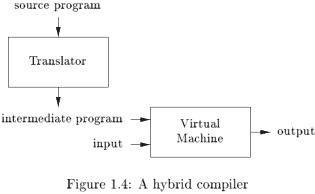

除编译器外，还可能需要若干其他程序来创建可执行目标程序，如图 1.5 所示。源程序可以划分为存储在单独文件中的模块。收集源程序的任务有时委托给一个单独的程序，称为*预处理器*。预处理器还可以将称为宏的简写展开为源语言语句。

修改后的源程序随后被送入编译器。编译器可以输出汇编语言程序，因为汇编语言作为输出更容易生成，也更容易调试。汇编语言随后由一个称为*汇编器*的程序处理，该程序输出可重定位机器代码。

大型程序通常分块编译，因此可重定位机器代码可能必须与其他可重定位目标文件和库文件链接在一起，形成实际在机器上运行的代码。*链接器*解析外部内存地址，即一个文件中的代码可能引用另一个文件中的位置。然后，*加载器*将所有可执行目标文件放入内存以供执行。

### 1.1.1 第 1.1 节练习

- **练习 1.1.1：** 编译器和解释器之间有什么区别？
- **练习 1.1.2：** （a）编译器相对于解释器（b）解释器相对于编译器，分别有哪些优点？
- **练习 1.1.3：** 在编译器的输出为汇编语言而不是机器语言的语言处理系统中，有哪些优点？
- **练习 1.1.4：** 将高级语言翻译成另一种高级语言的编译器称为*源到源*翻译器。使用 C 作为编译器的目标语言有哪些优点？
- **练习 1.1.5：** 描述汇编器需要执行的一些任务。

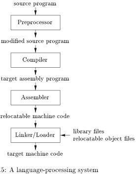

图 1.5：一个语言处理系统

### 1.2 编译器的结构

到目前为止，我们把编译器视为一个将源程序映射为语义等价目标程序的单个盒子。如果我们稍微打开这个盒子，就会看到这种映射有两个部分：分析和综合。

分析部分将源程序分解为组成部分，并对它们施加语法结构。然后利用这种结构创建源程序的中间表示。如果分析部分检测到源程序在语法上构造不良或在语义上不可靠，那么它必须提供信息性消息，以便用户采取纠正措施。分析部分还收集关于源程序的信息，并将其存储在一个称为符号表的数据结构中，该数据结构与中间表示一起传递给综合部分。

综合部分根据中间表示和符号表中的信息构造所需的目标程序。分析部分通常称为编译器的前端；综合部分是后端。

如果我们更详细地考察编译过程，就会看到它按一系列阶段运行，每个阶段将源程序的一种表示转换为另一种表示。图 1.6 展示了编译器的一种典型阶段分解。在实践中，若干阶段可以组合在一起，并且组合阶段之间的中间表示不必显式构造。符号表存储关于整个源程序的信息，供编译器的所有阶段使用。有些编译器在前端和后端之间有一个与机器无关的优化阶段。该优化阶段的目的是对中间表示执行变换，以便后端能够生成比从未优化的中间表示生成的更好的目标程序。由于优化是可选的，图 1.6 所示的两个优化阶段中的一个或另一个可能缺失。

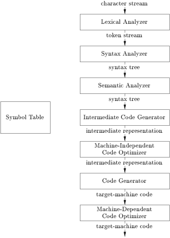

图 1.6：编译器的阶段

### 1.2.1 词法分析

编译器的第一个阶段称为*词法分析*或*扫描*。词法分析器读取组成源程序的字符流


## 1.2 编译器的结构

并将字符分组为有意义的序列，称为*词素*。对于每个词素，词法分析器生成一个形式为⟨*词素名，属性值*⟩的*记号*，并将其传递给后续阶段，即语法分析。在记号中，第一个分量*词素名*是语法分析期间使用的抽象符号，第二个分量*属性值*指向该记号在符号表中的条目。符号表条目中的信息是语义分析和代码生成所需的。

例如，假设一个源程序包含赋值语句

```text
position = initial + rate * 60                                      (1.1)
```

该赋值语句中的字符可以分组为以下词素，并映射为以下传递给语法分析器的记号：

- 1. `position` 是一个词素，将被映射为记号 ⟨id, 1⟩，其中 `id` 是代表*标识符*的抽象符号，1 指向 `position` 的符号表条目。标识符的符号表条目保存有关该标识符的信息，如其名称和类型。
- 2. 赋值符号 `=` 是一个词素，被映射为记号 ⟨=⟩。由于该记号不需要属性值，我们省略了第二个分量。我们本可以使用任何抽象符号（如 `assign`）作为词素名，但为表示方便，我们选择使用词素本身作为抽象符号的名称。
- 3. `initial` 是一个词素，被映射为记号 ⟨id, 2⟩，其中 2 指向 `initial` 的符号表条目。
- 4. `+` 是一个词素，被映射为记号 ⟨+⟩。
- 5. `rate` 是一个词素，被映射为记号 ⟨id, 3⟩，其中 3 指向 `rate` 的符号表条目。
- 6. `*` 是一个词素，被映射为记号 ⟨*⟩。
- 7. `60` 是一个词素，被映射为记号 ⟨60⟩。¹

分隔词素的空格将被词法分析器丢弃。

图 1.7 显示了赋值语句 (1.1) 在词法分析后表示为记号序列

⟨id, 1⟩ ⟨=⟩ ⟨id, 2⟩ ⟨+⟩ ⟨id, 3⟩ ⟨*⟩ ⟨60⟩                                      (1.2)

在此表示中，记号名 =、+ 和 * 分别是赋值、加法和乘法运算的抽象符号。

¹ 严格来说，对于词素 60，我们应构造一个类似 ⟨number, 4⟩ 的记号，其中 4 指向整数 60 的内部表示在符号表中的位置，但我们将把数字记号的讨论推迟到第 2 章。第 3 章讨论构建词法分析器的技术。

**符号表**

| | | |
|---|---|---|
| 1 | position | ... |
| 2 | initial | ... |
| 3 | rate | ... |

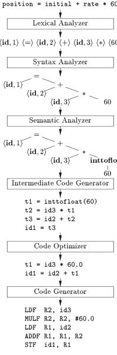

```text
position = initial + rate * 60
```

```text
t1 = inttofloat(60)
t2 = id3 * t1
t3 = id2 + t2
id1 = t3
```

```text
t1 = id3 * 60.0
id1 = id2 + t1
```

```text
LDF  R2, id3
MULF R2, R2, #60.0
LDF  R1, id2
ADDF R1, R1, R2
STF  id1, R1
```

图 1.7：赋值语句的翻译

### 1.2.2 语法分析

编译器的第二个阶段是*语法分析*或*解析*。解析器使用词法分析器产生的记号的第一部分来创建一种树状的中间表示，该表示描绘了记号流的语法结构。一种典型的表示是*语法树*，其中每个内部节点表示一个运算，节点的子节点表示该运算的操作数。记号流 (1.2) 的语法树如图 1.7 中语法分析器的输出所示。

该树显示了赋值语句 `position = initial + rate * 60` 中各运算的执行顺序。树的内部节点标有 `*`，其左子节点为 ⟨id,3⟩，右子节点为整数 60。节点 ⟨id,3⟩ 表示标识符 rate。标有 `*` 的节点明确表示我们必须先将 rate 的值乘以 60。标有 `+` 的节点表示我们必须将此乘法的结果与 initial 的值相加。树的根节点标有 `=`，表示我们必须将此加法的结果存储到标识符 position 的位置中。这种运算顺序与通常的算术约定一致，即乘法优先级高于加法，因此乘法应在加法之前执行。

编译器的后续阶段使用语法结构来帮助分析源程序并生成目标程序。在第 4 章中，我们将使用上下文无关文法来规定编程语言的语法结构，并讨论从某些类别的文法自动构造高效语法分析器的算法。在第 2 章和第 5 章中，我们将看到语法导向定义如何帮助规定编程语言结构的翻译。

### 1.2.3 语义分析

*语义分析器*使用语法树和符号表中的信息来检查源程序在语义上与语言定义是否一致。它还收集类型信息，并将其保存在语法树或符号表中，供后续中间代码生成使用。

语义分析的一个重要部分是*类型检查*，编译器在其中检查每个运算符是否具有匹配的操作数。例如，许多编程语言定义要求数组下标为整数；如果使用浮点数来索引数组，编译器必须报告错误。

语言规范可能允许一些称为*强制转换*的类型转换。例如，二元算术运算符可以应用于一对整数或一对浮点数。如果该运算符应用于一个浮点数和一个整数，编译器可能会将整数转换或强制转换为浮点数。这样的强制转换出现在图 1.7 中。假设 `position`、`initial` 和 `rate` 被声明为浮点数，而词素 60 本身构成一个整数。图 1.7 中语义分析器的类型检查器发现运算符 `*` 应用于一个浮点数 `rate` 和一个整数 60。在这种情况下，整数可能会被转换为浮点数。在图 1.7 中，请注意语义分析器的输出有一个额外的节点，用于运算符 **inttofloat**，该运算符显式地将其整数参数转换为浮点数。类型检查和语义分析将在第 6 章讨论。

### 1.2.4 中间代码生成

在将源程序翻译为目标代码的过程中，编译器可能会构建一个或多个中间表示，这些表示可以具有多种形式。语法树是一种中间表示形式；它们通常在语法分析和语义分析期间使用。

在源程序的语法和语义分析之后，许多编译器会生成一个显式的低级或类机器语言的中间表示，我们可以将其视为抽象机器的程序。这种中间表示应具有两个重要特性：易于生成且易于翻译为目标机器代码。

在第 6 章中，我们将考虑一种称为*三地址代码*的中间形式，它由一系列类似汇编的指令组成，每条指令包含三个操作数。每个操作数可以充当寄存器。图 1.7 中中间代码生成器的输出由以下三地址代码序列组成

```text
t1 = inttofloat(60)
t2 = id3 * t1
t3 = id2 + t2
id1 = t3
```

(1.3)

关于三地址指令，有几点值得注意。首先，每条三地址赋值指令的右侧至多有一个运算符。因此，这些指令确定了运算的执行顺序；乘法先于源程序 (1.1) 中的加法。其次，编译器必须生成一个临时名称来保存三地址指令计算的值。第三，一些“三地址指令”（如上述序列 (1.3) 中的第一条和最后一条）的操作数少于三个。

在第 6 章中，我们将介绍编译器中使用的几种主要中间表示。第 5 章介绍应用于语法导向翻译的技术，这些技术在第 6 章中用于针对典型的编程语言结构（如表达式、控制流结构和过程调用）进行类型检查和中间代码生成。


### 1.2.5 代码优化

与机器无关的代码优化阶段试图改进中间代码，以便产生更好的目标代码。通常“更好”意味着更快，但也可能期望其他目标，例如更短的代码，或功耗更低的目标代码。例如，一个直截了当的算法会生成中间代码（1.3），对来自语义分析器的树表示中的每个运算符使用一条指令。

先生成简单的中间代码，然后进行代码优化，是生成良好目标代码的合理方法。优化器可以推断出，将60从整数转换为浮点数可以在编译时一次完成，因此可以通过将整数60替换为浮点数60.0来消除inttofloat操作。此外，t3只被使用一次，用于将其值传送给id1，因此优化器可以将（1.3）转换为更短的序列

```text
t1 = id3 * 60.0
id1 = id2 + t1
```

（1.4）

不同编译器执行的代码优化量有很大差异。在那些执行最多优化的编译器中，即所谓的“优化编译器”，会在此阶段花费大量时间。有一些简单的优化可以显著改善目标程序的运行时间，而不会过多减慢编译速度。从第8章开始详细讨论与机器无关和与机器相关的优化。

### 1.2.6 代码生成

代码生成器以源程序的中间表示作为输入，并将其映射为目标语言。如果目标语言是机器代码，则为程序使用的每个变量选择寄存器或内存位置。然后，将中间指令翻译成执行相同任务的机器指令序列。代码生成的一个关键方面是明智地分配寄存器来保存变量。

例如，使用寄存器R1和R2，可将（1.4）中的中间代码翻译为机器代码

```text
LDF R2, id3
MULF R2, R2, #60.0
LDF R1, id2
ADDF R1, R1, R2
STF id1, R1
```

（1.5）

每条指令的第一个操作数指定一个目的地。每条指令中的F告诉我们它处理浮点数。（1.5）中的代码将地址id3的内容加载到寄存器R2中，然后将其与浮点常量60.0相乘。#表示60.0应被视为立即常量。第三条指令将id2移入寄存器R1，第四条指令将先前在寄存器R2中计算的值加到它上面。最后，寄存器R1中的值被存储到id1的地址中，因此该代码正确地实现了赋值语句（1.1）。第8章涵盖代码生成。

关于代码生成的讨论忽略了源程序中标识符的存储分配这一重要问题。正如我们将在第7章中看到的，运行时的存储组织取决于正在编译的语言。存储分配决策是在中间代码生成期间或代码生成期间做出的。

### 1.2.7 符号表管理

编译器的一项基本功能是记录源程序中使用的变量名，并收集关于每个名字的各种属性的信息。这些属性可以提供关于为名字分配的存储、其类型、其作用域（在程序中何处可以使用其值）的信息，并且对于过程名，还可以提供诸如其参数的数量和类型、传递每个参数的方法（例如，按值或按引用）以及返回类型等信息。

符号表是一种数据结构，包含每个变量名的记录，其中的字段用于存储该名字的属性。该数据结构的设计应使编译器能够快速找到每个名字的记录，并快速存储或检索该记录中的数据。符号表将在第2章讨论。

### 1.2.8 将阶段分组为遍

阶段的讨论涉及编译器的逻辑组织。在实现中，来自多个阶段的活动可以组合成一个遍，该遍读取输入文件并写入输出文件。例如，前端阶段（词法分析、语法分析、语义分析和中间代码生成）可以组合成一个遍。代码优化可以是一个可选的遍。然后可以有一个后端遍，由针对特定目标机器的代码生成组成。

一些编译器集合围绕精心设计的中间表示创建，这些中间表示允许特定语言的前端与某个目标机器的后端接口。使用这些集合，我们可以通过将不同的前端与该目标机器的后端组合，为一台目标机器生成不同源语言的编译器。类似地，我们可以通过将前端与不同目标机器的后端组合，为不同的目标机器生成编译器。

### 1.2.9 编译器构造工具

编译器编写者像任何软件开发人员一样，可以有益地使用现代软件开发环境，其中包含语言编辑器、调试器、版本管理器、性能分析器、测试工具等工具。除了这些通用软件开发工具之外，还创建了其他更专门化的工具来帮助实现编译器的各个阶段。

这些工具使用专门的语言来指定和实现特定组件，许多工具使用相当复杂的算法。最成功的工具是那些隐藏生成算法细节并产生可轻松集成到编译器其余部分的组件的工具。一些常用的编译器构造工具包括

- 1. *解析器生成器*，它根据编程语言的语法描述自动生成语法分析器。
- 2. *扫描器生成器*，它根据语言记号的正则表达式描述生成词法分析器。
- 3. *语法制导翻译引擎*，它产生用于遍历分析树并生成中间代码的例程集合。
- 4. *代码生成器生成器*，它根据将中间语言的每个操作翻译为目标机器机器语言的一组规则生成代码生成器。
- 5. *数据流分析引擎*，它有助于收集关于值如何从程序的一部分传输到另一部分的信息。数据流分析是代码优化的关键部分。
- 6. *编译器构造工具包*，它提供用于构造编译器各个阶段的集成例程集。

我们将在本书中描述其中许多工具。

## 1.3 编程语言的演化

第一批电子计算机出现于20世纪40年代，用机器语言编程，由0和1的序列明确告诉计算机要执行什么操作以及以什么顺序执行。这些操作本身非常低级：将数据从一个位置移动到另一个位置，将两个寄存器的内容相加，比较两个值，等等。不用说，这种编程方式缓慢、乏味且容易出错。而且一旦编写完成，程序就很难理解和修改。

### 1.3.1 向高级语言迈进

朝着更便于人们使用的编程语言迈出的第一步，是20世纪50年代初助记符汇编语言的发展。最初，汇编语言中的指令只是机器指令的助记符表示。后来，汇编语言中加入了宏指令，使程序员可以为频繁使用的机器指令序列定义参数化的简写形式。

20世纪50年代后半期，随着用于科学计算的Fortran、用于商业数据处理的COBOL和用于符号计算的Lisp的发展，朝着高级语言迈出了重要一步。这些语言背后的哲学是创建更高级的记号，使程序员可以更容易地编写数值计算、商业应用和符号程序。这些语言非常成功，至今仍在使用。

在随后的几十年中，人们创造了许多具有创新特性的语言，以帮助编程更容易、更自然、更健壮。在本章后面，我们将讨论许多现代编程语言共有的一些关键特性。

如今，有成千上万种编程语言。它们可以以多种方式分类。一种分类是按代划分。*第一代语言*是机器语言，*第二代*是汇编语言，*第三代*是像Fortran、COBOL、Lisp、C、C++、C#和Java这样的高级语言。*第四代语言*是为特定应用设计的语言，如用于报表生成的NOMAD、用于数据库查询的SQL和用于文本格式化的PostScript。*第五代语言*一词已被应用于像Prolog和OPS5这样基于逻辑和约束的语言。

另一种语言分类使用术语*命令式*来表示程序指定计算*如何*进行的语言，使用术语*声明式*来表示程序指定要完成*什么*计算的语言。像C、C++、C#和Java这样的语言是命令式语言。在命令式语言中，有程序状态的概念以及改变状态的语句。像ML和Haskell这样的函数式语言以及像Prolog这样的约束逻辑语言通常被认为是声明式语言。

术语*冯·诺依曼语言*被应用于计算模型基于冯·诺依曼计算机体系结构的编程语言。今天的许多语言，如Fortran和C，都是冯·诺依曼语言。

*面向对象语言*是支持面向对象编程的语言，这种编程风格中程序由一组相互交互的对象组成。Simula 67和Smalltalk是最早的主要面向对象语言。像C++、C#、Java和Ruby这样的语言是较新的面向对象语言。

*脚本语言*是具有高级操作符的解释型语言，设计用于“粘合”计算。这些计算最初是

被称为“脚本”。Awk、JavaScript、Perl、PHP、Python、Ruby 和 Tcl 是脚本语言的常见示例。用脚本语言编写的程序通常比用 C 等语言编写的等效程序短得多。

### 1.3.2 对编译器的影响

由于编程语言和编译器的设计密切相关，编程语言的进步对编译器编写者提出了新的要求。他们必须设计出算法和表示形式来翻译和支持新的语言特性。自 20 世纪 40 年代以来，计算机体系结构也在不断演进。编译器编写者不仅要跟踪新的语言特性，还必须设计出能够充分利用新硬件能力的翻译算法。

编译器可以通过最小化用这些语言编写的程序的执行开销来促进高级语言的使用。编译器对于让高性能计算机体系结构在用户应用程序上发挥效用也至关重要。事实上，计算机系统的性能在很大程度上依赖于编译器技术，以至于在计算机建造之前，编译器就被用作评估体系结构概念的工具。

编写编译器具有挑战性。编译器本身就是一个大型程序。此外，许多现代语言处理系统在同一框架内处理多种源语言和目标机器；也就是说，它们充当编译器的集合，可能由数百万行代码组成。因此，良好的软件工程技术对于创建和发展现代语言处理器至关重要。

编译器必须正确翻译源语言中可能编写的潜在无限的程序集合。从源程序生成最优目标代码的问题在一般情况下是不可判定的；因此，编译器编写者必须权衡要解决哪些问题以及使用哪些启发式方法来生成高效代码。

对编译器的研究也是对理论与实践如何结合的研究，我们将在 1.4 节中看到这一点。

本文的目的是教授编译器设计中使用的方法论和基本思想。本文并非旨在教授构建最先进语言处理系统可能用到的所有算法和技术。然而，阅读本文的读者将获得相对容易地学习如何构建编译器所需的基础知识和理解。

### 1.3.3 第 1.3 节练习

练习 1.3.1：指出下列术语中：

- a) 命令式
- b) 声明式
- c) 冯·诺依曼
- d) 面向对象
- e) 函数式
- f) 第三代
- g) 第四代
- h) 脚本

哪些适用于以下语言：

- 1) C
- 2) C++
- 3) Cobol
- 4) Fortran
- 5) Java
- 6) Lisp
- 7) ML
- 8) Perl
- 9) Python
- 10) VB.

## 1.4 构建编译器的科学

编译器设计充满了通过数学上抽象问题本质来解决复杂现实问题的优美实例。这些实例很好地说明了如何利用抽象来解决问题：提出问题，建立捕捉关键特征的数学抽象，然后使用数学技术加以解决。问题的表述必须建立在对计算机程序特征的扎实理解之上，解决方案必须经过经验验证和改进。

编译器必须接受符合语言规范的所有源程序；源程序的集合是无限的，任何程序都可能非常大，可能包含数百万行代码。编译器在翻译源程序时执行的任何转换都必须保持被编译程序的含义。因此，编译器编写者不仅对他们创建的编译器产生影响，还对他们编译器所编译的所有程序产生影响。这种影响力使得编写编译器特别有价值；然而，这也使编译器开发充满挑战。

### 1.4.1 编译器设计与实现中的建模

对编译器的研究主要是研究如何设计正确的数学模型和选择正确的算法，同时平衡通用性和强大性与简单性和效率之间的需求。

一些最基础的模型是有限状态机和正则表达式，我们将在第 3 章中遇到。这些模型对于描述程序的词法单元（关键字、标识符等）以及描述编译器用于识别这些单元的算法非常有用。同样属于最基础模型的还有上下文无关文法，用于描述编程语言的语法结构，如括号的嵌套或控制结构。我们将在第 4 章研究文法。类似地，树是表示程序结构及其到目标代码翻译的重要模型，我们将在第 5 章看到。

### 1.4.2 代码优化的科学

编译器设计中的术语“优化”指的是编译器尝试生成比显而易见的代码更高效的代码。因此，“优化”是一种用词不当的说法，因为无法保证编译器生成的代码能与执行相同任务的任何其他代码一样快或更快。

在现代，编译器执行的代码优化变得既更加重要也更加复杂。之所以更复杂，是因为处理器体系结构变得更加复杂，为改进代码执行方式提供了更多机会。之所以更重要，是因为大规模并行计算机需要大量优化，否则其性能会下降几个数量级。随着多核机器（芯片上集成大量处理器的计算机）可能普及，所有编译器都将面临利用多处理器机器优势的问题。

用“拼凑”的方法构建一个健壮的编译器即使不是不可能，也是很困难的。因此，围绕代码优化问题已经建立起一套广泛而实用的理论。使用严谨的数学基础使我们能够证明优化是正确的，并且对所有可能的输入都能产生预期的效果。从第 9 章开始，我们将看到图、矩阵和线性规划等模型对于编译器生成良好优化的代码是多么必要。

另一方面，仅靠纯理论是不够的。与许多现实世界的问题一样，没有完美的答案。事实上，我们在编译器优化中提出的大多数问题都是不可判定的。编译器设计中最重要的技能之一是能够提出正确的问题来解决。我们需要首先对程序行为有很好的理解，并进行彻底的实验和评估来验证我们的直觉。

编译器优化必须满足以下设计目标：

- 优化必须是正确的，即保持被编译程序的含义，
- 优化必须提高许多程序的性能，
- 编译时间必须保持在合理范围内，并且
- 所需的工程工作量必须是可控的。

正确性的重要性怎么强调都不为过。如果生成的代码不需要正确，那么编写一个生成快速代码的编译器是轻而易举的！优化编译器很难做到正确，以至于我们敢说没有哪个优化编译器是完全无错误的！因此，编写编译器最重要的目标就是正确。

第二个目标是编译器必须有效地提高许多输入程序的性能。通常，性能指的是程序执行的速度。特别是在嵌入式应用中，我们可能还希望最小化生成代码的大小。对于移动设备，还希望代码能够最小化功耗。通常，加速执行时间的相同优化也能节省功耗。除了性能之外，错误报告和调试等可用性方面也很重要。

第三，我们需要保持较短的编译时间，以支持快速的开发和调试周期。这一要求已经变得更容易满足，因为

机器变得越来越快。通常，程序最初是在不进行程序优化的情况下开发和调试的。这不仅减少了编译时间，更重要的是，未优化的程序更容易调试，因为编译器引入的优化常常会掩盖源代码与目标代码之间的关系。在编译器中开启优化有时会暴露出源程序中的新问题；因此，必须对优化后的代码再次进行测试。额外测试的需求有时会阻碍在应用中使用优化，尤其是在其性能并不关键的情况下。

最后，编译器是一个复杂的系统；我们必须保持系统简单，以确保编译器的工程和维护成本可控。我们可以实现的程序优化数量无穷无尽，而创建正确且有效的优化需要付出相当大的努力。我们必须对优化进行优先级排序，只实现那些能为实践中遇到的源程序带来最大益处的优化。

因此，在学习编译器时，我们不仅学习如何构建编译器，还学习解决复杂且开放式问题的一般方法。编译器开发中使用的方法既涉及理论也涉及实验。我们通常首先根据对重要问题的直觉来表述问题。

## 1.5 编译器技术的应用

编译器设计不仅仅关乎编译器，许多人在学校学习了编译器课程所教授的技术并使用它们，但严格来说，他们从未编写过（甚至从未编写过一部分）用于主流编程语言的编译器。编译器技术还有其他重要用途。此外，编译器设计还影响计算机科学的其他几个领域。在本节中，我们将回顾该技术最重要的交互与应用。

### 1.5.1 高级编程语言的实现

高级编程语言定义了一种编程抽象：程序员使用该语言表达算法，而编译器必须将该程序翻译为目标语言。一般来说，较高级别的编程语言更容易编程，但效率较低，也就是说，目标程序运行得更慢。使用低级语言的程序员对计算有更多控制，并且原则上可以生成更高效的代码。不幸的是，较低级的程序更难编写，更糟糕的是，可移植性更差、更容易出错，也更难维护。优化编译器包含提高生成代码性能的技术，从而抵消高级抽象引入的低效。

**例 1.2：** C 编程语言中的 register 关键字是编译器技术与语言演化之间相互作用的早期例子。当 C 语言在 20 世纪 70 年代中期被创建时，人们认为有必要让程序员控制哪些程序变量驻留在寄存器中。随着有效的寄存器分配技术的发展，这种控制变得不再必要，大多数现代程序也不再使用这一语言特性。

事实上，使用 register 关键字的程序可能会损失效率，因为程序员往往并不是寄存器分配这类非常底层问题的最佳判断者。寄存器分配的最佳选择在很大程度上取决于机器体系结构的具体细节。将寄存器分配这类底层资源管理决策硬性固定，实际上可能会损害性能，尤其是当程序运行在并非为其编写的那台机器上时。□

编程语言流行选择的许多转变都朝着提高抽象层次的方向发展。C 是 20 世纪 80 年代占主导地位的系统编程语言；20 世纪 90 年代启动的许多新项目选择了 C++；Java 于 1995 年推出，并在 90 年代后期迅速流行起来。每一轮引入的新编程语言特性都推动了编译器优化的新研究。下面，我们概述那些促进了编译器技术显著进步的主要语言特性。

几乎所有常见编程语言，包括 C、Fortran 和 Cobol，都支持用户定义的聚合数据类型（如数组和结构体）以及高级控制流（如循环和过程调用）。如果我们只是把每个高级构造或数据访问操作直接翻译成机器码，结果将非常低效。人们已经开发出一系列编译器优化，称为*数据流优化*，用于分析数据在程序中的流动，并消除这些构造之间的冗余。它们在生成代码方面很有效，能够与熟练程序员在较低层次编写的代码相媲美。

面向对象最早于 1967 年在 Simula 中引入，并已被纳入 Smalltalk、C++、C# 和 Java 等语言。面向对象背后的关键思想是

- 1. 数据抽象，以及
- 2. 属性的继承，

这两者都被发现能使程序更加模块化且更易于维护。面向对象程序与用许多其他语言编写的程序不同，因为它们由更多但更小的过程组成（在面向对象术语中称为*方法*）。因此，编译器优化必须能够在源程序的过程边界之间表现良好。过程内联，即用过程体替换过程调用，在这里特别有用。用于加速虚方法分派的各种优化也已被开发出来。

Java 具有许多使编程更容易的特性，其中许多特性此前已在其他语言中引入。Java 语言是类型安全的；也就是说，一个对象不能当作不相关类型的对象使用。所有数组访问都会被检查，以确保它们位于数组边界之内。Java 没有指针，也不允许指针运算。它具有内置的垃圾回收设施，可自动释放不再使用的变量的内存。虽然所有这些特性都使编程更容易，但它们会带来运行时开销。人们已经开发出编译器优化来降低这种开销，例如，通过消除不必要的范围检查，以及将过程之外不可访问的对象分配到栈上而不是堆上。人们还开发了有效算法来最小化垃圾回收的开销。

此外，Java 旨在支持可移植和移动代码。程序以 Java 字节码形式分发，这些字节码要么必须被解释执行，要么必须在运行时动态编译成本地代码。动态编译也已在其他场景中得到研究，在这些场景中，信息在运行时被动态提取，并用于生成优化程度更高的代码。在动态优化中，重要的是最小化编译时间，因为编译时间是执行开销的一部分。一种常用技术是只编译和优化程序中会被频繁执行的那些部分。

### 1.5.2 面向计算机体系结构的优化

计算机体系结构的快速演进也导致了对新编译器技术的无尽需求。几乎所有高性能系统都利用同样的两项基本技术：*并行性*和*存储层次结构*。并行性可以在多个层次上找到：在*指令级*，多条操作同时执行；在*处理器级*，同一应用的不同线程运行在不同处理器上。存储层次结构是对一个基本限制的回应：我们可以构建非常快的存储或非常大的存储，但无法构建既快又大的存储。

### 并行性

所有现代微处理器都利用指令级并行。然而，这种并行性可以对程序员隐藏。程序编写得就好像所有指令都是按顺序执行的一样；硬件会动态检查顺序指令流中的依赖关系，并在可能时并行发射这些指令。在某些情况下，机器包含一个硬件调度器，可以改变指令顺序以增加程序中的并行性。无论硬件是否重排指令，编译器都可以重新排列指令，使指令级并行更加有效。

指令级并行也可以显式地出现在指令集中。VLIW（超长指令字）机器的指令可以发射

并行执行多个操作。Intel IA-64 就是这种架构的一个著名例子。所有高性能通用微处理器也都包含能够同时对数据向量进行操作的指令。人们已经开发出编译器技术，可以从顺序程序自动为这类机器生成代码。

多处理器也已变得非常普遍；就连个人计算机也常常配备多个处理器。程序员可以为多处理器编写多线程代码，或者由编译器从传统顺序程序自动生成并行代码。这样的编译器向程序员隐藏了以下细节：在程序中寻找并行性、将计算分布到整个机器，以及最小化处理器之间的同步和通信。许多科学计算和工程应用都是计算密集型的，可以从并行处理中大大受益。并行化技术已被开发出来，用于将顺序科学程序自动转换为多处理器代码。

### 内存层次结构

内存层次结构由多个速度和容量各不相同的存储层级组成，其中最靠近处理器的层级速度最快但容量最小。如果程序的大多数内存访问都能由层次结构中较快的层级满足，那么程序的平均内存访问时间就会缩短。并行性和内存层次结构的存在都能提高机器的潜在性能，但编译器必须有效地利用它们，才能在应用程序上实现真正的性能提升。

所有机器都有内存层次结构。处理器通常拥有少量寄存器，容量为数百字节；若干级缓存，容量从千字节到兆字节不等；物理内存，容量从兆字节到吉字节不等；最后是容量为吉字节乃至更大的二级存储。相应地，层次结构中相邻层级之间的访问速度可能相差两到三个数量级。系统的性能往往不是受限于处理器的速度，而是受限于内存子系统的性能。虽然编译器传统上专注于优化处理器的执行，但现在更加强调如何提高内存层次结构的效率。

有效利用寄存器可能是在优化程序时最重要的一个问题。与必须在软件中显式管理的寄存器不同，缓存和物理内存对指令集是透明的，由硬件管理。人们发现，在某些情况下，硬件实现的缓存管理策略并不有效，尤其是在具有大型数据结构（通常是数组）的科学代码中。可以通过改变数据的布局，或者改变访问数据的指令顺序，来提高内存层次结构的效率。我们也可以改变代码的布局，以提高指令缓存的有效性。

## 1.5. 编译器技术的应用

### 1.5.3 新计算机体系结构的设计

在计算机体系结构设计的早期，编译器是在机器制造完成之后才开发的。这种情况已经改变。由于使用高级语言编程已成为常态，计算机系统的性能不仅取决于其原始速度，还取决于编译器能否很好地利用其特性。因此，在现代计算机体系结构开发中，编译器在处理器设计阶段就同步开发，编译后的代码在模拟器上运行，用于评估所提出的体系结构特性。

### RISC

编译器影响计算机体系结构设计的最著名例子之一是 RISC（精简指令集计算机）架构的发明。在这一发明之前，趋势是开发越来越复杂的指令集，目的是让汇编编程更容易；这些架构被称为 CISC（复杂指令集计算机）。例如，CISC 指令集包含复杂的内存寻址模式以支持数据结构访问，以及保存寄存器并在栈上传递参数的过程调用指令。

编译器优化通常通过消除复杂指令之间的冗余，将这些指令化简为少量更简单的操作。因此，构建简单的指令集是可取的；编译器可以有效地使用它们，而且硬件也更易于优化。

大多数通用处理器架构（包括 PowerPC、SPARC、MIPS、Alpha 和 PA-RISC）都基于 RISC 概念。尽管最流行的微处理器 x86 架构采用 CISC 指令集，但为 RISC 机器开发的许多思想都被用在了处理器本身的实现中。此外，使用高性能 x86 机器最有效的方式，就是只使用其简单指令。

### 专用体系结构

在过去三十年中，人们提出了许多体系结构概念，包括数据流机器、向量机器、VLIW（超长指令字）机器、SIMD（单指令多数据）处理器阵列、脉动阵列、共享内存多处理器和分布式内存多处理器。这些体系结构概念的发展都伴随着相应编译器技术的研究与开发。

其中一些思想已经进入了嵌入式机器的设计。由于整个系统可以集成在单个芯片上，处理器不再需要是预先封装好的通用单元，而是可以针对特定应用进行定制，以获得更好的成本效益。因此，与规模经济导致计算机体系结构趋同的通用处理器不同，专用处理器呈现出计算机体系结构的多样性。编译器技术不仅需要用于支持这些架构的编程，还需要用于评估所提出的架构设计。

### 1.5.4 程序翻译

虽然我们通常认为编译是将高级语言翻译到机器级，但同样的技术也可以应用于不同类型语言之间的翻译。以下是程序翻译技术的一些重要应用。

### 二进制翻译

编译器技术可以用来将一台机器的二进制代码翻译为另一台机器的二进制代码，从而让一台机器能够运行原本为其他指令集编译的程序。二进制翻译技术已被多家计算机公司用来提高其机器上软件的可用性。特别是，由于 x86 在个人计算机市场占据主导地位，大多数软件都是以 x86 代码形式提供的。人们已经开发出二进制翻译器，将 x86 代码转换为 Alpha 和 SPARC 代码。Transmeta 公司在其 x86 指令集的实现中也使用了二进制翻译。Transmeta Crusoe 处理器并不是直接在硬件中执行复杂的 x86 指令集，而是一个 VLIW 处理器，依靠二进制翻译将 x86 代码转换为本机 VLIW 代码。

二进制翻译还可以用于提供向后兼容性。1994 年，Apple Macintosh 的处理器从 Motorola MC68040 更换为 PowerPC 时，就使用了二进制翻译来让 PowerPC 处理器运行旧的 MC68040 代码。

### 硬件综合

不仅大多数软件是用高级语言编写的，甚至硬件设计也大多使用 Verilog 和 VHDL（超高速集成电路硬件描述语言）等高级硬件描述语言来描述。硬件设计通常在寄存器传输级（RTL）进行描述，其中变量代表寄存器，表达式代表组合逻辑。硬件综合工具将 RTL 描述自动转换为门电路，然后映射为晶体管，最终形成物理布局。与编程语言编译器不同，这些工具通常需要花费数小时来优化电路。在更高层次（如行为级或功能级）翻译设计的技术也已经存在。

### 数据库查询解释器

除了描述软件和硬件之外，语言在许多其他应用中也非常有用。例如，查询语言，尤其是 SQL（结构化查询

语言），用于搜索数据库。数据库查询由包含关系和布尔运算符的谓词组成。它们可以被解释或编译成命令，以在数据库中搜索满足该谓词的记录。

## 编译式模拟

模拟是一种通用技术，用于许多科学和工程学科中，以理解现象或验证设计。模拟器的输入通常包括设计的描述以及该特定模拟运行的具体输入参数。模拟可能非常昂贵。我们通常需要在许多不同的输入集上模拟许多可能的设计备选方案，而每个实验在高性能机器上可能需要数天才能完成。与其编写解释设计的模拟器，不如编译设计以生成机器码，从而原生地模拟该特定设计，这样更快。编译式模拟的运行速度可比基于解释器的方法快几个数量级。编译式模拟被用于许多最先进的工具中，这些工具模拟用Verilog或VHDL编写的设计。

## 1.5.5 软件生产力工具

程序可以说是迄今为止生产的最复杂的工程制品；它们由许许多多细节组成，其中每一个细节都必须在程序完全正常工作之前是正确的。因此，程序中的错误非常猖獗；错误可能使系统崩溃、产生错误结果、使系统易受安全攻击，甚至导致关键系统发生灾难性故障。测试是定位程序中错误的主要技术。

一种有趣且有前景的补充方法是使用数据流分析来静态地定位错误（即在程序运行之前）。数据流分析可以沿着所有可能的执行路径发现错误，而不像程序测试那样仅发现输入数据集所经过的路径上的错误。许多最初为编译器优化而开发的数据流分析技术，可用于创建辅助程序员完成软件工程任务的工具。

找出程序中所有错误的问题是不可判定的。数据流分析可以被设计为向程序员警告所有可能带有某一特定类别错误的语句。但如果这些警告大多数是误报，用户就不会使用该工具。因此，实际的错误检测器常常既不可靠也不完备。也就是说，它们可能无法发现程序中的所有错误，并且所报告的错误也并非都保证是真正的错误。尽管如此，已经开发出各种静态分析，并已证明它们在发现真实程序中的错误（例如解引用空指针或已释放指针）方面是有效的。错误检测器可能不可靠这一事实使它们与编译器优化显著不同。优化器必须保守，并且在任何情况下都不能改变程序的语义。

在本节的其余部分，我们将提到程序分析在最初为优化编译器中的代码而开发的技术基础上，提高软件生产力的几种方式。特别重要的是那些静态检测程序何时可能存在安全漏洞的技术。

### 类型检查

类型检查是一种有效且成熟的技术，用于捕获程序中的不一致性。它可用于捕获错误，例如，将操作应用于错误类型的对象，或者传递给过程的参数与该过程的签名不匹配。程序分析可以通过分析数据在程序中的流动，超越发现类型错误的范围。例如，如果一个指针被赋值为空，然后立即被解引用，那么程序显然有错误。

同样的技术可用于捕获各种安全漏洞，其中攻击者提供字符串或其他数据，而程序粗心地使用了这些数据。用户提供的字符串可以被标记为“危险”类型。如果未检查该字符串的格式是否正确，那么它仍保持“危险”状态；如果这种类型的字符串能够在程序中的某个点影响代码的控制流，那么就存在潜在的安全缺陷。

### 边界检查

使用低级语言编程比使用高级语言编程更容易出错。例如，系统中的许多安全漏洞是由用C编写的程序中的缓冲区溢出造成的。由于C没有数组边界检查，因此需要用户确保数组不会被越界访问。如果未能检查用户提供的数据是否可能使缓冲区溢出，程序可能会被诱骗将用户数据存储到缓冲区之外。攻击者可以操纵输入数据，使程序行为异常并危及系统的安全。已经开发出一些技术来发现程序中的缓冲区溢出，但成效有限。

如果该程序是用包含自动范围检查的安全语言编写的，这个问题就不会发生。用于消除冗余范围检查的同一数据流分析也可用于定位缓冲区溢出。然而，主要区别在于：未能消除范围检查只会导致较小的运行时开销，而未能识别潜在的缓冲区溢出则可能危及系统的安全。因此，虽然使用简单技术来优化范围检查就足够了，但在错误检测工具中要获得高质量的结果，则需要复杂分析，例如跨过程跟踪指针的值。

### 内存管理工具

垃圾回收是效率与编程易用性和软件可靠性相结合之间权衡的另一个极好例子。自动内存管理消除了所有内存管理错误（例如“内存泄漏”），而这些错误是C和C++程序中的主要问题来源。已经开发出各种工具来帮助程序员发现内存管理错误。例如，Purify是一种广泛使用的工具，它在内存管理错误发生时动态捕获这些错误。也已开发出一些工具，帮助静态地识别其中一些问题。

## 1.6 编程语言基础

在本节中，我们将介绍编程语言研究中出现的最重要的术语和区别。我们的目的不是涵盖所有概念或所有流行的编程语言。我们假设读者至少熟悉C、C++、C#或Java中的一种，并且可能也接触过其他语言。

### 1.6.1 静态/动态区分

在为一种语言设计编译器时，我们面临的最重要问题之一是：编译器可以对程序做出哪些决策。如果一种语言采用允许编译器决定某个问题的策略，那么我们就说该语言使用*静态*策略，或者说该问题可以在*编译时*决定。另一方面，只允许在我们执行程序时做出决策的策略被称为*动态策略*，或者说需要在*运行时*做出决策。

我们将重点关注的一个问题是声明的作用域。声明*x*的*作用域*是程序中这样一块区域：在其中使用*x*时指的是该声明。如果仅通过查看程序就有可能确定声明的作用域，则该语言使用*静态作用域*或*词法作用域*。否则，该语言使用*动态作用域*。在动态作用域下，随着程序运行，对*x*的同一使用可能指代*x*的若干不同声明中的任何一个。

大多数语言（例如C和Java）使用静态作用域。我们将在1.6.3节讨论静态作用域。

**例1.3：** 作为静态/动态区分的另一个例子，考虑术语“static”在Java类声明中应用于数据时的用法。在Java中，变量是内存中用于保存数据值的位置的名称。这里，“static”指的不是变量的作用域，而是编译器确定所声明变量在内存中可找到的位置的能力。如下声明

```
public static int x;
```

```c
...
int i;          /* global i      */
...
void f(...) {
    int i;       /* local i       */
    ...
    i = 3;       /* use of local i */
    ...
}
...
x = i + 1;      /* use of global i */
```

图 1.9：名称 *i* 的两次声明

为局部于 *f* 的 *i* 保留的位置，以及任何对 *i* 的使用（例如显式展示的赋值 `i = 3`），都引用该位置。通常，局部 *i* 被分配在运行时栈上的一个位置。

每当执行的是 *f* 以外的函数 *g* 时，对 *i* 的使用不能引用局部于 *f* 的 *i*。在 *g* 中对名称 *i* 的使用必须位于 *i* 的某个其他声明的作用域内。一个例子是显式展示的语句 `x = i+1`，它位于某个未展示其定义的过程内。`i + 1` 中的 *i* 大概引用全局 *i*。与大多数语言一样，C 中的声明必须先于其使用，因此位于全局 *i* 之前的函数不能引用它。□

图 1.8 中的环境和状态映射是动态的，但有几个例外：

-   1. 名称到位置的*静态绑定与动态绑定*。名称到位置的大多数绑定是动态的，我们将在本节中讨论这种绑定的若干方法。有些声明，例如图 1.9 中的全局 *i*，可以在存储中被一次性给定一个位置，因为编译器生成目标代码。²

²从技术上讲，C 编译器会为全局 *i* 在虚拟内存中分配一个位置，而把确定 *i* 在机器物理内存中实际位于何处的工作留给加载器和操作系统。然而，我们不必担心诸如此类的“重定位”问题，因为它们对编译没有影响。相反，我们把编译器用于其输出代码的地址空间视为给出了物理内存位置。

-   2. 位置到值的*静态绑定与动态绑定*。位置到值的绑定（图 1.8 中的第二阶段）通常也是动态的，因为在运行程序之前我们无法知道某个位置中的值。已声明的常量是一个例外。例如，C 定义

```c
#define ARRAYSIZE 1000
```

将名称 **ARRAYSIZE** 静态地绑定到值 1000。我们可以通过查看该语句来确定这个绑定，并且我们知道，当程序执行时，这个绑定不可能改变。

#### 1.6.2 名称、标识符和变量

尽管“名称”和“变量”这两个术语常常指同一事物，但我们谨慎地使用它们，以区分编译期名称和由名称表示的运行时位置。

一个*标识符*是字符串，通常由字母或数字组成，它指代（标识）一个实体，例如数据对象、过程、类或类型。所有标识符都是名称，但并非所有名称都是标识符。名称也可以是表达式。例如，名称 *x.y* 可能表示由 *x* 表示的结构体的字段 *y*。这里，*x* 和 *y* 是标识符，而 *x.y* 是名称，但不是标识符。像 *x.y* 这样的复合名称称为*限定*名称。

一个*变量*引用存储中的特定位置。同一个标识符被多次声明是很常见的；每个这样的声明都引入一个新变量。即使每个标识符只声明一次，递归过程的局部标识符在不同时间也会引用存储中的不同位置。

#### 1.6.3 静态作用域与块结构

包括 C 及其家族在内的大多数语言都使用静态作用域。C 的作用域规则基于程序结构；声明的作用域由声明在程序中出现的位置隐式确定。后来的语言，如 C++、Java 和 C#，还通过使用 **public**、**private** 和 **protected** 等关键字提供对作用域的显式控制。

在本节中，我们考虑带块的语言的静态作用域规则，其中*块*是声明和语句的分组。C 使用花括号 { 和 } 来界定块；为同一目的而使用 **begin** 和 **end** 的替代方式可追溯到 Algol。

**例 1.5：** 粗略地说，C 的静态作用域策略如下：

-   1. 一个 C 程序由一系列变量和函数的顶层声明组成。
-   2. 函数内部可以有变量声明，其中变量包括局部变量和参数。每个此类声明的作用域仅限于它所在的函数。

表达这条规则的一种等价方式是关注名称 x 的一次使用。令 B1、B2、...、Bk 为包围该 x 使用的所有块，其中 Bk 最小，嵌套在 Bk-1 内，而 Bk-1 又嵌套在 Bk-2 内，依此类推。寻找最大的 i，使得存在属于 Bi 的 x 的声明。该 x 的使用引用 Bi 中的声明。或者，该 x 的使用位于 Bi 中声明的作用域内。

```cpp
main() { // B1
    int a = 1;
    int b = 1;
    {
        int b = 2; // B2
        {
            int a = 3; // B3
            cout << a << b;
        }
        {
            int b = 4; // B4
            cout << a << b;
        }
        cout << a << b;
    }
    cout << a << b;
}
```

图 1.10：C++ 程序中的块

**例 1.6：** 图 1.10 中的 C++ 程序有四个块，其中包含变量 a 和 b 的若干定义。为了便于记忆，每个声明都将其变量初始化为它所属块的编号。

例如，考虑块 B1 中的声明 `int a = 1`。它的作用域是整个 B1，但嵌套在 B1 内（可能嵌套很深）且拥有自己的 a 声明的那些块除外。B2 直接嵌套在 B1 内，没有 a 的声明，但 B3 有。B4 没有 a 的声明，因此块 B3 是整个程序中唯一不在属于 B1 的名称 a 的声明作用域内的位置。也就是说，该作用域包括 B4 以及 B2 的全部，但不包括 B2 中位于 B3 内的部分。所有五个声明的作用域总结在图 1.11 中。

从另一个角度看，让我们考虑块 B4 中的输出语句，并把那里使用的变量 a 和 b 绑定到正确的声明。按大小递增顺序排列的包围块列表是 B4、B2、B1。注意 B3 并不包围所讨论的点。B4 有 b 的声明，因此该 b 的使用引用这个声明，打印的 b 值是 4。然而，B1 没有 a 的声明，因此我们接下来查看 B2。该块也没有 a 的声明，所以我们继续到 B1。幸运的是，

#### 1.6.4 声明与定义

编程语言概念中看似相似的术语“声明”和“定义”实际上相当不同。声明告诉我们事物的类型，而定义告诉我们它们的值。因此，`int i` 是 `i` 的声明，而 `i = 1` 是 `i` 的定义。

当我们处理方法或其他过程时，这种差异更为显著。在 C++ 中，方法在类定义中声明，给出该方法的参数和结果的类型（通常称为该方法的*签名*）。然后，在另一个地方定义该方法，即给出执行该方法的代码。类似地，常见的做法是在一个文件中定义 C 函数，并在使用该函数的其他文件中声明它。

**例 1.7：** 在图 1.12 的 C 程序中，标识符 *a* 是代表表达式 (*x* + 1) 的宏。但 *x* 是什么？我们无法静态地解析 *x*，也就是说，无法根据程序文本解析它。

```c
#define a (x+1)

int x = 2;

void b() { int x = 1; printf("%d\n", a); }

void c() { printf("%d\n", a); }

void main() { b(); c(); }
```

图 1.12：其名称必须动态确定作用域的宏

事实上，为了解释 *x*，我们必须使用通常的动态作用域规则。我们检查当前所有活动的函数调用，并取最近调用的、具有 *x* 声明的函数。该 *x* 的使用引用这个声明。

在图 1.12 的示例中，函数 *main* 首先调用函数 *b*。当 *b* 执行时，它打印宏 *a* 的值。由于必须用 (*x* + 1) 替换 *a*，我们将该 *x* 的使用解析为函数 *b* 中的声明 `int x=1`。原因是 *b* 有 *x* 的声明，因此 *b* 中 `printf` 里的 (*x* + 1) 引用这个 *x*。于是，打印的值是 2。□

在 *b* 结束后，*c* 被调用，我们再次需要打印宏 *a* 的值。然而，*c* 唯一可访问的 *x* 是全局 *x*。因此，*c* 中的 `printf` 语句引用这个 *x* 的声明，并打印值 3。□

动态作用域解析对于多态过程也至关重要，这些过程为同一名称提供两个或更多定义，仅取决于


##### 静态作用域与动态作用域的类比

虽然作用域可以有任意数量的静态或动态策略，但常规（块结构）静态作用域规则与常规动态策略之间存在一种有趣的关系。从某种意义上说，动态规则之于时间，正如静态规则之于空间。静态规则要求我们找到其单元（块）最紧密地包围使用位置的物理位置的声明，而动态规则要求我们找到其单元（过程调用）最紧密地包围使用时间的声明。

参数的类型。在一些语言中，例如 ML（见第 7.3.3 节），可以静态地确定名称所有用法的类型，在这种情况下，编译器可以将过程名 *p* 的每次使用替换为对相应过程代码的引用。然而，在其他语言中，例如 Java 和 C++，有时编译器无法做出这种判定。

**例 1.8：** 面向对象编程的一个显著特征是，每个对象能够响应消息调用适当的方法。换言之，执行 *x.m()* 时调用的过程取决于当时由 *x* 表示的对象所属的类。一个典型例子如下：

- 1. 有一个类 *C*，其中有一个名为 *m()* 的方法。
- 2. *D* 是 *C* 的子类，且 *D* 有自己的名为 *m()* 的方法。
- 3. 有一处对 *m* 的使用，形式为 *x.m()*，其中 *x* 是类 *C* 的对象。

通常，在编译时无法判断 *x* 会是类 *C* 还是子类 *D*。如果方法调用发生多次，那么很可能有些调用作用于由 *x* 表示且属于类 *C* 但不属于 *D* 的对象，而另一些调用作用于类 *D* 的对象。直到运行时才能决定 *m* 的哪个定义是正确的。因此，编译器生成的代码必须确定对象 *x* 的类，并调用名为 *m* 的其中一个方法。□

#### 1.6.6 参数传递机制

所有编程语言都有过程的概念，但它们在过程如何获得参数方面可能有所不同。在本节中，我们将考虑*实际参数*（过程调用中使用的参数）如何与*形式参数*（过程定义中使用的参数）相关联。使用哪种机制决定了调用序列代码如何处理参数。绝大多数语言使用“按值调用”或“按引用调用”，或两者兼用。我们将解释这些术语，以及另一种主要具有历史意义的方法，称为“按名调用”。

##### 按值调用

在*按值调用*中，实际参数会被求值（如果它是表达式）或被复制（如果它是变量）。该值被放入被调用过程中相应形式参数所属的位置。C 和 Java 使用这种方法，它也是 C++ 以及大多数其他语言中的常见选项。按值调用的效果是，被调用过程对形式参数进行的所有计算都局限于该过程，实际参数本身不能被改变。

然而请注意，在 C 中我们可以传递指向变量的指针，以允许被调用者改变该变量。同样，在 C、C++ 或 Java 中作为参数传递的数组名，会以实际上是指向数组本身的指针或引用的形式交给被调用过程。因此，如果 *a* 是调用过程中数组的名称，并且它按值传递给相应的形式参数 *x*，那么诸如 `x[i] = 2` 这样的赋值实际上会把数组元素 `a[i]` 改为 2。原因是，虽然 *x* 得到的是 *a* 的值的副本，但该值实际上是指向名为 *a* 的数组所在存储区起始位置的指针。

类似地，在 Java 中，许多变量实际上是指向其所代表事物的引用或指针。这一观察适用于数组、字符串以及所有类的对象。尽管 Java 只使用按值调用，但每当我们把对象的名称传递给被调用过程时，该过程接收到的值实际上是指向该对象的指针。因此，被调用过程能够影响对象本身的值。

##### 按引用调用

在*按引用调用*中，实际参数的地址作为相应形式参数的值传递给被调用者。被调用者代码中对形式参数的使用，通过沿着这个指针到达调用者所指位置来实现。因此，对形式参数的改变会表现为对实际参数的改变。

然而，如果实际参数是表达式，那么该表达式在调用之前被求值，其值存储在它自己的位置中。对形式参数的改变会改变该位置中的值，但不会影响调用者的数据。

按引用调用用于 C++ 中的“ref”参数，并且是许多其他语言中的一个选项。当形式参数是大对象、数组或结构时，它几乎是必不可少的。原因是严格的按值调用要求调用者把整个实际参数复制到相应形式参数所属的空间中。当参数很大时，这种复制代价高昂。正如我们在讨论按值调用时所指出的，Java 等语言通过只复制对这些对象的引用来解决传递数组、字符串或其他对象的问题。其效果是，Java 的行为就好像对除整数或实数等基本类型之外的任何内容都使用按引用调用。

##### 按名调用

第三种机制——按名调用——曾在早期的编程语言 Algol 60 中使用。它要求被调用者执行时，就好像在其实参代码中用实际参数逐字替换形式参数，就好像形式参数是代表实际参数的宏一样（并重命名被调用过程中的局部名称，以保持它们彼此不同）。当实际参数是表达式而不是变量时，会出现一些不直观的行为，这是该机制如今不受青睐的原因之一。

#### 1.6.7 别名

按引用调用参数传递或其在 Java 中的模拟（在 Java 中，对对象的引用按值传递）有一个有趣的后果。两个形式参数可能指向同一位置；这样的变量被称为彼此的*别名*。因此，任何两个变量——它们看起来可能从两个不同的形式参数取得值——也可能成为彼此的别名。

**例 1.9：** 假设 *a* 是属于过程 *p* 的数组，而 *p* 通过调用 *q(a, a)* 来调用另一个过程 *q(x, y)*。还假设参数按值传递，但数组名实际上是指向数组存储位置的引用，如在 C 或类似语言中那样。现在，*x* 和 *y* 也已成为彼此的别名。关键点在于，如果在 *q* 中有一个赋值 *x[10] = 2*，那么 *y[10]* 的值也会变成 2。

事实证明，如果编译器要优化程序，理解别名现象及其产生机制是必不可少的。正如我们将从第 9 章开始看到的，在许多情况下，只有当我们能够确定某些变量没有别名时，才能优化代码。例如，我们可能确定 *x = 2* 是变量 *x* 唯一被赋值的地方。如果是这样，那么我们可以把对 *x* 的使用替换为对 2 的使用；例如，把 *a = x+3* 替换为更简单的 *a = 5*。但假设还有另一个变量 *y* 与 *x* 互为别名。那么赋值 *y = 4* 可能会产生改变 *x* 的意外效果。这也可能意味着把 *a = x+3* 替换为 *a = 5* 是错误的；那里 *a* 的正确值可能是 7。

#### 1.6.8 第 1.6 节练习

**练习 1.6.1：** 对于图 1.13(a) 的块结构 C 代码，指出赋给 *w*、*x*、*y* 和 *z* 的值。

**练习 1.6.2：** 对图 1.13(b) 的代码重复练习 1.6.1。

**练习 1.6.3：** 对于图 1.14 的块结构代码，假设声明采用通常的静态作用域，给出十二个声明各自的作用域。


### 1.7 第1章小结

- *机器语言和汇编语言。* 机器语言是第一代编程语言，随后是汇编语言。用这些语言编程既耗时又容易出错。
- *编译器设计中的建模。* 编译器设计是理论对实践影响最大的领域之一。已被证明有用的模型包括自动机、文法、正则表达式、树以及许多其他模型。
- *代码优化。* 尽管代码无法真正被“优化”，但提高代码效率的科学既复杂又非常重要。它是编译研究的主要部分。
- *高级语言。* 随着时间的推移，编程语言逐渐承担了更多以前留给程序员的任务，例如内存管理、类型一致性检查或代码的并行执行。
- *编译器和计算机体系结构。* 编译器技术影响计算机体系结构，同时也受体系结构进步的影响。许多现代体系结构创新依赖于编译器能够从源程序中提取有效利用硬件能力的机会。
- *软件生产率和软件安全性。* 允许编译器优化代码的同一技术可用于各种程序分析任务，从检测常见程序缺陷到发现程序易受“黑客”发现的众多入侵方式之一攻击。
- *作用域规则。* x 的声明的作用域是 x 的使用引用该声明的上下文。如果仅通过查看程序就能确定声明的作用域，则语言使用*静态作用域*或*词法作用域*。否则，语言使用*动态作用域*。
- *环境。* 名称与内存位置以及随后与值的关联可以用*环境*（将名称映射到存储位置）和*状态*（将位置映射到其值）来描述。
- *块结构。* 允许块嵌套的语言称为具有*块结构*。如果在外围块中 x 的声明 D 与嵌套块 B 中的名称 x 之间没有其他 x 的声明，则嵌套块 B 中的名称 x 处于该声明 D 的作用域内。
- *参数传递。* 参数从调用过程传递给被调用者，可以按值传递或按引用传递。当大型对象按值传递时，传递的值实际上是指向对象本身的引用，从而导致有效的按引用调用。

## 第2章 一个简单的语法制导翻译器

本章介绍本书第3章至第6章中的编译技术。它通过开发一个可运行的 Java 程序来说明这些技术，该程序将具有代表性的编程语言语句翻译成三地址代码——一种中间表示。本章重点介绍编译器的前端，特别是词法分析、语法分析和中间代码生成。第7章和第8章展示如何从三地址代码生成机器指令。

我们从小处着手，创建一个语法制导翻译器，将中缀算术表达式映射为后缀表达式。然后扩展该翻译器，将图 2.1 所示的代码片段映射为图 2.2 形式的三地址代码。

可运行的 Java 翻译器出现在附录 A 中。使用 Java 很方便，但并非必需。事实上，本章的思想早于 Java 和 C 的诞生。

```
{
    int i; int j; float[100] a; float v; float x;

    while ( true ) {
        do i = i+1; while ( a[i] < v );
        do j = j-1; while ( a[j] > v );
        if ( i >= j ) break;
        x = a[i]; a[i] = a[j]; a[j] = x;
    }
}
```

图 2.1：待翻译的代码片段

```
1: i = i + 1
2: t1 = a [ i ]
3: if t1 < v goto 1
4: j = j - 1
5: t2 = a [ j ]
6: if t2 > v goto 4
7: ifFalse i >= j goto 9
8: goto 14
9: x = a [ i ]
10: t3 = a [ j ]
11: a [ i ] = t3
12: a [ j ] = x
13: goto 1
14:
```

图 2.2：图 2.1 中程序片段的简化中间代码

### 2.1 引言

编译器的分析阶段将源程序分解为组成部分，并为其生成一种内部表示，称为中间代码。综合阶段将中间代码翻译为目标程序。

分析是围绕待编译语言的“语法”组织的。编程语言的*语法*描述其程序的正确形式，而语言的*语义*定义其程序的含义；也就是说，每个程序执行时做什么。为了指定语法，我们在 2.2 节介绍一种广泛使用的记法，称为上下文无关文法或 BNF（Backus-Naur 范式）。使用目前可用的记法，语言的语义比语法难描述得多。因此，为了指定语义，我们将使用非形式化描述和启发性的示例。

除了指定语言的语法外，上下文无关文法还可用于帮助指导程序的翻译。在 2.3 节，我们介绍一种面向文法的编译技术，称为*语法制导翻译*。解析或语法分析在 2.4 节介绍。

本章其余部分快速浏览图 2.3 中的编译器前端模型。我们从解析器开始。为简单起见，我们考虑将中缀表达式语法制导翻译为后缀形式，这种记法中运算符出现在其操作数之后。例如，表达式 9 − 5 + 2 的后缀形式是 95 − 2+。翻译为后缀形式足以说明语法分析，同时又简单到可以在 2.5 节完整展示该翻译器。这个简单翻译器处理像 9 − 5 + 2 这样的表达式，它由用加号和减号分隔的数字组成。从如此简单的表达式开始的一个原因是，语法分析器可以直接处理运算符和操作数的单个字符。

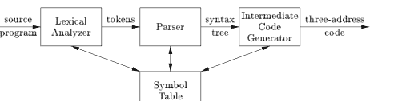

图 2.3：编译器前端模型

词法分析器使翻译器能够处理标识符等多字符结构，这些结构写成字符序列，但在语法分析期间被视为称为记号的单元；例如，在表达式 count + 1 中，标识符 count 被视为一个单元。2.6 节中的词法分析器允许数字、标识符和“空白字符”（空格、制表符和换行符）出现在表达式中。

接下来，我们考虑中间代码生成。图 2.4 展示了两种中间代码形式。一种形式称为抽象语法树，或简称语法树，表示源程序的层次化语法结构。在图 2.3 的模型中，解析器生成语法树，再进一步翻译成三地址代码。一些编译器将解析和中间代码生成合并为一个组件。

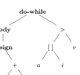

```
1: i = i + 1;
2: t1 = a [ i ];
3: if t1 < v goto 1
```

图 2.4：“do i = i + 1; while (a[i] < v);”的中间代码

图 2.4(a) 中抽象语法树的根表示整个 do-while 循环。根的左子节点表示循环体，它仅由赋值 i = i + 1; 组成。根的右子节点表示条件 a[i] < v。语法树的实现出现在 2.8 节。

另一种常见的中间表示如图 2.4(b) 所示，是一系列“三地址”指令；更完整的示例出现在图 2.2 中。这种中间代码形式得名于 *x* = *y* *op* *z* 形式的指令，其中 *op* 是二元运算符，*y* 和 *z* 是操作数的地址，*x* 是运算结果的地址。一条三地址指令至多执行一个操作，通常是计算、比较或分支。

在附录 A 中，我们将本章的技术结合起来，用 Java 构建一个编译器前端。该前端将语句翻译成汇编级指令。

### 2.2 语法定义

在本节中，我们介绍一种记法——“上下文无关文法”，或简称“文法”——用于指定语言的语法。本书通篇将使用文法来组织编译器前端。

文法自然地描述大多数编程语言结构的层次结构。例如，Java 中的 if-else 语句可以具有如下形式

```
if ( expression ) statement else statement
```

也就是说，if-else 语句是关键字 *if*、左括号、一个表达式、右括号、一个语句、关键字 *else* 以及另一个语句的串联。使用变量 *expr* 表示表达式，变量 *stmt* 表示语句，这条结构化规则可以表示为

```
stmt → if ( expr ) stmt else stmt
```

其中箭头可读作“可以具有如下形式”。这样的规则称为*产生式*。在一个产生式中，像关键字 *if* 和括号这样的词法元素称为*终结符*。像 *expr* 和 *stmt* 这样的变量表示终结符序列，称为*非终结符*。

#### 2.2.1 文法的定义

一个*上下文无关文法*有四个组成部分：

- 1. 一组*终结符*符号，有时称为“记号”。终结符是文法所定义语言的基本符号。
- 2. 一组*非终结符*，有时称为“语法变量”。每个非终结符表示一组终结符串，具体方式我们将加以描述。
- 3. 一组*产生式*，其中每个产生式由一个非终结符（称为产生式的*头部*或*左部*）、一个箭头，以及一个……的序列组成


## 2.2 语法定义

##### 记号与终结符

在编译器中，词法分析器读取源程序的字符，将它们分组为称为词素的词法上有意义的单位，并输出表示这些词素的记号。一个记号由两个分量组成：记号名和属性值。记号名是语法分析器用于语法分析的抽象符号。通常，我们将这些记号名称为*终结符*，因为它们作为终结符符号出现在编程语言的文法中。属性值（如果存在）是指向符号表的指针，该符号表包含关于该记号的附加信息。这种附加信息不是文法的一部分，因此在我们讨论语法分析时，常把记号和终结符作为同义词使用。

终结符和/或非终结符，称为产生式的*体*或*右部*。一个产生式的直观意图是指定某个构造的一种书写形式；如果头非终结符表示一个构造，那么体表示该构造的一种书写形式。

- 4. 将其中一个非终结符指定为*开始*符号。

我们通过列出产生式来指定文法，其中开始符号的产生式列在最前面。我们假定数字、诸如 < 和 <= 之类的符号，以及诸如 **while** 之类的粗体字符串都是终结符。斜体名称是非终结符，任何非斜体名称或符号都可以假定为终结符。^1 为记号方便，以同一非终结符为头的产生式可以将其体分组，各候选体用符号 | 分隔，我们读作“或”。

**例2.1：** 本章中有几个例子使用由数字以及加号和减号组成的表达式；例如，9-5+2、3-1 或 7 这样的串。由于加号或减号必须出现在两个数字之间，我们把这样的表达式称为“由加号或减号分隔的数字列表”。下面的文法描述这些表达式的语法。产生式为：

```
list  ->  list + digit              (2.1)
list  ->  list - digit              (2.2)
list  ->  digit                     (2.3)
digit ->  0 | 1 | 2 | 3 | 4 | 5 | 6 | 7 | 8 | 9  (2.4)
```

^1 单个斜体字母将用于其他目的，特别是在第4章详细研究文法时。例如，我们将使用 *X*、*Y* 和 *Z* 来讨论一个要么是终结符要么是非终结符的符号。然而，任何包含两个或更多字符的斜体名称仍将表示非终结符。

以非终结符 *list* 为头的三个产生式的体可以等价地分组：

```
list -> list + digit | list - digit | digit
```

根据我们的约定，该文法的终结符是符号

```
+ - 0 1 2 3 4 5 6 7 8 9
```

非终结符是斜体名称 *list* 和 *digit*，其中 *list* 是开始符号，因为它的产生式最先给出。□

若一个非终结符是某产生式的头，则称该产生式是*针对*这个非终结符的。终结符串是零个或多个终结符的序列。零个终结符的串写作 ε，称为*空串*。²

² 严格来说，ε 可以是来自任何字母表（符号集合）的零个符号组成的串。

#### 2.2.2 推导

文法通过从开始符号开始，并反复用一个非终结符的产生式的体替换该非终结符来推导串。能够从开始符号推导出的终结符串构成该文法定义的*语言*。

**例2.2：** 例2.1 的文法所定义的语言由加号和减号分隔的数字列表组成。非终结符 *digit* 的十个产生式允许它代表终结符 0、1、…、9 中的任意一个。根据产生式 (2.3)，单个数字本身就是一个列表。产生式 (2.1) 和 (2.2) 表达了这样的规则：任何列表后跟一个加号或减号，然后再跟另一个数字，就构成一个新列表。

产生式 (2.1) 到 (2.4) 就是定义所需语言所需的全部。例如，我们可以如下推断 9-5+2 是一个 *list*。

- a) 9 是一个 *list*，根据产生式 (2.3)，因为 9 是一个 *digit*。
- b) 9-5 是一个 *list*，根据产生式 (2.2)，因为 9 是一个 *list* 且 5 是一个 *digit*。
- c) 9-5+2 是一个 *list*，根据产生式 (2.1)，因为 9-5 是一个 *list* 且 2 是一个 *digit*。

□

**例2.3：** 另一种略有不同的列表是函数调用中的参数列表。在 Java 中，参数括在圆括号内，例如函数 max 的调用 max(x,y)，参数为 x 和 y。这种列表的一个微妙之处是，在终结符 ( 和 ) 之间可能找到空参数列表。我们可以用以下产生式开始为这样的序列开发文法：

```
call       →  id ( optparams )
optparams  →  params | ε
params     →  params , param | param
```

注意 *optparams*（“可选参数列表”）的第二个可能体是 ε，它代表符号的空串。也就是说，*optparams* 可以被空串替换，因此一个 *call* 可以由一个函数名后跟两个终结符组成的串 () 构成。注意 *params* 的产生式类似于例2.1 中 *list* 的产生式，只是用逗号代替算术运算符 + 或 −，并用 *param* 代替 *digit*。我们没有给出 *param* 的产生式，因为参数实际上是任意表达式。稍后，我们将讨论各种语言构造（如表达式、语句等）的合适产生式。□

*语法分析* 是这样一个问题：取一个终结符串，并弄清楚如何从文法的开始符号推导出它；如果它不能从文法的开始符号推导出来，则报告该串中的语法错误。语法分析是整个编译中最基本的问题之一；主要的语法分析方法将在第4章讨论。在本章中，为简单起见，我们从像 `9-5+2` 这样的源程序开始，其中每个字符都是一个终结符；一般来说，源程序具有字母数字词素，这些词素由词法分析器分组为记号，而记号的第一个分量是由语法分析器处理的终结符。

#### 2.2.3 语法分析树

一棵语法分析树用图形方式展示文法的开始符号如何推导出语言中的一个串。如果非终结符 A 有一个产生式 `A → XYZ`，那么一棵语法分析树可以有一个标号为 A 的内部节点，它有三个从左到右标号为 X、Y 和 Z 的子节点：

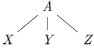

形式地说，给定一个上下文无关文法，根据该文法的一棵*语法分析树*是具有以下性质的树：

- 1. 根由开始符号标记。
- 2. 每个叶由一个终结符或由 ε 标记。
- 3. 每个内部节点由一个非终结符标记。
- 4. 如果 A 是标记某个内部节点的非终结符，且 X₁, X₂, …, Xₙ 是从左到右该节点子节点的标记，那么必须存在一个产生式 A → X₁X₂ ··· Xₙ。这里，X₁, X₂, …, Xₙ 各自代表一个要么是终结符要么是非终结符的符号。作为特殊情况，如果 *A* → ε 是一个产生式，那么一个标号为 *A* 的节点可以有一个标号为 ε 的单一子节点。

##### 树术语

树数据结构在编译中占有突出地位。

- 一棵树由一个或多个*节点*组成。节点可以带有*标号*，在本书中通常将是文法符号。当我们画一棵树时，我们常常仅用这些标号来表示节点。
- 恰好一个节点是*根*。除根以外的所有节点都有唯一的*父节点*；根没有父节点。当我们画树时，我们把一个节点的父节点放在该节点上方，并在它们之间画一条边。于是根就是最高的（最上面的）节点。
- 如果节点 *N* 是节点 *M* 的父节点，那么 *M* 是 *N* 的*子节点*。一个节点的子节点称为*兄弟节点*。它们有一个*从左到右*的顺序，当我们画树时，我们按这种方式排列给定节点的子节点。
- 没有子节点的节点称为*叶*。其他节点——那些有一个或多个子节点的节点——是*内部节点*。
- 节点 *N* 的*后代*要么是 *N* 本身，要么是 *N* 的子节点，要么是 *N* 的子节点的子节点，依此类推，任意层数。我们说节点 *N* 是节点 *M* 的*祖先*，如果 *M* 是 *N* 的后代。

**例2.4：** 例2.2 中 9-5+2 的推导由图2.5 中的树说明。树中的每个节点由文法符号标记。一个内部节点及其子节点对应一个产生式；内部节点对应产生式的头，子节点对应体。

在图2.5 中，根标号为 *list*，它是例2.1 中文法的开始符号。根的子节点从左到右标号为 *list*、+ 和 *digit*。注意

*list* → *list* + *digit*

是例2.1 文法中的一个产生式。根的左子节点与根相似，只是其一个子节点标号为 - 而不是 +。三个标号为 *digit* 的节点各有一个由数字标记的子节点。□

从左到右，语法分析树的叶形成该树的*产出*，即从语法分析树根处的非终结符*生成*或*推导*出的串。


## 2.2. 语法定义

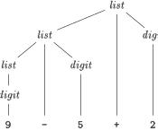

图 2.5：根据示例 2.1 中的文法，9−5+2 的语法分析树

树。在图 2.5 中，产出为 9−5+2；为方便起见，所有叶子都显示在底层。此后，我们不一定以这种方式排列叶子。任何树都为其叶子赋予一种自然的从左到右顺序，其依据是：如果 X 和 Y 是具有同一父节点的两个子节点，且 X 在 Y 的左边，那么 X 的所有后代都在 Y 的所有后代的左边。

由文法生成的语言的另一种定义是：可由某棵语法分析树生成的所有字符串的集合。为给定终结符串寻找一棵语法分析树的过程称为对该字符串进行*解析*。

#### 2.2.4 二义性

在谈论一个字符串根据某文法所具有的*该*结构时，我们必须小心。一个文法可以有多于一棵语法分析树生成给定的终结符串。这样的文法称为*二义的*。要证明一个文法是二义的，我们只需找到一个终结符串，它能够作为多于一棵语法分析树的产出。由于具有多于一棵语法分析树的字符串通常具有多于一种含义，因此在编译应用中，我们需要设计无二义文法，或者使用带有附加规则的二义文法来消除二义性。

**示例 2.5：** 假设我们像示例 2.1 那样只使用一个非终结符 *string*，并且不区分数字和列表。我们本可以写出如下文法

```
string → string + string | string − string | 0 | 1 | 2 | 3 | 4 | 5 | 6 | 7 | 8 | 9
```

将 *digit* 和 *list* 的概念合并到非终结符 *string* 中表面上说得通，因为单个 *digit* 是 *list* 的一种特殊情况。

然而，图 2.6 表明，对于像 9−5+2 这样的表达式，该文法可以给出多于一棵语法分析树。9−5+2 的两棵树对应于对该表达式加括号的两种方式：(9−5)+2 和 9−(5+2)。第二种加括号方式使该表达式得到意外的值 2，而不是惯常的值 6。示例 2.1 的文法不允许这种解释。□

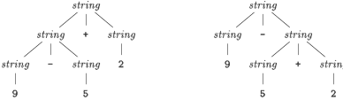

图 2.6：9-5+2 的两棵语法分析树

#### 2.2.5 运算符的结合性

按照惯例，9+5+2 等价于 (9+5)+2，9-5-2 等价于 (9-5)-2。当一个像 5 这样的操作数左右两边都有运算符时，需要约定来决定哪个运算符作用于该操作数。我们说运算符 + 是左结合的，因为一个两边都有加号的操作数属于其左侧的运算符。在大多数编程语言中，四种算术运算符——加法、减法、乘法和除法——都是左结合的。

一些常见运算符（如幂运算）是右结合的。另一个例子是，C 及其后继语言中的赋值运算符 = 是右结合的；也就是说，表达式 a=b=c 与表达式 a=(b=c) 按相同方式处理。

像 a=b=c 这样含有右结合运算符的字符串由以下文法生成：

```
right → letter = right | letter
letter → a | b | ... | z
```

图 2.7 展示了像 - 这样的左结合运算符的语法分析树与像 = 这样的右结合运算符的语法分析树之间的对比。注意，9-5-2 的语法分析树向左下方生长，而 a=b=c 的语法分析树向右下方生长。

#### 2.2.6 运算符的优先级

考虑表达式 9+5*2。该表达式有两种可能的解释：(9+5)*2 或 9+(5*2)。+ 和 * 的结合性规则适用于同一运算符的出现，因此它们不能解决这种二义性。当存在多于一种运算符时，需要定义运算符相对优先级的规则。

如果 * 比 + 先取其操作数，我们就说 * 的优先级高于 +。在普通算术中，乘法和除法的优先级高于加法和减法。因此，在 9+5*2 和 9*5+2 中，5 都由 * 取作操作数；也就是说，这两个表达式分别等价于 9+(5*2) 和 (9*5)+2。

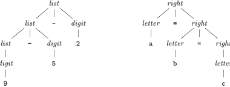

图 2.7：左结合文法和右结合文法的语法分析树

**示例 2.6：** 算术表达式的文法可以根据一张显示运算符结合性和优先级的表来构造。我们从四种常见算术运算符和一张优先级表开始，表中按优先级递增的顺序列出运算符。同一行中的运算符具有相同的结合性和优先级：

| 结合性 | 运算符 |
| --- | --- |
| 左结合 | + − |
| 左结合 | * / |

我们为这两个优先级层次创建两个非终结符 *expr* 和 *term*，并额外创建一个非终结符 *factor* 来生成表达式中的基本单元。目前，表达式中的基本单元是数字和带括号的表达式。

```
factor → digit | ( expr )
```

现在考虑具有最高优先级的二元运算符 * 和 /。由于这些运算符是左结合的，其产生式类似于左结合的列表产生式。

```
term → term * factor
     | term / factor
     | factor
```

类似地，*expr* 生成由加法类运算符分隔的项列表。

```
expr → expr + term
     | expr − term
     | term
```

因此，得到的文法是

```
expr   → expr + term | expr − term | term
term   → term * factor | term / factor | factor
factor → digit | ( expr )
```

##### 推广示例 2.6 的表达式文法

我们可以把因子（factor）看作不能被任何运算符“拆开”的表达式。所谓“拆开”，是指将运算符放在任何因子的任意一侧，都不会使该因子中除整体以外的任何部分成为该运算符的操作数。如果该因子是带括号的表达式，括号可以防止这种“拆开”；而如果该因子是单个操作数，它就不能被拆开。

一个项（term，且本身不是因子）是可以被最高优先级的运算符 * 和 / 拆开、但不能被较低优先级运算符拆开的表达式。一个表达式（且本身不是项或因子）可以被任何运算符拆开。

我们可以将这个思想推广到任意 *n* 个优先级层次。我们需要 *n*+1 个非终结符。第一个非终结符（如示例 2.6 中的 *factor*）永远不能被拆开。通常，该非终结符的产生式体只有单个操作数和带括号的表达式。然后，对于每个优先级层次，都有一个非终结符表示只能被该层次或更高层次的运算符拆开的表达式。通常，该非终结符的产生式包含表示该层次运算符用法的体，外加一个仅由下一更高层次的非终结符构成的体。

使用这种文法，表达式是由 + 或 − 号分隔的项列表，而项是由 * 或 / 号分隔的因子列表。注意，任何带括号的表达式都是因子，因此借助括号，我们可以构造出具有任意深嵌套（以及任意深树）的表达式。

**示例 2.7：** 关键字使我们能够识别语句，因为大多数语句以关键字或特殊字符开头。该规则的例外包括赋值和过程调用。图 2.8 中（二义的）文法定义的语句在 Java 中是合法的。

在 *stmt* 的第一个产生式中，终结符 id 表示任意标识符。*expression* 的产生式未显示。第一个产生式所指定的赋值语句在 Java 中是合法的，尽管 Java 将 `=` 视为可出现在表达式内部的赋值运算符。例如，Java 允许 `a = b = c`，而该文法不允许。

非终结符 *stmts* 生成一个可能为空的语句列表。*stmts* 的第二个产生式生成空列表 ε。第一个产生式生成一个可能为空的语句列表，后跟一个语句。

分号的位置很微妙；它们出现在每个不以 *stmt* 结尾的产生式体的末尾。这种方法避免了在以嵌套子语句结尾的 if 和 while 等语句之后累积分号。当嵌套子语句是赋值语句或 do-while 语句时，分号将作为该子语句的一部分生成。


## 2.2. 语法定义

```
stmt  →  id = expression ;
      |  if ( expression ) stmt
      |  if ( expression ) stmt else stmt
      |  while ( expression ) stmt
      |  do stmt while ( expression ) ;
      |  { stmts }

stmts →  stmts stmt
      |  ε
```

*图 2.8：Java 语句子集的文法*

#### 2.2.7 第 2.2 节的练习

**练习 2.2.1：** 考虑以下上下文无关文法

```
S → S S + | S S * | a
```

- a) 说明字符串 aa+a* 可以由该文法生成。
- b) 为该字符串构造一棵语法分析树。
- c) 该文法生成什么语言？请证明你的答案。

**练习 2.2.2：** 下面的文法分别生成什么语言？在每种情况下，请论证你的答案。

- a) S → 0 S 1 | 0 1
- b) S → + S S | - S S | a
- c) S → S ( S ) S | ε
- d) S → a S b S | b S a S | ε
- e) S → a | S + S | S S | S * | ( S )

**练习 2.2.3：** 练习 2.2.2 中的哪些文法是有二义性的？

**练习 2.2.4：** 为下列每种语言构造无二义性的上下文无关文法。在每种情况下，证明你的文法是正确的。

- a) 后缀表示法的算术表达式。
- b) 由逗号分隔的标识符的左结合列表。
- c) 由逗号分隔的标识符的右结合列表。
- d) 由整数和标识符以及四个二元运算符 +、-、*、/ 组成的算术表达式。
- e) 在（d）的算术运算符上增加一元加号和一元减号。

**练习 2.2.5：**

- a) 证明由以下文法生成的所有二进制串的值都能被 3 整除。*提示*：对语法分析树的节点数使用归纳法。

```
num -> 11 | 1001 | num 0 | num num
```

- b) 该文法是否生成所有值能被 3 整除的二进制串？

**练习 2.2.6：** 为罗马数字构造一个上下文无关文法。

### 2.3 语法制导翻译

语法制导翻译是通过将规则或程序片段附加到文法中的产生式上来完成的。例如，考虑由如下产生式生成的表达式 *expr*：

```
expr -> expr_1 + term
```

其中，*expr* 是两个子表达式 *expr_1* 和 *term* 的和。（*expr_1* 中的下标仅用于将产生式体中的 *expr* 实例与产生式头部的 *expr* 区分开来。）我们可以利用 *expr* 的结构来翻译它，如下面的伪代码所示：

```
translate expr_1;
translate term;
handle +;
```

我们将使用这种伪代码的一种变体，在 2.8 节中为 *expr* 构建语法树：先为 *expr_1* 和 *term* 构建语法树，然后通过为 + 构造一个节点来处理 +。为方便起见，本节中的示例是将中缀表达式翻译为后缀表示法。

本节介绍与语法制导翻译相关的两个概念：

- **属性。** *属性* 是与编程构造相关联的任何数量。属性的示例有：表达式的数据类型、生成代码中的指令数，或者某个构造的生成代码中第一条指令的位置，等等。由于我们使用文法符号（非终结符和终结符）表示编程构造，因此我们将属性的概念从构造扩展到表示它们的符号。

- **（语法制导的）翻译方案。** *翻译方案* 是一种将程序片段附加到文法产生式上的表示法。当在语法分析中使用该产生式时，这些程序片段就会被执行。所有程序片段的执行结果，按照语法分析产生的顺序组合起来，就得到该分析/综合过程所作用程序的翻译。

语法制导翻译将在本章中反复使用，用于将中缀表达式翻译为后缀表示法、对表达式求值，以及为编程构造构建语法树。关于语法制导形式化的更详细讨论见第 5 章。

#### 2.3.1 后缀表示法

本节中的示例涉及翻译为后缀表示法。表达式 E 的*后缀表示法*可以归纳定义如下：

- 1. 如果 E 是一个变量或常量，那么 E 的后缀表示法就是 E 本身。
- 2. 如果 E 是形如 E1 **op** E2 的表达式，其中 **op** 是任意二元运算符，那么 E 的后缀表示法为 E1' E2' **op**，其中 E1' 和 E2' 分别是 E1 和 E2 的后缀表示法。
- 3. 如果 E 是形如 (E1) 的带括号表达式，那么 E 的后缀表示法与 E1 的后缀表示法相同。

**例 2.8：** (9-5)+2 的后缀表示法是 95-2+。也就是说，根据规则（1），9、5 和 2 的翻译就是常量本身。然后，根据规则（2），9-5 的翻译是 95-。根据规则（3），(9-5) 的翻译与前者相同。在翻译完带括号的子表达式后，我们可以对整体表达式应用规则（2），其中 (9-5) 充当 E1，2 充当 E2，从而得到结果 95-2+。

再举一个例子，9-(5+2) 的后缀表示法是 952+-。也就是说，5+2 首先被翻译成 52+，然后这个表达式成为减号的第二个操作数。□

在后缀表示法中不需要括号，因为运算符的位置和*元数*（操作数个数）使得一个后缀表达式只能有一种解码方式。“诀窍”是不断从左侧扫描后缀串，直到找到一个运算符。然后，在其左侧查找适当数量的操作数，并将该运算符与其操作数组合在一起。在操作数上执行该运算符，并用结果替换它们。然后重复这一过程，继续向右扫描并寻找另一个运算符。

**例 2.9：** 考虑后缀表达式 952+-3*。从左扫描，我们首先遇到加号。在其左侧找到操作数 5 和 2。它们的和 7 替换 52+，我们得到串 97-3*。现在，最左边的

属性具有一个理想的特性：可以在对语法分析树的一次自底向上遍历中求值。在 5.1.1 节中，我们将讨论另一种重要的属性类型：“继承”属性。非正式地说，继承属性在某个语法分析树节点上的值是由该节点自身、其父节点及其兄弟节点上的属性值确定的。

**例 2.10：** 图 2.9 中的带注释的语法分析树基于图 2.10 中的语法制导定义，该定义将“由加号或减号分隔的数字组成的表达式”翻译为后缀表示法。每个非终结符都有一个字符串值属性 *t*，该属性表示该非终结符在语法分析树中生成的表达式的后缀表示法。语义规则中的符号 ‖ 是字符串连接运算符。

| 产生式 | 语义规则 |
|---|---|
| `expr → expr₁ + term` | `expr.t = expr₁.t ‖ term.t ‖ '+'` |
| `expr → expr₁ − term` | `expr.t = expr₁.t ‖ term.t ‖ '−'` |
| `expr → term` | `expr.t = term.t` |
| `term → 0` | `term.t = '0'` |
| `term → 1` | `term.t = '1'` |
| ⋮ | ⋮ |
| `term → 9` | `term.t = '9'` |

图 2.10：中缀到后缀翻译的语法制导定义

数字的后缀形式就是该数字本身；例如，与产生式 *term → 9* 相关联的语义规则定义：只要该产生式在语法分析树的某个节点被使用，*term.t* 就是 9 本身。其他数字的翻译与此类似。再如，当应用产生式 *expr → expr₁ + term* 时，*term.t* 的值就变成了 *expr.t* 的值。

产生式 *expr → expr₁ + term* 推导出一个包含加号运算符的表达式。³ 加号的左操作数由 *expr₁* 给出，右操作数由 *term* 给出。与该产生式相关联的语义规则

*expr.t = expr₁.t ‖ term.t ‖ '+'*

通过将左右操作数的后缀形式 *expr₁.t* 和 *term.t* 分别连接起来，然后附加加号，来构造属性 *expr.t* 的值。这条规则是“后缀表达式”定义的形式化表述。□

³ 在此处以及其他许多规则中，同一个非终结符（这里是 *expr*）出现多次。*expr₁* 中的下标 1 用于区分产生式中 *expr* 的两次出现；这个“1”不是非终结符的一部分。更多细节请参见“区分非终结符的不同使用”这一框注。


##### 区分非终结符不同用法的约定

在规则中，我们经常需要区分产生式头部和/或体中同一非终结符的若干用法；例如，见例2.10。原因是在分析树中，由同一非终结符标记的不同节点通常具有不同的翻译值。我们将采用以下约定：非终结符在头部不加下标，在体中使用不同的下标。这些都是同一非终结符的出现，下标不是其名称的一部分。然而，读者应注意使用此约定的具体翻译示例与诸如 $A \to X_1X_2,\ldots,X_n$ 的通用产生式之间的区别：在后一类产生式中，带下标的 $X$ 表示任意语法符号列表，而*不是*某个称为 $X$ 的特定非终结符的实例。

#### 2.3.3 简单的语法制导定义

例2.10中的语法制导定义具有以下重要性质：表示每个产生式头部非终结符的翻译的字符串，是产生式体中各非终结符的翻译按产生式中的相同顺序连接而成，并间插一些可选的附加字符串。具有此性质的语法制导定义称为*简单*的。

**例2.11：** 考虑图2.10中的第一个产生式和语义规则：

| 产生式 | 语义规则 | |
|---|---|---|
| $expr \to expr_1 + term$ | $expr.t = expr_1.t \Vert term.t \Vert '+'$ | (2.5) |

这里翻译 $expr.t$ 是 $expr_1$ 和 $term$ 的翻译的连接，后跟符号 +。注意 $expr_1$ 和 $term$ 在产生式体和语义规则中均以相同顺序出现。它们的翻译之前或之间没有附加符号。在此例中，唯一的额外符号出现在末尾。□

在讨论翻译方案时，我们将看到，简单的语法制导定义可以通过仅按其在定义中出现的顺序打印附加字符串来实现。

#### 2.3.4 树遍历

树遍历将用于描述属性求值，以及指定翻译方案中代码片段的执行。树的*遍历*从根开始，按某种顺序访问树的每个节点。

*深度优先*遍历从根开始，以任意顺序递归访问每个节点的子节点，不一定从左到右。它被称为“深度优先”，是因为它尽可能访问节点的未访问子节点，从而尽可能快地访问离根较远（即较“深”）的节点。

图2.11中的过程 *visit(N)* 是一种深度优先遍历，它按从左到右的顺序访问节点的子节点，如图2.12所示。在此遍历中，我们加入了在每个节点上对翻译求值的动作，就在完成该节点之前（也就是说，在子节点的翻译肯定已经计算之后）。一般来说，与遍历关联的动作可以是我们选择的任何动作，也可以什么都没有。

```text
procedure visit(node N) {
    for (each child C of N, from left to right) {
        visit(C);
    }
    evaluate semantic rules at node N;
}
```

图2.11：树的深度优先遍历

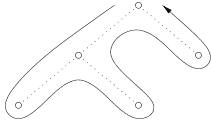

图2.12：树的深度优先遍历示例

语法制导定义不对分析树上属性的求值施加任何特定顺序；任何在属性 *a* 所依赖的所有其他属性之后计算 *a* 的求值顺序都是可接受的。综合属性可以在任何*自底向上*遍历期间求值，也就是说，这种遍历在求值了节点的子节点属性之后，再求值该节点的属性。一般来说，同时存在综合属性和继承属性时，求值顺序问题相当复杂；参见5.2节。

#### 2.3.5 翻译方案

图2.10中的语法制导定义通过将字符串作为属性附加到分析树的节点上来构建翻译。我们现在考虑另一种不需要操作字符串的方法；它通过执行程序片段来逐步产生相同的翻译。

##### 前序遍历和后序遍历

前序遍历和后序遍历是深度优先遍历的两个重要特例，其中我们从左到右访问每个节点的子节点。通常，我们遍历树以在每个节点上执行某些特定动作。如果动作是在我们第一次访问节点时完成的，那么我们可以将这种遍历称为*前序遍历*。类似地，如果动作是在我们最后一次离开节点之前完成的，那么我们说它是树的*后序遍历*。图2.11中的过程 *visit(N)* 是后序遍历的一个例子。

前序遍历和后序遍历根据节点上动作执行的时间，定义了节点上的相应排序。以节点 *N* 为根的（子）树的*前序*由 *N* 组成，后跟其每个子节点（如果有）的子树的前序，从左到右。以 *N* 为根的（子）树的*后序*由 *N* 的每个子节点（如果有）的子树的后序组成，从左到右，后跟 *N* 本身。

语法制导翻译方案是一种记号，通过将程序片段附加到文法中的产生式来指定翻译。翻译方案类似于语法制导定义，不同之处在于语义规则的求值顺序是明确指定的。

嵌入产生式体中的程序片段称为*语义动作*。动作要执行的位置通过将其括在花括号中并写在产生式体内来表示，如

*rest* → + *term* {print('+')} *rest₁*

当我们考虑表达式的另一种文法形式时，我们将看到这样的规则，其中非终结符 *rest* 表示“表达式中除第一项之外的所有内容”。这种文法形式在2.4.5节讨论。同样，*rest₁* 中的下标将产生式体中非终结符 *rest* 的这个实例与产生式头部的 *rest* 实例区分开来。

为翻译方案绘制分析树时，我们通过为动作构造一个额外子节点来表示动作，该子节点用虚线连接到对应于产生式头部的节点。例如，上述产生式和动作的分析树部分如图2.13所示。语义动作的节点没有子节点，因此当该节点第一次被看到时执行该动作。

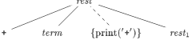

图2.13：为语义动作构造一个额外的叶子

**例2.12：** 图2.14中的分析树在额外的叶子上有打印语句，这些叶子通过虚线连接到分析树的内部节点。翻译方案见图2.15。基础文法生成由加号和减号分隔的数字组成的表达式。嵌入产生式体中的动作将此类表达式翻译为后缀表示法，前提是我们对树执行从左到右的深度优先遍历，并在访问每个打印语句的叶子时执行该语句。

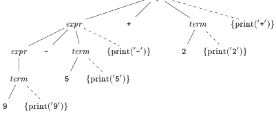

图2.14：将9−5+2翻译为95−2+的动作

```text
expr  →  expr₁ + term   {print('+')}
expr  →  expr₁ − term   {print('−')}
expr  →  term
term  →  0              {print('0')}
term  →  1              {print('1')}
      ⋮
term  →  9              {print('9')}
```

图2.15：翻译为后缀表示法的动作

图2.14的根表示图2.15中的第一个产生式。在后序遍历中，我们首先执行根的最左子树中的所有动作，该子树对应左操作数，也像根一样标记为 *expr*。然后我们访问叶子 +，此处没有动作。接下来，我们执行右操作数 *term* 的子树中的动作，最后执行额外节点上的语义动作 {print('+')}。

由于 *term* 的产生式右侧只有一个数字，该数字由这些产生式的动作打印。产生式 *expr* → *term* 不需要输出，只有运算符需要打印在

前两个产生式各有一个动作。当在分析树的后序遍历期间执行时，图 2.14 中的动作会打印出 95-2+。□

注意，尽管图 2.10 和图 2.15 中的方案产生相同的翻译，但它们的构造方式不同；图 2.10 将字符串作为属性附加到分析树的节点上，而图 2.15 中的方案通过语义动作增量地打印翻译结果。

图 2.14 中分析树里的语义动作将中缀表达式 9-5+2 翻译为 95-2+，其方法是把 9-5+2 中的每个字符恰好打印一次，而不为子表达式的翻译使用任何存储。当以这种方式增量生成输出时，字符打印的顺序很重要。

翻译方案的实现必须确保语义动作按照它们在分析树后序遍历中出现的顺序执行。实现不必实际构造分析树（通常也不构造），只要确保语义动作的执行方式如同我们构造了分析树并在后序遍历期间执行这些动作即可。

#### 2.3.6 第 2.3 节练习

- 1. **练习 2.3.1：** 构造一个语法制导翻译方案，将算术表达式从中缀表示法转换为前缀表示法，其中运算符出现在其操作数之前；例如，−xy 是 x − y 的前缀表示法。给出输入 9-5+2 和 9-5*2 的带注释分析树。
- 2. **练习 2.3.2：** 构造一个语法制导翻译方案，将算术表达式从后缀表示法转换为中缀表示法。给出输入 95-2* 和 952*- 的带注释分析树。
- 3. **练习 2.3.3：** 构造一个将整数转换为罗马数字的语法制导翻译方案。
- 4. **练习 2.3.4：** 构造一个将不超过 2000 的罗马数字转换为整数的语法制导翻译方案。
- 5. **练习 2.3.5：** 构造一个语法制导翻译方案，将后缀算术表达式转换为等价的前缀算术表达式。

### 2.4 语法分析

语法分析是确定一个终结符串如何能由文法生成的过程。在讨论这个问题时，想象正在构造一棵分析树是有帮助的，即使编译器在实践中可能并不构造它。然而，分析器必须原则上能够构造这棵树，否则就不能保证翻译正确。

本节介绍一种称为“递归下降”的语法分析方法，它既可用于语法分析，也可用于实现语法制导翻译器。下一节将给出一个完整的 Java 程序，实现图 2.15 的翻译方案。一个可行的替代方案是使用软件工具直接根据翻译方案生成翻译器。第 4.9 节描述了这样一种工具——Yacc；它无需修改就能实现图 2.15 的翻译方案。

对于任何上下文无关文法，都存在一个分析器，它解析一个含 n 个终结符的串至多需要 O(n³) 时间。但立方时间通常过于昂贵。幸运的是，对于实际编程语言，我们通常可以设计出能够快速分析的文法。线性时间算法足以分析实践中出现的几乎所有语言。编程语言分析器几乎总是对输入进行单次从左到右扫描，一次向前看一个终结符，并边扫描边构造分析树的各个部分。

大多数语法分析方法属于两类之一，称为*自顶向下*和*自底向上*方法。这些术语指的是分析树中节点的构造顺序。在自顶向下分析器中，构造从根开始并向叶子推进；而在自底向上分析器中，构造从叶子开始并向根推进。自顶向下分析器的流行，是因为使用自顶向下方法可以更容易地手工构造高效分析器。然而，自底向上语法分析可以处理更大类别的文法和翻译方案，因此直接根据文法生成分析器的软件工具通常使用自底向上方法。

#### 2.4.1 自顶向下语法分析

我们通过考虑一个非常适合这类方法的文法来介绍自顶向下语法分析。本节后面，我们将考虑一般情况下的自顶向下分析器的构造。图 2.16 中的文法生成 C 或 Java 中语句的一个子集。我们使用粗体终结符 **if** 和 **for** 分别表示关键字“if”和“for”，以强调这些字符序列被当作单元，即当作单个终结符。此外，终结符 *expr* 表示表达式；一个更完整的文法会使用非终结符 *expr*，并具有针对非终结符 *expr* 的产生式。类似地，*other* 是表示其他语句结构的终结符。

像图 2.17 中那样的分析树的自顶向下构造，是从根开始进行的，根标有开始非终结符 *stmt*，然后重复执行以下两个步骤。

- 1. 在标有非终结符 A 的节点 N 处，为 A 选择一个产生式，并在 N 处为该产生式体中的符号构造子节点。
- 2. 找到下一个要构造子树的节点，通常是树中最左的未展开非终结符。

对于某些文法，上述步骤可以在对输入串的一次从左到右扫描期间实现。输入中当前正在扫描的终结符通常称为*向前看*符号。最初，*向前看*符号是输入串的第一个，即最左边的终结符。图 2.18 说明了对于输入串

```
for ( ; expr ; expr ) other
```

图 2.17 中分析树的构造过程。最初，终结符 `for` 是向前看符号，分析树的已知部分由根组成，根在图 2.18(a) 中标有开始非终结符 *stmt*。目标是构造分析树的其余部分，使得分析树生成的串与输入串匹配。

要发生匹配，图 2.18(a) 中的非终结符 *stmt* 必须推导出一个以向前看符号 `for` 开头的串。在图 2.16 的文法中，只有一个针对 *stmt* 的产生式可以推导出这样的串，因此我们选择它，并为根构造子节点，子节点标有该产生式体中的符号。分析树的这次展开如图 2.18(b) 所示。

图 2.18 中的三个快照都用箭头标出了输入中的向前看符号以及分析树中正在考虑的节点。在一个节点处构造子节点之后，我们接下来考虑最左子节点。在图 2.18(b) 中，刚刚在根处构造了子节点，正在考虑标有 `for` 的最左子节点。

当分析树中正在考虑的节点对应一个终结符，并且该终结符与向前看符号匹配时，我们就在分析树和输入中同时前进。输入中的下一个终结符成为新的向前看符号，并考虑分析树中的下一个子节点。在图 2.18(c) 中，分析树中的箭头已前进到根的下一个子节点，而箭头

```
if ( lookahead == expr ) match(expr);
```

在其主体中执行。非终结符 optexpr 有两个产生式，其产生式体分别为 expr 和 ε。向前看符号“;”与终结符 expr 不匹配，因此产生式体为 expr 的产生式不能应用。事实上，该过程返回时既不改变向前看符号，也不做任何其他事情。什么都不做对应于应用一个 ε-产生式。

更一般地，考虑图 2.16 中产生式的一个变体，其中 optexpr 生成一个表达式非终结符，而不是终结符 expr：

```
optexpr → expr
| ε
```

因此，optexpr 要么使用非终结符 expr 生成一个表达式，要么生成 ε。在分析 optexpr 时，如果向前看符号不在 FIRST(expr) 中，则使用 ε-产生式。

关于何时使用 ε-产生式的更多内容，参见第 4.4.3 节中对 LL(1) 文法的讨论。

#### 2.4.4 设计预测分析器

我们可以推广第 2.4.2 节中非正式介绍的技术，使其适用于任何这样的文法：对于任何非终结符，其各产生式体的 FIRST 集互不相交。我们还将看到，当我们有一个翻译方案——即一个带有内嵌动作的文法——时，可以将这些动作作为为分析器设计的过程的一部分来执行。

回想一下，预测分析器是一个程序，由每个非终结符对应的一个过程组成。非终结符 A 的过程做两件事。

- 1. 它通过检查向前看符号来决定使用哪个 A-产生式。如果向前看符号在 FIRST(α) 中，则使用产生式体为 α（其中 α 不是 ε，即空串）的产生式。如果对于任何向前看符号，两个非空产生式体之间存在冲突，那么我们就不能在该文法上使用这种语法分析方法。此外，如果 A 存在 ε-产生式，那么当向前看符号不在 A 的任何其他产生式体的 FIRST 集中时，就使用该 ε-产生式。
- 2. 然后，该过程模拟所选产生式的体。也就是说，产生式体中的符号从左到右依次“执行”。非终结符通过调用该非终结符对应的过程来“执行”，而与向前看符号匹配的终结符通过读取下一个输入符号来“执行”。如果在某一点上，产生式体中的终结符与向前看符号不匹配，则报告语法错误。

图 2.19 是将这些规则应用于图 2.16 中文法的结果。


## 2.4 语法分析

正如通过扩展文法可以形成翻译方案一样，通过扩展预测分析器可以形成语法导向的翻译器。第5.4节给出了用于此目的的算法。以下有限构造对于当前目的已经足够：

-   1. 构造一个预测分析器，忽略产生式中的动作。
-   2. 将翻译方案中的动作复制到分析器中。如果某个动作出现在产生式 p 的语法符号 X 之后，则在 p 的代码中对应 X 的实现之后复制该动作。否则，如果动作出现在产生式的开始处，则将其复制到产生式体代码之前。

我们将在第2.5节构造这样的翻译器。

#### 2.4.5 左递归

递归下降分析器可能会永远循环。问题出在“左递归”产生式上，例如

$$\mathit{expr} \rightarrow \mathit{expr} + \mathit{term}$$

其中产生式体最左边的符号与产生式头部的非终结符相同。假设 expr 的过程决定应用这个产生式。产生式体以 expr 开头，因此 expr 的过程被递归调用。由于仅在匹配产生式体中的终结符时前瞻符号才会改变，因此在 expr 的递归调用之间输入没有变化。结果，对 expr 的第二次调用与第一次调用做的事情完全相同，这意味着对 expr 的第三次调用，等等，永远持续下去。

可以通过重写有问题的产生式来消除左递归产生式。考虑一个非终结符 A，它有两个产生式

$$A \rightarrow A\alpha \mid \beta$$

其中 α 和 β 是不以 A 开头的终结符和非终结符序列。例如，在

$$\mathit{expr} \rightarrow \mathit{expr} + \mathit{term} \mid \mathit{term}$$

中，非终结符 A = expr，串 α = + term，串 β = term。

非终结符 A 及其产生式被称为左递归的，因为产生式 A → Aα 将 A 本身作为右侧最左边的符号。⁴ 重复应用该产生式会在 A 的右侧构建一个 α 序列，如图 2.20(a) 所示。当 A 最终被 β 替换时，我们得到一个 β 后跟零个或多个 α 的序列。

⁴ 在一般的左递归文法中，非终结符 A 不是通过产生式 A → Aα，而是可能通过中间产生式推导出 Aα。

同样的效果可以通过以下方式实现，如图 2.20(b) 所示，使用一个新的非终结符 R 以如下方式重写 A 的产生式：

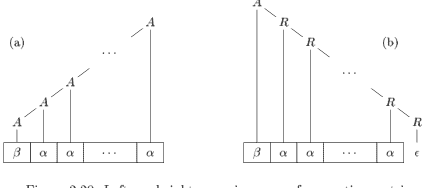

```
A → βR
R → αR | ε
```

非终结符 R 及其产生式 R → αR 是右递归的，因为该产生式将 R 本身作为右侧最后一个符号。右递归产生式导致树向右下方生长，如图 2.20(b) 所示。向右下方生长的树使得翻译包含左结合运算符（如减号）的表达式变得更加困难。然而，在第 2.5.2 节中我们将看到，通过仔细设计翻译方案，仍然可以实现将表达式正确翻译为后缀表示法。

在第 4.3.3 节中，我们将考虑更一般形式的左递归，并展示如何从文法中消除所有左递归。

#### 2.4.6 第 2.4 节的练习

**练习 2.4.1：** 从以下文法开始，构造递归下降分析器：

-   a) S → + S S | - S S | a
-   b) S → S ( S ) S | ε
-   c) S → 0 S 1 | 0 1

### 2.5 简单表达式的翻译器

利用上述三节的技术，我们现在以可运行的 Java 程序的形式构造一个语法导向的翻译器，将算术表达式翻译成后缀形式。为了保持初始程序足够小，我们从由数字和二元加号和减号组成的表达式开始。我们在第 2.6 节中扩展该程序以翻译包含数字和其他运算符的表达式。值得详细研究表达式的翻译，因为它在许多语言中都作为一种构造出现。

语法导向的翻译方案通常作为翻译器的规范。图 2.21（从图 2.15 重复）中的方案定义了此处要执行的翻译。

```
expr   ->   expr + term    { print('+') }
        |   expr - term    { print('-') }
        |   term

term   ->   0              { print('0') }
        |   1              { print('1') }
        |   ...
        |   9              { print('9') }
```

图 2.21：翻译为后缀表示法的动作

通常，给定方案的底层文法必须先进行修改，然后才能用预测分析器进行语法分析。特别是，图 2.21 中方案的底层文法是左递归的，正如我们在上一节中所看到的，预测分析器无法处理左递归文法。

我们似乎遇到了冲突：一方面我们需要一个便于翻译的文法，另一方面我们需要一个明显不同的便于语法分析的文法。解决方案是从易于翻译的文法开始，并仔细地转换它以便于语法分析。通过消除图 2.21 中的左递归，我们可以获得适合在预测递归下降翻译器中使用的文法。

#### 2.5.1 抽象语法和具体语法

设计翻译器的一个有用起点是一种称为*抽象语法树*的数据结构。在表达式的*抽象语法树*中，每个内部节点表示一个运算符；节点的子节点表示该运算符的操作数。更一般地，任何编程构造都可以通过为该构造创建一个运算符，并将该构造的语义上有意义的组成部分视为操作数来处理。

在图 2.22 中 9-5+2 的抽象语法树中，根节点表示运算符 +。根节点的子树表示子表达式 9-5 和 2。将 9-5 分组为一个操作数反映了同一优先级级别上运算符从左到右的求值。由于 - 和 + 具有相同的优先级，9-5+2 等价于 (9-5)+2。

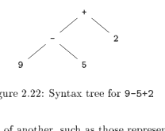

抽象语法树，或简称为*语法树*，在某种程度上类似于分析树。然而，在语法树中，内部节点表示编程构造，而在分析树中，内部节点表示非终结符。文法中的许多非终结符表示编程构造，但另一些则是某种“辅助”符号，例如表示项、因子或表达式的其他变体的非终结符。

在语法树中，这些辅助符号通常不需要，因此被省略。为了强调这种对比，分析树有时被称为*具体语法树*，底层文法被称为语言的*具体语法*。

在图 2.22 的语法树中，每个内部节点都与一个运算符关联，没有用于*单产生式*（产生式体仅由一个非终结符组成，没有其他内容）的“辅助”节点，如 *expr* → *term*，也没有用于 ε-产生式（如 *rest* → ε）的节点。

翻译方案最好基于其分析树尽可能接近语法树的文法。图 2.21 中文法对子表达式的分组与语法树中的分组相似。例如，加法运算符的子表达式由产生式体 *expr* + *term* 中的 *expr* 和 *term* 给出。

#### 2.5.2 调整翻译方案

图 2.20 中概述的左递归消除技术也可以应用于包含语义动作的产生式。首先，该技术扩展到 A 的多个产生式。在我们的示例中，A 是 *expr*，*expr* 有两个左递归产生式和一个非左递归产生式。该技术将产生式 A → Aα | Aβ | γ 转换为

```
A → γR
R → αR | βR | ε
```

其次，我们需要转换带有嵌入动作的产生式，而不仅仅是终结符和非终结符。产生式中嵌入的语义动作在转换过程中被简单地携带，就像它们是终结符一样。

**示例 2.13：** 考虑图 2.21 的翻译方案。令

A = *expr*

α = + *term* { print('+') }

β = - *term* { print('-') }

γ = *term*


## 2.5. 简单表达式的翻译器

然后，消除左递归的变换产生了图2.23中的翻译方案。图2.21中的 *expr* 产生式已被变换为 *expr* 的一个产生式，而一个新的非终结符 *rest* 扮演 *R* 的角色。*term* 的产生式重复自图2.21。图2.24展示了如何使用图2.23中的文法翻译 9-5+2。□

```text
expr → term rest
rest → + term { print('+') } rest
     | - term { print('-') } rest
     | ε
term → 0 { print('0') }
     | 1 { print('1') }
     | ...
     | 9 { print('9') }
```

图2.23：消除左递归后的翻译方案

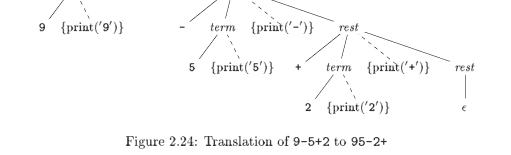

图2.24：将 9-5+2 翻译为 95-2+

消除左递归必须小心进行，以确保我们保留语义动作的顺序。例如，图2.23中的变换后方案在产生式体的中间有动作 { print('+') } 和 { print('-') }，在每种情况下都位于非终结符 *term* 和 *rest* 之间。如果将这些动作移到末尾，即移到 *rest* 之后，那么翻译就会变得不正确。我们留给读者证明：那时 9-5+2 会被错误地翻译为 952+-，即 9-(5+2) 的后缀表示，而不是期望的 95-2+，即 (9-5)+2 的后缀表示。

#### 2.5.3 非终结符的过程

图2.25中的函数 *expr*、*rest* 和 *term* 实现了图2.23中的语法制导翻译方案。这些函数模仿相应非终结符的产生式体。函数 *expr* 通过调用 *term*() 然后调用 *rest*() 来实现产生式 *expr* → *term rest*。

```text
void expr() {
    term();  rest();
}

void rest() {
    if ( lookahead == '+' ) {
        match('+');  term();  print('+');  rest();
    }
    else if ( lookahead == '-' ) {
        match('-');  term();  print('-');  rest();
    }
    else { } /* do nothing with the input */ ;
}

void term() {
    if ( lookahead is a digit ) {
        t = lookahead;  match(lookahead);  print(t);
    }
    else report("syntax error");
}
```

图2.25：非终结符 *expr*、*rest* 和 *term* 的伪代码。

函数 *rest* 实现图2.23中非终结符 *rest* 的三个产生式。如果向前看符号是加号，则应用第一个产生式；如果向前看符号是减号，则应用第二个产生式；在所有其他情况下应用产生式 *rest* → ε。*rest* 的前两个产生式由过程 *rest* 中 if 语句的前两个分支实现。如果向前看符号是 +，则通过调用 *match*('+') 匹配加号。在调用 *term*() 之后，通过写出一个加号字符来实现语义动作。第二个产生式类似，只是用 − 代替 +。由于 *rest* 的第三个产生式以 ε 为右部，函数 *rest* 中最后的 else 子句什么也不做。

*term* 的十个产生式生成十个数字。由于这些产生式中的每一个都生成一个数字并将其打印出来，图2.25中的同一段代码实现了它们全部。如果测试成功，变量 *t* 保存由 *lookahead* 表示的数字，以便在调用 *match* 之后将其写出。注意，*match* 会改变

#### 2.5.5 完整程序

我们的翻译器的完整 Java 程序出现在图2.27中。图2.27的第一行以 `import` 开头，提供了对包 `java.io` 的访问，用于系统输入和输出。其余代码由两个类 `Parser` 和 `Postfix` 组成。类 `Parser` 包含变量 `lookahead` 以及函数 `Parser`、`expr`、`term` 和 `match`。

执行从函数 `main` 开始，它定义在类 `Postfix` 中。函数 `main` 创建类 `Parser` 的一个实例 `parse`，并调用其函数 `expr` 来解析一个表达式。

函数 `Parser` 与其类同名，是一个*构造器*；当创建该类的对象时，它会自动被调用。从类 `Parser` 开头处的定义可以注意到，构造器 `Parser` 通过读取一个记号来初始化变量 `lookahead`。记号由单个字符组成，由系统输入例程 `read` 提供，该例程从输入文件中读取下一个字符。注意，`lookahead` 被声明为整数，而不是字符，以预见到后续小节中将引入除单个字符之外的其他记号。

函数 `expr` 是2.5.4节所讨论的简化结果；它实现图2.23中的非终结符 `expr` 和 `rest`。图2.27中 `expr` 的代码调用 `term`，然后有一个 while 循环，永远测试 `lookahead` 是否匹配 `'+'` 或 `'-'`。当控制到达 return 语句时，就退出这个 while 循环。在循环内，使用 `System` 类的输入/输出设施写出一个字符。

函数 `term` 使用 Java 类 `Character` 中的例程 `isDigit` 来测试向前看符号是否为数字。例程 `isDigit` 期望作用于一个字符；然而，`lookahead` 被声明为整数，以预见到未来的扩展。构造 `(char)lookahead` 将 `lookahead` 强制转换或强制为字符。与图2.25相比有一处小改动：写出向前看字符的语义动作发生在调用 `match` 之前。

函数 `match` 检查终结符；如果向前看符号匹配，则读取下一个输入终结符，否则通过执行以下代码发出错误信号

```text
throw new Error("syntax error");
```

这段代码创建类 `Error` 的一个新异常，并为其提供字符串 `syntax error` 作为错误消息。Java 不要求在 `throws` 子句中声明 `Error` 异常，因为它们只用于本不应发生的异常事件。⁶

⁶可以使用 Java 的异常处理设施来简化错误处理。一种方法是定义一个新异常，比如 `SyntaxError`，它扩展系统类 `Exception`。然后，当在 `term` 或 `match` 中检测到错误时，抛出 `SyntaxError` 而不是 `Error`。此外，在 `main` 中处理该异常，方法是将调用 `parse.expr()` 包在一个 try 语句中，该语句捕获异常 `SyntaxError`，写出一条消息并终止。我们需要向图2.27中的程序添加一个类 `SyntaxError`。为完成该扩展，除 `IOException` 外，函数 `match` 和 `term` 现在还必须声明它们可以抛出 `SyntaxError`。调用它们的函数 `expr` 也必须声明它可以抛出 `SyntaxError`。

```java
import java.io.*;
class Parser {
    static int lookahead;

    public Parser() throws IOException {
        lookahead = System.in.read();
    }

    void expr() throws IOException {
        term();
        while(true) {
            if( lookahead == '+' ) {
                match('+'); term(); System.out.write('+');
            }
            else if( lookahead == '-' ) {
                match('-'); term(); System.out.write('-');
            }
            else return;
        }
    }

    void term() throws IOException {
        if( Character.isDigit((char)lookahead) ) {
            System.out.write((char)lookahead); match(lookahead);
        }
        else throw new Error("syntax error");
    }

    void match(int t) throws IOException {
        if( lookahead == t ) lookahead = System.in.read();
        else throw new Error("syntax error");
    }
}

public class Postfix {
    public static void main(String[] args) throws IOException {
        Parser parse = new Parser();
        parse.expr(); System.out.write('\n');
    }
}
```

图2.27：将中缀表达式翻译为后缀形式的 Java 程序

##### Java 的一些显著特性

- Java 中的类由一系列变量和函数定义组成。
- 即使没有参数，也需要用括号括住函数参数列表；因此我们写 `expr()` 和 `term()`。这些函数实际上是过程，因为它们不返回值，这由函数名前的关键字 `void` 表示。
- 函数通过“按值”传递参数或访问共享数据进行通信。例如，函数 `expr()` 和 `term()` 使用类变量 `lookahead` 检查向前看符号，它们都可以访问该变量，因为它们都属于同一个类 Parser。
- 与 C 一样，Java 使用 `=` 表示赋值，`==` 表示相等，`!=` 表示不等。
- `term()` 定义中的“throws IOException”子句声明可能发生名为 IOException 的异常。当函数 `match` 使用例程 `read` 时，如果没有要读取的输入，就会发生这种异常。任何调用 `match` 的函数也必须声明在其自身执行期间可能发生 IOException。

### 2.6 词法分析

词法分析器从输入中读取字符，并将它们分组为“记号对象”。除了用于解析决策的终结符之外，记号对象还以属性值的形式携带附加信息。到目前为止，还没有必要区分“记号”和“终结符”这两个术语，因为解析器忽略记号所携带的属性值。在本节中，记号是终结符加上附加信息。

构成单个记号的输入字符序列称为*词素*。因此，我们可以说词法分析器从记号的词素表示实例化一个解析器。

本节的词法分析器允许数字、标识符和“空白”（空格、制表符和换行符）出现在表达式中。它可用于扩展上一节的表达式翻译器。由于图2.21的表达式文法必须扩展以允许数字和标识符，我们


## 2.6 词法分析

我们借此机会也允许乘法和除法。扩展后的翻译方案如图 2.28 所示。

```
expr  →  expr + term    { print('+') }
      |  expr - term    { print('-') }
      |  term

term  →  term * factor  { print('*') }
      |  term / factor  { print('/') }
      |  factor

factor → ( expr )
       | num            { print(num.value) }
       | id             { print(id.lexeme) }
```

图 2.28：翻译为后缀表示法的动作

在图 2.28 中，假定终结符 **num** 具有属性 *num.value*，它给出此出现处 **num** 对应的整数值。终结符 **id** 有一个字符串值属性，写作 *id.lexeme*；我们假定该字符串是构成记号 **id** 此次实例的实际词素。

用于说明词法分析器工作方式的伪代码片段将在本节末尾组装成 Java 代码。本节的方法适用于手写词法分析器。第 3.5 节介绍一个名为 Lex 的工具，它根据规格说明生成词法分析器。用于保存标识符信息的符号表或数据结构将在第 2.7 节讨论。

#### 2.6.1 消除空白和注释

第 2.5 节中的表达式翻译器会看到输入中的每个字符，因此多余字符（如空格）会使其失败。大多数语言允许记号之间出现任意数量的空白。注释在语法分析期间同样被忽略，因此也可以当作空白处理。

如果词法分析器消除了空白，语法分析器就永远不必考虑它。另一种选择是修改文法，将空白纳入语法，但这远没有那么容易实现。

图 2.29 中的伪代码只要看到空格、制表符或换行符，就继续读取输入字符，从而跳过空白。变量 *peek* 保存下一个输入字符。行号和上下文在错误消息中很有用，有助于精确定位错误；代码使用变量 *line* 统计输入中的换行符。

```
    for ( ; peek = next input character ) {
        if ( peek is a blank or a tab ) do nothing;
        else if ( peek is a newline ) line = line+1;
        else break;
    }
```

图 2.29：跳过空白

#### 2.6.2 预读

词法分析器可能需要预读一些字符，然后才能决定要返回给语法分析器的记号。例如，C 或 Java 的词法分析器在看到字符 > 之后必须预读。如果下一个字符是 =，那么 > 是字符序列 >= 的一部分，即“大于等于”运算符记号的词素。否则，> 本身构成“大于”运算符，而词法分析器已经多读了一个字符。

对输入进行预读的一种通用方法是维护一个输入缓冲区，词法分析器可以从中读取字符并回退字符。仅从效率角度就足以证明使用输入缓冲区是合理的，因为获取一块字符通常比一次获取一个字符更高效。指针跟踪输入中已分析的部分；回退一个字符通过将指针向后移动来实现。输入缓冲技术将在第 3.2 节讨论。

通常预读一个字符就足够了，因此一个简单的解决方案是使用一个变量（例如 *peek*）来保存下一个输入字符。本节的词法分析器在为数字收集数字位或为标识符收集字符时，会预读一个字符；例如，它会读过 1 以区分 1 和 10，并读过 t 以区分 t 和 true。

词法分析器只在必须预读时才预读。像 `*` 这样的运算符无需预读即可识别。在这种情况下，*peek* 被设为空格，当调用词法分析器查找下一个记号时，这个空格会被跳过。本节的不变式断言是：当词法分析器返回一个记号时，变量 *peek* 要么保存当前记号词素之后的字符，要么保存一个空格。

#### 2.6.3 常量

每当表达式的文法中出现单个数字时，似乎都合理地允许在相应位置使用任意整数常量。允许整数常量有两种方式：为这类常量创建一个终结符（例如 **num**），或者将整数常量的语法纳入文法。将字符收集为整数并计算其整体数值的工作通常交给词法分析器，因此在语法分析和翻译期间，数字可以被当作单个单元处理。

当输入流中出现一串数字时，词法分析器向语法分析器传递一个记号，该记号由终结符 num 以及根据这些数字计算出的整数值属性组成。如果我们把记号写成用 ⟨ ⟩ 括起来的元组，那么输入 31 + 28 + 59 会被转换为序列

⟨num, 31⟩  ⟨+⟩  ⟨num, 28⟩  ⟨+⟩  ⟨num, 59⟩

这里，终结符 + 没有属性，因此其元组就是 ⟨+⟩。图 2.30 中的伪代码读取一个整数中的数字，并使用变量 v 累加该整数的值。

```
if (peek holds a digit) {
    v = 0;
    do {
        v = v * 10 + integer value of digit peek;
        peek = next input character;
    } while (peek holds a digit);
    return token ⟨num, v⟩;
}
```

图 2.30：将数字分组为整数

#### 2.6.4 识别关键字和标识符

大多数语言使用固定字符串（如 for、do 和 if）作为标点符号或用于标识结构。这类字符串称为关键字。字符串也用作标识符，用来命名变量、数组、函数等。文法通常将标识符视为终结符，以简化语法分析器，这样每当输入中出现任何标识符时，语法分析器都可以期望同一个终结符（例如 id）。例如，对于输入

count = count + increment;    (2.6)

语法分析器处理的终结符流为 id = id + id。id 的记号有一个保存词素的属性。将记号写成元组，可以看到输入流 (2.6) 的元组为

⟨id, "count"⟩  ⟨=⟩  ⟨id, "count"⟩  ⟨+⟩  ⟨id, "increment"⟩  ⟨;⟩.

关键字通常满足构成标识符的规则，因此需要一种机制来判断一个词素何时构成关键字、何时构成标识符。如果关键字是保留的，即不能用作标识符，那么这个问题就更容易解决。这样，一个字符串只有在不是关键字时才构成标识符。

本节的词法分析器通过使用一个保存字符串的表来解决两个问题：

-   **单一表示。** 字符串表可以使编译器其余部分与字符串的表示方式隔离开来，因为编译器的各个阶段可以处理表中字符串的引用或指针。引用也比字符串本身更容易高效地操作。
-   **保留字。** 保留字可以通过用保留字符串及其记号初始化字符串表来实现。当词法分析器读取一个可能构成标识符的字符串或词素时，它首先检查该词素是否在字符串表中。如果在，则返回表中的记号；否则，返回一个终结符为 **id** 的记号。

在 Java 中，可以使用名为 *Hashtable* 的类将字符串表实现为哈希表。声明 *Hashtable words = new Hashtable();* 将 *words* 设置为一个默认的哈希表，它将键映射到值。我们将用它把词素映射到记号。图 2.31 中的伪代码使用操作 *get* 查找保留字。

```
if ( peek holds a letter ) {
    collect letters or digits into a buffer b;
    s = string formed from the characters in b;
    w = token returned by words.get(s);
    if ( w is not null ) return w;
    else {
        Enter the key-value pair (s, (id, s)) into words
        return token ⟨id, s⟩;
    }
}
```

图 2.31：区分关键字和标识符

这段伪代码从输入中收集一个字符串 *s*，它由字母和数字组成，并以字母开头。我们假设 *s* 被尽可能延长；也就是说，只要遇到字母和数字，词法分析器就会继续从输入中读取。当遇到字母或数字以外的内容（例如空白）时，将该词素复制到缓冲区 *b* 中。如果表中存在 *s* 的条目，则返回由 *words.get* 检索到的记号。这里，*s* 可能是一个关键字（*words* 表最初已用其填充），也可能是一个先前已输入表中的标识符。否则，将记号 **id** 和属性 *s* 装入表中并返回。


## 2.6 词法分析

#### 2.6.5 词法分析器

本节到目前为止的伪代码片段组合在一起，形成一个返回记号对象的函数 *scan*，如下所示：

```
Token scan() {
    skip white space, as in Section 2.6.1;
    handle numbers, as in Section 2.6.3;
    handle reserved words and identifiers, as in Section 2.6.4;
    /* if we get here, treat read-ahead character peek as a token */
    Token t = new Token(peek);
    peek = blank /* initialization, as discussed in Section 2.6.2 */ ;
    return t;
}
```

本节其余部分将函数 *scan* 实现为用于词法分析的 Java 包的一部分。这个名为 *lexer* 的包包含用于记号的类，以及一个包含函数 *scan* 的类 *Lexer*。

用于记号的类及其字段如图 2.32 所示；它们的方法未显示。类 *Token* 有一个字段 *tag*，用于语法分析决策。子类 *Num* 增加了一个用于整数值的字段 *value*。子类 *Word* 增加了一个字段 *lexeme*，用于保留字和标识符。

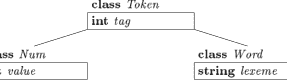

图 2.32：类 *Token* 及其子类 *Num* 和 *Word*

每个类各自位于一个文件中。类 Token 的文件如下：

```java
1) package lexer;                // File Token.java
2) public class Token {
3)     public final int tag;
4)     public Token(int t) { tag = t; }
5) }
```

第 1 行标识包 *lexer*。字段 *tag* 在第 3 行被声明为 final，因此一旦设置就不能更改。第 4 行的构造方法 Token 用于创建记号对象，如下所示：

`new Token('+')`

它创建一个类 Token 的新对象，并将其字段 tag 设置为 '+' 的整数表示。（为简洁起见，我们省略了惯常的 toString 方法，该方法会返回适合打印的字符串。）

在伪代码中具有诸如 **num** 和 **id** 这样的终结符的地方，Java 代码使用整数常量。类 Tag 实现这些常量：

```java
1) package lexer;                 // File Tag.java
2) public class Tag {
3)     public final static int
4)         NUM = 256, ID = 257, TRUE = 258, FALSE = 259;
5) }
```

除了整数值字段 NUM 和 ID 之外，这个类还定义了两个额外字段 TRUE 和 FALSE 以供将来使用；它们将用于说明保留关键字的处理。<sup>7</sup>

<sup>7</sup> ASCII 字符通常被转换为 0 到 255 之间的整数。因此，我们对终结符使用大于 255 的整数。

类 Tag 中的字段是 public 的，因此可以在包外使用。它们是 static 的，所以这些字段只有一个实例或副本。这些字段是 final 的，因此只能设置一次。实际上，这些字段表示常量。在 C 中通过使用 define 语句允许像 NUM 这样的名称用作符号常量，可以达到类似的效果，例如：

```c
#define NUM 256
```

在伪代码引用终结符 **num** 和 **id** 的地方，Java 代码引用 Tag.NUM 和 Tag.ID。唯一的要求是 Tag.NUM 和 Tag.ID 必须用互不相同、且不同于表示单字符记号（如 '+' 或 '*'）的常量的值来初始化。

```java
1) package lexer;                 // File Num.java
2) public class Num extends Token {
3)     public final int value;
4)     public Num(int v) { super(Tag.NUM); value = v; }
5) }
```

```java
1) package lexer;                 // File Word.java
2) public class Word extends Token {
3)     public final String lexeme;
4)     public Word(int t, String s) {
5)         super(t); lexeme = new String(s);
6)     }
7) }
```

图 2.33：Token 的子类 Num 和 Word

类 Num 和 Word 出现在图 2.33 中。类 Num 通过在第 3 行声明一个整数字段 value 来扩展 Token。第 4 行的构造方法 Num 调用 super(Tag.NUM)，这将超类 Token 中的字段 tag 设置为 Tag.NUM。

```java
1) package lexer;                         // File Lexer.java
2) import java.io.*; import java.util.*;
3) public class Lexer {
4)   public int line = 1;
5)   private char peek = ' ';
6)   private Hashtable words = new Hashtable();
7)   void reserve(Word t) { words.put(t.lexeme, t); }
8)   public Lexer() {
9)     reserve( new Word(Tag.TRUE,  "true")  );
10)    reserve( new Word(Tag.FALSE, "false") );
11)  }
12)  public Token scan() throws IOException {
13)    for(; ; peek = (char)System.in.read() ) {
14)      if( peek == ' ' || peek == '\t' ) continue;
15)      else if( peek == '\n' ) line = line + 1;
16)      else break;
17)    }
/* continues in Fig. 2.35 */
```

图 2.34：词法分析器代码，第 1 部分（共 2 部分）

类 Word 同时用于保留字和标识符，因此第 4 行的构造方法 Word 需要两个参数：一个词素和对应的 tag 整数值。可以通过执行 `new Word(Tag.TRUE, "true")` 创建保留字 true 的对象，这会创建一个新对象，其字段 tag 设置为 Tag.TRUE，字段 lexeme 设置为字符串 "true"。

用于词法分析的类 Lexer 出现在图 2.34 和图 2.35 中。第 4 行的整数变量 line 统计输入行数，第 5 行的字符变量 peek 保存下一个输入字符。

保留字在第 6 行到第 11 行处理。表 words 在第 6 行声明。第 7 行的辅助函数 reserve 将一个字符串-单词对放入表中。构造方法 Lexer 中的第 9 行和第 10 行初始化该表。它们使用构造方法 Word 创建单词对象，并将其传递给辅助函数 reserve。因此，在第一次调用 scan 之前，表已用保留字 "true" 和 "false" 初始化。

图 2.34–2.35 中 scan 的代码实现了本节的伪代码片段。第 13 行到第 17 行的 for 语句跳过空白、制表符和换行字符。控制离开 for 语句时，peek 保存一个非空白字符。

读取数字序列的代码在第 18 行到第 25 行。函数 isDigit 来自内置类 Character。它在第 18 行用于检查 peek 是否为数字。如果是，第 19 行到第 24 行的代码累加输入中数字序列的整数值，并返回一个新的 Num 对象。

```java
18)      if( Character.isDigit(peek) ) {
19)          int v = 0;
20)          do {
21)              v = 10*v + Character.digit(peek, 10);
22)              peek = (char)System.in.read();
23)          } while( Character.isDigit(peek) );
24)          return new Num(v);
25)      }
26)      if( Character.isLetter(peek) ) {
27)          StringBuffer b = new StringBuffer();
28)          do {
29)              b.append(peek);
30)              peek = (char)System.in.read();
31)          } while( Character.isLetterOrDigit(peek) );
32)          String s = b.toString();
33)          Word w = (Word)words.get(s);
34)          if( w != null ) return w;
35)          w = new Word(Tag.ID, s);
36)          words.put(s, w);
37)          return w;
38)      }
39)      Token t = new Token(peek);
40)      peek = ' ';
41)      return t;
42)  }
43) }
```

图 2.35：词法分析器代码，第 2 部分（共 2 部分）

第 26 行到第 38 行分析保留字和标识符。关键字 **true** 和 **false** 已在第 9 行和第 10 行被保留。因此，如果字符串 s 未被保留，就会到达第 35 行，所以它必定是标识符的词素。因此，第 35 行返回一个新的 word 对象，其 lexeme 设置为 s，tag 设置为 Tag.ID。最后，第 39 行到第 41 行将字符作为记号返回，并将 peek 设置为一个空白，该空白将在下次调用 scan 时被跳过。

#### 2.6.6 第2.6节练习

**练习 2.6.1：** 扩展第 2.6.5 节中的词法分析器，以删除如下定义的注释：

- a) 注释以 `//` 开头，并包括直到该行末尾的所有字符。
- b) 注释以 `/*` 开头，并包括直到下一次出现字符序列 `*/` 为止的所有字符。

**练习 2.6.2：** 扩展第 2.6.5 节中的词法分析器，以识别关系运算符 `<, <=, ==, !=, >=, >`。

**练习 2.6.3：** 扩展第 2.6.5 节中的词法分析器，以识别浮点数，例如 `2.`、`3.14` 和 `.5`。

### 2.7 符号表

*符号表*是编译器用来保存有关源程序构造信息的数据结构。这些信息由编译器的分析阶段逐步收集，并由综合阶段用于生成目标代码。符号表中的条目包含有关标识符的信息，例如其字符串（或词素）、类型、存储位置以及任何其他相关信息。符号表通常需要支持同一标识符在程序中的多次声明。

根据第 1.6.1 节，声明的作用域是该声明适用的程序部分。我们将通过为每个作用域建立一个单独的符号表来实现作用域。带有声明⁸的程序块将有自己的符号表，并为块中的每个声明提供一个条目。这种方法也适用于其他建立作用域的构造；例如，一个类将有自己的表，并为每个字段和方法提供一个条目。

本节包含一个符号表模块，适合与本章中的 Java 翻译器片段一起使用。当我们在附录 A 中组装翻译器时，将按原样使用该模块。同时，为简单起见，本节的主要示例是一个精简语言，只包含涉及符号表的关键构造，即块、声明和因子。所有其他语句和表达式构造都被省略，以便我们专注于符号表操作。一个程序由带有可选声明的块和由单个标识符组成的“语句”组成。每个这样的语句表示对该标识符的一次使用。下面是该语言的一个示例程序：

`{ int x; char y; { bool y; x; y; } x; y; }` (2.7)

第 1.6.3 节中的块结构示例处理名称的定义和使用；输入 (2.7) 仅由名称的定义和使用组成。

我们将执行的任务是打印一个修订后的程序，其中声明已被删除，每个“语句”的标识符后面跟着一个冒号和它的类型。

⁸例如，在 C 中，程序块要么是函数，要么是由花括号分隔且其中包含一个或多个声明的函数片段。


## 2.7 符号表

#### 谁创建符号表条目？

符号表条目在分析阶段由词法分析器、语法分析器和语义分析器创建并使用。本章中，我们让语法分析器创建条目。由于语法分析器了解程序的语法结构，它通常比词法分析器更有能力区分同一标识符的不同声明。

在某些情况下，词法分析器一看到组成词素的字符就可以创建符号表条目。更常见的是，词法分析器只能向语法分析器返回一个记号（例如 *id*）以及指向该词素的指针。然而，只有语法分析器才能决定是使用先前创建的符号表条目，还是为该标识符创建新条目。

**例 2.14：** 对于上面的输入（2.7），目标是产生：

```
{ x:int; y:bool; } x:int; y:char; }
```

第一个 *x* 和 *y* 来自输入（2.7）的内层块。由于这里对 *x* 的使用指向外层块中 *x* 的声明，因此它后面跟着 int，即该声明的类型。内层块中对 *y* 的使用指向该块中 *y* 的声明，因此具有布尔类型。我们还看到外层块中对 *x* 和 *y* 的使用，其类型由外层块的声明给出：分别为整型和字符型。□

#### 2.7.1 每个作用域的符号表

“标识符 *x* 的作用域”这一术语实际上指的是 *x* 某个特定声明的作用域。而 *scope*（作用域）这一术语本身指的是程序中作为一个或多个声明作用域的那部分。

作用域很重要，因为同一标识符可以在程序的不同部分出于不同目的而声明。像 *i* 和 *x* 这样的常见名称经常有多种用途。另一个例子是，子类可以重新声明某个方法名，以覆盖超类中的方法。

如果块可以嵌套，那么同一标识符的多个声明可以出现在单个块中。当 *stmts* 能生成一个块时，下面的语法会产生嵌套块：

```
block → '{' decls stmts '}'
```

（我们在语法中用引号括起花括号，以区别于语义动作的花括号。）使用图 2.38 中的文法，*decls* 生成一个可选的声明序列，*stmts* 生成一个可选的语句序列。

##### 对块的符号表进行优化

块的符号表实现可以利用最紧密嵌套规则。嵌套保证适用符号表链形成栈。栈顶是当前块的表。栈中它下面是各外围块的表。因此，符号表可以按类似栈的方式分配和释放。

一些编译器维护一个可访问条目的单一哈希表：即未被嵌套块中的声明隐藏的条目。这样的哈希表支持基本常数时间的查找，代价是在进入和退出块时插入和删除条目。退出块 B 时，编译器必须撤销因块 B 中的声明而对哈希表所做的任何更改。为此，它可以使用一个辅助栈来跟踪处理块 B 期间对哈希表所做的更改。

此外，语句可以是一个块，因此我们的语言允许嵌套块，在其中可以重新声明标识符。

块的*最紧密嵌套*规则是：标识符 *x* 处于 *x* 的最紧密嵌套声明的作用域中；也就是说，从 *x* 出现的块开始，由内向外检查各块所找到的 *x* 声明。

**例 2.15：** 下面的伪代码使用下标来区分同一标识符的不同声明：

```
1)  {    int x₁;  int y₁;
2)     {    int w₂;  bool y₂;  int z₂;
3)          ··· w₂ ···;  ··· x₁ ···;  ··· y₂ ···;  ··· z₂ ···;
4)     }
5)     ··· w₀ ···;  ··· x₁ ···;  ··· y₁ ···;
6)  }
```

下标不是标识符的一部分；它实际上是适用于该标识符的声明所在的行号。因此，所有出现的 *x* 都在第 1 行声明的作用域内。第 3 行出现的 *y* 位于第 2 行 *y* 声明的作用域内，因为 *y* 在内层块中被重新声明。然而，第 5 行出现的 *y* 位于第 1 行 *y* 声明的作用域内。

第 5 行出现的 *w* 大概位于此程序片段之外某个 *w* 声明的作用域内；其下标 0 表示该声明是全局的或位于此块之外。

最后，*z* 在嵌套块中声明并使用，但不能在第 5 行使用，因为该嵌套声明仅适用于嵌套块。□

块的最紧密嵌套规则可以通过链接符号表来实现。也就是说，嵌套块的表指向其外围块的表。

**例 2.16：** 图 2.36 展示了例 2.15 中伪代码的符号表。$B_1$ 对应从第 1 行开始的块，$B_2$ 对应从第 2 行开始的块。图顶部还有一个额外的符号表 $B_0$，用于语言提供的任何全局或默认声明。在我们分析第 2 行到第 4 行期间，环境由对最低符号表——即 $B_2$ 的表——的引用表示。当我们移到第 5 行时，$B_2$ 的符号表变得不可访问，环境转而引用 $B_1$ 的符号表，从那里可以到达全局符号表，但不能到达 $B_2$ 的表。$\square$

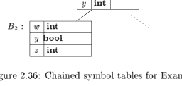

图 2.36：例 2.15 的链式符号表

图 2.37 中链式符号表的 Java 实现定义了一个类 `Env`，它是 *environment*（环境）的简称。$^9$ 类 `Env` 支持三种操作：

- *创建一个新的符号表。* 图 2.37 第 6 行到第 8 行的构造函数 `Env(p)` 创建一个 `Env` 对象，其中有一个名为 `table` 的哈希表。通过将字段 `prev` 设为 `p`，该对象链接到环境值参数 `p`。尽管形成链的是 `Env` 对象，但谈论表被链接起来会更方便。
- *放入*一个新条目到当前表中。哈希表保存键值对，其中：
  - *键*是一个字符串，或者更确切地说，是指向字符串的引用。我们也可以使用指向标识符记号对象的引用作为键。
  - *值*是类 `Symbol` 的一个条目。第 9 行到第 11 行的代码不需要知道条目的结构；也就是说，该代码独立于类 `Symbol` 中的字段和方法。

$^9$“环境”是程序中某一点相关的符号表集合的另一个术语。

```
1) package symbols;                       // File Env.java
2) import java.util.*;
3) public class Env {
4)     private Hashtable table;
5)     protected Env prev;
6)     public Env(Env p) {
7)         table = new Hashtable(); prev = p;
8)     }
9)     public void put(String s, Symbol sym) {
10)        table.put(s, sym);
11)    }
12)    public Symbol get(String s) {
13)        for( Env e = this; e != null; e = e.prev ) {
14)            Symbol found = (Symbol)(e.table.get(s));
15)            if( found != null ) return found;
16)        }
17)        return null;
18)    }
19) }
```

图 2.37：类 *Env* 实现链式符号表

- 通过搜索表链来获取标识符的条目，从当前块的表开始。第 12 行到第 18 行中该操作的代码返回一个符号表条目或 `null`。

符号表的链接产生树结构，因为一个外围块内可以嵌套多个块。图 2.36 中的虚线提醒我们，链式符号表可以形成一棵树。

#### 2.7.2 符号表的使用

实际上，符号表的作用是将信息从声明传递到使用。当分析 *x* 的声明时，一个语义动作将关于标识符 *x* 的信息“放入”符号表。随后，与诸如 *factor → id* 这样的产生式关联的语义动作从符号表中“获取”关于该标识符的信息。由于表达式 *E₁ op E₂* 的翻译（对于典型运算符 *op*）只依赖于 *E₁* 和 *E₂* 的翻译，而不直接依赖于符号表，因此我们可以添加任意数量的运算符，而不会改变通过符号表从声明到使用的基本信息流。

**例 2.17：** 图 2.38 中的翻译方案说明了如何使用类 *Env*。该翻译方案着重于作用域、声明以及

使用。它实现了示例2.14中描述的翻译。如前所述，对于输入

| 产生式 | 语义动作 |
|---|---|
| `program → block` | `{ top = null; }` |
| `block → '{' decls stmts '}'` | `{ saved = top; top = new Env(top); print("{ "); }`<br>`{ top = saved; print("} "); }` |
| `decls → decls decl \| ε` | |
| `decl → type id ;` | `{ s = new Symbol; s.type = type.lexeme; top.put(id.lexeme, s); }` |
| `stmts → stmts stmt \| ε` | |
| `stmt → block \| factor ;` | `{ print("; "); }` |
| `factor → id` | `{ s = top.get(id.lexeme); print(id.lexeme); print(":"); }`<br>`print(s.type);` |

图2.38：使用符号表翻译带有块的语言

```
{ int x; char y; { bool y; x; y; } x; y; }
```

该翻译方案去除声明并产生

```
{ { x:int; y:bool; } x:int; y:char; }
```

注意，在图2.38中，产生式体已经对齐，使得所有文法符号出现在一列中，所有动作出现在第二列中。因此，产生式体的各个部分常常分布在多行中。

现在考虑语义动作。该翻译方案在进入块和退出块时分别创建和丢弃符号表。变量`top`表示位于表链头部的顶层表。底层文法的第一个产生式是$program \rightarrow block$。在$block$之前的语义动作将$top$初始化为null，即没有任何条目。

第二个产生式 $block \rightarrow '\{' \ decls \ stmts \ '\}'$ 在进入块和退出块时都有动作。在进入块时，即$decls$之前，一个语义动作使用局部变量$saved$保存对当前表的引用。该产生式的每次使用都有各自的局部变量$saved$，不同于该产生式其他任何使用所对应的局部变量。在递归下降解析器中，$saved$将是$block$过程的局部变量。递归函数局部变量的处理将在7.2节讨论。代码如下：

```
top = new Env(top);
```

该代码将变量$top$设置为一个新创建的表，该表在进入块之前链接到$top$的先前值。变量$top$是类$Env$的一个对象；构造函数$Env$的代码见图2.37。

在退出块时，即'}'之后，一个语义动作将$top$恢复为进入块时保存的值。实际上，这些表形成一个栈；将$top$恢复为其保存的值会弹出块中声明的作用。因此，块中的声明在块外是不可见的。

声明 $decl \rightarrow type\ id\ ;$ 会为被声明的标识符生成一个新条目。我们假设记号$type$和$id$各有一个lexeme字段，分别是被声明标识符的类型和词素。我们不讨论符号对象$s$的所有字段，但假设有一个$type$字段给出符号的类型。我们创建一个新的符号对象$s$并通过$s.type = type.lexeme$设置其类型属性。完整的条目通过$top.put(id.lexeme, s)$放入顶层符号表中。

产生式 $factor \rightarrow id$ 中的语义动作使用符号表获取该标识符的条目。$get$操作从$top$开始，在表链中查找第一个条目。检索到的条目包含关于该标识符所需的任何信息，例如标识符的类型。

¹⁰ 除了显式保存和恢复表之外，我们也可以向类*Env*添加静态操作*push*和*pop*。

### 2.8 中间代码生成

编译器前端构造源程序的中间表示，后端从该中间表示生成目标程序。在本节中，我们考虑表达式和语句的中间表示，并给出如何生成这类表示的教程性示例。

#### 2.8.1 两种中间表示

正如2.1节尤其是图2.4所建议的，两种最重要的中间表示是：

- 树，包括分析树和（抽象）语法树。
- 线性表示，尤其是“三地址代码”。

抽象语法树，或简称为语法树，已在2.5.1节中介绍，并将在5.3.1节中更正式地重新考察。在语法分析过程中，创建语法树节点来表示语义编程结构。随着分析的进行，信息以与节点关联的属性形式添加到节点中。属性的选择取决于要执行的翻译。

另一方面，三地址代码是一系列基本程序步骤，例如两个值的相加。与树不同，它没有层次结构。正如我们将在第9章看到的，如果要对代码进行任何显著的优化，就需要这种表示。在这种情况下，我们将构成程序的长的三地址语句序列分解为“基本块”，基本块是始终一个接一个执行、没有分支的语句序列。

除了创建中间表示之外，编译器前端还检查源程序是否符合源语言的语法和语义规则。这种检查称为*静态检查*；通常，“静态”意味着“由编译器完成”。¹¹ 静态检查确保某些类型的编程错误（包括类型不匹配）在编译期间被检测并报告。

¹¹ 其对立面“动态”意味着“在程序运行时”。许多语言也会进行某些动态检查。例如，像Java这样的面向对象语言有时必须在程序执行期间检查类型，因为应用于对象的方法可能取决于对象的特定子类。

编译器有可能在发出三地址代码步骤的同时构造语法树。然而，常见的做法是，编译器在解析器“走过场”地构造语法树时发出三地址代码，而并不实际构造完整的树数据结构。相反，编译器存储语义检查或其他目的所需的节点及其属性，并且这些节点与用于解析的数据结构一起存储。通过这样做，构造三地址代码所需的语法树部分在需要时可用，在不再需要时会消失。我们将在第5章详细讨论这个过程。

#### 2.8.2 语法树的构造

我们首先给出一个构造语法树的翻译方案，然后在2.8.4节中展示如何修改该方案以发出三地址代码，可以连同语法树一起发出，也可以只发出三地址代码而不发出语法树。

回顾2.5.1节，语法树

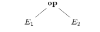

表示将运算符**op**应用于由*E1*和*E2*表示的子表达式所形成的表达式。语法树可以为任何构造创建，而不仅仅是表达式。每个构造由一个节点表示，其子节点对应构造中具有语义含义的组成部分。例如，C语言while语句：

```
while ( expr ) stmt
```

的语义含义组成部分是表达式*expr*和语句*stmt*。¹²

这种while语句的语法树节点有一个运算符，我们称之为**while**，以及两个子节点——*expr*和*stmt*的语法树。

图2.39中的翻译方案为一个具有代表性但非常有限的表达式和语句语言构造语法树。翻译方案中的所有非终结符都有一个属性n，它是语法树的一个节点。节点实现为类*Node*的对象。

类*Node*有两个直接子类：*Expr*用于各种表达式，*Stmt*用于各种语句。每种语句类型都有*Stmt*的一个对应子类；例如，运算符**while**对应于子类*While*。带有子节点*x*和*y*的运算符**while**的语法树节点由以下伪代码创建：

```
new While(x, y)
```

该伪代码通过调用与类同名的构造函数*While*创建一个*While*类的对象。正如构造函数对应于运算符一样，构造函数参数对应于抽象语法中的操作数。

当我们研究附录A中的详细代码时，我们将看到方法如何被放置在这个类层次结构中各自所属的位置。在本节中，我们将非正式地讨论其中少数几个方法。

我们将依次考虑图2.39中的每个产生式和规则。首先解释定义不同类型语句的产生式，然后是定义我们受限制的表达式类型的产生式。

##### 语句的语法树

对于每个语句构造，我们在抽象语法中定义一个运算符。对于以关键字开头的构造，我们将使用该关键字作为运算符。因此，对于while语句有运算符**while**，对于do-while语句有运算符**do**。条件语句可以通过定义两个运算符来处理

¹² 右括号仅用于将表达式与语句分隔开。左括号实际上没有意义；它只是为了让视觉上更舒服，因为如果没有它，C语言会允许不平衡的括号。


```
program  →  block                      { return block.n; }

block    →  '{' stmts '}'               { block.n = stmts.n; }

stmts    →  stmts₁ stmt                 { stmts.n = new Seq(stmts₁.n, stmt.n); }
         |  ε                           { stmts.n = null; }

stmt     →  expr ;                      { stmt.n = new Eval(expr.n); }
         |  if ( expr ) stmt₁           { stmt.n = new If(expr.n, stmt₁.n); }
         |  while ( expr ) stmt₁        { stmt.n = new While(expr.n, stmt₁.n); }
         |  do stmt₁ while ( expr ) ;   { stmt.n = new Do(stmt₁.n, expr.n); }
         |  block                       { stmt.n = block.n; }

expr     →  rel = expr₁                 { expr.n = new Assign('=', rel.n, expr₁.n); }
         |  rel                         { expr.n = rel.n; }

rel      →  rel₁ < add                 { rel.n = new Rel('<', rel₁.n, add.n); }
         |  rel₁ <= add                 { rel.n = new Rel('≤', rel₁.n, add.n); }
         |  add                         { rel.n = add.n; }

add      →  add₁ + term                { add.n = new Op('+', add₁.n, term.n); }
         |  term                        { add.n = term.n; }

term     →  term₁ * factor             { term.n = new Op('*', term₁.n, factor.n); }
         |  factor                      { term.n = factor.n; }

factor   →  ( expr )                   { factor.n = expr.n; }
         |  num                         { factor.n = new Num(num.value); }
```

图 2.39：表达式和语句的语法树构造

ifelse 和 if 分别用于带 else 部分和不带 else 部分的 if 语句。在我们简单的示例语言中，我们不使用 else，因此只有一种 if 语句。添加 else 会带来一些解析问题，我们将在 4.8.2 节讨论。

每个语句运算符都有一个同名类，其首字母大写；例如，类 *If* 对应 *if*。此外，我们定义了子类 *Seq*，它表示一个语句序列。该子类对应文法中的非终结符 *stmts*。这些类都是 *Stmt* 的子类，而 *Stmt* 又是 *Node* 的子类。

图 2.39 中的翻译方案说明了语法树节点的构造。一个典型的规则是用于 if 语句的规则：

*stmt* → *if* ( *expr* ) *stmt₁*  { *stmt.n* = new *If*(*expr.n*, *stmt₁.n*); }

if 语句中有意义的组成部分是 *expr* 和 *stmt₁*。语义动作将节点 *stmt.n* 定义为子类 *If* 的一个新对象。构造函数 *If* 的代码未给出。它创建一个标记为 if 的新节点，并以节点 *expr.n* 和 *stmt₁.n* 作为子节点。

表达式语句不以关键字开头，因此我们定义了一个新运算符 *eval* 和类 *Eval*（它是 *Stmt* 的子类），用来表示作为语句的表达式。相关规则是：

*stmt* → *expr* ;  { *stmt.n* = new *Eval*(*expr.n*); }

##### 在语法树中表示块

图 2.39 中剩余的语句构造是块，它由一系列语句组成。考虑以下规则：

*stmt* → *block*  { *stmt.n* = *block.n*; }  
*block* → '{' *stmts* '}'  { *block.n* = *stmts.n*; }

第一条规则说明，当一条语句是一个块时，它具有与该块相同的语法树。第二条规则说明，非终结符 *block* 的语法树就是该块中语句序列的语法树。

为简单起见，图 2.39 中的语言不包含声明。即使附录 A 中包含了声明，我们也会看到块的语法树仍然是该块中语句的语法树。由于来自声明的信息会被并入符号表，因此语法树中不需要这些信息。因此，无论是否包含声明，块在中间代码中都只是另一种语句构造。

语句序列通过为空语句使用叶节点 *null*、为语句序列使用运算符 *seq* 来表示，如下：

*stmts* → *stmts₁ stmt*  { *stmts.n* = new *Seq*(*stmts₁.n*, *stmt.n*); }

**例 2.18：** 在图 2.40 中，我们看到表示一个块或语句列表的语法树的一部分。列表中有两条语句，第一条是 if 语句，第二条是 while 语句。我们没有展示该语句列表上方的树部分，并且对每个必要的子树仅用三角形表示：用于 if 语句和 while 语句条件的两个表达式树，以及用于其子语句的两个语句树。

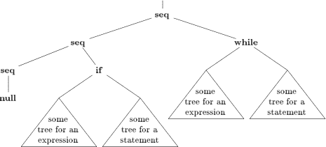

图 2.40：由一条 if 语句和一条 while 语句组成的语句列表的部分语法树

##### 表达式的语法树

此前，我们通过使用三个非终结符 *expr*、*term* 和 *factor* 来处理 `*` 高于 `+` 的优先级。非终结符的数量正好等于表达式中优先级层数加一，正如我们在 2.2.6 节所建议的那样。在图 2.39 中，我们在同一优先级上有两个比较运算符 `<` 和 `<=`，以及通常的 `+` 和 `*` 运算符，因此又增加了一个非终结符，称为 *add*。

抽象语法允许我们将“相似”的运算符分组，以减少表达式实现中的情况数量和节点子类数量。在本章中，我们将“相似”理解为这些运算符的类型检查和代码生成规则相似。例如，通常可以将运算符 `+` 和 `*` 分组，因为它们可以用相同的方式处理——它们对操作数类型的要求相同，并且各自都产生一条将某个运算符应用于两个值的三地址指令。一般来说，抽象语法中的运算符分组基于编译器后续阶段的需要。图 2.41 中的表格给出了若干 Java 运算符的具体语法与抽象语法之间的对应关系。

在具体语法中，除赋值运算符 `=` 是右结合外，所有运算符都是左结合。同一行上的运算符具有相同的优先级；也就是说，`==` 和 `!=` 具有相同的优先级。各行按优先级递增排列；例如，`==` 的优先级高于运算符 `&&` 和 `=`。`-unary` 中的下标 *unary* 仅仅是为了区分前导一元负号（如 `-2`）和二元减号（如 `2 - a`）。运算符 `[]` 表示数组访问，如 `a[1]`。

| 具体语法 | 抽象语法 |
| :--- | :--- |
| = | **赋值** |
| \|\| | **条件** |
| && | **条件** |
| == != | **关系** |
| < <= >= > | **关系** |
| + - | **运算** |
| * / % | **运算** |
| ! | **非** |
| -<sub>unary</sub> | **负号** |
| [] | **访问** |

图 2.41：若干 Java 运算符的具体语法和抽象语法

抽象语法列规定了运算符的分组。赋值运算符 `=` 单独成组。**条件**组包含条件布尔运算符 `&&` 和 `||`。**关系**组包含 `==` 和 `<` 所在行上的关系比较运算符。**运算**组包含诸如 `+` 和 `*` 的算术运算符。一元负号、布尔取反和数组访问各自单独成组。

图 2.41 中具体语法与抽象语法之间的映射可以通过编写一个翻译方案来实现。图 2.39 中非终结符 *expr*、*rel*、*add*、*term* 和 *factor* 的产生式规定了图 2.41 中一部分有代表性运算符的具体语法。这些产生式中的语义动作创建语法树节点。例如，规则

```
term → term₁ * factor { term.n = new Op('*', term₁.n, factor.n); }
```

创建了一个 *Op* 类的节点，该类实现图 2.41 中归在 **运算** 组下的运算符。构造函数 *Op* 除了接收表示子表达式的节点 *term₁.n* 和 *factor.n* 之外，还有一个参数 `'*'` 用于标识实际运算符。

#### 2.8.3 静态检查

静态检查是在编译期间进行的一致性检查。它们不仅确保程序能够成功编译，而且有可能在程序运行之前尽早捕获编程错误。静态检查包括：

- *语法检查。* 语法不仅仅是文法。例如，诸如标识符在某个……中至多声明一次这样的约束


## 2.8 中间代码生成

作用域规则，或者 break 语句必须位于封闭的循环或 switch 语句内，这类规则都属于语法规则，尽管它们并未被用于解析的语法所编码或强制执行。

- **类型检查。** 语言的类型规则确保运算符或函数被应用于正确数量和类型的操作数。如果需要在类型之间进行转换，例如，当一个整数与浮点数相加时，类型检查器可以在语法树中插入一个运算符来表示这种转换。我们在下文中使用常见的术语“强制转换”（coercion）来讨论类型转换。

##### 左值和右值

现在我们考虑在源程序的语法树构建过程中可以执行的一些简单静态检查。一般来说，复杂的静态检查可能需要先构建中间表示，然后再对其进行分析。

在赋值语句中，标识符出现在左侧和右侧的含义是有区别的。在以下每条赋值语句中

```
i = 5;
i = i + 1;
```

右侧指定一个整数值，而左侧指定该值存储的位置。术语 *左值*（l-value）和 *右值*（r-value）分别指适合出现在赋值语句左侧和右侧的值。也就是说，右值就是我们通常所说的“值”，而左值是位置。

静态检查必须确保赋值语句的左侧表示的是一个左值。像 *i* 这样的标识符具有左值，数组访问如 `a[2]` 也具有左值。但像 2 这样的常量不适合出现在赋值语句的左侧，因为它只有右值，没有左值。

##### 类型检查

类型检查确保某个结构的类型与其上下文所期望的类型相匹配。例如，在 if 语句中

```
if ( expr ) stmt
```

表达式 *expr* 被期望具有 **boolean** 类型。

类型检查规则遵循抽象语法的运算符/操作数结构。假设运算符 rel 表示关系运算符，如 ≤。运算符组 rel 的类型规则是：它的两个操作数必须具有相同的类型，且结果类型为 boolean。使用属性 *type* 表示表达式的类型，设 *E* 由 rel 应用于 *E₁* 和 *E₂* 组成。*E* 的类型可以在其节点被构造时通过执行类似下面的代码进行检查：

```
if ( E1.type == E2.type ) E.type = boolean;
else error;
```

将实际类型与期望类型进行匹配的思想在以下情况下仍然适用：

- **强制转换。** 当操作数的类型被自动转换为运算符所期望的类型时，就会发生 *强制转换*（coercion）。在像 2 * 3.14 这样的表达式中，通常的转换是将整数 2 转换为等效的浮点数 2.0，然后对得到的这一对浮点操作数执行浮点运算。语言定义规定了允许的强制转换。例如，上面讨论的 rel 的实际规则可能是 E1.type 和 E2.type 可以转换为相同的类型。在这种情况下，比较整数和浮点数（例如）就是合法的。
- **重载。** Java 中的运算符 + 应用于整数时表示加法；应用于字符串时表示拼接。如果一个符号根据其上下文具有不同的含义，则称该符号是*重载*的。因此，+ 在 Java 中是重载的。重载运算符的含义通过考虑其操作数和结果的已知类型来确定。例如，如果我们知道 x、y、z 中任何一个的类型是 string，我们就知道 z = x + y 中的 + 是拼接操作。然而，如果我们还知道其中另一个的类型是 integer，那么就会出现类型错误，这种对 + 的使用就没有意义。

#### 2.8.4 三地址代码

一旦语法树构建完成，就可以通过计算属性并在树的节点处执行代码片段来进行进一步的分析和综合。我们通过遍历语法树生成三地址代码来说明这些可能性。具体来说，我们展示如何编写处理语法树并作为副作用输出必要三地址代码的函数。

##### 三地址指令

三地址代码是满足以下形式的指令序列

```
x = y op z
```

其中 *x*、*y* 和 *z* 是名称、常量或编译器生成的临时变量；**op** 表示运算符。

数组将通过使用以下两种指令变体来处理：

```
x[y] = z
x = y[z]
```

第一个将 $z$ 的值放入位置 $x[y]$，第二个将 $y[z]$ 的值放入位置 $x$。

三地址指令按数值顺序执行，除非被条件或无条件跳转强制改变。我们选择以下指令用于控制流：

```
ifFalse x goto L      如果 x 为假，则接下来执行标号为 L 的指令
ifTrue x goto L       如果 x 为真，则接下来执行标号为 L 的指令
goto L                接下来执行标号为 L 的指令
```

标号 $L$ 可以通过添加前缀 $L:$ 附加到任何指令上。一条指令可以有多个标号。

最后，我们需要复制值的指令。下面的三地址指令将 $y$ 的值复制到 $x$：

```
x = y
```

##### 语句的翻译

语句通过使用跳转指令来实现语句中的控制流，从而翻译成三地址代码。图 2.42 中的布局展示了 `if expr then stmt₁` 的翻译。布局中的跳转指令

```
ifFalse x goto after
```

如果 $expr$ 求值为假，则跳过 $stmt_1$ 的翻译。其他语句结构也类似地通过使用适当的跳转跳过其组成部分的代码来实现翻译。

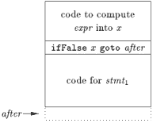

图 2.42：if 语句的代码布局

为了具体说明，我们在图 2.43 中展示了类 $If$ 的伪代码。类 $If$ 是 $Stmt$ 的子类，其他语句结构的类也是如此。$Stmt$ 的每个子类都有一个构造函数——此处是 $If$——以及一个函数 $gen$，该函数被调用来为此类语句生成三地址代码。

```
class If extends Stmt {
    Expr E; Stmt S;
    public If(Expr x, Stmt y) { E = x; S = y; after = newlabel(); }
    public void gen() {
        Expr n = E.rvalue();
        emit("ifFalse " + n.toString() + " goto " + after);
        S.gen();
        emit(after + ":");
    }
}
```

图 2.43：类 `If` 中的函数 `gen` 生成三地址代码

图 2.43 中的构造函数 `If` 为 if 语句创建语法树节点。它接受两个参数：表达式节点 `x` 和语句节点 `y`，并将它们保存为属性 `E` 和 `S`。构造函数还通过调用函数 `newlabel()` 为属性 `after` 分配一个唯一的新标号。该标号将按照图 2.42 中的布局使用。

一旦源程序的整个语法树构建完成，就会在语法树的根节点处调用函数 `gen`。由于在我们的简单语言中程序是一个块，因此语法树的根节点表示块中的语句序列。所有语句类都包含一个函数 `gen`。

图 2.43 中类 `If` 的函数 `gen` 的伪代码具有代表性。它调用 `E.rvalue()` 来翻译表达式 `E`（if 语句中布尔值的表达式）并保存 `E` 返回的结果节点。表达式的翻译稍后将进行讨论。函数 `gen` 然后输出一个条件跳转，并调用 `S.gen()` 来翻译子语句 `S`。

##### 表达式的翻译

现在我们通过考虑包含二元运算符 `op`、数组访问和赋值以及常量和标识符的表达式来说明表达式的翻译。为简单起见，在数组访问 `y[E]` 中，我们要求 `y` 是一个标识符。¹³ 关于表达式中间代码生成的详细讨论，请参见第 6.4 节。

我们将采用简单的方法：为表达式的语法树中的每个运算符节点生成一条三地址指令。标识符和常量不生成代码，因为它们可以作为指令中的地址出现。如果类 `Expr` 的节点 `x` 具有运算符 `op`，则会输出一条指令，将节点 `x` 处计算的值放入编译器生成的“临时”名称（例如 `t`）中。因此，`i-j+k` 翻译成两条指令

¹³这种简单语言支持 `a[a[m]]`，但不支持 `a[m[n]]`。注意 `a[a[m]]` 具有 `a[E]` 的形式，其中 `E` 是 `a[m]`。


```
t1 = i - j
t2 = t1 + k
```

随着数组访问和赋值的出现，就需要区分 *l* 值和 *r* 值。例如，`2*a[i]` 可以通过将 `a[i]` 的 *r* 值计算到临时变量中来翻译，如下所示

```
t1 = a[i]
t2 = 2 * t1
```

但是，如果 `a[i]` 出现在赋值左侧，我们就不能简单地用临时变量代替 `a[i]`。

简单方法使用两个函数 *lvalue* 和 *rvalue*，分别如图 2.44 和图 2.45 所示。当函数 *rvalue* 应用于非叶节点 *x* 时，它生成将 *x* 计算到临时变量中的指令，并返回表示该临时变量的新节点。当函数 *lvalue* 应用于非叶节点时，它也会生成计算 *x* 下方子树的指令，并返回表示 *x* 的“地址”的节点。

我们先描述函数 *lvalue*，因为它的情形较少。当应用于节点 *x* 时，如果 *x* 是标识符对应的节点（即 *x* 属于类 *Id*），函数 *lvalue* 直接返回 *x*。在我们的简单语言中，表达式具有 *l* 值的唯一其他情形是 *x* 表示数组访问，例如 `a[i]`。在这种情况下，*x* 将具有 *Access(y, z)* 形式，其中类 *Access* 是 *Expr* 的子类，*y* 表示被访问数组的名称，*z* 表示该数组中所选元素的偏移量（索引）。根据图 2.44 中的伪代码，函数 *lvalue* 会调用 *rvalue(z)*，以在需要时生成计算 *z* 的 *r* 值的指令。然后，它构造并返回一个新的 *Access* 节点，其子节点分别对应数组名 *y* 和 *z* 的 *r* 值。

```
Expr lvalue(x : Expr) {
    if ( x is an Id node ) return x;
    else if ( x is an Access(y, z) node and y is an Id node ) {
        return new Access(y, rvalue(z));
    }
    else error;
}
```

图 2.44：函数 *lvalue* 的伪代码

**例 2.19：** 当节点 *x* 表示数组访问 `a[2*k]` 时，调用 *lvalue(x)* 会生成一条指令

```
t = 2 * k
```

并返回一个新节点 *x′*，表示 *l* 值 `a[t]`，其中 *t* 是一个新的临时变量名。

具体来说，代码片段

```
return new Access(y, rvalue(z));
```

执行到这里时，y 是 a 对应的节点，z 是表达式 2*k 对应的节点。调用 rvalue(z) 会为表达式 2*k 生成代码（即三地址语句 t = 2 * k），并返回表示临时变量名 t 的新节点 z′。该节点 z′ 成为所创建的新 Access 节点 x′ 中第二个字段的值。

```
Expr rvalue(x : Expr) {
    if (x is an Id or a Constant node) return x;
    else if (x is an Op(op, y, z) or a Rel(op, y, z) node) {
        t = new temporary;
        emit string for t = rvalue(y) op rvalue(z);
        return a new node for t;
    }
    else if (x is an Access(y, z) node) {
        t = new temporary;
        call lvalue(x), which returns Access(y, z′);
        emit string for t = Access(y, z′);
        return a new node for t;
    }
    else if (x is an Assign(y, z) node) {
        z′ = rvalue(z);
        emit string for lvalue(y) = z′;
        return z′;
    }
}
```

图 2.45：函数 rvalue 的伪代码

图 2.45 中的函数 rvalue 生成指令并返回一个可能的新节点。当 x 表示标识符或常量时，rvalue 返回 x 本身。在所有其他情况下，它返回一个针对新临时变量 t 的 Id 节点。情形如下：

- 当 x 表示 y op z 时，代码首先计算 y′ = rvalue(y) 和 z′ = rvalue(z)。它创建一个新临时变量 t，并生成指令 t = y′ op z′（更准确地说，是由 t、y′、op 和 z′ 的字符串表示构成的指令）。它返回标识符 t 对应的节点。

- 当 x 表示数组访问 y[z] 时，我们可以复用函数 lvalue。调用 lvalue(x) 返回一个访问 y[z′]，其中 z′ 表示保存该数组访问偏移量的标识符。代码创建一个新临时变量 t，生成基于 t = y[z′] 的指令，并返回 t 对应的节点。

- 当 *x* 表示 *y = z* 时，代码首先计算 *z′ = rvalue(z)*。它生成基于 *lvalue(y) = z′* 的指令，并返回节点 *z′*。

**例 2.20：** 当应用于以下表达式的语法树时

```
a[i] = 2*a[j-k]
```

函数 *rvalue* 生成

```
t3 = j - k
t2 = a[t3]
t1 = 2 * t2
a[i] = t1
```

也就是说，根是一个 *Assign* 节点，第一个参数为 *a[i]*，第二个参数为 `2*a[j-k]`。因此，适用第三种情形，函数 *rvalue* 递归地求值 `2*a[j-k]`。该子树的根是表示 `*` 的 *Op* 节点，这会导致在计算左操作数 2 之前创建一个新临时变量 *t1*，然后计算左操作数，再计算右操作数。常量 2 不生成三地址代码，其 *r* 值作为值为 2 的 *Constant* 节点返回。

右操作数 *a[j-k]* 是一个 *Access* 节点，这会导致在对此节点调用函数 *lvalue* 之前创建一个新临时变量 *t2*。递归地，对表达式 *j-k* 调用 *rvalue*。作为该调用的副作用，在创建新临时变量 *t3* 之后，生成三地址语句 `t3 = j - k`。然后，返回到对 *a[j-k]* 的 *lvalue* 调用，临时变量 *t2* 被赋值为整个访问表达式的 *r* 值，即 `t2 = a[t3]`。

现在，我们返回到对 *Op* 节点 `2*a[j-k]` 的 *rvalue* 调用，该调用先前创建了临时变量 *t1*。作为副作用，生成三地址语句 `t1 = 2 * t2`，以计算该乘法表达式。最后，对整个表达式的 *rvalue* 调用通过以下方式完成：对左侧 *a[i]* 调用 *lvalue*，然后生成三地址指令 `a[i] = t1`，其中赋值的右侧被赋给左侧。□

##### 为表达式生成更优代码

我们可以通过几种方式改进图 2.45 中的函数 *rvalue*，并生成更少的三地址指令：

- 在后续优化阶段减少复制指令的数量。例如，如果后续没有对 *t* 的使用，则指令对 `t = i+1` 和 `i = t` 可以合并为 `i = i+1`。

- 一开始就考虑上下文以生成更少的指令。例如，如果三地址赋值的左侧是数组访问 `a[t]`，那么右侧必须是名称、常量或临时变量，它们都只使用一个地址。但如果左侧是名称 *x*，那么右侧可以是使用两个地址的运算 *y op z*。

我们可以通过修改翻译函数来避免一些复制指令：生成一条部分指令，它计算例如 `j+k`，但不指定结果应放在何处，结果用 **null** 地址表示：

null = j + k (2.8)

这个 null 结果地址稍后会被适当地替换为标识符或临时变量。如果 `j+k` 位于赋值右侧，如 `i=j+k;`，则它被替换为标识符，此时 (2.8) 变为

i = j + k

但是，如果 `j+k` 是子表达式，如 `j+k+1`，那么 (2.8) 中的 null 结果地址会被替换为新临时变量 `t`，并生成一条新的部分指令

t = j + k
null = t + 1

许多编译器尽一切努力生成与专家手写汇编代码一样好或更好的代码。如果使用第 9 章中的代码优化技术，那么一种有效策略可能是：对中间代码生成采用简单方法，并依靠代码优化器消除不必要的指令。

#### 2.8.5 第 2.8 节练习

**练习 2.8.1：** C 和 Java 中的 for 语句形式如下：

for ( expr₁ ; expr₂ ; expr₃ ) stmt

第一个表达式在循环之前执行；通常用于初始化循环索引。第二个表达式是在循环每次迭代之前进行的测试；如果该表达式变为 0，则退出循环。循环本身可以看作语句 `{stmt expr₃;}`。第三个表达式在每次迭代结束时执行；通常用于递增循环索引。for 语句的含义类似于

expr₁; while ( expr₂ ) {stmt expr₃;}

为 for 语句定义一个类 `For`，类似于图 2.43 中的类 `If`。

**练习 2.8.2：** 编程语言 C 没有布尔类型。说明 C 编译器可能如何将 if 语句翻译为三地址代码。

### 2.9 第 2 章小结

本章的语法制导技术可用于构造编译器前端，如图 2.46 所示。


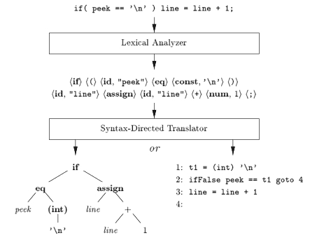

图2.46：一个语句的两种可能翻译

- 语法制导翻译器的起点是源语言的文法。*文法*描述程序的层次结构。它用称为*终结符*的基本符号和称为*非终结符*的可变符号来定义。这些符号表示语言结构。文法的规则或*产生式*由一个称为产生式*头*或*左部*的非终结符，以及一个称为产生式*体*或*右部*的终结符和非终结符序列组成。一个非终结符被指定为*开始*符号。

- 在指定翻译器时，将属性附加到编程结构上是有帮助的，其中*属性*是与某个结构相关联的任意量。由于结构由文法符号表示，属性的概念也扩展到文法符号。属性的例子包括与表示数字的终结符 **num** 相关联的整数值，以及与表示标识符的终结符 **id** 相关联的字符串。

- *词法分析器*一次读取一个输入字符，并输出一个*记号*流，其中记号由一个终结符以及以属性值形式表示的附加信息组成。在图2.46中，记号写成用 ⟨ ⟩ 括起的元组。记号 ⟨id, "peek"⟩ 由终结符 **id** 和一个指针组成，该指针指向包含字符串 "peek" 的符号表条目。翻译器使用该表来跟踪已经见过的保留字和标识符。

### 2.9 第2章小结

- **语法分析**是确定如何通过反复用一个非终结符的某个产生式的体替换该非终结符，从而从文法的开始符号推导出终结符串的问题。从概念上讲，语法分析器构建一棵语法分析树，其中根标记为开始符号，每个非叶节点对应一个产生式，每个叶节点标记为一个终结符或空串 ε。语法分析树推导出叶节点上的终结符串，从左到右读取。

- 高效的语法分析器可以手工构建，使用一种称为预测分析法的自顶向下（从语法分析树的根到叶）方法。*预测分析器*为每个非终结符都有一个过程；过程体模仿非终结符的产生式；并且通过向前查看输入流中的一个符号，可以无歧义地确定穿过过程体的控制流。其他语法分析方法见第4章。

- 语法制导翻译通过将规则或程序片段附加到文法中的产生式来完成。本章只考虑了*综合*属性——任意节点 *x* 处综合属性的值只能依赖于 *x* 的子节点处的属性（如果有）。*语法制导定义*将规则附加到产生式；这些规则计算属性值。*翻译方案*将称为*语义动作*的程序片段嵌入产生式体中。这些动作按照语法分析期间使用产生式的顺序执行。

- 语法分析的结果是源程序的一种表示，称为*中间代码*。图2.46展示了中间代码的两种主要形式。*抽象语法树*为编程结构提供节点；一个节点的子节点给出有意义的子结构。或者，*三地址代码*是指令序列，其中每条指令执行单个操作。

- *符号表*是保存标识符信息的数据结构。当分析标识符的声明时，信息被放入符号表。当该标识符随后被使用（例如作为表达式中的一个因子）时，语义动作从符号表中获取信息。

## 第3章：词法分析

本章展示如何构造词法分析器。手工实现词法分析器时，从每个记号的词素的图或其他描述开始会很有帮助。然后我们可以编写代码来识别输入中每个词素的每次出现，并返回有关所识别记号的信息。

我们也可以通过将词素模式指定给*词法分析器生成器*，并将这些模式编译为充当词法分析器的代码，来自动生成词法分析器。这种方法使修改词法分析器更容易，因为我们只需重写受影响的模式，而不是整个程序。它还加快了实现词法分析器的过程，因为程序员在非常高的模式层次上指定软件，并依赖生成器生成详细代码。我们将在3.5节介绍一个称为 *Lex*（在较新的实现中称为 *Flex*）的词法分析器生成器。

我们通过介绍正则表达式开始研究词法分析器生成器，正则表达式是指定词素模式的便捷表示法。我们展示如何将该表示法先转换为非确定自动机，再转换为确定自动机。后两种表示法可作为“驱动器”的输入，驱动器即模拟这些自动机并以其为指导来确定下一个记号的代码。该驱动器与自动机的规格说明构成词法分析器的核心。

### 3.1 词法分析器的作用

作为编译器的第一个阶段，词法分析器的主要任务是读取源程序的输入字符，将它们分组为词素，并为源程序中的每个词素输出一个记号序列。记号流被发送给语法分析器进行语法分析。词法分析器通常也会与符号表交互。当词法分析器发现构成标识符的词素时，需要将该词素录入符号表。在某些情况下，词法分析器可以从符号表读取有关标识符种类的信息，以帮助它确定必须传递给语法分析器的正确记号。

图3.1示意了这些交互。通常，这种交互通过让语法分析器调用词法分析器来实现。这一调用由 *getNextToken* 命令表示，它使词法分析器从其输入中读取字符，直到能够识别下一个词素，并为其产生下一个记号，然后将其返回给语法分析器。

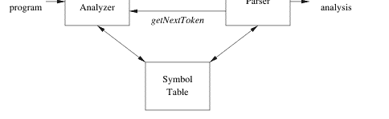

图3.1：词法分析器与语法分析器之间的交互

由于词法分析器是编译器中读取源文本的部分，因此除了识别词素之外，它还可以执行某些其他任务。其中一项任务是去除注释和*空白*（空格、换行、制表符，以及输入中用于分隔记号的其他字符）。另一项任务是将编译器生成的错误消息与源程序关联起来。例如，词法分析器可以跟踪已看到的换行符数量，从而将行号与每条错误消息关联起来。在某些编译器中，词法分析器会制作源程序的副本，并将错误消息插入适当位置。如果源程序使用宏预处理器，宏展开也可以由词法分析器执行。

有时，词法分析器被划分为两个级联的处理过程：

- a) *扫描*由不需要对输入进行记号化的简单处理组成，例如删除注释以及将连续空白字符合并为一个。
- b) 真正的*词法分析*是更复杂的部分，它从扫描器的输出产生记号。

### 3.1.1 词法分析与语法分析

编译器的分析部分通常被分为词法分析和解析（语法分析）两个阶段，原因有很多。


## 3.1. 词法分析器的作用

- 1. 设计的简洁性是最重要的考虑因素。将词法分析和语法分析分离，通常使我们能够至少简化其中一项任务。例如，如果一个语法分析器必须把注释和空白当作语法单元来处理，那么它会比一个可以假定注释和空白已由词法分析器删除的语法分析器复杂得多。如果我们正在设计一种新语言，那么将词法问题和语法问题分离，可以带来更清晰的总体语言设计。
- 2. 编译器的效率得到提高。单独的词法分析器使我们能够应用只服务于词法任务、而非语法分析任务的专门技术。此外，用于读取输入字符的专门缓冲技术可以显著加快编译器的速度。
- 3. 编译器的可移植性得到增强。与输入设备相关的特性可以限制在词法分析器中。

### 3.1.2 记号、模式和词素

在讨论词法分析时，我们使用三个相关但不同的术语：

- *记号*由一个记号名和一个可选属性值组成。记号名是表示某一类词法单元的抽象符号，例如某个特定关键字，或表示标识符的输入字符序列。记号名是语法分析器所处理的输入符号。在下文中，我们通常将记号名写成**粗体**。我们经常用记号名来指代记号。
- *模式*是对一个记号的词素可能采取的形式的描述。当记号是关键字时，模式就是构成该关键字的字符序列。对于标识符和其他一些记号，模式是一种更复杂的结构，许多字符串都能与之*匹配*。
- *词素*是源程序中与某个记号的模式匹配、并被词法分析器识别为该记号的一个实例的字符序列。

**例 3.1：** 图 3.2 给出了一些典型记号、它们非正式描述的模式以及一些示例词素。为了了解这些概念在实践中如何使用，在如下 C 语句中

```c
printf("Total = %d\n", score);
```

`printf` 和 `score` 都是与记号 **id** 的模式匹配的词素，而 `"Total = %d\n"` 是与 **literal** 匹配的词素。□

在许多编程语言中，以下类别涵盖了大多数或全部记号：

| 记号 | 非正式描述 | 示例词素 |
|---|---|---|
| if | 字符 i、f | if |
| else | 字符 e、l、s、e | else |
| comparison | < 或 > 或 <= 或 >= 或 == 或 != | <=, != |
| id | 字母后跟字母和数字 | pi, score, D2 |
| number | 任意数值常量 | 3.14159, 0, 6.02e23 |
| literal | 除 " 之外的任何内容，并由 " 包围 | "core dumped" |

图 3.2：记号的示例

- 1. 每个关键字一个记号。关键字的模式与该关键字本身相同。
- 2. 为运算符设置记号，可以单独设置，也可以归入类中，例如图 3.2 中提到的记号 comparison。
- 3. 用一个记号表示所有标识符。
- 4. 用一个或多个记号表示常量，例如数字和字面字符串。
- 5. 为每个标点符号设置记号，例如左括号和右括号、逗号和分号。

### 3.1.3 记号的属性

当多个词素都能与一个模式匹配时，词法分析器必须向编译器的后续阶段提供关于实际匹配的那个词素的附加信息。例如，记号 **number** 的模式既能匹配 0 也能匹配 1，但代码生成器必须知道在源程序中找到的是哪个词素，这一点极其重要。因此，在许多情况下，词法分析器返回给语法分析器的不仅是记号名，还有一个描述该记号所表示词素的属性值；记号名影响语法分析决策，而属性值影响语法分析之后对记号的翻译。

我们假定每个记号至多有一个关联属性，尽管该属性可以具有组合若干信息片段的结构。最重要的例子是记号 **id**，其中我们需要将大量信息与该记号关联。通常，关于标识符的信息——例如它的词素、它的类型，以及它首次被发现的位置（以便在必须发出关于该标识符的错误消息时使用）——保存在符号表中。因此，标识符的合适属性值是指向该标识符的符号表项的指针。

#### 识别记号时的棘手问题

通常，给定描述某个记号的词素的模式，当匹配的词素出现在输入中时，识别它们相对简单。然而，在某些语言中，当我们已经看到一个对应于某个记号的词素实例时，并不能立即看出来。下面的例子取自 Fortran，采用 Fortran 90 中仍然允许的固定格式。在如下语句中

```
DO 5 I = 1.25
```

直到看到 1 后面的点，才能看出第一个词素是 DO5I，即标识符记号的一个实例。注意，固定格式 Fortran 中的空格会被忽略（一种古老的约定）。如果我们看到的是逗号而不是点，我们就会得到一个 do 语句

```
DO 5 I = 1,25
```

其中第一个词素是关键字 DO。

**例 3.2：** Fortran 语句

```
E = M * C ** 2
```

的记号名和相关属性值按如下成对序列写出。

- `<id, pointer to symbol-table entry for E>`
- `<assign_op>`
- `<id, pointer to symbol-table entry for M>`
- `<mult_op>`
- `<id, pointer to symbol-table entry for C>`
- `<exp_op>`
- `<number, integer value 2>`

注意，在某些对中，尤其是运算符、标点和关键字，不需要属性值。在这个例子中，记号 number 被赋予了一个整数值属性。在实践中，典型的编译器会改为存储表示该常量的字符串，并将指向该字符串的指针用作 **number** 的属性值。

### 3.1.4 词法错误

在没有其他组件帮助的情况下，词法分析器很难判断存在源代码错误。例如，如果在 C 程序中首次在如下上下文中遇到字符串 `fi`：

```c
fi ( a == f(x)) ...
```

词法分析器无法判断 `fi` 是关键字 `if` 的拼写错误，还是一个未声明的函数标识符。由于 `fi` 是记号 `id` 的一个有效词素，词法分析器必须将记号 `id` 返回给语法分析器，并让编译器的其他某个阶段——在这种情况下很可能是语法分析器——处理由字母换位导致的错误。

然而，假设出现这样一种情况：由于没有任何记号的模式与剩余输入的任意前缀匹配，词法分析器无法继续。最简单的恢复策略是“恐慌模式”恢复。我们从剩余输入中连续删除字符，直到词法分析器能在剩余输入的开头找到一个良构记号。这种恢复技术可能会使语法分析器困惑，但在交互式计算环境中，它可能相当合适。

其他可能的错误恢复动作包括：

- 1. 从剩余输入中删除一个字符。
- 2. 向剩余输入中插入一个缺失字符。
- 3. 将一个字符替换为另一个字符。
- 4. 交换两个相邻字符的位置。

可以尝试诸如此类的变换来修复输入。最简单的此类策略是看能否通过一次变换将剩余输入的某个前缀转换为有效词素。这种策略是合理的，因为实践中大多数词法错误都涉及单个字符。一种更通用的纠正策略是找出将源程序转换为仅由有效词素组成的程序所需的最少变换次数，但这种方法在实践中被认为代价过高，不值得付出努力。

### 3.1.5 第 3.1 节练习

**练习 3.1.1：** 将下面的 C++ 程序：

```cpp
float limitedSquare(x) float x; {
    /* returns x-squared, but never more than 100 */
    return (x<=-10.0||x>=10.0)?100.0:x*x;
}
```

按照第 3.1.2 节的讨论为指导，划分为适当的词素。哪些词素应关联词法值？这些值应该是什么？

**练习 3.1.2：** 像 HTML 或 XML 这样的标记语言与传统编程语言不同，因为其标点（标签）要么非常多（如 HTML 中），要么是用户可定义的集合（如 XML 中）。此外，标签通常可以带有参数。建议如何划分下面的 HTML 文档：


```html
Here is a photo of <B>my house</B>:
<P><BR>
See <A HREF = "morePix.html">More Pictures</A> if you
liked that one.<P>
```

将其转换为适当的词素。哪些词素应关联词法值，这些值应该是什么？

## 3.2 输入缓冲

在讨论识别输入中词素的问题之前，让我们先考察一些方法，以便加快读取源程序这一简单但重要的任务。这项任务之所以困难，是因为在能够确定找到的是正确的词素之前，我们常常必须查看下一个词素之后的一个或多个字符。第 3.1 节中题为“识别记号时的棘手问题”的方框给出了一个极端例子，但在许多情况下，我们至少需要向前多看一个字符。例如，直到看到一个不是字母或数字、因而不属于 id 词素的字符时，我们才能确定是否已经看到了标识符的末尾。在 C 中，像 -、= 或 < 这样的单字符运算符也可能成为像 ->、== 或 <= 这样的双字符运算符的开头。因此，我们将引入一种双缓冲区方案，以安全地处理较大的前瞻。然后，我们考虑一种涉及“哨兵”的改进，它可以节省检查缓冲区末尾的时间。

### 3.2.1 缓冲区对

由于处理字符需要花费时间，而且在编译大型源程序时必须处理大量字符，人们已经开发出专门的缓冲技术，以减少处理单个输入字符所需的开销。一种重要的方案涉及两个交替重新加载的缓冲区，如图 3.3 所示。

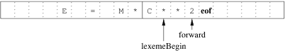

图 3.3：使用一对输入缓冲区

每个缓冲区的大小相同，均为 N，而 N 通常是磁盘块的大小，例如 4096 字节。使用一条系统读取命令，我们就可以把 N 个字符读入一个缓冲区，而不是每个字符使用一次系统调用。如果输入文件中剩余的字符少于 N 个，那么一个特殊字符（由 `eof` 表示）会标记源文件的结尾，并且它不同于源程序中可能出现的任何字符。

维护两个指向输入的指针：

- 1. 指针 `lexemeBegin` 标记当前词素的开始位置，我们正试图确定该词素的范围。
- 2. 指针 `forward` 向前扫描，直到找到模式匹配；作出这种判断的确切策略将在本章其余部分讨论。

一旦确定了下一个词素，就将 `forward` 设置为该词素右端的字符。然后，在把该词素记录为返回给语法分析器的记号的属性值之后，将 `lexemeBegin` 设置为紧接刚找到的词素之后的字符。在图 3.3 中，我们看到 `forward` 已经越过了下一个词素 `**`（Fortran 幂运算符）的末尾，因此必须向左回退一个位置。

推进 `forward` 要求我们先测试是否已经到达某个缓冲区的末尾；如果到达了，就必须从输入中重新加载另一个缓冲区，并把 `forward` 移到新加载缓冲区的开头。只要我们从不需要在实际词素之前前瞻到如此之远，以至于词素长度加上前瞻距离之和大于 *N*，那么在确定词素之前，我们就绝不会覆盖其所在缓冲区中的该词素。

### 3.2.2 哨兵

如果按第 3.2.1 节所述方案进行，那么每次推进 `forward` 时，都必须检查我们是否已移出某个缓冲区；如果已移出，还必须重新加载另一个缓冲区。因此，每读入一个字符，我们要做两次测试：一次测试是否到达缓冲区末尾，一次确定读入的是什么字符（后者可能是一个多路分支）。如果我们在每个缓冲区末尾扩展一个*哨兵*字符，就可以把缓冲区末尾测试与当前字符测试合并。哨兵是不能作为源程序一部分的特殊字符，自然的选择是字符 `eof`。

图 3.4 显示了与图 3.3 相同的安排，但增加了哨兵。注意，`eof` 仍保留其作为整个输入结束标记的用途。任何不是出现在缓冲区末尾的 `eof` 都意味着输入已到末尾。图 3.5 总结了推进 `forward` 的算法。请注意，第一个测试——它可以成为基于 `forward` 所指字符的多路分支的一部分——是我们唯一要做的测试，除非我们确实位于某个缓冲区的末尾或输入的末尾。

### 缓冲区空间会用完吗？

在大多数现代语言中，词素很短，一两个字符的前瞻就足够了。因此，*N* 为数千的缓冲区大小已经足够，第 3.2.1 节的双缓冲方案可以正常工作。然而，也存在一些风险。例如，如果字符串可能非常长，跨越多行，那么就可能出现词素长度大于 *N* 的情况。为避免长字符串带来的问题，我们可以把它们视为若干组件的拼接，每个组件来自该字符串所跨的每一行。例如，在 Java 中，通常的表示长字符串的方式是在每一行写一段，并在每段末尾用 + 运算符把各段拼接起来。

当可能需要任意长的前瞻时，会出现更困难的问题。例如，像 PL/I 这样的一些语言不把关键字视为*保留*的；也就是说，你可以使用与 DECLARE 这类关键字同名的标识符。如果词法分析器面对一段以 DECLARE ( ARG1, ARG2, . . . 开头的 PL/I 程序文本，它就无法确定 DECLARE 是关键字、ARG1 等是被声明的变量，还是 DECLARE 是带参数的过程名。因此，现代语言倾向于保留它们的关键字。然而，如果不这样做，也可以把 DECLARE 这样的关键字当作有歧义的标识符，让语法分析器来解决这个问题，或许再结合符号表查找。

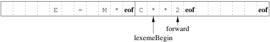

图 3.4：每个缓冲区末尾的哨兵

```c
switch ( *forward++ ) {
    case eof:
        if ( forward is at end of first buffer ) {
            reload second buffer;
            forward = beginning of second buffer;
        }
        else if ( forward is at end of second buffer ) {
            reload first buffer;
            forward = beginning of first buffer;
        }
        else /* eof within a buffer marks the end of input */
            terminate lexical analysis;
        break;
    Cases for the other characters
}
```

图 3.5：带哨兵的前瞻代码

### 实现多路分支

我们可能会以为，图 3.5 中的 switch 需要很多步骤才能执行，并且把 case eof 放在最前面并不是明智的选择。实际上，我们按什么顺序列出各个字符的 case 并不重要。在实践中，依赖输入字符的多路分支是通过跳转到以字符为索引的地址数组中找到的地址，一步完成的。

## 3.3 记号的规格说明

正则表达式是用于指定词素模式的一种重要记法。虽然它们不能表达所有可能的模式，但在指定我们实际需要用于记号的各类模式方面非常有效。本节将学习正则表达式的形式化记法，第 3.5 节将看到这些表达式如何在词法分析器生成器中使用。然后，第 3.7 节展示如何通过把正则表达式转换为自动机来构建词法分析器，由自动机执行对指定记号的识别。

### 3.3.1 字符串与语言

*字母表*是任意有限的符号集合。符号的典型例子是字母、数字和标点。集合 {0,1} 是*二进制字母表*。ASCII 是字母表的一个重要例子；它被用于许多软件系统。Unicode 包含来自世界各地字母表的大约 100,000 个字符，是字母表的另一个重要例子。

字母表上的*字符串*是从该字母表中取出的有限符号序列。在语言理论中，术语“句子”和“单词”常被用作“字符串”的同义词。字符串 *s* 的长度通常写作 |*s*|，是 *s* 中符号出现的次数。例如，*banana* 是长度为六的字符串。*空串*记作 ε，是长度为 0 的字符串。

*语言*是某个固定字母表上的任意可数字符串集合。这个定义非常宽泛。像 ∅（*空集*）或 {ε}（只包含空串的集合）这样的抽象语言，在此定义下也是语言。所有语法上良构的 C 程序集合以及所有语法正确的英语句子集合也是如此，尽管后两种语言很难精确指定。注意，“语言”的定义并不要求赋予该语言中的字符串任何含义。定义字符串“含义”的方法将在第 5 章讨论。


## 字符串各部分的术语

以下是与字符串相关的常用术语：

- 1. 字符串 *s* 的*前缀*是从 *s* 末尾删除零个或多个符号后得到的任意字符串。例如，**ban**、**banana** 和 ε 是 **banana** 的前缀。
- 2. 字符串 *s* 的*后缀*是从 *s* 开头删除零个或多个符号后得到的任意字符串。例如，**nana**、**banana** 和 ε 是 **banana** 的后缀。
- 3. 字符串 *s* 的*子串*是从 *s* 中删除任意前缀和任意后缀后得到的。例如，**banana**、**nan** 和 ε 是 **banana** 的子串。
- 4. 字符串 *s* 的*真*前缀、*真*后缀和*真*子串分别是指 *s* 的那些前缀、后缀和子串，它们不是 ε 且不等于 *s* 本身。
- 5. 字符串 *s* 的*子序列*是通过删除 *s* 中零个或多个不一定连续的位置后形成的任意字符串。例如，**baan** 是 **banana** 的子序列。

如果 *x* 和 *y* 是字符串，那么 *x* 和 *y* 的*连接*，记作 *xy*，是将 *y* 追加到 *x* 后形成的字符串。例如，如果 *x* = dog 且 *y* = house，则 *xy* = doghouse。空字符串是连接运算下的单位元；也就是说，对任意字符串 \(s\)，有 ε\(s\) = \(s\)ε = \(s\)。

如果把连接看作乘积，我们可以如下定义字符串的“幂运算”。定义 \(s^0\) 为 ε，并且对所有 \(i > 0\)，定义 \(s^i\) 为 \(s^{i-1}s\)。由于 ε\(s\) = \(s\)，可得 \(s^1 = s\)。于是 \(s^2 = ss\)、\(s^3 = sss\)，依此类推。

### 3.3.2 语言上的运算

在词法分析中，语言上最重要的运算是并、连接和闭包，其形式化定义见图 3.6。并是集合上熟悉的运算。语言的连接是指从第一个语言中取一个字符串、从第二个语言中取一个字符串，以所有可能的方式将它们连接起来所形成的全部字符串。语言 \(L\) 的（克林）闭包，记作 \(L^*\)，是将 \(L\) 连接零次或多次后得到的字符串集合。注意，\(L^0\)（即“将 \(L\) 连接零次”）定义为 {ε}，并且归纳地，\(L^i\) 为 \(L^{i-1}L\)。最后，正闭包记作 \(L^+\)，与克林闭包相同，但不包含 \(L^0\) 这一项。也就是说，除非 ε 本身在 \(L\) 中，否则 ε 不会在 \(L^+\) 中。

| 运算 | 定义与记号 |
| --- | --- |
| *L 与 M 的并* | \(L \cup M = \{s \mid s \text{ is in } L \text{ or } s \text{ is in } M\}\) |
| *L 与 M 的连接* | \(LM = \{st \mid s \text{ is in } L \text{ and } t \text{ is in } M\}\) |
| *L 的克林闭包* | \(L^* = \cup_{i=0}^{\infty} L^i\) |
| *L 的正闭包* | \(L^+ = \cup_{i=1}^{\infty} L^i\) |

图 3.6：语言运算的定义

**例 3.3：** 令 \(L\) 为字母集合 \(\{\text{A},\text{B},\dots,\text{Z},\text{a},\text{b},\dots,\text{z}\}\)，并令 \(D\) 为数字集合 \(\{\text{0},\text{1},\dots,\text{9}\}\)。我们可以用两种本质等价的方式来看待 \(L\) 和 \(D\)。一种方式是，\(L\) 和 \(D\) 分别是大写字母、小写字母的字母表以及数字的字母表。第二种方式是，\(L\) 和 \(D\) 是语言，其所有字符串恰好长度为 1。下面是由语言 \(L\) 和 \(D\) 使用图 3.6 中的运算符构造出的其他一些语言：

- 1. \(L \cup D\) 是字母和数字的集合——严格地说，是包含 62 个长度为 1 的字符串的语言，其中每个字符串要么是一个字母，要么是一个数字。
- 2. \(LD\) 是包含 520 个长度为 2 的字符串的集合，每个字符串由一个字母后跟一个数字组成。
- 3. \(L^4\) 是所有 4 字母字符串的集合。
- 4. \(L^*\) 是所有字母字符串的集合，包括 \(\epsilon\)，即空字符串。
- 5. \(L(L \cup D)^*\) 是所有以字母开头的字母和数字字符串的集合。
- 6. \(D^+\) 是所有由一个或多个数字组成的字符串的集合。

□

### 3.3.3 正则表达式

假设我们想要描述有效的 C 标识符集合。它几乎正好是上面第 (5) 项所描述的语言；唯一的区别是下划线也包含在字母中。

在例 3.3 中，我们能够通过为字母集合和数字集合命名，并使用语言运算符并、连接和闭包来描述标识符。这个过程非常有用，以至于一种称为*正则表达式*的记号已被普遍用于描述所有可由这些运算符作用于某个字母表的符号而构造出的语言。在这种记号中，如果 *letter* 被规定为表示任意字母或下划线，而 *digit* 是

- c) `|` 的优先级最低，并且是左结合的。

在这些约定下，例如，我们可以将正则表达式 `(a)|(b)*(c)` 替换为 `a|b*c`。两个表达式都表示这样的字符串集合：要么是单个 `a`，要么是零个或多个 `b` 后跟一个 `c`。

**例 3.4：** 令 Σ = {a, b}。

- 1. 正则表达式 `a|b` 表示语言 `{a, b}`。
- 2. `(a|b)(a|b)` 表示 `{aa, ab, ba, bb}`，即字母表 Σ 上所有长度为 2 的字符串的语言。同一语言的另一个正则表达式是 `aa|ab|ba|bb`。
- 3. `a*` 表示由零个或多个 `a` 组成的所有字符串的语言，即 `{ε, a, aa, aaa, …}`。
- 4. `(a|b)*` 表示由零个或多个 `a` 或 `b` 实例组成的所有字符串的集合，即所有由 `a` 和 `b` 组成的字符串：`{ε, a, b, aa, ab, ba, bb, aaa, …}`。同一语言的另一个正则表达式是 `(a|b)*`。
- 5. `a|a*b` 表示语言 `{a, b, ab, aab, aaab, …}`，即字符串 `a` 以及所有由零个或多个 `a` 组成并以 `b` 结尾的字符串。

可由正则表达式定义的语言称为*正则集*。如果两个正则表达式 r 和 s 表示同一个正则集，则称它们是*等价的*，并记作 r = s。例如，(a|b) = (b|a)。正则表达式有许多代数定律；每条定律断言两种不同形式的表达式是等价的。图 3.7 给出了对任意正则表达式 r、s 和 t 成立的一些代数定律。

| 定律 | 描述 |
| --- | --- |
| r&#124;s = s&#124;r | &#124; 是可交换的 |
| r&#124;(s&#124;t) = (r&#124;s)&#124;t | &#124; 是可结合的 |
| r(st) = (rs)t | 连接是可结合的 |
| r(s&#124;t) = rs&#124;rt; (s&#124;t)r = sr&#124;tr | 连接对 &#124; 可分配 |
| εr = rε = r | ε 是连接的单位元 |
| r&#42; = (r&#124;ε)&#42; | 闭包中保证包含 ε |
| r&#42;&#42; = r&#42; | &#42; 是幂等的 |

图 3.7：正则表达式的代数定律

## 3.3 词法单元的规格说明

### 3.3.4 正则定义

为了记号上的方便，我们可能希望为某些正则表达式命名，并在后续表达式中使用这些名称，就像这些名称本身是符号一样。如果 $\Sigma$ 是基本符号的字母表，那么*正则定义*是如下形式的一系列定义：

```text
  d₁   →   r₁
  d₂   →   r₂
        ...
  dₙ   →   rₙ
```

其中：

- 1. 每个 $d_i$ 是一个新符号，不在 $\Sigma$ 中，也不与任何其他 $d$ 相同，并且
- 2. 每个 $r_i$ 是字母表 $\Sigma \cup \{d_1, d_2, \dots, d_{i-1}\}$ 上的正则表达式。

通过将 $r_i$ 限制为 $\Sigma$ 和先前定义的 $d$，我们避免了递归定义，并且可以为每个 $r_i$ 构造仅基于 $\Sigma$ 的正则表达式。我们这样做的方法是：首先替换 $r_2$ 中对 $d_1$ 的使用（$r_2$ 不能使用除 $d_1$ 之外的任何 $d$），然后在 $r_3$ 中用 $r_1$ 和（替换后的）$r_2$ 替换对 $d_1$ 和 $d_2$ 的使用，依此类推。最后，在 $r_n$ 中，对于 $i = 1, 2, \dots, n - 1$，我们将每个 $d_i$ 替换为 $r_i$ 的替换版本，其中每个版本都只含 $\Sigma$ 中的符号。

**例 3.5：** C 标识符是由字母、数字和下划线组成的字符串。下面是 C 标识符语言的一个正则定义。按照惯例，我们将对正则定义中定义的符号使用斜体。

```text
letter    →   A | B | ... | Z | a | b | ... | z | _
digit     →   0 | 1 | ... | 9
id        →   letter ( letter | digit )*
```

□

**例 3.6：** 无符号数（整数或浮点数）是诸如 5280、0.01234、6.336E4 或 1.89E-4 这样的字符串。正则定义

```text
      digit   →   0 | 1 | ... | 9
     digits   →   digit digit*
optionalFraction  →   . digits | ε
optionalExponent  →   ( E ( + | - | ε ) digits ) | ε
     number   →   digits optionalFraction optionalExponent
```

是该字符串集合的精确规格说明。也就是说，*optionalFraction* 要么是小数点（点）后跟一个或多个数字，要么缺失（空字符串）。*optionalExponent* 如果未缺失，则是字母 E 后跟一个可选的 + 或 - 号，再后跟一个或多个数字。注意小数点后必须至少有一个数字，因此 *number* 不匹配 1.，但匹配 1.0。

□


### 3.3.5 正则表达式的扩展

自上世纪50年代克里尼（Kleene）用并、连接和克里尼闭包等基本运算符引入正则表达式以来，人们又为正则表达式增添了许多扩展，以增强其描述字符串模式的能力。这里我们提一下几种记法上的扩展，它们最初被引入到 Lex 等 Unix 工具中，在词法分析器的规范中特别有用。本章的参考文献讨论了一些目前正在使用的正则表达式变体。

- 1. *一个或多个实例。* 一元后缀运算符 `+` 表示正则表达式及其语言的正闭包。也就是说，如果 `r` 是一个正则表达式，那么 `(r)+` 表示语言 `(L(r))⁺`。运算符 `+` 与运算符 `*` 具有相同的优先级和结合性。两个有用的代数定律 `r* = r⁺|ε` 和 `r⁺ = rr* = r*r` 将克里尼闭包和正闭包联系起来。
- 2. *零个或一个实例。* 一元后缀运算符 `?` 表示“零个或一个出现”。也就是说，`r?` 等价于 `r|ε`，或者说，`L(r?) = L(r) ∪ {ε}`。运算符 `?` 与 `*` 和 `+` 具有相同的优先级和结合性。
- 3. *字符类。* 正则表达式 `a₁|a₂|···|aₙ`（其中每个 `aᵢ` 都是字母表中的一个符号）可以简写为 `[a₁a₂···aₙ]`。更重要的是，当 `a₁, a₂, …, aₙ` 构成一个逻辑序列时，例如连续的 uppercase 字母、lowercase 字母或数字，我们可以用 `a₁-aₙ` 来替换它们，即只保留用连字符分隔的首尾字符。因此，`[abc]` 是 `a|b|c` 的简写，`[a-z]` 是 `a|b|···|z` 的简写。

**示例 3.7：** 使用这些简写形式，我们可以将示例 3.5 的正则定义重写为：

```
letter → [A-Za-z]
digit → [0-9]
id → letter (letter | digit)*
```

示例 3.6 的正则定义也可以简化：

```
digit → [0-9]
digits → digit⁺
number → digits ( . digits)? ( E [+−]? digits )?
```

### 3.3.6 第3.3节的练习

**练习 3.3.1：** 查阅语言参考手册，确定下列每种语言的（i）构成输入字母表的字符集合（不包括那些只能出现在字符串或注释中的字符），（ii）数值常量的词法形式，以及（iii）标识符的词法形式：（a）C（b）C++（c）C#（d）Fortran（e）Java（f）Lisp（g）SQL。

**！练习 3.3.2：** 描述下列正则表达式所表示的语言：

- a) `a(a|b)*a`。
- b) `((ε|a)b*)*`。
- c) `(a|b)*a(a|b)(a|b)`。
- d) `a*ba*ba*ba*`。
- ！e) `(aa|bb)*((ab|ba)(aa|bb)*(ab|ba)(aa|bb)*)*`。

**练习 3.3.3：** 在长度为 *n* 的字符串中，下列各项各有多少个？

- a) 前缀。
- b) 后缀。
- c) 真前缀。
- ！d) 子串。
- ！e) 子序列。

**练习 3.3.4：** 大多数语言是*区分大小写*的，因此关键字只能以唯一方式写出，描述其词素的正则表达式非常简单。然而，有些语言（如 SQL）是*不区分大小写*的，因此关键字既可以全部小写或全部大写，也可以任意混合大小写。例如，SQL 关键字 SELECT 也可以写成 `select`、`Select` 或 `sElEcT`。请说明如何为不区分大小写的语言中的关键字编写正则表达式，并用 SQL 中的“select”为例说明这一思想。

**！练习 3.3.5：** 为下列语言编写正则定义：

- a) 所有按顺序包含五个元音字母的小写字母串。
- b) 所有字母按字典序升序排列的小写字母串。
- c) 注释，由 `/*` 和 `*/` 包围的字符串组成，中间不出现 `*/`，除非它位于双引号（`"`）内。
- ！！d) 所有不重复数字的数字串。*提示：* 先用少量数字尝试此问题，例如 {0, 1, 2}。
- ！！e) 所有最多重复一个数字的数字串。
- ！！f) 所有 a 和 b 组成的字符串，其中 a 的个数为偶数，b 的个数为奇数。
- g) 用非正式记号表示的象棋走法集合，如 p-k4 或 kbp×qn。
- ！！h) 所有不包含子串 *abb* 的 a 和 b 组成的字符串。
- i) 所有不包含子序列 *abb* 的 a 和 b 组成的字符串。

**练习 3.3.6：** 为下列字符集合编写字符类：

- a) 前十个字母（直到“j”），大写或小写均可。
- b) 小写辅音字母。
- c) 十六进制数中的“数字”（对于大于9的“数字”，选择大写或小写均可）。
- d) 可以出现在合法英语句子末尾的字符（例如感叹号）。

以下练习（直到并包括练习 3.3.10）讨论来自 Lex 的扩展正则表达式记号（我们将在第3.5节中详细讨论的词法分析器生成器）。扩展记号列于图 3.8 中。

**练习 3.3.7：** 注意这些正则表达式赋予了下列所有符号（*运算符字符*）特殊含义：

`\ " . ^ $ [ ] * + ? { } | /`

当这些字符需要表示自身时，必须关闭其特殊含义。我们可以通过在长度为一或多个的字符串中引用该字符来实现；例如，正则表达式 `"**"` 匹配字符串 `**`。我们也可以通过在该运算符字符前加反斜杠来获得其字面含义。因此，正则表达式 `\*\*` 也匹配字符串 `**`。请编写一个匹配字符串 `"\` 的正则表达式。

**练习 3.3.8：** 在 Lex 中，*补字符类*表示除字符类中列出的字符以外的任何字符。我们通过将 `^` 作为第一个字符来表示补类；该符号（脱字符）本身不是被补类的一部分，除非它被列在类自身中。因此，`[^A-Za-z]` 匹配任何既不是大写也不是小写字母的字符，而 `[^\^]` 表示除脱字符以外的任何字符（或换行符，因为换行符不能出现在任何字符类中）。证明：对于每个带有补字符类的正则表达式，都存在一个不带补字符类的等价正则表达式。

## 3.3 记号（TOKEN）的规范

| 表达式 | 匹配 | 示例 |
|---|---|---|
| `c` | 非运算符字符 `c` 本身 | `a` |
| `\c` | 字符 `c` 的字面量 | `\*` |
| `"s"` | 字符串 `s` 的字面量 | `"**"` |
| `.` | 除换行符以外的任何字符 | `a.*b` |
| `^` | 一行的开头 | `^abc` |
| `$` | 一行的结尾 | `abc$` |
| `[s]` | 字符串 `s` 中任意一个字符 | `[abc]` |
| `[^s]` | 不在字符串 `s` 中的任意一个字符 | `[^abc]` |
| `r*` | 零个或多个匹配 `r` 的字符串 | `a*` |
| `r+` | 一个或多个匹配 `r` 的字符串 | `a+` |
| `r?` | 零个或一个 `r` | `a?` |
| `r{m,n}` | `r` 出现 `m` 到 `n` 次 | `a{1,5}` |
| `r₁r₂` | 一个 `r₁` 后跟一个 `r₂` | `ab` |
| `r₁ \| r₂` | 一个 `r₁` 或一个 `r₂` | `a\|b` |
| `(r)` | 与 `r` 相同 | `(a\|b)` |
| `r₁/r₂` | 后面跟有 `r₂` 时的 `r₁` | `abc/123` |

图 3.8：Lex 正则表达式

**！练习 3.3.9：** 正则表达式 `r{m,n}` 匹配模式 `r` 出现 `m` 到 `n` 次。例如，`a{1,5}` 匹配由一到五个 a 组成的字符串。证明：对于每个包含这种形式的重复运算符的正则表达式，都存在一个不带重复运算符的等价正则表达式。

**！练习 3.3.10：** 运算符 `^` 匹配一行的左端，`$` 匹配一行的右端。运算符 `^` 也用于引入补字符类，但上下文总能清楚地表明其含义。例如，`^[^aeiou]*$` 匹配任何不含小写元音字母的完整行。

- a) 如何区分 `^` 的哪种含义是 intended 的？
- b) 你能否总是将使用 `^` 和 `$` 运算符的正则表达式替换为不使用这两个运算符的等价表达式？

**！练习 3.3.11：** UNIX shell 命令 `sh` 在图 3.9 的运算符用于文件名表达式中，以描述文件名的集合。例如，文件名表达式 `*.o` 匹配所有以 `.o` 结尾的文件名；`sort1.?` 匹配所有形如 `sort1.c` 的文件名，其中 `c` 是任意字符。说明 `sh` 文件名


| 表达式 | 匹配 | 示例 |
|---|---|---|
| `'s` | 字符串 *s* 的字面值 | `\'` |
| `\c` | 字符 *c* 的字面值 | `\` |
| `*` | 任意字符串 | `*.o` |
| `?` | 任意字符 | `sort1.?` |
| `[s]` | *s* 中的任意字符 | `sort1.[cso]` |

图 3.9：shell 命令 `sh` 使用的文件名表达式

这些表达式可以替换为等价的正则表达式，只需使用基本的并、连接和闭包运算符。

**! 练习 3.3.12：** SQL 允许一种基本的模式形式，其中两个字符具有特殊含义：下划线（`_`）代表任意一个字符，百分号（`%`）代表由 0 个或多个字符组成的任意字符串。此外，程序员可以定义任意字符（例如 `e`）作为转义字符，因此 `e` 位于 `_`、`%` 或另一个 `e` 之前时，位于其后的字符取其字面含义。在已知哪个字符是转义字符的情况下，请说明如何将任意 SQL 模式表示为正则表达式。

## 3.4 记号的识别

在上一节中，我们学习了如何使用正则表达式来表示模式。现在，我们必须研究如何为所有需要的记号获取模式，并构建一段代码，检查输入字符串并找到与其中一个模式匹配的前缀（即词素）。我们的讨论将使用下面的运行示例。

```
stmt  →  if expr then stmt
      |  if expr then stmt else stmt
      |  ε
expr  →  term relop term
      |  term
term  →  id
      |  number
```

图 3.10：分支语句的文法

**示例 3.8：** 图 3.10 中的文法片段描述了一种简单的分支语句和条件表达式形式。该语法与 Pascal 语言的语法类似，因为 *then* 显式出现在条件之后。对于 **relop**，我们使用类似 Pascal 或 SQL 语言中的比较运算符，其中 = 表示“等于”，<> 表示“不等于”，因为它呈现出一种有趣的词素结构。

该文法的终结符是 **if**、**then**、**else**、**relop**、**id** 和 **number**，就词法分析器而言，这些是记号名。这些记号的模式通过正则定义描述，如图 3.11 所示。**id** 和 **number** 的模式与我们在示例 3.7 中看到的类似。

```
digit   →   [0-9]
digits  →   digit+
number  →   digits ( . digits )? ( E [+-]? digits )?
letter  →   [A-Za-z]
id      →   letter ( letter | digit )*
if      →   if
then    →   then
else    →   else
relop   →   < | > | <= | >= | = | <>
```

图 3.11：示例 3.8 中记号对应的模式

对于该语言，词法分析器将识别关键字 **if**、**then** 和 **else**，以及与 **relop**、**id** 和 **number** 的模式匹配的词素。为简化问题，我们采用常见假设：关键字也是*保留字*，也就是说，它们不能作为标识符，即使它们的词素与标识符的模式匹配。

此外，我们赋予词法分析器一项任务：通过识别由下式定义的“记号” *ws* 来去除空白：

```
ws → ( blank | tab | newline )+
```

这里，**blank**、**tab** 和 **newline** 是我们用来表示同名 ASCII 字符的抽象符号。记号 *ws* 与其他记号不同：当我们识别到它时，并不将它返回给语法分析器，而是从空白之后的字符重新开始词法分析。返回给语法分析器的是接下来的那个记号。

我们为词法分析器设定的目标总结在图 3.12 中。该表显示了对于每个词素或词素族，返回给语法分析器的记号名是什么，以及返回的属性值是什么（如 3.1.3 节所述）。注意，对于六个关系运算符，使用符号常量 LT、LE 等作为属性值，以指示我们找到的是 **relop** 记号的哪个实例。找到的具体运算符会影响编译器输出的代码。□

| 词素 | 记号名 | 属性值 |
|---|---|---|
| *任意 ws* | – | – |
| **if** | **if** | – |
| **then** | **then** | – |
| **else** | **else** | – |
| *任意 id* | **id** | 指向表项的指针 |
| *任意 number* | **number** | 指向表项的指针 |
| < | **relop** | LT |
| <= | **relop** | LE |
| = | **relop** | EQ |
| <> | **relop** | NE |
| > | **relop** | GT |
| >= | **relop** | GE |

图 3.12：记号、它们的模式和属性值

### 3.4.1 转换图

作为构造词法分析器的中间步骤，我们首先将模式转换为风格化的流程图，称为“转换图”。在本节中，我们手工完成从正则表达式模式到转换图的转换；但在 3.6 节中，我们将看到存在一种从正则表达式集合机械地构造这些图的方法。

*转换图*有一组节点或圆圈，称为*状态*。每个状态表示在扫描输入以查找与几个模式之一匹配的词素的过程中可能出现的一种条件。我们可以将状态视为概括了在 *lexemeBegin* 指针和 *forward* 指针之间（如图 3.3 所示的情况）我们已经看到的字符所需的全部信息。

*边*从转换图的一个状态指向另一个状态。每条边都用某个符号或符号集进行*标记*。如果我们处于某个状态 *s*，且下一个输入符号是 *a*，我们就查找从状态 *s* 出发、标记为 *a*（可能还有其他符号）的边。如果找到这样的边，我们就推进 *forward* 指针，并进入该边所指向的转换图状态。我们假定所有转换图都是*确定性的*，即从给定状态出发，在其标签中具有给定符号的边永远不会超过一条。从 3.5 节开始，我们将放宽确定性条件，这使词法分析器的设计者轻松得多，但实现者则需要更加小心。关于转换图的一些重要约定如下：

- 1. 某些状态被称为*接受*状态或*最终*状态。这些状态表示已经找到了一个词素，尽管实际的词素可能并不包含 *lexemeBegin* 和 *forward* 指针之间的所有位置。我们总是用双圆圈表示接受状态，如果有要执行的动作——通常是向语法分析器返回一个记号和属性值——我们将该动作附加到接受状态上。
- 2. 此外，如果需要将 *forward* 指针回退一个位置（即词素不包含使我们到达接受状态的那个符号），那么我们还将在该接受状态附近放置一个 \*。在我们的示例中，*forward* 只需要回退至多一个位置，但如果有必要，我们可以在接受状态上附加任意数量的 \*。
- 3. 有一个状态被指定为*开始*状态或*初始*状态；它由一条标记为“start”的边来指示，该边从外部进入。转换图总是在读取任何输入符号之前从开始状态开始。

**示例 3.9：** 图 3.13 是一个识别与记号 **relop** 匹配的词素的转换图。我们从状态 0（开始状态）出发。如果看到 < 是第一个输入符号，那么在匹配 **relop** 模式的词素中，我们只会遇到 <、<> 或 <=。因此我们进入状态 1，并查看下一个字符。如果它是 =，则我们识别出词素 <=，进入状态 2，返回记号 **relop** 及属性 LE（表示这个特定比较运算符的符号常量）。如果在状态 1 时下一个字符是 >，那么我们得到的是词素 <>，并进入状态 3，返回已找到不等于运算符的指示。对于任何其他字符，词素是 <，我们进入状态 4 返回该信息。但要注意，状态 4 带有一个 \*，表示我们必须将输入回退一个位置。

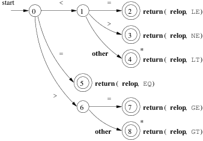

图 3.13：**relop** 的转换图

另一方面，如果在状态 0 时我们看到的第一个字符是 =，那么这个字符本身就必定是词素。我们立即从状态 5 返回该事实。


## 3.4 记号的识别

当词素同时匹配两个模式时，优先将其识别为记号，而不是 **id**。我们在示例中*并不*使用这种方法，这就是图3.15中的状态未编号的原因。

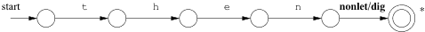

图3.15：关键字 then 的假想转换图

### 3.4.3 完成贯穿示例

我们在图3.14中看到的 **id** 转换图结构简单。从状态9开始，它检查词素是否以字母开头，如果是则转到状态10。只要输入包含字母和数字，我们就停留在状态10。当我们第一次遇到不是字母或数字的字符时，转到状态11并接受找到的词素。由于最后一个字符不属于标识符，我们必须将输入回退一个位置；正如3.4.2节所讨论的，我们将找到的内容填入符号表，并判断它是关键字还是真正的标识符。

记号 **number** 的转换图如图3.16所示，这是迄今为止我们见过的最复杂的图。从状态12开始，如果看到数字，就转到状态13。在该状态中，我们可以读取任意数量的额外数字。然而，如果看到不是数字、点或E的字符，就说明已经看到了一个整数形式的数；123就是一个例子。这种情况通过进入状态20来处理，在该状态返回记号 **number** 和一个指向常量表的指针，找到的词素会填入该表。这些机制未在图中显示，但与我们处理标识符的方式类似。

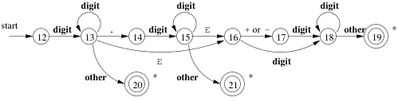

图3.16：无符号数的转换图

如果在状态13看到的是点，那么我们就有了一个“可选小数部分”。进入状态14，寻找一个或多个额外数字；状态15用于此目的。如果看到E，那么我们就有了一个“可选指数部分”，其识别由状态16到19完成。如果在状态15看到的是E或数字以外的任何字符，那么小数部分已结束，没有指数，并通过状态21返回找到的词素。

```
TOKEN getRelop()
{
    TOKEN retToken = new(RELOP);
    while(1) { /* repeat character processing until a return
                  or failure occurs */
        switch(state) {
        case 0: c = nextChar();
                if ( c == '<' ) state = 1;
                else if ( c == '=' ) state = 5;
                else if ( c == '>' ) state = 6;
                else fail(); /* lexeme is not a relop */
                break;
        case 1: ...
        ...
        case 8: retract();
                retToken.attribute = GT;
                return(retToken);
        }
    }
}
```

图3.18：**relop** 转换图的实现草图

未处理输入的真正起始位置。然后它可能将 state 的值改为另一个转换图的开始状态，该转换图将搜索另一个记号。或者，如果没有其他尚未使用的转换图，fail() 可以启动一个错误纠正阶段，尝试修复输入并找到一个词素，如3.1.4节所讨论。

我们还在图3.18中展示了状态8的动作。因为状态8带有*，我们必须将输入指针回退一个位置（即把 c 放回输入流）。该任务由函数 retract() 完成。由于状态8表示识别词素 >，我们将返回对象的第二个分量（假定名为 attribute）设置为 GT，即该运算符的代码。

为了正确理解单个转换图模拟的定位，让我们考虑像图3.18这样的代码可以如何融入整个词法分析器。

- 1. 我们可以安排依次尝试每个记号的转换图。然后，例3.10中的函数 fail() 每次被调用时，都会将指针向前重置并启动下一个转换图。这种方法允许我们为各个关键字使用转换图，如图3.15所建议的那样。我们只需在使用 id 的转换图之前使用这些转换图，就能让关键字成为保留字。
- 2. 我们可以“并行”运行各个转换图，将下一个输入字符馈送给所有转换图，并允许每个转换图进行它所需的任何转换。如果采用这种策略，必须谨慎处理如下情况：一个转换图找到了匹配其模式的词素，而一个或多个其他转换图仍能处理输入。通常的策略是取输入中匹配任一模式的最长前缀。例如，该规则允许我们优先选择标识符 `thenext` 而不是关键字 `then`，或优先选择运算符 `->` 而不是 `-`。
- 3. 首选方法（也是我们将在后续各节中采用的方法）是将所有转换图合并为一个。我们允许该转换图读取输入，直到不存在可能的下一状态，然后取匹配任一模式的最长词素，正如上文第(2)项所讨论的。在我们的贯穿示例中，这种合并很容易，因为没有任何两个记号能以相同字符开头；也就是说，第一个字符立即告诉我们正在寻找哪个记号。因此，我们可以简单地将状态0、9、12和22合并为一个开始状态，而保持其他转换不变。然而，一般而言，合并多个记号的转换图这一问题更复杂，我们很快将会看到。

### 3.4.5 第3.4节练习

**练习3.4.1：** 给出转换图，以识别与练习3.3.2中每个正则表达式相同的语言。

**练习3.4.2：** 给出转换图，以识别与练习3.3.5中每个正则表达式相同的语言。

以下练习（直到练习3.4.12）介绍 Aho-Corasick 算法，用于在文本字符串中识别一组关键字，其时间与文本长度和关键字长度之和成正比。该算法使用一种特殊形式的转换图，称为 *trie*。Trie 是一种树状转换图，从节点指向其子节点的边上带有不同标签。Trie 的叶子表示已识别的关键字。

Knuth、Morris 和 Pratt 提出了一种在文本字符串中识别单个关键字 $b_1b_2\cdots b_n$ 的算法。这里，trie 是一个具有 $n+1$ 个状态（0 到 $n$）的转换图。状态0是初始状态，状态 $n$ 表示接受，即发现了该关键字。从0到 $n-1$ 的每个状态 $s$，都有一条到状态 $s+1$ 的转换，标签为符号 $b_{s+1}$。例如，关键字 `ababaa` 的 trie 为：

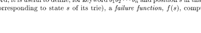

为了快速处理文本字符串并在这些字符串中搜索关键字，对于关键字 $b_1b_2\cdots b_n$ 及其中的位置 $s$（对应于其 trie 的状态 $s$），定义一个*失败函数* $f(s)$ 是很有用的，其计算如图3.19所示。目标是使 \(b_1b_2\cdots b_{f(s)}\) 成为 \(b_1b_2\cdots b_s\) 的最长真前缀，同时也是 \(b_1b_2\cdots b_s\) 的后缀。\(f(s)\) 之所以重要，是因为如果我们试图在文本字符串中匹配 \(b_1b_2\cdots b_n\)，并且已经匹配了前 \(s\) 个位置，但随后失败（即文本字符串的下一个位置不是 \(b_{s+1}\)），那么 \(f(s)\) 就是 \(b_1b_2\cdots b_n\) 的最长真前缀，它有可能匹配到我们当前所在的文本字符串位置。当然，文本字符串的下一个字符必须是 \(b_{f(s)+1}\)，否则我们仍会遇到问题，必须考虑一个更短的前缀，即 \(b_{f(f(s))}\)。

```
1)  t = 0;
2)  f(1) = 0;
3)  for (s = 1; s < n; s++) {
4)      while (t > 0 && b_{s+1} \ne b_{t+1}) t = f(t);
5)      if (b_{s+1} == b_{t+1}) {
6)          t = t + 1;
7)          f(s+1) = t;
    }
8)      else f(s+1) = 0;
}
```

图3.19：计算关键字 \(b_1b_2\cdots b_n\) 的失败函数的算法

例如，上面为 **ababaa** 构造的 trie 的失败函数为：

| \(s\) | 1 | 2 | 3 | 4 | 5 | 6 |
|---|---:|---:|---:|---:|---:|---:|
| \(f(s)\) | 0 | 0 | 1 | 2 | 3 | 1 |

例如，状态3和1分别表示前缀 **aba** 和 **a**。\(f(3)=1\)，因为 **a** 是 **aba** 的最长真前缀，同时也是 **aba** 的后缀。此外，\(f(2)=0\)，因为 **ab** 的最长真前缀（同时也是后缀）是空串。

**练习3.4.3：** 为以下字符串构造失败函数：

- a) **abababaab**.
- b) **aaaaaa**.
- c) **abbaabb**.

**! 练习3.4.4：** 通过对 \(s\) 进行归纳，证明图3.19的算法正确计算失败函数。

**!! 练习3.4.5：** 证明图3.19第(4)行中的赋值 \(t = f(t)\) 至多执行 \(n\) 次。证明因此整个算法在长度为 \(n\) 的关键字上仅需 \(O(n)\) 时间。


## 3.4 记号的识别

在计算了关键字 $b_1b_2\cdots b_n$ 的失败函数之后，我们可以在 $O(m)$ 时间内扫描字符串 $a_1a_2\cdots a_m$，以判断该关键字是否出现在字符串中。图 3.20 所示的算法将关键字沿字符串滑动，试图通过将关键字的下一个字符与字符串的下一个字符进行匹配来取得进展。如果在匹配了 $s$ 个字符后无法做到这一点，则算法将关键字向右“滑动”$s-f(s)$ 个位置，因此只认为关键字的前 $f(s)$ 个字符与字符串匹配。

```text
1)  s = 0;
2)  for (i = 1; i <= m; i++) {
3)      while (s > 0 && a_i != b_{s+1}) s = f(s);
4)      if (a_i == b_{s+1}) s = s + 1;
5)      if (s == n) return "yes";
    }
6)  return "no";
```

图 3.20：KMP 算法在 $O(m+n)$ 时间内测试字符串 $a_1a_2\cdots a_m$ 是否包含单个关键字 $b_1b_2\cdots b_n$ 作为子串。

**练习 3.4.6：** 应用 KMP 算法测试关键字 ababa 是否是以下字符串的子串：

- a) abababaab。
- b) abababbaa。

**!! 练习 3.4.7：** 证明图 3.20 中的算法能正确判断关键字是否是给定字符串的子串。提示：对 $i$ 进行归纳。证明对于所有 $i$，第 (4) 行之后 $s$ 的值是关键字的最长前缀的长度，该前缀也是 $a_1a_2\cdots a_i$ 的后缀。

**!! 练习 3.4.8：** 证明图 3.20 中的算法运行时间为 $O(m+n)$，假设函数 $f$ 已经计算出来，并且其值存储在以 $s$ 为索引的数组中。

**练习 3.4.9：** 斐波那契串定义如下：

- 1. $s_1 = \text{b}$。
- 2. $s_2 = \text{a}$。
- 3. $s_k = s_{k-1}s_{k-2}$（对于 $k > 2$）。

例如，$s_3 = \text{ab}$，$s_4 = \text{aba}$，$s_5 = \text{abaab}$。

- a) $s_n$ 的长度是多少？
- b) 构造 $s_6$ 的失败函数。
- c) 构造 $s_7$ 的失败函数。
- !! d) 证明任意 $s_n$ 的失败函数可以表示为 $f(1)=0$，$f(2)=0$，且对于 $2<j\leq |s_n|$，$f(j)$ 等于 $j-|s_{k-1}|$，其中 $k$ 是满足 $|s_k|\leq j+1$ 的最大整数。
- !! e) 在 KMP 算法中，当我们试图确定关键字 $s_k$ 是否出现在文本串 $w_{k+1}$ 中时，连续应用失败函数的最大次数是多少？

Aho 和 Corasick 将 KMP 算法推广到识别文本串中任意一组关键字。在这种情况下，trie 是一棵真正的树，从根节点开始分支。对于每个字符串，只要它是某个关键字的前缀（不一定是真前缀），就有一个状态与之对应。对应于字符串 $b_1b_2\cdots b_k$ 的状态的父状态是对应于 $b_1b_2\cdots b_{k-1}$ 的状态。如果某个状态对应于一个完整的关键字，那么它就是接受状态。例如，图 3.21 显示了关键字 he、she、his 和 hers 的 trie。

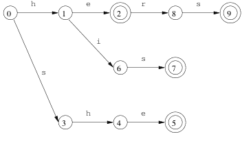

图 3.21：关键字 he、she、his 和 hers 的 trie

一般 trie 的失败函数定义如下。假设 $s$ 是对应于字符串 $b_1b_2\cdots b_n$ 的状态。那么 $f(s)$ 是对应于 $b_1b_2\cdots b_n$ 的最长真后缀的状态，该后缀同时也是某个关键字的前缀。例如，图 3.21 中 trie 的失败函数为：

| $s$ | 1 | 2 | 3 | 4 | 5 | 6 | 7 | 8 | 9 |
|---|---:|---:|---:|---:|---:|---:|---:|---:|---:|
| $f(s)$ | 0 | 0 | 0 | 1 | 2 | 0 | 3 | 0 | 3 |

**! 练习 3.4.10：** 修改图 3.19 中的算法，以计算一般 trie 的失败函数。*提示：* 主要区别在于，我们不能简单地测试图 3.19 的第 (4) 行和第 (5) 行中的 $b_{s+1}$ 和 $b_{t+1}$ 是否相等或不相等。相反，从每个状态出发，可能有多个字符上的多条转移，例如在图 3.21 中，从状态 1 出发在 e 和 i 上都有转移。任意一个

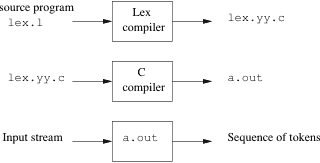

图 3.22：使用 Lex 创建词法分析器

### 3.5.2 Lex 程序的结构

Lex 程序具有以下形式：

```text
declarations
%%
translation rules
%%
auxiliary functions
```

声明部分包括变量声明、*显式常量*（声明为代表常量的标识符，例如某个记号的名字）和正则定义，采用 3.3.4 节的方式。

翻译规则的形式均为

```text
Pattern  { Action }
```

每个模式都是一个正则表达式，可以使用声明部分中的正则定义。动作是代码片段，通常用 C 编写，不过也已经出现了许多使用其他语言的 Lex 变体。

第三部分包含动作中使用的任何附加函数。或者，这些函数可以单独编译，并与词法分析器一起加载。

Lex 生成的词法分析器与语法分析器按如下方式协同工作。当被语法分析器调用时，词法分析器开始逐个字符地读取其剩余输入，直到找到输入中与某个模式 Pᵢ 匹配的最长前缀。然后它执行关联的动作 Aᵢ。通常，Aᵢ 会返回到语法分析器，但如果没有返回（例如，因为 Pᵢ 描述的是空白或注释），词法分析器就会继续寻找额外的词素，直到某个相应的动作导致返回到语法分析器为止。词法分析器向语法分析器返回一个单一值，即记号名，但如果有需要，它会使用共享的整型变量 yylval 来传递关于所找到词素的附加信息。

示例 3.11：图 3.23 是一个 Lex 程序，它识别图 3.12 中的记号并返回找到的记号。对这段代码的一些观察将向我们介绍 Lex 的许多重要特性。

在声明部分，我们看到一对特殊的括号 %{ 和 %}。在这些括号内的任何内容都会被直接复制到文件 lex.yy.c 中，而不会被当作正则定义。通常会把显式常量的定义放在这里，使用 C 的 #define 语句为每个显式常量关联唯一的整型代码。在我们的示例中，我们在注释中列出了显式常量的名称，如 LT、IF 等，但没有显示它们被定义为特定的整数。^3

声明部分还有一系列正则定义。这些定义使用了 3.3.5 节描述的正则表达式扩展记号。在后面的定义或翻译规则的模式中使用的正则定义会被花括号括起来。因此，例如，delim 被定义为由空格、制表符和换行符组成的字符类的简写；后两者与所有 UNIX 命令中的表示方式一样，分别由反斜杠后跟 t 或 n 表示。然后，ws 通过正则表达式 `{delim}+` 被定义为一个或多个分隔符。

注意，在 id 和 number 的定义中，括号被用作分组的元符号，并不表示它们本身。相反，number 的定义中的 E 表示它本身。如果我们希望使用某个 Lex 元符号（如括号、+、* 或 ?）来表示其自身，可以在它们前面加上一个反斜杠。例如，在 number 的定义中我们看到 `\.` 表示点号，因为在 UNIX 正则表达式中，该字符通常是表示“任意字符”的元符号。

在辅助函数部分，我们看到了两个这样的函数：installID() 和 installNum()。与声明部分出现在 `%{...%}` 之间的内容一样，辅助部分的所有内容都会被直接复制到文件 lex.yy.c 中，但可以在动作中使用。

最后，让我们检查图 3.23 中间部分的一些模式和规则。首先，在第一部分声明的标识符 ws 有一个关联的空动作。如果找到空白，我们不返回语法分析器，而是继续寻找另一个词素。第二个记号具有简单的正则表达式模式 if。如果在输入中看到两个字母 if，且它们后面没有紧跟另一个字母或数字（否则词法分析器会找到输入中与 id 模式匹配的更长的前缀），那么词法分析器会从输入中消耗这两个字母，并返回记号名 IF，也就是显式常量 IF 所代表的整数。关键字 then 和 else 的处理方式类似。

第五个记号具有由 id 定义的模式。注意，尽管像 if 这样的关键字既匹配这个模式，也匹配前面某个模式，但 Lex 会选择

^3 如果 Lex 与 Yacc 一起使用，通常会在 Yacc 程序中定义显式常量，并在 Lex 程序中不加定义地使用它们。由于 lex.yy.c 与 Yacc 输出一起编译，这些常量因此在 Lex 程序的动作中是可用的。


## 3.5 词法分析器生成器 Lex

```lex
%{
    /* definitions of manifest constants
    LT, LE, EQ, NE, GT, GE,
    IF, THEN, ELSE, ID, NUMBER, RELOP */
%}

/* regular definitions */
delim      [ \t\n]
ws         {delim}+
letter     [A-Za-z]
digit      [0-9]
id         {letter}({letter}|{digit})*
number     {digit}+(\.{digit}+)?(E[+\-]?{digit}+)?

%%

{ws}       {/* no action and no return */}
if         {return(IF);}
then       {return(THEN);}
else       {return(ELSE);}
{id}       {yylval = (int) installID(); return(ID);}
{number}   {yylval = (int) installNum(); return(NUMBER);}
"<"        {yylval = LT; return(RELOP);}
"<="       {yylval = LE; return(RELOP);}
"="        {yylval = EQ; return(RELOP);}
"<>"       {yylval = NE; return(RELOP);}
">"        {yylval = GT; return(RELOP);}
">="       {yylval = GE; return(RELOP);}

%%

int installID() {/* function to install the lexeme, whose
                    first character is pointed to by yytext,
                    and whose length is yyleng, into the
                    symbol table and return a pointer
                    thereto */
}

int installNum() { /* similar to installID, but puts numerical
                      constants into a separate table */
}
```

图3.23：图3.12中记号的 Lex 程序

在最长匹配前缀与两个或更多模式匹配的情况下，首先列出的模式被优先选择。当匹配到 *id* 时，所采取的动作有三部分：

- 1. 调用函数 `installID()`，将找到的词素放入符号表。
- 2. 该函数返回一个指向符号表的指针，该指针被放入全局变量 `yylval` 中，可供语法分析器或编译器的后续组件使用。注意，`installID()` 可以使用两个由 Lex 生成的词法分析器自动设置的变量：
  - (a) `yytext` 是指向词素开头的指针，类似于图3.3中的 `lexemeBegin`。
  - (b) `yyleng` 是所找到词素的长度。
- 3. 将记号名 `ID` 返回给语法分析器。

当匹配到与模式 *number* 匹配的词素时，所采取的动作类似，使用辅助函数 `installNum()`。□

### 3.5.3 Lex 中的冲突解决

我们已经提到 Lex 用来在输入的若干前缀与一个或多个模式匹配时决定选择正确词素的两条规则：

- 1. 总是优先选择较长前缀而非较短前缀。
- 2. 如果最长可能前缀与两个或更多模式匹配，则优先选择 Lex 程序中先列出的模式。

**例3.12：** 第一条规则告诉我们要继续读取字母和数字，以找到这些字符的最长前缀并将其归组为标识符。它还告诉我们要将 `<=` 视为单个词素，而不是把 `<` 选作一个词素、把 `=` 选作下一个词素。第二条规则使关键字成为保留字，前提是我们在程序中把关键字列在 `id` 之前。例如，如果 `then` 被确定为输入中与任何模式匹配的最长前缀，并且模式 `then` 像图3.23中那样位于 `{id}` 之前，那么返回的记号是 `THEN`，而不是 `ID`。□

### 3.5.4 向前看运算符

Lex 会自动读取构成所选词素的最后一个字符之后的一个字符，然后回退输入，使得只有词素本身从输入中被消耗。然而，有时我们希望某个模式仅当其后跟某些其他字符时才与输入匹配。如果是这样，我们可以在模式中使用斜杠来表示模式中与词素匹配部分的结束。斜杠 / 之后的内容是附加模式，必须先匹配它，我们才能判定看到了所讨论的记号，但匹配这个第二模式的内容并不是词素的一部分。

**例3.13：** 在 Fortran 和其他一些语言中，关键字不是保留字。这种情况会产生问题，例如语句

```
IF(I,J) = 3
```

其中 IF 是数组名，而不是关键字。该语句与如下形式的语句形成对比

```
IF( condition ) THEN ...
```

其中 IF 是关键字。幸运的是，我们可以确定关键字 IF 后面总是跟着一个左括号、一些可能包含括号的文本（即条件）、一个右括号和一个字母。因此，我们可以为关键字 IF 写出如下 Lex 规则：

```
IF / \( .* \) {letter}
```

这条规则说明，词素所匹配的模式只是两个字母 IF。斜杠表示后面跟着附加模式，但它不与词素匹配。在这个模式中，第一个字符是左括号。由于该字符是 Lex 元符号，因此必须在它前面加一个反斜杠，以表示它取其字面含义。点和星号匹配“任何不含换行符的字符串”。注意，点是 Lex 元符号，表示“除换行符外的任何字符”。它后面跟着一个右括号，同样用反斜杠使该字符取字面含义。附加模式后面跟着符号 *letter*，它是一个正则定义，表示所有字母的字符类。

注意，为了使这个模式万无一失，我们必须预处理输入以删除空白。我们在模式中既没有为空白预留处理，也无法处理条件跨行的情况，因为点不会匹配换行符。

例如，假设要求这个模式匹配输入的一个前缀：

```
IF(A<(B+C)*D)THEN...
```

前两个字符匹配 IF，下一个字符匹配 \(，接下来的九个字符匹配 .*，再接下来的两个字符匹配 \) 和 *letter*。注意，第一个右括号（在 C 之后）后面没有字母这一事实无关紧要；我们只需要找到某种使输入与该模式匹配的方式。我们得出结论：字母 IF 构成词素，并且它们是记号 *if* 的一个实例。

### 3.5.5 第3.5节习题

**习题3.5.1：** 描述如何对图3.23的 Lex 程序进行以下修改：

- a) 添加关键字 while。
- b) 将比较运算符改为 C 语言中相应种类的运算符。
- c) 允许下划线（_）作为附加字母。
- d) 添加一个带有记号 STRING 的新模式。该模式由一个双引号（"）、任意字符串和一个最后的双引号组成。然而，如果字符串中出现双引号，则必须在其前面加一个反斜杠（\）进行转义，因此字符串中的反斜杠必须用两个反斜杠表示。词法值就是去掉外围双引号、并去掉用于转义字符的反斜杠后的字符串。字符串要安装到字符串表中。

**习题3.5.2：** 编写一个 Lex 程序，复制文件，并将每一段非空空白序列替换为单个空格。

**习题3.5.3：** 编写一个 Lex 程序，复制一个 C 程序，并将每一处关键字 float 替换为 double。

**习题3.5.4：** 编写一个 Lex 程序，将文件转换为“猪拉丁语”。具体来说，假设文件是由空白分隔的单词（字母组）序列。每次遇到一个单词时：

- 1. 如果第一个字母是辅音，则将其移到单词末尾，然后添加 ay。
- 2. 如果第一个字母是元音，则只在单词末尾添加 ay。

所有非字母字符都原样复制到输出中。

**习题3.5.5：** 在 SQL 中，关键字和标识符不区分大小写。编写一个 Lex 程序，识别关键字 SELECT、FROM 和 WHERE（以大写和小写字母的任意组合），以及记号 ID；就本题而言，你可以将 ID 视为以字母开头的任意字母和数字序列。你不需要将标识符安装到符号表中，但请说明这里的“安装”函数与图3.23中所述区分大小写标识符的安装函数会有什么不同。

## 3.6 有限自动机

现在我们将揭示 Lex 如何将其输入程序转换为词法分析器。这一转换的核心是称为*有限自动机*的形式体系。它们本质上是图，类似于转换图，但有一些区别：

- 1. 有限自动机是*识别器*；它们对每个可能的输入字符串只回答“是”或“否”。
- 2. 有限自动机有两种类型：
  - (a) *非确定有限自动机*（NFA）对其边的标号没有限制。一个符号可以标记从同一状态出发的多条边，而 ε（空串）也是一种可能的标号。
  - (b) *确定有限自动机*（DFA）对于每个状态和其输入字母表中的每个符号，恰好有一条以该符号离开该状态的边。

确定有限自动机和非确定有限自动机都能识别相同的语言。事实上，这些语言正是正则表达式所能描述的相同语言，称为*正则语言*。4

### 3.6.1 非确定有限自动机

一个*非确定有限自动机*（NFA）由以下部分组成：

- 1. 一个有限状态集 *S*。
- 2. 一个输入符号集 Σ，即*输入字母表*。我们假定 ε（表示空串）永远不是 Σ 的成员。
- 3. 一个*转移函数*，它对于每个状态以及 Σ ∪ {ε} 中的每个符号，给出一个*下一状态*集合。
- 4. *S* 中的一个状态 *s*~0~，它被指定为*开始状态*（或*初始状态*）。
- 5. 一个状态集合 *F*，它是 *S* 的子集，被指定为*接受状态*（或*最终状态*）。

我们可以用*转移图*表示 NFA 或 DFA，其中节点是状态，带标号的边表示转移函数。从状态 *s* 到状态 *t* 有一条标号为 *a* 的边，当且仅当 *t* 是状态 *s* 在输入 *a* 下的下一状态之一。这个图非常像转换图，除了：

4 有一个小缺陷：按照我们的定义，正则表达式不能描述空语言，因为我们在实践中永远不会想使用这种模式。然而，有限自动机可以定义空语言。在理论中，为了定义空语言这一唯一目的，∅ 被当作一个额外的正则表达式。


- a) 同一个符号可以标记从一个状态到若干不同状态的边，并且
- b) 一条边可以用 ε（空串）标记，以代替输入字母表中的符号，或作为输入字母表中符号的补充。

**例 3.14：** 识别正则表达式 (a|b)*abb 所表示语言的 NFA 的转换图如图 3.24 所示。这个抽象示例描述了所有以特定字符串 abb 结尾的 a 和 b 组成的字符串，并将在本节中一直使用。然而，它类似于描述真正感兴趣语言的正则表达式。例如，描述所有文件名以 .o 结尾的文件的表达式是 any*.o，其中 any 代表任意可打印字符。

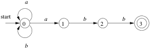

图 3.24：一个非确定性有限自动机

按照我们对转换图的约定，状态 3 周围的双圈表示该状态是接受状态。请注意，从开始状态 0 到达接受状态的唯一方式，是沿着某条路径先在状态 0 停留一段时间，然后通过从输入中读取 abb 依次进入状态 1、2 和 3。因此，能够到达接受状态的唯一字符串，就是那些以 abb 结尾的字符串。

### 3.6.2 转换表

我们也可以用*转换表*表示一个 NFA，其行对应于状态，列对应于输入符号和 ε。给定状态和输入对应的表项，是将转换函数应用于这些参数后得到的值。如果转换函数没有关于该状态-输入对的信息，我们就在表中该对的位置填入 ∅。

**例 3.15：** 图 3.24 中 NFA 的转换表如图 3.25 所示。

| 状态 | *a* | *b* | *ε* |
|---|---|---|---|
| 0 | {0, 1} | {0} | ∅ |
| 1 | ∅ | {2} | ∅ |
| 2 | ∅ | {3} | ∅ |
| 3 | ∅ | ∅ | ∅ |

图 3.25：图 3.24 中 NFA 的转换表

转换表的优点是，我们可以很容易地找到给定状态和输入上的转换。其缺点是，当输入字母表很大，而大多数状态在大多数输入符号上又没有任何移动时，它会占用大量空间。

### 3.6.3 自动机对输入字符串的接受

一个 NFA 接受输入字符串 *x*，当且仅当在转换图中存在某条从开始状态到某个接受状态的路径，使得沿该路径的符号拼出 *x*。注意，路径上的 ε 标号实际上会被忽略，因为空串不会对沿路径构造出的字符串产生贡献。

**例 3.16：** 字符串 *aabb* 被图 3.24 的 NFA 接受。从状态 0 到状态 3、标号为 *aabb* 并证明这一点的路径是：

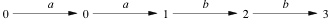

注意，标号为同一字符串的多条路径可能通向不同状态。例如，路径

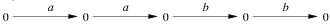

是从状态 0 出发、标号为字符串 *aabb* 的另一条路径。这条路径通向状态 0，而状态 0 不是接受状态。然而，请记住，只要存在某条以该字符串为标号、从开始状态通向接受状态的路径，NFA 就接受该字符串。其他通向非接受状态的路径是否存在并不重要。

由 NFA 定义（或接受）的语言，是标号某条从开始状态到接受状态的路径的字符串集合。如前所述，图 3.24 的 NFA 定义的语言与正则表达式 (a|b)*abb 相同，即字母表 {a, b} 中所有以 *abb* 结尾的字符串。我们可以用 *L(A)* 表示自动机 *A* 所接受的语言。

**例 3.17：** 图 3.26 是一个接受 L(aa*|bb*) 的 NFA。字符串 *aaa* 被接受，因为存在路径

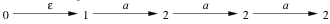

注意，ε 在连接中会“消失”，因此该路径的标号是 *aaa*。

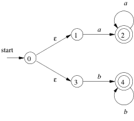

图 3.26：接受 aa*|bb* 的 NFA

### 3.6.4 确定性有限自动机

确定性有限自动机（DFA）是 NFA 的一种特殊情况，其中：

- 1. 输入 ε 上没有移动，并且
- 2. 对于每个状态 *s* 和输入符号 *a*，从 *s* 出发恰好有一条标号为 *a* 的边。

如果我们使用转换表表示 DFA，那么每个表项都是一个单一状态。因此，我们可以表示这个状态时省略用于构成集合的花括号。

虽然 NFA 是识别某种语言字符串的算法的抽象表示，但 DFA 是用于识别字符串的简单而具体的算法。确实很幸运，每个正则表达式和每个 NFA 都能转换为接受同一语言的 DFA，因为在构建词法分析器时，我们真正实现或模拟的是 DFA。下面的算法展示如何将 DFA 应用于一个字符串。

**算法 3.18：** 模拟一个 DFA。

**输入：** 一个以文件结束字符 eof 结尾的输入字符串 *x*。一个 DFA *D*，其开始状态为 *s₀*，接受状态集合为 *F*，转换函数为 *move*。

**输出：** 如果 *D* 接受 *x*，则回答“yes”；否则回答“no”。

**方法：** 将图 3.27 中的算法应用于输入字符串 *x*。函数 *move(s, c)* 给出在输入 *c* 上从状态 *s* 出发有边指向的状态。函数 *nextChar* 返回输入字符串 *x* 的下一个字符。□

```c
s = s0;
c = nextChar();
while ( c != eof ) {
    s = move(s,c);
    c = nextChar();
}
if ( s in F ) return "yes";
else return "no";
```

图 3.27：模拟一个 DFA

**例 3.19：** 在图 3.28 中，我们看到一个接受语言 (a|b)*abb 的 DFA 的转换图，该语言与图 3.24 的 NFA 所接受的语言相同。给定输入字符串 *ababb*，该 DFA 依次进入状态序列 0、1、2、1、2、3，并返回“yes”。□

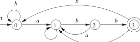

图 3.28：接受 (a|b)*abb 的 DFA

### 3.6.5 第3.6节练习

! 练习 3.6.1：3.4 节练习中的图 3.19 计算了 KMP 算法的失效函数。说明在给定该失效函数的情况下，如何从关键字 b1b2 · · · bn 构造一个 n + 1 个状态的 DFA，使其识别 .b1b2 · · · bn，其中点号代表“任意字符”。此外，该 DFA 可以在 O(n) 时间内构造。

练习 3.6.2：为练习 3.3.5 的每种语言设计有限自动机（确定性的或非确定性的）。

练习 3.6.3：对于图 3.29 的 NFA，指出所有标号为 aabb 的路径。该 NFA 接受 aabb 吗？

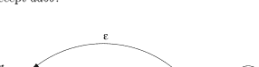

图 3.29：练习 3.6.3 的 NFA

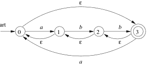

图 3.30：练习 3.6.4 的 NFA

**练习 3.6.4：** 对图 3.30 的 NFA 重复练习 3.6.3。

**练习 3.6.5：** 给出以下 NFA 的转换表：

- a) 练习 3.6.3。
- b) 练习 3.6.4。
- c) 图 3.26。

## 3.7 从正则表达式到自动机

正则表达式是描述词法分析器和其他模式处理软件时首选的表示法，正如 3.5 节所体现的那样。然而，这类软件的实现需要模拟 DFA，如算法 3.18 那样，或者也许需要模拟 NFA。由于 NFA 常常在某个输入符号上有移动选择（如图 3.24 在状态 0 上对输入 a 所做的那样），或者在 ε 上有移动选择（如图 3.26 在状态 0 上所做的那样），甚至可以选择在 ε 或真实输入符号上进行转换，因此它的模拟不如 DFA 那样直接。所以，通常重要的是将一个 NFA 转换为接受同一语言的 DFA。

在本节中，我们将首先展示如何将 NFA 转换为 DFA。然后，我们使用这种称为“子集构造法”的技术，给出一种直接模拟 NFA 的有用算法，适用于（除词法分析之外的）NFA 到 DFA 转换比直接模拟更耗时的情况。接下来，我们展示如何将正则表达式转换为 NFA，若需要，可以从这些 NFA 构造 DFA。最后，我们讨论实现正则表达式的各种方法中固有的时间空间权衡，并了解如何为你的应用选择合适的方法。

### 3.7.1 将 NFA 转换为 DFA

子集构造法背后的总体思想是：所构造 DFA 的每个状态对应于一个 NFA 状态集合。在读取输入

在读取 a1a2 · · · an 后，DFA 处于这样的状态：它对应于 NFA 从其开始状态出发、沿标记为 a1a2 · · · an 的路径所能到达的状态集合。

DFA 的状态数有可能随 NFA 状态数呈指数增长，这在我们尝试实现该 DFA 时可能导致困难。然而，基于自动机的方法用于词法分析的部分能力在于：对于实际语言，NFA 和 DFA 的状态数大致相同，并不会出现指数级行为。

**算法 3.20：** 从 NFA 构造 DFA 的子集构造法。

**输入：** 一个 NFA *N*。

**输出：** 一个接受与 *N* 相同语言的 DFA *D*。

**方法：** 我们的算法为 *D* 构造转移表 *Dtran*。*D* 的每个状态都是 NFA 状态的集合，我们构造 *Dtran*，使得 *D* 能“并行”模拟 *N* 在给定输入串上所有可能的移动。我们的第一个问题是正确处理 *N* 的 ε 转移。在图 3.31 中，我们看到了若干函数的定义，这些函数描述了算法所需的、对 *N* 的状态进行的基本计算。注意，*s* 是 *N* 的单个状态，而 *T* 是 *N* 的状态集合。

| 操作 | 描述 |
| --- | --- |
| ε-closure(s) | 仅通过 ε 转移从 NFA 状态 s 可达的 NFA 状态集合。 |
| ε-closure(T) | 仅通过 ε 转移从集合 T 中某个 NFA 状态 s 可达的 NFA 状态集合；= ∪_{s in T} ε-closure(s)。 |
| move(T, a) | 从 T 中某个状态 s 出发，在输入符号 a 上存在转移所到达的 NFA 状态集合。 |

图 3.31：对 NFA 状态的操作

我们必须探索 *N* 在读取某个输入串后可能处于的那些状态集合。作为基础，在读取第一个输入符号之前，*N* 可以处于 ε-closure(s₀) 的任意状态，其中 s₀ 是其开始状态。对于归纳步骤，假设 *N* 在读取输入串 *x* 后可以处于状态集合 *T*。如果它接下来读取输入 *a*，那么 *N* 可以立即转到 move(*T*, *a*) 中的任意状态。然而，在读取 *a* 之后，它还可能进行若干次 ε 转移；因此，在读取输入 *xa* 后，*N* 可以处于 ε-closure(move(*T*, *a*)) 的任意状态。按照这些思想，*D* 的状态集合 *Dstates* 及其转移函数 *Dtran* 的构造如图 3.32 所示。

```text
initially, ε-closure(s₀) is the only state in Dstates, and it is unmarked;
while ( there is an unmarked state T in Dstates ) {
    mark T;
    for ( each input symbol a ) {
        U = ε-closure(move(T,a));
        if ( U is not in Dstates )
            add U as an unmarked state to Dstates;
        Dtran[T,a] = U;
    }
}
```

图 3.32：子集构造

*D* 的起始状态是 ε-closure(s₀)，*D* 的接受状态是所有至少包含 *N* 的一个接受状态的 *N* 状态集合。为了完成对子集构造的描述，我们只需说明如何对任意 NFA 状态集合 *T* 计算 ε-closure(*T*)。这个过程如图 3.33 所示，它是在一个图上从一组状态开始的直接搜索。在这种情况下，可以想象图中只有标记为 ε 的边可用。□

```text
push all states of T onto stack;
initialize ε-closure(T) to T;
while ( stack is not empty ) {
    pop t, the top element, off stack;
    for ( each state u with an edge from t to u labeled ε )
        if ( u is not in ε-closure(T) ) {
            add u to ε-closure(T);
            push u onto stack;
        }
}
```

图 3.33：计算 ε-closure(*T*)

**例 3.21：** 图 3.34 显示了另一个接受 `(a|b)*abb` 的 NFA；它恰好是我们在 3.7 节中将直接从该正则表达式构造的 NFA。让我们对图 3.34 应用算法 3.20。

等价 DFA 的起始状态 A 是 ε-closure(0)，即 A = {0, 1, 2, 4, 7}，因为这些正是从状态 0 出发、经由所有边都标记为 ε 的路径所能到达的状态。注意，路径可以包含零条边，因此状态 0 可通过一条标记为 ε 的路径从自身到达。

输入字母表是 {a, b}。因此，我们的第一步是标记 A，并计算 Dtran[A,a] = ε-closure(move(A,a)) 和 Dtran[A,b] = ε-closure(move(A,b))。在状态 0、1、2、4 和 7 中，只有 2 和 7 在 a 上有转移，分别转移到 3 和 8。因此，move(A,a) = {3, 8}。此外，ε-closure({3, 8}) = {1, 2, 3, 4, 6, 7, 8}，所以我们得出结论

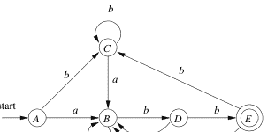

图 3.36：对图 3.34 应用子集构造的结果

### 3.7.2 NFA 的模拟

许多文本编辑程序中使用的一种策略是：从正则表达式构造一个 NFA，然后使用类似即时子集构造的方法来模拟该 NFA。模拟过程概述如下。

**算法 3.22：** 模拟一个 NFA。

**输入：** 一个以文件结束字符 **eof** 结尾的输入串 *x*。一个 NFA *N*，其起始状态为 *s*<sub>0</sub>，接受状态为 *F*，转移函数为 *move*。

**输出：** 如果 *N* 接受 *x* 则回答“yes”；否则回答“no”。

**方法：** 该算法维护一个当前状态集合 *S*，即从 *s*<sub>0</sub> 出发、沿着由目前已读输入标记的路径所到达的状态。如果 *c* 是由函数 *nextChar()* 读取的下一个输入字符，那么我们首先计算 *move(S,c)*，然后用 *ε-closure()* 对该集合求闭包。该算法在图 3.37 中给出概要。

□

```text
1)   S = ε-closure(s0);
2)   c = nextChar();
3)   while ( c != eof ) {
4)       S = ε-closure(move(S,c));
5)       c = nextChar();
6)   }
7)   if ( S ∩ F != ∅ ) return "yes";
8)   else return "no";
```

图 3.37：模拟一个 NFA

### 3.7.3 NFA 模拟的效率

如果仔细实现，算法 3.22 可以相当高效。由于其中的思想在许多涉及图搜索的类似算法中都有用，我们将更详细地考察这一实现。我们需要的数据结构是

- 1. 两个栈，每个栈保存一组 NFA 状态。其中一个栈 *oldStates* 保存“当前”状态集合，即图 3.37 第 (4) 行右侧的 *S* 值。第二个栈 *newStates* 保存“下一个”状态集合——第 (4) 行左侧的 *S*。当我们围绕第 (3) 行到第 (6) 行的循环进行时，*newStates* 被转移到 *oldStates*，这称为一步。
- 2. 一个布尔数组 *alreadyOn*，以 NFA 状态为索引，用于指示哪些状态位于 *newStates* 中。虽然数组和栈保存相同的信息，但查询 *alreadyOn[s]* 比在栈 *newStates* 中搜索状态 *s* 要快得多。正是为了这种效率，我们同时维护这两种表示。
- 3. 一个二维数组 *move[s,a]*，保存 NFA 的转移表。该表中的条目是状态集合，用链表表示。

为了实现图 3.37 的第 (1) 行，我们需要将数组 *alreadyOn* 中的每个条目设为 FALSE，然后对于 ε-closure(*s₀*) 中的每个状态 *s*，将 *s* 压入 *oldStates* 并将 *alreadyOn[s]* 设为 TRUE。对状态 *s* 的这一操作，以及第 (4) 行的实现，都可以借助我们将称为 *addState(s)* 的函数来完成。该函数将状态 *s* 压入 *newStates*，将 *alreadyOn[s]* 设为 TRUE，并对 *move[s,ε]* 中的状态递归调用自身，以继续计算 ε-closure(*s*)。然而，为了避免重复工作，我们必须注意绝不要对已经位于栈 *newStates* 中的状态调用 *addState*。图 3.38 给出了该函数的概要。

```text
 9)   addState(s) {
10)       push s onto newStates;
11)       alreadyOn[s] = TRUE;
12)       for ( t on move[s, ε] )
13)           if ( !alreadyOn[t] )
14)               addState(t);
15)   }
```

图 3.38：添加一个新状态 *s*，已知它不在 *newStates* 中

我们通过查看 *oldStates* 中的每个状态 *s* 来实现图 3.37 的第 (4) 行。我们首先找到状态集合 *move[s,c]*，其中 *c* 是下一个输入，然后对于每个


## 大O记号

像 $O(n)$ 这样的表达式是“至多某个常数乘以 $n$”的简写。从技术上讲，我们说一个函数 $f(n)$（也许是算法某一步的运行时间）是 $O(g(n))$，如果存在常数 $c$ 和 $n_0$，使得只要 $n \ge n_0$，就有 $f(n) \le cg(n)$。一个有用的惯用表达是“$O(1)$”，它表示“某个常数”。使用这种大O记号使我们不必深入钻研什么算作执行时间单位的细节，同时又能表达算法运行时间的增长速率。

状态 $s_0$。第(2)、(7)和(8)行各需 $O(1)$ 时间。因此，正确实现的算法3.22的运行时间是 $O(k(n+n+m))$。也就是说，所花费的时间与输入长度乘以转换图的规模（节点数加边数）成正比。

## 3.7.4 从正则表达式构造NFA

我们现在给出一个算法，用于将任意正则表达式转换为定义相同语言的NFA。该算法是语法导向的，即它沿着正则表达式的语法分析树递归地向上工作。对于每个子表达式，该算法构造一个具有单一接受状态的NFA。

**算法3.23：** 将正则表达式转换为NFA的McNaughton-Yamada-Thompson算法。

**输入：** 字母表 $\Sigma$ 上的正则表达式 $r$。

**输出：** 接受 $L(r)$ 的NFA $N$。

**方法：** 首先将 $r$ 解析为其组成子表达式。构造NFA的规则包括处理无运算符子表达式的基础规则，以及根据给定表达式的直接子表达式的NFA构造更大NFA的归纳规则。

**基础：** 对于表达式 $\epsilon$，构造如下NFA

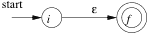

这里，$i$ 是一个新状态，即该NFA的开始状态，而 $f$ 是另一个新状态，即该NFA的接受状态。

对于 $\Sigma$ 中的任何子表达式 $a$，构造如下NFA

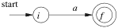

其中 $i$ 和 $f$ 同样是新状态，分别作为开始状态和接受状态。注意，在这两种基础构造中，对于 $\epsilon$ 或某个 $a$ 作为 $r$ 的子表达式的每一次出现，我们都构造一个使用新状态的不同的NFA。

**归纳：** 假设 $N(s)$ 和 $N(t)$ 分别是正则表达式 $s$ 和 $t$ 的NFA。

- a) 假设 $r = s|t$。那么 $N(r)$（即 $r$ 的NFA）按图3.40所示构造。这里，$i$ 和 $f$ 是新状态，分别作为 $N(r)$ 的开始状态和接受状态。从 $i$ 到 $N(s)$ 和 $N(t)$ 的开始状态存在 $\epsilon$-转换，并且 $N(s)$ 和 $N(t)$ 的接受状态各自都有到接受状态 $f$ 的 $\epsilon$-转换。注意，$N(s)$ 和 $N(t)$ 的接受状态在 $N(r)$ 中不再是接受状态。由于从 $i$ 到 $f$ 的任何路径必须只经过 $N(s)$ 或 $N(t)$ 其中之一，并且该路径的标记不会因离开 $i$ 或进入 $f$ 的 $\epsilon$ 而改变，因此我们得出结论：$N(r)$ 接受 $L(s) \cup L(t)$，即 $L(r)$。也就是说，图3.40是并运算符的正确构造。

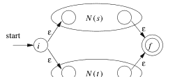

图3.40：两个正则表达式并集的NFA

- b) 假设 $r = st$。那么按图3.41构造 $N(r)$。$N(s)$ 的开始状态成为 $N(r)$ 的开始状态，而 $N(t)$ 的接受状态是 $N(r)$ 唯一的接受状态。$N(s)$ 的接受状态和 $N(t)$ 的开始状态被合并为单一状态，并保留任一个状态的所有进入或离开的转换。在图3.41中，从 $i$ 到 $f$ 的路径必须首先经过 $N(s)$，因此其标记将以 $L(s)$ 中的某个字符串开头。然后该路径继续经过 $N(t)$，因此路径的标记以 $L(t)$ 中的某个字符串结束。我们很快会论证，接受状态永远没有出边，开始状态永远没有入边，因此路径不可能在离开 $N(s)$ 之后重新进入它。因此，$N(r)$ 恰好接受 $L(s)L(t)$，是 $r = st$ 的正确NFA。

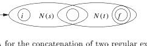

图3.41：两个正则表达式连接的NFA

- c) 假设 $r = s^*$。那么对于 $r$，我们构造如图3.42所示的NFA $N(r)$。这里，$i$ 和 $f$ 是新状态，分别作为 $N(r)$ 的开始状态和唯一接受状态。要从 $i$ 到达 $f$，我们可以要么沿着引入的标记为 $\epsilon$ 的路径走，该路径处理了 $L(s)^0$ 中的那一个字符串；要么前往 $N(s)$ 的开始状态，穿过该NFA，然后从其接受状态回到其开始状态，如此重复零次或多次。这些选项使 $N(r)$ 能够接受 $L(s)^1$、$L(s)^2$ 等中的所有字符串，因此 $N(r)$ 接受的整个字符串集合就是 $L(s^*)$。

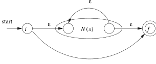

图3.42：正则表达式闭包的NFA

- d) 最后，假设 $r = (s)$。那么 $L(r) = L(s)$，我们可以使用NFA $N(s)$ 作为 $N(r)$。

□

算法3.23中的方法描述包含了归纳构造为何能按预期工作的一些提示。我们不会给出形式化的正确性证明，但除了 $N(r)$ 接受语言 $L(r)$ 这一最重要的事实之外，我们还将列出所构造NFA的几个性质。这些性质本身很有意义，并且有助于进行形式化证明。

- 1. $N(r)$ 的状态数至多是 $r$ 中运算符和运算对象总数的两倍。这个界限源于以下事实：算法的每一步至多创建两个新状态。
- 2. $N(r)$ 有一个开始状态和一个接受状态。接受状态没有出边转换，开始状态没有入边转换。
- 3. $N(r)$ 中除接受状态外的每个状态，要么有在 $\Sigma$ 中某个符号上的一条出边转换，要么有两条出边转换，且两条都在 $\epsilon$ 上。

**示例3.24：** 让我们使用算法3.23为 $r = (a|b)^*abb$ 构造一个NFA。图3.43显示了 $r$ 的语法分析树，它与2.2.3节中为算术表达式构造的语法分析树类似。对于子表达式 $r_1$（第一个 $a$），我们构造如下NFA：

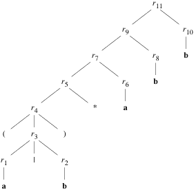

图3.43：`(a|b)*abb` 的语法分析树

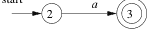

状态编号的选择是为了与后续内容保持一致。对于 $r_2$，我们构造：

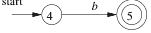

我们现在可以使用图3.40的构造将 $N(r_1)$ 和 $N(r_2)$ 组合起来，得到 $r_3 = r_1|r_2$ 的NFA；该NFA如图3.44所示。

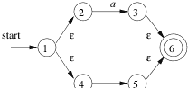

图3.44：$r_3$ 的NFA

$r_4 = (r_3)$ 的NFA与 $r_3$ 的NFA相同。$r_5 = (r_3)^*$ 的NFA如图3.45所示。我们使用图3.42中的构造，从图3.44中的NFA构建出该NFA。

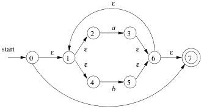

图3.45：$r_5$ 的NFA

现在，考虑子表达式 $r_6$，它是另一个 $a$。我们再次使用 $a$ 的基础构造，但必须使用新的状态。即使 $r_1$ 和 $r_6$ 是相同的表达式，也不允许重用我们为 $r_1$ 构造的NFA。$r_6$ 的NFA是：


为了得到 $r_7 = r_5r_6$ 的NFA，我们应用图3.41的构造。我们合并状态 $7$ 和 $7'$，得到图3.46的NFA。以这种方式继续，为两个子表达式 $b$（称为 $r_8$ 和 $r_{10}$）构造新的NFA，我们最终构造出 $(a|b)^*abb$ 的NFA，即我们最初在图3.34中见到的那个NFA。□


图3.46：$r_7$ 的NFA

## 3.7.5 字符串处理算法的效率

我们观察到，算法3.18处理字符串 $x$ 的时间为 $O(|x|)$，而在3.7.3节中我们得出结论，模拟NFA所需的时间与 $|x|$ 和NFA转换图规模的乘积成正比。显然，它


## 3.7 从正则表达式到自动机

模拟 DFA 比模拟 NFA 更快，因此我们可能会想：模拟 NFA 是否还有意义。

可能有利于 NFA 的一个问题是，子集构造在最坏情况下会使状态数呈指数增长。虽然原则上 DFA 的状态数不影响算法3.18的运行时间，但如果状态数变得大到转移表无法放入主存，那么实际运行时间就必须包括磁盘 I/O，因而会显著增加。

**例3.25：** 考虑由形如 $L_n = (a|b)^*a(a|b)^{n-1}$ 的正则表达式所描述的语言族，也就是说，每种语言 $L_n$ 由 $a$ 和 $b$ 组成的字符串构成，并且从右端向左数第 $n$ 个字符是 $a$。构造一个具有 $n+1$ 个状态的 NFA 很容易。它在任何输入下都停留在初始状态，但也可以选择在输入 $a$ 时转到状态1。从状态1出发，它在任何输入下转到状态2，依此类推，直到在状态 $n$ 接受。图3.47给出了这个 NFA。


图3.47：一个状态数远少于最小等价 DFA 的 NFA

然而，任何用于语言 $L_n$ 的 DFA 都至少要有 $2^n$ 个状态。我们不证明这一事实，但其思路是：通过在 DFA 中存储字符串的前 $n$ 个字符，我们可以让 DFA 到达相同状态，然后可以利用字符串首次出现差异的最后位置（因此其中一个必须为 $a$，另一个为 $b$）来让字符串以相同方式继续，直到它们在最后 $n-1$ 个位置上相同。此时 DFA 将处于一个必须同时接受和拒绝的状态。幸运的是，正如我们提到的，词法分析很少涉及这种类型的模式，并且在实际中我们并不期望遇到状态数离谱的 DFA。□

然而，词法分析器生成器和其他字符串处理系统常常从正则表达式开始。我们面临的选择是：将正则表达式转换为 NFA 还是 DFA。因此，转向 DFA 的额外成本就是在 NFA 上执行算法3.20的成本（也可以直接从正则表达式转到 DFA，但工作量本质上相同）。如果字符串处理器会被执行很多次，就像词法分析那样，那么转换为 DFA 的任何成本都是值得的。然而，在其他字符串处理应用中，例如 grep，用户指定一个正则表达式以及一个或几个文件来搜索该表达式的模式，这时跳过构造 DFA 的步骤而直接模拟 NFA 可能更高效。

让我们考虑用算法3.23将正则表达式 r 转换为 NFA 的成本。一个关键步骤是为 r 构造语法分析树。在第4章中，我们将看到几种能够在线性时间内构造该语法分析树的方法，即时间 O(|r|)，其中 |r| 表示 r 的大小——即 r 中运算符和操作数的数量之和。也很容易验证，算法3.23的每个基础构造和归纳构造都花费常数时间，因此转换为 NFA 所花费的总时间是 O(|r|)。

此外，正如我们在3.7.4节中观察到的，我们构造的 NFA 至多有 2|r| 个状态和至多 4|r| 条转移。也就是说，按照3.7.3节中的分析，我们有 n ≤ 2|r| 且 m ≤ 4|r|。因此，在输入字符串 x 上模拟这个 NFA 需要时间 O(|r| × |x|)。这个时间支配了构造 NFA 所花费的时间 O(|r|)，因此我们得出结论：可以取正则表达式 r 和字符串 x，并在时间 O(|r| × |x|) 内判断 x 是否属于 L(r)。

子集构造所花费的时间高度依赖于所得 DFA 的状态数。首先请注意，在图3.32的子集构造中，关键步骤——由状态集合 T 和输入符号 a 构造状态集合 U——非常像算法3.22的 NFA 模拟中由旧状态集合构造新状态集合的过程。我们已经得出结论：如果实现得当，这一步所花费的时间至多与 NFA 的状态数和转移数成正比。

假设我们从一个正则表达式 r 开始，并将其转换为 NFA。这个 NFA 至多有 2|r| 个状态和至多 4|r| 条转移。此外，至多有 |r| 个输入符号。因此，对于构造出的每个 DFA 状态，我们必须至多构造 |r| 个新状态，而每个新状态至多花费 O(|r|) 时间。因此，构造具有 s 个状态的 DFA 的时间是 O(|r|²s)。

在常见情况下，s 大约为 |r|，子集构造花费时间 O(|r|³)。然而，在最坏情况下，如例3.25所示，这个时间是 O(|r|²2^|r|)。图3.48总结了当给定一个正则表达式 r，并希望产生一个识别器来判断一个或多个字符串 x 是否属于 L(r) 时的各种选择。

| 自动机 | 初始开销 | 每个字符串的开销 |
|---|---|---|
| NFA | O(\|r\|) | O(\|r\| × \|x\|) |
| DFA 典型情况 | O(\|r\|³) | O(\|x\|) |
| DFA 最坏情况 | O(\|r\|²2^(\|r\|)) | O(\|x\|) |

图3.48：识别正则表达式语言的各种方法的初始成本和每个字符串成本

如果每个字符串的成本占主导地位，就像我们构建词法分析器时那样，我们显然更倾向于 DFA。然而，在像 grep 这样的命令中，我们只在一个字符串上运行自动机，通常更倾向于 NFA。直到 |x| 接近 |r|³ 时，我们才会考虑转换为 DFA。

然而，存在一种混合策略，对于每个表达式 r 和字符串 x，它大致与 NFA 策略和 DFA 策略中较好的那个一样好。开始时模拟 NFA，但在计算时记住 NFA 状态集合（即 DFA 状态）及其转移。在处理当前 NFA 状态集合和当前输入符号之前，检查是否已经计算过这个转移，如果是，就使用该信息。

### 3.7.6 第3.7节练习

**练习3.7.1：** 将以下 NFA 转换为 DFA：

- a) 图3.26。
- b) 图3.29。
- c) 图3.30。

**练习3.7.2：** 使用算法3.22模拟以下 NFA：

- a) 图3.29。
- b) 图3.30。

输入为 *aabb*。

**练习3.7.3：** 使用算法3.23和3.20将以下正则表达式转换为确定性有限自动机：

- a) (a|b)*。
- b) (a*|b*)*。
- c) ((ε|a)b*)*。
- d) (a|b)*abb(a|b)*。

## 3.8 词法分析器生成器的设计

在本节中，我们将应用3.7节介绍的技术，来看看诸如 Lex 这样的词法分析器生成器是如何架构的。我们讨论两种方法，分别基于 NFA 和 DFA；后者本质上就是 Lex 的实现。


图3.50：根据一个 Lex 程序构造的 NFA

- **a** — { 针对模式 $p_1$ 的动作 $A_1$ }
- **abb** — { 针对模式 $p_2$ 的动作 $A_2$ }
- **a*b+** — { 针对模式 $p_3$ 的动作 $A_3$ }

注意，这三个模式呈现出一些在3.5.3节中讨论过的冲突。具体来说，字符串 $abb$ 同时匹配第二个和第三个模式，但我们将把它视为模式 $p_2$ 的词素，因为该模式在上述 Lex 程序中列在前面。然后，像 $aabbb\ldots$ 这样的输入字符串有许多前缀匹配第三个模式。Lex 的规则是取最长匹配，因此我们继续读取 b，直到遇到另一个 a，此时我们报告词素为开头的 a 后跟尽可能多的 b。

图3.51显示了识别这三个模式的三个 NFA。第三个是算法3.23所得结果的一个简化。然后，图3.52显示了通过添加起始状态0和三个 ε-转换将这三个 NFA 合并为一个 NFA。□

### 3.8.2 基于 NFA 的模式匹配

如果词法分析器模拟如图3.52那样的 NFA，那么它必须从其输入中我们称为 lexemeBegin 的位置开始读取输入。当它把称为 forward 的指针在输入中向前移动时，它会按照算法3.22计算在每个点上所处的状态集合。

最终，NFA 模拟到达输入上的某一点，在那里没有下一个状态。此时，输入的任意更长前缀都不可能使 NFA 到达接受状态；相反，状态集合将始终为空。因此，我们准备好决定作为匹配某个模式的最长前缀词素。


## 3.8 词法分析器生成器的设计


图 3.51：a、abb 和 a*b+ 的 NFA


图 3.52：组合 NFA


图 3.53：处理输入 aaba 时进入的状态集合序列

我们在状态集合序列中向后回溯，直到找到一个包含一个或多个接受状态的状态集合。如果该集合中有多个接受状态，则选择与 Lex 程序列表中最早模式 $p_i$ 相关联的那个接受状态。将 *前向* 指针移回词素的末尾，并执行与模式 $p_i$ 相关联的动作 $A_i$。

**例 3.27：** 假设我们采用例 3.26 中的模式，且输入以 $aba$ 开头。图 3.53 展示了进入的图 3.52 中 NFA 的状态集合，从初始状态 0 的 $\varepsilon$-闭包开始，即 $\{0,1,3,7\}$，并从那里继续。读完第四个输入符号后，我们处于空状态集合，因为在图 3.52 中，状态 8 在输入 $a$ 上没有转移出边。

因此，我们需要回退，寻找一个包含接受状态的状态集合。注意，如图 3.53 所示，读完 $a$ 后，我们处于一个包含状态 2 的集合，因此表明模式 $a$ 已被匹配。然而，读完 $aab$ 后，我们处于状态 8，这表明 $a^*b^+$ 已被匹配；前缀 $aab$ 是使我们到达接受状态的最长前缀。因此，我们选择 $aab$ 作为词素，并执行动作 $A_3$，该动作应包含返回到语法分析器，表明已找到模式为 $p_3 = a^*b^+$ 的词法单元。□

### 3.8.3 用于词法分析器的 DFA

另一种架构类似于 Lex 的输出，它使用算法 3.20 的子集构造，将所有模式的 NFA 转换为等价的 DFA。在每个 DFA 状态内，如果有一个或多个接受 NFA 状态，则确定第一个其接受状态在该 DFA 状态中被表示的模式，并将该模式作为该 DFA 状态的输出。

**例 3.28：** 图 3.54 展示了一个基于 DFA 的转移图，该 DFA 是通过对图 3.52 中的 NFA 进行子集构造而构造的。接受状态用该状态所识别的模式来标记。例如，状态 $\{6,8\}$ 有两个接受状态，分别对应模式 $abb$ 和 $a^*b^+$。由于前者列在前面，因此它就是与状态 $\{6,8\}$ 相关联的模式。□

我们在词法分析器中使用 DFA 的方式与使用 NFA 的方式大致相同。我们模拟 DFA，直到某一点没有下一状态（或者严格地说，下一状态是 $\emptyset$，即对应于 NFA 状态空集的 *死状态*）。此时，我们沿着进入过的状态序列回退，并且一旦遇到一个接受 DFA 状态，就执行与该状态对应模式相关联的动作。

**例 3.29：** 假设图 3.54 的 DFA 给定输入 $abba$。进入的状态序列为 0137、247、58、68，并且在最后的 $a$ 处，状态 68 没有转移出边。因此，我们从开头考虑该序列，而在这种情况下，68 本身就是一个报告模式 $p_2 = abb$ 的接受状态。□


图 3.54：处理模式 **a**、**abb** 和 $a^*b^+$ 的 DFA 转移图

### 3.8.4 实现前瞻运算符

回顾第 3.5.4 节，Lex 模式 r₁/r₂ 中的 Lex 前瞻运算符 / 有时是必要的，因为某个特定词法单元的模式 r₁ 可能需要描述一些尾部上下文 r₂，以便正确识别实际的词素。将模式 r₁/r₂ 转换为 NFA 时，我们将 / 视为 ε，因此实际上不会在输入中查找 /。然而，如果 NFA 将输入缓冲区的前缀 xy 识别为与该正则表达式匹配，那么词素的结尾并不在 NFA 进入其接受状态的位置。相反，结尾发生在 NFA 进入状态 s 时，使得

- 1. s 在（虚设的）/ 上有一个 ε-转移，
- 2. 存在一条从 NFA 开始状态到状态 s 的路径，该路径拼出 x。
- 3. 存在一条从状态 s 到接受状态的路径，该路径拼出 y。
- 4. 对于任何满足条件 1-3 的 xy，x 都尽可能长。

如果 NFA 中虚设的 / 上只有一个 ε-转移状态，那么词素的结尾发生在最后一次进入该状态时，如下例所示。如果 NFA 中虚设的 / 上有多个 ε-转移状态，那么找到正确状态 s 的一般问题就要困难得多。

**例 3.30：** 图 3.55 展示了例 3.13 中带前瞻的 Fortran IF 模式的 NFA。注意，从状态 2 到状态 3 的 ε-转移表示前瞻运算符。状态 6 表示出现了关键字 IF。然而，每当进入状态 6 时，我们通过向后扫描到状态 2 的最后一次出现来找到词素 IF。□

### DFA 中的死状态

严格来说，图 3.54 中的自动机并不完全是一个 DFA。原因是 DFA 对其输入字母表中的每个输入符号，从每个状态都有一个转移。这里，我们省略了到死状态 ∅ 的转移，因此也省略了死状态在每个输入上到自身的转移。之前的 NFA 到 DFA 示例没有从开始状态到达 ∅ 的途径，但图 3.52 的 NFA 有这样的途径。

然而，当我们构造用于词法分析器的 DFA 时，重要的是要以不同方式处理死状态，因为我们必须知道何时不再有可能识别更长的词素。因此，我们建议始终省略到死状态的转移，并消除死状态本身。事实上，这个问题比表面上更难，因为 NFA 到 DFA 的构造可能产生若干个无法到达任何接受状态的状态，而我们必须知道何时到达了其中任何一个状态。第 3.9.6 节讨论了如何将所有这些状态合并为一个死状态，从而易于识别它们。同样有趣的是，如果我们使用算法 3.20 和 3.23 从正则表达式构造 DFA，那么除了 ∅ 之外，该 DFA 不会有任何无法导向接受状态的状态。


图 3.55：识别关键字 IF 的 NFA

### 3.8.5 第 3.8 节练习

**练习 3.8.1：** 假设我们有两个词法单元：(1) 关键字 *if*，以及 (2) 标识符，即除 *if* 之外的字母串。请给出：

- a) 这些词法单元的 NFA，以及
- b) 这些词法单元的 DFA。

**练习 3.8.2：** 对由以下内容组成的词法单元重做练习 3.8.1：(1) 关键字 *while*，(2) 关键字 *when*，以及 (3) 由字母和数字组成的、以字母开头的标识符。

**! 练习 3.8.3：** 假设我们修改 DFA 的定义，允许每个状态在每个输入符号上有零个或一个转移（而不是像标准 DFA 定义中那样恰好有一个这样的转移）。那么，某些正则表达式将拥有比标准 DFA 定义下更小的“DFA”。请给出一个这样的正则表达式的例子。

**!! 练习 3.8.4：** 设计一个算法来识别形如 r₁/r₂ 的 Lex 前瞻模式，其中 r₁ 和 r₂ 是正则表达式。展示你的算法在以下输入上的工作过程：

- a) (abcd|abc)/d
- b) (a|ab)/ba
- c) aa\*/a\*

### 3.9 基于 DFA 的模式匹配器的优化

本节介绍三种算法，它们已被用于实现和优化由正则表达式构造的模式匹配器。

- 1. 第一种算法在 Lex 编译器中很有用，因为它直接从正则表达式构造 DFA，而不构造中间 NFA。所得的 DFA 也可能比通过 NFA 构造的 DFA 具有更少的状态。
- 2. 第二种算法通过合并具有相同未来行为的状态，最小化任何 DFA 的状态数。该算法本身相当高效，运行时间为 O(n log n)，其中 n 是 DFA 的状态数。
- 3. 第三种算法生成比标准二维表更紧凑的转移表表示。

### 3.9.1 NFA 的重要状态

为了开始讨论如何直接从正则表达式得到 DFA，我们必须首先剖析算法 3.23 的 NFA 构造，并考虑各个状态所起的作用。如果 NFA 的一个状态具有非 ε 的出转移，我们就称该状态为 *重要* 状态。注意，子集构造（算法 3.20）在计算 ε-闭包(move(T, a))（即在输入 a 上从 T 可达的状态集合）时，只使用集合 T 中的重要状态。也就是说，只有当状态 s 是重要状态时，状态集合 move(s, a) 才非空。在子集构造过程中，如果两个 NFA 状态集合满足以下条件，则可以将它们视为相同（按同一集合处理）：

- 1. 具有相同的重要状态，并且
- 2. 要么两者都有接受状态，要么两者都没有。


当通过算法 3.23 从正则表达式构造 NFA 时，我们可以进一步说明重要状态。唯一的重要状态是在基础部分中为正则表达式中的特定符号位置引入的那些初始状态。也就是说，每个重要状态都对应于正则表达式中的一个特定操作数。

构造出的 NFA 只有一个接受状态，但该状态没有出转换，因此不是重要状态。通过在正则表达式 r 的末尾连接一个唯一的右结束标记 #，我们为 r 的接受状态添加一条关于 # 的转换，使其成为 `(r)#` 对应 NFA 的重要状态。换句话说，通过使用*增广*正则表达式 `(r)#`，在进行子集构造时我们可以忽略接受状态；当构造完成时，任何在 # 上有转换的状态都必定是接受状态。

NFA 的重要状态直接对应于正则表达式中包含字母表符号的位置。正如我们将看到的，用正则表达式的*语法树*来表示它是很有用的，其中叶子对应操作数，内部节点对应运算符。如果内部节点分别标记为连接运算符（点）、并运算符 | 或星运算符 \*，则该内部节点称为*连接节点*、*或节点*或*星节点*。我们可以像在第 2.5.1 节中为算术表达式构造语法树那样，为正则表达式构造语法树。

**示例 3.31：** 图 3.56 展示了我们运行示例的正则表达式的语法树。连接节点用圆圈表示。□


图 3.56：`(a|b)*abb#` 的语法树

语法树中的叶子用 ε 或字母表符号标记。对于每个未标记为 ε 的叶子，我们附加一个唯一整数。我们称这个整数为叶子的*位置*，也是其符号的位置。注意，一个符号可以有多个位置；例如，在图 3.56 中，*a* 有位置 1 和 3。语法树中的位置对应于所构造 NFA 的重要状态。

**示例 3.32：** 图 3.57 展示了与图 3.56 相同正则表达式的 NFA，其中重要状态已编号，其他状态用字母表示。NFA 中编号的状态和语法树中的位置以一种我们即将看到的方式相对应。□


### 3.9.2 由语法树计算的函数

为了直接从正则表达式构造 DFA，我们构造其语法树，然后计算四个函数：*nullable*、*firstpos*、*lastpos* 和 *followpos*，定义如下。每个定义都针对特定增广正则表达式 `(r)#` 的语法树。

- 1. 对于语法树节点 *n*，*nullable(n)* 为真当且仅当 *n* 所表示的子表达式的语言中包含 ε。也就是说，该子表达式可以被“置空”或成为空字符串，尽管它也可能表示其他字符串。
- 2. *firstpos(n)* 是以 *n* 为根的子树中，对应于以 *n* 为根的子表达式语言中至少一个字符串的第一个符号的位置集合。
- 3. *lastpos(n)* 是以 *n* 为根的子树中，对应于以 *n* 为根的子表达式语言中至少一个字符串的最后一个符号的位置集合。
- 4. 对于位置 *p*，**followpos(p)** 是整个语法树中位置 *q* 的集合，满足：存在某个字符串 *x* = *a₁a₂* ··· *aₙ* 属于 *L(r#)*，并且对于某个 *i*，存在一种方式通过将 *aᵢ* 匹配到语法树的位置 *p*、将 *aᵢ₊₁* 匹配到位置 *q* 来解释 *x* 属于 *L(r#)*。

**示例 3.33：** 考虑图 3.56 中对应于表达式 `(a|b)*a` 的连接节点 *n*。我们断言 **nullable(n)** 为假，因为该节点生成所有以 *a* 结尾的由 *a* 和 *b* 组成的字符串，但不生成 ε。另一方面，它下面的星节点是可空的；它生成 ε 以及所有其他由 *a* 和 *b* 组成的字符串。

*firstpos(n)* = {1, 2, 3}。在典型的生成字符串如 *aa* 中，字符串的第一个位置对应于树的位置 1；在像 *ba* 这样的字符串中，字符串的第一个位置来自树的位置 2。然而，当节点 *n* 的表达式生成的字符串恰好是 *a* 时，这个 *a* 来自位置 3。

*lastpos(n)* = {3}。也就是说，无论从节点 *n* 的表达式生成什么字符串，其最后一个位置都是树中位置 3 的 *a*。

**followpos** 的计算更棘手，但我们很快就会看到相关规则。下面是一个推理示例：*followpos(1)* = {1, 2, 3}。考虑一个字符串 ···*ac*···，其中 *c* 是 *a* 或 *b*，而 *a* 来自位置 1。也就是说，这个 *a* 是表达式 `(a|b)*` 中的 *a* 所生成的 *a* 之一。这个 *a* 后面可能跟着来自同一子表达式的另一个 *a* 或 *b*，在这种情况下 *c* 来自位置 1 或 2。也可能这个 *a* 是 `(a|b)*` 生成的字符串中的最后一个字符，在这种情况下，符号 *c* 必定是来自位置 3 的 *a*。因此，1、2 和 3 恰好是可以跟在位置 1 后面的位置。□

### 3.9.3 计算 *nullable*、*firstpos* 和 *lastpos*

我们可以通过对树的高度进行直接递归来计算 *nullable*、*firstpos* 和 *lastpos*。*nullable* 和 *firstpos* 的基础规则和归纳规则总结在图 3.58 中。*lastpos* 的规则与 *firstpos* 的规则基本相同，但在连接节点的规则中，子节点 *c₁* 和 *c₂* 的角色必须互换。

**示例 3.34：** 在图 3.56 的所有节点中，只有星节点是可空的。我们从图 3.58 的表格可以看出，没有任何叶子是可空的，因为它们分别对应于非 ε 操作数。或节点不是可空的，因为它的两个子节点都不可空。星节点是可空的，因为每个星节点都是可空的。最后，每个连接节点都至少有一个不可空的子节点，因此不可空。

每个节点的 *firstpos* 和 *lastpos* 的计算如图 3.59 所示，其中 *firstpos(n)* 位于节点 *n* 的左侧，*lastpos(n)* 位于其右侧。按照图 3.58 中非 ε 叶子的规则，每个叶子的 *firstpos* 和 *lastpos* 都只有其自身。对于或节点，我们取子节点 *firstpos* 的并集，*lastpos* 也同样处理。星节点的规则要求取该节点唯一子节点的 *firstpos* 或 *lastpos* 值。

| 节点 *n* | *nullable(n)* | *firstpos(n)* |
|---|---|---|
| 标记为 ε 的叶子 | **真** | ∅ |
| 位置为 *i* 的叶子 | **假** | {i} |
| 或节点 *n* = *c₁*\|*c₂* | *nullable(c₁)* 或 *nullable(c₂)* | *firstpos(c₁)* ∪ *firstpos(c₂)* |
| 连接节点 *n* = *c₁c₂* | *nullable(c₁)* 与 *nullable(c₂)* | 如果 (*nullable(c₁)*) 则 *firstpos(c₁)* ∪ *firstpos(c₂)*；否则 *firstpos(c₁)* |
| 星节点 *n* = *c₁*\* | **真** | *firstpos(c₁)* |

图 3.58：计算 *nullable* 和 *firstpos* 的规则

现在，考虑最底部的连接节点，我们称之为 *n*。为了计算 *firstpos(n)*，我们首先考虑左操作数是否可空，在这里它是可空的。因此，*n* 的 *firstpos* 是其两个子节点 *firstpos* 的并集，即 {1, 2} ∪ {3} = {1, 2, 3}。*lastpos* 的规则没有明确出现在图 3.58 中，但正如我们提到的，其规则与 *firstpos* 相同，只是子节点互换。也就是说，要计算 *lastpos(n)*，我们必须询问其右子节点（位置为 3 的叶子）是否可空，而它并不可空。因此，*lastpos(n)* 与右子节点的 *lastpos* 相同，即 {3}。□

### 3.9.4 计算 *followpos*

最后，我们需要了解如何计算 *followpos*。正则表达式中的一个位置跟在另一个位置之后只有两种方式。

- 1. 如果 *n* 是左子节点为 *c₁*、右子节点为 *c₂* 的连接节点，那么对于 *lastpos(c₁)* 中的每个位置 *i*，*firstpos(c₂)* 中的所有位置都在 *followpos(i)* 中。
- 2. 如果 *n* 是星节点，且 *i* 是 *lastpos(n)* 中的一个位置，那么 *firstpos(n)* 中的所有位置都在 *followpos(i)* 中。

**示例 3.35：** 让我们继续运行示例；回想一下，*firstpos* 和 *lastpos* 已在图 3.59 中计算。*followpos* 的规则 1 要求我们查看每个连接节点，并将右子节点 *firstpos* 中的每个位置加入到其左子节点 *lastpos* 中每个位置所对应的 *followpos* 中。对于图 3.59 中最低的连接节点，该规则表明位置 3 在 *followpos(1)* 和 *followpos(2)* 中。再往上的一个连接节点表明 4 在 *followpos(3)* 中，其余两个连接节点分别给出 *followpos(4)* 中的 5 和 *followpos(5)* 中的 6。


图 3.59：语法树中 `(a|b)*abb#` 各节点的 *firstpos* 和 *lastpos*

我们还必须对星号节点应用规则 2。该规则告诉我们，位置 1 和 2 同时属于 *followpos*(1) 和 *followpos*(2)，因为该节点的 *firstpos* 和 *lastpos* 都是 {1, 2}。完整的 *followpos* 集合汇总于图 3.60。

| 位置 *n* | *followpos(n)* |
|---:|:---|
| 1 | {1, 2, 3} |
| 2 | {1, 2, 3} |
| 3 | {4} |
| 4 | {5} |
| 5 | {6} |
| 6 | ∅ |

图 3.60：函数 *followpos*

我们可以通过创建有向图来表示函数 *followpos*：为每个位置建立一个节点，并当且仅当 *j* 属于 *followpos(i)* 时，建立一条从位置 *i* 到位置 *j* 的弧。图 3.61 展示了图 3.60 中函数对应的图。


图 3.61：函数 *followpos* 的有向图

毫不奇怪，*followpos* 对应的图几乎就是底层正则表达式对应的一个不含 ε-转移的 NFA；若我们执行以下操作，它就会成为一个 NFA：

- 1. 将根节点的 *firstpos* 中所有位置设为初始状态，
- 2. 用位置 *i* 处的符号标记从 *i* 到 *j* 的每条弧，并且
- 3. 将结束标记 # 关联的位置设为唯一接受状态。

## 3.9.5 将正则表达式直接转换为 DFA

**算法 3.36：** 从正则表达式 *r* 构造 DFA。

**输入：** 一个正则表达式 *r*。

**输出：** 一个识别 *L(r)* 的 DFA *D*。

**方法：**

- 1. 从增广正则表达式 (*r*)# 构造语法树 *T*。
- 2. 使用 3.9.3 节和 3.9.4 节的方法，为 *T* 计算 *nullable*、*firstpos*、*lastpos* 和 *followpos*。
- 3. 按图 3.62 的过程构造 *Dstates*（DFA *D* 的状态集合）和 *Dtran*（*D* 的转移函数）。*D* 的状态是 *T* 中位置的集合。初始时，每个状态都是“未标记的”；在考虑某个状态的出转移之前，该状态才变为“已标记的”。*D* 的起始状态是 *firstpos(n₀)*，其中节点 *n₀* 是 *T* 的根。接受状态是那些包含结束标记符号 # 所对应位置的状态。

```
initialize Dstates to contain only the unmarked state firstpos(n₀),
where n₀ is the root of syntax tree T for (r)#;
while (there is an unmarked state S in Dstates) {
    mark S;
    for (each input symbol a) {
        let U be the union of followpos(p) for all p
            in S that correspond to a;
        if (U is not in Dstates)
            add U as an unmarked state to Dstates;
        Dtran[S, a] = U;
    }
}
```

图 3.62：直接从正则表达式构造 DFA

**例 3.37：** 现在我们可以把贯穿本节示例的各步骤组合起来，为正则表达式 *r* = (a|b)*abb 构造一个 DFA。(*r*)# 的语法树见图 3.56。我们观察到，对于这棵树，只有星号节点的 *nullable* 为真，并在图 3.59 中给出了 *firstpos* 和 *lastpos*。*followpos* 的值见图 3.60。

树的根节点的 *firstpos* 值为 {1, 2, 3}，因此该集合是 *D* 的起始状态。称这个状态集合为 *A*。我们必须计算 *Dtran[A, a]* 和 *Dtran[A, b]*。在 *A* 的位置中，1 和 3 对应 *a*，而 2 对应 *b*。因此，*Dtran[A, a] = followpos(1) ∪ followpos(3) = {1, 2, 3, 4},* 且 Dtran[A, b] = followpos(2) = {1, 2, 3}。后者是状态 *A*，因此不必添加到 *Dstates*；但前者 *B* = {1, 2, 3, 4} 是新状态，所以我们把它加入 *Dstates*，并继续计算其转移。完整的 DFA 见图 3.63。□


图 3.63：根据图 3.57 构造的 DFA

## 3.9.6 最小化 DFA 的状态数

识别同一语言的 DFA 可能有很多个。例如，注意图 3.36 和图 3.63 中的 DFA 都识别语言 L((a|b)*abb)。这些自动机不仅状态名称不同，甚至连状态数也不相同。如果我们将词法分析器实现为 DFA，通常更希望 DFA 的状态尽可能少，因为每个状态都需要在描述词法分析器的表中占据条目。

状态名称的问题是次要的。若两个自动机只需改变状态名称即可相互转换，我们就说它们在*状态名称意义下相同*。图 3.36 和图 3.63 在状态名称意义下并不相同。然而，它们的各个状态之间存在密切关系。图 3.36 中的状态 *A* 和 *C* 实际上是等价的，因为二者都不是接受状态，并且对任何输入，它们都转移到同一状态——在输入 *a* 时转移到 *B*，在输入 *b* 时转移到 *C*。此外，状态 *A* 和 *C* 的行为都像图 3.63 中的状态 123。同样，图 3.36 中的状态 *B* 的行为像图 3.63 中的状态 1234，状态 *D* 的行为像状态 1235，状态 *E* 的行为像状态 1236。

事实证明，对于任何正则语言，总存在一个唯一的最小状态 DFA（在状态名称意义下唯一）。此外，这个最小状态 DFA 可以通过将等价状态集合分组，从同一语言的任意 DFA 构造出来。对于 L((a|b)*abb)，图 3.63 就是最小状态 DFA，它可以通过将图 3.36 的状态划分为 {A, C}{B}{D}{E} 来构造。

为了理解将一个 DFA 转换为其最小状态等价 DFA 的状态划分创建算法，我们需要了解输入字符串如何区分不同状态。我们说字符串 *x* 将状态 *s* 与状态 *t* 区分开，如果沿标记为 *x* 的路径从 *s* 和 *t* 到达的状态中恰好有一个是接受状态。若存在某个字符串能将状态 *s* 与状态 *t* 区分开，则称状态 *s* 与状态 *t* 是*可区分的*。

**例 3.38：** 空字符串可将任意接受状态与任意非接受状态区分开。在图 3.36 中，字符串 *bb* 将状态 *A* 与状态 *B* 区分开，因为 *bb* 将 *A* 带到非接受状态 *C*，但将 *B* 带到接受状态 *E*。□

状态最小化算法通过将 DFA 的状态划分为若干不可区分的状态组来工作。然后，每个状态组被合并为最小状态 DFA 中的一个状态。该算法维护一个划分，其组是尚未被区分的状态集合，而来自不同组的任意两个状态都已知是可区分的。当无法通过将任一组拆分为更小的组来进一步细化该划分时，我们就得到了最小状态 DFA。

初始时，划分由两个组组成：接受状态组和非接受状态组。基本步骤是取出当前划分中的某个组，比如 *A* = {s1, s2, …, sk}，以及某个输入符号 *a*，并查看 *a* 是否能用于区分组 *A* 中的任意状态。我们检查 s1, s2, …, sk 各自在输入 *a* 上的转移；如果到达的状态落入当前划分的两个或更多组中，就将 *A* 拆分为若干组，使得 si 与 sj 在同一组中当且仅当它们在输入 *a* 上进入同一组。我们重复这种拆分组的过程，直到没有任何组、没有任何输入符号能够进一步拆分该组。该思想在下一个算法中形式化。

**算法 3.39：** 最小化 DFA 的状态数。

**输入：** 一个 DFA *D*，其状态集合为 *S*、输入字母表为 Σ、起始状态为 s0、接受状态集合为 *F*。

**输出：** 一个 DFA *D′*，它接受与 *D* 相同的语言，并且状态数尽可能少。

**方法：**

- 1. 从初始划分 Π 开始，它包含两个组：*F* 和 *S − F*，即 *D* 的接受状态和非接受状态。
- 2. 应用图 3.64 的过程构造新划分 Π_new。

```
initially, let Π_new = Π;
**for** ( each group G of Π ) {
    partition G into subgroups such that two states s and t
    are in the same subgroup if and only if for all
    input symbols a, states s and t have transitions on a
    to states in the same group of Π;
    /* at worst, a state will be in a subgroup by itself */
    replace G in Π_new by the set of all subgroups formed;
}
```

图 3.64：Π_new 的构造

- 3. 若 Π_new = Π，则令 Π_final = Π，并继续执行步骤 (4)。否则，用 Π_new 代替 Π，重复步骤 (2)。
- 4. 在 Π_final 的每个组中选择一个状态作为该组的*代表*。这些代表将是最小状态 DFA *D'* 的状态。*D'* 的其他组成部分按如下方式构造：

### 状态最小化算法为何有效

我们需要证明两件事：最终留在 Π_final 同一组中的状态不能被任何字符串区分开；而最终落入不同组中的状态是可区分的。第一件事是对 *i* 的归纳：如果在算法 3.39 步骤 (2) 的第 *i* 次迭代之后，*s* 和 *t* 位于同一组，那么不存在长度至多 *i* 的字符串能将它们区分开。归纳的细节留给你完成。

第二件事是对 *i* 的归纳：如果在步骤 (2) 的第 *i* 次迭代时，状态 *s* 和 *t* 被放入不同的组，那么存在一个字符串能将它们区分开。基础情形是，当 *s* 和 *t* 被放入初始划分的不同组时，这很容易：其中一个必须是接受状态，另一个不是，因此 ε 能将它们区分开。对于归纳步骤，必定存在输入 *a* 以及状态 *p* 和 *q*，使得 *s* 和 *t* 在输入 *a* 上分别转移到状态 *p* 和 *q*。此外，*p* 和 *q* 必须已经被放入不同的组。于是根据归纳假设，存在某个字符串 *x* 能将 *p* 与 *q* 区分开。因此，*ax* 能将 *s* 与 *t* 区分开。


## 消除死状态

最小化算法有时会生成一个带有一个死状态的DFA——该状态不是接受状态，并且在每个输入符号上都转移到自身。从技术上讲，这个状态是必需的，因为DFA在每个符号上都必须从每个状态出发有一个转移。然而，正如第3.8.3节所讨论的，我们常常希望知道何时不再有任何接受的可能性，以便确定已经看到了正确的词素。因此，我们可能希望消除死状态，并使用一个缺少某些转移的自动机。这个自动机比最小状态DFA少一个状态，但严格来说并不是DFA，因为它缺少指向死状态的转移。

- (a) $D'$ 的起始状态是包含 $D$ 的起始状态的那个组的代表。
- (b) $D'$ 的接受状态是那些包含 $D$ 的接受状态的组的代表。注意，每个组要么只包含接受状态，要么只包含非接受状态，因为我们一开始就把这两类状态分开了，而且图3.64的过程总是形成先前构造的组的子组。
- (c) 设 $s$ 是 $\Pi_{final}$ 的某个组 $G$ 的代表，并设 $D$ 从 $s$ 在输入 $a$ 上的转移到达状态 $t$。设 $r$ 是 $t$ 所在组 $H$ 的代表。那么在 $D'$ 中，存在从 $s$ 到 $r$ 在输入 $a$ 上的转移。注意，在 $D$ 中，组 $G$ 中的每个状态在输入 $a$ 上都必须到达组 $H$ 的某个状态，否则，组 $G$ 就会按照图3.64被拆分。

□

**例3.40：** 让我们重新考虑图3.36的DFA。初始划分由两个组 {A, B, C, D}{E} 组成，它们分别是非接受状态和接受状态。为了构造 $\Pi_{new}$，图3.64的过程在输入 $a$ 和 $b$ 上考虑这两个组。组 {E} 不能被拆分，因为它只有一个状态，所以 {E} 在 $\Pi_{new}$ 中将保持完整。

另一组 {A, B, C, D} 可以拆分，所以我们必须考虑每个输入符号的影响。在输入 $a$ 上，这些状态中的每一个都到达状态 $B$，因此无法用以下 $a$ 开头的字符串来区分这些状态。在输入 $b$ 上，状态 $A$、$B$ 和 $C$ 到达组 {A, B, C, D} 的成员，而状态 $D$ 到达 $E$，即另一个组的成员。因此，在 $\Pi_{new}$ 中，组 {A, B, C, D} 被拆分为 {A, B, C}{D}，而这一轮的 $\Pi_{new}$ 是 {A, B, C}{D}{E}。

在下一轮中，我们可以把 {A, B, C} 拆分为 {A, C}{B}，因为 $A$ 和 $C$ 在输入 b 上都到达 {A, B, C} 的成员，而 $B$ 到达另一个组 {D} 的成员。因此，在第二轮之后，Π_new = {A, C}{B}{D}{E}。对于第三轮，我们不能拆分剩下的唯一一个具有多个状态的组，因为 $A$ 和 $C$ 在每个输入上都到达同一个状态（因此到达同一个组）。我们得出结论：Π_final = {A, C}{B}{D}{E}。

现在，我们将构造最小状态DFA。它有四个状态，分别对应 Π_final 的四个组，让我们选择 A、B、D 和 E 作为这些组的代表。初始状态是 A，唯一的接受状态是 E。图3.65显示了该DFA的转移函数。例如，从状态 E 在输入 b 上的转移到达 A，因为在原来的DFA中，E 在输入 b 上到达 C，而 A 是 C 所在组的代表。出于同样的原因，从状态 A 在 b 上的转移到达 A 自身，而所有其他转移都如图3.36所示。□

| 状态 | a | b |
|---|---|---|
| A | B | A |
| B | B | D |
| D | B | E |
| E | B | A |

图3.65：最小状态DFA的转移表

## 3.9.7 词法分析器中的状态最小化

为了将状态最小化过程应用于第3.8.3节生成的DFA，我们必须从这样的划分开始算法3.39：将所有识别特定词法单元的状态归为一组，并且也将所有不指示任何词法单元的状态放入一个组。一个例子应该能清楚说明这一扩展。

**例3.41：** 对于图3.54的DFA，初始划分为

{0137, 7}{247}{8, 58}{68}{∅}

即，状态 0137 和 7 归在一起，因为它们都不指示任何词法单元。状态 8 和 58 归在一起，因为它们都指示词法单元 a*b+。注意，我们添加了一个死状态 ∅，假设它在输入 a 和 b 上都有到自身的转移。死状态也是状态 8、58 和 68 在 a 上缺失转移的目标。

我们必须把 0137 和 7 分开，因为它们在输入 a 上到达不同的组。我们还要把 8 和 58 分开，因为它们在 b 上到达不同的组。因此，所有状态都各自单独成组，而图3.54就是识别其三个词法单元的最小状态DFA。回想一下，作为词法分析器使用的DFA通常会删除死状态，而我们将缺失的转移视为结束词法单元识别的信号。□

## 3.9.8 在DFA模拟中以时间换空间

表示DFA转移函数的最简单、最快的方法是使用以状态和字符为索引的二维表。给定一个状态和下一个输入字符，我们访问数组以找到下一个状态以及必须执行的任何特殊动作，例如，向语法分析器返回一个词法单元。由于典型的词法分析器的DFA中有数百个状态，并涉及128个输入字符的ASCII字符集，该数组消耗不到一兆字节。

然而，编译器也出现在非常小的设备中，在这些设备中，甚至一兆字节的存储也可能过多。对于这种情况，有许多方法可用于压缩转移表。例如，我们可以用转移列表——即字符-状态对——来表示每个状态，并以一个默认状态结束；对于不在列表中的任何输入字符，就选择该默认状态。如果我们选择最常出现的下一个状态作为默认状态，通常可以大幅减少所需的存储量。

还有一种更巧妙的数据结构，它允许我们将数组访问的速度与带默认值的列表的压缩结合起来。我们可以把这个结构看作四个数组，如图3.66所示。⁵ *base* 数组用于确定状态 *s* 的条目的基位置，这些条目位于 *next* 和 *check* 数组中。如果 *check* 数组告诉我们由 *base[s]* 给出的位置无效，则 *default* 数组用于确定一个备选基位置。

⁵ 在实践中，还会有另一个以状态为索引的数组，用来给出与该状态关联的动作（如果有的话）。


图3.66：用于表示转移表的数据结构

为了计算 *nextState(s, a)*，即状态 *s* 在输入 *a* 上的转移，我们检查位置 *l = base[s] + a* 处的 *next* 和 *check* 条目，其中字符 *a* 被当作整数处理，大概在0到127的范围内。如果 *check[l] = s*，那么这个条目有效，状态 *s* 在输入 *a* 上的下一个状态就是 `next[l]`。如果 `check[l] ≠ s`，那么我们确定另一个状态 *t* = `default[s]`，并像 *t* 是当前状态一样重复这个过程。更形式化地说，函数 `nextState` 定义如下：

```
int nextState(s, a) {
    if (check[base[s] + a] == s) return next[base[s] + a];
    else return nextState(default[s], a);
}
```

图3.66结构的预期用途是利用状态之间的相似性，使 *next-check* 数组变短。例如，状态 *t*（状态 *s* 的默认状态）可能是表示“我们正在处理一个标识符”的状态，如图3.14中的状态10。也许状态 *s* 是在看到字母 *th* 之后进入的，而 *th* 既是关键字 *then* 的前缀，也可能成为标识符的某个词素的前缀。在输入字符 *e* 上，我们必须从状态 *s* 转到某个特殊状态，该状态记住我们已经看到了 *the*；但在其他情况下，状态 *s* 的行为与 *t* 相同。因此，我们将 `check[base[s] + e]` 设为 *s*（以确认这个条目对 *s* 有效），并将 `next[base[s] + e]` 设为记住 *the* 的那个状态。此外，`default[s]` 被设为 *t*。

虽然我们可能无法选择基值使得没有任何 *next-check* 条目未被使用，但经验表明，依次为状态分配基值，并为每个 `base[s]` 值分配最低整数以使状态 *s* 的特殊条目不被先前占用，这种简单策略占用的空间仅比最小可能空间略多。

## 3.9.9 第3.9节练习

- **练习3.9.1：** 扩展图3.58的表，以包含运算符 (a) ? 和 (b) +。
- **练习3.9.2：** 使用算法3.36将练习3.7.3的正则表达式直接转换为确定有限自动机。
- **练习3.9.3：** 我们可以通过证明两个正则表达式的最小状态DFA在状态重命名意义下相同，来证明它们等价。用这种方式证明以下正则表达式：`(a|b)*`、`(a|b)*a*` 和 `((ε|a)b*)*` 全都等价。**注意：** 你可能在回答练习3.7.3时已经为这些表达式构造了DFA。
- **练习3.9.4：** 为以下正则表达式构造最小状态DFA：
  - a) `(a|b)*a(a|b)`。
  - b) `(a|b)*a(a|b)(a|b)`。
  - c) `(a|b)*a(a|b)(a|b)(a|b)`。


你看出规律了吗？

**练习 3.9.5：** 为了把例 3.25 中的非正式论断形式化，证明：对于正则表达式

`(a|b)* a(a|b)(a|b) · · · (a|b)`

其中 `(a|b)` 在末尾出现 n − 1 次，任何确定性有限自动机都必须至少具有 2^n 个状态。*提示：* 观察练习 3.9.4 中的模式。每个状态表示关于输入历史的什么条件？

## 3.10 第3章小结

- *记号（Tokens）。* 词法分析器扫描源程序，并输出一个记号序列；这些记号通常一次一个地传给语法分析器。有些记号可能只由一个记号名组成，而另一些记号还可能带有一个关联的词法值，该值提供关于输入中所发现的该记号特定实例的信息。
- *词素（Lexemes）。* 每当词法分析器向语法分析器返回一个记号时，该记号都有一个关联的词素——即该记号所表示的输入字符序列。
- *缓冲。* 因为通常需要在输入上向前扫描以确定下一个词素在哪里结束，所以词法分析器通常必须缓冲其输入。循环使用一对缓冲区，并在每个缓冲区内容末尾放置一个警告其结束的哨兵，是两种加速输入扫描过程的技术。
- *模式。* 每个记号都有一个模式，描述哪些字符序列可以构成与该记号对应的词素。与给定模式匹配的单词集合（即字符串集合）称为语言。
- *正则表达式。* 这些表达式通常用于描述模式。正则表达式由单个字符构建，使用并、连接和 Kleene 闭包（即任意次数）运算符。
- *正则定义。* 复杂的语言集合（例如描述编程语言记号的模式）通常由正则定义来定义；正则定义是一系列语句，每条语句定义一个变量来代表某个正则表达式。一个变量的正则表达式可以在其正则表达式中使用先前定义的变量。
- *扩展正则表达式记法。* 正则表达式中可以出现若干附加运算符作为简写，以便更容易地表达模式。示例包括 + 运算符（一个或多个）、?（零个或一个）以及字符类（由各个单字符字符串构成的并集）。
- *转换图。* 词法分析器的行为通常可以用转换图来描述。这些图具有状态，每个状态表示在当前搜索与某个可能模式匹配的词素期间所见字符历史的某些信息。图中存在从一个状态到另一个状态的箭头（即转换），每个箭头指示可能使词法分析器发生该状态变化的下一输入字符。
- *有限自动机。* 它们是转换图的形式化，包括指定一个开始状态和一个或多个接受状态，以及状态集合、输入字符和状态之间的转换。接受状态表示已找到某个记号的词素。与转换图不同，有限自动机既可以在输入字符上进行转换，也可以在空输入上进行转换。
- *确定性有限自动机。* DFA 是一种特殊的有限自动机，对于每个输入符号，每个状态恰好有一条向外转换。此外，不允许在空输入上进行转换。DFA 易于模拟，是词法分析器的一种良好实现，类似于转换图。
- *非确定性有限自动机。* 不是 DFA 的自动机称为非确定性自动机。NFA 通常比 DFA 更容易设计。词法分析器的另一种可能体系结构是：在扫描输入字符时，将每个可能模式的 NFA 可能处于的所有状态制成表格。
- *模式表示之间的转换。* 可以将任何正则表达式转换为大小大致相同的 NFA，它识别该正则表达式所定义的同一语言。此外，任何 NFA 都可以转换为同一模式的 DFA，尽管在最坏情况下（常见编程语言中从未遇到），自动机的大小可能呈指数增长。也可以将任何非确定性或确定性有限自动机转换为一个正则表达式，该正则表达式定义该有限自动机所识别的同一语言。
- *Lex。* 有一类软件系统，包括 Lex 和 Flex，它们是词法分析器生成器。用户使用扩展正则表达式记法指定记号的模式。Lex 将这些表达式转换为一个词法分析器，该词法分析器本质上是一个确定性有限自动机，可识别任何这些模式。
- *有限自动机的最小化。* 对于每个 DFA，都存在一个接受同一语言的最小状态 DFA。此外，给定语言的最小状态 DFA 是唯一的，除了赋予各个状态的名称不同之外。

## 3.11 第3章参考文献

正则表达式最初由 Kleene 于 20 世纪 50 年代提出 [9]。Kleene 感兴趣的是描述可由 McCulloch 和 Pitts [12] 的神经活动有限自动机模型表示的事件。自那时起，正则表达式和有限自动机在计算机科学中得到了广泛使用。

各种形式的正则表达式从一开始就被用于许多流行的 Unix 实用程序，如 awk、ed、egrep、grep、lex、sed、sh 和 vi。可移植操作系统接口（POSIX）的 IEEE 1003 和 ISO/IEC 9945 标准定义了 POSIX 扩展正则表达式，它们与最初的 Unix 正则表达式相似，但有一些例外，例如字符类的助记表示。许多脚本语言（如 Perl、Python 和 Tcl）已经采用正则表达式，但通常带有不兼容的扩展。

熟悉的有限自动机模型以及有限自动机的最小化（如算法 3.39 中所述）来自 Huffman [6] 和 Moore [14]。非确定性有限自动机最初由 Rabin 和 Scott [15] 提出；算法 3.20 中展示确定性与非确定性有限自动机等价性的子集构造即源于此。

McNaughton 和 Yamada [13] 首次给出了一种将正则表达式直接转换为确定性有限自动机的算法。第 3.9 节描述的算法 3.36 最初由 Aho 在创建 Unix 正则表达式匹配工具 egrep 时使用。该算法也用于 awk [3] 中的正则表达式模式匹配例程。使用非确定性自动机作为中间表示的方法归功于 Thompson [17]。后一篇论文还包含直接模拟非确定性有限自动机的算法（算法 3.22），Thompson 曾在文本编辑器 qed 中使用该算法。

Lesk 开发了 Lex 的第一个版本，随后 Lesk 和 Schmidt 使用算法 3.36 创建了第二个版本 [10]。此后已实现了许多 Lex 变体。GNU 版本 Flex 及其文档可从 [4] 下载。Lex 的流行变体包括 JFlex [7] 和 JLex [8]。

KMP 算法在紧接练习 3.4.3 之前的第 3.4 节练习中讨论，它来自 [11]。其针对多个关键字的推广出现在 [2] 中，并曾被 Aho 用于 Unix 实用程序 egrep 的第一个实现。

有限自动机和正则表达式的理论在 [5] 中有所论述。字符串匹配技术的综述见 [1]。

1. Aho, A. V.，“在字符串中查找模式的算法”，载 *Handbook of Theoretical Computer Science*（J. van Leeuwen 编），A 卷，第 5 章，MIT Press，Cambridge，1990。
2. Aho, A. V. 和 M. J. Corasick，“高效字符串匹配：一种书目检索辅助手段”，*Comm. ACM* 18:6（1975），第 333–340 页。
3. Aho, A. V.、B. W. Kernighan 和 P. J. Weinberger，*The AWK Programming Language*，Addison-Wesley，Boston, MA，1988。
4. Flex 主页 http://www.gnu.org/software/flex/，自由软件基金会。
5. Hopcroft, J. E.、R. Motwani 和 J. D. Ullman，*Introduction to Automata Theory, Languages, and Computation*，Addison-Wesley，Boston MA，2006。
6. Huffman, D. A.，“时序机的综合”，*J. Franklin Inst.* 257（1954），第 3–4、161、190、275–303 页。
7. JFlex 主页 http://jflex.de/。
8. http://www.cs.princeton.edu/~appel/modern/java/JLex。
9. Kleene, S. C.，“神经网中事件的表示”，载 [16]，第 3–40 页。
10. Lesk, M. E.，“Lex——一个词法分析器生成器”，Computing Science Tech. Report 39，Bell Laboratories，Murray Hill, NJ，1975。一份标题相同但由 E. Schmidt 作为合著者的类似文档出现在 *Unix Programmer’s Manual* 第 2 卷中，Bell Laboratories，Murray Hill NJ，1975；参见 http://dinosaur.compiletools.net/lex/index.html。
11. Knuth, D. E.、J. H. Morris 和 V. R. Pratt，“字符串中的快速模式匹配”，*SIAM J. Computing* 6:2（1977），第 323–350 页。
12. McCulloch, W. S. 和 W. Pitts，“神经活动中内在观念的逻辑演算”，*Bull. Math. Biophysics* 5（1943），第 115–133 页。
13. McNaughton, R. 和 H. Yamada，“自动机的正则表达式与状态图”，*IRE Trans. on Electronic Computers* EC-9:1（1960），第 38–47 页。
14. Moore, E. F.，“关于时序机的思想实验”，载 [16]，第 129–153 页。
15. Rabin, M. O. 和 D. Scott，“有限自动机及其判定问题”，*IBM J. Res. and Devel.* 3:2（1959），第 114–125 页。
16. Shannon, C. 和 J. McCarthy（编），*Automata Studies*，Princeton Univ. Press，1956。
17. Thompson, K.，“正则表达式搜索算法”，*Comm. ACM* 11:6（1968），第 419–422 页。


## 第4章
## 语法分析

本章专门讨论编译器通常使用的语法分析方法。我们首先介绍基本概念，然后介绍适合手工实现的技术，最后介绍用于自动化工具中的算法。由于程序可能包含语法错误，我们还讨论了如何扩展这些语法分析方法以从常见错误中恢复。

按照设计，每种编程语言都有精确的规则来规定良构程序的语法结构。例如，在C语言中，程序由函数组成，函数由声明和语句组成，语句由表达式组成，依此类推。编程语言构造的语法可以用上下文无关文法或BNF（巴科斯-瑙尔范式）表示法来规定，这两种表示法已在第2.2节中介绍。文法对语言设计者和编译器编写者都有显著的好处。

- 文法给出了编程语言的精确且易于理解的语法规范。
- 从某些类别的文法中，我们可以自动构造一个高效的语法分析器，用于确定源程序的语法结构。附带的好处是，语法分析器的构造过程可以揭示语法歧义和问题点，这些可能在语言的初始设计阶段被忽略。
- 由设计良好的文法赋予语言的结构，有助于将源程序翻译成正确的目标代码以及检测错误。
- 文法允许语言通过添加新构造来执行新任务，从而迭代地演进或发展。这些新构造可以更容易地集成到遵循语言语法结构的实现中。

### 4.1 引言

在本节中，我们考察语法分析器如何融入典型的编译器。然后我们研究算术表达式的典型文法。表达式文法足以说明语法分析的本质，因为表达式的分析技术可以推广到大多数编程构造。本节以错误处理的讨论结束，因为当语法分析器发现其输入无法由其文法生成时，必须优雅地做出响应。

### 4.1.1 语法分析器的角色

在我们的编译器模型中，语法分析器从词法分析器获取一个记号串，如图4.1所示，并验证该记号名串是否可由源语言的文法生成。我们期望语法分析器以可理解的方式报告任何语法错误，并从常见错误中恢复以继续处理程序的其余部分。从概念上讲，对于良构程序，语法分析器会构造一棵语法分析树，并将其传递给编译器的其余部分进行进一步处理。事实上，由于检查和翻译动作可以与语法分析交错进行（我们将会看到），因此不一定需要显式构造语法分析树。因此，语法分析器和前端其余部分完全可以通过单个模块来实现。


图4.1：语法分析器在编译器模型中的位置

针对文法，有三类通用的语法分析器：通用型、自顶向下型和自底向上型。通用分析方法，如Cocke-Younger-Kasami算法和Earley算法，可以分析任何文法（参见参考文献注释）。然而，这些通用方法效率太低，无法用于生产级编译器。

编译器中常用的方法可以分为自顶向下或自底向上两类。顾名思义，自顶向下方法从顶部（根）向底部（叶）构建语法分析树，而自底向上方法从叶开始向上构建到根。无论哪种情况，语法分析器的输入都是从左到右逐个符号扫描的。

最高效的自顶向下和自底向上方法只适用于文法的某些子类，但其中几个子类，特别是LL和LR文法，其表达能力足以描述现代编程语言中的大多数语法构造。手工实现的语法分析器通常使用LL文法；例如，第2.4.2节中的预测分析方法适用于LL文法。针对更大的LR文法类别的语法分析器通常使用自动化工具构建。

在本章中，我们假设语法分析器的输出是来自词法分析器的记号流对应的某种语法分析树表示。实际上，在语法分析期间可能会执行许多任务，例如将各种记号的信息收集到符号表中、执行类型检查和其他种类的语义分析，以及生成中间代码。我们将所有这些活动都归入图4.1中的“前端其余部分”框中。这些活动将在后续章节中详细讨论。

### 4.1.2 代表性文法

本章将讨论的一些文法在此给出，以便参考。以**while**或**int**等关键字开头的构造相对容易分析，因为关键字指导了必须选择的文法产生式来匹配输入。因此我们专注于表达式，由于运算符的结合性和优先级，它们更具挑战性。

结合性和优先级体现在以下文法中，该文法与第2章中用于描述表达式、项和因子的文法类似。*E*表示由+号分隔的项组成的表达式，*T*表示由`*`号分隔的因子组成的项，*F*表示因子，可以是括号括起来的表达式或标识符：

$$\begin{aligned} E &\to E + T \mid T \\ T &\to T * F \mid F \\ F &\to (E) \mid \mathbf{id} \end{aligned}\tag{4.1}$$

表达式文法（4.1）属于适合自底向上分析的LR文法类。该文法可以扩展以处理额外的运算符和额外的优先级级别。然而，它不能用于自顶向下分析，因为它是左递归的。

以下表达式文法（4.1）的非左递归变体将用于自顶向下分析：

$$\begin{aligned} E &\to T\ E' \\ E' &\to +\ T\ E' \mid \epsilon \\ T &\to F\ T' \\ T' &\to *\ F\ T' \mid \epsilon \\ F &\to (E) \mid \mathbf{id} \end{aligned}\tag{4.2}$$

以下文法将+和\*视为相同，因此它对于说明分析期间处理歧义的技术很有用：

$$E \rightarrow E + E \mid E * E \mid (E) \mid \mathbf{id}\tag{4.3}$$

这里，$E$表示所有类型的表达式。文法（4.3）对于像$a + b * c$这样的表达式允许多个语法分析树。

### 4.1.3 语法错误处理

本节的其余部分考虑语法错误的性质和错误恢复的通用策略。其中两种策略，称为恐慌模式恢复和短语级恢复，将在讨论具体分析方法时详细说明。

如果编译器只处理正确的程序，那么它的设计和实现将大大简化。然而，编译器被期望帮助程序员定位和追踪那些尽管程序员尽了最大努力仍不可避免地潜入程序的错误。引人注目的是，尽管错误如此普遍，但很少有语言在设计时考虑了错误处理。如果口语对语法准确性有与计算机语言相同的要求，我们的文明将会截然不同。大多数编程语言规范并不描述编译器应如何响应错误；错误处理留给编译器设计者。从一开始就规划错误处理既可以简化编译器的结构，又可以改进其对错误的处理。

常见的编程错误可能发生在许多不同的层面。

- *词法错误*包括标识符、关键字或运算符的拼写错误——例如，使用标识符`ellipseSize`而不是`ellipseSize`——以及本应作为字符串的文本缺少引号。
- *语法错误*包括分号放错位置、花括号多余或缺失；即“{”或“}”。另一个例子是，在C或Java中，出现没有外层switch的case语句就是一个语法错误（然而，这种情况通常会被语法分析器允许，并在后续处理中编译器尝试生成代码时被捕获）。
- *语义错误*包括运算符和操作数之间的类型不匹配，例如，在返回类型为`void`的Java方法中返回值。
- *逻辑错误*可以是任何错误，从程序员方面的错误推理，到在C程序中使用赋值运算符`=`而不是比较运算符`==`。包含`=`的程序可能是良构的；然而，它可能无法反映程序员的意图。

语法分析方法的精确性使得语法错误能够被非常高效地检测出来。若干语法分析方法，如LL和LR方法，可以检测


## 4.1 引言

应尽可能早地发现错误；也就是说，当来自词法分析器的记号流无法根据该语言的文法进一步解析时，就发现错误。更准确地说，它们具有*可行前缀性质*，这意味着一旦看到输入中某个无法补全为该语言中字符串的前缀，它们就能检测到已经发生错误。

在语法分析过程中强调错误恢复的另一个原因是，许多错误无论其起因如何都表现为语法错误，并且在无法继续解析时暴露出来。一些语义错误（例如类型不匹配）也可以被高效地检测出来；然而，在编译时准确检测语义和逻辑错误通常是一项困难的任务。

语法分析器中的错误处理程序的目标陈述起来很简单，但实现起来很有挑战性：

- 清晰而准确地报告错误的存在。
- 从每个错误中足够快地恢复，以便检测后续错误。
- 为正确程序的处理增加最小的开销。

幸运的是，常见错误都是简单的错误，并且相对直接的错误处理机制通常就足够了。

错误处理程序应如何报告错误的存在？至少，它必须报告在源程序中检测到错误的位置，因为实际错误很可能发生在前几个记号之内。一种常见策略是打印出错行，并用指针指向检测到错误的位置。

### 4.1.4 错误恢复策略

一旦检测到错误，语法分析器应如何恢复？尽管没有一种策略被证明普遍可接受，但有一些方法具有广泛的适用性。最简单的方法是，语法分析器在检测到第一个错误时，带着一条信息丰富的错误消息退出。如果语法分析器能够将自身恢复到可以继续处理输入的状态，并且有理由希望进一步处理将提供有意义的诊断信息，那么通常可以发现更多错误。如果错误不断累积，编译器最好在超过某个错误限制后放弃，而不是产生令人烦恼的大量“虚假”错误。

本节其余部分将讨论以下恢复策略：恐慌模式、短语级、错误产生式和全局纠正。

#### 恐慌模式恢复

使用这种方法，语法分析器在发现错误时，一次丢弃一个输入符号，直到找到一组指定的*同步记号*之一。同步记号通常是分隔符，例如分号或 }，它们在源程序中的作用清晰且无歧义。编译器设计者必须选择适合源语言的同步记号。虽然恐慌模式纠正常常跳过大量输入而不检查其他错误，但它具有简单的优点，并且与后面要考虑的一些方法不同，它保证不会进入无限循环。

#### 短语级恢复

在发现错误时，语法分析器可以对剩余输入执行局部纠正；也就是说，它可以用某个字符串替换剩余输入的前缀，使语法分析器能够继续。典型的局部纠正是将逗号替换为分号、删除多余的分号或插入缺失的分号。局部纠正的选择留给编译器设计者。当然，我们必须小心选择不会导致无限循环的替换，例如，如果我们总是在当前输入符号之前向输入中插入某些内容，就会出现这种情况。

短语级替换已在若干错误修复编译器中得到使用，因为它可以纠正任何输入字符串。其主要缺点是在处理实际错误发生在检测点之前的情况时存在困难。

#### 错误产生式

通过预测可能遇到的常见错误，我们可以用生成错误结构的产生式来扩充手头语言的文法。由这些错误产生式扩充后的文法构造的语法分析器，在语法分析过程中使用某个错误产生式时就能检测到预期的错误。然后，语法分析器可以针对输入中已识别出的错误结构生成适当的错误诊断信息。

#### 全局纠正

理想情况下，我们希望编译器在处理不正确的输入字符串时做出尽可能少的修改。有一些算法可以选择最小的修改序列，以获得全局最小代价的纠正。给定一个不正确的输入字符串 x 和文法 G，这些算法会为相关字符串 y 找到一棵语法分析树，使得将 x 转换为 y 所需的记号插入、删除和修改次数尽可能少。不幸的是，这些方法在时间和空间上的实现代价通常过高，因此这些技术目前仅具有理论意义。

请注意，最接近的正确程序可能并不是程序员原本想要的。尽管如此，最小代价纠正的概念为评估错误恢复技术提供了一个标准，并且已被用于为短语级恢复寻找最优替换字符串。

## 4.2 上下文无关文法

第 2.2 节引入了文法，以系统地描述表达式和语句等程序设计语言结构的语法。使用语法变量 *stmt* 表示语句，变量 *expr* 表示表达式，产生式

*stmt* → if ( *expr* ) *stmt* else *stmt*    (4.4)

指定了这种条件语句形式的结构。其他产生式则精确地定义 *expr* 是什么，以及 *stmt* 还可以是什么。

本节回顾上下文无关文法的定义，并介绍讨论语法分析时所用的术语。特别是，推导的概念对于讨论语法分析过程中产生式的应用顺序非常有帮助。

### 4.2.1 上下文无关文法的形式定义

根据第 2.2 节，上下文无关文法（简称文法）由终结符、非终结符、开始符号和产生式组成。

- 1. *终结符*是构成字符串的基本符号。术语“记号名”是“终结符”的同义词；当清楚我们谈论的只是记号名时，我们经常用“记号”一词表示终结符。我们假定终结符是词法分析器输出的记号的第一个组成部分。在 (4.4) 中，终结符是关键字 *if* 和 *else* 以及符号“(”和“)”。
- 2. *非终结符*是表示字符串集合的语法变量。在 (4.4) 中，*stmt* 和 *expr* 是非终结符。非终结符所表示的字符串集合有助于定义文法生成的语言。非终结符为语言施加了一种层次结构，这种结构是语法分析和翻译的关键。
- 3. 在一个文法中，有一个非终结符被指定为*开始符号*，它所表示的字符串集合就是该文法生成的语言。按照惯例，开始符号的产生式列在最前面。
- 4. 文法的产生式规定了终结符和非终结符可以组合成字符串的方式。每个*产生式*由以下部分组成：
  - (a) 一个称为该产生式*头*或*左部*的非终结符；这个产生式定义了该头所表示的一些字符串。
  - (b) 符号 →。有时也使用 ::= 代替箭头。
  - (c) 一个由零个或多个终结符和非终结符组成的*体*或*右部*。体的组成部分描述了构造头中非终结符的字符串的一种方式。

**例 4.5：** 图 4.2 中的文法定义了简单的算术表达式。在这个文法中，终结符是

**id** + - * / ( )

非终结符是 *expression*、*term* 和 *factor*，而 *expression* 是开始符号。

```
expression → expression + term
expression → expression - term
expression → term
term → term * factor
term → term / factor
term → factor
factor → ( expression )
factor → id
```

图 4.2：简单算术表达式的文法

### 4.2.2 记法约定

为了避免总是必须说明“这些是终结符”“这些是非终结符”等等，本书余下部分将使用以下文法记法约定。

- 1. 下列符号是终结符：
  - (a) 字母表前部的小写字母，例如 *a*、*b*、*c*。
  - (b) 运算符符号，例如 +、* 等。
  - (c) 标点符号，例如括号、逗号等。
  - (d) 数字 0、1、…、9。
  - (e) 粗体字符串，例如 **id** 或 **if**，其中每一个表示单个终结符符号。
- 2. 下列符号是非终结符：
  - (a) 字母表前部的大写字母，例如 *A*、*B*、*C*。
  - (b) 字母 *S*，它出现时通常是开始符号。
  - (c) 小写斜体名称，例如 *expr* 或 *stmt*。
  - (d) 在讨论程序设计结构时，可以用大写字母表示这些结构的非终结符。例如，表达式、项和因子的非终结符通常分别用 *E*、*T* 和 *F* 表示。


- 3. 字母表中靠后的大写字母，如 *X, Y, Z*，表示*文法符号*；即非终结符或终结符。
- 4. 字母表中靠后的小写字母，主要是 *u, v, …, z*，表示（可能为空的）终结符串。
- 5. 小写希腊字母，例如 *α, β, γ*，表示（可能为空的）文法符号串。因此，一个一般产生式可写成 *A → α*，其中 *A* 是头部，*α* 是体。
- 6. 具有公共头部 *A* 的一组产生式 *A → α₁, A → α₂, …, A → αₖ*（称为 *A* 产生式）可以写成 *A → α₁ | α₂ | ⋯ | αₖ*。称 *α₁, α₂, …, αₖ* 为 *A* 的*候选式*。
- 7. 除非另有说明，第一个产生式的头部是开始符号。

**例 4.6：** 使用这些约定，例 4.5 的文法可以简洁地重写为

*E* → *E + T* | *E − T* | *T*  
*T* → *T ∗ F* | *T / F* | *F*  
*F* → (*E*) | id

这些记法约定告诉我们，*E*、*T* 和 *F* 是非终结符，其中 *E* 是开始符号。其余符号是终结符。□

### 4.2.3 推导

通过采用推导的观点，可以把语法分析树的构造精确化；在这种观点中，产生式被当作重写规则。从开始符号开始，每个重写步骤用一个产生式的体替换一个非终结符。这种推导观点对应于语法分析树的自顶向下构造，但推导所提供的精确性在讨论自底向上分析时将特别有用。正如我们将看到的，自底向上分析与一类称为“最右”推导的推导有关；在这种推导中，每一步都重写最右非终结符。

例如，考虑下面的文法，它只有一个非终结符 *E*，并在文法 (4.3) 中增加一个产生式 *E* → −*E*：

*E* → *E + E* | *E ∗ E* | −*E* | (*E*) | id  (4.7)

产生式 *E* → −*E* 表示：如果 *E* 表示一个表达式，那么 −*E* 也必须表示一个表达式。用 *E* ⇒ −*E* 来描述将单个 *E* 替换为 −*E*，读作：“*E* 推导出 −*E*。”产生式 *E* → (*E*) 可用于把任意文法符号串中的任意 *E* 实例替换为 (*E*)，例如，E * E ⇒ (E) * E 或 E * E ⇒ E * (E)。我们可以取单个 E，并按任意顺序反复应用产生式，得到一个替换序列。例如，

E ⇒ −E ⇒ −(E) ⇒ −(id)

我们称这样的替换序列为从 E 到 −(id) 的推导。这个推导证明了串 −(id) 是表达式的一个特定实例。

对于推导的一般定义，考虑文法符号序列中间的一个非终结符 A，如 αAβ，其中 α 和 β 是任意的文法符号串。假设 A → γ 是一个产生式。那么，我们写 αAβ ⇒ αγβ。符号 ⇒ 表示“一步推导”。当推导步骤序列 α₁ ⇒ α₂ ⇒ ··· ⇒ αₙ 将 α₁ 重写为 αₙ 时，我们说 α₁ 推导出 αₙ。通常，我们希望说“零步或多步推导”。为此，可以使用符号 ⇒*。因此，

- 1. 对任意串 α，α ⇒* α，并且
- 2. 如果 α ⇒* β 且 β ⇒* γ，那么 α ⇒* γ。

同样，⇒⁺ 表示“一步或多步推导”。

如果 S ⇒* α，其中 S 是文法 G 的开始符号，则称 α 是 G 的一个句型。注意，句型可以同时包含终结符和非终结符，也可以为空。G 的句子是不含非终结符的句型。一个文法生成的语言是它的句子集合。因此，终结符串 w 属于 L(G)（即 G 生成的语言）当且仅当 w 是 G 的句子（或 S ⇒* w）。可由文法生成的语言称为上下文无关语言。如果两个文法生成相同的语言，则称这两个文法等价。

串 −(id + id) 是文法 (4.7) 的一个句子，因为存在推导

E ⇒ −E ⇒ −(E) ⇒ −(E + E) ⇒ −(id + E) ⇒ −(id + id)  (4.8)

串 E、−E、−(E)、…、−(id + id) 都是这个文法的句型。我们写 E ⇒* −(id + id) 来表示 −(id + id) 可由 E 推导出。

在推导的每一步，需要做两个选择。我们需要选择替换哪个非终结符；做出这个选择后，还必须选取一个以该非终结符为头部的产生式。例如，下面 −(id + id) 的另一种推导与推导 (4.8) 在最后两步不同：

E ⇒ −E ⇒ −(E) ⇒ −(E + E) ⇒ −(E + id) ⇒ −(id + id)  (4.9)

在两个推导中，每个非终结符都被相同的体替换，但替换顺序不同。

为了理解分析器如何工作，我们将考虑这样一类推导：每一步要替换的非终结符按如下方式选择：

- 1. 在*最左*推导中，总是选择每个句型中最左边的非终结符。如果 α ⇒ β 是替换 α 中最左非终结符的一步，我们写 α ⇒ₗₘ β。
- 2. 在*最右*推导中，总是选择最右边的非终结符；这种情况下我们写 α ⇒ᵣₘ β。

推导 (4.8) 是最左推导，因此可重写为

E ⇒ₗₘ −E ⇒ₗₘ −(E) ⇒ₗₘ −(E + E) ⇒ₗₘ −(id + E) ⇒ₗₘ −(id + id)

注意，(4.9) 是最右推导。

使用我们的记法约定，每个最左步骤都可写成 wAγ ⇒ₗₘ wδγ，其中 w 仅由终结符组成，A → δ 是所应用的产生式，γ 是文法符号串。为了强调 α 通过最左推导得到 β，我们写 α ⇒*ₗₘ β。如果 S ⇒*ₗₘ α，则称 α 是当前文法的*左句型*。

最右推导有类似定义。最右推导有时称为*规范推导*。

### 4.2.4 语法分析树与推导

语法分析树是推导的一种图形表示，它滤除了为替换非终结符而应用产生式的顺序。语法分析树的每个内部结点表示一个产生式的应用。内部结点用产生式头部中的非终结符 A 标记；该结点的孩子从左到右用产生式体中的符号标记，这个产生式就是在推导过程中替换该 A 的产生式。

例如，图 4.3 中 −(id + id) 的语法分析树由推导 (4.8) 以及推导 (4.9) 得到。

语法分析树的叶子用非终结符或终结符标记，从左到右读构成一个句型，称为该树的*产出*或*边缘*。

为了看清推导与语法分析树之间的关系，考虑任意推导 α₁ ⇒ α₂ ⇒ ⋯ ⇒ αₙ，其中 α₁ 是单个非终结符 A。对于推导中的每个句型 αᵢ，我们可以构造一棵产出为 αᵢ 的语法分析树。这个过程是对 i 的归纳。

**基础：** 对于 α₁ = A，树是单个标记为 A 的结点。


图 4.3：−(id + id) 的语法分析树

**归纳：** 假设我们已经构造了一棵产出为 αᵢ₋₁ = X₁X₂ · · · Xₖ 的语法分析树（注意，根据我们的记法约定，每个文法符号 Xᵢ 要么是非终结符，要么是终结符）。假设 αᵢ 是由 αᵢ₋₁ 通过将非终结符 Xⱼ 替换为 β = Y₁Y₂ · · · Yₘ 得到的。也就是说，在推导的第 i 步，对 αᵢ₋₁ 应用产生式 Xⱼ → β，从而推导出 αᵢ = X₁X₂ · · · Xⱼ₋₁βXⱼ₊₁ · · · Xₖ。

为了模拟推导的这一步，在当前语法分析树中从左往右找到第 j 个非 ε 叶子。该叶子标记为 Xⱼ。给这个叶子添加 m 个孩子，从左到右标记为 Y₁, Y₂, . . . , Yₘ。作为一种特殊情况，如果 m = 0，则 β = ε，我们给第 j 个叶子添加一个标记为 ε 的孩子。

**例 4.10：** 由推导 (4.8) 构造的语法分析树序列如图 4.4 所示。在推导的第一步，E ⇒ −E。为了模拟这一步，给初始树的根 E 添加两个分别标记为 − 和 E 的孩子。结果是第二棵树。

在推导的第二步，−E ⇒ −(E)。因此，给第二棵树中标记为 E 的叶子添加三个孩子，分别标记为 (、E 和 )，得到产出为 −(E) 的第三棵树。按这种方式继续，我们得到完整的语法分析树作为第六棵树。□

由于语法分析树忽略了句型中符号替换顺序的变化，因此推导与语法分析树之间是多对一关系。例如，推导 (4.8) 和 (4.9) 都对应图 4.4 中同一棵最终语法分析树。

在下文中，我们将经常通过生成最左推导或最右推导来进行分析，因为语法分析树与最左推导或最右推导之间都存在一对一关系。最左推导和最右推导都为替换句型中的符号选择了一种特定顺序，因此它们也滤除了顺序上的变化。不难证明，每棵语法分析树都关联唯一的最左推导和唯一的最右推导。


## 4.2 上下文无关文法


图4.5：id+id*id的两个语法分析树

### 4.2.6 验证文法生成的语言

尽管编译器设计者很少为完整的编程语言文法这样做，但能够推断出给定的一组产生式生成特定语言是有用的。可以通过编写简洁、抽象的文法并研究它生成的语言来研究棘手的结构。我们将在下面为条件语句构造这样一个文法。

证明文法$G$生成语言$L$有两个部分：证明$G$生成的每个字符串都在$L$中，反之，$L$中的每个字符串确实能由$G$生成。

**示例4.12：**考虑以下文法：

$$S \to ( S ) S \mid \epsilon \tag{4.13}$$

这可能一开始并不明显，但这个简单的文法生成了所有括号匹配的字符串，且仅生成这样的字符串。为了理解原因，我们首先证明从$S$推导出的每个句子都是括号匹配的，然后证明每个括号匹配的字符串都可以从$S$推导出来。为了证明从$S$推导出的每个句子都是匹配的，我们对推导中的步数$n$进行归纳证明。

**基础：**基础是$n = 1$。在一步内从$S$推导出的唯一终结符串是空串，它显然是匹配的。

**归纳：**现在假设所有少于$n$步的推导都产生括号匹配的句子，并考虑恰好$n$步的最左推导。这样的推导必须具有如下形式

$$S \Rightarrow_{lm} ( S ) S \Rightarrow_{lm}^* ( x ) S \Rightarrow_{lm}^* ( x ) y$$

从$S$推导出$x$和$y$的步数少于$n$，因此根据归纳假设，$x$和$y$是匹配的。因此，字符串$(x)y$必定是匹配的。也就是说，它拥有相等数量的左括号和右括号，并且每个前缀中的左括号数量至少与右括号数量一样多。

如此证明了从$S$可推导出的任何字符串都是匹配的之后，我们接下来必须证明每个匹配的字符串都可以从$S$推导出来。为此，对字符串的长度进行归纳。

**基础：**如果字符串长度为0，它必定是$\epsilon$，它是匹配的。

**归纳：**首先，观察到每个匹配的字符串都有偶数长度。假设所有长度小于$2n$的匹配字符串都可以从$S$推导出来，并考虑长度为$2n$、$n \ge 1$的匹配字符串$w$。显然$w$以左括号开头。令$(x)$为$w$中具有相等数量的左括号和右括号的最短非空前缀。那么$w$可以写成$w = (x)y$，其中$x$和$y$都是匹配的。由于$x$和$y$的长度小于$2n$，根据归纳假设它们可以从$S$推导出来。因此，我们可以找到一个如下形式的推导

$$S \Rightarrow (S)S \Rightarrow^* (x)S \Rightarrow^* (x)y$$

这证明了$w = (x)y$也可以从$S$推导出来。□

### 4.2.7 上下文无关文法与正则表达式

在结束本节关于文法及其性质的讨论之前，我们确定文法是一种比正则表达式更强大的表示法。每个可以用正则表达式描述的结构都可以用文法描述，但反之则不然。或者，每个正则语言都是上下文无关语言，但反之则不然。

例如，正则表达式$(a|b)^*abb$和文法

```
A0 → aA0 | bA0 | aA1
A1 → bA2
A2 → bA3
A3 → ε
```

描述了相同的语言，即由a和b组成且以abb结尾的字符串集合。

我们可以机械地构造一个文法来识别与非确定性有限自动机（NFA）相同的语言。上面的文法是通过以下构造方法从图3.24中的NFA构造出来的：

1. 对于NFA的每个状态i，创建一个非终结符Ai。
2. 如果状态i在输入a上有到状态j的转换，则添加产生式Ai → aAj。如果状态i在输入ε上到达状态j，则添加产生式Ai → Aj。
3. 如果i是接受状态，添加Ai → ε。
4. 如果i是开始状态，则令Ai为文法的开始符号。

另一方面，具有相等数量a和b的语言$L = \{a^n b^n \mid n \ge 1\}$是一个典型例子，说明一种语言可以用文法描述但不能用正则表达式描述。为了理解原因，假设$L$是由某个正则表达式定义的语言。我们可以构造一个具有有限数量状态（比如$k$个）的DFA $D$来接受$L$。由于$D$只有$k$个状态，对于以多于$k$个a开头的输入，$D$必定会两次进入某个状态，比如$s_i$，如图4.6所示。假设从$s_i$回到自身的路径标记为序列$a^{j-i}$。由于$a^i b^i$在语言中，必定有一条从$s_i$到接受状态$f$标记为$b^i$的路径。但是，那么也有一条从初始状态$s_0$经过$s_i$到$f$标记为$a^j b^i$的路径，如图4.6所示。因此，$D$也接受$a^j b^i$，而它不在语言中，这与$L$是$D$接受的语言的假设相矛盾。


图4.6：DFA $D$同时接受$a^i b^i$和$a^j b^i$。

通俗地说，我们说“有限自动机无法计数”，意思是有限自动机不能接受像$\{a^n b^n \mid n \ge 1\}$这样的语言，因为这种语言要求它在看到b之前记住a的数量。类似地，“文法可以计数两个项目但不能计数三个”，我们将在4.3.5节考虑非上下文无关语言结构时看到这一点。

### 4.2.8 4.2节的练习

**练习4.2.1：**考虑如下上下文无关文法：

```
S → SS+ | SS* | a
```

以及字符串`aa+a*`。

- a) 给出该字符串的最左推导。
- b) 给出该字符串的最右推导。
- c) 给出该字符串的语法分析树。
- ! d) 该文法是有歧义还是无歧义？证明你的答案。
- ! e) 描述该文法生成的语言。

**练习4.2.2：**对下列每个文法和字符串重复练习4.2.1：

- a) S → 0 S 1 | 0 1，字符串为000111。
- b) S → + S S | * S S | a，字符串为+ * aaa。
- ! c) S → S ( S ) S | ε，字符串为(()())。
- ! d) S → S + S | S S | ( S ) | S * | a，字符串为(a + a) * a。
- ! e) S → ( L ) | a 和 L → L , S | S，字符串为((a, a), a, (a))。
- !! f) S → a S b S | b S a S | ε，字符串为aabbab。
- ! g) 以下用于布尔表达式的文法：

      bexpr → bexpr or bterm | bterm
      bterm → bterm and bfactor | bfactor
      bfactor → not bfactor | ( bexpr ) | true | false

**练习4.2.3：**为下列语言设计文法：

- a) 所有由0和1组成的字符串，其中每个0后面紧跟至少一个1。
- ! b) 所有由0和1组成的*回文*字符串；也就是说，字符串正读和反读相同。
- ! c) 所有0和1数量相等的由0和1组成的字符串。
- !! d) 所有0和1数量不等的由0和1组成的字符串。
- ! e) 所有不包含子串011的由0和1组成的字符串。
- !! f) 所有形如*xy*的由0和1组成的字符串，其中*x* ≠ *y*且*x*和*y*长度相同。

! **练习4.2.4：**有一种常用的扩展文法表示法。在这种表示法中，产生式体中的方括号和花括号是元符号（类似于→或|），含义如下：

- i) 方括号括起一个或多个文法符号表示这些结构是可选的。因此，产生式A → X [Y] Z与产生式A → X Y Z和A → X Z具有相同的效果。
- ii) 花括号括起一个或多个文法符号表示这些符号可以重复任意次数，包括零次。因此，A → X {Y Z}与无穷产生式序列A → X、A → X Y Z、A → X Y Z Y Z等具有相同的效果。


证明这两种扩展不会增加文法的能力；也就是说，任何可以由带有这些扩展的文法生成的语言，都可以由不带这些扩展的文法生成。

**练习 4.2.5：** 使用练习 4.2.4 中描述的花括号来简化以下用于语句块和条件语句的文法：

$$\begin{aligned}
\mathit{stmt} &\to \text{if } \mathit{expr}\text{ then }\mathit{stmt}\text{ else }\mathit{stmt}\\
&\mid \text{if }\mathit{stmt}\text{ then }\mathit{stmt}\\
&\mid \text{begin }\mathit{stmtList}\text{ end}\\
\mathit{stmtList} &\to \mathit{stmt}\ ;\ \mathit{stmtList}\mid\mathit{stmt}
\end{aligned}$$

**练习 4.2.6：** 将练习 4.2.4 的思想扩展为允许产生式体中任意文法符号的正则表达式。证明这种扩展不会使文法能够定义任何新的语言。

**练习 4.2.7：** 一个文法符号 $X$（终结符或非终结符）是**无用的**，如果不存在形式为 $S \mathrel{\Rightarrow^*} wXy \mathrel{\Rightarrow^*} wxy$ 的推导。也就是说，$X$ 永远不能出现在任何句子的推导中。

- a) 给出一个算法，从文法中消除所有包含无用符号的产生式。
- b) 将你的算法应用于以下文法：

$$\begin{aligned}
S &\to 0\mid A\\
A &\to AB\\
B &\to 1
\end{aligned}$$

**练习 4.2.8：** 图 4.7 中的文法为单个数字标识符生成声明；这些声明涉及数字的四个不同且独立的属性。

| 非终结符 | 产生式 |
|---|---|
| $stmt$ | $\to$ declare id $optionList$ |
| $optionList$ | $\to optionList\ option\mid\epsilon$ |
| $option$ | $\to mode\mid scale\mid precision\mid base$ |
| $mode$ | $\to real\mid complex$ |
| $scale$ | $\to fixed\mid floating$ |
| $precision$ | $\to single\mid double$ |
| $base$ | $\to binary\mid decimal$ |

*图 4.7：多属性声明的文法*

- a) 推广图 4.7 的文法，允许 $n$ 个选项 $A_i$，其中 $n$ 固定，$i=1,2,\ldots,n$，且 $A_i$ 可以是 $a_i$ 或 $b_i$。你的文法应只使用 $O(n)$ 个文法符号，并且产生式的总长度为 $O(n)$。
- b) 图 4.7 的文法及其在 (a) 部分的推广允许矛盾的和/或冗余的声明，例如：

    ```
    declare foo real fixed real floating
    ```

    我们可以坚持该语言的语法禁止此类声明；也就是说，由该文法生成的每个声明对于 n 个选项中的每一个都恰好有一个值。如果这样做，那么对于任何固定的 n，合法声明只有有限个。因此，合法声明的语言有一个文法（也有一个正则表达式），正如任何有限语言一样。显而易见的文法中，开始符号对每个合法声明都有一个产生式，它有 n! 个产生式，总产生式长度为 O(n × n!)。你必须做得更好：总产生式长度为 O(n2^n)。
- c) 证明 (b) 部分的任何文法的总产生式长度至少为 2^n。
- d) (c) 部分对于通过编程语言的语法来强制声明中各选项的非冗余性和非矛盾性的可行性说明了什么？

## 4.3 编写文法

文法能够描述编程语言的大部分语法，但不是全部。例如，“标识符在使用前必须声明”这一要求无法用上下文无关文法描述。因此，语法分析器所接受的词法单元序列构成编程语言的一个超集；编译器的后续阶段必须分析语法分析器的输出，以确保符合语法分析器未检查的规则。

本节首先讨论如何在词法分析器和语法分析器之间划分工作。然后，我们考虑若干可应用于获得更适合语法分析的文法的变换。一种技术可以消除文法中的二义性，其他技术——消除左递归和提取左因子——可用于重写文法，使其适合自顶向下语法分析。最后，我们考虑一些无法用任何文法描述的编程语言构造。

### 4.3.1 词法分析与语法分析

正如我们在 4.2.7 节中观察到的，任何可以用正则表达式描述的内容也都可以用文法描述。因此，我们可能会合理地问：“为什么要使用正则表达式来定义语言的词法语法？”有几个原因。

- 1. 将语言的语法结构分离为词法部分和非词法部分，提供了一种便捷方式，可将编译器前端模块化为两个规模可控的组件。
- 2. 语言的词法规则通常相当简单，描述它们不需要像文法那样强大的表示法。
- 3. 对于词法单元，正则表达式通常比文法提供更简洁、更易于理解的表示法。
- 4. 与从任意文法构造词法分析器相比，可以从正则表达式自动构造出更高效的词法分析器。

关于哪些内容应放入词法规则而非语法规则，并没有严格的指导原则。正则表达式最适合描述标识符、常量、关键字和空白等构造的结构。另一方面，文法最适合描述嵌套结构，如配对的括号、匹配的 begin-end、对应的 if-then-else 等。这些嵌套结构无法用正则表达式描述。

### 4.3.2 消除二义性

有时可以通过重写二义性文法来消除二义性。作为一个例子，我们将从以下“悬空 else”文法中消除二义性：

\(\textit{stmt} \to \textit{if expr then stmt}\)
\(\qquad\mid\ \textit{if expr then stmt else stmt}\)
\(\qquad\mid\ \text{other}\) \hfill (4.14)

这里 “other” 代表任何其他语句。根据这个文法，复合条件语句

\(\text{if } E_1 \text{ then } S_1 \text{ else if } E_2 \text{ then } S_2 \text{ else } S_3\)


图 4.8：一个条件语句的语法分析树

具有图 4.8 所示的语法分析树。¹ 文法 (4.14) 是二义性的，因为字符串

if *E*₁ then if *E*₂ then *S*₁ else *S*₂　　　　　　　　　(4.15)

具有图 4.9 所示的两棵语法分析树。


图 4.9：一个二义性句子的两棵语法分析树

在所有具有这种形式条件语句的编程语言中，都偏好第一棵语法分析树。一般规则是：“将每个 else 与最近未匹配的 then 匹配。”² 这种消除二义性的规则理论上可以直接纳入文法，但在实践中很少将其内建到产生式中。

**例 4.16：** 我们可以将悬空 else 文法 (4.14) 重写为以下无二义性文法。其思想是：出现在 then 和 else 之间的语句必须是“匹配的”；也就是说，内部语句不能以未匹配的或开放的 then 结尾。匹配语句要么是不包含开放语句的 if-then-else 语句，要么是任何其他类型的无条件语句。因此，我们可以使用图 4.10 中的文法。该文法生成与悬空 else 文法 (4.14) 相同的字符串，但对字符串 (4.15) 只允许一种语法分析；即，将每个 else 与最近的先前未匹配的 then 关联的那种分析。□

---

¹ *E* 和 *S* 上的下标只是为了区分同一非终结符的不同出现，并不意味着不同的非终结符。

² 我们应该注意，C 及其衍生语言也属于这一类。尽管 C 族语言不使用关键字 then，但其作用由 if 后面的条件所对应的右括号扮演。


图4.10：if-then-else语句的无二义文法

### 4.3.3 消除左递归

如果一个文法存在非终结符 A，使得对于某个串 α 有推导 $A \Rightarrow^+ A\alpha$，则该文法是*左递归*的。自顶向下分析方法无法处理左递归文法，因此需要一种变换来消除左递归。在第2.4.5节中，我们讨论了*直接左递归*，即存在形如 $A \to A\alpha$ 的产生式。这里我们研究一般情况。在第2.4.5节中，我们展示了如何将左递归产生式对 $A \to A\alpha \mid \beta$ 替换为非左递归产生式：

$$A \to \beta A'$$
$$A' \to \alpha A' \mid \epsilon$$

而不改变从 A 可推导出的串。仅这条规则本身就足以处理许多文法。

**例4.17：** 这里重写非左递归表达式文法(4.2)：

$$\begin{aligned}
E &\to T\ E' \\
E' &\to +\ T\ E' \mid \epsilon \\
T &\to F\ T' \\
T' &\to *\ F\ T' \mid \epsilon \\
F &\to (\ E\ ) \mid id
\end{aligned}$$

它是通过从表达式文法(4.1)中消除直接左递归得到的。左递归产生式对 E → E + T | T 被替换为 E → T E′ 和 E′ → + T E′ | ε。T 和 T′ 的新产生式也通过消除直接左递归类似地得到。□

直接左递归可以通过以下技术消除，该技术适用于任意数量的 A-产生式。首先，将产生式分组为

$$A \to A\alpha_1 \mid A\alpha_2 \mid \cdots \mid A\alpha_m \mid \beta_1 \mid \beta_2 \mid \cdots \mid \beta_n$$

其中没有一个 βᵢ 以 A 开头。然后，将 A-产生式替换为

$$A \to \beta_1A' \mid \beta_2A' \mid \cdots \mid \beta_nA'$$
$$A' \to \alpha_1A' \mid \alpha_2A' \mid \cdots \mid \alpha_mA' \mid \epsilon$$

非终结符 $A$ 生成与之前相同的串，但不再左递归。这一过程消除了 A 和 A' 产生式中的所有左递归（前提是没有 α_i 为 ε），但它并不能消除涉及两步或更多步推导的左递归。例如，考虑文法

$$S \to Aa \mid b$$
$$A \to Ac \mid Sd \mid \epsilon \qquad (4.18)$$

非终结符 $S$ 是左递归的，因为 $S \Rightarrow Aa \Rightarrow Sda$，但它并不是直接左递归的。

下面的算法4.19系统地从文法中消除左递归。如果文法没有循环（形如 $A \Rightarrow^+ A$ 的推导）或 ε-产生式（形如 $A \to \epsilon$ 的产生式），则该算法保证有效。可以从文法中系统地消除循环，也可以系统地消除 ε-产生式（见习题4.4.6和4.4.7）。

**算法4.19：** 消除左递归。

**输入：** 没有循环或 ε-产生式的文法 $G$。

**输出：** 没有左递归的等价文法。

**方法：** 将图4.11中的算法应用于 $G$。注意，得到的非左递归文法可能含有 ε-产生式。

- 1. 将非终结符按某种顺序排列 $A_1,A_2,\ldots,A_n$。
- 2. for ( 每个 $i$ 从 1 到 $n$ ) {
  - 3. for ( 每个 $j$ 从 1 到 $i-1$ ) {
    - 4. 将每个形如 $A_i \to A_j\gamma$ 的产生式替换为产生式 $A_i \to \delta_1\gamma \mid \delta_2\gamma \mid \cdots \mid \delta_k\gamma$，其中 $A_j \to \delta_1 \mid \delta_2 \mid \cdots \mid \delta_k$ 是当前所有的 $A_j$-产生式
  - 5. }
  - 6. 消除 $A_i$-产生式中的直接左递归
- 7. }

*图4.11：从文法中消除左递归的算法*

图4.11中的过程的工作原理如下。在 i = 1 的第一次迭代中，第(2)行到第(7)行的外层 for 循环消除 $A_1$-产生式中的所有直接左递归。因此，任何剩余的形如 $A_1 \to A_l\alpha$ 的 $A_1$-产生式必然有 $l > 1$。在外层 for 循环的第 $i-1$ 次迭代之后，所有满足 $k < i$ 的非终结符 $A_k$ 都是“干净”的；也就是说，任何产生式 $A_k \to A_l\alpha$ 必定有 $l > k$。因此，在第 i 次迭代时，第(3)行到第(5)行的内层循环逐步提高任意产生式 $A_i \to A_m\alpha$ 中的下限，直到 $m \ge i$。然后，在第(6)行对 $A_i$-产生式消除直接左递归，就迫使 $m$ 大于 $i$。

**例4.20：** 我们将算法4.19应用于文法(4.18)。严格来说，由于存在 ε-产生式，该算法无法保证一定有效，但在本例中，产生式 $A \to \epsilon$ 是无害的。我们将非终结符排列为 $S, A$。S-产生式中没有直接左递归，因此在 i = 1 的外层循环期间不会发生任何操作。对于 i = 2，我们在 $A \to S d$ 中对 $S$ 进行代入，得到如下 A-产生式。

$$A \to A c \mid A a d \mid b d \mid \epsilon$$

消除这些 A-产生式中的直接左递归，得到如下文法。

$$S \to A a \mid b$$
$$A \to b d A' \mid A'$$
$$A' \to c A' \mid a d A' \mid \epsilon$$

### 4.3.4 提取左因子

提取左因子是一种文法变换，有助于生成适合预测分析（即自顶向下分析）的文法。当两个候选 A-产生式之间的选择不明确时，我们可以重写这些产生式，推迟决策，直到看到足够的输入后再做出正确的选择。例如，如果我们有两个产生式

$$stmt \to \text{if } expr \text{ then } stmt \text{ else } stmt$$
$$\phantom{stmt} \mid \text{if } expr \text{ then } stmt$$

在看到输入 if 时，我们无法立刻判断应选择哪个产生式来展开 $stmt$。一般地，如果 $A \to \alpha\beta_1 \mid \alpha\beta_2$ 是两个 A-产生式，且输入以从 α 推导出的非空串开头，我们无法知道应该把 A 展开为 αβ1 还是 αβ2。然而，我们可以将 A 展开为 αA' 来推迟这一决定。然后，在看到由 α 推导出的输入后，我们再将 A' 展开为 β1 或 β2。也就是说，经过提取左因子后，原始产生式变为

$$A \to \alpha A'$$
$$A' \to \beta_1 \mid \beta_2$$

**算法4.21：** 对文法提取左因子。

**输入：** 文法 $G$。

**输出：** 一个等价的、已提取左因子的文法。

**方法：** 对于每个非终结符 A，在其两个或多个候选式中找出最长的公共前缀 α。如果 α ≠ ε——即存在非平凡的公共前缀——则将所有的 A-产生式 $A \to \alpha\beta_1 \mid \alpha\beta_2 \mid \cdots \mid \alpha\beta_n \mid \gamma$（其中 γ 表示所有不以 α 开头的候选式）替换为

$$A \to \alpha A' \mid \gamma$$
$$A' \to \beta_1 \mid \beta_2 \mid \cdots \mid \beta_n$$

这里 A' 是一个新的非终结符。重复应用这一变换，直到一个非终结符的任意两个候选式都没有公共前缀。

**例4.22：** 下面的文法抽象了“悬空else”问题：

$$S \to i E t S \mid i E t S e S \mid a$$
$$E \to b \qquad (4.23)$$

这里，i、t 和 e 分别代表 if、then 和 else；E 和 S 分别代表“条件表达式”和“语句”。提取左因子后，该文法变为：

$$S \to i E t S S' \mid a$$
$$S' \to e S \mid \epsilon$$
$$E \to b \qquad (4.24)$$

因此，在输入 i 上，我们可以把 S 展开为 iEtSS′，并等待看到 iEtS 后再决定将 S′ 展开为 eS 还是 ε。当然，这两个文法都是二义的，在输入 e 上，不清楚应该为 S′ 选择哪个候选式。例4.33讨论了摆脱这一困境的方法。

### 4.3.5 非上下文无关的语言结构

典型编程语言中的一些语法结构无法仅用文法来规定。这里，我们考虑其中两种结构，并用简单的抽象语言来说明困难所在。

**例4.25：** 本例中的语言抽象了检查标识符在程序中使用前已被声明的问题。该语言由形如 wcw 的串组成，其中第一个 w 表示标识符 w 的声明，c 表示中间的一段程序，第二个 w 表示对该标识符的使用。

该抽象语言为 $L_1 = \{wcw \mid w \text{ is in } (a|b)^*\}$。$L_1$ 由所有这样的词组成：将某个由 a 和 b 组成的串重复并用 c 分隔，例如 abcab。虽然证明这一点超出了本书的范围，但 $L_1$ 的非上下文无关性直接蕴含了诸如 C 和 Java 这类编程语言的非上下文无关性。这些语言要求标识符先声明后使用，并且允许标识符具有任意长度。

因此，C 或 Java 的文法不区分不同字符串形式的标识符。相反，所有标识符都被表示


通过文法中诸如 **id** 这样的记号。对于这类语言的编译器，语义分析阶段会检查标识符是否在使用之前已经声明。□

**例 4.2.6：** 本示例中的非上下文无关语言抽象了如下问题：检查函数声明中的形式参数数量是否与函数使用中的实际参数数量一致。该语言由形如 $a^n b^m c^m d^n$ 的串组成。（回忆一下，$a^n$ 表示写 $n$ 次。）这里，$a^n$ 和 $b^m$ 可以分别表示两个声明为具有 $n$ 个和 $m$ 个参数的函数的形式参数列表，而 $c^m$ 和 $d^n$ 表示调用这两个函数时的实际参数列表。

抽象语言为 $L_2 = \{a^n b^m c^m d^n \mid n \geq 1 \text{ and } m \geq 1\}$。也就是说，$L_2$ 由正则表达式 $a^*b^*c^*d^*$ 所生成语言中的串组成，并且满足 $a$ 的个数与 $d$ 的个数相等、$b$ 的个数与 $c$ 的个数相等。该语言不是上下文无关的。

同样，函数声明和使用的典型语法并不关心参数个数的计数。例如，类 C 语言中的函数调用可以指定为

```
stmt      → id ( expr_list )
expr_list → expr_list , expr
          | expr
```

并为 $expr$ 提供合适的产生式。检查调用中的参数数量是否正确，通常是在语义分析阶段完成的。□

## 4.3.6 第 4.3 节练习

**练习 4.3.1：** 下面是仅基于符号 $a$ 和 $b$ 的正则表达式的文法，其中用 $+$ 代替 $|$ 表示并集，以避免与文法中竖线作为元符号的用法冲突：

```
rexpr     → rexpr + rterm | rterm
rterm     → rterm rfactor | rfactor
rfactor   → rfactor * | rprimary
rprimary  → a | b
```

- a) 对该文法提取左公因子。
- b) 提取左公因子是否使该文法适合自顶向下分析？
- c) 除提取左公因子外，还要从原文法中消除左递归。
- d) 所得文法是否适合自顶向下分析？

**练习 4.3.2：** 对以下文法重复练习 4.3.1：

- a) 练习 4.2.1 的文法。
- b) 练习 4.2.2(a) 的文法。
- c) 练习 4.2.2(c) 的文法。
- d) 练习 4.2.2(e) 的文法。
- e) 练习 4.2.2(g) 的文法。

**练习 4.3.3：** 下面提出的文法用于消除第 4.3.2 节中讨论的“悬空 else 歧义”：

```
stmt          → if expr then stmt
              |  matchedStmt
matchedStmt   → if expr then matchedStmt else stmt
              |  other
```

证明该文法仍然有歧义。

## 4.4 自顶向下分析

自顶向下分析可以看作是为输入串构造分析树的问题：从根开始，并按前序（深度优先，如第 2.3.4 节所述）创建分析树的节点。等价地，自顶向下分析可以看作是为输入串寻找最左推导。

**例 4.27：** 对于输入 id+id*id，图 4.12 中的分析树序列是按照文法 (4.2) 进行的自顶向下分析，该文法在此重复如下：

```
E     →   T E'
E'    →   + T E' | ε
T     →   F T'
T'    →   * F T' | ε              (4.28)
F     →   ( E ) | id
```

这一树序列对应于该输入的最左推导。□

在自顶向下分析的每一步，关键问题是确定要为某个非终结符（例如 A）应用哪个产生式。一旦选定了某个 A 产生式，分析过程的其余部分就是将该产生式体中的终结符与输入串进行“匹配”。

本节首先介绍自顶向下分析的一般形式，称为递归下降分析；它可能需要回溯才能找到应使用的正确 A 产生式。第 2.4.2 节介绍了预测分析，这是递归下降分析的一种特殊情况，不需要回溯。预测分析通过向前查看输入中固定数量的符号来选择正确的 A 产生式；通常我们可能只查看一个符号（即下一个输入符号）。


图 4.12：对 **id + id * id** 的自顶向下分析

例如，考虑图 4.12 中的自顶向下分析，它构造了一棵包含两个标号为 `E′` 的节点的树。在第一个 `E′` 节点处（按前序），选择产生式 `E′ → +TE′`；在第二个 `E′` 节点处，选择产生式 `E′ → ε`。预测分析器可以通过查看下一个输入符号在 `E′` 产生式之间进行选择。

对于能够构造预测分析器、并在输入中向前查看 `k` 个符号的文法类，有时称为 `LL(k)` 类。我们将在第 4.4.3 节讨论 `LL(1)` 类，但会先在预备的第 4.4.2 节中引入称为 FIRST 和 FOLLOW 的某些计算。根据文法的 FIRST 和 FOLLOW 集合，我们将构造“预测分析表”，这些表明确给出了自顶向下分析期间产生式的选择。正如我们将看到的，这些集合在自底向上分析中也有用。

在第 4.4.4 节中，我们给出一个非递归分析算法，它显式地维护一个栈，而不是通过递归调用隐式维护。最后，在第 4.4.5 节中，我们讨论自顶向下分析期间的错误恢复。

### 4.4.1 递归下降分析

```
void A() {
1)        Choose an A-production, A → X₁X₂···Xₖ;
2)        for ( i = 1 to k ) {
3)            if ( Xᵢ is a nonterminal )
4)                call procedure Xᵢ();
5)            else if ( Xᵢ equals the current input symbol a )
6)                advance the input to the next input symbol;
7)            else /* an error has occurred */;
          }
      }
```

图 4.13：自顶向下分析器中非终结符的典型过程

递归下降分析程序由一组过程组成，每个非终结符对应一个过程。执行从开始符号对应的过程开始；如果该过程体扫描了整个输入串，则它停止并宣布成功。图 4.13 给出了一个典型非终结符的伪代码。注意，这段伪代码是非确定性的，因为它一开始就以未指定的方式选择要应用的 A 产生式。

一般的递归下降分析可能需要回溯；也就是说，它可能需要对输入进行重复扫描。然而，分析程序设计语言构造时很少需要回溯，因此回溯分析器并不常见。即使对于自然语言分析这类情况，回溯也不是很高效，因此更倾向于使用表格法，例如练习 4.9.4 的动态规划算法或 Earley 方法（见参考书目注释）。

为了允许回溯，需要修改图 4.13 的代码。首先，我们不能在第 (1) 行选择唯一的 A 产生式，因此必须按某种顺序尝试若干产生式中的每一个。然后，第 (7) 行的失败不是最终失败，而只是表明我们需要返回第 (1) 行并尝试另一个 A 产生式。只有当没有更多 A 产生式可尝试时，我们才宣布发现了输入错误。为了尝试另一个 A 产生式，我们需要能够将输入指针重置到第一次到达第 (1) 行时的位置。因此，需要一个局部变量来保存这个输入指针，以供将来使用。

**例 4.29：** 考虑文法

$$
\begin{aligned}
S &\rightarrow c A d\\
A &\rightarrow a b \mid a
\end{aligned}
$$

要为输入串 $w = cad$ 自顶向下构造一棵分析树，首先从只含一个标号为 $S$ 的节点的树开始，并让输入指针指向 $w$ 的第一个符号 $c$。$S$ 只有一个产生式，因此我们用它展开 $S$，得到图 4.14(a) 的树。最左边的叶子标号为 c，与输入 w 的第一个符号匹配，因此我们将输入指针推进到 w 的第二个符号 a，并考虑下一个叶子，其标号为 A。


图 4.14：自顶向下分析中的步骤

现在，我们用第一个候选式 A → a b 展开 A，得到图 4.14(b) 的树。第二个输入符号 a 匹配成功，因此我们将输入指针推进到第三个输入符号 d，并将 d 与下一个标号为 b 的叶子比较。由于 b 与 d 不匹配，我们报告失败，并回到 A，看看 A 是否还有尚未尝试、但可能产生匹配的其他候选式。

在回到 A 时，我们必须将输入指针重置到位置 2，即第一次到达 A 时所处的位置；这意味着 A 的过程必须将输入指针保存在一个局部变量中。

A 的第二个候选式产生图 4.14(c) 的树。叶子 a 与 w 的第二个符号匹配，叶子 d 与第三个符号匹配。由于我们已经为 w 产生了一棵分析树，因此停止并宣布分析成功完成。□

左递归文法可能导致递归下降分析器（即使带有回溯）进入无限循环。也就是说，当我们尝试展开非终结符 A 时，最终可能再次尝试展开 A，却没有消耗任何输入。

### 4.4.2 FIRST 和 FOLLOW

自顶向下分析器和自底向上分析器的构造都得益于与文法 G 相关联的两个函数：FIRST 和 FOLLOW。在自顶向下分析期间，FIRST 和 FOLLOW 使我们能够根据下一个输入符号选择要应用哪个产生式。在恐慌模式错误恢复期间，FOLLOW 产生的记号集合可以用作同步记号。

定义 FIRST(α)，其中 α 是任意文法符号串，为从 α 推导出的串的开头终结符集合。如果 α ⇒ ε，那么 ε 也在 FIRST(α) 中。例如，在图 4.15 中，A ⇒ cγ，因此 c 在 FIRST(A) 中。

为了预览 FIRST 在预测分析期间可以如何使用，考虑两个 A 产生式 A → α | β，其中 FIRST(α) 和 FIRST(β) 是不相交的集合。然后，我们可以通过查看下一个输入


## 4.4. 自顶向下分析


图4.15：终结符c在FIRST(A)中，且a在FOLLOW(A)中

符号a，因为a最多只能出现在FIRST(α)和FIRST(β)之一中，而不能同时出现在两者中。例如，若a在FIRST(β)中，则选择产生式A → β。这一思想将在4.4.3节定义LL(1)文法时进一步探讨。

对于非终结符A，定义FOLLOW(A)为在某些句型中能够紧跟在A右侧出现的终结符a的集合；也就是说，存在形如S ⇒* αAaβ的推导（其中α和β为某些符号串），使得终结符a出现在这个位置，如图4.15所示。注意，在推导过程中的某一时刻，A和a之间可能存在其他符号，但如果是这样，这些符号会推导出ε并消失。此外，如果A可以是某个句型中的最右符号，那么$在FOLLOW(A)中；回忆$是一个特殊的“结束标记”符号，假定它不属于任何文法的符号。

为了对所有文法符号X计算FIRST(X)，应用以下规则，直到任何FIRST集合中不能再添加终结符或ε为止。

- 1. 如果X是终结符，则FIRST(X) = {X}。
- 2. 如果X是非终结符，且X → Y₁Y₂⋯Yₖ是某个k ≥ 1的产生式，那么当某个i满足a在FIRST(Yᵢ)中，且ε在FIRST(Y₁), …, FIRST(Yᵢ₋₁)中时，将a放入FIRST(X)；也就是说，Y₁⋯Yᵢ₋₁ ⇒* ε。如果对于所有j = 1, 2, …, k，ε都在FIRST(Yⱼ)中，则将ε加入FIRST(X)。例如，FIRST(Y₁)中的所有内容必定都在FIRST(X)中。如果Y₁不能推导出ε，那么我们不再向FIRST(X)添加任何内容；但如果Y₁ ⇒* ε，则添加FIRST(Y₂)，依此类推。
- 3. 如果X → ε是产生式，则将ε加入FIRST(X)。

现在，我们可以按如下方式计算任意符号串X₁X₂⋯Xₙ的FIRST集合。将FIRST(X₁)中所有非ε符号加入FIRST(X₁X₂⋯Xₙ)。如果ε在FIRST(X₁)中，则再加入FIRST(X₂)中的非ε符号；如果ε在FIRST(X₁)和FIRST(X₂)中，则再加入FIRST(X₃)中的非ε符号；依此类推。最后，如果对于所有i，ε都在FIRST(Xᵢ)中，则将ε加入FIRST(X₁X₂⋯Xₙ)。

为了对所有非终结符A计算FOLLOW(A)，应用以下规则，直到任何FOLLOW集合中不能再添加任何内容为止。

- 1. 将$放入FOLLOW(S)中，其中S是开始符号，$是输入右结束标记。
- 2. 如果有产生式$A \to \alpha B\beta$，那么FIRST($\beta$)中除$\epsilon$以外的所有内容都在FOLLOW($B$)中。
- 3. 如果有产生式$A \to \alpha B$，或者产生式$A \to \alpha B\beta$（其中FIRST($\beta$)包含$\epsilon$），那么FOLLOW($A$)中的所有内容都在FOLLOW($B$)中。

**示例4.30：** 再次考虑非左递归文法(4.28)。那么：

- 1. FIRST($F$) = FIRST($T$) = FIRST($E$) = {(, id}。原因在于，$F$的两个产生式体以这两个终结符id和左括号开头。$T$只有一个产生式，其体以$F$开头。由于$F$不能推导出$\epsilon$，FIRST($T$)必定与FIRST($F$)相同。同样的论证也适用于FIRST($E$)。
- 2. FIRST($E'$) = {+, $\epsilon$}。原因是$E'$的两个产生式中，一个产生式体以终结符+开头，另一个产生式体是$\epsilon$。每当非终结符推导出$\epsilon$时，我们就将$\epsilon$放入该非终结符的FIRST集合中。
- 3. FIRST($T'$) = {*, $\epsilon$}。推理与FIRST($E'$)类似。
- 4. FOLLOW($E$) = FOLLOW($E'$) = {), \$}。由于$E$是开始符号，FOLLOW($E$)必须包含$。产生式体($E$)解释了为什么右括号在FOLLOW($E$)中。对于$E'$，注意该非终结符只出现在$E$产生式体的末尾。因此，FOLLOW($E'$)必定与FOLLOW($E$)相同。
- 5. FOLLOW($T$) = FOLLOW($T'$) = {+, ), \$}。注意$T$出现在产生式体中时，后面只跟$E'$。因此，FIRST($E'$)中除$\epsilon$以外的所有内容都必须在FOLLOW($T$)中；这解释了符号+。然而，由于FIRST($E'$)包含$\epsilon$（即$E' \Rightarrow^* \epsilon$），且$E'$是$E$产生式体中跟在$T$之后的整个符号串，所以FOLLOW($E$)中的所有内容也必须在FOLLOW($T$)中。这解释了符号$和右括号。至于$T'$，由于它只出现在$T$产生式体的末尾，因此FOLLOW($T'$) = FOLLOW($T$)。
- 6. FOLLOW($F$) = {+, *, ), \$}。推理与第(5)点中$T$的推理类似。


### 4.4.3 LL(1)文法

预测分析器，即不需要回溯的递归下降分析器，可以为一类称为LL(1)的文法构造。LL(1)中的第一个“L”表示从左到右扫描输入，第二个“L”表示产生最左推导，“1”表示在每一步使用一个输入符号的前瞻来决定分析动作。

#### 预测分析器的转移图

转移图对于可视化预测分析器很有用。例如，文法(4.28)的非终结符*E*和*E′*的转移图如图4.16(a)所示。为了从文法构造转移图，首先消除左递归，然后对文法进行左因子分解。然后，对于每个非终结符*A*，

- 1. 创建一个初始状态和一个最终（返回）状态。
- 2. 对于每个产生式*A* → *X*₁*X*₂ ⋯*X*ₖ，创建一条从初始状态到最终状态的路径，边上的标记为*X*₁, *X*₂, . . . , *X*ₖ。如果*A* → ε，则路径是一条标记为ε的边。

预测分析器的转移图与词法分析器的转移图不同。分析器为每个非终结符提供一个图。边的标记可以是记号或非终结符。在记号（终结符）上的转移意味着如果该记号是下一个输入符号，我们就进行该转移。在非终结符*A*上的转移是对*A*的过程的调用。

对于LL(1)文法，是否采用ε边的歧义可以通过将ε转移设为默认选择来解决。

只要路径上的文法符号序列保持不变，转移图就可以简化。我们也可以用非终结符*A*的图来替代标记为*A*的边。图4.16(a)和(b)中的图是等价的：如果我们从*E*到接受状态追踪路径并替换*E′*，那么在这两组图中，路径上的文法符号构成形如*T* + *T* + ⋯ + *T*的串。(b)中的图可以通过类似于2.5.4节中的变换从(a)获得，当时我们使用尾递归消除和过程体替换来优化非终结符的过程。

LL(1)文法类足够丰富，可以覆盖大多数编程结构，不过在为源语言编写合适的文法时需要小心。例如，没有左递归或有歧义的文法可以是LL(1)的。

文法*G*是LL(1)的，当且仅当无论何时*A* → α | β是*G*的两个不同产生式，以下条件成立：

- 1. 不存在终结符*a*使得α和β都推导出以*a*开头的串。
- 2. α和β中至多有一个能推导出空串。
- 3. 如果β ⇏ ε，则α不能推导出以FOLLOW(*A*)中的终结符开头的任何串。类似地，如果α ⇏ ε，则β不能推导出以FOLLOW(*A*)中的终结符开头的任何串。

如果在执行上述操作后，$M[A,a]$中根本没有产生式，则将$M[A,a]$设置为error（我们通常用表中的空条目来表示）。□

**示例4.32：** 对于表达式文法(4.28)，算法4.31产生图4.17中的分析表。空白是错误条目；非空白表示用于展开非终结符的产生式。

| 非终结符 | id | + | * | ( | ) | $ |
|---|---|---|---|---|---|---|
| $E$ | $E\to TE'$ |  |  | $E\to TE'$ |  |  |
| $E'$ |  | $E'\to +TE'$ |  |  | $E'\to\epsilon$ | $E'\to\epsilon$ |
| $T$ | $T\to FT'$ |  |  | $T\to FT'$ |  |  |
| $T'$ |  | $T'\to\epsilon$ | $T'\to *FT'$ |  | $T'\to\epsilon$ | $T'\to\epsilon$ |
| $F$ | $F\to id$ |  |  | $F\to(E)$ |  |  |

图4.17：示例4.32的分析表$M$

考虑产生式$E\to TE'$。由于

$$\mathrm{FIRST}(TE') = \mathrm{FIRST}(T) = \{(, \mathrm{id})\}$$

该产生式被添加到$M[E,(]$和$M[E,\mathrm{id}]$中。产生式$E'\to +TE'$被添加到$M[E',+]$中，因为$\mathrm{FIRST}(+TE')=\{+\}$。由于$\mathrm{FOLLOW}(E')=\{), \$\}$，产生式$E'\to\epsilon$被添加到$M[E',)]$和$M[E',\$]$中。□

算法4.31可以应用于任何文法$G$来产生分析表$M$。对于每个LL(1)文法，每个分析表条目唯一地标识一个产生式或表示错误。然而，对于某些文法，$M$可能有一些多重定义的条目。例如，如果$G$是左递归的或有歧义的，那么$M$将至少有一个多重定义的条目。虽然消除左递归和左因子分解很容易做到，但有些文法无论如何修改都无法产生LL(1)文法。

以下示例中的语言根本没有LL(1)文法。

**示例4.33：** 下面的文法抽象了悬空else问题，这里从示例4.22重复给出：

$$\begin{aligned} S &\to iEtSS'\mid a \\ S' &\to eS\mid\epsilon \\ E &\to b \end{aligned}$$

该文法的分析表如图4.18所示。$M[S',e]$的条目同时包含$S'\to eS$和$S'\to\epsilon$。

该文法是有歧义的，这种歧义表现为当看到一个$e$（else）时选择使用哪个产生式。我们可以解决这种歧义


## 4.4 自顶向下语法分析

| 非终结符 | $a$ | $b$ | $e$ | $i$ | $t$ | $ |
|---|---|---|---|---|---|---|
| $S$ | $S \to a$ |  |  | $S \to iEtSS'$ |  |  |
| $S'$ |  |  | $S' \to \epsilon$<br>$S' \to eS$ |  |  | $S' \to \epsilon$ |
| $E$ |  | $E \to b$ |  |  |  |  |

**图4.18：** 例4.33的解析表 $M$

通过选择 $S' \to \epsilon$。该选择对应于将 else 与最近的先前 then 关联。注意，选择 $S' \to \epsilon$ 会阻止 $e$ 被压入栈或从输入中移除，因此肯定是错误的。□

### 4.4.4 非递归预测分析

可以通过显式维护一个栈来构建非递归预测分析器，而不是通过递归调用隐式维护。该分析器模拟最左推导。如果 $w$ 是到目前为止已匹配的输入，那么栈中保存一个文法符号序列 $\alpha$，使得

$$S \mathrel{\overset{*}{\Rightarrow}_{lm}} w\alpha$$

图4.19中的表驱动分析器有一个输入缓冲区、一个包含文法符号序列的栈、一个由算法4.31构造的解析表以及一个输出流。输入缓冲区包含待分析的字符串，后跟结束标记 `$`。我们复用符号 `$` 来标记栈底，栈最初在 `$` 之上包含文法的开始符号。

分析器由一个程序控制，该程序考虑栈顶符号 $X$ 和当前输入符号 $a$。如果 $X$ 是非终结符，分析器通过查询解析表 $M$ 的表项 $M[X,a]$ 来选择一条 $X$ 产生式。（这里可以执行附加代码，例如在语法树中构造一个节点的代码。）否则，它检查终结符 $X$ 与当前输入符号 $a$ 是否匹配。

分析器的行为可以用其格局来描述，格局给出栈内容和剩余输入。下一个算法描述如何操纵格局。

**算法4.34：** 表驱动的预测分析。

**输入：** 一个字符串 $w$ 和文法 $G$ 的解析表 $M$。

**输出：** 如果 $w$ 属于 $L(G)$，则给出 $w$ 的一个最左推导；否则给出错误指示。


**图4.19：** 表驱动预测分析器的模型

**方法：** 初始时，分析器处于这样的格局：输入缓冲区中为 `w$`，栈顶为 $G$ 的开始符号 $S$，位于 `$` 之上。图4.20中的程序使用预测分析表 $M$ 为输入生成预测分析。□

```
let a be the first symbol of w;
let X be the top stack symbol;
while ( X ≠ $ ) { /* stack is not empty */
    if ( X = a ) pop the stack and let a be the next symbol of w;
    else if ( X is a terminal ) error();
    else if ( M[X, a] is an error entry ) error();
    else if ( M[X, a] = X → Y_1Y_2 ... Y_k ) {
        output the production X → Y_1Y_2 ... Y_k;
        pop the stack;
        push Y_k, Y_{k-1}, ..., Y_1 onto the stack, with Y_1 on top;
    }
    let X be the top stack symbol;
}
```

**图4.20：** 预测分析算法

**例4.35：** 考虑文法 (4.28)；我们已经在图4.17中看到了它的解析表。在输入 **id + id * id** 上，算法4.34的非递归预测分析器执行图4.21中的移动序列。这些移动对应于一个最左推导（完整推导见图4.12）：

$$E \Rightarrow_{lm} TE' \Rightarrow_{lm} FT'E' \Rightarrow_{lm} id\,T'E' \Rightarrow_{lm} id\,E' \Rightarrow_{lm} id + TE' \Rightarrow_{lm} \dots$$

| 已匹配 | 栈 | 输入 | 动作 |
|---|---|---|---|
|  | E$ | id + id * id$ |  |
|  | TE'$ | id + id * id$ | 输出 E → TE' |
|  | FT'E'$ | id + id * id$ | 输出 T → FT' |
|  | id T'E'$ | id + id * id$ | 输出 F → id |
| id | T'E'$ | + id * id$ | 匹配 id |
| id | E'$ | + id * id$ | 输出 T' → ε |
| id | + TE'$ | + id * id$ | 输出 E' → + TE' |
| id + | TE'$ | id * id$ | 匹配 + |
| id + | FT'E'$ | id * id$ | 输出 T → FT' |
| id + | id T'E'$ | id * id$ | 输出 F → id |
| id + id | T'E'$ | * id$ | 匹配 id |
| id + id | * FT'E'$ | * id$ | 输出 T' → * FT' |
| id + id * | FT'E'$ | id$ | 匹配 * |
| id + id * | id T'E'$ | id$ | 输出 F → id |
| id + id * id | T'E'$ | $ | 匹配 id |
| id + id * id | E'$ | $ | 输出 T' → ε |
| id + id * id | $ | $ | 输出 E' → ε |

**图4.21：** 预测分析器在输入 id + id * id 上所做的移动

注意，这个推导中的句型对应于已经匹配的输入（在“已匹配”列中）后接栈内容。显示已匹配输入只是为了突出这种对应关系。出于同样的原因，栈顶位于左侧；当我们考虑自底向上分析时，将栈顶显示在右侧会更自然。输入指针指向“输入”列中字符串的最左符号。□

### 4.4.5 预测分析中的错误恢复

这里的错误恢复讨论针对表驱动预测分析器的栈，因为它明确给出了分析器希望与剩余输入匹配的终结符和非终结符；这些技术也可用于递归下降分析。

在预测分析过程中，当栈顶终结符与下一个输入符号不匹配，或当非终结符 A 位于栈顶、a 是下一个输入符号且 $M[A,a]$ 为 error（即解析表表项为空）时，就检测到错误。

#### 恐慌模式

恐慌模式错误恢复基于这样的思想：跳过输入中的符号，直到出现所选同步记号集合中的某个记号。其有效性取决于同步集合的选择。集合的选择应使分析器能够从实践中可能发生的错误中快速恢复。一些启发式方法如下：

- 1. 作为起点，将 $FOLLOW(A)$ 中的所有符号放入非终结符 A 的同步集合。如果我们跳过记号直到看见 $FOLLOW(A)$ 的一个元素并将 A 从栈中弹出，那么分析很可能可以继续。
- 2. 仅将 $FOLLOW(A)$ 用作 A 的同步集合是不够的。例如，如果像 C 中那样用分号终止语句，那么开始语句的关键字可能不会出现在表示表达式的非终结符的 FOLLOW 集合中。因此，赋值之后缺少分号可能导致下一条语句开头的关键字被跳过。通常，语言中的构造具有层次结构；例如，表达式出现在语句中，语句出现在块中，等等。我们可以将开始更高层构造的符号加入较低层构造的同步集合。例如，我们可以将开始语句的关键字加入生成表达式的非终结符的同步集合。
- 3. 如果将 $FIRST(A)$ 中的符号加入非终结符 A 的同步集合，那么如果输入中出现 $FIRST(A)$ 中的某个符号，就有可能按照 A 恢复分析。
- 4. 如果一个非终结符可以生成空串，那么可以将推导出 ε 的产生式用作默认产生式。这样做可能推迟某些错误检测，但不会导致错误被漏掉。这种方法减少了错误恢复期间必须考虑的非终结符数量。
- 5. 如果栈顶的终结符无法匹配，一个简单的想法是弹出该终结符，发出一条消息说明该终结符已被插入，然后继续分析。实际上，这种方法将某个记号的同步集合视为由所有其他记号组成。

**例4.36：** 当按照常用文法 (4.28) 分析表达式时，使用 FIRST 和 FOLLOW 符号作为同步记号效果相当好。图4.17中该文法的解析表在图4.22中重复给出，其中“synch”表示从所讨论非终结符的 FOLLOW 集合获得的同步记号。各非终结符的 FOLLOW 集合从例4.30获得。

图4.22中的表按如下方式使用。如果分析器查找表项 $M[A,a]$ 并发现它为空，则跳过输入符号 $a$。如果该表项为“synch”，则弹出栈顶非终结符，以尝试恢复分析。如果栈顶的记号与输入符号不匹配，那么如上所述，我们从栈中弹出该记号。


| 非终结符 | 输入符号 |  |  |  |  |  |
|---|---|---|---|---|---|---|
|  | id | + | * | ( | ) | $ |
| E | E → TE' |  |  | E → TE' | 同步 | 同步 |
| E' |  | E → +TE' |  |  | E → ε | E → ε |
| T | T → FT' | 同步 |  | T → FT' | 同步 | 同步 |
| T' |  | T' → ε | T' → *FT' |  | T' → ε | T' → ε |
| F | F → id | 同步 | 同步 |  |  |  |

图 4.22：添加到图 4.17 的语法分析表中的同步记号

对于错误输入 ) id * + id，图 4.22 的语法分析器和错误恢复机制的行为如图 4.23 所示。□

| 栈 | 输入 | 备注 |
|---|---|---|
| E $ | ) id * + id $ | 错误，跳过 ) |
| E $ | id * + id $ | id 在 FIRST(E) 中 |
| T E' $ | id * + id $ |  |
| F T' E' $ | id * + id $ |  |
| id T' E' $ | id * + id $ |  |
| T' E' $ | * + id $ |  |
| * F T' E' $ | * + id $ |  |
| F T' E' $ | + id $ | 错误，M[F, +] = 同步 |
| T' E' $ | + id $ | F 已被弹出 |
| E' $ | + id $ |  |
| + T E' $ | + id $ |  |
| T E' $ | id $ |  |
| F T' E' $ | id $ |  |
| id T' E' $ | id $ |  |
| T' E' $ | $ |  |
| E' $ | $ |  |
| $ | $ |  |

图 4.23：预测语法分析器所做的语法分析和错误恢复动作

上述关于应急模式恢复的讨论没有涉及错误消息这一重要问题。编译器设计者必须提供信息丰富的错误消息，这些消息不仅要描述错误，还必须让人注意到错误是在哪里被发现的。

## 短语级恢复

短语级错误恢复的实现方式是：用指向错误处理例程的指针填充预测语法分析表中的空白表项。这些例程可以修改、插入或删除输入中的符号，并发出适当的错误消息。它们也可以从栈中弹出符号。修改栈中符号或向栈中压入新符号是有问题的，原因有几个。第一，语法分析器执行的步骤可能根本不对应于该语言中任何词的推导。第二，我们必须确保不可能出现无限循环。检查任何恢复动作最终是否导致消耗一个输入符号（或者，如果已到达输入末尾，则使栈缩短），是防止此类循环的好方法。

## 4.4.6 第 4.4 节练习

练习 4.4.1：对于以下每个文法，设计预测语法分析器并给出分析表。你可以先对文法进行左提取公因子和/或消除左递归。

- a) 练习 4.4.2(a) 的文法。
- b) 练习 4.4.2(b) 的文法。
- c) 练习 4.4.2(c) 的文法。
- d) 练习 4.4.2(d) 的文法。
- e) 练习 4.4.2(e) 的文法。
- f) 练习 4.4.2(g) 的文法。

!! 练习 4.4.2：是否可能通过以任何方式修改文法，为练习 4.2.1 的语言（以操作数 $a$ 表示的后缀表达式）构造一个预测语法分析器？

练习 4.4.3：为练习 4.2.1 的文法计算 FIRST 和 FOLLOW。

练习 4.4.4：为练习 4.2.2 的每个文法计算 FIRST 和 FOLLOW。

练习 4.4.5：文法 $S → a S a | a a$ 生成所有长度为偶数的 $a$ 字符串。我们可以为这个文法设计一个带回溯的递归下降语法分析器。如果我们选择先用产生式 $S → a a$ 展开，那么我们将只能识别字符串 $aa$。因此，任何合理的递归下降语法分析器都会首先尝试 $S → a S a$。

- a) 证明这个递归下降语法分析器能识别输入 $aa$、$aaaa$ 和 $aaaaaaaa$，但不能识别 $aaaaa$。

**练习 4.4.10：** 说明在像练习 4.4.9 那样填好表之后，我们如何能在 *O(n)* 时间内恢复 *a₁a₂⋯aₙ* 的语法分析树。**提示：**修改该表，使其针对每个表项 *Tᵢⱼ* 中的每个非终结符 *A*，记录其他表项中为将 *A* 放入 *Tᵢⱼ* 提供依据的某一对非终结符。

**练习 4.4.11：** 修改你在练习 4.4.9 中的算法，使其对任意字符串都能找出将该字符串转换为底层文法语言中的字符串所需的最少插入、删除和变异错误数（每个错误为单个字符）。

| 非终结符 | 产生式 |
|---|---|
| *stmt* | → if *e* then *stmt* *stmtTail*<br>│ while *e* do *stmt*<br>│ begin *list* end<br>│ *s* |
| *stmtTail* | → else *stmt*<br>│ ε |
| *list* | → *stmt* *listTail* |
| *listTail* | → ; *list*<br>│ ε |

图 4.24：某些种类语句的文法

**练习 4.4.12：** 图 4.24 给出了某些种类语句的文法。你可以将 *e* 和 *s* 视为分别表示条件表达式和“其他语句”的终结符。如果我们通过只要看到输入中的 else 就优先消耗它，来解决关于可选的 “else”（非终结符 *stmtTail*）展开的冲突，我们就能为该文法构造一个预测语法分析器。使用 4.4.5 节所述的同步符号思想：

- a) 为该文法构造一个带错误纠正的预测语法分析表。
- b) 展示你的语法分析器在以下输入上的行为：
  - (i) `if e then s ; if e then s end`
  - (ii) `while e do begin s ; if e then s ; end`

## 4.5 自底向上分析

自底向上分析对应于从叶子（底部）开始并向上朝根（顶部）构造输入字符串的语法分析树。将语法分析描述为构造语法分析树的过程很方便，尽管前端实际上可能直接执行翻译而不构建显式的树。图 4.25 中的树快照序列展示了记号流 id * id 相对于表达式文法 (4.1) 的自底向上分析。


图 4.25：id * id 的自底向上分析

本节介绍一种称为移进-归约分析的通用自底向上分析风格。可为其构造移进-归约语法分析器的最大文法类——LR 文法——将在 4.6 节和 4.7 节讨论。尽管手工构造 LR 语法分析器工作量太大，但称为自动语法分析器生成器的工具可以很容易地从合适的文法构造出高效的 LR 语法分析器。本节的概念有助于编写合适的文法，以有效利用 LR 语法分析器生成器。实现语法分析器生成器的算法见 4.7 节。

### 4.5.1 归约

我们可以把自底向上分析看作将字符串 w “归约”为文法开始符号的过程。在每一步归约中，与某个产生式右部匹配的特定子串被替换为该产生式左部的非终结符。

自底向上分析过程中的关键决策是：随着分析的进行，何时归约以及应用哪个产生式。

**例 4.37：** 图 4.25 中的快照展示了一系列归约；所用文法是表达式文法 (4.1)。我们将按照以下字符串序列讨论这些归约

id * id,  F * id,  T * id,  T * F,  T,  E

该序列中的字符串由快照中所有子树的根构成。序列从输入字符串 id * id 开始。第一次归约使用产生式 F → id 将最左边的 id 归约为 F，从而得到 F * id。第二次归约将 F 归约为 T，从而得到 T * id。

现在，我们面临一个选择：是归约字符串 T（它是 E → T 的右部），还是归约由第二个 id 组成的字符串（它是 F → id 的右部）。我们没有将 T 归约为 E，而是将第二个 id 归约为 F，得到字符串 T * F。然后这个字符串归约为 T。分析以将 T 归约为开始符号 E 而完成。□


对于手头的文法，令 w = γ_n，其中 γ_n 是某个尚未知的最右推导的第 n 个右句型

S = γ_0 ⇒_rm γ_1 ⇒_rm γ_2 ⇒_rm ⋯ ⇒_rm γ_{n-1} ⇒_rm γ_n = w

为了按逆序重建这个推导，我们在 γ_n 中定位句柄 β_n，并用相关产生式 A_n → β_n 的左部替换 β_n，从而得到前一个右句型 γ_{n−1}。注意，我们还不知道如何找到句柄，但很快就会看到这样做的方法。

然后我们重复这一过程。也就是说，我们在 γ_{n−1} 中定位句柄 β_{n−1}，并归约这个句柄，得到右句型 γ_{n−2}。如果继续这一过程产生了仅由开始符号 S 组成的右句型，那么我们就停止，并宣布语法分析成功完成。归约中所用产生式序列的逆序就是该输入字符串的一个最右推导。

### 4.5.3 移进-归约分析

移进-归约分析是自底向上分析的一种形式，其中栈存放文法符号，输入缓冲区存放待分析字符串的剩余部分。正如我们将看到的，句柄在被识别为句柄之前，总是出现在栈顶。

我们用 `$` 标记栈底以及输入的右端。按照惯例，在讨论自底向上分析时，我们将栈顶显示在右侧，而不是像讨论自顶向下分析时那样显示在左侧。初始时，栈为空，字符串 w 位于输入中，如下所示：

| 栈 | 输入 |
| --- | --- |
| $ | w $ |

在从左到右扫描输入字符串的过程中，语法分析器将零个或多个输入符号移进栈，直到它准备好归约栈顶的符号串 β。然后它将 β 归约为相应产生式的左部。语法分析器重复这一循环，直到检测到错误，或者直到栈中包含开始符号且输入为空：


## 4.5. 自底向上分析


进入该配置后，语法分析器停止，并宣布语法分析成功完成。图 4.28 展示了移进-归约分析器按照表达式文法 (4.1) 分析输入串 id₁\*id₂ 时可能采取的动作。

| 栈 | 输入 | 动作 |
|---|---|---|
| \$ | id₁ \* id₂ \$ | 移进 |
| \$ id₁ | \* id₂ \$ | 按 F → id 归约 |
| \$ F | \* id₂ \$ | 按 T → F 归约 |
| \$ T | \* id₂ \$ | 移进 |
| \$ T \* | id₂ \$ | 移进 |
| \$ T \* id₂ | \$ | 按 F → id 归约 |
| \$ T \* F | \$ | 按 T → T \* F 归约 |
| \$ T | \$ | 按 E → T 归约 |
| \$ E | \$ | 接受 |

图 4.28：移进-归约分析器在输入 id₁\*id₂ 上的配置

虽然主要操作是移进和归约，但移进-归约分析器实际上可以采取四种可能的动作：(1) 移进，(2) 归约，(3) 接受，(4) 报错。

- 1. **移进。** 将下一个输入符号移进栈顶。
- 2. **归约。** 待归约串的右端必须位于栈顶。在栈中找到该串的左端，并确定用哪个非终结符替换该串。
- 3. **接受。** 宣布语法分析成功完成。
- 4. **报错。** 发现语法错误并调用错误恢复例程。

移进-归约分析中使用栈可由一个重要事实证明其合理性：句柄最终总会出现在栈顶，而绝不会出现在栈内。通过考虑任意最右推导中两个连续步骤的可能形式，可以说明这一事实。图 4.29 说明了两种可能情况。在情况 (1) 中，A 被替换为 βBy，然后 βBy 体中最右边的非终结符 B 被替换为 γ。在情况 (2) 中，A 同样首先被展开，但这次体是仅由终结符组成的串 y。下一个最右非终结符 B 将位于 y 左侧的某处。

换言之：

- (1) $S \Rightarrow^*_{rm} \alpha A z \Rightarrow \alpha \beta B y z \Rightarrow \alpha \beta \gamma y z$
- (2) $S \Rightarrow^*_{rm} \alpha B x A z \Rightarrow \alpha B x y z \Rightarrow \alpha \gamma x y z$


图 4.29：最右推导中两个连续步骤的情况

反向考虑情况 (1)，其中移进-归约分析器刚刚到达配置

| 栈 | 输入 |
|---|---|
| $\$ \alpha \beta \gamma$ | $yz\$$ |

分析器将句柄 $\gamma$ 归约为 $B$，到达配置

| 栈 | 输入 |
|---|---|
| $\$ \alpha \beta B$ | $yz\$$ |

现在，分析器可以通过零次或多次移进动作将串 $y$ 移进栈，到达配置

| 栈 | 输入 |
|---|---|
| $\$ \alpha \beta B y$ | $z\$$ |

此时句柄 $\beta By$ 位于栈顶，并被归约为 $A$。

现在考虑情况 (2)。在配置

| 栈 | 输入 |
|---|---|
| $\$ \alpha \gamma$ | $yz\$$ |

中，句柄 $\gamma$ 位于栈顶。将句柄 $\gamma$ 归约为 $B$ 后，分析器可以移进串 $xy$，使下一个句柄 $y$ 位于栈顶，准备归约为 $A$：

| 栈 | 输入 |
|---|---|
| $\$ \alpha B x y$ | $z\$$ |

在两种情况下，进行归约后，分析器都必须移进零个或多个符号，才能将下一个句柄放到栈顶。它从不需要深入栈内去寻找句柄。

### 4.5.4 移进-归约分析中的冲突

有些上下文无关文法不能使用移进-归约分析。对于这种文法，任何移进-归约分析器都可能到达这样一种配置：分析器即使知道整个栈以及接下来的 $k$ 个输入符号，也无法决定是移进还是归约（*移进/归约冲突*），或者无法决定应进行若干归约中的哪一个（*归约/归约冲突*）。我们现在给出一些导致此类文法的语法构造示例。严格来说，这些文法不属于 4.7 节定义的 LR(*k*) 文法类；我们称它们为非 LR 文法。LR(*k*) 中的 *k* 指输入上的向前看符号数。编译中使用的文法通常属于 LR(1) 类，最多向前看一个符号。

**例 4.38：** 二义文法绝不可能是 LR 文法。例如，考虑 4.3 节中的悬空 else 文法 (4.14)：

```text
stmt  →  if expr then stmt
      |  if expr then stmt else stmt
      |  other
```

如果移进-归约分析器处于配置

| 栈 | 输入 |
|---|---|
| … if expr then stmt | else … \$ |

无论栈中它下面出现什么，我们都无法判断 if expr then stmt 是否为句柄。这里存在一个移进/归约冲突。根据输入中 else 之后的内容，可能正确的做法是将 if expr then stmt 归约为 stmt，也可能正确的做法是移进 else，然后寻找另一个 stmt 来完成候选式 if expr then stmt else stmt。

注意，移进-归约分析可以经过调整来分析某些二义文法，例如上面的 if-then-else 文法。如果我们选择移进来解决 else 上的移进/归约冲突，分析器将按我们期望的方式工作，将每个 else 与前一个未匹配的 then 关联。我们将在 4.8 节讨论用于此类二义文法的分析器。□

冲突的另一种常见情形是：我们知道已经有一个句柄，但栈内容和下一个输入符号不足以确定归约时应使用哪个产生式。下一个例子说明了这种情况。

**例 4.39：** 假设我们有一个词法分析器，对于所有名字都返回记号名 id，而不管其类型如何。还假设我们的语言涉及过程：给出过程名，参数放在括号中；并且数组也用同样的语法引用。由于数组引用中的下标与过程调用中的参数的翻译不同，我们希望使用不同的产生式来生成实参列表和下标列表。因此，我们的文法可能（除其他产生式外）包含图 4.30 中的产生式。

```text
    (1)  stmt           → id ( parameter_list )
    (2)  stmt           → expr := expr
    (3)  parameter_list → parameter_list , parameter
    (4)  parameter_list → parameter
    (5)  parameter      → id
    (6)  expr           → id ( expr_list )
    (7)  expr           → id
    (8)  expr_list      → expr_list , expr
    (9)  expr_list      → expr
```

图 4.30：涉及过程调用和数组引用的产生式

以 p(i,j) 开头的语句在分析器看来会表现为记号流 id(id,id)。将前三个记号移进栈后，移进-归约分析器将处于配置

| 栈 | 输入 |
|---|---|
| ... id ( id | , id ) ... |

显然，栈顶的 **id** 必须被归约，但应使用哪个产生式？如果 *p* 是过程，正确选择是产生式 (5)；如果 *p* 是数组，正确选择是产生式 (7)。栈本身无法说明是哪一种；必须使用从 *p* 的声明中获得的符号表信息。

一种解决方案是将产生式 (1) 中的记号 **id** 改为 **procid**，并使用更复杂的词法分析器：当它识别出某个词素是过程名时，返回记号名 **procid**。这样做将要求词法分析器在返回记号之前查询符号表。

如果我们做了这一修改，那么在处理 *p(i,j)* 时，分析器将处于以下配置之一：

| 栈 | 输入 |
|---|---|
| ... procid ( id | , id ) ... |

或者处于上面的配置。在前一种情况下，我们选择按产生式 (5) 归约；在后一种情况下，选择按产生式 (7) 归约。请注意，栈顶往下第三个符号如何决定要进行的归约，即使它并未参与该归约。移进-归约分析可以利用栈中较深处的信息来指导分析。□

### 4.5.5 第 4.5 节习题

**练习 4.5.1：** 对于练习 4.2.2(a) 的文法 S → 0 S 1 | 0 1，指出以下每个右句型中的句柄：

- a) 000111.
- b) 00S11.

**练习 4.5.2：** 对练习 4.2.1 的文法 S → S S + | S S \* | a 以及以下右句型，重复练习 4.5.1：


- a) SSS + a * +.
- b) SS + a * a+.
- c) aaa * a ++.

**练习 4.5.3：** 为下列输入串和文法给出自底向上分析：

- a) 根据练习 4.5.1 的文法，输入 000111。
- b) 根据练习 4.5.2 的文法，输入 aaa * a ++。

## 4.6 LR 分析简介：简单 LR

当今最流行的自底向上分析器类型基于一种称为 LR(k) 分析的概念；其中“L”表示从左到右扫描输入，“R”表示反向构造最右推导，而 k 表示在做出分析决策时所用向前看输入符号的个数。k = 0 或 k = 1 的情况具有实际意义，这里我们只考虑 k ≤ 1 的 LR 分析器。当省略 k 时，假定 k 为 1。

本节介绍 LR 分析的基本概念，以及构造移进-归约分析器的最简单方法，称为“简单 LR”（简称 SLR）。即使 LR 分析器本身是使用自动分析器生成器构造的，熟悉这些基本概念也是有帮助的。我们从“项目”和“分析器状态”开始；LR 分析器生成器的诊断输出通常包含分析器状态，这些状态可用于定位分析冲突的来源。

4.7 节介绍两种更复杂的方法——规范 LR 和 LALR——大多数 LR 分析器都使用这些方法。

### 4.6.1 为什么使用 LR 分析器？

LR 分析器是表驱动的，很像 4.4.4 节中的非递归 LL 分析器。如果可以使用本节和下一节中的某种方法为某个文法构造分析表，则称该文法为 LR 文法。直观地说，一个文法要成为 LR 文法，只需一个从左到右的移进-归约分析器能够在右句型的句柄出现在栈顶时识别出它们即可。

LR 分析因多种原因而具有吸引力：

- 可以构造 LR 分析器来识别几乎所有的编程语言构造，只要能够为这些构造写出上下文无关文法。虽然存在非 LR 的上下文无关文法，但对于典型的编程语言构造，通常可以避免使用这类文法。
- LR 分析方法是已知最通用的非回溯移进-归约分析方法，但它可以像其他更原始的移进-归约方法一样高效地实现（参见参考文献注释）。
- LR 分析器只要在从左到右扫描输入时能够检测到语法错误，就能立即检测到该错误。
- 可使用 LR 方法分析的文法类，是可使用预测方法或 LL 方法分析的文法类的真超集。对于文法要成为 LR(k)，我们必须能够借助 k 个向前看输入符号，在右句型中识别出某个产生式右部的出现。这一要求远不如 LL(k) 文法严格；对于 LL(k) 文法，我们必须仅看到其右部推导出的串的前 k 个符号，就能识别出某个产生式的使用。因此，LR 文法能够描述比 LL 文法更多的语言，这并不奇怪。

LR 方法的主要缺点是：对于典型的编程语言文法，手工构造 LR 分析器的工作量太大。需要一种专用工具，即 LR 分析器生成器。幸运的是，许多这样的生成器都可使用，我们将在 4.9 节讨论其中最常用的一种：Yacc。这样的生成器接受一个上下文无关文法，并自动为该文法产生一个分析器。如果文法包含二义性或其他在从左到右扫描输入时难以分析的构造，那么分析器生成器会定位这些构造并提供详细的诊断信息。

### 4.6.2 项目与 LR(0) 自动机

移进-归约分析器如何知道何时移进、何时归约？例如，在图 4.28 中，若栈内容为 $T$，下一个输入符号为 *，分析器如何知道栈顶的 $T$ 不是句柄，因此适当的动作是移进，而不是将 $T$ 归约为 $E$？

LR 分析器通过维护状态来记录分析进行到何处，从而做出移进-归约决策。状态表示“项目”的集合。文法 $G$ 的一个 LR(0) 项目（简称项目）是 $G$ 的一个产生式，其产生式体中某个位置带有一个点。因此，产生式 $A \to XYZ$ 产生四个项目

$$A \to \cdot XYZ$$

$$A \to X \cdot YZ$$

$$A \to XY \cdot Z$$

$$A \to XYZ \cdot$$

产生式 $A \to \epsilon$ 只生成一个项目：$A \to \cdot$。

直观地说，一个项目表示在输入的某个给定位置，我们已经看到了某个产生式的多少部分。例如，项目 $A \to X \cdot YZ$ 表示我们希望在输入中接下来看到可由 $XYZ$ 推导出的串。项目 $A \to X \cdot YZ$ 表示我们刚刚在输入中看到了可由 $X$ 推导出的串，并且希望接下来看到可由 $YZ$ 推导出的串。项目 $A \to XYZ \cdot$ 表示我们已经看到了产生式体 $XYZ$，可能到了将 $XYZ$ 归约为 $A$ 的时候了。

#### 表示项目集

生成自底向上分析器的分析器生成器可能需要方便地表示项目以及项目集。注意，一个项目可以用一对整数表示，其中第一个整数是底层文法某个产生式的编号，第二个整数是点的位置。项目集可以用这些整数对的列表来表示。然而，正如我们将看到的，所需的项目集常常包含“闭包”项目，其中点位于产生式体的开头。这些项目总是可以由集合中的其他项目重构出来，因此不必将它们包含在列表中。

一个 LR(0) 项目集的集合，称为*规范 LR(0) 项目集族*，为构造用于做出分析决策的确定性有限自动机提供了基础。这样的自动机称为 $LR(0)$ 自动机。特别地，LR(0) 自动机的每个状态表示规范 LR(0) 项目集族中的一个项目集。图 4.31 所示的表达式文法 (4.1) 的自动机，将作为讨论一个文法的规范 LR(0) 项目集族的贯穿示例。

为了构造一个文法的规范 LR(0) 项目集族，我们定义一个增广文法以及两个函数：CLOSURE 和 GOTO。如果 $G$ 是一个以 $S$ 为开始符号的文法，那么 $G'$，即 $G$ 的*增广文法*，是在 $G$ 中新增一个开始符号 $S'$ 和一个产生式 $S' \to S$ 后得到的文法。这个新开始产生式的目的是向分析器指明何时应停止分析并宣布接受输入。也就是说，当且仅当分析器即将按 $S' \to S$ 进行归约时，才发生接受。

#### 项目集的闭包

如果 $I$ 是文法 $G$ 的一个项目集，那么 CLOSURE($I$) 是由 $I$ 按照以下两条规则构造出的项目集：

- 1. 初始时，将 $I$ 中的每个项目都加入 CLOSURE($I$)。
- 2. 如果 $A \to \alpha \cdot B\beta$ 在 CLOSURE($I$) 中，且 $B \to \gamma$ 是一个产生式，那么将项目 $B \to \cdot\gamma$ 加入 CLOSURE($I$)，如果它尚不在其中。重复应用此规则，直到没有新的项目可以加入 CLOSURE($I$) 为止。

³严格来说，根据 3.6.4 节的定义，该自动机并不是确定性的，因为我们没有与空项目集相对应的死状态。因此，存在一些状态-输入对没有下一个状态。


图 4.31：表达式文法 (4.1) 的 LR(0) 自动机

直观地说，*CLOSURE(I)* 中的 $A \to \alpha \cdot B\beta$ 表示：在分析过程的某个时刻，我们认为接下来可能会看到可由 $B\beta$ 推导出的子串作为输入。可由 $B\beta$ 推导出的子串将具有一个前缀，该前缀可通过应用某个 $B$-产生式由 $B$ 推导出来；也就是说，如果 $B \to \gamma$ 是一个产生式，我们也将 $B \to \cdot\gamma$ 包含在 *CLOSURE(I)* 中。

**例 4.40：** 考虑增广表达式文法：

```text
E' → E
E  → E + T | T
T  → T * F | F
F  → ( E ) | id
```

如果 $I$ 是仅含一个项目 $\{[E' \to \cdot E]\}$ 的集合，那么 CLOSURE($I$) 包含图 4.31 中的项目集 $I_0$。


为了看清闭包是如何计算的，根据规则 (1)，将 $E' \to \cdot E$ 放入 CLOSURE($I$)。由于有一个 $E$ 紧挨在点的右侧，我们加入点位于左端的 $E$ 产生式：$E \to \cdot E + T$ 和 $E \to \cdot T$。现在，后一个项中有一个 $T$ 紧挨在点的右侧，因此我们加入 $T \to \cdot T * F$ 和 $T \to \cdot F$。接下来，点右侧的 $F$ 迫使我们要加入 $F \to \cdot (E)$ 和 $F \to \cdot \text{id}$，但不需要加入其他项。□

闭包可按图 4.32 所示计算。实现函数 *closure* 的一种便捷方法是维护一个布尔数组 *added*，以 $G$ 的非终结符为索引，使得当且仅当我们为每个 $B$ 产生式 $B \to \gamma$ 加入项 $B \to \cdot \gamma$ 时，将 *added*[$B$] 置为 **真**。

```
SetOfItems CLOSURE($I$) {
    $J = I$;
    **repeat**
        **for** ( each item $A \to \alpha \cdot B\beta$ in $J$ )
            **for** ( each production $B \to \gamma$ of $G$ )
                **if** ( $B \to \cdot\gamma$ is not in $J$ )
                    add $B \to \cdot\gamma$ to $J$;
    **until** no more items are added to $J$ on one round;
    **return** $J$;
}
```

图 4.32：CLOSURE 的计算

注意，如果将一个点位于左端的 $B$ 产生式加入 $I$ 的闭包，那么所有 $B$ 产生式都将以类似方式加入该闭包。因此，在某些情况下，实际上不必列出由 CLOSURE 加入 $I$ 的项 $B \to \cdot\gamma$。列出其产生式被如此加入的非终结符 $B$ 就足够了。我们将所有感兴趣的项集分为两类：

- 1. *内核项*：初始项 $S' \to \cdot S$，以及所有点不在左端的项。
- 2. *非内核项*：所有点位于左端的项，但 $S' \to \cdot S$ 除外。

此外，每个感兴趣的项集都是通过取一组内核项的闭包形成的；当然，在闭包中加入的项绝不可能是内核项。因此，如果我们丢弃所有非内核项，并知道它们可以由闭包过程重新生成，就可以用很少的存储来表示我们真正感兴趣的项集。在图 4.31 中，非内核项位于表示状态的方框的阴影部分。

## 函数 GOTO

第二个有用的函数是 GOTO(I,X)，其中 I 是项集，X 是文法符号。GOTO(I,X) 定义为所有满足 [A → α·Xβ] 属于 I 的项 [A → α·Xβ] 所组成集合的闭包。直观地说，GOTO 函数用于定义文法的 LR(0) 自动机中的转移。自动机的状态对应于项集，而 GOTO(I,X) 指定了在输入 X 下从 I 对应状态出发的转移。

**例 4.41：** 如果 I 是两个项组成的集合 {[E' → E·], [E → E· + T]}，那么 GOTO(I,+) 包含以下项

```
E → E + ·T
T → ·T * F
T → ·F
F → ·(E)
F → ·id
```

我们通过检查 I 中是否有 + 紧挨在点右侧的项来计算 GOTO(I,+)。E' → E· 不是这样的项，但 E → E· + T 是。我们将点移过 +，得到 E → E + ·T，然后取这个单元素集合的闭包。□

现在我们可以给出构造 C 的算法，即增广文法 G' 的 LR(0) 项集规范族——该算法如图 4.33 所示。

```
void items(G') {
    C = {CLOSURE({[S' → ·S]})};
    repeat
        for ( each set of items I in C )
            for ( each grammar symbol X )
                if ( GOTO(I,X) is not empty and not in C )
                    add GOTO(I,X) to C;
    until no new sets of items are added to C on a round;
}
```

图 4.33：LR(0) 项集规范族的计算

**例 4.42：** 文法 (4.1) 的 LR(0) 项集规范族和 GOTO 函数如图 4.31 所示。GOTO 由图中的转移编码。□

## LR(0) 自动机的使用

“简单 LR”（即 SLR）分析的核心思想是根据文法构造 LR(0) 自动机。该自动机的状态是来自规范 LR(0) 项集的项集，转移由 GOTO 函数给出。表达式文法 (4.1) 的 LR(0) 自动机已在此前的图 4.31 中出现。

LR(0) 自动机的起始状态是 CLOSURE({[S' → ·S]})，其中 $S'$ 是增广文法的开始符号。所有状态都是接受状态。我们用“状态 j”来指代对应于项集 $I_j$ 的状态。

LR(0) 自动机如何帮助做出移进-归约决策？移进-归约决策可按如下方式进行。假设文法符号串 γ 使 LR(0) 自动机从起始状态 0 到达某个状态 j。那么，如果状态 j 在 a 上有转移，就对接下来的输入符号 a 执行移进。否则，我们选择归约；状态 j 中的项会告诉我们使用哪个产生式。

将在 4.6.3 节介绍的 LR 分析算法使用其栈来跟踪状态以及文法符号；事实上，文法符号可以从状态中恢复出来，因此栈中保存的是状态。下一个例子预览了如何使用 LR(0) 自动机和状态栈来做出移进-归约分析决策。

**例 4.43：** 图 4.34 展示了移进-归约分析器在输入 `id * id` 上的动作，其中使用了图 4.31 中的 LR(0) 自动机。我们使用一个栈来保存状态；为清晰起见，栈中状态所对应的文法符号显示在 SYMBOLS 列中。在第 (1) 行，栈中保存自动机的起始状态 0；对应的符号是栈底标记 `$`。

| 行 | 栈 | 符号 | 输入 | 动作 |
|---|---|---|---|---|
| (1) | 0 | $ | id * id $ | 移进到 5 |
| (2) | 0 5 | $ id | * id $ | 按 F → id 归约 |
| (3) | 0 3 | $ F | * id $ | 按 T → F 归约 |
| (4) | 0 2 | $ T | * id $ | 移进到 7 |
| (5) | 0 2 7 | $ T * | id $ | 移进到 5 |
| (6) | 0 2 7 5 | $ T * id | $ | 按 F → id 归约 |
| (7) | 0 2 7 10 | $ T * F | $ | 按 T → T * F 归约 |
| (8) | 0 2 | $ T | $ | 按 E → T 归约 |
| (9) | 0 1 | $ E | $ | 接受 |

图 4.34：`id * id` 的分析

下一个输入符号是 `id`，状态 0 在 `id` 上有一个到状态 5 的转移。因此我们执行移进。在第 (2) 行，状态 5（符号 `id`）已被压入栈中。从状态 5 出发，在输入 `*` 上没有转移，因此我们执行归约。根据状态 5 中的项 [F → id·]，归约使用产生式 F → id。就符号而言，归约的实现方式是从栈中弹出产生式的体（在第 (2) 行，体是 **id**），并压入产生式的头（在此例中为 *F*）。就状态而言，我们为符号 **id** 弹出状态 5，这使状态 0 成为栈顶，然后寻找在产生式头 *F* 上的转移。在图 4.31 中，状态 0 在 *F* 上有一个到状态 3 的转移，因此我们压入状态 3，其对应符号为 *F*；参见第 (3) 行。

再举一例，考虑第 (5) 行，栈顶是状态 7（符号 *）。该状态在输入 **id** 上有一个到状态 5 的转移，因此我们压入状态 5（符号 **id**）。状态 5 没有转移，因此我们按 *F* → **id** 归约。当我们为体 **id** 弹出状态 5 时，状态 7 成为栈顶。由于状态 7 在 *F* 上有一个到状态 10 的转移，我们压入状态 10（符号 *F*）。□

### 4.6.3 LR 分析算法

LR 分析器的示意图如图 4.35 所示。它由输入、输出、栈、驱动程序以及一个分为两部分（ACTION 和 GOTO）的分析表组成。驱动程序对所有 LR 分析器都相同；只有分析表因分析器不同而变化。分析程序每次从输入缓冲区读取一个字符。在移进-归约分析器会移进一个符号的地方，LR 分析器移进的是一个 *状态*。每个状态概括了其下方栈中所包含的信息。


栈中保存一个状态序列 $s_0s_1 \cdots s_m$，其中 $s_m$ 位于栈顶。在 SLR 方法中，栈保存来自 LR(0) 自动机的状态；规范 LR 和 LALR 方法类似。根据构造，每个状态都有一个对应的文法符号。回想一下，状态对应于项集，并且如果 GOTO($I_i, X$) = $I_j$，则存在从状态 $i$ 到状态 $j$ 的转移。所有到状态 $j$ 的转移都必须针对同一个文法符号 $X$。因此，除起始状态 0 外，每个状态都关联一个唯一的文法符号。$^4$

$^4$反之不一定成立；也就是说，可能有多个状态具有相同的文法


## 4.6 LR 分析简介：简单 LR

### LR 分析表的结构

分析表由两部分组成：分析动作函数 ACTION 和转移函数 GOTO。

- 1. ACTION 函数以状态 $i$ 和终结符 $a$（或 \$，即输入结束标记）为参数。ACTION[$i,a$] 的值可以是以下四种形式之一：
  - (a) 移进 $j$，其中 $j$ 是一个状态。分析器采取的动作实际上将输入 $a$ 移进栈，但用状态 $j$ 表示 $a$。
  - (b) 归约 $A \to \beta$。分析器的动作实际上将栈顶的 $\beta$ 归约为左部 $A$。
  - (c) 接受。分析器接受输入并结束分析。
  - (d) 报错。分析器在其输入中发现错误，并采取某种纠正动作。关于这种错误恢复例程如何工作，我们将在 4.8.3 节和 4.9.4 节中进一步讨论。
- 2. 我们将定义在项目集上的 GOTO 函数扩展到状态：如果 GOTO[$I_i,A$] = $I_j$，那么 GOTO 也将状态 $i$ 和非终结符 $A$ 映射到状态 $j$。

### LR 分析器的格局

为了描述 LR 分析器的行为，使用一种表示分析器完整状态的记号会很有帮助：它的栈和剩余输入。一个 LR 分析器的*格局*是一个二元组：

$$(s_0s_1\cdots s_m,\ a_i a_{i+1}\cdots a_n\$)$$

其中第一个分量是栈内容（栈顶在右边），第二个分量是剩余输入。这个格局表示右句型

$$X_1X_2\cdots X_m a_i a_{i+1}\cdots a_n$$

其方式本质上与移进-归约分析器相同；唯一的区别是，栈中保存的不是文法符号，而是可以从中恢复文法符号的状态。也就是说，$X_i$ 是由状态 $s_i$ 表示的文法符号。注意，$s_0$ 是分析器的初始状态，它不表示文法符号，而是作为栈底标记，并在分析中扮演重要角色。

符号。例如参见图 4.31 中 LR(0) 自动机的状态 1 和 8，它们都由关于 $E$ 的转移进入；或者状态 2 和 9，它们都由关于 $T$ 的转移进入。

**输出：** 如果 *w* 在 *L(G)* 中，则输出对 *w* 的自底向上分析的归约步骤；否则输出错误指示。

**方法：** 初始时，分析器的栈中有 $s_0$，其中 $s_0$ 是初始状态，输入缓冲区中有 `w$`。然后分析器执行图 4.36 中的程序。

```
let a be the first symbol of w$;
while (1) { /* repeat forever */
    let s be the state on top of the stack;
    if (ACTION[s, a] = shift t) {
        push t onto the stack;
        let a be the next input symbol;
    } else if (ACTION[s, a] = reduce A → β) {
        pop |β| symbols off the stack;
        let state t now be on top of the stack;
        push GOTO[t, A] onto the stack;
        output the production A → β;
    } else if (ACTION[s, a] = accept) break; /* parsing is done */
    else call error-recovery routine;
}
```

**图 4.36：** LR 分析程序

**例 4.45：** 图 4.37 给出了表达式文法 (4.1) 的一个 LR 分析表的 ACTION 和 GOTO 函数，这里重复列出该文法并对产生式编号：

| 产生式 | 产生式 |
|---|---|
| (1) $E \to E + T$ | (4) $T \to F$ |
| (2) $E \to T$ | (5) $F \to (E)$ |
| (3) $T \to T * F$ | (6) $F \to id$ |

动作的编码如下：

- 1. $s_i$ 表示移进并将状态 $i$ 压栈，
- 2. $r_j$ 表示按编号为 $j$ 的产生式归约，
- 3. $acc$ 表示接受，
- 4. $blank$ 表示报错。

注意，对于终结符 $a$，GOTO[$s, a$] 的值可在与状态 $s$ 上输入 $a$ 的移进动作相关联的 ACTION 字段中找到。GOTO 字段给出非终结符 $A$ 的 GOTO[$s, A$]。虽然我们尚未解释图 4.37 中的表项是如何选出的，但很快将处理这个问题。

| 状态 | ACTION: id | + | \* | ( | ) | \$ | GOTO: E | T | F |
|---:|---|---|---|---|---|---|---|---|---|
| 0 | s5 |  |  | s4 |  |  | 1 | 2 | 3 |
| 1 |  | s6 |  |  |  | acc |  |  |  |
| 2 |  | r2 | s7 |  | r2 | r2 |  |  |  |
| 3 |  | r4 | r4 |  | r4 | r4 |  |  |  |
| 4 | s5 |  |  | s4 |  |  | 8 | 2 | 3 |
| 5 |  | r6 | r6 |  | r6 | r6 |  |  |  |
| 6 | s5 |  |  | s4 |  |  |  | 9 | 3 |
| 7 | s5 |  |  | s4 |  |  |  |  | 10 |
| 8 |  | s6 |  |  | s11 |  |  |  |  |
| 9 |  | r1 | s7 |  | r1 | r1 |  |  |  |
| 10 |  | r3 | r3 |  | r3 | r3 |  |  |  |
| 11 |  | r5 | r5 |  | r5 | r5 |  |  |  |

**图 4.37：** 表达式文法的分析表

在输入 $id * id + id$ 时，栈和输入内容的变化序列如图 4.38 所示。为清晰起见，图中还显示了与栈中所保存状态相对应的文法符号序列。例如，在第 (1) 行，LR 分析器处于状态 0，即没有文法符号的初始状态，并且 id 是第一个输入符号。图 4.37 的动作字段中第 0 行与 id 列交叉处的动作是 s5，表示移进并将状态 5 压栈。这正是第 (2) 行发生的情况：状态符号 5 已被压入栈，而 id 已从输入中移除。

然后，`*` 成为当前输入符号，状态 5 在输入 `*` 上的动作是按 $F \to id$ 归约。从栈中弹出一个状态符号。然后状态 0 暴露出来。由于状态 0 在 F 上的转移为 3，因此将状态 3 压入栈。现在得到第 (3) 行中的格局。其余每一步都以类似方式确定。□

### 4.6.4 构造 SLR 分析表

构造分析表的 SLR 方法是学习 LR 分析的一个良好起点。我们将用这种方法构造的分析表称为 SLR 表，将使用 SLR 分析表的 LR 分析器称为 SLR 分析器。另外两种方法用向前看信息扩充 SLR 方法。

SLR 方法从 4.5 节介绍的 LR(0) 项目和 LR(0) 自动机开始。也就是说，给定文法 $G$，我们对 $G$ 进行增广以产生 $G'$，并引入新的开始符号 $S'$。根据 $G'$，我们构造 $C$，即 $G'$ 的项目集规范集合，连同 GOTO 函数。

|  | 栈 | 符号 | 输入 | 动作 |
|---|---|---|---|---|
| (1) | 0 |  | id \* id + id \$ | 移进 |
| (2) | 0 5 | id | \* id + id \$ | 按 $F \to id$ 归约 |
| (3) | 0 3 | F | \* id + id \$ | 按 $T \to F$ 归约 |
| (4) | 0 2 | T | \* id + id \$ | 移进 |
| (5) | 0 2 7 | T \* | id + id \$ | 移进 |
| (6) | 0 2 7 5 | T \* id | + id \$ | 按 $F \to id$ 归约 |
| (7) | 0 2 7 10 | T \* F | + id \$ | 按 $T \to T * F$ 归约 |
| (8) | 0 2 | T | + id \$ | 按 $E \to T$ 归约 |
| (9) | 0 1 | E | + id \$ | 移进 |
| (10) | 0 1 6 | E + | id \$ | 移进 |
| (11) | 0 1 6 5 | E + id | \$ | 按 $F \to id$ 归约 |
| (12) | 0 1 6 3 | E + F | \$ | 按 $T \to F$ 归约 |
| (13) | 0 1 6 9 | E + T | \$ | 按 $E \to E + T$ 归约 |
| (14) | 0 1 | E | \$ | 接受 |

**图 4.38：** LR 分析器在 $id * id + id$ 上的移动

然后使用以下算法构造分析表中的 *ACTION* 和 *GOTO* 表项。这要求我们知道文法中每个非终结符 *A* 的 *FOLLOW*(*A*)（见 4.4 节）。

**算法 4.46：** 构造 SLR 分析表。

**输入：** 一个增广文法 $G'$。

**输出：** $G'$ 的 SLR 分析表函数 ACTION 和 GOTO。

**方法：**

- 1. 构造 $C = \{I_0, I_1, \ldots, I_n\}$，即 $G'$ 的 LR(0) 项目集集合。
- 2. 状态 $i$ 由 $I_i$ 构造。状态 $i$ 的分析动作按如下方式确定：
  - (a) 如果 $[A \to \alpha \cdot a\beta]$ 在 $I_i$ 中，且 GOTO($I_i$, $a$) = $I_j$，则置 ACTION[$i$, $a$] 为“移进 $j$”。这里 $a$ 必须是终结符。
  - (b) 如果 $[A \to \alpha \cdot]$ 在 $I_i$ 中，则对 FOLLOW($A$) 中的所有 $a$，置 ACTION[$i$, $a$] 为“归约 $A \to \alpha$”；这里 $A$ 不能是 $S'$。
  - (c) 如果 $[S' \to S \cdot]$ 在 $I_i$ 中，则置 ACTION[$i$, \$] 为“接受”。

  如果上述规则产生任何冲突动作，我们就说该文法不是 SLR(1) 的。在这种情况下，该算法无法产生分析器。
- 3. 对于所有非终结符 $A$，使用以下规则构造状态 $i$ 的转移：如果 GOTO($I_i$, $A$) = $I_j$，则 GOTO[$i$, $A$] = $j$。
- 4. 所有未被规则 (2) 和 (3) 定义的表项都置为“报错”。
- 5. 分析器的初始状态是由包含 $[S' \to \cdot S]$ 的项目集构造出的状态。

□

由算法 4.46 确定的 ACTION 和 GOTO 函数所构成的分析表称为 $G$ 的 SLR(1) 表。使用 $G$ 的 SLR(1) 表的 LR 分析器称为 $G$ 的 SLR(1) 分析器，而具有 SLR(1) 分析表的文法称为 SLR(1) 文法。我们通常省略“SLR”后的“(1)”，因为这里不讨论向前看符号多于一个的分析器。

**例 4.47：** 我们来构造增广表达式文法的 SLR 表。该文法的 LR(0) 项目集规范集合已在图 4.31 中给出。首先考虑项目集 $I_0$：

$E' \to \cdot E$  
$E \to \cdot E + T$  
$E \to \cdot T$  
$T \to \cdot T * F$  
$T \to \cdot F$  
$F \to \cdot (E)$  
$F \to \cdot id$

项目 $F \to \cdot (E)$ 产生表项 ACTION[0, (] = 移进 4，项目 $F \to \cdot id$ 产生表项 ACTION[0, id] = 移进 5。$I_0$ 中的其他项目不产生动作。现在考虑 $I_1$：

$E' \to E \cdot$  
$E \to E \cdot + T$

第一个项目产生 ACTION[1, \$] = 接受，第二个项目产生 ACTION[1, +] = 移进 6。接下来考虑 $I_2$：

$E \to T \cdot$  
$T \to T \cdot * F$

由于 $FOLLOW(E) = \{\$, +, )\}$，第一个项目使

ACTION[2, \$] = ACTION[2, +] = ACTION[2, )] = 归约 $E \to T$

第二个项目使 ACTION[2, \*] = 移进 7。按这种方式继续，我们得到图 4.37 中所示的 ACTION 和 GOTO 表。在该图中，归约动作中产生式的编号与它们在原文法 (4.1) 中出现的顺序相同。也就是说，$E \to E + T$ 是编号 1，$E \to T$ 是编号 2，依此类推。□


**例 4.48：**每个 SLR(1) 文法都是无二义的，但有许多无二义文法不是 SLR(1)。考虑具有如下产生式的文法

```
S → L = R | R
L → *R | id
R → L
(4.49)
```

把 L 和 R 分别看作代表左值（l-value）和右值（r-value），并把 * 看作表示“……”的内容”的运算符。⁵

⁵ 如同 2.8.3 节所述，左值表示一个位置，右值是可以存储在某个位置中的值。

文法 (4.49) 的 LR(0) 项集规范族如图 4.39 所示。


图 4.39：文法 (4.49) 的规范 LR(0) 项集族

考虑项集 I₂。该集合中的第一个项使 ACTION[2, =] 为“移进 6”。由于 FOLLOW(R) 包含 =（要了解原因，可考虑推导 S ⇒ L = R ⇒ *R = R），第二个项将 ACTION[2, =] 置为“按 R → L 归约”。由于 ACTION[2, =] 中同时存在移进项和归约项，状态 2 在输入符号 = 上有一个移进/归约冲突。

文法 (4.49) 不是二义的。这个移进/归约冲突源于以下事实：SLR 分析器构造方法的能力不够强，无法记住足够的左上下文，以便在已经看到一个可归约为 L 的串之后决定分析器在输入 = 上应采取什么动作。接下来要讨论的规范 LR 方法和 LALR 方法将在更大的文法集合（包括文法 (4.49)）上取得成功。然而请注意，存在一些无二义文法，对它们而言，每种 LR 分析器构造方法都会产生带有分析动作冲突的分析动作表。幸运的是，在编程语言应用中通常可以避免这类文法。□

### 4.6.5 可行前缀

为什么 LR(0) 自动机可用于做出移进-归约决策？一个文法的 LR(0) 自动机刻画了可以出现在该文法的移进-归约分析器栈上的文法符号串。栈内容必须是某个右句型的前缀。如果栈中保存的是 α，而输入剩余部分是 x，那么经过一系列归约，αx 将变为 S。用推导的话说，S ⇒*₍rm₎ αx。

然而，并非所有右句型前缀都能出现在栈上，因为分析器不能越过句柄进行移进。例如，假设

E ⇒*₍rm₎ F * id ⇒₍rm₎ (E) * id

那么，在分析过程中的不同时刻，栈中将保存 (、(E 和 (E)，但绝不能保存 (E)*，因为 (E) 是一个句柄，分析器必须先将其归约为 F，然后才能移进 *。

可以出现在移进-归约分析器栈上的右句型前缀称为可行前缀。它们的定义如下：可行前缀是某个右句型的前缀，且不越过该句型最右句柄的右端。根据这个定义，总是可以通过在可行前缀末尾添加终结符号来得到一个右句型。

SLR 分析基于这样一个事实：LR(0) 自动机识别可行前缀。我们说项 A → β₁ · β₂ 对于可行前缀 αβ₁ 是有效的，如果存在推导 S′ ⇒*₍rm₎ αAw ⇒₍rm₎ αβ₁β₂w。一般来说，一个项会对许多可行前缀有效。

A → β₁ · β₂ 对 αβ₁ 有效这一事实，很大程度上告诉我们在分析栈上发现 αβ₁ 时应当移进还是归约。特别地，如果 β₂ ≠ ε，则表明我们尚未把句柄移进栈中，因此移进就是我们的动作。如果 β₂ = ε，那么看起来 A → β₁ 就是句柄，我们应当按这个产生式归约。当然，两个有效项可能告诉我们对同一个可行前缀做不同的事情。这些冲突中的一些可以通过查看下一个输入符号来解决，另一些可以通过 4.8 节的方法来解决，但我们不应假定：如果把 LR 方法应用于任意文法，所有分析动作冲突都能被解决。

我们可以轻松计算每个可出现在 LR 分析器栈上的可行前缀所对应的有效项集。事实上，LR 分析理论的一个核心定理是：可行前缀 γ 的有效项集，恰好就是在该文法的 LR(0) 自动机中，从初态出发沿标记为 γ 的路径所到达的项集。本质上，有效项集体现了可以从栈中收集到的全部有用信息。这里我们不证明这个定理，但会给出一个例子。

### 将项视为 NFA 的状态

可以通过把项本身视为状态来构造一个用于识别可行前缀的非确定性有限自动机 $N$。存在一条从 $A \to \alpha . X \beta$ 到 $A \to \alpha X . \beta$ 的、标记为 $X$ 的转移，以及一条从 $A \to \alpha . B \beta$ 到 $B \to . \gamma$ 的、标记为 $\epsilon$ 的转移。那么，项集（$N$ 的状态集）$I$ 的 CLOSURE($I$) 恰好就是 3.7.1 节中定义的 NFA 状态集的 $\epsilon$-闭包。因此，GOTO($I, X$) 给出在由 $N$ 通过子集构造得到的 DFA 中，从 $I$ 出发在符号 $X$ 上的转移。按这种观点，图 4.33 中的过程 *items*($G'$) 正是把子集构造本身应用于以项为状态的 NFA $N$。

**例 4.50：**让我们再次考虑增广表达式文法，其项集和 GOTO 函数如图 4.31 所示。显然，串 $E + T *$ 是该文法的一个可行前缀。图 4.31 中的自动机在读完 $E + T *$ 后将处于状态 7。状态 7 包含以下项

$T \to T * . F$
$F \to . (E)$
$F \to . \textbf{id}$

这些正是对 $E + T *$ 有效的项。要了解原因，考虑以下三个最右推导

```
E′ ⇒_rm E          E′ ⇒_rm E          E′ ⇒_rm E
   ⇒_rm E + T         ⇒_rm E + T         ⇒_rm E + T
   ⇒_rm E + T * F     ⇒_rm E + T * F     ⇒_rm E + T * F
                       ⇒_rm E + T * (E)   ⇒_rm E + T * id
```

第一个推导表明 $T \to T * . F$ 的有效性，第二个表明 $F \to . (E)$ 的有效性，第三个表明 $F \to . \textbf{id}$ 的有效性。可以证明，对 $E + T *$ 没有其他有效项，尽管我们在此不证明这一事实。$\square$

### 4.6.6 第 4.6 节习题

**习题 4.6.1：**描述以下文法的所有可行前缀：

- a) 习题 4.2.2(a) 中的文法 $S \to 0 S 1 \mid 0 1$。
- ! b) 习题 4.2.1 中的文法 S → S S + | S S * | a。
- ! c) 习题 4.2.2(c) 中的文法 S → S ( S ) | ε。

**习题 4.6.2：**为习题 4.2.1 的（增广）文法构造 SLR 项集。计算这些项集的 GOTO 函数。给出该文法的分析表。该文法是 SLR 的吗？

**习题 4.6.3：**给出你在习题 4.6.2 中得到的分析表在输入 aa * a+ 上的动作。

**习题 4.6.4：**对于习题 4.2.2(a)–(g) 中的每个（增广）文法：

- a) 构造 SLR 项集及其 GOTO 函数。
- b) 指出你的项集中的任何动作冲突。
- c) 构造 SLR 分析表（如果存在）。

**习题 4.6.5：**证明以下文法：

```
    S → A a A b | B b B a
    A → ε
    B → ε
```

是 LL(1) 的，但不是 SLR(1) 的。

**习题 4.6.6：**证明以下文法：

```
    S → S A | A
    A → a
```

是 SLR(1) 的，但不是 LL(1) 的。

**!! 习题 4.6.7：**考虑由以下定义给出的文法族 G_n：

```
    S → A_i b_i      for 1 ≤ i ≤ n
    A_i → a_j A_i | a_j   for 1 ≤ i, j ≤ n and i ≠ j
```

证明：

- a) G_n 有 2n^2 - n 个产生式。
- b) G_n 有 2^n + n^2 + n 个 LR(0) 项集。
- c) G_n 是 SLR(1) 的。

这一分析对 LR 分析器能变得多大有何启示？

**! 习题 4.6.8：**我们曾提出，各个项可以被视为非确定性有限自动机的状态，而有效项集是确定性有限自动机的状态（见 4.6.5 节中“将项视为 NFA 的状态”方框）。对于习题 4.2.1 中的文法 `S′ → S $ | S S + | S S * | a`：

- a) 根据上述方框中给出的规则，为该文法的有效项画出转移图（NFA）。
- b) 对 (a) 部分的 NFA 应用子集构造（算法 3.20）。所得的 DFA 与文法的 LR(0) 项集相比如何？
- c) 证明：在所有情况下，对由某个文法的有效项得到的 NFA 应用子集构造，都会产生该文法的 LR(0) 项集。

**! 习题 4.6.9：**下面是一个二义文法：

```text
S → A S | b
A → S A | a
```

为该文法构造其 LR(0) 项集族。如果我们尝试为该文法建立 LR 分析表，会有某些相互冲突的动作。它们是什么？假设我们尝试在每次出现冲突时非确定性地选择一个可能的动作来使用分析表。给出在输入 `abab` 上的所有可能的动作序列。

## 4.7 更强大的 LR 分析器

在本节中，我们将扩展前面的 LR 分析技术，使其在输入上使用一个向前看符号。有两种不同的方法：

- 1. “规范 LR”（canonical-LR）或简称“LR”方法，它充分利用向前看符号。该方法使用大量项，称为 LR(1) 项。
- 2. “向前看 LR”（lookahead-LR）或“LALR”方法，它基于 LR(0) 项集，并且比基于 LR(1) 项的典型分析器具有少得多的状态。通过小心地把向前看符号引入 LR(0) 项，用 LALR 方法可以处理的文法比用 SLR 方法多得多，而且可以构造出不大于 SLR 表的分析表。在大多数情况下，LALR 是首选方法。

在介绍这两种方法之后，我们最后讨论如何在内存受限的环境中压缩 LR 分析表。


## 4.7 更强大的 LR 分析器

### 4.7.1 规范 LR(1) 项

我们现在介绍从文法构造 LR 分析表的最一般技术。回顾 SLR 方法：若项集 \(I_i\) 含有项 \([A \to \alpha\cdot]\)，且输入符号 *a* 在 FOLLOW(*A*) 中，则状态 *i* 要求按 \(A \to \alpha\) 进行归约。但在某些情况下，当状态 *i* 位于栈顶时，栈上的活前缀 \(\beta\alpha\) 使得 \(\beta A\) 在任何右句型中都不能后跟 *a*。因此，在输入符号为 *a* 时，按 \(A \to \alpha\) 归约应当是无效的。

**示例 4.51：** 重新考虑示例 4.48，在状态 2 中有项 \(R \to L\cdot\)，它对应于上面的 \(A \to \alpha\)，而 *a* 可以是在 FOLLOW(*R*) 中的 = 号。因此，当 = 作为下一个输入时，SLR 分析器在状态 2 要求按 \(R \to L\) 归约（由于状态 2 中有项 \(S \to L\cdot=R\)，所以也要求执行移进动作）。然而，示例 4.48 中的文法不存在以 \(R = \cdots\) 开始的右句型。因此，状态 2 仅仅对应于活前缀 *L*，实际上不应要求把该 *L* 归约为 *R*。□

在状态中携带更多信息，可以使我们排除某些按 \(A \to \alpha\) 归约的无效情形。通过在必要时分裂状态，我们可以使 LR 分析器的每个状态精确地指出：对于一个句柄 \(\alpha\)，如果它可以归约为 *A*，那么哪些输入符号可以跟在它后面。

这些额外信息通过重新定义项来并入状态：让项包含一个终结符作为第二分量。项的一般形式变为 \([A \to \alpha\cdot\beta, a]\)，其中 \(A \to \alpha\beta\) 是产生式，*a* 是终结符或右端结束符 \(\$\)。我们称这样的对象为 LR(1) 项。其中的 1 指第二分量的长度，该第二分量称为项的*向前看符号*。⁶ 对于形式为 \([A \to \alpha\cdot\beta, a]\) 且 \(\beta\) 不是 \(\epsilon\) 的项，向前看符号没有影响；而形式为 \([A \to \alpha\cdot, a]\) 的项仅当下一个输入符号是 *a* 时才要求按 \(A \to \alpha\) 归约。因此，只有当输入符号 *a* 使得 \([A \to \alpha\cdot, a]\) 是栈顶状态中的 LR(1) 项时，我们才必须按 \(A \to \alpha\) 归约。这样的 *a* 的集合总是 FOLLOW(*A*) 的子集，但它可能是真子集，如示例 4.51 所示。

⁶ 当然，向前看符号可以是长度大于 1 的串，但我们在这里不考虑这种向前看符号。

形式化地说，若存在推导 \(S \Rightarrow^* \delta Aw \Rightarrow_{rm} \delta\alpha\beta w\)，则称 LR(1) 项 \([A \to \alpha\cdot\beta, a]\) 对活前缀 \(\gamma\) 有效，其中

-   1. \(\gamma = \delta\alpha\)，且
-   2. 要么 *a* 是 *w* 的第一个符号，要么 *w* 是 \(\epsilon\) 且 *a* 是 \(\$\)。

**示例 4.52：** 考虑文法

$$
S \to B\,B
$$
$$
B \to a\,B \mid b
$$

存在最右推导 \(S \Rightarrow^* aaBab \Rightarrow^* aaaBab\)。在上述定义中令 \(\delta = a\)、\(A = B\)、\(w = ab\)、\(\alpha = a\)、\(\beta = B\)，可以看出项 \([B \to a\cdot B, a]\) 对活前缀 \(\gamma = aaa\) 有效。还存在最右推导 \(S \Rightarrow^* BaB \Rightarrow^* BaaB\)。由该推导可以看出，项 \([B \to a\cdot B, \$]\) 对活前缀 \(Baa\) 有效。□

### 4.7.2 构造 LR(1) 项集

构造有效 LR(1) 项集族的方法与构造规范 LR(0) 项集族的方法本质相同。我们只需修改 CLOSURE 和 GOTO 这两个过程。

```
SetOfItems CLOSURE(I) {
    repeat
        for ( each item [A → α·Bβ, a] in I )
            for ( each production B → γ in G' )
                for ( each terminal b in FIRST(βa) )
                    add [B → ·γ, b] to set I;
    until no more items are added to I;
    return I;
}

SetOfItems GOTO(I, X) {
    initialize J to be the empty set;
    for ( each item [A → α·Xβ, a] in I )
        add item [A → αX·β, a] to set J;
    return CLOSURE(J);
}

void items(G') {
    initialize C to {CLOSURE({[S' → ·S, $]})};
    repeat
        for ( each set of items I in C )
            for ( each grammar symbol X )
                if ( GOTO(I, X) is not empty and not in C )
                    add GOTO(I, X) to C;
    until no new sets of items are added to C;
}
```

图 4.40：文法 \(G'\) 的 LR(1) 项集构造

为了理解 CLOSURE 操作的新定义，特别是为什么 *b* 必须属于 FIRST(\(\beta a\))，考虑对某个活前缀 \(\gamma\) 有效的项集中形如 \([A \to \alpha\cdot B\beta, a]\) 的项。于是存在最右推导 \(S \Rightarrow_{rm} \delta A a x \Rightarrow_{rm} \delta\alpha B\beta a x\)，其中 \(\gamma = \delta\alpha\)。假设 \(B\beta a x\) 推导出终结符串 \(by\)。那么对于每个形式为 \(B \to \eta\) 的产生式，存在推导 \(S \Rightarrow_{rm} \gamma B b y \Rightarrow_{rm} \gamma\eta b y\)。因此，\([B \to \eta, b]\) 对 \(\gamma\) 有效。注意，*b* 可以是由 \(\beta\) 推导出的第一个终结符，也可能在推导 \(\beta a x \Rightarrow by\) 中 \(\beta\) 推导出 \(\epsilon\)，因此 *b* 也可以是 *a*。综合这两种可能性，可以说 *b* 可以是 FIRST(\(\beta a x\)) 中的任意终结符，其中 FIRST 是 4.4 节中定义的函数。注意，*x* 不可能包含 \(by\) 的第一个终结符，所以 FIRST(\(\beta a x\)) = FIRST(\(\beta a\))。下面给出 LR(1) 项集的构造。


图 4.41：文法 (4.55) 的 GOTO 图

**算法 4.53：** LR(1) 项集的构造。

**输入：** 增广文法 \(G'\)。

**输出：** 对 \(G'\) 的一个或多个活前缀有效的 LR(1) 项集。

**方法：** 构造项集的 CLOSURE、GOTO 两个过程以及主程序 *items* 已示于图 4.40。□

**示例 4.54：** 考虑下面的增广文法。

$$
\begin{aligned}
S' &\to S\\
S &\to CC\\
C &\to cC \mid d
\end{aligned}\qquad (4.55)
$$

我们首先计算 \(\{[S' \to \cdot S, \$]\}\) 的闭包。为了求闭包，在过程 CLOSURE 中将项 \([S' \to \cdot S, \$]\) 与项 \([A \to \alpha \cdot B\beta, a]\) 匹配，即 \(A = S'\)、\(\alpha = \epsilon\)、\(B = S\)、\(\beta = \epsilon\)、\(a = \$\)。函数 CLOSURE 指出，对每个产生式 \(B \to \gamma\) 以及 FIRST(\(\beta a\)) 中的每个终结符 *b*，都要加入 \([B \to \gamma, b]\)。就当前文法而言，\(B \to \gamma\) 只能是 \(S \to CC\)，并且因为 \(\beta\) 是 \(\epsilon\)、*a* 是 \(\$\)，*b* 只能是 \(\$\)。因此我们加入 \([S \to \cdot CC, \$]\)。

我们继续求闭包，对 FIRST(\(C\)) 中的每个 *b* 加入所有项 \([C \to \cdot \gamma, b]\)。也就是说，将 \([S \to \cdot CC, \$]\) 与 \([A \to \alpha \cdot B\beta, a]\) 匹配，得到 \(A = S\)、\(\alpha = \epsilon\)、\(B = C\)、\(\beta = C\)、\(a = \$\)。由于 \(C\) 不能推导出空串，FIRST(\(\beta a\)) = FIRST(\(C\$\)) = FIRST(\(C\))。因为 FIRST(\(C\)) 包含终结符 *c* 和 *d*，所以我们加入项 \([C \to \cdot cC, c]\)、\([C \to \cdot cC, d]\)、\([C \to \cdot d, c]\) 和 \([C \to \cdot d, d]\)。这些新项中没有任何一项在圆点右侧紧跟着非终结符，因此我们完成了第一个 LR(1) 项集的构造。初始项集为

$$
\begin{aligned}
I_0:\quad &S' \to \cdot S,\ \$\\
&S \to \cdot CC,\ \$\\
&C \to \cdot cC,\ c/d\\
&C \to \cdot d,\ c/d
\end{aligned}
$$

为了记法方便，省略了方括号，并用记号 \([C \to \cdot cC, c/d]\) 作为两个项 \([C \to \cdot cC, c]\) 和 \([C \to \cdot cC, d]\) 的简写。

现在对各个不同的 \(X\) 计算 GOTO(\(I_0, X\))。对于 \(X = S\)，我们必须对项 \([S' \to S \cdot, \$]\) 求闭包。由于圆点位于最右端，不可能再添加任何项。于是得到下一个项集

$$
I_1:\quad S' \to S\cdot,\ \$
$$

对于 \(X = C\)，我们对 \([S \to C \cdot C, \$]\) 求闭包。加入第二分量为 \(\$\) 的 \(C\)-产生式后不能再添加更多项，得到

$$
\begin{aligned}
I_2:\quad &S \to C \cdot C,\ \$\\
&C \to \cdot cC,\ \$\\
&C \to \cdot d,\ \$
\end{aligned}
$$

接下来，令 \(X = c\)。我们必须对 \(\{[C \to c \cdot C, c/d]\}\) 求闭包。加入第二分量为 \(c/d\) 的 \(C\)-产生式，得到


## 4.7 更强大的 LR 解析器

$I_3:\quad C \to c\cdot C,\ c/d$  
$\phantom{I_3:}\quad C \to \cdot cC,\ c/d$  
$\phantom{I_3:}\quad C \to \cdot d,\ c/d$

最后，令 $X=d$，我们最终得到项目集

$I_4:\quad C \to d\cdot,\ c/d$

我们已经完成了对 $I_0$ 上的 GOTO 的考虑。从 $I_1$ 没有得到新的项目集，但 $I_2$ 在 $C$、$c$ 和 $d$ 上有 GOTO。对于 GOTO($I_2,C$)，我们得到

$I_5:\quad S \to CC\cdot,\ \$$$

不需要求闭包。为计算 GOTO($I_2,c$)，我们对 $\{[C \to c\cdot C,\ \$]\}$ 求闭包，得到

$I_6:\quad C \to c\cdot C,\ \$$$  
$\phantom{I_6:}\quad C \to \cdot cC,\ \$$$  
$\phantom{I_6:}\quad C \to \cdot d,\ \$$$

注意，$I_6$ 与 $I_3$ 仅在第二分量上不同。我们将看到，对于同一文法，若干 LR(1) 项目集具有相同的第一分量而在第二分量上不同，这是常见现象。当我们为同一文法构造 LR(0) 项目集的集合时，每个 LR(0) 项目集将与一个或多个 LR(1) 项目集的第一分量集合重合。在讨论 LALR 分析时，我们还会进一步说明这一现象。

继续考察 $I_2$ 的 GOTO 函数，可以看出 GOTO($I_2,d$) 为

$I_7:\quad C \to d\cdot,\ \$$$

现在转向 $I_3$，$I_3$ 在 $c$ 和 $d$ 上的 GOTO 分别为 $I_3$ 和 $I_4$，而 GOTO($I_3,C$) 为

$I_8:\quad C \to cC\cdot,\ c/d$

$I_4$ 和 $I_5$ 没有 GOTO，因为所有项目的点都在右端。$I_6$ 在 $c$ 和 $d$ 上的 GOTO 分别为 $I_6$ 和 $I_7$，而 GOTO($I_6,C$) 为

$I_9:\quad C \to cC\cdot,\ \$$$

其余项目集不产生 GOTO，因此我们完成了。图 4.41 展示了这十个项目集及其 goto。□

### 4.7.3 规范 LR(1) 分析表

现在给出从 LR(1) 项目集构造 LR(1) ACTION 和 GOTO 函数的规则。和之前一样，这些函数用表表示。唯一区别在于表项的值。

**算法 4.56：** 规范 LR 分析表的构造。

**输入：** 一个增广文法 G′。

**输出：** 针对 G′ 的规范 LR 分析表函数 ACTION 和 GOTO。

**方法：**

- 1. 构造 C′ = {I₀, I₁, …, Iₙ}，即 G′ 的 LR(1) 项目集的集合。
- 2. 分析器的状态 i 由 Iᵢ 构造。状态 i 的分析动作确定如下。
  - (a) 如果 [A → α·aβ, b] 在 Iᵢ 中，且 GOTO(Iᵢ, a) = Iⱼ，则将 ACTION[i, a] 置为“移进 j”。这里 a 必须是终结符。
  - (b) 如果 [A → α·, a] 在 Iᵢ 中，A ≠ S′，则将 ACTION[i, a] 置为“归约 A → α”。
  - (c) 如果 [S′ → S·, $] 在 Iᵢ 中，则将 ACTION[i, $] 置为“接受”。
  
  如果上述规则导致任何动作冲突，则称该文法不是 LR(1) 的。在这种情况下，该算法无法生成分析器。
- 3. 状态 i 的 goto 转移针对所有非终结符 A 按如下规则构造：如果 GOTO(Iᵢ, A) = Iⱼ，则 GOTO[i, A] = j。
- 4. 所有未被规则 (2) 和 (3) 定义的表项都置为“错误”。
- 5. 分析器的初始状态是由包含 [S′ → ·S, $] 的项目集构造出的状态。

□

由算法 4.56 生成的分析动作函数和 goto 函数所形成的表称为*规范 LR(1) 分析表*。使用该表的 LR 分析器称为*规范 LR(1)* 分析器。如果分析动作函数没有多重定义的表项，则称给定文法为*LR(1) 文法*。和之前一样，如果含义明确，我们省略“(1)”。

**例 4.57：** 文法 (4.55) 的规范分析表如图 4.42 所示。产生式 1、2 和 3 分别为 S → CC、C → cC 和 C → d。□

每个 SLR(1) 文法都是 LR(1) 文法，但对于一个 SLR(1) 文法，规范 LR 分析器可能比同一文法的 SLR 分析器具有更多状态。前面示例中的文法是 SLR 的，其 SLR 分析器有七个状态，而图 4.42 中有十个状态。

| 状态 | ACTION: c | ACTION: d | ACTION: $ | GOTO: S | GOTO: C |
|---:|:---:|:---:|:---:|:---:|:---:|
| 0 | s3 | s4 |  | 1 |  |
| 1 |  |  | acc |  |  |
| 2 | s6 | s7 |  |  | 5 |
| 3 | s3 | s4 |  |  | 8 |
| 4 | r3 | r3 |  |  |  |
| 5 |  |  | r1 |  |  |
| 6 | s6 | s7 |  |  | 9 |
| 7 |  |  | r3 |  |  |
| 8 | r2 | r2 |  |  |  |
| 9 |  |  | r2 |  |  |

图 4.42：文法 (4.55) 的规范分析表

### 4.7.4 构造 LALR 分析表

现在我们介绍最后一种分析器构造方法，即 LALR（lookahead-LR，向前看 LR）技术。该方法在实践中经常使用，因为由它得到的表比规范 LR 表小得多，而编程语言的大多数常见语法结构都能方便地用 LALR 文法表示。对 SLR 文法而言几乎也是如此，但有一些结构无法用 SLR 技术方便地处理（例如见例 4.48）。

就分析器规模进行比较，一个文法的 SLR 表和 LALR 表总是具有相同数量的状态，对于像 C 这样的语言，这个数量通常是几百个状态。对于同样规模的语言，规范 LR 表通常会有几千个状态。因此，构造 SLR 表和 LALR 表比构造规范 LR 表容易得多，也更经济。

作为引入，让我们再次考虑文法 (4.55)，其 LR(1) 项目集已在图 4.41 中给出。取一对看起来相似的状态，例如 I₄ 和 I₇。这两个状态都只包含第一分量为 C → d· 的项目。在 I₄ 中，向前看符号是 c 或 d；在 I₇ 中，$ 是唯一的向前看符号。

要看出 I₄ 和 I₇ 在分析器中所扮演角色的差异，请注意该文法生成正规语言 c*dc*d。当读取输入 cc···dccd···cd 时，分析器将第一组 c 及其后的 d 移进栈中，并在读取 d 后进入状态 4。然后，只要下一个输入符号是 c 或 d，分析器就请求按 C → d 进行归约。要求后面是 c 或 d 是合理的，因为这些符号可以开始 c*d 中的串。如果第一个 d 后面是 $，我们就有一个形如 ccd 的输入，它不在该语言中；如果下一个输入是 $，状态 4 会正确地报告错误。

分析器在读取第二个 d 后进入状态 7。此后，分析器必须在输入中看到 $，否则它开始时读到的串就不具有 c*dc*d 的形式。因此，状态 7 在输入为 $ 时按 C → d 归约，而在输入为 c 或 d 时报错，这是合理的。

现在让我们用 I₄₇ 替换 I₄ 和 I₇，I₄₇ 是 I₄ 和 I₇ 的并集，由 [C → d·, c/d/$] 表示的三个项目组成的集合构成。从 I₀、I₂、I₃ 和 I₆ 经 d 到 I₄ 或 I₇ 的 goto 现在进入 I₄₇。状态 47 的动作是对任何输入都进行归约。修改后的分析器在本质上与原分析器行为相同，尽管在原分析器会报错的情况下，例如对形如 ccd 或 cdcdc 的输入，它可能会将 d 归约为 C。该错误最终会被捕获；事实上，它会在移进更多输入符号之前被捕获。

更一般地，我们可以寻找具有相同核心（即相同第一分量集合）的 LR(1) 项目集，并可以将这些具有共同核心的项目集合并成一个项目集。例如，在图 4.41 中，I₄ 和 I₇ 构成这样一对，其核心为 {C → d·}。类似地，I₃ 和 I₆ 构成另一对，其核心为 {C → c·C, C → ·cC, C → ·d}。还有一对，即 I₈ 和 I₉，其共同核心为 {C → cC·}。注意，一般而言，一个核心是当前文法的 LR(0) 项目集合，并且一个 LR(1) 文法最多可能产生两个具有相同核心的项目集。

由于 GOTO(I, X) 的核心只依赖于 I 的核心，所以合并后项目集的 goto 本身也可以合并。因此，在合并项目集时修改 goto 函数没有问题。动作函数经过修改，以反映合并中所有项目集的非错误动作。

假设我们有一个 LR(1) 文法，即其 LR(1) 项目集不产生分析动作冲突的文法。如果我们用具有相同核心的所有状态的并集来替换这些状态，那么所得并集有可能产生冲突，但基于以下原因这不太可能：假设并集中存在关于向前看符号 a 的冲突，因为有一个项目 [A → α·, a] 要求按 A → α 归约，而另一个项目 [B → β·aγ, b] 要求移进。那么，形成该并集的某个项目集包含项目 [A → α·, a]，并且由于所有这些状态的核心都相同，它必定包含某个 c 对应的项目 [B → β·aγ, c]。但这样一来，该状态在 a 上就有相同的移进/归约冲突，而该文法就不是我们假设的 LR(1) 文法。因此，合并具有共同核心的状态绝不会产生原本状态之一中不存在的移进/归约冲突，因为移进动作只依赖于核心，而不依赖于向前看符号。

然而，合并有可能产生归约/归约冲突，如下例所示。

**例 4.58：** 考虑文法

$S′ \to S$  
$S \to a A d \mid b B d \mid a B e \mid b A e$  
$A \to c$  
$B \to c$

它生成四个串 acd、ace、bcd 和 bce。读者可以通过构造项目集来检查该文法是 LR(1) 的。这样做之后，


## 4.7. 更强大的 LR 解析器

**例 4.60：** 再次考虑文法 (4.55)，其 GOTO 图如图 4.41 所示。正如我们提到的，有三对项集可以合并。$I_3$ 和 $I_6$ 由它们的并集替代：

$$
I_{36}:\quad C \to c\cdot C,\ c/d/\$\\
\phantom{I_{36}:}\quad C \to \cdot cC,\ c/d/\$\\
\phantom{I_{36}:}\quad C \to \cdot d,\ c/d/\$
$$

$I_4$ 和 $I_7$ 由它们的并集替代：

$$
I_{47}:\quad C \to d\cdot,\ c/d/\$
$$

并且 $I_8$ 和 $I_9$ 由它们的并集替代：

$$
I_{89}:\quad C \to cC\cdot,\ c/d/\$
$$

合并后的项集的 LALR 动作函数和转移函数如图 4.43 所示。

| 状态 | 动作：c | 动作：d | 动作：\$ | 转移：S | 转移：C |
|---:|:---:|:---:|:---:|:---:|:---:|
| 0 | s36 | s47 |  | 1 | 2 |
| 1 |  |  | acc |  |  |
| 2 | s36 | s47 |  |  | 5 |
| 36 | s36 | s47 |  |  | 89 |
| 47 | r3 | r3 | r3 |  |  |
| 5 |  |  | r1 |  |  |
| 89 | r2 | r2 | r2 |  |  |

图 4.43：例 4.54 文法的 LALR 解析表

为了看清 GOTO 是如何计算的，考虑 GOTO($I_{36}, C$)。在原来的 LR(1) 项集中，GOTO($I_3, C$) = $I_8$，而 $I_8$ 现在是 $I_{89}$ 的一部分，因此我们令 GOTO($I_{36}, C$) 为 $I_{89}$。如果我们考虑 $I_{36}$ 的另一部分 $I_6$，也能得到相同结论。即 GOTO($I_6, C$) = $I_9$，而 $I_9$ 现在是 $I_{89}$ 的一部分。再看另一个例子，考虑 GOTO($I_2, c$)，这是在 $I_2$ 对输入 $c$ 执行移进动作之后所执行的表项。在原来的 LR(1) 项集中，GOTO($I_2, c$) = $I_6$。由于 $I_6$ 现在是 $I_{36}$ 的一部分，GOTO($I_2, c$) 变为 $I_{36}$。因此，图 4.43 中状态 2 和输入 c 的表项被设为 s36，表示移进并将状态 36 压入栈。

当输入语言 $c^*dc^*d$ 中的字符串时，图 4.42 的 LR 解析器和图 4.43 的 LALR 解析器会做出完全相同的移进和归约序列，尽管栈中状态的名称可能不同。例如，如果 LR 解析器将 $I_3$ 或 $I_6$ 压入栈，则 LALR 解析器会将 $I_{36}$ 压入栈。对于 LALR 文法，这种关系一般成立。在正确输入上，LR 解析器和 LALR 解析器将相互模拟。

当输入错误输入时，LALR 解析器可能在 LR 解析器宣布错误之后继续执行一些归约。然而，在 LR 解析器宣布错误之后，LALR 解析器绝不会再移进另一个符号。例如，对于输入 ccd 后跟 \$，图 4.42 的 LR 解析器会将 `0 3 3 4` 压入栈，并在状态 4 发现错误，因为 \$ 是下一个输入符号，而状态 4 在 \$ 上的动作为错误。相反，图 4.43 的 LALR 解析器会做出相应的移动，将 `0 36 36 47` 压入栈。但状态 47 在输入 \$ 上的动作是归约 C → d。于是 LALR 解析器将其栈变为 `0 36 36 89`。现在状态 89 在输入 \$ 上的动作是归约 C → cC。栈变为 `0 36 89`，随后又需要类似的归约，得到栈 `0 2`。最后，状态 2 在输入 \$ 上的动作为错误，因此现在发现了错误。

### 4.7.5 高效构造 LALR 解析表

我们可以对算法 4.59 做若干修改，以避免在创建 LALR(1) 解析表的过程中构造完整的 LR(1) 项集族。

- 首先，我们可以用内核来表示任意 LR(0) 或 LR(1) 项集 I，也就是说，用那些或者是初始项——[S′ → ·S] 或 [S′ → ·S, \$]——或者圆点位于产生式体开头以外其他位置的项来表示。
- 我们可以通过向前看符号的传播和自发产生过程，从 LR(0) 项内核构造 LALR(1) 项内核，我们很快会描述这一过程。
- 如果我们有了 LALR(1) 内核，就可以通过闭包每个内核来生成 LALR(1) 解析表，使用图 4.40 中的函数 CLOSURE，然后按算法 4.56 计算表项，就像 LALR(1) 项集是规范 LR(1) 项集一样。

**例 4.61：** 我们将使用例 4.48 中的非 SLR 文法作为高效 LALR(1) 表构造方法的例子，下面以增广形式重现它：

```
S′ → S
S → L = R | R
L → *R | id
R → L
```

该文法的完整 LR(0) 项集如图 4.39 所示。这些项的内核如图 4.44 所示。□

```
I₀: S′ → ·S
I₁: S′ → S·
I₂: S → L· = R; R → L·
I₃: S → R·
I₄: L → *·R
I₅: L → id·
I₆: S → L = ·R
I₇: L → *R·
I₈: R → L·
I₉: S → L = R·
```

图 4.44：文法 (4.49) 的 LR(0) 项集的内核

现在我们必须将适当的向前看符号附加到内核中的 LR(0) 项上，以创建 LALR(1) 项集的内核。向前看符号 b 可以通过两种方式附加到某个 LALR(1) 项集 J 中的 LR(0) 项 B → γ·δ 上：

- 1. 存在一个项集 \(I\)，其中有一个内核项 \(A \to \alpha \cdot \beta, a\)，并且 \(J = \operatorname{GOTO}(I, X)\)，且按图 4.40 构造的 \(\operatorname{GOTO}(\operatorname{CLOSURE}(\{[A \to \alpha \cdot \beta, a]\}), X)\) 在 \(a\) 的向前看符号中包含 \([B \to \gamma \cdot \delta, b]\)。这样的向前看符号 \(b\) 称为对 \(B \to \gamma \cdot \delta\) **自发地**生成的。作为一个特殊情况，向前看符号 \$ 是对初始项集中的项 \(S' \to \cdot S\) 自发地生成的。
- 2. 一切都与 (1) 中相同，但 \(a = b\)，并且按图 4.40 给出的 \(\operatorname{GOTO}(\operatorname{CLOSURE}(\{[A \to \alpha \cdot \beta, b]\}), X)\) 包含 \([B \to \gamma \cdot \delta, b]\)，仅仅是因为 \(A \to \alpha \cdot \beta\) 将 \(b\) 作为其关联的向前看符号之一。在这种情况下，我们说向前看符号从 \(I\) 内核中的 \(A \to \alpha \cdot \beta\) **传播**到 \(J\) 内核中的 \(B \to \gamma \cdot \delta\)。注意传播不依赖于特定的向前看符号；要么所有向前看符号都从一个项传播到另一个项，要么都不传播。

我们需要确定每个 LR(0) 项集的自发生成的向前看符号，还要确定哪些项将向前看符号传播给哪些项。这个测试其实相当简单。令 # 为当前文法中不存在的一个符号。令 \(A \to \alpha \cdot \beta\) 为项集 \(I\) 中的一个 LR(0) 内核项。对每个 \(X\)，计算 \(J = \operatorname{GOTO}(\operatorname{CLOSURE}({[A \to \alpha \cdot \beta, \#]}), X)\)。对于 \(J\) 中的每个内核项，我们检查其向前看符号集合。如果 # 是一个向前看符号，则向前看符号从 \(A \to \alpha \cdot \beta\) 传播到该项。任何其他向前看符号都是自发产生的。这些思想在下面的算法中被精确化，该算法还利用了这样一个事实：\(J\) 中唯一的内核项必须满足 X 紧挨在圆点左边；也就是说，它们必须具有形式 \(B \to \gamma X \cdot \delta\)。

**算法 4.62：** 确定向前看符号。

**输入：** LR(0) 项集 \(I\) 的内核 \(K\) 以及一个文法符号 \(X\)。

**输出：** 由 \(I\) 中的项为 \(\operatorname{GOTO}(I, X)\) 中的内核项自发产生的向前看符号，以及 \(I\) 中那些将向前看符号传播到 \(\operatorname{GOTO}(I, X)\) 中内核项的项。

**方法：** 该算法在图 4.45 中给出。□

```
for ( each item \(A \to \alpha \cdot \beta\) in \(K\) ) {
    \(J := \operatorname{CLOSURE}({[A \to \alpha \cdot \beta, \#]})\);
    if ( \([B \to \gamma \cdot X\delta, a]\) is in \(J\), and \(a\) is not \(\#\) )
        conclude that lookahead \(a\) is generated spontaneously for item
            \(B \to \gamma X \cdot \delta\) in \(\operatorname{GOTO}(I, X)\);
    if ( \([B \to \gamma \cdot X\delta, \#]\) is in \(J\) )
        conclude that lookaheads propagate from \(A \to \alpha \cdot \beta\) in \(I\) to
            \(B \to \gamma X \cdot \delta\) in \(\operatorname{GOTO}(I, X)\);
}
```

图 4.45：发现传播的和自发的向前看符号

现在我们可以将向前看符号附加到 LR(0) 项集的内核上，以形成 LALR(1) 项集。首先，我们知道 \$ 是初始 LR(0) 项集中 \(S' \to \cdot S\) 的一个向前看符号。算法 4.62 给出了所有自发产生的向前看符号。在列出所有这些向前看符号之后，我们必须让它们传播，直到不可能进一步传播为止。有许多不同的方法，它们在某种意义上都跟踪已经传播进某个项但尚未传播出去的“新”向前看符号。下一个算法描述了将所有向前看符号传播到所有项的一种技术。

**算法 4.63：** 高效计算 LALR(1) 项集族的内核。

**输入：** 一个增广文法 \(G'\)。


## 4.7. 更强大的 LR 解析器

**输出：** G′ 的 LALR(1) 项目集族的核。

**方法：**

1. 构造 G 的 LR(0) 项目集的核。如果空间不是非常紧张，最简单的方法是像 4.6.2 节那样构造 LR(0) 项目集，然后删除非核项。如果空间严重受限，我们可能希望只存储每个集合的核项，并通过先计算项目集 I 的闭包来计算 GOTO(I, X)。
2. 对每个 LR(0) 项目集的核和文法符号 X 应用算法 4.62，以确定在 GOTO(I, X) 中哪些向前看符号是自发为核项产生的，以及向前看符号从 I 中的哪些项传播到 GOTO(I, X) 中的核项。
3. 初始化一张表，为每个项目集中的每个核项给出关联的向前看符号。最初，每个项只关联我们在步骤 (2) 中确定为自发产生的那些向前看符号。
4. 对所有集合中的核项进行重复遍历。当我们访问项 i 时，利用步骤 (2) 中列出的信息，查找 i 将其向前看符号传播到的核项。将 i 当前的向前看符号集合添加到 i 传播到的每个项已关联的向前看符号集合中。我们继续对核项进行遍历，直到不再传播新的向前看符号。

**例 4.64：** 让我们为例 4.61 的文法构造 LALR(1) 项的核。LR(0) 项的核如图 4.44 所示。当我们对项目集 I₀ 的核应用算法 4.62 时，首先计算 CLOSURE({[S′ → ·S, #]})，即

S′ → ·S, #  L → ·* R, #/=
S → ·L = R, #  L → ·id, #/=
S → ·R, #  R → ·L, #

在闭包中的项里，我们看到有两个项的向前看符号 = 是自发产生的。其中第一个是 L → ·* R。这个项的点右侧为 *，它产生 [L → *·R, =]。也就是说，= 是 L → ·*R 的自发产生的向前看符号，而该项位于项目集 I₄ 中。类似地，[L → ·id, =] 告诉我们，= 是 I₅ 中 L → ·id 的自发产生的向前看符号。

由于 # 是闭包中所有六个项的向前看符号，我们确定 I₀ 中的项 S′ → ·S 将向前看符号传播到以下六个项：

- I₁ 中的 S′ → S·
- I₂ 中的 S → L· = R
- I₃ 中的 S → R·
- I₄ 中的 L → *·R
- I₅ 中的 L → id·
- I₂ 中的 R → L·

| 从 | 到 |
|---|---|
| I₀: S′ → ·S | I₁: S′ → S·<br>I₂: S → L· = R<br>I₂: R → L·<br>I₃: S → R·<br>I₄: L → *·R<br>I₅: L → id· |
| I₂: S → L· = R | I₆: S → L = ·R |
| I₄: L → *·R | I₄: L → *·R<br>I₅: L → id·<br>I₇: L → *R·<br>I₈: R → L· |
| I₆: S → L = ·R | I₄: L → *·R<br>I₅: L → id·<br>I₈: R → L·<br>I₉: S → L = R· |

图 4.46：向前看符号的传播

在图 4.47 中，我们展示算法 4.63 的步骤 (3) 和 (4)。标有 INIT 的列显示每个核项的自发产生的向前看符号。这些只是前面讨论过的两处 =，以及初始项 S′ → ·S 的自发向前看符号 $。

在第一趟中，向前看符号 $ 从 I₀ 中的 S′ → ·S 传播到图 4.46 中列出的六个项。向前看符号 = 从 I₄ 中的 L → *·R 传播到 I₇ 中的项 L → *R· 和 I₈ 中的项 R → L·。它也会传播到自身以及 I₅ 中的 L → id·，但这些向前看符号已经存在。在第二趟和第三趟中，唯一新传播的向前看符号是 $，它是在第 2 趟为 I₂ 和 I₄ 的后继发现的，并在第 3 趟为 I₆ 的后继发现。第 4 趟没有传播新的向前看符号，因此最终的向前看符号集合如图 4.47 最右列所示。

注意，例 4.48 中使用 SLR 方法发现的移进/归约冲突在 LALR 技术下消失了。原因是 I₂ 中的 R → L· 只关联向前看符号 $，因此与 I₂ 中的项 S → L·=R 生成的对 = 的移进分析动作没有冲突。□

| 集合 | 项 | INIT | 第 1 趟 | 第 2 趟 | 第 3 趟 |
|---|---|---|---|---|---|
| I₀: | S′ → ·S | $ | $ | $ | $ |
| I₁: | S′ → S· | | $ | $ | $ |
| I₂: | S → L · = R<br>R → L· | | $ | $ | $ |
| I₃: | S → R· | | $ | $ | $ |
| I₄: | L → *·R | = | =/$ | =/$ | =/$ |
| I₅: | L → id· | = | =/$ | =/$ | =/$ |
| I₆: | S → L = ·R | | | $ | $ |
| I₇: | L → *R· | | = | =/$ | =/$ |
| I₈: | R → L· | | = | =/$ | =/$ |
| I₉: | S → L = R· | | | | $ |

图 4.47：向前看符号的计算

### 4.7.6 LR 分析表的压缩

一个典型的编程语言文法包含 50 到 100 个终结符和 100 个产生式，其 LALR 分析表可能有几百个状态。动作函数很容易有 20,000 个条目，每个条目至少需要 8 位来编码。在小型设备上，比二维数组更高效的编码可能很重要。我们将简要提及一些已用于压缩 LR 分析表的 ACTION 和 GOTO 字段的技术。

压缩动作字段的一种有用技术是认识到动作表的许多行通常是相同的。例如，在图 4.42 中，状态 0 和 3 具有相同的动作条目，2 和 6 也是如此。因此，如果我们为每个状态创建一个指向一维数组的指针，就可以节省大量空间，而时间代价很小。具有相同动作的状态的指针指向同一位置。为了从该数组访问信息，我们为每个终结符分配一个从 0 到终结符数量减 1 的数，并将该整数用作每个状态指针值的偏移量。在给定状态中，第 *i* 个终结符的分析动作将在该状态指针值之后第 *i* 个位置找到。

通过为每个状态的动作创建一个列表，可以以分析器稍慢为代价获得进一步的空间效率。该列表由 (终结符符号, 动作) 对组成。一个状态中最频繁的动作可以放在列表末尾，并且可以用记号“any”代替终结符，意思是如果当前输入符号到目前为止尚未在列表中找到，那么无论输入是什么，我们都应执行该动作。此外，错误条目可以安全地替换为归约动作，从而使一行更加统一。这些错误将在稍后、移进动作之前被检测到。

**例 4.65：** 考虑图 4.37 的分析表。首先注意，状态 0、4、6 和 7 的动作一致。我们可以用列表

| 符号 | 动作 |
|---|---|
| id | s5 |
| ( | s4 |
| any | 错误 |

来表示它们全部。

状态 1 有一个类似的列表：

| 符号 | 动作 |
|---|---|
| + | s6 |
| $ | acc |
| any | 错误 |

在状态 2 中，我们可以将错误条目替换为 r2，因此对除 * 之外的任何输入都会按产生式 2 进行归约。因此状态 2 的列表是

| 符号 | 动作 |
|---|---|
| * | s7 |
| any | r2 |

状态 3 只有错误和 r4 条目。我们可以用后者替换前者，因此状态 3 的列表只包含对 (any, r4)。状态 5、10 和 11 可以类似处理。状态 8 的列表是

| 符号 | 动作 |
|---|---|
| + | s6 |
| ) | s11 |
| any | 错误 |

而状态 9 的列表是

| 符号 | 动作 |
|---|---|
| * | s7 |
| any | r1 |

□

我们也可以用列表来编码 GOTO 表，但在这里，为每个非终结符 A 建立一个对列表似乎更高效。A 的列表中的每个对都具有 *(currentState, nextState)* 的形式，表示

GOTO[*currentState*, A] = *nextState*


## 4.7 更强大的 LR 解析器

这项技术很有用，因为在 GOTO 表的任何一列中，状态往往都相当少。原因是对非终结符 A 的 GOTO 只能是从某个项集可推导出的状态，其中某些项的圆点紧左边是 A。如果 X ≠ Y，则没有项集会在圆点紧左边同时有 X 和 Y 的项。因此，每个状态至多出现在一个 GOTO 列中。

为了进一步节省空间，我们注意到 goto 表中的错误条目永远不会被查询。因此，我们可以将每个错误条目替换为其列中最常见的非错误条目。这个条目成为默认值；在每个列的列表中，它由一对条目表示，其中用 **任意** 代替 *当前状态*。

**例 4.66：** 再次考虑图 4.37。*F* 列在状态 7 的条目为 10，其他条目要么是 3，要么是错误。我们可以将错误替换为 3，并为 F 列创建如下列表

| 当前状态 | 下一状态 |
|---|---:|
| 7 | 10 |
| **任意** | 3 |

类似地，*T* 列的一个合适列表是

| 当前状态 | 下一状态 |
|---|---:|
| 6 | 9 |
| **任意** | 2 |

对于 *E* 列，我们可以选择 1 或 8 作为默认值；无论哪种情况都需要两个条目。例如，我们可以为 *E* 列创建如下列表

| 当前状态 | 下一状态 |
|---|---:|
| 4 | 8 |
| **任意** | 1 |

□

这些小型示例中的空间节省可能具有误导性，因为本示例和上一个示例中创建的列表条目总数，再加上从状态到动作列表以及从非终结符到下一状态列表的指针，与图 4.37 的矩阵实现相比，所带来的空间节省并不显著。对于实际文法，列表表示所需的空间通常不到矩阵表示所需空间的百分之十。第 3.9.8 节中讨论的有限自动机表压缩方法也可以用来表示 LR 解析表。

### 4.7.7 第 4.7 节练习

**练习 4.7.1：** 构造

- a) 规范 LR，以及
- b) LALR

## 4.8 使用歧义文法

### 4.8.1 用优先级和结合性解决冲突

考虑带有运算符 + 和 * 的表达式的歧义文法 (4.3)，为方便起见在此重复：

$$E \to E + E \mid E * E \mid (E) \mid \mathbf{id}$$

这个文法是歧义的，因为它没有指定运算符 + 和 * 的结合性或优先级。无歧义文法 (4.1) 包含产生式 $E \to E + T$ 和 $T \to T * F$，生成相同的语言，但赋予 + 比 * 更低的优先级，并使两个运算符都是左结合的。我们可能更愿意使用歧义文法有两个原因。首先，正如我们将看到的，我们可以轻松地改变运算符 + 和 * 的结合性和优先级，而不影响 (4.3) 的产生式或所得解析器中的状态数。其次，无歧义文法的解析器将花费相当一部分时间按产生式 $E \to T$ 和 $T \to F$ 进行归约，而这些产生式的唯一功能就是强制结合性和优先级。歧义文法 (4.3) 的解析器不会浪费时间按这些 *单* 产生式（体由单个非终结符组成的产生式）进行归约。

由 $E' \to E$ 增广的歧义表达式文法 (4.3) 的 LR(0) 项集如图 4.48 所示。

| 状态 | LR(0) 项 |
|---|---|
| I₀ | E′ → ·E<br>E → ·E + E<br>E → ·E * E<br>E → ·(E)<br>E → ·id |
| I₁ | E′ → E·<br>E → E· + E<br>E → E· * E |
| I₂ | E → (·E)<br>E → ·E + E<br>E → ·E * E<br>E → ·(E)<br>E → ·id |
| I₃ | E → id· |
| I₄ | E → E + ·E<br>E → ·E + E<br>E → ·E * E<br>E → ·(E)<br>E → ·id |
| I₅ | E → E * ·E<br>E → ·E + E<br>E → ·E * E<br>E → ·(E)<br>E → ·id |
| I₆ | E → (E·)<br>E → E· + E<br>E → E· * E |
| I₇ | E → E + E·<br>E → E· + E<br>E → E· * E |
| I₈ | E → E * E·<br>E → E· + E<br>E → E· * E |
| I₉ | E → (E)· |

图 4.48：增广表达式文法的 LR(0) 项集

由于文法 (4.3) 是歧义的，当我们试图从项集生成 LR 解析表时，会出现解析动作冲突。对应于项集 $I_7$ 和 $I_8$ 的状态会产生这些冲突。假设我们使用 SLR 方法构造解析动作表。由 $I_7$ 产生的、在按 $E \to E + E$ 归约与对 + 或 * 移进之间的冲突无法解决，因为 + 和 * 都在 FOLLOW(E) 中。因此，在输入 + 和 * 时两种动作都会被要求执行。$I_8$ 也会产生类似的冲突，即在按 $E \to E * E$ 归约与对输入 + 和 * 移进之间。事实上，我们每一种 LR 解析表构造方法都会产生这些冲突。

然而，这些问题可以使用 + 和 * 的优先级和结合性信息来解决。考虑输入 id + id * id，它使基于图 4.48 的解析器在处理 id + id 后进入状态 7；具体来说，解析器到达如下格局

| 前缀 | 栈 | 输入 |
|---|---|---|
| E + E | 0 1 4 7 | * id $ |

为方便起见，状态 1、4 和 7 对应的符号也显示在“前缀”下。

如果 * 的优先级高于 +，我们知道解析器应将 * 移进栈中，准备将 * 及其周围的 id 符号归约为一个表达式。图 4.37 的 SLR 解析器基于同一语言的无歧义文法做出了这种选择。另一方面，如果 + 的优先级高于 *，我们知道解析器应将 $E + E$ 归约为 $E$。因此，+ 后跟 * 的相对优先级唯一地决定了在状态 7 中按 $E \to E + E$ 归约与对 * 移进之间的解析动作冲突应如何解决。

如果输入改为 id + id + id，解析器在处理输入 id + id 后仍会到达栈为 0 1 4 7 的格局。在输入 + 时，状态 7 中再次出现移进/归约冲突。然而现在，+ 运算符的结合性决定了应如何解决这个冲突。如果 + 是左结合的，正确的动作是按 $E \to E + E$ 归约。也就是说，必须首先将第一个 + 周围的 id 符号分组。同样，这种选择与无歧义文法的 SLR 解析器会做的选择一致。

总之，假设 + 是左结合的，状态 7 在输入 + 上的动作应是按 $E \to E + E$ 归约；并假设 * 的优先级高于 +，状态 7 在输入 * 上的动作应是移进。类似地，假设 * 是左结合的且优先级高于 +，我们可以论证，状态 8（只有当 E * E 是栈顶三个文法符号时才能出现在栈顶）在输入 + 和 * 上的动作都应是按 $E \to E * E$ 归约。对于输入 +，原因是 * 的优先级高于 +；而对于输入 *，理由则是 * 是左结合的。

按这种方式进行，我们得到图 4.49 所示的 LR 解析表。产生式 1 到 4 分别是 $E \to E + E$、$E \to E * E$、$E \to (E)$ 和 $E \to \mathbf{id}$。有趣的是，从图 4.37 所示的无歧义表达式文法 (4.1) 的 SLR 表中消除按单产生式 $E \to T$ 和 $T \to F$ 的归约，会产生类似的解析动作表。像表达式文法这样的歧义文法，在 LALR 和规范 LR 解析的语境中可以用类似方式处理。

| 状态 | id | + | * | ( | ) | $ | GOTO E |
|---:|---|---|---|---|---|---|---|
| 0 | s3 |  |  | s2 |  |  | 1 |
| 1 |  | s4 | s5 |  |  | acc |  |
| 2 | s3 |  |  | s2 |  |  | 6 |
| 3 |  | r4 | r4 |  | r4 | r4 |  |
| 4 | s3 |  |  | s2 |  |  | 7 |
| 5 | s3 |  |  | s2 |  |  | 8 |
| 6 |  | s4 | s5 |  | s9 |  |  |
| 7 |  | r1 | s5 |  | r1 | r1 |  |
| 8 |  | r2 | r2 |  | r2 | r2 |  |
| 9 |  | r3 | r3 |  | r3 | r3 |  |

图 4.49：文法 (4.3) 的解析表

### 4.8.2 “悬空 else”歧义

再次考虑以下条件语句文法：

```text
stmt → if expr then stmt else stmt
     | if expr then stmt
     | other
```

正如我们在第 4.3.2 节中指出的，这个文法是歧义的，因为它没有解决悬空 else 歧义。为简化讨论，让我们考虑该文法的一种抽象，其中 *i* 表示 *if 表达式 then*，*e* 表示 *否则*，*a* 表示“所有其他产生式”。于是，我们可以将该文法连同增广产生式 *S′ → S* 写为

$S' \to S$

$S \to i S e S \mid i S \mid a$　　　　　　　　　　　　　　　　　(4.67)

文法 (4.67) 的 LR(0) 项集如图 4.50 所示。(4.67) 中的歧义在 $I_4$ 中引起移进/归约冲突。在那里，$S \to i S \cdot e S$ 要求对 $e$ 移进；并且由于 FOLLOW($S$) = $\{e, \$\}$，项 $S \to i S \cdot$ 要求在输入 $e$ 上按 $S \to i S$ 归约。

转回到 if-then-else 术语，给定


图 4.50：增广文法 (4.67) 的 LR(0) 状态

当栈上有 if expr then stmt，而 else 是第一个输入符号时，我们应该将 else 移进栈中（即移进 else），还是归约 if expr then stmt（即按 $S \to iS$ 归约）？答案是应该移进 else，因为它与前一个 then “相关联”。在文法 (4.67) 的术语中，输入中的 $e$ 表示 else，只能构成以现在位于栈顶的 $iS$ 开头的体的一部分。如果输入中随后的内容不能被分析为 $S$ 以补全体 $iSeS$，那么可以证明不存在其他可能的分析。

我们得出结论：$I_4$ 中的移进/归约冲突应按照在输入 $e$ 上移进的方式解决。根据图 4.50 的这些项目集构造的 SLR 分析表，采用对 $I_4$ 中在输入 $e$ 上的分析动作冲突的这种解决方式，如图 4.51 所示。产生式 1 到 3 分别是 $S \to iSeS$、$S \to iS$ 和 $S \to a$。

| 状态 | 动作: i | 动作: e | 动作: a | 动作: \$ | 转移: S |
|---:|:---:|:---:|:---:|:---:|:---:|
| 0 | s2 |  | s3 |  | 1 |
| 1 |  |  |  | acc |  |
| 2 | s2 |  | s3 |  | 4 |
| 3 |  | r3 | r3 |  |  |
| 4 |  | s5 | r2 | r2 |  |
| 5 | s2 |  | s3 |  | 6 |
| 6 |  | r1 | r1 | r1 |  |

图 4.51：“悬空 else”文法的 LR 分析表

### 4.8. 使用二义性文法

例如，在输入 iiaea 上，分析器执行如图 4.52 所示的动作，这对应于对“悬空 else”的正确解决。在第 (5) 行，状态 4 在输入 e 上选择移进动作；而在第 (9) 行，状态 4 在输入 `$` 上要求按 S → iS 进行归约。

| 栈 | 符号 | 输入 | 动作 |
|---|---|---|---|
| (1) 0 | i | i i a e a \$ | 移进 |
| (2) 0 2 | i | i a e a \$ | 移进 |
| (3) 0 2 2 | i i | a e a \$ | 移进 |
| (4) 0 2 2 3 | i i a | e a \$ | 移进 |
| (5) 0 2 2 4 | i i S | e a \$ | 按 S → a 归约 |
| (6) 0 2 2 4 5 | i i S e | a \$ | 移进 |
| (7) 0 2 2 4 5 3 | i i S e a | \$ | 按 S → a 归约 |
| (8) 0 2 2 4 5 6 | i i S e S | \$ | 按 S → iSeS 归约 |
| (9) 0 2 4 | i S | \$ | 按 S → iS 归约 |
| (10) 0 1 | S | \$ | 接受 |

图 4.52：在输入 iiaea 上的分析动作

作为比较，如果我们无法使用二义性文法来指定条件语句，那么我们就不得不使用类似例 4.16 中那样更庞大的文法。

### 4.8.3 LR 分析中的错误恢复

LR 分析器在查询分析动作表并发现错误条目时会检测到错误。错误绝不会通过查询转移表来检测。一旦对于目前已扫描的输入部分不存在有效后续，LR 分析器就会报告错误。规范 LR 分析器在报告错误之前甚至不会进行任何一次归约。SLR 和 LALR 分析器在报告错误之前可能进行若干次归约，但它们绝不会将错误的输入符号移进栈中。

在 LR 分析中，我们可以如下实现恐慌模式错误恢复。我们沿栈向下扫描，直到找到一个状态 s，该状态对某个特定非终结符 A 有转移。然后丢弃零个或多个输入符号，直到找到一个能够合法跟随 A 的符号 a。接着分析器将状态 goto(s, A) 压栈，并恢复正常分析。对于非终结符 A 可能有多个选择。通常这些是表示主要程序片段的非终结符，例如表达式、语句或块。例如，如果 A 是非终结符 stmt，那么 a 可能是分号或 }，它标记语句序列的结束。

这种恢复方法试图消除包含语法错误的短语。分析器判定由 A 推导出的串包含错误。该串的一部分已经处理，处理结果是栈顶的一系列状态。该串的剩余部分仍在输入中，分析器试图通过在输入中寻找能够合法跟随 A 的符号来跳过该串的剩余部分。通过从栈中删除状态、跳过输入，并将 goto(s, A) 压入栈中，分析器假装已经找到了 A 的一个实例，并恢复正常分析。

短语级恢复的实现方式是检查 LR 分析表中的每个错误条目，并根据语言使用情况判断最有可能导致该错误的程序员错误。然后可以构造合适的恢复过程；想必会根据每个错误条目以认为合适的方式修改栈顶和/或前几个输入符号。

在为 LR 分析器设计特定的错误处理例程时，我们可以在动作字段的每个空白条目中填入一个指向错误例程的指针，该例程将采取编译器设计者选定的适当动作。这些动作可能包括从栈或输入或二者中插入或删除符号，或者改变和调换输入符号。我们必须做出选择，使 LR 分析器不会陷入无限循环。一种安全策略将保证最终至少有一个输入符号被删除或移进，或者如果已经到达输入末尾，栈最终会收缩。应避免弹出覆盖非终结符的栈状态，因为这种修改会从栈中消除一个已经成功分析过的结构。

**例 4.68：** 再次考虑表达式文法

E → E + E | E * E | ( E ) | id

图 4.53 展示了该文法来自图 4.49 的 LR 分析表，为错误检测和恢复做了修改。我们通过将某个状态中的错误条目替换为归约，改变了每个对某些输入符号要求特定归约的状态。这种改变的效果是将错误检测推迟到进行一次或多次归约之后，但在任何移进动作发生之前仍会捕获错误。图 4.49 中剩余的空白条目已替换为对错误例程的调用。

错误例程如下。

- **e1：** 该例程从状态 0、2、4 和 5 调用，这些状态都期望一个操作数的开头，即 `id` 或左括号。相反，却发现的是 `+`、`*` 或输入末尾。

    ```
    push state 3 (the goto of states 0, 2, 4 and 5 on id);
    issue diagnostic “missing operand.”
    ```

- **e2：** 在发现右括号时从状态 0、1、2、4 和 5 调用。

    ```
    remove the right parenthesis from the input;
    issue diagnostic “unbalanced right parenthesis.”
    ```

| 状态 | id | + | * | ( | ) | \$ | E |
|---:|---|---|---|---|---|---|---|
| 0 | s3 | e1 | e1 | s2 | e2 | e1 | 1 |
| 1 | e3 | s4 | s5 | e3 | e2 | acc |  |
| 2 | s3 | e1 | e1 | s2 | e2 | e1 | 6 |
| 3 | r4 | r4 | r4 | r4 | r4 | r4 |  |
| 4 | s3 | e1 | e1 | s2 | e2 | e1 | 7 |
| 5 | s3 | e1 | e1 | s2 | e2 | e1 | 8 |
| 6 | e3 | s4 | s5 | e3 | s9 | e4 |  |
| 7 | r1 | r1 | r1 | r1 | r1 | r1 |  |
| 8 | r2 | r2 | r2 | r2 | r2 | r2 |  |
| 9 | r3 | r3 | r3 | r3 | r3 | r3 |  |

图 4.53：带错误例程的 LR 分析表

- **e3：** 在期望运算符却发现 `id` 或右括号时，从状态 1 或 6 调用。

    ```
    push state 4 (corresponding to symbol +) onto the stack;
    issue diagnostic “missing operator.”
    ```

- **e4：** 在发现输入末尾时从状态 6 调用。

    ```
    push state 9 (for a right parenthesis) onto the stack;
    issue diagnostic “missing right parenthesis.”
    ```

对于错误输入 **id + )**，分析器所进入的格局序列如图 4.54 所示。

### 4.8.4 第 4.8 节练习

**练习 4.8.1：** 下面是一个具有 *n* 个二元中缀运算符、位于 *n* 个不同优先级层次的表达式的二义性文法：

E → E θ₁ E | E θ₂ E | ··· | E θₙ E | ( E ) | id

- a) 作为 *n* 的函数，SLR 项目集是什么？

- b) 你将如何解决 SLR 项目中的冲突，使得所有运算符都是左结合的，并且 θₙ 的优先级高于 θₙ₋₁，θₙ₋₁ 的优先级高于 θₙ₋₂，依此类推？

- c) 给出由你在 (b) 部分中的决定得到的 SLR 分析表。


| 栈 | 符号 | 输入 | 动作 |
|---|---|---|---|
| 0 |  | id + ) $ |  |
| 0 3 | id | + ) $ |  |
| 0 1 | E | + ) $ |  |
| 0 1 4 | E+ | ) $ | “右括号不匹配”<br>e2 移除右括号 |
| 0 1 4 | E+ | $ | “缺少操作数”<br>e1 将状态 3 压入栈 |
| 0 1 4 3 | E+ id | $ |  |
| 0 1 4 7 | E+ | $ |  |
| 0 1 | E+ | $ |  |

图 4.54：LR 语法分析器所执行的语法分析和错误恢复动作

- d) 对图 4.55 所示的无歧义文法重复 (a) 和 (c) 部分，该文法定义了同一组表达式。
- e) 两种（歧义和无歧义）文法的项目集数目和表大小如何比较？这种比较对于使用歧义表达式文法说明了什么？

```
E₁ → E₁ θ₁ E₂ | E₂
E₂ → E₂ θ₂ E₃ | E₃
…
Eₙ → Eₙ θₙ Eₙ₊₁ | Eₙ₊₁
Eₙ₊₁ → ( E₁ ) | id
```

图 4.55：n 个运算符的无歧义文法

❗ **练习 4.8.2：** 图 4.56 给出了某些语句的文法，类似于练习 4.4.12 中讨论的文法。同样，e 和 s 是终结符，分别表示条件表达式和“其他语句”。

- a) 为这个文法构建一个 LR 分析表，并按照解决悬空 else 问题的通常方式解决冲突。
- b) 通过用额外的归约动作或合适的错误恢复例程填充分析表中的空白项，实现错误校正。
- c) 说明你的语法分析器在以下输入上的行为：
  - (i) if e then s ; if e then s end
  - (ii) while e do begin s ; if e then s ; end

```
stmt → if e then stmt
      | if e then stmt else stmt
      | while e do stmt
      | begin list end
list → s
      | list ; stmt
      | stmt
```

图 4.56：某些类型语句的文法

## 4.9 语法分析器生成器

本节说明如何使用语法分析器生成器来帮助构建编译器前端。我们将以 LALR 语法分析器生成器 Yacc 作为讨论基础，因为它实现了前两节讨论的许多概念，并且广泛可用。Yacc 代表“yet another compiler-compiler”（又一个编译器编译器），反映了 20 世纪 70 年代初语法分析器生成器的流行，当时 S. C. Johnson 创建了 Yacc 的第一个版本。Yacc 可作为 UNIX 系统上的命令使用，并已用于帮助实现许多生产编译器。

### 4.9.1 语法分析器生成器 Yacc

可以按照图 4.57 所示的方式使用 Yacc 构造一个翻译器。首先，准备一个文件，例如 `translate.y`，其中包含该翻译器的 Yacc 规范。UNIX 系统命令

```
yacc translate.y
```

使用算法 4.63 概述的 LALR 方法，将文件 `translate.y` 转换为名为 `y.tab.c` 的 C 程序。程序 `y.tab.c` 是用 C 编写的 LALR 语法分析器的表示，还包含用户可能已准备好的其他 C 例程。LALR 分析表按 4.7 节所述进行压缩。通过使用以下命令，将 `y.tab.c` 与包含 LR 分析程序的 `ly` 库一起编译

```
cc y.tab.c -ly
```

我们就得到所需的目标程序 `a.out`，它执行原 Yacc 程序指定的翻译。^7 如果需要其他过程，可以像处理任何 C 程序一样，将它们与 `y.tab.c` 一起编译或加载。

一个 Yacc 源程序包含三个部分：

```
declarations
%%
translation rules
%%
supporting C routines
```

^7 名称 `ly` 取决于系统。


图 4.57：用 Yacc 创建输入/输出翻译器

**例 4.69：** 为了说明如何准备一个 Yacc 源程序，让我们构造一个简单的台式计算器，它读取算术表达式、对其求值，然后打印其数值。我们将从以下算术表达式文法开始构建该台式计算器：

```
E → E + T | T
T → T * F | F
F → ( E ) | **digit**
```

记号 **digit** 是 0 到 9 之间的单个数字。由该文法导出的一个 Yacc 台式计算器程序如图 4.58 所示。□

### 声明部分

Yacc 程序的声明部分有两个小节；两者都是可选的。在第一小节中，我们放置普通的 C 声明，用 %{ 和 %} 分隔。在这里，我们放置第二和第三部分的翻译规则或过程所使用的任何临时变量的声明。在图 4.58 中，该小节只包含 include 语句

```
#include <ctype.h>
```

该语句使 C 预处理器包含标准头文件 <ctype.h>，其中包含谓词 isdigit。

声明部分中还有文法记号的声明。在图 4.58 中，语句

```
%token DIGIT
```

将 DIGIT 声明为一个记号。在此小节中声明的记号随后可用于 Yacc 规范的第二和第三部分。如果使用 Lex 创建将记号传递给 Yacc 语法分析器的词法分析器，那么这些记号声明也会提供给 Lex 生成的分析器，如 3.5.2 节所述。

```
%{
#include <ctype.h>
%}
%token DIGIT
%%
line : expr '\n'        { printf("%d\n", $1); }
     ;
expr : expr '+' term   { $$ = $1 + $3; }
     | term
     ;
term : term '*' factor { $$ = $1 * $3; }
     | factor
     ;
factor : '(' expr ')'  { $$ = $2; }
       | DIGIT
       ;
%%
yylex() {
    int c;
    c = getchar();
    if (isdigit(c)) {
        yylval = c-'0';
        return DIGIT;
    }
    return c;
}
```

图 4.58：简单台式计算器的 Yacc 规范

### 翻译规则部分

在 Yacc 规范中第一个 %% 对之后的部分，我们放置翻译规则。每条规则由一个文法产生式和关联的语义动作组成。我们一直书写的一组产生式：

```
⟨head⟩ → ⟨body⟩₁ | ⟨body⟩₂ | ··· | ⟨body⟩ₙ
```

在 Yacc 中会写成

```
(head) : {body}₁ { semantic action₁ }
       | {body}₂ { semantic action₂ }
       …
       | {body}ₙ { semantic actionₙ }
       ;
```

在 Yacc 产生式中，未加引号且未声明为记号的字母和数字串被视为非终结符。带引号的单个字符（例如 'c'）被视为终结符 c，同时被视为该字符所表示记号的整数代码（即，Lex 会将 'c' 的字符代码作为整数返回给语法分析器）。各候选体可以用竖线分隔，每个头及其候选体和相应语义动作之后跟一个分号。第一个头被视为开始符号。

Yacc 语义动作是一个 C 语句序列。在语义动作中，符号 $$ 表示与头部的非终结符关联的属性值，而 $i 表示与体部第 i 个文法符号（终结符或非终结符）关联的值。每当我们按关联产生式进行归约时，就执行该语义动作，因此通常语义动作根据各个 $i 计算 $$ 的值。在 Yacc 规范中，我们已经写出两个 E 产生式

```
E → E + T | T
```

及其关联的语义动作如下：

```
expr : expr '+' term   { $$ = $1 + $3; }
     | term
     ;
```

注意，第一个产生式中的非终结符 term 是体部的第三个文法符号，而 + 是第二个。与第一个产生式关联的语义动作将体部中 expr 和 term 的值相加，并将结果赋给头部的非终结符 expr 的值。我们完全省略了第二个产生式的语义动作，因为复制该值是对体部只有一个文法符号的产生式的默认动作。一般来说，{ $$ = $1; } 是默认语义动作。

注意，我们添加了一个新的开始产生式

```
line : expr '\n'   { printf("%d\n", $1); }
```

到 Yacc 规范中。该产生式说明，台式计算器的输入应是一个表达式后跟一个换行符。与该产生式关联的语义动作打印表达式的十进制值，后跟一个换行符。


## 4.9 解析器生成器

### 支持性 C 例程部分

Yacc 规范的第三部分由支持性 C 例程组成。必须提供一个名为 `yylex()` 的词法分析器。使用 Lex 生成 `yylex()` 是一种常见的选择；参见第 4.9.3 节。其他过程（如错误恢复例程）可以根据需要添加。

词法分析器 `yylex()` 生成由记号名称及其关联属性值组成的记号。如果返回诸如 DIGIT 之类的记号名称，则必须在 Yacc 规范的第一部分中声明该记号名称。与记号关联的属性值通过 Yacc 定义的变量 `yylval` 传递给解析器。

图 4.58 中的词法分析器非常粗糙。它使用 C 函数 `getchar()` 一次读取一个输入字符。如果该字符是数字，则将数字的值存储在变量 `yylval` 中，并返回记号名称 DIGIT。否则，将该字符本身作为记号名称返回。

### 4.9.2 将 Yacc 用于二义性文法

现在让我们修改 Yacc 规范，使生成的台式计算器更加有用。首先，我们将允许台式计算器计算一系列表达式，每行一个。我们还允许表达式之间存在空行。为此，我们将第一条规则改为

```c
lines : lines expr '\n'   { printf("%g\n", $2); }
      | lines '\n'
      | /* empty */
      ;
```

在 Yacc 中，空产生式（如第三行所示）表示 ϵ。

其次，我们将扩大表达式的类别，使其包含带小数点的数字（而不仅仅是单个数字），并包含算术运算符 +、-、（二元和一元）、* 和 /。指定这类表达式的最简单方法是使用二义性文法

```
E -> E + E | E - E | E * E | E / E | - E | ( E ) | number
```

得到的 Yacc 规范如图 4.59 所示。

```yacc
%{
#include <ctype.h>
#include <stdio.h>
#define YYSTYPE double  /* Yacc 栈的 double 类型 */
%}
%token NUMBER
%left '+' '-'
%left '*' '/'
%right UMINUS
%%
lines : lines expr '\n' { printf("%g\n", $2); }
      | lines '\n'
      | /* empty */
      ;
expr : expr '+' expr { $$ = $1 + $3; }
     | expr '-' expr { $$ = $1 - $3; }
     | expr '*' expr { $$ = $1 * $3; }
     | expr '/' expr { $$ = $1 / $3; }
     | '(' expr ')' { $$ = $2; }
     | '-' expr %prec UMINUS { $$ = - $2; }
     | NUMBER
     ;
%%
yylex() {
    int c;
    while ( ( c = getchar() ) == ' ' );
    if (c == '.' || isdigit(c)) {
        ungetc(c, stdin);
        scanf("%lf", &yylval);
        return NUMBER;
    }
    return c;
}
```

图 4.59：更高级台式计算器的 Yacc 规范

由于图 4.59 中 Yacc 规范里的文法是二义性的，LALR 算法将生成解析动作冲突。Yacc 会报告生成的解析动作冲突数量。通过使用 `-v` 选项调用 Yacc，可以获得项目集族和解析动作冲突的描述。该选项会生成一个额外的文件 `y.output`，其中包含为该文法找到的项目集的核、LALR 算法生成的解析动作冲突的描述，以及 LR 分析表的可读表示，展示解析动作冲突是如何解决的。每当 Yacc 报告发现解析动作冲突时，明智的做法是创建并查阅 `y.output` 文件，以了解解析动作冲突为何生成以及它们是否被正确解决。

除非另有指示，Yacc 将使用以下两条规则解决所有解析动作冲突：

- 归约/归约冲突通过选择 Yacc 规范中首先列出的冲突产生式来解决。
- 移进/归约冲突以移进为优先。该规则正确解决了由悬空 else 二义性引起的移进/归约冲突。

由于这些默认规则可能并不总是编译器编写者所期望的，Yacc 提供了一种通用机制来解决移进/归约冲突。在声明部分，我们可以为终结符分配优先级和结合性。声明 `%left '+' '-'` 使 + 和 - 具有相同优先级并且是左结合的。我们可以通过编写 `%right '^'` 声明一个运算符是右结合的，也可以通过编写 `%nonassoc '<'` 强制一个运算符成为非结合二元运算符（即该运算符的两个出现不能同时结合）。

记号按照它们在声明部分出现的顺序获得优先级，最先出现的优先级最低。同一声明中的记号具有相同优先级。因此，图 4.59 中的声明 `%right UMINUS` 赋予记号 UMINUS 比前面五个终结符更高的优先级。

Yacc 通过为冲突中涉及的每个产生式以及冲突中涉及的每个终结符附加优先级和结合性来解决移进/归约冲突。如果必须在移进输入符号 a 和按产生式 A → α 归约之间进行选择，那么当产生式的优先级大于 a 的优先级时，或者当优先级相同且产生式的结合性为左结合时，Yacc 选择归约。否则，选择移进。

通常，产生式的优先级取其最右边终结符的优先级。在大多数情况下这是合理的决定。例如，对于产生式

```
E → E + E | E * E
```

当向前看符号为 + 时，我们更倾向于按 E → E + E 归约，因为产生式体中的 + 与向前看符号具有相同优先级，但它是左结合的。当向前看符号为 * 时，我们更倾向于移进，因为向前看符号的优先级高于产生式中的 +。

在那些最右边终结符不能为产生式提供合适优先级的情况下，我们可以通过在产生式末尾附加标记 `%prec <terminal>` 来强制指定优先级。该产生式的优先级和结合性将与这个终结符相同，该终结符通常已在声明部分定义。Yacc 不会报告使用这种优先级和结合性机制解决的移进/归约冲突。

这个“终结符”可以是一个占位符，如图 4.59 中的 UMINUS；该终结符不是由词法分析器返回的，而是仅用于定义产生式的优先级。在图 4.59 中，声明 `%right UMINUS` 赋予记号 UMINUS 比 * 和 / 更高的优先级。在翻译规则部分，产生式 `expr : '-' expr` 末尾的标记 `%prec UMINUS` 使该产生式中的一元减号运算符具有比其他任何运算符都高的优先级。

### 4.9.3 使用 Lex 创建 Yacc 词法分析器

Lex 的设计目标就是生成能够与 Yacc 一起使用的词法分析器。Lex 库 `-ll` 将提供一个名为 `yylex()` 的驱动程序，这正是 Yacc 对其词法分析器所要求的名称。如果使用 Lex 生成词法分析器，我们可以将 Yacc 规范第三部分中的例程 `yylex()` 替换为语句 `#include "lex.yy.c"`，并让每个 Lex 动作返回一个 Yacc 已知的终结符。通过使用 `#include "lex.yy.c"` 语句，程序 `yylex` 可以访问 Yacc 的记号名称，因为 Lex 输出文件是作为 Yacc 输出文件 `y.tab.c` 的一部分被编译的。

在 UNIX 系统下，如果 Lex 规范位于文件 `first.l` 中，Yacc 规范位于 `second.y` 中，我们可以输入

```
lex first.l
yacc second.y
cc y.tab.c -ly -ll
```

来获得所需的翻译器。图 4.60 中的 Lex 规范可以替代图 4.59 中的词法分析器。最后一个模式（表示“任意字符”）必须写成 `\n|.`，因为 Lex 中的点匹配除换行符之外的任何字符。

```
number  [0-9]+\.?|[0-9]*\.[0-9]+
%%
[ ]     { /* 跳过空格 */ }
{number} { sscanf(yytext, "%lf", &yylval);
           return NUMBER; }
\n|.    { return yytext[0]; }
```

图 4.60：图 4.59 中 `yylex()` 的 Lex 规范

### 4.9.4 Yacc 中的错误恢复

在 Yacc 中，错误恢复使用一种错误产生式的形式。首先，用户决定哪些“主要”非终结符将具有与之关联的错误恢复。典型的选择是生成表达式、语句、块和函数的一些非终结符子集。然后，用户向文法中添加形式为 A → error α 的错误产生式，其中 A 是一个主要非终结符，α 是文法符号串（可能为空串）；error 是 Yacc 的保留字。Yacc 将把错误产生式当作普通产生式，从此类规范生成解析器。

但是，当 Yacc 生成的解析器遇到错误时，它会以特殊方式处理那些项目集中包含错误产生式的状态。遇到错误时，Yacc 从栈中弹出符号，直到找到其底层项目集包含形如 A → · error α 的项目的最顶层状态。然后解析器“移进”一个虚构的记号 error 到栈上，就像它在输入上看到了记号 error 一样。

当 α 为 ε 时，会立即归约为 A，并调用与产生式 A → error 关联的语义动作（该动作可能是用户指定的错误恢复例程）。然后解析器丢弃输入符号，直到找到可以正常继续解析的输入符号。

如果 α 不为空，Yacc 会在输入上向前跳过，寻找可以归约为 α 的子串。如果 α 完全由终结符组成，则它在输入上寻找该终结符串，并通过将它们移进栈来“归约”它们。此时，解析器的栈顶将具有 error α。然后解析器将 error α 归约为 A，并恢复正常的解析过程。

例如，形如


```c
%{
#include <ctype.h>
#include <stdio.h>
#define YYSTYPE double  /* double type for Yacc stack */
%}
%token NUMBER

%left '+' '-'
%left '*' '/'
%right UMINUS
%%

lines : lines expr '\n'  { printf("%g\n", $2); }
      | lines '\n'
      | /* empty */
      | error '\n' { yyerror("reenter previous line:");
                     yyerrok; }
      ;
expr  : expr '+' expr    { $$ = $1 + $3; }
      | expr '-' expr    { $$ = $1 - $3; }
      | expr '*' expr    { $$ = $1 * $3; }
      | expr '/' expr    { $$ = $1 / $3; }
      | '(' expr ')'     { $$ = $2; }
      | '-' expr %prec UMINUS { $$ = - $2; }
      | NUMBER
      ;
%%
#include "lex.yy.c"
```

**图 4.61：** 带错误恢复的台式计算器

```
stmt -> error ;
```

会向分析器指定：当看到错误时，它应跳过下一个分号之后的位置，并假定已经找到了一个语句。这个错误产生式的语义例程不需要操纵输入，而是可以例如生成一条诊断消息，并设置一个标志以禁止生成目标代码。

**例 4.70：** 图 4.61 展示了图 4.59 的 Yacc 台式计算器，其中带有错误产生式

```
lines : error '\n'
```

这个错误产生式使台式计算器在输入行中发现语法错误时暂停正常分析。遇到该错误时，台式计算器中的分析器开始从栈中弹出符号，直到遇到一个对记号 error 具有移进动作的状态。状态 0 就是这样一个状态（在本例中，它是唯一这样的状态），因为其项目包括 `lines → ·error '\n'`。

此外，状态 0 始终位于栈底。分析器将记号 error 移进栈，然后继续在输入中向前跳过，直到找到一个换行符。此时，分析器将换行符移进栈，把 `error '\n'` 归约为 `lines`，并发出诊断消息“重新输入上一行：”。特殊的 Yacc 例程 `yyerrok` 将分析器重置为正常操作模式。□

### 4.9.5 第 4.9 节练习

- **练习 4.9.1：** 编写一个 Yacc 程序，它以布尔表达式为输入[如练习 4.2.2(g) 的文法所给出]，并产生这些表达式的真值。

- **练习 4.9.2：** 编写一个 Yacc 程序，它接受列表（如练习 4.2.2(e) 的文法所定义，但以任意单个字符作为元素，而不仅仅是 `a`），并输出同一列表的线性表示；也就是说，按元素在输入中出现的相同顺序输出一个元素列表。

- **练习 4.9.3：** 编写一个 Yacc 程序，它判断其输入是否为回文（正读和反读都相同的字符序列）。

- **练习 4.9.4：** 编写一个 Yacc 程序，它接受正则表达式（如练习 4.2.2(d) 的文法所定义，但以任意单个字符作为参数，而不仅仅是 `a`），并输出一个识别同一语言的非确定有限自动机的转换表。

## 4.10 第 4 章小结

- **分析器。** 分析器从词法分析器接收记号作为输入，并将记号名视为上下文无关文法的终结符。然后，分析器为其输入的记号序列构造分析树；分析树可以抽象地（通过经历相应的推导步骤）或实际地构造。

- **上下文无关文法。** 文法指定一组终结符（输入）、另一组非终结符（表示语法结构的符号）以及一组产生式；每个产生式给出一种方式，说明由一个非终结符表示的串如何由终结符和某些其他非终结符表示的串构造出来。一个产生式由头部（被替换的非终结符）和体部（用于替换的文法符号串）组成。

- **推导。** 从文法的开始非终结符出发，并连续地用某个产生式的体部替换它，这个过程称为推导。如果总是替换最左（或最右）非终结符，则该推导分别称为最左（或最右）推导。

- **分析树。** 分析树是推导的图形表示，其中推导中出现的每个非终结符都有一个结点。一个结点的子结点是该非终结符在推导中被替换成的符号。同一终结符串的分析树、最左推导和最右推导之间存在一一对应关系。

- **二义性。** 如果某个终结符串有两棵或更多不同的分析树，或者等价地，有两个或更多最左推导或两个或更多最右推导，则称该文法为二义文法。在大多数实际关注的情况下，可以重新设计二义文法，使其成为同一语言的无二义文法。然而，对二义文法应用某些技巧有时会得到更高效的分析器。

- **自顶向下和自底向上分析。** 分析器通常按工作方式区分：自顶向下（从文法的开始符号开始，从顶部构造分析树）或自底向上（从构成分析树叶子的终结符开始，从底部构建树）。自顶向下分析器包括递归下降分析器和 LL 分析器，而最常见的自底向上分析器形式是 LR 分析器。

- **文法设计。** 适用于自顶向下分析的文法通常比自底向上分析器使用的文法更难设计。必须消除左递归，即一个非终结符推导出一个以同一非终结符开头的串的情况。我们还必须提取左公因子——将同一非终结符的、体部具有公共前缀的产生式分组。

- **递归下降分析器。** 这类分析器为每个非终结符使用一个过程。该过程查看其输入，并决定对其非终结符应用哪个产生式。产生式体部中的终结符在适当时机与输入匹配，而体部中的非终结符则导致调用它们各自的过程。在选错产生式的情况下，可能需要进行回溯。

- **LL(1) 分析器。** 如果只查看下一个输入符号，就能选择用于展开给定非终结符的正确产生式，则称这样的文法为 LL(1)。这些文法允许我们构造预测分析表，该表为每个非终结符和每个向前看符号给出正确的产生式选择。通过在没有合法产生式的部分或全部表项中放置错误处理例程，可以便于进行错误纠正。

- *移进-归约分析。* 自底向上分析器通常根据下一个输入符号（向前看符号）和栈内容，选择是将下一个输入移进栈，还是归约栈顶的一些符号。归约步骤取栈顶的一个产生式体部，并用该产生式的头部替换它。

- *可行前缀。* 在移进-归约分析中，栈内容始终是一个可行前缀——也就是说，它是某个右句型的前缀，且其右端不超过该右句型句柄的右端。句柄是在该句型的最右推导的最后一步中引入的子串。

- *有效项目。* 项目是体部某处带有一个点的产生式。如果某个项目的产生式用于生成句柄，并且该可行前缀包含点左边的所有符号，但不包含点右边的符号，则该项目对于该可行前缀是有效的。

- *LR 分析器。* 几种 LR 分析器中的每一种都先为所有可能的可行前缀构造有效项目集（称为 LR 状态），并在栈上记录每个前缀对应的状态。有效项目集指导移进-归约分析决策。如果存在一个点位于体部右端的有效项目，我们倾向于归约；如果向前看符号出现在某个有效项目中点的紧右边，我们倾向于将该向前看符号移进栈。

- *简单 LR 分析器。* 在 SLR 分析器中，如果向前看符号能在某个句型中跟随该产生式的头部，我们就执行由点位于右端的有效项目所暗示的归约。如果没有分析动作冲突，即不存在这样的项目集和向前看符号，使得有两个产生式可供归约，也不存在归约或移进的选择，则该文法是 SLR 的，并且可以应用此方法。

- *规范 LR 分析器。* 这种更复杂的 LR 分析器形式使用由向前看符号集增广的项目，这些向前看符号可以在使用底层产生式之后跟随出现。仅当存在一个点位于右端的有效项目，并且当前向前看符号是该有效项目允许的符号之一时，才选择归约。规范 LR 分析器可以避免 SLR 分析器中存在的一些分析动作冲突，但对于同一文法，通常比 SLR 分析器有更多的状态。

- *向前看 LR 分析器。* LALR 分析器通过合并具有相同核（项目集，忽略关联的向前看集合）的状态，提供了 SLR 分析器和规范 LR 分析器的许多优点。因此，状态数与 SLR 分析器相同，但 SLR 分析器中存在的一些分析动作冲突可能在 LALR 分析器中被消除。LALR 分析器已成为实践中的首选方法。


- **歧义文法的自底向上分析。** 在许多重要的情况下，例如解析算术表达式时，我们可以使用歧义文法，并利用运算符优先级等辅助信息来解决移进与归约之间的冲突，或者两个不同产生式之间的归约冲突。因此，LR 分析技术可以扩展到许多歧义文法。
- **Yacc。** 解析器生成器 Yacc 接受一个（可能）歧义文法和冲突解决信息，并构造 LALR 状态集。然后它生成一个函数，利用这些状态执行自底向上分析，并在每次执行归约时调用一个关联函数。

## 4.11 第4章的参考文献

上下文无关文法形式体系起源于乔姆斯基（Chomsky）[5]，作为其自然语言研究的一部分。这一思想也被用于两种早期语言的语法描述：巴科斯（Backus）[2] 描述的 Fortran 和诺尔（Naur）[26] 描述的 Algol 60。学者波你尼（Panini）在公元前400年到公元前200年之间发明了等效的语法记号，用以规定梵语语法的规则 [19]。

歧义现象最早由坎托（Cantor）[4] 和弗洛伊德（Floyd）[13] 观察到。乔姆斯基范式（练习4.4.8）出自 [6]。上下文无关文法的理论在 [17] 中进行了总结。

递归下降分析是早期编译器（如 [16]）和编译器编写系统（如 META [28] 和 TMG [25]）的首选方法。LL 文法由刘易斯（Lewis）和斯特恩斯（Stearns）[24] 引入。练习4.4.5，即递归下降的线性时间模拟，出自 [3]。

最早的分析技术之一归功于弗洛伊德 [14]，它涉及运算符优先级。这一思想由维尔特（Wirth）和韦伯（Weber）[29] 推广到语言中不涉及运算符的部分。这些技术如今已很少使用，但可以看作是一系列通向 LR 分析的改进的起点。

LR 分析器由克努特（Knuth）[22] 引入，规范 LR 分析表也起源于此。该方法当时被认为不实用，因为分析表比当时典型计算机的主存储器还要大，直到科伦亚克（Korenjak）[23] 给出了一种为典型编程语言生成大小合理的分析表的方法。德雷默（DeRemer）开发了目前仍在使用的 LALR [8] 和 SLR [9] 方法。针对歧义文法的 LR 分析表构造方法出自 [1] 和 [12]。

约翰逊（Johnson）的 Yacc 迅速证明了使用 LALR 解析器生成器为生产级编译器生成解析器的实用性。Yacc 解析器生成器的手册见 [20]。开源版本 Bison 在 [10] 中描述。类似的基于 LALR 的解析器生成器 CUP [18] 支持用 Java 编写的动作。自顶向下的解析器生成器包括 ANTLR [27]（一个递归下降解析器生成器，接受 C++、Java 或 C# 动作）和 LLGen [15]（一个基于 LL(1) 的生成器）。

戴恩（Dain）[7] 提供了关于语法错误处理的参考文献目录。

练习4.4.9中描述的通用动态规划分析算法由 J. 科克（未发表）、杨格（Younger）[30] 和卡萨米（Kasami）[21] 独立发明，因此被称为“CYK 算法”。还有一个更复杂的通用算法归功于厄利（Earley）[11]，它为给定输入的每个子串记录 LR 项目；该算法虽然一般也是 O(n^3)，但在无歧义文法上仅为 O(n^2)。

- 1. Aho, A. V., S. C. Johnson, and J. D. Ullman, “Deterministic parsing of ambiguous grammars,” *Comm. ACM* 18:8 (Aug., 1975), pp. 441–452.
- 2. Backus, J. W., “The syntax and semantics of the proposed international algebraic language of the Zurich-ACM-GAMM Conference,” *Proc. Intl. Conf. Information Processing*, UNESCO, Paris, (1959) pp. 125–132.
- 3. Birman, A. and J. D. Ullman, “Parsing algorithms with backtrack,” *Information and Control* 23:1 (1973), pp. 1–34.
- 4. Cantor, D. C., “On the ambiguity problem of Backus systems,” *J. ACM* 9:4 (1962), pp. 477–479.
- 5. Chomsky, N., “Three models for the description of language,” *IRE Trans. on Information Theory* IT-2:3 (1956), pp. 113–124.
- 6. Chomsky, N., “On certain formal properties of grammars,” *Information and Control* 2:2 (1959), pp. 137–167.
- 7. Dain, J., “Bibliography on Syntax Error Handling in Language Translation Systems,” 1991. 可从 comp.compilers 新闻组获取；参见 http://compilers.iecc.com/comparch/article/91-04-050 .
- 8. DeRemer, F., “Practical Translators for LR(k) Languages,” Ph.D. thesis, MIT, Cambridge, MA, 1969.
- 9. DeRemer, F., “Simple LR(k) grammars,” *Comm. ACM* 14:7 (July, 1971), pp. 453–460.
- 10. Donnelly, C. and R. Stallman, “Bison: The YACC-compatible Parser Generator,” http://www.gnu.org/software/bison/manual/ .
- 11. Earley, J., “An efficient context-free parsing algorithm,” *Comm. ACM* 13:2 (Feb., 1970), pp. 94–102.
- 12. Earley, J., “Ambiguity and precedence in syntax description,” *Acta Informatica* 4:2 (1975), pp. 183–192.
- 13. Floyd, R. W., “On ambiguity in phrase-structure languages,” *Comm. ACM* 5:10 (Oct., 1962), pp. 526–534.
- 14. Floyd, R. W., “Syntactic analysis and operator precedence,” *J. ACM* 10:3 (1963), pp. 316–333.
- 15. Grune, D. and C. J. H. Jacobs, “A programmer-friendly LL(1) parser generator,” *Software Practice and Experience* 18:1 (Jan., 1988), pp. 29–38. 另见 http://www.cs.vu.nl/~ceriel/LLgen.html .
- 16. Hoare, C. A. R., “Report on the Elliott Algol translator,” *Computer J.* 5:2 (1962), pp. 127–129.
- 17. Hopcroft, J. E., R. Motwani, and J. D. Ullman, *Introduction to Automata Theory, Languages, and Computation*, Addison-Wesley, Boston MA, 2001.
- 18. Hudson, S. E. et al., “CUP LALR Parser Generator in Java,” 可在 http://www2.cs.tum.edu/projects/cup/ 获取 .
- 19. Ingerman, P. Z., “Panini-Backus form suggested,” *Comm. ACM* 10:3 (March 1967), p. 137.
- 20. Johnson, S. C., “Yacc — Yet Another Compiler Compiler,” Computing Science Technical Report 32, Bell Laboratories, Murray Hill, NJ, 1975. 可在 http://dinosaur.compilertools.net/yacc/ 获取 .
- 21. Kasami, T., “An efficient recognition and syntax analysis algorithm for context-free languages,” AFCRL-65-758, Air Force Cambridge Research Laboratory, Bedford, MA, 1965.
- 22. Knuth, D. E., “On the translation of languages from left to right,” *Information and Control* 8:6 (1965), pp. 607–639.
- 23. Korenjak, A. J., “A practical method for constructing LR(k) processors,” *Comm. ACM* 12:11 (Nov., 1969), pp. 613–623.
- 24. Lewis, P. M. II and R. E. Stearns, “Syntax-directed transduction,” *J. ACM* 15:3 (1968), pp. 465–488.
- 25. McClure, R. M., “TMG — a syntax-directed compiler,” *Proc. 20th ACM Natl. Conf.* (1965), pp. 262–274.
- 26. Naur, P. et al., “Report on the algorithmic language ALGOL 60,” *Comm. ACM* 3:5 (May, 1960), pp. 299–314. 另见 *Comm. ACM* 6:1 (Jan., 1963), pp. 1–17.
- 27. Parr, T., “ANTLR,” http://www.antlr.org/ .
- 28. Schorre, D. V., “Meta-II: a syntax-oriented compiler writing language,” *Proc. 19th ACM Natl. Conf.* (1964) pp. D1.3-1–D1.3-11.
- 29. Wirth, N. and H. Weber, “Euler: a generalization of Algol and its formal definition: Part I,” *Comm. ACM* 9:1 (Jan., 1966), pp. 13–23.
- 30. Younger, D. H., “Recognition and parsing of context-free languages in time n^3,” *Information and Control* 10:2 (1967), pp. 189–208.

## 第5章 语法制导翻译

本章进一步阐述第2.3节的主题：由上下文无关文法引导的语言翻译。本章中的翻译技术将在第6章中应用于类型检查和中间代码生成。这些技术对于为专门任务实现小型语言也很有用；本章包含一个来自排版领域的示例。

我们通过将*属性*附加到表示语言构造的语法符号上，将信息与该构造关联起来，如第2.3.2节所讨论。语法制导定义通过将语义规则与文法产生式关联来指定属性的值。例如，一个中缀到后缀的翻译器可能有如下产生式和规则：

| 产生式 | 语义规则 | |
|---|---|---|
| `E → E₁ + T` | `E.code = E₁.code ∥ T.code ∥ '+'` | (5.1) |

该产生式有两个非终结符*E*和*T*；*E₁*中的下标用于区分产生式体中的*E*出现与产生式头部的*E*出现。*E*和*T*都有一个字符串属性*code*。语义规则规定，字符串*E.code*由*E₁.code*、*T.code*和字符'+'拼接而成。虽然该规则明确表明*E*的翻译是由*E₁*、*T*和'+'的翻译构造出来的，但通过操作字符串来实现翻译可能效率不高。

由第2.3.5节可知，语法制导翻译方案将称为语义动作的程序片段嵌入到产生式体中，如下所示：

E → E₁ + T  { print '+' }  (5.2)

按照惯例，语义动作用花括号括起来。（如果花括号作为文法符号出现，我们将它们放在单引号内，如


语义动作在产生式体中的位置决定了该动作的执行顺序。在产生式 (5.2) 中，动作出现在末尾，即所有文法符号之后；一般来说，语义动作可以出现在产生式体中的任何位置。

在这两种表示法之间，语法制导定义可能更具可读性，因而对规范说明更有用。然而，翻译方案可能更高效，因而对实现更有用。

语法制导翻译最通用的方法是构造一棵语法分析树或语法树，然后通过访问树中的结点来计算树中结点处属性的值。在许多情况下，翻译可以在语法分析过程中完成，而不必构造显式的树。因此，我们将研究一类称为“L 属性翻译”（L 表示从左到右）的语法制导翻译，它几乎涵盖了所有可以在语法分析期间执行的翻译。我们还将研究一个更小的类，称为“S 属性翻译”（S 表示综合），它可以很容易地结合自底向上分析来执行。

## 5.1 语法制导定义

*语法制导定义*（SDD）是一个上下文无关文法，连同属性和规则。属性与文法符号相关联，规则与产生式相关联。如果 X 是一个符号，a 是它的一个属性，那么我们写 X.a 来表示在标号为 X 的某个语法分析树结点处 a 的值。如果我们用记录或对象来实现语法分析树的结点，那么 X 的属性可以通过表示 X 对应结点的记录中的数据字段来实现。属性可以是任意种类：例如数字、类型、表引用或字符串。字符串甚至可以是长代码序列，比如编译器使用的中间语言代码。

### 5.1.1 继承属性和综合属性

我们将讨论非终结符的两类属性：

- 1. 在语法分析树结点 N 处，非终结符 A 的*综合属性*由与 N 处产生式相关联的语义规则定义。注意，该产生式必须以 A 为头。结点 N 处的综合属性仅根据 N 的子结点处以及 N 本身的属性值来定义。

- 2. 在语法分析树结点 N 处，非终结符 B 的*继承属性*由与 N 的父结点处产生式相关联的语义规则定义。注意，该产生式必须在其体中含有符号 B。结点 N 处的继承属性仅根据 N 的父结点、N 本身以及 N 的兄弟结点处的属性值来定义。

**继承属性的另一种定义**

如果我们允许结点 $N$ 处的继承属性 $B.c$ 根据 $N$ 的子结点处以及 $N$ 本身、其父结点和其兄弟结点处的属性值来定义，那么并不会启用额外的翻译。这样的规则可以通过创建 $B$ 的额外属性来“模拟”，比如 $B.c_1, B.c_2, \ldots$。这些是综合属性，它们复制标号为 $B$ 的结点的子结点所需的属性。然后我们将 $B.c$ 作为继承属性来计算，用属性 $B.c_1, B.c_2, \ldots$ 代替子结点处的属性。这样的属性在实践中很少需要。

虽然我们不允许结点 $N$ 处的继承属性根据结点 $N$ 的子结点处的属性值来定义，但我们确实允许结点 $N$ 处的综合属性根据结点 $N$ 本身的继承属性值来定义。终结符可以有综合属性，但不能有继承属性。终结符的属性具有词法值，这些值由词法分析器提供；SDD 本身没有用于计算终结符属性值的语义规则。

**例 5.1：** 图 5.1 中的 SDD 基于我们熟悉的、含运算符 + 和 * 的算术表达式文法。它求值以结束标记 n 结尾的表达式。在该 SDD 中，每个非终结符都有一个综合属性，称为 `val`。我们还假设终结符 `digit` 有一个综合属性 `lexval`，它是由词法分析器返回的整数值。

| 产生式 | 语义规则 |
|---|---|
| 1) $L \to E\ n$ | $L.val = E.val$ |
| 2) $E \to E_1 + T$ | $E.val = E_1.val + T.val$ |
| 3) $E \to T$ | $E.val = T.val$ |
| 4) $T \to T_1 * F$ | $T.val = T_1.val \times F.val$ |
| 5) $T \to F$ | $T.val = F.val$ |
| 6) $F \to (\ E\ )$ | $F.val = E.val$ |
| 7) $F \to digit$ | $F.val = digit.lexval$ |

图 5.1：一个简单台式计算器的语法制导定义

产生式 1 $L \to E\ n$ 的规则将 $L.val$ 置为 $E.val$，我们将看到它是整个表达式的数值。产生式 2 $E \to E_1 + T$ 也有一条规则，它计算头 $E$ 的 `val` 属性为 $E_1$ 和 $T$ 处值之和。在标号为 $E$ 的任意语法分析树结点 $N$ 处，$E$ 的 `val` 值是结点 $N$ 的标号为 $E$ 和 $T$ 的子结点处 `val` 值之和。

产生式 3 *E* → *T* 有一条规则，它将 *E* 的 `val` 值定义为与 *T* 对应子结点处的 `val` 值相同。产生式 4 与第二个产生式类似；其规则将子结点处的值相乘而不是相加。产生式 5 和 6 的规则复制子结点处的值，就像第三个产生式的规则那样。产生式 7 将 *F.val* 赋为某个 digit 的值，即词法分析器返回的记号 *digit* 的数值。□

仅涉及综合属性的 SDD 称为*S 属性*的；图 5.1 中的 SDD 具有这一性质。在 S 属性 SDD 中，每条规则根据产生式体中的属性来计算产生式头处非终结符的属性。

为简单起见，本节中的示例具有无副作用的语义规则。在实践中，允许 SDD 具有有限的副作用是方便的，例如打印台式计算器计算的结果，或与符号表交互。一旦在第 5.2 节讨论属性的求值顺序，我们将允许语义规则计算任意函数，可能涉及副作用。

S 属性 SDD 可以自然地结合 LR 分析器来实现。事实上，图 5.1 中的 SDD 与图 4.58 的 Yacc 程序相对应，后者说明了 LR 分析期间的翻译。区别在于，在产生式 1 的规则中，Yacc 程序作为副作用打印值 *E.val*，而不是定义属性 *L.val*。

无副作用的 SDD 有时称为*属性文法*。属性文法中的规则完全根据其他属性和常量的值来定义某个属性的值。

### 5.1.2 在语法分析树的结点处求值 SDD

为了直观理解 SDD 所指定的翻译，使用语法分析树会有帮助，尽管翻译器不必实际构造语法分析树。因此，可以设想 SDD 的规则是这样应用的：先构造一棵语法分析树，然后使用这些规则来求值语法分析树每个结点处的所有属性。展示其属性值的语法分析树称为*带注释的语法分析树*。

我们如何构造一棵带注释的语法分析树？我们按什么顺序求值属性？在能够求值语法分析树某个结点处的属性之前，我们必须先求值该属性的值所依赖的所有属性。例如，如果所有属性都是综合属性，如例 5.1 中那样，那么我们必须先求值某个结点所有子结点处的 *val* 属性，然后才能求值该结点本身的 *val* 属性。

对于综合属性，我们可以按任意自底向上的顺序求值属性，例如语法分析树后序遍历的顺序；S 属性定义的求值将在第 5.2.3 节讨论。


## 5.1. 语法导向定义

对于同时具有继承属性和综合属性的 SDD，无法保证存在一种顺序来评估节点上的属性。例如，考虑非终结符 A 和 B，分别具有综合属性和继承属性 A.s 和 B.i，以及产生式和规则

| 产生式 | 语义规则 |
|---|---|
| A → B | A.s = B.i;<br>B.i = A.s + 1 |

这些规则是循环的；如果不先评估另一个属性，就不可能评估节点 N 上的 A.s 或 N 的子节点上的 B.i。图 5.2 展示了解析树中某对节点上 A.s 和 B.i 的循环依赖。


图 5.2：A.s 和 B.i 之间的循环依赖

在计算上，很难确定给定 SDD 可能需要翻译的任何解析树中是否存在循环性。¹ 幸运的是，SDD 有一些有用的子类，它们足以保证存在一种评估顺序，我们将在 5.2 节中看到。

¹ 不深入细节，虽然该问题是可判定的，但它不能用多项式时间算法解决，即使 P=NP，因为它具有指数时间复杂度。

**示例 5.2：** 图 5.3 展示了输入字符串 3 * 5 + 4 n 的带注释的解析树，它是使用图 5.1 的文法和规则构建的。*lexval* 的值被假定由词法分析器提供。每个非终结符节点都有属性 *val*，按自底向上的顺序计算，我们看到每个节点关联的结果值。例如，在带有标记为 + 的子节点的节点处，在第一个和第三个子节点处计算出 T.val = 3 和 F.val = 5 之后，我们应用规则，即 T.val 是这两个值的乘积，即 15。

当解析树的结构与源代码的抽象语法不“匹配”时，继承属性非常有用。下一个示例展示了如何利用继承属性来克服因文法为解析而非翻译而设计导致的不匹配。


图 5.3：3 * 5 + 4 n 的带注释的解析树

**示例 5.3：** 图 5.4 中的 SDD 计算诸如 3 * 5 和 3 * 5 * 7 之类的项。输入 3 * 5 的自顶向下解析从产生式 *T → FT′* 开始。这里，*F* 生成数字 3，但运算符 * 由 *T′* 生成。因此，左操作数 3 出现在与 * 不同的解析树子树中。因此，将使用继承属性将操作数传递给运算符。

本示例中的文法是常见表达式文法的一个非左递归版本的摘录；我们使用这样的文法作为贯穿示例来说明 4.4 节中的自顶向下解析。

| 产生式 | 语义规则 |
|---|---|
| 1) `T → F T′` | `T′.inh = F.val`<br>`T.val = T′.syn` |
| 2) `T′ → * F T′₁` | `T′₁.inh = T′.inh × F.val`<br>`T′.syn = T′₁.syn` |
| 3) `T′ → ε` | `T′.syn = T′.inh` |
| 4) `F → digit` | `F.val = digit.lexval` |

图 5.4：基于适合自顶向下解析的文法的 SDD

每个非终结符 *T* 和 *F* 都有一个综合属性 *val*；终结符 *digit* 有一个综合属性 *lexval*。非终结符 *T′* 有两个属性：继承属性 *inh* 和综合属性 *syn*。

- b) 1 * 2 * 3 * (4 + 5) n.
- c) (9 + 8 * (7 + 6) + 5) * 4 n.

**练习 5.1.2：** 扩展图 5.4 中的 SDD，以处理如图 5.1 中的表达式。

**练习 5.1.3：** 使用你在练习 5.1.2 中的 SDD，重复练习 5.1.1。

## 5.2 SDD 的评估顺序

“依赖图”是一种有用的工具，用于确定给定解析树中属性实例的评估顺序。带注释的解析树显示属性的值，而依赖图帮助我们确定如何计算这些值。

在本节中，除了依赖图之外，我们还定义了 SDD 的两个重要类别：“S-属性”和更通用的“L-属性”SDD。这两个类别所指定的翻译与我们研究的解析方法非常契合，并且实践中遇到的大多数翻译都可以写成符合至少其中一个类别的需求。

### 5.2.1 依赖图

*依赖图*描绘了特定解析树中属性实例之间的信息流；从一个属性实例到另一个属性实例的边意味着需要第一个的值来计算第二个。边表达了语义规则所蕴含的约束。更详细地说：

- 对于每个解析树节点，例如由文法符号 X 标记的节点，依赖图对于与 X 关联的每个属性都有一个节点。
- 假设与产生式 p 关联的语义规则根据 X.c 的值定义综合属性 A.b 的值（该规则除了 X.c 之外可能还根据其他属性定义 A.b）。然后，依赖图有一条从 X.c 到 A.b 的边。更准确地说，在应用产生式 p 的每个标记为 A 的节点 N 处，从与产生式体中符号 X 的这个实例对应的 N 的子节点上的属性 c，创建一条指向 N 处属性 b 的边。²
- 假设与产生式 p 关联的语义规则根据 X.a 的值定义继承属性 B.c 的值。然后，依赖图有一条从 X.a 到 B.c 的边。对于产生式 p 体中对应这个 B 出现的每个标记为 B 的节点 N，从对应 *X* 此出现的节点 M 上的属性 a，创建一条指向 N 处属性 c 的边。注意，*M* 可能是 *N* 的父节点或兄弟节点。

² 由于节点 N 可能有多个标记为 X 的子节点，我们再次假设下标用于区分同一符号在产生式中不同位置的使用。

**示例 5.4：** 考虑以下产生式和规则：

| 产生式 | 语义规则 |
|---|---|
| *E* → *E*₁ + *T* | *E.val* = *E*₁.*val* + *T.val* |

在每个标记为 *E* 的节点 *N* 上，其子节点对应于该产生式的体，*N* 处的综合属性 *val* 使用两个标记为 *E* 和 *T* 的子节点上的 *val* 值来计算。因此，对于使用该产生式的每个解析树，依赖图的一部分看起来像图 5.6。按照惯例，我们将解析树边显示为虚线，而依赖图的边为实线。□


图 5.6：*E.val* 由 *E*₁.*val* 和 *T.val* 综合得到

**示例 5.5：** 图 5.7 中给出了一个完整依赖图的示例。依赖图的节点用数字 1 到 9 表示，对应于图 5.5 中带注释的解析树中的属性。


图 5.7：图 5.5 的带注释的解析树的依赖图

节点 1 和 2 表示与标记为 **digit** 的两个叶子相关联的属性 *lexval*。节点 3 和 4 表示与两个标记为 *F* 的节点相关联的属性 *val*。从 1 到节点 3 和从 2 到节点 4 的边源于语义规则，该规则根据 $digit.lexval$ 定义 $F.val$。实际上，$F.val$ 等于 $digit.lexval$，但边表示依赖关系，而不是相等关系。

节点 5 和 6 表示与每个非终结符 $T'$ 出现相关联的继承属性 $T'.inh$。从 3 到 5 的边源于规则 $T'.inh = F.val$，该规则根据左子节点上的 $F.val$ 定义根右子节点上的 $T'.inh$。我们看到从节点 5（针对 $T'.inh$）和节点 4（针对 $F.val$）指向节点 6 的边，因为这些值相乘来计算节点 6 处的属性 $inh$。

节点 7 和 8 表示与 $T'$ 的出现相关联的综合属性 $syn$。从 6 到节点 7 的边源于图 5.4 中与产生式 3 关联的语义规则 $T'.syn = T'.inh$。从 7 到节点 8 的边源于与产生式 2 关联的语义规则。

最后，节点 9 表示属性 $T.val$。从 8 到 9 的边源于与产生式 1 关联的语义规则 $T.val = T'.syn$。□

### 5.2.2 属性评估的排序

依赖图刻画了可能对解析树各节点属性进行评估的顺序。如果依赖图有一条从节点 $M$ 到节点 $N$ 的边，那么对应于 $M$ 的属性必须在 $N$ 的属性之前评估。因此，唯一允许的评估顺序是节点的序列 $N_1, N_2, \ldots, N_k$，使得如果依赖图有一条从 $N_i$ 到 $N_j$ 的边，则 $i < j$。这样的排序将有向图嵌入到线性顺序中，称为图的拓扑排序。

如果图中存在任何环，则没有拓扑排序；也就是说，无法在该解析树上评估 SDD。然而，如果没有环，则总是至少存在一种拓扑排序。原因在于，如果没有环，我们肯定能找到没有入边的节点。因为如果没有这样的节点，我们可以从一个前驱到另一个前驱，直到回到某个我们已经看到过的节点，从而产生一个环。将这个节点作为拓扑顺序中的第一个节点，将其从依赖图中移除，然后对剩余节点重复该过程。

**示例 5.6：** 图 5.7 中的依赖图没有环。一种拓扑排序是节点已经编号的顺序：1, 2, . . . , 9。注意，图的每条边都从一个节点指向编号更高的节点，因此这个顺序肯定是拓扑排序。还有其他拓扑排序，例如 1, 3, 5, 2, 4, 6, 7, 8, 9。□

### 5.2.3 S-属性定义

如前所述，给定一个 SDD，很难判断是否存在其依赖图有环的解析树。在实践中，可以使用能够保证评估顺序的 SDD 类别来实现翻译，


因为它们不允许带环的依赖图。此外，本节介绍的两类定义可以结合自顶向下或自底向上语法分析高效实现。

第一类定义如下：

- 如果一个 SDD 的每个属性都是综合属性，那么它是 *S属性* 的。

**例5.7：** 图5.1中的SDD是一个S属性定义的例子。每个属性 *L.val*、*E.val*、*T.val* 和 *F.val* 都是综合属性。□

当一个SDD是S属性时，我们可以按语法树节点的任意自底向上顺序计算其属性。通常特别简单的方法是：对语法树进行后序遍历，并在遍历最后一次离开节点 *N* 时计算该节点处的属性。也就是说，我们将下面定义的函数 *postorder* 应用于语法树的根（另见第2.3.4节中“前序和后序遍历”方框）：

```text
postorder(N) {
    for ( each child C of N, from the left ) postorder(C);
    evaluate the attributes associated with node N;
}
```

S属性定义可以在自底向上语法分析期间实现，因为自底向上分析对应于后序遍历。具体来说，后序恰好对应于LR分析器将一个产生式体归约到其头部（左部）的顺序。这一事实将在第5.4.2节中用于在LR分析期间计算综合属性并将它们存储在栈上，而不显式创建树节点。

### 5.2.4  L-属性定义

第二类SDD称为 *L-属性定义*。这一类背后的思想是：在产生式体所关联的属性之间，依赖图边可以从左到右，但不能从右到左（因此称为“L-属性”）。更准确地说，每个属性必须是以下之一：

1. 综合属性，或者
2. 继承属性，但规则受到如下限制。假设有一个产生式 \(A \to X_1 X_2 \cdots X_n\)，并且有一个继承属性 \(X_i.a\) 由与该产生式关联的规则计算。那么该规则只能使用：
    - (a) 与头部 \(A\) 关联的继承属性。
    - (b) 与位于 \(X_i\) 左侧的符号 \(X_1, X_2, \ldots, X_{i-1}\) 的出现在关联的继承属性或综合属性。
    - (c) 与 \(X_i\) 自身的该次出现关联的继承属性或综合属性，但只能以这样的方式使用：由该 \(X_i\) 的属性形成的依赖图中没有环。

**例5.8：** 图5.4中的SDD是L属性的。要理解原因，考虑继承属性的语义规则，为方便起见在此重复：

| 产生式 | 语义规则 |
|---|---|
| $T \to F\ T'$ | $T'.inh = F.val$ |
| $T' \to *\ F\ T'_1$ | $T'_1.inh = T'.inh \times F.val$ |

这些规则中的第一条只使用 $F.val$ 来定义继承属性 $T'.inh$，而 $F$ 在产生式体中出现在 $T'$ 的左侧，符合要求。第二条规则使用与头部关联的继承属性 $T'.inh$ 和 $F.val$ 来定义 $T'_1.inh$，其中 $F$ 在产生式体中出现在 $T'_1$ 的左侧。

在每种情况下，规则都使用“来自上方或来自左侧”的信息，正如该类所要求的那样。其余属性都是综合属性。因此，该SDD是L属性的。□

**例5.9：** 任何包含以下产生式和规则的SDD都不能是L属性的：

| 产生式 | 语义规则 |
|---|---|
| $A \to B\ C$ | $A.s = B.b$;<br>$B.i = f(C.c, A.s)$ |

第一条规则 $A.s = B.b$ 在S属性或L属性SDD中都是合法的规则。它根据子节点（即产生式体内的一个符号）处的属性来定义一个综合属性 $A.s$。

第二条规则定义了一个继承属性 $B.i$，因此整个SDD不可能是S属性的。此外，尽管该规则合法，但该SDD不可能是L属性的，因为属性 $C.c$ 被用于帮助定义 $B.i$，而 $C$ 在产生式体中位于 $B$ 的右侧。否则就会不可能，因此在L属性SDD的语法树中使用的继承属性必须位于其属性正在被定义的那个符号的左侧。□

### 5.2.5  带受控副作用的语义规则

在实践中，翻译会涉及副作用：桌面计算器可能打印一个结果；代码生成器可能将标识符的类型录入符号表。对于SDD，我们力求在属性文法和翻译方案之间取得平衡。属性文法没有副作用，并允许与依赖图一致的任意计算顺序。翻译方案强加从左到右的计算，并允许语义动作包含任何程序片段；翻译方案将在第5.4节讨论。

我们将通过以下方式之一控制SDD中的副作用：

就是将声明的类型沿标识符列表向下传递，以便将其添加到相应的符号表条目中。

产生式2和3分别计算综合属性 *T.type*，并赋予其适当的值（整数或浮点数）。该类型在产生式1的规则中被传递给属性 *L.inh*。产生式4将 *L.inh* 沿语法树向下传递。也就是说，值 *L₁.inh* 是通过从该节点的父节点复制 *L.inh* 的值而在语法树节点处计算得到的；父节点对应该产生式的头部。

产生式4和5还有一条规则，其中函数 *addType* 被以两个参数调用：

1. **id.entry**，一个指向符号表对象的词法值，以及
2. *L.inh*，要分配给列表中每个标识符的类型。

我们假定函数 *addType* 正确地将类型 *L.inh* 设置为所表示标识符的类型。

输入串 **float id₁, id₂, id₃** 的依赖图如图5.9所示。数字1到10表示依赖图的节点。节点1、2和3表示与每个标记为 *id* 的叶子关联的属性 *entry*。节点6、8和10是哑属性，表示函数 *addType* 应用于一个类型和这些 *entry* 值之一。


图5.9：声明 **float id₁, id₂, id₃** 的依赖图

节点4表示属性 *T.type*，实际上属性计算从这里开始。然后该类型被传递给节点5、7和9，它们表示与非终结符 *L* 的每次出现关联的 *L.inh*。□

### 5.2.6  第5.2节练习

**练习5.2.1：** 图5.7的依赖图的所有拓扑排序是什么？

**练习5.2.2：** 对于图5.8的SDD，给出以下表达式的带注释语法树：

- a) `int a, b, c.`
- b) `float w, x, y, z.`

**练习5.2.3：** 假设有一个产生式 *A → BCD*。四个非终结符 *A、B、C* 和 *D* 中的每一个都有两个属性：*s* 是综合属性，*i* 是继承属性。对于下面每一组规则，请判断：*(i)* 这些规则是否与S属性定义一致；*(ii)* 这些规则是否与L属性定义一致；以及 *(iii)* 这些规则是否与任何计算顺序一致？

- a) *A.s = B.i + C.s.*
- b) *A.s = B.i + C.s* 和 *D.i = A.i + B.s.*
- c) *A.s = B.s + D.s.*
- ! d) *A.s = D.i, B.i = A.s + C.s, C.i = B.s,* 和 *D.i = B.i + C.i.*

**! 练习5.2.4：** 该文法生成带“十进制”点的二进制数：

```text
S → L . L | L
L → L B | B
B → 0 | 1
```

设计一个L属性SDD来计算 *S.val*，即输入串的十进制数值。例如，字符串101.101的翻译应为十进制数5.625。*提示：* 使用一个继承属性 *L.side* 来指出某一位位于小数点的哪一侧。

**!! 练习5.2.5：** 为练习5.2.4中描述的文法和翻译设计一个S属性SDD。

**!! 练习5.2.6：** 使用一个基于自顶向下可分析文法的L属性SDD来实现算法3.23，该算法将正则表达式转换为非确定性有限自动机。假设有一个记号 `char` 表示任意字符，并且 `char.lexval` 是它所表示的字符。你还可以假设存在一个函数 `new()`，它返回一个新状态，即该函数此前从未返回过的状态。使用任何方便的记法来指定NFA的转移。


## 5.3 语法制导翻译的应用

本章中的语法制导翻译技术将在第 6 章应用于类型检查和中间代码生成。这里，我们考虑一些精选示例来说明一些有代表性的 SDD。

本节的主要应用是语法树的构造。由于一些编译器使用语法树作为中间表示，一种常见的 SDD 形式是将输入串转换为树。为了完成到中间代码的翻译，编译器随后可以遍历语法树，使用另一组规则，这些规则实际上是作用于语法树而不是分析树的 SDD。（第 6 章还讨论应用 SDD 而无需显式构造树的中间代码生成方法。）

我们考虑两个为表达式构造语法树的 SDD。第一个是 S 属性定义，适合在自底向上分析期间使用。第二个是 L 属性定义，适合在自顶向下分析期间使用。

本节的最后一个例子是处理基本类型和数组类型的 L 属性定义。

### 5.3.1 语法树的构造

如 2.8.2 节所讨论，语法树中的每个节点表示一个结构；该节点的子节点表示该结构的有意义的组成部分。表示表达式 E₁ + E₂ 的语法树节点具有标号 + 和两个分别表示子表达式 E₁ 和 E₂ 的子节点。

我们将用具有适当数量字段的对象来实现语法树的节点。每个对象将有一个 op 字段，它是该节点的标号。这些对象还将具有如下附加字段：

- 如果该节点是叶节点，则一个附加字段保存该叶节点的词法值。构造函数 Leaf(op, val) 创建一个叶对象。或者，如果将节点视为记录，则 Leaf 返回指向叶节点新记录的指针。
- 如果该节点是内部节点，则附加字段的数量与该节点在语法树中的子节点数量相同。构造函数 Node 接受两个或更多参数：Node(op, c₁, c₂, ..., cₖ) 创建一个对象，其第一个字段为 op，并有 k 个附加字段分别对应 k 个子节点 c₁, ..., cₖ。

**例 5.11：** 图 5.10 中的 S 属性定义为仅涉及二元运算符 + 和 - 的简单表达式文法构造语法树。像通常一样，这些运算符处于同一优先级，并且共同左结合。所有非终结符都有一个综合属性 node，它表示语法树的一个节点。

每次使用第一个产生式 E -> E₁ + T 时，其规则创建一个节点，op 为 '+'，并有两个子节点 E₁.node 和 T.node，分别对应子表达式。第二个产生式有类似的规则。

| 产生式 | 语义规则 |
| --- | --- |
| 1) E → E₁ + T | E.node = new Node('+', E₁.node, T.node) |
| 2) E → E₁ − T | E.node = new Node('−', E₁.node, T.node) |
| 3) E → T | E.node = T.node |
| 4) T → ( E ) | T.node = E.node |
| 5) T → id | T.node = new Leaf(id, id.entry) |
| 6) T → num | T.node = new Leaf(num, num.val) |

图 5.10：为简单表达式构造语法树

对于产生式 3，E → T，不创建节点，因为 E.node 与 T.node 相同。类似地，对于产生式 4，T → ( E )，也不创建节点。T.node 的值与 E.node 相同，因为括号仅用于分组；它们影响分析树和语法树的结构，但一旦完成其任务，就没有进一步需要在语法树中保留它们。

最后两个 T 产生式的右部只有一个终结符。我们使用构造函数 Leaf 创建一个合适的节点，该节点成为 T.node 的值。

图 5.11 显示了输入 a − 4 + c 的语法树构造。语法树的节点显示为记录，op 字段在前。语法树的边现在显示为实线。底层的分析树不必实际构造，用点线显示。第三种线（虚线）表示 E.node 和 T.node 的值；每条线指向相应的语法树节点。


图 5.11：*a − 4 + c* 的语法树

在底部，我们看到由 Leaf 构造的 a、4 和 c 的叶节点。我们假设词法值 id.entry 指向符号表，词法值 num.val 是常量的数值。根据规则 5 和 6，这些叶节点（或指向它们的指针）成为三个标号为 T 的分析树节点处 T.node 的值。注意，根据规则 3，指向 a 的叶节点的指针也是分析树中最左边 E 的 E.node 的值。

规则 2 使我们创建一个节点，其 op 等于减号，并带有指向前两个叶节点的指针。然后，规则 1 通过将表示 − 的节点与第三个叶节点组合，产生语法树的根节点。

如果规则在分析树的后序遍历期间求值，或在自底向上分析期间随归约求值，那么图 5.12 所示的步骤序列以 p₅ 指向所构造语法树的根结束。□

- 1) `p₁ = new Leaf(id, entry-a);`
- 2) `p₂ = new Leaf(num, 4);`
- 3) `p₃ = new Node('−', p₁, p₂);`
- 4) `p₄ = new Leaf(id, entry-c);`
- 5) `p₅ = new Node('+', p₃, p₄);`

图 5.12：为 *a − 4 + c* 构造语法树的步骤

使用为自顶向下分析设计的文法，可以构造相同的语法树，并使用相同的步骤序列，尽管分析树的结构与语法树的结构显著不同。

**例 5.12：** 图 5.13 中的 L 属性定义执行与图 5.10 中 S 属性定义相同的翻译。文法符号 E、T、id 和 num 的属性如例 5.11 所讨论。

| 产生式 | 语义规则 |
| --- | --- |
| 1) $E \to T\ E'$ | $E.node = E'.syn$<br>$E'.inh = T.node$ |
| 2) $E' \to +\ T\ E'_1$ | $E'_1.inh = \text{new Node}('+', E'.inh, T.node)$<br>$E'.syn = E'_1.syn$ |
| 3) $E' \to -\ T\ E'_1$ | $E'_1.inh = \text{new Node}('−', E'.inh, T.node)$<br>$E'.syn = E'_1.syn$ |
| 4) $E' \to \epsilon$ | $E'.syn = E'.inh$ |
| 5) $T \to (\ E\ )$ | $T.node = E.node$ |
| 6) $T \to id$ | $T.node = \text{new Leaf}(id, id.entry)$ |
| 7) $T \to num$ | $T.node = \text{new Leaf}(num, num.val)$ |

图 5.13：在自顶向下分析期间构造语法树


图 5.14：$a - 4 + c$ 的依赖图，使用图 5.13 的 SDD

本例中构造语法树的规则与例 5.3 中台式计算器的规则类似。在台式计算器例子中，项 *x ∗ y* 的求值通过将 *x* 作为继承属性传递来完成，因为 *x* 和 *y* 出现在分析树的不同部分。这里，思路是通过将 *x* 作为继承属性传递来构造 *x + y* 的语法树，因为 *x* 和 *+ y* 出现在不同的子树中。非终结符 *E′* 是例 5.3 中非终结符 *T′* 的对应物。比较图 5.14 中 *a − 4 + c* 的依赖图与图 5.7 中 *3 ∗ 5* 的依赖图。

非终结符 *E′* 有一个继承属性 *inh* 和一个综合属性 *syn*。属性 *E′.inh* 表示到目前为止已构造的部分语法树。具体地说，它表示输入串前缀的树的根，该前缀位于 *E′* 的子树的左侧。在图 5.14 依赖图的节点 5 处，*E′.inh* 表示标识符 *a* 的部分语法树的根，即 *a* 的叶节点。在节点 6 处，*E′.inh* 表示输入 $a - 4$ 的部分语法树的根。在节点 9 处，*E′.inh* 表示 $a - 4 + c$ 的语法树。由于没有更多输入，在节点 9 处，*E′.inh* 指向整个语法树的根。*syn* 属性将该值沿分析树向上传递，直到它成为 *E.node* 的值。具体地说，节点 10 处的属性值由与产生式 $E' \to \epsilon$ 关联的规则 $E'.syn = E'.inh$ 定义。节点 11 处的属性值由图 5.13 中产生式 2 关联的规则 $E'.syn = E'_1.syn$ 定义。类似的规则定义节点 12 和 13 处的属性值。□

### 5.3.2 类型结构

当分析树的结构与输入的抽象语法不同时，继承属性很有用；随后可以用属性来传递信息。

从分析树的一个部分过渡到另一个部分。下一个例子说明结构上的不匹配可能源于语言的设计，而不是解析方法施加的约束。

**例 5.13：** 在 C 中，类型 `int[2][3]` 可以读作“由 2 个各含 3 个整数的数组组成的数组”。相应的类型表达式 `array(2, array(3, integer))` 由图 5.15 中的树表示。运算符 `array` 接受两个参数：一个数字和一个类型。如果类型用树表示，那么这个运算符返回一个标记为 `array` 的树节点，它有两个子节点，分别对应一个数字和一个类型。


图 5.15：`int[2][3]` 的类型表达式

使用图 5.16 中的 SDD，非终结符 *T* 生成基本类型或数组类型。非终结符 *B* 生成基本类型 *int* 和 *float* 之一。当 *T* 推导出 *BC* 且 *C* 推导出 ε 时，*T* 生成一个基本类型。否则，*C* 生成一个数组类型，该类型由一串整数组成，每个整数都用方括号括起来。

| 产生式 | 语义规则 |
| --- | --- |
| `T → B C` | `T.t = C.t`<br>`C.b = B.t` |
| `B → int` | `B.t = integer` |
| `B → float` | `B.t = float` |
| `C → [ num ] C₁` | `C.t = array(num.val, C₁.t)`<br>`C₁.b = C.b` |
| `C → ε` | `C.t = C.b` |

图 5.16：*T* 生成基本类型或数组类型

非终结符 *B* 和 *T* 有一个表示类型的综合属性 *t*。非终结符 *C* 有两个属性：一个继承属性 *b* 和一个综合属性 *t*。继承属性 *b* 沿树向下传递基本类型，综合属性 *t* 累积结果。

输入串 `int[2][3]` 的带注释分析树如图 5.17 所示。图 5.15 中相应的类型表达式是通过将类型 *integer* 从 *B* 沿着 *C* 链经由继承属性 *b* 向下传递来构造的。数组类型则沿着 *C* 链经由属性 *t* 向上综合。

更详细地说，在 *T → B C* 的根节点处，非终结符 *C* 使用继承属性 *C.b* 从 *B* 继承类型。在 *C* 的最右节点处，

## 5.4 语法制导翻译方案

语法制导翻译方案是语法制导定义的一种补充记法。第 5.3 节中语法制导定义的所有应用都可以使用语法制导翻译方案来实现。

根据第 2.3.5 节，*语法制导翻译方案*（SDT）是一种在产生式体内部嵌入了程序片段的上下文无关文法。这些程序片段称为*语义动作*，可以出现在产生式体内的任何位置。按照惯例，我们用花括号将动作括起来；如果需要将花括号用作文法符号，则给它们加上引号。

任何 SDT 都可以先构建分析树，然后按从左到右的深度优先顺序执行动作来实现；也就是说，在前序遍历期间执行。示例见第 5.4.3 节。

通常，SDT 在语法分析期间实现，而不构建分析树。本节重点讨论使用 SDT 来实现两类重要的 SDD：

- 1. 底层文法是可 LR 分析的，且该 SDD 是 S 属性的。
- 2. 底层文法是可 LL 分析的，且该 SDD 是 L 属性的。

我们将看到，在这两种情况下，SDD 中的语义规则如何转换为 SDT，且其中的动作会在正确的时间执行。在语法分析期间，产生式体中的一个动作一旦其左侧的所有文法符号都匹配完成，就会立即执行。

可以在语法分析期间实现的 SDT，可以通过引入不同的*标记非终结符*来替代每个嵌入的动作来刻画；每个标记 M 只有一个产生式 M → ε。如果带有标记非终结符的文法能够用给定方法进行分析，那么该 SDT 就可以在语法分析期间实现。

### 5.4.1 后缀翻译方案

最简单的 SDD 实现发生在我们可以自底向上分析文法且 SDD 是 S 属性的时候。在这种情况下，我们可以构造一个 SDT，其中每个动作都放在产生式的末尾，并随产生式体归约为该产生式的头一起执行。所有动作都位于产生式体右端的 SDT 称为*后缀 SDT*。

**例 5.14：** 图 5.18 中的后缀 SDT 实现了图 5.1 的台式计算器 SDD，但有一处变化：第一个产生式的动作打印一个值。其余动作与语义规则完全对应。由于底层文法是 LR 文法，且 SDD 是 S 属性的，因此这些动作可以随分析器的归约步骤正确执行。□

```
L → E n { print(E.val); }
E → E₁ + T { E.val = E₁.val + T.val; }
E → T { E.val = T.val; }
T → T₁ * F { T.val = T₁.val * F.val; }
T → F { T.val = F.val; }
F → ( E ) { F.val = E.val; }
F → digit { F.val = digit.lexval; }
```

图 5.18：实现台式计算器的后缀 SDT

### 5.4.2 后缀 SDT 的分析栈实现

后缀 SDT 可以在 LR 分析期间通过在执行归约时执行动作来实现。每个文法符号的属性可以放在栈上，并置于归约期间能够找到它们的位置。最好的方案是将属性与文法符号（或表示这些符号的 LR 状态）一起放在栈本身的记录中。

在图 5.19 中，分析栈包含若干记录，记录中有一个用于文法符号（或分析器状态）的字段，其下方有一个用于属性的字段。三个文法符号 X Y Z 位于栈顶；也许它们即将按照 A → X Y Z 这样的产生式进行归约。这里，我们将 X.x 表示为 X 的一个属性，依此类推。一般来说，我们可以允许更多属性，办法是让记录足够大，或者将指向记录的指针放在栈上。对于较小的属性，让记录足够大可能更简单，即使有时某些字段未被使用。然而，如果一个或多个属性的大小无界——例如它们是字符串——那么最好在栈记录中放置一个指向属性值的指针，并将实际值存储在某个更大、共享且不属于栈的存储区中。

|  | X | Y | Z | 状态/文法符号 |
| --- | --- | --- | --- | --- |
|  | X.x | Y.y | Z.z | 综合属性 |
|  | ↑ 栈顶 |  |  |  |

图 5.19：带有综合属性字段的分析栈

如果所有属性都是综合属性，并且动作出现在产生式末尾，那么当我们将产生式体归约为头时，就可以计算头的属性。如果按照 A → X Y Z 这样的产生式进行归约，那么如图 5.19 所示，X、Y 和 Z 的所有属性都可以在栈上的已知位置获得。执行动作后，A 及其属性位于栈顶，即 X 的记录所在的位置。

**例 5.15：** 让我们重写例 5.14 中台式计算器 SDT 的动作，使它们显式地操作分析栈。这种栈操作通常由分析器自动完成。

| 产生式 | 动作 |
| --- | --- |
| `L → E n` | `{ print(stack[top - 1].val);`<br>`top = top - 1; }` |
| `E → E₁ + T` | `{ stack[top - 2].val = stack[top - 2].val + stack[top].val;`<br>`top = top - 2; }` |
| `E → T` |  |
| `T → T₁ * F` | `{ stack[top - 2].val = stack[top - 2].val * stack[top].val;`<br>`top = top - 2; }` |
| `T → F` |  |
| `F → ( E )` | `{ stack[top - 2].val = stack[top - 1].val;`<br>`top = top - 2; }` |
| `F → digit` |  |

图 5.20：在自底向上分析栈上实现台式计算器

假设栈保存在一个名为 `stack` 的记录数组中，其中 `top` 是指向栈顶的游标。因此，`stack[top]` 指向栈顶记录，`stack[top - 1]` 指向其下方记录，依此类推。另外，我们假设每条记录都有一个名为 `val` 的字段，用于保存该记录中所表示的任何文法符号的属性。因此，我们可以将出现在栈上第三个位置的属性 `E.val` 表示为 `stack[top - 2].val`。整个 SDT 如图 5.20 所示。

例如，在第二个产生式 E → E₁ + T 中，我们到栈顶下方两个位置取得 E₁ 的值，并在栈顶找到 T 的值。所得的和被放在归约后头 E 将出现的位置，即当前栈顶下方两个位置。原因是归约后，最上面的三个栈符号会被一个符号替换。计算 E.val 后，我们从栈顶弹出两个符号，因此放置 E.val 的记录现在将位于栈顶。

在第三个产生式 E → T 中，不需要任何动作，因为栈的长度不变，栈顶的 T.val 值将直接成为 E.val 的值。同样的观察也适用于产生式 T → F 和 F → digit。产生式 F → ( E ) 略有不同。尽管值不变，但在归约期间会从栈中移除两个位置，因此该值必须移到归约后的位置。

注意，我们省略了操作栈记录第一个字段的步骤——该字段给出 LR 状态，或以其他方式表示文法符号。如果我们正在执行 LR 分析，那么每次归约时，分析表都会告诉我们新状态是什么；参见算法 4.44。因此，我们可以


只需将该状态放入新栈顶对应的记录中即可。

### 5.4.3 产生式内部带有动作的 SDT

动作可以放置在产生式体中的任何位置。它在其左侧所有符号被处理之后立即执行。因此，如果我们有产生式 \(B \to X\ \{a\}\ Y\)，那么动作 \(a\) 在识别出 \(X\)（如果 \(X\) 是终结符）或识别出从 \(X\) 推导出的所有终结符（如果 \(X\) 是非终结符）之后执行。更精确地说，

- 如果分析是自底向上的，那么只要这次出现的 \(X\) 出现在分析栈栈顶，我们就执行动作 \(a\)。
- 如果分析是自顶向下的，那么我们在尝试展开这次出现的 \(Y\)（如果 \(Y\) 是非终结符）或在输入上检查 \(Y\)（如果 \(Y\) 是终结符）之前执行 \(a\)。

可以在分析过程中实现的 SDT 包括后缀 SDT 以及第 5.5 节中将要讨论的一类实现 L-属性定义的 SDT。并非所有 SDT 都能在分析过程中实现，我们将在下一个例子中看到。

**例 5.16：** 作为一个有问题的 SDT 的极端例子，假设我们将台式计算器运行示例变成一个打印表达式前缀形式而不是计算表达式值的 SDT。产生式和动作如图 5.21 所示。

```
1)  L → E n
2)  E → { print('+'); } E₁ + T
3)  E → T
4)  T → { print('*'); } T₁ * F
5)  T → F
6)  F → ( E )
7)  F → digit { print(digit.lexval); }
```

图 5.21：分析过程中用于中缀到前缀翻译的有问题的 SDT

不幸的是，在自顶向下或自底向上的分析过程中不可能实现这个 SDT，因为分析器必须在很早就执行关键动作（如打印 \(*\) 或 \(+\) 的实例），而此时它还不知道这些符号是否会出现于输入中。

对产生式 2 和 4 中的动作分别使用标记非终结符 \(M_2\) 和 \(M_4\)，当输入是数字时，移位-归约分析器（见第 4.5.3 节）在按 \(M_2 \to \epsilon\) 归约、按 \(M_4 \to \epsilon\) 归约以及移入数字之间产生冲突。

任何 SDT 都可以按如下方式实现：

- 1. 忽略动作，对输入进行分析并生成一棵分析树。
- 2. 然后，检查每个内部结点 \(N\)，比如对应于产生式 \(A \to \alpha\) 的结点。为 \(\alpha\) 中的动作在 \(N\) 上添加额外的子结点，使得 \(N\) 自左至右的子结点恰好是 \(\alpha\) 中的符号和动作。
- 3. 对树进行前序遍历（见第 2.3.4 节），每当访问到一个标号为动作的结点时，就执行该动作。

例如，图 5.22 展示了表达式 3 * 5 + 4 插入动作后的分析树。如果我们按前序访问结点，就得到表达式的前缀形式：+ * 3 5 4。


图 5.22：嵌入动作的分析树

### 5.4.4 从 SDT 中消除左递归

由于任何含左递归的文法都不能被自顶向下确定性地分析，我们在第 4.3.3 节中讨论了左递归的消除。当文法是某个 SDT 的一部分时，我们还需要考虑如何处理动作。

首先考虑一种简单情况，此时我们唯一关心的是 SDT 中动作的执行顺序。例如，如果每个动作只是打印一个字符串，那么我们只关心这些字符串被打印的顺序。在这种情况下，下面的原则可以指导我们：

- 在转换文法时，将动作视为终结符。

这个原则基于如下思想：文法转换保持了生成串中终结符的顺序。因此，在任何从左到右的分析（自顶向下或自底向上）中，动作都会以相同的顺序执行。

消除左递归的“技巧”是取两个产生式

\[
A \to A\alpha \mid \beta
\]

它们生成由 \(\beta\) 后跟任意多个 \(\alpha\) 组成的串。我们引入一个新的非终结符 \(R\)（表示“剩余部分”），用下面的产生式替换它们，以生成相同的串：

\[
A \to \beta R
\]

\[
R \to \alpha R \mid \epsilon
\]

如果 \(\beta\) 不是以 \(A\) 开头，那么 \(A\) 就不再具有左递归产生式。用正则定义的话说，使用这两组产生式时，\(A\) 定义的是 \(\beta(\alpha)^*\)。当 \(A\) 有更多递归或非递归产生式时的情况见第 4.3.3 节。

**例 5.17：** 考虑下面来自某个将中缀表达式翻译为后缀表达式的 SDT 的 \(E\)-产生式：

\[
E \to E_1 + T \quad \{\ \mathrm{print}('+');\ \}
\]

\[
E \to T
\]

如果我们对 \(E\) 应用标准变换，左递归产生式的剩余部分是

\[
\alpha = +\ T\ \{\ \mathrm{print}('+');\ \}
\]

而另一个产生式的体 \(\beta\) 是 \(T\)。如果我们为 \(E\) 的剩余部分引入 \(R\)，则得到产生式集合：

\[
E \to T\ R
\]

\[
R \to +\ T\ \{\ \mathrm{print}('+');\ \}\ R
\]

\[
R \to \epsilon
\]

□

当 SDD 的动作是计算属性而不仅仅是打印输出时，我们必须更加小心地处理如何从文法中消除左递归。但是，如果 SDD 是 S-属性的，那么我们总可以构造一个 SDT，方法是把属性计算动作放置在新产生式的适当位置。

我们将针对只有一个递归产生式、一个非递归产生式以及左递归非终结符的一个属性的情况给出一个通用模式；推广到每种类型有多个产生式的情况并不困难，但符号表示会很繁琐。假设两个产生式是

\[
A \to A_1\ Y\ \{A.a = g(A_1.a, Y.y)\}
\]

\[
A \to X\ \{A.a = f(X.x)\}
\]

这里，\(A.a\) 是左递归非终结符 \(A\) 的综合属性，\(X\) 和 \(Y\) 是带有综合属性 \(X.x\) 和 \(Y.y\) 的单个文法符号。它们可以表示多个文法符号组成的串，每个符号都有自己的属性，因为该模式中的 \(g\) 是递归产生式中计算 \(A.a\) 的任意函数，而 \(f\) 是第二个产生式中计算 \(A.a\) 的任意函数。在每种情况下，如果 SDD 是 S-属性的，\(f\) 和 \(g\) 都以它们被允许访问的任意属性作为参数。

我们希望把底层文法转换成

\[
A \to X\ R
\]

\[
R \to Y\ R\ \mid\ \epsilon
\]

图 5.23 暗示了该文法上的 SDD 必须做什么。在 (a) 中我们看到原始文法上后缀 SDT 的效果。我们应用一次 \(f\)，对应于产生式 \(A \to X\) 的使用，然后每使用一次产生式 \(A \to A\ Y\) 就应用一次 \(g\)。由于 \(R\) 生成一个由 \(Y\) 组成的“剩余部分”，它的翻译依赖于它左侧的串，即形如 \(XYY\cdots Y\) 的串。每使用一次产生式 \(R \to YR\) 都会导致应用一次 \(g\)。对于 \(R\)，我们使用一个继承属性 \(R.i\) 来累积从 \(A.a\) 的初始值开始反复应用 \(g\) 的结果。


图 5.23：从后缀 SDT 中消除左递归

此外，\(R\) 还有一个综合属性 \(R.s\)，图 5.23 中未显示。该属性在 \(R\) 结束生成 \(Y\) 符号时被首次计算，这由使用产生式 \(R \to \epsilon\) 来表示。然后 \(R.s\) 被向上复制到树中，从而成为整个表达式 \(XYY\cdots Y\) 的 \(A.a\) 值。图 5.23 展示了 \(A\) 生成 \(XYY\) 的情况，我们可看到 (a) 中根处的 \(A.a\) 值使用了两次 \(g\)。(b) 中树底部的 \(R.i\) 也是如此，而正是这个 \(R.s\) 值被向上复制。

为了实现这一翻译，我们使用下面的 SDT：

```
A → X {R.i = f(X.x)} R {A.a = R.s}
R → Y {R_1.i = g(R.i, Y.y)} R_1 {R.s = R_1.s}
R → ε {R.s = R.i}
```

注意，继承属性 \(R.i\) 在体中使用 \(R\) 之前立即求值，而综合属性 \(A.a\) 和 \(R.s\) 在产生式末尾处求值。因此，计算这些属性所需的任何值都可以从左侧已经计算出的值中获得。

### 5.4.5 L-属性定义的 SDT

在第 5.4.1 节中，我们把 S-属性 SDD 转换为后缀 SDT，其中的动作位于产生式的右端。只要底层文法是 LR 的，后缀 SDT 就可以被自底向上地分析和翻译。

现在，我们考虑更一般的 L-属性 SDD 的情况。我们假设底层文法可以被自顶向下地分析，因为如果不是这样，通常就不可能将翻译过程与 LL 或 LR 分析器相关联。对于任何文法，下面的技术都可以通过将动作附着到分析树上并在树的前序遍历过程中执行这些动作来实现。

将 L-属性 SDD 转换为 SDT 的规则如下：

- 1. 将计算非终结符 \(A\) 的继承属性的动作嵌入到产生式体中该 \(A\) 出现之前。如果 \(A\) 的多个继承属性以无环方式相互依赖，则对这些属性的求值进行排序，使得首先需要求值的属性先被计算。
- 2. 将计算产生式头部符号的综合属性的动作放在该产生式体的末尾。

我们将用两个扩展的例子来说明这些原则。第一个例子涉及排版。它说明了编译技术如何被用于语言处理中，而不仅仅是通常意义上的编程语言。第二个例子是关于为典型编程语言结构（一种 while 语句形式）生成中间代码。

**例 5.18：** 这个例子的灵感来自用于排版数学公式的语言。Eqn 是这类语言的一个早期例子；Eqn 中的思想至今仍可以在 TeX 排版系统中找到，本书就是用 TeX 生成的。

我们将只关注定义下标、下标的下标等能力，忽略上标、复杂分数以及其他所有数学特性。在 Eqn 语言中，人们写 a sub i sub j 来排版表达式 \(a_{i_j}\)。一个关于*盒子*（由矩形界定的文本元素）的简单文法如下：


$B \to B_1\ B_2 \mid B_1\ \text{sub}\ B_2 \mid (\ B_1\ ) \mid \text{text}$

对应于这四个产生式，盒子可以是以下之一：

- 1. 两个盒子并置，其中第一个盒子 $B_1$ 位于另一个盒子 $B_2$ 的左侧。
- 2. 一个盒子和一个下标盒子。第二个盒子以较小的尺寸出现，位置更低，并且位于第一个盒子的右侧。
- 3. 带括号的盒子，用于对盒子和下标进行分组。Eqn 和 TeX 都使用花括号进行分组，但我们将使用普通的圆括号，以避免与 SDT 中包围动作的花括号混淆。
- 4. 一个文本字符串，即任意字符序列。

该文法是有歧义的，但如果我们让下标和并置是右结合的，并让 **sub** 优先于并置，仍然可以用它进行自底向上分析。

表达式将通过用较小的盒子构造较大的盒子来排版。在图 5.24 中，$E_1$ 和 $.height$ 的盒子即将并置，以形成 $E_1.height$ 的盒子。$E_1$ 的左侧盒子本身由 $E$ 的盒子和下标 1 构造而成。下标 1 的处理方式是：将其盒子缩小约 30%，将其下移，并放在 $E$ 的盒子之后。虽然我们将把 $.height$ 当作一个文本字符串处理，但其盒子内的矩形显示了如何由各个字母的盒子构造它。


图 5.24：由较小的盒子构造较大的盒子

在本例中，我们只关注盒子的垂直几何。水平几何——盒子的宽度——也很有趣，尤其是当不同字符具有不同宽度时。可能并不显而易见，但图 5.24 中每个不同字符都有不同的宽度。

与盒子垂直几何相关的值如下：

- a) *point size* 用于设置盒子内的文本。我们假定不在下标中的字符以 10 磅字号排版，即本书中使用的字号。进一步，我们假定如果一个盒子的磅值为 $p$，则其下标盒子具有较小的磅值 $0.7p$。继承属性 $B.ps$ 表示盒子 $B$ 的磅值。该属性必须是继承属性，因为上下文根据下标的层数决定给定盒子需要缩小多少。
- b) 每个盒子都有基线，基线是一个垂直位置，对应于文本行底部，不计任何像“g”那样延伸到正常基线以下的字母。在图 5.24 中，虚线表示盒子 E、height 和整个表达式的基线。包含下标 1 的盒子的基线经过调整以降低下标。
- c) 盒子有高度，即从盒子顶部到基线的距离。综合属性 $B.ht$ 给出盒子 $B$ 的高度。
- d) 盒子有深度，即从基线到盒子底部的距离。综合属性 $B.dp$ 给出盒子 $B$ 的深度。

图 5.25 中的 SDD 给出了计算磅值、高度和深度的规则。产生式 1 用于将 $B.ps$ 的初始值赋为 10。

| 产生式 | 语义规则 |
|---|---|
| 1) S → B | B.ps = 10 |
| 2) B → B₁ B₂ | B₁.ps = B.ps<br>B₂.ps = B.ps<br>B.ht = max(B₁.ht, B₂.ht)<br>B.dp = max(B₁.dp, B₂.dp) |
| 3) B → B₁ sub B₂ | B₁.ps = B.ps<br>B₂.ps = 0.7 × B.ps<br>B.ht = max(B₁.ht, B₂.ht − 0.25 × B.ps)<br>B.dp = max(B₁.dp, B₂.dp + 0.25 × B.ps) |
| 4) B → ( B₁ ) | B₁.ps = B.ps<br>B.ht = B₁.ht<br>B.dp = B₁.dp |
| 5) B → text | B.ht = getHt(B.ps, text.lexval)<br>B.dp = getDp(B.ps, text.lexval) |

图 5.25：排版盒子的 SDD

产生式 2 处理并置。磅值沿语法分析树向下复制；也就是说，一个盒子的两个子盒子从较大的盒子继承相同的磅值。高度和深度沿树向上通过取最大值计算。也就是说，较大盒子的高度是其两个组成部分高度的最大值，深度同理。

产生式 3 处理下标，并且最为微妙。在这个大大简化的例子中，我们假定带下标盒子的磅值是其父盒子磅值的 70%。实际情况要复杂得多，因为下标不能无限缩小；在实践中，经过几层之后，下标的大小

表达式“即时地”，而不是将其作为属性来计算。然而，在我们的第一种表述中，我们通过拼接创建一个字符串值属性。

**例 5.19：** 对于本例，我们只需要一个产生式：

$S \to \text{while } (\ C\ )\ S_1$

这里，$S$ 是生成各种语句的非终结符，大概包括 if 语句、赋值语句等。在本例中，$C$ 表示条件表达式——一个求值为真或假的布尔表达式。

在这个控制流示例中，我们唯一生成的东西是标签。所有其他中间代码指令都假定由 SDT 中未显示的部分生成。具体来说，我们生成形式为 **label** $L$ 的显式指令，其中 $L$ 是标识符，以表示 $L$ 是后续指令的标签。我们假定中间代码类似于第 2.8.4 节中介绍的那种。

我们的 while 语句的含义是：对条件 $C$ 求值。如果为真，控制转到 $S_1$ 代码的开头。如果为假，则控制转到 while 语句代码之后的代码。$S_1$ 的代码必须设计为在完成时跳转到 while 语句代码的开头；跳转到求值 $C$ 的代码开头的跳转未在图 5.27 中显示。

我们使用以下属性来生成正确的中间代码：

- 1. 继承属性 $S.next$ 标记 $S$ 完成后必须执行的代码开头。
- 2. 综合属性 $S.code$ 是实现语句 $S$ 并以跳转到 $S.next$ 结束的中间代码步骤序列。
- 3. 继承属性 $C.true$ 标记 $C$ 为真时必须执行的代码开头。
- 4. 继承属性 $C.false$ 标记 $C$ 为假时必须执行的代码开头。
- 5. 综合属性 $C.code$ 是实现条件 $C$ 的中间代码步骤序列，并根据 $C$ 为真或假跳转到 $C.true$ 或 $C.false$。

为 while 语句计算这些属性的 SDD 如图 5.27 所示。有几点值得解释：


- 函数 $new$ 生成新标签。
- 变量 $L1$ 和 $L2$ 保存代码中需要的标签。$L1$ 是 while 语句代码的开头，我们需要安排 $S_1$ 在完成后跳转到那里。这就是我们将 $S_1.next$ 设置为 $L1$ 的原因。$L2$ 是 $S_1$ 代码的开头，它成为 $C.true$ 的值，因为当 $C$ 为真时我们分支到那里。
- 注意，$C.false$ 被设置为 $S.next$，因为当条件为假时，我们执行必须跟在 $S$ 代码之后的任何代码。
- 我们使用 ‖ 作为中间代码片段拼接的符号。因此，$S.code$ 的值以标签 $L1$ 开始，然后是条件 $C$ 的代码、另一个标签 $L2$，以及 $S_1$ 的代码。

该 SDD 是 L 属性的。将其转换为 SDT 时，唯一剩下的问题是如何处理标签 $L1$ 和 $L2$，它们是变量而不是属性。如果将动作视为占位非终结符，那么此类变量可以视为占位非终结符的综合属性。由于 $L1$ 和 $L2$ 不依赖于任何其他属性，它们可以赋给产生式中的第一个动作。实现该 L 属性定义的、带有嵌入动作的结果 SDT 如图 5.28 所示。□


## 5.4.6 第 5.4 节习题

**习题 5.4.1：** 我们在第 5.4.2 节提到，可以从分析栈上的 LR 状态推导出该状态表示什么文法符号。我们将如何发现这一信息？

**习题 5.4.2：** 重写以下 SDT：

A → A {a} B | A B {b} | 0  
B → B {c} A | B A {d} | 1


从而使得底层文法变成非左递归的。这里，*a*、*b*、*c* 和 *d* 是动作，0 和 1 是终结符。

**! 练习 5.4.3：** 下面的 SDT 计算一个由 0 和 1 组成的字符串的值，该字符串被解释为一个正的二进制整数。

```text
B → B₁ 0 {B.val = 2 × B₁.val}
  | B₁ 1 {B.val = 2 × B₁.val + 1}
  | 1 {B.val = 1}
```

重写这个 SDT，使底层文法不是左递归的，并且对于整个输入字符串仍然计算出相同的 *B.val* 值。

**! 练习 5.4.4：** 为下列产生式编写类似于例 5.19 中的 L 属性 SDD，每个产生式表示一种熟悉的控制流结构，如同在编程语言 C 中那样。你可能需要生成一条三地址语句以跳转到特定标号 *L*，在这种情况下，你应当生成 `goto L`。

- a) `S → if ( C ) S₁ else S₂`
- b) `S → do S₁ while ( C )`
- c) `S → '{' L '}'`; `L → L S | ε`

注意，列表中的任何语句都可能从其内部跳转到下一条语句，因此仅仅按顺序为每条语句生成代码是不够的。

**练习 5.4.5：** 按照例 5.19 的方式，将你在练习 5.4.4 中得到的每个 SDD 转换为一个 SDT。

**练习 5.4.6：** 修改图 5.25 的 SDD，使其包含一个综合属性 *B.le*，即盒子的长度。两个盒子连接后的长度是各自长度之和。然后将你的新规则添加到图 5.26 的 SDT 中的适当位置。

**练习 5.4.7：** 修改图 5.25 的 SDD，使其包含由盒子之间的运算符 `sup` 表示的上标。如果盒子 *B₂* 是盒子 *B₁* 的上标，则将 *B₂* 的基线置于 *B₁* 的基线之上，高出 *B₁* 字号大小的 0.6 倍。将新产生式和规则添加到图 5.26 的 SDT 中。

## 5.5 实现 L 属性 SDD

由于许多翻译应用可以使用 L 属性定义来处理，因此本节将更详细地考虑它们的实现。以下方法通过遍历分析树来完成翻译：

- 1. *构建分析树并标注。* 该方法适用于任何非循环 SDD。我们在 5.1.2 节介绍了带标注的分析树。
- 2. *构建分析树，添加动作，并按前序执行动作。* 该方法适用于任何 L 属性定义。我们在 5.4.5 节讨论了如何将 L 属性 SDD 转换为 SDT；特别地，我们讨论了如何基于此类 SDD 的语义规则将动作嵌入产生式中。

本节讨论以下在分析过程中进行翻译的方法：

- 3. *使用递归下降分析器*，每个非终结符对应一个函数。非终结符 A 的函数接收 A 的继承属性作为参数，并返回 A 的综合属性。
- 4. *即时生成代码*，使用递归下降分析器。
- 5. *结合 LL 分析器实现 SDT。* 属性保存在分析栈上，规则从栈上已知位置获取所需属性。
- 6. *结合 LR 分析器实现 SDT。* 这种方法可能令人惊讶，因为 L 属性 SDD 的 SDT 通常会在产生式中间有动作，而在一个产生式的整个右部构造完成之前，我们无法开始处于该产生式中间的 LR 分析。然而我们将看到，如果底层文法是 LL 文法，我们总可以自底向上地同时处理分析和翻译。

### 5.5.1 递归下降分析过程中的翻译

如 4.4.1 节所述，递归下降分析器为每个非终结符 A 都有一个函数 A。我们可以按如下方式将该分析器扩展为翻译器：

- a) 函数 A 的参数是非终结符 A 的继承属性。
- b) 函数 A 的返回值是非终结符 A 的综合属性集合。

在函数 A 的函数体中，我们既需要分析，也需要处理属性：

- 1. 确定用于展开 A 的产生式。
- 2. 检查每个终结符在需要时出现在输入中。我们将假设不需要回溯，但如 4.4.1 节所述，通过失败时恢复输入位置，可以扩展到带回溯的递归下降分析。

```text
S → B
B → T B₁ | T
T → F sub T₁ | F
F → ( B ) | text
```

两个新的非终结符 T 和 F 的引入受到表达式中的项和因子启发。这里，由 F 生成的“因子”要么是一个带括号的盒子，要么是一个文本串。由 T 生成的“项”是一个带有一串下标的“因子”，而由 B 生成的盒子是一串并置的“项”。

B 的属性沿用到 T 和 F，因为这些新非终结符也表示盒子；引入它们只是为了辅助分析。因此，T 和 F 都有一个继承属性 ps 以及综合属性 ht 和 dp，其语义动作可以改编自图 5.26 的 SDT。

该文法尚未准备好进行自顶向下分析，因为 B 和 T 的产生式有公共前缀。以 T 为例。自顶向下分析器无法通过向前查看输入中的一个符号来在 T 的两个产生式之间做出选择。幸运的是，我们可以使用 4.3.4 节讨论的一种左因子化形式，使该文法准备好。对于 SDT，公共前缀的概念也适用于动作。T 的两个产生式都以非终结符 F 从 T 继承属性 ps 开始。

图 5.30 中 T(ps) 的伪代码合并了 F(ps) 的代码。对 T → F sub T₁ | F 应用左因子化后，只有一个对 F 的调用；该伪代码展示了用 F 的代码替换这个调用的结果。

函数 T 将被 B 的函数以 T(10.0) 调用，这里不展示 B 的函数。它返回一个二元组，由非终结符 T 生成的盒子的高度和深度组成；在实际实现中，它会返回一个包含高度和深度的记录。

函数 T 首先检查左括号，在这种情况下它必须使用产生式 F → ( B ) 来处理。它保存括号内的 B 返回的任何内容，但如果该 B 后面没有右括号，则存在语法错误，必须以未展示的方式处理。

否则，如果当前输入是文本，那么函数 T 使用 getHt 和 getDp 确定该文本的高度和深度。

然后 T 判断下一个盒子是否为下标，如果是，则调整字号。我们使用图 5.26 中与产生式 B → B sub B 相关联的动作来计算较大盒子的高度和深度。否则，我们只返回 F 原本会返回的内容：(h1, d1)。□

```c
(float, float) T(float ps) {
    float h1, h2, d1, d2; /* locals to hold heights and depths */
    /* start code for F(ps) */
    if ( current input == '(' ) {
        advance input;
        (h1,d1) = B(ps);
        if (current input != ')') syntax error: expected ')';
        advance input;
    }
    else if ( current input == text ) {
        let lexical value text.lexval be t;
        advance input;
        h1 = getHt(ps,t);
        d1 = getDp(ps,t);
    }
    else syntax error: expected text or '(';
    /* end code for F(ps) */
    if ( current input == sub ) {
        advance input;
        (h2,d2) = T(0.7 * ps);
        return (max(h1,h2 - 0.25 * ps), max(d1,d2 + 0.25 * ps));
    }
    return (h1,d1);
}
```

图 5.30：盒子的递归下降排版

### 5.5.2 即时生成代码

构造作为属性值的长代码串（如例 5.20 中那样）是不可取的，原因有几个，包括复制或移动长串可能耗费的时间。在诸如我们一直使用的代码生成示例这样的常见情况下，我们可以改为通过在 SDT 中执行动作，将代码片段增量地生成到一个数组或输出文件中。使该技术可行的要素是：

- 1. 对于一个或多个非终结符，存在一个*主*属性。为方便起见，我们假设主属性都是字符串值。在例 5.20 中，属性 *S.code* 和 *C.code* 是主属性；其他属性不是。
- 2. 主属性是综合属性。
- 3. 计算主属性的规则确保：
  - (a) 主属性是相关产生式右部中出现的非终结符的主属性的连接，可能还包含其他不是主属性的元素，例如字符串 **label** 或标号 **L1** 和 **L2** 的值。
  - (b) 非终结符的主属性在规则中出现的顺序，与这些非终结符本身在产生式右部中出现的顺序相同。

由上述条件可知，可以通过输出连接中的非主属性元素来构造主属性。我们可以依赖


## 主属性的类型

我们关于主属性为字符串类型的简化假设实际上过于严格。真正的要求是，所有主属性的类型必须具有可由元素拼接构造的值。例如，任何类型的对象列表都将是合适的，只要我们用一种允许将元素高效追加到列表末尾的方式表示这些列表。因此，如果主属性的目的是表示中间代码语句序列，我们可以通过将语句写到对象数组末尾来产生中间代码。当然，5.5.2节所述要求仍适用于列表；例如，主属性必须通过拼接按顺序从其他主属性组装而成，并在对产生式体中非终结符所对应函数的递归调用中增量地输出其主属性的值。

**例5.22：** 我们可以修改图5.29中的函数，使其输出主翻译 $S.code$ 的元素，而不是将它们保存起来以拼接为 $S.code$ 的返回值。修改后的函数 $S$ 见图5.31。

```
void S(label next) {
    label L1, L2; /* the local labels */
    if ( current input == token while ) {
        advance input;
        check '(' is next on the input, and advance;
        L1 = new();
        L2 = new();
        print("label", L1);
        C(next, L2);
        check ')' is next on the input, and advance;
        print("label", L2);
        S(L1);
    }
    else /* other statement types */
}
```

图5.31：while 语句的即时递归下降代码生成

在图5.31中，$S$ 和 $C$ 现在没有返回值，因为它们唯一的综合属性是通过打印产生的。此外，打印语句的位置很重要。输出打印的顺序是：首先是标号 $L1$，然后是 $C$ 的代码（与图5.29中 $C.code$ 的值相同），接着是标号 $L2$，最后是递归调用 S 产生的代码（与图5.29中的 $S.code$ 相同）。因此，此次对 S 的调用所打印的代码与图5.29中的返回值完全相同。□

顺便提一下，我们可以对底层 SDT 做同样的修改：将主属性的构造转变为输出该属性元素的动作。在图5.32中，我们看到图5.28的 SDT 被修改为即时生成代码。

```
S → while ( { L1 = new(); L2 = new(); C.false = S.next;
                C.true = L2; print("label", L1); }
        C )    { S1.next = L1; print("label", L2); }
        S1
```

图5.32：while 语句即时代码生成的 SDT

## 5.5.3 L-属性 SDD 与 LL 分析

假设一个 L-属性 SDD 基于 LL 文法，并且我们已经按照5.4.5节所述将其转换为在产生式中嵌入动作的 SDT。那么，我们可以通过扩展语法分析器栈以保存动作和属性求值所需的某些数据项，在 LL 分析过程中执行翻译。通常，这些数据项是属性的副本。

除了表示终结符和非终结符的记录之外，语法分析器栈还将保存表示待执行动作的动作记录，以及保存非终结符综合属性的综合记录。我们使用以下两条原则管理栈上的属性：

- 非终结符 $A$ 的继承属性放置在该非终结符对应的栈记录中。用于求值这些属性的代码通常由紧挨在 $A$ 的栈记录上方的动作记录表示；事实上，将 L-属性 SDD 转换为 SDT 可确保该动作记录紧挨在 $A$ 上方。
- 非终结符 $A$ 的综合属性放置在一个单独的综合记录中，该记录紧挨在栈上 $A$ 的记录下方。

这种策略会把多种类型的记录放在语法分析栈上，并相信这些变体记录类型可以作为“栈记录”类的子类被正确管理。实践中，我们可能会将若干记录合并为一个，但将用于不同目的的数据分离到不同记录中，或许能最好地解释这些思想。

动作记录包含指向待执行代码的指针。动作也可能出现在综合记录中；这些动作通常将综合属性的副本放入栈中更靠下的其他记录中，在综合记录及其属性被弹出栈之后，该属性的值将在那里被需要。

让我们简要考察 LL 分析，以理解为什么需要制作属性的临时副本。根据4.4.4节，表驱动的 LL 语法分析器模拟最左推导。如果 w 是到目前为止已匹配的输入，那么栈中保存一个文法符号序列 α，使得 $S \Rightarrow^*_{lm} w\alpha$，其中 S 是开始符号。当语法分析器用产生式 A → BC 进行展开时，它用 BC 替换栈顶的 A。

假设非终结符 C 有一个继承属性 C.i。对于 A → BC，继承属性 C.i 可能不仅依赖于 A 的继承属性，还依赖于 B 的所有属性。因此，我们可能需要完全处理 B 之后才能求值 C.i。于是，我们在求值 C.i 的动作记录中保存求值 C.i 所需的所有属性的临时副本。否则，当语法分析器用 BC 替换栈顶的 A 时，A 的继承属性将随其栈记录一起消失。

由于底层 SDD 是 L-属性的，我们可以确信，当 A 升到栈顶时，A 的继承属性的值是可用的。因此，这些值将及时可用，以复制到求值 C 的继承属性的动作记录中。此外，A 的综合属性的空间不成问题，因为该空间位于 A 的综合记录中；当语法分析器用 A → BC 展开时，该记录仍留在栈上，位于 B 和 C 之下。

在处理 B 的过程中，我们可以（通过栈上紧挨 B 上方的记录）执行动作，按需复制 B 的继承属性供 C 使用；在 B 处理完之后，B 的综合记录可以按需复制其综合属性供 C 使用。同样，A 的综合属性可能需要临时变量来帮助计算其值，而这些临时变量可以在处理 B 然后 C 的过程中复制到 A 的综合记录中。使所有这些属性复制得以工作的原则是：

- 所有复制都在一个非终结符的一次展开期间创建的记录之间进行。因此，这些记录中的每一个都知道其他每个记录在栈上位于它下方多远，并且可以安全地将值写入下方的记录中。

下一个例子通过认真复制属性值，说明了在 LL 分析期间继承属性的实现。可以使用捷径或优化，特别是对于复制规则，这种规则只是将一个属性的值复制到另一个属性中。捷径推迟到例5.24讨论，该例还说明了综合记录。

**例5.23：** 本例实现图5.32的 SDT，该 SDT 为 while 产生式即时生成代码。除表示标号的哑属性外，该 SDT 没有综合属性。

图5.33(a) 显示了当我们即将使用 while 产生式展开 S 时的情况，大概是因为输入上的向前看符号是


图5.34：在 C 上方的动作执行之后

栈如图5.34所示。C 的记录中继承属性的值已正确填入，第二个动作记录中的临时变量 al1 和 al2 也已正确填入。此时，C 被展开，我们假定生成了实现其测试的代码，该测试按需包含到标号 x 和 z 的跳转。当 C 记录从栈中弹出时，) 的记录成为栈顶，并促使语法分析器检查其输入中的 )。

当 $S_1$ 上方的动作位于栈顶时，其代码设置 $S_1.next$ 并输出标号 z。完成之后，$S_1$ 的记录成为栈顶；当它被展开时，我们假定它正确生成实现相应类型语句的代码，然后跳转到标号 y。□

**例5.24：** 现在，让我们考虑同一个 while 语句，但采用一种将输出 S.code 作为综合属性产生的翻译，而不是即时生成。为了理解解释，记住以下不变式或归纳假设是有用的，我们假定每个非终结符都遵循它：

- 每个关联有代码的非终结符都会将该代码作为字符串留在栈上紧挨其下方的综合记录中。

假设该命题为真，我们将处理 while 产生式，使其保持该命题作为不变式。

图5.35(a) 显示了在使用 while 语句产生式展开 S 之前的情况。在栈顶我们看到 S 的记录；它有一个用于其继承属性 S.next 的字段，如例5.23中那样。紧挨该记录下方的是此次出现的 S 的综合记录。后者有一个用于 S.code 的字段，正如 S 的所有综合记录都必须具有的那样。我们还展示了它的一些用于局部存储和动作的其他字段，因为图5.28中 while 产生式的 SDT 肯定是更大 SDT 的一部分。

我们对 S 的展开基于图5.28的 SDT，并在图5.35(b) 中展示。作为一种捷径，在展开期间，我们假定继承属性 S.next 直接赋给 C.false，而不是先放入第一个动作再复制到 C 的记录中。

让我们考察每个记录在成为栈顶时做什么。首先，while 记录促使终结符 while 与输入匹配，


## 5.5. 实现 L-属性 SDD


图 5.35：在栈上构造综合属性时的 S 展开

它必须如此，否则我们就不会以这种方式展开 S。在 while 和 ( 被弹出栈之后，动作记录的代码被执行。它为 L₁ 和 L₂ 生成值，并且我们采取捷径，将它们直接复制到需要它们的继承属性：S₁.next 和 C.true。该动作的最后两步使 L₁ 和 L₂ 被复制到名为“Synthesize S₁.code”的记录中。

S₁ 的综合记录承担双重职责：它不仅将保存综合属性 S₁.code，而且还将充当动作记录，以完成整个产生式 S → while ( C ) S₁ 的属性求值。特别地，当它到达栈顶时，它将计算综合属性 S.code，并将其值放入头部 S 的综合记录中。

当 C 成为栈顶时，它的两个继承属性都已计算出来。根据上面陈述的归纳假设，我们假定它正确地生成用于执行其条件并跳转到正确标号的代码。我们还假定，在展开 C 期间执行的动作正确地将这段代码放入下面的记录中，作为综合属性 C.code 的值。

C 被弹出后，C.code 的综合记录成为栈顶。它的代码在 S₁.code 的综合记录中需要用到，因为那里正是我们将所有代码元素连接起来以形成 S.code 的地方。因此，C.code 的综合记录有一个动作，将 C.code 复制到 S₁.code 的综合记录中。完成此操作后，记号 ) 的记录到达栈顶，并导致对输入中的 ) 进行检查。假定该检查成功，S₁ 的记录成为栈顶。根据我们的归纳假设，这个非终结符被展开，最终效果是它的代码被正确构造并放入 \(S_1\) 的综合记录中存放 \(code\) 的字段。

现在，S₁ 的综合记录的所有数据字段都已填写完毕，因此当它成为栈顶时，该记录中的动作就可以执行。该动作使来自 C.code 和 S₁.code 的标号与代码按正确顺序连接起来。结果字符串被放入下面的记录中；也就是说，放入 S 的综合记录中。我们现在已正确计算了 S.code，并且当 S 的综合记录成为栈顶时，该代码可供放入栈中更下方的另一个记录中，最终它将被组装成一个更大的代码字符串，用以实现这个 S 所属的程序元素。□

### 我们能在 LR 文法上处理 L-属性 SDD 吗？

在第 5.4.1 节中，我们看到 LR 文法上的每个 S-属性 SDD 都可以在自底向上分析期间实现。根据第 5.5.3 节，LL 文法上的每个 L-属性 SDD 都可以自顶向下分析。由于 LL 文法是 LR 文法的真子集，而 S-属性 SDD 是 L-属性 SDD 的真子集，我们能否自底向上处理每个 LR 文法和 L-属性 SDD 呢？

我们不能，如下面的直观论证所示。假设在一个 LR 文法中有一个产生式 \(A \to BC\)，并且存在一个继承属性 \(B.i\)，它依赖于 \(A\) 的继承属性。当我们归约到 \(B\) 时，我们仍未看到 \(C\) 生成的输入，因此不能确定我们已经处于产生式 \(A \to BC\) 的体。于是，我们仍不能计算 \(B.i\)，因为我们不确定是否要使用与该产生式关联的规则。

也许我们可以等到归约到 \(C\)，并且知道必须将 \(BC\) 归约为 \(A\)。然而，即使那时，我们也不知道 \(A\) 的继承属性，因为即使在归约之后，我们可能仍不能确定包含这个 \(A\) 的产生式体。我们可以推理说，这个决定也应推迟，因而进一步推迟 \(B.i\) 的计算。如果我们继续这样推理，很快就会意识到，在整个输入被分析完之前，我们无法做出任何决定。本质上，我们已经达到了“先构建分析树，再执行翻译”的策略。

### 5.5.4 L-属性 SDD 的自底向上分析

凡是能自顶向下完成的翻译，我们都能自底向上完成。更准确地说，给定一个 LL 文法上的 L-属性 SDD，我们可以改造该文法，以便在 LR 分析期间在新文法上计算同一个 SDD。这个“技巧”包含三个部分：

- 1. 从按第 5.4.5 节构造的 SDT 开始：它在每个非终结符之前放置内嵌动作以计算其继承属性，并在产生式末尾放置一个动作以计算综合属性。
- 2. 在文法中引入一个标记非终结符来代替每个内嵌动作。每个这样的位置得到一个不同的标记，并且对于任意标记 *M* 都有一个产生式，即 *M* → ε。
- 3. 如果标记非终结符 *M* 在某个产生式 *A* → α {*a*} β 中取代了动作 *a*，则修改动作 *a*，并将一个动作 *a′* 与 *M* → ε 关联，该动作：
  - (a) 将动作 *a* 所需的 *A* 或 α 中符号的任意属性，作为 *M* 的继承属性复制过来。
  - (b) 以与 *a* 相同的方式计算属性，但使这些属性成为 *M* 的综合属性。

这一改动看起来不合法，因为通常与产生式 *M* → ε 关联的动作将不得不访问属于不出现在该产生式中的文法符号的属性。然而，我们将在 LR 分析栈上实现这些动作，因此必要的属性总是可以在栈中向下已知数量的位置处获得。

**例 5.25：** 假设在一个 LL 文法中有一个产生式 *A* → *B C*，并且继承属性 *B.i* 由继承属性 *A.i* 通过某个公式 *B.i* = *f*(*A.i*) 计算。也就是说，我们关心的 SDT 片段是

*A* → {*B.i* = *f*(*A.i*); } *B C*

我们引入标记 *M*，它具有继承属性 *M.i* 和综合属性 *M.s*。前者将是 *A.i* 的副本，后者将是 *B.i*。该 SDT 将写成

*A* → *M B C*
*M* → {*M.i* = *A.i*; *M.s* = *f*(*M.i*);}

注意，*M* 的规则并不能获得 *A.i*，但实际上我们将做出安排：对于像 *A* 这样的非终结符，其每个继承属性都出现在栈中稍后将归约到 *A* 的位置的正下方。因此，当我们将 ε 归约为 *M* 时，我们会发现 *A.i* 就在它正下方，可以从那里读取。另外，与 *M* 一起留在栈上的 *M.s* 的值实际上就是 *B.i*，并且恰好位于稍后将归约到 *B* 的位置正下方。□

**例 5.26：** 让我们把图 5.28 的 SDT 转换为一个能与修改后文法的 LR 分析协同工作的 SDT。我们在 *C* 之前引入标记 *M*，在 *S₁* 之前引入标记 *N*，因此基础文法变为

```
S → while ( M C ) N S₁
M → ε
N → ε
```

### 标记为何有效

标记是只推导出 ε 的非终结符，并且在所有产生式的所有体中只出现一次。我们不会给出形式化证明来说明：当一个文法是 LL 时，标记非终结符可以添加到产生式体中的任意位置，而所得文法仍然是 LR。不过，直观解释如下。如果一个文法是 LL 的，那么只需看到输入串 w 的第一个符号（如果 w = ε，则看到后一个符号），我们就能确定 w 是由非终结符 A 推导出来的，并且该推导以产生式 A → α 开始。因此，如果我们自底向上分析 w，那么只要 w 的开头出现在输入中，就可以知道 w 的某个前缀必须归约为 α，然后归约为 S。特别地，如果我们在 α 中的任何位置插入标记，LR 状态将体现“这个标记必须在那里”这一事实，并在输入中的适当时点将 ε 归约为该标记。

在讨论与标记 *M* 和 *N* 关联的动作之前，让我们概述关于属性存储位置的“归纳假设”。

- 1. 在整个 while 产生式的体下方——也就是栈上 **while** 的下方——将是继承属性 *S.next*。我们可能不知道与这个栈记录关联的非终结符或分析器状态，但可以确定：在我们开始识别由这个 *S* 推导出的内容之前，该记录中固定位置会有一个字段保存 *S.next*。
- 2. 继承属性 *C.true* 和 *C.false* 将正好位于 *C* 的栈记录下方。由于假定文法是 LL 的，输入中出现 **while** 就向我们保证：while 产生式是唯一可被识别的产生式，因此我们可以确定 *M* 将紧挨在栈上 *C* 的下方出现，而 *M* 的记录将保存 *C* 的继承属性。
- 3. 类似地，继承属性 *S₁.next* 必须紧挨在栈上 *S₁* 的下方出现，因此我们可以将该属性放入 *N* 的记录中。
- 4. 综合属性 *C.code* 将出现在 *C* 的记录中。正如属性值为长字符串时通常那样，我们期望在实践中记录中会出现一个指向（表示该字符串的）对象的指针，而字符串本身位于栈外。
- 5. 类似地，综合属性 *S₁.code* 将出现在 *S₁* 的记录中。


## 5.5 实现 L 属性 SDD

让我们跟踪一条 while 语句的语法分析过程。假设一个保存 S.next 的记录出现在栈顶，且下一个输入是终结符 while。我们将该终结符移入栈。此时可以确定正在识别的产生式是 while 产生式，因此 LR 分析器可以移入“(”，并确定其下一步必须是将 ε 归约为 M。此时的栈如图 5.36 所示。我们还在该图中展示了与归约为 M 相关联的动作。我们为 L1 和 L2 创建值，它们位于 M 记录的字段中。该记录中还有用于 C.true 和 C.false 的字段。这些属性必须位于该记录的第二和第三个字段中，以便与在其他上下文中可能出现在 C 下方的其他栈记录保持一致，并且还必须为 C 提供这些属性。该动作通过给 C.true 和 C.false 赋值来完成：一个值来自刚生成的 L2，另一个值则通过向下访问栈中已知存放 S.next 的位置来获得。


我们假定接下来的输入被正确地归约为 C。因此，综合属性 C.code 被放入 C 的记录中。栈的这一变化如图 5.37 所示，该图还包含了稍后放置在栈中 C 之上的接下来若干记录。


继续识别 while 语句时，分析器接下来应在输入中找到“)”，并将其以自己的记录压入栈中。此时，由于文法是 LL 文法，分析器知道正在处理 while 语句，因此会将 ε 归约为 N。与 N 关联的唯一数据是继承属性 $S_1.next$。注意，该属性需要放在 $N$ 的记录中，因为该记录将正好位于 $S_1$ 的记录之下。用于计算 $S_1.next$ 值的代码是

$S_1.next = stack[top - 3].L1;$

该动作向下访问 $N$ 之下三个记录的位置（执行该代码时 $N$ 位于栈顶），并取出 $L1$ 的值。

接下来，分析器将剩余输入的某个前缀归约为 $S$；为了与产生式头部的 $S$ 区分，我们一直将其称为 $S_1$。计算 $S_1.code$ 的值，并将其显示在 $S_1$ 的栈记录中。这一步将我们带到图 5.37 所示的状态。

此时，分析器将把从 **while** 到 $S_1$ 的所有内容归约为 $S$。在此归约期间执行的代码是：

```
tempCode = label || stack[top - 4].L1 || stack[top - 3].code ||
           label || stack[top - 4].L2 || stack[top].code;
top = top - 5;
stack[top].code = tempCode;
```

也就是说，我们在变量 $tempCode$ 中构造 $S.code$ 的值。该代码是通常形式，由两个标号 $L1$ 和 $L2$、$C$ 的代码以及 $S_1$ 的代码组成。栈被弹出，因此 $S$ 出现在原来 **while** 所在的位置。$S$ 的代码值被放入该记录的代码字段中，在那里它可以被解释为综合属性 $S.code$。注意，在我们的整个讨论中，都没有展示 LR 状态的操作；这些状态也必须出现在栈中我们填入文法符号的字段中。□

### 5.5.5 第5.5节练习

- **练习 5.5.1：** 按第5.5.1节的风格，将你在练习5.4.4中得到的每个 SDD 实现为递归下降分析器。
- **练习 5.5.2：** 按第5.5.2节的风格，将你在练习5.4.4中得到的每个 SDD 实现为递归下降分析器。
- **练习 5.5.3：** 按第5.5.3节的风格，用 LL 分析器实现你在练习5.4.4中得到的每个 SDD，并“动态”生成代码。
- **练习 5.5.4：** 按第5.5.3节的风格，用 LL 分析器实现你在练习5.4.4中得到的每个 SDD，但将代码（或指向代码的指针）存储在栈上。
- **练习 5.5.5：** 按第5.5.4节的风格，用 LR 分析器实现你在练习5.4.4中得到的每个 SDD。
- **练习 5.5.6：** 按第5.5.1节的风格实现你在练习5.2.4中得到的 SDD。按第5.5.2节风格实现会有所不同吗？

## 5.6 第5章总结

- **继承属性和综合属性：** 语法制导定义可以使用两类属性。分析树节点上的综合属性由其子节点的属性计算得到。节点上的继承属性由其父节点和/或兄弟节点的属性计算得到。

- **依赖图：** 给定分析树和 SDD，我们在与每个分析树节点关联的属性实例之间画边，表示边头部的属性值根据边尾部的属性值计算。

- **循环定义：** 在有问题的 SDD 中，我们会发现存在某些分析树，无法找到一种顺序来计算所有节点上的所有属性。这些分析树在其关联的依赖图中具有环。判定一个 SDD 是否具有这种循环依赖图是难解的。

- **S 属性定义：** 在 S 属性 SDD 中，所有属性都是综合属性。

- **L 属性定义：** 在 L 属性 SDD 中，属性可以是继承属性或综合属性。然而，分析树节点上的继承属性只能依赖于其父节点的继承属性以及其左侧兄弟节点的（任意）属性。

- **语法树：** 语法树中的每个节点表示一个结构；节点的子节点表示该结构的有意义组成部分。

- **实现 S 属性 SDD：** S 属性定义可以通过一个 SDT 实现，其中所有动作都位于产生式末尾（“后缀”SDT）。这些动作根据产生式体中各符号的综合属性来计算产生式头部的综合属性。如果底层文法是 LR 文法，则该 SDT 可以在 LR 分析器栈上实现。

- **从 SDT 中消除左递归：** 如果 SDT 只有副作用（不计算属性），那么用于文法的标准左递归消除算法允许我们像对待终结符一样携带这些动作。当需要计算属性时，如果该 SDT 是后缀 SDT，我们仍然可以消除左递归。

- **通过递归下降分析实现 L 属性 SDD：** 如果在一个自顶向下可分析的文法上有一个 L 属性定义，我们可以构建一个无回溯的递归下降分析器来实现该翻译。继承属性成为其非终结符对应函数的参数，综合属性由该函数返回。

- **在 LL 文法上实现 L 属性 SDD：** 每个底层为 LL 文法的 L 属性定义都可以在分析过程中实现。用于保存某非终结符综合属性的记录被放在栈中该非终结符之下，而某非终结符的继承属性则与该非终结符一起存储在栈上。动作记录也会放在栈上，以便在适当的时候计算属性。

- **在 LL 文法上自底向上实现 L 属性 SDD：** 底层为 LL 文法的 L 属性定义可以转换为 LR 文法上的翻译，并结合自底向上分析来执行该翻译。文法变换引入“标记”非终结符，这些非终结符出现在自底向上分析器的栈上，并保存栈中其上方非终结符的继承属性。综合属性与其非终结符一起保存在栈上。

## 5.7 第5章参考文献

语法制导定义是一种归纳定义形式，其中的归纳基于语法结构。因此，它们长期以来在数学中被非正式地使用。它们应用于编程语言，始于使用文法来组织 Algol 60 报告。

调用语义动作的分析器思想可见于 Samelson 和 Bauer [8] 以及 Brooker 和 Morris [1]。Irons [2] 使用综合属性构造了最早的语法制导编译器之一。L 属性定义类来自 [6]。

继承属性、依赖图以及 SDD 循环性测试（即是否存在某棵分析树，使得属性无法按任何顺序计算）来自 Knuth [5]。Jazayeri、Ogden 和 Rounds [3] 表明，测试循环性需要指数时间（以 SDD 的大小为函数）。

诸如 Yacc [4] 之类的分析器生成器（另见第4章的文献注释）支持在分析期间进行属性求值。

Paakki [7] 的综述是查阅关于语法制导定义和翻译的大量文献的起点。

- 1. Brooker, R. A. and D. Morris, “A general translation program for phrase structure languages,” *J. ACM* 9:1 (1962), pp. 1–10.
- 2. Irons, E. T., “A syntax directed compiler for Algol 60,” *Comm. ACM* 4:1 (1961), pp. 51–55.
- 3. Jazayeri, M., W. F. Ogden, and W. C. Rounds, “The intrinsic exponential complexity of the circularity problem for attribute grammars,” *Comm. ACM* 18:12 (1975), pp. 697–706.


## 5.7. *第5章参考文献*

- 4. Johnson, S. C.，“Yacc——另一个编译器编译器”，《计算科学技术报告32》，贝尔实验室，新泽西州默里山，1975年。可从 http://dinosaur.compilertools.net/yacc/ 获取。
- 5. Knuth, D.E.，“上下文无关语言的语义”，*数学系统理论* 2:2（1968年），第127–145页。另见 *数学系统理论* 5:1（1971年），第95–96页。
- 6. Lewis, P. M. II、D. J. Rosenkrantz 和 R. E. Stearns，“属性翻译”，*计算机与系统科学杂志* 9:3（1974年），第279–307页。
- 7. Paakki, J.，“属性文法范式——语言实现中的高层方法学”，*计算综述* 27:2（1995年），第196–255页。
- 8. Samelson, K. 和 F. L. Bauer，“顺序公式翻译”，*ACM通讯* 3:2（1960年），第76–83页。

## 第6章 中间代码生成

在编译器的分析-综合模型中，前端分析源程序并创建中间表示，后端从该中间表示生成目标代码。理想情况下，源语言的细节仅限于前端，目标机器的细节仅限于后端。通过适当定义的中间表示，可以将语言 i 的前端与机器 j 的后端组合起来，构建针对语言 i 和机器 j 的编译器。这种创建一套编译器的方法可以节省大量精力：只需编写 m 个前端和 n 个后端，就可以构建 m × n 个编译器。

本章讨论中间表示、静态类型检查和中间代码生成。为简单起见，我们假设编译器前端按图6.1组织，其中语法分析、静态检查和中间代码生成按顺序完成；有时它们可以组合并合并到语法分析中。我们将使用第2章和第5章的语法制导形式体系来规定检查和翻译。许多翻译方案可以在自底向上或自顶向下分析期间实现，使用第5章的技术。所有方案都可以通过创建语法树然后遍历该树来实现。


静态检查包括类型检查，类型检查确保运算符应用于兼容的操作数。它还包括语法分析后剩余的任何语法检查。例如，静态检查确保 C 语言中的 break 语句包含在 while、for 或 switch 语句内；如果不存在这样的外围语句，则报告错误。

本章的方法可用于广泛的中间表示，包括语法树和三地址代码，二者均在第2.8节中介绍。“三地址代码”一词来自一般形式为 x = y op z 的指令，它有三个地址：两个用于操作数 y 和 z，一个用于结果 x。

在将给定源语言程序转换为给定目标机器代码的过程中，编译器可能构造一系列中间表示，如图6.2所示。高层表示接近源语言，低层表示接近目标机器。语法树是高层表示；它们描绘源程序的自然层次结构，非常适合静态类型检查等任务。


图6.2：编译器可能使用一系列中间表示

低层表示适用于依赖于机器的任务，如寄存器分配和指令选择。三地址代码可以范围从高层到低层，取决于运算符的选择。对于表达式，语法树与三地址代码之间的差异是表面的，正如我们将在第6.2.3节中看到的那样。例如，对于循环语句，语法树表示语句的组成部分，而三地址代码包含标号和跳转指令来表示控制流，如同机器语言中那样。

中间表示的选择或设计因编译器而异。中间表示可以是一种实际语言，也可以由编译器各阶段共享的内部数据结构组成。C 是一种编程语言，但它常被用作中间形式，因为它灵活、可编译为高效的机器代码，并且其编译器广泛可用。最初的 C++ 编译器由一个生成 C 代码的前端组成，将 C 编译器视为后端。

### 6.1 语法树的变体

语法树中的节点表示源程序中的构造；一个节点的子节点表示该构造的有意义组成部分。表达式的有向无环图（以下简称 DAG）标识该表达式的公共子表达式（出现不止一次的子表达式）。正如我们将在本节中看到的，DAG 可以通过使用构造语法树的相同技术来构造。

#### 6.1.1 表达式的有向无环图

与表达式的语法树一样，DAG 的叶节点对应于原子操作数，内部节点对应于运算符。不同之处在于，如果 DAG 中的节点 *N* 表示公共子表达式，则该节点有多个父节点；在语法树中，公共子表达式的树将被复制，复制次数等于该子表达式在原表达式中出现的次数。因此，DAG 不仅更简洁地表示表达式，还为编译器提供了关于生成高效求值代码的重要线索。

**例6.1：** 图6.3显示了表达式

$$a + a * (b - c) + (b - c) * d$$

的 DAG。*a* 的叶节点有两个父节点，因为 *a* 在表达式中出现两次。更有趣的是，公共子表达式 *b-c* 的两次出现由一个节点表示，即标记为 - 的节点。该节点有两个父节点，表示它在子表达式 *a*\*(*b-c*) 和 (*b-c*)\**d* 中的两次使用。尽管 *b* 和 *c* 在完整表达式中出现两次，但它们的节点各有一个父节点，因为两次使用都在公共子表达式 *b-c* 中。□


图6.3：表达式 a + a \* (b - c) + (b - c) \* d 的 DAG

图6.4的 SDD 可以构造语法树或 DAG。在例5.11中，它被用于构造语法树，其中函数 *Leaf* 和 *Node* 每次被调用时都会创建一个新节点。如果在创建新节点之前，这些函数首先检查是否已存在完全相同的节点，那么它将构造 DAG。如果先前创建的完全相同节点存在，则返回现有节点。例如，在构造新节点 *Node(op,left,right)* 之前，我们检查是否已经存在标签为 *op*、子节点依次为 *left* 和 *right* 的节点。如果是，*Node* 返回现有节点；否则，它创建一个新节点。

| 产生式 | 语义规则 |
|---|---|
| 1) E → E₁ + T | E.node = new Node('+', E₁.node, T.node) |
| 2) E → E₁ − T | E.node = new Node('−', E₁.node, T.node) |
| 3) E → T | E.node = T.node |
| 4) T → ( E ) | T.node = E.node |
| 5) T → id | T.node = new Leaf(id, id.entry) |
| 6) T → num | T.node = new Leaf(num, num.val) |

**例6.2：** 图6.5所示的步骤序列构造图6.3中的 DAG，前提是 *Node* 和 *Leaf* 在可能时返回现有节点，如上所述。我们假设 entry-a 指向 a 的符号表条目，其他标识符类似。

当第2步重复调用 Leaf(id, entry-a) 时，返回前一次调用创建的节点，因此 p₂ = p₁。类似地，第8步和第9步返回的节点与第3步和第4步返回的节点相同（即 p₈ = p₃ 且 p₉ = p₄）。因此，第10步返回的节点必须与第5步返回的节点相同；即 p₁₀ = p₅。□

#### 6.1.2 构造 DAG 的值编号方法

通常，语法树或 DAG 的节点存储在记录数组中，如图6.6所示。数组的每一行表示一条记录，因此表示一个节点。每条记录中，第一个字段是操作码，指示节点的标签。在图6.6(b)中，叶节点有一个附加字段，保存词法值（在此情况下是符号表指针或常量），并且

## 6.1. 语法树的变体

内部结点有两个额外字段，分别指示左孩子和右孩子。


**图 6.6：** 用于 *i* = *i* + 10 的 DAG 的结点在数组中的分配

在这个数组中，我们通过给出该结点记录在数组中的整数索引来引用结点。这个整数历来被称为该结点的值编号，或该结点所表示表达式的值编号。例如，在图 6.6 中，标号为 + 的结点值编号为 3，其左孩子和右孩子的值编号分别为 1 和 2。实践中，我们可以使用指向记录的指针或对象的引用代替整数索引，但我们仍将对该结点的引用称为其“值编号”。如果存储在适当的数据结构中，值编号有助于我们高效地构造表达式 DAG；下一个算法展示了如何做到这一点。

假设结点存储在数组中，如图 6.6 所示，并且每个结点都通过其值编号来引用。设内部结点的*签名*为三元组 ⟨op, l, r⟩，其中 op 是标号，l 是其左孩子的值编号，r 是其右孩子的值编号。可以假设一元运算符的 r = 0。

**算法 6.3：** 构造 DAG 结点的值编号方法。

**输入：** 标号 op、结点 l 和结点 r。

**输出：** 数组中签名为 ⟨op, l, r⟩ 的结点的值编号。

**方法：** 在数组中搜索标号为 op、左孩子为 l、右孩子为 r 的结点 M。如果存在这样的结点，则返回 M 的值编号。如果不存在，则在数组中创建一个标号为 op、左孩子为 l、右孩子为 r 的新结点 N，并返回其值编号。□

虽然算法 6.3 能产生所需输出，但每次要求定位一个结点时都搜索整个数组代价很高，尤其是当数组保存整个程序的表达式时。更高效的方法是使用哈希表，其中结点被放入“桶”中，每个桶通常只有少数几个结点。哈希表是能够高效支持字典的若干数据结构之一。¹ 字典是一种抽象数据类型，允许我们插入和删除集合中的元素，并判断给定元素当前是否在集合中。一种好的字典数据结构（例如哈希表）执行这些操作的时间为常数或接近常数，并且与集合大小无关。

¹ 参见 Aho, A. V.、J. E. Hopcroft 和 J. D. Ullman，*数据结构与算法*，Addison-Wesley，1983，其中讨论了支持字典的数据结构。

要为 DAG 的结点构造哈希表，我们需要一个*哈希函数* h，它计算签名 ⟨op,l,r⟩ 对应的桶索引，并以一种将签名分布到各个桶中的方式，使得任何一个桶都不太可能获得远多于其公平份额的结点。桶索引 h(op,l,r) 由 op、l 和 r 确定性地计算得出，因此我们可以重复该计算，并且对于结点 ⟨op,l,r⟩ 总能得到相同的桶索引。

这些桶可以实现为链表，如图 6.7 所示。一个以哈希值为索引的数组保存桶头，每个桶头指向链表的第一个单元。在某个桶的链表中，每个单元保存哈希到该桶的某个结点的值编号。也就是说，结点 ⟨op,l,r⟩ 可以在其表头位于数组索引 h(op,l,r) 处的链表中找到。


因此，给定输入结点 op、l 和 r，我们计算桶索引 h(op,l,r)，并在该桶的单元链表中搜索给定的输入结点。通常，桶的数量足够多，使得任何链表都不会超过几个单元。然而，我们可能需要查看一个桶内的所有单元，并且对于在一个单元中找到的每个值编号 v，我们必须检查输入结点的签名 ⟨op,l,r⟩ 是否与单元链表中值编号为 v 的结点匹配（如图 6.7 所示）。如果找到匹配项，则返回 v。如果未找到匹配项，则我们知道这样的结点不可能存在于任何其他桶中，因此创建一个新单元，将其添加到桶索引 h(op,l,r) 的单元链表中，并返回该新单元中的值编号。

### 6.1.3 第 6.1 节练习

**练习 6.1.1：** 为表达式构造 DAG

$$((x + y) - ((x + y) * (x - y))) + ((x + y) * (x - y))$$

**练习 6.1.2：** 为下列表达式的子表达式构造 DAG 并确定其值编号，假设 + 从左结合。

- a) \(a + b + (a + b)\)。
- b) \(a + b + a + b\)。
- c) \(a + a + (a + a + a + (a + a + a + a))\)。

## 6.2 三地址代码

在三地址代码中，一条指令的右侧至多有一个运算符；也就是说，不允许使用复合算术表达式。因此，像 x+y*z 这样的源语言表达式可能被翻译成如下三地址指令序列

```
t₁ = y * z
t₂ = x + t₁
```

其中 t₁ 和 t₂ 是编译器生成的临时名称。这种对多运算符算术表达式和嵌套控制流语句的展开，使得三地址代码适合目标代码生成和优化，如第 8 章和第 9 章所讨论。为程序计算的中间值使用名称，使得三地址代码易于重新排列。

**例 6.4：** 三地址代码是语法树或 DAG 的一种线性化表示，其中显式名称对应于图的内部结点。图 6.3 中的 DAG 在图 6.8 中重复给出，并附有相应的三地址代码序列。


```
t₁ = b - c
t₂ = a * t₁
t₃ = a + t₂
t₄ = t₁ * d
t₅ = t₃ + t₄
```

图 6.8：一个 DAG 及其对应的三地址代码

- 6. 条件跳转，例如 if x relop y goto L，它对 x 和 y 应用关系运算符（<、==、>= 等），并且如果 x 与 y 满足关系 relop，则接下来执行标号为 L 的指令。否则，按顺序接下来执行 if x relop y goto L 之后的三地址指令。

- 7. 过程调用和返回使用以下指令实现：用于参数的 param x；分别用于过程调用和函数调用的 call p, n 和 y = call p, n；以及 return y，其中 y 表示返回值，是可选的。它们的典型用法是作为以下三地址指令序列

```
param x1
param x2
...
param xn
call p, n
```

生成，作为调用过程 p(x1, x2,..., xn) 的一部分。整数 n 表示“call p, n”中实际参数的个数，它不是冗余的，因为调用可以嵌套。也就是说，最初的一些 param 语句可能是 p 返回其值之后发生的某个调用的参数；该值成为后续调用的另一个参数。过程调用的实现在第 6.9 节中概述。

- 8. 形如 x = y[i] 和 x[i] = y 的索引复制指令。指令 x = y[i] 将 x 设置为位置 y 之后 i 个内存单元处的位置中的值。指令 x[i] = y 将 x 之后 i 个单元处的位置的内容设置为 y 的值。

- 9. 形如 x = &y、x = *y 和 *x = y 的地址与指针赋值。指令 x = &y 将 x 的 r 值设置为 y 的位置（l 值）。² 假定 y 是一个名称（可能是临时名称），它表示具有 l 值的表达式，例如 A[i][j]，而 x 是指针名称或临时名称。在指令 x = *y 中，假定 y 是一个指针或临时名称，其 r 值是一个位置。使 x 的 r 值等于该位置的内容。最后，*x = y 将 x 所指向对象的 r 值设置为 y 的 r 值。

**例 6.5：** 考虑语句

```
do i = i+1; while (a[i] < v);
```

该语句的两种可能翻译如图 6.9 所示。图 6.9(a) 中的翻译使用一个符号标号 L，附加到第一条指令上。

²根据第 2.8.3 节，l 值和 r 值分别适用于赋值语句的左侧和右侧。


(b) 中的翻译展示了指令的位置编号，从位置 100 开始任意编号。在这两种翻译中，最后一条指令都是到第一条指令的条件跳转。乘法 `i * 8` 适用于每个元素占用 8 个存储单元的数组。


(a) 符号标签。

(b) 位置编号。

图 6.9：为三地址语句分配标签的两种方式

中间形式设计中，允许的运算符集合是一个重要问题。运算符集合必须足够丰富，以实现源语言中的操作。接近机器指令的运算符使得中间形式更容易在目标机器上实现。然而，如果前端必须为某些源语言操作生成很长的指令序列，那么优化器和代码生成器可能必须更加努力地重新发现结构，并为这些操作生成好的代码。

## 6.2.2 四元式

三地址指令的描述规定了每种指令类型的组成部分，但没有规定这些指令在数据结构中的表示方式。在编译器中，这些指令可以实现为对象或记录，其字段包含运算符和操作数。这样的三种表示称为“四元式”、“三元式”和“间接三元式”。一个*四元式*（或简称为“quad”）有四个字段，我们称之为`op`、`arg₁`、`arg₂`和`result`。`op`字段包含运算符的内部代码。例如，三地址指令`x = y + z`通过将`+`放入`op`，`y`放入`arg₁`，`z`放入`arg₂`，`x`放入`result`来表示。以下是此规则的一些例外情况：

- 带一元运算符的指令，如`x = minus y`或`x = y`，不使用`arg₂`。注意，对于复制语句，如`x = y`，`op`是`=`，而对于大多数其他操作，赋值运算符是隐含的。
- 像`param`这样的运算符既不使用`arg₂`也不使用`result`。
- 条件跳转和无条件跳转将目标标签放入`result`。

**示例 6.6：** 赋值语句`a = b * -c + b * -c`的三地址代码如图 6.10(a)所示。特殊运算符`minus`用于区分一元负号运算符，如`-c`，与二元减运算符，如`b - c`。注意，一元负号“三地址”语句只有两个地址，复制语句`a = t₅`也是如此。

图 6.10(b)中的四元式实现了(a)中的三地址代码。

```
t₁ = minus c
t₂ = b * t₁
t₃ = minus c
t₄ = b * t₃
t₅ = t₂ + t₄
a = t₅
```

|   | op | arg₁ | arg₂ | result |
|---|---|---|---|---|
| 0 | `minus` | `c` |  | `t₁` |
| 1 | `*` | `b` | `t₁` | `t₂` |
| 2 | `minus` | `c` |  | `t₃` |
| 3 | `*` | `b` | `t₃` | `t₄` |
| 4 | `+` | `t₂` | `t₄` | `t₅` |
| 5 | `=` | `t₅` |  | `a` |
|   | … |  |  |  |

(a) 三地址代码

(b) 四元式

图 6.10：三地址代码及其四元式表示

为了便于阅读，我们在图 6.10(b)的`arg₁`、`arg₂`和`result`字段中使用实际的标识符（如 a、b 和 c），而不是指向符号表条目的指针。临时名称既可以像程序员定义的名称一样输入到符号表中，也可以实现为具有自己方法的`Temp`类对象。

## 6.2.3 三元式

三元式只有三个字段，我们称之为`op`、`arg₁`和`arg₂`。注意，图 6.10(b)中的`result`字段主要用于临时名称。使用三元式时，我们通过位置而不是显式的临时名称来引用操作`op`的结果。因此，在图 6.10(b)中，不是使用临时变量`t₁`，三元式表示会引用位置 (0)。括号中的数字表示指向三元式结构本身的指针。在 6.1.2 节中，位置或指向位置的指针被称为值编号。

三元式等价于算法 6.3 中的签名。因此，表达式的 DAG 和三元式表示是等价的。这种等价性止于表达式，因为语法树变体和三地址代码以不同的方式表示控制流。

**示例 6.7：** 图 6.11 中的语法树和三元式对应于图 6.10 中的三地址代码和四元式。在图 6.11(b)的三元式表示中，复制语句`a = t₅`通过将 a 放入`arg₁`字段、将 (4) 放入`arg₂`字段来编码。

像`x[i] = y`这样的三元操作需要两个三元式条目；例如，我们可以将 x 和 i 放在一个三元式中，将 y 放在下一个三元式中。类似地，`x = y[i]`可以通过将它视为两条指令`t = y[i]`和`x = t`来实现，其中`t`是编译器生成的临时变量。注意，临时变量`t`实际上不会出现在三元式中，因为临时值通过它们在三元式结构中的位置来引用。


|   | op | arg₁ | arg₂ |
|---|---|---|---|
| 0 | `minus` | `c` |  |
| 1 | `*` | `b` | (0) |
| 2 | `minus` | `c` |  |
| 3 | `*` | `b` | (2) |
| 4 | `+` | (1) | (3) |
| 5 | `=` | `a` | (4) |
|   | … |  |  |

(a) 语法树

(b) 三元式

图 6.11：`a = b * -c + b * -c;`的表示

### 为什么需要复制指令？

一个简单的表达式翻译算法会为赋值生成复制指令，如图 6.10(a)所示，我们将`t₅`复制到 a 中，而不是直接将`t₂ + t₄`赋给 a。每个子表达式通常都有自己的新临时变量来保存其结果，只有在处理赋值运算符`=`时，我们才知道将完整表达式的值放在哪里。一个代码优化遍（可能使用 6.1.1 节的 DAG 作为中间形式）可以发现`t₅`可以被 a 替换。

四元式相对于三元式的一个好处可以在优化编译器中看到，在优化编译器中，指令经常被移动。对于四元式，如果我们移动一条计算临时变量`t`的指令，那么使用`t`的指令不需要改变。对于三元式，操作的结果是通过其位置引用的，因此移动一条指令可能需要我们更改对该结果的所有引用。这个问题在间接三元式中不会出现，我们接下来将讨论间接三元式。

*间接三元式*由指向三元式的指针列表组成，而不是三元式本身的列表。例如，让我们使用一个数组*指令列表*按所需顺序指向三元式。那么，图 6.11(b)中的三元式可以表示如图 6.12 所示。

| 指令 | op | arg₁ | arg₂ |
|---|---|---|---|
| 35 (0) | `minus` | `c` |  |
| 36 (1) | `*` | `b` | (0) |
| 37 (2) | `minus` | `c` |  |
| 38 (3) | `*` | `b` | (2) |
| 39 (4) | `+` | (1) | (3) |
| 40 (5) | `=` | `a` | (4) |
| … | … | … | … |

图 6.12：三地址代码的间接三元式表示

使用间接三元式，优化编译器可以通过重新排列*指令列表*来移动指令，而不影响三元式本身。当用 Java 实现时，一个指令对象的数组类似于间接三元式表示，因为 Java 将数组元素视为对象的引用。

## 6.2.4 静态单赋值形式

静态单赋值形式（SSA）是一种有利于某些代码优化的中间表示。两个显著方面将 SSA 与三地址代码区分开来。第一，SSA 中的所有赋值都使用不同的变量名；因此称为*静态单赋值*。图 6.13 以三地址代码和静态单赋值形式显示了相同的中间程序。注意，下标在 SSA 表示中区分变量 p 和 q 的每次定义。

```
p = a + b         p₁ = a + b
q = p - c         q₁ = p₁ - c
p = q * d         p₂ = q₁ * d
p = e - p         p₃ = e - p₂
q = p + q         q₂ = p₃ + q₁
```

(a) 三地址代码。    (b) 静态单赋值形式。

图 6.13：三地址代码和 SSA 形式的中间程序

程序中同一个变量可能在不同的控制流路径中被定义。例如，源程序

```
if ( flag ) x = -1; else x = 1;
y = x * a;
```

有两个控制流路径中变量 x 被定义。如果在条件语句的真分支和假分支中使用不同的名称来表示 x，那么在赋值`y = x * a`中应该使用哪个名称？这就是 SSA 的第二个显著方面发挥作用的地方。SSA 使用一种称为 ϕ 函数的表示约定来合并 x 的两次定义：

```
if ( flag ) x₁ = -1; else x₂ = 1;
x₃ = ϕ(x₁, x₂);
```


这里，如果控制流经过条件语句的真部分，则 φ(x1, x2) 的值为 x1；如果控制流经过假部分，则其值为 x2。也就是说，φ 函数返回与其参数对应的值，该参数对应于到达包含该 φ 函数的赋值语句所经过的控制流路径。

## 6.2.5 第 6.2 节练习

**练习 6.2.1：** 将算术表达式 a + −(b + c) 转换为：

- a) 语法树。
- b) 四元式。
- c) 三元式。
- d) 间接三元式。

**练习 6.2.2：** 对以下赋值语句重复练习 6.2.1：

- i. a = b[i] + c[j].
- ii. a[i] = b*c - b*d.
- iii. x = f(y+1) + 2.
- iv. x = *p + &y.

**练习 6.2.3：** 说明如何将三地址码序列转换为这样一种序列：其中每个被定义的变量都具有唯一的变量名。

## 6.3 类型与声明

类型的应用可以归入检查和翻译两类：

- *类型检查*使用逻辑规则推理程序在运行时的行为。具体而言，它确保操作数的类型与运算符期望的类型匹配。例如，Java 中的 && 运算符期望其两个操作数为布尔类型；结果也是布尔类型。
- *翻译应用*。根据名字的类型，编译器可以确定该名字在运行时所需的存储。类型信息还用于计算数组引用所表示的地址、插入显式类型转换、选择合适的算术运算符版本，等等。

在本节中，我们考察在过程或类中声明的名字的类型和存储布局。过程调用或对象的实际存储是在运行时分配的，即调用过程或创建对象时。然而，当我们在编译时考察局部声明时，可以安排*相对地址*，其中名字或数据结构分量的相对地址是相对于数据区起始位置的偏移量。

### 6.3.1 类型表达式

类型具有结构，我们将用*类型表达式*来表示这种结构：类型表达式要么是基本类型，要么是通过将称为*类型构造器*的运算符应用于类型表达式而形成的。基本类型和构造器的集合取决于要检查的语言。

**例 6.8：** 数组类型 int [2] [3] 可以读作“由 2 个各含 3 个整数的数组组成的数组”，并写成类型表达式 *array*(2, *array*(3, *integer*))。该类型由图 6.14 中的树表示。运算符 *array* 接受两个参数：一个数字和一个类型。□


图 6.14：int [2] [3] 的类型表达式

我们将使用以下类型表达式的定义：

- 基本类型是类型表达式。语言的典型基本类型包括 *boolean、char、integer、float* 和 *void*；后者表示“没有值”。
- 类型名是类型表达式。
- 类型表达式可以通过将 *array* 类型构造器应用于一个数字和一个类型表达式来形成。
- 记录是带命名字段的数据结构。类型表达式可以通过将 *record* 类型构造器应用于字段名及其类型来形成。记录类型将在 6.3.6 节中通过将构造器 *record* 应用于包含字段条目的符号表来实现。
- 类型表达式可以通过使用用于函数类型的类型构造器 → 来形成。我们写 *s* → *t* 表示“从类型 *s* 到类型 *t* 的函数”。函数类型将在 6.5 节讨论类型检查时有用。
- 如果 s 和 t 是类型表达式，那么它们的笛卡尔积 s × t 是类型表达式。引入积是为了完整性；它们可用于表示类型列表或元组（例如，用于函数参数）。我们假定 × 左结合，并且其优先级高于 →。
- 类型表达式可以包含变量，这些变量的值是类型表达式。编译器生成的类型变量将在 6.5.4 节中使用。

### 类型名与递归类型

一旦定义了类，其名称就可以在 C++ 或 Java 中用作类型名；例如，考虑程序片段中的 Node：

```
public class Node { ... }
...
public Node n;
```

名字可用于定义递归类型，而递归类型是链表等数据结构所需要的。列表元素的伪代码

```
class Cell { int info; Cell next; ... }
```

将递归类型 Cell 定义为这样一个类：包含一个 info 字段和一个类型为 Cell 的 next 字段。在 C 中，使用记录和指针可以定义类似的递归类型。本章的技术可以推广到递归类型。

表示类型表达式的一种便捷方式是使用图。6.1.2 节的值编号方法可以改编用于为类型表达式构造一个 dag，其中内部结点表示类型构造器，叶结点表示基本类型、类型名和类型变量；例如，参见图 6.14 中的树。

### 6.3.2 类型等价

两个类型表达式何时等价？许多类型检查规则具有如下形式：“如果两个类型表达式相等，则返回某个类型，否则报错。”当类型表达式被赋予名字，并且这些名字随后用于后续类型表达式时，可能会出现潜在的歧义。关键问题是：类型表达式中的名字是代表其自身，还是代表另一个类型表达式的缩写。

由于类型名表示类型表达式，它们可能建立隐式环；参见关于“类型名与递归类型”的方框。如果指向类型名的边被重定向到该名字所表示的类型表达式，那么由于递归类型，所得图可能含有环。

当类型表达式用图表示时，两个类型是*结构等价*的当且仅当以下条件之一成立：

- 它们是相同的基本类型。
- 它们是通过将相同的构造器应用于结构等价的类型而形成的。
- 其中一个是表示另一个的类型名。

如果把类型名视为代表其自身，那么上述定义中的前两个条件导致类型表达式的*名字等价*。如果我们使用算法 6.3，则名字等价的表达式被赋予相同的值编号。结构等价可以使用 6.5.5 节中的合一算法来测试。

### 6.3.3 声明

我们将使用一个简化的文法来研究类型和声明，该文法一次只声明一个名字；带名字列表的声明可以按例 5.10 中讨论的方式处理。该文法为

```
D -> T id ; D | ε
T -> B C | record '{' D '}'
B -> int | float
C -> ε | [ num ] C
```

上述文法中处理基本类型和数组类型的片段曾在 5.3.2 节中用于说明继承属性。本节的不同之处在于，我们同时考虑存储布局和类型。

非终结符 *D* 生成一个声明序列。非终结符 *T* 生成基本类型、数组类型或记录类型。非终结符 *B* 生成基本类型 **int** 和 **float** 之一。非终结符 *C*（表示“分量”）生成由零个或多个整数组成的串，每个整数都用方括号括起来。数组类型由一个由 *B* 指定的基本类型组成，后跟由非终结符 *C* 指定的数组分量。记录类型（*T* 的第二个产生式）是记录字段的声明序列，全部用花括号括起来。

### 6.3.4 局部名字的存储布局

根据名字的类型，我们可以确定该名字在运行时所需的存储量。在编译时，我们可以使用这些数量为每个名字分配一个相对地址。类型和相对地址保存在该名字的符号表条目中。变长数据（如字符串）或大小直到运行时才能确定的数据（如动态数组）的处理方式是：为指向数据的指针保留一个已知固定大小的存储量。运行时存储管理将在第 7 章讨论。


## 6.3 类型与声明

### 地址对齐

数据对象的存储布局受到目标机器寻址约束的强烈影响。例如，整数相加的指令可能期望整数是*对齐*的，也就是放置在内存中某些位置，比如地址可被 4 整除。虽然一个包含十个字符的数组只需要足以容纳十个字符的字节数，但编译器可能会分配 12 字节——即 4 的下一个倍数——留下 2 个未使用的字节。由于对齐考虑而留下的未使用空间称为*填充*。当空间非常宝贵时，编译器可能会*压缩*数据，使不留下任何填充；这样可能需要在运行时执行额外的指令来定位压缩后的数据，以便对其进行操作，就像它被正确对齐一样。

假设存储以连续字节块的形式出现，其中字节是可寻址内存的最小单位。通常，一个字节是八位，若干字节组成一个机器字。多字节对象存储在连续的字节中，并以第一个字节的地址作为其地址。

一个类型的*宽度*是指该类型对象所需的存储单元数。基本类型（如字符、整数或浮点数）需要整数个字节。为了便于访问，数组和类等聚合类型的存储分配在一个连续的字节块中。⁴

图 6.15 中的翻译方案（SDT）计算基本类型和数组类型的类型及其宽度；记录类型将在 6.3.6 节讨论。该 SDT 为每个非终结符使用综合属性 *type* 和 *width*，并使用两个变量 *t* 和 *w* 将类型和宽度信息从语法树中的 *B* 结点传递给产生式 *C → ε* 的结点。在语法制导定义中，*t* 和 *w* 将是 *C* 的继承属性。

*T* 产生式的主体由非终结符 *B*、一个动作和出现在下一行的非终结符 *C* 组成。位于 *B* 和 *C* 之间的动作将 *t* 设置为 *B.type*，将 *w* 设置为 *B.width*。如果 *B → int*，则 *B.type* 设置为 *integer*，*B.width* 设置为 4，即整数的宽度。类似地，如果 *B → float*，则 *B.type* 为 *float*，*B.width* 为 8，即浮点数的宽度。

*C* 的产生式确定 *T* 生成的是基本类型还是数组类型。如果 *C → ε*，那么 *t* 变为 *C.type*，*w* 变为 *C.width*。

否则，*C* 指定一个数组分量。产生式 *C → [ num ] C₁* 的动作通过将类型构造器 *array* 应用于操作数 *num.value* 和 *C₁.type* 来形成 *C.type*。例如，应用 *array* 的结果可能是如图 6.14 所示的树结构。

⁴在 C 和 C++ 中，如果所有指针具有相同的宽度，则指针的存储分配会更简单。原因是在我们了解指针可以指向的对象的类型之前，可能就需要分配指针的存储空间。

```
T → B        { t = B.type; w = B.width; }
    C        { T.type = C.type; T.width = C.width; }
B → int      { B.type = integer; B.width = 4; }
B → float    { B.type = float; B.width = 8; }
C → ε        { C.type = t; C.width = w; }
C → [ num ] C₁  { C.type = array(num.value, C₁.type);
                   C.width = num.value × C₁.width; }
```

图 6.15：计算类型及其宽度

数组的宽度是通过将元素的宽度乘以数组中的元素个数得到的。如果连续整数的地址相差 4，那么整数数组的地址计算将包含乘以 4 的操作。这种乘法为优化提供了机会，因此前端将它们显式表示出来是有帮助的。在本章中，我们忽略其他机器相关性，例如数据对象在字边界上的对齐。

**示例 6.9：** 类型 `int[2][3]` 的语法树在图 6.16 中用虚线显示。实线显示了类型和宽度如何从 B 通过变量 t 和 w 沿 C 链向下传递，然后作为综合属性 type 和 width 沿链向上返回。在检查包含 C 结点的子树之前，变量 t 和 w 分别被赋值为 B.type 和 B.width 的值。t 和 w 的值在 C → ε 的结点处使用，以开始综合属性沿 C 结点链向上求值。□


图 6.16：数组类型的语法制导翻译

### 6.3.5 声明序列

像 C 和 Java 这样的语言允许将单个过程中的所有声明作为一个组来处理。声明可能分布在 Java 过程中，但在分析过程时仍然可以处理它们。因此，我们可以使用一个变量（比如 `offset`）来跟踪下一个可用的相对地址。

图 6.17 的翻译方案处理形如 *T* **id** 的声明序列，其中 *T* 如图 6.15 所示生成一个类型。在考虑第一个声明之前，`offset` 被设置为 0。每看到一个新名字 *x*，*x* 就被填入符号表，其相对地址设置为 `offset` 的当前值，然后 `offset` 增加 *x* 的类型的宽度。

```
P → { offset = 0; }
    D
D → T id ; { top.put(id.lexeme, T.type, offset);
             offset = offset + T.width; }
    D₁
D → ε
```

图 6.17：计算所声明名字的相对地址

产生式 *D* → *T* **id** ; *D*₁ 中的语义动作通过执行 `top.put(id.lexeme, T.type, offset)` 创建一个符号表条目。这里 `top` 表示当前符号表。方法 `top.put` 为 **id.lexeme** 创建一个符号表条目，其类型为 *T.type*，相对地址为数据区中的 `offset`。

图 6.17 中 `offset` 的初始化在第一个产生式写成一行时更明显：

```
P → { offset = 0; } D          (6.1)
```

生成 ε 的非终结符，称为标记非终结符，可用于重写产生式，使所有动作都出现在右部的末尾；见 5.5.4 节。使用标记非终结符 *M*，(6.1) 可以重述为：

```
P → M D
M → ε    { offset = 0; }
```

### 6.3.6 记录和类中的字段

图 6.17 中声明的翻译可以推广到记录和类中的字段。可以通过添加以下产生式将记录类型加入图 6.15 的文法：

```
T → record '{' D '}'
```

在 *D* 中的声明被翻译之后，符号表 *top* 保存了该记录中字段的类型和相对地址。此外，`offset` 给出了所有字段所需的存储空间。第二个动作将 *T.type* 设置为 *record(top)*，将 *T.width* 设置为 *offset*。然后变量 *top* 和 *offset* 被恢复为它们压栈前的值，以完成该记录类型的翻译。

由于方法不保留存储空间，关于记录类型的存储讨论同样适用于类。见练习 6.3.2。

### 6.3.7 第 6.3 节的练习

**练习 6.3.1：** 确定以下声明序列中标识符的类型和相对地址：

```
float x;
record { float x; float y; } p;
record { int tag; float x; float y; } q;
```

**练习 6.3.2：** 将图 6.18 中对字段名的处理扩展到类和单继承类层次结构。

- a) 给出一个类 *Env* 的实现，允许链接符号表，这样子类既可以重新定义字段名，也可以直接引用超类中的字段名。
- b) 给出一个翻译方案，为类中的字段（包括继承的字段）分配一个连续的数据区域。继承的字段必须保持它们在超类布局中被分配的相对地址。

## 6.4 表达式的翻译

本章其余部分探讨表达式和语句翻译过程中出现的问题。本节首先讨论将表达式翻译成三地址代码。包含多个运算符的表达式（如 `a + b * c`）将翻译成每条指令至多只有一个运算符的指令。数组引用 `A[i][j]` 将展开为一系列三地址指令，这些指令计算该引用的地址。我们将在 6.5 节讨论表达式的类型检查，并在 6.6 节讨论使用布尔表达式来控制程序中的控制流。

### 6.4.1 表达式内的运算

图 6.19 中的语法制导定义为赋值语句 *S* 构建三地址代码，使用 *S* 的属性 *code*，以及表达式 *E* 的属性 *addr* 和 *code*。属性 *S.code* 和 *E.code* 分别表示 *S* 和 *E* 的三地址代码。属性 *E.addr* 表示该地址将


| 产生式 | 语义规则 |
|---|---|
| *S* → id = *E* ; | *S.code* = *E.code* ‖<br>gen(top.get(id.lexeme) ‘=’ *E.addr*) |
| *E* → *E₁* + *E₂* | *E.addr* = new Temp()<br>*E.code* = *E₁.code* ‖ *E₂.code* ‖<br>gen(*E.addr* ‘=’ *E₁.addr* ‘+’ *E₂.addr*) |
| *E* → − *E₁* | *E.addr* = new Temp()<br>*E.code* = *E₁.code* ‖<br>gen(*E.addr* ‘=’ ‘minus’ *E₁.addr*) |
| *E* → ( *E₁* ) | *E.addr* = *E₁.addr*<br>*E.code* = *E₁.code* |
| *E* → id | *E.addr* = top.get(id.lexeme)<br>*E.code* = ‘’ |

图6.19：表达式的三地址代码

保存 *E* 的值。回顾第6.2.1节，地址可以是名字、常量或编译器生成的临时变量。

考虑图6.19中语法制导定义的最后一条产生式 *E* → id。当一个表达式是单个标识符（例如 *x*）时，那么 *x* 本身就保存该表达式的值。该产生式的语义规则将 *E.addr* 定义为指向这个 id 实例的符号表条目。令 *top* 表示当前符号表。函数 *top.get* 在作用于这个 id 实例的字符串表示 id.lexeme 时检索该条目。*E.code* 被设置为空字符串。

当 *E* → ( *E₁* ) 时，*E* 的翻译与子表达式 *E₁* 的翻译相同。因此，*E.addr* 等于 *E₁.addr*，且 *E.code* 等于 *E₁.code*。

图6.19中的运算符 + 和一元 − 是典型语言中运算符的代表。*E* → *E₁* + *E₂* 的语义规则生成代码，以根据 *E₁* 和 *E₂* 的值计算 *E* 的值。这些值被计算到新生成的临时名字中。如果 *E₁* 被计算到 *E₁.addr*，*E₂* 被计算到 *E₂.addr*，那么 *E₁* + *E₂* 翻译为 *t* = *E₁.addr* + *E₂.addr*，其中 *t* 是一个新的临时名字。*E.addr* 被设置为 *t*。通过连续执行 **new Temp()** 会创建一串不同的临时名字 *t₁, t₂, …*。

为方便起见，我们使用记号 gen(*x* ‘=’ *y* ‘+’ *z*) 表示三地址指令 *x* = *y* + *z*。出现在 *x*、*y* 和 *z* 这类变量位置上的表达式在传递给 *gen* 时求值，而像 ‘=’ 这样的带引号字符串按字面处理。⁵ 其他三地址指令将通过把 *gen* 应用于表达式和字符串的组合以类似方式构建。

⁵ 在语法制导定义中，*gen* 构建一条指令并返回它。在翻译方案中，*gen* 构建一条指令，并通过将其放入生成的指令流中增量地发射它。

当我们翻译产生式 E → E₁ + E₂ 时，图6.19中的语义规则通过连接 E₁.code、E₂.code 以及一条将 E₁ 和 E₂ 的值相加的指令来构建 E.code。该指令将加法结果放入 E 的一个新临时名字中，记为 E.addr。

E → -E₁ 的翻译类似。这些规则为 E 创建一个新临时名，并生成一条执行一元减运算的指令。

最后，产生式 S → id = E; 生成将表达式 E 的值赋给标识符 id 的指令。该产生式的语义规则使用函数 top.get 来确定由 id 表示的标识符的地址，如同 E → id 的规则那样。S.code 由以下指令组成：将 E 的值计算到由 E.addr 给出的地址中，随后是对这个 id 实例的地址 top.get(id.lexeme) 的赋值。

**例6.11：** 图6.19中的语法制导定义将赋值语句 a = b + -c ; 翻译为三地址代码序列

```
t₁ = minus c
t₂ = b + t₁
a = t₂
```

□

### 6.4.2 增量翻译

代码属性可能是长字符串，因此通常按增量方式生成，如第5.5.2节所讨论。于是，与图6.19中那样构建 E.code 不同，我们可以安排只生成新的三地址指令，如图6.20的翻译方案所示。在增量方法中，*gen* 不仅构造一条三地址指令，还将该指令追加到目前生成的指令序列中。该序列既可以保留在内存中以供进一步处理，也可以增量地输出。

图6.20中的翻译方案生成与图6.19中的语法制导定义相同的代码。采用增量方法时，不使用代码属性，因为存在一个由连续调用 *gen* 创建的单一指令序列。例如，图6.20中 E → E₁ + E₂ 的语义规则只是调用 *gen* 生成一条加法指令；将 E₁ 计算到 E₁.addr、将 E₂ 计算到 E₂.addr 的指令已经生成。

图6.20的方法也可用于构建语法树。E → E₁ + E₂ 的新语义动作通过使用构造函数创建一个结点，如下所示

```
E → E₁ + E₂   { E.addr = new Node('+', E₁.addr, E₂.addr); }
```

这里，属性 addr 表示结点的地址，而不是变量或常量的地址。

| 产生式 | 语义动作 |
|---|---|
| `S → id = E ;` | `{ gen(top.get(id.lexeme) '=' E.addr); }` |
| `E → E₁ + E₂` | `{ E.addr = new Temp(); gen(E.addr '=' E₁.addr '+' E₂.addr); }` |
| `E → - E₁` | `{ E.addr = new Temp(); gen(E.addr '=' 'minus' E₁.addr); }` |
| `E → ( E₁ )` | `{ E.addr = E₁.addr; }` |
| `E → id` | `{ E.addr = top.get(id.lexeme); }` |

图6.20：增量生成表达式的三地址代码

### 6.4.3 数组元素的寻址

如果数组元素存储在连续的位置块中，就可以快速访问它们。在 C 和 Java 中，对于有 n 个元素的数组，数组元素编号为 0、1、…、n − 1。如果每个数组元素的宽度为 w，那么数组 A 的第 i 个元素起始于位置

\[base + i \times w \tag{6.2}\]

其中 base 是为该数组分配的存储区的相对地址。也就是说，base 是 A[0] 的相对地址。

公式 (6.2) 可推广到二维或更高维。在二维情形下，我们像 C 语言那样，用 A[i₁][i₂] 表示第 i₁ 行中的第 i₂ 个元素。令 w₁ 为一行的宽度，w₂ 为一行中一个元素的宽度。于是 A[i₁][i₂] 的相对地址可由以下公式计算

\[base + i₁ \times w₁ + i₂ \times w₂ \tag{6.3}\]

在 k 维中，公式为

\[base + i₁ \times w₁ + i₂ \times w₂ + \cdots + i_k \times w_k \tag{6.4}\]

其中 wⱼ（1 ≤ j ≤ k）是 (6.3) 中 w₁ 和 w₂ 的推广。

或者，数组引用的相对地址也可以用数组第 j 维的元素个数 nⱼ 以及数组单个元素的宽度 w = wₖ 来计算。在二维情形下（即 k = 2 且 w = w₂），A[i₁][i₂] 的位置由下式给出

\[base + (i₁ \times n₂ + i₂) \times w \tag{6.5}\]

在 k 维中，以下公式计算与 (6.4) 相同的地址：

\[base + (((\cdots ((i₁ \times n₂ + i₂) \times n₃ + i₃) \cdots) \times n_k + i_k) \times w) \tag{6.6}\]

更一般地，数组元素不必从 0 开始编号。在一维数组中，数组元素编号为 `low`、`low + 1`、…、`high`，而 `base` 是 `A[low]` 的相对地址。用于计算 `A[i]` 地址的公式 (6.2) 被替换为：

$$\text{base} + (i - \text{low}) \times w \tag{6.7}$$

表达式 (6.2) 和 (6.7) 都可以重写为 $i \times w + c$，其中子表达式 $c = \text{base} - \text{low} \times w$ 可以在编译时预先计算。注意，当 `low` 为 0 时，$c = \text{base}$。我们假定 $c$ 保存在 $A$ 的符号表条目中，因此只需将 $i \times w$ 加到 $c$ 上即可得到 $A[i]$ 的相对地址。

编译时预计算也可应用于多维数组元素的地址计算；见习题6.4.5。然而，有一种情况不能使用编译时预计算：数组大小是动态的。如果在编译时不知道 `low` 和 `high` 的值（或它们在多维情形下的推广），那么就无法计算诸如 $c$ 这样的常量。此时，像 (6.7) 这样的公式必须在程序执行时按原样求值。

上述地址计算基于数组的行主序布局，例如 C 语言就使用这种布局。二维数组通常以两种形式之一存储：*行主序*（逐行）或*列主序*（逐列）。图6.21展示了 $2 \times 3$ 数组 $A$ 在 (a) 行主序形式和 (b) 列主序形式下的布局。Fortran 系列语言使用列主序形式。

图6.21：二维数组的布局。


我们可以将行主序或列主序形式推广到多维。行主序形式的推广方式是：按如下方式存储元素——当我们沿存储块向下扫描时，最右边的下标看起来变化最快，就像里程表上的数字一样。列主序形式则推广为相反的排列，即最左边的下标变化最快。


### 6.4.4 数组引用的翻译

为数组引用生成代码的主要问题，是将 6.4.3 节中的地址计算公式与数组引用的文法联系起来。令非终结符 *L* 生成一个数组名后跟一串下标表达式：

*L* → *L* [ *E* ] | id [ *E* ]

与 C 和 Java 一样，假定编号最小的数组元素为 0。我们根据宽度使用公式 (6.4) 计算地址，而不是像 (6.6) 那样根据元素个数计算。图 6.22 中的翻译方案为含数组引用的表达式生成三地址代码。它由图 6.20 中的产生式和语义动作，以及涉及非终结符 *L* 的产生式组成。

```
S → id = E ;    { gen(top.get(id.lexeme) '=' E.addr); }
  | L = E ;      { gen(L.array.base '[' L.addr ']' '=' E.addr); }
E → E₁ + E₂      { E.addr = new Temp();
                   gen(E.addr '=' E₁.addr '+' E₂.addr); }
  | id           { E.addr = top.get(id.lexeme); }
  | L            { E.addr = new Temp();
                   gen(E.addr '=' L.array.base '[' L.addr ']'); }
L → id [ E ]     { L.array = top.get(id.lexeme);
                   L.type = L.array.type.elem;
                   L.addr = new Temp();
                   gen(L.addr '=' E.addr '*' L.type.width); }
  | L₁ [ E ]      { L.array = L₁.array;
                   L.type = L₁.type.elem;
                   t = new Temp();
                   L.addr = new Temp();
                   gen(t '=' E.addr '*' L.type.width);
                   gen(L.addr '=' L₁.addr '+' t); }
```

**图 6.22：数组引用的语义动作**

非终结符 *L* 有三个综合属性：

- 1. *L.addr* 表示一个临时变量，在通过求 (6.4) 中的各项 *iⱼ × wⱼ* 之和来计算数组引用的偏移量时使用。
- 2. *L.array* 是指向数组名符号表表项的指针。数组的基地址，例如 *L.array.base*，用于在分析完所有下标表达式后确定数组引用的实际 *l*-值。
- 3. *L.type* 是由 *L* 生成的子数组的类型。对任意类型 *t*，我们假定其宽度由 *t.width* 给出。我们使用类型而不是宽度作为属性，因为类型检查无论如何都需要类型。对任意数组类型 *t*，假设 *t.elem* 给出元素类型。

产生式 *S → id = E*；表示对非数组变量的赋值，按通常方式处理。*S → L = E*；的语义动作生成一条索引复制指令，将表达式 *E* 所表示的值赋给数组引用 *L* 所表示的位置。回想属性 *L.array* 给出数组的符号表表项。数组的基地址——其第 0 个元素的地址——由 *L.array.base* 给出。属性 *L.addr* 表示保存由 *L* 生成的数组引用偏移量的临时变量。因此，数组引用的位置是 *L.array.base[L.addr]*。生成的指令将地址 *E.addr* 处的 *r*-值复制到 *L* 的位置。

产生式 *E → E₁ + E₂* 和 *E → id* 与之前相同。新产生式 *E → L* 的语义动作生成代码，将 *L* 所表示位置处的值复制到一个新的临时变量中。如上面对产生式 *S → L = E* 的讨论，该位置是 *L.array.base[L.addr]*。同样，属性 *L.array* 给出数组名，*L.array.base* 给出其基地址。属性 *L.addr* 表示保存偏移量的临时变量。数组引用的代码将位于基地址加偏移量所指定位置的 *r*-值放入由 *E.addr* 表示的新临时变量中。

**例 6.12：** 令 *a* 表示一个 2 × 3 的整数数组，并令 *c*、*i* 和 *j* 都表示整数。那么，*a* 的类型是 *array(2, array(3, integer))*。假定一个整数的宽度为 4，则其宽度 *w* 为 24。*a[i]* 的类型是 *array(3, integer)*，宽度 *w₁* = 12。*a[i][j]* 的类型是 *integer*。

表达式 *c + a[i][j]* 的带注释语法树如图 6.23 所示。该表达式被翻译为图 6.24 中的三地址指令序列。像往常一样，我们使用每个标识符的名字来指代其符号表表项。□

### 6.4.5 第 6.4 节练习

**练习 6.4.1：** 将以下产生式的规则加入图 6.19 的翻译中：

- a) *E* → *E₁* \* *E₂*。
- b) *E* → + *E₁*（一元加）。

**练习 6.4.2：** 对图 6.20 的增量翻译重复练习 6.4.1。


**图 6.23：c + a[i][j] 的带注释语法树**

```
t1 = i * 12
t2 = j * 4
t3 = t1 + t2
t4 = a [ t3 ]
t5 = c + t4
```

**图 6.24：表达式 c + a[i][j] 的三地址代码**

**练习 6.4.3：** 使用图 6.22 的翻译来翻译以下赋值：

- a) x = a[i] + b[j]。
- b) x = a[i][j] + b[i][j]。
- ! c) x = a[b[i][j]][c[k]]。

**! 练习 6.4.4：** 修改图 6.22 的翻译，使其适用于 Fortran 风格的数组引用，即用于 n 维数组的 id[E1, E2, ..., En]。

**练习 6.4.5：** 将公式 (6.7) 推广到多维数组，并说明符号表中可以存储哪些值并用于计算偏移量。考虑以下情况：

- a) 一个二维数组 A，按行主序形式存储。第一维的下标从 l1 到 h1，第二维的下标从 l2 到 h2。单个数组元素的宽度为 w。

### 符号化类型宽度

中间代码应相对独立于目标机器，这样如果代码生成器被替换为面向不同机器的代码生成器，优化器也不必做太多改动。然而，正如我们所描述的类型宽度计算那样，翻译方案中已经内置了关于基本类型的假设。例如，例 6.12 假定整数数组的每个元素占四个字节。有些中间代码，例如 Pascal 的 P-code，把数组元素大小的填写留给代码生成器，因此中间代码独立于机器字的大小。在我们的翻译方案中，如果用符号常量替换 4（作为整数的宽度），也可以做到同样的事情。

- b) 与 (a) 相同，但数组按列主序形式存储。
- ! c) 一个 \(k\) 维数组 \(A\)，按行主序形式存储，元素大小为 \(w\)。第 \(j\) 维的下标从 \(l_j\) 到 \(h_j\)。
- ! d) 与 (c) 相同，但数组按列主序形式存储。

**练习 6.4.6：** 一个按行主序存储的整数数组 \(A[i,j]\)，其下标 \(i\) 的范围为 1 到 10，下标 \(j\) 的范围为 1 到 20。每个整数占 4 个字节。假设数组 \(A\) 从字节 0 开始存储。求以下位置：

a) \(A[4,5]\) b) \(A[10,8]\) c) \(A[3,17]\)。

**练习 6.4.7：** 如果 \(A\) 按列主序存储，重复练习 6.4.6。

**练习 6.4.8：** 一个实数数组 \(A[i,j,k]\)，其下标 \(i\) 的范围为 1 到 4，\(j\) 的范围为 0 到 4，\(k\) 的范围为 5 到 10。每个实数占 8 个字节。如果 \(A\) 按行主序存储，从字节 0 开始，求以下位置：

a) \(A[3,4,5]\) b) \(A[1,2,7]\) c) \(A[4,3,9]\)。

**练习 6.4.9：** 如果 \(A\) 按列主序存储，重复练习 6.4.8。

## 6.5 类型检查

为了进行*类型检查*，编译器需要为源程序的每个组成部分指定一个类型表达式。然后，编译器必须确定这些类型表达式符合一组逻辑规则，这组规则称为源语言的*类型系统*。

类型检查有可能捕获程序中的错误。原则上，如果目标代码将元素的类型与元素的值一起携带，那么任何检查都可以动态进行。一个*可靠*的类型系统消除了对类型错误进行动态检查的需要，因为它允许我们静态地确定这些错误在目标程序运行时不可能发生。如果编译器保证它所接受的程序运行时不会出现类型错误，那么该语言的实现就是*强类型*的。

除了用于编译之外，类型检查的思想还被用于提高允许导入和执行软件模块的系统的安全性。Java 程序编译成与机器无关的字节码，其中包含有关字节码中操作的详细类型信息。导入的代码在执行之前要经过检查，以防止无意错误和恶意行为。

### 6.5.1 类型检查规则

类型检查可以采取两种形式：综合和推断。*类型综合*根据子表达式的类型构造表达式的类型。它要求名字在使用之前先声明。$E_1 + E_2$ 的类型根据 $E_1$ 和 $E_2$ 的类型定义。类型综合的一个典型规则具有以下形式

如果 $f$ 具有类型 $s \to t$ 且 $x$ 具有类型 $s$，  
那么表达式 $f(x)$ 具有类型 $t$  \hfill (6.8)

这里，$f$ 和 $x$ 表示表达式，$s \to t$ 表示从 $s$ 到 $t$ 的函数。这个针对单参数函数的规则可以推广到多参数函数。规则 (6.8) 可以通过将 $E_1 + E_2$ 视为函数应用 $add(E_1, E_2)$ 而适用于它。⁶

*类型推断*根据语言构造的使用方式来确定其类型。展望 6.5.4 节中的例子，令 *null* 为一个测试列表是否为空的函数。那么，从用法 $null(x)$ 可以知道 $x$ 必定是一个列表。$x$ 中元素的类型未知；我们所知道的是，$x$ 必定是某个当前未知类型的元素列表。

表示类型表达式的变量允许我们谈论未知类型。在类型表达式中，我们将使用希腊字母 $\alpha, \beta, \ldots$ 表示类型变量。类型推断的一个典型规则具有以下形式

如果 $f(x)$ 是一个表达式，  
那么对于某些 $\alpha$ 和 $\beta$，$f$ 具有类型 $\alpha \to \beta$，且 $x$ 具有类型 $\alpha$  \hfill (6.9)

像 ML 这样的语言需要类型推断，它们检查类型，但不要求声明名字。

⁶即使使用某些上下文信息来确定类型，我们仍将使用术语“综合”。对于重载函数，即同一名字被赋予多个函数的情况，在某些语言中，$E_1 + E_2$ 的上下文也可能需要考虑。


## 6.5 类型检查

本节考虑表达式的类型检查。检查语句的规则与表达式的规则类似。例如，我们将条件语句“`if (E) S;`”视为把函数 $f$ 应用于 $E$ 和 $S$。令特殊类型 *void* 表示没有值。那么函数 *if* 期望应用于一个 *boolean* 和一个 *void*；应用的结果是一个 *void*。

### 6.5.2 类型转换

考虑像 $x + i$ 这样的表达式，其中 $x$ 的类型为 float，$i$ 的类型为 integer。由于整数和浮点数在计算机内部的表示不同，并且对整数和浮点数进行运算时使用不同的机器指令，编译器可能需要转换 + 的一个操作数，以确保执行加法时两个操作数具有相同的类型。假设在必要时使用一元运算符 (float) 将整数转换为浮点数。例如，在表达式 2 * 3.14 的代码中，整数 2 被转换为浮点数：

```
t₁ = (float) 2
t₂ = t₁ * 3.14
```

我们可以扩展此类示例，考虑运算符的整数版本和浮点数版本；例如，*int* 用于整数操作数，*float* 用于浮点数。类型综合将通过扩展第 6.4.2 节中用于翻译表达式的方案来说明。我们引入另一个属性 $E.type$，其值为 *integer* 或 *float*。与 $E \to E_1 + E_2$ 关联的规则基于以下伪代码：

```
if ( E₁.type = integer and E₂.type = integer ) E.type = integer;
else if ( E₁.type = float and E₂.type = integer ) ⋯
⋯
```

随着需要转换的类型数量增加，情况的数量会迅速增加。因此，当类型数量很大时，仔细组织语义动作变得很重要。类型转换规则因语言而异。图 6.25 中 Java 的规则区分了 *拓宽* 转换（旨在保留信息）和 *窄化* 转换（可能丢失信息）。

拓宽规则由图 6.25(a) 中的层次结构给出：层次结构中较低的任何类型都可以拓宽为较高的类型。因此，*char* 可以拓宽为 *int* 或 *float*，但 *char* 不能拓宽为 *short*。窄化规则由图 6.25(b) 中的图说明：如果存在从 $s$ 到 $t$ 的路径，则类型 $s$ 可以窄化为类型 $t$。注意，*char*、*short* 和 *byte* 两两之间可以相互转换。


(a) 拓宽转换    (b) 窄化转换

图 6.25：Java 中基本类型之间的转换

如果一种类型到另一种类型的转换由编译器自动完成，则称该转换为 *隐式* 转换。隐式类型转换也称为 *强制转换*（coercions），在许多语言中仅限于拓宽转换。如果程序员必须编写某些内容来引发转换，则称该转换为 *显式* 转换。显式转换也称为 *强制类型转换*（casts）。

检查 $E \to E_1 + E_2$ 的语义动作使用两个函数：

- 1. $max(t_1,t_2)$ 接受两个类型 $t_1$ 和 $t_2$，并返回拓宽层次结构中这两个类型的最大者（或最小上界）。如果 $t_1$ 或 $t_2$ 不在该层次结构中，例如任一类型是数组或指针类型，则它报告一个错误。
- 2. $widen(a,t,w)$ 在需要时生成类型转换，将类型为 $t$ 的地址 $a$ 的内容拓宽为类型 $w$ 的值。如果 $t$ 和 $w$ 是相同类型，则返回 $a$ 本身。否则，它生成一条指令来执行转换，并将结果放入一个临时变量中，该临时变量作为地址返回。假设仅有的类型是 *integer* 和 *float*，*widen* 的伪代码出现在图 6.26 中。

```
Addr widen(Addr a, Type t, Type w)
    if (t = w) return a;
    else if (t = integer and w = float) {
        temp = new Temp();
        gen(temp '=' (float) a);
        return temp;
    }
    else error;
```

图 6.26：函数 *widen* 的伪代码

图 6.27 中 $E \to E_1 + E_2$ 的语义动作说明了如何将类型转换加入图 6.20 中用于翻译表达式的方案。在该语义动作中，临时变量 $a_1$ 要么是 $E_1.addr$（如果 $E_1$ 的类型不需要转换为 $E$ 的类型），要么是 $widen$ 在需要此转换时返回的新临时变量。类似地，$a_2$ 要么是 $E_2.addr$，要么是保存 $E_2$ 经类型转换后的值的新临时变量。如果两个类型都是 $integer$ 或都是 $float$，则不需要任何转换。然而，一般情况下我们可能会发现，将两个不同类型的值相加的唯一方法是把它们都转换为第三种类型。

```
E -> E1 + E2 { E.type = max(E1.type, E2.type);
               a1 = widen(E1.addr, E1.type, E.type);
               a2 = widen(E2.addr, E2.type, E.type);
               E.addr = new Temp();
               gen(E.addr '=' a1 '+' a2); }
```

图 6.27：将类型转换引入表达式求值

### 6.5.3 函数和运算符的重载

*重载* 符号根据其上下文具有不同的含义。当为名称的每次出现确定唯一含义时，重载就被 *解析*。在本节中，我们将注意力限制在仅通过查看函数参数即可解析的重载，如 Java 中那样。

**例 6.13：** Java 中的 + 运算符表示字符串连接或加法，具体取决于其操作数的类型。用户定义的函数也可以重载，如下所示：

```
void err() { ... }
void err(String s) { ... }
```

注意，通过查看参数，我们可以在函数 err 的这两个版本之间进行选择。□

以下是重载函数的类型综合规则：

```
if f can have type s_i -> t_i, for 1 <= i <= n, where s_i != s_j for i != j
and x has type s_k, for some 1 <= k <= n
then expression f(x) has type t_k (6.10)
```

第 6.1.2 节的值编号方法可以应用于类型表达式，以基于参数类型高效地解析重载。在表示类型表达式的 DAG 中，我们为每个节点分配一个整数索引，称为值编号。使用算法 6.3，我们为节点构造一个签名，该签名由节点的标签及其子节点从左到右的值编号组成。函数的签名由函数名及其参数类型组成。我们可以基于参数类型解析重载这一假设，等价于说我们可以基于签名解析重载。

仅通过查看函数参数并不总是能够解析重载。在 Ada 中，单独存在的子表达式可能不是单一类型，而是具有一组可能的类型；上下文必须提供足够的信息，才能将选择缩小到单一类型（见练习 6.5.2）。

### 6.5.4 类型推断与多态函数

类型推断对于 ML 这样的语言很有用，ML 是强类型的，但不要求名称在使用前声明。类型推断确保名称的使用保持一致。

“多态”一词指任何可以用不同类型的参数执行的代码片段。在本节中，我们考虑 *参数多态*，其中多态由参数或类型变量来刻画。贯穿本节的示例是图 6.28 中的 ML 程序，它定义了一个函数 *length*。*length* 的类型可以描述为：“对于任意类型 α，*length* 将元素类型为 α 的列表映射为一个整数。”

```
fun length(x) =
    if null(x) then 0 else length(tl(x)) + 1;
```

图 6.28：求列表长度的 ML 程序

**例 6.14：** 在图 6.28 中，关键字 **fun** 引入一个函数定义；函数可以是递归的。该程序片段定义了带一个参数 *x* 的函数 *length*。函数体由一个条件表达式组成。预定义函数 *null* 测试列表是否为空，预定义函数 *tl*（“tail”的缩写）返回移除第一个元素后列表的剩余部分。

函数 *length* 确定列表 *x* 的长度或元素个数。列表的所有元素必须具有相同的类型，但 *length* 可以应用于元素为任意一种类型的列表。在下面的表达式中，*length* 应用于两种不同类型的列表（列表元素括在“[”和“]”中）：

```
length(["sun", "mon", "tue"]) + length([10, 9, 8, 7])  (6.11)
```

字符串列表的长度为 3，整数列表的长度为 4，因此表达式 (6.11) 的求值结果为 7。□


使用符号 ∀（读作“对任意类型”）和类型构造器 *list*，*length* 的类型可以写成

$\forall\alpha.\;\textit{list}(\alpha) \to \textit{integer}$ (6.12)

∀ 符号是 *全称量词*，它所应用到的类型变量称为被它 *约束*。只要该变量的所有出现都被重命名，受约束变量就可以随意重命名。因此，类型表达式

$\forall\beta.\;\textit{list}(\beta) \to \textit{integer}$

等价于 (6.12)。含有 ∀ 符号的类型表达式将非正式地称为“多态类型”。

每次应用多态函数时，其受约束类型变量都可以表示不同的类型。在类型检查期间，每次使用多态类型时，我们都用新变量替换受约束变量，并删除全称量词。

下一个示例非正式地推断 *length* 的类型，隐式地使用像 (6.9) 这样的类型推断规则，该规则在此重复：

**if** $f(x)$ 是一个表达式，  
**then** 对某些 $\alpha$ 和 $\beta$，$f$ 具有类型 $\alpha \to \beta$，且 $x$ 具有类型 $\alpha$

**示例 6.15：** 图 6.29 中的抽象语法树表示图 6.28 中 *length* 的定义。树的根节点标有 *fun*，表示函数定义。其余非叶节点可视为函数应用。标有 + 的节点表示运算符 + 应用于一对子节点。类似地，标有 *if* 的节点表示运算符 *if* 应用于由其子节点构成的三元组（对于类型检查而言，*then* 部分或 *else* 部分之一会被求值而不是两者都求值，这无关紧要）。


图 6.29：图 6.28 中函数定义的抽象语法树

从函数 *length* 的函数体可以推断其类型。从左到右考虑标有 *if* 的节点的子节点。由于 *null* 期望应用于列表，$x$ 必须是列表。让我们用变量 $\alpha$ 作为列表元素类型的占位符；也就是说，$x$ 的类型是“$\alpha$ 的列表”。

## 替换、实例与合一

如果 $t$ 是类型表达式，$S$ 是替换（从类型变量到类型表达式的映射），那么我们用 $S(t)$ 表示将 $t$ 中每个类型变量 $α$ 的所有出现一致地替换为 $S(α)$ 后的结果。$S(t)$ 称为 $t$ 的 *实例*。例如，$list(integer)$ 是 $list(α)$ 的实例，因为它是在 $list(α)$ 中用 $integer$ 替换 $α$ 所得的结果。但请注意，$integer → float$ 不是 $α → α$ 的实例，因为替换必须用同一个类型表达式替换 $α$ 的所有出现。

如果 $S(t_1) = S(t_2)$，则替换 $S$ 是类型表达式 $t_1$ 和 $t_2$ 的 *合一子*。如果对于 $t_1$ 和 $t_2$ 的任意其他合一子（例如 $S′$），对任意 $t$ 都有 $S′(t)$ 是 $S(t)$ 的实例，则 $S$ 是 $t_1$ 和 $t_2$ 的 *最一般合一子*。换言之，$S′$ 对 $t$ 施加的约束比 $S$ 更多。

如果 $null(x)$ 为真，则 $length(x)$ 为 0。因此，*length* 的类型必须是“从 $\alpha$ 的列表到整数的函数”。这个推断类型与 *length* 在 else 部分 $length(tl(x)) + 1$ 中的用法一致。□

由于变量可以出现在类型表达式中，我们必须重新审视类型等价的概念。假设类型为 $s → s′$ 的 $E_1$ 应用于类型为 $t$ 的 $E_2$。我们不能只判断 $s$ 与 $t$ 是否相等，而必须“合一”它们。非正式地说，我们通过用类型表达式替换 $s$ 和 $t$ 中的类型变量，来判断 $s$ 和 $t$ 是否能被变得结构等价。

*替换* 是从类型变量到类型表达式的映射。我们用 $S(t)$ 表示将替换 $S$ 应用于类型表达式 $t$ 中的变量所得的结果；参见“替换、实例与合一”方框。如果存在某个替换 $S$ 使得 $S(t_1) = S(t_2)$，则两个类型表达式 $t_1$ 和 $t_2$ *合一*。在实践中，我们关注最一般合一子，它是对表达式中变量施加约束最少的替换。合一算法见 6.5.5 节。

### 算法 6.16：多态函数的类型推断。

**输入：** 一个程序，由一系列函数定义以及随后要求值的表达式组成。表达式由函数应用和名字构成，其中名字可以具有预定义的多态类型。

**输出：** 程序中名字的推断类型。

**方法：** 为简单起见，我们只处理一元函数。具有两个参数的函数 $f(x_1,x_2)$ 的类型可以用类型表达式 $s_1 × s_2 → t$ 表示，其中 $s_1$ 和 $s_2$ 分别是 $x_1$ 和 $x_2$ 的类型，$t$ 是结果 $f(x_1,x_2)$ 的类型。表达式 $f(a,b)$ 可以通过将 $a$ 的类型与 $s_1$ 匹配、将 $b$ 的类型与 $s_2$ 匹配来检查。检查输入序列中的函数定义和表达式。如果某个函数随后在表达式中被使用，则使用该函数的推断类型。

- 对于函数定义 **fun** **id₁**(**id₂**) = E，创建新类型变量 $α$ 和 $β$。将类型 $α → β$ 关联到函数 **id₁**，将类型 $α$ 关联到参数 **id₂**。然后推断表达式 E 的类型。假设在对 E 进行类型推断后，$α$ 表示类型 $s$，$β$ 表示类型 $t$。函数 **id₁** 的推断类型为 $s → t$。用 ∀ 量词约束 $s → t$ 中仍未受约束的任何类型变量。
- 对于函数应用 $E_1(E_2)$，推断 $E_1$ 和 $E_2$ 的类型。由于 $E_1$ 被用作函数，其类型必须具有 $s → s′$ 的形式。（严格来说，$E_1$ 的类型必须与 $β → γ$ 合一，其中 $β$ 和 $γ$ 是新类型变量）。令 $t$ 为 $E_2$ 的推断类型。合一 $s$ 和 $t$。若合一失败，则该表达式有类型错误；否则 $E_1(E_2)$ 的推断类型为 $s′$。
- 对于多态函数的每次出现，将其类型中的受约束变量替换为不同的新变量，并删除 ∀ 量词。所得类型表达式就是该次出现的推断类型。
- 对于首次遇到的名字，为其类型引入一个新变量。

□

**示例 6.17：** 在图 6.30 中，我们推断函数 *length* 的类型。图 6.29 中语法树的根节点对应一个函数定义，因此我们引入变量 $β$ 和 $γ$，将类型 $β → γ$ 关联到函数 *length*，将类型 $β$ 关联到 $x$；见图 6.30 的第 1–2 行。

在根节点的右子节点处，我们把 **if** 视为一个多态函数，它应用于一个三元组，该三元组由一个 boolean 和两个分别表示 **then** 与 **else** 部分的表达式组成。其类型为 $\forall\alpha.\; boolean × \alpha × \alpha → \alpha$。

多态函数的每次应用都可以针对不同类型，因此我们构造一个新变量 $α_i$（其中 i 来自“if”）并删除 ∀；见图 6.30 的第 3 行。**if** 的左子节点的类型必须与 boolean 合一，其另外两个子节点的类型必须与 $α_i$ 合一。

预定义函数 **null** 的类型为 $\forall\alpha.\; list(\alpha) → boolean$。我们用一个新类型变量 $α_n$（其中 n 代表“null”）代替受约束变量 $α$；见第 4 行。由 **null** 应用于 $x$，我们推断 $x$ 的类型 $β$ 必须匹配 $list(α_n)$；见第 5 行。

在 **if** 的第一个子节点处，**null**(x) 的 boolean 类型与 **if** 所期望的类型匹配。在第二个子节点处，类型 $α_i$ 与 integer 合一；见第 6 行。

现在考虑子表达式 $length(tl(x)) + 1$。我们为 tl 的类型中的受约束变量 $α$ 构造一个新变量 $α_t$（其中 t 代表“tail”）；见第 8 行。由应用 $tl(x)$，我们推断 $list(α_t) = β = list(α_n)$；见第 9 行。

由于 $length(tl(x))$ 是 + 的一个操作数，其类型 $γ$ 必须与 integer 合一；见第 10 行。由此可知 length 的类型为 $list(α_n) → integer$。

| 行 | 表达式：类型 | 合一 |
|---|---|---|
| 1) | `length` : β → γ | |
| 2) | `x` : β | |
| 3) | `if` : boolean × α_i × α_i → α_i | |
| 4) | `null` : list(α_n) → boolean | |
| 5) | `null(x)` : boolean | list(α_n) = β |
| 6) | `0` : integer | α_i = integer |
| 7) | `+` : integer × integer → integer | |
| 8) | `tl` : list(α_t) → list(α_t) | |
| 9) | `tl(x)` : list(α_t) | list(α_t) = list(α_n) |
| 10) | `length(tl(x))` : γ | γ = integer |
| 11) | `1` : integer | |
| 12) | `length(tl(x)) + 1` : integer | |
| 13) | `if(...)` : integer | |

图 6.30：推断图 6.28 中函数 *length* 的类型

检查完函数定义后，类型变量 $α_n$ 仍保留在 *length* 的类型中。由于没有对 $α_n$ 作任何假设，使用该函数时可以用任意类型替换它。因此我们把它变为受约束变量，并将

$\forall\alpha_n.\; list(\alpha_n) → integer$

写为 *length* 的类型。□

## 6.5.5 合一算法

非正式地说，合一就是确定两个表达式 *s* 和 *t* 能否通过用表达式替换 *s* 和 *t* 中的变量而变得相同的问题。检验表达式相等是合一的一个特例；如果 *s* 和 *t* 含有常量但没有变量，那么 *s* 和 *t* 合一当且仅当它们相同。本节的合一算法可扩展到带环图，因此可用于检验循环类型的结构等价性。⁷

我们将实现合一的图论表述，其中类型用图表示。类型变量用叶节点表示，类型构造器用内部节点表示。节点被划分为等价类；如果两个节点在同一等价类中，那么它们所表示的类型表达式必须合一。因此，同一类中的所有内部节点必须对应同一类型构造器，且它们相应的子节点必须等价。

**示例 6.18：** 考虑以下两个类型表达式

⁷ 在某些应用中，将变量与包含该变量的表达式合一是一种错误。算法 6.19 允许这样的替换。


## 6.5 类型检查

$((\alpha_1 \to \alpha_2) \times list(\alpha_3)) \to list(\alpha_2)$  
$((\alpha_3 \to \alpha_4) \times list(\alpha_3)) \to \alpha_5$

下面的替换 $S$ 是这些表达式的最一般合一子

| $x$ | $S(x)$ |
|---|---|
| $\alpha_1$ | $\alpha_1$ |
| $\alpha_2$ | $\alpha_2$ |
| $\alpha_3$ | $\alpha_1$ |
| $\alpha_4$ | $\alpha_2$ |
| $\alpha_5$ | $list(\alpha_2)$ |

该替换将这两个类型表达式映射为以下表达式

$((\alpha_1 \to \alpha_2) \times list(\alpha_1)) \to list(\alpha_2)$

这两个表达式由图 6.31 中标记为 $\to: 1$ 的两个节点表示。节点上的整数表示在编号为 1 的节点合一后，这些节点所属的等价类。□


图 6.31：合一后的等价类

### 算法 6.19：类型图中一对节点的合一

**输入：** 一个表示类型的图，以及要合一的一对节点 $m$ 和 $n$。

**输出：** 如果节点 $m$ 和 $n$ 表示的表达式可合一，则布尔值为 true；否则为 false。

**方法：** 节点用一个记录实现，该记录包含二元运算符字段以及指向左、右子节点的指针。等价节点集合通过 set 字段维护。每个等价类中选择一个节点作为该等价类的唯一代表，方法是使其 set 字段包含空指针。该等价类中其余节点的 set 字段将指向该代表（可能通过集合中的其他节点间接指向）。初始时，每个节点 $n$ 各自在一个等价类中，并以 $n$ 作为其自身的代表节点。

图 6.32 所示的合一算法对节点使用以下两个操作：

```
boolean unify(Node m, Node n) {
    s = find(m);  t = find(n);
    if (s == t) return true;
    else if (nodes s and t represent the same basic type) return true;
    else if (s is an op-node with children s₁ and s₂ and
             t is an op-node with children t₁ and t₂) {
        union(s, t);
        return unify(s₁, t₁) and unify(s₂, t₂);
    }
    else if (s or t represents a variable) {
        union(s, t);
        return true;
    }
    else return false;
}
```

图 6.32：合一算法。

- `find(n)` 返回当前包含节点 *n* 的等价类的代表节点。

- `union(m, n)` 合并包含节点 *m* 和 *n* 的等价类。如果 *m* 和 *n* 的等价类代表之一是非变量节点，`union` 会使该非变量节点成为合并后等价类的代表；否则，`union` 会使两个原始代表之一成为新代表。`union` 规范中的这种不对称性很重要，因为变量不能作为包含类型构造器或基本类型的表达式的等价类代表。否则，两个不等价的表达式可能通过该变量被合一。

集合上的 `union` 操作通过简单地修改一个等价类代表的 *set* 字段，使其指向另一个等价类的代表来实现。要查找某个节点所属的等价类，我们沿着节点的 *set* 指针前进，直到到达代表节点（即 *set* 字段中为空指针的节点）。

注意，图 6.32 中的算法使用 *s* = *find(m)* 和 *t* = *find(n)*，而不是分别使用 *m* 和 *n*。如果 *m* 和 *n* 在同一个等价类中，则代表节点 *s* 和 *t* 相等。如果 *s* 和 *t* 表示相同的基本类型，则调用 *unify(m, n)* 返回 *true*。如果 *s* 和 *t* 都是二元类型构造器的内部节点，我们推测性地合并它们的等价类，并递归检查它们各自的子节点是否等价。通过先合并，我们在递归检查子节点之前减少了等价类的数量，因此算法会终止。

用表达式替换变量是通过将变量的叶子节点添加到包含该表达式节点的等价类来实现的。假设 *m* 或 *n* 中有一个是变量的叶子节点。还假设该叶子节点已被放入一个等价类，该类中有一个表示带有类型构造器或基本类型的表达式的节点。那么 **find** 将返回一个反映该类型构造器或基本类型的代表，因此一个变量不能与两个不同的表达式合一。□

**例 6.20：** 假设例 6.18 中的两个表达式由图 6.33 中的初始图表示，其中每个节点都在各自的等价类中。当应用算法 6.19 计算 *unify*(1, 9) 时，它注意到节点 1 和 9 都表示相同的运算符。因此，它将 1 和 9 合并到同一个等价类中，并调用 *unify*(2, 10) 和 *unify*(8, 14)。计算 *unify*(1, 9) 的结果就是之前图 6.31 所示的图。□


图 6.33：每个节点在各自等价类中的初始图

如果算法 6.19 返回 true，我们可以构造一个作为合一子的替换 *S*，如下所示。对于每个变量 α，**find**(α) 给出节点 *n*，该节点是 α 所在等价类的代表。*n* 表示的表达式就是 *S*(α)。例如，在图 6.31 中，我们看到 α₃ 的代表是节点 4，它表示 α₁。α₅ 的代表是节点 8，它表示 *list*(α₂)。得到的替换 *S* 与例 6.18 中相同。

### 6.5.6 第 6.5 节练习

**练习 6.5.1：** 假设图 6.26 中的函数 *widen* 可以处理图 6.25(a) 层次结构中的任何类型，翻译下面的表达式。假设 *c* 和 *d* 是字符，*s* 和 *t* 是短整数，*i* 和 *j* 是整数，*x* 是浮点数。

- a) x = s + c.
- b) i = s + c.
- c) x = (s + c) * (t + d).

**练习 6.5.2：** 与 Ada 中一样，假设每个表达式必须具有唯一类型，但仅从子表达式本身，我们只能推导出可能类型的集合。也就是说，将函数 E1 应用于参数 E2（表示为 E -> E1 ( E2 )）具有关联规则

```
E.type = { t | for some s in E2.type, s -> t is in E1.type }
```

描述一个 SDD，它通过使用属性 *type* 自底向上综合一组可能类型，为每个子表达式确定唯一类型；并且一旦确定了整个表达式的唯一类型，就自顶向下进行，以确定每个子表达式类型的属性 *unique*。

## 6.6 控制流

诸如 if-else 语句和 while 语句之类的语句的翻译与布尔表达式的翻译紧密相关。在编程语言中，布尔表达式通常用于

1. *改变控制流。* 布尔表达式在改变控制流的语句中用作条件表达式。此类布尔表达式的值隐含在程序到达的某个位置中。例如，在 `if (E) S` 中，如果到达语句 `S`，则表达式 `E` 必须为 true。
2. *计算逻辑值。* 布尔表达式可以将 *true* 或 *false* 表示为值。此类布尔表达式可以类比算术表达式，使用带逻辑运算符的三地址指令进行求值。

布尔表达式的预期用途由其语法上下文决定。例如，关键字 `if` 之后的表达式用于改变控制流，而赋值右侧的表达式用于表示逻辑值。此类语法上下文可以通过多种方式指定：我们可以使用两个不同的非终结符、使用继承属性，或在解析期间设置一个标志。或者，我们可以构建语法树，并针对布尔表达式的两种不同用途调用不同的过程。

本节重点讨论使用布尔表达式改变控制流。为清晰起见，我们为此引入一个新的非终结符 *B*。在第 6.6.6 节中，我们将考虑编译器如何允许布尔表达式表示逻辑值。

### 6.6.1 布尔表达式

布尔表达式由布尔运算符（我们记为 `&&`、`||` 和 `!`，分别采用 C 语言中 AND、OR 和 NOT 运算符的约定）应用于布尔变量或关系表达式等元素构成。关系表达式的形式为 `E1 rel E2`，其中 `E1` 和

E₂ 是算术表达式。本节考虑由以下文法生成的布尔表达式：

```
    B -> B || B | B && B | ! B | ( B ) | E rel E | true | false
```

我们使用属性 `rel.op` 来表示 `rel` 代表的是六个比较运算符 <、<=、==、!=、> 或 >= 中的哪一个。按照惯例，我们假设 `||` 和 `&&` 是左结合的，并且 `||` 优先级最低，其次是 `&&`，最后是 `!`。

给定表达式 B₁ || B₂，如果我们确定 B₁ 为真，那么无需对 B₂ 求值就可以断定整个表达式为真。类似地，给定 B₁ && B₂，如果 B₁ 为假，那么整个表达式为假。

程序设计语言的语义定义决定了布尔表达式的所有部分是否都必须求值。如果语言定义允许（或要求）布尔表达式的某些部分不被求值，那么编译器就可以通过只计算确定表达式值所需的足够部分来优化布尔表达式的求值。因此，在诸如 B₁ || B₂ 这样的表达式中，B₁ 和 B₂ 都不一定被完整求值。如果 B₁ 或 B₂ 是一个有副作用的表达式（例如，它包含一个会修改全局变量的函数），那么可能会得到意外的结果。

### 6.6.2 短路代码

在短路（或跳转）代码中，布尔运算符 &&、|| 和 ! 被翻译成跳转。这些运算符本身不出现在代码中；相反，布尔表达式的值由代码序列中的一个位置来表示。

**例 6.21：** 语句

```
    if ( x < 100 || x > 200 && x != y ) x = 0;
```

可能被翻译成图 6.34 中的代码。在这个翻译中，如果控制流到达标号 L₂，则布尔表达式为真。如果表达式为假，控制流会立即转到 L₁，跳过 L₂ 以及赋值 x = 0。□

```
    if x < 100 goto L₂
    ifFalse x > 200 goto L₁
    ifFalse x != y goto L₁
L₂: x = 0
L₁:
```

图 6.34：跳转代码

### 6.6.3 控制流语句

现在我们在由以下文法生成的语句这样的上下文中，考虑将布尔表达式翻译成三地址代码：

$$\begin{aligned} S &\to\ \text{if }(B)\ S_1 \\ S &\to\ \text{if }(B)\ S_1\ \text{else }S_2 \\ S &\to\ \text{while }(B)\ S_1 \end{aligned}$$

在这些产生式中，非终结符 $B$ 表示布尔表达式，非终结符 $S$ 表示语句。

该文法推广了我们在例 5.19 中引入的 while 表达式的贯穿示例。与那个例子一样，$B$ 和 $S$ 都有一个综合属性 `code`，它给出到三地址指令的翻译。为简单起见，我们使用语法制导定义，将翻译 $B.code$ 和 $S.code$ 构建为字符串。定义代码属性的语义规则也可以改为通过构建语法树，然后在树遍历过程中生成代码来实现，或者采用 5.5 节中概述的任何方法来实现。

if $(B)\ S_1$ 的翻译由 $B.code$ 后跟 $S_1.code$ 组成，如图 6.35(a) 所示。在 $B.code$ 中，包含基于 $B$ 的值的跳转。如果 $B$ 为真，控制流转向 $S_1.code$ 的第一条指令；如果 $B$ 为假，控制流转向紧跟在 $S_1.code$ 之后的指令。


图 6.35：if、if-else 和 while 语句的代码

$B.code$ 和 $S.code$ 中跳转的标号使用继承属性来管理。对于布尔表达式 $B$，我们关联两个标号：$B.true$，即 B 为真时控制流转入的标号；以及 $B.false$，即 B 为假时控制流转入的标号。对于语句 S，我们关联一个继承属性 S.next，它表示紧跟在 S 的代码之后的指令的标号。在某些情况下，紧跟在 S.code 之后的指令是一条跳到某个标号 L 的跳转。使用 S.next 可以避免从 S.code 内部跳到另一条会再跳到 L 的跳转指令。图 6.36–6.37 中的语法制导定义在 if、if-else 和 while 语句的上下文中，为布尔表达式生成三地址代码。

| 产生式 | 语义规则 |
|---|---|
| P → S | S.next = newlabel()<br>P.code = S.code \|\| label(S.next) |
| S → assign | S.code = assign.code |
| S → if ( B ) S₁ | B.true = newlabel()<br>B.false = S₁.next = S.next<br>S.code = B.code \|\| label(B.true) \|\| S₁.code |
| S → if ( B ) S₁ else S₂ | B.true = newlabel()<br>B.false = newlabel()<br>S₁.next = S₂.next = S.next<br>S.code = B.code \|\| label(B.true) \|\| S₁.code \|\| gen('goto' S.next) \|\| label(B.false) \|\| S₂.code |
| S → while ( B ) S₁ | begin = newlabel()<br>B.true = newlabel()<br>B.false = S.next<br>S₁.next = begin<br>S.code = label(begin) \|\| B.code \|\| label(B.true) \|\| S₁.code \|\| gen('goto' begin) |
| S → S₁ S₂ | S₁.next = newlabel()<br>S₂.next = S.next<br>S.code = S₁.code \|\| label(S₁.next) \|\| S₂.code |

图 6.36：控制流语句的语法制导定义。

我们假设 `newlabel()` 每次被调用时都会创建一个新标号，并且 `label(L)` 将标号 L 附加到将要生成的下一条三地址指令上。⁸

⁸ 如果按字面实现，语义规则将生成大量标号，并可能将多个标号附加到一条三地址指令上。6.7 节中的回填方法只在需要时才创建标号。或者，可以在后续的优化阶段消除不必要的标号。

程序由 \(P \to S\) 生成的语句组成。与该产生式关联的语义规则将 \(S.next\) 初始化为一个新标号。\(P.code\) 由 \(S.code\) 后跟新标号 \(S.next\) 组成。产生式 \(S \to \text{assign}\) 中的记号 **assign** 是赋值语句的占位符。赋值语句的翻译如 6.4 节所述；在关于控制流的讨论中，\(S.code\) 就是 \(\text{assign.code}\)。

在翻译 \(S \to \text{if }(B)\ S_1\) 时，图 6.36 中的语义规则创建一个新标号 \(B.true\)，并将其附加到为语句 \(S_1\) 生成的第一条三地址指令上，如图 6.35(a) 所示。因此，在 \(B\) 的代码中跳到 \(B.true\) 的跳转将转到 \(S_1\) 的代码。此外，通过将 \(B.false\) 设置为 \(S.next\)，我们确保如果 \(B\) 求值为假，控制流将跳过 \(S_1\) 的代码。

在翻译 if-else 语句 \(S \to \text{if }(B)\ S_1\ \text{else }S_2\) 时，布尔表达式 \(B\) 的代码中包含跳转：如果 \(B\) 为真，则跳出到 \(S_1\) 代码的第一条指令；如果 \(B\) 为假，则跳出到 \(S_2\) 代码的第一条指令，如图 6.35(b) 所示。此外，控制流从 \(S_1\) 和 \(S_2\) 都流向紧跟在 \(S\) 的代码之后的三地址指令——其标号由继承属性 \(S.next\) 给出。在 \(S_1\) 的代码之后会出现一条显式的 goto \(S.next\)，以跳过 \(S_2\) 的代码。\(S_2\) 之后不需要 goto，因为 \(S_2.next\) 与 \(S.next\) 相同。

\(S \to \text{while }(B)\ S_1\) 的代码由 \(B.code\) 和 \(S_1.code\) 构成，如图 6.35(c) 所示。我们使用一个局部变量 \(begin\) 来保存附加到该 while 语句第一条指令上的新标号，而这条指令也是 \(B\) 的第一条指令。我们使用变量而不是属性，因为 \(begin\) 是该产生式语义规则的局部变量。继承标号 \(S.next\) 标记当 \(B\) 为假时控制流必须转向的指令；因此，\(B.false\) 被设置为 \(S.next\)。一个新标号 \(B.true\) 被附加到 \(S_1\) 的第一条指令上；如果 \(B\) 为真，\(B\) 的代码会生成一条跳到该标号的跳转。在 \(S_1\) 的代码之后，我们放置指令 goto \(begin\)，它使控制流跳回布尔表达式代码的开头。注意，\(S_1.next\) 被设置为这个标号 \(begin\)，因此从 \(S_1.code\) 内部发生的跳转可以直接转到 \(begin\)。

\(S \to S_1\ S_2\) 的代码由 \(S_1\) 的代码后跟 \(S_2\) 的代码组成。语义规则管理标号；\(S_1\) 代码之后的第一条指令是 \(S_2\) 代码的开头；而 \(S_2\) 代码之后的指令也是 \(S\) 代码之后的指令。

我们将在 6.7 节进一步讨论控制流语句的翻译。在那里，我们将看到另一种称为“回填”的方法，它一趟就能为语句生成代码。

### 6.6.4 布尔表达式的控制流翻译

图 6.37 中布尔表达式的语义规则补充了图 6.36 中语句的语义规则。如图 6.35 的代码布局那样，布尔表达式 \(B\) 被翻译成三地址指令，这些指令使用

条件跳转和无条件跳转到两个标签之一：如果 \(B\) 为真，则跳转到 \(B.true\)；如果 \(B\) 为假，则跳转到 \(B.false\)。

| 产生式 | 语义规则 |
|---|---|
| \(B \to B_1 \parallel B_2\) | \(B_1.true = B.true\)<br>\(B_1.false = newlabel()\)<br>\(B_2.true = B.true\)<br>\(B_2.false = B.false\)<br>\(B.code = B_1.code \parallel label(B_1.false) \parallel B_2.code\) |
| \(B \to B_1 \&\& B_2\) | \(B_1.true = newlabel()\)<br>\(B_1.false = B.false\)<br>\(B_2.true = B.true\)<br>\(B_2.false = B.false\)<br>\(B.code = B_1.code \parallel label(B_1.true) \parallel B_2.code\) |
| \(B \to !B_1\) | \(B_1.true = B.false\)<br>\(B_1.false = B.true\)<br>\(B.code = B_1.code\) |
| \(B \to E_1\ \mathrm{rel}\ E_2\) | \(B.code = E_1.code \parallel E_2.code\)<br>\(\quad\parallel gen('if'\ E_1.addr\ rel.op\ E_2.addr\ 'goto'\ B.true)\)<br>\(\quad\parallel gen('goto'\ B.false)\) |
| \(B \to true\) | \(B.code = gen('goto'\ B.true)\) |
| \(B \to false\) | \(B.code = gen('goto'\ B.false)\) |

图 6.37：为布尔量生成三地址代码

图 6.37 中的第四个产生式 \(B \to E_1\ rel\ E_2\) 直接被翻译成一条比较三地址指令，并跳转到相应的位置。例如，形如 \(a < b\) 的 \(B\) 翻译为：

```text
if a < b goto B.true
goto B.false
```

关于 \(B\) 的其余产生式翻译如下：

- 1. 假设 \(B\) 的形式为 \(B_1\ ||\ B_2\)。如果 \(B_1\) 为真，那么我们立即知道 \(B\) 本身为真，因此 \(B_1.true\) 与 \(B.true\) 相同。如果 \(B_1\) 为假，则必须对 \(B_2\) 求值，因此我们令 \(B_1.false\) 为 \(B_2\) 代码中第一条指令的标签。\(B_2\) 的真出口和假出口分别与 \(B\) 的真出口和假出口相同。
- 2. \(B_1\) && \(B_2\) 的翻译类似。
- 3. 对于形式为 \(!B_1\) 的表达式 \(B\)，不需要生成代码：只需交换 \(B\) 的真出口和假出口，即可得到 \(B_1\) 的真出口和假出口。
- 4. 常量 **真** 和 **假** 分别翻译为跳转到 \(B.true\) 和 \(B.false\) 的指令。

**示例 6.22：** 再次考虑示例 6.21 中的以下语句：

```text
if ( x < 100 || x > 200 && x != y ) x = 0;                         (6.13)
```

使用图 6.36 和图 6.37 中的语法制导定义，我们将得到图 6.38 中的代码。

```text
if x < 100 goto L₂
goto L₃
L₃:  if x > 200 goto L₄
goto L₁
L₄:  if x != y goto L₂
goto L₁
L₂:  x = 0
L₁:
```

图 6.38：简单 if 语句的控制流翻译

语句 (6.13) 构成了由图 6.36 中 \(P \to S\) 生成的一个程序。该产生式的语义规则为 \(S\) 的代码之后的那条指令生成一个新标签 \(L_1\)。语句 \(S\) 的形式为 if (\(B\)) \(S_1\)，其中 \(S_1\) 是 \(x = 0\)；因此图 6.36 中的规则生成一个新标签 \(L_2\)，并将其附加到 \(S_1.code\) 中的第一条（在本例中也是唯一一条）指令，即 \(x = 0\) 上。

由于 \(||\) 的优先级低于 &&，因此 (6.13) 中的布尔表达式具有形式 \(B_1 || B_2\)，其中 \(B_1\) 是 \(x < 100\)。按照图 6.37 中的规则，\(B_1.true\) 是 \(L_2\)，即赋值语句 \(x = 0\) 的标签；\(B_1.false\) 是一个新标签 \(L_3\)，附加到 \(B_2\) 代码的第一条指令上。

注意，生成的代码并不是最优的，因为该翻译比示例 6.21 中的代码多了三条指令（goto）。指令 goto \(L_3\) 是多余的，因为 \(L_3\) 是下一条指令的标签。可以像示例 6.21 那样，使用 ifFalse 而不是 if 指令来消除两条 goto \(L_1\) 指令。□

## 6.6.5 避免冗余的 Goto 指令

在示例 6.22 中，比较 \(x > 200\) 翻译为如下代码片段：

```text
if x > 200 goto L4
goto L1
L4: ...
```

相反，考虑以下指令：

```text
ifFalse x > 200 goto L1
L4: ...
```

该 ifFalse 指令利用了指令按顺序从一条指令自然流向下一指令的特性，因此如果 x > 200，控制流就直接“落入”标签 L4，从而避免了一次跳转。

在图 6.35 中 if 和 while 语句的代码布局中，语句 S₁ 的代码紧跟在布尔表达式 B 的代码之后。通过使用特殊标签 fall（即“不生成任何跳转”），我们可以调整图 6.36 和图 6.37 中的语义规则，使控制流从 B 的代码落入 S₁ 的代码。图 6.36 中 S → if (B) S₁ 的新规则将 B.true 设置为 fall：

```text
B.true = fall
B.false = S₁.next = S.next
S.code = B.code || S₁.code
```

类似地，if-else 和 while 语句的规则也将 B.true 设置为 fall。

我们现在调整布尔表达式的语义规则，使控制流尽可能落入。图 6.39 中 B → E₁ rel E₂ 的新规则在 B.true 和 B.false 都是显式标签（即两者都不等于 fall）时，生成两条指令，如图 6.37 所示。否则，如果 B.true 是显式标签，那么 B.false 必定是 fall，因此它们生成一条 if 指令，在条件为假时让控制流落入。相反，如果 B.false 是显式标签，则它们生成一条 ifFalse 指令。在剩余的情况下，B.true 和 B.false 都是 fall，因此不生成跳转。⁹

图 6.40 中 \(B \to B_1\ ||\ B_2\) 的新规则，注意标签 fall 对 B 的含义与对 B₁ 的含义不同。假设 B.true 是 fall；也就是说，如果 B 求值为真，控制流将落入 B。尽管如果 B₁ 为真，B 也为真，但 B₁.true 必须确保控制流跳转到 B₂ 的代码之后，到达 B 之后的下一条指令。另一方面，如果 B₁ 求值为假，B 的真值由 B₂ 的值决定，因此图 6.40 中的规则确保 B₁.false 对应于控制流从 B₁ 落入 B₂ 的代码。

B → B₁ && B₂ 的语义规则与图 6.40 中的规则类似。我们将其留作练习。

⁹ 在 C 和 Java 中，表达式可能包含赋值，因此即使 B.true 和 B.false 都是 fall，也必须为子表达式 E₁ 和 E₂ 生成代码。如果需要，可以在优化阶段消除死代码。

$$\begin{aligned}
test &= E_1.addr\ rel.op\ E_2.addr \\
s &= \text{if } B.true \ne\ fall \text{ and } B.false \ne\ fall \text{ then} \\
  &\quad gen(\text{'if'}\ test\ \text{'goto'}\ B.true)\ \|\|\ gen(\text{'goto'}\ B.false) \\
  &\text{else if } B.true \ne\ fall \text{ then } gen(\text{'if'}\ test\ \text{'goto'}\ B.true) \\
  &\text{else if } B.false \ne\ fall \text{ then } gen(\text{'ifFalse'}\ test\ \text{'goto'}\ B.false) \\
  &\text{else } '' \\
B.code &= E_1.code\ \|\|\ E_2.code\ \|\|\ s
\end{aligned}$$

图 6.39：\(B \to E_1\ rel\ E_2\) 的语义规则

$$\begin{aligned}
B_1.true &= \text{if } B.true \ne fall \text{ then } B.true \text{ else } newlabel() \\
B_1.false &= fall \\
B_2.true &= B.true \\
B_2.false &= B.false \\
B.code &= \text{if } B.true \ne fall \text{ then } B_1.code\ \|\|\ B_2.code \\
&\quad\text{else } B_1.code\ \|\|\ B_2.code\ \|\|\ label(B_1.true)
\end{aligned}$$

图 6.40：\(B \to B_1\ ||\ B_2\) 的语义规则

```text
if( x < 100 || x > 200 && x != y ) x = 0;
```

翻译为图 6.41 中的代码。

```text
if x < 100 goto L₂
ifFalse x > 200 goto L₁
ifFalse x != y goto L₁
L₂:  x = 0
L₁:
```

图 6.41：使用落入技术翻译的 if 语句

与示例 6.22 一样，\(P \to S\) 的规则创建了标签 \(L_1\)。与示例 6.22 的不同之处在于，当应用 \(B \to B_1\ ||\ B_2\) 的语义规则时，继承属性 \(B.true\) 为 \(fall\)（\(B.false\) 为 \(L_1\)）。图 6.40 中的规则创建一个新标签 \(L_2\)，以便在 \(B_1\) 求值为真时跳转到 \(B_2\) 的代码之后。因此，\(B_1.true\) 为 \(L_2\)，且 \(B_1.false\) 为 \(fall\)，因为如果 \(B_1\) 为假，则必须对 \(B_2\) 求值。

因此，生成 \(x < 100\) 的产生式 \(B \to E_1\ rel\ E_2\) 在 \(B.true = L_2\) 和 \(B.false = fall\) 的情况下被到达。有了这些继承标签，图 6.39 中的规则因此生成单条指令 `if x < 100 goto L₂`。□


### 6.6.6 布尔值与跳转代码

本节的重点一直放在使用布尔表达式来改变语句中的控制流。布尔表达式也可以求值，例如在 x = true; 或 x = a < b; 这样的赋值语句中。

处理布尔表达式这两种角色的一种清晰方法是，首先为表达式构造语法树，使用以下两种方法之一：

- 1. *使用两遍。* 为输入构造完整的语法树，然后按深度优先顺序遍历该树，计算语义规则所指定的翻译。
- 2. *对语句使用一遍，但对表达式使用两遍。* 采用这种方法时，我们会在检查 S1 之前翻译 while (E) S1 中的 E。然而，E 的翻译将通过构建其语法树并遍历该树来完成。

以下文法为表达式使用单个非终结符 E：

```
S → id = E ; | if ( E ) S | while ( E ) S | S S
E → E || E | E && E | E rel E | E + E | ( E ) | id | true | false
```

非终结符 E 控制 S → while (E) S1 中的控制流。同一个非终结符 E 在 S → id = E ; 和 E → E + E 中表示一个值。

我们可以通过使用不同的代码生成函数来处理表达式的这两种角色。假设属性 E.n 表示表达式 E 的语法树结点，并且结点是对象。让方法 jump 在表达式结点处生成跳转代码，并让方法 rvalue 生成将该结点的值计算到临时变量中的代码。

当 E 出现在 S → while (E) S1 中时，在结点 E.n 处调用方法 jump。jump 的实现基于图 6.37 中布尔表达式的规则。具体来说，跳转代码通过调用 E.n.jump(t, f) 生成，其中 t 是 S1.code 的第一条指令的新标号，f 是标号 S.next。

当 E 出现在 S → id = E ; 中时，在结点 E.n 处调用方法 rvalue。如果 E 的形式为 E1 + E2，则方法调用 E.n.rvalue() 生成第 6.4 节所讨论的代码。如果 E 的形式为 E1 && E2，我们首先生成 E 的跳转代码，然后在跳转代码的真出口和假出口处分别将 true 或 false 赋给新的临时变量 t。

例如，赋值 x = a < b && c < d 可以由 fig. 6.42 中的代码实现。

```
ifFalse a < b goto L1
ifFalse c < d goto L1
t = true
goto L2
L1: t = false
L2: x = t
```

图 6.42：通过计算临时变量的值来翻译布尔赋值

### 6.6.7 第 6.6 节练习

**练习 6.6.1：** 为图 6.36 的语法制导定义添加以下控制流结构的规则：

- a) repeat 语句 repeat S while B。
- b) for 循环 for $(S_1; B; S_2) S_3$。

**练习 6.6.2：** 现代机器试图同时执行许多指令，包括分支指令。因此，如果机器推测性地沿一个分支执行，而控制实际却走另一条路（所有推测性工作都被丢弃），就会产生严重代价。因此，希望尽量减少分支数量。注意，图 6.35(c) 中 while 循环的实现每次迭代有两个分支：一个是从条件 B 进入循环体，另一个是跳回 B 的代码。因此，通常更可取的是将 **while** (B) S 实现为 **if** (B) { **repeat** S **until** !(B) }。请给出这种翻译的代码布局，并修改图 6.36 中 while 循环的规则。

**练习 6.6.3：** 假设 C 中存在一个“异或”运算符（当且仅当两个参数中恰好一个为真时为真）。按图 6.37 的风格写出该运算符的规则。

**练习 6.6.4：** 使用第 6.6.5 节中避免 goto 的翻译方案翻译以下表达式：

- a) if (a==b && c==d || e==f) x = 1;
- b) if (a==b || c==d || e==f) x = 1;
- c) if (a==b && c==d && e==f) x = 1;

**练习 6.6.5：** 基于图 6.36 和 6.37 中的语法制导定义给出一个翻译方案。

**练习 6.6.6：** 调整图 6.36 和 6.37 中的语义规则，以允许控制贯穿，使用类似图 6.39 和 6.40 中的规则。

**练习 6.6.7：** 练习 6.6.6 中语句的语义规则会生成不必要的标号。修改图 6.36 中语句的规则，以便按需创建标号，使用特殊标号 *deferred* 表示尚未创建标号。你的规则必须生成与例 6.21 类似的代码。

## 6.7 回填

- 2. *merge*(*p*₁,*p*₂) 连接由 *p*₁ 和 *p*₂ 指向的列表，并返回指向连接后列表的指针。
- 3. *backpatch*(*p*,*i*) 将 *i* 作为目标标号插入到由 *p* 指向的列表中的每条指令上。

### 6.7.2 布尔表达式的回填

我们现在构造一个适用于在自底向上分析过程中为布尔表达式生成代码的翻译方案。文法中的标记非终结符 *M* 使语义动作能在适当的时候取得下一条待生成指令的索引。文法如下：

```
B → B₁ || M B₂ | B₁ && M B₂ | ! B₁ | ( B₁ ) | E₁ rel E₂ | true | false
M → ε
```

翻译方案见图 6.43。

```
1) B → B₁ || M B₂ { backpatch(B₁.falselist, M.instr);
                    B.truelist = merge(B₁.truelist, B₂.truelist);
                    B.falselist = B₂.falselist; }
2) B → B₁ && M B₂ { backpatch(B₁.truelist, M.instr);
                    B.truelist = B₂.truelist;
                    B.falselist = merge(B₁.falselist, B₂.falselist); }
3) B → ! B₁ { B.truelist = B₁.falselist;
              B.falselist = B₁.truelist; }
4) B → ( B₁ ) { B.truelist = B₁.truelist;
                B.falselist = B₁.falselist; }
5) B → E₁ rel E₂ { B.truelist = makelist(nextinstr);
                   B.falselist = makelist(nextinstr + 1);
                   gen('if' E₁.addr rel.op E₂.addr 'goto _');
                   gen('goto _'); }
6) B → true { B.truelist = makelist(nextinstr);
              gen('goto _'); }
7) B → false { B.falselist = makelist(nextinstr);
               gen('goto _'); }
8) M → ε { M.instr = nextinstr; }
```

图 6.43：布尔表达式的翻译方案

考虑产生式 B → B₁ || M B₂ 的语义动作 (1)。如果 B₁ 为真，则 B 也为真，因此 B₁.truelist 上的跳转成为 B.truelist 的一部分。然而，如果 B₁ 为假，我们必须接下来测试 B₂，因此 \(B_1.falselist\) 中跳转的目标必须是 \(B_2\) 所生成代码的开始位置。该目标通过标记非终结符 \(M\) 获得。该非终结符产生一个综合属性 \(M.instr\)，其值为下一条指令的索引，正好在 \(B_2\) 代码开始生成之前。

为获得该指令索引，我们为产生式 \(M \rightarrow \epsilon\) 关联语义动作

```
{ M.instr = nextinstr; }
```

变量 *nextinstr* 保存下一条要跟随的指令的索引。当我们已经看到产生式 \(B \rightarrow B_1 \ || \ M \ B_2\) 的剩余部分时，这个值将被回填到 \(B_1.falselist\) 上（即，列表 \(B_1.falselist\) 中的每条指令都将收到 \(M.instr\) 作为其目标标号）。

产生式 \(B \rightarrow B_1 \ \&\& \ M \ B_2\) 的语义动作 (2) 与 (1) 类似。动作 (3) 针对 \(B \rightarrow ! \ B_1\) 交换真列表和假列表。动作 (4) 忽略括号。

为简单起见，语义动作 (5) 生成两条指令，一条条件 goto 和一条无条件 goto。两条指令的目标都尚未填写。这两条指令分别放入由 \(B.truelist\) 和 \(B.falselist\) 指向的新列表中。


图 6.44：\(x < 100 \ || \ x > 200 \ \&\& \ x != y\) 的注释分析树

**例 6.24：**

再次考虑表达式

\(x < 100 \ || \ x > 200 \ \&\& \ x != y\)

图 6.44 给出了一棵注释分析树；为便于阅读，属性 *truelist*、*falselist* 和 *instr* 用其首字母表示。这些动作在树的深度优先遍历过程中执行。由于所有动作都出现在右部末尾，因此它们可以在自底向上分析过程中与归约一起执行。在根据产生式 (5) 将 \(x < 100\) 归约为 \(B\) 时，两条指令

## 6.7. 回填

```
100:  if x < 100 goto _
101:  goto _
```

会生成以下指令。（我们任意地从 100 开始给指令编号。）产生式

*B* → *B*₁ || *M B*₂

中的标记非终结符 *M* 记录 *nextinstr* 的值，此时该值为 102。用产生式 (5) 将 *x* > 200 归约为 *B* 会生成指令

```
102:  if x > 200 goto _
103:  goto _
```

子表达式 *x* > 200 对应于产生式

*B* → *B*₁ && *M B*₂

中的 *B*₁。标记非终结符 *M* 记录 *nextinstr* 的当前值，此时为 104。用产生式 (5) 将 *x* != *y* 归约为 *B* 会生成

```
104:  if x != y goto _
105:  goto _
```

现在我们按 *B* → *B*₁ && *M B*₂ 进行归约。相应的语义动作调用 *backpatch(B*₁.*truelist, M.instr)*，将 *B*₁ 的真出口绑定到 *B*₂ 的第一条指令。由于 *B*₁.*truelist* 为 {102}，且 *M.instr* 为 104，这次对 *backpatch* 的调用将 104 填入指令 102。因此，到目前为止生成的六条指令如图 6.45(a) 所示。

与按 *B* → *B*₁ || *M B*₂ 进行的最终归约相关联的语义动作调用 *backpatch({101}, 102)*，使指令如图 6.45(b) 所示。

整个表达式为真当且仅当到达指令 100 或 104 的 goto；为假当且仅当到达指令 103 或 105 的 goto。这些指令的目标将在编译稍后阶段填入，届时会根据表达式的真值决定必须执行什么。□

```
100:  if x < 100 goto _
101:  goto _
102:  if x > 200 goto 104
103:  goto _
104:  if x != y goto _
105:  goto _
```

(a) 将 104 回填到指令 102 之后。

```
100:  if x < 100 goto _
101:  goto 102
102:  if x > 200 goto 104
103:  goto _
104:  if x != y goto _
105:  goto _
```

(b) 将 102 回填到指令 101 之后。

图 6.45：回填过程中的步骤

### 6.7.3 控制流语句

现在我们使用回填技术一趟翻译控制流语句。考虑由以下文法生成的语句：

*S* → if (*B*) *S* | if (*B*) *S* else *S* | while (*B*) *S* | { *L* } | *A* ;
*L* → *L S* | *S*

这里 *S* 表示语句，*L* 表示语句列表，*A* 表示赋值语句，*B* 表示布尔表达式。注意，必须还有其他产生式，例如用于赋值语句的产生式。不过，所给出的产生式足以说明用于翻译控制流语句的技术。

if、if-else 和 while 语句的代码布局与第 6.6 节相同。我们隐含假设指令数组中的代码序列反映了从一条指令到下一条指令的自然控制流。否则，必须插入显式跳转来实现自然的顺序控制流。

图 6.46 中的翻译方案维护跳转列表，当找到目标时再填入。与图 6.43 一样，由非终结符 B 生成的布尔表达式有两个跳转列表 B.truelist 和 B.falselist，分别对应于 B 的代码的真出口和假出口。由非终结符 S 和 L 生成的语句有一个未填写跳转列表，由属性 nextlist 给出，最终必须通过回填完成。S.nextlist 是按执行顺序指向语句 S 的代码之后那条指令的所有条件和无条件跳转的列表。L.nextlist 类似定义。

考虑图 6.46 中的语义动作 (3)。产生式 S → while ( B ) S₁ 的代码布局如图 6.35(c) 所示。产生式

S → while M₁ ( B ) M₂ S₁

中的标记非终结符 M 出现两次，分别记录 B 的代码开始处和 S₁ 的代码开始处的指令编号。图 6.35(c) 中对应的标号分别是 begin 和 B.true。

| # | 产生式 | 语义动作 |
|---|---|---|
| 1 | `S → if (B) M₁ S₁` | `{ backpatch(B.truelist, M.instr); S₁.nextlist = merge(B.falselist, S₁.nextlist); }` |
| 2 | `S → if (B) M₁ S₁ N else M₂ S₂` | `{ backpatch(B.truelist, M₁.instr); backpatch(B.falselist, M₂.instr); temp = merge(S₁.nextlist, N.nextlist); S.nextlist = merge(temp, S₂.nextlist); }` |
| 3 | `S → while M₁ (B) M₂ S₁` | `{ backpatch(S₁.nextlist, M₁.instr); backpatch(B.truelist, M₂.instr); S.nextlist = B.falselist; gen('goto' M₁.instr); }` |
| 4 | `S → { L }` | `{ S.nextlist = L.nextlist; }` |
| 5 | `S → A ;` | `{ S.nextlist = null; }` |
| 6 | `M → ε` | `{ M.instr = nextinstr; }` |
| 7 | `N → ε` | `{ N.nextlist = makelist(nextinstr); gen('goto _'); }` |
| 8 | `L → L₁ M S` | `{ backpatch(L₁.nextlist, M.instr); L.nextlist = S.nextlist; }` |
| 9 | `L → S` | `{ L.nextlist = S.nextlist; }` |

图 6.46：语句的翻译

同样，M 的唯一产生式是 M → ε。图 6.46 中的动作 (6) 将属性 M.instr 设置为下一条指令的编号。while 语句的循环体 S₁ 执行后，控制流回到开始处。因此，当我们将 while M₁ (B) M₂ S₁ 归约为 S 时，我们回填 S₁.nextlist，使该列表上的所有目标都成为 M₁.instr。在 S₁ 的代码之后追加一条显式跳转到 B 的代码开始处的指令，因为控制也可能“从底部掉出”。通过使 B.truelist 上的跳转转到 M₂.instr，将 B.truelist 回填为转到 S₁ 的开始处。

使用 S.nextlist 和 L.nextlist 的一个更有说服力的理由出现在为条件语句 if (B) S₁ else S₂ 生成代码时。如果控制从 S₁ 的“底部掉出”，例如当 S₁ 是赋值语句时，我们必须在 S₁ 的代码末尾包含一条跳过 S₂ 代码的跳转。我们使用另一个标记非终结符在 S₁ 之后生成这条跳转。设非终结符 N 为该标记，产生式为 `N → ε`。`N` 具有属性 `N.nextlist`，它将是一个列表，由语义动作 (7) 为 `N` 生成的跳转 `goto` 的指令编号组成。

图 6.46 中的语义动作 (2) 处理具有以下语法的 if-else 语句

$$S \to \text{if } (B)\ M_1\ S_1\ N\ \text{else } M_2\ S_2$$

我们将 $B$ 为真时的跳转回填到指令 $M_1.instr$；后者是 $S_1$ 的代码开始处。类似地，我们将 $B$ 为假时的跳转回填为转到 $S_2$ 的代码开始处。列表 $S.nextlist$ 包括所有从 $S_1$ 和 $S_2$ 跳出的跳转，以及由 $N$ 生成的跳转。（变量 $temp$ 是仅用于合并列表的临时变量。）

语义动作 (8) 和 (9) 处理语句序列。在

$$L \to L_1\ M\ S$$

中，按执行顺序，$L_1$ 的代码之后的那条指令是 $S$ 的开始处。因此，$L_1.nextlist$ 列表被回填到 $S$ 的代码开始处，该开始处由 $M.instr$ 给出。在 $L \to S$ 中，$L.nextlist$ 与 $S.nextlist$ 相同。

注意，除规则 (3) 和 (7) 外，这些语义规则中任何地方都不生成新指令。所有其他代码由与赋值语句和表达式相关联的语义动作生成。控制流引起适当的回填，以便赋值和布尔表达式求值能够正确连接。

### 6.7.4 break、continue 和 goto 语句

改变程序中控制流的最基本编程语言结构是 goto 语句。在 C 中，像 goto L 这样的语句将控制发送到标号为 L 的语句——在这个作用域中必须恰好有一条标号为 L 的语句。goto 语句可以通过为每个标号维护一个未填写跳转列表，并在知道目标时回填该目标来实现。

Java 取消了 goto 语句。然而，Java 确实允许称为 break 语句的受约束跳转，它将控制送出封闭结构；还允许 continue 语句，它触发封闭循环的下一次迭代。以下来自词法分析器的摘录说明了简单的 break 和 continue 语句：

```text
1)  for ( ; ; readch() ) {
2)      if( peek == ' ' || peek == '\t' ) continue;
3)      else if( peek == '\n' ) line = line + 1;
4)      else break;
    }
```

控制从第 4 行的 break 语句跳转到封闭 for 循环之后的下一语句。控制从第 2 行的 continue 语句跳转到用于求值 readch() 的代码，然后跳转到第 2 行的 if 语句。


## 6.7. 回填

如果 \(S\) 是包围它的循环结构，那么 break 语句就是跳转到 \(S\) 的代码之后的第一条指令。我们可以通过以下步骤为 break 生成代码：(1) 跟踪包围它的循环语句 \(S\)；(2) 为 break 语句生成一个未填充的跳转指令；(3) 将这个未填充的跳转放入 \(S.nextlist\)，其中 \(nextlist\) 的含义如第 6.7.3 节所述。

在构建语法树的两趟前端中，\(S.nextlist\) 可以实现为 \(S\) 节点中的一个字段。我们可以使用符号表将特殊标识符 **break** 映射到包围它的循环语句 \(S\) 的节点，从而跟踪 \(S\)。这种方法也能处理 Java 中带标签的 break 语句，因为可以用符号表将标签映射到带标签结构的语法树节点。

或者，我们也可以不使用符号表来访问 \(S\) 的节点，而是将指向 \(S.nextlist\) 的指针放入符号表。这样，当遇到 break 语句时，我们生成一个未填充的跳转，通过符号表查找 \(nextlist\)，然后将该跳转添加到列表中，之后会按第 6.7.3 节所述的方式进行回填。

Continue 语句的处理方式与 break 语句类似。两者之间的主要区别在于生成的跳转目标不同。

### 6.7.5 第 6.7 节的练习

- **练习 6.7.1：** 使用图 6.43 的翻译方案，翻译下列每个表达式。为每个子表达式给出真列表和假列表。你可以假设生成的第一条指令的地址为 100。

  - a) `a==b && (c==d || e==f)`
  - b) `(a==b || c==d) || e==f`
  - c) `(a==b && c==d) && e==f`

- **练习 6.7.2：** 图 6.47(a) 是一个程序的概要，图 6.47(b) 使用图 6.46 的回填翻译方案，勾勒了所生成三地址代码的结构。这里，\(i_1\) 到 \(i_8\) 是每个“代码”部分起始指令的标签。在实现这个翻译时，我们为每个布尔表达式 \(B\) 维护两个代码位置列表，分别记为 \(B.true\) 和 \(B.false\)。列表 \(B.true\) 中的位置是当 \(B\) 为真时，我们最终要填入控制流转向语句标签的位置；\(B.false\) 类似地列出当 \(B\) 为假时控制流转向标签的位置。另外，我们为每个语句 \(S\) 维护一个列表，记录当 \(S\) 执行完毕后控制流转向的标签位置。给出最终替代下列每个列表上的每个位置的值（即 \(i_1\) 到 \(i_8\) 之一）：

  - (a) \(B_3.false\)
  - (b) \(S_2.next\)
  - (c) \(B_4.false\)
  - (d) \(S_1.next\)
  - (e) \(B_2.true\)

```text
while (E1) {                     i1: Code for E1
    if (E2)                      i2: Code for E2
        while (E3)               i3: Code for E3
            S1;                  i4: Code for S1
        else {                   i5: Code for E4
            if (E4)              i6: Code for S2
                S2;              i7: Code for S3
            S3                   i8: ...
        }
}
```

图 6.47：练习 6.7.2 中程序的控制流结构

- **练习 6.7.3：** 使用图 6.46 的方案执行图 6.47 的翻译时，我们为每个语句创建 \(S.next\) 列表，从赋值语句 \(S_1\)、\(S_2\) 和 \(S_3\) 开始，然后逐步扩展到更大的 if 语句、if-else 语句、while 语句和语句块。在图 6.47 中有五个这种类型的构造语句：

  - \(S_4\)：**while** \((B_3)\ S_1\)。
  - \(S_5\)：**if** \((B_4)\ S_2\)。
  - \(S_6\)：由 \(S_5\) 和 \(S_3\) 组成的块。
  - \(S_7\)：语句 **if** \((B_2)\ S_4\) **else** \(S_6\)。
  - \(S_8\)：整个程序。

对于这些构造语句中的每一个，都有一个规则允许我们用其他 \(S_j.next\) 列表以及程序中表达式的列表 \(B_k.true\) 和 \(B_k.false\) 来构造 \(S_i.next\)。给出以下规则：

- (a) \(S_4.next\)
- (b) \(S_5.next\)
- (c) \(S_6.next\)
- (d) \(S_7.next\)
- (e) \(S_8.next\)

## 6.8 Switch 语句

“switch”或“case”语句在多种语言中都有。我们的 switch 语句语法如图 6.48 所示。有一个选择表达式 \(E\) 需要求值，后面跟着表达式可能取到的 \(n\) 个常量值 \(V_1, V_2, \cdots, V_n\)，其中可能包括一个 *default* “值”，如果没有其他值匹配，它总是匹配该表达式。

```text
switch ( E ) {
    case V1: S1
    case V2: S2
        ⋮
    case Vn-1: Sn-1
    default: Sn
}
```

图 6.48：Switch 语句语法

### 6.8.1 Switch 语句的翻译

switch 语句的目标翻译是生成如下代码：

- **1.** 对表达式 \(E\) 求值。
- **2.** 在 case 列表中找到与表达式值相同的值 \(V_j\)。回想一下，如果 case 中显式提到的任何值都不匹配，那么默认值会匹配该表达式。
- **3.** 执行与找到的值相关联的语句 \(S_j\)。

步骤 (2) 是一个 \(n\) 路分支，可以用几种方式之一实现。如果 case 的数量很少，比如最多 10 个，那么使用一系列条件跳转是合理的，每个跳转测试一个单独的值并转移到相应语句的代码。

实现这一系列条件跳转的一种紧凑方式是创建一个成对表，每一对由一个值和一个对应语句代码的标签组成。在运行时，表达式本身的值与默认语句的标签配对放在表的末尾。编译器生成的一个简单循环将表达式的值与表中的每个值进行比较，并确保如果找不到其他匹配项，最后一项（默认项）必然匹配。

如果值的数量超过 10 个左右，为这些值构造一个哈希表会更高效，表中各项是各个语句的标签。如果找不到 switch 表达式所拥有值的项，则生成一个跳转到默认语句的跳转。

有一个常见的特殊情况，它的实现可以比 \(n\) 路分支更高效。如果所有值都落在某个较小的范围内，比如 \(min\) 到 \(max\)，并且不同值的数量是 \(max - min\) 的一个合理比例，那么我们可以构造一个包含 \(max - min\) 个“桶”的数组，其中桶 \(j - min\) 包含值为 \(j\) 的语句标签；任何原本未填充的桶都包含默认标签。

要执行 switch，先求值表达式得到值 \(j\)；检查它是否在 \(min\) 到 \(max\) 范围内，并通过偏移量 \(j - min\) 间接转移到表项。例如，如果表达式是字符类型，可以创建一个比如 128 项的表格（取决于字符集），并在不进行范围检查的情况下间接转移。

### 6.8.2 Switch 语句的语法制导翻译

图 6.49 中的中间代码是图 6.48 中 switch 语句的一种便捷翻译。所有测试都放在末尾，这样简单的代码生成器就可以识别多路分支，并使用本节开头提出的最合适的实现方式生成高效代码。

```text
code to evaluate E into t
goto test
L1:  code for S1
     goto next
L2:  code for S2
     goto next
...
Ln-1: code for Sn-1
      goto next
Ln:  code for Sn
     goto next
test: if t = V1 goto L1
      if t = V2 goto L2
      ...
      if t = Vn-1 goto Ln-1
      goto Ln
next:
```

图 6.49：Switch 语句的翻译

图 6.50 中所示的更直接的序列需要编译器进行大量分析才能找到最有效的实现。注意，在一趟编译器中把分支语句放在开头是不方便的，因为编译器在逐个看到每个语句 \(S_i\) 时无法为其生成代码。

为了翻译成图 6.49 的形式，当我们看到关键字 **switch** 时，生成两个新标签 **test** 和 **next**，以及一个新的临时变量 \(t\)。然后，在解析表达式 \(E\) 时，生成将 \(E\) 求值到 \(t\) 的代码。处理完 \(E\) 后，生成跳转 **goto test**。

然后，当我们看到每个 **case** 关键字时，创建一个新标签 \(L_i\) 并将其放入符号表。我们将一个值-标签对放入队列中（该队列仅用于存储 case），包含 case 常量的值 \(V_i\) 和 \(L_i\)（或指向 \(L_i\) 的符号表项的指针）。我们通过发出附加在 \(S_i\) 代码上的标签 \(L_i\) 来处理每个语句 **case** \(V_i\): \(S_i\)，随后是跳转 **goto next**。


```
code to evaluate E into t
if t != V₁ goto L₁
code for S₁
goto next
L₁:
if t != V₂ goto L₂
code for S₂
goto next
L₂:
...
Lₙ₋₂:
if t != Vₙ₋₁ goto Lₙ₋₁
code for Sₙ₋₁
goto next
Lₙ₋₁:
code for Sₙ
next:
```

图 6.50：switch 语句的另一种翻译

当到达 switch 的末尾时，我们就准备生成 n 路分支的代码。读取值-标号对队列，我们可以生成如图 6.51 所示形式的三地址语句序列。其中，t 是保存选择器表达式 E 的值的临时变量，Lₙ 是默认语句的标号。

```
case t V₁ L₁
case t V₂ L₂
...
case t Vₙ₋₁ Lₙ₋₁
case t Lₙ
next:
```

图 6.51：用于翻译 switch 语句的 case 三地址码指令

case t Vᵢ Lᵢ 指令是图 6.49 中 if t = Vᵢ goto Lᵢ 的同义词，但 case 指令更容易让最终代码生成器将其识别为特殊处理的候选对象。在代码生成阶段，这些 case 语句序列可以被翻译为最高效类型的 n 路分支，具体取决于它们的数量以及这些值是否落入一个较小的范围。

### 6.8.3 第 6.8 节练习

! 练习 6.8.1：为了将 switch 语句翻译为如图 6.51 所示的 case 语句序列，翻译器需要在处理 switch 的源代码时创建值-标号对列表。我们可以使用一个额外的翻译来做到这一点，该翻译仅累积这些对。请草拟一个语法制导定义，它生成该二元组列表，同时为每个 case 的动作语句 Sᵢ 生成代码。

## 6.9 过程的中间代码

过程和它们的实现将在第 7 章详细讨论，同时还会讨论名字存储的运行时管理。本节中，我们用术语“函数”表示返回一个值的过程。我们简要讨论函数声明以及用于函数调用的三地址码。在三地址码中，函数调用被展开为：为准备调用而求值参数，然后是调用本身。为简单起见，我们假设参数按值传递；参数传递方法将在第 1.6.6 节讨论。

**例 6.25：** 假设 a 是一个整数数组，f 是一个从整数到整数的函数。那么，赋值

```
n = f(a[i]);
```

可能被翻译为以下三地址码：

```
1) t₁ = i * 4
2) t₂ = a[t₁]
3) param t₂
4) t₃ = call f, 1
5) n = t₃
```

前两行将表达式 a[i] 的值计算到临时变量 t₂ 中，如第 6.4 节所述。第 3 行使 t₂ 成为第 4 行调用 f 的实参。该行还将返回值赋给临时变量 t₃。第 5 行将 f(a[i]) 的结果赋给 n。□

图 6.52 中的产生式允许函数定义和函数调用。（该语法会在最后一个参数后生成多余的逗号，但足以说明翻译。）非终结符 D 和 T 分别生成声明和类型，如第 6.3 节所述。由 D 生成的函数定义由关键字 `define`、返回类型、函数名、括号中的形参以及由带括号的语句组成的函数体构成。非终结符 F 生成零个或多个形参，其中形参由类型后跟一个标识符组成。非终结符 S 和 E 分别生成语句和表达式。S 的产生式增加了一条返回表达式值的语句。E 的产生式增加了函数调用，其实参由 A 生成。一个实参是一个表达式。

```text
D → define T id ( F ) { S }
F → ε | T id , F
S → return E ;
E → id ( A )
A → ε | E , A
```

图 6.52：向源语言添加函数

可以使用本章已经介绍的概念来翻译函数定义和函数调用。

- **函数类型。** 函数的类型必须编码返回类型和形参的类型。令 *void* 为一种特殊类型，表示无参数或无返回类型。因此，返回整数的函数 *pop()* 的类型是“从 *void* 到 *integer* 的函数”。函数类型可以通过将构造器 *fun* 应用于返回类型和参数类型的有序列表来表示。

- **符号表。** 令 *s* 为到达函数定义时的栈顶符号表。函数名被录入 *s*，以便在程序其余部分使用。函数的形参可以类比记录中的字段名来处理（见图 6.18）。在 *D* 的产生式中，看到 **define** 和函数名之后，我们压入 *s* 并建立一个新的符号表

  ```
  Env.push(top); top = new Env(top);
  ```

  称新符号表为 *t*。注意，*top* 作为参数传入 **new Env(top)**，因此新符号表 *t* 可以链接到前一个符号表 *s*。新表 *t* 用于翻译函数体。函数体翻译完成后，我们恢复到前一个符号表 *s*。

- **类型检查。** 在表达式中，函数像任何其他运算符一样被处理。因此，第 6.5.2 节中关于类型检查的讨论仍然适用，包括强制类型转换规则。例如，如果 *f* 是一个参数类型为 real 的函数，那么在调用 *f(2)* 时，整数 2 会被强制转换为 real。

- **函数调用。** 当为函数调用 id(*E*, *E*, . . . , *E*) 生成三地址指令时，只需生成用于求值参数 *E* 或将其归约为地址的三地址指令，然后为每个参数生成一条 **param** 指令。如果我们不想把求值参数的指令与 **param** 指令混在一起，可以将每个表达式 *E* 的属性 *E.addr* 保存在诸如队列的数据结构中。一旦所有表达式都翻译完毕，就可以在清空队列时生成 param 指令。

过程是如此重要且频繁使用的编程构造，以至于编译器必须为过程调用和返回生成良好的代码。处理过程参数传递、调用和返回的运行时例程是运行时支持包的一部分。运行时支持机制将在第 7 章讨论。

## 6.10 第 6 章总结

本章的技术可以组合起来构建一个简单的编译器前端，就像附录 A 中的那个。前端可以增量地构建：

- **选择一种中间表示：** 中间表示通常是图形表示和三地址码的某种组合。与语法树一样，图形表示中的一个节点表示一个构造；节点的子节点表示其子构造。三地址码得名于形式为 `x = y op z` 的指令，每条指令至多有一个运算符。还有用于控制流的附加指令。

- **翻译表达式：** 带有复合运算的表达式可以通过为形式为 `E → E₁ op E₂` 的每个产生式附加动作，展开为一系列单独运算。该动作要么为 `E` 创建一个节点，并以 `E₁` 和 `E₂` 的节点作为子节点；要么生成一条三地址指令，将 `op` 应用于 `E₁` 和 `E₂` 的地址，并将结果放入一个新的临时名，该临时名成为 `E` 的地址。

- **检查类型：** 表达式 `E₁ op E₂` 的类型由运算符 `op` 以及 `E₁` 和 `E₂` 的类型决定。强制类型转换是一种隐式类型转换，例如从整数到浮点数。中间代码包含显式类型转换，以确保操作数类型与运算符期望的类型精确匹配。

- **使用符号表实现声明：** 声明指定名字的类型。类型的宽度是使用该类型的名字所需的存储量。使用宽度，名字在运行时的相对地址可以计算为从数据区起始位置开始的偏移量。由于声明，名字的类型和相对地址被放入符号表，因此翻译器随后可以在名字出现在表达式中时获取它们。

- **展平数组：** 为了快速访问，数组元素存储在连续的位置中。数组的数组会被展平，以便可以将其视为一维

dimensional array of individual elements. The type of an array is used to calculate the address of an array element relative to the base of the array.

- **为布尔表达式生成跳转代码：** 在短路或跳转代码中，布尔表达式的值隐含在代码所达到的位置中。跳转代码很有用，因为布尔表达式 *B* 通常用于控制流，如 **if** (*B*) *S*。布尔值可以通过跳转到 *t* = true 或 *f* = false 来计算，其中 *t* 是一个临时名字。使用标签进行跳转时，可以通过继承对应于真出口和假出口的标签来翻译布尔表达式。常量 *true* 和 *false* 分别翻译为跳转到真出口和假出口。
- **使用控制流实现语句：** 语句可以通过继承标签 *next* 来翻译，其中 *next* 标记该语句代码之后的第一条指令。条件语句 *S* → *if* (*B*) *S₁* 可以通过附加一个新标签来翻译，该标签标记 *S₁* 代码的开始，并将新标签和 *S.next* 分别作为 *B* 的真出口和假出口传递。
- **或者，使用回填：** 回填是一种在单遍中为布尔表达式和语句生成代码的技术。其思想是维护不完整跳转的列表，其中列表上的所有跳转指令具有相同的目标。当目标已知时，通过填入目标来完成其列表上的所有指令。
- **实现记录：** 记录或类中的字段名可以被视为一系列声明。记录类型编码字段的类型和相对地址。可以使用符号表对象来实现这一目的。

### 6.11 第6章参考文献

本章中的大多数技术源于围绕 Algol 60 的设计和实现活动的热潮。到 Pascal [11] 和 C [6, 9] 出现时，语法制导翻译为中间代码的技术已经相当成熟。

UNCOL（面向通用编译器的语言）是一种神话般的通用中间语言，自20世纪50年代中期以来一直有人寻求。如果有了 UNCOL，就可以通过将给定源语言的前端与给定目标语言的后端连接起来构建编译器 [10]。报告 [10] 中给出的引导技术被常规地用于重新定向编译器。

UNCOL 所设想的前端与后端混合匹配的理想已通过多种方式实现。一个可重定向编译器由一个前端组成，该前端可以与多个后端组合，以在多种机器上实现给定语言。Neliac 是一种早期用自身语言编写且带有可重定向编译器的语言 [5]。另一种方法是将新语言的前端改造到现有编译器上。Feldman [2] 描述了将 Fortran 77 前端添加到 C 编译器 [6] 和 [9] 中。GCC，即 GNU 编译器集合 [3]，支持 C、C++、Objective-C、Fortran、Java 和 Ada 的前端。

值编号及其通过哈希的实现来自 Ershov [1]。Gosling [4] 描述了使用类型信息来提高 Java 字节码的安全性。

通过使用合一求解方程组的类型推断已被多次重新发现；Milner [7] 描述了其在 ML 中的应用。关于类型的全面讨论，参见 Pierce [8]。

- 1. Ershov, A. P., “关于算术运算的编程，” *Comm. ACM* 1:8 (1958), 第3–6页。另见 *Comm. ACM* 1:9 (1958), 第16页。
- 2. Feldman, S. I., “使用现代工具实现可移植的 Fortran 77 编译器，” *ACM SIGPLAN Notices* 14:8 (1979), 第98–106页。
- 3. GCC 主页 http://gcc.gnu.org/, 自由软件基金会。
- 4. Gosling, J., “Java 中间字节码，” *Proc. ACM SIGPLAN Workshop on Intermediate Representations* (1995), 第111–118页。
- 5. Huskey, H. D., M. H. Halstead 和 R. McArthur, “Neliac——Algol 的一种方言，” *Comm. ACM* 3:8 (1960), 第463–468页。
- 6. Johnson, S. C., “便携式 C 编译器漫游，” 贝尔电话实验室公司，新泽西州默里山，1979年。
- 7. Milner, R., “编程中类型多态性理论，” *J. Computer and System Sciences* 17:3 (1978), 第348–375页。
- 8. Pierce, B. C., *类型与编程语言*, MIT 出版社，马萨诸塞州剑桥，2002年。
- 9. Ritchie, D. M., “UNIX C 编译器漫游，” 贝尔电话实验室公司，新泽西州默里山，1979年。
- 10. Strong, J. J., J. Wegstein, A. Tritter, J. Olsztyn, O. Mock 和 T. Steel, “与变化中的机器进行编程通信的问题：一个建议的解决方案，” *Comm. ACM* 1:8 (1958), 第12–18页。第2部分：1:9 (1958), 第9–15页。通用语言 SHARE 特别委员会的报告。
- 11. Wirth, N., “Pascal 编译器的设计，” *Software—Practice and Experience* 1:4 (1971), 第309–333页。

## 第7章 运行时环境

编译器必须准确实现源语言定义中所体现的抽象。这些抽象通常包括我们在第1.6节中讨论的概念，如名字、作用域、绑定、数据类型、运算符、过程、参数和控制流构造。编译器必须与操作系统和其他系统软件协作，以在目标机器上支持这些抽象。

为此，编译器创建并管理一个运行时环境，并假定其目标程序在该环境中运行。该环境处理多种问题，例如源程序中命名对象的存储位置布局和分配、目标程序访问变量的机制、过程之间的链接、参数传递机制，以及与操作系统、输入/输出设备和其他程序的接口。

本章的两个主题是存储位置的分配以及变量和数据的访问。我们将详细讨论内存管理，包括栈分配、堆管理和垃圾回收。在下一章中，我们将介绍为许多常见语言构造生成目标代码的技术。

### 7.1 存储组织

从编译器编写者的角度来看，正在执行的目标程序在其自身的逻辑地址空间中运行，每个程序值在该空间中都有一个位置。该逻辑地址空间的管理和组织由编译器、操作系统和目标机器共同承担。操作系统将逻辑地址映射为物理地址，物理地址通常散布在内存中。

目标程序在逻辑地址空间中的运行时表示由数据区和程序区组成，如图7.1所示。对于 Linux 等操作系统上的 C++ 等语言，编译器可能会以这种方式细分内存。


图7.1：运行时内存典型地划分为代码区和数据区

在本书中，我们假定运行时存储以连续字节块的形式存在，其中字节是内存可寻址的最小单位。一个字节是8位，四个字节组成一个机器字。多字节对象存储在连续的字节中，并以其第一个字节的地址作为其地址。

如第6章所述，名字所需的存储量由其类型决定。基本数据类型，如字符、整数或浮点数，可以存储在整数个字节中。聚合类型（如数组或结构体）的存储必须足够大，以容纳其所有组件。

数据对象的存储布局受到目标机器寻址约束的强烈影响。在许多机器上，整数加法指令可能期望整数是*对齐*的，即放置在可被4整除的地址上。尽管长度为10的字符数组（如C语言中）只需要能容纳十个字符的字节，但编译器可能会分配12个字节以获得正确的对齐，从而留下2个未使用的字节。由于对齐考虑而留下的未使用空间称为*填充*。当空间紧张时，编译器可能会*压缩*数据，使得不留任何填充；随后可能需要在运行时执行额外的指令来定位压缩后的数据，以便可以像正确对齐的数据一样对其进行操作。

生成的目标代码的大小在编译时是固定的，因此编译器可以将可执行的目标代码放在静态确定的区域 *Code* 中，通常位于内存的低端。类似地，某些程序数据对象（如全局常量）的大小，以及编译器生成的数据（如支持垃圾回收的信息），可能在编译时已知，这些数据对象可以放在另一个静态确定的区域 *Static* 中。尽可能静态分配数据对象的一个原因是


## 7.1. 存储组织

这些对象的地址可以编译进目标代码中。在早期 Fortran 版本中，所有数据对象都可以静态分配。

为了在运行时最大化空间利用率，另外两个区域——*栈*和*堆*——位于剩余地址空间的两端。这些区域是动态的；它们的大小可以随着程序执行而改变。这些区域根据需要相向增长。栈用于存储称为活动记录的数据结构，这些结构在过程调用期间生成。

在实践中，栈向较低地址增长，堆向较高地址增长。然而，在本章及下一章中，我们将假设栈向较高地址增长，以便在所有的示例中都能为记法方便而使用正偏移量。

正如我们将在下一节中看到的，当发生过程调用时，活动记录用于存储有关机器状态的信息，例如程序计数器和机器寄存器的值。当控制从调用返回时，在恢复相关寄存器的值并将程序计数器设置为紧接调用之后的位置后，调用过程的活动就可以重新开始。生命周期包含在某个活动生命周期内的数据对象，可以连同与该活动相关的其他信息一起分配在栈上。

许多编程语言允许程序员在程序控制下分配和释放数据。例如，C 语言具有函数 *malloc* 和 *free*，可用于获取和归还任意大小的存储块。堆用于管理这类长生命周期数据。7.4 节将讨论可用于维护堆的各种内存管理算法。

### 7.1.1 静态与动态存储分配

运行时环境中数据到内存位置的布局和分配是存储管理中的关键问题。这些问题很棘手，因为程序文本中的同一个名称在运行时可能引用多个位置。*静态*和*动态*这两个形容词分别区分编译时和运行时。我们说一个存储分配决策是静态的，如果编译器仅通过查看程序文本而不查看程序执行时的行为就能做出该决策。相反，如果某个决策只能在程序运行时才能决定，那么它就是动态的。许多编译器对动态存储分配使用以下两种策略的某种组合：

- 1. *栈存储。* 过程局部名称在栈上分配空间。我们从 7.2 节开始讨论“运行时栈”。栈支持过程的常规调用/返回策略。
- 2. *堆存储。* 可能比创建它的过程调用存活更久的数据，通常分配在可重用存储的“堆”上。我们从 7.4 节开始讨论堆管理。堆是一块虚拟内存区域，允许对象或其他数据元素在创建时获得存储，并在失效时归还该存储。

为了支持堆管理，“垃圾回收”使运行时系统能够检测无用的数据元素并重用它们的存储空间，即使程序员没有显式归还这些空间。自动垃圾回收是许多现代语言的一项基本特性，尽管要高效地完成这项操作很困难；对某些语言来说甚至可能无法实现。

## 7.2 空间的栈式分配

几乎所有把过程、函数或方法作为用户自定义动作单元的语言的编译器，都至少将部分运行时内存作为栈来管理。每次调用一个过程¹时，其局部变量的空间被压入栈中；当过程终止时，该空间从栈中弹出。正如我们将看到的，这种安排不仅允许在时间上不重叠的过程调用共享空间，而且还允许我们以这样的方式为过程编译代码：无论过程调用的顺序如何，其非局部变量的相对地址始终相同。

¹回想一下，我们把“过程”用作函数、过程、方法或子程序的统称。

### 7.2.1 活动树

如果过程调用（或过程的*活动*）在时间上不嵌套，那么栈式分配就不可行。下面的例子说明了过程调用的嵌套。

**例 7.1：** 图 7.2 给出了一个程序的草图，该程序将九个整数读入数组 *a*，并使用递归快速排序算法对它们进行排序。主函数有三个任务。它调用 *readArray*，设置哨兵，然后对整个数据数组调用 *quicksort*。图 7.3 给出了程序执行时可能出现的一个调用序列。在这次执行中，对 *partition*(1,9) 的调用返回 4，因此 *a*[1] 到 *a*[3] 保存的是小于其选定分隔值 *v* 的元素，而较大的元素位于 *a*[5] 到 *a*[9] 中。

在这个例子中，正如一般情况下那样，过程活动在时间上是嵌套的。如果过程 *p* 的一个活动调用了过程 *q*，那么 *q* 的那个活动必须在 *p* 的活动能够结束之前结束。常见情况有三种：

- 1. *q* 的活动正常终止。然后，在几乎任何语言中，控制都会从 *p* 中调用 *q* 的位置之后恢复。
- 2. *q* 的活动，或者 *q* 直接或间接调用的某个过程的活动，中止；也就是说，执行无法继续。在这种情况下，*p* 与 *q* 同时结束。
- 3. *q* 的活动因 *q* 无法处理的异常而终止。过程 *p* 可能处理该异常，在这种情况下，*q* 的活动已经终止，而 *p* 的活动继续执行，尽管不一定从调用 *q* 的位置继续。如果 *p* 无法处理该异常，那么 *p* 的这个活动与 *q* 的活动同时终止，并且该异常大概会由某个其他开放的过程活动来处理。

因此，我们可以用一棵树来表示整个程序运行期间各过程的活动，这棵树称为*活动树*。每个节点对应一个活动，根节点是启动程序执行的“主”过程的活动。在过程 p 的一个活动对应的节点处，其子节点对应该 p 的活动所调用的过程的活动。我们按这些活动被调用的顺序从左到右展示它们。注意，一个子节点必须在其右侧的活动能够开始之前完成。

```c
int a[11];
void readArray() { /* Reads 9 integers into a[1],..., a[9]. */
    int i;
}
int partition(int m, int n) {
    /* Picks a separator value v, and partitions a[m..n] so that
       a[m..p-1] are less than v, a[p] = v, and a[p+1..n] are
       equal to or greater than v. Returns p. */
    ...
}
void quicksort(int m, int n) {
    int i;
    if (n > m) {
        i = partition(m, n);
        quicksort(m, i-1);
        quicksort(i+1, n);
    }
}
main() {
    readArray();
    a[0] = -9999;
    a[10] = 9999;
    quicksort(1,9);
}
```

图 7.2：快速排序程序的草图

### 快速排序的一个版本

图 7.2 中的快速排序程序草图使用了两个辅助函数 *readArray* 和 *partition*。函数 *readArray* 仅用于将数据加载到数组 *a* 中。*a* 的第一个和最后一个元素不用于存放数据，而是用作在主函数中设置的“哨兵”。我们假设 *a[0]* 被设置为比任何可能的数据值都低的值，而 *a[10]* 被设置为比任何数据值都高的值。

函数 *partition* 划分数组的一部分，该部分由参数 *m* 和 *n* 界定，使得 *a[m]* 到 *a[n]* 中的较小元素位于开头，较大元素位于末尾，尽管这两组元素都不一定按排序顺序排列。我们不打算深入讨论 *partition* 的工作方式，只说明它可能依赖哨兵的存在。图 9.1 中更详细的代码提示了 *partition* 的一种可能算法。

递归过程 *quicksort* 首先判断它是否需要排序数组中多于一个元素。注意，一个元素总是“已排序”的，因此在这种情况下 *quicksort* 无事可做。如果有元素需要排序，*quicksort* 首先调用 *partition*，它返回一个索引 *i*，用于分隔较小和较大的元素。然后，这两组元素分别通过两次对 *quicksort* 的递归调用来排序。

**例 7.2：** 图 7.4 展示了完成图 7.3 中所示调用与返回序列的一种可能活动树。函数用其名称的首字母表示。请记住，这棵树只是一种可能情况，因为后续调用的参数以及任意分支上的调用次数都受 *partition* 返回值的影响。

活动树与程序行为之间的若干有用关系使得运行时栈的使用成为可能：

- 1. 过程调用的序列对应于活动树的前序遍历。
- 2. 返回的序列对应于活动树的后序遍历。
- 3. 假设控制位于某个过程的特定活动内，该活动对应于活动树的节点 *N*。那么当前开放（*活跃*）的活动就是对应于节点 *N* 及其祖先的那些活动。这些活动被调用的顺序就是它们从根开始沿到达 *N* 的路径出现的顺序，而它们将按相反的顺序返回。


## 7.2. 栈空间分配

```
enter main()
    enter readArray()
    leave readArray()
    enter quicksort(1,9)
        enter partition(1,9)
        leave partition(1,9)
        enter quicksort(1,3)
        ...
        leave quicksort(1,3)
        enter quicksort(5,9)
        ...
        leave quicksort(5,9)
    leave quicksort(1,9)
leave main()
```

图7.3：图7.2所示程序可能的活动


图7.4：表示一次 *快速排序* 执行期间调用关系的活动树

### 7.2.2 活动记录

过程调用和返回通常由一个称为 *控制栈* 的运行时栈来管理。每个活跃活动都在控制栈上有一个 *活动记录*（有时称为 *帧*），其中活动树的根位于底部，栈上的整个活动记录序列对应于活动树中从根到控制当前所在活动的路径。后一个活动（即控制当前所在的活动）的记录位于栈顶。

**例7.3：** 如果控制当前位于图7.4所示树的活动 *q(2,3)* 中，那么 *q(2,3)* 的活动记录位于控制栈顶。紧随其下的是 *q(1,3)* 的活动记录，即树中 *q(2,3)* 的父活动。再下面是活动记录 *q(1,9)*，栈底则是 *m*（主函数，也是活动树的根）的活动记录。□

按照惯例，我们绘制控制栈时会让栈底比栈顶更高，因此活动记录中在页面上显示得最低的元素实际上最接近栈顶。

活动记录的内容随所实现的语言而异。下面列出可能出现在活动记录中的数据类型（总结及这些元素可能的顺序见图7.5）：

| 活动记录元素 |
| --- |
| 实际参数 |
| 返回值 |
| 控制链接 |
| 访问链接 |
| 保存的机器状态 |
| 局部数据 |
| 临时变量 |

图7.5：一个通用活动记录

- 1. 临时值，例如在表达式求值过程中产生的临时值，前提是这些临时值无法保存在寄存器中。
- 2. 属于该活动记录所对应过程的局部数据。
- 3. 保存的机器状态，包含调用该过程之前机器状态的信息。该信息通常包括 *返回地址*（程序计数器的值，被调用过程必须返回到该地址）以及调用过程使用过、返回时必须恢复的寄存器内容。
- 4. 可能需要一个“访问链接”来定位被调用过程需要但位于别处的数据，例如位于另一个活动记录中的数据。访问链接将在7.3.5节讨论。
- 5. 一个 *控制链接*，指向调用者的活动记录。
- 6. 被调用函数返回值（如果有）的空间。同样，并非所有被调用过程都返回值；如果某个过程返回值，为提高效率，我们可能更愿意将该值放在寄存器中。
- 7. 调用过程使用的实际参数。通常，这些值不会放在活动记录中，而是在可能时放在寄存器中，以提高效率。但是，为了完全通用，我们仍为它们显示一个空间。

**例7.4：** 图7.6展示了控制流经图7.4的活动树时运行时栈的快照。部分树中的虚线指向已经结束的活动。由于数组 *a* 是全局的，因此在以过程 *main* 的一个活动开始执行之前就为它分配了空间，如图7.6(a)所示。


图7.6：向下增长的活动记录栈

当控制到达 *main* 函数体中的第一个调用时，过程 *r* 被激活，其活动记录被压入栈中（图7.6(b)）。*r* 的活动记录包含局部变量 *i* 的空间。回想一下，栈顶位于示意图的底部。当控制从该活动返回时，其记录被弹出，栈上只留下 *main* 的记录。

随后控制到达对 *q*（快速排序）的调用，实际参数为1和9，该调用的活动记录被放在栈顶，如图7.6(c)所示。*q* 的活动记录按照图7.5中的通用布局，包含参数 *m* 和 *n* 以及局部变量 *i* 的空间。注意，曾由 *r* 的调用使用的空间在栈上被重用。*q*(1, 9) 将无法获得 *r* 的局部数据的任何痕迹。当 *q*(1, 9) 返回时，栈上又只有 *main* 的活动记录。

图7.6中最后两个快照之间发生了若干活动。曾对 *q*(1, 3) 进行递归调用。活动 *p*(1, 3) 和 *q*(1, 0) 在 *q*(1, 3) 的生命周期内开始并结束，留下 *q*(1, 3) 的活动记录

可由编译器通过检查变量的类型来确定。然而，有些局部变量的大小直到程序执行时才能确定；最常见的例子是动态大小的数组，其中被调用者的某个参数值决定数组的长度。此外，临时变量所需的空间量通常取决于代码生成阶段将临时变量保留在寄存器中的成功程度。因此，虽然临时变量所需的空间最终会被编译器知道，但在首次生成中间代码时可能并不知道。

- 4. 我们必须审慎地确定栈顶指针的位置。一种常见方法是让它指向活动记录中定长字段的末尾。这样，定长数据就可以通过相对于栈顶指针的固定偏移来访问，这些偏移对中间代码生成器是已知的。这种方法的一个结果是，活动记录中的变长字段实际上位于栈顶“之上”。它们的偏移需要在运行时计算，但也可以通过使用正偏移从栈顶指针访问它们。


图7.7：调用者与被调用者之间的任务划分

图7.7给出了调用者与被调用者如何协作管理栈的一个示例。寄存器 *top_sp* 指向当前栈顶活动记录中机器状态字段的末尾。被调用者活动记录中的这个位置对调用者是已知的，因此可以让调用者负责在将控制传递给被调用者之前设置 *top_sp*。调用序列及其在调用者与被调用者之间的分工如下：

- 1. 调用者计算实际参数。
- 2. 调用者将返回地址和 *top_sp* 的旧值存入被调用者的活动记录。然后，调用者将 *top_sp* 递增到图7.7所示的位置。也就是说，*top_sp* 越过调用者的局部数据和临时变量以及被调用者的参数和状态字段。
- 3. 被调用者保存寄存器值和其他状态信息。
- 4. 被调用者初始化其局部数据并开始执行。

一个合适的对应返回序列如下：

- 1. 被调用者将返回值放在参数旁边，如图7.5所示。
- 2. 被调用者利用机器状态字段中的信息恢复 *top_sp* 和其他寄存器，然后跳转到调用者放在状态字段中的返回地址。
- 3. 尽管 *top_sp* 已经被递减，调用者仍知道返回值相对于 *top_sp* 当前值的位置；因此调用者可以使用该值。

上述调用序列和返回序列允许被调用过程的参数数量因调用而异（例如，如C的 `printf` 函数中那样）。注意，在编译时，调用者的目标代码知道它提供给被调用者的参数数量和类型。因此，调用者知道参数区的大小。然而，被调用者的目标代码必须准备好处理其他调用，因此它会等到被调用时再检查参数字段。使用图7.7的组织方式，描述参数的信息必须放在状态字段旁边，以便被调用者能够找到它。例如，在C的 `printf` 函数中，第一个参数描述其余参数，因此一旦定位到第一个参数，被调用者就能找到存在的其他任何参数。

### 7.2.4 栈上的变长数据

运行时内存管理系统必须经常处理大小在编译时未知、但属于某个过程局部并因此可能分配在栈上的对象空间分配。在现代语言中，大小无法在编译时确定的对象会在堆中分配空间，堆是我们将在7.4节讨论的存储结构。然而，也可以在栈上分配大小未知的对象、数组或其他结构，这里我们讨论如何做到这一点。如果可能，倾向于将对象放在栈上的原因是，我们避免了对其空间进行垃圾回收的开销。注意，只有当对象是某个过程的局部对象并且在该过程返回后变得不可访问时，才能将栈用于该对象。

分配变长数组（即大小取决于被调用过程一个或多个参数值的数组）的一种常见策略是


## 7.2. 栈空间分配

如 *图 7.8* 所示。同一方案适用于任意类型的对象，只要它们是所调用过程的局部对象，并且其大小取决于调用参数。

在 *图 7.8* 中，过程 *p* 有三个局部数组，我们假定其大小无法在编译时确定。这些数组的存储空间不是 *p* 的活动记录的一部分，尽管它确实出现在栈上。活动记录本身只出现指向每个数组起始位置的指针。因此，当 *p* 执行时，这些指针位于距栈顶指针已知的偏移处，所以目标代码可以通过这些指针访问数组元素。


*图 7.8* 还显示了由 *p* 调用的过程 *q* 的活动记录。*q* 的活动记录从 *p* 的数组之后开始，而 *q* 的任何变长数组则位于其更后的位置。

对栈上数据的访问通过两个指针 *top* 和 *top_sp* 进行。这里，*top* 标记栈的实际顶部；它指向下一个活动记录将要开始的位置。第二个指针 *top_sp* 用于查找栈顶活动记录的局部定长字段。为与 *图 7.7* 保持一致，我们假定 *top_sp* 指向机器状态字段的末尾。在 *图 7.8* 中，*top_sp* 指向 *q* 的活动记录中该字段的末尾。由此，我们可以找到 *q* 的控制链接字段，它引导我们到达 *p* 的活动记录中 *p* 位于栈顶时 *top_sp* 所指向的位置。

重新定位 *top* 和 *top_sp* 的代码可以在编译时生成，其依据是将在运行时才已知的大小。当 q 返回时，可以从 q 的活动记录中保存的控制链接恢复 top_sp。top 的新值为（未恢复的旧值）top_sp 减去 q 的活动记录中机器状态字段、控制与访问链接字段、返回值字段以及参数字段的长度（如图 7.5 所示）。该长度对被调用者而言在编译时已知，尽管如果调用 q 时的参数数目可变，它可能取决于调用者。

### 7.2.5 第 7.2 节练习

**练习 7.2.1：** 假设图 7.2 的程序使用一个 *partition* 函数，它总是选择 a[m] 作为分隔值 v。另外，当数组 a[m]、……、a[n] 被重排时，假定尽可能保持原有顺序。也就是说，首先按原有顺序排列所有小于 v 的元素，然后按原有顺序排列所有等于 v 的元素，最后按原有顺序排列所有大于 v 的元素。

- a) 绘制当数字 9, 8, 7, 6, 5, 4, 3, 2, 1 被排序时的活动树。
- b) 在栈上同时出现过的活动记录的最大数量是多少？

**练习 7.2.2：** 当数字的初始顺序为 1, 3, 5, 7, 9, 2, 4, 6, 8 时，重做练习 7.2.1。

**练习 7.2.3：** 图 7.9 中是用 C 代码递归计算斐波那契数的程序。假设 f 的活动记录按顺序包含以下元素：（返回值、参数 n、局部变量 s、局部变量 t）；通常活动记录中还会有其他元素。下面的问题假设初始调用为 f(5)。

```c
int f(int n) {
    int t, s;
    if (n < 2) return 1;
    s = f(n-1);
    t = f(n-2);
    return s+t;
}
```

图 7.9：练习 7.2.3 的斐波那契程序

- a) 显示完整的活动树。
- b) 第一次 f(1) 即将返回时，栈及其活动记录是什么样子？
- c) 第五次 f(1) 即将返回时，栈及其活动记录是什么样子？

**练习 7.2.4：** 下面是两个 C 函数 f 和 g 的概要：

```c
int f(int x) { int i; ... return i+1; ... }
int g(int y) { int j; ... f(j+1) ... }
```

也就是说，函数 g 调用 f。请画出 g 调用 f 之后、f 即将返回时的栈顶，从 g 的活动记录开始。你可以只考虑返回值、参数、控制链接以及局部变量的空间；不必考虑已存储的状态或代码概要中未显示的临时值或局部值。回答以下问题：

- a) 哪个函数在栈上为每个元素创建空间？
- b) 哪个函数写入每个元素的值？
- c) 该元素属于哪个活动记录？

**练习 7.2.5：** 在按引用传递参数的语言中，有一个函数 *f(x, y)* 执行以下操作：

```c
x = x + 1; y = y + 2; return x+y;
```

如果为 *a* 赋值为 3，然后调用 *f(a, a)*，返回什么？

**练习 7.2.6：** C 函数 *f* 定义为：

```c
int f(int x, int *py, int **ppz) {
    **ppz += 1; *py += 2; x += 3; return x+*py+**ppz;
}
```

变量 *a* 是指向 *b* 的指针；变量 *b* 是指向 *c* 的指针，而 *c* 是一个当前值为 4 的整数。如果我们调用 *f(c, b, a)*，返回什么？

## 7.3 访问栈上的非局部数据

本节考虑过程如何访问其数据。尤其重要的是，在过程 *p* 内使用但不属于 *p* 的数据的查找机制。在允许在其他过程内声明过程的语言中，访问会变得更复杂。因此，我们先从 C 函数的简单情形开始，然后介绍一种语言 ML，它既允许嵌套函数声明，也允许函数作为“一等对象；”也就是说，函数可以接受函数作为参数，并返回函数作为值。这种能力可以通过修改运行时栈的实现来支持，我们将考虑几种修改第 7.2 节活动记录的方案。

### 7.3.1 无嵌套过程时的数据访问

在 C 语系语言中，所有变量要么定义在单个函数内，要么定义在任何函数之外（“全局”）。最重要的是，不可能声明一个其作用域完全位于另一个过程内的过程。相反，全局变量 *v* 的作用域由 *v* 声明之后的所有函数组成，但在标识符 *v* 存在局部定义的地方除外。在函数内声明的变量，其作用域仅由该函数组成；如果函数有嵌套块，则作用域也可能是该函数的一部分，如第 1.6.3 节所述。

对于不允许嵌套过程声明的语言，变量的存储分配以及对这些变量的访问都很简单：

- 1. 全局变量分配静态存储。这些变量的位置保持固定，并且在编译时已知。因此，要访问任何不属于当前执行过程的局部变量，我们只需使用静态确定的地址。
- 2. 任何其他名字都必须是栈顶活动记录的局部名字。我们可以通过栈的 *top_sp* 指针访问这些变量。

全局变量静态分配的一个重要好处是，已声明的过程可以作为参数传递或作为结果返回（在 C 中传递的是指向函数的指针），而数据访问策略无需发生实质性变化。按照 C 的静态作用域规则，并且在没有嵌套过程的情况下，任何对一个过程而言非局部的名字，对所有过程而言也都是非局部的，无论它们是如何被激活的。类似地，如果一个过程作为结果返回，那么任何非局部名字都指向为其静态分配的存储。

### 7.3.2 嵌套过程带来的问题

当一种语言允许过程声明嵌套，并且还使用常规静态作用域规则时，访问会变得复杂得多；也就是说，一个过程可以访问其自身声明所外围的那些过程的变量，遵循第 1.6.3 节中为块描述的嵌套作用域规则。原因在于，在编译时知道 *p* 的声明直接嵌套在 *q* 内，并不能告诉我们它们的活动记录在运行时的相对位置。事实上，由于 *p* 或 *q* 或二者都可能是递归的，栈上可能有多个 *p* 和/或 *q* 的活动记录。

在嵌套过程 *p* 中，找到适用于非局部名字 *x* 的声明是一个静态决策；它可以通过对块的静态作用域规则进行扩展来完成。假设 *x* 声明在外围过程 *q* 中。从 *p* 的一个活动找到 *q* 的相关活动是一个动态决策；它需要关于活动的额外运行时信息。该问题的一种可能解决方案是使用“访问链接”，我们将在第 7.3.5 节介绍。


### 7.3.3 一种支持嵌套过程声明的语言

C 系列语言以及许多其他常见的语言并不支持嵌套过程，因此我们引入一种支持嵌套过程的语言。语言中嵌套过程的历史很悠久。Algol 60 是 C 语言的祖先，它拥有这种能力，其后的 Pascal——一种曾经很流行的教学语言——也拥有这种能力。在后来具有嵌套过程的语言中，最具影响力的语言之一是 ML，我们将借用这种语言的语法和语义（关于 ML 的一些有趣特性，请参阅“关于 ML 的更多内容”框）：

- ML 是一种*函数式语言*，这意味着变量一旦声明并初始化后就不会被改变。只有少数例外，例如数组，其元素可以通过特殊函数调用改变。

- 变量通过如下形式的语句定义，并将其不可变的值初始化：

  `val ⟨name⟩ = ⟨expression⟩`

- 函数使用如下语法定义：

  `fun ⟨name⟩ (⟨arguments⟩) = ⟨body⟩`

- 对于函数体，我们将使用如下形式的 let 语句：

  `let ⟨list of definitions⟩ in ⟨statements⟩ end`

这些定义通常是 val 或 fun 语句。每个这种定义的作用域包括其后的所有定义（直到 in 为止）以及直到 end 为止的所有语句。最重要的是，函数定义可以嵌套。例如，函数 p 的函数体可以包含一个 let 语句，其中包括另一个（嵌套）函数 q 的定义。类似地，q 可以在其自身函数体内包含函数定义，从而实现任意深度的函数嵌套。

### 7.3.4 嵌套深度

我们给不嵌套在任何其他过程内部的过程赋予*嵌套深度* 1。例如，所有 C 函数都处于嵌套深度 1。然而，如果一个过程 p 直接定义在嵌套深度为 i 的过程内部，那么 p 的嵌套深度为 i + 1。

**示例 7.5：**图 7.10 包含我们一直使用的快速排序示例的 ML 草图。唯一处于嵌套深度 1 的函数是最外层的函数 *sort*，它读取一个包含 9 个整数的数组 *a*，并使用快速排序算法对它们进行排序。在 *sort* 内部，第 (2) 行定义了数组 *a* 本身。请注意 ML 声明的形式。array 的第一个参数表示我们希望数组有 11 个元素；所有 ML 数组都以 0 开头的整数作为索引，因此这个数组与图 7.2 中的 C 数组 *a* 非常相似。array 的第二个参数表示初始时数组 *a* 的所有元素都持有值 0。这种初始值的选择让 ML 编译器能够推断出 *a* 是一个整数数组，因为 0 是整数，所以我们不必为 *a* 声明类型。

在 *sort* 内部还声明了几个函数：*readArray*、*exchange* 和 *quicksort*。在第 (4) 行和第 (6) 行，我们暗示 *readArray* 和 *exchange* 都访问数组 *a*。请注意，在 ML 中，数组访问可能会违背该语言的函数式特性，这两个函数实际上都会改变 *a* 的元素值，就像 C 版本的 *quicksort* 一样。由于这三个函数都直接定义在嵌套深度为 1 的函数内部，因此它们的嵌套深度都为 2。

第 (7) 行到第 (11) 行显示了 *quicksort* 的一些细节。局部值 *v*（分区的枢轴）在第 (8) 行声明。函数 *partition* 在第 (9) 行定义。在第 (10) 行，我们暗示 *partition* 访问数组 *a* 和枢轴值 *v*，并且还调用函数 *exchange*。由于 *partition* 直接定义在嵌套深度为 2 的函数内部，因此它处于深度 3。第 (11) 行暗示 *quicksort* 访问变量 *a* 和 *v*、函数 *partition*，并递归调用自身。第 (12) 行暗示外部函数 *sort* 访问 *a*，并调用两个过程 *readArray* 和 *quicksort*。□

### 关于 ML 的更多内容

除了几乎是纯函数式的之外，ML 还给习惯 C 及其系列语言的程序员带来了许多其他惊喜。

- ML 支持*高阶函数*。也就是说，函数可以将函数作为参数，并且可以构造和返回其他函数。反过来，这些函数也可以将函数作为参数，并且可以嵌套任意层级。

- ML 基本上没有迭代，例如像 C 的 for 和 while 语句那样的迭代。相反，迭代的效果是通过递归实现的。这种方法在函数式语言中至关重要，因为我们无法改变迭代变量的值，例如 C 语言中 `"for(i=0; i<10; i++)"` 里的 `i`。相反，ML 会将 `i` 作为函数参数，函数会以逐渐增大的 `i` 值调用自身，直到达到限制为止。

- ML 支持将列表和带标签的树结构作为原始数据类型。

- ML 不要求声明变量类型。相反，它在编译时推断类型，如果无法推断则将其视为错误。例如，`val x = 1` 显然使 `x` 具有整数类型，如果我们还看到 `val y = 2*x`，那么我们知道 `y` 也是整数。

## 7.3. 栈上对非局部数据的访问

```ml
1) fun sort(inputFile, outputFile) =
       let
2)         val a = array(11,0);
3)         fun readArray(inputFile) = ...
4)             ... a ... ;
5)         fun exchange(i,j) =
6)             ... a ... ;
7)         fun quicksort(m,n) =
               let
8)                 val v = ... ;
9)                 fun partition(y,z) =
10)                    ... a ... v ... exchange ...
               in
11)                    ... a ... v ... partition ... quicksort
               end
       in
12)        ... a ... readArray ... quicksort ...
       end;
```

图 7.10：一种 ML 风格的快速排序版本，使用嵌套函数

### 7.3.5 访问链接

对嵌套函数实施常规静态作用域规则的一种直接方法是，在每个活动记录中添加一个名为*访问链接*的指针。如果过程 *p* 在源代码中直接嵌套在过程 *q* 内，那么 *p* 的任何活动中的访问链接都指向 *q* 的最近一次活动。注意，*q* 的嵌套深度必须恰好比 *p* 的嵌套深度小 1。访问链接形成一条从栈顶活动记录到嵌套深度逐渐变低的一系列活动的链。沿着这条链，当前执行过程可以访问的所有数据和过程对应的活动都在其中。

假设栈顶的过程 *p* 处于嵌套深度 n_p，并且 *p* 需要访问 *x*，*x* 是在某个包围 *p* 且嵌套深度为 n_q 的过程 *q* 内定义的元素。注意 n_q ≤ n_p，只有当 *p* 和 *q* 是同一个过程时等号才成立。为了找到 *x*，我们从栈顶的 *p* 的活动记录开始，沿着访问链接传递 n_p − n_q 次，从一个活动记录到另一个活动记录。最终，我们会到达 *q* 的一个活动记录，而且它总是 *q* 当前在栈中出现的最新的（最高的）活动记录。该活动记录包含我们想要的元素 *x*。由于编译器知道活动记录的布局，因此 *x* 可以通过从 *q* 活动记录中某个位置（我们沿着最后一条访问链接到达的位置）的固定偏移量找到。

**示例 7.6：** 图 7.11 显示了执行图 7.10 中的函数 *sort* 可能产生的一系列栈。与之前一样，我们用函数名的首字母表示函数，并展示各个活动记录中可能出现的一些数据，以及每个活动的访问链接。在图 7.11(a) 中，我们看到了 *sort* 调用 *readArray* 将输入加载到数组 *a* 中，然后调用 *quicksort*(1, 9) 对数组进行排序之后的情况。来自 *quicksort*(1, 9) 的访问链接指向 *sort* 的活动记录，这并不是因为 *sort* 调用了 *quicksort*，而是因为在图 7.10 的程序中，*sort* 是包围 *quicksort* 的嵌套关系最近的函数。


图 7.11：用于查找非局部数据的访问链接

在图 7.11 的后续步骤中，我们看到对 *quicksort*(1, 3) 的递归调用，随后是对 *partition* 的调用，而 *partition* 又调用了 *exchange*。请注意，*quicksort*(1, 3) 的访问链接指向 *sort*，原因与 *quicksort*(1, 9) 的访问链接相同。

在图 7.11(d) 中，*exchange* 的访问链接绕过了 *quicksort* 和 *partition* 的活动记录，因为 *exchange* 直接嵌套在 *sort* 内部。这种安排是合理的，因为 *exchange* 只需要访问数组 *a*，而它必须交换的两个元素由其自身参数 *i* 和 *j* 指示。□


### 7.3.7 过程参数的访问链接

当一个过程 *p* 作为参数传递给另一个过程 *q*，然后 *q* 调用其参数（因此在 *q* 的这次活动中调用了 *p*）时，*q* 可能并不知道 *p* 在程序中所处的上下文。如果情况如此，*q* 就无法知道如何为 *p* 设置访问链接。这个问题的解决方案如下：当过程作为参数使用时，调用者需要连同过程参数的名字一起，传递该参数对应的正确访问链接。

调用者总是知道这个链接，因为如果过程 *r* 将 *p* 作为实际参数传递，那么 *p* 必定是 *r* 可以访问的名字，因此 *r* 可以像直接调用 *p* 那样来确定 *p* 的访问链接。也就是说，我们使用 7.3.6 节给出的构造访问链接的规则。

**例 7.8：** 在图 7.12 中，我们看到一个 ML 函数 *a* 的示意图，其中嵌套了函数 *b* 和 *c*。函数 *b* 有一个函数型参数 *f*，它会调用这个参数。函数 *c* 在其内部定义了一个函数 *d*，然后 *c* 以实际参数 *d* 调用 *b*。

```text
fun a(x) =
    let
        fun b(f) =
            ... f ... ;
        fun c(y) =
            let
                fun d(z) = ...
            in
                ... b(d) ...
            end
    in
        ... c(1) ...
    end;
```

图 7.12：使用函数参数的 ML 程序示意图

让我们跟踪执行 *a* 时发生的情况。首先，*a* 调用 *c*，因此我们在栈上把 *c* 的活动记录放置在 *a* 的活动记录之上。*c* 的访问链接指向 *a* 的记录，因为 *c* 直接定义在 *a* 之内。然后 *c* 调用 *b(d)*。调用序列为 *b* 建立一个活动记录，如图 7.13(a) 所示。

在这个活动记录中，有实际参数 *d* 及其访问链接，它们共同构成了 *b* 的活动记录中形式参数 *f* 的值。注意，*c* 知道 *d*，因为 *d* 定义在 *c* 内，因此 *c* 传递一个指向其自身活动记录的指针作为访问链接。无论 *d* 在何处定义，只要 *c* 在该定义的作用域内，那么 7.3.6 节的三条规则中必有一条适用，*c* 就能提供这个链接。


图 7.13：实际参数携带各自的访问链接

现在，让我们看看 *b* 做了什么。我们知道，在某个时刻，它使用其参数 *f*，其效果就是调用 *d*。栈上出现 *d* 的活动记录，如图 7.13(b) 所示。要放入该活动记录的正确访问链接可以在参数 *f* 的值中找到；该链接指向 *c* 的活动记录，因为 *c* 直接包围着 *d* 的定义。注意，即使 *b* 不在 *c* 或 *d* 的定义作用域内，它也能建立正确的链接。

### 7.3.8 显示表

访问链接方法处理非局部数据的一个问题是，如果嵌套深度变大，我们可能需要沿着很长的链接链才能到达所需的数据。一种更高效的实现使用一个辅助数组 *d*，称为*显示表*，其中每个嵌套深度有一个指针。我们这样安排：在任何时刻，*d[i]* 都指向栈上嵌套深度为 *i* 的任意过程中最高的活动记录。显示表的例子如图 7.14 所示。例如，在图 7.14(d) 中，我们看到显示表 *d*，其中 *d[1]* 持有指向 *sort* 活动记录的指针，该记录是嵌套深度 1 处最高（也是唯一）的函数活动记录。同样，*d[2]* 持有指向 *exchange* 活动记录的指针，这是深度 2 处最高的记录，而 *d[3]* 指向 *partition*，这是深度 3 处最高的记录。


图 7.14：维护显示表

使用显示表的优点是：如果过程 *p* 正在执行，并且需要访问属于某个过程 *q* 的元素 *x*，我们只需要在 *d[i]* 中查找，其中 *i* 是 *q* 的嵌套深度；我们沿着指针 *d[i]* 找到 *q* 的活动记录，而 *x* 就在该记录中的已知偏移处。编译器知道 *i* 是什么，因此它可以生成代码，使用 *d[i]* 和 *x* 相对于 *q* 活动记录顶部的偏移量来访问 *x*。因此，代码永远不需要沿着长长的访问链接链进行追踪。

为了正确维护显示表，我们需要在新的活动记录中保存显示表项的先前值。如果调用了深度为 *n_p* 的过程 *p*，并且它的活动记录不是栈上深度 *n_p* 的第一个过程活动记录，那么 *p* 的活动记录需要保存 *d[n_p]* 的先前值，同时 *d[n_p]* 本身被设置为指向 *p* 的这次活动。当 *p* 返回，其活动记录从栈中移除时，我们将 *d[n_p]* 恢复为调用 *p* 之前的值。

**例 7.9：** 图 7.14 展示了操作显示表的几个步骤。在图 7.14(a) 中，深度 1 的 `sort` 调用了深度 2 的 `quicksort(1, 9)`。`quicksort` 的活动记录中有一个位置用于存放 *d[2]* 的旧值，记为 *已保存的* *d[2]*；不过在这种情况下，由于深度 2 之前没有活动记录，这个指针为空。

在图 7.14(b) 中，`quicksort(1, 9)` 调用 `quicksort(1, 3)`。由于两次调用的活动记录都在深度 2，我们必须把原来在 *d[2]* 中的指向 `quicksort(1, 9)` 的指针存入 `quicksort(1, 3)` 的记录中。然后，*d[2]* 被设置为指向 `quicksort(1, 3)`。

接下来，调用 `partition`。这个函数在深度 3，因此我们第一次使用显示表中的槽位 *d[3]*，并让它指向 `partition` 的活动记录。`partition` 的记录中有一个用于存放 *d[3]* 先前值的槽位，但在这里没有先前的值，所以该指针保持为空。此时的显示表和栈如图 7.14(c) 所示。

然后，`partition` 调用 `exchange`。该函数在深度 2，因此它的活动记录保存旧的指针 *d[2]*，该指针指向 `quicksort(1, 3)` 的活动记录。注意，显示表指针“交叉”了；也就是说，*d[3]* 指向栈中比 *d[2]* 更低的位置。然而，这正是合理的情况；`exchange` 只能通过 *d[1]* 访问它自己的数据和 `sort` 的数据。□

### 7.3.9 7.3 节的练习

- **练习 7.3.1：** 图 7.15 中的 ML 函数 `main` 以一种非标准的方式计算斐波那契数。函数 `fib0` 对任意 $n \geq 0$ 计算第 $n$ 个斐波那契数。嵌套在它内部的是 `fib1`，它在假设 $n \geq 2$ 的情况下计算第 $n$ 个斐波那契数；嵌套在 `fib1` 内部的是 `fib2`，它假设 $n \geq 4$。注意，`fib1` 和 `fib2` 都不需要检查基本情况。给出调用 `main` 所产生的活动记录栈，直到第一次调用（`fib0(1)`）即将返回之时。指出栈上每个活动记录中的访问链接。
- **练习 7.3.2：** 假设我们使用显示表来实现图 7.15 中的函数。给出在第一次调用 `fib0(1)` 即将返回时显示表的内容。同时，指出此时栈上每个活动记录中保存的显示表项。

```text
fun main () {
    let
        fun fib0(n) =
            let
                fun fib1(n) =
                    let
                        fun fib2(n) = fib1(n-1) + fib1(n-2)
                        in
                            if n >= 4 then fib2(n)
                            else fib0(n-1) + fib0(n-2)
                        end
                    in
                        if n >= 2 then fib1(n)
                        else 1
                    end
            in
                fib0(4)
            end;
}
```

图 7.15：计算斐波那契数的嵌套函数

## 7.4 堆管理

堆是存储中用于存放那些无限期存活、或直到程序显式删除为止的数据的部分。局部变量通常在其过程结束时变得不可访问，而许多语言允许我们创建这样的对象或其他数据：它们的存在不依赖于创建它们的过程活动。例如，C++ 和 Java 都为程序员提供了 `new` 来创建对象，这些对象（或指向它们的指针）可以在过程之间传递，因此在创建它们的过程结束之后很长时间内它们仍然存在。这样的对象存储在堆上。

在本节中，我们讨论*内存管理器*——在堆内分配和释放空间的子系统；它是应用程序和操作系统之间的接口。对于像 C 或 C++ 这样*手动*释放存储块的语言（即通过程序的显式语句，如 `free` 或 `delete`），内存管理器也负责实现释放操作。

在 7.5 节中，我们讨论*垃圾回收*，即查找堆中不再被程序使用、因而可以重新分配以容纳其他数据项的空间的过程。对于像 Java 这样的语言，正是垃圾回收器负责释放内存。在需要时，垃圾回收器是内存管理器的一个重要子系统。


## 7.4.1 内存管理器

内存管理器始终跟踪堆存储中的所有空闲空间。它执行两个基本功能：

- *分配。* 当程序为变量或对象²请求内存时，内存管理器会生成一块所请求大小的连续堆内存。如果可能，它会使用堆中的空闲空间来满足分配请求；如果没有所需大小的块可用，它会试图通过从操作系统获取连续的虚拟内存字节来增加堆存储空间。如果空间耗尽，内存管理器会将该信息传回应用程序。
- *释放。* 内存管理器将已释放的空间归还到空闲空间池中，以便可以重用该空间来满足其他分配请求。内存管理器通常不会将内存归还给操作系统，即使程序的堆使用量下降。

如果 (a) 所有分配请求都是针对同样大小的块，并且 (b) 存储空间可以可预测地释放（例如先分配先释放），内存管理会简单一些。有些语言（如 Lisp）满足条件 (a)；纯 Lisp 只使用一种数据元素——一个双指针单元——所有数据结构都由它构建。条件 (b) 在某些情况下也成立，最常见的是可在运行时栈上分配的数据。然而，在大多数语言中，(a) 和 (b) 通常都不成立。相反，会分配不同大小的数据元素，而且没有好方法预测所有已分配对象的生命周期。

因此，内存管理器必须准备好以任意顺序处理任意大小的分配和释放请求，范围从 1 字节到程序整个地址空间那么大。

我们希望内存管理器具备以下特性：

- *空间效率。* 内存管理器应尽量减少程序所需的堆空间总量。这样做可以让更大的程序在固定的虚拟地址空间中运行。空间效率通过尽量减少“碎片”来实现，7.4.4 节将讨论这一点。
- *程序效率。* 内存管理器应充分利用内存子系统，使程序运行得更快。正如我们将在 7.4.2 节看到的，执行一条指令所需的时间可能因对象在内存中的放置位置不同而有很大差异。幸运的是，程序往往表现出“局部性”，这是 7.4.3 节讨论的一种现象，指的是典型程序以非随机的聚集方式访问内存。通过关注对象在内存中的放置，内存管理器可以更好地利用空间，并有望使程序运行得更快。
- **低开销。** 由于内存分配和释放是许多程序中的频繁操作，因此这些操作尽可能高效很重要。也就是说，我们希望最小化*开销*——执行分配和释放所花费的时间比例。请注意，分配的成本主要由小请求决定；管理大对象的开销不那么重要，因为它通常可以分摊到更大的计算量上。

² 在下文中，我们将把需要内存空间的事物称为“对象”，即使它们并不是“面向对象编程”意义上的真正对象。

## 7.4.2 计算机的存储层次

内存管理和编译器优化必须在了解内存行为方式的前提下进行。现代机器的设计使程序员无需关心内存子系统的细节就能编写正确的程序。然而，程序的效率不仅取决于执行的指令数量，还取决于执行每条指令所需的时间。执行一条指令所需的时间可能变化很大，因为访问内存不同部分所需的时间可能从纳秒到毫秒不等。因此，数据密集型程序可以从充分利用内存子系统的优化中显著受益。正如我们将在 7.4.3 节看到的，它们可以利用“局部性”现象——典型程序的非随机行为。

内存访问时间的巨大差异源于硬件技术的基本限制；我们可以构建小而快的存储，也可以构建大而慢的存储，但无法构建既大又快的存储。如今根本无法构建具有纳秒级访问时间的数吉字节存储，而高性能处理器正是以这样的速度运行。因此，几乎所有现代计算机都将其存储组织为*存储层次*。如图 7.16 所示，存储层次由一系列存储元件组成，较小较快的元件“更靠近”处理器，较大较慢的元件则更远。

通常，处理器有少量寄存器，其内容由软件控制。接下来，它有一级或多级缓存，通常由静态 RAM 构成，大小为数千字节到数兆字节。层次结构中的下一级是物理（主）内存，由数百兆字节或数吉字节的动态 RAM 构成。物理内存之后由虚拟内存作为后备，虚拟内存由数吉字节的磁盘实现。进行内存访问时，机器首先在最接近（最低层）的存储中查找数据；如果数据不在那里，就在下一更高层中查找，依此类推。

寄存器很稀缺，因此寄存器的使用针对特定应用量身定制，并由编译器生成的代码管理。层次结构中的所有其他级别都自动管理；这样不仅简化了编程任务，而且同一程序可以在具有不同内存配置的机器上有效运行。每次内存访问时，机器从最低层开始依次搜索每一层内存，直到找到数据。缓存完全由硬件管理，以便跟上相对较快的 RAM 访问时间。由于磁盘相对较慢，虚拟内存由操作系统管理，并借助一种称为“转译后备缓冲器”的硬件结构。


图 7.16：典型的存储层次配置

数据以连续存储块的形式传输。为了分摊访问成本，层次结构中较慢的级别使用较大的块。在主存和缓存之间，数据以称为*缓存行*的块传输，通常长 32 到 256 字节。在虚拟内存（磁盘）和主存之间，数据以称为*页*的块传输，大小通常为 4K 到 64K 字节。

## 7.4.3 程序中的局部性

大多数程序都表现出高度的*局部性*；也就是说，它们大部分时间都在执行相对较小一部分代码，并且只访问一小部分数据。如果程序访问的内存位置很可能在短时间内再次被访问，我们就说该程序具有*时间局部性*。如果与所访问位置相邻的内存位置很可能也在短时间内被访问，我们就说该程序具有*空间局部性*。

传统观点认为，程序 90% 的时间都花在执行 10% 的代码上。原因如下：

- 程序通常包含许多从未执行的指令。使用组件和库构建的程序只使用所提供功能的一小部分。此外，随着需求变化和程序演进，遗留系统常常包含许多不再使用的指令。
- 在程序的典型运行中，实际执行的只是可能被调用的代码的一小部分。例如，处理非法输入和异常情况的指令虽然对程序的正确性至关重要，但在任何特定运行中都很少被调用。
- 典型程序大部分时间都在执行程序中的最内层循环和紧凑的递归循环。

### 静态 RAM 与动态 RAM

大多数随机存取存储器是*动态*的，这意味着它由非常简单的电子电路构成，这些电路会在短时间内失去电荷（从而“忘记”它们所存储的位）。这些电路需要定期刷新——也就是定期读取并重写其位。另一方面，*静态* RAM 为每一位设计了更复杂的电路，因此存储的位可以无限期保持，直到被改变。显然，使用动态 RAM 电路的芯片比使用静态 RAM 电路的芯片能存储更多位，因此我们通常会看到由动态 RAM 构成的大型主存，而像缓存这样较小的存储器则由静态电路构成。

局部性使我们能够利用现代计算机的存储层次，如图 7.16 所示。通过将最常见的指令和数据放在快而小的存储中，而将其余部分留在慢而大的存储中，我们可以显著降低程序的平均内存访问时间。

研究发现，许多程序在访问指令和数据时都同时表现出时间局部性和空间局部性。然而，数据访问模式通常比指令访问模式表现出更大的波动。诸如将最近使用的数据保留在最快层次中的策略对常见程序效果很好，但对某些数据密集型程序——例如循环遍历非常大的数组的程序——可能效果不佳。

我们通常无法仅通过查看代码就判断哪些代码段会被大量使用，尤其是对于特定输入而言。即使我们知道哪些指令会被大量执行，最快的缓存通常也不足以同时容纳所有这些指令。因此，我们必须动态调整最快存储的内容，并用它来保存近期可能被大量使用的指令。

### 利用存储层次进行优化

将最近使用的指令保留在缓存中的策略往往效果很好；换句话说，过去通常是未来内存使用情况的良好预测器。当执行一条新指令时，下一条指令也很可能被执行。这一现象是一个

## 缓存架构

我们如何知道某条缓存行是否在缓存中？检查缓存中的每一行代价太高，因此通常的做法是限制缓存行在缓存中的放置位置。这种限制称为*组相联*。如果一条缓存行只能位于*k*个位置，则该缓存是*k路组相联*的。最简单的缓存是1路相联缓存，也称为*直接映射*缓存。在直接映射缓存中，内存地址为*n*的数据只能放置在缓存地址*n* mod *s*处，其中*s*是缓存的大小。类似地，一个*k*路组相联缓存被划分为*k*组，其中地址为*n*的数据只能映射到每组中的位置*n* mod (*s/k*)。大多数指令缓存和数据缓存的相联度在1到8之间。当一条缓存行被带入缓存，而所有可能容纳该行的位置都已被占用时，通常会驱逐最近最少使用的行。

空间局部性示例。提高指令空间局部性的一种有效技术是让编译器将可能连续执行的基本块（总是按顺序执行的指令序列）连续放置——如果可能，放在同一页上，甚至同一缓存行上。属于同一循环或同一函数的指令也很可能一起执行。³

³ 当机器从内存中取一个字时，同时*预取*接下来的几个连续内存字的代价相对较低。因此，常见的内存层次结构特性是：每次访问某一层内存时，都会从该层取回一个多字块。

我们还可以通过改变数据布局或计算顺序来提高程序中数据访问的时间局部性和空间局部性。例如，反复访问大量数据、每次只进行少量计算的程序性能不佳。更好的做法是：将一些数据从内存层次结构中较慢的层一次带到较快的层（例如从磁盘带到主存），并在这些数据驻留在较快层时对其进行所有必要的计算。这一概念可以递归地应用于重用物理内存、缓存和寄存器中的数据。

### 7.4.4 减少碎片

在程序执行开始时，堆是一个连续的空闲空间单元。随着程序分配和释放内存，这个空间被划分为空闲和已用的内存块，并且空闲块不必位于堆的连续区域中。我们将空闲内存块称为*空洞*。对于每个分配请求，内存管理器必须将请求的内存块*放置*到一个足够大的空洞中。除非找到大小恰好合适的空洞，否则我们需要*分割*某个空洞，产生一个更小的空洞。对于每个释放请求，被释放的内存块会被加回空闲空间池。我们将连续的空洞*合并*成更大的空洞，因为否则空洞只会变得越来越小。如果不小心，空闲内存最终可能会*碎片化*，由大量小的、不连续的空洞组成。这样一来，即使总的空闲空间可能足够，也可能没有空洞大到足以满足未来的请求。

### 最佳适配与下次适配对象放置

我们通过控制内存管理器如何在堆中放置新对象来减少碎片。经验发现，对于实际程序，最小化碎片的一个好策略是将请求的内存放在足够大的最小可用空洞中。这种*最佳适配*算法倾向于保留大空洞，以满足后续更大的请求。另一种称为*首次适配*的算法将对象放入第一个（最低地址）能容纳它的空洞中，放置对象所需时间更少，但总体性能不如最佳适配。

为了更高效地实现最佳适配放置，我们可以根据空闲空间块的大小将它们分成*箱*。一个实用的想法是为较小的尺寸设置更多箱，因为通常小对象多得多。例如，GNU C编译器gcc中使用的Lea内存管理器将所有块按8字节边界对齐。从16字节到512字节，每8字节的倍数都有一个箱。更大尺寸的箱按对数间隔（即每个箱的最小尺寸是前一个箱的两倍），并且在这些箱内，块按其大小排序。总有一个空闲空间块可以通过向操作系统请求更多页来扩展。这个块称为*荒野块*，由于其可扩展性，Lea将其视为最大尺寸的箱。

分箱使找到最佳适配块变得容易。

- 如果像Lea内存管理器请求小尺寸时那样，存在只包含该尺寸块的箱，我们可以从该箱中取任意块。
- 对于没有专用箱的尺寸，我们找到允许包含所需尺寸块的唯一箱。在该箱内，我们可以使用首次适配或最佳适配策略；也就是说，我们要么寻找并选择第一个足够大的块，要么花更多时间找到足够大的最小块。注意，当适配不精确时，块的剩余部分通常需要放入较小尺寸的箱中。
- 然而，目标箱可能为空，或者该箱中的所有块都太小，无法满足空间请求。在这种情况下，我们只需使用下一个更大尺寸的箱重复搜索。最终，我们要么找到可用的块，要么到达“荒野”块，从中我们肯定能获得所需空间，可能通过向操作系统请求堆的额外页来实现。

### 7.4. 堆管理

虽然最佳适配放置倾向于提高空间利用率，但在空间局部性方面可能不是最佳。程序大约同时分配的块往往具有相似的引用模式和相似的生命周期。因此，将它们放在一起可以提高程序的空间局部性。最佳适配算法的一个有用调整是：当找不到恰好所需大小的块时，修改放置方式。在这种情况下，我们使用*下次适配*策略，只要该块中还有足够空间容纳新对象，就尝试将对象分配到最近刚被分割的块中。下次适配也倾向于提高分配操作的速度。

### 管理和合并空闲空间

当手动释放一个对象时，内存管理器必须将其块标记为空闲，以便可以再次分配。在某些情况下，还可以将该块与堆中相邻的块组合（*合并*），形成更大的块。这样做有好处，因为我们总是可以用一个大块来完成总大小相等的小块的工作，但许多小块无法像合并后的块那样容纳一个大对象。

如果我们为一个固定大小的块保留一个箱，就像Lea对小尺寸所做的那样，那么我们可能倾向于不将该尺寸的相邻块合并成双倍大小的块。更简单的做法是：将所有同一尺寸的块保留在所需数量的页中，并且从不合并它们。然后，一个简单的分配/释放方案是维护一个位图，箱中每个块对应一位。1表示该块已被占用；0表示空闲。当一个块被释放时，我们将其1改为0。当需要分配一个块时，我们找到任何具有0位的块，将该位改为1，并使用相应的块。如果没有空闲块，我们获取一个新页，将其划分为适当大小的块，并扩展位向量。

当堆作为整体管理而不分箱时，或者如果我们愿意合并相邻块并在必要时将结果块移到不同的箱中，情况会更复杂。有两个数据结构有助于支持相邻空闲块的合并：

- *边界标记。* 在每个块的低端和高端的两个端点，无论空闲还是已分配，我们都保留重要信息。在两端，我们保留一个空闲/使用位，表示该块当前是已分配（使用）还是可用（空闲）。每个空闲/使用位旁边是块中总字节数的计数。
- *双向链接的嵌入式空闲链表。* 空闲块（但不是已分配块）还链接在一个双向链表中。该链表的指针位于块本身内部，比如与两端的边界标记相邻。因此，空闲链表不需要额外空间，尽管它的存在确实对块的最小尺寸设置了下界；它们必须容纳两个边界标记和两个指针，即使对象只有一个字节。空闲链表上块的顺序留待

未指定。例如，列表可以按大小排序，从而便于最佳适配放置。

**示例 7.10：** 图 7.17 展示了堆的一部分，其中包含三个相邻的块 *A*、*B* 和 *C*。大小为 100 的块 *B* 刚刚被释放并返回到空闲列表。由于我们知道 *B* 的起始位置（左端），我们也就能知道恰好位于 *B* 左侧的那个块的末尾，即本例中的 *A*。*A* 右端的空闲/使用位当前为 0，因此 *A* 也是空闲的。因此，我们可以将 *A* 和 *B* 合并为一个 300 字节的块。


图 7.17：堆的一部分和一个双向链表空闲列表

有可能紧邻 *B* 右侧的块 *C* 也是空闲的，在这种情况下，我们可以将 *A*、*B* 和 *C* 全部合并。请注意，如果我们总是在可以合并时合并块，那么就不可能出现两个相邻的空闲块，因此我们永远不需要查看与被释放块相邻的两个块以外的块。在当前情况下，我们从已知的 *B* 的左端开始，并查看 *B* 的总字节数（该字节数记录在 *B* 的左边界标签中，为 100 字节），从而找到 *C* 的起始位置。有了这些信息，我们就能找到 *B* 的右端以及其右侧块的起始位置。此时，我们检查 *C* 的空闲/使用位，发现其为 1，表示已使用；因此，*C* 不可用于合并。

由于我们必须合并 *A* 和 *B*，我们需要将其中一个从空闲列表中移除。双向链表空闲列表结构使我们能够找到 *A* 和 *B* 各自之前和之后的块。请注意，不应假设物理上相邻的 *A* 和 *B* 在空闲列表中也是相邻的。知道了空闲列表中位于 *A* 和 *B* 之前和之后的块，直接操作列表上的指针，就可以用一个合并后的块替换 *A* 和 *B*。□

如果自动垃圾收集能将所有已分配对象移动到连续存储区域，它就可以彻底消除碎片。垃圾收集与内存管理之间的交互将在第 7.6.4 节中更详细地讨论。

## 7.4.5 手动释放请求

我们以手动内存管理来结束本节。在 C 和 C++ 等语言中，程序员必须显式地安排数据的释放。理想情况下，任何不再被访问的存储都应该被删除；反之，任何可能被引用的存储都绝不能删除。不幸的是，这两点都难以保证。除了考虑手动释放的困难之外，我们还将介绍程序员用来应对这些困难的一些技术。

### 手动释放的问题

手动内存管理容易出错。常见错误有两种形式：未能删除无法被引用的数据称为*内存泄漏错误*，而引用已删除的数据则称为*悬空指针解引用错误*。

程序员很难判断一个程序是否*永远不会*引用某个存储区域，因此第一个常见错误就是没有删除永远不会被引用的存储区域。请注意，虽然内存泄漏可能会因内存占用增加而降低程序的执行速度，但只要机器没有耗尽内存，它们就不会影响程序的正确性。许多程序可以容忍内存泄漏，尤其是泄漏速度较慢时。然而，对于长时间运行的程序，尤其是操作系统或服务器代码等不间断运行的程序，它们绝不能有内存泄漏。

自动垃圾收集通过释放所有垃圾来消除内存泄漏。即使有了自动垃圾收集，程序仍可能使用比实际需要更多的内存。程序员可能知道某个对象永远不会再被引用，即使该对象的引用仍然存在于某个地方。在这种情况下，程序员必须有意识地移除那些指向永远不会被引用对象的引用，以便这些对象可以被自动释放。

过度热衷于删除对象可能会导致比内存泄漏更严重的问题。第二个常见错误是删除某些存储空间，然后再试图访问已释放存储空间中的数据。指向已释放存储区域的指针称为*悬空指针*。一旦释放的存储空间被重新分配给一个新变量，通过悬空指针进行的任何读取、写入或释放操作都可能产生看似随机的效果。我们将任何跟在指针后面并试图使用其所指向对象的操作（如读取、写入或释放）称为*解引用*该指针。

请注意，通过悬空指针读取可能会返回任意值；通过悬空指针写入会任意地改变新变量的值；释放悬空指针的存储空间意味着新变量的存储空间可能会被分配给另一个变量，从而导致对旧变量和新变量的操作相互冲突。

与内存泄漏不同，在释放的存储空间被重新分配之后，解引用悬空指针几乎总是会造成难以调试的程序错误。因此，如果程序员不确定变量是否已不可被引用，他们往往倾向于不释放它。

一种相关的编程错误是访问非法地址。此类错误的常见示例包括解引用空指针和访问越界的数组元素。对于此类错误，最好能够检测到，而不是让程序静默地破坏结果。事实上，许多安全漏洞正是利用了这类编程错误：某些程序输入允许对数据进行非预期访问，导致“黑客”控制程序和机器。一种对策是让编译器在每次访问时插入检查，以确保访问在边界内。编译器的优化器可以发现并移除那些并非真正必要的检查，因为优化器能够推断出访问必然在边界内。

### 示例：Purify

Rational 公司的 Purify 是最流行的商业工具之一，它帮助程序员查找程序中的内存访问错误和内存泄漏。Purify 通过添加额外的指令来插桩二进制代码，以便在程序执行时检查错误。它维护一张内存映射图，以指示所有已释放空间和已使用空间的位置。每个已分配的对象都被额外的空间包围；对未分配位置或对象之间空间的访问都会被标记为错误。这种方法能发现一些悬空指针引用，但如果内存已被重新分配且一个有效对象正好位于该位置，则无法发现。如果越界数组访问恰好落在对象末尾插入的空间中，这种方法也能发现一些越界数组访问。

Purify 还能在程序执行结束时发现内存泄漏。它会搜索所有已分配对象的内容，以查找可能的指针值。任何没有指针指向它的对象都是一块泄漏的内存。Purify 会报告泄漏的内存量以及泄漏对象的位置。我们可以将 Purify 比作“保守式垃圾收集器”，这将在第 7.8.3 节中讨论。

### 编程约定与工具

我们现在介绍一些最流行的约定和工具，这些约定和工具是为了帮助程序员应对管理内存的复杂性而开发的：

- *对象所有权* 在对象的生命周期可以静态推导时非常有用。其思想是始终为每个对象关联一个*所有者*。所有者是指向该对象的一个指针，可能属于某个函数调用。所有者（即其所属函数）负责删除该对象或将对象传递给另一个所有者。同一个对象也可能有其他非所有权指针；这些指针可以随时被覆盖，且绝不应通过它们进行任何删除操作。这种约定消除了内存泄漏以及重复删除同一对象的尝试。然而，它并不能帮助解决悬空指针引用问题，因为有可能通过非所有权指针访问到已被删除的对象。
- *引用计数* 在需要动态确定对象生命周期时非常有用。其思想是将一个计数与每个动态地

已分配的对象。每当创建对该对象的引用时，我们增加引用计数；每当删除一个引用时，我们减少引用计数。当计数变为零时，该对象不再被引用，因此可以被删除。然而，这种技术无法检测到无用的循环数据结构，在这种结构中，一组对象无法被访问，但它们的引用计数不为零，因为它们彼此引用。有关此问题的示例，请参见示例7.11。引用计数确实消除了所有悬空指针引用，因为对任何已删除的对象都没有未完成的引用。引用计数开销很大，因为它对每个存储指针的操作都施加了额外负担。

- *基于区域的分配*适用于那些生命周期与计算的特定阶段相关联的对象集合。当创建的对象仅用于计算的某个步骤时，我们可以将所有此类对象分配到同一区域。一旦该计算步骤完成，我们就删除整个区域。这种*基于区域的分配*技术适用性有限。然而，只要能够使用，它非常高效；它不是逐个释放对象，而是以整体方式删除区域中的所有对象。

## 7.4.6 第7.4节的练习

**练习7.4.1：** 假设堆由七个块组成，从地址0开始。这些块的大小按顺序分别为80、30、60、50、70、20、40字节。当我们将一个对象放入一个块中时，如果剩余空间足够形成更小的块（以便较小的块可以轻松保留在空闲空间的链表中），我们会将其放在高端。但是，我们不能容忍少于8字节的块，因此如果一个对象几乎与所选块一样大，我们将整个块分配给它，并将对象放在块的低端。如果我们按顺序请求以下大小的对象空间：32、64、48、16，在满足请求后，空闲空间列表是什么样子，如果选择块的方法是：

- a) 首次适配。
- b) 最佳适配。

## 7.5 垃圾回收简介

无法被引用的数据通常称为*垃圾*。许多高级编程语言通过提供自动垃圾回收来减轻程序员手动管理内存的负担，垃圾回收会释放不可达的数据。垃圾回收的历史可以追溯到1958年Lisp的首次实现。其他提供垃圾回收的重要语言包括Java、Perl、ML、Modula-3、Prolog和Smalltalk。

在本节中，我们介绍垃圾回收的许多概念。对象“可达”的概念或许很直观，但我们需要精确化；具体规则将在7.5.2节讨论。我们还在7.5.3节讨论一种简单但不完美的自动垃圾回收方法：引用计数，其基本思想是，一旦程序丢失了对某个对象的所有引用，它就无法（因此也不会）再引用该存储。

7.6节介绍基于跟踪的回收器，这些算法会找出所有仍然有用的对象，然后将堆中所有其他块转换为空闲空间。

### 7.5.1 垃圾回收器的设计目标

垃圾回收是回收包含程序无法再访问的对象的存储块。我们需要假设对象具有一种类型，该类型可以在运行时由垃圾回收器确定。根据类型信息，我们可以知道对象的大小，以及对象的哪些组件包含对其他对象的引用（指针）。我们还假设对对象的引用总是指向对象起始地址，绝不会是指向对象内部位置的指针。因此，对一个对象的所有引用都具有相同的值，并且可以轻松识别。

用户程序（我们称之为*变更器*）会修改堆中的对象集合。变更器通过从内存管理器获取空间来创建对象，并且可以引入和丢弃对现有对象的引用。当变更器程序无法“到达”这些对象时（其精确含义在7.5.2节中给出），这些对象就变成了垃圾。垃圾回收器找到这些不可达的对象，并通过将它们交给内存管理器来回收其空间，内存管理器负责跟踪空闲空间。

### 基本要求：类型安全

并非所有语言都适合自动垃圾回收。要使垃圾回收器工作，它必须能够判断任何给定数据元素或数据元素的组件是否是（或可能被用作）指向已分配内存空间块的指针。如果一种语言能够确定任何数据组件的类型，则称该语言是*类型安全*的。有些类型安全的语言（如ML）可以在编译时确定类型。还有其他类型安全的语言（如Java），其类型无法在编译时确定，但可以在运行时确定。后者称为*动态类型*语言。如果一种语言既不是静态类型安全也不是动态类型安全，则称其为*不安全*的。

不安全语言（不幸的是包括一些最重要的语言，如C和C++）不是自动垃圾回收的好候选。在不安全语言中，内存地址可以被任意操作：可以对指针应用任意算术运算来创建新指针，也可以将任意整数强制转换为指针。因此，程序理论上可以随时引用内存中的任何位置。因此，没有任何内存位置可以被认为是不可访问的，也没有任何存储可以被安全回收。

实际上，大多数C和C++程序不会任意生成指针，一种理论上不健全但在经验上运行良好的垃圾回收器已被开发和使用。我们将在7.8.3节讨论针对C和C++的保守垃圾回收。

### 性能指标

垃圾回收通常开销很大，以至于尽管它在几十年前就被发明出来并且绝对能防止内存泄漏，但许多主流编程语言仍未采用它。多年来人们提出了许多不同的方法，但并没有一个明显最好的垃圾回收算法。在探讨这些选项之前，让我们先列举设计垃圾回收器时必须考虑的性能指标。

- *总体执行时间。* 垃圾回收可能非常慢。重要的是它不能显著增加应用程序的总运行时间。由于垃圾回收器必然需要接触大量数据，其性能在很大程度上取决于它如何利用内存子系统。
- *空间使用。* 重要的是垃圾回收要避免碎片化并充分利用可用内存。
- *暂停时间。* 简单的垃圾回收器以导致程序（即变更器）在毫无预兆的情况下突然暂停极长时间而臭名昭著。因此，除了最小化总体执行时间之外，还希望最大暂停时间也能最小化。作为一个重要的特例，实时应用程序要求某些计算必须在限定的时间内完成。我们必须要么在执行实时任务时抑制垃圾回收，要么限制最大暂停时间。因此，垃圾回收很少用于实时应用。
- *程序局部性。* 我们不能仅凭运行时间来评估垃圾回收器的速度。垃圾回收器控制数据的放置，因此会影响变更器程序的数据局部性。它可以通过释放空间并重新使用来改善变更器的时间局部性；它可以通过将一起使用的数据重新定位到相同的缓存或页面中来改善变更器的空间局部性。

这些设计目标中有一些相互冲突，必须通过考虑程序的典型行为来仔细权衡。此外，不同特征的对象可能偏好不同的处理方式，这要求回收器对不同种类的对象使用不同的技术。


例如，分配的对象数量主要由小对象主导，因此小对象的分配绝不能带来很大的开销。另一方面，考虑会移动可达对象的垃圾回收器。在处理大对象时，移动的成本很高，但处理小对象时则较低。

再举一个例子，一般来说，在基于追踪的收集器中，我们等待收集垃圾的时间越长，可被收集的对象比例就越大。原因是对象常常“英年早逝”，所以如果我们等一段时间，许多新分配的对象就会变得不可达。因此，这种收集器平均而言，每收集一个不可达对象的成本更低。另一方面，不频繁的收集会增加程序的内存使用量、降低其数据局部性，并增加暂停时间长度。

相比之下，引用计数收集器通过给赋值器的许多操作引入固定开销，可能会显著减慢程序的整体执行速度。另一方面，引用计数不会造成长时间暂停，而且内存效率高，因为它一旦产生垃圾就会立即发现（第7.5.3节讨论的某些循环结构除外）。

语言设计也会影响内存使用的特征。有些语言鼓励生成大量垃圾的编程风格。例如，函数式或近乎函数式的编程语言中的程序会创建更多对象，以避免修改现有对象。在Java中，除了整数和引用等基本类型之外，所有对象都分配在堆上而不是栈上，即使它们的生命周期仅限于一次函数调用。这种设计使程序员不必担心变量的生命周期，代价是生成更多垃圾。编译器优化已经被开发出来，用于分析变量的生命周期，并在可能时将它们分配在栈上。

## 7.5.2 可达性

我们将程序可以直接访问、无需解引用任何指针的所有数据称为根集。例如，在Java中，程序的根集由所有静态字段成员及其栈上的所有变量组成。程序显然可以在任何时候访问其根集中的任何成员。递归地说，任何对象的引用如果存储在任何可达对象的字段成员或数组元素中，那么该对象本身也是可达的。

当程序经过编译器优化后，可达性会变得稍微复杂一些。首先，编译器可能将引用变量保存在寄存器中。这些引用也必须被视为根集的一部分。其次，尽管在类型安全的语言中程序员不能直接操作内存地址，但编译器为了加速代码常常会这样做。因此，编译后代码中的寄存器可能指向对象或数组的中间位置，或者它们可能包含一个值，稍后会对该值应用偏移量以计算出合法地址。以下是优化编译器可以做的一些事情，以便垃圾收集器能够找到正确的根集：

### 栈对象的生存期

当调用一个过程时，其对象分配在栈上的局部变量 *v* 可能有指针指向 *v*，并被放置在非局部变量中。这些指针在过程返回后仍将继续存在，但 *v* 的空间却消失了，从而导致悬空引用的情况。我们是否应该像C语言那样，把像 *v* 这样的局部变量分配在栈上？答案是，许多语言的语义要求局部变量在其过程返回时就不复存在。保留对这类变量的引用是编程错误，编译器没有义务修复程序中的这个缺陷。

到第一种方法。我们维护一个对象引用计数的计数，因为赋值器执行的操作可能会改变可达对象集合。当计数降为零时，该对象就变得不可达。我们将在第7.5.3节更详细地讨论这种方法。

第二种方法通过传递性地追踪所有引用来计算可达性。*基于追踪的*垃圾收集器首先将根集中的所有对象标记（“mark”）为“可达”，迭代地检查可达对象中的所有引用以找到更多可达对象，并将它们标记为可达。这种方法必须追踪所有引用之后，才能判定任何对象不可达。但是，一旦计算出可达集，它就可以一次性找到许多不可达对象，并同时定位大量空闲存储空间。由于必须同时分析所有引用，我们可以选择移动可达对象，从而减少碎片。有许多不同的基于追踪的算法，我们将在第7.6节和第7.7.1节讨论各种选择。

## 7.5.3 引用计数垃圾收集器

我们现在考虑一种简单但并不完美的垃圾收集器，它基于引用计数，当一个对象从可达变为不可达时将其识别为垃圾；当它的计数降为零时，该对象就可以被删除。使用引用计数垃圾收集器时，每个对象都必须有一个用于引用计数的字段。引用计数可以按如下方式维护：

- 1. *对象分配。* 新对象的引用计数设置为1。
- 2. *参数传递。* 传入过程的每个对象的引用计数递增。
- 3. *引用赋值。* 对于语句 `u = v`，其中 *u* 和 *v* 是引用，*v* 所引用对象的引用计数加一，而 *u* 原先引用的旧对象的计数减一。
- 4. *过程返回。* 当过程退出时，其活动记录中局部变量所引用的对象计数递减。如果多个局部变量持有对同一对象的引用，那么该对象的计数必须针对每个这样的引用各递减一次。
- 5. *可达性的传递性丢失。* 每当一个对象的引用计数变为零时，我们还必须递减该对象内部引用所指向的每个对象的计数。

引用计数有两个主要缺点：它无法收集不可达的循环数据结构，而且开销很大。循环数据结构相当常见；数据结构常常指向其父节点，或者作为交叉引用相互指向。

**例7.11：** 图7.18显示了三个对象，它们之间存在引用，但没有来自其他任何地方的引用。如果这些对象都不属于根集，那么它们全都是垃圾，但它们的引用计数却都大于0。如果我们使用引用计数进行垃圾收集，这种情况无异于内存泄漏，因为这块垃圾以及任何类似结构永远不会被释放。


图7.18：一个不可达的循环数据结构

引用计数的开销很高，因为每次引用赋值以及过程入口和出口都会引入额外操作。这种开销与程序中的计算量成正比，而不仅仅与系统中对象的数量成正比。尤其值得关注的是对程序根集中引用的更新。有人提出了*延迟引用计数*的概念，作为消除因局部栈访问而更新引用计数所带来开销的一种手段。也就是说，引用计数不包括来自程序根集的引用。直到扫描完整个根集且未找到对该对象的引用之后，该对象才被视为垃圾。

另一方面，引用计数的优点是垃圾收集以*增量式*方式执行。即使总开销可能很大，这些操作也分散在赋值器的整个计算过程中。


尽管删除一个引用可能使大量对象变得不可达，但递归修改引用计数的操作很容易被推迟，并随时间分片执行。因此，当必须满足时限要求时，以及对于无法接受长时间突发暂停的交互式应用而言，引用计数是一种特别有吸引力的算法。另一个优点是垃圾会被立即回收，从而保持较低的空间占用。


图7.19：一个对象网络

### 7.5.4 第7.5节练习

**练习7.5.1：** 如果发生以下情况，图7.19中对象的引用计数会发生什么变化：

- a) 从 $A$ 指向 $B$ 的指针被删除。
- b) 从 $X$ 指向 $A$ 的指针被删除。
- c) 节点 $C$ 被删除。

**练习7.5.2：** 当图7.20中从 $A$ 指向 $D$ 的指针被删除时，引用计数会发生什么变化？

## 7.6 基于追踪的收集简介

基于追踪的收集器不是在垃圾产生时就进行收集，而是定期运行，以找出不可达对象并回收其空间。通常，每当空闲空间耗尽或其数量降到某个阈值以下时，我们就运行基于追踪的收集器。


本节首先介绍最简单的“标记-清除”垃圾收集算法。然后，我们根据内存块可以处于的四种状态来描述各种基于追踪的算法。本节还包含对基本算法的若干改进，其中包括将对象重定位作为垃圾收集功能一部分的改进。

### 7.6.1 基本的标记-清除收集器

*标记-清除*垃圾收集算法是直截了当的停止世界（stop-the-world）算法，它找出所有不可达对象，并将它们放入空闲空间列表。算法7.12在第一个追踪步骤中访问并“标记”所有可达对象，然后“清扫”整个堆以释放不可达对象。算法7.14是算法7.12的一种优化，我们将在介绍基于追踪算法的一般框架之后讨论它。通过使用一个额外的列表来保存所有已分配对象，它只访问可达对象一次。

**算法7.12：** 标记-清除垃圾收集。

**输入：** 一个对象根集、一个堆，以及一个称为 *Free* 的空闲列表，其中包含堆中所有未分配的内存块。如第7.4.4节所述，所有空间块都用边界标记来标明其空闲/已使用状态和大小。

**输出：** 在所有垃圾被移除后修改过的 *Free* 列表。

**方法：** 图7.21所示的算法使用若干简单的数据结构。列表 *Free* 保存已知空闲的对象。一个称为 *Unscanned* 的列表保存我们已经确定可达、但尚未考虑其后继的对象。也就是说，我们尚未扫描这些对象，以查看通过它们可以到达哪些其他对象。

```text
/* marking phase */
1) add each object referenced by the root set to list *Unscanned*
   and set its reached-bit to 1;
2) while (*Unscanned* ≠ ∅) {
3)     remove some object *o* from *Unscanned*;
4)     for (each object *o′* referenced in *o*) {
5)         if (*o′* is unreached; i.e., its reached-bit is 0) {
6)             set the reached-bit of *o′* to 1;
7)             put *o′* in *Unscanned*;
           }
       }
   }
/* sweeping phase */
8) *Free* = ∅;
9) for (each chunk of memory *o* in the heap) {
10)    if (*o* is unreached, i.e., its reached-bit is 0) add *o* to *Free*;
11)    else set the reached-bit of *o* to 0;
   }
```

图7.21：一个标记-清除垃圾收集器

在图7.21的第(1)行，我们通过将所有由根集引用的对象放入 *Unscanned* 列表来初始化该列表。这些对象的 reached 位也被置为1。第(2)行到第(7)行是一个循环，其中我们依次检查每个曾经放入 *Unscanned* 列表的对象 *o*。

第(4)行到第(7)行的 for 循环实现对象 *o* 的扫描。我们检查在 *o* 中找到引用的每个对象 *o′*。如果 *o′* 已经可达（其 reached 位为1），那么无需对 *o′* 做任何处理；它要么之前已被扫描过，要么就在 *Unscanned* 列表中等待稍后扫描。然而，如果 *o′* 尚未可达，那么我们需要在第(6)行将其 reached 位置为1，并在第(7)行将 *o′* 加入 *Unscanned* 列表。图7.22说明了这个过程。它展示了一个包含四个对象的 *Unscanned* 列表。该列表中的第一个对象对应上文讨论中的对象 *o*，正处于被扫描的过程中。虚线对应可能从 *o* 到达的三类对象：

- 1. 先前已扫描、无需再次扫描的对象。
- 2. 当前位于 *Unscanned* 列表中的对象。
- 3. 一个可达、但先前被认为不可达的项。


图7.22：标记-清除垃圾收集器标记阶段对象之间的关系

第(8)行到第(11)行是清扫阶段，回收在标记阶段结束时仍不可达的所有对象所占用的空间。注意，这些对象将包括原本就在 *Free* 列表上的任何对象。由于不可达对象集合无法直接枚举，该算法会清扫整个堆。第(10)行将空闲和不可达对象逐个放入 *Free* 列表。第(11)行处理可达对象。我们将它们的 reached 位置为0，以便为下一次执行垃圾收集算法保持适当的前置条件。□

### 7.6.2 基本抽象

所有基于追踪的算法都计算可达对象集合，然后取该集合的补集。因此，内存按如下方式回收：

- a) 程序或修改器（mutator）运行并发出分配请求。
- b) 垃圾收集器通过追踪发现可达性。
- c) 垃圾收集器回收不可达对象的存储空间。

图7.23用内存块的四种状态说明了这一循环：*Free*、*Unreached*、*Unscanned* 和 *Scanned*。块的状态可能存储在块本身中，也可能隐含在垃圾收集算法所使用的数据结构中。


图7.23：垃圾收集循环中的内存状态

虽然基于追踪的算法在实现上可能有所不同，但它们都可以用以下状态来描述：

- 1. *Free。* 如果一个块已准备好被分配，则它处于 *Free* 状态。因此，一个 *Free* 块不能保存可达对象。
- 2. *Unreached。* 除非通过追踪证明可达，否则内存块被假定为不可达。在垃圾收集期间的任何时刻，如果一个块的可达性尚未确定，则该块处于 *Unreached* 状态。每当内存管理器分配一个块时，其状态被置为 *Unreached*，如图7.23(a)所示。此外，在一轮垃圾收集之后，可达对象的状态会被重置为 *Unreached*，以便为下一轮做好准备；参见从 *Scanned* 到 *Unreached* 的转换，该转换用虚线表示，以强调它是为下一轮做准备。
- 3. *Unscanned*。已知可达的块要么处于 *Unscanned* 状态，要么处于 *Scanned* 状态。如果一个块已知可达，但其指针尚未被扫描，则该块处于 *Unscanned* 状态。当我们发现一个块可达时，就会发生从 *Unreached* 到 *Unscanned* 的转换；参见图7.23(b)。
- 4. *Scanned*。每个 *Unscanned* 对象最终都会被扫描并转换到 *Scanned* 状态。要扫描一个对象，我们检查其中的每个指针，并沿着这些指针找到它们所指的对象。如果一个引用指向 *Unreached* 对象，那么该对象被置于 *Unscanned* 状态。当一个对象的扫描完成时，该对象被置于 *Scanned* 状态；参见图7.23(b)中下方的转换。一个 *Scanned* 对象只能包含对其他 *Scanned* 或 *Unscanned* 对象的引用，绝不能包含对 *Unreached* 对象的引用。


## 7.6. 基于跟踪的收集简介

当没有对象留在*未扫描*状态时，可达性计算就完成了。最终仍处于*未到达*状态的对象是真正不可达的。垃圾收集器回收它们占用的空间，并把这些内存块置于*空闲*状态，如图7.23(c)中的实线转移所示。为了准备下一轮垃圾收集，处于*已扫描*状态的对象被返回*未到达*状态；见图7.23(c)中的虚线转移。再次提醒，这些对象此刻确实是可达的。*未到达*状态是合适的，因为当下一次垃圾收集开始时，我们希望所有对象都从该状态开始；到那时，当前可达对象中的任何一个都可能确实已经变为不可达。

**例7.13：** 让我们看看算法7.12的数据结构如何与上面引入的四种状态相关联。利用已到达位以及对象是否属于链表*空闲*和*未扫描*，我们可以区分全部四种状态。图7.24的表格根据算法7.12的数据结构总结了四种状态的特征。□

| 状态 | 在*空闲*中 | 在*未扫描*中 | 已到达位 |
| --- | --- | --- | --- |
| *空闲* | 是 | 否 | 0 |
| *未到达* | 否 | 否 | 0 |
| *未扫描* | 否 | 是 | 1 |
| *已扫描* | 否 | 否 | 1 |

图7.24：算法7.12中状态的表示

### 7.6.3 优化标记-清扫

基本标记-清扫算法的最后一步开销很大，因为如果不检查整个堆，就没有简单方法只找出不可达对象。Baker 提出的一种改进算法维护一个包含所有已分配对象的链表。为了找出不可达对象集合（我们必须将其归还到空闲空间），我们对已分配对象集合与已到达对象集合求差集。

**算法7.14：** Baker 的标记-清扫收集器。

**输入：** 一个对象根集、一个堆、一个空闲链表（名为*空闲*），以及一个已分配对象链表（我们称之为*未到达*）。

**输出：** 修改后的链表*空闲*和*未到达*，其中*未到达*保存已分配对象。

**方法：** 在这个算法（如图7.25所示）中，用于垃圾收集的数据结构是四个链表，分别名为*空闲*、*未到达*、*未扫描*和*已扫描*，每个链表都保存处于同名状态的所有对象。这些链表可以用嵌入式双向链表实现，如7.4.4节所述。对象中的已到达位并不使用，但我们假定每个对象都包含一些位，用于说明它处于四种状态中的哪一种。初始时，*空闲*是内存管理器维护的空闲链表，所有已分配对象都在*未到达*链表上（该链表也由内存管理器在向对象分配内存块时维护）。

```
1)  Scanned = Unscanned = ∅;
2)  move objects referenced by the root set from Unreached to Unscanned;
3)  while (Unscanned ≠ ∅) {
4)      move object o from Unscanned to Scanned;
5)      for (each object o′ referenced in o) {
6)          if (o′ is in Unreached)
7)              move o′ from Unreached to Unscanned;
        }
    }
8)  Free = Free ∪ Unreached;
9)  Unreached = Scanned;
```

图7.25：Baker 的标记-清扫算法

第(1)行和第(2)行将*已扫描*初始化为空链表，并将*未扫描*初始化为只包含从根集可达的对象。注意，这些对象大概原本在链表*未到达*上，必须从那里移走。第(3)行到第(7)行使用这些链表直接实现了基本标记算法。也就是说，第(5)行到第(7)行的 for 循环检查一个未扫描对象 o 中的引用，如果其中某个引用 o′ 尚未到达，第(7)行就把 o′ 改为*未扫描*状态。

最后，第(8)行取出仍留在*未到达*链表上的那些对象，并将它们的内存块释放——即把它们移到*空闲*链表。然后，第(9)行取出处于*已扫描*状态的所有对象（即可达对象），并把*未到达*链表重新初始化为恰好包含这些对象。可以想见，当内存管理器创建新对象时，这些新对象也会被加入*未到达*链表，并从*空闲*链表中移除。□

在本节的两种算法中，我们都假定归还到空闲链表的内存块保持释放前的样子。然而，正如7.4.4节所讨论的，将相邻的空闲内存块合并成更大的内存块通常是有利的。如果希望这样做，那么每次把内存块归还到空闲链表时——无论是在图7.21的第(10)行还是图7.25的第(8)行——都要检查其左右相邻的内存块，如果有一个是空闲的，就进行合并。

### 7.6.4 标记-压缩垃圾收集器

重定位收集器在堆中移动可达对象，以消除内存碎片。常见的情况是，可达对象占用的空间远小于释放出来的空间。因此，在识别出所有空洞之后，与其逐个释放它们，一种有吸引力的替代方案是把所有可达对象重定位到堆的一端，而把堆的其余整个部分留作一个空闲内存块。毕竟，垃圾收集器已经分析了可达对象内的每一个引用，因此把这些引用更新为指向新位置并不需要太多额外工作。这些引用加上根集中的引用，就是我们需要修改的全部引用。

让所有可达对象位于连续位置可减少内存空间的碎片化，使容纳大对象更容易。此外，通过让数据占用更少的缓存行和页，重定位还改善了程序的时间局部性和空间局部性，因为大约同时创建的新对象会被分配到相邻的内存块。如果相邻内存块中的对象一起使用，它们可以从预取中受益。进一步说，维护空闲空间的数据结构也被简化了；我们不再需要空闲链表，只需要一个指向那个唯一空闲块起始位置的指针 *free*。

重定位收集器在是在原地重定位还是提前为重新定位预留空间方面有所不同：

- 本节所述的*标记-压缩收集器*就地压缩对象。原地重定位可减少内存使用量。
- 7.6.5节中更高效且更流行的*复制收集器*把对象从一个内存区域移动到另一个内存区域。为重新定位预留额外空间，使得可达对象可以在被发现时就被移动。

算法7.15中的标记-压缩收集器分为三个阶段：

- 1. 第一阶段是标记阶段，类似于前面描述的标记-清扫算法中的标记阶段。
- 2. 第二阶段，算法扫描堆中已分配的部分，并为每个可达对象计算新地址。新地址从堆的低端开始分配，因此可达对象之间没有空洞。每个对象的新地址记录在一个名为 *NewLocation* 的结构中。
- 3. 最后，算法把对象复制到它们的新位置，并更新对象中的所有引用，使其指向相应的新位置。所需地址可在 *NewLocation* 中找到。

**算法7.15：** 一个标记-压缩垃圾收集器。

**输入：** 一个对象根集、一个堆，以及 *free*，一个标记空闲空间起始位置的指针。

**输出：** 指针 *free* 的新值。

**方法：** 该算法如图7.26所示；它使用以下数据结构：

- 1. 一个*未扫描*链表，如算法7.12中那样。
- 2. 所有对象中的已到达位，也如算法7.12中那样。为简化描述，当我们说对象“已到达”或“未到达”时，分别指其已到达位为1或0。初始时，所有对象都是未到达的。
- 3. 指针 *free*，它标记堆中未分配空间的起始位置。
- 4. 表 *NewLocation*。该结构可以是哈希表、搜索树或实现以下两种操作的其他结构：
  - (a) 将 *NewLocation*(o) 设置为对象 *o* 的新地址。
  - (b) 给定对象 *o*，获取 *NewLocation*(o) 的值。

我们不必关心所使用的确切结构，不过可以假定 *NewLocation* 是一个哈希表，因此“设置”和“获取”操作平均都在常数时间内完成，与堆中有多少对象无关。

第(1)行到第(7)行的第一阶段（即标记阶段）本质上与算法7.12的第一阶段相同。第二阶段，即第(8)行到第(12)行，从左侧（即低端）开始访问堆中已分配部分的每个内存块。结果，内存块被分配的新地址按照与其旧地址相同的顺序递增。这种顺序很重要，因为当我们重定位对象时，可以以保证只把对象向左移动的方式来做，即移入先前已被我们移动过的对象所占用的空间。

第(8)行从堆的低端开始设置指针 *free*。在这个阶段，我们用 *free* 表示第一个可用的新地址。只为那些被标记为已到达的对象 *o* 创建新地址。第(10)行把下一个可用地址赋给对象 *o*，第(11)行把 *free* 增加对象 *o* 所需的存储量，于是 *free* 再次指向空闲空间的起始位置。

在最后阶段，即第(13)行到第(17)行，我们再次按照与第二阶段相同的从左到右顺序访问已到达对象。第(15)行和第(16)行使用 *NewLocation* 表确定替换值，把已到达对象 *o* 的所有内部指针替换为它们正确的新值。然后，第(17)行把带有修订后内部引用的对象 *o* 移动到它的新位置。最后，第(18)行和第(19)行重定向根集元素中的指针（这些元素本身不是堆对象），例如静态分配或栈分配的对象。图7.27示意了可达对象（未加阴影的对象）如何向堆的下方移动，同时内部指针如何改为指向已到达对象的新位置。□

### 7.6.5 复制收集器

复制收集器提前预留对象可以移入的空间，从而打破跟踪与寻找空闲空间之间的依赖关系。


```text
/* mark */
1) Unscanned = set of objects referenced by the root set;
2) while (Unscanned ≠ ∅) {
3)     remove object o from Unscanned;
4)     for (each object o' referenced in o) {
5)         if (o' is unreached) {
6)             mark o' as reached;
7)             put o' on list Unscanned;
        }
    }
}
/* compute new locations */
8) free = starting location of heap storage;
9) for (each chunk of memory o in the heap, from the low end) {
10)    if (o is reached) {
11)        NewLocation(o) = free;
12)        free = free + sizeof(o);
    }
}
/* retarget references and move reached objects */
13) for (each chunk of memory o in the heap, from the low end) {
14)    if (o is reached) {
15)        for (each reference o.r in o)
16)            o.r = NewLocation(o.r);
17)        copy o to NewLocation(o);
    }
}
18) for (each reference r in the root set)
19)     r = NewLocation(r);
```

图 7.26：标记-压缩收集器

内存空间被划分为两个*半空间*，A 和 B。修改器在一个半空间（比如 A）中分配内存，直到它被填满；此时修改器被停止，垃圾收集器将可达对象复制到另一个半空间（比如 B）。垃圾收集完成后，两个半空间的角色互换。允许修改器恢复运行并在空间 B 中分配对象，而下一轮垃圾收集会将可达对象移动到空间 A。以下算法由 C. J. Cheney 提出。

**算法 7.16：** Cheney 的复制收集器。

**输入：** 一个对象根集，以及一个由 *From* 半空间（包含已分配对象）和 *To* 半空间（其全部空间均为空闲）组成的堆。


图 7.27：在保留内部指针的同时，将已到达对象移动到堆的前部

**输出：** 最终，*To* 半空间保存已分配对象。*free* 指针指示 *To* 半空间中剩余空闲空间的起始位置。*From* 半空间完全空闲。

**方法：** 该算法如图 7.28 所示。Cheney 算法在 *From* 半空间中查找可达对象，并在它们一被到达时就把它们复制到 *To* 半空间。这种放置方式将相关对象分组在一起，并可能改善空间局部性。

在考察算法本身（即图 7.28 中的函数 *CopyingCollector*）之前，先考虑第 (11) 行到第 (16) 行中的辅助函数 *LookupNewLocation*。该函数接收一个对象 *o*，如果 *o* 在 *To* 空间中还没有位置，就为它在 *To* 空间中寻找一个新位置。所有新位置都记录在结构 *NewLocation* 中，值为 NULL 表示 *o* 尚未分配位置。⁴ 与算法 7.15 一样，结构 *NewLocation* 的确切形式可能有所不同，但可以假定它是一个哈希表。

⁴ 在典型数据结构（例如哈希表）中，如果 *o* 没有被分配位置，那么该结构中根本不会提到它。

如果我们在第 (12) 行发现 *o* 没有位置，那么就在第 (13) 行将它分配到 *To* 半空间内空闲空间的起始处。第 (14) 行按 *o* 占用的空间量递增 *free* 指针，第 (15) 行我们将 *o* 从 *From* 空间复制到 *To* 空间。因此，对象从一个半空间移动到另一个半空间是作为副作用发生的：第一次查找该对象的新位置时就会发生。无论 *o* 的位置此前是否已建立，第 (16) 行都会返回 *o* 在 *To* 空间中的位置。

现在，我们可以考虑算法本身。第 (2) 行确定 *From* 空间中的所有对象都还没有新地址。在第 (3) 行，我们将两个指针 *unscanned* 和 *free* 初始化为 *To* 半空间的起始位置。指针 *free* 将始终指示 *To* 空间内空闲空间的起始位置。当我们向 *To* 空间添加对象时，地址低于 *unscanned* 的对象将处于 *Scanned* 状态，而位于 *unscanned* 和 *free* 之间的对象处于 *Unscanned* 状态。因此，*free* 总是领先于 *unscanned*；当后者追上前者时，就不再存在 *Unscanned* 对象，垃圾收集也就完成了。注意，我们是在 *To* 空间内工作，尽管在第 (8) 行检查的对象中的所有引用都会把我们带回 *From* 空间。

```text
1)  CopyingCollector () {
2)      for (all objects o in From space) NewLocation(o) = NULL;
3)      unscanned = free = starting address of To space;
4)      for (each reference r in the root set)
5)          replace r with LookupNewLocation(r);
6)      while (unscanned ≠ free) {
7)          o = object at location unscanned;
8)          for (each reference o.r within o)
9)              o.r = LookupNewLocation(o.r);
10)         unscanned = unscanned + sizeof(o);
        }
    }

    /* Look up the new location for object if it has been moved. */
    /* Place object in Unscanned state otherwise. */
11) LookupNewLocation(o) {
12)     if (NewLocation(o) == NULL) {
13)         NewLocation(o) = free;
14)         free = free + sizeof(o);
15)         copy o to NewLocation(o);
        }
16)     return NewLocation(o);
    }
```

图 7.28：复制垃圾收集器

第 (4) 行和第 (5) 行处理从根集到达的对象。注意，作为副作用，第 (5) 行中对 LookupNewLocation 的一些调用会增加 *free*，因为这些对象的内存块会在 *To* 中分配。因此，除非根集没有引用任何对象（此时整个堆都是垃圾），否则第一次执行到第 (6) 行至第 (10) 行的循环时就会进入该循环。这个循环随后扫描每个已添加到 *To* 且处于 *Unscanned* 状态的对象。第 (7) 行取出下一个未扫描对象 *o*。然后，在第 (8) 行和第 (9) 行，*o* 内的每个引用都从其 *From* 半空间中的值转换为 *To* 半空间中的值。注意，作为副作用，如果 *o* 内的某个引用指向我们之前尚未到达的对象，那么第 (9) 行对 LookupNewLocation 的调用会在 *To* 空间中为该对象创建空间，并将该对象移动到那里。最后，第 (10) 行递增 *unscanned*，使其指向下一个对象，即 *To* 空间中紧接 *o* 之后的对象。□

**练习 7.6.4：** 假设我们对练习 7.6.1 中的每个网络执行 Cheney 的复制垃圾收集算法。另外，假设

-   i. 每个对象的大小为 100 字节，
-   ii. unscanned 列表按队列管理，且当一个对象有多个指针时，将到达的对象按字母顺序加入队列，以及
-   iii. *From* 半空间从位置 0 开始，*To* 半空间从位置 10,000 开始。

对于垃圾收集后仍然保留的每个对象 *o*，*NewLocation(o)* 的值是什么？

## 7.7 短停顿垃圾收集

简单的基于追踪的收集器会执行停止世界式的垃圾收集，这可能会给用户程序的执行引入长时间停顿。我们可以通过一次执行一部分垃圾收集来缩短停顿时间。我们可以按时间划分工作，将垃圾收集与修改交错进行；也可以按空间划分工作，一次收集垃圾的一个子集。前者称为*增量收集*，后者称为*部分收集*。

增量收集器将可达性分析分解为更小的单元，允许修改器在这些执行单元之间运行。可达集会随着修改器的执行而变化，因此增量收集很复杂。正如我们将在 7.7.1 节中看到的那样，寻找一个稍微保守的答案可以使追踪更高效。

最著名的部分收集算法是*分代垃圾收集*；它根据对象已分配的时间长短对对象进行划分，并更频繁地收集新创建的对象，因为它们的生命周期往往更短。另一种算法是*火车算法*，它也一次收集垃圾的一个子集，最适合应用于更成熟的对象。这两种算法可以一起使用，从而创建一个以不同方式处理年轻对象和年老对象的部分收集器。我们将在 7.7.3 节讨论部分收集背后的基本算法，然后更详细地描述分代算法和火车算法如何工作。

来自增量收集和部分收集的思想都可以被改造，以创建一种在多处理器上并行收集对象的算法；参见 7.8.1 节。

### 7.7.1 增量垃圾收集

增量收集器是保守的。虽然垃圾收集器绝不能收集不是垃圾的对象，但它不必收集所有垃圾


## 7.7 短暂停垃圾回收

在每一轮中，我们将收集后留下的垃圾称为*浮动垃圾*。当然，我们希望尽量减少浮动垃圾。特别是，增量收集器不应留下任何在收集周期开始时不可达的垃圾。如果我们能确保这样的收集保证，那么一轮未收集的任何垃圾都将在下一轮被收集，这种方法不会导致内存泄漏。

换句话说，增量收集器通过高估可达对象集来确保安全。它们首先原子地处理程序的根集合，不受赋值器的干扰。在找到初始的未扫描对象集合后，赋值器的动作与追踪步骤交错进行。在此期间，赋值器任何可能改变可达性的动作都会被简洁地记录在辅助表中，以便收集器在恢复执行时做出必要的调整。如果在追踪完成之前空间耗尽，收集器会完成追踪过程，而不允许赋值器执行。无论如何，当追踪完成时，空间被原子地回收。

### 增量收集的精度

一旦对象变得不可达，该对象就不可能再次变得可达。因此，随着垃圾回收和赋值操作的进行，可达对象集合只能：

1. 由于垃圾回收开始后分配的新对象而增长，以及
2. 由于引用丢失而缩小。

设垃圾回收开始时的可达对象集合为 \(R\)；设 \(New\) 为垃圾回收期间分配的对象集合，设 \(Lost\) 为自追踪开始以来因引用丢失而变得不可达的对象集合。追踪完成时的可达对象集合为

$$(R \cup New) - Lost.$$

每次赋值器丢失对对象的引用时都重新确立其可达性代价高昂，因此增量收集器并不试图在追踪结束时收集所有垃圾。任何遗留的垃圾——浮动垃圾——都应当是 \(Lost\) 对象的子集。形式化地表达，追踪所找到的对象集合 \(S\) 必须满足

$$(R \cup New) - Lost \subseteq S \subseteq (R \cup New)$$

### 简单增量追踪

我们首先描述一种直接了当的追踪算法，它找到上界 \(R \cup New\)。在追踪过程中，赋值器的行为被修改如下：

- 垃圾回收之前存在的所有引用都被保留；也就是说，在赋值器覆盖一个引用之前，其旧值会被记住，并被视为一个仅包含该引用的额外未扫描对象。
- 所有创建的对象都被视为立即可达，并被置于 *未扫描* 状态。

这种方案是保守但正确的，因为它找到了 \(R\)，即垃圾回收前所有可达对象的集合，再加上 \(New\)，即所有新分配对象的集合。然而，代价很高，因为该算法拦截所有写操作并记住所有被覆盖的引用。其中一些工作是不必要的，因为它们可能涉及在垃圾回收结束时不可达的对象。如果我们能够检测到被覆盖的引用何时指向在当前这轮垃圾回收结束时不可达的对象，我们就可以避免部分工作，同时提高算法的精度。下一个算法在这两个方向上走得相当远。

### 7.7.2 增量可达性分析

如果我们将赋值器与基本追踪算法（如算法7.12）交错执行，那么一些可达对象可能会被错误地分类为不可达。问题在于赋值器的操作可能违反算法的一个关键不变量；即，*已扫描* 对象只能包含对其他 *已扫描* 或 *未扫描* 对象的引用，绝不能包含对 *未到达* 对象的引用。考虑以下场景：

1. 垃圾回收器发现对象 \(o_1\) 可达，并扫描 \(o_1\) 内部的指针，从而将 \(o_1\) 置于 *已扫描* 状态。
2. 赋值器将一个指向 *未到达*（但可达）对象 \(o\) 的引用存储到 *已扫描* 对象 \(o_1\) 中。它通过从当前处于 *未到达* 或 *未扫描* 状态的对象 \(o_2\) 复制对 \(o\) 的引用来实现这一点。
3. 赋值器丢失了对象 \(o_2\) 中对 \(o\) 的引用。它可能在该引用被扫描之前就覆盖了 \(o_2\) 中对 \(o\) 的引用，或者 \(o_2\) 可能变得不可达，从未进入 *未扫描* 状态，因此其引用未被扫描。

现在，\(o\) 通过对象 \(o_1\) 可达，但垃圾回收器可能既没有看到 \(o_1\) 中对 \(o\) 的引用，也没有看到 \(o_2\) 中对 \(o\) 的引用。

实现更精确且仍正确的增量追踪的关键在于，我们必须记录所有从尚未扫描的对象复制到已扫描对象的、指向当前未到达对象的引用。为了拦截有问题的引用转移，算法可以在追踪过程中以以下任何方式修改赋值器的行为：

- *写屏障。* 当引用指向 *未到达* 对象 \(o_2\) 时，拦截向 *已扫描* 对象 \(o_1\) 写入引用的操作。在这种情况下，将 \(o_2\) 分类为可达，并将其放入 *未扫描* 集合。或者，将写入的对象 \(o_2\) 放回 *未扫描* 集合，以便我们可以重新扫描它。
- *读屏障。* 拦截对 *未到达* 或 *未扫描* 对象中引用的读取。每当赋值器从处于 *未到达* 或 *未扫描* 状态的对象中读取对对象 \(o\) 的引用时，将 \(o\) 分类为可达，并将其放入 *未扫描* 集合。
- *转移屏障。* 拦截 *未到达* 或 *未扫描* 对象中原始引用的丢失。每当赋值器覆盖 *未到达* 或 *未扫描* 对象中的引用时，保存被覆盖的引用，将其分类为可达，并将该引用本身放入 *未扫描* 集合。

上述选项都无法找到最小的可达对象集合。如果追踪过程确定某个对象可达，即使所有对它的引用在追踪完成之前都被覆盖，它仍然保持可达。也就是说，找到的可达对象集合介于 \((R \cup New) - Lost\) 和 \((R \cup New)\) 之间。

写屏障是上述选项中最有效的。读屏障更昂贵，因为通常读操作远多于写操作。转移屏障不具备竞争力；由于许多对象“存活不久”，这种方法会保留大量不可达对象。

### 实现写屏障

我们可以通过两种方式实现写屏障。第一种方法是在赋值阶段记住所有写入 *已扫描* 对象的新引用。我们可以将所有此类引用放入一个列表；列表的大小与对 *已扫描* 对象的写操作次数成正比，除非从列表中删除重复项。注意，列表中的引用以后可能本身被覆盖，因此可能可以被忽略。

第二种更高效的方法是记住写入发生的位置。我们可以将其记住为已写入位置的列表，并可能消除重复项。注意，我们并不需要精确定位写入的确切位置，只要所有被写入的位置都被重新扫描即可。因此，有几种技术可以让我们减少对重写位置确切信息的记忆。

- 与其记住确切地址或写入的对象和字段，我们可以只记住包含被写入字段的对象。
- 我们可以将地址空间划分为固定大小的块，称为 *卡片*，并使用位数组来记住被写入的卡片。
- 我们可以选择记住包含写入位置的页。我们可以简单地保护包含 *已扫描* 对象的页。然后，任何对 *已扫描* 对象的写入都将在不执行任何显式指令的情况下被检测到，因为它们会导致保护违规，操作系统将引发程序异常。

一般来说，通过粗粒度化我们记住写入位置的方式，可以减少存储需求，但代价是增加执行的重新扫描量。在第一种方案中，无论实际修改了哪个引用，修改后的对象中的所有引用都必须重新扫描。在后两种方案中，所有在修改的卡片或修改的页中的可达对象都需要在追踪过程结束时重新扫描。

### 结合增量与复制技术

上述方法对于标记-清除垃圾回收来说已经足够。复制式回收稍微复杂一些，因为它与赋值器的交互。处于 *已扫描* 或 *未扫描* 状态的对象有两个地址，一个在 *From* 半空间，一个在 *To* 半空间。如算法7.16所示，我们必须维护从对象的旧地址到其新地址的映射。对于如何更新引用，有两种选择。第一种，我们可以让赋值器在 *From* 空间中做出所有更改，只有在垃圾回收结束时才更新所有指针并将所有内容复制到 *To* 空间。第二种，我们可以改为在 *To* 空间中修改表示。每当赋值器解引用指向 *From* 空间的指针时，如果存在新位置，该指针就会被转换为 *To* 空间中的新位置。最终所有指针都需要被转换为指向 *To* 空间。

### 7.7.3 部分收集基础

一个基本事实是，对象通常“存活不久”。人们发现，通常80%到98%的新分配对象会在几百万条指令之内，或者在又分配一兆字节之前死亡。也就是说，对象往往在任何垃圾回收被调用之前就已经变得不可达。因此，频繁地对新对象进行垃圾回收是非常划算的。

然而，曾经在一次收集中存活下来的对象，很可能会在后续多次收集中存活。对于目前所描述的垃圾回收器，相同的成熟对象会在每一轮垃圾回收中一次又一次地被发现为可达，并且在复制式回收器的情况下，被一次又一次地复制。分代垃圾回收最频繁地作用于堆中包含最年轻对象的区域，因此它倾向于用相对较少的工作收集大量垃圾。另一方面，火车算法不会在年轻对象上花费很大比例的时间，但它确实限制了由垃圾回收引起的暂停。因此，一个好的策略组合是对年轻对象使用分代收集，而一旦对象变得


足够成熟时，将其“提升”到由火车算法管理的独立堆中。

我们将一轮部分收集要收集的对象集合称为*目标*集，其余对象称为*稳定*集。理想情况下，部分收集器应回收目标集中所有从程序根集不可达的对象。然而，这样做需要追踪所有对象，而这正是我们一开始试图避免的。相反，部分收集器保守地只回收那些既不能通过程序根集、也不能通过稳定集到达的对象。由于稳定集中的某些对象本身可能不可达，因此我们可能把目标集中实际上从根集没有路径的某些对象当作可达对象。

我们可以通过改变“根集”的定义，使第7.6.1节和第7.6.4节所述的垃圾收集器以部分方式工作。根集现在不再仅指寄存器、栈和全局变量中持有的对象，还包括稳定集中指向目标集对象的所有对象。目标对象到其他目标对象的引用照常追踪，以找出所有可达对象。我们可以忽略指向稳定对象的所有指针，因为在本轮部分收集中，这些对象都被视为可达。

为了识别那些引用目标对象的稳定对象，我们可以采用类似于增量垃圾收集中使用的技术。在增量收集中，我们需要记住追踪过程中从已扫描对象到未到达对象的所有引用写入。这里，我们需要记住整个修改器执行期间从稳定对象到目标对象的所有引用写入。每当修改器将指向目标集对象的引用存入稳定对象时，我们记住该引用或写入位置。我们将持有从稳定对象到目标对象引用的对象集合称为这组目标对象的*记忆集*。如第7.7.2节所述，我们可以通过仅记录被写入对象所在的卡或页来压缩记忆集的表示。

部分垃圾收集器通常实现为复制式垃圾收集器。非复制式收集器也可以通过使用链表跟踪可达对象来实现。下面描述的“分代”方案是复制如何与部分收集相结合的一个例子。

### 7.7.4 分代垃圾收集

分代垃圾收集是利用大多数对象早亡这一特性的有效方式。分代垃圾收集中的堆存储被分成一系列分区。我们将按惯例将它们编号为0、1、2、…、*n*，编号较小的分区存放较年轻的对象。对象首先在分区0中创建。当该分区填满时，对其进行垃圾收集，其可达对象被移入分区1。现在，分区0再次为空，我们继续在该分区中分配新对象。当分区0再次填满⁵时，对其进行垃圾收集，其可达对象被复制到分区1，并加入先前复制来的对象。该模式重复，直到分区1也填满，此时对分区0和1进行垃圾收集。

通常，每一轮垃圾收集应用于编号为*i*或更低的所有分区，其中*i*为某个值；应选择的合适*i*是当前已满的编号最高的分区。每当对象在一次收集中幸存（即被发现可达），它就从所在分区晋升到下一个更高编号的分区，直到到达最老的分区，即编号为*n*的分区。

使用第7.7.3节引入的术语，当对分区*i*及以下进行垃圾收集时，从0到*i*的分区构成目标集，*i*以上的所有分区构成稳定集。为支持为所有可能的部分收集找到根集，我们为每个分区*i*维护一个*记忆集*，它由*i*以上分区中指向集合*i*中对象的所有对象组成。对集合*i*调用部分收集时，根集包括分区*i*及以下的记忆集。

在此方案中，每当我们收集*i*时，都会收集*i*以下的所有分区。此策略有两个原因：

- 1. 由于年轻代包含更多垃圾，而且本来就更频繁地被收集，我们不妨将它们与老年代一起收集。
- 2. 遵循此策略，我们只需要记住从老年代指向年轻代的引用。也就是说，既不需要因为写入最年轻代中的对象而更新任何记忆集，也不需要因为将对象晋升到下一代而更新任何记忆集。如果我们收集一个分区而不收集更年轻的分区，那么年轻代将成为稳定集的一部分，我们还必须记住从年轻代指向老年代的引用。

总之，此方案更频繁地收集年轻代，而且这些代的收集特别具有成本效益，因为“对象早亡”。老年代的垃圾收集耗时更多，因为它包括所有年轻代的收集，而收集到的垃圾比例更小。尽管如此，老年代确实需要偶尔收集以移除不可达对象。最老代持有最成熟的对象；其收集开销很大，因为等价于完全收集。也就是说，分代收集器偶尔要求执行完整追踪步骤，因此可能在程序执行中引入长时间暂停。下一节讨论仅处理成熟对象的另一种方法。

⁵ 严格来说，分区不会“填满”，因为如果需要，内存管理器可以用额外的磁盘块扩展它们。然而，除最后一个分区外，分区大小通常都有限制。我们将达到该限制称为分区“填满”。

### 7.7.5 火车算法

虽然分代方法在处理未成熟对象时非常高效，但对成熟对象效率较低，因为成熟对象在每次涉及它们的收集时都会被移动，而它们又极不可能是垃圾。为改进成熟对象的处理，开发了一种不同的增量收集方法，称为*火车算法*。它可用于收集所有垃圾，但更好的做法可能是对未成熟对象使用分代方法，并且仅在它们经历几轮收集后，才将其“提升”到由火车算法管理的另一个堆。火车算法的另一个优点是我们永远不必执行完整的垃圾收集，而分代垃圾收集偶尔需要这样做。

为说明火车算法的动机，让我们看一个简单例子，说明为什么在分代方法中有必要偶尔进行包含所有分区的垃圾收集轮次。图7.29显示两个分区*i*和*j*中的两个相互链接对象，其中*j* > *i*。由于两个对象都有来自其分区外部的指针，仅收集分区*i*或仅收集分区*j*都永远无法收集其中任一对象。然而它们实际上可能属于一个没有外部链接的循环垃圾结构。通常，所示对象之间的“链接”可能涉及许多对象和长引用链。


图7.29：跨分区的循环结构，可能是循环垃圾

在分代垃圾收集中，我们最终会收集分区*j*，并且由于*i* < *j*，届时也会收集*i*。然后，循环结构将完全包含在正在收集的堆部分中，我们就能判断它是否确实是垃圾。然而，如果我们从未有一轮收集同时包括*i*和*j*，就会遇到循环垃圾问题，正如垃圾收集的引用计数方法所遇到的那样。

火车算法使用固定长度分区，称为*车厢*；一个车厢可能是一个磁盘块，前提是没有大于磁盘块的对象，或者车厢大小可以更大，但一旦确定就固定不变。车厢组织成*列车*。一列列车中的车厢数量没有限制，列车数量也没有限制。车厢按字典序排列：首先按列车编号排序，列车内按车厢编号排序，如图7.30所示。

火车算法收集垃圾有两种方式：

- 按字典序排列的第一节车厢（即第一条尚存列车中的第一节尚存车厢）在一个增量垃圾收集步骤中被收集。该步骤类似于分代算法中对第一个分区的收集，因为我们维护一个包含所有指针的“记忆”列表


## 7.7 短暂停垃圾回收


图 7.30：列车算法的堆组织

从车厢外部看。这里，我们识别出完全没有任何引用的对象，以及完全包含在该车厢内的垃圾环。车厢中的可达对象总是被移到其他车厢，因此每个被垃圾回收的车厢都会变空，并可从列车中移除。

- 有时，第一列车没有外部引用。也就是说，没有从根集指向该列车任何车厢的指针，并且各车厢的记忆集只包含来自该列车其他车厢的引用，而不包含来自其他列车的引用。在这种情况下，该列车就是一个巨大的循环垃圾集合，我们删除整列车。

### 记忆集

现在给出列车算法的细节。每个车厢都有一个记忆集，由指向该车厢中对象的所有引用组成。

- a) 同一列车中编号更高车厢中的对象，以及
- b) 编号更高列车中的对象。

此外，每列车有一个记忆集，由来自编号更高列车的所有引用组成。也就是说，一列车的记忆集是其各车厢记忆集的并集，但不包括该列车内部的引用。因此，可以通过将各车厢的记忆集划分为“内部”（同一列车）和“外部”（其他列车）部分来表示这两种记忆集。

注意，指向对象的引用可以来自任何地方，而不只是来自按字典序编号更高的车厢。然而，两个垃圾回收过程分别处理第一列车的第一节车厢和整个第一列车。因此，当在垃圾回收中使用记忆集时，不存在更早的来源可产生引用，因而在任何时候记住指向更高编号车厢的引用都没有意义。当然，我们必须小心正确管理记忆集，每当修改器修改任何对象中的引用时都要更新它们。

### 管理列车

我们的目标是从第一列车中提取出所有不是循环垃圾的对象。然后，第一列车要么变得只剩循环垃圾，从而在下一轮垃圾回收中被回收；要么如果垃圾不是循环垃圾，那么它的车厢可以逐个回收。

因此，我们需要偶尔启动新列车，尽管一列车中的车厢数量没有限制，原则上我们可以在每次需要更多空间时简单地把新车厢加入单一列车。例如，我们可以每创建 $k$ 个对象后启动一列新列车，其中 $k$ 为某个值。也就是说，一般情况下，新对象被放入最后一列车的最后一节车厢（如果有空间），或者放入添加到最后一列车末尾的新车厢（如果没有空间）。然而，我们会周期性地改为用一节车厢启动一列新列车，并把新对象放在那里。

### 垃圾回收一节车厢

列车算法的核心是在一轮垃圾回收中如何处理第一列车的第一节车厢。初始时，可达集取为该车厢中具有来自根集的引用的对象，以及具有来自该车厢记忆集中引用的对象。然后，我们像标记-清扫回收器那样扫描这些对象，但不扫描正在回收的这节车厢之外的任何已到达对象。经过这次追踪后，车厢中的某些对象可能被识别为垃圾。无需回收它们的空间，因为整个车厢反正都会消失。

然而，车厢中很可能有一些可达对象，必须把它们移到别处。移动对象的规则是：

- 如果记忆集中存在来自任何其他列车（其编号将高于正在回收车厢所在列车）的引用，则将该对象移到这些列车之一。如果有空间，对象可以放入发出引用的那列车中的某个现有车厢；如果没有空间，也可以放入一节新的最后一节车厢。
- 如果没有来自其他列车的引用，但有来自根集或第一列车的引用，则将该对象移到同一列车的任意其他车厢；如果没有空间，则创建一节新的最后一节车厢。如果可能，选择一节存在引用的车厢，以帮助把循环结构集中到单节车厢中。

移动完第一节车厢中的所有可达对象后，我们删除该车厢。

### 恐慌模式

上述规则有一个问题。为了确保所有垃圾最终都会被回收，我们需要确保每列车最终都会成为第一列车；并且如果该列车不是循环垃圾，那么最终该列车的所有车厢都会被移除，列车会一节车厢一节车厢地消失。然而，根据上面的规则 (2)，回收第一列车的第一节车厢可能会产生一节新的最后一节车厢。它不可能产生两节或更多新车厢，因为第一节车厢的所有对象肯定能装入新的最后一节车厢。但是，是否可能出现这样的情况：对一列车的每次回收步骤都会导致新增一节车厢，而我们永远无法完成这列车并转向其他列车？

不幸的是，答案是这种情况是可能的。当我们有一个大型的、循环的、非垃圾结构，并且修改器设法改变引用，使得我们在回收一节车厢时，在记忆集中永远看不到来自更高编号列车的任何引用，问题就会出现。如果在回收一节车厢期间，哪怕有一个对象从该列车中被移除，那么就没问题，因为不会向第一列车添加新对象，因此第一列车最终必然会耗尽对象。然而，在某个阶段，可能根本没有任何垃圾可供我们回收，于是我们就有陷入循环的风险：永远只回收当前的第一列车。

为避免这个问题，每当遇到*徒劳的*垃圾回收——即从某节车厢中连一个对象都无法作为垃圾删除或移到其他列车——我们就需要采取不同的行为。在这种“恐慌模式”下，我们做两处改变：

- 1. 当指向第一列车中对象的引用被重写时，我们将该引用作为根集的新成员来维护。
- 2. 在进行垃圾回收时，如果第一节车厢中的某个对象有来自根集的引用，包括由第 (1) 点建立的哑引用，那么即使它没有来自其他列车的引用，我们也把该对象移到另一列车。把它移到哪一列车并不重要，只要不是第一列车即可。

这样，如果存在从第一列车外部指向第一列车中对象的任何引用，那么我们在回收每节车厢时都会考虑这些引用，最终会有某个对象从该列车中被移除。然后我们就可以离开恐慌模式并正常继续，确信当前的第一列车现在比之前更小。

### 7.7.6 第 7.7 节练习

**练习 7.7.1：** 假设图 7.20 中的对象网络由一个增量算法管理，该算法像 Baker 算法那样使用四个列表 *未到达*、*未扫描*、*已扫描* 和 *空闲*。具体来说，*未扫描* 列表按队列管理，并且当由于扫描一个对象而需要将多个对象放入该列表时，我们按字母顺序放入。还假设我们使用写屏障来确保没有可达对象变成垃圾。从 *未扫描* 列表中有 *A* 和 *B* 开始，假设发生以下事件：

- i. 扫描 *A*。
- ii. 指针 *A* → *D* 被重写为 *A* → *H*。
- iii. 扫描 *B*。
- iv. 扫描 *D*。
- v. 指针 *B* → *C* 被重写为 *B* → *I*。

模拟整个增量垃圾回收过程，假设不再有指针被重写。哪些对象是垃圾？哪些对象被放入 *空闲* 列表？

**练习 7.7.2：** 在以下假设下重复练习 7.7.1：

- a) 事件 (ii) 和 (v) 的顺序互换。
- b) 事件 (ii) 和 (v) 发生在 (i)、(iii) 和 (iv) 之前。

**练习 7.7.3：** 假设堆恰好由图 7.30 所示三列车上的九节车厢组成（即忽略省略号）。车厢 11 中的对象 *o* 有来自车厢 12、23 和 32 的引用。当我们垃圾回收车厢 11 时，*o* 可能最终到哪里？

**练习 7.7.4：** 对 *o* 具有以下情况重复练习 7.7.3：

- a) 只有来自车厢 22 和 31 的引用。
- b) 除来自车厢 11 的引用外没有其他引用。

**练习 7.7.5：** 假设堆恰好由图 7.30 所示三列车上的九节车厢组成（即忽略省略号）。我们当前处于恐慌模式。车厢 11 中的对象 *o*₁ 只有一个引用，来自车厢 12 中的对象 *o*₂。该引用被重写。当我们垃圾回收车厢 11 时，*o*₁ 可能发生什么？

## 7.8 垃圾回收的高级主题

我们以对另外四个主题的简要讨论来结束对垃圾回收的探讨：

- 1. 并行环境中的垃圾回收。
- 2. 对象的部分重定位。
- 3. 非类型安全语言的垃圾回收。
- 4. 程序员控制与自动垃圾回收之间的交互。


在赋值器线程数量很多时，所有对象被扫描一次之后，许多卡片可能需要重新扫描。因此，宜并行扫描其中一些卡片，同时允许赋值器继续并发执行。

为了并行实现上述步骤(2)的追踪，我们将使用多个垃圾收集线程与赋值器线程并发地追踪*大多数*可达对象。然后，为了实现步骤(3)，我们停止赋值器，并使用并行线程确保找到所有可达对象。

步骤(2)的追踪通过让每个赋值器线程在完成自身工作的同时执行部分垃圾收集来实现。此外，我们使用专门用于收集垃圾的线程。一旦垃圾收集启动，每当赋值器线程执行某些内存分配操作时，它也执行一些追踪计算。纯垃圾收集线程仅在机器有空闲周期时才使用。如同增量分析，每当赋值器写入一个从*已扫描*对象指向*未到达*对象的引用时，持有该引用的卡片被标记为脏，需要重新扫描。

以下是并行并发垃圾收集算法的概要。

- 1. 扫描每个赋值器线程的根集，并将从该线程直接可达的所有对象置为*未扫描*状态。此步骤最简单的增量方法是等待赋值器线程调用内存管理器，如果尚未扫描其自身根集，则让它扫描自己的根集。如果某个赋值器线程尚未调用内存分配函数，但其余追踪都已完成，则必须中断该线程以扫描其根集。

- 2. 扫描处于*未扫描*状态的对象。为了支持并行计算，我们使用由固定大小*工作包*组成的工作队列，每个工作包持有若干*未扫描*对象。*未扫描*对象在发现时被放入工作包。寻找工作的线程将取出这些工作包，并追踪其中的*未扫描*对象。这种策略允许在追踪过程中将工作均匀地分配给各个工作者。如果系统空间耗尽，且我们无法找到空间来创建这些工作包，我们只需标记持有对象的卡片，以强制扫描它们。后者总是可行的，因为用于保存卡片标记的位数组已经分配。

- 3. 扫描脏卡片中的对象。当工作队列中不再有*未扫描*对象，且所有线程的根集都已扫描完毕时，重新扫描卡片以查找可达对象。只要赋值器继续执行，就会继续产生脏卡片。因此，我们需要使用某种标准来停止追踪过程，例如只允许卡片重新扫描一次或固定次数，或当未处理卡片数量减少到某个阈值时。因此，这个并行并发的停止通常会在完成追踪之前终止，而追踪由下面的最后一步完成。

- 4. 最后一步保证所有可达对象都被标记为已到达。在所有赋值器停止的情况下，现在可以使用系统中的所有处理器快速找到所有线程的根集。由于大多数对象的可达性已被追踪，预计只有少量对象会被置于*未扫描*状态。然后所有线程参与追踪剩余的可达对象并重新扫描所有卡片。

控制追踪发生的速率很重要。追踪阶段就像一场赛跑。赋值器创建必须扫描的新对象和新引用，而追踪试图扫描所有可达对象并重新扫描在此期间产生的脏卡片。在需要垃圾收集之前过早开始追踪是不可取的，因为这会增加浮动垃圾的数量。另一方面，我们不能等到内存耗尽才开始追踪，因为那样赋值器将无法向前推进，情况会退化为停止整个世界收集器。因此，算法必须适当地选择开始收集的时间和追踪速率。来自先前收集周期的变异率估计可用于帮助决策。追踪速率会动态调整，以考虑纯垃圾收集线程所执行的工作。

### 7.8.2 部分对象重定位

如从7.6.4节开始讨论的，复制或压缩收集器具有优势，因为它们消除碎片。然而，这些收集器有不可忽视的开销。压缩收集器需要在垃圾收集结束时移动所有对象并更新所有引用。复制收集器在追踪过程中确定可达对象的位置；如果追踪是增量执行的，我们需要要么转换赋值器的每个引用，要么在结束时移动所有对象并更新它们的引用。这两种选择都非常昂贵，尤其是对于大型堆。

我们可以改用复制式分代垃圾收集器。它在收集未成熟对象和减少碎片方面有效，但在收集成熟对象时可能很昂贵。我们可以使用火车算法来限制每次分析的成熟数据量。然而，火车算法的开销对每个分区的记忆集大小很敏感。

有一种混合收集方案，使用并发追踪来回收所有不可达对象，同时只移动一部分对象。这种方法减少碎片，而不会在每个收集周期中承担重定位的全部成本。

- 1. 在追踪开始之前，选择堆中将要疏散的一部分。

- 2. 在标记可达对象时，还要记住所有指向指定区域中对象的引用。

- 3. 当追踪完成时，并行清扫存储，以回收不可达对象占用的空间。

- 4. 最后，疏散占用指定区域的可达对象，并修正指向被疏散对象的引用。

### 7.8.3 不安全语言的保守收集

如7.5.1节所讨论的，不可能构建一个保证对所有C和C++程序都有效的垃圾收集器。由于我们总是可以通过算术运算计算地址，C和C++中没有任何内存位置可以被证明是不可达的。然而，许多C或C++程序从不以这种方式伪造地址。已经证明，保守垃圾收集器——一种不一定丢弃所有垃圾的收集器——可以被构建为在实践中对这类程序良好工作。

保守垃圾收集器假设我们不能伪造地址，也不能在没有指向同一内存块中某处的地址的情况下推导出已分配内存块的地址。对于满足这种假设的程序，我们可以通过将可达内存中任何位置发现的任何位模式视为有效地址（只要该位模式可以被解释为内存位置）来找到所有垃圾。这种方案可能错误地将某些数据分类为地址。然而它是正确的，因为它只会导致收集器保守并保留比必要更多的数据。

对象重定位要求将所有指向旧位置的引用更新为指向新位置，这与保守垃圾收集不兼容。由于保守垃圾收集器不知道特定位模式是否指向实际地址，它无法将这些模式更改为指向新地址。

以下是保守垃圾收集器的工作原理。首先，修改内存管理器，使其保存所有已分配内存块的数据映射。这个映射允许我们轻松找到跨越某个地址的内存块的起始和结束边界。追踪从扫描程序的根集开始，以查找任何看起来像内存位置的位模式，而不必担心其类型。通过在数据映射中查找这些潜在地址，我们可以找到那些可能被到达的内存块的起始地址，并将它们置于未扫描状态。然后我们扫描所有未扫描的块，找到更多（据推测）可达的内存块，并将它们放入工作列表，直到工作列表变空。追踪完成后，我们使用数据映射清扫堆存储，以定位并释放所有不可达的内存块。

### 7.8.4 弱引用

有时，程序员使用带有垃圾收集的语言，但也希望自己管理内存或部分内存。也就是说，程序员可能知道某些对象将永远不会再被访问，尽管

对象的引用仍然存在。一个编译方面的例子将说明该问题。

**例7.17：** 我们已经看到，词法分析器通常通过为它看到的每个标识符创建一个对象来管理符号表。例如，这些对象可能作为词法值出现在表示这些标识符的语法分析树的叶子上。然而，创建一个以标识符字符串为键的哈希表来定位这些对象也很有用。当词法分析器遇到一个作为标识符的词素时，该表使它更容易找到该对象。

当编译器离开标识符 $I$ 的作用域时，其符号表对象不再有任何来自语法分析树或编译器可能使用的任何其他中间结构的引用。然而，对该对象的一个引用仍然留在哈希表中。由于哈希表是编译器根集的一部分，该对象不能被垃圾回收。如果遇到另一个与 $I$ 具有相同词素的标识符，那么就会发现 $I$ 已超出作用域，并且对其对象的引用将被删除。然而，如果没有遇到具有该词素的任何其他标识符，那么 $I$ 的对象可能在整个编译过程中保持不可回收，却又无用。□

如果例7.17所提出的问题很重要，那么编译器编写者可以安排一旦对象的作用域结束，就从哈希表中删除对该对象的所有引用。然而，一种称为*弱引用*的技术允许程序员依赖自动垃圾回收，同时不会让堆负担那些可达但实际上真正未使用的对象。这样的系统允许将某些引用声明为“弱”。一个例子就是我们一直在讨论的哈希表中的所有引用。当垃圾收集器扫描一个对象时，它不会跟随该对象内的弱引用，也不会使它们指向的对象变为可达。当然，如果存在另一个对该对象的非弱引用，那么这样的对象仍然可能是可达的。

## 7.8.5 第7.8节练习

**练习7.8.1：** 在7.8.3节中，我们曾提出，对于不构造指向某个块内某处表达式的C程序，除非存在指向同一块内某处的地址，否则可以进行垃圾回收。因此，我们排除如下代码：

```
p = 12345;
x = *p;
```

因为，尽管 $p$ 可能意外地指向某个块，但可能没有其他指针指向该块。另一方面，对于上面的代码，$p$ 更可能不指向任何地方，执行该代码将导致段错误。然而，在C语言中，可以编写这样的代码：像 $p$ 这样的变量保证指向某个块，但却没有指向该块的指针。请编写这样一个程序。

## 7.9 第7章总结

- **运行期组织。** 为了实现源语言中体现的抽象，编译器与操作系统和目标机器协同创建并管理一个运行期环境。运行期环境具有用于目标代码和编译时创建的静态数据对象的静态数据区。它还具有动态栈区和堆区，用于管理目标程序执行时创建和销毁的对象。

- **控制栈。** 过程调用和返回通常由称为*控制栈*的运行期栈管理。我们可以使用栈，因为过程调用或*活动*在时间上嵌套；也就是说，如果 *p* 调用 *q*，那么 *q* 的这次活动嵌套在 *p* 的这次活动之内。

- **栈分配。** 对于允许或要求局部变量在其过程结束时变为不可访问的语言，局部变量的存储可以在运行期栈上分配。对于此类语言，每个活动活动在控制栈上都有一个*活动记录*（或*帧*），活动树的根位于底部，栈上的整个活动记录序列对应于活动树中通往当前控制所在活动的路径。后一个活动的记录位于栈顶。

- **访问栈上的非局部数据。** 对于像C这样不允许嵌套过程声明的语言，变量的位置要么是全局的，要么位于运行期栈顶的活动记录中。对于具有嵌套过程的语言，我们可以通过*访问链*访问栈上的非局部数据，访问链是添加到每个活动记录中的指针。通过沿着访问链链找到适当的活动记录，就可以找到所需的非局部数据。*显示表*是一个辅助数组，与访问链结合使用，它提供了一种高效捷径，可替代访问链链。

- **堆管理。** *堆*是存储中用于可无限期存在、或直到程序显式删除的数据的那部分。*内存管理器*在堆内分配和释放空间。*垃圾回收*查找堆中不再使用、因而可以重新分配以容纳其他数据项的空间。对于需要垃圾回收的语言，垃圾收集器是内存管理器的一个重要子系统。

- **利用局部性。** 通过充分利用内存层次结构，内存管理器可以影响程序的运行时间。访问内存不同部分所需的时间可以从纳秒到毫秒不等。幸运的是，大多数程序将大部分时间用于执行相对很小一部分代码，并且只接触很小一部分数据。如果一个程序很可能很快再次访问相同的内存位置，那么它具有*时间局部性*；如果它很可能很快访问附近的内存位置，那么它具有*空间局部性*。

- *减少碎片化。* 当程序分配和释放内存时，堆可能会变得*碎片化*，或者被分成大量小的不连续空闲空间或*空洞*。*最佳适配策略*——分配满足请求的最小可用空洞——已被经验证明效果良好。虽然最佳适配倾向于提高空间利用率，但它可能不是空间局部性的最佳选择。可以通过合并或*聚结*相邻空洞来减少碎片化。

- *手动释放。* 手动内存管理有两个常见缺陷：不删除无法引用的数据是*内存泄漏*错误，而引用已删除的数据是*悬空指针解引用*错误。

- *可达性。* 垃圾是无法引用或*可达*的数据。有两种基本方法可以找到不可达对象：要么在可达对象变为不可达时捕获该转变，要么定期定位所有可达对象并推断所有剩余对象都是不可达的。

- *引用计数收集器*维护对对象的引用计数；当计数变为零时，该对象变为不可达。此类收集器引入了维护引用的开销，并且可能无法发现“循环”垃圾，这种垃圾由彼此引用（可能通过一条引用链）的不可达对象组成。

- *基于追踪的垃圾收集器*迭代地检查或追踪所有引用以查找可达对象，从*根集*开始，根集由无需解引用任何指针即可直接访问的对象组成。

- *标记-清扫收集器*在第一个追踪步骤中访问并标记所有可达对象，然后清扫堆以释放不可达对象。

- *标记-整理收集器*改进了标记-清扫；它们*重新定位*堆中的可达对象以消除内存碎片化。

- *复制收集器*打破了追踪与寻找空闲空间之间的依赖关系。它们将内存划分为两个*半空间*，*A* 和 *B*。分配请求由一个半空间（比如 *A*）满足，直到它填满；此时垃圾收集器接管，将可达对象复制到另一个空间（比如 *B*），并反转两个半空间的作用。

- *增量收集器。* 简单的基于追踪的收集器在垃圾回收时停止用户程序。*增量收集器*将垃圾收集器的动作与*修改器*（即用户程序）的动作交错执行。修改器可能干扰增量可达性分析，因为它可以

更改先前扫描对象内部的引用。因此，增量收集器通过高估可达对象集合来确保安全；任何“浮动垃圾”都可以在下一轮收集中被回收。

- 部分收集器也减少停顿；它们每次收集垃圾的一个子集。最著名的部分收集算法——分代垃圾收集——根据对象已分配的时间长短对对象进行划分，并更频繁地收集新创建的对象，因为它们的生命周期往往更短。另一种算法——列车算法——使用固定长度的分区（称为车厢），这些车厢被收集到列车中。每个收集步骤应用于第一个剩余列车的第一节剩余车厢。当一节车厢被收集时，可达对象被移出到其他车厢，因此这节车厢只剩下垃圾，并可从列车中移除。这两种算法可以一起使用，以创建一种部分收集器：将分代算法应用于较年轻的对象，将列车算法应用于更成熟的对象。

### 7.10 第 7 章参考文献

- 1. Baker, H. G. Jr., “跑步机：无运动病的实时垃圾收集，” *ACM SIGPLAN Notices* **27**:3（1992 年 3 月），第 66–70 页。
- 2. Cheney, C. J., “一种非递归的列表压缩算法，” *Comm. ACM* **13**:11（1970 年 11 月），第 677–678 页。
- 3. Church, A., *λ转换演算*, Annals of Math. Studies, No. 6, Princeton University Press, Princeton, N. J., 1941.
- 4. Collins, G. E., “一种列表重叠与擦除的方法，” *Comm. ACM* **2**:12（1960 年 12 月），第 655–657 页。
- 5. Dijkstra, E. W., “递归程序设计，” *Numerische Math.* **2**（1960），第 312–318 页。
- 6. Dijkstra, E. W., L. Lamport, A. J. Martin, C. S. Scholten, 和 E. F. M. Steffens, “即时垃圾收集：一次协作练习，” *Comm. ACM* **21**:11（1978），第 966–975 页。
- 7. Fenichel, R. R. 和 J. C. Yochelson, “一种面向虚拟内存计算机系统的 Lisp 垃圾收集器，” *Comm. ACM* **12**:11（1969），第 611–612 页。
- 8. Frege, G., “概念文字：一种以算术语言为模型、用于纯粹思想的公式语言，”（1879）。载于 J. van Heijenoort, *从弗雷格到哥德尔*, Harvard Univ. Press, Cambridge MA, 1967.
- 9. Hudson, R. L. 和 J. E. B. Moss, “成熟对象的增量收集，” *Proc. Intl. Workshop on Memory Management*, Lecture Notes in Computer Science **637**（1992），第 388–403 页。
- 10. Johnson, S. C. 和 D. M. Ritchie, “C 语言调用序列，” Computing Science Technical Report 102, Bell Laboratories, Murray Hill NJ, 1981.
- 11. Knuth, D. E., *计算机程序设计艺术，第 1 卷：基本算法*, Addison-Wesley, Boston MA, 1968.
- 12. Lieberman, H. 和 C. Hewitt, “一种基于对象生命周期的实时垃圾收集器，” *Comm. ACM* **26**:6（1983 年 6 月），第 419–429 页。
- 13. McCarthy, J., “符号表达式的递归函数及其机器计算，” *Comm. ACM* **3**:4（1960 年 4 月），第 184–195 页。
- 14. McCarthy, J., “Lisp 的历史。” 见 R. L. Wexelblat（编），*编程语言史*，第 173–185 页，Academic Press, New York, 1981.
- 15. Minsky, M., “一种使用辅助存储的 LISP 垃圾收集算法，” A. I. Memo 58, MIT Project MAC, Cambridge MA, 1963.
- 16. Randell, B. 和 L. J. Russell, *Algol 60 实现*, Academic Press, New York, 1964.
- 17. Wilson, P. R., “单处理器垃圾收集技术，” ftp://ftp.cs.utexas.edu/pub/garbage/bigsurv.ps

## 第 8 章 代码生成

我们的编译器模型中的最后一个阶段是代码生成器。它接收编译器前端产生的中间表示（IR）以及相关的符号表信息作为输入，并输出语义等价的目标程序，如图 8.1 所示。

对代码生成器的要求十分严苛。目标程序必须保留源程序的语义，并且质量高；也就是说，它必须有效利用目标机器的可用资源。此外，代码生成器本身必须高效运行。

挑战在于，从数学上讲，为给定源程序生成最优目标程序的问题是不可判定的；代码生成中遇到的许多子问题（如寄存器分配）在计算上是难解的。在实践中，我们必须满足于生成良好但不一定最优代码的启发式技术。幸运的是，启发式技术已经足够成熟，精心设计的代码生成器可以生成比朴素代码生成器快数倍的代码。

需要生成高效目标程序的编译器会在代码生成之前包含一个优化阶段。优化器将 IR 映射为可生成更高效代码的 IR。一般来说，编译器的代码优化和代码生成阶段（通常称为*后端*）在生成目标程序之前可能会对 IR 进行多遍处理。第 9 章将详细讨论代码优化。无论代码生成之前是否发生优化阶段，本章介绍的技术都可以使用。

代码生成器有三个主要任务：指令选择、寄存器分配与指派以及指令排序。8.1 节概述了这些任务的重要性。指令选择涉及选择合适的目​​标机器指令来实现 IR 语句。寄存器分配与指派涉及决定哪些值保存在哪些寄存器中。指令排序涉及决定按什么顺序调度指令的执行。


图 8.1：代码生成器的位置

本章介绍代码生成器可用于将 IR 转换为简单寄存器机的目标语言指令序列的算法。这些算法将使用 8.2 节的机器模型进行说明。第 10 章讨论支持单条指令内大量并行性的复杂现代机器的代码生成问题。

在讨论代码生成器设计中的广泛问题之后，我们展示编译器需要生成何种目标代码，以支持典型源语言所体现的抽象。在 8.3 节，我们概述数据区静态分配和栈分配的实现，并展示如何将 IR 中的名字转换为目标代码中的地址。

许多代码生成器将 IR 指令划分为“基本块”，基本块由总是一起执行的指令序列组成。将 IR 划分为基本块是 8.4 节的主题。下一节介绍简单的局部变换，可用于将基本块转换为修改后的基本块，从而生成更高效的代码。这些变换是代码优化的初级形式，不过更深入的代码优化理论要到第 9 章才会讨论。一个有用的局部变换示例是在中间代码层面发现公共子表达式，并由此用更简单的复制操作替换算术运算。

8.6 节介绍一种简单的代码生成算法，它依次为每条语句生成代码，并尽可能长时间地将操作数保留在寄存器中。这类代码生成器的输出可以通过窥孔优化技术轻松改进，例如下一节 8.7 节所讨论的技术。

其余各节探讨指令选择和寄存器分配。

### 8.1 代码生成器设计中的问题

尽管具体细节取决于中间表示、目标语言和运行时系统的具体情况，但在几乎所有代码生成器的设计中都会遇到指令选择、寄存器分配与指派以及指令排序等任务。

代码生成器最重要的标准是生成正确的代码。由于代码生成器可能面对大量特殊情况，正确性具有特殊重要性。鉴于正确性至关重要，使代码生成器易于实现、测试和维护是一个重要的设计目标。


### 8.1.1 代码生成器的输入

代码生成器的输入是前端产生的源程序的中间表示，以及符号表中的信息，这些信息用于确定 IR 中名字所表示的数据对象的运行时地址。

IR 的许多选择包括三地址表示（如四元式、三元式、间接三元式）；虚拟机表示（如字节码和栈机器代码）；线性表示（如后缀表示法）；以及图形表示（如语法树和 DAG）。本章中的许多算法都以第 6 章所考虑的表示来表述：三地址代码、树和 DAG。然而，我们讨论的技术也可以应用于其他中间表示。

在本章中，我们假设前端已经扫描、解析源程序并将其翻译为相对低级的 IR，因此 IR 中出现的名字的值可以由目标机器直接操纵的量（如整数和浮点数）表示。我们还假设所有语法和静态语义错误都已检测出来，必要的类型检查已经完成，并且类型转换运算符已在任何必要的地方插入。因此，代码生成器可以在其输入不含这类错误的假设下继续工作。

### 8.1.2 目标程序

目标机器的指令集架构对构建能产生高质量机器码的优秀代码生成器的难度有重大影响。最常见的目标机器架构是 RISC（精简指令集计算机）、CISC（复杂指令集计算机）和基于栈的架构。

RISC 机器通常有许多寄存器、三地址指令、简单寻址模式和相对简单的指令集架构。相反，CISC 机器通常寄存器较少、采用二地址指令、具有多种寻址模式、若干寄存器类别、可变长度指令以及带副作用的指令。

在基于栈的机器中，操作通过将操作数压入栈，然后对栈顶操作数执行操作来完成。为了获得高性能，栈顶通常保存在寄存器中。基于栈的机器几乎消失了，因为人们认为栈组织限制太多，并且需要太多交换和复制操作。

然而，随着 Java 虚拟机（JVM）的引入，基于栈的架构又复兴了。JVM 是 Java 字节码的软件解释器，Java 字节码是 Java 编译器产生的一种中间语言。该解释器提供跨多个平台的软件兼容性，这是 Java 成功的主要因素。

为了克服解释执行的高性能损失（可能达到约 10 倍），人们创建了*即时*（JIT）Java 编译器。这些 JIT 编译器在运行时将字节码转换为目标机器的本地硬件指令集。提高 Java 性能的另一种方法是构建一个直接编译为目标机器机器指令的编译器，从而完全绕过 Java 字节码。

生成绝对机器语言程序作为输出具有这样的优点：它可以放在内存中的固定位置并立即执行。程序可以快速编译和执行。

生成可重定位机器语言程序（通常称为*目标模块*）作为输出允许分别编译子程序。一组可重定位目标模块可以由链接装入器链接在一起并装入执行。尽管如果生成可重定位目标模块，我们必须支付链接和装入的额外开销，但我们获得了很大的灵活性，能够分别编译子程序，并从目标模块调用其他先前编译的程序。如果目标机器不能自动处理重定位，编译器必须向装入器提供显式重定位信息，以链接分别编译的程序模块。

生成汇编语言程序作为输出使代码生成过程更容易一些。我们可以生成符号指令，并利用汇编器的宏设施来帮助生成代码。付出的代价是代码生成之后的汇编步骤。

在本章中，我们将使用一个非常简单的类 RISC 计算机作为目标机器。我们为它添加一些类 CISC 寻址模式，以便也能讨论 CISC 机器的代码生成技术。为了可读性，我们使用汇编代码作为目标语言。只要地址可以从偏移量和符号表中存储的其他信息计算出来，代码生成器就可以像生成符号地址一样容易地为名字生成可重定位或绝对地址。

### 8.1.3 指令选择

代码生成器必须将 IR 程序映射为目标机器可以执行的代码序列。执行这种映射的复杂性由以下因素决定：

- IR 的层次
- 指令集架构的性质
- 所生成代码的期望质量。

如果 IR 是高级的，代码生成器可以使用代码模板将每个 IR 语句翻译为一系列机器指令。然而，这种逐语句的代码生成通常会产生需要进一步优化的劣质代码。如果 IR 反映了底层机器的某些低级细节，那么代码生成器可以利用这些信息生成更高效的代码序列。

目标机器指令集的性质对指令选择的难度有很大影响。例如，指令集的均匀性和完整性是重要因素。如果目标机器不以统一方式支持每种数据类型，那么一般规则的每个例外都需要特殊处理。例如，在某些机器上，浮点运算使用单独的寄存器。

指令速度和机器惯用法是其他重要因素。如果我们不关心目标程序的效率，指令选择很直接。对于每种三地址语句，我们可以设计一个代码骨架，定义要为该结构生成的目标代码。例如，每个形如 x = y + z 的三地址语句（其中 x、y 和 z 是静态分配的）都可以翻译为代码序列

```
LD  R0, y       // R0 = y       (load y into register R0)
ADD R0, R0, z   // R0 = R0 + z   (add z to R0)
ST  x, R0       // x = R0       (store R0 into x)
```

这种策略通常会产生冗余的加载和存储。例如，三地址语句序列

```
a = b + c
d = a + e
```

将被翻译为

```
LD  R0, b       // R0 = b
ADD R0, R0, c   // R0 = R0 + c
ST  a, R0       // a = R0
LD  R0, a       // R0 = a
ADD R0, R0, e   // R0 = R0 + e
ST  d, R0       // d = R0
```

这里，第四条语句是冗余的，因为它加载了一个刚刚存储的值；如果 a 随后不被使用，第三条语句也是冗余的。

生成代码的质量通常由它的速度和大小决定。在大多数机器上，给定的 IR 程序可以由许多不同的代码序列实现，不同实现之间的成本差异很大。因此，中间代码的朴素翻译可能导致正确但效率低得无法接受的目标代码。

例如，如果目标机器有“增量”指令（INC），那么三地址语句 a = a + 1 可以通过单条指令 INC a 更高效地实现，而不是通过更明显的序列：将 a 装入寄存器、将寄存器加一，然后将结果存回 a：


```assembly
LD R0, a       // R0 = a
ADD R0, R0, #1  // R0 = R0 + 1
ST a, R0       // a = R0
```

为了设计良好的代码序列，我们需要了解指令开销；但不幸的是，准确的开销信息往往难以获得。对于给定的三地址结构，要决定哪种机器代码序列最佳，可能还需要了解该结构出现的上下文。

在第 8.9 节中我们将看到，指令选择可以建模为树模式匹配过程，其中我们将 IR 和机器指令表示为树。然后我们尝试用一组对应于机器指令的子树来“铺砌”一棵 IR 树。如果为每个机器指令子树关联一个开销，我们就可以使用动态规划来生成最优代码序列。动态规划将在第 8.11 节讨论。

### 8.1.4 寄存器分配

代码生成中的一个关键问题是决定哪些值应保存在哪些寄存器中。寄存器是目标机器上最快的计算单元，但我们通常没有足够的寄存器来保存所有值。未保存在寄存器中的值需要驻留在内存中。涉及寄存器操作数的指令总是比涉及内存操作数的指令更短、更快，因此高效利用寄存器尤为重要。

寄存器的使用通常细分为两个子问题：

- 1. *寄存器分配*，在此期间我们选择在程序的每个程序点上将驻留在寄存器中的变量集合。
- 2. *寄存器指派*，在此期间我们选择变量将驻留的具体寄存器。

即使对于单寄存器机器，找到寄存器到变量的最优指派也很困难。从数学上讲，该问题是 NP 完全的。由于目标机器的硬件和/或操作系统可能要求遵守某些寄存器使用约定，该问题进一步复杂化。

**例 8.1：** 某些机器要求某些操作数和结果使用*寄存器对*（一个偶数编号寄存器及其下一个奇数编号寄存器）。例如，在某些机器上，整数乘法和整数除法涉及寄存器对。乘法指令的形式为

```
M x, y
```

其中 x（被乘数）是偶数/奇数寄存器对中的奇数寄存器，y（乘数）可以位于任何位置。乘积占用整个偶数/奇数寄存器对。除法指令的形式为

```
D x, y
```

其中被除数占用一个偶数/奇数寄存器对，其偶数寄存器为 x；除数为 y。除法之后，偶数寄存器保存余数，奇数寄存器保存商。

现在考虑图 8.2 中的两个三地址代码序列，其中 (a) 和 (b) 的唯一区别是第二条语句中的运算符。(a) 和 (b) 的最短汇编代码序列在图 8.3 中给出。

| (a) | (b) |
| --- | --- |
| t = a + b | t = a + b |
| t = t * c | t = t + c |
| t = t / d | t = t / d |

图 8.2：两个三地址代码序列

| (a) | (b) |
| --- | --- |
| L R1, a | L R0, a |
| A R1, b | A R0, b |
| M R0, c | A R0, c |
| D R0, d | SRDA R0, 32 |
| ST R1, t | D R0, d |
|  | ST R1, t |

图 8.3：最优机器代码序列

Ri 表示寄存器 i。SRDA 代表 Shift-Right-Double-Arithmetic（右移双字算术），并且 SRDA R0, 32 将被除数移入 R1，并清空 R0，使所有位都等于其符号位。L、ST 和 A 分别代表加载、存储和加法。请注意，将 a 加载到哪个寄存器的最优选择取决于 t 最终会发生什么。□

寄存器分配和指派的策略将在第 8.8 节讨论。第 8.10 节表明，对于某些类别的机器，我们可以构造使用尽可能少的寄存器来求值表达式的代码序列。

### 8.1.5 求值顺序

执行计算的顺序会影响目标代码的效率。正如我们将看到的，某些计算顺序比其他顺序需要更少的寄存器来保存中间结果。然而，在一般情况下选择最佳顺序是一个困难的 NP 完全问题。最初，我们将通过按照中间代码生成器产生三地址语句的顺序来为它们生成代码，从而避免这个问题。在第 10 章中，我们将研究可在一个时钟周期内执行多个操作的流水线机器的代码调度。

## 8.2 目标语言

熟悉目标机器及其指令集是设计良好代码生成器的前提。不幸的是，在一般性的代码生成讨论中，不可能详细描述任何目标机器，以便为该机器上的完整语言生成良好的代码。在本章中，我们将使用一个简单计算机的汇编代码作为目标语言，该计算机代表许多寄存器机器。然而，本章介绍的代码生成技术也可以用于许多其他类别的机器。

### 8.2.1 一个简单的目标机器模型

我们的目标计算机模拟一台具有加载和存储操作、计算操作、跳转操作和条件跳转的三地址机器。底层计算机是一台字节可寻址机器，具有 $n$ 个通用寄存器 $R_0, R_1, \ldots, R_{n-1}$。一个完整的汇编语言会有大量指令。为了避免概念被大量细节掩盖，我们将使用非常有限的指令集，并假设所有操作数都是整数。大多数指令由一个运算符、一个目标以及一个源操作数列表组成。标签可以位于指令之前。我们假设可以使用以下类型的指令：

- *加载操作。* 指令 `LD dst, addr` 将位置 `addr` 中的值加载到位置 `dst`。该指令表示赋值 `dst = addr`。此指令最常见的形式是 `LD r, x`，它将位置 `x` 中的值加载到寄存器 `r`。形式为 `LD r_1, r_2` 的指令是*寄存器到寄存器复制*，其中寄存器 `r_2` 的内容被复制到寄存器 `r_1`。
- *存储操作。* 指令 `ST x, r` 将寄存器 `r` 中的值存储到位置 `x`。该指令表示赋值 `x = r`。
- 形式为 `OP dst, src_1, src_2` 的*计算操作*，其中 `OP` 是诸如 ADD 或 SUB 的二元运算符，`src_1` 和 `src_2` 是位置，且不必互不相同。该机器指令的效果是将 `OP` 表示的操作应用于位置 `src_1` 和 `src_2` 中的值，并将该操作的结果放入位置 `dst`。例如，SUB `r_1, r_2, r_3` 计算 `r_1 = r_2 - r_3`。原先存储在 `r_1` 中的任何值都会丢失，但是，如果 `r_1` 是 `r_2` 或 `r_3`，则会先读取旧值。只接受一个操作数的一元运算符没有 `src_2`。
- *无条件跳转：* 指令 BR *L* 使控制转移到带有标签 *L* 的机器指令。（BR 代表 *分支*。）
- 形式为 Bcond *r, L* 的*条件跳转*，其中 *r* 是寄存器，*L* 是标签，*cond* 表示对寄存器 *r* 中值的常见测试中的任意一种。例如，若寄存器 *r* 中的值小于零，则 BLTZ *r, L* 导致跳转到标签 *L*，否则允许控制传递到下一条机器指令。

我们假设目标机器具有多种寻址模式：

- 在指令中，位置可以是变量名 *x*，它指代为 *x* 保留的内存位置（即 *x* 的 *l* 值）。
- 位置也可以是形式为 *a(r)* 的索引地址，其中 *a* 是变量，*r* 是寄存器。由 *a(r)* 表示的内存位置通过取 *a* 的 *l* 值并将寄存器 *r* 中的值加到其上来计算。例如，指令 `LD R1,a(R2)` 的效果是设置 R1 = *contents*(a + *contents*(R2))，其中 *contents(x)* 表示由 *x* 表示的寄存器或内存位置的内容。这种寻址模式对于访问数组很有用，其中 *a* 是数组的基地址（即第一个元素的地址），*r* 保存我们希望越过该地址以到达数组 *a* 的某个元素所需的字节数。
- 内存位置可以是由寄存器索引的整数。例如，`LD R1,100(R2)` 的效果是设置 R1 = *contents*(100 + *contents*(R2))，即将通过将 100 加到寄存器 R2 的内容而获得的内存位置中的值加载到 R1。此特性对于跟随指针很有用，正如我们将在下面的示例中看到的那样。
- 我们还允许两种间接寻址模式：*r* 表示在由寄存器 *r* 的内容所表示的位置中找到的内存位置，*100(r)* 表示在通过将 100 加到 *r* 的内容而获得的位置中找到的内存位置。例如，`LD R1,*100(R2)` 的效果是设置 R1 = *contents*(contents(100 + *contents*(R2)))，即将存储在通过将 100 加到寄存器 R2 的内容而获得的内存位置中的内存位置里的值加载到 R1。
- 最后，我们允许立即数常量寻址模式。常量以 # 为前缀。指令 `LD R1,#100` 将整数 100 加载到寄存器 R1，`ADD R1,R1,#100` 将整数 100 加到寄存器 R1。

指令末尾的注释以 // 开头。

**例 8.2：** 三地址语句 *x = y - z* 可由以下机器指令实现：


## 8.2 目标语言

```text
LD  R1, y          // R1 = y
LD  R2, z          // R2 = z
SUB R1, R1, R2     // R1 = R1 - R2
ST  x, R1          // x = R1
```

也许我们可以做得更好。一个良好的代码生成算法的目标之一，是尽可能避免使用这四条指令。例如，y 和/或 z 可能已经在寄存器中计算出来，若是如此，我们就可以避免 LD 步骤。同样，如果 x 的值在寄存器组内使用且之后不再需要，我们或许可以完全避免存储 x。

假设 a 是一个数组，其元素为 8 字节值，也许是实数。还假设 a 的元素从 0 开始索引。我们可以用以下机器指令来执行三地址指令 `b = a[i]`：

```text
LD  R1, i          // R1 = i
MUL R1, R1, 8      // R1 = R1 * 8
LD  R2, a(R1)      // R2 = contents(a + contents(R1))
ST  b, R2          // b = R2
```

也就是说，第二步计算 8i，第三步将 a 的第 i 个元素的值放入寄存器 R2——该值位于数组 a 的基地址之后 8i 字节处。

类似地，由三地址指令 `a[j] = c` 表示的、对数组 a 的赋值可通过以下代码实现：

```text
LD  R1, c          // R1 = c
LD  R2, j          // R2 = j
MUL R2, R2, 8      // R2 = R2 * 8
ST  a(R2), R1      // contents(a + contents(R2)) = R1
```

要实现简单的指针间接引用，例如三地址语句 `x = *p`，我们可以使用如下机器指令：

```text
LD  R1, p          // R1 = p
LD  R2, 0(R1)      // R2 = contents(0 + contents(R1))
ST  x, R2          // x = R2
```

通过指针赋值 `*p = y` 也类似地用以下机器代码实现：

```text
LD  R1, p          // R1 = p
LD  R2, y          // R2 = y
ST  0(R1), R2      // contents(0 + contents(R1)) = R2
```

最后，考虑如下条件跳转三地址指令：

```text
if x < y goto L
```

其等价的机器代码大致如下：

```text
LD   R1, x       // R1 = x
LD   R2, y       // R2 = y
SUB  R1, R1, R2  // R1 = R1 - R2
BLTZ R1, M       // if R1 < 0 jump to M
```

这里，M 是标号，表示由带有标号 L 的三地址指令生成的第一条机器指令。对于任何三地址指令，我们都希望能省去其中一些机器指令，因为所需操作数已经在寄存器中，或者结果根本不需要存储。□

### 8.2.2 程序与指令代价

我们常常将代价与编译和运行程序联系起来。取决于我们想要优化程序的哪个方面，一些常见的代价度量包括编译时间的长短，以及目标程序的大小、运行时间和功耗。

确定编译和运行程序的实际代价是一个复杂问题。为给定源程序寻找最优目标程序通常是一个不可判定问题，而且其中涉及的许多子问题都是 NP 难的。正如我们已经指出的，在代码生成中，我们常常必须满足于启发式技术，它们产生良好但不一定最优的目标程序。

在本章余下部分，我们将假设每条目标语言指令都有一个相关代价。为简单起见，我们取一条指令的代价为 1 加上与操作数寻址模式相关的代价。这个代价对应于该指令以字为单位的长度。涉及寄存器的寻址模式没有额外代价，而涉及内存位置或其中常量的寻址模式有额外代价 1，因为这样的操作数必须存储在指令之后的字中。一些例子：

- 指令 `LD R0, R1` 将寄存器 R1 的内容复制到寄存器 R0。该指令的代价为 1，因为不需要额外的内存字。
- 指令 `LD R0, M` 将内存位置 M 的内容加载到寄存器 R0。代价为 2，因为内存位置 M 的地址位于该指令之后的字中。
- 指令 `LD R1, *100(R2)` 将 `contents(contents(100 + contents(R2)))` 给出的值加载到寄存器 R1。代价为 2，因为常量 100 存储在指令之后的字中。

在本章中，我们假设目标语言程序在给定输入上的代价，是程序在该输入上运行时执行的各条指令代价之和。良好的代码生成算法力求使所生成的目标程序在典型输入上执行的指令代价之和最小。我们将看到，在某些情况下，我们实际上可以为某些类别寄存器机上的表达式生成最优代码。

### 8.2.3 8.2 节练习

**练习 8.2.1：** 为以下三地址语句生成代码，假设所有变量都存储在内存位置中。

- a) `x = 1`
- b) `x = a`
- c) `x = a + 1`
- d) `x = a + b`
- e) 以下两条语句

```text
x = b * c
y = a + x
```

**练习 8.2.2：** 为以下三地址语句生成代码，假设 `a` 和 `b` 是元素为 4 字节值的数组。

- a) 以下四条语句序列

```text
x = a[i]
y = b[j]
a[i] = y
b[j] = x
```

- b) 以下三条语句序列

```text
x = a[i]
y = b[j]
z = x * y
```

- c) 以下三条语句序列

```text
x = a[i]
y = b[x]
a[i] = y
```

**练习 8.2.3：** 为以下三地址序列生成代码，假设 `p` 和 `q` 位于内存位置中：

```text
y = *q
q = q + 4
*p = y
p = p + 4
```

**练习 8.2.4：** 为以下序列生成代码，假设 `x`、`y` 和 `z` 位于内存位置中：

```text
if x < y goto L1
z = 0
goto L2
L1: z = 1
```

**练习 8.2.5：** 为以下序列生成代码，假设 `n` 位于内存位置中：

```text
s = 0
i = 0
L1: if i > n goto L2
s = s + i
i = i + 1
goto L1

L2:
```

**练习 8.2.6：** 确定以下指令序列的代价：

```text
a)
LD  R0, y
LD  R1, z
ADD R0, R0, R1
ST  x, R0

b)
LD  R0, i
MUL R0, R0, 8
LD  R1, a(R0)
ST  b, R1

c)
LD  R0, c
LD  R1, i
MUL R1, R1, 8
ST  a(R1), R0

d)
LD  R0, p
LD  R1, 0(R0)
ST  x, R1

e)
LD  R0, p
LD  R1, x
ST  0(R0), R1

f)
LD  R0, x
LD  R1, y
SUB R0, R0, R1
BLTZ *R3, R0
```

## 8.3 目标代码中的地址

在本节中，我们通过考察使用静态分配和栈分配的简单过程调用与返回的代码生成，来说明如何将 IR 中的名称转换为目标代码中的地址。在 7.1 节中，我们描述了每个正在执行的程序如何在自己的逻辑地址空间中运行，该空间被划分为四个代码区和数据区：

- 1. 一个静态确定的区域 *代码*，用于存放可执行目标代码。目标代码的大小可以在编译时确定。
- 2. 一个静态确定的数据区域 *静态*，用于存放全局常量以及编译器生成的其他数据。全局常量和编译器数据的大小也可以在编译时确定。
- 3. 一个动态管理的区域 *堆*，用于存放程序执行期间分配和释放的数据对象。*堆* 的大小无法在编译时确定。
- 4. 一个动态管理的区域 *栈*，用于在过程调用和返回期间创建和销毁活动记录时存放这些活动记录。与 *堆* 一样，*栈* 的大小无法在编译时确定。

### 8.3.1 静态分配

为了说明简化过程调用和返回的代码生成，我们将重点关注以下三地址语句：

- `call callee`
- `return`
- `halt`
- `action`，它是其他三地址语句的占位符。

活动记录的大小和布局由代码生成器通过符号表中存储的名称信息来确定。我们将首先说明如何将返回地址存储在过程的激活记录中


## 8.3. 目标代码中的地址

调用，以及过程调用后如何将控制权返回给它。为方便起见，我们假设活动记录的第一个位置保存返回地址。

让我们首先考虑实现最简单情况——静态分配——所需的代码。这里，中间代码中的 call callee 语句可以由两条目标机指令的序列实现：

```
ST    callee.staticArea, #here + 20
BR    callee.codeArea
```

ST 指令将返回地址保存在 callee 的活动记录开头，BR 将控制权转移到被调用过程 callee 的目标代码。属性 callee.staticArea 是一个常量，给出 callee 的活动记录起始地址；属性 callee.codeArea 是一个常量，指向被调用过程 callee 在运行时内存代码区中的第一条指令地址。

ST 指令中的操作数 #here + 20 是字面返回地址；它是 BR 指令之后那条指令的地址。我们假设 #here 是当前指令的地址，并且调用序列中的三个常量和两条指令总长度为 5 个字或 20 个字节。

过程的代码以返回调用过程结束，但第一个过程没有调用者，所以它的最后一条指令是 HALT，用于将控制权返回给操作系统。return 语句可以用一条简单的跳转指令实现：

```
BR    *callee.staticArea
```

它将控制权转移到保存在 callee 活动记录开头的地址。

**例 8.3：** 假设我们有如下三地址代码：

```
// code for c

action₁
call p
action₂
halt

// code for p

action₃
return
```

图 8.4 显示了该三地址代码的目标程序。我们用伪指令 ACTION 表示执行语句 action 的机器指令序列，其中 action 表示与本讨论无关的三地址代码。我们任意地将过程 c 的代码起始地址设为 100，将过程 p 的代码起始地址设为 200。假设每条 ACTION 指令占 20 个字节。进一步假设这些过程的活动记录被静态分配，分别从位置 300 和 364 开始。

从地址 100 开始的指令实现这些语句。

为方便起见，我们将通过在寄存器 SP 中维护指向栈顶活动记录起始位置的指针来使用正偏移。当发生过程调用时，调用过程递增 SP，并将控制权转移到被调用过程。控制权返回调用者后，我们递减 SP，从而释放被调用过程的活动记录。

第一个过程的代码通过将 SP 设置为内存中栈区的起始位置来初始化栈：

```
LD   SP, #stackStart                 // initialize the stack
code for the first procedure
HALT                                 // terminate execution
```

过程调用序列递增 SP，保存返回地址，并将控制权转移到被调用过程：

```
ADD  SP, SP, #caller.recordSize     // increment stack pointer
ST   0(SP), #here + 16               // save return address
BR   callee.codeArea                 // jump to the callee
```

操作数 #caller.recordSize 表示活动记录的大小，因此 ADD 指令使 SP 指向下一个活动记录。ST 指令中的操作数 #here + 16 是 BR 之后那条指令的地址；它被保存在 SP 所指向的地址中。

返回序列由两部分组成。被调用过程使用以下指令将控制权转移到返回地址：

```
BR   *0(SP)                          // return to caller
```

在 BR 指令中使用 *0(SP) 的原因是我们需要两级间接寻址：0(SP) 是活动记录中第一个字的地址，而 *0(SP) 是保存在该处的返回地址。

返回序列的第二部分在调用者中，它递减 SP，从而将 SP 恢复为之前的值。也就是说，减法之后，SP 指向调用者活动记录的开头：

```
SUB  SP, SP, #caller.recordSize     // decrement stack pointer
```

第 7 章对调用序列以及调用过程与被调用过程之间分工的权衡进行了更广泛的讨论。

**例 8.4：** 图 8.5 中的程序是上一章快速排序程序的抽象。过程 *q* 是递归的，因此同一时间可以有多个 *q* 的活动实例处于活跃状态。

假设过程 m、p 和 q 的活动记录大小已分别确定为 *msize*、*psize* 和 *qsize*。每个活动记录的第一个字将保存返回地址。我们任意假设这些过程的代码分别从地址 100、200 和 300 开始。

这在优化编译器中是一个显著优势，因为它让优化器能够利用它在简单三地址语句中看不到的细节。

无论哪种情况，名字最终都必须被替换为访问存储位置的代码。因此，我们考虑简单三地址复制语句 `x = 0` 的一些细化。处理完一个过程中的声明后，假设 `x` 的符号表项包含 `x` 的相对地址 12。例如，考虑 `x` 位于从地址 *static* 开始的静态分配区中的情况。那么 `x` 的实际运行时地址是 *static* + 12。尽管编译器最终可以在编译时确定 *static* + 12 的值，但在生成访问该名字的中间代码时，静态区的位置可能尚不可知。在这种情况下，生成三地址代码来“计算” *static* + 12 是有意义的，前提是理解该计算将在代码生成阶段、或可能由加载器在程序运行之前完成。赋值 `x = 0` 随后翻译为

```
static[12] = 0
```

如果静态区从地址 100 开始，则该语句的目标代码为

```
LD 112, #0
```

### 8.3.4 第 8.3 节练习

**练习 8.3.1：** 假设采用栈分配，其中寄存器 SP 指向栈顶，为以下三地址语句生成代码。

```
call p
call q
return
call r
return
return
```

**练习 8.3.2：** 假设采用栈分配，其中寄存器 SP 指向栈顶，为以下三地址语句生成代码。

- a) `x = 1`
- b) `x = a`
- c) `x = a + 1`
- d) `x = a + b`
- e) 以下两条语句
  ```
  x = b * c
  y = a + x
  ```

**练习 8.3.3：** 再次假设采用栈分配，并假设 a 和 b 是元素为 4 字节值的数组，为以下三地址语句生成代码。

- a) 以下四条语句的序列
  ```
  x = a[i]
  y = b[j]
  a[i] = y
  b[j] = x
  ```
- b) 以下三条语句的序列
  ```
  x = a[i]
  y = b[i]
  z = x * y
  ```
- c) 以下三条语句的序列
  ```
  x = a[i]
  y = b[x]
  a[i] = y
  ```

## 8.4 基本块与流图

本节介绍一种中间代码的图表示，它有助于讨论代码生成，即使代码生成算法并不显式构造该图。代码生成受益于上下文。如我们将在 8.8 节看到的，如果知道值如何定义和使用，我们就能更好地进行寄存器分配。如我们将在 8.9 节看到的，通过查看三地址语句序列，我们就能更好地进行指令选择。

该表示按如下方式构造：

- 1. 将中间代码划分为*基本块*，它们是满足以下性质的连续三地址指令的最大序列：
  - (a) 控制流只能通过块中的第一条指令进入基本块。也就是说，没有跳转到块中间的跳转。
  - (b) 控制将离开该块而不停止或分支，除非可能在该块的最后一条指令处。
- 2. 基本块成为*流图*的节点，其边指示哪些块可以跟在哪些其他块之后。


## 中断的影响

控制流一旦到达某个基本块的开头，就必定会继续执行到该基本块末尾，这一观念需要稍加思考。有很多原因可能导致中断（并未在代码中显式体现）使控制流离开该基本块，甚至可能再也不返回。例如，像 x = y/z 这样的指令看似不影响控制流，但如果 z 为 0，它实际上可能导致程序中止。

我们不必担心这类可能性。原因如下。构造基本块的目的是优化代码。通常，当中断发生时，要么它会被处理，控制流会返回到引发中断的指令，就像控制流从未偏离一样；要么程序会因错误而停止。在后一种情况下，我们如何优化代码就无关紧要了，即使我们依赖于控制流到达基本块的末尾，因为程序反正没有产生其预期结果。

从第 9 章开始，我们讨论流图上的变换，这些变换将原始中间代码转换为“优化”的中间代码，从而可以从中生成更好的目标代码。“优化”的中间代码使用本章的代码生成技术转换为机器代码。

### 8.4.1 基本块

我们的第一项工作是将一个三地址指令序列划分为基本块。我们从第一条指令开始一个新的基本块，并不断添加指令，直到遇到跳转、条件跳转，或下一条指令上的标签。在没有跳转和标签的情况下，控制流按顺序从一条指令流向吓一跳指令。这一思想在下面的算法中形式化。

**算法 8.5：** 将三地址指令划分为基本块。

**输入：** 一个三地址指令序列。

**输出：** 该序列的基本块列表，其中每条指令恰好被分配到一个基本块。

**方法：** 首先，我们确定中间代码中那些作为*首指令*（leader）的指令，即某个基本块中的第一条指令。中间程序末尾之后的那条指令不作为首指令包含在内。寻找首指令的规则是：

- 1. 中间代码中的第一条三地址指令是首指令。
- 2. 任何作为条件跳转或无条件跳转目标的指令是首指令。
- 3. 任何紧跟在条件跳转或无条件跳转之后的指令是首指令。

然后，对于每个首指令，其基本块由它自身以及直到（但不包括）下一个首指令或中间程序末尾之前的所有指令组成。□

```text
1)  i = 1
2)  j = 1
3)  t1 = 10 * i
4)  t2 = t1 + j
5)  t3 = 8 * t2
6)  t4 = t3 - 88
7)  a[t4] = 0.0
8)  j = j + 1
9)  if j <= 10 goto (3)
10) i = i + 1
11) if i <= 10 goto (2)
12) i = 1
13) t5 = i - 1
14) t6 = 88 * t5
15) a[t6] = 1.0
16) i = i + 1
17) if i <= 10 goto (13)
```

图8.7：将10 × 10矩阵设置为单位矩阵的中间代码

**例8.6：** 图8.7中的中间代码将一个10 × 10矩阵变为单位矩阵。虽然这段代码来自何处并不重要，但它可能是图8.8中伪代码的翻译。在生成中间代码时，我们假设实值数组元素每个占8字节，并且矩阵a按行主序存储。

```text
for i from 1 to 10 do
    for j from 1 to 10 do
        a[i,j] = 0.0;
for i from 1 to 10 do
    a[i,i] = 1.0;
```

图8.8：图8.7的源代码

首先，根据算法8.5的规则(1)，指令1是首指令。为了找到其他首指令，我们首先需要找到跳转。在这个例子中，有三个跳转，都是条件跳转，分别位于指令9、11和17。根据规则(2)，这些跳转的目标是首指令；它们分别是指令3、2和13。然后，根据规则(3)，每个跳转之后的指令都是首指令；这些是指令10和12。注意，在这段代码中，17之后没有指令，但如果后面还有代码，第18条指令也会是首指令。

我们得出结论：首指令是指令1、2、3、10、12和13。每个首指令的基本块包含从它自身开始直到下一个首指令之前的所有指令。因此，1的基本块就是1，首指令2的块就是2。然而，首指令3的基本块由指令3到9（含）组成。指令10的块是10和11；指令12的块就是12，指令13的块是13到17。□

### 8.4.2 下次使用信息

知道一个变量的值下一次何时会被使用，对于生成好的代码至关重要。如果一个当前位于寄存器中的变量的值之后永远不会被引用，那么该寄存器可以分配给另一个变量。

三地址语句中名字的使用定义如下。假设三地址语句*i*给*x*赋值。如果语句*j*将*x*作为操作数，并且控制流可以沿一条没有对*x*的中间赋值的路径从语句*i*流向*j*，那么我们就说语句*j*使用了在语句*i*处计算的*x*的值。我们进一步说*x*在语句*i*处是活跃的。

我们希望为每条三地址语句*x = y + z*确定*x*、*y*和*z*的下次使用是什么。目前，我们不关心包含该三地址语句的基本块之外的使用。

我们确定活跃性和下次使用信息的算法对每个基本块进行反向扫描。我们将信息存储在符号表中。我们可以像算法8.5那样轻松扫描三地址语句流以找到基本块的末尾。由于过程可能具有任意副作用，为方便起见，我们假设每个过程调用开始一个新的基本块。

**算法8.7：** 确定基本块中每条语句的活跃性和下次使用信息。

**输入：** 一个由三地址语句组成的基本块*B*。我们假设符号表最初将*B*中的所有非临时变量显示为在出口处活跃。

**输出：** 对于*B*中的每条语句*i*：*x = y + z*，我们将*x*、*y*和*z*的活跃性和下次使用信息附加到*i*上。

**方法：** 我们从*B*中的最后一条语句开始，向后扫描到*B*的开头。对于*B*中的每条语句*i*：*x = y + z*，我们执行以下操作：

- 1. 将符号表中当前关于*x*、*y*和*z*的下次使用和活跃性的信息附加到语句*i*上。


图8.9：图8.7的流图

### 8.4.4 流图的表示

首先，注意从图8.9可以看出，在流图中，通常用跳转到基本块来代替跳转到指令编号或标签。回想一下，每个条件跳转或无条件跳转都是跳到某个基本块的首指令，而现在跳转将指向这个块。进行这种更改的原因是，在构造流图之后，通常会对各个基本块中的指令做大量更改。如果跳转是指向指令的，那么每当某条目标指令被更改时，我们都必须修正跳转的目标。

流图是相当普通的图，可以用任何适合图的数据结构来表示。节点（基本块）的内容需要自己的表示。我们可以通过指向三地址指令数组中首指令的指针，再加上指令数量的计数或指向最后一条指令的第二个指针来表示节点的内容。然而，由于我们可能频繁更改基本块中的指令数量，因此为每个基本块创建指令链表可能更高效。

### 8.4.5 循环

编程语言中的构造（如 while 语句、do-while 语句和 for 语句）自然会在程序中产生循环。由于几乎每个程序的大部分时间都花在执行循环上，因此编译器为循环生成好的代码尤为重要。许多代码变换依赖于识别流图中的“循环”。我们说流图中的一个节点集合 L 是一个循环，如果 L 包含一个称为循环入口的节点 e，使得：

- 1. e 不是 ENTRY，即整个流图的入口。
- 2. L 中除 e 之外的任何节点都没有 L 之外的前驱。也就是说，从 ENTRY 到 L 中任何节点的每条路径都经过 e。
- 3. L 中的每个节点都有一条完全位于 L 内的非空路径通向 e。

**例8.9：** 图8.9的流图有三个循环：

- 1. B3 自身。
- 2. B6 自身。
- 3. {B2,B3,B4}。

前两个是带有指向自身边的单个节点。例如，B3 形成一个循环，B3 作为其入口。注意，循环的最后一个要求是存在从 B3 到自身的非空路径。因此，像 B2 这样没有边 B2 → B2 的单个节点不是循环，因为在 {B2} 内没有从 B2 到自身的非空路径。

第三个循环 L = {B2, B3, B4} 以 B2 作为其循环入口。注意，在这三个节点中，只有 B2 有一个不在 L 中的前驱 B1。此外，这三个节点中的每一个都有一条停留在 L 内通向 B2 的非空路径。例如，B2 有路径 B2 → B3 → B4 → B2。□

### 8.4.6 第8.4节练习

**练习8.4.1：** 图8.10是一个简单的矩阵乘法程序。

- a) 将该程序翻译成本节一直使用的那类三地址语句。假设矩阵元素是需要8字节的数字，并且矩阵按行主序存储。


## 8.5 基本块的优化

我们通常只需在每个基本块自身内部执行*局部*优化，就能显著改善代码的运行时间。更彻底的*全局*优化考察信息如何在程序的各基本块之间流动，将在后续章节中讨论，从第9章开始。这是一个复杂的主题，需要考虑许多不同的技术。

### 8.5.1 基本块的DAG表示

许多重要的局部优化技术首先将一个基本块转换为DAG（有向无环图）。在6.1.1节中，我们介绍了将DAG作为单个表达式的表示。这一思想自然扩展到在一个基本块内创建的表达式的集合。我们按如下方式为一个基本块构造DAG：

- 1. DAG中为基本块中出现的每个变量的初始值都有一个节点。
- 2. 对于块内的每条语句 *s*，都有一个与之关联的节点 *N*。*N* 的子节点是那些对应于在 *s* 之前对 *s* 所用操作数的最后定义语句的节点。
- 3. 节点 *N* 以在 *s* 处应用的运算符作为标记，同时附在 *N* 上的是这样一个变量列表：对于这些变量，*N* 是块内的最后定义。
- 4. 某些节点被指定为*输出节点*。这些节点的变量在块的出口处是*活跃的*；也就是说，它们的值可能稍后在该流图的另一个块中使用。这些“活跃变量”的计算属于全局流分析的内容，将在9.2.5节讨论。

基本块的DAG表示使我们能够对该块所表示的代码执行若干代码改进变换。

- a) 我们可以消除*局部公共子表达式*，即计算已经计算过的值的指令。
- b) 我们可以消除*死代码*，即计算从未使用的值的指令。
- c) 我们可以重排彼此不依赖的语句；这种重排可以减少临时值需要在寄存器中保存的时间。
- d) 我们可以应用代数定律来重排三地址指令的操作数，有时从而简化计算。

### 8.5.2 寻找局部公共子表达式

检测公共子表达式的方法是：当即将添加一个新节点M时，注意是否已存在一个节点N，它具有相同的子节点、相同的顺序以及相同的运算符。如果是这样，N计算的值与M相同，并且可以用来代替M。这项技术作为检测公共子表达式的“值编号”方法在6.1.1节中介绍过。

**例8.10：** 下面这个基本块的DAG

```
a = b + c
b = a - d
c = b + c
d = a - d
```

如图8.12所示。当我们为第三条语句 c = b + c 构造节点时，我们知道 b + c 中对 b 的使用引用的是图8.12中标记为 − 的节点，因为那是 b 的最近一次定义。因此，我们不会把第一条和第二条语句计算的值混淆。


图8.12：例8.10中基本块的DAG

然而，对应于第四条语句 d = a − d 的节点具有运算符 −，并以附有变量 a 和 d 的节点作为子节点。由于该运算符和子节点与对应于第二条语句的节点相同，我们不创建这个节点，而是将 d 添加到标记为 − 的节点的定义列表中。□

看起来，由于图8.12的DAG中只有三个非叶节点，例8.10中的基本块可以用只有三条语句的块来替换。事实上，如果 b 在块的出口处不活跃，那么我们不需要计算该变量，并且可以用 d 来接收图8.12中标记为 − 的节点所表示的值。该块于是变为

```
a = b + c
d = a - d
c = d + c
```

然而，如果 b 和 d 在出口处都活跃，那么必须使用第四条语句将值从一个复制到另一个。¹

**例8.11：** 当我们寻找公共子表达式时，我们实际上是在寻找那些无论值如何计算都保证计算相同值的表达式。因此，DAG方法会漏掉这样一个事实：下面序列中第一条和第四条语句计算的表达式

```
a = b + c
b = b - d
c = c + d
e = b + c
```

是相同的，即 b₀ + c₀。也就是说，尽管 b 和 c 在第一条和最后一条语句之间都发生了变化，它们的和仍然相同，因为 b + c = (b − d) + (c + d)。该序列的DAG如图8.13所示，但没有表现出任何公共子表达式。然而，对DAG应用代数恒等式（如8.5.4节所讨论）可能会揭示这种等价性。□


图8.13：例8.11中基本块的DAG

### 8.5.3 死代码消除

DAG上对应于死代码消除的操作可以按如下方式实现。我们从DAG中删除任何没有附加活跃变量的根（没有祖先的节点）。重复应用这种变换将从DAG中删除所有对应于死代码的节点。

**例8.12：** 如果在图8.13中 a 和 b 是活跃的，而 c 和 e 不是，我们可以立即删除标记为 e 的根。然后，标记为 c 的节点成为根，并且可以被删除。标记为 a 和 b 的根保留下来，因为它们各自附有活跃变量。□

¹ 一般来说，当从DAG重构代码时，我们必须小心如何选择变量名。如果一个变量 x 被定义了两次，或者它被赋值一次且初始值 x₀ 也被使用，那么我们必须确保，在完成对先前由 x 持有其值的节点的所有使用之前，不改变 x 的值。

```
a = b + c
t = c + d
e = t + b
```

如果 t 在该块之外不需要，我们可以将该序列改为

```
a = b + c
e = a + d
```

同时利用 + 的结合律和交换律。

编译器编写者应仔细查阅语言参考手册，以确定允许对计算进行哪些重排，因为（由于可能发生溢出或下溢）计算机算术并不总是遵循数学中的代数恒等式。例如，Fortran标准规定，编译器可以计算任何数学上等价的表达式，前提是不破坏括号的完整性。因此，编译器可以将 x * y − x * z 计算为 x * (y − z)，但不可以将 a + (b − c) 计算为 (a + b) − c。因此，如果Fortran编译器要按照语言定义来优化程序，它就必须跟踪源语言表达式中出现括号的位置。

### 8.5.5 数组引用的表示

乍看之下，数组索引指令似乎可以像任何其他运算符一样处理。例如，考虑下面这组三地址语句：

```
x = a[i]
a[j] = y
z = a[i]
```

如果我们把 a[i] 看作涉及 a 和 i 的运算（类似于 a + i），那么两次使用 a[i] 似乎就是一个公共子表达式。在这种情况下，我们可能会倾向于通过将第三条指令 z = a[i] 替换为更简单的 z = x 来进行“优化”。然而，由于 j 可能等于 i，中间那条语句实际上可能会改变 a[i] 的值；因此，进行这种修改是不合法的。

在DAG中表示数组访问的正确方式如下。

- 1. 从数组赋值，如 x = a[i]，通过创建一个运算符为 =[] 的节点来表示，该节点有两个子节点，分别表示数组的初始值（本例中为 a₀）和下标 i。变量 x 成为这个新节点的标记。
- 2. 向数组赋值，如 a[j] = y，通过一个运算符为 []= 的新节点来表示，该节点有三个子节点，分别表示 a₀、j 和 y。没有变量标记这个节点。不同之处在于，创建


这个节点会杀死所有当前已构造的、其值依赖于 a₀ 的节点。已被杀死的节点不能再接收任何标签；也就是说，它不能成为公共子表达式。

**例 8.13：** 基本块

```
x = a[i]
a[j] = y
z = a[i]
```

的 DAG 如图 8.14 所示。表示 x 的节点 N 首先被创建，但当标记为 `[]=` 的节点被创建时，N 被杀死。因此，当表示 z 的节点被创建时，它不能与 N 识别为同一节点，而必须改为创建一个具有相同操作数 a₀ 和 i₀ 的新节点。


图 8.14：一组数组赋值的 DAG

**例 8.14：**

有时，即使一个节点的子节点都不是像例 8.13 中 a₀ 那样作为附加变量的数组，该节点也必须被杀死。同样，即使一个节点的子节点都不是数组节点，只要它有一个后代是数组，它也可以执行杀死操作。例如，考虑下面的三地址代码

```
b = 12 + a
x = b[i]
b[j] = y
```

这里发生的情况是，出于效率原因，b 已被定义为数组 a 中的一个位置。例如，如果 a 的元素长度为四个字节，那么 b 表示 a 的第四个元素。如果 j 和 i 表示相同的值，那么 b[i] 和 b[j] 表示相同的位置。因此，重要的是让第三条指令 b[j] = y 杀死以 x 为附加变量的节点。然而，如图 8.15 所示，被杀死节点和执行杀死的节点都把 a₀ 作为孙子节点，而不是作为子节点。


图 8.15：杀死数组使用的节点不必以该数组作为子节点

### 8.5.6 指针赋值与过程调用

当我们通过指针间接赋值时，例如在赋值

```
x = *p
*q = y
```

中，我们不知道 p 或 q 指向什么。实际上，x = *p 是对任意变量的使用，而 *q = y 是对任意变量的一种可能赋值。因此，运算符 =* 必须把当前与标识符相关联的所有节点作为参数，这与死代码消除有关。更重要的是，=* 运算符会杀死目前在 DAG 中已构造的所有其他节点。

可以执行一些全局指针分析，以限制指针在代码中给定位置可能引用的变量集合。即使是局部分析也可以限制指针的作用范围。例如，在下面的序列中

```
p = &x
*p = y
```

我们知道，y 的值被赋给 x 而不是其他变量，因此除了 x 所附加到的节点外，我们不需要杀死任何节点。

过程调用的行为与通过指针赋值非常相似。在缺少全局数据流信息的情况下，我们必须假设一个过程会使用并改变它可以访问的任何数据。因此，如果过程 P 位于变量 x 的作用域内，那么对 P 的调用既会使用附加变量为 x 的节点，也会杀死该节点。

### 8.5.7 从 DAG 重组基本块

在构造 DAG 期间或构造完成后通过操纵 DAG 执行所有可能的优化之后，我们可以重新构造用于构建该 DAG 的基本块的三地址代码。对于每个具有一个或多个附加变量的节点，我们构造一条三地址语句来计算其中某个变量的值。我们倾向于将结果计算到在基本块出口处活跃的变量中。然而，如果没有可依据的全局活跃变量信息，我们需要假设程序中的每个变量（但不包括编译器为处理表达式而生成的临时变量）在基本块出口处都是活跃的。

如果该节点附加了多个活跃变量，那么我们必须引入复制语句，以便为这些变量中的每一个赋予正确的值。有时，如果我们可以安排用两个变量中的一个替代另一个，全局优化可以消除这些复制。

**例 8.15.** 回顾图 8.12 的 DAG。在例 8.10 之后的讨论中，我们判定：如果 b 在基本块出口处不活跃，那么下面三条语句

```
a = b + c
d = a − d
c = d + c
```

就足以重建该基本块。第三条指令 c = d + c 必须使用 d 而不是 b 作为操作数，因为优化后的基本块从不计算 b。

如果 b 和 d 在出口处都活跃，或者我们不确定它们在出口处是否活跃，那么我们需要同时计算 b 和 d。可以用下面的序列做到这一点

```
a = b + c
d = a − d
b = d
c = d + c
```

这个基本块仍然比原始基本块更高效。尽管指令数量相同，但我们用一次复制替代了一次减法，而在大多数机器上复制的开销往往更低。此外，通过进行全局分析，我们或许可以消除在基本块外对这个 b 的计算结果的使用，将其替换为对 d 的使用。在这种情况下，我们可以稍后回到这个基本块并消除 b = d。直观地说，如果在使用 b 的这个值的所有位置，d 仍然保存着相同的值，那么我们就可以消除这次复制。这种情况是否成立，取决于程序如何重新计算它。

当从 DAG 重建基本块时，我们不仅需要考虑使用哪些变量来保存 DAG 各节点的值，还需要考虑列出计算各个节点值的指令的顺序。需要记住的规则如下

- 1. 指令的顺序必须遵循 DAG 中节点的顺序。也就是说，在计算出某个节点的每个子节点的值之前，我们不能计算该节点的值。
- 2. 根据这些指令在原始基本块中的顺序，对数组的赋值必须位于对同一数组的所有先前赋值或求值之后。
- 3. 对数组元素的求值必须位于（根据原始基本块）对同一数组的任何先前赋值之后。唯一允许的置换是：对同一数组的两次求值可以按任意顺序执行，只要两者都不跨越对该数组的赋值。
- 4. 对变量的任何使用都必须位于（根据原始基本块）所有先前的过程调用或通过指针进行的间接赋值之后。
- 5. 任何过程调用或通过指针进行的间接赋值都必须位于（根据原始基本块）对任何变量的所有先前求值之后。

也就是说，在重排代码时，任何语句都不得跨越过程调用或通过指针进行的赋值；对同一数组的使用只有在两者都是数组访问时才能相互跨越，但不能跨越对数组元素的赋值。

### 8.5.8 第 8.5 节练习

**练习 8.5.1：** 为下面的基本块构造 DAG

```
d = b * c
e = a + b
b = b * c
a = e - d
```

**练习 8.5.2：** 简化练习 8.5.1 的三地址代码，假设

- a) 只有 *a* 在基本块出口处活跃。
- b) *a*、*b* 和 *c* 在基本块出口处活跃。

**练习 8.5.3：** 为图 8.9 中块 *B₆* 的代码构造 DAG。不要忘记包含比较 *i* ≤ 10。

**练习 8.5.4：** 为图 8.9 中块 *B₃* 的代码构造 DAG。

**练习 8.5.5：** 扩展算法 8.7，以处理以下形式的三地址语句

- a) a[i] = b
- b) a = b[i]
- c) a = *b
- d) *a = b

**练习 8.5.6：** 为下面的基本块构造 DAG

```
a[i] = b
*p = c
d = a[j]
e = *p
*p = a[i]
```

假设

- a) p 可以指向任何位置。
- b) p 只能指向 b 或 d。

**! 练习 8.5.7：** 如果指针或数组表达式（例如 a[i] 或 \*p）被赋值然后被使用，并且在此期间不可能被改变，那么我们可以利用这种情况来简化 DAG。例如，在练习 8.5.6 的代码中，如果 p 不能指向 d，那么第四条语句 e = \*p 可以替换为 e = c。修改 DAG 构造算法以利用这种情况，并将你的算法应用于练习 8.5.6 的代码。

**练习 8.5.8：** 假设一个基本块由以下 C 赋值语句构成

```
x = a + b + c + d + e + f;
y = a + c + e;
```

- a) 给出该基本块的三地址语句（每条语句只允许一次加法）。
- b) 假设 x 和 y 在基本块出口处都活跃，使用结合律和交换律修改该基本块，以使用尽可能少的指令数。

## 8.6 一个简单的代码生成器

在本节中，我们将考虑一个为单个基本块生成代码的算法。它依次考虑每条三地址指令，并跟踪哪些值位于哪些寄存器中，从而避免生成不必要的加载和存储。

代码生成过程中的主要问题之一是如何最有效地使用寄存器。寄存器有四种主要用途：

- 在大多数机器体系结构中，为了执行某个操作，该操作的部分或全部操作数必须位于寄存器中。
- 寄存器适合作为临时存储——在计算更大表达式时保存子表达式结果的位置，或者更一般地说，保存仅在单个基本块内使用的变量的位置。


## 8.6. 一个简单的代码生成器

-   寄存器用于保存在一个基本块中计算并在其他块中使用的（*全局*）值，例如，在循环中递增并在循环内多次使用的循环索引。
-   寄存器通常也用于辅助运行时存储管理，例如管理运行时栈，包括维护栈指针以及可能的栈顶元素。

这些需求是相互竞争的，因为可用寄存器的数量是有限的。本节中的算法假设有某些寄存器集合可用于保存在块内使用的值。通常，该寄存器集合并不包含机器的所有寄存器，因为有些寄存器被保留用于全局变量和栈管理。我们假设基本块已经通过诸如合并公共子表达式之类的变换，被转换为一个优选的三地址指令序列。我们还进一步假设，对于每个运算符，恰好有一条机器指令，它从寄存器中取得必要的操作数，执行该操作，并将结果留在寄存器中。机器指令的形式为：

-   *LD* *reg*, *mem*
-   *ST* *mem*, *reg*
-   *OP* *reg*, *reg*, *reg*

### 8.6.1 寄存器与地址描述符

我们的代码生成算法依次考虑每条三地址指令，并决定需要哪些加载指令才能将所需操作数装入寄存器。在生成加载指令之后，它生成操作本身。然后，如果有必要将结果存储到内存位置，它还会生成相应的存储指令。

为了做出这些决策，我们需要一个数据结构，用来告诉我们哪些程序变量的当前值在某个寄存器中，以及如果是这样，在哪个或哪些寄存器中。我们还需要知道，对于给定的变量，其内存位置当前是否保存有该变量的正确值，因为该变量的新值可能已在寄存器中计算出但尚未存储。所需的数据结构具有以下描述符：

-   对于每个可用寄存器，一个*寄存器描述符*跟踪当前值位于该寄存器中的变量名。由于我们将只使用那些在基本块内可用的局部寄存器，我们假设初始时所有寄存器描述符为空。随着代码生成的进行，每个寄存器将保存零个或多个名称的值。
-   对于每个程序变量，一个*地址描述符*跟踪该变量当前值所在的一个或多个位置。该位置可能是一个寄存器、一个内存地址、一个栈位置，或者上述多个位置的某种组合。该信息可以存储在该变量名的符号表条目中。

### 8.6.2 代码生成算法

该算法的一个关键部分是函数 `getReg(I)`，它为与三地址指令 `I` 关联的每个内存位置选择寄存器。函数 `getReg` 可以访问基本块中所有变量的寄存器和地址描述符，并且还可以访问某些有用的数据流信息，例如在块出口处活跃的变量。我们将在介绍基本算法之后讨论 `getReg`。虽然我们不知道可用于基本块局部数据的总寄存器数，但我们假设有足够的寄存器，这样在通过将其值存储到内存来释放所有可用寄存器之后，仍然有足够的寄存器来完成任何三地址操作。

在三地址指令（如 `x = y + z`）中，我们将 `+` 视为通用运算符，将 ADD 视为等效的机器指令。因此，我们不会利用 `+` 的可交换性。因此，当我们实现该操作时，`y` 的值必须位于 ADD 指令中提到的第二个寄存器中，而不是第三个寄存器。该算法的一个可能改进是，当 `+` 是可交换运算符时，同时为 `x = y + z` 和 `x = z + y` 生成代码，然后选择更好的代码序列。

#### 操作对应的机器指令

对于形如 `x = y + z` 的三地址指令，执行以下操作：

-   **1.** 使用 `getReg(x = y + z)` 为 `x`、`y` 和 `z` 选择寄存器。分别称这些寄存器为 `R_x`、`R_y` 和 `R_z`。
-   **2.** 如果 `y` 不在 `R_y` 中（根据 `R_y` 的寄存器描述符），则发出指令 `LD R_y, y′`，其中 `y′` 是 `y` 的某个内存位置（根据 `y` 的地址描述符）。
-   **3.** 类似地，如果 `z` 不在 `R_z` 中，则发出指令 `LD R_z, z′`，其中 `z′` 是 `z` 的某个位置。
-   **4.** 发出指令 `ADD R_x, R_y, R_z`。

#### 复制语句对应的机器指令

有一个重要的特殊情况：形如 `x = y` 的三地址复制语句。我们假设 `getReg` 总会为 `x` 和 `y` 选择同一个寄存器。如果 `y` 尚未在该寄存器 `R_y` 中，则生成机器指令 `LD R_y, y`。如果 `y` 已经在 `R_y` 中，则我们不做任何操作。只需要调整 `R_y` 的寄存器描述符，使其包含 `x` 作为其中的一个值。

#### 基本块的结束

正如我们描述算法时所述，块中使用的变量最终可能仅存在于寄存器中。如果该变量是仅在块内使用的临时变量，那没问题；当块结束时，我们可以忘记该临时变量的值，并假设其寄存器为空。但是，如果该变量在块出口处是活跃的，或者我们不知道哪些变量在出口处活跃，那么我们需要假设该变量的值稍后还会用到。在这种情况下，对于每个地址描述符未表明其值位于其内存位置的变量 `x`，我们必须生成指令 `ST x, R`，其中 `R` 是 `x` 的值在块结束时所在的寄存器。

#### 管理寄存器与地址描述符

当代码生成算法发出加载、存储及其他机器指令时，它需要更新寄存器和地址描述符。规则如下：

-   **1.** 对于指令 `LD R, x`
    -   **(a)** 将寄存器 `R` 的寄存器描述符改为仅包含 `x`。
    -   **(b)** 通过添加寄存器 `R` 作为附加位置，修改 `x` 的地址描述符。
-   **2.** 对于指令 `ST x, R`，将 `x` 的地址描述符改为包含其自身的内存位置。
-   **3.** 对于实现三地址指令 `x = y + z` 的操作（如 `ADD R_x, R_y, R_z`）
    -   **(a)** 将 `R_x` 的寄存器描述符改为仅包含 `x`。
    -   **(b)** 将 `x` 的地址描述符改为仅包含位置 `R_x`。请注意，`x` 的内存位置现在不在 `x` 的地址描述符中。
    -   **(c)** 从除 `x` 以外的任何变量的地址描述符中移除 `R_x`。
-   **4.** 当我们处理复制语句 `x = y` 时，在需要为 `y` 生成加载到寄存器 `R_y` 的指令之后，并在根据规则 1 为所有加载指令管理描述符之后：
    -   **(a)** 将 `x` 添加到 `R_y` 的寄存器描述符中。
    -   **(b)** 将 `x` 的地址描述符改为仅包含位置 `R_y`。

**示例 8.16：** 让我们翻译由以下三地址语句组成的基本块：

```
t = a - b
u = a - c
v = t + u
a = d
d = v + u
```

这里我们假设 `t`、`u` 和 `v` 是该块内部的临时变量，而 `a`、`b`、`c` 和 `d` 是在块出口处活跃的变量。由于我们尚未讨论函数 *getReg* 可能如何工作，我们只需假设有我们需要的那么多寄存器，但当某个寄存器的值不再需要时（例如，它仅保存一个临时变量，且该临时变量的所有使用点都已过去），我们就重新使用其寄存器。

生成的所有机器指令的汇总如图 8.16 所示。该图还显示了每条三地址指令翻译前后的寄存器和地址描述符。


图 8.16：生成的指令以及寄存器和地址描述符的变化

对于第一条三地址指令 `t = a - b`，由于最初寄存器中没有任何内容，我们需要发出三条指令。因此，我们看到 `a` 和 `b` 被加载


存入寄存器 R1 和 R2，以及在寄存器 R2 中产生的值 t。注意，我们可以将 R2 用于 t，因为先前在 R2 中的值 b 在该基本块内不再需要。由于 b 假定在基本块出口处是活跃的，如果它不在自己的内存位置（如它的地址描述符所指示），我们就必须先把 R2 存入 b。如果需要 R2，是否这样做的决定将由 getReg 做出。

第二条指令 u = a − c 不需要加载 a，因为它已经在寄存器 R1 中。此外，我们可以将 R1 重用于结果 u，因为先前在该寄存器中的 a 的值在该基本块内不再需要，而且如果 a 在基本块外需要，它的值就在自己的内存位置中。注意，我们修改 a 的地址描述符，以表明它不再在 R1 中，而是在名为 a 的内存位置中。

第三条指令 v = t + u 只需要加法。此外，我们可以将 R3 用于结果 v，因为该寄存器中 c 的值在该基本块内不再需要，而且 c 的值就在自己的内存位置中。

复制指令 a = d 需要加载 d，因为它不在寄存器中。我们展示寄存器 R2 的描述符同时保存 a 和 d。将 a 添加到寄存器描述符中是我们处理复制语句的结果，而不是任何机器指令的结果。

第五条指令 d = v + u 使用两个位于寄存器中的值。由于 u 是一个临时变量，其值不再需要，我们选择将其寄存器 R1 重用于 d 的新值。注意，d 现在仅在 R1 中，而不在自己的内存位置中。a 也是如此，它在 R2 中，而不在名为 a 的内存位置中。因此，我们需要为基本块的机器代码添加一个“尾声”，将出口处活跃的变量 a 和 d 存入它们的内存位置。我们将这些展示为最后两条指令。□

### 8.6.3 函数 *getReg* 的设计

最后，让我们考虑如何为三地址指令 I 实现 *getReg*(I)。有很多选择，但也存在一些绝对禁止的选择，因为这些选择会由于丢失一个或多个活跃变量的值而导致不正确的代码。我们首先考察运算步骤的情况，为此我们再次使用 x = y + z 作为通用示例。首先，我们必须为 y 选择一个寄存器，并为 z 选择一个寄存器。问题相同，因此我们将集中讨论为 y 选择寄存器 $R_y$。规则如下：

- 1. 如果 y 当前在寄存器中，则选择一个已经包含 y 的寄存器作为 $R_y$。不要发出加载该寄存器的机器指令，因为不需要。
- 2. 如果 y 不在寄存器中，但存在一个当前为空的寄存器，则选择一个这样的寄存器作为 $R_y$。
- 3. 困难的情况发生在 y 不在寄存器中，且没有当前为空的寄存器时。我们仍然需要选择一个允许的寄存器，并且需要使其可以安全地重用。设 R 是一个候选寄存器，并假设 $v$ 是寄存器描述符为 $R$ 所指示的在 $R$ 中的一个变量。我们需要确保 $v$ 的值要么并非真正需要，要么存在其他地方可以获取 $v$ 的值。可能的情况有：
  - (a) 如果 $v$ 的地址描述符表明 $v$ 在除 $R$ 以外的某个地方，那么我们可以这样做。
  - (b) 如果 $v$ 是 $x$，即指令 $I$ 正在计算的变量，并且 $x$ 不是指令 $I$ 的其他操作数之一（本例中为 $z$），那么我们可以这样做。原因是在这种情况下，我们知道 $x$ 的这个值将不再被使用，因此可以自由地忽略它。
  - (c) 否则，如果 $v$ 以后不再使用（也就是说，在指令 $I$ 之后，没有对 $v$ 的进一步使用，并且如果 $v$ 在基本块出口处活跃，那么 $v$ 会在基本块内重新计算），那么我们可以这样做。
  - (d) 如果前三种情况都不能让我们这样做，那么我们需要生成存储指令 `ST v, R`，将 $v$ 的副本放入它自己的内存位置。这种操作称为*溢出*。

由于 $R$ 此刻可能保存多个变量，我们对每个这样的变量 $v$ 重复上述步骤。最后，$R$ 的“得分”是我们需要生成的存储指令的数量。选择得分最低的寄存器之一。

现在，考虑寄存器 $R_x$ 的选择。问题和选项几乎与 y 相同，因此我们只提及不同之处。

- 1. 由于正在计算 $x$ 的新值，仅保存 $x$ 的寄存器对于 $R_x$ 来说始终是可接受的选择。即使 $x$ 是 $y$ 和 $z$ 之一，这一说法也成立，因为我们的机器指令允许一条指令中两个寄存器相同。
- 2. 如果 $y$ 在指令 $I$ 之后不再使用（含义如第 (3c) 项中对变量 $v$ 所述），并且在必要时加载之后 $R_y$ 仅保存 $y$，那么 $R_y$ 也可以用作 $R_x$。关于 $z$ 和 $R_z$ 也有类似的选择。

最后需要特别考虑的是 $I$ 为复制指令 $x = y$ 的情况。我们如上选择寄存器 $R_y$。然后，我们总是选择 $R_x = R_y$。

### 8.6.4 第 8.6 节练习

**练习 8.6.1：** 对于以下每个 C 赋值语句

- a) `x = a + b*c;`
- b) `x = a/(b+c) - d*(e+f);`
- c) `x = a[i] + 1;`

会产生额外改进的机会。一般来说，需要对目标代码进行反复遍历才能获得最大收益。在本节中，我们将给出以下程序变换示例，这些示例是窥孔优化的典型代表：

- 冗余指令消除
- 控制流优化
- 代数化简
- 机器惯用法的使用

### 8.7.1 消除冗余的加载和存储

如果我们看到指令序列

```
LD R0, a
ST a, R0
```

在目标程序中，我们可以删除存储指令，因为无论何时执行它，第一条指令都会确保 **a** 的值已经加载到寄存器 R0 中。注意，如果存储指令带有标号，我们就不能确定第一条指令总是在第二条之前执行，因此不能删除该存储指令。换句话说，这两条指令必须位于同一个基本块中，这种变换才是安全的。

上一节的简单代码生成算法不会生成这种性质的冗余加载和存储。然而，像第 8.1.3 节中那样的朴素代码生成算法会生成这样的冗余序列。

### 8.7.2 消除不可达代码

窥孔优化的另一个机会是删除不可达指令。紧跟在无条件跳转之后的无标号指令可以被删除。可以重复此操作以消除一个指令序列。例如，为了调试目的，大型程序内部可能包含某些代码片段，仅当变量 **debug** 等于 1 时才执行。在中间表示中，这段代码可能如下所示

```
if debug == 1 goto L1
goto L2
L1: print debugging information
L2:
```

一个明显的窥孔优化是消除跳过跳转的跳转。因此，无论 **debug** 的值是什么，上述代码序列都可以替换为

```
if debug != 1 goto L2
print debugging information
L2:
```

如果 debug 在程序开始时被置为 0，常量传播会将该序列变换为

```
if 0 != 1 goto L2
print debugging information
L2:
```

现在，第一条语句的参数总是求值为 *真*，因此该语句可以替换为 goto L2。然后，所有打印调试信息的语句都不可达，可以逐一消除。

### 8.7.3 控制流优化

简单的中间代码生成算法经常产生跳转到跳转、跳转到条件跳转或条件跳转到跳转的情况。这些不必要的跳转可以通过以下类型的窥孔优化在中间代码或目标代码中消除。我们可以将序列

```
goto L1
⋯
L1: goto L2
```

替换为序列

```
goto L2
⋯
L1: goto L2
```

如果现在没有跳转到 L1 的跳转，那么只要语句 L1: goto L2 前面是无条件跳转，就有可能消除该语句。类似地，序列

```
if a < b goto L1
⋯
L1: goto L2
```

可以替换为序列

```
if a < b goto L2
⋯
L1: goto L2
```

最后，假设只有一个跳转到 L1 的跳转，并且 L1 前面是一个无条件 goto。那么序列


```
goto L1
. . .
L1: if a < b goto L2
L3:
```

可以被以下序列替换

```
if a < b goto L2
goto L3
. . .
L3:
```

虽然这两个序列中的指令数量相同，但在第二个序列中有时会跳过无条件跳转，而在第一个序列中从不会跳过。因此，第二个序列在执行时间上优于第一个。

### 8.7.4 代数化简与强度削弱

在第 8.5 节中，我们讨论了可用于化简 DAG 的代数恒等式。窥孔优化器也可以利用这些代数恒等式，在窥孔中消除诸如

```
x = x + 0
```

或

```
x = x * 1
```

这样的三地址语句。
类似地，强度削弱变换可以应用于窥孔中，用目标机器上等价的更廉价操作替换昂贵的操作。某些机器指令比其他指令廉价得多，并且常常可以作为更昂贵运算符的特殊情况使用。例如，将 x² 实现为 x * x 总是比调用指数运算例程更廉价。定点乘法或除以 2 的幂时，实现为移位更廉价。浮点除以常数可以近似为乘以常数，这可能更廉价。

### 8.7.5 机器惯用指令的使用

目标机器可能具有硬件指令来高效地实现某些特定操作。检测允许使用这些指令的情形可以显著减少执行时间。例如，有些机器具有自动增量和自动减量寻址模式。这些模式会在使用操作数的值之前或之后，对操作数加一或减一。在压栈或弹栈（如参数传递）时，使用这些模式可以极大地提高代码质量。这些模式也可用于像 x = x + 1 这样的语句的代码中。

## 8.8 寄存器分配与指派

全局寄存器分配的一种策略是分配固定数量的寄存器，用于保存每个内循环中最活跃的值。所选择的值在不同循环中可能不同。尚未分配的寄存器可以像第 8.6 节那样用于保存一个基本块内的局部值。这种方法有一个缺点：固定数量的寄存器并不总是适合用于全局寄存器分配的寄存器数量。然而，该方法实现简单，并且曾用于 Fortran H——IBM 在 20 世纪 60 年代末为 360 系列机器开发的优化 Fortran 编译器。

在早期的 C 编译器中，程序员可以通过使用 register 声明，在过程执行期间将某些值保存在寄存器中，从而显式地进行一些寄存器分配。审慎使用 register 声明确实加速了许多程序，但当时鼓励程序员先对自己的程序进行性能分析，以确定程序的热点，然后再自行进行寄存器分配。

### 8.8.2 使用计数

在本节中，我们假设：在循环 L 的整个执行期间将变量 x 保存在寄存器中，如果 x 已经在寄存器中，则每次引用 x 可节省一单位成本。然而，如果我们使用第 8.6 节的方法为一个基本块生成代码，那么 x 在一个基本块中被计算之后，如果该块中随后还要使用 x，x 很有可能仍保留在寄存器中。因此，对于循环 L 中每次使用 x，且在同一基本块中该使用之前没有对 x 赋值，我们计为节省一单位。如果能够避免在基本块末尾存储 x，我们还节省两单位。因此，如果为 x 分配了一个寄存器，那么对于循环 L 中每个满足以下条件的基本块——x 在出口处活跃，并且在该块中被赋了值——我们计为节省两单位。

在成本方面，如果 x 在循环头入口处活跃，我们必须在进入循环 L 之前将 x 装入其寄存器。这次装入花费两单位。类似地，对于循环 L 的每个出口基本块 B，如果 x 在 B 的某个 L 外后继的入口处活跃，我们就必须在 B 处存储 x，成本为两单位。然而，在假设循环会迭代很多次的情况下，我们可以忽略这些成本，因为每次进入循环时它们只发生一次。因此，在循环 L 内为 x 分配寄存器所能实现收益的近似公式为

$$\sum_{B\text{ blocks in }L} \bigl(use(x,B)+2*live(x,B)\bigr) \tag{8.1}$$

其中 use(x, B) 是在对 x 进行任何定义之前，x 在 B 中被使用的次数；如果 x 在 B 出口处活跃并且在 B 中被赋了值，则 live(x, B) 为 1，否则 live(x, B) 为 0。注意，(8.1) 是近似的，因为循环中并非所有基本块都以相同频率执行，而且 (8.1) 基于循环会迭代很多次的假设。在特定机器上，必须推导出类似于 (8.1) 但可能与之差别很大的公式。

**例 8.17：** 考虑图 8.17 所示内循环中的基本块，其中跳转和条件跳转语句已被省略。假设寄存器 R0、R1 和 R2 被分配用于在整个循环中保存值。为方便起见，每个基本块入口处和出口处活跃的变量分别显示在图 8.17 中每个基本块的正上方和正下方。关于活跃变量有一些微妙之处，我们将在下一章讨论。例如，注意 e 和 f 在 B1 末尾都活跃，但其中只有 e 在 B2 入口处活跃，只有 f 在 B3 入口处活跃。一般来说，一个基本块末尾活跃的变量是其每个后继基本块开头活跃变量的并集。


*图 8.17：一个内循环的流图*

为了对 x = a 计算 (8.1)，我们观察到 a 在 B1 出口处活跃并且在该块中被赋了值，但在 B2、B3 或 B4 出口处不活跃。因此，$\sum_{B\in L} use(a, B) = 2$。于是，对 x = a 而言，(8.1) 的值为 4。也就是说，选择 a 作为全局寄存器之一可以节省四单位成本。对 b、c、d、e 和 f 而言，(8.1) 的值分别为 5、3、6、4 和 4。因此，我们可以分别选择 a、b 和 d 用于寄存器 R0、R1 和 R2。用 R0 保存 e 或 f 而不是 a 会是另一种具有相同表面收益的选择。图 8.18 显示了根据图 8.17 生成的汇编代码，假设使用第 8.6 节的策略为每个基本块生成代码。我们没有显示图 8.17 中结束每个基本块的那些被省略的条件跳转或无条件跳转所生成的代码，因此也没有像实际中那样将生成的代码显示为单一指令流。□

三地址指令变成机器语言指令。如果访问变量需要使用栈指针、display 指针、基址寄存器或其他辅助访问的量，那么我们假设这些量保存在为各自用途保留的寄存器中。通常，它们的使用可以直接转换为机器指令中提到的地址的访问模式。如果访问更复杂，则必须将访问分解为若干机器指令，并且可能需要创建一个（或多个）临时符号寄存器。

指令选定后，第二遍将物理寄存器分配给符号寄存器。目标是找到一种使溢出代价最小化的分配方案。

在第二遍中，为每个过程构造一个寄存器冲突图，其中节点是符号寄存器，如果两个节点中的一个在另一个被定义的位置活跃，则这两个节点之间有一条边。例如，图 8.17 的寄存器冲突图将具有名称 a 和 d 的节点。在基本块 B1 中，a 在第二条语句处活跃，而该语句定义了 d；因此，在图中，a 和 d 的节点之间会有一条边。

尝试用 k 种颜色对寄存器冲突图进行着色，其中 k 是可分配寄存器的数量。如果一个图中的每个节点都被分配了一种颜色，并且没有两个相邻节点具有相同颜色，则称该图已着色。一种颜色代表一个寄存器，这种着色确保不会将两个可能相互冲突的符号寄存器分配给同一个物理寄存器。

尽管确定一个图是否 k 可着色的问题一般是 NP 完全的，但以下启发式技术通常可以在实践中快速完成着色。假设图 G 中的一个节点 n 的邻居（通过边与 n 相连的节点）少于 k 个。从 G 中删除 n 及其边，得到图 G'。G' 的 k 着色可以通过给 n 分配一种未分配给其任何邻居的颜色，扩展为 G 的 k 着色。

通过反复从寄存器冲突图中消除边数少于 k 的节点，我们要么得到空图——在这种情况下，我们可以按照节点被删除的逆序对节点着色，从而为原图产生一个 k 着色；要么得到一个每个节点都有 k 个或更多相邻节点的图。在后一种情况下，k 着色不再可能。此时通过引入用于存储和重新加载该寄存器的代码，将一个节点溢出。Chaitin 已经设计了若干启发式方法用于选择要溢出的节点。一条通用规则是避免将溢出代码引入内循环。

### 8.8.5 第 8.8 节练习

- **练习 8.8.1：** 为图 8.17 中的程序构造寄存器冲突图。
- **练习 8.8.2：** 假设我们在每次过程调用之前自动将所有寄存器保存到栈上，并在返回之后恢复它们，设计一种寄存器分配策略。


## 8.9 通过树重写进行指令选择

指令选择可能是一项大型组合任务，尤其是对于具有丰富寻址模式的机器（如 CISC 机器），或者具有专用指令的机器（例如用于信号处理的机器）。即使我们假设求值顺序已给定，且寄存器由单独的机制分配，指令选择——即选择目标语言指令来实现中间表示中的运算符的问题——仍然是一项大型组合任务。

在本节中，我们将指令选择视为树重写问题。目标指令的树表示已在代码生成器生成器中得到有效使用，这些生成器根据目标机器的高层规范自动构造代码生成器的指令选择阶段。对于某些机器，使用 DAG 而不是树可能会获得更好的代码，但 DAG 匹配比树匹配更复杂。

### 8.9.1 树翻译方案

在本节中，代码生成过程的输入将是目标机器语义层上的一系列树。这些树是我们在将运行时地址插入中间表示后可能得到的结果，如第 8.3 节所述。此外，树的叶子包含有关其标签的存储类型的信息。

**例 8.18：** 图 8.19 包含赋值语句 `a[i] = b + 1` 的一棵树，其中数组 `a` 存储在运行时栈上，变量 `b` 是位于内存位置 *M*<sub>b</sub> 的全局变量。局部变量 `a` 和 `i` 的运行时地址分别表示为相对于 SP 的常量偏移 *C*<sub>a</sub> 和 *C*<sub>i</sub>，SP 是包含指向当前活动记录起始位置指针的寄存器。

对 `a[i]` 的赋值是一种间接赋值，其中将 `a[i]` 位置的右值设置为表达式 `b + 1` 的右值。数组 `a` 和变量 `i` 的地址分别通过将常量 *C*<sub>a</sub> 和 *C*<sub>i</sub> 的值加到寄存器 SP 的内容上来给出。我们通过假设所有值都是单字节字符来简化数组地址计算。（一些指令集在地址计算期间对乘以常量（如 2、4 和 8）作了特殊规定。）

在树中，**ind** 操作符将其参数视为内存地址。作为赋值操作符的左子节点，**ind** 节点给出要存储赋值操作符右侧右值的位置。如果 + 或 **ind** 操作符的参数是内存位置或寄存器，则将该内存位置或寄存器的内容作为值。树中的叶子用属性标记；下标表示属性的值。□


图 8.19：a[i] = b + 1 的中间代码树

目标代码通过应用一系列树重写规则将输入树归约为单个节点来生成。每条树重写规则具有如下形式

```
replacement ← template { action }
```

其中 *替换节点* 是单个节点，*模板* 是一棵树，*动作* 是代码片段，如同在语法制导翻译方案中那样。

一组树重写规则称为*树翻译方案*。

每条树重写规则表示对模板所给树的一部分的翻译。该翻译由与该模板关联的动作发出的、可能为空的机器指令序列组成。模板的叶子是带下标的属性，如同输入树中那样。有时，模板中下标的值会受到某些限制；这些限制被指定为语义谓词，在称模板匹配之前必须满足。例如，一个谓词可能指定某个常量的值落在某个范围内。

树翻译方案是表示代码生成器指令选择阶段的一种便捷方式。作为树重写规则的一个例子，考虑寄存器到寄存器加法指令的规则：

```
R_i ←    +        { ADD R_i, R_i, R_j }
        / \
      R_i R_j
```

该规则的使用方式如下。如果输入树包含与该树模板匹配的子树，即一个子树的根由操作符 + 标记，且其左右子节点是寄存器 i 和 j 中的量，那么我们可以将该子树替换为标记为 R_i 的单个节点，并输出指令 ADD R_i, R_i, R_j。我们将这种替换称为对该子树的*铺砌*。在给定时刻，可能有多个模板匹配同一子树；我们将很快描述一些在冲突情况下决定应用哪条规则的机制。

**例 8.19：** 图 8.20 包含我们目标机器少数几条指令的树重写规则。这些规则将在本节中作为一个贯穿示例使用。前两条规则对应于加载指令，接下来两条对应于存储指令，其余对应于索引加载和加法。注意规则 (8) 要求常量的值为 1。该条件将由一个语义谓词指定。□

### 8.9.2 通过铺砌输入树进行代码生成

树翻译方案的工作方式如下。给定一棵输入树，应用树重写规则中的模板来铺砌其子树。如果某个模板匹配，则输入树中匹配的子树被该规则的替换节点替换，并执行与该规则关联的动作。如果动作包含机器指令序列，则发出这些指令。重复此过程，直到树被归约为单个节点，或者直到不再有模板匹配。当输入树被归约为单个节点时生成的机器指令序列，构成该树翻译方案对给定输入树的输出。

指定代码生成器的过程变得类似于使用语法制导翻译方案来指定翻译器。我们编写一个树翻译方案来描述目标机器的指令集。在实践中，我们希望找到一种方案，使得为每棵输入树生成最小代价的指令序列。有若干工具可用于帮助从树翻译方案自动构建代码生成器。

**例 8.20：** 让我们使用图 8.20 中的树翻译方案为图 8.19 中的输入树生成代码。假设应用第一条规则将常量 $C_a$ 加载到寄存器 R0 中：

- 1) $R_0 \leftarrow C_a$ { LD R0, #a }

最左侧叶子的标签随后从 $C_a$ 变为 $R_0$，并生成指令 LD R0, #a。第七条规则现在匹配根标记为 + 的最左侧子树：


使用该规则，我们将该子树重写为标记为 $R_0$ 的单个节点，并生成指令 ADD R0, R0, SP。现在树看起来像


此时，我们可以应用规则 (5) 来归约子树


为标记为（比如）`R₁` 的单个节点。我们也可以使用规则 (6) 来归约更大的子树


为标记为 `R₀` 的单个节点，并生成指令 `ADD R0, R0, i(SP)`。假设使用单条指令计算较大子树比计算较小子树更高效，我们选择规则 (6) 得到


在右子树中，规则 (2) 应用于叶子 `M_b`。它生成一条将 `b` 加载到寄存器（比如 `R₁`）的指令。现在，使用规则 (8)，我们可以匹配子树


并生成增量指令 `INC R1`。此时，输入树已被归约为


这棵剩余的树由规则 (4) 匹配，该规则将树归约为单个节点并生成指令 `ST *R0, R1`。我们生成以下代码序列：

```
LD   R0, #a
ADD  R0, R0, SP
ADD  R0, R0, i(SP)
LD   R1, b
INC  R1
ST   *R0, R1
```


对于代码生成器的生成器，我们需要一种通用的树匹配算法。通过扩展第 3 章的字符串模式匹配技术，可以开发出一种高效的自顶向下算法。其思想是将每个模板表示为一个字符串集合，其中每个字符串对应于模板中从根到叶的一条路径。我们将所有操作数同等对待，在字符串中包含子节点从左到右的位置编号。

**例 8.22：** 在为指令集构建字符串集合时，我们将省略下标，因为模式匹配仅基于属性，而不基于它们的值。

图 8.22 中的模板具有以下从根到叶的字符串集合：

- C
- + 1 R
- + 2 ind 1 + 1 C
- + 2 ind 1 + 2 R
- + 2 R

字符串 C 表示根节点为 C 的模板。字符串 + 1 R 表示在以 + 为根的两个模板中的 + 及其左操作数 R。□


图 8.22：用于树匹配的指令集

如例 8.22 那样使用字符串集合，可以通过并行高效匹配多个字符串的技术来构造树模式匹配器。

在实践中，树重写过程可以通过在输入树的深度优先遍历期间运行树模式匹配器，并在最后一次访问节点时执行归约来实现。

通过将应用某条树重写规则时生成的机器指令序列的代价与每条树重写规则相关联，可以考虑指令代价。在第 8.11 节中，我们讨论一种可以与树模式匹配结合使用的动态规划算法。

通过同时运行该动态规划算法，我们可以利用与每条规则相关联的代价信息来选择最优的匹配序列。我们可能需要推迟对某个匹配作出决定，直到所有备选方案的代价都已知。使用这种方法，可以从树重写方案快速构造出小型且高效的代码生成器。此外，动态规划算法使代码生成器设计者无需解决相互冲突的匹配，也无需决定求值顺序。

### 8.9.6 第 8.9 节练习

**练习 8.9.1：** 假设所有非常量操作数都位于内存位置，为下列每个语句构造语法树：

- a) `x = a * b + c * d;`
- b) `x[i] = y[j] * z[k];`
- c) `x = x + 1;`

使用图 8.20 中的树重写方案为每个语句生成代码。

**练习 8.9.2：** 使用图 8.21 中的语法制导翻译方案代替树重写方案，重复上面的练习 8.9.1。

**! 练习 8.9.3：** 扩展图 8.20 中的树重写方案，使其适用于 while 语句。

**! 练习 8.9.4：** 你会如何扩展树重写以适用于 DAG？

## 8.10 表达式的最优代码生成

当一个基本块只包含单次表达式求值时，或者如果我们认为一次为一个表达式生成基本块的代码就足够，那么我们可以最优地选择寄存器。在下面的算法中，我们为表达式树（表达式的语法树）的节点引入一种编号方案，使得在用于求值该表达式的寄存器数量固定时，我们能够为表达式树生成最优代码。

### 8.10.1 Ershov 数

我们首先为表达式树的每个节点分配一个数，该数表示在不存储任何临时量的情况下求值该节点需要多少个寄存器。这些数有时被称为 *Ershov 数*，以 A. Ershov 命名，他曾在具有单个算术寄存器的机器上使用过类似的方案。对于我们的机器模型，规则如下：

- 1. 将所有叶子标记为 1。
- 2. 只有一个子节点的内部节点的标号是其子节点的标号。
- 3. 有两个子节点的内部节点的标号为
    - (a) 如果两个子节点的标号不同，则取其中较大的标号。
    - (b) 如果两个子节点的标号相同，则为其子节点的标号加一。

**例 8.23：** 在图 8.23 中，我们看到一棵表达式树（省略了运算符），它可能是表达式 \((a - b) + e \times (c + d)\) 的树，或者对应如下三地址代码：

```
t1 = a - b
t2 = c + d
t3 = e * t2
t4 = t1 + t3
```

根据规则 (1)，五个叶子均被标记为 1。然后，我们可以为 t1 = a - b 的内部节点加标号，因为它的两个子节点都已加标号。规则 (3b) 适用，因此它的标号比其子节点的标号多 1，即 2。t2 = c + d 的内部节点也是如此。


图 8.23：用 Ershov 数标记的树

现在，我们可以处理 t3 = e * t2 的节点。它的子节点标号分别为 1 和 2，因此根据规则 (3a)，t3 节点的标号为其中的最大值 2。最后，根节点即 t4 = t1 + t3 的节点，有两个标号为 2 的子节点，因此它得到标号 3。□

### 8.10.2 从带标号的表达式树生成代码

可以证明，在我们的机器模型中，所有操作数都必须位于寄存器中，并且寄存器既可用于操作数也可用于运算结果，此时节点的标号就是在不存储任何临时结果的情况下求值该表达式所需的最少寄存器数。由于在该模型中，我们必须加载每个操作数，并且必须计算每个内部节点对应的结果，因此唯一可能使生成的代码劣于最优代码的情况是存在不必要的临时量存储。这一论断的论证体现在下面的算法中：该算法在不存储临时量的情况下生成代码，并使用与根节点标号相等的寄存器数量。

**算法 8.24：** 从带标号的表达式树生成代码。

输入：一棵带标号的树，其中每个操作数只出现一次（即没有公共子表达式）。

输出：将根节点求值到某个寄存器的最优机器指令序列。

方法：下面是一个生成机器代码的递归算法。从树的根节点开始应用以下步骤。如果该算法应用于标号为 k 的节点，则只会使用 k 个寄存器。然而，所使用的寄存器有一个“基址” b ≥ 1，因此实际使用的寄存器是 R_b, R_{b+1}, ..., R_{b+k-1}。结果总是出现在 R_{b+k-1} 中。

- 1. 要为标号为 k 且两个子节点标号相同（必为 k - 1）的内部节点生成机器代码，请执行以下操作：
    - (a) 使用基址 b + 1 递归地为右子节点生成代码。右子节点的结果出现在寄存器 R_{b+k-1} 中。
    - (b) 使用基址 b 递归地为左子节点生成代码；结果出现在 R_{b+k-2} 中。
    - (c) 生成指令 OP R_{b+k-1}, R_{b+k-2}, R_{b+k-1}，其中 OP 是适用于所讨论内部节点的相应操作。
- 2. 假设有一个标号为 k 的内部节点，其子节点标号不相等。那么其中一个子节点（我们称之为“大”子节点）的标号为 k，另一个子节点（“小”子节点）的标号为某个 m < k。使用基址 b 为该内部节点生成代码，请执行以下操作：
    - (a) 使用基址 b 递归地为大子节点生成代码；结果出现在寄存器 R_{b+k-1} 中。
    - (b) 使用基址 b 递归地为小子节点生成代码；结果出现在寄存器 R_{b+m-1} 中。注意，由于 m < k，既不会使用 R_{b+k-1}，也不会使用任何编号更高的寄存器。
    - (c) 生成指令 OP R_{b+k-1}, R_{b+m-1}, R_{b+k-1}，或者生成指令 OP R_{b+k-1}, R_{b+k-1}, R_{b+m-1}，这分别取决于大子节点是右子节点还是左子节点。
- 3. 对于表示操作数 x 的叶子，如果基址为 b，则生成指令 LD R_b, x。

**例 8.25：** 让我们将算法 8.24 应用于图 8.23 的树。由于根节点的标号为 3，结果将出现在 R3 中，并且只会使用 R1、R2 和 R3。根节点的基址为 b = 1。由于根节点的子节点标号相同，我们首先为右子节点生成代码，基址为 2。

当我们为根节点的右子节点（标号为 t3）生成代码时，我们发现大子节点是右子节点，小子节点是左子节点。因此，我们首先为右子节点生成代码，b = 2。应用针对标号相同的子节点和叶子的规则，我们为标号为 t2 的节点生成以下代码：

```
LD  R3, d
LD  R2, c
ADD R3, R2, R3
```

接下来，我们为根的右孩子的左孩子生成代码；该节点是标记为c的叶子。由于b = 2，合适的指令是

```
LD  R2, e
```

现在，我们可以通过添加指令来完成根右孩子的代码

```
MUL R3, R2, R3
```

算法继续为根的左孩子生成代码，将结果留在R3中，且基数为1。完整的指令序列如图8.24所示。□

```
LD  R3, d
LD  R2, c
ADD R3, R2, R3
LD  R2, e
MUL R3, R2, R3
LD  R2, b
LD  R1, a
SUB R2, R1, R2
ADD R3, R2, R3
```

图8.24：图8.23的树的最优三寄存器代码

### 8.10.3 寄存器供给不足时的表达式求值

当可用寄存器数量少于树根的标号时，我们不能直接应用算法8.24。我们需要引入一些存储指令，将子树的值溢出到内存中，然后在需要时再将这些值装载回寄存器。下面是考虑了寄存器数量限制的修改后算法。

**算法8.26：** 从带标签的表达式树生成代码。

**输入：** 一棵带标签的树，每个操作数只出现一次（即没有公共子表达式），以及寄存器数量r ≥ 2。

**输出：** 一个最优机器指令序列，使用不超过r个寄存器（我们假定为R₁、R₂、…、Rᵣ）将根求值到一个寄存器中。

**方法：** 从树根开始，以基数*b* = 1应用以下递归算法。对于标号为*r*或更小的节点*N*，该算法与算法8.24完全相同，此处不再重复这些步骤。然而，对于标号*k* > *r*的内部节点，我们需要分别处理树的每一侧，并存储较大子树的结果。该结果在节点*N*求值之前从内存取回，最后一步将在寄存器*R*ᵣ₋₁和*R*ᵣ中进行。对基本算法的修改如下：

- 1. 节点*N*至少有一个标号为*r*或更大的孩子。选择较大的孩子（如果标号相同则任选一个）作为“大”孩子，并令另一个孩子为“小”孩子。
- 2. 递归地为大孩子生成代码，使用基数*b* = 1。该求值结果将出现在寄存器*R*ᵣ中。
- 3. 生成机器指令ST *t*ₖ, *R*ᵣ，其中*t*ₖ是临时变量，用于帮助求值标号为*k*的节点时产生的临时结果。
- 4. 如下为小孩子生成代码。如果小孩子标号为*r*或更大，选择基数*b* = 1。如果小孩子标号为*j* < *r*，则选择*b* = *r* − *j*。然后递归地将该算法应用于小孩子；结果出现在*R*ᵣ中。
- 5. 生成指令LD *R*ᵣ₋₁, *t*ₖ。
- 6. 如果大孩子是*N*的右孩子，则生成指令OP *R*ᵣ, *R*ᵣ, *R*ᵣ₋₁。如果大孩子是左孩子，则生成OP *R*ᵣ, *R*ᵣ₋₁, *R*ᵣ。

□

**例8.27：** 让我们重新考虑图8.23所表示的表达式，但现在假设*r* = 2；也就是说，只有寄存器R1和R2可用于保存表达式求值中使用的临时值。当我们将算法8.26应用于图8.23时，可以看到标号为3的根，其标号大于*r* = 2。因此，我们需要将其中一个孩子确定为“大”孩子。由于它们的标号相等，任选一个都可以。假设我们选择右孩子作为大孩子。

由于根的大孩子的标号为2，寄存器足够。因此我们对该子树应用算法8.24，取*b* = 1并使用两个寄存器。结果看起来与我们在图8.24中生成的代码非常相似，只是用寄存器R1和R2代替了R2和R3。该代码为

```
LD  R2, d
LD  R1, c
ADD R2, R1, R2
LD  R1, e
MUL R2, R1, R2
```

现在，由于根的左孩子需要两个寄存器，我们需要生成指令

```
ST  t3, R2
```

接下来处理根的左孩子。同样，寄存器数量对该孩子足够，代码为

```
LD  R2, b
LD  R1, a
SUB R2, R1, R2
```

最后，我们用指令重新装载保存根右孩子的临时变量

```
LD  R1, t3
```

并用指令执行树根处的运算

```
ADD R2, R2, R1
```

完整的指令序列如图8.25所示。□

```
LD  R2, d
LD  R1, c
ADD R2, R1, R2
LD  R1, e
MUL R2, R1, R2
ST  t3, R2
LD  R2, b
LD  R1, a
SUB R2, R1, R2
LD  R1, t3
ADD R2, R2, R1
```

图8.25：图8.23的树仅使用两个寄存器的最优三寄存器代码

### 8.10.4 第8.10节练习

**练习8.10.1：** 计算下列表达式的Ershov数：

- a) a/(b + c) − d * (e + f)。
- b) a + b * (c * (d + e))。
- c) $(-a + *p) * ((b - *q)/(-c + *r))$。

**练习8.10.2：** 为练习8.10.1中的每个表达式生成使用两个寄存器的最优代码。

**练习8.10.3：** 为练习8.10.1中的每个表达式生成使用三个寄存器的最优代码。

**练习8.10.4：** 将Ershov数的计算推广到内部节点具有三个或更多孩子的表达式树。

**练习8.10.5：** 对数组元素的赋值，例如$a[i] = x$，看起来是一个具有三个操作数$a$、$i$和$x$的运算符。你将如何修改树标记方案，以便为该机器模型生成最优代码？

**练习8.10.6：** 最初的Ershov数是用于一种允许表达式的右操作数位于内存而不是寄存器中的机器。你将如何修改树标记方案，以便为该机器模型生成最优代码？

**练习8.10.7：** 有些机器要求某些单精度值使用两个寄存器。假设单寄存器量相乘的结果需要两个连续寄存器，并且当我们计算$a/b$时，$a$的值必须保存在两个连续寄存器中。你将如何修改树标记方案，以便为该机器模型生成最优代码？

## 8.11 动态规划代码生成

第8.10节中的算法8.26从表达式树生成最优代码，其所用时间是树规模的线性函数。该过程适用于所有计算都在寄存器中完成、且指令由作用于两个寄存器或一个寄存器与一个内存位置的运算符组成的机器。

基于动态规划原理的算法可以扩展可在线性时间内从表达式树生成最优代码的机器类别。该动态规划算法适用于一大类具有复杂指令集的寄存器机器。

该动态规划算法可用于为任何具有$r$个可互换寄存器$R0, R1, ..., Rr−1$以及装载、存储和运算指令的机器生成代码。为简单起见，我们假设每条指令的代价为一个单位，尽管动态规划算法可以很容易地修改为即使每条指令有各自代价也能工作。

### 8.11.1 连续求值

动态规划算法将为一个表达式生成最优代码的问题划分为为该给定表达式的子表达式生成最优代码的子问题。作为一个简单例子，考虑形如$E_1 + E_2$的表达式$E$。$E$的最优程序通过以某种顺序组合$E_1$和$E_2$的最优程序，随后加上求值运算符$+$的代码而形成。为$E_1$和$E_2$生成最优代码的子问题也以类似方式求解。

由动态规划算法产生的最优程序具有一个重要性质。它“连续地”求值表达式$E = E_1 \mathbin{op} E_2$。我们可以通过查看$E$的语法树$T$来理解这意味着什么：


这里$T_1$和$T_2$分别是$E_1$和$E_2$的树。

我们说程序$P$连续地求值树$T$，如果它首先求值$T$中那些需要计算到内存中的子树。然后，它按$T_1$、$T_2$、再根的次序，或按$T_2$、$T_1$、再根的次序求值$T$的其余部分，无论哪种情况，都在必要时使用先前计算出的内存中的值。作为非连续求值的例子，$P$可能先求值$T_1$的一部分，将值留在寄存器中（而不是内存中），接着求值$T_2$，然后返回求值$T_1$的其余部分。

对于本节中的寄存器机器，我们可以证明：给定任一用于求值表达式树$T$的机器语言程序$P$，我们都能找到一个等价程序$P'$，使得

- 1. $P'$的代价不高于$P$，并且
- 2. $P'$使用的寄存器不多于$P$，并且
- 3. $P'$连续地求值该树。

这一结果意味着，每棵表达式树都可以由一个连续程序最优地求值。

相比之下，具有奇偶寄存器对的机器并不总是具有最优连续求值；x86架构使用寄存器对进行乘法和除法。对于这类机器，我们可以给出这样的表达式树例子：最优机器语言程序必须先将根左子树的一部分求值到寄存器中，然后求值右子树的一部分，再求值左子树的另一部分，再求值右子树的另一部分，如此反复。对于使用本节机器的任何表达式树的最优求值来说，这种来回切换是不必要的。


上文定义的连续求值性质保证：对于任意表达式树 $T$，总存在一个最优程序，它由根的各子树的最优程序组成，随后是一条对根求值的指令。该性质使我们能够使用动态规划算法为 $T$ 生成最优程序。

### 8.11.2 动态规划算法

动态规划算法分三个阶段进行（假设目标机器有 $r$ 个寄存器）：

- 1. 对表达式树 $T$ 的每个节点 $n$ 自底向上计算一个代价数组 $C$，其中第 $i$ 个分量 $C[i]$ 是在假定有 $i$ 个寄存器可用于计算的情况下，将根植于 $n$ 的子树 $S$ 计算到某个寄存器中的最优代价，$1 \leq i \leq r$。
- 2. 遍历 $T$，利用代价向量确定 $T$ 的哪些子树必须计算到内存中。
- 3. 利用代价向量和相关指令遍历每棵树，以生成最终目标代码。计算到内存位置的子树的代码先生成。

上述每个阶段都可以实现为运行时间与表达式树的大小成线性比例。

计算节点 $n$ 的代价包括在给定数量的寄存器中对 $S$ 求值所需的任何加载和存储操作。它还包括计算 $S$ 根节点处运算符的代价。代价向量的第 0 个分量是将子树 $S$ 计算到内存中的最优代价。连续求值性质保证：只需考虑 $S$ 的根的各子树的最优程序的组合，就能为 $S$ 生成最优程序。这一限制减少了需要考虑的情况数。

为了计算节点 $n$ 处的代价 $C[i]$，我们把指令视为树重写规则，如第 8.9 节所述。考虑与节点 $n$ 处的输入树匹配的每个模板 $E$。通过检查 $n$ 的相应后代处的代价向量，确定对 $E$ 的叶子处操作数求值的代价。对于那些是寄存器的 $E$ 的操作数，考虑 $T$ 的相应子树可被求值到寄存器中的所有可能顺序。在每种顺序中，与第一个寄存器操作数对应的子树可使用 $i$ 个可用寄存器求值，第二个使用 $i-1$ 个寄存器，依此类推。为了计入节点 $n$，再加上与模板 $E$ 相关联的指令代价。于是，值 $C[i]$ 就是所有可能顺序中的最小代价。

整棵树 $T$ 的代价向量可以自底向上计算，时间与 $T$ 中的节点数成线性比例。为方便起见，可在每个节点存储对每个 $i$ 值取得 $C[i]$ 最优代价所用的指令。$T$ 的根节点对应向量中的最小代价给出了对 $T$ 求值的最小代价。

**例 8.28：** 考虑一台具有两个寄存器 R0 和 R1 的机器，以及下列指令，每条指令的代价均为单位代价：

```
LD  Ri, Mj      // Ri = Mj
op  Ri, Ri, Rj  // Ri = Ri op Rj
op  Ri, Ri, Mj  // Ri = Ri op Mj
LD  Ri, Rj      // Ri = Rj
ST  Mi, Rj      // Mi = Rj
```

在这些指令中，Ri 是 R0 或 R1，Mj 是一个内存位置。运算符 op 表示任意算术运算符。

让我们应用动态规划算法为图 8.26 中的语法树生成最优代码。在第一阶段，我们计算每个节点处所示的代价向量。为说明这一代价计算，考虑叶子 a 处的代价向量。C[0] 是将 a 计算到内存中的代价，由于它已经在内存中，所以为 0。C[1] 是将 a 计算到寄存器中的代价，为 1，因为可以用指令 LD R0, a 将其加载到寄存器。C[2] 是在有两个寄存器可用时将 a 加载到寄存器中的代价，与只有一个寄存器可用时相同。因此，叶子 a 处的代价向量为 (0, 1, 1)。


图 8.26：(a-b)+c*(d/e) 的语法树，每个节点处给出代价向量

考虑根节点处的代价向量。我们首先确定在有一个和两个寄存器可用时计算根节点的最小代价。机器指令 ADD R0, R0, M 与根节点匹配，因为根节点标有运算符 +。使用该指令时，在有一个寄存器可用的情况下对根节点求值的最小代价是：将其右子树计算到内存中的最小代价，加上将其左子树计算到寄存器中的最小代价，再加上该指令的代价 1。不存在其他方式。根节点左右子节点处的代价向量表明，在有一个寄存器可用时计算根节点的最小代价为 5 + 2 + 1 = 8。

现在考虑在两个寄存器可用时对根节点求值的最小代价。根据使用哪条指令计算根节点，以及根节点的左右子树的求值顺序，会出现三种情况。

- 1. 在有两个寄存器可用时将左子树计算到寄存器 R0 中，在有一个寄存器可用时将右子树计算到寄存器 R1 中，并使用指令 ADD R0, R0, R1 计算根节点。该序列的代价为 2 + 5 + 1 = 8。
- 2. 在有两个寄存器可用时将右子树计算到 R1 中，在有一个寄存器可用时将左子树计算到 R0 中，并使用指令 ADD R0, R0, R1。该序列的代价为 4 + 2 + 1 = 7。
- 3. 将右子树计算到内存位置 M 中，在有两个寄存器可用时将左子树计算到寄存器 R0 中，并使用指令 ADD R0, R0, M。该序列的代价为 5 + 2 + 1 = 8。

第二种选择给出最小代价 7。

将根节点计算到内存中的最小代价，等于在所有寄存器可用时计算根节点的最小代价加 1；也就是说，我们先把根节点计算到某个寄存器中，然后存储结果。因此，根节点处的代价向量为 (8, 8, 7)。

根据代价向量，我们可以通过对树进行遍历轻松构造代码序列。对于图 8.26 中的树，假设有两个寄存器可用，一个最优代码序列为

```
LD  R0, c       // R0 = c
LD  R1, d       // R1 = d
DIV R1, R1, e   // R1 = R1 / e
MUL R0, R0, R1  // R0 = R0 * R1
LD  R1, a       // R1 = a
SUB R1, R1, b   // R1 = R1 - b
ADD R1, R1, R0  // R1 = R1 + R0
```

动态规划技术已在许多编译器中得到使用，包括可移植 C 编译器的第二版 PCC2。由于动态规划技术适用于一大类机器，该技术便于进行重定向。

### 8.11.3 第 8.11 节习题

**练习 8.11.1：** 为图 8.20 中的树重写方案添加代价，并使用动态规划和树匹配为练习 8.9.1 中的语句生成代码。

**练习 8.11.2：** 你会如何扩展动态规划，以在 DAG 上进行最优代码生成？

## 8.12 第 8 章小结

- *代码生成*是编译器的最后一个阶段。代码生成器将前端产生的中间表示（或者，如果存在代码优化阶段，则由代码优化器产生的中间表示）映射为目标程序。
- *指令选择*是为每条 IR 语句选择目标语言指令的过程。
- *寄存器分配*是决定哪些 IR 值保留在寄存器中的过程。图着色是编译器中执行寄存器分配的一种有效技术。
- *寄存器指派*是决定哪个寄存器应保存给定 IR 值的过程。
- *可重定向编译器*是能够为多种指令集生成代码的编译器。
- *虚拟机*是为 Java 和 C# 等语言生成的字节码中间语言的解释器。
- *CISC 机器*通常是一台二地址机器，具有相对较少的寄存器、若干寄存器类别，以及带有复杂寻址模式的变长指令。
- *RISC 机器*通常是一台三地址机器，具有许多寄存器，其中运算在寄存器中完成。
- *基本块*是一个最长的连续三地址语句序列，其中控制流只能从该块的第一条语句进入，并从最后一条语句离开；除可能在该基本块的最后一条语句处外，不能停机或分支。
- *流图*是程序的一种图形表示，其中图的节点是基本块，图的边表示控制如何在各块之间流动。
- 流图中的*循环*是一个强连通区域，具有唯一的入口点，称为循环入口。
- 基本块的 *DAG 表示*是一个有向无环图，其中 DAG 的节点表示块内的语句，节点的每个子节点对应于该语句中使用的一个操作数的最后定义所在语句。
- *窥孔优化*是可以应用于程序的局部代码改进变换，通常通过滑动窗口进行。


- **指令选择**可以通过树重写过程完成，该过程使用与机器指令对应的树模式来覆盖语法树。我们可以将代价与树重写规则关联，并应用动态规划，为有用的机器类和表达式类获得最优覆盖。
- 一个**Ershov数**表示在不存储任何临时量的情况下求值一个表达式需要多少个寄存器。
- **溢出代码**是一种指令序列，它把寄存器中的值存入内存，以便腾出空间在该寄存器中保存另一个值。

### 8.13 第8章参考文献

本章介绍的许多技术都起源于最早的编译器。Ershov的标号算法于1958年出现[7]。Sethi和Ullman[16]在一项算法中使用了这种标号，并证明该算法能为算术表达式生成最优代码。Aho和Johnson[1]使用动态规划为CISC机器上的表达式树生成最优代码。Hennessy和Patterson[12]对CISC和RISC机器体系结构的演变以及设计优秀指令集所涉及的权衡进行了很好的讨论。

RISC体系结构在1990年之后开始流行，尽管其起源可以追溯到像CDC 6600这样于1964年首次交付的计算机。1990年之前设计的许多计算机都是CISC机器，但1990年之后安装的大多数通用计算机仍然是CISC机器，因为它们基于Intel 80x86体系结构及其后续产品，例如Pentium。1963年交付的Burroughs B5000是一台早期的基于栈的机器。

本章提出的许多代码生成启发式方法已在各种编译器中使用。我们采用的“在循环持续期间分配固定数量的寄存器来保存变量”的策略，曾在Lowry和Medlock[13]实现Fortran H时使用。

从最早的编译器时代起，人们也一直在研究高效的寄存器分配技术。图着色是由Cocke、Ershov[8]和Schwartz[15]提出的一种寄存器分配技术。针对寄存器分配，人们提出了许多图着色算法的变体。我们对图着色的处理遵循Chaitin[3][4]。Chow和Hennessy在[5]中描述了其用于寄存器分配的基于优先级的着色算法。关于较新的用于寄存器分配的图拆分与重写技术的讨论，见[6]。

词法分析器和语法分析器生成器推动了模式导向的指令选择的发展。Glanville和Graham[11]将LR语法分析器生成技术用于自动指令选择。表驱动代码生成器演变为各种树模式匹配代码生成工具[14]。Aho、Ganapathi和Tjiang[2]在代码生成工具*twig*中将高效的树模式匹配技术与动态规划结合起来。Fraser、Hanson和Proebsting[10]在他们简单而高效的代码生成器生成器中进一步改进了这些思想。

- 1. Aho, A. V. and S. C. Johnson，“表达树的最优代码生成，” *J. ACM* **23**:3, pp. 488–501.
- 2. Aho, A. V., M. Ganapathi, and S. W. K. Tjiang，“使用树匹配和动态规划的代码生成，” *ACM Trans. Programming Languages and Systems* **11**:4 (1989), pp. 491–516.
- 3. Chaitin, G. J., M. A. Auslander, A. K. Chandra, J. Cocke, M. E. Hopkins, and P. W. Markstein，“通过着色进行寄存器分配，” *Computer Languages* **6**:1 (1981), pp. 47–57.
- 4. Chaitin, G. J., “通过图着色进行寄存器分配与溢出处理，” *ACM SIGPLAN Notices* **17**:6 (1982), pp. 201–207.
- 5. Chow, F. and J. L. Hennessy，“基于优先级的着色寄存器分配方法，” *ACM Trans. Programming Languages and Systems* **12**:4 (1990), pp. 501–536.
- 6. Cooper, K. D. and L. Torczon，*编译器工程*，Morgan Kaufmann, San Francisco CA, 2004.
- 7. Ershov, A. P., “论算术运算的编程，” *Comm. ACM* **1**:8 (1958), pp. 3–6. 另见，*Comm. ACM* **1**:9 (1958), p. 16.
- 8. Ershov, A. P.，*Alpha自动编程系统*，Academic Press, New York, 1971.
- 9. Fischer, C. N. and R. J. LeBlanc，*用C语言构建编译器*，Benjamin-Cummings, Redwood City, CA, 1991.
- 10. Fraser, C. W., D. R. Hanson, and T. A. Proebsting，“设计一个简单、高效的代码生成器生成器，” *ACM Letters on Programming Languages and Systems* **1**:3 (1992), pp. 213–226.
- 11. Glanville, R. S. and S. L. Graham，“一种编译器代码生成的新方法，” *第五届ACM编程语言原理研讨会会议记录* (1978), pp. 231–240.
- 12. Hennessy, J. L. and D. A. Patterson，*计算机体系结构：量化方法*，第三版，Morgan Kaufmann, San Francisco, 2003.
- 13. Lowry, E. S. and C. W. Medlock，“目标代码优化，” *Comm. ACM* **12**:1 (1969), pp. 13–22.
- 14. Pelegri-Llopart, E. and S. L. Graham，“表达式树的最优代码生成：BURPS理论的应用，” *第十五届ACM编程语言原理年度研讨会会议记录* (1988), pp. 294–308.
- 15. Schwartz, J. T.，*论程序设计：SETL项目中期报告*，Technical Report, Courant Institute of Mathematical Sciences, New York, 1973.
- 16. Sethi, R. and J. D. Ullman，“算术表达式最优代码的生成，” *J. ACM* 17:4 (1970), pp. 715–728.

## 第9章 与机器无关的优化

如果我们将每个高层语言构造独立而朴素地翻译成机器代码，这些构造可能引入可观的运行时开销。本章讨论如何消除许多这类低效之处。消除目标代码中不必要的指令，或者用完成相同工作的更快指令序列替换某一指令序列，通常称为“代码改进”或“代码优化”。

_局部_代码优化（基本块内的代码改进）已在8.5节介绍。本章讨论_全局_代码优化，其中的改进会考虑跨越基本块发生的情况。我们从9.1节开始讨论代码改进的主要机会。

大多数全局优化基于_数据流分析_，这些算法用于收集程序的信息。数据流分析的结果都具有相同的形式：对于程序中的每条指令，它们指定每次执行该指令时都必须成立的某种性质。不同分析计算的性质不同。例如，常量传播分析会针对程序中的每个点以及程序使用的每个变量，计算该变量在该点是否具有唯一常量值。例如，这种信息可用于将变量引用替换为常量值。又如，活跃性分析会针对程序中的每个点，判断某个特定变量在该点持有的值是否一定会在被读取之前被覆盖。如果是，我们就不需要在寄存器或内存位置中保留该值。

我们在9.2节介绍数据流分析，包括若干重要示例，说明我们全局收集并随后用于改进代码的信息类型。9.3节介绍数据流框架的一般思想，9.2节中的数据流分析是它的特例。对于所有这些数据流分析实例，我们基本上可以使用相同的算法，而且我们也可以度量这些算法的性能，并在所有实例上证明其正确性。9.4节给出一个通用框架的示例，它执行比前面示例更强大的分析。然后，在9.5节中，我们考虑一种称为“部分冗余消除”的强大技术，用于优化程序中每个表达式求值的位置。该问题的求解需要解决多种不同的数据流问题。

在9.6节中，我们讨论程序中循环的发现与分析。循环的识别引出了另一类求解数据流问题的算法，这类算法基于良构（“可归约”）程序的循环层次结构。9.7节介绍这种数据流分析方法。最后，9.8节使用层次分析来消除归纳变量（本质上，是统计循环迭代次数的变量）。对于用常用编程语言编写的程序，这种代码改进是我们能做的最重要的改进之一。

### 9.1 优化的主要来源

编译器优化必须保持原程序的语义。除非在非常特殊的情况下，一旦程序员选择并实现了某个特定算法，编译器就无法对程序有足够理解，从而用一个本质上不同且更高效的算法替换它。编译器只知道如何应用相对低层的语义变换，利用诸如 *i* + 0 = *i* 这样的代数恒等式，或诸如“对相同值执行相同操作会得到相同结果”这样的程序语义等一般事实。

#### 9.1.1 冗余的来源

典型程序中存在许多冗余操作。有时，冗余在源程序层面就存在。例如，程序员可能觉得重新计算某个结果更直接、更方便，而让编译器去识别只需要进行一次这样的计算。但更常见的是，冗余是用高层语言编写程序所带来的副作用。在大多数语言中（除了允许指针算术的C或C++），程序员只能通过 *A*[*i*][*j*] 或 *X* → *f*1 这样的访问来引用数组元素或结构体字段。

在编译程序时，这些高层数据结构访问中的每一个都会展开为若干低层算术运算，例如计算矩阵 *A* 的第 (*i*, *j*) 个元素的位置。对同一数据结构的访问常常共享许多共同的低层运算。程序员并不知道这些低层运算，也无法自行消除冗余。事实上，从软件工程的角度来看，更可取的是程序员只通过其高层名称访问数据元素；而

## 9.1. 优化的主要来源

程序更容易编写，更重要的是，更容易理解和演化。通过让编译器消除冗余，我们可以两全其美：程序既高效又易于维护。

### 9.1.2 一个贯穿示例：快速排序

下面，我们将使用一个名为*快速排序*的排序程序片段来说明若干重要的代码改进变换。图9.1中的C程序源自 Sedgewick¹，他讨论了此类程序的手工优化。这里我们不会讨论该程序所有微妙的算法方面，例如，`a[0]` 必须包含排序元素中的最小值，而 `a[max]` 包含最大值。

¹ R. Sedgewick，《实现快速排序程序》，*ACM 通讯*，**21**，1978，第847–857页。

```c
void quicksort(int m, int n)
    /* recursively sorts a[m] through a[n] */
{
    int i, j;
    int v, x;
    if (n <= m) return;
    /* fragment begins here */
    i = m-1; j = n; v = a[n];
    while (1) {
        do i = i+1; while (a[i] < v);
        do j = j-1; while (a[j] > v);
        if (i >= j) break;
        x = a[i]; a[i] = a[j]; a[j] = x; /* swap a[i], a[j] */
    }
    x = a[i]; a[i] = a[n]; a[n] = x; /* swap a[i], a[n] */
    /* fragment ends here */
    quicksort(m,j); quicksort(i+1,n);
}
```

图9.1：快速排序的C代码

在优化消除地址计算中的冗余之前，必须先将程序中的地址运算分解为低级算术运算，以暴露这些冗余。在本章其余部分，我们假设中间表示由三地址语句组成，其中临时变量用于保存所有中间表达式的结果。图9.1中标出片段的中间代码如图9.2所示。

本例假设整数占四个字节。赋值 `x = a[i]` 按6.4.4节的方式翻译为两条三地址语句

```text
(1)   i = m-1                 (16)  t7 = 4*i
(2)   j = n                   (17)  t8 = 4*j
(3)   t1 = 4*n                (18)  t9 = a[t8]
(4)   v = a[t1]               (19)  a[t7] = t9
(5)   i = i+1                 (20)  t10 = 4*j
(6)   t2 = 4*i                (21)  a[t10] = x
(7)   t3 = a[t2]              (22)  goto (5)
(8)   if t3 ≠ v goto (5)      (23)  t11 = 4*i
(9)   j = j-1                 (24)  x = a[t11]
(10)  t4 = 4*j                (25)  t12 = 4*j
(11)  t5 = a[t4]              (26)  t13 = 4*n
(12)  if t5 > v goto (9)      (27)  t14 = a[t13]
(13)  if i > j goto (23)      (28)  a[t12] = t14
(14)  t6 = 4*i                (29)  t15 = 4*n
(15)  x = a[t6]               (30)  a[t15] = x
```

图9.2：图9.1中片段的三地址代码

```text
t6 = 4*i
x = a[t6]
```

如图9.2步骤(14)和(15)所示。类似地，a[j] = x 变成

```text
t10 = 4*j
a[t10] = x
```

即步骤(20)和(21)。注意，原程序中的每次数组访问都会翻译成一对步骤，包括一次乘法和一次数组下标运算。因此，这个短小片段会翻译成相当长的三地址操作序列。

图9.3是图9.2程序的流图。块 B₁ 是入口节点。所有到图9.2中语句的条件和无条件跳转，在图9.3中都已替换为跳转到以这些语句为首语句的块，如8.4节所述。在图9.3中有三个循环。块 B₂ 和 B₃ 各自构成循环。块 B₂、B₃、B₄ 和 B₅ 共同形成一个循环，其中 B₂ 是唯一入口点。


图9.3：快速排序片段的流图

### 9.1.3 保持语义的变换

编译器可以通过多种方式改进程序而不改变其计算功能。公共子表达式消除、复制传播、死代码消除和常量折叠是这类保持函数（或保持语义）变换的常见例子；我们将逐一讨论。

程序经常包含对同一值的多次计算，例如数组中的偏移量。如9.1.2节所述，其中一些重复计算是程序员无法避免的，因为它们位于源语言可访问的细节层次之下。例如，图9.4(a)所示的块 B₅ 重新计算了 4 * i 和 4 * j，尽管程序员并未显式要求这些计算。


### 9.1.4 全局公共子表达式

如果表达式 *E* 此前已经计算过，并且自上次计算以来 *E* 中变量的值没有改变，则 *E* 的一次出现称为公共子表达式。如果可以使用 *E* 先前计算的值，就避免重新计算 *E*；也就是说，先前计算 *E* 所得值赋给变量 *x*，而在此期间 *x* 未改变。²

² 如果 *x* 已改变，若将 *E* 的值同时赋给新变量 *y* 和 *x*，并用 *y* 的值代替对 *E* 的重新计算，则仍可能复用 *E* 的计算。

**例9.1：** 图9.4(a)中对 t7 和 t10 的赋值分别计算公共子表达式 4 * i 和 4 * j。这些步骤已在图9.4(b)中消除，图9.4(b)使用 t6 代替 t7，使用 t8 代替 t10。□

**例9.2：** 图9.5展示了从图9.3流图的块 B₅ 和 B₆ 中消除全局和局部公共子表达式后的结果。我们首先讨论 B₅ 的变换，然后提及一些涉及数组的微妙之处。

消除局部公共子表达式后，B₅ 仍然计算 4 * i 和 4 * j，如图9.4(b)所示。二者都是公共子表达式；特别地，以下三条语句


*图9.5：公共子表达式消除后的 $B_5$ 和 $B_6$*

```text
t8 = 4*j
t9 = a[t8]
a[t8] = x
```

在 $B_5$ 中可替换为

```text
t9 = a[t4]
a[t4] = x
```

使用块 $B_3$ 中计算的 $t4$。在图9.5中注意，当控制从 $B_3$ 中对 $4*j$ 的求值传递到 $B_5$ 时，$j$ 没有改变，$t4$ 也没有改变，因此如果需要 $4*j$，可以使用 $t4$。

在 $t4$ 替换 $t8$ 后，$B_5$ 中又显现出一个公共子表达式。新表达式 $a[t4]$ 对应于源级 $a[j]$ 的值。当控制离开 $B_3$ 然后进入 $B_5$ 时，不仅 $j$ 保持其值，计算到临时变量 $t5$ 中的值 $a[j]$ 也保持不变，因为在此期间没有对数组 a 的元素赋值。以下语句

```text
t9 = a[t4]
a[t6] = t9
```

在 B₅ 中因此可替换为

```text
a[t6] = t5
```

类似地，图9.4(b)块 B₅ 中赋给 x 的值与块 B₂ 中赋给 t3 的值相同。图9.5中的块 B₅ 是从图9.4(b)的 B₅ 中消除对应于源级表达式 a[i] 和 a[j] 值的公共子表达式后的结果。对图9.5中的 B₆ 也进行了类似的一系列变换。

图9.5的块 B₁ 和 B₆ 中的表达式 a[t1] 不被视为公共子表达式，尽管 t1 在两处都可使用。控制离开 B₁ 后、到达 B₆ 之前，可能经过 B₅，而 B₅ 中有对 a 的赋值。因此，a[t1] 到达 B₆ 时的值可能不同于离开 B₁ 时的值，将 a[t1] 当作公共子表达式是不安全的。

### 9.1.5 复制传播

利用两个新变换，可以通过消除 x 进一步改进图9.5中的块 B₅。其中一个涉及形如 u = v 的赋值，称为复制语句，或简称复制。如果在例9.2中讨论得更详细，复制会早得多地出现，因为消除公共子表达式的常规算法会引入复制，其他几种算法也是如此。


图9.6：公共子表达式消除期间引入的复制

**例9.3：** 为了消除图9.6(a)中语句 c = d+e 的公共子表达式，我们必须使用新变量 t 保存 d+e 的值。在图9.6(b)中，赋给 c 的是变量 t 的值，而不是表达式 d+e 的值。由于控制可能在赋值给 a 之后或赋值给 b 之后到达 c = d+e，因此将 c = d+e 替换为 c = a 或 c = b 都是不正确的。


## 9.1. 优化的主要来源

### 9.1.6 死代码消除

复制传播变换背后的思想是：在复制语句 `u = v` 之后，尽可能用 `v` 代替 `u`。例如，图 9.5 中块 `B₅` 里的赋值 `x = t3` 就是一次复制。对 `B₅` 应用复制传播得到图 9.7 中的代码。这一改动看起来可能并不是改进，但正如我们将在 9.1.6 节看到的，它使我们有机会消除对 `x` 的赋值。

```
x = t3
a[t2] = t5
a[t4] = t3
goto B₂
```

图 9.7：复制传播后的基本块 B₅

如果变量的值可以在后续被使用，则该变量在程序中的某一点是*活跃*的；否则，它在该点是*死*的。一个相关的概念是*死*（或*无用*）*代码*——即计算永远不会被使用的值的语句。虽然程序员不太可能有意引入任何死代码，但它可能作为先前变换的结果而出现。

**例 9.4：** 假设在程序的不同位置将 debug 设置为 TRUE 或 FALSE，并在如下语句中使用

```
if (debug) print ...
```

编译器可能能够推断出，每次程序到达该语句时，debug 的值都是 FALSE。通常，这是因为存在某条特定语句

```
debug = FALSE
```

无论程序实际采用何种分支序列，它都必须是在任何对 debug 值进行测试之前对 debug 的最后一次赋值。如果复制传播将 debug 替换为 FALSE，那么该 print 语句就是死的，因为它不可达。我们可以从目标代码中同时消除该测试和打印操作。更一般地说，在编译时推断出表达式的值为常量并用该常量代替它，称为*常量折叠*。□

复制传播的一个优点是，它常常把复制语句变成死代码。例如，复制传播后再进行死代码消除，会删除对 `x` 的赋值，并将图 9.7 中的代码变换为

```
a[t2] = t5
a[t4] = t3
goto B₂
```

这段代码是对图 9.5 中基本块 B₅ 的进一步改进。

### 9.1.7 代码移动

循环是进行优化的非常重要的地方，尤其是内层循环，程序往往在其中花费大部分时间。如果我们减少内层循环中的指令数，即使增加该循环外的代码量，程序的运行时间也可能得到改善。

一种减少循环中代码量的重要变换是*代码移动*。该变换取出一个无论循环执行多少次都产生相同结果的表达式（*循环不变计算*），并在循环之前对该表达式求值。注意，“在循环之前”这一概念假定循环存在一个入口，即一个基本块，所有从循环外部来的跳转都转到该基本块（见 8.4.5 节）。

**例 9.5：** 在下面的 while 语句中，*limit* − 2 的求值是一个循环不变计算：

```
while (i <= limit-2) /* statement does not change limit */
```

代码移动将得到等价的代码

```
t = limit-2
while (i <= t)  /* statement does not change limit or t */
```

现在，*limit* − 2 的计算在进入循环之前执行一次。此前，如果我们迭代循环体 *n* 次，则会有 *n* + 1 次 *limit* − 2 的计算。□

### 9.1.8 归纳变量与强度削减

另一项重要的优化是找出循环中的归纳变量并优化其计算。如果存在一个正或负常量 *c*，使得每次对 *x* 赋值时其值增加 *c*，则称变量 *x* 为“*归纳变量*”。例如，*i* 和 *t2* 是图 9.5 中包含 B₂ 的循环中的归纳变量。归纳变量可以每次循环迭代通过一次增量（加法或减法）计算。将代价高的运算（如乘法）替换为代价较低的运算（如加法）的变换称为*强度削减*。但归纳变量不仅有时使我们能够执行*强度削减*；通常还可以消除一组归纳变量中除一个之外的所有变量，这些变量的值在循环中保持同步变化。


图 9.8：在块 $B_3$ 中对 $4 * j$ 应用强度削减

处理循环时，采用“由内向外”的方式很有用；也就是说，我们将从内层循环开始，逐步处理越来越大的外围循环。因此，我们将从最内层循环之一——单独的 $B_3$——开始，看看这种优化如何应用于我们的快速排序示例。注意，$j$ 和 $t4$ 的值保持同步；每当 $j$ 的值减 1，$t4$ 的值就减 4，因为 $4 * j$ 被赋给 $t4$。因此，变量 $j$ 和 $t4$ 构成一对归纳变量的良好示例。

当一个循环中有两个或更多归纳变量时，可能可以只保留一个而消除其余所有变量。对于图 9.5 中 $B_3$ 的内层循环，我们不能完全消除 $j$ 或 $t4$；$t4$ 在 $B_5$ 中使用，$j$ 在 $B_4$ 中使用。不过，我们可以说明强度削减以及归纳变量消除过程的一部分。最终，当考虑由块 $B_2$、$B_3$、$B_4$ 和 $B_5$ 组成的外层循环时，$j$ 将被消除。

**例 9.6：** 由于在图 9.5 中对 `t4` 赋值后，关系 `t4 = 4 * j` 必然成立，并且在围绕 `B₂` 的内层循环中 `t4` 不会在其他地方改变，因此可以推出，在语句 `j = j - 1` 之后，关系 `t4 = 4 * j + 4` 必然成立。因此，我们可以将赋值 `t4 = 4 * j` 替换为 `t4 = t4 - 4`。唯一的问题是，当我们第一次进入块 `B₃` 时，`t4` 还没有值。

由于在进入块 `B₃` 时必须保持关系 `t4 = 4 * j`，我们在初始化 `t4` 的块的末尾放置一个 `t4` 的初始化，如图 9.8 中对块 `B₁` 的虚线添加所示。尽管我们增加了一条指令，它在块 `B₁` 中执行一次，但如果乘法比加法或减法耗时更长（许多机器上就是如此），用减法替换乘法将加快目标代码的速度。


图 9.9：归纳变量消除后的流图

我们以另一个归纳变量消除的实例来结束本节。该示例在包含 *B*₂、*B*₃、*B*₄ 和 *B*₅ 的外层循环的背景下处理 *i* 和 *j*。

**例 9.7：** 对围绕 B₂ 和 B₃ 的内层循环应用强度削减后，i 和 j 的唯一用途是确定块 B₄ 中测试的结果。我们知道，i 和 t2 的值满足关系 t2 = 4 * i，而 j 和 t4 的值满足关系 t4 = 4 * j。因此，测试 t2 ≥ t4 可以代替 i ≥ j。一旦完成这种替换，块 B₂ 中的 i 和块 B₃ 中的 j 就成为死变量，而这些块中对它们的赋值就成为可以消除的死代码。得到的流图如图 9.9 所示。


图 9.10：习题 9.1.1 的流图

我们讨论过的代码改进变换是有效的。在图 9.9 中，与图 9.3 的原始流图相比，块 B₂ 和 B₃ 中的指令数已从 4 条减少到 3 条。在 B₅ 中，指令数已从 9 条减少到 3 条，在 B₆ 中从 8 条减少到 3 条。诚然，B₁ 已从 4 条指令增长到 6 条，但 B₁ 在该程序片段中只执行一次，因此总运行时间几乎不受 B₁ 大小的影响。

### 9.1.9 第 9.1 节习题

**习题 9.1.1：** 对于图 9.10 中的流图：

- a) 识别该流图中的循环。
- b) B₁ 中的语句 (1) 和 (2) 都是复制语句，其中 a 和 b 被赋予常量值。对于 a 和 b 的哪些使用，我们可以执行复制传播并用常量使用替换这些变量使用？在可能的情况下这样做。
- c) 识别每个循环中的任何全局公共子表达式。
- d) 识别每个循环中的任何归纳变量。务必考虑 (b) 中引入的任何常量。
- e) 识别每个循环中的任何循环不变计算。

**习题 9.1.2：** 将本节的变换应用于图 8.9 的流图。

**习题 9.1.3：** 将本节的变换应用于你在以下习题中得到的流图：(a) 习题 8.4.1；(b) 习题 8.4.2。

**习题 9.1.4：** 图 9.11 中是计算两个向量 $A$ 和 $B$ 点积的中间代码。通过消除公共子表达式、对归纳变量执行强度削减，以及消除所有能够消除的归纳变量，来优化这段代码。

```
dp = 0.0
i  = 0
L: t1 = i*8
   t2 = A[t1]
   t3 = i*8
   t4 = B[t3]
   t5 = t2*t4
   dp = dp+t5
   i  = i+1
   if i<n goto L
```

图 9.11：计算点积的中间代码


## 9.2 数据流分析简介

第9.1节中介绍的所有优化都依赖于*数据流分析*。“数据流分析”指的是一类技术，用于获取关于数据沿程序执行路径流动的信息。例如，实现全局公共子表达式消除的一种方法要求我们确定两个文本相同的表达式在程序的任何可能执行路径上是否求值为相同的值。再如，如果某个赋值的结果在后续任何执行路径上都不被使用，那么我们可以将该赋值作为死代码消除。这些问题以及其他许多重要问题都可以通过数据流分析来回答。

如第1.6.2节所述，程序的执行可以看作是对程序状态的一系列变换，程序状态由程序中所有变量的值组成，包括与运行时栈栈顶以下的栈帧相关联的那些变量值。中间代码语句的每次执行都将一个输入状态转换为一个新的输出状态。输入状态与该语句*之前的程序点*相关联，输出状态与该语句*之后的程序点*相关联。

当我们分析程序的行为时，必须考虑程序执行可能经过的流图中的所有可能的程序点序列（“路径”）。然后，我们从每个点上可能出现的程序状态中，提取出解决我们想要解决的特定数据流分析问题所需的信息。在更复杂的分析中，随着调用和返回的执行，我们必须考虑那些在不同过程的流图之间跳转的路径。然而，作为学习的开始，我们将专注于单个过程中单个流图上的路径。

让我们看看流图能告诉我们关于可能执行路径的哪些信息。

-   在一个基本块内，一条语句之后的程序点与下一条语句之前的程序点相同。
-   如果存在从块$B_1$到块$B_2$的边，那么$B_1$中最后一条语句之后的程序点后面可能紧跟着$B_2$中第一条语句之前的程序点。

因此，我们可以将从点$p_1$到点$p_n$的*执行路径*（或简称*路径*）定义为点序列$p_1, p_2, \ldots, p_n$，使得对于每个$i = 1, 2, \ldots, n - 1$，满足以下任一条件：

1.  $p_i$是紧接在一条语句之前的点，且$p_{i+1}$是紧接在同一条语句之后的点，或者
2.  $p_i$是某个块的末尾，且$p_{i+1}$是某个后继块的开头。

一般来说，程序中可能的执行路径数量是无限的，并且执行路径的长度没有有限的上界。程序分析用有限的事实集合来概括程序中某一点可能出现的所有可能程序状态。不同的分析可能选择抽象出不同的信息，并且一般来说，没有哪种分析必然是程序状态的完美表示。

**示例9.8：** 即使图9.12中的简单程序也描述了无数条执行路径。完全不进入循环时，最短的完整执行路径由程序点(1, 2, 3, 4, 9)组成。次短的路径执行一次循环迭代，由程序点(1, 2, 3, 4, 5, 6, 7, 8, 3, 4, 9)组成。我们知道，例如，第一次执行程序点(5)时，由于定义$d_1$，*a*的值为1。我们说$d_1$在第一次迭代中到达点(5)。在后续迭代中，$d_3$到达点(5)，*a*的值为243。


*图9.12：说明数据流抽象的示例程序*

一般来说，不可能跟踪所有可能路径上的所有程序状态。在数据流分析中，我们不区分到达某个程序点所经过的路径。此外，我们不跟踪整个状态，而是抽象出某些细节，只保留分析所需的数据。两个示例将说明相同的程序状态如何在某一点上导致不同的抽象信息。

1.  为了帮助用户调试程序，我们可能希望找出某个变量在某个程序点可能具有的所有值，以及这些值可能在何处被定义。例如，我们可以这样概括点(5)处的所有程序状态：*a*的值为{1, 243}中的一个，并且它可能由$\{d_1, d_3\}$中的某一个来定义。沿着某条路径可能到达某个程序点的定义被称为*到达定义*。

2.  假设我们反过来对实现常量折叠感兴趣。如果变量*x*的某次使用只被一个定义到达，并且该定义给*x*赋了一个常量，那么我们可以简单地用该常量替换*x*。另一方面，如果*x*的多个定义可能到达同一个程序点，那么我们不能对*x*执行常量折叠。因此，对于常量折叠，我们希望找出这样一些定义：它们是到达给定程序点的某个变量的唯一定义，无论采取哪条执行路径。对于图9.12中的点(5)，没有任何定义*必须*是该点处*a*的定义，因此对于点(5)处的*a*，这个集合为空。即使一个变量在某一点有唯一定义，该定义也必须给变量赋一个常量。因此，我们可以简单地将某些变量描述为“不是常量”，而不是收集它们所有可能的值或所有可能的定义。

因此，我们看到，根据分析的目的不同，相同的信息可能会以不同的方式概括。□

### 9.2.2 数据流分析模式

在数据流分析的每次应用中，我们将每个程序点与一个*数据流值*相关联，该值表示在该点可以观察到的所有可能程序状态集合的一个抽象。可能的数据流值的集合就是这个应用的*域*。例如，到达定义的数据流值域是程序中所有定义子集的集合。一个特定的数据流值就是一个定义集合，我们希望将程序中每个点与能够到达该点的精确定义集合相关联。如上所述，抽象的选择取决于分析的目标；为了高效，我们只跟踪相关信息。

我们用$IN[s]$和$OUT[s]$分别表示每条语句*s*之前和之后的数据流值。*数据流问题*是为所有语句*s*找到一组关于$IN[s]$和$OUT[s]$的约束的解。有两组约束：一组基于语句的语义（“传递函数”），另一组基于控制流。

#### 传递函数

语句之前和之后的数据流值受到语句语义的约束。例如，假设我们的数据流分析涉及确定变量在各点的常量值。如果在执行语句*b = a*之前变量*a*的值为*v*，那么在该语句之后*a*和*b*的值都将为*v*。赋值语句前后数据流值之间的这种关系被称为*传递函数*。

传递函数有两种形式：信息可以沿执行路径向前传播，也可以沿执行路径向后流动。在正向流问题中，语句*s*的传递函数（我们通常用$f_s$表示）接收语句之前的数据流值，并产生语句之后的新数据流值。即，

$$OUT[s] = f_s(IN[s]).$$

相反，在反向流问题中，语句*s*的传递函数$f_s$将语句之后的数据流值转换为语句之前的新数据流值。即，

$$IN[s] = f_s(OUT[s]).$$

#### 控制流约束

关于数据流值的第二组约束来自控制流。在基本块内，控制流很简单。如果一个块$B$按顺序由语句$s_1, s_2, \ldots, s_n$组成，那么$s_i$的输出数据流值与$s_{i+1}$的输入数据流值相同。即，

$IN[s_{i+1}] = OUT[s_i]$，对所有$i = 1, 2, \ldots, n - 1$。

然而，基本块之间的控制流边在一个基本块的最后一条语句和下一个基本块的第一条语句之间产生了更复杂的约束。例如，如果我们希望收集所有可能到达某个程序点的定义，那么到达基本块入口语句的定义集合是各个前驱块最后一条语句之后的定义的并集。下一节将详细说明数据如何在块之间流动。

### 9.2.3 基本块上的数据流模式

虽然数据流模式在技术上涉及程序中每个点的数据流值，但如果认识到块内发生的事情通常非常简单，我们就可以节省时间和空间。控制流从块的开头到结尾，没有中断或分支。因此，我们可以用进入和离开块的数据流值来重新表述该模式。我们用$IN[B]$和$OUT[B]$分别表示每个基本块$B$之前和之后的数据流值。涉及$IN[B]$和$OUT[B]$的约束可以从涉及$B$中各语句$s$的$IN[s]$和$OUT[s]$的约束中推导出来，如下所示。

假设块$B$按顺序由语句$s_1, \ldots, s_n$组成。如果$s_1$是基本块$B$的第一条语句，那么$IN[B] = IN[s_1]$。类似地，如果$s_n$是基本块$B$的最后一条语句，那么$OUT[B] = OUT[s_n]$。基本块$B$的传递函数（我们记为$f_B$）可以通过复合块中各语句的传递函数得到。即，设$f_{s_i}$为语句$s_i$的传递函数。那么$f_B = f_{s_n} \circ \cdots \circ f_{s_2} \circ f_{s_1}$。块开头和结尾之间的关系是

$$OUT[B] = f_B(IN[B]).$$


## 9.2 数据流分析简介

基本块之间由于控制流而产生的约束，可以很容易地通过分别用 $\mathit{IN}[B]$ 和 $\mathit{OUT}[B]$ 替换 $\mathit{IN}[s_1]$ 和 $\mathit{OUT}[s_n]$ 来重写。例如，如果数据流值是有关*可能*赋给某个变量的常量集合的信息，那么我们面对的就是一个前向数据流问题，其中

$$\mathit{IN}[B] = \bigcup_{P \text{ 为 } B \text{ 的前驱}} \mathit{OUT}[P].$$

当数据流为后向时——正如我们很快将在活跃变量分析中看到的那样——方程类似，但 $\mathit{IN}$ 和 $\mathit{OUT}$ 的角色互换。也就是说，

$$\mathit{IN}[B] = f_B(\mathit{OUT}[B])$$

$$\mathit{OUT}[B] = \bigcup_{S \text{ 为 } B \text{ 的后继}} \mathit{IN}[S].$$

与线性算术方程不同，数据流方程通常没有唯一解。我们的目标是找到满足两组约束——控制流约束和传递约束——的最“精确”解。也就是说，我们需要一个能促成有效代码改进、但不会为不安全变换提供依据的解——所谓不安全变换，是指会改变程序所计算内容的变换。这个问题在“保守性”框中作了简要讨论，并在 9.3.4 节中更全面地讨论。在接下来的几小节中，我们将讨论可由数据流分析求解的一些最重要的问题示例。

### 9.2.4 到达定值

“到达定值”是最常见、最有用的数据流模式之一。通过了解当控制到达每个点 *p* 时，程序中的每个变量 *x* 可能在何处被定义，我们可以确定关于 *x* 的许多信息。仅举两个例子：编译器随后便知道在点 *p* 处 *x* 是否为常量；调试器则可以判断，如果在 *p* 处使用 *x*，*x* 是否可能是一个未定义变量。

我们说一个定义 *d* 到达点 *p*，如果存在一条从紧跟在 *d* 之后的点通往 *p* 的路径，并且 *d* 没有沿着该路径被“杀死”。如果沿着路径的任意位置存在变量 *x* 的任何其他定义，我们就*杀死* *x* 的某个定义。³ 直观地说，如果某个变量 *x* 的定义 *d* 到达点 *p*，那么 *d* 可能就是 *p* 处所使用的 *x* 的值最后一次被定义的位置。

³ 注意，路径中可能有环，因此我们可能沿路径遇到 *d* 的另一次出现，这并不会“杀死” *d*。

变量 *x* 的定义是指一条给 *x* 赋值或可能给 *x* 赋值的语句。过程参数、数组访问和间接引用都可能存在别名，因此很难判断一条语句是否引用了特定变量 *x*。程序分析必须是保守的；如果我们不知道语句 *s* 是否正在给 *x* 赋值，就必须假设它*可能*会给 *x* 赋值；也就是说，语句 *s* 之后的变量 *x* 可能具有 *s* 之前的原值，也可能具有由 *s* 创建的新值。为简单起见，本章其余部分假设我们只处理没有别名的变量。这一类变量包括大多数语言中的所有局部标量变量；对于 C 和 C++，其地址曾在某个时刻被计算过的局部变量则不在其列。

### 检测可能的定值前使用

下面说明如何利用到达定值问题的解来检测定值前使用。技巧是在流图入口处为每个变量 *x* 引入一个哑定义。如果 *x* 的哑定义到达了可能使用 *x* 的点 *p*，那么就可能存在在定值前使用 *x* 的机会。注意，我们永远不能绝对确定程序存在错误，因为可能存在某种原因——可能涉及复杂的逻辑论证——说明为什么在不真正定义 *x* 的情况下到达 *p* 的那条路径永远不会被执行。

**例 9.9：** 图 9.13 展示了一个包含七个定义的流图。让我们关注到达基本块 B2 的定义。块 B1 中的所有定义都到达块 B2 的开头。块 B2 中的定义 d5: j = j-1 也到达块 B2 的开头，因为在回到 B2 的循环中找不到 j 的其他定义。然而，该定义杀死了定义 d2: j = n，使其无法到达 B3 或 B4。不过，B2 中的语句 d4: i = i+1 不会到达 B2 的开头，因为变量 i 总是被 d7: i = u3 重新定义。最后，定义 d6: a = u2 也到达块 B2 的开头。□


**图 9.13：** 用于说明到达定值的流图

按照我们上述方式定义到达定值时，有时会允许不精确性。然而，这些不精确性都处于“安全”或“保守”的方向。例如，注意我们假设流图的所有边都可以被遍历。这一假设在实践中可能不成立。例如，对于任何 a 和 b 的取值，控制流实际上都无法到达下面程序片段中的语句 2：

```
if (a == b) statement 1; else if (a == b) statement 2;
```

一般而言，判定流图中的每条路径是否可被执行是一个不可判定问题。因此，我们简单地假设流图中的每条路径都可在程序的某次执行中被遵循。在到达定值的大多数应用中，即使某个定义可能不会到达某点，假设它可以到达也是保守的。因此，我们可以允许程序在任何执行中都不会遍历的路径，也可以安全地允许定义穿过同一变量的有歧义定义。

### 数据流分析中的保守性

由于所有数据流模式计算的都是对真实情况（由程序所有可能的执行路径定义）的近似，我们必须确保任何误差都处于“安全”方向。如果一个策略决策永远不会允许我们改变程序所计算的内容，那么它就是*安全*（或*保守*）的。遗憾的是，安全策略可能导致我们遗漏一些本可保持程序含义的代码改进；但在几乎所有代码优化中，都不存在不遗漏任何改进的安全策略。通常不可接受使用不安全的策略——即以改变程序所计算内容为代价来加速代码的策略。

因此，在设计数据流模式时，我们必须意识到信息将如何被使用，并确保我们所做的任何近似都处于“保守”或“安全”方向。每种模式和应用都必须独立考虑。例如，如果我们使用到达定值来进行常量折叠，那么当某个定义实际不到达时认为它到达是安全的（我们可能认为 *x* 不是常量，而事实上它是常量且本可被折叠）；但当某个定义实际到达时认为它不到达则是不安全的（我们可能将 *x* 替换为常量，而程序有时会具有不同于该常量的 *x* 值）。

### 到达定值的传递方程

现在我们来建立到达定值问题的约束。首先考察单条语句的细节。考虑定义

$$d: u = v+w$$

这里以及下文中经常将 + 用作通用二元运算符。该语句“生成”变量 *u* 的一个定义 *d*，并“杀死”程序中定义变量 *u* 的所有其他定义，同时不影响其余传入定义。因此，定义 *d* 的传递函数可表示为

$$f_d(x) = gen_d \cup (x - kill_d) \tag{9.1}$$

其中 $gen_d = \{d\}$ 是该语句生成的定义集合，$kill_d$ 是程序中 *u* 的所有其他定义的集合。

如 9.2.2 节所述，基本块的传递函数可通过复合其中所含语句的传递函数得到。形如式 (9.1) 的函数的复合仍具有该形式（我们称之为“gen-kill 形式”），如下所示。假设有两个函数 $f_1(x) = gen_1 \cup (x - kill_1)$ 和 $f_2(x) = gen_2 \cup (x - kill_2)$。那么

$$f_2(f_1(x)) = gen_2 \cup (gen_1 \cup (x - kill_1) - kill_2)$$

$$= (gen_2 \cup (gen_1 - kill_2)) \cup (x - (kill_1 \cup kill_2))$$

该规则可推广到由任意数量语句组成的基本块。假设块 $B$ 有 $n$ 条语句，其传递函数为 $f_i(x) = gen_i \cup (x - kill_i)$，其中 $i = 1, 2, \ldots, n$。那么块 $B$ 的传递函数可写为：

$$f_B(x) = gen_B \cup (x - kill_B)$$

其中

$$kill_B = kill_1 \cup kill_2 \cup \cdots \cup kill_n$$

以及

$$gen_B = gen_n \cup (gen_{n-1} - kill_n) \cup (gen_{n-2} - kill_{n-1} - kill_n) \cup \cdots \cup (gen_1 - kill_2 - kill_3 - \cdots - kill_n)$$


## 9.2. 数据流分析简介

因此，和一条语句一样，一个基本块也会生成一组定义并杀死一组定义。*gen* 集包含该块内所有在该块之后立即可见的定义——我们称这些定义为*向下暴露*。一个定义只有在同一基本块内没有被对同一变量的后续定义“杀死”时，才在该基本块中向下暴露。基本块的 *kill* 集就是各条单独语句所杀死的所有定义的并集。注意，一个定义可能同时出现在某个基本块的 *gen* 集和 *kill* 集中。如果是这样，它在 *gen* 中的事实优先，因为在 *gen-kill* 形式中，*kill* 集先于 *gen* 集应用。

**例 9.10：** 对于基本块

```
d1: a = 3
d2: a = 4
```

其 *gen* 集为 {*d*₁}，因为 *d*₁ 不是向下暴露的。*kill* 集同时包含 *d*₁ 和 *d*₂，因为 *d*₁ 杀死 *d*₂，反之亦然。尽管如此，由于减去 *kill* 集先于与 *gen* 集求并，该块的传递函数结果始终包含定义 *d*₂。□

### 控制流方程

接下来，我们考虑由基本块之间的控制流导出的一组约束。由于只要至少存在一条定义到达的路径，定义就到达某个程序点，因此只要存在从 P 到 B 的控制流边，就有 OUT[P] ⊆ IN[B]。然而，由于除非存在一条定义到达的路径，否则定义不能到达某点，所以 IN[B] 不能大于所有前驱块到达定义的并集。也就是说，可以安全地假设

```
IN[B] = ⋃_{P a predecessor of B} OUT[P]
```

我们将并集称为到达定义的*交汇运算符*。在任何数据流模式中，交汇运算符都是我们用来在这些路径的汇合处汇总来自不同路径的贡献的运算符。

### 到达定义的迭代算法

我们假设每个控制流图都有两个空基本块：一个 ENTRY 节点，表示图的起点；以及一个 EXIT 节点，图中所有出口都通向该节点。由于没有定义到达图的起点，ENTRY 块的传递函数是一个简单常数函数，返回 ∅ 作为答案。也就是说，OUT[ENTRY] = ∅。

到达定义问题由以下方程定义：

```
OUT[ENTRY] = ∅
```

并且对于除 ENTRY 之外的所有基本块 \(B\)，

$$\mathrm{OUT}[B] = \mathrm{gen}_B \cup (\mathrm{IN}[B] - \mathrm{kill}_B)$$

$$\mathrm{IN}[B] = \bigcup_{P\ \mathrm{a\ predecessor\ of}\ B} \mathrm{OUT}[P]$$

这些方程可以用以下算法求解。该算法的结果是方程的*最小不动点*，即，其对 IN 和 OUT 的赋值包含在任何其他解的相应值中。下面算法的结果是可以接受的，因为 IN 或 OUT 集合中的任何定义必定到达所描述的点。它是一个理想的解，因为它不包含任何我们能够确定不会到达的定义。

**算法 9.11：** 到达定义。

**输入：** 一个流图，其中已对每个块 \(B\) 计算出 \(\mathrm{kill}_B\) 和 \(\mathrm{gen}_B\)。

**输出：** \(\mathrm{IN}[B]\) 和 \(\mathrm{OUT}[B]\)，即到达流图中每个块 \(B\) 入口和出口的定义集合。

**方法：** 我们采用迭代方法，其中从对所有 \(B\) 的“估计” \(\mathrm{OUT}[B] = \varnothing\) 开始，并收敛到 IN 和 OUT 的期望值。由于必须迭代到 IN（因而 OUT）收敛，我们可以使用布尔变量 *change* 来记录在每一遍遍历块时是否有任何 OUT 发生变化。然而，在本算法以及后面描述的类似算法中，我们假定跟踪变化的确切机制是已知的，并省略这些细节。

该算法在图 9.14 中给出梗概。前两行初始化某些数据流值。⁴ 第 (3) 行开始我们迭代直至收敛的循环，第 (4) 行到第 (6) 行的内层循环将数据流方程应用于除入口之外的每个块。

⁴ 细心的读者会注意到，我们本可以很容易地将第 (1) 行和第 (2) 行合并。然而，在类似的数据流算法中，可能有必要以不同于初始化其他节点的方式来初始化入口或出口节点。因此，我们在所有迭代算法中都遵循一种模式：将像第 (1) 行这样的“边界条件”与第 (2) 行的初始化分开应用。

```
1) OUT[ENTRY] = ∅;
2) for (each basic block B other than ENTRY) OUT[B] = ∅;
3) while (changes to any OUT occur)
4)     for (each basic block B other than ENTRY) {
5)         IN[B] = ⋃_{P a predecessor of B} OUT[P];
6)         OUT[B] = gen_B ∪ (IN[B] − kill_B);
     }
```

图 9.14：计算到达定义的迭代算法

直观地说，算法 9.11 将定义传播到它们在不被杀死的情况下能到达的最远处，从而模拟程序所有可能的执行。算法 9.11 最终会停止，因为对于每个 \(B\)，\(\mathrm{OUT}[B]\) 从不缩小；一旦某个定义被加入，它就会永远留在那里。（见练习 9.2.6。）由于所有定义的集合是有限的，最终必然存在 while 循环的某一遍，在这一遍中没有任何 OUT 被加入新定义，随后算法终止。此时终止是安全的，因为如果 OUT 没有变化，IN 在下一遍也不会变化。而且，如果 IN 不变化，OUT 也不可能变化，因此在随后的所有遍中都不会有变化。

流图中的节点数是 while 循环执行次数的上界。原因是，如果一个定义到达某一点，它可以沿一条无环路径到达，而流图中的节点数是无环路径中节点数的上界。每绕 while 循环一次，每个定义沿相关路径至少前进一个节点，并且常常前进不止一个节点，具体取决于访问节点的顺序。

事实上，如果我们恰当地排列第 (4) 行 for 循环中各块的顺序，经验证据表明 while 循环的平均迭代次数低于 5（见第 9.6.7 节）。由于定义集合可以用位向量表示，并且这些集合上的运算可以通过位向量上的逻辑运算实现，算法 9.11 在实践中效率惊人。

**例 9.12：** 我们将用位向量表示图 9.13 流图中的七个定义 *d*₁、*d*₂、…、*d*₇，其中从左数第 *i* 位表示定义 *d*ᵢ。集合的并集通过取相应位向量的逻辑 OR 来计算。两个集合的差 *S* − *T* 通过将 *T* 的位向量取补，然后对该补集与 *S* 的位向量取逻辑 AND 来计算。

图 9.15 的表中给出了算法 9.11 中 IN 和 OUT 集合所取的值。

| 块 B | OUT[B]⁰ | IN[B]¹ | OUT[B]¹ | IN[B]² | OUT[B]² |
|---|---|---|---|---|---|
| B₁ | 000 0000 | 000 0000 | 111 0000 | 000 0000 | 111 0000 |
| B₂ | 000 0000 | 111 0000 | 001 1100 | 111 0111 | 001 1110 |
| B₃ | 000 0000 | 001 1100 | 000 1110 | 001 1110 | 000 1110 |
| B₄ | 000 0000 | 001 1100 | 001 0111 | 001 1110 | 001 0111 |
| EXIT | 000 0000 | 001 0111 | 001 0111 | 001 0111 | 001 0111 |

图 9.15：IN 和 OUT 的计算

初始值由如图 9.14 第 (2) 行的循环赋予，用上标 0 表示，如 OUT[*B*]⁰。它们均为空集，用位向量 000 0000 表示。算法后续各遍的值也用上标表示，第一遍标记为 IN[*B*]¹ 和 OUT[*B*]¹，第二遍标记为 IN[*B*]² 和 OUT[*B*]²。

假设第 (4) 行到第 (6) 行的 for 循环按 *B* 依次取 *B*₁、*B*₂、*B*₃、*B*₄、EXIT 的顺序执行。当 *B* = *B*₁ 时，由于 OUT[ENTRY] = ∅，IN[*B*₁]¹ 是空集，而 OUT[*B*₁]¹ 是 gen_{B₁}。该值不同于先前的值 OUT[*B*₁]⁰，因此我们现在知道第一轮发生了变化（并将继续第二轮）。

然后我们考虑 *B = B₂* 并计算

```
IN[B₂]¹ = OUT[B₁]¹ ∪ OUT[B₄]⁰
= 111 0000 + 000 0000 = 111 0000
OUT[B₂]¹ = gen_{B₂} ∪ (IN[B₂]¹ − kill_{B₂})
= 000 1100 + (111 0000 − 110 0001) = 001 1100
```

这一计算总结在图 9.15 中。例如，在第一遍结束时，OUT[B₂]¹ = 001 1100，反映出 d₄ 和 d₅ 在 B₂ 中生成，而 d₃ 到达 B₂ 的开头且未在 B₂ 中被杀死。注意，在第二轮之后，OUT[B₂] 已经改变，以反映出 d₆ 也到达 B₂ 的开头且未被 B₂ 杀死。我们在第一遍中没有得知这一事实，因为从 d₆ 到 B₂ 末尾的路径（即 B₃ → B₄ → B₂）不会在单遍中按该顺序遍历。也就是说，当我们得知 d₆ 到达 B₄ 的末尾时，我们在第一遍中已经计算过 IN[B₂] 和 OUT[B₂] 了。

第二遍之后，任何 OUT 集合都没有变化。因此，在第三遍之后，算法终止，IN 和 OUT 如图 9.15 的最后两列所示。□

### 9.2.5 活跃变量分析

有些代码改进变换依赖于沿程序中控制流相反方向计算的信息；我们现在就来考察这样一个例子。在*活跃变量分析*中，我们希望知道对于变量 *x* 和点 *p*，*x* 在 *p* 处的值是否可能沿着流图中从 *p* 开始的某条路径被使用。如果是，我们就说 *x* 在 *p* 处是活跃的；否则，*x* 在 *p* 处是死的。

活跃变量信息的一个重要用途是基本块的寄存器分配。这个问题的某些方面已在第 8.6 节和第 8.8 节中介绍。在一个值于寄存器中计算出来，并假定在某个块内使用之后，它并不是

如果该值在基本块末尾已死亡，则没有必要存储它。此外，如果所有寄存器都已满且我们需要另一个寄存器，应优先使用保存死亡值的寄存器，因为该值不必存储。

这里，我们直接用 $IN[B]$ 和 $OUT[B]$ 定义数据流方程，它们分别表示在基本块 $B$ 紧前和紧后位置处活跃的变量集合。这些方程也可以通过先定义各条语句的传递函数，再组合它们以建立基本块的传递函数来推导。定义

1. $def_B$ 为在 $B$ 中、在该变量于 $B$ 中任何使用之前被*定义*（即确定被赋值）的变量集合，以及
2. $use_B$ 为在 $B$ 中、在该变量任何定义之前其值可能被使用的变量集合。

**例 9.13：** 例如，图 9.13 中的基本块 $B_2$ 确定使用 $i$。它还会在对 $j$ 的任何重新定义之前使用 $j$，除非 $i$ 和 $j$ 可能互为别名。假设图 9.13 中的变量之间不存在别名，则 $use_{B_2} = \{i, j\}$。此外，$B_2$ 显然定义了 $i$ 和 $j$。假设不存在别名，则也有 $def_{B_2} = \{i, j\}$。□

由这些定义可知，$use_B$ 中的任何变量在进入基本块 $B$ 时都必须视为活跃，而 $def_B$ 中变量的定义在 $B$ 的开头则必定是死亡的。实际上，属于 $def_B$ 会“杀死”变量因从 $B$ 开始的路径而活跃的任何机会。

因此，将 $def$ 和 $use$ 与未知量 IN 和 OUT 关联起来的方程定义如下：

$IN[EXIT] = \varnothing$

并且对于除 EXIT 之外的所有基本块 $B$，

$IN[B] = use_B \cup (OUT[B] - def_B)$

$OUT[B] = \bigcup_{S \text{ a successor of } B} IN[S]$

第一个方程指定边界条件，即程序出口处没有变量活跃。第二个方程说明，如果变量在块中重新定义之前被使用，或者它在离开该块时活跃且未在该块中重新定义，那么它在进入该块时活跃。第三个方程说明，一个变量在离开某基本块时活跃，当且仅当它在进入该块的某个后继时活跃。

应注意活跃性方程与到达定值方程之间的关系：

- 两组方程都以并集作为交汇运算符。原因是在每种数据流模式中，我们沿路径传播信息，并且只关心是否存在*任何*具有所需性质的路径，而不关心某件事是否沿*所有*路径都为真。
- 然而，活跃性的信息流是“向后”传播的，与控制流方向相反，因为在这个问题中，我们要确保变量 *x* 在点 *p* 处的使用被传递到执行路径中 *p* 之前的所有点，以便我们在之前的点就能知道 *x* 的值将被使用。

求解一个后向问题时，我们不初始化 OUT[ENTRY]，而是初始化 IN[EXIT]。集合 IN 和 OUT 的角色互换，*use* 和 *def* 分别替代 *gen* 和 *kill*。与到达定值类似，活跃性方程的解不一定唯一，我们想要活跃变量集合最小的解。所用算法本质上是算法 9.11 的后向版本。

**算法 9.14：** 活跃变量分析。

**输入：** 一个流图，其中为每个基本块计算了 *def* 和 *use*。

**输出：** IN[$B$] 和 OUT[$B$]，即流图中每个基本块 $B$ 入口和出口处的活跃变量集合。

**方法：** 执行图 9.16 中的程序。

```
IN[EXIT] = ∅;
for (each basic block B other than EXIT) IN[B] = ∅;
while (changes to any IN or OUT) {
    for (each basic block B other than EXIT) {
        OUT[B] = ⋃ IN[S];
        IN[B] = use_B ⋃ (OUT[B] − def_B);
    }
}
```

图 9.16：计算活跃变量的迭代算法

### 9.2.6 可用表达式

如果从入口结点到点 $p$ 的每条路径都计算 $x + y$，并且在到达 $p$ 之前的最后一次此类计算之后，没有对 $x$ 或 $y$ 的后续赋值，则表达式 $x + y$ 在点 $p$ 处是*可用的*。<sup>5</sup> 对于可用表达式数据流模式，我们说一个基本块杀死表达式 $x + y$，如果它赋值（或可能赋值）$x$ 或 $y$，并且随后没有重新计算 $x + y$。如果一个基本块确定计算 $x + y$，并且随后没有定义 $x$ 或 $y$，则说该块*生成*表达式 $x + y$。

<sup>5</sup> 注意，如本章通常所做，我们使用运算符 + 作为通用运算符，不一定表示加法。

注意，“杀死”或“生成”一个可用表达式的概念与到达定值中的相应概念并不完全相同。尽管如此，这些“杀死”和“生成”概念的行为本质上与到达定值中的行为相同。

可用表达式信息的主要用途是检测全局公共子表达式。例如，在图 9.17(a) 中，如果 $4 * i$ 在基本块 $B_3$ 的入口点处可用，则 $B_3$ 中的表达式 $4 * i$ 将是一个公共子表达式。如果 $i$ 在基本块 $B_2$ 中没有被赋予新值，或者如图 9.17(b) 所示，在 $B_2$ 中对 $i$ 赋值之后重新计算了 $4 * i$，那么 $4 * i$ 将是可用的。


图 9.17：跨基本块的潜在公共子表达式

我们可以从基本块开头到结尾，计算块中每个点处生成的表达式集合。在基本块之前的点，不生成任何表达式。如果在点 $p$ 处表达式集合 $S$ 可用，而 $q$ 是 $p$ 之后的点，两者之间的语句为 $x = y+z$，那么我们通过以下两步形成在 $q$ 处可用的表达式集合。

1. 将表达式 $y + z$ 加入 $S$。
2. 从 $S$ 中删除任何涉及变量 $x$ 的表达式。

注意，这两步必须按正确顺序执行，因为 $x$ 可能与 $y$ 或 $z$ 相同。到达基本块末尾后，$S$ 就是该块生成的表达式集合。被杀死表达式集合是所有这样的表达式（例如 $y + z$）：$y$ 或 $z$ 在该块中被定义，并且 $y + z$ 未被该块生成。

**例 9.15：** 考虑图 9.18 中的四条语句。执行第一条之后，$b + c$ 可用。执行第二条语句之后，$a - d$ 变为可用，但 $b + c$ 不再可用，因为 $b$ 已被重新定义。第三条语句不会使 $b + c$ 再次可用，因为 $c$ 的值立即被改变。执行最后一条语句之后，$a-d$ 不再可用，因为 $d$ 已改变。因此，没有表达式被生成，并且所有涉及 $a$、$b$、$c$ 或 $d$ 的表达式都被杀死。□

| 语句 | 可用表达式 |
|---|---|
| $a=b+c$ | $\varnothing$ |
| $b=a-d$ | $\{b+c\}$ |
| $c=b+c$ | $\{a-d\}$ |
| $d=a-d$ | $\{a-d\}$ |
|  | $\varnothing$ |

图 9.18：可用表达式的计算

我们可以用类似于计算到达定值的方式来求可用表达式。假设 $U$ 是程序中一条或多条语句右侧出现的所有表达式的“全集”。对于每个基本块 $B$，令 $IN[B]$ 为 $U$ 中在紧接 $B$ 开始之前的点处可用的表达式集合。令 $OUT[B]$ 为 $U$ 中在紧接 $B$ 结束之后的点处可用的表达式集合。定义 $e\_gen_B$ 为 $B$ 生成的表达式，$e\_kill_B$ 为 $U$ 中在 $B$ 中被杀死的表达式集合。注意，$IN$、$OUT$、$e\_gen$ 和 $e\_kill$ 都可以用位向量表示。以下方程将未知量 $IN$ 和 $OUT$ 相互关联，并将它们与已知量 $e\_gen$ 和 $e\_kill$ 关联起来：

$$OUT[ENTRY]=\varnothing$$

并且对于除 ENTRY 之外的所有基本块 $B$，

$$OUT[B]=e\_gen_B\cup(IN[B]-e\_kill_B)$$

$$IN[B]=\bigcap_{P\text{ a predecessor of }B}OUT[P].$$

上述方程看起来与到达定值方程几乎相同。与到达定值一样，边界条件是 $OUT[ENTRY]=\varnothing$，因为在 ENTRY 结点的出口处没有可用表达式。最重要的区别是交汇运算符是交集而不是并集。这个运算符是合适的，因为一个表达式只有在它在其所有前驱的末尾都可用时，才在基本块开头可用。相反，一个定值只要到达其任意一个或多个前驱的末尾，就到达该基本块的开头。


## 9.2. 数据流分析简介

可用表达式方程使用 ∩ 而不是 ∪，这使其行为与到达定值方程不同。虽然这两个集合都没有唯一解，但对于到达定值，对应于“到达”定义的是集合最小的解；我们通过从“没有任何定值到达任何地方”的假设开始并逐步构造到该解来获得它。这样，除非能够找到一条实际将定值 d 传播到点 p 的路径，否则我们从不会假设定值 d 可以到达点 p。相反，对于可用表达式方程，我们希望得到可用表达式集合最大的解，因此我们从一个过大的近似开始并逐步向下修正。

可能并不明显的是：从“除入口块末尾外，所有地方都可用一切（即集合 U）”这一假设开始，并且只消除那些我们能发现其不可用路径的表达式，我们确实会得到一个真正可用的表达式集合。对于可用表达式，产生可用表达式精确集合的一个子集是保守的。子集具有保守性的理由是：我们使用该信息的意图是用先前计算的值替换可用表达式的计算。不知道某个表达式可用只会阻碍我们改进代码，而相信某个表达式可用但实际不可用则可能导致我们改变程序所计算的内容。


图 9.19：将 OUT 集合初始化为 ∅ 过于严格。

**例 9.16：** 我们将集中讨论图 9.19 中的单个块 B₂，以说明 OUT[B₂] 的初始近似对 IN[B₂] 的影响。令 G 和 K 分别缩写 e_genB₂ 和 e_killB₂。块 B₂ 的数据流方程为

IN[B₂] = OUT[B₁] ∩ OUT[B₂]

OUT[B₂] = G ∪ (IN[B₂] − K)

这些方程可以重写为递推式，其中 Iʲ 和 Oʲ 是第 j 次数据流问题的结果，因为它是迭代算法所需的人为产物。

还有其他求解该问题的方法。例如，我们已经看到基本块的传递函数可以通过组合块中各条语句的传递函数来推导；类似的组合方法可用于计算整个过程的传递函数，或从过程入口到任意程序点的传递函数。我们将在 9.7 节讨论这种方法。

|  | 到达定值 | 活跃变量 | 可用表达式 |
|---|---|---|---|
| 域 | 定值集合 | 变量集合 | 表达式集合 |
| 方向 | 前向 | 后向 | 前向 |
| 传递函数 | `gen_B ∪ (x − kill_B)` | `use_B ∪ (x − def_B)` | `e_gen_B ∪ (x − e_kill_B)` |
| 边界 | `OUT[ENTRY] = ∅` | `IN[EXIT] = ∅` | `OUT[ENTRY] = ∅` |
| 交（∧） | ∪ | ∪ | ∩ |
| 方程 | `OUT[B] = f_B(IN[B])`<br>`IN[B] = ⋀_{P∈pred(B)} OUT[P]` | `IN[B] = f_B(OUT[B])`<br>`OUT[B] = ⋀_{S∈succ(B)} IN[S]` | `OUT[B] = f_B(IN[B])`<br>`IN[B] = ⋀_{P∈pred(B)} OUT[P]` |
| 初始化 | `OUT[B] = ∅` | `IN[B] = ∅` | `OUT[B] = U` |

图 9.21：三个数据流问题的总结

### 9.2.8 第 9.2 节练习

**练习 9.2.1：** 对于图 9.10 的流图（见第 9.1 节练习），计算

- a) 每个块的 `gen` 和 `kill` 集合。
- b) 每个块的 `IN` 和 `OUT` 集合。

**练习 9.2.2：** 对于图 9.10 的流图，计算可用表达式的 `e_gen`、`e_kill`、`IN` 和 `OUT` 集合。

**练习 9.2.3：** 对于图 9.10 的流图，计算活跃变量分析的 `def`、`use`、`IN` 和 `OUT` 集合。

**练习 9.2.4：** 假设 `V` 是复数集合。下列哪些运算可以作为 `V` 上半格的交运算？

- a) 加法：`(a + ib) ∧ (c + id) = (a + c) + i(b + d)`。
- b) 乘法：`(a + ib) ∧ (c + id) = (ac − bd) + i(ad + bc)`。
- c) 分量最小值：`(a + ib) ∧ (c + id) = min(a, c) + i min(b, d)`。
- d) 分量最大值：`(a + ib) ∨ (c + id) = max(a, c) + i max(b, d)`。

### 为什么可用表达式算法有效

我们需要解释：为什么将所有 OUT（除入口块的 OUT 外）初始化为 U（所有表达式的集合）会得到数据流方程的一个保守解；也就是说，所有被判定为可用的表达式确实都是可用的。首先，因为交集是该数据流模式中的交运算，所以任何判定表达式 x + y 在某点不可用的理由都会沿流图中所有可能的路径向前传播，直到 x + y 被重新计算并再次变为可用。其次，x + y 不可用只有两个原因：

- 1. x + y 在块 B 中被杀死，因为 x 或 y 被定义，而之后没有重新计算 x + y。在这种情况下，我们第一次应用传递函数 f_B 时，x + y 将从 OUT[B] 中被删除。
- 2. x + y 在某条路径上从未被计算。由于 x + y 从不在 OUT[ENTRY] 中，并且它沿所讨论的路径从未被生成，我们可以通过对路径长度进行归纳来证明：x + y 最终会从沿该路径的 IN 和 OUT 集合中被删除。

因此，在变化平息之后，图 9.20 的迭代算法所提供的解将只包含真正可用的表达式。

**练习 9.2.5：** 我们断言，如果基本块 B 由 n 条语句组成，且第 i 条语句的 gen 和 kill 集合分别为 gen_i 和 kill_i，则基本块 B 的传递函数的 gen 和 kill 集合 gen_B 和 kill_B 由下式给出

$$kill_B = kill_1 ∪ kill_2 ∪ ⋯ ∪ kill_n$$

$$gen_B = gen_n ∪ (gen_{n-1} - kill_n) ∪ (gen_{n-2} - kill_{n-1} - kill_n) ∪ ⋯ ∪ (gen_1 - kill_2 - kill_3 - ⋯ - kill_n).$$

通过对 n 归纳证明此断言。

**练习 9.2.6：** 对算法 9.11 第 (4) 行至第 (6) 行的 for 循环的迭代次数进行归纳，证明任何 IN 或 OUT 都不会收缩。也就是说，一旦某个定值在某轮被放入这些集合之一，它在后续轮次中就不会消失。

- **练习 9.2.7：** 证明算法 9.11 的正确性。即证明：
  - a) 如果定值 *d* 被放入 IN[*B*] 或 OUT[*B*]，则分别存在一条从 *d* 到基本块 *B* 开头或结尾的路径，沿该路径，由 *d* 定义的变量可能不会被重新定义。
  - b) 如果定值 *d* 未被放入 IN[*B*] 或 OUT[*B*]，则分别不存在从 *d* 到基本块 *B* 开头或结尾的路径，沿该路径，由 *d* 定义的变量可能不会被重新定义。

- **练习 9.2.8：** 证明关于算法 9.14 的以下内容：
  - a) IN 和 OUT 集合从不收缩。
  - b) 如果变量 *x* 被放入 IN[*B*] 或 OUT[*B*]，则分别存在一条从基本块 *B* 开头或结尾出发的路径，沿该路径 *x* 可能被使用。
  - c) 如果变量 *x* 未被放入 IN[*B*] 或 OUT[*B*]，则分别不存在一条从基本块 *B* 开头或结尾出发的路径，沿该路径 *x* 可能被使用。

- **练习 9.2.9：** 证明关于算法 9.17 的以下内容：
  - a) IN 和 OUT 集合从不增长；也就是说，这些集合的后续值是它们先前值的子集（不一定是真子集）。
  - b) 如果表达式 *e* 被从 IN[*B*] 或 OUT[*B*] 中删除，则分别存在一条从流图入口到基本块 *B* 开头或结尾的路径，沿该路径，要么 *e* 从未被计算，要么在 *e* 最后一次计算之后，它的某个参数可能被重新定义。
  - c) 如果表达式 *e* 保留在 IN[*B*] 或 OUT[*B*] 中，则沿从流图入口到基本块 *B* 开头或结尾的每条路径，*e* 都会被计算，并且在最后一次计算之后，*e* 的任何参数都不可能被重新定义。

**练习 9.2.10：** 精明的读者会注意到，在算法 9.11 中，我们可以通过将所有块 *B* 的 OUT[*B*] 初始化为 *gen*<sub>B</sub> 来节省一些时间。同样，在算法 9.14 中，我们本可以将 IN[*B*] 初始化为 *gen*<sub>B</sub>。我们没有这样做是为了在主题处理上保持一致，正如我们将在算法 9.25 中看到的那样。然而，在算法 9.17 中是否可以将 OUT[*B*] 初始化为 *e_gen*<sub>B</sub>？为什么可以或为什么不可以？

**练习 9.2.11：** 我们目前的数据流分析没有利用条件语句的语义。假设我们在一个基本块末尾发现如下测试：

```
if (x < 10) goto ...
```

我们如何利用对测试 *x* < 10 含义的理解来改进对到达定值的认识？记住，这里的“改进”是指我们删除某些确实永远无法到达某个程序点的到达定值。


## 9.3 数据流分析基础

在展示了数据流抽象的若干有用示例之后，我们现在从整体上抽象地研究数据流模式族。我们将形式化地回答关于数据流算法的几个基本问题：

- 1. 数据流分析中使用的迭代算法在什么情况下是正确的？
- 2. 迭代算法得到的解有多精确？
- 3. 迭代算法会收敛吗？
- 4. 方程组的解是什么意思？

在 9.2 节中，我们在描述到达定值问题时非形式地回答了上述每个问题。我们并没有针对后续每个问题从头回答同样的问题，而是借助与已经讨论过的问题的类比来解释新问题。这里我们给出一种通用方法，一次性、严格地、并且针对一大类数据流问题回答所有这些问题。我们首先确定数据流模式所期望的性质，并证明这些性质对数据流算法的正确性、精确性和收敛性以及解的含义所蕴含的结论。因此，为了理解旧算法或构造新算法，我们只需证明所提出的数据流问题定义具有某些性质，上述所有难题的答案便立刻可得。

为一类模式建立共同理论框架这一概念也具有实际意义。该框架有助于我们在软件设计中识别算法中可复用的组件。这不仅减少了编码工作量，而且由于不必多次重写类似细节，也减少了编程错误。

一个*数据流分析框架* \((D,V,\wedge,F)\) 由以下部分组成：

- 1. 数据流的方向 \(D\)，其取值为 FORWARDS 或 BACKWARDS。
- 2. 一个半格（定义见 9.3.1 节），它包括值*域* \(V\) 和*交运算符* \(\wedge\)。
- 3. 一族从 \(V\) 到 \(V\) 的传递函数 \(F\)。该族必须包含适用于边界条件的函数，即任意流图中特殊节点 ENTRY 和 EXIT 的常量传递函数。

### 9.3.1 半格

一个*半格*是一个集合 \(V\) 和一个二元交运算符 \(\wedge\)，使得对于 \(V\) 中的所有 \(x\)、\(y\) 和 \(z\)：

- 1. \(x \land x = x\)（交运算是*幂等的*）。
- 2. \(x \land y = y \land x\)（交运算是*交换的*）。
- 3. \(x \land (y \land z) = (x \land y) \land z\)（交运算是*结合的*）。

一个半格有一个*顶*元素，记作 ⊤，使得

$$
\text{对于所有 } x \in V,\ \top \land x = x.
$$

可选地，一个半格可以有一个*底*元素，记作 ⊥，使得

$$
\text{对于所有 } x \in V,\ \bot \land x = \bot.
$$

### 偏序

正如我们将看到的，半格的交运算符在域的值上定义了一个偏序。一个关系 ≤ 是集合 \(V\) 上的*偏序*，如果对于 \(V\) 中的所有 \(x\)、\(y\) 和 \(z\)：

- 1. \(x \le x\)（该偏序是*自反的*）。
- 2. 如果 \(x \le y\) 且 \(y \le x\)，那么 \(x = y\)（该偏序是*反对称的*）。
- 3. 如果 \(x \le y\) 且 \(y \le z\)，那么 \(x \le z\)（该偏序是*传递的*）。

对 \((V, \le)\) 称为一个*偏序集*，或*部分有序集*。对于偏序集，定义一个 < 关系也很方便，其定义为

$$
x < y \text{ 当且仅当 } (x \le y) \text{ 且 } (x \ne y).
$$

### 半格的偏序

为半格 \((V, \land)\) 定义一个偏序 ≤ 是很有用的。对于 \(V\) 中的所有 \(x\) 和 \(y\)，我们定义

$$
x \le y \text{ 当且仅当 } x \land y = x.
$$

由于交运算符是幂等的、交换的和结合的，如上定义的 ≤ 关系是自反的、反对称的和传递的。要理解原因，观察：

- **自反性：** 对所有 \(x\)，\(x \le x\)。证明是：由于交运算是幂等的，\(x \land x = x\)。
- **反对称性：** 如果 \(x \le y\) 且 \(y \le x\)，那么 \(x = y\)。证明中，\(x \le y\) 意味着 \(x \land y = x\)，而 \(y \le x\) 意味着 \(y \land x = y\)。由 \(\land\) 的交换性，\(x = (x \land y) = (y \land x) = y\)。
- **传递性：** 如果 \(x \leq y\) 且 \(y \leq z\)，那么 \(x \leq z\)。证明中，\(x \leq y\) 和 \(y \leq z\) 意味着 \(x \wedge y = x\) 且 \(y \wedge z = y\)。于是，利用交运算的结合性，\((x \wedge z) = ((x \wedge y) \wedge z) = (x \wedge (y \wedge z)) = (x \wedge y) = x\)。由于已证明 \(x \wedge z = x\)，我们有 \(x \leq z\)，从而证明传递性。

**例 9.18.** 9.2 节示例中使用的交运算符是集合并和集合交。它们都是幂等的、交换的和结合的。对于集合并，顶元素是 \(\varnothing\)，底元素是全集 \(U\)，因为对于 \(U\) 的任意子集 \(x\)，\(\varnothing \cup x = x\) 且 \(U \cup x = U\)。对于集合交，\(\top\) 是 \(U\)，\(\bot\) 是 \(\varnothing\)。半格的值域 \(V\) 是 \(U\) 的所有子集构成的集合，有时称为 \(U\) 的*幂集*，记作 \(2^U\)。

对于 \(V\) 中的所有 \(x\) 和 \(y\)，\(x \cup y = x\) 蕴含 \(x \supseteq y\)；因此，由集合并施加的偏序是 \(\supseteq\)，即集合包含。相应地，由集合交施加的偏序是 \(\subseteq\)，即集合包含。也就是说，对于集合交，元素较少的集合在偏序中被认为更小。然而，对于集合并，元素*较多*的集合在偏序中被认为更小。说尺寸较大的集合在偏序中更小是反直觉的；这种情况是定义带来的不可避免的结果。⁶

正如 9.2 节所讨论的，数据流方程组通常有许多解，其中最大解（按偏序 \(\leq\) 的意义）是最精确的。例如，在到达定值中，数据流方程组所有解中最精确的解是具有最少定值数的解，它对应于由交运算（并）定义的偏序中的最大元素。在可用表达式中，最精确的解是具有最多表达式数的解。同样，它是以集合交作为交运算所定义偏序中的最大解。□

⁶ 如果我们把偏序定义为 \(\geq\) 而不是 \(\leq\)，那么当交运算是集合交时问题就会出现，尽管对于并运算不会。

### 最大下界

交运算与它所施加的偏序之间还有另一个有用的关系。假设 \((V, \wedge)\) 是一个半格。域元素 \(x\) 和 \(y\) 的一个*最大下界*（或 *glb*）是满足以下条件的元素 \(g\)：

- 1. \(g \leq x\)，
- 2. \(g \leq y\)，且
- 3. 如果 \(z\) 是任意满足 \(z \leq x\) 且 \(z \leq y\) 的元素，那么 \(z \leq g\)。

事实证明，\(x\) 和 \(y\) 的交是它们唯一的最大下界。要理解原因，令 \(g = x \wedge y\)。观察：

- \(g \leq x\)，因为 \((x \wedge y) \wedge x = x \wedge y\)。证明涉及对结合性、交换性和幂等性的简单运用。即，
  $$
  \begin{aligned}
  g \land x &= ((x \land y) \land x) = (x \land (y \land x)) = \\
  &= (x \land (x \land y)) = ((x \land x) \land y) = \\
  &= (x \land y) = g
  \end{aligned}
  $$
- 类似论证可得 \(g \leq y\)。
- 假设 \(z\) 是任意满足 \(z \leq x\) 且 \(z \leq y\) 的元素。我们断言 \(z \leq g\)，因此，除非 \(z\) 也等于 \(g\)，否则 \(z\) 不可能是 \(x\) 和 \(y\) 的 glb。证明如下：\((z \wedge g) = (z \wedge (x \wedge y)) = ((z \wedge x) \wedge y)\)。由于 \(z \leq x\)，我们知道 \((z \wedge x) = z\)，所以 \((z \wedge g) = (z \wedge y)\)。由于 \(z \leq y\)，我们知道 \(z \wedge y = z\)，因此 \(z \wedge g = z\)。我们已证明 \(z \leq g\)，并得出结论：\(g = x \wedge y\) 是 \(x\) 和 \(y\) 唯一的 glb。

### 并、最小上界与格

与偏序集元素上的 glb 运算对称，我们可以将元素 *x* 和 *y* 的*最小上界*（或 *lub*）定义为这样的元素 *b*：*x* ≤ *b*，*y* ≤ *b*，并且如果 *z* 是任意满足 *x* ≤ *z* 且 *y* ≤ *z* 的元素，那么 *b* ≤ *z*。可以证明，如果这样的元素 \(b\) 存在，则至多只有一个。

在一个真正的*格*中，域元素上有两个运算：我们已经见过的交 ∧，以及*并*运算符，记作 ∨，它给出两个元素的最小上界（因此该最小上界在格中必须总是存在）。我们一直讨论的只是“半”格，其中交运算符和并运算符只有一个存在。也就是说，我们的半格是*交半格*。人们也可以讨论*并半格*，其中只存在并运算符；事实上，一些程序分析文献确实使用并半格的记号。由于传统数据流文献讨论的是交半格，本书也将如此。

### 格图

将域 *V* 画成格图通常会有帮助。格图是一个图，其节点是 *V* 的元素，边向下有向：如果 *y* ≤ *x*，则从 *x* 指向 *y*。例如，图 9.22 展示了某个到达定值数据流模式的集合 *V*，其中有三个定值：*d₁*、*d₂* 和 *d₃*。由于 ≤ 是 ⊇，边从这三个定值的任意子集向下指向它的每个超集。由于 ≤ 是传递的，我们通常省略从 *x*

只要图中还存在从 \(x\) 到 \(y\) 的另一条路径，就不画到 \(y\) 的边。因此，尽管 \(\{d_1,d_2,d_3\} \leq \{d_i\}\)，我们仍不画这条边，因为它例如由经过 \(\{d_1,d_2\}\) 的路径表示。


图 9.22：定义子集的格

注意，我们也可以从这类图中直接读出交，这一点同样有用。由于 \(x \wedge y\) 是最大下界（glb），它总是同时存在从 \(x\) 和 \(y\) 向下到 \(z\) 的路径的最高 \(z\)。例如，如果 \(x\) 是 \(\{d_1\}\)，\(y\) 是 \(\{d_2\}\)，那么图 9.22 中的 \(z\) 就是 \(\{d_1,d_2\}\)；这是合理的，因为这两个集合不相交，它们的并就是该集合。顶元素会出现在格图的顶部；也就是说，从 \(\top\) 到每个元素都有一条向下的路径。同样，底元素会出现在底部，并且从每个元素到 \(\bot\) 都有一条向下的路径。

### 乘积格

尽管图 9.22 只涉及三个定义，但典型程序的格图可能相当大。数据流值的集合是定义集合的幂集，因此如果程序中有 \(n\) 个定义，它就包含 \(2^n\) 个元素。然而，一个定义是否到达某个程序点，与其他定义的可达性无关。因此，我们可以用“乘积格”来表示定义的格⁷，该乘积格由每个定义对应的一个简单格构成。也就是说，如果程序中只有一个定义 \(d\)，那么该格将有两个元素：空集 \(\{\}\)（它是顶元素）和 \(\{d\}\)（它是底元素）。

形式上，我们可以按如下方式构造乘积格。假设 \((A,\wedge_A)\) 和 \((B,\wedge_B)\) 是（半）格。这两个格的*乘积格*定义如下：

- 1. 乘积格的域是 \(A \times B\)。
- 2. 乘积格的交 ∧ 定义如下。如果 \((a, b)\) 和 \((a', b')\) 是乘积格的域元素，那么
  \[
  (a,b) \wedge (a',b') = (a \wedge_A a', b \wedge_B b'). \qquad (9.19)
  \]

⁷在本次讨论及后续内容中，我们将经常省略“半”字，因为像所讨论的这类格确实具有并（join）或最小上界（lub）运算符，即使我们并不使用它。

用 \(A\) 和 \(B\) 的偏序 \(\leq_A\) 和 \(\leq_B\) 来表示乘积格的 \(\leq\) 偏序很简单：

\[
(a,b) \leq (a',b') \text{ if and only if } a \leq_A a' \text{ and } b \leq_B b'. \qquad (9.20)
\]

为了看出为什么由 (9.19) 可推出 (9.20)，请注意

\[
(a,b) \wedge (a',b') = (a \wedge_A a', b \wedge_B b').
\]

因此我们可能会问：在什么情况下 \((a \wedge_A a', b \wedge_B b') = (a,b)\)？这恰好发生在 \(a \wedge_A a' = a\) 且 \(b \wedge_B b' = b\) 时。而这两个条件与 \(a \leq_A a'\) 和 \(b \leq_B b'\) 相同。

格的乘积是一种结合运算，因此可以证明规则 (9.19) 和 (9.20) 可推广到任意数量的格。也就是说，如果给定格 \((A_i, \wedge_i)\)，其中 \(i = 1,2,\ldots,k\)，那么按此顺序排列的所有 \(k\) 个格的乘积具有域 \(A_1 \times A_2 \times \cdots \times A_k\)，其交运算符定义为

\[
(a_1,a_2,\ldots,a_k) \wedge (b_1,b_2,\ldots,b_k) = (a_1 \wedge_1 b_1, a_2 \wedge_2 b_2, \ldots, a_k \wedge_k b_k)
\]

以及偏序定义为

\[
(a_1,a_2,\ldots,a_k) \leq (b_1,b_2,\ldots,b_k) \text{ if and only if } a_i \leq_i b_i \text{ for all } i.
\]

### 半格的高度

通过研究相关半格的“高度”，我们可以了解数据流分析算法收敛速度的一些信息。偏序集 \((V, \leq)\) 中的*升链*是一个序列，其中 \(x_1 < x_2 < \ldots < x_n\)。半格的*高度*是任意升链中 \(<\) 关系的最大数量；也就是说，高度比链中元素的数量少一。例如，对于含有 \(n\) 个定义的程序，到达定义半格的高度为 \(n\)。

如果半格具有有限高度，那么证明迭代数据流算法的收敛性就容易得多。显然，由有限值集构成的格具有有限高度；具有无限多个值的格也可能具有有限高度。常量传播算法中使用的格就是这样一个例子，我们将在 9.4 节详细考察。

### 9.3.2 传递函数

数据流框架中的传递函数族 \(F : V \to V\) 具有以下性质：

- 1. \(F\) 具有恒等函数 \(I\)，使得对于 \(V\) 中的所有 \(x\)，都有 \(I(x)=x\)。
- 2. \(F\) 对复合封闭；也就是说，对于 \(F\) 中的任意两个函数 \(f\) 和 \(g\)，由 \(h(x)=g(f(x))\) 定义的函数 \(h\) 也在 \(F\) 中。

**例 9.21：** 在到达定义中，\(F\) 具有恒等函数，即 *gen* 和 *kill* 都为空集的函数。对复合的封闭性实际上已在 9.2.4 节中说明；这里我们简要重述该论证。假设我们有两个函数

\[
f_1(x)=G_1 \cup (x-K_1) \quad\text{and}\quad f_2(x)=G_2 \cup (x-K_2).
\]

那么

\[
f_2(f_1(x))=G_2 \cup ((G_1 \cup (x-K_1))-K_2).
\]

上式的右侧在代数上等价于

\[
G_2 \cup (G_1-K_2) \cup (x-(K_1 \cup K_2)).
\]

如果令 \(K=K_1 \cup K_2\) 且 \(G=G_2 \cup (G_1-K_2)\)，那么我们已经证明，\(f_1\) 和 \(f_2\) 的复合，即 \(f(x)=G \cup (x-K)\)，具有使其成为 \(F\) 中成员的形式。如果考虑可用表达式，用于到达定义的相同论证也表明 \(F\) 具有恒等函数并且对复合封闭。□

### 单调框架

为了使数据流分析的迭代算法能够工作，我们需要数据流框架再满足一个条件。如果对于 \(V\) 中的两个成员，当第一个不大于第二个时，将 \(F\) 中的任意传递函数 \(f\) 应用于它们，所得的第一个结果不大于第二个结果，则称该框架是*单调的*。

形式化地说，数据流框架 \((D,F,V,\wedge)\) 是*单调的*，如果

\[
\text{For all } x \text{ and } y \text{ in } V \text{ and } f \text{ in } F,\quad x\leq y \text{ implies } f(x)\leq f(y). \qquad (9.22)
\]

等价地，单调性可定义为

\[
\text{For all } x \text{ and } y \text{ in } V \text{ and } f \text{ in } F,\quad f(x\wedge y)\leq f(x)\wedge f(y). \qquad (9.23)
\]

式 (9.23) 表明，如果我们先取两个值的交，然后再应用 \(f\)，所得结果绝不会大于先分别对这两个值应用 \(f\)，然后再对结果“取交”所得到的结果。由于单调性的这两个定义看起来差异很大，因此它们都有用。我们会发现在不同情况下，其中一个或另一个更有用。稍后，我们将给出一个证明概要，以说明它们确实等价。

我们首先假设 (9.22) 成立，并证明 (9.23) 成立。由于 \(x \land y\) 是 \(x\) 和 \(y\) 的最大下界，我们知道

\[
x \land y \leq x \quad\text{and}\quad x \land y \leq y.
\]

因此，由 (9.22)，

\[
f(x \land y) \leq f(x) \quad\text{and}\quad f(x \land y) \leq f(y).
\]

由于 \(f(x) \land f(y)\) 是 \(f(x)\) 和 \(f(y)\) 的最大下界，我们得到 (9.23)。反过来，让我们假设 (9.23) 成立并证明 (9.22)。我们假设 \(x \leq y\)，并利用 (9.23) 推出 \(f(x) \leq f(y)\)，从而证明 (9.22)。式 (9.23) 告诉我们

\[
f(x \land y) \leq f(x) \land f(y).
\]

但由于已假设 \(x \leq y\)，根据定义有 \(x \land y = x\)。因此 (9.23) 表明

\[
f(x) \leq f(x) \land f(y).
\]

由于 \(f(x) \land f(y)\) 是 \(f(x)\) 和 \(f(y)\) 的最大下界（glb），我们知道 \(f(x) \land f(y) \leq f(y)\)。因此

\[
f(x) \leq f(x) \land f(y) \leq f(y)
\]

并且 (9.23) 蕴含 (9.22)。

### 分配框架

通常，框架会满足一个比 (9.23) 更强的条件，我们称之为*分配性条件*，

\[
f(x \land y) = f(x) \land f(y)
\]

对于 \(V\) 中的所有 \(x\) 和 \(y\)，以及 \(F\) 中的所有 \(f\)。当然，如果 \(a=b\)，那么由幂等性有 \(a \land b=a\)，所以 \(a \leq b\)。因此，分配性蕴含单调性，尽管反之不成立。

**例 9.24：** 设 \(y\) 和 \(z\) 是到达定义框架中的定义集合。设 \(f\) 是由 \(f(x)=G \cup (x-K)\) 定义的函数，其中 \(G\) 和 \(K\) 是某些定义集合。我们可以通过验证下式来确认到达定义框架满足分配性条件：

\[
G \cup ((y \cup z)-K) = (G \cup (y-K)) \cup (G \cup (z-K)).
\]

虽然上式可能看起来很复杂，但请先考虑 \(G\) 中的那些定义。这些定义肯定同时位于左右两边所定义的集合中。因此，我们只需考虑不在 \(G\) 中的定义。在这种情况下，我们可以在各处消去 \(G\)，并验证等式

\[
(y \cup z)-K = (y-K) \cup (z-K).
\]

后一个等式用维恩图很容易验证。□


## 9.3.3 通用框架的迭代算法

我们可以将算法9.11推广，使其适用于大量各种各样的数据流问题。

**算法 9.25：** 通用数据流框架的迭代解法。

**输入：** 一个数据流框架，包含以下组成部分：

- 1. 一个数据流图，带有特别标记的 ENTRY 和 EXIT 节点，
- 2. 数据流方向 \(D\)，
- 3. 值集合 \(V\)，
- 4. 交汇运算符 \(\wedge\)，
- 5. 函数集合 \(F\)，其中 \(f_B \in F\) 是块 \(B\) 的传递函数，以及
- 6. \(V\) 中的常量值 \(v_{\text{ENTRY}}\) 或 \(v_{\text{EXIT}}\)，分别表示前向和后向框架的边界条件。

**输出：** 对于数据流图中的每个块 \(B\)，IN[\(B\)] 和 OUT[\(B\)] 的 \(V\) 中的值。

**方法：** 求解前向和后向数据流问题的算法分别如图9.23(a)和9.23(b)所示。与第9.2节中熟悉的迭代数据流算法一样，我们通过逐次逼近计算每个块的 IN 和 OUT。

可以编写算法9.25的前向和后向版本，使实现交汇操作的函数作为参数，实现每个块传递函数的函数也作为参数。流图本身和边界值也是参数。这样，编译器实现者可以避免为编译器优化阶段使用的每个数据流框架重新编写基本迭代算法。

我们可以利用迄今讨论的抽象框架来证明迭代算法的若干有用性质：

- 1. 如果算法9.25收敛，则结果是数据流方程的一个解。
- 2. 如果框架是单调的，则找到的解是数据流方程的最大不动点（MFP）。最大不动点是一种解，其性质是：在任何其他解中，IN[\(B\)] 和 OUT[\(B\)] 的值 ≤ MFP 的对应值。
- 3. 如果框架的半格是单调的且高度有限，则保证算法收敛。

```
1)  OUT[ENTRY] = v_ENTRY;
2)  for (each basic block B other than ENTRY) OUT[B] = T;
3)  while (changes to any OUT occur)
4)      for (each basic block B other than ENTRY) {
5)          IN[B] = ∧_{P a predecessor of B} OUT[P];
6)          OUT[B] = f_B(IN[B]);
    }
```

(a) 前向数据流问题的迭代算法。

```
1)  IN[EXIT] = v_EXIT;
2)  for (each basic block B other than EXIT) IN[B] = T;
3)  while (changes to any IN occur)
4)      for (each basic block B other than EXIT) {
5)          OUT[B] = ∧_{S a successor of B} IN[S];
6)          IN[B] = f_B(OUT[B]);
    }
```

(b) 后向数据流问题的迭代算法。

图9.23：迭代算法的前向和后向版本

我们将假设框架是前向的来论证这些要点。后向框架的情况本质上相同。第一条性质很容易证明。如果在 while 循环结束时方程仍未被满足，那么至少会有一个 OUT（前向情形）或 IN（后向情形）发生变化，我们必须再次绕回循环。

为证明第二条性质，我们首先证明：随着算法迭代，任何 \(B\) 的 IN[\(B\)] 和 OUT[\(B\)] 所取的值只能减小（按格的 ≤ 关系意义）。这一断言可以用归纳法证明。

**基础：** 基础情形是证明第一次迭代后 IN[\(B\)] 和 OUT[\(B\)] 的值不大于初始化值。该命题是平凡的，因为所有块 \(B \neq \text{ENTRY}\) 的 IN[\(B\)] 和 OUT[\(B\)] 都用 T 初始化。

**归纳：** 假设第 \(k\) 次迭代后，所有值都不大于第 \((k - 1)\) 次迭代后的值，并证明第 \(k + 1\) 次迭代相对于第 \(k\) 次迭代也有同样结论。图9.23(a)的第(5)行给出

\[
IN[B] = \bigwedge_{P \text{ a predecessor of } B} OUT[P].
\]

让我们用记号 \(IN[B]^i\) 和 \(OUT[B]^i\) 表示第 \(i\) 次迭代后 \(IN[B]\) 和 \(OUT[B]\) 的值。假设 \(OUT[P]^k \leq OUT[P]^{k-1}\)，由交汇运算符的性质可知 \(IN[B]^{k+1} \leq IN[B]^k\)。接下来，第(6)行给出

\[
\operatorname{OUT}[B] = f_B(\operatorname{IN}[B]).
\]

由于 \(IN[B]^{k+1} \leq IN[B]^k\)，根据单调性可得 \(OUT[B]^{k+1} \leq OUT[B]^k\)。

注意，观察到的 IN[\(B\)] 和 OUT[\(B\)] 值的每一次变化都是满足方程所必需的。交汇运算符返回其输入的最大下界，传递函数返回与块自身及其给定输入一致的唯一解。因此，如果迭代算法终止，结果中的值必须至少与任何其他解中的对应值一样大；也就是说，算法9.25的结果是方程的最大不动点。

最后考虑第三点，其中数据流框架具有有限高度。由于每次变化时每个 \(IN[B]\) 和 \(OUT[B]\) 的值都会减小，并且如果在某一轮没有任何变化算法就停止，因此保证算法在经过不超过框架高度与流图节点数之积的轮数后收敛。

## 9.3.4 数据流解的含义

我们现在知道，使用迭代算法找到的解是最大不动点，但从程序语义的角度看，这个结果代表什么？为了理解数据流框架 \((D, F, V, \wedge)\) 的解，我们首先描述该框架的理想解会是什么。我们将说明理想解一般无法获得，但算法9.25保守地近似理想解。

### 理想解

不失一般性，我们暂时假设所关心的数据流框架是前向流动问题。考虑基本块 \(B\) 的入口点。理想解首先找出从程序入口到 \(B\) 开始处的所有可能执行路径。一条路径是“可能的”，仅当存在程序的某种计算恰好沿该路径执行。理想解随后会计算每条可能路径末端的数据流值，并对这些值应用交汇运算符以求出它们的最大下界。于是，程序的任何执行都不能为该程序点产生更小的值。此外，该界是紧的；不存在比沿流图中通向 \(B\) 的每条可能路径所计算出的值都更大的、可作为这些值的 glb 的数据流值。

现在我们尝试更形式化地定义理想解。对于流图中的每个块 \(B\)，令 \(f_B\) 为 \(B\) 的传递函数。考虑任意路径

\[
P = \operatorname{ENTRY} \to B_1 \to B_2 \to \cdots \to B_{n-1} \to B_n
\]

从初始节点 \(\operatorname{ENTRY}\) 到某个块 \(B_n\)。程序路径可能有环，因此一个基本块可能在路径 \(P\) 上出现多次。定义 \(P\) 的传递函数 \(f_P\) 为 \(f_{B_1}, f_{B_2}, \ldots, f_{B_{n-1}}\) 的复合。注意 \(f_{B_n}\) 不属于该复合，这反映了该路径是到达块 \(B_n\) 的开始处而不是其末尾。因此，执行该路径所产生的数据流值是 \(f_P(v_{\text{ENTRY}})\)，其中 \(v_{\text{ENTRY}}\) 是表示初始节点 ENTRY 的常量传递函数的结果。于是块 \(B\) 的理想结果为

\[
\operatorname{IDEAL}[B] = \bigwedge_{P,\ \text{a possible path from ENTRY to } B} f_P(v_{\text{ENTRY}}).
\]

我们断言，就所讨论框架的格论偏序 \(\leq\) 而言，

- 任何大于 IDEAL 的答案都是不正确的。
- 任何小于或等于理想解的值都是保守的，即安全的。

直观上，值越接近理想解就越精确。⁸ 要理解为什么解必须 \(\leq\) 理想解，注意：对任何块而言，任何大于 IDEAL 的解都可以通过忽略程序可能采取的某条执行路径而得到，而我们无法确定沿该路径是否存在某种效应，会使我们基于该较大解可能做出的任何程序改进失效。反过来，任何小于 IDEAL 的解都可以看作包含了流图中某些要么不存在的路径，要么存在但程序永远不会遵循的路径。这种较小的解只允许对程序所有可能执行都正确的变换，但可能禁止 IDEAL 会允许的某些变换。

### 路径交汇解

然而，正如第9.1节所讨论的，找出所有可能的执行路径是不可判定的。因此我们必须进行近似。在数据流抽象中，我们假设流图中的每条路径都可能被采用。于是，我们可以定义 \(B\) 的路径交汇解为

\[
\operatorname{MOP}[B] = \bigwedge_{P,\ \text{a path from ENTRY to } B} f_P(v_{\text{ENTRY}}).
\]

注意，与 IDEAL 一样，解 MOP[\(B\)] 在前向流动框架中给出 IN[\(B\)] 的值。如果要考虑后向流动框架，我们就会把 MOP[\(B\)] 视为 OUT[\(B\)] 的值。

MOP 解中考虑的路径是所有可能执行的路径的超集。因此，MOP 解不仅交汇所有可执行路径的数据流值，还交汇关联的额外值

⁸注意，在前向问题中，值 IDEAL[\(B\)] 是我们希望 IN[\(B\)] 成为的值。在后向问题中（此处不讨论），我们会把 IDEAL[\(B\)] 定义为 OUT[\(B\)] 的理想值。


以及那些不可能被执行的路径。取理想解与额外项的交，不会产生比理想解更大的解。因此，对所有 B，都有 MOP[B] ≤ IDEAL[B]，我们简记为 MOP ≤ IDEAL。

## 最大不动点与 MOP 解的比较

注意，在 MOP 解中，如果流图包含环，所考虑的路径数量仍然是无界的。因此，MOP 的定义不适合直接用于算法。迭代算法当然不会先找出通向某个基本块的所有路径，再应用交运算符。相反，

- 1. 迭代算法访问基本块，不一定按执行顺序访问。
- 2. 在每个汇合点，算法对目前获得的数据流值应用交运算符。其中一些用到的值是在初始化过程中人为引入的，并不代表从程序开始处任何执行的结果。

那么，MOP 解与算法 9.25 产生的解 MFP 之间是什么关系？

我们首先讨论节点的访问顺序。在一次迭代中，我们可能在访问某个基本块的前驱之前就访问该基本块。如果前驱是 ENTRY 节点，OUT[ENTRY] 已经用合适的常量值初始化。否则，它已初始化为 ⊤，该值不小于最终答案。由单调性，以 ⊤ 作为输入得到的结果不小于期望解。某种意义上，我们可以认为 ⊤ 表示无信息。


图 9.24：展示提前进行路径交运算效果的流图

提前应用交运算符会有什么效果？考虑图 9.24 的简单示例，并假设我们关心 IN[B_4] 的值。根据 MOP 的定义，

$$\mathrm{MOP}[B_4] = ((f_{B_3} \circ f_{B_1}) \wedge (f_{B_3} \circ f_{B_2}))(v_{\mathrm{ENTRY}})$$

在迭代算法中，如果按 \(B_1, B_2, B_3, B_4\) 的顺序访问节点，则

$$\mathrm{IN}[B_4] = f_{B_3}\left((f_{B_1}(v_{\mathrm{ENTRY}})) \wedge f_{B_2}(v_{\mathrm{ENTRY}}))\right)$$

在 MOP 的定义中，交运算符是在最后应用的，而迭代算法提前应用它。仅当数据流框架具有分配性时，答案才相同。如果数据流框架单调但不具有分配性，仍有 IN[B_4] ≤ MOP[B_4]。回顾一下：一般地，若对所有基本块 B 都有 IN[B] ≤ IDEAL[B]，则解 IN[B] 是安全（保守）的。当然，MOP[B] ≤ IDEAL[B]。

现在我们简要说明为什么迭代算法给出的 MFP 解一般总是安全的。对 i 进行简单归纳可知，经过 i 次迭代后得到的值小于或等于所有长度不超过 i 的路径上的交。但迭代算法仅当得到与无限次迭代相同的答案时才终止。因此，结果不大于 MOP 解。由于 MOP ≤ IDEAL 且 MFP ≤ MOP，可知 MFP ≤ IDEAL，因此迭代算法给出的解 MFP 是安全的。

## 9.3.5 第 9.3 节习题

**练习 9.3.1：** 为三个格的乘积构造一个格图，每个格基于单个定义 di，其中 i = 1, 2, 3。你的格图与图 9.22 中的格图有何关系？

**! 练习 9.3.2：** 在第 9.3.3 节中，我们论证过：如果框架具有有限高度，则迭代算法收敛。下面是一个框架不具有有限高度、且迭代算法不收敛的例子。设值集合 V 为非负实数，交运算符为最小值。有三个传递函数：

- i. 恒等函数，\(f_I(x) = x\)。
- ii. “半函数”，即函数 \(f_H(x) = x/2\)。
- iii. “常 1 函数”，即函数 \(f_O(x) = 1\)。

传递函数集合 F 由这三个函数以及以所有可能方式组合它们形成的函数组成。

- a) 描述集合 F。
- b) 该框架的 ≤ 关系是什么？
- c) 给出一个带有指定传递函数的流图，使得算法 9.25 不收敛。
- d) 该框架是单调的吗？它具有分配性吗？

**练习 9.3.3：** 我们论证过：如果框架单调且具有有限高度，则算法 9.25 收敛。下面是一个框架示例，说明单调性是必要的；仅有有限高度还不够。定义域 \(V\) 为 \{1, 2\}，交运算符为 min，函数集合 \(F\) 仅包含恒等函数 \((f_1)\) 和交换 1 与 2 的“交换”函数 \((f_S(x) = 3 - x)\)。

- a) 证明该框架具有有限高度但不单调。
- b) 给出一个流图及传递函数赋值的示例，使得算法 9.25 不收敛。

**练习 9.3.4：** 设 \(\mathrm{MOP}_i[B]\) 为从入口到基本块 \(B\) 的所有长度不超过 \(i\) 的路径上的交。证明在算法 9.25 迭代 \(i\) 次后，\(\mathrm{IN}[B] \leq \mathrm{MOP}_i[B]\)。并证明由此可知，如果算法 9.25 收敛，则它收敛到某个 ≤ MOP 解的值。

**练习 9.3.5：** 假设某框架的函数集合 \(F\) 全部为 gen-kill 形式。也就是说，定义域 \(V\) 是某个集合的幂集，并且对某些集合 \(G\) 和 \(K\)，有 \(f(x) = G \cup (x - K)\)。证明：如果交运算符是 (a) 并集或 (b) 交集，则该框架具有分配性。

## 9.4 常量传播

第 9.2 节讨论的所有数据流模式实际上都是具有有限高度的分配性框架的简单示例。因此，迭代算法 9.25 无论采用前向还是后向版本都适用于它们，并在每种情况下产生 MOP 解。本节将详细研究一个有用的、具有更有趣性质的数据流框架。

回顾常量传播（或称“常量折叠”）：它将每次执行时都求值为同一常量的表达式替换为该常量。下面描述的常量传播框架与迄今讨论的所有数据流问题不同，因为

- a) 即使对于固定流图，它可能的数据流值集合也是无界的；并且
- b) 它不具有分配性。

常量传播是一个前向数据流问题。下面给出表示数据流值的半格以及传递函数族。

### 9.4.1 常量传播框架的数据流值

数据流值集合是一个乘积格，程序中每个变量对应一个分量。单个变量的格由以下内容组成：

- 1. 适用于该变量类型的所有常量。
- 2. 值 `NAC`，表示“非常量”。如果确定某个变量不具有常量值，则将其映射到该值。该变量可能已被赋予输入值，或由非常量变量推导而来，或在通向同一程序点的不同路径上被赋予不同常量。
- 3. 值 `UNDEF`，表示“未定义”。如果尚不能断言任何信息，则将变量赋为该值；大概尚未发现该变量的任何定义能到达所讨论的点。

注意 `NAC` 和 `UNDEF` 并不相同；它们本质上是相反的。`NAC` 表示我们已经看到一个变量可能被定义的太多方式，因此知道它不是常量；`UNDEF` 表示我们对这个变量了解太少，以至于完全无法说明任何信息。

典型整型变量的半格如图 9.25 所示。这里顶元素是 `UNDEF`，底元素是 `NAC`。也就是说，偏序中的最大值为 `UNDEF`，最小值为 `NAC`。各常量值之间无序，但它们都小于 `UNDEF` 且大于 `NAC`。如第 9.3.1 节所述，两个值的交是它们的最大下界。因此，对所有值 \(v\)，

$$\mathrm{UNDEF} \wedge v = v \quad\text{and}\quad \mathrm{NAC} \wedge v = \mathrm{NAC}.$$

对任意常量 \(c\)，

$$c \wedge c = c$$

给定两个不同常量 \(c_1\) 和 \(c_2\)，

$$c_1 \wedge c_2 = \mathrm{NAC}.$$

该框架的数据流值是一个映射，将程序中的每个变量映射到常量半格中的某个值。变量 \(v\) 在映射 \(m\) 中的值记为 \(m(v)\)。

### 9.4.2 常量传播框架的交运算

数据流值的半格就是如图 9.25 所示半格的乘积，每个变量对应一个半格。因此，\(m \leq m'\) 当且仅当对所有变量 \(v\) 都有 \(m(v) \leq m'(v)\)。换句话说，若对所有变量 \(v\) 都有 \(m''(v) = m(v) \wedge m'(v)\)，则 \(m \wedge m' = m''\)。


图 9.25：表示单个整数变量可能“值”的半格

### 9.4.3 常量传播框架的传递函数

下文假设一个基本块只包含一条语句。包含多条语句的基本块的传递函数，可以通过组合各条语句对应的函数来构造。集合 **F** 由若干传递函数组成，这些函数接受一个从变量到常量格中值的映射，并返回另一个这样的映射。

**F** 包含恒等函数，它接受一个映射作为输入，并返回同一个映射作为输出。**F** 还包含 ENTRY 节点的常量传递函数。该传递函数对任意输入映射，都返回一个映射 *m₀*，其中对所有变量 *v*，都有 *m₀(v) = UNDEF*。这个边界条件是合理的，因为在执行任何程序语句之前，任何变量都没有定义。

一般地，令 *fₛ* 为语句 *s* 的传递函数，并令 *m* 和 *m′* 表示数据流值，使得 *m′ = fₛ(m)*。我们将用 *m* 与 *m′* 之间的关系来描述 *fₛ*。

- 1. 如果 *s* 不是赋值语句，那么 *fₛ* 就是恒等函数。
- 2. 如果 *s* 是对变量 *x* 的赋值，那么对所有变量 *v ≠ x*，都有 *m′(v) = m(v)*，而 *m′(x)* 定义如下：
  - (a) 如果语句 *s* 的右部（RHS）是常量 *c*，那么 *m′(x) = c*。
  - (b) 如果 RHS 的形式为 *y + z*，那么⁹

    m′(x) = { m(y) + m(z) 若 m(y) 和 m(z) 是常量值；若 m(y) 或 m(z) 为 NAC，则为 NAC；否则为 UNDEF }

  - (c) 如果 RHS 是任何其他表达式（例如函数调用或通过指针赋值），那么 *m′(x) = NAC*。

⁹照例，+ 表示通用运算符，不一定是加法。

### 9.4.4 常量传播框架的单调性

我们来证明常量传播框架是单调的。首先，我们可以考虑函数 *fₛ* 对单个变量的影响。除情况 2(b) 外，*fₛ* 要么不改变 *m(x)* 的值，要么将映射改为返回一个常量或 NAC。在这些情况下，*fₛ* 必定是单调的。

对于情况 2(b)，*fₛ* 的效果列在表 9.26 中。第一列和第二列表示 *y* 和 *z* 的可能输入值；最后一列表示 *x* 的输出值。每一列或子列中的值都从大到小排列。为了证明该函数是单调的，我们检查对于 *y* 的每个可能输入值，当 *z* 的值变小时，*x* 的值不会变大。例如，在 *y* 具有常量值 *c₁* 的情况下，当 *z* 的值从 UNDEF 变为 *c₂* 再变为 NAC 时，*x* 的值分别从 UNDEF 变为 *c₁ + c₂*，然后变为 NAC。我们可以对 *y* 的所有可能值重复这一过程。由于对称性，我们甚至不需要对第二个操作数重复该过程，就可以断定：当输入变小时，输出值不会变大。

| *m(y)* | *m(z)* | *m′(x)* |
|---|---|---|
| UNDEF | UNDEF | UNDEF |
|  | *c₂* | UNDEF |
|  | NAC | NAC |
| *c₁* | UNDEF | UNDEF |
|  | *c₂* | *c₁ + c₂* |
|  | NAC | NAC |
| NAC | UNDEF | NAC |
|  | *c₂* | NAC |
|  | NAC | NAC |

图 9.26：x = y+z 的常量传播传递函数

### 9.4.5 常量传播框架的非分配性

所定义的常量传播框架是单调的，但不是分配的。也就是说，迭代解 MFP 是安全的，但可能比 MOP 解更小。下面用一个例子证明该框架不是分配的。


图 9.27：一个证明常量传播框架不是分配式的示例

**例 9.26：** 在图 9.27 的程序中，*x* 和 *y* 在块 *B₁* 中分别被设为 2 和 3，而在块 *B₂* 中分别被设为 3 和 2。我们知道，无论走哪条路径，块 *B₃* 末尾的 *z* 值都是 5。然而，迭代算法并未发现这一事实。相反，它在 *B₃* 的入口处应用交运算符，得到 *x* 和 *y* 的值均为 NAC。由于两个 NAC 相加得到 NAC，算法 9.25 产生的输出是：程序出口处 z = NAC。这个结果是安全的，但不精确。算法 9.25 不精确，是因为它没有跟踪这样的相关性：只要 x 为 2，y 就为 3，反之亦然。使用一个更复杂的框架来跟踪程序中变量对之间所有可能成立的相等关系是可能的，但代价显著更高；这种方法在练习 9.4.2 中讨论。

理论上，我们可以将这种精度损失归因于常量传播框架的非分配性。令 f₁、f₂ 和 f₃ 分别为表示块 B₁、B₂ 和 B₃ 的传递函数。如图 9.28 所示，

f₃(f₁(m₀) ∧ f₂(m₀)) < f₃(f₁(m₀)) ∧ f₃(f₂(m₀))

这说明该框架是非分配的。□

| m | m(x) | m(y) | m(z) |
| --- | --- | --- | --- |
| m₀ | UNDEF | UNDEF | UNDEF |
| f₁(m₀) | 2 | 3 | UNDEF |
| f₂(m₀) | 3 | 2 | UNDEF |
| f₁(m₀) ∧ f₂(m₀) | NAC | NAC | UNDEF |
| f₃(f₁(m₀) ∧ f₂(m₀)) | NAC | NAC | NAC |
| f₃(f₁(m₀)) | 2 | 3 | 5 |
| f₃(f₂(m₀)) | 3 | 2 | 5 |
| f₃(f₁(m₀)) ∧ f₃(f₂(m₀)) | NAC | NAC | 5 |

图 9.28：非分配传递函数的示例

### 9.4.6 结果的解释

值 UNDEF 在迭代算法中有两个用途：初始化 ENTRY 节点，以及在迭代之前初始化程序的内部点。这两种情况下含义略有不同。第一种表示变量在程序执行开始时未定义；第二种表示由于迭代过程开始时缺少信息，我们用顶元素 UNDEF 来近似解。在迭代过程结束时，ENTRY 节点出口处的变量仍将保持 UNDEF 值，因为 OUT[ENTRY] 从不改变。

UNDEF 也可能出现在其他程序点。当出现这种情况时，它意味着沿着到达该程序点的任何路径，都没有观察到该变量的定义。注意，按照我们定义交运算符的方式，只要存在一条定义某个变量并到达某程序点的路径，该变量就不会具有 UNDEF 值。如果到达某程序点的所有定义都具有相同的常量值，那么即使该变量可能在某些程序路径上未定义，它也被视为常量。

通过假设程序是正确的，该算法可以找到比原本更多的常量。也就是说，算法为了方便，为那些可能未定义的变量选择了一些值，以使程序更高效。这种改动在大多数编程语言中是合法的，因为未定义变量允许取任意值。如果语言语义要求所有未定义变量都必须被赋予某个特定值，那么我们必须相应地改变问题的表述。而如果我们感兴趣的是找出程序中可能未定义的变量，我们可以构造另一种数据流分析来提供该结果（见练习 9.4.1）。

**例 9.27：** 在图 9.29 中，基本块 *B*₂ 和 *B*₃ 的出口处，*x* 的值分别为 10 和 UNDEF。由于 UNDEF ∧ 10 = 10，所以在进入块 *B*₄ 时，*x* 的值为 10。因此，在使用 *x* 的块 *B*₅ 中，可以通过将 *x* 替换为 10 来进行优化。如果实际执行的路径是 *B*₁ → *B*₃ → *B*₄ → *B*₅，那么到达基本块 *B*₅ 的 *x* 值将未定义。所以，将 *x* 的使用替换为 10 看起来是不正确的。

然而，如果在 *Q′* 为真时谓词 *Q* 不可能为假，那么这条执行路径就永远不会发生。虽然程序员可能知道这一事实，但这很可能超出任何数据流分析的能力范围。因此，如果我们假设程序是正确的，并且所有变量在使用前都已定义，那么在基本块 *B*₅ 开始时，*x* 的值确实只能是 10。而如果程序一开始就是不正确的，那么选择 10 作为 *x* 的值也不会比让 *x* 取某个随机值更糟。□

### 9.4.7 第 9.4 节练习

**! 练习 9.4.1：** 假设我们希望检测一个变量可能为


图 9.29：UNDEF 与常量的交汇（meet）

在到达其使用点的任意路径上均未初始化。你会如何修改本节的框架来检测这类情况？

!! 练习 9.4.2：通过设想域 *V* 为表达式的所有可能划分，可以得到一个有趣且强大的数据流分析框架：两个表达式属于同一类，当且仅当在到达所讨论点的任意路径上，它们必定具有相同的值。为避免列出无穷多个表达式，我们可以只列出最小等价表达式对来表示 *V*。例如，如果我们执行语句

```
a = b
c = a + d
```

那么最小等价关系集合为 {a ≡ b, c ≡ a + d}。由此可推出其他等价关系，例如 c ≡ b + d 和 a + e ≡ b + e，但无需显式列出这些关系。

- a) 该框架合适的交汇（meet）运算符是什么？
- b) 给出一种表示域值的数据结构，以及一种实现该交汇运算符的算法。
- c) 应与语句关联的适当函数是什么？解释诸如 a = b+c 的语句对表达式的划分（即 *V* 中的一个值）应产生什么影响。
- d) 该框架是单调的吗？具有分配性吗？


图 9.30：(a) 全局公共子表达式、(b) 循环不变代码移动、(c) 部分冗余消除的示例。

## 全局公共子表达式

在图 9.30(a) 中，在块 *B₄* 中计算的表达式 *b + c* 是冗余的；无论控制流沿哪条路径到达 *B₄*，到控制流到达 *B₄* 时它都已经求值过。正如在这个示例中所观察到的，该表达式的值可能在不同路径上被计算。我们可以优化代码：将块 *B₂* 和 *B₃* 中 *b + c* 的计算结果存入同一个临时变量（例如 *t*），然后在块 *B₄* 中将 *t* 的值赋给变量 *e*，而不是重新计算该表达式。如果在 *b + c* 的最后一次计算之后、块 *B₄* 之前曾对 *b* 或 *c* 赋值，那么块 *B₄* 中的该表达式就不会是冗余的。

形式地说，如果表达式 *b + c* 在点 *p* 处是第 9.2.6 节意义上的可用表达式，则称该表达式在点 *p* 处（完全）冗余。也就是说，表达式 *b + c* 已沿到达 *p* 的所有路径计算过，并且在该表达式最后一次求值之后，变量 *b* 和 *c* 没有被重新定义。后一个条件是必要的，因为即使从文本顺序看表达式 *b + c* 先于到达点 *p* 执行，在点 *p* 处计算得到的 *b + c* 值本来会不同，因为操作数可能已经改变。

### 查找“深层”公共子表达式

使用可用表达式分析来识别冗余表达式，只适用于文本上完全相同的表达式。例如，只要变量 b 和 c 在此期间没有被重新定义，应用公共子表达式消除就能识别出代码片段

```
t1 = b + c; a = t1 + d;
```

中的 t1 与

```
t2 = b + c; e = t2 + d;
```

中的 t2 具有相同的值。然而，它无法识别出 a 和 e 也相同。通过反复应用公共子表达式消除，直到某一轮中不再发现新的公共子表达式，就有可能找到这种“深层”公共子表达式。也可以使用练习 9.4.2 的框架来捕获深层公共子表达式。

### 循环不变表达式

图 9.30(b) 给出了一个循环不变表达式的示例。假设变量 b 和 c 均未在循环内被重新定义，则表达式 b + c 是循环不变的。可以通过用循环外的一次计算替代循环中的所有重复执行来优化程序。我们将该计算赋值给一个临时变量（例如 t），然后用 t 替换循环中的该表达式。在执行诸如此类的“代码移动”优化时，还有一点需要考虑。我们不应执行任何在未进行优化时本不会执行的指令。例如，如果可能完全不执行该循环不变指令就退出循环，那么我们就不应将该指令移出循环。原因有两点。

- 1. 如果该指令会引发异常，那么执行它可能抛出原程序中本不会发生的异常。
- 2. 当循环提前退出时，“优化后的”程序比原程序花费更多时间。

为确保 while 循环中的循环不变表达式能够被优化，编译器通常将如下语句

```
while c {
    S;
}
```

表示为与如下语句

```
if c {
    repeat
        S;
    until not c;
}
```

相同的形式。这样，循环不变表达式就可以正好放在 repeat-until 结构之前。

与公共子表达式消除中只是简单地丢弃冗余表达式计算不同，循环不变表达式消除要求将循环内部的表达式移到循环外部。因此，这种优化通常称为“循环不变代码移动”。循环不变代码移动可能需要重复进行，因为一旦确定某个变量具有循环不变的值，使用该变量的表达式也可能变为循环不变的。

### 部分冗余表达式

图 9.30(c) 给出了一个部分冗余表达式的示例。块 *B₄* 中的表达式 *b + c* 在路径 *B₁ → B₂ → B₄* 上是冗余的，但在路径 *B₁ → B₃ → B₄* 上不是。我们可以通过在块 *B₃* 中放置 *b + c* 的计算来消除前一条路径上的冗余。*b + c* 的所有结果都写入临时变量 *t*，并且块 *B₄* 中的计算用 *t* 替换。因此，与循环不变代码移动一样，部分冗余消除需要放置新的表达式计算。

## 9.5.2 能消除所有冗余吗？

能否消除每条路径上的所有冗余计算？答案是“不能”，除非允许我们通过创建新块来改变流图。

**例 9.28：** 在图 9.31(a) 所示的示例中，如果程序沿执行路径 *B₁ → B₂ → B₄* 执行，那么表达式 *b + c* 在块 *B₄* 中被冗余计算。然而，我们不能简单地将 *b + c* 的计算移到块 *B₃*，因为这样做会在走路径 *B₁ → B₃ → B₅* 时产生额外的 *b + c* 计算。

我们希望只沿从块 *B₃* 到块 *B₄* 的边插入 *b + c* 的计算。为此，可以将该指令放入一个新块（例如 *B₆*），并让来自 *B₃* 的控制流在到达 *B₄* 之前经过 *B₆*。该变换如图 9.31(b) 所示。□


图 9.32：通过代码复制消除冗余

## 9.5.3 惰性代码移动问题

对于用部分冗余消除算法优化的程序，希望其具有以下性质：

- 1. 所有能够在不进行代码复制的情况下消除的表达式冗余计算都被消除。
- 2. 优化后的程序不执行任何原程序中不存在的计算。
- 3. 表达式在尽可能晚的时间计算。

最后一条性质很重要，因为被发现为冗余的表达式值通常保存在寄存器中直到被使用。尽可能晚地计算一个值可以最小化其生命周期——即从该值被定义到它最后一次被使用之间的持续时间，这反过来又能最小化它对寄存器的占用。我们将以尽可能延迟计算为目标来消除部分冗余的优化称为*惰性代码移动*。

为了建立对该问题的直觉，我们首先讨论如何推理单个表达式沿单条路径的部分冗余。为方便起见，在接下来的讨论中，我们假设每条语句都自成一个基本块。


## 9.5. 部分冗余消除

### 完全冗余

如果沿到达 $B$ 的所有路径，$e$ 都已被求值，且 $e$ 的操作数此后未被重新定义，则块 $B$ 中的表达式 $e$ 是冗余的。令 $S$ 为块的集合，其中每个块都包含表达式 $e$，并且这些块使 $B$ 中的 $e$ 成为冗余。离开 $S$ 中块的边集必然构成一个割集；若移除该割集，就会将块 $B$ 与程序入口断开。此外，沿从 $S$ 中块通向 $B$ 的路径，$e$ 的任何操作数都未被重新定义。

### 部分冗余

如果块 $B$ 中的表达式 $e$ 只是部分冗余，惰性代码移动算法会尝试通过在流图中放置该表达式的额外副本，使 $B$ 中的 $e$ 成为完全冗余。如果尝试成功，优化后的流图也将具有一组基本块 $S$，其中每个基本块都包含表达式 $e$，并且其出边是程序入口与 $B$ 之间的一个割集。与完全冗余情形一样，沿从 $S$ 中块通向 $B$ 的路径，$e$ 的任何操作数都未被重新定义。

### 9.5.4 表达式的预期

对插入的表达式还有一项额外约束，以确保不会执行多余的操作。表达式的副本只能放置在程序点处，且该表达式在该程序点处是预期的。我们说表达式 $b+c$ 在点 $p$ 处是预期的，如果从点 $p$ 出发的所有路径最终都会利用在该点可用的 $b$ 和 $c$ 的值来计算表达式 $b+c$ 的值。

现在让我们考察沿无环路径 $B_1 \to B_2 \to \cdots \to B_n$ 消除部分冗余需要什么。假设表达式 $e$ 仅在块 $B_1$ 和 $B_n$ 中求值，并且沿该路径的块中 $e$ 的操作数未被重新定义。存在汇入该路径的入边，也存在离开该路径的出边。我们看到，$e$ 在块 $B_i$ 的入口处不是预期的，当且仅当存在一条离开块 $B_j$（$i \leq j < n$）的出边，它通向一条不使用 $e$ 的值的执行路径。因此，预期限制了表达式可以被插入到多早的位置。

如果 $e$ 在块 $B_i$ 的入口处要么可用、要么是预期的，我们就可以构造一个包含边 $B_{i-1} \to B_i$ 的割集，并使 $e$ 在 $B_n$ 中成为冗余。如果 $e$ 在块 $B_i$ 的入口处是预期的但不可用，我们必须沿入边放置表达式 $e$ 的一个副本。

我们可以选择把表达式的副本放在哪里，因为流图中通常有多个满足所有要求的割集。在上述做法中，计算沿目标路径的入边引入，因此表达式会在尽可能接近使用点的位置计算，同时不引入冗余。注意，这些引入的操作本身可能与该程序中同一表达式的其他实例构成部分冗余。这种部分冗余可以通过将这些计算进一步上移来消除。

总之，表达式的预期限制了表达式可以被放置得多早；不能把表达式放得太早，以至于在放置它的位置该表达式不是预期的。表达式放置得越早，可消除的冗余越多；而在所有消除相同冗余的方案中，最晚计算表达式的方案能使保存相关表达式值的寄存器的生存期最短。

### 9.5.5 惰性代码移动算法

上述讨论因而促成了一个四步算法。第一步使用预期来确定表达式可以放在哪里；第二步在那些能在不复制代码且不引入任何不必要计算的前提下尽可能消除冗余操作的割集中，找到*最早*的割集。这一步将计算放置在其结果值首次成为预期的程序点。第三步则将割集下推到这样的位置：任何进一步的延迟都会改变程序的语义或引入冗余。第四步也是最后一步，是一个简单的遍，通过删除对仅使用一次的临时变量的赋值来清理代码。每一步都通过一个数据流遍完成：第一步和第四步是后向流问题，第二步和第三步是前向流问题。

### 算法概述

- 1. 使用后向数据流遍找出每个程序点处所有预期的表达式。
- 2. 第二步将计算放置在沿某条路径表达式值首次成为预期的位置。在我们把表达式的副本放到该表达式首次成为预期的位置之后，如果该表达式沿到达程序点 *p* 的所有路径都已是预期的，那么它在程序点 *p* 处将是*可用*的。可用性可通过前向数据流遍求解。如果我们希望将表达式放在尽可能早的位置，只需找出那些表达式是预期的但不可用的程序点。
- 3. 一旦表达式成为预期就执行它，可能会在它被使用之前很久就产生值。如果表达式已是预期的，并且沿到达该程序点的任何路径尚未被使用，则该表达式在该程序点处是*可推迟*的。可推迟表达式通过前向数据流遍找出。我们将表达式放在那些它们不再能被推迟的程序点处。
- 4. 最后使用一个简单的后向数据流遍，删除对程序中仅使用一次的临时变量的赋值。

### 预处理步骤

现在我们给出完整的惰性代码移动算法。为保持算法简单，我们假设最初每条语句都位于其自身的基本块中，并且只在块的开头引入表达式的新计算。为确保这种简化不会降低该技术的有效性，如果一条边的目标点有多个前驱，我们就在该边的源点与目标点之间插入一个新块。这样做显然也处理了程序中的所有关键边。

我们用两个集合抽象每个块 $B$ 的语义：$e\_use\_B$ 是在 $B$ 中计算的表达式的集合，$e\_kill\_B$ 是被杀死的表达式的集合，即其任一操作数在 $B$ 中被定义的那些表达式的集合。示例 9.30 将贯穿用于讨论这四种数据流分析，其定义总结在图 9.34 中。

**示例 9.30：** 在图 9.33(a) 的流图中，表达式 $b+c$ 出现了三次。由于块 $B_9$ 是循环的一部分，该表达式可能被计算多次。块 $B_9$ 中的计算不仅是循环不变量；它也是冗余表达式，因为其值已在块 $B_7$ 中被使用过。对于这个例子，我们只需计算 $b+c$ 两次：一次在块 $B_5$ 中，一次沿 $B_2$ 之后、$B_7$ 之前的路径。惰性代码移动算法会把表达式计算放在块 $B_4$ 和 $B_5$ 的开头。

□

### 预期表达式

回忆一下，如果从点 $p$ 出发的所有路径最终都会利用在该点可用的 $b$ 和 $c$ 的值来计算表达式 $b+c$ 的值，则表达式 $b+c$ 在程序点 $p$ 处是预期的。

在图 9.33(a) 中，所有在入口处预期 $b+c$ 的块都显示为浅色阴影框。表达式 $b+c$ 在块 $B_3$、$B_4$、$B_5$、$B_6$、$B_7$ 和 $B_9$ 中是预期的。它在块 $B_2$ 的入口处不是预期的，因为 $c$ 的值在该块内被重新计算，因此在 $B_2$ 开头会计算出的 $b+c$ 的值不会沿任何路径被使用。表达式 $b+c$ 在 $B_1$ 的入口处不是预期的，因为沿从 $B_1$ 到 $B_2$ 的分支它是不必要的（尽管沿路径 $B_1 \to B_5 \to B_6$ 它会被使用）。类似地，由于从 $B_8$ 到 $B_{11}$ 的分支，该表达式在 $B_8$ 开头不是预期的。表达式的预期可能沿一条路径波动，如 $B_7 \to B_8 \to B_9$ 所示。

预期表达式问题的数据流方程如图 9.34(a) 所示。该分析是一个后向遍。块 $B$ 出口处的预期表达式只有在它不在 $e\_kill\_B$ 集合中时，才是入口处的预期表达式。此外，块 $B$ 将 $e\_use\_B$ 表达式集合作为新的使用生成。在程序出口处，没有任何表达式是预期的。由于我们感兴趣的是找出沿每个后续


## 9.5 部分冗余消除


图 9.33：示例 9.30 的流图

路径上，meet 运算符是集合交集。因此，内部点必须初始化为全集 \(U\)，正如第 9.2.6 节中对可用表达式问题的讨论那样。

### 可用表达式

在第二步结束时，表达式的副本将被放置在首次预期该表达式的程序点。若是这种情况，则一个表达式在程序点 \(p\) 处是*可用的*，当且仅当它沿着到达 \(p\) 的所有路径都被预期。该问题类似于第 9.2.6 节描述的可用表达式问题。不过，这里使用的转移函数略有不同。一个表达式在基本块出口处可用，如果它：

- 1. 满足以下之一
  - (a) 在入口处可用，或
  - (b) 在入口处的预期表达式集合中（即，如果我们选择在此处计算它，它*可能*变为可用），
  并且
- 2. 在该基本块中未被杀死。

| | (a) 预期表达式 | (b) 可用表达式 |
|---|---|---|
| 域 | 表达式集合 | 表达式集合 |
| 方向 | 后向 | 前向 |
| 转移函数 | f_B(x) = e_use_B ∪ (x − e_kill_B) | f_B(x) = (anticipated[B].in ∪ x) − e_kill_B |
| 边界 | IN[EXIT] = ∅ | OUT[ENTRY] = ∅ |
| Meet (∧) | ∩ | ∩ |
| 方程 | IN[B] = f_B(OUT[B])<br>OUT[B] = ∧_{S∈succ(B)} IN[S] | OUT[B] = f_B(IN[B])<br>IN[B] = ∧_{P∈pred(B)} OUT[P] |
| 初始化 | IN[B] = U | OUT[B] = U |

| | (c) 可推迟表达式 | (d) 已用表达式 |
|---|---|---|
| 域 | 表达式集合 | 表达式集合 |
| 方向 | 前向 | 后向 |
| 转移函数 | f_B(x) = (earliest[B] ∪ x) − e_use_B | f_B(x) = (e_use_B ∪ x) − latest[B] |
| 边界 | OUT[ENTRY] = ∅ | IN[EXIT] = ∅ |
| Meet (∧) | ∩ | ∪ |
| 方程 | OUT[B] = f_B(IN[B])<br>IN[B] = ∧_{P∈pred(B)} OUT[P] | IN[B] = f_B(OUT[B])<br>OUT[B] = ∧_{S∈succ(B)} IN[S] |
| 初始化 | OUT[B] = U | IN[B] = ∅ |

$$earliest[B] = anticipated[B].in - available[B].in.$$

$$latest[B] = (earliest[B] ∪ postponable[B].in) ∩ (e_use_B ∪ ¬(⋂_{S∈succ(B)} (earliest[S] ∪ postponable[S].in)))$$

图 9.34：部分冗余消除中的四趟数据流分析

### 补全方阵

预期表达式（在其他地方也称为“非常繁忙表达式”）是一类我们之前未见过的数据流分析。虽然我们已经见过后向流框架，如活跃变量分析（第 9.2.5 节），也见过 meet 为交集的框架，如可用表达式（第 9.2.6 节），但这是第一个同时具有这两种性质的有用分析示例。我们使用的几乎所有分析都可以归入四组之一，具体取决于它们是前向还是后向流动，以及取决于它们的 meet 使用并集还是交集。还要注意，并集分析总是询问是否存在某条路径使某件事为真，而交集分析则询问是否所有路径上某件事都为真。

可用表达式的数据流方程如图 9.34(b) 所示。为避免混淆 IN 的含义，我们通过在前一分析名称后追加“*[B].in*”来引用该前一分析的结果。

采用最早放置策略时，放置在基本块 *B* 的表达式集合，即 *earliest[B]*，定义为尚未可用的预期表达式集合。即，

$$earliest[B] = anticipated[B].in - available[B].in.$$

**示例 9.31：** 图 9.35 的流图中的表达式 *b + c* 在基本块 *B₃* 的入口处未被预期，但在基本块 *B₄* 的入口处被预期。然而，不必在基本块 *B₄* 中计算表达式 *b + c*，因为由于基本块 *B₂*，该表达式已经是可用的。

**示例 9.32：** 图 9.33(a) 中用深色阴影显示的，是表达式 *b + c* 不可用的基本块；它们是 *B₁、B₂、B₃* 和 *B₅*。提前放置位置由带深色阴影的浅色底纹框表示，因此是基本块 *B₃* 和 *B₅*。例如，注意 *b + c* 在进入 *B₄* 时被认为是可用的，因为存在一条路径 *B₁ → B₂ → B₃ → B₄*，沿着该路径 *b + c* 至少被预期一次——在此情况下是在 *B₃* 处——并且自 *B₃* 开始以来，*b* 和 *c* 都没有被重新计算。


图 9.36：示例 9.33 的流图，用以说明推迟表达式的必要性

沿路径 *B₅ → B₆ → B₇* 对 *b + c* 的冗余计算。正如我们将看到的，*B₄* 是我们可以计算 *b + c* 的最晚位置之一。

可推迟表达式问题的数据流方程如图 9.34(c) 所示。该分析是一趟前向分析。我们不能把表达式“推迟”到程序入口，因此 OUT[ENTRY] = ∅。一个表达式可推迟到基本块 *B* 的出口，如果它在该基本块中未被使用，并且它要么可推迟到 *B* 的入口，要么它在 *earliest[B]* 中。一个表达式不能推迟到某个基本块的入口，除非它的所有前驱在其出口的 *postponable* 集合中都包含该表达式。因此，meet 运算符是集合交集，内部点必须初始化为半格顶元素——全集。

粗略地说，表达式被放置在它从可推迟转变为不可推迟的*前沿*处。更具体地说，表达式 *e* 可以放置在基本块 *B* 的开头，仅当该表达式在进入 *B* 时位于 *B* 的 *earliest* 或 *postponable* 集合中。此外，如果以下条件之一成立，则 *B* 位于 *e* 的推迟前沿中：

- 1. *e* 不在 *postponable[B].out* 中。换句话说，*e* 在 *e_use_B* 中。
- 2. *e* 不能被推迟到它的某个后继。换句话说，存在 *B* 的一个后继，使得在进入该后继时 *e* 不在 *earliest* 或 *postponable* 集合中。

在上述任一情形中，由于算法中预处理步骤引入的新基本块，表达式 *e* 都可以放置在基本块 *B* 的前面。

- 3. 表达式的最晚放置由表达式不再能被推迟的程序点给出。如果对于*到达*该程序点的*所有*路径，都没有遇到该表达式的使用，则该表达式在该程序点可推迟。可推迟表达式通过使用集合交集 meet 运算符的*前向*数据流分析来求得。
- 4. 临时赋值会被消除，除非它们*随后被某条路径*使用。我们通过*后向*数据流分析来求已用表达式，这次使用集合并集 meet 运算符。

### 9.5.6 第 9.5 节习题

**习题 9.5.1：** 对于图 9.37 中的流图：

- a) 计算每个基本块开头和结尾的 *anticipated*。
- b) 计算每个基本块开头和结尾的 *available*。
- c) 计算每个基本块的 *earliest*。
- d) 计算每个基本块开头和结尾的 *postponable*。
- e) 计算每个基本块开头和结尾的 *used*。
- f) 计算每个基本块的 *latest*。
- g) 引入临时变量 *t*；指出在何处计算它以及在何处使用它。

**习题 9.5.2：** 对图 9.10 的流图重复习题 9.5.1（见第 9.1 节的习题）。你可以将分析限制在表达式 *a + b*、*c − a* 和 *b × d* 上。

‼ **习题 9.5.3：** 本节讨论的概念也可以应用于消除部分死代码。如果变量在某些路径上活跃而在其他路径上不活跃，则该变量的一个定义是*部分死*的。我们可以通过仅在变量活跃的路径上执行该定义来优化程序执行。与部分冗余消除中表达式被移到原位置之前不同，这里新定义被放在原定义之后。请开发一个算法来移动部分死代码，使得表达式只在最终会被使用的地方求值。

## 9.6 流图中的循环

到目前为止的讨论中，我们并没有对循环作不同处理；它们一直被当作与其他任何控制流一样处理。然而，循环很重要，因为程序大部分时间都在执行循环，以及优化


## 9.6. 流图中的循环

除了1、2和3之外的所有节点，因为从1出发的所有路径必须以1 → 2 → 3 → 4或1 → 3 → 4开始。节点5和6只支配它们自身，因为控制流可以通过另一个节点绕过。最后，7支配7、8、9和10；8支配8、9和10；9和10只支配它们自身。


图9.38：一个流图

呈现支配者信息的一种有用方式是使用一棵树，称为*支配树*，其中入口节点是根，并且每个节点*d*只支配树中的其后代。例如，图9.39显示了图9.38的流图的支配树。


图9.39：图9.38的流图的支配树

支配树的存在性源于支配者的一个性质：每个节点*n*都有一个唯一的*直接支配者* *m*，它是在从入口节点到*n*的任意路径上*n*的最后一个支配者。就*dom*关系而言，

### *dom*关系的性质

关于支配者的一个关键观察是：如果我们取从入口到节点*n*的任意无环路径，那么*n*的所有支配者都出现在这条路径上，而且它们在任何这样的路径上必须以相同的顺序出现。为了理解原因，假设存在一条到*n*的无环路径*P*₁，其中支配者*a*和*b*按该顺序出现，以及另一条到*n*的路径*P*₂，其中*b*先于*a*。那么我们可以沿*P*₁走到*a*，再沿*P*₂走到*n*，从而完全避开*b*。因此，*b*实际上不会支配*n*。

这一推理使我们能够证明*dom*具有传递性：如果*a dom b*且*b dom c*，那么*a dom c*。此外，*dom*是反对称的：如果*a* ≠ *b*，那么*a dom b*和*b dom a*不可能同时成立。而且，如果*a*和*b*是*n*的两个支配者，那么要么*a dom b*成立，要么*b dom a*成立。最后，由此可知，除入口之外的每个节点*n*都必须有一个唯一的直接支配者——即在从入口到*n*的任意无环路径上最接近*n*出现的支配者。

*D*(2) = {2} ∪ *D*(1)。因此，*D*(2)被设置为{1, 2}。然后考虑节点3，其前驱为1、2、4和8。由于所有内部节点都用全集*N*初始化，

*D*(3) = {3} ∪ ({1} ∩ {1, 2} ∩ {1, 2, …, 10} ∩ {1, 2, …, 10}) = {1, 3}

其余计算如图9.41所示。由于这些值在图9.23(a)中第(3)行到第(6)行的外层循环的第二次迭代中不变，所以它们是支配者问题的最终答案。□

*D*(4) = {4} ∪ (*D*(3) ∩ *D*(7)) = {4} ∪ ({1, 3} ∩ {1, 2, …, 10}) = {1, 3, 4}  
*D*(5) = {5} ∪ *D*(4) = {5} ∪ {1, 3, 4} = {1, 3, 4, 5}  
*D*(6) = {6} ∪ *D*(4) = {6} ∪ {1, 3, 4} = {1, 3, 4, 6}  
*D*(7) = {7} ∪ (*D*(5) ∩ *D*(6) ∩ *D*(10))  
    = {7} ∪ ({1, 3, 4, 5} ∩ {1, 3, 4, 6} ∩ {1, 2, …, 10}) = {1, 3, 4, 7}  
*D*(8) = {8} ∪ *D*(7) = {8} ∪ {1, 3, 4, 7} = {1, 3, 4, 7, 8}  
*D*(9) = {9} ∪ *D*(8) = {9} ∪ {1, 3, 4, 7, 8} = {1, 3, 4, 7, 8, 9}  
*D*(10) = {10} ∪ *D*(8) = {10} ∪ {1, 3, 4, 7, 8} = {1, 3, 4, 7, 8, 10}

图9.41：例9.39的支配者计算的完成

### 9.6.2 深度优先排序

如第2.3.4节所述，图的*深度优先搜索*从入口节点开始，尽可能快地访问离入口节点远的节点，从而访问图中的所有节点一次。深度优先搜索中的搜索路线形成一棵*深度优先生成树*（DFST）。回想第2.3.4节，前序遍历先访问一个节点，然后按从左到右的顺序递归访问其子节点。后序遍历则先按从左到右的顺序递归访问一个节点的子节点，然后访问该节点本身。

还有一种对流图分析很重要的变体排序：*深度优先排序*是后序遍历的逆序。也就是说，在深度优先排序中，我们先访问一个节点，然后遍历其最右子节点、其左边的子节点，依此类推。然而，在我们为流图构建树之前，我们可以选择一个节点的哪个后继成为树中的最右子节点、哪个节点成为下一个子节点，等等。在给出深度优先排序算法之前，让我们考虑一个例子。

**例9.40：** 图9.38中的流图的一种可能的深度优先表示如图9.42所示。实边构成树；虚线是流图的其他边。树的深度优先遍历为：1 → 3 → 4 → 6 → 7 → 8 → 10，然后回到8，再到9。我们再次回到8，退到7、6和4，然后前进到5。我们从5退回到4，然后回到3和1。从1我们到2，然后从2退回，回到1，这样我们就遍历了整棵树。

因此，该遍历的前序序列为

1, 3, 4, 6, 7, 8, 10, 9, 5, 2。

图9.42中树的遍历的后序序列为

10, 9, 8, 7, 6, 5, 4, 3, 2, 1。

深度优先排序是后序序列的逆序，为

1, 2, 3, 4, 5, 6, 7, 8, 9, 10。

现在我们给出一个算法，用于找到图的深度优先生成树和深度优先排序。正是该算法从图9.38中找到图9.42中的DFST。

**算法9.41：** 深度优先生成树和深度优先排序。

**输入：** 一个流图*G*。

**输出：** *G*的一棵DFST *T*以及*G*的节点的一个排序。


图9.42：图9.38中流图的一种深度优先表示

**方法：** 我们使用图9.43中的递归过程*search(n)*。该算法将*G*的所有节点初始化为“未访问”，然后调用*search(n₀)*，其中*n₀*是入口。当调用*search(n)*时，它首先将*n*标记为“已访问”，以避免将*n*两次加入树中。它使用*c*从*G*的节点数向下计数到1，并在过程中为节点*n*分配深度优先编号*dfn[n]*。边集*T*构成*G*的深度优先生成树。□

**例9.42：** 对于图9.42中的流图，算法9.41将*c*设置为10，并通过调用*search(1)*开始搜索。其余执行序列如图9.44所示。□

### 9.6.3 深度优先生成树中的边

当我们为流图构造DFST时，流图的边分为三类。

- 1. 有一类边称为*前进边*，它们从节点*m*指向树中*m*的某个真后代。DFST本身的所有边都是前进边。图9.42中没有其他前进边，但例如，如果4 → 8是一条边，它就会属于这一类。
- 2. 有些边从节点*m*指向树中*m*的祖先（可能是*m*本身）。我们将这些边称为*撤退边*。例如，图9.42中的撤退边是4 → 3、7 → 4、10 → 7、8 → 3和9 → 1。

```text
void search(n) {
    mark n “visited”;
    for (each successor s of n)
        if (s is “unvisited”) {
            add edge n → s to T;
            search(s);
        }
    dfn[n] = c;
    c = c − 1;
}

main() {
    T = ∅; /* set of edges */
    for (each node n of G)
        mark n “unvisited”;
        c = number of nodes of G;
        search(n₀);
}
```

图9.43：深度优先搜索算法

- 3. 有些边*m* → *n*使得在DFST中*m*和*n*都不是对方的祖先。图9.42中只有2 → 3和5 → 7是这类例子。我们称这些边为*交叉边*。交叉边的一个重要性质是：如果我们绘制DFST时，按子节点加入树的顺序从左到右绘制一个节点的子节点，那么所有交叉边都从右向左。

应当注意，*m* → *n*是撤退边当且仅当*dfn[m]* ≥ *dfn[n]*。要理解原因，注意如果*m*在DFST中是*n*的后代，那么search(*m*)在search(*n*)之前终止，所以*dfn[m]* ≥ *dfn[n]*。反过来，如果*dfn[m]* ≥ *dfn[n]*，那么search(*n*)在search(*m*)之前终止，或者*m* = *n*。但是，如果存在边*m* → *n*，那么search(*n*)必定在search(*m*)之前开始，否则*n*是*m*的后继这一事实会使*n*在DFST中成为*m*的后代。因此，search(*m*)活动的时间是search(*n*)活动时间的子区间，由此可知在DFST中*n*是*m*的祖先。

### 9.6.4 回边与可归约性

*回边*是一条边*a* → *b*，其头*b*支配其尾*a*。对于任何流图，每条回边都是撤退边，但并非每条撤退边都是回边。如果一个流图在任何深度优先生成树中的所有撤退边也都是回边，则称该流图是*可归约的*。换句话说，如果一个图是可归约的，那么所有DFST都具有相同的撤退边集合，并且

|  |  |
|---|---|
| 调用 search(1) | 节点 1 有两个后继节点。假设先考虑 s = 3；将边 1 → 3 加入 T。 |
| 调用 search(3) | 将边 3 → 4 加入 T。 |
| 调用 search(4) | 节点 4 有两个后继节点，4 和 6。假设先考虑 s = 6；将边 4 → 6 加入 T。 |
| 调用 search(6) | 将 6 → 7 加入 T。 |
| 调用 search(7) | 节点 7 有两个后继节点，4 和 8。但 4 已被 search(4) 标记为“已访问”，因此当 s = 4 时什么也不做。对于 s = 8，将边 7 → 8 加入 T。 |
| 调用 search(8) | 节点 8 有两个后继节点，9 和 10。假设先考虑 s = 10；加入边 8 → 10。 |
| 调用 search(10) | 10 有一个后继节点 7，但 7 已被标记为“已访问”。因此，search(10) 通过设置 dfn[10] = 10 和 c = 9 完成。 |
| 返回 search(8) | 设置 s = 9，并将边 8 → 9 加入 T。 |
| 调用 search(9) | 9 的唯一后继节点 1 已被“访问”，因此设置 dfn[9] = 9 和 c = 8。 |
| 返回 search(8) | 8 的最后一个后继节点 3 已被“访问”，因此对于 s = 3 什么也不做。此时，8 的所有后继节点都已考虑，因此设置 dfn[8] = 8 和 c = 7。 |
| 返回 search(7) | 7 的所有后继节点都已考虑，因此设置 dfn[7] = 7 和 c = 6。 |
| 返回 search(6) | 类似地，6 的后继节点都已考虑，因此设置 dfn[6] = 6 和 c = 5。 |
| 返回 search(4) | 4 的后继节点 3 已被“访问”，但 5 尚未被访问，因此将 4 → 5 加入树。 |
| 调用 search(5) | 5 的后继节点 7 已被“访问”，因此设置 dfn[5] = 5 和 c = 4。 |
| 返回 search(4) | 4 的所有后继节点都已考虑，设置 dfn[4] = 4 和 c = 3。 |
| 返回 search(3) | 设置 dfn[3] = 3 和 c = 2。 |
| 返回 search(1) | 2 尚未被访问，因此将 1 → 2 加入 T。 |
| 调用 search(2) | 设置 dfn[2] = 2，c = 1。 |
| 返回 search(1) | 设置 dfn[1] = 1 和 c = 0。 |

图9.44：算法9.41在图9.42流图上的执行过程

### 为什么后向边是撤退边？

假设 $a \to b$ 是后向边；即其头支配其尾。图9.43中函数 `search` 导致到达节点 $a$ 的调用序列必定是流图中的一条路径。这条路径当然必须包含 $a$ 的任意支配节点。由此可知，当调用 `search(a)` 时，对 `search(b)` 的调用必定尚未返回。因此，当 $a$ 被加入树时，$b$ 已经在树中，并且 $a$ 作为 $b$ 的后代被加入。因此，$a \to b$ 必定是一条撤退边。

这些正是图中的后向边。然而，如果图是*不可归约*的（不是可归约的），那么在任意 DFST 中，所有后向边都是撤退边，但每个 DFST 可能还有不是后向边的额外撤退边。这些撤退边可能因 DFST 不同而不同。因此，如果移除流图的所有后向边后剩余图仍有环，则该图是不可归约的，反之亦然。

实际中出现的流图几乎总是可归约的。只使用结构化控制流语句（如 if-then-else、while-do、continue 和 break 语句）产生的程序，其流图总是可归约的。即使使用 goto 语句编写的程序也常常是可归约的，因为程序员在逻辑上以循环和分支来思考。

**例9.43：** 图9.38的流图是可归约的。图中的撤退边都是后向边；也就是说，它们的头支配各自对应的尾。

**例9.44：** 考虑图9.45的流图，其初始节点是1。节点1支配节点2和3，但2不支配3，反之亦然。因此，该流图没有后向边，因为没有任何边的头支配其尾。有两种可能的深度优先生成树，取决于我们从 `search(1)` 出发选择先调用 `search(2)` 还是 `search(3)`。在第一种情况下，边 $3 \to 2$ 是撤退边但不是后向边；在第二种情况下，$2 \to 3$ 是撤退但非后向边。直观地说，该流图不可归约的原因是环 2–3 可以从两个不同位置（节点2和节点3）进入。


图9.45：规范的不可归约流图

### 9.6.5 流图的深度

给定该图的一棵深度优先生成树，*深度*是任意无环路径上撤退边的最大数量。我们可以证明，该深度绝不会大于人们直观上所说的流图中循环嵌套的深度。如果流图是可归约的，我们可以在“深度”的定义中用“后向”替换“撤退”，因为任意 DFST 中的撤退边恰好就是后向边。于是，深度的概念变得与实际选择的 DFST 无关，我们可以真正地说“流图的深度”，而不是某个流图相对于其某一棵深度优先生成树的深度。

**例9.45：** 在图9.42中，深度为3，因为存在一条路径

$$10 \to 7 \to 4 \to 3$$

它有三条撤退边，但不存在有四条或更多撤退边的无环路径。这里的“最深”路径只有撤退边，这是一种巧合；一般而言，最深路径中可能混合包含撤退边、前进边和交叉边。

### 9.6.6 自然循环

循环可以在源程序中以许多不同方式指定：它们可以写成 for 循环、while 循环或 repeat 循环；甚至可以使用标号和 goto 语句来定义。从程序分析的角度看，循环在源代码中如何出现并不重要。重要的是它们是否具有便于优化的性质。特别地，我们关心一个循环是否具有单入口节点；如果具有，编译器分析就可以假定在每次通过循环的迭代开始时某些初始条件成立。这一机会促使我们需要定义“自然循环”。

- *自然循环*由两个基本性质定义。
  1. 它必须有一个单入口节点，称为*头节点*。该入口节点支配循环中的所有节点，否则它就不会是该循环的唯一入口。
  2. 必须有一条进入循环头节点的后向边。否则，控制流不可能从“循环”直接返回头节点；也就是说，实际上不存在循环。

给定后向边 $n \to d$，我们将*该边的自然循环*定义为 $d$ 加上所有能够不经过 $d$ 到达 $n$ 的节点集合。节点 $d$ 是该循环的头节点。

**算法9.46：** 构造后向边的自然循环。

**输入：** 一个流图 $G$ 和一条后向边 $n \to d$。

**输出：** 由 *n* → *d* 的自然循环中所有节点组成的集合 *loop*。

**方法：** 令 *loop* 为 {n, d}。将 *d* 标记为“已访问”，以便搜索不会越过 *d*。从节点 *n* 开始，在反向控制流图上执行深度优先搜索。将此次搜索中访问到的所有节点插入 *loop*。该过程找出所有不经过 *d* 就能到达 *n* 的节点。□

**例9.47：** 在图9.38中，有五条后向边，即那些头支配其尾的边：10 → 7、7 → 4、4 → 3、8 → 3 和 9 → 1。注意，这些正是人们会认为在流图中形成循环的边。

后向边 10 → 7 的自然循环是 {7, 8, 10}，因为 8 和 10 是唯一能够不经过 7 到达 10 的节点。后向边 7 → 4 的自然循环由 {4, 5, 6, 7, 8, 10} 组成，因此包含 10 → 7 的循环。于是我们假定后者是包含在前者内部的内层循环。

后向边 4 → 3 和 8 → 3 的自然循环具有相同的头节点，即节点3，而且它们恰好也具有相同的节点集合：{3, 4, 5, 6, 7, 8, 10}。因此，我们将这两个循环合并为一个。该循环包含前面发现的两个较小循环。

最后，边 9 → 1 的自然循环是整个流图，因此它是最外层循环。在这个例子中，四个循环相互嵌套。然而，典型情况是有两个循环，其中任何一个都不是另一个的子集。□

在可归约流图中，由于所有撤退边都是后向边，我们可以将自然循环与每条撤退边关联起来。这一说法对不可归约图不成立。例如，图9.45中的不可归约流图有一个由节点2和3组成的环。该环中的两条边都不是后向边，因此这个环不符合自然循环的定义。我们不会将该环识别为自然循环，也不会按自然循环对它进行优化。这种情况是可以接受的，因为通过假定所有循环都具有单入口节点，我们的循环分析可以变得更简单，而且不可归约程序在实践中本来就很罕见。

通过仅将自然循环视为“循环”，我们获得了一个有用的性质：除非两个循环具有相同的头节点，否则它们要么不相交，要么一个嵌套在另一个之中。因此，我们有了*最内层循环*的自然概念：不包含其他循环的循环。

当两个自然循环具有相同的头节点时，如图9.46所示，很难判断哪个是内层循环。因此，我们假定：当两个自然循环具有相同的头节点，且任何一个都不真包含于另一个时，将它们合并并视为单个循环。

**例9.48：** 图9.46中后向边 3 → 1 和 4 → 1 的自然循环分别是 {1, 2, 3} 和 {1, 2, 4}。我们将它们合并为单个循环 {1, 2, 3, 4}。

然而，如果在图9.46中还有另一条后向边 2 → 1，那么它的自然循环将是 {1, 2}，这是第三个以1为头节点的循环。这个节点集合被适当地


包含在 {1, 2, 3, 4} 中，因此它不会与其他自然循环合并，而是被当作内层循环，嵌套在其中。□

### 9.6.7 迭代数据流算法的收敛速度

现在可以讨论迭代算法的收敛速度了。正如9.3.3节所讨论的，算法可能执行的最大迭代次数是格的深度与流图中节点数的乘积。对于许多数据流分析，可以安排求值顺序，使算法在少得多的迭代次数内收敛。我们关心的性质是：一个节点上的所有重要事件是否会沿某条无环路径传播到该节点。在目前讨论的数据流分析中，到达定值、可用表达式和活跃变量都具有该性质，但常量传播不具有。更具体地说：

- 如果定义 *d* 在 IN[*B*] 中，则存在一条从包含 *d* 的基本块到 *B* 的无环路径，使得 *d* 在该路径上自始至终都位于各 IN 和 OUT 中。
- 如果表达式 *x* + *y* 在基本块 *B* 的入口处*不*可用，则存在某条无环路径可以表明：要么该路径从入口节点出发，且不包含任何杀死或生成 *x* + *y* 的语句；要么该路径从某个杀死 *x* + *y* 的基本块出发，且沿该路径之后没有再次生成 *x* + *y*。
- 如果 *x* 在离开基本块 *B* 时活跃，则存在一条从 *B* 到 *x* 的某次使用的无环路径，且沿该路径没有 *x* 的定义。

我们应检查，在以上每种情形中，带环路径不会增加任何信息。例如，如果从基本块 *B* 的末尾出发，沿一条带环路径到达对 *x* 的某次使用，那么可以消除该环，从而找到一条更短的路径，沿该路径仍能从 *B* 到达对 *x* 的使用。

相比之下，常量传播不具有该性质。考虑一个简单程序，它有一个循环，循环中包含一个带如下语句的基本块

```
L:    a = b
      b = c
      c = 1
      goto L
```

第一次访问该基本块时，发现 *c* 具有常量值 1，但 *a* 和 *b* 都未定义。第二次访问该基本块时，我们发现 *b* 和 *c* 具有常量值 1。需要访问该基本块三次，赋给 *c* 的常量值 1 才能到达 *a*。

如果所有有用信息都沿无环路径传播，我们就有机会调整迭代数据流算法中访问节点的顺序，使得经过相对较少的节点遍历轮次后，就能确信信息已沿所有无环路径传播。

回顾9.6.3节：若 *a* → *b* 是一条边，则只有当该边是后退边时，*b* 的深度优先编号才小于 *a* 的深度优先编号。对于前向数据流问题，宜按深度优先次序访问节点。具体而言，我们修改图9.23(a)中的算法，将访问流图中基本块的第(4)行替换为

```
for (each block *B* other than ENTRY, in depth-first order) {
```

**例9.49：** 假设有一条定义 *d* 沿其传播的路径，例如

```
3 → 5 → 19 → 35 → 16 → 23 → 45 → 4 → 10 → 17
```

其中整数表示路径上各基本块的深度优先编号。那么，在图9.23(a)中算法的第(4)行到第(6)行循环第一次执行时，*d* 将从 OUT[3] 传播到 IN[5]，再到 OUT[5]，依此类推，直到 OUT[35]。在该轮中它不会到达 IN[16]，因为 16 在 35 之前，当 *d* 被放入 OUT[35] 时，我们已经计算过 IN[16]。然而，下一次运行第(4)行到第(6)行循环时，当我们计算 IN[16] 时，*d* 会被包含进来，因为它已在 OUT[35] 中。定义 *d* 还将传播到 OUT[16]、IN[23] 等，直到 OUT[45]；在 OUT[45] 处它必须等待，因为 IN[4] 在该轮中已经计算过了。第三轮时，*d* 传播到 IN[4]、OUT[4]、IN[10]、OUT[10] 和 IN[17]，因此经过三轮后我们确定 *d* 到达基本块17。□

从这个例子中提炼出一般原理应该不难。如果在图9.23(a)中使用深度优先次序，那么沿任一无环路径传播任意到达定值所需的轮数，不会超过该路径上从编号较高的基本块指向编号较低的基本块的边数加一。这些边恰好就是后退边，因此所需轮数为深度加一。当然，算法9.11要等到再经过一轮且没有产生任何变化之后，才会判定所有定义都已到达它们能够到达的位置。因此，采用深度优先基本块排序时，该算法所需轮数的上界实际上是深度加二。一项研究¹⁰表明，典型流图的平均深度约为2.75。因此，该算法收敛得非常快。

### 不可归约流图的一个原因

有一处我们通常不能指望流图是可归约的。如果我们反转程序流图的边，正如在算法9.46中为寻找自然循环所做的那样，那么得到的可能不是可归约流图。直观原因是：典型程序中的循环虽然具有单入口，但这些循环有时有多个出口；当我们反转边时，这些出口就变成了入口。

对于后向数据流问题，例如活跃变量，我们按深度优先次序的逆序访问节点。因此，我们可能在一轮中沿路径

3 → 5 → 19 → 35 → 16 → 23 → 45 → 4 → 10 → 17

将基本块17中某个变量的使用向后传播到 IN[4]；在 IN[4] 处必须等待下一轮才能到达 OUT[45]。第二轮时它到达 IN[16]，第三轮时它从 OUT[35] 传到 OUT[3]。

一般来说，深度加一轮遍历就足以沿任一无环路径将变量的使用向后传播。然而，在一轮遍历中必须按深度优先次序的逆序访问节点，因为这样使用信息可沿任意递减序列在一轮内传播。

前文所述的上界，是所有这类问题的上界：其中带环路径不会为分析增加信息。在支配者等特殊问题中，算法收敛得甚至更快。当输入流图可归约时，对于每个节点，正确的支配者集合可在按深度优先次序访问节点的数据流算法的第一次迭代中得到。如果事先不知道输入流图可归约，则需要额外一次迭代才能确定已经收敛。

### 9.6.8 第9.6节练习

**练习9.6.1：** 对于图9.10的流图（见9.1节练习）：

- i. 计算支配关系。
- ii. 找出每个节点的直接支配者。
- iii. 构造支配树。
- iv. 找出该流图的一个深度优先次序。
- v. 为你对 iv 的答案指出前进边、后退边、交叉边和树边。
- vi. 该流图可归约吗？
- vii. 计算该流图的深度。
- viii. 找出该流图的自然循环。

¹⁰ D. E. Knuth，“An empirical study of FORTRAN programs”，*Software — Practice and Experience* 1:2 (1971)，第105–133页。

**练习9.6.2：** 在下列流图上重复练习9.6.1：

- a) 图9.3。
- b) 图8.9。
- c) 你在练习8.4.1中得到的流图。
- d) 你在练习8.4.2中得到的流图。

**练习9.6.3：** 证明下列关于 *dom* 关系的结论：

- a) 如果 *a dom b* 且 *b dom c*，则 *a dom c*（*传递性*）。
- b) 若 *a ≠ b*，则 *a dom b* 与 *b dom a* 不可能同时成立（*反对称性*）。
- c) 如果 *a* 和 *b* 是 *n* 的两个支配者，则必有 *a dom b* 或 *b dom a* 成立。
- d) 除入口外，每个节点 *n* 都有唯一的*直接支配者*——即沿从入口到 *n* 的任一无环路径上最靠近 *n* 的支配者。

**练习9.6.4：** 图9.42是图9.38流图的一种深度优先表示。该流图还有多少种其他深度优先表示？记住，在区分深度优先表示时，子节点的顺序很重要。

**练习9.6.5：** 证明：一个流图可归约，当且仅当删除所有回边（即头支配其尾的边）后，所得流图是无环的。

**练习9.6.6：** 含 *n* 个节点的*完全流图*在任意两个节点 *i* 和 *j* 之间都有弧 *i → j*（双向）。对于哪些 *n* 值，该图可归约？

**练习9.6.7：** 含 *n* 个节点 1, 2, …, *n* 的*完全无环流图*，对所有满足 *i < j* 的节点 *i* 和 *j* 都有弧 *i → j*。节点 1 是入口。


- a) 对于 *n* 的哪些值，该图是可归约的？
- b) 如果为所有结点 *i* 添加自环 *i* → *i*，你对 (a) 的答案会改变吗？

### 练习 9.6.8：
回边 *n* → *h* 的自然循环被定义为 *h* 加上所有能够不经过 *h* 到达 *n* 的结点集合。证明 *h* 支配 *n* → *h* 的自然循环中的所有结点。

### 练习 9.6.9：
我们曾断言图 9.45 的流图是不可归约的。若把其中的弧替换为由互不相交的结点集合构成的路径（当然端点除外），该流图仍将不可归约。事实上，结点 1 不必是入口；它可以是沿某条路径从入口可达的任意结点，该路径的中间结点不属于图中明确示出的四条路径中的任何一条。证明其逆命题：每个不可归约流图都有一个类似于图 9.45 的子图，但其中的弧可能被替换为结点不相交的路径，并且结点 1 可以是从入口经某条路径可达的任意结点，该路径与另外四条路径结点不相交。

### 练习 9.6.10：
证明：每个不可归约流图的每一种深度优先呈现都存在一条不是回边的后退边。

### 练习 9.6.11：
证明：若下述条件

$f(a) \land g(a) \land a \leq f(g(a))$

对所有函数 *f* 和 *g* 以及值 *a* 成立，则按深度优先顺序迭代的通用迭代算法（算法 9.25）在“深度加 2”遍内收敛。

### 练习 9.6.12：
找出一个不可归约流图，它具有两棵不同的 DFST，且这两棵 DFST 的深度不同。

### 练习 9.6.13：证明以下命题
- a) 若某个定义 *d* 在 IN[*B*] 中，则存在一条从包含 *d* 的块到 *B* 的无环路径，使得 *d* 在该路径全程的 IN 和 OUT 中。
- b) 若表达式 *x + y* 在块 *B* 入口处*不*可用，则存在某条无环路径能证明该事实；该路径或者从入口结点出发且不包含任何杀死或生成 *x + y* 的语句，或者从某个杀死 *x + y* 的块出发，并且沿该路径之后没有对 *x + y* 的生成。
- c) 若 *x* 在块 *B* 出口处活跃，则存在一条从 *B* 到 *x* 的某次使用的无环路径，沿该路径没有对 *x* 的定义。

## 9.7 基于区域的分析

到目前为止，我们讨论的迭代数据流分析算法只是求解数据流问题的一种方法。这里我们讨论另一种方法，称为*基于区域的分析*。回顾一下，在迭代分析方法中，我们为基本块创建传递函数，然后通过对这些块的重复遍历来求不动点解。基于区域的分析不是只为各个块创建传递函数，而是寻找能够概括程序中逐渐增大的区域执行的传递函数。最终，构造出整个过程的传递函数并加以应用，从而直接得到所需的数据流值。

使用迭代算法的数据流框架由数据流值的半格和一组在复合下封闭的传递函数来指定，而基于区域的分析需要更多要素。基于区域的框架同时包括数据流值的半格和传递函数的半格，后者必须具有交汇运算符、复合运算符和闭包运算符。我们将在 9.7.4 节看到所有这些要素意味着什么。

对于带有环的路径可能改变数据流值的数据流问题，基于区域的分析特别有用。与迭代分析相比，闭包运算符能更有效地概括循环的影响。该技术对过程间分析也很有用；在过程间分析中，与过程调用关联的传递函数可以像与基本块关联的传递函数那样处理。

为简单起见，本节只考虑前向数据流问题。我们首先用熟悉的到达定值示例来说明基于区域的分析如何工作。在 9.8 节，我们研究归纳变量分析时，将展示该技术一个更有说服力的用途。

### 9.7.1 区域

在基于区域的分析中，程序被视为*区域*的层次结构，区域（粗略地说）是流图中只有一个入口点的部分。我们应当觉得把代码视为区域层次结构这一概念很直观，因为块结构的过程天然组织为区域层次结构。块结构程序中的每个语句都是一个区域，因为控制流只能从语句开头进入。每一层语句嵌套对应于区域层次结构中的一层。

形式上，流图的一个*区域*是由结点 *N* 和边 *E* 组成的集合，满足

- 1. 在 *N* 中存在一个头结点 *h*，它支配 *N* 中的所有结点。
- 2. 若某结点 *m* 能不经过 *h* 到达 *N* 中的结点 *n*，则 *m* 也在 *N* 中。
- 3. *E* 是 *N* 中结点 $n_1$ 与 $n_2$ 之间所有控制流边的集合，可能除去某些进入 *h* 的边。

例 9.50：显然，自然循环是一个区域，但区域不一定有回边，也不一定包含任何环。例如，在图 9.47 中，结点 $B_1$、$B_2$ 和 $B_3$ 连同边 $B_1 \to B_2$ 构成一个区域；结点 $B_1$、$B_2$ 和 $B_3$ 连同边 $B_1 \to B_2$、$B_2 \to B_3$ 和 $B_1 \to B_3$ 也构成一个区域。

然而，由结点 $B_2$ 和 $B_3$ 以及边 $B_2 \to B_3$ 构成的子图不构成区域，因为控制流可能从结点 $B_2$ 和 $B_3$ 两处进入该子图。更准确地说，$B_2$ 和 $B_3$ 谁都不支配对方，因此违反区域的第 (1) 条条件。即使我们（比如说）选 $B_2$ 作为“头结点”，也会违反第 (2) 条条件，因为我们可以从 $B_1$ 不经过 $B_2$ 到达 $B_3$，而 $B_1$ 不在该“区域”中。


图 9.47：区域示例

### 9.7.2 可归约流图的区域层次

在下文中，我们将假设流图是可归约的。如果偶尔必须处理不可归约流图，则可以使用一种称为“结点分裂”的技术，这将在 9.7.6 节讨论。

为了构造区域层次结构，我们要识别自然循环。回顾 9.6.6 节：在可归约流图中，任意两个自然循环要么不相交，要么一个嵌套在另一个之中。把可归约流图“解析”为其循环层次结构的过程，从把每个块本身作为一个区域开始。我们称这些区域为*叶区域*。然后，我们按从内到外的顺序排列自然循环，即从最内层循环开始。为处理一个循环，我们分两步将整个循环替换为一个结点：

- 1. 首先，循环 $L$ 的*体*（除指向头结点的回边之外的所有结点和边）被替换为代表区域 $R$ 的一个结点。指向 $L$ 头结点的边现在进入 $R$ 的结点。从循环 $L$ 任意出口出发的边被替换为从 $R$ 到同一目的地的边。然而，如果该边是回边，则它变成 $R$ 上的一个循环。我们称 $R$ 为*体区域*。
- 2. 接着，我们构造一个表示整个自然循环 $L$ 的区域 $R'$。我们称 $R'$ 为*循环区域*。$R$ 与 $R'$ 的唯一区别是后者包含指向循环 $L$ 头结点的回边。换句话说，当 $R'$ 在流图中替换 $R$ 时，我们只需删除从 $R$ 到自身的边。

我们按这种方式继续，将越来越大的循环归约为单个结点，先带有一条循环边，然后不带。由于可归约流图中的循环要么嵌套要么不相交，循环区域的结点可以在此归约过程中构造出的一系列流图中表示该自然循环的所有结点。

最终，所有自然循环都被归约为单个结点。此时，流图可能被归约为单个结点，也可能剩下若干结点且不含循环；也就是说，归约后的流图是一个多于一个结点的无环图。在前一种情况下，区域层次结构的构造已经完成；在后一种情况下，我们为整个流图再构造一个体区域。

例 9.51：考虑图 9.48(a) 中的控制流图。该流图中有一条回边，从 $B_4$ 指向 $B_2$。区域层次结构如图 9.48(b) 所示；图中显示的边是区域流图中的边。总共有 8 个区域：

- 1. 区域 $R_1, \ldots, R_5$ 是分别表示块 $B_1$ 到 $B_5$ 的叶区域。每个块也是其区域中的出口块。
- 2. 体区域 $R_6$ 表示流图中唯一循环的体；它由区域 $R_2$、$R_3$ 和 $R_4$ 以及三条区域间边组成：$B_2 \to B_3$、$B_2 \to B_4$ 和 $B_3 \to B_4$。它有两个出口块 $B_3$ 和 $B_4$，因为二者都有不在该区域内的出边。图 9.49(a) 显示了将 $R_6$ 归约为单个结点后的流图。注意，虽然边 $R_3 \to R_5$ 和 $R_4 \to R_5$ 都被替换为边 $R_6 \to R_5$，但重要的是要记住后者代表前两条边，因为我们最终必须沿这条边传播传递函数，并且需要知道从块 $B_3$ 和 $B_4$ 两者出来的结果都会到达 $R_5$ 的头结点。
- 3. 循环区域 $R_7$ 表示整个自然循环。它包括一个子区域 $R_6$ 和一条回边 $B_4 \to B_2$。它同样有两个出口结点，仍然是 $B_3$ 和 $B_4$。图 9.49(b) 显示了将整个自然循环归约为 $R_7$ 后的流图。
- 4. 最后，体区域 $R_8$ 是顶层区域。它包括三个区域 $R_1$、$R_7$ 和 $R_5$，以及三条区域间边 $B_1 \to B_2$、$B_3 \to B_5$ 和 $B_4 \to B_5$。当我们将流图归约为 $R_8$ 时，它变成一个单个结点。由于没有指向其头结点 $B_1$ 的回边，因此不需要最后一步将该体区域归约为循环区域。


图 9.48：(a) 到达定值问题的一个示例流图，以及 (b) 其区域层次结构


图 9.49：将图 9.48 的流图归约为单个区域的步骤

为了总结分层分解可归约流图的过程，我们给出以下算法。

**算法 9.52：** 为可归约流图的区域构造自底向上的顺序。

**输入：** 一个可归约流图 *G*。

**输出：** 一个可用于基于区域的数据流问题的 *G* 的区域列表。

**方法：**

1. 以任意顺序，将所有由 *G* 的单个基本块构成的叶区域作为列表的初始内容。
2. 反复选择一个自然循环 *L*，使得如果 *L* 内包含任何自然循环，那么这些循环的循环体区域和循环区域已经加入列表。首先加入由 *L* 的循环体（即 *L* 去掉指向 *L* 头部的回边）构成的区域，然后加入 *L* 的循环区域。
3. 如果整个流图本身不是自然循环，则在列表末尾加入由整个流图构成的区域。

### 9.7.3 基于区域的分析概述

对于每个区域 *R*，以及 *R* 内的每个子区域 *R′*，我们计算一个传递函数 *f*<sub>R,IN[R′]</sub>，它概括在始终位于 *R* 内的前提下，执行从 *R* 的入口到 *R′* 的入口的所有可能路径的效果。

> **“可归约”一词从何而来**
>
> 现在我们可以看到可归约流图为何被赋予这个名称。虽然我们不会证明这一事实，但本书使用的“可归约流图”定义涉及图的回边，它等价于若干通过机械地将流图归约为单个节点的定义。9.7.2 节描述的自然循环折叠过程就是其中之一。另一个有趣的定义是：可归约流图恰好就是能够通过以下两种变换归约为单个节点的图：
>
> - *T₁*：删除从节点到自身的边。
> - *T₂*：如果节点 *n* 只有一个前驱 *m*，且 *n* 不是流图的入口，则合并 *m* 和 *n*。

如果区域 *R* 内的基本块 *B* 有一条指向 *R* 外某个基本块的出边，则称 *B* 为区域 *R* 的出口块。我们还为 *R* 的每个出口块 *B* 计算一个传递函数，记为 *f*<sub>R,OUT[B]</sub>，它概括在 *R* 内执行从 *R* 的入口到 *B* 的出口的所有可能路径的效果。

然后我们沿区域层次结构向上推进，为逐渐增大的区域计算传递函数。我们从由单个基本块构成的区域开始，其中 *f*<sub>B,IN[B]</sub> 只是恒等函数，而 *f*<sub>B,OUT[B]</sub> 是基本块 *B* 本身的传递函数。当我们沿层次结构向上移动时，

- 如果 *R* 是循环体区域，那么属于 *R* 的边在 *R* 的子区域上形成一个无环图。我们可以按子区域的拓扑排序来计算传递函数。
- 如果 *R* 是循环区域，那么我们只需考虑指向 *R* 头部的回边的影响。

最终，我们到达层次结构的顶部，并为区域 *R*<sub>n</sub>（即整个流图）计算传递函数。这些计算各自如何执行，将在算法 9.53 中看到。

下一步是计算每个基本块入口和出口处的数据流值。我们按相反顺序处理区域，从区域 *R*<sub>n</sub> 开始，逐步沿层次结构向下进行。对每个区域，我们计算其入口处的数据流值。对于区域 *R*<sub>n</sub>，我们应用 *f*<sub>Rₙ,IN[R]</sub>(IN[ENTRY]) 来得到 *R*<sub>n</sub> 中子区域 *R* 入口处的数据流值。我们重复此过程，直到到达区域层次结构叶节点处的基本块。

### 9.7.4 关于传递函数的必要假设

为了使基于区域的分析能够工作，我们需要对框架中传递函数集合的性质作出某些假设。具体而言，我们需要对传递函数进行三种基本运算：复合、交和闭包；对于使用迭代算法的数据流框架，只需要第一种。

#### 复合

节点序列的传递函数可以通过复合表示各个节点的函数来得到。设 $f_1$ 和 $f_2$ 分别是节点 $n_1$ 和 $n_2$ 的传递函数。执行 $n_1$ 后再执行 $n_2$ 的效果由 $f_2 \circ f_1$ 表示。函数复合已在 9.2.2 节讨论过，使用到达定值的示例已在 9.2.4 节给出。回顾一下，设 $gen_i$ 和 $kill_i$ 是 $f_i$ 的 $gen$ 和 $kill$ 集合。则：

$$f_2 \circ f_1(x) = gen_2 \cup ((gen_1 \cup (x - kill_1)) - kill_2)$$

$$\phantom{f_2 \circ f_1(x)} = (gen_2 \cup (gen_1 - kill_2)) \cup (x - (kill_1 \cup kill_2))$$

因此，$f_2 \circ f_1$ 的 $gen$ 和 $kill$ 集合分别是 $gen_2 \cup (gen_1 - kill_2)$ 和 $kill_1 \cup kill_2$。同样的思路适用于任何 gen-kill 形式的传递函数。其他传递函数也可以复合，但我们必须分别考虑每种情况。

#### 交

在这里，传递函数本身是带有交运算符 $\wedge$ 的半格中的值。两个传递函数 $f_1$ 和 $f_2$ 的交 $f_1 \wedge f_2$ 定义为 $(f_1 \wedge f_2)(x) = f_1(x) \wedge f_2(x)$，其中 $\wedge$ 是数据流值的交运算符。传递函数上的交运算符用于合并具有相同端点的不同执行路径的效果。在不引起歧义的情况下，从现在起，我们也将传递函数的交运算符称为 $\wedge$。对于到达定值框架，有

$$(f_1 \wedge f_2)(x) = f_1(x) \wedge f_2(x)$$

$$\phantom{(f_1 \wedge f_2)(x)} = (gen_1 \cup (x - kill_1)) \cup (gen_2 \cup (x - kill_2))$$

$$\phantom{(f_1 \wedge f_2)(x)} = (gen_1 \cup gen_2) \cup (x - (kill_1 \cap kill_2))$$

也就是说，$f_1 \wedge f_2$ 的 $gen$ 和 $kill$ 集合分别是 $gen_1 \cup gen_2$ 和 $kill_1 \cap kill_2$。同样，相同的论证适用于任何 gen-kill 传递函数集合。

#### 闭包

如果 $f$ 表示一个循环的传递函数，那么 $f^n$ 表示绕该循环 $n$ 次执行的效果。在迭代次数未知的情况下，我们必须假设该循环可能执行 0 次或更多次。我们用 $f$ 的闭包 $f^*$ 表示这种循环的传递函数，其定义为

$$f^* = \bigwedge_{n \ge 0} f^n.$$

注意 $f^0$ 必须是恒等传递函数，因为它表示绕循环零次的效果，即从入口开始且不移动。如果我们用 $I$ 表示恒等传递函数，那么可以写成

$$f^* = I \wedge \left(\bigwedge_{n>0} f^n\right).$$

假设到达定值框架中的传递函数 $f$ 具有 *gen* 集合和 *kill* 集合。则，

$$\begin{aligned}
f^2(x) &= f(f(x)) \\
&= \mathit{gen} \cup ((\mathit{gen} \cup (x - \mathit{kill})) - \mathit{kill}) \\
&= \mathit{gen} \cup (x - \mathit{kill}) \\
f^3(x) &= f(f^2(x)) \\
&= \mathit{gen} \cup (x - \mathit{kill})
\end{aligned}$$

依此类推：任何 $f^n(x)$ 都是 $\mathit{gen} \cup (x - \mathit{kill})$。也就是说，如果传递函数是 *gen-kill* 形式，那么绕循环不会影响该传递函数。因此，

$$\begin{aligned}
f^*(x) &= I \wedge f^1(x) \wedge f^2(x) \wedge \cdots \\
&= x \cup (\mathit{gen} \cup (x - \mathit{kill})) \\
&= \mathit{gen} \cup x
\end{aligned}$$

也就是说，$f^*$ 的 *gen* 和 *kill* 集合分别是 *gen* 和 $\emptyset$。直观地说，由于我们可能根本不绕循环，$x$ 中的任何内容都会到达循环入口。在所有后续迭代中，到达定值包括 *gen* 集合中的那些定值。


## 9.7.5 基于区域的分析算法

以下算法根据满足第 9.7.4 节假设的某个框架，在可归约流图上求解一个前向数据流分析问题。回忆一下，$f_{R,\mathrm{IN}[R']}$ 和 $f_{R,\mathrm{OUT}[B]}$ 分别指这样的传递函数：它们将区域 $R$ 入口处的数据流值变换为子区域 $R'$ 入口处以及出口基本块 $B$ 出口处的正确值。

### 算法 9.53：基于区域的分析

**输入：** 一个具有第 9.7.4 节所述性质的数据流框架，以及一个可归约流图 $G$。

**输出：** $G$ 的每个基本块 $B$ 的数据流值 $\mathrm{IN}[B]$。

**方法：**

- 1. 使用算法 9.52 构造 $G$ 的区域自底向上序列，记为 $R_1, R_2, \ldots, R_n$，其中 $R_n$ 是最顶层区域。
- 2. 执行自底向上分析，以计算汇总执行一个区域的效果的传递函数。按自底向上顺序，对每个区域 $R_1, R_2, \ldots, R_n$ 执行以下操作：
    - (a) 如果 $R$ 是对应于基本块 $B$ 的叶子区域，则令 $f_{R,\mathrm{IN}[B]} = I$，且 $f_{R,\mathrm{OUT}[B]} = f_B$，即与基本块 $B$ 关联的传递函数。
    - (b) 如果 $R$ 是体区域，执行图 9.50(a) 的计算。
    - (c) 如果 $R$ 是循环区域，执行图 9.50(b) 的计算。
- 3. 执行自顶向下遍，以找出每个区域开始处的数据流值。
    - (a) $\mathrm{IN}[R_n] = \mathrm{IN}[\mathrm{ENTRY}]$。
    - (b) 按自顶向下顺序，对 $\{R_1, \ldots, R_{n-1}\}$ 中的每个区域 $R$，计算 $\mathrm{IN}[R] = f_{R',\mathrm{IN}[R]}(\mathrm{IN}[R'])$，其中 $R'$ 是直接包含 $R$ 的区域。

我们先详细看看自底向上分析如何工作。在图 9.50(a) 的第 (1) 行中，我们按某种拓扑序访问一个体区域的各子区域。第 (2) 行计算表示从 $R$ 的头节点到 $S$ 的头节点的所有可能路径的传递函数；然后第 (3) 和 (4) 行计算表示从 $R$ 的头节点到 $R$ 的各出口——即到所有在 $S$ 外有后继的基本块的出口——的所有路径的传递函数。注意，$R$ 中的所有前驱基本块 $B'$ 必定位于第 (1) 行构造的拓扑序中 $S$ 之前的区域内。因此，$f_{R,\mathrm{OUT}[B']}$ 已经在外层循环前一次迭代的第 (4) 行中计算过了。

- 对传递函数取 meet 时，取 gen 集的并集和 kill 集的交集。
- 复合传递函数时，取 gen 集和 kill 集的并集。但有一个例外：某个表达式由第一个函数生成、不由第二个函数生成，却被第二个函数杀死，则它不在结果的 gen 中。
- 对传递函数取闭包时，保留其 gen，并将 kill 替换为 ∅。

前五个区域 \(R_1, \ldots, R_5\) 分别是基本块 \(B_1, \ldots, B_5\)。对于 \(1 \leq i \leq 5\)，\(f_{R_i,\mathrm{IN}[B_i]}\) 是恒等函数，而 \(f_{R_i,\mathrm{OUT}[B_i]}\) 是基本块 \(B_i\) 的传递函数：

\[f_{B_i,\mathrm{OUT}[B_i]}(x) = (x - kill_{B_i}) \cup gen_{B_i}.\]

| 区域 | 传递函数 | gen | kill |
|---|---|---|---|
| \(R_6\) | \(f_{R_6,\mathrm{IN}[R_2]} = I\) | \(\emptyset\) | \(\emptyset\) |
|  | \(f_{R_6,\mathrm{OUT}[B_2]} = f_{R_2,\mathrm{OUT}[B_2]} \circ f_{R_6,\mathrm{IN}[R_2]}\) | \(\{d_4\}\) | \(\{d_1\}\) |
|  | \(f_{R_6,\mathrm{IN}[R_3]} = f_{R_6,\mathrm{OUT}[B_2]}\) | \(\{d_4\}\) | \(\{d_1\}\) |
|  | \(f_{R_6,\mathrm{OUT}[B_3]} = f_{R_3,\mathrm{OUT}[B_3]} \circ f_{R_6,\mathrm{IN}[R_3]}\) | \(\{d_4,d_5\}\) | \(\{d_1,d_3\}\) |
|  | \(f_{R_6,\mathrm{IN}[R_4]} = f_{R_6,\mathrm{OUT}[B_2]} \land f_{R_6,\mathrm{OUT}[B_3]}\) | \(\{d_4,d_5\}\) | \(\{d_1\}\) |
|  | \(f_{R_6,\mathrm{OUT}[B_4]} = f_{R_4,\mathrm{OUT}[B_4]} \circ f_{R_6,\mathrm{IN}[R_4]}\) | \(\{d_4,d_5,d_6\}\) | \(\{d_1,d_2\}\) |
| \(R_7\) | \(f_{R_7,\mathrm{IN}[R_6]} = f_{R_6,\mathrm{OUT}[B_4]}\) | \(\{d_4,d_5,d_6\}\) | \(\emptyset\) |
|  | \(f_{R_7,\mathrm{OUT}[B_3]} = f_{R_3,\mathrm{OUT}[B_3]} \circ f_{R_7,\mathrm{IN}[R_6]}\) | \(\{d_4,d_5,d_6\}\) | \(\{d_1,d_3\}\) |
|  | \(f_{R_7,\mathrm{OUT}[B_4]} = f_{R_6,\mathrm{OUT}[B_4]} \circ f_{R_7,\mathrm{IN}[R_6]}\) | \(\{d_4,d_5,d_6\}\) | \(\{d_1,d_2\}\) |
| \(R_8\) | \(f_{R_8,\mathrm{IN}[R_1]} = I\) | \(\emptyset\) | \(\emptyset\) |
|  | \(f_{R_8,\mathrm{OUT}[B_1]} = f_{R_1,\mathrm{OUT}[B_1]}\) | \(\{d_1,d_2,d_3\}\) | \(\{d_4,d_5,d_6\}\) |
|  | \(f_{R_8,\mathrm{IN}[R_7]} = f_{R_8,\mathrm{OUT}[B_1]}\) | \(\{d_1,d_2,d_3\}\) | \(\{d_4,d_5,d_6\}\) |
|  | \(f_{R_8,\mathrm{OUT}[B_3]} = f_{R_7,\mathrm{OUT}[B_3]} \circ f_{R_8,\mathrm{IN}[R_7]}\) | \(\{d_2,d_4,d_5,d_6\}\) | \(\{d_1,d_3\}\) |
|  | \(f_{R_8,\mathrm{OUT}[B_4]} = f_{R_7,\mathrm{OUT}[B_4]} \circ f_{R_8,\mathrm{IN}[R_7]}\) | \(\{d_2,d_4,d_5,d_6\}\) | \(\{d_1,d_2\}\) |
|  | \(f_{R_8,\mathrm{IN}[R_5]} = f_{R_8,\mathrm{OUT}[B_3]} \land f_{R_8,\mathrm{OUT}[B_4]}\) | \(\{d_2,d_3,d_4,d_5,d_6\}\) | \(\{d_1\}\) |
|  | \(f_{R_8,\mathrm{OUT}[B_5]} = f_{R_5,\mathrm{OUT}[B_5]} \circ f_{R_8,\mathrm{IN}[R_5]}\) | \(\{d_2,d_3,d_4,d_5,d_6\}\) | \(\{d_1\}\) |

图 9.51：使用基于区域的分析计算图 9.48(a) 中流图的传递函数。

算法 9.53 第 2 步中构造的其余传递函数总结在图 9.51 中。区域 \(R_6\) 由区域 \(R_2\)、\(R_3\) 和 \(R_4\) 组成，表示循环体，因此不包括回边 \(B_4 \to B_2\)。处理这些区域的顺序将是唯一的拓扑序：\(R_2, R_3, R_4\)。首先，\(R_2\) 在 \(R_6\) 内没有前驱；记住边 \(B_4 \to B_2\) 通向 \(R_6\) 外部。因此，\(f_{R_6,\mathrm{IN}[B_2]}\) 是恒等函数，¹¹ 而 \(f_{R_6,\mathrm{OUT}[B_2]}\) 是基本块 \(B_2\) 本身的传递函数。

区域 \(B_3\) 的头节点在 \(R_6\) 内有一个前驱，即 \(R_2\)。到其入口的传递函数就是到 \(B_2\) 出口的传递函数 \(f_{R_6,\mathrm{OUT}[B_2]}\)，该函数已经计算过了。我们将这个函数与 \(B_3\) 在其自身区域内的传递函数复合，以计算到 \(B_3\) 出口的传递函数。

最后，对于到 \(R_4\) 入口的传递函数，我们必须计算 \(f_{R_6,\mathrm{OUT}[B_2]} \wedge f_{R_6,\mathrm{OUT}[B_3]}\)，因为 \(B_2\) 和 \(B_3\) 都是 \(R_4\) 的头节点 \(B_4\) 的前驱。将该传递函数与传递函数 \(f_{R_4,\mathrm{OUT}[B_4]}\) 复合，得到所需的函数 \(f_{R_6,\mathrm{OUT}[B_4]}\)。例如，注意 \(d_3\) 在这个传递函数中未被杀死，因为路径 \(B_2 \to B_4\) 没有重新定义变量 \(a\)。

现在考虑循环区域 \(R_7\)。它只包含一个子区域 \(R_6\)，该子区域表示其循环体。由于只有一条指向 \(R_6\) 头节点的回边 \(B_4 \to B_2\)，表示循环体执行 0 次或多次效果的传递函数就是 \(f^*_{R_6,\mathrm{OUT}[B_4]}\)：其 gen 集为 \(\{d_4, d_5, d_6\}\)，kill 集为 \(\varnothing\)。区域 \(R_7\) 有两个出口，即基本块 \(B_3\) 和 \(B_5\)。因此，将该传递函数与 \(R_6\) 的每个传递函数复合，得到 \(R_7\) 的相应传递函数。例如注意，由于存在诸如 \(B_2 \to B_4 \to B_2 \to B_3\)，甚至 \(B_2 \to B_3 \to B_4 \to B_2 \to B_3\) 的路径，\(d_6\) 位于 \(f_{R_7,\mathrm{OUT}[B_3]}\) 的 gen 集中。

最后，考虑整个流图 \(R_8\)。它的子区域是 \(R_1\)、\(R_7\) 和 \(R_5\)，我们将按该拓扑序考虑它们。如前所述，传递函数 \(f_{R_8,\mathrm{IN}[B_1]}\) 就是恒等函数，而传递函数 \(f_{R_8,\mathrm{OUT}[B_1]}\) 就是 \(f_{R_1,\mathrm{OUT}[B_1]}\)，后者又是 \(f_{B_1}\)。\(R_7\) 的头节点是 \(B_2\)，它只有一个前驱 \(B_1\)，因此到其入口的传递函数就是在区域 \(R_8\) 中从 \(B_1\) 出去的传递函数。我们将 \(f_{R_8,\mathrm{OUT}[B_1]}\) 与 \(R_7\) 内到 \(B_3\) 和 \(B_4\) 出口的传递函数复合，得到它们在 \(R_8\) 内的相应传递函数。最后，考虑 \(R_5\)。它的头节点 \(B_5\) 在 \(R_8\) 内有两个前驱，即 \(B_3\) 和 \(B_4\)。因此，我们计算 \(f_{R_8,\mathrm{OUT}[B_3]} \wedge f_{R_8,\mathrm{OUT}[B_4]}\) 得到 \(f_{R_8,\mathrm{IN}[B_5]}\)。由于基本块 \(B_5\) 的传递函数是恒等函数，\(f_{R_8,\mathrm{OUT}[B_5]} = f_{R_8,\mathrm{IN}[B_5]}\)。

第 3 步根据这些传递函数计算实际的到达定值。在第 3(a) 步中，\(\mathrm{IN}[R_8] = \varnothing\)，因为程序开始处没有到达定值。图 9.52 展示了第 3(b) 步如何计算其余数据流值。该步骤从 \(R_8\) 的各子区域开始。由于从 \(R_8\) 开始到其每个子区域开始的传递函数已经

¹¹严格地说，我们指的是 \(f_{R_6,\mathrm{IN}[R_2]}\)，但当像 \(R_2\) 这样的区域是单个基本块时，在这种上下文中使用基本块名而不是区域名通常会更清楚。


计算得到后，对传递函数的一次应用即可求出每个子区域入口处的数据流值。我们重复这些步骤，直到得到叶区域的数据流值；叶区域就是各个基本块。注意，图9.52所示的数据流值正是我们对同一流图应用迭代数据流分析时会得到的值；当然，情况必然如此。□

\(\operatorname{IN}[R_8] = \emptyset\)  
\(\operatorname{IN}[R_1] = f_{R_8,\operatorname{IN}[R_1]}(\operatorname{IN}[R_8]) = \emptyset\)  
\(\operatorname{IN}[R_7] = f_{R_8,\operatorname{IN}[R_7]}(\operatorname{IN}[R_8]) = \{d_1,d_2,d_3\}\)  
\(\operatorname{IN}[R_5] = f_{R_8,\operatorname{IN}[R_5]}(\operatorname{IN}[R_8]) = \{d_2,d_3,d_4,d_5,d_6\}\)  
\(\operatorname{IN}[R_6] = f_{R_7,\operatorname{IN}[R_6]}(\operatorname{IN}[R_7]) = \{d_1,d_2,d_3,d_4,d_5,d_6\}\)  
\(\operatorname{IN}[R_4] = f_{R_6,\operatorname{IN}[R_4]}(\operatorname{IN}[R_6]) = \{d_2,d_3,d_4,d_5,d_6\}\)  
\(\operatorname{IN}[R_3] = f_{R_6,\operatorname{IN}[R_3]}(\operatorname{IN}[R_6]) = \{d_2,d_3,d_4,d_5,d_6\}\)  
\(\operatorname{IN}[R_2] = f_{R_6,\operatorname{IN}[R_2]}(\operatorname{IN}[R_6]) = \{d_1,d_2,d_3,d_4,d_5,d_6\}\)

图9.52：基于区域的流分析的最终步骤

## 9.7.6 处理不可归约流图

如果编译器或其他程序处理软件所处理的程序中，不可归约流图预计很常见，那么我们建议使用迭代方法而不是基于层次的方法进行数据流分析。然而，如果我们只需要应对偶尔出现的不可归约流图，那么下面的“节点分裂”技术就足够了。

尽可能根据自然循环构造区域。如果流图不可归约，我们将发现所得的区域图有环，但没有回边，因此无法进一步解析该图。图9.53(a)给出了一种典型情况，它具有与图9.45的不可归约流图相同的结构，但图9.53中的节点实际上可能是复杂区域，如其中较小的节点所示。

我们选择某个具有多个前驱且不是整个流图头节点的区域 \(R\)。如果 \(R\) 有 \(k\) 个前驱，则制作整个流图 \(R\) 的 \(k\) 个副本，并将 \(R\) 头节点的每个前驱连接到 \(R\) 的不同副本。请记住，只有区域的头节点才可能具有该区域之外的前驱。虽然我们不会证明，但可以证明，在识别出新的回边并构造其区域之后，这种节点分裂至少会使区域数量减少一个。所得图可能仍然不可归约，但通过将分裂阶段与识别新自然循环并将其折叠为区域的阶段交替进行，最终会剩下单个区域；也就是说，流图已被归约。


图9.53：复制区域以使不可归约流图变为可归约

**示例 9.55：** 图9.53(b)所示的分裂已将边 \(R_{2b} \to R_3\) 变成回边，因为 \(R_3\) 现在支配 \(R_{2b}\)。因此这两个区域可以合并为一个。所得三个区域——\(R_1\)、\(R_{2a}\) 和新区域——构成无环图，因此可以合并为一个主体区域。这样我们就把整个流图归约为单个区域。一般来说，可能需要进行额外的分裂；在最坏情况下，基本块总数可能随原流图中的块数呈指数增长。□

我们还必须考虑：对分裂后流图进行数据流分析的结果，与我们希望为原流图得到的答案之间有何关系。可以考虑两种方法。

- 1. 分裂区域可能对优化过程有益，我们可以直接修改流图，使其包含某些块的副本。由于每个重复块仅沿到达原块路径的一个子集进入，因此这些重复块处的数据流值往往比原块处可用的信息更具体。例如，到达每个重复块的定义可能比到达原块的定义更少。

- 2. 如果我们希望保留原流图而不进行分裂，那么在分析分裂后的流图之后，我们查看每个被分裂的块 \(B\) 及其对应的块集合 \(B_1, B_2, \ldots, B_k\)。我们可以计算 \(\mathrm{IN}[B] = \mathrm{IN}[B_1] \land \mathrm{IN}[B_2] \land \cdots \land \mathrm{IN}[B_k]\)，OUT 值同理。

## 9.7.7 第9.7节习题

**习题 9.7.1：** 对于图9.10的流图（见第9.1节习题）：

- i. 找出所有可能的区域。不过，可以省略仅由单个节点且无边组成的区域。

- ii. 给出由算法9.52构造的嵌套区域集合。

- iii. 给出按第9.7.2节“可归约性从何而来”框中所述对流图进行 \(T_1\)-\(T_2\) 归约的结果。

**习题 9.7.2：** 对以下流图重复习题9.7.1：

- a) 图9.3。

- b) 图8.9。

- c) 你在习题8.4.1中得到的流图。

- d) 你在习题8.4.2中得到的流图。

**习题 9.7.3：** 证明每个自然循环都是一个区域。

**!! 习题 9.7.4：** 证明一个流图是可归约的，当且仅当可以使用以下方法将其变换为单个节点：

- a) 第9.7.2节框中描述的 \(T_1\) 和 \(T_2\) 操作。

- b) 第9.7.2节引入的区域定义。

**! 习题 9.7.5：** 证明：当对不可归约流图应用节点分裂，然后对所得分裂图执行 \(T_1\)-\(T_2\) 归约时，最终得到的节点数严格少于开始时。

**! 习题 9.7.6：** 如果交替应用节点分裂和 \(T_1\)-\(T_2\) 归约，以归约 \(n\) 个节点的完全有向图，会发生什么？

## 9.8 符号分析

本节我们将使用符号分析来说明基于区域的分析的用法。在这种分析中，我们以输入变量和其他变量（我们称为*参考变量*）的表达式形式，符号化地跟踪程序中变量的值。用同一组参考变量表示变量，可以揭示它们之间的关系。符号分析可用于多种目的，例如优化、并行化以及程序理解分析。

```
for (m = 10; m < 20; m++)
    { x = m*3; A[x] = 0; }
```

假设我们为该循环引入一个变量，比如 \(i\)，表示已执行的迭代次数。\(i\) 的值在循环第一次迭代时为0，第二次为1，依此类推。我们可以将变量 \(m\) 表示为 \(i\) 的仿射表达式，即 \(m = i + 10\)。变量 \(x\) 等于 \(3*m\)，在循环的连续迭代中取值30、33、……、57。因此，\(x\) 具有仿射表达式 \(x = 30 + 3i\)。我们得出结论：\(m\) 和 \(x\) 都是归纳变量。

将变量表示为循环索引的仿射表达式，可以显式呈现正在计算的值序列，并支持多种变换。归纳变量所取的值序列可以用加法而不是乘法来计算。这种变换称为“强度削减”，已在第8.7节和第9.1节中介绍。例如，我们可以通过将示例9.57的循环改写为如下形式，从该循环中消除乘法 \(x=m*3\)：

```
x = 27;
for (m = 10; m < 20; m++)
    { x = x+3; A[x] = 0; }
```

此外，注意该循环中被赋值为0的位置 &A + 30、&A + 33、……、&A + 57 也是循环索引的仿射表达式。事实上，只需要计算这个整数序列。我们不需要同时保留 \(m\) 和 \(x\)；例如，上面的代码可以替换为：

```
for (x = &A+30; x <= &A+57; x = x+3)
    *x = 0;
```

除了加速计算外，符号分析对并行化也很有用。当循环中的数组索引是循环索引的仿射表达式时，我们可以推理跨迭代访问的数据之间的关系。例如，我们可以判断每次迭代写入的位置都不同，因此循环中的所有迭代都可以在不同处理器上并行执行。第10章和第11章将使用此类信息从串行程序中提取并行性。

### 其他参考变量

如果一个变量不是已选参考变量的线性函数，我们可以选择将其值作为后续操作的参考。例如，考虑以下代码片段：

```
a = f();
b = a + 10;
c = a + 11;
```


## 9.8 符号分析

函数调用后 *a* 所持有的值本身无法表示为任何参考变量的线性函数，但它可以作为后续语句的参考。例如，使用 *a* 作为参考变量，我们可以发现程序结束时 *c* 比 *b* 大 1。

```text
1)  a = 0;
2)  for (f = 100; f < 200; f++) {
3)      a = a + 1;
4)      b = 10 * a;
5)      c = 0;
6)      for (g = 10; g < 20; g++) {
7)          d = b + c;
8)          c = c + 1;
        }
    }
```

图 9.55：示例 9.58 的源代码

**示例 9.58：** 本节贯穿使用的示例基于图 9.55 所示的源代码。内层循环和外层循环很容易理解，因为除了 for 循环所要求之外，*f* 和 *g* 不会被修改。因此，可以将 *f* 和 *g* 分别替换为对外层循环和内层循环迭代次数进行计数的参考变量 *i* 和 *j*。也就是说，我们可以令 *f* = *i* + 99 和 *g* = *j* + 9，并在各处替换 *f* 和 *g*。在翻译中间代码时，我们可以利用每个循环至少迭代一次这一事实，从而将 *i* ≤ 100 和 *j* ≤ 10 的测试推迟到循环末尾。图 9.56 显示了引入 *i* 和 *j* 并将 for 循环视为 repeat 循环后，图 9.55 代码的流图。

结果表明，*a*、*b*、*c* 和 *d* 都是归纳变量。代码每一行中赋给这些变量的值序列如图 9.57 所示。正如我们将看到的，可以用参考变量 *i* 和 *j* 发现这些变量的仿射表达式。也就是说，在第 (4) 行 *a* = *i*，在第 (7) 行 *d* = 10*i* + *j* − 1，在第 (8) 行 *c* = *j*。

### 9.8.2 数据流问题表述

该分析寻找所引入参考变量的仿射表达式，这些参考变量用于：(1) 对每个循环中执行的迭代次数进行计数；(2) 在必要时保存区域入口处的值。该分析还寻找归纳变量、循环不变量以及常量，并将它们视为退化仿射表达式。注意，该分析无法找出所有常量，因为它只跟踪参考变量的仿射表达式。


图 9.56：示例 9.58 的流图及其区域层次结构

### 数据流值：符号映射

该分析的数据流值域是符号映射，符号映射是将程序中的每个变量映射到一个值的函数。该值要么是参考值的仿射函数，要么是表示非仿射表达式的特殊符号 NAA。如果只有一个变量，则半格的底值是将该变量映射到 NAA 的映射。n 个变量的半格就是各个半格的积。我们用 $m_{\mathrm{NAA}}$ 表示将所有变量映射到 NAA 的半格底值。我们可以将把所有变量映射到未知值的符号映射定义为顶数据流值，正如我们对常量传播所做的那样。然而，在基于区域的分析中，我们不需要顶值。

**示例 9.59：** 示例 9.58 代码中与每个块关联的符号映射如图 9.58 所示。稍后我们将看到这些映射是如何发现的；它们是对图 9.56 的流图进行基于区域的数据流分析的结果。

| 行 | 变量 | $i=1$<br>$j=1,\ldots,10$ | $i=2$<br>$j=1,\ldots,10$ | $1<i\leq 100$<br>$j=1,\ldots,10$ | $i=100$<br>$j=1,\ldots,10$ |
|---:|:---:|:---|:---|:---|:---|
| 3 | $a$ | 1 | 2 | $i$ | 100 |
| 4 | $b$ | 10 | 20 | $10i$ | 1000 |
| 7 | $d$ | $10,\ldots,19$ | $20,\ldots,29$ | $10i,\ldots,10i+9$ | $1000,\ldots,1009$ |
| 8 | $c$ | $1,\ldots,10$ | $1,\ldots,10$ | $1,\ldots,10$ | $1,\ldots,10$ |

图 9.57：示例 9.58 中程序点所见的值序列。

|  | $m(a)$ | $m(b)$ | $m(c)$ | $m(d)$ |
|---|---:|---:|---:|---:|
| IN[$B_1$] | NAA | NAA | NAA | NAA |
| OUT[$B_1$] | 0 | NAA | NAA | NAA |
| IN[$B_2$] | $i-1$ | NAA | NAA | NAA |
| OUT[$B_2$] | $i$ | $10i$ | 0 | NAA |
| IN[$B_3$] | $i$ | $10i$ | $j-1$ | NAA |
| OUT[$B_3$] | $i$ | $10i$ | $j$ | $10i+j-1$ |
| IN[$B_4$] | $i$ | $10i$ | $j$ | $10i+j-1$ |
| OUT[$B_4$] | $i-1$ | $10i-10$ | $j$ | $10i+j-11$ |

图 9.58：示例 9.58 中程序的符号映射。

与程序入口关联的符号映射是 $m_{\mathrm{NAA}}$。在 $B_1$ 的出口处，$a$ 的值被设为 0。进入块 $B_2$ 时，$a$ 在第一次迭代中的值为 0，并在外层循环的后续每次迭代中加一。因此，$a$ 在第 $i$ 次迭代入口处的值为 $i-1$，在末尾处的值为 $i$。$B_2$ 入口处的符号映射将变量 $b,c,d$ 映射到 NAA，因为这些变量在外层循环入口处的值未知。它们的值取决于到目前为止外层循环的迭代次数。$B_2$ 出口处的符号映射反映了该块中对 $a,b$ 和 $c$ 的赋值语句。其余符号映射可以用类似方式推导。一旦我们确立了图 9.58 中映射的有效性，就可以将图 9.55 中对 $a,b,c$ 和 $d$ 的每个赋值替换为相应的仿射表达式。也就是说，我们可以用图 9.59 中的代码替换图 9.55。

```text
1) a = 0;
2) for (i = 1; i <= 100; i++) {
3)     a = i;
4)     b = 10*i;
5)     c = 0;
6)     for (j = 1; j <= 10; j++) {
7)         d = 10*i + j - 1;
8)         c = j;
       }
   }
```

图 9.59：图 9.55 的代码，其中赋值已替换为参考变量 *i* 和 *j* 的仿射表达式

### 语句的传递函数

该数据流问题中的传递函数将符号映射映射为符号映射。为了计算赋值语句的传递函数，我们解释该语句的语义，并确定被赋值的变量是否可以表示为赋值右侧值的仿射表达式。语句 *s* 的传递函数记为 $f_s$，定义如下：

- 如果 *s* 不是赋值语句，则 $f_s$ 是恒等函数。
- 如果 *s* 是对变量 *x* 的赋值语句，则

$$
f_s(m)(v)=
\begin{cases}
m(v) & \text{for all variables } v\ne x\\
c_0+c_1m(y)+c_2m(z) & \text{if }x\text{ is assigned }c_0+c_1y+c_2z,\\
& (c_1=0\text{ or }m(y)\ne\mathrm{NAA}),\text{ and}\\
& (c_2=0\text{ or }m(z)\ne\mathrm{NAA})\\
\mathrm{NAA} & \text{otherwise.}
\end{cases}
$$

表达式 $c_0 + c_1m(y) + c_2m(z)$ 旨在表示涉及任意变量 $y$ 和 $z$ 的、可能出现在对 $x$ 的赋值右侧、并且使 $x$ 的值成为变量先前值的仿射变换的所有可能表达式形式。这些表达式包括：$c_0$、$c_0 + y$、$c_0 - y$、$y + z$、$x - y$、$c_1 * y$ 以及 $y/(1/c_1)$。注意，在许多情况下，$c_0$、$c_1$ 和 $c_2$ 中的一个或多个为 0。

**示例 9.60：** 如果赋值为 $x=y+z$，则 $c_0 = 0$ 且 $c_1 = c_2 = 1$。如果赋值为 $x=y/5$，则 $c_0 = c_2 = 0$，且 $c_1 = 1/5$。□

### 关于值映射上传递函数的注意事项

我们定义符号映射上的传递函数时有一个微妙之处：对于如何表达计算效果，我们有多种选择。当 *m* 是传递函数输入的映射时，*m(x)* 实际上只是“变量 *x* 在入口处恰好具有的值”。我们尽力将传递函数的结果表示为输入映射所使用的参考变量的仿射表达式。

你应该注意像 *f(m)(x)* 这样的表达式的正确解释，其中 *f* 是传递函数，*m* 是映射，*x* 是变量。按照数学中的惯例，我们从左到右应用函数，这意味着我们首先计算 *f(m)*，它是一个映射。由于映射是函数，我们可以随后将其应用于变量 *x* 以产生一个值。

### 传递函数的复合

为了计算 $f_2 \circ f_1$，其中 $f_1$ 和 $f_2$ 是根据输入映射 $m$ 定义的，我们用 $f_1(m)(v_i)$ 的定义替换 $f_2$ 定义中的 $m(v_i)$ 的值。我们将所有对 NAA 值的操作替换为 NAA。也就是说，

- 如果 $f_2(m)(v) = \mathrm{NAA}$，则 $(f_2 \circ f_1)(m)(v) = \mathrm{NAA}$。
- 如果 $f_2(m)(v) = c_0 + \sum_i c_i m(v_i)$，则

$$
(f_2 \circ f_1)(m)(v) =
\begin{cases}
\mathrm{NAA}, & \text{if } f_1(m)(v_i) = \mathrm{NAA} \text{ for some } i \ne 0,\ c_i \ne 0 \\
c_0 + \sum_i c_i f_1(m)(v_i), & \text{otherwise}
\end{cases}
$$

**示例 9.61：** 示例 9.58 中各块的传递函数可以通过复合其组成语句的传递函数来计算。这些传递函数定义于图 9.60。□

|  | $f(m)(a)$ | $f(m)(b)$ | $f(m)(c)$ | $f(m)(d)$ |
|---|---|---|---|---|
| $f_{B_1}$ | $m(a)$ | $m(b)$ | $m(c)$ | $m(d)$ |
| $f_{B_2}$ | $m(a)+1$ | $10m(a)+10$ | $0$ | $m(d)$ |
| $f_{B_3}$ | $m(a)$ | $m(b)$ | $m(c)+1$ | $m(b)+m(c)$ |
| $f_{B_4}$ | $m(a)$ | $m(b)$ | $m(c)$ | $m(d)$ |

图 9.60：示例 9.58 的传递函数

### 数据流问题的求解

我们使用记号 $\mathrm{IN}_i[B_3]$ 和 $\mathrm{OUT}_i[B_3]$ 来表示块 $B_3$ 在内层循环第 $j$ 次迭代、外层循环第 $i$ 次迭代时的输入和输出数据流值。对于其他块，我们使用 $\mathrm{IN}_i[B_k]$ 和 $\mathrm{OUT}_i[B_k]$ 来表示外层循环第 $i$ 次迭代中的这些值。此外，我们可以看出


$$
\begin{aligned}
\mathrm{OUT}[B_k] &= f_B(\mathrm{IN}[B_k]), &&\text{for all } B_k \\
\mathrm{OUT}[B_1] &\ge \mathrm{IN}_1[B_2] \\
\mathrm{OUT}_i[B_2] &\ge \mathrm{IN}_{i,1}[B_3], &&1 \le i \le 10 \\
\mathrm{OUT}_{i,j-1}[B_3] &\ge \mathrm{IN}_{i,j}[B_3], &&1 \le i \le 100,\ 2 \le j \le 10 \\
\mathrm{OUT}_{i,10}[B_3] &\ge \mathrm{IN}_i[B_4], &&1 \le i \le 100 \\
\mathrm{OUT}_{i-1}[B_4] &\ge \mathrm{IN}_i[B_2], &&1 \le i \le 100
\end{aligned}
$$

图 9.61：嵌套循环每次迭代所满足的约束

图 9.58 中所示的符号映射满足传递函数所施加的约束，这些约束列于图 9.61 中。

第一个约束说明，基本块的输出映射是通过将该块的传递函数应用于输入映射而得到的。其余约束说明，在执行过程中，基本块的输出映射必须大于或等于其后继块的输入映射。

注意，我们的迭代数据流算法无法产生上述解，因为它缺少用已执行迭代次数来表示数据流值的概念。基于区域的分析可用于找到此类解，正如我们将在下一节中看到的那样。

## 9.8.3 基于区域的符号分析

我们可以扩展第 9.7 节中描述的基于区域的分析，以求出循环第 _i_ 次迭代中变量的表达式。基于区域的符号分析像其他基于区域的算法一样，具有自底向上遍历和自顶向下遍历。自底向上遍历用传递函数概括区域的效果，该传递函数将入口处的符号映射发送到出口处的输出符号映射。在自顶向下遍历中，符号映射的值向下传播到内部区域。

区别在于我们如何处理循环。在第 9.7 节中，循环的效果用闭包算子概括。给定循环体为 _f_ 的循环，其闭包 _f*_ 定义为 _f_ 所有可能应用次数的无限交会。然而，为了找到归纳变量，我们需要确定变量的值是否是迄今为止已执行迭代次数的仿射函数。符号映射必须以正在执行的迭代次数为参数。此外，每当我们知道循环中执行的总迭代次数时，就可以用该次数来求循环之后归纳变量的值。例如，在例 9.58 中，我们断言在执行第 _i_ 次迭代后 _a_ 的值为 _i_。由于该循环有 100 次迭代，因此在循环结束时 _a_ 的值必定为 100。

在下文中，我们首先定义基本算子：用于符号分析的传递函数的交会和复合。然后说明如何使用它们对归纳变量进行基于区域的分析。

### 传递函数的交汇

在计算两个函数的交会时，变量的值为 NAA，除非这两个函数将该变量映射到相同的值且该值不是 NAA。因此，

$$(f_1 \wedge f_2)(m)(v) = \begin{cases} f_1(m)(v) & \text{if } f_1(m)(v) = f_2(m)(v) \\ \text{NAA} & \text{otherwise} \end{cases}$$

### 参数化函数复合

为了将变量表示为循环索引的仿射函数，我们需要计算将某个函数复合给定次数后的效果。如果一次迭代的效果由传递函数 $f$ 概括，那么执行 $i$ 次迭代（对于某个 $i \geq 0$）的效果记为 $f^i$。注意，当 $i = 0$ 时，$f^i = f^0 = I$，即恒等函数。

程序中的变量分为四类：

- 1. 如果 $f(m)(x) = m(x) + c$，其中 $c$ 是常量，那么对于每个 $i \geq 0$ 的值，都有 $f^i(m)(x) = m(x) + ci$。我们称 $x$ 是循环的*基本归纳变量*，该循环的循环体由传递函数 $f$ 表示。
- 2. 如果 $f(m)(x) = m(x)$，那么对于所有 $i \geq 0$，都有 $f^i(m)(x) = m(x)$。变量 $x$ 未被修改，并且在经过具有传递函数 $f$ 的循环的任意次迭代后仍保持不变。我们称 $x$ 是该循环中的*符号常量*。
- 3. 如果 $f(m)(x) = c_0 + c_1m(x_1) + \cdots + c_nm(x_n)$，其中每个 $x_k$ 要么是基本归纳变量，要么是符号常量，那么对于 $i > 0$，

  $$f^i(m)(x) = c_0 + c_1f^i(m)(x_1) + \cdots + c_nf^i(m)(x_n).$$

  我们称 $x$ 也是归纳变量，尽管不是基本归纳变量。注意，如果 $i = 0$，上述公式不适用。
- 4. 在所有其他情况下，$f^i(m)(x) = \text{NAA}$。

要找出执行固定次数迭代的效果，我们只需将上面的 $i$ 替换为该次数。在迭代次数未知的情况下，最后一次迭代开始时的值由 $f^*$ 给出。在这种情况下，其值仍能以仿射形式表示的唯一变量是循环不变变量。

$$f^*(m)(v) = \begin{cases} m(v) & \text{if } f(m)(v) = m(v) \\ \text{NAA} & \text{otherwise} \end{cases}$$

**例 9.62：** 对于例 9.58 中的最内层循环，执行 $i$ 次迭代（$i > 0$）的效果由 $f^i_{B_3}$ 概括。根据 $f_{B_3}$ 的定义，我们看到 $a$ 和 $b$ 是符号常量，$c$ 是基本归纳变量，因为它在每次迭代中加一。$d$ 是归纳变量，因为它是符号常量 $b$ 和基本归纳变量 $c$ 的仿射函数。因此，

$$f^{i}_{B_3}(m)(v)=\begin{cases}m(a)&\text{if }v=a\\m(b)&\text{if }v=b\\m(c)+i&\text{if }v=c\\m(b)+m(c)+i&\text{if }v=d.\end{cases}$$

如果无法判断块 $B_3$ 的循环迭代了多少次，那么我们就不能使用 $f^i$，而必须使用 $f^*$ 来表示循环结束时的条件。在这种情况下，我们将有

$$f^*_{B_3}(m)(v)=\begin{cases}m(a)&\text{if }v=a\\m(b)&\text{if }v=b\\\mathrm{NAA}&\text{if }v=c\\\mathrm{NAA}&\text{if }v=d.\end{cases}$$

### 一种基于区域的算法

### 算法 9.63：基于区域的符号分析。

**输入：** 一个可归约流图 $G$。

**输出：** $G$ 中每个块 $B$ 的 $[B]$ 中的符号映射。

**方法：** 我们对算法 9.53 做如下修改。

- 1. 我们改变为循环区域构造传递函数的方式。在原算法中，我们使用 $f_{R,\mathrm{IN}[S]}$ 传递函数，将循环区域 $R$ 入口处的符号映射映射为执行未知次数迭代后循环体 $S$ 入口处的符号映射。它被定义为表示所有回到循环入口的路径的传递函数的闭包，如图 9.50(b) 所示。这里我们定义 $f_{R,i,\mathrm{IN}[S]}$ 来表示从循环区域开始执行到第 $i$ 次迭代入口处的效果。因此，

  $$f_{R,i,\mathrm{IN}[S]}=\left(\bigwedge_{\text{predecessors }B\text{ in }R\text{ of the header of }S} f_{S,\mathrm{OUT}[B]}\right)^{i-1}$$

- 2. 如果已知区域的迭代次数，则通过将 $i$ 替换为实际次数来计算该区域的概括。
- 3. 在自顶向下遍历中，我们计算 $f_{R,i,\mathrm{IN}[B]}$，以找到与循环第 $i$ 次迭代入口相关联的符号映射。
- 4. 如果在区域 $R_i$ 中某个符号映射的右侧使用了变量 $m(v)$ 的输入值，并且在进入该区域时 $m(v) = NAA$，则我们引入一个新的引用变量 $t$，在区域 $R_i$ 的开头添加赋值 $t = v$，并将 $m(v)$ 的所有引用替换为 $t$。如果此时不引入引用变量，则 $v$ 所持有的 NAA 值会渗透到内层循环中。

```
f_{R_5,j,IN[B_3]} = f_{B_3}^{j-1}
f_{R_5,j,OUT[B_3]} = f_{B_3}^{j}

f_{R_5,IN[B_2]} = I
f_{R_5,IN[R_3]} = f_{B_2}
f_{R_5,OUT[B_4]} = I ∘ f_{R_5,10,OUT[B_3]} ∘ f_{B_2}

f_{R_7,i,IN[R_6]} = f_{R_6,OUT[B_4]}^{-1}
f_{R_7,i,OUT[B_4]} = f_{R_6,OUT[B_4]}

f_{R_8,IN[B_1]} = I
f_{R_8,IN[R_7]} = f_{B_1}
f_{R_8,OUT[B_4]} = f_{R_7,100,OUT[B_4]} ∘ f_{B_1}
```

图 9.62：例 9.58 自底向上遍历中的传递函数关系。

**例 9.64：** 对于例 9.58，我们在图 9.62 中展示自底向上遍历时如何计算该程序的传递函数。区域 $R_5$ 是内层循环，循环体为 $B_3$。表示从区域 $R_5$ 入口到第 $j$ 次迭代开始（$j ≥ 1$）的路径的传递函数为 $f_{B_3}^{j-1}$。表示到第 $j$ 次迭代结束（$j ≥ 1$）的路径的传递函数为 $f_{B_3}^{j}$。

区域 $R_6$ 由块 $B_2$ 和 $B_4$ 组成，中间是循环区域 $R_5$。来自 $B_2$ 和 $R_5$ 入口的传递函数可以按与原算法相同的方式计算。传递函数 $f_{R_6,OUT[B_4]}$ 表示块 $B_2$ 与内层循环整个执行的复合，因为 $f_{B_4}$ 是恒等函数。由于已知内层循环迭代 10 次，我们可以将 $j$ 替换为 10，以精确概括内层循环的效果。该


| f | f(m)(a) | f(m)(b) | f(m)(c) | f(m)(d) |
|---|---|---|---|---|
| f_R₅,j,IN[B₃] | m(a) | m(b) | m(c) + j − 1 | NAA |
| f_R₅,j,OUT[B₃] | m(a) | m(b) | m(c) + j | m(b) + m(c) + j − 1 |
| f_R₆,IN[B₂] | m(a) | m(b) | m(c) | m(d) |
| f_R₆,IN[R₅] | m(a) + 1 | 10m(a) + 10 | 0 | m(d) |
| f_R₆,OUT[B₄] | m(a) + 1 | 10m(a) + 10 | 10 | 10m(a) + 9 |
| f_R₇,i,IN[R₆] | m(a) + i − 1 | NAA | NAA | NAA |
| f_R₇,i,OUT[B₄] | m(a) + i | 10m(a) + 10i | 10 | 10m(a) + 10i + 9 |
| f_R₈,IN[B₁] | m(a) | m(b) | m(c) | m(d) |
| f_R₈,IN[R₇] | 0 | m(b) | m(c) | m(d) |
| f_R₈,OUT[B₄] | 100 | 1000 | 10 | 1009 |

图9.63：为示例9.58在自底向上遍历中计算得到的传递函数

其余的传递函数可以用类似的方式计算。实际计算得到的传递函数如图9.63所示。

程序入口处的符号映射就是 m_NAA。我们使用自顶向下遍历，依次计算到逐层嵌套区域入口的符号映射，直到找出每个基本块的所有符号映射。我们首先计算区域 R₈ 中基本块 B₁ 的数据流值。

IN[B₁] = m_NAA
OUT[B₁] = f_B₁(IN[B₁])

向下进入区域 R₇ 和 R₆，我们得到：

INᵢ[B₂] = f_R₇,i,IN[R₆](OUT[B₁])
OUTᵢ[B₂] = f_B₂(INᵢ[B₂])

最后，在区域 R₅ 中，我们得到：

INᵢ,ⱼ[B₃] = f_R₅,ⱼ,IN[B₃](OUTᵢ[B₂])
OUTᵢ,ⱼ[B₃] = f_B₃(INᵢ,ⱼ[B₃])

不出所料，这些等式得到了我们在图9.58中展示的结果。

示例9.58展示了一个简单的程序，其中符号映射中使用的每个变量都具有仿射表达式。我们使用示例9.65来说明在算法9.63中我们引入引用变量的原因和方式。

## 9.8 符号分析

```
1) for (i = 1; i < n; i++) {
2)     a = input();
3)     for (j = 1; j < 10; j++) {
4)         a = a - 1;
5)         b = j + a;
6)         a = a + 1;
   }
}
```

(a) 一个 *a* 会发生波动的循环。

```
for (i = 1; i < n; i++) {
    a = input();
    t = a;
    for (j = 1; j < 10; j++) {
        a = t - 1;
        b = t - 1 + j;
        a = t;
    }
}
```

(b) 引用变量 *t* 使 *b* 成为归纳变量。

图9.64：引入引用变量的必要性

**示例9.65：** 考虑图9.64(a)中的简单示例。设 f_j 为概括内层循环执行 j 次迭代效果的传递函数。尽管在执行循环的过程中 a 的值可能波动，我们看到 b 是基于循环入口处 a 值的归纳变量；也就是说，f_j(m)(b) = m(a) - 1 + j。因为 a 被赋值为输入值，内层循环入口处的符号映射将 a 映射为 NAA。我们引入一个新的引用变量 t 来保存入口处 a 的值，并执行如图9.64(b)所示的替换。□

### 9.8.4 第9.8节的练习

**练习9.8.1：** 对于图9.10的流图（见9.1节的练习），给出以下基本块的传递函数：

- a) 基本块 B_2。
- b) 基本块 B_4。
- c) 基本块 B_5。

## 9.9 第9章小结

分别针对各个基本块。块中语句的传递函数组合起来，得到整个块的传递函数。

- **到达定值：** 到达定值数据流框架的值是程序中为一个或多个变量定义值的语句集合。基本块的传递函数杀死在块内肯定被重新定义的变量的定义，并添加（“生成”）块内出现的那些变量的定义。汇聚运算符是并集，因为如果定值到达某个点的任一前驱，那么它就能到达该点。
- **活跃变量：** 另一个重要的数据流框架计算每个点上活跃（将在重新定义之前被使用）的变量。该框架与到达定值类似，只是传递函数是反向运行的。如果一个变量在基本块开头处要么在块内先于定义被使用，要么在块末尾是活跃的且在块内未被重新定义，那么它在基本块开头处是活跃的。
- **可用表达式：** 为了发现全局公共子表达式，我们确定每个点上的可用表达式——即已经计算过且表达式的两个参数在最后一次计算之后都没有被重新定义的表达式。该数据流框架与到达定值类似，但汇聚运算符是交集而不是并集。
- **数据流问题的抽象：** 常见的数据流问题，比如前面提到的那些，可以用一种共同的数学结构来表示。这些值是半格的成员，半格的交就是汇聚运算符。传递函数将格元素映射到格元素。允许的传递函数集合必须在复合运算下封闭，并且包含恒等函数。
- **单调框架：** 半格具有 ≤ 关系，定义为 a ≤ b 当且仅当 a ∧ b = a。单调框架具有这样的性质：每个传递函数都保持 ≤ 关系；即对于所有格元素 a 和 b 以及传递函数 f，a ≤ b 蕴含 f(a) ≤ f(b)。
- **分配框架：** 这些框架满足条件 f(a ∧ b) = f(a) ∧ f(b)，对所有的格元素 a 和 b 以及传递函数 f 都成立。可以证明，分配条件蕴含单调条件。
- **抽象框架的迭代求解：** 所有单调数据流框架都可以通过迭代算法求解，在该算法中，每个块的 IN 和 OUT 值被适当地初始化（取决于框架），并通过应用传递和汇聚操作重复计算这些变量的新值。该求解结果总是安全的（它建议的优化不会改变程序的行为），但只有当框架是分配框架时，该求解结果才确定是最优的。
- *常量传播框架：* 虽然像到达定值这样的基本框架是分配框架，但也存在一些有趣的单调但非分配的框架。其中之一涉及使用一个半格来传播常量，该半格的元素是从程序变量到常量的映射，加上两个特殊的表示“无信息”和“确定不是常量”的值。
- *部分冗余消除：* 许多有用的优化，如代码移动和全局公共子表达式消除，可以推广到称为部分冗余消除的单一问题。某些表达式是需要的，但只沿着到达某个点的部分路径可用，它们只在那些不可用的路径上计算。正确应用这一思想需要解决四个不同的数据流问题以及其他操作。
- *支配结点：* 如果到达流图中某一结点的所有路径都必须经过另一个结点，则称该结点支配另一个结点。真支配者是除结点本身以外的支配者。除入口结点外，每个结点都有一个直接支配者——即其所有真支配者中被所有其他真支配者支配的那个真支配者。
- *流图的深度优先排序：* 如果我们从流图的入口开始执行深度优先搜索，就会生成一棵深度优先生成树。结点的深度优先顺序就是这棵树的后序遍历的反序。
- *边的分类：* 当我们构造深度优先生成树时，流图的所有边可以分为三组：前进边（从祖先到真后代的边）、回退边（从后代到祖先的边）和交叉边（其他边）。一个重要性质是，所有交叉边在树中都是从右到左的。另一个重要性质是，在这些边中，只有回退边的头部在深度优先顺序（逆后序）中位于其尾部之前。
- *回边：* 回边是其头部支配其尾部的边。无论为流图选择哪棵深度优先生成树，每条回边都是回退边。
- *可归约流图：* 如果无论选择哪棵深度优先生成树，每条回退边都是回边，则称该流图是可归约的。绝大多数流图都是可归约的；那些仅包含常见的构成循环的语句和分支语句的流图当然也是可归约的。


- *自然循环：* 自然循环是一组结点，具有一个头结点，该头结点支配集合中的所有结点，并且至少有一条进入该头结点的回边。给定任意一条回边，我们可以通过取该边的头结点加上所有不经过头结点就能到达该边尾结点的结点，来构造其自然循环。具有不同头结点的两个自然循环要么不相交，要么一个完全包含在另一个中；这一事实使我们能够讨论嵌套循环的层次结构，只要将“循环”视为自然循环。
- *深度优先顺序使迭代算法高效：* 迭代算法需要的遍历次数很少，只要沿无环路径传播信息就足够了；也就是说，环不会增加任何信息。如果我们按深度优先顺序访问结点，那么任何向前传播信息的数据流框架（例如到达定值）将在不超过 2 加上任一无环路径上最大后退边数的时间内收敛。对于向后传播的框架（如活跃变量），如果我们按深度优先顺序的逆序（即后序）访问，也同样成立。
- *区域：* 区域是结点和边的集合，具有一个支配该区域中所有结点的头结点 *h*。区域中除 *h* 之外的任何结点的前驱也必须位于该区域中。区域的边是所有在区域结点之间穿行的边，但进入头结点的一些或全部边可能例外。
- *区域与可归约流图：* 可归约流图可以解析为区域的层次结构。这些区域要么是循环区域（包括进入头结点的所有边），要么是主体区域（没有进入头结点的边）。
- *基于区域的数据流分析：* 数据流分析迭代方法的一种替代方案是沿区域层次结构上下工作，计算从每个区域的头结点到该区域中每个结点的传递函数。
- *基于区域的归纳变量检测：* 基于区域分析的一个重要应用是在一个数据流框架中，该框架试图为循环区域中的每个变量计算公式，这些变量的值是绕循环次数的仿射（线性）函数。

## 9.10 第9章参考文献

两个进行了大量代码优化的早期编译器是 Alpha [7] 和 Fortran H [16]。关于循环优化技术（例如代码移动）的基础性专著是 [1]，尽管其中一些思想的早期版本出现在 [8] 中。一本非正式发行的书 [4] 在传播代码优化思想方面很有影响。

数据流分析迭代算法的首次描述来自 Vyssotsky 和 Wegner 的未发表技术报告 [20]。据说数据流分析的科学研究始于 Allen [2] 和 Cocke [3] 的两篇论文。

这里描述的格论抽象基于 Kildall [13] 的工作。这些框架假设了分配性，而许多框架并不满足这一性质。在一些这样的框架出现之后，[5] 和 [11] 将单调性条件嵌入到模型中。

部分冗余消除由 [17] 开创。本章描述的惰性代码移动算法基于 [14]。

支配结点首先用于 [13] 中描述的编译器。然而，这一思想可以追溯到 [18]。

可归约流图的概念来自 [2]。这里给出的这些流图的结构来自 [9] 和 [10]。[12] 和 [15] 首次将流图的可归约性与常见的嵌套控制流结构联系起来，这解释了为什么这一类流图如此常见。

基于区域分析中使用的通过 T₁-T₂ 归约给出的可归约性定义来自 [19]。基于区域的方法首次用于 [21] 中描述的编译器。

第 6.2.4 节介绍的中间表示的静态单赋值（SSA）形式将数据流和控制流都纳入其表示中。SSA 便于在公共框架 [6] 中实现许多优化变换。

1. Allen, F. E.，“程序优化，”*自动程序设计年度评论* 5 (1969)，pp. 239–307。
2. Allen, F. E.，“控制流分析，”*ACM SIGPLAN 通讯* 5:7 (1970)，pp. 1–19。
3. Cocke, J.，“全局公共子表达式消除，”*ACM SIGPLAN 通讯* 5:7 (1970)，pp. 20–24。
4. Cocke, J. and J. T. Schwartz，*程序设计语言及其编译器：初步笔记*，Courant Institute of Mathematical Sciences, New York Univ., New York，1970。
5. Cousot, P. and R. Cousot，“抽象解释：通过构造或近似不动点对程序进行静态分析的统一格模型，”*第四届 ACM 程序设计语言原理研讨会* (1977)，pp. 238–252。
6. Cytron, R., J. Ferrante, B. K. Rosen, M. N. Wegman, and F. K. Zadeck，“高效计算静态单赋值形式和控制依赖图，”*ACM 程序设计语言与系统汇刊* 13:4 (1991)，pp. 451–490。
7. Ershov, A. P.，“Alpha——一种高效自动程序设计系统，”*ACM 杂志* 13:1 (1966)，pp. 17–24。
8. Gear, C. W.，“高效目标代码的高速编译，”*ACM 通讯* 8:8 (1965)，pp. 483–488。
9. Hecht, M. S. and J. D. Ullman，“流图可归约性，”*SIAM 计算杂志* 1 (1972)，pp. 188–202。
10. Hecht, M. S. and J. D. Ullman，“可归约流图的特征刻画，”*ACM 杂志* 21 (1974)，pp. 367–375。
11. Kam, J. B. and J. D. Ullman，“单调数据流分析框架，”*信息学报* 7:3 (1977)，pp. 305–318。
12. Kasami, T., W. W. Peterson, and N. Tokura，“论 while、repeat 和 exit 语句的能力，”*ACM 通讯* 16:8 (1973)，pp. 503–512。
13. Kildall, G.，“全局程序优化的统一方法，”*ACM 程序设计语言原理研讨会* (1973)，pp. 194–206。
14. Knoop, J.，“惰性代码移动，”*ACM SIGPLAN 1992 程序设计语言设计与实现会议论文集*，pp. 224–234。
15. Kosaraju, S. R.，“结构化程序分析，”*计算机与系统科学杂志* 9:3 (1974)，pp. 232–255。
16. Lowry, E. S. and C. W. Medlock，“目标代码优化，”*ACM 通讯* 12:1 (1969)，pp. 13–22。
17. Morel, E. and C. Renvoise，“通过抑制部分冗余进行全局优化，”*ACM 通讯* 22 (1979)，pp. 96–103。
18. Prosser, R. T.，“布尔矩阵在流图分析中的应用，”*AFIPS 东部联合计算机会议* (1959)，Spartan Books，马里兰州巴尔的摩，pp. 133–138。
19. Ullman, J. D.，“消除公共子表达式的快速算法，”*信息学报* 2 (1973)，pp. 191–213。
20. Vyssotsky, V. and P. Wegner，“一种图论 Fortran 源语言分析器，”未发表技术报告，贝尔实验室，新泽西州默里山，1963。
21. Wulf, W. A., R. K. Johnson, C. B. Weinstock, S. O. Hobbs, and C. M. Geschke，*优化编译器的设计*，Elsevier，纽约，1975。

## 第10章

## 指令级并行

每个现代高性能处理器都能在一个时钟周期内执行多个操作。“价值十亿美元的问题”是：在具有指令级并行的处理器上，程序能运行多快？答案取决于：

1. 程序中潜在的并行性。
2. 处理器上可用的并行性。
3. 我们从原始串行程序中提取并行性的能力。
4. 我们在给定调度约束下找到最佳并行调度的能力。

如果程序中的所有操作都高度相互依赖，那么再多的硬件或并行化技术也无法使该程序快速并行运行。关于理解并行化极限已有大量研究。典型的非数值应用具有许多固有的依赖关系。例如，这些程序有许多数据相关分支，甚至难以预测将执行哪些指令，更不用说决定哪些操作可以并行执行了。因此，该领域的工作一直侧重于放宽调度约束，包括引入新的体系结构特性，而不是调度技术本身。

数值应用（例如科学计算和信号处理）往往具有更多并行性。这些应用处理大型聚合数据结构；对该结构中不同元素的操作通常彼此独立，并且可以并行执行。额外的硬件资源可以利用这种并行性，高性能通用机和数字信号处理器中提供了这些资源。这些程序往往具有简单的控制结构和规则的数据访问模式，并且已经开发出静态技术来从这些程序中提取可用的并行性。此类应用的代码调度很有意思。


| | i | i + 1 | i + 2 | i + 3 | i + 4 |
|---|---|---|---|---|---|
| 1. | IF |  |  |  |  |
| 2. | ID | IF |  |  |  |
| 3. | EX | ID | IF |  |  |
| 4. | MEM | EX | ID | IF |  |
| 5. | WB | MEM | EX | ID | IF |
| 6. |  | WB | MEM | EX | ID |
| 7. |  |  | WB | MEM | EX |
| 8. |  |  |  | WB | MEM |
| 9. |  |  |  |  | WB |

图10.1：5级指令流水线中的五条连续指令

因此，发生跳转的分支会在取分支目标时引入延迟，并在指令流水线中引入“停顿”。高级处理器使用硬件根据分支的执行历史预测分支结果，并从预测的目标位置进行预取。尽管如此，如果分支预测错误，仍会观察到分支延迟。

## 10.1.2 流水线执行

有些指令需要多个时钟周期才能执行。一个常见例子是内存加载操作。即使内存访问在缓存中命中，缓存通常也需要多个时钟周期才能返回数据。如果允许不依赖于该结果的后续指令继续执行，我们就说该指令的执行是*流水线化*的。因此，即使处理器每个时钟周期只能发射一个操作，也可能有多个操作同时处于执行阶段。如果最深的执行流水线有 n 级，那么最多可能有 n 个操作同时“在途”。注意，并非所有指令都完全流水线化。虽然浮点加法和乘法通常完全流水线化，但浮点除法由于更复杂且执行频率较低，通常不能完全流水线化。

大多数通用处理器动态检测连续指令之间的依赖关系，并在操作数不可用时自动暂停指令执行。一些处理器，尤其是嵌入式手持设备中的处理器，将依赖检查交给软件完成，以保持硬件简单和低功耗。在这种情况下，编译器负责在必要时在代码中插入“空操作”指令，以确保结果在需要时可用。

## 10.1.3 多指令发射

通过每个时钟周期发射多个操作，处理器可以让更多操作保持在途。可同时执行的最大操作数可以通过将指令发射宽度乘以执行流水线中的平均级数来计算。

与流水线类似，多发射机器上的并行性可以由软件或硬件管理。依靠软件管理并行性的机器称为*VLIW*（超长指令字）机器，而依靠硬件管理并行性的机器称为*超标量*机器。顾名思义，VLIW 机器具有比普通指令字更宽的指令字，用于编码在单个时钟周期内要发射的操作。编译器决定哪些操作并行发射，并将该信息显式编码到机器码中。另一方面，超标量机器具有常规指令集，并带有普通的顺序执行语义。超标量机器自动检测指令之间的依赖关系，并在操作数可用时发射这些指令。一些处理器同时包含 VLIW 和超标量功能。

简单的硬件调度器按照取指顺序执行指令。如果调度器遇到一条有依赖的指令，则该指令及其后的所有指令都必须等待，直到依赖关系得到解决（即所需结果可用）。显然，这类机器可以从静态调度器中受益，该调度器按照执行顺序将独立操作放在彼此相邻的位置。

更复杂的调度器可以“乱序”执行指令。各操作被独立暂停，直到其所依赖的所有值都已产生才允许执行。即使这些调度器也能从静态调度中受益，因为硬件调度器用于缓冲必须暂停的操作的空间有限。静态调度可以将独立操作放在一起，从而实现更好的硬件利用率。更重要的是，无论动态调度器多么复杂，它都无法执行尚未取出的指令。当处理器不得不执行意外分支时，它只能在最新取出的指令中寻找并行性。编译器可以通过确保这些最新取出的指令能够并行执行来提升动态调度器的性能。

## 10.2 代码调度约束

代码调度是一种程序优化形式，应用于代码生成器生成的机器码。代码调度受三类约束：

1. *控制依赖约束。* 原程序中执行的所有操作都必须在优化后的程序中执行。

不同位置存储不同的值。注意，数据依赖既适用于内存访问，也适用于寄存器访问。

## 10.2.2 寻找内存访问之间的依赖关系

要检查两个内存访问是否共享数据依赖，我们只需判断它们是否可能引用同一位置；不需要知道正在访问哪个位置。例如，我们可以判断由指针 $p$ 给出的地址和同一指针的偏移 $p + 4$ 不可能引用同一位置，即使我们可能不知道 $p$ 指向什么。数据依赖在编译时通常是不可判定的。除非编译器能够证明并非如此，否则它必须假定这些操作可能引用同一位置。

**例10.1：** 给定代码序列

```
1)   a    = 1;
2)   *p   = 2;
3)   x    = a;
```

除非编译器知道 $p$ 不可能指向 $a$，否则它必须得出结论：这三个操作需要串行执行。存在从语句 (1) 流向语句 (2) 的输出依赖，以及从语句 (1) 和 (2) 流向语句 (3) 的两个真依赖。

数据依赖分析对程序中使用的编程语言高度敏感。对于像 C 和 C++ 这样的类型不安全语言，指针可以被强制转换为指向任何类型的对象，因此需要复杂的分析来证明任意一对基于指针的内存访问之间的依赖关系。甚至局部或全局标量变量也可能被间接访问，除非我们能证明程序中的任何指令都没有将它们的地址存储到任何地方。在像 Java 这样的类型安全语言中，不同类型的对象必然彼此不同。类似地，栈上的局部基本类型变量不能通过其他名称的访问产生别名。

正确发现数据依赖需要多种不同形式的分析。我们将重点关注编译器要检测程序中存在的所有依赖关系所必须解决的主要问题，以及如何在代码调度中使用这些信息。后续章节将展示这些分析是如何执行的。

### 数组数据依赖分析

数组数据依赖是消除数组元素访问中索引值歧义的问题。例如，下面的循环

```
for (i = 0; i < n; i++)
    A[2*i] = A[2*i+1];
```

将数组 *A* 中的奇数元素复制到紧挨其前的偶数元素中。由于循环中所有读取和写入的位置彼此不同，访问之间不存在依赖关系，因此循环中的所有迭代都可以并行执行。数组数据依赖分析（通常简称为*数据依赖分析*）对于数值应用的优化非常重要。本主题将在第 11.6 节详细讨论。

### 指针别名分析

如果两个指针可以引用同一对象，我们就说它们是*别名*的。指针别名分析很困难，因为程序中存在许多可能互为别名的指针，而且它们各自随时间可能指向数量无界的动态对象。为了获得任何精度，指针别名分析必须应用于程序中的所有函数。本主题从第 12.4 节开始讨论。

### 过程间分析

对于按引用传递参数的语言，需要进行过程间分析来确定同一变量是否作为两个或多个不同实参传递。此类别名可能在看似不同的参数之间产生依赖关系。类似地，全局变量可以用作参数，从而在参数访问和全局变量访问之间产生依赖关系。第 12 章讨论的过程间分析对于确定这些别名是必要的。

## 10.2.3 寄存器使用与并行性之间的权衡

在本章中，我们将假定源程序的与机器无关的中间表示使用数量无界的*伪寄存器*来表示可分配给寄存器的变量。这些变量包括源程序中不能用任何其他名称引用的标量变量，以及编译器生成的用于保存表达式中部分结果的临时变量。与内存位置不同，寄存器具有唯一名称。因此，可以轻松地为寄存器访问生成精确的数据依赖约束。

中间表示中使用的数量无界的伪寄存器最终必须映射到目标机器上可用的少量物理寄存器。将多个伪寄存器映射到同一物理寄存器会产生不幸的副作用，即创建人为的存储依赖，从而限制指令级并行性。反过来，并行执行指令会产生对更多存储的需求，以保存同时计算的值。因此，最小化所用寄存器数量的目标与最大化指令级并行性的目标直接冲突。下面的例10.2和例10.3说明了存储与并行性之间的这种经典权衡。


## 10.2 代码调度约束

### 硬件寄存器重命名

指令级并行最初被用于计算机体系结构中，作为加速普通顺序机器码的一种手段。当时的编译器并不知道机器中的指令级并行，其设计目标是优化寄存器的使用。它们有意重排指令以最小化使用的寄存器数量，结果也最小化了可用的并行量。例 10.3 说明了在表达式树计算中最小化寄存器使用量如何也限制了其并行性。

顺序代码中留下的并行性如此之少，以至于计算机体系结构设计师发明了*硬件寄存器重命名*这一概念，以消除编译器中寄存器优化的影响。硬件寄存器重命名在程序运行时动态改变寄存器分配。它解释机器码，将原本指向同一寄存器的值存入不同的内部寄存器，并相应地更新这些值的所有使用处，使其引用正确的寄存器。

由于这些人为的寄存器依赖约束最初是由编译器引入的，因此可以通过使用一种能感知指令级并行的寄存器分配算法来消除它们。当机器的指令集只能引用少量寄存器时，硬件寄存器重命名仍然有用。这种能力使体系结构的实现能够将代码中少量体系结构寄存器动态映射到多得多的内部寄存器。

**例 10.2.** 下面的代码使用伪寄存器 t1 和 t2，将位置 a 和 c 中的变量值分别复制到位置 b 和 d 中的变量。

```asm
LD t1, a    // t1 = a
ST b, t1    // b = t1
LD t2, c    // t2 = c
ST d, t2    // d = t2
```

如果已知所访问的所有内存位置彼此不同，那么这些复制可以并行进行。然而，如果为了最小化所用寄存器数量而将 t1 和 t2 分配给同一个寄存器，那么这些复制必然串行化。

**例 10.3：** 传统的寄存器分配技术旨在最小化执行计算时使用的寄存器数量。考虑表达式

$(a + b) + c + (d + e)$

其语法树如图 10.2 所示。


图 10.2：例 10.3 中的表达式树

可以使用三个寄存器完成此计算，如图 10.3 中的机器码所示。

```asm
LD r1, a        // r1 = a
LD r2, b        // r2 = b
ADD r1, r1, r2  // r1 = r1+r2
LD r2, c        // r2 = c
ADD r1, r1, r2  // r1 = r1+r2
LD r2, d        // r2 = d
LD r3, e        // r3 = e
ADD r2, r2, r3  // r2 = r2+r3
ADD r1, r1, r2  // r1 = r1+r2
```

图 10.3：图 10.2 中表达式的机器码

然而，寄存器的复用会使计算串行化。唯一允许并行执行的操作是加载位置 a 和 b 中的值，以及加载位置 d 和 e 中的值。因此，并行完成该计算总共需要 7 步。

如果我们为每个部分和都使用不同的寄存器，该表达式可在 4 步内求值，这正是图 10.2 中表达式树的高度。图 10.4 展示了这种并行计算。□

| r1 = a | r2 = b | r3 = c | r4 = d | r5 = e |
|---|---|---|---|---|
| r6 = r1+r2 | r7 = r4+r5 | | | |
| r8 = r6+r3 | | | | |
| r9 = r8+r7 | | | | |

图 10.4：图 10.2 中表达式的并行求值

### 10.2.4 寄存器分配与代码调度之间的阶段排序

如果先于调度分配寄存器，生成的代码往往会有许多存储依赖，从而限制代码调度。另一方面，如果先于寄存器分配调度代码，所创建的调度可能需要过多寄存器，以至于寄存器*溢出*（将寄存器的内容存储到内存位置，以便该寄存器可用于其他目的）可能会抵消指令级并行的优势。编译器应该先分配寄存器再调度代码吗？还是反过来？或者，我们需要同时处理这两个问题吗？

为了回答上述问题，我们必须考虑所编译程序的特征。许多非数值应用并没有那么多可用的并行性。只需专门分配少量寄存器来保存表达式中的临时结果即可。我们可以先应用着色算法（如第 8.8.4 节所述），为所有非临时变量分配寄存器，然后调度代码，最后为临时变量分配寄存器。

这种方法不适用于存在更多大型表达式的数值应用。我们可以采用分层方法，由内向外优化代码，从最内层循环开始。首先调度指令，假设每个伪寄存器都将被分配自己的物理寄存器。调度之后应用寄存器分配，并在必要时加入溢出代码，然后重新调度代码。对外层循环中的代码重复此过程。当多个内层循环在同一个外层循环中一起考虑时，同一个变量可能已被分配了不同的寄存器。我们可以更改寄存器分配，以避免不得不在寄存器之间复制值。在第 10.5 节中，我们将结合一种具体的调度算法进一步讨论寄存器分配与调度之间的相互作用。

### 10.2.5 控制依赖

在基本块内调度操作相对容易，因为一旦控制流到达该块的开头，所有指令都保证会执行。只要满足所有数据依赖，基本块中的指令可以任意重排。不幸的是，基本块（尤其是在非数值程序中）通常非常小；平均而言，一个基本块中只有大约五条指令。此外，同一块中的操作通常高度相关，因此并行性很少。因此，跨基本块利用并行性至关重要。

优化后的程序必须执行原程序中的所有操作。只要额外指令不改变程序的行为，它可以执行比原程序更多的指令。为什么执行额外指令会加速程序的执行？如果我们知道某条指令

### 预取

*预取*指令的发明是为了在数据被使用之前将其从内存带到缓存。一条*预取*指令向处理器表明，程序在不久的将来可能会使用某个特定的内存字。如果指定的位置无效，或者访问它会导致缺页异常，处理器可以直接忽略该操作。否则，如果数据还不在缓存中，处理器会将其从内存带到缓存。

### 毒位

另一种称为*毒位*的体系结构特性被发明出来，以允许将数据从内存推测性地加载到寄存器文件中。机器上的每个寄存器都增加了一个*毒*位。如果访问了非法内存，或者所访问的页面不在内存中，处理器不会立即引发异常，而只是设置目标寄存器的毒位。只有当使用了带有毒位标记的寄存器的内容时，才会引发异常。

### 谓词执行

由于分支代价高昂，而分支预测错误代价更高（见第 10.1 节），因此发明了*谓词指令*来减少程序中的分支数量。谓词指令类似于普通指令，但多了一个谓词操作数来保护其执行；只有当谓词为真时，该指令才会执行。

例如，条件移动指令 `CMOVZ R2,R3,R1` 的语义是：仅当寄存器 R1 为零时，才将寄存器 R3 的内容移动到寄存器 R2。如下代码：

```c
if (a == 0)
    b = c+d;
```

可以用两条机器指令实现，假设 *a*、*b*、*c* 和 *d* 分别分配到寄存器 R1、R2、R4、R5，如下所示：

```asm
ADD R3, R4, R5
CMOVZ R2, R3, R1
```

这种转换将一系列共享控制依赖的指令替换为仅共享数据依赖的指令。然后，这些指令可以与相邻基本块合并，形成更大的基本块。更重要的是，使用这种代码，处理器没有机会发生预测错误，从而保证指令流水线平稳运行。

谓词执行确实有代价。谓词指令会被取指和译码，即使它们最终可能不会执行。静态调度器必须预留其执行所需的所有资源，并确保


## 动态调度机器

静态调度机器的指令集明确规定了哪些操作可以并行执行。然而，回顾第 10.1.2 节可知，某些机器体系结构允许在运行时决定哪些操作可以并行执行。借助动态调度，同一机器代码可以运行在同一系列中具有不同并行执行支持程度的不同成员（实现相同指令集的机器）上。事实上，机器代码兼容性是动态调度机器的主要优势之一。

由软件在编译器中实现的静态调度器，可以帮助动态调度器（由机器硬件实现）更好地利用机器资源。要为动态调度机器构建静态调度器，我们可以使用几乎与静态调度机器相同的调度算法，区别在于调度中留下的空操作指令无需显式生成。第 10.4.7 节将进一步讨论该问题。

即所有潜在的数据依赖都得到满足。除非机器拥有的资源远多于其他情况下可能用到的资源，否则不应过度使用谓词执行。

### 10.2.7 一个基本机器模型

许多机器可以用以下简单模型表示。一台机器 $M = \langle R, T \rangle$ 由以下部分组成：

- 1. 一组操作类型 $T$，例如加载、存储、算术运算等。
- 2. 一个向量 $R = [r_1, r_2, \ldots]$，表示硬件资源，其中 $r_i$ 是第 $i$ 类资源可用的单元数。典型资源类型的示例包括：内存访问单元、ALU 和浮点功能单元。

每个操作都有一组输入操作数、一组输出操作数以及一个资源需求。每个输入操作数都关联一个输入延迟，指示输入值必须何时可用（相对于操作开始）。典型的输入操作数具有零延迟，意味着这些值在操作发射的时钟立即需要。类似地，每个输出操作数都关联一个输出延迟，指示结果何时可用（相对于操作开始）。

每种机器操作类型 $t$ 的资源使用情况由二维*资源预留表* $RR_t$ 建模。表的宽度是机器中资源的种类数，其长度是操作使用资源的持续时间。表项 $RT[i,j]$ 表示类型 $i$ 的操作在发射后 $i$ 个时钟使用的第 $j$ 种资源的单元数。为简化记号，我们假设如果 $RT[i,j]$ 引用表中不存在的表项（即 $i$ 大于执行该操作所需的时钟数），则 $RT[i,j] = 0$。当然，对于任意 $t$、$i$ 和 $j$，$RT[t,i,j]$ 必须小于或等于 $R[j]$，即机器拥有的第 $j$ 类资源数。

典型的机器操作在操作发射时只占用一个资源单元。有些操作可能使用多个功能单元。例如，乘加操作可能在第一个时钟使用乘法器，在第二个时钟使用加法器。有些操作（例如除法）可能需要占用某个资源若干个时钟。*全流水线化*操作是指可以每个时钟发射的操作，即使其结果要到若干时钟之后才可用。我们无需显式地对流水线每一级的资源建模；用一个单元表示第一级即可。任何占用流水线第一级的操作都保证有权在后续时钟进入后续级。

- 1) $a = b$
- 2) $c = d$
- 3) $b = c$
- 4) $d = a$
- 5) $c = d$
- 6) $a = b$

图 10.5：一个展示数据依赖的赋值序列

### 10.2.8 第 10.2 节练习

**练习 10.2.1：** 图 10.5 中的赋值存在某些依赖。对于以下每对语句，将依赖关系分类为 (i) 真依赖、(ii) 反依赖、(iii) 输出依赖，或 (iv) 无依赖（即这些指令可以以任意顺序出现）：

- a) 语句 (1) 和 (4)。
- b) 语句 (3) 和 (5)。
- c) 语句 (1) 和 (6)。
- d) 语句 (3) 和 (6)。
- e) 语句 (4) 和 (6)。

**练习 10.2.2：** 严格按照括号所示计算表达式 $((u+v)+(w+x))+(y+z)$（即不要使用交换律或结合律对加法重新排序）。给出寄存器级机器代码，以提供尽可能大的并行度。

**练习 10.2.3：** 对以下表达式重复练习 10.2.2：

- a) (u + (v + (w + x))) + (y + z)。
- b) (u + (v + w)) + (x + (y + z))。

如果不是最大化并行度，而是最小化寄存器数量，计算需要多少步？使用最大并行度可以节省多少步？

**练习 10.2.4：** 练习 10.2.2 的表达式可以通过图 10.6 所示的指令序列执行。如果我们拥有所需的任意多并行度，执行这些指令需要多少步？

```
1)  LD r1, u        // r1 = u
2)  LD r2, v        // r2 = v
3)  ADD r1, r1, r2  // r1 = r1 + r2
4)  LD r2, w        // r2 = w
5)  LD r3, x        // r3 = x
6)  ADD r2, r2, r3  // r2 = r2 + r3
7)  ADD r1, r1, r2  // r1 = r1 + r2
8)  LD r2, y        // r2 = y
9)  LD r3, z        // r3 = z
10) ADD r2, r2, r3 // r2 = r2 + r3
11) ADD r1, r1, r2 // r1 = r1 + r2
```

图 10.6：算术表达式的最小寄存器实现

**! 练习 10.2.5：** 翻译例 10.4 中讨论的代码片段，使用第 10.2.6 节中的 CMOVZ 条件复制指令。你的机器代码中有哪些数据依赖？

### 10.3 基本块调度

现在我们可以开始讨论代码调度算法了。我们从最简单的问题开始：调度由机器指令组成的基本块中的操作。最优求解该问题是 NP 完全的。但在实践中，典型的基本块只有少量高度受限的操作，因此简单的调度技术就足够了。我们将针对该问题介绍一种简单但高效的算法，称为*列表调度*。

### 10.3.1 数据依赖图

我们用*数据依赖图* \(G = (N, E)\) 表示每个机器指令基本块，其中节点集合 \(N\) 表示块中机器指令里的操作，有向边集合 \(E\) 表示操作之间的数据依赖约束。$G$ 的节点和边按如下方式构造：

- 1. $N$ 中的每个操作 $n$ 都有一个资源预留表 $RT_n$，其值就是与 $n$ 的操作类型相关联的资源预留表。
- 2. $E$ 中的每条边 $e$ 都标有延迟 $d_e$，表示目标节点必须在源节点发射后不早于 $d_e$ 个时钟发射。假设操作 $n_1$ 后接操作 $n_2$，且两者访问同一位置，延迟分别为 $l_1$ 和 $l_2$。也就是说，该位置的值在第一条指令开始后 $l_1$ 个时钟产生，而第二条指令在该指令开始后 $l_2$ 个时钟需要该值（注意通常 $l_1 = 1$ 且 $l_2 = 0$）。那么，$E$ 中存在一条边 $n_1 \to n_2$，标有延迟 $l_1 - l_2$。

**例 10.6：** 考虑一台简单机器，它每个时钟可以执行两个操作。第一个操作必须是分支操作或如下形式的 ALU 操作：

```
OP dst, src1, src2
```

第二个操作必须是如下形式的加载或存储操作：

```
LD dst, addr
ST addr, src
```

加载操作（LD）是全流水线化的，需要两个时钟。然而，加载后可以紧接一个存储 ST，该存储写入所读取的内存位置。所有其他操作都在一个时钟内完成。

图 10.7 展示了一个基本块示例的依赖图及其资源需求。我们可以设想 R1 是一个栈指针，用于通过诸如 0 或 12 的偏移量访问栈上的数据。第一条指令加载寄存器 R2，加载的值要到两个时钟后才可用。这一观察解释了从第一条指令到第二条和第五条指令的边上的标记 2，这两条指令都需要 R2 的值。类似地，从第三条指令到第四条指令的边上有一个延迟 2；第四条指令需要加载到 R3 的值，而该值在第三条指令开始两个时钟后才可用。

由于我们不知道 R1 和 R7 的值有何关系，必须考虑像 8(R1) 这样的地址与地址 0(R7) 相同的可能性。


图10.7：例10.6的数据依赖图

也就是说，最后一条指令可能存储到第三条指令加载的同一地址中。我们使用的机器模型允许我们在从某个位置加载后一个时钟周期存储到该位置，即使要加载的值直到一个时钟周期后才会出现在寄存器中。这一观察解释了从第三条指令到最后一条指令的边上的标记1。同样的推理解释了从第一条指令到最后一条指令的边和标记。其他带有标记1的边由依赖于或可能依赖于R7值的依赖关系来解释。□

### 10.3.2 基本块的列表调度

调度基本块的最简单方法涉及按“优先拓扑序”访问数据依赖图的每个节点。由于数据依赖图中不能存在环，因此节点总是至少存在一个拓扑序。然而，在可能的拓扑序中，某些可能比其他更可取。我们将在10.3.3节讨论选择拓扑序的一些策略，但暂时我们只假设存在某种选择首选顺序的算法。

### 图示资源保留表

用实心方块和空心方块组成的网格来可视化一个操作的资源保留表通常很有用。每一列对应于机器的一种资源，每一行对应于该操作执行期间的其中一个时钟周期。假设该操作对任何一种资源所需的单元数从不超过一个，我们可以用实心方块表示1，用空心方块表示0。此外，如果该操作是完全流水线化的，那么我们只需指示第一行使用的资源，资源保留表就变成单行。

例如，例10.6就使用了这种表示。在图10.7中，我们看到资源保留表以行的形式出现。两个加法操作需要“alu”资源，而加载和存储操作需要“mem”资源。

我们接下来要描述的列表调度算法按选定的优先拓扑序访问节点。节点最终被调度的顺序可能与访问它们的顺序相同，也可能不同。但由于指令被尽可能早地放入调度中，因此指令倾向于按访问顺序的近似顺序被调度。

更详细地说，该算法根据每个节点与先前已调度节点的数据依赖约束，计算该节点可以执行的最早时间槽。接着，将该节点所需的资源与收集了目前所有已提交资源的资源保留表进行对照检查。该节点被调度到具有足够资源的最早时间槽中。

### 算法10.7：基本块的列表调度。

**输入：** 一个机器资源向量 $R = [r_1, r_2, \ldots]$，其中 $r_i$ 是第 $i$ 种资源可用的单元数；以及一个数据依赖图 $G = (N, E)$。$N$ 中的每个操作 $n$ 都标有其资源保留表 $RT_n$；$E$ 中的每条边 $e = n_1 \to n_2$ 都标有 $d_e$，表示 $n_2$ 必须在 $n_1$ 之后不早于 $d_e$ 个时钟周期执行。

**输出：** 一个调度 $S$，它将 $N$ 中的操作映射到时间槽中，在这些时间槽中可以启动操作，并满足所有数据和资源约束。

**方法：** 执行图10.8中的程序。关于“优先拓扑序”可能是什么的讨论见第10.3.3节。□

```
RT = an empty reservation table;
for (each n in N in prioritized topological order) {
    s = max_{e=p→n in E}(S(p) + d_e);
        /* Find the earliest time this instruction could begin,
           given when its predecessors started. */
    while (there exists i such that RT[s + i] + RT_n[i] > R)
        s = s + 1;
            /* Delay the instruction further until the needed
               resources are available. */
    S(n) = s;
    for (all i)
        RT[s + i] = RT[s + i] + RT_n[i]
}
```

图10.8：一个列表调度算法

### 10.3.3 优先拓扑序

列表调度不会回溯；它每个节点只调度一次且仅一次。它使用启发式优先级函数在已准备好下一步调度的节点中进行选择。以下是关于节点可能的优先排序的一些观察：

- 在没有资源约束的情况下，最短调度由*关键路径*给出，即通过数据依赖图的最长路径。一个可用作优先级函数的度量是节点的*高度*，它是图中从该节点出发的最长路径的长度。

- 另一方面，如果所有操作都是独立的，那么调度的长度受可用资源的约束。关键资源是使用次数与该资源可用单元数之比最大的资源。使用更多关键资源的操作可以被赋予更高的优先级。

- 最后，我们可以使用源程序顺序来打破操作之间的平局；在源程序中较早出现的操作应被优先调度。

**例10.8：** 对于图10.7中的数据依赖图，包括执行最后一条指令的时间在内，关键路径为6个时钟周期。也就是说，关键路径是最后五个节点，从R3的加载到R7的存储。这条路径上各边延迟的总和为5，再加上最后一条指令所需的一个时钟周期。

使用高度作为优先级函数，算法10.7找到了一个最优调度，如图10.9所示。注意，我们首先调度R3的加载，因为它具有最大的高度。R3和R4的加法在第二个时钟周期就有资源可以调度，但加载的延迟2迫使我们等到第三个时钟周期才能调度这个加法。也就是说，我们可以确定R3在时钟周期3开始之前会获得其所需的值。□

| 调度 | ALU | MEM |
|---|---|---|
|  |  | ■ |
|  | LD R3,8(R1) | ■ |
|  | LD R2,0(R1) | ■ |
| ADD R3,R3,R4 | ■ |  |
| ADD R3,R3,R2 | ■ | ■ |
|  | ST 4(R1),R2 | ■ |
|  | ST 12(R1),R3 | ■ |
|  | ST 0(R7),R7 | ■ |

图10.9：将列表调度应用于图10.7中示例的结果

```
1)  LD R1, a       LD R1, a       LD R1, a
2)  LD R2, b       LD R2, b       LD R2, b
3)  SUB R3, R1, R2  SUB R1, R1, R2  SUB R3, R1, R2
4)  ADD R2, R1, R2  ADD R2, R1, R2  ADD R4, R1, R2
5)  ST a, R3        ST a, R1        ST a, R3
6)  ST b, R2        ST b, R2        ST b, R4
      (a)             (b)             (c)
```

图10.10：习题10.3.1的机器代码

### 10.3.4 第10.3节习题

**习题10.3.1：** 对图10.10中的每个代码片段，画出数据依赖图。

**习题10.3.2：** 假设一台机器有一个 ALU 资源（用于 ADD 和 SUB 操作）和一个 MEM 资源（用于 LD 和 ST 操作）。假设所有操作都需要一个时钟周期，但 LD 需要两个。然而，如例10.6所示，对同一内存位置的 ST 可以在对该位置的 LD 开始后一个时钟周期开始。求图10.10中每个片段的最短调度。

**习题10.3.3：** 重复习题10.3.2，假设：

- i. 该机器有一个 ALU 资源和两个 MEM 资源。
- ii. 该机器有两个 ALU 资源和一个 MEM 资源。
- iii. 该机器有两个 ALU 资源和两个 MEM 资源。

```
1)  LD R1, a
2)  ST b, R1
3)  LD R2, c
4)  ST c, R1
5)  LD R1, d
6)  ST d, R2
7)  ST a, R1
```

图10.11：习题10.3.4的机器代码

**习题10.3.4：** 假设采用例10.6的机器模型（如习题10.3.2中那样）：

- a) 为图10.11的代码画出数据依赖图？
- b) 你在(a)部分得到的图中的所有关键路径是什么？
- c) 假设 MEM 资源无限，这七条指令的所有可能调度是什么？

## 10.4 全局代码调度

对于具有中等程度指令级并行的机器，通过压缩各个基本块所创建的调度往往会留下许多资源空闲。为了更好地利用机器资源，有必要考虑将指令从一个基本块移动到另一个基本块的代码生成策略。一次考虑多个基本块的策略称为*全局调度*算法。为了正确进行全局调度，我们不仅必须考虑数据依赖，还必须考虑控制依赖。我们必须确保：

- 1. 原始程序中的所有指令都在优化后的程序中执行，并且
- 2. 虽然优化后的程序可能推测性地执行额外指令，但这些指令不得有任何不希望的副作用。


### 10.4.1 原始代码移动

让我们先通过一个简单示例来研究移动操作所涉及的问题。

**示例10.9：** 假设我们有一台机器，可以在单个时钟周期内执行任意两个操作。每个操作都以一个时钟的延迟执行，但加载操作除外，其延迟为两个时钟。为简单起见，我们假设示例中的所有内存访问都有效且能命中缓存。图10.12(a)展示了一个包含三个基本块的简单流图。代码在图10.12(b)中展开为机器操作。由于数据依赖，每个基本块中的所有指令必须串行执行；事实上，每个基本块中都必须插入一条空操作指令。

假设变量 *a*、*b*、*c*、*d* 和 *e* 的地址互不相同，并且这些地址分别存储在以寄存器 R1 至 R5 中。因此，不同基本块的计算之间没有数据依赖。我们观察到，无论分支是否跳转，块 B3 中的所有操作都会执行，因此可以与块 B1 中的操作并行执行。我们不能把 B1 的操作向下移动到 B3，因为 B1 的操作是确定分支结果所需的。

块 B2 中的操作在控制上依赖于块 B1 中的测试。我们可以将 B2 中的加载操作在 B1 中推测性地提前执行，这在分支被跳转时不会增加额外开销，并可缩短两个时钟的执行时间。

存储操作不应被推测性地执行，因为它们会覆盖内存位置中的旧值。然而，延迟存储操作是可行的。我们不能简单地将 B2 中的存储操作放到 B3 中，因为只有当控制流经过 B2 时它才应被执行。但是，我们可以将存储操作放入 B3 的一个复制副本中。图10.12(c)展示了这种优化后的调度。优化后的代码在4个时钟内执行，这与单独执行 B3 所需的时间相同。□

示例10.9表明，操作可以在执行路径上向上或向下移动。该示例中的每一对基本块都有不同的“支配关系”，因此对于每对基本块，何时以及如何在它们之间移动指令的考量是不同的。如9.6.1节所述，如果从控制流图入口到块 B′ 的每条路径都经过块 B，则称块 B 支配块 B′。类似地，如果从 B′ 到图出口的每条路径都经过块 B，则称块 B 后支配块 B′。当 B 支配 B′ 且 B′ 后支配 B 时，我们称 B 和 B′ 是控制等价的，这意味着当且仅当一个块被执行时，另一个块才会被执行。对于图10.12中的示例，假设 B1 是入口，B3 是出口：

- 1. B1 和 B3 控制等价：B1 支配 B3，且 B3 后支配 B1，
- 2. B1 支配 B2，但 B2 不后支配 B1，


图10.12：示例10.9中全局调度前后的流图

### 10.4.3 向下代码移动

假设我们想将一个操作从块 *src* 沿控制流路径向下移动到块 *dst*。我们可以用与上述相同的方式来分析这种代码移动。

**如果 *src* 不支配 *dst***

那么存在一条路径，无需首先经过 *src* 即可到达 *dst*。在这种情况下，一个额外的操作将被执行。遗憾的是，向下代码移动通常应用于写操作，而写操作具有覆盖旧值的副作用。我们可以通过复制沿 *src* 到 *dst* 路径上的基本块，并仅将操作放入 *dst* 的新副本中的方法来绕开这一问题。另一种可行方法是使用谓词指令。我们将被移动的操作放入由守卫 *src* 块的谓词所保护的条件执行指令中。注意，谓词指令必须仅被调度到由该谓词计算所支配的块中，因为否则该谓词将不可用。

**如果 *dst* 不后支配 *src***

如上述讨论一样，需要插入补偿代码，以确保在未经过 *dst* 的所有路径上，被移动的操作都能被执行。该转换再次类似于部分冗余消除，只不过副本被放置在 *src* 块下方的一个割集中，该割集将 *src* 与出口分开。

**向上和向下代码移动总结**

从上述讨论中，我们看到存在一系列可能的全局代码移动，它们在收益、成本和实现复杂性上各不相同。图10.13总结了这些不同的代码移动；各行对应以下四种情况：

|   | 向上：*src* 后支配 *dst* / 向下：*src* 支配 *dst* | *dst* 支配 *src* / *dst* 后支配 *src* | 推测/代码复制 | 补偿/代码 |
|---|---|---|---|---|
| 1 | 是 | 是 | 否 | 否 |
| 2 | 否 | 是 | 是 | 否 |
| 3 | 是 | 否 | 否 | 是 |
| 4 | 否 | 否 | 是 | 是 |

图10.13：代码移动总结

- 1. 在控制等价块之间移动指令最简单也最经济有效。不会执行任何额外操作，也不需要任何补偿代码。
- 2. 在向上（向下）代码移动中，如果源不后支配（支配）目标，则可能执行额外操作。如果额外操作可以免费执行，并且经过源块的路径被执行，那么这种代码移动是有益的。
- 3. 在向上（向下）代码移动中，如果目标不支配（后支配）源，则需要补偿代码。经过补偿代码的路径可能会变慢，因此被优化路径必须是被更频繁执行的路径，这一点很重要。
- 4. 最后一种情况结合了第二种和第三种情况的缺点：可能执行额外操作，并且需要补偿代码。

### 10.4.4 更新数据依赖

如下面的示例10.10所示，代码移动可能会改变操作之间的数据依赖关系。因此，每次代码移动后都必须更新数据依赖。

**示例10.10：** 对于图10.14所示的流图，对 *x* 的任一次赋值都可以向上移动到顶部块，因为原始程序中的所有依赖在该转换后都得到保留。然而，一旦我们将一次赋值向上移动，就不能再移动另一次赋值了。更具体地说，我们看到，在代码移动之前，变量 *x* 在顶部块的出口处不是活跃的，但在移动之后它是活跃的。如果变量在某个程序点活跃，则不能将对该变量的推测性定义移动到该程序点之上。


图10.14：说明代码移动引起数据依赖变化的示例

### 10.4.5 全局调度算法

我们在上一节看到，代码移动可以使某些路径受益，同时损害其他路径的性能。好消息是，指令并非生而平等。事实上，公认的是，程序超过90%的执行时间花费在不到10%的代码上。因此，我们应当致力于使频繁执行的路径运行得更快，同时可能使不那么频繁的路径运行得更慢。

编译器可以使用多种技术来估计执行频率。有理由假设最内层循环中的指令比外层循环中的代码执行得更频繁，并且向后分支比不跳转更有可能被跳转。此外，被识别为守护程序出口或异常处理例程的分支语句不太可能被跳转。然而，最好的频率估计来自动态剖析。在该技术中，程序被插桩，以在条件分支运行时记录它们的结果。然后，程序在代表性输入上运行，以确定它们总体上可能如何表现。已经发现，从该技术获得的结果相当准确。这样的信息可以被反馈给编译器，供其优化时使用。

**基于区域的调度**

我们现在描述一种直接的全局调度器，它支持两种最简单的代码移动形式：

- 1. 将操作向上移动到控制等价的基本块，以及
- 2. 将操作推测性地向上移动到一个支配前驱分支。

回顾9.7.1节，区域是控制流图的一个子集，只能通过一个入口块到达。我们可以将任何过程表示为区域的层次结构。整个过程构成顶层区域，嵌套在其内部的是表示函数中自然循环的子区域。我们假设控制流图是可归约的。

**算法10.11：** 基于区域的调度。

**输入：** 控制流图和机器资源描述。

**输出：** 一个调度 *S*，将每条指令映射到一个基本块和一个时间槽。

**方法：** 执行图10.15中的程序。一些简写术语应该很明显：*ControlEquiv(B)* 是与块 *B* 控制等价的块的集合，而应用于一组块的 *DominatedSucc* 是该组中至少一个块的后继且被所有这些块支配的块的集合。

算法10.11中的代码调度从最内层区域开始，逐步向外进行。当调度一个区域时，每个嵌套的子区域都被视为黑盒；指令不允许移入或移出子区域。然而，只要满足它们的数据和控制依赖，它们可以在子区域周围移动。


## 10.4. 全局代码调度

```
for (each region R in topological order, so that inner regions
    are processed before outer regions) {
    compute data dependences;
    for (each basic block B of R in prioritized topological order) {
        CandBlocks = ControlEquiv(B) ∪
                    DominatedSucc(ControlEquiv(B));
        CandInsts = ready instructions in CandBlocks;
        for (t = 0, 1, ... until all instructions from B are scheduled) {
            for (each instruction n in CandInsts in priority order)
                if (n has no resource conflicts at time t) {
                    S(n) = ⟨B,t⟩;
                    update resource commitments;
                    update data dependences;
                }
            update CandInsts;
        }
    }
}
```

图 10.15：一种基于区域的全局调度算法

所有回流到区域头部的控制边和依赖边都被忽略，因此得到的控制流图和数据依赖图是无环的。每个区域中的基本块按拓扑顺序访问。这种顺序保证：在基本块所依赖的所有指令都被调度之前，该基本块不会被调度。在基本块 B 中调度的指令来自所有与 B 控制等价的基本块（包括 B），以及由 B 支配的它们的直接后继。

使用表调度算法为每个基本块生成调度。该算法维护一个候选指令列表 CandInsts，其中包含候选块中所有前驱均已调度的指令。它逐个时钟周期地生成调度。对于每个时钟周期，它按优先级顺序检查 CandInsts 中的每条指令，并在资源允许时将该指令调度到该时钟周期。随后算法 10.11 更新 CandInsts 并重复该过程，直到 B 中的所有指令都被调度。

CandInsts 中指令的优先级顺序使用与第 10.3 节所讨论的优先级函数类似的优先级函数。然而，我们做了一个重要修改。我们赋予来自与 B 控制等价的块的指令比来自后继块的指令更高的优先级。原因是后一类指令只在基本块 B 中被推测执行。

### 循环展开

在基于区域的调度中，循环迭代的边界是代码移动的屏障。一个迭代中的操作不能与另一个迭代中的操作重叠。缓解这个问题的一种简单但非常有效的技术是在代码调度之前将循环展开少量次数。例如，如下 for 循环

```
for (i = 0; i < N; i++) {
    S(i);
}
```

可以写成图 10.16(a) 的形式。类似地，如下 repeat 循环

```
repeat
    S;
until C;
```

可以写成图 10.16(b) 的形式。展开会在循环体中产生更多指令，使全局调度算法能够找到更多并行性。

```
for (i = 0; i+4 < N; i+=4) {
    S(i);
    S(i+1);
    S(i+2);
    S(i+3);
}
for (; i < N; i++) {
    S(i);
}
```

(a) 展开 for 循环。

```
repeat {
    S;
    if (C) break;
    S;
    if (C) break;
    S;
    if (C) break;
    S;
} until C;
```

(b) 展开 repeat 循环。

图 10.16：展开后的循环

### 邻域压缩

算法 10.11 只支持第 10.4.1 节中描述的前两种代码移动形式。需要引入补偿代码的代码移动有时可能是有用的。支持这类代码移动的一种方法是在基于区域的调度之后执行一个简单的处理遍。在这个处理遍中，我们可以检查每一对先后执行的基本块，并检查是否可以在它们之间向上或向下移动任何操作，以改善这些块的执行时间。如果找到这样的一对块，我们检查要移动的指令是否需要在其他路径上复制。如果该代码移动能带来预期的净收益，就执行该代码移动。

这种简单的扩展在改善循环性能方面可能相当有效。例如，它可以把一个迭代开始处的操作移动到前一个迭代的末尾，同时还可以把该操作从第一次迭代中移出循环。这种优化对紧凑循环特别有吸引力，紧凑循环是指每次迭代只执行少量指令的循环。然而，该技术的影响受到以下事实的限制：每个代码移动决策都是局部且独立做出的。

### 10.4.6 高级代码移动技术

如果我们的目标机器采用静态调度并且具有充足的指令级并行性，我们可能需要一种更激进的算法。以下是对进一步扩展的高层描述：

- 1. 为便于下述扩展，我们可以沿着源自具有多个前驱的块的控制流边添加新的基本块。如果这些基本块为空，它们将在代码调度结束时被消除。一种有用的启发式方法是将指令移出几乎为空的基本块，以便该块可以被完全消除。
- 2. 在算法 10.11 中，每个基本块中要执行的代码在访问每个块时一次性调度完成。这种简单方法足够了，因为该算法只能将操作向上移动到支配块。为了允许需要添加补偿代码的移动，我们采用略有不同的方法。当我们访问块 *B* 时，我们只调度来自 *B* 及其所有控制等价块的指令。我们首先尝试将这些指令放入前驱块中，这些前驱块已经被访问过，并且已经存在部分调度。我们尝试找到一个目标块，该目标块能在频繁执行的路径上带来改进，然后在这些指令的其他路径上放置副本以保证正确性。如果这些指令不能向上移动，则像之前一样在当前基本块中调度它们。
- 3. 在按拓扑顺序访问基本块的算法中，实现向下代码移动更加困难，因为目标块尚未被调度。然而，这种代码移动的机会相对较少。我们移动所有满足以下条件的操作：
  - (a) 可以移动，并且
  - (b) 在其原生块中不能无代价执行。

如果目标机器拥有大量未使用的硬件资源，这种简单策略效果很好。

### 10.4.7 与动态调度器的交互

动态调度器的优势在于，它可以根据运行时条件创建新的调度，而不必预先编码所有可能的调度。如果目标机器具有动态调度器，静态调度器的主要功能是确保高延迟指令被尽早取指，以便动态调度器能够尽可能早地发射它们。

缓存缺失是一类不可预测事件，会对程序性能产生很大影响。如果存在数据预取指令，静态调度器可以通过将这些预取指令放置得足够早，使数据在被需要时已在缓存中，从而显著帮助动态调度器。如果没有预取指令，编译器估计哪些操作可能发生缓存缺失并尝试尽早发射它们是有用的。

如果目标机器上没有动态调度，静态调度器必须保守，并用最小延迟将每一对数据相关操作分隔开。然而，如果有动态调度，编译器只需按正确顺序放置数据相关操作以确保程序正确性。为获得最佳性能，编译器应为可能发生的依赖分配长延迟，为不太可能发生的依赖分配短延迟。

分支误预测是性能损失的一个重要原因。由于误预测惩罚很长，很少执行路径上的指令仍然可能对总执行时间产生显著影响。应给予这类指令更高优先级，以降低误预测的代价。

### 10.4.8 第 10.4 节练习

**练习 10.4.1：** 说明如何展开通用的 while 循环

```
while (C)
    S;
```

**练习 10.4.2：** 考虑以下代码片段：

```
if (x == 0) a = b;
else a = c;
d = a;
```


## 10.5. 软件流水线

- 机器可以在单个时钟周期内发射：一次加载、一次存储、一次算术运算和一次分支操作。
- 机器具有如下形式的回环操作

  `BL R, L`

  该操作递减寄存器 R，并且除非结果为 0，否则跳转到位置 L。
- 内存操作具有自动递增寻址模式，在寄存器后用 ++ 表示。每次访问后，寄存器自动递增以指向下一个连续地址。
- 算术操作完全流水线化；它们可以每个时钟周期启动，但结果要到 2 个时钟周期后才可用。所有其他指令具有单时钟周期延迟。

如果每次只调度一个迭代，我们在机器模型上能得到的最佳调度如图 10.17 所示。该图还标出了关于数据布局的一些假设：寄存器 R1、R2 和 R3 分别保存数组 A、B 和 D 的起始地址，寄存器 R4 保存常量 c，寄存器 R10 保存值 n − 1，该值已在循环外计算。该计算主要是串行的，总共需要 7 个时钟周期；只有回环指令与迭代中的最后一个操作重叠。

```
//   R1, R2, R3 = &A, &B, &D
//   R4         = c
//   R10        = n-1

L:  LD  R5, 0(R1++)
    LD  R6, 0(R2++)
    MUL R7, R5, R6
    nop
    ADD R8, R7, R4
    nop
    ST  0(R3++), R8    BL R10, L
```

图 10.17：示例 10.12 的局部调度代码

一般来说，通过展开循环的多次迭代，我们可以获得更好的硬件利用率。然而，这样做也会增加代码大小，进而可能对整体性能产生负面影响。因此，我们必须做出权衡，选择一个循环展开次数，既能获得大部分性能提升，又不会使代码过度膨胀。下一个例子说明了这种权衡。

**示例 10.13：** 尽管在示例 10.12 的循环每次迭代中几乎找不到任何并行性，但跨迭代存在大量并行性。循环展开将循环的多次迭代放入一个大型基本块中，并且可以使用简单的列表调度算法来调度这些操作并行执行。如果我们把示例中的循环展开四次，并对代码应用算法 10.7，就可以得到图 10.18 所示的调度。（为简单起见，我们暂时忽略寄存器分配的细节）。该循环在 13 个时钟周期内执行，即每 3.25 个时钟周期执行一次迭代。

一个展开 *k* 次的循环至少需要 2*k* + 5 个时钟周期，达到每 2 + 5/*k* 个时钟周期一次迭代的吞吐量。因此，我们展开的迭代越多，循环运行得越快。当 *k* → ∞ 时，完全展开的循环平均可以每两个时钟周期执行一次迭代。然而，我们展开的迭代越多，代码就越大。我们当然无法承受展开循环中的所有迭代。将循环展开 4 次生成的代码有 13 条指令，是最优代码的 163%；将循环展开 8 次生成的代码有 21 条指令，是最优代码的 131%。反过来，如果我们希望只以例如最优性能的 110% 运行，就需要将循环展开 25 次，这将生成包含 55 条指令的代码。

### 10.5.2 循环的软件流水线

软件流水线提供了一种同时获得最优资源利用率和紧凑代码的便捷方法。让我们用一直使用的示例来说明这一思想。

**示例 10.14：** 图 10.19 是示例 10.12 中代码展开五次后的结果。（同样，我们暂不考虑寄存器使用情况。）第 *i* 行显示在时钟 *i* 发射的所有操作；第 *j* 列显示来自迭代 *j* 的所有操作。注意，每次迭代相对于其开始都有相同的调度，并且注意每次迭代都在前一次迭代之后两个时钟周期启动。很容易看出，该调度满足所有资源和数据依赖约束。

我们观察到，在时钟 7 和 8 执行的操作与在时钟 9 和 10 执行的操作相同。时钟 7 和 8 执行原程序中前四次迭代的操作。时钟 9 和 10 也执行来自四次迭代的操作，这次来自迭代 2 到 5。事实上，我们可以继续执行这同一对多操作指令，以产生退出最旧迭代并加入新迭代的效果，直到用完所有迭代。

如果假设循环至少有 4 次迭代，就可以用图 10.20 所示的代码简洁地编码这种动态行为。图中每一行对应一条机器指令。第 7 行和第 8 行构成一个 2 时钟周期的循环，该循环执行 *n* − 3 次，其中 *n* 是原循环中的迭代次数。

```
L:  LD
     LD
          LD
     MUL  LD
          MUL  LD
ADD       LD
          ADD  LD
ST        MUL  LD
     ST        MUL
               ADD
          ST
               ST   BL (L)
```

图 10.18：示例 10.12 的展开代码

| 时钟 | j = 1 | j = 2 | j = 3 | j = 4 | j = 5 |
|---:|:---|:---|:---|:---|:---|
| 1  | LD  |     |     |     |     |
| 2  | LD  |     |     |     |     |
| 3  | MUL | LD  |     |     |     |
| 4  |     | LD  |     |     |     |
| 5  |     | MUL | LD  |     |     |
| 6  | ADD |     | LD  |     |     |
| 7  |     | MUL |     | LD  |     |
| 8  | ST  | ADD |     | LD  |     |
| 9  |     |     | MUL |     | LD  |
| 10 |     | ST  | ADD |     | LD  |
| 11 |     |     |     | MUL |     |
| 12 |     |     | ST  | ADD |     |
| 13 |     |     |     |     |     |
| 14 |     |     |     | ST  | ADD |
| 15 |     |     |     |     |     |
| 16 |     |     |     |     | ST  |

图 10.19：示例 10.12 中代码的五次展开迭代

```
1)      LD
2)      LD
3)      MUL   LD
4)            LD
5)            MUL   LD
6)      ADD         LD
7)  L:              MUL   LD
8)      ST    ADD         LD   BL (L)
9)                        MUL
10)           ST    ADD
11)
12)                 ST    ADD
13)
14)                       ST
```

图 10.20：示例 10.12 的软件流水线代码

上述技术称为*软件流水线*，因为它是用于调度硬件流水线的技术在软件中的类似物。我们可以把本例中每次迭代执行的调度看作一个 8 级流水线。每 2 个时钟周期就可以在流水线上启动一个新迭代。开始时，流水线中只有一个迭代。当第一次迭代进入第三级时，第二次迭代开始在第一流水级中执行。

到时钟 7 时，流水线已完全填满前四次迭代。在稳定状态下，四个连续迭代同时执行。当流水线中最旧的迭代退出时，一个新迭代就会启动。当迭代用完时，流水线排空，流水线中的所有迭代运行至完成。用于填充流水线的指令序列（本例中的第 1 行到第 6 行）称为*序言*；第 7 行和第 8 行是*稳定状态*；用于排空流水线的指令序列（第 9 行到第 14 行）称为*尾声*。

对于本例，我们知道循环的运行速度不能快于每迭代 2 个时钟周期，因为机器每个时钟周期只能发射一次读取，而每次迭代有两次读取。上面的软件流水线循环在 2n + 6 个时钟周期内执行，其中 n 是原循环中的迭代次数。当 n → ∞ 时，循环的吞吐量趋近于每两个时钟周期一次迭代。因此，与展开不同，软件流水线有可能用非常紧凑的代码序列来编码最优调度。

注意，为每个单独迭代采用的调度并不是最短的。与图 10.17 所示的局部优化调度相比，可以看到在 ADD 操作之前引入了一个延迟。这个延迟被策略性地放置，使得调度可以每两个时钟周期启动一次而不会发生资源冲突。如果我们坚持使用局部压缩的调度，

启动间隔将不得不延长到 4 个时钟以避免资源冲突，并且吞吐率会减半。这个例子说明了流水线调度中的一个重要原则：必须仔细选择调度方案以优化吞吐率。局部紧凑的调度虽然能最小化完成一次迭代的时间，但在流水线化时可能导致次优的吞吐率。

## 10.5.3 寄存器分配与代码生成

我们先讨论例 10.14 中软件流水线循环的寄存器分配。

**例 10.15：** 在例 10.14 中，第一次迭代中乘法运算的结果在时钟 3 产生，并在时钟 6 使用。在这些时钟周期之间，第二次迭代中的乘法运算在时钟 5 生成一个新结果；该值在时钟 8 使用。来自这两个迭代的结果必须保存在不同的寄存器中，以防止它们相互干扰。由于干扰只发生在相邻的迭代对之间，因此可以使用两个寄存器来避免：一个用于奇数迭代，一个用于偶数迭代。由于奇数迭代的代码与偶数迭代的代码不同，稳态循环的大小加倍。该代码可用于执行任何迭代次数为大于等于 5 的奇数的循环。

```c
if (N >= 5)
    N2 = 3 + 2 * floor((N-3)/2);
else
    N2 = 0;
for (i = 0; i < N2; i++)
    D[i] = A[i] * B[i] + c;
for (i = N2; i < N; i++)
    D[i] = A[i] * B[i] + c;
```

图 10.21：例 10.12 中循环的源级展开

为了处理迭代次数少于 5 的循环以及迭代次数为偶数的循环，我们生成其源级等价代码如图 10.21 所示的代码。第一个循环被流水线化，如图 10.22 的机器级等价代码所示。图 10.21 的第二个循环无需优化，因为它最多只能迭代四次。

## 10.5.4 跨迭代循环

软件流水线也可以应用于其迭代之间共享数据依赖的循环。此类循环称为*跨迭代循环*。

```asm
 1.        LD R5,0(R1++)
 2.        LD R6,0(R2++)
 3.        LD R5,0(R1++)  MUL R7,R5,R6
 4.        LD R6,0(R2++)
 5.        LD R5,0(R1++)  MUL R9,R5,R6
 6.        LD R6,0(R2++)  ADD R8,R7,R4
 7.   L:   LD R5,0(R1++)  MUL R7,R5,R6
 8.        LD R6,0(R2++)  ADD R8,R9,R4  ST 0(R3++),R8
 9.        LD R5,0(R1++)  MUL R9,R5,R6
10.        LD R6,0(R2++)  ADD R8,R7,R4  ST 0(R3++),R8  BL R10,L
11.                      MUL R7,R5,R6
12.                      ADD R8,R9,R4  ST 0(R3++),R8
13.
14.                      ADD R8,R7,R4  ST 0(R3++),R8
15.
16.                                      ST 0(R3++),R8
```

图 10.22：例 10.15 中软件流水线化和寄存器分配后的代码

**例 10.16：** 代码

```c
for (i = 0; i < n; i++) {
    sum = sum + A[i];
    B[i] = A[i] * b;
}
```

在连续迭代之间存在数据依赖，因为前一次迭代的 sum 值被加到 A[i] 上以产生新的 sum 值。如果机器能够提供足够的并行性，就可以在 O(log n) 时间内执行求和；但为便于讨论，我们简单地假设必须遵守所有顺序依赖，并且加法必须按原来的顺序执行。由于我们假设的机器模型完成一次 ADD 需要两个时钟，该循环的执行速度不能快于每两个时钟一次迭代。给机器增加更多的加法器或乘法器不会使该循环运行得更快。像这样的跨迭代循环的吞吐率受到跨迭代依赖链的限制。

每次迭代的最佳局部紧凑调度如图 10.23(a) 所示，软件流水线化后的代码如图 10.23(b) 所示。这个软件流水线循环每两个时钟启动一次迭代，因此以最优速率运行。

```asm
// R1 = &A; R2 = &B
// R3 = sum
// R4 = b
// R10 = n-1

L:  LD R5, 0(R1++)
    MUL R6, R5, R4
    ADD R3, R3, R5
    ST R6, 0(R2++)       BL R10, L
```

(a) 最佳局部紧凑调度。

```asm
// R1 = &A; R2 = &B
// R3 = sum
// R4 = b
// R10 = n-2

    LD R5, 0(R1++)
    MUL R6, R5, R4
L:  ADD R3, R3, R5       LD R5, 0(R1++)
    ST R6, 0(R2++)       MUL R6, R5, R4
                         ADD R3, R3, R5
                         ST R6, 0(R2++)
```

(b) 软件流水线化版本。

图 10.23：一个跨迭代循环的软件流水线化

## 10.5.5 软件流水线的目标与约束

软件流水线的主要目标是最大化长时间运行循环的吞吐率。次要目标是使生成的代码规模保持得相当小。换句话说，软件流水线循环应当具有较小的流水线稳态。我们可以通过要求每次迭代的相对调度相同，并且各迭代以固定间隔启动，来实现较小的稳态。由于循环的吞吐率就是启动间隔的倒数，软件流水线的目标就是最小化该间隔。

对于数据依赖图 \(G=(N,E)\) 的软件流水线调度，可以通过以下内容来指定：

- 1. 启动间隔 \(T\)，以及
- 2. 一个相对调度 \(S\)，它为每个操作指定该操作相对于其所属迭代开始时的执行时刻。

因此，从 0 开始计数，第 \(i\) 次迭代中的操作 \(n\) 在时钟 \(i \times T + S(n)\) 执行。像所有其他调度问题一样，软件流水线有两类约束：资源和数据依赖。下面我们详细讨论每一类。

### 模资源预留

设机器资源表示为 \(R = [r_1, r_2, \ldots]\)，其中 \(r_i\) 是第 \(i\) 种可用资源的单位数。如果循环的一次迭代需要 \(n_i\) 个单位的资源 \(i\)，则流水线循环的平均启动间隔至少为 \(\max_i(n_i/r_i)\) 个时钟周期。软件流水线要求任意一对迭代之间的启动间隔具有恒定值。因此，启动间隔必须至少为 \(\max_i\lceil n_i/r_i\rceil\) 个时钟。如果 \(\max_i(n_i/r_i)\) 小于 1，则将源代码展开少量次数是有用的。

**例 10.17：** 让我们回到图 10.20 所示的软件流水线循环。回忆一下，目标机器每个时钟可以发射一个加载、一个算术运算、一个存储和一个回循环分支。由于该循环有两次加载、两次算术运算和一次存储操作，基于资源约束的最小启动间隔为 2 个时钟。


图 10.24：例 10.13 代码中连续四个迭代的资源需求

图 10.24 显示了连续四个迭代随时间变化的资源需求。随着更多迭代被启动，会使用更多资源，最终在稳态中达到最大资源占用。设 $RT$ 为表示一次迭代占用的资源预留表，并设 $RT_S$ 表示稳态的占用。$RT_S$ 组合了相隔 $T$ 个时钟启动的连续四个迭代的占用。表 $RT_S$ 中第 0 行的占用对应于 $RT[0]$、$RT[2]$、$RT[4]$ 和 $RT[6]$ 中占用的资源之和。类似地，表中第 1 行的占用对应于 $RT[1]$、$RT[3]$、$RT[5]$ 和 $RT[7]$ 中占用的资源之和。也就是说，稳态中第 $i$ 行占用的资源由下式给出

$$RT_S[i] = \sum_{\{t\mid (t\bmod 2)=i\}} RT[t].$$

我们将表示稳态的资源预留表称为流水线循环的*模资源预留表*。

为了检查软件流水线调度是否存在任何资源冲突，我们只需检查模资源预留表的占用。当然，如果稳态中的占用能够被满足，那么稳态循环之前和之后的部分代码（即前导段和收尾段）中的占用也能被满足。

一般来说，给定启动间隔 $T$ 和一次迭代的资源预留表 $RT$，当且仅当对所有 $i = 0, 1, \ldots, T - 1$ 都有 $RT_S[i] \leq R$ 时，流水线调度在资源向量为 $R$ 的机器上不存在资源冲突。

### 数据依赖约束

软件流水线中的数据依赖与迄今为止我们遇到的数据依赖不同，因为它们可能形成环。一个操作可能依赖于上一次迭代中同一操作的结果。仅用延迟来标记依赖边已经不够；我们还需要区分不同迭代中同一操作的实例。如果第 \(i\) 次迭代中的操作 $n_2$ 必须在第 \(i - \delta\) 次迭代中的操作 $n_1$ 执行之后至少延迟 $d$ 个时钟，则我们用标记 $(\delta, d)$ 标记依赖边 $n_1 \to n_2$。设 $S$ 为软件流水线调度，它是从数据依赖图节点到整数的函数；并设 $T$ 为目标启动间隔。那么

$$(\delta \times T) + S(n_2) - S(n_1) \geq d.$$

迭代差 $\delta$ 必须非负。此外，给定一个数据依赖边构成的环，至少有一条边具有正的迭代差。

**例 10.18：** 考虑下面的循环，并假设我们不知道 $p$ 和 $q$ 的值。

```c
for (i = 0; i < n; i++)
    *(p++) = *(q++) + c;
```


我们必须假设任何一对 `*(p++)` 和 `*(q++)` 访问都可能指向同一内存位置。因此，所有读写都必须按原始顺序执行。假设目标机具有例 10.12 所述的相同特性，则该代码的数据依赖边如图 10.25 所示。但请注意，我们忽略了本应存在的循环控制指令，无论是计算并测试 i，还是基于 R1 或 R2 的值进行测试。□

```
//  R1, R2 = q, p
//  R3 = c
```


图 10.25：例 10.18 的数据依赖图

相关操作之间的迭代差可以大于 1，如下例所示：

```
for (i = 2; i < n; i++)
    A[i] = B[i] + A[i-2];
```

这里，在迭代 *i* 中写入的值会在两次迭代之后被使用。因此，对 *A[i]* 的存储与对 *A[i − 2]* 的加载之间的依赖边具有 2 次迭代的差。

循环中存在数据依赖环会对其执行吞吐量施加又一种限制。例如，图 10.25 中的数据依赖环在来自连续迭代的加载操作之间施加 4 个时钟周期的延迟。也就是说，循环的执行速率不能快于每 4 个时钟周期执行一次迭代。

流水线循环的启动间隔不小于

$$\max_{c\text{ a cycle in }G}\left\lceil\frac{\sum_{e\text{ in }c}d_e}{\sum_{e\text{ in }c}\delta_e}\right\rceil$$

个时钟周期。

总之，每个软件流水线循环的启动间隔受每次迭代中资源使用的限制。也就是说，启动间隔必须不小于每种资源所需单位数与该资源单位数之比

METHOD: Execute the program in Fig. 10.26. □

```
main() {
    T0 = max_j [ Σ_{n,i} RT_n(i,j) / r_j ];
    for (T = T0, T0 + 1, ... , until all nodes in N are scheduled) {
        RT = an empty reservation table with T rows;
        for (each n in N in prioritized topological order) {
            s0 = max_{c=p→n in E} (S(p) + d_c);
            for (s = s0, s0 + 1, ... , s0 + T − 1)
                if (NodeScheduled(RT, T, n, s)) break;
            if (n cannot be scheduled in RT) break;
        }
    }
}

NodeScheduled(RT, T, n, s) {
    RT' = RT;
    for (each row i in RT_n)
        RT'[(s + i) mod T] = RT'[(s + i) mod T] + RT_n[i];
    if (for all i, RT'(i) ≤ R) {
        RT = RT';
        S(n) = s;
        return true;
    }
    else return false;
}
```

图 10.26：无环图的软件流水线算法

算法 10.19 对无环数据依赖图进行软件流水线化。该算法首先根据图中操作的资源需求，找到启动间隔的一个界 T0。然后，它以 T0 作为目标启动间隔，尝试寻找软件流水线调度方案。如果未能找到调度方案，算法会以逐渐增大的启动间隔重复尝试。

该算法在每次尝试中采用列表调度方法。它使用模块化的资源预留表 RT 来跟踪稳态下的资源占用。操作按拓扑顺序调度，以便始终可以通过延迟操作来满足数据依赖。为了调度一个操作，它首先根据数据依赖约束找到下界 s0。然后调用 NodeScheduled 检查稳态下可能的资源冲突。如果存在资源冲突，算法尝试在下一个时钟周期调度该操作。如果发现该操作连续 $T$ 个时钟周期都存在冲突，那么由于资源冲突检测的模块化特性，进一步尝试注定无效。此时，算法认为该尝试失败，并尝试另一个启动间隔。

尽可能早地调度操作的启发式倾向于最小化一次迭代的调度长度。然而，尽可能早地调度指令可能会延长某些变量的生命周期。例如，数据加载往往会被安排得很早，有时远在其被使用之前。一种简单的启发式方法是反向调度依赖图，因为加载通常比存储更多。

### 10.5.8 调度有环依赖图

依赖环使软件流水线化显著复杂化。当按拓扑顺序调度无环图中的操作时，与已调度操作之间的数据依赖只能对每个操作的放置施加下界。因此，总是可以通过延迟操作来满足数据依赖约束。“拓扑顺序”的概念不适用于有环图。事实上，给定共享一个环的一对操作，放置其中一个操作会对第二个操作的放置同时施加上界和下界。

设 $n_1$ 和 $n_2$ 是依赖环中的两个操作，$S$ 是一个软件流水线调度，$T$ 是该调度的启动间隔。带有标签 $\langle \delta_1, d_1\rangle$ 的依赖边 $n_1 \to n_2$ 对 $S(n_1)$ 和 $S(n_2)$ 施加以下约束：

$$(\delta_1 \times T) + S(n_2) - S(n_1) \ge d_1.$$

类似地，带有标签 $\langle \delta_2, d_2\rangle$ 的依赖边 $n_1 \to n_2$ 施加约束

$$(\delta_2 \times T) + S(n_1) - S(n_2) \ge d_2.$$

因此，

$$S(n_1) + d_1 - (\delta_1 \times T) \le S(n_2) \le S(n_1) - d_2 + (\delta_2 \times T).$$

图中的*强连通分量*（SCC）是一组节点，其中该分量中的每个节点都可以从该分量中的其他每个节点到达。调度 SCC 中的一个节点会同时从上下界限定该分量中其他每个节点的时间。根据传递性，如果存在一条从 $n_1$ 到 $n_2$ 的路径 $p$，那么

$$S(n_2) - S(n_1) \ge \sum_{e\in p}(d_e - (\delta_e \times T)) \qquad (10.1)$$

观察到

- 在任何环上，δ 之和必须为正。如果它为 0 或负，则意味着环中的某个操作必须位于自身之前，或者对所有迭代都在同一时钟周期执行。
- 一次迭代内操作的调度对所有迭代都相同；这一要求本质上就是“软件流水线”的含义。因此，一个环上的延迟之和（数据依赖图中边标签的第二个分量）是启动间隔 T 的下界。

由这两点可知，如果路径 p 是一个环，那么对于任何可行的启动间隔 T，式 (10.1) 右侧的值都为负或零。因此，对节点放置的最强约束来自简单路径——即不包含环的路径。

因此，对于每个可行的 T，计算数据依赖对每一对节点的传递效应等价于求从第一个节点到第二个节点的最长简单路径的长度。此外，由于环不能增加路径长度，我们可以使用一个简单的动态规划算法来求不要求“简单路径”的最长路径，并确信所得长度也将是最长简单路径的长度（见练习 10.5.7）。


图 10.27：例 10.20 中的依赖图和资源需求

例 10.20：图 10.27 显示了一个包含四个节点 a、b、c、d 的数据依赖图。每个节点附有其资源预留表；每条边附有其迭代差和延迟。本例假设目标机每种资源都有一个单位。由于第一种资源有三处使用，第二种资源有两处使用，因此启动间隔必须不小于 3 个时钟周期。该图中有两个 SCC：第一个是仅由节点 a 单独构成平凡分量，第二个由节点 b、c 和 d 构成。最长的环 b、c、d、b 的总延迟为 3 个时钟周期，连接相隔 1 次迭代的节点。因此，由数据依赖环约束提供的启动间隔下界也是 3 个时钟周期。


## 10.5. 软件流水线

将 *b*、*c* 或 *d* 中的任意一个放入调度中，都会约束该分量中的所有其他节点。设 *T* 为启动间隔。图 10.28 展示了传递依赖关系。部分 (a) 给出了每条边的延迟和迭代差 δ。延迟直接表示，而 δ 则通过将值 −δ*T*“加到”延迟上来表示。

图 10.28(b) 给出了两个节点之间存在最长简单路径时该路径的长度；其表项是沿路径每条边由图 10.28(a) 所给表达式之和。然后，在 (c) 和 (d) 中，我们看到将 *T* 的两个相关值（即 3 和 4）代入 *T* 后 (b) 的表达式。两个节点的调度之差 *S(n₂) − S(n₁)* 必须不小于表 (c) 或 (d)（取决于所选的 *T* 值）中表项 *(n₁, n₂)* 给出的值。

例如，考虑图 10.28 中从 *c* 到 *b* 的最长（简单）路径对应的表项，即 2 − *T*。从 *c* 到 *b* 的最长简单路径是 *c* → *d* → *b*。沿此路径的总延迟为 2，δ 之和为 1，表示迭代编号必须增加 1。由于 *T* 是每个迭代跟随前一个迭代的时间，因此 *b* 必须被调度到的时钟至少比 *c* 被调度到的时钟晚 2 − *T* 个时钟。由于 *T* 至少为 3，我们实际上是在说 *b* 可以在 *c* 之前 *T* − 2 个时钟被调度，或者晚于那个时钟，但不能更早。

注意，考虑从 *c* 到 *b* 的非简单路径不会产生更强的约束。我们可以向路径 *c* → *d* → *b* 添加任意多次涉及 *d* 和 *b* 的环迭代。如果添加 *k* 个这样的环，则得到路径长度 2 − *T* + *k*(3 − *T*)，因为沿路径的总延迟为 3，且 δ 之和为 1。由于 *T* ≥ 3，此长度永远不会超过 2 − *T*；也就是说，相对于 *c* 的时钟，*b* 的时钟的最强下界是 2 − *T*，即通过考虑最长简单路径得到的界。

例如，由表项 (*b*, *c*) 和 (*c*, *b*) 可知

*S(c) − S(b) ≥ 1*  
*S(b) − S(c) ≥ 2 − T*。

也就是说，

*S(b) + 1 ≤ S(c) ≤ S(b) − 2 + T*。

如果 *T* = 3，

*S(b) + 1 ≤ S(c) ≤ S(b) + 1*。

等价地说，*c* 必须在 *b* 之后一个时钟被调度。然而，如果 *T* = 4，

*S(b) + 1 ≤ S(c) ≤ S(b) + 2*。

也就是说，*c* 在 *b* 之后一个或两个时钟被调度。

给定全点对最长路径信息，我们可以很容易地计算出由于数据依赖而合法放置节点的范围。我们看到，当 *T* = 3 时没有松弛量，并且松弛量随着 *T* 增大而增大。□


**算法 10.21：软件流水线。**

**输入：** 一个机器资源向量 $R = [r_1, r_2, \ldots]$，其中 $r_i$ 是第 $i$ 类资源可用的单元数；以及一个数据依赖图 $G = (N, E)$。每个操作 $n \in N$ 都标有其资源预留表 $RT_n$；$E$ 中的每条边 $e = n_1 \rightarrow n_2$ 都标有 $(\delta_e, d_e)$，表示 $n_2$ 必须在节点 $n_1$（来自前第 $\delta_e$ 个迭代）之后不早于 $d_e$ 个时钟执行。

**输出：** 一个软件流水线调度 $S$ 和一个启动间隔 $T$。

**方法：** 执行图 10.29 中的程序。$\square$

算法 10.21 具有与算法 10.19 类似的高层结构，后者仅处理无环图。在这种情况下，最小启动间隔不仅受资源需求限制，还受图中的数据依赖环限制。该图一次调度一个强连通分量。通过将每个强连通分量视为一个单元，强连通分量之间的边必然构成无环图。算法 10.19 中的顶层循环按拓扑顺序调度图中的节点，而算法 10.21 中的顶层循环按拓扑顺序调度强连通分量。和之前一样，如果算法未能调度所有分量，则尝试更大的启动间隔。注意，如果给定无环数据依赖图，算法 10.21 的行为与算法 10.19 完全相同。

算法 10.21 还计算两个边集合：$E'$ 是所有迭代差为 0 的边的集合，$E^*$ 是全点对最长路径边。即，

```text
main() {
    E' = {e | e ∈ E, δ_e = 0};
    T_0 = max ( max_{e a cycle in G} [ Σ_{n_i ∈ e} RT_{n_i}(i,j) / r_j ], max_{c a cycle in G} [ Σ_{e ∈ c} d_e / Σ_{e ∈ c} δ_e ] );
    for (T = T_0, T_0+1, ... or until all SCC's in G are scheduled) {
        RT = an empty reservation table with T rows;
        E* = AllPairsLongestPath(G,T);
        for (each SCC C in G in prioritized topological order) {
            for (all n in C)
                s_0(n) = max_{e=p->n in E*, p scheduled} (S(p) + d_e);
            first = some n such that s_0(n) is a minimum;
            s_0 = s_0(first);
            for (s = s_0; s < s_0+T; s = s+1)
                if (SeeScheduled(RT,T,C,first,s)) break;
            if (C cannot be scheduled in RT) break;
        }
    }
}

SeeScheduled(RT,T,c,first,s) {
    RT' = RT;
    if (not NodeScheduled(RT',T,first,s)) return false;
    for (each remaining n in c in prioritized
            topological order of edges in E') {
        s_l = max_{e=n'->n in E*, n' in c, n' scheduled} (S(n') + d_e - (δ_e × T));
        s_u = min_{e=n->n' in E*, n' in c, n' scheduled} (S(n') - d_e + (δ_e × T));
        for (s = s_l; s ≤ min(s_u,s_l+T-1); s = s+1)
            if (NodeScheduled(RT',T,n,s)) break;
        if (n cannot be scheduled in RT') return false;
    }
    RT = RT';
    return true;
}
```

*图 10.29：用于循环依赖图的软件流水线算法*

图 10.28 中的依赖关系要求 S(d) − S(b) = 2。将节点 b 和 d 相隔两个时钟调度，会在长度为 3 的模块化资源预留表中产生冲突。

| 尝试 | 启动间隔 | 节点 | 范围 | 调度 | 模块化资源预留 |
|---|---|---|---|---|---|
| 1 | T = 3 | a | (0, ∞) | 0 |  |
| 1 | T = 3 | b | (2, ∞) | 2 |  |
| 1 | T = 3 | c | (3, 3) | -- |  |
| 2 | T = 3 | a | (0, ∞) | 0 |  |
| 2 | T = 3 | b | (2, ∞) | 3 |  |
| 2 | T = 3 | c | (4, 4) | 4 |  |
| 2 | T = 3 | d | (5, 5) | -- |  |
| 3 | T = 3 | a | (0, ∞) | 0 |  |
| 3 | T = 3 | b | (2, ∞) | 4 |  |
| 3 | T = 3 | c | (5, 5) | 5 |  |
| 3 | T = 3 | d | (6, 6) | -- |  |
| 4 | T = 4 | a | (0, ∞) | 0 |  |
| 4 | T = 4 | b | (2, ∞) | 2 |  |
| 4 | T = 4 | c | (3, 4) | 3 |  |
| 4 | T = 4 | d | (4, 5) | -- |  |
| 5 | T = 4 | a | (0, ∞) | 0 |  |
| 5 | T = 4 | b | (2, ∞) | 3 |  |
| 5 | T = 4 | c | (4, 5) | 5 |  |
| 5 | T = 4 | d | (5, 5) | -- |  |
| 6 | T = 4 | a | (0, ∞) | 0 |  |
| 6 | T = 4 | b | (2, ∞) | 4 |  |
| 6 | T = 4 | c | (5, 6) | 5 |  |
| 6 | T = 4 | d | (6, 7) | 6 |  |

*图 10.30：算法 10.21 在例 10.20 上的行为*

图 10.30 展示了算法 10.21 在此示例上的行为。它首先尝试找到启动间隔为 3 个时钟的调度。该尝试首先尽可能早地调度节点 a 和 b。然而，一旦节点 b 被放在时钟 2，节点 c 就只能放在时钟 3，这与节点 a 的资源使用冲突。也就是说，a 和 c 都需要在模 3 余 0 的时钟使用第一种资源。

算法回溯，并尝试将强连通分量 {b,c,d} 推迟一个时钟调度。这次节点 b 被调度在时钟 3，节点 c 成功调度在时钟 4。然而，节点 d 无法调度在时钟 5。也就是说，*b* 和 *d* 都需要在模 3 余 0 的时钟使用第二种资源。注意，目前发现的两个冲突都发生在模 3 余 0 的时钟上，这只是一个巧合；在另一个示例中，冲突也可能发生在余 1 或余 2 的时钟上。

算法通过将 SCC {*b, c, d*} 的起始时间再推迟一个时钟来重复。但是，如前所述，该 SCC 永远无法以 3 个时钟的启动间隔调度，因此该尝试注定失败。此时，算法放弃并尝试找到启动间隔为 4 个时钟的调度。算法最终在第六次尝试时找到最优调度。

### 10.5.9 流水线算法的改进

算法 10.21 是一个相当简单的算法，尽管已经发现它在实际机器目标上效果很好。该算法中的重要元素包括

1. 使用模块化资源预留表来检查稳定状态下的资源冲突。
2. 需要计算传递依赖关系，以找到在存在依赖环时节点可被调度的合法范围。
3. 回溯是有用的，并且 *关键环*（对启动间隔 *T* 施加最高下界的环）上的节点必须一起重新调度，因为它们之间没有松弛量。

有许多方法可以改进算法 10.21。例如，对于简单的例 10.22，该算法需要一段时间才能意识到 3 个时钟的启动间隔不可行。我们可以先独立调度强连通分量，以确定启动间隔对每个分量是否可行。

我们还可以修改节点的调度顺序。算法 10.21 中使用的顺序有几个缺点。首先，由于非平凡 SCC 更难调度，因此最好先调度它们。其次，一些寄存器的生命周期可能不必要地过长。最好将定义拉近到使用处。一种可能是先调度具有关键环的强连通分量，然后向两端扩展调度。

### 10.5.10 模块化变量扩展

如果一个标量变量的活跃范围落在循环的一次迭代内，则称该变量在循环中是可私有化的。换句话说，可私有化变量在任何迭代的入口或出口处都不能是活跃的。这些变量之所以如此命名，是因为


## 启发式方法是否有替代方案？

我们可以将同时寻找最优软件流水线调度和寄存器分配的问题表述为一个整数线性规划问题。虽然许多整数线性规划都可以快速求解，但其中一些可能会耗费极其大量的时间。要在编译器中运用整数线性规划求解器，我们必须能够在求解未在某个预设时限内完成时中止该过程。

这种方法已经在目标机器（SGI R8000）上进行了经验性试验，结果发现，对于实验中很大比例的程序，求解器都能在合理时间内找到最优解。事实证明，使用启发式方法生成的调度方案也接近最优。这些结果表明，至少对于该机器而言，采用整数线性规划方法并不明智，从软件工程的角度来看尤其如此。由于整数线性规划求解器可能无法完成求解，因此仍然有必要在编译器中实现某种启发式调度器。一旦这样的启发式调度器已经就位，再去实现一个基于整数规划技术的调度器也就没什么必要了。

在循环中执行不同迭代的不同处理器可以拥有各自的私有副本，从而不会相互干扰。

*变量扩展*是指将可私有化的标量变量转换为一个数组，并让循环的第*i*次迭代读写第*i*个元素的变换。该变换消除了某次迭代中的读取与后续迭代中的写入之间的反依赖约束，以及不同迭代中写入之间的输出依赖。如果所有循环携带的依赖都能被消除，那么循环中的所有迭代都可以并行执行。

消除循环携带的依赖，从而消除数据依赖图中的环，可以显著提高软件流水线的有效性。如示例10.15所示，我们不需要按循环的迭代次数将可私有化变量完全扩展。同一时刻只有少量迭代在执行，而可私有化变量可能只在更少的迭代中同时活跃。因此，同一存储可以复用，以存放生存期不重叠的变量。更具体地说，如果寄存器的生存期为*l*个时钟周期，启动间隔为*T*，那么在任意时刻最多有$q = \lceil l/T \rceil$个值同时活跃。我们可以为该变量分配$q$个寄存器，其中第*i*次迭代中的变量使用第（*i* mod *q*）个寄存器。我们将这种变换称为*模变量扩展*。

**算法10.23：** 带模变量扩展的软件流水线。

**输入：** 一个数据依赖图和一个机器资源描述。

**输出：** 两个循环，一个是软件流水线化的，另一个是非流水线化的。

**方法：**

- 1. 从数据依赖图中移除与可私有化变量相关的循环携带反依赖和输出依赖。
- 2. 使用算法10.21对所得依赖图进行软件流水线化。设$T$为找到调度时的启动间隔，$L$为一次迭代的调度长度。
- 3. 根据所得调度，计算$q_v$，即每个可私有化变量$v$所需的最少寄存器数。令$Q = \max_v q_v$。
- 4. 生成两个循环：一个软件流水线化循环和一个非流水线化循环。软件流水线化循环包含

  $$\left\lceil\frac{L}{T}\right\rceil + Q - 1$$

  份迭代副本，彼此间隔$T$个时钟周期。它有一个序言（prolog），包含

  $$\left(\left\lceil\frac{L}{T}\right\rceil - 1\right)T$$

  条指令；一个稳态（steady state），包含$QT$条指令；以及一个尾声（epilog），包含$L-T$条指令。插入一条回边指令，从稳态底部跳转到稳态顶部。

  分配给可私有化变量$v$的寄存器数量为

  $$q'_v = \begin{cases} q_v & \text{if } Q \bmod q_v = 0 \\ Q & \text{otherwise} \end{cases}$$

  第$i$次迭代中的变量$v$使用所分配的第$(i \bmod q'_v)$个寄存器。

  设$n$为表示源循环中迭代次数的变量。如果满足以下条件，则执行软件流水线化循环：

  $$n \ge \left\lceil\frac{L}{T}\right\rceil + Q - 1.$$

  回边分支被执行的次数为

  $$n_1 = \left\lfloor\frac{n - \left\lceil\frac{L}{T}\right\rceil + 1}{Q}\right\rfloor.$$

  因此，软件流水线化循环所执行的源迭代次数为

  $$n_2 = \begin{cases} \left\lceil\frac{L}{T}\right\rceil - 1 + Qn_1 & \text{if } n \ge \left\lceil\frac{L}{T}\right\rceil + Q - 1 \\ 0 & \text{otherwise} \end{cases}$$

  非流水线化循环执行的迭代次数为$n_3 = n - n_2$。

## 10.5. 软件流水线

**示例10.24：** 对于图10.22中的软件流水线化循环，*L* = 8，*T* = 2，*Q* = 2。该软件流水线化循环包含5份迭代副本，其中序言、稳态和尾声分别有6、4和6条指令。设*n*为源循环中的迭代次数。如果*n* ≥ 5，则执行软件流水线化循环，此时回边分支被执行

$$\left\lfloor\frac{n-3}{2}\right\rfloor$$

次，软件流水线化循环负责源循环中的

$$3 + 2 \times \left\lfloor\frac{n-3}{2}\right\rfloor$$

次迭代。

模扩展会将稳态的大小增大为原来的*Q*倍。尽管有所增加，算法10.23生成的代码仍然相当紧凑。在最坏情况下，软件流水线化循环的指令数量将达到原循环调度指令数量的三倍。粗略地说，再加上为处理剩余迭代而生成的额外循环，总代码大小约为原来的四倍。这种技术通常应用于紧凑的内层循环，因此这一增加是合理的。

算法10.23以使用更多寄存器为代价来最小化代码扩展。我们可以通过生成更多代码来减少寄存器使用。如果使用具有

$$T \times \operatorname{LCM}_{v} q_v$$

条指令的稳态，就可以为每个变量$v$使用最少的$q_v$个寄存器。这里，$\operatorname{LCM}_v$表示对所有$q_v$取*最小公倍数*的操作，其中$v$遍历所有可私有化变量（即能被所有$q_v$整除的最小整数）。遗憾的是，即使只有几个很小的$q_v$，最小公倍数也可能相当大。

### 10.5.11 条件语句

如果机器提供断言指令，我们可以将控制相关的指令转换为断言指令。断言指令可以像其他任何操作一样进行软件流水线化。然而，如果循环体内有大量数据依赖的控制流，10.4节中描述的调度技术可能更合适。

如果机器没有断言指令，我们可以使用下面描述的*层次归约*概念来处理少量数据依赖的控制流。与算法10.11类似，在层次归约中，循环中的控制结构按由内而外的顺序进行调度，从嵌套最深的结构开始。每调度完一个结构，就将整个结构归约为一个节点，该节点表示其各组成部分相对于程序其余部分的所有调度约束。然后，该节点就可以像周围控制结构中的一个简单节点一样被调度。当整个程序被归约为一个节点时，调度过程完成。

对于带有“then”和“else”分支的条件语句，我们分别调度每一个分支。然后：

- 1. 整个条件语句的约束被保守地视为两个分支约束的并集。
- 2. 其资源使用量为各分支资源使用量的最大值。
- 3. 其优先约束为两个分支各自优先约束的并集，这一并集通过假定两个分支都会执行来获得。

然后，该节点就可以像任何其他节点一样被调度。将生成与两个分支分别对应的两套代码。任何与条件语句并行调度的代码都会在两个分支中重复出现。如果多个条件语句重叠执行，则必须为每个并行执行的分支组合生成单独的代码。

### 10.5.12 软件流水线的硬件支持

为最小化软件流水线化代码的大小，人们提出了专门的硬件支持。Itanium架构中的旋转寄存器文件就是这样一个例子。旋转寄存器文件有一个基址寄存器，将其内容与代码中指定的寄存器号相加，即可得到实际访问的寄存器。只需在每次迭代的边界处改变基址寄存器的内容，即可让循环中的不同迭代使用不同的寄存器。Itanium架构还提供了广泛的断言指令支持。断言不仅可以用来将控制依赖转换为数据依赖，还可以用来避免生成序言和尾声。软件流水线化循环的循环体包含序言和尾声所发射指令的一个超集。我们可以只生成稳态对应的代码，并恰当地使用断言来抑制多余的操作，从而获得序言和尾声的效果。

尽管Itanium的硬件支持提高了软件流水线化代码的密度，但我们也必须意识到，这种支持并不廉价。由于软件流水线是面向紧凑的最内层循环的技术，流水线化循环本身往往很小。专门的软件流水线支持主要适用于那些旨在执行大量软件流水线化循环的机器，以及极小化代码大小非常重要的场合。


## 10.5 软件流水线

```
1)  L:  LD  R1, a(R9)
2)      ST  b(R9), R1
3)      LD  R2, c(R9)
4)      ADD R3, R1, R2
5)      ST  c(R9), R3
6)      SUB R4, R1, R2
7)      ST  b(R9), R4
8)      BL  R9, L
```

图 10.31：练习 10.5.2 的机器代码

### 10.5.13 10.5 节的练习

**练习 10.5.1：** 在示例 10.20 中，我们展示了如何确定 *b* 和 *c* 被调度时的相对时钟界限。计算另外五对节点中每一对的界限，(i) 对于一般 *T* (ii) 对于 *T* = 3 (iii) 对于 *T* = 4。

**练习 10.5.2：** 图 10.31 是一个循环体。像 a(R9) 这样的地址旨在表示内存位置，其中 *a* 是一个常量，R9 是循环中用于计数迭代次数的寄存器。由于 R9 的值不同，你可以假设每次循环迭代访问不同的位置。使用示例 10.12 中的机器模型，以以下方式对图 10.31 中的循环进行调度：

- a) 在保持每次迭代尽可能紧凑的情况下（即每次算术操作后只引入一个 nop），将循环展开两次。在满足机器每个时钟只能执行一次加载、一次存储、一次算术操作和一次分支的约束下，调度第二次迭代以尽早开始。

- b) 重复 (a) 部分，但将循环展开三次。同样，在机器约束条件下，尽早开始每次迭代。

- c) 在机器约束条件下构造完全流水线化的代码。在这一部分中，如果需要，可以引入额外的 nop，但必须每两个时钟周期开始一次新的迭代。

**练习 10.5.3：** 某个循环需要 5 次加载、7 次存储和 8 次算术操作。在一台每个操作在一个时钟周期内完成，并且在一个时钟周期内具有足够资源执行以下操作的机器上，该循环的软件流水线的最小启动间隔（initiation interval）是多少：

- a) 3 次加载、4 次存储和 5 次算术操作。

- b) 3 次加载、3 次存储和 3 次算术操作。

**练习 10.5.4：** 使用示例 10.12 中的机器模型，对以下循环找出最小启动间隔和迭代的统一调度：

```c
for (i = 1; i < n; i++) {
    A[i] = B[i-1] + 1;
    B[i] = A[i-1] + 2;
}
```

请记住，迭代的计数由寄存器的自动递增处理，不需要专门为 for 循环相关的计数执行操作。

**练习 10.5.5：** 证明在特殊情况下，即每个操作只需要一种资源的一个单元时，算法 10.19 总能找到一个满足下界的软件流水线调度。

**练习 10.5.6：** 假设我们有一个循环数据依赖图，节点为 $a$、$b$、$c$ 和 $d$。从 $a$ 到 $b$ 以及从 $c$ 到 $d$ 有标签为 (0, 1) 的边，从 $b$ 到 $c$ 以及从 $d$ 到 $a$ 有标签为 (1, 1) 的边。没有其他边。

- a) 画出循环依赖图。

- b) 计算节点间最长简单路径表。

- c) 如果启动间隔 $T$ 为 2，显示最长简单路径的长度。

- d) 如果 $T = 3$，重复 (c)。

- e) 对于 $T = 3$，由 $a$、$b$、$c$ 和 $d$ 表示的每条指令在调度时的相对时间有哪些约束？

**练习 10.5.7：** 给出一个 $O(n^3)$ 算法，在假设没有环具有正长度的前提下，找出 $n$ 节点图中最长简单路径的长度。*提示：* 改编 Floyd 的最短路径算法（参见，例如，A. V. Aho 和 J. D. Ullman，*Foundations of Computer Science*，Computer Science Press，New York，1992）。

**练习 10.5.8：** 假设我们有一台具有三种指令类型的机器，称之为 $A$、$B$ 和 $C$。所有指令都需要一个时钟周期，并且机器每个时钟可以执行每种类型的一条指令。假设一个循环由六条指令组成，每种类型两条。那么可以在启动间隔为 2 的软件流水线中执行该循环。然而，六条指令的某些序列需要插入一个延迟，有些需要插入两个延迟。在由两个 $A$、两个 $B$ 和两个 $C$ 组成的 90 种可能序列中，有多少种不需要延迟？有多少种需要一次延迟？

*提示：* 三种指令类型之间存在对称性，因此通过置换 A、B 和 C 的名称可以相互转换的两个序列必须需要相同数量的延迟。例如，ABBCAC 必须与 BCCABA 相同。

## 10.6 第 10 章小结

- *体系结构问题：* 优化代码调度利用了现代计算机体系结构的特点。此类机器通常允许流水线执行，其中多条指令同时处于不同的执行阶段。有些机器还允许多条指令同时开始执行。

- *数据依赖：* 在调度指令时，我们必须意识到指令对每个内存位置和寄存器的影响。当一条指令必须在另一条指令写入某个位置之后读取该位置时，会出现真正的数据依赖（true data dependences）。当先读后写时，会出现反依赖（antidependences）；当对同一位置进行两次写入时，会出现输出依赖（output dependences）。

- *消除依赖：* 通过使用额外的位置来存储数据，可以消除反依赖和输出依赖。只有真正的依赖无法消除，并且在调度代码时必须确保遵守这些依赖。

- *基本块的数据依赖图：* 这些图表示基本块内各语句之间的时序约束。节点对应语句。从 n 到 m 的标记为 d 的边表示指令 m 必须在指令 n 开始后至少 d 个时钟周期才开始。

- *优先拓扑序：* 基本块的数据依赖图总是无环的，并且通常有许多与图一致的拓扑序。可以使用多种启发式方法之一来为给定图选择优先拓扑序，例如，首先选择关键路径最长的节点。

- *列表调度：* 给定数据依赖图的优先拓扑序，我们可以按照该顺序考虑节点。将每个节点调度到与图边所隐含的时序约束、所有先前已调度节点的调度以及机器资源约束一致的最早时钟周期。

- *跨基本块代码移动：* 在某些情况下，可以将语句从其所在的基本块移动到前驱或后继基本块。其优点是，在新位置可能存在并行执行指令的机会，而这些机会在原位置并不存在。如果旧位置和新位置之间不存在支配关系，则可能需要在某些路径上插入补偿代码，以确保无论控制流如何，都执行完全相同的指令序列。

- *Do-All 循环：* do-all 循环在迭代之间没有依赖关系，因此任何迭代都可以并行执行。

- *Do-All 循环的软件流水线：* 软件流水线是一种利用机器同时执行多条指令能力的技术。我们调度循环的迭代以较小的间隔开始，也许在迭代中放置 no-op 指令以避免迭代之间对机器资源的冲突。结果是循环可以快速执行，包括一个前导（preamble）、一个尾声（coda）以及（通常）一个很小的内层循环。

- *Do-Across 循环：* 大多数循环从每次迭代到后续迭代都有数据依赖。这些循环称为 do-across 循环。

- *Do-Across 循环的数据依赖图：* 为了表示 do-across 循环指令之间的依赖关系，需要给边标记一对值：所需延迟（与表示基本块的图一样）和两个具有依赖关系的指令之间经过的迭代次数。

- *循环的列表调度：* 要调度一个循环，我们必须为所有迭代选择一个调度，还要选择连续迭代开始的启动间隔。该算法通过找出两个节点之间最长无环路径的长度，推导出循环中各种指令相对调度的约束。这些长度以启动间隔为参数，从而对启动间隔给出下界。

## 10.7 第 10 章参考文献

关于处理器体系结构和设计的更深入讨论，我们推荐 Hennessy 和 Patterson [5]。

数据依赖的概念最初在 Kuck、Muraoka 和 Chen [6] 以及 Lamport [8] 中，在编译用于多处理器和向量机器的代码的背景下讨论。

指令调度最初用于调度水平微码（[2, 3, 11 和 12]）。Fisher 在微码压缩方面的工作使他提出了 VLIW 机器的概念，其中编译器可以直接控制操作的并行执行 [3]。Gross 和 Hennessy [4] 使用指令调度来处理第一代 MIPS RISC 指令集中的延迟分支。本章的算法基于 Bernstein 和 Rodeh [1] 对具有指令级并行性的机器上操作调度的更一般处理。


### 10.7. 第10章参考文献

软件流水线背后的基本思想最早由 Patel 和 Davidson [9] 提出，用于调度硬件流水线。软件流水线首次由 Rau 和 Glaeser [10] 用于为具有专门支持软件流水线硬件的机器进行编译。这里描述的算法基于 Lam [7]，它假设没有专门的硬件支持。

- 1. Bernstein, D. 和 M. Rodeh，“面向超标量机器的全局指令调度”，*Proc. ACM SIGPLAN 1991 Conference on Programming Language Design and Implementation*，第241–255页。
- 2. Dasgupta, S.，“微程序存储器的组织”，*Computing Surveys 11:1* (1979)，第39–65页。
- 3. Fisher, J. A.，“踪迹调度：一种全局微代码压缩技术”，*IEEE Trans. on Computers C-30:7* (1981)，第478–490页。
- 4. Gross, T. R. 和 Hennessy, J. L.，“优化延迟分支”，*Proc. 15th Annual Workshop on Microprogramming* (1982)，第114–120页。
- 5. Hennessy, J. L. 和 D. A. Patterson，*计算机体系结构：量化研究方法*，第三版，Morgan Kaufmann，旧金山，2003年。
- 6. Kuck, D.，Y. Muraoka 和 S. Chen，“论类 Fortran 程序中可同时执行的操作数量及其带来的加速”，*IEEE Transactions on Computers C-21:12* (1972)，第1293–1310页。
- 7. Lam, M. S.，“软件流水线：一种面向 VLIW 机器的有效调度技术”，*Proc. ACM SIGPLAN 1988 Conference on Programming Language Design and Implementation*，第318–328页。
- 8. Lamport, L.，“DO 循环的并行执行”，*Comm. ACM 17:2* (1974)，第83–93页。
- 9. Patel, J. H. 和 E. S. Davidson，“通过插入延迟提高流水线吞吐量”，*Proc. Third Annual Symposium on Computer Architecture* (1976)，第159–164页。
- 10. Rau, B. R. 和 C. D. Glaeser，“一些调度技术以及一种易于调度的、面向高性能科学计算的水平架构”，*Proc. 14th Annual Workshop on Microprogramming* (1981)，第183–198页。
- 11. Tokoro, M.，E. Tamura 和 T. Takizuka，“微程序优化”，*IEEE Trans. on Computers C-30:7* (1981)，第491–504页。
- 12. Wood, G.，“通过模块化控制结构实现微程序的全局优化”，*Proc. 12th Annual Workshop on Microprogramming* (1979)，第1–6页。

## 第11章：面向并行性与局部性的优化

本章展示编译器如何增强涉及数组的计算密集型程序中的并行性和局部性，以加速在多处理器系统上运行的目标程序。许多科学、工程和商业应用对计算周期有着永不满足的需求。示例包括天气预报、用于药物设计的蛋白质折叠、用于设计航空推进系统的流体动力学，以及用于研究高能物理中强相互作用的量子色动力学。

加速计算的一种方法是使用并行性。不幸的是，开发能够利用并行机器的软件并不容易。将计算划分为可在不同处理器上并行执行的单元已经足够困难；然而，这本身并不能保证加速。我们还必须最小化处理器间通信，因为通信开销很容易使并行代码运行得甚至比串行执行还慢！

最小化通信可以被视为改善程序*数据局部性*的一种特殊情况。一般来说，如果一个处理器经常访问它最近使用过的相同数据，我们就说该程序具有良好的数据局部性。当然，如果并行机器上的一个处理器具有良好的局部性，它就不需要频繁地与其他处理器通信。因此，并行性和数据局部性需要携手考虑。数据局部性本身对于单个处理器的性能也很重要。现代处理器在存储层次中有一级或多级缓存；一次内存访问可能需要几十个机器周期，而一次缓存命中只需要几个周期。如果一个程序没有良好的数据局部性并且经常发生缓存缺失，其性能将受到影响。

本章将并行性和局部性放在一起讨论的另一个原因是它们共享相同的理论。如果我们知道如何针对数据局部性进行优化，我们就知道并行性在哪里。你将在本章中看到，我们在第9章用于数据流分析的程序模型对于并行化和局部性优化是不够的。原因是数据流分析的工作假设我们不区分给定语句被到达的方式，而且实际上这些第9章技术利用了这样一个事实：我们不区分同一语句的不同执行，例如在循环中。要并行化代码，我们需要推理同一语句不同动态执行之间的依赖关系，以确定它们是否可以同时在不同处理器上执行。

本章重点讨论一类数值应用的优化技术，这些应用使用数组作为数据结构，并以简单的规则模式访问它们。更具体地说，我们研究相对于周围循环索引具有仿射数组访问的程序。例如，如果 i 和 j 是周围循环的索引变量，那么 Z[i][j] 和 Z[i][i + j] 是仿射访问。一个或多个变量 x₁, x₂, …, xₙ 的函数是仿射的，如果它可以表示为一个常数加上变量的常数倍之和，即 c₀ + c₁x₁ + c₂x₂ + ··· + cₙxₙ，其中 c₀, c₁, …, cₙ 是常数。仿射函数通常被称为线性函数，尽管严格来说，线性函数没有 c₀ 项。

下面是一个该领域中的简单循环示例：

```c
for (i = 0; i < 10; i++) {
    Z[i] = 0;
}
```

由于循环的各次迭代写入不同位置，不同处理器可以并发执行不同迭代。另一方面，如果还有另一条语句 Z[j] = 1 正在执行，我们需要担心 i 是否可能等于 j，如果可能，我们以何种顺序执行这两条语句中共享相同数组索引值的那些实例。

知道哪些迭代可以引用同一内存位置很重要。这种知识使我们能够指定在为单处理器和多处理器调度代码时必须遵守的数据依赖。我们的目标是找到一个遵守所有数据依赖的调度，使得访问同一位置和缓存行的操作尽可能靠近地执行，在多处理器情况下则在同一个处理器上执行。

本章介绍的理论以线性代数和整数规划技术为基础。我们将 n 层深循环嵌套中的迭代建模为一个 n 维多面体，其边界由代码中循环的边界指定。仿射函数将每个迭代映射到它访问的数组位置。我们可以使用整数线性规划来确定是否存在两个迭代可以引用同一位置。

这里讨论的代码变换集合分为两类：仿射划分和分块。仿射划分将迭代多面体分割为多个组成部分，这些组成部分可以在不同机器上执行，也可以按顺序逐个执行。另一方面，分块创建迭代的层次结构。假设给定一个逐行扫描数组的循环。我们可以改为将数组细分为块，并在移动到下一个块之前访问一个块中的所有元素。生成的代码将由遍历这些块的外层循环以及扫描每个块内元素的内层循环组成。线性代数技术用于确定最佳的仿射划分和最佳的分块方案。

在下文中，我们首先在 11.1 节概述并行计算和局部性优化中的概念。然后，11.2 节是一个扩展的具体示例——矩阵乘法——展示重新排列循环内部计算的*循环变换*如何能够同时改善局部性和并行化的有效性。

11.3 节至 11.6 节介绍循环变换所需的预备信息。11.3 节展示我们如何对循环嵌套中的各个迭代建模；11.4 节展示我们如何对将每个循环迭代映射到该迭代所访问数组位置的数组索引函数建模；11.5 节展示如何使用标准线性代数算法确定循环中哪些迭代引用同一数组位置或同一缓存行；11.6 节展示如何找到程序中数组引用之间的所有数据依赖。

本章其余部分将这些预备知识应用于优化。11.7 节首先研究不需要同步的寻找并行性这一较简单问题。为了找到最佳仿射划分，我们只需找到满足以下约束的解：共享数据依赖的操作必须分配给同一处理器。

然而，并不是很多程序能够在不需要任何同步的情况下并行化。因此，在 11.8 节至 11.9.9 节中，我们考虑寻找需要同步的并行性的一般情况。我们引入流水线的概念，展示如何找到使程序允许的流水线程度最大化的仿射划分。我们在 11.10 节展示如何针对局部性进行优化。最后，我们讨论仿射变换如何有助于优化其他形式的并行性。

### 11.1 基本概念

本节介绍与并行化和局部性优化相关的基本概念。如果操作可以并行执行，它们也可以为了局部性等其他目标而重新排序。反过来，如果程序中的数据依赖要求程序中的指令必须串行执行，那么显然没有并行性，也没有机会重新排序指令以改善局部性。因此，并行化分析也能找到用于改善数据局部性的代码移动机会。

为了最小化并行代码中的通信，我们将所有相关操作分组在一起，并将它们分配给同一处理器。因此，生成的代码必须具有数据局部性。在单处理器上获得良好数据局部性的一种粗略方法是让处理器执行分配给每个

处理器依次执行。

## 11.1 基本概念

在本引言中，我们首先概述并行计算机体系结构。然后介绍并行化中的基本概念、能够带来巨大差异的转换类型，以及有助于并行化的概念。接着讨论如何用类似的考虑来优化局部性。最后，非正式地介绍本章使用的数学概念。

### 11.1.1 多处理器

最流行的并行机体系结构是对称多处理器（SMP）。高性能个人计算机通常有两个处理器，许多服务器机器有四个、八个，有些甚至有数十个处理器。此外，随着将多个高性能处理器集成到单个芯片上变得可行，多处理器已得到更广泛的应用。

对称多处理器上的处理器共享同一地址空间。为了通信，一个处理器可以简单地写入某个内存位置，然后由任何其他处理器读取。对称多处理器之所以如此命名，是因为所有处理器都能以一致的访问时间访问系统中的所有内存。图11.1展示了多处理器的高层体系结构。处理器可以拥有自己的一级、二级缓存，在某些情况下甚至还有三级缓存。最高级缓存通常通过共享总线连接到物理内存。


图11.1：对称多处理器体系结构

对称多处理器使用*一致性缓存协议*向程序员隐藏缓存的存在。在这种协议下，允许多个处理器同时保留同一缓存行¹的副本，前提是它们只读取数据。当一个处理器希望写入某个缓存行时，所有其他缓存中的副本都会被移除。当一个处理器请求其缓存中未找到的数据时，该请求会发到共享总线上，数据将从内存或另一个处理器的缓存中获取。

¹ 你可能希望复习第7.4节中关于缓存和缓存行的讨论。

一个处理器与另一个处理器通信所需的时间大约是内存访问成本的两倍。数据以缓存行为单位，必须先从第一个处理器的缓存写入内存，然后再从内存取到第二个处理器的缓存。你可能会认为处理器间通信相对便宜，因为它只比内存访问慢大约两倍。然而，你必须记住，与缓存命中相比，内存访问非常昂贵——它们可能慢一百倍。这一分析清楚地说明了高效并行化与局部性分析之间的相似性。一个处理器要想表现良好，无论是单独运行还是在多处理器环境中运行，都必须在其缓存中找到它操作的大多数数据。

在21世纪初，对称多处理器的设计在超过数十个处理器后不再具有可扩展性，因为共享总线或任何其他互连方式都无法在处理器数量增加时保持速度运行。为了使处理器设计具有可扩展性，体系结构师在内存层次结构中又引入了一级。他们没有让每个处理器到内存的距离都相同，而是分布内存，使每个处理器都能快速访问其本地内存，如图11.2所示。远程内存因此构成了内存层次结构的下一级；它们总体上更大，但访问时间也更长。类似于内存层次结构设计中快速存储必然容量小的原则，支持快速处理器间通信的机器必然只能有少量处理器。


带分布式内存的并行机有两种变体：NUMA（非均匀内存访问）机和消息传递机。NUMA体系结构向软件提供共享地址空间，允许处理器通过读写共享内存进行通信。然而，在消息传递机上，处理器具有不相交的地址空间，处理器通过相互发送消息进行通信。请注意，尽管为共享内存机器编写代码更简单，但无论哪种类型的机器，软件都必须具有良好的局部性才能表现良好。

### 11.1.2 应用中的并行性

我们使用两个高层指标来估计并行应用的表现如何：*并行覆盖率*，即并行运行的计算所占百分比；*并行粒度*，即每个处理器在不与其他处理器同步或通信的情况下可以执行的计算量。循环是并行化一个特别有吸引力的目标：一个循环可能有很多次迭代，如果这些迭代彼此独立，我们就找到了一个巨大的并行性来源。

#### 阿姆达尔定律

并行覆盖率的重要性由阿姆达尔定律简洁地概括。*阿姆达尔定律*指出，如果*f*是代码中被并行化的比例，并且并行化版本在*p*个处理器的机器上运行且没有通信或并行化开销，则加速比为

$$\frac{1}{(1 - f) + (f / p)}.$$

例如，如果一半的计算仍然是串行的，那么无论我们使用多少个处理器，计算速度最多只能提高一倍。如果有4个处理器，可实现的加速比为1.6倍。即使并行覆盖率为90%，在4个处理器上最多也只能获得3倍加速，在无限多个处理器上可获得10倍加速。

#### 并行粒度

如果一个应用的全部计算能够划分为许多独立的粗粒度任务，那将非常理想，因为我们可以简单地将不同任务分配给不同处理器。一个这样的例子是SETI（搜寻地外文明）计划，这是一个实验，使用通过互联网连接的家用计算机并行分析射电望远镜数据的不同部分。每个工作单元只需要少量输入并产生少量输出，可以独立于所有其他单元执行。因此，这种计算在互联网上的机器上运行良好，而互联网具有相对较高的通信延迟（时延）和较低的带宽。

大多数应用需要处理器之间更多的通信和交互，但仍允许粗粒度并行。例如，考虑负责从公共数据库处理大量基本独立请求的Web服务器。我们可以在多处理器上运行该应用，用一个线程实现数据库，并用若干其他线程服务用户请求。其他例子包括药物设计或翼型仿真，其中许多不同参数的结果可以独立评估。有时，即使只是仿真中的一组参数，其评估也会花费很长时间，因此希望通过并行化来加速。随着应用中可用并行性的粒度减小，就需要更好的处理器间通信支持和更多的编程工作。

许多长时间运行的科学和工程应用具有简单的控制结构和大型数据集，因此比上述应用更容易以更细的粒度并行化。因此，本章主要讨论适用于数值应用的技术，特别是大部分时间用于操作多维数组中数据的程序。接下来我们将研究这类程序。

### 11.1.3 循环级并行性

循环是并行化的主要目标，尤其是在使用数组的应用中。长时间运行的应用往往具有大型数组，这导致循环有很多次迭代，数组中的每个元素对应一次迭代。循环的迭代彼此独立并不罕见。我们可以将此类循环的大量迭代分配给多个处理器。如果每次迭代执行的工作量大致相同，那么简单地将迭代均匀分配给各处理器就能实现最大并行性。例11.1是一个非常简单的例子，展示了如何利用循环级并行性。

**例11.1：** 循环

```text
for (i = 0; i < n; i++) {
    Z[i] = X[i] - Y[i];
    Z[i] = Z[i] * Z[i];
}
```

计算向量X和Y中元素之间差值的平方，并将其存入Z。该循环是可并行化的，因为每次迭代访问不同的数据集。我们可以通过给每个处理器一个唯一ID p = 0, 1, ..., M − 1，并让每个处理器执行相同的代码，在具有M个处理器的计算机上执行该循环：


### 任务级并行

可以在循环的迭代之外找到并行性。例如，我们可以将两个不同的函数调用或两个独立的循环分配给两个处理器。这种形式的并行称为 *任务并行*。任务级作为并行性的来源，不如循环级有吸引力。原因在于，独立任务的数量对于每个程序而言是常数，并且不像典型循环的迭代次数那样随数据规模扩展。此外，任务的大小通常不相等，因此很难让所有处理器始终忙碌。

```
b = ceil(n/M);
for (i = b*p; i < min(n,b*(p+1)); i++) {
    Z[i] = X[i] - Y[i];
    Z[i] = Z[i] * Z[i];
}
```

我们将循环中的迭代均匀地划分给各处理器；第 *p* 个处理器被分配第 *p* 个迭代条带来执行。注意，迭代次数可能不能被 *M* 整除，因此我们引入一个最小值运算，以确保最后一个处理器不会执行超出原循环边界。□

示例 11.1 中展示的并行代码是一个 SPMD（单程序多数据）程序。所有处理器执行相同的代码，但代码由每个处理器唯一的标识符参数化，因此不同处理器可以采取不同的动作。通常，一个称为 *主* 处理器的处理器执行计算中所有串行部分。主处理器在到达代码的并行化区段时，唤醒所有 *从* 处理器。所有处理器执行代码的并行化区域。在每个并行化代码区域的末尾，所有处理器参与 *屏障同步*。在处理器进入同步屏障之前执行的任何操作，都保证在任何其他处理器被允许离开该屏障并执行屏障之后的操作之前完成。

如果我们只并行化像示例 11.1 中那样的小循环，那么生成的代码很可能并行覆盖率低且并行粒度相对较细。我们更倾向于并行化程序中最外层的循环，因为这样能获得最粗的并行粒度。例如，考虑对 *n* × *n* 数据集进行二维 FFT 变换的应用。这样的程序对数据的各行执行 *n* 次 FFT，然后对各列再执行 *n* 次 FFT。最好将 *n* 个独立的 FFT 各自分配给一个处理器，而不是尝试用多个处理器协作完成一个 FFT。代码更易于编写，算法的并行覆盖率为 100%，并且代码具有良好的数据局部性，因为它在计算一个 FFT 时完全不需要通信。

许多应用没有可并行化的大型最外层循环。然而，这些应用的执行时间通常由耗时的 *内核* 主导，这些内核可能包含数百行由不同嵌套层级的循环组成的代码。有时可以通过关注内核的局部性，对其计算进行重组，并将其划分为大部分独立的单元。

### 11.1.4 数据局部性

在并行化程序时，需要考虑两种略有不同的数据局部性概念。*时间*局部性发生在同一数据在短时间周期内被多次使用时。*空间*局部性发生在彼此位置相近的不同数据元素在短时间内被使用时。一种重要的空间局部性形式发生在一条缓存行上的所有元素一起被使用时。原因在于，一旦需要缓存行中的一个元素，同一行中的所有元素都会被带入缓存；如果很快使用它们，它们很可能仍然在那里。这种空间局部性的效果是缓存未命中被最小化，从而带来程序的重要加速。

内核通常可以用许多语义等价的方式编写，但数据局部性和性能差异很大。示例 11.2 展示了表达示例 11.1 中计算的另一种方式。

**示例 11.2：** 与示例 11.1 一样，下面的代码也求向量 *X* 和 *Y* 中元素之间差值的平方。

```
for (i = 0; i < n; i++)
    Z[i] = X[i] - Y[i];
for (i = 0; i < n; i++)
    Z[i] = Z[i] * Z[i];
```

第一个循环求差值，第二个循环求平方。这样的代码经常出现在实际程序中，因为我们可以借此针对 *向量机* 优化程序；向量机是超级计算机，其指令一次对向量执行简单的算术运算。我们看到，这里的两个循环体在示例 11.1 中被 *融合* 为一个。

既然两个程序执行相同的计算，哪一个性能更好？示例 11.1 中融合后的循环性能更好，因为它具有更好的数据局部性。每个差值一产生就立即被平方；事实上，我们可以将差值保存在寄存器中，对其平方，并将结果只写入一次内存位置 *Z[i]*。相比之下，本示例中的代码在使用该值之前很久就写入了 *Z[i]*。如果数组的大小大于缓存，那么在本示例中第二次使用 *Z[i]* 时，需要从内存中重新取回它。因此，这段代码可能运行得慢得多。

```
for (j = 0; j < n; j++)
    for (i = 0; i < n; i++)
        Z[i,j] = 0;
```
(a) 按列将数组清零。

```
for (i = 0; i < n; i++)
    for (j = 0; j < n; j++)
        Z[i,j] = 0;
```
(b) 按行将数组清零。

```
b = ceil(n/M);
for (i = b*p; i < min(n,b*(p+1)); i++)
    for (j = 0; j < n; j++)
        Z[i,j] = 0;
```
(c) 并行地按行将数组清零。

图 11.3：将数组清零的顺序代码和并行代码

**示例 11.3：** 假设我们要将按行主序存储的数组 Z（回顾第 6.4.3 节）全部置零。图 11.3(a) 和 (b) 分别按列和按行遍历该数组。我们可以交换图 11.3(a) 中的循环次序，从而得到图 11.3(b)。就空间局部性而言，最好按行将数组清零，因为一条缓存行中的所有字会被连续清零。在按列方法中，即使每条缓存行会被外层循环的连续迭代重用，如果一列的大小大于缓存大小，缓存行也会在重用之前被逐出。为获得最佳性能，我们以类似于示例 11.1 中使用的方式并行化图 11.3(b) 的外层循环 [见图 11.3(c)]。□

上述两个示例说明了在数组上运行的数值应用相关的几个重要特征：

- 数组代码通常有许多可并行化的循环。
- 当循环具有并行性时，其迭代可以按任意顺序执行；可以对它们重新排序，从而大幅改善数据局部性。
- 当我们创建彼此独立的大型并行计算单元时，串行执行这些单元往往会带来良好的数据局部性。

### 11.1.5 仿射变换理论简介

编写正确且高效的串行程序很困难；编写正确且高效的并行程序则更难。难度水平

下面的示例将说明三个空间——迭代空间、数据空间和处理器空间。它还将正式介绍使用这些空间并行化代码时需要处理的重要概念和问题。这些概念将分别在后续章节中详细讨论。

**示例 11.4：** 图 11.4 说明了以下程序中使用的不同空间及其关系：

```c
float Z[100];
for (i = 0; i < 10; i++)
    Z[i+10] = Z[i];
```

三个空间及其之间的映射如下：


图 11.4：示例 11.4 的迭代空间、数据空间和处理器空间

- **1. 迭代空间：** 迭代空间是迭代的集合，其 ID 由循环索引变量所持有的值给出。一个 *d* 层深的循环嵌套（即 *d* 个嵌套循环）有 *d* 个索引，因此被建模为一个 *d* 维空间。迭代空间由循环索引的上下界界定。本示例的循环定义了一个包含 10 次迭代的一维空间，用循环索引值标记：*i* = 0, 1, …, 9。
- **2. 数据空间：** 数据空间直接由数组声明给出。在本示例中，数组中的元素由 *a* = 0, 1, …, 99 索引。尽管所有数组在程序的地址空间中都被线性化，我们仍将 *n* 维数组视为 *n* 维空间，并假设各个索引保持在其边界内。在本示例中，该数组无论如何都是一维的。


## 11.1. 基本概念

- 3. **处理器空间：** 我们假设系统中存在无界数量的虚拟处理器，作为初始并行化目标。处理器组织在一个多维空间中，我们希望并行化的循环嵌套中的每个循环对应一个维度。并行化之后，如果物理处理器少于虚拟处理器，我们将虚拟处理器划分为大小均匀的块，并为每个处理器分配一个块。在这个例子中，我们只需要十个处理器，循环的每次迭代对应一个处理器。我们在图 11.4 中假设处理器组织在一维空间中，编号为 0、1、…、9，循环迭代 *i* 分配给处理器 *i*。例如，如果只有五个处理器，我们可以将迭代 0 和 1 分配给处理器 0，将迭代 2 和 3 分配给处理器 1，依此类推。由于各次迭代相互独立，只要五个处理器各自得到两次迭代，如何分配并不重要。

- 4. **仿射数组索引函数：** 代码中的每个数组访问都指定了从迭代空间中的一次迭代到数据空间中一个数组元素的映射。如果访问函数涉及将循环索引变量乘以常量并加上常量，那么它就是仿射的。数组索引函数 *i* + 10 和 *i* 都是仿射的。从访问函数可以判断所访问数据的*维数*。在本例中，由于每个索引函数只有一个循环变量，所访问数组元素的空间是一维的。

- 5. **仿射划分：** 我们使用仿射函数将迭代空间中的迭代分配给处理器空间中的处理器，从而实现循环的并行化。在我们的例子中，我们只是将迭代 *i* 分配给处理器 *i*。我们还可以用仿射函数指定新的执行顺序。如果我们希望按相反顺序串行执行上面的循环，可以用仿射表达式 10 − *i* 简洁地指定排序函数。因此，迭代 9 是最后执行的迭代，依此类推。

- 6. **所访问的数据区域：** 为了找到最佳仿射划分，了解一次迭代所访问的数据区域是很有用的。通过将迭代空间信息与数组索引函数结合起来，我们可以得到所访问的数据区域。在本例中，数组访问 *Z*[*i* + 10] 涉及区域 {a | 10 ≤ a < 20}，而访问 *Z*[*i*] 涉及区域 {a | 0 ≤ a < 10}。

- 7. **数据依赖：** 为了确定循环是否可并行化，我们要问是否存在跨越每次迭代边界的数据依赖。对于这个例子，我们首先考虑循环中写访问的依赖关系。由于访问函数 *Z*[*i* + 10] 将不同迭代映射到不同数组位置，因此关于各次迭代向数组写入值的顺序不存在依赖。读访问和写访问之间是否存在依赖？由于只有 *Z*[0]、*Z*[1]、. . .、*Z*[9] 被重写（由访问 *Z*[*i* + 10] 完成），并且只有 *Z*[0]、*Z*[1]、. . .、*Z*[9] 被读取（由访问 *Z*[*i*] 完成），因此关于一次读和一次写的相对顺序，不可能存在依赖。因此，这个循环是可并行化的。那

## 11.2. 矩阵乘法：一个深入示例

```c
for (i = 0; i < n; i++)
    for (j = 0; j < n; j++) {
        Z[i,j] = 0.0;
        for (k = 0; k < n; k++)
            Z[i,j] = Z[i,j] + X[i,k]*Y[k,j];
    }
```

图 11.5：基本矩阵乘法算法

Z 的每个元素的计算都是独立的，可以并行执行。

n 越大，算法访问每个元素的次数就越多。也就是说，三个矩阵中共有 3n² 个位置，但算法执行 n³ 次运算，每次运算将 X 的一个元素与 Y 的一个元素相乘，并将乘积加到 Z 的一个元素上。因此，该算法是计算密集型的，原则上内存访问不应构成瓶颈。

### 矩阵乘法的串行执行

让我们首先考虑该程序在单处理器上顺序运行时的表现。最内层循环读写 Z 的同一个元素，并使用 X 的一行和 Y 的一列。Z[i,j] 可以很容易地存放在寄存器中，不需要访问内存。不失一般性，假设矩阵按行主序布局，且 *c* 是一条缓存行中的数组元素个数。


图 11.6：矩阵乘法中的数据访问模式

图 11.6 展示了执行图 11.5 中外层循环的一次迭代时的访问模式。具体来说，图中展示了第一次迭代，其中 i = 0。每当我们从 X 第一行的一个元素移到下一个元素时，我们都会访问 *Y* 的某一列中的每个元素。在图 11.6 中，我们看到矩阵按缓存行组织的假设方式。也就是说，每个小矩形代表一条容纳四个数组元素的缓存行（即图中 *c* = 4 且 *n* = 12）。

访问 *X* 对缓存造成的负担很小。*X* 的一行只分布在 *n/c* 条缓存行中。假设这些缓存行都能放入缓存，那么对于固定的索引 *i* 值，只会发生 *n/c* 次缓存缺失，而整个 *X* 的缺失总数为 *n²/c*，这是可能的最小值（为方便起见，我们假设 *n* 能被 *c* 整除）。

然而，在使用 *X* 的一行时，矩阵乘法算法会逐列访问 *Y* 的所有元素。也就是说，当 *j* = 0 时，内层循环会将 *Y* 的整个第一列带入缓存。注意，该列的元素存储在 *n* 条不同的缓存行中。如果缓存足够大（或 *n* 足够小）以容纳 *n* 条缓存行，并且缓存的其他使用不会迫使其中一些缓存行被逐出，那么当我们需要 *Y* 的第二列时，*j* = 0 对应的列仍会在缓存中。在这种情况下，直到 *j* = *c* 之前，读取 *Y* 不会再产生 *n* 次缓存缺失；到那时，我们需要为 *Y* 将一组完全不同的缓存行带入缓存。因此，完成外层循环的第一次迭代（*i* = 0）需要 *n²/c* 到 *n²* 次缓存缺失，具体取决于哪些列的缓存行能从第二层循环的一次迭代保留到下一次迭代。

此外，当我们完成外层循环时，对于 *i* = 1、2 等，我们在读取 *Y* 时可能会有许多额外的缓存缺失，也可能完全没有。如果缓存足够大，使得保存 *Y* 的全部 *n²/c* 条缓存行能共同驻留在缓存中，那么我们就不再发生缓存缺失。因此，缓存缺失总数为 *2n²/c*，其中一半用于 *X*，一半用于 *Y*。然而，如果缓存能容纳 *Y* 的一列但不能容纳整个 *Y*，那么每执行一次外层循环迭代，我们都需要再次将整个 *Y* 带入缓存。也就是说，缓存缺失数为 *n²/c + n³/c*；第一项用于 *X*，第二项用于 *Y*。最坏情况下，如果我们甚至无法在缓存中容纳 *Y* 的一列，那么外层循环每次迭代都会发生 *n²* 次缓存缺失，总共有 *n²/c + n³* 次缓存缺失。

### 逐行并行化

现在，让我们考虑如何使用一定数量的处理器（比如 *p* 个处理器）来加速图 11.5 的执行。并行化矩阵乘法的一个显然方法是将 *Z* 的不同行分配给不同处理器。一个处理器负责 *n/p* 个连续行（为方便起见，我们假设 *n* 能被 *p* 整除）。在这种分工下，每个处理器需要访问矩阵 *X* 和 *Z* 的 *n/p* 行，但需要访问整个 *Y* 矩阵。一个处理器将计算 *Z* 的 *n²/p* 个元素，为此执行 *n³/p* 次乘加运算。

虽然计算时间因此与 *p* 成比例减少，但通信开销实际上与 *p* 成比例增加。也就是说，*p* 个处理器中的每一个都必须读取 *X* 的 *n²/p* 个元素，但必须读取 *Y* 的全部 *n²* 个元素。必须传送到 *p* 个处理器的缓存中的缓存行总数至少为

$n^2/c + p n^2/c$；这两项分别用于传送 $X$ 和 $Y$ 的副本。当 $p$ 接近 $n$ 时，计算时间变为 $O(n^2)$，而通信开销为 $O(n^3)$。也就是说，在内存与处理器缓存之间移动数据的总线成为瓶颈。因此，采用所提出的数据布局时，使用大量处理器来分担计算实际上可能会拖慢计算，而不是加速计算。

## 11.2.2 优化

图 11.5 的矩阵乘法算法表明，即使一个算法可能*重用*相同数据，它也可能具有较差的数据局部性。只有当重用发生得足够快、在数据被逐出缓存之前，数据重用才会导致缓存命中。在这种情况下，矩阵 $Y$ 中同一数据元素的重用之间相隔 $n^2$ 次乘加运算，因此局部性很差。事实上，$Y$ 中同一缓存行的重用之间相隔 $n$ 次运算。此外，在多处理器上，只有当数据由同一处理器重用时，重用才可能导致缓存命中。当我们在 11.2.1 节考虑并行实现时，我们看到 $Y$ 的元素必须被每个处理器使用。因此，$Y$ 的重用并没有转化为局部性。

### 改变数据布局

改善程序局部性的一种方法是改变其数据结构的布局。例如，以列主序存储 $Y$ 会改善矩阵 $Y$ 的缓存行重用。这种方法的适用性有限，因为同一矩阵通常会在不同运算中使用。如果 $Y$ 在另一次矩阵乘法中扮演 $X$ 的角色，那么它就会因以列主序存储而吃亏，因为乘法中的第一个矩阵更适合以行主序存储。

### 分块

有时可以通过改变指令的执行顺序来改善数据局部性。然而，循环交换技术并不能改进矩阵乘法例程。假设该例程被写成一次生成矩阵 $Z$ 的一列，而不是一次生成一行。也就是说，让 $j$ 循环成为外层循环，让 $i$ 循环成为第二层循环。假设矩阵仍以行主序存储，矩阵 $Y$ 会获得更好的空间局部性和时间局部性，但这只是以牺牲矩阵 $X$ 为代价。

*分块* 是另一种重排循环迭代的方法，可以极大地改善程序的局部性。我们不是一次计算一行或一列结果，而是将矩阵划分为子矩阵，或称*块*，如图 11.7 所示，并安排运算顺序，使得一个完整的块在短时间内被使用。通常，这些块是边长为 $B$ 的正方形。如果 $B$ 能整除 $n$，那么所有块都是正方形。如果 $B$ 不能整除 $n$，那么下边缘和右边缘上的块将有一条边或两条边的长度小于 $B$。


图 11.7：划分为边长为 $B$ 的块的矩阵

图 11.8 给出了基本矩阵乘法算法的一个版本，其中三个矩阵都被划分成边长为 $B$ 的正方形块。如图 11.5 中一样，假定 $Z$ 已初始化为全 0。我们假设 $B$ 能整除 $n$；如果不能，则需要修改第 (4) 行，使上限为 $\min(ii+B,n)$，第 (5) 行和第 (6) 行也类似。

```
1)  for (ii = 0; ii < n; ii = ii+B)
2)      for (jj = 0; jj < n; jj = jj+B)
3)          for (kk = 0; kk < n; kk = kk+B)
4)              for (i = ii; i < ii+B; i++)
5)                  for (j = jj; j < jj+B; j++)
6)                      for (k = kk; k < kk+B; k++)
7)                          Z[i,j] = Z[i,j] + X[i,k]*Y[k,j];
```

图 11.8：带分块的矩阵乘法

外层三个循环，即第 (1) 行到第 (3) 行，使用索引 $ii$、$jj$ 和 $kk$，它们总是按 $B$ 递增，从而标记某些块的左边缘或上边缘。在 $ii$、$jj$ 和 $kk$ 固定时，第 (4) 行到第 (7) 行使左上角为 $X[ii,kk]$ 和 $Y[kk,jj]$ 的块对左上角为 $Z[ii,jj]$ 的块作出所有可能的贡献。

如果选择适当的 $B$，当 $X$、$Y$ 或 $Z$ 的全部都无法放入缓存时，与基本算法相比，我们可以显著减少缓存缺失次数。选择 $B$，使得每个矩阵的一个块都能放入缓存。由于循环顺序，我们实际上只需要每个 $Z$ 块在缓存中一次，因此（如同 11.2.1 节对基本算法的分析）我们不计入由 $Z$ 引起的缓存缺失。

### 基于块的矩阵乘法的另一种视角

我们可以想象，图 11.8 中的矩阵 *X*、*Y* 和 *Z* 不是由浮点数组成的 *n* × *n* 矩阵，而是 (*n/B*) × (*n/B*) 矩阵，其元素本身是由浮点数组成的 *B* × *B* 矩阵。于是，图 11.8 的第 (1) 行到第 (3) 行就像图 11.5 中基本算法的三个循环，但矩阵大小是 *n/B* 而不是 *n*。然后我们可以把图 11.8 的第 (4) 行到第 (7) 行看作实现图 11.5 中的一次乘加运算。注意，在这个运算中，单次乘法步骤是一个矩阵乘法步骤，它对所涉及的两个矩阵中作为元素的浮点数使用图 11.5 的基本算法。矩阵加法是浮点数的逐元素加法。

将一个 *X* 或 *Y* 的块调入缓存需要 $B^2/c$ 次缓存缺失；回想 $c$ 是一条缓存行中的元素数。然而，在 *X* 和 *Y* 的块固定时，我们在图 11.8 的第 (4) 行到第 (7) 行中执行 $B^3$ 次乘加运算。由于整个矩阵乘法需要 $n^3$ 次乘加运算，我们需要将一对块调入缓存的次数是 $n^3/B^3$。由于每次这样做都需要 $2B^2/c$ 次缓存缺失，缓存缺失总数为 $2n^3/(Bc)$。

将这个数值 $2n^3/(Bc)$ 与 11.2.1 节给出的估计进行比较是很有趣的。在那里，我们说如果整个矩阵都能放入缓存，那么 $O(n^2/c)$ 次缓存缺失就足够了。然而，在那种情况下，我们可以取 $B = n$，即让每个矩阵成为单个块。我们再次得到缓存缺失的估计为 $O(n^2/c)$。另一方面，我们观察到，如果整个矩阵无法放入缓存，则需要 $O(n^3/c)$ 次缓存缺失，甚至需要 $O(n^3)$ 次缓存缺失。在那种情况下，假设我们仍能选择一个相当大的 $B$（例如，$B$ 可以是 200，而我们仍能在一个 1 MB 缓存中放入三个由 8 字节数组成的块），那么在矩阵乘法中使用分块就有很大的优势。

分块技术可以针对存储层次的每一层重新应用。例如，我们可能希望通过将 2 × 2 矩阵乘法的操作数保存在寄存器中来优化寄存器使用。我们针对不同层次的缓存和物理内存依次选择更大的块大小。

类似地，我们可以在处理器之间分配块，以最小化数据流量。实验表明，此类优化可以将单处理器性能提高 3 倍，而在多处理器上的加速比相对于所用处理器数量接近线性。

## 11.2.3 缓存干扰

遗憾的是，缓存利用的故事还不止这些。大多数缓存并不是全相联的（见 7.4.2 节）。在直接映射缓存中，如果 $n$ 是缓存大小的倍数，那么 $n \times n$ 数组中同一行的所有元素将竞争同一个缓存位置。在这种情况下，调入一列中的第二个元素会丢弃第一个元素的缓存行，即使缓存有容量同时保留这两条缓存行。这种情况称为*缓存干扰*。

这个问题有多种解决方案。第一种是一次性地重排数据，使被访问的数据布局在连续的数据位置上。第二种是将 $n \times n$ 数组嵌入一个更大的 $m \times n$ 数组中，其中选择 $m$ 以最小化干扰问题。第三，在某些情况下，我们可以选择一个保证避免干扰的块大小。

## 11.2.4 第 11.2 节练习

**练习 11.2.1：** 图 11.8 中基于块的矩阵乘法算法没有像图 11.5 的代码那样将矩阵 $Z$ 初始化为零。请在图 11.8 中添加将 $Z$ 初始化为全零的步骤。

## 11.3 迭代空间

这项研究的动机是利用那些在简单场景（如 11.2 节中的矩阵乘法）中相当直接的技术。在更一般的情况下，同样的技术仍然适用，但它们远没有那么直观。不过，通过应用一些线性代数，我们可以让一切在一般情形下也能工作。

正如 11.1.5 节所讨论的，我们的变换模型中有三种空间：迭代空间、数据空间和处理器空间。这里我们从迭代空间开始。循环嵌套的迭代空间定义为该嵌套中循环索引值的所有组合。

通常，迭代空间是矩形的，如图 11.5 的矩阵乘法示例。在那里，每个嵌套循环的下界都是 0，上界都是 $n - 1$。然而，在更复杂但仍然相当现实的循环嵌套中，一个循环索引的上界和/或下界可能取决于外层循环的索引值。我们很快就会看到一个例子。

### 11.3.1 从循环嵌套构造迭代空间

首先，让我们描述将要开发的技术所能处理的那类循环嵌套。每个循环有一个单独的循环索引，我们假定它在每次迭代时递增 1。这一假设不失一般性，因为如果递增量为整数 $c > 1$，我们总可以替换

我们将索引 *i* 的使用替换为 *ci + a* 的使用，其中 *a* 为某个正或负常数，然后在循环中将 *i* 递增 1。循环的边界应写成外层循环索引的仿射表达式。

**例 11.5：** 考虑如下循环

```
for (i = 2; i <= 100; i = i+3)
    Z[i] = 0;
```

该循环每轮将 *i* 递增 3。其效果是将 *Z*[2]、*Z*[5]、*Z*[8]、……、*Z*[98] 中的每个元素置为 0。我们可以用下面的循环得到相同效果：

```
for (j = 0; j <= 32; j++)
    Z[3*j+2] = 0;
```

也就是说，我们用 3*j + 2 替换 *i*。下界 *i* = 2 变为 *j* = 0（只需对 *j* 解 3*j + 2 = 2），上界 *i* ≤ 100 变为 *j* ≤ 32（将 3*j + 2 ≤ 100 化简得到 *j* ≤ 32.67，并向下取整，因为 *j* 必须是整数）。

□

通常，我们会在循环嵌套中使用 for 循环。如果存在一个索引以及该索引的上界和下界，那么 while 循环或 repeat 循环可以替换为 for 循环，就像图 11.9(a) 中的循环那样。像 `for (i=0; i<100; i++)` 这样的 for 循环正好起到相同作用。

然而，有些 while 或 repeat 循环没有明显的限制。例如，图 11.9(b) 可能终止，也可能不终止，但无法判断循环未显示的主体中关于 *i* 的什么条件会导致循环中断。图 11.9(c) 是另一个有问题的情况。例如，变量 *n* 可能是函数的参数。我们知道该循环迭代 *n* 次，但在编译时不知道 *n* 是什么，事实上我们可以预期该循环的不同执行会执行不同的次数。在 (b) 和 (c) 这类情况下，我们必须将 *i* 的上限视为无穷大。

```
i = 0;
while (i<100) {
    <some statements not involving i>
    i = i+1;
}
```

(a) 一个具有明显限制的 while 循环。

```
i = 0;
while (1) {
    <some statements>
    i = i+1;
}
```

(b) 该循环何时终止或是否终止并不清楚。

```
i = 0;
while (i<n) {
    <some statements not involving i or n>
    i = i+1;
}
```

(c) 我们不知道 *n* 的值，因此不知道这个循环何时终止。

图 11.9：一些 while 循环

一个 *d* 层深的循环嵌套可以用一个 *d* 维空间来建模。各维度是有序的，第 *k* 维表示第 *k* 层嵌套循环，从最外层循环向内计数。该空间中的一个点 (*x*₁, *x*₂, . . . , *x*<sub>d</sub>) 表示所有循环索引的取值；最外层循环索引的值为 *x*₁，第二层循环索引的值为 *x*₂，依此类推。最内层循环索引的值为 *x*<sub>d</sub>。

但并非该空间中的所有点都表示循环嵌套执行期间实际出现的索引组合。作为外层循环索引的仿射函数，每个循环下界和上界都定义了一个不等式，将迭代空间划分为两个半空间：属于循环迭代的点（*正*半空间），以及不属于循环迭代的点（*负*半空间）。所有线性不等式合取（逻辑与）表示正半空间的交集，它定义了一个凸多面体，我们称之为该循环嵌套的*迭代空间*。*凸多面体*具有这样的性质：如果两个点位于该多面体中，那么它们连线上的所有点也位于该多面体中。循环中的所有迭代由循环边界不等式所描述的多面体内的整数坐标点表示。反过来，该多面体内的所有整数点都表示循环嵌套在某个时刻的迭代。

```
for (i = 0; i <= 5; i++)
    for (j = i; j <= 7; j++)
        Z[j,i] = 0;
```

图 11.10：一个二维循环嵌套

**例 11.6：** 考虑图 11.10 中的二维循环嵌套。我们可以用图 11.11 所示的二维多面体对该二层深循环嵌套建模。两个轴表示循环索引 *i* 和 *j* 的取值。索引 *i* 可以取 0 到 5 之间的任意整数值；索引 *j* 可以取满足 *i* ≤ *j* ≤ 7 的任意整数值。□

## 11.3 迭代空间


图 11.11：例 11.6 的迭代空间

### 迭代空间与数组访问

在图 11.10 的代码中，迭代空间也是该代码所访问的数组 $A$ 的一部分。这类访问——其中数组索引也以某种顺序作为循环索引——非常常见。然而，我们不应将维度为循环索引的迭代空间与数据空间混淆。如果在图 11.10 中我们使用像 $Z[2*i,i+j]$ 这样的数组访问，而不是 $Z[j,i]$，那么这种区别就会很明显。

### 11.3.2 循环嵌套的执行顺序

循环嵌套的顺序执行按其迭代空间中的迭代以升序字典序进行。向量 $i = [i_0,i_1,\ldots,i_n]$ 在字典序上小于另一个向量 $i' = [i'_0,i'_1,\ldots,i'_{n'}]$，记作 $i \prec i'$，当且仅当存在一个 $m < \min(n,n')$，使得 $[i_0,i_1,\ldots,i_m] = [i'_0,i'_1,\ldots,i'_m]$ 且 $i_{m+1} < i'_{m+1}$。注意 $m = 0$ 是可能的，而且实际上很常见。

**例 11.7：** 以 $i$ 作为外层循环时，例 11.6 中循环嵌套的迭代按图 11.12 所示的顺序执行。□


图 11.12：图 11.10 循环嵌套的迭代顺序

### 11.3.3 不等式的矩阵表示

一个 $d$ 层深循环中的迭代可以数学地表示为

$$\{i \text{ in } \mathbb{Z}^d \mid Bi+b \geq 0\} \tag{11.1}$$

这里，

- **Z**，按照数学中的惯例，表示整数集合——正整数、负整数和零。
- **B** 是一个 *d × d* 整数矩阵。
- **b** 是一个长度为 *d* 的整数向量，并且
- **0** 是一个由 *d* 个 0 组成的向量。

**例 11.8：** 我们可以将例 11.6 中的不等式写成图 11.13 的形式。也就是说，*i* 的范围由 *i* ≥ 0 和 *i* ≤ 5 描述；*j* 的范围由 *j* ≥ *i* 和 *j* ≤ 7 描述。我们需要将每个不等式写成 *u i + v j + w* ≥ 0 的形式。然后，[*u, v*] 成为不等式 (11.1) 中矩阵 **B** 的一行，而 *w* 成为向量 **b** 的对应分量。例如，*i* ≥ 0 就是这种形式，其中 *u* = 1、*v* = 0、*w* = 0。该不等式由图 11.13 中 **B** 的第一行和 **b** 的第一个元素表示。


图 11.13：矩阵-向量乘法和向量不等式表示定义迭代空间的不等式

另一个例子，不等式 *i* ≤ 5 等价于 (−1)*i* + (0)*j* + 5 ≥ 0，并且由图 11.13 中 **B** 的第二行和 **b** 的第二个元素表示。又如，*j* ≥ *i* 变为 (−1)*i* + (1)*j* + 0 ≥ 0，并由第三行表示。最后，*j* ≤ 7 变为 (0)*i* + (−1)*j* + 7 ≥ 0，并且是矩阵的最后一行和向量的最后一个元素。

### 处理不等式

如例 11.8 那样，为了转换不等式，我们可以执行与等式类似的变换，例如在两边加上或减去同一个量，或将两边乘以一个常数。我们必须记住的唯一特殊规则是：当两边乘以负数时，必须反转不等号方向。因此，\(i < 5\) 乘以 \(-1\) 后变为 \(-i \ge -5\)。两边加 5，得到 \(-i + 5 \ge 0\)，这实质上就是图 11.13 的第二行。

### 11.3.4 纳入符号常量

有时，我们需要优化一个循环嵌套，其中涉及某些对于该嵌套中所有循环都是循环不变的变量。我们将这类变量称为*符号常量*，但为了描述迭代空间的边界，我们需要将它们视为变量，并在循环索引向量（即不等式一般形式 (11.1) 中的向量 **i**）中为它们创建一个条目。

**例 11.9：** 考虑如下简单循环：

```
for (i = 0; i <= n; i++) {
    ...
}
```

该循环定义了一个一维迭代空间，索引为 \(i\)，由 \(i \ge 0\) 和 \(i \le n\) 限定。由于 \(n\) 是符号常量，我们需要将其作为变量包含进来，从而得到循环索引向量 \([i,n]\)。用矩阵-向量形式表示，该迭代空间由下式定义：

\[
\left\{ i \in \mathbb{Z} \middle| \begin{bmatrix} -1 & 1 \\ 1 & 0 \end{bmatrix}\begin{bmatrix} i \\ n \end{bmatrix} \ge \begin{bmatrix} 0 \\ 0 \end{bmatrix} \right\}.
\]

注意，尽管数组索引向量有两个维度，但其中只有第一个维度（表示 \(i\)）是输出的一部分——即位于迭代空间内的点集。□

### 11.3.5 控制执行顺序

从循环体的下界和上界中提取的线性不等式定义了一个在凸多面体上的迭代集合。因此，这种表示假定迭代空间内各迭代之间没有执行顺序。原程序对迭代施加一种顺序，即相对于从最外层到最内层排序的循环索引变量的字典序。然而，只要数据依赖得到遵守，迭代空间中的迭代可以以任意顺序执行（即，

循环嵌套内各赋值语句对任意数组元素的写入和读取的执行顺序不发生改变）。

如何选择一种既遵守数据依赖、又针对数据局部性和并行性进行优化的排序，是一个困难的问题，将从第 11.7 节开始在后面讨论。这里我们假设已经给定了一个合法且理想的排序，并展示如何生成实施该排序的代码。让我们先给出示例 11.6 的一种替代排序。

**示例 11.10：** 示例 11.6 中的程序各迭代之间不存在依赖。因此，我们可以按任意顺序执行这些迭代，既可串行也可并发。由于迭代 \([i,j]\) 在代码中访问元素 \(Z[j,i]\)，原程序按图 11.14(a) 的顺序访问该数组。为改善空间局部性，我们更希望连续访问数组中的连续字，如图 11.14(b) 所示。

如果按图 11.14(c) 所示的顺序执行这些迭代，就能得到这种访问模式。也就是说，我们不再水平扫描图 11.11 中的迭代空间，而是垂直扫描该迭代空间，因此 \(j\) 成为外层循环的索引。按上述顺序执行迭代的代码为

```
for (j = 0; j <= 7; j++)
    for (i = 0; i <= min(5,j); i++)
        Z[j,i] = 0;
```

给定一个凸多面体和索引变量的一种排序，我们如何生成按变量字典序扫描该空间的循环边界？在上面的例子中，约束 \(i \leq j\) 在原程序的内层循环中表现为索引 \(j\) 的下界，而在变换后的程序中则表现为索引 \(i\) 的上界，且同样位于内层循环中。

最外层循环的边界表示为符号常量和常数的线性组合，定义了该循环变量所有可能取值的范围。内层循环变量的边界表示为外层循环索引变量、符号常量和常数的线性组合。它们定义了在外层循环变量每种取值组合下，该变量可以取值的范围。

### 投影

从几何上说，在二重循环嵌套中，我们可以通过将表示迭代空间的凸多面体*投影*到该空间的外层维度上，来求得外层循环索引的循环边界。多面体在低维空间上的投影，直观地说就是该物体投射到该空间上的影子。图 11.11 中二维迭代空间到 \(i\) 轴上的投影是从 0 到 5 的竖直线；到 \(j\) 轴上的投影是从 0 到 7 的水平线。当我们沿 \(z\) 轴将一个三维物体投影到二维 \(x\) 和 \(y\) 平面上时，我们消去变量 \(z\)，丢失各个点的高度，只记录该物体在 \(x-y\) 平面中的二维足迹。


图 11.14：重排循环嵌套的访问和迭代。

循环边界生成只是投影的众多用途之一。投影可以形式化定义如下。设 *S* 是一个 *n* 维多面体。*S* 到其前 *m* 个维度上的投影是点 (*x₁, x₂, …, xₘ*) 的集合，使得存在某些 *xₘ₊₁, xₘ₊₂, …, xₙ*，向量 [*x₁, x₂, …, xₙ*] 属于 *S*。我们可以使用*傅里叶-莫茨金消元法*计算投影，如下所示：

**算法 11.11：** 傅里叶-莫茨金消元法。

**输入：** 一个含变量 *x₁, x₂, …, xₙ* 的多面体 *S*。也就是说，*S* 是涉及变量 *xᵢ* 的一组线性约束。指定一个给定变量 *xₘ* 作为待消去的变量。

**输出：** 一个含变量 *x₁, …, xₘ₋₁, xₘ₊₁, …, xₙ*（即 *S* 中除 *xₘ* 之外的所有变量）的多面体 *S′*，它是 *S* 到除第 *m* 维之外的其他维度上的投影。

**方法：** 令 *C* 为 *S* 中所有涉及 *xₘ* 的约束。执行以下操作：

- 1. 对于 *C* 中 *xₘ* 的每一对下界和上界，例如
  \[
  L \leq c_1x_m,\quad c_2x_m \leq U
  \]
  创建新约束
  \[
  c_2L \leq c_1U
  \]
  注意 *c₁* 和 *c₂* 是整数，但 *L* 和 *U* 可能是包含除 *xₘ* 之外变量的表达式。
- 2. 如果整数 *c₁* 和 *c₂* 有公因子，则两边同时除以该公因子。
- 3. 如果新约束不可满足，则 *S* 无解；即多面体 *S* 和 *S′* 均为空空间。
- 4. *S′* 是约束集合 *S − C*，加上第 1 步中生成的所有约束。

顺便注意，如果 *xₘ* 有 *u* 个下界和 *v* 个上界，那么消去 *xₘ* 最多产生 *uv* 个不等式，不会更多。□

算法 11.11 第 (1) 步中添加的约束，对应于约束 *C* 对系统中其余变量的蕴含关系。因此，*S′* 中存在解当且仅当 *S* 中至少存在一个对应的解。给定 *S′* 中的一个解，可以通过将约束 *C* 中除 *xₘ* 之外的所有变量替换为它们的实际值，来求得对应 *xₘ* 的范围。

**示例 11.12：** 考虑定义图 11.11 中迭代空间的不等式。假设我们希望使用傅里叶-莫茨金消元法，将二维空间从 *i* 维度投影走并投影到 *j* 维度上。*i* 有一个下界：\(0 \le i\)，以及两个上界：\(i \le j\) 和 \(i \le 5\)。这会生成两个约束：\(0 \le j\) 和 \(0 \le 5\)。后者显然成立，可以忽略。前者给出 *j* 的下界，而原来的上界 \(j \le 7\) 给出上界。□

### 循环边界生成

既然已经定义了傅里叶-莫茨金消元法，那么生成用于在凸多面体上迭代的循环边界的算法（算法 11.13）就很简单了。我们按从最内层循环到外层循环的顺序计算循环边界。所有涉及最内层循环索引变量的不等式，都写成该变量的下界或上界。然后，我们投影掉表示最内层循环的维度，得到一个维度少一的多面体。重复这一过程，直到求出所有循环索引变量的边界。

**算法 11.13：** 计算给定变量顺序的边界。

**输入：** 一个关于变量 *v₁, …, vₙ* 的凸多面体 *S*。

**输出：** 对每个 *vᵢ* 的一组下界 *Lᵢ* 和上界 *Uᵢ*，且仅用 *vⱼ*（*j < i*）表示。

**方法：** 该算法在图 11.15 中描述。□

**示例 11.14：** 我们应用算法 11.13 来生成垂直扫描图 11.11 迭代空间的循环边界。变量的顺序为 *j,i*。该算法生成以下边界：

```
L_i : 0
U_i : 5, j
L_j : 0
U_j : 7
```

我们需要满足所有约束，因此 *i* 的边界是 \(\min(5, j)\)。这个例子中没有冗余。□

```
S_n = S; /* Use Algorithm 11.11 to find the bounds */
for (i = n; i ≥ 1; i--) {
    L_{v_i} = all the lower bounds on v_i in S_i;
    U_{v_i} = all the upper bounds on v_i in S_i;
    S_{i−1} = Constraints returned by applying Algorithm 11.11
              to eliminate v_i from the constraints S_i;
}
/* Remove redundancies */
S' = ∅;
for (i = 1; i ≤ n; i++) {
    Remove any bounds in L_{v_i} and U_{v_i} implied by S';
    Add the remaining constraints of L_{v_i} and U_{v_i} on v_i to S';
}
```

图 11.15：按给定变量顺序表示变量边界的代码

- [0, 0], [1, 1], [2, 2], [3, 3], [4, 4], [5, 5]
- [0, 1], [1, 2], [2, 3], [3, 4], [4, 5], [5, 6]
- [0, 2], [1, 3], [2, 4], [3, 5], [4, 6], [5, 7]
- [0, 3], [1, 4], [2, 5], [3, 6], [4, 7]
- [0, 4], [1, 5], [2, 6], [3, 7]
- [0, 5], [1, 6], [2, 7]
- [0, 6], [1, 7]
- [0, 7]

图 11.16：图 11.11 迭代空间的对角线顺序

### 11.3.6 改变坐标轴

注意，如上所述，水平扫描和垂直扫描迭代空间只是访问迭代空间的两种最常见方式。还有许多其他可能；例如，我们可以逐对角线扫描示例 11.6 中的迭代空间，如下文示例 11.15 所讨论。

**示例 11.15：** 我们可以使用图 11.16 所示的顺序对角扫描图 11.11 所示的迭代空间。每条对角线中坐标 *j* 与 *i* 之差是一个常数，从 0 开始到 7 结束。因此，我们定义一个新变量 *k = j − i*，并按关于 *k* 和 *j* 的字典序扫描该迭代空间。将 *i = j − k* 代入不等式中，得到：

\[
0 \leq j - k \leq 5
\]
\[
j - k \leq j \leq 7
\]


## 11.3 迭代空间

为了创建上述顺序的循环界限，我们可以将算法11.13应用于上述不等式集合，变量顺序为 *k*、*j*。

$L_j : k$  
$U_j : 5+k,7$  
$L_k : 0$  
$U_k : 7$

通过这些不等式，我们生成以下代码，在数组访问中用 *j − k* 替换 *i*。

```c
for (k = 0; k <= 7; k++)
    for (j = k; j <= min(5+k,7); j++)
        Z[j,j-k] = 0;
```

□

一般来说，我们可以通过创建新的循环索引变量来改变多面体的坐标轴，这些变量表示原始变量的仿射组合，并在这些变量上定义一个顺序。困难的问题在于选择合适的坐标轴，在满足数据依赖关系的同时实现并行性和局部性目标。我们将从第11.7节开始讨论这个问题。我们在此已经确立的是，一旦选定了坐标轴，生成所需代码就是直截了当的，如示例11.15所示。

这种技术无法处理许多其他迭代遍历顺序。例如，我们可能希望在访问偶数行之前先访问迭代空间中的所有奇数行。或者，我们可能希望从迭代空间中间的迭代开始，逐步向边缘推进。然而，对于具有仿射访问函数的应用程序，这里描述的技术覆盖了大多数理想的迭代顺序。

### 11.3.7 第11.3节习题

**习题11.3.1：** 将以下每个循环转换为循环索引每次递增1的形式：

- a) `for (i = 10; i < 50; i = i + 7) X[i, i+1] = 0;`
- b) `for (i = -3; i <= 10; i = i + 2) X[i] = X[i+1];`
- c) `for (i = 50; i >= 10; i--) X[i] = 0;`

**习题11.3.2：** 画出或描述以下每个循环嵌套的迭代空间：

- a) 图11.17(a)的循环嵌套。
- b) 图11.17(b)的循环嵌套。
- c) 图11.17(c)的循环嵌套。

```c
for (i = 1; i < 30; i++)
    for (j = i+2; j < 40-i; j++)
        X[i,j] = 0;
```
(a) 习题11.3.2(a)的循环嵌套。

```c
for (i = 10; i <= 1000; i++)
    for (j = i; j < i+10; j++)
        X[i,j] = 0;
```
(b) 习题11.3.2(b)的循环嵌套。

```c
for (i = 0; i < 100; i++)
    for (j = 0; j < 100+i; j++)
        for (k = i+j; k < 100-i-j; k++)
            X[i,j,k] = 0;
```
(c) 习题11.3.2(c)的循环嵌套。

图11.17：习题11.3.2的循环嵌套

**习题11.3.3：** 写出图11.17中每个循环嵌套以式(11.1)形式蕴含的约束。也就是说，给出向量 **i** 和 **b** 以及矩阵 **B** 的值。

**习题11.3.4：** 将图11.17中各循环嵌套的嵌套顺序反转。

**习题11.3.5：** 使用傅里叶-莫茨金消元算法从习题11.3.3中得到的各组约束中消去 *i*。

**习题11.3.6：** 使用傅里叶-莫茨金消元算法从习题11.3.3中得到的各组约束中消去 *j*。

**习题11.3.7：** 对于图11.17中的每个循环嵌套，重写代码，使坐标轴 *i* 被主对角线替换，即该轴的方向由 *i = j* 刻画。新轴应对应于最外层循环。

**习题11.3.8：** 对以下坐标轴变换重复习题11.3.7：

- a) 将 *i* 替换为 *i + j*；即该轴的方向是 *i + j* 为常数的直线族。新轴对应于最外层循环。
- b) 将 *j* 替换为 *i − 2j*。新轴对应于最外层循环。

**习题11.3.9：** 设 *A*、*B* 和 *C* 是以下循环中的整数常量，且 *C* > 1、*B* > *A*：

```c
for (i = A; i <= B; i = i + C)
    Z[i] = 0;
```

重写该循环，使循环变量的增量为1，初始化为0，即形式为

```c
for (j = 0; j <= D; j++)
    Z[E*j + F] = 0;
```

其中 *D*、*E* 和 *F* 为整数。用 *A*、*B* 和 *C* 表示 *D*、*E* 和 *F*。

**习题11.3.10：** 对于一个通用的二重循环嵌套

```c
for (i = 0; i <= A; i++)
    for (j = B*i+C; j <= D*i+E; j++)
```

其中 *A* 到 *E* 为整数常量，写出以矩阵-向量形式，即 **B** **i** + **b** ≥ 0 的形式，定义该循环嵌套迭代空间的约束。

**习题11.3.11：** 对如下带有符号整数常量 *m* 和 *n* 的通用二重循环嵌套，重复习题11.3.10：

```c
for (i = 0; i <= m; i++)
    for (j = A*i+B; j <= C*i+n; j++)
```

和前面一样，*A*、*B* 和 *C* 代表具体的整数常量。在未知向量中只应提及 *i*、*j*、*m* 和 *n*。另外，请记住，只有 *i* 和 *j* 是表达式的输出变量。

## 11.4 仿射数组索引

本章的重点是一类仿射数组访问，其中每个数组索引都被表示为循环索引和符号常量的仿射表达式。仿射函数提供了从迭代空间到数据空间的简洁映射，便于确定哪些迭代映射到相同的数据或相同的缓存行。

正如循环的仿射上界和下界可以表示为矩阵-向量计算一样，我们也可以对仿射访问函数做同样的处理。一旦转换为矩阵-向量形式，我们就可以应用标准线性代数来查找相关信息，例如被访问数据的维数，以及哪些迭代引用了相同的数据。

### 11.4.1 仿射访问

如果满足以下条件，我们就说循环中的数组访问是*仿射*的：

1. 循环的界限表示为外层循环变量和符号常量的仿射表达式，并且
2. 数组每一维的索引也是外层循环变量和符号常量的仿射表达式。

**示例11.16：** 假设 *i* 和 *j* 是受仿射表达式约束的循环索引变量。仿射数组访问的一些示例有 `Z[i]`、`Z[i + j + 1]`、`Z[0]`、`Z[i, i]` 和 `Z[2*i + 1, 3*j − 1]`。如果 *n* 是某个循环嵌套的符号常量，那么 `Z[3*n, n − j]` 是仿射数组访问的另一个示例。但是，`Z[i * j]` 和 `Z[n * j]` 不是仿射访问。□

每个仿射数组访问都可以用两个矩阵和两个向量来描述。第一个矩阵-向量对是描述访问迭代空间的 **B** 和 **b**，如式(11.1)的不等式所示。第二个矩阵-向量对，我们通常称其为 **F** 和 **f**，表示循环索引变量的函数，这些函数产生数组访问各维所使用的数组索引。

形式上，对于循环嵌套中使用索引变量向量 **i** 的数组访问，我们用四元组 𝓕 = (**F**, **f**, **B**, **b**) 来表示；它将界限

$$B\mathbf{i} + \mathbf{b} \geq 0$$

内的向量 **i** 映射到数组元素位置

$$F\mathbf{i} + \mathbf{f}$$

**示例11.17：** 图11.18给出了一些常见的数组访问，并用矩阵记号表示。两个循环索引是 *i* 和 *j*，它们构成向量 **i**。此外，*X*、*Y* 和 *Z* 分别是维数为1、2和3的数组。

第一个访问 `X[i − 1]` 由一个1×2矩阵 **F** 和一个长度为1的向量 **f** 表示。注意，当我们执行矩阵-向量乘法并加上向量 **f** 后，得到的是一个函数 *i − 1*，这正是一维数组 *X* 的访问公式。还要注意第三个访问 `Y[j, j + 1]`，经过矩阵-向量乘法和加法后，得到一对函数 (*j*, *j + 1*)。它们就是该数组访问两个维度的索引。

最后，让我们观察第四个访问 `Y[1, 2]`。这个访问是常量，因此矩阵 **F** 全为0也就不足为奇了。这样，循环索引向量 **i** 就不会出现在访问函数中。□

| 访问 | 仿射表达式 |
|---|---|
| `X[i-1]` | $\begin{bmatrix}1 & 0\end{bmatrix}\begin{bmatrix}i \\ j\end{bmatrix} + [-1]$ |
| `Y[i,j]` | $\begin{bmatrix}1 & 0 \\ 0 & 1\end{bmatrix}\begin{bmatrix}i \\ j\end{bmatrix} + \begin{bmatrix}0 \\ 0\end{bmatrix}$ |
| `Y[j,j+1]` | $\begin{bmatrix}0 & 1 \\ 0 & 1\end{bmatrix}\begin{bmatrix}i \\ j\end{bmatrix} + \begin{bmatrix}0 \\ 1\end{bmatrix}$ |
| `Y[1,2]` | $\begin{bmatrix}0 & 0 \\ 0 & 0\end{bmatrix}\begin{bmatrix}i \\ j\end{bmatrix} + \begin{bmatrix}1 \\ 2\end{bmatrix}$ |
| `Z[1,i,2*i+j]` | $\begin{bmatrix}0 & 0 \\ 1 & 0 \\ 2 & 1\end{bmatrix}\begin{bmatrix}i \\ j\end{bmatrix} + \begin{bmatrix}1 \\ 0 \\ 0\end{bmatrix}$ |

图11.18：一些数组访问及其矩阵-向量表示

### 11.4.2 实践中的仿射访问和非仿射访问

在数值程序中，有一些常见的数据访问模式并不属于仿射访问。涉及稀疏矩阵的程序就是一个重要的例子。稀疏矩阵的一种常见表示是仅将非零元素存储在一个向量中，并使用辅助索引数组来标记每一行从哪里开始以及哪些列包含非零元素。访问此类数据时使用了间接数组访问。这类访问，例如 $X[Y[i]]$，是对数组 $X$ 的一种非仿射访问。如果稀疏性是规则的，例如非零元素仅出现在对角线附近的带状矩阵，那么可以使用稠密数组来表示包含非零元素的子区域。在这种情况下，访问可能是仿射的。

非仿射访问的另一个常见示例是线性化数组。程序员有时使用线性数组来存储逻辑上的多维对象。造成这种情况的一个原因是数组的维数在编译时可能未知。通常看起来像 $Z[i,j]$ 的访问会被表示为 $Z[i*n + j]$，这是一个二次函数。如果每个访问都能


可以被分解为独立的维度，并保证没有任何一个分量超过其界限。最后，我们注意到，归纳变量分析可用于将一些非仿射访问转换为仿射访问，如示例11.18所示。

**示例11.18：** 我们可以将以下代码

```
j = n;
for (i = 0; i <= n; i++) {
    Z[i] = 0;
    j = j+2;
}
```

重写为

```
j = n;
for (i = 0; i <= n; i++) {
    Z[n+2*i] = 0;
}
```

从而使对矩阵Z的访问变为仿射访问。□

### 11.4.3 第11.4节练习

**练习11.4.1：** 对于以下每个数组访问，给出描述它们的向量**f**和矩阵**F**。假设索引向量为*i, j, …*，并且所有循环索引都具有仿射界限。

- a) `X[2 * i + 3, 2 * j − i]`.
- b) `Y[i − j, j − k, k − i]`.
- c) `Z[3, 2 * j, k − 2 * i + 1]`.

## 11.5 数据重用

从数组访问函数中，我们可以得到两类对局部性优化和并行化有用的信息：

- 1. *数据重用：* 对于局部性优化，我们希望识别访问相同数据或相同缓存行的迭代集合。
- 2. *数据依赖：* 为了并行化和局部性循环变换的正确性，我们希望识别代码中*所有*的数据依赖。回忆一下，如果两个（不一定不同的）访问的实例可能引用相同的内存位置，并且其中至少有一个是写操作，那么它们之间就存在数据依赖。

在许多情况下，每当我们识别出重用相同数据的迭代时，它们之间就存在数据依赖。

只要有数据依赖，显然同一数据就被重用了。例如，在矩阵乘法中，输出数组中的同一个元素会被写入*O(n)*次。写操作必须按照原始执行顺序执行；³ 我们可以通过分配一个寄存器，在计算输出数组的一个元素时保存它，从而利用这种重用。

³ 这里有一个微妙之处。由于加法满足交换律，无论我们以何种顺序执行求和，都会得到相同的答案。然而，这种情况非常特殊。一般来说，要让编译器确定由一系列算术步骤随后写入所执行的计算，过于复杂，我们不能依赖任何代数规则来帮助我们安全地重新排序这些步骤。

然而，并非所有的重用都能在局部性优化中得到利用；下面是一个说明该问题的例子。

**示例11.19：** 考虑以下循环：

```
for (i = 0; i < n; i++)
    Z[7*i+3] = Z[3*i+5];
```

我们观察到，该循环在每次迭代中都写入一个不同的位置，因此不同的写操作之间不存在重用或依赖。然而，该循环读取位置5, 8, 11, 14, 17, . . .，并写入位置3, 10, 17, 24, . . .。读和写迭代访问相同的元素17, 38, 59等等。也就是说，对于某些整数*i₁*和*i₂*，形如17 + 21*j（*j* = 0, 1, 2, . . .）的整数就是那些既可以写成7*i₁ + 3又可以写成3*i₂ + 5的整数。然而，这种重用很少发生，即使可能，也不容易利用。□

数据依赖与重用分析的不同之处在于，共享数据依赖的访问中必须有一个是写访问。更重要的是，数据依赖需要既正确又精确。为了正确性，它需要找出所有依赖，同时也不应该找出虚假的依赖，因为它们可能导致不必要的串行化。

对于数据重用，我们只需要找出大多数可开发利用的重用所在。这个问题要简单得多，因此我们在本节中先讨论这个主题，并在下一节中处理数据依赖。我们通过忽略循环界限来简化重用分析，因为它们很少改变重用的形状。仿射划分可利用的大部分重用存在于同一数组访问的实例之间，以及共享相同*系数矩阵*（我们在仿射索引函数中通常称之为**F**）的访问之间。如上所示，像7*i + 3和3*i + 5这样的访问模式没有值得关注的重用。

### 11.5.1 重用的类型

我们首先从示例11.20开始，以说明不同类型的数据重用。在下文中，我们需要区分作为程序中一条指令的访问（例如，x = Z[i,j]）与执行该循环嵌套时这条指令被多次执行的情况。为了强调，我们可能将语句本身称为*静态访问*，而执行其循环嵌套时语句的各次迭代称为*动态访问*。

重用可以分为*自重用*和*组重用*。如果重用相同数据的迭代来自同一个静态访问，我们称这种重用为自重用；如果它们来自不同的访问，我们称之为组重用。如果引用的是完全相同的位置，则重用是*时间*重用；如果引用的是同一缓存行，则是*空间*重用。

**示例11.20：** 考虑以下循环嵌套：

```c
float Z[n];
for (i = 0; i < n; i++)
    for (j = 0; j < n; j++)
        Z[j+1] = (Z[j] + Z[j+1] + Z[j+2])/3;
```

访问Z[j]、Z[j + 1]和Z[j + 2]各自具有自空间重用，因为同一访问的连续迭代引用连续的数组元素。可以推测，连续元素很可能位于同一缓存行上。此外，它们都具有自时间重用，因为确切元素在外层循环的每次迭代中被反复使用。而且，它们都具有相同的系数矩阵，因此具有组重用。不同访问之间存在组重用，既有时间重用也有空间重用。尽管这段代码中有4n^2次访问，但如果能够利用这种重用，我们只需要将大约n/c个缓存行载入缓存，其中c是一个缓存行中的字数。由于自空间重用我们减少了一个因子n，由于空间局部性减少了一个因子c，最后由于组重用减少了一个因子4。□

下面，我们将展示如何使用线性代数从仿射数组访问中提取重用信息。我们不仅关心存在多少潜在节省，还关心哪些迭代在重用数据，以便我们尝试将它们移近以利用这种重用。

### 11.5.2 自重用

通过利用自重用，可以在内存访问方面获得可观的节省。如果一个静态访问引用的数据具有k维，并且该访问嵌套在深度为d的循环中，其中d > k，那么相同的数据可以被重用n^{d-k}次，其中n是每个循环的迭代次数。例如，如果一个3层嵌套循环访问数组的一列，那么潜在节省的访问因子为n^2。事实证明，访问的维数对应于访问中系数矩阵的*秩*的概念，我们可以通过找到矩阵的*零空间*来找出哪些迭代引用相同的位置，如下所述。

### 矩阵的秩

矩阵**F**的秩是**F**中线性无关的列（或等价地，行）的最大数目。如果一个向量集合中的任何一个向量都不能写成该集合中有限多个其他向量的线性组合，则该向量集合是*线性无关*的。

**示例11.21：** 考虑矩阵

\[
\begin{bmatrix}
1 & 2 & 3 \\
5 & 7 & 9 \\
4 & 5 & 6 \\
2 & 1 & 0
\end{bmatrix}
\]

注意，第二行是第一行与第三行之和，而第四行是第三行减去第一行的两倍。然而，第一行和第三行是线性无关的；它们之间不存在倍数关系。因此，该矩阵的秩为2。

我们也可以通过检查列来得出这个结论。第三列是第二列的两倍减去第一列。另一方面，任意两列都是线性无关的。因此，我们同样得出结论：秩为2。□

**示例11.22：** 让我们看一下图11.18中的数组访问。第一个访问*X*[i − 1]的维数为1，因为矩阵[1 0]的秩为1。也就是说，这一行是线性无关的，第一列也是。

第二个访问*Y*[i, j]的维数为2。原因是矩阵

\[
\begin{bmatrix}
1 & 0 \\
0 & 1
\end{bmatrix}
\]

有两个独立行（因此当然也有两个独立列）。第三个访问*Y*[j, j + 1]的维数为1，因为矩阵

\[
\begin{bmatrix}
0 & 1 \\
0 & 1
\end{bmatrix}
\]

的秩为1。注意，两行完全相同，因此只有一行是线性无关的。等价地，第一列是第二列的0倍，因此这两列不是独立的。直观上，在大型方阵*Y*中，被访问的元素仅沿着主对角线稍上方的一条一维直线分布。

第四个访问*Y*[1, 2]的维数为0，因为全0矩阵的秩为0。注意，对于这样的矩阵，我们甚至找不到一行能进行非零的线性组合。最后，最后一个访问*Z*[i, i, 2 * i + j]的维数为2。注意，该访问的矩阵

\[
\begin{bmatrix}
0 & 0 \\
1 & 0 \\
2 & 1
\end{bmatrix}
\]

最后两行线性无关；两者都不是另一者的倍数。然而，第一行是另外两行的线性“和”，且两个系数均为 0。□

### 矩阵的零空间

在一个深度为 \(d\)、秩为 \(r\) 的循环嵌套中，一个引用会在 \(O(n^d)\) 次迭代中访问 \(O(n^r)\) 个数据元素，因此平均而言，必须有 \(O(n^{d-r})\) 次迭代引用同一个数组元素。哪些迭代访问相同的数据？假设该循环嵌套中的一次访问由矩阵-向量组合 **F** 和 **f** 表示。设 \(i\) 和 \(i'\) 是引用同一个数组元素的两次迭代。那么 **F**\(i\) + **f** = **F**\(i'\) + **f**。重新排列各项，得到

\[
\mathbf{F}(i-i')=0.
\]

线性代数中有一个众所周知的概念，用于刻画 \(i\) 和 \(i'\) 何时满足上述方程。方程 **F**\(v = 0\) 的所有解的集合称为 **F** 的*零空间*。因此，如果两次迭代的循环索引向量之差属于矩阵 **F** 的零空间，那么这两次迭代就引用同一个数组元素。

很容易看出，零向量 **v** = 0 总是满足 **Fv** = 0。也就是说，两次迭代只有在它们的差为 0 时才必然引用同一个数组元素；换句话说，它们实际上是同一次迭代。此外，零空间确实是一个向量空间。也就是说，如果 **Fv**₁ = 0 且 **Fv**₂ = 0，那么 **F**(v₁ + v₂) = 0 且 **F**(cv₁) = 0。

如果矩阵 **F** 是*满秩*的，即其秩为 *d*，那么 **F** 的零空间仅由零向量组成。在这种情况下，循环嵌套中的各次迭代都引用不同的数据。一般而言，零空间的维数也称为*零度*，为 *d* − *r*。如果 *d* > *r*，那么对于每个元素，都存在一个 (*d* − *r*) 维的迭代空间访问该元素。

零空间可以用其基向量表示。一个 *k* 维零空间由 *k* 个无关向量表示；任何可以表示为这些基向量线性组合的向量都属于该零空间。

**例 11.23：** 让我们重新考虑例 11.21 中的矩阵：

\[
\begin{bmatrix}
1 & 2 & 3 \\
5 & 7 & 9 \\
4 & 5 & 6 \\
2 & 1 & 0
\end{bmatrix}
\]

在该例中，我们已确定该矩阵的秩为 2；因此零度为 3 − 2 = 1。为了找到零空间的一组基（在这种情况下，它必须是长度为 3 的单个非零向量），我们可以假设零空间中的向量为 \([x,y,z]\)，并尝试求解方程

\[
\begin{bmatrix}
1 & 2 & 3 \\
5 & 7 & 9 \\
4 & 5 & 6 \\
2 & 1 & 0
\end{bmatrix}
\begin{bmatrix}
x \\
y \\
z
\end{bmatrix}
=
\begin{bmatrix}
0 \\
0 \\
0
\end{bmatrix}.
\]

如果将前两行与未知向量相乘，我们得到两个方程

\[
\begin{aligned}
x + 2y + 3z &= 0 \\
5x + 7y + 9z &= 0
\end{aligned}
\]

我们也可以写出由第三行和第四行得到的方程，但由于不存在三个线性无关的行，我们知道这些附加方程不会对 \(x\)、\(y\) 和 \(z\) 增加新的约束。例如，由第三行得到的方程 \(4x + 5y + 6z = 0\) 可以通过用第二个方程减去第一个方程得到。

我们必须从上述方程中尽可能多地消去变量。首先用第一个方程求解 \(x\)；即 \(x = -2y - 3z\)。然后将 \(x\) 代入第二个方程，得到 \(-3y = 6z\)，或 \(y = -2z\)。由于 \(x = -2y - 3z\) 且 \(y = -2z\)，可得 \(x = z\)。因此，向量 \([x,y,z]\) 实际上是 \([z,-2z,z]\)。我们可以选取 \(z\) 的任意非零值来构成零空间的唯一一个基向量。例如，可以选择 \(z = 1\)，并使用 \([1,-2,1]\) 作为零空间的基。□

**例 11.24：** 例 11.17 中每个引用的秩、零度和零空间如图 11.19 所示。注意，在所有情况下秩与零度之和都是循环嵌套的深度，即 2。由于访问 \(Y[i,j]\) 和 \(Z[1,i,2i+j]\) 的秩为 2，所有迭代都引用不同的位置。访问 \(X[i-1]\) 和 \(Y[j,j+1]\) 都具有秩为 1 的矩阵，因此 \(O(n)\) 次迭代引用同一个位置。在前一种情况下，迭代空间中的整行都引用同一个位置。换句话说，仅在 \(j\) 维上不同的迭代共享同一位置，这可由零空间的基 \([0,1]\) 简洁地表示。对于 \(Y[j,j+1]\)，迭代空间中的整列都引用同一个位置，这一事实可由零空间的基 \([1,0]\) 简洁地表示。

最后，访问 \(Y[1,2]\) 在所有迭代中都引用同一个位置。相应的零空间有 2 个基向量，\([0,1]\)、\([1,0]\)，这意味着循环嵌套中的所有迭代对都引用完全相同的位置。□

| 访问 | 仿射表达式 | 秩 | 零度 | 零空间基 |
|---|---|---:|---:|---|
| `X[i−1]` | \([1\ 0]\begin{bmatrix}i\\j\end{bmatrix}+\begin{bmatrix}-1\end{bmatrix}\) | 1 | 1 | \(\begin{bmatrix}0\\1\end{bmatrix}\) |
| `Y[i,j]` | \(\begin{bmatrix}1&0\\0&1\end{bmatrix}\begin{bmatrix}i\\j\end{bmatrix}+\begin{bmatrix}0\\0\end{bmatrix}\) | 2 | 0 | |
| `Y[j,j+1]` | \(\begin{bmatrix}0&1\\0&1\end{bmatrix}\begin{bmatrix}i\\j\end{bmatrix}+\begin{bmatrix}0\\1\end{bmatrix}\) | 1 | 1 | \(\begin{bmatrix}1\\0\end{bmatrix}\) |
| `Y[1,2]` | \(\begin{bmatrix}0&0\\0&0\end{bmatrix}\begin{bmatrix}i\\j\end{bmatrix}+\begin{bmatrix}1\\2\end{bmatrix}\) | 0 | 2 | \(\begin{bmatrix}1\\0\end{bmatrix},\begin{bmatrix}0\\1\end{bmatrix}\) |
| `Z[1,i,2*i+j]` | \(\begin{bmatrix}0&0\\1&0\\2&1\end{bmatrix}\begin{bmatrix}i\\j\end{bmatrix}+\begin{bmatrix}1\\0\\0\end{bmatrix}\) | 2 | 0 | |

图 11.19：仿射访问的秩和零度

### 11.5.3 自空间复用

空间复用的分析取决于矩阵的数据布局。C 矩阵按行主序布局，Fortran 矩阵按列主序布局。换句话说，数组元素 \(X[i,j]\) 和 \(X[i,j+1]\) 在 C 中是连续的，而 \(X[i,j]\) 和 \(X[i+1,j]\) 在 Fortran 中是连续的。不失一般性，在本章余下部分，我们将采用 C（行主序）数组布局。

作为初步近似，我们仅当两个数组元素在二维数组中共享同一行时，才认为它们共享同一缓存行。更一般地，在 \(d\) 维数组中，如果数组元素仅在最后一维上不同，我们就认为它们共享一个缓存行。由于对于典型数组和缓存而言，许多数组元素可以放入一个缓存行，因此按顺序访问一整行可以获得显著加速；尽管严格来说，我们偶尔仍需要等待加载新的缓存行。

发现并利用自空间复用的技巧是：从系数矩阵 **F** 中去掉最后一行。如果得到的截断矩阵的秩小于循环嵌套的深度，那么我们可以通过确保最内层循环仅改变数组的最后一个坐标来保证空间局部性。

**例 11.25：** 考虑图 11.19 中的最后一个访问 \(Z[1,i,2i+j]\)。如果删除最后一行，我们得到截断矩阵

\[
\begin{bmatrix}
0 & 0 \\
1 & 0
\end{bmatrix}
\]

该矩阵的秩显然是 1，并且由于循环嵌套的深度为 2，因此存在空间复用的机会。在这种情况下，由于 \(j\) 是内层循环索引，内层循环会访问按行主序存储的数组 \(Z\) 的连续元素。将 \(i\) 作为内层循环索引不会带来空间局部性，因为随着 \(i\) 变化，第二维和第三维都会变化。

判断是否存在自空间复用的一般规则如下。一如既往，我们假设循环索引按顺序对应于系数矩阵的列，最外层循环在前，最内层循环在后。那么，为了存在空间复用，向量 \([0,0,\ldots,0,1]\) 必须位于截断矩阵的零空间中。原因是，如果该向量位于零空间中，那么当我们固定除最内层循环之外的所有循环索引时，我们知道在内层循环的一次运行期间，所有动态访问仅在最后一个数组索引上变化。如果数组按行主序存储，那么这些元素彼此都很接近，可能位于同一缓存行中。

**例 11.26：** 注意，\([0,1]\)（转置为列向量）位于例 11.25 的截断矩阵的零空间中。因此，正如那里所述，我们期望当 \(i\) 作为内层循环索引时会有空间局部性。另一方面，如果我们反转循环顺序，使 \(i\) 成为内层循环，那么系数矩阵变为

\[
\begin{bmatrix}
0 & 0 \\
0 & 1
\end{bmatrix}
\]

现在，\([0,1]\) 不在该矩阵的零空间中。相反，零空间由基向量 \([1,0]\) 生成。因此，正如我们在例 11.25 中所指出的，如果 \(i\) 是内层循环，我们就不期望有空间局部性。

然而，我们应该注意到，检验 \([0,0,\ldots,0,1]\) 是否位于零空间并不完全足以保证空间局部性。例如，假设访问不是 \(Z[1,i,2i+j]\)，而是 \(Z[1,i,2i+50j]\)。那么，在内层循环的一次运行中，只会访问 \(Z\) 的每第 50 个元素，并且除非缓存行足够长以容纳超过 50 个元素，否则我们不会复用缓存行。□

### 11.5.4 组复用

我们仅在共享同一系数矩阵的循环中的访问之间计算组复用。给定两个动态访问 **F**\(i_1\) + **f**₁ 和 **F**\(i_2\) + **f**₂，复用同一数据要求

\[
\mathbf{F}i_1+f_1=\mathbf{F}i_2+f_2.
\]

或

$$ \mathbf{F}(i_1 - i_2) = (f_2 - f_1). $$

假设 $\mathbf{v}$ 是该方程的一个解。那么如果 $\mathbf{w}$ 是 $\mathbf{F}$ 的零空间中的任意向量，则 $\mathbf{w} + \mathbf{v}$ 也是一个解；事实上，这些就是该方程的全部解。

**例 11.27：** 下面的 2 层循环嵌套

```c
for (i = 1; i <= n; i++)
    for (j = 1; j <= n; j++)
        Z[i,j] = Z[i-1,j];
```

有两个数组访问，$Z[i,j]$ 和 $Z[i-1,j]$。注意，这两个访问都由系数矩阵

$$ \begin{bmatrix} 1 & 0 \\ 0 & 1 \end{bmatrix} $$

刻画，就像图 11.19 中的第二个访问 $Y[i,j]$ 一样。该矩阵的秩为 2，因此不存在自时间重用。

然而，每个访问都表现出自空间重用。如 11.5.3 节所述，当我们删除矩阵的底行时，只剩下顶行 $[1,0]$，其秩为 1。由于 $[0,1]$ 位于这个截断矩阵的零空间中，我们预期存在空间重用。由于内层循环索引 $j$ 每增加一次，数组的第二个索引就增加 1，因此我们实际上会访问相邻的数组元素，并将充分利用每个缓存行。

尽管这两个访问都不存在自时间重用，但请注意，两个引用 $Z[i,j]$ 和 $Z[i-1,j]$ 访问的数组元素集合几乎相同。也就是说，存在组时间重用，因为访问 $Z[i-1,j]$ 读取的数据与访问 $Z[i,j]$ 写入的数据相同，除了 $i = 1$ 的情况。这种简单模式适用于整个迭代空间，并可用于改善代码中的数据局部性。形式上，忽略循环边界，两个访问 $Z[i,j]$ 和 $Z[i-1,j]$ 分别在迭代 $(i_1,j_1)$ 和 $(i_2,j_2)$ 中引用相同位置，只要

$$ \begin{bmatrix} 1 & 0 \\ 0 & 1 \end{bmatrix} \begin{bmatrix} i_1 \\ j_1 \end{bmatrix} + \begin{bmatrix} 0 \\ 0 \end{bmatrix} = \begin{bmatrix} 1 & 0 \\ 0 & 1 \end{bmatrix} \begin{bmatrix} i_2 \\ j_2 \end{bmatrix} + \begin{bmatrix} -1 \\ 0 \end{bmatrix}. $$

重写各项，得到

$$ \begin{bmatrix} 1 & 0 \\ 0 & 1 \end{bmatrix} \begin{bmatrix} i_1 - i_2 \\ j_1 - j_2 \end{bmatrix} = \begin{bmatrix} -1 \\ 0 \end{bmatrix}. $$

也就是说，$j_1 = j_2$ 且 $i_2 = i_1 + 1$。

注意，重用沿迭代空间的 $i$ 轴发生。也就是说，迭代 $(i_2,j_2)$ 在迭代 $(i_1,j_1)$ 之后 $n$ 次迭代（内层循环）发生。因此，在写入的数据被重用之前，已经执行了许多迭代。这些数据可能仍在缓存中，也可能不在。如果缓存能够容纳矩阵 $Z$ 的连续两行，那么访问 $Z[i-1,j]$ 不会在缓存中缺失，整个循环嵌套的总缓存缺失数为 $n^2/c$，其中 $c$ 是每个缓存行的元素数。否则，缺失数将翻倍，因为两个静态访问的每次动态访问都需要新的缓存行。

**例 11.28：** 假设在一个 3 层循环嵌套中有两个访问

$A[i,j,i+j]$ 和 $A[i+1,j-1,i+j]$

其索引从外层到内层分别为 $i$、$j$ 和 $k$。那么，只要

$\begin{bmatrix}1&0&0\\0&1&0\\1&1&0\end{bmatrix}\begin{bmatrix}i_1\\j_1\\k_1\end{bmatrix}+\begin{bmatrix}0\\0\\0\end{bmatrix}=\begin{bmatrix}1&0&0\\0&1&0\\1&1&0\end{bmatrix}\begin{bmatrix}i_2\\j_2\\k_2\end{bmatrix}+\begin{bmatrix}1\\-1\\0\end{bmatrix}$，

两个访问 $i_1=[i_1,j_1,k_1]$ 和 $i_2=[i_2,j_2,k_2]$ 就会重用同一元素。

对于向量 $v=[i_1-i_2,j_1-j_2,k_1-k_2]$，该方程的一个解是 $v=[1,-1,0]$；也就是说，$i_1=i_2+1$、$j_1=j_2-1$ 且 $k_1=k_2$。然而，矩阵

$\mathbf{F}=\begin{bmatrix}1&0&0\\0&1&0\\1&1&0\end{bmatrix}$

的零空间由基向量 $[0,0,1]$ 生成；也就是说，第三个循环索引 $k$ 可以任意。因此，上述方程的解 $v$ 是 $[1,-1,m]$，其中 $m$ 为某个值。换句话说，在索引为 $i$、$j$ 和 $k$ 的循环嵌套中，对 $A[i,j,i+j]$ 的一次动态访问，不仅会被其他具有相同 $i$ 和 $j$ 值以及不同 $k$ 值的动态访问 $A[i,j,i+j]$ 重用，也会被循环索引值为 $i+1$、$j-1$ 以及任意 $k$ 值的动态访问 $A[i+1,j-1,i+j]$ 重用。

尽管这里不再展开，我们也可以用类似方式推理组空间重用。按照关于自空间重用的讨论，我们只需从考虑中删除最后一维。

不同类别的重用的范围不同。自时间重用带来最大收益：具有 $k$ 维零空间的引用会将同一数据重用 $O(n^k)$ 次。自空间重用的范围受缓存行长度的限制。最后，组重用的范围受共享该重用的引用数量的限制。

⁴ 有趣的是，尽管在这种情况下存在解，但如果我们把第三个分量之一从 $i+j$ 改为 $i+j+1$，就不存在解。也就是说，在给定的例子中，两个访问都触及那些位于由“第三个分量是前两个分量之和”定义的二维子空间 $S$ 中的数组元素。如果我们把 $i+j$ 改为 $i+j+1$，第二个访问所触及的元素将没有一个位于 $S$ 中，因而完全不存在重用。

### 11.5.5 第 11.5 节练习

**练习 11.5.1：** 计算图 11.20 中每个矩阵的秩。分别给出一个最大线性无关列组和一个最大线性无关行组。


图 11.20：计算这些矩阵的秩和零空间

**练习 11.5.2：** 求图 11.20 中每个矩阵的零空间的一组基。

**练习 11.5.3：** 假设迭代空间具有维度（变量）$i$、$j$ 和 $k$。对于下面的每个访问，描述引用数组中以下单个元素时对应的子空间：

- a) $A[i,j,i+j]$
- b) $A[i,i+1,i+2]$
- ! c) $A[i,i,j+k]$
- ! d) $A[i-j,j-k,k-i]$

**! 练习 11.5.4：** 假设数组 $A$ 以行主序存储，并在下面的循环嵌套中访问：

```
for (i = 0; i < 100; i++)
  for (j = 0; j < 100; j++)
    for (k = 0; k < 100; k++)
      <some access to A>
```

对于以下每个访问，指出是否可能重写循环，使得对 $A$ 的访问表现出自空间重用；也就是说，连续使用整个缓存行。如果可能，展示如何重写循环。注意：循环的重写可能涉及重排序和引入新的循环索引。但是，不能改变数组的布局，例如将其改为列主序。另请注意：一般来说，循环索引重排序可能合法也可能不合法，这取决于我们在下一节中制定的标准。然而，在本例中，每个访问的作用只是将某个数组元素置为 0，因此就程序的语义而言，不必担心循环重排序的影响。

- a) `A[i+1,i+k,j] = 0.`
- !! b) `A[j+k,i,i] = 0.`
- c) `A[i,j,k,i+j+k] = 0.`
- !! d) `A[i,j-k,i+j+k] = 0.`

**练习 11.5.5：** 在 11.5.3 节中，我们评论说，如果最内层循环仅随数组访问的最后一个坐标变化，就可以获得空间局部性。然而，该断言依赖于我们假设数组以行主序存储。如果数组以列主序存储，什么条件可以保证空间局部性？

**! 练习 11.5.6：** 在例 11.28 中，我们观察到两个相似访问之间是否存在重用，在很大程度上取决于数组坐标的具体表达式。将我们在那里的观察推广，以确定对于哪些函数 *f(i, j)*，访问 `A[i,j,i+j]` 和 `A[i+1,j-1,f(i,j)]` 之间存在重用。

**! 练习 11.5.7：** 在例 11.27 中，我们指出，如果矩阵 *Z* 的行太长以至于无法放入缓存，那么缓存缺失将比必要情况更多。如果是这种情况，你如何重写循环嵌套以保证组空间重用？

## 11.6 数组数据依赖分析

并行化或局部性优化经常重排原程序中执行的操作。与所有优化一样，只有当重排序不改变程序输出时，才能重排操作。由于我们通常无法深入理解程序到底做什么，代码优化一般会采用一种更简单、保守的测试来判断何时可以确保程序输出不受影响：我们检查对任何内存位置的操作，在原始程序和修改后程序中是否以相同顺序完成。在本研究中，我们关注数组访问，因此数组元素是所关心的内存位置。

两个访问，无论是读还是写，如果它们引用两个不同位置，则显然是*独立的*（可以重排序）。此外，读操作不会改变内存状态，因此也是独立的。按照 11.5 节，我们说两个访问是*数据依赖*的，如果它们引用同一内存位置，并且其中至少一个是写操作。为了确保修改后程序与原始程序做同样的事，原始程序中每一对数据依赖操作之间的相对执行顺序必须在新程序中保留。

回顾 10.2.1 节，数据依赖有三种类型：

- 1. *真依赖*，其中对同一位置的写之后跟着读。


## 11.6. 数组数据依赖分析

- 1. *Z[i − 1] 与 Z[i] 之间的数据依赖。* 除第一次迭代外，每次迭代都读取上一次迭代写入的值。从数学上说，我们知道存在依赖，因为存在整数 i 和 i′ 使得

  1 ≤ i ≤ 10，1 ≤ i′ ≤ 10，且 i − 1 = i′。

  上述约束系统有九个解：(i = 2, i′ = 1)、(i = 3, i′ = 2)，等等。

- 2. *Z[i] 与自身之间的数据依赖。* 很容易看出，循环中不同迭代写入不同位置；也就是说，写引用 Z[i] 的各实例之间不存在数据依赖。从数学上说，我们知道不存在依赖，因为不存在满足

  1 ≤ i ≤ 10，1 ≤ i′ ≤ 10，i = i′，且 i ≠ i′

  的整数 i 和 i′。

  注意，第三个条件 i = i′ 来自 Z[i] 和 Z[i′] 是同一内存位置的要求。矛盾的第四个条件 i ≠ i′ 来自依赖必须是非平凡的——即发生在不同动态访问之间——这一要求。

不必考虑读引用 Z[i − 1] 与自身之间的数据依赖，因为任意两个读访问都是独立的。□

### 11.6.2 整数线性规划

数据依赖需要找出是否存在满足由等式和不等式组成的系统的整数。等式由表示访问的矩阵和向量导出；不等式由循环边界导出。等式可以表示为不等式：等式 x = y 可以替换为两个不等式 x ≥ y 和 y ≥ x。

因此，数据依赖可以表述为搜索满足一组线性不等式的整数解，这正是著名的*整数线性规划*问题。整数线性规划是一个 NP 完全问题。虽然尚无已知的多项式算法，但人们已经开发出启发式方法来求解涉及许多变量的线性规划，并且在许多情况下它们可以相当快。不幸的是，此类标准启发式方法不适用于数据依赖分析，因为这里的挑战是求解许多小型且简单的整数线性规划，而不是大型复杂的整数线性规划。

数据依赖分析算法由三部分组成：

- 1. 应用 GCD（最大公约数）测试，利用线性丢番图方程理论检查等式是否存在整数解。如果不存在整数解，则不存在数据依赖。否则，我们利用等式替换部分变量，从而得到更简单的不等式。
- 2. 使用一组简单的启发式方法处理大量典型不等式。
- 3. 在启发式方法不起作用的少数情况下，我们使用基于傅里叶-莫茨金消元法的分支定界方法的线性整数规划求解器。

### 11.6.3 GCD 测试

第一个子问题是检查等式是否存在整数解。要求解必须为整数的方程称为*丢番图方程*。下面的例子展示了整数解问题如何出现；它还表明，尽管我们的许多例子一次只涉及单个循环嵌套，但数据依赖的表述适用于可能位于不同循环中的访问。

**例 11.30：** 考虑以下代码片段：

```
for (i = 1; i < 10; i++) {
    Z[2*i] = 10;
}
for (j = 1; j < 10; j++) {
    Z[2*j+1] = 20;
}
```

访问 `Z[2*i]` 只触及 `Z` 的偶数元素，而访问 `Z[2*j + 1]` 只触及奇数元素。显然，无论循环边界如何，这两个访问都不共享数据依赖。我们可以在第一个循环之前执行第二个循环中的迭代，或者交错执行这些迭代。这个例子并不像看起来那样刻意构造。一个对偶数和奇数区别对待的例子是复数数组，其中实部和虚部并排存放。

为了证明此例中不存在数据依赖，我们推理如下。假设存在整数 i 和 j，使得 `Z[2*i]` 和 `Z[2*j + 1]` 是同一个数组元素。我们得到丢番图方程

2i = 2j + 1。

不存在能满足上述方程的整数 i 和 j。证明是：如果 i 是整数，则 2i 是偶数。如果 j 是整数，则 2j 是偶数，所以 2j + 1 是奇数。没有偶数同时也是奇数。因此，该方程没有整数解，从而读访问和写访问之间不存在依赖。

为了描述线性丢番图方程何时有解，我们需要两个或多个整数的*最大公约数*（GCD）概念。整数 $a_1, a_2, \ldots, a_n$ 的 GCD，记为 $\gcd(a_1, a_2, \ldots, a_n)$，是能整除所有这些整数的最大整数。GCD 可以通过著名的欧几里得算法高效计算（参见相关框）。

**例 11.31：** $\gcd(24, 36, 54) = 6$，因为 $24/6$、$36/6$ 和 $54/6$ 的余数均为 0，而任何大于 6 的整数在除 24、36 和 54 中至少一个时必然留下非零余数。例如，12 能整除 24 和 36，但不能整除 54。

GCD 的重要性体现在以下定理中。

**定理 11.32：** 线性丢番图方程

$$a_1x_1 + a_2x_2 + \cdots + a_nx_n = c$$

对 $x_1, x_2, \ldots, x_n$ 有整数解，当且仅当 $\gcd(a_1, a_2, \ldots, a_n)$ 整除 $c$。

**例 11.33：** 我们在例 11.30 中观察到线性丢番图方程 $2i = 2j + 1$ 无解。我们可以将该方程写为

$$2i - 2j = 1.$$

现在 $\gcd(2, -2) = 2$，而 2 不能整除 1。因此，无解。另一个例子，考虑方程

$$24x + 36y + 54z = 30.$$

由于 $\gcd(24, 36, 54) = 6$，且 $30/6 = 5$，所以存在 $x$、$y$ 和 $z$ 的整数解。一个解是 $x = -1$、$y = 0$ 和 $z = 1$，但还存在无穷多个其他解。

解决数据依赖问题的第一步是使用标准方法（如高斯消元法）求解给定的等式。每构造一个线性方程时，就应用定理 11.32 尽可能排除整数解的存在性。如果能够排除此类解，则回答“否”。否则，我们利用方程的解来减少不等式中的变量数量。

**例 11.34：** 考虑以下两个等式

$$\begin{aligned}x - 2y + z &= 0 \\ 3x + 2y + z &= 5\end{aligned}$$

### 欧几里得算法

用于求 gcd(a, b) 的*欧几里得算法*工作如下。首先，假设 a 和 b 是正整数，且 a ≥ b。注意，负数的 GCD，或一个负数与一个正数的 GCD，等于它们绝对值的 GCD，因此我们可以假设所有整数都是正数。

如果 a = b，则 gcd(a, b) = a。如果 a > b，令 c 为 a/b 的余数。如果 c = 0，则 b 整除 a，所以 gcd(a, b) = b。否则，计算 gcd(b, c)；该结果也将是 gcd(a, b)。

要计算 gcd(a₁, a₂, …, aₙ)，当 n > 2 时，使用欧几里得算法计算 gcd(a₁, a₂) = c。然后递归计算 gcd(c, a₃, a₄, …, aₙ)。

单独看每个等式，似乎可能存在解。对于第一个等式，gcd(1, −2, 1) = 1 整除 0；对于第二个等式，gcd(3, 2, 1) = 1 整除 5。然而，如果我们用第一个等式解出 z = 2y − x，并将 z 代入第二个等式，则得到 2x + 4y = 5。这个丢番图方程无解，因为 gcd(2, 4) = 2 不能整除 5。□

### 11.6.4 求解整数线性规划的启发式方法

数据依赖问题需要求解许多简单的整数线性规划。我们现在讨论处理简单不等式的几种技术，以及一种利用数据依赖分析中发现的相似性的技术。

### 独立变量测试

来自数据依赖的许多整数线性规划由仅涉及一个未知数的不等式组成。这些规划可以通过独立测试常数上界和常数下界之间是否存在整数来简单求解。

**例 11.35：** 考虑以下嵌套循环

```
for (i = 0; i <= 10; i++)
    for (j = 0; j <= 10; j++)
        Z[i,j] = Z[j+10,i+11];
```


## 11.6. 数组数据依赖分析

为了判断 $Z[i,j]$ 与 $Z[j + 10, i + 11]$ 之间是否存在数据依赖，我们要问是否存在整数 $i$、$j$、$i'$ 和 $j'$，使得

$$
\begin{aligned}
0 &\le i,j,i',j' \le 10 \\
i &= j' + 10 \\
j &= i' + 11
\end{aligned}
$$

对上述两个等式应用 GCD 检验，会判定可能存在整数解。这些等式的整数解可表示为

$$
i=t_1,\ j=t_2,\ i'=t_2-11,\ j'=t_1-10
$$

其中 $t_1$ 和 $t_2$ 为任意整数。将变量 $t_1$ 和 $t_2$ 代入线性不等式，得到

$$
\begin{aligned}
0 &\le t_1 \le 10 \\
0 &\le t_2 \le 10 \\
0 &\le t_2-11 \le 10 \\
0 &\le t_1-10 \le 10
\end{aligned}
$$

因此，将后两个不等式的下界与前两个不等式的上界结合起来，我们推出

$$
\begin{aligned}
10 &\le t_1 \le 10 \\
11 &\le t_2 \le 10
\end{aligned}
$$

由于 $t_2$ 的下界大于其上界，因此不存在整数解，也就不存在数据依赖。这个例子表明，即使等式涉及多个变量，GCD 检验仍可能生成一次只涉及一个变量的线性不等式。

### 无环检验

另一种简单的启发式方法是判断是否存在一个变量，其下界或上界为常数。在某些情况下，我们可以安全地用该常数替换该变量；简化后的不等式有解当且仅当原不等式有解。具体来说，假设 $v_i$ 的每个下界都具有如下形式

$$
c_0 \le c_i v_i \text{ 对于某个 } c_i > 0
$$

而 $v_i$ 的所有上界都具有如下形式

$$
c_i v_i \le c_0 + c_1v_1 + \cdots + c_{i-1}v_{i-1} + c_{i+1}v_{i+1} + \cdots + c_nv_n
$$

其中 $c_i$ 非负。然后我们可以用变量 $v_i$ 可能的最小整数值替换它。如果没有这样的下界，我们只需用 $-\infty$ 替换 $v_i$。

$$
v \le c \quad \text{由} \quad v \le v_0 + c \\
c \le v \quad \text{由} \quad v_0 \le v - c.
$$

**例 11.37：** 考虑不等式

$$
1 \le v_1, v_2 \le 10 \\
0 \le v_3 \le 4 \\
v_2 \le v_1 \\
2v_1 \le 2v_3 - 7
$$

$v_1$ 的常数上界和下界变为 $v_0 \le v_1 - 1$ 和 $v_1 \le v_0 + 10$；$v_2$ 和 $v_3$ 的常数边界也做类似处理。然后，将最后一个约束转换为 $v_1 \le v_3 - 4$，我们可以构造图 11.21 所示的图。环 $v_1, v_3, v_0, v_1$ 的权重为 $-1$，因此这组不等式无解。□


图 11.21：例 11.37 的约束图

### 记忆化

通常，类似的数据依赖问题会被反复求解，因为简单的访问模式会在整个程序中重复出现。加速数据依赖处理的一项重要技术是使用*记忆化*。记忆化会在问题生成时将其结果制成表格。每当出现一个问题时，就查询存储解的表；只有当表中找不到该问题的结果时，才需要求解该问题。

### 11.6.5 求解一般整数线性规划

我们现在描述求解整数线性规划问题的一般方法。该问题是 NP 完全的；我们的算法采用分支定界方法，在最坏情况下可能需要指数时间。然而，11.6.4 节的启发式方法很少无法解决问题；即使确实需要应用本节的算法，也很少需要执行分支定界步骤。

该方法首先检查不等式是否存在有理数解。这个问题就是经典的线性规划问题。如果不等式没有有理数解，那么所讨论的访问所触及的数据区域不会重叠，因而肯定不存在数据依赖。如果有有理数解，我们首先尝试证明存在整数解，这通常是成立的。如果做不到这一点，我们就把由不等式界定的多面体拆分成两个较小的问题并递归处理。

**例 11.38：** 考虑以下简单循环：

```c
for (i = 1; i < 10; i++)
    Z[i] = Z[i+10];
```

访问 $Z[i]$ 触及的元素是 $Z[1], \ldots, Z[9]$，而 $Z[i + 10]$ 触及的元素是 $Z[11], \ldots, Z[19]$。这些范围不重叠，因此不存在数据依赖。更形式化地说，我们需要证明不存在两个动态访问 $i$ 和 $i'$，满足 $1 \leq i \leq 9$、$1 \leq i' \leq 9$ 且 $i = i' + 10$。如果存在这样的整数 $i$ 和 $i'$，那么我们可以用 $i' + 10$ 替换 $i$，并得到关于 $i'$ 的四个约束：$1 \leq i' \leq 9$ 和 $1 \leq i' + 10 \leq 9$。然而，$i' + 10 \leq 9$ 蕴含 $i' \leq -1$，这与 $1 \leq i'$ 矛盾。因此，这样的整数 $i$ 和 $i'$ 不存在。$\square$

算法 11.39 描述了如何基于傅里叶-莫茨金消元算法判断一组线性不等式是否能找到整数解。

**算法 11.39：** 整数线性规划问题的分支定界解法。

**输入：** 变量 $v_1, \ldots, v_n$ 上的一个凸多面体 $S_n$。

**输出：** 如果 $S_n$ 有整数解，则输出“yes”，否则输出“no”。

**方法：** 该算法如图 11.22 所示。$\square$

```
1)  apply Algorithm 11.11 to Sₙ to project away variables
    vₙ, vₙ₋₁, ..., v₁ in that order;
2)  let Sᵢ be the polyhedron after projecting away vᵢ₊₁, for
    i = n − 1, n − 2, ..., 0;
3)  if S₀ is empty return “no”;
        /* There is no rational solution if S₀, which involves
           only constants, has unsatisfiable constraints */
4)  for (i = 1; i ≤ n; i++) {
5)      if (Sᵢ does not include an integer value) break;
6)      pick cᵢ, an integer in the middle of the range for vᵢ in Sᵢ;
7)      modify Sᵢ by replacing vᵢ by cᵢ;
8)  }
9)  if (i == n + 1) return “yes”;
10) if (i == 1) return “no”;
11) let the lower and upper bounds on vᵢ in Sᵢ be
        lᵢ and uᵢ, respectively;
12) recursively apply this algorithm to Sₙ ∪ {vᵢ ≤ ⌊lᵢ⌋} and
        Sₙ ∪ {vᵢ ≥ ⌈uᵢ⌉};
13) if (either returns “yes”) return “yes”; else return “no”;
```

*图 11.22：在不等式中寻找整数解*

第 (1) 行到第 (3) 行尝试寻找不等式的有理数解。如果没有有理数解，就没有整数解。如果找到有理数解，这意味着这些不等式定义了一个非空多面体。这样的多面体不包含任何整数解的情况相对少见——要发生这种情况，多面体必须在某个维度上相对很薄，并恰好位于整数点之间。

因此，第 (4) 行到第 (9) 行尝试快速检查是否存在整数解。傅里叶-莫茨金消元算法的每一步都会产生一个维度比前一个少一的多面体。我们按相反顺序考虑这些多面体。我们从只含一个变量的多面体开始，并在可能的情况下，为该变量分配一个大致位于可能值范围中间的整数解。然后，我们将该变量的值代入所有其他多面体，使其未知变量减少一个。我们重复同样的过程，直到处理完所有多面体（此时找到整数解），或者发现某个变量不存在整数解。

如果连第一个变量都找不到整数值，则不存在整数解（第 (10) 行）。否则，我们只知道不存在包含我们目前所选特定整数组合的整数解，结果仍不确定。第 (11) 行到第 (13) 行表示分支定界步骤。如果发现变量 $v_i$ 有有理数解但没有整数解，我们将多面体拆分为两个：第一个要求 $v_i$ 必须是小于所找到有理数解的整数，第二个要求 $v_i$ 必须是大于所找到有理数解的整数。如果两者都无解，则不存在依赖。

### 11.6.6 小结

我们已经表明，编译器可以从数组引用中收集到的基本信息等价于某些标准数学概念。给定一个访问函数 **F** = ⟨F, f, B, b⟩：

- 1. 所访问数据区域的维度由矩阵 F 的秩给出。访问同一位置的空间的维度由 F 的零度给出。其差属于 F 的零空间的迭代会引用相同的数组元素。


- 2. 共享同一访问的自时间重用的迭代由 F 的零空间中的向量分隔。自空间重用可以类似地计算，只需询问两个迭代何时使用同一行而不是同一元素。两个访问 F i1 + f1 和 F i2 + f2 沿 d 方向共享易于利用的局部性，如果 d 是方程 Fd = (f1 − f2) 的特定解。特别地，如果 d 是对应于最内层循环的方向，即向量 [0, 0, . . . , 0, 1]，那么当数组按行主序存储时，就存在空间局部性。

- 3. 数据依赖问题——两个引用是否可以指向同一位置——等价于整数线性规划。如果存在整数值向量 i 和 i′，使得 Bi ≥ 0、B′i′ ≥ 0 且 Fi + f = F′i′ + f′，则两个访问函数共享一个数据依赖。

### 11.6.7 第 11.6 节练习

**练习 11.6.1：** 求以下整数集合的最大公约数：

- a) {16, 24, 56}。
- b) {−45, 105, 240}。
- ! c) {84, 105, 180, 315, 350}。

**练习 11.6.2：** 对于以下循环

```text
for (i = 0; i < 10; i++)
    A[i] = A[10-i];
```

指出所有

- a) 真依赖（对同一位置的写后读）。
- b) 反依赖（对同一位置的读后写）。
- c) 输出依赖（对同一位置的写后写）。

**! 练习 11.6.3：** 在关于欧几里得算法的框中，我们作出了若干未加证明的断言。证明以下各项：

- a) 所陈述的欧几里得算法总是有效。特别地，gcd(b, c) = gcd(a, b)，其中 c 是 a/b 的非零余数。
- b) gcd(a, b) = gcd(a, −b)。
- c) 对于 n > 2，gcd(a1, a2, ..., an) = gcd(gcd(a1, a2), a3, a4, ..., an)。
- d) 最大公约数实际上是整数集合上的函数；也就是说，顺序无关紧要。证明最大公约数的*交换律*：gcd(a, b) = gcd(b, a)。然后证明更难的陈述，即最大公约数的*结合律*：gcd(gcd(a, b), c) = gcd(a, gcd(b, c))。最后，证明这些定律合在一起意味着：无论计算整数对的最大公约数的顺序如何，一个整数集合的最大公约数都相同。
- e) 如果 S 和 T 是整数集合，那么 gcd(S ∪ T) = gcd(gcd(S), gcd(T))。

**练习 11.6.4：** 求例 11.33 中第二个丢番图方程的另一个解。

**练习 11.6.5：** 在以下情形中应用独立变量测试。循环嵌套为

```text
for (i=0; i<100; i++)
    for (j=0; j<100; j++)
        for (k=0; k<100; k++)
```

并且嵌套内是一个涉及数组访问的赋值。判断以下每个语句是否会引起任何数据依赖：

- a) `A[i,j,k] = A[i+100,j+100,k+100].`
- b) `A[i,j,k] = A[i+100,k+100,i+100].`
- c) `A[i,j,k] = A[j−50,k−50,i−50].`
- d) `A[i,j,k] = A[i+99,k+100,j].`

**练习 11.6.6：** 在以下两个约束中

1 ≤ x ≤ y − 100  
3 ≤ x ≤ 2y − 50

通过用 y 的一个常数下界替换 x 来消去 x。

**练习 11.6.7：** 对以下约束集合应用循环剩余测试：

0 ≤ x ≤ 99  y ≤ x − 50  
0 ≤ y ≤ 99  z ≤ y − 60  
0 ≤ z ≤ 99

**练习 11.6.8：** 对以下约束集合应用循环剩余测试：

0 ≤ x ≤ 99  y ≤ x − 50  
0 ≤ y ≤ 99  z ≤ y + 40  
0 ≤ z ≤ 99  x ≤ z + 20

## 11.7. 寻找无同步并行性

```text
for (j = 2; j <= jl; j++)
    for (i = 2; i <= il; i++) {
        AP[j,i]    = ...;
        T          = 1.0/(1.0 + AP[j,i]);
        D[2,j,i]   = T*AP[j,i];
        DW[1,2,j,i] = T*DW[1,2,j,i];
    }
for (k = 3; k <= kl-1; k++)
    for (j = 2; j <= jl; j++)
        for (i = 2; i <= il; i++) {
            AM[j,i]    = AP[j,i];
            AP[j,i]    = ...;
            T          = ...AP[j,i] - AM[j,i]*D[k-1,j,i]...;
            D[k,j,i]   = T*AP[j,i];
            DW[1,k,j,i] = T*(DW[1,k,j,i] + DW[1,k-1,j,i])...;
        }
    ...
    for (k = kl-1; k >= 2; k--)
        for (j = 2; j <= jl; j++)
            for (i = 2; i <= il; i++)
                DW[1,k,j,i] = DW[1,k,j,i] + D[k,j,i]*DW[1,k+1,j,i];
```

图 11.23：多重网格算法的代码摘录

将所有数组的第 (j, i) 个元素上执行的操作合并到一个计算单元中，并按原始顺序执行它们。此修改产生 (jl − 1) × (il − 1) 个彼此独立的计算单元。注意，源程序中的第二个和第三个嵌套涉及第三个循环，它以 k 为索引。然而，由于对具有相同 j 和 i 值的动态访问之间不存在依赖，我们可以安全地在 j 和 i 的循环内部执行关于 k 的循环——也就是说，在一个计算单元内。

知道这些计算单元是独立的，就可以对此代码进行许多合法变换。例如，单处理器不必按最初编写的方式执行代码，而可以通过一次执行一个独立操作单元来完成相同的计算。所得代码如图 11.24 所示，其时间局部性得到改善，因为产生的结果会被立即使用。

这些独立的计算单元也可以分配给不同的处理器并行执行，而无需任何同步或通信。由于有 (jl − 1) × (il − 1) 个独立计算单元，我们最多可以使用 (jl − 1) × (il − 1) 个处理器。通过将处理器组织得如同一个二维数组，其 ID 为 (j, i)，其中 2 ≤ j ≤ jl 且 2 ≤ i ≤ il，每个处理器要执行的 SPMD 程序就是图 11.24 中内层循环的循环体。

```text
    for (j = 2; j <= jl; j++)
        for (i = 2; i <= il; i++) {
            AP[j,i]        = ...;
            T[j,i]         = 1.0/(1.0 + AP[j,i]);
            D[2,j,i]       = T[j,i]*AP[j,i];
            DW[1,2,j,i]    = T[j,i]*DW[1,2,j,i];
            for (k = 3; k <= kl-1; k++) {
                AM[j,i]    = AP[j,i];
                AP[j,i]    = ...;
                T[j,i]     = ...AP[j,i] - AM[j,i]*D[k-1,j,i]...;
                D[k,j,i]   = T[j,i]*AP[j,i];
                DW[1,k,j,i]= T[j,i]*(DW[1,k,j,i] + DW[1,k-1,j,i])...;
            }
            ...
            for (k = kl-1; k >= 2; k--)
                DW[1,k,j,i] = DW[1,k,j,i] + D[k,j,i]*DW[1,k+1,j,i];
        }
```

图 11.24：图 11.23 的代码经过变换以承载最外层并行循环

上述例子说明了寻找无同步并行性的基本方法。我们首先将计算拆分为尽可能多的独立单元。这种划分揭示了可用的调度选择。然后，根据我们拥有的处理器数量，将计算单元分配给处理器。最后，我们生成一个在每个处理器上执行的 SPMD 程序。

### 11.7.2 仿射空间划分

如果一个循环嵌套中有 k 个可并行化的循环——即这些循环的不同迭代之间不存在数据依赖——则称该循环嵌套具有 k 度并行性。例如，图 11.24 中的代码具有 2 度并行性。将具有 k 度并行性的计算中的操作分配给 k 维处理器数组是很方便的。

我们最初假设处理器数组的每一维拥有的处理器数量与对应循环的迭代次数一样多。在找到所有独立计算单元之后，我们将这些“虚拟”处理器映射到实际处理器。在实践中，每个处理器应负责相当多的迭代，否则就没有足够的工作来摊销并行化的开销。

我们将要并行化的程序分解为基本语句，例如三地址语句。对于每个语句，我们找到一个仿射空间划分，将该语句的每个动态实例（由其循环索引标识）映射到一个处理器 ID。


## 11.7. 寻找无同步并行性

**例 11.40：** 如上所述，图 11.24 的代码具有两度并行性。我们将处理器阵列视为二维空间。设 \((p_1,p_2)\) 为阵列中处理器的 ID。第 11.7.1 节讨论的并行化方案可以用简单的仿射划分函数来描述。第一个循环嵌套中的所有语句都具有相同的仿射划分：

$$\begin{bmatrix}p_1\\p_2\end{bmatrix}=\begin{bmatrix}1&0\\0&1\end{bmatrix}\begin{bmatrix}j\\i\end{bmatrix}+\begin{bmatrix}0\\0\end{bmatrix}$$

第二个和第三个循环嵌套中的所有语句都具有以下相同的仿射划分：

$$\begin{bmatrix}p_1\\p_2\end{bmatrix}=\begin{bmatrix}0&1&0\\0&0&1\end{bmatrix}\begin{bmatrix}k\\j\\i\end{bmatrix}+\begin{bmatrix}0\\0\end{bmatrix}$$

寻找无同步并行性的算法包括三个步骤：

- 1. 为程序中的每个语句找到使并行度最大的仿射划分。注意，我们通常将语句而不是单个访问作为计算单元。相同的仿射划分必须应用于该语句中的每个访问。这种对访问的分组是合理的，因为同一语句的访问之间几乎总是存在依赖关系。

- 2. 将得到的独立计算单元分配给各处理器，并为每个处理器上的步骤选择一种交错方式。这种分配由局部性考虑驱动。

- 3. 生成要在每个处理器上执行的 SPMD 程序。

接下来我们将讨论如何找到仿射划分函数、如何生成串行执行这些划分的顺序程序，以及如何生成在不同处理器上执行每个划分的 SPMD 程序。在讨论第 11.8 节至第 11.9.9 节如何处理带同步的并行性之后，我们将在第 11.10 节回到上面的第 2 步，并讨论多处理器和多计算机上的局部性优化。

### 11.7.3 空间划分约束

为了不需要通信，每一对共享数据依赖的操作必须分配到同一个处理器。我们将这些约束称为“空间划分约束”。任何满足这些约束的映射都会创建彼此独立的划分。注意，通过将所有操作放入单个划分即可满足这些约束。不幸的是，这种“解决方案”不会产生任何并行性。我们的目标是在满足空间划分约束的同时创建尽可能多的独立划分；也就是说，除非必要，否则不将操作放在同一个处理器上。

当我们限制自己使用仿射划分时，我们可能不是最大化独立单元的数量，而是最大化并行性的度（维数）。如果可以使用*分段仿射划分*，有时可以创建更多独立单元。分段仿射划分将单个访问的实例划分到不同集合中，并允许为每个集合使用不同的仿射划分。但是，这里我们不考虑这种选项。

形式化地说，程序的仿射划分是*无同步的*，当且仅当对于每一对共享依赖的（不一定不同的）访问，即嵌套在 d1 层循环中的语句 s1 中的 `F1 = <F1, f1, B1, b1>`，以及嵌套在 d2 层循环中的语句 s2 中的 `F2 = <F2, f2, B2, b2>`，语句 s1 和 s2 的划分 (C1, c1) 和 (C2, c2) 分别满足以下*空间划分约束*：

- 对于所有 i1 ∈ Z^d1 和 i2 ∈ Z^d2，使得
  - a) B1 i1 + b1 ≥ 0，
  - b) B2 i2 + b2 ≥ 0，且
  - c) F1 i1 + f1 = F2 i2 + f2，

  则必有 C1 i1 + c1 = C2 i2 + c2。

并行化算法的目标是，为每个语句找到满足这些约束的具有最高秩的划分。

图 11.25 展示了一个说明空间划分约束本质的示意图。假设两个循环嵌套中有两个静态访问，其索引向量分别为 i1 和 i2。这些访问是依赖的，因为它们至少共同访问一个数组元素，并且其中至少一个是写访问。该图显示了两个循环中特定的动态访问，根据仿射访问函数 F1 i1 + f1 和 F2 i2 + f2，它们恰好访问同一个数组元素。除非两个静态访问的仿射划分 C1 i1 + c1 和 C2 i2 + c2 将这些动态访问分配到同一个处理器，否则就需要同步。


图 11.25：空间划分约束

如果我们选择一个仿射划分，其秩为所有语句秩的最大值，那么我们就得到最大可能的并行性。然而，在这种划分下，某些处理器有时可能空闲，而其他处理器正在执行其仿射划分具有较小秩的语句。如果执行这些语句所需的时间相对较短，这种情况可能是可以接受的。否则，我们可以选择一个秩小于最大可能值的仿射划分，只要该秩大于 0。

我们在例 11.41 中展示一个小程序，旨在说明该技术的能力。实际应用通常比这简单得多，但可能具有类似于这里所示某些问题的边界条件。我们将在本章中使用这个例子来说明：具有仿射访问的程序具有相对简单的空间划分约束；这些约束可以使用标准线性代数技术求解；并且可以从仿射划分机械地生成所需的 SPMD 程序。


图 11.27：例 11.41 中代码的依赖关系

**例 11.41：** 这个例子展示了我们如何为由图 11.26 所示包含两个语句 s1 和 s2 的小型循环嵌套组成的程序构建空间划分约束。

```
for (i = 1; i <= 100; i++)
    for (j = 1; j <= 100; j++) {
        X[i,j] = X[i,j] + Y[i-1,j];  /* (s1) */
        Y[i,j] = Y[i,j] + X[i,j-1];  /* (s2) */
    }
```

图 11.26：一个展示长依赖操作链的循环嵌套

我们在图 11.27 中展示了程序中的数据依赖。也就是说，每个黑点表示语句 s1 的一个实例，每个白点表示语句 s2 的一个实例。位于坐标 (i, j) 处的点表示在那些循环索引值下执行的语句实例。但请注意，对于相同的 (i, j) 对，s2 的实例位于 s1 的实例正下方，因此 j 的垂直尺度大于 i 的水平尺度。

注意，X[i,j] 由 s1(i, j) 写入，即由索引值为 i 和 j 的语句 s1 实例写入。它随后由 s2(i, j + 1) 读取，因此 s1(i, j) 必须先于 s2(i, j + 1)。这一观察解释了从黑点到白点的垂直箭头。类似地，Y[i, j] 由 s2(i, j) 写入，随后由 s1(i + 1, j) 读取。因此，s2(i, j) 必须先于 s1(i + 1, j)，这解释了从白点到黑的箭头。

从该图很容易看出，通过将每条依赖操作链分配到同一个处理器，可以无需同步地并行化这段代码。然而，编写实现这种映射方案的 SPMD 程序并不容易。虽然原程序中的每个循环都有 100 次迭代，但存在 200 条链，其中一半以语句 s1 开始和结束，另一半以语句 s2 开始和结束。这些链的长度从 1 到 100 次迭代不等。

由于有两个语句，我们要寻找两个仿射划分，每个语句一个。我们只需要表达一维仿射划分的空间划分约束。这些约束稍后将由求解方法使用，该方法尝试找到所有独立的一维仿射划分，并将它们组合起来得到多维仿射划分。因此，我们可以用 1 × 2 矩阵和 1 × 1 向量来表示每个语句的仿射划分，以便将索引向量 [i, j] 转换为单个处理器编号。设 ([C11 C12], [c1])、([C21 C22], [c2]) 分别为语句 s1 和 s2 的一维仿射划分。

我们应用六种数据依赖测试：

- 1. 语句 s1 中的写访问 X[i, j] 与其自身，
- 2. 语句 s1 中的写访问 X[i, j] 与读访问 X[i, j]，
- 3. 语句 s1 中的写访问 X[i, j] 与语句 s2 中的读访问 X[i, j − 1]，


- 4. 在语句 $s_2$ 中对 $Y[i, j]$ 的写访问及其自身，
- 5. 在语句 $s_2$ 中对 $Y[i, j]$ 的写访问与对 $Y[i, j]$ 的读访问，
- 6. 在语句 $s_2$ 中对 $Y[i, j]$ 的写访问与在语句 $s_1$ 中对 $Y[i-1, j]$ 的读访问。

我们看到，这些依赖测试都很简单且高度重复。这段代码中唯一存在的依赖出现在情形 (3) 中访问实例 $X[i, j]$ 与 $X[i, j-1]$ 之间，以及情形 (6) 中 $Y[i, j]$ 与 $Y[i-1, j]$ 之间。

语句 $s_1$ 中的 $X[i, j]$ 与语句 $s_2$ 中的 $X[i, j-1]$ 之间的数据依赖所施加的空间划分约束可以用如下方式表示：

对于所有满足以下条件的 $(i, j)$ 和 $(i', j')$：

$$
\begin{aligned}
1 \le i \le 100 &\quad 1 \le j \le 100\\
1 \le i' \le 100 &\quad 1 \le j' \le 100\\
i = i' &\quad j = j' - 1
\end{aligned}
$$

有

$$
\begin{bmatrix} C_{11} & C_{12} \end{bmatrix}\begin{bmatrix} i \\ j \end{bmatrix} + \begin{bmatrix} c_1 \end{bmatrix} = \begin{bmatrix} C_{21} & C_{22} \end{bmatrix}\begin{bmatrix} i' \\ j' \end{bmatrix} + \begin{bmatrix} c_2 \end{bmatrix}
$$

也就是说，前四个条件表明 $(i, j)$ 和 $(i', j')$ 位于该循环嵌套的迭代空间内，后两个条件表明动态访问 $X[i, j]$ 和 $X[i, j-1]$ 触及同一个数组元素。我们可以用类似方式推导语句 $s_2$ 中的访问 $Y[i-1, j]$ 与语句 $s_1$ 中的 $Y[i, j]$ 之间的空间划分约束。$\square$

### 11.7.4 求解空间划分约束

一旦提取出空间划分约束，就可以使用标准线性代数技术来寻找满足这些约束的仿射划分。我们首先展示如何求例 11.41 的解。

**例 11.42：** 我们可以通过以下步骤找到例 11.41 的仿射划分：

- 1. 创建例 11.41 中所示的空间划分约束。我们在确定数据依赖时使用循环边界，但在算法的其余部分中不再使用这些边界。
- 2. 等式中的未知变量是 $i, i', j, j', C_{11}, C_{12}, c_1, C_{21}, C_{22}$ 和 $c_2$。利用由访问函数得到的等式 $i = i'$ 和 $j = j' - 1$ 来减少未知变量个数。我们使用高斯消元法完成这一化简，它把这四个变量减少为两个：例如 $t_1 = i = i'$，以及 $t_2 = j = j' - 1$。划分等式变为

$$
\begin{bmatrix} C_{11} - C_{21} & C_{12} - C_{22} \end{bmatrix}\begin{bmatrix} t_1 \\ t_2 \end{bmatrix} + \begin{bmatrix} c_1 - c_2 - C_{22} \end{bmatrix} = 0
$$

- 3. 上述等式对所有 $t_1$ 和 $t_2$ 的组合都成立。因此，必定有

$$
\begin{aligned}
C_{11}-C_{21} &= 0 \\
C_{12}-C_{22} &= 0 \\
c_1-c_2-C_{22} &= 0
\end{aligned}
$$

如果我们对访问 $Y[i-1,j]$ 与 $Y[i,j]$ 之间的约束执行相同步骤，则得到

$$
\begin{aligned}
C_{11}-C_{21} &= 0 \\
C_{12}-C_{22} &= 0 \\
c_1-c_2+C_{21} &= 0
\end{aligned}
$$

将所有这些约束一起化简，我们得到以下关系：

$$
C_{11}=C_{21}=-C_{22}=-C_{12}=c_2-c_1.
$$

- 4. 找出仅涉及系数矩阵中未知量的方程的所有独立解，此步骤中忽略常数向量中的未知量。系数矩阵中只有一个独立选择，因此我们寻找的仿射划分的秩至多为一。我们通过令 $C_{11}=1$ 使划分尽可能简单。不能将 $C_{11}$ 赋为 0，因为那会创建一个秩为 0 的系数矩阵，从而把所有迭代都映射到同一个处理器。于是可得 $C_{21}=1$，$C_{22}=-1$，$C_{12}=-1$。
- 5. 求常数项。我们知道常数项之差 $c_2-c_1$ 必须为 $-1$。不过，我们可以选择实际值。为使划分简单，我们取 $c_2=0$；因此 $c_1=-1$。

设 $p$ 为执行迭代 $(i,j)$ 的处理器的 ID。用 $p$ 表示，该仿射划分为

$$
s_1:[p]=[\,1\ -1\,]\begin{bmatrix}i\\j\end{bmatrix}+[-1]
$$

$$
s_2:[p]=[\,1\ -1\,]\begin{bmatrix}i\\j\end{bmatrix}+[0]
$$

也就是说，$s_1$ 的第 $(i,j)$ 次迭代被分配给处理器 $p=i-j-1$，而 $s_2$ 的第 $(i,j)$ 次迭代被分配给处理器 $p=i-j$。$\square$

**算法 11.43：** 为一个程序寻找最高秩的无同步仿射划分。

**输入：** 一个带有仿射数组访问的程序。

**输出：** 一个划分。

**方法：** 执行以下操作：

- 1. 找出程序中所有数据相关的访问对。对于每一对数据相关访问，$\mathcal{F}_1 = (\mathbf{F}_1, \mathbf{f}_1, \mathbf{B}_1, \mathbf{b}_1)$ 位于嵌套在 $d_1$ 层循环中的语句 $s_1$ 中，$\mathcal{F}_2 = (\mathbf{F}_2, \mathbf{f}_2, \mathbf{B}_2, \mathbf{b}_2)$ 位于嵌套在 $d_2$ 层循环中的语句 $s_2$ 中。令 $(\mathbf{C}_1, \mathbf{c}_1)$ 和 $(\mathbf{C}_2, \mathbf{c}_2)$ 分别表示语句 $s_1$ 和 $s_2$ 的（当前未知的）划分。空间划分约束表明，如果

$$
\mathbf{F}_1 \mathbf{i}_1 + \mathbf{f}_1 = \mathbf{F}_2 \mathbf{i}_2 + \mathbf{f}_2
$$

那么

$$
\mathbf{C}_1 \mathbf{i}_1 + \mathbf{c}_1 = \mathbf{C}_2 \mathbf{i}_2 + \mathbf{c}_2
$$

对于所有 $\mathbf{i}_1$ 和 $\mathbf{i}_2$，且位于它们各自的循环边界内。我们将把迭代定义域推广为包含 $Z^{d_1}$ 中的所有 $\mathbf{i}_1$ 和 $Z^{d_2}$ 中的所有 $\mathbf{i}_2$；也就是说，假定所有边界都是从负无穷到正无穷。这个假设是合理的，因为仿射划分无法利用索引变量只能取有限整数集这一事实。

- 2. 对于每一对相关访问，我们减少索引向量中的未知量个数。

  - (a) 注意，$\mathbf{F}\mathbf{i} + \mathbf{f}$ 与以下向量相同

$$
\left[ \begin{array}{cc} \mathbf{F} & \mathbf{f} \end{array} \right] \left[ \begin{array}{c} \mathbf{i} \\ 1 \end{array} \right]
$$

也就是说，通过在列向量 $\mathbf{i}$ 的底部添加一个额外分量 1，我们可以使列向量 $\mathbf{f}$ 成为矩阵 $\mathbf{F}$ 的附加最后一列。因此，我们可以将访问函数的等式 $\mathbf{F}_1 \mathbf{i}_1 + \mathbf{f}_1 = \mathbf{F}_2 \mathbf{i}_2 + \mathbf{f}_2$ 重写为

$$
\left[ \begin{array}{ccc} \mathbf{F}_1 & -\mathbf{F}_2 & (\mathbf{f}_1 - \mathbf{f}_2) \end{array} \right] \left[ \begin{array}{c} \mathbf{i}_1 \\ \mathbf{i}_2 \\ 1 \end{array} \right] = 0
$$

  - (b) 上述方程通常会有不止一个解。然而，我们仍可以使用高斯消元法尽可能好地求解 $\mathbf{i}_1$ 和 $\mathbf{i}_2$ 的分量。也就是说，尽可能多地消去变量，直到只剩下无法消去的变量。所得的 $\mathbf{i}_1$ 和 $\mathbf{i}_2$ 的解将具有以下形式

$$
\left[ \begin{array}{c} \mathbf{i}_1 \\ \mathbf{i}_2 \\ 1 \end{array} \right] = \mathbf{U} \left[ \begin{array}{c} \mathbf{t} \\ 1 \end{array} \right]
$$

其中 $\mathbf{U}$ 是上三角矩阵，$\mathbf{t}$ 是一个自由变量向量，取值范围为所有整数。

  - (c) 我们可以使用与步骤 (2a) 相同的技巧来重写划分的等式。用步骤 (2b) 的结果替换向量 $(\mathbf{i}_1, \mathbf{i}_2, 1)$，我们可以将关于划分的约束写为

$$
[\ \mathbf{C}_1\quad -\mathbf{C}_2\quad (\mathbf{c}_1-\mathbf{c}_2)\ ]\,\mathbf{U}\begin{bmatrix}\mathbf{t}\\1\end{bmatrix}=0
$$

- 3. 去掉非划分变量。上述方程对所有 $\mathbf{t}$ 的组合都成立，如果

$$
[\ \mathbf{C}_1\quad -\mathbf{C}_2\quad (\mathbf{c}_1-\mathbf{c}_2)\ ]\,\mathbf{U}=0.
$$

将这些方程重写为 $Ax=0$ 的形式，其中 $x$ 是仿射划分所有未知系数的向量。

- 4. 求仿射划分的秩，并求解系数矩阵。由于仿射划分的秩与划分中常数项的值无关，我们消去所有来自常数向量（如 $c_1$ 或 $c_2$）的未知量，从而用简化约束 $A'x'=0$ 替换 $Ax=0$。求 $A'x'=0$ 的解，并将其表示为 $B$，即一组张成 $A'$ 的零空间的向量。
- 5. 求常数项。从 $B$ 中的每个基向量导出所需仿射划分的一行，并使用 $Ax=0$ 导出常数项。

注意，步骤 3 忽略了循环边界对变量 $\mathbf{t}$ 施加的约束。因此，这些约束只会更严格，算法因而必须是安全的。也就是说，我们在假定 $\mathbf{t}$ 任意的情况下对 $\mathbf{C}$ 和 $\mathbf{c}$ 施加约束。可以设想，对于 $\mathbf{C}$ 和 $\mathbf{c}$ 还可能存在其他解，这些解之所以有效，仅仅是因为 $\mathbf{t}$ 的某些值不可能出现。不搜索这些其他解可能会使我们错过一种优化，但不会导致程序被改变为执行与原程序不同行为的程序。

### 11.7.5 一种简单的代码生成算法

算法 11.43 生成仿射划分，将计算划分为相互独立的划分。由于各划分彼此独立，因此可以将划分任意分配给不同的处理器。一个处理器可以被分配多个划分，并且可以交错执行其各划分，只要每个划分内部通常具有数据依赖的操作按顺序执行即可。


## 11.7. 寻找无同步并行性

给定一个仿射划分，生成一个正确的程序相对容易。我们首先介绍算法11.45，这是一种为单处理器生成代码的简单方法，该处理器顺序执行各个独立划分。这种代码优化了时间局部性，因为具有多次使用的数组访问在时间上非常接近。此外，该代码可以很容易地转换为SPMD程序，在不同处理器上执行每个划分。遗憾的是，生成的代码效率不高；接下来我们将讨论使代码高效执行的优化。

基本思想如下。给定一个循环嵌套的索引变量的边界，并且我们已在算法11.43中为特定语句 *s* 的访问确定了一个划分。假设我们希望生成顺序代码，以顺序执行每个处理器的动作。我们创建一个最外层循环，遍历处理器ID。也就是说，该循环的每次迭代执行分配给特定处理器ID的操作。将原程序插入为该循环的循环体；此外，在代码中为每个操作添加一个测试作为守卫，以确保每个处理器只执行分配给它的操作。这样，我们保证处理器执行分配给它的所有指令，并按照原来的顺序执行。

**例11.44：** 让我们生成顺序执行例11.41中独立划分的代码。图11.26中的原始顺序程序在此重复为图11.28。

```
for (i = 1; i <= 100; i++)
    for (j = 1; j <= 100; j++) {
        X[i,j] = X[i,j] + Y[i-1,j];  /* (s1) */
        Y[i,j] = Y[i,j] + X[i,j-1];  /* (s2) */
    }
```

图11.28：图11.26的重复

在例11.42中，仿射划分算法发现了一个并行度。因此，处理器空间可以用单个变量 *p* 表示。还要回忆该例中我们选择了一个仿射划分，对于索引变量 *i* 和 *j* 的所有满足 1 ≤ *i* ≤ 100 且 1 ≤ *j* ≤ 100 的取值，该划分分配：

- 1. 将语句 *s*₁ 的实例 (*i*, *j*) 分配给处理器 *p* = *i* − *j* − 1；以及
- 2. 将语句 *s*₂ 的实例 (*i*, *j*) 分配给处理器 *p* = *i* − *j*。

我们可以分三步生成代码：

- 1. 对每个语句，找出参与计算的所有处理器ID。我们将约束 1 ≤ *i* ≤ 100 和 1 ≤ *j* ≤ 100 与方程 *p* = *i* − *j* − 1 或 *p* = *i* − *j* 之一结合，并投影消去 *i* 和 *j*，得到新约束：
  - (a) 如果使用针对语句 s₁ 得到的函数 p = i − j − 1，则 −100 ≤ p ≤ 98；以及
  - (b) 如果使用语句 s₂ 的 p = i − j，则 −99 ≤ p ≤ 99。
- 2. 找出参与任一语句的所有处理器ID。取这些范围的并集，得到 −100 ≤ p ≤ 99；这些边界足以覆盖语句 s₁ 和 s₂ 的所有实例。
- 3. 生成代码以顺序遍历每个划分中的计算。图11.29所示的代码有一个外层循环，遍历参与计算的所有划分ID（第(1)行）。每个划分通过第(2)行和第(3)行执行生成原顺序程序中所有迭代索引的动作，以便挑选出处理器 p 应执行的迭代。第(4)行和第(6)行的测试确保仅当处理器 p 会执行语句 s₁ 和 s₂ 时才执行它们。

生成的代码虽然正确，但效率极低。首先，即使每个处理器最多执行来自99次迭代的计算，它仍会生成100 × 100次迭代的循环索引，比所需数量多一个数量级。其次，最内层循环中的每个加法都由一个测试守卫，造成另一个常数因子的开销。这两类低效问题分别在第11.7.6节和第11.7.7节中处理。

```
1)    for (p = -100; p <= 99; p++)
2)        for (i = 1; i <= 100; i++)
3)            for (j = 1; j <= 100; j++) {
4)                if (p == i-j-1)
5)                    X[i,j] = X[i,j] + Y[i-1,j];  /* (s1) */
6)                if (p == i-j)
7)                    Y[i,j] = Y[i,j] + X[i,j-1];  /* (s2) */
8)            }
```

图11.29：图11.28的简单重写，它遍历处理器空间

尽管图11.29的代码看起来是为在单处理器上执行而设计的，但我们可以取出内层循环，即第(2)行到第(8)行，并在200个不同处理器上执行它们，每个处理器具有不同的 p 值，从 −100 到 99。或者，我们可以将内层循环的责任划分给任意少于200个处理器，只要安排每个处理器知道它负责哪些 p 值，并仅针对那些 p 值执行第(2)行到第(8)行。

**算法11.45：生成顺序执行程序划分的代码。**

**输入：** 一个具有仿射数组访问的程序 *P*。程序中的每个语句 *s* 都关联有形如 **B**ₛ·**i** + **b**ₛ ≥ 0 的边界，其中 **i** 是语句 *s* 所在循环嵌套的循环索引向量。语句 *s* 还关联有一个划分 **C**ₛ·**i** + **c**ₛ = **p**，其中 **p** 是表示处理器ID的 *m* 维变量向量；*m* 是在程序 *P* 的所有语句中，该语句对应划分的秩的最大值。

**输出：** 一个等价于 *P* 的程序，但遍历处理器空间而不是循环索引。

**方法：** 执行以下操作：

- 1. 对每个语句，使用傅里叶-莫茨金消元法从边界中投影消去所有循环索引变量。
- 2. 使用算法11.13确定划分ID的边界。
- 3. 生成循环，处理器空间的 *m* 个维度各对应一个循环。令 **p** = [*p*₁, *p*₂, …, *p*ₘ] 为这些循环的变量向量；也就是说，处理器空间的每个维度有一个变量。每个循环变量 *p*ᵢ 的取值范围是程序 *P* 中所有语句的划分空间的并集。

注意，划分空间的并集不一定是凸的。为保持算法简单，不是仅枚举那些具有非空计算要执行的划分，而是将每个 *p*ᵢ 的下界设为所有语句施加的所有下界中的最小值，并将每个 *p*ᵢ 的上界设为所有语句施加的所有上界中的最大值。因此，**p** 的某些取值可能没有操作。

每个划分要执行的代码是原顺序程序。然而，每个语句都由一个谓词守卫，以便只执行属于该划分的那些操作。□

算法11.45的一个示例将在稍后给出。但请记住，对于典型示例，我们仍远未达到最优代码。

### 11.7.6 消除空迭代

我们现在讨论生成高效SPMD代码所需的两个变换中的第一个。每个处理器执行的代码会遍历原程序中的所有迭代，并挑选出它应执行的操作。如果代码具有 *k* 个并行度，其效果是每个处理器执行的工作量多出 *k* 个数量级。第一个变换的目的是收紧循环边界，以消除所有空迭代。

我们首先逐个考虑程序中的语句。每个划分要执行的语句迭代空间，是原迭代空间加上仿射划分施加的约束。通过将算法11.13应用于新的迭代空间，我们可以为每个语句生成紧边界；新的索引向量类似于原顺序索引向量，只是将处理器ID作为最外层索引加入。回忆一下，该算法会依据周围的循环索引为每个索引生成紧边界。

在找到不同语句的迭代空间后，我们逐循环地合并它们，使边界成为各语句边界的并集。如下面的例11.46所示，有些循环最终只有一次迭代，我们可以直接消除该循环，并将循环索引设为该次迭代的值。

**例11.46：** 对于图11.30(a)的循环，算法11.43将创建仿射划分

$s_1: p = i$

$s_2: p = j$

算法11.45将创建图11.30(b)的代码。将算法11.13应用于语句 $s_1$ 产生边界：$p \leq i \leq p$，或简化为 $i = p$。类似地，该算法为语句 $s_2$ 确定 $j = p$。因此，我们得到图11.30(c)的代码。对变量 $i$ 和 $j$ 进行复制传播将消除不必要的测试，并生成图11.30(d)的代码。□

现在我们回到例11.44，说明将来自不同语句的多个迭代空间合并在一起的步骤。

**例11.47：** 现在让我们收紧例11.44中代码的循环边界。划分 $p$ 为语句 $s_1$ 执行的迭代空间由以下等式和不等式定义：

$-100 \leq p \leq 99$

$1 \leq i \leq 100$

$1 \leq j \leq 100$

$i - p - 1 = j$

将算法11.13应用于上述内容会创建图11.31(a)所示的约束。算法11.13由 $i - p - 1 = j$ 和 $1 \leq j \leq 100$ 生成约束 $p + 2 \leq i \leq 100 + p + 1$，并将 $p$ 的上界收紧到98。同样，语句 $s_2$ 各变量的边界如图11.31(b)所示。

图11.31中 $s_1$ 和 $s_2$ 的迭代空间相似，但正如从图11.27所预期的，两者之间某些界限相差1。图11.32中的代码在此迭代空间并集上执行。例如，对于 $i$，使用 $\max(1, p + 1)$ 作为下界，使用 $\min(100, 101 + p)$ 作为上界。注意，最内层循环有2次迭代，除了第一次和最后一次执行时只有一次。因此，生成循环索引的开销降低了一个数量级。由于执行的迭代空间大于 $s_1$ 和 $s_2$ 各自的迭代空间，仍然需要条件语句来选择这些语句何时执行。□


## 11.7. 寻找无同步并行性


图11.31：图11.29中 $p$、$i$ 和 $j$ 的更紧边界

### 11.7.7 从最内层循环中消除测试

第二种变换是从内层循环中移除条件测试。从上述示例可以看出，如果循环中各语句的迭代空间相交但不完全重合，则仍会保留条件测试。为避免需要条件测试，我们将迭代空间划分为若干子空间，每个子空间执行相同的语句集合。这种优化需要复制代码，因此只应用于消除内层循环中的条件判断。

为了划分迭代空间以减少内层循环中的测试，我们重复执行以下步骤，直到消除内层循环中的所有测试：

- 1. 选择一个由具有不同边界的语句组成的循环。
- 2. 使用某个条件划分该循环，使得某些语句至少从它的一个组成部分中被排除。我们从重叠的不同多面体的边界中选择该条件。如果某个语句的所有迭代都只位于该条件的一个半平面中，那么这样的条件就是有用的。
- 3. 分别为每个迭代空间生成代码。

```c
for (p = -100; p <= 99; p++)
    for (i = max(1,p+1); i <= min(100,101+p); i++)
        for (j = max(1,i-p-1); j <= min(100,i-p); j++) {
            if (p == i-j-1)
                X[i,j] = X[i,j] + Y[i-1,j];  /* (s1) */
            if (p == i-j)
                Y[i,j] = X[i,j-1] + Y[i,j];  /* (s2) */
        }
```

图11.32：通过更紧的循环边界改进后的图11.29代码

**例11.48：** 让我们从图11.32的代码中移除条件判断。语句 $s_1$ 和 $s_2$ 被映射到相同的分区 ID 集合，但两端的边界分区除外。因此，我们将分区空间分为三个子空间：

- 1. $p = -100$，
- 2. $-99 \le p \le 98$，以及
- 3. $p = 99$。

然后，可以针对每个子空间所包含的 p 值对代码进行特化。图11.33展示了三个迭代空间各自生成的代码。

注意，第一个和第三个空间不需要对 i 或 j 的循环，因为对于定义每个空间的特定 p 值，这些循环是退化的；它们只有一次迭代。例如，在空间(1)中，将 p = −100 代入循环边界会把 i 限制为 1，随后把 j 限制为 100。空间(1)和(3)中对 p 的赋值显然是死代码，可以消除。

接下来，我们划分空间(2)中索引为 i 的循环。同样，循环索引 i 的第一次和最后一次迭代不同。因此，我们将该循环分为三个子空间：

- a) max(1,p + 1) ≤ i < p + 2，其中仅执行 s2，
- b) max(1,p + 2) ≤ i ≤ min(100,100 + p)，其中 s1 和 s2 都执行，以及
- c) 101 + p < i ≤ min(101 + p,100)，其中仅执行 s1。

因此，图11.33中空间(2)的循环嵌套可以写成图11.34(a)的形式。

图11.34(b)展示了优化后的程序。我们用图11.34(a)替换了图11.33中的循环嵌套。我们还将对 p、i 和 j 的赋值传播到数组访问中。在中间代码级进行优化时，其中一些赋值会被识别为公共子表达式，并从数组访问代码中重新提取出来。□

```c
/* space (1) */
p = -100;
i = 1;
j = 100;
X[i,j] = X[i,j] + Y[i-1,j];  /* (s1) */

/* space (2) */
for (p = -99; p <= 98; p++)
    for (i = max(1,p+1); i <= min(100,101+p); i++)
        for (j = max(1,i-p-1); j <= min(100,i-p); j++) {
            if (p == i-j-1)
                X[i,j] = X[i,j] + Y[i-1,j];  /* (s1) */
            if (p == i-j)
                Y[i,j] = X[i,j-1] + Y[i,j];  /* (s2) */
        }

/* space (3) */
p = 99;
i = 100;
j = 1;
Y[i,j] = X[i,j-1] + Y[i,j];  /* (s2) */
```

图11.33：按 *p* 的值划分迭代空间

```c
/* space (2) */
for (p = -99; p <= 98; p++) {
    /* space (2a) */
    if (p >= 0) {
        i = p+1;
        j = 1;
        Y[i,j] = X[i,j-1] + Y[i,j];  /* (s2) */
    }
    /* space (2b) */
    for (i = max(1,p+2); i <= min(100,100+p); i++) {
        j = i-p-1;
        X[i,j] = X[i,j] + Y[i-1,j];  /* (s1) */
        j = i-p;
        Y[i,j] = X[i,j-1] + Y[i,j];  /* (s2) */
    }
    /* space (2c) */
    if (p <= -1) {
        i = 101+p;
        j = 100;
        X[i,j] = X[i,j] + Y[i-1,j];  /* (s1) */
    }
}
```

(a) 按 *i* 的值划分空间(2)。

```c
/* space (1); p = -100 */
X[1,100] = X[1,100] + Y[0,100];                         /* (s1) */

/* space (2) */
for (p = -99; p <= 98; p++) {
    if (p >= 0)
        Y[p+1,1] = X[p+1,0] + Y[p+1,1];                /* (s2) */

    for (i = max(1,p+2); i <= min(100,100+p); i++) {
        X[i,i-p-1] = X[i,i-p-1] + Y[i-1,i-p-1];       /* (s1) */
        Y[i,i-p] = X[i,i-p-1] + Y[i,i-p];              /* (s2) */
    }

    if (p <= -1)
        X[101+p,100] = X[101+p,100] + Y[101+p-1,100]; /* (s1) */
}
/* space (3); p = 99 */
Y[100,1] = X[100,0] + Y[100,1];                        /* (s2) */
```

(b) 与图11.28等价的优化代码。

图11.34：例11.48的代码

### 11.7.8 源代码变换

我们已经看到，如何从每个语句的简单仿射划分推导出与原始源代码显著不同的程序。从目前所见的示例中，还无法明显看出仿射划分与源代码级变化之间的关联。本节将说明，通过将仿射划分分解为一系列原始变换，我们可以相对容易地推理源代码变化。

### 七种原始仿射变换

每个仿射划分都可以表示为一组原始仿射变换，其中每个变换都对应源代码级的一个简单变化。原始变换共有七种：前四种原始变换如图11.35所示，后三种也称为*幺模变换*，如图11.36所示。

图中为每种原始变换展示了一个示例：源程序、仿射划分以及结果代码。我们还绘制了变换前后代码的数据依赖关系。从数据依赖图中可以看出，每种原始变换都对应一个简单的几何变换，并引发相对简单的代码变换。这七种原始变换是：

| 源代码 | 划分 | 变换后的代码 |
|---|---|---|
| `for (i=1; i<=N; i++)`<br>`  Y[i] = Z[i]; /*s1*/`<br>`for (j=1; j<=N; j++)`<br>`  X[j] = Y[j]; /*s2*/`<br><br>[依赖关系示意图：s₁ 与 s₂ 的迭代点及箭头] | 融合<br>`s₁: p = i`<br>`s₂: p = j` | `for (p=1; p<=N; p++){`<br>`  Y[p] = Z[p];`<br>`  X[p] = Y[p];`<br>`}` |
| `for (p=1; p<=N; p++){`<br>`  Y[p] = Z[p];`<br>`  X[p] = Y[p];`<br>`}`<br><br>[依赖关系示意图：s₁ 与 s₂ 的迭代点及箭头] | 分裂<br>`s₁: i = p`<br>`s₂: j = p` | `for (i=1; i<=N; i++)`<br>`  Y[i] = Z[i]; /*s1*/`<br>`for (j=1; j<=N; j++)`<br>`  X[j] = Y[j]; /*s2*/`<br><br>[依赖关系示意图：s₁ 与 s₂ 的迭代点及箭头] |
| `for (i=1; i<=N; i++) {`<br>`  Y[i] = Z[i];   /*s1*/`<br>`  X[i] = Y[i-1]; /*s2*/`<br>`}`<br><br>[依赖关系示意图：s₁ 与 s₂ 的迭代点及箭头] | 重新索引<br>`s₁: p = i`<br>`s₂: p = i − 1` | `if (N>=1) X[1]=Y[0];`<br>`for (p=1; p<=N-1; p++){`<br>`  Y[p]=Z[p];`<br>`  X[p+1]=Y[p];`<br>`}`<br>`if (N>=1) Y[N]=Z[N];`<br><br>[依赖关系示意图：s₁ 与 s₂ 的迭代点及箭头] |
| `for (i=1; i<=N; i++)`<br>`  Y[2*i] = Z[2*i]; /*s1*/`<br>`for (j=1; j<=2*N; j++)`<br>`  X[j]=Y[j];      /*s2*/`<br><br>[依赖关系示意图：s₁ 与 s₂ 的迭代点及箭头] | 缩放<br>`s₁: p = 2 * i`<br>`(s₂: p = j)` | `for (p=1; p<=2*N; p++){`<br>`  if (p mod 2 == 0)`<br>`    Y[p] = Z[p];`<br>`  X[p] = Y[p];`<br>`}`<br><br>[依赖关系示意图：s₁ 与 s₂ 的迭代点及箭头] |

图11.35：原始仿射变换（I）

| 源代码 | 划分 | 变换后的代码 |
|---|---|---|
| `for (i=0; i<=N; i++)`<br>`  Y[N-i] = Z[i]; /*s1*/`<br>`for (j=0; j<N; j++)`<br>`  X[j] = Y[j]; /*s2*/`<br>[插图：交叉箭头依赖图] | 反转<br>`s1 : p = N − i`<br>`(s2 : p = j)` | `for (p=0; p<=N; p++) {`<br>`  Y[p] = Z[N-p];`<br>`}`<br>[插图：s2 依赖图] |
| `for (i=1; i<=N; i++)`<br>`  for (j=0; j<=M; j++)`<br>`    Z[i,j] =`<br>`      Z[i-1,j];`<br>[插图：坐标轴圆圈网格] | 置换<br>`[p;q] = [0 1; 1 0][i;j]` | `for (p=0; p<=M; p++)`<br>`  for (q=1; q<=N; q++)`<br>`    Z[q,p] = Z[q-1,p];`<br>[插图：坐标轴圆圈网格] |
| `for (i=1; i<=N+M-1; i++)`<br>`  for (j=max(1,i-N); j<=min(i,M); j++)`<br>`    Z[i,j] =`<br>`      Z[i-1,j-1];`<br>[插图：斜线依赖图] | 倾斜<br>`[p;q] = [1 -1; 0 1][i;j] + [0;0]` | `for (p=1; p<=N; p++)`<br>`  for (q=1; q<=M; q++)`<br>`    Z[p,q-p] =`<br>`      Z[p-1,q-p-1];`<br>[插图：坐标轴圆圈] |

图11.36：原始仿射变换（II）


**练习 11.7.7：** 证明矩阵

```latex
\begin{bmatrix}
2 & 1 \\
1 & 1
\end{bmatrix}
```

是幺模的。描述它在二维循环嵌套上执行的变换。

**练习 11.7.8：** 对矩阵重复练习 11.7.7：

```latex
\begin{bmatrix}
1 & 3 \\
2 & 5
\end{bmatrix}
```

## 11.8 并行循环之间的同步

如果不允许处理器执行任何同步，大多数程序都没有并行性。但是，即使向程序中添加少量常数次同步操作，也能暴露出更多并行性。本节我们将首先讨论由常数次同步所实现的并行性；下一节讨论一般情况，即把同步操作嵌入循环中。

### 11.8.1 常数次同步

不具有无同步并行性的程序可能包含一系列循环，其中一些循环如果被独立考虑则是可并行化的。我们可以通过在其执行前后引入同步屏障来并行化这些循环。例 11.49 说明了这一点。

```c
for (i = 1; i < n; i++)
    for (j = 0; j < n; j++)
        X[i,j] = f(X[i,j] + X[i-1,j]);
for (i = 0; i < n; i++)
    for (j = 1; j < n; j++)
        X[i,j] = g(X[i,j] + X[i,j-1]);
```


**例 11.49：** 图 11.38 中的程序是一个 ADI（交替方向隐式）积分算法的代表性程序。它不具有无同步并行性。第一个循环嵌套中的依赖要求每个处理器处理数组 X 的一列；然而，第二个循环嵌套中的依赖要求每个处理器处理数组 X 的一行。为了不发生通信，整个数组必须驻留在同一个处理器上，因此没有并行性。不过，我们观察到两个循环都可以独立地并行化。

并行化该代码的一种方式是：让不同处理器在第一个循环中处理数组的不同列，进行同步并等待所有处理器完成，然后处理各行。这样，只需引入一次同步操作，算法中的所有计算就都可以并行化。然而我们注意到，虽然只执行了一次同步，但这种并行化要求在处理器之间传输矩阵 X 中几乎所有的数据。通过引入更多同步来减少通信量是可能的，我们将在 11.9.9 节讨论这一点。□

这种方法似乎只适用于由一系列循环嵌套组成的程序。然而，我们可以通过代码变换为优化创造更多机会。我们可以应用循环分裂，将原程序中的循环分解为若干个更小的循环，然后通过屏障将它们分隔开，从而分别并行化。我们用例 11.50 说明这一技术。

**例 11.50：** 考虑以下循环：

```c
for (i=1; i<=n; i++) {
    X[i] = Y[i] + Z[i];    /* (s1) */
    W[A[i]] = X[i];        /* (s2) */
}
```

在不知道数组 A 中值的情况下，我们必须假设语句 s₂ 中的访问可能写入 W 的任意元素。因此，s₂ 的实例必须按照它们在原程序中的执行顺序串行执行。

这里没有无同步并行性，算法 11.43 会简单地将所有计算分配给同一个处理器。然而，至少语句 s₁ 的实例可以并行执行。我们可以让不同处理器执行语句 s₁ 的不同实例，从而并行化这部分代码。然后，在一个单独的串行循环中，由一个处理器（比如编号为 0 的处理器）执行 s₂，如图 11.39 所示的 SPMD 代码。□

```c
X[p] = Y[p] + Z[p];    /* (s1) */
/* synchronization barrier */
if (p == 0)
    for (i=1; i<=n; i++)
        W[A[i]] = X[i];   /* (s2) */
```

图 11.39：例 11.50 中循环的 SPMD 代码，其中 *p* 是保存处理器 ID 的变量

### 11.8.2 程序依赖图

为了找出由常数次同步所实现的全部并行性，我们可以贪心地对原程序应用分裂。将循环尽可能分解为多个独立循环，然后独立地并行化每个循环。

为了暴露所有循环分裂机会，我们使用程序依赖图（PDG）这一抽象。程序的程序依赖图是一个图，其节点是程序中的赋值语句，其边捕获语句之间的数据依赖以及数据依赖的方向。只要 s₁ 的某个动态实例与 s₂ 的某个较晚动态实例共享数据依赖，就存在一条从语句 s₁ 到语句 s₂ 的边。

要为程序构造 PDG，我们首先找出每一对（不一定不同）语句中的每一对（不一定不同）静态访问之间的数据依赖。假设我们确定语句 s₁ 中的访问 F₁ 与语句 s₂ 中的访问 F₂ 之间存在依赖。回想一下，语句的一个实例由索引向量 i = [i₁,i₂,...,iₘ] 指定，其中 iₖ 是该语句所嵌入的第 k 个最外层循环的循环索引。

- 1. 如果存在一对数据依赖的实例，即 s₁ 的 **i₁** 和 s₂ 的 **i₂**，并且在原程序中 **i₁** 在 **i₂** 之前执行，记作 **i₁** ≺<sub>s₁,s₂</sub> **i₂**，则存在一条从 s₁ 到 s₂ 的边。
- 2. 类似地，如果存在一对数据依赖的实例，即 s₁ 的 **i₁** 和 s₂ 的 **i₂**，并且 **i₂** ≺<sub>s₁,s₂</sub> **i₁**，则存在一条从 s₂ 到 s₁ 的边。

注意，两个语句 s₁ 和 s₂ 之间的数据依赖可能同时生成一条从 s₁ 到 s₂ 的边和一条从 s₂ 回到 s₁ 的边。

在语句 s₁ 和 s₂ 不是不同语句的特殊情况下，**i₁** ≺<sub>s₁,s₂</sub> **i₂** 当且仅当 **i₁** < **i₂**（**i₁** 在字典序上小于 **i₂**）。在一般情况下，s₁ 和 s₂ 可能是不同语句，可能属于不同的循环嵌套。

**例 11.51：** 对于例 11.50 的程序，语句 s₁ 的实例之间没有依赖。然而，语句 s₂ 的第 i 个实例必须跟在语句 s₁ 的第 i 个实例之后。更糟糕的是，由于引用 W[A[i]] 可能写入数组 W 的任意元素，s₂ 的第 i 个实例依赖于 s₂ 的所有先前实例。也就是说，语句 s₂ 依赖于自身。例 11.50 程序的 PDG 如图 11.40 所示。注意图中有一个环，仅包含 s₂。□

程序依赖图使我们容易判断是否可以拆分循环中的语句。在 PDG 中处于同一个环内的语句不能被拆分。如果 $s_1 \to s_2$ 是一个环中两个语句之间的依赖，那么 $s_1$ 的某个实例必须在 $s_2$ 的某个实例之前执行，反之亦然。注意，这种相互依赖仅在 $s_1$ 和 $s_2$ 嵌入某个公共循环时才会发生。由于这种相互依赖，我们不能先执行一个语句的所有实例再执行另一个语句的所有实例，因此不允许循环分裂。另一方面，如果依赖 $s_1 \to s_2$ 是单向的，我们可以拆分循环，先执行 $s_1$ 的所有实例，然后执行 $s_2$ 的那些实例。

```c
for (i = 0; i < n; i++) {
    Z[i] = Z[i] / W[i];       /* (s1) */
    for (j = i; j < n; j++) {
        X[i,j] = Y[i,j]*Y[i,j];   /* (s2) */
        Z[j] = Z[j] + X[i,j];     /* (s3) */
    }
}
```

(a) 一个程序。


(b) 其依赖图。

图 11.41：例 11.52 的程序和依赖图。

**例 11.52：** 图 11.41(b) 显示了图 11.41(a) 中程序的程序依赖图。语句 $s_1$ 和 $s_3$ 属于图中的一个环，因此不能被放入不同的循环中。然而，我们可以将语句 $s_2$ 拆分出来，并在执行其余计算之前执行它的所有实例，如图 11.42 所示。第一个循环是可并行化的，但第二个不是。我们可以通过在第一个循环并行执行的前后放置屏障来并行化它。□


```c
for (i = 0; i < n; i++)
    for (j = i; j < n; j++)
        X[i,j] = Y[i,j]*Y[i,j];  /* (s2) */
for (i = 0; i < n; i++) {
    Z[i] = Z[i] / W[i];          /* (s1) */
    for (j = i; j < n; j++)
        Z[j] = Z[j] + X[i,j];    /* (s3) */
}
```

图 11.42：对循环嵌套的强连通分量进行分组

### 11.8.3 层次时间

虽然关系 $\prec_{s_1,s_2}$ 通常可能很难计算，但有一类程序常常应用本节优化，并且对这类程序存在直接计算依赖的方法。假设程序是块结构，由循环和简单算术运算组成，不含其他控制结构。程序中的语句要么是赋值语句，要么是语句序列，要么是循环结构，其循环体是一个语句。因此控制结构表示一种层次。层次顶部是表示整个程序语句的节点。赋值语句是叶节点。如果语句是序列，则其子节点是序列中的语句，按词法顺序从左到右排列。如果语句是循环，则其子节点是循环体的组成部分，循环体通常是一个或多个语句组成的序列。

```c
s0;
L1: for (i = 0; ...) {
        s1;
        L2: for (j = 0; ...) {
                s2;
                s3;
        }
        L3: for (k = 0; ... )
                s4;
        s5;
}
```

图 11.43：一个层次结构化的程序

**例 11.53：** 图 11.43 中程序的层次结构如图 11.44 所示。执行序列的层次性质在图 11.45 中突出显示。$s_0$ 的单个实例先于所有其他操作，因为它是第一个执行的语句。接下来，我们先执行外层循环第一次迭代中的所有指令，再执行第二次迭代中的指令，依此类推。对于循环索引 $i$ 的值为 0 的所有动态实例，语句 $s_1$、$L_2$、$L_3$ 和 $s_5$ 按词法顺序执行。我们可以重复同样的论证来生成其余执行顺序。□


图 11.44：例 11.53 中程序的层次结构。

```text
 1:  s₀
 2:  L₁   i = 0   s₁
 3:       L₂   j = 0   s₂
 4:                    s₃
 5:            j = 1   s₂
 6:                    s₃
 7:                    ⋯
 8:       L₃   k = 0   s₄
 9:            k = 1   s₄
10:                    ⋯
11:                    s₅
12:       i = 1        s₁
13:                    ⋯
```

图 11.45：例 11.53 中程序的执行顺序。

我们可以按层次方式确定来自两个不同语句的两个实例的顺序。如果这些语句共享公共循环，则从最外层循环开始比较它们公共循环索引的值。一旦发现它们的索引值不同，该差异就决定顺序。只有当外层循环的索引值相同时，才需要比较下一内层循环的索引。这个过程类似于比较以小时、分钟和秒表示的时间。要比较两个时间，我们先比较小时，只有当它们属于同一小时时才比较分钟，依此类推。如果所有公共循环的索引值都相同，则根据它们的相对词法位置确定顺序。因此，我们一直在讨论的简单嵌套循环程序的执行顺序通常称为“层次时间”。

设 $s_1$ 是深度为 $d_1$ 的循环中的语句节点，$s_2$ 是深度为 $d_2$ 的循环中的语句节点，二者共享一个公共（外层）循环；注意显然有 $d \leq d_1 \leq d_2$。假设 $i=[i_1,i_2,\ldots,i_{d_1}]$ 是 $s_1$ 的一个实例，$j=[j_1,j_2,\ldots,j_{d_2}]$ 是 $s_2$ 的一个实例。

$i \prec_{s_1,s_2} j$ 当且仅当满足以下条件之一：

- 1. $[i_1,i_2,\ldots,i_d] \prec [j_1,j_2,\ldots,j_d]$，或
- 2. $[i_1,i_2,\ldots,i_d] = [j_1,j_2,\ldots,j_d]$，且 $s_1$ 在词法上出现在 $s_2$ 之前。

谓词 $[i_1,i_2,\ldots,i_d] \prec [j_1,j_2,\ldots,j_d]$ 可以写成线性不等式的析取：

$$(i_1 < j_1) \lor (i_1 = j_1 \land i_2 < j_2) \lor \cdots \lor (i_1 = j_1 \land \cdots \land i_{d-1} = j_{d-1} \land i_d < j_d)$$

只要数据依赖条件和其中一个析取子句能够同时成立，就存在从 $s_1$ 到 $s_2$ 的 PDG 边。因此，为确定一条边是否存在，我们可能需要求解最多 $d$ 个或 $d+1$ 个线性整数规划，具体取决于 $s_1$ 是否在词法上出现在 $s_2$ 之前。

### 11.8.4 并行化算法

我们现在给出一个简单算法，它首先将计算尽可能拆分成多个不同循环，然后分别对它们进行并行化。

**算法 11.54：** 在允许 $O(1)$ 次同步的条件下最大化并行度。

**输入：** 带数组访问的程序。

**输出：** 具有常数个同步屏障的 SPMD 代码。

**方法：**

- 1. 构造程序依赖图，并将语句划分为强连通分量（SCC）。回顾第 10.5.8 节，强连通分量是原图的一个极大子图，其中子图中的每个节点都能到达其他每个节点。
- 2. 如有必要，通过应用循环分裂将代码变换为按拓扑序执行各 SCC。
- 3. 对每个 SCC 应用算法 11.43，找出其所有无同步并行性。在每个并行化后的 SCC 前后插入屏障。

第 11 章 面向并行性和局部性的优化

虽然算法 11.54 能在 $O(1)$ 次同步下找到所有并行度，但它有若干弱点。首先，它可能引入不必要的同步。事实上，如果我们将该算法应用于一个无需同步即可并行化的程序，该算法会独立地并行化每条语句，并在执行每条语句的并行循环之间引入同步屏障。其次，虽然同步次数可能只有常数个，但并行化方案可能在每次同步时在处理器之间传输大量数据。在某些情况下，通信开销使并行化代价过高，甚至可能不如在单处理器上串行执行该程序。在接下来的几节中，我们将讨论提高数据局部性、从而减少通信量的方法。

### 11.8.5 第 11.8 节练习

**练习 11.8.1：** 将算法 11.54 应用于图 11.46 的代码。

```c
for (i=0; i<100; i++)
    A[i] = A[i] + X[i];  /* (s1) */
for (i=0; i<100; i++)
    for (j=0; j<100; j++)
        B[i,j] = Y[i,j] + A[j];  /* (s2) */
```

图 11.46：练习 11.8.1 的代码

**练习 11.8.2：** 将算法 11.54 应用于图 11.47 的代码。

```c
for (i=0; i<100; i++)
    A[i] = A[i] + X[i];  /* (s1) */
for (i=0; i<100; i++) {
    B[i] = B[i] + A[i];  /* (s2) */
    for (j=0; j<100; j++)
        C[j] = Y[j] + B[j];  /* (s3) */
}
```

图 11.47：练习 11.8.2 的代码

**练习 11.8.3：** 将算法 11.54 应用于图 11.48 的代码。

```c
for (i=0; i<100; i++)
    A[i] = A[i] + X[i];  /* (s1) */
for (i=0; i<100; i++) {
    for (j=0; j<100; j++)
        B[j] = A[i] + Y[j];  /* (s2) */
    C[i] = B[i] + Z[i];  /* (s3) */
    for (j=0; j<100; j++)
        D[i,j] = A[i] + B[j];  /* (s4) */
}
```

图 11.48：练习 11.8.3 的代码

## 11.9 流水线

在流水线中，一个任务被分解为若干阶段，在不同处理器上执行。例如，使用 *n* 次迭代的循环计算的任务可以组织为具有 *n* 个阶段的流水线。每个阶段分配给不同的处理器；当一个处理器完成其阶段后，结果作为输入传递给流水线中的下一个处理器。

下面，我们先更详细地解释流水线概念。然后，在第 11.9.2 节中展示一个实际数值算法，即逐次超松弛法，用来说明可以应用流水线的条件。接着，在第 11.9.6 节中形式化定义需要求解的约束，并在第 11.9.7 节中描述求解这些约束的算法。对时间划分约束有多个独立解的程序被称为具有最外层*完全可置换循环*；如第 11.9.8 节所讨论，这类循环可以很容易地流水线化。

### 11.9.1 什么是流水线？

我们最初并行化循环的尝试是将循环嵌套的迭代划分，使共享数据的两个迭代分配给同一处理器。流水线允许处理器共享数据，但通常只以“局部”方式进行，即数据从一个处理器传递给处理器空间中相邻的另一个处理器。下面是一个简单示例。

**例 11.55：** 考虑以下循环：

```c
for (i = 1; i <= m; i++)
    for (j = 1; j <= n; j++)
        X[i] = X[i] + Y[i,j];
```

这段代码对 *Y* 的第 *i* 行求和，并将其加到 *X* 的第 *i* 个元素上。对应于求和的内层循环必须顺序执行


| 时间 | 处理器 1 | 处理器 2 | 处理器 3 |
|---:|---|---|---|
| 1 | `X[1]+=Y[1,1]` |  |  |
| 2 | `X[2]+=Y[2,1]` | `X[1]+=Y[1,2]` |  |
| 3 | `X[3]+=Y[3,1]` | `X[2]+=Y[2,2]` | `X[1]+=Y[1,3]` |
| 4 | `X[4]+=Y[4,1]` | `X[3]+=Y[3,2]` | `X[2]+=Y[2,3]` |
| 5 |  | `X[4]+=Y[4,2]` | `X[3]+=Y[3,3]` |
| 6 |  |  | `X[4]+=Y[4,3]` |

图 11.49：示例 11.55 的流水线执行，其中 $m = 4$ 且 $n = 3$。

由于数据依赖；然而，不同的求和任务是相互独立的。我们可以通过让每个处理器执行单独的求和来并行化这段代码。处理器 $i$ 访问 $Y$ 的第 $i$ 行，并更新 $X$ 的第 $i$ 个元素。

或者，我们可以将处理器组织成流水线来执行求和，并通过重叠求和执行来获得并行性，如图 11.49 所示。更具体地说，内层循环的每次迭代都可以看作流水线的一个阶段：阶段 $j$ 取前一个阶段生成的 $X$ 的一个元素，加上 $Y$ 的一个元素，然后将结果传递给下一个阶段。注意，在这种情况下，每个处理器访问的是 $Y$ 的一列，而不是一行。如果 $Y$ 按列主序存储，那么按列而不是按行进行划分可以在局部性上获得收益。

一旦第一个处理器完成了前一个任务的第一阶段，我们就可以启动一个新任务。开始时，流水线是空的，只有第一个处理器在执行第一阶段。它完成后，结果传递给第二个处理器，同时第一个处理器开始处理第二个任务，依此类推。这样，流水线逐渐被填满，直到所有处理器都忙碌起来。当第一个处理器完成最后一个任务后，流水线开始排空，越来越多的处理器变为空闲，直到最后一个处理器完成最后一个任务。在稳定状态下，$n$ 个处理器组成的流水线可以并发执行 $n$ 个任务。□

将流水线与简单并行性进行对比是很有意思的，在简单并行中，不同的处理器执行不同的任务：

-   流水线只能应用于嵌套深度至少为 2 的循环。我们可以将外层循环的每次迭代视为一个任务，将内层循环中的迭代视为该任务的各个阶段。
-   在流水线上执行的任务可以共享依赖关系。与每个任务的同一阶段相关的信息保存在同一个处理器上；因此，一个任务的第 $i$ 阶段产生的结果可以被后续任务的第 $i$ 阶段⁶ 使用，且无需通信成本。类似地，不同任务的单个阶段所使用的每个输入数据元素只需驻留在一个处理器上，如示例 11.55 所示。
-   如果任务相互独立，那么简单的并行化具有更好的处理器利用率，因为处理器可以同时执行所有任务，而无需付出填充和排空流水线的开销。然而，如示例 11.55 所示，流水线方案中的数据访问模式与简单并行化不同。如果流水线能够减少通信，那么它可能是更可取的。

⁶ 请记住，我们并未利用假定的加法交换律和结合律。

### 11.9.2 逐次超松弛（SOR）：一个示例

*逐次超松弛*（SOR）是一种加速松弛方法收敛的技术，用于求解联立线性方程组。图 11.50(a) 展示了说明其数据访问模式的相对简单的模板。这里，数组中某个元素的新值取决于其邻近元素的值。这种操作会重复执行，直到满足某个收敛准则。

```c
for (i = 0; i <= m; i++)
    for (j = 0; j <= n; j++)
        X[i+1] = 1/3 * (X[i] + X[i+1] + X[i+2])
```


(a) 原始源代码。

(b) 代码中的数据依赖。

图 11.50：逐次超松弛（SOR）的示例

图 11.50(b) 展示了关键数据依赖关系。我们不显示那些可以由图中已有的依赖关系推断出来的依赖。例如，迭代 [i, j] 依赖于迭代 [i, j − 1]、[i, j − 2] 等等。从依赖关系可以清楚地看出，不存在无需同步的并行性。由于最长依赖链包含 O(m + n) 条边，通过引入同步，我们应该能够找到一个并行度，并在 O(m + n) 单位时间内执行 O(mn) 次操作。

特别地，我们注意到图 11.50(b) 中位于 150° 对角线⁷ 上的迭代之间没有任何依赖关系。它们只依赖于靠近原点的对角线上的迭代。因此，我们可以通过按顺序执行每条对角线上的迭代来并行化这段代码，从原点开始向外进行。我们将每条对角线上的迭代称为一个*波前*，并将这种并行化方案称为*波前法*。

⁷ 即通过反复向下移动 1 格、向右移动 2 格所形成的点序列。

### 11.9.3 完全可置换循环

我们首先介绍*完全可置换性*的概念，这是一个对于流水线和其他优化很有用的概念。如果循环可以在不改变原程序语义的情况下任意置换，则称它们是*完全可置换的*。一旦循环变成完全可置换的形式，我们就能轻松地对代码进行流水线化，并应用诸如分块之类的变换来提高数据局部性。

如图 11.50(a) 所示的 SOR 代码并不是完全可置换的。如 11.7.8 节所示，置换两个循环意味着原始迭代空间中的迭代将逐列而不是逐行执行。例如，迭代 [2,3] 中的原始计算将在迭代 [1,4] 之前执行，这违反了图 11.50(b) 所示的依赖关系。

然而，我们可以变换代码使其完全可置换。将仿射变换

\[
\begin{bmatrix}
1 & 0 \\
1 & 1
\end{bmatrix}
\]

应用于代码后，得到如图 11.51(a) 所示的代码。这个变换后的代码是完全可置换的，其置换版本如图 11.51(c) 所示。我们还在图 11.51(b) 和 (d) 中分别展示了这两个程序的迭代空间和数据依赖关系。从图中我们可以很容易地看出，这种排序保持了每对具有数据依赖的访问之间的相对顺序。

当我们置换循环时，最外层循环每次迭代所执行的操作集会急剧改变。我们在调度上拥有这种自由度这一事实意味着程序中操作的排序存在大量松弛。调度中的松弛意味着并行化的机会。我们将在本节后面说明，如果一个嵌套有 *k* 个最外层完全可置换循环，只需引入 \(O(n)\) 次同步，就能获得 \(O(k-1)\) 个并行度（*n* 是一个循环中的迭代次数）。

### 11.9.4 完全可置换循环的流水线化

最外层有 *k* 个完全可置换循环的循环嵌套可以构造为具有 \(O(k-1)\) 维的流水线。在 SOR 示例中，*k* = 2，因此我们可以将处理器构造为线性流水线。

```c
for (i = 0; i <= m; i++)
    for (j = i; j <= i+n; j++)
        X[j-i+1] = 1/3 * (X[j-i] + X[j-i+1] + X[j-i+2])
```

(a) 图 11.50 中的代码经 [1 1; 1 0] 变换后的结果。


(b) (a) 中代码的数据依赖。

```c
for (j = 0; j <= m+n; j++)
    for (i = max(0,j); i <= min(m,j); i++)
        X[j-i+1] = 1/3 * (X[j-i] + X[j-i+1] + X[j-i+2])
```

(c) (a) 中循环的一种置换。


(d) (b) 中代码的数据依赖。

图 11.51：图 11.50 代码的完全可置换版本

我们可以用两种不同的方式对 SOR 代码进行流水线化，如图 11.52(a) 和图 11.52(b) 所示，它们分别对应图 11.51(a) 和 (c) 中所示的两种可能置换。在每种情况下，迭代空间的每一列构成一个任务，每一行构成一个阶段。我们将阶段 i 分配给处理器 i，因此每个处理器执行代码的内层循环。忽略边界条件，一个处理器只有在处理器 p − 1 执行完迭代 i − 1 之后才能执行迭代 i。

```c
/* 0 <= p <= m */
for (j = p; j <= p+n; j++) {
    if (p > 0) wait (p-1);
    X[j-p+1] = 1/3 * (X[j-p] + X[j-p+1] + X[j-p+2]);
    if (p < min (m,j)) signal (p+1);
}
```

(a) 处理器按行分配。

```c
/* 0 <= p <= m+n */
for (i = max(0,p); i <= min(m,p); i++) {
    if (p > max(0,i)) wait (p-1);
    X[p-i+1] = 1/3 * (X[p-i] + X[p-i+1] + X[p-i+2]);
    if ((p < m+n) && (p > i)) signal (p+1);
}
```

(b) 处理器按列分配。

图 11.52：图 11.51 中代码的两种流水线实现

假设每个处理器执行一次迭代所需的时间完全相同，并且同步是瞬时完成的。那么这两种流水线方案将并行执行相同的迭代；唯一的区别在于它们有不同的处理器分配。所有并行执行的迭代都位于图 11.51(b) 迭代空间中的 135° 对角线上，这对应于原始代码迭代空间中的 150° 对角线；参见图 11.50(b)。

然而，在实践中，带缓存的处理器并不总是以相同的时间执行相同代码，同步时间也会变化。与使用同步屏障强制所有处理器以锁步方式操作不同，流水线要求处理器至多与另外两个处理器进行同步和通信。因此，流水线的波前是松弛的，允许一些处理器暂时领先，而其他处理器暂时落后。这种灵活性减少了处理器等待其他处理器的时间，并提高了并行性能。

上述两种流水线方案只是计算可以采用流水线化的众多方式中的两种。正如我们所说，一旦循环完全


## 11.9. 流水线

由于循环是可置换的，我们在如何并行化代码方面有很大的自由。第一种流水线方案将迭代 [i, j] 映射到处理器 i；第二种将迭代 [i, j] 映射到处理器 j。我们可以通过将迭代 [i, j] 映射到处理器 c₀i + c₁j 来创建替代流水线，其中 c₀ 和 c₁ 是正常数。这样的方案会创建波前延迟在 90° 到 180° 之间（不含端点）的流水线。

### 11.9.5 一般理论

刚完成的例子说明了流水线所依据的以下一般理论：如果我们能为一个循环嵌套提出至少两个不同的最外层循环，并满足所有依赖关系，那么我们就可以对该计算进行流水线化。一个循环嵌套若具有 k 个最外层完全可置换循环，则具有 k − 1 度的流水线并行性。

不能被流水线化的循环没有替代的最外层循环。例11.56给出了这样一个实例。为了满足所有依赖关系，最外层循环中的每次迭代必须精确执行原代码中的计算。然而，这样的代码仍可能在内层循环中包含并行性，这可以通过引入至少 n 个同步来利用，其中 n 是最外层循环中的迭代次数。

```c
for (i = 0; i < 100; i++) {
    for (j = 0; j < 100; j++)
        X[j] = X[j] + Y[i,j];   /* (s1) */
    Z[i] = X[A[i]];              /* (s2) */
}
```


(a)

(b)

图11.53：一个串行外层循环 (a) 及其 PDG (b)

**例11.56：** 图11.53是我们曾在例11.50中看到的问题的一个更复杂版本。如图11.53(b)中的程序依赖图所示，语句 s₁ 和 s₂ 属于同一个强连通分量。由于我们不知道矩阵 A 的内容，我们必须假设语句 s₂ 中的访问可能读取 X 的任意元素。存在从语句 s₁ 到语句 s₂ 的真依赖，以及从语句 s₂ 到语句 s₁ 的反依赖。这里也没有流水线化的机会，因为外层循环中属于迭代 i 的所有操作必须先于迭代 i + 1 中的操作。为了找到更多并行性，我们在内层循环上重复并行化过程。第二个循环中的迭代可以无同步地并行化。因此需要 200 个屏障，在内层循环每次执行之前和之后各一个。□

### 11.9.6 时间划分约束

现在关注寻找流水线并行性的问题。我们的目标是将一个计算转换为一组可流水线化的任务。为了找到流水线并行性，我们不像循环并行化那样直接求解每个处理器上要执行什么。相反，我们提出以下基本问题：在循环中满足原始数据依赖的所有可能执行序列是什么？显然，原始执行序列满足所有数据依赖。问题在于是否存在仿射变换能够创建替代调度，使得最外层循环的迭代执行与原操作不同的操作集，同时满足所有依赖关系。如果我们能找到这样的变换，就可以对循环进行流水线化。关键在于，如果在调度操作方面存在自由，就存在并行性；如何从这些变换导出流水线并行性的细节将在后面解释。

为了找到可接受的外层循环重排序，我们希望找到一维仿射变换，每个语句一个，将原始循环索引值映射到最外层循环中的迭代号。如果该赋值能满足程序中的所有数据依赖，则这些变换是合法的。下面展示的“时间划分约束”简单地说：如果一个操作依赖于另一个操作，那么第一个操作被分配到最外层循环中的迭代不得早于第二个操作的迭代。如果它们被分配到同一次迭代，则理解为在迭代内第一个操作将在第二个操作之后执行。

一个程序的仿射划分映射是合法的时间划分，当且仅当对于共享一个依赖的每两个（不一定不同）访问，例如

在语句 $s_1$ 中的
$$\mathcal{F}_1 = \langle \mathbf{F}_1, \mathbf{f}_1, \mathbf{B}_1, \mathbf{b}_1 \rangle$$
，该语句嵌套在 $d_1$ 个循环中；以及

在语句 $s_2$ 中的
$$\mathcal{F}_2 = \langle \mathbf{F}_2, \mathbf{f}_2, \mathbf{B}_2, \mathbf{b}_2 \rangle$$
，该语句嵌套在 $d_2$ 个循环中；语句 $s_1$ 和 $s_2$ 的一维划分映射分别为 $\langle C_1, c_1 \rangle$ 和 $\langle C_2, c_2 \rangle$，它们满足时间划分约束：

- 对于所有 $\mathbf{i}_1$ 属于 $Z^{d_1}$ 和 $\mathbf{i}_2$ 属于 $Z^{d_2}$，使得
    - a) $\mathbf{i}_1 \prec_{s_1,s_2} \mathbf{i}_2$，
    - b) $B_1 i_1 + b_1 \ge 0$，
    - c) $B_2 i_2 + b_2 \ge 0$，且
    - d) $F_1 i_1 + f_1 = F_2 i_2 + f_2$，

则有 $C_1 i_1 + c_1 \le C_2 i_2 + c_2$。

这个约束如图11.54所示，看起来与空间划分约束非常相似。它是对空间划分约束的松弛：如果两个迭代引用同一位置，它们不必映射到同一划分；我们只要求两个迭代之间原来的相对执行顺序保持不变。也就是说，这里的约束使用 \(\le\)，而空间划分约束使用 \(=\)。


图11.54：时间划分约束

我们知道时间划分约束至少存在一个解。我们可以将最外层循环每次迭代中的操作映射回同一次迭代，并且所有数据依赖都将得到满足。对于不能流水线化的程序，这个解是时间划分约束的唯一解。另一方面，如果我们能找到时间划分约束的多个独立解，则该程序可以流水线化。每个独立解对应于最外层完全可置换循环嵌套中的一个循环。例如，从例11.56的程序中提取的时间划分约束只有一个独立解，其中没有流水线并行性。又如，第11.9.2节的SOR代码示例有两个独立解。

**例11.57：** 让我们考虑例11.56，特别是语句 \(s_1\) 和 \(s_2\) 中对数组 \(X\) 的引用的数据依赖。由于语句 s₂ 中的访问不是仿射的，我们在涉及语句 s₂ 的依赖分析中通过将矩阵 X 简单地建模为标量变量来近似该访问。设 (i,j) 是 s₁ 的一个动态实例的索引值，并设 i' 是 s₂ 的一个动态实例的索引值。设语句 s₁ 和 s₂ 的计算映射分别为 (⟨C₁₁,C₁₂⟩,c₁) 和 (⟨C₂₁⟩,c₂)。

我们首先考虑由语句 s₁ 到 s₂ 的依赖所施加的时间划分约束。因此，如果 i ≤ i'，则 s₁ 变换后的第 (i,j) 次迭代不得晚于 s₂ 变换后的第 i' 次迭代；即，

$$[ C_{11}\ C_{12} ] [ i ; j ] + c_1 \le C_{21} i' + c_2.$$

展开，我们得到

$$C_{11} i + C_{12} j + c_1 \le C_{21} i' + c_2.$$

由于 j 可以任意大，且与 i 和 i' 无关，因此必须有 \(C_{12} = 0\)。于是，约束的一个可能解是

$$C_{11} = C_{21} = 1 \quad \text{and} \quad C_{12} = c_1 = c_2 = 0.$$

关于从 \(s_2\) 到 \(s_1\) 以及从 \(s_2\) 回到自身的数据依赖的类似论证将给出类似答案。在这个特定解中，外层循环的第 i 次迭代（由 s₂ 的实例 i 和 s₁ 的所有实例 (i,j) 组成）被分配到时间步 i。C₁₁、C₂₁、c₁ 和 c₂ 的其他合法选择会得到类似的分配，尽管可能存在某些时间步什么都不发生。也就是说，所有调度外层循环的方式都要求迭代按原代码中的相同顺序执行。无论全部 100 次迭代是在同一个处理器上执行、在 100 个不同处理器上执行，还是介于两者之间，这一结论都成立。□

**例11.58：** 在图11.50(a)所示的 SOR 代码中，写引用 X[j + 1] 与自身以及代码中的三个读引用共享依赖。我们正在寻找该赋值语句的计算映射 (⟨C₁,C₂⟩,c)，使得如果存在从 (i,j) 到 (i',j') 的依赖，则

$$[ C_1\ C_2 ] [ i ; j ] + [ c ] \le [ C_1\ C_2 ] [ i' ; j' ] + [ c ]$$

成立。根据定义，(i,j) < (i',j')；也就是说，要么 i < i'，要么 (i = i' ∧ j < j')。

让我们考虑其中三对数据依赖：

- 1. 从写访问 X[j + 1] 到读访问 X[j + 2] 的真依赖。由于这些实例必须访问同一位置，j + 1 = j' + 2 或 j = j' + 1。将 j = j' + 1 代入时间划分约束，我们得到

      $$C_1(i' - i) - C_2 \ge 0.$$


## 11.9 流水线

由于 \(j = j' + 1\)，\(j > j'\)，优先约束简化为 \(i < i'\)。因此，

\[
C_1 - C_2 \ge 0.
\]

- 2. 从读访问 \(X[j + 2]\) 到写访问 \(X[j + 1]\) 的反依赖。这里，\(j + 2 = j' + 1\)，即 \(j = j' - 1\)。将 \(j = j' - 1\) 代入时序约束，我们得到

\[
C_1(i' - i) + C_2 \ge 0.
\]

当 \(i = i'\) 时，我们得到

\[
C_2 \ge 0.
\]

当 \(i < i'\) 时，由于 \(C_2 \ge 0\)，我们得到

\[
C_1 \ge 0.
\]

- 3. 从写访问 \(X[j + 1]\) 到其自身的输出依赖。这里 \(j = j'\)。时序约束简化为

\[
C_1(i' - i) \ge 0.
\]

由于只有 \(i < i'\) 是相关的，我们再次得到

\[
C_1 \ge 0.
\]

其余依赖不会产生任何新的约束。总共有三个约束：

- \(C_1 \ge 0\)
- \(C_2 \ge 0\)
- \(C_1 - C_2 \ge 0\)

以下是这些约束的两个独立解：

\[
[1, 0]^T,\quad [1, 1]^T
\]

第一个解保留了最外层循环中迭代的执行顺序。图 11.50(a) 中的原始 SOR 代码和图 11.51(a) 中所示的转换后代码都是这种安排的示例。第二个解将位于 135° 对角线上的迭代放入同一个外层循环中。图 11.51(b) 中所示的代码就是具有这种最外层循环组成的代码示例。

请注意，还有许多其他可能的独立解对。例如，

\[
[1, 1]^T,\quad [2, 1]^T
\]

也是同一约束的独立解。我们选择最简单的向量以简化代码转换。□

### 11.9.7 用Farkas引理求解时间划分约束

由于时间划分约束与空间划分约束类似，我们能否使用类似的算法来求解它们？遗憾的是，这两个问题之间的细微差别导致了两种求解方法之间存在巨大的技术差异。算法 11.43 简单地求解 \(C_1, c_1, C_2\) 和 \(c_2\)，使得对于所有 \(i_1 \in \mathbb{Z}^{d_1}\) 和 \(i_2 \in \mathbb{Z}^{d_2}\)，如果

\[
F_1 i_1 + f_1 = F_2 i_2 + f_2
\]

则

\[
C_1 i_1 + c_1 = C_2 i_2 + c_2.
\]

由循环边界产生的线性不等式仅用于判断两个引用之间是否存在数据依赖，其他情况下不使用。

为了求解时间划分约束，我们不能忽略线性不等式 \(i \prec i'\)；忽略它们通常只会允许将所有迭代放入同一划分中的平凡解。因此，求解时间划分约束的算法必须同时处理等式和不等式。

我们希望求解的一般问题是：给定一个矩阵 \(\mathbf{A}\)，找到一个向量 \(\mathbf{c}\)，使得对于所有满足 \(\mathbf{A}\mathbf{x} \ge 0\) 的向量 \(\mathbf{x}\)，都有 \(\mathbf{c}^T\mathbf{x} \ge 0\)。换句话说，我们寻找的 \(\mathbf{c}\) 满足：\(\mathbf{c}\) 与由不等式 \(\mathbf{A}\mathbf{x} \ge 0\) 定义的多面体中任何坐标的内积始终产生非负数。

这个问题可由 *Farkas引理* 解决。设 \(\mathbf{A}\) 是一个 \(m \times n\) 的实数矩阵，\(\mathbf{c}\) 是一个非零的实数 \(n\) 维向量。Farkas引理指出：要么 *原始* 不等式系统

\[
\mathbf{A}\mathbf{x} \ge 0,\quad \mathbf{c}^T\mathbf{x} < 0
\]

有实值解 \(\mathbf{x}\)，要么 *对偶* 系统

\[
\mathbf{A}^T\mathbf{y} = \mathbf{c},\quad \mathbf{y} \ge 0
\]

有实值解 \(\mathbf{y}\)，但两者不可能同时成立。

对偶系统可以通过使用 Fourier-Motzkin 消去法消去 \(\mathbf{y}\) 的变量来处理。对于对偶系统中有解的每个 \(\mathbf{c}\)，该引理保证原始系统无解。换句话说，我们可以通过找到对偶系统的一个解 \(\mathbf{y}\)：\(\mathbf{A}^T\mathbf{y} = \mathbf{c}\) 且 \(\mathbf{y} \ge 0\)，来证明原始系统的否定，即证明对于所有满足 \(\mathbf{A}\mathbf{x} \ge 0\) 的 \(\mathbf{x}\)，都有 \(\mathbf{c}^T\mathbf{x} \ge 0\)。

**算法 11.59：** 为外层串行循环寻找一组合法的、最大线性无关的仿射时间划分映射。

### 关于Farkas引理

该引理的证明可以在许多线性规划的标准教材中找到。Farkas引理最初于 1901 年被证明，是*择一定理*之一。这些定理都是等价的，但尽管多年来人们不断尝试，仍未找到该引理或其任何等价形式的简单、直观的证明。

**输入：** 一个带有数组访问的循环嵌套。

**输出：** 一个最大线性无关时间划分映射集合。

**方法：** 该算法由以下步骤组成：

- 1. 找出程序中所有数据依赖的访问对。

- 2. 对于每一对数据依赖的访问，设 \(F_1 = \langle F_1, f_1, B_1, b_1 \rangle\) 位于嵌套在 \(d_1\) 个循环中的语句 \(s_1\) 内，\(F_2 = \langle F_2, f_2, B_2, b_2 \rangle\) 位于嵌套在 \(d_2\) 个循环中的语句 \(s_2\) 内，令 \((C_1,c_1)\) 和 \((C_2,c_2)\) 分别表示语句 \(s_1\) 和 \(s_2\) 的（未知）时间划分映射。回想时间划分约束表明：

  - 对于所有满足以下条件的 \(i_1 \in \mathbb{Z}^{d_1}\) 和 \(i_2 \in \mathbb{Z}^{d_2}\)：
    - a) \(i_1 \prec_{s_1,s_2} i_2\)，
    - b) \(B_1 i_1 + b_1 \ge 0\)，
    - c) \(B_2 i_2 + b_2 \ge 0\)，且
    - d) \(F_1 i_1 + f_1 = F_2 i_2 + f_2\)，

    则必须有 \(C_1 i_1 + c_1 \le C_2 i_2 + c_2\)。

  由于 \(i_1 \prec_{s_1,s_2} i_2\) 是若干子句的析取并集，我们可以为每个子句创建一个约束系统并分别求解，如下所示：

  - (a) 与算法 11.43 中的步骤 (2a) 类似，对等式

    \[
    F_1 i_1 + f_1 = F_2 i_2 + f_2
    \]

    应用高斯消去法，将向量

    \[
    \begin{bmatrix} i_1 \\ i_2 \\ 1 \end{bmatrix}
    \]

    化为某个未知向量 \(x\)。

  - (b) 设 \(c\) 为划分映射中的所有未知量。将由划分映射产生的线性不等式约束表示为 \(c^T D x \ge 0\)，其中 \(D\) 是某个矩阵。

  - (c) 将循环索引变量上的优先约束和循环边界表示为 \(A x \ge 0\)，其中 \(A\) 是某个矩阵。

  - (d) 应用 Farkas引理。寻找满足上述两个约束的 \(x\) 等价于寻找满足 \(A^T y = D^T c\) 和 \(y \ge 0\) 的 \(y\)。注意，这里的 \(c^T D\) 就是 Farkas引理表述中的 \(c^T\)，我们使用的是该引理的否定形式。

  - (e) 在这种形式下，应用 Fourier-Motzkin 消去法消去 \(y\) 变量，并将对系数 \(c\) 的约束表示为 \(E c \ge 0\)。

  - (f) 设 \(E' c' \ge 0\) 为不含常数项的系统。

- 3. 使用附录 B 中的算法 B.1 找到 \(E' c' \ge 0\) 的最大线性无关解集。该复杂算法的思路是跟踪每个语句的当前解集，然后通过插入约束逐步寻找更多的独立解，这些约束迫使解至少对于一个语句是线性无关的。

- 4. 从找到的每个 \(c'\) 的解推导出一个仿射时间划分映射。常数项通过 \(E c \ge 0\) 推导得出。

□

**示例 11.60：** 示例 11.57 的约束可以写为

\[
\begin{bmatrix}
-C_{11} & -C_{12} & C_{21} & (c_2 - c_1)
\end{bmatrix}
\begin{bmatrix}
i \\ j \\ i' \\ 1
\end{bmatrix}
\ge 0
\]

\[
\begin{bmatrix}
-1 & 0 & 1 & 0
\end{bmatrix}
\begin{bmatrix}
i \\ j \\ i' \\ 1
\end{bmatrix}
\ge 0
\]

Farkas引理表明这些约束等价于

\[
\begin{bmatrix}-1\\0\\1\\0\end{bmatrix}[z]
=
\begin{bmatrix}-C_{11}\\-C_{12}\\C_{21}\\c_2-c_1\end{bmatrix}
\quad\text{且 } z \ge 0.
\]

求解这个系统，我们得到

\[
C_{11}=C_{21}\ge 0\quad\text{且}\quad C_{12}=c_2-c_1=0.
\]

请注意，我们在示例 11.57 中得到的特定解满足这些约束。□

### 11.9.8 代码变换

如果循环嵌套的时间划分约束存在 \(k\) 个独立解，那么就可以将该循环嵌套转换为具有 \(k\) 个最外层完全可置换循环的形式，这些循环可以进一步转换以产生 \(k-1\) 级流水线，或产生 \(k-1\) 个内层可并行循环。此外，我们可以对完全可置换循环应用分块，以改善单处理器的数据局部性，并减少并行执行中各处理器之间的同步。

**利用完全可置换循环**

我们可以轻松地从时间划分约束的 \(k\) 个独立解出发，创建一个具有 \(k\) 个最外层完全可置换循环的循环嵌套。为此，只需将第 \(k\) 个解作为新变换的第 \(k\) 行即可。一旦创建了仿射变换，就可以使用算法 11.45 生成代码。

**示例 11.61：** 示例 11.58 中为我们的 SOR 示例找到的解为

\[
\begin{bmatrix}1\\0\end{bmatrix},\quad
\begin{bmatrix}1\\1\end{bmatrix}
\]

将第一个解作为第一行、第二个解作为第二行，我们得到变换

\[
\begin{bmatrix}1&0\\1&1\end{bmatrix}
\]

其生成的代码如图 11.51(a) 所示。

若改为将第二个解作为第一行，我们得到变换

\[
\begin{bmatrix}1&1\\1&0\end{bmatrix}
\]

其生成的代码如图 11.51(c) 所示。□


容易看出，这样的变换会生成一个合法的顺序程序。第一行根据第一个解对整个迭代空间进行划分。时序约束保证这种分解不会违反任何数据依赖。然后，我们根据第二个解对每个最外层循环中的迭代进行划分。同样，这必须是合法的，因为我们处理的只是原始迭代空间的子集。矩阵中其余各行也是如此。由于我们可以任意排列这些解，因此这些循环是完全可置换的。

## 利用流水线

我们可以轻松地将具有 \(k\) 个最外层、完全可置换循环的循环转换为具有 \(k-1\) 个流水线并行度的代码。

**例 11.62：** 让我们回到 SOR 示例。在将循环变换为完全可置换之后，我们知道只要迭代 \([i_1,i_2-1]\) 和 \([i_1-1,i_2]\) 已执行，就可以执行迭代 \([i_1,i_2]\)。我们可以按如下方式在流水线中保证这个顺序。我们将迭代 \(i_1\) 分配给处理器 \(p_1\)。每个处理器按原始顺序执行内层循环中的迭代，从而保证迭代 \([i_1,i_2]\) 在 \([i_1,i_2-1]\) 之后执行。此外，我们要求处理器 \(p\) 在执行迭代 \([p,i_2]\) 之前，等待处理器 \(p-1\) 发出其已执行迭代 \([p-1,i_2]\) 的信号。该技术生成流水线代码。图 11.52(a) 和 (b) 分别由图 11.51(a) 和 (c) 中的完全可置换循环生成。□

一般来说，给定 \(k\) 个最外层完全可置换循环，只要迭代

\[[i_1-1,i_2,\ldots,i_k],\ [i_1,i_2-1,i_3,\ldots,i_k],\ \ldots,\ [i_1,\ldots,i_{k-1},i_k-1]\]

已执行，就可以在不违反数据依赖约束的情况下执行索引值为 \((i_1,\ldots,i_k)\) 的迭代。因此，我们可以按如下方式将迭代空间前 \(k-1\) 维的分区分配给 \(O(n^{k-1})\) 个处理器。每个处理器负责一组迭代，这些迭代的索引在前 \(k-1\) 维上一致，并在第 \(k\) 个索引的所有值上变化。每个处理器按顺序执行第 \(k\) 个循环中的迭代。对于前 \(k-1\) 个循环索引，对应值为 \([p_1,p_2,\ldots,p_{k-1}]\) 的处理器只要收到来自处理器

\[[p_1-1,p_2,\ldots,p_{k-1}],\ \ldots,\ [p_1,\ldots,p_{k-2},p_{k-1}-1]\]

的信号，表明这些处理器已在第 \(k\) 个循环中执行了它们的第 \(i\) 次迭代，该处理器就可以执行第 \(k\) 个循环中的迭代 \(i\)。

## 波前化

从具有 \(k\) 个最外层完全可置换循环的循环中生成 \(k-1\) 个内层可并行化循环也很容易。尽管流水线更可取，但为了完整性，我们在此包含此信息。

```c
for (i=0; i<n; i++)
  for (j=1; j<n; j++) {
    <S>
  }
```
(a) 一个简单的循环嵌套。

```c
for (ii = 0; ii < n; ii += b)
  for (jj = 0; jj < n; jj += b)
    for (i = ii; i <= min(ii + b - 1, n); i++)
      for (j = jj; j <= min(jj + b - 1, n); j++) {
        <S>
      }
```
(b) 该循环嵌套的分块版本。

**图 11.55：** 二维循环嵌套及其分块版本


**图 11.56：** 对深度为 2 的循环嵌套进行分块前后的执行顺序。

```c
for (i = 1; i <= N; i++) {
    for (j = 1; j <= i - 1; j++) {
        for (k = 1; k <= j - 1; k++)
            X[i,j] = X[i,j] - X[i,k] * X[k,j];
        X[i,j] = X[i,j] / X[j,j];
    }
    for (m = 1; m <= i - 1; m++)
        X[i,i] = X[i,i] - X[i,m] * X[i,m];
    X[i,i] = sqrt(X[i,i]);
}
```

**图 11.57：** Cholesky 分解

```c
for (i2 = 1; i2 <= N; i2++)
    for (j2 = 1; j2 <= i2; j2++) {
        /* beginning of code for processor (i2,j2) */
        for (k2 = 1; k2 <= i2; k2++) {

            // Mapping: i2 = i, j2 = j, k2 = k
            if (j2 < i2 && k2 > j2)
                X[i2,j2] = X[i2,j2] - X[i2,k2] * X[k2,j2];

            // Mapping: i2 = i, j2 = j, k2 = j
            if (j2 == k2 && i2 > j2)
                X[i2,j2] = X[i2,j2] / X[j2,j2];

            // Mapping: i2 = i, j2 = i, k2 = m
            if (i2 == j2 && k2 < i2)
                X[i2,i2] = X[i2,i2] - X[i2,k2] * X[i2,k2];

            // Mapping: i2 = i, j2 = i, k2 = i
            if (i2 == j2 && j2 == k2)
                X[k2,k2] = sqrt(X[k2,k2]);
        }
        /* ending of code for processor (i2,j2) */
    }
```

**图 11.58：** 将图 11.57 写为完全可置换循环嵌套

即原始代码中的循环。我们可以通过将三维结构映射到二维处理器空间来对此代码进行流水线化。迭代 \((i_2, j_2, k_2)\) 被分配给 ID 为 \((i_2, j_2)\) 的处理器。每个处理器执行最内层循环，即以索引 \(k_2\) 为索引的循环。在执行第 \(k_2\) 次迭代之前，处理器等待来自 ID 为 \((k_2-1, j_2)\) 和 \((i_2, j_2-1)\) 的处理器的信号。执行其迭代后，它向处理器 \((i_2+1, j_2)\) 和 \((i_2, j_2+1)\) 发送信号。

## 11.9.9 具有最小同步的并行性

在前三节中，我们描述了三种强大的并行化算法。算法 11.43 找出所有不需要同步的并行性，算法 11.54 找出所有仅需要常数次同步的并行性，算法 11.59 找出所有需要 \(O(n)\) 次同步的可流水线并行性，其中 \(n\) 是最外层循环中的迭代次数。作为初步近似，我们的目标是尽可能多地并行化计算，同时引入尽可能少的同步。

下面的算法 11.64 从最粗的并行粒度开始，找出程序中的所有并行度。在实践中，要为多处理器并行化代码，我们不需要利用所有层次的并行性，只需利用最外层，直到所有计算都被并行化且所有处理器都被充分利用。

**算法 11.64：** 找出程序中的所有并行度，并使所有并行性尽可能粗粒度。

**输入：** 一个待并行化的程序。

**输出：** 同一程序的并行化版本。

**方法：** 执行以下操作：

- 1. 找出不需要同步的最大并行度：对程序应用算法 11.43。
- 2. 找出需要 \(O(1)\) 次同步的最大并行度：对步骤 1 中找到的每个空间分区应用算法 11.54。（如果未找到无同步并行性，则将整个计算留在一个分区中。）
- 3. 找出需要 \(O(n)\) 次同步的最大并行度。对步骤 2 中找到的每个分区应用算法 11.59，以找出流水线并行性。然后对分配给每个处理器的每个分区应用算法 11.54；如果未找到流水线化，则对顺序循环体应用算法 11.54。
- 4. 找出具有逐次更大同步度的最大并行度：对属于前一步生成的每个空间分区的计算递归应用步骤 3。

**例 11.65：** 现在让我们回到例 11.56。算法 11.64 的步骤 1 和 2 没有找到并行性；也就是说，我们需要超过常数次同步才能并行化此代码。在步骤 3 中，应用算法 11.59 确定只有一个合法的外层循环，即图 11.53 的原始代码中的外层循环。因此，该循环没有流水线并行性。在步骤 3 的第二部分，我们应用算法 11.54 来并行化内层循环。我们将分区内的代码视为一个完整程序，唯一区别是分区编号被视为符号常量。在这种情况下，内层循环被发现是可并行化的，因此该代码可以用 *n* 个同步屏障来并行化。□

算法 11.64 找出程序在每个同步层次上的所有并行性。该算法偏好同步更少的并行化方案，但同步更少并不意味着通信被最小化。这里我们讨论该算法的两个扩展，以解决其缺点。

### 考虑通信成本

如果未找到无同步并行性，算法 11.64 的步骤 2 会独立地并行化每个强连通分量。然而，可能可以在没有同步和通信的情况下并行化其中若干分量。一种解决方案是在程序依赖图的子集中贪心地寻找无同步并行性，这些子集共享最多数据。

如果强连通分量之间需要通信，我们注意到某些通信比其他通信开销更大。例如，矩阵转置的成本显著高于只需在相邻处理器之间通信。假设 \(s_1\) 和 \(s_2\) 分别是两个独立强连通分量中的语句，它们在迭代 \(i_1\) 和 \(i_2\) 中访问相同数据。如果我们无法分别为语句 \(s_1\) 和 \(s_2\) 找到分区映射 \((C_1,c_1)\) 和 \((C_2,c_2)\)，使得

\[C_1i_1 + c_1 - C_2i_2 - c_2 = 0,\]

那么我们改为尝试满足约束

\[C_1i_1 + c_1 - C_2i_2 - c_2 \leq \delta\]

其中 \(\delta\) 是一个小常数。

### 用通信换同步

有时我们宁愿执行更多同步来最小化通信。例 11.66 讨论了这样一个例子。因此，如果我们无法


在并行化一个仅在各强连通分量之间进行邻域通信的代码时，我们应该尝试对计算进行流水线处理，而不是独立地并行化每个分量。如示例 11.66 所示，流水线可应用于一系列循环。

**示例 11.66：** 对于示例 11.49 中的 ADI 积分算法，我们已经表明，独立优化第一个和第二个循环嵌套可以在每个嵌套中找到并行性。然而，这种方案要求在循环之间对矩阵进行转置，从而产生 $O(n^2)$ 的数据流量。如果使用算法 11.59 来寻找流水线并行性，我们会发现可以将整个程序转换为一个完全可置换的循环嵌套，如图 11.59 所示。然后我们可以应用分块来减少通信开销。这种方案会产生 $O(n)$ 次同步，但所需的通信量要少得多。□

```c
for (j = 0; j < n; j++)
    for (i = 1; i < n+1; i++) {
        if (i < n) X[i,j] = f(X[i,j] + X[i-1,j]);
        if (j > 0) X[i-1,j] = g(X[i-1,j],X[i-1,j-1]);
    }
```

**图 11.59：** 示例 11.49 代码的一个完全可置换的循环嵌套

### 11.9.10 第 11.9 节的练习

**练习 11.9.1：** 在第 11.9.4 节中，我们讨论了使用水平轴和垂直轴以外的对角线来对图 11.51 的代码进行流水线处理的可能性。为以下对角线编写与图 11.52 循环类似的代码：(a) 135° (b) 120°。

**练习 11.9.2：** 如果 $b$ 能整除 $n$，图 11.55(b) 可以简化。在该假设下重写代码。

```c
for (i=0; i<100; i++) {
    P[i,0] = 1;  /* s1 */
    P[i,i] = 1;  /* s2 */
}
for (i=2; i<100; i++)
    for (j=1; j<i; j++)
        P[i,j] = P[i-1,j-1] + P[i-1,j];  /* s3 */
```

**图 11.60：** 计算帕斯卡三角形

**练习 11.9.3：** 图 11.60 是一个计算帕斯卡三角形前 100 行的程序。也就是说，对于 0 ≤ j ≤ i < 100，P[i,j] 将变为从 i 个东西中选取 j 个的方案数。

- **a)** 将代码重写为单个完全可置换的循环嵌套。
- **b)** 使用 100 个处理器以流水线方式实现此代码。用 p 表示每个处理器 p 的代码，并指出所需的同步。
- **c)** 使用边长为 10 次迭代的方形块重写代码。由于迭代构成三角形，因此将只有 1 + 2 + ⋯ + 10 = 55 个块。对于被分配到 i 方向第 p1 个块和 j 方向第 p2 个块的处理器 (p1,p2)，用 p1 和 p2 表示其代码。

```c
for (i=0; i<100; i++) {
    A[i,0,0] = B1[i];    /* s1 */
    A[i,99,0] = B2[i];    /* s2 */
}
for (j=1; j<99; j++) {
    A[0,j,0] = B3[j];    /* s3 */
    A[99,j,0] = B4[j];    /* s4 */
}
for (i=0; i<99; i++)
    for (j=0; j<99; j++)
        for (k=1; k<100; k++)
            A[i,j,k] = (A[i,j,k-1] + A[i-1,j,k-1] +
                        A[i+1,j,k-1] + A[i,j-1,k-1] +
                        A[i,j+1,k-1])/5;  /* s5 */
```

**图 11.61：** 练习 11.9.4 的代码

! **练习 11.9.4：** 对图 11.61 的代码重复练习 11.9.2。但请注意，此问题的迭代形成一个边长为 100 的三维立方体。因此，(c) 部分的块应为 10 × 10 × 10，并且共有 1000 个块。

! **练习 11.9.5：** 让我们将算法 11.59 应用于时间划分约束的一个简单示例。在下文中，假设向量 $i_1$ 为 $(i_1, j_1)$，向量 $i_2$ 为 $(i_2, j_2)$；严格来说，这两个向量都被转置了。条件 $i_1 \prec_{i_1,i_2} i_2$ 由以下析取组成：

- **i.** $i_1 < i_2$，或
- **ii.** $i_1 = i_2$ 且 $j_1 < j_2$。

其他等式和不等式为

$$\begin{aligned}
2i_1+j_1-10 &\ge 0 \\
i_2+2j_2-20 &\ge 0 \\
i_1 &= i_2+j_2-50 \\
j_1 &= j_2+40
\end{aligned}$$

最后，未知量为 $c_1$、$d_1$、$e_1$、$c_2$、$d_2$ 和 $e_2$ 的时间划分不等式为

$$c_1i_1+d_1j_1+e_1\le c_2i_2+d_2j_2+e_2.$$

- **a)** 求解情况 $i$（即 $i_1<i_2$）的时间划分约束。特别地，尽可能消去 $i_1$、$j_1$、$i_2$ 和 $j_2$，并按算法 11.59 设置矩阵 $D$ 和 $A$。然后，将 Farkas 引理应用于所得的矩阵不等式。
- **b)** 对情况 $ii$（即 $i_1=i_2$ 且 $j_1<j_2$）重复 (a) 部分。

## 11.10 局部性优化

处理器的性能，无论它是否是多处理器的一部分，都对其缓存行为高度敏感。缓存缺失可能耗费数十个时钟周期，因此高缓存缺失率会导致处理器性能不佳。在具有共享内存总线的多处理器环境中，总线上的争用会进一步加重数据局部性差带来的惩罚。

我们将看到，即使我们只想改善单处理器的局部性，用于并行化的仿射划分算法也是识别循环变换机会的有用手段。在本节中，我们介绍三种改善单处理器和多处理器数据局部性的技术。

- **1.** 我们通过尝试在计算结果生成后立即使用它们来改善计算结果的时间局部性。具体做法是将计算划分为独立的分区，并让每个分区中的所有相关操作紧挨着执行。
- **2.** *数组收缩* 降低数组的维数，并减少访问的内存位置数量。如果数组在给定时间只使用一个位置，我们就可以应用数组收缩。
- **3.** 除了改善计算结果的时间局部性，我们还需要优化计算结果的空间局部性，以及只读数据的时间局部性和空间局部性。我们不是依次执行每个分区，而是交错执行若干分区，使分区之间的重用紧挨着发生。

### 11.10.1 计算数据的时间局部性

仿射划分算法将所有相关操作拉在一起；通过串行执行这些分区，我们改善了计算数据的时间局部性。让我们回到第 11.7.1 节讨论的多重网格示例。应用算法 11.43 来并行化图 11.23 中的代码，可以找到两个并行度。图 11.24 中的代码包含两个外层循环，它们串行地遍历独立分区。该变换后的代码改善了时间局部性，因为计算结果在同一迭代中被立即使用。

因此，即使我们的目标是优化串行执行，使用并行化来找到这些相关操作并将它们放在一起也是有益的。我们这里使用的算法类似于算法 11.64，后者从最外层循环开始找出所有粒度的并行性。正如第 11.9.9 节所讨论的，如果我们无法在每个层次上找到无同步并行性，该算法会单独并行化强连通分量。这种并行化往往会增加通信。因此，如果单独并行化的强连通分量共享重用，我们就贪婪地将它们合并。

### 11.10.2 数组收缩

数组收缩优化提供了存储与并行性之间权衡的另一个例证，这种权衡最早在第 10.2.3 节指令级并行的背景下引入。正如使用更多寄存器可以支持更多指令级并行，使用更多内存可以支持更多循环级并行。如第 11.7.1 节的多重网格示例所示，将临时标量变量扩展为数组，允许不同的迭代保留临时变量的不同实例并同时执行。相反，当我们有一个串行执行、一次串行操作一个数组元素时，我们可以收缩数组，将其替换为标量，并让每次迭代使用同一位置。

在图 11.24 所示的变换后的多重网格程序中，内层循环的每次迭代都会生成并使用 AP、AM、T 的不同元素以及 D 的一行。如果这些数组在代码片段之外未被使用，迭代就可以串行地重用相同的数据存储，而不是分别将值放入不同的元素和行中。图 11.62 展示了降低数组维数的结果。这段代码比原始代码运行得更快，因为它读写的数据更少。特别是在数组被缩减为标量变量的情况下，我们可以将该变量分配给寄存器，从而完全消除访问内存的需要。

由于使用的存储更少，可用的并行性也更少。图 11.62 中变换后代码的迭代现在共享数据依赖，无法再并行执行。要在 P 个处理器上并行化该代码，我们可以将每个标量变量扩展 P 倍，并让每个处理器访问自己的私有副本。因此，存储扩展的量为


```text
for (j = 2; j <= jl; j++)
    for (i = 2; i <= il; i++) {
        AP          = ...;
        T           = 1.0/(1.0 + AP);
        D[2]        = T*AP;
        DW[1,2,j,i] = T*DW[1,2,j,i];
        for (k=3; k <= kl-1; k++) {
            AM          = AP;
            AP          = ...;
            T           = 1.0 - AP - AM*D[k-1]...;
            D[k]        = T*AP;
            DW[1,k,j,i] = T*(DW[1,k,j,i]-DW[1,k-1,j,i])...;
        }
        ...
        for (k=kl-1; k>=2; k--)
            DW[1,k,j,i] = DW[1,k,j,i] + D[k]*DW[1,k+1,j,i];
    }
```

图11.62：图11.23经过划分（图11.24）和数组收缩后的代码

与所利用的并行量直接相关。

通常能找到数组收缩机会有三个原因：

- 1. 用于科学应用的高级编程语言（如 Matlab 和 Fortran 90）支持数组级操作。数组操作的每个子表达式都会产生一个临时数组。由于数组可能很大，每次数组操作（如乘法或加法）都需要读写许多内存位置，而所需的算术操作相对较少。重要的是，我们要重排操作，使数据在产生时即被消费，并将这些数组收缩为标量变量。

- 2. 20世纪80年代和90年代建造的超级计算机都是向量机，因此当时开发的许多科学应用已针对这类机器进行优化。尽管存在向量化编译器，许多程序员仍然编写一次操作一个向量的代码。本章的多重网格代码示例就是这种风格的例子。

- 3. 编译器也会引入收缩机会。如多重网格示例中的变量 T 所示，编译器会扩展数组以提高并行化。当空间扩展不必要时，我们必须收缩它们。

**例11.67：** 数组表达式 $Z = W + X + Y$ 转换为

## 11.10 局部性优化

```text
for (i=0; i<n; i++) T[i] = W[i] + X[i];
for (i=0; i<n; i++) Z[i] = T[i] + Y[i];
```

将代码重写为

```text
for (i=0; i<n; i++) { T = W[i] + X[i]; Z[i] = T + Y[i]; }
```

可以显著提高其速度。当然，在 C 代码层面，我们甚至不必使用临时变量 T，而可以将对 Z[i] 的赋值写成一条语句。然而，这里我们试图模拟向量处理器处理这些操作所处的中间代码层面。

**算法11.68：** 数组收缩。

**输入：** 经算法11.64变换的程序。

**输出：** 具有缩减数组维度的等价程序。

**方法：** 如果满足以下条件，数组的一个维度可以收缩为单个元素：

- 1. 每个独立划分只使用数组的一个元素，
- 2. 该元素在进入划分时的值不被该划分使用，并且
- 3. 该元素的值在退出划分时不是活跃的。

识别可收缩的维度——即满足上述三个条件的维度——并将其替换为单个元素。

算法11.68假定程序首先已经过算法11.64变换，将所有依赖操作拉入一个划分，并顺序执行这些划分。它找出那些数组变量，其元素在不同迭代中的活跃范围互不相交。如果这些变量在循环之后不是活跃的，它就收缩该数组，并让处理器操作同一个标量位置。数组收缩之后，可能有必要选择性地扩展数组，以适应并行性及其他局部性优化。

这里所需的活跃性分析比第9.2.5节所述更为复杂。如果该数组被声明为全局变量，或者它是参数，则需要进行过程间分析，以确保退出时的值不会被使用。此外，我们需要计算各个数组元素的活跃性；保守地将数组当作标量处理会过于不精确。

### 11.10.3 划分交错

循环中的不同划分常常读取相同的数据，或者读写相同的缓存行。在本节及接下来两节中，我们讨论当跨划分发现重用时如何针对局部性进行优化。

内循环的固定数量实例，如图11.63所示。通过创建二维内层块，这种变换缩短了外层循环连续迭代之间重用的距离。

```text
for (i=0; i<n; i++)        for (ii=0; ii<n; ii+=4)
  for (j=0; j<n; j++)        for (j=0; j<n; j++)
    <S>                        for (i=ii; i<min(n, ii+4); i++)
                                  <S>
```

(a) 源程序。                         (b) 变换后的代码。

图11.63：交错内循环的4个实例

将一个循环

```text
for (i=0; i<n; i++)
  <S>
```

转换为

```text
for (ii=0; ii<n; ii+=4)
  for (i=ii; i<min(n, ii+4); i++)
    <S>
```

的步骤称为 *条带挖掘*。在图11.63中外层循环具有已知小边界的情况下，我们不必对其进行条带挖掘，而可以简单地置换原程序中的两个循环。

#### 并行循环中的语句交错

考虑可并行化循环包含语句序列 $s_1,s_2,\ldots,s_m$ 的情况。如果其中一些语句本身就是循环，那么连续迭代中的语句仍可能被许多操作分隔。我们可以通过再次交错它们的执行来利用迭代间的重用，如图11.64所示。这种变换将一个经过条带挖掘的循环 *分布* 到各语句上。同样，如果外层循环具有小的固定迭代次数，我们不必对循环进行条带挖掘，而只需将原循环分布到所有语句上。

我们用 $s_i(j)$ 表示语句 $s_i$ 在第 $j$ 次迭代中的执行。代码不再按图11.65(a)所示的原始顺序执行次序执行，而是按图11.65(b)所示的顺序执行。

**例11.70：** 现在我们回到多重网格示例，展示如何利用外层并行循环迭代间的重用。我们观察到，图11.62最内层循环中对 $DW[1,k,j,i]$、$DW[1,k-1,j,i]$ 和 $DW[1,k+1,j,i]$ 的引用都具有相当差的空间局部性。根据第11.5节讨论的重用分析，索引为 $i$ 的循环承载空间局部性，索引为 *k* 的循环承载组重用。索引为 *k* 的循环已经是最内层循环，因此我们感兴趣的是交错来自具有连续 *i* 值的一块划分中对 *DW* 的操作。

我们应用变换来交错循环中的语句，得到图11.66中的代码；然后应用变换来交错内层循环，得到图11.67中的代码。注意，当我们交错来自索引为 *i* 的循环的 *B* 次迭代时，需要将变量 *AP、AM、T* 扩展为一次保存 *B* 个结果的数组。

```text
for (i=0; i<n; i++) {
    <S1>
    <S2>
    ...
}
```

```text
for (ii=0; ii<n; ii+=4) {
    for (i=ii; i<min(n,ii+4); i++)
        <S1>
    for (i=ii; i<min(n,ii+4); i++)
        <S2>
    ...
}
```

(a) 源程序。

(b) 变换后的代码。

图11.64：语句交错变换

### 11.10.4 综合应用

算法11.71为单处理器优化局部性，算法11.72为多处理器同时优化并行性和局部性。

**算法11.71：** 在单处理器上优化数据局部性。

**输入：** 具有仿射数组访问的程序。

**输出：** 最大化数据局部性的等价程序。

**方法：** 执行以下步骤：

- 1. 应用算法11.64优化计算结果的时间局部性。
- 2. 在可能的地方应用算法11.68收缩数组。
- 3. 使用第11.5节描述的技术确定可能共享相同数据或缓存行的迭代子空间。对每个语句，识别具有数据重用的外层并行循环维度。
- 4. 对每个承载重用的外层并行循环，通过反复应用交错原语，将一块迭代移入最内层块。


## 11.10 局部性优化


- 5. 对最内层完全可置换循环嵌套中承载重用的维度子集应用分块。

- 6. 为更高层级的存储层次（如第三级缓存或物理内存）对外层完全可置换循环嵌套进行分块。

- 7. 在必要时按块长度展开标量和数组。

### 算法11.72：为多处理器优化并行性和数据局部性

**输入：** 一个具有仿射数组访问的程序。

**输出：** 一个最大化并行性和数据局部性的等价程序。

**方法：** 执行以下操作：

- 1. 使用算法11.64并行化该程序并创建一个SPMD程序。

```text
for (j = 2; j <= jl; j++)
    for (ii = 2; ii <= il; ii+=b) {
        for (i = ii; i <= min(ii+b-1,il); i++) {
            ib        = i-ii+1;
            AP[ib]    = ...;
            T         = 1.0/(1.0+AP[ib]);
            D[2,ib]   = T*AP[ib];
            DW[1,2,j,i] = T*DW[1,2,j,i];
        }
        for (i = ii; i <= min(ii+b-1,il); i++) {
            for (k=3; k <= kl-1; k++) {
                ib        = i-ii+1;
                AM        = AP[ib];
                AP[ib]    = ...;
                T         = ...AP[ib]-AM*D[ib,k-1]...;
                D[ib,k]   = T*AP;
                DW[1,k,j,i] = T*(DW[1,k,j,i]+DW[1,k-1,j,i])...;
            }
        }
        ...
        for (i = ii; i <= min(ii+b-1,il); i++)
            for (k=kl-1; k >= 2; k--) {
                DW[1,k,j,i] = DW[1,k,j,i] + [D?][D?]*DW[1,k+1,j,i];
                /* Ends code to be executed by processor (j, i) */
            }
    }
```

图11.66：图11.23经过划分、数组收缩和分块后的摘录

- 2. 对步骤1生成的SPMD程序应用算法11.71以优化其局部性。

```text
for (j = 2; j <= jl; j++)
    for (ii = 2; ii <= il; ii+=b) {
        for (i = ii; i <= min(ii+b-1, il); i++) {
            ib          = i-ii+1;
            AP[ib]      = ...;
            T           = 1.0/(1.0+AP[ib]);
            D[2,ib]     = T*AP[ib];
            DW[1,2,j,i] = T*DW[1,2,j,i];
        }
        for (k=3; k<=kl-1; k++)
            for (i = ii; i <= min(ii+b-1, il); i++) {
                ib          = i-ii+1;
                AM          = AP[ib];
                AP[ib]      = ...;
                T           = ...AP[ib]-AM*D[ib,k-1]...;
                D[ib,k]     = T*AP;
                DW[1,k,j,i] = T*(DW[1,k,j,i]+DW[1,k-1,j,i])...;
            }
        ...
        for (k=kl-1; k>=2; k--) {
            for (i = ii; i <= min(ii+b-1, il); i++)
                DW[1,k,j,i] = DW[1,k,j,i] + [D?]*DW[1,k+1,j,i];
            /* Ends code to be executed by processor (j,i) */
        }
    }
```

图11.67：图11.23经过划分、数组收缩、分块和内层循环交错后的摘录

### 11.10.5 11.10节练习

### 练习11.10.1：对以下向量操作执行数组收缩：

```text
for (i=0; i<n; i++) T[i] = A[i] * B[i];
for (i=0; i<n; i++) D[i] = T[i] + C[i];
```

### 练习11.10.2：对以下向量操作执行数组收缩：

```text
for (i=0; i<n; i++) T[i] = A[i] + B[i];
for (i=0; i<n; i++) S[i] = C[i] + D[i];
for (i=0; i<n; i++) E[i] = T[i] * S[i];
```

### 练习11.10.3：将外层循环

```text
for (i=n-1; i>=0; i--)
    for (j=0; j<n; j++)
```

划分成宽度为10的条带。

## 11.11 仿射变换的其他用途

到目前为止，我们主要关注共享内存机器的体系结构，但仿射循环变换理论还有许多其他应用。我们可以将仿射变换应用于其他形式的并行性，包括分布式内存机器、向量指令、SIMD（单指令多数据）指令以及多指令发射机器。本章介绍的重用分析也可用于数据*预取*，这是一种提高内存性能的有效技术。

### 11.11.1 分布式内存机器

对于分布式内存机器，处理器通过相互发送消息进行通信，因此为处理器分配大型、独立的计算单元（例如由仿射划分算法生成的单元）甚至更为重要。除计算划分外，还存在若干其他编译问题：

- 1. *数据分配。* 如果处理器使用数组的不同部分，则每个处理器只需分配足够的空间来保存其使用的部分。我们可以使用投影来确定每个处理器使用的数组段。输入是表示循环边界、数组访问函数以及将迭代映射到处理器ID的仿射划分的线性不等式系统。我们消去循环索引，并为每个处理器ID找出所使用的数组位置集合。

- 2. *通信代码。* 我们需要生成显式代码来向其他处理器发送数据并从其他处理器接收数据。在每个同步点：
  - (a) 确定驻留在一个处理器上且其他处理器需要的数据。
  - (b) 生成代码，找出所有要发送的数据并将其打包到缓冲区中。
  - (c) 类似地，确定该处理器需要的数据，解包接收到的消息，并将数据移动到正确的内存位置。

同样，如果所有访问都是仿射的，这些任务可由编译器使用仿射框架完成。

- 3. *优化。* 并非所有通信都必须在同步点进行。最好每个处理器在数据可用时尽快发送数据，并且每个处理器直到需要时才等待数据。此类优化必须与不生成过多消息的目标相平衡，因为处理每条消息都有不小的开销。

这里描述的技术还有其他应用。例如，专用嵌入式系统可使用协处理器卸载部分计算。或者，嵌入式系统可以不按需将数据取入缓存，而是使用独立控制器将数据加载到缓存或其他数据缓冲区并从其中卸载，同时处理器处理其他数据。在这些情况下，可以使用类似技术来生成移动数据的代码。

### 11.11.2 多指令发射处理器

我们还可以使用仿射循环变换来优化多指令发射机器的性能。如第10.5节所述，软件流水循环的性能受两个因素限制：优先约束中的环和关键资源的使用。通过改变最内层循环的构成，我们可以改善这些限制。

首先，我们可能能够使用循环变换来创建最内层可并行化循环，从而完全消除优先环。假设一个程序有两个循环，外层可并行化而内层不可。我们可以置换这两个循环，使内层循环可并行化，从而为指令级并行创造更多机会。注意，最内层循环的迭代不必完全可并行化。循环中的依赖环足够短以充分利用所有硬件资源即可。

我们还可以通过改善循环内的使用平衡来放宽资源使用造成的限制。假设一个循环只使用加法器，另一个只使用乘法器。或者，假设一个循环受内存限制，另一个受计算限制。在这些示例中，最好将每对循环融合在一起，以便同时利用所有功能单元。

### 11.11.3 向量和SIMD指令

除多指令发射外，还有两种重要的指令级并行形式：向量和SIMD操作。在这两种情况下，仅发射一条指令即可使同一操作作用于一个数据向量。

如前所述，许多早期超级计算机使用向量指令。向量操作以流水线方式执行；向量中的元素串行取入，不同元素上的计算重叠进行。在高级向量机中，向量操作可以*链接*；向量结果的元素一产生，就立即被另一条向量指令的操作消耗，而不必等待所有结果就绪。此外，在具有*分散/聚集*硬件的高级机器中，向量的元素不必连续；使用索引向量指定元素所在位置。

SIMD指令规定对连续内存位置执行相同操作。这些指令并行地从内存加载数据，将其存入宽寄存器，并使用并行硬件对其进行计算。许多媒体、图形和数字信号处理应用可以从这些操作中受益。低端媒体处理器只需一次发射一条SIMD指令即可实现指令级并行。高端处理器可将SIMD与多指令发射相结合以实现更高性能。

SIMD和向量指令生成与局部性有许多相似之处

优化。当我们找到作用于连续内存位置的独立划分时，我们会对这些迭代进行条带挖掘，并在最内层循环中交错这些操作。

SIMD 指令生成带来两个额外困难。第一，一些机器要求从内存中取出的 SIMD 数据必须对齐。例如，它们可能要求 256 位 SIMD 操作数放置在 256 的倍数地址上。如果源循环只处理一个数据数组，我们可以生成一个处理对齐数据的主循环，并在循环前后生成额外代码来处理边界处的元素。然而，对于处理多个数组的循环，可能无法同时对齐所有数据。第二，循环中连续迭代所使用的数据可能不连续。示例包括许多重要的数字信号处理算法，如维特比解码器和快速傅里叶变换。为了利用 SIMD 指令，可能需要进行额外的数据重排操作。

### 11.11.4 预取

没有任何数据局部性优化能够消除所有内存访问；首先，首次使用的数据必须从内存中取出。为了隐藏内存操作的延迟，许多高性能处理器采用了*预取指令*。预取是一种机器指令，它向处理器指示某些数据很可能很快会被使用，并且如果这些数据尚未存在于缓存中，则最好将其加载到缓存中。

第 11.5 节中描述的复用分析可用于估计何时可能发生缓存缺失。生成预取指令时有两个重要考虑因素。如果要访问连续的内存位置，我们只需为每个缓存行发出一条预取指令。预取指令应足够早地发出，以便数据在使用时已在缓存中。然而，我们不应过早发出预取指令。预取指令可能会替换掉仍可能需要的数据；此外，预取的数据可能在使用前被冲刷掉。

**例 11.73：** 考虑以下代码：

```
for (i=0; i<3; i++)
    for (j=0; j<100; j++)
        A[i,j] = ...;
```

假设目标机器有一条预取指令，一次可以取两个字的数据，并且一条预取指令的延迟大约相当于执行上述循环六次迭代的时间。上述示例的预取代码如图 11.68 所示。

我们将最内层循环展开两次，以便可以为每个缓存行发出一条预取。我们使用软件流水线的概念，在使用数据前六次迭代预取数据。前导部分取出前六次迭代所使用的数据。

```
for (i=0; i<3; i++) {
    for (j=0; j<6; j+=2)
        prefetch(&A[i,j]);
    for (j=0; j<94; j+=2) {
        prefetch(&A[i,j+6]);
        A[i,j] = ...;
        A[i,j+1] = ...;
    }
    for (j=94; j<100; j++)
        A[i,j] = ...;
}
```

图 11.68：修改后预取数据的代码

稳态循环在执行计算时向前预取六次迭代。收尾部分不发出预取，而只是执行剩余的迭代。□

## 11.12 第 11 章总结

- **来自数组的并行性与局部性。** 并行性和基于局部性的优化中最重要的机会都来自访问数组的循环。这些循环在访问数组元素之间的依赖通常有限，并且倾向于以规则模式访问数组，从而能够高效利用缓存以获得良好局部性。
- **仿射访问。** 几乎所有的并行性与局部性优化的理论和技术都假设对数组的访问是仿射的：数组下标的表达式是循环下标的线性函数。
- **迭代空间。** 具有 *d* 层嵌套循环的循环嵌套定义了一个 *d* 维迭代空间。该空间中的点是循环索引在循环嵌套执行期间可以取值的 *d* 元组。在仿射情形下，每个循环索引的界限是外层循环索引的线性函数，因此迭代空间是一个多面体。
- **Fourier-Motzkin 消元法。** 对迭代空间的一种关键操作是重排定义迭代空间的循环。这样做需要将多面体迭代空间投影到其维度的子集上。Fourier-Motzkin 算法用界限本身之间的不等式替换给定变量的上界和下界。
- **数据依赖与数组访问。** 为了针对并行性和局部性优化来操作循环，我们必须解决的一个核心问题是：两个数组访问是否具有数据依赖（即是否可能触及同一个数组元素）。当访问和循环边界都是仿射的时，该问题可以表述为：在定义迭代空间的多面体内，是否存在矩阵-向量方程的解。
- *矩阵秩与数据复用。* 描述数组访问的矩阵可以告诉我们关于该访问的若干重要信息。如果矩阵的秩尽可能大（即行数和列数中的最小值），那么随着循环迭代，该访问永远不会两次触及同一元素。如果数组以行（列）主序形式存储，那么删除最后（第一）行后矩阵的秩告诉我们该访问是否具有良好的局部性；也就是说，单个缓存行中的元素是否在差不多同一时间被访问。
- *数据依赖与丢番图方程。* 两个对同一数组的访问触及数组的同一区域，并不意味着它们实际上访问任何共同元素。原因是每个访问都可能跳过某些元素；例如，一个访问偶数元素，另一个访问奇数元素。为了确定存在数据依赖，我们必须求解一个丢番图方程（仅整数解）。
- *求解丢番图线性方程。* 关键技术是计算变量系数的最大公约数（GCD）。只有当该 GCD 整除常数项时，才会有整数解。
- *空间划分约束。* 为了并行执行一个循环嵌套，我们需要将循环的迭代映射到一个处理器空间，该空间可以具有一个或多个维度。空间划分约束指出，如果两个不同迭代中的两个访问共享数据依赖（即它们访问同一个数组元素），那么它们必须映射到同一个处理器。只要迭代到处理器的映射是仿射的，我们就可以用矩阵-向量形式表述该问题。
- *基本代码变换。* 用于并行化具有仿射数组访问的程序的变换，是七种基本变换的组合：循环融合、循环分裂、重索引（给循环索引加上一个常数）、缩放（将循环索引乘以一个常数）、反转（某个循环索引）、置换（循环的顺序）以及偏斜（重写循环，使得穿过迭代空间的路线不再沿某一坐标轴）。
- *并行操作的同步。* 有时，如果在程序各步骤之间插入同步操作，可以获得更多并行性。例如，连续的循环嵌套可能具有数据依赖，但循环之间的同步可以允许这些循环分别并行化。
- *流水线化。* 这种并行化技术允许处理器共享数据，方式是在处理器空间中同步地将某些数据（通常是数组元素）从一个处理器传递到相邻处理器。该方法可以改善每个处理器所访问数据的局部性。
- *时间划分约束。* 为了发现流水线化的机会，我们需要发现时间划分约束的解。这些约束指出，只要两个数组访问可能触及同一个数组元素，那么发生较早的迭代中的访问必须分配到流水线中一个不晚于第二个访问所分配阶段的阶段。
- *求解时间划分约束。* Farkas 引理提供了一种强大的技术，用于找出给定带数组访问的循环嵌套所允许的所有仿射时间划分映射。该技术本质上是将表达时间划分约束的线性不等式的原始形式替换为其对偶形式。
- *分块。* 该技术将循环嵌套中若干循环中的每一个都拆分为两个循环。其优点是，这样做可能允许我们一次一块地处理多维数组的小段（块）。反过来，这又改善了程序的局部性，使得在处理单个块时，所有需要的数据都能驻留在缓存中。
- *条带挖掘。* 与分块类似，该技术仅将循环嵌套中循环的一个子集各自拆分为两个循环。一个可能的优点是，一次访问多维数组的一个“条带”，这可能带来尽可能最佳的缓存利用率。

## 11.13 第 11 章参考文献

关于多处理器架构的详细讨论，我们请读者参阅 Hennessy 和 Patterson 的著作 [9]。

Lamport [13] 以及 Kuck、Muraoka 和 Chen [6] 引入了数据依赖分析的概念。早期数据依赖测试使用启发式方法，通过判断丢番图方程和实线性不等式组是否无解来证明一对引用相互独立：[5, 6, 26]。Maydan、Hennessy 和 Lam [18] 将数据依赖测试表述为整数线性规划，并表明该问题在实践中可以精确且高效地求解。这里描述的数据依赖分析基于 Maydan、Hennessy 和 Lam [18] 以及 Pugh 和 Wonnacott [23] 的工作，而这些工作又使用了 Fourier-Motzkin 消元法 [7] 和 Shostak 算法 [25] 的技术。

20 世纪 70 年代和 80 年代初，人们使用循环变换来改进向量化和并行化：循环融合 [3]、循环分裂 [1]、条带挖掘 [17] 和循环交换 [28]。当时有三个主要的实验性并行化/向量化项目：由 Kuck 在伊利诺伊大学厄巴纳-香槟分校领导的 Parafrase [21]，由 Kennedy 领导的 PFC 项目

在莱斯大学[4]，以及由 Allen 在 IBM Research 领导的 PTRAN 项目[2]。

McKellar 和 Coffman[19]首次讨论了利用分块来改善数据局部性。Lam、Rothberg 和 Wolf[12]首次对现代体系结构上缓存分块进行了深入的实证分析。Wolf 和 Lam[27]使用线性代数技术来计算循环中的数据重用。Sarkar 和 Gao[24]引入了数组收缩优化。

Lamport[13]首次将循环建模为迭代空间，并使用超平面法（仿射变换的一种特殊情况）为多处理器寻找并行性。仿射变换源于脉动阵列算法设计[11]。脉动阵列原本是直接在 VLSI 中实现的并行算法，因此要求在并行化的同时最小化通信。人们发展了代数技术，将计算映射到空间和时间坐标上。仿射调度的概念以及 Farkas 引理在仿射变换中的使用由 Feautrier[8]引入。这里描述的仿射变换算法基于 Lim 等人[15, 14, 16]的工作。

Porterfield[22]提出了最早的编译器预取数据算法之一。Mowry、Lam 和 Gupta[20]应用重用分析来最小化预取开销，并获得整体性能提升。

## 11.13. 第11章参考文献

- 1. Abu-Sufah, W.、D. J. Kuck 和 D. H. Lawrie，“通过程序分析与变换提升分页系统性能”，*IEEE Trans. on Computing* C-30:5 (1981), pp. 341–356.
- 2. Allen, F. E.、M. Burke、P. Charles、R. Cytron 和 J. Ferrante，“用于多处理的 PTRAN 分析系统概述”，*J. Parallel and Distributed Computing* 5:5 (1988), pp. 617–640.
- 3. Allen, F. E. 和 J. Cocke，“优化变换目录”，载于 *Design and Optimization of Compilers*（R. Rustin 编），pp. 1–30, Prentice-Hall, 1972.
- 4. Allen, R. 和 K. Kennedy，“将 Fortran 程序自动转换为向量形式”，*ACM Transactions on Programming Languages and Systems* 9:4 (1987), pp. 491–542.
- 5. Banerjee, U.，*普通程序中的数据依赖*，硕士论文，伊利诺伊大学厄巴纳-香槟分校计算机科学系，1976。
- 6. Banerjee, U.，*普通程序的加速*，博士论文，伊利诺伊大学厄巴纳-香槟分校计算机科学系，1979。
- 7. Dantzig, G. 和 B. C. Eaves，“Fourier-Motzkin 消元及其对偶”，*J. Combinatorial Theory, A* 14 (1973), pp. 288–297.
- 8. Feautrier, P.，“仿射调度问题的一些高效解法：I. 一维时间”，*International J. Parallel Programming* 21:5 (1992), pp. 313–348.
- 9. Hennessy, J. L. 和 D. A. Patterson，*计算机体系结构：量化研究方法*，第三版，Morgan Kaufmann，旧金山，2003。
- 10. Kuck, D.、Y. Muraoka 和 S. Chen，“类 Fortran 程序中可同时执行的操作数量及其带来的加速”，*IEEE Transactions on Computers* C-21:12 (1972), pp. 1293–1310.
- 11. Kung, H. T. 和 C. E. Leiserson，“脉动阵列（用于 VLSI）”，载于 Duff, I. S. 和 G. W. Stewart（编），*Sparse Matrix Proceedings*，pp. 256–282。Society for Industrial and Applied Mathematics，1978。
- 12. Lam, M. S.、E. E. Rothberg 和 M. E. Wolf，“分块算法的缓存性能与优化”，*Proc. Sixth International Conference on Architectural Support for Programming Languages and Operating Systems* (1991), pp. 63–74.
- 13. Lamport, L.，“DO 循环的并行执行”，*Comm. ACM* 17:2 (1974), pp. 83–93.
- 14. Lim, A. W.、G. I. Cheong 和 M. S. Lam，“一种最大化并行性并最小化通信的仿射划分算法”，*Proc. 13th International Conference on Supercomputing* (1999), pp. 228–237.
- 15. Lim, A. W. 和 M. S. Lam，“利用仿射变换最大化并行性并最小化同步”，*Proc. 24th ACM SIGPLAN-SIGACT Symposium on Principles of Programming Languages* (1997), pp. 201–214.
- 16. Lim, A. W.、S.-W. Liao 和 M. S. Lam，“使用仿射划分在任意嵌套循环上进行分块与数组收缩”，*Proc. ACM SIGPLAN Symposium on Principles and Practice of Parallel Programming* (2001), pp. 103–112.
- 17. Loveman, D. B.，“通过源到源变换改进程序”，*J. ACM* 24:1 (1977), pp. 121–145.
- 18. Maydan, D. E.、J. L. Hennessy 和 M. S. Lam，“一种精确依赖分析的高效方法”，*Proc. ACM SIGPLAN 1991 Conference on Programming Language Design and Implementation*, pp. 1–14.
- 19. McKellar, A. C. 和 E. G. Coffman，“分页多道程序设计环境中的矩阵组织与矩阵运算”，*Comm. ACM* 12:3 (1969), pp. 153–165.
- 20. Mowry, T. C.、M. S. Lam 和 A. Gupta，“一种预取编译器算法的设计与评估”，*Proc. Fifth International Conference on Architectural Support for Programming Languages and Operating Systems* (1992), pp. 62–73.
- 21. Padua, D. A. 和 M. J. Wolfe，“面向超级计算机的高级编译器优化”，*Comm. ACM*，**29**:12 (1986), pp. 1184–1201.
- 22. Porterfield, A.，*改善超级计算机应用缓存性能的软件方法*，博士论文，莱斯大学计算机科学系，1989。
- 23. Pugh, W. 和 D. Wonnacott，“使用 Omega 测试消除误报”，*Proc. ACM SIGPLAN 1992 Conference on Programming Language Design and Implementation*, pp. 140–151.
- 24. Sarkar, V. 和 G. Gao，“通过集体循环变换优化数组访问”，*Proc. 5th International Conference on Supercomputing* (1991), pp. 194–205.
- 25. Shostak, R.，“通过计算循环剩余量判定线性不等式”，*J. ACM*，**28**:4 (1981), pp. 769–779.
- 26. Towle, R. A.，*程序变换中的控制依赖与数据依赖*，博士论文，伊利诺伊大学厄巴纳-香槟分校计算机科学系，1976。
- 27. Wolf, M. E. 和 M. S. Lam，“一种数据局部性优化算法”，*Proc. SIGPLAN 1991 Conference on Programming Language Design and Implementation*, pp. 30–44.
- 28. Wolfe, M. J.，*改善程序固有并行性的技术*，硕士论文，伊利诺伊大学厄巴纳-香槟分校计算机科学系，1978。

## 附录 A

## 一个完整的前端

本附录中完整的编译器前端基于第2.5～2.8节中非形式化描述的简单编译器。与第2章的主要区别在于，该前端为布尔表达式生成跳转代码，如第6.6节所述。我们首先给出源语言的语法，该语法由文法描述，需要针对自顶向下分析进行调整。

该翻译器的 Java 代码由五个包组成：`main`、`lexer`、`symbols`、`parser` 和 `inter`。包 `inter` 包含抽象语法中语言构造对应的类。由于解析器的代码与其余包交互，因此最后讨论它。每个包存储为单独的目录，每个类对应一个文件。

进入解析器时，源程序由记号流组成，因此面向对象与解析器代码关系不大。离开解析器时，源程序由语法树组成，其中构造或节点实现为对象。这些对象要处理以下所有工作：构造语法树节点、检查类型，以及生成三地址中间代码（见包 `inter`）。

### A.1  源语言

该语言中的程序由一个带有可选声明和语句的块组成。记号 `basic` 表示基本类型。

```
program → block
block   → { decls stmts }
decls   → decls decl | ε
decl    → type id ;
type    → type [ num ] | basic
stmts   → stmts stmt | ε
```

将赋值视为语句，而不是表达式中的运算符，可以简化翻译。


## 面向对象与面向阶段

采用面向对象方法时，某个构造的所有代码都收集在该构造对应的类中。或者，采用面向阶段方法时，代码按阶段分组，因此类型检查过程会为每个构造有一个分支，代码生成过程也会为每个构造有一个分支，依此类推。

权衡之处在于，面向对象方法使更改或添加构造（例如“for”语句）更容易，而面向阶段方法使更改或添加阶段（例如类型检查）更容易。使用对象时，可以通过编写一个自包含的类来添加新构造，但对某个阶段的更改（例如插入用于强制转换的代码）需要修改所有受影响的类。使用阶段时，新构造可能导致各阶段过程的修改。

```
stmt → loc = bool ;
     | if ( bool ) stmt
     | if ( bool ) stmt else stmt
     | while ( bool ) stmt
     | do stmt while ( bool ) ;
     | break ;
     | block
loc  → loc [ bool ] | id
```

表达式的产生式处理运算符的结合性和优先级。它们为每个优先级层次使用一个非终结符，并使用非终结符 *factor* 表示括号表达式、标识符、数组引用和常量。

```
bool     → bool || join | join
join     → join && equality | equality
equality → equality == rel | equality != rel | rel
rel      → expr < expr | expr <= expr | expr >= expr |
           expr > expr | expr
expr     → expr + term | expr - term | term
term     → term * unary | term / unary | unary
unary    → ! unary | - unary | factor
factor   → ( bool ) | loc | num | real | true | false
```

## A.2 Main

执行从类 Main 中的方法 main 开始。方法 main 创建一个词法分析器和一个语法分析器，然后调用语法分析器中的方法 program：

```java
1) package main;  // File Main.java
2) import java.io.*; import lexer.*; import parser.*;
3) public class Main {
4)     public static void main(String[] args) throws IOException {
5)         Lexer lex = new Lexer();
6)         Parser parse = new Parser(lex);
7)         parse.program();
8)         System.out.write('\n');
9)     }
10) }
```

## A.3 词法分析器

包 lexer 是第 2.6.5 节中词法分析器代码的扩展。类 Tag 为记号定义常量：

```java
1) package lexer;                 // File Tag.java
2) public class Tag {
3)     public final static int
4)         AND = 256, BASIC = 257, BREAK = 258, DO = 259, ELSE = 260,
5)         EQ = 261, FALSE = 262, GE = 263, ID = 264, IF = 265,
6)         INDEX = 266, LE = 267, MINUS = 268, NE = 269, NUM = 270,
7)         OR = 271, REAL = 272, TEMP = 273, TRUE = 274, WHILE = 275;
8) }
```

其中三个常量 INDEX、MINUS 和 TEMP 不是词法记号；它们将用于语法树。

类 Token 和 Num 与第 2.6.5 节中相同，但增加了方法 toString：

```java
1) package lexer;                 // File Token.java
2) public class Token {
3)     public final int tag;
4)     public Token(int t) { tag = t; }
5)     public String toString() {return "" + (char)tag;}
6) }
```

```java
1) package lexer;                 // File Num.java
2) public class Num extends Token {
3)     public final int value;
4)     public Num(int v) { super(Tag.NUM); value = v; }
5)     public String toString() { return "" + value; }
6) }
```

类 Word 管理保留字、标识符以及诸如 && 的复合记号的词素。它还可用于管理中间代码中运算符的书写形式，例如一元减；例如，源文本 -2 的中间形式为 minus 2。

```java
1) package lexer;                 // File Word.java
2) public class Word extends Token {
3)     public String lexeme = "";
4)     public Word(String s, int tag) { super(tag); lexeme = s; }
5)     public String toString() { return lexeme; }
6)     public static final Word
7)         and = new Word("&&", Tag.AND), or = new Word("||", Tag.OR),
8)         eq = new Word("=", Tag.EQ), ne = new Word("!=", Tag.NE),
9)         le = new Word("<=", Tag.LE), ge = new Word(">=", Tag.GE),
10)        minus = new Word("minus", Tag.MINUS),
11)        True = new Word("true", Tag.TRUE),
12)        False = new Word("false", Tag.FALSE),
13)        temp = new Word("t", Tag.TEMP);
14) }
```

类 Real 用于浮点数：

```java
1) package lexer;                         // File Real.java
2) public class Real extends Token {
3)     public final float value;
4)     public Real(float v) { super(Tag.REAL); value = v; }
5)     public String toString() { return "" + value; }
6) }
```

类 Lexer 中的 main 方法（即函数 scan）识别数字、标识符和保留字，如第 2.6.5 节所述。

类 Lexer 中的第 9-13 行保留选定的关键字。第 14-16 行为在别处定义的对象保留词素。对象 Word.True 和 Word.False 在类 Word 中定义。基本类型 int、char、bool 和 float 的对象在类 Type 中定义，Type 是 Word 的子类。类 Type 来自包 symbols。

```java
1) package lexer;                         // File Lexer.java
2) import java.io.*; import java.util.*; import symbols.*;
3) public class Lexer {
4)     public static int line = 1;
5)     char peek = ' ';
6)     Hashtable words = new Hashtable();
7)     void reserve(Word w) { words.put(w.lexeme, w); }
8)     public Lexer() {
9)         reserve(new Word("if", Tag.IF));
10)        reserve(new Word("else", Tag.ELSE));
11)        reserve(new Word("while", Tag.WHILE));
12)        reserve(new Word("do", Tag.DO));
13)        reserve(new Word("break", Tag.BREAK));
14)        reserve(Word.True);  reserve(Word.False);
15)        reserve(Type.Int);   reserve(Type.Char);
16)        reserve(Type.Bool);  reserve(Type.Float);
17)    }
```

函数 readch()（第 18 行）用于将下一个输入字符读入变量 peek。名称 readch 被重用或重载（第 19-24 行），以帮助识别复合记号。例如，一旦看到输入 <，调用 readch('=') 会将下一个字符读入 peek，并检查它是否为 =。

```java
18) void readch() throws IOException { peek = (char)System.in.read(); }
19) boolean readch(char c) throws IOException {
20)     readch();
21)     if( peek != c ) return false;
22)     peek = ' ';
23)     return true;
24) }
```

函数 scan 首先跳过空白（第 26-30 行）。它在收集单词（第 59-70 行）之前，识别诸如 <= 的复合记号（第 31-44 行）以及诸如 365 和 3.14 的数字（第 45-58 行）。

```java
25)    public Token scan() throws IOException {
26)        for( ; readch() ) {
27)            if( peek == ' ' || peek == '\t' ) continue;
28)            else if( peek == '\n' ) line = line + 1;
29)            else break;
30)        }
31)        switch( peek ) {
32)        case '&':
33)            if( readch('&') ) return Word.and;  else return new Token('&');
34)        case '|':
35)            if( readch('|') ) return Word.or;   else return new Token('|');
36)        case '=':
37)            if( readch('=') ) return Word.eq;   else return new Token('=');
38)        case '!':
39)            if( readch('=') ) return Word.ne;   else return new Token('!');
40)        case '<':
41)            if( readch('=') ) return Word.le;   else return new Token('<');
42)        case '>':
43)            if( readch('=') ) return Word.ge;   else return new Token('>');
44)        }
45)        if( Character.isDigit(peek) ) {
46)            int v = 0;
47)            do {
48)                v = 10*v + Character.digit(peek, 10); readch();
49)            } while( Character.isDigit(peek) );
50)            if( peek != '.' ) return new Num(v);
51)            float x = v; float d = 10;
52)            for(;;) {
53)                readch();
54)                if( ! Character.isDigit(peek) ) break;
55)                x = x + Character.digit(peek, 10) / d; d = d*10;
56)            }
57)            return new Real(x);
58)        }
59)        if( Character.isLetter(peek) ) {
60)            StringBuffer b = new StringBuffer();
61)            do {
62)                b.append(peek); readch();
63)            } while( Character.isLetterOrDigit(peek) );
64)            String s = b.toString();
65)            Word w = (Word)words.get(s);
66)            if( w != null ) return w;
67)            w = new Word(s, Tag.ID);
68)            words.put(s, w);
69)            return w;
70)        }
```

最后，任何剩余字符都作为记号返回（第 71-72 行）。

```java
71)    Token tok = new Token(peek); peek = ' ';
72)    return tok;
73) }
74) }
```


## 附录 A. 一个完整的前端

### A.4 符号表与类型

包 symbols 实现符号表和类型。类 Env 与图 2.37 基本保持不变。类 Lexer 将字符串映射为单词，而类 Env 将单词 token 映射为类 Id 的对象；类 Id 与用于表达式和语句的类一起定义在包 inter 中。

```java
1) package symbols;                         // File Env.java
2) import java.util.*; import lexer.*; import inter.*;
3) public class Env {
4)     private Hashtable table;
5)     protected Env prev;
6)     public Env(Env n) { table = new Hashtable(); prev = n; }
7)     public void put(Token w, Id i) { table.put(w, i); }
8)     public Id get(Token w) {
9)         for( Env e = this; e != null; e = e.prev ) {
10)            Id found = (Id)(e.table.get(w));
11)            if( found != null ) return found;
12)        }
13)        return null;
14)    }
15) }
```

我们将类 Type 定义为 Word 的子类，因为像 int 这样的基本类型名只是保留字，由词法分析器从词素映射为适当的对象。基本类型对象是 Type.Int、Type.Float、Type.Char 和 Type.Bool（第 7-10 行）。它们都继承了字段 tag，并将其设置为 Tag.BASIC，因此语法分析器对它们一视同仁。

```java
1) package symbols;                         // File Type.java
2) import lexer.*;
3) public class Type extends Word {
4)     public int width = 0;                  // width is used for storage allocation
5)     public Type(String s, int tag, int w) { super(s, tag); width = w; }
6)     public static final Type
7)         Int  = new Type("int",  Tag.BASIC, 4 ),
8)         Float = new Type("float", Tag.BASIC, 8 ),
9)         Char = new Type("char", Tag.BASIC, 1 ),
10)        Bool = new Type("bool", Tag.BASIC, 1 );
```

函数 numeric（第 11-14 行）和 max（第 15-20 行）可用于类型转换。

```java
11)    public static boolean numeric(Type p) {
12)        if (p == Type.Char || p == Type.Int || p == Type.Float) return true;
13)        else return false;
14)    }
15)    public static Type max(Type p1, Type p2) {
16)        if ( ! numeric(p1) || ! numeric(p2) ) return null;
17)        else if ( p1 == Type.Float || p2 == Type.Float ) return Type.Float;
18)        else if ( p1 == Type.Int   || p2 == Type.Int   ) return Type.Int;
19)        else return Type.Char;
20)    }
21) }
```

允许在“数值”类型 Type.Char、Type.Int 和 Type.Float 之间进行转换。当算术运算符作用于两个数值类型时，结果具有这两个类型中的“max”类型。

数组是源语言中唯一的构造类型。第 7 行对 super 的调用设置字段 width，这对地址计算至关重要。它还将 lexeme 和 tok 设置为未使用的默认值。

```java
1) package symbols;              // File Array.java
2) import lexer.*;
3) public class Array extends Type {
4)     public Type of;             // array *of* type
5)     public int size = 1;         // number of elements
6)     public Array(int sz, Type p) {
7)         super("[]", Tag.INDEX, sz*p.width); size = sz;  of = p;
8)     }
9)     public String toString() { return "[" + size + "] " + of.toString(); }
10) }
```

### A.5 表达式的中间代码

包 inter 包含 Node 类层次结构。Node 有两个子类：用于表达式节点的 Expr 和用于语句节点的 Stmt。本节介绍 Expr 及其子类。Expr 中的一些方法处理布尔值和跳转代码；它们将与 Expr 的其余子类一起在 A.6 节讨论。

语法树中的节点实现为类 Node 的对象。为了报告错误，字段 lexline（第 4 行，文件 Node.java）保存此节点处构造的源代码行号。第 7-10 行用于生成三地址代码。

```java
1) package inter;                  // File Node.java
2) import lexer.*;
3) public class Node {
4)     int lexline = 0;
5)     Node() { lexline = Lexer.line; }
6)     void error(String s) { throw new Error("near line "+lexline+": "+s); }
7)     static int labels = 0;
8)     public int newlabel() { return ++labels; }
9)     public void emitlabel(int i) { System.out.print("L" + i + ":"); }
10)    public void emit(String s) { System.out.println("\t" + s); }
11) }
```

表达式构造由 Expr 的子类实现。类 Expr 具有字段 op 和 type（第 4-5 行，文件 Expr.java），分别表示节点处的运算符和类型。

```java
1) package inter;                 // File Expr.java
2) import lexer.*; import symbols.*;
3) public class Expr extends Node {
4)     public Token op;
5)     public Type type;
6)     Expr(Token tok, Type p) { op = tok; type = p; }
```

方法 `gen`（第 7 行）返回一个可放入三地址指令右侧的“项”。给定表达式 $E = E_1 + E_2$，方法 `gen` 返回项 $x_1+x_2$，其中 $x_1$ 和 $x_2$ 分别是 $E_1$ 和 $E_2$ 值的地址。因此，如果此对象是一个地址，那么返回值是合适的；`Expr` 的子类通常会重新实现 `gen`。

方法 `reduce`（第 8 行）计算或将表达式“归约”为单个地址；也就是说，它返回一个常量、一个标识符或一个临时名。给定表达式 $E$，方法 `reduce` 返回保存 $E$ 值的临时变量 $t$。同样，如果此对象是一个地址，那么这是合适的返回值。

我们将方法 `jumping` 和 `emitjumps`（第 9-18 行）的讨论推迟到 A.6 节；它们为布尔表达式生成跳转代码。

```java
7)   public Expr gen() { return this; }
8)   public Expr reduce() { return this; }
9)   public void jumping(int t, int f) { emitjumps(toString(), t, f); }
10)  public void emitjumps(String test, int t, int f) {
11)      if( t != 0 && f != 0 ) {
12)          emit("if " + test + " goto L" + t);
13)          emit("goto L" + f);
14)      }
15)      else if( t != 0 ) emit("if " + test + " goto L" + t);
16)      else if( f != 0 ) emit("iffalse " + test + " goto L" + f);
17)      else ; // nothing since both t and f fall through
18)  }
19)  public String toString() { return op.toString(); }
20) }
```

类 `Id` 继承类 `Expr` 中 `gen` 和 `reduce` 的默认实现，因为标识符就是一个地址。

```java
1) package inter;                         // File Id.java
2) import lexer.*; import symbols.*;
3) public class Id extends Expr {
4)     public int offset;      // relative address
5)     public Id(Word id, Type p, int b) { super(id, p); offset = b; }
6) }
```

类 `Id` 的标识符节点是一个叶节点。调用 `super(id,p)`（第 5 行，文件 *Id.java*）分别将 `id` 和 `p` 保存到继承字段 `op` 和 `type` 中。字段 `offset`（第 4 行）保存此标识符的相对地址。

类 `Op` 提供了 `reduce` 的实现（第 5-10 行，文件 *Op.java*），该实现由用于算术运算符的子类 `Arith`、用于一元运算符的子类 `Unary` 和用于数组访问的子类 `Access` 继承。在每种情况下，`reduce` 调用 `gen` 生成一个项，生成一条将该项赋给新临时名的指令，并返回该临时变量。

```java
1) package inter;                         // File Op.java
2) import lexer.*; import symbols.*;
3) public class Op extends Expr {
4)     public Op(Token tok, Type p) { super(tok, p); }
5)     public Expr reduce() {
6)         Expr x = gen();
```

```java
4)      static int count = 0;
5)      int number = 0;
6)      public Temp(Type p) { super(Word.temp, p); number = ++count; }
7)      public String toString() { return "t" + number; }
8)  }
```

类 Unary 是类 Arith 的单操作数对应类：

```java
1) package inter;                             // File Unary.java
2) import lexer.*; import symbols.*;
3) public class Unary extends Op {
4)     public Expr expr;
5)     public Unary(Token tok, Expr x) {    // handles minus, for ! see Not
6)         super(tok, null); expr = x;
7)         type = Type.max(Type.Int, expr.type);
8)         if (type == null ) error("type error");
9)     }
10)    public Expr gen() { return new Unary(op, expr.reduce()); }
11)    public String toString() { return op.toString()+" "+expr.toString(); }
12) }
```

### A.6 布尔表达式的跳转代码

布尔表达式 *B* 的跳转代码由方法 jumping 生成，该方法接受两个标号 *t* 和 *f* 作为参数，分别称为 *B* 的真出口和假出口。如果 *B* 求值为真，代码中包含跳转到 *t* 的指令；如果 *B* 求值为假，则包含跳转到 *f* 的指令。按照约定，特殊标号 0 表示控制流从 *B* 贯穿到 *B* 的代码之后的下一条指令。

我们从类 Constant 开始。第 4 行的构造方法 Constant 接受一个 token tok 和一个类型 p 作为参数。它构造语法树中一个标签为 tok、类型为 p 的叶节点。为方便起见，构造方法 Constant 被重载（第 5 行），以便从整数创建常量对象。

```java
1) package inter;                           // File Constant.java
2) import lexer.*; import symbols.*;
3) public class Constant extends Expr {
4)     public Constant(Token tok, Type p) { super(tok, p); }
5)     public Constant(int i) { super(new Num(i), Type.Int); }
6)     public static final Constant
7)         True = new Constant(Word.True, Type.Bool),
8)         False = new Constant(Word.False, Type.Bool);
9)     public void jumping(int t, int f) {
10)        if ( this == True && t != 0 ) emit("goto L" + t);
11)        else if ( this == False && f != 0) emit("goto L" + f);
12)    }
13) }
```

方法 jumping（第 9-12 行，文件 *Constant.java*）接受两个参数，即标号 *t* 和 *f*。如果此常量是静态对象 True（定义于第 7 行）且 *t* 不是特殊标号 0，则生成跳转到 *t* 的指令。否则，如果此常量是对象 False（定义于第 8 行）且 *f* 非零，则生成跳转到 *f* 的指令。


## 附录 A. 一个完整的前端

### A.6. 布尔表达式的跳转代码

类 Logical 为类 Or、And 和 Not 提供了一些通用功能。expr1 和 expr2（第 4 行）对应逻辑运算符的操作数。（尽管类 Not 实现一元运算符，但为了方便，它是 Logical 的子类。）构造函数 Logical(tok,a,b)（第 5-10 行）构建一个语法节点，其运算符为 tok，操作数为 a 和 b。在此过程中，它使用函数 check 确保 a 和 b 都是布尔值。方法 gen 将在本节末尾讨论。

```java
1) package inter;                                  // File Logical.java
2) import lexer.*; import symbols.*;
3) public class Logical extends Expr {
4)     public Expr expr1, expr2;
5)     Logical(Token tok, Expr x1, Expr x2) {
6)         super(tok, null);                         // null type to start
7)         expr1 = x1; expr2 = x2;
8)         type = check(expr1.type, expr2.type);
9)         if (type == null) error("type error");
10)    }
11)    public Type check(Type p1, Type p2) {
12)        if ( p1 == Type.Bool && p2 == Type.Bool ) return Type.Bool;
13)        else return null;
14)    }
15)    public Expr gen() {
16)        int f = newlabel(); int a = newlabel();
17)        Temp temp = new Temp(type);
18)        this.jumping(0,f);
19)        emit(temp.toString() + " = true");
20)        emit("goto L" + a);
21)        emitlabel(f); emit(temp.toString() + " = false");
22)        emitlabel(a);
23)        return temp;
24)    }
25)    public String toString() {
26)        return expr1.toString()+ " "+op.toString()+" "+expr2.toString();
27)    }
28) }
```

在类 Or 中，方法 jumping（第 5-10 行）为布尔表达式 B = B₁ || B₂ 生成跳转代码。目前，假设 B 的真出口 t 和假出口 f 都不是特殊标号 0。因为如果 B₁ 为真，则 B 为真，所以 B₁ 的真出口必须是 t，而假出口对应于 B₂ 的第一条指令。B₂ 的真出口和假出口与 B 的相同。

```java
1) package inter;                                  // File Or.java
2) import lexer.*; import symbols.*;
3) public class Or extends Logical {
4)     public Or(Token tok, Expr x1, Expr x2) { super(tok, x1, x2); }
5)     public void jumping(int t, int f) {
6)         int label = t != 0 ? t : newlabel();
7)         expr1.jumping(label, 0);
8)         expr2.jumping(t,f);
9)         if( t == 0 ) emitlabel(label);
10)    }
11) }
```

一般情况下，*B* 的真出口 *t* 可以是特殊标号 0。变量 *label*（第 6 行，文件 *Or.java*）确保 *B* 的真出口被正确设置为 *B* 的代码末尾。如果 *t* 为 0，那么 *label* 被设置为一个新标号，该标号在 *B₁* 和 *B₂* 的代码生成之后发出。类 And 的代码与 Or 的代码类似。

```java
1) package inter;                         // File And.java
2) import lexer.*; import symbols.*;
3) public class And extends Logical {
4)   public And(Token tok, Expr x1, Expr x2) { super(tok, x1, x2); }
5)   public void jumping(int t, int f) {
6)     int label = f != 0 ? f : newlabel();
7)     expr1.jumping(0, label);
8)     expr2.jumping(t, f);
9)     if (f == 0) emitlabel(label);
10)  }
11) } 
```

类 Not 与其他布尔运算符有足够的共同点，因此我们将其作为 Logical 的子类，尽管 Not 实现一元运算符。超类期望两个操作数，因此 x2 在第 4 行对 super 的调用中出现两次。第 5-6 行的方法中只使用 expr2（在第 4 行声明，文件 *Logical.java*）。在第 5 行，方法 jumping 只是以反转后的真出口和假出口调用 expr2.jumping。

```java
1) package inter;                         // File Not.java
2) import lexer.*; import symbols.*;
3) public class Not extends Logical {
4)   public Not(Token tok, Expr x2) { super(tok, x2, x2); }
5)   public void jumping(int t, int f) { expr2.jumping(f, t); }
6)   public String toString() { return op.toString()+" "+expr2.toString(); }
7) }
```

类 Rel 实现运算符 <、<=、==、!=、>= 和 >。函数 check（第 5-9 行）检查两个操作数具有相同类型且不是数组。为简单起见，不允许强制转换。

```java
1) package inter;                         // File Rel.java
2) import lexer.*; import symbols.*;
3) public class Rel extends Logical {
4)   public Rel(Token tok, Expr x1, Expr x2) { super(tok, x1, x2); }
5)   public Type check(Type p1, Type p2) {
6)     if (p1 instanceof Array || p2 instanceof Array) return null;
7)     else if (p1 == p2) return Type.Bool;
8)     else return null;
9)   }
10)  public void jumping(int t, int f) {
11)    Expr a = expr1.reduce();
12)    Expr b = expr2.reduce();
13)
14)    String test = a.toString() + " " + op.toString() + " " + b.toString();
15)    emitjumps(test, t, f);
16)  }
```

方法 jumping（第 10-15 行，文件 *Rel.java*）首先为子表达式 expr1 和 expr2 生成代码（第 11-12 行）。然后它调用方法 emitjumps，该方法定义在 A.5 节的文件 *Expr.java* 第 10-18 行。如果 t 和 f 都不是特殊标号 0，那么 emitjumps 执行以下代码：

```java
12)        emit("if " + test + " goto L" + t);        // File Expr.java
13)        emit("goto L" + f);
```

如果 t 或 f 是特殊标号 0，则最多生成一条指令（同样来自文件 *Expr.java*）：

```java
15)        else if( t != 0 ) emit("if " + test + " goto L" + t);
16)        else if( f != 0 ) emit("ifFalse " + test + " goto L" + f);
17)        else ; // nothing since both t and f fall through
```

关于 emitjumps 的另一种用法，请考虑类 Access 的代码。源语言允许将布尔值赋给标识符和数组元素，因此布尔表达式可以是一个数组访问。类 Access 有用于生成“普通”代码的方法 gen，以及用于生成跳转代码的方法 jumping。方法 jumping（第 11 行）在将此数组访问归约为一个临时变量之后调用 emitjumps。构造函数（第 6-9 行）以一个展平后的数组 a、一个索引 i 以及展平数组中元素的类型 p 为参数被调用。类型检查在数组地址计算期间完成。

```java
1) package inter;                  // File Access.java
2) import lexer.*; import symbols.*;
3) public class Access extends Op {
4)   public Id array;
5)   public Expr index;
6)   public Access(Id a, Expr i, Type p) {  // p is element type after
7)     super(new Word("[]", Tag.INDEX), p);  // flattening the array
8)     array = a; index = i;
9)   }
10)  public Expr gen() { return new Access(array, index.reduce(), type); }
11)  public void jumping(int t, int f) { emitjumps(reduce().toString(), t, f); }
12)  public String toString() {
13)    return array.toString() + " [ " + index.toString() + " ]";
14)  }
15) }
```

跳转代码也可用于返回布尔值。本节前面的类 Logical 有一个方法 gen（第 15-24 行），它返回一个临时变量 temp，其值由此表达式的跳转代码的控制流决定。在此布尔表达式的真出口处，temp 被赋值为 true；在假出口处，temp 被赋值为 false。该临时变量在第 17 行声明。此表达式的跳转代码在第 18 行生成，真出口为下一条指令，假出口为新标号 f。下一条指令将 true 赋给 temp（第 19 行），随后跳转到新标号 a（第 20 行）。第 21 行的代码发出标号 f 以及一条将 false 赋给 temp 的指令。该代码片段以第 22 行生成的标号 a 结束。最后，gen 返回 temp（第 23 行）。

### A.7 语句的中间代码

每种语句结构都由 `Stmt` 的一个子类实现。一个结构各组成部分的字段位于相关子类中；例如，类 `While` 具有测试表达式和子语句的字段，正如我们将看到的。下面类 `Stmt` 的代码中，第 3-4 行涉及语法树构造。构造函数 `Stmt()` 不做任何事情，因为工作是在子类中完成的。静态对象 `Stmt.Null`（第 4 行）表示空语句序列。

```java
1) package inter;                         // File Stmt.java
2) public class Stmt extends Node {
3)   public Stmt() { }
4)   public static Stmt Null = new Stmt();
5)   public void gen(int b, int a) {}      // called with labels begin and after
6)   int after = 0;                         // saves label after
7)   public static Stmt Enclosing = Stmt.Null;  // used for break stmts
8) }
```

第 5-7 行涉及三地址代码的生成。方法 `gen` 以两个标号 `b` 和 `a` 调用，其中 `b` 标记此语句代码的开始，`a` 标记此语句代码之后的第一条指令。方法 `gen`（第 5 行）是子类中 `gen` 方法的占位符。子类 `While` 和 `Do` 将它们的标号 `a` 保存在字段 `after`（第 6 行）中，以便任何被包含的 break 语句可以使用它跳出其外围结构。对象 `Stmt.Enclosing` 在解析期间用于跟踪外围结构。（对于带有 continue 语句的源语言，我们可以使用相同的方法来跟踪 continue 语句的外围结构。）

类 `If` 的构造函数为语句 `if (E) S` 构建一个节点。字段 `expr` 和 `stmt` 分别保存 `E` 和 `S` 的节点。注意，小写字母的 `expr` 命名类 `Expr` 的一个字段；类似地，`stmt` 命名类 `Stmt` 的一个字段。

```java
1) package inter;                         // File If.java
2) import symbols.*;
3) public class If extends Stmt {
4)   Expr expr; Stmt stmt;
5)   public If(Expr x, Stmt s) {
6)     expr = x; stmt = s;
7)     if (expr.type != Type.Bool) expr.error("boolean required in if");
8)   }
9)   public void gen(int b, int a) {
10)    int label = newlabel();            // label for the code for stmt
11)    expr.jumping(0, a);                // fall through on true, goto a on false
12)    emitlabel(label); stmt.gen(label, a);
13)  }
14) }
```

`If` 对象的代码由 `expr` 的跳转代码后跟 `stmt` 的代码组成。如 A.6 节所讨论，第 行上的调用 `expr.jumping(0,a)`


# 附录A. 完整前端

## A.7. 语句的中间代码

第11行规定，如果expr求值为真，控制必须顺序执行到expr的代码；否则必须流向标号a。

处理带else部分的条件语句的Else类的实现与If类类似：

```java
1) package inter;                         // File Else.java
2) import symbols.*;
3) public class Else extends Stmt {
4)     Expr expr; Stmt stmt1, stmt2;
5)     public Else(Expr x, Stmt s1, Stmt s2) {
6)         expr = x; stmt1 = s1; stmt2 = s2;
7)         if( expr.type != Type.Bool) expr.error("boolean required in if");
8)     }
9)     public void gen(int b, int a) {
10)        int label = newlabel();       // label1 for stmt1
11)        int label2 = newlabel();      // label2 for stmt2
12)        expr.jumping(0,label2);       // fall through to stmt1 on true
13)        emitlabel(label); stmt1.gen(label, a); emit("goto L" + a);
14)        emitlabel(label2); stmt2.gen(label2, a);
15)    }
16) }
```

While对象的构造分为两部分：构造函数While()创建一个子节点为空的节点（第5行），以及初始化函数init(x,s)将子节点expr设置为x、子节点stmt设置为s（第6–9行）。用于生成三地址代码的函数gen(b,a)（第10–16行）与If类中相应的函数gen()思路一致。区别在于标号a保存在字段after中（第11行），并且stmt的代码之后跟一个跳转到b的跳转（第15行），用于while循环的下一次迭代。

```java
1) package inter;                         // File While.java
2) import symbols.*;
3) public class While extends Stmt {
4)     Expr expr; Stmt stmt;
5)     public While() { expr = null; stmt = null; }
6)     public void init(Expr x, Stmt s) {
7)         expr = x;  stmt = s;
8)         if( expr.type != Type.Bool ) expr.error("boolean required in while");
9)     }
10)    public void gen(int b, int a) {
11)        after = a;                    // save label a
12)        expr.jumping(0, a);
13)        int label = newlabel();       // label for stmt
14)        emitlabel(label); stmt.gen(label, b);
15)        emit("goto L" + b);
16)    }
17) }
```

Do类与While类非常相似。

```java
1) package inter;                         // File Do.java
2) import symbols.*;
3) public class Do extends Stmt {
4)     Expr expr; Stmt stmt;
5)     public Do() { expr = null; stmt = null; }
6)     public void init(Stmt s, Expr x) {
7)         expr = x; stmt = s;
8)         if( expr.type != Type.Bool ) expr.error("boolean required in do");
9)     }
10)    public void gen(int b, int a) {
11)        after = a;
12)        int label = newlabel();    // label for expr
13)        stmt.gen(b,label);
14)        emitlabel(label);
15)        expr.jumping(b,0);
16)    }
17) }
```

Set类实现左部为标识符、右部为表达式的赋值。Set类中的大部分代码用于构造节点和检查类型（第5-13行）。函数gen发出一张三地址指令（第14-16行）。

```java
1)  package inter;                 // File Set.java
2)  import lexer.*; import symbols.*;
3)  public class Set extends Stmt {
4)      public Id id; public Expr expr;
5)      public Set(Id i, Expr x) {
6)          id = i; expr = x;
7)          if ( check(id.type, expr.type) == null ) error("type error");
8)      }
9)      public Type check(Type p1, Type p2) {
10)         if ( Type.numeric(p1) && Type.numeric(p2) ) return p2;
11)         else if ( p1 == Type.Bool && p2 == Type.Bool ) return p2;
12)         else return null;
13)     }
14)     public void gen(int b, int a) {
15)         emit( id.toString() + " = " + expr.gen().toString() );
16)     }
17) }
```

SetElem类实现对数组元素的赋值：

```java
1)  package inter;                 // File SetElem.java
2)  import lexer.*; import symbols.*;
3)  public class SetElem extends Stmt {
4)      public Id array; public Expr index; public Expr expr;
5)      public SetElem(Access x, Expr y) {
6)          array = x.array; index = x.index; expr = y;
7)          if ( check(x.type, expr.type) == null ) error("type error");
8)      }
9)      public Type check(Type p1, Type p2) {
10)         if ( p1 instanceof Array || p2 instanceof Array ) return null;
11)         else if ( p1 == p2 ) return p2;
12)         else if ( Type.numeric(p1) && Type.numeric(p2) ) return p2;
13)         else return null;
14)     }
15)     public void gen(int b, int a) {
16)         String s1 = index.reduce().toString();
17)         String s2 = expr.reduce().toString();
18)         emit(array.toString() + " [ " + s1 + " ] = " + s2);
19)     }
20) }
```

Seq类实现一个语句序列。第6-7行对空语句的测试是为了避免生成标号。注意，空语句Stmt.Null不生成代码，因为Stmt类中的方法gen什么也不做。

```java
1) package inter;                         // File Seq.java
2) public class Seq extends Stmt {
3)     Stmt stmt1; Stmt stmt2;
4)     public Seq(Stmt s1, Stmt s2) { stmt1 = s1; stmt2 = s2; }
5)     public void gen(int b, int a) {
6)         if (stmt1 == Stmt.Null ) stmt2.gen(b, a);
7)         else if ( stmt2 == Stmt.Null ) stmt1.gen(b, a);
8)         else {
9)             int label = newlabel();
10)            stmt1.gen(b,label);
11)            emitlabel(label);
12)            stmt2.gen(label,a);
13)        }
14)    }
15) }
```

break语句将控制送出封闭的循环或switch语句。Break类使用字段stmt保存封闭的语句构造（语法分析器确保Stmt.Enclosing表示封闭构造的语法树节点）。Break对象的代码是跳转到标号stmt.after，该标号标记紧跟在stmt代码之后的指令。

```java
1) package inter;                         // File Break.java
2) public class Break extends Stmt {
3)     Stmt stmt;
4)     public Break() {
5)         if( Stmt.Enclosing == Stmt.Null ) error("unenclosed break");
6)             stmt = Stmt.Enclosing;
7)     }
8)     public void gen(int b, int a) {
9)         emit ("goto L" + stmt.after);
10)    }
11) }
```

## A.8 语法分析器

语法分析器读取记号流，并通过调用A.5-A.7节中的适当构造函数来构建语法树。当前符号表的维护方式与2.7节图2.38中的翻译方案相同。包parser包含一个类Parser：

```java
1) package parser;                       // File Parser.java
2) import java.io.*; import lexer.*; import symbols.*; import inter.*;
36)      match(Tag.BASIC);
37)      if( look.tag != '[' ) return p; // T -> basic
38)      else return dims(p);             // return array type
39)    }
40)    Type dims(Type p) throws IOException {
41)      match('['); Token t = look; match(Tag.NUM); match(']');
42)      if( look.tag == '[' )
43)        p = dims(p);
44)      return new Array(((Num)t).value, p);
45)    }
```

过程`stmt`有一个switch语句，其分支对应于非终结符*Stmt*的产生式。每个分支使用A.7节讨论的构造函数为一个构造构建节点。while和do语句的节点在语法分析器看到开始关键字时构造。节点在语句被分析之前构造，以便任何包含的break语句能够指向其封闭循环。嵌套循环通过使用类`Stmt`中的变量`Stmt.Enclosing`和`savedStmt`（在第52行声明）来维护当前封闭循环。

```java
46)    Stmt stmts() throws IOException {
47)      if ( look.tag == '}' ) return Stmt.Null;
48)      else return new Seq(stmt(), stmts());
49)    }
50)    Stmt stmt() throws IOException {
51)      Expr x; Stmt s, s1, s2;
52)      Stmt savedStmt;                 // save enclosing loop for breaks
53)      switch( look.tag ) {
54)      case ';':
55)        move();
56)        return Stmt.Null;
57)      case Tag.IF:
58)        match(Tag.IF); match('('); x = bool(); match(')');
59)        s1 = stmt();
60)        if( look.tag != Tag.ELSE ) return new If(x, s1);
61)        match(Tag.ELSE);
62)        s2 = stmt();
63)        return new Else(x, s1, s2);
64)      case Tag.WHILE:
65)        While whilenode = new While();
66)        savedStmt = Stmt.Enclosing; Stmt.Enclosing = whilenode;
67)        match(Tag.WHILE); match('('); x = bool(); match(')');
68)        s1 = stmt();
69)        whilenode.init(x, s1);
70)        Stmt.Enclosing = savedStmt;  // reset Stmt.Enclosing
71)        return whilenode;
72)      case Tag.DO:
73)        Do donode = new Do();
74)        savedStmt = Stmt.Enclosing; Stmt.Enclosing = donode;
75)        match(Tag.DO);
76)        s1 = stmt();
77)        match(Tag.WHILE); match('('); x = bool(); match(')'); match(';');
78)        donode.init(s1, x);
79)        Stmt.Enclosing = savedStmt;  // reset Stmt.Enclosing
80)        return donode;
```


## A.8. 解析器

```java
case Tag.BREAK:
    match(Tag.BREAK); match(';');
    return new Break();
case '{':
    return block();
default:
    return assign();
    }
}
```

为方便起见，赋值语句的代码出现在辅助过程 assign 中。

```java
Stmt assign() throws IOException {
    Stmt stmt; Token t = look;
    match(Tag.ID);
    Id id = top.get(t);
    if (id == null) error(t.toString() + " undeclared");
    if (look.tag == '=') {       // S -> id = E ;
        move(); stmt = new Set(id, bool());
    }
    else {                       // S -> L = E ;
        Access x = offset(id);
        match('='); stmt = new SetElem(x, bool());
    }
    match(';');
    return stmt;
}
```

算术表达式和布尔表达式的解析类似。在每种情况下，都会创建一个相应的语法树节点。二者的代码生成不同，如 A.5-A.6 节所述。

```java
Expr bool() throws IOException {
    Expr x = join();
    while( look.tag == Tag.OR ) {
        Token tok = look; move(); x = new Or(tok, x, join());
    }
    return x;
}
Expr join() throws IOException {
    Expr x = equality();
    while( look.tag == Tag.AND ) {
        Token tok = look; move(); x = new And(tok, x, equality());
    }
    return x;
}
Expr equality() throws IOException {
    Expr x = rel();
    while( look.tag == Tag.EQ || look.tag == Tag.NE ) {
        Token tok = look; move(); x = new Rel(tok, x, rel());
    }
    return x;
}
Expr rel() throws IOException {
    Expr x = expr();
128)    switch( look.tag ) {
129)    case '<': case Tag.LE: case Tag.GE: case '>':
130)        Token tok = look; move(); return new Rel(tok, x, expr());
131)    default:
132)        return x;
133)    }
134) }
135) Expr expr() throws IOException {
136)    Expr x = term();
137)    while( look.tag == '+' || look.tag == '-' ) {
138)        Token tok = look; move(); x = new Arith(tok, x, term());
139)    }
140)    return x;
141) }
142) Expr term() throws IOException {
143)    Expr x = unary();
144)    while(look.tag == '*' || look.tag == '/' ) {
145)        Token tok = look; move(); x = new Arith(tok, x, unary());
146)    }
147)    return x;
148) }
149) Expr unary() throws IOException {
150)    if( look.tag == '-' ) {
151)        move(); return new Unary(Word.minus, unary());
152)    }
153)    else if( look.tag == '!' ) {
154)        Token tok = look; move(); return new Not(tok, unary());
155)    }
156)    else return factor();
157) }
```

解析器中其余代码处理表达式中的“因子”。辅助过程 `offset` 生成数组地址计算的代码，如 6.4.3 节所述。

```java
158)    Expr factor() throws IOException {
159)        Expr x = null;
160)        switch( look.tag ) {
161)        case '<':
162)            move(); x = bool(); match('>');
163)            return x;
164)        case Tag.NUM:
165)            x = new Constant(look, Type.Int);   move(); return x;
166)        case Tag.REAL:
167)            x = new Constant(look, Type.Float); move(); return x;
168)        case Tag.TRUE:
169)            x = Constant.True;                  move(); return x;
170)        case Tag.FALSE:
171)            x = Constant.False;                 move(); return x;
172)        default:
173)            error("syntax error");
174)            return x;
175)        case Tag.ID:
176)            String s = look.toString();
177)            Id id = top.get(look);
178)            if( id == null ) error(look.toString() + " undeclared");
179)        move();
180)        if( look.tag != '[' ) return id;
181)        else return offset(id);
182)    }
183) }
184) Access offset(Id a) throws IOException {    // I -> [E] | [E] I
185)     Expr i; Expr w; Expr t1, t2; Expr loc;    // inherit id
186)     Type type = a.type;
187)     match('['); i = bool(); match(']');       // first index, I -> [ E ]
188)     type = ((Array)type).of;
189)     w = new Constant(type.width);
190)     t1 = new Arith(new Token('*'), i, w);
191)     loc = t1;
192)     while( look.tag == '[' ) {                 // multi-dimensional I -> [ E ] I
193)         match('['); i = bool(); match(']');
194)         type = ((Array)type).of;
195)         w = new Constant(type.width);
196)         t1 = new Arith(new Token('*'), i, w);
197)         t2 = new Arith(new Token('+'), loc, t1);
198)         loc = t2;
199)     }
200)     return new Access(a, loc, type);
201) }
202) }
```

## A.9 创建前端

各个包的代码分布在五个目录中：`main`、`lexer`、`symbol`、`parser` 和 `inter`。创建编译器的命令因系统而异。以下命令来自 UNIX 实现：

```text
javac lexer/*.java
javac symbols/*.java
javac inter/*.java
javac parser/*.java
javac main/*.java
```

`javac` 命令为每个类创建 `.class` 文件。随后，可以通过键入 `java main.Main`，后面跟上要翻译的源程序来运行翻译器；例如，文件 `test` 的内容

```text
1) {			// File test
2)     int i; int j; float v; float x; float[100] a;
3)     while( true ) {
4)         do i = i+1; while( a[i] < v );
5)         do j = j-1; while( a[j] > v );
6)         if( i >= j ) break;
7)         x = a[i]; a[i] = a[j]; a[j] = x;
8)     }
9) }
```

对于该输入，前端产生

```text
1) L1: L3:  i = i + 1
2) L5:      t1 = i * 8
3)          t2 = a [ t1 ]
4)          if t2 < v goto L3
5) L4:      j = j - 1
6) L7:      t3 = j * 8
7)          t4 = a [ t3 ]
8)          if t4 > v goto L4
9) L6:      iffalse i >= j goto L8
10) L9:     goto L2
11) L8:     t5 = i * 8
12)         x = a [ t5 ]
13) L10:    t6 = i * 8
14)         t7 = j * 8
15)         t8 = a [ t7 ]
16)         a [ t6 ] = t8
17) L11:    t9 = j * 8
18)         a [ t9 ] = x
19)         goto L1
20) L2:
```

试一试。

```text
M = A^T;
r_0 = 1;
c_0 = 1;
B = I_{n×n}; /* an n-by-n identity matrix */

while ( true ) {

    /* 1. Make M[r_0 : r' - 1][c_0 : c' - 1] into a diagonal matrix with
            positive diagonal entries and M[r' : n][c_0 : m] = 0.
            M[r' : n] are solutions. */
    r' = r_0;
    c' = c_0;
    while ( there exists M[r][c] ≠ 0 such that
            r - r' and c - c' are both ≥ 0 ) {
        Move pivot M[r][c] to M[r'][c'] by row and column
            interchange;
        Interchange row r with row r' in B;
        if ( M[r'][c'] < 0 ) {
            M[r'] = -1 * M[r'];
            B[r'] = -1 * B[r'];
        }
        for ( row = r_0 to n ) {
            if ( row ≠ r' and M[row][c'] ≠ 0 ) {
                u = -(M[row][c']/M[r'][c']);
                M[row] = M[row] + u * M[r'];
                B[row] = B[row] + u * B[r'];
            }
        }
        r' = r' + 1;
        c' = c' + 1;
    }
}

/* 2. Find a solution besides M[r': n]. It must be a
       nonnegative combination of M[r₀ : r' − 1][c₀ : m] */
Find kᵣ₀, …, kᵣ'₋₁ ≥ 0 such that
    kᵣ₀ M[r₀][c' : m] + ⋯ + kᵣ'₋₁ M[r' − 1][c' : m] ≥ 0;
if ( there exists a nontrivial solution, say kᵣ > 0 ) {
    M[r] = kᵣ₀ M[r₀] + ⋯ + kᵣ'₋₁ M[r' − 1];
    NoMoreSoln = false;
}
else /* M[r' : n] are the only solutions */
    NoMoreSoln = true;

/* 3. Make M[r₀ : rₙ − 1][c₀ : m] ≥ 0 */
if ( NoMoreSoln ) { /* Move solutions M[r' : n] to M[r₀ : rₙ − 1] */
    for ( r = r' to n )
        Interchange rows r and r₀ + r − r' in M and B;
    rₙ = r₀ + n − r' + 1;
}
else { /* Use row addition to find more solutions */
    rₙ = n + 1;
    for ( col = c' to m )
        if ( there exists M[row][col] < 0 such that row ≥ r₀ )
            if ( there exists M[r][col] > 0 such that r ≥ r₀ ) {
                for ( row = r₀ to rₙ − 1 )
                    if ( M[row][col] < 0 ) {
                        u = (−M[row][col]/M[r][col]);
                        M[row] = M[row] + u * M[r];
                        B[row] = B[row] + u * B[r];
                    }
            }
            else
                for ( row = rₙ − 1 to r₀ step −1 )
                    if ( M[row][col] < 0 ) {
                        rₙ = rₙ − 1;
                        Interchange M[row] with M[rₙ];
                        Interchange B[row] with B[rₙ];
                    }
}
```


## 附录 B. 求线性无关解

```
/* 4. Make M[r₀ : rₙ − 1][1 : c₀ − 1] ≥ 0 */
for ( row = r₀ to rₙ − 1 )
    for ( col = 1 to c₀ − 1 )
        if ( M[row][col] < 0 ) {
            Pick an r such that M[r][col] > 0 and r < r₀;
            u = [−M[row][col]/M[r][col]];
            M[row] = M[row] + u * M[r];
            B[row] = B[row] + u * B[r];
        }

/* 5. If necessary, repeat with rows M[rₙ : n] */
if ( NoMoreSoln or rₙ > n or rₙ = r₀ ) {
    Remove rows rₙ to n from B;
    return B;
}
else {
    cₙ = m + 1;
    for ( col = m to 1 step -1 )
        if ( there is no M[r][col] > 0 such that r < rₙ ) {
            cₙ = cₙ − 1;
            Interchange column col with cₙ in M;
        }
    r₀ = rₙ;
    c₀ = cₙ;
}
```

## 索引

后接“F”的页码引用表示插图或照片；后接“T”的页码引用表示表格。

- [, 172
- ], 604, 622
- !=, 76, 84-85, 97, 112, 151, 156, 341, 400, 405, 407, 412-414, 421, 551, 717, 904, 906-908, 910, 912-918, 921, 924
- <=, 598
- !, 36-38, 42-49, 51-52, 55-56, 58-60, 62, 64-72, 76-77, 84-86, 89-91, 94-95, 97, 106-107, 112, 114, 123-129, 137-140, 146, 151, 156-172, 173-186, 193-194, 197-202, 204-210, 212-228, 230-237, 239-240, 242-275, 278-291, 293, 295-300, 303, 305-309, 311, 313-315, 317-319, 321-337, 340-341, 343-344, 347-350, 353-354, 360-370, 381-390, 392-396, 398-416, 421-422, 425-430, 448, 449, 490-502, 551, 542, 549, 551, 563-564, 567, 573-577, 579, 584, 608, 612-617, 623, 628, 631-632, 637-638, 642-643, 645, 647, 650-652, 655-657, 660-666, 668-671, 673-674, 683, 685-686, 700-703, 717, 721-722, 724-727, 737, 740, 742, 747, 749, 751, 753-754, 763-766, 801, 814-815, 826-827, 852, 856, 883, 897-899, 903-904, 906-908, 910, 912-918, 921
- &, 97, 137-138, 365, 370, 399-400, 404-409, 411-413, 417, 866, 879, 904-905, 907, 910, 912-913, 918
- <, 131, 598, 748, 752, 791, 869
- ||, 83, 97, 292, 399-400, 404-409, 411-413, 416-417, 904-905, 907-908, 914, 918, 922-923
- ==, 65-66, 72-73, 75-76, 83, 85, 97, 99, 106, 112, 114-115, 135, 137-138, 186, 194, 292, 339, 341-342, 365, 409, 416, 550, 602, 718, 737, 825, 840, 843, 845-846, 848, 855, 904, 906-908, 911-914, 918-924
- >, 131
- ::, 30, 44-45, 56, 120, 122-124, 181, 197-200, 202, 213, 221, 223, 227, 253, 268, 305, 312-313, 318, 365, 379, 381-382, 385, 433, 440, 488, 512, 569-570, 573, 600, 604, 607, 623, 628-629, 645, 658-659, 670, 674, 734, 679-682, 685, 687-688, 691, 719, 724, 734, 746-747, 749-750, 754-755, 770, 780-781, 789, 791, 796-797, 804-805, 811, 819-821, 824-826, 841, 858-859, 876-877, 889, 891, 929
- +, 6-10, 13, 15, 18, 25-34, 36, 38, 40-41, 43-52, 54-56, 58-59, 67-75, 77, 81-84, 94, 96-99, 101-102, 105-106, 114, 117-118, 123-126, 129, 133-134, 136-139, 142-143, 151-158, 164, 169, 186, 188, 193-194, 198-201, 203-204, 206-207, 212-213, 216-218, 222-225, 227-230, 240-241, 244, 246, 251-254, 257-259, 276-278, 281-286, 288-296, 300, 303, 305, 307-311, 317-321, 323, 325-329, 333-334, 337-341, 353-363, 366-370, 372, 374, 376-385, 387-395, 398, 408, 411, 416, 426, 428, 441, 444, 452, 460, 464-465, 479, 481, 498, 509-511, 513-517, 519, 521, 524, 527-530, 532, 534-542, 544-549, 552, 554-555, 558-568, 572, 574-577, 584, 590, 602-603, 610-612, 615-616, 627, 634-635, 638-643, 645, 647, 650-654, 667, 671, 680, 687-689, 692-693, 695-696, 698-699, 712, 715, 720-721, 725, 735, 738-740, 742-745, 747-748, 750-751, 753, 755, 760-761, 764, 770, 774-781, 783-784, 786, 789-790, 792-794, 798-816, 831-837, 839-840, 842-843, 845-848, 851-855, 859-864, 865-867, 889-890, 892-897, 899-902, 905-907, 909-915, 917-920, 922-925, 928-930
- ++, 739

### A

- Abort, 526, 759
- abstract, 6, 9, 41, 43, 69-93, 96-98, 107, 111, 118, 129, 148, 150, 167, 204, 215-216, 307, 321, 362, 392, 598, 626, 647, 687, 701, 704, 903
  - BASIC, 92, 626, 647, 903
  - double, 148
  - instance, 92, 111, 129, 148, 307, 361, 598
  - long, 92
  - members, 701
  - name, 6, 9, 43, 93, 111, 129, 148
  - pointers, 361
  - subclass, 92-93
- Abstract data type, 361
- Abstraction: 17
- access, 18, 20, 71, 74, 97-98, 101-104, 185, 275, 294, 330, 349, 374, 424, 427, 434, 436, 439-449, 451-453, 456-461, 500-501, 522, 524, 539, 544, 557, 584, 586, 707, 709, 717, 722, 739, 759-770, 772-773, 779, 783-784, 791, 794-795, 799-801, 816-823, 831-832, 834-835, 837, 845, 854-855, 863-867, 870-871, 885, 918, 922, 924
  - base, 383, 425, 466, 533
  - fields, 376
  - introduction to, 477
  - logical, 364, 427, 518, 602
  - machine instructions, 506, 508, 519
  - map, 498, 508
  - memory, 3, 427, 429-430, 464, 466, 477, 498, 508, 519, 521, 551, 553, 558, 712, 717, 728, 739, 763, 896
  - number of, 104, 118, 375, 410, 425, 466, 506, 712, 739
  - paging, 306
  - partitioning, 506
  - physical, 427
  - real, 423, 602
  - relative, 371, 376-378, 424-425, 430, 520, 763, 910
  - virtual, 3, 429, 507
- Access control, 131
- Access time, 207, 272
- access times, 454
- accuracy, 194, 565
- ACM, 38, 190, 301-302, 354-355, 426, 502-503, 580-581, 585, 704-705, 767, 900-902
- Action, 4, 50-60, 67, 72, 74, 91, 95, 97, 101, 131-135, 141-144, 168, 170, 185, 222-228, 231, 237, 242, 246-257, 260-265, 270, 274-277, 279-286, 289-291, 294-324, 328-331, 333-336, 339-343, 348-350, 354-357, 361-374, 376-378, 380, 384-391, 411, 416, 424, 458, 515-519, 559-560, 564-565, 839
- Activation, 500, 419, 433-441, 445-449, 451, 469, 500, 580-582, 618, 623-625
- Actual parameter, 34-35, 422, 448
- actual parameters, 33-34, 216, 239, 365, 422, 434-437, 449
- ADA, 391, 399, 426
- ADD instruction, 380, 521, 544, 559
- add operation, 720, 787
  - operations, 720, 787
- Adders, 744
- adding, 95, 157-158, 191, 235, 263, 278, 306, 376, 382, 398, 423, 445, 512, 526, 545, 553, 581, 587, 657, 783, 645, 663, 665, 671, 674, 736, 740, 749, 785, 798, 803, 871, 914
- Addition, 3, 6, 8-9, 12, 19, 48, 66, 70, 84, 92, 95, 97, 99, 139, 154, 168, 188, 197, 200, 227, 232, 261, 271, 280, 333, 358, 364-367, 369-371, 373-375, 377, 385-389, 399, 401-404, 417, 421-425, 427-429, 434, 438, 442, 453, 457-458, 461, 463-464, 466-467, 477, 478, 481-482, 486-487, 498-499, 507, 509-526, 528-529, 531-533, 538-549, 552, 555-557, 559, 568, 578, 585-586, 611, 621, 631, 638, 654, 659, 685-686, 693, 706, 716, 724, 728, 730, 735, 746, 749, 756, 758-759, 763-766, 768-770, 775-776, 780, 783, 786, 789-790, 793-795, 798, 802, 805-806, 815, 828, 839-840, 862, 876, 929
- Addition: 615
- address, 9, 11, 27, 34, 39, 41-42, 92, 96, 99-105, 107, 118, 180, 230, 339, 358, 363-367, 369-371, 373-385, 389, 399, 401-404, 417, 421-425, 427-429, 434, 438, 442, 453, 457-458, 461, 463-464, 466-467, 477, 478, 481-482, 486-487, 498-499, 507, 509-526, 528-529, 531-533, 538-549, 552, 555-557, 559, 568, 578, 585-586, 611, 621, 631, 638, 654, 659, 685-686, 693, 706, 716, 724, 728, 730, 735, 746, 749, 756, 758-759, 763-766, 768-770, 775-776, 780, 783, 786, 789-790, 793-795, 798, 802, 805-806, 815
- Address space, 27, 427, 429, 453, 486, 518, 772-773, 780
- addresses, 3, 42, 101, 104, 118, 358, 364, 367, 371, 375-378, 383, 410, 423-425, 427, 429-430, 464, 466, 477-478, 480, 487, 498, 506-508, 518-523, 553, 558, 602, 712, 717, 728, 739, 763, 896, 910-911
- Addressing, 21, 374, 381, 428, 507-508, 513, 515, 552, 558, 564-565, 578, 581
  - immediate, 513
  - register, 507, 513, 515, 558
  - stack, 21, 507, 552, 558
  - stay, 507
- Algebra, 770-771, 788, 801, 806, 808, 833, 835, 900
- algebraic, 122, 124, 301, 533-537, 550, 552-553, 584, 805, 909
- algorithm, 10, 12, 17, 116, 136-140, 150-154, 156-157, 159, 161, 163-168, 170, 173-175, 179, 181-184, 186, 189-190, 192, 208, 214-218, 221-225, 227-229, 232-233, 246-248, 250-255, 268, 270-272, 274-278, 282-286, 287, 301-302, 304-306, 310, 317, 361-368, 373-380, 394-395, 430, 443-445, 454-459, 470-473, 495-500, 502-505, 506, 525-526, 528, 532, 541-545, 549-550, 555-556, 568, 571-574, 579-584, 590, 617-618, 620-621, 624, 654-658, 660-662, 665-666, 668-669, 672-674, 677-679, 681-684, 693, 696, 700-703, 705-707, 710, 716, 724-728, 733-734, 738, 740, 752, 754, 758, 760-762, 768, 770, 773-776, 778-779, 781-784, 786, 789, 791-793, 799-800, 802, 805-806, 808, 815, 828, 839-840, 862, 876, 929


172-173, 189, 191, 196, 234, 268, 301, 361, 429, 464, 468, 471, 473, 476, 482-483, 495, 502-503, 506-507, 516, 551, 564, 579, 583-584, 590, 606, 618, 626, 667-668, 694, 705, 721, 727, 732, 735, 758, 771, 880, 896, 900-901

- 分析, 584, 694, 705, 900
- 图, 157, 667, 705
- 中的语言, 464
- 最小成本, 196
- 数学, 15, 502
- ……的性质, 301, 626
- 队列, 483, 495
- 递归, 61, 503
- 集合, 12, 14-15, 19, 157, 166, 173, 268, 468, 471, 473, 476, 482-483, 495, 502, 507, 551, 579, 606, 618, 626
- 语句, 61, 191, 506, 516, 551, 590, 667, 705
- 别名, 35, 601-602, 709
- 对齐, 374-375, 428
- ALL, 1, 3, 5, 10, 14-16, 18-20, 23, 25-34, 39, 44-47, 52-53, 56-57, 59, 61, 68, 72, 76, 85, 87, 90-91, 93, 96, 101, 103-104, 109, 111-112, 116, 118-120, 122, 125-128, 130, 136, 138, 140, 142, 145-146, 148-149, 151, 153-155, 158, 160-161, 167, 170, 172, 176-178, 180, 182, 184, 186, 188, 191, 193-194, 200, 207-209, 211, 213, 215, 221, 225, 229, 231-232, 234, 239, 241, 244-248, 250, 253-254, 256-257, 259, 263-265, 267-268, 271-273, 276-278, 281, 284-285, 293, 298-299, 303-304, 306, 309, 317-318, 324-325, 327, 331, 334-335, 339, 341-342, 344-348, 350, 353, 357, 362, 364, 368-369, 373-374, 376, 378, 384, 387, 391-393, 395, 399-400, 409-410, 412, 414-416, 419-420, 424-425, 427-430, 434, 440, 442-445, 449, 453-454, 456-464, 466-469, 471-473, 475-493, 495-499, 501, 505-507, 510-512, 514, 516, 527-528, 532, 535, 538-539, 541-546, 549, 551, 553-554, 556-558, 565-568, 573, 575, 577, 583-586, 592-593, 596-603, 605-607, 609-612, 616-620, 623-625, 627-648, 650, 652-674, 676-677, 679-680, 686-690, 692-698, 700-703, 707, 709-714, 716, 718-719, 722, 724-728, 731-734, 736-740, 742, 744, 746-748, 750, 752-756, 759, 761-762, 764-766, 769-773, 775-780, 782, 784-786, 788-790, 793-794, 796-799, 802, 804-809, 811-813, 815-816, 819-822, 824-826, 828-832, 834-841, 844-850, 854-856, 858-860, 862-863, 866-870, 872-874, 876-877, 880-881, 884-890, 894-897, 899, 903-904, 908, 911, 927
- 歧义文法, 203, 210, 223, 239, 259, 278-279, 283, 285, 291, 298, 300
- 模拟, 742
- 祖先, 46, 443, 661-662, 702
  - 后代, 46, 443, 661-662, 702
  - 叶, 46
  - 左孩子, 46
  - 节点, 46, 661-662, 702
  - 父节点, 46
  - 根, 46
- AND, 1-6, 8-35, 37-38, 39-74, 76-107, 109-150, 152-190, 191-243, 245-291, 293-302, 303-314, 316-355, 357-426, 430-432, 445-501, 503-522, 525-560, 562-566, 568-581, 583-586, 587-650, 651-653, 655-705, 707-724, 725-749, 751-754, 756-767, 769-842, 844-846, 848-850, 864-866, 870-902, 903-922, 924, 927-930
- AND 函数, 76, 104, 365, 422-423
- AND 运算, 573
- ANY, 1, 6, 12, 15, 23, 25-27, 29, 31, 33, 35, 43-44, 46-47, 50, 52-53, 57-58, 60-61, 66, 69, 76, 79, 85, 87-89, 91-93, 99-100, 106-107, 112, 114, 116-121, 123, 125-128, 130-134, 136, 139, 142, 144-146, 148, 151, 153-154, 159-160, 164, 167-168, 171-174, 181-185, 187-188, 192, 196, 200-201, 205, 207-214, 220-221, 223, 225, 231-233, 237, 253, 258, 260, 262, 265, 267, 270, 272, 276-278, 284, 287-288, 294-295, 297, 304-307, 312-315, 317, 324, 327-329, 331-334, 336-338, 342, 348-350, 352-353, 357, 362, 384, 388, 391-395, 398, 401, 406, 419, 423, 430, 432, 434, 439, 442-445, 449, 451, 453, 456, 458-469, 473, 475-476, 482, 484-485, 487, 489, 491-493, 498-499, 501-502, 512-513, 515, 520, 527, 529-531, 535, 537-539, 544-545, 547, 549, 554, 557, 567, 569, 573-576, 579, 591, 596-597, 601-612, 614-616, 618, 620-621, 623-624, 626-630, 633-634, 637-639, 641, 643-644, 646-647, 653, 655-657, 659-660, 662, 664-665, 668-671, 673, 676, 678-679, 681, 695, 701, 703, 711-713, 717, 720, 724, 727-728, 730, 733, 736, 738, 740, 743-744, 746-748, 752-753, 756, 758-759, 761-763, 766, 771-773, 776, 782, 790, 793-794, 798, 805, 807-809, 812-813, 815, 817, 819, 821, 824, 827-829, 831, 840, 853-855, 856, 867, 871-873, 876, 898, 907, 916, 921
- 应用, 19-22, 33, 67, 152, 201, 315-316, 330, 354, 387-388, 392, 394, 399, 426, 452-453, 465, 495, 535, 581, 599, 603, 641, 684, 702-703, 705, 773-776, 779, 828
- 应用, 1, 13-14, 16-17, 19-23, 47, 139, 164, 256, 318-319, 321, 323-324, 331, 337, 370, 392-393, 395, 454, 465, 470, 495, 602, 694, 707, 713, 716, 738, 769-770, 773, 775, 777-779, 799, 832, 886, 893-895, 902
  - ……的应用, 1, 17, 19, 21-23, 139, 318-319, 321, 323-324, 370, 602, 694
  - 根节点, 319
- 体系结构, 1, 13-14, 18, 20-21, 37-38, 134, 167, 170, 188, 507-508, 565, 574, 579-580, 714, 749, 762, 766-767, 772, 782, 893, 901
  - IEEE, 767, 901
  - MIPS, 21, 766
  - 协议, 772
  - 模拟器, 21
- 实参, 8, 11, 32-33, 53, 117, 148, 216, 249, 316, 318, 330, 338-339, 353, 387, 390-391, 409, 432, 436, 438, 441, 444, 502, 536, 539, 617, 624, 701, 713, 870
  - 数组, 8, 318, 432, 444, 539, 713
  - ……的示例, 32, 117, 318
  - 名称, 11, 32-33, 387, 391, 432, 713
  - 参数的, 216
  - 参数与, 438, 713
  - 传递, 11, 33, 502
  - 风格, 409
- 算术, 8, 19, 39, 45, 48-49, 51-52, 60, 68, 97, 161, 174, 192, 198, 203, 288, 291, 300, 305, 363-364, 370, 399-400, 426, 464, 498, 503, 506, 511, 536-537, 553, 567, 576, 579-581, 584-585, 601, 719, 721, 739, 746, 763, 777, 779, 805, 857, 886, 909-910, 922
  - 表达式, 48, 51-52, 60, 161, 174, 198, 203, 288, 305, 363, 370, 399-400, 536-537, 567, 579-580, 584, 721, 739, 746, 763, 777, 779, 805, 857, 886, 909-910
  - 操作数, 8, 48, 60, 161, 174, 370, 506, 553, 567, 719
  - 运算符, 48-49, 51-52, 68, 97, 161, 174, 291, 300, 305, 306, 346, 399-400, 536, 910
  - 括号, 198, 538
- 算术运算, 426, 464, 498, 506, 580, 584-585, 719, 739, 746, 763, 777, 857, 886
- 算术运算符, 48-49, 52, 97, 291, 910
- 数组, 8, 19, 34-35, 97-98, 101-104, 118, 138, 145, 157, 185, 224, 239-240, 245, 275, 318, 322-323, 326, 340, 342, 360-362, 366, 368, 370-371, 373-375, 381-386, 392-394, 414, 439, 440, 443-446, 449, 461-462, 466, 468, 496, 500, 513-514, 527, 531-532, 537-539, 541-542, 549, 558, 573, 575, 584, 586, 588, 590, 601, 688, 712-713, 759, 770-771, 775-777, 778-779, 793-794, 797-798, 801-819, 821, 823, 825-833, 836-837, 841, 845, 853-855, 858, 867, 871, 884-888, 890-894, 896-897
  - 访问, 496, 513, 784, 803, 810
  - 赋值语句, 558, 828
  - ……的元素, 342, 362, 382, 386, 432, 444, 466, 513-514, 538, 541, 549, 584, 590, 782-784, 811, 814, 818, 854
  - 对象的, 342, 466
  - 有序, 782, 783, 877
  - 排列, 541, 898
  - 大小, 340, 362, 373, 382, 386, 428, 437, 439, 486, 496, 563, 575, 777-778, 838, 889
  - ……的大小, 362, 386, 428, 486, 573, 575, 777-778
  - 上界, 389, 788, 794, 821, 841
  - 变量, 34-35, 323, 370, 384, 435, 437, 439, 444, 461, 500, 513, 537-539, 541-542, 558, 588, 590, 601, 688, 713, 759, 781, 793-794, 799, 801, 804, 821, 825, 828, 839, 841, 855, 877, 885-887, 897, 914, 921
  - ……的数组, 34, 118, 322, 326, 342, 360, 366, 368, 371, 374-375, 384, 410, 419, 422, 425, 531, 810, 818, 889
  - 代码, 34, 118, 342, 360, 362, 366, 368, 374, 384, 410, 419, 422, 425, 531, 818, 896
  - 状态, 326
  - 对象数组, 342
- 数组, 20-21, 24, 34, 79, 99, 185-186, 239, 322, 371, 373-374, 382, 385, 424, 438-439, 444, 456, 502, 513, 516, 525, 549, 588, 687-770, 775, 778-780, 802-803, 828-829, 885-887, 890-891, 894, 897, 900-901, 909, 914
  - ……的元素, 829, 885, 887
  - 元素, 382, 424, 439, 444, 513, 516, 525, 549, 775, 779, 780, 803, 828, 885, 887, 909
  - 扩展, 886
  - 多维, 382, 385, 775, 803
  - 并行, 20, 687, 769, 778-779, 828-829, 885, 890, 900-901
  - 参数, 21, 24, 34, 239, 322, 371, 438-439, 775
  - ……的规则, 79
  - 字符串, 24, 79, 99, 322, 909, 914
  - 变量, 34, 79, 374, 516, 588, 687, 770, 780, 802, 885-887, 890
  - 数组与, 374
  - 数组, 85, 770, 780
  - 数组与, 374
  - 用于, 374
  - 数组作为, 770, 780
- AS, 124, 209, 290, 376, 604
- ASCII, 117, 121, 129, 185
  - ASCII 字符集, 121
- 方面, 16, 369, 565, 585, 608
- 汇编器, 3-4, 508
- 汇编器, 36
- 汇编语言, 3, 13, 512
- 断言, 78, 815
- 断言, 826
- 赋值, 6-11, 26-27, 29, 34-35, 41, 48, 50, 76, 96-98, 102, 104-105, 137, 194, 229, 335, 364, 366-370, 377-378, 380, 384, 399-400, 403, 405, 408-409, 413-416, 418, 422, 446, 510, 512-514, 525, 537, 539, 541-542, 553, 558, 573, 578, 585, 594, 597, 599, 601, 609, 620, 687, 697, 701, 704, 815, 857, 874, 878-881, 894, 901
  - 变量与, 553
- 赋值运算符, 48, 50, 96-97, 194, 366, 368, 558
- 赋值语句, 29, 50, 335, 370, 403, 408, 542, 548, 681, 691, 794, 855
  - 布尔, 335, 370, 403, 408
  - 字符, 50
  - 常量, 687, 794
  - 字典序, 794
  - 线性, 687, 794
- 赋值, 50, 98, 101-102, 364-365, 368-369, 385, 403, 406, 416, 467-468, 528, 536, 538-539, 541, 588, 590, 595, 610, 646, 655, 687, 701


- 691-692, 720, 845, 866, 870, 903, 918, 922
- 结合, 26, 37
- 结合的, 48-49, 51, 68, 96, 121-122, 279-280, 285, 293-294, 318, 332, 339, 400, 457, 536, 542, 619-620, 623, 788, 827
- 序列, 285, 400, 623
- 结合律, 827
- 攻击, 23
- 属性值, 54-55, 76, 106-107, 113, 130, 304-305, 321, 340, 344, 565
- 属性, 11, 52, 54-55, 57, 60, 79, 92, 99, 101, 106-107, 112, 303-317, 319, 321-322, 325, 329-331, 334-336, 338-351, 353-354, 373-375, 378, 380, 383-384, 399, 401, 410, 412, 558-559, 565-566
- 平均, 20, 466, 478, 607, 669, 710, 716, 740, 746, 808

## B

- 向后兼容性, 22
- 带宽, 775
- 基, 185-186, 208, 381-384, 425, 466-467, 513-514, 553, 557, 569-571, 627, 762
- 基础, 121, 132, 153, 159-160, 162, 165, 174, 176, 182, 201, 204-205, 243, 284, 287, 299, 451, 565, 627, 808-811, 813-814, 838
- 基础, 121, 159, 201, 204-205, 627
- 贝尔实验室, 190, 302, 355, 503, 705
- 二进制数, 317
- 二元运算符, 42, 53, 293, 396, 565, 603
- 二元运算符, 49, 51, 101, 318, 911
- 二分查找, 729
- 位, 317, 456, 459-460, 466, 472-473, 475, 478, 495-496, 498, 511, 526, 607, 612, 718
- 位图, 495
- 位图, 459
- 位, 275, 374, 428, 456, 476, 478, 511, 718
- 块, 28-31, 33, 35-37, 78, 85-91, 94-101, 105, 134, 283, 332, 334, 381-382, 418, 457, 477, 490, 525-531, 533-548, 550-555, 557, 564, 567, 578, 583, 586, 588-595, 597, 600, 602-617, 626-630, 632, 634-635, 637, 640, 642-645, 647-648, 650-653, 655, 658, 667-669, 671-674, 677, 680-683, 685, 690-691, 693-694, 696-701, 716-718, 721-725, 727-728, 730-734, 736-737, 740, 749, 765, 771, 781, 785-788, 857, 877, 883, 888, 890-891, 899-904, 920, 922
- 块, 28-30, 37, 85-88, 90, 92, 95, 208, 229, 295, 374, 418, 428, 442, 455, 457, 459, 486-489, 490, 502, 526, 525-531, 533-535, 537, 539, 541, 543, 554-555, 563, 578, 583, 586, 588, 590, 593, 595, 600-601, 605-609, 611-612, 617, 627, 630-631, 634, 636-637, 640, 642-645, 647, 650-654, 658, 668, 672, 674, 676-677, 680-685, 693, 697, 708, 716, 718, 723, 727-728, 730-731, 733-734, 736-766, 771, 781, 785-787, 877, 883, 888-889, 891, 899, 904
- 体, 18, 41, 43-46, 50, 56, 58, 61-64, 66-67, 70-71, 73-74, 76-77, 79, 80, 85, 87, 101, 107, 197, 199, 201, 208, 217, 219, 222, 232, 234-235, 237, 242-243, 248, 270, 279, 282, 290, 294, 297-299, 303-304, 306, 309-311, 313-314, 324-325, 327, 329, 331, 333-339, 341-342, 348, 350-351, 353, 374, 391, 409, 415, 422-423, 435, 443, 592, 597, 673-674, 676-677, 680-681, 683, 685, 694-697, 700, 703, 717, 735, 761-763, 789, 793, 829, 839, 852, 857, 880
- 调用, 18, 43-45, 64, 66-67, 73, 199, 219, 237, 339, 422-423, 435, 673-674, 789, 793
- 局部变量, 339
- 参数列表, 45
- 书籍, 705
- bool, 85-88, 90, 904, 906, 908, 912-914, 916-918, 921-924
- 布尔, 23, 86-97, 101, 105, 157, 207, 245, 297, 335, 370-371, 378, 388, 394-397, 399-403, 405-406, 408-411, 413-414, 416-417, 425, 606, 705, 903, 906, 908, 910, 912-918, 922
- false, 23, 157, 207, 335, 370, 396-397, 399-403, 405-406, 408-411, 413-414, 416-417, 425, 906, 908, 912-916
- true, 157, 207, 245, 335, 370, 396-397, 399-403, 405-406, 408-411, 413-414, 416-417, 425, 906, 908, 912-917
- 布尔表达式, 207, 297, 378, 399-403, 406, 408, 410-411, 414, 425, 903, 910, 912-913
- 布尔表达式: 207, 425
- 布尔表达式
- 布尔运算符, 399
- 布尔值, 408, 425, 915
- 布尔变量, 399
- 花括号, 28-29, 58-86, 142, 150, 194, 207-208, 303, 324, 332, 373
- 方括号, 142, 263, 322, 373
- 分支, 72-73, 118, 409, 438, 591, 643, 664, 707, 709, 718, 733, 739, 760, 762, 766-767
- 延迟, 766-767
- break, 39, 65, 73, 78, 83, 92, 98, 118, 135, 251, 358, 416-417, 501, 585, 664, 725, 735, 750, 755, 789, 825, 830, 854, 877, 904-907, 916, 919, 921-922, 924
- do, 39, 78, 92, 585, 664, 904-907, 916, 921, 924
- if, 39, 65, 73, 78, 83, 92, 98, 118, 135, 251, 358, 416-417, 501, 585, 664, 725, 735, 750, 755, 789, 825, 830, 854, 877, 904-907, 916, 919, 921-922, 924
- 循环, 664, 735, 789, 830, 854, 877, 921
- switch, 65, 98, 118, 135, 358, 907, 919, 921
- break 语句, 98, 916, 919, 921
- break 语句, 664
- 循环与, 664
- 桶, 361-362, 419
- 缓冲区, 167
- 缓冲, 115
- 单, 115
- 缺陷, 468, 602
- 缺陷, 37
- 总线, 772-774, 785, 884
- 字节, 374, 386, 388-389, 428, 453, 458-459, 482, 512, 514, 516, 525, 558, 787, 896
- 字节码, 19, 578
- 字节, 20, 115, 374, 386, 428, 453, 455, 458-460, 482-483, 513-514, 519, 522, 527, 531-532, 538, 549, 585

## C

- C, 3, 12-15, 18, 20, 22-36, 38, 39, 44, 48-51, 56-57, 61-63, 68, 76, 78, 82, 85, 93, 105, 111, 113-115, 117-118, 120-123, 125-128, 134-135, 137, 139-142, 145-146, 150-152, 155-159, 161, 166, 173, 175-176, 181, 183-184, 186, 190, 191, 194, 197-198, 203, 206-207, 209, 211, 213-217, 219-221, 229, 231-232, 234, 241, 246, 249, 252-253, 258-259, 261-270, 278-284, 292-294, 296, 300-302, 305, 310, 313-314, 317, 319-323, 333, 335-337, 339, 341-352, 354-355, 358-360, 363, 366-370, 372-378, 380-386, 398-399, 401, 403, 408-409, 414-416, 425-426, 428-429, 435-436, 438-444, 446-452, 454, 458, 460-463, 468, 470-471, 473-475, 479, 482, 493-494, 498-500, 502-503, 509-511, 514-516, 517-520, 522, 524, 525-528, 530, 532-535, 537-543, 545-552, 556-563, 565-575, 577-580, 584-585, 590, 594-596, 598, 600-604, 607-615, 617-625, 629-635, 639, 641-646, 647-654, 657-660, 663, 668-669, 670-671, 675-677, 680-685, 690-691, 693-694, 696-701, 706-707, 710, 712-714, 720-725, 727-730, 734, 738-740, 742-747, 750-755, 758-765, 767-769, 772-777, 779-781, 784, 785, 789-810, 813-816, 819-825, 828-833, 838, 842-843, 845, 851-852, 860-861, 864-867, 869-870, 872-876, 882-883, 886-887, 892-894, 900-901, 906, 911, 928-930
- C++, 13, 15, 18, 22, 28-34, 38, 114, 125, 134, 300, 358, 372, 374, 426, 428, 452, 460, 464-465, 498, 584, 602, 712
- C 编程语言, 18
- 高速缓存, 774
- 被调用过程, 34-35, 434, 438, 447, 519-521
- 卡片, 486-487, 495-497
- 笛卡尔积, 372
- 级联, 110
- case, 9, 11, 16, 23, 26, 33, 46-47, 51, 64-65, 71, 92, 99-100, 102, 104-105, 111-112, 114, 116, 118, 125-126, 133-136, 139, 146, 149, 154, 164-165, 170, 176-177, 181, 188, 192, 194, 196, 201-202, 212, 214, 217, 224, 237-238, 240, 248, 253, 265, 271, 277-278, 280, 298, 324, 328-331, 337, 340, 360, 393, 395
- 错误, 216, 265, 277, 298, 340, 395, 461, 526, 916
- 区分大小写, 125
- case 语句, 194
- case 语句, 421
- 单元格, 362, 372, 453
- 单元格, 362, 502
- 链式, 88-89
- 更改, 13, 19-20, 26, 28, 34, 38, 67, 73-74, 135, 146, 188, 231, 240, 270, 279, 284, 324, 326, 343, 349, 351, 368, 386, 429, 442, 444, 455, 459, 467-468, 477, 484, 493, 502, 530, 535, 537, 545, 547, 589, 591-592, 601, 603, 606-608, 613, 627-628, 635, 637, 642, 659, 671-672, 696, 700-701, 711, 716, 732, 782, 785, 794, 799, 805, 811, 814-815, 846, 851, 864, 904
- 章, 8, 10, 39, 193, 357, 363, 533, 688, 712
- 字符串, 79-80, 117, 125, 215, 325
- 字符, 5-6, 28, 40-41, 43, 60, 74-76, 78-80, 82-83, 85-86, 109-112, 114-115, 117-118, 121, 125-130, 134-146, 185-187, 187-188, 248, 291, 297, 332, 334, 374, 398, 428, 558, 907
- 顺序, 558
- 特殊, 115, 126, 128, 185, 188, 297, 558
- 检查, 8, 24, 83, 92, 116, 132, 134, 165-166, 185-186, 267, 315, 327, 338-339, 342, 346-347, 359, 362, 386-387, 394, 397, 419, 424, 451, 457, 462, 536, 635, 667, 712, 736, 747, 750, 758, 815-816, 818, 824, 903, 913-914, 918
- 子项, 8, 41, 46, 57-58, 62-63, 176-177, 202, 306-307, 309-310, 312-314, 316, 391, 394, 431, 536, 538-539, 558, 566-567, 569-572, 578, 660, 917
- 选择, 8, 19, 116, 118, 152, 164, 193, 196, 200, 214, 218, 223, 225-226, 229, 234, 240, 259, 279-280, 283, 291, 298-300, 358, 366, 391, 444, 511, 548, 555, 577, 584, 614, 645, 836
- 圆, 130, 174
- 循环, 307, 353, 395, 463
- 类, 25-26, 28-29, 31-33, 61, 74-76, 80-83, 85, 88-89, 91, 93, 95, 97, 100-102, 105, 126, 142, 145, 193, 199, 211, 218, 222-223, 234, 239, 242, 291, 304-307, 313-314, 327, 343, 354, 367, 371-372, 377-378, 395-398, 425, 441, 498, 536, 573, 577, 602, 618, 704, 737, 770, 775, 801, 903-906, 908-921, 924
- 块, 28-29, 31, 33, 85-88, 91, 95, 101, 536, 602, 737, 903-904, 920
- 子类, 313-314, 536, 917
- 派生, 327
- 层次结构, 93, 98, 770, 909
- 循环, 74, 105, 602, 737, 770, 775, 801, 917, 919, 921
- 保存, 91
- 类层次结构, 378
- 类, 8, 31, 34, 61, 74, 81-82, 93, 95, 100-101, 111-112, 124, 126-127, 183, 188-189, 191, 193, 245, 278, 310, 312-313, 324, 364, 374, 376, 378, 395-397, 507, 511-512, 516, 565, 578-579, 903-905, 908, 913
- 参数, 8
- 选择, 578
- 图, 188
- 封闭, 74
- 语言, 8, 31, 61, 93, 95, 101, 111, 124, 188-189, 191, 278, 507, 512, 516, 578, 903
- 包, 903
- 对, 8, 111, 396, 511
- 分离, 93, 111, 364, 903
- 空白, 81
- 类与, 31, 378
- 时钟, 512, 707-710, 719-720, 722-723, 725-726, 728


- 734, 738-743, 746, 748-750, 752-753, 756-758, 763-765, 884
- 时钟, 709, 720, 722, 724-725, 728, 738-740, 742-744, 746-749, 751-754, 756-760, 763
- COBOL, 13, 15, 18
- 代码, 3-12, 14-24, 27, 31-38, 39-42, 52, 56, 64-65, 67-72, 74-76, 77-82, 85-88, 89-93, 95-105, 107, 109, 112-113, 118, 128-129, 134-135, 140-142, 158, 167, 191, 193-194, 219, 226, 290, 296, 303-304, 307, 318, 331-334, 350-352, 357-360, 362-370, 372, 374, 376, 378-388, 390-392, 394, 396, 400-402, 427-430, 434-436, 440, 449, 451, 454-456, 461-462, 466-467, 499-500, 505-512, 514-536, 538-560, 562-581, 583-588, 591-592, 594-597, 603, 608, 613, 639-647, 653, 655, 665, 672, 687-692, 700, 702-705, 707-719, 721, 726-733, 735-742, 761-765, 766-779, 773-774, 780-782, 784-787, 791, 794, 798-800, 804, 806, 812, 815, 818, 828-831, 834-852, 854-855, 858-867, 869-871, 875-877, 879-883, 885-890, 892-894, 896-898, 903-905, 909-920, 922-924
- 描述, 22, 37, 129, 142, 226, 343, 386, 391, 426, 518, 545, 548, 558, 564, 639, 704, 736, 738, 742, 748, 761, 799, 812, 880, 887, 890, 894, 896, 903
- 速率, 6, 742-744, 748
- 代码生成, 6-8, 11, 38, 39, 41, 91, 93, 95, 99, 101, 103, 105, 303, 318, 340-342, 357-358, 360, 362-364, 366, 368, 370, 372, 374, 376, 378, 380, 382, 390, 392, 394, 396, 400, 402, 404, 406, 410, 412, 414, 416, 418, 420, 422, 424, 426, 505-506, 508, 510, 512, 514-516, 518, 520-522, 524-526, 528, 530, 532-534, 536, 538, 540-542, 544, 546, 548-550, 552, 554-556, 558, 560-562, 564-566, 568, 570-572, 574, 576-578, 580-582, 584, 586-588, 590-592, 594, 596-598, 600-602, 604, 606-608, 610, 612-614, 616, 618, 620-622, 624, 626, 628-630, 632, 634, 636, 638, 640, 642, 644, 646, 648, 650, 652, 654, 656, 658, 660, 662, 664, 666, 668, 670, 672, 674, 676, 678, 680, 682, 684, 686, 688, 690, 692, 694, 696, 698, 700, 702, 704, 706, 708, 710, 712, 714, 716, 718, 720, 722, 724, 726, 728, 730, 732, 734, 736, 738, 740, 742, 744, 746, 748, 750, 752, 754, 756, 758, 760, 762, 764, 766, 768, 770, 772, 774, 776, 778, 780, 782, 784, 786, 788, 790, 792, 794, 796, 798, 800, 802, 804, 806, 808, 810, 812, 814, 816, 818, 820, 822, 824, 826, 828, 830, 832, 834, 836, 838, 840, 842, 844, 846, 848, 850, 852, 854, 856, 858, 860, 862, 864, 866, 868, 870, 872, 874, 876, 878, 880, 882, 884, 886, 888, 890, 892, 894, 896, 898, 900, 902, 904, 906, 908, 910, 912, 914, 916, 918, 920, 922, 924
- 代码生成器, 6-10, 15, 38, 39, 41, 91, 93, 95, 97, 99, 101, 103, 105, 303, 318, 340, 342, 357-358, 360, 362-364, 366, 368, 370, 372, 374, 376, 378, 380, 382, 390, 392, 394, 396, 400, 402, 404, 406, 410, 412, 414, 416, 418, 420, 422, 424, 426, 505-506, 508, 510, 512, 514-516, 518, 520-522, 524-526, 528, 530, 532-534, 536, 538, 540-542, 544, 546, 548-550, 552, 554-556, 558, 560-562, 564-566, 568, 570-572, 574, 576-578, 580-582, 584, 586-588, 590-592, 594, 596-598, 600-602, 604, 606-608, 610, 612-614, 616, 618, 620-622, 624, 626, 628-630, 632, 634, 636, 638, 640, 642, 644, 646, 648, 650, 652, 654, 656, 658, 660, 662, 664, 666, 668, 670, 672, 674, 676, 678, 680, 682, 684, 686, 688, 690, 692, 694, 696, 698, 700, 702, 704, 706, 708, 710, 712, 714, 716, 718, 720, 722, 724, 726, 728, 730, 732, 734, 736, 738, 740, 742, 744, 746, 748, 750, 752, 754, 756, 758, 760, 762, 764, 766, 768, 770, 772, 774, 776, 778, 780, 782, 784, 786, 788, 790, 792, 794, 796, 798, 800, 802, 804, 806, 808, 810, 812, 814, 816, 818, 820, 822, 824, 826, 828, 830, 832, 834, 836, 838, 840, 842, 844, 846, 848, 850, 852, 854, 856, 858, 860, 862, 864, 866, 868, 870, 872, 874, 876, 878, 880, 882, 884, 886, 888, 890, 892, 894, 896, 898, 900, 902, 904, 906, 908, 910, 912, 914, 916, 918, 920, 922, 924
- 代码优化器, 10-12, 15, 17-38, 50-56, 578, 580, 583, 703, 705, 815
- 编码, 618, 98-104, 204
- 颜色, 9, 99-104
- 颜色, 557
- 列, 148, 608, 635, 776, 784, 803, 807, 809, 811, 814, 854, 862, 866, 898, 927
- 索引, 898
- 进入, 609
- 命令, 110, 115, 127-128, 287, 924
- 命令, 23, 142, 166, 924
- CTYPE, 924
- 注释, 85, 142
- 注释, 77, 84, 110-111, 125, 141, 513
- 提交, 105
- 常见错误, 461
- 交换律, 827
- 比较, 42, 96-97, 112, 129, 131, 134, 146, 194, 263, 283, 286, 400, 404-405, 541, 717, 742
- 比较, 266
- 比较运算符, 96-97, 129, 134, 146, 400
- 编译器, 1-5, 7-9, 11-12, 14-23, 25-27, 33-35, 38-43, 45, 87, 91-92, 96-99, 101, 105, 109, 114, 129, 140-141, 146, 167, 173, 191-192, 194-196, 200, 204-209, 214, 216, 230, 284-287, 288, 300, 302, 304, 318, 320, 326, 334-335, 357-359, 363-364, 366-368, 370, 372, 374-375, 379, 386-388, 390-392, 394-396, 398-400, 402, 404-408, 410-412, 414, 416-418, 420-422, 424, 426, 428, 430, 432, 434-436, 438, 440, 442, 444, 446-448, 450-452, 454-456, 458, 460-462, 464-468, 470-472, 474-476, 478-480, 482-484, 486-488, 490-492, 494-496, 498-500, 502-504, 506-508, 510-512, 514-516, 518-520, 522-524, 526-528, 530-532, 534-536, 538-540, 542-544, 546-548, 550-552, 554-556, 558-560, 562-564, 566-568, 570-572, 574-576, 578-580, 582-584, 586-588, 590-592, 594-596, 598-600, 602-604, 606-608, 610-612, 614-616, 618-620, 622-624, 626-628, 630-632, 634-636, 638-640, 642-644, 646-648, 650-652, 654-656, 658-660, 662-664, 666-668, 670-672, 674-676, 678-680, 682-684, 686-688, 690-692, 694-696, 698-700, 702-704, 706-708, 710-712, 714-716, 718-720, 722-724, 726-728, 730-732, 734-736, 738-740, 742-744, 746-748, 750-752, 754-756, 758-760, 762-764, 766-768, 770-772, 774-776, 778-780, 782-784, 786-788, 790-792, 794-796, 798-800, 802-804, 806-808, 810-812, 814-816, 818-820, 822-824, 826-828, 830-832, 834-836, 838-840, 842-844, 846-848, 850-852, 854-856, 858-860, 862-864, 866-868, 870-872, 874-876, 878-880, 882-884, 886-888, 890-892, 894-896, 898-900, 902-904, 906-908, 910-912, 914-916, 918-920, 922-924
- 编译时, 28, 382
- 编译, 22, 27, 38, 39-40, 45-47, 109, 239, 287
- 组件, 42, 626
- 聚合, 428, 464
- 组合的, 603, 624, 629, 672, 678, 693-694, 697, 701, 871
- 组合, 603, 624, 629, 693-694, 697
- 组合, 695
- 压缩, 185, 277
- 计算机, 1, 12-15, 17, 19-21, 22-37, 189, 194, 286, 355, 388, 426, 454, 456, 503, 507-508, 512, 537, 580, 705, 714, 764, 765, 767, 772, 775, 790-902
- 软件接口, 38
- 计算机语言, 194, 580
- 计算机系统, 503
- 计算机, 1, 12, 16, 20, 190, 300, 454, 579, 767, 772, 774, 790
- 函数, 300
- 微处理器, 20
- 部件, 300, 454
- 性能, 16, 20, 454, 767, 772, 901
- 连接, 339, 347
- 连接, 44, 55-56, 99, 111, 119-122, 124, 128, 149, 160, 174, 187, 335-337, 339-342, 390
- 条件, 41, 130, 145, 187, 211, 224, 335-336, 352, 406, 409-410, 453, 536, 560, 606, 609, 612, 614, 624-626, 634, 640, 658, 671, 673, 681, 687, 701, 704, 708, 714, 784, 815, 817, 844, 859, 883, 915
- 条件, 97, 100-101, 128, 197, 204, 208, 210-211, 215, 233, 281, 283, 286, 335, 364-366, 369-370, 388, 391, 399, 404, 410, 412, 414-415, 419, 425, 512-514, 522-523, 526-530, 551, 568, 638, 718, 721, 733, 761-762, 844
- 关系, 97, 365, 399
- 条件表达式, 215, 335, 391
- 条件表达式, 128, 233, 286, 399
- 条件跳转, 101, 366, 410, 522-523, 526, 529, 555
- 条件, 96, 128, 171, 222-224, 341, 373, 623, 653, 665, 696, 737, 832, 835, 861, 866, 887
- 连接, 194, 304, 313, 331, 364, 668
- 常量, 11, 53, 87, 98, 103-104, 112-113, 131, 141-142, 158-159, 165, 319, 360, 362, 364, 379-380, 386-418, 420, 466, 478, 513, 515, 519, 536, 551-552, 558-560, 583, 586, 591-592, 596, 599, 601-603, 605, 623, 626, 629-630, 632-638, 667-668, 681, 690, 692, 695, 697, 739, 745-746, 763, 770, 776, 789, 793, 800, 801-802, 820-823, 834, 847, 850, 854, 858-859, 880-881, 912-923
- 常量, 27, 53, 78, 82, 99, 101, 112, 125, 129, 133, 141-143, 159, 210, 306, 323, 364, 382, 395, 405, 425, 428, 518-519, 546, 559, 558, 596, 601, 633, 637, 687, 698, 695, 702, 770, 781, 793-794, 801-802, 825, 830-831, 836-837, 846, 854-855, 859-860, 861-863, 870-873, 875-878, 892-893, 896-897, 924
- 构造函数, 194, 312-314, 334-335, 396-397, 399, 405, 409-410, 426, 454, 470, 487, 490-491, 493, 507-508, 808, 819, 820, 821, 833, 835, 839, 840, 841, 842-843, 844, 845, 847, 849, 850, 852, 853, 855-857, 859, 860, 861, 862, 863, 864, 865, 866, 867, 868, 869, 870, 871, 872, 873, 874, 875, 876, 877, 878, 879, 880, 881, 882, 883, 884, 885, 886, 887, 888, 889, 890, 891, 892, 893, 894, 895, 896, 897, 898, 899, 900, 901, 902, 903, 904, 905, 906, 907, 908, 909, 910, 911, 912, 913, 914, 915, 916, 917, 918, 919, 920, 921, 922, 923, 924
- 标签, 100, 335, 337, 364, 400, 402-403, 405-410, 414-415, 421-425, 513, 526, 550, 912, 915, 917, 919
- 流程, 702
- 词, 83, 520-521, 710, 718, 912, 915
- 控制语句, 363, 401-403, 410, 413-414, 664
- 控制结构, 707, 775
- 转换, 10, 98, 130, 152, 165, 188, 343, 364, 388-390, 424, 503, 718
- 转换, 117, 159, 164-167, 171, 179, 759, 823
- 版权, 1, 39, 109, 191, 303, 357, 427, 505, 583, 707, 769, 903, 927
- 核心, 112, 267-268
- 成本, 17, 466, 482, 510, 515-517, 554, 566, 573, 575, 577, 579
- 开销, 466
- 创建, 14, 39, 78, 92, 141, 178, 189, 217, 270, 275, 288, 294, 305, 313, 357, 359, 457, 492, 499, 537, 642, 672, 713, 799, 840, 889, 924-925
- 形式, 78, 189
- 关键系统, 23
- 立方时间, 61
- 当前, 61, 78, 84, 87-89, 91, 116, 134, 156-157, 166, 181, 186, 188, 196, 202, 213, 219, 224, 226, 250, 252, 273, 276, 299, 326, 339-342, 376-377, 379, 413, 437-438, 460, 493, 514, 543, 568, 736, 874, 919
- 周期, 16, 236, 312, 456, 473-475, 484, 497, 512, 607, 664-667, 679, 707-708, 747-749, 751-753, 755, 764-765, 782-783, 855

## D

- 数据, 4, 11-13, 18, 20-21, 23-26, 28, 34, 46, 52, 69, 76-77, 85, 92, 107, 157, 185, 204, 343, 433-435, 351, 358, 361-362, 366-367, 376-378, 421-424, 427-430, 432, 434-435, 437-438, 441-447, 449, 451-457, 459-461, 463-466, 469-474, 477, 479, 485, 487, 489, 495-497, 500-501, 506-507, 509, 518, 520, 522, 530, 533, 547, 549, 561, 613-634, 637-639, 646-647, 650-653, 658-660, 668-669, 679, 680-681, 683-686, 704-705, 709, 710-711, 713-717, 725-727, 730, 732-734, 753-754, 756-758, 760, 762-768, 770-771, 773-778, 780-783, 791, 793-794, 798-801, 803-835, 837, 846, 849, 851-852, 859, 861-863, 870-873, 875-878, 892-893, 896-897, 924
- 双精度, 347, 459, 772
- 整数, 26, 34, 77, 185, 361, 373-375, 434-435, 634-635, 447, 443, 633-634
- 单精度, 4, 20, 45, 86, 107, 351, 379-380, 415, 431, 459, 500, 507, 519, 609, 615, 677, 770, 804-805, 895, 909
- 数据抽象, 18
- 数据处理, 13
- 数据区域, 828
- 数据集, 23, 775
- 数据存储, 885
- 数据结构, 46, 361, 770
- 数据类型, 361, 428, 509
- 数据管理器, 428
- 数据类型, 52, 427, 444
- 数据库, 13, 22-23, 775
- 数据库, 23
- 日期, 502
- 日期, 28, 463, 502, 704
- 调试, 16, 550-551, 779
- 十进制, 123, 208, 290-291, 317
- 声明, 25, 27-32, 35, 91-95, 141-142, 191, 208-209, 216, 288-289, 293, 315, 370-371, 373-375, 378, 424-425, 441-443, 500, 524, 554, 780, 903, 920
- 分解, 4, 876-877, 879
- 默认, 38, 63, 65, 80, 85, 185, 223, 229, 277, 290, 292, 293, 418-419, 421, 909-910, 922-923
- 默认值, 418-419
- 默认值, 909


- 延迟, 646, 651, 709, 722, 725-726, 728, 737-738, 742, 747-748, 752-753, 764, 766, 775
- 延迟, 708-709, 725, 737, 749, 752, 764-765, 767
- 删除, 87, 119, 461-462, 501
- 删除, 110, 284
- 分隔符, 142, 195
  - 花括号, 142
  - 方括号, 142
- 后代, 46, 443, 538, 661-662, 664, 702
- 下降, 61, 64, 67-69, 91, 217, 219-220, 222, 231-232, 298, 300, 338-339, 341-342, 353
- 设计, 1, 14-17, 21, 23, 37-38, 47, 61, 68, 111, 134, 151, 166-167, 169, 171, 173, 188, 191, 194, 207, 278, 298, 317, 322, 358, 366, 425-426, 464-466, 495, 502, 506-507, 509-511, 547, 553, 618, 705, 766-767, 773, 775, 900-902
- 行列式, 850
- 开发, 12-13, 15-17, 21, 36, 38, 579
- 设备, 16, 185, 275, 427, 709
- 字典, 361-362
- 字典, 361
- 数字, 707, 895-896
- 维度, 381, 385-386, 781, 789, 794, 797, 802, 807-810, 813, 824-825, 830, 841, 887-888
- 方向, 18, 602-603, 608, 610, 614-615, 618, 626, 649, 658, 793, 800, 826, 853, 883
  - 朝向, 18
- 目录, 924
- 目录, 903
- 磁盘, 115, 164, 455, 457, 489-490
- 磁盘, 454
- 多样性, 22
- 除法, 48, 77, 436-437, 510-511, 521, 552, 574, 784
- 除以, 552
- do 语句, 921
- 文档, 114, 190
- 文档, 189
- 文档, 189
- DOM, 656-659, 670, 731
- 域, 599, 614-615, 618-623, 632, 638, 649, 658, 687, 690, 770, 837
- 域, 1
- 双精度, 117, 125, 131, 146, 148, 208, 292, 296, 347, 389, 459, 511, 774
- 双向链表, 459
- 绘图, 58, 851
- 驱动程序, 109, 248, 294
- DROP, 121, 185, 464, 566, 622, 806, 810, 813, 838
- 重复代码, 643
- 持续时间, 553-554, 579, 644, 720
- 动态分配, 502
- 动态绑定, 27
- 动态调度, 719, 737
- 动态存储, 429
- 动态分配的数组, 439
- 动态性, 769

## E
- 边, 130, 136, 147-148, 154, 159-160, 223, 310-313, 315, 319, 353, 372, 525, 557, 578, 600, 602, 621, 643, 645, 647, 653, 656, 658, 660-662, 664-666, 668-670, 672-674, 676-677, 681, 684, 686, 702-703, 722-723, 725, 730, 734, 747-748, 754-756, 764-766, 786, 822, 850-851, 855, 863
- 编辑, 156
- 元素, 34, 102, 154, 229, 297, 348, 362, 372, 375, 381, 383-387, 391, 425, 432, 441, 445-446, 449, 453, 461, 469, 513-514, 538, 573, 584, 619-622, 633, 637, 652-653, 712, 759, 775, 777, 781-785, 787-788, 792, 794, 805, 808, 811, 813-814, 818, 826, 828-829, 832, 835, 855, 861-863, 885, 887-888, 898-899, 915, 918
- 基础编程, 416
- 元素, 26, 42, 297, 331, 340-343, 347, 362, 366, 368, 375, 381-383, 386-387, 391-392, 399, 424-425, 430, 432, 434, 439-440, 443-444, 446-448, 453-454, 466, 478, 513-514, 516, 525, 527, 538, 541, 543, 549, 584-585, 590, 620-623, 672, 701-702, 707, 713, 758, 771, 775, 777-779, 785-787, 803, 805-815, 818, 824-825, 828, 854, 863, 867, 885, 887, 895-898, 909, 915
  - 形式, 42, 331, 340, 347, 366, 368, 382, 386-387, 399, 424, 443, 513, 527, 541, 543, 590, 777, 805, 809, 828, 898
    - 数组的, 375, 381, 383, 386, 444, 513, 538, 541, 549, 779, 782-783, 812, 885
- else, 42, 51, 60, 65-66, 70, 72-73, 75, 78, 80, 83, 95, 99, 102-103, 112, 118, 128-130, 132, 135, 137, 142-143, 151, 156, 177, 183, 186, 197, 208, 210-212, 214-215, 217, 219, 224-227, 233, 239, 251, 281-283, 286-287, 293, 337, 339, 341-342, 347, 369, 372, 388-389, 391-394, 397, 399, 401-403, 406-407, 413-416, 418, 452, 469, 472, 492, 548, 565, 602, 653, 662, 664, 717, 737, 743, 750, 762, 825, 904-908, 910, 912-915, 917-924, 929-930
- 空集, 118, 170, 243, 261, 607, 622, 624, 653
- 空语句, 95
- 空字符串, 44-45, 66, 107, 118-121, 123, 137
- 空字符串, 147-149, 175, 181, 204, 223, 229, 232, 263, 295, 379
- 封装, 31
- 编码, 275
- 工程, 1, 14, 16-17, 20, 23, 580, 584, 759, 769, 775
  - 成本, 17
- 实体, 28
- 环境, 26-27, 36, 88, 114, 427, 429, 500, 901
- 环境, 12, 26, 27, 259, 427-428, 430, 432, 434, 436, 438, 440, 442, 444, 446, 448, 450, 452, 454, 456, 458, 460, 462, 464, 468, 470, 472, 474, 476, 478, 480, 482, 484, 486, 488, 490, 492, 494, 496, 498, 500, 502, 505, 532, 553, 564, 568, 572, 574, 592, 595, 601
  - 工作, 454, 456, 464, 488, 496, 498
- 等价类, 395-397
- 错误, 2, 8, 12, 16, 23-24, 37, 63, 65-66, 72, 74-75, 77, 99, 102, 110, 112-114, 135, 192, 194-196, 218-220, 225-231, 233, 236-237, 242, 249-251, 254-265, 270, 276-277, 283-286, 291, 295-298, 300-301, 340-341, 358, 372, 389, 394-395, 436, 444, 461, 468, 501, 526, 717, 909, 911-913, 916-920, 922-923
- 错误纠正, 286, 298
- 错误检测, 24, 229, 284
  - 运行时, 24
- 错误消息, 77, 110, 230-231
- 错误状态, 276
- 错误, 1, 17, 23-25, 47, 77, 92, 97, 113-114, 191-192, 194-196, 229, 233, 276, 283, 387, 461-462, 507, 603, 618, 779
- 目标语言, 1, 17
- 转义字符, 128
- 欧几里得算法, 819-820
- 求值顺序, 57, 310, 312, 314, 317, 511
- 事件, 484
- 事件, 74, 189-190, 493-494, 667, 737
- 异常, 27, 29, 74, 76, 232, 431, 466, 487, 509, 641, 682, 703, 711, 718, 733
  - 异常, 27, 50, 74, 189, 366, 443, 717
- 执行, 3, 14, 16, 19-20, 23, 26, 37, 56, 74, 76, 92, 158-159, 219, 414, 416, 430-431, 433, 435-436, 438, 446, 454, 461-462, 465-466, 473, 483-484, 488-489, 495, 506, 508, 518, 520-522, 552, 597-599, 602-603, 610, 628-630, 637, 639, 642-645, 651, 655, 661, 663, 672, 678, 683, 694, 696-697, 699, 708-711, 716-719, 728, 730, 732-733, 736-738, 747-748, 765, 769, 777, 779, 781-785, 789, 791, 793, 805-806, 857, 871-875, 877-878, 885-888, 901, 904
- EXISTS, 66, 221, 243, 258, 307, 359, 393, 487, 536, 545, 575-576, 605, 621, 637, 639, 645, 650, 652-653, 725, 730-731, 736, 751, 753, 791, 796, 816, 821-822, 855, 859, 869, 928-929
- 指数, 133
- 指数时间, 307, 354
- 表达式, 9, 15, 22, 28, 37, 39-41, 43, 45-55, 58-61, 68-71, 73, 75-76, 78, 91, 93-96, 101, 104, 109, 116-117, 120-128, 130, 136, 140, 142, 147-148, 152-153, 155, 157, 159-161, 163-166, 173-174, 186-190, 191-194, 197-198, 205, 207, 209-210, 216, 229, 231, 233, 278-279, 281, 285-286, 288, 291, 295, 297, 300, 305, 309-310, 317-319, 323, 329, 332, 340, 358-359, 361, 363-364, 367-368, 371-373, 378-388, 390, 393-403, 406, 408-411, 414, 416-418, 422-425, 434, 499, 503, 511, 516, 533, 535-537, 540, 567, 569-573, 579, 581, 585, 590, 597, 610-616, 620, 623, 632, 638-639, 641-655, 667, 686-689, 691-694, 701-702, 713, 716, 721, 753, 789, 796, 801-802, 815, 828, 897, 903-904, 908-913, 915, 922-923
  - 逻辑与, 789
- 外部存储器, 3

## F
- 因子分解, 209, 214, 216, 225, 340
- 故障, 23
- 假阳性, 902
- 故障, 717
- 特性, 13-14, 18-19, 21, 76, 142, 331, 443, 707, 717, 765
- 字段, 376, 916
- 文件, 81-83, 89, 904-906, 908-919, 924
- 文件访问, 915
- 文件名, 128
- 标志, 369
- Flex, 109, 140, 188-190
- 浮点, 323, 552
- 字体, 121, 334
- for 属性, 343, 345, 354
- for 循环, 531, 896
- for 语句, 208, 406, 414, 468, 600, 840, 842, 844, 909
- 形式, 1, 2, 6, 9, 33, 39-44, 46, 53, 55, 58, 64, 68, 75-76, 80-81, 88-89, 91-92, 99, 101-102, 105-106, 109, 111, 121-123, 125-128, 133, 136, 141, 145, 150, 164, 173, 187, 191, 195, 197, 200-201, 204-205, 207-209, 211-213, 215-217, 221, 223, 232, 235-236, 242, 249, 255, 260, 262, 267, 271-272, 276, 282, 295, 298-300, 302, 318, 323, 327-328, 330-332, 334, 347, 354, 358, 364-366, 368-369, 372, 374-377, 382, 387, 394, 399, 404-405, 408, 410, 420, 421-422, 424, 428, 429, 443, 445, 448, 450, 461, 469, 472, 474, 482, 496, 503, 506, 509, 511, 512, 514, 516, 537, 539, 543, 605, 611, 624, 632, 634, 639, 645, 660, 665, 667, 668, 673, 676-677, 684, 693, 694, 698-699, 703, 704, 725, 733-734, 737, 747, 756, 770, 776, 779, 791, 798, 802, 803, 805, 807, 816, 825, 827, 840, 906-907, 913-914, 917-918
  - 计算, 157, 245-246, 275, 573, 616, 628, 680
  - 描述, 15, 291, 300, 733
- 函数调用, 32, 365, 422-423, 443
- 函数声明, 216, 422, 441
- 函数式语言, 443-444
- 函数, 175, 389-390, 410, 444, 453, 631, 678, 835
  - 在……中, 28-29, 72, 74, 76, 79, 85, 99, 102, 105, 109


141-142, 153, 167, 175, 191, 216, 220, 243, 250-251, 253-254, 265, 267-269, 295, 306, 334, 339, 342, 353, 359, 387, 389-391, 393, 408, 410, 423, 429-430, 432, 440-445, 447-448, 451-453, 503, 599-600, 603, 609, 614-615, 618, 623-624, 626, 628, 631-632, 634, 636, 638, 671-672, 674, 677-678, 680-683, 690-695, 697-701, 703, 713, 770-771, 779-781, 799, 801-802, 815, 826, 831-832, 835, 837, 894, 897, 908, 919, 921

- 观点, 628
- 返回语句, 74
- 制表符, 142, 295
- 熔丝, 850

## G

- 垃圾回收, 19, 25, 427-428, 430, 452, 460-461, 463-465, 467, 469, 471, 474-475, 479, 481-485, 487, 500-502, 503-504
- 门电路, 22
- 通用寄存器, 512
- 生成器, 5, 7, 9-10, 12, 41, 109, 112, 117, 126, 140-141, 143, 145, 166-167, 169, 171, 190, 234, 241-243, 287, 300-302, 314, 357, 366, 386, 420-421, 437, 505-509, 511-512, 518, 542-543, 545, 547, 553, 558-560, 564-566, 578, 580, 710
- GIF, 115
- 全局常量, 428, 518
- 全局数据, 539
- 全局变量, 26, 64, 140, 144, 400, 442, 563, 713, 887
- 全局变量, 442, 488, 543, 713
- GNU, 38, 189-190, 301, 426, 458
- 语法, 40, 42-54, 56, 58, 60-62, 64, 66, 71, 73, 76-78, 86, 90-91, 95, 96-102, 128-129, 191-227, 229, 231-244, 246-273, 275-279, 295, 297-300, 303-308, 310, 317-319, 323-326, 328-332, 336-340, 344, 348-355, 373, 376, 383, 400-401, 408, 411, 413, 563-564, 903, 920
- 粒度, 487, 495, 773-776, 779, 877, 880
  - 粗粒度并行, 775
- 图, 147-150, 154-155, 159, 163, 171, 178-179, 262, 269, 310-317, 320-321, 358, 363, 372, 388, 395-396, 398, 525, 529-533, 553, 555-557, 578-580, 586-588, 594-597, 602, 604-608, 610, 614-618, 621, 628, 628-630, 632, 633-635, 642-643, 645, 647-648, 650-653, 655-658, 660-677, 680-686, 689-690, 696, 699, 702, 704-707, 722-728, 732-733, 745, 752-754, 756, 759-760, 764-765, 772-775, 782-783, 785-787, 793-795, 809-810, 824, 842-852, 854-856, 859, 867, 881
- 图形, 89
- 图, 353, 670, 702-703
  - 有向, 353, 686
- 最大公约数, 818-819, 898
- 分组, 11, 28, 69-70, 79, 96-97, 142, 181, 319, 332, 831, 857
- 指南, 210
- 指南, 193

## H

- 黑客, 37
- 句柄, 14, 41, 52, 61, 69, 74, 81, 114, 132, 193, 212, 235-240, 242, 256, 259-260, 299, 310, 336, 338, 346, 348, 398, 408, 416-417, 424, 431, 438, 456, 481, 508, 564, 694, 743, 761, 766, 818, 820, 822, 828, 872, 896, 904
- 句柄, 40, 115, 235-236, 241, 333-334, 473, 483, 754, 877, 912, 917
- 处理, 52, 74, 159, 171, 192, 194-195, 284, 300-301, 329, 377-378, 408, 489-490, 509, 684, 708, 733, 920
  - throws 子句, 74
- 硬件, 14, 19-22, 37-38, 454-455, 508, 510, 552, 707-710, 714, 719, 737, 739, 742, 749, 762, 767, 895
  - 功耗, 709
- 哈希表, 80, 87-88, 361-362, 419, 478, 480, 499
- 哈希, 426
- 头部, 42-44, 46, 52, 56, 58, 67, 90, 106, 197, 199-201, 234, 236, 248-249, 290, 297, 299, 303-306, 309, 313-316, 324-326, 331, 334, 339, 347, 352-353, 662, 664, 702-703
- 头文件, 362, 703
- 高度, 176, 332-334, 340, 623, 626, 628, 631-632, 667, 715, 725, 796
- 帮助, 8, 12-14, 25, 40, 77, 197, 247, 287, 314, 344, 361, 461-462, 492, 497, 508, 536, 543, 560, 571, 598, 719, 737, 805, 906
- 辅助函数, 83
- 启发式, 505, 515, 557, 725, 736, 751, 759, 821
- 隐藏, 512
- 层次结构, 20, 93, 388-389, 398, 454-457, 500, 672-675, 677, 684, 690, 703, 733, 769-770, 773, 787, 857, 909
  - ……的层次结构, 93, 398, 454, 456, 672-674, 703, 733, 770
  - 类的层次结构, 93
- 高级语言, 14, 22
- 高级编程语言, 17, 463
- 命中, 709, 773
- 主页, 190, 426
- 跳数, 447
- 热点, 554
- HTML, 114-115, 190, 302

## I

- IBM, 190, 554, 900
- 幂等性, 621, 625
- 单位矩阵, 527, 850, 928
- IEEE, 189, 767, 900-901
- if 语句, 399, 528
- IIS, 283
- 实现, 11, 15, 17, 21-22, 41, 60, 67, 88, 96, 135, 140, 152, 157-158, 166, 188-189, 191, 194, 277-278, 324-325, 337, 344, 352, 355, 364-365, 377-378, 387, 408-409, 420, 422, 425-426, 441, 445, 449, 463, 473, 476, 485, 502-503, 579, 704-705, 714, 721, 731, 767, 785, 901-902, 910, 917, 924
- 实现者, 11, 72, 74, 81-83, 89, 97, 287, 324, 327, 335-336, 344, 346, 472, 478, 584, 626, 639, 834, 877, 908, 911, 913-914, 918-919
- 已实现, 192, 299, 310, 366, 765, 790, 800
- 导入, 74-75, 83, 89, 904, 906, 908-919
- In, 1-6, 8-35, 37-38, 39-93, 95-107, 109-142, 144-168, 170-192, 191-209, 211-291, 293-295, 297-302, 303-355, 357-426, 427-449, 451-503, 505-560, 558-583, 605-674, 676-704, 707-767, 769-794, 796-804, 850-851, 853-877, 880-892, 902-906, 908-911, 912-930
  - 要点, 222
- 增量, 438, 480-481, 521-522, 691, 789
- 索引变量, 837, 852, 877
- 索引, 537, 848, 850, 898
- 索引, 239, 410, 789, 877, 894
- 间接寻址, 513
- 间接, 514, 521
- 推断, 387, 391-394, 426
- 继承, 18, 378
  - 类层次结构, 378
- 初始化, 81, 376, 594, 606, 630, 649, 658, 788, 801, 917
  - def 声明, 376
- 输入, 2-3, 10-11, 16, 23-24, 54, 61-67, 72, 74, 76-80, 83-86, 90, 106-107, 109-111, 113-116, 118, 125, 128, 130-131, 133-136, 140-142, 144-145, 147-150, 152-154, 156-159, 164-173, 179-188, 192-193, 195-196, 205-206, 213-215, 217-231, 233-244, 246-253, 255-256, 258-260, 262-265, 270-272, 276-279, 286-288, 290-291, 293-299, 301, 307-308, 316-322, 327-328, 337-344, 348-350, 352, 356-361, 362-367, 393-394, 396, 405, 507, 516, 526, 528, 553, 554-560, 562-563, 565-566, 569-570, 573-575, 576-580, 582-586, 589-592, 597-600, 610, 614, 616, 618, 620, 628, 630-635, 653-657, 669-676, 680-681, 684, 686-687, 689-719, 724, 733, 745, 754, 759, 775, 779, 782-783, 785-787, 824, 836, 841, 859, 861, 863, 873, 880, 887, 890, 897, 899, 901, 904, 906, 920, 927
  - 输入流, 79, 107, 135, 141, 920
  - 输入符号, 111, 131, 147-148, 165, 182, 195, 236, 238, 241-242, 260, 267, 283-284, 295
  - 输入变量, 686
- 插入, 98, 114, 196, 231, 233, 350, 362, 370, 410, 462, 642, 647, 653, 666, 730, 760, 766, 898, 911
- 插入, 87, 558, 709, 874, 904
- 插入, 284, 764, 767
- 实例, 26-27, 30, 35, 52, 58, 74, 77, 82, 85, 92, 110-111, 113, 115, 117, 119, 122, 124-125, 129, 137, 142, 144-146, 148-149, 170, 175, 180, 184-187, 200, 209, 221, 224, 269, 284, 304, 307, 310, 326, 328, 340, 359, 361, 366, 374, 379-380, 386, 393, 404, 444, 449, 499, 531, 537-539, 583-584, 592, 594, 598, 601, 603, 608-609, 643, 650, 666, 683, 685, 688, 694, 724, 736, 753, 758, 792, 809, 811, 816, 819, 830, 833, 839, 850, 855-856, 858-859, 864, 867, 869-870, 888
- 实例, 56, 122, 124, 310, 327, 353, 393, 583-584, 614, 645, 747, 770, 779, 804-805, 816-817, 832, 835, 840, 852, 854-856, 858, 870, 885, 888-889
- 指令集, 19-22, 507-509, 512, 560, 565-566, 579, 710, 714, 719, 766
- 指令级并行, 19, 707-708, 710, 712-714, 716, 718, 720, 722, 726-728, 730, 732, 734, 736, 738, 740, 742, 744, 746, 748, 750, 752, 754, 756, 758, 760, 762, 764, 766, 768, 770, 772, 774, 776, 779, 885, 895
- 整数除法, 510
- 整数, 8, 51, 60, 78-79, 82, 99, 142, 243, 322, 371, 373-375, 384, 386, 388, 391, 396, 398, 422, 428, 430-431, 443-444, 466, 497, 512, 532, 549, 585, 668, 688, 747, 779, 792, 796, 801, 805, 817-821, 824-827, 838
  - 对……的操作, 388, 396, 507
- 集成, 853, 882
- 交互, 18, 110, 460, 487, 494, 716, 737, 775
- 互连, 773-774
- 接口, 427
  - 操作系统, 427
- 干扰, 484, 557, 743, 788
- 内部节点, 8, 45-46, 69-70, 174, 201, 318, 328, 361, 567-569
- 交错, 483, 831, 887-890, 893
- 互联网, 774-775
- 解释器, 2-3, 23, 507, 536, 578
- 解释器, 22, 36
- 中断, 526
- 中断, 526
- 交集, 612, 616, 620, 632, 648, 650, 652, 654-655, 658, 682, 701, 789
- 直觉, 1-2, 4, 6, 8, 10, 12, 14, 16, 18, 20, 22, 24, 26, 28, 30, 32, 34, 36, 38, 40, 42, 44, 46, 48, 50, 52, 54, 56, 58, 60, 62, 64, 66, 68, 70, 72, 74, 76, 78, 80, 82, 84, 86, 88, 90, 92, 94, 96, 98, 100, 102, 104, 106, 108, 110, 112, 114, 116, 118, 120, 122, 124, 126, 128, 130, 132, 134, 136, 138, 140, 142, 144, 146, 148, 150, 152, 154, 156, 158, 160, 162, 164, 166, 168, 170, 172, 174, 176, 178, 180, 182, 184, 186, 188, 190, 192, 194, 196, 198, 200, 202, 204, 206, 208, 210, 212, 214, 216, 218, 220, 222, 224, 226, 228, 230, 232, 234, 236, 238, 240, 242, 244, 246, 248, 250, 252, 254, 256, 258, 260, 262, 264, 266, 268, 270, 272, 274, 276, 278, 280, 282, 284, 286, 288, 290, 292, 294, 296, 298, 300, 302, 304, 306, 308, 310, 312, 314, 316, 318, 320, 322, 324, 326, 328, 330, 332, 334, 336, 338, 340, 342, 344, 346, 348, 350, 352, 354, 356, 358, 360, 362, 364, 366, 368, 370, 372, 374, 376, 378, 380, 382, 384, 386, 388, 390, 392, 394, 396, 398, 400, 402, 404, 406, 408, 410, 412, 414, 416, 418, 420, 422, 424, 426, 428, 430, 432, 434, 436, 438, 440, 442, 444, 446, 448, 450, 452, 454, 456, 458, 460, 462, 464, 466, 468, 470, 472, 474, 476, 478, 480, 482, 484, 486, 488, 490, 492, 494, 496, 498, 500, 502, 504, 506, 508, 510, 512, 514, 516, 518, 520, 522, 524, 526, 528, 530, 532, 534, 536, 538, 540, 542, 544, 546, 548, 550, 552, 554, 556, 558, 560, 562, 564, 566, 568, 570, 572, 574, 576, 578, 580, 582, 584, 586, 588, 590, 592, 594, 596, 598, 600, 602, 604, 606, 608, 610, 612, 614, 616, 618, 620, 622, 624, 626, 628, 630, 632, 634, 636, 638, 640, 642, 644, 646, 648, 650, 652, 654, 656, 658, 660, 662, 664, 666, 668, 670, 672, 674, 676, 678, 680, 682, 684, 686, 688, 690, 692, 694, 696, 698, 700, 702, 704, 706, 708, 710, 712, 714, 716, 718, 720, 722, 724, 726, 728, 730, 732, 734, 736, 738, 740, 742, 744, 746, 748, 750, 752, 754, 756, 758, 760, 762, 764, 766, 768, 770, 772, 774, 776, 778, 780, 782, 784, 786, 788, 790, 792, 794, 796, 798, 800, 802, 804, 806, 808, 810, 812, 814, 816, 818, 820, 822, 824, 826, 828, 830, 832, 834, 836, 838, 840, 842, 844, 846, 848, 850, 852, 854, 856, 858, 860, 862, 864, 866, 868, 870, 872, 874, 876, 878, 880, 882, 884, 886, 888, 890, 892, 894, 896, 898, 900, 902, 904, 906, 908, 910, 912, 914, 916, 918, 920, 922, 924, 926, 928, 930
  - 历史, 38
  - 预览, 247
- 条目, 120, 136, 140, 242-247, 254-256, 260-263, 267, 270-275, 281, 295, 299, 472, 548
- 迭代, 606, 697, 743, 797, 840, 850, 885, 898
  - 遍历, 606, 840, 850, 885, 898
- 迭代, 105, 158, 182, 213, 416, 444, 592, 598, 627, 630, 639, 659, 665, 669, 671, 680, 688, 691, 693-697, 735-736, 738-740, 742-749, 751-754, 756-758, 766, 770-771, 775, 779, 779-784, 788-789, 791-799, 801-802, 805-806, 809, 812, 814, 816-817, 828, 835-836, 839, 841-842, 844-846, 850-852, 858, 862-864, 866-870, 876-877, 880, 885, 888-890, 897-900, 917

## J

- Java, 2, 13, 15, 18-19, 25, 28-29, 31, 33-35, 38, 39, 42, 44, 50-51, 61-62, 68, 73-78, 80-83, 85, 88-89, 92, 96-97, 99, 105, 117, 125, 189-190, 194, 215, 300, 302, 368, 370, 372, 376, 381, 383, 387-390, 406, 416-417, 426, 452, 463-464, 466, 502, 507-508, 578, 712, 903-906, 908-919, 924
  - 赋值, 29, 34-35, 50, 76, 96-97, 105, 194, 368, 370, 416, 578
  - 语法, 42, 44, 50-51, 61-62, 68, 73, 76-78, 194, 215, 300, 376, 383, 903
  - 调用, 33, 466
  - 关键字, 15, 28, 31, 50, 61, 80, 82, 117, 125, 189, 194, 906
  - 编程风格, 13, 466
  - 保留字, 80-81, 83, 905-906, 908
  - switch 语句, 919
  - Java 代码, 77, 82, 903


- toString, 81, 909-910, 914
- 轮次, 93, 338
- 值, 88, 872
- 指标, 465, 773
- 微处理器, 21
- 微处理器, 19-20
- 最小值, 181, 184-186, 189, 458, 575-577, 616, 631, 737, 746, 749, 754-755, 760-761, 763-764, 766, 784, 841, 880, 898
- 取模, 457, 747, 750, 759-760, 848
- 模式, 114, 194-196, 208, 220, 228, 230, 283, 297, 492-494, 513, 520, 557, 739
- 建模, 15, 37, 870
  - 理论, 37
- 模型, 15-16, 37, 301, 512
- 模式, 21, 507-508, 513, 515, 552, 558, 564-565, 578
- 模块, 85, 192, 508
- 模块, 3, 387, 508
- 模数, 502, 592, 640-642, 644-647, 653, 700, 702-705, 728, 730-733, 735-738, 765, 771, 840
- Motorola, 22
- 移动, 12-13, 88, 116, 146, 150-158, 170, 173, 250, 256, 276, 284, 326, 340, 368, 459, 476, 478-479, 482, 492-493, 497, 563-564, 641-642, 655, 677, 700, 718, 727-728, 730, 732-733, 736-737, 765, 783, 806, 890, 894, 920-924, 928-929
  - 指令, 368, 563-564, 641-642, 718, 727-728, 730, 732-733, 736, 765, 806, 894
- 多维数组, 382, 385, 775
- 多个, 19-21, 70, 73, 85-86, 374, 429, 458, 482, 495-496, 505, 508, 532, 566, 578, 639, 654, 708, 710, 761-762, 776, 788, 807-808, 842, 850, 861, 894-895
  - 声明, 85-86
- 乘法, 6, 8-9, 48, 54, 77, 104, 366, 510, 531-532, 552, 573-574, 586, 592, 594, 615, 688, 717, 771, 782-788, 792, 802, 805, 888
  - 乘数, 744
- 多道程序设计, 901
- 修改器, 464-469, 473-474, 479, 483-488, 491, 493, 495-497, 501

## N

- 名称属性, 130
- 命名的, 33-34, 88, 135, 140, 294, 371, 377, 427, 475, 713, 758, 772
- 名称, 6, 11, 26-31, 35-37, 43-44, 82, 85-86, 99, 111, 113, 120, 123, 127, 129, 140, 142, 180-181, 189, 192, 198, 239, 269, 294, 297, 363-364, 367, 369, 371-373, 376-379, 387, 391, 393, 422-423, 425, 427, 429, 432, 506-508, 518, 522, 524, 535, 543, 549, 556-557, 584, 712-713, 765, 908, 911, 916
- NaN, 119
- 纳秒, 454, 500
- 窄化, 388-389
- 否定, 97, 364, 872
- 邻域, 736, 863, 882
- 邻居, 460, 557
- 嵌套, 29-30, 37, 50, 86-89, 210, 363, 365, 430, 441-443, 445-448, 451-452, 500, 556, 666-667, 673-674, 681, 686, 694, 698, 703-704, 733, 762, 780, 788-789, 806, 820, 832, 837, 850-851, 859, 868, 873, 877, 897, 901, 921
  - Do 循环, 901
  - If 块, 86
- 嵌套块, 86-87, 442
- 嵌套循环, 694, 703, 780, 788, 897, 901, 921
- 嵌套, 15, 29, 50, 87, 430, 443-445, 447, 449, 665, 672, 717, 777, 800, 828
- 网络, 2, 470-471
- 网络, 482-483
- 换行符, 77-78, 83, 110, 126-127, 129, 134, 142, 145, 290, 295, 297
- 节点, 46, 52, 54, 56-58, 60-61, 69-70, 92-93, 95-97, 99, 101, 107, 130, 147, 159, 174, 176-178, 217-218, 304, 306-307, 309, 311-313, 316, 318-319, 321, 328, 353, 358-363, 372, 375, 393-395, 397-398, 408, 424, 469, 525, 529-531, 533-535, 538-540, 557, 566-567, 571, 573, 575, 578, 606-607, 618, 621, 628, 630-631, 656-662, 664-674, 678, 684, 686, 702-703, 722-725, 747, 750-754, 756-758, 763-766, 822, 855, 909, 911, 916, 921
  - 子节点, 46, 54, 57-58, 61, 69, 93, 95, 107, 176-177, 304, 306-307, 309, 311, 318, 328, 353, 358-359, 361, 392, 395-397, 424, 533-534, 538, 540, 567, 571, 573, 660, 662, 670
  - 命名, 469, 764
  - 后代, 575, 657
  - 层级, 46, 96
- NOR, 23, 145, 299, 366, 400, 451, 453, 464, 485, 489, 569, 641, 650, 662, 664, 673, 730, 771, 913, 915
- 正常, 33, 136, 140, 142, 232, 283-284, 295-297, 300, 333, 429, 436, 442, 445, 530, 590, 710, 718, 915
- 记法, 40, 42, 51-55, 58-60, 68-69, 71, 77, 109, 116-117, 120, 126, 140, 142, 152, 159, 188, 191, 205, 207, 210, 249, 263, 276, 300, 317, 323-324, 329, 379, 424, 507, 621, 627, 693, 802
- NP 完全问题, 511, 817
- NULL 指针, 396-397
- 空语句, 919
- 数字：, 906

## O

- 对象, 3-4, 13-15, 17-19, 24, 26-29, 31, 33-34, 38, 74, 76, 81, 83-84, 88, 91-93, 95, 104-135, 191, 260, 287, 296, 316, 318, 350, 364-365, 371, 377, 425, 427, 438, 453, 458-459, 461-464, 466-469, 471-489, 491-501, 508, 580, 583, 591, 594, 705, 712-713, 794, 796, 803, 903-904, 910, 912-917, 919
  - 面向对象编程, 13, 31, 33, 453
- 面向对象的, 13-14, 18, 29, 31, 33, 92, 364, 453, 904
- 对象, 13, 19, 26, 33-35, 37, 76, 81, 83, 88, 93, 304, 318, 342, 361, 366-368, 374-375, 408, 427-430, 438-439, 441, 452-454, 458, 460-503, 507, 518, 712-713, 903-904, 906, 908-909
- 对象：, 467, 501
  - 对象
    - LINUX, 428
    - 管理器, 452-453, 458, 464, 467, 474, 476, 489, 496, 498, 500
    - 状态, 473-475
- 一维数组, 275, 382, 802
- 一对一关系, 202
- OPEN, 4, 17, 38, 167, 211-212, 300, 431-432, 664, 724
- 打开, 42, 921
- 操作数, 9-10, 48, 50, 55, 59, 69, 98-99, 104, 174, 577, 231, 284, 286, 308-309, 394, 424, 512, 519, 521, 528, 540, 552, 565-566, 568-570, 573, 575, 578, 635, 718-719, 912
- 操作数, 8-9, 40, 42, 48, 50, 53-55, 60, 69, 93, 96, 98-99, 161, 165, 174, 176, 194, 323, 357-359, 366, 370, 374, 388, 390, 506-507, 510, 512, 515, 533, 538, 542-543, 548, 553, 573, 575, 580, 584, 641, 645, 647, 709-710, 715, 719, 737, 741, 745, 811, 912
- 操作系统, 461, 501
  - 执行, 461, 901
- 操作, 2, 8-9, 12, 19-21, 85, 88, 91, 119-120, 153, 237, 362, 364, 366, 378, 387-388, 396, 424, 426, 454, 464, 466-467, 469, 478, 485-486, 498, 506-507, 509, 512, 544, 552, 564, 578, 580, 584-586, 615, 621, 645-646, 654, 678, 688, 693, 701-702, 707-712, 715-716, 719-722, 724-726, 728, 731-733, 735-740, 746, 748, 750-751, 756, 761-764, 766-767, 770-777, 779-783, 785, 851, 855, 857, 859-863, 864-868, 869, 877, 884-887, 889-892, 894-898, 901, 918, 687
- OR 函数, 98
- 阶, 16, 20, 23, 310-313, 315, 317, 511, 575, 619, 623, 723, 725, 765, 799-800, 841
- 输出, 2-3, 6, 8-9, 11, 27, 30, 43, 59-60, 74, 106, 109-111, 129, 140, 142, 146, 150, 153, 156, 159, 167, 170, 179, 181, 187, 193, 197, 209, 213-214, 224, 226-228, 241, 248, 250-251, 253, 262, 265, 268, 272-273, 288, 291, 293-294, 297, 329, 340, 342, 345-346, 361, 380, 393, 396, 427, 471, 475, 477, 480, 505-506, 508, 526, 528, 533, 559-560, 569-570, 597, 606, 610, 614, 626, 634-636, 653, 658, 660, 666, 676, 680, 693-694, 696, 711-712, 719-720, 724, 733, 749, 754, 759-760, 765, 775, 779, 793, 796-797, 801, 805, 815-816, 824, 826, 837, 841, 859, 871, 873, 880, 887, 890-891, 897
  - 输出流, 226
- 重叠, 430, 495, 735, 824
- 重载, 99, 390-391

## P

- 数据包, 496
- 填充, 374, 428
- 页, 190, 426, 434, 457, 459, 488, 717-718
  - 缺页, 718
- 页, 455, 458-459, 465, 477, 487
  - 第一个, 477, 487
  - 最后一个, 459, 487
- 分页, 900
- 回文, 297
- 论文, 189
- 并行计算, 495-496, 715, 771, 778
- 并行处理, 20
- 并行性, 19-20, 506, 688, 707-708, 710, 712-714, 716, 718, 720-722, 724, 726-728, 730, 732-734, 734-736, 738, 740, 742, 744, 746, 748, 752, 754, 756, 758, 760, 762, 764, 766, 768, 770, 772, 774, 776, 778, 780, 782, 784, 786, 790, 792, 794, 796, 798-800, 802, 804, 806, 808, 810, 812, 814, 816, 818, 820, 822, 824, 826, 828, 830, 832, 834, 836, 838-860, 862, 864, 866-870, 872, 874, 876-878, 880-882, 884-886, 888, 890-892, 894-896, 898, 900, 902
  - 指令级, 19, 707-708, 710, 712-714, 716, 718, 720, 722, 724, 726-728, 730, 732, 734, 736, 738, 740, 742, 744, 746, 748, 750, 752, 754, 756, 758, 760, 762, 764, 766, 768, 770, 772, 774, 776, 778, 780, 782, 784, 786, 788, 790, 792, 794, 796, 798-800, 802, 804, 806, 808, 810, 812, 814, 816, 818, 820, 822, 824, 826, 828, 830, 832, 834, 836, 838-860, 862, 864, 866-870, 872, 874, 876-878, 880-882, 884-886, 888, 890-892, 894-896, 898, 900, 902
  - 机器, 19-20, 506, 688, 708, 710, 713-714, 718, 720-722, 724, 726-728, 736, 738, 740, 742, 744, 746, 748, 752, 754, 756, 758, 760, 762, 764, 766, 768, 770, 772, 774, 776, 778, 780, 782, 784, 786, 788, 790, 792, 794, 796, 798
- 参数, 33-35, 37, 45, 76, 88, 97, 216, 240, 365, 391, 394, 422-424, 438, 440, 447-449, 467-468, 502, 552, 626, 713, 766, 789, 851, 887, 911
  - 参数，作为, 626
- 参数列表, 45, 240
- 参数, 21, 23-24, 28, 33-35, 37-38, 44-45, 73, 76, 83, 91, 111, 216, 239, 322, 365, 371-372, 391, 393, 422-423, 427, 434-442, 446, 448-449, 601, 626, 658, 713, 775, 912
  - 实参与, 441
  - 传值调用, 33-34
- 父节点, 46-47, 55, 139, 304-305, 309, 311, 316, 333-334, 353, 359, 433, 447, 469
- 圆括号, 42, 93, 145, 205, 211, 222, 284-286, 340
- 解析树, 12, 45-48, 51-52, 54-58, 60-64, 69-70, 107, 159, 161-162, 165, 192-194, 196, 201-203, 206, 210-211, 217, 219-220, 226, 233, 236, 278, 297-298, 304, 306-314, 318, 321, 324, 328, 331, 333-337, 338-354, 374-375, 351-353, 354-
- 解析器, 8, 12, 41-43, 45, 60-61, 64-67, 69, 74-79, 86, 91-92, 107, 109-112, 115, 191-197, 209, 211-212, 214, 216-231, 233-245, 247-260, 264-270, 274-277, 279-281, 293, 295-296, 298-302, 304, 306-308, 310, 313, 318-319, 321-322, 324-327, 336, 338-340, 343-345, 348-349, 351, 353-354
- 解析, 8, 39-41, 45, 47, 60-61, 63-67, 69, 74-79, 92, 95, 98, 107, 110-112, 159, 191-197, 199, 209, 211-212, 214, 216-231, 233-245, 247-260, 264-270, 274-277, 279-281, 293, 295-296, 298-302, 304, 306-308, 310, 313, 318-319, 321-322, 324-327, 336, 338-340, 343-345, 348-349, 351, 353-354


357-358, 399, 411, 563-565, 673, 903, 916, 920, 922

- 分区, 181, 506, 526, 770-771, 780-782, 805, 830, 832, 839, 862, 884-886, 892-894, 901
- Pascal, 38, 128-129, 386, 425-426, 443, 882-883
- 按引用传递, 38
- 传递, 11, 33-35, 36, 37, 320, 322, 410, 422, 424-425, 427, 462, 467-468, 502, 552, 732, 773, 877, 898
  - 按引用, 11, 37
  - 按值, 11, 34-35, 37, 76, 422
- 路径, 148-149, 154, 156, 160-161, 171, 181, 206, 223, 256, 370, 388, 432-433, 488, 500, 528, 531, 566, 597-599, 601-602, 605, 607-608, 610, 613, 616-617, 622, 628-629, 635, 637-640, 642-648, 650-653, 655-657, 659, 664-665, 667-671, 683, 697, 702-703, 725, 728, 730-732, 736, 751-754, 756, 764-765, 822
- 路径, 23, 149, 151, 153, 236, 597-599, 602-603, 605, 609-610, 616, 622, 628-633, 637, 639-640, 643, 645-648, 650, 654-655, 657, 667-669, 671-672, 676-678, 680, 683, 685, 696, 702-703, 727, 730-733, 736-737, 752-754, 764, 766
  - 模拟, 151
- 模式, 111-113, 116, 127-129, 131, 136, 141-142, 144-147, 152, 164, 167-168, 170-171, 173, 175, 177, 179, 181, 183, 185, 187-190, 295, 489, 498, 510, 563, 565-566, 579, 606, 783, 794, 812, 863, 897
- 模式, 109, 111, 114, 116-117, 124, 128-130, 133, 140-142, 144, 164, 167-168, 170-171, 173, 187-189, 456, 498, 499, 564-565, 579, 707, 770, 779, 803, 805, 823
- Pentium, 579
- 完美, 16, 598
- 性能, 14, 16-21, 23, 454, 458, 465, 507-508, 584, 639, 656, 707-708, 710, 717, 732, 736-739, 767, 769, 772, 777-779, 787, 866, 884, 894-895, 900-902
- 性能指标, 465
- Perl, 14-15, 189, 463
- 排列, 541, 849-850, 865, 898
- 阶段, 5-6, 8, 10, 40, 86, 104, 109, 114, 135, 191, 216, 403, 406, 421, 437, 472-473, 477-478, 486, 495, 497, 505, 524, 558-559, 576, 578, 626, 684, 716, 904
- PHP, 14
- 流水线, 708, 742, 750, 767, 867
- 流水线技术, 708, 710, 738-747, 749-751, 753-755, 757-759, 761-763, 766-767, 771, 861-869, 871, 873, 875-877, 879-883, 896, 898-899
  - 循环展开, 738, 740
  - 策略, 877
- 规划, 194
- 点, 4, 8-11, 24, 30, 35, 65-66, 69, 85, 88, 99, 106, 123, 126, 137, 155, 167-168, 170, 196, 222, 229, 242, 244, 252, 275, 291, 295, 297, 317, 323, 332-334, 337, 340, 346, 350-352, 354, 364, 374, 379, 388, 396, 429-431, 437, 449, 451, 460, 466, 469, 473, 477-479, 481, 485, 487-489, 491, 493, 498-499, 501, 507, 509-510, 521, 539, 542, 552-553, 557, 562, 578, 583, 586, 591, 597-602, 605-608, 610-613, 615-617, 628, 630, 633, 637-638, 640-641, 643, 645-648, 651, 653-655, 663, 665, 672, 674, 697, 700-702, 709, 711-713, 719, 732, 739, 751, 758-759, 787, 789, 805, 850-851, 853, 868, 894, 906, 921
- 指针, 19, 24, 34, 78, 86, 106, 112-113, 116, 130-135, 140, 143-144, 168, 170, 195, 219-220, 228, 275, 284, 318-319, 325, 350, 360, 364, 365, 373-374, 384, 389, 396-397, 410-411, 417, 420, 437, 439, 441-442, 445, 447-449, 451, 461-464, 466, 470, 477-478, 480, 482-483, 487, 494, 499, 501, 514, 521-522, 531, 539, 541-542, 558, 584, 634, 712-713, 722, 779
- 指针, 19, 23-24, 34, 80, 116, 130, 251, 275, 277, 319, 325, 339, 343, 352, 361, 367-368, 372, 374, 396-397, 439, 451-452, 459-462, 464-465, 468-469, 474, 478, 480, 485, 487-488, 490-491, 494, 500-501, 513, 539, 543, 548, 553, 557, 713, 779
- 多态, 391, 426
- 位置, 6-9, 53, 58, 85-86, 116, 121, 131, 133, 135-137, 164, 174-179, 192, 195, 220, 235, 242-243, 304, 324-327, 333, 337-338, 342, 350, 366-368, 374, 399-400, 425, 428, 437-439, 446-447, 505, 520, 524, 538, 566, 911
- 后序遍历, 58-60, 306, 313, 319, 432, 660, 702
- 功率, 10, 15-16, 153, 208, 515, 552, 620, 622, 632, 658, 709, 832
- 功耗, 16, 515, 709
- 优先级, 8, 48-50, 69, 73, 96-97, 121-122, 124, 193, 203, 279-280, 285, 293-294, 300-301, 318, 332, 339, 372, 400, 405, 605, 762, 871, 874, 895, 904
  - 更高, 8, 48, 50, 96-97, 203, 293-294, 372, 895
  - Java 运算符, 97
  - 运算符的, 48-49, 69, 96-97, 193, 300, 904
  - 规则, 300
- 精度, 194, 199, 208, 484-485, 573, 618, 636, 713
- 谓词, 23, 288, 559-560, 637, 718, 731, 841, 859
- 谓词, 23, 559, 565
- 预测, 769
- 先序遍历, 58, 324, 328, 331, 432, 660
- 预处理器, 3-4, 31, 110, 288
- 基本类型, 242, 389, 444, 678, 694, 712, 728, 846, 848-849, 898
- 基本数据类型, 444
- 基本类型, 389
- 基本类型, 846, 888, 890, 898
- 打印语句, 59, 315, 591
- 打印, 56, 60, 73, 81, 250, 306, 327, 329, 342
- 私有, 28, 31, 83, 89, 458, 759, 885, 908, 920
- 过程, 9, 11, 18-19, 21, 24, 27-29, 31, 33-35, 37, 50, 57-58, 64-67, 72-73, 91, 107, 117, 179, 182-184, 213, 219-220, 223, 239-240, 257, 263, 284, 298, 365, 371, 376, 422, 424, 429-436, 438-439, 441-443, 445-447, 449, 451-452, 467, 469, 500, 502, 518-522, 524, 528, 539, 541, 554, 557, 573, 597, 601, 615, 635, 661, 666, 672, 733, 759, 904, 909-923
- 被调用的过程, 33, 439
- 过程, 18, 24, 29, 32-33, 64, 66, 72-73, 76, 219, 239, 261, 263, 287-288, 291, 399, 422-423, 427, 429-431, 434, 436, 441-443, 445, 448, 452, 467, 500, 519, 521, 528, 597, 672, 904, 920
- 进程, 1-2, 4, 9, 47, 53, 60, 63-64, 73, 92, 99, 109, 115, 120, 130, 134, 136, 154-155, 181, 186-187, 191, 194, 201, 217, 233-234, 236, 242, 244-245, 270, 298, 312, 344, 351, 358, 414, 420, 452, 472, 482, 484, 486-488, 492, 496, 508, 510, 536, 540-541, 545, 558, 560, 563-564, 566, 578-579, 593, 630, 637, 673-674, 676-677, 685, 716, 734, 749, 762, 824, 858, 868
  - 状态, 130, 134, 136, 154-155, 181, 186-187, 242, 487
- 进程, 110-111, 163, 422, 491
- 处理, 2, 4, 13-14, 20, 135, 152, 163-164, 166, 169, 192, 194-196, 240, 279-280, 284, 301, 331, 380, 420, 482, 547, 558, 593, 683-684, 707, 823, 894-896
- 处理器, 1-3, 14, 16, 19-22, 36, 302, 454, 495, 497, 688, 707-710, 717, 759, 769-770, 772-776, 779, 781-782, 784-785, 787, 828-832, 838, 840, 850-851, 853-854, 860-864, 866, 870, 875-877, 880-881, 885, 889-896, 898
  - 加速, 688
- 产生式, 42-46, 50, 52-56, 58-59, 61-68, 70-72, 89-91, 106-107, 192-193, 196-197, 199-202, 205, 207-209, 212-214, 217-227, 229, 231-232, 234-236, 239-240, 242-245, 247-248, 250-251, 256, 260-263, 270, 276, 281, 287, 289-290, 293-300, 303-319, 321-331, 333-342, 344-353, 360-373, 376-377, 379-380, 384, 402-405, 407, 411-416, 422-424, 549, 563
- 生产力, 23-24, 37
- 程序, 1, 6-8, 20-22, 32-35, 38-39, 41-43, 45, 52-53, 57-58, 61, 66, 68, 73-75, 85-88, 90-92, 94, 97-98, 101, 107, 109-117, 140-144, 146-147, 167-168, 170, 187, 191-192, 194-195, 215, 219, 226-227, 248, 251, 283, 287-288, 294, 297, 303, 306, 324, 348, 354, 357-358, 361, 363-364, 369-370, 372, 378, 382, 386-387, 391, 393, 399, 403, 405-406, 416-418, 423, 427-434, 437, 440-441, 446, 448, 452-457, 459, 461-462, 464-469, 473, 477, 484, 487-489, 498-501, 505, 507-510, 515-516, 518-519, 521-522, 524, 526-527, 529, 531-533, 540, 543, 549-551, 553-554, 557, 574-575, 578, 583-586, 588, 591-592, 597-603, 605-606, 608-610, 612-613, 615, 617, 621-623, 628-630, 633-637, 641-648, 651-656, 665, 667, 669, 672, 683-684, 686-687, 689-691, 695, 697-698, 700-702, 704-705, 707, 710-714, 716-718, 724-725, 727, 729-730, 732-733, 737, 740, 750, 754, 762, 769-771, 776-777, 779-780, 782-783, 785, 793-794, 806, 814-816, 823, 828-834, 836-841, 845, 850, 853-860, 864, 867-869, 873, 876-877, 880-883, 885, 887, 889-892, 895, 898-902, 903-905, 920, 924
- 程序错误, 37
- 程序计数器, 429, 434
- 程序输入, 2
- 程序模块, 508
- 程序结构, 28
- 程序员, 13, 17-19, 37, 109, 128, 190, 194, 284, 302, 389, 429-430, 444, 452, 460-461, 463, 466, 494, 498-499, 554, 584, 588, 591, 637, 664, 772
- 编程, 1, 8-9, 12-15, 17-19, 21-22, 24-27, 29, 31-33, 35, 37-38, 39-40, 42-43, 48, 52-54, 61, 69, 92, 97, 105-107, 111, 114, 187-188, 190, 191-194, 197-198, 204, 209, 211, 215, 219, 223, 232, 241-242, 256, 266, 275, 300-301, 331, 354, 358, 399-400, 416, 424, 426, 429, 453-454, 461-463, 465-466, 468, 502-503, 510, 531, 566-567, 573-577, 579-581, 584, 618, 637, 704-705, 711-712, 749, 752, 759, 767, 770, 775, 782, 817-818, 823-824, 826, 873, 886, 899-902
  - 错误, 37
  - 设计与实现, 15, 194, 705, 767, 901-902
  - 面向对象, 13-14, 18, 29, 31, 33, 92, 453
- 编程错误, 92, 97, 194, 461, 618
- 编程语言, 1, 8-9, 12, 17-18, 25, 27, 29, 31, 33, 35, 38, 39-40, 42-43, 105, 187, 190, 191, 194, 197, 209, 216, 256, 275, 358, 400, 416, 705, 712, 767, 901-902
- 程序, 3, 12-20, 22-25, 29, 37, 40, 45, 106, 118, 141, 156, 191-192, 194-195, 386-387, 427, 436, 452-458, 461-462, 465-466, 483, 498-500, 505, 508, 515, 531, 536-537, 553-554, 574-575, 584-585, 592, 598, 639, 644, 655, 664, 666, 669, 686, 688, 704-705, 707-708, 711, 716-717, 733, 759, 767, 769-771, 775, 777-779, 782, 803, 815, 817, 820, 823, 828, 831, 845-853, 854-857, 859, 861, 864, 869, 877, 898, 900-902
- ……的投影, 387, 716
- 投影, 794, 896
- Prolog, 13, 463, 742, 747, 760-762, 896
- 真后代, 661, 702
- 属性, 9, 18, 45, 161, 205, 208, 301, 453, 460, 525, 583, 610, 618, 623, 626-627, 632, 644, 650, 659, 665, 678, 680, 740
- 属性, 29, 55-56, 195, 306, 488, 574-575, 583, 626-627, 644, 657-658, 662, 666-667, 701-702, 789
  - 获取, 701, 789
  - 设置, 195, 488, 626, 658, 662, 666, 701, 789
- 协议, 772
- 剪枝, 235
- 伪代码, 52, 65, 72-73, 77, 79-83, 87-88, 100-103, 219, 339-340, 372, 377, 388-389, 527, 927
- Python, 14-15, 189
  - 类, 189

## Q

- 查询, 13, 23
- 查询, 22
- 队列, 40-42, 421, 483, 493, 495-496

## R

- 无线电, 774
- 范围, 19, 24, 185, 358, 419-421, 559, 565, 686, 731, 753, 756-758, 792, 794, 797, 824-825, 851
  - 范围检查, 19, 24
- 读取, 1, 42-43, 74-76, 78, 81, 83-84, 107, 109-110, 115-116, 131, 133, 136, 156, 168, 200-201, 257, 297, 322, 349, 371, 392, 456, 461, 486, 512, 583, 598, 622, 711, 713, 722, 738, 742, 759, 765, 772, 781-782, 784, 805, 812


- 读操作, 711
- 读取, 46, 74-76, 80, 83, 111, 115, 134, 141, 144, 148, 152-153, 168, 170, 250, 266, 421, 461, 773, 784, 886
- 记录, 11, 318, 325-327, 339-340, 343-348, 350-352, 360-361, 371, 373-374, 376-378, 396, 414, 423, 425, 429, 433-441, 445-449, 451, 469, 500, 518-522, 558, 606, 733, 796
- 记录, 488
- 恢复, 114, 191-194, 218, 220, 228-231, 237, 250-251, 283-284, 286, 291, 295-296
- 递归, 67-71, 73, 176, 209, 212-214, 216, 223, 231, 298, 328-330, 353, 444, 502, 920
- 递归调用, 73, 433, 456
- 引用, 11, 33-35, 37-38, 88, 91, 125, 193, 361, 370, 378, 381, 383-384, 441, 459, 462-464, 466-470, 472, 474-477, 479, 481, 486, 490-492, 497, 501-502, 537, 539, 554, 668-690, 692, 697-699, 713, 808, 813, 816-817, 855, 870
- 引用变量, 687, 689, 697, 699
- 引用, 34-35, 37-38, 80, 128, 189, 239-240, 300-301, 304, 354-355, 361, 368, 383, 425, 461-464, 466-469, 474, 476-479, 481, 484-495, 497-499, 501-503, 537, 579, 581, 583, 601, 697, 703, 705, 766-767, 771, 782, 809-812, 813-826, 869-870, 872, 889, 899, 901
- 寄存器, 9, 11, 22, 358, 434, 437-438, 454, 495, 505-507, 509-516, 520-521, 524-525, 528, 533, 543-550, 553-560, 562-563, 567, 569-580, 583, 608-609, 644, 711-714, 718, 721-723, 738-740, 743-744, 759-763, 765, 777, 783, 787, 805, 885
- 寄存器含义, 74
- 寄存器, 10, 12, 18, 20-22, 364, 429, 434-437, 454-455, 457, 466-467, 488, 506-507, 509-512, 515, 542-544, 546-549, 553-559, 563-564, 646, 713-716, 718, 721, 728, 739, 743, 758-762, 764, 787, 885, 895
- 正则表达式, 121-128, 141-142, 147-150, 152, 154, 156, 159, 161, 164-165, 171-175, 177-180, 187-188, 190-192, 208-209, 216-217
- 正则表达式, 37, 109, 116-117, 120-128, 130, 136, 140, 142, 147-148, 152-153, 155, 157, 159-161, 163-166, 173, 186-190, 205, 209-210, 216, 297
- 关系, 365, 659, 657, 569-667, 701, 728, 730, 765, 857
- 关系表达式, 399
- 关系运算符, 85, 98, 129, 536
- 关系, 623, 688, 697, 732, 758, 779-780
- 关系, 1, 17, 33, 180, 201-202, 270, 594-595, 599-600, 609, 620, 627-631, 634-637, 701
- 关系, 432, 473, 686, 836
- 相对地址, 371, 373, 376-377, 381-382, 424, 524, 910
- 松弛, 863, 869
- 移除, 119, 284, 470, 646, 920
- 重命名, 35, 186, 714
- 渲染, 636
- 报告, 16, 45, 909, 911
- 必需, 3, 16, 115, 136, 176, 196, 217, 294, 314, 338, 452, 468, 507, 515, 678, 689, 766, 887, 916-918
- 保留字, 13, 132, 295
- RESTRICT, 390, 457, 465, 467, 539, 643, 832
- 返回值, 434
- 返回类型, 29, 422-423, 908, 913-914
- 评论, 197
- 右孩子, 8, 41, 177, 312, 361, 394, 536-572
- 右子树, 562, 574-577
- 风险, 493
- 角色, 1, 53, 71, 89, 109, 111, 113, 192, 195, 211, 249, 679, 785
- 角色, 173, 176, 266, 408, 479, 501, 601, 610
- 根, 8, 41, 45-46, 54, 56-57, 59, 61-62, 69, 101, 107, 109, 129, 138, 170-180, 192, 202, 217, 233, 309, 312-313, 319-322, 330, 392, 394, 431-433, 466, 468-469, 471-472, 474-479, 481-482, 484, 488-489, 491-493, 495-501, 535-559, 565-566, 568-572, 574-577, 657, 901, 911
- 根节点, 319
- 轮, 18, 183-184, 245-246, 332, 474, 479, 484-485, 487-490, 492, 502, 608, 616, 628, 641, 668, 716, 789, 900, 911
- 行, 148, 275, 724, 750, 755, 776, 784, 799, 807-809, 813-815, 850, 854, 862, 866, 876, 883, 885, 898, 927-929
- 规则, 29-30, 32, 44, 50, 55-56, 87-89, 95, 97-99, 121, 136, 144-145, 168, 176-178, 211-212, 243, 245, 254, 259-260, 265, 289, 291, 293, 303-307, 309-316, 318-319, 321, 341, 348-349, 366, 380-381, 390, 399, 409, 418, 442, 445, 493, 499, 509, 528, 545, 557-560, 562-566, 568, 604, 793, 811, 816, 819
- 规则, 12, 26, 28, 37, 47-48, 52, 54-58, 66, 79, 92-93, 95-96, 98, 106-107, 121, 141-142, 145, 176-177, 191, 199, 203, 209-210, 221, 243, 253-254, 265, 278-289, 293-294, 300, 303-310, 313-315, 317-324, 331, 333-334, 337-338, 341, 344, 360, 370, 378-380, 384, 386-388, 392, 401-409, 416, 423, 448-464, 492, 502, 526, 540, 545, 547, 573, 623, 681, 805
- 右值, 101-104, 408

### S

- 安全, 464
- 缩放, 848, 850, 898
- 扫描器, 12, 110
- 场景, 652
- 调度, 506, 707, 711, 719, 724-726, 728, 733-734, 736, 739-740, 742-745, 747, 749, 754-755, 756-760, 770, 779, 868, 870, 900
- 调度, 517, 707-708, 710-713, 715-717, 719, 721, 723-727, 729, 731-738, 740, 742-743, 746, 749-751, 756-758, 761-762, 765-767, 770, 800, 804, 868, 900
- 模式, 329-330, 599-600, 603, 605, 610, 616, 621, 700
- 科学, 1, 15, 17, 37, 189-190, 302, 355, 503, 764, 900, 902
- 脚本编写, 13-14, 189
- 脚本, 14
- 搜索树, 478
- 搜索, 53, 89, 361-362, 838
- 安全, 23-24, 37, 387, 426, 461
- 分段, 499
- SELECT, 61-62, 125, 144, 146, 170, 196, 203, 458, 510, 544, 555, 566, 765, 842
- 选择, 63, 358, 505-506, 508-510, 525, 548-549, 558-559, 561, 563, 565, 578, 579
- 选择器, 418, 421, 564
- 语义分析, 6, 8-9, 11, 193
- 语义, 23, 40, 301, 355, 443, 586, 684, 599, 617, 628, 637, 646-647, 651, 691, 710, 718, 779, 814, 828, 864
- 分号, 14, 194, 229
- 哨兵, 116
- 序列, 4, 6, 9, 10, 28-29, 33, 36, 42, 44, 64, 67, 76-78, 83-86, 92, 95, 99-101, 107, 109, 111, 113, 118, 123-124, 141-142, 146, 150, 158, 169-170, 187, 190, 202-203, 206-207, 217, 223-226, 230, 238, 248, 250, 252, 256, 269, 328, 348-349, 353, 359, 371, 377, 380-381, 383-384, 390, 393-394, 400, 406-408, 418-424, 425, 430, 433-435, 436-438, 448, 482, 500, 502-503, 506-510, 516-521, 524-526, 542, 546-549, 552, 555, 558-560, 563, 566-569, 571, 582, 593, 620, 636, 644, 669, 680-681, 722, 728, 742, 751, 804
- 序列, 562
- 模拟, 23, 35, 135, 152, 156-157, 165, 168, 185, 189, 300, 775
- 模拟, 23
- 模拟器, 21
- 联立线性方程, 863
- 滑动窗口, 549, 578
- 槽, 724
- 快照, 62, 233-234, 435
- 软件, 1, 12, 14, 20, 25-26, 36-38, 61, 109, 117, 152, 188, 190, 301-302, 387, 426, 447, 454, 507-508, 584, 618, 669, 684, 708-710, 719, 738-755, 757, 759-764, 766-767, 769, 773, 895-896, 907
  - 恶意, 387
- 软件与, 22
- 软件工程, 1, 23, 759
- 软件生产率, 23-24, 37
- 软件安全, 37
- 解, 15, 69, 78, 240, 426, 436, 442, 448, 495, 536, 584, 599, 601-602, 606, 610, 613-614, 616, 618, 620, 626, 628-632, 635, 637, 658, 693-694, 701-702, 759, 771, 796-797, 812-813, 816, 818-827, 831, 834-835, 837, 851, 869-872, 874-876, 881, 929
- 排序, 585
- 健全性, 23, 387
- 源, 1-6, 8-11, 14-15, 17-18, 25, 36-38, 40-41, 43, 45, 85, 91-92, 98, 101, 106-107, 109-116, 141, 187, 191-192, 195-196, 223, 287-288, 300, 307, 357-358, 363-364, 366, 369, 386, 398, 422-423, 425, 427, 436, 445, 500, 505-507, 512, 515, 527, 536-537, 584-590, 643, 647, 665, 689, 701, 774, 776, 829, 840, 848-849, 850-851, 899-901, 903
- 源代码, 17, 307, 422, 445, 527, 536, 665, 689, 746, 846-848
- 源程序, 1-6, 8-11, 14-15, 17-18, 36-41, 43, 45, 91-92, 98, 101, 107, 109-112, 114-116, 141-187, 191, 195, 196, 223, 287-288, 300, 307, 358, 366, 369, 386, 398, 422-423, 425, 427, 436, 445, 500, 505-507, 512, 515, 527, 536-537, 584-590, 643, 647, 665, 689, 701, 774, 776, 829, 840, 850-851, 899-901, 903
- 空格, 452, 600-601, 773, 779-780, 782, 788-789, 791, 793, 795-797, 799, 814, 841-842, 844-845, 850, 897, 900
- 生成树, 660-662, 665, 702
- 生成树, 664-665
- 空间局部性, 455-457, 459, 465, 477, 480, 501, 777-778, 784, 806, 810-811, 815, 826, 884, 889
- 速度, 16, 18, 20-22, 111, 185, 459, 465, 509, 554, 594, 656, 667, 705, 714, 716, 738, 769, 773-775, 784-785, 787, 823, 887
- SQL, 13, 22, 125, 128-129, 146
- 方阵, 850
- 栈, 19, 21, 27, 87, 91, 154, 157, 218, 226-231, 236-242, 247-253, 256-257, 260, 266, 269-270, 279-280, 282, 286-287, 292, 295-297, 299, 313, 325-327, 336, 338, 343-354, 377-378, 389, 400, 445, 452-453, 456, 466-467, 510, 520-525, 543, 552-553, 557-558, 570, 571, 722
- 栈指针, 437, 439, 521, 722
- 栈, 157, 283, 434, 446
- 标准, 189
- 起始状态, 131, 135-136, 147-150, 153-156, 159-161, 167-168, 171-172, 179, 181, 183, 188, 205, 247-249
- 状态, 13-15, 23-26, 27-130, 136-139, 140-141, 147-162, 164-165, 167-168, 170-174, 179-190, 195-198, 205-206, 208, 223, 245-257, 260, 265-270, 275-277, 279-286, 295, 297, 299, 317-325, 327-336, 350, 434, 436, 440, 473-476, 480-481, 485-486, 496-498, 565, 597-598, 711, 742-743, 745-747, 750, 758, 760-762, 815, 827, 864, 873, 897


599-603, 605, 611-612, 616, 627, 634, 638,
641-642, 644, 647, 656, 666-667, 671-672,
687, 691-692, 700, 712, 717, 762, 770, 806,
827-828, 830-835, 837, 839-842, 844, 846,
850, 852, 854-860, 867-868, 870, 873-874,
887, 889-890, 909, 916, 919, 921

- 状态，26, 37, 130, 132-134, 136-137, 147-150,
  152-158, 160-170, 172-175, 178-189, 206,
  241-242, 246-250, 252, 257, 259-260,
  265-267, 269, 275-277, 279, 282, 284-285,
  295, 299-300, 325, 350, 352, 471, 473-476,
  487, 537, 597-599, 711, 774
  - 就绪，168, 246, 473-475
  - 转换，130, 132-134, 136, 147-150, 152-153,
    155-158, 161, 163-164, 166-167, 170,
    172-174, 179, 183-185, 188, 246-248,
    257, 259, 474-475
- 静态分析，704
- 静态存储，442
- 步骤，61, 92, 118, 158, 179, 200, 204, 213, 220,
  231-232, 237-238, 251, 274, 297, 319-320,
  324, 326, 335, 347, 359-360, 414, 446, 451,
  482, 495, 522, 529, 548, 569, 571, 586, 588,
  611, 614, 647, 653, 673, 676, 681, 684, 715,
  721, 738, 788, 805, 831, 835-836, 839, 844,
  869, 873, 881, 890, 898
- 存储管理，373, 429, 543
- 存储，24, 339, 456, 514, 544, 567, 640, 711,
  716, 723, 785
- 字符串，24, 28, 44-48, 51, 53-56, 60-62, 64, 66-68,
  74-75, 77-79, 84-88, 99, 103, 106-107,
  113, 117-128, 136-139, 145-150, 153, 156,
  160-161, 163-166, 168, 175-176, 181-182,
  189-190, 192, 194-196, 200-201, 204-207,
  211-212, 214-215, 217, 219-223, 226,
  228-229, 231-238, 242-243, 247, 250, 255,
  257, 262-263, 267, 269, 283-284, 295,
  297-298, 303, 307, 316-318, 320, 322,
  328-330, 332, 334-335, 337, 339-342, 346,
  348, 350, 379, 390, 499, 556, 566, 905-915,
  918, 920, 923
- 字符串，80, 137, 206
- 字符串，34, 42-44, 47-48, 52, 56-57, 60, 64, 79-80, 99,
  111-112, 117-120, 122-123, 125-127, 132,
  136-138, 146, 148-150, 161, 164-165, 168,
  172, 175-176, 181, 183, 187-190, 196-200,
  204-207, 211-213, 215-216, 220, 223,
  231-232, 234, 241, 256, 260, 266-267, 290,
  297, 303-304, 325, 328-329, 334, 339-340,
  373, 379-380, 391, 401, 566, 908
  - 拼接，42, 56, 117, 119-120, 339
  - 长度，118, 136, 138, 205, 260, 391
  - 方法，165, 256
  - 返回，339
- 强类型，387, 391
- 结构，1, 4-5, 7-9, 11, 15, 21, 28-29, 31, 34, 37,
  41-42, 47, 52, 69, 85-86, 88-89, 92, 98, 106,
  111-112, 129, 133, 141, 167, 185-186, 191,
  194, 197, 210, 229, 249, 301, 307, 319,
  321-322, 354, 357-358, 361-362, 366-368,
  371, 374, 417-418, 423, 428, 438, 455, 460,
  469, 475, 477-478, 480, 490, 493, 499, 543,
  553, 584, 638, 684, 701, 704, 707, 754,
  857-858, 862, 864, 880
- 结构：，477
- 子类，31, 33, 81, 92-93, 95, 100, 102, 378, 906,
  908, 913-914, 916
- 子问题，818
- 子程序，508
- 子例程，140, 430
- 下标，52, 55-56, 58, 87, 97, 303, 309, 332-334,
  340, 558
- 下标，56, 87, 211, 235, 310, 331-333, 340, 369,
  382, 559, 565-566, 681
- 子串，119, 125
- 和，52-53, 116, 140, 158, 165, 305-306, 326,
  337, 377, 516, 535, 715, 744-745, 747, 749,
  752-753, 770, 805, 807-809, 813, 822
- Super，908
- 上标，337, 607
- 支持，14, 16, 18-19, 21-22, 31, 85, 354, 361, 424,
  427-428, 430, 443, 459, 489, 496, 506, 509,
  717, 719, 736, 762, 767, 773, 775, 886, 901
- switch 语句，98, 134, 421, 919, 921
- 符号表，4-8, 11, 43, 85-86, 88-89, 91, 95, 107,
  109-110, 112, 132-133, 140, 143-144, 146,
  192-193, 240, 306, 314, 319, 367, 371,
  376-379, 382, 385, 417, 420, 423-425, 499,
  505, 507-508, 518, 528-529, 919-920
- 符号常量，82, 129, 536, 695, 793-794,
  801-802
- 符号，6, 42-46, 52, 54, 56, 61-62, 64, 66, 73,
  89-90, 106, 111, 117-121, 123-124, 126,
  129-131, 147-149, 158, 165, 174, 182, 195,
  197-202, 207-208, 216-217, 220-223, 226,
  228-229, 231, 233, 235-236, 238-239,
  241-242, 247-253, 256, 260, 266-267,
  279-280, 283-284, 286, 295, 297-299,
  303-304, 313, 319, 324-328, 330, 344, 349,
  352-353, 565, 903, 906, 908-919, 924
- 同步，20, 771, 776, 828-831, 837, 839,
  841, 843, 845, 847, 849-851, 853-855, 857,
  859-860, 863, 866, 868, 875, 880-881, 883,
  885, 889, 898, 901
- 语法分析，111, 209, 301
- 语法，5-9, 11-12, 29, 39-62, 64-66, 68-70, 72, 74-78,
  80, 82, 84, 86, 88, 90, 92-102, 104-107,
  109-110, 128, 159, 174-176, 178-180,
  191-192, 194, 196-198, 200, 202, 204, 206,
  208-210, 212, 214, 216, 218, 220, 222, 224,
  226, 228, 230, 232, 234, 236-240, 242, 244,
  246, 248, 250, 252, 254, 256, 258, 260, 262,
  264, 266, 268, 270, 272, 274, 276, 278, 280,
  282, 284, 286, 288, 290, 292, 294, 296, 298,
  300-302, 303-310, 312, 314-316, 318-336,
  338, 340-342, 344, 346, 348, 350, 352-354,
  357-361, 363, 367-368, 370, 374-375,
  378-380, 392, 394, 399, 401-402, 405,
  408-409, 416-420, 422, 424-425, 443, 507,
  559-560, 563-564, 567, 574, 576, 579, 715,
  782, 903, 905, 909, 912-913, 916, 919-920,
  922-923
  - 计算机语言，194
  - 细节，12, 55, 64, 92, 159, 307, 357
  - 表达式语法，52, 68-70, 93, 96, 101, 191, 286,
    367, 378-380, 408
- 语法错误，65-66, 72, 74-75, 194, 237, 296, 301,
  340-341, 920, 923
- 语法错误，45, 192

## T

- 常量表，133
- 表，11, 77, 85, 87-91, 107, 148, 152, 173, 185,
  218, 231, 252, 254, 259, 265-266, 270, 275,
  277, 286, 300, 334, 377-378, 423, 565,
  723-724, 753, 908
  - 属性，11
- 标签，81-84, 294, 377-378, 460, 502, 905-909, 915,
  920-924
- 标签，114, 459, 471
- 任务，3, 10, 15, 85, 109-111, 115, 135, 195, 334, 454,
  558, 776, 779, 861-862, 866
- 任务：，505, 862
- 技术，1, 17-19, 21-24, 37, 454
- 时间局部性，455, 465, 501, 777, 785, 829, 839,
  884-885, 890
- 测试，17, 23, 35, 394, 420, 748, 820
- 测试，74, 116, 138, 158, 387, 391, 419-420, 513, 591,
  834-835, 840, 844, 899, 919
- 文本，13-14, 32, 110, 117, 136-137, 139, 145, 156, 189,
  194, 331-334, 340-341, 429, 899, 905
  - 放置，332
- 文本框，334
- 文本编辑器，189
- 文本格式设置，13
- 文本字符串，136-137, 139, 332, 334, 340
- this 对象，910
- 线程，19, 495-497, 775
- 阈值，471, 496
- 吞吐量，740, 742-745, 748, 767
  - 平均，740
- 抛出异常，641
- 时间，2, 10-11, 16-17, 19-20, 24-29, 33, 37, 58, 61,
  78-79, 84, 87-88, 92, 106, 113, 115-116,
  135-138, 140-141, 146, 151-152, 158-159,
  163-165, 167, 171, 173, 185, 187, 189, 192,
  195-196, 221, 232-233, 237, 243, 248, 250,
  268, 275, 279, 291, 298, 300, 302, 307, 313,
  318, 324-326, 340, 344, 351, 354, 359,
  361-362, 364, 370-371, 373-374, 382, 392,
  394, 402, 409, 413, 419, 422, 424-425,
  427-442, 444, 446-448, 450-460, 462-468,
  470, 472-478, 480-484, 486-490, 500,
  502-503, 506-508, 515, 518-522, 524,
  530-531, 533, 536, 543, 549, 551-554,
  558-559, 563, 565-567, 573, 575, 579, 583,
  591-594, 596-598, 600, 607-608, 616-617,
  627, 632, 640-641, 644, 655-656, 662,
  668-669, 700, 708-709, 712-714, 716-717,
  719-720, 724-725, 727-728, 732-734,
  736-740, 742-744, 746, 751, 753-754,
  756-757, 759, 765, 772-773, 775-777,
  782-785, 787-790, 803, 818-819, 821, 823,
  828-829, 832, 839, 841-842, 857-859,
  861-863, 866, 868-870, 872-875, 877,
  883-886, 888, 890, 895-896, 898-900, 920
- 时间槽，724
- 时序，470, 765, 869-871, 876
- 标题，190
- 记号，6, 8, 12, 41-43, 45, 74, 76-77, 79-82, 91, 106,
  109-117, 119, 121, 123, 125, 127-133,
  135-137, 139-143, 172, 185, 187-188,
  192-193, 195-197, 209-210, 220, 223,
  228-230, 235, 239, 288-291, 293-294, 297,
  903, 905-908, 919
- 工具，1, 12, 22-25, 39, 61, 109, 191, 193, 234, 303,
  357, 426, 427, 462, 505, 506, 579, 583, 707,
  769, 903, 927
- 矩形顶部，927
- 栈顶，327, 345-348, 352, 435, 439
- 跟踪，468, 471, 473-474, 478, 483-489, 492,
  495-498, 501
- 跟踪，14, 78, 87, 107, 110, 242, 247, 272, 299, 376,
  417, 453, 464, 488, 537, 542-543, 598-599,
  606, 636, 686, 750, 874, 911, 916
- 变换，677
- 晶体管，22
- 翻译，52, 370
- 翻译程序，3, 39-42, 44, 46, 48, 50, 52, 54, 56, 58,
  60-62, 64, 66-78, 80, 82, 84-86, 88, 90, 92,
  94, 96, 98, 100, 102, 104, 106, 287-288,
  295, 302, 303, 306, 338, 421, 424, 560, 903,
  920, 924
- 遍历，55-60, 306, 313, 319, 324, 328, 331, 401,
  412, 432, 566, 577, 660, 702, 799
  - 深度优先，660, 702
  - 后序，58-60, 306, 313, 319, 432, 660, 702
  - 前序，58, 313, 324, 328, 331, 432, 660
- 遍历，58, 575, 660
- 树结构，89, 374
- 树，9, 15, 37, 41, 45-50, 52-53, 60, 68-70, 92-96,
  99, 161, 192, 201-204, 211, 217, 233, 298,
  306-307, 309, 312, 317-322, 338, 353,
  358-361, 401, 417, 424, 430, 435, 507, 510,
  558, 567-568, 573-574, 579-581, 657,
  664-665, 714, 905
  - 解析，45-49, 52, 60, 69-70, 92, 161, 192, 201-204,
    211, 217, 233, 298, 306-307, 309, 312,
    317-322, 338, 353, 905
- 三角矩阵，838
- 触发器，416
- 真值，297
- 元组，79, 372, 802
- 二维数组，157, 224, 275, 382, 810
- 类型构造器，371, 374, 377, 392, 397-398

## U

- 一元运算，364
- 一元运算符，121, 323, 361, 388, 913-914
- 一元运算符，366, 512, 910
- 无条件跳转，100, 364, 527, 529-530, 550-552
- UNDER，23, 97, 118-119, 122, 164, 173, 246, 279,
  294, 315, 370, 429, 454, 536-537, 549, 607,
  618, 622-624, 656, 672, 701, 765, 772, 832,
  861, 882
- 联合：，269
- UNIQUE，46, 101, 142, 174, 181, 189, 202, 219, 248,
  370, 390, 396, 399, 583, 599, 601, 610, 613,
  657, 659, 670, 775-776
- UNIX，124, 127, 142, 189-190, 287, 294, 426, 924
- UNKNOWN，236, 387, 438, 690-691, 695-696, 820,
  824, 835, 837-838, 873, 888
- 更新，487, 497, 545, 734
- 更新，469, 477, 497, 732
- 上界，389, 484, 598, 607, 621, 668-669, 749,
  751, 756, 788, 794, 796-797, 821-822,
  841-842
- USAGE，284, 387, 393, 453-454, 456, 461, 465-466,
  470, 477, 554, 644, 713-714, 719, 740, 748,
  757, 761-762, 787, 895
- 用户，2, 4, 18, 24, 114, 164, 188, 287, 295, 390,
  430, 464, 483, 501, 711, 775
- 用户，14, 23, 598


## V

- 值：6, 8-11, 25-35, 37, 43, 47, 54-55, 64, 76-84, 88, 91, 94, 98, 100-104, 106-107, 111-113, 116, 129-131, 134-135, 138, 140-141, 146, 148, 157, 177, 179, 186-187, 194, 209, 232, 249, 251, 255, 275, 288, 290-291, 297, 304-306, 309-310, 316-319, 321, 324-326, 330, 333, 336-338, 341-345, 347, 349-350, 352-353, 365-366, 367-368, 370-376, 379-380, 384, 387-391, 396, 399-401, 406, 408-409, 412-413, 417-422, 425-426, 427, 429-432, 434, 436-438, 440-441, 444, 448-449, 451, 461, 464, 466, 477-478, 480-481, 483, 485, 509, 512-515, 520-522, 524, 528, 533-535, 537-540, 543-548, 550, 552-555, 558-560, 565, 573-575, 578-579, 583, 588-594, 597-603, 607-611, 613, 626-630, 633, 635, 637-642, 644-647, 653, 668, 671, 680-681, 684, 687-695, 697, 699-700, 703, 711-717, 719, 722-723, 726, 730, 739, 743-744, 748, 752-753, 756, 763, 770, 777-784, 789-790, 809, 813, 817, 821-822, 824-825, 828, 838, 840, 842, 845, 847, 852, 853, 867, 877, 887, 895-906, 910, 915, 921
  - 初始：6, 8-13, 91, 251, 333, 412, 440, 444, 533, 535, 537, 605, 613, 628-629, 637
  - 真值：297, 406, 413, 603
- 值：12, 24, 26-27, 32, 35, 37, 52, 54-56, 76, 80, 82, 92, 96, 98, 102, 106-107, 113-115, 130, 138, 179, 186, 263, 265, 303-307, 310-312, 316, 319, 321, 331-332, 339-342, 344-347, 351, 363, 365, 368, 372, 375, 378-380, 382, 385, 390, 399, 408, 418-419, 421, 425, 429, 432, 434, 436, 438, 440-441, 443-445, 451, 462, 467, 478, 490-507, 510, 512-514, 516, 525, 533-534, 536, 540, 542-544, 547, 555, 558-559, 565-566, 570, 573-574, 578, 583-584, 588, 590-593, 595-602, 606-607, 609, 614, 617-620, 622-624, 626-635, 637-638, 644-647, 658-659, 668, 670-672, 677-678, 680-681, 698, 700-702, 710-716, 719, 722, 730-731, 747, 753, 759, 766, 779-781, 786, 788-790, 794, 797, 800, 813, 820, 824-829, 833, 836-841, 854, 858-859, 863, 868, 876-877, 885, 890, 909-910, 915
- 变量：11, 25-26, 28-30, 34-35, 42, 53, 64, 72, 74, 76-79, 83, 90-91, 106, 134, 140-141, 144, 187, 192, 220, 291, 323, 352, 369-370, 376-377, 380, 384, 390, 392-395, 397-398, 400, 403, 412, 416, 435, 437-439, 441-442, 444, 453, 461, 468, 499-500, 507, 510, 513, 528, 534-535, 537-543, 545, 548, 550, 554, 558, 563, 571, 578, 583, 588-590, 598-599, 601-603, 605-606, 608-611, 615, 617, 633-635, 639-641, 649-651, 657-663, 667-673, 679-681, 685-686, 698-703, 711-715, 716-717, 732, 758-761, 779, 793, 794, 797-798, 801, 802-822, 824-825, 827, 837, 839, 841, 852, 855, 870, 877-885, 887, 897, 906, 914, 920-921
  - a 的作用域：25, 28-29, 539
  - 变量声明：28-29
  - 变量引用：583
- 变量：10, 18-19, 22, 26, 28, 30, 34-35, 42, 79, 91, 117, 141, 144, 187, 197, 335-336, 339, 364, 369, 372, 374-375, 378-379, 387, 391-395, 399, 427, 430, 436-437, 440, 442-443, 445, 452, 461, 466-469, 488, 495, 500, 516, 528, 533-535, 539-540, 543-548, 553, 555, 557, 579, 584-585, 588, 592-593, 595-597, 599, 602, 609-610, 614-615, 633-634, 636-637, 640-641, 646, 653, 667, 669, 672, 686-695, 698-703, 711-714, 716, 728, 751, 758-761, 770, 780-782, 793-794, 796-797, 799, 801-802, 809, 814, 817-822, 824-825, 827, 835, 837-839, 841-842, 872, 874, 885-887, 890, 898
  - b 的值：26, 339, 375, 379, 436, 533, 540, 555, 588, 593, 595, 597, 602, 637, 646, 686, 692-694, 712, 714, 822, 838-839, 841
- 方差：24, 456
- 向量：20-21, 459, 575-577, 607, 719, 724, 747, 754, 766, 777, 791-793, 796, 801-804, 808-809, 811-813, 826, 834, 837-838, 841-842, 850, 855, 867-887, 892, 894-895, 898
- 竖线：121, 216, 290
- 视图：30, 199, 394, 575, 628, 665, 787, 831
- 查看：387, 672
- 虚拟地址：453
- 虚拟机：2, 507, 578
- 虚拟内存：27, 453-455
- 卷：503
- 漏洞：24

## W

- 天气预报：769
- Web：775
- Web 服务器：775
- WELL（The）：817, 819
- 什么是：3, 32, 34, 136-138, 139, 350, 440-441, 482-483, 537-538, 618, 624, 630-631, 638, 700, 763, 851, 861, 868
- while 循环：73, 917
- While 循环：74, 158, 409, 606-607, 627, 737, 789-790
- 空白字符：110-111, 123, 134, 141-142, 145-146
- 拓宽：388-389
- WITH：1, 3, 4-8, 11, 13, 16, 20-21, 23-26, 28-33, 37, 40, 43-57, 61-70, 72-74, 76, 79-80, 82-93, 95, 101-104, 106-107, 109-112, 116-118, 120-121, 124, 126, 130-133, 136-138, 142-145, 147, 150, 152-156, 158-160, 162-165, 167, 170-172, 174-185, 187, 189-190, 192-196, 199-203, 205-209, 211-220, 222-223, 231-232, 234-235, 237-239, 241-243, 245-248, 250-252, 254-257, 259-260, 263-271, 273-275, 277-288, 290-291, 294-301, 303-332, 334-336, 338-341, 343-344, 346-354, 357-359, 361-369, 371-373, 375-378, 380-383, 386-389, 391-394, 406-408, 412-413, 416, 418-420, 422-426, 427, 429-430, 433-435, 444-445, 448-449, 454-462, 465-466, 468-469, 471-472, 478, 480-502, 505, 507, 509-510, 512-513, 515, 519-520, 524-526, 528, 531, 533-540, 543-545, 547-549, 554-555, 557-560, 563-580, 583-584, 586, 592-595, 597-599, 601-602, 604-611, 613-614, 616, 618, 620, 622-625, 626-628, 630, 632-633, 635-637, 642-647, 650, 653-659, 665-669, 671-674, 676-678, 680, 683-688, 690-697, 700, 703-704, 707-708, 710, 712-713, 716-719, 721-728, 731-732, 735-740, 742-743, 747, 749-762, 764-767, 769-779, 781-784, 787-805, 808, 811-813, 815-816, 818, 821-822, 824-825, 828-842, 844-846, 850-851, 853-855, 864-866, 868, 870-871, 873, 875-877, 880-882, 884-885, 887-891, 894-895, 897-901, 903-905, 908-909, 911-918, 920-921, 923-928, 930
- 单词：33, 80-81, 83-84, 107, 129, 132, 135, 146, 174, 187, 215, 237, 315, 393, 455-457, 484, 515, 519-520, 652, 662, 710, 745, 758, 778, 794, 806, 808-809, 851, 872, 896, 905-908
  - 保留：80-81, 83-84, 107, 129, 132, 135
- 世界：585
- WRITE：13, 16-17, 20, 54, 74-76, 79, 99, 109, 111, 122, 125-126, 145-146, 200-201, 232, 281, 297, 304, 337, 344, 371, 381, 389, 393, 395, 409, 454, 461, 467, 485-486, 488, 493, 499, 560, 565, 585, 626, 679, 687, 711, 738, 759, 765, 770, 772-773, 776-777, 781, 792, 800-801, 804-805, 809, 815-817, 819, 826, 832, 834, 835, 838, 855, 870-871, 882-883, 886-887, 905
- 写操作：815
- 写入：1, 14-16, 23, 58, 72, 74, 79, 97, 117, 125, 199, 204, 209, 211, 213, 215, 223, 234, 289, 293, 300, 302, 334, 342, 357, 461, 564, 773, 778, 886, 904

## X

- XML：114

## Y

- Yield：46-47, 172, 201-202, 254, 264, 811, 831, 870-871

## Z

- 零：44, 67, 118-119, 121-122, 124, 127, 154, 161, 172, 188, 197, 200, 207, 236, 238, 275, 283, 373, 422, 463, 468-469, 501, 513, 515, 543, 679, 681, 687, 718-719, 752, 778, 788, 792

