# ABAP 完整指南（第一版）（SAP PRESS）


- James Wood, Joseph Rupert  
  使用 ABAP 对象的面向对象编程（第2版）  
  2016年，470页，精装版和电子书  
  www.sap-press.com/3597
- Paul Hardy  
  面向未来的 ABAP（第2版）  
  2016年，801页，精装版和电子书  
  www.sap-press.com/4161
- Kerem Koseoglu  
  ABAP 对象中的设计模式  
  2017年，387页，精装版和电子书  
  www.sap-press.com/4277
- Gahm, Schneider, Swanepoel, Westenberger  
  面向 SAP HANA 的 ABAP 开发（第2版）  
  2016年，641页，精装版和电子书  
  www.sap-press.com/3973

## 致读者

锻炼你的语言能力可能既有所收获又令人紧张。例如，在西班牙旅行时，我可能不小心在橙汁里要求不要章鱼（pulpo），而不是不要果肉（pulpa）。事实是，学习一门新语言绝非易事——编程也不例外。

无论你是 ABAP 新手，还是需要复习关键概念，本书都提供你所需了解的有关 ABAP 的一切的360度全景。从 ABAP 关键字入门到每位优秀 ABAP 开发人员都应了解的技术和最佳实践，这本重量级指南是你掌握 ABAP 语言的关键。而且，学习一门语言的最佳方式是在母语者的帮助下进行，因此你将得到作者 Kiran Bandari 的专业指导。

你觉得*《ABAP完全指南》*怎么样？你的评论和建议是帮助我们让书籍尽善尽美的最有用工具。请随时联系我，分享你的任何赞扬或批评。

感谢你购买 SAP PRESS 的图书！

**Sarah Frazier**  
SAP PRESS 编辑

Rheinwerk Publishing  
Boston, MA

[editorial@rheinwerk-publishing.com](mailto:editorial@rheinwerk-publishing.com)  
[http://www.sap-press.com](http://www.sap-press.com)


## 致谢

撰写致谢页就像准备婚礼邀请名单；要列入的人实在太多了。

本书历时一年有余写成，汇集了我在 ABAP 领域十年职业生涯中的所有心得。首先，我要感谢拉姆·莫汉和拉杰·纳拉扬，感谢他们引领我进入 ABAP 这个精彩世界。特别感谢我的同事们，他们针对本书每个主题的讨论深度提出了自己的见解；也感谢我的学生们，他们的反馈帮助我让讨论保持足够简单易懂。

我要感谢凯莉·格雷斯·韦弗，感谢她给我机会为 SAP PRESS 撰写本书，并与我一起头脑风暴，最终确定本书的主题。

特别感谢我的编辑莎拉·弗雷泽，感谢她给予的所有支持、耐心和鼓励，使这个项目得以完成。她的意见、修正和对细节的关注极大地帮助我扩展了每个主题的覆盖范围。

写这样一本超过一千页的大书，会对个人生活造成损耗。我感谢家人的祝福，尤其感谢我已故的父亲；没有他的教诲，就不会有今天的我。

我尤其要感谢我亲爱的妻子里娜·辛哈博士，她确保我在为赶截止日期而长时间工作和熬夜的情况下仍保持健康。没有她持续的精神支持和鼓励，这本书不可能完成。在我专注于写这本书时，她几乎包办了其他所有事情，并且每次我未能兑现共度空闲时间的承诺时，她都原谅我（当然，会发点小脾气！）。

这个项目期间有许多艰难时刻考验了我的毅力。最后，我想加上一句名言，每当我想要放弃时，它都激励我继续坚持：

> *英雄并不比普通人更勇敢，只是他多勇敢了五分钟。*
> — 拉尔夫·沃尔多·爱默生

**基兰·班达里**

## 前言

*高级业务应用编程（Advanced Business Application Programming），即 ABAP*，是一种用于在 SAP 环境中开发应用程序的编程语言。ABAP 包含大量存储在不同库中的语言元素，ABAP 程序作为 SAP NetWeaver AS ABAP 的一部分在开发环境中开发。所有应用程序开发对象都在 SAP NetWeaver AS ABAP 环境中创建。

ABAP 的开发旨在满足 ERP 系统的业务处理需求，并随时间演进以满足其他企业需求。有关 SAP ERP 和 ABAP 演进的更多信息将在第1章和第2章中讨论。

随着 SAP NetWeaver AS ABAP 7.5 及更高版本的出现，新的创新不断涌现，使开发人员的工作更加轻松。在本引言中，我们将讨论本书的主要目标，以及它如何兼顾 ABAP 中的标准实践和新创新。我们还将讨论本书的目标读者，以及本书的结构和方法。

### 本书的目标

本书的目标是全面覆盖 ABAP 中最重要的元素，既解释相关概念，又提供实际应用示例。

本书根据 ABAP 编程的主要概念划分章节，并按学习 ABAP 的顺序排列。例如，我们在各章中讲解 ABAP 数据字典中相关的元素：在讲解数据类型时讨论数据元素，在讨论过程时探讨表类型，等等。本书的理念是提供一本专注于你学习过程的书籍。


### 目标读者

本书是面向各个编程水平的 ABAP 开发人员的日常参考书。虽然开头几章更偏向初学者读者，但最高级的章节提供了温故知新的内容和洞见，即使是经验丰富的 ABAP 开发人员也会有兴趣回顾。仔细查看目录将帮助您确定自己可能需要更深入了解的主题领域。如果您心中已有想要直接跳转到的特定主题，本书还提供了详细的索引。

### 本书结构

本书从基本概念开始，然后过渡到更高级的主题。理解开头几章讨论的前置知识，对于掌握本书后面讲解的更高级主题非常重要。

以下概述详细介绍了各章内容以及本书的整体结构：

- **第 1 章，ERP 与 SAP 简介**，概述了企业资源计划（ERP）系统以及这类软件提供的优势。然后我们考察 SAP 中使用的不同 SAP 模块，包括功能模块和技术模块。接着，我们讨论如何通过自定义开发、修改和增强，根据业务需求定制 SAP 系统。最后，我们开始将重点转向本书的主题 ABAP，以及执行本书中讨论的各种示例所需的系统要求。

- **第 2 章，SAP 系统架构**，以“具体细节”的视角审视 SAP 系统架构。本章主题将帮助您清楚理解 ABAP 程序将运行在何种环境中。我们将考察不同的架构层：表示层、应用层和数据库层。最后，我们将以数据结构的概述以及客户端和包的使用来结束讨论。

- **第 3 章，ABAP 环境简介**，讨论使用 ABAP 时可用的两种不同集成开发环境（IDE）：SAP GUI 和 Eclipse。本章首先考察 SAP 屏幕的不同元素，以及如何使用事务代码在这些屏幕之间导航。然后我们深入介绍 ABAP Workbench 中的工具：ABAP Editor、ABAP Data Dictionary、Screen Painter、Menu Painter 和 Object Navigator。最后我们以对 Eclipse 及其设置的考察来结束讨论。

- **第 4 章，ABAP 编程概念**，介绍 ABAP 的基础知识：关键概念、一般程序结构、语法、关键字等。此外，我们还将考察数据类型、数据元素、数据对象和域的使用。本章最后将介绍创建第一个 ABAP 程序的步骤。

- **第 5 章，结构与内表**，探讨复杂数据类型，并为处理典型数据库中存储的数据奠定基础。本章开始时考察局部结构和全局结构以及如何定义它们。然后我们转向内表的使用，接着介绍 Open SQL。本章以一个实践示例结束，该示例突出展示了本章所讲授的概念。

- **第 6 章，用户交互**，带我们超越基础知识，介绍 ABAP 代码中的用户交互。本章首先说明如何使用一种特殊的 dynpro：*选择屏幕*。实现选择屏幕可使用户为报表程序提供选择条件，同时也为两个可执行程序之间的数据传输提供接口。然后我们转向使用消息从 ABAP 程序与用户通信。

- **第 7 章，模块化技术**，讲授如何将模块化引入代码，以便除其他益处外，提高程序的可读性和组织性。具体而言，本章考察 ABAP 程序的结构，包括处理块、事件和过程。本章最后讨论 SAP NetWeaver 7.4 中引入的一项功能：内联声明。

- **第 8 章，面向对象的 ABAP**，走进 ABAP 的面向对象世界。正如我们将讨论的，ABAP 有两种编程方法：过程式和面向对象（OOP）。虽然我们在全书中讨论这两种技术，但本章重点介绍 OOP 的一般概念。这包括封装、继承、多态等关键特性。

- **第 9 章，异常处理**，说明当系统中发生错误时（例如，输入了不正确的字段值），如何向用户发送消息。本章将考察过程式和 OOP（基于类）的异常处理方法。

- **第 10 章，ABAP 数据字典**，回顾前文迄今为止提到的有关 ABAP 数据字典的概念，并对尚未涵盖的主题提供完整讨论。这包括有关数据库表、视图、数据类型、域、类型组、搜索帮助和锁定对象的更详细信息。

- **第 11 章，持久化数据**，解释持久化数据如何在 ABAP 程序中使用。ABAP 程序通常处理从持久存储源（例如数据库）读取的数据，这意味着即使程序未读取数据，数据仍然存在。在本章中，我们将考察如何处理数据库中的数据、持久对象服务、文件接口和数据簇。本章最后将考察处理持久化数据时要牢记的关键安全概念。

- **第 12 章，对话框编程**，提供为应用程序创建屏幕、流逻辑、菜单栏等的步骤。本章末尾提供一个实践示例，您可以在其中将所学内容应用到实际应用程序中。

- **第 13 章，列表屏幕**，解释在 ABAP 中开发报表的最基本方式之一：列表屏幕。ABAP 中有三种类型的屏幕：选择屏幕（前面第 6 章已讨论，并将在第 14 章讨论）、一般对话框屏幕和列表屏幕。本章提供创建列表屏幕以开发报表的步骤，涉及程序类型、程序执行、列表事件等。我们再次以一系列练习结束本章。

- **第 14 章，选择屏幕**，提供有关选择屏幕的更多细节，以及如何使用它们向应用程序用户显示信息。具体而言，我们将深入探讨与选择屏幕一起使用的事件、输入验证、变式和批处理作业。我们还将提供动态显示和隐藏屏幕元素的提示，以及调用程序的步骤。

- **第 15 章，ALV 报表**，讨论如何使用过程式和面向对象的 ALV 功能模块开发报表。ALV 功能模块是在 ABAP 中创建报表的另一种方式。

- **第 16 章，动态编程**，解释如何在 ABAP 中启用动态程序。动态程序根据用户输入返回结果。在本章中，我们将具体考察如何动态使用字段符号、数据引用、规范、过程调用等。

- **第 17 章，调试**，仔细考察 ABAP 中使用的两种主要调试器：经典调试器和新调试器。除了学习如何通过这两种调试器实施调试外，我们还将简要考察用于 ABAP 托管数据库过程（AMDP）的新型 AMDP 调试器。本章最后将讨论使用调试工具进行故障排除和学习。

- **第 18 章，表单**，探讨可用于在 ABAP 中创建表单的三种主要表单技术：SAPscripts、智能表单和 Adobe 的 SAP 交互式表单。每一节都描述创建表单的分步过程。然后我们比较和对比这三种技术的优缺点。

- **第 19 章，接口**，重点介绍接口开发。每一节专门介绍一种不同类型的接口，包括 LSMW、Web 和 OData 服务、ALE/EDI/IDoc、XSL 转换等。我们首先解释每种接口技术背后的概念，然后深入介绍使用它们的步骤。

- **第 20 章，修改与增强**，提供有关如何修改和增强存储库对象的信息。我们首先概述 Modification Assistant 和 Modification Browser，以及如何使用它们在 ABAP Workbench 中修改对象。接下来转向增强，我们将考察如何最好地实现用户出口、客户出口、BAdI 等。

- **第 21 章，测试与分析工具**，以考察用于测试和分析 ABAP 代码的工具来结束本书。正如任何优秀的开发人员都会告诉您的那样，测试代码以确保其无错误非常重要。因此，我们将考察多种工具来保证这一点，包括用于创建单元测试的 ABAP Unit、用于分析程序代码的 Code Inspector、用于创建 ABAP 程序所消耗内存的内存快照的 Memory Inspector，以及更多工具。

我们希望本书能成为您作为 ABAP 开发人员旅程中的路线图。现在，撸起袖子，准备开始工作吧！


我们将从ERP系统和SAP的基础介绍开始这段旅程。接着，我们将描绘作为一名ABAP顾问意味着什么，并开始了解ABAP及其系统要求的概览。

## 1 ERP与SAP简介

本书面向希望深入学习和掌握ABAP编程语言的读者，无论你之前是否有编程经验。我们的目标是，在最初的章节中从最基础的编程知识讲起，并在后续章节中逐步介绍高级概念。我们并不假设你具备任何编程经验，因此无论你是ABAP顾问、资深的SAP功能顾问，还是对SAP完全陌生的人，你都会发现这本书易于理解。

本章首先介绍ERP和SAP的基本概念。第1.1节讨论SAP系统多年来的发展演变。然后，在第1.2节中，我们将深入理解ERP系统的一般概念，再在第1.3节中深入探讨SAP特有的信息，包括SAP中的不同模块。第1.4节介绍本书的重点——ABAP，然后第1.5节列出使用ABAP所需的系统要求。

### 1.1 历史概览

1972年，SAP推出了它的第一个系统R/1。R代表实时数据处理。该系统用于财务会计，并不包含你在当今SAP系统中会看到的表示层、应用层或数据库层。20世纪70年代末，SAP推出了R/2系统，它有两层：表示层以及应用加数据库层。这些系统采用两层架构。

随着技术的演进，SAP在20世纪90年代通过引入SAP R/3转向三层架构。SAP R/3系统包含三个层：表示层、应用层和数据库层。随着SAP R/3的发布，SAP以版本号来命名其产品，例如R/3 1.0、R/3 2.0、R/3 3.1i、R/3 4.0B（直到2001年的R/3 4.6D），其底层组件为SAP Basis。

SAP R/3 4.7是第一个附带名为SAP *Web应用服务器*技术平台的版本，该平台包括业务服务器页面（BSP）应用程序和J2EE引擎。从那时起，SAP在其产品线中加入了技术平台命名。SAP Web应用服务器是对支持Web基础设施（万维网）的自然演进，因此它执行与应用服务器相关的所有职责，与之前的版本类似，同时也充当支持Web基础设施的Web服务器。BSP是SAP开发的服务器页面技术，类似于Sun Microsystems的JavaServer Pages（JSP）和Microsoft的Active Server Pages（ASP）。

SAP随后开始在产品命名中加入平台版本。这造成了一些混乱，例如，你可以将SAP R/3 4.x系统（表示SAP R/3系统的版本）运行在SAP Web应用服务器6.10（表示平台的版本）上。

随着平台的引入（第一个平台是SAP Web应用服务器），SAP系统开始使用代表平台的特定组件，例如Internet通信管理器（ICM）、SAP Gateway等，以及其他与业务功能相关的、体现系统功能的组件。随后，SAP随SAP Web应用服务器6.20引入了企业版，例如SAP R/3 Enterprise 4.70。企业版提供了新功能，可根据业务功能拆分组件，并提供了使用扩展来扩展这些核心业务功能的能力。

SAP将发布年份加入产品名称，例如mySAP ERP 2004。mySAP ERP 2004标志着SAP R/3 Enterprise的彻底架构变革，后者被SAP企业核心组件（SAP ECC）所取代。SAP随后推出了SAP NetWeaver 2004，其中也包含SAP Web应用服务器6.40。

更令人困惑的是，SAP开始将mySAP ERP 2004称为SAP ECC 5.0，这在客户试图引用SAP产品时造成了困惑。例如，在那个时候，mySAP ERP 2004和SAP ECC 5.0都可能指同一个系统，而SAP NetWeaver 2004和SAP Web应用服务器6.40也可能指同一个平台。mySAP ERP 2004和SAP ECC 5.0系统也都在SAP ERP 5.0这个总称之下。

2005年，mySAP ERP 2005问世，它被称为SAP ECC 6.0，基于SAP NetWeaver 2004（SAP Web应用服务器7.00）平台，也称为SAP ERP 6.0。

表1.1展示了多年来SAP系统的演进过程。

| 年份 | 版本 |
|---|---|
| 1972 | SAP R/1（R代表实时；1代表一层） |
| 20世纪70年代末 | SAP R/2（R代表实时；2代表两层） |
| 1992 | SAP R/3（R代表实时；3代表三层） |
| 2001 | 引入SAP Web应用服务器（技术平台） |
| 2002 | SAP R/3 Enterprise 4.70（SAP Web应用服务器6.20） |
| 2003 | mySAP ERP 2003（SAP Web应用服务器6.30） |
| 2004 | mySAP ERP 2004 ECC 5.0 ERP 5.0（SAP Web应用服务器6.40；SAP NetWeaver 2004） |
| 2005 | mySAP ERP 2005 ECC 6.0 ERP 6.0（SAP Web应用服务器7.00；NetWeaver 2004s/7） |
| 2006 | SAP NetWeaver 7.1 |
| 2011 | SAP NetWeaver 7.3 |
| 2013 | SAP NetWeaver 7.4 |
| 2015 | SAP NetWeaver 7.5 |

**表1.1** SAP系统的演进

增强包（Enhancement packages）为客户提供了额外功能，而不影响核心组件。客户通过Switch Framework激活他们想要使用的新的业务功能。增强包包含针对通用流程和行业特定流程的新功能。

这些增强包按固定间隔（通常每两年一次）交付给客户，并捆绑自上一个增强包以来SAP以服务包（SP）形式交付的所有新业务软件功能。

例如，与SAP ERP 6.0 EHP 6相比，SAP ERP 6.0 EHP 7提供了超过一百项新功能，并且是第一个针对SAP HANA数据库和传统数据库都进行了优化的增强包（EHP）。

表1.2列出了为SAP ERP 6.0系统发布的增强包。

| 年份 | 增强包 |
|---|---|
| 2006 | EHP 1 |
| 2007 | EHP 2 |
| 2007 | EHP 3 |
| 2008 | EHP 4 |
| 2010 | EHP 5 |
| 2011 | EHP 6 |
| 2014 | EHP 7 |
| 2016 | EHP 8 |

**表1.2** 为SAP ERP 6.0发布的增强包概览

现在你已经对SAP软件及其命名约定的演进有了更好的理解，在下一节中我们将更深入地探讨ERP系统软件。

### 1.2 理解ERP系统

SAP提供企业资源计划（ERP）软件，而ABAP是用于在SAP系统中开发应用程序的编程语言。理解SAP ERP系统的工作方式对于理解ABAP编程至关重要。在本节中，我们将了解ERP软件涵盖的内容、ERP系统与非ERP系统的区别，以及使用ERP软件的优势。

#### 1.2.1 什么是ERP？

ERP业务管理软件集成了企业的各种功能。ERP系统通常实现一个通用数据库，组织中各个业务功能的所有数据都存储在其中。这使得应用程序能够在业务流程之间无缝地访问数据。要理解ERP，让我们先看看非ERP系统是如何运作的。

#### 1.2.2 ERP系统与非ERP系统

在典型的非ERP系统中，组织中的每个部门都使用自己的数据库和独立应用程序。为了更好地理解这一点，让我们看一个简单例子，了解典型业务是如何运作的，以及企业在非ERP环境中面临的挑战。这应该能帮助你理解ERP系统所提供的优势。

假设你经营一家销售笔记本电脑的企业。你的组织有多个部门来运营业务——例如，假设你有以下部门负责不同的业务活动：

- **销售部门**  
  获取客户订单
- **物料部门**  
  从不同供应商处采购各种原材料以生产产品
- **生产部门**  
  生产产品
- **物流部门**  
  将产品交付给客户
- **财务部门**  
  管理账目

这些活动——从接收客户订单到交付产品——构成了系统内的一笔完整业务交易。每笔业务交易都涉及多个部门。以按订单生产的产品为例，业务交易流程如下：

1. 销售部门根据客户需求获取订单。
2. 物料部门根据订单信息采购所需原材料。
3. 生产部门利用原材料制造或组装产品。


- 4. 物流部门将产品交付到销售部门在创建订单时记录的客户地址。
- 5. 会计部门评估此业务交易涉及的所有成本以及已收到的付款。

如本示例所示，所有部门都依赖彼此的信息来完成业务交易。然而，在非 ERP 环境中，系统并非为实现跨部门数据的无缝传输而设计。相反，每个部门都连接到自己的数据库，如图 1.1 所示。

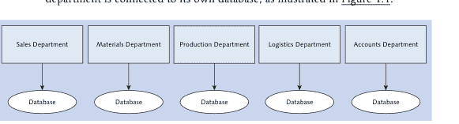

**图 1.1** 典型的非 ERP 系统布局

这种设置需要先将数据手动推送到其他部门，然后这些部门才能基于数据采取行动。换句话说，数据无法跨业务职能实时交换。在本示例中，物料部门要等到销售团队手动发送订单详细信息后才能开始采购。这会导致延迟，并阻碍自动化业务流程。

就我们的示例而言，假设物料团队成员更新其系统以表明某种关键原材料不可用，或者物流团队成员更新其系统以表明某个特定地点暂时无法提供服务。销售团队在接单时或在对客户承诺交货日期之前，无法利用这一信息。销售团队在承诺日期之前必须手动与其他部门核实。销售团队用于捕获订单的软件应用程序不会自动验证物料可用性，因为它无法访问跨部门数据。

图 1.2 展示了典型的 ERP 系统布局。如您所见，由于组织内所有业务职能都访问一个公共数据库，信息可以无缝流动。

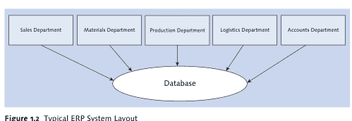

#### 1.2.3 ERP 系统的优势

ERP 系统允许您构建能够访问组织内各业务职能信息的软件应用程序，从而实现自动化的可能性。在 ERP 环境中，例如，销售订单应用程序可以自动查询物料可用性数据和物流数据，以对交货日期进行自动验证。

如果销售人员输入的交付日期无法满足，ERP 环境可以抛出错误。您可以为客户开发在线订单跟踪应用程序，因为 ERP 系统可以访问跨部门数据以提供准确的状态更新。ERP 系统提供实时数据访问：一个部门更新的数据可立即供其他部门使用。

公共数据库允许开发具有紧密集成业务应用程序的 ERP 软件。在 ERP 系统中，您通常会在各业务职能中拥有数千个应用程序，它们彼此无缝集成，而不是针对单个业务职能的单一独立应用程序。数据库由数百张表组成，用于存储来自不同业务职能的数据，可供任何应用程序使用。

当然，每个 ERP 系统都实施各种安全措施，例如检查用户授权，以防止任何未经授权的数据访问。我们将在第 11 章讨论可在 SAP 系统中实施的安全概念。

现在您已经对 ERP 软件有了概览，在下一节中我们将专门介绍 SAP；SAP 目前是 ERP 软件的市场领导者。

### 1.3 SAP 简介

SAP 提供市场领先的 ERP 软件，被数十万客户使用，包括跨行业领域的一套集成应用程序。SAP 提供各种产品，例如客户关系管理 (CRM)、企业资源规划 (ERP)、产品生命周期管理 (PLM)、供应链管理 (SCM)、供应商关系管理 (SRM) 等。本书重点介绍 SAP ERP 系统——更具体地说，是 SAP NetWeaver 7.5 平台上的 SAP ERP 6.0。

SAP ERP 软件中的业务职能称为*模块*。作为 SAP 顾问，您将在一个或多个模块中工作。我们将在本节中了解不同类型的模块。我们还将讨论使用这些模块的用户类型，然后了解您作为 ABAP 顾问的具体角色。最后，我们将通过了解有哪些类型的修改、增强和定制可用于为用户定制软件来结束本节。

#### 1.3.1 SAP 中的模块

SAP 受欢迎的原因之一是它非常灵活且易于定制。为了实现这种灵活性，SAP 系统被划分为各种模块。每个 SAP 模块都映射到某个业务单元的业务流程。例如，SAP ERP MM 模块映射到组织的物料管理业务单元，HR 模块映射到组织的人力资源业务单元，依此类推。

所有 SAP 模块都可以彼此集成，也可以与第三方系统集成。例如，您可以将 SAP ERP 与 PeopleSoft 的 HR 模块集成。根据组织情况，您可以实施一个或多个 SAP 模块，并将它们与其他 ERP 系统集成。

SAP 模块分为两类：功能类或技术类。

##### 功能模块

功能模块涵盖执行业务日常活动的业务流程和功能领域，例如以下内容：

- 财务会计 (FI)
- 控制 (CO)
- 人力资源 (HR)
- 销售与分销 (SD)
- 物料管理 (MM)
- 工厂维护 (PM)
- 生产计划 (PP)
- 等等

##### 技术模块

技术模块涵盖 SAP 系统的技术方面，这些方面是根据业务需求定制系统所必需的，包括设置和维护 SAP 系统。

技术模块包括以下内容：

- SAP Basis
- ABAP
- SAP BusinessObjects Business Intelligence (BI)/SAP Business Warehouse (BW)
- SAP Exchange Infrastructure (XI)/SAP Process Integration (PI)
- SAP Enterprise Portal
- SAP HANA
- 等等

#### 1.3.2 用户类型

在上一节中，我们了解了 SAP 中可用的功能模块和技术模块。这些模块由不同的用户访问。

SAP 用户有三种类型：

- 最终用户
- 功能顾问
- 技术顾问

*最终用户*是在生产环境中使用 SAP 系统来开展日常业务活动的人员。例如，这些用户包括使用 SAP 系统创建销售订单的销售人员和管理人力资本的人力资源经理。

*顾问*是主题专家 (SME)，帮助企业定制和维护 SAP 系统。顾问还处理最终用户提出的任何问题或定制请求。

通常，顾问会获得特定模块的专业知识。顾问的专业领域决定其是*技术顾问*还是*功能顾问*。如果您担任 ABAP 顾问，您将是一名具备 ABAP 编程专业知识的技术顾问。同样，如果您拥有财务领域的经验，您将是财务模块的功能顾问。然而，许多顾问同时具备一个功能模块和一个技术模块的专业知识。他们是*技术功能顾问*。

对于功能顾问而言，学习 ABAP 以成为技术功能顾问已变得越来越重要。具备 ABAP 背景的功能顾问可以更有效地与 ABAP 团队合作，并形成对 SAP 应用程序的整体技术理解。

在下一节中，我们将更深入地了解 ABAP 顾问所扮演的角色。

#### 1.3.3 ABAP 顾问的角色

由于本书重点介绍 ABAP 和 ABAP 开发，让我们讨论 ABAP 顾问在已实施 SAP 系统的组织中的角色。

尽管对业务流程有良好的理解有助于应用程序开发，但要想成为一名成功的 ABAP 开发人员，并非绝对需要了解业务的复杂细节。作为 ABAP 开发人员，我们通常不直接与最终用户交互。当最终用户对 SAP 应用程序有需求或遇到问题时，他或她会联系相应的功能卓越中心 (CoE)。

功能卓越中心由具备相应领域专业知识的功能顾问组成，他们将评估客户需求，并决定是否需要任何技术变更。如果用户的问题或需求需要任何技术变更，那么功能卓越中心会将任务分配给 ABAP 卓越中心。它就是


功能顾问的职责是准备一份功能需求文档，说明需求并列出在应用程序中进行所需更改的全部必要信息。

例如，如果用户要求在报表输出中显示一些额外信息，功能规格说明书将提供所需信息，例如应更改的报表程序名称，以及可在报表输出中显示额外信息的数据库表。

ABAP CoE 收到功能规格说明书后，会将其分配给 ABAP 顾问，该顾问将基于功能规格说明书准备技术规格说明书，并在开发系统中对应用程序执行必要的更改。技术规格说明书将从技术角度记录所需更改，例如程序代码的哪一部分被更改，以及程序中添加了哪些额外代码行。

完成更改后，在将更改传输到生产系统之前，功能顾问和最终用户将在质量保证系统中测试应用程序。

##### SAP 中的系统

在第二章讨论 SAP 系统架构时，我们谈到了不同的系统，例如开发系统、质量保证系统和生产系统，以及用于在系统之间传输对象的传输机制。

ABAP 顾问的典型工作包括生产支持、增强和新项目。*生产支持*涉及在现有应用程序出现问题并需要故障排除时修复缺陷。对于*增强*，顾问增强现有应用程序以提供附加功能。对于*新项目*，顾问开发新应用程序以满足业务需求。

ABAP 顾问所需的能力因需求而异。你在 ABAP 中积累的经验越多，在处理复杂业务需求时就会越自信。要成为一名成功的 ABAP 顾问，深入理解 ABAP 编程语言并总体理解业务流程至关重要。ABAP 顾问不受限于任何单一业务职能；他们可以处理跨业务职能的需求。

与其他技术模块的顾问相比，作为 ABAP 顾问的一个优势是，随着多年经验的积累，ABAP 顾问不仅获得技术专长，还能获得良好的功能知识。在 1.4 节中，我们将了解 ABAP 顾问从事的各种开发类型。

#### 1.3.4 更改和调整数据结构

SAP 系统软件是业务软件，交付时附带预定义的标准 SAP 应用和配置，以满足各行业领域的需求。使用 SAP 系统并不一定需要更改*存储库对象*（程序、应用程序等）。然而，同一行业领域内的每家公司都可能有自己的公司特定需求。在实施过程中，需要调整 SAP 软件以适配这些企业需求。我们将此过程称为*定制*。

定制有三种类型：

- **修改**：根据特定业务需求修改标准 SAP 代码。
- **客户增强**：在不更改标准 SAP 程序源代码的情况下增强标准 SAP 应用程序。
- **客户开发**：客户在 SAP 系统中开发应用程序。

在以下小节中，我们将逐一了解这些 ABAP 定制方法。

##### 修改

对 SAP 交付的标准对象（例如程序和表定义）所做的更改称为*修改*，在此过程中会更改 SAP 交付的存储库对象。换句话说，通过修改，你直接更改标准 SAP 程序的源代码以扩展其功能。当系统升级或导入支持包时，这些更改将会丢失。为防止这种情况，你需要在下次升级系统或导入支持包时，对照新的存储库检查这些修改。这会增加此类升级项目的成本和时间。我们始终建议将修改保持在最低限度，并作为定制中的最后手段。

作为实施修改的一个示例，假设你有一个用于创建销售订单的标准 SAP 应用程序。这个标准 SAP 应用程序允许你在创建销售订单时捕获某些详细信息。你的公司要求在创建销售订单时还要捕获额外详细信息，而这些信息标准 SAP 应用程序并不提供。定制销售订单应用程序的一种方式是修改标准 SAP 销售订单应用程序屏幕，以添加自定义字段。然而，当你下次升级标准 SAP 应用程序时，这些自定义字段将会丢失。

我们将在[第20章](#)中提供有关修改过程的更多详细信息。

##### 客户增强

要创建客户增强，你向存储库中添加客户特定对象，而不实际更改程序的原始源代码。在开发标准 SAP 应用程序时，SAP 预见到了扩展程序功能的需求。代码中有特定的开口，你可以在其中用自己的对象补充 SAP 标准系统。

只有当 SAP 预见到需求并提供了开口或挂钩来添加客户特定对象时，你才能增强标准 SAP 应用程序。SAP 提供了多种增强技术，例如用户出口/客户出口、业务附加（BAdI），以及显式和隐式增强点，以扩展标准 SAP 对象的功能。

并非每个标准 SAP 对象都可以增强，并且提供的增强选项可能无法满足你公司的特定需求。然而，大多数标准 SAP 程序都很灵活，并支持许多增强。

例如，考虑向标准 SAP 销售订单应用程序添加自定义字段的同一场景，如果 SAP 为标准 SAP 应用程序提供了屏幕增强，你可以实施该增强来添加自定义字段。由于 SAP 在标准程序中有策略地调用这些增强，自定义字段不会在升级中丢失。通过实施增强，你可以在不修改标准代码的情况下扩展程序。

我们将在[第20章](#)中进一步讨论可用的增强技术。

##### 客户开发

如果你找不到合适的增强选项，不希望修改标准 SAP 程序，或者找不到满足公司特定需求的合适标准 SAP 对象，你可以创建自己的存储库对象（例如表、程序、事务等）。所有客户开发通常都在客户命名空间中进行，这意味着客户创建的所有对象的名称都应以 Y 或 Z 开头。

例如，假设你的公司由于某地区当地法律变化而必须为该地区实施新的业务解决方案，并且没有满足该需求的标准 SAP 解决方案。在这种情况下，你可以开发自定义应用程序来实施业务需求。这些自定义应用程序将位于客户命名空间中，并与标准 SAP 应用程序共存。

图1.3描述了定制概述。如你所见，修改属于 SAP 命名空间，因为修改直接更改标准 SAP 程序，而增强和客户开发属于客户命名空间，在升级期间不会受到影响。

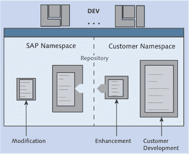

**图1.3** 定制概述

现在我们已经探讨了 ABAP 顾问的角色，以及在 SAP 系统中可以对数据结构进行的更改和调整，接下来让我们把注意力转向 ABAP 整体。

### 1.4 ABAP 概述

ABAP 是一种用于在 SAP 中开发应用程序的编程语言。要处理修改、增强或客户开发，你需要具备 ABAP 中的应用程序开发知识。

让我们看看可以用 ABAP 开发的一些对象。

#### 1.4.1 应用程序类型

ABAP 最初是为 SAP 内的报表开发而设计的，此后已被大幅扩展。目前，我们可以在 ABAP 中开发各种各样的应用程序，无论是在传统的 SAP GUI 环境中还是在 Web 环境中。这些典型开发包括报表、表单、接口、事务等。

ABAP 是一种混合编程语言，同时支持过程式和面向对象编程技术，以满足任何复杂的业务需求。

#### 1.4.2 RICEF 概述

*报表、接口、转换、扩展和表单*（RICEF）是用于强调在 ABAP 中开发的不同类型对象的通用缩写。以下各节将逐一介绍这些领域。

##### 报表

*报表提供对数据库的只读访问。ABAP 最初命名为 Allgemeiner Berichts-Aufbereitungs-Prozessor，德语意为通用报表创建处理器，后来更名为高级业务应用编程（Advanced Business Application Programming）。*

正如原名所示，ABAP 最初主要用于在 SAP 中创建报表。尽管 ABAP 在过去几十年中不断扩展并日趋成熟


并且允许你创建许多复杂的应用程序和接口，报表仍然是 ABAP 中常见的开发内容。

在报表处理过程中，事务会在 SAP 系统中更新数据，而报表程序会处理这些数据，为用户生成各种报表。例如，如果你想查看可用库存，就需要一个报表程序，从数据库中提取这些数据，并将其作为报表输出呈现给你。

图 1.4 展示了一个典型的报表程序。如你所见，数据会从各业务功能更新到 SAP 数据库中，报表程序可以处理这些数据，并作为报表输出呈现给用户。

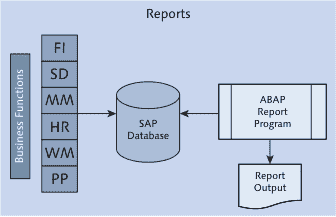

**图 1.4** 报表程序

##### 接口程序

*接口程序*允许你与其他系统交换数据，例如遗留系统或合作伙伴系统。你通常会开发两种接口程序：入站接口程序和出站接口程序。对于*入站接口程序*，数据从外部系统接收并更新到 SAP 系统中。对于*出站接口程序*，数据从 SAP 系统中提取并推送到外部系统。

图 1.5 展示了 SAP 中的入站和出站接口程序流程。如你所见，在入站接口中，数据从外部系统提取，文件传输到 SAP 系统。一个 ABAP 程序将处理该文件并更新 SAP 系统中的数据。在出站接口中，数据由 ABAP 程序从 SAP 系统中提取，然后推送到外部系统。外部程序将处理这些数据并更新系统。

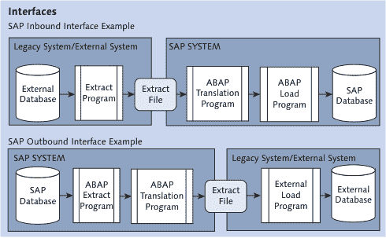

**图 1.5** 接口程序

接口是一个关键概念，SAP 提供了多种与外部系统交互的技术。我们将在第 19 章探讨不同的接口技术。

##### 转换

*转换程序*将数据从遗留系统迁移到 SAP 系统。通常，这些程序是一次性程序，用于在系统上线前向 SAP 系统初始加载数据。

例如，在实施新的 SAP 系统后，你可能希望迁移遗留系统中维护的所有现有客户或物料数据。在这种情况下，你会开发转换程序来处理、验证并更新 SAP 系统中的这些数据。

图 1.6 展示了 SAP 中的转换程序流程。

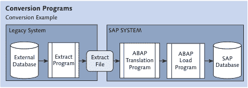

**图 1.6** 转换程序

与入站接口程序类似，对于转换程序，数据从遗留系统提取并传输到 SAP 系统，然后由 ABAP 加载程序验证，以便在 SAP 系统中过账。

SAP 提供了一个名为遗留系统迁移工作台（LSMW）的工具，它集成了各种转换技术，用于将数据从遗留系统迁移到 SAP 系统。你将在**第 19 章**中进一步了解转换程序和 LSMW。

##### 扩展

*扩展*是扩展标准 SAP 系统功能的程序。这些包括修改、增强、新开发以及第三方附加程序。

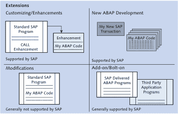

**图 1.7** 扩展

如*图 1.7*所示，你可以通过实施 SAP 交付的增强、修改标准 SAP 程序、在客户命名空间中开发自定义程序，或使用第三方扩展来扩展标准 SAP 软件的功能。

##### 表单

*表单*类似于报表程序，提供对数据库的只读访问。然而，表单在布局设计上提供了更大的灵活性。表单用于用户希望获得纸质版本的文档（例如采购订单或发票）。这些文档应符合法律要求，并应具有特定格式。

SAP 提供了与 ABAP Workbench 集成的各种工具，让你可以设计表单布局以满足法律和客户要求（例如 SAPscripts、Smart Forms 或 Adobe 表单）。

如*图 1.8*所示，典型的表单布局包含多个窗口，用于打印文档中的不同数据。布局通常设计为满足文档以特定格式打印各种数据的法律要求。

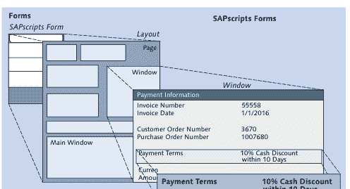

**图 1.8** 表单

对 ABAP 的这一简要概述让你初步了解了本书将要涵盖的一些主题。本章最后一节将介绍你跟随本书示例所需满足的系统要求。

### 1.5 系统要求

要从事 ABAP 开发并跟随本书中的示例，你需要访问 SAP 系统和客户端程序（SAP GUI 或 Eclipse IDE）。SAP 为培训提供了互联网演示与评估系统（IDES）。

SAP ERP 系统中的 IDES 代表一个模型公司，包含可在 SAP 系统中运行的各种业务场景的应用数据。IDES 系统中的业务流程旨在反映现实业务需求，并具有许多逼真的特征。要跟随本书中的示例，你需要版本 7.4 的 IDES。

有多种访问 IDES 数据的方式：

- 本地 IDES 系统
- 从 SAP 或第三方供应商远程访问 SAP IDES 系统
- 在笔记本电脑上访问 IDES 系统

### 1.6 小结

本章中，我们回顾了 SAP 的演变以及 SAP 多年来采用的 various 产品命名惯例。我们讨论了不同的用户类型以及 ABAP 顾问的角色。

接着，我们讨论了定制的必要性以及定制 SAP 系统的各种方式。最后，我们了解了 ABAP 中提供的开发对象。随着本书的深入，我们将更详细地探讨这些开发对象。

下一章，我们将更仔细地研究 SAP 系统的架构。

*在开始编码之前对 SAP 系统架构进行技术性概述，将使你更好地理解程序运行的环境。*

## 2 SAP 系统的架构

从技术角度理解 SAP 系统架构将帮助你理解 ABAP 程序如何运行。本章中，我们将探讨系统架构，并了解构成 SAP 系统的各个层。

我们将在 2.1 节开始介绍 SAP 系统的三层架构，涵盖构成该系统的表示层、应用层和数据库层。在 2.2 节中，我们将讨论构成这些不同层的各个组件。

2.3 节将通过讨论数据结构来总结本章，这将帮助你理解数据在 SAP 系统中通常如何存储。

### 2.1 三层架构简介

第 1 章中，我们讨论了自 SAP R/3 系统推出以来 SAP 向三层架构的转变。这里，*R* 代表*实时*（即时数据交换），*三* 代表*三层架构*。

三层架构是一种客户端-服务器架构，其中用户界面（表示层）、业务逻辑（应用层）和数据存储（数据库层）作为独立模块进行开发和维护（通常位于不同平台上）。

图 2.1 展示了 ABAP 架构的三个层。如你所见，表示层与应用层通信，应用层与数据库层通信。表示层不能直接与数据库层通信，这进一步增强了业务逻辑的安全性，因为客户端无法直接访问数据库。

与两层架构相比，三层系统中引入额外一层会给实现带来自身的复杂性，但它允许构建高度可扩展的系统。此外，在三层系统中，你可以独立维护和更新每一层。例如，在 Web 服务器架构中，通常表示层由 Web 浏览器（Internet Explorer、Google Chrome 等）组成，应用层由 Web 服务器（Apache、IIS 等）组成，数据库层由数据库（MSSQL、MySQL 等）组成。

在这里，每一层都作为独立软件存在，可以在不影响其他层的情况下更改或更新。因此，用户可以独立更新自己的浏览器，而不必担心破坏应用层或数据库层中的任何内容。用户只需担心浏览器是否与 Web 服务器兼容。同样，Web 服务器和数据库可以独立更新或替换，而不影响任何其他层中的软件。这种独立性提供了灵活性，可以根据需求或技术的变化更新系统。

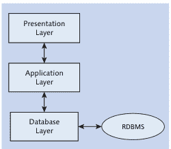

**图 2.1** 三层架构

以下列表描述了图 2.1 中展示的不同层：

- **表示层**
  
  *表示层*由用户界面组成，用户界面运行在使用标准图形用户界面（GUI）的客户端机器上。用户界面可以是 Web 浏览器或 SAP GUI 之类的专有软件。因为表示层可以根据需求独立开发

以及系统配置，它可以支持各种设备（PC、智能手机等）和操作系统环境。

GUI 通过接收用户输入、向应用服务器发送请求并显示从应用服务器接收到的结果，来与应用层通信。例如，当你在 Web 浏览器中打开一个网站时，你是在向 Web 服务器请求资源。Web 服务器响应你的请求，浏览器以用户友好的方式呈现结果。

我们将在 2.2.1 节进一步讨论表示层。

- **应用层**

  *应用层*是 ABAP 程序完成所有主要工作的地方。这一软件层承载各种业务功能模块并执行程序代码。它可以由一个或多个应用服务器和一个消息服务器组成，消息服务器负责该层内部的通信。

  当你运行一个应用时，执行发生在应用层。应用层可以与数据库通信，以处理用户请求的数据。

  我们将在 2.2.2 节探讨应用层的各个组件。

- **数据库层**

  *数据库层*是所有持久化数据存储的地方。数据库通常由*关系数据库管理系统（RDBMS）*管理。RDBMS 提供一种声明式方法来维护数据和查询，系统负责描述用于存储数据的结构。

  在 RDBMS 模型中，数据存储在一个或多个*表*中。每个表由行和列组成，每一行由唯一键标识。表之间通过*外键*相互关联。如果一个表的键字段作为非键字段存在于另一个表中，那么这两个表就具有外键关系。外键允许你定义数据库不同表之间的父子关系。你将在第 5 章了解更多关于 RDBMS 的内容。

  SAP 支持各种数据库系统，如 SAP HANA、Oracle、MSSQL、MaxDB 和 IBM DB2。

  我们将在 2.2.3 节进一步讨论数据库层。

### 2.2 SAP 实施概述

在实施 SAP 系统时，组织通常至少实施三个独立的系统：一个用于开发，一个用于质量保证/测试，一个用于生产环境。这些 SAP 系统中的每一个都具有三层——即表示层、应用层和数据库层。

在本节中，我们将更详细地讨论每一层以及每一层的各个组件。

#### 2.2.1 SAP GUI：表示层

表示层有两种选择：安装 SAP GUI 的系统，用于访问 SAP 系统并使用基于经典 SAP GUI 的应用程序；或者使用 Web 浏览器来处理基于现代 Web 的应用程序。SAP GUI 是安装在用户工作站上的程序。你也可以使用 Web 浏览器访问基于 Web 的应用程序，而无需安装 SAP GUI。

表示界面允许用户与 SAP 系统交互并访问各种 SAP 应用程序。来自表示界面的请求被发送到应用服务器进行处理。随后结果呈现给用户。表示界面（SAP GUI 或 Web 浏览器）捕获用户在屏幕上的操作，并负责格式化从应用服务器接收到的输出。

根据用户工作站上的操作系统，用户可以选择安装兼容的 SAP GUI 版本。例如，如果你使用的是 Windows PC，可以安装适用于 Windows 环境的 SAP GUI。同样，如果你使用的是基于 Mac 或 Linux 的系统，可以安装适用于 Java 环境的 SAP GUI。如果你只是想使用 Web 浏览器访问基于经典 SAP GUI 的应用程序，可以安装适用于 HTML 的 SAP GUI。

图 2.2 展示了以下 SAP GUI 版本：

- **适用于 Windows 环境的 SAP GUI**

  适用于 Windows 的 SAP GUI 是最流行的版本。用户通过 EXE 文件在工作站上安装该 GUI。适用于 Windows 的 SAP GUI 支持开发和访问所有基于 SAP GUI 的应用程序的全部功能。

- **适用于 Java 环境的 SAP GUI**

  适用于 Java 的 SAP GUI 允许用户在 Mac 或 Linux 系统上操作基于 SAP GUI 的应用程序。此版本的 SAP GUI 不支持某些应用程序开发功能，例如图形化 PC 编辑器。我们建议使用适用于 Windows 的 SAP GUI，以利用所有开发功能。

- **适用于 HTML 的 SAP GUI（Web GUI）**

  适用于 HTML 的 SAP GUI 是 SAP 尝试让所有基于 SAP GUI 的应用程序都能在 Web 上使用。对于这些应用程序，GUI 将 SAP 屏幕映射到 HTML 页面。

适用于 HTML 的 SAP GUI 要求服务器运行 Internet 事务服务器（ITS）。ITS 将 SAP 屏幕字段（即输入字段、文本字段等）一对一映射到适用于 HTML 的 SAP GUI 字段。尽管适用于 HTML 的 SAP GUI 是让 SAP 应用程序在 Web 上可用的最快方式，但它在最终用户中并不太受欢迎。

由于 Web 浏览器使用 HTTP/HTTPS 协议进行通信，Internet 通信管理器（ICM）确保 SAP 系统与外部世界之间通过 HTTP、HTTPS 和 SMTP 协议的通信正常工作，如图 2.2 所示。没有 ICM 组件，就不可能使用 Web 浏览器与应用服务器通信。

SAP GUI 向应用服务器中的调度器发送请求（见图 2.2），调度器负责将任务分配给可用的工作进程，并负责将结果返回给 GUI。

我们将在 2.2.2 节进一步讨论应用服务器的不同组件。

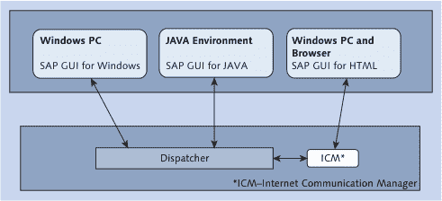

**图 2.2** SAP GUI

#### 2.2.2 应用服务器和消息服务器：应用层

ABAP 程序在应用层中运行，所有程序执行都发生在应用服务器中。应用层包括一个或多个应用服务器和一个消息服务器。消息服务器负责应用服务器之间的通信。应用服务器通过提供执行 ABAP 代码的运行时环境来解释 ABAP 程序。

应用服务器由各种组件组成，如图 2.3 所示。

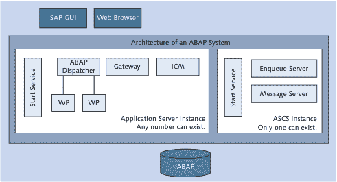

**图 2.3** ABAP 应用服务器

*SAP NetWeaver* 是为 ABAP 和 Java 程序提供运行时环境的应用服务器。它可以安装为纯 ABAP 系统、纯 Java 系统或双栈系统：

- **纯 ABAP 系统**

  纯 ABAP 系统支持开发和运行基于 ABAP 的应用程序，但对运行基于 SAP Java 的应用程序提供有限支持。

- **纯 Java 系统**

  纯 Java 系统支持 Java 平台和 Java 企业版（Java EE）应用程序。它为开发和运行 Java EE 应用程序提供完整的基础设施支持，但不提供对 ABAP 应用程序的支持。

- **双栈系统**

  双栈系统兼具两者的优势，同时支持基于 ABAP 的应用程序和基于 Java EE 的应用程序。

ABAP 顾问不直接参与应用服务器的安装或维护。这是 SAP Basis 顾问的角色。然而，由于 ABAP 程序在应用服务器中运行，理解应用服务器的各个组件（及其作用）有助于理解执行 ABAP 程序时发生的后端过程。

讨论应用层中的所有组件超出了本书的范围。因此，我们将把讨论限制在构成应用层的一些重要组件上。

SAP 系统的各个组件统称为*实例*。这些实例处理用户请求，我们可以有任意数量的应用服务器实例。

应用服务器实例的一些主要组件如下：

- ICM
- ABAP 调度器
- SAP Web 调度器
- 网关
- SAP 启动服务
- 工作进程

每个应用服务器实例可以有多个工作进程，但不能有多个 ICM、调度器、网关和 SAP 启动服务。

除了多个应用服务器实例之外，还有一个称为 *ABAP 系统中央服务*（ASCS）*实例*的特殊实例。ASCS 实例包括消息服务器、入队服务器和一个单独的启动服务。ASCS 实例负责管理锁、交换消息和负载均衡。

*消息服务器*负责多个实例之间的负载均衡和通信，而*入队服务器*管理应用锁。应用锁确保没有两个用户同时编辑相同的数据。


让我们更详细地了解应用服务器实例的各个组件。

##### 互联网通信管理器

ICM 使应用服务器能够使用 HTTP、HTTPS 或 SMTP 等 Web 协议与外部世界通信。ICM *使应用服务器具备 Web 能力*。这允许用户使用 Web 浏览器向应用服务器发出请求，而不是使用 SAP 专有的 GUI。

ICM 作为独立进程运行，由 ABAP 调度器启动和监控。借助 ICM，应用服务器可以处理来自 Internet 的请求，例如基于 Web Dynpro 的应用程序。

##### ABAP 调度器

每个应用服务器都有一个调度器。请求通过工作进程处理。调度器的作用是将请求分配给工作进程。用户发出请求后，请求被发送到调度器，调度器再将请求分配给一个空闲的工作进程。

请求一旦分配给工作进程，该工作进程就会执行请求并返回结果。随后工作进程变为空闲，准备接收另一个请求。

当用户登录 SAP 系统时，登录请求会发送到消息服务器，消息服务器执行负载均衡，并将用户连接到负载最小的实例的调度器。连接建立后，该实例的调度器会处理该用户的所有请求。

##### 工作进程

在图 2.3 中，“WP”代表*工作进程*。用户请求通过工作进程处理。每个应用服务器实例可能存在多个工作进程。

如图 2.4 所示，当用户发出请求时，请求会发送到 ABAP 调度器。ABAP 调度器进而将请求分配给可用的工作进程进行处理。工作进程完成请求后，会返回结果，并再次变为空闲，以接收新请求。

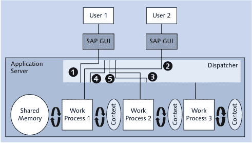

**图 2.4** 调度器和工作进程

工作进程不专属于任何用户会话。它们可以接收来自任何用户的请求。例如，如图 2.4 所示，用户 1 执行一个报表。该请求由调度器分配给工作进程 1。工作进程 1 处理该请求，并将结果返回给用户 1。

此时，如果用户 2 发出请求，调度器可以将其分配给工作进程 1，因为该工作进程空闲，可以接收新请求。如果工作进程 1 正在处理用户 2 的请求时用户 1 发出新请求，那么调度器会直接将用户 1 的请求分配给工作进程 2。如果工作进程 1 和工作进程 2 都忙碌时，用户 1 或用户 2 又发出新请求，那么调度器会将该任务分配给下一个可用的工作进程。

你可以通过打开事务 SM50 来查看工作进程状态如何变化（见图 2.5）。如果运行任何程序并检查事务 SM50，你会注意到请求由一个状态为 RUNNING 的对话工作进程（DIA）处理。可接收请求的空闲工作进程具有 WAITING 状态。

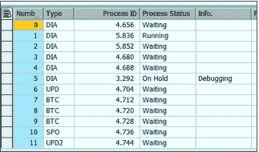

**图 2.5** 事务 SM50：工作进程概览

如图 2.5 所示，存在不同类型的工作进程，用于处理不同类型的请求。表 2.1 列出了可用的工作进程。

| 工作进程类型 | 用途 |
|---|---|
| DIA（对话） | 处理对话请求（即用户通过屏幕发出的请求） |
| UPD/UPD2（更新） | 处理数据库的高优先级和低优先级更新 |
| BTC（后台处理） | 处理后台作业 |
| SPO（假脱机） | 处理假脱机请求 |

**表 2.1** 工作进程概览

SAP Basis 管理员可以使用事务 RZ10 配置每种类型的工作进程数量。

##### 网关

网关使用基于 TCP/IP 的远程函数调用（RFC）实现与外部系统的通信。RFC 服务使外部应用程序能够与 SAP 系统通信。RFC 可以在 ABAP 程序中发起，也可以通过外部程序的接口（例如支持 RFC 的函数模块）发起。

除了在系统之间使用 RFC 外，网关还可以用于一个实例的进程之间。

##### 启动服务

*启动服务*启动 SAP 系统实例。它在 Windows 中实现为服务，在 Unix 中实现为守护进程。启动服务帮助启动和停止实例、监控运行时状态并读取日志。

启动服务还提供技术信息，例如有关活动会话或网络端口的信息。

##### 消息服务器

每个 SAP 系统只能有一个消息服务器。*消息服务器*帮助不同的应用服务器实例相互通信。

消息服务器还负责负载均衡。如前所述，当用户登录 SAP 系统时，消息服务器会将用户连接到负载最小的应用服务器实例。请注意，消息服务器负责 SAP GUI 和 RFC 连接的负载均衡，而 Web 环境中的负载均衡由 SAP Web Dispatcher 处理。

##### SAP Web 调度器

*SAP Web 调度器*在 Web 环境中很有用。它位于 Internet 和 SAP 系统之间，这意味着所有 HTTP(S) 请求都通过 SAP Web Dispatcher 路由。它可以部署在多个 SAP 系统前面，并配置为将特定请求路由到特定系统，以实现更好的负载均衡。你还可以配置它接受或拒绝连接，从而实现更好的安全性。

SAP Web Dispatcher 可以拒绝某些 URL，从而通过 URL 过滤限制对系统的访问。它还可以用作 Web 缓存，以改善应用程序响应时间。

##### 入队服务器

*入队服务器*管理锁。它可以是经典 ABAP 中央实例的一部分，也可以安装为独立服务器，而不属于 SAP NetWeaver AS ABAP 的一部分。

入队功能提供逻辑锁定功能，有助于防止多个用户同时更新相同的数据。例如，入队功能用于防止多个用户同时编辑同一文档。当一个用户进入更改模式编辑文档时，入队功能可以阻止其他用户进入更改模式编辑同一文档。

##### 用户上下文

*用户上下文*是存储有关用户的上下文信息的地方。当用户发出请求时，工作进程使用用户上下文区域中可用的用户信息。用户上下文区域存储诸如用户的个人设置、授权以及日期和货币格式等信息。工作进程会将这些信息应用到该用户的每个请求。

对于每个用户，用户上下文在每次用户登录时加载一次到应用服务器，并在用户从系统注销时删除。用户上下文中的数据在该用户下次登录之前不会刷新。

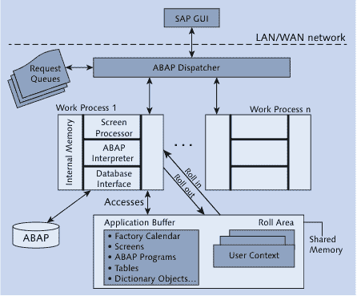

**图 2.6** 用户上下文的滚入和滚出

如图 2.6 所示，在处理来自用户的请求之前，工作进程会滚入用户上下文，将其应用到请求，并在请求处理完成后滚出用户上下文。这使工作进程能够处理来自任何用户的请求，并将用户特定的上下文应用到每个请求。

#### 2.2.3 数据库服务器/RDBMS：数据库层

每个 SAP 系统都包含一个中央数据库，整个数据集存储在其中。所有数据都存储在这里，包括应用数据、管理数据、定制设置和 ABAP 源代码。数据库层由 RDBMS 组成。

SAP 支持多种数据库系统，例如 SAP HANA、Oracle、Microsoft SQL Server、IBM DB2、SAP liveCache 和 SAP MaxDB。SAP NetWeaver 7.5 针对 SAP HANA 进行了优化。它支持将 SAP HANA 用作底层数据库，并有助于针对 SAP HANA 优化应用程序。

RDBMS 允许你将数据分散到多个表中，并使用外键链接这些表。表由列（字段）和行（记录）组成。每个表都包含一个键，用于唯一标识行。

例如，假设你想将某个物料的详细信息存储在数据库表中。我们将该表称为 `TB_ITEM`。该表由四列组成：`ITEM_ID`、`DESCRIPTION`、`QUANTITY` 和 `UoM`（计量单位），如表 2.2 所示。

| ITEM_ID | DESCRIPTION | QUANTITY | UoM |
|---|---|---:|---|
| 1 | 笔 | 10 | 件 |
| 2 | 铅笔 | 20 | 盒 |
| 3 | 纸 | 10 | 千克 |

**表 2.2** 展示行和列的 TB_ITEM 示例

因为表 2.2 中的每一行都可以通过 `ITEM_ID` 字段唯一标识，所以我们将 `ITEM_ID` 保留为表的键字段。

对于基本的信息存储来说，这看起来没问题。但是，由于我们的 SAP 系统支持多种语言，假设用户希望以不同语言查看物料描述。你将如何扩展此表以容纳不同语言的描述？一种方法是向表中添加一个 `LANGUAGE` 字段，并以多种语言维护描述，如表 2.3 所示。


| ITEM_ID | 语言 | 描述 | 数量 | 单位 |
|---|---|---|---|---|
| 1 | 英语 | 钢笔 | 10 | 件 |
| 1 | 德语 | 钢笔 | 10 | 件 |
| 2 | 英语 | 铅笔 | 20 | 盒 |
| 2 | 德语 | 铅笔 | 20 | 盒 |
| 3 | 英语 | 纸张 | 10 | 千克 |
| 3 | 德语 | 纸张 | 10 | 千克 |

**表 2.3** TB_ITEM 扩展以容纳语言键

在表 2.3 中，ITEM_ID 字段不再唯一。表的主键应始终唯一，因此该表的键应扩展为也包含 LANGUAGE 字段。因此，表 2.3 的键是 ITEM_ID 和 LANGUAGE 字段的组合。单独来看，ITEM_ID 字段中的数据可以重复 n 次，LANGUAGE 字段中的数据也可以重复 n 次，但组合应始终唯一。

你可能已经注意到，在表 2.3 中，我们多次重复相同数据以容纳多种语言。当加入更多语言时，最终会产生冗余数据。如果我们能把描述分离出来，并将它们维护在可通过外键链接到该表的单独表中，会怎样？

表 2.4 存储物品详细信息，表 2.5 存储多种语言的描述。这种表安排避免了数据冗余，并且由于这些表现在通过外键链接，我们可以使用表 2.4 的 ITEM_ID 字段查询表 2.5 中首选语言的描述。

| ITEM_ID | 数量 | 单位 |
|---|---|---|
| 1 | 10 | 件 |
| 2 | 20 | 盒 |
| 3 | 10 | 千克 |

**表 2.4** 不含描述的 TB_ITEM

| ITEM_ID | 语言 | 描述 |
|---|---|---|
| 1 | 英语 | 钢笔 |
| 1 | 德语 | 钢笔 |
| 2 | 英语 | 铅笔 |
| 2 | 德语 | 铅笔 |
| 3 | 英语 | 纸张 |
| 3 | 德语 | 纸张 |

**表 2.5** 新的物品描述存储方式

这就是在 SAP 系统中建模数据的方式。例如，物料主数据存储在表 `MARA` 中，多种语言的物料描述存储在表 `MAKT` 中，物料的工厂数据存储在表 `MARC` 中。通过这种安排，你可以使用外键概念查询不同的表，以获取关于物料的不同信息。

在本节中，我们详细讨论了 SAP 三层架构的不同层。[图 2.7](#figure-2-7) 总结了 SAP 系统的三个层。

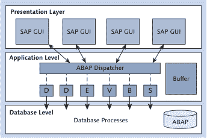

**图 2.7** 三层概述

如[图 2.7](#figure-2-7)所示，应用服务器包含一个称为*缓冲区*的特殊区域。缓冲区的作用类似于缓存，其中可以存储频繁访问但很少更改的数据。这可以让你提高应用程序的性能，因为数据可以从本地缓冲区访问。缓冲区还有助于减少数据库和网络负载，因为应用服务器无需为相同信息反复访问数据库。

当表中的数据不频繁更改，并且访问最新数据对应用程序不是关键时，建议缓冲数据。如果数据库表中的任何数据发生更改，后台进程将按固定间隔更新缓冲区。这意味着缓冲频繁更改的表会适得其反。

在下一节中，我们将了解数据结构和客户端。

### 2.3 数据结构

SAP 系统通常包含各种数据，例如主数据、用户数据和事务数据。每个 SAP 系统还由多个*客户端*组成。*客户端*表示 SAP 系统中的一个组织单元。

在 SAP 系统中，就数据结构而言，必须区分以下术语：

- **客户端特定数据**：存在于系统特定客户端内的数据
- **跨客户端（客户端无关）数据**：存在于系统所有客户端中的数据。

换句话说，当我们在 SAP 系统中存储任何数据时，数据可以是特定于某个客户端的，也可以从任何客户端集中访问。

在本节中，我们将讨论客户端的概念、使用不同客户端的意义，以及我们关于客户端的决策如何影响存储在 SAP 系统中的数据。

#### 2.3.1 客户端概述

每个 SAP 系统可以分为多个客户端，每个客户端由一个三位数字值标识。每个客户端都有自己的主数据、用户数据和事务数据。客户端中的数据称为*客户端特定数据*。

每次 SAP 系统登录都必须包含客户端 ID（见图 2.8），它表示登录到特定客户端。

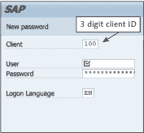

**图 2.8** 登录屏幕上的客户端 ID

#### 2.3.2 客户端特定数据和跨客户端数据

如前所述，SAP 系统中的数据要么是客户端特定的，要么是跨客户端的。客户端特定数据仅在创建该数据的客户端中可见，而跨客户端数据可从系统中的任何客户端访问。

由于 SAP 系统中的数据始终存储在数据库表中，因此通过在应用程序表中维护客户端列（字段）来将数据限制到某个客户端。这些表称为客户端特定表，客户端列（见图 2.9）称为 MANDT。

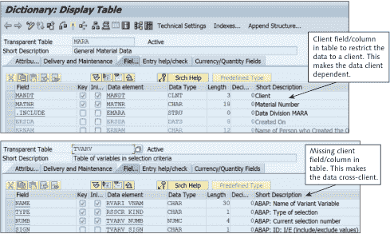

**图 2.9** 表中的客户端字段

MANDT 字段存储生成数据时所在的当前客户端编号。当从客户端特定表访问数据时，系统会自动将用户当前客户端与该表的 MANDT 字段匹配，从而将数据限制到当前客户端。

例如，假设在登录到客户端 100 时创建了一个采购订单。相关的采购订单应用程序数据库表会更新新的采购订单数据，并且这些表的 MANDT 字段将自动更新为客户端编号（本例中为 100）。如果你尝试在另一个客户端（例如客户端 200）中打开该采购订单，系统不会显示在客户端 100 中创建的采购订单，因为它会尝试将 MANDT 字段与 200 匹配。

对于跨客户端表，MANDT 字段不是表键的一部分，因此数据不受客户端限制。数据可从系统中的任何客户端访问。要确定表中的数据是依赖于客户端还是跨客户端，请检查该表是否将 MANDT 作为第一个字段并作为键的一部分，如图 2.9 所示。

例如，假设物料主数据表 MARA 将 MANDT 作为第一个字段并作为表键的一部分。这使得表 MARA 成为客户端特定的。如果你在客户端 100 中创建新物料，那么物料数据仅在客户端 100 中可见。你无法从系统的其他客户端访问此数据。同样，如果在特定客户端中更改物料数据，则该更改不会影响系统其他客户端中的数据。应用程序数据通常是客户端特定的，而定制数据通常是跨客户端的。

客户端概念意味着将 SAP 系统拆分为多个客户端，并通过将数据限制到特定客户端或保持跨客户端来分离数据。

当你登录 SAP 系统时，你登录的是一个特定客户端。系统中执行的任何活动始终在一个特定客户端中执行。在规划 SAP 系统架构时，你可以为各种活动创建各种客户端。例如，你可以有一个用于开发的客户端、一个用于测试（QA）的客户端和一个用于生产的客户端。

一些最重要的客户端角色如下：

- **定制与开发客户端（CUST）**：SAP 系统软件是标准业务软件，并在实施时根据公司特定的业务需求进行调整。为了定制 SAP 软件并执行各种开发活动，每个 SAP 系统都有一个 CUST 客户端。
- **质量保证客户端（QTST）**：一旦在 CUST 中完成开发，就需要在应用程序可用于生产之前对其进行彻底测试。执行这些测试的客户端称为 QTST。QTST 客户端通常会定期用生产数据刷新，以便使用更真实的生产数据测试应用程序。
- **生产客户端（PROD）**：生产环境使用不同的客户端 PROD。PROD 是实际业务活动发生的地方。为确保业务运营顺畅，此客户端中没有开发或测试活动。

这三个客户端（CUST、QTST 和 PROD）是存在于每个系统架构中的核心客户端。通常，这三个客户端维护在单独的系统与 SAP 实例中，并设置某种传输机制以在客户端之间移动对象。

每个系统对于这些客户端角色中的每一个都将恰好有一个客户端。开发系统将有一个 CUST 客户端，质量系统将有一个 QTST 客户端，生产系统将有一个 PROD 客户端。

例如，ABAP 程序是跨客户端的。当你在一个客户端中创建程序时，它会自动在该系统的所有客户端中可用。如果你在 CUST 客户端中更改程序，这些更改将自动反映到 QTST 和 PROD 客户端中（如果所有客户端都设置在同一 SAP 实例中）。如果所有客户端都设置在同一实例中，你将没有机会测试程序更改。通过将客户端保留在单独的系统中，你可以在开发系统中进行更改，将其传输到质量系统进行测试，并在满意后将其导入生产系统。

为了保持各客户端之间的一致性，我们建议所有定制设置都在单个定制客户端中执行，并（使用变更与传输系统 [CTS]）传输到其他客户端。这有助于防止因定制设置不同而导致应用程序在不同客户端中行为不同的情况。


我们还建议不要在 QTST 或 PROD 客户端中执行任何 Customizing 设置或工作台开发。如果您使用事务码 SCC4 建立适当的客户端设置，以防止在 QTST 和 PROD 客户端中进行任何开发活动，这将确保开发活动始终在 CUST 客户端中执行，并传输到其他客户端进行测试，供最终用户在生产环境中使用。

#### 2.3.3 资源库（Repository）

*资源库（Repository）*是所有 ABAP 工作台开发对象（如 ABAP 程序、屏幕、菜单、功能模块和 ABAP 数据字典对象）的中央存储库。

如第 2.2.3 节所述，所有数据（包括 ABAP 程序的源代码和表定义）都存储在数据库表中。这些表不受客户端字段（`MANDT`）的限制，因此它们是跨客户端的。因此，如果您在一个客户端中创建表或程序，它会自动在所有客户端中可用。所有资源库对象都是跨客户端的。

换句话说，表是跨客户端的，但表中的数据可以通过包含或忽略客户端字段来设置为特定于客户端或跨客户端。

#### 2.3.4 包（Packages）

资源库对象组织在*包（Packages）*中。包包含相关的开发对象，如程序或表。

如果您为一个项目创建多个报表、一个类和几个表，将这些语义相关的对象保存在一个包中有助于识别项目相关的开发对象。这样，当项目需求发生变化时，您可以轻松识别需要更改的依赖对象。包还可以在客户端之间一起传输所有相关对象。

包大致可分为可传输包和不可传输包：

- **可传输包（Transportable package）**
  
  *可传输包*是定义了传输属性的包。传输包中的对象可以被传输到目标系统。在开发新应用程序时，您从开发客户端开始，将其传输到测试客户端进行测试。最后，将应用程序传输到生产客户端供最终用户使用。在此过程中，您将应用程序的所有开发对象和 Customizing 设置保存在可传输包中，以便使用 CTS 将其传输到目标系统。
- **不可传输包（Non-transportable package）**
  
  没有定义传输属性的包称为*不可传输包*。不可传输包中的对象不能在客户端之间传输，称为*本地对象*。本地对象（例如测试程序）不打算传输或在生产环境中使用。

[图 2.10](#) 显示了分组到名为 VF 的标准 SAP 包中的开发对象。所有对象根据对象类型分组到不同的文件夹中，以便于识别。您可以轻松查找给定应用程序的所有相关对象。例如，如果要查找开票单据的所有相关事务码、表、增强等，可以在对象导航器（事务码 SE80）中打开 VF 包，如[图 2.10](#) 所示。您可以使用事务码 SE93 检查事务码所属的包。

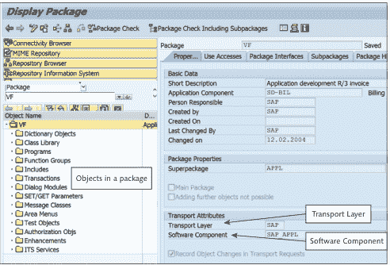

**图 2.10** 检查包

创建包时遵循一定的命名约定。表 2.7 列出了用于包的命名约定。

| 包命名约定 | 说明 |
|---|---|
| 名称以字母 A 到 S 或 U 到 X 开头。 | • 以这些字母开头的包名称保留给标准 SAP 对象；不能在这些包中创建客户对象。<br>• 这些包中的对象可以被传输，传输组织器会记录对这些包中对象的更改。如图 2.10 所示，这些包属于 SAP 传输层，并分配给 SAP 软件组件（例如 SAP_BASIS、SAP_APPL 等）。 |
| 名称以 Y 或 Z 开头 | • 客户对象在这些包中创建；这些包中的对象可以被传输，传输组织器会记录对这些包中对象的更改。<br>• 这些包分配给软件组件 HOME。 |
| 属于前缀命名空间的包 | • 前缀命名空间中的对象以正斜杠（/）开头。与其他资源库对象（如程序、表等）一样，包也可以属于前缀命名空间。<br>• 客户对象在这些包中创建；这些包中的对象可以被传输，传输组织器会记录对这些包中对象的更改。 |
| 名称以 T 开头（私有测试包） | • 这些包允许您在客户命名空间（Y 或 Z）中创建对象，或创建前缀命名空间中的对象（以 / 开头的对象）。<br>• 此包不属于传输层，因此无法使用传输组织器传输此包中的对象。但是，如果包链接到传输组织器，则对象会记录在不可传输的本地请求中。<br>• 这些包中的对象只能通过特殊传输请求传输到其他系统，例如复制传输或重定位传输。新安装的 SAP 系统默认包含名为 TEST 的私有测试包。此包未连接到传输组织器。<br>• 这些包分配给软件组件 LOCAL。 |
| 名称以 $ 开头（本地包） | • 可以在这些包中创建客户命名空间或前缀命名空间中的对象。<br>• 这些包中的对象无法传输；这些包不属于传输层，传输组织器不记录对这些对象的任何更改。这些包用于本地对象。<br>• 新安装的 SAP 系统默认包含本地包（$TMP）。 |

**表 2.7** 包命名约定

通常，您会使用现有包来保存开发对象。用于保存资源库对象的包取决于传输层（资源库对象将被传输到的客户端）和应用程序区域（资源库对象所属的业务功能）。

不同组织之间组织和传输开发对象的方式差异很大。请始终检查您所在组织遵循的内部流程和编码标准。

按照以下步骤创建新包：

- 1. 打开事务码 SE21 或事务码 SPACKAGE 以访问包构建器工具。
- 2. 在“包构建器：初始屏幕”上，选择“包”单选按钮并输入包名称。确保遵循表 2.7 中列出的命名空间约定。输入包名称后，单击图 2.12 中所示的“创建”按钮。

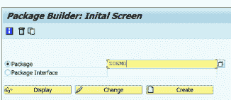

**图 2.12** 包构建器初始屏幕

- 3. 单击“创建”按钮后，将出现一个对话框。在“创建包”对话框中，维护包的属性，如图 2.13 所示，然后单击“确定”。只有“短描述”字段是必填的。

以下是一些重要属性：

- 包（PACKAGE）：提供包的名称。
- 短描述（SHORT DESCRIPTION）：为您的包提供简短描述。
- 应用程序组件（APPLICATION COMPONENT）：使用 [F4] 帮助，根据将保存在此包中的开发对象选择适当的应用程序组件。
- 软件组件（SOFTWARE COMPONENT）：对于客户包，此项选择 HOME。
- 传输层（TRANSPORT LAYER）：根据对象的目标系统选择传输层。您可能需要咨询您的经理或 SAP Basis 管理员以选择正确的传输层。
- 超级包（SUPERPACKAGE）：包可以嵌套，因此您可以在包层次结构中将一个包嵌入另一个包中。这有助于实现更好的模块化。如果要将当前包作为子包嵌套到现有包中，请在此字段中提供超级包的名称。
- 包类型（PACKAGE TYPE）：选择您要创建的包类型。您可以将包创建为结构包、主包或开发包：
  - 结构包（STRUCTURE PACKAGE）：这构成包层次结构中的顶层。您可以将主包添加到结构包中。
  - 主包（MAIN PACKAGE）：主包充当语义相关的开发对象的容器。主包包含子包（


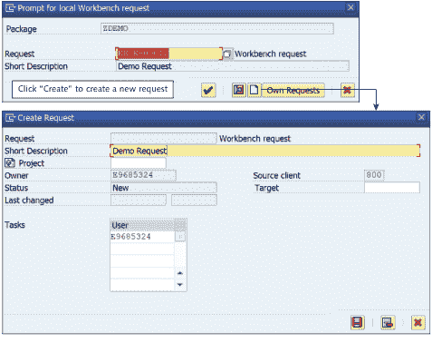

图 2.14 创建请求

### 2.4 小结

本章探讨了 SAP 系统的技术方面。尽管 SAP Basis 管理员负责本章讨论的大多数组件的设置和配置，但了解这些组件的基础知识有助于开发 ABAP 程序。

我们讨论了 SAP 系统的三个层，即表示层、应用层和数据库层。我们还探讨了构成这些系统的不同组件，例如不同版本的 SAP GUI，以及应用服务器和数据库服务器的组件。

我们还研究了客户端概念，并讨论了 SAP 系统的数据结构，以及如何使数据特定于某个客户端或可供跨客户端使用。

最后，我们概述了存储库对象以及它们如何分组到包中。这一概述为讨论开发对象奠定了基础。

下一章，我们将开始向你介绍 ABAP 环境和 ABAP 工作台工具。

## 3 ABAP 环境简介

现在你已经了解了 SAP 系统，接下来让我们把注意力转向 ABAP 环境。本章将介绍原生 IDE 和 Eclipse IDE 插件。

SAP 提供了一个名为 *ABAP 工作台* 的集成开发环境（IDE），它是一组用于开发、测试和运行 ABAP 程序的工具。在 SAP NetWeaver 7.31 SPS 4 发布后，SAP 为 SAP NetWeaver 引入了 *ABAP 开发工具*（ADT），也称为 *Eclipse 中的 ABAP*，它将 Eclipse 功能添加到 ABAP 工作台（事务 SE80）功能中。

本章将展示 SAP GUI 和 Eclipse IDE，并介绍我们将在本书中用于开发各种 ABAP 程序的 ABAP 工作台工具。

在 3.1 节中，我们将首先总体了解 SAP 环境，包括有关 ABAP 编程环境的信息以及登录 SAP 系统的步骤。我们还将了解 SAP 屏幕的不同元素，以及如何使用事务代码从 A 点到达 B 点。

3.2 节将深入介绍 ABAP 工作台中的不同 ABAP 工具。这包括 ABAP 编辑器、函数构建器、类构建器、屏幕绘制器、菜单绘制器、ABAP 数据字典和对象导航器。这些工具都将在本书后续内容中使用和讨论，因此充分理解它们的功能和用途非常重要。

我们将在 3.3 节概述 Eclipse IDE，包括安装和设置步骤，以此结束本章。

### 3.1 SAP 环境

如前几章所述，你可以使用 SAP GUI 或 Web 浏览器（用于传统应用程序或 Web Dynpro 应用程序的 SAP Web GUI）登录 SAP 系统并运行应用程序。不过，ABAP 工作台工具在 SAP GUI 和 Eclipse IDE 的桌面环境中都得到完全支持。为避免混淆并在全书中保持一致主题，本书所有示例都将使用 SAP GUI for Windows。你应该能够毫无困难地使用 SAP GUI for Java 或 Eclipse IDE 来跟随这些示例。

本节将说明如何登录 SAP 系统并在 SAP 屏幕中导航。我们将探讨运行 SAP 应用程序的不同方式，并了解 SAP 屏幕的各种元素。

**3.1.1 ABAP 编程环境**

与其他编程语言（Java、C/C++ 等）不同，ABAP 源代码不存储在文件中；相反，所有 ABAP 源代码都保存在 SAP 实例的底层数据库中。ABAP 代码没有单独的编译器；ABAP 运行时环境本身解释并执行 ABAP 代码。

工作进程中的数据库接口与底层数据库通信。数据库接口将 ABAP 程序中的 Open SQL 语句转换为 Native SQL 语句（底层数据库原生支持的语句）。ABAP 运行时系统确保 ABAP 程序与操作系统和数据库无关，从而使 ABAP 程序具有可移植性。换言之，如果底层数据库或操作系统环境发生变化，你不必担心修改程序代码。

在接下来的几节中，我们将更详细地探讨这些环境及其屏幕元素。

**3.1.2 登录 SAP 环境**

SAP 登录屏幕显示四个输入字段，如图 3.1 所示。除了用户名（User）和密码（Password）之外，你还需要输入要登录的客户端 ID。SAP 支持多种语言，因此你可以从 SAP 系统中已安装的任意语言中选择 LOGON LANGUAGE。

要使用特定语言，请在登录屏幕上输入其两位 SAP 语言代码——例如，英语为“EN”，德语为“DE”，依此类推。登录屏幕还包含一个 New Password 按钮，用于更改密码。

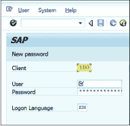

**图 3.1** SAP 登录屏幕

填写完登录屏幕上的详细信息后，按 `Enter` 键登录系统。

**3.1.3 SAP 屏幕的元素**

成功登录后，你将看到默认的 SAP Easy Access 屏幕（见图 3.2）；此入口屏幕始终在登录后显示，用于打开各种 SAP 应用程序。SAP Easy Access 屏幕包含可自定义的 SAP 菜单，其树状结构将所有已安装的应用程序组织到各个文件夹中。

SAP Easy Access 屏幕的导航区域分为 SAP 菜单、用户菜单和收藏夹：

- **SAP 菜单**：SAP 菜单是 SAP 标准交付的。
- **用户菜单**：用户菜单可以根据用户在组织中的角色进行自定义，以显示用户特定的应用程序。例如，财务用户可能看到财务相关应用程序，而销售用户默认可能在 SAP 菜单中看到销售相关应用程序。
- **收藏夹**：经常访问的应用程序可以作为收藏项添加到收藏夹文件夹下，以便快速访问。

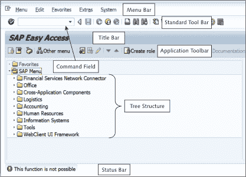

**图 3.2** 带屏幕元素的 SAP Easy Access 屏幕

[图 3.2](#) 展示了通过 SAP GUI 访问的标准 SAP 屏幕的各种屏幕元素。

现在，让我们逐一介绍 [图 3.2](#) 中标识的每个标准屏幕元素。

**菜单栏**

菜单栏是应用程序各种菜单项所在的位置。你可以使用菜单栏对应用程序执行其他活动。开发自己的 ABAP 应用程序时，你可以使用菜单绘制器工具（事务 SE41）设计菜单栏。你将在 3.2.5 节中进一步了解菜单绘制器，并在第 12 章中了解如何使用它。

菜单栏由应用程序特定菜单、系统菜单和帮助菜单组成。应用程序特定菜单由特定于每个应用程序的菜单项组成，并在开发应用程序时创建。例如，如果你希望用户将报表输出下载到电子表格，可以添加一个菜单项及相应功能来实现。系统菜单和帮助菜单默认可用，分别由标准系统功能和帮助资源链接组成。

**标准工具栏**

标准工具栏包含每个应用程序都有的标准图标集。标准图标包括保存、后退、退出、取消、打印、查找、查找下一个等。

你无法从此工具栏中移除或添加图标。但是，你可以根据业务需求为应用程序启用或禁用某些图标。标准工具栏在应用程序开发期间通过菜单绘制器工具进行自定义。

**标题栏**

标题栏显示应用程序的标题，使你能够轻松识别正在运行的应用程序。根据程序类型，标题可以来自程序属性，也可以使用 ABAP 关键字 `SET TITLEBAR` 从程序代码中显示。

你将在[第12章](#chapter-12)中进一步了解如何设置应用程序标题以及使用 ABAP 关键字 `SET TITLEBAR`。

**应用程序工具栏**

应用程序工具栏显示所有应用程序特定的图标。应用程序工具栏位于标题栏正下方。此区域可用于提供各种图标，以增强应用程序的功能。

标准设计实践是使用应用程序工具栏复制菜单栏中的功能。这样可以快速访问当前屏幕和系统任务中一些最常用的功能。应用程序工具栏中可用的按钮因应用程序而异，具体取决于每个应用程序的设计。


您可以使用菜单绘制器（Menu Painter）工具在应用程序工具栏中显示任何可用的图标。要查看可显示在应用程序工具栏中的可能图标，请参阅表 ICON。例如，您可以在报表输出的应用程序工具栏中显示 PDF 图标，以便用户可以将报表输出快速下载为 PDF 文件。

#### 状态栏

状态栏显示所有状态消息。该区域用于在用户运行您的应用程序时向其显示各种消息。例如，当屏幕输入字段中输入了无效条目时，您可以显示一条错误消息，或者您可以在应用程序运行时显示一条状态消息，向用户提供状态更新。

状态栏还显示其他信息，例如您登录的服务器、您访问的客户端数据库以及您登录时使用的用户 ID。

您将在第 6 章中详细了解可以为用户显示的消息类型。

#### 命令字段

命令字段可以通过事务代码快速打开应用程序（程序）。应用程序（也称为事务）可以与事务代码关联，用户可以直接在命令字段中输入事务代码来运行该应用程序。

某些命令，例如 /n 用于终止应用程序、/h 用于打开调试模式，以及其他命令，可以在命令字段中输入以执行不同的操作。表 3.1 显示了一些常用命令。在下一节中，我们将重点介绍 ABAP 开发中通常使用的事务代码。

#### 3.1.4 事务代码

为了便于打开应用程序，每个 SAP 应用程序都与一个事务代码相关联。应用程序在事务 SE93（维护事务）中与事务代码关联。一旦程序与事务代码关联，用户就可以直接在命令字段中输入事务代码来运行该程序。字母 A 到 X 保留给标准 SAP 应用程序；自定义应用程序的事务代码应在客户命名空间 Y 或 Z 中创建。

SAP 对大多数标准 SAP 应用程序遵循标准的命名约定。以 1 结尾的事务代码通常用于创建，以 2 结尾的事务代码用于编辑，以 3 结尾的事务代码用于显示。以下是一些遵循此模式的事务代码示例：

- MM01（物料主数据创建）
- MM02（物料主数据更改）
- MM03（物料主数据显示）
- VF01（开票凭证创建）
- VF02（开票凭证更改）
- VF03（开票凭证显示）
- ME21N（采购订单创建）
- ME22N（采购订单更改）
- ME23N（采购订单显示）

以 N 结尾的事务代码称为 *享受型事务（enjoy transactions）*。享受型事务随 SAP ERP 版本一起发布，该版本也称为 *享受（Enjoy）* 版本。这些事务实现了控制框架（Control Framework）元素，例如停靠容器、自定义容器、ALV 网格和图片控件。这些事务取代了旧的事务。例如，事务 ME21N 是事务 ME21 的 SAP 享受型事务。

接下来，我们将解释如何使用事务在系统内导航以及如何打开它们。

#### 3.1.5 导航和打开事务

有多种方式可以打开事务（应用程序）。您可以使用 SAP 轻松访问屏幕上的 **SAP 菜单** 中的树形结构，也可以直接在命令字段中输入事务代码。

您打开的每个 SAP 窗口称为一个 *会话（session）*，每个应用程序都在一个会话中运行。每个会话都占用应用程序服务器中的内存，因此为了节省系统内存，SAP Basis 管理员可以限制每个用户登录允许的最大会话数。每次登录允许的最大会话数为十六个，但通常限制为每次登录六个会话。

在 SAP 轻松访问屏幕的 SAP 菜单中，各种事务被组织到不同的文件夹中（参见图 3.3）。

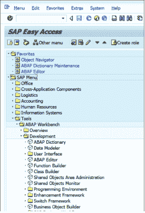

**图 3.3** SAP 轻松访问屏幕上的 SAP 菜单

图 3.3 中显示的菜单可以根据用户在组织中的角色进行自定义。系统管理员通常在 SAP 系统中设置用户帐户时为用户分配特定于角色的菜单。例如，销售主管可能只会在其 SAP 菜单中看到与销售相关的事务。

用户还可以将常用事务添加到“收藏夹（FAVORITES）”文件夹中以便快速访问。例如，作为 ABAP 顾问，您经常使用 ABAP 编辑器。要访问 ABAP 编辑器，您可以导航到菜单路径 SAP 菜单 • 工具 • ABAP 工作台 • 开发，然后双击 ABAP 编辑器（参见图 3.3）。每次想打开 ABAP 编辑器时都这样做可能很耗时。相反，您可以右键单击 SAP 轻松访问屏幕中的“收藏夹”文件夹，然后从上下文菜单中选择“插入事务”，从而将 ABAP 编辑器添加到您的收藏夹中（参见图 3.4）。

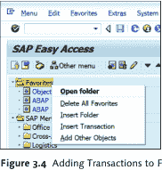

另一种更快的打开事务的方式是直接在命令字段中输入事务代码。当您想从任何会话中打开另一个事务而无需打开 SAP 轻松访问屏幕时，这非常有用。

如果您在 SAP 轻松访问屏幕上，可以直接在命令字段中输入事务代码，然后按 `Enter` 或点击命令字段左侧的绿色对勾。但是，如果您已经打开了一个事务，并想从现有的事务屏幕中打开一个新事务，那么您应该在事务代码前加上 /N 或 /O。除非您在 SAP 轻松访问屏幕上，否则仅输入事务代码不会打开应用程序。

/N 和 /O 用于以下目的：

- **/N**
  在事务代码前加上 /N 以终止当前事务，并在同一会话中打开新事务。
- **/O**
  在事务代码前加上 /O 以保持当前会话不变，并在新会话中打开新事务。

例如，在 SAP 轻松访问屏幕上，您可以输入事务代码“SE38”来打开 ABAP 编辑器。这将终止 SAP 轻松访问屏幕，并在同一会话中打开 ABAP 编辑器。

现在，如果您想从 ABAP 编辑器中打开事务 SE11（ABAP 数据字典），请在命令字段中输入“/NSE11”或“/OSE11”，具体取决于您是要终止 ABAP 编辑器并在同一会话中打开 ABAP 数据字典，还是保持 ABAP 编辑器不变并在新会话中打开 ABAP 数据字典。

表 3.1 列出了一些可以使用的常用命令字段格式。请注意，该列表并非详尽无遗。

| 常用命令字段选项 | 描述 |
|---|---|
| /nxxxx | 在同一会话（窗口）中调用事务 |
| /*xxxx | 在同一会话（窗口）中调用事务；跳过初始屏幕 |
| /oxxxx | 在附加会话中调用事务 |
| /n | 结束当前事务（*注意*：未保存的更改将丢失，且不会发出警告） |
| /i | 删除当前会话 |
| /o | 生成会话列表 |
| /ns000 | 结束当前事务并返回启动菜单 |
| /nend | 从系统注销 |
| /nex | 从系统注销，且不显示确认提示（*注意*：未保存的更改将丢失，且不会发出警告） |
| /h | 打开调试模式 |

注意：xxxx 代表事务代码。

**表 3.1** 一些常用命令字段选项

您可以通过启用显示技术名称的设置来轻松检查与每个事务关联的事务代码。在 SAP 轻松访问屏幕上，按照菜单路径 附加（EXTRAS）▸ 设置（SETTINGS），或按 `Shift`+`F9`，然后选中“显示技术名称（DISPLAY TECHNICAL NAMES）”复选框（参见图 3.5）。

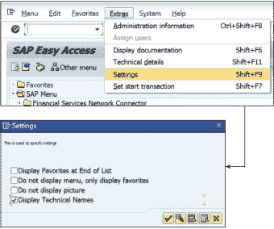

**图 3.5** 启用技术名称

启用此设置后，当您打开 SAP 菜单中的树形结构时，您应该会看到每个应用程序显示的事务代码（参见图 3.6）。

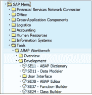

**图 3.6** 每个应用程序显示的事务代码

### 3.2 ABAP 工作台概述

作为 ABAP 开发人员，您将使用 ABAP 工作台工具来处理各种开发对象，例如程序、函数、类、表等。


本节将探讨一些用于开发 ABAP 程序的重要 ABAP 工作台工具。随着本书的深入，我们还会探讨其他 ABAP 工作台工具。

ABAP 工作台工具与开发对象集成在一起，ABAP 工作台提供向前导航支持，以便在对象之间移动。例如，如果您正在 ABAP 编辑器中编辑程序代码，并遇到调用函数模块的语句，只需双击函数模块名称，即可在函数构建器工具中打开该函数模块。

由于您要使用不同的 ABAP 工作台工具来设计和开发 ABAP 应用程序中的各种对象，为避免在不同屏幕上的 ABAP 工作台工具之间来回切换，SAP 提供了一个名为*对象导航器*的应用程序（事务 SE80）。

对象导航器以树状层级组织所有开发对象，从而可以轻松编辑应用程序的不同对象。我们将在 3.2.7 节中更仔细地了解对象导航器屏幕的结构。

让我们探索 ABAP 工作台工具，并了解它们如何集成到对象导航器中以提供 IDE。

#### 3.2.1 ABAP 编辑器

ABAP 工作台的主要组件之一是 ABAP 编辑器，您可以在其中编写和编辑 ABAP 代码。打开 ABAP 编辑器的主要事务是事务 SE38，但该编辑器也集成到其他 ABAP 工作台工具中，例如类构建器、函数构建器和屏幕绘制器。

在 ABAP 编辑器中，您可以选择三种不同模式之一：

- **前端编辑器（新）**（源代码模式）

  自 SAP NetWeaver 7.0 发布以来，新的前端编辑器是一种针对 ABAP 优化的通用编程工具，并可在 SAP GUI for Windows 6.40 补丁级别 10 或更高版本中使用。它与 SAP 环境完全集成，并提供旧编辑器之外的各种功能，例如代码补全、代码模板、更改 ABAP 关键字颜色和背景色、自动填充过程的参数接口等。

- **前端编辑器（旧）**（纯文本模式）

  旧的前端编辑器以纯文本模式工作，并提供基本功能集。使用此模式时，源代码会加载到前端并在本地进行编辑。由于源代码在本地编辑，所有不需要与后端交互的功能都会执行得更快。此编辑器在 SAP GUI for Windows 和 SAP GUI for Java 中可用。

- 后端编辑器（基于行的模式）

  后端编辑器以基于行的模式工作，一次只编辑一行。尽管此编辑器不是很用户友好，但它可以在任何操作系统环境中使用（不同于前端编辑器）。

您可以从任意 ABAP 工作台工具中按照菜单路径“实用程序 · 设置”打开“用户特定设置”对话框来选择模式（参见图 3.7）。

在此屏幕上，选择“ABAP 编辑器”选项卡，然后选择“编辑器”选项卡。在“编辑器”选项卡下，选择首选编辑器对应的单选按钮。

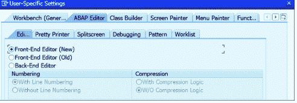

**图 3.7** ABAP 编辑器设置

我们建议使用新的前端编辑器；它为编写和编辑 ABAP 代码提供了许多强大的功能，例如语法高亮、代码提示和自动补全。图 3.8 突出展示了新编辑器的一些其他编辑器模式中不具备的功能。

如图 3.8 所示，新的前端编辑器支持书签功能以实现快速导航，在编辑时高亮显示对源代码的更改，提供语言元素和结构的代码提示与自动补全，并显示可轻松展开或折叠以提高可读性的元素块。

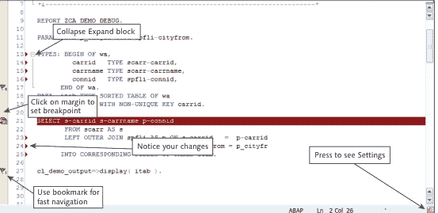

**图 3.8** 新编辑器模式的功能

您还可以通过双击边距线快速设置断点。在设置中，您可以创建用户定义的源代码模板，以加快开发过程并避免手动编写重复代码。

#### 3.2.2 函数构建器

*函数模块*是可由 ABAP 程序调用的可重用软件块。函数构建器是 ABAP 工作台工具，允许您在系统中全局创建和维护函数模块。这些函数模块可由任何 ABAP 程序调用，或由外部程序远程调用。

函数模块在 ABAP 程序中调用，或由外部程序远程调用，从不由用户直接执行。但是，函数构建器提供了一个测试环境，无需在程序中实际调用函数模块即可对其进行测试。

函数构建器还充当中心库，用于搜索可在程序中使用的现有函数模块。您还可以在开发过程中在函数构建器中维护每个函数模块的文档，使其他开发人员在自己程序中使用该模块时能够了解该函数模块的功能和参数接口。

可通过事务 SE37 或从存储库浏览器（事务 SE80）访问函数构建器。图 3.9 显示了函数构建器。

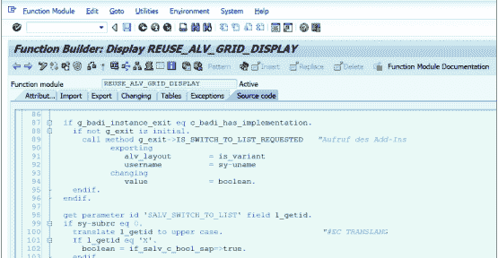

图 3.9 函数构建器

我们将在第 7 章更详细地解释函数构建器，您将使用它来开发函数模块。

#### 3.2.3 类构建器

与函数构建器用于创建和维护函数模块类似，类构建器是一种 ABAP 工作台工具，用于创建、定义、更改和测试全局 ABAP 类和接口。ABAP 类是实现面向对象编程概念的过程（参见第 8 章）。

ABAP 类可以在 ABAP 程序中本地定义，也可以使用类构建器工具在系统中全局定义。类构建器不仅允许您定义和维护全局类，还允许您维护对象之间的关系（例如继承）、在子类中重新定义方法，以及维护类的属性、方法和事件。类构建器还提供用于测试类和接口的运行时。

可通过事务 SE24 或从存储库浏览器（事务 SE80）访问类构建器。图 3.10 显示了类构建器。如您所见，类构建器包含多个选项卡，用于维护类的各种组件，例如方法、属性、接口等。

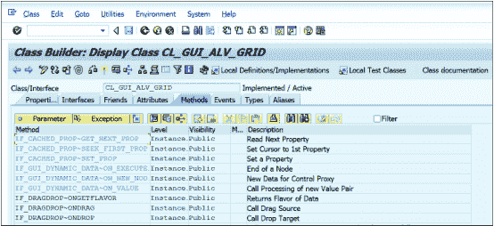

**图 3.10** 类构建器

我们将在第 7 章更详细地解释类构建器，您将使用它来实现全局类。

#### 3.2.4 屏幕绘制器

屏幕绘制器是一种 ABAP 工作台工具，用于为 ABAP 程序创建屏幕并维护屏幕流逻辑。在 ABAP 中，可以为 ABAP 程序定义三种类型的屏幕：选择屏幕、列表屏幕和常规屏幕。选择屏幕和列表屏幕使用特定的 ABAP 关键字自动生成。常规屏幕使用屏幕绘制器进行设计和维护。

屏幕绘制器在 SAP GUI for Windows 中提供图形布局编辑器模式，在该模式下，可以通过拖放功能轻松定义各种屏幕元素，例如输入字段、文本字段和下拉列表框。

对于不支持图形布局编辑器模式的操作系统（例如 SAP GUI for Java），也可以使用字母数字模式来处理屏幕元素。

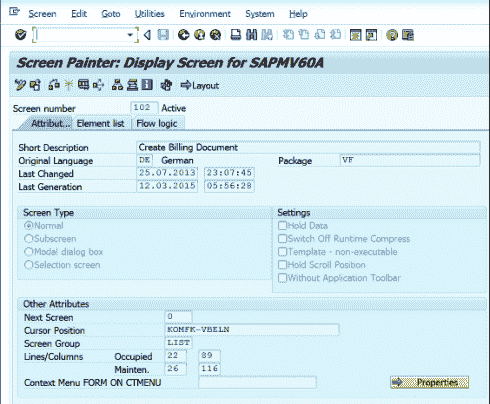

**图 3.11** 屏幕绘制器

如图 3.11 所示，屏幕绘制器包含三个选项卡：

- **属性**

  在“属性”选项卡中，可以调整屏幕属性，例如描述、屏幕类型和默认行为。屏幕有三种类型：普通屏幕、子屏幕和模态对话框。*普通屏幕*显示在 SAP GUI 窗口中，*子屏幕*显示在普通屏幕窗口内的特定区域中，*模态对话框*显示为弹出窗口。您可以根据需要在“属性”选项卡的“屏幕类型”下创建所需类型的屏幕。


- **元素列表/屏幕布局**
  在“元素”列表选项卡下，可以维护屏幕元素和布局。可以维护各种屏幕元素，例如输入/输出字段、文本字段、单选按钮、复选框和按钮。还可以维护更复杂的屏幕元素，例如选项卡条控件和表格控件。使用图形布局编辑器设计屏幕时，此选项卡会自动填充屏幕元素列表。

- **流逻辑**
  在“流逻辑”选项卡中，可以维护屏幕的流逻辑。运行时环境根据屏幕事件触发流逻辑中的代码。例如，在向用户显示屏幕之前会触发输出前处理（PBO）事件，因此，任何希望在显示屏幕之前执行的代码（例如禁用某个字段）都可以通过在屏幕的流逻辑中维护 PBO 事件来处理。

图形布局编辑器仅在 SAP GUI for Windows 中可用。该编辑器如**图 3.12**所示。

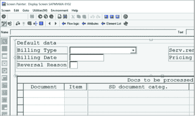

**图 3.12** 图形模式下的布局编辑器

##### 图形布局编辑器

Screen Painter 的图形布局编辑器是 SAP GUI 的一部分，仅适用于 SAP NetWeaver Application Server 6.10 和 SAP GUI 6.10 或更高版本。在 SAP NetWeaver 4.0 中，它适用于 SAP GUI 6.20 或更高版本（补丁 56），或 6.40 版本（补丁 8）。

#### 3.2.5 菜单绘制器

菜单绘制器是一个 ABAP Workbench 工具，可用于为 ABAP 程序设计用户界面。如第 3.1.3 节所述，各种屏幕元素（例如菜单栏中的项、标准工具栏和应用程序工具栏）都可以使用菜单绘制器进行设计。例如，可以为屏幕定义“后退”、“退出”和“取消”按钮，或者在菜单栏中定义特定于应用程序的菜单选项，并在应用程序工具栏中定义相应的图标以便快速访问。这些项统称为屏幕的 GUI 状态。

图 3.13 显示了菜单绘制器屏幕，可在其中维护屏幕的各种 UI 元素。可以维护菜单栏、标准工具栏、应用程序工具栏的元素，以及用户可用作键盘快捷键的功能键。

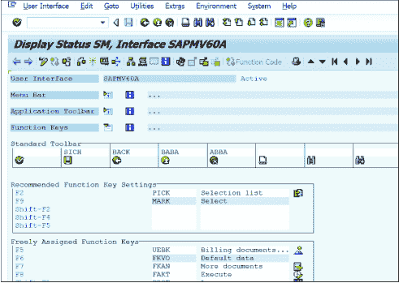

**图 3.13** 菜单绘制器

我们将在第 12 章讨论对话编程时进一步探讨菜单绘制器。

#### 3.2.6 ABAP 数据字典

ABAP 数据字典（见图 3.14）是 SAP 提供的用于集中创建和维护数据定义的工具。可以使用 ABAP 数据字典创建和维护全局用户定义类型，例如数据元素、结构和表类型，这些类型可在任何 ABAP 程序中使用。

可以使用 ABAP 数据字典在底层关系数据库中创建对象（表和视图），这有助于集中描述数据而不会冗余。

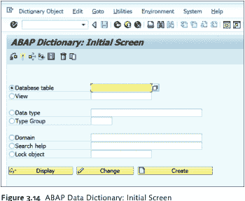

在 ABAP 程序中，Open SQL 语句处理来自底层关系数据库的数据。Open SQL 语句由 SQL 的数据操作语言（DML）部分组成，有助于执行某些操作，例如读取、修改或更新数据库表中的数据。

要执行某些操作，例如创建或删除数据库表或创建表索引，需使用 SQL 的数据定义语言（DDL）部分，这要求使用 Native SQL 语句。不过，在 ABAP 应用中仅使用 Open SQL 语句；强烈建议不要使用 Native SQL 语句来定义数据库表或对底层关系数据库执行任何其他操作。相反，应使用 ABAP 数据字典来创建和维护表及视图，或执行原本需要使用 Native SQL 语句的任何操作。这不仅有助于避免冗余，还有助于阐明应用程序开发中所用对象的逻辑结构如何映射到底层关系数据库。

所有 ABAP 数据字典对象在系统中全局可见，并集中维护。例如，如果许多程序使用某个特定数据元素，并且由于业务需求变化需要更改该数据元素的定义，则该更改将自动反映到所有使用该数据元素的程序中。因此，无需手动更新任何程序，因为运行时系统会自动适应 ABAP 数据字典中的更改，并确保所有应用程序和工具始终访问当前数据。

ABAP 数据字典中最重要的对象类型如下：

- **表**
  表使用 ABAP 数据字典中的定义在底层关系数据库中创建。当在 ABAP 数据字典中激活表时，系统使用 ABAP 数据字典表的结构，在底层数据库中创建与 ABAP 数据字典中的表结构相同的物理表。

- **视图**
  可以将多个表组合以创建逻辑视图。视图的结构在 ABAP 数据字典中创建，然后使用此结构创建数据库视图。

- **数据类型**
  可以在 ABAP 数据字典中创建全局数据类型，以集中维护使用这些全局类型的数据对象的定义。当在 ABAP 数据字典中更改数据类型时，ABAP 数据字典会自动将更改反映到所有使用该数据类型的程序中。

- **锁对象**
  锁对象在 ABAP 应用中提供逻辑锁定功能，以防止多个用户同时访问或操作相同数据。当在 ABAP 数据字典中创建锁对象时，ABAP 数据字典会生成一个函数模块，可在 ABAP 程序中使用该函数模块实现逻辑锁定功能，以限制多个用户同时访问数据。

- **域**
  域用于维护字段的技术属性（类型和长度）。当多个字段共享相同的技术属性时，可以集中维护一个域，并将该域分配给共享相同技术描述的每个字段。
  
  当表或结构组件引用域时，可以通过在域中维护值范围来定义该组件的值范围。域始终分配给数据元素。

#### 3.2.7 对象导航器

对象导航器提供了一个 IDE，可在其中集中使用所有 ABAP Workbench 工具。例如，开发需要定义屏幕、GUI 状态和 ABAP 数据字典对象的 ABAP 应用时，可以在对象导航器本身中打开这些相应的工具，而无需离开屏幕去访问各个工具。

对象导航器有助于在开发过程中组织开发对象，并可以轻松地在一个位置编辑应用中的所有相关对象。

如图 3.15 所示，对象导航器包括两个主要区域：

- **导航区域**
  导航区域显示应用的所有开发对象。所有对象都组织到具有树结构的文件夹中。

- **工具区域**
  工具区域是打开开发对象的位置。它会自动打开相应的 ABAP Workbench 工具来打开对象。例如，创建或编辑屏幕时，对象导航器会在工具区域中自动使用 Screen Painter 打开屏幕。

现在您已经大致了解了 ABAP Workbench 中的对象，本章最后一节将介绍可与 ABAP 一起使用的另一个 IDE：Eclipse。

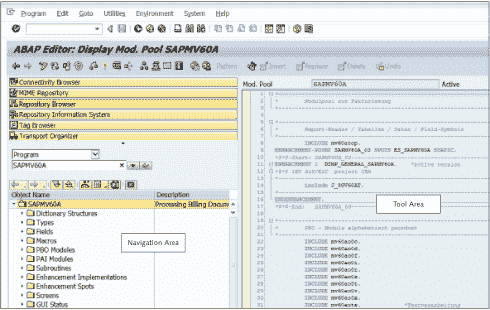

**图 3.15** 对象导航器

### 3.3 Eclipse IDE 概述

SAP 提供各种开发工具和功能，用于构建和扩展其业务应用。随着技术的不断变化和发展，SAP 不断丰富其开发工具组合。

Eclipse 是一个流行的 IDE，为 Java 应用开发提供了一系列优势。在 SAP NetWeaver 7.31 SPS 4 中，SAP 推出了适用于 SAP NetWeaver 的 ABAP 开发工具（ADT），也称为 *ABAP in Eclipse*。ADT 在 Eclipse 功能的基础上提供了 ABAP Workbench（事务 SE80）的功能，使 ABAP 与 SAP 的其他基于 Eclipse 的开发环境保持一致。

涉及的学习曲线可以忽略不计；如果您熟悉在 SAP GUI 环境中使用传统 ABAP Workbench 工具，那么使用 Eclipse 应该会感到非常自然。

在 Eclipse 中使用 ABAP 的第一步是设置个人开发环境，而不是您可能习惯使用对象导航器时所用的捆绑环境。


但是，安装 Eclipse 就像安装 SAP GUI 一样简单。请注意，并非所有工具都已迁移到 Eclipse 平台；一些工具将在未来的 ADT 版本中添加。对于部分工具，SAP 正在评估更符合其平台战略的新概念。

对于尚不适用于 ADT 的工具，目前可以使用紧密集成的 SAP GUI，它允许您通过上下文感知导航使用现有事务。例如，Eclipse 中没有原生的 Dynpro 开发工具，但您可以使用集成的 SAP GUI 在 Eclipse 中运行标准 ABAP 工作台工具，如 Screen Painter 或 Menu Painter。

按照以下步骤安装和设置 Eclipse IDE：

1. 从 http://www.eclipse.org/ 下载最新的 Eclipse 版本。Eclipse 可用于 Windows、Mac 和 Linux 平台。撰写本书时（2016 年 10 月）的最新版本是 Neon（参见图 3.16）。请务必检查并下载最新版本的 Eclipse。


**图 3.16** Eclipse 网站

2. 您可以下载基础包或任何预定义包。Eclipse 目前尚未将 ABAP 作为预定义包提供。因此，您需要从 SAP 的网站单独下载 ADT。请访问 https://tools.hana.ondemand.com/#abap 获取所有必要信息（参见图 3.17）。该网页将提供哪些工具可用于不同 Eclipse 版本的信息，因此您看到的页面可能会有所不同。

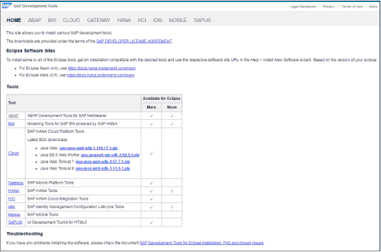

**图 3.17** SAP 开发工具

3. 要将 ADT 添加到 Eclipse，请通过菜单路径 **Help • Install New Software** 从 Eclipse 中打开安装向导（参见图 3.18）。

4. 在安装向导中，在 **Work with** 字段中输入 URL，然后点击 **Add** 以查看可用工具列表（参见图 3.19）。从列表中，选择 **ABAP Development Tools for SAP NetWeaver**，然后点击 **Next** 继续。

5. 安装完成后，您可以创建新项目开始工作。从菜单栏中选择 **File • New • ABAP Project**。

6. 现在，您可以从现有的 SAP GUI 信息中加载 SAP 系统的登录参数，或手动维护连接参数。图 3.20 显示了系统连接界面。点击 Next 输入 SAP 登录凭据以连接到您的 SAP 系统。

**注意**

请注意，您的后端 SAP 系统需要维护某些配置才能成功连接并使用 ADT。这些配置由 SAP Basis 管理员维护；因此，如果您需要更多信息，请联系您的 SAP Basis 管理员。

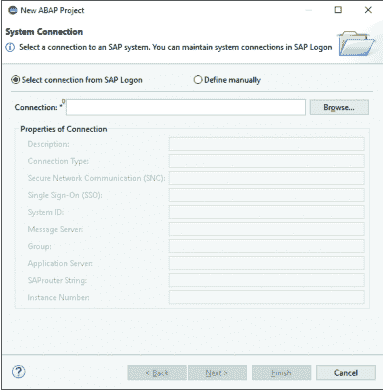

**图 3.20** 连接参数界面

7. 当您在 Eclipse 中创建 ABAP 项目时，会与现有的 ABAP 后端建立连接，以访问系统中 ABAP 包中维护的开发对象（如程序、ABAP 数据字典对象和类）。

8. 建立连接后，您可以使用 Eclipse 项目资源管理器（参见图 3.21）打开后端 ABAP 包中的对象，并将其添加到您的项目中。

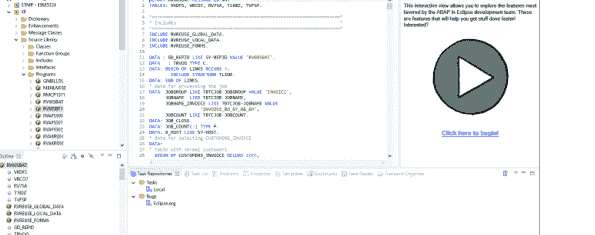

**图 3.21** 项目资源管理器

现在，您可以选择 ABAP 包中包含的开发对象，并在特定工具中显示它。例如，如果您想修改代码，可以在源代码编辑器中打开程序。

大纲视图位于项目资源管理器视图下方，显示所选开发对象的结构，例如程序变量，并允许您直接导航到源代码中的该元素。

Eclipse IDE 在您打开编辑器时会提供一个快速入门指南，帮助您快速熟悉 Eclipse。您应该会发现自己对 Eclipse 编辑器相当熟悉；大多数功能与我们之前讨论的传统 SAP GUI 中的新前端编辑器相似。

### 3.4 总结

在本章中，我们了解了 SAP 环境和 ABAP 环境。我们逐步完成了登录 SAP 系统的步骤，然后查看了 SAP 屏幕上的不同元素。接着，我们了解了如何使用事务代码在 SAP 中浏览菜单树。

随后，我们将重点转向了两个 IDE：SAP GUI 和 Eclipse。我们探索了 ABAP 工作台工具，包括 ABAP 编辑器、函数构建器、类构建器、Screen Painter、Menu Painter、ABAP 数据字典和对象导航器。我们将使用本章讨论的所有工具来开发 ABAP 对象，并在本书讨论特定主题时有机会进一步探索它们。

在本章的最后一节中，我们概述了如何设置和使用 Eclipse IDE。Eclipse 中的许多设置与 SAP GUI 中的设置类似。

在具备了 SAP 和 ABAP 环境以及各种 ABAP 工作台工具的基本理解之后，在下一章中，我们将深入探讨 ABAP 编程的基本概念，例如 ABAP 语法、数据类型和数据对象。在下一章结束时，您将创建您的第一个 ABAP 程序。

## 4 ABAP 编程概念

在本章中，我们将了解 ABAP 编程语言的基本概念。本章讨论的概念将为编写您自己的 ABAP 程序奠定基础。

ABAP 程序处理来自数据库或外部源的数据。如第 2 章所述，ABAP 程序在应用层运行，ABAP 程序语句只能处理程序中本地可用的数据。外部数据，如屏幕上的用户输入、来自顺序文件的数据或数据库表中的数据，必须始终传输并保存在程序的本地内存中，才能使用 ABAP 语句进行处理。

换句话说，在使用 ABAP 程序处理任何数据之前，必须首先从源读取数据，将其存储在程序内存中，然后通过 ABAP 语句访问；您不能直接使用 ABAP 语句处理外部数据。在程序执行期间存在于 ABAP 程序中的这种临时数据称为*瞬态数据*，程序执行结束后会从内存中清除。如果您希望稍后访问这些数据，则必须将其持久存储在数据库中；这种存储的数据称为*持久数据*。

本章提供有关 ABAP 编程语言基本构建块的信息，以便理解在 ABAP 程序中本地存储和处理数据的不同方式。在 4.1 节中，我们首先了解 ABAP 程序的总体结构，然后在 4.2 节和 4.3 节中分别深入探讨 ABAP 语法规则和 ABAP 关键字。

4.4 节介绍了 TYPE 概念，并探讨了数据类型和数据对象等关键元素，这些元素定义了 ABAP 程序中用于本地存储数据的内存位置。在 4.5 节中，我们讨论了可以采用的各类 ABAP 语句，包括声明、模块化、控制、调用和操作语句。最后，在 4.6 节中，我们通过逐步创建您的第一个 ABAP 程序来结束本章！

最初，我们将使用过程模型来简化示例；在第八章讨论面向对象编程后，我们将切换到面向对象模型。

### 4.1 一般程序结构

任何 ABAP 程序都可以大致分为两个部分：

- **全局声明**  
  在全局声明区域中，定义程序的全局数据；然后可以从程序中的任何位置访问这些数据。
- **过程部分**  
  程序的过程部分由各种处理块组成，例如对话框模块、事件块和过程。这些处理块中的语句可以访问全局声明中定义的全局数据。

在本节中，我们将了解这两个程序结构部分。

#### 4.1.1 全局声明

ABAP 程序的全局声明部分使用声明性语句定义内存位置，这些位置称为*数据对象*，用于存储程序的工作数据。ABAP 语句只能使用程序中可用的数据作为数据对象的内容，因此必须先将数据存储到数据对象中，然后才能由 ABAP 程序处理。

数据对象是程序本地的；可以在同一程序中使用 ABAP 语句访问它们。全局声明区域位于程序的顶部（参见图 4.1）。我们使用术语*全局*是相对于程序而言的；在此区域中定义的数据对象在整个 ABAP 程序中可见且有效，并且可以从源代码中的任何位置使用 ABAP 语句访问它们。

ABAP 还使用*局部声明*，只能在程序的某个子集内访问。我们将在第 7 章讨论模块化技术时探索局部声明。


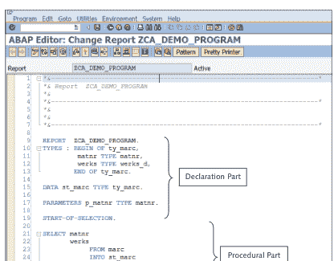

**图 4.1** 程序结构

#### 4.1.2 过程部分

声明部分之后是程序的过程部分。这里定义了 ABAP 程序的处理逻辑。在 ABAP 程序的这一部分中，你通常使用各种 ABAP 语句从外部源导入和处理数据。

过程区域是实现程序逻辑的地方。它使用各种包含 ABAP 语句的处理块来实现业务需求。例如，在典型的报表中，过程区域包含一个事件块来处理选择屏幕并验证用户在屏幕上的输入，另一个事件块则根据用户输入从数据库获取数据，然后调用过程将输出显示给用户。

### 4.2 ABAP 语法

ABAP 程序的源代码只是各种 ABAP 语句的集合，由运行时环境解释以执行特定任务。您使用声明语句定义数据对象，使用模块化语句定义处理块，并使用数据库语句处理数据库中的数据。

在本节中，我们将介绍每个 ABAP 程序员都应了解的基本语法规则。然后，我们将介绍链式语句和注释行的使用。

#### 4.2.1 基本语法规则

编写 ABAP 语句时需要遵循某些基本语法规则：

- ABAP 程序是程序中存在的各个 ABAP 语句的集合。每个 ABAP 语句以句点（"."）结尾，语句的第一个单词称为关键字。
- ABAP 语句由操作数、运算符或关键字附加项组成（参见图 4.2）。ABAP 语句的第一个单词是 ABAP 关键字，其余可以是操作数、运算符或附加项。*操作数* 是数据对象、数据类型、过程等。
    
    可用的运算符有多种，例如赋值运算符将赋值的源字段和目标字段关联起来（例如 = 或 ?=），算术运算符将两个或多个数值操作数与算术表达式关联起来（例如 +、-、*），关系运算符将两个操作数与逻辑表达式关联起来（例如 =、<、>）等。每个 ABAP 关键字都有自己的一组附加项。
- 语句中的每个单词必须至少用一个空格分隔。
- ABAP 语句以句点结尾，您可以在同一行或新行上编写新语句。单个 ABAP 语句可以跨越多行。
- ABAP 代码不区分大小写。

在图 4.2 中，所示的程序由跨三行编写的三条 ABAP 语句组成。这些语句中的第一个单词（REPORT、PARAMETERS 和 WRITE）是关键字。如您所见，每个语句都以关键字开头，以句点结尾。此外，每个 ABAP 单词都用空格分隔。

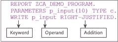

**图 4.2** ABAP 语句

您可以在同一行上编写多条语句，也可以让一条语句跨越多行。因此，如果您愿意，可以将图 4.2 中的代码重写为如下所示：

```abap
REPORT ZCA_DEMO_PROGRAM. PARAMETERS p_input(10) TYPE c. WRITE p_input RIGHT-JUSTIFIED.
```

但是，为了保持代码清晰，我们建议将程序限制为每行一条语句。在某些情况下，建议将单条语句拆分为多行，例如：

```abap
SELECT * FROM mara INTO TABLE it_mara WHERE matnr EQ p_matnr.
```

上述语句可以按清单 4.1 所示编写，以提高可读性。

```abap
SELECT * FROM mara
  INTO TABLE it_mara
  WHERE matnr EQ p_matnr.
```

**清单 4.1** 跨多行拆分语句的示例

#### 4.2.2 链式语句

如果多个语句以相同的*关键字*开头，则可以使用冒号（:）作为链运算符，并用逗号分隔每个语句。这些语句称为*链式语句*，可帮助您避免在每行重复相同的关键字。

例如，

```abap
DATA v_name(20) TYPE c.
DATA v_age TYPE i.
```

也可以写成

```
DATA : v_name(20) TYPE c,
       v_age TYPE i.
```

用句点结束链中的最后一个语句。链式语句不仅限于关键字；您可以将链中语句的任何相同的第一部分放在冒号前，并用逗号分隔各个语句的其余部分，例如，

```
v_total = v_total + 1.
v_total = v_total + 2.
v_total = v_total + 3.
v_total = v_total + 4.
```

可以链式编写为

```
v_total = v_total + : 1, 2, 3, 4.
```

> **注意**
>
> ABAP 代码不区分大小写，因此您可以使用大写或小写编写 ABAP 语句。我们建议使用大写字母编写关键字及其附加项，并使用小写字母编写语句中的其他单词，以使代码更清晰易读。

#### 4.2.3 注释行

为了使源代码易于其他程序员理解，您可以向其添加注释（参见清单 4.2）。*注释行*在生成程序时会被系统忽略，并且它们在很多方面都很有用。

```
DATA f1 TYPE c LENGTH 2 VALUE '13'.
DATA f2 TYPE n LENGTH 2.
*This is a comment line
f2 = f1.
WRITE f2. "This is also a comment line
```

**清单 4.2** 注释行

在源代码中添加注释行有两种方式：

- 您可以在行首输入星号（*），使整行成为注释。
- 您可以在行中输入双引号（"），使引号后面的行部分成为注释；这称为*行内注释*。

您可以通过选择要注释的行并按键盘上的 `Ctrl` + `<` 一次*注释*（即设置为注释）一个行块（称为*多行注释*）。类似地，要*取消注释*（即设置为正常代码）一个行块，您可以选择这些行并按 `Ctrl` + `>`。

或者，您也可以使用上下文菜单来注释或取消注释代码。要注释一行代码或一个行块，请选择代码，右键单击，然后从 FORMAT 上下文菜单中选择适当的选项。这有助于避免手动在每行开头添加星号的繁琐工作。

既然您对基本 ABAP 语法规则和链式 ABAP 语句有了更好的理解，在下一节中，我们将介绍 ABAP 中使用的关键字。

### 4.3 ABAP 关键字

由于每个 ABAP 语句都以关键字开头，因此编写 ABAP 语句的关键就是选择正确的关键字来执行所需的任务。每个关键字都提供特定功能，并带有自己的一组*附加项*，允许您扩展关键字的功能。

对于每个关键字，SAP 都维护着广泛的文档，这些文档可作为理解关键字的使用语法以及该关键字支持的附加项集的指南。

您可以通过在命令栏中输入 "ABAPDOCU" 来访问关键字文档，就像打开其他任何事务一样，或者在 ABAP 编辑器中编写代码时将光标放在关键字上并按 `F1`。您还可以访问 https://help.sap.com/abapdocu_750/en/abenabap.htm 来访问 ABAP 关键字文档的在线版本（参见图 4.3）。

由于 ABAP 中可用的关键字多达数百个，熟悉这些关键字的最佳方式是结合需求来探索它们。在整本书中，我们将采用这种方法，在各种示例中向您介绍这些关键字。

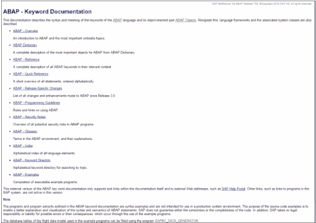

**图 4.3** ABAP 关键字文档

### 4.4 TYPE 概念简介

ABAP 程序只处理数据对象中的数据。开发程序时首先要做的就是声明数据对象。在这些数据对象中，您存储在 ABAP 程序中要处理的数据。您使用声明语句来定义在程序中存储数据的数据对象；这些语句称为*数据声明*。

通常，您会处理各种类型的数据，例如客户名称、电话号码或应付金额。每种类型的数据都有特定的特征。客户名称由字母组成，电话号码由 0 到 9 的数字组成，应付给客户的金额将是带有小数值的数字。识别您计划存储在数据对象中的数据的类型和长度，这就是 TYPE 概念的全部内容。

在本节中，我们将介绍数据类型、域和数据对象。


#### 4.4.1 数据类型

*数据类型*是定义数据对象的模板。数据类型决定 ABAP 语句如何解释数据对象的内容。除了占用一些空间来存储管理信息外，它们不会为程序中的工作数据占用任何内存空间。其目的只是提供数据对象的技术属性。

数据类型大致可分为基本类型、复杂类型或引用类型。本章将主要探讨基本数据类型，仅简要介绍复杂类型和引用类型。有关复杂数据类型的更多信息，请参见第 5 章；有关引用类型的更多细节，请参见第 8 章。

##### 基本数据类型

*基本数据类型*指定 ABAP 程序中各个字段的类型。基本数据类型可分为预定义基本类型或用户定义基本类型。接下来我们将介绍这些子类型。

##### 预定义基本数据类型

SAP 系统内置了预定义基本数据类型。这些数据类型在 SAP NetWeaver AS ABAP 内核中预定义，并可在所有 ABAP 程序中可见。你可以使用这些预定义基本数据类型为程序数据对象分配*类型*。你也可以通过引用预定义数据类型来创建自己的数据类型（用户定义基本数据类型）。

表 4.1 列出了可用的预定义基本数据类型。

| 数据类型 | 定义 |
| --- | --- |
| `i` | 四字节整数 |
| `int8` | 八字节整数 |
| `f` | 二进制浮点数 |
| `p` | 压缩数 |
| `decfloat16` | 具有十六位小数位的十进制浮点数 |
| `decfloat34` | 具有三十四位小数位的十进制浮点数 |
| `c` | 文本字段（字母数字字符） |
| `d` | 日期字段（格式：*YYYYMMDD*） |
| `n` | 数字文本字段（数字字符 0 到 9） |
| `t` | 时间字段（格式：*HHMMSS*） |
| `x` | 十六进制字段 |

**表 4.1** 预定义基本数据类型

预定义基本数据类型可分为数值类型或非数值类型。共有六种预定义数值基本数据类型：

- 4 字节整数（`i`）
- 8 字节整数（`int8`）
- 二进制浮点数（`f`）
- 压缩数（`p`）
- 具有 16 位小数位的十进制浮点数（`decfloat16`）
- 具有 34 位小数位的十进制浮点数（`decfloat34`）

共有五种预定义非数值基本数据类型：

- 文本字段（`c`）
- 数字字符串（`n`）
- 日期（`d`）
- 时间（`t`）
- 十六进制（`x`）

数据类型 `f`、`i`、`int8`、`decfloat16`、`decfloat34`、`d` 和 `t` 的字段长度是固定的。换言之，当你在程序中使用这些数据类型声明数据对象（或用户定义基本数据类型）时，无需指定长度。字段长度决定数据对象在内存中占用的字节数。在类型 `c`、`n`、`x` 和 `p` 中，长度不是类型定义的一部分。相反，你在程序中声明数据对象时定义长度。

在进一步讨论预定义基本数据类型之前，我们先看看它们如何用于在程序中定义数据对象。

用于定义数据对象的关键字是 `DATA`。语法上，你为数据对象提供一个名称，并使用附加项 `TYPE` 将其引用到某个数据类型，数据对象可从该类型派生其技术属性。

例如，图 4.4 中的代码行定义了 `TYPE c`（字符）的数据对象 `V_NAME`。

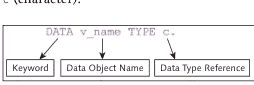

请注意，我们在图 4.4 中没有指定长度；因此，该对象将默认采用数据类型的初始长度。这里，`V_NAME` 将是一个 `TYPE c`（文本字段）且 `LENGTH 1`（默认长度）的数据对象。它只能存储一个字母数字字符。

如果你希望数据对象具有不同长度，需要在声明数据对象时指定长度，可以使用括号或使用附加项 `LENGTH`：

```abap
DATA V_name(10) TYPE c.
DATA V_name TYPE c LENGTH 10.
```

在此示例中，`V_NAME` 将是一个 `TYPE c` 且 `LENGTH 10` 的数据对象。它现在最多可存储 10 个字母数字字符。表 4.2 中的“有效字段长度”列列出了可分配给每种数据类型的最大长度。

对于固定长度的数据类型，无需指定长度，因为它是 `TYPE` 定义的一部分——例如：

```abap
DATA count TYPE i.
DATA date TYPE d.
```

表 4.2 列出了每种数据类型的初始长度、有效长度和初始值。初始长度是在定义数据对象时未提供长度规格的情况下，数据对象在内存中占用的默认长度；数据对象的初始值是内存为空时其存储的值。

例如，如表 4.2 所示，TYPE c 数据对象初始将填充空格，而 TYPE n 数据对象将填充零。

| 数据类型 | 初始字段长度（字节） | 有效字段长度（字节） | 初始值 |
| --- | --- | --- | --- |
| **数值类型** |  |  |  |
| `i` | 4 | 4 | 0 |
| `int8` | 8 | 8 | 0 |
| `f` | 8 | 8 | 0 |
| `p` | 8 | 1-16 | 0 |
| `decfloat16` | 8 | 8 | 0 |
| `decfloat34` | 16 | 16 | 0 |
| **字符类型** |  |  |  |
| `c` | 1 | 1-65535 | 空格 |
| `d` | 8 | 8 | '00000000' |
| `n` | 1 | 1-65535 | '0 ... 0' |
| `t` | 6 | 6 | '000000' |
| **十六进制类型** |  |  |  |
| `x` | 1 | 1-65535 | X'0 ... 0' |

**表 4.2** 基本数据类型：技术规格

预定义非数值数据类型可进一步分类如下：

- **字符类型**

  数据类型 `c`、`n`、`d` 和 `t` 是字符类型。这些类型的数据对象称为*字符字段*。这些字段中的每个位置可存储一个代码字符。例如，`LENGTH 5` 的数据对象可存储五个字符，`LENGTH 10` 的数据对象可存储十个字符。目前，ABAP 仅使用单字节代码，例如美国信息交换标准代码（ASCII）和扩展二进制编码十进制交换码（EBCDIC）。从 6.10 版本开始，SAP NetWeaver AS ABAP 同时支持 Unicode 和非 Unicode 系统。然而，从 SAP NetWeaver 7.5 起已撤销对非 Unicode 系统的支持。

  *单字节代码*是指每个字符恰好使用一个字节的字符编码。例如，字母 A 在单字节编码中占用一个字节。

  ASCII 是一种字符编码标准。ASCII 码在计算机和其他设备中表示文本，是许多现代字符编码方案的常用选择。在 ASCII 文件中，每个字母或数字字符都用七位二进制数表示。

  EBCDIC 是一种八位字符编码，这意味着每个字母或数字字符都用八位二进制数表示。

- **十六进制类型**

  数据类型 `x` 解释内存中的各个字节。这些字段称为*十六进制字段*。你可以使用十六进制字段处理单个位。十六进制表示法是二进制编码值的一种人类友好表示。

  每个十六进制数字表示四个二进制数字（位），因此一个字节（八位）可以更容易地用两位十六进制值表示。

  对于现代编程语言，我们很少需要在位和字节级别处理数据。然而，与 ABAP（使用 ASCII 等单字节代码页）不同，许多外部数据源使用多字节编码。因此，TYPE `x` 字段在 Unicode 系统中更为有用，在此类系统中可以处理将由外部软件应用程序处理的二进制数据。

  例如，你可以在字段之间插入十六进制代码 09 来创建制表符分隔文件，以便电子表格软件（如 Microsoft Excel）知道每个新字段的起始位置。如果你希望根据内部表数据创建各种格式的文件，TYPE `x` 字段也很有用。

##### 可变长度的预定义基本 ABAP 类型

到目前为止讨论的数据类型要么具有固定长度，要么需要在数据对象声明中提供长度规格。我们假设已知计划处理的数据长度；例如，物料号在 SAP 中定义为最大长度为十八个字符的字母数字字段。因此，如果你希望在 ABAP 程序中处理物料号，可以放心地创建一个 TYPE `c` 字段且 LENGTH 18 的数据对象。然而，在某些情况下，你可能需要动态长度的字段，因为在运行时之前无法知道数据长度。


对于这种情况，ABAP 提供了长度可变的数据类型：

- **string** —— 这是一种长度可变的字符类型。它可以包含任意数量的字母数字字符。
- **xstring** —— 这是一种长度可变的十六进制类型。

当你将 `string` 定义为数据对象时，只会静态创建字符串头，其中保存管理信息。字符串数据对象的初始长度为 0，其长度会在运行时根据数据对象中存储的数据动态变化——例如：

```text
DATA path TYPE string.
DATA xpath TYPE xstring.
```

表 4-3 重点介绍了预定义基本数据类型的一些用例。

| 数据类型 | 用例 |
|---|---|
| 数值类型 | |
| i | 用于处理整数，如计数器、索引、时间段等。有效值范围为 -2147483648 到 +2147483647。<br>如果 `i` 的值范围对你的需求来说太小，请使用不带 `DECIMALS` 附加项的 `TYPE p`。<br>示例语法：<br>`DATA f1 TYPE i. "fixed length` |
| f | 用于处理舍入误差不关键的大值。自 SAP NetWeaver AS ABAP 7.1 起，`TYPE f` 在很大程度上已被 `decfloat`（`decfloat16` 和 `decfloat34`）取代。<br>仅当涉及性能关键算法且精度不重要时，才使用数据类型 `f`。<br>示例语法：<br>`DATA f1 TYPE f. "fixed length` |
| p | 当预期出现小数且小数位数在设计时已知（距离、金额或数量等）时，使用类型 p。<br>示例语法：<br>`DATA f1 TYPE p DECIMALS 2. "Takes default length 8`<br>`* OR you can manually specify length.`<br>`DATA f1(4) TYPE p DECIMALS 3.` |
| decfloat16 和 decfloat34 | 如果需要小数位数可变或值范围更大的小数，请使用 decfloat16 或 decfloat34。<br>示例语法：<br>`DATA f1 TYPE decfloat16.`<br>`DATA f1 TYPE decfloat34.` |
| **非数值类型** | |
| c | 用于处理字母数字值，如名称、地点或任何字符串。<br>示例语法：<br>`DATA f1 TYPE c.`<br>`DATA f1(10) TYPE c.`<br>`DATA f1 TYPE c LENGTH 10.` |
| n | 用于处理数值，如电话号码或邮政编码。<br>示例语法：<br>`DATA f1 TYPE n.`<br>`DATA f1(10) TYPE n.`<br>`DATA f1 TYPE n LENGTH 10.` |
| d | 用于处理日期；预期格式为 YYYYMMDD。<br>示例语法：<br>`DATA f1 TYPE d.` |
| t | 用于处理时间；预期格式为 HHMMSS。<br>示例语法：<br>`DATA f1 TYPE t.` |
| x | 用于处理数据的二进制值。适用于处理不同代码页。<br>示例语法：<br>`DATA f1 TYPE x.`<br>`DATA f1(10) TYPE x.`<br>`DATA f1 TYPE x LENGTH 10.` |
| string | 当 TYPE c 字段的长度仅在运行时已知时使用。<br>示例语法：<br>`DATA f1 TYPE string.` |
| xstring | 当 TYPE x 字段的长度仅在运行时已知时使用。<br>示例语法：<br>`DATA f1 TYPE xstring.` |

**表 4-3** 预定义基本数据类型及用例

对于算术运算，仅使用数值字段。如果在算术运算中使用非数值字段，系统会尝试在应用算术运算之前自动将这些字段转换为数值类型。这称为*类型转换*，并且每种数据类型都有特定的*转换规则*。接下来，让我们更详细地了解这个概念。

##### 类型转换

当你在数据对象之间移动数据时，参与赋值的数据对象应当相似（两个数据对象应具有相同的类型和长度），或者源字段的数据类型应当可以转换为目标字段。

如果你在不同数据对象之间移动数据，系统会使用转换规则将源字段中的数据转换为目标字段，从而自动执行类型转换。要进行转换，相关数据类型之间必须存在转换规则。

例如，代码清单 4-3 中的代码将字符字段分配给整数字段。

```text
DATA f1 TYPE c LENGTH 2 VALUE 23.
DATA f2 TYPE i.
f2 = f1.
```

**代码清单 4-3** 有效内容的类型转换

在代码清单 4-3 中，数据对象 f1 被定义为字符字段，初始值为 23。由于 f1 的类型为 TYPE c，系统会将该值解释为字符而不是整数。该清单还定义了另一个数据对象 f2，其类型为整数。

当你将 f1 的值分配给数据对象 f2 时，系统会在将数据移动到 f2 之前，使用适用的转换规则（从 c 到 i）执行转换。如果转换成功，数据会被移动。如果转换不成功，系统会抛出运行时错误。由于字段 f1 的值为 23，转换将成功，因为 23 是有效整数。

代码清单 4-4 为字段 f1 分配初始值 T3。这对于字符类型字段是有效值，但如果你尝试将此字段分配给整数类型字段，会发生什么？

```text
DATA f1 TYPE c LENGTH 2 VALUE 'T3'.
DATA f2 TYPE i.
f2 = f1.
```

**代码清单 4-4** 无效内容的类型转换

在代码清单 4-4 中，字段 f1 的值为 T3；由于系统无法将此值转换为数字，当执行语句 `f2 = f1` 时，它会引发异常 `CX_SY_CONVERSION_NO_NUMBER`（见图 4-5），从而抛出运行时错误。可以通过捕获异常来避免运行时错误，我们将在第 9 章讨论。

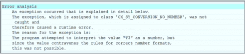

**图 4-5** 代码清单 4-4 中的代码引发的运行时错误

有两种例外情况：类型 `t` 的数据对象不能分配给类型 `d` 的数据对象，反之亦然。此外，几乎每种不同数据类型的数据对象之间都可以进行分配。

##### 转换规则

类型 `c` 的源字段和类型 `i` 的目标字段的*转换规则*是，它们必须包含商业或数学记数法表示的数字。不过有一些例外。下面列出了其中一些例外：

- 仅包含空白字符的源字段会被解释为数字 0。
- 仅当科学记数法可以解释为数学记数法时才允许使用。
- 小数位必须舍入为整数。

你可以访问 SAP Help 网站 *http://help.sap.com/abapdocu_750/en/abapconversion_elementary.htm* 阅读所有转换规则及其例外。

尽管自动类型转换使在不同类型之间移动数据变得容易，但不要滥用。过度利用所有转换规则可能会产生无效数据。仅当源字段的内容对目标字段有效并且能产生预期结果时，才将数据对象相互分配。

例如，当将包含字符串的类型 `c` 字段分配给数值字段时，代码清单 4-5 中的代码将导致无效数据。

```text
DATA f1 TYPE c LENGTH 2 VALUE 'T3'.
DATA f2 TYPE n LENGTH 2.
f2 = f1.
```

**代码清单 4-5** 导致数据不一致的示例

在代码清单 4-5 中，`f2` 的类型为 `n`，其值将为 03（`T` 被忽略），而不会像前一个案例中 `f2` 声明为类型 `i` 时那样引发异常。

所有在数据对象之间执行值赋值的 ABAP 操作（如算术运算）也会自动执行类型转换。

始终建议为你计划处理的数据使用正确的类型。这不仅节省执行类型转换的时间，还使你的 ABAP 语句能够正确解释数据并提供附加功能。

假设你想处理以内部格式 YYYYMMDD 表示的日期。以下示例说明了 WRITE 语句如何根据数据类型解释此数据。在代码清单 4-6 中，数据对象 `date` 被定义为类型 c 字段，值为 20151130，以内部格式表示日期。当使用 WRITE 语句将此字段写入输出时，该值会按原样打印到输出中。WRITE 语句不会将此值解释为日期；相反，它会被解释为文本值。

```text
DATA date TYPE c LENGTH 8 VALUE '20151130'.
WRITE date.
```

**代码清单 4-6** 存储在类型 c 字段中的日期

代码清单 4-6 中代码的输出将为 20151130。如果你改为像代码清单 4-7 中那样将数据对象 `date` 声明为类型 d，则输出将取决于国家/地区特定的系统设置或用户个人设置中的日期格式。

```text
DATA date TYPE d VALUE '20151130'.
WRITE date.
```

**代码清单 4-7** 存储在类型 d 字段中的日期

SAP 允许你设置自己的个人日期格式。例如，假设用户 1 将其个人日期格式设置为 MMDDYYYY，用户 2 将其个人日期格式设置为 DDMMYYYY。当用户 1 执行包含代码清单 4-7 中代码的程序时，输出将是 11302015；当用户 2 执行同一程序时，输出将是 30112015。

这里，WRITE 语句可以利用系统设置/用户个人设置来显示输出，因为它可以将该值解释为日期。然而，在代码清单 4-6 中，数据对象 `date` 中的值被解释为字符串，因此代码按原样输出了该值。

##### 用户定义的基本数据类型

在 ABAP 中，你可以基于预定义基本数据类型定义自己的基本数据类型。这些称为*用户定义的基本数据类型*，当你想要定义一些可以集中维护的相关数据对象时很有用。


用户定义的基本数据类型可以在程序中使用 `TYPE` 关键字进行局部声明，也可以在 ABAP 数据字典中在系统范围内全局定义。

假设您想创建一个家谱或系谱图。您首先要定义各种数据对象，用于处理不同家庭成员的姓名。数据对象声明大致如清单 4.8 所示。

```
DATA : Father_Name TYPE c LENGTH 20.
       Mother_Name TYPE c LENGTH 20.
       Wife_Name TYPE c LENGTH 20.
       Son_Name TYPE c LENGTH 20.
       Daughter_Name TYPE c LENGTH 20.
```

**清单 4.8** 引用预定义类型的数据对象

这里假设一个人的姓名长度最多为二十个字符。之后，如果要将一个人的姓名长度扩展到三十个字符，就需要逐个编辑所有数据对象的定义。

在清单 4.8 中，源代码需要在五个不同位置进行修改。在较大的程序中，这可能变得耗时且繁琐。

为解决这个问题，首先可以创建一个用户定义类型，然后将所有对人员姓名的引用都指向这个数据类型，如清单 4.9 所示。

```
TYPES  person TYPE c LENGTH 20.
DATA : Father_Name TYPE person,
       Mother_Name TYPE person,
       Wife_Name TYPE person,
       Son_Name TYPE person,
       Daughter_Name TYPE person.
```

**清单 4.9** 引用用户定义类型的数据对象

在清单 4.9 中，首先使用 `TYPE` 关键字定义一个用户定义的基本数据类型 `person`，然后使用该数据类型定义其他数据对象。这里，数据类型 `person` 基于基本类型 `TYPE c`。这样，如果需要扩展代码中所有引用人员姓名的数据对象的长度，只需更改用户定义类型的定义，而无需手动编辑每个单独的数据对象。

`TYPE` 关键字的基本语法与 `DATA` 关键字类似，但可使用的附加项有所不同。请记住，数据类型本身不占用任何内存空间，也不能用于存储任何工作数据。

要处理程序数据，始终需要创建一个作为数据类型实例的数据对象。

数据类型和数据对象有各自的命名空间，这意味着同一程序中可以存在同名的数据类型和数据对象。然而，为避免混淆，我们在定义各种数据类型和数据对象时遵循某些命名约定。例如，全局变量以 `g_...` 为前缀，局部变量以 `lv_...` 为前缀，内表以 `it_...` 为前缀，等等。这些命名约定通常由公司设定，作为其编程最佳实践和编码标准的一部分。

##### 复杂数据类型

*复杂数据类型*由其他数据类型的组合构成，必须使用现有数据类型来创建。复杂数据类型允许您在一个公共名称下处理相互关联的数据类型。

有关复杂数据类型的更多信息，请参见[第5章](#)。

##### 引用类型

*引用类型*描述引用变量（数据引用和对象引用），这些变量提供对其他对象的引用。有关引用类型的更多信息，请参见[第8章](#)。有关数据引用的更多信息，请参见[第16章](#)。

##### 数据的内部和外部格式

如您所见，数据可以用各种格式表示。假设有一项需求，用户想要创建文档并记录每个文档的到期日期。这些数据应更新到数据库中，以便用户之后可以运行报表，提取在特定日期到期的所有文档。

创建文档时，用户更愿意按自己的个人格式输入到期日期。例如，假设有两个用户，用户 1 和用户 2，他们将使用此应用程序创建文档。用户 1 以 MM/DD/YYYY 格式输入到期日期，用户 2 以 DD-MM-YYYY 格式输入日期。假设两个用户总共创建了四个文档，并且数据已更新到数据库中。数据库表中的数据将如表 4.4 所示。

| 文档编号 | 到期日期 | 创建者 |
|---|---|---|
| 1001 | 11/05/2015 | USER1 |
| 1002 | 11/06/2015 | USER1 |
| 1003 | 05-11-2015 | USER2 |
| 1004 | 06-11-2015 | USER2 |

**表 4.4** 以外部格式表示的数据

现在，您要开发的报表将到期日期作为输入，以提取在该特定日期到期的文档。该报表将包含类似下面的 SELECT 语句，用于查询数据库表：

```
SELECT Document_Number FROM db_table WHERE Due_Date EQ inp_due_date.
```

这里，您将表中 `Due_Date` 列的数据与用户提供的日期进行比较，以获取所有匹配的文档编号。如您所见，如果用户以 MM/DD/YYYY 格式（11/05/2015）输入 2015年11月5日 作为到期日期，那么 `SELECT` 语句将只获取文档编号 1001，而忽略文档 1003，因为后者与给定输入不能逐字符匹配。如果输入采用 DD-MM-YYYY 格式（05-11-2015），则获取文档 1003，而忽略 1001。如果以任何其他格式输入日期，则不会获取任何记录。

内部和外部数据格式可以帮助解决此问题。如果将日期的内部格式维护为 YYYYMMDD，就可以将用户提供的日期转换为内部格式（20151105）并保存到数据库。这样，数据可以始终以相同格式保存。同样，在向用户显示日期之前，可以将其转换为外部格式，以便用户始终以自己偏好的格式看到日期。

按照这一概念，表 4.5 中的数据可以表示如下。

| 文档编号 | 到期日期 | 创建者 |
|---|---|---|
| 1001 | 20151105 | USER1 |
| 1002 | 20151106 | USER1 |
| 1003 | 20151105 | USER2 |
| 1004 | 20151106 | USER2 |

**表 4.5** 以内部格式表示的日期

现在，当用户在报表中输入日期时，总是先将其转换为内部格式，然后再查询数据库表以获取匹配记录。这允许用户按个人选择以任何有效的外部格式输入日期，而无需担心程序期望的格式。

##### 数据类型的输出长度

在上一节中，日期的外部格式包含两个分隔符（/ 或 -）。日期的内部长度为八个字符，但以外部格式表示日期需要两个额外字符来容纳分隔符。因此，外部长度至少应为十个字符。这由数据类型的输出长度决定。

如果在调试器中检查 TYPE I 的数据对象，您会看到 LENGTH 和 OUTPUT LENGTH 被分配了不同的长度，如图 4.6 所示。

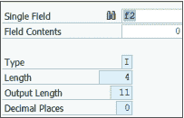

**图 4.6** 输出长度

如图 4.6 所示，数据对象 F2 的类型为 TYPE I，LENGTH 为 4 字节。但是，OUTPUT LENGTH 为 11，以容纳该值的千位分隔符。

如果对 Type D 的数据对象进行同样的检查，您会看到 LENGTH 和 OUTPUT LENGTH 相同——均为八个字节——如图 4.7 所示。

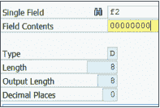

**图 4.7** Type D 的输出长度

如果回到清单 4.7，您会看到系统输出的日期没有分隔符，因为数据对象中没有空间容纳分隔符。因此，它只是将日期转换为外部格式，同时忽略了分隔符。每种数据类型的输出长度都是预定义的，无法手动覆盖。

如果需要更多控制，可以创建自己的用户定义基本数据类型，如本节前面所述。

#### 4.4.2 数据元素

如前所述，可以创建用户定义的基本数据类型，以便在程序内局部复用，或跨多个程序全局复用。全局用户定义基本类型称为*数据元素*，在 ABAP 数据字典中创建。

使用 `TYPE` 关键字定义的数据类型仅在创建它们的同一程序中可见。如果要创建在整个系统中全局可见的用户定义基本类型，可以在 ABAP 数据字典中创建。您可能还记得第3章的内容，ABAP 数据字典完全集成在 ABAP Workbench 中。这使您可以集中创建和管理数据定义（元数据）。

现在，我们在 ABAP 数据字典中创建一个数据元素。请执行以下步骤创建一个数据元素 `ZCB_PERSON`，其类型为 `TYPE C`，长度为 `LENGTH 20`：

- 在命令栏中通过事务 SE11 打开 ABAP 数据字典，或在 SAP 菜单中导航到菜单路径 工具 • ABAP Workbench • 开发 • ABAP 数据字典。


- 2. 选择 DATA TYPE 单选按钮，在按钮右侧的字段中为数据元素命名，然后点击 CREATE 按钮。由于数据元素是仓库对象，它们应位于客户命名空间中（即数据元素名称应以 Z 或 Y 开头；见图 4.8）。

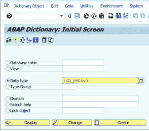

**图 4.8** ABAP 数据字典：初始屏幕

- 3. 系统会弹出一个对话框（见图 4.9），要求你选择要创建的数据类型。DATA ELEMENT 表示用户定义的基本数据类型，因此请选择 DATA ELEMENT 单选按钮并点击 CONTINUE（绿色对勾）。（我们将在后续章节中探讨结构和表类型。）

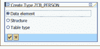

**图 4.9** 创建类型

- 4. 在下一个屏幕上（见图 4.10），为你的数据类型提供简短描述，以帮助其他人理解其用途。此短文本也会作为所有引用该数据元素的屏幕字段的 `F1` 帮助标题显示。

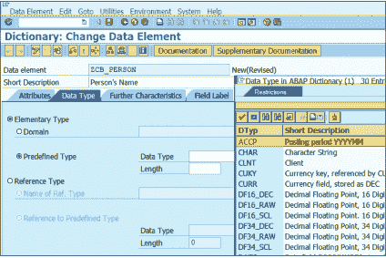

**图 4.11** 数据类型值列表

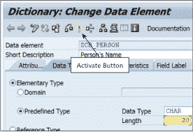

**图 4.12** 激活数据元素

- 8. 如果数据类型支持小数，你还可以在 DECIMAL PLACES 字段中维护小数位数。

我们刚刚创建的数据类型具有全局可见性，可用于在任何程序中定义数据对象或用户定义的数据类型，如下所示：

```abap
DATA name TYPE ZCB_PERSON.
TYPES user TYPE ZCB_PERSON.
```

如果更改数据元素的定义，则所有引用该数据元素的对象都会自动反映这些更改。这使你可以集中维护所有相关对象的定义。由于数据元素是全局对象，建议在未分析影响之前不要更改它们。

在数据元素级别可以维护许多内容，如搜索帮助、字段标签和帮助文档。程序字段可以自动获取这些属性。我们将在第 10 章更详细地探讨这些概念。

#### 4.4.3 域

*域*描述字段的技术属性。域的主要功能是定义值范围，该值范围描述了引用此域的字段的有效数据值。

但是，如果你计划创建多个技术上相同的数据元素，则可以附加一个域来派生数据元素的技术属性。这样，你就可以集中管理多个数据元素的技术属性，这意味着你可以为域一次性更改技术属性，而更改将自动反映到使用该域的所有数据元素中。这是在选择了预定义的基本数据类型时，用于维护技术属性的另一种方式，而不是逐个更改每个数据元素。

字段不能直接引用域；如果域附加到数据元素，则字段通过数据元素获取域引用。换句话说，你始终将域附加到数据元素。图 4.13 描述了这种关系。

在图 4.13 中，字段 1 引用数据元素 1，而字段 2 和字段 3 引用数据元素 2。数据元素 1 和数据元素 2 都使用同一个域来派生技术属性。这意味着字段 2 和字段 3 在语义上和技术上均相同，而字段 1 在*语义上*与字段 2 和字段 3 不同，但在*技术上*与这两个字段相同。

例如，销售单据编号和开票单据编号在技术上可以相同，例如都是十位字符字段。然而，销售单据和开票单据在语义上是不同的（即它们的用途不同）。在这种情况下，你可以为销售单据编号和开票单据编号使用同一个域，但为每个编号使用单独的数据元素。

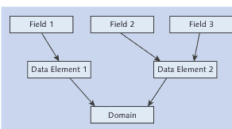

**图 4.13** 字段、数据元素与域的关系

你还可以在域级别维护*转换例程*，用于自动转换引用该域的字段的内部和外部数据格式。我们将在第 10 章详细讨论此主题。

你可以采用*自顶向下*或*自底向上*的方法来创建域；也就是说，你可以先单独创建域，然后将其附加到数据元素，也可以在创建数据元素的同时创建域。让我们采用自底向上的方法创建一个域，并将其附加到先前创建的数据元素 `ZCB_PERSON`。

由于域和数据元素有各自的命名空间，你可以为两者使用相同的名称。在下面的示例中，你将使用与第 4.4.2 节先前创建的数据元素相同的名称创建域；如果容易混淆，也可以使用不同的名称。

以下步骤将引导你在 ABAP 数据字典中创建域：

- 1. 在 ABAP 数据字典初始屏幕（图 4.14）上，选择 DOMAIN 单选按钮，输入域的名称，然后点击 CREATE 按钮。域也是仓库对象，因此它们应位于客户命名空间中。
- 2. 为域输入短描述。此短描述对最终用户不可见。在使用 `F4` 帮助搜索域时会显示它，并帮助其他开发人员理解你的域的用途。


**图 4.14** ABAP 数据字典：初始屏幕

- 3. 使用 `F4` 帮助为 DATA TYPE 字段选择数据类型，并在 No. Characters 字段中输入一个值。该值定义字段长度（图 4.15）。对于数值类型，你还可以选择输入 Decimal Places 的数量。


**图 4.15** 更改域屏幕

- 4. 你还可以输入输出特性，如输出长度、转换例程，或禁用引用此域的屏幕字段的自动大写转换。我们将在第 10 章进一步探讨这些选项。
- 5. 激活域。要将此域附加到数据元素，请打开数据元素，并选择 ELEMENTARY TYPE 单选按钮下的 DOMAIN 单选按钮，如图 4.16 所示。输入域名称并按 `Enter` 键。
- 6. 请注意，DATA TYPE 和 LENGTH 由系统自动选择。如果在按 `Enter` 键后系统未设置 DATA TYPE 和 LENGTH，则表示该域不存在，此时会显示信息性消息：NO ACTIVE DOMAIN [DOMAIN_NAME] AVAILABLE。

  此时，你可以直接双击域名称，使用自顶向下的方法创建它。


**图 4.16** 将域附加到数据元素

#### 4.4.4 数据对象

数据对象从数据类型派生其技术属性，并占用内存空间来存储程序的工作数据。ABAP 语句通过寻址数据对象的名称来访问此内容。数据对象作为数据类型的实例存在。每个 ABAP 数据对象都有一组技术属性，如数据类型、字段长度和小数位数。

数据对象是你的 ABAP 语句可以操作的物理内存单元。ABAP 语句可以寻址并解释数据对象的内容。所有数据对象都在 ABAP 程序中声明，并且是程序的本地对象，这意味着它们存在于程序内存中，只能从同一程序内访问。系统中没有集中定义数据对象的概念。

数据对象不是持久性的；它们仅在程序执行期间存在。数据对象的生命周期仅与程序执行时间一样长。它们在程序执行开始时创建，在程序执行结束时销毁。

在处理持久性数据（如来自数据库或顺序文件的数据）之前，你必须先将数据读入数据对象，然后 ABAP 语句才能访问这些数据。类似地，如果要在程序结束后保留数据对象的内容，则必须以持久形式保存它。从技术上讲，程序中任何可以存储工作数据的东西都可以称为数据对象。

让我们探讨可以在 ABAP 程序中定义的各种数据对象。在接下来的小节中，我们将介绍数据对象的不同分类。

##### 字面量

*字面量*不是使用任何声明性语句创建的，也没有名称。它们存在于程序源代码中，被称为*未命名数据对象*。与所有数据对象一样，它们具有固定的技术属性。

你无法访问字面量的内存来读取其内容，因为它是一个未命名数据对象。这意味着字面量是不可复用的数据对象，其内容无法更改。与字面量不同，所有其他数据对象都是命名数据对象，它们在程序中显式声明。

例如，在以下代码片段中，`Hello World` 和 `1234` 是字面量：

```
WRITE 'Hello World'.
WRITE 1234.
```


字面量有两种类型：

- **数字字面量**

  数字字面量是由数字（0 到 9）组成的序列，可以带前置符号。它们不支持十进制分隔符，也不支持带尾数和指数的表示法。

  数字字面量的示例包括：

  - +415
  - -345
  - 400

  以下摘录展示了在 ABAP 语句中使用的数字字面量：

  ```
  DATA f1 TYPE I VALUE -4563.
  WRITE 1234.
  F1 = 1234.
  ```

- **字符字面量**

  字符字面量是程序源代码中用单引号（'）或反引号（\`）括起来的字母数字字符。

  例如：

  ```
  'This is a text field literal'.
  '1901 CA'.
  'This is a string literal'.
  `1901 CA`.
  ```

  用单引号维护的字符字面量具有预定义类型 `c`，长度与字符数匹配。这些称为 *文本字段字面量*。用反引号维护的则具有预定义类型 `string`，称为 *字符串字面量*。如果在需要数值的位置使用字符字面量，它们会被转换为数值。可转换为数值类型的字符字面量示例如下：

  - '12345'.
  - '-12345'.
  - '0.345'.
  - '123E5'.
  - '+23E+12'.

##### 变量

*变量*是内容可通过 ABAP 语句更改的数据对象。变量是命名数据对象，在程序的声明区域中声明。不同的关键字（如 `DATA` 和 `PARAMETERS`）声明不同类型的变量。

现在，我们先探讨这两个定义变量的关键字，其他关键字的讨论留到后续章节。

###### DATA

`DATA` 关键字在每个上下文中都定义变量。你可以在 ABAP 程序的全局声明区域中使用此关键字声明一个在整个程序中可见的全局变量，也可以在过程内部使用它声明一个仅在过程内可见的局部变量——例如：

```
DATA field1 TYPE i.
```

在前面的语句中，使用 `DATA` 关键字将名为 `field1` 的变量定义为整数字段。

###### 内联声明

SAP NetWeaver 7.4 引入了*内联声明*，它不再限制你必须在过程开头单独定义局部变量。你可以将它们内联定义，嵌入给定上下文中，从而帮助使代码更精简。我们将在后续章节中探讨这个概念。

###### PARAMETERS

`PARAMETERS` 关键字具有双重作用。它在程序上下文中定义变量，同时还生成屏幕字段（选择屏幕）。此关键字用于为报表程序创建选择屏幕。在这些报表程序中，我们向用户呈现选择屏幕，供其输入报表处理的选择条件——例如：

```
PARAMETERS p_input TYPE c LENGTH 10.
```

在前面的语句中，使用 `PARAMETERS` 关键字在选择屏幕上定义了一个名为 `p_input` 的十个字符的输入字段。此字段也作为程序中的变量存在，并链接到屏幕字段。在选择屏幕上为此输入字段所做的输入将作为 `p_input` 变量的内容存储在程序中。

##### 常量

常量是使用关键字声明的命名数据对象，其内容不能由 ABAP 语句更改。用于声明常量的关键字是 `CONSTANTS`。建议尽可能使用常量代替字面量。与字面量不同，常量可以重用并集中维护。`CONSTANTS` 语句的语法与 `DATA` 语句基本一致。但是，对于 `CONSTANTS` 语句，必须使用附加项 `VALUE` 来分配初始值。该值在运行时不能更改。例如：

```
CONSTANTS c_item TYPE c LENGTH 4 VALUE 'ITEM'.
```

##### 文本符号

*文本符号*是 ABAP 程序中一种命名数据对象，它不在程序本身中声明，而是作为程序文本元素的一部分进行定义。

文本符号的行为类似于常量，其数据类型为 `c`，长度在文本元素中定义。我们将在[第 6 章](#)中进一步探讨文本符号。

文本符号的一个示例是 `WRITE text-001`。在此语句中，使用 `WRITE` 语句将程序中编号为 001 的文本符号写入输出。此文本符号在 ABAP 编辑器中通过菜单路径 转到 • 文本元素 • 文本符号 单独定义。

文本符号使用语法 `text-nnn` 访问，其中 `nnn` 是文本符号编号。

### 4.5 ABAP 语句

如前所述，ABAP 程序的源代码由各种 ABAP 语句组成。与 C/C++ 或 Java 等其他编程语言不同——这些语言包含有限的一组语言特定语句，并通过库提供大部分功能——ABAP 包含大量内置语句。随着本书的推进，我们将探讨许多 ABAP 语句。

了解各种可用 ABAP 语句的最佳方式是将它们与手头的需求结合起来理解。本书的范围不包括涵盖所有可用的 ABAP 语句，因此我们在此简要介绍一些常用语句，并将在后续章节中更详细地探讨这些语句：

- **声明语句**

  声明语句定义数据类型或声明供程序中其他语句使用的数据对象。

  示例包括 `TYPE`、`DATA`、`CONSTANTS`、`PARAMETERS`、`SELECT-OPTIONS` 和 `TABLES`。

- **模块化语句**

  模块化语句定义 ABAP 程序中的处理块。*处理块*允许你将代码组织成模块。所有 ABAP 程序都由处理块组成，不同的处理块允许你以不同方式模块化代码。我们将在第 7 章进一步探讨此主题。

  示例包括 `LOAD-OF-PROGRAM`、`INITIALIZATION`、`AT SELECTION-SCREEN`、`START-OF-SELECTION`、`END-OF-SELECTION`、`AT USER-COMMAND`、`AT LINE-SELECTION`、`GET`、`AT USER-COMMAND`、`AT LINE-SELECTION`、`FORM-ENDFORM`、`FUNCTION-ENDFUNCTION`、`MODULE-ENDMODULE` 和 `METHOD-ENDMETHOD`。

- **控制语句**

  控制语句控制处理块内程序的流程。示例包括 `IF-ELSEIF-ELSE-ENDIF`、`CASE-WHEN-ENDCASE`、`CHECK`、`EXIT` 和 `RETURN`。

- **调用语句**

  调用语句用于调用处理块或其他程序及事务。

  示例包括 `PERFORM`、`CALL METHOD`、`CALL TRANSACTION`、`CALL SCREEN`、`SUBMIT`、`LEAVE TO TRANSACTION` 和 `CALL FUNCTION`。

- **操作语句**

  操作语句允许你修改或检索数据对象的内容。

  示例包括 `ADD`、`SUBTRACT`、`MULTIPLY`、`DIVIDE`、`SEARCH`、`REPLACE`、`CONCATENATE`、`CONDENSE`、`READ TABLE`、`LOOP AT`、`INSERT`、`DELETE`、`MODIFY`、`SORT`、`DELETE ADJACENT DUPLICATES`、`APPEND`、`CLEAR`、`REFRESH` 和 `FREE`。

- **数据库访问语句（Open SQL）**

  数据库访问语句允许你处理数据库中的数据。示例包括 `SELECT`、`INSERT`、`UPDATE`、`DELETE` 和 `MODIFY`。

到目前为止，在本章中，我们探讨了 ABAP 程序的一般程序结构，学习了使用 ABAP 语法的基本规则，简要涉及了 ABAP 关键字和 ABAP 关键字文档的使用，并介绍了数据类型、数据元素和数据对象的 `TYPE` 概念。

在下一节中，你将运用到目前为止学到的知识开始创建第一个 ABAP 程序。

### 4.6 创建第一个 ABAP 程序

在我们进一步探讨 ABAP 基础知识之前，你将有机会使用 ABAP 编辑器创建第一个程序。

你需要拥有对 SAP 系统的开发者访问权限，具备相关开发授权，并且为你的用户 ID 分配了开发者密钥。如果系统在创建程序时提示缺少授权或要求你提供开发者密钥，请联系系统管理员。

首先，请执行以下步骤：

- 1. 打开事务 SE38，或按照菜单路径 工具 • ABAP 工作台 • 开发 • ABAP 编辑器 操作。
- 2. 在 ABAP 编辑器初始屏幕上，输入程序名，选择“源代码”单选按钮，然后单击“创建”按钮。由于此程序将是一个仓库对象，因此它应位于以 Z 或 Y 开头的客户命名空间中，如图 4.17 所示。
- 3. 你将看到“程序属性”窗口（图 4.18），用于维护程序的属性。程序属性允许你设置程序的运行时环境。


**图4.17** ABAP编辑器：初始屏幕


**图4.18** 程序属性屏幕


在这里，你可以为程序维护标题和其他属性。TITLE（标题）和TYPE（类型）是必填字段，其他字段是可选的。

表4.6提供了所有属性及其含义的说明。

| 属性 | 说明 |
|---|---|
| Type（类型） | 允许你选择要创建的程序类型。这是最重要的属性，并指定程序的执行方式。这是一个必填字段。<br>在ABAP编辑器中，你只能从以下程序类型中选择：<br>▸ 可执行程序<br>▸ 模块池<br>▸ 子例程池<br>▸ 包含程序<br>所有其他程序类型并非直接在ABAP编辑器中创建，而是借助特殊工具创建，例如用于函数组的Function Builder或用于类池的Class Builder。 |
| Status（状态） | 允许你设置程序开发的状态，例如生产程序或测试程序。 |
| Application（应用） | 允许你设置程序的应用领域，以便系统将程序分配到正确的业务领域。例如，SAP ERP 财务会计。 |
| Authorization Group（授权组） | 在此字段中，你可以输入程序组的名称。这样可以将不同程序分组进行权限检查。 |
| Logical Database（逻辑数据库） | 仅当程序类型选择为可执行程序时可见。该属性决定可执行程序使用的逻辑数据库。仅在通过逻辑数据库创建报表时使用。<br>逻辑数据库是使用事务代码SLDB创建的特殊ABAP程序，用于检索数据并提供给应用程序。 |
| Selection Screen（选择屏幕） | 仅当程序类型选择为可执行程序时可见。允许你指定应使用的逻辑数据库的选择屏幕。 |
| Editor Lock（编辑器锁定） | 如果设置此属性，其他用户将无法更改、重命名或删除你的程序。只有你才能更改程序及其属性、文本元素和文档，或释放锁定。 |
| Fixed Point Arithmetic（定点运算） | 如果为程序设置了此属性，系统会根据小数位数对类型 p 字段进行四舍五入，或用零填充。<br>在这种情况下，小数符号始终为句点（.），与用户的个人设置无关。SAP建议始终设置此属性。 |
| Unicode Checks Active（激活Unicode检查） | 该属性允许你设置语法检查器是否应检查非Unicode兼容代码并显示警告消息。<br>从SAP NetWeaver 7.5开始，系统不再支持非Unicode系统，因此默认始终选中此选项。 |
| Start Using Variant（使用变式启动） | 仅适用于可执行程序。如果设置此属性，其他用户只能使用变式启动你的程序。在启动报表之前，你必须至少创建一个变式。 |

**表4.6** 程序属性

- 4. 在 **Attributes（属性）** 部分下，提供以下值（参见**图4.19**）：
    - 类型：可执行程序
    - 状态：测试程序
    - 应用：未知应用
    - 同时选中“Unicode Checks Active”和“Fixed Point Arithmetic”复选框。
  
    完成后点击**保存**按钮。
  
    
  
    **图4.19** 维护程序属性

- 5. 在“CREATE OBJECT DIRECTORY ENTRY”（创建对象目录条目）屏幕上（参见图4.20），你可以将程序分配给一个包。包对于系统之间的传输非常重要。分配给一个包的所有ABAP工作台对象都合并到一个传输请求中。
  
    在团队中工作时，你可能必须将程序分配给现有包，或者可以自由创建新包。分配给包 $TMP 的所有程序都是私有对象（本地对象），不能传输到其他系统。在本示例中，将程序创建为本地对象。
  
    
  
    **图4.20** 分配包

- 6. 输入“$TMP”作为PACKAGE（包）并点击“SAVE”（保存）按钮，或者直接点击“LOCAL OBJECT”（本地对象）按钮（参见图4.20）。

- 7. 这将带你进入“ABAP EDITOR: CHANGE REPORT”（ABAP编辑器：修改报告）屏幕，你可以在其中编写ABAP代码。默认情况下，源代码包含用于引入程序类型的开头语句。例如，可执行程序以REPORT语句开头，而模块池程序以PROGRAM语句开头。

- 8. 在程序中编写以下代码并激活程序：
  
    ```
    PARAMETERS p_input TYPE c LENGTH 20.
    
    WRITE: 'The input was:', p_input.
    ```

- 9. 在代码中，你使用了两个语句：PARAMETERS 和 WRITE。PARAMETERS 语句会生成一个选择屏幕（参见图4.21），其中包含一个输入字段。该输入字段的类型为 TYPE c，长度为 LENGTH 20，因此最多可以输入二十个字母数字字符。
  
    这里，`PARAMETERS` 语句执行了几个任务：
  
    - 声明一个名为 `p_input` 的变量。
    - 在选择屏幕上生成一个与变量 `p_input` 同名的屏幕字段（屏幕元素）。屏幕字段 `p_input` 会自动链接到同名的变量。因此，屏幕与程序之间的数据传输将自动处理。换句话说，如果你在 `p_input` 屏幕字段中输入某些数据，它会自动传输到程序并存储在 `p_input` 变量中。然后，其他语句可以访问 `p_input` 变量中的数据，就像你使用 `WRITE` 语句将其打印到输出中一样。
  
    
  
    **图4.21** 选择屏幕

- 10. 在输入字段中输入一个值，然后点击“EXECUTE”（执行）按钮，或按 `F8`。这将显示输出或LIST（列表）屏幕，如图4.22所示。
  
    
  
    **图4.22** 列表屏幕

- 11. 列表屏幕（输出屏幕）由代码中的 `WRITE` 语句生成。使用 `WRITE` 语句，你在这里打印两个数据对象的内容。一个是文本字面量 'The input was:'，另一个是由 PARAMETERS 关键字创建的变量 p_input。
  
    在选择屏幕上输入的任何内容都会被传输到程序并存储在变量 p_input 中，然后由 WRITE 语句处理以显示在输出中。

随着我们逐步学习本书，我们将有很多机会处理不同类型的屏幕。

### 4.7 小结

在本章中，你学习了ABAP编程语言元素的基础知识。你了解到ABAP程序只能处理程序自身的数据。由于我们在现实世界中通常处理各种类型的数据，因此我们解释了系统为处理各种类型数据而支持的不同基本类型。由于ABAP程序的基本任务是处理数据，这种理解对于一致地处理数据至关重要。

我们还描述了编写几条语句的语法。随着学习的深入，我们将探索更多的语句。在最后一节中，你创建了第一个ABAP程序。

到目前为止，你应该对数据类型和数据对象有了很好的理解。不过，如果你发现自己有点迷茫，不用担心；在下一章中创建更多程序时，这些概念会变得更清晰。在下一章中，我们将讨论复杂数据类型和内部表。

*本章探讨复杂数据类型，并为处理典型数据库表中存储的数据奠定基础。*

## 5 结构与内部表

在上一章中，我们讨论了如何声明和处理单个字段。然而，大多数情况下，我们将处理来自一组相关字段的数据。例如，当存储客户数据时，你不会将所有数据存储在一个字段中；你会创建多个字段来存储客户的所有不同信息：一个字段存储客户姓名，一个字段存储客户地址，一个字段存储电话号码，等等。

在本章中，我们将讨论允许我们以数组（一系列对象）形式处理数据的数据类型和数据对象。**图5.1** 显示了电子表格中的一些示例数据。在这里，每个字段由一列表示，每一行存储一个客户的信息。

| 姓名 | 地址 | 电话号码 | 电子邮件 ID |
| --- | --- | --- | --- |
| James | ABC Company Chicago | 111-111-111 | abc@company.com |
| Ria | XYZ Corp Bangalore | 222-222-222 | xyz@corp.com |

**图5.1** 以行和列表示的数据

数据库表中的数据与**图5.1**中显示的数据类似。当你想在ABAP程序中处理来自数据库表的数据时，你需要能够以类似方式存储这些数据的数据对象，比如将一组字段组合在一起来表示一行。

这些具有单个字段的数据类型和数据对象分别组合成*结构类型*和*结构*。我们使用术语*结构类型*来指代数据类型，使用术语*结构*来指代数据对象。一个结构由一个或多个字段组成。结构中的字段称为*组件*。结构中的每个字段都使用 *type* 或 *like* 引用进行定义，类似于我们在第4章4.4.2节中讨论的单个字段（变量）。


在**第 5.1 节**中，我们将了解定义和使用结构的各种方式。结构数据对象仅由一行组成，这意味着它只能存储一行数据。当你在结构中存储新记录时，它会替换现有记录。要处理多行数据，我们需要使用内表。我们将在**第 5.2 节**中讨论内表。

结构和内表主要用于处理来自数据库表的数据；此类数据通过 Open SQL 语句访问。你将在**第 5.3 节**中进一步了解关系数据库，并了解不同的 Open SQL 语句。然后我们将在**第 5.4 节**中了解如何使用结构和内表处理来自数据库表的数据。

程序出现难以在语法检查期间静态检测到的逻辑问题是很常见的，尤其对初学者而言。我们将在**第 5.5 节**中讨论*调试*，帮助你熟悉调试工具，以便修复程序中的任何逻辑问题。调试还有助于你更好地理解程序执行，我们鼓励你调试在本书学习过程中创建的所有程序。

我们将在**第 5.6 节**中以一个练习结束本章，该练习将巩固本章讨论的概念。

### 5.1 定义结构

结构可以是局部的或全局的。局部和全局都有多种定义，我们将在后面介绍。根据上下文，术语*局部*可能表示几种含义；如果我们讨论的是程序，局部可能指属于程序中特定过程的对象（数据对象或数据类型）。这些对象将在定义它们的过程内可见。在此上下文中，*全局*对象是在整个程序中可见的对象；它可以从程序中的任何过程或处理块访问。可见性表示数据对象或数据类型是否可以从程序代码中的特定位置访问。

例如，如**代码清单 5.1**所示，你可以访问数据类型 `ty_sflight` 和数据对象 `ls_sflight`，但只能在子例程 `data` 内访问。尝试从同一程序的另一个过程（示例中的子例程 `output`）访问它们将导致语法错误，因为这些对象不可见。


**图 5.2** 不同的结构类型

#### 5.1.1 何时定义结构

我们使用结构来处理顺序数据，例如存储在数据库表或顺序文件的行和列中的数据。数据对象允许你将来自外部源（例如数据库表或顺序文件）的数据导入 ABAP 程序，这必须发生在 ABAP 语句可以访问同一数据之前（见图 5.3）。


**图 5.3** ABAP 程序中的数据处理

因此，你需要单个变量还是包含多个字段的结构，取决于你在 ABAP 程序中导入或处理的数据。如果你要处理一行中的多个字段或完整的一行数据，请在程序中定义结构。如果你要处理单个字段或一行中的仅一个字段，请在程序中定义单个字段。

#### 5.1.2 局部结构

让我们以表 `SFLIGHT` 为例，了解在 ABAP 程序中定义结构的各种方式。一旦你理解了如何定义结构，就应该能够运用它们来处理来自数据库表的数据。

[图 5.4](#figure-5-4) 显示了表 `SFLIGHT` 的字段。


**图 5.4** 表 SFLIGHT 的字段

图 5.5 显示了数据浏览器工具中的表数据。要打开该表，请进入事务码 SE11，选择 DATABASE TABLE 单选按钮，输入表名，然后单击 DISPLAY。


图 5.5 在数据浏览器视图中以列表示的表字段

代码清单 5.2 使用 TYPES 关键字定义了一个结构数据类型。该结构包含来自表 SFLIGHT 的三个字段。当你想要处理表中某些字段的数据时，使用数据库表中的特定字段定义结构很有用。结构的所有字段都应具有与数据库表对应字段相同的技术属性。

为确保这一点，请将程序中结构的组件指向与数据库表中对应字段相同的数据元素——例如，CARRID TYPE S_CARR_ID。

这里，S_CARR_ID 是表 SFLIGHT 的 CARRID 字段所引用的数据元素。你也可以通过使用表引用将结构的组件指向表字段——例如，CARRID TYPE SFLIGHT-CARRID。将字段引用到数据元素或表字段还可确保对数据元素或表字段定义的任何更改都会自动反映到程序中。

在代码清单 5.2 中，我们使用 `TYPES` 关键字定义了结构类型 `TY_SFLIGHT`，并将 `CARRID`、`CONNID` 和 `FLDATE` 作为组件。我们将结构类型的组件引用到各自的数据元素。我们还使用 `DATA` 关键字定义了结构 `ST_FLIGHT`，并引用结构类型 `TY_SFLIGHT`。展示结构类型 `TY_SFLIGHT1` 声明的示例使用基本类型来为结构类型的组件指定类型。

```text
*Notice the chain operator colon(:) after the TYPES keyword.
*without which you will have to use the keyword at the beginning
*of each line and end each line with a period.
```

```abap
TYPES : BEGIN OF ty_sflight,
        CARRID TYPE S_CARR_ID,
        CONNID TYPE S_CONN_ID,
        FLDATE TYPE S_DATE,
        END OF ty_sflight.
```

```text
*Since the TYPES keyword created a data type, you can define a
*data object referring to this structure as below.
```

```abap
DATA st_sflight TYPE ty_sflight.
```

```text
*The same structure type can also be declared while referring the
*fields to elementary types. Note that the type and length of
*each field matches the fields in the table. Matching the type
*and length is very important when using elementary types.
```

```abap
TYPES : BEGIN OF ty_sflight1,
        CARRID TYPE C LENGTH 3,
        CONNID TYPE N LENGTH 4,
        FLDATE TYPE D,
        END OF ty_sflight1.
```

**代码清单 5.2** 使用字段集定义结构类型

下面展示了如何定义与 ABAP 数据字典表匹配的结构类型：

```abap
TYPES : ty_sflight TYPE sflight.
```

要定义包含表中所有字段的结构类型，你只需将结构类型引用到该表。在此示例中，`ty_sflight` 将包含 ABAP 数据字典表 `SFLIGHT` 的全部 14 个字段。

[代码清单 5.3](#) 展示了定义嵌套结构的示例。

```abap
* Defining nested structure type
TYPES : ty_sflight TYPE sflight.
TYPES : BEGIN OF ty_trip,
        name TYPE name1,
        flight TYPE ty_sflight,
      END OF ty_trip.
```

**代码清单 5.3** 嵌套结构类型

在代码清单 5.3 中，我们定义了引用透明表 `SFLIGHT` 的结构类型 `TY_SFLIGHT`。我们还定义了一个嵌套结构类型 `TY_TRIP`，它由组件 `NAME` 和结构类型 `FLIGHT` 组成。

代码清单 5.4 展示了使用 `DATA` 关键字将结构定义为数据对象的示例。其语法与 `TYPES` 关键字类似。

```abap
*To define a structure as a data object, simply use the
*DATA keyword instead of the TYPES keyword.
DATA : BEGIN OF st_sflight,
             CARRID TYPE S_CARR_ID,
             CONNID TYPE S_CONN_ID,
             FLDATE TYPE S_DATE,
         END OF st_sflight.
*You can also create a structure by referring to the
*database table to match the table row type.
DATA st_sflight1 TYPE sflight.
```

**代码清单 5.4** 将数据对象定义为结构

在代码清单 5.4 中，结构 `ST_SFLIGHT` 由三个组件 `CARRID`、`CONNID` 和 `FLDATE` 组成，而结构 `ST_SFLIGHT1` 包含 ABAP 数据字典表 `SFLIGHT` 的所有字段。

#### 5.1.3 全局结构

结构类型可以全局定义，以使其跨程序可见。全局结构类型也用于定义功能模块或方法的参数接口，还可用于定义常规屏幕的屏幕元素。你将在第 7 章进一步了解功能模块和方法，并在第 12 章进一步了解屏幕编程。

全局结构类型在 ABAP 数据字典（事务码 SE11）中创建。按照以下步骤创建全局结构：

- 1. 进入事务码 SE11。
- 2. 在 ABAP 数据字典初始屏幕上选择 DATA TYPE 单选按钮。输入结构名称。名称应位于客户命名空间中，并以 Y 或 Z 开头。单击 CREATE 按钮（图 5.6）。


**图5.6** ABAP 字典初始屏幕

- 3. 在模态对话框中，选择 **结构** 单选按钮，然后单击绿色对勾（图5.7）。
  
  
  
  **图5.7** 用于选择数据类型类别的模态对话框

- 4. 在下一个屏幕中，为您的结构输入一个 **短描述**。按 **图5.8** 所示维护字段。在组件列下输入字段名。在类型方法列下的下拉列表中选择 Types。在组件类型列下输入数据元素名称，然后按 [Enter]。
  
  对于组件类型，您可以使用现有数据元素，也可以创建自己的数据元素，如 **第4章** 所述。如果需要，您可以单击预定义类型按钮来使用预定义基本类型。
  
  
  
  **图5.8** 维护结构类型组件

- 5. 单击激活以输入包名并保存。您可以将其保存为本地对象（$TMP 包），或保存到可传输包中。

- 6. 激活后，系统可能会生成一条关于缺少增强类别的警告消息；但是，该警告不会阻止您激活该结构。

ABAP 数据字典中 SAP 交付的表和结构可以通过 *定制包含*（CI Includes）或 *附加结构* 添加额外字段来进行增强。我们将在第20章讨论修改和增强时进一步了解 CI Includes 和附加结构。

增强类别设置指定特定表或结构可以如何被增强。使用此设置，您可以通过仅允许字符类型字段、同时允许字符和数字字段或深层结构，来限制该结构是否可以被增强。

您可以通过菜单路径附加 • 增强类别来维护增强类别（图5.9）。您可以使用信息按钮参考在线文档。


**图5.9** 增强类别

如果您的结构包含货币（类型 CURR）或数量（类型 QUAN）字段，则应在货币/数量字段选项卡中维护参考字段（如图5.10所示）。货币字段应参考货币码字段（类型 CUKY），数量字段应参考计量单位字段（类型 UNIT）。参考字段可以存在于同一表或其他表中。

必须为货币和数量字段维护参考字段，并且当字段输出时，系统使用该参考来插入相关货币或单位。如果参考字段存在于同一表中，则系统可以使用该参考自动对输出应用正确的格式。提供参考字段时，请在相应列中输入参考表名和参考字段名。


**图5.10** 表 VBRP 中为货币和数量字段维护的参考字段

[图5.10](#) 显示了开票凭证项目表 VBRP 中维护的参考字段。表 VBRP 的 VOLUM 字段类型为 QUAN，并参考同一表 VBRP 中类型为 UNIT 的 VOLEH 字段。类似地，表 VBRP 的 NETWR 字段类型为 CURR，并参考表 VBRK 中类型为 CUKY 的 WAERK 字段。

如果未为表/结构的货币和数量字段维护参考字段，您将无法在 ABAP 数据字典中激活该表或结构。

#### 5.1.4 使用结构

既然您已经知道如何定义局部和全局结构，下面我们来看看如何在 ABAP 程序中使用它们。

在程序中定义结构数据对象有四种可能方式：

- 1. 引用程序中使用 TYPES 关键字定义的局部结构类型（参见代码清单5.5）。
- 2. 引用全局结构类型。
- 3. 引用 ABAP 数据字典表。
- 4. 使用 DATA 关键字的 BEGIN OF...END OF 语法直接声明数据对象。

结构的行为与单个字段类似，区别在于访问结构组件的方式。要访问结构的字段，需要给出结构名-字段引用，如代码清单5.5中的示例所示。请注意，结构一次只能存储一行。如果存储新记录，它将替换现有记录。

代码清单5.5中的示例代码定义了扁平结构 TY_SFLIGHT 和嵌套结构 TY_TRIP。定义了分别引用这些结构的对应数据对象 ST_SFLIGHT 和 ST_TRIP。代码中的注释行说明了如何使用 ABAP 语句访问结构的组件。

```abap
TYPES : BEGIN OF ty_sflight,
          CARRID TYPE S_CARR_ID,
          CONNID TYPE S_CONN_ID,
          FLDATE TYPE S_DATE,
        END OF ty_sflight.
TYPES : BEGIN OF ty_trip,
          name   TYPE name1,
          flight TYPE ty_sflight,
        END OF ty_trip.

DATA : st_sflight TYPE ty_sflight,
       st_trip TYPE ty_trip.

*Addressing to the field of a structure type
DATA v_connid TYPE ty_sflight-connid.

*Accessing field of a structure data object
st_sflight-carrid = 'AA'.
st_sflight-connid = '04'.
WRITE st_sflight-connid.

*Accessing field of a nested structure
st_trip-flight-carrid = 'AB'.
```

**代码清单5.5** 访问结构的字段

#### 5.1.5 使用场景

结构应在以下情况下使用：

- 使用结构处理多个数据字段。例如，当您想处理一条记录时，可以定义一个结构，将记录的字段作为组件，并将该记录作为单个实体处理。
- 如果需要对这些字段一起执行某些操作，请将相关字段分组到一个结构中。一次性清除结构中所有字段的数据比逐个清除每个字段的数据更容易。
  
  例如，如果您有一个结构 `ST_SFLIGHT`，其中包含 ABAP 数据字典表 `SFLIGHT` 的所有组件，那么使用语句 `CLEAR ST_SFLIGHT` 就可以轻松清除一条记录，而不必对每个单独字段使用 `CLEAR` 语句。
- 尽管可以将数据库表行中的数据选择到各个单独字段中，但在处理来自数据库表的数据时，始终建议使用结构。
- 结构类型还可以通过将相关字段分组到一个结构中，帮助您保持过程（如函数模块或方法）的参数接口（签名）简单，而不是在接口中逐个维护所有字段。

### 5.2 内表

内表是动态数据对象，可以存储具有公共行类型的多行数据。事实上，内表是唯一可以一次存储多行数据的数据对象。当需要处理海量数据时，我们使用内表。内表可以比作二维数组。

使用内表与其他数据对象略有不同。在本节中，我们将了解如何使用内表定义、存储和访问数据。我们将讨论如何定义内部类型以及可用的不同类型的内表。然后，我们将提供使用内表的步骤，之后再讨论控制中断语句的使用。

#### 5.2.1 定义内表

代码清单5.6显示了声明内表的基本语法。这里，数据对象 `IT_SFLIGHT` 被声明为内表，其行类型为 `TY_SFLIGHT`。表的行类型指定构成一行的字段。类型说明中的 `TABLE OF` 附加项定义了一个内表。

```abap
TYPES : BEGIN OF ty_sflight,
        CARRID TYPE S_CARR_ID,
        CONNID TYPE S_CONN_ID,
        FLDATE TYPE S_DATE,
       END OF ty_sflight.
DATA : it_sflight TYPE TABLE OF ty_sflight.
```

**代码清单5.6** 声明内表

由于内表由多行组成，您不能直接处理单个行的数据。要处理内表中的数据，需要一个结构数据对象，称为工作区。内表的*工作区*是一个结构，一次可以存储一条记录，并且具有与内表相同的行类型。这使您可以将内表中的单个行读入工作区并进行处理。

代码清单5.7显示了工作区 `wa_sflight` 的声明，它引用与内表 `IT_SFLIGHT` 相同的行类型。

```abap
TYPES : BEGIN OF ty_sflight,
        CARRID TYPE S_CARR_ID,
        CONNID TYPE S_CONN_ID,
```


```abap
FLDATE TYPE S_DATE,
END OF ty_sflight.
DATA : it_sflight TYPE TABLE OF ty_sflight,
       wa_sflight TYPE ty_sflight.
```

**清单 5.7** 定义内表工作区

**图 5.11** 展示了工作区的用法。由于工作区只能存储一条记录，因此你可以从内表中读取单行，或逐行遍历表的所有行。

要从内表读取单条记录，请使用 READ 语句；要处理多条记录，请使用 LOOP 语句。READ 和 LOOP 语句会将数据从内表复制到工作区。


**图 5.11** 内表与工作区

通过 READ 语句访问内表中的单条记录有几种方式。你可以使用索引（索引访问），也可以通过比较行中一个字段（或一组字段）的值来读取表（键访问）。请注意，并非所有内表都支持索引访问，我们将在下一节讨论这一点。

**清单 5.8** 展示了使用索引访问读取内表的示例代码。

```abap
TYPES : BEGIN OF ty_sflight.
         CARRID TYPE S_CARRID,
         CONNID TYPE S_CONN_ID,
         FLDATE TYPE S_DATE,
       END OF ty_sflight.
DATA : it_sflight TYPE TABLE OF ty_sflight,
       wa_sflight TYPE ty_sflight.

SELECT carrid connid fldate FROM sflight INTO TABLE it_sflight.

*Reading a single record from the internal table into work area
*using index access
READ TABLE it_sflight INTO wa_sflight INDEX 2.
```

**清单 5.8** 使用索引访问

清单 5.8 使用 DATA 关键字的 TABLE OF 附加项定义结构类型 TY_SFLIGHT 和内表 IT_SFLIGHT。内表 IT_SFLIGHT 的行类型被定义为结构类型 TY_SFLIGHT。我们使用 SELECT 语句将数据库表 SFLIGHT 中的数据提取到内表 IT_SFLIGHT 中。

由于内表可以存储多条记录，系统会将数据库表 SFLIGHT 中的所有记录传输到内表 IT_SFLIGHT 中。SELECT 语句通常应始终使用 WHERE 子句加以限制，但为简单起见，本示例中我们忽略了该规则。你将在第 5.3 节中了解更多关于 Open SQL 语句的内容。

在清单 5.8 中，我们使用 READ 语句从内表读取单条记录，并使用 INDEX 附加项指定索引。在本示例中，内表的第二条记录将被复制到工作区。

要使用键访问读取内表记录，请使用 WITH KEY 附加项，并列出要与值匹配的表组件，使用 = 运算符，如下文示例所示。你可以列出多个组件，以空格分隔：

```abap
READ TABLE it_sflight INTO wa_sflight WITH KEY connid = 'AA'.
```

要逐行处理内表的所有记录，请使用 LOOP 语句：

```abap
LOOP AT it_sflight INTO wa_sflight.

ENDLOOP.
```

我们可以使用索引限制循环仅处理特定记录：

```abap
LOOP AT it_sflight INTO wa_sflight FROM 1 to 5.

ENDLOOP.
```

我们也可以使用键限制循环：

```abap
LOOP AT it_sflight INTO wa_sflight WHERE carrid EQ 'AA'.

ENDLOOP.
```

#### 5.2.2 内表的类型

内表由其行类型、表类别和表键定义。我们将在以下小节中逐一介绍这些元素。

##### 行类型

行类型定义内表的行（即构成表行的字段）。任何类型都可以用作行类型，例如基本类型、结构化类型、表类型或引用类型。例如，内表可以由字段（称为基本类型）、结构、表类型，甚至引用对象（如 ABAP 类）组成。

##### 表类别

在 ABAP 程序中可以定义三种类型的内表：标准表、排序表和哈希表。表类别根据单行的访问方式定义内表的类型。

在以下小节中，我们将仔细了解可以定义的不同表类别类型。

##### 标准表

*标准表*使用行索引进行管理。对于添加到内表的每条记录，系统都会创建一个线性索引。新行可以使用 `APPEND` 关键字追加到表的末尾（例如 `APPEND wa_sflight TO it_sflight`），或使用 `INSERT` 关键字插入到特定位置（例如 `INSERT wa_sflight INTO it_sflight INDEX 3`）。单行通过表键或行索引访问；标准表同时支持键访问和索引访问。

在声明表时，你不必显式指定主表键。标准表的主键可以为空。标准表仅支持非唯一主键，这意味着同一表中的多行可以具有相同的键值。

当在 `READ` 语句中使用 `TABLE KEY` 附加项时，系统会执行线性搜索以识别匹配行。

声明标准表的语法如下：

```abap
DATA internaltable_name TYPE TABLE OF [or STANDARD TABLE OF] structure_reference
```

TYPE TABLE OF 和 TYPE STANDARD TABLE OF 附加项都定义标准表。`internaltable_name` 是内表的名称，`structure_reference` 是对结构类型的引用。

在以下语句中

```abap
DATA it_sflight TYPE TABLE OF ty_sflight.
```

内表 IT_SFLIGHT 被定义为行类型为 TY_SFLIGHT 的标准表。这里，TY_SFLIGHT 是结构类型。TABLE OF 附加项是定义标准表的简写形式。我们也可以使用长形式 STANDARD TABLE OF 来定义标准表，如下所示：

```abap
DATA it_sflight TYPE STANDARD TABLE OF ty_sflight.
```

##### 排序表

*排序表*与标准表类似，不同之处在于记录始终按键升序排序。新记录只有在保持排序顺序时才能插入或追加。与标准表一样，排序表也通过行索引进行管理，因此你可以按索引或键读取单行。

排序表同时支持唯一主键和非唯一主键，并且在声明内表时必须定义主键。如果表具有唯一键，则该键不能重复。具有非唯一键的表可以包含多个具有该键的记录。换言之，对于唯一键，不能存在多条键字段值相同的记录。

例如，如果表的键定义为 CARRID 和 CONNID，并且表中包含一条 CARRID 值为 'AA'、CONNID 值为 '0017' 的记录，那么表中不能有第二条 CARRID 和 CONNID 值相同的记录。构成键的各个字段可以重复，但键字段的组合应唯一。因此，我们可以有另一条 CARRID 为 'AA' 的记录，也可以有另一条 CONNID 为 '0017' 的记录，但不能有另一条同时包含 CARRID 为 'AA' 和 CONNID 为 '0017' 的记录。

当你定义具有非唯一键的表时，可以存在多条键值相同的记录，且不受限制。你应根据所处理的数据谨慎选择键，以避免数据不一致。

当在 READ 语句中使用 TABLE KEY 附加项时，系统会执行二分查找以识别匹配行。

声明排序表的语法如下：

```abap
DATA internaltable_name TYPE SORTED TABLE OF structure_reference WITH UNIQUE [or NON-UNIQUE] KEY key_fields.
```

要定义排序表，请使用 SORTED TABLE OF 附加项。在声明期间必须定义表的键。使用 WITH UNIQUE KEY 或 WITH NON-UNIQUE KEY 附加项分别定义唯一键或非唯一键。排序表的键可以由单个字段或多个字段组成。如果键包含多个字段，则每个字段列在 WITH UNIQUE（或 NON-UNIQUE）KEY 附加项之后，以空格分隔。

例如，以下语句定义了一个排序表 IT_SFLIGHT，其行类型为 TY_SFLIGHT，由唯一键 CARRID 和 CONNID 组成（假设 CARRID 和 CONNID 是结构类型 TY_SFLIGHT 的组件）：

```abap
DATA it_sflight TYPE SORTED TABLE OF ty_sflight WITH UNIQUE KEY carrid connid.
```

此外，以下语句定义了一个具有非唯一键 CARRID 和 CONNID 的排序表 IT_SFLIGHT：

```abap
DATA it_sflight TYPE SORTED TABLE OF ty_sflight WITH NON-UNIQUE KEY carrid connid.
```

##### 哈希表

与标准表和排序表不同，哈希表没有行索引。它们使用哈希算法进行管理。由于没有行索引，因此不能执行任何索引操作，只能按键读取单行。哈希表仅支持唯一键，并且在声明内表时必须定义键。

当在 READ 语句中使用 TABLE KEY 附加项时，系统不会手动比较键字段的内容来识别匹配行。相反，系统使用哈希函数来识别匹配行。


声明哈希表的语法如下：

```abap
DATA internaltable_name TYPE HASHED TABLE OF structure_reference WITH UNIQUE KEY key_fields.
```

使用 `HASHED TABLE OF` 附加项定义哈希表，并使用 `WITH UNIQUE KEY` 附加项列出表键。以下语句将内表 it_sflight 定义为具有唯一键 carrid 和 connid 的哈希表：

```abap
DATA it_sflight TYPE HASHED TABLE OF ty_sflight WITH UNIQUE KEY carrid connid.
```

表5.1列出了表类别的一些关键属性。

| 标准表 | 排序表 | 哈希表 |
| --- | --- | --- |
| • 包含行索引。<br>• 使用键和索引访问。<br>• 仅非唯一主键。<br>• 线性搜索。<br>• 查找时间与表中的条目数成正比。<br>• 主键可以为空。<br>• 行不会隐式排序，但可以显式排序。 | • 包含行索引。<br>• 使用键和索引访问。<br>• 唯一和非唯一主键均可。<br>• 二分搜索。<br>• 查找时间与表中的条目数成正比，但比线性搜索更快。<br>• 键是必需的。<br>• 行始终默认按键升序排序，且不允许手动排序操作。 | • 无行索引。<br>• 不允许 INDEX 操作；仅允许键访问。<br>• 仅唯一主键。<br>• 哈希算法。<br>• 无论条目数多少，查找时间始终恒定。<br>• 键是必需的。<br>• 行不会隐式排序，但可以显式排序。 |

表5.1 内表的关键属性

##### 任意表和索引表

除标准表、排序表和哈希表类别外，还有另外两个通用表类别——即任意表和索引表。通用表类别用于为过程的形式参数和字段符号指定类型。

*任意表*类别涵盖所有表类别；*索引表*类别仅涵盖可进行索引操作的那些表类别（标准表和排序表）。在设计时，通用表类型引用的对象静态上不包含*任何字段*；相反，运行时定义的任何字段都基于父对象的定义。

以下示例展示了一个定义为泛型类型的字段符号 `<fs_table>`：

```abap
FIELD-SYMBOLS <fs_table> TYPE ANY TABLE.
```

因为字段符号 `<fs_table>` 定义为泛型类型 `ANY TABLE`，所以可以在运行时将任何内表（无论是标准表、排序表还是哈希表）分配给该字段符号。随后字段符号将指向所分配的表。

字段符号是动态编程中的一个重要概念；我们将在[第16章](#)中进一步探讨它们。

#### 5.2.3 表键

内表具有主表键，也可以支持二级表键。*表键*可以由具有特定顺序的一系列结构组件组成，也可以使用 `table_line` 作为伪组件来指定整个表行作为键，如下例所示：

```abap
DATA it_sflight TYPE HASHED TABLE OF ty_sflight WITH UNIQUE KEY TABLE_LINE.
```

还可以将表的各个组件列为表键：

```abap
DATA it_sflight TYPE HASHED TABLE OF ty_sflight WITH UNIQUE KEY CARRID CONNID.
```

还可以指定标准键的*默认键*。该键包含所有非数字且自身不是表类型的组件，如下所示：

```abap
DATA it_sflight TYPE HASHED TABLE OF ty_sflight WITH UNIQUE DEFAULT KEY.
```

对二级表键的支持随 SAP NetWeaver 7.0 EHP 2 引入。以前，每个内表只有一个表键（主键）。读取内表时，可以使用表键或自由键；也就是说，既可以使用为表定义的完整键（表键）读取表，也可以使用表的任意字段（自由键）读取表。

使用表键读取表时，系统对标准表执行线性搜索，对排序表执行二分搜索，对哈希表使用哈希函数。然而，使用自由键时，无论表类型如何，系统始终执行线性搜索，从而降低性能。

由于使用表键限制性很强，许多程序员使用自由键并在性能上妥协。为解决此问题，SAP 引入了二级键。您可以定义具有不同名称的二级键，并在处理内表时使用它们。这提供了使用不同键的灵活性，同时确保效率。

除主键外，一个内表最多可以有十五个具有不同名称的二级表键。随着二级键的引入，以前的*表键*现在称为*主表键*，并且为其引入了预定义名称 `primary_key`。二级表键可以是哈希键或排序键。*哈希键*必须唯一，而*排序键*可以唯一或非唯一。系统会为内表的每个排序二级键创建二级表索引。

**清单 5.9** 展示了定义具有非唯一排序二级键和唯一哈希键的标准表的语法。

```abap
DATA it_sflight TYPE STANDARD TABLE OF ty_sflight
      WITH NON-UNIQUE DEFAULT KEY
      WITH NON-UNIQUE SORTED KEY by_airline COMPONENTS carrid
      WITH UNIQUE HASHED KEY by_flight COMPONENTS carrid connid.
```

**清单 5.9** 带二级键的标准表

> **注意**
>
> 请注意，对于标准表，定义主键和二级键完全是可选的。

在*清单 5.9*中，我们将内表 `IT_SFLIGHT` 定义为具有非唯一默认主键的标准表，该表包含两个二级键：`BY_AIRLINE` 和 `BY_FLIGHT`。二级键 `BY_AIRLINE` 定义为以 `CARRID` 作为键组件的非唯一排序键。二级键 `BY_FLIGHT` 定义为以 `CARRID` 和 `CONNID` 作为键组件的唯一哈希键。

在 `READ` 语句中使用二级键的语法如下例所示；其中，`key_name` 表示二级键的名称：

```abap
WITH KEY (or WITH TABLE KEY) key_name COMPONENTS comp1...
```

要使用二级键读取内表，请在 READ 语句中指定二级键的名称，如清单 5.10 所示。

```abap
*Using the secondary key by_airline to read the internal table.
READ TABLE it_sflight INTO wa_sflight WITH TABLE KEY by_airline
COMPONENTS carrid = 'AA'.
```

**清单 5.10** 使用二级键读取内表

在清单 5.10 中，假设内表 IT_SFLIGHT 定义了二级键 BY_AIRLINE，我们使用 READ 语句并指定二级键的名称，以使用二级键读取表的记录。

在清单 5.11 中，我们使用伪组件 table_line 作为唯一主键，将内表 IT_SFLIGHT 定义为排序表。还为该表定义了两个二级键：BY_AIRLINE 和 BY_FLIGHT。二级键 BY_AIRLINE 定义为非唯一排序键，二级键 BY_FLIGHT 定义为唯一哈希键。

```abap
DATA it_sflight TYPE SORTED TABLE OF ty_sflight
      WITH UNIQUE KEY table_line
      WITH NON-UNIQUE SORTED KEY by_airline COMPONENTS carrid
      WITH UNIQUE HASHED KEY by_flight COMPONENTS carrid connid.
```

**清单 5.11** 排序表的二级键

清单 5.12 展示了为哈希表定义二级键的示例。

```abap
DATA it_sflight TYPE HASHED TABLE OF ty_sflight
      WITH UNIQUE KEY table_line
      WITH NON-UNIQUE SORTED KEY by_airline COMPONENTS carrid
      WITH UNIQUE HASHED KEY by_flight COMPONENTS carrid connid.
```

**清单 5.12** 哈希表的二级键

在清单 5.12 中，我们使用伪组件 table_line 作为唯一主键，将内表 IT_SFLIGHT 定义为哈希表。还为该表定义了两个二级键：BY_AIRLINE 和 BY_FLIGHT。二级键 BY_AIRLINE 定义为非唯一排序键，二级键 BY_FLIGHT 定义为唯一哈希键。

在二级键可用之前，要在确保性能的同时灵活地按任意键读取表，唯一的方法是按键对标准表进行排序，并使用 BINARY search 附加项读取它。


清单 5.13 使标准表表现得像以 `CONNID` 作为非唯一主键的排序表。

```abap
SORT it_sflight BY connid.
READ TABLE it_sflight INTO wa_sflight WITH KEY connid BINARY SEARCH.
```

**清单 5.13 在标准表上执行二分查找**

二级键提供了更大的灵活性。你可以使用不同的键，并在访问表的单独行时提高性能。但是，ABAP 运行时系统需要管理每个额外的二级键，因此应谨慎使用它们。

仅当处理语句中会使用所需的键或表索引时，才应为内表定义二级键。

使用二级键时，请注意以下考虑事项：

- 对内容不经常变化的大型内表使用二级键。这可确保仅在最初用数据设置内表时才产生管理二级键的成本。
- 始终避免使用包含过多组件的二级哈希键。如果哈希键包含过多组件，系统将不得不为额外的哈希管理处理较高的系统负载。对于包含大量组件的二级键，请使用排序键。
- 如果为索引表设置了二级键，则当你使用二级键插入或删除行时，表的主索引会立即更新。由于标准表使用线性搜索，因此使用二级键从标准表中删除行无法优化。
- 在某些情况下，如果希望确保相对于特定组件的表条目唯一，可以对小型内表使用二级键。主键不允许这样做，尤其是在标准表的情况下。
- 对于纯读取访问，非唯一二级键与唯一键一样快。如果不需要唯一的表条目，请使用非唯一二级键。非唯一二级键在更新表时性能更好，并使用延迟更新。采用延迟更新时，在表中插入或修改记录后，二级键不会立即更新；而是在记录更新或修改后下一次显式使用二级键时才更新。
- 在以下情况下，不应使用二级表键：
  - 对于小型内表（少于五十行）。与增加的存储和管理负载相比，读取访问的性能提升要小得多。
  - 对于频繁更新或修改的表。每次修改表时，都需要更新二级键。更新二级键所产生的负载超过了读取访问的性能优势。此外，对于延迟更新，尤其是延迟更新，系统可能会在读取访问期间执行更新，从而影响 READ 语句的性能。这违背了使用二级键的目的，因为二级键的主要目的是优化读取访问。
  - 除非希望确保表条目的唯一性，否则避免使用二级哈希键。

#### 5.2.4 使用内表

既然你已了解如何定义内表，接下来我们讨论如何对内表执行各种操作。如前所述，我们需要使用工作区向内表添加记录或从内表读取记录。在以下小节中，我们将讨论使用内表的不同方式。

##### APPEND 和 INSERT 语句

要向内表添加记录，请使用 APPEND 或 INSERT 语句。APPEND 语句始终将记录添加到表的末尾，并与标准表一起使用。INSERT 语句的行为因表类型而异。例如，对于标准表，INSERT 语句的行为类似于 APPEND 语句：如果未指定显式索引，则会在表的末尾添加记录。

但是，对于排序表，INSERT 语句会根据表的排序顺序自动选择位置。在排序表上使用 APPEND 语句时需要谨慎；如果新行与表的排序顺序不匹配，或者表定义了唯一键且新行创建了重复条目，系统可能会产生运行时错误。因此，我们建议始终对排序表使用 INSERT 语句。不能对哈希表使用 `APPEND` 语句，因为它们只支持 `INSERT` 语句。

清单 5.14 展示了使用 `APPEND` 语句向标准表添加记录的示例。要向内表添加记录，首先用所需数据填充工作区，然后使用 `APPEND` 语句将其追加到表中。

```abap
*Adding a record to internal table
TYPES : BEGIN OF ty_sflight,
          CARRID TYPE S_CARR_ID,
          CONNID TYPE S_CONN_ID,
          FLDATE TYPE S_DATE.
        END OF ty_sflight.
DATA : it_sflight TYPE STANDARD TABLE OF ty_sflight,
       wa_sflight TYPE ty_sflight.

*You can't refer to the table row directly to add a record.
*Fill the work area with the values and add it to the table.
wa_sflight-carrid = 'AA'.
wa_sflight-connid = '0004'.
wa_sflight-fldate = '20140101'.
APPEND wa_sflight TO it_sflight. "Adds the first row to the table

wa_sflight-carrid = 'AB'.
wa_sflight-connid = '0005'.
wa_sflight-fldate = '20140102'.
APPEND wa_sflight TO it_sflight. "Adds second row to the table
```

**清单 5.14 使用 APPEND 语句向内表添加记录**

清单 5.15 展示了使用 `INSERT` 语句的示例。请注意与 `APPEND` 语句相比在语法上的差异。该清单展示了带显式索引和不带显式索引的 `INSERT` 语句的用法。当为 `INSERT` 语句提供索引时，记录会显式添加到该行中。

如果提供的索引大于表的行数，则不会插入记录，并且系统字段 `sy-subrc` 设置为 4。有关系统字段的说明，请参阅后面的方框。

```abap
*The following code inserts the record as last row
wa_sflight-carrid = 'AC'.
wa_sflight-connid = '0006'.
wa_sflight-fldate = '20140103'.
INSERT wa_sflight INTO TABLE it_sflight.
*The following code inserts the record at a specific position based on
*the index.
wa_sflight-carrid = 'AD'.
wa_sflight-connid = '0007'.
wa_sflight-fldate = '20140104'.
INSERT wa_sflight INTO it_sflight INDEX 1.
```

**清单 5.15 使用 INSERT 语句添加记录**

所有表类型使用 INSERT 语句的语法相同。但是，不能对哈希键执行索引操作。

##### 系统字段

系统字段在 ABAP 程序中始终可用，它们由运行时系统根据上下文填充。你可以在程序中查询系统字段以识别状态。例如，可以查询系统字段 `sy-subrc` 来了解 INSERT 操作是否成功，或者 SELECT 语句是否能在数据库中找到匹配的记录。

系统字段在程序中作为变量可用。但是，它们应被视为常量，绝不应被操纵。所有系统字段都可在 ABAP 数据字典结构 `SYST` 中使用，并且可以在程序中使用预定义结构 `SY` 访问。例如，要在 ABAP 程序中访问系统字段 `subrc`，请使用结构引用 `sy`，后跟用连字符分隔的字段名，如 `sy-subrc`。

要将程序数据类型和数据对象引用到系统字段，请使用 `SYST` 结构引用。例如，`DATA lv_index TYPE syst-index`。

通常，你会对系统字段执行 `INITIAL` 检查，以查看语句是否成功，如清单 5.16 所示。

```abap
READ TABLE it_sflight INTO wa_sflight WITH KEY carrid = 'AA'.
IF sy-subrc IS INITIAL.
******
ELSE.
******
ENDIF.
```

**清单 5.16 系统字段**

此示例检查 READ 语句是否成功找到匹配的记录，并相应地构建程序逻辑。在这种情况下，如果 READ 语句成功，则 `sy-subrc` 将具有其初始值；否则，它将具有除初始值以外的值。

每个关键字会根据上下文用不同的值更新不同的系统字段。关键字文档可帮助你了解不同关键字设置的系统字段值。要打开关键字文档，只需在 ABAP 编辑器中按 F1。


有关各种系统字段的更多信息，请访问 SAP Help：https://help.sap.com/saphelp_nw70/helpdata/en/7b/fb96c8882811d295a90000e8354323/content.htm。

系统字段检查应紧跟在查询其状态的语句之后，因为其他语句也可能更新系统字段。

##### COLLECT 语句

还有一条语句可用于向内部表添加记录：COLLECT 语句。它的行为与 APPEND 和 INSERT 语句略有不同。当尝试使用 COLLECT 语句添加一行时，系统会检查该行的非数字字段是否已存在于表中。

如果非数字字段匹配，则不会创建新行，而只是将该行的数字字段相加。如果非数字字段不匹配，则会创建新行。

当你需要汇总数据时，这条语句很有用，例如在超市计费应用中，当账单中的现有商品被多次扫描时，会更新货币和数量字段，而不是每次都创建新条目。

清单 5.17 展示了使用 COLLECT 语句的示例。在此示例中，每个新商品都会在表中添加一个新条目。但是，如果该商品已存在于表中，则仅更新数量和金额字段。

```
TYPES : BEGIN OF ty_bill,
         item TYPE c LENGTH 20, "Item name
         qty  TYPE i,          " Quantity
         amt  TYPE p DECIMALS 2, "Amount
       END OF ty_bill.
DATA : it_bill TYPE STANDARD TABLE OF ty_bill,
       wa_bill TYPE ty_bill.

wa_bill-item = 'soap'.
wa_bill-qty = 1.
wa_bill-amt = 10.
COLLECT wa_bill INTO it_bill. " Creates a new entry

wa_bill-item = 'brush'.
wa_bill-qty = 1.
wa_bill-amt = 20.
COLLECT wa_bill INTO it_bill. " Creates a new entry
```

清单 5.18 演示了将 `READ` 语句与自由键、表键和索引一起使用。使用索引读取内部表记录时，系统默认使用主键的索引。

如果要使用二级键的索引，可以通过 `USING KEY` 附加项显式指定二级键名称。如果在 `USING KEY` 附加项之后指定主键，则其行为类似于使用不带 `USING KEY` 附加项的 `READ` 语句。

`LOOP` 语句可用于处理多行。系统在 `LOOP` 和 `ENDLOOP` 之间循环，每次将一行读取到工作区。

清单 5.19 展示了使用 `LOOP` 语句的语法。

```
*Looping all the records of the internal table
LOOP AT it_sflight INTO wa_sflight.
*Statements to process the row can go here
ENDLOOP.
*Looping specific records of the internal table using key
LOOP AT it_sflight INTO wa_sflight WHERE connid EQ '0004'.

ENDLOOP.
*Looping specific records using secondary key. Assuming a
*secondary key "by_airline" is defined with carrid and connid as
*components.
LOOP AT it_sflight INTO wa_sflight
        USING KEY by_airline
        WHERE carrid EQ 'AA'
        AND connid EQ '0004'.

ENDLOOP.
*Looping specific records using index.
LOOP AT it_sflight INTO wa_sflight FROM 3 TO 5.

ENDLOOP.

*Looping specific records using secondary key index. Note that
*the secondary key should be a sorted key and not hashed key
LOOP AT it_sflight INTO wa_sflight USING KEY by_airline
        FROM 3 TO 5.

ENDLOOP.
```

**清单 5.19** 使用 LOOP 语句

清单 5.19 演示了使用 `LOOP` 语句处理内部表记录的不同场景。你可以循环内部表的所有记录，或将循环限制为某些记录。可以通过键或索引限制循环；可以通过 `WHERE` 子句使用键限制循环。

##### 修改内部表的记录

在某些场景下，你可能希望修改内部表的记录。例如，如果你正在从数据库表获取销售订单数据到内部表，并将其显示在屏幕上供用户编辑销售订单，那么一旦用户对屏幕上的记录做出任何更改，你可能希望修改内部表中的相应记录，并将其更新回数据库表。

`MODIFY` 关键字可用于修改内部表的特定行。使用 `MODIFY` 语句时需要小心；如果键不匹配，将导致运行时错误。你只能修改非键字段，不能更改活动键。

清单 5.20 展示了同时使用索引和键的 `MODIFY` 语句示例。

```
*To modify using index
MODIFY it_sflight FROM wa_sflight INDEX 3.

*To modify using key
MODIFY TABLE it_sflight FROM wa_sflight.
```

**清单 5.20** 执行修改操作

当提供索引时，通过将工作区的内容复制到内部表来修改相应的行。使用键时，系统会在表中扫描相应的记录，并通过将工作区的内容复制到内部表来修改它。

如果要限制被修改的行的字段，可以使用 `TRANSPORTING` 附加项，如下所示。`TRANSPORTING` 附加项仅将指定字段从工作区传输到内部表：

```
MODIFY TABLE it_sflight FROM wa_sflight TRANSPORTING carrid.
```

要从内部表删除一行，可以使用 `DELETE` 关键字：

```
DELETE it_sflight INDEX 3.
DELETE it_sflight WHERE connid EQ 'AA'.
CLEAR it_sflight. "To delete all rows
```

#### 5.2.5 控制中断语句

在循环中处理数据时，可以通过控制中断语句执行特殊的控制级别处理。语句块 `LOOP` 可以包含控制结构，当控制结构发生变化时会触发控制中断语句。

例如，当循环中处理第一条记录时、当控制结构中的字段值发生变化时，或当循环的最后一条记录被处理时，会触发控制中断语句。控制中断语句以 `AT` 引入，并以 `ENDAT` 结束。

有四种可用的控制中断语句：

- `AT FIRST` — 在第一次循环遍历时触发。
- `AT NEW comp` — 当该行中直到 `comp` 的任何字段的值与上一条记录相比发生变化时触发。
- `AT END OF comp` — 当该行中直到 `comp` 的任何字段的值与下一条记录相比发生变化时触发。
- `AT LAST` — 在最后一次循环遍历时触发。

假设内部表 `IT_SFLIGHT` 有三个组件（按此顺序为 `CARRID`、`CONNID` 和 `FLDATE`），清单 5.21 展示了使用各种控制中断语句的语法以及它们触发的原因。

```
LOOP AT it_sflight INTO wa_sflight.
AT FIRST.
*The code here will be executed only in first loop pass.
ENDAT.
AT NEW carrid.
*The code here will be executed if the value of the field carrid
*is different from previous loop pass.
ENDAT.
AT NEW connid.
*The code here will be executed if the value of carrid or connid
*is different from previous loop pass. It not only checks the
*field mentioned in the control structure but checks all
*the fields to the left-hand side in the row.
ENDAT.
AT END OF connid.
*The code here will be executed if the value of either carrid or
*connid will be different in the next loop pass.
ENDAT.
AT LAST.
*The code here will be executed only in last loop pass.
ENDAT.
ENDLOOP.
```

**清单 5.21** 控制中断语句

控制中断语句在循环中可以按任意顺序维护，因为它们总是在控制中断时触发，而不是由它们在代码中的维护顺序触发。

清单 5.22 中的代码示例展示了一些控制中断语句的示例。此示例中的代码打印开票凭证的抬头和项目详细信息，突出显示了如何使用控制中断语句来控制报表输出。

```
*Billing document header structure
TYPES: BEGIN OF TY_VBRK,
         VBELN TYPE VBELN_VF, "Document Number
         FKDAT TYPE FKDAT, "Bill Date
         NETWR TYPE NETWR, "Net Value
         KUNRG TYPE KUNRG, "Payer
       END OF TY_VBRK.

*Billing document item structure
TYPES: BEGIN OF TY_VBRP,
         VBELN TYPE VBELN_VF, "Document Number
         POSNR TYPE POSNR_VF, "Item Number
         ARKTX TYPE ARKTX, "Description
         FKIMG TYPE FKIMG, "Qty
         VRKME TYPE VRKME, "Sales Unit
         NETWR TYPE NETWR_FP, "Net Value
         MATNR TYPE MATNR, "Material Num
         MWSBP TYPE MWSBP, "Tax amt
       END OF TY_VBRP.

DATA: it_vbrp TYPE TABLE OF ty_vbrp,
      it_vbrk TYPE TABLE OF ty_vbrk,
      wa_vbrk TYPE ty_vbrk,
      wa_vbrp TYPE ty_vbrp.

*Selection screen declaration for user selection criteria
SELECT-OPTIONS: s_vbeln FOR wa_vbrp-vbeln.
```


##### 代码清单 5.22 控制中断示例

```abap
START-OF-SELECTION.
*Select Header Data
SELECT VBELN FKDAT NETWR KUNRG FROM VBRK
                                  INTO TABLE it_vbrk
                                  WHERE VBELN in s_vbeln.

  "Select Item Data
  SELECT VBELN POSNR ARKTX FKIMG VRKME NETWR MATNR MWSBP
         FROM vbrp INTO TABLE it_vbrp WHERE vbeln in s_vbeln.

END-OF-SELECTION.
*The SORT statement ensures the control break is consistent if
the table is not a sorted table.
SORT it_vbrp BY vbeln.
LOOP AT it_vbrp INTO wa_vbrp.
    AT FIRST. "Print Column Headings
    WRITE AT: /05 'ITEM',
              15 'DESCRIPTION',
              60 'BILLED QUANTITY',
              80 'UNITS',
             105 'NET VALUE',
             130 'MATERIAL NUMBER',
             150 'TAX AMOUNT'.

        WRITE SY-ULINE.
    ENDAT.

    AT NEW VBELN. " To print header data once per new document
      READ TABLE it_vbrk into wa_vbrk WITH KEY
                                      VBELN = wa_vbrp-vbeln.
      WRITE AT : /5 'Billing Document' LEFT-JUSTIFIED.
      WRITE AT : 30 wa_vbrk-vbeln  LEFT-JUSTIFIED COLOR 2.
      WRITE AT : /5 'Payer' LEFT-JUSTIFIED.
      WRITE AT : 30 wa_vbrk-kunrg LEFT-JUSTIFIED COLOR 3.
      WRITE AT : /5 'BILLING DATE' LEFT-JUSTIFIED.
      WRITE AT : 30  wa_vbrk-fkdat LEFT-JUSTIFIED COLOR 5.
      WRITE AT : /5 'NET VALUE' LEFT-JUSTIFIED.
      WRITE AT : 30 wa_vbrk-netwr LEFT-JUSTIFIED COLOR 6.
    ENDAT.
*Print Item details
      WRITE : /5 wa_vbrp-posnr LEFT-JUSTIFIED,
             15 wa_vbrp-arktx LEFT-JUSTIFIED,
             60 wa_vbrp-fkimg LEFT-JUSTIFIED,
             80 wa_vbrp-vrkme LEFT-JUSTIFIED,
            105 wa_vbrp-netwr LEFT-JUSTIFIED,
            130 wa_vbrp-matnr LEFT-JUSTIFIED,
            150 wa_vbrp-mwsbp LEFT-JUSTIFIED.

*To print document total netvalue at the end of last item in the
*document. The code in AT END OF will execute before the next new
*document.
    AT END OF vbeln.
*The keyword SUM can be used within a control break to
*automatically add up the column.
    SUM.
*Prints total Sum for document
    WRITE : / 105 WA_VBRP-NETWR LEFT-JUSTIFIED.
    ENDAT.
*To identify the last record in the table
    AT LAST.
        WRITE : / 'END OF REPORT'.
    ENDAT.
ENDLOOP.
```

代码清单 5.22 处理开票凭证的抬头数据和行项目数据。抬头数据从数据库表 `VBRK` 中获取，行项目数据从数据库表 `VBRP` 中获取。我们通过 `SELECT-OPTIONS` 语句向用户提供一个选择屏幕。`SELECT-OPTIONS` 语句允许用户输入应由程序处理的多个凭证编号。你将在第 6 章进一步了解 `SELECT-OPTIONS`。

根据用户的输入，我们从数据库表中获取相关记录，并使用 `WRITE` 语句处理这些记录以在输出中打印。我们在行项目表 `IT_VBRP` 的 `LOOP` 语句中使用控制中断语句来格式化输出。

例如，我们使用 `AT FIRST` 语句来识别第一次循环遍历，以打印列标题。`AT NEW` 用于识别新凭证，以读取并打印抬头记录。`AT END OF` 用于识别当前凭证的最后一行项目，以打印该凭证的总计。最后，我们使用 `AT LAST` 语句来识别内部表的最后一条记录，以打印报表结束语句。

`WRITE` 语句支持各种格式化技术，例如指定记录在屏幕上的打印位置、使用 `WRITE AT` 附加项、使用 `/` 将记录打印到新行等。我们将在第 13 章进一步探讨 `WRITE` 语句。

使用控制中断语句时，适用以下规则：

- 内部表字段应按控制中断所使用的字段进行排序。
- 不能在循环内修改内部表。
- 在 `LOOP` 语句中通过 `INTO` 附加项指定的工作区内容不能被修改。

当进入 `AT-ENDAT` 控制结构时，工作区的内容会按如下方式修改：

- 应用控制中断的组件内容保持不变。
- 当前控制键之后所有具有字符型扁平数据类型的组件，其每个位置都被设置为字符 *。
- 当前控制键之后的所有其他组件都设置为其初始值。

图 5.12 和图 5.13 分别显示进入控制中断前和进入控制中断后工作区的内容。


**图 5.12** 应用控制中断前的工作区内容（在调试器中查看）


**图 5.13** 应用控制中断后的工作区内容（在调试器中查看）

当退出 `AT-ENDAT` 控制结构时，当前表行的内容会分配给整个工作区。

### 5.3 Open SQL 语句简介

SAP 支持不同的关系数据库管理系统（RDBMS），例如 Oracle、Microsoft SQL 和 SAP HANA。结构化查询语言（SQL）是一种为在关系数据库管理系统中处理数据而设计的编程语言。

ABAP 支持两种类型的 SQL：

- **Open SQL**
  Open SQL 允许你访问数据库表并执行某些操作，这些操作独立于 SAP ERP 系统所使用的底层数据库。执行 Open SQL 语句时，工作进程的数据库接口负责将 Open SQL 语句转换为 Native SQL 语句——即底层数据库原生的 SQL 语句。这可确保你的 ABAP 代码可移植，并且无论底层数据库是什么都能正常工作。
- **Native SQL**
  Native SQL 允许你在 ABAP 程序中使用数据库特定的 SQL 语句。使用 Native SQL 语句，你可以使用不属于 ABAP Data Dictionary 的数据库表。这允许你集成不属于 SAP ERP 系统的数据。要在 ABAP 程序中使用 Native SQL 语句，请在语句前加上 `EXEC SQL` 关键字，并用 `END-EXEC` 语句结束——例如：

  ```abap
  EXEC SQL.
  <Native sql statement>.
  END-EXEC.
  ```

SQL 语句可分为以下语言：

- **数据定义语言（DDL）**
  DDL 语句用于定义数据库结构或模式。使用 DDL 语句，你可以执行创建表、删除表、更改数据库表结构等操作。
  以下是一些 DDL 语句示例：
  - `CREATE`：在数据库中创建对象
  - `ALTER`：更改数据库的结构
  - `DROP`：从数据库中删除对象
  - `TRUNCATE`：删除表中的所有记录，包括为这些记录分配的所有空间
  - `RENAME`：重命名对象

- **数据操纵语言（DML）**
  DML 语句管理模式对象中的数据。使用 DML 语句，你不能更改数据库模式，但可以操纵数据。例如，你可以从数据库表中获取数据、修改数据库表的记录、删除数据库表中的记录等。
  以下是一些 DML 语句示例：
  - `SELECT`：从数据库检索数据
  - `INSERT`：将数据插入表
  - `UPDATE`：更新表中的现有数据
  - `DELETE`：删除表中的所有记录，同时保留这些记录占用的空间

使用 Open SQL，你可以使用 DML 语句。使用 Native SQL，你可以使用 DDL 语句。对于需要使用 Native SQL 执行 DDL 语句的任务，我们通常使用 ABAP Data Dictionary 来完成。

本节将讨论 RDBMS 的各种关键概念，例如数据库设计、表和键、外键关系以及规范化。我们还将介绍用于从数据库表获取数据的 Open SQL 语句。

#### 5.3.1 数据库概述

如第 2 章所述，数据库由 RDBMS 管理。关系数据库由多个存储特定数据集的表组成，而 RDBMS 标准化数据的存储和处理方式。在关系数据库中，数据存储在多个表中，表与表之间存在关系。

关系数据库模型最早由 E. F. Codd 于 1969 年提出。该模型基于集合论和谓词逻辑（数学分支）。关系模型背后的思想是：数据库由一系列表组成，可以使用声明式方法（非过程化操作）来操纵这些表。

人们通常认为，关系数据库中的 *关系*（relational）一词与将数据库中的表相互 *关联* 这一事实有关。然而，表也称为 *关系*（relation），而 *关系*（relational）一词正源于此。事实上，Codd 和其他数据库理论家使用术语 *关系、属性* 和 *元组* 来指代开发者所称的 *表、列（字段）* 和 *行*（或在物理意义上我们所说的 *文件、字段* 和 *记录*）。

在以下小节中，我们将解释如何对数据库建模。我们首先讨论数据库表的使用以及表键的重要性。然后，我们将探讨外键关系的概念，以建立数据库不同表之间的关系。我们还将讨论规范化的概念，它有助于简化数据库设计并避免冗余。最后，我们将介绍 SAP HANA 以及该数据库提供的诸多优势。

##### 关系数据库设计

要构建一个反映现实世界系统的数据库模型，需要花费时间和精力来构思、构建和优化。你需要决定需要创建哪些表、这些表将包含哪些字段，以及这些表之间如何相互关联。


按照关系模型设计良好的数据库具有许多优点。良好的设计使数据录入、更新和删除高效，并且有助于轻松检索和汇总数据。由于大多数数据存储在数据库中而不是应用程序中，数据库应当具有足够的自文档化能力。良好的数据库设计还应考虑现实世界需求的未来变化，并应具有灵活性，允许更改数据库模式。

##### 表和键

*表*是关系模型中的基本实体。每张表应表示现实世界中的一个实体，这些实体可以是现实世界中的对象或事件。例如，客户是现实世界中的对象，而客户下的订单是事件。

表由行和列组成。关系模型规定，表中的每一行都应当是唯一的，以便可以通过编程唯一地定位它。行的唯一性通过为表定义主键来保证。表的主键由一个或多个唯一标识一行的字段组成。每张表只能有一个主键。用于提取主键的所有字段称为*候选键*。可以从表的其他字段中提取多个二级键。

二级键可以是唯一的，也可以是非唯一的。二级键通常用于为表定义二级索引，以加快数据检索速度。键可以是简单的或复合的。如果键由一个字段组成，则称为*简单键*；如果键由两个或更多字段组成，则称为*复合键*。

在对表建模时，应根据业务需求决定哪些候选键构成表的主键；定义表的主键没有硬性规定。法比安·帕斯卡在其著作*《SQL与关系基础》*中指出，这样的决定应基于最小化（选择所需的最少字段）、稳定性（选择很少变化的键）以及简单性/熟悉性（选择既简单又为用户所熟悉的键）原则。

例如，如果你有一张存储员工详细信息的表——例如员工ID、名、姓、地址、电话号码和邮政编码——这些字段中哪一个适合作为主键？按照帕斯卡的准则，地址和电话号码可以排除，因为它们经常变化。员工姓名也有可能因婚姻或其他原因而变化；此外，姓名可能拼写错误，而且两名员工具有相同名字或姓氏的可能性很高。

由于员工ID在整个组织内是唯一的，因此它是主键的最佳候选。尽管选择主键没有固定规则，但大多数开发者倾向于选择数值主键，因为对数值字段的搜索比对文本字段的搜索更高效。

##### 提示

在许多情况下，建议使用静态编号（例如员工ID、客户ID、文档编号等）作为主键，并避免使用描述性文本。

##### 外键和域

尽管主键是在各个表中定义的，但可能需要使用外键关系来定义与数据库中不同表的关系。*外键*是表中的一个字段，用于引用另一个表中的主键。

让我们看一个示例。表5.2显示了一张客户表，其中存储客户详细信息。该表的主键是*客户ID*列，它唯一标识每一行。

| 客户ID | 姓名 | 地址 | 邮编 | 电话 |
|---|---|---|---|---|
| 1 | 乔伊 | 171 CE | 110099 | 99889900 |
| 2 | 詹姆斯 | 345 DE | 118899 | 88997788 |
| 3 | 约翰 | 563 WE | 442299 | 88993354 |

**表5.2** 客户表

表5.3显示了一张订单表，其中存储有关客户订单的信息。该表的主键是*订单ID*列，它唯一标识每个订单。

| 订单ID | 客户ID | 物品 | 数量 | 单位 |
|---|---:|---|---:|---|
| 2230 | 1 | 钢笔 | 10 | 件 |
| 2231 | 2 | 铅笔 | 10 | 件 |

**表5.3** 订单表

在此示例中，表5.3的客户ID字段被视为该表的外键，因为它可用于引用客户表（参见表5.2）。

重要的是，用于形成关系的主键和外键必须具有相同的含义和*域*。域定义字段可能取值的集合。

例如，如果客户ID的有效值可以是1到10,000之间的数字，那么两张表（表5.2和表5.3）中的客户ID字段都应遵循此范围。通过实施外键检查，我们还可以确保订单表（表5.3）中的客户ID字段仅包含客户表（表5.2）的客户ID字段中可用的值。

##### 关系

外键为现实世界实体之间的关系建模。这些现实世界实体可以具有复杂关系——例如，一个实体可能与其他实体有多个关系。在关系数据库中，关系定义在一对表之间。

这些表可以通过以下三种方式之一建立关联：

- **一对一关系**

  如果对于第一张表中的每一行，第二张表中至多有一行，则称两张表处于一对一关系。一对一关系很少用于为现实世界实体建模；由于软件限制，它们主要用于将数据拆分到多张表中。

  例如，如果字段数超过每张表249个的限制，你可以将数据拆分到两张表中；或者，如果其中一张表可以存储关于客户的更敏感信息，你可以为客户数据建模两张表。与存储客户一般信息的表相比，你对这张表有更好的访问控制限制。一对一关系中的表应具有相似的主键。

- **一对多关系**

  如果对于第一张表中的每一行，第二张表中可以有零行、一行或多行，但对于第二张表中的每一行，第一张表中恰好有一行，则称两张表处于一对多关系。

  一对多关系是最常建模的关系。一对多关系中的表也称为父子表或抬头-行项目表。SAP系统中具有一对多关系的常见表包括订单表，例如`VBAK`和`VBAP`，它们存储销售订单的抬头和行项目详细信息；以及`EKKO`和`EKPO`，它们存储采购订单的抬头和行项目详细信息。一对多关系还用于将基础表与查找表关联起来。例如，在订单表中，你可以存储计量单位的两字符缩写，并且此信息可以链接到一张查找表，其中维护这些缩写的描述。

- **多对多关系**

  当对于第一张表中的每一行，第二张表中可以有多行，并且对于第二张表中的每一行，第一张表中可以有多行时，则称两张表处于多对多关系。多对多关系无法在关系数据库中直接建模，通常会被分解为多个一对多关系。

##### 规范化

*规范化*是简化数据库设计的过程。规范化回答了关于所需表数量、每张表表示什么、每张表中字段数量以及表之间关系的核心问题。规范化还有助于避免数据库设计中的冗余和异常。

*异常*可能在向数据库表插入、更新或删除记录时发生（如果数据库设计不佳）。例如，如果你有一张如**表5.4**所示的数据库表，当更新一条记录以更改客户地址时，所有存在该客户记录的行都应被更新。如果漏掉任何行，就会导致数据不一致。这称为*更新异常*。


| 项目编号 | 客户编号 | 客户姓名 | 客户地址 |
| --- | --- | --- | --- |
| 1 | 921 | Ryan | 12E West End |
| 2 | 921 | Ryan | 12E West End |
| 3 | 728 | John | 44 Avenue Road |

**表 5.4** 展示更新异常的示例

如果尝试插入一条客户主表中不存在的客户记录，则会导致*插入异常*。如果删除表 5.4 中的第 3 项，同时也会删除客户 John 的记录，因为他的详细信息仅与此条目相关联。这称为*删除异常*。

规范化有助于克服这些异常，并建模一个一致且可预测的数据库。规范化使用范式（normal form）的概念来帮助设计最佳结构。共有三种范式：第一范式、第二范式和第三范式。

以下小节将逐一介绍这些范式。

###### 第一范式

第一范式（1NF）要求表中的字段包含原子值，即每个字段只能包含一个值。例如，表 5.5 中的数据不符合 1NF，因为电话号码字段中`Emp_id`为 2290 的记录包含多个值。

| Emp_id | Emp_name | Phone_num |
| --- | --- | --- |
| 2289 | John | 99889988 |
| 2290 | Mark | 89998899<br>99887755 |

**表 5.5** 不符合 1NF 的员工表

要使表 5.5 符合 1NF，应调整为表 5.6 所示的形式，即为`Emp_id` 2290 的第二个电话号码创建一条新记录。

| Emp_id | Emp_name | Phone_num |
| --- | --- | --- |
| 2289 | John | 99889988 |
| 2290 | Mark | 89998899 |
| 2290 | Mark | 99887755 |

**表 5.6** 符合 1NF 的员工表

###### 第二范式

要使表符合第二范式（2NF），应满足以下条件：

- 该表应符合 1NF。
- 表中的非键字段应完全依赖于所有主键字段，而不是依赖于键字段的子集。

例如，在表 5.7 中，假设 Employee_ID 和 Department_ID 是主键字段。根据 2NF，非主字段 Employee_name 和 Department_name 应完全依赖于完整的主键字段 Employee_ID 和 Department_ID，而不是依赖于主键字段的子集。

但这里并非如此；Employee_name 字段可以由 Employee_ID 字段标识，Department_name 字段可以由 Department_ID 字段标识。因此，该表的非主字段仅部分依赖于表的主键字段，这在 2NF 中是不允许的。

| Employee_ID | Department_ID | Employee_name | Department_name |
| --- | --- | --- | --- |
| 1122 | 01 | John | Sales |
| 1123 | 02 | Mark | Finance |

**表 5.7** 不符合 2NF 的表

要使表 5.7 符合 2NF，应将其拆分为两个表，如表 5.8 和表 5.9 所示。这样可以确保不存在对主键字段的部分依赖。

**表 5.8 员工表**

| Employee_ID | Department_ID | Employee_name |
| --- | --- | --- |
| 1122 | 01 | John |
| 1123 | 02 | Mark |

**表 5.9 部门表**

| Department_ID | Department_name |
| --- | --- |
| 01 | Sales |
| 02 | Finance |

###### 第三范式

如果一张表符合 2NF，且表中所有非键字段相互独立，则该表符合第三范式（3NF）。

例如，表 5.10 不符合第三范式，因为字段`Total`依赖于非键字段`Quantity`和`Price`中的信息。要使该表符合 3NF，最好从表中移除`Total`字段，并在查询或报表中进行计算。这可以确保更新表中的某个字段不会导致任何异常。

**表 5.10** 不符合 3NF 的表

| Item_id | Quantity | Price | Total |
| --- | --- | --- | --- |
| 1 | 10 | 10 | 100 |
| 2 | 20 | 15 | 300 |

每个更高的范式都是所有较低范式的超集。例如，如果你按 3NF 设计，那么默认情况下它也符合 1NF 和 2NF。规范化有助于实现最佳的数据库设计。良好的数据库设计需要时间和精力，并且需要对业务需求有深入的理解。好的设计不仅使应用程序高效，还能避免日后的麻烦。

##### SAP HANA

多年来，对实时分析的需求日益增长，这需要处理海量数据集。传统数据库系统在处理大数据量时会形成数据处理速度瓶颈。SAP 通过其内存数据库系统*SAP HANA*解决了这一问题。

SAP HANA 凭借其在硬件和软件技术上的创新，利用内存计算实时处理海量数据集，改变了关系数据库行业。SAP HANA 将数据库、应用处理和集成服务整合在同一个平台上。

SAP HANA 以列式格式将压缩数据存储在内存中，从而实现更快的扫描和更迅速的处理。与传统数据库相比，程序从 SAP HANA 处理数据只需几分钟，而使用传统数据库则需要数小时。

在 ABAP 方面，SAP HANA 有以下一些重要特性需要考虑：

- **并行性**
  
  SAP HANA 数据库的主要特性之一是并行性。SAP HANA 利用处理器的多核来并行处理信息。传统数据库系统建于几十年前，当时只有单核处理器，且 DRAM 极其昂贵。
  
  多年来，系统的硬件和计算能力发生了巨大变化。SAP 从零开始设计 SAP HANA，以充分利用现代硬件能力。通常，一个 SAP HANA 系统每个核心每秒执行约 35 亿次扫描，每个核心每秒执行约 1200 万到 1500 万次聚合。这使你可以实时执行分析，并随时处理海量数据集。

- **代码下推**
  
  SAP HANA 数据库允许你使用一种称为*代码下推*的技术，将某些数据密集型操作下推到数据库执行。
  
  例如，如果要计算所有发票的总和，可以在数据库上使用聚合函数，而不是将所有发票数据提取到应用服务器中，并通过内部表循环计算总和。这可以通过 ABAP 核心数据服务（CDS）视图实现。

- **ABAP 核心数据服务（CDS）视图**
  
  ABAP CDS 视图不是持久化对象，而是数据库实体的投影。ABAP CDS 视图作为设计时文件在存储库中创建，激活后作为 ABAP 数据字典对象存在。这允许你使用 Open SQL 访问 CDS 视图，并使用聚合函数。

#### 5.3.2 从数据库表中选择数据

你可以使用内部表处理数据库表中的数据，从而一次性存储多行数据。在本节中，我们将探讨一些可用于处理数据库数据的 Open SQL 语句。

SELECT 关键字从数据库表中获取数据。你可以选择单条记录或多条记录，也可以将数据从数据库选择到 ABAP 程序的结构或内部表中。你可以选择数据库表的完整行（所有字段），也可以仅选择特定字段。

**UNION 附加项**

从 SAP NetWeaver 7.5 开始，可以使用 UNION 附加项在两个 SELECT 语句的结果集之间创建并集。

从数据库选择数据时，数据对象的行应与数据库表的行一致。为确保这一点，在选择完整行时，应将数据对象引用到该表。如果只需要选择行中的某些字段，请确保按计划选择的顺序定义这些字段。如果数据对象中的字段顺序与选择的顺序不匹配，SELECT 语句支持 INTO CORRESPONDING FIELDS 附加项。

清单 5.23 展示了使用 SELECT SINGLE 语句从数据库表中选择单行数据的用法。如果有多行满足 WHERE 子句，则获取第一个匹配的行。

```
TYPES: BEGIN OF ty_vbrk,
         vbeln TYPE vbeln_vf, "Document Number
         fkdat TYPE fkdat, "Bill Date
         netwr TYPE netwr, "Net Value
         kunrg TYPE kunrg, "Payer
       END OF ty_vbrk.
```


```
DATA : it_vbrk TYPE STANDARD TABLE OF ty_vbrk,
       wa_vbrk TYPE ty_vbrk.

*Selecting a single row of specific fields from table vbrk.
SELECT SINGLE vbeln fkdat netwr kunrg FROM vbrk
                                  INTO wa_vbrk
                                  WHERE vbeln EQ '9000'.
```

**清单 5.23** 使用 SELECT SINGLE

清单 5.24 使用 SELECT...ENDSELECT 获取所有匹配行，每次一行。系统在 SELECT...ENDSELECT 之间循环，每次将一行传输到结构 wa_vbrk。你可以通过在 ENDSELECT 之前编写语句，在每次循环中处理 wa_vbrk 的内容。如果你计划在程序执行期间只使用一次数据库表，那么这是处理该数据库表中记录的一种高效方式。

然而，如果你计划在程序执行期间多次重用这些数据，我们建议使用内表，这样你可以将数据一次读取到程序中，并在后续多次访问它，而不是每次需要相同数据时都访问数据库。

```
*Selecting all matching rows of specific fields from the table
*vbrk using a structure.
*Here the system fetches one row at a time and loops between
*select...endselect. The row can be processed between SELECT...ENDSELECT.
SELECT vbeln fkdat netwr kunrg FROM vbrk
                         INTO wa_vbrk
                         WHERE vbeln EQ '9000'.

ENDSELECT.
```

**清单 5.24** 使用 SELECT...ENDSELECT

清单 5.25 展示了在 SELECT 语句中使用内表，也称为执行数组读取。一旦执行 SELECT 语句，你就可以像前面讨论的那样从内表访问数据。

```
*Selecting all matching rows of specific fields from the table
*vbrk using an internal table.
SELECT vbeln fkdat netwr kunrg FROM vbrk
                         INTO TABLE it_vbrk
                         WHERE vbeln EQ '9000'.
```

**清单 5.25** 将数据选择到内表

清单 5.26 展示了选择完整表行的字段。注意数据对象声明的差异，以及将 `*` 用作 `SELECT` 语句的用法。

```
DATA : it_vbrk TYPE STANDARD TABLE OF vbrk,
       wa_vbrk TYPE vbrk.

*Selecting a single row of all fields from table vbrk.
SELECT SINGLE * FROM vbrk
       INTO wa_vbrk
       WHERE vbeln EQ '9000'.
*Selecting all matching rows of all fields from table vbrk
*using a structure.
SELECT * FROM vbrk
       INTO wa_vbrk
       WHERE vbeln EQ '9000'.

ENDSELECT.
*Selecting all matching rows of all fields from table vbrk
*using an internal table.
SELECT * FROM vbrk
       INTO TABLE it_vbrk
       WHERE vbeln EQ '9000'.
```

**清单 5.26** 选择一行的所有字段

#### 5.3.3 从多个表中选择数据

到目前为止讨论的语法允许你从单个表中选择数据。然而，在实际应用中，数据分散在具有外键的多个表中。

要从具有外键关系的表中选择数据，可以使用 *连接*，或者在 `SELECT` 语句中使用 `FOR ALL ENTRIES` 附加项。`FOR ALL ENTRIES` 附加项允许你从数据库表中选择数据，并将其与先前从另一个数据库表中选择到内表中的数据进行比较。如果你正在处理来自两个表的数据，那么这种方式很高效。

清单 5.27 展示了使用 FOR ALL ENTRIES 的语法。这里，首先从数据库表 VBRK 中选择数据到内表 IT_VBRK；然后比较 IT_VBRK 中的数据，以从数据库表 VBRP 中选择数据。

使用 `FOR ALL ENTRIES` 时，请确保用于比较的内表不为空。否则，系统将在没有限制的情况下执行 `SELECT` 语句。注意清单中使用的 `IF` 条件。

```
SELECT * FROM vbrk
       INTO TABLE it_vbrk
       WHERE vbeln EQ p_vbeln.
IF sy-subrc IS INITIAL.
  SELECT * FROM vbrp
             INTO TABLE it_vbrp
             FOR ALL ENTRIES IN it_vbrk
             WHERE vbeln EQ it_vbrk-vbeln.
ENDIF.
```

**清单 5.27** 使用 FOR ALL ENTRIES

或者，*连接*允许你从最多二十五个数据库表中选择数据。连接有两种类型：

- **内连接**：内连接要求第二个表中存在一个以第一个表的 KEY 为键的条目，才能提取到内表。
- **外连接**：无论第二个表中是否存在条目，外连接仍会从第一个表中提取数据。

[清单 5.28](#) 突出了内连接和外连接之间的区别。如果内表有三个字段——FLD1、FLD2 和 FLD3——内连接和外连接的结果如[清单 5.28](#)所示。

**表 A**

| 字段 1 | 字段 2 |
|---|---:|
| X | 100 |
| Y | 200 |
| Z | 300 |

**表 B**

| 字段 1 | 字段 3 |
|---|---|
| X | ABC |
| X | DEF |
| Z | WXY |

**内连接：**

| FLD1 | FLD2 | FLD3 |
|---|---:|---|
| X | 100 | ABC |
| X | 100 | DEF |
| Z | 300 | WXY |

**外连接：**

| FLD1 | FLD2 | FLD3 |
|---|---|---|
| X | 100 | ABC |
| X | 100 | DEF |
| Y | 200 |  |
| Z | 300 | WXY |

表 B 中没有键 Y 的条目，因此 FLD3 为空。

**清单 5.28** 内连接与外连接

清单 5.29 展示了一个使用内连接的示例。这里，我们使用两个内连接来连接数据库表 `scarr`、`spfli` 和 `sflight` 的列 `carrname`、`connid` 和 `fldate`。这会创建一个从 `p_cityfr` 到 `p_cityto` 的航班列表。为每个表分配了别名。

```
PARAMETERS: p_cityfr TYPE spfli-cityfrom,
            p_cityto TYPE spfli-cityto.

TYPES: BEGIN OF wa,
         fldate TYPE sflight-fldate,
         carrname TYPE scarr-carrname,
         connid TYPE spfli-connid,
       END OF wa.

DATA itab TYPE SORTED TABLE OF wa
          WITH UNIQUE KEY fldate carrname connid.

SELECT c~carrname p~connid f~fldate
  FROM ( ( scarr AS c
           INNER JOIN spfli AS p ON p~carrid = c~carrid
                                 AND p~cityfrom = p_cityfr
                                 AND p~cityto = p_cityto )
         INNER JOIN sflight AS f ON f~carrid = p~carrid
                                 AND f~connid = p~connid )
  INTO CORRESPONDING FIELDS OF TABLE itab.
```

**清单 5.29** 内连接示例

清单 5.30 展示了一个使用外连接的示例。

```
PARAMETERS p_cityfr TYPE spfli-cityfrom.

TYPES: BEGIN OF wa,
         carrid TYPE scarr-carrid,
         carrname TYPE scarr-carrname,
         connid TYPE spfli-connid,
       END OF wa.
DATA itab TYPE SORTED TABLE OF wa
          WITH NON-UNIQUE KEY carrid.
START-OF-SELECTION.
SELECT scarr~carrid scarr~carrname p~connid
  FROM scarr AS s
  LEFT OUTER JOIN spfli AS p ON s~carrid = p~carrid
                         AND p~cityfrom = p_cityfr
  INTO CORRESPONDING FIELDS OF TABLE itab.
```

**清单 5.30** 外连接示例

一开始使用连接可能会让人觉得有点难以应付，因此我们建议你练习使用 FOR ALL ENTRIES，并且仅在需要从多个表获取数据时才使用连接。

### 5.4 通过内表和结构处理数据库中的数据

内表和结构主要用于处理来自数据库表的数据。由于所有事务数据都存储在数据库表中，我们几乎在所有 ABAP 程序中都会使用内表和结构。一开始使用内表可能会显得有点棘手，尤其是在处理多个表时。

在处理来自多个内表的数据时，应始终避免嵌套循环（循环中的循环），因为它们会降低性能。我们始终循环主表并读取从表。

当你需要处理来自多个表的数据时，可能会难以确定要循环哪个内表、读取哪个内表。例如，假设你需要处理物料和工厂数据，而这些数据位于数据库表 MARC 中。要在输出中打印某个物料的工厂详细信息，请编写清单 5.31 所示的代码。

```
TYPES: BEGIN OF ty_marc,
         matnr TYPE matnr,
         werks TYPE werks_d,
       END OF ty_marc.
DATA: it_marc TYPE STANDARD TABLE OF ty_marc,
      wa_marc TYPE ty_marc.
PARAMETERS p_matnr TYPE matnr.
SELECT matnr werks FROM marc INTO TABLE it_marc WHERE matnr EQ p_matnr.
LOOP AT it_marc INTO wa_marc.
WRITE: / wa_marc-matnr, wa_marc-werks.
ENDLOOP.
```

**清单 5.31** 打印物料工厂数据的示例代码


现在，如果必须扩展清单 5.31 中的代码，以便为每个工厂编号将工厂描述打印为第三列，则需要从另一个表 T001W 中选择工厂描述，并与表 MARC 中的工厂数据进行匹配，如清单 5.32 所示。

```abap
TYPES: BEGIN OF ty_marc,
         matnr TYPE matnr,
         werks TYPE werks_d,
       END OF ty_marc.
TYPES: BEGIN OF ty_t001w,
         Werks TYPE werks_d,
         Name1 TYPE name1,
       END OF ty_t001w.
DATA: it_marc TYPE STANDARD TABLE OF ty_marc,
      wa_marc TYPE ty_marc,
      it_t001w TYPE STANDARD TABLE OF ty_t001w,
      wa_t001w TYPE ty_t001w.
PARAMETERS p_matnr TYPE matnr.
SELECT matnr werks FROM MARC INTO TABLE it_marc WHERE matnr EQ p_matnr.
IF sy-subrc IS INITIAL.
  SELECT werks name1 FROM T001W INTO TABLE it_t001w
    FOR ALL ENTRIES IN it_marc WHERE werks EQ it_marc-werks.
ENDIF.
LOOP AT it_marc INTO wa_marc.
  READ TABLE it_t001w INTO wa_t001w WITH KEY werks = wa_marc-werks.
  WRITE: / wa_marc-matnr, wa_marc-werks, wa_t001w-name1.
ENDLOOP.
```

#### 清单 5.32 打印工厂描述

如你在清单 5.32 中所见，我们通过将第一个表的条目与第二个表进行匹配，从两个数据库表中选择所需信息并放入两个内表。将数据选择到各自的内表后，我们循环其中一个表，并在循环中读取另一个表以打印输出。

那么，如何决定循环哪个表、读取哪个表？许多初学者会在这里感到困惑，但答案很简单：循环包含主数据的表，读取包含辅助数据的表。在此示例中，我们要打印的主数据是物料的工厂明细；工厂描述只是辅助信息。因此，我们循环主表 MARC，并读取辅助表 T001W。

### 5.5 调试器简介

我们将在第 17 章讨论调试的详细信息，但现在先介绍调试基础知识，以便你可以检查程序执行情况，从而理解程序流程。

调试器是一种有用的工具，不仅可用于排查代码中的逻辑错误，还可用于理解程序流程；它也是帮助你更好地理解代码的宝贵工具。

可用的调试器有两种：经典调试器和新调试器。新调试器提供的选项比经典调试器多得多。如果你是初学者，并且使用的是 SAP NetWeaver 7.5 之前的系统，我们建议你使用经典调试器；随着你深入学习本书，你应当能够自如地探索新调试器。

随着 SAP NetWeaver 7.5 的发布，经典调试器已被宣布过时，并且不再能够将经典调试器设置为默认调试器。但是，你仍然可以通过单击调试器设置中的信息图标来使用经典调试器。或者，你可以参阅第 17 章，快速了解新调试器。

要始终使用经典调试器，你需要在个人设置中将其设为默认调试器，如图 5.14 所示。


**图 5.14** 将经典调试器设为默认

在任意 ABAP Workbench 工具中，按照菜单路径“工具 • 设置”打开“用户特定设置”对话框，然后在“ABAP 编辑器”选项卡下的“调试”选项卡中选择“经典调试器”。

从现在起，系统将始终运行经典调试器。

要开启调试，你需要在程序中设置断点。断点会中断程序执行，并在程序执行到为其设置断点的语句时加载调试器。你可以通过几种方式设置断点，如图 5.15 所示。


**图 5.15** 设置断点

设置断点后，正常执行程序；当程序执行到断点时，系统将自动暂停程序执行并显示调试器屏幕，如图 5.16 所示。

在调试器屏幕上，你可以按 `F5` 一次执行一条语句，或按 `F8` 停在下一个断点处；如果没有更多断点，则完成程序执行。如果调试器屏幕打开后你希望退出调试器，可以在调试器屏幕中选择菜单选项“调试 • 关闭调试”（见图 5.17）。


**图 5.16** 调试器屏幕


**图 5.17** 退出调试器的菜单选项

当你处于调试模式时，可以输入字段名来检查其内容。你可以双击字段名以查看该字段的更详细视图，如图 5.18 所示。这有助于确认变量中填充了正确的数据，并查看每条语句执行后发生的情况。这样，你不必想象程序执行过程；你可以逐步查看它。


**图 5.18** 字段的详细视图

我们将在本书后面的第 17 章探讨调试器中的所有选项；但现在你可以使用这些基本选项来更好地理解程序流程并排查任何问题。例如，如果你编写了一些代码但看不到输出，可以调试以查看问题所在，从而检查问题出在选择逻辑还是输出逻辑上。

### 5.6 练习

本章我们探讨了许多概念，核心是处理来自数据库表的数据。以下任务应能帮助你运用所学理论进行实践。

下面，你将看到一个需求：开发一个简单报表来显示开票凭证的抬头和行项目明细。完成此报表需要你运用目前所学知识，为该报表定义一个简单的选择屏幕，用于接收用户输入、从数据库获取相关数据，并将其打印输出：

创建一个报表，用于打印开票凭证的抬头和行项目明细。你可以参考事务代码 VF03。该报表应以开票凭证编号作为输入，并输出该凭证的抬头和行项目明细。

开票凭证的抬头明细存储在表 VBRK 中，行项目存储在表 VBRP 中。找出表 VBRK 中包含抬头明细的字段，例如凭证编号、开票日期、付款方和净值，并将它们作为抬头信息输出。

找出表 VBRP 中包含行项目明细的字段，例如行项目编号、描述、开票数量、计量单位、净值和税额。在输出中将这些明细打印在抬头明细下方，并带有各自的列标题。

### 5.7 小结

本章我们介绍了结构和内表。在处理任何具有行和列的结构化格式数据时，我们都会使用结构和内表。我们还探讨了不同类型的内表，并讨论了它们之间的关键区别。我们研究了可用于从数据库表选择数据到 ABAP 程序中进行处理的基本 Open SQL 语句，还探讨了调试基础知识，以帮助你调试任何小问题并理解程序流程。

下一章，我们将讨论如何让用户与我们的代码进行交互。

## 6 用户交互

到目前为止，我们已经介绍了编写 ABAP 程序的基本概念。本章将介绍使用户能够与程序交互的概念。

在 SAP GUI 环境中，通常有三种类型的屏幕：选择屏幕、列表屏幕和一般屏幕。在 ABAP 中，屏幕也称为*动态程序（dynpro）*。dynpro 是程序的组成部分，可以为三种类型的 ABAP 程序定义：*可执行程序、模块池程序*和*函数组*。一个程序可以有多个 dynpro。

一个 dynpro 由屏幕、dynpro 字段和 dynpro 流逻辑组成。一般 dynpro 使用 Screen Painter 工具创建，而特殊 dynpro（选择屏幕、列表屏幕）则使用特定关键字隐式创建。例如，`SELECT-OPTIONS` 和 `PARAMETERS` 定义选择屏幕，`WRITE` 定义列表屏幕。

dynpro 流逻辑包含处理块，用于处理在向用户显示屏幕之前以及用户对所显示屏幕执行操作之后触发的事件。使用这些处理块，我们可以控制 dynpro 的行为并对用户操作做出响应。你将在第 7 章学习各种处理块。dynpro 与 SAP NetWeaver AS ABAP 的面向 Web 的新功能（例如 ABAP Web Dynpro）一起，构成 ABAP 系统中用户对话框的基础。

本章我们将讨论选择屏幕的基础概念，以便你开始基本报表开发，并将运用本书到目前为止讨论的所有概念来开发一个报表程序（参见第 6.1 节）。这将使你理解这些概念的实际应用。我们将把选择屏幕的深入讨论推迟到第 14 章，并在第 12 章（一般屏幕）和第 13 章（列表屏幕）中讨论另外两种屏幕。


在6.2节中，我们将讨论消息，这样你不仅可以通过选择屏幕为程序接收用户输入，还可以验证输入并相应地向用户显示消息。

### 6.1 选择屏幕概述

选择屏幕是特殊 dynpro，可以在某些程序类型中定义，例如可执行程序、函数组和模块池。选择屏幕在 ABAP 程序的全局声明区中使用 `SELECT-OPTIONS`、`SELECTION-SCREEN` 和 `PARAMETERS` 语句定义，而无需使用 Screen Painter 工具。选择屏幕的屏幕可以包含一般 dynpro 的屏幕元素的子集。

选择屏幕通常用于报表程序，在这类程序中，我们首先向用户呈现一个屏幕以提供选择条件，然后根据用户输入从数据库提取所需数据，并将其作为报表输出呈现。

例如，如果我们想开发一个报表来显示航班状态，首先需要从用户那里获取输入（选择条件）以确定航班号。用户通常在选择屏幕上提供此输入。处理之后，我们在不同屏幕（列表 dynpro 或一般 dynpro）上显示结果。

选择屏幕本质上具有两项任务：

- 它们使用户能够为报表程序提供选择条件。
- 当使用 `SUBMIT` 语句在内部调用程序时，它们为两个可执行程序之间的数据传输提供接口。

每个屏幕都分配有一个四位数字编号。一个程序可以有*标准选择屏幕*和*用户自定义选择屏幕*。默认情况下，屏幕编号1000分配给标准选择屏幕。当你在程序的全局声明区使用 `PARAMETERS` 或 `SELECT-OPTIONS` 关键字时，标准选择屏幕会自动创建。可以使用 `SELECTION-SCREEN BEGIN OF SCREEN` 关键字为程序创建其他用户自定义选择屏幕，每个用户自定义屏幕都分配有唯一的屏幕编号。

`SELECTION-SCREEN` 语句还可以用于定义带框架的不同块，以更好地组织选择屏幕字段（参见 `Figure 6.1`）。所有屏幕（如一般屏幕、选择屏幕和列表屏幕）在程序中共享同一命名空间，因此不能在同一程序中为不同类型的屏幕分配相同的屏幕编号。


**图 6.1** 使用带框架的块组织选择屏幕字段

当你在程序中使用 `PARAMETERS` 或 `SELECT-OPTIONS` 关键字并激活程序时，系统会自动创建包含所有屏幕元素和 dynpro 流逻辑的屏幕。如果未使用 `SELECTION-SCREEN` 关键字定义用户自定义屏幕，则程序会自动创建 dynpro 编号为1000的标准选择屏幕，并且所有属于该标准屏幕的 `PARAMETERS` 和 `SELECT-OPTIONS` 字段都包含在内。

我们可以在选择屏幕上定义各种屏幕元素，例如输入字段、复选框、单选按钮、列表框和按钮。所有屏幕元素都在程序中使用 `PARAMETERS` 关键字定义。`SELECT-OPTIONS` 关键字在选择屏幕上定义一个范围字段，它支持更复杂的选择条件。

在以下小节中，我们将更详细地讨论 `PARAMETERS`、`SELECT-OPTIONS` 和 `SELECTION-SCREEN` 关键字。

#### 6.1.1 PARAMETERS

参数是选择屏幕的组成部分，它们在 ABAP 程序中分配有全局基本数据对象，并在选择屏幕上分配有输入字段。换言之，PARAMETERS 关键字执行两项任务：

- 在程序中定义数据对象
- 在选择屏幕上定义屏幕元素（如输入字段或复选框）

系统自动将程序数据对象与屏幕字段链接，以便在屏幕和程序之间自动传输数据。因此，用户在屏幕上的输入会自动传输到 ABAP 程序并存储在相应数据对象中，之后可由 ABAP 语句访问。

使用 PARAMETERS 关键字的语法与 DATA 关键字有些类似，但有其自己的一组附加项。PARAMETERS 字段通过引用数据类型来确定类型，并从中派生其技术属性。清单6.1展示了使用 PARAMETERS 语句的语法。

```
PARAMETERS {para TYPE data_type}
           [type_options]
           [screen_options]
           [value_options]
```

**清单 6.1** PARAMETERS 关键字语法

清单6.2展示了 PARAMETERS 关键字的实际示例。

```
PARAMETERS p_name TYPE c LENGTH 20.
PARAMETERS p_name(20) TYPE c.
PARAMETERS p_carrid TYPE s_carr_id.
PARAMETERS p_chk AS CHECKBOX DEFAULT 'X'.
```

**清单 6.2** PARAMETERS 关键字示例

参数字段 para 的名称（如清单6.1所示语法中）最多可包含八个字符。此语句允许出现在程序的全局声明部分。

与 DATA 语句类似，仅当 TYPE_OPTIONS 中指定的数据类型具有泛型长度（类型 c、n、p 和 x）时，才能在 PARAMETERS 语句中指定长度。

PARAMETERS 语句具有以下效果：

- 在程序中声明指定长度和类型的全局变量。
- 在当前选择屏幕的新行中创建具有相同名称和相应类型的输入字段。屏幕上输入字段的长度由参数定义确定。输入字段的最大可见长度为45，因此如果参数长度超过45，该字段将以可移动内容的方式显示。字段的可见长度可以通过在 PARAMETERS 关键字中使用 VISIBLE LENGTH 附加项来控制。
- 自动为每个字段在输入字段左侧创建标签。字段标签的最大长度为30，它显示参数名称或参数在程序文本元素（见6.1.4节）中分配到的选择文本。
- 允许在声明参数期间通过传递 SCREEN_OPTIONS 来修改屏幕元素的属性。

在以下小节中，我们将讨论可随 PARAMETERS 语句提供的类型选项、屏幕选项和值选项。

##### TYPE_OPTIONS

PARAMETERS 关键字可以附带不同的类型选项。这些选项定义参数的数据类型。如果未指定类型选项，默认选项为 TYPE c、LENGTH 1。数据类型可以通过引用程序中现有的数据类型、数据对象或 ABAP 数据字典中的数据类型来定义。

如果 PARAMETERS 字段引用 ABAP 数据字典中的数据类型，则它会采用 ABAP 数据字典中为该数据类型定义的所有屏幕相关属性（如字段标签或输入帮助）。如果数据元素附加了域，则在数据往返输入字段的传输过程中，将执行域中定义的转换例程，以分别将数据转换为内部格式和外部格式。

提供 TYPE_OPTIONS 有三种方式：

- TYPE data_type [DECIMALS dec]
- LIKE dobj
- LIKE (name)

以下小节将逐一介绍这些选项。

##### TYPE data_type [DECIMALS dec]

`TYPE data_type [DECIMALS dec]` 附加项使用 `data_type` 为参数确定类型，其中 `data_type` 可以是以下任意一种：

- 预定义 ABAP 类型，但 `f` 和 `xstring` 除外；
- 来自 ABAP 数据字典的非泛型数据类型；
- 全局类的非泛型公共数据类型；或
- 同一程序中用户定义的基本数据类型（不是 `f` 或 `xstring` 类型），已使用 `TYPES` 关键字定义

如果指定了预定义的 `TYPE p`（压缩十进制），则可以使用 `DECIMALS` 附加项定义小数位数。

如果参数引用了一个数据元素，该数据元素附加了 `TYPE CHAR, LENGTH 1` 的域以及固定值 "X" 和空格，则选择屏幕上的输入字段会自动显示为复选框。

以下是基本数据类型的示例：

```
PARAMETERS p_carrid TYPE c LENGTH 3.
```

下一个示例自动从 ABAP 数据字典继承 `F1` 和 `F4` 帮助，并引用该数据元素：

```
PARAMETERS p_carrid TYPE s_carr_id.
```

以下示例声明了一个参数，引用数据库表 `spfli` 的组件 `carrid`：

```
PARAMETERS p_carrid TYPE spfli-carrid.
```

##### LIKE dobj

使用 `LIKE dobj` 附加项，参数采用程序中已声明的数据对象 `dobj` 的所有属性。

以下是该附加项的使用示例：

```
DATA v_carrid TYPE s_carr_id.
PARAMETERS p_carrid LIKE v_carrid.
```


##### TYPE 与 LIKE

TYPE 用于引用基本数据类型、程序中的本地数据类型，或 ABAP 数据字典中的数据类型。LIKE 用于引用程序中的另一个数据对象。

为了支持向后兼容，仍然可以使用 LIKE 引用 ABAP 数据字典表或扁平结构；但是，这种用法已过时，应避免使用。

##### LIKE (name)

LIKE (name) 附加项允许动态提供字段引用。name 期望一个扁平字符数据对象，其中包含 ABAP 数据字典中扁平结构组件的名称（大写形式）。该参数在内部以数据类型 c 和长度 132 创建，但在选择屏幕上显示时，其长度、字段标签、输入帮助和字段帮助取决于 name 中指定的数据类型。

清单 6.3 展示了一个为输入字段动态分配数据类型的示例。在此示例中，我们在运行时传递字段名 SFLIGHT-CARRID。示例中的语句 `comp = 'SFLIGHT-CARRID'` 在选择屏幕被调用之前执行，因为它是在 `AT SELECTION-SCREEN OUTPUT` 事件下维护的。ABAP 运行时环境会触发各种选择屏幕事件，我们可以在程序中维护这些事件来处理选择屏幕。

你将在第 14 章详细了解各种选择屏幕事件。

```abap
DATA comp TYPE c LENGTH 30.
PARAMETERS p_dyn LIKE (comp).
AT SELECTION-SCREEN OUTPUT.
  comp = 'SFLIGHT-CARRID'.
```

**清单 6.3** 为输入字段动态分配数据类型

在清单 6.3 中，关键字 `AT SELECTION-SCREEN OUTPUT` 定义了一个事件，确保其下的代码在选择屏幕被调用之前执行。由于该事件在向用户显示选择屏幕之前触发，我们可以利用它来动态地为选择屏幕字段分配属性。

我们将在第 7 章探讨所有程序事件。

##### SCREEN_OPTIONS

这些选项允许你操作屏幕字段，包括将输入字段声明为必填字段，或在选择屏幕上隐藏输入字段。使用 `SCREEN_OPTIONS`，输入字段可以显示为复选框、单选按钮或下拉列表框。

以下小节将介绍 `SCREEN_OPTIONS` 的不同附加项。

###### OBLIGATORY

`OBLIGATORY` 附加项将选择屏幕上的输入字段定义为必填（obligatory）字段。如果必填字段为空，程序无法执行。当用户选择执行功能 `F8` 退出选择屏幕时，运行时系统会自动执行验证，检查所有必填字段是否都已填入输入值。如果必填字段未填写，用户只能使用 BACK、EXIT 或 CANCEL 功能离开选择屏幕。

该附加项的示例如下：

```abap
PARAMETERS p_carrid TYPE s_carr_id OBLIGATORY.
```

###### NO-DISPLAY

使用 `NO-DISPLAY` 附加项时，不会在选择屏幕上为该参数生成任何屏幕元素。当你希望该参数仅作为选择屏幕所定义接口的一部分时，这很有用；例如在可执行程序中，调用程序可以通过 SUBMIT 语句为其提供值。SUBMIT 语句用于从另一个程序内部执行可执行程序。

该附加项的示例如下：

```abap
PARAMETERS p_carrid TYPE s_carr_id NO-DISPLAY.
```

###### VISIBLE LENGTH vlen

`VISIBLE LENGTH vlen` 附加项控制屏幕字段的可见长度。这里，vlen 直接以正数输入。如果 vlen 小于参数长度且小于最大可见长度（45），则输入字段按 vlen 中定义的长度显示，内容可移动。否则，该附加项将被忽略。

该附加项的示例如下：

###### AS CHECKBOX

AS CHECKBOX 附加项将输入字段生成为复选框，并在其右侧显示相应描述。当复选框被选中或取消选中时，字段值分别填充为 'X' 或空格。可以通过在声明期间分配默认值 'X' 来默认选中复选框。此参数必须使用 TYPE c 和 LENGTH 1 创建。复选框用于允许选择多个选项。

该附加项的示例如下：

```abap
PARAMETERS p_chck AS CHECKBOX.
PARAMETERS p_chck AS CHECKBOX DEFAULT 'X'.
```

###### RADIOBUTTON GROUP

RADIOBUTTON GROUP 附加项将输入字段生成为单选按钮，并在其右侧显示相应描述。如果字段值为 X，则单选按钮被选中；否则，它不被选中。

单选按钮总是分组在一起，因为它们使用户能够从多个选项中进行选择。在一个组中，一次只能选中一个单选按钮。*组*（Groups）定义参数的单选按钮组。通过直接输入组名作为最多四个字符的字符串，将两个或更多单选按钮分配给同一组。在一个选择屏幕内，同一单选按钮组中必须至少有两个参数。一个程序中不能有多个名称相同的单选按钮组。

在单选按钮组中，默认只能选中一个参数，这意味着 DEFAULT 附加项只能与该组中的一个参数一起使用。默认情况下，单选按钮组中的第一个参数设置为值 X，其余参数设置为空格。此参数必须使用 TYPE c 和 LENGTH 1 创建。

单选按钮组的示例如清单 6.4 所示。

```abap
PARAMETERS: p_day   RADIOBUTTON GROUP rb1,
            p_month RADIOBUTTON GROUP rb1 DEFAULT 'X',
            p_hour  RADIOBUTTON GROUP rb2,
            p_sec   RADIOBUTTON GROUP rb2.
```

**清单 6.4** 单选按钮组

###### AS LISTBOX VISIBLE LENGTH vlen

AS LISTBOX VISIBLE LENGTH vlen 附加项为选择屏幕上的输入字段生成下拉列表框。如果参数使用来自 ABAP 数据字典的数据类型创建，并且该数据类型与 ABAP 数据字典中的输入帮助相关联，则列表框会自动填充值。否则，将显示一个单行列表框，其中包含参数的当前值。

你必须使用 VISIBLE LENGTH 附加项来指定输入字段的可见长度。该附加项的示例如清单 6.5 所示。

```abap
PARAMETERS p_carrid TYPE spfli-carrid
                   AS LISTBOX VISIBLE LENGTH 20
                   DEFAULT 'LH'.
```

**清单 6.5** AS LISTBOX VISIBLE LENGTH vlen

图 6.2 展示了使用 PARAMETERS 关键字定义的选择屏幕上的不同屏幕元素。


**图 6.2** 选择屏幕上的不同屏幕元素

##### VALUE_OPTIONS

使用 `VALUE-OPTIONS`，可以定义默认值，或允许将小写字母传输到数据对象。还可以设置搜索帮助、绑定 SPA/GPA 参数，或针对值列表执行检查。

为简单起见，我们将这些选项的讨论推迟到第 14 章。

#### 6.1.2 SELECT-OPTIONS

`PARAMETERS` 语句定义单个输入字段，用户可以在其中输入单个值。例如，假设用户想要运行报表以查看有关某张开票单据的信息。使用 `PARAMETERS`，用户一次只能运行报表检查一张单据的详细信息，因为参数字段只能接受一个单据编号作为输入。

但是，如果用户想一次检查多张单据的详细信息呢？这时 `SELECT-OPTIONS` 就派上用场了。`SELECT-OPTIONS` 为数据对象定义一个内部范围表。

为了更好地理解 `SELECT-OPTIONS` 如何工作，我们需要先了解范围表，然后我们将讨论多选窗口。

##### 范围表

范围表是一种具有特殊结构的内部表，其内容可以使用关系运算符 `IN` 进行分析。例如，要检查特定物料编号是否落在给定的物料范围内，我们可以使用以下语句：

```abap
IF v_matnr IN rt_matnr.

ENDIF.
```

在此示例中，`v_matnr` 包含我们要检查的物料编号，而 `rt_matnr` 是一个包含物料范围的特殊范围表。`IN` 运算符会自动扫描范围表，以检查该值是否落在范围内。

可以在程序中使用 `DATA` 关键字通过 `TYPE RANGE OF` 附加项定义范围表——例如：

```abap
DATA rt_carrid TYPE RANGE OF s_carr_id.
```


范围表有四个字段（列）：`SIGN`、`OPTION`、`LOW` 和 `HIGH`。图 6.3 显示了调试模式下范围表的组件；请注意每个字段的 `TYPE` 和长度（`LNGTH`）。

| 序号 | 组件名称 | 类型 | 长度 | 内容 |
|---:|---|:---:|---:|---|
| 1 | SIGN | C | 1 | |
| 2 | OPTION | C | 2 | |
| 3 | LOW | C | 3 | |
| 4 | HIGH | C | 3 | |

**图 6.3** 范围表的组件

范围表的四个组件可以描述如下：

- **SIGN**

  该字段的类型为 `C`，长度为 1。`SIGN` 的内容决定每一行中 `LOW` 和 `HIGH` 字段的值是被包含还是被排除。有效值为 `I`（包含）和 `E`（排除）。

- **OPTION**

  该字段的类型为 `C`，长度为 2。`OPTION` 包含该行选择条件的关系运算符。如果 `HIGH` 列为初始值，有效运算符为 `EQ`（等于）、`NE`（不等于）、`GE`（大于等于）、`GT`（大于）、`LE`（小于等于）、`LT`（小于）、`CP`（匹配模式）和 `NP`（不匹配模式）。如果 `HIGH` 列不是初始值，则 `BT`（介于）和 `NB`（不介于）有效。对于选项 `CP` 和 `NP`，`LOW` 和 `HIGH` 列的数据类型必须为 `C`。

- **LOW**

  `LOW` 字段的长度和类型取决于声明范围表时提供的数据类型引用。在图 6.3 中，范围表是参照 `s_carr_id` 定义的，因此其类型为 `C`，长度为 3。此列用于指定比较值或区间的下限。

- **HIGH**

  与 `LOW` 字段类似，`HIGH` 字段的长度和类型取决于声明范围表时提供的数据类型引用。此列用于指定区间的上限。

当范围表与 `IN` 运算符一起使用时，系统会自动分析其行。当需要对值进行复杂比较时，`IN` 运算符非常有用。

当我们使用 `SELECT-OPTIONS` 时，系统会在程序中定义一个带表头行的内部范围表，并在当前选择屏幕上创建两个输入字段：low 和 high。

要定义 `SELECT-OPTIONS` 字段，请将 `FOR` 附加项与 `SELECT-OPTIONS` 关键字一起使用。系统期望在 `FOR` 之后有一个数据对象——例如：

```
DATA v_carrid TYPE s_carr_id.
SELECT-OPTIONS s_carrid FOR v_carrid.
```

这段代码在程序中创建了一个带表头行的范围表，其中 LOW 和 HIGH 字段的类型为 v_carrid。它还在选择屏幕上创建两个输入字段 s_carrid-low 和 s_carrid-high，并带有一个多重选择按钮，如图 6.4 所示。


**图 6.4** 选择屏幕上的范围字段

##### 多重选择窗口

使用 `SELECT-OPTIONS`，用户可以提供一个值范围，或使用“多重选择”按钮输入更复杂的选择标准。图 6.5 显示了单击“多重选择”按钮时出现的多重选择对话框。


**图 6.5** 多重选择对话框

多重选择对话框包含四个用于输入选择标准的选项卡：

- **选择单个值**

  “选择单个值”选项卡允许用户输入多个单个值以供选择。用户还可以通过“选项”按钮为每个值选择选项，如图 6.6 所示。

  

  图 6.6 用于单个值的“选项”按钮

  在此选项卡中进行的输入将存储在范围表中，SIGN 为 I（包含），OPTION 为所选运算符（默认为 EQ），LOW 字段为输入值。该行的 HIGH 字段将为空。

  图 6.7 显示了调试模式下 SELECT-OPTIONS 范围表中与“选择单个值”选项卡中所做相应输入对应的行。

  当与 IN 运算符一起使用时，系统会根据 SIGN、OPTION、LOW 和 HIGH 字段中的值自动处理该行。

- **选择范围**

  此选项卡允许您输入应包含在搜索中的范围值。运算符允许您指定值是在范围内还是范围外。图 6.8 显示了范围可用的选项。

  范围表的 SIGN 字段将为 I，OPTION 将根据该行选择的选项为 BT 或 NB，LOW 字段将填充在屏幕上输入的低值，HIGH 字段将填充高值。屏幕上输入的高值应大于低值；否则，屏幕将显示错误消息。图 6.9 显示了屏幕上输入的值在范围表中对应的条目。

  

- **排除单个值**

  此选项卡中的条目与“选择单个值”选项卡中的条目类似，不同之处在于此选项卡中维护的值将被排除在选择之外。换句话说，该行的 SIGN 字段将被填充为 E（排除）。

- **排除范围**

  此选项卡中的条目与“选择范围”选项卡中的条目类似，不同之处在于此选项卡中维护的值将被排除在选择之外。

“选择值”（包括单个值和范围）选项卡中行的 SIGN 字段将填充为 I，而“排除值”（包括单个值和范围）选项卡中行的 SIGN 字段将填充为 E。

让我们考虑这样一个需求：用户想要运行一个报表来处理开票凭证。用户的选择标准如下：

- 1. 选择凭证号 100、122、140。
- 2. 选择从 200 到 400 以及从 500 到 600 的所有凭证。
- 3. 从之前的范围中排除凭证号 222 和 320。
- 4. 排除凭证号 520 到 540。

对于示例选择标准，用户将在多重选择窗口的不同选项卡中进行输入，如图 6.10 所示。


图 6.10 多重选择窗口不同选项卡中的条目

图 6.10 中的条目将传输到范围表，如图 6.11 所示。请注意在“选择”和“排除”选项卡中进行的输入的 SIGN 字段中的值。

对于在多重选择窗口的“选择”选项卡中进行的输入，SIGN 字段填充值为 I；对于在多重选择窗口的“排除”选项卡中进行的输入，SIGN 字段填充值为 E。在附加到域的转换例程的帮助下，LOW 和 HIGH 字段的值会自动填充前导零。


| # | SIGN | OPTION | LOW | HIGH |
|---:|:---:|:---:|---:|---:|
| 1 | I | EQ | 0000000100 | |
| 2 | I | EQ | 0000000122 | |
| 3 | I | EQ | 0000000140 | |
| 4 | I | BT | 0000000200 | 0000000400 |
| 5 | I | BT | 0000000500 | 0000000600 |
| 6 | E | EQ | 0000000222 | |
| 7 | E | EQ | 0000000320 | |
| 8 | E | BT | 0000000520 | 0000000540 |

**图 6.11** 与图 6.10 中选择条件对应的范围表条目

清单 6.6 中的代码展示了如何使用 `SELECT-OPTIONS` 处理这些多个凭证。在这段代码中，我们处理选择标准中提供的凭证的基本抬头数据。代码重点展示了 `SELECT-OPTIONS` 的声明以及随后在 `SELECT` 查询中使用 `IN` 运算符按用户选择标准过滤记录。

```
TYPES : BEGIN OF ty_vbrk,
         VBELN TYPE VBELN_VF, " Document Number
         FKART TYPE FKART,   " Billing Type
         FKDAT TYPE FKDAT,   " Billing Date
         NETWR TYPE NETWR,   " Net Value
         KUNRG TYPE KUNRG,   " Payer
       END OF ty_vbrk.
DATA : it_vbrk TYPE STANDARD TABLE OF ty_vbrk,
       wa_vbrk TYPE ty_vbrk.
SELECT-OPTIONS s_vbeln FOR wa_vbrk-vbeln.
SELECT    VBELN
          FKART
          FKDAT
          NETWR
          KUNRG
          FROM VBRK
          INTO TABLE it_vbrk
          WHERE vbeln IN s_vbeln.
LOOP AT it_vbrk INTO wa_vbrk.
WRITE:/ 'DOCUMENT NUMBER:', wa_vbrk-vbeln,
      / 'Billing Type :', wa_vbrk-fkart,
      / 'PAYER:', wa_vbrk-kunrg,
      / 'BILLING DATE :', wa_vbrk-fkdat.
```


```abap
      WRITE: / 'NET VALUE', wa_vbrk-netwr LEFT-JUSTIFIED.

ENDLOOP.
```

**清单 6.6** 处理多个开票凭证的示例代码

#### 6.1.3 选择屏幕（SELECTION-SCREEN）

SELECTION-SCREEN 关键字有几种用途。它可以创建独立的选择屏幕和选择屏幕布局，还可以使用其他选择屏幕中的元素。在本节中，我们将通过一些示例来展示如何使用该关键字定义选择屏幕布局。关于 SELECTION-SCREEN 关键字的更深入讨论，请参见第 14 章。

SELECTION-SCREEN 关键字可以配合各种布局选项来影响屏幕布局：

- **SKIP**：创建一个空行。示例：`SELECTION-SCREEN SKIP.`
- **ULINE**：创建一条水平线。示例：`SELECTION-SCREEN ULINE.`
- **BEGIN OF BLOCK**：此选项允许你将选择屏幕元素组织到多个块中。该块使用 END OF BLOCK 语句结束，并且支持定义边框和标题。对于包含许多字段的选择屏幕，将屏幕元素排列到多个块中非常有用，如清单 6.7 所示。

```abap
SELECTION-SCREEN BEGIN OF BLOCK b1 WITH FRAME
                              TITLE text-001.
PARAMETERS: p_carrid TYPE s_carr_id,
            p_connid TYPE s_conn_id.
SELECTION-SCREEN END OF BLOCK b1.

SELECTION-SCREEN BEGIN OF BLOCK b2 WITH FRAME
                              TITLE text-002.
PARAMETERS: p_alv RADIOBUTTON GROUP rb1,
            p_list RADIOBUTTON GROUP rb1.
SELECTION-SCREEN END OF BLOCK b2.
```

**清单 6.7** 将选择屏幕字段组织到多个块中

清单 6.7 中的代码生成的选择屏幕布局如图 6.12 所示。边框标题通过文本元素进行维护。


图 6.12 清单 6.7 中的代码生成的选择屏幕布局

#### 6.1.4 选择文本

我们可以通过选择文本来维护选择屏幕字段的标签。在 ABAP 程序中，通过菜单路径“转到（GoTo）• 文本元素（Text Elements）• 选择文本（Selection Texts）”来维护选择文本。

图 6.13 显示了选择文本维护屏幕。


图 6.13 选择文本维护屏幕

在此处，你可以手动维护文本；如果屏幕字段引用了数据元素，也可以从 ABAP 数据字典中选取文本。要从 ABAP 数据字典中选取文本，只需选中如图 6.13 所示的“字典引用（Dictionary REF.）”列中对应字段右侧的复选框。如果该字段未引用任何 ABAP 数据字典对象，则此复选框将被禁用。

点击应用程序工具栏中的“激活（ACTIVATE）”图标以应用更改。选择屏幕字段将显示标签，如图 6.12 所示。选择屏幕是在程序激活时生成的。如果对选择屏幕字段做了任何更改，则应激活程序以重新生成选择屏幕并反映这些更改。不应使用屏幕绘制器（Screen Painter）工具手动编辑程序的选择屏幕，因为任何手动更改在重新生成选择屏幕时都会丢失。

### 6.2 消息（Messages）

*消息*允许你从程序中与用户进行通信。它们主要用于用户在屏幕上进行了无效输入的情况。消息通过 `MESSAGE` 语句在程序代码中引发。根据需求可以显示不同类型的消息。消息文本可以在程序中本地维护，也可以使用消息类进行全局维护。

`MESSAGE` 语句的使用示例如下：

```abap
MESSAGE 'The input is invalid' TYPE 'E'.
```

语句中的附加项 `TYPE 'E'` 将其指定为错误消息。

在本节中，我们将了解 ABAP 程序中可以显示的各种消息类型。我们还将探讨消息的不同显示方式，以及消息如何翻译成其他语言。

#### 6.2.1 消息类型

消息处理取决于 `MESSAGE` 语句中指定的消息类型以及该语句所在的程序上下文。

发送特定消息类型后的系统行为取决于上下文。表 6.1 列出了可从 ABAP 程序发送的所有可能的消息类型。所显示的消息类型会影响程序在错误发生后的行为方式，并定义了 ABAP 运行时应该如何处理该消息。

始终为相应情况选择正确的消息类型，并保持消息信息量充足，以便用户理解错误。

强烈建议始终验证用户输入，并向用户显示具体且相关的消息，以识别输入值中的任何问题。

**表 6.1** 消息类型

| 消息类型 | 含义 | 说明 |
|---|---|---|
| A | 终止消息 | 消息显示在对话框中，程序终止。用户确认消息后，控制权返回给上一级区域菜单。这种类型的消息应仅限于当前任务无法处理的错误或发生系统相关错误的情况。 |
| E | 错误消息 | 根据程序上下文，会显示错误对话框或程序终止。除非错误得到纠正，否则程序执行不会继续。这些类型的消息用于输入验证，或用于程序执行因错误而无法继续的情况。 |
| I | 信息消息 | 消息显示在对话框中。用户确认消息后，程序紧接着在 MESSAGE 语句之后继续执行。此类型的消息用于显示信息性提示，例如数据库更新成功等。 |
| S | 状态消息 | 程序在 MESSAGE 语句之后正常继续，消息显示在下一屏幕的状态栏中。此类型的消息用于显示任何操作的状态。 |
| W | 警告消息 | 根据程序上下文，会显示错误对话框或程序终止。用户可以按回车键继续程序执行。此类型的消息用于警告用户缺少信息。 |
| X | 退出消息 | 不显示任何消息，程序以短转储（short dump）终止。通常只有在发生运行时错误时才会出现带有短转储的程序终止。消息类型 X 允许你强制终止程序。短转储包含消息 ID。 |

消息类型直接在 `MESSAGE` 语句中指定，例如：

```abap
MESSAGE 'The input was invalid' TYPE 'E'.
MESSAGE 'Database update successful' TYPE 'I'.
MESSAGE 'Key parameters are missing' TYPE 'W'.
```

#### 6.2.2 使用文本符号的消息

在程序代码中使用文本字面量维护消息的一个主要缺点是它们无法在程序中重用，也无法根据用户登录语言进行定制。通过使用文本符号，我们可以在程序中重用消息并维护翻译，系统可以根据用户的登录语言自动选取翻译后的文本。

要在 ABAP 编辑器中维护文本符号，请遵循菜单路径“转到（GoTo）• 文本元素（Text Elements）• 文本符号（Text Symbols）”，如图 6.14 所示。


图 6.14 在 ABAP 程序中维护文本符号的菜单路径

在“更改文本符号（CHANGE TEXT SYMBOLS）”屏幕（见图 6.15）上，你可以为每个文本符号分配一个唯一的三位字母数字值，然后可以从 ABAP 程序中调用它。


图 6.15 更改文本符号屏幕

文本符号编辑器还提供了为每个文本维护翻译的选项，可以从“更改文本符号”屏幕中通过菜单路径“转到（GoTo）• 翻译（TRANSLATION）”访问，如图 6.16 所示。


图 6.16 访问翻译编辑器的菜单路径

要在消息中使用文本符号，只需使用 `text-nnn` 来调用文本符号。这里的 `nnn` 是三位数的文本符号编号，例如：

```abap
MESSAGE text-001 TYPE 'E'.
```

系统会自动提取相应的翻译文本以支持多种登录语言。如果给定登录语言没有维护翻译，则会显示空消息。


#### 6.2.3 使用消息类的消息

程序中维护的文本符号是局部的，因此只能在程序内重用。但是，如果你需要在多个相关程序之间共享消息文本，该怎么办？在多个程序中维护相同的消息文本及其翻译可能既冗余又浪费时间，因为对文本的任何更改都必须在每个程序中手动维护。要全局维护消息文本，请使用*消息类*。

全局消息文本存储在表 T100 中，可使用事务 SE91 进行配置。创建新的消息类时，它应位于客户命名空间中，并以 Y 或 Z 开头。

要创建新的消息类，请打开事务 SE91。在“消息维护”初始屏幕上，为消息类输入唯一名称，然后单击“创建”按钮，如图 6.17 所示。


图 6.17 消息维护初始屏幕

在下一个屏幕上，选择“消息”选项卡以编辑消息。导航到“消息”选项卡时，系统会提示你分配包，因为消息类是仓库对象。消息文本与文本符号类似；每条消息文本都分配有一个唯一的三位字母数字值。

如果消息本身已足够说明问题，你可以选中“自解释”复选框（见图 6.18）；也可以为每条消息创建长文本，以便向用户显示有关消息的更多信息。当用户双击消息时，会显示长文本（见图 6.19）。长文本通过单击“长文本”按钮来维护，如图 6.18 所示。


**图 6.18** 在消息类中维护消息


**图 6.19** 在性能助手窗口中显示的长文本

从消息类显示消息的语法与使用文本符号显示消息略有不同。这里，消息编号前面是消息类型，而不是使用 TYPE 附加项。消息类名在括号中提供——例如：

```
MESSAGE e000(ZMSG_CLASS).
```

在此语句中，我们显示消息编号为 000 的消息，该消息在消息类 ZMSG_CLASS 中作为错误消息维护。消息类型 e 位于消息编号 000 之前。你可以类似地使用其他消息类型；例如，w000 会将消息显示为警告消息。

消息类名也可以在可执行程序的 REPORT 语句中使用 MESSAGE-ID 附加项来维护，而不必为每条消息在括号中维护——例如：

```
REPORT ZDEMO_MESSAGES MESSAGE-ID zmsg_class.
```

```
MESSAGE E000.
```

你可以通过“消息维护”屏幕中的菜单路径“转到 • 翻译”来维护每条消息的翻译。

#### 6.2.4 动态消息

你可能已经注意到，图 6.19 包含一些动态元素。该消息将用户名和程序名作为消息文本的一部分显示。我们可以在消息文本中使用和号（&）作为占位符，并可在程序中通过 MESSAGE 关键字的 WITH 附加项动态替换它。消息文本中最多可以使用四个占位符。

图 6.20 显示了带有两个占位符的消息，这些占位符将被 MESSAGE 语句中通过 WITH 附加项提供的值替换。

可以使用语法 MESSAGE s000(ZMSG_CLASS) WITH sy-uname sy-repid 发送该消息。这里，sy-uname 是存储用户名的系统字段，sy-repid 是存储当前程序名的系统字段。变量 sy-uname 的值将替换消息中的第一个占位符，sy-repid 将替换第二个占位符。这些字段会按顺序插入消息文本中以替代占位符。


**图 6.20** 在消息文本中使用占位符

或者，你可以在消息中使用带位置编号的占位符（如 &1、&2、&3 和 &4）来指定值插入消息中的位置。未通过 WITH 附加项提供值的占位符将被忽略。

还可以通过维护 &V1& 到 &V4& 作为占位符，在消息的长文本中使用占位符。当调用长文本时，随消息提供的值将替换长文本中的占位符。

#### 6.2.5 翻译

由于 SAP 系统支持多种登录语言，建议为程序中维护的所有文本创建翻译（以防使用不同登录语言的用户访问你的程序）。

可以通过在 ABAP 编辑器中或从消息类、文本符号等文本维护屏幕中，按照菜单路径“转到 • 翻译”访问翻译编辑器。选择菜单路径“转到 • 翻译”后，系统会显示一个对话框，用于指定文本需要翻译成的目标语言，如图 6.21 所示。

选择目标语言后，你可以逐条手动维护每个文本的翻译，然后单击“保存”，如图 6.22 所示。


**图 6.21** 目标语言选择


**图 6.22** 维护翻译屏幕

可以为程序标题、选择文本、文本符号和列表标题创建翻译。

### 6.3 小结

本章讨论了选择屏幕和消息背后的概念。要创建第一个完整的报表程序，必须理解这两个概念。我们还探讨了使用 `PARAMETERS` 和 `SELECT-OPTIONS` 关键字创建不同选择屏幕元素的不同方式。我们已经为创建报表程序奠定了基础，并将在[第 14 章](#chapter-14)中进一步探讨选择屏幕及其事件。

我们还研究了消息以及可从 ABAP 程序发送的不同消息类型。我们涉及了维护消息的各种方式，并讨论了静态消息和动态消息。最后，我们通过讨论翻译进行了总结。需要注意的是，所有文本都可以翻译成多种语言。

我们将在下一章结束对 ABAP 基础的讨论，届时将讨论模块化技术中的关键概念。下一章中的概念对于理解 ABAP 的高级主题至关重要。

*ABAP 程序本质上是模块化的。利用模块化技术将带来许多优势，包括更好的可读性和组织性。在本章中，我们将讨论 ABAP 模块化。*

## 7 模块化技术

*模块化*是将程序代码分解并组织成模块化结构，而不是将程序视为一个单一、不可分割的单元。模块化有许多优势：代码可重用性，有助于减少代码冗余；以及更好的程序代码组织性，进而使你的 ABAP 程序易于维护。

在本章中，我们将讨论 ABAP 程序流和运行时环境如何通过事件和过程控制程序执行。我们还将了解处理块的概念、其特征、定义处理块的语句、如何调用它们、它们是否可以保留局部数据，以及可以在哪些 ABAP 程序中定义它们。

在 7.1 节中，我们将首先概述一般的模块化。我们将介绍关键概念，并提供一个示例帮助你入门。然后，7.2 节将探讨程序结构，包括事件块、对话模块和过程的使用。

7.3 节将深入介绍不同的事件类型类别：程序构造器事件、报表事件、选择屏幕事件、列表事件和屏幕事件。然后，在 7.4 节中，我们将了解过程——具体来说是子例程、函数模块和方法。最后，我们在 7.5 节结束本章，使用内联声明来声明数据对象。


随着你花更多时间开发ABAP程序，你可能会体会到模块化的优势，因为它有助于简化大型应用程序的开发与维护。

在ABAP中，我们有多种处理块。有些处理块由ABAP运行时环境从程序外部调用，有些则由ABAP语句从程序内部调用。程序中由ABAP语句调用的处理块称为*过程*。

表7.1列出了各种处理块及其主要特性。

| 处理块 | 特性 |
|---|---|
| **由ABAP运行时环境调用** |  |
| 事件块 | 当程序运行过程中触发预定义事件时，由ABAP运行时环境调用。这些处理块在程序中使用特定事件关键字维护。 |
| 对话框模块 | 处理常规屏幕时，由ABAP运行时环境从屏幕流程逻辑调用。这些处理块在屏幕的主程序中维护于`MODULE...ENDMODULE`语句之间，并使用`MODULE`语句从屏幕流程逻辑中调用。 |
| **由ABAP语句调用** |  |
| 子例程 | 适用于程序内部的模块化。虽然子例程既可以从程序内部的ABAP语句调用，也可以从其他程序外部调用，但它们通常用于程序内部的可重用性。不建议调用外部子例程，应尽量避免。子例程维护于`FORM...ENDFORM`语句之间，并使用`PERFORM`语句调用。 |
| 函数模块 | 在系统中全局维护的过程，可从任何ABAP程序调用。它们使用函数构建器工具（事务码SE37）维护，该工具也可作为搜索现有函数模块的中央库。函数模块在*函数池*类型的程序中维护于`FUNCTION...ENDFUNCTION`语句之间，并使用`CALL FUNCTION`语句调用。虽然函数模块的工作方式与子例程类似，但它们只能在全局范围定义，因此更容易被搜索到。 |

**表7.1** 处理块

将包含程序视为独立的主程序；它们永远不会被直接执行，而是用于包含在另一个主程序中。

图7.1展示了包含程序的使用。


**图7.1** 包含程序

事件块和对话框模块中的模块化有助于ABAP程序的常规执行，而过程和包含程序中的模块化有助于提高ABAP程序的可读性和可维护性，使您能够避免代码冗余、重用功能并封装数据。

现在您已经对模块化中使用的关键概念和方法有了基本了解，我们将在本章其余部分更深入地探讨这些技术。

### 7.2 程序结构

ABAP最初是为开发处理数据库数据的应用程序而设计的；用户可以通过SAP GUI屏幕与应用程序交互。在基于屏幕的经典编程方法中（如报表和事务），需要用户交互，控制权在表示层和应用层之间来回传递。例如，当用户在选择屏幕上进行输入时，屏幕在表示层处于活动状态，但此时应用层没有任何活动。

一旦用户点击EXECUTE按钮，即使选择屏幕仍然显示在屏幕上，它也不再处于活动状态。此时，应用层正在积极处理请求，而表示层则处于空闲状态。应用层处理完用户请求后，结果被发送到表示层。现在，选择屏幕再次变为活动状态，或者调用一个新屏幕。

连续屏幕之间的程序执行称为*对话步骤*。报表程序中的对话步骤从用户在选择屏幕上点击EXECUTE按钮时开始，到结果显示在列表屏幕上时结束。同样，一旦用户在列表屏幕上执行操作，就会开始一个新的对话步骤，该步骤在调用新屏幕并显示给用户时结束。

在这种情况下，您不能将程序构建为单个顺序单元。您必须将程序划分为多个对话步骤，每个步骤包含两个连续屏幕之间的编程逻辑。

由于ABAP程序在结构上是模块化的，我们将程序划分为可分配给各个对话步骤的模块。每个模块称为*处理块*，由一组ABAP语句组成。换句话说，当您运行程序时，您是在调用一系列处理块。

在本节中，我们将讨论ABAP程序结构中处理块、事件块、对话框模块和过程的使用。

#### 7.2.1 处理块

一般来说，处理块可以大致分为事件块、对话框模块或过程。

在以下小节中，我们将在讨论可以使用的不同类型的处理块之前，讨论处理块在程序结构中的使用。

##### 声明区域

每个ABAP程序由一个全局声明区域和若干处理块组成。在全局声明部分定义的对象在ABAP程序的所有处理块中都是可见的。在某些处理块（如过程）中，可以在处理块内部进行局部可见的数据声明。

清单7.1展示了全局声明和局部声明的示例。

```
REPORT ZC_B_EXAMPLE.
*Global declarations of the program
DATA: f1 TYPE c VALUE 'A',
      f2 TYPE c VALUE 'B'.
END-OF-SELECTION.
  PERFORM output. "Calling a subroutine
*&--------------------------------------------------------------*
*&      Form  OUTPUT
*&--------------------------------------------------------------*
FORM output.
*Local declaration that can be accessed (visible) within
*this subroutine
  DATA f3 TYPE c VALUE 'C'.
  WRITE f1.
  WRITE f2.
  WRITE f3.
ENDFORM.
```

**清单7.1** 局部数据和全局数据

在清单7.1中，我们在程序的全局声明区域定义了数据对象f1和f2。程序包含一个名为OUTPUT的子例程，在该子例程中声明了数据对象f3。由于数据对象f3是在子例程OUTPUT内声明的，因此它是该子例程的局部数据。换句话说，数据对象f3在子例程OUTPUT内局部可见，只能由属于该子例程的ABAP语句访问。

您无法从程序的其他处理块访问此数据对象f3。但是，程序任何处理块中的ABAP语句都可以访问全局数据对象f1和f2。

##### 使用处理块

处理块是包含ABAP语句的不可分割单元。例如，在清单7.1中，END-OF-SELECTION是一个事件块，它是一种处理块，包含ABAP语句`PERFORM`。`FORM` output … `ENDFORM`是一个子例程，它也是一种处理块，包含`WRITE`语句。

##### 注意

处理块不能嵌套，因此不能将一个处理块包含在另一个处理块中。例如，如清单7.8所示，不能将`END-OF-SELECTION`处理块包含在`FORM OUTPUT…ENDFORM`处理块中。但是，可以从一个处理块调用另一个处理块。在清单7.1中，我们使用`PERFORM`语句从`END-OF-SELECTION`处理块调用了`OUTPUT`处理块。

##### 调用处理块

处理块要么由ABAP运行时环境从外部调用，要么由程序中的特定语句从内部调用。

例如，`END-OF-SELECTION`是程序运行时由ABAP运行时环境调用的事件块，而`FORM OUTPUT`是由代码中的`PERFORM`语句调用的过程。

##### 处理块的顺序

当我们将程序代码划分为各种处理块时，程序代码并不是按照处理块在程序中定义的顺序执行的。特定处理块何时被调用完全取决于ABAP运行时环境（对于事件块和模块而言），或者取决于特定处理块调用语句何时执行（对于过程而言）。

因此，处理块在程序源代码中的维护顺序与它们的执行顺序完全无关。一旦处理块被调用，处理块中的代码将顺序执行。

例如，在清单7.1中，处理块在代码中的维护顺序无关紧要。清单7.2展示了相同的代码，但重新排列了程序中`END-OF-SELECTION`和`FORM OUTPUT`处理块的顺序；它返回相同的输出。


```abap
REPORT ZCB_EXAMPLE.
*Global declarations of the program.
DATA: f1 TYPE c VALUE 'A',
      f2 TYPE c VALUE 'B'.
*&--------------------------------------------------------------*
*&     Form OUTPUT
*&--------------------------------------------------------------*
FORM output.
*Local declaration that can be accessed (visible) within
*this subroutine
  DATA f3 TYPE c VALUE 'C'.
  WRITE f1.
  WRITE f2.
  WRITE f3.
ENDFORM.
END-OF-SELECTION.
  PERFORM output. "Calling a subroutine
```

**清单 7.2** 更改处理块的顺序

执行完处理块中的代码后，控制权将返回给它的调用者。

##### 结束处理块

处理块的执行在最后一条语句执行完毕后结束。但是，也可以通过使用某些语句（如 `CHECK`、`EXIT` 或 `RETURN`）以编程方式结束它。例如，在检查某个条件后，如果条件不满足时你不想执行处理块中的剩余代码，那么可以使用 `CHECK`、`EXIT` 或 `RETURN` 语句结束处理块，而不执行该处理块中的剩余代码。

如果在循环语句（`DO` 循环、`WHILE` 循环、`LOOP AT` 等）内部使用 `CHECK` 和 `EXIT` 语句，它们的行为会有所不同。当这些语句在循环内使用时，它们不会结束处理块；它们只影响循环处理。例如，`CHECK` 语句在循环中使用时，会退出当前循环并处理下一次迭代。

然而，`EXIT` 语句会完全退出循环处理。`EXIT` 和 `CHECK` 语句在循环处理之后都会继续执行处理块中的剩余代码。`RETURN` 语句无论在循环内还是循环外使用，都总是退出处理块。

无论处理块如何结束，每次终止时控制权都会返回给处理块的调用者。

清单 7.3 展示了 `EXIT` 语句的用法。在清单 7.3 中，我们在子例程 `OUTPUT` 内使用 `EXIT` 语句。位于 `EXIT` 语句之后的 `WRITE f3` 语句将不会执行，因为程序到达 `EXIT` 语句时会退出处理块。

```abap
REPORT ZCB_EXAMPLE.
DATA : f1 TYPE c VALUE 'A',
       f2 TYPE c VALUE 'B'.
END-OF-SELECTION.
  PERFORM output. "Calling a subroutine
*&---------------------------------------------------------------------*
*&      Form  OUTPUT
*&---------------------------------------------------------------------*
  FORM output.
  DATA f3 TYPE c VALUE 'C'.
    WRITE f1.
    WRITE f2.
  EXIT.
    WRITE f3.
  ENDFORM.
```

**清单 7.3** 在处理块内使用 EXIT 语句

清单 7.4 展示了一个在循环内使用 `EXIT` 语句的示例。在此示例中，我们在 `DO` 循环内使用 `EXIT` 语句。在第一轮循环之后，系统在遇到 `EXIT` 语句时会退出循环，但会继续执行子例程中的剩余代码。

因此，在这种情况下，语句 `WRITE f3` 将被执行。

```abap
REPORT ZCB_EXAMPLE.
DATA : f1 TYPE c VALUE 'A',
       f2 TYPE c VALUE 'B'.
END-OF-SELECTION.
  PERFORM output. "Calling a subroutine
*&---------------------------------------------------------------------*
*&      Form  OUTPUT
*&---------------------------------------------------------------------*
  FORM output.
  DATA f3 TYPE c VALUE 'C'.
  DO 3 TIMES.
    WRITE f1.
    WRITE f2.
  EXIT.
ENDDO.
  WRITE f3.
ENDFORM.
```

**清单 7.4** 循环内的 EXIT 语句

**清单 7.5** 展示了使用 `CHECK` 语句退出处理块的示例。在此示例中，我们使用 `CHECK` 语句检查数据对象 f2 和 f3 的内容是否不匹配。

如果条件满足，将执行处理块的剩余代码；否则系统将退出处理块，不再执行处理块中的后续代码。在我们的示例中，语句 `WRITE f3` 不会执行，因为 f2 和 f3 的值相同。

```abap
REPORT ZCB_EXAMPLE.
DATA : f1 TYPE c VALUE 'A',
       f2 TYPE c VALUE 'B'.
END-OF-SELECTION.
  PERFORM output. "Calling a subroutine
*&---------------------------------------------------------------------*
*&      Form  OUTPUT
*&---------------------------------------------------------------------*
FORM output.
  DATA f3 TYPE c VALUE 'B'.
  WRITE f1.
  WRITE f2.
  CHECK f2 <> f3.
  WRITE f3.
ENDFORM.
```

**清单 7.5** 在处理块中使用 CHECK 语句

**清单 7.6** 展示了一个在循环内使用 `CHECK` 语句的示例。在该示例中，我们在 `DO` 循环内使用 `CHECK` 语句检查数据对象 f1 和 f2 的内容是否相同。

当系统遇到 `CHECK` 语句时，只有在 `CHECK` 条件满足时才会执行 `CHECK` 语句之后的语句。如果条件不满足，系统将跳到下一次循环遍历，而不执行当前循环遍历中的后续代码。

循环处理完成后，系统将继续执行处理块中的剩余代码。因此，在此示例中，`WRITE f1` 语句执行三次，`WRITE f2` 语句从不执行，`WRITE f3` 语句执行一次。

```abap
REPORT ZCB_EXAMPLE.
DATA : f1 TYPE c VALUE 'A',
       f2 TYPE c VALUE 'B'.
END-OF-SELECTION.
  PERFORM output. "Calling a subroutine
*&---------------------------------------------------------------------*
*&      Form  OUTPUT
*&---------------------------------------------------------------------*
FORM output.
  DATA f3 TYPE c VALUE 'B'.
  DO 3 TIMES.
    WRITE f1.
    CHECK f1 = f2.
    WRITE f2.
  ENDDO.
  WRITE f3.
ENDFORM.
```

**清单 7.6** 循环内的 CHECK 语句

**清单 7.7** 展示了一个使用 `RETURN` 语句的示例。在此示例中，我们在 `DO` 循环内使用 `RETURN` 语句。因为 `RETURN` 语句无论在循环内还是循环外使用，都总是退出处理块，所以 `WRITE f1` 语句执行一次，而 `WRITE f2` 和 `WRITE f3` 语句从不执行。

```abap
REPORT ZCB_EXAMPLE.
DATA : f1 TYPE c VALUE 'A',
       f2 TYPE c VALUE 'B'.
END-OF-SELECTION.
  PERFORM output. "Calling a subroutine
*&---------------------------------------------------------------------*
*&      Form  OUTPUT
*&---------------------------------------------------------------------*
FORM output.
  DATA f3 TYPE c VALUE 'B'.
  DO 3 TIMES.
    WRITE f1.
    RETURN.
    WRITE f2.
  ENDDO.
  WRITE f3.
ENDFORM.
```

**清单 7.7** RETURN 语句

##### 语句

除全局数据声明（也称为 *虚拟处理块*）外，所有 ABAP 程序语句都属于某个处理块。如果你在全局声明区域和处理块之间编写任何语句（该语句没有显式分配给某个处理块，并且不是声明性语句），它们会自动分配给 `START-OF-SELECTION` 处理块的开头。`START-OF-SELECTION` 处理块在可执行程序中扮演默认处理块的角色。

`Listing 7.8` 包含使用各种处理块的示例代码。这里，我们显示给定开票凭证编号的行项目数据。

```abap
TYPES: BEGIN OF ty_vbrp,
       vbeln TYPE vbeln_vf,  "Document Number
       posnr TYPE posnr,     "Item Number
       fkimg TYPE fkimg,     "Quantity
       vrkme TYPE vrkme,     "UoM
       netwr TYPE netwr,     "Net Value
       matnr TYPE matnr,     "Material Number
       arktx TYPE arktx,     "Description
       mwsbp TYPE mwsbp,     "Tax Amount
     END OF ty_vbrp.

DATA : it_vbrp TYPE STANDARD TABLE OF ty_vbrp,
       wa_vbrp LIKE LINE OF it_vbrp,
       v_vbeln TYPE vbeln_vf.

PARAMETERS p_vbeln TYPE vbeln_vf.

INITIALIZATION. "Event Block
AUTHORITY-CHECK OBJECT 'V_VBRK_FKA'
          ID 'FKART' FIELD 'F2'
          ID 'ACTVT' FIELD '03'.
IF sy-subrc <> 0.
* Implement a suitable exception handling here
  MESSAGE 'Authorization check failed' TYPE 'E'.
ENDIF.

AT SELECTION-SCREEN. "Event Block
  SELECT SINGLE vbeln FROM vbrk
                   INTO v_vbeln
                   WHERE vbeln EQ p_vbeln.
IF sy-subrc IS NOT INITIAL.
  MESSAGE 'Invalid Document Number' TYPE 'E'.
ENDIF.

START-OF-SELECTION. "Event Block
```


```abap
PERFORM get_data. "Calls procedure
PERFORM show_output. "Calls procedure
*&---------------------------------------------------------------------*
*&      Form  GET_DATA
*&---------------------------------------------------------------------*
FORM get_data . "Subroutine
  SELECT vbeln
         posnr
         fkimg
         vrkme
         netwr
         matnr
         arktx
         mwsbp
    FROM vbrp
    INTO TABLE it_vbrp
    WHERE vbeln EQ p_vbeln.
          " GET_DATA
ENDFORM.

*&---------------------------------------------------------------------*
*&      Form  show_output
*&---------------------------------------------------------------------*
FORM show_output . "Subroutine
  FORMAT COLOR COL_HEADING.
  WRITE : / 'Item',
          10 'Description',
          33 'Billed Qty',
          48 'UoM',
          57 'Netvalue',
          70 'Material',
          80 'Taxamount'.
  FORMAT COLOR OFF.
  LOOP AT it_vbrp INTO wa_vbrp.
    WRITE :/  wa_vbrp-posnr,
          10  wa_vbrp-arktx,
          33  wa_vbrp-fkimg LEFT-JUSTIFIED,
          48  wa_vbrp-vrkme,
          57  wa_vbrp-netwr LEFT-JUSTIFIED,
          70  wa_vbrp-matnr,
          80  wa_vbrp-mwsbp LEFT-JUSTIFIED.
  ENDLOOP.
ENDFORM.                 " SHOW_OUTPUT
```

**清单 7.8** 展示各种处理块的代码

在清单 7.8 生成的报表中，用户在 selectionscreen（选择屏幕）上输入一个开票凭证的凭证编号，程序便会根据该编号从表 VBRP 中获取项目明细。

在这段代码中，我们使用了五个处理块：三个事件块（INITIALIZATION、AT SELECTION-SCREEN、START-OF-SELECTION）和两个过程（FORM get_data 和 FORM show_output）。

事件块让我们能够控制代码的执行顺序。例如，与权限检查相关的代码放在 INITIALIZATION 事件块下（我们也可以使用另一个事件块 LOAD-OF-PROGRAM 作为替代）。由于该事件在程序初始化时总是会被触发，因此我们可以确保用户运行报表时，首先检查的就是该用户是否具备运行报表所需的权限。

类似地，当用户在 selection screen（选择屏幕）上点击 EXECUTE 按钮时，会触发 AT SELECTION-SCREEN 事件。通过将验证用户输入的代码放在该事件块下，我们可以确保在凭证编号有效之前，程序不会继续执行。

我们还在程序中维护了两个过程：FORM get_data 和 FORM show_output，从而将选择逻辑与输出逻辑分离开来。这些子程序由 START-OF-SELECTION 事件块中的 PERFORM 语句调用。

到目前为止，我们已经了解了处理块在 ABAP 程序结构中的使用方式。在此过程中，我们也已经触及了可用的不同类型的处理块。在下一节中，我们将更详细地了解这些处理块类型。

##### 处理块的类型

如前所述，处理块可以分为事件块、对话框模块或过程。这些处理块类型之间的区别因素在于它们在程序中如何引入以及如何被调用。处理块的类型还决定了它是否能够保留局部数据，以及它对参数接口的支持程度。

请注意，在清单 7.8 中，尽管过程以各自的 END 语句（FORM...ENDFORM）结束，但事件块是通过事件关键字引入的，并在下一个处理块开始、程序结束或第一个模块化单元定义时隐式结束。此外，当程序运行时，ABAP 运行时环境会自动调用事件块。而子程序（过程）则是通过 `START-OF-SELECTION` 事件块下代码中的特定 `PERFORM` 关键字来调用的。

> **注意**
>
> 如前所述，你可以从 ABAP 程序外部或使用 ABAP 命令（这些命令本身就是某个处理块的一部分）来调用处理块。

事件块的行为与其他处理块不同。事件块总是由 ABAP 运行时环境调用，并且调用由某个事件触发。例如，用户在 selection screen（选择屏幕）和列表上的操作会触发某些事件，系统会为此调用相应的事件块。ABAP 运行时环境还会在 ABAP 程序运行期间触发事件，这些事件可以在 ABAP 程序中进行处理。

例如，当程序被加载到内存中时，在 selection screen（选择屏幕）发送之前，会触发一个事件。你可以通过在程序中定义相应的事件块来让程序对这些事件做出反应；如果你不希望程序对该事件做出反应，则可以忽略该事件块。这与子程序调用不同，子程序调用必须存在相应的子程序。换句话说，你并非必须对某个特定事件做出反应，因为如果你的 ABAP 程序中没有维护相应的事件块，该事件就会被简单地忽略；而通过维护事件块，你可以对事件做出反应。

请注意，事件块和对话框模块没有局部声明区域。这些块中的任何数据声明都会自动添加到程序的全局声明区域中，从而使这些块的行为类似于全局数据（在所有的内部处理块中均可见）。然而，过程中（方法、子程序、功能模块）的任何数据声明则被称为*局部数据声明*，并且仅在声明它们的过程内部可见。它们在过程开始时创建，在过程结束时销毁。

处理块在程序中的维护顺序可以任意。*清单 7.9* 中的代码与*清单 7.8* 中的代码完全相同，只是改变了处理块的顺序，以突出处理块在程序中的顺序是无关紧要的这一事实。

```abap
TYPES: BEGIN OF ty_vbrp,
         vbeln TYPE vbeln_vf,   "Document Number
         posnr TYPE posnr,      "Item Number
         fkimg TYPE fkimg,      "Quantity
         vrkme TYPE vrkme,      "UoM
         netwr TYPE netwr,      "Net Value
         matnr TYPE matnr,      "Material Number
         arktx TYPE arktx,      "Description
         mwsbp TYPE mwsbp,      "Tax Amount
       END OF ty_vbrp.

DATA : it_vbrp TYPE STANDARD TABLE OF ty_vbrp,
       wa_vbrp TYPE ty_vbrp,
       v_vbeln TYPE vbeln_vf.
PARAMETERS p_vbeln TYPE vbeln_vf.

AT SELECTION-SCREEN. "Event Block
  SELECT SINGLE vbeln FROM vbrk
    INTO v_vbeln
    WHERE vbeln EQ p_vbeln.
  IF sy-subrc IS NOT INITIAL.
    MESSAGE 'Invalid Document Number' TYPE 'E'.
  ENDIF.

START-OF-SELECTION.
  PERFORM get_data. "Calls procedure
  PERFORM show_output. "Calls procedure

INITIALIZATION. "Event Block
  AUTHORITY-CHECK OBJECT 'V_VBRK_FKA'
    ID 'FKART' FIELD 'F2'
    ID 'ACTVT' FIELD '03'.
  IF sy-subrc <> 0.
* Implement suitable exception handling here
    MESSAGE 'Authorization check failed' TYPE 'E'.
  ENDIF.

*&---------------------------------------------------------------------*
*&      Form  show_output
*&---------------------------------------------------------------------*
FORM show_output .  "Subroutine
  FORMAT COLOR COL_HEADING.
  WRITE : / 'Item',
          10 'Description',
          33 'Billed Qty',
          48 'UoM',
          57 'Netvalue',
          70 'Material',
          80 'Taxamount'.
  FORMAT COLOR OFF.
  LOOP AT it_vbrp INTO wa_vbrp.
    WRITE : / wa_vbrp-posnr,
            10 wa_vbrp-arktx,
            33 wa_vbrp-fkimg LEFT-JUSTIFIED,
            48 wa_vbrp-vrkme,
            57 wa_vbrp-netwr LEFT-JUSTIFIED,
            70 wa_vbrp-matnr,
            80 wa_vbrp-mwsbp LEFT-JUSTIFIED.
  ENDLOOP.
ENDFORM.                 " SHOW_OUTPUT

*&---------------------------------------------------------------------*
*& Form GET_DATA
*&---------------------------------------------------------------------*
FORM get_data . "Subroutine
  SELECT vbeln
         posnr
         fkimg
         vrkme
         netwr
         matnr
         arktx
         mwsbp
    FROM vbrp
    INTO TABLE it_vbrp
    WHERE vbeln EQ p_vbeln.
                         " GET_DATA
ENDFORM.
```

**清单 7.9** 清单 7.8 中的代码经过重新排列，以改变处理块的顺序

**演示程序**

| 项目 | 描述 | 开票数量 | 单位 | 净值 | 物料 | 税额 |
|---|---:|---:|---|---:|---:|
| 000010 | Sony Sunny01 | 5,000 | PC | 9,150.00 | M-01 | 1,222.50 |
| 000020 | Sony Xal | 5,000 | PC | 8,400.00 | M-02 | 1,416.00 |
| 000030 | Highscreen MS 1775P | 4,000 | PC | 9,400.00 | M-10 | 1,410.00 |
| 000040 | MAG DX 15E/FE | 4,000 | PC | 5,040.00 | M-12 | 977.20 |

**图 7.2** 清单 7.8 和清单 7.9 中代码的输出结果

清单 7.8 和清单 7.9 中的代码行为完全相同，并产生相同的结果（参见图 7.2）。

以下各节将更深入地讨论不同类型的处理块。

#### 7.2.2 事件块

*事件块*通过事件关键字在程序中引入。每个事件都有一个特定的关键字，我们可以在


使程序对该事件做出反应。当 ABAP 运行时环境触发该事件时，事件关键字下的代码将被执行。

当下一个处理块开始时，事件块隐式结束，而不是通过自身的关键字显式结束。因此，与过程不同，我们不必使用任何 END 语句来显式结束事件块。

事件块是程序内部的，不能使用任何 ABAP 语句以编程方式调用。它们始终由 ABAP 运行时环境中的事件触发。它们不支持局部数据或参数接口。当你在事件块中使用声明性语句时，系统不会抛出任何语法错误，而是将该声明性语句视为全局声明。

如果我们为 ABAP 运行时环境的某个事件在 ABAP 程序中维护了相应的事件块，则事件块中的代码会被执行；否则，该事件将被简单地忽略。

反之，除非相关事件在程序执行期间发生，否则事件块中的代码不会被执行。换句话说，仅仅因为你在程序中维护了一个事件块，并不能保证它会执行。只有当相关事件在程序运行时被触发，它才会被执行。

例如，当用户在列表屏幕上双击任何输出行时，会触发 `AT LINE-SELECTION` 事件。如果你希望程序对双击事件做出反应，可以在程序中维护此事件关键字，并在其下编写相应代码。

当用户双击输出行时，`AT LINE-SELECTION` 事件块下的代码会被执行。但是，如果用户不双击输出行，则此代码永远不会执行。例如，在以下代码中，当用户双击列表输出中的一行时，语句 `CALL TRANSACTION 'MM03'` 将被执行；如果用户不双击，则该语句永远不会执行：

```
AT LINE-SELECTION.
CALL TRANSACTION 'MM03'.
```

我们将在 7.3 节讨论所有可用的事件及其关键字。

#### 7.2.3 对话框模块

*对话框模块* 在可执行程序、模块池程序或函数组中实现，位于 `MODULE` 和 `ENDMODULE` 之间。

我们在处理对话框（屏幕）时使用对话框模块。由于可执行程序、模块池程序和函数组是唯一支持屏幕的程序，我们只能在这些类型的程序中使用对话框模块。请注意，不能使用 ABAP Objects 定义屏幕和模块。

你在定义屏幕的主程序中维护对话框模块，并使用 `MODULE` 关键字从屏幕流逻辑中调用这些模块，如图 7.3 所示。


**图 7.3** 模块调用

与事件块一样，对话框模块没有局部数据区域，也没有参数接口。对话框模块中的数据声明也会添加到全局数据中。

我们将在第 12 章讨论对话框编程时进一步介绍对话框模块。

#### 7.2.4 过程

过程是可调用的处理块——也就是说，它们由程序中的 ABAP 语句调用。过程支持为调用程序导入和导出数据（参数接口）的机制，并包含局部数据区域。你可以使用其参数接口与过程交换数据。它们可以在内部和外部被调用，这意味着它们可以在同一程序内被调用，也可以从其他 ABAP 程序外部调用。

过程的主要目的是创建可复用的软件块。例如，假设你在许多程序中或同一程序内多次需要某个特定功能。你可以简单地创建一个过程，并在需要该功能的地方调用它，而不是多次手动开发相同的程序逻辑。SAP 提供了许多开箱即用的标准过程，可以在你的 ABAP 程序中调用。

理解过程至关重要，因为这样可以帮助你利用许多 SAP 交付的可复用库，并为掌握 ABAP 中的某些高级概念（如 BAPI、表单、SAP 列表查看器（ALV）等）奠定基础。例如，BAPI 在技术上实现为远程函数调用（RFC），因此开发 BAPI 需要理解函数模块。同样，理解 ABAP Objects 有助于你使用 ALV 对象模型。

### 7.3 事件

事件可以大致分为以下几类：

- 程序构造事件
- 报表事件
- 选择屏幕事件
- 列表事件
- 屏幕事件

接下来的章节将介绍这些事件类型中的每一种。

#### 7.3.1 程序构造事件

`LOAD-OF-PROGRAM` 事件块充当 *程序构造器*。程序构造器对 ABAP 程序的作用与 *构造函数* 对类的作用相同（即初始化程序变量）。

当可执行程序、模块池程序、函数组或子例程池被加载到内存（内部会话）中时，ABAP 运行时环境会调用此类型的事件块。此事件在每次程序执行时仅触发一次。如果程序调用为每次调用都打开一个新的内部会话（例如使用 `SUBMIT` 或 `CALL TRANSACTION` 语句调用另一个程序），则 `LOAD-OF-PROGRAM` 事件会在每次程序调用时触发一次。

为了使程序对此事件做出反应，我们使用 `LOAD-OF-PROGRAM` 事件关键字，它是在处理任何其他 ABAP 代码之前第一个被调用的事件。此块中的语句允许你初始化程序的数据。

`LOAD-OF-PROGRAM` 事件主要用于调用外部过程时初始化被调用过程的全局数据。例如，在清单 7.10 中，数据对象 `DATE` 通过 `LOAD-OF-PROGRAM` 事件用当前日期初始化。

通过在 `LOAD-OF-PROGRAM` 事件下维护语句 `DATE = SY-DATUM`，我们确保数据对象 `DATE` 在程序执行时始终用当前日期初始化。

```abap
REPORT ZCB_EXAMPLE.
DATA date TYPE d.
LOAD-OF-PROGRAM.
date = sy-datum.
```

**清单 7.10** 使用 `LOAD-OF-PROGRAM` 初始化数据

#### 7.3.2 报表事件

*报表事件* 可用于可执行程序（报表程序）。可执行程序是事件驱动的。当你运行可执行程序时，ABAP 运行时环境会一个接一个地触发一系列事件。你可以定义事件块来对这些事件做出反应。可用于可执行类型程序的报表事件包括：

在清单 7.11 中，参数字段 `p_carrid` 被分配了默认值 LH。但是，该值可以在运行时通过 `INITIALIZATION` 事件更改；因此，用户将在选择屏幕上看到 AA 作为默认值。

##### START-OF-SELECTION

当可执行程序运行时，`START-OF-SELECTION` 事件在 `INITIALIZATION` 事件之后被调用。如果程序定义了选择屏幕，则这是所有选择屏幕处理完成（执行完所有选择屏幕事件）之后触发的第一个事件。选择屏幕事件在 `INITIALIZATION` 和 `START-OF-SELECTION` 事件之间执行。

`START-OF-SELECTION` 事件扮演着标准事件的角色，这意味着如果没有声明其他事件，则无需手动编写此事件。所有处理语句将自动分配给隐式的 `START-OF-SELECTION` 块，如图 7.4 所示。


**图 7.4** START-OF-SELECTION 作为标准事件

类似地，如果你在程序的全局声明区域和第一个处理块之间有任何语句，它们会自动插入到此事件块的开头并执行。

在图 7.5 中，第 28 行的语句没有显式分配给任何事件，因此系统会自动将其添加到 `START-OF-SELECTION` 事件的顶部，并在第 46 行的 `PERFORM` 语句之前执行它。


**图 7-5** START-OF-SELECTION 作为默认事件

通常，你会将 ABAP 程序的所有数据选择逻辑放在 START-OF-SELECTION 事件中。在这里，程序开始从表中选取值。在典型的报表程序中，你在 INITIALIZATION 事件下初始化程序数据，在选择屏幕事件下校验选择屏幕输入，如果一切正常，则在 START-OF-SELECTION 事件下继续（基于选择条件）进行数据选择。

##### GET table

GET table 事件用于可执行程序使用逻辑数据库进行数据选择时。逻辑数据库是一种特殊的 ABAP 程序，它从数据库检索数据并将其提供给应用程序。换句话说，当你在程序中使用逻辑数据库时，无需编写 SQL 语句来从数据库检索数据。

逻辑数据库本身包含 Open SQL 语句，这些语句从数据库检索数据，并逐行将数据传递到应用程序的接口工作区。

逻辑数据库由一个带有选择屏幕和权限检查的程序组成。当报表程序使用逻辑数据库时，该程序可以自动继承选择屏幕和权限检查。

接口工作区使用 `TABLES` 或 `NODES` 关键字定义，它们与使用 `DATA` 关键字定义的工作区工作方式相似，只有一个基本区别。这些接口工作区创建在程序之间的共享数据区中。换句话说，当你使用 `DATA` 关键字定义工作区时，它定义在程序的内存空间中。接口工作区定义在会话的共享内存空间中，同一会话中运行的所有程序都可以访问该空间。因此，不建议使用 `TABLES`，因为它可能产生副作用。

在旧版本的 SAP ERP 系统中，使用逻辑数据库的唯一方式是将其链接到可执行程序，并使用 `GET` 事件检索数据。然而，从 SAP R/3 4.5A 版本开始，可以使用 `LDB_PROCESS` 函数模块在任何程序中调用逻辑数据库。该模块允许你在程序中以任意顺序嵌套调用多个逻辑数据库。在这方面，接口工作区的使用实际上已经过时，仅为了与早期版本向后兼容而保留。

当逻辑数据库从事件关键字中提到的表读取一行，并使其在程序中使用 `TABLES` `<table>` 或 `NODES` `<table>` 语句声明的工作区中可用时，会触发 `GET` 事件（如清单 7.12 所示）。

```abap
    NODES: SPFLI.
    GET SPFLI.
      SKIP.
      WRITE: / 'From:', SPFLI-CITYFROM,
             'To  :', SPFLI-CITYTO.
```

**清单 7.12** 展示 GET 事件的代码

##### GET `<table>` LATE

一旦读取完逻辑数据库某个节点的所有数据记录，ABAP 运行时环境就会触发 `GET <table> LATE` 事件。通过在程序中维护此事件，你可以处理应在块末尾执行的步骤。例如，如果你想打印销售订单的逐项汇总，可以在此事件块中完成。

清单 7.13 展示了此事件块的实现。

```abap
NODES: SPFLI, SFLIGHT, SBOOK.
DATA WEIGHT TYPE I VALUE 0.
GET SPFLI.
SKIP.
WRITE: / 'Carrid:', SPFLI-CARRID,
       'Connid:', SPFLI-CONNID,
       / 'From:', SPFLI-CITYFROM,
       'To:', SPFLI-CITYTO.
ULINE.
GET SFLIGHT.
SKIP.
WRITE: / 'Date:', SFLIGHT-FLDATE.
GET SBOOK.
WEIGHT = WEIGHT + SBOOK-LUGGWEIGHT.
GET SFLIGHT LATE.
WRITE: / 'Total luggage weight =', WEIGHT.
ULINE.
CLEAR WEIGHT.
```

**清单 7.13** 展示 GET `<table>` LATE 事件的代码

在清单 7.13 中，我们按日期打印每个航空公司代码（CARRID）和航班连接号（CONNID）的总行李重量汇总。我们使用 GET SPFLI 事件检索航班详细信息。GET SFLIGHT 事件循环处理给定日期的所有航班（用户可以在逻辑数据库选择屏幕上限制范围）。

GET SBOOK 事件从表 SBOOK 中检索相应航班每次预订的行李重量。在此事件中，我们汇总给定日期的总重量。

最后，一旦处理完给定日期航班的所有记录，就会在末尾调用 GET SFLIGHT LATE 事件。在此事件中，我们打印相应 CARRID 和 CONNID 在给定日期的总行李重量。在此示例中，我们使用逻辑数据库选择 F1S，你可以使用事务 SLDB 进行检查。

##### END-OF-SELECTION

END-OF-SELECTION 事件用于标记选择的结束。如果你的报表未使用逻辑数据库，则该事件在 START-OF-SELECTION 事件之后使用，以标记选择结束，并继续对所选数据进行进一步处理，例如在输出中打印所选数据。但是，如果你的报表链接到逻辑数据库，则该事件在逻辑数据库将所有记录完全传输到应用程序之后调用。

例如，在清单 7.13 中，如果逻辑数据库选择的所有数据都更新到一个内部表中，而你随后想进一步处理该表，则可以使用 END-OF-SELECTION 事件标记数据选择的结束，并实现进一步处理所选数据的逻辑。END-OF-SELECTION 事件由运行时环境在处理完所有 GET 事件后调用。

当使用逻辑数据库时，使用此事件来将选择逻辑与输出逻辑分离变得必不可少。否则，它的目的纯粹是为了文档化和使代码更易读。我们建议即使程序中没有使用逻辑数据库，也使用此事件来标记从选择逻辑到输出逻辑的分离。

清单 7.14 展示了一个使用 END-OF-SELECTION 事件的示例。

```abap
NODES: SPFLI, SFLIGHT, SBOOK.
DATA: gr_table TYPE REF TO cl_salv_hierseq_table.
DATA: it_spfli TYPE TABLE OF spfli.
DATA: it_sflight TYPE TABLE OF sflight.
DATA: it_binding TYPE salv_t_hierseq_binding.
DATA: wa_binding LIKE LINE OF it_binding.

GET SPFLI.
APPEND spfli TO it_spfli.
GET SFLIGHT.
APPEND sflight TO it_sflight.

END-OF-SELECTION.
wa_binding-master = 'CARRID'.
wa_binding-slave = 'CARRID'.
APPEND wa_binding TO it_binding.

wa_binding-master = 'CONNID'.
wa_binding-slave = 'CONNID'.
APPEND wa_binding TO it_binding.

cl_salv_hierseq_table=>factory(
  EXPORTING
    t_binding_level1_level2 = it_binding
  IMPORTING
    r_hierseq = gr_table
  CHANGING
    t_table_level1 = it_spfli
    t_table_level2 = it_sflight ).
gr_table->display( ).
```

**清单 7.14** END-OF-SELECTION 事件

在 **清单 7.14** 中，我们分别在 `GET SPFLI` 和 `GET SFLIGHT` 事件中填充内部表 `IT_SPFLI` 和 `IT_SFLIGHT`。然后，我们在 `END-OF-SELECTION` 事件中使用 ALV 对象模型将此数据显示为层次顺序显示。

ALV 对象模型使生成 ALV 输出变得容易。我们将在 **第 15 章** 中进一步讨论 ALV 对象模型。

#### 7.3.3 选择屏幕事件

*选择屏幕*是允许用户输入程序选择条件的特殊屏幕。它们通常用于报表程序（可执行程序），但也可用于模块池程序或函数组。

选择屏幕事件通常有助于准备选择屏幕并评估用户在屏幕上的操作。例如，我们可以使用选择屏幕事件在运行时为输入字段分配默认值、动态禁用或启用某些字段，或者校验用户输入并向用户显示适当消息。

当为程序定义选择屏幕并由 ABAP 运行时环境处理时，会触发选择屏幕事件。如果程序未定义选择屏幕，则不会触发任何选择屏幕事件。

选择屏幕被归类为特殊屏幕，可以使用 ABAP 语句（`PARAMETERS` 或 `SELECT-OPTIONS`）定义，并由 ABAP 编译器自动生成，而不是像一般屏幕那样使用屏幕绘制器（Screen Painter）手动定义。

由于选择屏幕是自动生成的，程序员无法访问屏幕流逻辑，而原本可以在其中定义对话模块来修改屏幕或响应用户操作。ABAP 运行时环境完全控制屏幕处理，并生成若干选择屏幕事件，程序员可以通过这些事件在程序中维护事件块以响应这些事件。


屏幕流逻辑大致分为*输出前处理*（PBO）和*输入后处理*（PAI）。PBO 在屏幕显示给用户之前触发，PAI 在用户对显示的屏幕执行某些操作（例如单击按钮）之后触发。ABAP 运行时环境在处理屏幕时会在 PBO 和 PAI 触发不同的事件。

例如，`AT SELECTION-SCREEN OUTPUT` 是一个 PBO 事件；我们可以在程序中编辑此事件块，以对该事件作出反应，并执行代码来修改屏幕或分配默认值。类似地，`AT SELECTION-SCREEN` 是一个 PAI 事件，一旦用户对屏幕执行某些操作就会触发。我们可以使用此事件块来校验用户输入。

选择屏幕事件的基本形式是 `AT SELECTION-SCREEN` 事件。此事件在 ABAP 运行时环境将所有输入数据从选择屏幕传输到 ABAP 程序之后触发。

我们将在第 14 章探讨所有可用的选择屏幕事件。

#### 7.3.4 列表事件

*列表屏幕*是 SAP 系统中的三种屏幕类型之一（另外两种是对话屏幕和选择屏幕）。它们用于显示输出数据并支持用户交互。与选择屏幕一样，列表屏幕也使用 ABAP 语句创建。此外，列表屏幕的输出可以发送到打印机。

列表屏幕通过使用 `WRITE`、`ULINE` 或 `SKIP` 语句生成，ABAP 运行时环境在处理列表屏幕时会调用列表事件。列表屏幕提供一个可自由定义的区域，可用数据填充。列表屏幕通常用于显示报表输出；这被认为已经过时。在较新的系统中，这些屏幕大多已被 ALV 技术取代。

由于只有三种类型的程序支持屏幕，即可执行程序、模块池程序和函数组，因此列表事件只能在这些类型的程序中、生成经典列表时或用户对显示的列表执行操作时使用。

共有五个列表事件：

- `TOP-OF-PAGE`
- `TOP-OF-PAGE DURING LINE-SELECTION`
- `END-OF-PAGE`
- `AT USER-COMMAND`
- `AT LINE-SELECTION`

TOP-OF-PAGE 和 END-OF-PAGE 事件在 PBO 中触发，可用于打印页面上的页眉（顶部）和页脚（末尾）信息。

AT USER-COMMAND 和 AT LINE-SELECTION 在 PAI 中触发，可用于对屏幕上的用户操作作出反应。TOP-OF-PAGE DURING LINE-SELECTION 在准备二级列表时触发。例如，AT USER-COMMAND 在用户选择任意应用程序工具栏按钮时触发，而 AT LINE-SELECTION 在用户双击输出行时触发。这些事件可用于提供下钻报表。

我们将在第 13 章介绍列表屏幕时详细讨论所有可用的列表事件。

#### 7.3.5 屏幕事件

*屏幕事件*在处理普通屏幕时触发。*特殊屏幕*（选择屏幕和列表屏幕）在 ABAP 程序中使用 ABAP 语句定义，而*普通屏幕*使用屏幕绘制器创建。普通屏幕是事务中最常用的屏幕。

普通屏幕由输入/输出字段和屏幕流逻辑组成。与选择屏幕和列表屏幕一样，普通屏幕可以为可执行程序、模块池程序和函数组定义。普通屏幕是与模块池程序一起使用的常见屏幕。

屏幕流逻辑分为 PBO 事件和 PAI 事件，PBO 事件在屏幕显示之前处理，PAI 事件在用户对屏幕执行操作之后处理。

处理屏幕时会触发四个屏幕事件：

- **输出前处理（PBO）**  
  PBO 事件在屏幕显示给用户之前触发，可用于修改屏幕。

- **输入后处理（PAI）**  
  PAI 事件在用户对屏幕执行操作时触发。此事件可用于评估用户操作。

- **帮助请求处理（POH）**  
  当用户在屏幕字段上选择 `F1` 帮助时，会触发 POH 事件。此事件可用于显示字段文档，帮助用户进一步了解字段。

- **值请求处理（POV）**  
  当用户在屏幕字段上选择 `F4` 帮助时，会触发 POV。此事件可用于显示字段的可能条目（值列表）。

除 PBO 之外的所有屏幕事件都在显示程序屏幕之后触发。

我们将在第 12 章讨论对话编程时更详细地讨论所有可用的屏幕事件。

### 7.4 过程

*过程*是使用 ABAP 语句调用的特殊模块化单元。它们提供可复用的软件块。过程包含一组语句，这些语句在从 ABAP 程序调用时执行。

如图 7.6 所示，ABAP 程序使用特定的 ABAP 语句调用过程（具体取决于所调用过程的类型）。当过程被调用时，过程中的代码会被执行。


**图 7.6** 模块化单元的调用

过程在 ABAP 程序中定义，并且在程序激活后仍作为独立模块存在。如前所述，过程可以从维护它们的同一程序调用，也可以从外部程序调用。例如，你可以使用 `PERFORM` 语句调用同一程序中的子程序，如下所示：

```
PERFORM prepare_data.
```

如果子程序维护在不同的程序中，并且你想从外部调用它，可以通过提供程序引用来实现。以下语句调用一个外部子程序（请注意，不建议从外部调用子程序，因为它们并非为外部调用而设计；对于外部调用，请使用函数模块或 ABAP 类）：

```
PERFORM prepare_data IN PROGRAM ZCA_EXAMPLE.
```

当过程从外部调用时，维护该过程的整个程序会被加载到内存中，但只有过程内部的代码会被执行。由于过程支持参数接口（用于与调用程序交换数据的接口），我们可以与过程交换数据，以传递输入并接收结果。

过程支持局部数据区域，其生命周期仅限于过程的执行期间。在过程的局部数据区域中声明的数据对象在过程被调用时创建，并在过程执行完成后终止。

例如，在以下代码中，数据对象 `F1` 在子程序 `OUTPUT` 中定义。此数据对象 `F1` 在子程序被调用时创建，并可由子程序内的 ABAP 语句访问。一旦子程序执行完成（即执行了 `ENDFORM`），数据对象 `F1` 将不再存在于程序内存中，任何 ABAP 语句都无法访问它：

```
FORM output.
DATA f1 TYPE C.
ENDFORM.
```

过程终止时，存储在局部数据中的任何数据都会被清除。当你不想不必要地占用主程序的内存空间时，局部数据对象很有用，尤其是在数据的用途已经完成后。

例如，假设你正在编写代码，从两个不同的数据库表中选择数据，将其复制到两个内表中，最后将数据合并到一个最终内表中。一旦这两个内表中的数据合并到最终表中，你就不再需要原始内表中的数据。

如果你在全局声明区域中定义这些表，它们会在程序的整个运行时期间持续占用内存，除非你手动清除这些表。但是，如果这些内表在过程中局部定义，那么一旦程序退出该过程，它们就会被自动清除。

ABAP 包含以下类型的过程：

- **子程序**  
  子程序主要用于本地模块化。尽管它们可以从其他 ABAP 程序外部调用，但通常从定义它们的程序中进行本地调用。子程序有助于在程序内实现复用，并且可以在任何 ABAP 程序中定义。

- **函数模块**  
  函数模块全局创建，用于全局模块化。它们通常用于跨多个程序复用，并且总是从不同的程序调用。函数模块在函数组类型的程序中定义，但可以从任何 ABAP 程序调用。它们还支持 RFC 接口系统，因此可以从远程系统执行。

- **方法**  
  方法支持面向对象编程概念，包含 ABAP Objects 中类及其实例的功能。方法在类中定义，可以在程序中本地维护，也可以在系统中全局维护。

在以下小节中，我们将更仔细地了解这些不同的 ABAP 过程类型。

#### 7.4.1 子程序

子程序维护在 FORM 和 ENDFORM 语句之间，并使用 PERFORM 语句调用：

```
FORM subr.
...
ENDFORM.
```


USING 和 CHANGING 附加项定义子程序的参数接口。参数接口允许向子程序传递数据，其定义方式是在 FORM 语句上直接声明变量；这些变量称为*形式*参数。形式参数由 PERFORM 语句通过匹配 PERFORM 语句中的参数来填充；此类参数称为*实际参数*。

参数可以通过引用本地数据类型或 ABAP 数据字典中的全局类型来定义。所定义的参数作为子程序的局部变量存在；它们在调用子程序时创建，并在子程序结束时释放。如果子程序在 FORM 语句上定义了变量，则 PERFORM 语句必须按照定义的顺序向这些变量中的每一个传递值。

出现在 FORM 层的参数名称为形式参数，出现在 PERFORM 层的参数称为实际参数。

实际参数和形式参数的数量应始终相同。例如，如果子程序有三个形式参数，那么使用 PERFORM 语句调用该子程序时，它期望传入三个实际参数。在清单 7.15 中，实际参数 f1、f2 和 f3 被传递给形式参数 p1、p2 和 p3。

```abap
PERFORM abc USING f1 f2 f3.

FORM abc USING p1 p2 p3.

ENDFORM.
```

**清单 7.15** 参数接口的示例语法

定义形式参数时，它们可以是有类型的，也可以是无类型的。如果形式参数引用某个数据类型，则称为*类型化形式参数*；否则，它是非类型化形式参数。在清单 7.15 中，所有参数都是非类型化的。

使用*非类型化形式参数*时，可以向其传递任何数据类型或长度的变量。在这种情况下，形式参数使用实际参数的属性。例如，如果向非类型化形式参数 p1 传递一个四字节整数，那么 p1 就变成四字节整数。如果向同一参数传递长度为三的字符串，它将变成三字符字段。非类型化参数的数据类型和长度在运行时根据传给它的实际参数确定。

尽管使用非类型化参数很灵活，但自从引入泛型类型以来，它已不再被认为合适。*泛型类型*允许你为数据对象动态分配类型。我们将在第 16 章讨论动态编程时进一步了解泛型类型。

以下是有类型参数的语法：

```abap
FORM abc USING u1 TYPE t.
ENDFORM.
```

使用有类型参数时，你以静态方式定义数据类型。有类型参数被认为比非类型化参数更高效。如果需求是在运行时动态确定数据类型，则必须使用泛型类型而不是非类型化参数。因此，我们不建议使用非类型化参数。

使用类型化形式参数时，以下要点适用：

- `FORM` 语句的语法有一些限制，因此你只能在 `FORM` 语句上指定数据类型，并且在使用基本类型时不能使用 `LENGTH` 附加项。因此，我们建议通过引用程序中的用户定义全局类型或 ABAP 数据字典中的数据类型来为形式参数指定类型。
- 实际参数的类型和长度应与形式参数匹配。通常不要将一种数据类型传递给另一种不同的数据类型。
- 将数据类型或长度错误的变量传递给有类型参数会导致语法错误。
- 类型化形式参数更高效，因为系统不需要在运行时确定数据类型来分配内存。
- 它们有助于防止编码错误，因为语法检查器会阻止你传递不兼容的参数。
- 它们还有助于防止运行时错误。如果对非类型化形式参数执行算术运算，而传给该参数的是字符值，则会导致运行时错误。
- 传递结构时始终使用有类型参数。如果将结构传递给非类型化形式参数，则无法静态访问该结构的字段，因为系统只会在运行时才将形式参数识别为结构。

在下一小节中，我们将讨论如何将参数和内部表传递给子程序。

##### 将参数传递给子程序

可以通过三种不同方式将参数传递给子程序：

- 按引用传递的参数（称为*按引用传递*参数）
- 传递值的输入参数（称为*按值传递*参数）
- 传递值的输出参数（称为*按值传递并返回结果*参数）

FORM 语句的 USING 和 CHANGING 附加项定义参数接口，并确定参数如何传递。相同的附加项也用于 PERFORM 语句来传递实际参数，但纯粹是为了文档说明目的；在这种情况下，它们不影响参数如何传递。

附加项的顺序是固定的。USING 在前，CHANGING 在后。在语句中可以使用其中任意一个附加项，也可以两个都使用。每个附加项后面可以跟任意数量的参数列表。

PERFORM 层的语法如下：

```abap
PERFORM abc USING f1 f2 CHANGING f3.
```

参数列在 USING 还是 CHANGING 下，取决于实际参数的值在子程序调用后是发生变化还是保持不变。如果实际参数在子程序调用后发生变化，则将其列在 CHANGING 下；否则，将其列在 USING 下。

清单 7.16 展示了 USING 附加项的示例。

```abap
DATA f1 TYPE c VALUE 'A'.
PERFORM abc USING f1.
FORM abc USING p1.
WRITE p1.
ENDFORM.
```

**清单 7.16** 使用 USING 附加项传递参数

在 `Listing 7.16` 中，实际参数 `f1` 被传递给子程序 `abc` 中的形式参数 `p1`。由于实际参数 `f1` 的值在子程序调用后不变，因此我们在 `PERFORM` 语句中使用了 `USING` 附加项。

在 `Listing 7.17` 中，实际参数 `f1` 的值将从 `A` 变为 `B`，因此我们在 `PERFORM` 语句中使用了 `CHANGING` 附加项。请注意，`USING` 或 `CHANGING` 附加项只是为了帮助查看代码的其他开发者识别实际参数是仅仅被使用，还是在子程序内确实被更改。

```abap
DATA f1 TYPE c VALUE 'A'.
PERFORM abc CHANGING f1.
FORM abc USING p1.
p1 = 'B'.
ENDFORM.
```

**清单 7.17** 使用 `CHANGING` 附加项传递参数

即使我们在 `PERFORM` 语句中使用 `CHANGING` 附加项，或者像 `Listing 7.17` 那样使用 `USING` 附加项，`Listing 7.16` 中的示例也会产生相同的结果并以相同方式运行。

在以下小节中，我们将介绍将参数传递给子程序的不同方法。

###### 按引用传递的参数

`FORM` 语句中的语法决定参数如何传递。当参数按引用传递时，形式参数指向与实际参数相同的内存位置。换句话说，不会为形式参数创建新内存；相反，会创建一个指针，指向实际参数的内存位置。这种参数传递方式很高效（尤其是在内部表的情况下），因为不会复制数据，也不会使用额外内存。

当在 `FORM` 语句中仅使用 `USING` 或 `CHANGING` 附加项定义参数时，它们默认按引用传递。一些示例包括以下内容：

- `FORM abc USING p1.`
  `ENDFORM.`
- `FORM abc CHANGING p1.`
  `ENDFORM.`
- `FORM abc USING p1 CHANGING p2.`
  `ENDFORM.`

当参数按引用传递时，形式参数的内容一旦改变，实际参数的值就会立即改变，因为两者指向同一内存位置。编程时需要小心，因为原始数据会立即改变。如果程序逻辑后续未满足某些条件而你想退出子程序，对原始数据的更改将无法还原。

按引用传递参数时，USING 和 CHANGING 是等价的，但为了文档说明目的，对于输入参数（在子程序中不改变）应使用 USING，对于输出参数（在子程序中改变）应使用 CHANGING。

如果你不希望实际参数的值被自动更改，则必须按值传递它。

###### 传递值的输入参数

当在 USING 附加项之后使用 VALUE 附加项时，参数按值传递，如清单 7.18 所示。

```abap
FORM abc USING VALUE(p1)
             VALUE(p2).
ENDFORM.
FORM xyz USING VALUE(p1) CHANGING p2.
ENDFORM.
```

**清单 7.18** 按值传递

在清单 7.18 中，参数 p1 和 p2 在子程序 abc 中按值传递，而在子程序 xyz 中，参数 p1 按值传递，p2 按引用传递。语法中只使用一次 USING 附加项，并在每个需要按值传递的参数前加上 VALUE 附加项。

当参数按值传递时，实际参数和形式参数各自占用自己的内存空间。调用子程序时，实际参数的值被传递给形式参数（会创建原始数据的副本）。如果形式参数的值发生变化，这不会影响实际参数。应避免按值传递参数，

尤其是在传递大型内部表时。不过，按值传递允许您使用原始数据的副本，而不必担心更改原始数据，因为实际参数的值永远不会改变。实际参数用于子程序接收的输入参数。

###### 按值传递的输出参数

如果要使用输出参数的副本，可以通过将 `VALUE` 附加项与 `CHANGING` 语句一起使用来传递它们。这样，会为形式参数创建新的内存，并将实际参数的内容复制到形式参数（类似于按值传递的输入参数）。

不过，区别在于子程序调用后实际参数将被更改。一旦执行 `ENDFORM`，或者当子程序通过 `CHECK` 或 `EXIT` 语句终止时，形式参数的内容会被复制到实际参数。

如果子程序因错误消息而提前终止，则实际参数保持不变。这允许您仅在所有条件都满足时才更改实际参数，这与按引用传递的情况不同，在按引用传递中实际参数会立即更改。

按值和结果传递参数的语法如清单 7.19 所示。

```
FORM abc CHANGING VALUE (p1)
                 VALUE (p2).
ENDFORM.
FORM xyz USING VALUE (p1)
          CHANGING VALUE (p2).
ENDFORM.
```

**清单 7.19** 按值和结果传递

在清单 7.19 中，子程序 `abc` 的参数 `p1` 和 `p2` 按值传递，并且二者都是输出参数。在子程序 `xyz` 中，参数 `p1` 是按值传递的输入参数，`p2` 是按值传递的输出参数。在语法中只需使用一次 `CHANGING` 附加项，并在每个需要传递的参数前加上 `VALUE` 附加项。

##### 将内部表传递给子程序

将字段传递给子程序很简单——但在传递内部表时需要注意几点。

内部表可以通过几种方式传递。可以使用 USING 或 CHANGING 语句传递内部表。或者，可以使用 TABLES 关键字——例如：

```
FORM abc TABLES pt_sflight.
ENDFORM.
```

使用 TABLES 关键字可以同时传递内部表及其标题行（如果实际参数是带标题行的内部表）。但是，使用 TABLES 关键字已过时，我们不推荐使用。

始终使用 USING 或 CHANGING 语句传递内部表。此外，在传递内部表时始终使用有类型的参数。如果对形式参数静态使用任何内部表特定的语句（如 LOOP 或 READ），语法检查器将抛出错误。这是因为在使用无类型形式参数时，语法检查器无法将形式参数识别为内部表。

要为形式参数指定类型，可以将形式参数引用到结构或表类型。为内部表指定类型的语法与 DATA 关键字的语法类似。当引用结构时，可以使用语法 TYPE TABLE OF，如清单 7.20 所示。

```
TYPES: BEGIN OF ty_makt,
         matnr type matnr,
       END OF ty_makt.
FORM abc USING pt_makt TYPE STANDARD TABLE OF ty_makt.
ENDFORM.
```

**清单 7.20** 将内部表定义为形式参数

表类型是内部表的数据类型。与结构类型定义结构类似，表类型定义内部表。当使用 TYPE 附加项将数据对象引用到表类型时，它会创建一个内部表。表类型既可以在 ABAP 程序中局部定义，也可以在 ABAP 数据字典中全局定义。要在局部定义表类型，请将 OCCURS 子句与 TYPES 关键字一起使用，如清单 7.21 所示。

```
TYPES: BEGIN OF ty_makt,
         matnr type matnr,
       END OF ty_makt.
TYPES: ttty_makt TYPE ty_makt OCCURS 0.
FORM abc USING pt_makt TYPE tbty_makt.
ENDFORM.
```

**清单 7.21** 使用表类型定义内部表

表类型在功能模块和方法中更为有用，在这些地方类型化仅限于 TYPE 或 LIKE 语句，不允许使用 TABLE OF 附加项。

还可以通过 LIKE 附加项引用全局内部表来为形式参数指定类型（参见清单 7.22）。

```
TYPES: BEGIN OF ty_makt,
         matnr TYPE matnr,
       END OF ty_makt.
DATA: it_makt TYPE STANDARD TABLE OF ty_makt.
FORM abc USING pt_makt LIKE it_makt.
ENDFORM.
```

**清单 7.22** LIKE 附加项

表类型可以在 ABAP 数据字典中全局定义。要创建全局表类型，请按以下步骤操作：

1. 打开事务 SE11，选择 DATA TYPE 单选按钮。提供表类型的名称，然后单击 CREATE。表类型的名称应位于客户命名空间中，以 Y 或 Z 开头（如图 7.7 所示）。


**图 7.7** ABAP 数据字典：初始屏幕

#### 7.4.2 功能模块

*功能模块*在功能组中定义，但可以从所有 ABAP 程序调用。功能组充当逻辑上属于同一组的功能模块的容器。您可以在 ABAP Workbench 中使用 Function Builder 工具（事务 SE37）创建功能组和功能模块。

功能模块在中央功能库中管理，因此很容易查找现有功能模块。SAP 系统附带许多标准功能模块，可以从任何 ABAP 程序调用。功能模块还支持 RFC，因此可以使用 RFC 从远程系统调用。

一种功能模块——*更新模块*——在执行数据库更新时很有用。更新模块允许您将逻辑工作单元（LUW）的范围从单个对话步骤扩展到多个对话步骤。LUW 是存在于一个屏幕的 PAI 和下一个屏幕的 PBO 之间的单元。我们将在*第 12 章*中进一步讨论 LUW。

与子程序不同，功能模块不在 ABAP 程序的源代码中定义。相反，它们使用 Function Builder 定义。由于功能模块始终从外部调用并提供通用功能，因此在功能模块中引发消息来处理错误情况没有意义。如果发生错误，功能模块支持异常处理，这允许您在功能模块运行时捕获某些错误。

功能模块会被许多程序调用。更改现有功能模块将影响调用该特定功能模块的所有程序。如果参数接口发生更改，则应修改调用该功能模块的所有程序，以反映新接口。如果功能模块未更改，程序将抛出运行时错误。

为防止这种情况，Function Builder 为功能模块提供了发布流程。通过发布功能模块，我们可以确保无法对功能模块（尤其是接口）进行不兼容的更改。如果功能模块发生更改，使用已发布功能模块的程序不会停止工作。

功能模块在*功能组*中创建，功能组充当功能模块的容器。功能组不能直接执行。相反，当调用功能组的任何功能模块时，它们会被加载到内存中。请注意，属于该功能组的所有功能模块都会加载到内存中。

**安徽增值税普通发票**

发票代码：034002200111 发票号码：32514587

开票日期：2024年01月15日 校验码：85722 375687 420584 577118 42033

| 购买方 | 名称 | 海南木棉树科技有限公司 | 纳税人识别号 | 91469034MA5TR1KT7T |
| --- | --- | --- | --- | --- |
|  | 地址、电话 | 海南省海口市龙华区滨海大道32号复兴城A1区A5002-1 0898-12345678 | 开户行及账号 | 中国建设银行海口龙华支行 4600 1234 5678 9012 3456 |

| 货物或应税劳务（服务）名称 | 规格型号 | 单位 | 数量 | 单价 | 金额 | 税率/征收率 | 税额 |
| --- | --- | --- | --- | --- | --- | --- | --- |
| 信息技术服务费 | - | 项 | 1 | 9433.96 | 9433.96 | 6% | 566.04 |

价税合计（大写）：壹万零仟零佰零拾零元零角零分（小写）¥10000.00

| 销售方 | 名称 | 海口新汇达信息科技有限公司 | 纳税人识别号 | 91460100MA5T3F9N4K |
| --- | --- | --- | --- | --- |
|  | 地址、电话 | 海南省海口市龙华区金贸中路1号半山花园海天阁 0898-12345678 | 开户行及账号 | 中国工商银行海口金贸支行 2201 0123 4567 8901 2345 |

备注：研发技术服务费


收款人：王明 复核：李红 开票人：张华


在功能构建器中创建函数组或函数模块时，主程序和包含程序会自动生成（参见图7.12）。


**图7.12** 函数组包含

如图7.12所示，主程序`SAPLZCB_FG`仅包含以下包含程序的`INCLUDE`语句：

- `LZCB_FGTOP`：包含`FUNCTION-POOL`语句以及整个函数组的全局数据声明。
- `LZCB_FGUXX`：包含针对包含程序`L<fgrp>U01`、`L<fgrp>U02`等的进一步`INCLUDE`语句。这些`INCLUDE`语句包含实际的函数模块。
- `L<fgrp>F01`和`L<fgrp>F02`：可以在`INCLUDE`程序`L<fgrp>F01`、`L<fgrp>F02`等中维护子例程，并且这些子例程可作为内部子例程从该组的所有函数模块中调用。

函数组中的所有函数模块都可以访问该函数组全局数据区中声明的数据。因此，应将所有使用相同数据的函数模块放在同一个函数组中，而不是为每个函数模块创建一个新的函数组。例如，如果有一组函数模块都使用同一个内部表，可以将它们放在一个函数组中，并在该函数组的全局数据中包含该表的定义。

函数组与可执行程序和模块池一样，可以包含屏幕。根据屏幕类型，用户输入可以在对话模块中处理，也可以在函数组主程序的相应事件块中处理。

在函数模块中`FUNCTION-ENDFUNCTION`语句之间声明的数据是该特定函数模块的局部数据。这些数据声明只能在其定义的函数模块内访问。

- **4.** 创建函数组后，可以在该函数组中创建函数模块。为此，在功能构建器的初始屏幕上输入函数模块名称，然后单击CREATE（图7.13）。


图7.13 创建函数模块

- **5.** 这将打开一个对话框，在其中输入函数组名称和简短描述（图7.14）。然后，单击SAVE。


图7.14 将函数模块分配给函数组

- **6.** 这将打开函数模块编辑器，如图7.15所示。


**图7.15** 函数模块编辑器

该编辑器包含七个标签页：

- ATTRIBUTES：ATTRIBUTES标签页中最重要的设置是PROCESSING TYPE。在这里，可以选择创建普通函数模块、远程启用模块或更新模块。默认情况下，选中普通函数模块（如图7.16所示）。


**图7.16** Attributes标签页

普通函数模块可以从SAP系统中的任何ABAP程序调用。远程启用函数模块可以从远程系统调用。这些类型的函数模块有助于SAP系统与SAP系统之间的交互，或SAP系统与远程系统之间的交互（通过远程通信）。更新模块在更新期间使用。我们将在*第12章*中介绍更新技术。

- **IMPORT：** 在此标签页中，定义将从调用程序导入的所有导入参数。导入参数不能在函数模块中更改。如图7.17所示，在PARAMETER NAME列中，输入导入参数的名称。在第二列TYPING中，提供类型规范（TYPE或TYPE REF TO）。在第三列Associated Type中，提供对ABAP数据字典中定义的数据类型的引用。

在Default Value列中，可以为参数分配默认值，当在任何ABAP程序中调用该函数模块时，该默认值会自动填充。OPTIONAL列有一个复选框，可以勾选以将该参数设为可选。调用程序可以忽略可选参数。Pass Value列复选框允许按值传递参数。否则，参数按引用传递。可以在相应列中维护Short Text和Long Text，以便为其他开发人员描述该参数，如图7.17所示。


**图7.17** *Import标签页*

- **EXPORT：** 在Export标签页下，定义将导出到调用程序的所有参数。除了缺少DEFAULT VALUE和OPTIONAL列（如IMPORT标签页所示）之外，其他所有列都与IMPORT标签页类似（图7.18）。这些参数在函数模块中填充，并发送到调用程序。程序不能使用这些参数向函数模块发送任何值。


**图7.18** Export标签页

- **CHANGING：** 在此标签页中，定义CHANGING参数。CHANGING参数既作为导入参数又作为导出参数（即函数模块可以使用这些参数传递值和导入值）。各列与IMPORT标签页中的列相同。
- **TABLES：** 此标签页用于定义内部表。但是，它被认为已过时，建议根据需求在IMPORT、EXPORT或CHANGING标签页中定义内部表。在TABLES标签页中定义内部表时，使用LIKE规范将参数引用到结构或数据库表。这会创建一个带表头行的内部表。要在IMPORT、EXPORT或CHANGING标签页中定义内部表，请使用TYPE规范并将参数引用到表类型。
- **EXCEPTIONS：** 在此标签页中，可以维护可在函数模块中引发的异常。引发异常时，函数模块将退出，不再执行后续代码。此时，控制权将返回调用程序，系统字段`sy-subrc`将被设置为调用函数模块时分配的异常编号。可以在调用程序中检查`sy-subrc`字段的值，以实现适当的错误处理，如后面图7.22中第26至31行所示。

在函数模块的源代码中，使用`RAISE`关键字引发异常，如后面图7.20中第15行所示。要维护异常，请在EXCEPTION列中输入异常名称，并在相应列中输入SHORT和LONG TEXT以提供附加信息（图7.19）。


图7.19 Exceptions标签页

- **SOURCE CODE：** 在此标签页中，在`FUNCTION...ENDFUNCTION`块内编写函数模块的ABAP代码。图7.20显示的代码中，函数模块分别通过`im_matnr`和`im_spras`参数导入物料编号和语言，并在`ex_matktx`导出参数中导出物料描述。如果`SELECT`语句失败，则会引发异常。


图7.20 Source Code标签页

维护源代码后，单击Activate按钮激活函数模块。当系统提示时，确保选择所有未激活对象；我们最初创建的函数组并未单独激活。

##### 调用函数模块

在任何ABAP程序中，使用`CALL FUNCTION`语句调用函数模块。要调用函数模块，需要在调用程序中填写参数接口。可以使用ABAP编辑器应用程序工具栏中的Pattern按钮来简化此任务（如图7.21所示）。


**图7.21** 使用Pattern按钮调用函数模块


#### 7.4.3 方法

*方法* 自 ABAP Objects 首次引入以来，一直是过程的重要组成部分。在本节中，您将学习如何使用方法以及如何在 ABAP 程序中调用方法。不过，我们将在下一章深入讨论面向对象编程的概念，并进一步探讨方法。

##### 创建方法

面向对象编程采用了与过程化编程不同的方法。在过程化编程中，我们创建的过程接收一些输入、处理输入并导出结果。而在面向对象编程中，我们处理的是想要操作的对象，而不是操作这些对象所需的逻辑。这种方法有助于开发人员识别需要操作的对象，并建立它们之间的关系。这个过程称为 *数据建模*。

一旦确定了对象，就定义一个表示该对象的类。方法随后被定义为可以在该对象上执行的任务。方法是面向对象编程中的过程，而变量则是属性。

类就像是对象的通用表示。换句话说，对象作为类的一个实例存在。例如，可以定义一个员工类，其中包含方法和属性，用于执行各种操作，如请假、个人信息或薪酬。此外，可以定义一个名为 James 的对象作为员工类的一个实例。

您既可以在仓库中全局定义类，也可以在 ABAP 程序中本地定义类。全局类使用类构建器（事务代码 SE24）在类池类型的程序中创建。

与函数组一样，不能直接执行类池。每个类池包含一个类的定义。对象（运行时实例）使用 ABAP 程序中的 `CREATE OBJECT` 语句创建。这些对象执行类池中的语句。

在本节中，您将学习如何创建全局类以及如何在其中定义方法。与函数模块示例类似，我们将创建一个方法，导入物料编号和语言，并导出描述。

##### 创建全局类

要创建全局类并在其中定义方法，请执行以下步骤：

- 1. 使用事务代码 SE24 打开类构建器工具。
- 2. 在 OBJECT TYPE 字段中，输入要创建的类的名称，然后点击 CREATE 按钮。类名称应在客户命名空间中，以 Y 或 Z 开头。我们建议类名称以命名约定 ZCL_ 开头；我们稍后会讨论原因。图 7.23 显示了类构建器的初始屏幕。


**图 7.23** 类构建器：初始屏幕

类构建器用于创建类池 *和* 接口池程序。如果对象名称的前三个字母是 `zcl`，则类构建器将直接创建一个类。同样，如果前三个字母是 `zif`，则它将创建一个接口池。但是，如果您以任何其他字母开头对象名称，构建器将提示您选择是创建类池还是接口池。

接口池不包含任何可执行语句。相反，它们充当接口定义的容器。当您在类中实现接口时，接口定义会隐式包含在类定义中。

- 3. 在出现的对话框中，为您的类维护一个简短描述，并将其他选项保留为默认值；我们将在下一章探讨这些其他选项。点击保存，如图 7.24 所示。


**图 7.24** 维护类属性

- 4. 这将打开基于表单的编辑器，默认选中“方法”选项卡，如图 7.25 所示。编辑器有八个选项卡，允许您维护不同的属性。目前，使用“方法”选项卡创建方法；我们将在下一章讨论面向对象编程的基础知识后，再探讨其他选项卡。


**图 7.25** 基于表单的编辑器

    “方法”选项卡下的表控件有五列：

    - **方法：** 在这里创建方法的名称。
    - **级别：** 在这里维护方法是静态方法还是实例方法。静态方法类似于函数模块，调用方法时程序中存在一个实例，而实例方法可以在同一程序中拥有多个实例。目前，创建一个静态方法。您可以在下一章了解更多关于实例方法的信息。使用 F4 帮助选择级别。
    - **可见性：** 在类中，属性和方法可以设置为可见性级别，以封装实现，使其对外部世界隐藏。有三个可见性级别：
        - **公共：** 允许从任何 ABAP 程序直接访问属性和方法
        - **受保护：** 仅允许从同一类或其子类的方法访问属性和方法
        - **私有：** 仅允许从同一类的方法访问属性和方法
    - **描述：** 为方法维护一个简短描述，以便其他程序员理解其用途。

    在设计阶段设置正确的可见性级别以封装实现，是减少应用程序中错误的好方法。目前，将方法的可见性设置为“公共”，因为您将在程序中直接调用它。我们将在下一章讨论封装和实现隐藏。

- 5. 在标准工具栏中点击“保存”以保存更改，然后点击“方法”列上方的“参数”按钮（如图 7.26 所示），为方法维护参数接口。点击“参数”按钮时，请确保光标位于方法名称上。


**图 7.26** 保存并维护参数接口

- 6. 在参数接口屏幕上，如图 7.27 所示，您可以维护导入、导出、更改和返回参数。导入、导出和更改参数的工作方式与函数模块中的参数类似。返回参数用于特殊方法，称为函数式方法，这些方法仅返回一个值，例如仅返回布尔值（真或假）的验证逻辑。使用返回参数时，方法不能有任何导出参数。
- 7. 如图 7.27 所示，输入参数名称，并使用 `F4` 帮助维护参数类型（在此示例中为导入或导出）。
- 8. 在“关联类型”列中，为每个参数输入数据元素引用，就像您为函数模块所做的那样。
- 9. 在 DESCRIPTION 列中维护参数的描述，或直接按 `Enter` 键，从 ABAP 数据字典中拾取与数据元素关联的描述。


**图 7.27** 维护参数接口

- 10. 点击应用程序工具栏中的“激活”按钮，以激活类和方法。
- 11. 激活后，点击“代码”按钮，如图 7.28 所示。


**图 7.28** 点击代码按钮以维护方法代码

- 12. 这将打开编辑器，您可以在其中编写 METHOD 和 ENDMETHOD 之间的代码，如图 7.29 所示。您也可以点击“签名”按钮查看参数接口。点击“激活”按钮以保存并激活您的更改。
- 13. 点击“返回”按钮两次，返回主屏幕。


**图7.29** 在方法中编写代码

现在，该方法已实现并作为公共方法维护，可以从任何程序调用。

##### 调用方法

调用静态方法与调用函数模块类似；可以直接使用 `CALL METHOD` 语句进行调用。我们可以使用 ABAP 编辑器中的 `PATTERN` 按钮来插入该语句，但要调用实例方法，我们首先需要创建一个引用对象，对其进行实例化，然后使用该引用对象访问方法。我们将在下一章讨论实例方法。

因为我们在本示例中创建了一个静态方法，请使用 ABAP 编辑器中的 `PATTERN` 按钮，如图7.30所示。


**图7.30** 调用静态方法

选择第二个单选按钮 ABAP OBJECTS PATTERNS，然后在下一个屏幕上选择 CALL METHOD 单选按钮。输入类名和方法名，单击 OK 以插入该语句。

用于调用静态方法的语法是 `CALL METHOD class_name=>method_name`，如图7.31所示。


**图7.31** 在ABAP程序中调用方法

### 7.5 内联声明

在 SAP NetWeaver 7.4 中，SAP 引入了内联声明。*内联声明*允许你在需要时内联声明数据对象，而不是在 ABAP 语句中使用它们之前进行声明。

大多数 ABAP 开发人员被教导在程序开头（对于全局数据）或过程开头（对于局部数据）定义数据对象，并避免在整个代码中随意使用数据声明。然而，许多开发人员忽视遵循这些规则，而是恰好在 ABAP 语句中使用数据对象之前声明它，因为这更清晰地表明了数据对象的使用位置。许多其他编程语言，例如 PHP，不要求你在使用前声明数据对象。随着内联声明的引入，你现在可以灵活地在需要时声明数据对象，而不是在程序或过程的顶部声明它们。

尽管可以在全局作用域（全局数据）中使用内联声明，但建议不要对全局数据对象使用内联声明，以避免混淆。SAP 建议仅在过程中使用内联声明，以保持数据对象的作用域为局部。

当你有一个包含数百行代码的长过程时，内联声明非常有用，因为每次想定义一个新的数据对象时，向上滚动到过程的开头会很烦人。内联声明是通过在 ABAP 语句的操作数位置使用关键字 `DATA(...)` 来完成的，该位置预期数据对象处于写入位置（即数据写入变量的位置）。

为了更好地了解内联声明如何影响 ABAP 编码，让我们通过将旧语法与示例进行比较，看看如何使用内联声明。在以下小节中，我们将讨论一些最适合使用内联声明的示例。

#### 7.5.1 为数据对象赋值

在 SAP NetWeaver 7.4 之前的系统中，要为数据对象赋值，我们首先定义数据对象，然后赋值，如下所示：

```abap
DATA lv_book TYPE string.
lv_book = 'Complete ABAP'.
```

在 SAP NetWeaver 7.4 及更高版本中，你可以将前面的两行代码写成一条语句：

```abap
DATA(lv_book) = 'Complete ABAP'.
```

如你所见，内联声明将行数减少了一半。当我们使用 `DATA(...)` 语句时，无论该语句在运行时是否执行，数据对象都会在代码编译时自动创建。

#### 7.5.2 将内联声明用于表工作区

你也可以将内联声明用于表工作区。清单7.23 显示了 SAP NetWeaver 7.4 之前的表工作区。

导航检查方法的签名以声明每个实际参数是很烦人的。此外，每次更改形式参数的类型时，程序中的实际参数类型也应更改。内联声明帮助你避免所有这些问题，如下所示。

[清单7.25](#) 显示了在 SAP NetWeaver 7.4 之前实际参数是如何使用的。

```
DATA: lv_a1 TYPE string,
      lv_a2 TYPE string.
oref->meth( IMPORTING fp1 = lv_a1
                    fp2 = lv_a2 ).
```

**清单7.25** SAP NetWeaver 7.4 之前的实际参数

[清单7.26](#) 显示了在 SAP NetWeaver 7.4 之后我们应该如何使用实际参数。

```
oref->meth( IMPORTING fp1 = DATA(lv_a1)
                    fp2 = DATA(lv_a2) ).
```

**清单7.26** SAP NetWeaver 7.4 之后的实际参数用法

如你所见，内联声明可以用于任何语句中的写入位置。如果使用得当，内联声明可以使你的代码更简洁、更易于理解。如前所述，仅在过程中使用内联声明，以将其作用域限制为过程的局部数据。

### 7.6 小结

在本章中，我们讨论了可用于 ABAP 程序的各种模块化技术。我们首先概述了关键概念和元素。然后你了解了处理块以及它们如何被调用和实现。你看到事件块由事件关键字实现，并由 ABAP 运行时环境调用。

过程由它们自己的关键字实现，并由代码中的特定关键字调用。在对处理块有了这种理解之后，我们准备在接下来的章节中讨论 ABAP 中的一些高级主题时讨论它们的用法。

在本章的最后一节中，我们研究了内联声明如何简化了 ABAP 开发人员的编码。我们通过将 SAP NetWeaver 7.4 之前的一行代码与面向内联声明的代码进行比较，来强调这一变化的重要性。

在下一章中，我们将探讨与面向对象编程相关的概念，你将了解更多关于类和方法的知識。

ABAP 程序的某些元素可以使用过程式或面向对象编程来设计。本章探讨了面向对象编程的概念及其在 ABAP 中的实现。

## 8 面向对象的 ABAP

ABAP 是一种混合编程语言，同时支持过程式编程和面向对象编程（OOP）技术。在本章中，我们将讨论 OOP 中使用的各种概念，以及它相对于过程式编程技术的优势。

我们将从 8.1 节开始对 OOP 进行基本概述。这个介绍应该有助于你理解使用 OOP 技术的优势。要理解 OOP，你需要理解封装、继承、多态、数据封装和信息隐藏等概念。我们将在 8.2 节开始研究这些概念，重点介绍封装以及对外隐藏实现的技术。

在 8.3 节中，我们将讨论继承以及允许你利用现有特性和功能而不必重新发明轮子的技术。在 8.4 节中，我们将探讨多态性，它允许同一对象在运行时表现出不同的行为。我们将在 8.5 节讨论 XML 来结束本章。

### 8.1 面向对象编程简介

在 OOP 之前，一切都基于函数和变量，而不关注对象本身。在 OOP 中，焦点是对象，对象代表现实生活中的实体，函数和变量近似于对象。

传统编程专注于开发操作数据的编程逻辑——例如，一个逻辑过程，它接收输入数据，处理它，并

```text
*"      REFERENCE(BMI) TYPE I
BMI = WEIGHT / HEIGHT.
ENDFUNCTION.
```

**清单8.1** 用于计算 BMI 的示例函数模块

清单8.2 显示了对我们在清单8.1中定义的函数模块 `zcalculate_bmi` 的调用。

```text
REPORT ZCA_BMI.
DATA : v_bmi TYPE I.
PARAMETERS: p_height TYPE I.
            p_weight TYPE I.

CALL FUNCTION 'ZCALCULATE_BMI'
EXPORTING
    height = p_height
    weight = p_weight
IMPORTING
    bmi = v_bmi.
WRITE: 'Your BMI is', v_bmi.
```

**清单8.2** 计算 BMI 的程序

当函数模块在程序中被调用时，该函数模块所属的整个函数组被加载到主程序所分配的内存（内部会话）中。程序中每次后续对该函数模块的调用都将访问内存中的现有实例，而不是加载新实例。

当函数模块在程序中被调用时，在程序运行的内部会话中会创建该函数模块的一个实例，程序中对该函数模块的每次后续调用都将指向先前加载到内部会话中的现有实例。在同一个内部会话中，你不能拥有同一函数模块的多个实例。

如果你在程序中调用 `zcalculate_bmi` 函数模块来计算多个人的 BMI，该函数模块无法知道正在为哪个人计算 BMI。你可以在函数组中定义一个全局变量来存储人名，以便函数组的其他函数模块可以使用此信息，但很容易在代码中丢失所有这些变量的踪迹——即便如此，这种设计在应用程序中一次也只能支持一个人。


这里功能模块的重点是接收特定输入并对其进行处理以产生结果。OOP 将重点转移到对象上。在此示例中，我们定义一个表示人的对象，然后定义属性和方法来存储和处理此人的 BMI。

在本节中，我们将了解 OOP 的定义要素，包括类、方法、实例和静态组件，以及事件。

#### 8.1.1 类

*对象*封装数据并创建用于操作这些数据的函数。对象的特征（称为*属性*）和函数（称为*方法*）被放入一个包中。这个包的定义称为*类*。要在程序中使用对象，必须定义类，因为对象作为类的实例存在。

可以如代码清单 8.3 所示定义一个类。

```abap
REPORT ZCA_BMI.
CLASS CL_PERSON DEFINITION.
PUBLIC SECTION.

TYPES ty_packed TYPE p LENGTH 4 DECIMALS 2.
METHODS set_height IMPORTING im_height TYPE ty_packed.
METHODS set_weight IMPORTING im_weight TYPE ty_packed.
METHODS set_bmi.
METHODS get_bmi RETURNING VALUE(r_bmi) TYPE ty_packed.
PRIVATE SECTION.
DATA : bmi TYPE I,
       height TYPE I,
       weight TYPE I.
ENDCLASS.
CLASS CL_PERSON IMPLEMENTATION.
METHOD set_height.
  height = im_height.
ENDMETHOD.
METHOD set_weight.
  weight = im_weight.
ENDMETHOD.
METHOD set_bmi.
  bmi = height / weight.
ENDMETHOD.
METHOD get_bmi.
  r_bmi = bmi.
ENDMETHOD.
ENDCLASS.
```

属于受保护部分的组件可由同一类及其子类的方法访问。*子类*从父类继承其组件。类一旦从父类继承，就可以访问父类的公共和受保护组件。我们将在第 8.2 节进一步了解封装。

在代码清单 8.3 中，我们定义了 CL_PERSON 类，该类由私有可见性部分中的 HEIGHT、WEIGHT 和 BMI 属性组成。由于这些属性是私有的，外部对象或程序无法直接访问它们。为了操作这些属性，我们在类的公共部分定义了设置器方法和获取器方法。*设置器方法*允许你设置属性的值，*获取器方法*允许你读取属性的值。在私有部分定义属性，并提供设置器方法和获取器方法来操作这些属性，可以实现更多控制，例如在更改对象状态之前验证数据。

例如，我们可以通过在 SET_HEIGHT 方法中验证输入，避免为人的身高设置无效值。在程序中，我们定义了两个*对象引用变量*，分别名为 JOHN 和 MARK，它们引用 CL_PERSON 类。对象作为类的实例存在，每个类可以有多个实例。对象引用变量最初包含空值，直到使用 CREATE OBJECT 语句实例化对象。对象实例化后，对象引用变量包含指向内存中对象的引用（指针），并使用该对象引用变量访问对象。对象引用变量也称为*引用对象*，并使用 TYPE REF TO 附加项定义。

与功能模块不同，这里的每个引用对象占用自己的内存空间，并且可以在程序中定义类的多个实例，每个实例使用自己的数据。

在本节中，我们将讨论局部类和全局类、类的各部分和组件，以及类中可见性的使用。

##### 局部类和全局类

如前所述，可以在 ABAP 程序中局部定义类，或使用类构建器（事务 SE24）在系统中全局定义类。*局部类*只能在其定义所在的程序内使用，而*全局类*可在任何 ABAP 程序中使用。无论类是局部定义还是全局定义，定义类的语法都保持不变，如代码清单 8.3 所示。除了可见性之外，局部类和全局类之间没有区别。在 ABAP 程序中使用类时，系统首先搜索该类是否存在于局部。如果该类未在局部定义，则系统会查找全局类。

定义全局类时，我们可以使用类构建器工具的基于表单的编辑器，轻松定义类的组件并实现方法，而无需深入语法的细节。

在适用之处，我们将在本章中向你展示局部和全局定义类的步骤。如果对象的作用域仅限于该程序，并且该对象可能与其他程序无关，则定义局部类；但如果你计划在多个程序中使用对象，我们建议在类构建器中全局定义该类。

##### 类的各部分和组件

进一步分解代码清单 8.3 中的代码，ABAP 中的类有两个部分：

- **定义部分**

  在定义部分，会定义类的各种组件，例如属性、事件和方法。例如，在代码清单 8.3 中，我们在类的定义部分定义了类的属性和方法。定义方法时，我们还为方法定义了参数接口。

  为简单起见，我们在代码清单 8.3 中未定义任何事件，但如果你想触发类的各个方法可以响应的各种事件，可以在类的定义部分中定义事件。响应事件的方法称为*事件处理程序方法*。我们将在第 8.1.4 节进一步了解如何定义事件并实现合适的事件处理程序方法。

- **实现部分**

  类的实现部分是我们实现定义部分中定义的方法的地方。方法在 `METHOD` 和 `ENDMETHOD` 语句之间实现，并且定义部分中定义的每个方法都必须在类的实现部分中有一个实现。

类中有三种重要的组件类型：

- **方法**

  方法用于更改对象的状态并操作其行为。例如，在*代码清单 8.3*中，`CL_PERSON` 类中实现了不同的方法，用于设置该人的身高、体重和 BMI。方法也可以定义为事件处理程序方法，用于在对象运行时响应特定事件。通过使用设置器方法和获取器方法，我们可以确保始终通过类的方法访问类的所有属性，从而保证数据一致性。

- **属性**

  属性是类的内部数据字段，存储对象的状态。我们可以通过更改属性的内容来更改对象的状态。

- **事件**

  事件在类的定义区域中定义，并可在对象运行时触发。合适的事件处理程序方法维护在类的实现部分中，并在相应事件被触发时被调用。事件允许你在对象运行时动态调用特定方法。

  例如，如果要在用户双击输出行时执行特定任务，可以维护一个 `DOUBLE_CLICK` 事件，该事件可在该事件发生时触发。已注册的事件处理程序方法将在事件被触发时动态调用。

类的组件可以分类如下：

- **静态组件**

  静态组件可以使用类组件选择器 `=>` 直接访问。静态组件的行为类似于功能模块，因为程序中只存在静态组件的一个实例。

- **实例组件**

  实例组件不能使用类名直接访问。要访问实例组件，你需要在程序中使用 `TYPE REF TO` 定义一个引用对象（例如，*代码清单 8.3* 中的对象 `JOHN` 和 `MARK`），然后使用对象组件选择器 `->` 通过该引用对象访问其属性和方法。


在通过引用对象访问属性和方法之前，需要使用 `CREATE OBJECT` 语句实例化引用对象，该语句会在程序中创建类的一个实例（由该类描述的对象）。

我们将在第 8.1.3 节中进一步讨论静态组件和实例组件。

###### 可见性

类的组件可以具有不同的可见性区域，例如公共、受保护和私有。可见性是在类的定义部分设置的。组件可见性允许数据封装，并对外部世界隐藏实现细节。

封装是面向对象编程（OOP）中的一个重要概念，我们将在第 8.2 节中进一步讨论可见性。

#### 8.1.2 方法

方法可以访问同一对象的其他组件。要访问同一类的属性和方法，需要使用特殊的自引用变量 `me`。尽管类的组件可以直接从同一个类的方法中访问，但为了提高可读性，建议在访问同一个类组件时使用自引用变量 `me`。您可以从实例方法中访问静态组件和实例组件，而只能从静态方法中访问静态组件。

要调用类的方法，我们可以使用 `CALL METHOD` 语句（例如 `CALL METHOD John->get_bmi`），或者直接使用对象组件选择器和括号（例如 `john->get_bmi( )`）。

一个方法可以具有导入、导出、更改和返回参数。导入、导出和更改参数的行为类似于我们在函数模块中定义的参数。例如，数据通过导入参数导入，通过导出参数导出，而更改参数既可用于导入也可用于导出。

使用返回参数的方法称为*功能方法*。在 SAP NetWeaver 7.4 之前，功能方法只能有一个返回参数，并且不能有导出参数。但是，从 SAP NetWeaver 7.4 开始，这一限制被解除了。功能方法通常用于将结果返回给调用程序，该结果可以直接分配给程序中的数据对象。

例如，对于语句 `v_bmi = oref->get_bmi( )`，`v_bmi` 是数据对象，`oref` 是引用对象，`get_bmi` 是一个带有返回参数的方法，其值将被赋给 `v_bmi` 变量。

##### 继承

通常，许多对象各不相同，但又足够相似，可以归入同一个类。例如，动物和人类都有心跳，所以类可以有一个 `get_heart_beat` 方法。然而，狗有尾巴长度，那么这个类是否也应该有一个 `get_tail_length` 方法呢？不，我们可以定义另一个类作为父类的子类（称为*子类*）。这个子类将拥有父类的所有特性，再加上一些额外的特性。这允许您在利用现有代码的同时扩展应用程序的功能。

让我们看一个例子。对象被设计为紧密地表示现实生活中的对象——例如打印机。打印机可能有一个外部接口，包括纸盘、键盘等，打印机的基本功能是生成打印输出。OOP 对象可以被设计来表示这种设置。

因此，让我们创建一个名为 `printer` 的类，其中包含一个名为 `print` 的方法，如清单 8.4 所示。

```
CLASS PRINTER DEFINITION.
  PUBLIC SECTION.
    METHODS print.
ENDCLASS.

CLASS PRINTER IMPLEMENTATION.
  METHOD print.
    WRITE 'document printed'.
  ENDMETHOD.
ENDCLASS.
```

**清单 8.4** 打印机的父类

这是一个基本的打印机，但如果我们想扩展其功能呢？例如，如果我们有一个带有计数器功能的新打印机型号，用于跟踪打印的份数，我们是否必须从头开始构建所有的打印机逻辑？不，我们可以定义一个子类，如清单 8.5 所示，它继承基本打印机的所有功能并进行扩展。

```
CLASS PRINTER_WITH_COUNTER DEFINITION INHERITING FROM PRINTER.
PUBLIC SECTION.
DATA counter TYPE I.
METHODS print REDEFINITION.
ENDCLASS.
CLASS PRINTER_WITH_COUNTER IMPLEMENTATION.
METHOD print.
counter = counter + 1.
CALL METHOD super->print.
ENDMETHOD.
ENDCLASS.
```

**清单 8.5** 子类实现

在清单 8.5 中，类 `PRINTER_WITH_COUNTER` 继承自类 `printer`。这里，`printer` 是超类（父类），`PRINTER_WITH_COUNTER` 是子类（子类）。子类继承超类特征的过程在 OOP 中称为*继承*。

注意在类 `PRINTER_WITH_COUNTER` 的定义中使用的关键字 `INHERITING FROM`。子类继承父类的所有组件。默认情况下，它将拥有父类中定义的所有属性和方法。如果需要，可以在子类中重新定义继承的方法以增加功能。

在清单 8.5 中，`PRINTER_WITH_COUNTER` 子类中的 `print` 方法被重新定义，以递增计数器属性，并调用父类的 `print` 方法。这有效地扩展了方法的功能，同时利用了父类方法提供的现有功能。由于相同的 `print` 方法在超类和子类中的行为不同，因此产生了一种有趣的行为，称为*多态*（意为*具有多种形式*），我们将在第 8.4 节中讨论。

现在我们有一个带计数器的打印机，并且我们知道每打印一份文档，计数器就会加一。然而，它的初始值会是多少？我们如何确保计数器始终从一开始，或从任何其他初始值开始？这些细节通过为类定义构造函数来解决。

有两种类型的构造函数：

- **实例构造函数**：*实例构造函数*是一种特殊方法，在对象被*实例化*时调用。每个对象在实例化时都会调用该实例构造函数。
- **类构造函数**：*类构造函数*是一种特殊方法，在一个内部会话中只为整个类调用一次。一个类最多可以有一个实例构造函数和一个静态构造函数。静态构造函数不能有任何参数，而实例构造函数只能有导入参数。

通过为实例构造函数定义导入参数，我们可以确保对象在其任何属性或方法被访问之前始终被初始化。

清单 8.6 显示了构造函数的实现。

```
CLASS PRINTER_WITH_COUNTER DEFINITION INHERITING FROM PRINTER.
PUBLIC SECTION.
DATA counter TYPE I.
METHODS constructor IMPORTING count TYPE I.
METHODS print REDEFINITION.
ENDCLASS.

CLASS PRINTER_WITH_COUNTER IMPLEMENTATION.
METHOD constructor.
CALL METHOD super->constructor.
counter = count.
ENDMETHOD.
METHOD print.
counter = counter + 1.
CALL METHOD super->print.
ENDMETHOD.
ENDCLASS.

START-OF-SELECTION.
DATA oref TYPE REF TO PRINTER_WITH_COUNTER.
CREATE OBJECT oref
EXPORTING
count = 0.
```

**清单 8.6** 带构造函数的类

在清单 8.6 中，构造函数方法在 `PRINTER_WITH_COUNTER` 类的定义部分中定义，并带有一个导入参数 `count`。由于 `PRINTER_WITH_COUNTER` 类是 `printer` 类的子类，因此必须首先在构造函数方法的实现中调用超类构造函数，即使超类中没有定义构造函数。这确保了继承树中的所有超类组件都被正确初始化。如果在超类中定义了构造函数，它不会被子类继承。这允许继承树中的每个类都有自己的构造函数，以便根据要求初始化其属性。

在清单 8.6 的示例中，实例化引用对象 `oref` 时，为构造函数的 `count` 参数赋值。如果在实例化引用对象时未传递构造函数的强制性参数，语法检查器将给出错误。这确保了对象始终被正确实例化。

现在，假设我们有一个更高级的打印机型号，除了目前提供的基本功能外，还可以打印多个副本。为了创建这个打印机，我们将继承 `PRINTER_WITH_COUNTER` 类并添加额外的功能，如清单 8.7 所示。

```
CLASS MULTI_COPY_PRINTER DEFINITION INHERITING FROM PRINTER_WITH_COUNTER.
PUBLIC SECTION.
DATA copies TYPE I.
METHODS set_copies IMPORTING copies TYPE I.
METHODS print REDEFINITION.
ENDCLASS.

CLASS MULTI_COPY_PRINTER IMPLEMENTATION.
METHOD set_copies.
me->copies = copies.
ENDMETHOD.
METHOD print.
DO copies TIMES.
CALL METHOD super->print.
ENDDO.
ENDMETHOD.
ENDCLASS.

START-OF-SELECTION.
DATA oref TYPE REF TO MULTI_COPY_PRINTER.
CREATE OBJECT oref
EXPORTING
count = 0.
oref->set_copies( 5 ).
oref->print( ).
```

**清单 8.7** 扩展为打印多个副本的类

在清单 8.7 中，我们定义了 `MULTI_COPY_PRINTER` 类，它继承自 `PRINTER_WITH_COUNTER`。在 `MULTI_COPY_PRINTER` 类中，我们定义了一个名为


重要作用。通过对什么可以从类外部访问以及什么应当受到限制定义清晰的边界，我们不仅使开发人员易于使用我们的类，因为他们只需要了解我们类的公共接口（可公开访问的组件），而且还确保无意中的缺陷不会悄悄进入我们的软件实现。

封装还让你能够根据不断变化的需求自由更改类的私有部分，而不必担心依赖关系。例如，如果你更改公共可见性部分中某个方法的接口，那么所有调用该方法的程序都会受到影响；但是，由于任何程序都不能直接访问类的私有部分，你可以自由更改私有部分，而不必担心程序依赖关系。

在这个示例中，我们可以将属性 `copies` 设为私有，使其只能从同一个类的方法中访问，如代码清单 8.10 所示。

```abap
CLASS MULTI_COPY_PRINTER DEFINITION INHERITING FROM PRINTER_WITH_COUNTER.
PUBLIC SECTION.
METHODS set_copies IMPORTING copies TYPE I.
METHODS print REDEFINITION.
PRIVATE SECTION.
DATA copies TYPE I.
ENDCLASS.
```

**代码清单 8.10** 将属性设为私有

如你所见，我们使打印机变得越来越复杂，而无需复制任何代码。此外，随着打印机增加高级功能，它仍然执行打印文档的基本任务。因此，使用打印机高级型号的用户不必了解其高级功能，也能执行打印文档的基本任务。这类似于具有定速巡航等高级功能的汽车。驾驶员不必知道如何设置定速巡航就能驾驶汽车，但他可以学习设置定速巡航以利用该功能。

此外，如果 `printer` 超类中的 `print` 方法得到增强，那么所有增强将默认对所有子类可用，而无需更改任何子类。

#### 8.1.3 实例组件与静态组件

一个类可以同时包含实例组件和静态组件。一个实例属性在程序中可以有多个实例，而一个静态属性只有一个实例。实例组件通过引用对象并使用对象组件选择器 -> 访问，而静态组件使用类组件选择器 => 访问。在定义期间，静态组件前面带有 CLASS 关键字。

代码清单 8.11 展示了实例组件和静态组件的定义。为简单起见，在本示例中我们直接访问类的属性，但在实际应用中，应始终通过使用设置方法和获取方法来避免直接访问属性。

```abap
CLASS CL_PERSON DEFINITION.
  PUBLIC SECTION.
  CLASS-DATA height TYPE I.             "Static attribute
  DATA weight TYPE I.                   "Instance attribute
  METHODS get_bmi EXPORTING bmi TYPE I. "Instance method
  METHODS constructor.                    "Instance constructor
    IMPORTING name TYPE CHAR20.
  CLASS-METHODS set_height.               "Static Method
    IMPORTING height TYPE I.
  CLASS-METHODS class_constructor.       "Static Constructor
ENDCLASS.

CLASS CL_PERSON IMPLEMENTATION.
  METHOD class_constructor.
  ENDMETHOD.
  METHOD constructor.
  ENDMETHOD.
  METHOD get_bmi.
  ENDMETHOD.
  METHOD set_height.
  ENDMETHOD.
ENDCLASS.
DATA oref TYPE REF TO cl_person. "Defining reference object
DATA v_bmi TYPE I.
START-OF-SELECTION.
*Accessing static attributes and methods using the selector "=>"
*with class reference
cl_person=>height = 165.
CALL METHOD cl_person=>set_height
  EXPORTING
    height = 165.
*Instantiating the reference object and accessing the instance
*attributes and methods using the selector "->" with object
*reference.
CREATE OBJECT oref
EXPORTING
  name = 'JOHN'.
oref->weight = 50.
CALL METHOD oref->get_bmi
IMPORTING
  bmi = v_bmi.
```

**代码清单 8.11** 实例和静态类组件

如所示，静态组件在定义时带有前置关键字 `CLASS`（例如 `CLASS-DATA`、`CLASS-METHODS`），并使用 `=>` 选择器直接通过类名引用访问（例如 `class_name=>component`）。静态方法在某种程度上类似于功能模块，因为程序内存中只存在一个实例，并且对该方法的每次后续调用都指向同一个实例，而每个引用对象都使用自己的实例组件。

静态构造函数不能具有任何参数接口，而实例构造函数可以具有导入参数。静态构造函数仅在首次访问任何类组件时执行一次，包括实例化任何引用对象时。每次实例化引用对象时都会执行实例构造函数。

表 8.1 比较和对比了实例组件与静态组件。

| 实例组件 | 静态组件 |
|---|---|
| 实例组件通过引用对象并使用 `->` 选择器访问。 | 静态组件可以直接通过类名引用并使用 `=>` 选择器访问，甚至在引用对象实例化之前也可以访问。它们也可以使用引用对象访问。 |
| 可以存在多个实例。 | 只存在单个实例。 |
| 在实例方法内，可以访问静态属性和实例属性。 | 在静态方法内，只能访问静态属性或静态方法。 |
| 要访问类的实例组件，需要在程序中定义引用对象，并使用 `CREATE OBJECT` 语句实例化。 | 静态组件可以使用类引用直接从程序中访问（类似于直接调用功能模块），无需引用对象。 |
| 实例构造函数只能具有导入参数，并且每次实例化引用对象时都会执行。 | 静态构造函数不能具有任何参数接口，并且每个程序会话只执行一次。但是，如果类同时具有静态构造函数和实例构造函数，则它在实例构造函数之前执行；并且在第一个引用对象实例化时执行，前提是它之前未被加载。 |

**表 8.1** 实例组件与静态组件的区别

**表 8.1** 实例组件与静态组件的区别（续）

#### 8.1.4 事件

可以在类中定义事件，以便在对象运行期间发生特定事件时由方法（称为*触发方法*）触发；特定方法（称为*事件处理程序*）对这些事件作出反应。例如，我们可以在类中定义一个名为 `double_click` 的事件，以便当用户双击报表输出时在其中一个方法中触发该事件。可以将 `on_double_click` 方法定义为该事件的事件处理程序，以便当 `double_click` 事件从触发方法触发时执行它。

要触发事件，类必须在代码的定义部分定义事件，并在其某个方法中触发事件。*实例事件*使用 `EVENTS` 关键字定义，*静态事件*使用 `CLASS-EVENTS` 关键字定义。静态事件可以从静态方法和实例方法中触发，而实例事件只能从实例方法中触发。

事件可以具有导出参数，这些参数在事件触发时传递给事件处理程序方法。要触发事件，在类的某个方法中使用语句 `RAISE EVENT event_name`。`EXPORTING` 附加项与 `RAISE EVENT` 关键字一起使用，以将事件参数传递给事件处理程序方法。

*事件处理程序*是为响应事件而定义的特殊方法。事件处理程序方法在类的定义部分定义为针对特定事件的方法。定义事件处理程序方法的语法是 `METHODS method_name FOR EVENT event_name OF class_name`，其中 `method_name` 是事件处理程序方法的名称，`event_name` 是事件的名称，`class_name` 是定义该事件的类的名称。如果该事件具有导出


```
METHODS trigger_event.
METHODS on_double_click FOR EVENT double_click OF cl_events_demo
  IMPORTING
    column
    row
    sender.
METHODS on_right_click FOR EVENT right_click OF cl_events_demo.
ENDCLASS.
CLASS cl_events_demo IMPLEMENTATION.
  METHOD trigger_event.
    RAISE EVENT double_click
      EXPORTING
        column = 4
        row    = 5.
    RAISE EVENT right_click.
  ENDMETHOD.
  METHOD on_double_click.
    WRITE: / 'Double click event triggered at column', column,
             'and row', row.
  ENDMETHOD.
  METHOD on_right_click.
    WRITE: / 'Right click event triggered'.
  ENDMETHOD.
ENDCLASS.
DATA oref TYPE REF TO cl_events_demo.
START-OF-SELECTION.
  CREATE OBJECT oref.
  SET HANDLER oref->on_double_click FOR oref. "Instance event
  SET HANDLER oref->on_right_click. "Handler for Static event
  CALL METHOD oref->trigger_event( ).
```

**清单 8.12** 定义事件

在类的实现部分，`trigger_event` 方法使用 RAISE EVENT 语句触发 `double_click` 和 `right_click` 事件。由于 `double_click` 事件包含已定义的导出参数，此方法会将某些值导出到事件处理程序方法。`on_double_click` 方法导入由触发方法导出的值。在程序代码中，使用 SET HANDLER 语句注册事件，并且当调用 `trigger_event` 方法时，将执行事件处理程序方法中的代码。

在本节中，我们介绍了 OOP 的基础知识，包括类、方法、实例组件和静态组件以及事件。使用对象可以简化功能的实现。与过程式编程技术相比，OOP 概念具有许多优势。使用 OOP 技术开发的程序易于维护，并且如果设计良好，应该易于增强。

既然已经介绍了 OOP 的基础知识，在接下来的几节中，我们将讨论这种编程的一些特性，首先从封装过程开始。

### 8.2 封装

在过程式编程中，开发人员通常使用一种称为*功能分解*的技术来进行应用程序开发设计。在功能分解中，从功能需求中识别出应用程序需要执行的一系列步骤，并为每个步骤开发过程。换句话说，复杂的业务需求被分解为更小、易于理解的步骤。一旦所有过程都已就位，它们会被组合到主程序中，主程序按固定顺序调用这些过程，并将相关数据传递给每个过程。

例如，如果要为 ATM 机开发软件，那么需求可以分解为更小的步骤，例如读卡、验证 PIN、发放现金等。然后可以为这些步骤分别开发模块，例如一个模块用于读卡，另一个模块用于验证 PIN，还有一个模块用于验证账户余额并发放现金，等等。然后可以将这些模块组合起来形成整个应用程序。通过将需求分解为易于理解和维护的较小步骤，这种方法使开发中小型应用程序变得容易。

然而，由于过程（函数模块或子例程）没有自己的数据环境，因此每次调用过程时，它们都依赖主程序提供数据，或者必须使用程序的全局数据。这使得过程与主程序紧密耦合。随着应用程序不断扩展并变得越来越复杂，可能会导致维护上的麻烦。

例如，如果许多过程都在操作全局数据，那么如果为了未来的增强而更改过程调用顺序，我们就无法确定应用程序是否会以可预测的方式运行。由于每次调用过程时完全依赖主程序提供所需数据，接口很快就会变得杂乱，并且这会使过程限制过多，无法在其他环境中工作。过程的开发人员过于依赖外部应用程序，而开发人员对此没有控制权。开发能够为未来增强无缝工作的松耦合过程也变得困难。此外，一旦过程开发完成，开发人员就无法为了未来的增强而更改参数接口，而不破坏调用该过程的现有应用程序。

在 OOP 中，由于对象拥有自己的数据环境，因此可以使对象足够智能，能够自行做出决策，而无需过度依赖外部应用程序。

OOP 中的*封装*允许你定义边界并向外部世界隐藏实现。术语*封装*意味着属性（数据）和操作数据的方法（函数）被封闭在一个胶囊（对象）中。这意味着我们可以在对象内部可访问的内容与外部世界可访问的内容之间设置边界。这个边界有助于解决前面提到的许多与过程相关的问题。

在本节中，我们将讨论 OOP 中封装的一些特性。我们将探讨组件可见性、不同的可见性区域、类之间的友元关系以及实现隐藏。

#### 8.2.1 组件可见性

如前面的清单 8.7 所示，对象的组件可以从*外部程序*、*子类*或类内部访问。对类组件的访问限制定义了其可见性。换句话说，我们可以决定类组件是只能从类或其子类内部访问，还是可以从外部程序访问。

回到清单 8.10，我们定义了用于声明组件的区域（PUBLIC SECTION、PRIVATE SECTION）。这些区域称为*可见性区域*。共有三个可见性区域：*公有、受保护*和*私有*。

可见性区域标识类组件的访问方式。以下列表定义了不同的可见性区域：

- **公有部分**
  *公有部分*中的组件可以从类内部和类外部访问。这些组件构成类的公有接口。
- **受保护部分**
  *受保护部分*中的组件只能从类及其子类（子类）内部访问。这些组件不能从外部程序访问。
- **私有部分**
  *私有部分*中的组件只能从类及其友元类内部访问（我们将在第 8.2.2 节讨论友元类）。

清单 8.13 显示了可见性区域的示例。

```text
CLASS cl_encapsulation_demo DEFINITION.
  PUBLIC SECTION.
    METHODS print.
    METHODS set_copies IMPORTING copies TYPE i.
    METHODS get_counter EXPORTING counter TYPE i.
  PROTECTED SECTION.
    METHODS reset_counter.
  PRIVATE SECTION.
    DATA copies TYPE i.
    DATA counter TYPE i.
    METHODS reset_copies.
ENDCLASS.
CLASS cl_encapsulation_demo IMPLEMENTATION.
  METHOD print.
    "Business logic goes here
  ENDMETHOD.
  METHOD set_copies.
    "Business logic goes here
    me->copies = copies.
  ENDMETHOD.
  METHOD get_counter.
    "Business logic goes here
    counter = me->counter.
  ENDMETHOD.
  METHOD reset_counter.
    "Business logic goes here
    CLEAR counter.
  ENDMETHOD.
  METHOD reset_copies.
    "Business logic goes here
    CLEAR copies.
  ENDMETHOD.
ENDCLASS.
CLASS cl_encapsulation_sub_demo DEFINITION INHERITING FROM cl_encapsulation_demo.
  PROTECTED SECTION.
    METHODS reset_counter REDEFINITION.
ENDCLASS.
CLASS cl_encapsulation_sub_demo IMPLEMENTATION.
  METHOD reset_counter.
    super->reset_counter( ).
*   super->reset_copies( ). "gives syntax error
  ENDMETHOD.
ENDCLASS.
```

**清单 8.13** 实现可见性区域

清单 8.13 中的代码实现了 `cl_encapsulation_demo` 类，并将 `cl_encapsulation_sub_demo` 类定义为 `cl_encapsulation_demo` 的子类。该代码展示了实现可见性区域的语法。请注意可见性区域的实现顺序：首先定义公有组件，然后定义受保护组件，最后定义私有组件。此声明顺序不能更改。

在清单 8.13 中，子类 `cl_encapsulation_sub_demo` 只能访问其超类 `cl_encapsulation_demo` 的公有和受保护组件。如果 `cl_encapsulation_sub_demo` 类尝试访问其超类的私有组件，该尝试将导致语法错误。请注意，在子类中重定义超类的方法时，不能更改该方法的可见性区域。例如，如果该方法定义在超类的受保护部分中，则应在子类的受保护部分中重定义该方法。

图 8.1 显示了全局类在类构建器中设置的可见性。


**图 8.1** 使用类构建器的可见性

通过可见性区域，可以定义清晰的边界，使得只有对象所需的组件暴露给外部世界。这种安排


在设计对象时提供了更大的灵活性，因为类的私有和受保护组件可以根据不断变化的业务需求进行更改，而不会影响外部程序；外部程序只需关注公共接口。

通过将对象属性保持私有，并在类中实现 setter 和 getter 方法，我们可以对对象数据拥有更多控制权和安全性；对属性的任何更改都应通过 setter 方法请求，任何信息请求都应通过 getter 方法发起。这种安排可以实现更好的抽象，并防止不期望的数据损坏情况，进而有助于对象以可预测的方式运行。

例如，通过实现 setter 方法来设置属性的值，我们可以确保在值更改之前应用所有业务逻辑。如果属性由外部程序直接访问并赋予一个我们无法控制的值，就不可能达到这种确定性。

#### 8.2.2 友元

一个类可以将另一个类声明为其友元，以允许访问其所有组件，包括私有和受保护组件。*友元类*是在类定义中显式定义为友元的任何类。友元关系不是相互的；例如，如果类 `c1` 将类 `c2` 声明为友元，那么类 `c2` 的方法可以访问类 `c1` 的私有组件，但类 `c1` 的方法不能访问类 `c2` 的私有组件。

清单 8.14 扩展了清单 8.13 中的代码，以展示友元类的实现。

```abap
CLASS c1 DEFINITION DEFERRED.
CLASS c2 DEFINITION DEFERRED.
CLASS cl_encapsulation_demo DEFINITION FRIENDS c1 c2.
  PUBLIC SECTION.
    METHODS print.
    METHODS set_copies IMPORTING copies TYPE i.
    METHODS get_counter EXPORTING counter TYPE i.
  PROTECTED SECTION.
    METHODS reset_counter.
  PRIVATE SECTION.
    DATA copies TYPE i.
    DATA counter TYPE i.
    METHODS reset_copies.
ENDCLASS.

CLASS cl_encapsulation_demo IMPLEMENTATION.
  METHOD print.
    "Business logic goes here
  ENDMETHOD.
  METHOD set_copies.
    "Business logic goes here
    me->copies = copies.
  ENDMETHOD.
  METHOD get_counter.
    "Business logic goes here
    counter = me->counter.
  ENDMETHOD.
  METHOD reset_counter.
    "Business logic goes here
    CLEAR counter.
  ENDMETHOD.
  METHOD reset_copies.
    "Business logic goes here
    CLEAR copies.
  ENDMETHOD.
ENDCLASS.

CLASS c1 DEFINITION.
  PUBLIC SECTION.
    METHODS get_counter IMPORTING counter TYPE i.
  PROTECTED SECTION.
    DATA counter TYPE i.
ENDCLASS.
CLASS c1 IMPLEMENTATION.
  METHOD get_counter.
    DATA oref TYPE REF TO cl_encapsulation_demo.
    CREATE OBJECT oref.
    oref->reset_counter( ).
    oref->counter = counter.
  ENDMETHOD.
ENDCLASS.
CLASS c2 DEFINITION.
  PUBLIC SECTION.
    METHODS set_copies IMPORTING copies TYPE i.
  PRIVATE SECTION.
    DATA copies TYPE i.
ENDCLASS.
CLASS c2 IMPLEMENTATION.
  METHOD set_copies.
    DATA oref TYPE REF TO cl_encapsulation_demo.
    CREATE OBJECT oref.
    oref->reset_copies( ).
    oref->copies = copies.
  ENDMETHOD.
ENDCLASS.

CLASS cl_encapsulation_sub_demo DEFINITION INHERITING FROM cl_encapsulation_demo.
  PROTECTED SECTION.
    METHODS reset_counter REDEFINITION.
ENDCLASS.
CLASS cl_encapsulation_sub_demo IMPLEMENTATION.
  METHOD reset_counter.
    super->reset_counter( ).
    super->reset_copies( ). "Gives syntax error
  ENDMETHOD.
ENDCLASS.
```

**清单 8.14** 使用友元的可见性

清单 8.14 中的代码实现了 `cl_encapsulation_demo` 类，并通过 CLASS DEFINITION 语句中的 FRIENDS 附加项将 `c1` 和 `c2` 类定义为友元。使用 FRIENDS 附加项可以列出任意数量的类，类之间用空格分隔。还要注意代码开头的 CLASS c1 DEFINITION DEFERRED 和 CLASS c2 DEFINITION DEFERRED 语句。这两条语句告诉语法检查器，类 c1 和 c2 在代码后面定义；否则，当 `cl_encapsulation_demo` 类在其定义中将 c1 和 c2 类引用为友元时，语法检查器将报错。

在清单 8.14 中，c1 和 c2 类可以访问 `cl_encapsulation_demo` 的公共、私有和受保护组件，因为它们被定义为该类的友元。然而，`cl_encapsulation_demo` 类不能访问 c1 或 c2 类的受保护或私有部分，因为这种关系不是相互的。如果没有这一限制，任何类都可以将自己声明为另一个类的友元，以访问其私有或受保护组件，这就违背了设置可见性区域的目的。

图 8.2 显示了在 Class Builder 中 FRIENDS 选项卡下定义的友元类，在这里可以为全局类维护友元类。


**图 8.2** Class Builder 中的友元定义

#### 8.2.3 实现隐藏

向外部世界隐藏实现，可以在提供灵活性以应对不断变化的业务需求所带来的未来增强的同时，更好地控制实现。将公共接口保持在最低限度，使你能够根据不断变化的需求更改类的私有和受保护部分，而无需担心调用该类的现有应用程序。这在增强和维护期间避免了很多麻烦。

让我们考虑一个用例，以了解实现隐藏为什么有用。在此示例中，假设你正在为 iOS 或 Android 等移动操作系统开发一个应用。该软件的功能之一是从不同应用向用户显示通知。为便于实现这一点，在应用程序编程接口（API）类中定义一个公共属性，应用开发者可以访问该属性来发送通知。然而，这种方式无法控制第三方应用显示的通知数量，也无法控制任何垃圾信息活动。清单 8.15 展示了示例 API 代码。

```abap
CLASS cl_notification_api DEFINITION.
PUBLIC SECTION.
DATA message TYPE string.
METHODS set_message IMPORTING im_message TYPE string.
METHODS display_notification.
ENDCLASS.
CLASS cl_notification_api IMPLEMENTATION.
METHOD set_message.
message = im_message.
ENDMETHOD.
METHOD display_notification.
WRITE message.
ENDMETHOD.
ENDCLASS.
*Code in the calling program.
DATA notify TYPE REF TO cl_notification_api.
CREATE OBJECT notify.
notify->set_message( im_message = 'My App notification' ).
notify->display_notification( ).
```

**清单 8.15** 将所有实现设为公共

在清单 8.15 中，`cl_notification_api` 类定义有一个 `message` 属性以及 `set_message` 和 `display_notification` 方法。假设 `cl_notification_api` 作为可供第三方应用调用的 API，用于向用户显示通知。

属性 `message` 保存可通过调用 `set_message` 方法设置的消息。通知通过调用 `display_notification` 方法显示。在这个类中，所有组件都具有公共可见性。

由于所有组件在类外部都可见，对它们的任何更改都会破坏所有使用此 API 的应用中的实现。例如，使用这种设计，实现过滤消息或限制每个应用的消息数量等附加功能可能会很困难。

提供 `set_message` setter 方法是为了在筛选消息（例如筛选不当词语）后设置消息。然而，第三方应用开发者可以轻易绕过这一限制，因为 `message` 属性也可以从类外部访问。因此，外部开发者可以直接访问该属性来设置消息，而不调用 `set_message` 方法。

清单 8.15 中的 API 可以通过隐藏实现来增强，如清单 8.16 所示。

```abap
CLASS cl_notification_api DEFINITION.
  PUBLIC SECTION.
  METHODS set_message IMPORTING im_message TYPE string.
  METHODS display_notification.
  PRIVATE SECTION.
  DATA message TYPE string.
  METHODS filter_message RETURNING VALUE(boolean) TYPE boolean.
  METHODS check_count RETURNING VALUE(boolean) TYPE boolean.
  METHODS check_status RETURNING VALUE(boolean) TYPE boolean.
ENDCLASS.
CLASS cl_notification_api IMPLEMENTATION.
  METHOD set_message.
    message = im_message.
  ENDMETHOD.
  METHOD display_notification.
    IF me->filter_message( ) EQ abap_true OR
       me->check_count( ) EQ abap_true OR
       me->check_status( ) EQ abap_true.
      WRITE message.
    ELSE.
      CLEAR message.
    ENDIF.
  ENDMETHOD.
  METHOD filter_message.
*Filtering logic goes here and the parameter "Boolean" is set to
*abap_true or abap_false accordingly.
  ENDMETHOD.
  METHOD check_count.
```


```
*Logic to check number of messages goes here and the parameter
*Boolean is set to abap_true or abap_false accordingly.
  ENDMETHOD.
  METHOD check_status.
*Logic to check user personal setting goes here and the parameter
*Boolean is set to abap_true or abap_false accordingly.
  ENDMETHOD.
ENDCLASS.
*Code in the calling program.
DATA notify TYPE REF TO cl_notification_api.
CREATE OBJECT notify.
notify->set_message( im_message = 'My App notification' ).
notify->display_notification( ).
```

##### 清单 8.16 实现隐藏

清单 8.16 中的代码现在将消息属性移到了私有部分，这样它就无法在类外部访问，也就意味着其实现对外部世界是隐藏的。此外，在私有部分中还定义了三个新方法，用于在消息显示给用户之前对其进行各种检查；例如，如果用户关闭了应用的通知，程序可以通过 check_status 方法检查该信息，如果 check_status 方法返回布尔值 abap_false，则不显示消息。类似地，如果用户设置了限制，规定某个应用每天显示的通知不得超过五条，则 check_count 方法可以处理该校验。私有部分中使用的这些校验方法可以在不必担心依赖关系的情况下进行增强或更改。

外部开发人员无需了解为了显示通知而执行的那些复杂校验。他们只需要知道如何设置消息以及如何调用通知 API。借助清单 8.16 中的实现，你可以完全控制所显示的通知，并且任何校验都无法被绕过。这也使该实现具有面向未来的能力，因为你可以根据需要添加任意数量的额外校验，而外部开发人员无需在应用程序中更改调用 API 的方式。

如果使用得当，实现隐藏能让软件开发更不容易出错，也更容易增强或维护。

现在我们已经了解了封装的主要特征，在下一节中，我们将转向另一个 OOP 概念：继承。

### 8.3 继承

*继承*是 OOP 中一个重要的概念，它帮助我们避免重复代码，并充分利用现有的代码库。在第 8.1 节中，我们描述了继承如何在不重写现有代码的情况下轻松扩展功能。使用过程式编程技术，能做到的最接近继承的方式，要么是编辑现有代码以扩展功能，要么是复制现有代码并添加额外功能。这两种方法都不可取，因为编辑现有代码可能会破坏原有功能，而且需要大量测试来验证原有功能和新功能都能正常运作；每次功能增强时，这本身都是一个耗时的过程。如果我们复制现有代码，那么不仅代码会冗余，还会导致维护噩梦，因为每次对原始代码进行更新，都需要在所有副本中重复同样的修改。

继承允许你在复用已有开发成果的同时，扩展类以满足更具体的要求，而无需重复现有代码。例如，假设在开发的初始阶段，你定义了一个用于处理学生信息的类。因为当时的需求并未区分学生类型，所以你开发了一个通用的学生类。

然而，在开发过程的后期，需求得到了增强，需要将学生分为不同类别——商科学生、IT 学生、理科学生等——并且每个学生类别都需要执行特定的任务。随着需求变得越来越具体，你只需继承原来的学生类，就能为每个学生类别添加更具体的功能，如清单 8.17 所示。这样，你就可以从通用功能转向特定功能，同时复用原先开发已经投入的精力，而不会破坏现有实现。

```
CLASS cl_student DEFINITION.
  PUBLIC SECTION.
  METHODS tuition_fee.
ENDCLASS.
CLASS cl_commerce_student DEFINITION INHERITING FROM cl_student.
  PUBLIC SECTION.
  METHODS tuition_fee REDEFINITION.
  METHODS subject. "New method for additional functionality
ENDCLASS.
CLASS cl_commerce_student IMPLEMENTATION.
  METHOD tuition_fee.
    " Logic to calculate tuition fee for commerce students goes here
  ENDMETHOD.
  METHOD subject.
  ENDMETHOD.
ENDCLASS.
```

#### 清单 8.17 继承

在清单 8.17 中，新的 `cl_commerce_student` 类是原始学生超类 `cl_student` 的子类，并从中继承。

在本节中，我们将了解继承概念的各个组成部分。然后，在讨论组合关系之前，我们还会了解抽象类和最终类，以及抽象方法和最终方法。在最后一小节中，我们将了解如何在类构建器中使用重构助手在继承树中移动类组件。

#### 8.3.1 继承组件

在清单 8.16 中，我们只关心类内部和外部可以访问什么。公共部分允许外部应用程序访问，而私有部分则将访问权限限制在类内部的组件。

继承为实现隐藏带来了新的维度。通过受保护部分，你可以限制外部应用程序对这些组件的访问，但允许子类访问。因此，对于外部程序来说，受保护部分中定义的组件与私有部分中的组件类似。这使你可以向子类提供访问权限，同时又不对外公开父类的组件。

清单 8.18 提供了一些示例代码来演示继承。在这个示例中，我们演示了父类的所有组件是如何被子类继承的。

```
CLASS cl_parent DEFINITION.
  PUBLIC SECTION.
    METHODS set_value IMPORTING value TYPE string.
  PROTECTED SECTION.
    DATA value TYPE string.
    METHODS check_value.
  PRIVATE SECTION.
    METHODS reset_value.
ENDCLASS.
CLASS cl_parent IMPLEMENTATION.
  METHOD set_value.
  ENDMETHOD.
  METHOD check_value.
  ENDMETHOD.
  METHOD reset_value.
  ENDMETHOD.
ENDCLASS.
CLASS cl_child DEFINITION INHERITING FROM cl_parent.
ENDCLASS.
CLASS cl_child IMPLEMENTATION.
ENDCLASS.
DATA child TYPE REF TO cl_child.
START-OF-SELECTION.
  CREATE OBJECT child.
  child->set_value( value = 'child' ).
```

##### 清单 8.18 继承示例

在清单 8.18 中，`cl_child` 类被定义为 `cl_parent` 的子类。这里，`cl_parent` 是超类，它在公共部分实现了 `set_value` 方法，在受保护部分实现了 `check_value` 方法和 `value` 属性，并在私有部分实现了 `reset_value` 方法。

`cl_child` 类通过类定义语句中的 INHERITING FROM 附加项从 `cl_parent` 继承。这就在两个类之间建立了父子关系。`cl_child` 类自身没有列出任何组件。`cl_parent` 超类的公共部分和受保护部分中的所有组件在默认情况下都可供 `cl_child` 子类使用。这一点在 `start-of-selection` 下的程序代码中可以看到（见清单 8.18）：定义了一个引用对象 child，它指向 `cl_child`，然后使用这个子类引用通过语句 `child->set_value( value = 'child' ).` 访问 `cl_parent` 的 `set_value` 方法。

请记住关于继承的以下要点：

- 子类可以访问超类中在公共和受保护可见性部分下定义的组件。
- 你不能在子类中定义与超类公共或受保护部分中的组件同名的组件。
- 由于超类的私有部分对子类不可见，因此你可以在子类中定义与超类中组件同名的组件。


- 超类中可见的实例属性可以从子类直接访问，也可以通过自引用变量 `me` 访问。
- 超类中可见的实例方法可以从子类通过伪引用变量 `super` 访问。
- 类的静态属性与完整继承树（层次结构中的所有类）相关联，而不仅仅与单个类相关联，因此可以使用层次结构中的任何类引用访问它们。例如，如果三个类 A、B 和 C 处于继承关系中（B 继承 A，C 继承 B），并且类 A 包含一个静态属性 `counter`，那么该属性可以通过 `A=>counter` 或 `B=>counter` 或 `C=>counter` 访问。
- 超类的构造函数不会被子类继承。这允许子类定义自己的构造函数，但为了确保超类的组件被正确实例化，对于实例构造函数，必须在子类的构造函数中调用超类的构造函数。如果子类实现了静态构造函数，那么当子类被实例化时，如果超类的静态构造函数尚未被调用，运行时环境会自动调用超类的静态构造函数。
- 类的构造函数对其自身组件具有可见性。例如，如果某个方法在子类中被重定义，并且该方法在超类和子类的构造函数中都被访问，那么子类的构造函数将执行子类中重定义的方法，而超类的构造函数将执行超类中的原始方法，如清单 8.19 所示。
- 超类的方法可以在子类中使用 `REDEFINITION` 附加项重定义，该附加项添加到子类定义部分中的 `METHODS` 语句，如清单 8.19 所示。这允许你在子类中增强超类方法的功能。
- 超类中的任何更改都将自动对子类可用，而子类的更改不会影响超类。例如，如果超类的方法被增强，那么这些增强将自动对子类可用。但是，如果同一个方法在子类中被更改（重定义），那么它不会影响超类。
- 超类组件的定义不能在子类中更改；换句话说，你可以在子类中重定义超类方法，但不能更改其参数接口。

```abap
CLASS cl_parent DEFINITION.
  PUBLIC SECTION.
  METHODS constructor.
  PROTECTED SECTION.
  METHODS meth.
ENDCLASS.

CLASS cl_parent IMPLEMENTATION.
  METHOD constructor.
    Me->meth( ).
  ENDMETHOD.
  METHOD meth.
    WRITE 'I’m in parent class'.
  ENDMETHOD.
ENDCLASS.

CLASS cl_child DEFINITION INHERITING FROM cl_parent.
  PUBLIC SECTION.
  METHODS constructor.
  PROTECTED SECTION.
  METHODS meth REDEFINITION.
ENDCLASS.

CLASS cl_child IMPLEMENTATION.
  METHOD constructor.
    super->constructor( ).
    Me->meth( ).
  ENDMETHOD.
  METHOD meth.
    WRITE 'I’m in child class'.
  ENDMETHOD.
ENDCLASS.

DATA: child TYPE REF TO cl_child.
START-OF-SELECTION.
CREATE OBJECT child.
```

**清单 8.19** 超类和子类中的构造函数访问

在清单 8.19 中，`cl_parent` 定义有一个实例构造函数和 `meth` 方法。`cl_child` 继承 `cl_parent` 类，并且 `meth` 方法在 `cl_child` 子类中被重定义。程序中定义了一个引用对象 `child`，它引用 `cl_child`。当引用对象 `child` 在 `start-of-selection` 下使用 `CREATE OBJECT` 语句实例化时，它将调用 `cl_child` 类的构造函数。然而，由于在访问任何实例组件之前必须调用父类构造函数，`cl_child` 中的构造函数使用 `super->constructor( )` 语句调用父类构造函数。

`meth` 方法分别在超类和子类的构造函数中被调用。`cl_child` 子类的构造函数调用 `cl_child` 中重定义的 `meth` 方法，而 `cl_parent` 超类的构造函数调用 `cl_parent` 中定义的方法。你可以在 `CREATE OBJECT` 语句上保留断点，并执行代码，在调试模式下查看代码执行顺序，以便于理解。

对于类构建器中的全局类，继承关系可以在创建类时维护（如图 8.3 所示），也可以在属性选项卡下维护（如图 8.4 所示）。


**图 8.3** 在类构建器中维护超类详细信息


**图 8.4** 在类属性下维护继承

要在子类中重定义一个方法，可以使用类构建器中的重定义（REDEFINE）按钮，如图 8.5 所示。


**图 8.5** 类构建器中的重定义按钮

#### 8.3.2 抽象类和方法

有时，你可能想定义一个通用类，它可以作为模板，并可在子类中实现。定义一个带有虚拟方法的虚拟超类，可能并不是定义此模板的好方法。例如，如果你有学生和各种课程类别，并且每个学生课程类别都有不同的流程来确定其学费，那么你可以定义一个带有 `tuition_fee` 方法的学生类，该方法可用作模板，而其实现可以在继承该类的特定子类中更具体地维护。例如，`commerce_student` 类可以继承学生类，并实现特定于商科学生的 `tuition_fee` 方法。

如果你将这个学生类定义为常规类，那么你还需要维护其实现。然而，由于这是一个通用类，维护实现并没有意义。在这种情况下，我们可以将这个学生类定义为抽象类，并将 `tuition_fee` 方法定义为抽象方法。

*抽象类*只维护定义；如果该类包含所有抽象组件，则不需要实现，这些组件在子类中继承，并可在子类中维护具体实现。*清单 8.20* 提供了一个使用抽象类的示例。

```abap
CLASS cl_student DEFINITION ABSTRACT.
  PUBLIC SECTION.
    METHODS tuition_fee ABSTRACT.
ENDCLASS.

CLASS cl_commerce_student DEFINITION INHERITING FROM cl_student.
  PUBLIC SECTION.
    METHODS tuition_fee REDEFINITION.
ENDCLASS.

CLASS cl_commerce_student IMPLEMENTATION.
  METHOD tuition_fee.
    "Logic to calculate tuition fee for commerce students goes here
  ENDMETHOD.
ENDCLASS.

CLASS cl_science_student DEFINITION INHERITING FROM cl_student.
  PUBLIC SECTION.
    METHODS tuition_fee REDEFINITION.
ENDCLASS.

CLASS cl_science_student IMPLEMENTATION.
  METHOD tuition_fee.
    "Logic to calculate tuition fee for science students goes here
  ENDMETHOD.
ENDCLASS.
```

**清单 8.20** 使用抽象类

在清单 8.20 中，通过将 `ABSTRACT` 附加项与 `CLASS DEFINITION` 语句一起使用，`cl_student` 被定义为抽象类。

抽象方法在 `cl_student` 类中使用 `ABSTRACT` 附加项和 `METHODS` 语句定义。由于该类包含抽象方法，因此只能在子类中使用重定义附加项来实现它。如果该类包含常规方法（不是抽象方法），那么我们需要在 `cl_student` 类的实现部分维护该方法的实现。然后，该实现将成为子类所继承模板的一部分。由于清单 8.20 中没有常规方法，我们完全忽略了 `cl_student` 类的实现。

清单 8.20 中的代码定义了两个子类——`cl_commerce_student` 和 `cl_science_student`——它们继承自 `cl_student` 抽象类。`tuition_fee` 方法在相应子类中被重定义，以实现特定功能。

> **注意**
>
> 无法创建抽象类的实例，因为抽象类仅用作模板。

对于全局类，类的抽象属性在属性（PROPERTIES）选项卡下的 `Inst.Generation` 字段中设置，如图 8.6 所示。


在类构建器中，设置方法的抽象属性时，需将光标保持在方法上，选择“详细视图”按钮，然后选中“抽象”复选框，如图8.7所示。


**图8.9** 类构建器中的最终方法

#### 8.3.4 组合

使用继承时，我们设计符合*是一种*（*is a*）关系的类。例如，商科学生*是*一种学生，因此我们在清单8.20的示例中将`commerce_student`类定义为`student`的子类。有时，为了重用现有代码，开发人员会创建不符合*是一种*关系的继承树。例如，如果我们有一个现有的`orders`类，那么创建一个继承自`orders`类的`sales_order`类是有意义的，因为销售订单*是*一种订单。

然而，如果要为`delivery`定义一个类，继承`orders`类可能没有意义，因为交货*不是*订单。但是，每个订单*拥有*一个或多个与之关联的交货。如果对象符合*拥有*（*has a*）关系，我们就称之为*组合关系*。

组合允许你在类中保持现有对象作为属性，从而重用现有功能。因此，`orders`类可以将`delivery`作为类中的一个属性。这种安排使你可以利用系统中现有的功能，如清单8.23所示。

```abap
CLASS cl_delivery DEFINITION.
  PUBLIC SECTION.
    METHODS get_delivery.
ENDCLASS.
CLASS cl_delivery IMPLEMENTATION.
  METHOD get_delivery.
  ENDMETHOD.
ENDCLASS.
CLASS cl_orders DEFINITION.
  PUBLIC SECTION.
    METHODS track_order.
  PRIVATE SECTION.
    DATA delivery TYPE REF TO cl_delivery.
ENDCLASS.
CLASS cl_orders IMPLEMENTATION.
  METHOD track_order.
    CREATE OBJECT delivery.
    delivery->get_delivery( ).
  ENDMETHOD.
ENDCLASS.
```

**清单8.23** 组合示例

在清单8.23中，`cl_delivery`类作为`cl_orders`类中的一个属性被保留。`delivery`对象在`track_order`方法中实例化，以访问订单的交货信息。

> **提示**
> 
> 经验法则：如果对象符合*是一种*关系，请使用继承关系；如果对象符合*拥有*关系，请使用组合。这一提示应有助于你做出更好的设计决策。

#### 8.3.5 重构助手

在设计应用程序时，有时你可能会在继承层次结构中错误地定义类组件。例如，由于需求变更，你可能在子类中定义了一个方法，而该方法放在超类中更合理。

在这种情况下，你可以使用类构建器中的重构助手工具，将类组件在继承树中上移或下移。这可以节省大量精力，并避免手动移动组件时可能遗漏步骤。

要使用重构助手，请选择菜单路径“实用程序”•“重构”•“类构建器中的重构”，如图8.10所示。


**图8.10** 重构助手菜单路径

在“重构助手”窗口中（参见图8.11），你可以将组件拖放到正确的层次级别。


**图8.11** 重构助手窗口

现在我们已经了解了继承原则，接下来让我们继续学习面向对象编程中的多态。

### 8.4 多态

*多态*（*Polymorphism*）意味着具有多种形式。继承概念引出了许多有趣的情形，在这些情形中对象可以呈现不同的形式。例如，子类可以响应超类的方法调用。

要理解多态，你首先需要理解静态类型和动态类型。然后，我们将看看当静态类型的源引用对象与目标引用对象不同时如何使用类型转换。接下来，我们将讨论如何将动态绑定与`CALL`方法一起使用，最后介绍如何使用接口实现多重继承。

#### 8.4.1 静态类型和动态类型

对象的*静态类型*（引用变量）是用于定义对象的类类型。例如，在*清单8.24*中，`oref`引用通过引用`cl_class`类来定义。在这种情况下，`oref`对象的静态类型是`cl_class`类，因为它是在代码中静态定义的。

```abap
CLASS cl_class DEFINITION.
  PUBLIC SECTION.
    METHODS meth.
ENDCLASS.
CLASS cl_class IMPLEMENTATION.
  METHOD meth.
  ENDMETHOD.
ENDCLASS.
DATA oref TYPE REF TO cl_class.
```

**清单8.24** 定义引用对象的代码

有时候，你可能希望将一个引用对象赋值给另一个静态类型不同的引用对象。例如，由于继承树中的类实例可以互换，你可以使用`parent = child`语句将子类的实例赋值给超类的实例，如*清单8.25*所示。

```abap
CLASS cl_parent DEFINITION.
  PUBLIC SECTION.
    METHODS meth1.
    METHODS meth2.
ENDCLASS.
CLASS cl_parent IMPLEMENTATION.
  METHOD meth1.
    WRITE 'In method1 of parent'.
  ENDMETHOD.
  METHOD meth2.
    WRITE 'In method2 of parent'.
  ENDMETHOD.
ENDCLASS.
CLASS cl_child DEFINITION INHERITING FROM cl_parent.
  PUBLIC SECTION.
    METHODS meth2 REDEFINITION.
    METHODS meth3.
ENDCLASS.
CLASS cl_child IMPLEMENTATION.
  METHOD meth2.
    WRITE 'In method2 of child'.
  ENDMETHOD.
  METHOD meth3.
    WRITE 'In method3 of child'.
  ENDMETHOD.
ENDCLASS.
DATA parent TYPE REF TO cl_parent.
DATA child TYPE REF TO cl_child.
START-OF-SELECTION.
  CREATE OBJECT parent.
  CREATE OBJECT child.
  parent->meth2( ).
  parent = child.
  parent->meth2( ).
```

**清单8.25** 类型转换示例

在清单8.25中，一旦使用`CREATE OBJECT`语句实例化引用对象`parent`，就会将`parent`引用对象的指针（在内存中）设置为指向`cl_parent`类。引用对象在运行时指向的指针称为对象的*动态类型*。

此时，`parent`对象的静态类型和动态类型是相同的。`parent = child`语句将`child`对象的实例赋值给`parent`对象。当一个引用对象被赋值给另一个引用对象时，对象本身并不会被赋值；只有对象的指针被移动。换句话说，在赋值`parent = child`之后，`parent`对象指向`child`对象的内存位置。在此赋值之后，`parent`对象的动态类型变为`cl_child`类，而静态类型为`cl_parent`。

在代码的这一点上，`parent`和`child`引用对象都指向同一个`cl_child`对象。由于在此赋值之后没有对`parent`对象的引用，`parent`对象将被垃圾收集器自动从内存中移除。ABAP运行时环境会定期调用*垃圾收集器*，从内存中移除不再被对象引用变量引用的对象。

在清单8.25中，当`parent->meth2()`方法在`parent = child`赋值之前（即其动态类型改变之前）首次调用时，它将执行`cl_parent`超类的`meth2`方法中的代码。然而，在`parent = child`赋值之后执行相同的语句，将执行`cl_child`子类的`meth2`方法中的代码，这实际展示了多态，因为同一个对象在程序运行期间表现出不同的行为。

#### 8.4.2 类型转换

与不同类型数据对象相互赋值时应用的转换规则类似，不同静态类型对象的赋值也受某些规则约束。如果源引用对象的静态类型与目标引用对象不同，则必须执行一种称为*强制转换*（*cast*）的特殊操作。此过程称为*类型转换*（*casting*）。要使强制转换操作生效，目标引用对象的静态类型应与源引用对象的动态类型相同或更通用。

在清单8.25的示例中，`cl_parent`父对象比`cl_child`子对象更通用（超类总是与子类相同或更通用）。换句话说，父类实现了两个方法，而子类通过实现父类中没有的第三个方法而变得更加具体。因此，父类比子类更通用，正因如此，我们可以将子对象赋值给父对象。

可能有两种不同类型的强制转换操作：*窄化转换*（*narrowing cast*，或*向上转换*）和*宽化转换*（*widening cast*，或*向下转换*）。以下小节将介绍这些不同的强制转换操作。

##### 窄化转换

当目标引用对象的静态类型比源引用对象的静态类型更通用时，就会发生窄化转换。我们在清单8.25中执行的强制转换操作就是*窄化转换*。之所以称为窄化转换，是因为父类更通用，转换后父类只能访问子类中在父类静态类型中定义的组件，从而有效地缩小（收窄）了可访问组件的范围。


例如，假设一个父类有两个方法 `meth1` 和 `meth2`，而子类有一个额外的方法 `meth3`，该方法未在父类中定义。执行类型转换操作后，你只能通过父对象引用来访问子类的 `meth1` 和 `meth2` 方法。如果你尝试访问 `meth3` 方法，将会导致语法错误，如代码清单 8.26 所示。不过，你可以使用子对象引用来访问 `meth3` 方法，因为它仍然存在于程序中，并且没有被截断。

```
Parent = child. *Assigns child reference to parent.
Parent->meth1( ). *Calls the method meth1 in child if redefined.
Parent->meth2( ). *Calls the method meth2 in child if redefined.
Parent->meth3( ). *Results in syntax error.
Child->meth3( ). *Works as expected.
```

**代码清单 8.26** 窄化类型转换

窄化类型转换也可以在实例化期间通过向 `CREATE OBJECT` 语句添加 `TYPE` 来执行，如下所示：

```
DATA parent TYPE REF TO cl_parent.
CREATE OBJECT parent TYPE cl_child.
```

##### 拓宽类型转换

当目标引用对象的静态类型比源引用对象的静态类型更具体时，就会发生拓宽类型转换。由于这违反了类型转换规则——该规则规定目标对象应始终比源对象更通用——如果你尝试使用 `=` 运算符分配对象或使用 `MOVE` 语句，语法检查器将报错，指出源对象无法转换为目标对象。为了绕过这一限制并告诉编译器我们知道自己在做什么，我们使用 `?=` 运算符进行拓宽类型转换，如下所示：

```
Child ?= parent.
```

使用 `?=` 运算符只会在编译时静态地绕过检查，并将其推迟到运行时。如果目标对象不比源对象更通用，则会抛出运行时错误。

例如，**代码清单 8.27** 中的代码将通过语法检查器（静态检查），但会导致运行时错误，因为子对象比父对象更具体。

```
CLASS cl_parent DEFINITION.
  PUBLIC SECTION.
  METHODS meth1.
  METHODS meth2.
ENDCLASS.
CLASS cl_parent IMPLEMENTATION.
  METHOD meth1.
    WRITE 'In method1 of parent'.
  ENDMETHOD.
  METHOD meth2.
    WRITE 'In method2 of parent'.
  ENDMETHOD.
ENDCLASS.
CLASS cl_child DEFINITION INHERITING FROM cl_parent.
  PUBLIC SECTION.
  METHODS meth2 REDEFINITION.
  METHODS meth3.
ENDCLASS.
CLASS cl_child IMPLEMENTATION.
  METHOD meth2.
    WRITE 'In method2 of child'.
  ENDMETHOD.
  METHOD meth3.
    WRITE 'In method3 of child'.
  ENDMETHOD.
ENDCLASS.
DATA parent TYPE REF TO cl_parent.
DATA child TYPE REF TO cl_child.
START-OF-SELECTION.
CREATE OBJECT parent.
CREATE OBJECT child.
Child ?= parent. "Results in runtime error
```

**代码清单 8.27** 导致运行时错误的拓宽类型转换

只有当目标对象的动态类型比源对象更通用时，才应使用拓宽类型转换。这实际上意味着，在执行拓宽类型转换之前，必须先执行窄化类型转换，如代码清单 8.28 所示。拓宽类型转换可能令人困惑且危险，因此应谨慎使用。

```
CLASS cl_parent DEFINITION.
  PUBLIC SECTION.
  METHODS meth1.
  METHODS meth2.
ENDCLASS.
CLASS cl_parent IMPLEMENTATION.
  METHOD meth1.
    WRITE 'In method1 of parent'.
  ENDMETHOD.
  METHOD meth2.
    WRITE 'In method2 of parent'.
  ENDMETHOD.
ENDCLASS.
CLASS cl_child1 DEFINITION INHERITING FROM cl_parent.
  PUBLIC SECTION.
  METHODS meth2 REDEFINITION.
  METHODS meth3.
ENDCLASS.
CLASS cl_child1 IMPLEMENTATION.
  METHOD meth2.
    WRITE 'In method2 of child1'.
  ENDMETHOD.
  METHOD meth3.
    WRITE 'In method3 of child1'.
  ENDMETHOD.
ENDCLASS.
CLASS cl_child2 DEFINITION INHERITING FROM cl_child1.
  PUBLIC SECTION.
  METHODS meth2 REDEFINITION.
  METHODS meth3 REDEFINITION.
  METHODS meth4.
ENDCLASS.
CLASS cl_child2 IMPLEMENTATION.
  METHOD meth2.
    WRITE 'In method2 of child2'.
  ENDMETHOD.
  METHOD meth3.
    WRITE 'In method3 of child2'.
  ENDMETHOD.
  METHOD meth4.
    WRITE 'In method4 of child2'.
  ENDMETHOD.
ENDCLASS.
DATA parent TYPE REF TO cl_parent.
DATA child1 TYPE REF TO cl_child1.
DATA child2 TYPE REF TO cl_child2.
START-OF-SELECTION.
CREATE OBJECT parent.
CREATE OBJECT child1.
CREATE OBJECT child2.
parent = child2.
child1 ?= parent.

child1->meth2( ).
```

**代码清单 8.28** 拓宽类型转换示例

在代码清单 8.28 中，定义了三个类：`cl_parent`、`cl_child1` 和 `cl_child2`。`cl_child1` 继承自 `cl_parent`，而 `cl_child2` 继承自 `cl_child1`。

首先通过将 `child2` 对象分配给父对象来执行窄化类型转换，然后通过将 `parent` 对象分配给 `child1` 来执行拓宽类型转换。在拓宽类型转换之后，使用 `child1` 对象引用调用 `meth2` 方法时，它将执行 `cl_child2` 类的 `meth2` 方法中的代码。

#### 8.4.3 使用 CALL 方法的动态绑定

当对象作为参数传递给方法时，系统会自动动态绑定该对象。这使我们能够设计易于扩展的对象。

为了理解使用 `CALL` 方法的动态绑定，让我们看一下代码清单 8.29 中的代码片段。这里，我们将 `cl_student` 定义为一个抽象类，其中 `tuition_fee` 和 `get_fee` 是公有可见性的抽象方法。在受保护部分中定义了一个 `fee_paid` 属性，如果学生已支付费用，则可以设置该属性。

`cl_commerce_student` 和 `cl_science_student` 这两个类继承 `cl_student` 类，并维护它们自己对 `tuition_fee` 和 `get_fee` 抽象方法的实现。在 `tuition_fee` 方法中，如果学生已支付费用，则将私有 `fee_paid` 属性设置为 `abap_true`。`get_fee` 方法返回私有 `fee_paid` 属性的值。

我们定义了一个 `cl_admission` 类，可用于将学生注册到课程中。该类有两个方法 `set_student` 和 `enroll`，可用于完成学生在课程中的录取。由于这个 `cl_admission` 类应能够录取任何学生类别（理科学生、商科学生等）的任何学生，我们需要设计该类以导入任何学生类别的信息。

`cl_admission` 类的 `set_student` 方法定义了一个导入参数，用于导入 `student` 对象。如果我们将此导入参数的静态类型保持为 `cl_commerce_student`，则它只能导入商科学生对象，我们的类也只能处理商科学生的录取。同样，如果我们将导入参数的静态类型保持为 `cl_science_student`，则它只能导入理科学生对象，我们的类也只能处理理科学生的录取。为了使其适用于任何学生类别，我们将该方法的导入参数保持为 `cl_student` 抽象类的静态类型，而 `cl_science_student` 和 `cl_commerce_student` 类均继承自该类。

```
CLASS cl_student DEFINITION ABSTRACT.
  PUBLIC SECTION.
  METHODS tuition_fee ABSTRACT.
  METHODS get_fee ABSTRACT RETURNING VALUE(fee_paid) TYPE boolean.
  PROTECTED SECTION.
  DATA fee_paid TYPE boolean.
ENDCLASS.
CLASS cl_commerce_student DEFINITION INHERITING FROM cl_student.
  PUBLIC SECTION.
  METHODS tuition_fee REDEFINITION.
  METHODS get_fee REDEFINITION.
ENDCLASS.
CLASS cl_commerce_student IMPLEMENTATION.
  METHOD tuition_fee.
  "logic to calculate tuition fee for commerce students goes here
  "IF fee_paid.
      fee_paid = abap_true.
  ENDMETHOD.
  METHOD get_fee.
      fee_paid = me->fee_paid.
  ENDMETHOD.
ENDCLASS.
CLASS cl_science_student DEFINITION INHERITING FROM cl_student.
  PUBLIC SECTION.
  METHODS tuition_fee REDEFINITION.
  METHODS get_fee REDEFINITION.
ENDCLASS.
CLASS cl_science_student IMPLEMENTATION.
  METHOD tuition_fee.
  "logic to calculate tuition fee for science students goes here
  "IF fee_paid.
      fee_paid = abap_true.
  ENDMETHOD.
  METHOD get_fee.
      fee_paid = me->fee_paid.
  ENDMETHOD.
ENDCLASS.
CLASS cl_admission DEFINITION.
  PUBLIC SECTION.
  METHODS set_student IMPORTING im_student TYPE REF TO cl_student.
  METHODS enroll.
  PRIVATE SECTION.
  DATA admit TYPE boolean.
ENDCLASS.
```


```abap
CLASS cl_admission IMPLEMENTATION.
  METHOD set_student.
    IF im_student->get_fee( ) EQ abap_true.
      admit = abap_true.
    ENDIF.
  ENDMETHOD.
  METHOD enroll.
    IF admit EQ abap_true.
*Perform the steps to enroll
    ENDIF.
  ENDMETHOD.
ENDCLASS.

DATA : commerce_student TYPE REF TO cl_commerce_student,
       science_student TYPE REF TO cl_science_student,
       admission TYPE REF TO cl_admission.
START-OF-SELECTION.
CREATE OBJECT: commerce_student,
               science_student,
               admission.
CALL METHOD commerce_student->tuition_fee.
CALL METHOD admission->set_student( EXPORTING im_student = commerce_student ).
CALL METHOD admission->enroll.

CALL METHOD science_student->tuition_fee.
CALL METHOD admission->set_student( EXPORTING im_student = science_student ).
CALL METHOD admission->enroll.
```

**清单 8.29** 动态调用方法绑定的代码

当调用 `cl_admission` 类的 `set_student` 方法时，允许我们传递任何继承自 `cl_student` 的学生对象。在该方法内部，我们通过调用传入对象的 `get_fee` 方法来检查学生是否已缴纳费用，并据此处理学生的录取。在这里，即使传入对象的静态类型与导入参数的静态类型不同，系统也会自动将该对象绑定到正确的实例。

通过这种设计，我们可以轻松地通过 `cl_admission` 类处理未来任何学生类别的录取。所有学生类别类只需要继承抽象类 `cl_student` 即可。

#### 8.4.4 接口

与 Java 类似，ABAP 对象只支持单继承，不支持像 C++ 那样的多继承。*单继承*意味着一个类可以有多个子类，但只能有一个超类。许多子类可以使用同一个类作为它们的超类，但每个子类只能有一个超类。

现代编程语言没有添加对多继承（拥有多个超类）的支持，是为了避免歧义。多继承的一个常见问题被称为*菱形问题*。例如，如图 8.12 所示，假设你有两个子类 B 和 C 继承自同一个超类 A，并且类 B 和类 C 都在其实现中重新定义了类 A 的方法 XYZ。现在，如果定义一个新的子类 D，同时将类 B 和类 C 作为其超类，那么它将使用哪个超类方法呢？


**图 8.12** 多继承的菱形问题

实现多继承的一种方法是使用接口。接口提供了多继承的所有优点，同时避免了所有问题。

接口的定义方式与类类似，使用 `INTERFACE` 语句。接口仅包含定义，其实现由使用该接口的类来维护。如果你需要在多个类中使用公共定义，则可以创建一个接口并在多个类中使用它。

定义接口的语法如清单 8.30 所示，其中接口 `if_student` 使用 `INTERFACE` 语句定义，并以 `ENDINTERFACE` 语句结束。

```abap
INTERFACE if_student.
  DATA course TYPE char10.
  METHODS meth1.
  EVENTS enrolled.
ENDINTERFACE.

CLASS cl_science DEFINITION.
  PUBLIC SECTION.
  INTERFACES if_student.
ENDCLASS.
CLASS cl_science IMPLEMENTATION.
  METHOD if_student~meth1.
  ENDMETHOD.
ENDCLASS.
```

**清单 8.30** 接口

接口可以包含类所支持的所有组件，例如方法、属性、事件等。所有组件默认都在 `PUBLIC SECTION` 中，并且不能在接口定义中使用任何可见性部分。由于接口通常是为在多个类中使用而创建的，因此使用接口来定义类的公共接口是有意义的，每个使用该接口的类都实现自己的私有或受保护组件。

在清单 8.30 中，`cl_science` 类通过 `INTERFACES` 语句实现了 `if_student` 接口。在 `cl_science` 类的实现中，实现了 `if_student` 接口中定义的 `meth1` 方法。由于 `meth1` 方法定义在接口中而不是类本身，因此使用 `interface_name~component_name` 语法访问该方法。这里的波浪号（~）是接口组件选择器，用于访问接口的组件。

与类不同，接口没有任何实现部分。接口只能在程序的全局声明区域中定义，不能定义在类、过程或事件块中。

有时，接口名称可能太长。为了避免使用较长的接口名称来访问接口组件，我们可以使用别名来简化编码，如清单 8.31 所示。

```abap
INTERFACE if_student.
  DATA course TYPE char10.
  METHODS meth1.
  EVENTS enrolled.
ENDINTERFACE.
CLASS cl_science DEFINITION.
  PUBLIC SECTION.
  INTERFACES if_student.
  ALIASES m1 FOR if_student~meth1.
ENDCLASS.
CLASS cl_science IMPLEMENTATION.
  METHOD m1.
  ENDMETHOD.
ENDCLASS.
DATA science TYPE REF TO cl_science.
START-OF-SELECTION.
CREATE OBJECT science.
science->m1( ).
```

**清单 8.31** 使用别名

接口可以通过使用 `INTERFACES` 语句将接口包含在另一个接口中来进行嵌套。在清单 8.32 中，`if_student` 接口嵌套在 `if_college` 内部。在 `if_college` 内为 `if_student` 的 `meth1` 方法定义了一个别名。`cl_science` 类实现了 `if_college` 接口。在类中通过 `if_college` 内为该接口定义的别名来访问 `if_student` 接口的 `meth1` 方法。

```abap
INTERFACE if_student.
  DATA course TYPE char10.
  METHODS meth1.
  EVENTS enrolled.
ENDINTERFACE.
INTERFACE if_college.
  INTERFACES if_student.
  ALIASES m1 FOR if_student~meth1.
  METHODS meth1.
ENDINTERFACE.
CLASS cl_science DEFINITION.
  PUBLIC SECTION.
  INTERFACES if_college.
  ALIASES m1 FOR if_college~m1.
  ALIASES m2 FOR if_college~meth1.
ENDCLASS.
CLASS cl_science IMPLEMENTATION.
  METHOD m1.
  ENDMETHOD.
  METHOD m2.
  ENDMETHOD.
ENDCLASS.
DATA science TYPE REF TO cl_science.
START-OF-SELECTION.
CREATE OBJECT science.
science->m1( ).
```

**清单 8.32** 嵌套接口

在类构建器中定义全局接口的过程类似于创建类。请按照以下步骤在类构建器中创建接口：

- 1. 在类构建器的初始屏幕（事务代码 SE24；参见图 8.13）上，输入接口名称并单击 `Create` 按钮。如果名称以 ZIF 开头，类构建器将自动创建一个接口；否则，你将看到一个对话框（参见图 8.14），用于选择是创建类还是接口。


**图 8.13** 类构建器：初始屏幕


**图 8.14** 对象类型选择对话框


**图 8.15** 类构建器：更改接口屏幕

- 2. 在“类构建器：更改接口……”屏幕（参见图 8.15）上，维护接口的组件，并单击应用程序工具栏中的 `Activate` 按钮进行激活。


**图 8.16** 在全局类中包含接口

- 3. 你可以在“接口”选项卡下将接口包含在全局类中，如图 8.16 所示。


**图 8.17** 接口组件的别名

- 4. 接口组件的别名可以在“别名”选项卡下维护，如图 8.17 所示。别名名称在“Alias”列下维护，别名的可见性可以在“Visible”列下设置。


在本节中，我们讨论了 OOP 中的多态概念。在下一节中，我们将稍微偏离面向对象的概念，来看看如何使用 XML。

### 8.5 使用 XML

*可扩展标记语言*（XML）是一种元标记语言，用于定义可在异构系统之间轻松交换的结构化文档。系统之间交换数据的方法有很多，但随着 Web 服务的发展，XML 在开发者中越来越受欢迎。XML 的魅力在于其灵活性和简洁性。

XML 定义了一种可用于定义文档格式的标准。使用 XML，我们可以对各种类型的数据进行结构化和组织。标记语言（例如 HTML）由*标签*组成，这些标签是预定义的。标签允许你对数据进行格式化和组织。标签位于小于号（<）和大于号（>）符号之间。例如，在 HTML 文档中，我们可以用 `<p>` 打开段落标签，并用 `</p>` 关闭它。标签之间的内容会按相应方式解释。这里，`<p>` 和 `</p>` 之间的内容会被格式化为段落；`<h1>` 和 `</h1>` 之间的内容会被解释为标题。

然而，XML 是一种*元*标记语言，它定义了一种标记语言。它被设计得灵活，并且便于人类和机器理解。在 XML 中，没有预定义标签；任何标签都可以用来描述内容。

尽管深入理解 XML 文档及其处理超出了本书的范围，但在本节中，我们将讨论基本的 XML 语法，并了解 SAP 提供的用于在 ABAP 中创建 XML 文档的 iXML 库。在向外部应用程序公开数据或使用外部应用程序的数据时，理解 XML 会很有帮助。本节应有助于你体会 OOP 如何帮助设计出便于开发者在程序中使用的库。

#### 8.5.1 XML 概述

XML 文件为共享结构化文档提供了极大的灵活性。由于没有预定义标签，我们可以使用适合我们领域且含义自明的标签。当然，为文档标记开发标准使第三方供应商能够轻松开发可处理 XML 文件的软件。

例如，假设我们有一个可以通过安装自定义扩展来扩展的网站。扩展有两种类型：组件和插件（即，网站可以通过开发组件或插件来扩展）。我们开发了一个组件，并希望将自定义组件的文件作为包上传到 Web 服务器。为了向安装程序脚本提供有关该组件的信息，我们可以在包中附带一个 XML 文件，其中包含有关包的文件结构的信息，如代码清单 8.33 所示。安装程序可以读取此 XML 文件，并将包中的文件上传到 Web 服务器中的指定文件夹。

```xml
<?xml version="1.0" encoding="utf-8"?>
<!--This is comment-->
<extension type="component">
    <files folder="site">
        <filename>index.html</filename>
        <filename>site.php</filename>
    </files>
    <media folder="media">
        <folder>css</folder>
        <folder>images</folder>
        <folder>js</folder>
    </media>
</extension>
```

**代码清单 8.33** 示例 XML 文档

如代码清单 8.33 所示，XML 文档被组织为一系列元素。文档的第一行指定了 XML 版本和所使用的编码。该语句的语法是 `<?xml version="1.0" encoding=""?>`，并且它是可选的。

在 XML 中定义元素的基本语法如下：

```xml
<element_name attribute_name=attribute_value>
    <!-- Element Content -->
</element_name>
```

在提供的示例 XML 文件中，对于 `<extension type="component">` 标签，元素名是 `extension`，属性名是 `type`，属性值是 `component`。这告诉上传脚本，我们正在尝试上传一个属于组件的扩展。`<files>` 和 `<media>` 标签是父节点 `<extension>` 下的元素。`<files>` 和 `<media>` 下的标签是各自元素的内容，它们指定了我们正在上传的文件夹和文件。文档以结束标签 `</extension>` 关闭。注释可以放在 `<!--` 和 `-->` 之间。

XML 标记区分大小写；例如，元素名 `<ELEMENT>` 与 `<element>` 不同。

#### 8.5.2 XML 处理概念

SAP NetWeaver AS ABAP 提供了一个可用于处理 XML 文件的 iXML 库。该库实现了各种接口，使我们能够通过调用各种方法来处理 XML 文件。

代码清单 8.34 展示了使用 iXML 库创建 XML 文件的代码。我们要创建的 XML 文件包含代码清单 8.33 中的数据。在代码清单 8.34 中，我们为来自 iXML 库的 XML 文档定义了引用对象。XML 文档的引用对象引用到 `if_ixml_document` 接口，并且通过引用 `if_ixml_element` 为 XML 文件中的每个元素定义一个引用对象。通过调用库中的相应方法生成 XML 文件，如代码清单 8.34 所示。

```abap
REPORT ZDEMO_XML.
*Declarations to create XML document
DATA: lr_ixml TYPE REF TO if_ixml. "Reference for iXML object
*Reference for XML document
DATA: lr_document TYPE REF TO if_ixml_document.
* Reference for "extension" element in document
DATA: lr_extension TYPE REF TO if_ixml_element.

* Reference for "files" element in document
DATA: lr_files TYPE REF TO if_ixml_element.

* Reference for "media" element in document
DATA: lr_media TYPE REF TO if_ixml_element.

*Reference to set encoding
DATA: lr_encoding TYPE REF TO if_ixml_encoding.

*Declarations to create output stream and render the file to
*application server directory
DATA: lr_streamfactory TYPE REF TO if_ixml_stream_factory,
      lr_ostream       TYPE REF TO if_ixml_ostream,
      lr_renderer      TYPE REF TO if_ixml_renderer.
DATA: file_path TYPE string VALUE 'D:\USR\SAP\PUT\MANIFEST.XML'.

* Create iXML object
lr_ixml = cl_ixml=>create( ).
*Create Document
lr_document = lr_ixml->create_document( ).
*Create encoding
lr_encoding = lr_ixml->create_encoding( byte_order = 0 character_set =
    'UTF-8').
*Set encoding
lr_document->set_encoding( lr_encoding ).
*Create element "extension" as root
lr_extension = lr_document->create_simple_element(
    name = 'extension'
    parent = lr_document ).
*Set attribute for the "extension" element
lr_extension->set_attribute( name = 'type'
    value = 'component' ).
*Create "files" element with "extension" element as parent
lr_files = lr_document->create_simple_element(
    name = 'files'
    parent = lr_extension ).
*Set attribute for "files" element
lr_files->set_attribute( name = 'folder'
    value = 'site' ).
*Create element content
lr_document->create_simple_element( name = 'filename'
    parent = lr_files
    value = 'index.html' ).
lr_document->create_simple_element( name = 'filename'
    parent = lr_files
    value = 'site.php' ).

*Create "media" element with "extension" element as parent
lr_media = lr_document->create_simple_element(
    name = 'media'
    parent = lr_extension ).
* Set attribute for "media" element
lr_media->set_attribute( name = 'folder'
    value = 'media' ).

*Create element content
lr_document->create_simple_element( name = 'folder'
    parent = lr_media
    value = 'css' ).
lr_document->create_simple_element( name = 'folder'
    parent = lr_media
    value = 'images' ).
lr_document->create_simple_element( name = 'folder'
    parent = lr_media
    value = 'js' ).

* Create stream factory
lr_streamfactory = lr_ixml->create_stream_factory( ).
* Create output stream
lr_ostream = lr_streamfactory->create_ostream_uri( system_id = file_path ).
* Create renderer
lr_renderer = lr_ixml->create_renderer( ostream = lr_ostream
    document = lr_document ).
* Set pretty print
lr_ostream->set_pretty_print( abap_true ).
* Renders the attached document into output stream
lr_renderer->render( ).
```

**代码清单 8.34** 使用 IXML 库创建 XML 文件

**代码清单 8.34** 中的代码将 XML 文件保存到应用服务器目录中，如**图 8.18**所示。


**图 8.18** XML 文件

### 8.6 小结

在本章中，我们探讨了各种 OOP 概念。OOP 的四大支柱是封装、继承、多态和抽象。我们讨论了所有这些概念，并了解了它们在 ABAP 中的各种实现方式。


至此，你应该已经对对象有了良好的整体认识，并且能够自如地使用 ABAP 对象进行开发。使用 ABAP 对象设计软件需要一些经验，但本章可以作为你开始学习如何使用面向对象（OOP）概念设计应用程序的起点。

在下一章中，我们将运用本章的一些概念，来阐明如何处理应用程序中的错误情况。

## 9 异常处理

异常处理是指当系统抛出错误时所采取的措施。在本章中，我们将讨论如何针对过程化编程方法和面向对象编程方法处理异常。

在程序运行期间，程序可能会遇到错误情况。有时，错误是程序员无意中引入的，但大多数错误是由于应用程序处理不当造成的。在应用程序开发过程中，可能会预见到错误情况，但确实无法避免所有类型的错误。

在本章中，我们将讨论如何处理异常，并了解捕获错误的各种方式。在 9.1 节中，我们先概述什么是异常，然后在 9.2 节中重点关注过程如何处理异常。接着，在 9.3 节中，我们探讨如何通过使用基于类的异常和面向对象编程（OOP）将异常处理与主程序逻辑分离。最后，在 9.4 节中，我们将研究如何在异常类中使用消息。

### 9.1 异常概述

在第 6 章的 6.2 节中，您学习了当用户在运行程序时发生错误情况，如何向用户显示各种消息。然而，过程总是在程序中被调用，绝不会由用户直接执行。在过程中显示消息实际上没有意义，因为消息是用来呈现给用户的。对于过程，处理错误情况的推荐方法是抛出异常，让调用程序来决定如何处理该异常。

例如，假设我们开发了一个函数模块，用于将物料号作为导入参数，并导出物料的各种详细信息。如果导入函数模块的物料号无效，那么与其显示物料号无效的消息，我们可以在函数模块中抛出异常，由调用程序根据其功能需求来处理该异常。也就是说，调用程序既可以显示错误消息，也可以执行其他步骤。此外，由于过程被设计为可重用的，通过在过程中抛出异常，不同的程序可以根据各自的具体需求以不同的方式处理它们。

### 9.2 过程式异常处理

在基于类的异常出现之前，只有函数模块和方法被允许引发自定义的可处理异常，并且异常处理逻辑与实际程序逻辑混杂在一起。

在本节中，我们将了解如何使用函数模块和方法来维护异常。然后，我们将研究如何为局部类维护异常。

#### 9.2.1 使用函数模块维护异常

异常在函数模块中静态维护，并带有解释异常情况的说明文本。当引发此异常时，系统字段 `SY-SUBRC` 会被设置为异常编号，调用程序可以检查该字段以实现自定义的错误处理逻辑。

在清单 9.1 中，`ZEXCEPTION_EXAMPLE` 函数模块维护了两个异常：`NO_MATERIAL_DATA` 和 `NO_PLANT_DATA`。调用此函数模块时，如果发生错误情况，函数模块中会引发适当的异常。调用程序检查 `SY-SUBRC` 的值以识别异常，并在程序中维护适当的错误处理逻辑。

```abap
CALL FUNCTION 'ZEXCEPTION_EXAMPLE'
  EXPORTING
    im_matnr = v_matnr
  IMPORTING
    t_marc  = it_marc
  EXCEPTIONS
    NO_MATERIAL_DATA = 1
    NO_PLANT_DATA = 2
    OTHERS = 3.
IF sy-subrc <> 0.
  CASE sy-subrc.
    WHEN 1.
      "NO_MATERIAL_DATA exception is raised by Function Module
      "Suitable exception handling code goes here
    WHEN 2.
      "NO_PLANT_DATA exception is raised by Function Module
      "Suitable exception handling code goes here
    WHEN 3.
      "Unknown exception is raised by Function Module
  ENDCASE.
ENDIF.
```

**清单 9.1** 使用函数模块处理异常

这些自定义异常在函数模块和方法中手动维护，并使用函数模块或方法中的 `RAISE` 语句引发。

[图 9.1](#) 展示了在函数模块的**异常**选项卡中维护的异常。


**图 9.1** 维护异常

[图 9.2](#) 展示了使用 `RAISE` 语句引发异常的代码。


**图 9.2** 引发异常

当引发第一个异常时，函数模块将退出，控制权将传递回调用程序，而不执行函数模块中的更多代码。如果调用程序未捕获该异常，则会产生运行时错误（短转储）。因此，即使您不打算为异常实现任何自定义逻辑，也始终建议在函数模块调用（`CALL FUNCTION`）中使用 `EXCEPTIONS` 关键字来捕获异常（参见图 9.3）。


**图 9.3** 在调用程序中捕获异常

#### 9.2.2 使用方法维护异常

与函数模块类似，可以通过类构建器（Class Builder）维护方法中的异常：将光标放在方法上，然后选择“异常”按钮，如图 9.4 所示。


**图 9.4** 异常按钮

在“方法”选项卡的“异常”列下（图 9.5），为异常指定一个名称，并维护一段描述以解释该异常，以便调用该方法的开发人员能够理解引发该异常的原因。


**图 9.5** “异常”窗口

如图 9.6 所示，可以使用 `RAISE` 语句在方法中引发异常。


**图 9.6** 为类 ZCL_MATERIAL_DATA 引发异常

请注意，异常对于过程来说是特定于具体过程的，如果为一个函数模块维护了异常，则该异常只能在该函数模块内引发，而不能从函数组的其他函数模块中引发。同样，为某个方法维护的异常只能在该方法内部引发，而不能从该类的其他方法中引发。

#### 9.2.3 为局部类维护异常

对于局部类，可以在类的定义部分使用 `EXCEPTIONS` 语句定义异常，如清单 9.2 所示。在类的定义部分定义的异常可以由同一类实现部分中实现的方法引发。

在清单 9.2 中，我们在 `LCL_MATERIAL_DATA` 类的定义部分定义了 `INVALID_MATERIAL` 异常。异常是使用 `EXCEPTIONS` 关键字定义的。好的做法是为异常维护一条带有简短描述的注释。

```abap
CLASS lcl_material_data DEFINITION.
  PUBLIC SECTION.
    CLASS-METHODS get_description
      IMPORTING
        im_matnr TYPE matnr
        im_spras TYPE spras
      EXPORTING
        ex_matkt TYPE maktx
      EXCEPTIONS
        invalid_material. "Raised when material is invalid"
ENDCLASS.
```

**清单 9.2** 在局部类中维护异常

在了解了如何处理基于过程的异常之后，接下来我们将把重点转向基于类的异常处理。

### 9.3 基于类的异常处理

*基于类的异常*（面向对象）通过在一个单独的块中处理异常，有助于将异常处理逻辑与主程序逻辑分离。在上一节关于处理异常的过程式方法中，您看到除了检查系统字段 `SY-SUBRC` 来识别异常之外，关于该异常，可用的信息并不多。

此外，由于自定义异常仅在函数模块和方法中受支持，因此没有合适的方法来在常规程序中处理错误情况。例如，如果子例程中出现不支持自定义异常的错误情况，我们该如何处理呢？

一种方法是在参数接口中传递错误结构或某种变量，并在子例程执行后对其进行检查，如清单 9.3 所示。

```abap
PERFORM get_data USING v_matnr
                    CHANGING it_makt
                             retcode.

IF retcode IS INITIAL.
*Program logic
ELSE.
*Error handling logic
ENDIF.
FORM get_data USING p_matnr
              CHANGING pt_makt
                       p_retcode.
SELECT * FROM makt INTO TABLE pt_makt WHERE matnr EQ p_matnr.
IF sy-subrc IS NOT INITIAL.
  p_retcode = 1.
ENDIF.
ENDFORM.
```

**清单 9.3** 子例程中的错误处理


```abap
v_quantity TYPE I.
v_unit_value = v_total_value / v_quantity.
```

#### 清单 9.4 非法算术运算


**图9.7** 运行时系统引发的异常

图9.7突出显示了当操作数被零除时系统引发的异常类。我们可以通过捕获程序中的异常并退出异常情况来避免短转储。

清单9.5展示了实现TRY块以处理异常的语法。

```abap
DATA: v_unit_value TYPE i,
      v_total_value TYPE I VALUE 20,
      v_quantity TYPE I.

DATA r_ex TYPE REF TO cx_sy_zerodivide.
TRY. "Begin of TRY block
v_unit_value = v_total_value / v_quantity.
* Other programming logic goes here
CATCH cx_sy_zerodivide INTO r_ex.
  WRITE: / 'Error Short Text:', r_ex->get_text( ).
  WRITE: / 'Error long Text:', r_ex->get_longtext( ).
CLEANUP.
ENDTRY.
```


**图9.9** ASSIGN语句可能引发的异常


**图9.10** CX_SY_ZERODIVIDE类

正如您在图9.10中所看到的，CX_SY_ZERODIVIDE类实现了IF_MESSAGE接口，该接口有两个方法：GET_TEXT和GET_LONGTEXT。这些方法的别名在ALIASES选项卡中维护，如图9.11所示。


**图9.11** 接口方法的别名

在清单9.5中，我们定义了一个`r_ex`引用对象，其引用`CX_SY_ZERODIVIDE`静态类型。在`TRY`控制结构中，语句`CATCH cx_sy_zerodivide INTO r_ex`实例化`r_ex`对象。我们分别通过调用方法`GET_TEXT`和`GET_LONGTEXT`访问错误的短文本和长文本。

可选地，我们还维护了`CLEANUP`块，其中可以维护合适的退出代码以优雅地退出过程。例如，`CLEANUP`块可用于关闭任何打开的文件或回滚任何数据库更新。

如果仔细观察`CX_SY_ZERODIVIDE`类，您会发现它继承自`CX_SY_ARITHMETIC_ERROR`超类。`CX_SY_ARITHMETIC_ERROR`类又继承自`CX_DYNAMIC_CHECK`超类，后者继承自`CX_ROOT`（见图9.12）。


**图9.12** 异常类的继承树

所有异常类的基类是`CX_ROOT`，它实现了`IF_MESSAGE`和`IF_SERIALIZABLE_OBJECT`接口。`IF_MESSAGE`接口包含`GET_TEXT`和`GET_LONGTEXT`方法，允许您提取错误消息。`IF_SERIALIZABLE_OBJECT`接口用于*对象序列化*，这是一个将对象转换为序列化格式（例如XML、CSV）的过程，该格式可以被传输以在同一系统或另一个系统中创建对象的克隆。如果需要序列化异常对象，则应实现`IF_SERIALIZABLE_OBJECT`接口。`CX_ROOT`类还实现了另一个方法`GET_SOURCE_POSITION`，它返回导致错误的源代码中的位置。

捕获基于类的异常时，异常信息由继承自三个全局抽象类之一（`CX_STATIC_CHECK`、`CX_DYNAMIC_CHECK`或`CX_NO_CHECK`）的类的实例对象捕获。这三个全局抽象类又是`CX_ROOT`的子类。例如，在清单9.5中，我们可以将`r_ex`引用对象定义为`CX_ROOT`类的实例而不是`CX_SY_ZERODIVIDE`类，并且仍然能够捕获异常，如清单9.6所示。但是，这样做会使错误逻辑通用化，并遗漏特定异常类中维护的任何特定异常处理细节。

```abap
DATA r_ex TYPE REF TO cx_root.
TRY.
  v_unit_value = v_total_value / v_quantity.
CATCH cx_sy_zerodivide INTO r_ex.
  WRITE / 'Error Short Text:', r_ex->get_text( ).
  WRITE / 'Error long Text:', r_ex->get_longtext( ).
ENDTRY.
```

**清单9.6** 使用CX_ROOT实例

如前所述，定义自定义异常类时，它应继承自以下三个类之一：

- `CX_STATIC_CHECK`

  如果在函数模块或方法中引发了作为`CX_STATIC_CHECK`子类的异常类，则应在签名（参数接口）中定义它，或在过程内使用`TRY`块捕获它。否则，语法检查器将显示警告消息。

- `CX_DYNAMIC_CHECK`

  与`CX_STATIC_CHECK`类似，如果在函数模块或方法中引发了作为`CX_DYNAMIC_CHECK`子类的异常类，则应在签名（参数接口）中定义它，或在过程内使用`TRY`块捕获它。否则，编译器不会静态地给出静态警告消息，但会产生运行时错误。

- `CX_NO_CHECK`

  作为`CX_NO_CHECK`子类的异常类不能在函数模块或方法的签名中定义。默认情况下它被隐式声明，并且始终传播给调用者。

由于`CX_STATIC_CHECK`在设计时由编译器检查，因此建议使用此类来定义异常类。大多数系统异常派生自`CX_DYNAMIC_CHECK`。

SAP已经实现了许多开箱即用的异常类。关键字文档列出了所有可用的系统异常类，如图9.13所示。可以使用事务ABAPDOCU访问关键字文档。


**图9.13** 关键字文档中的系统异常类

但是，如果需要，我们可以在程序中本地创建自定义异常类，或在类构建器中全局创建。接下来我们将研究如何实现这两种选项。

#### 9.3.3 全局定义异常类

大多数情况下，我们全局定义异常类，以便它们可以在多个程序中使用。在类构建器中创建异常类的步骤与创建任何常规类类似，不同之处在于异常类必须继承`CX_STATIC_CHECK`、`CX_DYNAMIC_CHECK`或`CX_NO_CHECK`，或任何继承这些类的类。

此外，异常类应遵循SAP命名空间的`CX_`和客户命名空间的`ZCX_`命名约定。异常类的`EXCEPTION CLASS`复选框也被选中。

按照以下步骤在类构建器中定义异常类：

- 1. 在类构建器初始屏幕（事务SE24）上输入异常类的名称，然后单击“创建”按钮。异常类的名称应以`ZCX_`开头，如图9.14所示。

  

  **图9.14** 类构建器：初始屏幕

- 2. 系统将显示属性对话框。由于您使用了命名约定`ZCX_`，系统会自动在SUPERCLASS下分配`CX_STATIC_CHECK`，并在CLASS TYPE下选择EXCEPTION CLASS单选按钮，如图9.15所示。可选地，您可以将超类更改为`CX_DYNAMIC_CHECK`或`CX_NO_CHECK`或任何继承这些抽象类的类。维护类的描述并为类设置首选可实例化性，如图9.15所示。

  “With Message Class”复选框将允许您使用消息类来存储消息。我们将在9.4节中讨论使用消息。

  

  **图9.15** 类属性对话框

- 3. 单击“保存”，并将类保存到合适的包中。

- 4. 您会注意到类构建器已在异常类透视图中打开了该类，该视图与类透视图类似，只是有一些小的附加选项（见图9.16）。例如，您将看到一个在创建常规类时不可用的“Texts”选项卡。

  

  **图9.16** 异常类透视图中的类构建器


该类从`CX_ROOT`超类继承接口和方法。系统还会为类生成构造函数，且该构造函数不可编辑。构造函数初始化类中定义的属性。使用`RAISE EXCEPTION`语句抛出异常时，可以传递这些属性。我们将在下一节解释如何使用这些属性。

SAP建议您不要定义新方法或重新定义继承的方法。

- 5. 单击**激活**按钮以激活该类。
- 6. 该异常类现在可以在程序中使用，以抛出异常。在函数模块和全局类的方法中，您需要选中**异常类**复选框来维护异常类，如图9.17所示。

> **注意**
>
> 请注意，在函数模块和方法中，使用异常类时不能维护9.2节中讨论的静态异常。


**图9.17** 在函数模块中维护异常类

- 7. 可以使用语法`RAISE EXCEPTION TYPE ZCX_NO_MATERIAL`在函数模块内抛出异常，如图9.18所示。


**图9.18** 为ZDEMO_GET_MATERIAL_DESCRIPTION抛出异常

既然您已经知道如何全局定义异常类，接下来让我们看看局部异常类。

#### 9.3.4 局部定义异常类

局部异常类可以定义用于在程序内部处理异常。定义局部异常类的语法与普通类类似，只是它应继承`CX_STATIC_CHECK`、`CX_DYNAMIC_CHECK`或`CX_NO_CHECK`，如清单9.7所示。局部异常类使用命名约定`LCX_`。

在清单9.7中，我们定义了一个`LCX_NO_MATERIAL`局部异常类，它继承自`CX_STATIC_CHECK`类。除了可见性之外，使用局部异常类与使用全局异常类类似。

```abap
CLASS lcx_no_material DEFINITION INHERITING FROM cx_static_check.
ENDCLASS.
CLASS lcx_no_material IMPLEMENTATION.
ENDCLASS.
```

**清单9.7** 局部异常类

### 9.4 异常类中的消息

异常类允许我们优雅地退出异常情况。然而，有时异常是由可能需要人工干预才能修复的错误引起的。在这种情况下，我们可以在抛出异常时捕获一条消息，以便识别错误。为此，我们可以随异常传递一条文本消息。文本还可以包含动态字段值以补充消息。

文本可以直接在异常类中维护，使用在线文本仓库（OTR），或者我们也可以使用消息类中的消息（事务码SE91）。以下小节将分别讨论这些情况。

#### 9.4.1 使用在线文本仓库

以下步骤引导您在异常类中维护消息：

- 1. 在异常类的“属性”选项卡中，定义一个属性，其值要在消息中传递（参见图9.19）。在此示例中，我们将MAT_NO维护为类型为MATNR的属性名称，因为我们计划在异常消息中传递物料号。定义属性后，单击“激活”。


**图9.19** 在异常类中维护属性

- 2. 在“文本”选项卡下，维护一个异常ID和文本。您可以通过将属性名称放在&符号之间来在消息中传递属性值，如图9.20所示。这里，我们将异常ID维护为INVALID_MATERIAL，并通过将属性括在&符号中来维护文本“物料&mat_no&无效”。您还可以通过单击“长文本”按钮来维护消息的长文本。完成后，单击“激活”。


**图9.20** 维护异常ID和文本

- 3. 此时，在“属性”选项卡下，您会看到所定义的异常ID作为类型为SOTR_COND的常量被添加，如图9.21所示。维护的文本保存到OTR中，并支持国际化（翻译）。


**图9.21** 异常ID作为属性添加

- 4. 类构造函数会自动将您添加的属性作为导入参数添加到其签名中，这些参数可以在抛出异常时使用EXPORTING关键字传递。构造函数确保所有属性都被正确初始化。textid属性存储异常ID，用于访问相应的文本。previous属性存储上下文中的先前异常。图9.22显示了添加mat_no属性后构造函数方法的签名和初始化代码。


**图9.22** 构造函数的签名

- 5. 要抛出异常并传递带有物料号的消息，您可以增强之前使用的RAISE EXCEPTION语句，如图9.23所示。在这里，您通过访问类属性下定义的INVALID_MATERIAL常量来调用构造函数并传递TEXTID。该常量引用相应的异常ID。您还将物料号传递给mat_no属性，以便文本中的&mat_no&字段将被替换为该值。


**图9.23** 在异常中传递消息

当在程序中使用清单9.8中所列代码捕获此异常时，将产生如图9.24所示的输出。

```abap
DATA v_matnr TYPE matnr VALUE '100'.
DATA v_maktx TYPE maktx.
DATA lr_err TYPE REF TO ZCX_NO_MATERIAL.
TRY.
  CALL FUNCTION 'ZDEMO_GET_MATERIAL_DESCRIPTION'
    EXPORTING
      im_matnr = v_matnr
      im_spras = sy-langu
    IMPORTING
      ex_maktx = v_maktx.

  CATCH ZCX_NO_MATERIAL INTO lr_err.
    WRITE lr_err->get_text( ).
ENDTRY.
```

**清单9.8** 捕获异常以打印文本


**图9.24** 清单9.8代码的输出

#### 9.4.2 使用消息类中的消息

要使用消息类中的消息，请执行以下步骤：

- 1. 选中**带消息类**复选框，如图9.25所示。


**图9.25** 类属性窗口

- 2. 选中此复选框后，系统会自动将`IF_T100_MESSAGE`接口添加到消息类中，该接口用于访问消息类中存储的消息（参见图9.26）。


**图9.26** IF_T100_MESSAGE接口添加到消息类

- 3. 要使用消息类中的消息，请转到“文本”选项卡，维护异常ID，并单击“消息文本”按钮，如图9.27所示。


**图9.27** 从消息类维护消息

- 4. 在“将异常类的属性分配给消息”窗口中，提供消息类名称和消息ID（消息编号）。如果要将属性值传递给消息，可以从每个属性字段旁边的下拉列表中选择属性。最多可以传递四个属性，如图9.28所示。


**图9.28** 将属性分配给消息

- 5. 要使属性值显示在消息中，消息类中的消息应使用&作为占位符，如图9.29所示。调用消息时，占位符将被替换为实际值。


**图9.29** 在消息类中维护的消息中使用占位符

在SAP NetWeaver 7.5中，SAP引入了一个新接口`IF_T100_DYN_MSG`，它扩展了我们在前面步骤中讨论的`IF_T100_MESSAGE`接口的功能。`IF_T100_DYN_MSG`接口将`IF_T100_MESSAGE`接口作为组件接口，并包含用于消息类型的`MSGTY`属性以及用于消息占位符的`MSGV1`到`MSGV4`属性。

与使用`IF_T100_MESSAGE`接口（没有对消息属性的内置支持）不同，使用`IF_T100_DYN_MSG`接口时，您不需要手动为动态消息定义属性，因为它们已在接口中预定义。`IF_T100_DYN_MSG`接口还提供了对使用`MSGTY`属性设置消息类型的内置支持。


#### 9.4.3 使用 MESSAGE 附加项引发异常

SAP NetWeaver 7.5 引入了一个新的附加项 `MESSAGE`，可在引发异常时使用。使用 `MESSAGE` 附加项，可以传递消息规范，例如消息类型、消息 ID 和消息编号，以及消息的占位符。

如果消息类实现了 `IF_T100_DYN_MSG` 接口，则可以使用 `TYPE` 附加项传递消息类型，并使用 `WITH` 附加项传递消息的占位符（参见清单 9.9）。但是，如果消息类实现了 `IF_T100_MESSAGE` 接口，则不能使用 `WITH` 附加项传递消息类型和消息占位符。

清单 9.9 显示了当消息类中实现了 `IF_T100_DYN_MSG` 接口时引发异常的示例代码。在此示例中，我们使用 `MESSAGE` 附加项传递消息规范。属性和消息类型可以直接传递，无需在异常类中单独定义，因为 `IF_T100_DYN_MSG` 接口提供了内置支持。

```
RAISE EXCEPTION TYPE zcx_no_material
  MESSAGE ID sy-msgid
         TYPE sy-msgty
       NUMBER sy-msgno
        WITH sy-msgv1 sy-msgv2 sy-msgv3 sy-msgv4.
```

**清单 9.9** 在实现 IF_T100_DYN_MSG 接口的情况下引发异常

### 9.5 小结

在本章中，你了解了如何在程序中处理错误，从而优雅地退出应用程序。我们还介绍了过程式异常和基于类的（面向对象）异常。在本章的最后一节中，我们讨论了异常类中消息的使用，并说明了如何使用 OTR 以及消息类中的消息。我们还介绍了 SAP NetWeaver 7.5 中引入的一些新概念。

至此，你应该已经能够从容地从过程中引发异常，并在程序中捕获由其他过程引发的异常。

在下一章中，我们将更详细地讨论 ABAP 数据字典，并介绍如何创建各种字典对象。

## 10 ABAP 数据字典

ABAP 数据字典在前面的章节中已经按需讨论过。本章将回顾已经提到的概念，并对尚未涉及的主题进行全面讨论。

ABAP 数据字典是用于创建和管理数据定义（元数据）的中央存储。在 ABAP 数据字典中集中维护数据定义有助于避免冗余。此外，由于 ABAP 数据字典是中央存储库，对其数据定义所做的任何修改都会自动反映到程序中。换句话说，ABAP 数据字典确保了数据完整性、数据一致性和数据安全性。

使用 ABAP 数据字典，我们可以维护多种对象，例如表、视图、数据类型、域、类型组、搜索帮助和锁定对象。图 10.1 显示了 ABAP 数据字典的初始屏幕（事务代码 SE11）。使用 ABAP 数据字典对象，我们可以自动向屏幕字段添加附加功能，例如输入帮助（F1 帮助）和搜索帮助（F4 帮助）。


**图 10.1** ABAP 数据字典：初始屏幕

ABAP 数据字典与 ABAP 工作台完全集成，因此在 ABAP 数据字典中维护的定义可以无缝地在所有 ABAP 工作台工具中使用。与所有存储库对象一样，为了允许在开发阶段对 ABAP 数据字典对象进行持续更改，这些对象以活动版本和非活动版本存储。所做的任何更改都保存为非活动版本，从而允许所有相关对象一起激活并传输。运行时系统只使用对象的活动版本，忽略非活动版本，这样我们就可以在不影响依赖应用程序的情况下更改对象。

到目前为止，我们在本书中已经按需零散地讨论了一些 ABAP 数据字典对象。在本章中，我们将更详细地讨论所有 ABAP 数据字典对象，包括数据库表、视图、数据类型、类型组、域、搜索帮助和锁定对象。本章还将作为创建所有这些字典对象的分步指南。

在[第 10.1 节](#)中，我们将讨论数据库表，包括如何创建它们以及如何使用主索引和辅助索引。我们还将涉及表维护生成器、外键以及包含结构和追加结构的使用。然后，在[第 10.2 节](#)中，我们将讨论创建、使用和维护数据库视图、投影视图、维护视图、帮助视图以及新的 ABAP 核心数据服务（CDS）视图。

接下来，在[第 10.3 节](#)中，你将学习如何创建全局数据类型，例如屏幕元素、结构和表类型。然后，在[第 10.4 节](#)中，我们将讨论如何使用类型组来维护全局数据类型声明，然后再将注意力转向[第 10.5 节](#)中的域。

[第 10.6 节](#)将探讨基本搜索帮助和集合搜索帮助。最后，在[第 10.7 节](#)中，我们将提供有关在应用程序中使用锁定对象实现逻辑锁定功能的信息。到本章结束时，你将透彻理解 ABAP 数据字典对象以及如何在你自己项目中使用它们。

### 10.1 数据库表

*数据库表*是 ABAP 数据字典中最重要的对象之一。如你所知，每个 SAP 系统都由底层关系数据库或内存数据库（如 SAP HANA）组成。但是，我们可以在 ABAP 数据字典中独立于数据库定义表。我们不需要在数据库级别定义数据库表；我们总是使用 ABAP 数据字典来维护数据库表定义。

一旦在 ABAP 数据字典中定义并激活了相应对象（表），系统就会在底层数据库中物理创建一个数据库表，其结构与 ABAP 数据字典中定义的表定义相同。系统会自动将 ABAP 数据字典中的表定义转换为底层数据库原生的定义。这样我们就不必担心底层数据库的具体细节；ABAP 数据字典充当数据库与 SAP 系统之间的中间件。

[图 10.2](#) 显示了在 ABAP 数据字典中维护的透明表 `MAKT` 的表定义。[图 10.3](#) 显示了在底层数据库中创建的相应数据库表。


**图 10.2** ABAP 数据字典中的表定义

ABAP 数据字典中的*透明表*与底层数据库表存在一一对应关系。换句话说，当我们在 ABAP 数据字典中定义一个透明表时，底层数据库中会创建一个名称和字段完全相同的数据库表。

除了透明表之外，我们还可以在 ABAP 数据字典中定义其他类别的表，例如簇表、池表和全局临时表。你将在[第 10.1.1 节](#)中了解有关这些表类别的更多信息。


**图 10.3** 在底层数据库中创建的数据库对象

ABAP 数据字典中的数据库表由以下组件组成：

- **表字段**：每个数据库表都由字段组成。表字段定义了数据库表的结构。每个数据库表字段都通过分配数据类型来完整定义。字段表示表列，表的主键是表字段的子集。
- **外键**：外键定义了当前数据库表与数据库中其他数据库表之间的关系。
- **技术设置**：技术设置控制底层数据库中数据库表的创建。我们可以维护不同的设置，例如数据库表的初始大小、创建数据库表的表空间等。
- **索引**：数据库表的键字段构成数据库表的主索引。可以创建附加的辅助索引来加速数据选择。

在本节中，我们将了解这些数据库表组件，以及如何使用维护视图将数据输入到数据库表中。我们还将讨论在表中包含结构，以及使用追加结构来增强标准 SAP 数据库表。

但首先，让我们逐步了解如何在 ABAP 数据字典中创建数据库表。

#### 10.1.1 创建数据库表

以下是在 ABAP 数据字典中创建数据库表的分步指南：

1. 在 ABAP 数据字典的初始屏幕上（参见**图 10.1**），选择**数据库表**单选按钮，输入要创建的数据库表的名称，然后点击**创建**按钮。数据库表的名称应位于客户命名空间中（以 Y 或 Z 开头）。

2. 表将在**字典：更改表**视图中打开。在此屏幕上，为表提供有意义的描述。默认情况下，系统将创建透明表。如果要创建其他类型的表，例如簇表、池表或全局临时表，请使用菜单路径**附加 • 更改/显示表类型**来更改表类别。

   可以在 ABAP 数据字典中定义以下表类别：

   - **透明表：** 在 ABAP 数据字典中定义的每个透明表都会在底层数据库中创建一个名称和字段完全相同的数据库表。所有客户表，包括存储业务数据的表，都应定义为透明表。


- **池表和簇表：** 池表和簇表是 SAP 特有的一类数据库表，它们与底层数据库表之间存在一对多关系。换句话说，当你在 ABAP 数据字典中定义池表或簇表时，它可以在底层数据库中创建多个数据库表。SAP 通常使用这些表来存储内部控制信息、文档等。

##### 透明表、池表和簇表

这些表不应用于存储业务数据。SAP 建议将所有现有池表和簇表转换为透明表。与透明表类似，你可以使用 Open SQL 语句访问池表和簇表；但是，不能对池表和簇表使用 Native SQL 语句。

你可以通过 http://help.sap.com/abapdocu_750/en/index.htm?file=abenddic_database_tables_poolclu.htm 了解更多关于这些表的信息。

- **全局临时表 (GTT)：** 随着 SAP NetWeaver 7.5 的发布，一种新的表类别——*全局临时表*——已经可用。GTT 是一种特殊的透明表，用于在数据库逻辑工作单元 (LUW) 内存储临时数据。每个对话步骤之间都存在一个数据库 LUW。每个对话步骤包含两个连续屏幕之间的编程逻辑。程序的各个对话步骤可以由应用服务器中的不同工作进程执行，而一个程序由多个对话步骤组成。GTT 允许你将复杂的数据库过程拆分为多个步骤，例如存储临时小计。

  GTT 专门设计用于在数据库 LUW 内存储临时数据，因此与常规透明表相比，产生的管理成本要低得多。在数据库 LUW 开始时，GTT 始终为空，这意味着应在每个数据库 LUW 结束时将其清空。数据库系统通常通过将 GTT 数据库表中的数据隐式定义为事务特定数据来提供对 GTT 的原生支持。这确保了 GTT 中的数据在数据库 LUW 结束时（执行数据库提交或回滚时）被隐式删除。

  如果使用 Open SQL 语句显式填充在 ABAP 数据字典中定义的 GTT，则应在数据库 LUW 结束时使用语句 `DELETE FROM dbtab` 显式清空它。如果使用 `COMMIT WORK`、`COMMIT CONNECTION`、`ROLLBACK WORK`、`ROLLBACK CONNECTION` 等 ABAP 语句或关联的 Native SQL 语句，也应显式清空 GTT。`COMMIT WORK` 和 `ROLLBACK WORK` 语句会清空所有当前打开的数据库连接的 GTT，但你可以使用 `COMMIT CONNECTION` 和 `ROLLBACK CONNECTION` 语句删除指定连接的 GTT。

  如果在执行隐式数据库提交之前，未通过 `DELETE FROM dbtab` 语句显式清空 ABAP 数据字典 GTT，则会导致运行时错误 `COMMIT_GTT_ERROR`。即使表为空，如果为 `DELETE FROM dbtab` 语句提供了 `WHERE` 子句，也会引发此运行时错误。SAP 强制要求显式清空 ABAP 数据字典 GTT，以确保代码透明且易于理解。例如，如果表因 RFC 执行的数据库 LUW 而被数据库系统隐式清空，开发人员可能会惊讶地发现该表在编程模块之间为空。显式清空 GTT 还有助于避免平台依赖性，因为并非所有数据库系统都会隐式清空 GTT。可以像访问常规透明表一样，通过 Open SQL 和 Native SQL 语句访问 GTT。但是，SAP 建议在处理 GTT 时仅使用 Open SQL 语句。

- 3. 字典：更改表视图由多个选项卡组成，用于维护数据库表的各种属性。默认选中“交付与维护”选项卡。在此选项卡下，你可以维护 Delivery Class 和“数据浏览器/表视图维护”的设置：
  - Delivery CLASS：此字段允许你选择数据库表将包含的数据类型。使用 F4 帮助从可用选项之一中进行选择，如图 10.4 所示。为 Delivery CLASS 选择的选项将控制表数据在安装、升级和客户端复制期间的传输。此设置还会影响客户系统之间的传输。对于此示例，选择 A，以便你可以将应用程序数据存储在此表中。
  - 数据浏览器/表视图维护：此字段允许你限制数据是由用户手动输入，还是只能通过程序（即事务 SE16）更新表。从下拉列表中选择相关选项。对这两个字段使用 F1 帮助可了解有关这些设置的更多信息。


**图 10.4** 交付与维护选项卡

- 4. 在“交付与维护”选项卡中维护设置后，单击“字段”选项卡。此选项卡允许你维护数据库表的字段（见图 10.5）。“字段”选项卡提供了一个表控件，用于维护字段的各种属性。

在“字段”选项卡下是一个包含若干列的表：

  - FIELD：为字段提供名称。字段名称可接受的字符包括字母、数字和下划线。字段名称必须以字母开头。字段名称长度不得超过十六个字符。
  - KEY：如果该字段是表键的一部分，请选中此复选框。所有键字段应连续位于表的顶部。
  - INITIAL VALUES：选中此复选框可在数据库中设置 NOT NULL 标志。当向现有数据库表添加新字段时，此设置很有用，因为系统会自动为该字段的所有行填充类型兼容的初始值。如果没有为现有表中的新字段设置此标志，系统将为该字段的所有行分配 NULL 值。由于 ABAP 中没有与 NULL 对应的项，因此此字段随后可以
  - **数据类型/长度/小数位数/短描述：** 这些字段默认处于禁用状态，并根据上一字段中提供的数据元素自动填充。如果你希望手动维护数据类型、长度、小数位数和短描述，请单击“预定义类型”按钮（见图 10.6）并手动输入详细信息。请注意，对于没有数据元素的字段，仅提供有限的功能。这些字段不能定义外键或固定值。这些字段没有 F1 帮助。
  - **GROUP：** 当在表中包含结构时，可以为该结构分配一个组名。ABAP 程序可以使用组名一起或单独访问此包含结构的字段。请注意，包含结构的组件是表的一部分，因此可以使用表名引用直接访问它们。提供组名是可选的。


**图 10.6** 预定义类型

- 5. 完成“字段”选项卡下的条目后，转到“条目帮助/检查”选项卡。“条目帮助/检查”选项卡显示有关字段的关联检查表、输入帮助和搜索帮助的信息（见图 10.7）。


**图 10.7** 条目帮助/检查选项卡

单击窗口中的“信息”图标（小写 i），了解有关这些选项的更多信息。


**图 10.9** 维护增强类别

- 8. 维护表的增强类别后，需要在激活表之前维护表的技术设置。

技术设置定义表在数据库中如何创建。在调用技术设置屏幕之前，请保存表。要维护表的技术设置，请单击应用程序工具栏中的“技术设置”按钮（见图 10.10），以调用“字典：维护技术设置”屏幕（见图 10.11）。这将打开事务 SE13。


**图 10.10** 调用技术设置屏幕

- 9. 你可以在此屏幕上维护数据库表的以下技术设置（见图 10.11）：
  - **DATA CLASS：** 此设置仅对 Oracle 和 Informix 数据库平台有意义。对于所有其他数据库平台，应忽略此设置。


此设置决定必须在数据库的哪个物理区域（称为表空间）中创建该表。使用 F4 帮助选择计划存储在表中的数据类型。系统将根据该值自动决定表在数据库中的位置。

- **大小类别：** 大小类别确定要为数据库表分配的初始内存空间。如果初始内存空间用完，表的大小将按相同的值递增，这些增量称为区（extents）。请提供良好的估算，以避免出现过多小内存区域或过大的内存区域。使用 F4 帮助选择适用的值。您可以请功能顾问提供预期记录数的估算。


**图 10.11** 技术设置屏幕

- **缓冲：** 如第 2 章第 2.2.2 节所述，这些设置决定是否应缓冲数据库表中的数据。如果启用缓冲，系统将在应用服务器中保留数据库内容的副本，以加快数据选择并提高性能。由于缓冲表的数据可直接从应用服务器缓冲区访问，缓冲有助于避免访问数据库的耗时过程，并减少网络负载。

  建议对很少更改的数据使用缓冲。当应用程序在应用服务器中更改缓冲表的数据时，数据库接口会在日志中记录此更改。同步程序会检查此日志，并按固定间隔（例如每一到两分钟）根据更改进行更新，以使应用服务器缓冲区与相应数据库表中的数据保持同步。如果数据库表中的数据频繁更改，则同步程序会持续更新缓冲区中的数据，这可能会影响系统性能。因此，对于数据频繁更改的表，我们不建议进行缓冲；在需要访问实时数据时也不建议使用缓冲。

  以下选项可用于设置缓冲权限：

  - **不允许缓冲：** 此设置关闭数据库表的缓冲，并指定此表不应在任何系统中进行缓冲。
  - **允许缓冲但已关闭：** 此选项指定数据库表在交付时关闭缓冲，但以后可根据表的使用方式在其他系统中激活缓冲。
  - **已激活缓冲：** 此设置激活缓冲，数据库表内容会缓冲到应用服务器。
  - **缓冲类型：** 如果激活了表缓冲，则必须定义缓冲类型。缓冲类型定义从数据库表读取一条记录时缓冲多少条数据库表记录。以下缓冲类型可用：单记录缓冲、通用区域缓冲、完全缓冲。如果选择单记录缓冲，则仅缓冲程序访问的那些行。如果选择通用区域缓冲，则应在输入字段中输入关键字段的数量。当从数据库表读取一行时，系统会缓冲主键字段的所有匹配行，最多达到为此设置维护的关键字段数量。此外，如果选择完全缓冲，则当读取表的一行时，会缓冲该表的所有行。使用此选项时，数据库表中的所有数据要么都存在于缓冲区中，要么都不存在。

- **记录数据更改：** 此设置确定是否应记录表中数据的任何更改。如果选择此选项，则对数据库表中数据的所有更改都会被记录。
- **仅通过 Java 写入访问：** 如果选择此设置，则只能从 Java 应用程序更新或修改表中的数据。

##### 全局临时表

请注意，对于 GTT，技术设置是预定义的，不能修改。数据类型和大小类别会被忽略且未定义。不允许 SAP 缓冲，并且日志记录已关闭。

- 10. 完成所需设置后，单击标准工具栏中的“保存”。保存技术设置后，单击“返回”按钮回到表并激活它。表激活时，数据库中的物理表即被创建。

现在我们已经介绍了创建数据库表的步骤。在下一节中，我们将了解数据库表的关键组件之一：索引。

#### 10.1.2 索引

在本节中，我们将讨论如何为数据库表使用主索引和二级索引。

##### 主索引

数据库表的关键字段构成该表的*主索引*。创建数据库表时，系统会自动为关键字段生成主索引。可以将索引视为实际表的副本，但字段数量减少（仅由索引字段组成），并带有指向表中其他字段的指针。索引中的条目始终经过排序，以便更快地访问表记录。当使用索引字段搜索表记录时，系统会检查索引，而不是手动扫描数据库表，以便更快地检索数据。

例如，假设表 XYZ 有四个字段——A、B、C 和 D——其中 A 是关键字段。如果我们编写如下选择查询：`SELECT * FROM TABLE xyz WHERE A = '10'`，系统会检查索引以定位 A=10 的条目，并使用指针从表中检索该行的其余字段（参见图 10.12）。


**索引**

| A | 指针 |
|---|---:|
| 1 | 1 |
| 5 | 4 |
| 10 | 2 |
| 12 | 3 |

**表 XYZ**

| A | B | C | D |
|---:|---:|---:|---:|
| 1 | 20 | 30 | 40 |
| 10 | 21 | 31 | 41 |
| 12 | 22 | 32 | 42 |
| 5 | 23 | 33 | 43 |

**图 10.12** 索引

##### 二级索引

除了默认创建的主索引之外，我们还可以创建其他索引，称为*二级索引*。如果我们在表上执行查找，而 WHERE 子句中未使用完整主键，则需要这些索引。例如，如果我们在表 XYZ 中搜索 D=41，则系统无法利用主索引，因为主索引仅存储关键字段。

在合适索引不可用的情况下，系统会执行全表扫描，这会影响性能。如果在 WHERE 子句中无法提供完整主键，为避免全表扫描，我们可以创建二级索引。

*数据库内核*由 SQL 优化器组成，该优化器分析 SQL 查询，并通过执行成本确定和分析表统计信息来优化数据访问。*SQL 优化器*选择访问数据的最佳搜索策略。例如，如果表包含多个索引，SQL 优化器会自动选择最适合读取数据的索引。

SQL 优化器还可以确定执行全表扫描是否比选择任何可用索引更高效。有时，即使有合适的索引可用，SQL 优化器也可能忽略索引并执行全表扫描。如果由于更有利于全表扫描的配置文件设置，SQL 优化器发现全表扫描的成本低于使用二级索引的成本，就可能发生这种情况。某些数据库（例如 Oracle）支持提示，使您作为应用程序开发者可以做出通常由 SQL 优化器做出的决策。

有时，您可能了解有关数据的信息，而 SQL 优化器可能不知道；例如，您可能知道某个索引对某些查询更具选择性，但 SQL 优化器可能会忽略它。在这种情况下，您可以使用提示强制 SQL 优化器使用特定索引。如清单 10.1 所示，您可以使用 %_HINTS 参数在查询中提供提示。

```
SELECT <fields> INTO TABLE <itab> FROM <database table>
WHERE <logical expression>
AND <logical expression>
%_HINTS <database name> 'INDEX("<database table>" "Index name")'.
```

**清单 10.1** 使用 %_HINTS 提供提示

在清单 10.1 中，%_HINTS 参数后面跟着数据库名称和应使用的表的索引。如果数据库是 Oracle，并且我们希望 SQL 优化器使用表 SPFLI 的二级索引 SPFLI~001，则可以编写如清单 10.2 所示的查询。

```
SELECT * FROM spfli
     INTO TABLE it_spfli
     WHERE cityfrom EQ 'NEW YORK'
     AND cityto EQ 'SAN FRANCISCO'
     %_HINTS ORACLE 'INDEX("SPFLI" "SPFLI~001")'.
```

**清单 10.2** Oracle 中的提示

同一表上的多个二级索引通过使用三字符索引标识符来标识。

以下步骤介绍如何为数据库表定义二级索引：

- 1. 首先，在“字典：更改表”屏幕上，单击“索引”按钮，如图 10.13 所示。
- 2. 系统将打开一个窗口，显示为该数据库表创建的所有二级索引。如果未定义任何二级索引，此窗口将显示空列表。单击“创建”按钮，然后从下拉菜单中选择“创建索引”，如图 10.14 所示。


**图 10.13** 创建索引


**图 10.14** 创建二级索引

- 3. 在出现的“创建索引”对话框中，输入索引名称并点击“继续”（参见图 10.15）。


**图 10.15** 维护索引名称

- 4. 在“字典：更改索引”屏幕（参见图 10.16）上，提供一个有意义的简短描述。在此屏幕上，您可以选择创建唯一索引或非唯一索引。如果索引字段中的值能够唯一标识一行（即键字段值的组合在表中不应出现多次），请选择 UNIQUE INDEX。否则，选择 NON-UNIQUE INDEX。当您选择 NON-UNIQUE INDEX 时，还可以选择是在所有数据库系统中创建该索引（INDEX ON ALL DATABASE SYSTEMS）、在选定的数据库系统中创建（FOR SELECTED DATABASE SYSTEMS），还是根本不在数据库中创建索引（NO DATABASE INDEX）。


**图 10.16** 维护索引属性

- 5. 使用 TABLE FIELDS 按钮选择索引字段。所选字段的顺序非常重要。查询表时，只有当字段顺序与 SELECT 语句的 WHERE 子句中的顺序相同，或者提供了 SQL 优化器提示（对于某些数据库系统，例如 Oracle）时，才会使用该索引。
- 6. 选择字段后，激活索引。现在已为该表创建二级索引。

创建额外的二级索引可能会对系统性能产生副作用。创建过多索引或包含过多公共字段的索引并不是一个好主意，因为这样做可能会使优化器更难选择选择性最高的索引。

您可以通过选择应用程序工具栏中的“索引”按钮来检查数据库对象的所有可用索引，如图 10.17 所示。


**图 10.17** 显示索引

#### 10.1.3 表维护生成器

为了方便用户向数据库表中输入数据，我们可以为该数据库表生成维护视图。

按照以下步骤创建维护视图：

- 1. 在表维护屏幕中，选择“交付和维护”选项卡。对于 TABLE VIEW MAINT. 字段，从下拉列表中选择 DISPLAY/MAINTENANCE ALLOWED（参见图 10.18），然后激活该表。


**图 10.18** 设置允许显示/维护

- 2. 按照菜单路径“实用程序” • “表维护生成器”操作。这将打开“生成表维护对话框：生成环境”窗口，如图 10.19 所示。


**图 10.19** 表维护生成器

在此屏幕上，您有以下选项：

- **授权组：** 提供授权组以将维护权限限制给选定用户。如果您不想设置任何限制，请在此字段中输入“&NC&”。
- **功能组：** 输入功能组的名称，所有必需的代码都将在该功能组中生成。
- **包：** 显示该对象分配到的包。
- **维护类型：** 此字段有两个单选按钮选项：
    - **一步：** 这将创建一个用于显示和维护的单一屏幕。
    - **两步：** 这将创建两个屏幕，一个用于显示，一个用于维护。
- **维护屏幕编号：** 您可以输入应创建的屏幕编号，或使用应用程序工具栏中的“查找屏幕编号”按钮，让系统为所选功能组建议可用的屏幕编号。
- **记录例程：** 允许您记录对表记录的更改，随后可以传输这些更改。选择 STANDARD RECORDING ROUTINE 或 NO OR USER RECORDING ROUTINE。如果您选择 STANDARD RECORDING ROUTINE，系统将使用标准例程记录更改，并且可以根据客户端设置传输数据。禁用此选项将导致更改不被记录，数据也不会被传输。
- **查找屏幕编号：** 单击此按钮，允许系统为所使用的功能组建议可用的屏幕编号。

- 3. 维护好所需设置后，单击 CREATE 按钮为该表生成维护视图。

生成的维护视图允许您使用不同的预定义事件执行各种操作。

要为可用事件执行自定义代码，请继续执行以下步骤：

- 1. 在表维护屏幕上，按照菜单路径“环境” • “修改” • “事件”操作。


**图 10.20** 使用事件

- 2. 在下一个窗口中，单击“新建条目”按钮，并使用 [F4] 帮助选择事件。输入应为该事件调用的表单例程名称，如图 10.20 所示。

单击“编辑器”图标以在功能组中创建包含程序（参见图 10.21），并使用自定义代码维护子例程（参见图 10.22）。


**图 10.21** 创建包含程序


**图 10.22** 维护子例程

- 3. 此处使用事件 05，它在创建新条目时触发。在子例程中，您检查 SPRAS 字段是否为空，并相应地抛出错误消息。您可以通过在事务 SM30 中打开表，或从表维护屏幕使用菜单路径“实用程序” › “创建条目”来测试该实现，如图 10.23 所示。
- 4. 单击“新建条目”按钮创建记录。如果 LANGUAGE 键字段留空，它将在“新建条目”屏幕上显示错误消息（参见图 10.24）。

在图 10.25 中，表 SFLIGHT 中的 PLANETYPE 字段作为键字段存在于表 SAPLANE 中。这里，表 SFLIGHT 是外键表，表 SAPLANE 是检查表。


**图 10.25** 外键关系

使用检查表，可以对外键表中的字段执行自动输入验证。这确保了数据完整性，并且不会有无效数据进入系统。例如，如果您有一个包含 MATNR 字段的自定义表，并且希望确保用户只能输入物料主数据表 MARA 中维护的有效物料号，您可以创建以 MARA 作为检查表的外键关系。

当用户在自定义表中输入物料号时，系统将自动检查该记录是否存在于表 MARA 中。请注意，外键关系仅在 ABAP 数据字典中创建，而不在数据库中创建。仅当用户通过屏幕输入记录时，才会针对检查表执行检查。使用 Open SQL 语句更新记录时，不会执行该检查。在编写 Open SQL 语句时，应手动考虑检查表并在程序中检查。

以下步骤允许您创建外键关系：

- 1. 在表维护屏幕上，选择表字段并单击 **外键** 图标，如图 10.26 所示。


**图 10.26** 外键

- 2. 如果在字段的域中维护了值表，系统将显示一个提示，询问是否基于该值表创建建议。值表在附加到数据元素的域中维护（参见图 10.27）；它指定字段的可能条目，但不执行任何检查。


**图 10.27** 为域分配的值表


*检查表*对字段输入执行检查。大多数情况下，值表和检查表相同；否则，值表可能建议一个值作为可能条目，而检查表可能拒绝该条目。您可以接受系统建议，或将任何其他表维护为检查表。

3. 在“更改外键...”屏幕上（见图 10.28），您有以下选项：

    - 检查表：输入检查表名称，然后单击“生成建议”，以列出检查表中可映射到外键表的字段。
    - 通用：如果外键表中有多个字段与检查表中的关键字段匹配，您可以选择此复选框以忽略该字段的输入验证。
    - 常量：您可以为其他字段分配常量值，以便系统在输入验证时检查检查表中的字段是否具有所分配的常量值。
    - 屏幕检查：如果希望系统针对检查表对外键字段执行输入验证，请选择此复选框。您还可以选择分配自定义错误消息。
    - 语义属性：您可以选择在创建外键关系时维护语义属性。这些主要用于文档目的。
    - 外键字段类型：您可以选择定义外键字段的类型，以描述外键表中外键字段的含义。有几个选项：
        - 非关键字段/候选：指示外键表的字段是否为非关键字段，这些字段不能唯一标识行。
        - 关键字段/候选：指示外键表的字段是否为唯一标识行的关键字段。
        - 文本表的关键字段：如果选择此选项，外键表将作为检查表的文本表处理。外键表的主键必须与检查表匹配，并且应存在类型为 LANG 的语言关键字段。一个检查表只能有一个文本表。文本表中的条目用于屏幕字段的输入帮助及其他类似用途。
    - 基数：可以为外键表定义 n:m 基数。例如，基数指定对于检查表中的每条记录，外键表中可以存在多少条记录。使用 F4 帮助选择可能的选项。每个选项的短文本充分解释了基数。

4. 单击“复制”保存外键关系。


**图 10.28** 维护外键关系

#### 10.1.5 包含结构

如果要使用现有结构中的字段，或者要创建多个具有应集中维护的公共字段的表，可以通过包含结构来将结构的字段添加到表中。

包含结构必须满足以下要求：

- 要包含在表中的结构应为扁平结构。
- 结构中的字段名长度不应超过十六个字符。
- 该结构不能包含表中已存在的任何字段，因为一旦将结构包含到表中，结构的字段就被视为表的一部分。

按照以下步骤在表中包含结构：

1. 在表维护屏幕上，将光标放在要包含结构的字段上。按照菜单路径“编辑 · 包含 · 插入”操作，如图 10.29 所示。


**图 10.29** 包含结构

2. 在图 10.30 所示的“插入包含”窗口中，输入结构名称。您可以选择输入组名和名称后缀。如果提供了组名，则可以在程序中一次性或单独使用该组名来访问结构的组件。如果提供了名称后缀，则结构的字段将附加所输入值的后缀，以避免与表的现有字段发生任何命名冲突。

3. 单击“确定”以插入结构并激活表。


**图 10.30** 插入包含窗口

4. 您可以使用“展开”和“折叠”按钮显示包含结构的字段（见图 10.31）。包含结构可以包含在表中的任何位置。


**图 10.31** 展开/折叠包含结构

#### 10.1.6 附加结构

附加结构用于通过添加您自己的字段来增强标准 SAP 表。*附加结构*特定于某个表，并添加到表的底部。一个表可以有多个附加结构，但一个表的附加结构不能用于另一个表。

附加结构在客户命名空间中创建，因此不会在升级中被覆盖。附加结构中的字段也应位于客户命名空间中，并且应以 `YY` 或 `ZZ` 开头。如果升级后导入了标准表的新版本，则附加结构的字段会添加到标准表中。

如前所述，附加结构只能分配给一个表。如果希望在多个表中使用类似字段，可以创建一个包含这些字段的结构，并将该结构包含在一个附加结构中。然后，您可以为每个表创建附加结构，并包含该包含结构。

以下步骤将引导您添加附加结构：

1. 在 ABAP 数据字典中以更改模式打开该表。
2. 单击应用程序工具栏中的“附加结构”按钮，如图 10.32 所示。
3. 在出现的窗口中（见图 10.32），提供客户命名空间中的附加结构名称。
4. 维护附加结构的组件。字段名应以 `ZZ` 或 `YY` 开头，如图 10.33 所示。


**图 10.32** 添加附加结构


**图 10.33** 创建附加结构

5. 激活附加结构，然后单击“返回”回到表。附加结构将显示在字段末尾，如图 10.34 所示。您可以单击工具栏中的“展开”和“折叠”按钮来显示附加结构字段或将其隐藏。


**图 10.34** 表中的附加结构

##### 注意

数据库表不能包含长字段（数据类型 `VARC`、`LCHR` 或 `LRAW`），因为这些长字段应始终位于表的末尾。

本节讨论了创建、使用和维护数据库表及其组件。下一节，我们将把重点转向在 ABAP 数据字典中使用视图。

### 10.2 视图

应用数据通常分散在多个表中；您可以定义*视图*来组合这些数据。视图访问的数据库表列表称为*基础表*。如果视图包含多个基础表，则可以使用*连接*来连接这些基础表。视图的结构由组合的基础表中的字段构成。视图不会在数据库中物理创建，因此视图本身不存储数据。视图可在 ABAP 程序中用于数据选择，或用作数据声明中的结构类型。

以下是在 ABAP 中可以创建的不同常规视图类型：

- **数据库视图**  
  允许您组合多个表并使用连接条件将它们链接起来。
- **投影视图**  
  允许您创建单个表的投影，在其中可以隐藏不需要的字段，从而简化接口。
- **维护视图**  
  允许您连接相关表以进行维护。
- **帮助视图**  
  用于搜索帮助。
- **ABAP CDS 视图**  
  CDS 视图构成一个基础设施，可用于在 SAP HANA 中创建底层（持久）数据模型。CDS 视图是一个非持久实体，定义为其他实体的投影。CDS 视图最初仅随 SAP HANA 提供，但从 SAP NetWeaver 7.4 SP 5 开始，引入了 ABAP CDS 视图。ABAP CDS 视图实现了 SAP NetWeaver 针对 AS ABAP 的通用 CDS 概念。一旦定义了 ABAP CDS 视图，它

成为 ABAP 数据字典的一部分，并且可以像其他 ABAP 数据字典对象一样从 ABAP 程序中访问。ABAP CDS 视图有助于将某些资源密集型操作（例如执行聚合函数）下推到数据库层（称为*代码下推*；参见第 5 章第 5.3.1 节）。

数据库视图、维护视图、帮助视图和投影视图可以使用 ABAP 数据字典（事务 SE11）定义，并称为*经典视图*。ABAP CDS 视图只能通过使用 ABAP in Eclipse 来定义。

#### 10.2.1 数据库视图

*数据库视图*是用于一个或多个表的一般视图。如果视图中使用多个表，则可以使用内连接将它们连接起来。

以下步骤详细说明如何创建数据库视图：

- 1. 在 ABAP 数据字典初始屏幕上，选择 Views 单选按钮，输入视图名称，然后单击“创建”按钮。请注意，视图名称应位于客户命名空间中。

- 2. 此时会出现一个对话框窗口，您可以在其中选择视图类型，如图 10.35 所示。这里要创建数据库视图，因此请选择 Database View 单选按钮，然后单击绿色对勾。


- 3. 在 TABLE/JOIN CONDITIONS 选项卡下，在要连接的表列下输入数据库表名。在数据库视图中，只能使用透明表作为基础表。在 JOIN CONDITIONS 下，编写连接表的条件，如图 10.36 所示。在连接条件中包含 MANDT 字段，以将数据限制为当前客户端。仅允许使用内连接。


**图 10.36** 连接条件

- 4. 单击 VIEW FIELDS 选项卡。使用 TABLE FIELDS 按钮选择要在视图中显示的字段，如图 10.37 所示。可以从 TABLE/JOIN CONDITIONS 选项卡中列出的基础表中选择字段。


**图 10.37** 视图字段

- 5. 可选地，您可以在 SELECT CONDITIONS 选项卡下维护选择条件（参见图 10.38）。

- 6. 您可以在 MAINT. STATUS 选项卡下设置维护状态。具有多个基础表的数据库视图只能读取。

- 7. 通过单击应用程序工具栏中的 ACTIVATE 按钮来激活视图。


**图 10.38** 选择条件

- 8. 您可以通过单击应用程序工具栏中的 Contents 图标来执行视图，如图 10.39 所示。


**图 10.39** Contents 图标

#### 10.2.2 投影视图

*投影视图*是最简单的视图形式。它们可用于隐藏表中不需要的字段，以简化接口。投影视图不能用于连接多个表；它们用于为现有表创建新的投影。

要创建投影视图，请按照以下步骤操作：

- 1. 在 ABAP 数据字典初始屏幕上输入视图名称，然后单击 CREATE。

- 2. 在 View Type 窗口（前面图 10.35 所示）中，选择 PROJECTION VIEW。

- 3. 在 DICTIONARY: CHANGE VIEW 屏幕上（参见图 10.40），维护视图的简短描述。在 BASE TABLE 字段中输入基础表的名称。使用 TABLE FIELDS 按钮选择视图的字段。


**图 10.40** 投影视图

- 4. 在*维护状态*选项卡下，将访问类型选择为只读或读取和更改，如图 10.41 所示。

- 5. 如果设置了“读取和更改”选项，则可以为 Table View Maintenance 字段选择“允许显示/维护”，以允许用户手动维护数据。


**图 10.41** 维护状态

- 6. 通过单击应用程序工具栏中的 **Activate** 按钮来激活视图。

#### 10.2.3 维护视图

*维护视图是一种特殊视图，用于一次对多个表执行写入。您可以使用一个维护视图修改多个相关数据库表的数据。与其他视图不同，维护视图不能使用 Open SQL 语句访问。*

要创建维护视图，请执行以下步骤：

- 1. 在 VIEW TYPE 窗口中选择 MAINTENANCE VIEW（参见图 10.35）。

- 2. 创建维护视图与创建数据库视图类似。但是，在维护视图中，只能连接相关表。在视图维护屏幕中，单击 TABLE/Join Conditions 选项卡下的 Relationships 按钮来选择连接表，如图 10.42 所示。


**图 10.42** 维护视图

除了视图的维护状态之外，还可以维护视图字段的状态，如图 10.44 所示。可用的选项如下：

- **标准（空白）：** 这是空白字段。对视图字段没有限制。
- **只读 (R)：** 不能使用该视图对视图字段执行写入。
- **子集 (S)：** 仅显示数据的一个子集。通过在此字段中输入适当的值来定义该子集。
- **隐藏 (H)：** 此类型的字段在表维护中隐藏，并且无法编辑。内容会被隐式初始化。


**图 10.44** 字段的维护状态

#### 10.2.4 帮助视图

*帮助视图*在搜索帮助中用作选择方法。如果要在搜索帮助中显示来自多个表的数据，可以创建帮助视图。如果希望使用内连接来连接表，则应在搜索帮助中使用数据库视图；但如果需要使用外连接来连接表，则需要创建帮助视图。

创建帮助视图的步骤与创建维护视图的步骤类似，在维护视图中只能连接相关表。但是，帮助视图不能用于维护表中的数据。

我们将在第 10.6 节讨论搜索帮助。

#### 10.2.5 ABAP CDS 视图

ABAP 数据字典不支持定义 ABAP CDS 视图。要定义 CDS 视图，我们需要使用 ABAP in Eclipse。

##### 定义 ABAP CDS 视图

要定义 ABAP CDS 视图，请执行以下步骤：

- 1. 如果尚未完成，请按照第 3 章第 3.3 节所述，设置 Eclipse IDE 并安装 ABAP Development Tools (ADT)。

- 2. 在 Eclipse IDE 中，创建新项目（或使用现有项目）。选择要在其中创建 ABAP CDS 视图的包。右键单击该包，然后选择“新建 • 其他 ABAP 仓库对象”，如图 10.45 所示。


- 3. 在*新建 ABAP 仓库对象*窗口中，展开 Dictionary 文件夹并选择*数据定义*。您也可以搜索“数据定义”，如图 10.46 所示。单击“下一步”。

- 4. 在*新建数据定义*窗口中，输入 ABAP CDS 视图的名称和描述，如图 10.47 所示。单击“完成”。


**图 10.46** 数据定义


**图 10.47** 创建数据定义

- 5. 新的 CDS 视图编辑器会打开（参见图 10.48）。编辑器会自动加载一个模板，您需要编辑该模板以提供信息。模板代码如[清单 10.3](#)所示。在此模板中，将 `sql_view_name` 替换为视图名称，将 `data_source_name` 替换为数据库表名称。


**图 10.48** CDS 视图编辑器

```abap
@AbapCatalog.sqlViewName: 'sql_view_name'
@AbapCatalog.compiler.compareFilter: true
@AccessControl.authorizationCheck: #CHECK
@EndUserText.label: 'Test'
define view Zcds_Demo1 as select from data_source_name {
}
```

**清单 10.3** CDS 视图模板

- 6. 您可以在花括号内指定数据库表字段。例如，如果要为数据库表 VBRK 定义 `ZDEMO_V1` 视图并列出该表中的某些字段，则可以按照[图 10.49](#)所示编辑模板。


**图 10.49** 编辑模板以列出表中的特定字段

- 7. 要列出表中的所有字段，请在花括号内使用 `*`，如[图 10.50](#)所示。


**图 10.50** 列出表中的所有字段

8. 通过单击工具栏中的 ACTIVATE 按钮或按 `CTRL` + `F3` 激活视图。

##### 访问 ABAP CDS 视图

按照上述步骤操作后，您已成功定义了一个 CDS 视图。该视图现在作为 ABAP 数据字典对象可用（见图 10.51），并且可以从 ABAP 程序中访问。


**图 10.51** 在 ABAP 字典中定义的视图

您可以在 ABAP 程序中以 ABAP 类型的形式访问 ABAP CDS 视图，或使用 Open SQL 语句获取数据。

##### 将 ABAP CDS 视图定义为替换对象

可以将 ABAP CDS 视图定义为透明表和经典数据库视图的*替换对象*。当 CDS 视图定义为替换对象时，对透明表或数据库视图的所有读取访问都将使用 Open SQL 重定向到 ABAP CDS 视图。替换对象还将用于屏幕字段的任何外键检查。所有其他访问（例如写访问或 Native SQL 语句）将访问原始表或经典数据库视图。

定义为替换对象的 ABAP CDS 视图，应与其作为替换对象所关联的原始对象具有相同的结构（组件数量相同，每个组件具有相同的名称和技术属性）。您可以在 ABAP 数据字典中打开透明表或经典数据库视图，并按照菜单路径 EXTRAS • REPLACEMENT OBJECT 操作，以检查是否为透明表或经典数据库视图分配了替换对象。

在客户系统中，只能为客户在客户命名空间中定义的经典数据库视图定义 ABAP CDS 视图替换对象，不能为透明表定义替换对象。SAP 可能会为透明表交付替换对象，但不建议在客户系统中定义自己的替换对象。不能为 GTTs 定义替换对象。

替换对象适用于现有的聚合表，这些聚合表从其他表聚合数据。将 ABAP CDS 视图用作聚合表的替换对象后，您可以在每次读取时使用该 ABAP CDS 视图聚合数据，而不必在 ABAP 程序中选择数据进行聚合再写入表中。对于数据量很大的表，ABAP CDS 视图替换对象通过在数据库中聚合数据来提高性能，同时不会使现有程序失效。

本节讨论了如何创建、定义、使用和访问不同的视图。下一节，我们将重点介绍如何在 ABAP 数据字典中维护不同的数据类型。

### 10.3 数据类型

通过使用 ABAP 数据字典初始屏幕中的 DATA TYPES 单选按钮，我们可以创建全局数据类型，例如数据元素、结构和表类型。

您已在前面各章的多个位置了解了如何创建这些全局类型，因此本节将重点介绍可为这些全局类型集中维护、随后自动继承到程序中的附加选项。

#### 10.3.1 数据元素

*数据元素*描述基本数据类型或引用数据类型。它允许您维护技术属性和语义属性。*语义属性*对于引用此数据元素的屏幕字段很重要。例如，屏幕字段可以自动从数据元素导入输入帮助（[F4] 帮助）或字段帮助（[F1] 帮助）。对于引用该数据元素的 ABAP 数据对象，语义属性没有意义。

对于基本数据类型，技术规格来自域，或直接在数据元素中维护。类似地，对于引用数据类型，可以维护对全局类或接口的引用，也可以维护对预定义类型的引用。

图 10.52 显示了数据元素的“数据类型”选项卡，在此可通过选择相应的单选按钮（即 ELEMENTARY TYPE、PREDEFINED TYPE 或 REFERENCE TYPE）来维护技术属性。


**图 10.52** 数据类型选项卡

可以为数据元素维护多种语义属性。在“数据类型”选项卡下以及“字典：更改数据元素”页面的应用程序工具栏中，可以维护以下属性：

- **短文本**

  可以在“数据类型”选项卡下为数据元素维护短文本。短文本会作为屏幕字段和表/结构字段的字段文本中的标题显示。

- **文档**

  可以为数据元素维护文档，以便对引用此数据元素的屏幕字段自动显示为 `F1` 帮助。要维护文档，请单击应用程序工具栏中的“文档”按钮。

可以按照菜单路径 GoTo • Documentation • Status 设置文档状态。该路径将打开一个包含含义自明选项的窗口，如图 10.53 所示。


**图 10.53** 文档状态

- **补充文档**

  可以为数据元素创建附加的补充文档，并将其作为字段帮助分配给特定的程序屏幕字段。每份补充文档都会分配一个四位数字编号。单击应用程序工具栏中的“补充文档”按钮可维护补充文档。

在“更多特征”选项卡下（如图 10.54 所示），可以维护以下选项：

- **搜索帮助**

  可以为具有基本数据类型的数据元素分配搜索帮助；对于引用此数据元素的屏幕字段，它将自动作为 `F4` 帮助使用。不能为引用类型分配搜索帮助。

- **参数**

  在此字段中输入传递给搜索帮助的参数。此字段的 [F4] 帮助可用于根据分配的搜索帮助选择参数。

- **参数 ID**

  可以使用 SPA/GPA 参数 ID 将数据元素链接到 SAP 内存。SAP 内存是用户会话中所有 SAP GUI 会话均可访问的内存区域。SAP 内存可用于在不同会话（GUI 窗口）中运行的程序之间交换数据。您将在第 13 章中进一步了解内存组织。仅当数据元素为基本数据类型时才使用参数 ID。引用此数据元素的屏幕字段会自动从 SAP 内存中填充参数内容，除非字段本身手动关联了参数 ID。引用类型的数据元素不能链接到参数 ID。

- **默认组件名称**

  对于表和结构字段，可以维护一个命名建议，以便在结构或表字段引用此数据元素时提出该建议。通常将英文名称维护为默认组件名称（例如，`MATNR` 的默认组件名称为 MATERIAL）。用于 API 的结构（如 BAPI）应遵循此约定。

- **更改凭证**

  此标志指定当数据库表中的字段引用此数据元素时，是否应通过更改对象记录对该字段的更改。

- **无输入历史**

  此标志确定对于引用此数据元素的屏幕字段，SAP GUI 中的输入历史是否处于活动状态。这允许您为敏感字段关闭 SAP GUI 历史记录。

- **双向选项**

  此选项定义使用双向字体（如希伯来语或阿拉伯语）时屏幕字段的行为。有两个选项：

  - **基本方向设置为 LTR：** 这将书写方向设置为从左到右。
  - **无 BIDI 过滤：** 此选项设置双向过滤，可阻止在 SAP GUI 与应用程序服务器之间的数据传输中指定双向字体书写方向的 Unicode 格式字符。


**图 10.54** 其他特性

数据元素的大多数语义属性对 UI 元素（屏幕元素）有意义，但有些可能对数据库字段（例如文档）有用。我们建议为 UI 字段和数据库表字段创建单独的数据元素。

可以在“FIELD LABEL”选项卡下为数据元素维护字段标签（见图 10.55）；这些标签用作屏幕上列表的列标题。可以维护短、中、长标题，以及一个长度可自由定义的标头字段。


**图 10.55** 字段标签

#### 10.3.2 结构

我们在第 5 章讨论了创建结构，创建结构所涉及的大多数步骤与本章前面 10.1.1 节讨论的创建数据库表类似。

结构可以包含基本数据类型、其他结构或表类型。结构可以任意深度嵌套。当类似字段用于多个对象（例如程序、函数模块接口等）时，结构允许集中维护这些字段。

结构的组件可以包括基本类型、引用类型或装箱类型，如图 10.56 中可用的类型化方法所示。


图 10.56 类型化方法

以下列表定义了这些类型中的每一种：

- **基本类型**  
  *基本类型*可以通过引用数据元素来定义，类型可从该数据元素获取技术和语义属性；或者引用预定义类型，并手动为其分配数据类型、长度和任何小数位数。
- **引用类型**  
  这些可以定义为数据引用或对象引用。数据引用可以通过使用定义数据引用的数据元素来指定，也可以通过使用预定义的 ABAP 数据字典类型、长度和任何小数位数来指定。

  对象引用可以通过使用带有全局类或接口引用的数据元素来指定。

- **装箱类型**  
  从 SAP NetWeaver 7.0 EHP 2 起，可以在结构中定义这些类型。装箱类型有助于减少 ABAP 程序的内存占用并提高性能。使用装箱类型时，系统不会分配初始内存。内存分配给一个结构，所有类似类型的数据都指向该内存；这与包含基本类型的结构不同，在后者中该类型的每个数据对象都会占用自己的初始内存空间。这称为*初始值共享*。内存在使用此类型的多个数据对象之间共享。

  引用类型不占用任何初始内存空间，因此装箱类型介于基本类型和引用类型之间。换句话说，装箱类型的初始内存远低于基本类型，但大于引用类型。

  目前仅支持*静态箱*。静态类型是其组件可静态获知的装箱组件。只有结构的子结构或类/接口的属性可以定义为装箱。在程序中，通过在 TYPES 语句中添加 BOXED 来定义装箱类型，如清单 10.4 所示。

```
    TYPES : BEGIN OF ty_lfal
          lfal TYPE lfal BOXED,
        END OF ty_lfal.
```

**清单 10.4** 使用 TYPES 定义装箱组件

装箱结构的效率源于初始值共享：类似数据的所有出现都引用同一初始内存。然而，在以下情况下，初始值共享会被撤销：

- 对静态箱或其组件进行写访问。
- 将静态箱或其组件分配给字段符号。
- 使用数据引用寻址静态箱或其组件。
- 将静态箱或其组件用作过程的实际参数。

一旦初始值共享被撤销，内部引用将引用该结构的一个实例。

装箱类型可降低被多次使用的结构的内存需求。例如，如果一个内表具有子结构，那么即使该行为初始值，每一行也会增加内存存储。如果将该子结构定义为装箱类型，则不需要多个内存存储，因为只要仅允许读取访问，每一行都可以指向同一初始内存。

[图 10.57](#) 显示了结构在调试器窗口中的初始内存分配，分别使用[清单 10.5](#)中定义的普通类型、装箱类型和引用类型。在[清单 10.5](#)中，我们为每种类型定义了三个结构，以突出显示当同一类型的对象重复时内存是如何单独分配的。

如[图 10.57](#)所示，装箱类型的内存占用比普通类型小得多。装箱类型是深层结构——即包含表类型的结构。

```
*Normal type
TYPES : BEGIN OF ty_kna1,
  kna1 TYPE kna1,
END OF ty_kna1.
*Boxed type
TYPES : BEGIN OF ty_kna1_b,
  kna1 TYPE kna1 BOXED,
END OF ty_kna1_b.
*Data declarations using normal type
DATA : st_kna1_1 TYPE ty_kna1.
DATA : st_kna1_2 TYPE ty_kna1.
DATA : st_kna1_3 TYPE ty_kna1.
*Data declarations using boxed type
DATA : st_kna1_b_1 TYPE ty_kna1_b.
DATA : st_kna1_b_2 TYPE ty_kna1_b.
DATA : st_kna1_b_3 TYPE ty_kna1_b.

*Data declaration using reference type
DATA : st_kna1_o_1 TYPE REF TO ty_kna1.
DATA : st_kna1_o_2 TYPE REF TO ty_kna1.
DATA : st_kna1_o_3 TYPE REF TO ty_kna1.
BREAK-POINT.
```

**清单 10.5** 不同类型的组件

| | 变量名 | 变量类型 | 已使用绑定内存（字节） | 已分配绑定内存（字节） | 已使用对象内存（字节） | 已分配对象内存（字节） |
|---|---|---|---|---|---|---|
| 1 | STRUCTURE | 结构（扁平，非字符型） | 0 | 0 | 4,038 | 4,038 |
| 2 | STRUCTURE | 结构（扁平，非字符型） | 0 | 0 | 4,038 | 4,038 |
| 3 | STRUCTURE | 结构（扁平，非字符型） | 0 | 0 | 4,038 | 4,038 |
| 4 | STRUCTURE | 结构（深层） | 8 | 8 | 8 | 8 |
| 5 | STRUCTURE | 结构（深层） | 8 | 8 | 8 | 8 |
| 6 | STRUCTURE | 结构（深层） | 8 | 8 | 8 | 8 |
| 7 | STRUCTURE | 深层 | 8 | 8 | 8 | 8 |
| 8 | REF | 引用 | 0 | 0 | 0 | 0 |
| 9 | REF | 引用 | 0 | 0 | 0 | 0 |
| 10 | REF | 引用 | 0 | 0 | 0 | 0 |

图 10.57 不同类型组件的内存分配

#### 10.3.3 表类型

表类型描述内表的结构和功能属性。您已在第 7 章学习了如何在 ABAP 数据字典中创建全局表类型，但为了快速使用默认选项定义表类型，我们在那里限制了讨论。在本节中，我们将更详细地讨论表类型，并介绍在 ABAP 数据字典中定义表类型时可用的各种选项。

ABAP 数据字典中 DICTIONARY: CHANGE TABLE TYPE 屏幕的“LINE TYPE”选项卡（见图 10.58）允许您维护表类型的行类型。此行类型随后定义表类型的组件。引用该表类型的内表将具有由该表类型的行类型所定义的行类型。

定义表类型的行类型有多种选项：

- **LINE TYPE**  
  在此字段中，可以输入现有类型，例如数据元素、结构、表类型、表、视图等；然后其属性会复制为表行的属性。
- **PREDEFINED TYPE**  
  可以选择此选项以手动输入 ABAP 数据字典类型、长度和任何小数位数。
- **REFERENCE TYPE**  
  使用此选项，可以指定对象引用（类或接口）或数据引用（基本数据类型）。


**图 10.58** 表类型维护屏幕中的行类型视图

在“INITIALIZATION AND ACCESS”选项卡下（见图 10.59），可以维护表类型和初始大小等属性。可用选项如下：

- INITIAL LINE NUMBER  
  此值用于内部内存管理，以分配表的初始大小。这类似于在 ABAP 程序中定义内表时使用 INITIAL SIZE 附加项。
- ACCESS  
  可以选择当数据对象引用此表类型时所定义的表种类。在 Access 部分下有以下选项：
  - STANDARD TABLE：定义标准内表。
  - SORTED TABLE：定义排序内表。应在 PRIMARY KEY 和 SECONDARY KEY 选项卡中指定键。
  - HASHED TABLE：定义哈希内表。应在 PRIMARY KEY 和 SECONDARY KEY 选项卡中指定键。
  - INDEX TABLE：索引表为标准表和排序表定义通用表类别（因为它们具有索引）。
  - NOT SPECIFIED：为任何表（所有表类别）定义通用类别。


泛型类型只能用于过程或字段符号中形参的泛型类型化。


**图 10-59** 初始化与访问选项卡

主键选项卡（见图 10.60）允许您定义主键。然后，该属性将针对引用此表类型的内部表进行设置。此屏幕上可用的选项如下：

- **键定义**
  在“键定义”部分下，您可以为以下主键之一定义：
  - **标准键**：这会设置标准键，其中行的所有字段都是键的一部分。仅当表类型的行类型本身不是表类型，或行类型不包含任何表类型组件时，才能选择此选项。
  - **行类型**：主键是用于该表类型的行类型。
  - **键组件**：可以通过单击“选择组件”按钮手动选择主键字段。
  - **未指定**：这用于未定义键的泛型表类型。

### 10.4 类型组

*类型组*在 ABAP 数据字典中创建，其中维护全局数据类型声明。类型组已过时；如上一节所述，我们有更好的方法来维护具有所有语义属性的数据类型。

在类型组中定义的数据类型的缺点之一是，除了代码中维护的任何注释行之外，无法维护任何文档或其他语义属性。使用类型组的另一个缺点是，即使您只想引用类型组中的一个或两个数据类型或常量，也应加载完整的类型组。

类型组仍然存在，以为使用类型组中定义的程序提供向后兼容性。您可能会遇到通过引用类型组中的数据类型来定义其形式参数的函数模块。为确保兼容性，调用程序中的实际参数也应引用类型组的数据类型。

在较旧的系统中，类型组声明通过使用 `TYPE-POOLS` 语句对程序可见。这不再需要，因为类型组默认对程序可见。

由于类型组已过时，您不应创建任何新的类型组，并且仅在需要时使用现有类型组。例如，我们可以使用类型组 ABAP 中的常量 `abap_true` 和 `abap_false`（见图 10.62）分别检查 X 或空格。


**图 10.62** 类型组 ABAP

### 10.5 域

域为数据元素提供技术属性。域的重要属性是它定义了一个*值范围*。所有使用附加了域的数据元素的表字段和结构组件都可以具有由该域定义的值范围。值范围提供字段的可能条目。

在第 4 章第 4.4.1 节中，我们讨论了如何定义域并将其附加到数据元素。在本节中，我们将讨论可以为域设置的一些选项。

您可以在 ABAP 数据字典中通过选择 ABAP 数据字典初始屏幕上的 DOMAIN 单选按钮来创建域。DICTIONARY: CHANGE DOMAIN 屏幕上的 DEFINITION 选项卡（见图 10.63）包括以下选项：

- **FORMAT**
  使用 F4 帮助维护 ABAP 数据字典基本数据类型。维护字符数和任何小数位数。

- **OUTPUT CHARACTERISTICS**
  *输出特征*定义引用使用此域的数据元素的字段在屏幕上或使用 WRITE 语句时如何显示。以下选项位于 OUTPUT CHARACTERISTICS 部分下：
  - **OUTPUT LENGTH：** *输出长度*值根据所选基本数据类型确定。可以通过在此字段中维护值来覆盖此值。字段的输出长度应根据字段中的任何格式字符确定。例如，对于日期字段，内部长度为 8 (YYYYMMDD)，但输出长度应更大以容纳任何分隔符 (DD-MM-YYYY)。
  - **OUTPUT STYLE：** 对于十进制浮点域，应通过选择可用选项之一来分配输出样式。
  - **CONVERSION ROUTINE：** *转换例程*（也称为*转换出口*）是特殊函数模块，使用命名约定 CONVERSION_EXIT_XXXXX_INPUT 和 CONVERSION_EXIT_XXXXX_OUTPUT 创建，其中 XXXXX 是转换例程的五字符名称。

对于每个转换例程，都存在输入和输出函数模块。如果屏幕字段引用附加了此域的数据元素，并且为该域维护了转换例程，则对于屏幕上的每个输入都会调用 _INPUT 函数模块，并且对于屏幕输出会调用 _OUTPUT 函数模块。这允许您将数据转换为内部和外部格式。

例如，用户将以外部格式 (DD-MM-YYYY) 输入日期，并且此值会传递给转换例程（_INPUT 函数模块），该例程将日期转换为程序可在内部使用的内部格式 (YYYYMMDD)（例如，在 select WHERE 子句中）。当此日期输出到屏幕时，日期会转换为外部格式（_OUTPUT 函数模块）并显示给用户。

您可以在此字段中维护五字符的转换例程名称。转换例程名称也可以直接分配给屏幕字段。如果您想创建自定义转换例程，可以在 Function Builder 中按照转换例程的命名约定进行创建。转换出口函数模块应具有一个强制参数作为 INPUT，以及一个强制参数作为 OUTPUT。输入参数将具有要转换的值，输出参数将具有转换后的值。

- **Sign**：如果数据类型为数值，则可以选择此选项以在屏幕上为负值显示负号。
- **Lower CASE**：对于字符类型字段，设置此选项将确保值不会转换为大写。例如，当您在选择屏幕字段中输入值时，值在传递到程序时会自动转换为大写。当您在字段的域上设置此值时，值将不会转换，并会按原样传递到程序字段。
- **TIME FORMAT**：对于时间字段（类型 TIMS），时间格式可以设置为 12 小时或 24 小时格式。


**图 10.63** 域维护屏幕

Value Range 选项卡（见图 10.64）允许您为引用附加了域的数据元素的字段维护值范围。在此，您可以设置固定值、间隔（值范围）或两者的组合。可以为基本数据类型 CHAR、NUMC、DEC、INT1、INT2 和 INT4 定义值范围。对于类型 CHAR 和 NUMC 的字段，值范围指定引用附加了域的数据元素的屏幕字段的有效输入值。


**图 10.64** 值范围

输入字段未附加搜索帮助；值范围显示为输入帮助。对于 ABAP 程序中的数据对象和数据库字段的内容，值范围会被忽略。可以为每个单独的值维护短文本，并且如果值范围用于输入帮助，则会在输入帮助中显示。

可以维护值表，并且当使用外键为表字段分配检查表时，该值表会被提议作为检查表。值表本身不会触发检查。

对于标准域，可以定义固定值追加以维护附加固定值。附加固定值在升级中不会丢失。一个域可以具有多个固定值追加。使用菜单路径 GoTo • FIXED VALUE APPEND 为域定义固定值追加。

在本节中，我们讨论了域的用途以及如何创建域。在下一节中，我们将探讨可在 ABAP 数据字典中使用的不同类型的搜索帮助。

### 10.6 搜索帮助

*搜索帮助*为屏幕字段提供输入帮助。搜索帮助可以分配给屏幕字段、数据元素或表字段。*输入帮助*是 SAP 系统的标准功能。当我们开发应用程序时，我们应为屏幕维护输入帮助，以为用户提供一致的 UI 体验。

要使用输入帮助，用户可以按键盘上的 `F4`，或单击屏幕字段上的 INPUT HELP 按钮。一旦调用输入帮助，它会在多行中显示字段的可能条目，用户可以双击最合适的行，将值复制到输入字段。

输入帮助还可以提供多个搜索路径和限制，以让用户搜索合适的值。例如，如果用户需要输入工厂编号，但他只知道工厂名称，则输入帮助可以允许用户基于工厂名称搜索工厂编号。

多个搜索路径在输入帮助中显示为选项卡。例如，图 10.65 显示了具有单个搜索路径（单个选项卡）和多个搜索路径（多个选项卡）的搜索帮助。图 10.66 显示了显示给用户以搜索值的搜索帮助限制。


**图 10.65** 搜索帮助


**图 10.66** 搜索帮助限制

在 ABAP 数据字典中可以创建两种类型的搜索帮助：

- **基本搜索帮助**  
  基本搜索帮助为输入帮助提供单一搜索路径。可以使用两个或更多基本搜索帮助来创建集合搜索帮助。
- **集合搜索帮助**  
  集合搜索帮助为输入帮助提供多条搜索路径。

接下来，我们将讨论这两种搜索帮助以及如何创建它们。然后，在介绍搜索帮助出口之前，我们将了解如何将搜索帮助分配给屏幕字段和数据元素。

#### 10.6.1 基本搜索帮助

基本搜索帮助可以通过使用单个表或投影视图来创建。如果需要从多个表中获取搜索帮助字段，则可以定义数据库视图或帮助视图，并将其用作搜索帮助的选择方法。

以下步骤将引导您创建基本搜索帮助：

- 1. 在 ABAP 数据字典初始屏幕上，选择 SEARCH HELP 单选按钮，在客户命名空间（以 Z 或 Y 开头）中提供搜索帮助名称，然后单击 CREATE 按钮，如图 10.67 所示。


**图 10.67** ABAP 数据字典：初始屏幕

- 2. 在出现的对话框窗口中，选择 Elementary Search Help，然后单击绿色对勾（见图 10.68）。


**图 10.68** 创建搜索帮助窗口

这将进入“字典：更改搜索帮助”屏幕，如图 10.69 所示。


**图 10.69** 搜索帮助维护屏幕

- 3. 维护以下选项：
  - **Short Description:** 提供有意义的短描述。此描述可用于搜索该搜索帮助。
  - **Selection Method:** 在 Data Collection 部分下，提供用于数据选择的表或视图名称（维护视图除外）。

#### 10.6.2 集合搜索帮助

可以使用两个或更多搜索帮助来创建集合搜索帮助。集合搜索帮助向用户提供多条搜索路径，其中每个基本搜索帮助都显示为一个标签页。

与基本搜索帮助一样，集合搜索帮助也具有一个接口，用于从屏幕字段导入值并向屏幕字段导出值。创建集合搜索帮助时，可以包含基本搜索帮助的所有字段，也可以只包含基本搜索帮助中的部分字段。

以下步骤将引导您创建集合搜索帮助。对于此示例，我们将使用两个基本搜索帮助：ZSH_DEMO（见图 10.69）和 ZSH_DEMO1（见图 10.70）。基本搜索帮助 ZSH_DEMO 使用表 MARA 作为选择方法，并使用 MATNR 和 MAKTX 作为参数。基本搜索帮助 ZSH_DEMO1 使用表 MARC 作为选择方法，并使用 MATNR 和 WERKS 作为参数。


**图 10.70** 使用表 MARC 作为选择方法的基本搜索帮助

按以下步骤创建集合搜索帮助：

- 1. 在 ABAP 数据字典初始屏幕上，选择 Search Help 单选按钮，提供搜索帮助名称，然后单击 Create。
- 2. 在创建搜索帮助窗口（参见图 10.68）中，选择 COLLECTIVE SEARCH HELP，然后单击绿色对勾。
- 3. 在 DICTIONARY: CHANGE SEARCH HELP 屏幕（见图 10.71）上，输入搜索帮助参数以及对应的数据元素。为参数设置 IMPORT 和 EXPORT 标志。可选地，您可以为每个参数设置默认值。


- 4. 单击 INCLUDE SEARCH HELPS 标签页（见图 10.72），并包含应作为集合搜索帮助组成部分的搜索帮助。您可以同时包含基本搜索帮助和集合搜索帮助。


- 5. 将光标保持在某个搜索帮助名称上，然后单击 PARAM.ASSIGNMENT 按钮。将出现 DEFINE PARAMETER ASSIGNMENT 对话框（见图 10.73）。单击 YES 让系统建议分配，然后在下一个屏幕上单击 COPY。对列出的所有搜索帮助重复此过程。


**图 10.73** 参数分配

- 6. 对于列出的每个搜索帮助，您可以设置 HIDDEN 标志（参见图 10.72）来隐藏该搜索帮助。当您想要在某个系统中隐藏特定搜索路径时，这会很有用。
- 7. 通过单击 EXECUTE 按钮激活搜索帮助以对其进行测试。

#### 10.6.3 分配搜索帮助

搜索帮助可以直接分配给屏幕字段，也可以为数据元素维护搜索帮助，然后在该字段引用这些数据元素时使用。

要将搜索帮助分配给选择屏幕字段，请使用 MATCHCODE OBJECT，如下所示：

```
PARAMETERS p_matnr TYPE matnr MATCHCODE OBJECT ZSH_DEMO_COLL.
```

对于普通屏幕的屏幕字段，可以在屏幕绘制器的字段属性下分配搜索帮助，如图 10.74 所示。我们将在第 12 章中学习屏幕绘制器。


**图 10.74** 字段属性

可以在 Further Characteristics 标签页下将搜索帮助分配给数据元素，如图 10.75 所示。在 Name 字段中输入搜索帮助名称，并使用 Parameters 字段的 F4 帮助选择应传递给此字段的搜索帮助参数。引用此数据元素的屏幕字段将自动继承该搜索帮助，除非被屏幕字段属性值覆盖。


**图 10.75** 将搜索帮助分配给数据元素

#### 10.6.4 搜索帮助出口

搜索帮助出口用于增强搜索帮助的标准功能。这允许您动态操作搜索帮助功能。例如，您可以调整列宽或合并两列的值。搜索帮助出口实现为具有预定义接口的函数模块。演示函数模块 `F4IF_SHLP_EXIT_EXAMPLE` 可用作参考，以创建您自己的搜索帮助出口函数模块。

帮助处理器会在不同事件中调用搜索帮助出口，如下所列：

- 在显示用于选择所需搜索路径的对话框之前（仅适用于集合搜索帮助）
- 在启动基本搜索帮助的 F4 处理之前
- 在显示用于输入搜索条件的对话框之前
- 在选择数据之前
- 在显示命中清单之前
- 在将用户选择的值返回到输入模板之前

这些步骤会传递给函数模块参数 `CALLCONTROL-STEP`（参见 Function Builder 中的演示函数模块 `F4IF_SHLP_EXIT_EXAMPLE`）。该字段使用 IF 条件进行检查，在条件中可以为每个步骤实现合适的逻辑。

在本节中，我们了解了所使用的两种不同类型的搜索帮助，以及如何创建和分配它们，然后讨论了如何使用搜索帮助出口来增强标准系统功能。在下一节中，我们将讨论本章的最后一个主题：锁对象。

### 10.7 锁对象

*锁对象*用于在应用程序中提供逻辑锁定功能。例如，如果您不希望两个用户同时编辑同一份文档，那么可以实现锁对象，以便在另一个用户已经打开某份文档进行编辑时，限制某个用户打开该文档。

锁对象在 ABAP 数据字典中定义。锁对象会创建两个函数模块 ENQUEUE 和 DEQUEUE，它们可以分别在 ABAP 程序中调用来锁定和解锁对象。

按照以下步骤在 ABAP 数据字典中创建锁对象：

- 1. 在 ABAP 数据字典初始屏幕上，选择 LOCK OBJECTS 单选按钮。输入锁对象的名称，然后单击 CREATE。锁对象名称应以 EZ 开头，如图 10.76 所示。


2. 在“Dictionary: Change Lock Object”屏幕中，选择Tables选项卡，如图10.77所示。输入主表名称并选择锁定模式。锁定模式决定锁的实现方式。

   

   **图10.77** 锁对象维护屏幕

3. 在“主表”部分下，可以为锁定模式设置以下选项：

   - **排他锁（写锁）：** 应用排他锁时，被锁定的数据只能由一个用户显示或编辑。对另一个排他锁或共享锁的任何进一步请求都会被拒绝。
   - **共享锁（读锁）：** 应用共享锁时，多个用户可以以读取模式访问数据。但是，一旦任一用户进入更改模式处理数据，第二个用户将无法访问该数据。来自其他共享锁的请求会被接受，即使它们来自不同用户。排他锁会被拒绝。
   - **排他但非累积锁：** 与同一事务可以多次请求的排他锁不同，排他非累积锁只能由同一事务请求一次。之后每次锁请求都会被拒绝。
   - **乐观锁（O）：** 乐观锁最初的行为类似共享锁，并且可以转换为排他锁。
   - **提升乐观锁（R）：** 将乐观锁转换为排他锁。
   - **冲突检查/提升检查（'U'、'V'、'W'、'C'）：** 检查相应的锁（'E'、'S'、'X'、'O'）之一是否可行，但不设置锁。如果需要，可以向锁对象添加更多次级表。

4. 选择Lock Parameters选项卡，如图10.78所示。表的键字段会自动填充。通过单击工具栏中的Activate按钮验证并激活锁。

   

   **图10.78** 锁定参数

5. 锁对象激活后，系统会生成两个函数模块：`ENQUEUE_obj`名称和`DEQUEUE_obj`名称。对于此示例，将生成函数模块`ENQUEUE_EZ_BILL_DOC`和`DEQUEUE_EZ_BILL_DOC`，如图10.79所示。可以在ABAP程序中调用这些函数模块来设置和释放锁。在请求设置或释放锁期间，锁定参数会传递给函数模块。

清单10.6展示了使用生成的函数模块实现锁对象的示例代码。在此示例中，我们在子例程`REQUEST_LOCK`中调用ENQUEUE函数模块`ENQUEUE_EZ_BILL_DOC`。我们向该函数模块传递应为其设置锁的凭证编号。


**图10.79** 由锁对象生成的函数模块

设置锁后，我们执行其他操作（例如更新凭证）。锁定凭证可确保在另一个用户编辑同一凭证时，没有其他用户可以使用同一程序编辑该凭证。最后，我们通过在子例程`RELEASE_LOCK`中调用`DEQUEUE`函数模块`DEQUEUE_EZ_BILL_DOC`来释放锁。

我们将相同的凭证编号传递给最初使用`ENQUEUE`函数模块锁定的`DEQUEUE`函数模块。一旦释放锁，另一个用户将能够编辑该凭证。

```abap
*&---------------------------------------------------------------------*
*&      Module  CHANGE_DOCUMENT  INPUT
*&---------------------------------------------------------------------*
MODULE change_document INPUT.
  PERFORM request_lock CHANGING retcode.
  IF retcode IS INITIAL.
    PERFORM update.
  ENDIF.
  PERFORM release_lock.
ENDMODULE.
*&---------------------------------------------------------------------*
*&      Form  REQUEST_LOCK
*&---------------------------------------------------------------------*
FORM request_lock CHANGING p_retcode.
  CALL FUNCTION 'ENQUEUE_EZ_BILL_DOC'
    EXPORTING
    mode_vbrk     = 'E'
    mandt         = sy-mandt
    vbeln         = vbrp-vbeln
    x_vbeln       = ' '
    _scope        = '2'
    _wait         = ' '
    _collect      = ' '
  EXCEPTIONS
    foreign_lock  = 1
    system_failure = 2
    OTHERS        = 3.
  IF sy-subrc <> 0.
    p_retcode = sy-subrc.
  ENDIF.
ENDFORM.
*&---------------------------------------------------------------------*
*&      Form  RELEASE_LOCK
*&---------------------------------------------------------------------*
FORM release_lock .
  CALL FUNCTION 'DEQUEUE_EZ_BILL_DOC'
    EXPORTING
      mode_vbrk     = 'E'
      mandt         = sy-mandt
      vbeln         = vbrp-vbeln
      x_vbeln       = ' '
      _scope        = '3'
      _synchron     = ' '
      _collect      = ' '.
ENDFORM.
```

**清单10.6** 使用锁对象

### 10.8 小结

在本章中，您学习了如何创建各种ABAP数据字典对象。理解字典对象对ABAP开发至关重要，因为您在每个应用程序中都会使用ABAP数据字典中的对象。

我们讨论了如何使用ABAP数据字典创建数据库表，这使我们在执行与定义表相关的各种任务时无需了解底层关系数据库的复杂细节。使用ABAP数据字典还确保我们无需使用SQL的DDL部分来执行各种任务，例如创建表、删除表、创建索引等。这最终确保数据库一致并避免冗余。

我们讨论了如何通过连接不同表来创建视图，以快速处理来自多个表的数据。借助数据类型、域和搜索帮助，我们可以轻松扩展应用程序的功能，同时集中维护它们。

我们通过研究如何使用锁对象进行应用程序数据的锁管理，结束了对ABAP数据字典的讨论。应用程序生成的所有此类数据都是瞬态的，这意味着当应用程序执行结束时数据会丢失。在下一章中，我们将讨论持久保存数据的方法。

## 11 持久数据

ABAP程序通常处理从持久存储源（如数据库）读取的数据，这意味着即使程序未读取数据，数据也存在。本章说明如何保存持久数据以供ABAP程序使用。

数据存在两种状态：瞬态和持久态。当ABAP程序处理数据时，程序中的数据本质上是瞬态的；也就是说，其生命周期仅限于应用程序运行期间。当应用程序关闭时，应用程序及其中的数据会从内存中清除。该数据无法再次访问。如果要访问应用程序处理过的数据，需要将数据以持久形式保存在持久存储介质中。

以持久形式存储的数据称为*持久数据*。所有ABAP程序都以用户驱动的方式处理持久数据。数据可以通过不同方式持久存储，例如：

- 在底层关系数据库的数据库表中
- 在特殊数据库表的数据簇中
- 在应用程序服务器上的文本或二进制文件中
- 在表示服务器（用户桌面）上的文本或二进制文件中

最常用的持久存储数据方式是将其保存到数据库表，SAP完全支持这种方式。但是，根据您的要求，我们可能必须使用其他持久介质来保存数据。例如，如果用户希望将报表输出下载到电子表格以进行进一步分析，则可以将其作为电子表格文件下载到用户桌面。存储持久数据的首选应始终是存储在关系数据库表中，因为此选项允许您使用集成到ABAP语言中的Open SQL来处理数据。


你还可以通过 ABAP 对象以面向对象的方式访问数据库中的数据。有时，将数据存储在数据簇中可能更有利，尤其是当数据不满足第一范式（1NF）时——例如，在嵌套内表中。有关范式的复习，请回看第 5 章。

将持久数据作为文件存储在应用服务器或表示服务器上应该是最不优先的选择，因为与存储在数据库表或数据簇中的数据不同，应用服务器或表示服务器文件对不同代码页或字节序列不提供内置支持。将数据存储在表示服务器或应用服务器上的文件中，更适合用于与外部系统之间传输数据的接口。

在本章中，我们将讨论持久存储数据的各种不同方式。我们将从 11.1 节开始，了解如何在数据库中处理数据，包括使用 Open SQL 语句以及通过逻辑工作单元（LUW）提供数据一致性。

在 11.2 节中，我们将讨论 ABAP 对象服务，这是一个用于提供服务以创建和处理持久对象的框架。我们将包括构建持久类和处理持久对象的步骤。

11.3 节讨论在应用层和表示层（文件接口）中存储数据。然后，在 11.4 节中，我们将了解数据簇的数据存储能力。

最后，在 11.5 节中，我们将从数据一致性转向数据安全性，以及确保正确用户能够访问正确数据的步骤。

### 11.1 在数据库中处理数据

每个 SAP 系统都使用底层关系数据库。数据库系统由表组成，数据按行和列存储在表中。每一列表示表的一个字段，字段的数据构成行。每个表都有一个字段（或一组字段）唯一标识一行，称为表的*主键*。一个表可以使用*外键*与数据库中的其他表相关联。如第 10 章所述，我们还可以为数据库表定义*二级键*，SQL 优化器可以使用这些键来加速数据查找过程。

SAP NetWeaver AS ABAP 随附许多标准 SAP 表。其中一些表预填充了与系统相关的数据，例如存储库对象或定制设置。许多数据库表（例如应用表）交付时为空，然后由客户通过 ABAP 程序或从旧系统传输外部数据进行更新。每个关系数据库系统都提供一个编程接口，用于使用 SQL 查询语言访问数据库中的表。SQL 语句并未完全标准化，并且因数据库供应商而异。

如第 5 章所述，标准 SQL 由以下语言组成：

- **数据定义语言（DDL）**  
  DDL 包含 CREATE、ALTER 和 DROP 等语句，这些语句允许你定义或更改数据库表。ABAP 不直接支持这些语句，因为它们是供应商特定的；也就是说，它们因供应商而异。我们不在 ABAP 程序中使用这些 DDL 语句，而是使用 ABAP 数据字典工具来定义或更改数据库中的表；该工具实现这些 DDL 语句，使其与底层数据库配合工作。DDL 语句是原生 SQL 语句的一部分——即底层数据库原生的语句。

- **数据操纵语言（DML）**  
  DML 包含 SELECT、INSERT、UPDATE 和 DELETE 等语句，这些语句允许你处理数据库表中的数据。ABAP 将这些语句实现为 Open SQL 语句；它们独立于数据库。SAP NetWeaver AS ABAP 包含一个数据库接口，负责将 ABAP 中的 Open SQL 语句转换为供应商特定的 SQL（或原生 SQL）语句。

  数据库接口使 ABAP 程序具有可移植性并与数据库无关。我们在第 5 章讨论了原生 SQL 和 Open SQL 语句，并简要概述了不同的 Open SQL 语句，如果你需要快速回顾，我们建议你参考该节。在下一小节中，我们将更深入地研究 Open SQL 语句，并了解 ABAP 中支持的不同 Open SQL 语句。

- **数据控制语言（DCL）**  
  DCL 包含允许你定义用户视图、执行访问控制并确保数据一致性的语句。ABAP 不包含任何 DCL 语句。访问控制通过 SAP NetWeaver AS ABAP 授权概念确保（见 11.5 节），数据一致性通过 LUW 概念确保。

数据库中的数据应始终以一致的形式存储，但试图处理相同数据的不同应用很容易使数据库处于不一致状态。在 11.1.2 节中，你将了解有助于确保数据一致性的 LUW 等概念。

#### 11.1.1 Open SQL

ABAP 程序不直接与数据库系统交互；相反，SAP NetWeaver AS ABAP 的数据库接口负责与底层数据库通信。当我们在 ABAP 程序中使用 Open SQL 语句时，数据库接口会将 Open SQL 语句转换为底层数据库原生的原生 SQL 语句。这一抽象层使 ABAP 程序具有可移植性；也就是说，它们可以在任何数据库环境中工作。

Open SQL 包含标准 SQL 的 DML 部分，允许读取和更改数据库表中的数据。例如，`SELECT` 语句允许你从数据库表中读取数据，而 `INSERT`、`UPDATE`、`MODIFY` 和 `DELETE` 语句允许你更改数据库表中的数据。与标准 SQL 相比，ABAP 中的 Open SQL 语句提供了额外的变体；这些变体简化和加速了数据库访问。

必须监控 Open SQL 语句对应用性能的负面影响。如果数据库访问编程不当，程序可能会对系统性能产生不利影响。我们可以使用各种工具，例如 SQL 跟踪（事务 ST05）或运行时分析（事务 SAT），来监控数据库访问的性能。你将在第 21 章中了解更多可用于监控和改进 ABAP 程序性能的各种工具。

在编写数据库访问程序时，你可以遵循某些通用准则，以确保程序以高效率运行。当你从数据库获取数据时，获取的数据量会给数据库内存以及数据库与应用服务器之间的网络带来负载。我们建议将数据库访问次数和数据量保持在最低限度。

例如，如果你只想处理数据库表中的某些数据字段，则应只获取所需字段，而不是获取整行。此外，你编写程序时应做到只从数据库表获取一次数据，然后通过访问程序的数据对象在本地处理该数据，而不是在程序中编写 `SELECT` 语句多次从同一表获取数据，因为每次数据库访问都会增加数据库和网络的工作负载。

`SELECT` 语句的 `WHERE` 子句在提高程序性能方面也起着关键作用。你应通过构造 `WHERE` 子句以使用任何可用索引来确保搜索工作量较低，或者通常将搜索工作量保持在尽可能低的水平。应避免不必要的数据库访问，因为通常许多应用程序访问同一数据库，而每个程序的每次数据库访问都会增加数据库的工作负载。对于高效数据库访问的编程没有固定规则，因此你需要根据计划处理的数据，逐案决定最佳方法。

在以下小节中，我们将讨论不同的 Open SQL 语句。

##### SELECT

`SELECT` 语句允许你将数据库表中的数据导入 ABAP 程序的数据对象。`SELECT` 语句的功能范围从简单的数据选择到编写复杂的数据库查询。

我们在第 5 章讨论了 `SELECT` 语句的基本变体，例如从单个数据库或多个数据库表获取数据。正如我们在那里指出的，基本的 `SELECT` 语句包含不同的子句，如清单 11.1 所示。

```
SELECT result
       FROM source
       INTO target
       WHERE cond.
```

**清单 11.1** SELECT 语句子句

在清单中，`SELECT` 子句 `result` 确定数据库表的结果集——即读取的数据库表字段。你可以只读取数据库表的某些字段或所有字段。`FROM` 子句 `source` 确定从中读取数据的数据库表或视图。

`INTO` 子句 `target` 确定程序的数据对象，数据库表中的数据将被读入该对象。该数据对象会用数据更新

在成功执行 `SELECT` 语句后从数据库中读取数据。如果未读取到数据，系统字段 `SY-SUBRC` 会被更新为 4。系统字段 `SY-DBCNT` 会被更新为所读取的记录数。

`WHERE` 子句条件指定读取数据的条件。系统根据 `WHERE` 子句中指定的条件在数据库表上执行查找。如果未指定 `WHERE` 子句，则将 `FROM` 子句中指定的数据库表中的所有数据读取到 `INTO` 子句中指定的数据对象中。应始终避免执行不带 `WHERE` 子句的 `SELECT`，因为这可能导致巨大的数据传输，并在某些情况下导致内存溢出。

除了这些基本子句外，`SELECT` 语句还可以包含另外三个子句：

- `GROUP BY` — 用于聚合若干行并将其汇入单行。
- `HAVING` — 用于为聚合行指定条件。
- `ORDER BY` — 用于对结果集的行进行排序。

现在，我们来讨论 `SELECT` 语句的不同子句以及支持的不同附加项。

##### SELECT 子句

`SELECT` 子句确定是从数据库表中读取一行还是多行，以及读取哪些列。如果使用 `SINGLE` 附加项，则只读取一条记录。如果未指定 `SINGLE` 附加项，则 `SELECT` 语句应以 `ENDSELECT` 语句结束（或者目标变量应为内表），并且系统将假定结果集包含多行。系统在 `SELECT` 和 `ENDSELECT` 语句之间循环，每次将一条记录传输到 `INTO` 子句中指定的数据对象。

`SELECT...ENDSELECT` 语句允许在每一行传输到程序时对其进行处理。使用 `SINGLE` 附加项时，`WHERE` 子句应使用数据库表的完整键来唯一标识该行；否则，将把第一条匹配的行读取到程序中。在使用带有 `SELECT...ENDSELECT` 的非唯一 `WHERE` 子句时，若要忽略重复项，可以使用 `DISTINCT` 附加项。

你可以通过列出以空格分隔的字段名来指定应选择的列，或者使用 * 选择表的所有字段。以下语句展示了使用 SELECT SINGLE 选择表 SPFLI 的某些字段的示例：

```abap
SELECT SINGLE carrid connid FROM spfli INTO st_spfli WHERE carrid EQ 'AA' AND connid EQ '0017'.
```

以下语句展示了使用 SELECT SINGLE 选择表 SPFLI 的所有字段的示例：

```abap
SELECT SINGLE * FROM spfli INTO st_spfli WHERE carrid EQ 'AA' AND connid EQ '0017'.
```

**清单 11.2** 展示了如何使用 SELECT...ENDSELECT 语句从表 SPFLI 中获取某些字段的示例。系统在 SELECT 和 ENDSELECT 之间循环，每次传输一条记录。

```abap
SELECT carrid connid FROM sflight INTO st_sflight WHERE carrid EQ 'AA' AND connid EQ '0017'.
*Code to process the record
ENDSELECT.
```

**清单 11.2** 从表 SPFLI 获取特定字段

**清单 11.3** 展示了使用 SELECT...ENDSELECT 语句从表 SPFLI 中获取所有字段的示例。系统在 SELECT 和 ENDSELECT 之间循环，每次传输一条记录。

```abap
SELECT * FROM sflight INTO st_sflight WHERE carrid EQ 'AA' AND connid EQ '0017'.
*Code to process the record
ENDSELECT.
```

**清单 11.3** 从表 SPFLI 获取所有字段

*聚合函数* 可与 SELECT 子句一起使用，此时会在数据库系统中计算值并返回单个值。这在 CDS 视图中尤其有用，因为计算可以下推到数据库（例如 SAP HANA），其执行聚合的速度比将记录读取到 ABAP 程序后再执行聚合快得多。聚合函数还通过只返回结果来减少数据库与 ABAP 程序之间的数据传输。聚合函数会绕过缓冲区。

支持以下聚合函数：

- **平均值 (AVG)**

  返回结果集中指定列字段的平均值。AVG 函数只能应用于数值字段。

  ```abap
  SELECT AVG( netwr ) FROM vbrp INTO lv_avg_netwr WHERE vbeln EQ p_vbeln.
  ```

  在前面的示例中，lv_avg_netwr 变量应为 F 类型（浮点型）。

- **最小值 (MIN)**

  返回结果集中指定列的最小值。除非该列所有行都包含 NULL 值，否则会忽略 NULL 值。

  ```abap
  SELECT MIN( fkimg ) FROM vbrp INTO lv_min_fkimg WHERE vbeln EQ p_vbeln.
  ```

- **最大值 (MAX)**

  返回结果集中指定列的最大值。除非该列所有行都包含 NULL 值，否则会忽略 NULL 值。

  ```abap
  SELECT MAX( fkimg ) FROM vbrp INTO lv_max_fkimg WHERE vbeln EQ p_vbeln.
  ```

- **总和 (SUM)**

  返回结果集中指定列所有值的总和。SUM 只能应用于数值字段。

  ```abap
  SELECT SUM( fkimg ) FROM vbrp INTO lv_sum_fkimg WHERE vbeln EQ p_vbeln.
  ```

- **计数 (COUNT)**

  返回结果集中指定列的行数或不同行数。使用 COUNT DISTINCT 返回不同行的数量，而 COUNT (*) 返回给定选择的行数。

##### WHERE 子句

WHERE 子句允许你限制数据选择；它对程序的性能起着至关重要的作用。你可以使用 WHERE 子句指定逻辑表达式，这些表达式可以用 AND 和 OR 组合，或用 NOT 取反。逻辑表达式可以通过使用比较运算符 =、<、>、<= 或 >= 来构成条件，例如：WHERE carrid = 'AA'。

比较中的左操作数必须始终是 FROM 子句中指定的表的字段。你还可以在 WHERE 子句中指定谓词 BETWEEN 和 IN——例如：WHERE col BETWEEN v_col1 AND v_col2。IN 谓词与选择表（范围表）一起使用。

##### INSERT

INSERT 语句在数据库表中插入一条新记录。如果该记录的主键已存在，则不会插入新记录。

与其他 Open SQL 语句类似，INSERT 语句会为系统字段 SY-SUBRC 和 SY-DBCNT 设置值。如果语句执行后 SY-SUBRC 值为 0，表示记录已成功插入数据库表。如果源中提供的是空内表，则 SY-SUBRC 字段将被设置为 0。如果 SY-SUBRC 值为 4，表示记录未插入数据库表，因为表中已存在主键或唯一二级键。SY-DBCNT 系统字段会更新为插入的行数。

使用 INSERT 语句，你可以从结构中插入单行（例如，INSERT table_name FROM wa），也可以从内表中插入多行（例如，INSERT table_name FROM TABLE itab）。

清单 11.4 展示了使用 INSERT 语句插入单行的示例。

```abap
DATA : wa_makt TYPE makt.

wa_makt-matnr = '100'.
wa_makt-spras = 'E'.
wa_makt-maktx = 'Pen'.

INSERT makt FROM wa_makt.
IF sy-subrc IS INITIAL.
MESSAGE 'Record inserted successfully' TYPE 'I'.
ENDIF.
```

**清单 11.4** 插入单行

清单 11.5 展示了插入多行的示例。

```abap
DATA : it_makt TYPE STANDARD TABLE OF makt,
       wa_makt TYPE makt.
wa_makt-matnr = '100'.
wa_makt-spras = 'E'.
wa_makt-maktx = 'Pen'.
APPEND wa_makt TO it_makt.

wa_makt-matnr = '200'.
wa_makt-spras = 'E'.
wa_makt-maktx = 'Pencil'.
APPEND wa_makt TO it_makt.

INSERT makt FROM TABLE it_makt.
IF sy-subrc IS INITIAL.
MESSAGE 'Records inserted successfully' TYPE 'I'.
ENDIF.
```

**清单 11.5** 插入多行

##### UPDATE

UPDATE 语句更新表中已存在的记录。使用此语句时，会更新现有行的非键字段。如果键不存在，则不会更新任何记录。

与 INSERT 语句类似，你可以通过提供结构来更新单条记录，或通过传递内表来更新多条记录。系统会设置 SY-SUBRC 和 SY-DBCNT 字段，与 INSERT 语句类似。可以检查这些系统字段，以分别确定记录是否更新成功以及更新了多少条记录。

使用 UPDATE 语句的语法与 INSERT 语句类似。例如，对于清单 11.4 中的代码，要从工作区更新一条记录，可以使用 UPDATE 语句代替 INSERT，如下所示：

```abap
UPDATE makt FROM wa_makt.
```

类似地，在清单 11.5 中，要从内表更新，可以使用以下语句：

```abap
UPDATE makt FROM TABLE it_makt.
```


##### MODIFY

`MODIFY` 语句是 `INSERT` 和 `UPDATE` 语句的组合。使用 `MODIFY` 语句时，如果键不存在，则插入一条记录；如果键存在，则更新记录。`SY-SUBRC` 和 `SY-DBCNT` 系统字段的设置方式与 `INSERT` 和 `UPDATE` 语句类似。

使用 `MODIFY` 语句的语法也与其他两个语句类似。例如，要修改单条记录，可以按如下方式使用 `MODIFY` 语句：

```
MODIFY makt FROM wa_makt.
```

要使用内表修改多条记录，可以按如下方式使用该语句：

```
MODIFY makt FROM TABLE it_makt.
```

##### DELETE

`DELETE` 语句会从数据库表中永久删除一行或多行。使用 `DELETE` 语句时，可以提供 `WHERE` 条件或源结构/内表。使用 `WHERE` 条件时，所有匹配的记录都会被删除。`SY-SUBRC` 和 `SY-DBCNT` 系统字段的设置方式与其他三个语句类似。

清单 11.6 展示了使用 `DELETE` 语句的语法。

```
*Delete using WHERE condition
DELETE FROM makt WHERE matnr EQ '100' AND spras EQ 'E'.
*Delete using work area/structure
DELETE makt FROM wa_makt.
*Delete using internal table
DELETE makt FROM TABLE it_makt.
```

**清单 11.6** 使用 DELETE 语句

这些 Open SQL 语句在应用服务器中执行时并不会立即更新数据库；相反，只有在 LUW 中执行提交工作时，数据才会提交到数据库。在执行提交工作之前，这些语句会设置数据库锁。如果使用不当，这些语句可能导致死锁（阻止对数据的访问）。

##### 新的 SQL 语法

随着 SAP NetWeaver 7.4 的发布，SAP 引入了新的 SQL 语法，并在 SAP NetWeaver 7.5 中进一步更新。如前所述，Open SQL 是标准 SQL 的子集，与标准 SQL 中的功能相比，其包含的功能有限。借助 SAP NetWeaver 7.4 和 7.5，SAP 扩展了 Open SQL 的可能性。

以下是引入 Open SQL 的一些重要新增功能：

- 内联声明

借助 SAP NetWeaver 7.4，SAP 引入了内联声明，允许你在需要时声明数据对象，而不必事先声明数据对象。在 SAP NetWeaver 7.4 之前，数据对象需要先按如下方式声明，然后才能由 ABAP 语句访问：

```abap
DATA lv_date TYPE sy-datum.
lv_date = sy-datum.
```

从 SAP NetWeaver 7.4 开始，你可以内联执行数据声明，从而避免多余的代码行，如下所示：

```abap
DATA(lv_date) = sy-datum.
```

对内联声明的支持扩展到了 SQL 语句——因此，你不必事先定义结构和内表，而可以在从数据库读取数据时声明目标字段。例如，清单 11.7 展示了传统的代码编写方式。

```abap
REPORT ZDEMO_EXAMPLE.
TYPES : BEGIN OF ty_makt,
          matnr TYPE matnr,
          spras TYPE spras,
          maktx TYPE maktx,
        END OF ty_makt.
DATA it_makt TYPE STANDARD TABLE OF ty_makt.
PARAMETERS p_matnr TYPE matnr.
SELECT matnr spras maktx FROM makt INTO TABLE it_makt WHERE matnr eq p_matnr.
```

**清单 11.7** 传统代码

从 SAP NetWeaver 7.4 开始，你可以不必事先定义结构类型和内表，从而节省大量工作。清单 11.7 中的代码可以按清单 11.8 所示的方式编写。

将数据读入程序，然后对数据执行算术运算。然而，借助新的 SQL 语法，你可以在 SQL 语句内部执行算术运算。

在下面的语句中，我们在 SQL 语句内部执行算术运算——在此例中，读取开票凭证中某个行项目的 `fkimg`（数量）与 `netwr`（净值）相乘的结果：

```sql
SELECT SINGLE fkimg * netwr FROM vbrp WHERE vbeln EQ @p_vbeln
  AND posnr EQ @p_posnr INTO @DATA(total).
```

#### 11.1.2 逻辑工作单元

在现实世界中，用户通过执行一系列在逻辑上属于同一事务的操作来完成一项事务——例如，预订航班。这一系列操作应作为一个单一单元一起完成，这个单元称为*逻辑工作单元*（LUW）。

为确保数据的正确性和完整性，属于一个 LUW 的所有数据要么一起提交到数据库，要么都不提交。例如，在财务会计中转移金额时，一个账户应被借记，另一个账户应被贷记。一旦金额从一个账户借记出去，而在其过账到另一个账户之前，数据就处于不一致状态。如果账户被借记时数据库立即更新，但由于应用程序中的错误，贷方账户未过账，就会产生数据不一致，因为该金额没有反映在任何账户中。

逻辑单元中的数据应完整提交，并且如果事务未成功完成，应有一种机制来回滚数据。为避免此类数据不一致，并确保每项事务结束时数据始终一致，我们实现了数据库 LUW 和 SAP LUW 的概念。

在以下小节中，我们将逐一介绍每种 LUW 类型。

##### 数据库 LUW

*数据库 LUW* 存在于每个对话步骤之间；它作为一个单一单元工作，包含一系列不可分割的数据库操作，并以数据库提交结束。数据库 LUW 要么完全执行，要么完全不执行。如果数据库 LUW 内出现任何错误，该 LUW 内的任何数据都不会提交到数据库。这确保了在每个数据库 LUW 结束时，数据始终处于一致状态。换句话说，数据要么在数据库 LUW 结束时被修改，要么保持与数据库 LUW 开始之前相同。

当你运行一项事务时，程序会加载到应用服务器中，并由工作进程处理。工作进程向表示层中的用户发送屏幕。一旦用户进行输入，例如单击按钮，请求就会发送到应用服务器中的工作进程。在此期间，当工作进程正在处理请求时，屏幕对用户可见，但不可用于输入。换句话说，屏幕处于非活动状态。一旦工作进程处理完请求，它将按顺序发送下一个屏幕，使屏幕激活以进行输入。

从屏幕变为非活动状态，到工作进程完成处理后屏幕再次变为活动状态之间的这段时间，称为*对话步骤*（见图 11.1）。数据库 LUW 在每次对话步骤开始时开始，并在执行提交工作时结束。


**图 11.1** 对话步骤

数据库 LUW 内的数据库更改直到执行提交工作时才会写入数据库。这允许你执行回滚来撤销更改。例如，假设你在程序中执行了一条 INSERT 语句以插入凭证的表头数据，但稍后在代码中发现有关该凭证行项目详细信息的一些关键数据缺失，因此你无法更新行项目详细信息。

由于在执行提交工作之前记录不会写入数据库，因此 INSERT 语句在执行时并没有立即用凭证的表头记录更新数据库。此时，当行项目数据的校验失败时，你仍然可以使用 ROLLBACK WORK 语句回滚数据。

提交工作既可以隐式执行，也可以显式执行；它在以下情况下*隐式*执行：

- 当对话步骤完成时。
- 当从程序中在另一个工作进程中调用远程启用的功能模块（RFC 调用）时。这会将控制权传递给另一个工作进程，因此会隐式执行提交工作。
- 当在另一个工作进程中调用的远程启用的功能模块结束时。这会导致控制权返回给调用方工作进程。
- 当程序中使用 `WAIT` 语句时。这会中断工作进程，并将控制权传递给另一个工作进程。
- 当显示消息对话框（错误消息、警告消息或信息消息）时。这会导致控制权传递给表示层。

在程序中，可以通过调用 `DB_COMMIT` 功能模块或使用 `COMMIT WORK` ABAP 语句来*显式*执行提交工作。

在数据库 LUW 内，回滚同样既可以隐式执行，也可以显式执行。当程序导致运行时错误，或使用 `MESSAGE` 语句生成终止消息（类型 A 或 X）时，会隐式执行回滚。可以通过使用 `ROLLBACK WORK` ABAP 语句来显式触发回滚。

数据库 LUW 还包含*数据库锁*，以确保没有两个用户可以同时编辑相同的数据。该锁在数据库 LUW 持续期间处于活动状态，并在数据库 LUW 结束时自动释放。

每个工作进程只能处理一个数据库 LUW。但是，系统中可以由不同的工作进程并行运行许多数据库 LUW。

##### SAP LUW

每个数据库 LUW 的生命周期仅限于单个对话步骤——但是，如果你的事务跨越多个对话步骤，该怎么办？也许事务分布在一系列按顺序调用的屏幕中，而分布在多个对话步骤中的数据应在一个 LUW 中处理；例如，当用户确认最后一个屏幕时，数据应被保存。如果你在各个屏幕中使用了 `INSERT` 或 `UPDATE` 语句，那么在每个对话步骤之间隐式执行提交工作时，数据就会被提交到数据库。没有


##### 使用函数模块进行捆绑

为了将数据库更新捆绑到 SAP LUW 的最后一步，需要使用一种称为_更新函数模块_的特殊函数模块。

更新函数模块是在 Function Builder 中通过将函数模块属性中的处理类型设置为“更新模块”来创建的，如图 11.3 所示。


图 11.3 更新函数模块

更新有两种类型：_高优先级更新_，称为 _V1_，以及_低优先级更新_，称为 V2。V1 更新是指描述关键或主要变更的更新，例如创建订单或更改物料库存。V2 更新是指描述不太关键、次要变更的更新，例如统计更新或结果计算。V1 更新总是在 V2 更新之前处理。V1 更新在请求更新的同一应用服务器上处理，并在单个更新工作进程中连续处理；它们可以回滚，并且属于单个数据库 LUW。V2 更新则在单独的 LUW 中一起执行。

例如，如果事务流涉及三个对话框步骤，并且更新函数模块在第一个对话框步骤中被调用，它不会立即执行；相反，会在表 VBLOG 中写入一条日志条目。在最后一个对话框步骤中，如果使用 COMMIT WORK 语句，则更新工作进程将更新数据库中的数据。

如果在最后一个对话框步骤中由于某种原因（由于逻辑错误）决定不更新数据，则可以使用 ROLLBACK WORK 语句。当使用 ROLLBACK WORK 语句时，日志条目将从表 VBLOG 中删除，并且不会有数据更新到数据库，因为该函数模块不会被执行。

如果由于任何技术原因更新工作进程无法完成更新，它将自动执行回滚并将日志条目放回表 VBLOG 中（取决于函数模块设置）。然后，它会向最初启动对话框工作进程的用户发送一条包含错误信息的消息。纠正错误后，可以再次处理 VBLOG 条目。

此技术允许异步执行数据库更新，因为更新由单独的更新工作进程处理。这反过来又提高了程序性能，因为程序运行所在的对话框工作进程无需等待更新完成即可执行下一步。

##### 使用子例程进行捆绑

还可以使用 PERFORM 语句的 ON COMMIT 附加项来执行子例程捆绑技术。当您使用带有 ON COMMIT 附加项的 PERFORM 语句调用子例程（例如，`PERFORM <xyz> ON COMMIT`）时，子例程不会立即被调用。子例程会在程序中执行 COMMIT WORK 语句时被调用。

与更新函数模块不同，更新任务不会分配给更新工作进程；相反，它由同一个对话框工作进程处理。由于系统不需要将日志条目写入表 VBLOG，因此减少了数据库访问，从而提高了性能。但是，不能向此子例程传递参数，因此程序使用全局变量和 ABAP 内存来执行更新，这可能存在风险并导致不一致。

##### 使用 RFC 进行捆绑

当您使用 `CALL FUNCTION` 语句的 `IN BACKGROUND TASK DESTINATION` 附加项调用远程启用的函数模块时（例如，`CALL FUNCTION 'ABC' IN BACKGROUND TASK DESTINATION 'QAS'`），该函数模块会被注册为在目标中指定的另一个 SAP 系统中后台执行。目标包含远程系统的详细信息，例如远程系统 IP 地址和登录凭据。当程序遇到 `COMMIT WORK` 语句时，远程函数模块将在目标系统中以后台方式执行。

如果使用 `IN BACKGROUND TASK DESTINATION` 附加项调用了多个远程函数模块，则当程序中执行 `COMMIT WORK` 语句时，它们将全部在单个数据库 LUW 中一起执行。对话框工作进程无需等待更新完成，因为这些函数模块是异步调用的。如果您想在多个系统中更新相同的数据，此技术非常有用。

到目前为止，我们已经讨论了在数据库中持久化存储数据的各种方法。但是，我们讨论的所有技术都使用过程性元素来持久化保存数据。ABAP 对象服务是一个框架，提供了各种服务来创建和处理持久化对象。我们将在下一节中进一步讨论这一点。

### 11.2 ABAP 对象服务

如前所述，ABAP 对象服务是一个框架，用于与创建和处理持久化对象相关的各种服务。*持久化对象*允许您使用纯面向对象的数据模型来存储数据，而不是使用关系数据模型。SAP 提供了一个*持久化服务*，它充当持久化对象与底层数据库之间的软件层；换句话说，持久化服务使您无需在程序中使用 Open SQL 语句即可处理持久化数据。

在本节中，我们将讨论如何使用 ABAP 对象服务处理持久化对象。我们将首先概述什么是持久化服务，然后介绍如何构建持久化类以及处理持久化对象。

#### 11.2.1 持久化服务概述

持久化服务基于对象关系映射（ORM）工具。使用 ORM 工具，通过将数据库表/结构/视图映射到面向对象模型，持久化细节被封装在持久化类中。这实际上允许您以面向对象的方式处理关系数据库中的数据。具有对象关系映射的类称为*持久化类*，映射到数据库表列的属性称为*持久化属性*。

在其他编程语言（如 Java）中，当您构造一个带属性的类时，ORM 框架会自动生成相应的数据库表，并将数据表示为对象。然而，SAP 尚不支持此类功能。持久化服务是介于持久化对象和关系数据库之间的软件层（见图 11.4）。持久化对象本身本质上是瞬态的。


**图 11.4** 持久化服务

持久化服务负责从数据库中提取数据并初始化持久化对象的属性，并且它与持久化对象的实例一起工作。

#### 11.2.2 构建持久化类

创建持久化类的步骤与创建常规类类似，区别在于您需要选择“持久化类”作为类类型，如图 11.5 所示。对于客户对象，持久化类的名称应以 ZCA 或 YZA 开头。


图 11.5 创建持久化类

创建持久化类时，它会实现 IF_OS_STATE 接口。所有持久化类都实现此接口，以确保所有持久化类都以一致的方式被访问。

Class Builder 还会创建两个代理类，命名约定为 CA_ 和 CB_。这些代理类用于管理持久化类的持久化对象。换句话说，这些代理类将包含实现实际 Open SQL 语句的方法，并负责初始化持久化对象。

例如，在图 11.5 中，我们正在创建一个名为 ZCL_OS_SFLIGHT 的持久化类，Class Builder 将生成 ZCA_OS_SFLIGHT 和 ZCB_OS_SFLIGHT 代理类。

ZCB_OS_SFLIGHT 代理类是一个抽象类，ZCA_OS_SFLIGHT 类继承自它。ZCB_OS_SFLIGHT 类作为友元添加到 ZCL_OS_SFLIGHT 持久化类中，如图 11.6 所示。

此时，ZCL_OS_SFLIGHT 类只有来自 IF_OS_STATE 接口的方法（见图 11.7）。一旦我们使用数据库表、结构或视图执行持久化映射，Class Builder 就会添加额外的方法。持久化映射是将数据库表字段与持久化类的属性进行映射的过程。


**图11.6** 将抽象代理类添加为友元


**图11.7** 基类的方法

要执行持久化映射，请单击应用程序工具栏中的持久化按钮，如图11.7所示。这将打开映射工具，如图11.8所示。提供您要将持久化类映射到的表/结构的名称。

类构建器会自动在类中为所映射的表/结构的字段创建属性。它还会创建用于操作这些字段的 setter 和 getter 方法。不会为表的键字段创建 setter 方法，因为键不应被更改。

提供表/结构名称后，表的所有字段将加载到底部区域，如图11.9所示。如果需要，可以双击字段名称来更改某些字段属性——例如，使字段为只读。


**图11.8** 映射工具


**图11.9** 映射工具中的表字段

选择每个字段并按 `Enter` 将该字段添加到类中。应添加表的所有字段。如果只想使用表中的某些字段，则为表创建投影视图，并使用视图名称进行映射。添加完所有字段后，单击“保存”，然后再单击“返回”。

请注意，所有字段都作为属性添加，并且会创建相应的 `SET` 和 `GET` 方法（参见图11.10）。


**图11.10** SET和GET方法

现在激活该类。如果您之前没有激活过此类，系统将显示一个提示，询问是否同时激活类激活器。单击“是”。

#### 11.2.3 使用持久化对象

使用持久化对象相当简单。CA 代理类实现了单例设计模式，因此我们无法在程序中使用 CREATE OBJECT 语句直接实例化该对象。单例设计模式确保该对象只存在一个实例。

要获取代理类的引用，我们需要访问代理类中定义的 agent 静态属性。然后，我们就可以像处理对象一样处理持久化数据，通过调用 get_persistent、create_persistent 和 delete_persistent 方法来读取、写入和删除数据库表中的记录。

清单11.10展示了通过调用代理类的 get_persistent 方法读取记录的示例。

```abap
DATA : lr_sflight_agent TYPE REF TO zca_os_sflight,
       lr_sflight TYPE REF TO zcl_os_sflight,
       v_price TYPE s_price.
TRY.
    lr_sflight_agent = zca_os_sflight=>agent.
    lr_sflight = lr_sflight_agent->get_persistent(
      i_carid = 'AA'
      i_connid = 0017
      i_fldate = '20150211'
    ).
    v_price = lr_sflight->get_price( ).
    WRITE v_price.
  CATCH cx_os_object_not_found. " Object not Found
ENDTRY.
```

**清单11.10** 使用持久化对象

在本节中，我们学习了如何创建持久化类以及如何使用持久化对象。在下一节中，我们将了解如何在应用服务器和表示层中处理文件。

### 11.3 文件接口

除了在数据库层存储数据外，您还可以在应用层和表示层以持久化形式保存数据。在这些层中，数据以顺序文件的形式存储，例如电子表格。在本节中，您将学习如何处理表示层和应用层中的文件。

我们将在11.3.1节中首先了解如何从ABAP程序将顺序文件保存到应用服务器目录，以及如何读取已保存的文件在ABAP程序中进行处理。然后，在11.3.2节中，我们将讨论从表示层导出文件以及将文件导入表示层。

#### 11.3.1 在应用服务器中使用文件

我们使用不同的ABAP语句将数据传输到存储在应用服务器目录中的文件。我们通常对存储在应用服务器目录中的文件执行两种操作：

- 将文件从应用服务器目录读取到ABAP程序（入站接口）
- 将文件从ABAP程序传输到应用服务器目录（出站接口）

在*入站接口*中，数据从文件读取并传输到内部表，以便在ABAP程序中进一步处理。相反，在*出站接口*中，来自ABAP程序内部表的数据被传输到应用服务器中的文件。

以下ABAP语句用于在应用服务器中读取和写入文件：

- **OPEN DATASET** — 打开文件以进行访问。系统会执行某些隐式授权检查，以确保用户具有访问该文件所需的权限。每个内部会话最多可以打开一百个文件。如果该文件已在程序中打开，此语句将导致可捕获的异常。应提供打开文件的访问类型。该文件可以按以下方式打开：
  - 输入（For Input）：打开文件进行读取。
  - 输出（For Output）：打开文件进行写入。
  - 追加（Appending）：打开文件以追加数据。如果文件存在，则打开文件，游标指向行尾以追加新行。如果文件不存在，则创建新文件。
  - 更新（Update）：打开文件以修改现有内容。

文件可以在文本模式或二进制模式下打开，并且必须指定编码。在执行任何其他操作之前，应始终使用此语句打开文件。

以下语句展示了使用 `OPEN DATASET` 语句打开文件进行写入的示例：

```
OPEN DATASET v_file FOR OUTPUT IN TEXT MODE ENCODING DEFAULT.
```

此处，`v_file` 包含应用服务器目录中文件的路径。

##### TRANSFER

如果文件不是为输入（INPUT）而打开的，则可以使用此语句将数据对象中的数据传送到文件。在使用此语句之前，应使用 `OPEN DATASET` 语句打开文件。如果文件未打开，将导致可捕获的异常。

清单11.11展示了将记录传送到应用服务器中文件的示例代码。

```
OPEN DATASET v_file FOR OUTPUT IN TEXT MODE ENCODING DEFAULT.
LOOP AT i_tab INTO wa.
  TRANSFER wa TO v_file.
ENDLOOP.
CLOSE DATASET v_file.
```

**清单11.11** 将数据传输到文件

如果文件以文本模式打开，数据对象应为字符类型。如果文件以二进制模式打开，则只能传输二进制数据。

##### READ DATASET

此语句一次一行地将数据从文件传输到程序数据对象。在使用 `READ DATASET` 语句之前，应打开文件进行输入。此语句在 DO 循环中使用，以读取文件的所有行。清单11.12展示了使用 `READ DATASET` 语句的示例代码。

```
OPEN DATASET v_file FOR INPUT IN TEXT MODE ENCODING DEFAULT.
DO.
  READ DATASET v_file INTO wa_makt.
  IF sy-subrc IS NOT INITIAL.
    EXIT.
  ELSE.
    APPEND wa_makt TO itab.
  ENDIF.
ENDDO.
CLOSE DATASET v_file.
```

**清单11.12** 读取文件

- **GET DATASET** — 获取文件中的当前游标位置。
- **SET DATASET** — 在文件中设置游标。位置是显式指定的，也可以设置为文件末尾。
- **TRUNCATE DATASET** — 设置文件的结束位置（即截断文件）。
- **CLOSE DATASET** — 关闭文件。如果未使用此语句明确关闭文件，则在程序关闭时自动关闭。
- **DELETE DATASET** — 删除文件。系统会执行隐式检查，以确保用户具有删除文件所需的授权。

文件名是操作系统相关的，因为它们是物理名称。我们建议使用平台无关的文件名，以使您的程序具有可移植性。

要使文件名与平台无关，请使用逻辑文件名和路径。这些逻辑文件名和路径通过 Customizing 中的特殊表与物理文件名和路径关联，可以使用事务 FILE 对其进行维护。逻辑文件名对应的物理文件名是使用 FILE_GET_NAME 函数模块生成的。

使用逻辑文件名和路径还可以增强安全性。

#### 11.3.2 在表示层中使用文件

有时，用户可能希望将数据本地保存到其工作站，或将数据上传到程序进行处理。例如，用户可能希望将报表输出下载为 PDF 文件，或上传包含物料数据的电子表格以发布到数据库中。在这种情况下，我们可以使用 CL_GUI_FRONTEND_SERVICES 全局类来处理表示层中的文件。


在其他方法中，该类提供了`GUI_UPLOAD`和`GUI_DOWNLOAD`静态方法，用于从用户工作站上传数据或向其下载数据。类构建器（Class Builder）中提供的这些方法的类文档清楚地说明了它们的用法。

要将文件下载到表示层，需要将文件路径、文件类型（二进制或ASCII）以及包含数据的内部表传递给`GUI_DOWNLOAD`方法。

要上传文件，需要定义一个内部表，其字段数与文件中的列数匹配。然后将此表与文件路径一起传递给`GUI_UPLOAD`方法。数据将从文件上传到所提供的内部表中。

清单11.13展示了使用`GUI_UPLOAD`方法的示例代码。

```
TYPES : BEGIN OF ty_file,
         field1 TYPE char20,
         field2 TYPE char30,
         field3 TYPE char10,
       END OF ty_file.
DATA : it_file TYPE STANDARD TABLE OF ty_file.
PARAMETERS p_file TYPE string.

CALL METHOD cl_gui_frontend_services=>gui_upload
  EXPORTING
    filename                = p_file
    filetype                = 'ASC'
    has_field_separator     = SPACE
  CHANGING
    data_tab                = it_file
  EXCEPTIONS
    file_open_error         = 1
    file_read_error         = 2
    no_batch                = 3
    gui_refuse_filetransfer = 4
    invalid_type            = 5
    no_authority            = 6
    unknown_error           = 7
    bad_data_format         = 8
    header_not_allowed      = 9
    separator_not_allowed   = 10
    header_too_long         = 11
    unknown_dp_error        = 12
    access_denied           = 13
    dp_out_of_memory        = 14
    disk_full               = 15
    dp_timeout              = 16
    not_supported_by_gui    = 17
    error_no_gui            = 18
    others                  = 19

IF sy-subrc <> 0.
  * Implement suitable error handling here
ENDIF.
```

清单11.13 GUI上传

在本节中，我们了解了如何在应用程序层和表示层中持久化保存数据。在下一节中，我们将讨论什么是数据集群，以及如何使用它们导出和导入数据。

### 11.4 数据集群

*数据集群*是一种只能由ABAP程序使用的存储类型。数据集群是一组存储在存储介质中的数据对象。使用数据集群可以将数据对象的数据存储在不同的介质中，然后ABAP程序可以读取这些数据。

数据集群采用ABAP特定格式，只能通过`IMPORT`和`EXPORT`语句访问。数据集群由管理部分和数据部分组成。*管理部分*存储有关数据集群的管理信息，*数据部分*包含压缩的数据对象。存储在数据集群中的管理信息因存储介质而异。

以下介质支持数据集群：

- 字节字符串
- 内部表
- ABAP内存
- 数据库
- 跨事务应用程序缓冲区

使用数据集群时，会用到以下语句：

- `EXPORT` — 允许将数据对象写入存储介质。
- **IMPORT** — 允许从存储介质中提取数据对象。
- **DELETE** — 删除任何存储介质。
- **FREE** — 可用于删除ABAP内存。
- **IMPORT DIRECTORY** — 生成先前已导出到数据库表的所有数据对象的列表。

存储在数据库表中的数据集群是持久化存储的，因此以后可以被ABAP程序导入。在本节中，我们将讨论在数据库表中存储数据集群。

在数据库表中存储数据集群时，表应具有特定的结构。这些结构称为*INDX*结构（参见图11.11），因为它们基于SAP提供的标准表INDX。

表结构应满足以下条件：

- 如果要存储特定客户端的数据对象，表的第一个字段应为MANDT字段，并且应为键字段。如果数据集群要跨客户端存储，则无需包含MANDT字段。
- 第二个字段必须是名为RELID的键字段，类型为CHAR，长度为2。它存储导出数据集群时提供的两位区域规范。区域规范将数据库表的行分成多个区域，以便具有相同ID的数据集群可以在数据库表中多次存在。
- 表应包含一个类型为CHAR、名称任意的键字段，用于存储EXPORT语句中指定的标识符。
- 下一个字段必须是名为SRTF2的键字段，类型为INT4。它包含已存储数据集群的行号（该集群可能跨越多行），并由系统自动填充。
- 随后可以是任意数量和任意名称及类型的组件。这些组件将通过EXPORT语句传递。IMPORT TO语句将再次读取这些字段。

最后两个组件必须命名为`CLUST`和`CLUSTD`，类型分别为`INT2`和任意长度的`LRAW`。在`CLUST`中，存储每行`CLUSTD`字段的当前长度，而`CLUSTD`包含实际的数据集群。


**图11.11** 类INDX表

#### 11.4.1 将数据集群导出到数据库

`EXPORT TO DATABASE`语句将数据集群导出到特殊数据库，即表`INDX`。

使用`EXPORT`语句时，需要提供两位区域规范和ID。区域规范将数据库表的行分成多个区域，以便具有相同ID的数据集群可以在数据库表中多次存在。

[清单11.14](#listing-11-14)展示了使用`EXPORT`语句的示例代码。

```
DATA: it_kna1 TYPE STANDARD TABLE OF kna1.
SELECT * FROM kna1 INTO TABLE it_kna1 UP TO 10 ROWS.
EXPORT tab = it_kna1
  TO DATABASE zdemo_dc(SA)
  ID 'TABLE'.
```

**清单11.14** 将数据集群导出到表

#### 11.4.2 导入数据集群

使用IMPORT语句，可以导入先前使用EXPORT语句在区域`ar`中、以`id`中指定的ID写入数据库表`dbtab`的数据集群。

清单11.15展示了使用IMPORT语句导入数据集群的示例。

```
DATA: it_kna1 TYPE STANDARD TABLE OF kna1.
IMPORT tab = it_kna1
FROM DATABASE zdemo_dc(SA)
ID 'TABLE'.
```

**清单11.15** 导入数据集群

### 11.5 安全概念

数据库LUW和与SAP LUW一起使用的捆绑技术可确保事务结束时数据的一致性。除了在应用程序级别使用的锁对象之外，当使用Open SQL语句SELECT、INSERT、UPDATE、MODIFY或DELETE时，SAP会隐式设置数据库锁。这些锁概念进一步确保了数据的一致性。

*数据安全*是另一个需要考虑的重要组件。确保只有经过授权的用户才能访问数据对企业至关重要。例如，您不希望员工看到其他员工的薪酬福利或个人数据。Open SQL语句本身在执行时不执行任何授权检查；在提供对数据的访问权限之前，应在应用程序级别检查用户授权。

为了便于在应用程序中进行用户授权，我们可以使用*授权对象*。一个授权对象最多由十个授权字段组成。我们使用这些授权字段来检查用户是否拥有在系统中执行某项活动的授权。例如，图11.12显示了授权对象S_CARRID，其中包含几个授权字段——即CARRID和ACTVT。CARRID字段期望输入航空公司代码，系统将针对该代码检查用户的授权。

ACTVT字段期望输入要检查的活动，例如CHANGE或DISPLAY。单击“允许的活动”按钮，会显示可供检查的活动。这允许你根据以下内容检查各种活动：

应用程序中的用户操作。例如，您可能希望为某个用户授予显示访问权限，但不授予更改访问权限。

在图 11.12 的示例中，我们可以使用 `S_CARRID` 授权对象来检查用户是否具有 CREATE 或 GENERATE 授权。此检查可以在使用 INSERT 语句创建新记录之前执行。

同样，我们可以在执行 SELECT 语句选择数据之前，检查用户是否具有 DISPLAY 授权。


**图 11.12** 授权对象

在应用程序中，使用 AUTHORITY-CHECK OBJECT 语句调用授权对象。ABAP 编辑器中的“模式”按钮可用于插入所需语法。清单 11.16 展示了用于检查用户是否对特定航空公司具有显示授权的示例代码。

```abap
PARAMETERS p_carrid TYPE spfli-carrid.
AT SELECTION-SCREEN.
AUTHORITY-CHECK OBJECT 'S_CARRID'
  ID 'CARRID' FIELD p_carrid
  ID 'ACTVT' FIELD '03'.

IF sy-subrc <> 0.
  MESSAGE 'No Authorization for the Airline' TYPE 'E'.
ENDIF.
```

**清单 11.16** 检查授权

授权对象由 SAP Basis 管理员创建，授权参数文件在用户主记录中维护。AUTHORITY-CHECK 语句会根据用户参数文件进行检查，以确定用户是否具有所需授权。始终建议在程序早期执行授权检查。

### 11.6 小结

在本章中，我们讨论了将数据持久存储在数据库和文件中的各种方式。我们涵盖了数据库 LUW 和 SAP LUW 等用于确保数据一致性的概念。

我们还讨论了 ABAP Object Services 框架，这是一个面向对象的框架，使您无需在应用程序中使用 Open SQL 语句即可处理关系数据库。

尽管数据库是最受青睐的持久化来源，但我们经常将应用程序数据存储在其他两个层中。我们讨论了数据如何存储在应用服务器以及表示层中的用户工作站中，以及如何从这些位置访问数据。

最后，我们讨论了持久化数据安全概念，以及如何确保用户具有处理数据所需的权限。

在下一章中，我们将讨论对话编程，它使我们能够创建屏幕、流逻辑、菜单栏和 ABAP 代码，并将它们链接起来以构建应用程序。

## 12 对话编程

对话编程涉及创建一组屏幕、流逻辑、菜单栏和 ABAP 代码，将它们链接在一起即可构建应用程序。在本章结束时，您将了解如何创建事务和开发对话程序。

对话编程与您目前在本书中看到的报表程序创建有很大不同。传统报表通常提供对数据库的只读访问，而对话程序允许用户创建和更新数据。例如，如果用户需要一个用于创建销售订单的应用程序，并希望在其中录入订单信息并将其保存到数据库，我们就需要开发一个对话程序，使用户能够录入订单的各种信息、校验数据并将其保存到数据库。然而，报表程序和对话程序可以互换使用，并且两者都可用于读取和更新数据。

对话程序也称为事务。对话程序涉及各种屏幕，这些屏幕被调用来录入数据或向用户显示数据。这些程序通过 SAP GUI 访问，并构成用户界面。使用对话程序，用户可以在屏幕之间导航，并与 SAP ERP 系统交互。

在本章中，我们将讨论屏幕处理，以及如何使用屏幕绘制器创建各种屏幕元素。正如第 3 章所讨论的，屏幕绘制器是用于在 SAP 系统中设计对话的 ABAP 工作台工具。我们还将讨论如何通过菜单绘制器创建各种屏幕对象（GUI 状态），例如菜单、应用程序工具栏上的按钮等。GUI 状态扩展了应用程序的功能。

处理屏幕时，ABAP 运行时环境会触发特定的屏幕事件。本章将在 12.1 节从介绍屏幕事件开始讨论，并在 12.2 节研究屏幕的不同属性。

屏幕由不同的屏幕元素组成，这些元素允许用户与程序交互。本章将讨论的屏幕元素如下：

- 基本屏幕元素（文本字段、复选框、单选按钮和按钮）：12.3 节
- 输入和输出字段：12.4 节
- 列表框：12.5 节
- 表格控件：12.6 节
- 选项卡条控件：12.7 节
- 子屏幕：12.8 节

我们还将在 12.9 节提供有关使用屏幕的说明。尽管有许多屏幕元素可用于设计屏幕，但它们有时缺少提供丰富用户体验所需的必要要素，或者当客户需求要求复杂的屏幕元素时，可能需要更多元素。为填补这一空白，SAP 提供了 Control Framework，它帮助我们设计更好的 UI 并提供丰富的用户体验。您将在 12.10 节学习如何使用 Control Framework。

对话编程是容易变得复杂的主题之一，尤其是当您开发包含许多屏幕的应用程序时。为了更加熟练地掌握对话编程，您需要练习开发这些应用程序。因此，12.11 节以练习结束本章。

### 12.1 屏幕事件

在开发对话程序之前，您首先需要了解 SAP 中对话的处理方式。如前所述，构成 SAP GUI 的屏幕有三种类型。选择屏幕和列表屏幕通过 ABAP 程序中的特定关键字自动创建。例如，选择屏幕通过使用 PARAMETERS 或 SELECT-OPTIONS 关键字生成，列表屏幕通过使用 WRITE 关键字创建。

第三种屏幕称为常规屏幕（或简称为屏幕），通过屏幕绘制器手动创建。

图 12.1 显示了事务 VF03 中的一个常规屏幕。如图 12.1 所示，与选择屏幕或列表屏幕相比，常规屏幕提供了更大的灵活性，可以根据您的要求使用各种屏幕元素（例如输入字段、下拉列表、表格等）来设计屏幕。


**图 12.1** 包含各种屏幕元素的常规屏幕

回顾第 2 章讨论的应用服务器架构：ABAP 程序由应用服务器中的工作进程处理。工作进程由*屏幕处理器*、*ABAP 处理器*和*数据库接口*组成，如图 12.2 所示。


**图 12.2** 工作进程的组件

屏幕处理器负责工作进程与 SAP GUI 之间的通信。它处理构成屏幕的*屏幕流逻辑*，并调用不同的对话模块。对话模块在 ABAP 程序中维护于 `MODULE...ENDMODULE` 语句之间，并通过 `MODULE` 语句从屏幕流逻辑中调用。屏幕处理器从屏幕流逻辑中调用对话模块（参见图 12.3），并确保数据从屏幕传输到流逻辑。

换句话说，屏幕流由屏幕处理器通过各种*屏幕事件*控制。与选择屏幕事件和列表事件类似（它们分别在处理选择屏幕和列表屏幕时被调用），屏幕处理器在处理常规屏幕时会触发不同的屏幕事件。

一旦屏幕处理器从屏幕流逻辑中调用对话模块，控制权将传递给 ABAP 处理器（参见图 12.2），后者负责执行对话模块中的 ABAP 语句。如果 ABAP 处理器遇到任何需要与数据库交互的语句，控制权会移交给工作进程中的数据库接口，后者负责与底层数据库交互。

图 12.3 显示了维护屏幕事件的屏幕流逻辑。当 ABAP 运行时环境触发屏幕事件时，将执行事件块中调用的对话模块。处理屏幕时会触发以下四个屏幕事件：

- **输出前处理（PBO）**：在向用户显示屏幕之前触发 PBO 事件。我们使用此事件准备屏幕，例如分配默认值或动态显示/隐藏屏幕上的某些字段。
- **输入后处理（PAI）**：在向用户显示屏幕之后、用户对屏幕执行任何操作时触发 PAI 事件。此事件允许您响应屏幕上的用户操作。
- **帮助请求处理（POH）**：当用户为屏幕字段选择 `F1`（或*字段*）帮助时触发 POH 事件。我们使用此事件为屏幕字段提供字段帮助。
- **值请求处理（POV）**：当用户为屏幕字段选择 `F4`（或*输入*）帮助时触发 POV 事件。我们使用此事件为屏幕字段提供输入帮助。


在图12.3中，列出的所有四个屏幕事件都通过各自的事件语句进行维护。在事件块中，使用MODULE语句调用对话模块。从屏幕流逻辑中调用的对话模块应维护在屏幕所属主程序的`MODULE`...`ENDMODULE`语句之间（参见后面的图12.5）。


**图12.3** 屏幕流逻辑

PBO事件在屏幕向用户显示之前触发，其余事件在屏幕显示之后触发。PBO事件允许您在屏幕显示给用户之前准备好屏幕，其他事件则允许您对用户在屏幕上的操作做出响应。例如，如果您想禁用屏幕上的字段或动态隐藏某些屏幕元素，可以使用PBO事件。

类似地，您可以在PAI事件中捕获用户输入并处理应用程序。POH和POV事件允许我们通过为屏幕字段提供附加帮助来扩展应用程序的功能。这有助于用户了解每个屏幕字段期望的输入，或搜索有效输入。字段帮助文档与输入帮助一起，在整个SAP系统中为用户提供一致的用户体验。

### 12.2 屏幕元素与流逻辑

在我们开发对话程序时，我们使用ABAP工作台工具来创建不同的对象。例如，我们使用屏幕绘制器（事务代码SE51）来创建和设计屏幕，使用菜单绘制器（事务代码SE41）来定义屏幕的GUI状态。

*对话事务*是使用模块池程序创建的。与可执行程序不同，模块池程序不能直接使用程序名执行。模块池程序始终通过为程序分配事务代码来执行。

要为程序分配事务代码，我们使用事务代码SE93。无需在不同的窗口中打开所有这些ABAP工作台工具，我们可以使用对象导航器（事务代码SE80）在一个地方操作不同的ABAP工作台工具。对象导航器提供了一个集成开发环境（IDE），如图12.4所示。

对象导航器左侧是一个导航区域，将程序的各种开发对象分组到树形结构的不同文件夹中。右侧是工具区域，所选对象使用相应的ABAP工作台工具在其中打开。例如，如果从图12.4所示的导航区域展开屏幕文件夹并选择一个屏幕编号，该屏幕将自动在工具区域的屏幕绘制器中打开。


**图12.4** 对象导航器

在本节中，我们将讨论对话程序的各种组件。然后，我们将解释屏幕的用途以及为ABAP程序创建屏幕的过程。最后，我们将提供使用和实现屏幕元素的步骤。

#### 12.2.1 对话程序的组件

对话程序由各种对象组成。这些对象不会自行执行，而是链接到主程序（对话程序），根据屏幕流逻辑从该程序中调用这些对象。

对话程序的各种对象包括以下各项：

- **屏幕**  
  *屏幕*是对话编程的核心。一个对话程序可能包含许多屏幕。这些屏幕使用屏幕绘制器创建，并且每个屏幕都属于一个程序。换句话说，每个程序定义自己的屏幕，一个屏幕不能与多个程序共享。每个程序屏幕通过一个介于1到9999之间的编号来标识。我们将在下一节中逐步介绍使用屏幕绘制器创建屏幕的过程。

  屏幕由屏幕元素和流逻辑组成。*流逻辑*通过调用屏幕所属主程序中的各种模块来控制屏幕流程。各种UI元素，如输入/输出字段、复选框、单选按钮、下拉列表框、表控件等，被称为*屏幕元素*。

- **GUI状态**  
  每个屏幕都可以加载自己的GUI状态。GUI状态控制屏幕的*菜单栏*、*标准工具栏*和*应用程序工具栏*，并将用户在这些元素上的操作作为功能代码传递给程序。

  GUI状态与屏幕分开定义，每个GUI状态属于一个程序。程序的每个屏幕可以加载为屏幕所属主程序定义的不同GUI状态，也可以加载为另一个程序定义的外部GUI状态。

  GUI状态使用菜单绘制器定义。它是程序的独立组件。我们将在12.9.2节中讨论创建和使用GUI状态。

- **ABAP程序**  
  所有处理逻辑都维护在ABAP程序的*对话模块*中，对话模块是维护在`MODULE`和`ENDMODULE`之间的处理块。这些对话模块通过MODULE语句从屏幕事件对应的屏幕流逻辑中调用（参见图12.5）。

  

  **图12.5** 对话模块

  对话模块不能保留任何局部数据，因此对话模块中的任何数据声明都会被添加到程序的全局声明区域。对话模块不能由外部程序屏幕调用，也不支持任何参数接口。从PAI调用的模块以INPUT结尾，从PBO调用的模块以OUTPUT结尾（例如，MODULE xyz INPUT 或 MODULE abc OUTPUT）。

  在PAI事件期间，数据从屏幕传输到程序；在PBO事件期间，数据从程序传输到屏幕。当我们定义一个与屏幕字段同名的程序数据对象时，数据会在PAI事件中自动从屏幕传输到程序，并存储在同名的程序数据对象中。类似地，在PBO事件中，程序数据对象中的数据会传输到同名的屏幕字段。

  例如，如果屏幕上有一个名为V_MATNR的输入字段，用户可以在其中输入物料编号，那么我们必须在程序中定义一个同名的数据对象V_MATNR来存储用户输入的值。

  用户在V_MATNR屏幕字段中输入的任意值都会在PAI事件中传输到程序内的V_MATNR数据对象中。类似地，程序中V_MATNR数据对象所包含的任意数据都会在PBO中传输到V_MATNR屏幕字段。

  每个屏幕都归属于一个ABAP程序，并且可以调用同一程序的模块。主程序的目的是维护从屏幕流逻辑中调用的不同对话模块。为此，需要使用模块池程序。程序的作用仅限于维护一个模块池，因此得名“模块池”。模块池程序始终通过事务代码执行，程序的初始屏幕与该事务代码关联。当事务被调用时，它会触发初始屏幕的屏幕流逻辑，并由此调用程序的其他屏幕。

  由于可执行程序和功能组也支持屏幕，它们也可以充当主程序。对于模块池程序，被调用的第一个处理块始终是初始屏幕PBO事件中的对话模块。

  对于可执行程序和功能组，被调用的第一个处理块可能是运行时事件或过程调用。这些处理块中的CALL SCREEN语句随后会启动屏幕序列。

  清单12.1显示了一个可执行程序中的示例代码。在此示例中，当程序执行时，ABAP运行时环境触发START-OF-SELECTION事件并执行CALL SCREEN 100语句。当CALL SCREEN语句执行时，屏幕处理通过调用屏幕100的PBO事件开始，随后显示该屏幕。此时，程序的行为就像一个模块池程序。

```
REPORT ZDEMO_PROGRAM.
DATA v_matnr TYPE matnr.

START-OF-SELECTION.
CALL SCREEN 100.
*&---------------------------------------------------------------------*
*&      Module  STATUS_0100  OUTPUT
*&---------------------------------------------------------------------*
MODULE status_0100 OUTPUT.
*  SET PF-STATUS 'xxxxxxxx'.
*  SET TITLEBAR 'xxx'.
ENDMODULE.
*&---------------------------------------------------------------------*
*&      Module  USER_COMMAND_0100  INPUT
```


```abap
*&
MODULE user_command_0100 INPUT.

ENDMODULE.
```

**清单 12.1** 报表程序中的起始屏幕处理

##### 事务代码

对话事务将程序与其初始屏幕关联起来。调用事务代码时，它会通过调用初始屏幕的流逻辑来启动屏幕序列。从初始屏幕的流逻辑中，可以调用其他屏幕。图 12.6 显示了事务 VF01，它将主程序与开票凭证应用程序的初始屏幕关联起来。如前所述，事务代码是使用事务 SE93 创建的。


**图 12.6** 事务 VF01

##### 屏幕流逻辑

屏幕流逻辑控制屏幕流，并由不同的屏幕事件组成（如第 12.1 节所述），从中调用对话模块。只能从屏幕流逻辑中调用对话模块，而这些对话模块应维护在屏幕的主程序中。

##### Dynpro

屏幕及其流逻辑称为 *dynpro*（动态程序）。每个 dynpro 表示程序的一个对话步骤。

##### 对话步骤

一个 *对话步骤* 从一个屏幕的 PAI 开始，到下一个屏幕的 PBO 结束。每个对话步骤包含两个连续屏幕之间的编程逻辑。程序的各个对话步骤可由应用服务器中的不同工作进程执行，而一个程序由多个对话步骤组成。

在对话步骤期间，屏幕保持非活动状态，无法输入。例如，屏幕在表示层中显示给用户。当用户在屏幕上输入数据并按 `Enter` 时，此操作通过调用屏幕的 PAI 事件启动对话步骤。用户操作由应用服务器中的工作进程处理。

当工作进程处理请求时，屏幕在表示层中可见，但不能接受任何输入（即屏幕处于非活动状态）。工作进程完成请求处理后，会发送回同一屏幕或另一屏幕，从而完成该对话步骤。一旦屏幕被发送回表示层，屏幕就会变为活动状态，可供用户输入。此时，工作进程可自由接收来自同一用户或其他用户的另一请求。图 12.7 描绘了此请求-响应周期。

系统中可用的工作进程数量通常少于登录系统的用户数量。由于工作进程并非专用于一个用户或程序，因此许多用户可以同时使用系统。调度器负责将所有对话步骤分配到应用服务器中可用的工作进程之间。


**图 12.7** 请求-响应周期

现在我们已经了解了对话程序的不同组件，下一节我们将重点讨论屏幕组件的使用以及如何创建这些屏幕。

#### 12.2.2 屏幕

屏幕是属于程序的存储库对象。屏幕是包含自身数据对象的动态程序（dynpro）。屏幕的数据对象称为 *屏幕字段*，并链接到屏幕上的输入/输出字段（有关输入/输出字段的更多信息，请参见第 12.4 节）。系统在屏幕字段与程序中同名的数据对象之间传递数据。这允许我们将数据从程序传输到屏幕，或从屏幕传输到程序。

可以为可执行程序、模块池程序和函数池定义屏幕。无论程序类型如何，创建屏幕的过程都类似。在本章中，我们将使用模块池程序。

由于屏幕是程序的组件，我们首先需要创建程序，然后为程序创建屏幕。本章示例将使用对象导航器（Object Navigator），因为它有助于在一个位置处理所有对象。

以下步骤说明如何为程序创建屏幕：

1. 在对象导航器中打开程序。右键单击程序名称，然后选择 CREATE • SCREEN，如图 12.8 所示。


**图 12.8** 创建屏幕菜单路径

2. 在出现的“创建屏幕”对话框（参见 *图 12.9*）中，输入屏幕编号，然后单击绿色对勾。屏幕编号在程序中应唯一，最多可为四位数。大于 9000 的屏幕编号保留给 SAP 客户。程序的初始屏幕通常以 100 结尾。


**图 12.9** 创建屏幕窗口

3. 系统将显示“更改屏幕属性”屏幕（参见 *图 12.10*）。此屏幕由三个选项卡组成：属性、元素列表和流逻辑。


**图 12.10** 更改屏幕属性

4. 在 ATTRIBUTES 选项卡中，可以维护各种屏幕属性：

##### 屏幕类型

在本节中，定义要创建的屏幕类型。对于屏幕类型，SELECTION SCREEN 选项灰显，因为选择屏幕不是在屏幕绘制器中定义的，而是使用 ABAP 程序中的 PARAMETERS 或 SELECT-OPTIONS 语句生成的。对于生成的选择屏幕，此选项会自动选中。可以选择以下选项之一：

- **NORMAL：** 定义普通屏幕。这是默认选项，也是主屏幕的类型。普通屏幕用作主屏幕，可以具有 GUI 状态，并可在程序中或通过事务代码独立调用。
- **SUBSCREEN：** 此选项将屏幕定义为子屏幕。子屏幕不能单独调用；它始终加载在主屏幕上。
- **MODAL DIALOG BOX：** 此类屏幕用于显示弹出屏幕。

##### 设置

在本节下，可以为屏幕维护各种设置：

- **HOLD DATA：** 如果选择此选项，并且用户已在 SYSTEM • USER PROFILE • HOLD DATA 下启用它，则屏幕字段将保留数据。这会保留在屏幕上所做的任何输入，并在处理屏幕时重新显示这些数据。
- **SWITCH OFF RUNTIME COMPRESSION：** 如果启用此设置，则屏幕在运行时不会被压缩。也就是说，如果启用了压缩，系统会自动移除动态隐藏字段所在的行。如果关闭压缩，则在此类情况下会显示空行。
- **TEMPLATE—NON-EXECUTABLE：** 此设置供 SAP 内部使用。如果屏幕要用作其他屏幕的模板且从不执行，则选择此设置。
- **HOLD SCROLL POSITION：** 启用此设置将使屏幕保持滚动位置。这对于大型屏幕特别有用。处理另一个屏幕后返回此屏幕时，系统将保持上次的滚动位置。
- Without Application Toolbar：启用此设置将隐藏屏幕上的应用程序工具栏。

##### 其他属性

在“其他属性”部分下，可以设置以下选项：

- Next Screen：可以输入当前屏幕的 PAI 之后应调用的下一屏幕。此设置可以通过在当前屏幕的某个 PAI 模块中使用 SET SCREEN 语句来覆盖。如果输入与下一屏幕相同的屏幕编号，则系统将在 PAI 事件之后调用同一屏幕的 PBO 事件并显示同一屏幕。
- Cursor Position：输入调用屏幕时初始放置光标的屏幕字段。
- Screen Group：可以将多个屏幕分配给一个屏幕组，以便对该组的所有屏幕一致执行任何修改。可以使用 SY-DNGR 系统字段访问屏幕组名称。
- Lines/Columns：此设置显示屏幕元素占用的屏幕大小。当将屏幕作为模态对话框调用时，此信息很有用。
- Context Menu Form on CTMENU：可以在此字段中为屏幕分配上下文菜单。

5. 在“元素列表”选项卡中，将列出所有可维护的屏幕元素。图 12.11 显示了“元素列表”选项卡，其中列出了属于该屏幕的所有屏幕元素。当我们使用布局编辑器创建屏幕元素时，屏幕元素详细信息会自动填充到“元素列表”选项卡中。我们将在下一节创建屏幕元素时进一步讨论此选项卡。

6. “流逻辑”选项卡（参见图 12.12）允许维护屏幕流逻辑。屏幕事件在流逻辑中维护，然后由屏幕处理器调用。可以使用 MODULE 语句从流逻辑中调用对话模块。


**图 12.11** 元素列表选项卡


**图 12.12** 流逻辑选项卡

7. 所有设置维护完成后，单击应用程序工具栏中的“激活”图标来激活屏幕。

#### 12.2.3 屏幕元素

对话框程序的各类屏幕元素构成了屏幕的用户界面（UI）。屏幕元素在 Screen Painter 中以图形模式或字母数字模式创建。

Screen Painter 中的图形布局编辑器允许通过拖放功能创建屏幕元素。单击应用程序工具栏中的“布局”按钮即可访问图形布局编辑器，如图 12.13 所示。


**图 12.13** 布局按钮

要以字母数字模式打开编辑器，请在 Screen Painter 中依次选择菜单路径“Utilities > Settings”，然后选择“Screen Painter”选项卡。在“Screen Painter”选项卡中，取消选中“Graphical Layout Editor”选项，如图 12.14 所示，并单击“确定”按钮（绿色对勾）。取消选中“Graphical Layout Editor”选项后，单击图 12.13 所示的“布局”按钮，以字母数字模式打开编辑器。


**图 12.14** 取消选中 Graphical Layout Editor

图形布局编辑器（见图 12.15）提供了一个易于使用的界面，其中所有屏幕元素均可通过拖放功能添加。

字母数字布局编辑器不支持拖放；它需要手动插入字段。要插入屏幕元素，请将光标置于编辑器中应插入屏幕元素的位置，并依次选择菜单路径“Edit > Create Element”，如图 12.16 所示。随后，系统会通过上下文菜单显示可创建的屏幕元素列表。


**图 12.15** 图形布局编辑器


**图 12.16** 字母数字布局编辑器

##### GUI 依赖性

Screen Painter 中的图形布局编辑器仅适用于 SAP GUI for Windows，并且可以在带有 SAP GUI 6.10 或更高版本的 SAP NetWeaver Application Server 6.10 中启动。在 SAP NetWeaver 7.0 中，如果使用 SAP GUI 6.20 或更高版本、补丁 56，或 6.40 版本、补丁 8，则可以启动图形布局编辑器。在其他所有情况下，系统会自动启动字母数字全屏编辑器。

图 12.17 显示了可维护的不同屏幕元素；基本屏幕元素包括以下内容：

- **文本字段**：用于为其他字段提供标签，且不可编辑。
- **下拉列表框**：一种特殊的输入/输出字段，显示用户可从中选择的可能条目列表。用户无法在此字段中输入自由值，必须从可用选项中选择。
- **复选框**：用于允许用户在一组选项中选择多个选项。如果为复选框分配了功能码，系统将立即调用 PAI 事件；否则，用户可以继续执行其他输入，并通过按 `Enter` 或单击按钮来调用 PAI。
- **单选按钮**：用于允许用户在一组选项中选择任意一个选项。单选按钮始终属于一个组。如果为单选按钮/组分配了功能码，系统将立即调用 PAI 事件；否则，用户可以继续执行其他输入，并通过按 `Enter` 或单击按钮来调用 PAI。
- **按钮**：与功能码关联。当用户单击按钮时，系统会触发 PAI 事件，并将功能码传递给程序。
- **框**：用于对不同屏幕元素进行分组。这样可以将屏幕元素排列成各种组，并为用户提供更好的视觉效果。这些元素仅用于显示目的，并且可以包含一个用于显示组标题的标题。

其他更专用的屏幕元素包括以下内容：

- **输入/输出（I/O）字段**：用于输入或显示数据。
- **表格控件**——用于以表格格式显示数据——例如，显示文档的所有行项目。
- **标签页控件**——允许在单个屏幕上创建多个选项卡，以便于导航。标签页控件的每个选项卡都会加载一个子屏幕。
- **子屏幕区域**——可以在屏幕上创建一个子屏幕区域，以便在运行时在该位置将另一个屏幕显示为子屏幕。
- **自定义容器**——可以在屏幕上标记一个自定义容器区域，以便在该区域显示自定义控件。


**图 12.17** 屏幕元素

现在我们已经回顾了对话框屏幕的各种元素，在下一节中，我们将研究如何创建已讨论的基本元素：文本字段、复选框、单选按钮和按钮。我们将在后续章节中研究更复杂的元素。

### 12.3 基本屏幕元素

现在我们已经了解了可在屏幕上创建的屏幕元素，接下来让我们继续创建一些基本元素。

如前所述，要创建屏幕元素，我们通过单击 Screen Painter 中的“布局”按钮（见图 12.13）来调用布局编辑器。图形布局编辑器是 SAP GUI 的一部分，如果您在 Windows 平台上使用受支持的 SAP GUI 版本（SAP NetWeaver Application Server 6.10 与 SAP GUI 6.10 或更高版本），则可以使用它。如果您未使用受支持的平台，系统将打开字母数字编辑器。两种编辑器提供相同的功能，但界面不同。图形布局编辑器使通过拖放创建屏幕元素变得容易。


**图 12.18** 图形布局编辑器

图形布局编辑器包含三个组件，如图 12.18 所示：

- **元素面板**：允许您创建所有屏幕元素。
- **工作区**：您通过添加各种屏幕元素来设计屏幕的区域。
- **元素栏**：当您双击某个屏幕元素时，显示与该屏幕元素关联的主要属性。

在本节中，我们将逐步介绍通过 Screen Painter 中的图形布局编辑器创建文本字段、复选框、单选按钮和按钮的步骤。

#### 12.3.1 文本字段

如前所述，*文本字段*为其他字段提供标签，且不可编辑。要创建文本字段，请按照以下步骤操作：

1. 从元素面板中选择该元素，并将其拖到工作区，如图 12.19 所示。


**图 12.19** 创建文本字段

2. 如有需要，调整元素的长度和高度。
3. 为屏幕元素维护一个名称。
4. 为屏幕元素维护文本。此文本将显示在元素内部。
5. 双击该屏幕元素以打开元素栏，从而维护更多属性。如果文本元素显示为 I/O 字段的标签，请在 **Attributes** 下的 **Display** 选项卡中选择 **As Label on Left/As Label on Right**。

#### 12.3.2 复选框和单选按钮

要创建复选框或单选按钮，相应的程序/字典字段应为类型 `C` 且长度为 `1`。当复选框或单选按钮被选中时，相应的程序数据对象将被传递 `X`。我们可以通过检查相应程序字段是否为 `X` 或空格来识别复选框或单选按钮是否被选中。

在 SCREEN PAINTER: DICT./PROGRAM FIELDS 窗口中，在 Copy As 列下选择复选框（ChkB）或单选按钮（RadB）选项（见图 12.20）。仅当字段为 TYPE C 且 LENGTH 1 时，这些选项才会启用。


**图 12.20** 复制复选框/单选按钮

复选框和单选按钮元素也可以通过从元素面板中选择它们来创建。单选按钮应进行分组，以便组中一次只能选择一个按钮。要对单选按钮进行分组，请选择应属于该组的所有按钮（按住 `Ctrl` 键并单击每个元素），右键单击，然后从上下文菜单中选择 RADIO BUTTON GROUP > DEFINE，如图 12.21 所示。


图12.21 定义单选按钮组

可选地，可以在元素栏中为复选框和单选按钮分配功能代码，这样在选中复选框或单选按钮时就会触发 PAI 事件。例如，当你希望在选中复选框或单选按钮时动态启用/禁用字段时，这很有用。

要分配功能代码，请双击屏幕元素以打开元素栏，并在 `FctCode` 字段中输入功能代码（最多二十个字符）（参见图12.22）。


图12.22 分配功能代码

#### 12.3.3 按钮

在 SAP ERP 4.6 版之前，按钮是用户单击时唯一会触发 PAI 的 UI 元素。但是，现在复选框、单选按钮和列表框也可以触发 PAI。每个按钮都分配有一个功能代码，在触发 PAI 时会传递给程序。您可以在属性中静态维护按钮文本，也可以在程序中动态设置。

要动态设置按钮文本，需要在程序中定义一个与按钮同名的数据对象。填充到该数据对象中的文本将显示为按钮文本。还可以在元素栏中为按钮分配图标。

双击屏幕元素以打开元素栏。在 Name 字段中维护按钮名称，在 Text 字段中维护文本，在 Icon Name 字段中选择图标，并在 FctCode 字段中分配功能代码，如图12.23所示。


**图12.23** 分配图标

可以在程序中使用 `sy-ucomm` 系统字段访问功能代码。如果在屏幕元素列表中分配了 `ok_code` 字段，功能代码也会传输到 `ok_code` 字段。屏幕元素列表由类型为 `OK` 的字段组成，如图12.24所示。在元素列表中分配了 `ok_code` 字段后，应在程序中将其声明为 `sy-ucomm` 类型。

但是，如果屏幕元素在程序或 ABAP 数据字典中有对应字段，则可以执行以下步骤来添加输入/输出字段：

- 1. 从工具栏中选择 Dictionary/Program Fields 图标，如图12.26所示。
- 2. 在 Table/Field Name 字段中输入表名或字段名，然后单击 Get from Dictionary 或 Get from Program，具体取决于您想从何处选取字段。
- 3. 选择字段，然后单击 Continue。
- 4. 将光标移到工作区后，您会看到光标带有已选字段块。单击工作区中要显示屏幕元素的位置。


**图12.26** 使用 Dictionary/Program Fields 按钮添加输入/输出元素

如果从 ABAP 数据字典插入字段，则应在程序中声明 ABAP 数据字典表，以便于程序和屏幕之间传输数据。

如果字段属性（例如转换出口、外键检查等）在 ABAP 数据字典中为该字段进行了维护，则屏幕字段属性会自动从表字段继承。

### 12.5 列表框

列表框是特殊的输入/输出字段，可在下拉列表中显示可能的条目。如果希望用户只能从可用选项中进行选择，这些字段很有用。用户不能直接在列表框中输入值。如果为列表框分配了功能代码，则从列表框中选择值时就会触发 PAI。

列表框由两列组成：键和值。您可以将列表框定义为同时显示键和值，或仅显示值。当用户在列表框中选择一个值时，相应程序数据对象将收到该值的键。当您想向用户显示数据的外部格式，但在内部使用内部格式时，这很有用。

要将输入/输出字段设置为列表框，请双击屏幕元素，并在字段属性的 DROPDOWN 字段中选择 LIST-BOX 或 LISTBOX WITH KEY，如图12.27所示。可以从 ABAP 数据字典（从搜索帮助或值范围）填充列表框中的值，也可以在 PBO 事件中使用流逻辑填充。这是推荐的方法，不过也可以通过为值列表设置 FROM PROGRAM 属性来填充列表框（参见图12.27）。在这种情况下，通过将内表传递给在 PBO 模块中调用的 VRM_SET_VALUES 函数模块来填充列表框。

> **元素属性**
> 
> 双击每个屏幕元素可以为其设置附加属性。以下 URL 提供了可为不同屏幕元素设置的各种属性的完整文档：
> 
> https://help.sap.com/saphelp_nw74/helpdata/en/d1/801c2d454211d189710000e8322d00/content.htm。


**图12.27** 列表框

### 12.6 表控件

*表控件*用于以表格格式显示数据。当您想显示多行数据（例如订单项）时，可以使用表控件。图12.28显示了表控件的各个元素。


**图12.28** 表控件

表控件可以直接在屏幕上创建，也可以使用向导创建。在以下小节中，我们将逐一介绍这些选项。

#### 12.6.1 不使用向导创建表控件

本节介绍不使用向导创建表控件的步骤。

请按以下步骤操作：

- 1. 从元素选项板中选择表控件元素，并将其拖到工作区，如图12.29所示。为表控件提供一个名称。


- 2. 单击工具栏上的 DICTIONARY/PROGRAM FIELDS 图标（参见图12.26），以选择表控件的字段。输入 ABAP 数据字典表名或内表名，并分别选择 GET FROM DICTIONARY 按钮或 GET FROM PROGRAM 按钮。选择应添加到表控件的字段，然后单击 CONTINUE。
- 3. 将光标移到表控件上并单击以添加列。您可以重复此过程，从不同表中选择其他列。此时，表控件应如图12.30所示。


**图12.30** 添加表字段

- 4. 您可以维护附加属性，例如分隔符、行和列选择模式，如图12.31所示。


**图12.31** 表控件属性

表12.1描述了图12.31中显示的属性。

| 属性 | 描述 |
|---|---|
| w/ ColHeads | 允许您使用文本字段或输入/输出字段创建列标题。 |
| w/ Title | 允许您使用文本字段或输入/输出字段创建表标题。 |
| Configbl | 允许在运行时将表控件设置（例如列宽）保存到文件。每次显示表时，系统都会读取该文件。 |
| Resizing | 允许垂直和水平调整表的大小。 |
| Separators | 在列之间添加垂直分隔符，在行之间添加水平分隔符。 |
| Line Sel. | 允许选择表行。可以将其设置为选择单行、多行或不选择。 |
| Column Sel. | 允许选择表列。可以将其设置为选择单行、多行或不选择。 |
| w/ SelColumn | 指定表中是否应显示行选择列。如果选择此选项，则应为该列提供名称，该列将在内部存储为复选框。 |
| Fixed Columns | 允许通过将一列或多列排除在水平滚动之外来显示固定数量的列。输入要固定的列数（计数从左侧开始并向右移动）。 |

**表12.1** 属性含义


- 5. 表控件显示多行数据，但程序与屏幕之间一次只传输一行数据。要在表控件与程序内部表之间传输数据，应在屏幕的流逻辑中维护循环语句。该循环语句在 PBO 和 PAI 中都要维护。在 PBO 循环中，记录从程序传输到屏幕；在 PAI 循环中，记录从屏幕传输到程序，从而可以捕获用户输入。

在 PBO 中，使用以下语法指定循环语句：

```
LOOP AT itab INTO wa WITH CONTROL tbl_ctrl.
ENDLOOP.
```

这里，itab 是内部表名称，wa 是工作区，tbl_ctrl 是表控件名称。不能在此循环内调用任何模块。工作区的名称应与表控件中使用的结构名称匹配。如果表控件列是从 ABAP 数据字典表插入的，则应在 ABAP 程序中使用 TABLES 语句定义相同的结构，并将其用作循环中的工作区。

在 PAI 中，循环语句的语法如下：

```
LOOP AT itab.
MODULE mod.
ENDLOOP.
```

在 PAI 循环中，可以调用模块来处理用户输入并更新内部表。如果屏幕包含多个表控件，则应为每个表控件维护循环语句。

在此示例中，我们将表控件命名为 VCONTROL，并插入了表 MAKT 中的字段。图 12.32 显示了为表控件维护的流逻辑代码。


**图 12.32** 表控件的流逻辑

- 6. 应使用 CONTROLS 语句在 ABAP 程序中定义表控件，如下所示：

```
CONTROLS tbl_ctrl TYPE TABLEVIEW USING SCREEN dynnr.
```

这里，`tbl_ctrl` 是表控件的名称，`dynnr` 是定义该表控件的屏幕的屏幕编号。

CONTROLS 语句将表控件 `tbl_ctrl` 定义为类型 CXTAB_CONTROL 的结构。我们可以使用结构 CXTAB_CONTROL 的组件来控制表控件。例如，CURRENT_LINE 组件包含当前正在处理的行。

清单 12.2 显示了此示例主程序中的代码。

```
TABLES makt.
DATA : it_makt TYPE STANDARD TABLE OF makt.
CONTROLS vcontrol TYPE TABLEVIEW USING SCREEN 100.

MODULE prepare_tab OUTPUT.
  IF it_makt IS INITIAL.
    SELECT * FROM makt INTO TABLE it_makt UP TO 10 ROWS.
  ENDIF.
ENDMODULE.

MODULE modify_table INPUT.
  MODIFY it_makt FROM makt INDEX vcontrol-current_line.
ENDMODULE.
```

**清单 12.2** 表控件的主程序代码

我们已经了解了不使用向导创建表控件的步骤，现在来看看 SAP 提供的向导如何加速这一过程。

#### 12.6.2 使用向导创建表控件

SAP 提供向导来快速创建表控件；使用向导时，所有必需的步骤和代码都会自动生成。

按照以下步骤使用向导创建表控件：

- 1. 在图形布局编辑器中，选择 TABLE CONTROL WITH WIZARD，并将其拖到工作区以启动向导，如图 12.33 所示。

向导将引导您完成多个步骤，如图 12.34 所示。向导为每个步骤提供详细说明；开始之前，请阅读每个步骤的说明，然后单击 CONTINUE。


图 12.33 工作区中的带向导的表控件


图 12.34 表控件向导：开始

- 2. 在下一步中，提供表控件的名称。如果屏幕上有多个表控件，则每个表控件都应具有唯一的名称。单击 CONTINUE。
- 3. 在下一个屏幕中，提供表名称，可以来自 ABAP 数据字典，也可以是程序中的内部表名称。如果内部表没有标题行，则还要提供工作区名称。单击 CONTINUE。
- 4. 选择表控件的字段。单击 CONTINUE。
- 5. 设置表控件的首选属性。单击 CONTINUE。
- 6. 可以设置其他表维护功能，例如滚动。单击 CONTINUE。
- 7. 提供应在其中生成代码的包含程序名称。可以输入程序名称，以便直接在主程序中生成所有代码。为了保持可读性，我们建议为 PBO 模块、PAI 模块和子例程分别创建包含程序。单击 CONTINUE。
- 8. 单击 COMPLETE 完成向导，并生成表控件及相关代码。激活屏幕和程序。

### 12.7 选项卡控件

*选项卡控件*允许您在屏幕上创建多个选项卡。如果屏幕有许多 UI 元素，可以将它们分隔到多个选项卡中，以获得更好的用户体验。

选项卡控件区域在主屏幕上标记，每个选项卡都链接到一个子屏幕。选择某个选项卡时，将加载相应子屏幕，并显示该子屏幕上维护的所有元素。选项卡的元素不在创建选项卡控件的主屏幕上维护，而是在该选项卡链接到的子屏幕上维护。创建选项卡控件至少需要两个选项卡。

以下步骤将引导您使用向导创建选项卡控件：

- 1. 从元素选项板中，选择 TABSTRIP CONTROL WITH WIZARD，并将其拖到希望放置选项卡控件的工作区（见图 12.35）。


这将启动向导，如图 12.36 所示。阅读该步骤的说明，然后单击 CONTINUE。


- 2. 在下一步中，为选项卡控件提供名称。您还可以设置滚动行为。各步骤的文档说明了每个选项的意义。单击 Continue。
- 3. 接下来，维护选项卡标题。必须至少定义两个选项卡。该标题将显示在选项卡上。单击 Continue。
- 4. 系统将自动为应生成的子屏幕建议屏幕编号。生成的子屏幕数量取决于上一步中定义的选项卡数量。还会为每个选项卡建议一个功能代码。您可以接受默认值或修改它们。单击 Continue。
- 5. 提供应在其中生成代码的包含程序名称。单击 Continue。
- 6. 向导将显示将执行的所有操作的摘要。单击 Complete 生成屏幕和相应代码。
- 7. 激活屏幕、程序以及新生成的子屏幕。要维护屏幕元素，请打开每个选项卡对应的子屏幕，并使用图形布局编辑器创建元素。

### 12.8 子屏幕

*子屏幕*是始终嵌入另一个屏幕中的独立屏幕。子屏幕在屏幕绘制器中创建，与普通屏幕类似，但需选择子屏幕属性，如图 12.37 所示。


图 12.37 子屏幕

子屏幕不能有自己的 GUI 状态，子屏幕的流逻辑将嵌入主屏幕的流逻辑中。子屏幕可以嵌入另一个子屏幕。

要嵌入子屏幕，需在主屏幕上标记一个子屏幕区域（见图 12.38），运行时将使用 `CALL SUBSCREEN` 语句在该区域加载子屏幕。


图 12.38 子屏幕区域

一个主屏幕可以有多个子屏幕区域。主屏幕的每个子屏幕区域都应分配唯一名称（图 12.38）。

要在主屏幕上创建子屏幕区域，请从元素选项板中选择子屏幕区域，并将其拖到希望加载子屏幕的工作区。为子屏幕区域提供唯一名称。要在子屏幕区域中加载子屏幕，请在 PBO 事件下，在定义子屏幕区域的主屏幕的屏幕流逻辑中使用 CALL SUBSCREEN 语句。

语法如下：

```
CALL SUBSCREEN sub INCLUDING prog dynnr.
```

这里，sub 是子屏幕区域名称，prog 是子屏幕所属的程序名称，dynnr 是子屏幕编号。

要在主屏幕流逻辑中访问子屏幕的屏幕元素内容，请在主屏幕的 PAI 中使用 CALL SUBSCREEN 语句：

```
CALL SUBSCREEN sub.
```

可以在普通屏幕上定义的所有屏幕元素都可以在子屏幕上定义。不能为子屏幕定义 OK_CODE 字段，因为子屏幕使用主屏幕的 GUI 状态。此外，也不能为子屏幕设置屏幕标题。

既然我们已经回顾了各种屏幕元素，下一节将讨论如何使用屏幕。

### 12.9 使用屏幕

到目前为止，您已经学习了如何在屏幕上创建各种屏幕元素。在本节中，我们将把重点转向屏幕流逻辑。我们将讨论可在屏幕流逻辑中用于调用对话模块的各种语句、如何维护和调用屏幕的 GUI 状态，以及如何设置屏幕标题。我们还将了解如何动态修改屏幕字段，以及如何为屏幕字段设置字段帮助和输入帮助。

一个对话程序可以有多个可按顺序调用的屏幕。我们将了解如何按顺序调用不同屏幕，然后通过介绍为程序分配事务代码的步骤来结束本节。


#### 12.9.1 屏幕流逻辑

让我们看看屏幕流逻辑中可以使用的语句，以及如何调用对话模块。*屏幕流逻辑*允许使用一组有限的 ABAP 语句，并且它被划分为不同的屏幕事件部分。在流逻辑中维护的屏幕事件如下：

- PROCESS BEFORE OUTPUT
- PROCESS AFTER INPUT
- PROCESS ON HELP-REQUEST
- PROCESS ON VALUE-REQUEST

屏幕流逻辑至少必须包含 `PROCESS BEFORE OUTPUT` 和 `PROCESS AFTER INPUT` 事件；`PROCESS ON HELP-REQUEST` 和 `PROCESS ON VALUE-REQUEST` 事件是可选的。只有在想要处理屏幕字段的 F1 帮助和 F4 帮助时，才需要维护 POH 和 POV 事件。

在每个事件块内，可以调用对话模块。可在流逻辑事件块内使用的一些语句包括以下内容：

- `MODULE`
  
  该语句调用主程序中维护的对话模块。此语句可用于所有屏幕事件。

- `FIELD`
  
  该语句控制从屏幕字段到 ABAP 程序的数据传输。如果未使用此语句，字段数据会在 PAI 事件开始时自动传输到程序。当使用 `FIELD` 语句时，系统执行该语句时会传输相应的屏幕字段值。`FIELD` 语句与 `MODULE` 语句结合使用，可将数据传输限制到执行特定模块之前。
  
  例如，在代码清单 12.3 中，直到系统执行 `FIELD v_matnr MODULE get_data` 语句时，才会传输屏幕字段 `v_matnr` 的数据。这实际上将屏幕字段的数据传输限制在 `FIELD` 语句之前调用的所有模块范围内。在我们的示例中，在 `get_data` 模块之前调用的 `user_command` 模块中，`v_matnr` 字段的数据将不可用。`FIELD` 语句还用于验证输入字段。

当在使用 `FIELD` 语句调用的模块中显示错误消息时，相应字段将变为可输入状态，以便用户更正输入；否则，该错误消息会禁用屏幕上的所有输入字段，用户将无法更正错误输入。请始终在使用 `FIELD` 语句调用的模块内处理错误消息。

```abap
PROCESS AFTER INPUT.
MODULE user_command.
FIELD v_matnr MODULE get_data.
```

**代码清单 12.3** FIELD 语句

`FIELD` 语句支持 `ON INPUT` 和 `ON REQUEST`（例如，`FIELD v_matnr MODULE get_data ON INPUT`）。如果相应字段为空，`ON INPUT` 会限制模块调用；而如果相应字段的值与上一个 PBO 事件相比没有变化，`ON REQUEST` 会限制模块调用。如果未使用这些附加项，则模块会在每个 PAI 事件中始终被调用。当你在模块内执行某些步骤，并且这些步骤在字段值为空或字段值未变化时无需重复执行时（例如，查询数据库表以验证输入时），这些附加项很有用。

`ON INPUT` 和 `ON REQUEST` 只能用于 PAI 事件。

##### CHAIN

`CHAIN` 语句的用途与 `FIELD` 语句类似，区别在于 `FIELD` 语句用于单个字段，而 `CHAIN` 语句用于多个字段。例如，如果要限制多个相关字段的数据传输，请使用代码清单 12.4 中所示的 `CHAIN` 语句。`CHAIN` 语句以 `ENDCHAIN` 结束。

```abap
PROCESS AFTER INPUT.
MODULE user_command.
CHAIN.
FIELD v_matnr.
FIELD v_spras.
MODULE get_data.
ENDCHAIN.
```

**代码清单 12.4** CHAIN 语句

`CHAIN` 语句对应的 `ON INPUT` 和 `ON REQUEST` 选项是 `ON CHAIN-INPUT` 和 `ON CHAIN-REQUEST`（例如，`MODULE get_data ON CHAIN-INPUT`）。`ON CHAIN-INPUT` 和 `ON CHAIN-REQUEST` 附加项只能用于 PAI 事件。

- **CALL** — 该语句在流逻辑中用于调用子屏幕。此语句不能与 `LOOP...ENDLOOP` 或 `CHAIN...ENDCHAIN` 语句一起使用。
- **LOOP** — 该语句用于循环表格控件。例如，`LOOP WITH CONTROL` 语句用于循环表格控件。

在 ABAP 程序中维护的对话模块内，可以使用所有有效的 ABAP 语句。

#### 12.9.2 GUI 状态

每个屏幕都可以加载自己的 GUI 状态。GUI 状态在屏幕的 PBO 模块中使用 `SET PF-STATUS` 语句设置。GUI 状态使用 Menu Painter 定义。

按照以下步骤定义 GUI 状态：

- 1. 在对象导航器中右键单击程序名，然后选择 **创建 • GUI 状态**。
- 2. 在 **创建状态** 窗口中，如图 12.39 所示，输入状态名称和描述。对于 **状态类型**，选择 **普通屏幕**。如果要为模态对话框创建 GUI 状态，应选择 **对话框** 选项。如果要创建上下文菜单（右键单击时显示），应选择 **上下文菜单** 选项。单击 **继续**。


**图 12.39** 创建状态

- 5. 在出现的“输入功能文本”弹出窗口中，选择“静态文本”或“动态文本”，然后单击“继续”。如果选择“动态文本”，系统将提示你提供一个包含文本的数据对象或字典字段。如果选择“静态文本”，将显示一个窗口，你可以在其中手动维护详细信息（见图 12.42）。单击“继续”为该状态设置功能键。


**图 12.42** 为状态按钮维护静态文本

- 6. 定义完所有 GUI 状态后，激活它们。
- 7. 要为屏幕加载 GUI 状态，请在屏幕的 PBO 模块中使用 `SET PF-STATUS 'status_name'` 语句，如下所示：

```abap
MODULE status_100 OUTPUT.
  SET PF-STATUS 'GUI100'.
ENDMODULE.
```

- 8. 如果要动态隐藏屏幕上的状态按钮，可以在 `SET PF-STATUS` 语句中使用 `EXCLUDING` 附加项：

```abap
SET PF-STATUS 'GUI100' EXCLUDING fcode.
```

这里，`fcode` 是应从屏幕中排除的功能代码。你也可以提供一个内表，其中包含一个类型为 `sy-ucomm` 的字段。该内表中维护的所有功能代码都将在屏幕上被排除。

#### 12.9.3 GUI 标题

你可以为屏幕设置一个显示在标题栏中的标题。标题在 PBO 模块中使用 `SET TITLEBAR title_code` 语句加载。

要创建标题，请执行以下步骤：

- 1. 在对象导航器中右键单击程序名，然后选择 创建 • GUI 标题。
- 2. 将打开“创建标题”窗口（见图 12.43）。维护标题代码和标题文本。单击“继续”。


**图 12.43** 创建标题

- 3. 创建并激活标题后，可以如代码清单 12.5 所示加载该标题。

```abap
MODULE status_100 OUTPUT.
SET TITLEBAR 'TITLE'.
ENDMODULE.
```

**代码清单 12.5** 设置标题

#### 12.9.4 动态修改屏幕字段

屏幕字段的属性在设计时静态设置。但是，可以在运行时修改其中一些属性。可以使用预定义的 SCREEN 结构访问屏幕字段属性。我们可以通过循环屏幕结构来访问每个屏幕元素，如下所示：

```abap
LOOP AT SCREEN.
MODIFY SCREEN.
ENDLOOP.
```

屏幕结构（见图 12.44）具有多种属性，可以在 ABAP 程序运行时修改。name 组件保存屏幕字段的名称，可以检查这些名称以将更改应用于特定屏幕字段。如果屏幕字段分配给某个组，可以通过检查 group1、group2、group3 和 group4 字段来访问组名。通过对屏幕字段进行分组，我们可以将更改一致地应用于该组的所有字段。


**图 12.44** 屏幕结构

例如，如果我们想动态地将屏幕字段设置为必填字段，那么可以使用 SCREEN 结构，如清单 12.6 所示。屏幕字段属性应在显示屏幕之前的 PBO 模块中修改。

```
DATA wa_screen TYPE screen.
MODULE modify_fields OUTPUT.
  LOOP AT SCREEN INTO wa_screen.
    IF wa_screen-name = 'W_TAMAR'.
      wa_screen-required = abap_true.
      MODIFY SCREEN FROM wa_screen.
    ENDIF.
  ENDLOOP.
ENDMODULE.
```

**清单 12.6** 修改屏幕字段属性

表 12.2 说明了 SCREEN 结构的组成部分。

| 字段名称 | 可能值 | 含义 |
|---|---|---|
| NAME | 屏幕元素名称 | 屏幕字段的名称 |
| GROUP1 到 GROUP4 | id1 到 id4 | 修改组，用于对属于同一组的相关字段应用公共设置 |
| REQUIRED | 0、1、2 | 必填或推荐字段 |
| INPUT | 0、1 | 可输入字段 |
| OUTPUT | 0、1 | 只读/显示字段 |
| INTENSIFIED | 0、1 | 高亮字段 |
| INVISIBLE | 0、1 | 不可见元素 |
| LENGTH | 字段的可见长度 | 字段长度 |
| ACTIVE | 0、1 | 活动字段 |
| DISPLAY_3D | 0、1 | 显示框架 |
| VALUE_HELP | 0、1、2 | 输入帮助按钮 |
| REQUEST | 0、1 | 存在输入 |
| VALUES_IN_COMBO | 0、1 | 下拉列表框 |

**表 12.2** 屏幕结构的组成部分

光标位置可以在屏幕属性中静态设置。要动态设置光标位置，可以使用语句 `SET CURSOR`，如下所示：

```
    SET CURSOR FIELD field_name.
```

这里，`field_name` 是屏幕字段的名称。`SET HOLD DATA ON|OFF` 语句可用于动态设置屏幕的 HOLD DATA 标志。

#### 12.9.5 字段帮助和输入帮助

如果屏幕字段的*字段帮助* [F1] 和*输入帮助* [F4] 已在 ABAP 数据字典表字段中维护，并且该屏幕字段是通过从 ABAP 数据字典表字段中选择插入的（例如，用于 [F1] 帮助的数据元素文档或用于 [F4] 帮助的搜索帮助），则可以直接显示它们。但是，你也可以在程序中通过维护用于字段帮助的 POH 事件和用于输入帮助的 POV 事件来处理。

在以下小节中，我们将了解如何处理字段帮助和输入帮助设置。

##### 字段帮助

要处理字段帮助，应在屏幕流逻辑中维护事件 `PROCESS ON HELP-REQUEST`。在该事件中，可以使用语句 `FIELD field_name MODULE mod_name` 为字段调用模块。这里，`field_name` 是应调用字段帮助的字段名称，`mod_name` 是程序中调用的对话模块——例如：

```
PROCESS ON HELP-REQUEST.
FIELD MATNR MODULE F1_MATNR.
```

在为字段帮助调用的模块内部，可以调用函数模块 `HELP_OBJECT_SHOW_FOR_FIELD` 或 `HELP_OBJECT_SHOW` 来加载字段帮助。函数模块 `HELP_OBJECT_SHOW_FOR_FIELD` 显示为 ABAP 数据字典的任意表或结构组件维护的数据元素文档。使用函数模块 `HELP_OBJECT_SHOW`，可以显示 SAPscript 文档。

##### 输入帮助

要在程序中处理输入帮助，需要使用 `PROCESS ON VALUE-REQUEST` 事件，并使用 `FIELD` 语句调用对话模块，与 POH 事件类似——例如：

```
PROCESS ON VALUE-REQUEST.
FIELD MATNR MODULE F4_MATNR.
```

在为该字段调用的模块内部，可以调用函数模块 `F4IF_FIELD_VALUE_REQUEST` 或 `F4IF_INT_TABLE_VALUE_REQUEST` 来传递值列表。

#### 12.9.6 屏幕序列

对话事务通常涉及按顺序调用多个屏幕。调用事务时，会调用程序的初始屏幕。可以静态设置屏幕的下一屏幕属性，以便在当前屏幕处理完成后（即当前屏幕的 PAI 之后）调用下一屏幕。屏幕序列中调用的下一屏幕通常取决于用户在当前屏幕上的操作。

可以使用 SET SCREEN、CALL SCREEN 和 LEAVE SCREEN 等语句动态处理屏幕序列。

在以下小节中，我们讨论这些屏幕序列语句中的每一个。

##### SET SCREEN

SET SCREEN 语句会覆盖在设计时为屏幕设置的下一屏幕属性。当使用 SET SCREEN 语句调用屏幕序列中的下一屏幕时，它会在执行当前屏幕 PAI 中的所有模块后调用下一屏幕。

##### CALL SCREEN

CALL SCREEN 语句会将当前屏幕堆叠，并立即调用新屏幕，而不执行当前屏幕中的后续代码。当屏幕序列结束时，控制权将返回到 CALL SCREEN 语句之后紧接的语句。例如，在屏幕 100 中，如果使用 CALL SCREEN 110 语句，它将立即调用屏幕 110。如果屏幕 110 的下一屏幕设置为屏幕 120，那么在屏幕 110 的 PAI 之后，将调用屏幕 120 的 PBO。

如果在屏幕 120 中使用 LEAVE TO SCREEN 0 语句，那么系统将结束屏幕序列，返回到屏幕 100，并执行启动该屏幕序列的 CALL SCREEN 语句之后紧接的语句。CALL SCREEN 语句会中断当前屏幕序列并启动新的屏幕序列。最多可以堆叠五十个屏幕，但不建议在一个序列中堆叠超过四十个屏幕，因为系统内部会使用额外的屏幕序列——例如，用于显示消息。

##### LEAVE SCREEN

LEAVE SCREEN 语句会立即离开当前屏幕并启动下一屏幕。下一屏幕可以是在屏幕属性中设置的静态下一屏幕，也可以是使用 SET SCREEN 语句设置的动态下一屏幕。LEAVE TO SCREEN dynnr 语句离开当前屏幕并转到由 dynnr 指定的屏幕。使用 LEAVE SCREEN 语句时，屏幕不会堆叠，因为该语句不会启动新的屏幕序列；相反，它会立即调用当前序列中的下一屏幕。当你离开到屏幕 0 时，屏幕序列结束。

##### 注意

使用语法 `CALL SCREEN STARTING AT XX YY ENDING AT XX YY` 调用模态对话框（弹出屏幕）。这里，XX 和 YY 是两位数字，用于指定屏幕上位置的坐标。

#### 12.9.7 分配事务代码

如前所述，模块池程序不能直接通过程序名执行。要执行模块池程序，我们需要为该程序创建事务代码，并将程序的初始屏幕分配给该事务代码。

要为该程序创建事务代码，请执行以下步骤：

- 1. 在对象导航器中右键单击程序名，然后选择 CREATE → TRANSACTION，如图 12.45 所示。


**图 12.45** 创建事务

- 2. 在“创建事务”窗口（见图 12.46）中，输入事务代码和短文本。选择“程序和屏幕（对话事务）”单选按钮，然后单击“继续”。此屏幕上的其他选项允许你创建以下类型的事务代码：
  - 程序和选择屏幕（报表程序）：如果程序具有应作为程序初始屏幕调用的选择屏幕，则使用此选项。
  - 类的方法（OO 事务）：可以将类的方法链接到事务代码，然后直接使用事务代码调用。
  - 带变式的事务（变式事务）：此选项允许你为报表程序创建事务代码，该程序可以直接使用选择屏幕变式启动。
  - 带参数的事务代码（参数事务）：此选项允许你创建支持传递参数的事务代码。例如，你想将某些默认值传递到事务初始屏幕的输入字段。


- 3. 事务代码应位于客户命名空间中（以 Z 或 Y 开头）。选择简短且易于记忆的事务代码，因为用户将始终使用事务代码运行程序。单击“继续”（绿色对勾）以确认。


- **4.** 在下一个屏幕中，输入程序名称以及执行事务时应调用的程序的初始屏幕。可选地，你可以分配一个授权对象来限制特定用户的访问。为该事务选择 GUI 支持，如图 12.47 所示。例如，如果你使用的任何屏幕元素不受某个特定 GUI 支持，则取消选中该 GUI 的复选框。


**图 12.47** 维护事务属性

- **5.** 一旦事务代码被分配给程序，你就可以在命令栏中输入事务代码来执行该程序。

到目前为止，我们已经讨论了各种屏幕元素以及如何处理它们。然而，这些屏幕元素可能并不总能覆盖你的业务需求。为了满足更复杂的需求并提供更好的用户体验，SAP 引入了控件框架，接下来我们将讨论它。

### 12.10 控件框架

当我们使用屏幕绘制器设计事务时，可用的屏幕元素仅限于输入/输出字段、标签、复选框等。这对屏幕上可使用的 UI 元素造成了限制。用户习惯的许多桌面应用程序可能提供比传统 SAP 屏幕更好的 UI 体验。SAP 认识到这一差距，在 SAP ERP 4.5 中引入了控件框架。

控件框架允许你创建直观且流畅的复杂屏幕。它使你能够从 ABAP 程序在用户客户端上创建自定义控件。该框架涉及两类组件：服务器端组件和客户端组件。

在服务器端，该框架实现了一系列 ABAP 对象，统称为 *ABAP 对象控件框架*。在客户端，该框架由一个称为 *自动化控制器*（或 *自动化客户端*）的组件管理。自动化客户端管理所有自定义控件实例，并负责表示层中的自定义控件与应用程序服务器中的 ABAP 对象控件框架之间的通信。

在以下小节中，我们将讨论如何使用容器控件，然后讨论如何使用控件框架实现自定义控件。

#### 12.10.1 使用容器控件

自定义控件集成在 SAP GUI 客户端中，具体实现为 ActiveX 控件或 JavaBeans，取决于 GUI 客户端版本。自定义控件允许你创建许多复杂控件，例如 ALV 网格控件、SAP 日历控件、SAP 图片控件等。每个自定义控件都作为相应控件类型的 ABAP 对象公开。

自定义控件在容器控件内运行。每个容器控件都作为一个 ABAP 对象公开，该对象充当自定义控件的父级。不同的容器控件如表 12.3 所述。

| 容器控件 | 类 | 描述 |
| --- | --- | --- |
| 自定义容器 | `CL_GUI_CUSTOM_CONTAINER` | 自定义容器使用屏幕绘制器在屏幕上定义。自定义控件显示在容器内部。一个屏幕可以有多个容器。 |
| 对话框容器 | `CL_GUI_DIALOGBOX_CONTAINER` | 对话框容器允许你在模态对话框或全屏中显示控件。 |
| 停靠容器 | `CL_GUI_DOCKING_CONTAINER` | 停靠容器允许你将控件附加到屏幕四个边缘中的任意一个，作为可调整大小的屏幕区域。你还可以将其分离，使其成为独立的模态对话框。 |
| 拆分容器 | `CL_GUI_SPLITTER_CONTAINER` | 拆分容器允许你通过将屏幕区域拆分为单元格来显示多个控件。 |

**表 12.3** 容器控件

#### 12.10.2 实现自定义控件

实现自定义控件很直接。我们将使用 SAP 图片控件的示例来说明如何在 ABAP 程序中实现控件。对于其他控件，除使用所选控件特定的容器和控制器类外，步骤应该类似。

要实现控制器，我们首先在屏幕上创建容器。然后，实例化父容器，并将父容器引用传递给自定义控件。之后，我们可以使用自定义控件类的各种方法来操作自定义控件。

按照以下步骤创建 SAP 图片控件：

- **1.** 在图形布局编辑器的工作区中创建自定义容器：从元素选项板中选择“自定义控件”按钮，并将其拖到工作区，如图 12.48 所示。为此容器提供一个名称。在我们的示例中，容器名称为 `CUSTOM`。

  

  **图 12.48** 自定义容器

- **2.** 在主程序中，为容器和控件定义两个引用对象。在我们的示例中，容器的引用对象应具有 `CL_GUI_CUSTOM_CONTAINER` 静态类型，因为我们使用的是自定义容器。控件的引用对象应具有 `CL_GUI_PICTURE` 静态类型，因为我们使用的是 SAP 图片控制器。

- **3.** 在屏幕的 PBO 模块中，通过将容器名称传递给构造函数来实例化容器。容器实例化后，通过将容器对象传递给构造函数来实例化控制器。

- **4.** 控制器实例化后，可以调用 `load_picture_from_url` 方法，传入应显示在屏幕容器中的图像的 URL。清单 12.7 显示了主程序中的代码。

```abap
*Declare reference objects for container and controller
DATA : container TYPE REF TO CL_GUI_CUSTOM_CONTAINER,
       controller TYPE REF TO CL_GUI_PICTURE.

MODULE load_container OUTPUT.
*Instantiate the container
  CREATE OBJECT container
    EXPORTING
      container_name = 'CUSTOM'.
*Instantiate the controller
  CREATE OBJECT controller
    EXPORTING
      parent = container.
*Load image
controller->load_picture_from_url(
  url = 'http://www.domain.com/image.jpg'
).
ENDMODULE.
```

**清单 12.7** 在容器中加载图像的代码

> **注意**
> 
> 你的程序可以通过实现合适的事件处理方法，对自定义控制器引发的事件做出反应。

现在我们已经详细介绍了对话框编程，让我们看一个实践示例，以练习开发这些应用程序。

### 12.11 实践

对话框编程涉及处理多个屏幕并对屏幕上的用户操作做出反应。尽管应用程序开发相当简单，但当涉及许多屏幕时，它很容易变得复杂。实践经验对于熟悉对话框编程很重要。

在本节中，我们将看一个对话框编程的实践示例。我们先列出此示例的说明：

- **场景**
  用户希望捕获装入容器的物料。根据“功能需求”项目符号中指示的功能，设计并创建应用程序。
- **表**
  创建一个 Z 表，其中包含表 12.4 中列出的字段。你可以使用任意字段名。

| 字段名 | 字段类型 |
| --- | --- |
| 容器编号 | 类型 C，长度 6 |
| 物料编号 | 类型 C，长度 18 |
| 物料描述 | 类型 C，长度 40 |
| 数量 | 类型 P，小数 2 位 |
| 班次标识 | 类型 C，长度 1 |
| 日期 | 类型 D |
| 用户名 | 类型 C，长度 20 |
| 删除标识 | 类型 C，长度 1 |

**表 12.4** 表的必需字段

#### 功能需求

应用程序应提供以下功能：

- 除用于输入容器编号的字段外，所有字段都应处于输入禁用状态。
- 在应用程序工具栏中提供“显示/更改”切换按钮，以在显示模式和更改模式之间切换。
- 提供如图 12.49 所示的表控件。注意，“班次”字段是列表框，“删除”字段是复选框。
- 启用标准工具栏中的“保存”按钮，以便用户保存数据。


**图 12.49** 事务初始屏幕


图12.51 显示消息的模态窗口

此时，单击“显示/更改”切换按钮不应允许用户进入更改模式。简而言之，用户只应为了编辑现有容器数据而进入更改模式。

#### 12.11.2 删除功能

如果用户选择从容器中删除某项，可以选中“删除”复选框并单击“保存”。该条目应立即从表格控件中移除（除非选中“显示已删除项”复选框）。仅当选中表格控件上方的“显示已删除项”复选框时，已删除项才应显示在表格控件中。

班次下拉列表框应提供三个选项供用户选择：上午、下午和晚上。

#### 12.11.3 校验与自动填充

以下是对屏幕字段应执行的校验：

- 应依据表MARA校验物料编号。
- 物料描述列应始终处于输入禁用状态，并根据输入的物料编号自动填充。
- 保存按钮仅应在更改模式下启用。
- 仅当容器中有任何已删除项时，才应启用“显示已删除项”复选框。
- 创建日期应自动填充为当前日期。
- 创建者应自动填充为当前用户ID。
- 选中“显示已删除项”复选框时，应显示所有物料项（包括已删除项），而不仅仅是已删除项。选中或取消选中复选框时，物料项应立即显示/消失；此更改不应需要`Enter`操作。
- 应用程序不应允许同一物料被添加两次。
- 如果用户尝试两次添加同一物料，应显示一个弹出窗口，通知该物料已存在，并询问是否要更新现有物料的数量。
- ON SAVE操作不应校验任何数量为零的物料项。

### 12.12 小结

在本章中，我们讨论了如何开发对话应用程序。你已经了解了如何使用屏幕绘制器在SAP中设计屏幕，我们还讨论了可用于SAP屏幕的各种屏幕元素，从输入/输出字段等简单元素到表格控件和自定义控件等更复杂的元素。

现在你应理解ABAP运行时环境如何通过调用各种屏幕事件来控制屏幕处理。我们还讨论了如何从屏幕流逻辑中调用对话模块。

本章讨论的概念应有助于你开始进行对话编程。当然，需要实践经验才能熟练进行对话编程，并有信心处理业务需求。我们强烈建议你在继续本书后续内容之前，完成上一节给出的练习。该练习应有助于你更轻松地跟上本书其余主题。

我们将在后续章节继续讨论屏幕。既然你已经很好地理解了一般屏幕，我们将在下一章探讨列表屏幕。

## 13 列表屏幕

*列表屏幕是在ABAP中开发报表的最基本方式之一。本章说明如何使用列表屏幕进行报表开发。*

*列表屏幕，也称为经典列表，*是SAP GUI中三种屏幕类型之一。如前所述，另外两种屏幕类型是选择屏幕和一般（对话）屏幕。列表屏幕已过时，在实际应用中已被SAP列表查看器（ALV）取代，但由于许多旧程序可能仍在使用列表屏幕，理解它们对于处理此类程序很重要。

在ABAP中，我们可以创建不同类型的程序，并非所有程序类型都支持屏幕。在进一步讨论列表屏幕之前，让我们先讨论可以创建的不同类型的ABAP程序、它们是否支持屏幕以及它们支持的各种处理块。在讨论本书迄今为止涵盖的各种主题时，我们已经使用过其中一些程序类型。

本章我们将从13.1节开始讨论各种类型的ABAP程序，这应作为对本书迄今为止使用的不同程序类型的简要回顾。不同程序类型在执行期间的行为不同，我们将在13.2节讨论程序执行。注意，一个程序在执行期间可以调用其他程序。在13.3节中，我们将了解程序运行时如何管理内存，并探讨不同程序在运行时交换数据的各种方式。

ABAP是一种事件驱动编程语言。我们在第7章讨论了各种事件，但在13.4节中，我们将了解列表屏幕特有的事件。经典列表通常用于生成报表或输出打印内容；它们可用于创建普通报表（基本列表）和下钻报表（明细列表）。我们将在13.5节讨论基本列表和明细列表。我们将在13.6节了解使用基本列表的经典报表，最后在13.7节了解使用明细列表的交互式报表。我们将在13.8节将所学付诸实践。

### 13.1 程序类型

当你在第4章创建第一个程序时，你看到“程序属性”窗口中的程序类型属性是一个包含各种选项的下拉列表（见图13.1）。

可以从ABAP编辑器屏幕使用菜单路径“转到 · 属性”调用“程序属性”窗口。各种程序类型包括可执行程序、模块池、函数组、类池、接口池、子例程池、类型组和包含程序。


运行ABAP程序时，会按特定顺序调用其处理块。创建程序时需要设置程序类型属性。程序类型决定程序可以包含哪些处理块、ABAP运行时环境如何执行和处理该程序，以及该程序是否可以定义自己的屏幕。

本节将介绍不同的程序类型。


**图13.2** 事务SA38的初始屏幕

#### 13.1.2 模块池程序

模块池程序用于包含大量屏幕的面向对话的应用程序。它们使用ABAP编辑器或对象导航器创建，并以`PROGRAM`语句引入。

模块池程序可以包含ABAP中所有可能的处理块，但函数模块和报表事件（`INITIALIZATION`、`START-OF-SELECTION`、`END-OF-SELECTION`）除外。模块池程序可以包含所需数量的局部类。

与可执行程序不同，模块池程序不能直接使用程序名执行。而是使用事务代码执行。模块池程序必须至少定义一个屏幕；也就是说，如果没有为该程序定义屏幕，就不能执行模块池程序。

要执行模块池程序，需为该程序创建事务代码，执行该事务时会链接到程序的初始屏幕。从该初始屏幕流逻辑中调用对话模块。模块池程序的执行由屏幕流逻辑控制。模块池程序的屏幕使用屏幕绘制器工具创建。我们将在13.2.2节进一步讨论模块池程序流程。

#### 13.1.3 函数组

函数组使用`FUNCTION-POOL`语句引入，是唯一可以包含函数模块的程序类型。函数组可以使用ABAP中的所有处理块，但报表事件除外。它们也可以包含局部类。


函数组使用函数构建器工具（事务 SE37）或对象导航器创建。它们可以通过事务代码执行，但通常通过调用该函数组的功能模块来加载。当调用某个功能模块时，整个函数组及其所有功能模块都会被加载到程序内存中。因此，在一个函数组中只保留相关的功能模块非常重要。

与可执行程序和模块池类似，函数组可以定义自己的屏幕，包括选择屏幕和列表屏幕。函数组的屏幕由属于该组的功能模块调用。

#### 13.1.4 类池

*类池*在类构建器工具（事务 SE24）中创建，并通过 `CLASS-POOL` 语句引入。它们充当容器，恰好包含一个全局类以及所需数量的局部类。除方法外，它们不能包含任何其他处理块。类池不能定义任何屏幕。

> **注意**
>
> 可执行程序、模块池和函数组是仅有的三种支持屏幕的程序类型。

当从程序中调用全局类时，类池会被加载。可以为全局类的方法创建事务代码，以便在使用该方法时隐式创建该类的对象。

#### 13.1.5 接口池

*接口池*在类构建器中创建，并通过 `INTERFACE-POOL` 语句引入。接口池充当全局接口的容器，这些接口可以在任何全局类或局部类中实现。接口池不能包含任何屏幕，并且会在类中使用该接口时加载。

我们在第 8 章介绍了创建接口池的步骤。

#### 13.1.6 子例程池

*子例程池*用于维护子例程。除子例程外，它们只能包含一个 `LOAD-OF-PROGRAM` 事件。子例程池在 ABAP 程序中创建，然后函数组被加载到内存中。用户不会直接执行函数组。

一个 ABAP 程序由各种处理块组成，执行 ABAP 程序就是按一定顺序调用这些处理块。程序的执行流程完全由运行时系统控制。当程序被执行时，第一个处理块总是由运行时环境从程序外部调用，其余顺序取决于用户操作。

例如，如果执行报表程序，运行时环境会先调用 `INITIALIZATION` 事件，并且如果定义了选择屏幕，则准备该选择屏幕。根据用户在选择屏幕上的操作，会调用其他处理块。程序类型决定首先调用哪个处理块。

在本节中，我们将介绍如何实现可执行程序和模块池程序，这是仅有的两种由用户执行的程序类型。然后，我们将讨论如何在内部调用迄今为止讨论过的其他程序类型。

#### 13.2.1 可执行程序流程

可执行程序通过在事务 SA38 中输入程序名来执行（见图 13.2）。从用户角度看，可执行程序是唯一可以通过其程序名执行的程序。然而，用户通常无需知道程序名，因为这些程序要么被分配了易于记忆的事务代码（例如事务 MRKO），要么链接到屏幕上的菜单项。从技术角度看，可执行程序是唯一可以使用 `SUBMIT` 语句执行的程序——例如，`SUBMIT ZEXAMPLE_PROGRAM`。

当可执行程序运行时，ABAP 运行时环境会触发预定义的事件序列。ABAP 运行时环境触发的事件序列如下：

- 1. `LOAD-OF-PROGRAM`
- 2. `INITIALIZATION`
- 3. `AT SELECTION-SCREEN`
- 4. `START-OF-SELECTION`
- 5. `GET`
- 6. `END-OF-SELECTION`

仅当程序使用 `PARAMETERS` 或 `SELECT-OPTIONS` 语句定义了选择屏幕时，才会触发选择屏幕事件。类似地，如果程序生成列表屏幕，则会触发列表事件（有关列表事件的更多内容，请参见第 13.4 节）。列表会在程序执行结束时自动生成。用户对列表的操作会触发列表事件。

可执行程序的事件序列使其适合开发报表。报表提供对数据库的只读访问；可以根据用户输入的选择条件读取数据库中的数据，并将其作为报表输出显示在列表屏幕上。

例如，当用户执行报表时，我们可以在 `INITIALIZATION` 事件下初始化程序变量，在 `AT SELECTION-SCREEN` 事件下校验选择屏幕输入，在 `START-OF-SELECTION` 事件下选择并处理数据，最后在 `END-OF-SELECTION` 事件下生成报表输出。

我们可以使用 `GET` 事件处理来自*逻辑数据库*的数据；逻辑数据库是一种 ABAP 程序，它以高效的方式将来自多个逻辑相关数据库表的数据传输到 ABAP 程序。过去，逻辑数据库只能在可执行程序中通过 `GET` 事件使用，但现在它们也可以在其他程序中使用，而无需使用 `GET` 事件。

#### 13.2.2 模块池程序流程

模块池程序的执行方式与可执行程序不同。要执行模块池程序，我们需要至少定义一个屏幕并创建事务代码。事务代码将该程序与其某个屏幕链接起来，该屏幕成为初始屏幕。从该初始屏幕中，会调用对话模块和其他屏幕。

为模块池程序触发的事件序列如下：

- 1. `LOAD-OF-PROGRAM`
- 2. `PROCESS BEFORE OUTPUT` (PBO)
- 3. `PROCESS AFTER INPUT` (PAI)

ABAP 运行时环境首先调用初始屏幕的 PBO 事件，并向用户显示该屏幕。用户对屏幕的操作会触发 PAI。在 PAI 之后，ABAP 运行时环境会在再次呈现屏幕之前立即触发同一屏幕的 PBO 或另一屏幕的 PBO，具体取决于调用的是同一屏幕还是不同屏幕。如果用户分别为屏幕字段选择 `F1` 或 `F4`，则会调用诸如 `PROCESS ON HELP-REQUEST` (`POH`) 和 `PROCESS ON VALUE-REQUEST` (`POV`) 之类的附加事件。

借助这种程序流程，ABAP 程序的作用是维护从屏幕调用的对话模块——因此得名*模块池程序*。

模块池程序（也称为对话程序）用于创建允许用户修改系统中数据的事务。用户用于执行日常活动（例如创建销售订单（事务 VA01）和采购订单（事务 ME21N））的大多数标准 SAP 事务都是对话程序。

#### 13.2.3 在内部调用程序

如前所述，只有可执行程序和模块池程序由用户通过屏幕调用；所有其他程序类型都使用特定语句在内部调用（例如，使用 `CALL FUNCTION` 调用加载函数组的功能模块）。

甚至可执行程序和模块池也可以从已在运行的其他程序内部调用。可执行程序使用带有程序名的 `SUBMIT` 语句在内部调用（例如，`SUBMIT ZDEMO_PROGRAM`），而模块池程序使用 `CALL TRANSACTION`（例如，`CALL TRANSACTION MM01`）或 `LEAVE TO TRANSACTION`（例如，`LEAVE TO TRANSACTION MM01`）语句调用。

程序调用可以通过以下方式区分：调用新程序时是终止调用程序，还是将被调用程序嵌入调用程序。`SUBMIT` 和 `LEAVE TO TRANSACTION` 语句会终止调用程序，并将新程序加载到内存中；而 `SUBMIT AND RETURN`（例如，`SUBMIT ZDEMO_PROGRAM AND RETURN`）和 `CALL TRANSACTION` 会在将被调用程序加载到内存之前，将当前程序及其所有数据压入堆栈。

一旦被调用程序的执行结束，调用程序及其所有数据会被重新加载到内存中，并立即继续执行该语句。

调用位置之后。这使我们能够返回到调用序列中的前一个程序。

现在你已经了解了程序的执行方式，接下来我们看看 ABAP 程序中的内存是如何组织的。

### 13.3 内存组织

当你登录 SAP 系统时，应用程序服务器中会打开一个会话（session）并占用内存。最多可以打开十六个会话（取决于 SAP Basis 管理员设置的限制），每个会话在应用程序服务器中占用其自己的内存空间，并在 SAP GUI 中关联到其自己的窗口。ABAP 程序在会话（窗口）内运行，每个会话相互独立。

当你运行一个可执行程序或事务（即与事务代码关联的程序）时，系统会在主会话中创建一个内部会话，如图 13.3 所示。


**图 13.3** 内部会话

在内部会话中可以调用多个程序，这些程序被组织成程序组。内部会话中第一个被调用的程序会创建一个*主程序组*。该程序将成为主程序组的主程序。当从主程序调用某个函数模块或全局类时，会创建另一个程序组。附加程序组的主程序将是创建该附加程序组的第一个程序。

当调用不是函数组或类池的程序（例如外部子程序调用）时，不会创建附加程序组；相反，它会加载到用户所在的程序组中。决定程序分配到哪个程序组的不是程序类型，而是起始语句。例如，子程序池程序使用 `PROGRAM` 起始语句。然而，如果在程序属性中不改变程序类型，只是将起始语句改为 `FUNCTION-POOL`，那么它会创建一个附加程序组。

当使用 `CALL TRANSACTION` 或 `SUBMIT AND RETURN` 语句调用新程序时，会创建一个新的内部会话。新的内部会话会创建一个新的程序组，被调用的程序成为该程序组的主程序。如果在这个新会话中调用函数模块或全局类，则会创建一个附加程序组。

如果在新的会话中使用 `CALL TRANSACTION` 或 `SUBMIT AND RETURN` 语句调用新程序，它将再次创建一个新的内部会话。每个内部会话都有自己的程序组。一个主会话中最多可以有九个内部会话。如果调用序列超过九个内部会话，则会终止所有内部会话并导致运行时错误。

当调用函数模块时，系统会检查该函数模块所属的函数组是否已经存在于附加程序组中。如果存在，则不会再次加载该函数组；而是直接从附加程序组中调用该函数模块，这样可以访问函数组的全局数据。如果函数组不存在于附加程序组中，则会加载该函数组及其所有函数模块，并初始化函数组的全局数据。

如果在新的内部会话中调用同一个函数模块，如果函数组不在附加程序组中，则会创建一个附加程序组（如果尚未在新会话中创建），并初始化其所有全局数据。新的内部会话中函数模块访问的数据将与先前内部会话中函数模块访问的数据不同。

例如，假设程序 A 和程序 B 调用属于函数组 FG1 的函数模块 FM1 和 FM2。程序 A 先执行，在主会话中创建内部会话 1，并创建一个主程序组。当程序 A 调用函数模块 FM1 时，函数组 FG1 被加载到内部会话 1 中，创建一个附加程序组。接着假设 FM1 在函数组 FG1 中设置了一些全局数据。如果程序 A 随后调用函数模块 FM2，此时函数组 FG1 不会重新加载，因为它已经存在于附加程序组中，FM2 可以使用 FM1 设置的全局数据。

此时，如果程序 A 使用 `SUBMIT AND RETURN` 语句调用第二个程序 B，则会在内部会话 2 中创建一个新的程序组。该主程序组的主程序将是程序 B。如果程序 B 调用函数模块 FM2，那么函数组 FG1 会被加载到内部会话 2 中，创建一个附加程序组，因为该函数组存在于内部会话 1 的附加程序组中，而不存在于内部会话 2 的附加程序组中。当函数组 FG1 在内部会话 2 中加载时，其所有全局数据都会被重置，因此程序 B 中调用函数模块 FM2 时，将使用会话 2 中加载的函数组 FG1 的全局数据。因此，FM2 在内部会话 1 中访问的数据与 FM2 在内部会话 2 中访问的数据不同。

主会话的所有内部会话都可以访问主会话的 ABAP 内存。调用序列中的程序可以使用 `IMPORT` 和 `EXPORT` 语句通过 ABAP 内存交换数据。例如，调用程序可以在调用新程序之前使用 `EXPORT` 语句将数据导出到 ABAP 内存。一旦新程序加载到内部会话中，它就可以使用 `IMPORT` 语句从 ABAP 内存中导入数据，如清单 13.1 所示。

```abap
*Code in calling program
DATA v_matnr TYPE matnr VALUE 'ABCD'.
EXPORT v_matnr TO MEMORY ID 'MAT'.
CALL TRANSACTION ZXXX.
*Code in called program
DATA v_matnr TYPE matnr.
IMPORT v_matnr FROM MEMORY ID 'MAT'.
```

**清单 13.1** 使用 IMPORT/EXPORT 语句访问 ABAP 内存

ABAP 内存可用于在同一主会话中运行的程序之间交换数据。每个主会话都有自己的 ABAP 内存，外部会话无法访问。要在用户会话的不同主会话中运行的程序之间交换数据，我们使用 SAP 内存。

*图 13.4* 展示了 ABAP 程序的内存组织。


**图 13.4** *ABAP 程序的内存组织*

所有主会话都连接到用户会话中的 SAP 内存。在内部会话中运行的程序可以访问用户会话的 SAP 内存。这样，您就可以在用户会话的 SAP GUI 的不同窗口（不同主会话）中运行的程序之间交换数据。例如，在主会话 1 中运行的程序可以将数据存储到 SAP 内存中，而在主会话 2 中运行的程序可以读取主会话 1 中运行的程序存储的数据。可以使用 `SET PARAMETER ID` 语句将数据存储到 SAP 内存中，并使用 `GET PARAMETER ID` 语句访问数据。屏幕的输入字段可以与 SAP 内存关联，以建立默认值。

在清单 13.2 中，我们创建了一个 `ZPROGRAM1` 程序，使用 `SET PARAMETER ID` 语句将 `v_matnr` 字段的值保存到 SAP 内存中，并将值 `"MAT"` 指定为内存 ID。一旦该值存储到 SAP 内存中，在用户会话中运行的任何程序都可以通过引用内存 ID `"MAT"` 来访问该值。

```abap
REPORT ZPROGRAM1.
DATA v_matnr TYPE matnr VALUE '100'.
START-OF-SELECTION.
SET PARAMETER ID 'MAT' FIELD v_matnr.
```

**清单 13.2** *在 SAP 内存中存储值*

在清单 13.3 中，我们创建了程序 ZPROGRAM2，使用 `GET PARAMETER ID` 语句，通过清单 13.2 中分配的相同内存 ID 从 SAP 内存中读取值。

一旦执行了 `GET PARAMETER ID` 语句，存储在 `"MAT"` 内存 ID 中的值将被传输到 `v_matnr` 字段，无论 ZPROGRAM2 程序是与 ZPROGRAM1 程序在同一会话中运行，还是在不同会话中运行。

```abap
REPORT ZPROGRAM2.
DATA v_matnr TYPE matnr.
START-OF-SELECTION.
GET PARAMETER ID 'MAT' FIELD v_matnr.
```

**清单 13.3** 从 SAP 内存读取值

现在你已经了解了内存组织，让我们将注意力转向程序如何处理列表屏幕。

### 13.4 列表事件

你已经看到，可执行程序、模块池和函数组是可以包含屏幕的三种程序类型。列表屏幕通常与可执行程序一起使用，以生成报表输出。

列表屏幕不是手动创建的，而是使用 `WRITE`、`SKIP` 或 `ULINE` 语句自动生成的。在可执行程序中，列表屏幕会在程序执行结束时自动呈现。在模块池程序中，`LEAVE TO LIST-PROCESSING` 语句会呈现生成的列表。

与选择屏幕和普通屏幕不同，列表屏幕由命名的屏幕元素（例如输入字段、单选按钮、复选框等）组成，并通过同名字段与 ABAP 程序交换数据，而列表屏幕提供了一个可自由定义的区域来输出数据。

当处理列表屏幕时，运行时环境会触发列表事件。*列表事件* 允许你准备一个列表并对屏幕上的用户操作做出响应。

以下是不同类型的列表事件：

- TOP-OF-PAGE
- END-OF-PAGE


- AT LINE-SELECTION
- AT USER-COMMAND

列表事件可分为在屏幕显示之前触发的事件和在屏幕显示之后触发的事件。TOP-OF-PAGE 和 END-OF-PAGE 在列表屏幕显示给用户之前触发，而 AT LINE-SELECTION 和 AT USER-COMMAND 由用户在已显示的列表上执行的操作触发。

在本节中，我们将了解不同类型的列表事件。

#### 13.4.1 TOP-OF-PAGE

当列表首次准备时或新页开始时，会触发 TOP-OF-PAGE 事件。例如，当运行时系统遇到生成列表的第一条语句（WRITE、SKIP 或 ULINE）时，它将触发 TOP-OF-PAGE 事件并执行该事件下的代码。一旦 TOP-OF-PAGE 事件下的代码处理完毕，控制权将返回到生成列表的语句，并执行该语句。

例如，在代码清单 13.4 中，当运行时系统遇到 END-OF-SELECTION 事件下的第一条 WRITE 语句时，在执行该 WRITE 语句之前，控制权将传递给 TOP-OF-PAGE 事件，并执行其下的语句。一旦 TOP-OF-PAGE 事件中的最后一条语句执行完毕，控制权将返回到触发 TOP-OF-PAGE 事件的 WRITE 语句，并执行该语句。REPORT 语句中的 NO STANDARD PAGE HEADING 会禁止将程序标题显示为默认页标题。

```abap
REPORT ZDEMO_CLASSICAL_LISTS NO STANDARD PAGE HEADING.
TYPES : BEGIN OF ty_sflight,
            CARRID TYPE S_CARR_ID,
            CONNID TYPE S_CONN_ID,
            FLDATE TYPE S_DATE,
            PRICE  TYPE S_PRICE,
        END OF ty_sflight.
DATA : it_sflight TYPE STANDARD TABLE OF ty_sflight,
       wa_sflight TYPE ty_sflight.
SELECT-OPTIONS : s_carrid FOR wa_sflight-carrid.
START-OF-SELECTION.
SELECT carrid
       connid
       fldate
       price
```

#### 13.4.2 END-OF-PAGE

当页面结束时，会触发 END-OF-PAGE 事件。此事件中的语句允许您维护页脚。要触发 END-OF-PAGE 事件，应在程序引导语句中设置页面行数，并为页脚保留一定数量的行。行数使用程序引导语句中的 LINE-COUNT 语句设置——例如，REPORT ZDEMO_CLASSICAL_LISTS。这里，行数可以是任意数值，页脚的行数在括号中指定。

在程序执行期间，一旦列表页面达到每页行数，运行时系统就会调用 END-OF-PAGE 事件并执行其下的代码。在 END-OF-PAGE 事件之后，系统会启动新页以打印新记录，这将触发 TOP-OF-PAGE 事件。

代码清单 13.5 展示了使用 END-OF-PAGE 事件的示例代码。在此示例中，我们使用 LINE-COUNT 10(2) 附加项来维护每页行数。这里的 10(2) 表示每页总行数为十行，其中两行保留给页脚。因此，在此示例中，每页打印八行后将触发 END-OF-PAGE 事件。

```abap
REPORT ZDEMO_CLASSICAL_LISTS NO STANDARD PAGE HEADING LINE-COUNT 10(2).

TYPES: BEGIN OF ty_sflight,
         carrid TYPE s_carr_id,
         connid TYPE s_conn_id,
         fldate TYPE s_date,
       END OF ty_sflight.

DATA: it_sflight TYPE STANDARD TABLE OF ty_sflight,
      wa_sflight TYPE ty_sflight.
PARAMETERS p_carrid TYPE sflight-carrid.

START-OF-SELECTION.
SELECT carrid connid fldate FROM sflight INTO TABLE it_sflight WHERE carrid EQ p_carrid.

END-OF-SELECTION.
LOOP AT it_sflight INTO wa_sflight.
WRITE: / wa_sflight-carrid,
         wa_sflight-connid,
         wa_sflight-fldate.
ENDLOOP.

TOP-OF-PAGE.
WRITE: 'Report generated by: ' sy-uname.

END-OF-PAGE.
WRITE: 'End of current page'.
```

**代码清单 13.5** END-OF-PAGE 事件的示例代码

#### 13.4.3 AT LINE-SELECTION

当用户双击所显示列表中的任意记录时，会触发 AT LINE-SELECTION 事件。AT LINE-SELECTION 事件允许您在报表中提供下钻功能，使其具有交互性。GET CURSOR 语句（更多信息，请参见第 13.7.3 节）可用于标识用户双击的列和行，如代码清单 13.6 所示。

```abap
DATA : column TYPE string,
       Row TYPE I.
AT LINE-SELECTION.
GET CURSOR FIELD column.
GET CURSOR LINE row.
```

**代码清单 13.6** 使用 GET CURSOR

在代码清单 13.6 中，列名将传输到 column 字段，行号将传输到 row 字段。

#### 13.4.4 AT USER-COMMAND

显示列表屏幕时，列表处理器会调用特殊容器屏幕（屏幕编号 120）。此容器屏幕会临时替换调用程序的现有屏幕。容器屏幕将继承其所替换屏幕的相同位置、大小和 GUI 状态。在可执行程序中，容器屏幕将替换选择屏幕，并使用标准 GUI 状态。

要使用您自己的 GUI 状态覆盖标准 GUI 状态以添加功能，可以在显示列表之前加载 GUI 状态（使用 SET PF-STATUS）。当用户选择自定义 GUI 状态的任意 GUI 按钮或菜单项时，运行环境将调用 AT USER-COMMAND 事件。在此事件下，我们可以维护相应功能，以根据用户在列表屏幕上选择的按钮执行各种操作。

GUI 菜单项或按钮的功能代码将传输到 sy-ucomm 系统字段，可以检查该字段以识别用户操作。图 13.6 显示了一个自定义 GUI 状态，应用程序工具栏中有一个 PDF 图标。为此图标设置的功能代码为 PDF。


**图 13.6** 带 PDF 图标的自定义 GUI 状态

图 13.7 显示了执行代码清单 13.7 中的代码时列表屏幕上显示的 PDF 图标。在代码清单 13.7 中，GUI 状态在显示列表之前于 `END-OF-SELECTION` 事件下加载。在 `AT USER-COMMAND` 事件下，通过检查 `sy-ucomm` 系统字段来识别用户操作。


**图 13.7** 列表屏幕上显示的 PDF 按钮

```abap
END-OF-SELECTION.
SET PF-STATUS 'GUILIST'.
WRITE '---output---'.
AT USER-COMMAND.
IF sy-ucomm EQ 'PDF'.
ENDIF.
```

**代码清单 13.7** 在 AT USER-COMMAND 下检查 sy-ucomm

本节介绍了用于列表屏幕的不同列表事件。在下一节中，我们将了解两种不同类型的列表。

### 13.5 基本列表和明细列表

显示列表屏幕时，列表处理器控制程序。初始列表屏幕称为*基本列表*，用户在基本列表上的操作如果执行了任何输出语句，则可以创建附加列表。这些附加列表称为*明细列表*（或*次级列表*）。

一个基本列表最多可以有十九个明细列表。例如，如果我们在 `AT LINE-SELECTION` 事件下使用 `WRITE` 语句，则当用户双击所显示的列表时会创建一个明细列表。创建明细列表时，它会临时替换容器屏幕上的上一个列表。基本列表和明细列表构成一个*列表系统*，该系统最多可以有二十个层级。此列表系统允许您创建下钻报表，其中抬头数据显示在基本列表上，用户可以单击显示的表头记录以查看该记录的项目数据。

下钻报表还可用于将程序输出划分为多个层级，并允许用户在不同层级之间导航。例如，如果我们在报表输出中打印所有员工的薪资明细，用户可以单击员工 ID 以查看特定员工的更多信息。查看员工详细信息后，用户可以单击 `BACK` 按钮返回主列表。这使我们能够将报表输出划分为多个层级，而不必在一个屏幕中显示所有信息。

*代码清单 13.8* 中的代码显示了基本列表上来自表 `SFLIGHT` 的航班基本信息。当用户双击基本列表中的一条记录时，会生成一个次级列表，显示来自表 `SPFLI` 的航班时刻表。

```abap
REPORT zdemo_classical_lists NO STANDARD PAGE HEADING.

TYPES: BEGIN OF ty_sflight,
         carrid TYPE s_carr_id,
         connid TYPE s_conn_id,
         fldate TYPE s_date,
       END OF ty_sflight.

DATA : it_sflight TYPE STANDARD TABLE OF ty_sflight,
       wa_sflight TYPE ty_sflight.
PARAMETERS p_carrid TYPE SPFLI-carrid.
```


```abap
SELECT carrid connid countryfr cityfrom airpfrom fltime deptime
  FROM spfli
  INTO TABLE lt_spfli
  WHERE carrid EQ wa_sflight-carrid
  AND connid EQ wa_sflight-connid.

LOOP AT lt_spfli INTO lw_spfli.
  WRITE : / lw_spfli-carrid,
            lw_spfli-connid,
            lw_spfli-countryfr,
            lw_spfli-cityfrom,
            lw_spfli-airpfrom,
            lw_spfli-fltime,
            lw_spfli-deptime.
ENDLOOP.
ENDFORM.
```

**清单 13.8 航班下钻列表**

图 13.8 显示了清单 13.8 中代码生成的输出。在此示例中，我们通过 AT LINE-SELECTION 事件下的 WRITE 语句生成次级列表。


图 13.8 基本列表和次级列表

图 13.9 显示了列表系统的表示。主屏幕包含一个容器，基本列表最初显示在该容器中。生成次级列表时，基本列表会自身堆叠，次级列表显示在容器中。如果生成更多次级列表，当前列表将被堆叠，新列表将显示在容器中。系统字段 `SY-LSIND` 包含当前显示在容器中的列表编号。


**图 13.9** 列表系统

从常规屏幕中，可以使用 `LEAVE TO LIST-PROCESSING` 语句调用列表处理器。在列表系统中最多可以显示二十个列表。但是，处理屏幕时，列表系统始终会初始化，这意味着首先调用基本列表，其他列表则根据用户在该屏幕上的操作生成。

如果从列表系统内部调用新屏幕（例如使用 `CALL SCREEN`），则会保留原屏幕的列表系统并调用新屏幕。处理完新屏幕后，程序返回到最后显示的列表层级。

在调用明细列表之前，会执行 `TOP-OF-PAGE DURING LINE-SELECTION` 事件。这允许我们在明细列表上单独维护页眉，与基本列表分开。系统字段 `SY-LSIND` 包含列表编号，可用于区分各明细列表。

既然您已经了解了基本列表和明细列表，接下来我们来看看经典报表和交互式报表。

### 13.6 经典报表

使用列表屏幕显示报表输出的报表称为*经典报表*。经典报表已被 ALV 取代，现在很少使用。经典报表可以是普通报表或交互式报表。*普通报表*仅使用基本列表显示报表输出。换言之，普通报表没有任何交互元素。另一方面，*交互式报表*可以包含交互元素，以响应用户在显示列表上的操作。

在典型的经典报表中，向用户呈现一个选择屏幕以输入选择条件。选择条件验证后，从数据库获取数据到内表，并根据程序要求进行处理。处理后的数据在内表循环中使用 `WRITE` 语句显示在列表屏幕上。清单 13.8 提供了一个典型报表的示例。

### 13.7 交互式报表

*交互式报表*是响应用户在列表屏幕上的操作的报表，为报表增添了交互性。`AT LINE-SELECTION` 和 `AT USER-COMMAND` 事件允许您创建交互式报表。通常，交互式报表的设计方式是：在基本列表上显示汇总信息，然后用户可以单击所显示的行，以在后续列表中分支到更详细的信息。

使用各种技术来识别用户在列表上选择的行，并将此数据传递到后续处理块。以下小节讨论交互式报表中使用的一些重要 ABAP 语句。

#### 13.7.1 HIDE

`HIDE` 语句是交互式报表中使用的基本语句之一。在创建基本列表时使用它来定义*隐藏区*，在该区域中定义需要传递到后续列表的信息。一旦使用 WRITE 语句将记录写入基本列表，就立即使用 HIDE 语句将该记录存储到隐藏区。当用户从列表中选择该记录时，它会自动复制到程序中输出写入该值的数据对象中。

例如，假设我们需要开发一个报表来显示给定日期范围内创建的所有开票凭证。需求规定应向用户呈现一个选择屏幕，以输入日期范围。

单击“执行”后，报表应显示给定日期范围内创建的所有开票凭证。基本列表应显示每个凭证的抬头数据，用户可以双击凭证编号以查看所选凭证的行项目明细。

清单 13.9 显示了此需求的代码。

```abap
REPORT zdemo_billing_report NO STANDARD PAGE HEADING.

TYPES: BEGIN OF ty_vbrk,
         vbeln TYPE vbeln_vf,
         fkdat TYPE fkdat,
         netwr TYPE netwr,
         kunrg TYPE kunrg.
       END OF ty_vbrk.

TYPES: BEGIN OF ty_vbrp,
         vbeln TYPE vbeln,
         posnr TYPE posnr_vf,
         arktx TYPE arktx,
         fkimg TYPE fkimg,
         vrkme TYPE vrkme,
         netwr TYPE netwr_fp,
         matnr TYPE matnr,
         mwsbp TYPE mwsbp.
       END OF ty_vbrp.

DATA: it_vbrp TYPE TABLE OF ty_vbrp,
      wa_vbrp TYPE ty_vbrp,
      it_vbrk TYPE TABLE OF ty_vbrk,
      wa_vbrk TYPE ty_vbrk.

SELECT-OPTIONS: s_fkdat FOR wa_vbrk-fkdat.

START-OF-SELECTION.
  SELECT vbeln
         fkdat
         netwr
         kunrg
  FROM vbrk
  INTO TABLE it_vbrk
  WHERE fkdat IN s_fkdat.

END-OF-SELECTION.
  LOOP AT it_vbrk INTO wa_vbrk.
    AT FIRST.
      FORMAT COLOR COL_HEADING.
      WRITE : /5 'BILLING DOCUMENT',
      30 'PAYER',
      50 'NET VALUE',
      80 'BILLING DATE'.
      FORMAT COLOR OFF.
    ENDAT.
    FORMAT COLOR COL_NORMAL.
    WRITE : /5 wa_vbrk-vbeln,
            30 wa_vbrk-kunrg,
            50 wa_vbrk-netwr LEFT-JUSTIFIED,
            80 wa_vbrk-fkdat.
    HIDE wa_vbrk-vbeln.
  ENDLOOP.
  FORMAT COLOR OFF.

AT LINE-SELECTION.

  SELECT vbeln
         posnr
         arktx
         fkimg
         vrkme
         netwr
         matnr
         mwsbp
  FROM vbrp
  INTO TABLE it_vbrp
  WHERE vbeln EQ wa_vbrk-vbeln.
  LOOP AT it_vbrp INTO wa_vbrp.
    AT FIRST.
      FORMAT COLOR COL_HEADING.
      WRITE AT: /5 'ITEM',
      20 'DESCRIPTION',
      56 'BILLED QUANTITY',
      75 'SU',
      96 'NET VALUE',
      115 'MATERIAL',
      130 'TAX AMOUNT'.
      FORMAT COLOR OFF.
    ENDAT.
    FORMAT COLOR COL_NORMAL.
    WRITE AT: /5 wa_vbrp-posnr,
    20 wa_vbrp-arktx,
    55 wa_vbrp-fkimg,
    75 wa_vbrp-vrkme,
    85 wa_vbrp-netwr,
    115 wa_vbrp-matnr,
    130 wa_vbrp-mwsbp LEFT-JUSTIFIED.
    FORMAT COLOR OFF.
  ENDLOOP.
TOP-OF-PAGE.
  WRITE 'Billing Document Header Data'.
TOP-OF-PAGE DURING LINE-SELECTION.
  WRITE 'Billing Document Item Data'.
```

**清单 13.9 开票凭证报表**

在清单 13.9 中，首先从表 VBRK 中选择给定日期范围的凭证抬头明细，并将其显示在基本列表中。为了在基本列表中显示数据，我们循环内表 it_vbrk 中的数据，并使用 WRITE 语句打印记录。我们在 ENDLOOP 之前使用 HIDE 语句将凭证编号存储到隐藏区，当用户双击基本列表中的凭证编号时，该编号将传递到 AT LINE-SELECTION 处理块。

隐藏区是列表缓冲区中的一个区域，可通过 HIDE 语句为屏幕列表的每一行存储全局变量。如果不使用 HIDE 语句，就无法识别用户双击的凭证编号，从而无法在 AT LINE-SELECTION 事件内获取该凭证的后续行项目明细。当用户双击凭证编号时，其值将传递到程序中原有的 wa_vbrk-vbeln 字段。我们使用此字段从行项目表 VBRP 中选择数据。

我们在 TOP-OF-PAGE 事件下打印基本列表的页眉，并在 TOP-OF-PAGE DURING LINE-SELECTION 事件下打印明细列表的页眉。

图 13.10 显示了给定需求在基本列表中的预期输出，图 13.11 显示了在明细列表中的预期输出。当用户双击基本列表中显示的凭证编号时，会调用明细列表。


**开票凭证抬头数据**

| 开票凭证 | 付款方 | 净值 | 开票日期 |
|---|---|---|---|
| 90039748 | 300760 | 2,500.00 | 24.04.2015 |
| 90039749 | 300760 | 24,148.00 | 24.04.2015 |
| 90039750 | 300760 | 24,148.00 | 24.04.2015 |
| 90039751 | 300760 | 24,148.00 | 24.04.2015 |
| 90039752 | 300760 | 24,148.00 | 24.04.2015 |
| 90039753 | 300760 | 24,148.00 | 24.04.2015 |
| 90039754 | 301111 | 31,822.00 | 24.04.2015 |
| 90039755 | 301111 | 31,822.00 | 24.04.2015 |
| 90039756 | 301111 | 31,822.00 | 24.04.2015 |
| 90039757 | 301111 | 31,822.00 | 24.04.2015 |
| 90039758 | 301111 | 31,822.00 | 24.04.2015 |

**图 13.10 清单 13.9 中代码的基本列表**

**开票凭证行项目数据**

| 行项目 | 描述 | 开票数量 | SU | 净值 | 物料 | 税额 |
|---|---|---|---|---|---|---|
| 000010 | Bicycle Components | 1,000 | EA | 1,300.00 | BIO COMP001 | 0.00 |
| 000020 | Micro Manipulators | 1,000 | EA | 2,550.00 | MIC ANT001 | 0.00 |
| 000030 | Bicycle Components | 1,000 | EA | 1,258.00 | BIO COMP001 | 0.00 |
| 000040 | Thermocyclers | 1,000 | EA | 3,027.00 | THER CYC03 | 0.00 |
| 000050 | Photometers | 1,000 | EA | 1,779.00 | PHOT MET02 | 0.00 |
| 000060 | CD2 Inactivators | 1,000 | EA | 3,459.00 | CD2 INACT02 | 0.00 |
| 000070 | Shakers | 1,000 | EA | 2,246.00 | SHAK 003 | 0.00 |
| 000080 | Easyplot | 1,000 | EA | 201.00 | EAS PET003 | 0.00 |
| 000090 | Photometers | 1,000 | EA | 1,740.00 | PHOT MET02 | 0.00 |
| 000100 | CD2 Inactivators | 1,000 | EA | 3,779.00 | CD2 INACT02 | 0.00 |
| 000110 | Shakers | 1,000 | EA | 2,300.00 | SHAK 003 | 0.00 |
| 000120 | Easyplot | 1,000 | EA | 200.00 | EAS PET003 | 0.00 |

**图 13.11 清单 13.9 中代码的明细列表**

#### 13.7.2 READ LINE

与 `HIDE` 语句类似，`READ LINE` 或 `READ CURRENT LINE` 语句可用于在用户双击记录时捕获值。使用 `READ LINE` 语句，你可以通过提供行号来读取任意行。你可以使用 `GET CURSOR` 语句动态识别用户双击的行，并将该行号与 `READ LINE` 语句一起使用，以获取字段值，如清单 13.10 所示。若要连续读取行，请使用 `READ CURRENT LINE` 语句。

```abap
DATA row TYPE sy-index.
GET CURSOR LINE row.
READ LINE row FIELD VALUE wa_vbrk-vbeln.
READ CURRENT LINE FIELD VALUE wa_vbrk-vbeln.
```

**清单 13.10** 使用 READ LINE 和 READ CURRENT LINE

在清单 13.10 中，我们定义了一个 `sy-index` 类型的行变量，用于标识光标位置。`GET CURSOR` 语句用当前光标位置所在列表中的行号填充变量 `row`。`READ LINE` 语句读取所提供行号的字段值，而 `READ CURRENT LINE` 语句自动读取光标当前所在的行。

#### 13.7.3 GET CURSOR

要检索有关光标位置的信息，我们可以使用 `GET CURSOR` 语句确定当前行和当前字段，如清单 13.11 所示。

```text
*Using GET CURSOR to fetch row number
DATA row TYPE sy-index.
GET CURSOR LINE row.
*Using GET CURSOR to fetch column (field) name
DATA field TYPE string.
GET CURSOR FIELD field.
```

**清单 13.11** 使用 GET CURSOR

#### 13.7.4 DESCRIBE LIST

`DESCRIBE LIST` 语句提供有关列表层级属性的信息。使用此语句，我们可以检索诸如列表的行数或页数、获取特定行号所在页码，或获取特定页面的属性等信息。请参阅关键字文档，以了解可与此语句一起使用的所有可能附加项。

清单 13.12 使用 `DESCRIBE LIST` 语句识别最后一页，然后读取最后一页上的行数。在此示例中，字段 `last_page` 将包含生成的总页数。使用此值，我们读取最后一页上的行数。字段 `lines` 将包含最后一页中的行数。

```abap
DATA: last_page TYPE I.
      lines     TYPE I.
AT LINE-SELECTION.
DESCRIBE LIST NUMBER OF PAGES last_page.
DESCRIBE LIST PAGE last_page LINES lines.
```

**清单 13.12** 使用 DESCRIBE LIST 语句

### 13.8 练习

学习就是要将理论付诸实践。以下练习示例应有助于你探索经典列表（列表屏幕）：

- 1. 当页面填满时，会触发 `END-OF-PAGE` 事件。例如，如果你将行数设置为 `10 (2)`，这意味着每页的总行数为十行，其中两行保留给页脚。因此，系统将在页面上打印八行后触发 `END-OF-PAGE` 事件。但是，如果页面未填满，则不会触发 `END-OF-PAGE` 事件。例如，如果你已将行数设置为 `10 (2)`，但输出中只打印了六行，那么 `END-OF-PAGE` 不会被触发。

  清单 13.13 中的代码不会触发 `END-OF-PAGE` 事件。对于此练习示例，请修改代码（不打印额外行），使得即使页面未填满也能触发 `END-OF-PAGE` 事件。

```abap
REPORT ZDEMO_LIST_LINE_COUNT LINE-COUNT 12(2).
START-OF-SELECTION.
DO 6 TIMES.
  WRITE : / 'Demo on end-of-page'.
ENDDO.
END-OF-SELECTION.
WRITE 'END-OF-PAGE event is executed'.
```

**清单 13.13** 练习 1 的代码

**提示**

- 找出打印了多少行，并通过检查提供行计数的系统字段来计算差值。使用 `SKIP` 语句打印空行。
- 探索 `RESERVE` 关键字。

- 2. 创建一个基本列表和多个明细列表。例如，当你双击基本列表中的一行时，它应打开一个明细列表（在 `AT LINE-SELECTION` 事件中使用 `WRITE` 语句打印一些虚拟数据）。当你双击明细列表中的一行时，它应打开一个新的明细列表。双击此列表中的一行应打开更多明细列表。例如，假设你已打开五个明细列表。当你在第五个明细列表上单击“返回”按钮时，它将带你到第四个明细列表。在第四个明细列表上单击“返回”按钮将带你到第三个明细列表，依此类推，直到你到达基本列表。

  对于此练习，请找出当你在系统中单击任意明细列表时，如何直接到达基本列表。

  **提示**

  探索 `sy-lsind` 系统字段。

- 3. 探索如何在列表屏幕上打印图标。我们可以在输出中显示记录时打印不同图标以显示记录状态。图 13.12 显示记录第一列中的绿色指示灯图标，表示记录已成功处理。对于此练习，请找出如何打印如图 13.12 所示的图标。

  

  **图 13.12** 输出中显示的图标

  **提示**

  探索 `WRITE` 语句的所有附加项。

### 13.9 小结

在本章中，我们讨论了 ABAP 中的各种程序类型、它们支持的处理块，以及程序类型如何决定程序执行流。我们还讨论了执行程序的不同方式，包括在程序代码内部以及通过 SAP GUI 执行，并涵盖了理解内存管理对于确定程序之间如何交换数据至关重要。我们查看了程序如何在内部会话中运行，以及当不同程序在内部被调用时幕后会发生什么。

此外，我们讨论了各种列表事件，并探讨了这些事件何时被调用及其用途。你还学习了如何使用不同事件创建交互式报表。

在下一章中，我们将讨论 ABAP 中的另一种屏幕：选择屏幕。

*选择屏幕允许用户选择他们在特定应用程序中看到的信息。本章讨论如何设计选择屏幕中发生的事件。*

## 14 选择屏幕

*选择屏幕*是使用特定 ABAP 语句创建的特殊屏幕。与在 Screen Painter 中创建的对话屏幕不同，选择屏幕是自动生成的，不需要手动设计。当用户可以提供服务选择条件以限制程序处理的数据时，会使用选择屏幕。

在本章中，我们将了解选择屏幕的功能。我们将从 14.1 节开始讨论如何定义选择屏幕。当选择屏幕被处理时，ABAP 运行时环境会触发不同的选择屏幕事件，使我们能够准备和处理选择屏幕上的输入字段。我们将在 14.2 节探讨选择屏幕事件，并在 14.3 节探讨如何将这些事件用于验证用户输入。选择屏幕可以包含许多输入字段，以限制程序处理的数据。

通常，用户会使用相同的输入集频繁运行报表。例如，用户每次运行报表时可能会输入相同的选择条件，以检查特定工厂的每日库存移动。为了避免每次运行报表时都必须重复输入相同的选择条件，我们可以创建选择屏幕变式来保存选择条件。我们将在 14.4 节讨论如何创建和使用选择屏幕变式。

报表可以由用户通过 SAP GUI 屏幕在线执行，也可以计划在后台执行。如果程序处理大量数据并且需要很长时间才能完成执行，则程序的后台执行很有用。有时，用户可能还希望在每天的固定时间按固定间隔运行报表。我们将在 14.5 节讨论如何在后台执行程序。


有些选择屏幕可能包含过多字段，而且许多字段可能与给定上下文无关。例如，没有权限结算寄售的用户可能不需要允许其输入寄售结算条件的字段。我们可以动态显示或隐藏选择屏幕，以改善用户体验。我们将在第 14.6 节讨论动态操作屏幕元素。

最后，我们将在第 14.7 节结束本章，讨论如何在内部调用程序，以及如何使用选择屏幕字段作为接口在程序之间传递数据。

### 14.1 定义选择屏幕

选择屏幕通常与运行可执行程序以接收用户输入的报表一起使用。不过，选择屏幕也可以用模块池和函数组定义。

对于可执行程序，标准选择屏幕使用 PARAMETERS 或 SELECT-OPTIONS 语句定义。标准选择屏幕分配为屏幕编号 1000，并在程序执行时自动调用。您还可以在程序中按需定义任意数量的自定义选择屏幕。

自定义选择屏幕使您能够根据用户操作动态向用户呈现选择屏幕，以进一步限制数据。例如，在下钻报表中，当用户双击基本列表中的一行时，可以调用自定义选择屏幕，允许用户输入对次级列表上要显示数据的限制条件。

每个自定义屏幕分配一个四位屏幕编号——除屏幕编号 1000 之外的任意编号，因为屏幕编号 1000 保留给标准选择屏幕。自定义选择屏幕在 SELECTION-SCREEN BEGIN OF SCREEN 和 SELECTION-SCREEN END OF SCREEN 语句之间定义，并使用 CALL SELECTION-SCREEN 语句调用。

代码清单 14.1 展示了定义标准选择屏幕和自定义选择屏幕的语法。

```
*Defines a standard selection screen.
PARAMETERS p_carrid TYPE s_carrid.
```

就像第 12 章讨论的通过屏幕绘制器创建的任何常规子屏幕一样。将自定义选择屏幕用作子屏幕，然后将其包含在主屏幕上的优势在于，使用自定义选择屏幕可以为输入提供范围字段（选择选项）。您无法直接使用屏幕绘制器定义范围字段。

选择屏幕为用户输入选择条件提供标准化 UI。它们还允许用户输入单一值和复杂选择条件。选择屏幕还提供一种接口，用于在使用 SUBMIT 语句调用的可执行程序的选择屏幕字段之间传递数据。

既然您已经了解如何使用程序类型定义选择屏幕，下一节我们将讨论可以使用的各种选择屏幕事件。

### 14.2 选择屏幕事件

*选择屏幕事件*在选择屏幕处理时被调用。标准选择屏幕事件是 AT SELECTION-SCREEN。

AT SELECTION-SCREEN 事件的不同变体如下：

- **AT SELECTION-SCREEN OUTPUT**

此事件由选择屏幕的 PBO 事件触发。此事件中的代码在选择屏幕显示给用户之前执行。此事件允许您为选择屏幕字段设置默认值，或动态更改字段属性（例如，启用或禁用字段）。此事件在选择屏幕被调用之前触发。

您可以使用 AT SELECTION-SCREEN OUTPUT 事件分配默认值。在此示例中，我们将当前日期设置为 p_date 字段的默认值。p_date = sy-datum 语句将在选择屏幕显示给用户之前执行。例如：

```
REPORT ZEXAMPLE_PROGRAM.
PARAMETERS p_date TYPE sy-datum.
AT SELECTION-SCREEN OUTPUT.
p_date = sy-datum.
```

- **AT SELECTION-SCREEN ON `<field>`**

此事件在选择屏幕的 PAI 事件中触发，当参数字段的数据或 `SELECT-OPTIONS` 的行被传输到 ABAP 程序时。此事件用于验证字段输入。如果显示错误或警告消息，该字段将自动变为可输入状态。例如：

```
PARAMETERS p_matnr TYPE matnr.
AT SELECTION-SCREEN ON p_matnr.
```

- **AT SELECTION-SCREEN ON END OF `<sel>`**

当 `SELECT-OPTIONS` 字段的选择表在用户对多选窗口执行操作后完整传递给 ABAP 程序时，触发此事件。此事件允许您验证选择表的所有条目。例如：

```
SELECT-OPTIONS s_matnr FOR v_matnr.
AT SELECTION-SCREEN ON END OF s_matnr.
```

- **AT SELECTION-SCREEN ON BLOCK**

您可以将选择屏幕字段组织成多个块。当块中所有字段的数据传输到程序时，触发此事件。如果在此事件中引发错误或警告消息，块中的所有字段都将变为可输入状态。例如：

```
SELECTION-SCREEN BEGIN OF BLOCK b1.
PARAMETERS : p_matnr TYPE matnr,
             p_spras TYPE spras.
SELECTION-SCREEN END OF BLOCK b1.
AT SELECTION-SCREEN ON BLOCK b1.
```

- **AT SELECTION-SCREEN ON RADIOBUTTON GROUP**

当一个单选按钮组的所有字段传递给 ABAP 程序时，触发此事件。如果在此事件中引发错误或警告消息，单选按钮组中的所有字段都将变为可输入状态。各个单选按钮字段不会独立传递给 ABAP 程序，因此它们不会触发 `AT SELECTION-SCREEN ON` 字段事件。例如：

```
PARAMETERS : p_day RADIOBUTTON GROUP rb1,
             p_month RADIOBUTTON GROUP rb1,
             p_year RADIOBUTTON GROUP rb1.

AT SELECTION-SCREEN ON RADIOBUTTON GROUP rb1.
```

- **AT SELECTION-SCREEN**

这是标准选择屏幕事件，在所有选择屏幕事件执行后触发。此事件可用于验证用户输入。如果在此事件中引发错误或警告消息，选择屏幕的所有字段都将变为可输入状态，并且选择屏幕再次准备好输入。

- `AT SELECTION-SCREEN ON HELP-REQUEST FOR <field>`

这是选择屏幕的 POH 事件。当用户为字段选择 `F1` 帮助时，触发此事件。例如：

```
PARAMETERS p_matnr TYPE matnr.
AT SELECTION-SCREEN ON HELP-REQUEST FOR p_matnr.
```

- `AT SELECTION-SCREEN ON VALUE-REQUEST FOR <field>`

这是选择屏幕的 POV 事件。当用户为字段选择 `F4` 帮助时，触发此事件。例如：

```
PARAMETERS p_matnr TYPE matnr.
AT SELECTION-SCREEN ON VALUE-REQUEST FOR p_matnr.
```

- `AT SELECTION-SCREEN ON EXIT-COMMAND`

当用户选择选择屏幕上的“后退”、“退出”或“取消”按钮时，触发此事件。任何清理代码都可以在此事件中处理。

既然您已经了解 `AT SELECTION-SCREEN` 事件的不同变体，下一节我们将讨论如何验证选择屏幕输入。

### 14.3 输入验证

在选择条件用于处理数据库数据之前，应验证选择屏幕输入。这使我们能够识别任何无效输入，并向用户显示由此产生的任何消息，以便更正输入。用户常常可能没有意识到自己在选择屏幕上输入了错误内容，并且如果看到错误输出，可能会认为程序没有运行。因此，验证所有选择屏幕输入并在需要时提醒用户非常重要。

应始终使用某个选择屏幕事件来验证选择屏幕字段。否则，当显示错误消息时，选择屏幕会变得不可用，从而阻止用户更正其输入。然后用户将不得不刷新事务以进行正确输入。

如果选择屏幕有许多字段，建议使用 `AT SELECTION-SCREEN ON FIELD` 事件验证每个单独的字段。这使您能够


通过禁用屏幕上的所有其他字段并仅启用存在错误的字段，自动高亮显示存在错误的字段。

在清单 14.3 中，我们定义了两个选择屏幕字段 `p_matnr` 和 `p_spras`。当我们使用 `AT SELECTION-SCREEN ON` 字段事件独立校验这些字段时，系统将通过为错误字段启用输入并将选择屏幕上的其余字段设为禁止输入，自动高亮显示存在错误的字段。

```
PARAMETERS : p_matnr TYPE matnr.
             p_spras TYPE spras.
AT SELECTION-SCREEN ON p_matnr.
*Validate p_matnr input field
AT SELECTION-SCREEN ON p_spras.
*Validate p_spras input field.
```

**清单 14.3** 独立校验输入字段

如果一组字段应一起校验，建议将这些字段归入一个块（使用 `SELECTION-SCREEN BEGIN OF BLOCK`），并使用 `AT SELECTION-SCREEN ON BLOCK` 事件。这样，通过禁用屏幕上的所有其他字段并仅启用该块中的字段，就可以自动高亮显示该块中的字段。

在清单 14.4 中，我们将 `p_matnr` 和 `p_spras` 字段归入块 `b1`。当我们使用 `AT SELECTION-SCREEN ON BLOCK b1` 事件校验输入字段时，如果在该事件中引发错误消息，`p_matnr` 和 `p_spras` 将一起被启用输入。

```
SELECTION-SCREEN BEGIN OF BLOCK b1.
PARAMETERS : p_matnr TYPE matnr.
             p_spras TYPE spras.
SELECTION-SCREEN END OF BLOCK.
SELECTION-SCREEN BEGIN OF BLOCK b2.
PARAMETERS : p_werks TYPE werks_d.
SELECTION-SCREEN END OF BLOCK.

AT SELECTION-SCREEN ON BLOCK b1.
*Validate p_matnr and p_spras input fields together
```

**清单 14.4** 将输入字段作为相关组进行校验

同样，在校验单选按钮时，使用 `AT SELECTION-SCREEN ON RADIOBUTTON GROUP` 事件可确保在显示错误消息时所有单选按钮都启用。例如，在清单 14.5 中，如果根据上下文选择了无效的单选按钮选项，那么在 `AT SELECTION-SCREEN ON RADIOBUTTON GROUP` 事件中引发错误消息时，所有单选按钮都将启用输入，以便用户重新选择。

```
PARAMETERS : p_day RADIOBUTTON GROUP rb1,
            p_month RADIOBUTTON GROUP rb1,
            p_year RADIOBUTTON GROUP rb1.

AT SELECTION-SCREEN ON RADIOBUTTON GROUP rb1.
*Validate radio button
```

**清单 14.5** 校验单选按钮组

接下来，我们将全面了解选择屏幕变式，从创建变式到用户特定变量。

### 14.4 选择屏幕变式

选择屏幕允许用户输入选择条件。执行报表时，用户将输入报表的选择条件。报表将根据选择条件处理记录。例如，如果用户想要查看给定日期范围内的数据，那么报表将只处理该给定日期范围内的数据。

有时，选择屏幕由许多输入字段组成，并允许用户提供复杂的选择条件，但用户最常做的是使用相同的选择条件反复运行报表。例如，某个特定工厂的用户可能希望每次运行报表时都将数据限制在其所在工厂。如果选择条件很复杂，那么每次使用报表时在选择屏幕上输入相同数据可能会很耗时。如果经常使用同一组选择条件运行报表，则可以将选择条件保存为*变式*。一旦将选择数据保存为变式，用户就可以使用该变式填充选择屏幕，从而避免一遍又一遍地手动输入相同数据。

对于定义了选择屏幕的程序，我们可以创建任意数量的变式。因此，每个用户都可以创建自己的变式来运行报表。变式是程序局部的，而不是全局的。变式还可用于隐藏选择屏幕字段。这允许用户通过隐藏不相关的可选字段来自定义选择屏幕，当报表包含字段众多的大型选择屏幕时，这一点尤其有用。

正如我们所讨论的，程序可以包含多个选择屏幕，因此可以为程序的不同选择屏幕创建变式。除了使用变式填充屏幕上的选择屏幕字段外，变式还可用于在后台模式下运行报表。

在本节中，我们将在第 14.4.1 节和第 14.4.2 节中讨论如何创建选择屏幕变式以及变式的不同属性，然后在第 14.4.3 节中介绍如何用数据库表中的内容填充输入字段。

有时，应填充到选择屏幕字段中的数据可能是动态的。例如，用户可能希望以这样的方式使用变式：在程序执行期间，日期和时间字段始终填充当前日期和当前时间。我们将在第 14.4.4 节讨论如何动态计算日期，在第 14.4.5 节讨论如何动态计算时间。选择屏幕字段还可以默认使用维护在用户个人设置中的用户特定值。我们将在第 14.4.6 节中了解这些用户特定变量。

#### 14.4.1 创建变式

可以从 ABAP 编辑器初始屏幕或直接在选择屏幕上创建变式。以下步骤说明了如何创建或编辑选择屏幕变式：

- 1. 要创建或更改变式，请从 ABAP 编辑器初始屏幕中输入程序名称，在 Subobjects 下选择 Variants 单选按钮，然后单击 Change，如图 14.1 所示。


**图 14.1** 从 ABAP 编辑器创建/更改变式：初始屏幕

- 2. 在 ABAP: Variants 初始屏幕上，为变式输入名称，并在 SUBOBJECTS 下选择 VALUES 单选按钮。完成后单击 CREATE 按钮（见图 14.2）。


**图 14.2** 变式初始屏幕

- 3. 系统将调用正在为其创建变式的选择屏幕，如图 14.3 所示。


**图 14.3** 事务 MRKO 的选择屏幕

在此示例中，系统显示的是程序 RMVK0000（事务 MRKO）的标准选择屏幕。在此选择屏幕上，填写选择条件，然后单击应用程序工具栏中的 ATTRIBUTES 按钮。ATTRIBUTES 按钮允许您维护选择屏幕字段的不同属性。

- 4. 如图 14.4 所示的“变式属性”屏幕提供了可为选择屏幕字段维护的选项。其中一些重要选项包括：

  - **描述：** 为变式维护有意义的描述。
  - **仅用于后台处理：** 选中此复选框会将变式限制为仅用于后台处理。
  - **保护变式：** 选中此复选框后，只有创建者才能更改该变式。
  - **仅在目录中显示：** 选中此选项后，变式将不会显示在 F4 帮助中，而只显示在目录中。
  - **系统变式：** 此字段无法手动设置；它由系统自动设置。如果希望变式随程序自动传输，则必须创建系统变式，并使变式名称以 CUS& 开头。
  - 屏幕分配：此框列出可分配此变式的所有已定义选择屏幕。
  - 信息图标：对于选择屏幕的每个字段，可以设置某些属性来操作该字段。应用程序工具栏中的“信息”按钮记录了所有字段及其用途——其中一些我们将在第 14.4.2 节中讨论。


**图 14.4** 属性屏幕

- 5. 单击标准工具栏中的“保存”以保存变式。

创建变式后，可以通过选择选择屏幕应用程序工具栏中的“获取变式”按钮来访问它，如图 14.5 所示。


**图 14.5** 获取变式

也可以通过填写程序选择屏幕中的信息并单击标准工具栏中的“保存”按钮来创建变式。例如，图 14.6 显示了执行事务 MRKO 时调用的标准选择屏幕。在此屏幕上，可以填写选择条件，并单击标准工具栏中的“保存”按钮，将选择条件保存为变式。


**图 14.6** 直接保存变式


既然你已经知道如何创建和编辑变式，接下来我们来探讨与选择屏幕字段相关的不同属性。

#### 14.4.2 变式属性

选择屏幕字段的属性可以在变式中更改。例如，你可以隐藏某个字段或限制覆盖字段值。变式属性屏幕上的信息图标（参见图 14.4）提供了说明文档，解释每个选项的用途。

一些重要选项包括：

- **字段类型** — 指示该字段的类型是 PARAMETERS 还是 SELECT-OPTIONS。
- **受保护** — 选择此选项后，用户无法在选择屏幕上覆盖该字段中的值。
- **隐藏字段** — 选中此复选框将在选择屏幕中隐藏该字段。如果在变式中为该字段维护了值，该值仍会被使用，但该字段不会显示在选择屏幕上。如果选择屏幕字段过多，此设置很有用。
- **隐藏字段 BIs** — 此复选框仅对 SELECT-OPTIONS 字段启用。选中此复选框将隐藏范围选择（仅显示低值字段）。
- **保存字段但不保存值** — 如果选中此项，系统将忽略变式中为该字段保存的值。
- **切换 GPA** — 此字段将禁用与 SAP 内存的链接，以便不从 SAP 内存（GET PARAMETER）导入值。SPA/GPA 在后台处理中不活动。
- **必填字段** — 将该字段标记为必填。

##### 选择变量

要为选择屏幕字段设置动态值，请使用选择变量字段。它支持四种类型的选择变量：来自表 TVARVC 的表变量、动态日期计算、动态时间计算和用户特定变量。对于动态日期和时间计算，字段应分别为 D 或 T 类型。

在以下各节中，我们将讨论选择变量类型。

#### 14.4.3 表 TVARVC 中的表变量

有时用户希望在选择屏幕上输入一组值，但这些值可能频繁更新。在这种情况下，无需每次需要更改值时修改变式，而是可以将字段链接到表 TVARVC 中的变式。

要使用“来自表 TVARVC 的表变量”选项，我们需要首先在表 TVARVC 中创建一个变式。请执行以下步骤：

- 1. 打开事务 STVARV。
- 2. 通过单击“显示/更改”按钮进入更改模式，然后单击应用程序工具栏中的“创建”按钮（见图 14.7）。


**图 14-7** 事务 STVARV 初始屏幕

- 3. 在“参数”或“选择选项”选项卡（取决于屏幕字段）中为变式输入名称，并维护值（见图 14.8）。


**图 14.8** 在事务 STVARV 中创建变式

要将该变式用于选择屏幕字段，请执行以下步骤：

- 1. 转到选择屏幕变式的“变式属性”屏幕，在“选择变量”字段中选择 [F4] 帮助，然后选择“来自表 TVARVC 的表变量”选项，如图 14.9 所示。


**图 14.9** 选择变量

- 2. 在“变量名”列中使用 `F4` 帮助选择在事务 STVARV 中创建的变式（见图 14.10）。


**图 14.10** 选择变式

#### 14.4.4 动态日期计算

如果选择屏幕字段的类型为 D，则可以将该字段设置为使用动态日期计算。例如，如果你希望每天使用当前日期运行报表，此选项可以自动用当前日期填充日期字段。

我们可以使用系统日期或本地日期。在 DATE 字段的 SELECTION VARIABLE 中使用 `F4` 帮助，选择 DYNAMIC DATE CALCULATION (LOCAL DATE) 或 DYNAMIC DATE CALCULATION (SYSTEM DATE)，如图 14.11 所示。


**图 14.11** 动态日期计算

选择此选项后，在“变量名”字段中使用 `F4` 帮助从可用选项中进行选择，如图 14.12 所示。如你所见，可以从许多可用选项中进行选择，包括“当前日期”或“距当前日期的特定天数”等。


**图 14.12** 动态日期选择

#### 14.4.5 动态时间计算

与动态日期计算类似，类型为 T 的字段可以设置动态时间计算。要为该字段设置动态时间，请在“选择变量”字段中使用 `F4` 帮助，并选择“动态时间计算（本地时间）”或“动态时间计算（系统时间）”选项，如图 14.13 所示。


**图 14.13** 动态时间计算

选择选项后，在“变量名”字段中使用 `F4` 帮助从可用选项中进行选择，如图 14.14 所示。


**图 14.14** 动态时间选择

#### 14.4.6 用户特定变量

如果字段在程序中使用 MEMORY ID xxx 附加项（其中 xxx 是三个字符的 ID）与 PARAMETERS 或 SELECT-OPTIONS 语句链接到内存 ID，则可以使用“用户特定变量”选项。从选择屏幕或用户维护中创建的用户特定值将在运行时为该字段设置。例如，如果选择屏幕字段在程序中定义为 PARAMETERS p_kunnr TYPE kunnr MEMORY ID dat，并且参数 ID“DAT”在用户个人设置（事务 SU3）中维护，如图 14.15 所示，则该值将自动填充到选择屏幕字段。

用户个人设置屏幕中的 PARAMETERS 选项卡提供了维护“设置/获取参数 ID”和“参数值”字段的选项。“设置/获取参数 ID”将链接到 SAP 内存。任何在 SAP 内存中指向此参数 ID 的屏幕字段都将在用户会话中自动将参数值显示为默认值。


**图 14.15** 用户设置

既然你已经了解选择屏幕变式，我们将讨论在后台执行程序。

### 14.5 在后台执行程序

可执行程序是唯一可以在后台运行的程序。程序可以手动或自动在后台执行。例如，如果报表处理大量数据并需要数小时才能完成，用户可能希望将其放在后台运行，并在假脱机中检查报表输出。

如果报表需要在固定时间以固定间隔运行，则可以将其计划为批处理作业运行。例如，如果你希望每周日下午 4:00 运行报表，可以将其计划为批处理作业在后台自动运行。

要在后台运行报表，请执行以下步骤：

- 1. 打开事务 SA38，输入程序名，然后单击应用程序工具栏中的 BACKGROUND 按钮（见图 14.16）。


**图 14.16** 事务 SA38 初始屏幕

- 2. 在 EXECUTE REPORT IN BACKGROUND 屏幕上，提供用于运行报表的选择屏幕 VARIANT NAME。这里，你可以选择立即运行（通过 EXECUTE IMMED. 按钮）或安排在稍后运行（通过 SCHEDULE 按钮；见图 14.17）。


**图 14.17** 计划报表执行

- 3. 对于此示例，选择 SCHEDULE 按钮，打开如图 14.18 所示的 SCHEDULE REPORT 屏幕。在此屏幕上，你可以选择一次性或定期计划报表。输入作业名称、开始日期和时间。单击 SCHEDULE ONCE 将程序安排为运行一次。


**图 14.18** 计划报表后台执行

- 4. 如果希望定期计划报表，请单击 SCHEDULE PERIODICALLY 按钮，这将打开 SCHEDULE REPORT 对话框以维护计划，如图 14.19 所示。


**图 14.19** 维护计划窗口

接下来，我们将讨论如何动态显示或隐藏特定的选择屏幕字段。


### 14.6 动态显示和隐藏屏幕元素

你已经了解到，可以使用变式手动隐藏选择屏幕字段，但如果你想动态显示或隐藏选择屏幕字段，可以在代码中以编程方式处理该任务。例如，假设你想向用户显示某些字段，或者根据用户权限隐藏字段；你可以通过编程方式实现这一点。

要以编程方式操作选择屏幕字段，请使用 `AT SELECTION-SCREEN OUTPUT` 事件。由于该事件在选择屏幕的 PBO 事件中调用，因此我们可以在选择屏幕显示给用户之前更改字段属性。

所有屏幕字段及其属性都通过一个名为 `SCREEN` 的特殊表传递。我们可以循环该表来访问各个屏幕字段属性并相应地操作它们。

图14.20 显示了屏幕结构的组件。


**图14.20** 屏幕结构的组件

表14.1 描述了屏幕结构的组件，并提供了它们的可能值（如图14.20所示）。

| 字段名称 | 可能值 | 含义 |
|---|---|---|
| NAME | 屏幕元素名称 | 屏幕字段的名称 |
| GROUP1 到 GROUP4 | 1 到 4 | 修改组，用于对属于同一组的相关字段应用公共设置 |
| REQUIRED | 0, 1, 2 | 必填或推荐字段 |
| INPUT | 0, 1 | 可输入字段 |
| OUTPUT | 0, 1 | 只读/显示字段 |
| INTENSIFIED | 0, 1 | 高亮字段 |
| INVISIBLE | 0, 1 | 不可见元素 |
| LENGTH | 字段的可见长度 | 字段长度 |
| ACTIVE | 0, 1 | 活动字段 |
| DISPLAY_3D | 0, 1 | 显示框架 |
| VALUE_HELP | 0, 1, 2 | 输入帮助按钮 |
| REQUEST | 0, 1 | 输入存在 |
| VALUES_IN_COMBO | 0, 1 | 下拉列表框 |

**表14.1** 屏幕结构组件

如第12章所述，我们可以使用 `LOOP AT SCREEN` 语句一次访问所有屏幕字段并修改它们的属性。代码清单14.6展示了一个如何使用屏幕结构修改屏幕字段的示例。在此示例中，我们循环屏幕结构以禁用 `p_matnr` 和 `p_spras` 字段的输入。

```abap
PARAMETERS: p_kunnr TYPE kunnr,
            p_matnr TYPE matnr,
            p_spras TYPE spras.

DATA wa_screen TYPE screen.
AT SELECTION-SCREEN OUTPUT.
  LOOP AT SCREEN INTO wa_screen.
    IF wa_screen-name EQ 'P_MATNR'.
      wa_screen-input = abap_false.
    ENDIF.
    IF wa_screen-name EQ 'P_SPRAS'.
      wa_screen-input = abap_false.
    ENDIF.
    MODIFY SCREEN FROM wa_screen.
  ENDLOOP.
```

**代码清单14.6** 使用 SCREEN 结构

接下来，我们快速讨论使用选择屏幕调用程序。

### 14.7 通过选择屏幕调用程序

对于使用 `SUBMIT` 语句调用的可执行程序，选择屏幕字段可以用作参数接口，将数据从调用程序传输到被调用程序。被调用程序应定义选择屏幕。

在 `SUBMIT` 语句中使用 `WITH` 附加项，在调用程序与被调用程序之间映射字段，如下所示：

```abap
SUBMIT zdemo_prg WITH p_matnr = v_matnr AND RETURN.
```

这里，`zdemo_prg` 程序的 `p_matnr` 选择屏幕字段将接收来自调用程序的 `v_matnr` 值。

如果你希望向用户显示被调用程序的选择屏幕，可以使用 `VIA` 附加项，如下所示：

```abap
SUBMIT zdemo_prg WITH p_matnr = v_matnr VIA SELECTION-SCREEN AND RETURN.
```

### 14.8 小结

在本章中，我们讨论了各种选择屏幕概念。我们探讨了所有可用的选择屏幕事件以及每个选择屏幕事件何时被调用。我们还解释了如何为选择屏幕创建变式。变式可以节省时间和精力，避免用户每次运行报表时都需要输入相同的输入数据。

此外，我们了解了如何使用变式为选择屏幕字段动态设置值。我们还展示了如何使用变式在后台运行程序，并讨论了如何动态操作选择屏幕字段以及如何将选择屏幕用作传输数据的接口。在本章结束时，你应该能够熟练处理选择屏幕并动态操作屏幕字段。

在下一章中，我们将讨论如何使用 SAP 列表查看器（ALV）开发报表。

## 15 ALV 报表

*SAP 列表查看器（ALV）是在 ABAP 中创建报表的另一种方式。本章说明如何使用过程式和面向对象的 ALV 库开发报表。*

报表是 ABAP 中常见的开发内容。典型报表从数据库提取数据，并按照用户需求进行处理。然后，处理后的数据作为*报表输出*呈现给用户。此类报表输出通常以行和列显示数据，还提供一些基本功能，例如对输出排序、筛选数据、汇总值等。

如第13章所述，开发经典报表需要开发者花费过多时间使报表输出美观，并且只提供基本功能，例如对数据排序或筛选。

为此，SAP 提供了*SAP 列表查看器（ALV）*库，它会自动管理报表输出并提供附加功能，而无需开发者费心。开发者只需将输出数据提供给该库。ALV 库可用于过程式和面向对象编程技术。面向对象的 ALV 库有两种变体：`CL_GUI_ALV_GRID` ABAP 类和 ALV 对象模型，后者是现有 ALV 工具的面向对象封装。

在本章中，我们将讨论如何使用函数模块、`CL_GUI_ALV_GRID` ABAP 类和 ALV 对象模型来使用 ALV 库。在15.1节中，我们首先讨论重用库中的标准 ALV 报表。我们将了解四种主要报表显示：列表、网格、块和层次结构。

随后，在15.2节中，我们概述可在 ALV 报表中使用的交互功能。15.3节讲解如何使用控件框架创建自定义 ALV 网格控件。最后，在15.4节中，我们详细介绍如何使用 ALV 对象模型的不同显示，包括表、层次结构和树对象显示。

### 15.1 使用重用库的标准 ALV 报表

SAP 在*重用库*中提供了各种函数模块，可用于显示报表输出。这些函数模块负责格式化输出，并自动提供各种附加功能，例如排序、筛选等。重用库中的所有函数模块名称都以 `REUSE_ALV*` 开头。重用库中的函数模块要求你传递某些组件来准备输出；需要传递给 ALV 函数模块的基本组件包括以下内容：

- **输出表**
  准备一个包含应显示为 ALV 输出的输出数据的内表，并将其传递给 ALV 函数模块。ALV 函数模块读取该输出表并将其显示为 ALV 输出。

- **字段目录**
  准备另一个内表，用于定义提供给 ALV 函数模块的输出数据应如何显示的规范。这些关于输出数据的规范称为*字段目录*。字段目录由输出字段的不同规范组成，例如列名、长度、数据格式等。也可以将 ABAP 数据字典结构而不是内表传递给 ALV，以描述输出数据的结构。

使用重用库，你可以创建简单报表、块报表和层次结构报表。

以下是可使用重用库中的函数模块显示的不同类型的报表输出：

- **列表显示**
  `REUSE_ALV_LIST_DISPLAY` 函数模块用于将简单报表显示为列表输出。列表显示看起来类似于使用 `WRITE` 语句生成的输出。你将在15.1.1节中学习如何使用列表显示。

- **网格显示**
  `REUSE_ALV_GRID_DISPLAY` 函数模块用于将简单报表显示为二维网格输出。网格输出使用屏幕显示的控件技术显示，并且是 ALV 网格控件的一部分。*控件*是安装在本地 PC 上的软件组件。你将在15.3节中了解更多关于控件框架的信息。


```abap
OTHERS = 2.
IF sy-subrc <> 0.
* Implement suitable error handling here
ENDIF.
```

#### 代码清单 15.1 使用列表显示的简单 ALV 报表


**图 15.1** 代码清单 15.1 中代码生成的列表输出

在代码清单 15.1 中，我们针对给定航空公司代码从表 SFLIGHT 中选择数据，并使用列表显示 ALV 将其显示为报表输出。我们将 ABAP 数据字典中的结构名称传递给 REUSE_ALV_LIST_DISPLAY 函数模块的 I_STRUCTURE_NAME 形参，该函数模块使用此结构名称创建输出布局。

应在输出中显示的数据被选择到内表 IT_SFLIGHT 中，并传递给 T_OUTTAB 形参。ALV 函数模块负责打印内表 IT_SFLIGHT 中的所有数据，而我们无需在输出格式上花费任何额外精力。

该函数模块还会加载默认的 SAP GUI 状态，该状态在应用程序工具栏中提供许多按钮以实现附加功能，例如对输出排序、打印输出、导出报表输出等，如图 15.1 所示。

表 15.1 列出了 ALV 函数模块的一些重要参数，示例中并未使用所有这些参数。有关每个 ALV 函数模块的更详尽说明，请参阅 Function Builder 中的函数模块文档。

| 参数 | 描述 |
|---|---|
| `I_CALLBACK_PROGRAM` | 调用程序的名称。该函数模块使用此信息调用调用程序中的例程，以用于交互式报表。 |
| `I_CALLBACK_PF_STATUS_SET` | 将程序的子例程名称传递给此参数，可在其中设置自定义 SAP GUI 状态。 |
| `I_CALLBACK_USER_COMMAND` | 将程序的子例程名称传递给此参数，当用户对所显示的列表执行任何操作（例如选择 SAP GUI 按钮或双击某一行）时，将调用该子例程。 |
| `I_CALLBACK_TOP_OF_PAGE` | 此参数特定于网格显示。将程序的子例程名称传递给此参数，可向 `TOP-OF-PAGE` 传递简单的标题信息。 |
| `I_GRID_TITLE` | 此参数特定于网格显示。可将网格的标题传递给此参数。 |
| `I_STRUCTURE_NAME` | 可将 ABAP 数据字典表或结构类型名称传递给此参数，其中包含输出字段。 |
| `IT_FIELDCAT` | 将类型为 `SLIS_T_FIELDCAT_ALV` 的内表传递给此参数，其中包含输出字段的字段目录信息。 |
| `IT_EXCLUDING` | 可将由应从输出中排除的功能代码组成的内表传递给此参数。生成列表时，内表中维护的所有功能代码都将被隐藏。 |
| `IT_SPECIAL_GROUPS` | 将包含列选择分组字段信息的内表传递给此参数。 |
| `IT_SORT` | 可将初始显示的排序条件传递给此参数。 |
| `IT_FILTER` | 可将初始显示的筛选条件传递给此参数。 |
| `IS_VARIANT` | 可将应用于初始显示的变式传递给此参数。 |
| `IT_EVENTS` | 可将由相关事件以及为每个事件调用的 FORM 例程组成的表传递给此参数。ALV 函数模块会针对相应事件调用程序的 FORM 例程。 |
| `IS_PRINT` | 可将打印相关信息传递给此参数。 |

**表 15.1** ALV 函数模块参数

网格显示 ALV 在所有实际用途上与列表显示 ALV 相似，但网格显示是控件框架的一部分。控件框架在表示层使用 JavaBeans 或 ActiveX 控件，并提供某些附加功能，例如网格标题、`TOP-OF-PAGE`、移除垂直和水平线、使 ALV 可编辑等。

JavaBeans 和 ActiveX 是相互竞争的技术，它们促进框架容器（例如 SAP GUI 或 Web 浏览器）内各组件之间的通信。网格显示也可在控件框架内使用，从而允许在单个屏幕上显示多个网格显示，而这在列表显示中是不可能的。

**代码清单 15.2** 展示了调用网格显示 ALV，这与调用列表显示 ALV 相似。这里，我们还传递了可选的网格标题，该标题显示在报表输出中，如图 15.2 所示。

```abap
CALL FUNCTION 'REUSE_ALV_GRID_DISPLAY'
  EXPORTING
    I_STRUCTURE_NAME = 'SFLIGHT'
    I_GRID_TITLE     = text-001
  TABLES
    t_outtab         = it_sflight
  EXCEPTIONS
    PROGRAM_ERROR    = 1
    OTHERS            = 2.
```

#### 代码清单 15.2 调用网格显示 ALV


**图 15.2** 网格显示

ALV 函数模块有许多参数（见表 15.1），可以传递这些参数来控制报表输出。至少，ALV 函数模块要求您提供输出布局信息（例如列位置、列名称等）以及应在输出中显示的实际数据。

如果您希望显示 ABAP 数据字典表或结构的所有字段，则可以将表/结构名称传递给 ALV 函数模块的 `I_STRUCTURE_NAME` 形参。

在代码清单 15.1 和代码清单 15.2 中，我们将 `SFLIGHT` 作为结构名称传递给 `I_STRUCTURE_NAME` 形参，因为我们希望在输出中打印表 `SFLIGHT` 的所有字段。但是，您可能经常只打印表的某些字段或来自不同表的字段。在这种情况下，您可以创建字段目录，并使用 `IT_FIELDCAT` 形参将其传递给函数模块。

您还可以在 ABAP 数据字典中创建一个由输出字段组成的结构，并将其传递给 `I_STRUCTURE_NAME` 形参。如果多个报表使用类似布局，那么使用结构名称而不是在程序中定义字段目录有助于集中维护输出字段。

使用字段目录的优点是，可以为每个字段提供附加属性。字段目录应为内表，其中维护有关每个输出字段的信息。此内表的类型应为 SLIS_T_FIELDCAT_ALV，它属于类型组 SLIS。函数模块文档提供了有关 SLIS_T_FIELDCAT_ALV 结构的每个组件以及可传递的有效值的信息。

图 15.3 显示了字段目录结构的一些组件。至少应填写 COL_POS、TABNAME、FIELDNAME 和 SELTEXT（长、中或短）组件。


**图 15.3** 字段目录组件

代码清单 15.3 展示了使用字段目录的简单报表代码。

```abap
REPORT ZDEMO_SIMPLE_REPORT.
TYPES: BEGIN OF ty_sflight,
       CARRID TYPE S_CARR_ID,
       CONNID TYPE S_CONN_ID,
       FLDATE TYPE S_DATE,
       PRICE  TYPE S_PRICE,
       CURRENCY TYPE S_CURRCODE,
       END OF ty_sflight.

DATA : it_sflight TYPE STANDARD TABLE OF ty_sflight,
       it_fieldcat TYPE SLIS_T_FIELDCAT_ALV.

PARAMETERS p_carrid TYPE s_carr_id.

START-OF-SELECTION.
PERFORM get_data USING p_carrid CHANGING it_sflight.
END-OF-SELECTION.
PERFORM field_catalog CHANGING it_fieldcat.
PERFORM show_output.

*&---------------------------------------------------------------------*
*&      Form  GET_DATA
*&---------------------------------------------------------------------*
FORM get_data USING p_p_carrid CHANGING pt_sflight LIKE it_sflight.
SELECT carrid connid fldate price currency FROM sflight INTO TABLE
pt_sflight WHERE carrid EQ p_carrid.
ENDFORM.
*&---------------------------------------------------------------------*
*&      Form  FIELD_CATALOG
*&---------------------------------------------------------------------*
FORM field_catalog CHANGING pt_fieldcat LIKE it_fieldcat.
DATA lw_fieldcat LIKE LINE OF pt_fieldcat.
lw_fieldcat-col_pos = 1.
lw_fieldcat-fieldname = 'CARRID'.
lw_fieldcat-tabname = 'IT_SFLIGHT'.
lw_fieldcat-seltext_m = 'Airline Code'.
APPEND lw_fieldcat TO pt_fieldcat.
CLEAR lw_fieldcat.

lw_fieldcat-col_pos = 2.
lw_fieldcat-fieldname = 'CONNID'.
lw_fieldcat-tabname = 'IT_SFLIGHT'.
lw_fieldcat-seltext_l = 'Flight Connection Number'.
lw_fieldcat-outputlen = 25.
APPEND lw_fieldcat TO pt_fieldcat.
CLEAR lw_fieldcat.

lw_fieldcat-col_pos = 3.
lw_fieldcat-fieldname = 'FLDATE'.
```


将保存输出数据的内部表的名称赋给 `TABNAME` 组件，将字段名称赋给 `FIELDNAME` 组件，将列位置赋给 `COL_POS` 组件，并将列名称赋给相应的 `SELTEXT` 组件。

在清单 15.3 中，字段目录在 `FIELD_CATALOG` 子例程中填充。函数模块文档应该可以帮助你探索字段目录中可用于格式化输出的其他组件。

我们也可以使用 `REUSE_ALV_FIELDCATALOG_MERGE` 函数模块来填充字段目录内部表。


**图 15.4** 打印 SFLIGHT 表中所选字段

布局可以通过向 `IS_LAYOUT` 形式参数传递类型为 `SLIS_LAYOUT_ALV` 的结构来处理。使用 `IS_LAYOUT` 参数，我们可以控制输出布局，例如使字段可编辑、为单元格使用斑马纹样式、移除水平线或垂直线等。函数模块文档解释了 `SLIS_LAYOUT_ALV` 结构中每个组件的含义。

清单 15.4 展示了如何使用 `IS_LAYOUT` 参数使单元格可编辑，如图 15.5 所示。

> **注意**
> 
> 只有在网格显示中才能使单元格可编辑；此功能在列表显示中不受支持。

```abap
FORM show_output.
DATA layout TYPE SLIS_LAYOUT_ALV.
layout-edit = 'X'.
  CALL FUNCTION 'REUSE_ALV_GRID_DISPLAY'
    EXPORTING
      I_GRID_TITLE = 'ALV Grid Display'
      IS_LAYOUT    = layout
      IT_FIELDCAT  = it_fieldcat
    TABLES
      t_outtab     = it_sflight
    EXCEPTIONS
      PROGRAM_ERROR = 1
      OTHERS        = 2
      .
```

**清单 15.4** 传递 ALV 布局


**图 15.5** 使单元格可编辑

#### 15.1.2 块显示

使用块显示，我们可以在输出中打印多个内部表的数据，每个内部表的数据以块的形式打印。对于块显示，我们使用三个函数模块：

- `REUSE_ALV_BLOCK_LIST_INIT`：此函数模块用于初始化块列表并设置 SAP GUI 状态。
- `REUSE_ALV_BLOCK_LIST_APPEND`：此函数模块用于在块模式下附加简单列表；每次需要将内部表中的数据附加到输出时会调用它。
- `REUSE_ALV_BLOCK_LIST_DISPLAY`：此函数模块用于显示块列表。此函数模块的所有参数都是可选的。

清单 15.5 显示了用于块显示的示例代码。

```abap
REPORT ZDEMO_BLOCK_REPORT.
DATA : it_sflight TYPE STANDARD TABLE OF sflight,
       it_spfli TYPE STANDARD TABLE OF spfli,
       it_fcat_sflight TYPE SLIS_T_FIELDCAT_ALV,
       it_fcat_spfli TYPE slis_t_fieldcat_alv,
       it_events TYPE SLIS_T_EVENT.

PARAMETERS p_carrid TYPE s_carr_id.
START-OF-SELECTION.
PERFORM get_data.
END-OF-SELECTION.
PERFORM field_catalog.
PERFORM show_output.

*&---------------------------------------------------------------------*
*&      Form  GET_DATA
*&---------------------------------------------------------------------*
FORM get_data .
SELECT * FROM sflight INTO TABLE it_sflight WHERE carrid EQ p_carrid.
SELECT * FROM spfli INTO TABLE it_spfli WHERE carrid EQ p_carrid.
ENDFORM.
*&---------------------------------------------------------------------*
*&      Form  FIELD_CATALOG
*&---------------------------------------------------------------------*
FORM field_catalog .
CALL FUNCTION 'REUSE_ALV_FIELDCATALOG_MERGE'
  EXPORTING
    i_structure_name       = 'SPFLI'
  CHANGING
    ct_fieldcat            = it_fcat_spfli
  EXCEPTIONS
    inconsistent_interface = 1
    program_error          = 2
    others                 = 3
    .
IF sy-subrc <> 0.
* Implement suitable error handling here
ENDIF.
CALL FUNCTION 'REUSE_ALV_FIELDCATALOG_MERGE'
  EXPORTING
    I_STRUCTURE_NAME = 'SFLIGHT'
  CHANGING
    ct_fieldcat      = it_fcat_sflight
  EXCEPTIONS
    INCONSISTENT_INTERFACE = 1
    PROGRAM_ERROR          = 2
    OTHERS                 = 3
    .
  IF sy-subrc <> 0.
* Implement suitable error handling here
  ENDIF.
ENDFORM.
*&---------------------------------------------------------------------*
*&      Form  SHOW_OUTPUT
*&---------------------------------------------------------------------*
FORM show_output .
  DATA layout TYPE SLIS_LAYOUT_ALV.
  layout-zebra = 'X'.
  CALL FUNCTION 'REUSE_ALV_BLOCK_LIST_INIT'
    EXPORTING
      i_calling_program = 'ZDEMO_BLOCK_REPORT'
    .

  CALL FUNCTION 'REUSE_ALV_BLOCK_LIST_APPEND'
    EXPORTING
      is_layout   = layout
      it_fieldcat = it_fcat_sflight
      i_tabname   = 'IT_SFLIGHT'
      it_events   = it_events
    TABLES
      t_outtab    = it_sflight
    EXCEPTIONS
      PROGRAM_ERROR          = 1
      MAXIMUM_OF_APPENDS_REACHED = 2
      OTHERS                 = 3
    .
  IF sy-subrc <> 0.
* Implement suitable error handling here
  ENDIF.

  CALL FUNCTION 'REUSE_ALV_BLOCK_LIST_APPEND'
    EXPORTING
      is_layout   = layout
      it_fieldcat = it_fcat_sflight
      i_tabname   = 'IT_SFLIGHT'
      it_events   = it_events
    TABLES
      t_outtab    = it_sflight
    EXCEPTIONS
      PROGRAM_ERROR              = 1
      MAXIMUM_OF_APPENDS_REACHED = 2
      OTHERS                     = 3
    .
  IF sy-subrc <> 0.
* Implement suitable error handling here
  ENDIF.

  CALL FUNCTION 'REUSE_ALV_BLOCK_LIST_DISPLAY'
    EXCEPTIONS
      PROGRAM_ERROR = 1
      OTHERS        = 2
    .
  IF sy-subrc <> 0.
* Implement suitable error handling here
  ENDIF.
ENDFORM.
```

**清单 15.5** 块显示

在清单 15.5 中，我们从表 SFLIGHT 和 SPFLI 中选择数据，并将这些数据以块的形式显示在输出中，如图 15.6 所示。


**图 15.6** 显示表 SPFLI 和 SFLIGHT 数据的块显示

#### 15.1.3 层次顺序显示

层次顺序显示用于显示相关数据，例如文档的抬头和项目数据。我们使用 REUSE_ALV_HIERSEQ_LIST_DISPLAY 函数模块生成层次顺序显示。此函数模块要求您传递抬头表和项目表以及这些表的关键信息。

关键信息用于标识抬头表和项目表中的相关记录。准备一个字段目录，其中包含抬头表和项目表的所有字段，并将其传递给函数模块。

清单 15.6 显示了开票凭证的顺序报表，输出中打印了有关开票凭证抬头和项目明细的特定数据（参见图 15.7）。

```abap
REPORT ZDEMO_HIERARCHICAL_REPORT.
TYPES : BEGIN OF ty_vbrk,
            vbeln TYPE vbeln_vf,          "Document Number
            kunnr TYPE kunrg,             "Payer
            fkdat TYPE fkdat,             "Billing date
            netwr TYPE netwr.             "Net Value
        END OF ty_vbrk.

TYPES : BEGIN OF ty_vbrp,
            vbeln TYPE vbeln_vf,          "Document Number
            posnr TYPE posnr_vf,          "Billing item
            arktx TYPE arktx,             "Description of item
            fkimg TYPE fkimg,             "Billed quantity
            vrkme TYPE vrkme,             "Sales Unit
            netwr TYPE netwr_fp,          "Net Value
            matnr TYPE matnr.             "Material Number
        END OF ty_vbrp.

DATA : it_vbrk TYPE STANDARD TABLE OF ty_vbrk,
       it_vbrp TYPE STANDARD TABLE OF ty_vbrp,
       it_fieldcat TYPE SLIS_T_FIELDCAT_ALV,
       wa_fieldcat TYPE SLIS_FIELDCAT_ALV,
       v_vbeln TYPE vbeln_vf.
SELECT-OPTIONS s_vbeln FOR v_vbeln.
START-OF-SELECTION.
PERFORM get_data.
END-OF-SELECTION.
PERFORM field_catalog.
PERFORM show_output.
*&---------------------------------------------------------------------*
*&      Form  GET_DATA
*&---------------------------------------------------------------------*
FORM get_data .
  SELECT vbeln kunnr fkdat netwr FROM vbrk INTO TABLE it_
```


```abap
vbrp WHERE vbeln IN s_vbeln.
SELECT vbeln posnr arktx fkimg vrkme netwr matnr FROM vbrp INTO TABLE
it_vbrp WHERE vbeln IN s_vbeln.
ENDFORM.
*&---------------------------------------------------------------------*
*&      Form  FIELD_CATALOG
*&---------------------------------------------------------------------*
FORM field_catalog.
  wa_fieldcat-col_pos = 1.
  wa_fieldcat-fieldname = 'VBELN'.
  wa_fieldcat-tabname = 'IT_VBRP'.
  wa_fieldcat-seltext_m = 'Document No.'.
  APPEND wa_fieldcat TO it_fieldcat.
  CLEAR wa_fieldcat.

  wa_fieldcat-col_pos = 2.
  wa_fieldcat-fieldname = 'KUNRG'.
  wa_fieldcat-tabname = 'IT_VBRP'.
  wa_fieldcat-seltext_m = 'Customer'.
  APPEND wa_fieldcat TO it_fieldcat.
  CLEAR wa_fieldcat.

  wa_fieldcat-col_pos = 3.
  wa_fieldcat-fieldname = 'FKDAT'.
  wa_fieldcat-tabname = 'IT_VBRP'.
  wa_fieldcat-seltext_m = 'Billing Date'.
  APPEND wa_fieldcat TO it_fieldcat.
  CLEAR wa_fieldcat.

  wa_fieldcat-col_pos = 4.
  wa_fieldcat-fieldname = 'NETWR'.
  wa_fieldcat-tabname = 'IT_VBRP'.
  wa_fieldcat-seltext_m = 'Net Value'.
  APPEND wa_fieldcat TO it_fieldcat.
  CLEAR wa_fieldcat.

  wa_fieldcat-col_pos = 5.
  wa_fieldcat-fieldname = 'POSNR'.
  wa_fieldcat-tabname = 'IT_VBRP'.
  wa_fieldcat-seltext_m = 'Item No'.
  APPEND wa_fieldcat TO it_fieldcat.
  CLEAR wa_fieldcat.

  wa_fieldcat-col_pos = 6.
  wa_fieldcat-fieldname = 'MATNR'.
  wa_fieldcat-tabname = 'IT_VBRP'.
  wa_fieldcat-seltext_m = 'Material No.'.
  APPEND wa_fieldcat TO it_fieldcat.
  CLEAR wa_fieldcat.

  wa_fieldcat-col_pos = 7.
  wa_fieldcat-fieldname = 'ARKTX'.
  wa_fieldcat-tabname = 'IT_VBRP'.
  wa_fieldcat-seltext_m = 'Description'.
  APPEND wa_fieldcat TO it_fieldcat.
  CLEAR wa_fieldcat.

  wa_fieldcat-col_pos = 8.
  wa_fieldcat-fieldname = 'FKIMG'.
  wa_fieldcat-tabname = 'IT_VBRP'.
  wa_fieldcat-seltext_m = 'Quantity'.
  APPEND wa_fieldcat TO it_fieldcat.
  CLEAR wa_fieldcat.

  wa_fieldcat-col_pos = 9.
  wa_fieldcat-fieldname = 'VRKME'.
  wa_fieldcat-tabname = 'IT_VBRP'.
  wa_fieldcat-seltext_m = 'UoM'.
  APPEND wa_fieldcat TO it_fieldcat.
  CLEAR wa_fieldcat.

  wa_fieldcat-col_pos = 10.
  wa_fieldcat-fieldname = 'NETWR'.
  wa_fieldcat-tabname = 'IT_VBRP'.
  wa_fieldcat-seltext_m = 'Net Value'.
  APPEND wa_fieldcat TO it_fieldcat.
  CLEAR wa_fieldcat.
ENDFORM.
*&---------------------------------------------------------------------*
*&      Form  SHOW_OUTPUT
*&---------------------------------------------------------------------*
FORM show_output.
  DATA layout TYPE SLIS_LAYOUT_ALV.
  DATA key_info TYPE SLIS_KEYINFO_ALV.
  key_info-header01 = 'VBELN'.
  key_info-item01 = 'VBELN'.
  layout-zebra = 'X'.
  CALL FUNCTION 'REUSE_ALV_HIERSEQ_LIST_DISPLAY'
    EXPORTING
      IS_LAYOUT                   = layout
      IT_FIELDCAT                 = it_fieldcat
      i_tabname_header            = 'IT_VBRK'
      i_tabname_item              = 'IT_VBRP'
      is_keyinfo                  = key_info
    TABLES
      t_outtab_header             = it_vbrk
      t_outtab_item               = it_vbrp
    EXCEPTIONS
      PROGRAM_ERROR               = 1
      OTHERS                      = 2.
  IF sy-subrc <> 0.
* Implement suitable error handling here
  ENDIF.
ENDFORM.
```

##### 清单 15.6 分层顺序列表显示

在清单15.6中，来自发票抬头表 VBRK 的数据被提取到内表 IT_VBRK 中，来自数据库表 VBRP 的行项目数据被提取到内表 IT_VBRP 中。

手动构建字段目录，其中包含抬头表和行项目表的所有字段。在程序中调用 REUSE_ALV_HIERSEQ_LIST_DISPLAY 函数模块，并向其传递字段目录以及包含抬头表和行项目表的内表。使用类型为 SLIS_KEYINFO_ALV 的 KEY_INFO 结构来传递抬头表和行项目表的公共键字段。


图15.7 分层顺序报表

在本节中，我们讨论了重用库中可用的不同标准 ALV 报表类型。在下一节中，我们将转入交互式报表的讨论。

### 15.2 交互式报表

与经典报表类似，经典报表可以设置为交互式以响应列表输出上的用户操作，ALV 报表也支持各种交互功能。与经典报表不同，在经典报表中列表事件直接在程序中维护以使报表交互，而 ALV 要求您传递应在事件发生时调用的调用程序的子例程名称。

ALV 报表的输出屏幕属于 SLVC_FULLSCREEN 函数组；当用户在屏幕上执行任何操作时，会触发该函数组的 PAI 模块，在该模块中对用户操作进行评估，并使用动态编程技术调用调用程序的相应子例程。

如果我们深入研究 ALV 函数组代码，就会看到动态子例程调用，如图15.8所示。


图15.8 从 ALV 对调用程序的动态子例程调用

图15.8中显示的代码使用提供给 ALV 函数模块的 `I_CALLBACK_PROGRAM` 和 `I_CALLBACK_USER_COMMAND` 参数的信息，在所提供的子例程中执行代码。

现在，让我们了解一下可以添加到 ALV 报表中的一些交互元素。

#### 15.2.1 加载自定义 SAP GUI 状态

ALV 提供标准的 SAP GUI 按钮，这些按钮可以被程序中的自定义 SAP GUI 状态替换或补充。必须先使用菜单绘制器为程序定义 SAP GUI 状态，然后才能设置。您也可以设置为另一个程序定义的 SAP GUI 状态。当您将自定义 SAP GUI 状态传递给 ALV 时，它会完全替换默认的 ALV SAP GUI 状态。

如果您想使用默认 ALV SAP GUI 状态提供的标准功能，并用您自己的自定义按钮对其进行补充，那么我们建议您复制标准 ALV SAP GUI 状态并对其进行修改。`SAPLSLVC_FULLSCREEN` ALV 函数组包含 `STANDARD_FULLSCREEN` SAP GUI 状态，可以将其复制到您的程序并进行修改。

按以下步骤复制 SAP GUI 状态：

- 1. 在菜单绘制器初始屏幕（事务代码 SE41）中，输入要复制的函数组名称 `SAPLSLVC_FULLSCREEN` 和 SAP GUI 状态 `STANDARD_FULLSCREEN`，如图15.9所示。单击应用程序工具栏中的“复制状态”按钮。


**图15.9** 菜单绘制器：初始屏幕

- 2. 在出现的“复制状态”对话框中，输入您的程序名称和 SAP GUI 状态，如图15.10所示。在当前窗口和后续窗口中单击“复制”以复制状态。


**图15.10** 复制状态窗口

- 3. 状态复制完成后，您可以对其进行编辑，以添加或删除任何功能码。在图15.11中，我们向应用程序工具栏添加了一个 PDF 图标，并使用 PDF 作为功能码。请注意，所有标准 ALV 功能码均以 & 开头；这有助于 ALV 区分标准功能码（属于 ALV 的一部分）和用户定义的功能码。当您选择标准功能码时，ALV 会自动处理该功能码，但您需要在程序中处理自定义功能码。


**图15.11** 向复制的状态添加功能码

例如，我们在当前显示的 SAP GUI 状态中定义了 PDF 图标，如图15.12所示。


**图15.12** 显示自定义 PDF 图标

但是，假设您希望在输出没有记录时隐藏此图标；在这种情况下，您可以使用清单15.8中显示的代码。此代码将确保只有输出表 IT_SFLIGHT 为非初始状态时才显示 PDF 图标，如图15.13所示。我们清空内表 RT_EXTAB 以确保没有排除其他功能码。

```abap
*&---------------------------------------------------------------------*
*&      Form  SET_PF_STATUS
*&---------------------------------------------------------------------*
FORM set_pf_status USING rt_extab TYPE slis_t_extab.
  DATA rw_extab LIKE LINE OF rt_extab.
  IF it_sflight IS INITIAL.
    CLEAR rt_extab.
    rw_extab-fcode = 'PDF'.
    APPEND rw_extab TO rt_extab.
    SET PF-STATUS 'GUIALV' EXCLUDING rt_extab.
  ELSE.
    SET PF-STATUS 'GUIALV'.
  ENDIF.
ENDFORM.
```

##### 清单 15.8 排除功能码


**图15.13** 对用户隐藏的 PDF 图标


#### 15.2.2 响应用户操作

当我们使用自定义 SAP GUI 状态提供附加功能代码时，需要在程序中处理相关功能。例如，如果我们添加一个 PDF 按钮，允许用户将输出下载为 PDF，那么我们需要在程序中编写代码，将输出下载为 PDF。这需要识别屏幕上的用户操作并编写相应的逻辑。

为实现此目的，我们需要将子例程名称传递给 I_CALLBACK_USER_COMMAND 参数。该子例程应在程序中维护，并具有两个形式参数，一个类型为 SY-UCOMM，另一个类型为 SLIS_SELFIELD，如下所示：

```abap
FORM user_command USING r_ucomm LIKE sy-ucomm
                       rs_selfield TYPE slis_selfield.
ENDFORM.
```

当从 ALV 函数模块调用此子例程时（请参考图 15.8），它会将这些参数传递给调用程序。这里，R_UCOMM 将包含功能代码，RS_SELFIELD 将包含有关输出表、当前行、用户选择等信息。

清单 15.9 显示了用于识别用户是否选择了我们之前创建的 PDF 图标的示例代码。可以使用 CASE 语句在子例程中评估多个用户操作。如果用户双击行，标准功能代码 '&IC1' 将传递给 R_UCOMM 形式参数。RS_SELFIELD-FIELDNAME 和 RS_SELFIELD-VALUE 字段将分别包含用户双击显示输出时的列名和单元格中的值。

```abap
FORM user_command USING r_ucomm LIKE sy-ucomm
                       rs_selfield TYPE slis_selfield.

CASE r_ucomm.
  WHEN 'PDF'.
*write appropriate logic.
  WHEN '&IC1'.
*write appropriate logic.
ENDCASE.
ENDFORM.
```

**清单 15.9** 识别用户操作

#### 15.2.3 打印 TOP-OF-PAGE

要打印 TOP-OF-PAGE 信息，我们可以将子例程名称传递给 `I_CALLBACK_TOP_OF_PAGE` 参数。在此子例程中，调用 `REUSE_ALV_COMMENTARY_WRITE` 函数模块来打印 TOP-OF-PAGE，如清单 15.10 所示。

请参考 `REUSE_ALV_COMMENTARY_WRITE` 函数模块的文档，了解有关参数接口的更多信息。

```abap
FORM top_of_page.
  DATA: lt_cw TYPE slis_t_listheader,
        lw_cw TYPE slis_listheader.
  lw_cw-typ = 'H'.
  lw_cw-info = 'Flight Information'.
  APPEND lw_cw TO lt_cw.

  lw_cw-typ = 'S'.
  lw_cw-key = 'P_CARRID'.
  lw_cw-info = 'Selection criteria'.
  APPEND lw_cw TO lt_cw.
  CALL FUNCTION 'REUSE_ALV_COMMENTARY_WRITE'
    EXPORTING
      i_t_list_commentary = lt_cw.
ENDFORM.
```

**清单 15.10** 打印 TOP-OF-PAGE

**ALV** 函数模块支持各种其他事件，例如 `USER_COMMAND`、`TOP_OF_COVERPAGE`、`END_OF_COVERPAGE` 等，具体取决于生成的列表类型。这些事件允许你在报表运行时向 ALV 提供附加信息。`REUSE_ALV_EVENTS_GET` 函数模块可用于获取列表支持的事件，并且可以使用 `IT_EVENTS` 参数为不同事件传递子例程名称。

### 15.3 使用控制框架的 ALV 报表

如第 12 章所述，控制框架在自定义控件中显示网格。`CL_GUI_ALV_GRID` 控制类用于在自定义容器中显示 ALV 输出。`CL_GUI_ALV_GRID` 类是用于控制框架的经典（旧）变体。对于新开发，我们建议使用现代变体类 `CL_SALV_TABLE`。我们将在第 15.4 节中提供有关 `CL_SALV_TABLE` 类的更多详细信息。

与第 12 章中的图片控件示例类似，使用 ALV 网格控件非常直接。在本节中，你将学习如何通过 `CL_GUI_ALV_GRID` 控制类使用 ALV 网格控件。

首先，我们需要为程序定义屏幕并在屏幕上创建自定义容器。在屏幕的 PBO 模块中，我们实例化引用 `CL_GUI_CUSTOM_CONTAINER` 类的容器对象。实例化时，将自定义容器名称传递给构造函数。

容器对象实例化后，我们实例化引用 `CL_GUI_ALV_GRID` 类的 ALV 网格对象。将父容器对象传递给此类的构造函数。

调用 `CL_GUI_ALV_GRID` 类的 `SET_TABLE_FOR_FIRST_DISPLAY` 方法，以传递应在网格控件中显示的输出数据。此方法的参数接口与我们上一节讨论的 ALV 函数模块类似。

清单 15.11 显示了加载自定义 ALV 网格控件的示例代码。

```abap
REPORT zdemo_alv_grid.
TABLES sflight.
DATA: it_sflight TYPE STANDARD TABLE OF sflight.
DATA: g_container TYPE REF TO cl_gui_custom_container,
      g_grid      TYPE REF TO cl_gui_alv_grid.

START-OF-SELECTION.
  CALL SCREEN 100.
*&---------------------------------------------------------------------*
*&      Module PBO OUTPUT
*&---------------------------------------------------------------------*
MODULE pbo OUTPUT.
  IF g_grid IS NOT BOUND.
    CREATE OBJECT g_container
      EXPORTING
        container_name = 'CUSTOM'.

    CREATE OBJECT g_grid
      EXPORTING
        i_parent = g_container.
  ENDIF.

ENDMODULE.
*&---------------------------------------------------------------------*
*&      Module PAI INPUT
*&---------------------------------------------------------------------*
MODULE pai INPUT.
  SELECT * FROM sflight INTO TABLE it_sflight WHERE carrid EQ sflight-carrid.

  CALL METHOD g_grid->set_table_for_first_display
    EXPORTING
      i_structure_name = 'SFLIGHT'
    CHANGING
      it_outtab        = it_sflight
    EXCEPTIONS
      invalid_parameter_combination = 1
      program_error                 = 2
      too_many_lines                = 3
      others                        = 4
      .
  IF sy-subrc <> 0.
* Implement suitable error handling here
  ENDIF.
ENDMODULE.
```

**清单 15.11** 使用 ALV 网格自定义控件

在清单 15.11 中，我们定义了两个引用对象 `G_CONTAINER` 和 `G_GRID`，分别引用 `CL_GUI_CUSTOM_CONTAINER` 和 `CL_GUI_ALV_GRID`。为程序定义了一个屏幕编号为 100 的屏幕，其中包含一个输入字段 `SFLIGHT-CARRID` 和一个名为 `'CUST'` 的自定义容器。

通过传递自定义容器名称来实例化 `G_CONTAINER` 引用对象。通过将 `G_CONTAINER` 对象作为父容器传递来实例化引用对象 `G_GRID`。我们通过使用 `IF` 条件 `IF g_grid IS NOT BOUND` 确保网格对象仅实例化一次。`IF` 语句确保每次调用 PBO 模块时不会重新实例化网格对象。

在 PAI 模块中，从表 `SFLIGHT` 中选择数据到内部表 `IT_SFLIGHT`，并将其传递给 `G_GRID` 引用对象的 `SET_TABLE_FOR_FIRST_DISPLAY` 方法。用户可以输入航空公司代码并按 `Enter` 键在网格中查看详细信息，如图 15.14 所示。


图 15.14 ALV 网格控件

### 15.4 ALV 对象模型

随着 2004 年 SAP NetWeaver 版本的发布，SAP 引入了 ALV 对象模型，它通过 `CL_SALV` 类族简化了 ALV 生成。如前面章节所述，我们不得不向 ALV 传递大量参数并手动构建字段目录。

ALV 函数模块使用过程式编程，如果你尝试以完全面向对象的方式实现程序，这可能并不总是适合你。`CL_GUI_ALV_GRID` 自定义控制器类确实提供了面向对象的实现，但你仍然需要创建自己的屏幕、传递各种参数并手动构建字段目录。

ALV 对象模型提供了 ALV 的纯面向对象实现，并简化了 ALV 报表的创建。ALV 对象模型支持三种显示类型：表格显示、层次显示和树模型。

表格显示以二维网格格式显示输出；层次显示以层次顺序显示输出，例如显示表头和项目数据；树模型以具有父节点和子节点的树结构显示输出。

表 15.2 列出了每种显示类型对应的 ALV 对象模型类。


| 显示 | 类 |
|---|---|
| 表格显示 | `CL_SALV_TABLE` |
| 层次显示 | `CL_SALV_HIERSEQ_TABLE` |
| 树模型 | `CL_SALV_TREE` |

**表 15.2** ALV 对象模型类

表 15.2 中列出的类实现了一个静态工厂方法，调用该方法可获取 ALV 对象的实例。该类包含许多可用于操作 ALV 的方法。

在以下小节中，我们将详细查看这些不同的 ALV 对象模型显示类型。

#### 15.4.1 表格显示

报表输出最常见的形式是二维表格显示。清单 15.12 中的示例代码展示了如何创建这样的表格显示。

```abap
DATA: it_sflight TYPE STANDARD TABLE OF sflight,
      lo_alv TYPE REF TO cl_salv_table,
      lcx_msg TYPE REF TO cx_salv_msg.
PARAMETERS p_carrid TYPE s_carrid.

SELECT * FROM sflight INTO TABLE it_sflight WHERE carrid EQ p_carrid.

TRY.
  CALL METHOD cl_salv_table=>factory
    IMPORTING
      r_salv_table = lo_alv
    CHANGING
      t_table      = it_sflight.
CATCH cx_salv_msg INTO lcx_msg.
ENDTRY.
lo_alv->display( ).
```

**清单 15.12** ALV 表格显示

清单 15.12 中的代码定义了一个类型为 cl_salv_table 的 lo_alv 引用对象。调用 cl_salv_table 类的工厂方法，以将 ALV 对象引用获取到 lo_alv 引用对象中，并将包含数据的输出表传递给该工厂方法。可以调用该类的各种方法来操作 ALV 对象，我们调用 display 方法来显示 ALV 输出。

如你所见，我们没有花任何时间构建字段目录或传递各种参数。调用 ALV 非常直观且简单。我们可以通过使用 `cl_salv_table` 类的各种方法来扩展这个基本的 ALV 代码。

例如，清单 15.13 中的代码使用 `get_functions` 方法获取函数对象的引用，该对象用于设置默认的 SAP GUI 状态。

```abap
TRY.
  CALL METHOD cl_salv_table=>factory
    IMPORTING
      r_salv_table = lo_alv
    CHANGING
      t_table      = it_sflight.
CATCH cx_salv_msg INTO lcx_msg.
ENDTRY.
DATA: lo_functions TYPE REF TO cl_salv_functions_list.
lo_functions = lo_alv->get_functions( ).
lo_functions->set_default( abap_true ).
lo_alv->display( ).
```

**清单 15.13** 设置默认 SAP GUI 状态

类似地，可以使用 `set_screen_status` 方法设置自定义 SAP GUI 状态，如清单 15.14 所示。

```abap
lo_alv->set_screen_status(
  REPORT      = 'ZDEMO_INTERACTIVE_REPORT'
  PFSTATUS    = 'GUIALV' ).
```

**清单 15.14** 设置自定义 GUI 状态

请参阅类文档，以探索 `CL_SALV_TABLE` 类的所有可用方法。

#### 15.4.2 层次显示

层次显示模型可用于替代我们在 15.1.3 节中讨论的 `REUSE_ALV_HIERSEQ_LIST_DISPLAY` 函数模块。与表格显示类似，使用层次显示也非常简单。对于层次显示，请使用 `CL_SALV_HIERSEQ_TABLE` 类。该类实现了一个工厂方法，该方法返回对 ALV 对象的引用。

我们将表头表和项目表以及表绑定信息传递给该工厂方法。清单 15.15 中的示例代码展示了如何使用 ALV 对象模型生成层次报表。为简单起见，我们使用与清单 15.6 中相同的示例。

```abap
REPORT ZDEMO_HIERARCHICAL_ALV_REPORT.
TYPES : BEGIN OF ty_vbrk,
        vbeln TYPE vbeln_vf,      "Document Number
        kunrg TYPE kunrg,         "Payer
        fkdat TYPE fkdat,         "Billing date
        netwr TYPE netwr,         "Net Value
      END OF ty_vbrk.

TYPES : BEGIN OF ty_vbrp,
        vbeln TYPE vbeln_vf,      "Document Number
        posnr TYPE posnr_vf,      "Billing Item
        arktx TYPE arktx,         "Description of Item
        fkimg TYPE fkimg,         "Billed quantity
        vrkme TYPE vrkme,         "Sales Unit
        netwr TYPE netwr_fp,      "Net Value
        matnr TYPE matnr,         "Material Number
      END OF ty_vbrp.

DATA : it_vbrk TYPE STANDARD TABLE OF ty_vbrk,
       it_vbrp TYPE STANDARD TABLE OF ty_vbrp,
       lo_alv TYPE REF TO cl_salv_hierseq_table,
       v_vbeln TYPE vbeln_vf.
SELECT-OPTIONS s_vbeln FOR v_vbeln.

START-OF-SELECTION.
PERFORM get_data.
END-OF-SELECTION.
PERFORM show_output.

*&---------------------------------------------------------------------*
*&      Form  GET_DATA
*&---------------------------------------------------------------------*
FORM get_data.
  SELECT vbeln kunrg fkdat netwr FROM vbrk INTO TABLE it_vbrk
    WHERE vbeln IN s_vbeln.
  SELECT vbeln posnr arktx fkimg vrkme netwr matnr FROM vbrp
    INTO TABLE it_vbrp WHERE vbeln IN s_vbeln.
ENDFORM.
*&---------------------------------------------------------------------*
*&      Form  SHOW_OUTPUT
*&---------------------------------------------------------------------*
FORM show_output.
  DATA: l_t_key TYPE salv_t_hierseq_binding,
        l_w_key LIKE LINE OF l_t_key,
        lcx_data_err TYPE REF TO cx_salv_data_error,
        lcx_not_found TYPE REF TO cx_salv_not_found.

  l_w_key-master = 'VBELN'.
  l_w_key-slave  = 'VBELN'.
  APPEND l_w_key TO l_t_key.

  TRY.
    CALL METHOD cl_salv_hierseq_table=>factory
      EXPORTING
        t_binding_level1_level2 = l_t_key
      IMPORTING
        r_hierseq               = lo_alv
      CHANGING
        t_table_level1          = it_vbrk
        t_table_level2          = it_vbrp.
  CATCH cx_salv_data_error INTO lcx_data_err.
  CATCH cx_salv_not_found INTO lcx_not_found.
  ENDTRY.

  lo_alv->display( ).

ENDFORM.
```

**清单 15.15** 层次显示

在清单 15.15 中，我们定义了一个类型为 CL_SALV_HIERSEQ_TABLE 的 LO_ALV 引用对象。在 SHOW_OUTPUT 子例程中，我们调用 CL_SALV_HIERSEQ_TABLE 类的工厂方法，以获取 ALV 引用对象的实例。我们还向该工厂方法传递包含表头和项目数据的内部表。

该工厂方法还要求你传递绑定信息（即表头表和项目表之间的公共键）。调用 DISPLAY 方法以显示输出。图 15.15 展示了由清单 15.15 中的示例代码生成的输出。

请注意，图 15.15 中显示的默认输出没有显示用于对生成的列表执行操作的工具栏。我们可以通过清单 15.16 中的代码使用 GET_FUNCTIONS 方法获取函数列表引用对象的引用，从而添加工具栏。


**图 15.15** 由清单 15.15 中的代码生成的输出

应在调用 `DISPLAY` 方法之前设置默认状态。默认状态如图 15.16 所示。

```abap
TRY.
  CALL METHOD cl_salv_hierseq_table=>factory
    EXPORTING
      t_binding_level1_level2 = l_t_key
    IMPORTING
      r_hierseq               = lo_alv
    CHANGING
      t_table_level1          = it_vbrk
      t_table_level2          = it_vbrp.
CATCH cx_salv_data_error INTO lcx_data_err.
CATCH cx_salv_not_found INTO lcx_not_found.
ENDTRY.
DATA: lo_functions TYPE REF TO cl_salv_functions_list.
lo_functions = lo_alv->get_functions( ).
lo_functions->set_all( abap_true ).
lo_alv->display( ).
```

**清单 15.16** 添加默认状态


**图 15.16** 默认状态

#### 15.4.3 树对象模型

使用树对象模型，我们可以以树结构显示数据。树模型基于节点，每条记录代表一个节点。我们首先创建一个空的树控件，然后将记录作为节点添加到树结构中。树对象模型使用 `CL_SALV_TREE` 类，节点对象由 `CL_SALV_NODES` 类管理。

调用 `CL_SALV_TREE` 类的工厂方法以获取树对象的实例。我们需要向该工厂方法传递一个空内部表，其行类型表示树结构的节点。一旦获得树对象的引用，我们就通过操作节点来添加内部表的记录。

清单 15.17 中的示例代码生成树显示，如图 15.17 所示。

```abap
REPORT zdemo_alv_tree.
DATA: it_sflight TYPE STANDARD TABLE OF sflight,
      it_outtab LIKE it_sflight,
      wa_sflight TYPE sflight.

DATA: lo_tree TYPE REF TO cl_salv_tree.
DATA: nodes TYPE REF TO cl_salv_nodes,
      node TYPE REF TO cl_salv_node,
      columns TYPE REF TO cl_salv_columns,
      lo_functions TYPE REF TO cl_salv_functions_tree,
      key TYPE salv_de_node_key.
SELECT-OPTIONS s_carrid FOR wa_sflight-carrid.
* Select data
SELECT * FROM sflight INTO TABLE it_sflight WHERE carrid IN s_carrid.
* Create instance with an empty table
CALL METHOD cl_salv_tree=>factory
  IMPORTING
```


```text
R_SALV_TREE = lo_tree
CHANGING
  t_table = it_outtab.

* Add the nodes to the tree
NODES = lo_tree->get_nodes( ).
LOOP AT it_sflight INTO wa_sflight.
  ON CHANGE OF wa_sflight-carrid.
    CLEAR key.
    TRY.
      node = nodes->add_node( related_node = KEY
        relationship = cl_gui_column_tree=>relat_first_child
        data_row = wa_sflight ).
      KEY = node->get_key( ).
    CATCH cx_salv_msg.
    ENDTRY.
  ENDON.
  TRY.
    node = nodes->add_node( related_node = KEY
      relationship = cl_gui_column_tree=>relat_last_child
      data_row = wa_sflight ).
  CATCH cx_salv_msg.
  ENDTRY.
ENDLOOP.
columns = lo_tree->get_columns( ).
columns->set_optimize( abap_true ).
*Set default status
lo_functions = lo_tree->get_functions( ).
lo_functions->set_all( abap_true ).
*Display table
lo_tree->display( ).
```

**代码清单 15.17 树形显示**

在代码清单 15.17 中，我们从表 SFLIGHT 中选择数据，并将其显示为树结构。我们定义了一个内表 IT_OUTTAB，其类型与内表 IT_SFLIGHT 相同。

空表 IT_OUTTAB 被传递给工厂方法，指向树对象的引用被分配给 LO_TREE 引用对象。我们通过 GET_NODES 方法获取节点引用。通过循环内表 IT_SFLIGHT 并调用节点对象的 ADD_NODE 方法，将记录添加到树结构中。向该方法传递内表记录和节点关系，这些内容在输出中显示为一个节点。


**图 15.17** 树形显示

### 15.5 总结

在本章中，我们讨论了使用 ALV 模型显示报表的方法。我们首先关注过程化技术展开讨论，然后进展到 ALV 的面向对象实现。面向对象的 ALV，尤其是 ALV 对象模型，使得生成 ALV 输出变得很容易，而无需花时间执行格式化输出等繁琐任务。

我们讨论了使 ALV 报表以交互方式响应用户操作的不同方法。ALV 模型使显示输出成为一项非常简单的任务，因此你可以把大部分时间花在确保程序逻辑正确上，而不是浪费时间格式化输出。

创建报表是 ABAP 用户的常见任务，我们希望本章能让你更自如地处理报表。

到目前为止，在本书中，我们以静态方式处理问题；也就是说，我们知道要解决的问题是什么。然而，有时我们可能需要动态地处理问题，并且在运行时之前可能并不掌握所需的所有信息。在下一章中，我们将重点介绍动态编程，以便你能够为这类情况做好准备。

动态程序根据特定的用户输入返回结果，这些输入会变化，并且只能在运行时确定。本章解释如何在 ABAP 中启用动态程序。

## 16 动态编程

软件应用程序的开发是为了解决问题或帮助用户完成日常活动。大多数情况下，问题是事先已知的，应用程序的设计和开发重点在于解决当前问题。例如，假设你的公司采用供应商管理库存模式，其中如果货物在三十天内未售出，公司就需要向供应商支付费用。此时，公司可以付费保留库存，或将库存退还给供应商。

为了适应这一业务流程，你需要开发一组应用程序，使用户能够在货物到达仓库时采集信息，并开发一个能够显示库存账龄的报表。该报表帮助主管检查即将达到供应商合同期结束的货物。

为了针对此需求开发应用程序，我们在设计时就知道程序中需要处理的所有信息。例如，我们知道要在哪些表中更新数据，也知道要查询哪些表来计算报表所需的库存账龄。所有这些信息在设计时都是静态可用的（事先已知）。

为了显示库存账龄，我们可以编写代码清单 16.1 中所示的代码。

```text
SELECT item_id item_name in_date INTO it_inv FROM ztabinv WHERE
in_date LE p_date.
WRITE : / 'The following items exceed 30 days'.
LOOP AT it_inv INTO wa_inv.
WRITE: / wa_inv-item_id, wa_inv-item_name, wa_inv-in_date.
ENDLOOP.
```

**代码清单 16.1** 库存账龄示例代码

要编写如代码清单 16.1 所示的代码，我们需要静态地知道表名和表的字段。在程序中，我们静态地定义数据对象，并通过指定数据对象的名称来静态访问它们。

然而，有时我们可能直到运行时才掌握所有信息。如果我们需要编写选择查询所针对的表取决于前一条语句的结果，该怎么办？不可能在查询中静态包含表名；为了处理这种情况，我们使用*动态编程*。

处理动态编程有多种方式。有时，一个程序可能大部分是静态元素，但其中一部分可能是动态的，或者整个程序本身可能是动态的。有时，我们甚至可能需要动态地即时创建新程序，或动态调用过程。在本章中，我们将探讨处理所有这些场景的各种方法。

ABAP 支持多种概念来使 ABAP 程序动态化。我们将从 16.1 节讨论字段符号开始。*字段符号* 充当指针，可用于动态指向程序中的任何数据对象，使你能够动态确定在运行时应访问哪个数据对象。

我们将在 16.2 节讨论*数据引用*，它与字段符号类似，允许你动态指向程序中现有的数据对象。然而，数据引用还允许你动态创建数据对象。动态编程的另一个重要方面是能够动态确定现有数据对象的类型信息，或动态创建数据类型。

在 16.3 节中，我们将讨论运行时类型服务（RTTS），并探索动态识别和创建数据类型。有时，业务需求要求你动态确定从哪个数据库表获取数据，或在程序流期间应调用哪个程序/事务，或类似事项。ABAP 允许通过在代码中动态提供令牌，来动态确定数据库表、过程、程序、事务等。

你将在 16.4 节了解*动态令牌指定*，并在 16.5 节了解动态过程调用。你不仅可以使 ABAP 程序内的 ABAP 代码动态化，还可以动态生成完整的 ABAP 程序本身。我们将在 16.6 节讨论动态程序生成，以此结束本章。

### 16.1 字段符号

*字段符号* 类似于指针，它指向一个现有的数据对象。字段符号不是数据对象；它本身不占用任何内存。相反，当将数据对象分配给字段符号时，它指向所分配数据对象的内存位置。

字段符号充当其分配数据对象的标签，你可以像访问数据对象本身一样访问它。例如，假设我们有一个包含三个字段 `FIELD1`、`FIELD2` 和 `FIELD3` 的内表，并且你想修改该内表的第三行。为此，请编写代码清单 16.2 中所示的代码。

```text
DATA wa LIKE LINE OF itab.
wa-field1 = 'ABC'.
wa-field2 = 'XYZ'.
wa-field3 = 123.
MODIFY itab FROM wa INDEX 3.
```

**代码清单 16.2** 使用工作区修改内表记录

在代码清单 16.2 中，我们使用工作区 `wa` 来修改内表记录。这里，`wa` 和 `itab` 是两个独立的内存位置，我们使用 `MODIFY` 语句将 `wa` 的内容复制到 `itab`。

代码清单 16.3 展示了如何使用字段符号实现同样的效果。

```text
FIELD-SYMBOLS: <wa> LIKE LINE OF itab.
READ TABLE itab ASSIGNING <wa> INDEX 3.
IF <wa> IS ASSIGNED.
  <wa>-field1 = 'ABC'.
  <wa>-field2 = 'XYZ'.
  <wa>-field3 = 123.
ENDIF.
```

**代码清单 16.3** 使用字段符号修改内表记录

在代码清单 16.3 中，我们定义了一个 `<wa>` 字段符号，作为 `itab` 的一行。`READ` 语句将内表的第三行分配给字段符号 `<wa>`。此时，字段符号 `<wa>` 指向内表的第三行。当


如果通过字段符号更改字段，第三行的字段会立即更改，因为字段符号直接指向第三行。

我们不必像清单 16.2 中那样使用 `MODIFY` 语句手动复制内容，因为清单 16.3 中的 `<wa>` 字段符号不占用单独的内存空间，而是指向现有内存，这与清单 16.2 中的工作区 `wa` 不同。

一旦将数据对象分配给字段符号，我们就可以像使用所分配的数据对象一样使用该字段符号，并执行通常可以在所分配的数据对象上执行的操作。几乎任何数据对象都可以分配给字段符号。

正如你在清单 16.3 中看到的，可以定义字段符号、将数据对象分配给字段符号、在访问字段符号之前检查字段符号是否已分配，等等。不过，在讨论这些方面之前，我们先看看字段符号如何帮助使程序动态化。

#### 16.1.1 使用字段符号使程序动态化

对于我们的示例，我们将使用一个报表来显示物料的某些基本信息。在这个报表中，我们将使用 ALV 对象模型来显示输出。我们将提供一项功能，让用户可以双击任意单元格，以便根据该单元格的值过滤记录，并在所显示输出下方的新容器中显示结果。

该报表的大多数组件都是静态的：我们已经知道要在输出中显示的数据以及该报表的用户输入。然而，根据用户操作过滤记录是动态的。我们来看看如何以静态方式实现这一点，然后再看看如何使其动态化。

清单 16.4 展示了使用 ALV 对象模型的报表代码。代码很长，但非常直接。花些时间通读代码，并在你的系统中试用一下。

```abap
REPORT zdemo_salv_static.
CLASS lcl_event_handler DEFINITION DEFERRED.
DATA: custom_container TYPE REF TO cl_gui_custom_container,
      splitter         TYPE REF TO cl_gui_splitter_container,
      container_1      TYPE REF TO cl_gui_container,
      so_alv           TYPE REF TO cl_salv_table,
      mo_alv           TYPE REF TO cl_salv_table,
      gr_event_handler TYPE REF TO lcl_event_handler,
      gr_event         TYPE REF TO cl_salv_events_table.
TYPES: BEGIN OF ty_mara,
         matnr TYPE mara-matnr,
         ersda TYPE ersda,
         ernam TYPE ernam,
         laeda TYPE laeda,
         mtart TYPE mtart,
       END OF ty_mara.
DATA: it_mara TYPE STANDARD TABLE OF ty_mara,
      gv_matnr TYPE matnr.
SELECT-OPTIONS: s_matnr FOR gv_matnr.

*&--------------------------------------------------------------*
*&    Class LCL_EVENT_HANDLER
*&--------------------------------------------------------------*
CLASS lcl_event_handler DEFINITION.
  PUBLIC SECTION.
    METHODS: on_double_click FOR EVENT double_click OF cl_salv_events_table IMPORTING row column.
ENDCLASS. "LCL_EVENT_HANDLER

*--------------------------------------------------------------*
*    CLASS lcl_event_handler IMPLEMENTATION
*--------------------------------------------------------------*
CLASS lcl_event_handler IMPLEMENTATION.
  METHOD on_double_click.
    DATA: lo_sel       TYPE REF TO cl_salv_selections,
          ls_cell      TYPE salv_s_cell,
          container_2  TYPE REF TO cl_gui_container,
          lt_mara      TYPE STANDARD TABLE OF ty_mara,
          lw_mara      TYPE ty_mara.
*Get reference to the user selection.
    lo_sel = mo_alv->get_selections( ).
*Get the value of the cell
    ls_cell = lo_sel->get_current_cell( ).
*Logic to filter records
    IF ls_cell-columnname EQ 'MATNR'.
      LOOP AT it_mara INTO lw_mara WHERE matnr EQ ls_cell-value.
        APPEND lw_mara TO lt_mara.
      ENDLOOP.
    ELSEIF ls_cell-columnname EQ 'ERSDA'.
      LOOP AT it_mara INTO lw_mara WHERE ersda EQ ls_cell-value.
        APPEND lw_mara TO lt_mara.
      ENDLOOP.
    ELSEIF ls_cell-columnname EQ 'ERNAM'.
      LOOP AT it_mara INTO lw_mara WHERE ernam EQ ls_cell-value.
        APPEND lw_mara TO lt_mara.
      ENDLOOP.
    ELSEIF ls_cell-columnname EQ 'LAEDA'.
      LOOP AT it_mara INTO lw_mara WHERE laeda EQ ls_cell-value.
        APPEND lw_mara TO lt_mara.
      ENDLOOP.
    ELSEIF ls_cell-columnname EQ 'MTART'.
      LOOP AT it_mara INTO lw_mara WHERE mtart EQ ls_cell-value.
        APPEND lw_mara TO lt_mara.
      ENDLOOP.
    ENDIF.
    CALL METHOD splitter->get_container
      EXPORTING
        row    = 2
        column = 1
      RECEIVING
        container = container_2.

    TRY.
        IF so_alv IS BOUND.
          so_alv->set_data( CHANGING t_table = lt_mara ).
        ELSE.
          CALL METHOD cl_salv_table=>factory
            EXPORTING
              list_display = if_salv_c_bool_sap=>false
              r_container = container_2
            IMPORTING
              r_salv_table = so_alv
            CHANGING
              t_table      = lt_mara.
        ENDIF.
      CATCH cx_salv_no_new_data_allowed.
      CATCH cx_salv_msg.
    ENDTRY.

    so_alv->display( ).
  ENDMETHOD.                    "on_double_click
ENDCLASS.                     "lcl_event_handler

START-OF-SELECTION.
  PERFORM fill_table.
  CALL SCREEN 100.

*&---------------------------------------------------------------------*
*&      Module STATUS_100 OUTPUT
*&---------------------------------------------------------------------*
MODULE status_100 OUTPUT.
* Create Container Object
  CREATE OBJECT custom_container
    EXPORTING
      container_name = 'CONTAINER'.
*Create splitter Object
  CREATE OBJECT splitter
    EXPORTING
      parent  = custom_container
      rows    = 2
      columns = 1.
*Split the container
  CALL METHOD splitter->get_container
    EXPORTING
      row    = 1
      column = 1
    RECEIVING
      container = container_1.
*Get ALV Object reference
  TRY.
      CALL METHOD cl_salv_table=>factory
        EXPORTING
          list_display = if_salv_c_bool_sap=>false
          r_container  = container_1
        IMPORTING
          r_salv_table = mo_alv
        CHANGING
          t_table      = it_mara.
    CATCH cx_salv_msg.
  ENDTRY.
* Set the event handler here
  gr_event = mo_alv->get_event( ).
  CREATE OBJECT gr_event_handler.
  SET HANDLER gr_event_handler->on_double_click FOR gr_event.
*Display Output
  mo_alv->display( ).
ENDMODULE.                 " STATUS_100  OUTPUT
*&--------------------------------------------------------------*
*&      Form  FILL_TABLE
*&--------------------------------------------------------------*
*&--------------------------------------------------------------*
FORM fill_table.
  SELECT matnr ersda ernam laeda mtart FROM mara INTO TABLE it_mara WHERE matnr IN s_matnr.
ENDFORM.                    " FILL_TABLE
```

**清单 16.4** 显示物料和过滤功能的报表

在清单 16.4 中，我们从表 MARA 中选择某些字段数据并显示输出。我们使用 ALV 对象模型生成 ALV 输出。

我们为程序定义了屏幕 100，并在其中创建了一个自定义控件。因为我们要在同一屏幕上显示过滤后的记录，所以我们使用 CL_GUI_SPLITTER_CONTAINER 类将容器拆分为两行。

在第一行中，我们显示完整的选择数据；在第二行中，我们显示过滤后的数据。图 16.1 展示了该报表的初始显示。


**图 16.1** 初始 ALV 显示

用户可以双击任意单元格，以在主显示下方的新容器中显示过滤后的记录。例如，如果用户在图 16.1 中双击物料类型 HALB，输出将如图 16.2 所示。

要按照用户的选择在新容器中显示过滤后的数据，我们需要做几件事：

- 1. 识别用户操作（双击）
- 2. 识别要用于过滤记录的单元格的列和值

当用户双击单元格时，ALV 对象模型会触发 `ON_DOUBLE_CLICK` 事件。在程序中，我们设置事件处理器，并且还在 `LCL_EVENT_HANDLER` 局部类中定义了 `ON_DOUBLE_CLICK` 事件处理器方法。在该方法中，我们根据值过滤记录并显示过滤后的记录，如图 16.2 所示。

当用户双击时，会调用 `LCL_EVENT_HANDLER` 局部类的 `ON_DOUBLE_CLICK` 方法。我们感兴趣的正是该方法中的代码。如果查看该方法中的代码，你会注意到我们使用了 `IF... ELSEIF... ENDIF` 块来手动检查字段名，并相应地过滤内表数据。


**图 16.2** 新容器中的筛选输出

因为我们无法静态知道用户会双击哪一列，所以不得不构建一个 IF...ELSEIF 块来包含内表的所有字段。幸运的是，内表中只有五个字段，所以这并不难。

然而，如果内表有三十个字段或五十个字段呢？如果未来增强时向内表添加了一些新字段呢？我们别无选择，只能更新此逻辑以包含额外字段。在 IF...ELSEIF 块中静态列出所有字段不仅使代码繁琐，而且硬编码也不是良好的编程实践，应尽可能避免。

一定有更好的处理方式，对吧？当然，这就是字段符号发挥作用的地方。使用字段符号，我们可以修改 LCL_EVENT_HANDLER 本地类的 ON_DOUBLE_CLICK 方法中的代码，如清单 16.5 所示。除了我们筛选记录的方式外，清单 16.5 并无太大变化。

```abap
METHOD on_double_click.
  FIELD-SYMBOLS: <field> TYPE any.
  DATA: lo_sel       TYPE REF TO cl_salv_selections,
        ls_cell      TYPE salv_s_cell,
        container_2  TYPE REF TO cl_gui_container,
        lt_mara      TYPE STANDARD TABLE OF ty_mara,
        lw_mara      TYPE ty_mara.

  lo_sel = mo_alv->get_selections( ).
  ls_cell = lo_sel->get_current_cell( ).

  LOOP AT lt_mara INTO lw_mara.
    ASSIGN COMPONENT ls_cell-columnname OF STRUCTURE lw_mara TO
      <field>.
    IF <field> IS ASSIGNED.
      IF <field> EQ ls_cell-value.
        APPEND lw_mara TO lt_mara.
      ENDIF.
    ENDIF.
  ENDLOOP.

  CALL METHOD splitter->get_container
    EXPORTING
      row       = 2
      column    = 1
    RECEIVING
      container = container_2.

  TRY.
      IF so_alv IS BOUND.
        so_alv->set_data( CHANGING t_table = lt_mara ).
      ELSE.
        CALL METHOD cl_salv_table=>factory
          EXPORTING
            list_display = if_salv_c_bool_sap=>false
            r_container  = container_2
          IMPORTING
            r_salv_table = so_alv
          CHANGING
            t_table      = lt_mara.
      ENDIF.
    CATCH cx_salv_msg.
  ENDTRY.

  so_alv->display( ).
ENDMETHOD. "on_double_click
```

**清单 16.5** 使用字段符号的筛选功能

在清单 16.5 中，我们将 <FIELD> 字段符号定义为泛型类型（稍后我们将讨论字段符号的类型化）。在循环中，我们将表的组件动态分配给字段符号。根据用户双击的列，LS_CELL-COLUMNAME 字段将包含该字段名称。ASSIGN COMPONENT OF 语句会将该字段分配给 <FIELD> 字段符号。

从这里开始，我们只需要检查单元格值并筛选记录。如您所见，现在我们的筛选逻辑是动态的。无论用户双击哪一列，代码都会筛选记录。当未来增强向结构添加新字段时，此代码同样有效，因为我们不再硬编码任何内容。

现在您了解了如何使用字段符号使程序动态化，让我们进一步详细讨论如何定义字段符号。

#### 16.1.2 定义字段符号

字段符号使用 FIELD-SYMBOLS 语句声明。字段符号的名称应包含在尖括号（< 和 >）中。您可以像定义任何其他数据对象一样，使用 TYPE 引用或 LIKE 引用来定义字段符号的类型。

您还可以通过将字段符号类型定义为 ANY 来定义泛型字段符号。当您定义完全类型化的字段符号时，只有相同类型的数据对象才能分配给该字段符号。如果您计划静态访问结构的组件，这非常有用。

例如，如果您想处理结构的各个组件，如清单 16.6 所示，那么字段符号应完全类型化。如果不定义字段符号的类型，编译器在编译代码时无法知道它包含哪些字段。

```abap
DATA st_mara TYPE mara.
FIELD-SYMBOLS: <fs_mara> TYPE mara,
               <fs_matnr> TYPE matnr.
ASSIGN st_mara TO <fs_mara>.
<fs_mara>-matnr = '100'.
ASSIGN st_mara-matnr TO <fs_matnr>.
```

**清单 16.6** 处理结构组件

如果您计划使用字段符号动态指向任意字段或结构，可以使用 TYPE ANY 附加项将字段符号定义为泛型类型，如清单 16.7 所示。但是，对于泛型类型，组件仅在运行时才可知，因此您无法静态访问它们。

```abap
DATA st_mara TYPE mara.
FIELD-SYMBOLS <fs_any> TYPE ANY.
ASSIGN st_mara TO <fs_any>.
* <fs_any>-matnr = '100'. "This will result in syntax error
ASSIGN st_mara-matnr TO <fs_any>.
```

**清单 16.7** 泛型类型

您还可以将内表分配给字段符号。要分配内表，字段符号应定义为表类型。您可以按如下所示完全定义字段符号的类型：

```abap
FIELD-SYMBOLS <fs_mara> TYPE STANDARD TABLE OF mara.
```

就像数据对象一样，您可以将它定义为任意类型的任意内表。您还可以执行所有适用于内表的操作并使用所有适用于内表的语句。例如，如果您对字段符号使用 LOOP 语句，语法检查器不会报错。

如果您计划动态分配任意内表（其行类型仅在运行时才知道），可以使用 ANY TABLE 语法将字段符号定义为泛型表，如下所示：

```abap
FIELD-SYMBOLS <fs_table> TYPE ANY TABLE.
```

#### 16.1.3 分配数据对象

ASSIGN 语句用于将数据对象分配给字段符号，如下所示：

```abap
ASSIGN dobj TO <fs>.
```

赋值操作既可以静态执行，也可以动态执行。

如果我们知道要分配给字段符号的数据对象名称，可以静态分配数据对象，如清单 16.8 所示。

```abap
DATA st_mara TYPE mara.
FIELD-SYMBOLS: <fs_mara> TYPE mara.
ASSIGN st_mara TO <fs_mara>.
```

**清单 16.8** 字段符号的静态分配

有时，我们可能只在运行时才知道要动态分配的数据对象。例如，假设您在某个表中维护变更历史，其中存储了字段名称及其旧值和新值。在您的程序中，您只想处理那些在变更历史表中有可用记录的字段。

您可以按如下所示动态分配数据对象：

```abap
ASSIGN (name) TO <fs>.
```

此处，name 变量包含数据对象的名称。该变量应包含在括号内。

清单 16.9 显示了一个动态分配示例。此处，存储在 FIELD_NAME 变量中的数据对象名称将被分配给字段符号。如果赋值成功（即，程序中存在具有该字段名称的数据对象），SY-SUBRC 系统字段将被设置为 0。

使用动态赋值时，在访问字段符号之前检查字段符号是否已分配非常重要。尝试访问未分配的字段符号将导致运行时错误。

```abap
DATA field_name TYPE string.
FIELD-SYMBOLS <fs_field> TYPE ANY.
SELECT SINGLE ... FROM ... INTO field_name WHERE ...
ASSIGN (field_name) TO <fs_field>.
```

**清单 16.9** 动态字段分配

您可以按如下所示对类的属性使用动态赋值：

```abap
ASSIGN oref->(attribute_name) TO <fs>.
```

在此赋值中，属性的名称是动态派生的。如果您访问的是静态属性，您甚至可以动态派生类名，如清单 16.10 所示。

```abap
ASSIGN (class_name)->(attribute_name) TO <fs>.
ASSIGN (class_name)->ATTRIBUTE TO <fs>.
```

**清单 16.10** 动态访问类属性

清单 16.10 中的第一行同时动态处理类名和属性名，而第二行是动态处理类名、静态处理属性名。

您还可以动态分配结构的组件。动态分配结构组件的语法如下：


```
ASSIGN comp OF STRUCTURE struc TO <fs>.
```

通过此语句，`struc` 结构的 `comp` 组件被分配给 `<fs>` 字段符号。如果 `comp` 数据对象被设置为 `TYPE c` 或 `TYPE string`，则 `comp` 字段的内容会被解释为组件名称。例如，在代码清单 16.11 中，`st_mara` 结构的 `matnr` 字段将被分配给该字段符号。

```abap
DATA: st_mara TYPE mara,
      l_field TYPE string VALUE 'MATNR'.
FIELD-SYMBOLS: <fs_any> TYPE any.
ASSIGN l_field OF STRUCTURE st_mara TO <fs_any>.
```

**代码清单 16.11** 为结构字段赋值

但是，如果 `comp` 数据对象属于不同类型并且包含数字，则系统会将其解释为字段位置，并将该字段分配给字段符号。

例如，在代码清单 16.12 中，`st_mara` 结构的第三个字段 `mtart` 将被分配给该字段符号，因为 `l_field` 数据对象包含值 3。

```abap
TYPES: BEGIN OF ty_mara,
         matnr TYPE matnr,
         ersda TYPE ersda,
         mtart TYPE mtart,
       END OF ty_mara.
DATA: st_mara TYPE ty_mara,
      l_field TYPE n VALUE 3.
FIELD-SYMBOLS: <fs_any> TYPE any.
ASSIGN l_field OF STRUCTURE st_mara TO <fs_any>.
```

**代码清单 16.12** 基于字段位置的动态分配

处理内表时，可以将字段符号用作工作区。使用 `LOOP` 或 `READ` 语句的 `ASSIGNING` 附加项，将内表记录分配给字段符号，如代码清单 16.13 所示。

```abap
READ TABLE itab ASSIGNING <fs>...
LOOP AT itab ASSIGNING <fs>.
ENDLOOP.
```

**代码清单 16.13** 使用 ASSIGNING 附加项

当使用 `LOOP` 或 `READ` 语句将内表记录分配给字段符号时，字段符号将直接指向表中被分配的行。

例如，在代码清单 16.14 中，我们将内表 `IT_MARA` 的第一行分配给 `<FS_MARA>` 字段符号。

在此分配之后，字段符号将指向内表的第一行，你可以直接使用字段符号更改该行中的任何字段。

在此示例中，`<FS_MARA>-MTART = 'ROH'` 语句将更改内表第一行中 `MTART` 字段的值。与工作区不同，使用字段符号时，不需要使用 `MODIFY` 语句将工作区的内容复制回内表。

```abap
TYPES: BEGIN OF ty_mara,
         matnr TYPE matnr,
         ersda TYPE ersda,
         mtart TYPE mtart,
       END OF ty_mara.
DATA: it_mara TYPE TABLE OF ty_mara.
FIELD-SYMBOLS: <fs_mara> LIKE LINE OF it_mara.
PARAMETERS p_matnr TYPE matnr.
SELECT matnr ersda mtart FROM mara INTO TABLE it_mara
       WHERE matnr EQ p_matnr.
READ TABLE it_mara ASSIGNING <fs_mara> INDEX 1.
IF <fs_mara> IS ASSIGNED.
  <fs_mara>-mtart = 'ROH'.
ENDIF.
```

**代码清单 16.14** 将内表记录分配给字段符号

#### 16.1.4 检查字段符号是否已分配

当数据对象被分配给字段符号时，`SY-SUBRC` 系统字段被设置为 0。如果要在分配后立即检查，可以检查 `SY-SUBRC` 字段，如代码清单 16.15 所示。

```abap
ASSIGN dobj TO <fs>.
IF sy-subrc IS INITIAL.
  <fs> = 123.
ENDIF.
```

**代码清单 16.15** 检查 SY-SUBRC 字段

但是，在大多数情况下，你不需要在分配后立即访问字段符号，而可能需要在代码后面访问它。在这种情况下，检查 `SY-SUBRC` 系统字段没有用，因为 `SY-SUBRC` 会被许多语句更新，并且它始终包含最后一次更新它的语句的结果。

为了确保在访问字段符号之前它已分配，请使用以下语法的 `IS ASSIGNED` 语句：

```abap
IF <fs> IS ASSIGNED.
ENDIF.
```

我们建议你始终在访问字段符号之前检查它是否已分配。尝试访问未分配的字段符号将导致不可处理的异常。

#### 16.1.5 取消分配字段符号

如果要移除字段符号的分配以确保没有数据对象分配给它，请按如下方式使用 `UNASSIGN` 语句：

```abap
UNASSIGN <fs>.
```

字段符号取消分配后将被初始化，因此不会指向任何数据对象。除非另一个数据对象分配给该字段符号，否则不应在取消分配后访问该字段符号。

使用 `CLEAR` 语句不会初始化字段符号；它只会清除分配给字段符号的数据对象的内容。

#### 16.1.6 强制转换

当数据对象被分配给字段符号时，字段符号的类型应与数据对象兼容。但是，当数据对象被分配给字段符号时，你可以对任何数据类型执行强制转换。

强制转换允许你将特定数据类型视为另一种数据类型。这意味着任何内存区域都可以被视为已采用给定类型。例如，当通过执行强制转换将数据对象分配给字段符号时，你可以将字符字段的值解释为日期。

`CASTING` 用于执行强制转换，如下所示：

```abap
ASSIGN dobj TO <fs> CASTING.
```

使用 `CASTING` 时，可以将不同类型的数据对象分配给字段符号。强制转换允许你将与字段符号不兼容的数据对象分配给字段符号。

代码清单 16.16 显示了示例代码，其中类型为 `C` 的字段被分配给类型为 `D` 的字段符号。数据对象分配后，其内容将被解释为类型 `D`。

```abap
DATA text(8) TYPE c VALUE '20111201'.
FIELD-SYMBOLS <fs> TYPE sy-datum.
ASSIGN text TO <fs> CASTING.
WRITE <fs>.
```

**代码清单 16.16** 强制转换

强制转换可以隐式或显式执行。如果字段符号是完全类型化的，或使用内置 ABAP 类型（c、n、p 或 x）之一进行泛型类型化，则 `CASTING` 可与 `ASSIGN` 语句一起使用，该语句执行隐式强制转换，将分配的内存转换为字段符号的类型。

如果字段符号是泛型类型化的，则可以通过在 `ASSIGN` 语句中指定数据类型来执行显式强制转换，如下所示：

```abap
ASSIGN dobj TO <fs> CASTING [TYPE data_type|LIKE dobj].
```

在 `CASTING` 附加项之后，可以指定数据类型或数据对象。强制转换将按指定类型执行。你指定的类型应与字段符号的泛型类型兼容，并且不应对完全类型化的字段符号执行显式类型化。强制转换允许你按类型转换以不同方式解释数据。

本节讨论了字段符号在动态编程中的使用。下一节，我们将了解如何使用数据引用指向内存中的数据对象。

### 16.2 数据引用

与对象引用类似，*数据引用*指向内存中的数据对象。数据引用可以像字段符号一样，用作对现有数据对象的替代访问引用。但是，使用数据引用可以定义匿名数据对象。数据引用存储在数据引用变量中，该变量使用 `DATA` 语句的 `TYPE REF TO` 附加项定义。

现在，我们将解释如何定义和使用数据引用。我们还将讨论如何使用数据引用以及数据引用之间的赋值来动态定义数据对象。

#### 16.2.1 定义引用变量

定义数据引用变量的语法如代码清单 16.17 所示。

```abap
DATA dref TYPE REF TO dtype.
DATA dref LIKE REF TO dobj.
DATA dref TYPE REF TO DATA.
```

**代码清单 16.17** 定义数据引用变量

在代码清单 16.17 中，第一条语句使用数据类型引用，第二条语句使用数据对象引用。这些数据引用变量是完全类型化的，可以指向此类型的数据对象。第三条语句定义为泛型类型 `DATA`，可以指向任何数据对象。

与对象引用类似，数据引用可以是静态类型或动态类型。数据引用的静态类型应为完全类型化或完全泛型类型，如代码清单 16.17 所示。动态类型应等于静态类型，或比其静态类型更特殊（不是泛型）。

定义数据引用变量时，它是初始的；换句话说，数据引用变量不指向任何数据对象。应向数据引用变量提供一个数据对象引用。

一旦提供了数据引用，它保存所引用数据对象的内存位置，而不是其内容。要访问所引用数据对象的内容，应使用 `->*` 解引用选择器对引用变量进行解引用。

图 16.3 在调试模式下显示了数据引用变量，以便更好地可视化。如图所示，当访问数据引用变量 `DREF` 时，它持有对 `V_MATNR` 数据对象的引用。要访问 `V_MATNR` 的内容，我们使用 `->*` 选择器对引用变量进行解引用。


**图 16.3** 调试模式下的数据引用变量

#### 16.2.2 获取数据引用

`GET REFERENCE OF` 语句用于获取对现有数据对象的引用。您可以获取对现有数据对象、已赋值字段符号或已解引用的数据引用变量的引用。

[清单 16.18](#listing-16-18) 展示了如何使用 `GET REFERENCE OF` 语句从数据对象、字段符号或已解引用的引用变量中获取数据引用。

```abap
DATA v_matnr TYPE matnr VALUE '100'.
DATA dref TYPE REF TO matnr.
DATA dref1 TYPE REF TO matnr.
FIELD-SYMBOLS <fs> TYPE matnr.
ASSIGN v_matnr TO <fs>.
*Getting reference from data object
GET REFERENCE OF v_matnr INTO dref.
*Getting reference from dereferenced reference variable
GET REFERENCE OF dref->* INTO dref1.
*Getting reference from field symbol
GET REFERENCE OF <fs> INTO dref1.
WRITE dref->*.
```

**清单 16.18** 获取数据对象引用

一旦获得数据对象引用，就应该解引用该引用变量以访问所引用数据对象的内容。例如，在 [清单 16.18](#listing-16-18) 中，我们使用 `->*` 解引用选择符对引用变量进行解引用，以通过 WRITE 语句访问所引用数据对象的内容。

一旦引用变量被解引用，就可以使用该引用变量执行任何操作或使用任何对所引用数据对象可用的语句。仅当引用变量被完全类型化时，您才能直接解引用数据引用变量。如果引用变量是泛型类型的，则应将其赋值给字段符号以访问所引用数据对象的内容。

清单 16.19 展示了一个使用泛型引用变量的示例。

```abap
DATA v_matnr TYPE matnr VALUE '100'.
DATA dref TYPE REF TO data.
FIELD-SYMBOLS <fs> TYPE any.

GET REFERENCE OF v_matnr INTO dref.
ASSIGN dref->* TO <fs>.
* WRITE dref->*. " Results in syntax error
WRITE <fs>.
```

清单 16.19 解引用泛型类型

在清单 16.19 中，DREF 引用变量被声明为泛型类型。使用 GET REFERENCE 语句获取数据对象 V_MATNR 的引用。然而，由于 DREF 引用变量是泛型类型，我们不能像在清单 16.18 的 WRITE 语句中那样直接解引用该引用变量来访问 V_MATNR 的内容；实际上，解引用泛型类型会导致语法错误。

要解引用泛型类型，我们将它赋值给一个字段符号，如清单 16.19 所示。如果引用变量具有空引用，则字段符号不会被赋值。您可以在访问字段符号之前检查它是否已赋值，以避免无法处理的异常。

#### 16.2.3 匿名数据对象

当数据类型无法静态确定时，会使用匿名数据对象。当我们使用 DATA 语句定义数据对象时，所有数据对象都在程序启动时由运行时环境创建。所有这些数据对象都可以通过数据对象的名称在程序中静态访问。这些数据对象称为命名数据对象。

匿名数据对象会根据需要按需在程序中创建，并且可以根据要求分配适当的类型。您可以使用 `CREATE DATA` 语句通过以下语法实例化匿名数据对象：

```abap
CREATE DATA dref TYPE|LIKE dtype.
```

`CREATE DATA` 语句会创建一个匿名数据对象，并将该数据对象的引用赋给引用变量。匿名数据对象无法通过其名称直接访问。需要解引用该数据对象才能访问其内容。

[清单 16.20](#) 展示了一个使用匿名数据对象的示例。

```abap
FIELD-SYMBOLS <fs> TYPE DATA.
DATA dref TYPE REF TO DATA.
CREATE DATA dref TYPE i.
ASSIGN dref->* TO <fs>.
<fs> = 5.
```

**清单 16.20** 匿名数据对象

可以使用括号中的字段动态指定数据类型——例如，`CREATE DATA dref TYPE (name)`。这里，`name` 是一个包含数据类型的数据对象。

随着 SAP NetWeaver 7.4 的发布，引入了一个新的实例化操作 `NEW`，用于替代 `CREATE` 语句来实例化数据引用和对象引用。如 [清单 16.21](#) 所示，`NEW` 语句借鉴了其他编程语言（如 Java）的做法。

```abap
FIELD-SYMBOLS <fs> TYPE DATA.
DATA dref TYPE REF TO data.
dref = NEW i( 5 ).
ASSIGN dref->* TO <fs>.
```

**清单 16.21** 使用 NEW 实例化运算符

与访问引用对象类似，您可以使用 `->` 选择符访问数据引用的组件——例如，`DREF->COMP`。如果 `CREATE DATA` 语句未提供 `TYPE` 规范，则会将匿名数据对象创建为数据引用变量的静态类型。

[清单 16.22](#) 展示了访问匿名数据对象组件的示例代码。

```abap
TYPES: BEGIN OF ty_mara,
         matnr TYPE matnr,
         mtart TYPE mtart,
       END OF ty_mara.
DATA dref TYPE REF TO ty_mara.
CREATE DATA dref.
dref->matnr = '100'.
```

**清单 16.22** 访问匿名数据对象的组件

您可以使用 IS BOUND 语句检查数据引用变量是否包含有效引用并且可解引用——例如，IF dref IS BOUND。

#### 16.2.4 引用变量之间的赋值

与对象引用一样，您可以在数据引用之间执行赋值。当赋值数据引用时，目标引用变量将指向与源引用变量相同的数据对象。

引用变量只能赋给另一个引用变量。换句话说，您不能将引用变量赋值给数据对象或引用对象，反之亦然。

与对象引用一样，数据引用也支持向上转换和向下转换。在赋值引用变量时，如果源引用变量的静态类型与目标引用变量的静态类型相似或更具体，则执行向上转换。您可以使用 `=` 赋值运算符或 `MOVE` 语句执行赋值。

如清单 16.23 所示，当目标引用变量是泛型类型而源引用变量是完全类型化的，会执行向上转换。

```abap
TYPES: BEGIN OF ty_mara,
         matnr TYPE matnr,
         mtart TYPE mtart,
       END OF ty_mara.
DATA : dref TYPE REF TO ty_mara, " Fully Typed
       dref1 TYPE REF TO DATA. " Generic type
CREATE DATA dref.
dref1 = dref. " Upcast
```

**清单 16.23** 向上转换

如果源引用变量的静态类型比目标引用变量的静态类型更通用，则会导致向下转换。该赋值只能在运行时进行验证，因为源引用变量的类型只有在运行时才会知道。

对于此类赋值，语法检查器无法进行静态验证，如果使用 `=` 赋值运算符或 `MOVE` 语句进行赋值，则会抛出语法错误。

对于此类赋值，我们必须使用 `?=` 转换运算符或 `MOVE ?TO` 语句。如果源引用变量是泛型类型而目标引用变量是完全类型化的，则执行向上转换。

清单 16.24 展示了一个向下转换的示例。

```abap
TYPES: BEGIN OF ty_mara,
         matnr TYPE matnr,
         mtart TYPE mtart,
       END OF ty_mara.
DATA : s_mara TYPE ty_mara,
       dref TYPE REF TO ty_mara, " Fully Typed
       dref1 TYPE REF TO DATA. " Generic type
CREATE DATA dref.
GET REFERENCE OF s_mara INTO dref1.
TRY.
  dref ?= dref1. " Down Cast
CATCH cx_sy_move_cast_error.
ENDTRY.
```

**清单 16.24** 向下转换

### 16.3 运行时类型服务

ABAP *运行时类型服务*（RTTS）是一个面向对象的框架，由以下元素组成：

- **运行时类型信息（RTTI）**  
  使用 RTTI，我们可以在程序执行期间在运行时确定数据对象或类实例的类型信息。
- **运行时类型创建（RTTC）**  
  RTTC 允许我们在程序执行期间定义新的数据类型。

RTTS 框架实现了一个类层次结构，如图 16.4 所示，通过它我们可以确定数据对象的类型信息并定义新的


运行时的数据类型。这些类型类的实例被称为*类型对象*。

对于每个ABAP类型，例如基本类型、引用类型、复杂类型（结构和内表）等，都有一个类型类。


**图 16.4** 类型类层次结构

对于每个ABAP类型，程序中恰好存在一个类型对象，并且我们为新的类型创建新的类型对象。类型对象包含描述该类型的属性。类文档提供了每个类型类的信息。

在接下来的小节中，我们将更详细地讨论RTTI和RTTC。

#### 16.3.1 运行时类型信息

通常，您需要动态确定对象的类型信息。例如，在算术运算中使用过程的泛型类型参数或泛型匿名数据对象之前，您可能希望检查其类型、长度和小数位数。在这种情况下，您可以使用类型对象来标识数据对象的类型信息。

类型对象是使用类型类的方法创建的。类型对象的属性包含类型信息。**清单 16.25** 展示了识别类型信息的示例代码。

```abap
REPORT ZDEMO_EXAMPLES.
TYPES: ty_type TYPE p DECIMALS 2.
DATA: v_data TYPE ty_type.
      r_typedescr TYPE REF TO cl_abap_typedescr.
START-OF-SELECTION.
r_typedescr = cl_abap_typedescr=>describe_by_data( v_data ).

WRITE: / 'Kind:',    r_typedescr->type_kind.
WRITE: / 'Length:',  r_typedescr->length.
WRITE: / 'Decimals:', r_typedescr->decimals.
```

##### 清单 16.25 查询类型信息

在清单 16.25 中，我们将 R_TYPEDESCR 类型对象定义为类型类 CL_ABAP_TYPEDESCR 的一个实例。当调用该类型类的 DESCRIBE_BY_DATA 静态方法时，类型对象被实例化。我们向此静态方法传递需要获取类型信息的数据对象。

一旦类型对象被实例化并带有类型信息，我们就可以访问其属性来确定数据对象的类型信息。类型对象还包含常量，可以在 IF 或 CASE 结构中使用这些常量来比较 TYPE_KIND 属性。

#### 16.3.2 运行时类型创建

如上一节所讨论的，类型对象通过 RTTS 的 RTTI 方法创建；这些类型对象可用于通过 RTTS 的 RTTC 方法创建新类型。RTTC 方法允许您动态创建数据类型，这些数据类型可用于动态定义数据对象。

例如，假设您想动态创建一个结构并立即在 SELECT 语句中使用它。您只有在运行时才知道该结构的字段。在这种情况下，您可以使用 RTTC 方法来定义数据类型，并使用它动态创建数据对象。CL_ABAP_STRUCTDESCR、CL_ABAP_TABLEDESCR 和 CL_ABAP_REFDESCR 类的 GET 工厂方法允许您创建类型对象。

创建类型对象所需的信息将传递给这些类的工厂方法。例如，组件详细信息传递给 CL_ABAP_STRUCTDESCR 类的工厂方法，以创建结构的类型对象。类似地，结构类型对象传递给 CL_ABAP_TABLEDESCR 类的工厂方法，以创建表类型对象。清单 16.26 展示了如何使用 RTTC 方法动态定义数据类型，并使用这些类型创建数据对象。

在清单 16.26 中，我们定义了两个选择屏幕字段，用于接收表名和 `WHERE` 子句作为输入。程序逻辑被构建为显示给定输入的任何表中的数据。

为实现这一点，在 `GET_TABLE` 子例程中，我们动态识别给定结构的类型信息以获取其组件。我们使用这些组件即时构建一个内表，并编写动态 `SELECT` 语句从所请求的表中获取数据。最后，在 `DISPLAY_TABLE` 子例程中使用 ALV 显示输出。

```abap
PARAMETERS: p_table TYPE string.
            p_where TYPE string.

DATA:       r_typedescr TYPE REF TO cl_abap_typedescr,
            r_structdescr TYPE REF TO cl_abap_structdescr,
            r_tabledescr TYPE REF TO cl_abap_tabledescr,
            r_table      TYPE REF TO data,
            components   TYPE cl_abap_structdescr=>component_table,
            component    LIKE LINE OF components,
            ro_alv       TYPE REF TO cl_salv_table.

FIELD-SYMBOLS: <table> TYPE ANY TABLE.
START-OF-SELECTION.
  PERFORM get_table.
  PERFORM display_table.
*&---------------------------------------------------------------------*
*&      Form  GET_TABLE
*&---------------------------------------------------------------------*
*       text
*----------------------------------------------------------------------*
FORM get_table.
  r_typedescr = cl_abap_typedescr=>describe_by_name( p_table ).
  TRY.
      r_structdescr ?= r_typedescr.
    CATCH cx_sy_move_cast_error.
  ENDTRY.
  components = r_structdescr->get_components( ).
  TRY.
      r_structdescr = cl_abap_structdescr=>get( components ).
      r_tabledescr = cl_abap_tabledescr=>get( r_structdescr ).
    CATCH cx_sy_struct_creation.
    CATCH cx_sy_table_creation.
  ENDTRY.
  TRY.
      CREATE DATA r_table TYPE HANDLE r_tabledescr.
      ASSIGN r_table->* TO <table>.
    CATCH cx_sy_create_data_error.
  ENDTRY.
  TRY.
      SELECT *
        FROM (p_table)
        INTO CORRESPONDING FIELDS OF TABLE <table> WHERE (p_where).
    CATCH cx_sy_sql_error.
  ENDTRY.
ENDFORM.
*&---------------------------------------------------------------------*
*&      Form  DISPLAY_TABLE
*&---------------------------------------------------------------------*
*       text
*----------------------------------------------------------------------*
FORM display_table.
  TRY.
      CALL METHOD cl_salv_table=>factory
        IMPORTING
          r_salv_table = ro_alv
        CHANGING
          t_table      = <table>.
    CATCH cx_salv_msg.
  ENDTRY.
  ro_alv->display( ).
ENDFORM.
```

##### 清单 16.26 动态类型创建

在清单 16.26 的 `GET_TABLE` 子例程中，我们首先根据在选择屏幕上输入的表名创建 `R_TYPEDESCR` 类型对象。我们将 `R_TYPEDESCR` 类型对象向下转换为 `R_STRUCTDESCR`。`R_STRUCTDESCR` 类型对象是 `CL_ABAP_STRUCTDESCR` 类的一个实例，该类包含用于创建新类型对象的 RTTC 方法。

我们调用 `GET_COMPONENTS` 方法来获取结构的组件。利用这些信息，我们调用 `CL_ABAP_STRUCTDESCR` 类的 `GET` 工厂方法来创建结构类型对象。我们将此结构类型对象传递给 `CL_ABAP_TABLEDESCR` 类的 `GET` 工厂方法，以创建表类型对象。

一旦我们有了表类型对象，我们就在 `CREATE` 语句中使用 `TYPE HANDLE` 附加项来使用该类型对象实例化数据引用。这将创建 `R_TABLE` 数据引用，其类型定义在 `R_TABLEDESCR` 类型对象中定义。

尽管 TYPE 或 LIKE 附加项分别允许您指定数据类型或数据对象，但 CREATE DATA 语句的 TYPE HANDLE 附加项允许您指定类型对象。

在动态定义内表之后，我们在 SELECT 语句中使用它来查询给定的数据库表，随后显示输出。如您所见，我们在每一步都处理错误；错误处理对于动态编程至关重要。

如果用户按图 16.5 所示填写字段，清单 16.26 中的代码将生成如图 16.6 所示的输出。我们可以进一步增强代码，只选择表中的特定字段，并仅使用特定字段创建结构。


**图 16.5** 数据浏览器的选择屏幕


**图 16.6** 数据浏览器的输出

在本节中，我们了解了 RTTI 和 RTTC。在下一节中，我们将讨论动态标记的使用。


### 16.4 动态令牌规范

对于许多 ABAP 语句，可以通过使用括在括号中的数据对象，将各个操作数动态指定为令牌。随后，该数据对象的内容将用作语句的操作数。例如，在 `PERFORM (dobj)` 中，`dobj`（一个令牌）通常是字符类型的基本数据对象。

该语句将在运行时求值；如果存在语法错误，则会导致运行时错误。因此，在语句中使用动态令牌时，捕获异常非常重要。

操作数的动态赋值可能带来安全风险，尤其是在操作数由外部提供时。因此，在语句中使用操作数之前，应使用 `CL_ABAP_DYN_PRG` 类对其彻底检查。`CL_ABAP_DYN_PRG` 的类文档提供了有关可使用该类方法的不同场景的更多信息。

可动态指定操作数的一些语句包括以下内容：

- `SUBMIT (dobj)`

  使用此语句，可以动态提供程序名。以下代码示例展示了在 `SUBMIT` 语句中使用动态令牌：

  ```abap
  DATA lv_programname TYPE progname.
  SELECT SINGLE progname FROM zprogdir INTO lv_programname WHERE ...
  SUBMIT (lv_programname).
  ```

- `WRITE (dobj) TO...`

  使用此语句，可以动态传递格式选项。例如，在以下代码中，我们将 `SY-DATUM` 系统日期字段的格式传递给 `DATE` 字符字段。

  执行 `WRITE` 语句后，`DATE` 字段的内容将具有 `SY-DATUM` 字段的格式：

  ```abap
  DATA format_date TYPE c LENGTH 8 VALUE 'SY-DATUM'.
  DATA date TYPE c LENGTH 10.
  date = sy-datum.
  WRITE (format_date) TO date.
  ```

- `CALL FUNCTION`

  `CALL FUNCTION` 语句仅支持动态调用。我们可以传递数据对象，也可以为函数模块名使用字面量。

  例如：

  ```abap
  DATA form_name TYPE C LENGTH 30 VALUE 'ZDEMO_FM'.
  CALL FUNCTION (form_name)
  EXPORTING
    ...
  IMPORTING
    ...
  ```

- `CALL TRANSACTION`

  与 `CALL FUNCTION` 类似，`CALL TRANSACTION` 语句也仅支持动态调用。事务名称应使用数据对象动态提供，或使用字面量静态提供。

  例如：

  ```abap
  DATA tcode TYPE C LENGTH 30 VALUE 'MM03'.
  CALL TRANSACTION (tcode).
  ```

- `ASSIGN (dobj)`

  将字段动态分配给字段符号。

  例如：

  ```abap
  DATA field TYPE C LENGTH 30 VALUE 'V_MATNR'.
  FIELD-SYMBOLS <fs> TYPE ANY.
  ASSIGN (field) TO <fs>.
  ```

- `READ, MODIFY, DELETE, SORT`

  可以使用这些语句动态指定内表字段。

  例如：

  ```abap
  DATA field TYPE C LENGTH 30 VALUE 'MATNR'.
  SORT itab BY (field).
  ```

- `CLASSES`

  可以动态访问类属性。对于实例属性，可以按如下方式动态指定属性名：

  ```abap
  ASSIGN oref->(attribute_name) TO <fs>.
  ```

  对于静态属性，甚至可以按如下方式动态指定类名：

  ```abap
  ASSIGN (class_name)=>(attribute_name) TO <fs>.
  ```

除操作数外，Open SQL 语句的 WHERE 子句也可以动态构造，如清单 16.26 所示。使用 WHERE 子句，可以不受任何限制地动态构造完整语句。内表也支持动态 WHERE 子句。

本节介绍了动态令牌。下一节将介绍动态调用过程。

### 16.5 动态过程调用

可以使用*动态令牌*动态调用过程。例如，如果只能在运行时确定需要调用的子例程，则可以使用动态令牌传递子例程名。调用外部子例程时，程序名也可以按如下方式动态传递：

```abap
PERFORM (l_name) IN PROGRAM (l_program) IF FOUND.
```

动态调用子例程时，如果找不到指定的子例程或程序，系统将生成运行时错误。为避免运行时错误，应使用 `IF FOUND` 附加项。

方法也可以通过使用动态令牌传递类名和方法名来动态调用。实际上，方法的参数也可以按如下方式使用 `PARAMETER-TABLE` 附加项动态提供：

```abap
CALL METHOD class_name=>method_name PARAMETER-TABLE para.
```

在上述语句中，我们使用 `PARAMETER-TABLE` 附加项将参数动态传递给方法。这里需要类型为 `ABAP_PARMBIND_TAB` 的内表。`ABAP_PARMBIND_TAB` 的行类型由三个字段组成：`NAME`、`KIND` 和 `VALUE`。`NAME` 字段应包含形式参数名。

`KIND` 字段应填入参数类型（从调用方角度看，是导出、导入、返回等）。`VALUE` 字段应包含实际参数的引用。

可以使用 `cl_abap_objectdescr` 类的常量来填充 `KIND` 字段。与 `PARAMETER-TABLE` 一样，可以使用 `EXCEPTION-TABLE` 附加项处理基于非类的异常。

与方法一样，函数模块的参数也可以使用 `PARAMETER-TABLE` 动态提供。唯一的区别是，用于函数模块的 `PARAMETER-TABLE` 类型为 `ABAP_FUNC_PARMBIND_TAB`。

清单 16.27 展示了使用参数表动态传递参数的示例代码。

```abap
DATA: fm_name TYPE STRING,
      filename TYPE STRING,
      filetype TYPE C LENGTH 80,
      text_tab LIKE STANDARD TABLE OF LINE,
      fleng TYPE I,
      ptab TYPE abap_func_parmbind_tab,
      ptab_line LIKE LINE OF ptab,
      etab TYPE abap_func_excpbind_tab,
      etab_line LIKE LINE OF etab.

fm_name = 'GUI_DOWNLOAD'.
filename = 'C:\\text.txt'.
filetype = 'ASC'.

ptab_line-NAME = 'FILENAME'.
ptab_line-KIND = abap_func_exporting.
GET REFERENCE OF filename INTO ptab_line-VALUE.
INSERT ptab_line INTO TABLE ptab.

ptab_line-NAME = 'FILETYPE'.
ptab_line-KIND = abap_func_exporting.
GET REFERENCE OF filetype INTO ptab_line-VALUE.
INSERT ptab_line INTO TABLE ptab.

ptab_line-NAME = 'DATA_TAB'.
ptab_line-KIND = abap_func_tables.
GET REFERENCE OF text_tab INTO ptab_line-VALUE.
INSERT ptab_line INTO TABLE ptab.

ptab_line-NAME = 'FILELENGTH'.
ptab_line-KIND = abap_func_importing.
GET REFERENCE OF fleng INTO ptab_line-VALUE.
INSERT ptab_line INTO TABLE ptab.

...

etab_line-NAME = 'OTHERS'.
etab_line-VALUE = 10.
INSERT etab_line INTO TABLE etab.

CALL FUNCTION fm_name
  PARAMETER-TABLE ptab
  EXCEPTION-TABLE etab.
```

**清单 16.27** 参数表

在清单 16.27 中，我们将参数表 `PTAB` 定义为 `ABAP_FUNC_PARMBIND_TAB` 类型。我们正在内表 `PTAB` 中动态填充函数模块 `GUI_DOWNLOAD` 的参数。

函数模块被动态调用，参数表通过 `PARAMETER-TABLE` 附加项传递。我们还传递了异常表 `ETAB`，其定义为 `ABAP_FUNC_EXCPBIND_TAB` 类型。

本节介绍了动态调用过程的过程。下一节将介绍 ABAP 的一项更高级特性：动态程序生成。

### 16.6 动态程序生成

除了本章讨论的所有可在 ABAP 程序内使用的动态编程概念之外，我们还可以动态生成 ABAP 程序。如果其他动态编程技术无法满足需求，动态生成程序应作为最后手段使用。

*动态程序生成*面向专家程序员，应谨慎使用；如果不了解自己在做什么，可能会引发严重问题。动态生成的程序的缺点在于，这些程序无法像常规程序那样进行测试，并且可能涉及严重的安全风险。

可动态生成的程序有两种类型：

- **瞬态程序**：*瞬态程序*临时存在于内部会话内存中，并且只能从当前内部会话访问。`GENERATE SUBROUTINE POOL itab NAME prog` 语句用于生成临时子例程池程序。内表 `itab` 应为字符类型，并包含程序的源代码。`prog` 变量包含所生成程序的名称，可通过该名称访问该程序。


生成的子例程池程序可以包含局部类或子例程，这些局部类或子例程可以从程序外部访问。如果程序的源代码包含任何语法错误，则不会生成该程序。

清单 16.28 展示了生成临时子例程池程序的示例代码。在此示例中，我们将子例程池程序的源代码追加到内表 `IT_SOURCE` 中，并使用 `GENERATE SUBROUTINE POOL` 语句生成程序。

```
DATA: it_source TYPE TABLE OF string,
      program TYPE string,
      mesg TYPE string.

APPEND 'PROGRAM.' TO it_source.
APPEND 'FORM subr.' TO it_source.
APPEND 'WRITE / ''This is dynamic subroutine''.' TO it_source.
APPEND 'ENDFORM.' TO it_source.

GENERATE SUBROUTINE POOL it_source NAME program MESSAGE mesg.
IF sy-subrc = 0.
  PERFORM subr IN PROGRAM (program).
ENDIF.
```

**清单 16.28** 动态子例程池

#### 持久程序

持久程序永久存在于存储库中，可以像其他手动创建的程序一样访问。`INSERT REPORT prog FROM itab` 语句会生成持久程序。这里，内表 `itab` 包含程序的源代码，变量 `prog` 包含程序名。

使用此语句时应小心：如果已存在同名程序，它将在没有任何警告的情况下被覆盖。为确保不会覆盖现有程序，我们建议检查数据库表 `TRDIR`，查看是否已存在同名程序。

清单 16.29 展示了动态生成程序的示例代码。在此示例中，我们逐行将源代码填入内表 `IT_SOURCE`，然后使用 `INSERT REPORT` 关键字生成程序。

```
REPORT ZDYN_PROG.

DATA: it_source TYPE TABLE OF rssource-line.

APPEND 'REPORT ZDYN_EXAMPLE.' TO it_source.

APPEND 'WRITE / ''This program is generated dynamically''.' TO it_source.

INSERT REPORT 'ZDYN_EXAMPLE' FROM it_source.
```

**清单 16.29** 动态程序生成

动态生成程序时，最好先静态创建一个程序，并将该程序用作模板来生成新程序。你可以使用 `READ REPORT INTO itab` 语句读取现有程序的源代码，然后将其用作模板来生成新程序。

### 16.7 小结

在本章中，我们探讨了可用于使 ABAP 程序动态化的各种概念。动态编程可能看起来令人生畏，尤其对初学者而言，但它开启了许多可能性，例如开发能够处理动态需求并跨多个业务职能工作的应用程序。

本章介绍了如何使用字段符号和数据引用动态指向数据对象的现有内存，并且你了解了如何使用数据引用创建匿名数据对象。

我们还讨论了 RTTS 框架，以及它如何帮助动态查找程序数据对象的类型信息，并在运行时于程序中创建新的数据类型。本章最后讨论了动态调用过程和如何动态生成程序。希望这些知识能帮助你从不同视角进行程序开发。

下一章将讨论调试过程，它在识别程序内问题方面起着重要作用，尤其是在涉及动态元素时。

## 17 调试

本章涉及 ABAP 提供的调试选项。顾名思义，ABAP 调试器将帮助你调试代码。本章将解释该工具的新版本和经典版本中所有可用选项。我们还将简要了解新的 AMDP 调试器。

调试器对任何编程环境都是非常宝贵的工具。语法检查器帮助识别语法或静态错误，而调试器帮助你识别逻辑错误。有时，如果不进行调试，就无法检测逻辑错误。具备良好的调试技能有助于你排查应用程序的许多问题。

调试可帮助你分析特定场景下的程序流并分析程序执行。使用调试器，你可以在程序执行的特定点停下来，分析系统状态、数据对象内容等。调试器是一种程序工具，允许你系统地执行程序，并在每一步分析系统状态，以排查程序问题。

如果你是 ABAP 初学者，调试器在理解 ABAP 编程方面可以成为你最好的朋友；它允许你逐步检查程序，这反过来可以帮助你理解每条语句的行为及其提供的功能。你对 ABAP 越熟悉，就越擅长调试程序以排查问题。如果你是中级到高级 ABAP 用户，调试器仍然是确保代码无错误的极其有用的工具。

SAP 提供两个调试工具版本：(1) 旧调试器，称为经典调试器，适用于早于 SAP NetWeaver AS ABAP 6.40 的版本；(2) 新调试器，随 SAP NetWeaver AS ABAP 6.40 发布。如你所料，新调试器提供的功能比经典调试器多得多。

如果你是初学者，可能会觉得新调试器功能繁多、难以应对，因此本章将从经典调试器开始讨论，然后介绍新调试器提供的所有新功能。不过，SAP 正在逐步淘汰经典调试器，截至 SAP NetWeaver 7.5，经典调试器已被宣布过时。不再可以将经典调试器设置为默认调试器，我们建议使用新调试器，它是默认调试器。两个调试器的主要区别在于，经典调试器与程序加载在同一会话中，而新调试器使用双进程架构，因此加载到新会话中。新调试器还提供可自定义的用户界面和许多新工具。

在 17.1 节中，我们将首先介绍经典调试器功能，这些功能与新调试器功能相似。具体而言，我们将讨论如何激活和使用经典调试器，并讨论可用的不同类型的视图和附加功能。

17.2 节随后将介绍新调试器提供的功能，包括其 UI 和工具。之后，在 17.3 节中，我们将讨论自 SAP NetWeaver 7.5 起的新调试器工具：ABAP 托管数据库过程（AMDP）调试器。

在 17.4 节和 17.5 节中，我们将在本章末尾了解调试工具如何帮助你排查代码问题并识别重要概念。

### 17.1 经典调试器

确定起点后，需要在代码中设置断点。断点会停止程序执行并调用调试器。可以设置两种类型的断点：

- **会话断点**  
  *会话断点*在从 SAP GUI 会话内执行程序时触发。
- **外部断点**  
  *外部断点*在从不同系统外部调用程序时触发。当你想要调试从外部应用程序调用的 RFC 或 Web Dynpro ABAP 等内容时，这很有用。

要设置断点，请将光标放在该语句上，然后单击应用工具栏中的“会话断点”按钮，如图 17.2 所示。或者，你可以在 ABAP 编辑器的第一列中双击以设置断点。重复相同过程可删除断点。程序应处于活动状态才能设置断点。如果程序未激活，请先激活程序，然后再设置断点。


**图 17.2** 设置断点

设置断点后，执行程序；当程序执行过程中到达断点位置时，调试器将自动加载。进入调试模式后，你可以通过双击行首来设置新断点或删除现有断点。单击标准工具栏中的“保存”按钮以保存新断点。此时经典调试器应类似于图 17.3。


**图 17.3** 经典调试器

调试器的顶部区域提供了各种选项，如图 17.4 所示。在这里，可以选择逐步执行代码、切换到不同视图、创建监视点以及滚动调试器窗口。当字段包含特定值时，监视点允许停止程序执行。监视点对于基于字段值而非特定 ABAP 语句进行调试很有用。

- 运行（按 `F8`）
  
  这将转到下一个断点；如果未设置更多断点，则完成程序执行。

经典调试器屏幕提供了不同的视图，我们将在以下小节中讨论。

#### 17.1.2 字段视图

在字段视图中，可以查看不同字段的内容。在调试器屏幕底部，此视图显示两列，如图 17.5 所示。


**图 17.5** 检查字段内容

可以双击字段名将其复制到“字段名”列，并在“字段内容”列中查看字段内容。也可以手动在“字段名”列中键入字段名。双击字段名将显示该字段的技术属性。如果该字段是结构，则会显示该结构的内容。

单击行末的铅笔图标可以更改字段内容。例如，如果要测试特定值，可以在调试模式下通过单击铅笔图标动态更改字段内容。

在屏幕底部，可以查看某些系统字段的内容。这有助于快速评估状态，例如 SELECT 是否成功（SY-SUBRC），或检查 SELECT 执行后从数据库获取的行数（SY-DBCNT）。

#### 17.1.3 表视图

表视图允许查看内表的内容，如图 17.6 所示。双击行号可查看完整行。可以使用调试器顶部的水平滚动按钮在表中水平滚动。此外，还可以使用方括号内的索引编号查看表的单行；例如，`it_mara[3]` 会将内表的第三行像结构一样显示。

CHANGE、INSERT、APPEND 和 DELETE 按钮分别允许更改行的内容、插入新行、追加新行或删除行。图 17.6 中右上角的加号图标将垂直展开表视图。


**图 17.6** 表内容

#### 17.1.4 断点视图

断点视图（见图 17.7）允许查看程序的所有断点。可以通过双击相应行左侧的断点符号来删除任何断点。


**图 17.7** 断点视图

#### 17.1.5 监视点视图

监视点视图列出为调试会话设置的所有监视点。当特定字段更新为特定值时，监视点允许中断程序执行。

例如，假设你想在将特定行复制到工作区时调试内表循环中的代码。在这种情况下，可以创建一个监视点来监视工作区。当工作区更新为该值时，程序执行会停止并等待你的交互。

要创建监视点，请单击调试器屏幕顶部的“创建监视点”按钮（请回看图 17.4）。这将打开“创建/更改监视点”对话框，在其中可以提供有关要监视的字段和值的信息，如图 17.8 所示。


**图 17.8** 创建监视点

可以创建多个监视点，并将监视点之间的逻辑运算符选择为 OR 条件或 AND 条件，如图 17.9 所示。单击铅笔图标可以编辑监视点，单击 DELETE 图标可以删除监视点。


**图 17.9** 监视点视图

设置监视点后，按 `F8`，系统将自动在下一个断点处停止，或在到达监视点时停止。当希望基于字段值而不是程序流进行故障排除时，监视点非常有用。

#### 17.1.6 调用视图

调用视图提供有关会话完整调用栈的信息。这允许查看调用栈中加载的所有程序，如图 17.10 所示。


**图 17.10** 调用栈

如果想检查程序运行期间加载到会话中的所有程序，此视图很有用。检查调用栈可以验证预期过程在程序执行期间是已加载还是被忽略。

#### 17.1.7 概览视图

概览视图列出当前主程序的所有处理块，并用箭头指向当前正在执行的处理块，如图 17.11 所示。此视图允许快速识别当前正在执行的处理块。

#### 17.1.8 设置视图

设置视图允许更改调试器设置和系统行为。可以更改各种设置，如图 17.12 所示。可以通过参考位于 https://help.sap.com/saphelp_erp60_sp/helpdata/en/6c/617d0ce68c11a2b2ab080009b43351/content.htm 的 SAP 帮助文档来了解有关这些设置的更多信息。


**图 17.11** 概览视图


**图 17.12** 经典调试器设置

#### 17.1.9 附加功能

调试器屏幕的菜单栏提供附加功能，如图 17.13 所示。在调试菜单下，可以选择“控制 • 转到语句”以跳转到特定光标位置。例如，如果已执行某条语句并希望跳回并再次执行该语句，可以将光标停留在该语句上，然后遵循菜单路径“调试 • 控制 • 转到语句”，如图 17.13 所示。从此菜单中，还可以选择“切换到新的 ABAP 调试器”。


**图 17.13** 跳转到语句

可以选择“调试 • 关闭调试”来关闭调试并完成程序执行。这将在不再任何其他断点处停止的情况下完成程序执行。

可以选择“调试 • 重新启动”来终止程序执行。例如，如果在调试模式下更改了任何值，并且不希望程序将这些值更新到数据库中，这会很有用。

GoTo 菜单提供了一些有趣的选项。选择“GoTo • 显示数据对象”可加载不同的数据对象视图并查看各种数据对象。例如，选择“GoTo • 显示数据对象 • 对象”将打开一个视图，在其中可以分析对象的内容，如图 17.14 所示。此对象视图提供某些特定选项来检查对象的内容。例如，可以基于可见性部分进行筛选，或仅显示对象的静态属性或实例属性。


遵循菜单路径“GoTo • 状态显示 • 内存消耗”可以检查程序的内存消耗。同时，遵循菜单路径“断点 • 在...处断点”可以在执行特定语句、调用功能模块等时设置断点，如图 17.15 所示。此选项在调试长程序时特别有用。

例如，如果遇到运行时错误，并希望调试导致该运行时错误的原因，或在异常触发前检查程序状态，可以查看短转储以识别导致异常的语句；进入调试模式后，选择菜单“断点 • 在...处断点 • 语句”以输入要设置断点的语句。然后，每次调用该语句时系统都会停止。可以使用相同的“断点 • 在...处断点”菜单快速在特定 FUNCTION MODULE 或 METHOD 调用处停止。


另一个值得提及的菜单选项是激活系统调试的选项，它允许调试系统程序（TYPE S 类型的程序）。对于


例如，假设你正在调试一个程序，并遇到一个函数模块调用，如*图 17.16*所示。


**图 17.16** 调试系统程序

*图 17.16*中所示的 SUSR_SHOW_USER_DETAILS 函数模块属于一个函数组，该函数组的 PROGRAM STATUS 被设置为系统程序（类型 S），如*图 17.17*所示。如果你在此函数模块调用处按 F5，调试器不会进入该函数模块。要进入该函数模块，你首先需要激活系统调试。为此，请按照菜单路径 SETTINGS • SYSTEM DEBUGGING 操作。该选项默认关闭，以便让你跳过调试系统程序，这些程序通常不会引发任何问题。


**图 17.17** 程序状态

除了在程序源代码中保留断点外，你还可以在屏幕的命令栏中输入 /H 来激活调试器。如果你想从应用程序某个屏幕的 PAI 开始调试，此选项很有用。例如，假设你想分析在屏幕上选择特定按钮时所调用的代码。逐行查看源代码以确定按钮操作所调用的代码非常繁琐。通过为该屏幕激活调试并执行你想检查程序执行情况的操作，就可以轻松避免手动浏览源代码。

有时，你可能想为模态对话框窗口激活调试。由于这些窗口没有命令栏，因此无法使用 /H 为这类窗口激活调试器。要为没有命令栏的对话框窗口激活调试器，你可以为 /H 命令创建快捷方式，然后将该快捷方式拖放到对话框窗口上。要创建快捷方式，请单击任意屏幕标准工具栏中的 Generate Shortcut 图标。这将打开一个对话框窗口，如图 17.18 所示。


**图 17.18** 创建快捷方式

在 Type 下，选择 SYSTEM COMMAND，并在 Command 字段中输入 "/H"。对于 Location，选择 DESKTOP，然后单击 FINISH。这将在你的桌面上创建快捷方式。你可以将该快捷方式拖放到任意模态对话框上，以开启该窗口的调试。

### 17.2 新调试器

经典调试器与程序在同一会话中加载。这给调试 ABAP 程序带来了一些技术挑战。这也限制了为调试器开发新的 UI 设计。为了克服这些挑战，SAP 引入了新调试器。

在以下各节中，我们将介绍新调试器提供的、与经典调试器不同的 UI 和工具。我们还将介绍整体布局以及会话的使用。

#### 17.2.1 UI 与工具

新调试器提供功能丰富的 UI，可自定义为在一个桌面中最多显示四个工具。图 17.19 展示了将 UI 自定义为显示不同工具的新调试器。一个工具显示源代码，另一个工具显示内表，第三个工具显示对象，第四个工具显示变量。

在新调试器中，每个选项卡称为一个桌面，总共有十二个桌面，每个桌面能够显示四个工具。每个工具都有自己的选项，如图 17.20 所示。使用工具的可用选项，你可以在桌面中加载新工具、替换工具、交换工具、最大化工具等。工具还有特定的服务，可使用 SERVICES OF THE TOOL 图标访问。


ABAP Debugger(1) (Exclusive)(CR2EH6_EH7_00)

Step Size  Watchpoint  Layout  Configure Debugger Layer

MODULE (PBO) / STATUS 1001    Deskt...  Desktop 2  Desktop 3  Stand...  Structures  Tables  Objects  Details  Display Data Explorer  Break/Watchpoints  Diff  Script

```abap
100 column
101 container = container_1.
102 CALL METHOD cl_gui_cfw=>...
103   EXPORTING
104     container = container_1
105   IMPORTING
106     ...
107     list_display = if_salv_bs...
108   TABLES
109     ...
110 CALL METHOD cl_salv_table=>factory
111   EXPORTING
112     ...
113   IMPORTING
114     ...
115   EXCEPTIONS
116     ...
117 * error/warning handler here
118   IF sy-subrc <> 0.
119     MESSAGE ...
120   ENDIF.
121 * set handler on double click
122   SET HANDLER ...
123 ENDTRY.
```

| 行 | MATNR (C18) | ERSDA (D8) | ERNAM (C12) |
| --- | --- | --- | --- |
| 1 | 100-101 | 19960305 | KOSTTE |
| 2 | 100-102 | 19960305 | KOSTTE |
| 3 | 100-103 | 19960417 | BALLER |
| 4 | 100-110 | 20100310 | ERCHA |
| 5 | 100-113 | 20100310 | ERCHA |

| 引用 | 对象 | 视图 | 属性 |
| --- | --- | --- | --- |
| CONTAINER | (0:60)*CL_GUI_CONTAINER | ... | ... |

- CONTAINER
  - CL_GUI_CONTAINER
    - 0:60*CL_GUI_CONTAINER
    - 0:60*CL_GUI_CONTAINER
- CONTROLLER
  - CL_GUI_CONTROLLER
    - M_CLSID
    - ACTIVEX

| S... | 变量 | 值... |
| --- | --- | --- |
| MO_ALV | CONTAINER_1 | (0:60)*CL_GUI_CONTAINER |
| CONTAINER_1 | ... | (0:60)*CL_GUI_CONTAINER |

**图 17.19** 新 ABAP 调试器


各种桌面

```abap
115 CALL METHOD splitter->get_container
116   EXPORTING
117     column = 1
118   RECEIVING
119     container = container_1.
120 * get alv object reference
121   TRY.
122     CALL METHOD cl_salv_table=>factory
123       EXPORTING
124         list_display = if_salv_bs...
125         container = container_1
126       IMPORTING
...
```

- 关闭工具
- 新建工具
- 替换工具
- 全屏
- 交换工具
- 水平最大化
- 工具服务

**图 17.20** 工具区域

选择 NEW TOOL 选项会打开一个窗口，如图 17.21 所示。如你所见，新调试器提供的工具支持比经典调试器更广泛。它还提供一些特殊工具——例如，用于调试 Web Dynpro 应用程序的工具。从 New Tool 窗口中选择任意工具，即可将其添加到桌面。

逐行运行代码并分析数据对象的过程与经典调试器类似（使用 F5 到 F8 功能键，如第 17.1.1 节所述）。与经典调试器相比，CREATE WATCHPOINT 窗口除了变量之外，还允许你设置监视点来监控对象属性的更改。

按照菜单路径 MISCELLANEOUS • DEBUGGER TIPS 操作，你将看到使用新调试器的各种提示。我们建议你浏览所有提示，以便能够自如地使用新调试器。


#### 17.2.2 布局与会话

你可以通过菜单路径 DEBUGGER ▸ DEBUGGER SESSION ▸ SAVE LAYOUT 保存新调试器的布局（见图 17.22）。如果你使用不同工具自定义了桌面布局，并希望将结果用作默认布局，此选项很有用。


**图 17.22** 保存布局

你可以通过菜单路径 DEBUGGER ▸ DEBUGGER SESSION ▸ SAVE 保存当前调试会话。这将打开 SAVE CURRENT DEBUGGING SESSION 窗口，如图 17.23 所示。你可以通过选择相应的单选按钮并为会话提供名称，将当前调试会话保存到文件或数据库。还可以选择添加注释，以便轻松识别已保存的会话。

会话的不同组件（如布局、断点、监视点、设置、选项和变量）都可以保存（见图 17.23）。你可以通过菜单路径 DEBUGGER ▸ DEBUGGER SESSION ▸ LOAD 加载已保存的会话，通过菜单路径 DEBUGGER ▸ DEBUGGER SESSION ▸ OVERVIEW/DELETE 查看并删除已保存的会话，以及通过菜单路径 DEBUGGER ▸ DEBUGGER SESSION ▸ DESIGNATION OF THE USER DESKTOP 更改桌面选项卡的名称。

由于新调试器会在新会话中打开，因此当被调试的应用程序进入可输入状态时，外部调试器会话会保持打开，并且应用程序屏幕会呈现给用户以供输入。如果到达任何后续断点，调试器会自动加载。这可确保调试器不会丢失之前设置的任何布局更改或工具排列。


**图 17.23** 保存当前调试会话

要在控制权返回应用程序时关闭外部调试器会话，请在应用程序屏幕的命令栏中使用 `/hx` 命令。可以使用 SAP GUI 屏幕命令栏中的 `/h` 命令，从任何事务屏幕打开调试器。

### 17.3 AMDP 调试器

ABAP 托管数据库过程（AMDP）是 SAP NetWeaver AS ABAP 7.5 起引入的新功能。它们使开发人员能够将数据库过程直接写入 ABAP 代码。由于 AMDP 调试器主要涉及 SAP HANA 中的 ABAP 主题，本节不会深入探讨。

你可以通过 ADT 调试 AMDP。AMDP 调试器使你能调试在 SAP HANA 数据库之上运行的已执行数据库过程。

使用 AMDP 调试器前必须满足以下先决条件：

- SAP NetWeaver 7.5 或更高版本
- SAP HANA SPS 09 或更高版本
- ADT 2.51 或更高版本

AMDP 调试器提供众多功能。以下列表重点介绍其中几项能力：

- 执行数据库过程
- 调试 SQLScript 和 L 语言
- 分析表变量
- 分析标量变量值
- 在嵌入代码中创建和管理 AMDP 类的断点

在接下来的两节中，我们将通过了解调试器如何用于故障排除和学习工具来结束本章。

### 17.4 使用调试器进行故障排除

有时，仅通过阅读程序代码很难识别程序中的问题。程序在特定情况下常常会表现出意外行为。

调试有助于你检查程序在特定时刻、特定情况下的行为。有时，问题可能根本不在程序本身，而可能由外部产生。例如，过账程序未能过账凭证，可能不是由于程序错误，而是由于输入程序的数据有误。在这种情况下，调试程序可能是进行故障排除的唯一方法。

调试有助于排查任何难以通过阅读代码识别出的逻辑错误。了解如何使用调试器工具只是其中一部分；主要技能在于理解程序流并知道要调试什么。如果程序很大，你可能最终要花费数小时甚至数天进行调试才能定位问题。

在本节中，我们将提供一些有助于你排查问题的技巧：

- 排查问题的第一步是确定从哪里开始。例如，如果程序没有给出正确的输出，就从选择逻辑开始。
- 使用 `[F6]` 跳过调试不需要的处理块。例如，如果你遇到函数调用，并且确定问题不在该函数模块中，请按 `[F6]` 跳过对该函数模块调用的调试。这能在调试时节省大量时间。
- 调试时检查程序变量。这听起来可能很明显，但许多人——尤其是初学者——调试整个程序时甚至都不去检查程序变量是否已用正确的数据初始化。
- 检查程序是否在执行正确的控制结构。如果对于给定数据，程序预期应执行某个 IF 条件中的代码，请检查是否确实如此。如果程序变量用意外数据初始化，程序逻辑可能会失败。这也是你应该检查程序变量是否已用预期数据初始化的另一个原因。
- 在调试器内部设置并保存断点。执行长程序时，在能够锁定问题之前，你可能要浏览一长串代码。在中途设置断点可能有助于你在重新运行程序时从上次中断处开始。但是，断点仅对当前会话有效，因此如果你从系统注销或断开连接，可能必须从头开始。
- 使用监视点更快地运行代码。想检查处理内表第 898 条记录时程序的行为吗？不要一直按 `[F5]` 直到到达第 898 次循环；使用监视点直接跳到那一行。
- 如果你感觉某条语句或某个过程导致了问题，请使用调试器中的 `BREAKPOINT AT` 选项（参见图 17.24）直接转到该语句或过程调用。


**图 17.24** 设置断点

- 想检查程序为什么抛出特定错误消息或异常吗？只需使用**断点位置**菜单（参见**图 17.24**）为该消息或异常设置断点，并监视程序变量以确定是什么触发了该异常。
- 如果遇到循环语句，请在循环外保留一个断点，然后按 **F8** 继续调试程序，而无需经过每次循环迭代。
- 只调试相关代码。如果你在应用程序中某个任务上遇到问题，请专注于只调试该任务的相关代码。使用 `/H` 从该特定屏幕开始调试，可能有助于你理解该任务正在执行的所有代码。
- 短转储是你最好的朋友。如果程序生成短转储，请仔细阅读；它会提供关于问题的宝贵信息。

这些技巧应有助于你在使用调试器排查问题时更加得心应手。你对 ABAP 编程理解得越多，调试能力就越强。

### 17.5 将调试器用作学习工具

除了将调试器用作故障排除工具外，你还可以将调试器用作学习工具。调试有助于你看到执行程序时幕后究竟发生了什么。你不必想象某条特定语句在做什么；只需调试即可查看该语句执行时究竟发生了什么。调试有助于你更好地可视化程序执行，进而帮助你理解程序流。调试通过将不同 ABAP 语句执行的各种操作联系起来，间接帮助你更好地理解编程。

如果你是初学者，我们建议你调试自己创建的每个程序，以帮助理解程序流。例如，如果你使用事件，请在调试模式下检查事件触发的顺序。作为练习，列出 ABAP 程序中的所有事件块（例如选择屏幕事件、报表事件、列表事件等），并在调试模式下检查这些事件的调用顺序。

培养调试技能是一个持续的过程，因此你调试得越多，就越熟练。

### 17.6 总结

在本章中，你学习了如何使用调试器工具。我们讨论了经典调试器和新调试器。我们探讨了调试程序时可用的所有选项。我们还提供了一些技巧，你可以在排查程序问题时牢记这些技巧。

在下一章中，我们将讨论在 SAP 中开发表单。表单允许你打印文档，而且由于几乎所有企业都需要表单，创建表单是你可能经常承担的任务之一。

## 18 表单

在本章中，我们将说明如何使用三种主要的 SAP 表单技术创建表单。我们将描述该过程并提供分步示例。

表单打印应用程序数据。报表通常用于以用户驱动的方式处理数据，并将结果显示在屏幕上。使用表单时，我们处理来自数据库的数据并打印输出。由于报表也提供打印输出的能力，你可能会问：“我们究竟为什么需要表单？”使用报表时，你只能以表格或层次格式显示数据，而表单对如何打印输出提供了更多控制。

如果你见过发票，可能会注意到发票上的数据并不完全是表格格式。一张发票通常有许多区域（或窗口），其中打印不同的信息。例如，右上角的一个窗口可能显示发票明细，如发票编号、付款到期日等。左上角的另一个窗口可能显示客户详细信息和运输信息。页面中央的主要区域可能显示行项目明细等内容。

图 18.1 展示了一张典型发票：你可以看到发票数据打印在页面的各个区域中。

表单通常用于打印文档数据，例如销售订单、发票、交货单等。有时，法律要求以特定格式打印这些文档。在表单开发中，我们使用布局设计器来帮助为打印设置页面格式。

可用于开发表单的技术有三种：SAPscript、Smart Forms 和 SAP Interactive Forms by Adobe。每一种新技术都试图让表单的开发和维护变得简单。其中最早的是 SAPscript，它过去一直、现在仍然开发起来很麻烦，并且有许多限制。我们将在第 18.1 节讨论 SAPscript。


**图18.1** 典型发票

意识到SAPscripts的局限性，SAP引入了智能表单技术，在很大程度上简化了表单开发。我们将在18.2节介绍智能表单。最近，SAP采用了Adobe表单技术，进一步简化了表单开发。我们将在18.3节讨论SAP Interactive Forms by Adobe。

让我们先从SAPscripts开始讨论SAP系统中的表单技术。

### 18.1 SAPscripts

SAPscripts是用于表单开发的三种技术中最古老的一种。我们使用表单绘制器工具来开发基于SAPscripts的表单。由于SAPscripts已经过时并被智能表单和Adobe技术所取代，我们建议不要将其用于新的开发。然而，SAP将在未来几年内继续支持使用SAPscripts开发的现有表单，而且您的公司可能仍在使用SAPscripts开发的旧表单，因此从维护的角度来看，理解其工作原理至关重要。

在本节中，我们将解释使用SAPscripts进行表单开发所涉及的各种开发活动。我们将把讨论范围限定在那些为理解较新技术（智能表单和Adobe表单）奠定基础，或帮助您理解新技术带来的优势的概念上。

#### 18.1.1 概述与布局

从开发人员的角度来看，表单开发涉及两个组件：驱动程序（或接口程序），通过它从数据库中提取所需数据；以及表单布局，提取的数据在其中打印。驱动程序是使用ABAP编辑器创建的可执行程序。表单布局使用表单绘制器（事务码SE71）设计。一个名为composer的组件充当中央输出模块，它通过包含所有格式信息来为特定输出设备准备文本。

Composer在后台工作，外部不可见。我们通过在驱动程序中调用某些函数模块来激活composer以处理表单。驱动程序从数据库和表单中检索数据，并控制输出。

让我们开始表单开发，并在此过程中讨论各种活动。例如，让我们打印某个开票凭证的一些抬头和项目数据。驱动程序可以直接执行，但在大多数情况下，它是由应用程序通过消息控制或链接输出类型来调用的。我们将在本节后面更详细地讨论消息控制和输出类型。

在此示例中，我们将使用驱动程序分别从开票凭证抬头表和项目表VBRK和VBRP中获取数据。在此驱动程序中，我们将调用一个表单来启动表单处理。

清单18.1中的代码显示了驱动程序中的选择逻辑。

```
REPORT zdemo_sapscript_driver.
*Document header data
TYPES : BEGIN OF ty_vbrk,
          vbeln TYPE vbeln_vf,
          fkdat TYPE fkdat,
          kunrg TYPE kunrg,
          netwr TYPE netwr,
        END OF ty_vbrk.
*Document item data
TYPES : BEGIN OF ty_vbrp,
          vbeln TYPE vbeln_vf,
          posnr TYPE posnr,
          arktx TYPE arktx,
          netwr TYPE netwr,
        END OF ty_vbrp.

*Customer data
TYPES : BEGIN OF ty_kna1,
          kunnr TYPE kunnr,
          land1 TYPE land1_gp,
          name1 TYPE name1_gp,
          name2 TYPE name2_gp,
          ort01 TYPE ort01_gp,
        END OF ty_kna1.


DATA : wa_vbrk TYPE ty_vbrk,
       wa_kna1 TYPE ty_kna1,
       it_vbrp TYPE STANDARD TABLE OF ty_vbrp,
       wa_vbrp TYPE ty_vbrp.

PARAMETERS p_vbeln TYPE vbeln_vf.

START-OF-SELECTION.
  PERFORM fetch_data.
  PERFORM print_form.
*&---------------------------------------------------------------------*
*&      Form  FETCH_DATA
*&---------------------------------------------------------------------*
FORM fetch_data .
  SELECT SINGLE vbeln fkdat kunrg netwr FROM vbrk INTO wa_vbrk
    WHERE vbeln EQ p_vbeln.
    IF sy-subrc IS INITIAL.
      SELECT SINGLE kunnr land1 name1 name2 ort01 FROM kna1 INTO wa_kna1
        WHERE kunnr EQ wa_vbrk-kunrg.
      SELECT vbeln posnr arktx netwr FROM vbrp INTO TABLE it_vbrp
        WHERE vbeln EQ wa_vbrk-vbeln.
    ENDIF.
ENDFORM.
*&-------------------------------------------------------------*
*&    Form  PRINT_FORM
*&-------------------------------------------------------------*
FORM print_form .

*Add print form logic

ENDFORM.
```

**清单18.1** 获取应用程序数据的驱动程序代码

在清单18.1中，我们通过使用两个子例程`fetch_data`和`print_form`对代码进行了模块化。在`fetch_data`子例程中，我们将开票凭证的抬头和项目数据选择到各自的内表中。我们还从客户主数据表KNA1中获取客户数据。一旦我们开发了表单，就会将表单打印逻辑添加到`print_form`子例程中。

如前所述，表单是使用表单绘制器工具（事务码SE71）设计的。在此示例中，我们将在页面左上角打印公司徽标，并在页面右上角打印凭证抬头数据，如凭证编号、凭证日期和净值。付款方详细信息打印在公司徽标下方的区域中。项目详细信息打印在页面主体中。

图18.2显示了计划表单的粗略布局。SAP将页面的每个部分称为窗口。在设计表单布局时，我们在页面上创建不同的窗口，计划的数据将打印在这些窗口中。


**图18.2** 表单布局

在SAPscripts中，您可以创建三种类型的窗口：

- **常量窗口**  
  如果要在多个页面上打印一些常量文本，可以使用此窗口。该窗口在所有页面上的大小相同，并且每个页面显示相同的内容。这样可以轻松编辑内容，因为您只需编辑一次即可在所有页面中反映更改。此窗口的长度是固定的。如果您尝试打印的行数超过窗口可容纳的行数，数据将被截断。一个表单中可以包含任意数量的常量窗口。

- **变量窗口**  
  当您想要打印的数据在每个窗口中会变化时，可以使用此窗口。变量窗口可以具有不同的大小并显示不同的内容。与常量窗口类似，变量窗口的长度是固定的。如果您尝试打印的行数超过窗口可容纳的行数，数据将被截断。一个表单中可以包含任意数量的变量窗口，每个窗口都是一个独立的实体。

- **主窗口**  
  主窗口的宽度在所有页面上都是固定的，但窗口的长度不是固定的。如果行数超过窗口高度，它将自动触发分页并调用下一页。我们使用此窗口来打印在设计时行数未知的数据。换句话说，如果行数是动态的，例如文档的项目行，则使用主窗口。一个表单应至少有一个主窗口。

  一个表单中可以有多个主窗口，但所有主窗口在整个表单中共享相同的代码并具有相同的宽度。主窗口由顶部区域和底部区域组成，可用于打印文本元素，例如列标题（在顶部区域）和小计（在底部区域）。

各种格式选项（包括段落和字符选项）有助于设置表单文本的格式。表单可以创建为多种语言，以便来自不同地区的用户可以使用自己语言的表单。表单也是与客户端相关的，因此，如果您在一个客户端中创建表单并需要在另一个客户端中使用它，则需要手动将其传输到系统的其他客户端。

既然我们已经了解了表单的基本布局，在下一节中，我们将逐步了解使用SAPscripts创建表单布局的步骤。

#### 18.1.2 创建表单布局

在本节中，我们将根据图18.2所示的设计创建表单布局。

请按照以下步骤操作：

1. 使用事务码SE71打开表单绘制器。在表单绘制器的初始屏幕上，输入表单的名称和语言（见图18.3）。该语言将是表单的原始语言，以后可以翻译成其他语言。点击“创建”按钮。


**图18.3** 表单绘制器：初始屏幕


- 2. 系统会显示一条提示消息，表明该表单在当前客户端中不可用。在消息对话框中点击“确定”以创建表单。系统会显示“更改标题”屏幕（基于上一步中选择的子对象），在该屏幕中可以维护一些管理数据，例如短描述和翻译。您还可以维护某些基本设置，例如页面格式、默认段落格式等。稍后在激活表单之前，我们将再次回到这个标题屏幕。


**图18.4** 表单：更改标题

- 3. 要激活布局设计器，请从菜单中选择“设置 • 表单绘制器”以打开“用户特定设置”窗口。在该窗口中，在“SAPscript”选项卡下，选择“图形表单绘制器”（参见图18.5），然后单击“确定”。一旦激活图形表单绘制器，您将在工具栏中看到一个“布局”按钮。单击“布局”按钮以启动图形表单绘制器。


**图18.5** 激活图形表单绘制器

- 4. 图形表单绘制器会在单独屏幕中打开，并已创建一个默认主窗口（参见图18.6）。


**图18.6** 图形表单绘制器

- 5. 您可以使用表单绘制器页面布局屏幕相应区域中的“创建”按钮来创建其他窗口和页面，如图18.7所示。页面的某些属性，例如页面的短描述、应按顺序调用的下一页等，可以通过选择“维护页面属性”按钮来维护。


**图18.7** 表单绘制器页面布局屏幕

- 6. 单击“创建窗口”按钮以创建新窗口。该窗口会出现在图形表单绘制器中，您可以在其中调整其大小和位置（参见图18.8）。重命名窗口以反映其显示的内容，并提供有意义的短描述。为窗口提供有意义的名称和短描述很重要，因为这有助于其他开发人员轻松维护您的表单。


图18.8 创建新窗口

- 7. 按照图18.2所示的布局在页面上创建其他窗口。完成后，停用图形表单绘制器（使用菜单路径“设置 • 表单绘制器”）以返回“更改页面窗口”屏幕，如图18.9所示。您为该页面创建的所有窗口都将显示在此屏幕中。如果需要，您可以创建具有不同窗口的多个页面。

  例如，您可能希望在第一页上打印客户详细信息和发票详细信息，但不希望它们在后续页面上重复。在这种情况下，您可以创建两个页面，并让显示客户和发票详细信息的窗口仅创建在第一页上，而第二页仅包含主窗口。

  在页面属性中（参见图18.7），您可以相应地维护页面顺序。例如，对于 PAGE1，下一页将维护为 PAGE2；对于 PAGE2，下一页将维护为 PAGE2 本身。这样，您可以在 PAGE1 上打印各种信息，但在后续页面上仅打印项目详细信息。这还可以确保不必要的数据不会打印在所有页面上，从而有助于减少打印时的页数。


**图18.9** 页面窗口屏幕

- 8. 单击工具栏中的“窗口”按钮以显示表单的所有窗口，并根据需要更改窗口类型（常量、变量或主窗口）。
- 9. 通过选择工具栏上的相应按钮来维护“段落格式”和“字符格式”。至少应创建一个段落格式，并将其分配为表单的默认段落格式。如果没有为文本明确维护特定段落格式，则系统将使用默认段落格式。
- 10. 单击“段落格式”按钮以创建段落格式。在屏幕底部，输入格式的两个字符名称，然后按 Enter。提供短描述（参见图18.10），并根据需要维护其他格式信息。您可以维护边距、对齐、字体、制表符间距等。

  如果您希望确保段落不会跨页断开，请选中“页面保护”复选框。选中此复选框后，系统会自动将段落整体打印在下一页上。如果页面上没有足够空间，您可以创建多个段落格式，而不是在页面之间拆分文本。


**图18.10** 段落格式

- 11. 定义默认段落后，单击 **标题** 按钮（**图18.9** 中的帽子符号，位于工具栏中 **页面** 按钮的左侧，或按 **F5**）以为表单分配默认段落格式。在 **图18.11** 所示的 **表单：更改标题** 屏幕上，选择 **基本设置** 以维护 **页面格式**、应调用的 **第一页**（如果表单有多个页面）、默认段落（**默认段落**）、默认字体（**字体族**）和 **字体大小**。一旦维护了这些必需设置，就可以激活表单。从菜单中选择 **表单 • 激活** 以激活表单。


**图18.11** 更改标题屏幕

#### 18.1.3 维护窗口详细信息

到目前为止，我们已在页面上创建了所需的窗口，并维护了激活表单所需的设置。在本节中，我们将维护每个窗口中的所需详细信息。对于此示例，我们将在徽标窗口中打印公司徽标，在信息窗口中打印开票凭证详细信息，在付款方窗口中打印付款方详细信息，在主窗口中打印项目详细信息，并在页脚窗口中打印页脚信息。

让我们逐步处理每个窗口：

- 1. 要在徽标窗口中打印徽标，首先需要将徽标上传到文档服务器。为此，请打开事务 SE78（图形管理），然后单击工具栏上的 **导入** 按钮，如图18.12所示。提供徽标保存的文件路径，为徽标提供名称，并维护短描述。

  根据徽标是彩色还是黑白，为 **类型** 选择相应的单选按钮。徽标文件应为位图图像（BMP）。单击“确定”将徽标上传到文档服务器。


- 2. 上传徽标后，返回表单，然后单击工具栏中的 **页面窗口** 以列出页面的所有窗口。双击 **徽标** 窗口，然后选择工具栏中的“文本元素”按钮。这将打开 SAPscript 编辑器，如图18.13所示。

  SAPscript 编辑器包含三列：格式、左边距和行文本。“格式”和“行文本”列可编辑；“左边距”列仅指示文本是否从行首开始。


图18.13 SAP Script 编辑器

- 3. 在“格式”列中，维护行格式，例如段落格式。系统将使用此信息在打印时格式化输出。如果维护了段落格式，则表示新段落的开始，并且此字段中值为空的正下方所有行都将属于该段落。系统会将这些行作为连续文本打印。

此字段中可能的一些条目列于表18.1中。

| 符号 | 名称 | 含义 |
|---|---|---|
| XX | 段落格式 | 两个字符的段落格式。段落格式可以使用字母 A 到 Z 和数字 0 到 9。第一个字符应为字母。 |

表18.1 格式选项


| 符号 | 名称 | 含义 |
|---|---|---|
| `*` | 默认段落格式 | 在此字段中输入“*”将应用默认段落格式。 |
| `/` | 新行 | 该行将输出到新行。段落的格式选项将保留。 |
| `/:` | 控制命令 | 指定控制命令。采用此格式的行不会输出，而是作为控制语句处理。在使用 IF 语句等控制命令时使用此项。 |
| `/*` | 注释行 | 采用此格式的语句不会被处理。 |
| `=` | 扩展行 | 此格式选项表示上一行扩展到此行。在 SAPscript 编辑器中，可以使用此符号将单个文本拆分为多行。输出时，所有扩展行都将被视为一行。 |
| `/=` | 类似扩展行 | 与扩展行类似，但在新行中输出。 |
| `(` | 原始行 | 不应用任何格式，输出按原样发出。 |
| `/(` | 类似原始行 | 与原始行类似，但在新行中打印。 |

**表 18.1** 格式选项（续）

在“行文本”列中，可以输入应在输出中打印的文本。通过将“/:”输入为该行的格式，可以使用任何控制语句。要打印程序变量的值，需要在变量名前后加上与号（&）——例如 `&V_MATNR&`。如果未使用 & 符号，系统会将变量名视为文本，并在输出中打印变量名，而不是打印其内容。

- 4. 你希望在此窗口中打印徽标，因此将光标保持在“行文本”列中，并按照菜单路径 **插入 • 图形** 操作，插入上一步中上传的徽标。在此处，选择 **存储在文档服务器上** 选项卡，并提供徽标名称及其类型，如图 18.14 所示。可选地，你还可以指定要使用的图像分辨率。如果徽标尚未上传到文档服务器，可以单击此窗口上的 **导入** 按钮上传徽标。维护详细信息后，单击 **确定** 以包含徽标。

    还可以使用 `/` 作为格式输入 `BITMAP 'LOGO_NAME' OBJECT GRAPHICS ID BMAP TYPE BCOL DPI 200` 命令，因为这是一个控制命令。完成后，单击返回以回到 PAGE WINDOWS 屏幕。

    

    **图 18.14** 插入图形

- 5. 现在，需要在信息窗口中打印开票凭证编号、开票日期和净值。为此，打开该窗口的 SAPscript 编辑器，并按图 18.15 所示维护文本。这里，你正在打印字段标签和包含数据的字段名。在驱动程序中，必须确保在此窗口由组合器处理之前，`wa_vbrk` 工作区包含数据。（当我们在清单 18.1 中增强驱动程序时，你将看到如何激活组合器并写入数据。）注意“格式”列中每行使用的不同格式。输入 `*` 以使用默认段落格式，输入 `/` 以在新行中打印。

    

    **图 18.15** 打印凭证信息

- 6. 要打印付款方详细信息，打开付款方窗口的 SAPscript 编辑器，并按图 18.16 所示维护文本。这里，你正在打印来自驱动程序 `wa_kna1` 数据对象的数据。

    

    **图 18.16** 付款方窗口

- 7. 在主窗口（类型为 `MAIN` 的窗口）中打印凭证的项目详细信息。主窗口分为三个区域：`TOP`、`BODY` 和 `BOTTOM` 区域。在驱动程序中调用 `MAIN` 窗口时，组合器会自动负责在正文上方的顶部区域打印文本。正文内容输出后，组合器将在底部区域打印文本。

    顶部区域和底部区域由正文中的文本触发。如果正文为空，则不会打印顶部和底部区域中的文本。组合器将记住顶部和底部区域的内容，并在所有页面上打印它们。除其他用途外，可以使用顶部区域打印列标题，使用底部区域打印小计。顶部和底部区域在表单中使用 `/;TOP...ENDTOP` 和 `/;BOTTOM...END BOTTOM` 控制命令指定，如图 18.17 所示。

    

    **图 18.17** 主窗口

- 8. 最后，在页脚窗口中输入一些文本。对于页脚，打印可由用户直接编辑的免责声明。当直接在表单中维护文本时，用户每次想要修改文本都必须请 ABAP 程序员编辑文本。为了让用户改为直接维护文本，可以使用标准文本。标准文本可使用事务代码 SO10 单独维护，或在 SAP 轻松访问屏幕的 SAP 菜单中导航到 工具 • 表单打印 • SAPscript • 标准文本 进行维护。

    要创建标准文本，在标准文本初始屏幕上输入文本名称、文本 ID 和语言（见图 18.18），然后单击创建。对于标准文本，文本 ID 为 ST。单击创建将打开 SAPscript 编辑器（或 PC 编辑器，取决于你的个人设置），供你维护文本。

    

    **图 18.18** 标准文本初始屏幕

- 9. 维护标准文本后，可以将其包含在表单中。要包含标准文本，打开页脚窗口并按照菜单路径插入 • 文本 • 标准文本操作。输入标准文本的详细信息，然后单击确定。还可以直接在“行文本”列中输入命令 `INCLUDE XXXX OBJECT TEXT ID ST LANGUAGE YY`。这里，XXXX 是标准文本名称，YY 是语言。

- 10. 编辑完所有窗口后，可以通过选择实用程序 • 打印测试执行打印测试，查看打印时布局的效果。

至此完成表单开发。现在，我们需要在驱动程序中处理表单，接下来将讨论。

#### 18.1.4 使用函数模块处理表单

要处理表单，SAP 提供了各种函数模块。三个重要的函数模块是 `OPEN_FORM`、`WRITE_FORM` 和 `CLOSE_FORM`，分别用于打开表单以进行写入、将数据写入表单以及关闭表单处理。

继续增强清单 18.1 中的代码，将表单处理逻辑添加到 `print_form` 子例程中，如清单 18.2 所示。这里，我们将循环包含项目记录的项目表 `i_t_vbrp`。在循环内，使用 `AT FIRST` 控制中断语句，调用 `OPEN_FORM` 函数模块，并向其提供表单名称和语言。还可以向此函数模块传递其他信息，例如打印选项。

```abap
*&--------------------------------------------------------------*
*&      Form PRINT_FORM
*&--------------------------------------------------------------*
FORM print_form .
  LOOP AT i_t_vbrp INTO wa_vbrp.
    AT FIRST.
      CALL FUNCTION 'OPEN_FORM'
        EXPORTING
          form     = 'ZCA_FORM'
          language = sy-langu.
    ENDAT.

    CALL FUNCTION 'WRITE_FORM'
      EXPORTING
        type   = 'BODY'
        window = 'MAIN'.

    AT LAST.
      CALL FUNCTION 'CLOSE_FORM'.
    ENDAT.
  ENDLOOP.
ENDFORM.
```

**清单 18.2** 打印表单的代码

打开表单后，调用 `WRITE_FORM` 函数模块将数据写入表单。向此函数模块传递窗口名称和区域（`TOP`、`BODY` 或 `BOTTOM`）。当调用主窗口的正文时，如果表单中维护了顶部和底部区域，组合器将自动调用它们。在程序流的此位置可见的所有变量都将自动传输到表单。最后，在最后一次循环迭代中，通过在 `AT LAST` 控制中断语句下调用 `CLOSE_FORM` 函数模块来关闭表单。

由于在循环中调用 `MAIN` 窗口，主窗口正文中的完整文本将在每次循环迭代中执行。如果不希望某些文本在每次循环迭代中执行，则可以使用元素将主窗口正文进一步划分为不同的节。


元素在表单中使用格式 `/E` 维护（见图 18.19），并通过将元素名称传递给 `WRITE_FORM` 函数模块的 `ELEMENT` 形式参数，从驱动程序调用，如清单 18.3 所示。

| 元素 | 值 |
| --- | --- |
| /B | ITEM |
| * | 项目数据 |
| /S | TAX |
| * | 税数据 |

图 18.19 使用元素

```
CALL FUNCTION 'WRITE_FORM'
  EXPORTING
    element = 'ITEM'
    type    = 'BODY'
    window  = 'MAIN'.
```

清单 18.3 调用元素

现在我们可以执行驱动程序并查看打印预览。执行驱动程序时，系统将提示您提供输出设备名称，因为您没有在 `OPEN_FORM` 函数模块中传递打印机信息。输入“LP01”（逻辑打印机）作为输出设备，然后单击“打印预览”按钮，如图 18.20 所示。


图 18.20 打印对话框

输出应类似于图 18.21。如您所见，尽管表单打印了所有数据，但文本未正确对齐。


**图 18.21** 表单输出

让我们正确对齐文本，并通过使用段落格式将主窗口中的列标题以粗体打印。请按以下步骤操作：

- 1. 在表单中，通过选择工具栏中的“段落格式（PARAGRAPH FORMAT）”按钮创建段落格式（见图 18.22）。在“制表符（TABS）”下，按图 18.23 所示维护制表位位置。


**图 18.22** 工具栏


**图 18.25** 使用制表位位置

##### 格式设置选项

您可以在 SAP 帮助门户中查看所有可用的格式设置选项：http://help.sap.com/saphelp_nw74/helpdata/en/4e/34031063de02c2e10000000a15822b/frameset.htm。

- 6. 同样，编辑其他窗口的文本元素以使用制表位位置，并根据需要调整窗口宽度。最终输出应类似于图 18.26。


**图 18.26** 最终格式化的输出

您可以使用 BOX 控制命令将项目数据格式化为表格，其中可以手动指定位置。同样，您可以使用 ADDRESS 控制命令格式化地址。如前所述，格式化 SAPscript 表单需要大量工作，因为您需要手动维护文本位置和大小，类似于使用 WRITE 语句生成列表的经典报表。有关可使用的所有控制命令（包括 BOX 命令和 ADDRESS 命令）的信息，请访问 http://help.sap.com/saphelp_nw74/helpdata/en/4e/37991b862135aae10000000a42189c/content.htm。

表单很少通过直接执行驱动程序来触发。相反，它们由应用程序使用输出类型直接调用。输出类型由功能顾问设置，其中维护传输介质（打印、EDI 等）、处理例程等详细信息。

我们可以通过事务 NACE 为输出类型配置驱动程序和表单。请按以下步骤操作：

- 1. 在事务 NACE 中，选择应用区域，然后单击工具栏中的“输出类型（OUTPUT TYPES）”按钮（见图 18.27），以显示该应用区域可用的所有输出类型。


**图 18.27** 输出类型

- 2. 选择应配置的输出类型，然后双击“处理例程（PROCESSING ROUTINES）”文件夹，如图 18.28 所示。


- 3. 在“处理例程（PROCESSING ROUTINES）”部分下，维护 PROGRAM 名称、FORM ROUTINE 名称和 FORM 名称（见图 18.29）。表单例程名称应为充当驱动程序入口点的子例程。该子例程应具有两个形式参数——`return_code` 和 `us_screen`——如下所示：

```
FORM entry_fuci USING return_code us_screen.
```

如果驱动程序中的表单处理期间出现任何错误，可以将 `return_code` 参数更新为值 1，以通知调用程序表单处理导致了错误。如果 `return_code` 为 0，则表单处理成功。如果为打印预览调用表单，则 `us_screen` 参数将具有值 X，在这种情况下不需要生成假脱机。


- 4. 一旦在应用凭证中使用输出类型处理了凭证，处理后的输出建议将记录在表 `NAST` 中。在驱动程序内，我们可以通过使用 `TABLES` 语句定义 `NAST` 结构来访问它。`OBJKY` 字段将包含凭证编号。

清单 18.4 显示了使用输出类型调用该结构所需的编码更改。

```
TABLES NAST.
FORM entry_fuci USING return_code us_screen.
  PERFORM fetch_data.
  PERFORM print_form.
ENDFORM.
*&---------------------------------------------------------------------*
*&      Form  FETCH_DATA
*&---------------------------------------------------------------------*
FORM fetch_data.
  SELECT SINGLE vbeln fkdat kunrg netwr FROM vbrk INTO wa_vbrk WHERE vbeln EQ NAST-OBJKY.
ENDFORM.
```

**清单 18.4** 使用 NAST 结构的代码

- 5. 在应用凭证中，可以通过在凭证抬头中配置输出类型来发出输出。例如，对于开票凭证，打开事务 VF02，并按照菜单路径“转到 • 抬头 • 输出”维护输出类型。为凭证配置输出类型后，您可以按照菜单路径“开票凭证 • 发出输出至”发出输出。

现在我们已经了解了用于创建表单的较旧技术，下一节将讨论一种更近期的表单技术：智能表单。

### 18.2 智能表单

实际上，智能表单可被视为 SAPscript 的后继者。*智能表单*提供了各种优势，并解决了使用 SAPscript 时面临的大部分挑战。

与 SAPscript 相比，使用智能表单的优势包括：

- 与 SAPscript 相比，智能表单将开发工作量减少了 50% 以上。
- 智能表单提供了完整的 GUI，用于开发和调整表单。
- 智能表单需要的编程知识较少，因为可以直接配置来自 SAP 系统的数据。因此，对工具有良好理解且具备基础编程知识的用户可以使用 SAP GUI 进行修改。
- 表单的各种元素可以通过复制粘贴或拖放轻松重新创建。
- 输入元素可以轻松与 HTML 输出集成，从而使表单可用于 Internet 应用程序。
- 与 SAPscript 相比，使用智能表单创建表格和格式化输出所需的工作量非常少。

然而，如前所述，SAPscript 在未来数年内仍将受到支持，已经投资 SAPscript 的公司尚无需将现有 SAPscript 迁移到智能表单。如果您希望将现有 SAPscript 表单迁移到智能表单，SAP 还提供了迁移工具。对于所有新开发，应使用智能表单。

我们将通过开发与 18.1 节前面示例中使用的相同表单，带您逐步了解智能表单。这应有助于您体会智能表单所带来的开发便利。我们还将使用相同的驱动程序，并做某些更改以使其与智能表单兼容。

#### 18.2.1 概述和布局

您使用 Form Builder 工具构建智能表单。您可以使用事务 SMARTFORMS 访问 Form Builder，或在 SAP Easy Access 屏幕的 SAP 菜单中导航到“工具 • 表单打印输出 • 智能表单”。Form Builder 提供了用于开发和维护智能表单的 GUI。

当您在 Form Builder 中开发表单并激活它时，将生成一个可从任何应用程序调用的函数模块，类似于常规函数模块。可以为智能表单定义接口，并通过该接口从驱动程序提供数据。

表单的逻辑可以完全在智能表单中映射。Form Builder 提供了多种工具来开发智能表单，例如用于设计布局的 Form Painter、用于设计表格输出的 Table Painter 等。我们将在接下来的几个小节中探索 Form Builder 中的所有各种工具。


表单逻辑通过树结构表示，其中会创建由各种表单元素构成的各个节点。表单构建器分为三个区域（参见图 18.30）：

- **导航区域**：导航区域以树结构显示节点。例如，在导航区域中，可以定义表节点以表格格式显示数据，定义地址节点以特定国家/地区的地址格式显示数据，等等。

- **维护区域**：在节点中选中某个元素后，便可在维护区域中维护其属性。例如，在导航区域中选中表节点后，可以在维护区域中维护该表节点的属性，如列数、列宽、列标题和表数据。

- **表单绘制器**：表单绘制器允许您设计页面布局。与 SAPscript 类似，表单绘制器让您可以通过拖放快速设计页面布局来定位窗口。


**图 18.30** 表单构建器

SAPscript 的主要缺点之一是缺少语法检查器。在表单构建器中，您可以轻松检查单个节点或整个表单。您还可以执行数据流分析，以检查所有字段是否都已定义值。

与 SAPscript 类似，智能表单由页面和窗口组成。您可以在一个页面上创建多个窗口，并且每个页面可以具有不同的窗口。我们可以使用表单绘制器设计页面，将窗口定位在页面上的不同位置。我们在窗口内将表单元素创建为带属性的节点。您还可以创建草稿页，它充当模板，可从中派生打印页面。

与 SAPscript 中一样，您可以创建单独的页面来表示第一页和后续页。第一页通常具有更多窗口，以显示不需要在后续页中打印的数据。下一页可以从主窗口内部手动触发，或者当主窗口中的数据超出窗口长度时自动调用。

使用智能表单可以创建两种类型的窗口：

- **次要窗口**：次要窗口具有固定长度，如果文本长度超过窗口高度，文本将被截断。您可以在多个页面上使用相同的次要窗口（名称相同），以便在多个页面上打印相同的文本。

- **主窗口**：一个表单只能有一个主窗口。主窗口具有动态长度，如果文本超过窗口高度，系统会继续在下一页打印。当文本超过窗口高度时，主窗口会自动触发分页。主窗口的宽度在所有页面上应相同，但高度可以不同。

每个智能表单都有某些全局设置，应在如下区域中进行维护：

- **表单属性**：在此处维护表单属性，如页面格式、默认样式、翻译等。

- **表单接口**：在此处定义表单的接口，驱动程序可通过该接口提供数据。此处定义的接口在激活智能表单时会形成所生成函数模块的参数接口。定义此接口类似于使用函数构建器定义函数模块的接口。

##### 全局定义

在本节中，我们定义可在表单内使用的全局变量或常量。例如，如果您在表单接口中定义了内部表，则可以在“全局定义”部分中为该内部表定义工作区，然后该工作区可用于在表单节点内循环或读取该内部表。

“全局定义”部分包含多个标签页，您可以在其中定义局部数据类型、字段符号、表单例程等。任何用于初始化表单的代码都可以写在“初始化”标签页中。如果接口或全局定义中定义的结构具有货币或数量字段，则可以在“货币/数量字段”标签页中维护参考字段。

我们可以在智能表单中创建各种元素：文本、表、模板、地址、图形等。每个元素节点都有可在表单构建器中相应标签页下定义的选项。让我们逐步了解在开发表单以满足需求时如何使用智能表单的元素。我们将使用与上一节相同的示例，在该示例中我们开发了一个 SAPscript 表单来打印开票凭证信息。

在表单构建器的初始屏幕（事务 SMARTFORMS）上，选择“表单”单选按钮，输入表单名称，然后单击“创建”。

#### 18.2.2 维护全局设置

如前所述，智能表单有三个必须维护的独特全局设置：表单属性、表单接口和全局定义。在接下来的小节中，我们将讨论这些设置中的每一项。

##### 表单属性

“表单属性”部分由“常规属性”和“输出选项”标签页组成。在“常规属性”标签页下，可以维护翻译。在“输出选项”标签页中，我们维护不同的输出选项，如页面格式、默认样式、输出格式等，如图 18.31 所示。


**图 18.31** 表单属性

默认情况下，“样式”选项设置为“系统”。您可以定义自己的自定义智能样式并将其分配给表单；您将在第 18.2.3 节中了解如何创建智能样式。段落格式和字符格式在样式中维护。将样式分配给表单后，我们可以在文本节点中使用样式中定义的格式。

##### 表单接口

在“表单接口”下，我们定义表单的接口参数。定义接口类似于函数模块，因为我们可以维护导入参数、导出参数、表参数和异常，如图 18.32 所示。

接口中预定义了一些默认参数；这些参数控制打印、归档、邮寄等。对于此示例，我们将从驱动程序中将开票凭证抬头和行项目数据导入表单。接口参数应引用 ABAP 数据字典中的全局结构。

对于抬头，我们在 ABAP 数据字典中定义了一个 `ZBILL_HEADER` 结构，如图 18.33 所示。该结构由 `VBELN`、`FKDAT`、`NETWR` 和 `ADRNR` 作为组件组成。`ADRNR` 组件将包含客户的地址编号，我们将从客户主数据表中获取该编号。此地址编号可以直接在表单中用于打印客户数据。


图 18.32 表单接口

类似地，我们在 ABAP 数据字典中定义了一个 `ZBILL_T_ITEM` 表类型，其行类型具有用于行项目数据的组件 `VBELN`、`POSNR`、`ARKTX` 和 `NETWR`。在表单接口中，我们定义了一个 `im_header` 结构，其类型为 `zbill_header`，以及一个内部表 `im_item`，其类型为 `zbill_t_item`（参见图 18.32）。


图 18.33 抬头结构

##### 全局定义

表单的全局变量和常量在“全局定义”中定义。此部分包含多个标签页，用于在各自的标签页下定义变量、常量、字段符号、数据类型以及货币和数量字段等对象。您还可以在“初始化”标签页下维护初始化代码，以初始化表单字段。“表单例程”标签页允许您维护可从表单内部调用的子例程。此部分中的定义在表单内是全局的，并且可以从表单的任何元素进行访问。要定义变量，请在“全局数据”标签页下的相应列中输入变量名、类型分配和相关类型（参见图 18.34）。

对于此示例，我们将循环内部表 `im_item` 中的数据，并在主窗口中打印。因为我们需要一个工作区来循环该内部表，所以在“全局定义”下定义一个工作区，如图 18.34 所示。该工作区应使用该内部表的行类型。要定义变量，请输入名称


**图 18.34** 在全局定义节点下定义变量

#### 18.2.3 维护元素

如前所述，我们可以在智能表单中创建元素，并且每个元素节点都有可在表单构建器中的标签页下定义的选项。

您可以在“常规属性”标签页下维护元素属性，并在“输出选项”标签页下维护输出选项。如果您希望该节点仅在满足特定条件时出现，可以在“条件”标签页下维护条件。使用节点上的上下文菜单，可以在该节点内创建其他节点和元素。

在以下小节中，我们将讨论可为智能表单维护的不同元素。

##### 窗口

*窗口*是页面上的区域，可在其中放置文本和数据。一个页面可以有多个次要窗口，但只能有一个主窗口。您可以使用表单绘制器中的拖放功能调整窗口大小或定位窗口。窗口可以相互重叠。


在 PAGES AND WINDOWS 文件夹下，默认会创建一个包含一个主窗口的默认页面。您可以双击该页面进行重命名。

要在页面上创建窗口，请右键单击页面，然后从上下文菜单中选择 CREATE • WINDOW，如图 18.35 所示。使用上下文菜单，您可以剪切、复制、粘贴或删除节点。在 CREATE 子菜单下，您可以选择创建新的 PAGE、WINDOW、GRAPHIC 或 ADDRESS。我们将在后续小节中逐一使用这些选项。


**图 18.35** 页面节点的上下文菜单

此时，新窗口应出现在 Form Painter 的右侧（见图 18.36）。如果您没有看到 Form Painter，请单击工具栏中的 FORM PAINTER 按钮。Form Painter 会在分屏中打开，可拖动以调整宽度。

您可以重命名窗口以反映其显示的文本。在此示例中，我们将使用此窗口打印文档信息，因此将其命名为 INFO。在 WINDOW 字段中维护窗口名称，并在 MEANING 字段中维护其简短描述，如图 18.36 所示。我们还需要一个窗口来打印页脚文本；请继续创建一个窗口，并在 Form Painter 中将其放置在主窗口下方。


图 18.36 窗口创建

##### 图形

图形元素允许您快速显示存储在文档服务器中的图像，例如公司徽标。您可以在窗口内或直接在页面上创建图形元素。

要创建图形元素，请从节点的上下文菜单中选择 Create • Graphic。在此节点中，我们将显示公司徽标；因此，将该节点命名为 LOGO。

在 General Attributes 选项卡下，输入徽标详细信息，如图 18.37 所示。这里，我们使用的是先前上传到文档服务器的同一徽标（参见第 18.1 节）。

或者，您可以使用 Conditions 选项卡来限制此节点的显示时机。例如，如果您对多个工厂使用相同的表单，并且希望为每个工厂打印不同的徽标，则可以创建多个图形节点，并为每个节点维护工厂编号作为条件。在 Conditions 选项卡中，您可以将表单的变量与值进行比较。


##### 地址

地址元素使用业务地址服务（BAS）来打印地址。这有助于避免手动查询地址表来检索和打印地址。地址元素还会根据寄件人所在国家的邮政规定自动格式化地址。在 BAS 中，地址由地址编号标识，因此我们只需输入地址编号，可以是静态或动态输入。要动态输入地址编号，请在 & 符号之间包含变量名。

在此示例中，我们在表单接口的抬头结构中传递地址编号。我们将在地址节点中使用此地址编号，如图 18.38 所示。


- 4. 您可以在 OUTPUT OPTIONS 选项卡下为模板定义边框和底纹。


图 18.40 为模板定义行类型

- 5. 定义模板后，您可以向模板添加多个元素。对于模板中的每个元素，请分配与该元素在模板中显示位置对应的列号和行号。您可以在元素的 OUTPUT STRUCTURE 区域下分配列号和行号，如图 18.41 所示。


图 18.41 为模板中的元素分配行和列

##### 文本

文本元素用于在表单中显示文本。我们可以通过在 & 符号之间使用字段名来显示文本中变量的值。我们可以在文本节点中使用四种不同的文本类型：文本元素、文本模块、包含文本和动态文本。

文本可以直接在文本元素节点中维护，或引用文本模块。*文本模块*是通过在 Form Builder 的初始屏幕中选择 TEXT MODULE 单选按钮单独创建的。文本模块允许您在多个表单中重用文本。*包含文本*允许您包含为 SAPscript 创建的标准文本（如我们在第 18.1 节示例中用于页脚的文本）。*动态文本*直接从驱动程序在表单接口中传递。

对于文本元素，您可以使用 PC 编辑器或 SAP 脚本编辑器（取决于您的个人设置）。使用 PC 编辑器时，单击 INSERT FIELD 按钮插入字段（字段名应保持在 & 符号之间）。您还可以使用上一节讨论的 SAP 脚本编辑器。单击 EDITOR 图标即可打开 SAP 脚本编辑器（见图 18.42）。


**图 18.42** 文本元素

在此示例中，我们将在模板内创建六个文本元素（见图 18.43），因为我们计划以两列布局包含打印文档编号、文档日期和净值及其各自的标签。对于每个文本元素，我们将在文本元素的输出选项下分配模板的行号和列号。

在此示例中，如图 18.43 所示，DOCUMENT_ 文本元素包含标签，DOCUMENT_V 包含值，依此类推。


图 18.43 模板下的文本节点

要创建文本元素，请执行以下步骤：

- 1. 右键单击模板节点，然后选择 CREATE • TEXT 以在模板节点下创建文本元素。
- 2. 在文本元素的 GENERAL ATTRIBUTES 选项卡下，您可以选择要使用的文本类型，例如文本元素、文本模块、包含文本或动态文本。默认类型是文本元素，您可以直接输入文本并插入字段。
- 3. 类似地，在页脚窗口中，我们计划打印我们在上一节创建的标准文本中维护的页脚文本。要在页脚窗口中包含标准文本，请创建文本元素，并为文本 TYPE 选择 INCLUDE TEXT。输入 TEXT NAME、TEXT OBJECT、TEXT ID 和 LANGUAGE，如图 18.44 所示。标准文本的文本对象是 TEXT。


图 18.44 包含标准文本

##### 表格

您可以使用已创建的*表格*元素来打印内部表中的数据。您需要为表格元素定义行类型（或线类型），类似于为模板定义的方式。在行类型中，维护列数及其宽度。

表格元素由三个区域组成（见图 18.45）：

- **页眉**：在页眉区域，您可以打印列标题。
- **主区域**：在主区域，您可以打印内部表的记录。
- **页脚**：页脚区域是您可以打印任何小计的地方。

表格元素由不同的选项卡组成。在 Table 选项卡中，通过单击 Details 按钮定义行类型。在 Data 选项卡中，可以循环内部表。Data 选项卡还支持提及 WHERE 条件和排序标准（见图 18.45）。您可以在 Output Options 选项卡中维护表格的边框和底纹。您可以在 Calculations 选项卡下执行某些计算，例如总计、平均值和计数。


**图 18.45** 表格元素

要在表格中打印文本，请执行以下步骤：

- 1. 右键单击相关区域（页眉、主区域或页脚），然后选择 Create • Table Line，如图 18.46 所示。


**图 18.46** 创建表格行

- 2. 在 Output Options 选项卡下，选择之前为表格定义的 Line Type（参见图 18.47）。节点内创建的单元格数量取决于行类型中定义的列数（图 18.48）。在每个单元格中，您可以使用上下文菜单创建文本元素以打印文本或字段。


**图 18.47** 表格行

- 3. 为页眉、主区域和页脚创建表格行后，您会看到相应的单元格添加到每个部分下，如图 18.48 所示。您可以根据需要为这些部分使用不同的行类型。在此示例中，我们为表格定义了包含三列的行类型 L1，并对所有三个部分（页眉、主区域和页脚）使用相同的行类型，因此您会看到每个部分下添加了三个单元格。

在每个单元格中，创建文本元素以打印数据。您将在页眉部分打印列标题，因此请直接在相应的单元格中维护文本。


文本元素。在本示例中，在 CELL1 的文本元素中输入“项目”，在 CELL2 的文本元素中输入“描述”，并在 CELL3 的文本元素中输入“金额”。

- 4. 在主区域中打印内部表数据。要从内部表打印数据，请在表节点的“数据”选项卡下将内部表循环到工作区（参见图 18.45）。在主区域单元格的文本元素中，列出应打印的工作区字段。在本示例中，在主区域的第一个单元格中打印 `WA_ITEM-POSNR` 字段；在主区域的第二个单元格中打印 `WA_ITEM-ARKTX` 字段；在主区域的第三个单元格中打印 `WA_ITEM-NETWR` 字段。
- 5. 在页脚区域打印小计。在本示例中，保留页脚区域的第一个单元格为空以维持表格对齐，在第二个单元格中打印文本“总计”，并在第三个单元格中打印 `IM_HEADER-NETWR` 字段。`IM_HEADER` 结构在表单接口中定义，并在调用表单时从驱动程序接收数据。


##### 程序行

使用程序行元素，您可以在表单中编写 ABAP 代码。如果您想执行简单计算或查询数据库以获取额外数据，这将非常有用。要创建程序行，请右键单击节点并选择 **创建 • 流程逻辑 • 程序行**。程序行内可编写的代码没有限制，但我们建议将代码限制为执行基本操作，例如执行转换例程。表单的数据选择应始终委托给驱动程序，而不是使用程序行在表单中获取数据。

在程序行中使用的变量应指定为程序行元素的输入参数。在程序行中更改值且应在程序行元素之外可用的变量，必须指定为程序行元素的输出参数，如图 18.49 所示。这里，我们调用 `CONVERSION_EXIT_MATN1_OUTPUT` 函数模块，将 `WA_ITEM-MATNR` 中的物料编号转换为外部格式。

转换后的值被复制到 `V_MATNR` 中。在本示例中，我们将 `WA_ITEM-MATNR` 作为程序行元素的输入参数，因为它在程序行内部使用。执行代码后，`WA_ITEM-MATNR` 中的值不会改变。但是，由于我们更改了 `V_MATNR` 中的值，因此我们将此字段作为程序行元素的输出参数。


**图 18.49** 程序行


**图 18.51** 循环节点

##### 样式

样式允许您定义自己的段落格式和字符格式。样式独立于表单定义，您可以在多个表单中使用同一样式。以下步骤将引导您完成样式定义：

- 1. 在表单构建器（事务 SMARTFORMS）的初始屏幕上，选择“样式”单选按钮，然后输入样式名称，如图 18.52 所示。单击“创建”。
- 2. 该样式由三个节点组成：HEADER DATA（头数据）、PARAGRAPH FORMATS（段落格式）和 CHARACTER FORMATS（字符格式），如图 18.53 所示。在头数据中，您可以维护默认段落格式和其他设置；如果未向文本显式指定段落格式或字符格式，这些设置将用作默认值。


**图 18.52** 表单构建器初始屏幕


**图 18.53** 样式更改屏幕

- 3. 您可以在样式中创建任意数量的段落格式和字符格式。要创建段落格式，请右键单击“段落格式”节点，然后从上下文菜单中选择“创建节点”，如图 18.54 所示。
- 4. 在“创建节点”窗口（参见图 18.55）中，输入段落格式名称，然后单击绿色复选标记（或按 Enter 键）。


**图 18.54** 创建段落格式


**图 18.55** 创建节点

- 5. 在“段落格式”窗口（参见图 18.56）中，您可以维护各种详细信息，例如缩进和间距、字体、制表位等。所有选项都不言自明。段落格式可以分配给智能表单中的文本，然后该文本将从所分配的段落格式中获取格式。稍后我们将解释如何使用段落格式。


**图 18.56** 维护段落格式

- 6. 类似地，要创建字符格式，请右键单击“字符格式”节点，然后从上下文菜单中选择“创建节点”。对于字符格式，您可以维护应用于文本中特定单词的格式。段落格式用于整个段落或行，而字符格式用于行内的单词。图 18.57 显示了“字符格式”屏幕，您可以在其中维护所需字体。


**图 18.57** 字符格式

- 7. 一旦定义了至少一个段落格式，请在“头数据”节点中，从“标准段落”字段的下拉列表中选择一个段落格式，为该样式分配默认段落格式，如图 18.58 所示。为样式分配默认段落格式后，单击工具栏中的“激活”按钮以激活样式。


**图 18.58** 分配默认段落

现在您已经知道如何创建自定义样式以及维护段落格式和字符格式，接下来让我们看看如何在智能表单中使用这些自定义样式。

您可以在“表单属性”下为智能表单分配样式，方法是在“样式”字段中输入样式名称，如图 18.59 所示。该样式将用于整个智能表单。


**图 18.59** 为智能表单分配样式

如果您想为不同节点使用不同样式，可以在节点的“输出选项”选项卡下维护该节点的样式，如图 18.60 所示。


**图 18.60** 维护节点的样式

要使用样式中的段落格式和字符格式，请打开“文本元素”节点，并通过单击“编辑器”按钮切换到 SAPscript 编辑器（参见图 18.61）。在 SAPscript 编辑器中，您可以使用与 SAPscript 中类似的格式。在第一列中，您维护应用于整行的段落格式。要使用字符格式，请将字符格式放在 `<>` 和 `</>` 标记之间，如图 18.61 所示。


**图 18.61** 使用段落格式和字符格式

#### 18.2.4 驱动程序

定义完表单的所有节点后，可以通过单击工具栏中的“激活”按钮来激活表单。表单被激活后，会生成一个函数模块，可以从驱动程序调用该函数模块。您可以通过菜单路径“环境 • 功能模块名称”检查所生成的函数模块的名称。

我们通常不直接通过函数模块名称调用智能表单，而是使用 SSF_FUNCTION_MODULE_NAME 函数模块动态调用它。这一点很重要，因为智能表单生成的函数模块名称是动态的。当此智能表单传输到另一个系统时，另一个系统可以为该函数模块生成完全不同的名称。如果您在驱动程序中对生成的函数模块名称进行硬编码，则传输后它可能无法在新系统中工作。

清单 18.5 显示了驱动程序中的代码。数据选择逻辑与 SAPscript 驱动程序中的逻辑类似，但我们直接在驱动程序中调用智能表单作为函数模块，而不是使用 open_form、write_form 或 close_form 函数模块来打印表单。

```
REPORT zdemo_smart_driver.

TYPES : BEGIN OF ty_vbrk,
          vbeln TYPE vbeln_vf,
          fkdat TYPE fkdat,
          kunrg TYPE kunrg,
          netwr TYPE netwr,
        END OF ty_vbrk.

TYPES : BEGIN OF ty_vbrp,
          vbeln TYPE vbeln_vf,
```


```abap
  posnr TYPE posnr,
  arktx TYPE arktx,
  netwr TYPE netwr,
END OF ty_vbrp.

TYPES : BEGIN OF ty_kna1,
        kunnr TYPE kunnr,
        adrnr TYPE adrnr,
       END OF ty_kna1.

DATA : wa_vbrk TYPE ty_vbrk,
       wa_kna1  TYPE ty_kna1,
       it_vbrp  TYPE zbill_item,
       wa_vbrp  TYPE zbill_item,
       st_header TYPE zbill_header.

PARAMETERS p_vbeln TYPE vbeln_vf.

START-OF-SELECTION.
  PERFORM fetch_data.
  PERFORM print_form.

*&---------------------------------------------------------*
*&      Form  FETCH_DATA
*&---------------------------------------------------------*
FORM fetch_data .
  SELECT SINGLE vbeln kunnr netwr FROM vbrk INTO wa_vbrk
  WHERE vbeln EQ p_vbeln.
    IF sy-subrc IS INITIAL.
      SELECT SINGLE kunnr adrnr FROM kna1 INTO wa_kna1 WHERE kunnr EQ wa_vbrk-kunnr.
      SELECT SINGLE posnr arktx netwr FROM vbrp INTO TABLE it_vbrp WHERE vbeln EQ wa_vbrk-vbeln.
    ENDIF.
  MOVE-CORRESPONDING : wa_vbrk to st_header, wa_kna1 to st_header.
ENDFORM.
*&---------------------------------------------------------*
*&      Form  PRINT_FORM
*&---------------------------------------------------------*
FORM print_form .
  DATA fm_name TYPE RS38L_FNAM.
  CALL FUNCTION 'SSF_FUNCTION_MODULE_NAME'
    EXPORTING
      formname           = 'ZDEMO_SMART_FORM'
    IMPORTING
      FM_NAME            = fm_name.

  CALL FUNCTION fm_name
    EXPORTING
      
im_header = st_header
im_item = it_vbrp
EXCEPTIONS
  FORMATTING_ERROR = 1
  INTERNAL_ERROR = 2
  SEND_ERROR = 3
  USER_CANCELED = 4
  OTHERS = 5
  .
IF sy-subrc <> 0.
* Implement suitable error handling here
ENDIF.
ENDFORM.
```

**清单 18.5** Smart Form 驱动程序

在清单 18.5 中，我们将表 `vbrk` 和 `kna1` 中的抬头数据合并到 `st_header` 结构中。这使我们能够保持表单接口简单易读，而不是传递多个结构。

在 `print_form` 子例程中，我们调用 `SSF_FUNCTION_MODULE_NAME` 函数模块，并向其传递 Smart Form 名称；该函数模块将返回为该 Smart Form 生成的相应函数模块名称。然后，我们动态调用此函数模块，并传递抬头和行项目数据。

图 18.62 显示了 Smart Form 输出。


**图 18.62** Smart Form 输出

您可能已经注意到，我们相当轻松地创建了该表单，无需编写任何代码，也无需花时间格式化输出。

本节中，我们逐步介绍了如何使用 Smart Forms。下一节，我们将了解如何使用基于 Adobe 的 SAP 交互式表单。

### 18.3 基于 Adobe 的 SAP 交互式表单

SAP 与 Adobe 合作，在发布 SAP NetWeaver 2004 时于 2005 年推出了 SAP Interactive Forms by Adobe。该合作旨在将 Adobe 的设计专长集成到 SAP NetWeaver 平台中。该集成利用了功能丰富的 Adobe LiveCycle Designer 工具（它使用户能够创建表单布局），并将其与 SAP 在 SAPscript 和 Smart Forms 表单开发方面的专长相结合。Adobe 继续改进核心技术，而 SAP 则专注于改进集成以及基于新技术的框架。

要使用 Adobe 表单，您需要将 SAP 系统配置为使用 Adobe Document Server（ADS）。您的系统上还应安装 Adobe LiveCycle Designer 和 Adobe Acrobat Reader。Adobe Acrobat Reader 可从 Adobe 网站免费下载，但 Adobe LiveCycle Designer 需要从位于 service.sap.com 的 SAP Service Marketplace 下载。

我们不会在此讨论设置 ADS 或 Adobe LiveCycle Designer 的技术配置，因为这超出了本章的范围。有关 ADS 配置的更多信息，请访问 http://scn.sap.com/docs/DOC-52256。本节中，我们将重点介绍使用 Adobe 表单进行表单开发。如果您尚未练习上一节中开发 Smart Forms 的内容，我们强烈建议您在继续学习 Adobe 表单之前先进行练习。这应有助于您更轻松地按照本节中的步骤操作，因为 Adobe 表单涉及的许多任务与 Smart Forms 类似。毕竟，Smart Forms 曾被用作将 Adobe 表单与 SAP 应用程序集成的蓝本。

本节将介绍开发 Adobe 表单的以下高层级步骤：

- 1. 创建接口。
- 2. 为表单映射上下文。
- 3. 设计表单布局。

表单由上下文和布局组成；接口单独定义。接口在表单上下文中用于映射表单字段。

我们将使用贯穿本章的同一个开票凭证示例来开发一个 Adobe 表单。

#### 18.3.1 表单接口

与 Smart Forms 不同（其表单接口是表单的一部分，并从表单内部定义），使用 Adobe 表单时，我们单独定义接口。这允许您将同一接口用于多个表单。接口上的使用位置清单会显示使用该接口的所有表单。这有助于确定在扩展接口时需要调整的所有相关表单。

必须先定义表单接口，然后才能创建表单。请执行以下步骤来创建接口：

- 1. 要使用对象导航器创建接口，请在包内的上下文菜单中选择 创建 • 表单对象 • 接口。或者，您也可以使用表单构建器。图 18.63 显示了表单构建器的初始屏幕。


- 2. 在“表单构建器：入口点”屏幕上，选择“接口”单选按钮，为接口提供名称，然后单击“创建”按钮。
- 3. 您将看到“创建接口”窗口，如图 18.64 所示。在该窗口中，提供简短描述并选择接口类型。


**图 18.64** 创建接口窗口

您可以创建三种类型的接口：

- **基于 ABAP 数据字典的接口：** 这是最常创建的接口。使用此接口，您可以通过引用 ABAP 数据字典对象（例如结构、表类型和数据元素）来定义接口参数。此接口允许您定义导入参数、导出参数和异常（类似于函数模块），如图 18.65 所示。与 Smart Form 类似，您还可以定义全局定义、初始化代码以及货币/数量字段。本示例将使用此接口。


**图 18.65** 基于 ABAP 数据字典的接口

- **基于 XML 架构的接口：** 当应用程序处理 XML 数据而不是 ABAP 数据字典数据时，使用此接口——例如，在 Web Dynpro ABAP 中，它定义了自己的数据上下文。基于 XML 架构的接口定义看起来与图 18.66 类似。在“XML 架构源”字段中，您会看到两个选项：文件和生成。您不能使用“生成”选项；当接口是使用 Web Dynpro ABAP 应用程序的 API 生成时，会使用该选项。手动创建接口时，仅选择“文件”选项。

  在“文件”字段中，提供 XML 文件的路径，然后单击“加载”按钮以加载该文件。

  XML 架构、导入/导出参数和异常显示在“接口”选项卡中。但是，您不能进行任何更改。


**图 18.66** 基于 XML 架构的接口

- **与 Smart Forms 兼容的接口：** 此接口类型允许您定义与以前使用过 Smart Forms 的应用程序兼容的接口。该接口定义的参数与 Smart Forms 类似；例如，在图 18.67 中，您可以看到“表”选项被添加到“表单接口”节点以及 Smart Form 的默认导入参数中。

  这使您可以在应用程序中将调用的 Smart Form 替换为 Adobe 表单，而无需更改接口参数。

- 4. 对于本示例，选择基于 ABAP 数据字典的接口。如图 18.65 所示，该接口由左侧的树结构组成，用于在不同定义之间导航。右侧提供工作区，用于定义参数、全局定义等。如您所能

如图 18.65 所示，有一个默认的 `/1BCDWB/DOCPARAMS` 参数，其类型定义为 `SFPDOCPARAMS`。`SFPDOCPARAMS` 结构由各种组件组成，如图 18.68 所示。


**图 18.67** 与 Smart Forms 兼容的接口


**图 18.68** 结构 SFPDOCPARAMS 的组件

表 18.2 说明了 `SFPDOCPARAMS` 结构的组件。

| 组件 | 含义 |
|---|---|
| LANGU | 表单语言 |
| COUNTRY | 国家键，与语言一起用于格式化输出 |
| FILLABLE | 指示是否将表单创建为交互式表单的标志 |
| DYNAMIC | 当表单为交互式时使用 |
| DARTAB | 归档信息 |
| REPLANGU1 | 如果表单没有请求的语言版本，则使用备用语言 |
| REPLANGU2 | 另一种备用语言 |
| REPLANGU3 | 另一种备用语言 |

表 18.2 结构 SFPDOCPARAMS 的组件

5. “参数”部分顶部提供了一个工具栏，其中的按钮可用于创建、插入、删除、剪切、复制、粘贴和搜索参数。在示例表单中，从驱动程序导入表头和项目数据，类似于第 18.2 节中使用的示例。要定义导入参数，请单击“创建”按钮，并按照图 18.69 所示维护参数。


图 18.69 导入参数

    无法手动定义任何导出参数。但是，您可以定义自己的异常。当表单激活时，此接口将用于生成所生成函数模块的接口。

6. 在“全局定义”下，定义表单的全局数据对象、本地类型定义和字段符号（参见图 18.70）。

7. 在“初始化”下，编写代码以初始化表单字段。您还可以编写代码来获取所需但驱动程序未提供的任何附加数据。但是，我们建议将所有数据选择委托给驱动程序。“表单例程”部分允许您维护子例程，就像在常规 ABAP 程序中一样。


图 18.70 全局定义

8. “货币/数量字段”部分（参见图 18.71）允许您为货币和数量字段定义参考字段。参考字段允许表单对这些字段应用输出格式。例如，在以美元打印货币时可能会显示小数，但在打印日元时可能会抑制小数。如果参考字段存在于参数或全局定义的同一结构中，则程序将自动使用该结构。


图 18.71 货币/数量字段 I

9. 如果参考字段使用外部参考，则需要在接口中手动定义参考字段。例如，表单接口中的 `IM_HEADER` 导入参数包含一个 `NETWR` 货币字段。在该结构中，您为此字段使用了来自表 `VBRK` 的外部参考，如图 18.72 所示。由于参考字段不属于同一结构 `ZBILL_HEADER`，因此需要在表单接口中手动定义参考字段。对于接口的 `IM_ITEM` 参数也是如此。


图 18.72 货币字段的外部参考

10. 要维护参考字段，请首先在“全局数据”中定义一个类型为 CUKY 的变量（参见图 18.70），然后在“货币/数量字段”部分将其用作参考字段，如图 18.73 所示。对于此示例，我们定义了一个类型为 WAERK 的全局变量 WAERK。

    在“货币/数量字段”部分，将此全局变量用作表头和项目结构中 `NETWR` 字段的参考字段。在“数据类型”下，根据字段类型选择 `CURR` 或 `QUAN`。


**图 18.73** 货币/数量字段 II

维护完所有必需信息后，激活接口。

#### 18.3.2 表单上下文与布局

现在我们已经定义了接口，可以创建链接该接口的表单。请执行以下步骤：

1. 在“表单构建器”初始屏幕上，选择 FORM 单选按钮，输入表单名称，然后单击“创建”按钮，如图 18.74 所示。


**图 18.74** 表单构建器：入口点

2. 在“创建表单”窗口中，提供简短描述和您刚刚创建的接口名称，如图 18.75 所示。


**图 18.75** 创建表单

    这将打开表单，您可以在其中映射上下文并设计布局，如图 18.76 所示。屏幕包含三个选项卡：

- **属性：** “属性”选项卡显示有关表单的常规信息，例如表单接口名称、创建者、原始语言等。
- **上下文：** “上下文”选项卡允许您将接口组件与上下文进行映射。
- **布局：** “布局”选项卡是您设计表单的地方。您需要安装 Adobe LiveCycle Designer 并将其与 SAP GUI 一起配置，才能在“布局”选项卡中工作。适用于 SAP GUI 的 Adobe LiveCycle Designer 补丁可以从 SAP Service Marketplace（https://websmp107.sap-ag.de/）下载并安装。请注意，您需要具有下载授权才能从 SAP Service Marketplace 下载任何 SAP 软件。


**图 18.76** 表单编辑器

在以下小节中，我们将先了解如何使用“上下文”选项卡，然后再了解“布局”选项卡。

##### 上下文

“上下文”选项卡分为两个区域：左侧是一个接口，其中包含接口中定义的参数和全局数据。它还包括 `SF$Y` 结构，该结构由 `DATE`、`TIME`、`USERNAME` 和 `SUBRC` 系统字段组成。它们在运行时初始化，并可在表单中使用——例如，用于打印当前日期、时间等。您可以双击任何组件以查看有关该组件的更多信息，例如其数据类型。

右侧是上下文。默认情况下，上下文为空，并显示一个空的父文件夹。此父文件夹充当根文件夹，我们可以在其下定义各种节点。可以添加到上下文的所有节点或多或少类似于智能表单。例如，与智能表单类似，我们可以添加图形节点、表节点、地址节点等。

添加节点最简单的方法是将字段/结构/表从接口拖放到上下文中。添加节点的另一种方法是右键单击上下文中的根文件夹或现有节点，然后从上下文菜单中选择节点，如图 18.77 所示。如您所见，大多数节点与智能表单的节点相似。


图 18.77 向上下文添加节点

在开发表单以满足示例要求的过程中，让我们逐一了解每个节点。

##### 图形

图形节点允许您打印徽标或任何图像，例如签名的扫描副本。要添加和编辑图形节点，请执行以下步骤：

1. 右键单击根文件夹，然后选择“创建”•“图形”。这将在根文件夹下添加“图形”节点，如图 18.78 所示。


**图 18.78** 图形节点

2. 选择节点时，您将在屏幕底部看到“属性”窗口。在“属性”窗口中，您可以维护该节点的属性。对于除备选节点之外的所有节点，窗口顶部都会出现“条件”按钮。“条件”按钮允许您有条件地显示节点，类似于智能表单中节点的“条件”选项卡。

3. 在“图形”节点的“属性”窗口中，您可以维护节点的“名称”和“描述”。“状态”字段可以设置为“活动”或“不活动”。如果您不再想使用该节点或想暂时停用它，请将其设置为“不活动”。

4. “图形类型”字段允许您设置图形的处理方式。在这里，您可以从两个选项中选择一个。您可以通过选择“图形参考”选项从 URL 加载图形，或者选择“图形内容”选项来映射一个包含图形二进制数据的字段（类型为 `string` 或 `xstring`）。如果使用类型为 `string` 的字段，则数据应进行 base 64 编码。

5. 默认选择“图形参考”选项。要在此选项被选中时提供 URL，请单击属性窗口顶部的“URL”按钮，然后输入图像的 URL，如图 18.79 所示。


图 18.79 徽标 URL

- 6. 如果你希望让 URL 的某一部分动态变化，可以在“分隔符”（DELIMITER）字段下选择适当的分隔符，再创建一行。例如，如果所有图片都存放在 `images` 文件夹中，并且你希望在末尾动态指定图片名称，可以在第一行输入 URL 的静态部分，在第二行维护包含图片名称的字段名，并使用正斜杠（/）作为分隔符，如图 18.80 所示。

在图 18.80 中，`v_image` 字段包含图片名称，可以在表单逻辑中动态更新。


图 18.80 动态 URL

你也可以在设计布局时将图片上传到表单中，我们将在下一节讨论。

##### 地址

要创建和编辑地址节点，请执行以下步骤：

- 1. 从上下文菜单中选择“创建 > 地址”（CREATE > ADDRESS）。地址节点与智能表单中的地址节点类似。通过地址节点，你可以使用 BAS，它负责存储和格式化地址。
- 2. 根据地址类型，你需要指定地址编号和/或个人编号。如果地址类型是“组织”（ORGANIZATION）、“公司”（COMPANY），则需要指定地址编号。如果地址类型是“私人地址”（PRIVATE ADDRESS）或“办公地址”（OFFICE ADDRESS），则需要同时指定地址编号和个人编号。系统会自动根据地址所在位置的邮政要求格式化地址。
- 3. 在本示例中，将 `IM_HEADER` 结构的 `ADRNR` 字段指定给“地址编号”（Address Number），如图 18.81 所示。你还需要指定“发送国家”（Sending Country）。


**图 18.81** 地址节点

##### 结构

添加结构节点最简单的方法是，从界面中拖动结构并将其放到上下文中。另一种方法是从根文件夹的上下文菜单中选择“创建 > 结构”（CREATE > STRUCTURE）。这会打开一个窗口，你可以在其中输入结构名称并单击“确定”。该结构将被添加到上下文中，如图 18.82 所示。

默认情况下，结构的所有字段都是激活的。如果你不想使用结构的某个字段，可以右键单击该字段并从上下文菜单中将其停用。系统在运行时不会使用已停用的字段，也不会向这些字段传输数据。如果你添加了一个包含许多字段的结构，但只想在表单中使用其中某些字段，这将非常有用。这样可以节省表单占用的内存。你会看到该结构的每个字段都有一个锁形符号。该符号表示结构中的字段不能单独删除，只能将其设为非活动状态。


**图 18.82** 结构节点

##### 循环

要添加内部表，你可以从界面将内部表拖放到上下文中，也可以手动创建循环节点。从“上下文”菜单中选择“创建 > 循环”（Create > Loop），这将打开一个窗口，你可以在其中输入内部表名称。添加内部表后，它将显示在上下文中，如图 18.83 所示。循环节点允许你在表单中显示表格数据，并且可以使用循环节点嵌套多个表。


**图 18.83** 循环节点

例如，如果你有两个具有外键关系的表，可以在一个表内循环另一个表，并使用 WHERE 条件来指定外键关系。循环节点在“属性”（PROPERTIES）窗口顶部提供了指定 WHERE 条件和排序顺序的按钮。

##### 数据

数据节点允许你向上下文添加单个字段。要创建数据节点，你可以从界面将字段拖放到上下文中，或者从根文件夹/节点的上下文菜单中选择“创建 > 数据”（CREATE > DATA）。

##### 文本

文本节点允许你在表单中显示文本。与智能表单类似，你可以通过“文本类型”（Text Type）字段选择适当的类型，将文本模块、包含文本或动态文本与文本节点一起使用，如图 18.84 所示。根据所选的文本类型，屏幕将显示相应的字段以供输入文本详细信息。文本对象名称应放在单引号中维护。


图 18.84 文本节点

##### 替代

替代节点允许你检查特定条件，并相应地分配替代值。它由两个子节点组成：true（真）和 false（假）。创建替代节点时，你可以通过单击“替代条件”（ALTERNATIVE CONDITIONS）按钮来设置节点的条件，如图 18.85 所示。如果条件为真，则使用分配给 true 节点的节点；否则，使用 false 节点中的节点。

在图 18.85 中，我们检查的条件是 `IM_HEADER-FKDAT` 是否为空。如果条件为真，则打印系统字段 `DATE`；否则，打印 `IM_HEADER` 的 `FKDAT` 字段。你可以使用 `AND` 或 `OR` 作为运算符来设置多个条件。也可以使用其他关系运算符，例如 `=`（等于）、`>`（大于）、`<>`（不等于）等。


**图 18.85** 替代节点

##### 单条记录

单条记录节点可以在循环节点内使用，以读取另一个内部表的单条记录。这类似于在 `LOOP` 语句中使用 `READ` 语句。添加单条记录节点时，可以通过单击“键条件”（WITH KEY CONDITIONS）按钮来指定 `WITH KEY` 条件，如图 18.86 所示。我们可以使用系统结构 `SFPSY` 的 `SUBRC` 字段来检查 `READ` 操作是否成功。


**图 18.86** 单条记录节点的键条件

至此，我们完成了对上下文的讨论。设计好上下文后，单击“布局”（LAYOUT）选项卡（将在后面讨论）来设计表单的布局。

##### 布局

“布局”（LAYOUT）选项卡会加载 Adobe LiveCycle Designer，并包含三个部分，如图 18.87 所示。


左侧部分包含不同的选项卡。中间部分是设计视图，我们在这里添加表单字段。“预览 PDF”（Preview PDF）选项卡允许你快速预览表单。

右侧部分包含库面板和对象面板。库面板由多个组中组织起来的不同表单字段组成。在库面板下方，我们在对象面板中维护表单字段的属性。我们将表单字段从库面板添加到设计视图中。要添加字段，只需将该字段从组中拖放到设计视图中即可。添加字段后，我们可以在对象面板中将其绑定到上下文。

让我们先创建一个图像字段。请执行以下步骤：

- 1. 要添加图像字段，请将“对象库”（Object Library）下“标准组”（Standard Group）中的图像字段拖放到设计视图中，如图 18.88 所示。
- 2. 单击设计视图中的图像字段以设置对象属性。在对象面板中，如图 18.89 所示，你可以为图像设置标题，并提供图像 URL 和大小选项。


图 18.88 添加图像字段


图 18.89 对象面板

- 3. 如果你希望将图像字段与上下文中的图形节点绑定，可以在对象面板的“绑定”（BINDING）选项卡中进行操作。绑定到上下文中的图形节点允许你动态传递图像 URL。单击“数据绑定”（DATA BINDING）字段旁边的下拉图标，然后选择 GRAPHIC 节点，如图 18.90 所示。绑定后，该字段将显示以美元符号（$）开头的节点名称。

你也可以单击设计视图中的图像字段，从本地计算机上传图像。


图18.90 将字段绑定到上下文

- 4. 将图像字段添加到设计视图的一种更简单方法是，只需将图形节点从数据视图拖到设计视图区域，如图18.91所示。这将自动绑定该字段。


图18.91 从数据视图添加字段

- 5. 类似地，您可以通过从对象库中选择相应对象，或从数据视图拖动字段，将其他字段添加到设计视图。从对象库添加时，请根据要绑定到的字段的数据类型选择相关字段类型。例如，要在表单上显示净值，您可以从对象库中选择十进制字段，并将其绑定到上下文中的NETWR字段。如果使用了错误的字段，系统将在绑定时自动提示您转换该字段。

- 6. 添加结构或表的字段时，可以直接从数据视图拖动该结构，而无需手动添加各个字段。您还可以使用插入菜单插入字段，如图18.92所示。


将所有字段添加到表单后，激活它。要将数据传递到表单，我们从驱动程序中调用它。调用表单的过程与智能表单类似。

#### 18.3.3 驱动程序

表单激活后，会生成一个函数模块。我们在驱动程序中调用这个生成的函数模块，将数据传递给表单。与智能表单类似，当表单被传输时，目标系统中会生成相应的函数模块。该函数模块在目标系统中的名称可能与当前系统中的名称不同。因此，我们使用`FP_FUNCTION_MODULE_NAME`函数模块来识别表单对应的函数模块名称。

驱动程序的代码与智能表单的代码类似，如代码清单18.5所示。但是，在代码清单18.5的`print_form`子例程中，我们替换代码，如代码清单18.6所示。

```abap
*&---------------------------------------------------------------------*
*&      Form  PRINT_FORM
*&---------------------------------------------------------------------*
FORM print_form.
CALL FUNCTION 'FP_FUNCTION_MODULE_NAME'
  EXPORTING
    i_name                    = c_formname "ZDEMO_FORM
  IMPORTING
    E_FUNCNAME                = gv_formname.

  DATA gs_outputpar TYPE SFPOUTPUTPARAMS.
  gs_outputpar-reqnew = abap_true.

  CALL FUNCTION 'FP_JOB_OPEN'
  CHANGING
    ie_outputparams = gs_outputpar
  EXCEPTIONS
    cancel = 1
    usage_error = 2
    system_error = 3
    internal_error = 4
    OTHERS = 5.

  CALL FUNCTION gv_formname
    EXPORTING
      zbill_header              = st_header
      im_item                   = it_vbrp
    EXCEPTIONS
      USAGE_ERROR               = 1
      SYSTEM_ERROR              = 2
      INTERNAL_ERROR            = 3
      OTHERS                    = 4
      .
  IF sy-subrc <> 0.
* Implement suitable error handling here
  ENDIF.

  CALL FUNCTION 'FP_JOB_CLOSE'.
ENDFORM.
```

**代码清单18.6** 从驱动程序调用表单

在代码清单18.6中，我们调用`FP_FUNCTION_MODULE_NAME`函数模块来获取为表单生成的函数模块的名称。在调用这个生成的函数模块之前，我们调用`FP_JOB_OPEN`函数模块来打开作业并生成新的假脱机。作业打开后，我们调用生成的函数模块，将来自驱动程序的数据传输到该模块。

最后，我们调用`FP_JOB_CLOSE`函数模块来关闭作业。执行驱动程序应打印表单。驱动程序和表单可以使用事务NACE分配到输出类型，如前所述。

#### 18.3.4 将表单下载为 PDF

如果不想打印表单，而是希望将表单下载为 PDF，或将表单输出发送回应用程序以进行进一步处理（例如，作为电子邮件附件发送），则可以通过导入表单数据来实现。代码清单18.7中的代码展示了如何导入表单数据。

```abap
CALL FUNCTION 'FP_FUNCTION_MODULE_NAME'
  EXPORTING
    i_name     = 'ZDEMO_FORM'
  IMPORTING
    e_funcname = gv_fmname.

DATA: gs_outputpar TYPE sfpoutputparams,
      gs_formoutput TYPE fpformoutput.

gs_outputpar-nodialog = abap_true.
gs_outputpar-getpdf = abap_true.

CALL FUNCTION 'FP_JOB_OPEN'
  CHANGING
    ie_outputparams = gs_outputpar
  EXCEPTIONS
    cancel        = 1
    usage_error   = 2
    system_error  = 3
    internal_error = 4
    OTHERS        = 5.

DATA gs_docparams TYPE sfpdocparams.
gs_docparams-fillable = abap_true. "Makes the PDF interactive
  CALL FUNCTION gv_fmname
    EXPORTING
      /1bcdwb/docparams = gs_docparams
      zbill_header      = st_header
      im_item           = it_vbrp
    IMPORTING
      /1bcdwb/formoutput = gs_formoutput "Returns PDF!
    EXCEPTIONS
      usage_error     = 1
      system_error    = 2
      internal_error  = 3
      OTHERS          = 4.
IF sy-subrc <> 0.
* Implement suitable error handling here
ENDIF.

CALL FUNCTION 'FP_JOB_CLOSE'.
```

**代码清单18.7** 导入表单数据

在代码清单18.7中，我们为`FP_JOB_OPEN`函数模块的输出参数设置`nodialog`和`getpdf`标志。生成的函数模块导出原始数据，我们将这些数据导入程序的`gs_formoutput`结构中。`gs_formoutput`结构包含一个名为`PDF`的组件，该组件将包含 PDF 输出。我们可以在`gs_docparams`结构中设置`fillable`标志，使 PDF 可交互。`FP_UTILITIES`包含程序提供了可用于下载 PDF 的各种例程。

### 18.4 小结

在本章中，我们探索了开发表单的所有不同方式。我们了解了旧技术，以及 SAP 如何通过投资新技术来改进表单开发。多年来技术的改进使表单开发变得既简单又直观。

我们从 SAPscript 开始讨论，您了解了表单设计如何与应用程序逻辑分离。我们还讨论了如何开发驱动程序以获取所需数据，并使用表单构建器设计页面布局来显示数据。

我们讨论了智能表单，与 SAPscript 相比，它使表单开发变得相当容易。我们还讨论了可在智能表单中用于不同目的的各种节点。

最后，我们了解了 SAP 如何利用其在开发智能表单技术方面的经验来集成 Adobe 表单。Adobe 表单将表单开发提升到了新的水平。我们在这里只触及了表面；Adobe 表单的所有细节超出了本章的范围。

在下一章中，我们将讨论接口开发。在当今互联的世界中，接口对任何系统都起着至关重要的作用。SAP 已经实现了许多技术和许多开放标准，以帮助 SAP 系统与外部系统对接。

## 19 接口

本章重点介绍接口开发。每一节都专门介绍一种不同类型的接口，既解释接口背后的概念，也逐步演示使用该接口的示例。

在当今互联的世界中，接口在不同系统之间交换信息方面发挥着至关重要的作用，无论是在组织内部的异构环境中，还是在外部世界中都是如此。使用接口的原因多种多样，例如将数据从旧系统传输到 SAP 系统、提供应用程序编程接口 (API) 以在 SAP 系统中执行操作等。

接口允许外部开发人员访问和处理 SAP 系统中的信息，而无需了解底层业务流程或技术实现。例如，一家旅行社想要设计一个预订引擎来进行航班预订，可以使用任何技术实现其网站，并使用航空公司提供的接口来请求座位可用性或处理预订。旅行社不需要了解航空公司系统的技术细节，旅行社的开发人员也不需要学习航空公司系统使用的编程语言。他们唯一需要知道的是如何使用航空公司提供的 API，并将所需详细信息传递给该 API。

有些接口可能需要一次性使用——例如从旧系统进行一次性数据传输——而另一些接口则需要频繁使用——例如来自业务伙伴的订单过账。数据可能需要实时传输，或以频繁的间隔传输。为了基于业务需求覆盖各种场景，SAP 为接口开发提供了不同的技术和工具。

归根结底，所有接口都完成相同的任务：将外部数据过账到 SAP 系统中，并从 SAP 系统检索数据，使其可供外部系统使用。


本章将讨论可用于开发各种类型接口程序的不同方法和工具。我们从第19.1节开始，讨论用于批量数据通信（BDC）的直接输入和批输入。在第19.2节中，我们将了解如何使用业务应用程序编程接口（BAPI）将数据传输到 SAP 中。

随后，在第19.3节中，我们将介绍各种数据交换格式（即 EDI/ALE/IDocs），然后在第19.4节中将注意力转向使用遗留系统迁移工作台（LSMW）从遗留系统迁移数据。在本节中，我们将提供迁移过程的分步说明。

在第19.5节和第19.6节中，我们将分别讨论 Web 服务和 OData 服务。首先，我们将探讨 Web 服务的框架以及使用 Web 服务的步骤。然后，我们将了解创建 OData 服务的过程，包括数据模型定义、服务维护和服务实现。

第19.7节将介绍通过 XSL 转换进行序列化和反序列化，第19.8节将简要概述通过 XML 和 JSON 表示数据。最后，我们在第19.9节结束本章，讨论 ABAP 通道。

### 19.1 批量数据通信

SAP 提供了将数据传输到 SAP 系统的不同方法，例如通过 BAPI、批输入或直接输入。BAPI 是标准化编程接口，可提供对 SAP 数据和业务流程的外部访问，我们将在第19.2节中讨论。

*批输入*是一种用于将大量数据移入 SAP 系统的标准技术。批输入的优点是，可以像在线输入数据一样对数据执行所有事务级检查，并且数据通过事务进行更新。

*直接输入*与批输入类似，因为可以对数据执行所有事务级检查。但是，使用直接输入时，数据会直接更新到数据库中，而不是通过事务更新。所有这些数据传输方法都允许您将数据从外部系统移入 SAP 系统，既可以作为一次性传输，也可以作为定期的周期性传输。

几乎任何数据传输项目都涉及以下步骤：

- **1. 确定需要传输的数据**  
  第一步是确定应传输到 SAP 系统中的数据——例如，来自遗留系统的物料主数据。确定数据后，应将其从遗留系统导出到平面文件中。应对导出的数据进行清理，以消除任何不一致或任何旧数据。您可以清理所有临时创建且不再使用的数据，例如一次性客户数据，或任何不再存在或不需要传输的物料。

- **2. 确定传输频率**  
  下一步是确定数据传输的频率。据此，您可以确定哪种数据传输技术最合适。例如，如果您只需要传输一次数据，那么批输入或直接输入方法可能更合适。如果数据需要频繁且实时地传输，那么使用 BAPI 可能更合适。

- **3. 确定转换逻辑**  
  外部数据应转换为 SAP 特定格式。例如，如果物料编号在遗留系统中存储为十字符字段，则在将数据传输到 SAP 系统之前，可能需要将其转换为十八字符字段（SAP 格式）。这通常通过传输程序完成。

- **4. 处理数据传输程序**  
  传输程序上传平面文件并处理要传输到 SAP 系统中的数据。数据经过处理并转换为 SAP 格式后，将在 SAP 系统中过账。

- **5. 处理任何错误**  
  数据传输期间出现的任何错误都需要处理。例如，如果数据中存在错误，则应在源文件中更正这些错误并重新处理。

- **6. 验证已传输的数据**  
  数据成功传输后，需要对其进行验证以确保数据一致性。例如，如果我们将物料主数据从遗留系统传输到 SAP 系统，则在成功传输后，应在 SAP 系统中验证物料数据的一致性和完整性。

如前所述，我们使用两种方法来传输海量数据：直接输入和批输入。直接输入方法依赖某些函数模块来验证数据，而批输入程序则依赖相应事务的屏幕来验证数据。

这些方法适用于一次性传输或周期性传输海量数据，但如果需要实时数据传输，则不适合。我们通常在即将上线前将数据从遗留系统迁移到 SAP 系统时使用这些方法。

在以下小节中，我们将更详细地讨论直接输入和批输入方法。

#### 19.1.1 直接输入

SAP 提供了某些直接输入程序，可用于将数据从外部系统移入 SAP 系统。这些直接输入程序通常使用函数模块来验证数据并将其更新到数据库中。这些函数模块对数据执行与相应事务相同级别的验证。例如，当您使用事务 MM01 创建物料主记录时，该事务会验证您在屏幕上输入的数据（例如，物料组、计量单位等）。

当使用相应的直接输入程序传输物料主数据时，该直接输入程序会对数据执行与事务 MM01 所执行的相同的验证。

例如，使用直接输入程序 `RMDATIND` 传输的物料主记录将接受与使用事务 MM01 创建的物料相同的一组验证。事务 MM01 允许您手动创建物料，而直接输入程序可用于批量传输。

表19.1列出了 SAP 为不同应用领域提供的直接输入程序。

**表19.1** 直接输入程序

| 程序 | 应用 | 描述 |
|---|---|---|
| `RFBIBL00` | FI | 用于输入会计凭证和清账未清项 |
| `RMDATIND` | MM | 传输物料主数据 |
| `RVASSO` | SD | 创建开票凭证 |
| `RAALT011` | AM | 资产会计的直接数据导入 |
| `RKEVEXTG` | CO-PA | 将外部数据传输到 CO-PA |

直接输入程序比批输入程序更快，因为它不依赖事务屏幕来验证数据。直接输入程序在后台执行，并支持错误报告。如果出现任何错误，可以在更正错误后恢复数据传输。可以计划后台作业以定期运行这些程序。

直接输入程序在后台运行，并使用事务 BMVO 进行管理（见图19.1）。在生产运行中，在后台运行直接输入程序是首选方法，但您也可以在前台执行这些程序以测试数据传输。

每个直接输入程序的程序文档提供了有关其用法的更多信息。


**图19.1** 直接输入管理

#### 19.1.2 批输入

与直接输入程序不同，批输入程序依赖相应事务来验证数据。批输入程序允许您捕获处理数据所涉及的步骤，并将此过程自动化。

例如，要创建物料，您需要执行以下步骤：

- **1. 转到事务 MM01，它将引导您完成一系列屏幕；您需要在每个屏幕上输入某些详细信息。对于此示例，请在事务 MM01 的初始屏幕上输入物料（MATERIAL）、行业领域（INDUSTRY SECTOR）和物料类型（MATERIAL TYPE），如图19.2所示。**  
  
  
  **图19.2** 事务 MM01 的初始屏幕

- **2. 在下一个屏幕上，选择视图以输入更多数据，如图19.3所示。**  
  
  
  **图19.3** 事务 MM01 的第二个屏幕

- **3. 系统将显示所选视图，您可以输入物料的更多详细信息，例如其描述、物料组（MATERIAL GROUP）、基本计量单位（BASE UNIT OF MEASURE）等，如图19.4所示。**

- **4. 输入信息后，单击保存（SAVE）按钮以创建物料。**


**图 19.4** 事务 MM01 的第三屏

要创建另一种物料，请使用不同的数据集重复相同的步骤。如果只想创建少量物料，通过此事务手动创建物料很容易。但如果要创建数百或数千种物料呢？我们可以通过创建批输入程序来自动化此过程。我们将在下一小节中逐步介绍执行此操作的步骤。

##### 创建批输入程序

批输入程序要求您将屏幕和字段信息捕获到一个具有特殊结构的内表中，该结构称为 BDCDATA（这里的 BDC 表示*批量数据通信*）。

BDCDATA 结构如图 19.5 所示。


**图 19.5** BDCDATA 结构

BDCDATA 结构由五个组件组成，详见表 19.2。

| 字段名 | 含义 |
| --- | --- |
| PROGRAM | 数据要传输到的屏幕的程序名 |
| DYNPRO | 程序（在上述 PROGRAM 字段中指定）的屏幕编号 |
| DYNBEGIN | 指示新屏幕的标志 |
| FNAM | 屏幕的字段名 |
| FVAL | 要传输到字段的值 |

表 19.2 BDCDATA 结构组件

开发批输入程序的基本概念是：捕获事务的程序名和屏幕字段名，并使用表 BDCDATA 映射应传递给屏幕字段的值。例如，如果查看事务 MM01 的初始屏幕，并在 MATERIAL 字段上使用 [F1] 帮助查看技术信息，可以找到该字段的技术详细信息，如图 19.6 所示。


图 19.6 屏幕字段的技术信息

请注意，程序名为 SAPLMGMM，屏幕编号为 0060，屏幕字段名为 RMG1-MATNR。使用这些信息，我们可以映射 BDCDATA 结构，如清单 19.1 所示。

```abap
PROGRAM ZDEMO_BATCH_INPUT.
Data: it_bdcdata TYPE STANDARD TABLE OF bdcdata,
      wa_bdcdata TYPE bdcdata.
START-OF-SELECTION.
  perform bdc_dynpro      USING 'SAPLMGMM' '0060'.
  perform bdc_field       USING 'RMG1-MATNR' '567A5HG'.
  PERFORM bdc_field       USING 'RMG1-MBRSH' 'P'.
  PERFORM bdc_field       USING 'RMG1-MTART' 'ROH'.
  PERFORM bdc_dynpro      USING 'SAPLMGMM' '0070'.
  ........
FORM bdc_dynpro USING program dynpro.
  CLEAR wa_bdcdata.
  wa_bdcdata-program = program.
  wa_bdcdata-dynpro = dynpro.
  wa_bdcdata-dynbegin = 'X'.
  APPEND wa_bdcdata TO it_bdcdata.
ENDFORM.
FORM bdc_field USING fnam fval.
  CLEAR wa_bdcdata.
  wa_bdcdata-fnam = fnam.
  wa_bdcdata-fval = fval.
  APPEND wa_bdcdata TO it_bdcdata.
ENDFORM.
```

**清单 19.1** 填充 BDCDATA 结构

在清单 19.1 中，我们定义了一个内表 it_bdcdata，其行类型为 BDCDATA。我们定义了两个子例程 BDC_DYNPRO 和 BDC_FIELD。在 BDC_DYNPRO 子例程中，我们填充程序名和屏幕编号。在 BDC_FIELD 子例程中，我们填充字段名和字段值。这两个子例程的 PERFORM 语句都传递两个实际参数。

例如，PERFORM BDC_DYNPRO 语句将程序名和屏幕编号作为字面量传递，PERFORM BDC_FIELD 语句传递字段名和字段值。在我们的示例中，我们为字段值传递字面量，但该字面量将被从顺序文件上传的字段值替换。我们在 BDC_DYNPRO 子例程中将 dynbegin 标记为 X，因为仅当需要传递新屏幕信息时才调用此子例程。

一旦内表填充了所有所需的屏幕和字段信息，我们就可以使用 CALL TRANSACTION 方法或 SESSION 方法传递数据。我们将在接下来的两个小节中介绍这些方法。

###### CALL TRANSACTION

在 CALL TRANSACTION 方法中，使用 CALL TRANSACTION USING 语句将 BDCDATA 传递给事务。包含 BDCDATA 的内表随该语句一起传递。事务可以以前台模式、后台模式或出错时前台模式执行。

当事务以*前台模式*执行时，事务在前台运行，显示所有屏幕。以*前台模式*运行事务在进行测试运行时很有用，因为它有助于验证字段是否使用正确的数据进行了正确映射。

当事务以*后台模式*执行时，事务完全在后台运行，不显示任何屏幕。事务在执行期间引发的任何消息将在最后传输到批输入程序。

以*后台模式*运行事务是生产运行的首选方法。如果使用*出错时前台*模式，则事务在后台运行，除非事务引发任何错误消息。如果引发错误消息，则向用户显示导致错误的事务屏幕。

数据可以同步或异步更新。对于同步更新，系统会等待前一个事务提交；而对于异步更新，系统会启动处理下一个事务，而不等待前一个事务提交。

例如，如果要更新销售订单抬头和行项目数据，同步更新可以确保只有在抬头数据提交到数据库后，才更新销售订单行项目数据。如果使用异步更新，销售订单行项目数据可能会在抬头数据提交之前就提交到数据库。因此，异步更新比同步更新更快。

CALL TRANSACTION 方法不支持自动错误日志或出错后恢复。错误处理应在程序中执行。一次只能调用一个事务，并且数据同步处理。

###### SESSION

在 SESSION 方法中，我们使用所有数据生成一个会话。然后单独处理该会话。可以通过手动方式处理会话，也可以通过将程序 RSDCSUB 调度为后台作业来按固定间隔处理会话。此方法在出现任何错误时自动创建错误日志。

更正错误后，可以通过恢复会话来处理出错的事务。BDC 程序打开会话（使用函数模块 BDC_OPEN_GROUP），将数据写入会话（使用函数模块 BDC_INSERT），并关闭会话（使用函数模块 BDC_CLOSE_GROUP）。在打开新会话之前，应关闭前一个会话。

SESSION 方法可用于将数据传输到多个事务并执行同步数据库更新。例如，可以使用 SESSION 方法过账单据的抬头和行项目数据，并让系统在更新抬头数据后更新行项目数据。

事务应始终在后台模式下更新；前台模式应仅用于测试屏幕顺序。

CALL TRANSACTION 方法和 SESSION 方法都要求使用表 BDCDATA 传递事务的屏幕和字段信息。然而，手动捕获所有屏幕和字段信息是一项繁琐的工作。为了简化此操作并生成批输入程序，SAP 提供了一个名为事务记录器（事务 SHDB）的工具。

在下一小节中，我们将讨论使用事务 SHDB 生成批输入程序的步骤。

##### 使用事务记录器创建批输入程序

使用事务记录器，我们可以模拟事务执行的步骤序列，以捕获表 BDCDATA 所需的所有信息。事务记录器还支持使用这些信息生成批输入程序。

以下步骤演示如何通过事务记录器生成批输入程序：

1. 在事务 SHDB 的初始屏幕（事务记录器：记录概览）上，如图 19.7 所示，单击“新建记录”按钮。


**图 19.7** 事务记录器初始屏幕

2. 在“创建记录”对话框中，如图 19.8 所示，为记录提供名称，并输入应执行记录的事务代码。还可以设置“更新模式”来更新数据。共有三种更新模式可用，如表 19.3 所列。

| 更新模式 | 含义 |
| --- | --- |
| 本地 | 更新任务由处理该事务的对话工作进程执行。 |
| 异步 | 更新由更新工作进程异步执行。 |
| 同步 | 更新由更新工作进程同步执行。 |

**表 19.3** 更新模式选项

还要在“创建记录”框中提供以下设置（图 19.8）：

- 选择“默认大小”复选框，以避免屏幕分辨率问题，并为记录使用默认大小。
- “提交后继续”复选框设置一个标志，以便在使用 CALL TRANSACTION 方法执行提交工作时继续处理。


- **非批输入会话**复选框设置标志，以使用**调用事务**方法。
- 单击**开始记录**按钮以运行事务并捕获步骤。


**图 19.8** 创建记录屏幕

- 3. 记录事务时，尽量避免任何错误，因为错误步骤也会被记录下来。记录完成后，您可以看到所有与屏幕相关的信息都被捕获，如图 19.9 所示。

  

  **图 19.9** 屏幕记录器数据

- 4. 单击工具栏中的保存按钮保存记录，然后单击返回按钮回到所记录事务的初始屏幕。
- 5. 在事务记录器的初始屏幕上，选择记录并单击程序按钮，如图 19.10 所示。

  

  **图 19.10** 从记录创建程序

- 6. 在生成程序窗口中，提供程序名并选择图 19.11 所示的选项。

  

  **图 19.11** 生成程序

从文件读取选项会生成附加代码，使程序能够从顺序文件上传数据。该顺序文件中的字段顺序应与程序中生成的内部表结构相同（见图 19.12）。测试数据部分允许您在应用服务器目录中生成测试数据文件，生成的程序可以读取该文件。

```text
*** Generated data section with specific formatting - DO NOT CHANGE ***
data: begin of record,
* data element: MATNR
  MATNR_001(18),
* data element: MBRSH
  MBRSH_002(001),
* data element: MTART
  MTART_003(004),
* data element: XFELD
  KZSEL_01_004(001),
* data element: MATKL
  MATKL_005(009),
* data element: MEINS
  MEINS_006(003),
* data element: MATKL
  MATKL_007(009),
  end of record.
*** End generated data section ***
```

**图 19.12** 顺序文件的结构

生成程序的选择屏幕如图 19.13 所示，它为您提供使用 `SESSION` 方法或 `CALL TRANSACTION` 方法处理程序的选项。


**图 19.13** 生成程序的选择屏幕

通过 `CALL TRANSACTION` 方法处理时，事务会被立即调用，记录也会被立即处理。如果使用 `SESSION` 方法，程序会生成一个可在以后处理的会话。处理会话时，记录将被更新。您可以通过计划批处理作业运行程序 `RSBDCSUB` 来自动处理会话。

要手动处理会话，请执行以下步骤：

- 1. 转到事务 SM35。
- 2. 从列表中选择会话，然后单击处理按钮（见图 19.14）以处理会话。如果处理过程中出现任何错误，您可以检查错误日志以确定错误原因。
- 3. 更正错误后，可以再次处理会话，以仅过账返回错误的记录。这可确保数据一致性，并避免同一记录被更新两次。
- 4. 在生成程序的选择屏幕上（如图 19.13 所示），保留会话复选框确保在成功处理后不会删除会话（假设没有错误发生）。如果未选中保留会话复选框，则所有事务成功处理后会话将被删除。

  

  **图 19.14** 处理会话

- 5. 您还可以通过事务记录器从记录生成函数模块。该函数模块将充当将数据传输到 SAP 系统的接口。记录的每个字段都将作为参数添加到函数模块中。
- 6. 处理批输入会话时，系统使用当前处理该会话的用户的权限。如果使用后台作业执行批输入会话，则可以分配一个用户名，其权限应被用于处理该会话。

### 19.2 业务应用程序编程接口

BAPI 是标准 SAP 接口，在不同系统之间的技术集成和数据交换中发挥重要作用，包括 SAP 系统之间以及 SAP 与非 SAP 系统之间的通信。

BAPI 在业务层面进行集成，这使它们能够封装底层技术细节，并为集成各种系统提供更高的稳定性。

BAPI 通常用于以下场景：

- 连接第三方系统和软件
- 连接遗留系统
- 实现分布式环境，其中不同的业务组件跨各种系统实现
- 实现 PC 程序（例如使用 Visual Basic 等开发的桌面应用程序）与 SAP 系统之间的通信
- 将 SAP 系统连接到 Internet

在本节中，我们将了解可通过 BAPI 访问的不同对象类型和组件、开发 BAPI 所使用的步骤和工具、使用标准化 BAPI 实现标准功能，以及最后实现 BAPI 的步骤。

#### 19.2.1 业务对象类型和业务组件

BAPI 允许访问 SAP 系统中的业务对象类型，而业务对象类型允许您将 SAP 系统分解为易于管理且能降低复杂性的各个组件。

要理解 BAPI 的作用，我们需要理解业务组件和业务对象类型由什么构成：

- **业务组件**
  
  *业务组件*由业务对象组成，并提供自主功能。例如，人力资源业务组件由业务对象类型员工组成。

- **业务对象类型**
  
  *业务对象类型*表示一个业务实体。它包括该实体的数据和功能。

- **BAPI**
  
  BAPI 作为 API 方法添加到业务对象类型中。它们允许通过业务对象类型的方法对 SAP 系统进行面向对象的访问。BAPI 和业务对象类型共同定义了业务层面的接口。例如，采购订单业务对象类型可以添加不同的 BAPI 作为 API 方法，以创建采购订单、编辑采购订单或显示采购订单。

业务对象类型允许您根据业务标准构建数据和处理。由于 BAPI 被定义为业务对象类型的 API 方法，许多外部应用程序可以获得对 SAP 系统的面向对象访问。

#### 19.2.2 通过 BAPI 资源管理器开发 BAPI

为帮助您在 SAP 系统中查找现有 BAPI 并开发新 BAPI，SAP 提供了一个名为*BAPI 资源管理器*的工具。

BAPI 资源管理器（事务 BAPI）集成了开发和维护 BAPI 所需的所有工具。使用 BAPI 资源管理器，您可以使用“层次结构”选项卡或“字母顺序”选项卡，分别按应用领域或字母顺序搜索系统中可用的 BAPI，如图 19.15 屏幕左侧所示。

在屏幕右侧（见图 19.15），BAPI 资源管理器包含不同的选项卡，可在以下方面提供有关 BAPI 的各种信息：

- **详细信息**
  
  提供业务对象详细信息，例如对象名称、对象类型、包、组件、发行版本等，如图 19.15 所示。

- **文档**
  
  显示 BAPI 文档，有助于说明 BAPI 的用途和用法。在实现过程中，每个 BAPI 都应充分编写文档，以帮助外部开发人员理解 BAPI 的用法。

- **工具**
  
  包含用于从 BAPI 创建 Web 服务以及更改业务对象类型定义的工具。

- **项目**
  
  允许您创建新项目并执行实现 BAPI 的所有活动。


**图 19.15** BAPI 资源管理器

外部应用程序开发人员可以将 BAPI 作为业务对象类型的方法进行调用，而无需了解业务流程的底层技术复杂性。从技术上讲，BAPI 实现为*远程启用的函数调用*（RFC）。RFC 是 SAP 自己的标准协议，允许调用远程系统中的函数。

BAPI 开发可分为四个阶段：

- 1. **分析**
  
  在分析阶段，您确定应使用 BAPI 实现哪个业务流程。在此阶段，您识别业务场景并


- **1. 确定** — 确定业务流程中哪些步骤应暴露给外部组件。同时识别业务对象类型及其 BAPI。例如，您可能希望有一个 `CreateForm` BAPI 来创建订单，还有另一个 BAPI 来编辑订单。
- **2. 设计** — 在设计阶段，您为场景中涉及的每个 BAPI 定义接口。在此阶段，您只在概念上设计结构。其理念是直观地设计 BAPI 的接口，使其易于使用。
- **3. 实现** — 在实现阶段，您定义 BAPI 参数接口所基于的结构、数据元素和域。一旦参数接口定义完成，您就在函数模块中编写程序逻辑以执行所需任务。函数模块开发完成后，通过*业务对象仓库*（BOR）将该函数模块作为 API 方法添加到业务对象中。将函数模块添加为 API 方法可以实现对业务对象的面向对象访问。
- **4. 测试** — 一旦 BAPI 实现完成，您就在测试阶段对 BAPI 进行测试。在此阶段维护 BAPI 所需的全部文档。测试成功后，BAPI 即被发布。

BAPI 被设计为供外部应用程序调用。调用 BAPI 的外部开发人员不应被要求具备任何 SAP 知识。应用程序知识和 BAPI 文档应足以让外部开发人员使用 BAPI。

因此，参数接口和字段名称应使用普遍易懂的名称。例如，物料字段应命名为 `MATERIAL` 而不是 `MATNR`，语言字段可以命名为 `LANGU` 而不是 `SPRAS`。

在开发 BAPI 之前，您还需要确定 BAPI 是作为类方法还是实例方法添加到业务对象类型中：

- **类方法** — *类方法*不引用任何特定实例，而是适用于所有实例——例如，根据给定的搜索条件获取所有航班或订单的详细信息。
- **实例方法** — *实例方法*引用业务对象类型的特定实例——例如，获取特定航班或订单的详细信息。

在实现 BAPI 时，另一个重要决策是检查该 BAPI 是否可以作为标准化 BAPI 实现。某些 BAPI 提供可用于大多数业务对象类型的基本功能。这些提供类似功能的 BAPI 称为*标准化 BAPI*，并且必须在各种业务对象类型中以类似方式实现。例如，`GetList()` BAPI 用于选择业务对象类型中的多个对象实例，如物料、员工等。类似地，`Create()` 或 `CreateFromData()` BAPI 用于创建业务对象类型的实例，如创建员工记录。

如果您计划开发的 BAPI 可以作为标准化 BAPI 实现（即，它执行标准化功能），那么您应遵循为标准化 BAPI 定义的命名约定。这有助于避免在跨多个业务对象类型访问 BAPI 时产生混淆。不提供标准功能的 BAPI 可以作为独立 BAPI 开发，并使用公司特定的命名约定。

各种 BAPI 可能具有相同的参数，因为它们在所有 BAPI 中包含相同或等价的数据。此类参数称为*标准化参数*，应在所有 BAPI 中以相同方式实现。例如，为个人地址提供了标准的 `BAPIADDR2` 参考结构。所有包含个人地址的 BAPI 都必须复制此结构以在 BAPI 中使用。

#### 19.2.3 标准化 BAPI

如果 BAPI 提供标准功能，建议实现标准化 BAPI，而不是独立 BAPI。

提供的部分标准化 BAPI 如下：

- **`GetList()`** — `GetList()` BAPI 提供业务对象类型的实例列表。该 BAPI 作为类方法实现，并返回业务对象类型内的对象列表——例如，员工或物料列表。
- **`GetDetail()`** — `GetDetail()` BAPI 返回业务对象类型实例的详细信息——例如，特定员工或特定物料的详细信息。该 BAPI 作为实例方法添加。
- **Create 或 CreateFromData** — 该 BAPI 创建业务对象类型的实例——例如，创建员工或创建物料。
- **`Change()`** — 该 BAPI 更改业务对象类型的现有实例——例如，更改业务对象类型中维护的员工详细信息。
- **`Delete()`** — 该 BAPI 从数据库中删除业务对象类型的实例。通常，我们为记录设置删除标记，而不是实际删除记录。`Delete()` BAPI 是一个实例方法。
- **`Undelete()`** — 该 BAPI 移除业务对象类型实例的删除标记。`Undelete()` BAPI 是一个实例方法。
- **`Cancel()`** — 该 BAPI 取消业务对象类型的实例。与 `Delete()` 不同，该实例不会被删除，而是通过创建新实例来取消——例如，取消发票收据。
- **`Add<subobject>()`** — 该 BAPI 向业务对象实例添加子对象。例如，要向业务对象类型采购订单添加子对象项目，您可以创建 `AddItem()` BAPI。
- **`Remove<subobject>()`** — 该 BAPI 从对象中移除子对象——例如，`RemoveItem()`。

#### 19.2.4 标准化参数

包含相同或等价数据的 BAPI 应使用相同的参数实现。标准化参数如下：

- **地址参数** — 为 BAPI 的地址参数定义了特定的标准 SAP 结构。您应复制这些结构以在您的 BAPI 中使用。表 19.4 列出了应在 BAPI 中使用的标准地址参考结构。

    | 结构 | 用途 |
    |---|---|
    | `BAPIADDR1` | 公司和组织的地址 |
    | `BAPIADDR2` | 个人的地址 |
    | `BAPIADDR3` | 组织内联系人的地址 |
    | `BAPIADDR1X` | 公司和组织地址的更改结构 |
    | `BAPIADDR2X` | 个人地址的更改结构 |
    | `BAPIADDR3X` | 组织内联系人地址的更改结构 |

    **表 19.4** 地址参考结构

- **更改参数** — 在导致数据库更改的 BAPI（如 `Change()` 或 `CreateFromData()`）中，包含修改后值的参数必须与包含原始值的参数区分开来。这种区分可以通过使用标准化参数来实现。例如，在表 19.4 中，包含个人地址的参数，如果参数包含原始值，则应使用参考结构 `BAPIADDR2`；如果包含修改后的值，则应使用参考结构 `BAPIADDR2X`。
- **扩展参数** — 为了提供一种机制，让客户无需修改即可增强 BAPI，您应包含 `ExtensionIn`（用于数据导入）和 `ExtensionOut`（用于数据导出）参数。这些扩展参数作为容器，用于将客户增强功能传递给 BAPI，并且必须始终基于 `BAPIPAREX` 结构。
- **返回参数** — 每个 BAPI 必须有一个导出参数，用于向调用应用程序返回消息。该返回参数应命名为 `Return`，并以标准化方式实现，以提供一致的错误处理流程。
- **测试运行参数** — 导致数据库更改的 BAPI（`Change()` 或 `CreateFromData()`）应使用 `TestRun` 参数来模拟对象实例的创建，而无需实际更新数据。


#### 19.2.5 实现 BAPI

BAPI 通常实现为启用远程的函数模块。一旦函数模块实现完成，BAPI 就会作为 API 方法添加到 BOR 中的业务对象类型。BOR（事务 SWO1）用于描述和创建业务对象类型及其 BAPI。这允许外部应用程序以面向对象的方式访问 SAP 系统。图 19.16 显示了 BOR 中包含属性、方法和事件的对象。


图 19.16 BOR 中的对象

在实现 BAPI 时，我们使用几个不同的工具：

- **函数构建器**：BAPI 在函数构建器中实现为启用 RFC 的函数模块。BAPI 接口和业务逻辑在函数模块内维护。
- **ABAP 数据字典**：BAPI 接口应由引用 ABAP 数据字典对象的参数组成。我们使用 ABAP 数据字典来定义所需的结构、数据元素等，以定义 BAPI 的参数接口。
- **业务对象存储库**：BOR（事务 SWO1）用于定义业务对象类型。一旦定义了业务对象类型，BAPI 就会作为 API 方法添加到该业务对象类型。一个业务对象类型包含多个 BAPI（方法）。

BAPI 开发类似于在函数构建器中开发函数模块。但是，在开发 BAPI 时，应遵循某些约定和规则，我们接下来将讨论这些内容。

##### 约定

实现 BAPI 时，适用某些约定。对于 BAPI 方法和 BAPI 参数，应始终遵守这些约定。

对于 *方法*，应遵循以下约定：

- 如果要实现的 BAPI 是标准化 BAPI，则应为方法使用通用名称——例如 `GetList`、`GetDetail` 等。
- 应始终为方法使用英文名称，方法名长度最多为三十个字符。
- 不应在方法名中使用下划线（_）。BAPI 名称应使用驼峰命名法；也就是说，每个单词的首字母应大写，如 `GetList`。
- 每个 BAPI 都应有一个返回参数（导出参数）。返回参数应为导出结构或类型为 `BAPIRET2` 的表。
- 为支持 BAPI 增强，BAPI 接口应包含 `ExtensionIn` 和 `ExtensionOut` 结构。这些扩展结构允许您向 BAPI 传递附加数据。

例如，如果您为事务 ME21N 执行了屏幕增强，以便在创建采购订单时捕获附加数据，那么业务对象类型采购订单对应的 `Create()` BAPI 可以通过扩展结构进行增强，以处理这些附加数据。扩展结构基于类型 `BAPIPAREX`。

对于 *参数*，应遵循以下约定：

- 应尽可能使用可选参数，以避免将来发生不兼容的更改，并保持接口稳定。
- 相关参数应分组到一个结构中，而不是使用过多标量参数。
- 参数名应尽可能有意义。避免使用技术名称（如 *表名*）或缩写（如 *标志*）。
- 参数名应为英文，且最多三十个字符。
- 对于与 ISO 相关的字段（如国家、语言、计量单位等），应提供用于 ISO 代码的附加字段。例如，如果您有一个语言字段 `LANGU`，则应提供一个用于 ISO 代码的附加字段 `LANGU_ISO`。
- 数量字段必须伴随计量单位字段。同样，货币字段必须伴随货币标识符。

##### 在 ABAP 数据字典中定义数据结构

一旦确定了参数接口，就应在 ABAP 数据字典中定义所需的数据结构。这包括定义所需的结构、数据元素、域等。我们在[第 10 章](#chapter-10)中讨论了如何定义这些数据结构。

在为 BAPI 接口于 ABAP 数据字典中定义数据结构时，应遵循某些约定：

- 结构名称应以 `(namespace)BAPI_` 开头。例如 `ZBAPI_`。如果 BAPI 的参数是一个结构，则可以在 ABAP 数据字典中直接引用此结构。但是，如果参数是单个字段，则应引用该结构的组件。
- 应为 BAPI 创建单独的数据结构，而不要使用应用程序现有的结构，因为当 BAPI 发布时，底层结构将被冻结，之后若要更改这些结构，将受到某些限制。
- 结构名称应尽可能有意义。
- 数据结构不应包含任何 APPEND 或 INCLUDE 结构，因为如果 BAPI 数据结构发生变化，此类结构可能导致不兼容。
- 应尽可能始终为 BAPI 结构的组件使用现有数据元素和域。这可确保一致性。
- BAPI 结构的组件应具有有意义的英文名称。例如，使用 MATERIAL 作为字段名，而不是 MATNR。字段名不能超过三十个字符。您可以使用报表 BAPTFIELD 为给定的 ABAP 数据字典结构生成英文字段名建议。
- 应为字段的域定义单个值或值表，以便可使用 [F4] 帮助来确定可能的值。这有助于外部程序员了解可传递给该字段的可能值。在适用的情况下，应为 BAPI 结构的字段定义外键。如果维护了值表，则应将其定义为该组件的外键表。
- 所有参数字段都应使用内部数据格式。例如，日期字段应始终使用格式 YYYYMMDD。

##### 在函数构建器中创建函数模块

一旦定义了 BAPI 参数的数据结构，就在函数构建器中创建该 BAPI 的底层函数模块。我们在第 7 章中讨论了如何创建函数模块。

创建函数模块时，适用以下规则：

- 函数模块名称应遵循命名约定 `<Namespace>BAPI_<business object>_<method>`。例如，对于业务对象类型 `Employee` 的方法 `Create()`，可以将函数模块命名为 `ZBAPI_EMPLOYEE_CREATE`。函数模块名称不能超过三十个字符。如有必要，可以使用缩写，前提是确保业务对象类型分配可识别。
- 属于同一业务对象类型的所有 BAPI 都应在一个函数组中创建。
- 不应将属于不同业务对象类型的 BAPI 放在同一函数组中。
- 函数模块应启用 RFC。
- 函数模块应具有类型为 `BAPIRET2` 的返回参数。
- 尽管 BOR 中不允许参数名使用下划线，但在函数模块中可以使用下划线分隔参数名中的每个单词。例如，可以将 BOR 中的参数 `FirstName` 命名为函数模块中的 `FIRST_NAME`。
- 扩展结构 `ExtensionIn` 和 `ExtensionOut` 的类型应为 `BAPIPAREX`。这些参数在函数模块中可以命名为 `EXTENSION_IN` 和 `EXTENSION_OUT`。
- 函数模块不应引发任何异常；相反，错误消息应捕获在 `RETURN` 结构中。错误消息应易于理解。
- 函数模块不应生成任何屏幕输出或显示任何对话框。
- 函数模块不应终止程序。任何错误都应通过 `RETURN` 结构中的适当消息类型发送给调用方。
- 不应在 BAPI 中执行 `COMMIT WORK` 语句。这允许在一个 LUW 中调用多个 BAPI。
- 应尽可能让每个 BAPI 执行自己的权限检查。
- 函数模块接口的各个参数应引用 BAPI 结构的组件。

##### 在 BOR 中定义业务对象类型

一旦开发了函数模块，就将 BAPI 定义为业务对象类型的方法。SAP 提供了一个向导，可以将函数模块作为 API 方法添加到业务对象类型。使用 BOR，您可以定义自己的业务对象类型，或为现有业务对象类型创建子类型。

要将 BAPI 作为方法添加到业务对象类型，请执行以下步骤：

- 1. 通过事务 SWO1 打开现有业务对象类型，或根据需求创建新的业务对象类型。


- **2.** 按照菜单路径“实用程序 • API 方法 • 添加方法”操作，如图 19.17 所示。这将启动一个向导，引导你完成一系列步骤，以将该函数模块添加为方法。向导将验证你在开发 BAPI 函数模块时是否遵循了所有规则。

    

    **图 19.17** 将 BAPI 添加为方法

- **3.** 通过选择菜单路径“实用程序 • API 方法 • 添加方法”启动向导后，输入应作为 API 方法添加的函数模块名称，如图 19.18 所示，然后单击绿色对勾。

    

    **图 19.18** 添加函数模块

- **4.** 在下一个屏幕中（见图 19.19），验证为该方法建议的属性，并进行任何必要的更改。如果函数模块生成任何需要用户操作的对话框，则应选中“对话框”复选框。如果该方法是同步方法，则应选中“同步”复选框；如果未选中该复选框，则该方法将为异步方法。INSTANCE-INDEPENDENT 标志表示该属性对对象类型的所有实例均有效。实例无关方法会返回对象引用，例如 `Create` 或 `Find` 方法。编辑完必要的属性后，单击“下一步”按钮。

    

    **图 19.19** 方法属性

- **5.** 在下一步中，如图 19.20 所示，验证方法参数，并在需要时编辑该方法的参数名称。单击“下一步”以实施该方法。

    

    **图 19.20** 方法参数

- **6.** 向导将提示你生成实施该方法所需的模板，如图 19.21 所示。单击“是”以生成模板并自动实施该方法。此时，该方法将被添加到对象类型中，如图 19.22 所示。

    

    **图 19.21** 生成模板

    

    **图 19.22** 方法已添加到对象类型

- **7.** 如果需要，可以重复这些步骤以添加更多方法。添加所需方法后，单击工具栏中的“生成”按钮生成对象。成功生成对象后，使用菜单路径“编辑 • 更改释放状态 • 对象类型”更改每个方法的释放状态（见图 19.23）。应将方法设置为“已释放”状态，以供外部应用程序使用。

    

    **图 19.23** 更改释放状态

- **8.** 更改方法的释放状态后，还应释放对象本身，以便外部应用程序可以使用该业务对象并访问其组件。要更改业务对象的释放状态，请在事务 SWO1 的初始屏幕中，按照菜单路径 **对象类型 • 将释放状态更改为 • 已释放** 操作，如图 19.24 所示。必须将业务对象保存在可传输包中，才能将该对象设置为“已释放”状态。释放后，即可从 BAPI Explorer 访问该对象，并由外部应用程序使用。

    

    **图 19.24** 释放对象

> **注意**
>
> 我们强烈建议不要为 SAP 业务对象类型创建新的 BAPI，因为这样做会涉及修改。

##### 文档

每个 BAPI 都应提供完整的文档。可以在 BAPI Explorer 中为每个 BAPI 维护文档。BAPI 文档的维护方式应使具备足够业务知识但不了解 SAP 系统的外部开发人员也能够使用该 BAPI。

文档应清楚说明方法的用途——它们执行哪些操作，以及它们的限制和依赖关系。如果 BAPI 执行任何 COMMIT WORK 过程，则应在文档中明确说明。

应记录该方法的所有参数，以反映其用途和预期值。如果参数具有任何默认值，则应清楚地记录。

##### 释放

BAPI 开发完成并维护好文档后，即可为客户释放与该 BAPI 关联的所有开发对象：

- 应在函数构建器中使用菜单路径 `FUNCTION MODULE • RELEASE` 释放该函数模块。
- 应在 BOR 中使用菜单路径 `OBJECT TYPE • CHANGE RELEASE STATUS TO` 释放该业务对象类型。
- 应在 BOR 中使用菜单路径 `EDIT • CHANGE RELEASE STATUS` 释放该 BAPI 方法。

本节讨论了 BAPI 在不同系统之间的数据集成与交换中的使用，包括 SAP 系统之间以及 SAP 与非 SAP 系统之间的通信。我们了解了实施 BAPI 的不同约定、方法和步骤。

在下一节中，我们将探讨如何将 IDoc 用于 EDI 和 ALE 技术。

### 19.3 EDI/ALE/IDocs

中间文档（IDoc）是一种常见的数据交换格式。IDoc 接口允许你与外部系统交换数据。IDoc 通常与电子数据交换（EDI）和应用程序链接启用（ALE）技术一起使用，以与外部系统交换数据。

在 EDI 和 ALE 场景中使用 IDoc 是一个复杂的过程，需要在系统中维护大量配置，例如 RFC 目标、端口定义、合作伙伴配置文件等。这需要系统管理员和功能顾问协助完成不同任务。作为 ABAP 程序员，你的职责仅限于开发 IDoc 和过账程序。

#### 19.3.1 电子数据交换

EDI 是公司之间交换业务文档的一种常用方式。例如，假设 ABC 公司通常从不同供应商处采购原材料。这些供应商称为*业务合作伙伴*。当 ABC 公司希望从其业务合作伙伴处采购不同原材料时，它需要发送采购订单。

在典型场景中，采购订单在 ABC 公司的系统中创建，并通过邮件或传真发送给业务合作伙伴。业务合作伙伴处的人员将采购订单详细信息录入合作伙伴自己的内部系统，以生成发票。随后，业务合作伙伴将发票发送给 ABC 公司。ABC 公司的操作员再将发票详细信息录入系统进行处理。

[图 19.25](#) 说明了这一手动流程。手动交换业务文档是一个耗时、昂贵且容易出错的过程。例如，如果由于传真不清晰，操作员在生成发票时错误地输入了采购订单详细信息，会怎样？


**图 19.25** 业务文档的手动交换

为了便于不同组织交换业务文档，需要一种更自动化的流程。然而，不同组织使用不同的系统，而同一数据可能有不同的格式，每种格式都特定于各自的系统。ABC 公司创建的文档可能以特定格式维护数据——例如，将日期表示为 YYYYMMDD。当该文档发送给业务合作伙伴时，合作伙伴的系统可能对同一数据使用不同的格式。就本例而言，假设合作伙伴的系统使用 MMDDYY 格式表示日期。当不同系统使用不同格式表示同一数据时，数据交换的自动化就会变得困难。

EDI 通过定义数据交换的标准格式来应对这些挑战。EDI 是以标准格式在计算机之间电子交换业务文档。你可能会说，通过电子邮件发送文档也是一种电子交换业务文档的方式——但是，当业务文档通过电子邮件发送时，仍然需要操作员在系统中手动过账该文档。EDI 完全自动化了业务文档交换过程，无需任何人工干预。

由于 EDI 不涉及交换纸质文档，因此具有显著优势，例如降低成本、几乎实时地交换文档、减少错误等。EDI 在业务文档交换的整个过程中完全消除了人工交互。

[图 19.26](#) 进一步说明了 EDI 流程。


**图 19.26** EDI 流程

EDI 用于交换多种业务文档，例如采购订单、发票、海关文件、运输文件等。由于 EDI 提高了文档处理速度，因此相对于仍采用纸质方式的竞争对手，它提供了业务优势。

现在你已经对 EDI 的优势有了基本了解，在接下来的小节中，我们将了解 IDoc 如何与 EDI 配合使用，以及用于交换业务文档的流程。


##### 将 IDoc 与 EDI 配合使用

由于 EDI 涉及计算机之间直接交换文档，无需任何人工干预，因此需要定义一个通用标准，说明业务文档交换哪些数据以及数据以何种格式呈现。因此，目前有若干 EDI 标准在使用，例如 ANSI、EDIFACT、TRADACOMS 等。每个标准也有多个版本，例如 ANSI5010、EDIFACT D12 版等。当两家企业同意使用 EDI 交换文档时，它们会约定使用特定的 EDI 标准和版本。

企业通常使用转换程序，在交换文档之前将公司的内部格式转换为 EDI 专用格式。例如，在 SAP 系统中，创建采购订单等应用文档时，数据会以 SAP 专用格式存储在数据库中（例如，日期以 YYYYMMDD 格式存储）。如果此应用文档需要发送给业务伙伴，则必须先将其转换为约定的 EDI 标准。

将文档转换为 EDI 标准只是产生了表示相同数据的另一种方式。然而，EDI 标准不断演进，如果 SAP 选择承担将应用文档转换为 EDI 标准的任务，那么每次 EDI 标准发生变化时，SAP 都需要不断更新其系统。为避免此类问题，SAP 已将转换工作外包给第三方软件供应商。该转换软件称为 EDI 子系统。使用第三方子系统使 SAP 无需担心不断变化的 EDI 标准；子系统供应商的职责是更新其转换程序，以与不断变化的标准保持同步。

然而，仍有一个挑战。SAP 需要能够灵活地更改其自身内部格式和应用文档。如果子系统直接依赖 SAP 应用数据，那么每当 SAP 更改其应用格式时，子系统都需要更新以与更改保持同步。

为克服这些挑战，SAP 使用 IDoc 格式。在系统中创建应用文档时，会基于该应用文档生成 IDoc。IDoc 是表示相同数据的另一种方式。子系统使用 IDoc 转换为 EDI 文档。SAP 保证，无论应用内部如何变化，子系统始终以固定的 IDoc 格式接收数据。这使 SAP 能够灵活地更改其内部应用，而无需担心子系统受到影响。

子系统的作用是将 IDoc 转换为 EDI 文档，并将其传输给业务伙伴。同样，当从业务伙伴处收到 EDI 传输时，EDI 子系统会将 EDI 文档转换为 IDoc。业务文档交换涉及出站流程和入站流程；在出站流程中，文档从你的系统发送到业务伙伴的系统；在入站流程中，从业务伙伴处接收文档并将其过账到你的系统。

我们将在以下小节中进一步讨论入站和出站流程。

##### 出站和入站处理

[图 19.27](#figure-19-27) 显示了出站和入站流程中涉及的步骤。


**图 19.27** 出站和入站流程

在出站流程中，首先在 SAP 系统中创建应用文档。如果文档需要通过 EDI 传输（例如，通过消息控制），则会触发 EDI 流程。

在 EDI 流程中，ABAP 程序从数据库中选择应用数据并生成 IDoc。然后，此 IDoc 被推送到操作系统层，放到特定目录中，子系统将从该目录拾取 IDoc 进行处理。子系统将首先执行语法检查，以确保 IDoc 格式正确且所有必填字段均已填写。

IDoc 由控制记录、多个数据记录和多个状态记录组成：

- **控制记录**：*控制记录*包含有关 IDoc 的一般信息，例如文档类型（称为消息类型）、业务伙伴详细信息等。我们将在后续小节讨论 IDoc 开发时进一步了解控制记录。
- **数据记录**：*数据记录*由文档的实际数据组成。
- **状态记录**：*状态记录*会在每个处理步骤更新 IDoc 的状态。

子系统将 IDoc 转换为 EDI 格式。它使用 IDoc 的控制记录来识别伙伴详细信息和所交换的消息类型。根据消息类型执行所需的语法检查，以确保数据一致性。子系统负责在将文档传输给业务伙伴之前剥离控制记录。

IDoc 转换为 EDI 文档后，子系统会与业务伙伴的系统建立连接（通过直接连接到伙伴的网络或通过 VAN），并传输该文档。一旦从业务伙伴处收到文档已成功接收的确认，子系统就会用状态消息更新 IDoc。在流程的每个步骤中，IDoc 都会用状态消息进行更新，以帮助识别任何问题。

在入站流程中，子系统接收 EDI 传输，并负责将 EDI 文档转换为 IDoc。SAP 提供程序 `STARTRFC`，用于从操作系统层启动任何启用了 RFC 的功能模块。子系统使用程序 `STARTRFC` 调用 `EDI_DATA_INCOMING` 功能模块以触发入站处理。IDoc 的控制记录用于识别伙伴参数文件，并使用该参数文件执行 ABAP 过账程序。

过账程序处理 IDoc，并在 SAP 系统中过账应用文档。

子系统虽然不属于 SAP 的一部分，但起着至关重要的作用。它负责处理 IDoc，在传输前对文档执行语法检查，与业务伙伴的网络建立连接以传输文件，并确认传输成功。

#### 19.3.2 应用链接启用

ALE 是一种专有的 SAP 技术，用于创建和运行分布式应用。ALE 允许你在 SAP 系统之间以及 SAP 与非 SAP 系统之间集成业务流程。在与非 SAP 系统通信时，使用经 SAP 认证的特殊第三方转换程序。ALE 允许你在分布式环境中以受控且一致的方式在应用系统之间交换数据。

*分布式环境*是指组织的各种业务功能分布在多个系统中的环境。由于市场全球化程度不断提高，需要分布式环境来分散此类系统。例如，会计系统在中心位置维护，而制造系统在各工厂本地维护。

分布式环境还能提高系统性能，因为不同的业务功能在不同的系统中运行，而不是所有业务功能都在同一系统中运行。ALE 是一种中间件，允许你集成业务流程的不同组件。它允许你集成来自供应商和客户的流程；业务流程不限于一个组织，而是将供应商和客户作为业务伙伴参与其中。

ALE 集成系统的应用是松耦合的，数据使用 IDoc 异步交换。同步连接仅用于读取数据。数据的异步交换确保即使发送数据时接收系统离线，数据也能到达接收系统。

ALE 保证主数据、定制数据和事务数据的分布与同步。需要为 ALE 集成设置许多配置。事务 SALE 用于维护系统中的所有必需设置。


- **2. 数据选择**：需要分发的数据由应用程序选择。

- **3. 段过滤**：在IDoc发送之前，可以从其中移除单独的段。对于每个接收系统，通过配置段过滤来设置过滤对象。

- **4. 字段转换**：如果接收系统需要任何字段转换，可以在自定义设置中维护转换规则。例如，当一个工厂字段从SAP R/2系统传输到最新的SAP系统时，可以将其从两个字符的字段转换为四个字符的字段。

- **5. 版本变更**：SAP保证ALE能够在不同的SAP版本之间交换文档。通过更改IDoc格式，您可以转换来自不同版本的消息类型。

- **6. 发送控制**：IDoc的发送可以基于时间和数量进行控制。IDoc可以立即发送，也可以通过调度后台作业安排其在后台处理。后台作业可以按周期性的时间间隔运行。还可以为IDoc分配数据包大小，以便按数据包发送。这些设置维护在合作伙伴配置文件中。

入站处理包括以下步骤：

- **1. 段过滤**：与出站处理类似，可以在接收方系统中从IDoc中移除单独的段。

- **2. 字段转换**：此步骤与出站处理步骤类似。

- **3. 传输控制**：一旦IDoc写入数据库，应用程序可以立即过账，也可以通过调度后台作业在后台过账。如果在过账文档时发生任何错误，可以使用工作流来通知用户。

- **4. 序列化**：序列化用于按正确的顺序过账文档。

现在您对EDI和ALE技术有了更好的理解，我们将在下一小节中深入介绍IDoc的使用。

#### 19.3.3 中间文档

IDoc用于通过EDI或ALE交换数据。IDoc只是一个以特定数据格式保存数据的容器。例如，日期字段在IDoc中可能以MMDDYY格式存储。

如前所述，IDoc由一个控制记录、多个数据记录和多个状态记录组成，如图19.29所示。控制记录保存控制信息，如方向（入站或出站）、发送方和接收方信息、消息类型、IDoc状态等。在图19.29中，您将在“简短技术信息”部分下看到控制记录信息的显示。


**图 19.29** IDoc示例

数据记录保存应用程序数据。在开发IDoc时，我们定义保存应用程序数据的段（结构）。当IDoc生成时，段转换为数据记录。IDoc段的字段及其包含的数据可以在图19.29的“所选段的内容”部分下看到。每个IDoc包含多个数据记录。

状态记录包含IDoc状态。在每个里程碑处，都会向IDoc添加一条状态记录。例如，生成IDoc时添加状态代码01，将其传输到端口时添加状态代码03，依此类推。状态记录显示IDoc处理在任何给定阶段的状态。

在图19.29中，您将在“状态记录”文件夹下看到附加到IDoc的状态记录03、30和01，并以树形结构显示。事务WE47包含所有可用的状态代码及其描述，如图19.30所示。更新IDoc的状态记录时应使用这些状态代码。


**图 19.30** IDoc状态

##### IDoc 结构

IDoc在数据库中内部存储于以下数据库表中：

- **EDIDC**：控制记录存储在数据库表EDIDC中，带有唯一的IDoc编号（见图19.31）。每个IDoc在此表中有一条记录，并通过IDoc编号唯一标识。IDoc的其他详细信息（如IDoc状态、方向、接收方端口、合作伙伴详细信息等）也存储在此表中。

  

  **图 19.31** 表 EDIDC

- **EDID4**：IDoc的数据记录存储在此表中，通过文档编号与控制记录关联。每个IDoc可以有一条或多条记录。此表存储IDoc的段信息和应用程序数据。表EDID4中的SDATA字段包含应用程序数据。运行时，程序将此字段解析为IDoc段类型的结构。

在开发IDoc时，定义一个包含用于存储应用程序数据的字段的段。*段*以结构类型的形式存储在ABAP数据字典中。

例如，假设您要为计费文档生成一个IDoc，其中包含文档编号、付款方和净值等数据。要在IDoc中存储有关计费文档的这些数据，请定义一个包含`VBELN`、`KUNRG`和`NETWR`等字段的段，分别用于存储文档编号、付款方和净值。当IDoc生成时，此段转换为数据记录，并存储在表`EDID4`中，包含段名称和段字段的相应数据。段名称存储在`SEGNAM`字段中，段字段的数据存储在表`EDID4`的`SDATA`字段中。


**图 19.32** 表 EDID4

- `EDIDS`：IDoc的状态记录存储在此表中，并使用IDoc编号与控制记录和数据记录关联。表`EDIDS`包含有关状态记录的不同信息，如IDoc状态、状态代码、状态记录的时间和日期等，如图19.33所示。

  

  **图 19.33** 表 EDIDS

##### IDoc 开发与工具

IDoc是IDoc基本类型的实例。IDoc是数据容器，IDoc基本类型定义了IDoc的结构。基本类型由一个或多个段组成，这些段在ABAP数据字典中以结构的形式存在。IDoc段提供了从数据记录的SDATA字段解析应用程序数据的结构。

创建IDoc基本类型时，我们执行两个基本步骤：首先，定义包含应在IDoc中保存的应用程序数据的各种字段的段，然后将这些段添加到IDoc基本类型中。IDoc基本类型使用事务WE30创建，而段使用段编辑器（事务WE31）定义。

使用所需段创建基本类型后，应将基本类型链接到逻辑消息类型，逻辑消息类型描述业务流程，并且每个基本类型应通过逻辑消息类型链接到业务流程。例如，ORDERS逻辑消息类型通常用于出站处理中的采购订单，如果您正在创建用于将采购订单数据传递给外部系统的基本类型，则应将基本类型链接到ORDERS逻辑消息类型。

您可以将基本类型链接到现有的逻辑消息类型，如果现有的消息类型都不能充分描述您的业务流程，则可以创建新的逻辑消息类型。一个基本类型可以分配给多个逻辑消息类型，反之亦然，因此只有在现有消息类型不能充分描述您的业务流程时，才应创建新的消息类型。

逻辑消息类型使用事务WE81定义，而基本类型使用事务WE82链接到消息类型。

现在您对IDoc的结构、类型和工具有了更好的了解，在以下小节中，我们将引导您完成IDoc开发和所需的配置步骤。

##### 创建段

使用事务WE31创建段。将该段添加到基本类型中以定义IDoc的结构。

按以下步骤创建段：

- **1.** 在事务WE31的初始屏幕（见图19.34）上，提供段的名称，然后单击应用程序工具栏中的“创建”按钮。SAP段名称以/1开头，客户段名称以/Z开头。

  

  **图 19.34** 创建开发段初始屏幕

- **2.** 在“创建段定义”屏幕上，如图19.35所示，像维护结构的组件一样维护段的字段，如同您维护


结构。例如，在 FIELD NAME 列中输入字段名，在 DATA ELEMENT 列中输入数据元素名。维护段的字段后，单击标准工具栏中的 SAVE 图标保存该段。段的字段会转换为 IDoc 中的数据记录。

3. 如果段在不同场景中具有不同含义，则可以选择 QUALIFIED SEGMENT 复选框（参见图 19.35）。设置此复选框后，段的含义将从段的第一个字段派生。


**图 19-35** 创建段定义

4. 保存段后，从初始屏幕按照菜单路径 Edit → Set Release 释放该段，如图 19.36 所示。


**图 19-36** 释放段

同样，您可以根据需求创建其他段。

##### 创建基本类型

使用 Segment Editor 定义段后，我们可以使用事务代码 WE30 定义基本类型。

按照以下步骤创建基本类型：

1. 在事务代码 WE30 的初始屏幕上（参见图 19.37），您可以创建新的基本类型，或为现有基本类型创建扩展。要创建新的基本类型，请选择 Basic Type 单选按钮。如果要创建扩展类型，请输入要为其创建扩展的基本类型名称，并选择 Extension 单选按钮。在本示例中，创建新的基本类型。


**图 19.37** 开发 IDoc 类型：初始屏幕

2. 提供基本类型名称并单击 Create 按钮后，将看到一个对话框，您可以在其中从头创建基本类型、从现有基本类型复制，或为现有基本类型创建后继类型，如图 19.38 所示。选择 Create New 单选按钮以创建新的基本类型。

3. 现在，您将看到一个屏幕，可以在其中向基本类型添加段。单击 Create 按钮，如图 19.39 所示。


**图 19.38** 创建基本类型


**图 19.39** 添加段

4. 在出现的 MAINTAIN ATTRIBUTES 对话框中（参见图 19.40），输入之前创建的段类型名称。您还可以将段设置为必需。如果选中 MANDATORY SEG. 复选框，则将在运行时检查 IDoc，以验证所有必需段是否都已填充。

    MAXIMUM NUMBER 和 MINIMUM NUMBER 字段允许您设置段在 IDoc 中可以重复的次数。例如，如果段包含抬头字段，则可以将其设置为仅重复一次。同样，如果段包含行项目记录，则可以将其设置为重复多次。

    SEGMENT EDITOR 按钮会将您带到段编辑器，您可以在其中检查段定义。


**图 19.40** 维护属性

5. 单击 OK 将段添加到基本类型。同样，您可以向基本类型添加其他段。您可以将光标放在现有段上并单击 Create 图标，以将新段添加为子段。这样做会打开一个对话框，询问您是要在同一级别添加新段类型，还是作为子段添加，如图 19.41 所示。


**图 19.41** 添加其他段

6. 将所有必需段添加到基本类型后，保存它。应释放基本类型以冻结任何进一步更改。要释放基本类型，请从事务代码 WE30 的初始屏幕按照菜单路径 Edit → Set Release 操作。

7. 您可以从初始屏幕按照菜单路径 Development Object → Check 检查基本类型的一致性。此时，当检查基本类型的一致性时，系统会显示一条警告消息，指示该基本类型未链接到任何逻辑类型，如图 19.42 所示。


**图 19.42** 一致性检查

逻辑消息类型标识正在交换的文档类型。每个基本类型都链接到一个逻辑消息类型。例如，ORDERS 消息类型用于采购订单，ORDRSP 用于订单确认，等等。您可以创建新的逻辑类型并将基本类型链接到它。如果我们想扩展现有逻辑类型，请创建新的扩展类型并将该扩展类型添加到现有逻辑类型。在下一小节中，我们将说明创建逻辑类型的步骤。

##### 创建逻辑类型

您可以使用事务代码 WE81 创建新的逻辑类型。按照以下步骤创建逻辑类型：

1. 在事务代码 WE81 的初始屏幕上，进入更改模式，并单击 NEW ENTRIES 按钮以维护新的逻辑类型及其描述，如图 19.43 所示。

2. 维护消息类型和短描述后，单击工具栏中的 SAVE 按钮保存新的逻辑消息类型。现在可以将基本类型链接到新的逻辑消息类型。逻辑消息类型在链接 IDoc 处理的不同对象（例如合作伙伴参数文件以及入站和出站流程代码）方面起着核心作用。


**图 19.43** 维护消息类型

##### 分配基本类型

维护逻辑消息类型后，使用事务代码 WE82 将基本类型链接到消息类型。

以下步骤将引导您如何分配并链接您已创建的基本类型：

1. 在事务代码 WE82 的初始屏幕上，进入更改模式并单击 New Entries 按钮。维护消息类型和基本类型详细信息，如图 19.44 所示。


**图 19.44** 将基本类型分配给消息类型

2. RELEASE 列应填入此消息类型和基本类型所链接到的 SAP 版本。这有助于系统根据系统版本使用正确的基本类型。一个消息类型可以有多个基本类型（一对多 [1:n] 关系）。

3. 使用菜单路径 System → Status 在 SAP SYSTEM DATA 部分下查找系统的版本，如图 19.45 所示。


**图 19.45** SAP 产品版本

在生成 IDoc 之前，需要在系统中维护许多配置。这些配置大多数由系统管理员维护。在以下小节中，我们将介绍不同的系统配置。

#### 19.3.4 系统配置

使用 IDoc 时需要维护一些配置。有些配置特定于 EDI，有些配置特定于 ALE。以下各节描述一些常见配置。

涉及的不同配置步骤如下：

1. 使用事务代码 SM59 定义 RFC 目标。
2. 使用事务代码 WE21 定义端口定义。
3. 使用事务代码 WE20 定义合作伙伴参数文件。
4. 使用事务代码 WE41 定义出站流程代码。
5. 使用事务代码 WE42 定义入站流程代码。
6. 使用事务代码 BD51 定义 IDoc 属性。

在 SAP Easy Access 屏幕上，在命令字段中输入 "WEDI" 以打开 IDoc and EDI BASIS 菜单，如图 19.46 所示；从该菜单可以访问以下各节讨论的所有工具。

对于 ALE，定义 ABAP 连接（类型 3），而对于 EDI，定义 TCP/IP 连接（类型 T）。在 RFC 目标内（参见图 19.48），维护远程服务器详细信息和远程服务器的登录凭据。系统使用此信息连接到远程服务器。

远程服务器详细信息在 Technical Settings 选项卡下维护，远程系统的登录凭据在 Logon & Security 选项卡下维护。

Unicode 选项卡允许您维护有关通信类型的详细信息，例如 Unicode 或非 Unicode。在 Special Options 选项卡下，您可以维护激活 RFC 跟踪的设置以及远程系统无响应时的超时持续时间。所有这些设置均由 SAP Basis 管理员维护；对各个设置的讨论超出了本书的范围。


**图 19.48** ABAP 连接的 RFC 目标

除了通过事务代码 SM59 静态维护 RFC 目标外，随着 SAP NetWeaver 7.5 的发布，SAP 增加了对动态 RFC 目标的支持。新的 CL_DYNAMIC_DESTINATION 类可用于管理动态 RFC 目标。CL_DYNAMIC_DESTINATION 类的 CREATE_RFC_DESTINATION 方法可以创建动态目标，该目标可用于当前会话中的 RFC。


##### 端口定义（事务代码 WE21）

端口定义通过事务代码 WE21 进行维护。*端口定义*是一项重要配置，它告诉系统在使用 EDI 时 IDoc 文件将存储在哪个物理/逻辑目录中，或者在使用 ALE 时用于事务性 RFC（tRFC）的 RFC 目标是什么。

使用 tRFC 时，被调用的函数模块在被调用系统中恰好执行一次。这确保如果发生错误，函数模块不会自动重新启动。

对于 EDI，我们维护文件端口；对于 ALE，我们维护 tRFC 端口，如图 19.49 所示。如果 IDoc 以 XML 文件形式传输，则维护 XML 文件端口。

定义端口是 SAP Basis 管理员的职责；作为 ABAP 开发人员，我们只需了解在生成 IDoc 时应使用的端口定义。


**图 19.49** 端口定义

##### 合作伙伴配置文件（事务代码 WE20）

*合作伙伴配置文件*是系统在与业务伙伴交换任何数据之前需要维护的重要配置之一。

合作伙伴类型是维护合作伙伴配置文件的关键字段。图 19.50 显示了维护业务合作伙伴配置文件时使用的不同合作伙伴类型。在分布式环境中，接收系统的详细信息在合作伙伴类型-逻辑系统（LS）下维护。


**图 19.50** 合作伙伴配置文件

对于每个业务伙伴，都会维护出站和入站参数。出站参数包含消息类型、基本类型、端口定义、出站处理代码等信息。入站参数包含入站处理代码等信息，入站处理代码标识从合作伙伴收到入站传输时应触发的入站过账程序。

还可以维护代理详细信息，以便在处理出现任何错误时通知相关人员。系统将触发一个工作流，代理可以在其中采取操作来纠正错误。

图 19.51 显示了为合作伙伴配置文件维护的出站和入站参数。


**图 19.51** 合作伙伴配置文件的出站和入站参数

##### 出站处理代码（事务代码 WE41）

出站处理代码将读取应用数据并生成 IDoc 的提取程序与消息类型关联。提取程序和过账程序作为函数模块维护。

在出站处理代码中，我们定义一个处理代码，将提取应用数据并生成 IDoc 的函数模块链接到该处理代码（参见图 19.52）。然后，在消息控制设置下，将此处理代码分配到合作伙伴配置文件的出站参数，如图 19.53 所示。消息控制是一种机制，用于自动化输出或后续处理与合作伙伴相关的消息。


**图 19.52** 出站处理代码


**图 19.53** 合作伙伴配置文件中的处理代码

当使用消息控制启动 EDI/ALE 流程时，会读取合作伙伴配置文件以确定出站处理代码，并由此触发提取程序。

##### 入站处理代码（事务代码 WE42）

与出站处理代码类似，*入站处理代码*将消息类型与过账程序关联。入站处理代码在合作伙伴配置文件中维护。收到入站 IDoc 时，会从合作伙伴配置文件中读取处理代码以确定过账程序。然后，过账程序处理 IDoc 以过账应用凭证。

图 19.54 显示了链接到函数模块的入站处理代码。图 19.55 显示了在合作伙伴配置文件的入站参数中维护的处理代码。


**图 19.54** 入站处理代码


**图 19.55** 在合作伙伴配置文件中维护的处理代码

##### 定义 IDoc 属性（事务代码 BD51）

IDoc 属性定义入站 IDoc 函数如何处理。在此事务中，您使用以下选项之一维护入站函数模块名称和处理属性（参见图 19.56）。

- **0**  
  对使用直接输入到数据库来过账应用凭证的函数进行批量处理（直接输入方法）。
- **1**  
  对使用 `CALL TRANSACTION` 方法过账应用凭证的函数进行单独输入。
- **2**  
  对使用 `CALL TRANSACTION` 方法并锁定 IDoc 的函数进行单独输入。
- **允许对话**  
  当在前台处理 IDoc 且函数使用 `CALL TRANSACTION` 方法时，允许屏幕显示的标志。


**图 19.56** IDoc 特性

#### 19.3.5 入站/出站程序

一旦开发了基本类型并维护了所有必需的配置，我们就需要 ABAP 程序来提取应用数据并为出站 IDoc 在数据库中创建 IDoc，以及从入站 IDoc 过账应用数据。我们将在以下小节中介绍入站和出站程序。

##### 入站程序

在*入站程序*中，函数模块应使用基于 EDIDC 和 EDIDD 结构的标准接口。IDoc 控制记录将填入 EDIDC 结构，可用于校验入站程序是否因正确的消息类型而被调用。EDIDD 结构是一个包含数据记录的内表。EDIDD 结构的 SDATA 字段包含未格式化行，该行可解析为正确段类型的结构。然后，此行将在数据库中更新。

定义接口的简单方法是从现有的入站函数模块复制接口。清单 19.2 以最简形式展示了入站函数代码。此入站函数模块在事务代码 WE42 中配置。

```
FUNCTION ZDEMO_IDOC_INPUT.
*"---------------------------------------------------------------------
*"*Local Interface:
*"  TABLES
*"      IDOC_CONTROL STRUCTURE  EDIDC
*"      IDOC_DATA STRUCTURE  EDIDD
*"      IDOC_STATUS STRUCTURE  BDIDOCSTAT
*"---------------------------------------------------------------------
    DATA: wa_makt TYPE zmakt,
          st_seg TYPE zseg1,
          it_makt TYPE STANDARD TABLE OF zmakt.

    LOOP AT IDOC_DATA WHERE DOCNUM EQ IDOC_CONTROL-DOCNUM.
      st_seg = IDOC_DATA-SDATA.
      MOVE-CORRESPONDING st_seg TO wa_makt.
      APPEND wa_makt TO it_makt.
    ENDLOOP.
    MODIFY zmakt FROM TABLE it_makt.
    IF sy-subrc IS INITIAL.
      IDOC_STATUS-DOCNUM = IDOC_CONTROL-DOCNUM.
      IDOC_STATUS-STATUS = '53'.
      IDOC_STATUS-MSGTY = 'I'.
      IDOC_STATUS-MSGID = 'YM'.
      IDOC_STATUS-MSGNO = '004'.
      APPEND IDOC_STATUS.
    ELSE.
      IDOC_STATUS-DOCNUM = IDOC_CONTROL-DOCNUM.
      IDOC_STATUS-STATUS = '51'.
      IDOC_STATUS-MSGTY = 'E'.
      IDOC_STATUS-MSGID = 'YM'.
      IDOC_STATUS-MSGNO = '004'.
      APPEND IDOC_STATUS.
    ENDIF.
ENDFUNCTION.
```

**清单 19.2** 入站函数

在清单 19.2 中，我们定义了一个包含三个表参数的函数模块。`IDOC_CONTROL` 参数的类型为 `EDIDC`，`IDOC_DATA` 参数的类型为 `EDIDD`，`IDOC_STATUS` 参数的类型为 `BDIDOCSTAT`。调用函数模块时，IDoc 控制记录传输到 `IDOC_CONTROL` 参数，数据记录传输到 `IDOC_DATA` 参数。我们还定义了一个局部结构 `st_seg`，其类型为基本类型中使用的段类型。IDoc 的数据记录基于此段类型。

我们首先将 `SDATA` 字段中的数据移入 `st_seg` 结构。然后，此数据被移入内表，并据此更新相应的数据库表。请注意，在此示例中我们保持代码非常基础，以突出显示如何从 IDoc 处理数据并在应用表中更新数据。

我们更新了 `IDOC_STATUS` 参数中的状态，该状态在 IDoc 中作为状态记录更新。状态代码在系统中维护，并且只应使用这些代码来更新 IDoc。您可以通过事务代码 WE47 查找所有状态代码，如图 19.57 所示。


**图 19.57** IDoc 状态代码


##### 出站程序

*在出站程序中，我们从数据库中提取应用数据并填充 EDIDD 结构。MASTER_IDOC_DISTRIBUTE 函数模块用于生成 IDoc。此外，此出站函数模块在事务 WE41 中配置。*

清单 19.3 展示了出站函数模块的示例代码。同样，我们将代码保持在最低限度，以便你轻松理解其逻辑。

```abap
FUNCTION ZDEMO_IDOC_OUTPUT.
*"----------------------------------------------------------------------
*"*"Local Interface:
*"  IMPORTING
*"     VALUE(OBJECT) LIKE NAST STRUCTURE NAST
*"     VALUE(CONTROL_RECORD_IN) LIKE EDIDC STRUCTURE EDIDC
*"  EXPORTING
*"     VALUE(CONTROL_RECORD_OUT) LIKE EDIDC STRUCTURE EDIDC
*"  TABLES
*"      IDOC_DATA STRUCTURE EDIDD
*"      IDOC_STATUS STRUCTURE BDIDOCSTAT
*"----------------------------------------------------------------------
*Segment Type
DATA : S_ZMAKTID LIKE zseg1.
*Application table
DATA : t_makt TYPE STANDARD TABLE OF zmakt.
DATA : w_makt TYPE zmakt.
DATA : v_matnr TYPE matnr.
*Generated Communication IDoc
DATA : t_comm_idoc TYPE STANDARD TABLE OF EDIDC.
CONSTANTS :
  c_zmaktid LIKE EDIDD-SEGNAM VALUE 'ZSEG1', "Segment name
  c_idoctp LIKE EDIDC-IDOCTP VALUE 'ZDMIDOC'. "Basic Type

*Fill control record
MOVE control_record_in TO control_record_out.
control_record_out-direct = '1'.
control_record_out-serial = sy-datum.
control_record_out-serial+8 = sy-uzeit.

*Fetch application data
v_matnr = object-objky.
SELECT matnr spras maktx FROM makt INTO TABLE t_makt WHERE matnr EQ v_matnr.

*Fill data records
LOOP AT t_makt INTO w_makt.
S_ZMAKTID-maktx = w_makt-maktx.
S_ZMAKTID-spras = w_makt-spras.
S_ZMAKTID-matnr = w_makt-matnr.
IDOC_DATA-SEGNAM = C_ZMAKTID.
IDOC_DATA-SDATA = S_ZMAKTID.
APPEND IDOC_DATA.
CLEAR IDOC_DATA.
ENDLOOP.

*Send Idoc
CALL FUNCTION 'MASTER_IDOC_DISTRIBUTE'
  EXPORTING
    MASTER_IDOC_CONTROL              = control_record_out
  TABLES
    COMMUNICATION_IDOC_CONTROL       = T_COMM_IDOC
    MASTER_IDOC_DATA                 = IDOC_DATA
  EXCEPTIONS
    ERROR_IN_IDOC_CONTROL            = 1
    ERROR_WRITING_IDOC_STATUS        = 2
    ERROR_IN_IDOC_DATA               = 3
    SENDING_LOGICAL_SYSTEM_UNKNOWN   = 4
    OTHERS                           = 5.
IF SY-SUBRC <> 0.
*Update IDoc status
ENDIF.
```

**清单 19.3** 出站程序

在清单 19.3 中，我们从应用表中选择了数据并填充了 IDoc 数据结构。然后，这些数据连同控制记录一起发送到 MASTER_IDOC_DISTRIBUTE 函数模块，以生成 IDoc。

在本节中，我们讨论了创建和生成供 EDI 和 ALE 技术使用的 IDoc 的步骤。在下一节中，我们将了解一种用于从旧系统迁移数据的工具。

### 19.4 旧系统迁移工作台

旧系统迁移工作台 (LSMW) 是 SAP 提供的一种用于从旧系统快速迁移数据的工具。该工具面向功能顾问和最终用户，并且不需要任何 ABAP 知识。该工具提供不同的数据迁移选项，例如直接输入法、批输入法、BAPI 或 IDoc。

使用该工具只需按顺序执行一系列步骤。主要步骤是将输入文件字段与由所用数据传输技术生成的数据传输结构进行映射。LSMW 通常用于从非 SAP 系统到 SAP 系统的一次性数据传输。

#### 19.4.1 开始使用

要开始，请执行以下步骤：

- 1. 打开事务 LSMW。
- 2. 在初始屏幕上（如图 19.58 所示），为以下字段输入名称：
  - **项目：** 项目名称对应于一个组织单位，用于组合映射和字段分配。一个项目可以有任意数量的子项目。
  - **子项目：** *子项目* 是从属于项目的组织单位。例如，所有应传输的数据将是一个项目，如果数据需要针对每个工厂进行特定更改，那么每个工厂可以是一个子项目。一个子项目可以有任意数量的对象。
  - **对象：** 对象构成一个业务对象——例如，客户主数据、物料主数据等。

  为字段提供名称后，点击 **创建**。

  

  **图 19.58** LSMW 初始屏幕

- 3. 系统将打开 **创建对象** 对话框，你可以在其中维护 **项目**、**子项目** 和 **对象** 的描述，如图 19.59 所示。项目创建后，点击 **执行** 按钮开始维护迁移任务。


**图 19.59** 创建对象

#### 19.4.2 迁移流程步骤

使用 LSMW 需要按顺序执行一系列步骤。在每个步骤中，我们维护某些配置。

要执行某个步骤，需要选择该步骤并点击 EXECUTE 按钮，如图 19.60 所示。步骤列表会根据第一步中维护的对象属性而变化。


**图 19.60** LSMW 选择步骤

你可以通过点击应用程序工具栏中的“用户菜单”，或按照菜单路径“附加 • 用户菜单”来个性化这些步骤。

以下列表逐一说明图 19.60 中所示的步骤：

- 1. 选择第一步“维护对象属性”，然后点击“执行”按钮。在“LSM 工作台：更改对象属性”屏幕上，点击“显示/更改”按钮以维护该对象的属性。

  在这里，你可以维护导入方法。如果该对象有可用的标准批输入/直接输入程序，则可以在 LSMW 中使用直接输入程序来迁移数据。你也可以使用该对象可用的任何标准 BAPI 或 IDoc。如果这些均不可用，则可以执行批输入记录，以调用该对象的相关事务，并记录使用会话过账数据的步骤序列。

  例如，如果要过账物料，可以使用事务 MM01 执行记录，类似于使用事务记录器。批输入记录特定于某个对象。

  

  使用 BAPI 时，它会自动生成 IDoc。如果选择业务对象方法 (BAPI) 或 IDoc（中间文档）作为输入方法，则需要维护相关的消息类型和基本类型。如果要使用记录之外的其他输入选项，请选择相应的单选按钮，并使用该字段的 F4 帮助来选择该对象可用的方法。

  对于此示例，使用 BATCH INPUT RECORDING（批输入记录）。选择 BATCH INPUT RECORDING 单选按钮，并点击该字段右侧的 RECORDINGS OVERVIEW 图标。

  这将带你进入 RECORDINGS OVERVIEW 屏幕，如图 19.62 所示，其中显示该对象的所有记录。由于你正在创建新项目，此屏幕将为空。点击 CREATE 图标以执行新的记录。

  

  **图 19.62** 记录概览

  系统将显示 CREATE RECORDING 对话框，你可以在其中输入 RECORDING 的名称和简短 DESCRIPTION，如图 19.63 所示。记录名称将用于映射输入文件字段。

  

  **图 19.63** 创建记录

  在接下来显示的窗口（TRANSACTION CODE；见图 19.64）中，输入 TRANSACTION CODE 并完成记录。

  

  **图 19.64** 事务代码

  记录完成后，系统将捕获有关事务屏幕的所有信息，例如程序名、屏幕编号、字段名和字段值，类似于使用事务 SHDB 记录的信息。对于此示例，我们记录了事务 MM01 以创建物料。记录显示如图 19.65 所示。

  

  **图 19.65** 事务 MM01 的记录


对于录制期间输入过值的所有字段，将显示为彩色字段。双击此类字段，以维护字段名，输入文件的字段将映射到该字段名。录制期间输入的值将作为默认值维护。如果处理过程中输入文件未为该字段传递数据，则使用默认值。如有需要，可在分配字段名时删除默认值。

可使用工具栏中的相应按钮添加或删除字段。字段名维护完成后，保存录制，并单击“返回”按钮两次，回到 LSM Workbench：CHANGE OBJECT ATTRIBUTES 屏幕。

- 2. 为 Batch Input Recording 字段维护录制名称，如图19.66所示。保存属性，并单击“返回”按钮回到步骤列表。


**图19.66** 维护录制

- 3. 选择下一步“维护源结构”，并单击“执行”按钮。

- 4. 单击“显示/更改”图标，并在工具栏中选择“创建”图标。这将打开一个对话框，您可在其中输入输入的源结构名称，如图19.67所示。保存并单击“返回”按钮。


**图19.67** 维护源结构

- 5. 选择“维护源字段”步骤，并单击“执行”按钮。在此步骤中，维护将映射到先前步骤中所创建录制字段的源字段。源字段将按照将要上载的顺序文件进行设置。

- 6. 将光标停留在源结构名称上，单击“表维护”图标以维护源字段。这将打开表维护屏幕，您可在其中维护源字段，如图19.68所示。单击“保存”，再单击“返回”，回到步骤列表。


**图19.68** 维护源字段

- 7. 下一步是“维护结构关系”。在此步骤中，请注意系统已自动将源结构与录制结构映射（见图19.69），因为您只维护了一个源结构。如果维护多个源结构，则可在此步骤中将相关源结构与录制结构映射。


**图19.69** 维护结构关系

- 8. 在下一步“维护字段映射和转换规则”中，可将源结构的字段与录制结构进行映射。如果您在步骤1“维护对象属性”中选择了其他输入方法，则字段将按所选方法显示。例如，如果您选择了 BAPI，则字段将按 BAPI 接口显示，您可将源字段映射到该接口。

单击“显示/更改”图标以维护字段关系。将光标停留在字段上，单击“源字段”图标，如图19.70所示。


现在，您将看到源文件中的字段列表。双击源文件字段，将其映射到录制结构。然后映射字段，如图19.71所示。您可双击显示的规则以编辑映射。例如，可编写 IF 条件来检查源字段是否不为初始值。


可单击工具栏中的“规则”图标以插入任意规则。图19.72显示了可定义的不同规则。例如，可将字段设为初始值、分配常量、分配固定值、编写 ABAP 代码等。您可访问 http://help.sap.com/saphelp_nw74/help-data/en/4d/adab9cb3d16d57e10000000a42189e/frameset.htm 了解每条规则的更多信息。


**图19.72** 规则

所有字段映射维护完成后，保存并单击“返回”以回到步骤列表。

- 9. 在下一步“维护固定值、翻译、用户定义例程”中，可维护可复用规则，例如字段固定值、翻译或用户例程（子例程；见图19.73）。此步骤允许您维护将数据转换为 SAP 格式的任何转换规则。单击工具栏中的“创建”按钮，创建可在字段映射期间使用的可复用规则。


**图19.73** 可复用规则

- 10. 在下一步“指定文件”中，维护将从中读取输入数据的输入文件路径。文件可以从 PC 前端导入，也可以从应用服务器中的特定目录导入。系统还会显示转换后文件的名称。如有需要，可编辑该名称。要指定文件路径，请将光标停留在相应选项（“PC 前端”或“应用服务器”）上，并单击工具栏中的“创建”按钮（见图19.74）。

在“维护属性”窗口中（如图19.75所示），可维护输入文件属性。在此，可维护分隔符、文件类型、代码页等文件属性，如图19.75所示。


**图19.74** 指定文件

分隔符指定输入文件中各列的分离方式（例如，用逗号或制表符空格分隔）。“文件开头的字段名”指定输入文件的第一行包含列标题。选中此复选框将忽略输入文件的第一行。“文件顺序与源结构定义匹配”复选框指定输入文件中的字段与 LSMW 中维护的源结构匹配。“文件类型”选项指定系统如何识别行尾。在“代码页”区域，可选择适用的代码页。


**图19.75** 导入文件

- 11. 在下一步“分配文件”中，您将看到源结构已分配给输入文件路径。如果您创建了多个源字段，可在此步骤中分配文件。否则，可忽略此步骤。

- 12. 执行下一步“读取数据”，以读取输入文件。系统将从输入文件上载数据。

- 13. 在下一步“显示读取的数据”中，可验证上载的数据是否正确映射到源结构。

- 14. 下一步“转换数据”会按照先前步骤中维护的字段映射和转换规则转换上载的数据。

- 15. 在下一步“显示转换后的数据”中，可验证数据是否已正确转换并正确映射到录制结构，如图19.76所示。


**图19.76** 转换后的数据

- 16. 下一步也是最后一步是创建批输入会话（见图19.77）。执行最后一步后，将创建批输入会话，可使用事务 SM35 进行处理。如果在第一步中将 LSMW 对象属性维护为直接输入、BAPI 或 IDoc，则您将看到相应的最终处理步骤，而不是批输入步骤。


**图19.77** 最终步骤


**图19.79** Web 服务定义示例

- **简单对象访问协议（SOAP）**

  用于传输远程过程调用。SOAP 为 XML 消息规定了一种与应用程序无关的通用格式。这些消息可通过不同传输协议在合作伙伴之间交换。

#### 通用描述、发现与集成（UDDI）

UDDI 用于定位 Web 服务。UDDI 公开发布 Web 服务，使其可被发现。

使用 Web 服务，我们可以公开任何支持远程调用的功能模块、BAPI、IDoc 或 XI 消息接口。我们也可以在 ABAP 程序中消费 Web 服务。我们将在 19.5.1 节讨论如何创建 Web 服务，并在 19.5.2 节了解如何在 ABAP 程序中消费 Web 服务。

任何独立存在的业务功能都可以使用 Web 服务框架公开为 Web 服务。例如，如果外部应用程序开发人员希望访问 SAP 系统中的物料数据，他可以消费已公开为 Web 服务的 BAPI。Web 服务允许您使用开放标准将业务功能公开给外部应用程序。

SOAP 请求通过 Internet 通信框架（ICF）处理。ICF 随 SAP Web Application Server 6.10 版本引入，允许 ABAP 程序直接访问 Internet。ICF 在 AS ABAP 中实现为面向对象层，支持在 ABAP 环境中处理 HTTP 请求。ICF 使您能够与应用服务器的 Internet 通信管理器（ICM）协同工作，并且是使用 HTTP(S) 进行通信的所有 SAP 技术（如 Web Dynpro ABAP、Web 服务和 SAPUI5）的技术基础。在 Web 服务中，ICF 的 HTTP 协议用于 Web 服务请求方和提供方之间的通信。要使 Web 服务正常工作，应在事务 SICF 中激活 SOAP 运行时。

在事务 SICF 的初始屏幕上（见图19.80），在“层次结构类型”字段中输入“service”，并单击“执行”，以查看完整的服务列表。导航到 /SAP/BC/SRT 节点，并激活该节点及其所有子节点，如图19.81所示。您还需要激活 /SAP/BC/WEBDYNPRO/SAP/APP_SOAP_MANAGEMENT 节点。


**图 19.80** 事务 SICF 初始屏幕


**图 19.81** 激活 SOAP 运行时

#### 19.5.1 创建 Web 服务

Web 服务框架提供了一个向导，使您无需编写任何代码即可轻松创建 Web 服务。任何支持远程调用的函数模块或 BAPI 都可以轻松地作为 Web 服务公开。

在我们的示例中，我们将公开一个 RFC，该 RFC 提供表 SPFLI 中的航班计划数据作为 Web 服务。此函数模块将 CARRID 和 CONNID 作为导入参数，并将 SPFLI 结构作为导出参数。

请按照以下步骤操作：

- 1. 从函数构建器菜单中，选择“实用程序”•“更多实用程序”•“创建 Web 服务”•“从函数模块”。您也可以在对象导航器中打开该函数模块，并从上下文菜单中选择“创建”•“企业服务”。这将启动“创建 Web 服务”向导。

- 2. 在向导屏幕上，提供 Web 服务名称（服务定义）和描述，然后点击“继续”按钮，如图 19.82 所示。


**图 19.82** Web 服务向导

- 3. 在下一步中，输入应作为 Web 服务提供的函数模块的名称。由于您是从函数模块启动向导的，因此函数模块名称应已预先填充。选中“映射名称”复选框（参见图 19.83），以删除函数名称中的下划线，并将每个单词的首字母大写（即将其设置为驼峰式）。


**图 19.83** 端点函数模块

- 4. 在下一步中，选择 Web 服务的安全配置文件。这将指定 Web 服务应如何执行身份验证。

- 5. 在下一步中，选择 Web 服务的包。

- 6. 在最后一步中，点击“完成”以创建 Web 服务。系统将带您进入 Web 服务定义，如图 19.84 所示。激活该 Web 服务。

- 7. 此时 Web 服务尚未发布运行时，因此无法使用。我们可以通过事务 SOAMANAGER 创建运行时发布。

- 8. 打开事务 SOAMANAGER，在 Web 浏览器中启动 SOA 管理应用程序。在“服务管理”选项卡下，点击“简化的 Web 服务配置”链接，如图 19.85 所示。


**图 19.84** Web 服务定义


**图 19.85** SOA 管理

- 9. 搜索 Web 服务，选中“用户名/密码（基本）”复选框，然后点击“保存”，如图 19.86 所示。

- 10. 如图 19.86 所示选择 Web 服务，然后点击“显示详细信息”按钮。这将显示 WSDL URL（图 19.87）。点击该 URL 以查看 Web 服务定义。复制此 URL；您将在下一节中使用它来消费 Web 服务。在 WTH WS Policy 之后列出的 URL 包含向消费者公布的 Web 服务策略（如安全策略）。


**图 19.88** 测试 Web 服务定义

#### 19.5.2 消费 Web 服务

Web 服务通过 Web 服务客户端代理进行消费。*客户端代理*负责创建有效的 SOAP 消息并评估收到的响应。它还充当传输程序，并负责连接到所需 Web 服务的服务器。

在以下小节中，我们将逐步了解消费 Web 服务的过程。

##### 创建 Web 服务消费者

以下步骤将引导您创建 Web 服务消费者：

- 1. 在对象导航器中，从包的上下文菜单中选择“创建”•“企业服务”。

- 2. 这将打开“企业服务”向导。选择“服务消费者”单选按钮，如图 19.89 所示，然后点击“继续”。

- 3. 选择“外部 WSDL/架构”，如图 19.90 所示。

- 4. 选择“URL”作为“WSDL/架构源”，如图 19.91 所示。这允许您使用 Web 服务的 URL 作为源。


**图 19.89** 创建消费者


**图 19.90** 选择生成源


**图 19.91** 架构源

- 5. 提供 Web 服务的 URL。对于此示例，请使用前面步骤中为服务定义生成的 URL。

- 6. 系统将提示您输入用户名和密码以连接到该 URL。

- 7. 输入包详细信息（参见图 19.92）。


**图 19.92** 维护包

- 8. 在最后一步中，验证详细信息并点击“完成”以完成向导。通过点击“激活”图标来激活服务代理。

##### 维护端口信息

创建 Web 服务代理后，我们需要在事务 SOAMANAGER 中维护端口信息。请按照以下步骤操作：

- 1. 在事务 SOAMANAGER 中，点击“Web 服务配置”链接（参见图 19.85），并搜索您刚刚创建的消费者代理（参见图 19.93）。如果您在创建代理时提供了前缀，则相同的前缀将被使用。

- 2. 选择您创建的消费者代理，然后点击“创建”•“手动配置”（参见图 19.94）选项以创建逻辑端口名称（参见图 19.95）。逻辑端口用于配置客户端代理的运行时服务。


**图 19.93** 搜索消费者代理


**图 19.94** 创建手动配置


**图 19.95** 维护逻辑端口

- 3. 提供消费者应使用的身份验证详细信息（参见图 19.96）。


**图 19.96** 消费者安全

- 4. 在下一步中，维护 HTTP 设置：在“URL 访问路径”字段中提供 Web 服务生产者 URL（参见图 19.97）。将其他字段保留为默认值，然后点击“完成”。

- 5. 完成后，您可以在对象导航器中执行服务消费者以进行测试。


**图 19.97** HTTP 设置

##### 创建 ABAP 程序以消费 Web 服务

最后，我们需要创建一个 ABAP 程序来消费 Web 服务。在对象导航器中，您可以将 Web 服务消费者（参见图 19.98）拖放到 ABAP 编辑器中，以生成代码模板。


**图 19.98** 生成示例代码

清单 19.4 显示了在 ABAP 程序中消费 Web 服务的示例代码。

```abap
REPORT ZDEMO_WS.
DATA: r_ws TYPE REF TO ZWSC0_zflight,
      output TYPE ZWSDemo_WS_RESPONSE,
      input TYPE ZWSDemo_WS.
input-carrid = 'AA'.
input-connid = '0017'.

TRY.
  CREATE OBJECT r_ws
    EXPORTING
      logical_port_name = 'LZ01'.

  CALL METHOD r_ws->zdemo_ws
    EXPORTING
      input = input
    IMPORTING
      output = output.

CATCH cx_ai_system_fault.
ENDTRY.
```

**清单 19.4** 消费 Web 服务

在清单 19.4 中，定义了一个引用服务消费者的 R_WS 引用对象。该函数模块作为一个带有两个参数（输入和输出）的方法添加。输入参数保存公开为 Web 服务的函数模块的导入字段。输出参数保存函数模块的导出参数。Web 服务代理对象使用逻辑端口名称进行实例化。

图 19.99 显示了方法调用后输出结构中的数据。


**图 19.99** 输出结构中的数据


### 19.6 OData 服务

开放数据协议（OData）是一种开放协议，允许你以简单且标准的方式创建和使用 RESTful API。*RESTful* API 遵循基于表述性状态转移（REST）标准架构进行数据通信。在 REST 架构中，REST 服务器提供对资源的访问，REST 客户端可以访问该资源并将其呈现在 UI 中。OData 在微软的开放规范承诺（OSP）下发布，允许查询和更新数据。使用 OData，我们可以将业务数据暴露给任何设备上运行的任何应用程序，例如智能手机或基于 HTML 的客户端。OData 是 OASIS 标准，并得到了许多领先软件供应商的支持。

OData 有潜力成为将业务数据带到任何可联网设备的通用协议。借助 OData，可以从各种来源访问信息，包括关系数据库、文件系统、内容管理系统、传统网站等等。未来，OData 可能成为跨应用程序共享业务数据的标准，并可能像 SQL 之于关系数据库一样流行。

OData 软件开发工具包（SDK）可用于许多客户端技术，使得在任何类型的应用程序中消费 OData 变得容易。许多客户端技术还拥有专门的开发人员工具和框架，允许通过消费可用的 OData 服务来快速启动应用程序开发。

SAP 自身也投资了 SAP Gateway 技术，以提升 SAP 业务应用的覆盖面。*SAP Gateway* 是基于 OData 和 Atom 格式的 RESTful 接口，适用于 ABAP 技术平台。Atom 是一种 XML 语言，用于聚合 Web 订阅源的内容（很像 RSS 的 Web 聚合）。它为 SAP 世界提供了一个开放且基于标准的集中式接口。借助 SAP Gateway 和 OData，你可以轻松构建能够处理 SAP 系统中业务数据的应用程序，例如移动应用。OData 协议定义了执行 CRUDQ（创建、读取、更新、删除、查询）操作的约定，OData 服务可以支持这些操作。

图 19.100 提供了 SAP Gateway 接口的架构概览。


**图 19.100** SAP Gateway 作为通用接口

#### 更多信息

关于 SAP Gateway 和 OData 的深入讨论需要专门一本书来阐述，超出了本章的范围。有关 SAP Gateway 和 OData 的更多信息，请参阅 *SAP Gateway 和 OData*（第二版，SAP PRESS，2016）。

在本节中，我们将描述如何使用现有业务对象和接口生成 OData 服务。使用 SAP Gateway Service Builder，我们可以从现有的 RFC 模块、BAPI、搜索帮助和 CDS 视图生成 OData 服务。对于搜索帮助和 CDS 视图，仅支持 READ 和 QUERY 方法。

构建 OData 服务包括三个步骤：

- 1. 数据模型定义
- 2. 服务实现
- 3. 服务维护

可以通过事务码 SEGW 访问 SAP Gateway Service Builder。它涵盖各种选项，如图 19.101 所示。


**图 19.101** 事务码 SEGW 中的服务选项

在以下小节中，我们将逐步介绍 OData 服务的创建过程。

#### 19.6.1 数据模型定义

以下步骤演示了在事务码 SEGW 中创建服务的过程。在此示例中，我们将导入 `BAPI_EPM_SO_GET_LIST` BAPI 以公开销售订单数据。此 BAPI 是 SAP 企业采购模型（SAP EPM）的一部分。SAP EPM 是一个充当代理的测试应用程序。具体操作如下：

- 1. 在事务码 SEGW 的初始屏幕上，点击 CREATE 图标（左侧第一个图标）创建一个新项目，如图 19.102 所示。


**图 19.102** 创建项目

- 2. 在 CREATE PROJECT 对话框中，为 PROJECT 提供名称和简短 DESCRIPTION，如图 19.103 所示。


**图 19.103** 创建项目窗口

- 3. 右键单击“数据模型”文件夹，然后从上下文菜单中选择 **导入 ▸ RFC/BOR 接口**（参见图 19.104）。


**图 19.104** 导入 RFC/BOR 接口

- 4. 在 **创建实体** 窗口中，为实体提供一个名称（**实体类型名称**），如图 19.105 所示。你将要创建两个实体，一个用于抬头，一个用于行项目。

- 5. 在 **目标系统** 下，你可以提供 RFC 目标，以从 **远程** 系统添加 RFC。但在此示例中，请使用 **本地** 系统中的 RFC。

- 6. 在 **数据源属性** 下，选择 **远程函数调用** 并提供 RFC 的名称。在此示例中，输入“BAPI_EPM_SO_GET_LIST”。点击 **下一步**。


**图 19.105** 创建实体

- 7. 向导将显示 RFC 的接口，你可以从中选择应添加到服务的相关字段。展开 SOHEADER-DATA[] 节点并选择相关的销售订单抬头字段，如图 19.106 所示。在此示例中，选择 SO_ID、CREATED_BY、CURRENCY_CODE、GROSS_AMOUNT 和 NET_AMOUNT。


**图 19.106** 从接口添加字段

- 8. 在下一步中，将 SO_ID 标记为关键字段（选中 Is KEY 复选框；参见图 19.107），然后点击 **完成**。


**图 19.107** 标记关键字段

- 9. 重复这些步骤以添加 SALESORDERITEM 实体，如图 19.108 所示。将实体命名为 SALESORDERITEM，并从 SOITEMDATA[] 结构中选择字段，如图 19.109 所示。


**图 19.108** 添加 SalesOrderItem 实体


**图 19.109** 行项目字段

- 10. 将 SO_ID 和 SO_ITEM_POS 标记为关键字段。

- 11. 展开 ENTITY Sets 文件夹以查看刚创建的实体集。对于每个实体，你可以选择可以执行的 CRUD 操作，如图 19.110 所示。


- 12. 模型的基本定义已完成；现在需要生成运行时对象。点击 **生成运行时** 图标，如图 19.111 所示，以生成运行时对象。


- 13. 在下一个窗口中，接受默认值并保存对象。此时，你可以验证生成是否成功，如图 19.112 所示。


#### 19.6.2 服务维护

定义服务后，应将该服务激活并注册到 SAP Gateway 系统。SAP Gateway 要使用 OData 客户端消费服务，必须对服务进行激活和注册。要激活并注册服务，请使用事务码 /IWFND/MAINT_SERVICE。但是，该事务已与 Service Builder 集成，因此可以从 Service Builder 内部调用。

以下步骤将指导你使用 Service Builder 在 SAP Gateway 中激活和注册服务：

- 1. 要注册并激活服务，首先双击 SERVICE MAINTENANCE 文件夹，然后点击 REGISTER 按钮，如图 19.113 所示。


**图 19.113** 服务注册

- 2. 在打开的 SELECT SYSTEM ALIAS 窗口中，你可以使用 F4 帮助选择充当后端中枢的系统。你可以使用指向 SAP 业务系统的 RFC 目标。根据 IMG 配置和系统安装情况，你可以使用 LOCAL 作为 SYSTEM ALIAS。

- 3. 在 ADD SERVICE 窗口中，如图 19.114 所示，记下 EXTERNAL SERVICE 名称。此名称用于访问该服务。


**图 19.114** 添加服务窗口


- 4. 此时，您可以在“注册状态”列下验证服务是否已成功注册，如图 19.115 所示。


**图 19.115** 验证注册

我们已经成功维护了基本模型数据。我们可以使用事务 /IWFND/GW_CLIENT 访问服务的元数据。使用 /sap/opu/odata/sap/ZDEMO_SO_SRV/$metadata URI 检查元数据。

我们已经成功在 Service Builder 中创建了一个包含两个实体的项目，并注册和激活了 OData 服务。但是，该 OData 服务尚未映射到数据提供者。下一步是映射数据提供者并查看服务的运行情况。

#### 19.6.3 服务实现

实现 OData 服务时，我们可以映射数据提供者来执行各种 CRUD 操作。OData 服务还支持查询操作以查询数据。要映射数据提供者，请按如下步骤操作：

- 1. 首先，展开“服务实现”文件夹，然后展开 SalesOrderHeaderSet。右键单击 GetEntitySet (Query)，然后选择“映射到数据源”，如图 19.116 所示。


**图 19.116** 映射数据源

- 2. 输入数据源的 RFC，如图 19.117 所示。


**图 19.117** 映射到数据源

- 3. 数据源参数将显示在右侧，如图 19.118 所示。您可以单击“建议映射”按钮，让系统自动建议映射，或者手动将右侧窗口中的字段拖放到左侧的“数据源参数”区域。


**图 19.118** 映射数据源参数

- 4. 重复这些步骤来映射销售订单项目实体。映射完成后，单击“生成”图标以生成运行时工件。

OData 服务实现后，我们可以通过在事务 `/IWFND/GW_CLIENT` 中输入 URI `/sap/opu/odata/sap/ZDEMO_SO_SRV/SalesOrderHeaderSet` 来测试它。请注意，没有筛选值，因此 OData 服务将从系统中选取所有文档，如图 19.119 所示。这可能会影响性能，因此我们将为读取操作映射数据源，以便获取特定销售订单的详细信息。


**图 19.119** 查询操作

#### 19.6.4 读取

READ 方法用于针对给定筛选器从实体中读取特定记录。从 SQL 的角度来看，READ 方法的行为类似于使用 SELECT SINGLE * Open SQL 语句，其中读取一条特定记录。QUERY 方法的行为更像 SELECT INTO TABLE Open SQL 语句，其中获取多条记录。CREATE、UPDATE 和 DELETE 方法的行为类似于 INSERT、UPDATE 和 DELETE Open SQL 语句。

按如下步骤定义 READ 方法：

- 1. 展开“服务实现”文件夹，然后展开 SalesOrderHeaderSet。右键单击 GetEntity (READ)，然后选择“映射到数据源”。

- 2. 对于 READ 操作，实现 BAPI_EPM_SO_GET_DETAIL RFC，如图 19.120 所示。


图 19.120 映射数据源

- 3. 单击 **建议映射** 按钮自动创建建议，如图 19.121 所示。但是，此 RFC 有一个 `import` 参数，应提供文档编号。要映射输入字段，接下来您需要在实体中手动创建一个新字段，然后将其映射到函数模块的 `import` 参数。


图 19.121 创建建议

- 4. 单击 **创建** 图标添加新行。在该行中使用 F4 帮助从实体中选择字段，如图 19.122 所示。


**图 19.122** 创建新字段

- 5. 添加字段后，将函数模块中的 `SO_ID` 关键字段拖放到 **数据源参数**，如图 19.123 所示。此字段的方向自动设置为 **输入**；所有其他字段都设置为 **输出**。


**图 19.123** 映射导入参数

- 6. 在事务 /IWFND/GW_CLIENT 中，通过传递文档编号运行 `/sap/opu/odata/sap/ZDEMO_SO_SRV/SalesOrderHeaderSet('500000002')` URI。这将调用 **读取** 方法获取特定文档的详细信息，如图 19.124 所示。


**图 19.124** 读取特定记录

我们已经成功地为 OData 服务建模，并使用 `QUERY` 和 `READ` 方法实现了它。您可以通过右键单击相应实体并映射源（如前面步骤所述），以类似方式实现 `CREATE` 和 `DELETE` 方法。例如，对于 `CREATE` 方法，映射业务对象的 `Create()` BAPI；对于 `DELETE` 方法，映射业务对象的 `Delete()` BAPI。

如您所见，SAP Gateway Service Builder 使公开业务服务变得容易，而无需编写任何代码。这些服务可由外部应用程序使用来执行 CRUDQ 操作。使用 OData 服务时，大部分时间都花在设计模型及其实现上。服务正确实现后，使用服务就相当容易了。

### 19.7 XSL 转换

可扩展样式表语言（XSL）是一种用于 XML 文档的样式表语言。可扩展样式表语言转换（XSLT）允许您将 XML 文档转换为其他格式。XSLT 是一种声明式编程语言，用于 XML 文档的结构转换，并由 W3C（万维网联盟）标准化。

XML 文档由树结构组成，XSLT 程序包含模板中的转换规则。这些规则应用于源树进行转换。为了从源树中导航和选择节点集，XSLT 使用 XML 路径语言（XPath），这是一种查询语言。

XSLT 允许您将 XML 文档反序列化为 ABAP 数据对象，反之亦然。XSLT 处理器（称为 SAP XSLT 处理器）在 SAP NetWeaver AS ABAP 的内核中实现。SAP XSLT 处理器执行 XSLT 程序，这些程序与其他 ABAP 程序一样存在于存储库中。您可以在对象导航器中通过上下文菜单路径 创建 • 其他 • 转换 创建这些程序。

`CALL TRANSFORMATION` 语句用于调用转换。使用该语句的语法如下：

```
CALL TRANSFORMATION trans SOURCE [XML]...
                    RESULT [XML]...
```

在该语句中，`trans` 是一个 XSLT 或简单转换（ST）程序。如果为源和结果都提供了 XML，则将使用指定的转换将 XML 文档转换为另一个 XML 文档。

参数列表、结构或内表可用于将数据序列化或反序列化为 ABAP 数据对象。由于 XSLT 期望 XML 格式的数据进行转换，并且无法直接解释 ABAP 数据，因此在 XSLT 处理之前，ABAP 数据会隐式转换为 ABAP 序列化 XML（asXML）。

#### 19.7.1 序列化

在序列化期间，ABAP 数据首先使用预定义的转换 ID 转换为 asXML，其结果用作 XSLT 的源。如果在转换中将 ID 本身用作 ID，则直接输出 asXML 本身，而不进行进一步转换。

清单 19.5 显示了将 ABAP 结构中的数据转换为 XML 的示例代码。`DISPLAY_XML_STRING` 函数模块显示 XML 输出，如清单 19.5 所示。

```
DATA : BEGIN OF sflight,
         carrid TYPE s_carr_id VALUE 'AA',
         connid TYPE s_conn_id VALUE '0017',
       END OF sflight.
DATA xmlstr TYPE xstring.

CALL TRANSFORMATION ID
  SOURCE FLIGHT = sflight
  RESULT XML xmlstr.

CALL FUNCTION 'DISPLAY_XML_STRING'
  EXPORTING xml_string = xmlstr.
```

**清单 19.5** XML 转换


**图 19.125** XML 输出


#### 19.7.2 反序列化

在反序列化期间，XML 转换的结果会直接反序列化到 ABAP 数据中。以下是一个反序列化示例：

```
CALL TRANSFORMATION ID
SOURCE XML xmlstr
RESULT FLIGHT = sflight.
```

类似地，你可以使用单个字段或内部表进行序列化和反序列化。清单 19.6 展示了用于序列化内部表数据的示例代码。清单 19.6 中代码的结果如图 19.126 所示。

```
DATA: it_sflight TYPE STANDARD TABLE OF sflight,
      xmlstr TYPE string.
SELECT * FROM sflight INTO TABLE it_sflight WHERE carrid EQ 'AA'.
CALL TRANSFORMATION ID
SOURCE TABLE = it_sflight
RESULT XML xmlstr.
CALL FUNCTION 'DISPLAY_XML_STRING'
  EXPORTING xml_string = xmlstr.
```

**清单 19.6** 序列化内部表数据


**图 19.126** 清单 19.6 中代码的结果

如果类实现了 `IF_SERIALIZABLE_OBJECT` 接口，你也可以序列化对象。

### 19.8 XML 与 JSON 数据表示

JavaScript 对象表示法（JSON）是一种轻量级数据交换格式。与 XML 类似，JSON 与编程语言无关且易于理解。JSON 文本可以在任何编程语言中作为数据格式读取和使用。JSON 是自描述的，是 XML 的一种易于使用的替代方案。

与 XML 相比，JSON 中的数据表示方式不同。例如，清单 19.7 展示了用 JSON 表示的包含三条记录的数组。

```
    { "books": [
        { "title": "OData", "isbn": "978-1-59229-907-2" },
        { "title": "ABAP", "isbn": "978-1-59229-859-4" },
        { "title": "Portal", "isbn": "978-1-59229-344-5" }
    ] }
```

**清单 19.7** JSON 中的数组

相同的数据在清单 19.8 中以 XML 表示。访问 [http://help.sap.com/abapdocu_740/en/index.htm?file=abenjson_oview.htm](http://help.sap.com/abapdocu_740/en/index.htm?file=abenjson_oview.htm) 可查看 JSON 的简短说明。

```
    <books>
        <book>
            <title>OData</title> <isbn>978-1-59229-907-2</isbn>
        </book>
        <book>
            <title>ABAP</title> <isbn>978-1-59229-859-4</isbn>
        </book>
        <book>
            <title>Portal</title> <isbn>978-1-59229-344-5</isbn>
        </book>
    </books>
```

**清单 19.8** XML 中的数组

与 XML 类似，JSON 是自描述的、人类可读的，并且是分层的。然而，与 XML 不同，JSON 不使用结束标签，语句更短，读写也更快。JSON 还支持数组。

SAP 在 SAP NetWeaver 7.4 中引入对 JSON 的支持，并将该支持向下移植到 7.02 和 7.31 版本。ABAP 中对 JSON 的支持与 XML 类似。我们可以使用与处理 XML 相同的工具来处理 JSON。例如，`CALL TRANSFORMATION` 语句可用于像转换 XML 一样转换 JSON。为此，SAP 引入了 sXML 库的新格式 `IF_SXML=>CO_XT_JSON`。

SAP 引入了一种 SAP 专用的 JSON-XML 格式，用于将 JSON 映射到 XML，反之亦然。当将 ABAP 数据对象序列化为 JSON 以及从 JSON 反序列化为 ABAP 数据对象时，我们使用 asJSON，它表示 ABAP 数据。asJSON 可视为 asXML 的 JSON-XML 表示。然而，与 asXML 不同，asJSON 在内部没有中间步骤。

JSON 使 ABAP 能够与使用 JSON 格式进行数据交换的 Web 服务协同工作。

[清单 19.9](#listing-19-9) 展示了使用 asJSON 进行序列化。

```
DATA: BEGIN OF sflight,
  carrid TYPE s_carr_id VALUE 'AA',
  connid TYPE s_conn_id VALUE '0017',
END OF sflight.
DATA writer TYPE REF TO cl_sxml_string_writer.
DATA jsonstr TYPE xstring.
writer = cl_sxml_string_writer=>create( type = if_sxml=>co_xt_json ).
CALL TRANSFORMATION id
  SOURCE flight = sflight
  RESULT XML writer.
jsonstr = writer->get_output( ).
```

**清单 19.9** JSON 转换

在[清单 19.9](#listing-19-9)中，我们将 sXML 库的 `if_sxml=>co_xt_json` 格式与字符串写入器一起使用。类似地，我们可以从 JSON 反序列化为 ABAP，如[清单 19.10](#listing-19-10)所示。

```
DATA json_str TYPE STRING VALUE '{"TEXT":"This is JSON text!"}',
     v_text TYPE string.
CALL TRANSFORMATION id SOURCE XML json_str
                       RESULT text = v_text.
```

**清单 19.10** 从 JSON 到 ABAP

### 19.9 WebSocket（ABAP 通道和消息）

假设你有一个 ALV 报表，用于显示最新的销售数据。该报表从数据库获取销售数据，并将其作为报表输出显示。当你查看报表输出时，如果系统录入了任何新销售，这些新销售不会出现在报表中。

因为数据是在执行报表时获取的，所以你只能看到截至报表运行时的当前数据。如果你希望报表始终显示最新的销售数据，即使你花一个小时浏览报表输出，那该怎么办？一种方法是频繁刷新报表，或使用 `CL_GUI_TIMER` 类自动刷新报表。然而，这种方法会给数据库带来不必要的负载，因为即使没有新数据可用，报表也会频繁刷新（轮询）以查找新数据。

ABAP 通道支持事件驱动通信，并实现发布/订阅机制。ABAP 消息通道充当不同应用服务器中 ABAP 会话之间消息交换的代理。任何 ABAP 会话都可以订阅通道，任何 ABAP 会话都可以通过通道发布消息。

如果有一种机制，可以在数据库中的数据一更新就通知报表刷新，那会怎样？这正是 ABAP 通道和消息发挥作用的地方。使用 ABAP 通道，更新数据的程序可以充当生产者并发出消息，而报表可以作为订阅者订阅该消息。

ABAP 通道分为两种类型：

- **ABAP 消息通道**：用于在不同应用服务器上运行的程序之间发送消息
- **ABAP 推送通道**：用于使用 WebSocket 向 Internet 发送消息以及从 Internet 接收消息

你可以在对象导航器中通过上下文菜单路径 **创建 • 连接** 创建 ABAP 消息通道和推送通道。ABAP 推送通道用于 Web Dynpro ABAP、SAPUI5 等 Web 应用程序；对 ABAP 推送通道的讨论超出了本书的范围。在本节中，我们将讨论 ABAP 消息通道，并了解如何使用它们跨会话发送消息。

#### 19.9.1 创建 ABAP 消息通道

ABAP 消息通道允许 ABAP 程序之间使用消息进行通信。这些通道使用发布/订阅机制和点对点通信，允许在同一应用服务器或不同应用服务器上运行的任何 SAP NetWeaver AS ABAP 程序之间交换消息。使用发布/订阅方法时，消息发送方不知道接收方；点对点通信使消息能够发送到特定接收方。

通过 ABAP 消息通道可以发送和接收的不同消息包括文本字符串、字节字符串，以及发送方能够序列化、接收方能够以适当方式反序列化的任何内容，例如 XML 或 JSON 内容。SAP 还提供了一种名为推送通道协议（PCP）的自有通信格式，用于交换消息。截至 SAP NetWeaver 7.5，可交换消息的长度目前限制为三万字节。

ABAP 消息通道在 SAP 系统中实现为存储库对象，并且可以在发送方和接收方程序中使用面向对象接口进行访问。ABAP 消息通道编程接口的类使用命名约定 `CL_AMC_`，而接口使用命名约定 `IF_AMC_`。

对于每次 ABAP 消息通道通信，系统中必须存在定义为存储库对象的 ABAP 消息通道。你可以使用对象导航器中的上下文菜单路径 创建 • 连接 • ABAP 消息通道 创建 ABAP 消息通道，或使用事务 SAMC。

以下步骤将引导你创建 ABAP 消息通道：

- 1. 在初始 ABAP 消息通道屏幕上，右键单击 ABAP MESSAGING CHANNELS 文件夹，然后选择 CREATE，如图 19.127 所示。
- 2. 为通道提供名称，然后单击“确定”。


**图 19.127** 创建 ABAP 消息通道

- 3. 维护通道的描述和其他详细信息，如图 19.128 所示：
    - **通道：** 在这里维护通道名称。此通道名称用于发布或消费消息。通道名称应以正斜杠（/）开头。对于此示例，输入“/ping”。
    - **消息类型 ID：** 维护通道的协议。你可以根据消息类型选择 Text、Binary 或 PCP。对于此示例，选择 Text。表 19.5 列出了每种消息类型的接口。

| 消息类型 | 活动 | 接口 |
|---|---|---|
| TEXT (STRING) | 生产者/发送方 | IF_AMC_MESSAGE_PRODUCER_TEXT |
|  | 消费者/接收方 | IF_AMC_MESSAGE_RECEIVER_TEXT |
| BINARY (XSTRING) | 生产者/发送方 | IF_AMC_MESSAGE_PRODUCER_BINARY |
|  | 消费者/接收方 | IF_AMC_MESSAGE_RECEIVER_BINARY |
| PCP | 生产者/发送方 | IF_AMC_MESSAGE_PRODUCER_PCP |
|  | 消费者/接收方 | IF_AMC_MESSAGE_RECEIVER_PCP |

**表 19.5** 每种消息类型的接口

    - **活动范围：** 选择 System、Client 或 User。这定义了消息的范围。对于此示例，选择 Client。
    - **已授权程序：** 只有已授权程序才能使用消息通道来生成或订阅消息。在这里维护生产者和消费者程序。对于此示例，我们维护了一个程序作为生产者，另一个程序作为消费者（见图 19.128）。


**图 19.128** 通道设置

- 4. 保存，然后单击工具栏中的 **ACTIVATE** 图标激活 ABAP 消息通道。

#### 19.9.2 创建生产者程序

在上一步中，我们将程序 `ZDEMO_AMC_PUBLISHER` 注册为消息的发布者。清单 19.11 展示了发布消息的示例代码。该程序提供一个选择屏幕，你可以在其中输入一条消息，随后该消息将作为 ABAP 消息通道消息发布。ABAP 消息通道的订阅者将收到该消息。

```abap
REPORT ZDEMO_AMC_PUBLISHER.
PARAMETERS: message TYPE string.
DATA: lv_application_id TYPE amc_application_id VALUE 'ZDEMOAMC',
      lv_channel_id TYPE amc_channel_id VALUE '/ping',
      lv_extension TYPE amc_channel_extension_id.

DATA: lo_producer_txt TYPE REF TO if_amc_message_producer_text.
DATA: lx_amc_error TYPE REF TO cx_amc_error.

TRY.
  lo_producer_txt ?=
    cl_amc_channel_manager=>create_message_producer(
      i_application_id = lv_application_id
      i_channel_id    = lv_channel_id
      i_channel_extension_id = lv_extension
    ).
  lo_producer_txt->send( i_message = message ).
CATCH cx_amc_error INTO lx_amc_error.
  MESSAGE lx_amc_error->get_text( ) TYPE 'E'.
ENDTRY.
```

**清单 19.11** 发布消息的代码

在清单 19.11 中，我们定义了类型为 `if_amc_message_producer_text` 的引用对象。类 `cl_amc_channel_manager` 的 `create_message_producer` 工厂方法实例化生产者对象。我们向该方法传递之前创建的应用程序 ID 和通道 ID。我们使用 `send` 实例方法发送消息。

#### 19.9.3 创建消费者程序

消费者程序接收生产者程序发布的消息。我们将 `ZDEMO_AMC_RECEIVER` 定义为该消息通道的消费者程序。

清单 19.12 展示了消费者程序 `ZDEMO_AMC_RECEIVER` 的示例代码。该程序演示了在生产者程序发送消息后立即接收任意消息。

```abap
REPORT ZDEMO_AMC_RECEIVER.
SELECTION-SCREEN BEGIN OF BLOCK part1 WITH FRAME TITLE text-001.
PARAMETERS: time RADIOBUTTON GROUP grp,
            waiting TYPE i DEFAULT 10,
            use_list RADIOBUTTON GROUP grp.
SELECTION-SCREEN END OF BLOCK part1.
DATA: lv_application_id TYPE amc_application_id VALUE 'ZDEMOAMC',
      lv_channel_id      TYPE amc_channel_id VALUE '/ping',
      lv_extension_id    TYPE amc_channel_extension_id.

DATA: lo_consumer     TYPE REF TO if_amc_message_consumer.
DATA: gv_message      TYPE string.
DATA: gv_message_received TYPE abap_bool.
DATA: lx_amc_error    TYPE REF TO cx_amc_error.

DATA: gt_message_list TYPE TABLE OF string.
DATA: lv_text         TYPE string.

* Implementation of receiver class for text message type
CLASS lcl_amc_test_text DEFINITION
  FINAL
  CREATE PUBLIC .

  PUBLIC SECTION.
    CLASS-DATA cv_message TYPE string .

* Interface for AMC messages of type TEXT
    INTERFACES if_amc_message_receiver_text .
  PROTECTED SECTION.
  PRIVATE SECTION.
ENDCLASS.


CLASS lcl_amc_test_text IMPLEMENTATION.
  METHOD if_amc_message_receiver_text~receive.
*
*Message handling take place here
*Remark: in this method hold the message be received and the
*main actions should be processed in the main program and
*usually after WAIT statement.
*Any kind of communication, e.g., RFCs, HTTP, and message handling,
*e.g. error message is not supported and will lead to ABAP dump.
    gv_message      = i_message.
* For list processing queue the messages
    APPEND i_message TO gt_message_list.
    gv_message_received = abap_true.
  ENDMETHOD.
ENDCLASS.
START-OF-SELECTION.
DATA: lo_receiver_text TYPE REF TO lcl_amc_test_text.
TRY.
    lo_consumer =
      cl_amc_channel_manager=>create_message_consumer(
        i_application_id = lv_application_id
        i_channel_id     = lv_channel_id
        i_channel_extension_id = lv_extension_id
      ).
    CREATE OBJECT lo_receiver_text.
    lo_consumer->start_message_delivery(
      i_receiver = lo_receiver_text
    ).
  CATCH cx_amc_error INTO lx_amc_error.
    MESSAGE lx_amc_error->get_text( ) TYPE 'E'.
ENDTRY.

IF use_list IS INITIAL.
* Wait until the boolean variable gv_message_received is set to
* true but not longer than waiting time in seconds
  WAIT FOR MESSAGING CHANNELS UNTIL gv_message_received =
                       abap_true UP TO WAITING SECONDS.
  IF sy-subrc = 8 OR gv_message_received = abap_false.
    gv_message = 'Time out occurred and no message received'.
  ENDIF.
* Print out the AMC message as popup screen
  CALL FUNCTION 'POPUP_TO_CONFIRM'
    EXPORTING
      titlebar     = 'AMC message'
      text_question = gv_message.
ELSE.
  NEW-PAGE LINE-SIZE 120 NO-TITLE.
  lv_text =
|>>>                                                  <<<| ##NO_TEXT.
  WRITE: /15 lv_text COLOR 1.
  lv_text =
|>>> Double click here to check for arrived messages ! <<<| ##NO_TEXT.
  WRITE: /15 lv_text COLOR 7 INTENSIFIED.
  lv_text =
|>>>                                                  <<<| ##NO_TEXT.
  WRITE: /15 lv_text COLOR 1.
ENDIF.

AT LINE-SELECTION.
  IF gv_message_received = abap_true.
    LOOP AT gt_message_list INTO gv_message.
      CALL FUNCTION 'POPUP_TO_CONFIRM'
        EXPORTING
          titlebar     = 'AMC message'
          text_question = gv_message ##NO_TEXT.
      gv_message_received = abap_false.
    ENDLOOP.
    CLEAR: gt_message_list, gv_message.
  ENDIF.
```

**清单 19.12** 消费者程序

在清单 19.12 中，我们使用类 `cl_amc_channel_manager` 的 `create_message_consumer` 工厂方法实例化接收者对象。我们定义了本地类 `lcl_amc_test_text`，它实现文本消息类型的 `if_amc_message_receiver_text` 接口。生产者发送的消息在 `if_amc_message_receiver_text~receive` 方法内接收。

清单 19.11 和清单 19.12 中的代码摘录分别属于演示程序 `RS_AMC_SEND_MESSAGE_TEXT` 和 `RS_AMC_RECEIVE_MESSAGE_TEXT` 的一部分。你可以在不同会话中执行这些演示程序来发送和接收消息。

### 19.10 小结

在本章中，我们讨论了 SAP 中使用的各种接口。接口是 SAP 系统的重要方面，并且本质上很复杂。每种实现都会带来自身的挑战，并涉及跨多个领域的顾问。

本章讨论的主题应有助于你理解可用于集成不同系统的选项。这反过来应能让你根据业务需求做出明智的决策。

随着技术发展，可以预期 SAP 未来会为更多新技术增加支持，以实现更广泛的目标。处理接口需要一些经验，因为业务需求很复杂，没有一种策略能适用于所有场景。好消息是，SAP 提供了定制选项，使我们能够根据业务需求定制程序。

下一章中，我们将讨论可用于定制标准 SAP 程序以满足业务需求的所有选项。


*在本章中，你将了解可用于修改和/或增强存储库对象的不同工具和功能。*

## 20 修改与增强

SAP提供的标准软件旨在满足行业特定要求。当我们实施SAP系统时，它会附带大量可开箱即用的预打包应用。公司可以在从遗留系统迁移数据后，几乎无需配置即可实施SAP并开始使用应用来开展日常活动。

然而，任何行业部门中几乎所有的公司都会发展自己的业务流程，并需要定制标准SAP软件以满足其业务特定要求。调整标准SAP软件以满足公司特定要求的过程称为*定制*。

在本章中，我们将讨论定制标准SAP系统以满足公司特定要求的方式。我们先在20.1节概述不同类型的定制。然后，我们将在20.2节至20.4节讨论使用修改助手和修改浏览器可以进行的各种修改。

最后，我们将在20.5节至20.10节介绍增强。在这些小节中，我们将探讨面向过程和面向对象的ABAP编程方法中可用的所有不同增强技术。

### 20.1 定制概述

正如本书导论章节所述，可以通过三种方式实现定制：

- **修改**：在这种定制中，通过直接编辑代码来更改标准SAP程序。修改的主要缺点是，如果SAP在新版本或支持包中更新了程序，修改过的代码需要重新实施。

- **增强**：在这种定制中，不直接编辑标准SAP程序；相反，增强利用SAP在代码中提供的某些扩展点，你可以在其中添加自定义逻辑来增强应用程序。增强技术经过一段时间的发展，每次新的迭代都力求使增强易于查找和实施。使用增强时，你不必担心程序升级时会丢失更改，因为增强代码位于客户命名空间中，而且你并没有直接编辑标准程序代码。我们将在本章讨论所有可用的增强技术。增强是扩展标准SAP程序的首选方式。

- **自定义开发**：尽管SAP开箱即用地提供了许多应用程序来满足行业要求，但并非总能提供公司所需的一切。如果没有满足公司特定要求的标准应用程序，或者标准SAP代码中没有可用于增强应用程序的可行扩展点，你可以在SAP系统中开发自己的应用程序。客户应用程序应位于客户命名空间中；也就是说，程序名应以Y或Z开头。

当客户报告标准SAP程序中的缺陷时，SAP会审查这些缺陷，并以SAP Note的形式向客户发布更正。客户可以使用事务码SNOTE在系统中应用SAP Note。应用SAP Note后，包含该缺陷的标准SAP程序将得到更正。

如果许多客户请求类似的更改，或者需要增强标准SAP程序以满足行业特定或地区特定要求，那么SAP会汇总所有Note，并将其作为支持包发布。导入支持包时，它将实施该版本在支持包发布之前发布的所有更正（SAP Note）。

最初，定制标准SAP程序的一种方式是将程序复制为Z程序，并在复制的程序中进行必要更改。例如，如果我们认为标准SAP程序RMVKON00需要某些修改才能满足要求，那么与其直接修改标准程序RMVKON00，不如将该程序复制为ZRMVKON00，并在程序ZRMVKON00中进行更改。然后，用户使用ZRMVKON00而不是RMVKON00。

SAP推荐了这种方法，因此许多客户开始复制标准程序来定制软件。然而，当标准程序发布新的更新和缺陷修复时，要更新所有复制的程序以反映这些更改被证明是一项挑战。显然，需要一种更好的SAP定制方法。

现在你已经对定制有了总体上的更好理解，我们将开始研究实施修改的过程。

### 20.2 修改概述

尽管直接编辑标准SAP程序的修改方式并不被推荐，许多公司仍在使用它们。如果修改了太多标准程序，升级系统或导入支持包就会成为一个非常耗时的过程。

SAP提供了两个用于执行和审查修改的工具：

- **修改助手**：修改助手工具集成在ABAP工作台中。使用修改助手执行修改时，更改会被记录。我们将在20.3节讨论如何使用此工具。

- **修改浏览器**：修改浏览器工具提供系统中已执行的增强和修改的概览。它允许你搜索通过SAP Note或修改助手集成的修改。我们将在20.4节提供有关修改浏览器的更多信息。

升级系统时，客户可以使用事务码SPAU和SPDD检查升级是否会替换任何已修改的程序。事务码SPAU用于检查存储库对象，例如程序、屏幕、函数等，而事务码SPDD则对照表等字典对象检查修改。升级后，所有修改仍需重新应用，这可能是一个耗时的过程。

可以在多个位置进行修改，包括程序、ABAP类构建器、屏幕绘制器、菜单绘制器、函数模块、ABAP数据字典和文档。

### 20.3 使用修改助手

修改助手集成到以下ABAP工作台工具中：ABAP编辑器、类构建器、函数构建器、屏幕绘制器、菜单绘制器、ABAP数据字典、文本元素维护和文档。使用修改助手编辑对象时，更改会被记录，并且该助手会以清晰、易读的方式提供所有更改的详细概览。这极大简化了升级过程。

当你在更改模式下打开标准SAP对象进行编辑时，修改助手可用。要以更改模式打开标准SAP对象，应使用SAP软件更改注册（SSCR）应用通过SAP支持门户注册该对象。

你可以通过*https://support.sap.com/sscr*访问SSCR应用。你需要具备使用SSCR应用所需的授权。对象在SAP注册后，你就能从SSCR应用内生成访问密钥来修改该对象。

当你打开任何之前未被同一用户修改过的标准SAP对象时，系统将显示REGISTER OBJECT窗口（见图20.1）。你可以单击“在SAP支持门户中执行注册”链接（见图20.1）来注册该对象。SAP支持门户上的修改注册通常由你的经理或SAP Basis管理员执行。修改在SAP注册后，输入访问密钥以打开标准SAP对象进行编辑。

在以下小节中，我们将了解可通过修改助手修改的不同ABAP工具和程序。


#### 插入

使用“插入”按钮，您可以将附加代码插入到原始程序中。为此，请选择要插入新代码的行，然后在工具栏中点击“插入”按钮。这将添加 INSERT 注释行（参见图 20.3），以标识正在执行的修改类型。

光标所在的行将变为可输入状态，以便您添加代码，如图 20.3 所示。按 `Enter` 可添加更多代码行。


**图 20.3** 插入代码

#### 替换

如果要替换现有代码，请选择要替换的行并点击“替换”按钮。要替换多行代码，请突出显示这些行，然后点击“替换”按钮。这将添加 REPLACE 注释行以标识更改类型，并将选定的行复制到可编辑区域，同时注释掉原行，如图 20.4 所示。您可以编辑复制的行，并按 `Enter` 添加更多行。


**图 20.4** 替换代码

#### 删除

您可以通过选择现有行并点击“删除”按钮来删除该行。这将在程序中注释掉该行。要删除多行，请先选择所有要删除的行，然后再点击“删除”按钮。DELETE 注释行用于标识更改类型。

按照第 20.3.1 节中的说明使用“插入”、“删除”、“替换”和“撤消”按钮（参见图 20.6）。


#### 20.3.3 对 Screen Painter 的修改

在 Screen Painter 中，您可以修改屏幕属性、元素列表、屏幕流控制和布局。屏幕属性可以按您希望的任何方式更改，例如通过更改屏幕类型或屏幕设置。在屏幕流逻辑中，您可以更改现有事件或添加新事件。就像在 ABAP 编辑器中一样，您可以使用“插入”（添加）、“替换”和“删除”按钮来添加、替换或删除流逻辑中的语句（参见图 20.7）。


在布局编辑器中，您可以添加或修改任何屏幕元素，但不能删除现有屏幕元素。不过，您可以通过更改屏幕元素的相应属性来将任何屏幕元素设置为不可见。

#### 20.3.4 对 Menu Painter 的修改

您可以修改菜单栏中的按钮、图标和功能，以及 Menu Painter 中的更多内容。使用工具栏中的“插入”和“删除”按钮添加或删除功能，如图 20.8 所示。


**图 20.8** 在 Menu Painter 中添加或删除功能

#### 20.3.5 对 ABAP 数据字典的修改

使用 Modification Assistant，您可以修改 ABAP 数据字典中的表、结构和数据元素。ABAP 数据字典的表和结构通过添加附加结构来修改，如第 10 章所述。您可以在 ABAP 数据字典中以显示模式打开表或结构来添加附加结构，因此无需从 SSCR 生成访问密钥即可修改它们。

要使用 Modification Assistant 修改数据元素的任何属性，请先在 ABAP 数据字典中以更改模式打开该数据元素。选择要更改的属性，然后点击工具栏中的“更改子对象”按钮，如图 20.9 所示。


**图 20.9** 修改数据元素

#### 20.3.6 对函数模块的修改

您可以在客户命名空间中创建新的函数模块，并将其添加到标准函数组，或者使用 Modification Assistant 修改现有函数模块。函数模块的源代码可以像在 ABAP 编辑器中一样，通过工具栏中的“插入”、“替换”和“删除”按钮进行更改。

您还可以通过添加新参数或更改现有参数的属性来修改函数模块的参数接口。添加新参数时，如果未提供默认值，系统会自动设置 Optional（可选）标志，使该参数成为可选参数（参见图 20.10）。


**图 20.10** 修改函数模块

标识更改并撤消它。当存储库对象被重置时，所有修改都将被删除且无法恢复。属于该存储库对象的任何子对象也将重置为其原始状态。

### 20.4 使用 Modification Browser

Modification Browser 提供系统中已执行修改和增强的概览。您可以使用事务码 SE95 打开 Modification Browser。Modification Browser 的初始屏幕提供一个选择屏幕，用于使用不同条件搜索修改，如图 20.13 所示。


图 20.13 Modification Browser 初始屏幕

在这里，您可以搜索通过 SAP Notes 应用的修改，或使用 Modification Assistant 所执行的修改。您还可以搜索未使用 Modification Assistant 执行的修改，或 Modification Assistant 引入之前所执行的更改。对 BAdI 以及 ABAP 数据字典表、视图和搜索帮助的更改，也可以通过 Modification Browser 进行检查。

做出选择并执行后，Modification Browser 将显示所有对象，按照初始屏幕中“显示选项”选项卡下选定的类别进行分组，如图 20.14 所示。


**图 20.14** 修改对象列表

Modification Browser 支持向前导航：双击显示的对象名称，即可在相应工具中打开该对象。

### 20.5 增强概述

为了解决修改标准 SAP 程序时遇到的问题，并让客户能够定制标准 SAP 应用程序，SAP 提供了增强技术。这些增强技术多年来不断发展，每一种新技术都试图解决先前技术存在的问题。

为了确保向后兼容性，SAP 从不移除遗留代码；因此，有许多不同的增强技术可用，包括用户出口、客户出口、业务事务事件（BTE）、经典 BAdI、新 BAdI 和增强点。我们将在以下各节中讨论所有这些技术，这不仅使您能够使用新技术，还有助于您理解并使用旧技术实现的增强进行维护。

许多公司不愿将其旧代码转换为新技术；这需要付出大量努力，而且与旧实现相比未必能带来任何新的好处。SAP 建议我们在任何新的实现中使用最新的可用技术，但并不强制客户转换其现有实现。

增强概念的工作原理是：SAP 在开发标准 SAP 程序时可以在代码中留下开口，客户可以在这些开口（*挂钩*）中添加自己的代码来增强应用程序。这一概念在很大程度上取决于标准 SAP 程序的开发人员能否预见到客户可能希望在标准 SAP 程序中的何处添加代码，并相应地提供挂钩。

在某些情况下，可能没有合适的挂钩供您增强应用程序。要使增强满足客户需求，挂钩应位于程序流中的正确位置，并且能够访问客户想要更改的数据。

例如，当用户在标准 SAP 应用程序中创建销售订单时，应用程序不会对行项目数量施加任何限制。但是，如果您的组织从事批发零售业务，并且希望对每个行项目可订购的最小数量进行限制，则需要验证行项目的订购数量，并且只允许保存超过指定订购数量的批量订单。

要在标准 SAP 应用程序中实现这一自定义需求，您需要一个在文档保存之前触发的挂钩，并且该挂钩能够访问要进行验证的行项目数量。如果标准 SAP 应用程序的开发人员提供的挂钩是在文档保存*之后*触发的，那么它对您的需求就没有用处。

在研究某一特定增强是否满足我们的需求时，我们要看该增强在标准 SAP 程序流中的触发时机，以及有哪些数据可供操作。如果我们在标准 SAP 程序中找不到满足需求的增强，就需要探索定制应用程序的其他选项，例如修改或新的开发。这


### 20.6 用户出口

用户出口是SAP引入的最古老的增强技术之一。用户出口通过对子例程的调用来实现，我们可以在子例程中添加自定义代码。标准SAP程序的开发人员在程序代码中作为钩子的特定位置插入一条`PERFORM`语句（见图20.15）。这些子例程被模块化在一个包含程序中，我们可以在其中编辑子例程以添加自定义代码。


所有包含用户出口的包含程序都保存在`VMOD`包中。我们可以通过对象导航器检查属于`VMOD`包的对象。用户出口通常为SAP ERP销售与分销（SD）模块中的应用程序提供。

当标准程序被调用时，程序在流程中的特定位置遇到`PERFORM`语句，便会调用用户出口子例程。子例程一旦被调用，添加到子例程中的所有自定义代码就会在主程序流程的该特定位置执行。在用户出口中，你可以访问主程序的全局数据对象，并根据需要操作它们。例如，如果用户出口在销售订单保存之前被调用，我们可以通过访问程序的全局数据来校验项目数量，以确保每个项目都满足最小订购量要求。

尽管用户出口很方便，但它们可能不稳定，因为它们操作程序的全局数据。此外，没有一种用户友好的方式来搜索用户出口；你需要翻查维护这些子例程的包含程序。除了检查为子例程维护的注释行之外，用户出口不提供任何文档来解释其用途。它们也不支持开关框架，因此如果你将来不想再使用某个增强，就必须手动删除或注释掉代码。

*开关框架*允许你外部控制存储库对象的可见性，因此当一项增强技术支持开关框架时，如果不再需要，可以直接将其关闭，而无需删除增强。

除用户出口外，所有增强技术都支持开关框架。SAP不再为新标准SAP程序提供用户出口，许多用户出口已经通过现代增强技术提供了替代方案。

### 20.7 客户出口

*客户出口*，也称为*CMOD增强*，是用户出口的继任者。客户出口使用函数模块实现钩子。客户出口函数模块按照`EXIT_XXXXX_NNN`的命名约定实现，其中`XXXXX`是调用客户功能的程序名称，`NNN`是出口编号。在标准SAP程序中，通过`CALL CUSTOMER-FUNCTION 'NNN'`语句调用函数模块。

例如，如图20.16所示，客户出口函数模块`EXIT_SAPLV60B_001`从标准SAP程序`SAPLV60B`中调用。该函数模块包含一个固定接口，并包括一个位于客户命名空间中的包含程序。

当函数模块被调用时，主程序中的某些数据被导出到函数模块，可以通过在Z包含程序中编写代码来操作这些数据，该Z包含程序默认包含在函数模块中。

使用客户出口时，我们只能处理通过其参数接口提供给函数模块的数据。使用客户出口时，你不能更改调用程序的全局数据。


**图20.16** 客户出口

这种固定接口限制了在客户出口内可以实现的功能。例如，如果你想操纵文档的项目数据，而所有客户出口都没有在接口中提供项目数据，那么你就无法使用任何可用的客户出口来满足需求。同样，与用户出口类似，客户出口在程序流程中的调用位置对于判断可用客户出口是否满足需求也起着重要作用。

客户出口是通过事务码CMOD创建项目来实现的。它们支持开关框架，允许你在不再需要时关闭增强。客户出口的另一个优点是，你可以使用事务码SMOD轻松搜索可用的增强（见图20.17）。例如，你可以搜索特定应用程序组件或应用程序包可用的所有客户出口。

可以实现四种类型的客户出口：

- **函数模块出口**

  *函数模块出口*用于根据客户需求操纵数据来增强程序功能。例如，如果你想校验项目数量，可以实现一个合适的函数模块出口来访问所需数据。

- **屏幕出口**

  *屏幕出口*允许你增强标准SAP程序屏幕以添加自定义字段。例如，如果你在使用标准SAP事务码ME21N创建采购订单时希望捕获额外信息，则可以使用屏幕出口向事务码ME21N屏幕添加额外字段。

- **菜单出口**

  使用*菜单出口*（或GUI出口），你可以增强标准SAP菜单。你可以向标准SAP事务的GUI状态添加自定义功能代码以提供附加功能；例如，你可以向标准SAP应用程序添加额外菜单项，为用户提供附加功能。

- **字段出口**

  *字段出口*允许你处理屏幕的输入字段。这些出口已经过时，不应再使用；你应该改用转换例程。由于这些出口已不再使用且不推荐使用，我们在此不再进一步讨论。

搜索客户出口有多种方式。你可以使用事务码SMOD进行搜索，在“增强”字段中使用`F4`帮助，可以根据出口名称、短描述、包或应用程序组件进行搜索，如图20.17所示。另一种搜索可用增强的方法是在ABAP数据字典中使用查找表MODSAP。所有增强都保存在数据库表MODSAP中，因此你可以使用程序名称的通配符（例如SAPLV60B）搜索表MODSAP。

此外，客户出口在标准SAP程序中是通过`CALL CUSTOMER`语句调用的；因此，你可以使用`CALL CUSTOMER`关键字搜索标准SAP程序代码，以识别程序中调用的客户出口。这并不是查找客户出口的直接方法，如果主程序调用了许多其他程序，而对客户出口的调用是在其中一个被调用程序中实现的，那么这种方法可能用处不大。

在本节中，我们首先将逐步介绍创建客户出口的过程。然后，我们将更详细地介绍函数模块出口、屏幕出口和菜单出口。


#### 20.7.1 创建客户出口

以下步骤将引导你实现客户出口：

1. 首先，使用事务码CMOD创建项目。在事务码CMOD的初始屏幕上，输入项目名称并点击“创建”（CREATE），如图20.18所示。


2. 为项目维护一个简短描述并保存项目。

3. 要分配增强，请点击**增强分配**按钮（见图20.19）。


**图20.19** 项目属性

4. 在下一个屏幕上，在**增强**列下输入增强名称，然后按`Enter`键，如图20.20所示。

   如果该增强已在其他项目中使用，应用程序将显示一条错误消息，说明使用该增强的项目（见图20.21）。在这种情况下，你可以在现有项目中编辑该增强，或将其从现有项目中删除，以便将其添加到新项目。


**图20.20** 向项目分配增强


**图20.21** 增强已实现时显示的错误消息

5. 保存项目。

6. 点击工具栏中的**组件**按钮以查看增强的组件。你可以双击显示的组件，在相应的ABAP工作台工具中打开它。在本例中，该增强由一个函数出口组成，如图20.22所示。


- 7. 双击功能模块名称，在 Function Builder 中打开它。在此功能模块内，你会看到一个 Z 包含程序。双击该 Z 包含程序以创建它并编写代码。确保激活该 Z 包含程序。

    

    **图 20.22** 增强组件

- 8. 一旦功能模块中的 Z 包含程序实现完成，你就可以返回并激活增强。为此，单击显示/更改按钮（如果你尚未处于更改模式），使激活和停用图标出现在工具栏中（参见图 20.23）。单击激活图标以激活增强，此时对象旁边的红点将变为绿色。

    

    **图 20.23** 激活增强

- 9. 此时，你可以通过检查预期行为，或在你刚实现的功能模块中添加断点，来测试应用程序以查看增强是否被调用。如果你希望将来任何时候停用该增强，只需单击停用图标（参见图 20.23）。一旦停用，标准程序将不会调用该增强。

SAP 也实现了许多增强，并默认以停用模式提供它们。客户可以激活这些增强以实现附加功能。你可以在事务代码 CMOD 中激活任何增强实现。

实现增强很简单；大多数复杂之处在于识别满足需求的增强。处理增强时，大部分时间会花在寻找合适的增强上。

#### 20.7.2 功能模块出口

*功能模块出口*在标准 SAP 程序中被调用，允许你处理通过功能模块接口提供的数据。要评估某个功能模块出口是否满足需求，必须检查该出口在程序流中的调用位置，以及通过其接口可获取哪些数据。

一旦找到合适的增强，你可以通过在事务代码 CMOD 中创建项目来实现该增强。客户出口只能实现一次，这意味着如果某个增强已在另一个项目中实现，你就不能在 new 项目中再次实现它。我们建议将所有相关增强实现在单个项目中，以便于维护，并可以一起激活和/或停用。

#### 20.7.3 屏幕出口

*屏幕出口*允许你增强标准 SAP 屏幕以添加附加字段。当向屏幕添加字段时，相应的标准 SAP 表也需要增强以添加额外字段。SAP 在标准 SAP 表中提供客户包含，你可以在其中添加额外字段。实现屏幕出口与实现功能模块出口类似；首先创建项目，然后将增强添加到项目。

为了允许屏幕增强，SAP 通过 `CALL CUSTOMER-SUBSCREEN` 语句在主屏幕的 PBO 事件中调用子屏幕，如图 20.24 所示。你可以编辑此子屏幕以添加自定义字段。一旦字段添加到子屏幕，它们将显示在主屏幕上，就像它们是主屏幕的一部分一样。相同的字段应添加到所提供的 CI 包含中相应的标准 SAP 表。字段名应以 ZZ 为前缀。


**图 20.24** 调用屏幕增强

例如，事务代码 ME21N 属于 ME 包。如果你在事务代码 SMOD 中搜索 ME 包的可用增强，你将看到如图 20.25 所示的结果。


**图 20.25** ME 包的增强

如果你打开 MM06E005 增强并查看其组件，你会看到该增强由功能模块出口、屏幕出口和 CI 包含组成，如图 20.26 所示。

在 SCREEN AREAS 部分下，注意列出了 CALLING SCREEN 和 CALLED SCREEN 的信息，以及各自的程序名和屏幕编号。要添加自定义字段，你可以编辑被调用屏幕的屏幕。例如，在图 20.26 中，我们向程序 SAPLXM06 的屏幕 0101 添加自定义字段，以向采购订单抬头添加额外字段。相同的字段应添加到采购订单抬头表的 CI 包含中。在这种情况下，我们会将字段添加到 CI_EKKODB。


**图 20.26** 增强 MM06E005 的组件

#### 20.7.4 菜单出口

*菜单出口*使你能够向标准 SAP 应用程序添加自定义功能代码。这允许你在选择该功能代码时提供附加功能。客户功能代码命名为 +CUS。

例如，如果你查看 ABAP 编辑器的 GUI 状态（从 ABAP 编辑器，依次选择菜单路径 SYSTEM • STATUS，然后双击 GUI STATUS 字段），你会看到 UTILITIES 菜单下存在一个客户功能代码，如图 20.27 所示。当我们实现该增强并激活它后，该菜单选项将添加到 ABAP 编辑器中。


**图 20.27** 客户功能代码

要实现菜单出口，我们在事务代码 CMOD 中创建项目（或使用现有项目），与其他增强类似。一旦增强添加到项目，导航到组件并双击显示的菜单出口，如图 20.28 所示。


**图 20.28** 菜单出口

这里，我们为 ABAP 编辑器实现 `SEU00002` 增强。提供功能文本和其他可选信息。每个菜单出口都会有一个对应的功能出口，你可以在其中编写代码，以便在选择菜单时执行任何操作。在此示例中，我们将在功能出口 `EXIT_SAPLWBABAP_010` 中编写代码。一旦增强激活，你应该能够在标准 SAP 应用程序中看到该菜单选项。

### 20.8 BAdI

业务附加（BAdI）首次随 SAP ERP 4.7 版本引入。用户出口和客户出口使用面向过程的编程方法；BAdI 是 SAP 首次尝试面向对象方法。你可能已经猜到，BAdI 以类形式提供，我们可以使用方法来实现自定义功能。

除了面向对象之外，BAdI 相比客户出口还有几个优势：它们可以多次实现，并且每个实现都可以使用筛选条件进行限制。

在本节中，我们将概述 BAdI 的结构，然后深入介绍定义和实现 BAdI 的步骤。然后，我们将了解为多用途 BAdI 实现回退类，再了解调用 BAdI 的步骤。

#### 20.8.1 概述

一个 BAdI 有两个部分：*定义部分*和*实现部分*。SAP 使用一个接口定义 BAdI，该接口由一个方法（或一组方法）组成。我们可以通过定义实现类来维护此 BAdI 的实现，该实现类使用 BAdI 接口。

类 `CL_EXITHANDLER` 在程序中用于检查 BAdI 的实现是否处于活动状态，并获取对 BAdI 的引用。全局类 `cl_exithandler` 的 `get_instance` 静态方法查询数据库表，以查看是否至少有一个 BAdI 实现处于活动状态，并相应地返回对 BAdI 实现的引用。此方法允许你有多个实现，每个实现根据为该实现设置的筛选值被调用。

然而，此过程有一个主要缺点：它会显著降低应用程序速度，因为它们现在需要额外的数据库访问来检查 BAdI 是否已实现。当应用程序有太多 BAdI 时，问题会加剧。

为了解决此问题，SAP 在 SAP ERP 6.0 系统中引入了新的*基于内核的 BAdI*，其中此检查从数据库层移到内核层。基于内核的 BAdI 称为*新 BAdI*，旧的 BAdI 称为*经典 BAdI*。

你可以在 SAP ERP 6.0 之前创建经典 BAdI 定义，但现在不再可以；从 SAP ERP 6.0 起，你只能创建新 BAdI。事实上，SAP 随 SAP ERP 6.0 的发布完全改变了增强框架。

你可能会想，如果增强是 SAP 在标准 SAP 应用程序中提供开口的方式，那么我们只需要实现 BAdI。那么，为什么我们还需要创建 BAdI 定义呢？答案是，BAdI 提供了极大的灵活性来增强应用程序，以至于我们也可以将它们用于自定义应用程序。例如，假设你正在开发一个将在许多工厂使用的应用程序，而每个工厂希望以不同方式处理某些事情。

为了满足此类需求，你可能需要在程序中构造 CASE 语句，并为每个工厂编写不同的逻辑，如清单 20.1 所示。这里的挑战在于，每当某个特定工厂想要更改某些事情时，你都需要更改程序中的逻辑。由于此程序被许多工厂使用，你需要执行密集测试以确保没有其他工厂受到更改影响。

```abap
CASE werks.
WHEN '1000'.
  " Write custom logic for plant 1000
WHEN '2000'.
  " Write custom logic for plant 2000
WHEN OTHERS.
  " Write logic for other plants
ENDCASE.
```

**清单 20.1** 使用 CASE 语句的逻辑

但是，使用 BAdI 可以轻松满足此类需求。首先，定义一个在程序中调用的 BAdI。可以为该 BAdI 维护多个实现，每个实现都以工厂编号作为

筛选条件。自定义逻辑在每个具体实现中维护。这样，当某个工厂需要更改逻辑时，只需更改相应实现中的逻辑即可。同样，如果该工厂不再需要执行特定逻辑，只需停用该实现即可。

在本节中，我们将创建一个新的 BAdI，并了解定义和实现 BAdI 的过程。有两个事务可用于处理 BAdI：事务 SE18 用于定义 BAdI（并搜索现有 BAdI），事务 SE19 用于实现 BAdI。

要确定标准 SAP 应用程序中调用的所有经典 BAdI，您可以在 `cl_exithandler` 类的 get_instance 方法中设置断点，然后运行应用程序。每次在应用程序中调用经典 BAdI 时都会触发断点。新 BAdI 的实例化方式不同，因此它们不会触发此方法。

#### 20.8.2 定义 BAdI

定义 BAdI 涉及三个步骤：

- 1. 创建增强点。
- 2. 创建 BAdI 定义。
- 3. 创建 BAdI 接口。

在以下各节中，我们将逐步介绍这些步骤。

##### 创建增强点

增强点充当 BAdI 定义的包装器。一个增强点可以有多个 BAdI 定义。

要创建增强点，请按照以下步骤操作：

- 1. 转到事务 SE18（BAdI 构建器），选择 ENHANCEMENT SPOT 单选按钮。为增强点提供名称，然后点击 CREATE（参见图 20.29）。
  - 或者，您可以在对象导航器（事务 SE80）中打开包。右键单击该包，然后选择 CREATE • ENHANCEMENT • ENHANCEMENT SPOT。


图 20.29 BAdI 构建器：初始屏幕

- 2. 在 CREATE ENHANCEMENT SPOT 屏幕上，如图 20.30 所示，提供简短描述。在 TECHNOLOGY 下拉框中，选择 BAdI DEFINITION。在 COMPOSITE ENHANCEMENT SPOT 字段中，您可以输入复合增强点名称，该名称仅用于对相关增强点进行分组。分组到复合增强点中的增强点以树形结构显示，允许您检查依赖关系并一起更改所有相关增强点。这仅具有语义意义，类似于将相关对象分组到一个包中。

- 3. 点击绿色复选标记（OK）继续。


图 20.30 创建增强点

##### 创建 BAdI 定义

在您点击图 20.30 所示的 CREATE ENHANCEMENT SPOT 屏幕上的绿色复选标记后，系统将带您进入 ENHANCEMENT SPOT CHANGE 屏幕，其中包含四个选项卡。

从这里开始，请按照以下步骤操作：

- 1. 在 ENH. SPOT ELEMENT DEFINITION 选项卡下，如图 20.31 所示，点击 CREATE BAdI 按钮。


图 20.31 创建 BAdI

- 2. 这将打开一个对话框，您可以在其中提供 BAdI 定义的名称和简短描述。点击绿色复选标记继续（参见图 20.32）。


图 20.32 创建 BAdI 定义

- 3. 在 BAdI 定义页面上，如图 20.33 所示，您将在树形结构中看到 BAdI 定义及其子对象。选中 BAdI 后，您可以设置某些属性。在 ENH. SPOT ELEMENT DEFINITION 选项卡中，实施以下更改：
  - 在 Usability 部分，您可以根据需要选择或取消选择 MULTIPLE USE 复选框，以决定是否允许为此 BAdI 调用多个实现，或者是否在任意给定时间只能有一个实现处于活动状态。如前所述，当您希望为不同的国家、公司代码、工厂等提供不同逻辑时，多个实现非常有用。LIMITED FILTER USE 复选框允许您为 BAdI 实现设置筛选条件。您将在下一小节中了解更多关于实现筛选器的信息。选择 AMDP BAdI 复选框将为 ABAP 托管数据库过程（AMDP）创建特殊的 BAdI。AMDP 是一个框架，目前支持来自 SAP HANA 数据库的数据库过程和函数。
  - 在 **Instance Creation Mode** 部分，您可以选择以下选项：
    - **Newly Creating Instantiation：** 如果您不希望 BAdI 在被程序多次调用时缓冲数据，请选择此项。
    - **Reusing Instantiation：** 如果您愿意在程序多次调用 BAdI 时重用数据，请选择此项。如果您从数据库中选择数据，并希望避免每次在程序中调用 BAdI 时都访问数据库，此选项非常有用。这实现了单例模式，即只存在一个实例。
    - **Context-Specific Instantiation：** 选择此选项允许您在调用 BAdI 时指定上下文；该上下文控制 BAdI 的实例化。如果使用相同上下文调用 BAdI，则重用同一 BAdI 实例；否则，将创建新实例。要指定上下文，上下文类必须实现 `IF_BADI_CONTEXT` 接口。
  - **Fallback Class** 选项允许您实现回退类。*回退类* 是在没有活动实现时调用的默认类。对于具有筛选条件的多用途 BAdI，当没有任何实现满足筛选条件时，也会调用回退类。


- 4. 您可以通过右键单击 BAdI 定义名称并从上下文菜单中选择 **CREATE FILTER** 来为 BAdI 定义筛选器（参见 **图 20.34**）。


图 20.34 创建筛选器

- 5. 设置筛选器会将字段添加到参数接口中。调用程序需要提供此筛选值才能调用 BAdI。CREATE FILTER 屏幕（参见图 20.35）允许您定义筛选字段。在此示例中，将工厂编号设置为筛选器。您可以提供 BAdI FILTER 名称、FILTER TYPE 和 DESCRIPTION。对于 FILTER TYPE，您可以使用该字段的 F4 帮助选择任何基本类型，例如字符、数字、字符串、压缩类型等。CONSTANT FILTER VALUE 复选框强制程序在调用期间传递常量。


图 20.35 创建筛选器

- 6. 由于筛选值由程序传递，因此始终最好验证传递的值以避免任何运行时错误。在 FILTER VALUE CHECK FOR BAdI IMPLEMENTATIONS 下，有三个选项：
  - **No Check：** 此选项不执行任何检查，程序可以自由传递任何值。如果传递不兼容的值，这可能导致运行时错误。
  - **Automatic Through Dictionary：** 选择此选项将显示一个字段，您可以在其中分配数据元素（或域）。这允许您检查与调用程序字段的类型兼容性。例如，如果筛选器设置为 TYPE p，则在调用程序中传递其他类型的字段时将引发语法错误。在 BAdI 实现期间，此选项使用为实现域定义的值范围来列出可能的值。只能将值范围中定义的可能值之一设置为筛选值（参见图 20.36）。


图 20.36 分配数据元素作为筛选检查

  - **By Own Program：** 此选项允许您通过创建类来实现自己的检查，如图 20.37 所示。提供类名并点击 OK 后，您将进入事务 SE24（类构建器），在那里可以实现该类。


图 20.37 通过自己的程序进行筛选检查

    此类实现 `IF_FILTER_CHECK_AND_F4` 接口，该接口有四个方法，如图 20.38 所示：

    - **SHOW_F4_ICON：** 此方法具有一个返回参数，您可以将其设置为 `abap_true (X)` 以向实现 BAdI 的开发人员显示 F4 图标；这告诉开发人员 F4 帮助可用于选择筛选值。


- **F4：** 此方法类似于在对话程序中使用 POV 事件，您可以在其中编写自定义逻辑来显示 `F4` 值。
- **CHECK：** 在此方法中，您可以访问为过滤器传递的值并对其进行验证。如果传递的过滤器值无效，则引发 `CX_ENH_BADI_FLTR_VALUE_INVALID` 异常。
- **INIT：** 此方法在初始化期间调用，早于该接口中任何其他方法被调用。在此方法中，您可以访问 enhancement spot 名称、BAdI 名称、增强名称和实现名称。


**图 20.38** 过滤器类

添加过滤器后，它将显示在 FILTER 子对象下，如图 20.39 所示。


**图 20.39** 过滤器

下一步是定义接口。

##### 创建接口

既然我们已经创建了 enhancement spot 和 BAdI 定义，下一步就是创建接口。请执行以下步骤：

- 1. 双击 INTERFACE 子对象（参见图 20.40），为 BAdI 定义接口。该接口将在实现类中使用。


**图 20.40** 定义接口

- 2. 在现在显示的屏幕上，提供接口名称，然后单击铅笔图标，如图 20.41 所示。
- 3. 这将带您进入类构建器，您可以在其中为接口定义方法和其他组件。


**图 20.41** 定义接口

定义此接口类似于在类构建器中定义任何其他常规接口，如第 8 章所述。但是，如果为 BAdI 选择了 MULTIPLE USE 选项，则这些方法只能具有导入参数和更改参数。不能有导出参数或返回参数，因为当调用多个实现时，它们会以随机顺序被调用，在这种情况下导出参数没有意义。定义接口后，请激活它。

至此 BAdI 定义完成，因此继续通过单击工具栏中的 ACTIVATE 图标来激活 enhancement spot。

#### 20.8.3 实现 BAdI

既然您已了解如何定义 BAdI，下面来看看实现：要实现 BAdI，我们创建增强实现，然后创建 BAdI 实现。对于 BAdI 实现，我们创建一个实现类，该类继承为 BAdI 定义所定义的接口类中的方法。

请执行以下步骤：

- 1. 使用事务 SE19 实现 BAdI，或直接右键单击 BAdI 定义名称并选择 CREATE BAdI IMPLEMENTATION（参见图 20.34）。
- 2. 这将打开一个对话框，您可以在其中输入 ENHANCEMENT IMPLEMENTATION 名称和 SHORT TEXT，如图 20.42 所示。与可以在一个 enhancement spot 中创建多个 BAdI 定义类似，您可以在一个增强实现中创建多个实现。


**图 20.42** 增强实现

- 3. 输入必要设置后，单击绿色对勾。这会立即打开 CREATE BAdI IMPLEMENTATION 对话框，您可以在其中输入 BAdI IMPLEMENTATION 名称、DESCRIPTION 和 IMPLEMENTING CLASS 名称（参见图 20.43）。


**图 20.43** 创建 BAdI 实现

- 4. 输入详细信息后，单击绿色对勾转到 ENH. IMPLEMENTATION ELEMENTS 选项卡，如图 20.44 所示。双击 IMPLEMENTING CLASS 子对象以查看接口的方法。双击该方法以实现它。系统将在事务 SE24 中自动打开该方法，您可以在其中像编写任何常规方法一样编写代码。


**图 20.44** 增强实现

- 5. 实现该方法后，激活该方法并返回增强实现屏幕。此时，您应看到一条消息，指示将调用该实现（参见图 20.45）。


**图 20.45** 实现已激活

- 6. 双击 Filter Val. 子对象以设置过滤条件。这将打开一个屏幕，您可以在其中分配过滤器值。单击组合按钮（Combination），如图 20.46 所示，然后双击问号符号以设置过滤器值。


**图 20.46** 设置过滤条件

- 7. 设置过滤器值后，系统将显示过滤器（参见图 20.47）。您可以单击 AND 或 OR 按钮来添加多个组合。


**图 20.47** 过滤器值

#### 20.8.4 实现回退类

定义单次使用 BAdI 时，如果调用该 BAdI 且没有活动的实现，将导致错误。在此类场景中，您可以为 BAdI 实现一个回退类；如果没有活动实现，系统将自动调用该回退类。对于调用多次使用 BAdI 且任何活动实现都不满足过滤条件的情况，回退类也很有用。在此类情况下，将自动调用回退类。

要实现回退类，请执行以下步骤：

- 1. 双击 enhancement spot 中的 BAdI 定义。选择 CALL FALLBACK IF NO IMPLEMENTATION IS EXECUTED 复选框以启用 FALLBACK CLASS 字段，您可以在其中输入类名，并单击铅笔图标以创建该类（参见图 20.48）。


**图 20.48** 回退类

- 2. 单击铅笔图标后，系统会询问是否应将回退类用作示例类（参见图 20.49）。这将使其他开发人员能够了解应如何实现这些方法。如果您希望将回退类用作示例，请单击“是”；这将带您进入事务 SE24 来实现该类。


**图 20.49** 将回退类作为示例实现

- 3. 将回退类用作示例类时，您可能希望允许其他类继承该回退类以便于实现。在这种情况下，请确保取消选中 FINAL 类标志，如图 20.50 所示。


**图 20.50** 允许继承

既然我们已经定义并实现了 BAdI，下面来看看如何在程序中调用该 BAdI。

#### 20.8.5 调用 BAdI

要调用 BAdI，我们使用 `GET BADI` 语句，它返回 BAdI 实现的实例。如果为 BAdI 设置了过滤条件，我们将过滤器值传递给 `GET BADI` 语句。

一旦 `GET BADI` 语句使用实现引用实例化 BAdI 对象，我们就可以使用 `CALL BADI` 语句调用方法，如代码清单 20.2 所示。

```
DATA lo_badi TYPE REF TO ZBD_DEMO_PLANT.
TRY.
  GET BADI lo_badi
    FILTERS
      plant = lv_werks. "1000
  CALL BADI lo_badi->handle_plant
    EXPORTING
      werks = lv_werks.
  "This exception is only for single-use BAdI
CATCH cx_badi_not_implemented.
ENDTRY.
```

**代码清单 20.2** 调用 BAdI

在代码清单 20.2 中，我们定义了一个引用对象 `lo_badi`，其类型为 BAdI 定义。我们使用 `GET BADI` 语句获取对 BAdI 活动实现的引用。由于该 BAdI 使用工厂编号作为过滤条件，我们使用 FILTERS 附加项在 GET BADI 语句中传递过滤器值。一旦获得对实现的引用，就可以通过 CALL BADI 语句访问其方法。

如您所见，通过实现 BAdI，我们可以避免使用代码清单 20.1 中的 CASE 语句来处理主程序中特定于工厂的逻辑。每个工厂都可以有自己的实现，并且可以在不更改主程序的情况下更改该实现。如果添加新工厂，我们只需向 BAdI 添加新实现即可。

良好的面向对象设计要求分离任务。通过实现 BAdI，我们将查找工厂的任务与运行特定于工厂的任务分离开来。此处程序的任务是查找工厂，而 BAdI 的任务是运行特定于工厂的任务。程序不需要知道正在为工厂执行哪些任务，BAdI 也不需要知道程序如何确定每个工厂的逻辑。

### 20.9 增强点

到目前为止我们讨论的增强概念有一个主要挑战：它们是在标准 SAP 程序的预定义位置被调用的，并且具有固定接口。大多数情况下它们足以满足客户需求，但对于定制标准 SAP 应用程序确实存在若干限制。这些增强背后的整个概念依赖于 SAP 预判客户可能希望如何增强标准 SAP 程序，并正确决定在代码中的何处提供开口。

*增强框架*（Enhancement Framework）在 SAP ERP 6.0 中引入。该框架通过引入增强点，将增强 SAP 应用程序的概念提升到了不同层次。

*增强点*允许您按自己的意愿调整标准 SAP 应用程序。增强点是直接添加到标准 SAP 程序源代码中的源代码插件。这些源代码插件与主程序一起编译，效果等同于直接在主程序中编写代码。

可用的增强有两种类型：显式和隐式。在以下小节中，我们将讨论每种类型。


#### 20.9.1 显式增强

显式增强与其他所有类型的增强（如客户出口和 BAdI）类似，它们都是在代码中显式提供的。如果 SAP 没有显式提供增强，则无法添加自定义代码。

显式增强点有两种类型：

- **静态显式增强点**  
  *静态增强点*由 `ENHANCEMENT-POINT` 语句引入，并以 `STATIC` 关键字结束，如图 20.51 所示。静态增强点不受 Switch Framework 控制。

- **动态显式增强点**  
  *动态增强点*末尾不包含 `STATIC` 关键字。动态增强点受 Switch Framework 控制。

我们使用静态增强点来添加数据声明，使用动态增强点来编写程序逻辑。增强在 `ENHANCEMENT` 和 `ENDENHANCEMENT` 语句之间实现，每个增强在程序中都有一个唯一的编号。


如果在标准 SAP 程序中看到 `ENHANCEMENT-POINT` 语句，则可以在该处添加源代码插件。实现增强相当简单。

操作步骤如下：

- 1. 打开要以显示模式增强的标准 SAP 程序。单击应用程序工具栏中的贝壳图标，如图 20.52 所示。这将使程序能够更改或实现增强。

  

- 2. 右键单击增强点，然后从上下文菜单中选择“增强 → 创建实现”。这将打开“选择或创建增强实现”窗口（参见图 20.53）。在这里，您可以选择任何现有的增强实现，也可以单击“创建”按钮来创建新的实现。

  

- 3. 如果单击“创建”按钮来创建新的实现，系统将显示“创建增强实现”窗口，您可以在其中输入增强实现名称和增强实现的短文本描述，如图 20.54 所示。将增强实现保存到您的客户包中。新的增强实现将出现在图 20.53 所示的列表中。双击增强实现名称以选择它。

  

  **图 20.54** 创建新实现

- 4. 这将在代码中创建一个 ENHANCEMENT ENDENHANCEMENT 部分，您可以在其中添加自定义代码，如图 20.55 所示。

  

  **图 20.55** 增强部分

- 5. 添加自定义代码后，单击应用程序工具栏中的“激活增强”按钮。

#### 20.9.2 隐式增强

与 SAP 在程序中提供的显式增强不同，隐式增强在程序中默认可用。它们可用于过程的开始和结束（即在子程序、功能模块和方法中）、结构定义的末尾以及可执行程序的末尾。

要显示隐式增强，请在 ABAP 编辑器、功能构建器或类构建器中遵循菜单路径“编辑 → 增强操作 → 显示隐式增强操作”。

这将在“源代码”选项卡下方显示一行注释，指示您可以在何处创建实现，如图 20.56 所示。


图 20.56 隐式增强点

即使隐式增强点具有更大的灵活性，您仍然不能使用它们来（例如）在过程中间添加代码。

实现隐式增强与显式增强类似，都需要创建增强实现。我们建议将所有相关增强放在同一实现中，以便它们可以一起打开或关闭。当您关闭一个增强实现时，它将不会被编译。

下面我们逐步说明如何增强功能模块接口以添加自定义参数：

- 1. 打开要增强的功能模块，然后根据您要将自定义参数添加到哪个选项卡，导航到 **Import**、**Export**、**Changing** 或 **Tables** 选项卡。在本例中，转到 **Export** 选项卡。其他参数的过程相同。

- 2. 单击工具栏中的 **Enhance** 图标（参见图 20.57）。系统将提示您创建增强实现。按照第 20.9.1 节中的说明创建增强实现。

  

  图 20.57 创建增强

- 3. 将自定义字段添加到接口，如 **图 20.58** 所示。如果添加的是 Import、Changing 或 Tables 参数，请确保选中 OPTIONAL 复选框，以确保您的增强不会破坏调用此功能模块的现有程序。

  如 **图 20.58** 所示，功能模块的现有参数是输入禁用的。您还可以在 **ENHANCEMENT IMPLEMENTATION** 列中看到增强实现名称。

  

  图 20.58 向“导出”选项卡添加自定义参数

- 4. 添加到接口的参数应在功能模块的源代码中填充。导航到“源代码”选项卡。如果在代码中没有看到合适的显式增强点，则可以使用隐式增强点来更新参数，如下面的步骤所述。

- 5. 使用菜单路径“编辑 → 增强操作 → 显示隐式增强操作”来显示隐式增强点。

- 6. 选择隐式增强点，然后遵循菜单路径“编辑 → 增强操作 → 创建实现”，如 **图 20.59** 所示。

  

  图 20.59 创建实现

- 7. 您将看到一个用于选择增强模式的对话框（参见图 20.60）。如果要添加数据声明（静态增强），请选择“声明”按钮；如果要添加程序逻辑（动态增强），请选择“代码”按钮。在本例中，请选择“代码”按钮。

  

  图 20.60 增强模式

- 8. 如果要添加的代码与另一个增强相关，请选择现有实现；否则，创建一个新的增强实现。在 `ENHANCEMENT` 和 `ENDENHANCEMENT` 之间添加程序逻辑，如图 20.61 所示。在功能模块的源代码中，您可以访问现有参数以及您添加的新参数。您还可以访问功能组的全局数据对象，但在更改功能组的全局数据时要小心。

  

  图 20.61 实现增强

增强方法的步骤与增强功能模块的步骤类似。您还可以增强类以添加新方法。额外的好处是，这些新方法还可以访问类的私有组件。

### 20.10 业务事务事件

*业务事务事件*（BTE）是一种专门用于 SAP ERP 财务会计组件的增强类型。BTE 与用户出口类似，只能进行程序更改，而支持屏幕和 GUI 增强的客户出口和 BAdI 则不同。

与使用 ABAP 对象的 BAdI 不同，BTE 使用功能模块实现。BTE 出现在 BAdI 之前，是一种较旧的增强技术，但为了完整起见，我们在这里也介绍它们。

BTE 的工作原理是，系统触发一个事件，并为该事件维护一个合适的功能模块来执行自定义代码。SAP 为所有事件都提供了示例功能模块（称为 *样本*），我们可以复制这些示例功能模块并编写自己的自定义代码。这些功能模块的接口不应更改。

有两种可用的接口类型：

- **发布和订阅接口**  
  这些接口允许您中断标准 SAP 应用程序流，在应用程序之外执行额外工作。这些接口不会向应用程序导出任何数据，因此您不能使用它们来修改应用程序数据。它们会导入某些应用程序数据，这些数据可用于在应用程序外部执行附加步骤。例如，在创建供应商时，您可能希望使用供应商编号将附加数据更新到某些自定义表中。

- **处理接口**  
  这些接口允许您中断标准 SAP 应用程序并修改其数据。它们允许您更改标准 SAP 应用程序的行为并影响应用程序数据，并且它们实现了导入和更改参数，这些参数可用于修改应用程序数据。

让我们以供应商主记录为例来说明 BTE 是如何实现的。在本例中，当通过事务 FK02 保存供应商主记录时，我们希望执行一些自定义代码。

#### 20.10.1 实现 BTE

BTE 使用事务 FIBF 实现。大部分配置由功能顾问完成；作为 ABAP 开发人员，我们的角色仅限于创建功能模块和添加自定义代码。


以下步骤将引导您实现一个 BTE：

- 1. 在事务 FIBF 的初始屏幕上，按照菜单路径“环境 • 信息系统 (P/S)”找到合适的接口，如图 20.62 所示。


- 2. 在发布和订阅接口的选择屏幕上，在 ATTRIBUTE TYPE 字段中输入“A”（表示*应用组件*），然后单击 EXECUTE（见图 20.63）。


- 3. 程序将列出所有可用事件。搜索您想要实现的事件。对于本示例，实现事件 00001420，如图 20.64 所示。


图 20.64 BTE 事件

- 4. 您可以选择该事件并单击“文档”以了解更多信息。同样，单击 INTERFACE 图标可查看相应函数模块的接口。为该事件调用的函数模块应实现此接口。

- 5. 单击 SAMPLE FUNCTION MODULE 图标，在 Function Builder 中打开示例函数模块。您可以使用 Function Builder 中的复制功能，将此函数模块复制到客户命名空间中，如图 20.65 所示。为此事件提供的示例函数模块是 SAMPLE_INTERFACE_00001420。


图 20.65 复制示例函数模块

- 6. 您可以在此复制的函数模块中维护自定义逻辑。对于本示例，只需硬编码一个断点（见图 20.66），以测试当供应商主记录发生更改时是否会调用该函数模块。不应更改函数模块接口。


```abap
FUNCTION ZINTERFACE_00001420.
*"----------------------------------------------------------------------
*"*"Local Interface:
*"  IMPORTING
*"     VALUE(I_LIFNR) LIKE LFA1-LIFNR
*"     VALUE(I_BUKRS) LIKE LFB1-BUKRS OPTIONAL
*"     VALUE(I_AKTIV) LIKE CVIW-AKTIV OPTIONAL
*"     VALUE(I_XVBUP) LIKE CVIW-XVBUP DEFAULT 'X'
*"----------------------------------------------------------------------
BREAK-POINT.
ENDFUNCTION.
```

- 7. 维护好函数模块后，我们需要将其映射到一个产品。为此，首先创建一个产品，然后将其映射到该函数模块。在事务 FIBF 的初始屏幕上，选择菜单路径“设置 • 产品 • 客户...”。

- 8. 在“客户产品”屏幕上，单击“新建条目”并添加一个产品，如图 20.67 所示。您可以选择性地提供 RFC 目标。单击 A 列中的复选框，将产品标记为活动。添加产品后，保存它。


- 9. 现在，将事件和产品与您创建的函数模块关联起来。关联该函数模块，并在事务 FIBF 的初始屏幕上，按照菜单路径“设置 • P/S 模块 • 客户”操作。在“发布和订阅”屏幕上，单击“新建条目”按钮，并提供图 20.68 所示的详细信息。您可以使用 F4 帮助选择事件和产品。

- 10. 保存记录。


**图 20.68** 将事件与函数模块关联

#### 20.10.2 测试自定义函数模块

让我们测试当供应商主记录保存时是否会调用自定义函数模块。请执行以下步骤：

- 1. 在事务 FK02 中打开任意供应商记录，编辑供应商地址，然后单击“保存”。

- 2. 由于您在函数模块中硬编码了一个断点，这应会在调试模式下触发该函数模块（见图 20.69）。此外，供应商编号也会传递给该函数模块。

我们成功中断了标准 SAP 应用程序，以在保存供应商记录之前执行自定义代码。为定制找到合适的事件通常是功能顾问的任务；我们在实现 BTE 中的角色仅限于函数模块开发。


### 20.11 总结

增强对于任何实施 SAP 的公司都至关重要。增强使公司能够根据自身需求定制标准 SAP。在本章中，我们首先了解了 Modification Assistant，它允许您修改各种存储库对象。然后，我们讨论了所有各种增强技术，包括旧技术和新技术。理解增强技术很重要；您可能不仅需要实现新的增强，还需要修改旧的增强。本章应为您提供足够的知识和信心，以便使用不同的增强技术。由于业务流程不断演变，对增强的需求将是一场持续的战斗。

实施增强时应谨慎，因为许多应用程序紧密集成。为一个应用程序实施增强可能会导致另一个应用程序出现问题。增强应始终经过彻底测试，并在移至生产环境之前经过集成测试。

在下一章中，我们将讨论 SAP 提供的用于测试和分析 ABAP 程序的各种工具。

*本章讨论用于测试和分析 ABAP 程序的原生 ABAP 工具。*

## 21 测试与分析工具

测试软件应用程序是否存在缺陷并分析其性能，是软件开发生命周期的重要组成部分。作为程序员，我们始终致力于编写无缺陷且性能最佳的代码。然而，无论您作为程序员多么有经验，缺陷仍然会悄悄进入代码中。有时，您可能会无意中犯错，而且随着越来越多的人参与开发过程，缺陷和对性能影响的可能性也会增加。

为确保应用程序按预期运行，每家公司都会投资于*质量保证*。对于生产使用而言，测试应用程序需要一套完善流程，这一点再怎么强调也不为过。未经测试的应用程序不仅存在出现意外行为的风险，还可能给公司造成金钱损失。例如，如果一个生成发票的应用程序由于缺陷而在某些特定条件下应用了错误的折扣，就可能引发各种麻烦。

同样，如果一个应用程序由于糟糕的 `SELECT` 查询而使用过多资源，由于缺乏测试数据，可能并不总是能在开发系统中发现该问题。如果这样的应用程序被移至生产环境，它可能会使系统宕机或影响其他应用程序的性能。

为确保应用程序以最佳状态并按预期运行，SAP 提供了各种可用于测试和分析 ABAP 程序的工具。这些工具大多面向 ABAP 开发人员、质量经理和系统管理员使用。在本章中，我们将介绍一些可用于测试和分析 ABAP 代码的重要工具。

在 21.1 节中，我们将概述本章将要讨论的所有工具。

### 21.1 工具概述

让我们看看可用于检查 ABAP 程序的所有各种工具。有些工具可让您识别潜在问题，另一些工具有助于追踪确定的问题。

本章我们将讨论以下工具：

- **ABAP Unit** — ABAP Unit 是一种测试驱动开发（TDD）工具，用于在应用程序开发过程中对其进行测试，并测试程序的任何新更改是否会影响原有功能。我们将在 21.2 节进一步讨论 ABAP Unit。

- **代码检查器** — *代码检查器*允许您对程序执行静态检查，以识别代码中的任何问题区域。这可能是我们为静态检查代码以识别任何潜在问题而运行的第一个工具。与其他仅在运行时检查已执行代码的运行时工具不同，代码检查器会检查程序的完整代码。
  
  代码检查器集成在 ABAP Workbench 中，可以从各种 Workbench 工具（如 ABAP Editor、Function Builder 等）访问，以运行临时测试。它也可以通过事务 SCI 单独运行。我们将在 21.3 节提供代码检查器的更多详细信息。

- **选择性分析** — *选择性分析*工具（事务 DB05）允许您对数据库表进行分析，以识别其大小和数据分布。此工具有助于分析表缓冲和索引设计的内存需求。有关此工具的更多详细信息，请参见 21.4 节。

- **流程分析** — *流程分析*工具（事务 SM50 和 SM66）主要由系统管理员用于检查工作进程概览。然而，此工具也可用于检查执行时间较长的程序的性能。此工具对于检查在后台运行的程序也很有用，并且它提供有关当前正在运行的程序的信息。我们将在 21.5 节全面概述此工具。

- **内存检查器** — *内存检查器*是 ABAP Debugger 的一部分。ABAP Debugger 用于分析数据对象占用的内存。通过执行内存

分析，例如，你可以识别可能对性能产生负面影响的大型内部表。在调试器内，我们可以创建内存快照，之后可使用内存检查器（事务代码 S_MEMORY_INSPECTOR）进一步分析这些快照。有关内存检查器的更多信息，请参见第 21.6 节。

- **表调用统计**

*表调用统计*工具（事务代码 ST10）允许你分析数据库表的调用统计。系统管理员使用此工具分析已缓冲的表，并检查缓冲区设置的效率。管理员还可以分析未缓冲的表，以检查它们在技术上是否适合缓冲。有关此工具的更多信息，请参见第 21.7 节。

- **性能跟踪**

*性能跟踪*（事务代码 ST05）是最重要、最常用的分析工具之一。性能跟踪由 SQL 跟踪、RFC 跟踪、入队跟踪和表缓冲区跟踪组成。在所有跟踪中，我们最常执行 SQL 跟踪，以确定 SQL 语句执行需要多长时间。

并非所有性能相关问题都源于数据库访问。然而，数据库访问常常是 ABAP 程序性能迟缓的原因。在这种情况下，分析和优化 SQL 查询可大幅提升性能。我们将在第 21.8 节提供有关此跟踪工具的更多信息。

- **ABAP 跟踪/运行时分析**

*ABAP 跟踪*，也称为*运行时分析*（事务代码 SAT），有助于分析 ABAP 程序的性能。此工具主要用于分析应用服务器层面的性能问题。你可以识别诸如 CPU 使用率问题，或程序执行期间被不必要调用的模块化单元等问题。有关 ABAP 跟踪的更多信息，请参见第 21.9 节。

- **单事务分析**

*单事务分析*（事务代码 ST12）与运行时分析类似，但提供了一些额外选项来分析跟踪。

有关单事务分析的更多详细信息，请参见第 21.10 节。

- **转储分析**

当程序因异常而终止时，会生成短转储。*转储分析*（事务代码 ST22）允许你检查程序生成的短转储。

本章最后一节，即第 21.11 节，将进一步详细介绍转储分析。

所有这些工具在软件开发生命周期的不同阶段使用。部分工具在开发系统中使用，另一些则在质量系统中使用。性能分析工具不应在生产环境中使用，除非在极其罕见且极端的情况下，质量系统中没有可用于测试的数据集。例如，代码检查器始终在开发系统中使用，而内存检查器通常在质量保证系统中使用，因为它需要数据进行分析。

分析程序时，代码检查器在程序执行前使用；几乎所有其他工具都在程序运行时使用，因为它们需要分析所处理的数据或分析各种命令的执行情况。

现在，让我们在以下各节中逐一探讨每个工具。

### 21.2 ABAP Unit

软件开发的关键方面之一是测试。*测试*使你能够确保软件应用程序按预期运行，并在代码进入生产使用之前尽早识别任何问题。

传统的测试方式是先开发应用程序，然后在代码移至质量系统进行进一步测试之前，在开发系统中执行一些基本测试。有时，由于时间不足，应用程序行为的某些方面未针对特定场景进行测试，从而导致代价高昂的错误。无论开发人员多么经验丰富，错误都必然会悄悄进入应用程序开发；确保应用程序每个方面都得到测试的一种方法是遵循*测试驱动开发*（TDD）方法。

TDD 颠覆了测试流程，要求你在开发应用程序之前先编写测试，而不是在应用程序开发完成后再进行测试。在 ABAP 程序中实现 TDD 方法的工具称为 *ABAP Unit*。

使用 ABAP Unit 先创建测试的理念，是帮助你在应用程序开发过程中测试其各个方面，更重要的是，测试对程序的任何新更改是否影响原有功能。一旦 ABAP Unit 为程序建立了测试，你就可以随时使用菜单路径“程序 • 执行 • 单元测试”来测试该程序（参见图 21.1）。


图 21.1 执行单元测试

使用 TDD 方法涉及三个主要步骤：

- 1. 消除程序中的依赖关系
- 2. 实现模拟对象
- 3. 编写并实现测试类

#### 21.2.1 消除依赖关系

要使单元测试正常工作，被测程序不应具有依赖关系——例如，对用户输入的依赖，或对从数据库获取数据的依赖。

为说明这一点，让我们考虑一个常规 ABAP 程序，它调用各种函数模块来验证和更新数据。例如，该程序调用一个函数模块检查用户授权，调用一个函数模块请求用户确认，等等。

[清单 21.1](#listing-21-1) 展示了用于实现此示例的一些典型 ABAP 代码。

```
FORM update.
*Check user authorization
CALL FUNCTION 'ZUSER_SOME_AUTH'
EXPORTING
  user = sy-uname
IMPORTING
  auth = lv_auth.
*Business logic
IF lv_auth EQ abap_true.
*Prepare for update
ELSEIF lv_auth EQ abap_false.
*Do something else
ENDIF.
*Ask user for confirmation
CALL FUNCTION 'POPUP_TO_CONFIRM'
*Business logic
CASE user_response.
WHEN 'Y'.
  "Update data
WHEN 'N'.
  "Cancel
WHEN others.
  RETURN.
ENDCASE.
ENDFORM.
```

**清单 21.1** 典型 ABAP 逻辑

**清单 21.1** 实现了检查用户授权并相应更新数据库中数据的逻辑。在此程序中，你想测试当授权失败或用户未确认数据更新时程序的行为。然而，按照代码当前的实现方式，你需要一个真实用户来检查授权或响应确认弹出窗口。

这些就是*依赖关系*的示例；在此情况下，程序依赖用户提供输入。类似地，如果程序读取数据库表以检查某些设置，那么我们可以说该程序依赖数据库中实际数据的可用性来执行测试。对于具有此类依赖关系的程序，我们无法实施 TDD。

要实施 TDD，我们需要移除程序的依赖关系，例如示例中对用户或数据库的依赖。实现这一点的一种方法是遵循*关注点分离*的开发方法，即不要让一个程序承担所有活动；相反，你实现不同的类来执行不同活动。在我们的示例中，与其让程序承担验证用户授权、验证用户响应、更新数据库中的数据等职责，不如为这些活动分别实现不同的类。这样，我们就能确保每个类只做一项工作，并且做好这项工作。

清单 21.2 使用类来代替清单 21.1 中使用的函数模块。清单 21.2 中的代码与清单 21.1 做的事情完全相同，但在清单 21.2 中，我们使用类来处理依赖关系，而不是函数模块或子例程。通过用类替换函数模块或子例程来处理依赖关系，我们可以实现能够模拟外部依赖关系的模拟对象。

```
FORM update.
*Check user authorization
lv_auth = lo_auth->check_auth( sy-uname ).
*Business logic
IF lv_auth EQ abap_true.
*Prepare for update
ELSEIF lv_auth EQ abap_false.
*Do something else
ENDIF.
*Ask user for confirmation
user_response = lo_user->popup_to_confirm( ).
*Business logic
CASE user_response.
WHEN 'Y'.
  "Update data
WHEN 'N'.
  "Cancel
WHEN others.
RETURN.
ENDCASE.
ENDFORM.
```

**清单 21.2** 使用类执行不同任务

#### 21.2.2 实现模拟对象

一旦程序的依赖关系被隔离到各自的类中，你就可以修改 ABAP 程序，以利用 ABAP Unit 框架。要使用 ABAP Unit，我们需要实现模拟对象，使其看起来与真实对象执行相同的操作，例如数据库访问或用户响应。我们还需要确保被测类在测试进行时使用这些模拟对象而不是真实对象；这称为*注入*。


要实现模拟对象，可以利用面向对象编程（OOP），通过继承真实对象并重新定义方法以返回虚拟值。例如，如果真实对象的方法从数据库返回数据，可以在模拟对象中重新定义该方法以返回一些硬编码值。

#### 21.2.3 编写和实现单元测试

要执行单元测试，我们需要实现测试类。测试类可以在程序中局部定义，也可以在 Class Builder（事务 SE24）中全局定义。要定义测试类，我们使用带有 CLASS DEFINITION 语句的 FOR TESTING 附加项。定义测试类时，需要设置某些属性，例如 RISK LEVEL 和 DURATION。系统将使用这些属性来确定是否应执行该测试类。

代码清单 21.3 展示了定义测试类的语法。

```abap
CLASS lcl_test DEFINITION FOR TESTING
                             RISK LEVEL HARMLESS
                             DURATION SHORT.
ENDCLASS.
```

**代码清单 21.3** 定义测试类

对于 RISK LEVEL，可以将该属性设置为 HARMLESS、DANGEROUS 或 CRITICAL。HARMLESS 属性表示执行该测试类不会影响任何定制，也不会执行任何数据库更改。DANGEROUS 属性表示该测试类会执行数据库更改。CRITICAL 属性表示该测试类会执行定制和数据库更改。

对于 DURATION，可以将该属性设置为 SHORT、MEDIUM 或 LONG。SHORT 属性表示该测试类运行很快，通常执行时间少于一分钟。MEDIUM 属性表示该测试类需要一到五分钟。LONG 属性表示该测试类执行时间可能长达一小时。

RISK LEVEL 和 DURATION 属性使用通过事务 SAUNIT_CLIENT_SETUP 维护的客户端设置，如图 21.2 所示。

测试类应至少实现一个带有 FOR TESTING 附加项的方法。ABAP Unit 框架提供了一个 CL_ABAP_UNIT_ASSERT 类，其中包含用于验证测试预期的静态方法。


图 21.2  测试类属性

为了执行测试，我们需要为测试类提供上下文。单元测试的上下文称为 *夹具*。ABAP Unit 在执行测试方法之前会执行某些预定义方法，以准备被测系统或在测试后执行清理。我们可以使用夹具来准备被测系统的组件或加载测试数据。

ABAP Unit 会调用两个预定义方法：

- **SETUP**  
  该方法在测试类中的每个测试之前调用。我们可以使用该方法为测试设置所需的上下文，例如测试数据。
- **TEARDOWN**  
  该方法在测试类中的每个测试之后调用。我们可以使用该方法在每个测试之后清除上下文。

让我们通过一个工作示例来解释如何实现测试类。对于此示例，我们将使用一个提供每位客户应缴税款总额的类。该类的目的是计算客户应缴的税款总额。该类可以如 *代码清单 21.4* 所示定义。

```abap
CLASS lcl_account DEFINITION.
  PUBLIC SECTION.
    TYPES: BEGIN OF ty_customer,
             acc_no TYPE char5,
             tax_amt TYPE bseg-mwsts,
           END OF ty_customer.
    TYPES tt_customer TYPE STANDARD TABLE OF ty_customer.
    METHODS: set_customer IMPORTING im_customer TYPE tt_customer,
             get_tax_due IMPORTING im_acc_no TYPE char5 RETURNING VALUE(rt_tax_amt) TYPE bseg-mwsts.
  PRIVATE SECTION.
    DATA it_customer TYPE STANDARD TABLE OF ty_customer.
ENDCLASS.

CLASS lcl_account IMPLEMENTATION.
  METHOD set_customer.
    it_customer = im_customer.
  ENDMETHOD.

  METHOD get_tax_due.
    FIELD-SYMBOLS <fs_customer> LIKE LINE OF it_customer.
    LOOP AT it_customer ASSIGNING <fs_customer> WHERE acc_no EQ im_acc_no.
      rt_tax_amt = <fs_customer>-tax_amt.
    ENDLOOP.
  ENDMETHOD.
ENDCLASS.
```

**代码清单 21.4** 计算应缴税款的类

在代码清单 21.4 中，我们定义了一个 `get_tax_due` 方法，该方法导入客户账号并返回该客户的应缴税款总额。我们还实现了 `set_customer` 设置方法以初始化客户表。对于正常测试，该类会依赖数据库中的数据来返回客户的应缴税款，但 ABAP Unit 的核心就是消除这些外部依赖。

该类的测试类可按代码清单 21.5 所示定义，以使用一些模拟数据执行测试。

```abap
CLASS lcl_test DEFINITION FOR TESTING
      RISK LEVEL HARMLESS
      DURATION SHORT.
  PRIVATE SECTION.
    DATA o_customer TYPE REF TO lcl_account.
    METHODS: setup,
             teardown,
             check_valid_tax FOR TESTING,
             check_invalid_tax FOR TESTING.
ENDCLASS.
```

**代码清单 21.5** 测试类定义

在代码清单 21.5 中，我们使用 FOR TESTING 附加项定义了 LCL_TEST 测试类，并设置了 RISK LEVEL 和 DURATION 属性。在测试类的私有部分中，我们将 O_CUSTOMER 属性定义为被测类的引用对象。

我们还定义了 SETUP 和 TEARDOWN 方法，ABAP Unit 会在调用 CHECK_VALID_TAX 和 CHECK_INVALID_TAX 测试方法之前自动调用它们。我们使用 FOR TESTING 附加项定义了这些测试方法。请注意，我们定义了两个测试方法，以确保被测类在有效和无效两种场景下都得到测试。

代码清单 21.6 展示了测试类的实现。

```abap
CLASS lcl_test IMPLEMENTATION.
  METHOD setup.
    TYPES: BEGIN OF ty_customer,
             acc_no TYPE char5,
             tax_amt TYPE bseg-mwsts,
           END OF ty_customer.
    DATA: lt_customer TYPE STANDARD TABLE OF ty_customer,
          lw_customer LIKE LINE OF lt_customer.
    lw_customer-acc_no = '1001'.
    lw_customer-tax_amt = '50'.
    APPEND lw_customer TO lt_customer.

    lw_customer-acc_no = '1001'.
    lw_customer-tax_amt = '80'.
    APPEND lw_customer TO lt_customer.

    lw_customer-acc_no = '1002'.
    lw_customer-tax_amt = '100'.
    APPEND lw_customer TO lt_customer.

    lw_customer-acc_no = '1002'.
    lw_customer-tax_amt = '200'.
    APPEND lw_customer TO lt_customer.

    CREATE OBJECT o_customer.
    o_customer->set_customer( lt_customer ).
  ENDMETHOD.

  METHOD teardown.
    CLEAR o_customer.
  ENDMETHOD.

  METHOD check_valid_tax.
    DATA lv_tax_amt TYPE bseg-mwsts.
    lv_tax_amt = o_customer->get_tax_due( '1001' ).
    cl_abap_unit_assert=>assert_equals(
      EXP = 130
      act = lv_tax_amt
      msg = 'Tax calculation is incorrect'
    ).
  ENDMETHOD.

  METHOD check_invalid_tax.
    DATA lv_tax_amt TYPE bseg-mwsts.
    lv_tax_amt = o_customer->get_tax_due( '2000' ).
    cl_abap_unit_assert=>assert_equals(
      EXP = 0
      act = lv_tax_amt
      msg = 'Tax calculation is incorrect'
    ).
  ENDMETHOD.
ENDCLASS.
```

**代码清单 21.6** 测试类实现

对于代码清单 21.6 中的测试类实现，我们使用 SETUP 方法将一些测试数据加载到被测类中。我们使用 TEARDOWN 方法清除对被测类的引用。这确保每个测试都在新的上下文中执行。

在 CHECK_VALID_TAX 和 CHECK_INVALID_TAX 测试方法中，我们通过传入不同的客户账号来调用被测类的 GET_TAX_DUE 方法。我们使用 CL_ABAP_UNIT_ASSERT 类的 ASSERT_EQUALS 静态方法将返回值与预期值进行比较，并在测试运行时相应地显示消息。

代码清单 21.7 展示了目前为止讨论的程序的完整代码示例。

```abap
REPORT zdemo_abap_unit.
CLASS lcl_account DEFINITION.
  PUBLIC SECTION.
    TYPES: BEGIN OF ty_customer,
             acc_no  TYPE char5,
             tax_amt TYPE bseg-mwsts,
           END OF ty_customer.
    TYPES tt_customer TYPE STANDARD TABLE OF ty_customer.
    METHODS: set_customer IMPORTING im_customer TYPE tt_customer,
             get_tax_due IMPORTING im_acc_no TYPE char5 RETURNING VALUE(rt_tax_amt) TYPE bseg-mwsts.
  PRIVATE SECTION.
    DATA it_customer TYPE STANDARD TABLE OF ty_customer.
ENDCLASS.
```


```abap
CLASS lcl_account IMPLEMENTATION.
  METHOD set_customer.
    it_customer = im_customer.
  ENDMETHOD.
  METHOD get_tax_due.
    FIELD-SYMBOLS <fs_customer> LIKE LINE OF it_customer.
    LOOP AT it_customer ASSIGNING <fs_customer> WHERE acc_no EQ im_acc_no.
      rt_tax_amt = <fs_customer>-tax_amt.
    ENDLOOP.
  ENDMETHOD.
ENDCLASS.

CLASS lcl_test DEFINITION FOR TESTING
                 RISK LEVEL HARMLESS
                 DURATION SHORT
                 .
  PRIVATE SECTION.
    DATA o_customer TYPE REF TO lcl_account.
    METHODS : setup,
              teardown,
              check_valid_tax FOR TESTING,
              check_invalid_tax FOR TESTING.

ENDCLASS.
CLASS lcl_test IMPLEMENTATION.
  METHOD setup.
    TYPES: BEGIN OF ty_customer,
             acc_no TYPE char5,
             tax_amt TYPE bseg-mwsts,
           END OF ty_customer.
    DATA : lt_customer TYPE STANDARD TABLE OF ty_customer,
           lw_customer LIKE LINE OF lt_customer.
    lw_customer-acc_no = '1001'.
    lw_customer-tax_amt = '50'.
    APPEND lw_customer TO lt_customer.

    lw_customer-acc_no = '1001'.
    lw_customer-tax_amt = '80'.
    APPEND lw_customer TO lt_customer.

    lw_customer-acc_no = '1002'.
    lw_customer-tax_amt = '100'.
    APPEND lw_customer TO lt_customer.

    lw_customer-acc_no = '1002'.
    lw_customer-tax_amt = '200'.
    APPEND lw_customer TO lt_customer.
    CREATE OBJECT o_customer.
    o_customer->set_customer( lt_customer ).
ENDMETHOD.
METHOD teardown.
  CLEAR o_customer.
ENDMETHOD.
METHOD check_valid_tax.
  DATA lv_tax_amt TYPE bseg-mwsts.
  lv_tax_amt = o_customer->get_tax_due( '1001' ).
  cl_abap_unit_assert=>assert_equals(
    exp = 130
    act = lv_tax_amt
    msg = 'Tax calculation is incorrect'
  ).
ENDMETHOD.
METHOD check_invalid_tax.
  DATA lv_tax_amt TYPE bseg-mwsts.
  lv_tax_amt = o_customer->get_tax_due( '2000' ).
  cl_abap_unit_assert=>assert_equals(
    exp = 0
    act = lv_tax_amt
    msg = 'Tax calculation is incorrect'
  ).
ENDMETHOD.
ENDCLASS.
```

##### 清单 21.7 带 ABAP Unit 的 ABAP 程序

一旦测试类实现完成，就可以通过测试类来测试主类，并通过所需的修正加以改进。TDD 的理念是：开发类、测试预期行为、修复问题或重新设计，然后再次测试，直到获得正确的行为。对于我们的类，正确的行为意味着让 `GET_TAX_DUE` 方法返回客户应交税费总额。

然而，如果查看清单 21.4 中该方法的实现，你会看到我们有意加入了一个缺陷：该方法返回最后一条记录的税额值，而不是返回这些值的总和。让我们运行测试，看看这个缺陷是否会被识别出来。

要运行测试，请按菜单路径 程序 • 执行 • 单元测试 操作。系统将执行测试，并如图 21.3 所示显示测试结果。


图 21.3 测试结果

为应用程序的每个功能实现测试类可能是一项耗时的工作，但它可确保每个功能都得到充分测试，并且未来的更改不会破坏现有功能的行为。

### 21.3 代码检查器

代码检查器是 ABAP 开发人员最常使用的工具之一。该工具允许你分析程序代码，以识别任何潜在问题。代码检查器结合了多种工具，对不同的程序方面进行检查，例如与性能、安全性、语法和 UI 相关的方面，从而提供广泛的分析。代码检查器供开发人员和质量经理使用。

以下用例可以在代码检查器中实现：

- 从 ABAP Workbench 中以及在代码检查器内运行临时检查。
- 管理例外。
- 定义公共和私有可复用代码检查。
- 执行特殊测试任务。
- 识别客户对象中对简化 SAP 对象的使用（在将自定义代码迁移到 SAP S/4HANA 时很有用）。

你可以通过导航到菜单选项（程序/执行模块/对象类型等，具体取决于对象）并选择 检查 • 代码检查器（或转到事务 SCII）来对程序运行临时检查，如图 21.4 所示。


**图 21.4** 访问代码检查器

当直接从对象调用代码检查器时，它会立即对该对象执行检查并显示结果。当你使用事务 SCI 访问代码检查器时，它将显示如图 21.5 所示的初始屏幕。


**图 21.5** 代码检查器初始屏幕

在此初始屏幕上，你可以指定程序名称并选择检查类别。结果按分层结构分组，如图 21.6 所示。


**图 21.6** 代码检查器结果

我们可以浏览分层文件夹结构，以分析针对各种参数的检查。结果还会显示所有潜在问题的统计摘要，并分类为错误、警告或信息消息。你可以双击消息文本，导航到程序中相应的代码。理想情况下，程序应在每个统计列中都显示为零。

有时，无法更正代码检查器中显示的错误。在这种情况下，可以使用伪注释屏蔽错误。如果语句可以使用伪注释屏蔽，则 EXCEPTIONS 列中会显示一个注释图标。

蓝色 INFORMATION 图标提供文档，说明每种检查类型以及该类别下具体检查的内容。单击消息旁边的蓝色 INFORMATION 图标，将显示更正相应错误的建议。

临时测试的结果不会被存储；退出屏幕后它们将丢失。你也可以使用事务 SCII 访问代码检查器，它允许你在*检查变式*中配置、选择和存储单项测试。通过事务 SCII，你还可以创建对象集，以便对一组对象执行测试。

### 21.4 选择性分析

选择性分析通过事务 DB05 执行。选择性分析工具需要一定的数据量才能显示有意义的结果。该测试通常在质量保证系统中执行，该系统通常是生产系统的副本。

该工具有助于分析数据分布，并用于确定应缓冲的表的大小。选择性分析工具还有助于索引设计。

要运行选择性分析，请在事务 DB05 的初始屏幕（见图 21.7）上输入要对其执行分析的表名。你可以对关键字段执行分析，或输入表中最多五个字段。通过选择“在后台提交分析”复选框，你可以在后台运行测试。对于大型表，当你不想长时间阻塞对话工作进程，或者在前台运行测试时收到超时错误时，在后台运行检查会很有用。


**图 21.7** 事务 DB05 的初始屏幕

当测试在后台运行时，你可以使用事务 SM37 检查结果。在结果屏幕上，如图 21.8 所示，会显示表的各种统计信息。

屏幕的上半部分显示行数、缓冲区大小和缓冲模式等信息。此信息有助于确定表在缓冲区中占用的内存。在我们的示例中，表 T001T 完全缓冲约需要 4.8 MB。

屏幕的下半部分显示字段组合的取值出现次数。在我们的示例中，字段 SPRSL 有 31 个不同值，其中 3 个值在总共 40,064 行中出现 1 到 10 次。4 个值出现 11 到 100 次，13 个值出现 101 到 1,000 次，10 个值出现 1,001 到 10,000 次，1 个值出现 10,001 到 100,000 次。SPRSL 和 STEXT 字段共有 37,787 种组合，其中 37,776 种出现 1 到 10 次，依此类推。


图 21.8 事务 DB05 的结果

基于这些信息，你可以就表缓冲做出决策。例如，如果我们从当前的单键缓冲切换为对 SPRSL 和 STEXT 字段使用通用缓冲，最终会缓冲两个通用区域，这两个区域包含 101 到 1,000 条记录之间的两条记录。如果该键不在缓冲区中，

那么，当执行 SELECT 语句以读取该行时，系统将不得不把所有这些记录复制到缓冲区。

### 21.5 进程分析

使用事务 SM50 和 SM66，我们可以检查工作进程概览。这些事务通常由系统管理员使用。然而，我们可以使用这些事务检查当前正在运行的程序；如果我们的程序运行时间很长，那么可以检查程序中哪个步骤耗时最多。此信息有助于我们确定应进一步分析程序的哪一部分。这些事务还有助于检查在后台模式下运行的程序。

图 21.9 显示了“工作进程概览”屏幕（事务 SM50）。工作进程将具有如下状态：

- **等待** —— 当工作进程处于“等待”状态时，表示它可以自由接收请求。
- **运行中** —— 如果工作进程处于“运行中”状态，表示该工作进程当前正忙于处理请求。
- **挂起** —— “挂起”状态表示工作进程正在等待某种响应，例如资源释放或 RFC 调用响应。如果程序以调试模式打开，处理该请求的相应工作进程将处于“挂起”状态。状态列旁边的列显示挂起原因。[F1] 有助于提供关于“挂起”状态所有可能原因的信息。
- **已停止** —— 如果工作进程状态显示“已停止”，表示该工作进程已中止且未重新启动。


**图 21.9** 工作进程概览

“工作进程概览”屏幕提供一些重要信息，例如程序完成当前步骤所花费的时间、程序当前正在执行的操作、程序状态以及程序执行中的任何失败。

#### 注意

如果在概览屏幕中看不到所有列，可以通过菜单路径“设置 • 布局 • 当前”更改 ALV 布局。

“当前操作”（CURRENT ACTION）列中的信息有助于识别程序在执行任何特定操作时是否卡住，例如顺序 READ、DIRECT READ、INSERT、UPDATE、DELETE 等数据库操作。如果程序执行这些操作中的任何一个耗时较长，则可以使用 SQL 跟踪等工具进一步分析该程序。

“当前操作”列还会显示不同的 SAP 系统操作，例如 LOAD REPORT、ROLL-IN、ROLL-OUT 等。这些操作意味着工作进程被 SAP 系统侧占用，与我们的程序性能无关。如果工作进程花费大量时间执行这些 SAP 系统操作，那么系统管理员应进一步分析它们，因为这些操作通常不会花费太多时间。

如果“当前操作”列为空，则程序正在处理 ABAP 代码，例如 LOOP 语句或 READ 语句。可以检查“CPU 时间”列来分析这些语句的性能。如果“当前操作”列为空且程序耗时过长，那么可以使用运行时分析工具进行更详细的分析。

事务 SM50 提供我们登录的当前应用服务器的本地进程概览；事务 SM66 则提供全局进程概览。在事务 SM50 中，可以双击任意行以查看更多详细统计信息，例如内存统计、数据库统计等，如图 21.10 所示。


**图 21.10** 详细概览屏幕

进程分析可作为第一步来确定问题区域，然后用于在相应区域继续分析。例如，“当前操作”列会引导你朝特定方向使用其他工具进行进一步分析。然而，只有程序执行时间较长时，此工具才有用。

### 21.6 内存检查器

内存分析可以使用新调试器（New Debugger）和事务 S_MEMORY_INSPECTOR 的组合来执行。调试器通常用于排查 ABAP 程序中的逻辑问题。然而，也可以使用调试器识别数据对象占用的内存。此信息有助于识别大型内表；如果其访问未优化，这些内表可能会产生问题。例如，在巨型表上执行线性搜索会显著影响性能。

在新调试器中，可以检查“内存分析”（MEMORY ANALYSIS）选项卡，以查看数据对象占用的内存，如图 21.11 所示。


**图 21.11** 内存分析选项卡视图

本节将讨论如何创建和比较内存快照。

#### 21.6.1 创建内存快照

可以创建内存快照，以进一步分析程序的内存使用情况。*内存快照*是 ABAP 程序在特定时间点所消耗内存的快照。通过比较不同时期拍摄的内存快照，可以分析程序在一段时间内或不同场景下的内存使用情况。

按照以下步骤创建内存快照：

- 1. 选择“新建工具”按钮，然后在“内存管理”（MEMORY MANAGEMENT）文件夹下选择“内存分析”（MEMORY ANALYSIS），如图 21.12 所示。
- 2. 显示内存分析工具后，选择“工具服务”（SERVICES OF THE TOOL）按钮，并选择“创建内存快照”（CREATE MEMORY SNAPSHOT），如图 21.13 所示。也可以使用菜单路径 SYSTEM • UTILITIES • MEMORY ANALYSIS • CREATE MEMORY SNAPSHOT。


#### 21.6.2 比较内存快照

使用内存检查器工具分析内存快照。比较内存快照有助于分析表或其他动态数据对象在各时间间隔之间如何增长。识别表的增长速度有助于识别潜在问题。

要比较内存快照，请按照以下步骤操作：

- 1. 转到事务 S_MEMORY_INSPECTOR 以比较内存快照，或使用菜单路径 SYSTEM • UTILITIES • MEMORY ANALYSIS • COMPARE MEMORY SNAPSHOT。初始屏幕会列出所有可用于分析的内存快照，如图 21.14 所示。
- 2. 双击要比较的快照，然后在屏幕中央的“内存快照”（MEMORY SNAPSHOT）下拉字段中选择 T_0-T_1。这将比较两个快照，并允许你分析快照之间的变化，如图 21.15 所示。例如，可以查看内存快照之间动态数据对象占用内存的差异。


**图 21.14** 内存快照


**图 21.15** 比较内存快照

### 21.7 表调用统计

可以通过事务 ST10 检查表调用统计。此事务主要由系统管理员用于检查已缓冲表的统计信息；它允许系统管理员相应地优化缓冲设置。通过检查表统计信息，系统管理员还可以分析未缓冲表，以查看记录更改的频率，并决定是否应对其进行缓冲。

缓冲有助于加速应用程序，而此工具提供所需信息，以识别缓冲的技术可行性，并确定是否有强有力的业务理由对表进行缓冲。

作为 ABAP 程序员，我们可以查看表调用统计，以检查表的缓冲状态。例如，如果在检查 SQL 跟踪时注意到某个特定表未使用缓冲，可以在事务 ST10 中确认该表是否已缓冲。如果表已缓冲，但 SQL 语句绕过了缓冲区，那么问题出在 SQL 语句上，需要更正。

要检查表调用统计，请打开事务 ST10 并执行以下步骤：

- 1. 在初始屏幕（见图 21.16）上，根据要检查的表的缓冲类型，选择“单键缓冲”（Single Key Buffered）或“通用键缓冲”（Generic Key Buffered）。


**图 21.16** 表调用统计初始屏幕


2. 在“服务器”下，选择“当前服务器”以查看您当前登录的应用服务器的统计信息。您还可以通过选择相应选项来检查所有服务器或任何特定服务器。
3. 在“时间范围”下，选择“自启动”，然后点击“显示统计信息”。这将显示结果界面，列出所有符合选择条件的表。

结果界面会在每个表名旁边显示该表的缓冲状态，如图21.17所示。


**图21.17** 表调用统计结果界面

结果界面上显示的其他信息大多供系统管理员进行缓冲分析。例如，“直接读取”中的值可以指示该表是否适合单记录缓冲，因为顺序读取不是通过单记录缓冲执行的。

类似地，“更改”列提供记录被更改次数的信息。这些信息与读取的记录数相结合，可以让您计算出更改率。如果更改率很高，则可能不适合对该表进行缓冲，因为这可能会导致过多的系统开销。我们总是希望对读取频繁但很少更改的表进行缓冲。“失效”列提供表因更改而失效的次数信息。

尽管这些信息大多对系统管理员有用，但作为ABAP开发人员，最关键的一点是检查表的缓冲状态。如果您注意到某个本应被缓冲的表没有被缓冲，可以请系统管理员进一步分析。另一方面，如果表已缓冲，但程序中的SQL语句绕过了缓冲，您可以修复该SQL语句（例如，该表设置为通用缓冲，但您未在SQL查询中包含完整的通用键，这会导致语句绕过缓冲）。

### 21.8 性能跟踪

性能跟踪在应用服务器上执行，允许您记录数据库访问、程序远程调用、锁定活动、表缓冲调用等活动。您可以使用事务ST05或通过菜单路径**系统 • 工具 • 性能跟踪**访问性能跟踪。无论使用哪种方法，都会打开*图21.18*所示的界面。

有四种类型的跟踪可用：

- **SQL跟踪**：SQL跟踪允许您监控程序的数据库访问。
- **入队跟踪**：入队跟踪监控锁定活动。
- **RFC跟踪**：RFC跟踪允许您监控不同实例之间的RFC。
- **缓冲跟踪**：表缓冲跟踪允许您检查程序对缓冲的访问。

除了这些跟踪之外，事务ST05还可用于跟踪外部请求，例如HTTP（HTTP跟踪）、ABAP推送通道（APC跟踪）和ABAP消息通道（AMC跟踪）请求。HTTP、APC和AMC跟踪在跟踪Web应用程序（如Web Dynpro ABAP或SAPUI5）时非常有用。对这些外部跟踪的讨论超出了本书的范围。

在本节中，我们将讨论如何激活性能跟踪以及可以执行的每种不同类型的跟踪。


**图21.18** 事务ST05初始界面

#### 21.8.1 激活和过滤性能跟踪

要运行跟踪，必须先将其激活。跟踪激活后，它针对当前应用服务器生效。一次只能激活一个跟踪，因此如果另一个用户已激活该跟踪，您必须等到该用户将其停用后才能激活它。

事务ST05的初始界面会显示激活状态（参见图21.18）。点击“激活跟踪”按钮可为您的用户ID激活跟踪。在“选择跟踪类型”部分，您可以选择要激活的跟踪类型。您可以同时激活多种类型。

如果您想为其他用户激活跟踪，或仅为某些程序、事务、表等激活跟踪，请选择“按过滤器激活跟踪”按钮。这将打开一个对话框，如图21.19所示，您可以在其中提供过滤条件；例如，您可以在“包含”列中列出应跟踪的程序，或在“排除”列中列出应排除的程序（参见图21.19）。


图21.19 使用过滤器跟踪

跟踪激活后，已激活的跟踪会显示在ST05性能跟踪界面的“跟踪状态”部分（图21.18），并开始记录。

在跟踪激活之前执行的任何操作都不会显示在日志中；跟踪只记录激活后执行的活动。跟踪激活后，执行您要分析的事务。执行完所有要分析的事务后，在“跟踪状态”部分选择该跟踪并点击“停用”按钮，即可停用该跟踪。

所有活动都将写入日志文件，您可以通过点击“显示跟踪”按钮（图21.18）进行查看。日志文件的大小是预定义的，以避免系统溢出。如果日志文件的大小超过预定义值，文件内容将被覆盖，旧记录将被新记录覆盖。如果在跟踪期间超出大小限制，您在查看跟踪时会看到有关覆盖状态的消息。您以后可以随时通过工具栏中的“显示跟踪目录”按钮查看已保存的跟踪。

点击“显示跟踪”按钮后，会出现一个选择界面，如图21.20所示，您可以在其中设置跟踪日志的过滤条件。例如，您可以检查特定时期、由特定客户端或特定用户执行的跟踪记录，或者为特定程序运行的记录等。点击“执行”以查看跟踪日志。


**图21.20** 显示跟踪

跟踪日志以ALV显示格式显示所有记录的活动。选择工具栏中最右侧的图标可查看不同视图，如图21.21所示。


**图21.21** 跟踪日志

现在您已经了解了如何激活性能跟踪，在接下来的几节中，我们将介绍不同类型的性能跟踪。

#### 21.8.2 SQL 跟踪

事务ST05中的SQL跟踪选项记录从数据库接口发送到数据库的所有SQL语句。如第2章2.2.3节所述，当我们在ABAP程序中编写Open SQL语句时，工作进程的数据库接口负责将Open SQL语句转换为Native SQL语句。SQL跟踪允许您查看数据库接口如何将Open SQL语句转换为Native SQL语句，以及参数如何随Native SQL语句传递到数据库。

从SQL跟踪激活的那一刻起，系统开始记录所有数据库活动，并记录所有转换后的Native SQL语句以及从数据库接口传递到数据库的参数。所有统计信息，如插入或删除的条目数、每个活动所花费的时间、运行的程序、执行的语句等，都记录在跟踪文件中。日志文件还存储有关语句运行时间以及语句在程序中出现位置的信息，以支持进一步分析。

我们可以分析SQL跟踪文件，以识别以下内容：

- 程序执行的不同SQL语句
- 传递给数据库的值
- Open SQL语句如何转换为Native SQL语句
- 程序的哪个部分重复访问数据库
- 程序更新了数据库中的哪些数据
- 程序在流程中的什么位置执行数据库提交

在打开跟踪之前，我们建议先运行您要分析的程序。这有助于缓冲程序使用的任何数据。SQL跟踪只记录未缓冲的表访问，因此通过在激活跟踪之前运行一次程序，您可以只检查那些未缓冲的表。由于跟踪会记录所有数据库活动，因此可能会影响应用服务器的性能。在记录程序执行后，您应立即关闭跟踪。


开启跟踪后，运行事务，然后关闭跟踪以显示结果。结果屏幕会显示在开启和关闭跟踪之间执行的所有语句的跟踪列表。在默认视图中，如图21.22所示，你可以导航到不同的视图，如图21.21所示。每个视图提供有关数据库访问的不同信息，以便你进行深入分析。


**图21.22** 显示跟踪

在图21.22所示的默认视图中，你可以双击任意单元格打开相应的视图。例如，双击“语句”列中的特定语句将打开该SQL语句的跟踪记录；双击“对象名称”列中的对象名称将显示有关该对象的信息，依此类推。

“持续时间”列显示执行语句所花费的时间。它不仅考虑在数据库中执行操作所花费的时间，还考虑数据库接口与数据库之间网络所花费的时间。

如图21.21所示，有许多可选视图可供选择：

- **结构相同的语句** — 此视图允许你检查已执行的任何冗余语句。
- **值相同的语句** — 此视图允许你检查返回相同值的任何语句。
- **表访问** — 此视图提供不同操作在每个表上花费的累计时间。
- **跟踪概览** — 此选项提供各种数据库访问统计信息，例如在`SELECT`、`INSERT`或`COMMIT`上花费的时间，或这些语句的执行次数。它还提供了解决任何不必要数据库访问的建议。
- **大小信息** — 此视图提供有关数据量的信息，例如每个表插入、修改或删除的记录数以及表的大小。

与ABAP跟踪一样，SQL跟踪也是一种重要工具，可以深入了解数据库访问。我们建议你从占用较长运行时间的表开始分析，然后扩展到其他视图。

#### 21.8.3 RFC 跟踪

*RFC跟踪*允许你检查在实例之间执行的RFC。此跟踪记录传入和传出的RFC调用。使用此跟踪，你可以识别程序在RFC调用上花费的时间，从而识别瓶颈。

除其他功能外，使用RFC跟踪有助于分析以下内容：

- 程序远程调用的不同功能模块
- RFC的执行状态（即RFC是否成功执行）
- 处理RFC调用所花费的总时间
- RFC调用期间发送和接收的数据大小
- 有关执行RFC调用的实例的信息
- 实例的技术参数

RFC跟踪显示视图与SQL跟踪视图类似，允许你检查每个操作的信息。重要的细节包括执行RFC所花费的持续时间、执行RFC的程序，以及客户端和服务器的详细信息。

系统区分客户端RFC和服务器RFC。客户端调用RFC，服务器执行RFC。

如图21.23所示，“性能分析：跟踪概览”屏幕提供了已执行RFC数量以及完成每个RFC执行所用时间的概览。


图21.23 跟踪概览

#### 21.8.4 Enqueue 跟踪

*Enqueue跟踪*允许你分析应用程序发出的锁定请求。跟踪列表视图（参见图21.24）提供了向Enqueue服务发出的所有请求的信息。

此跟踪提供有关以下内容的详细信息：

- 发出的请求类型
- 请求的持续时间
- 发出请求的用户
- 工作进程类型（例如，后台或对话）

“持续时间”列允许你评估请求处于活动状态的时间（在ENQUEUE和DEQUEUE之间）。


图21.24 跟踪概览屏幕

使用Enqueue跟踪，可以通过分析Enqueue请求上花费的时间来识别瓶颈情况。

#### 21.8.5 缓冲区跟踪

另一个有用的跟踪是*缓冲区跟踪*。使用缓冲区跟踪，你可以识别以下内容：

- 程序语句执行的缓冲区访问
- 使用了哪种类型的缓冲区
- 缓冲区是如何管理的

在跟踪列表视图中，你可以双击“语句”列中的语句以查看有关缓冲区的详细信息，例如缓冲区类型和缓冲区键，如图21.25所示。


图21.25 缓冲区跟踪

例如，使用不属于主键的键访问完全缓冲的表会产生负面影响，因为系统必须手动扫描记录。在这种情况下，你可以考虑更改缓冲参数或创建二级索引。

总的来说，我们刚才讨论的各种类型的跟踪允许你识别占用更多时间并导致瓶颈的语句。

### 21.9 ABAP 跟踪/运行时分析

ABAP跟踪允许你分析程序在应用层中的性能。它有助于识别CPU密集型的模块以及任何不必要的模块化使用。SQL跟踪用于分析与数据库交互的语句的性能，而ABAP跟踪的主要目的是分析程序在应用服务器中的CPU密集程度。

ABAP跟踪使你能够快速识别导致瓶颈的语句。例如，你可以识别被重复调用的语句或CPU密集型的语句。在本节中，我们将讨论运行和分析ABAP跟踪的步骤。

#### 21.9.1 运行 ABAP 跟踪

你可以使用事务SAT（以前是事务SE30；运行时分析）运行ABAP跟踪。该工具自SAP NetWeaver 7.0 EHP 2起可用，它相比事务SE30提供了许多改进。你可以访问 http://help.sap.com/saphelp_nw74/helpdata/en/4e/e6b33b556444ccb3ca9ffef95d244/content.htm 查看新工具的发行说明。

要运行ABAP跟踪，请执行以下步骤：

1. 打开事务SAT。

2. 在事务的初始屏幕上，如图21.26所示，你可以输入要评估的程序名称、事务或功能模块。选中“评估”复选框可以立即显示结果，而取消选中此复选框则允许你运行连续测试。


**图21.26** 运行时分析初始屏幕

3. **“测量”**部分显示一个交通灯图标，用于指示根据系统配置，测量运行时间是否准确。当你打开事务时，系统会加载一个默认变式。你可以通过单击**“变式”**下的**“创建”**图标来创建自己的测试变式。创建自己的变式允许你调整设置。

   例如，在进行初步分析时，你可能希望检查聚合运行时间，以快速识别问题区域，而不是逐个调用语句。如果任何语句被重复调用，例如在循环中调用功能模块，这将非常有用。对于这种情况，你可以在创建变式时选择**“聚合”**下的**“每次调用位置”**选项，如图21.27所示。

4. 在初始屏幕上提供程序名称、事务或功能模块后，单击**“执行”**按钮以对话模式运行测试。系统将调用该程序，你可以执行该程序并执行任何交互操作。


**图 21.28** 结果屏幕

结果屏幕上提供了多个选项卡：

- **桌面**
  桌面选项卡默认设置为概要（Profile）和命中列表（Hit List）视图。它在单个视图中显示分别在概要选项卡和命中列表选项卡中可用的信息。

- **命中列表**
  如图 21.29 所示，命中列表选项卡显示每个语句或事件的净 [%] 和总 [%] 时间。条目默认按净运行时间排序。这应有助于您聚焦到代码的问题区域。


**图 21.29** 命中列表

当您双击命中列表选项卡中的某个条目时，系统将在相应的 ABAP Workbench 工具中打开属于对应程序的语句。这有助于您检查程序中与该条目对应的实际语句。HITS 列中的值可让您了解特定语句被执行了多少次。

- 数据库表（DB TABLES）

  数据库表（DB TABLES）选项卡显示有关数据库访问所花时间的信息（见图 21.30）。在此视图中，您可以分析有关数据库访问的不同信息，例如访问了哪些数据库表或视图、每个表或视图被访问的次数、是否使用了缓冲区、所使用的缓冲区类型，以及每次表访问所花的时间。


**图 21.30** 数据库表视图

- PROFL.

  PROFL.（概要）选项卡允许您从不同角度查看结果。在这里，您可以查看按处理块分类的详细信息。单击工具栏中的 OTHER HIERARCHY 按钮（见图 21.31），可切换到不同的分组，包括跟踪结果、包、组件、程序和 SLAD 对象。这使您能够大致确定哪些程序或包的语句正在造成问题。

- TIMES

  TIMES 选项卡提供有关每个语句或事件所花时间的信息（见图 21.32）。在此视图中，您可以检查用户和系统为每个语句或事件所花的时间。这有助于您分析性能问题是程序引起的还是系统引起的。


**图 21.31** 概要视图


**图 21.32** 时间视图

### 21.10 单一事务分析

单一事务分析（事务 ST12）允许您将 ABAP 跟踪与事务 ST05 的性能跟踪（即 SQL、RFC、enqueue）结合起来，使跟踪和分析过程更简单、更方便。此工具并非专为客户开发；它旨在供 SAP 自用，帮助 SAP 员工进行服务交付。事务 ST12 结合了事务 ST05 和 SAT 中可用的选项。

[图 21.33](#) 显示了事务 ST12 的初始屏幕。TASK For 区域允许您选择运行跟踪的方式。此处提供以下选项：

- 用户/任务

  如果选择“用户/任务”，则可以为特定用户名激活跟踪。它将跟踪该用户执行的下一个操作。在这里，您可以提供用户名，并从 Tasktype 下拉列表中选择任务类型。任务类型允许您将跟踪限制为特定任务类型，例如对话、后台、更新、传入 RFC、HTTP 等。


**图 21.33** 事务 ST12 的初始屏幕

- 工作进程

  工作进程跟踪允许您跟踪长时间运行程序的部分内容，类似于使用事务 SM50。

- 当前模式

  如图 21.34 所示，当前模式选项允许您在当前模式下运行针对特定程序或事务的跟踪。这类似于在事务 SAT 中运行任务的方式，并且需要测试数据来运行要监控的应用程序。


**图 21.34** 当前模式

您可以在图 21.33 所示屏幕的中间部分指定跟踪选项。以下是需要注意的三个重要选项：

- **使用内表**
  “使用内表”复选框允许您通过评估 `LOOP` 或 `READ` 等语句来测量内表的性能。

- **大小和持续时间**
  此选项允许您设置跟踪的大小和执行持续时间；达到此值后，跟踪将停止。如果要跟踪长时间运行的程序，可以调整此选项，否则请保留默认值。

- **时钟类型**
  此选项影响记录的时间精度，并取决于操作系统。选中“自动”复选框，以自动为您的系统使用正确的模式（高或低，取决于您的操作系统）。

跟踪完成后，事务 ST12 会从本地文件系统收集跟踪文件，并将其作为跟踪分析存储在数据库中。可用的跟踪分析文件显示在“收集的跟踪分析”部分（图 21.33）。在此部分中，您可以找到跟踪分析文件以及有关跟踪文件的信息，例如其状态、大小、持续时间以及开始日期和时间。您可以选择跟踪分析文件，并单击“评估”按钮，在适当的工具中评估跟踪。例如，单击“性能跟踪”将在事务 ST05 中打开跟踪以进行评估。

您可以通过单击 ABAP 跟踪按钮调用 ABAP 跟踪进行评估。默认情况下，ABAP 跟踪显示每次调用统计信息，如图 21.35 所示。您可以选择工具栏中的 Per Modunit 按钮，以列出每个模块化单元的调用。随后，条形图将显示在各个级别所花的时间量，例如 ABAP、数据库和系统。表示 ABAP 中所花时间的条显示处理程序语句所花的时间。数据库条显示数据库访问所花的时间。

系统条显示系统执行加载程序等系统功能所花的时间；这里花的时间应该可以忽略不计。如果不是，则可能表明系统存在问题，应由系统管理员处理。


**图 21.35** 跟踪分析

### 21.11 转储分析

当程序遇到运行时错误时，会生成短转储。可通过事务 ST22 访问这些短转储。生成短转储时，系统会提供一些有用信息来帮助识别问题。例如，我们可以使用内存信息来确定程序在发生运行时错误时占用的内存大小。

当您在事务 ST22 中打开短转储时，系统会显示树结构，您可以在其中分析错误的各个方面，如图 21.36 所示。


**图 21.36** 转储分析

如图所示，不同视图面向不同用户：

- **用户视图**

  用户视图向用户提供信息，以便其排查问题或联系系统管理员。该视图提供的选项可以解释出了什么问题以及用户可以采取哪些步骤来解决问题。

- **ABAP 开发人员视图**

  ABAP 开发人员视图提供有关错误的各种信息，有助于识别源代码的哪一部分导致错误、错误发生时系统字段的内容是什么、程序占用的内存、受影响程序的列表、导致错误的源代码摘录，以及有关程序终止位置的信息。

  系统字段的内容将帮助您根据上下文识别详细信息，例如从数据库中取出了多少条记录（`sy-dbcnt`），或者错误发生在内表的哪个循环中（`sy-tabix`）。内存


信息有助于排查内存溢出情况，即从数据库获取的数据量超过内部表所能容纳的数据量。

#### ABAP 开发人员视图

ABAP 开发人员视图提供有关系统的技术细节，SAP Basis 管理员可以对其进行分析。

如果你是 ABAP 初学者，在开发程序时可能会遇到许多运行时错误。遇到运行时错误时，请详细查看完整错误信息，因为它可能提供大量信息，包括修复错误的建议。

### 21.12 小结

在本章中，我们讨论了可用于排查代码问题的工具库中的工具。这些工具应能帮助你不再靠猜测，并为你提供定位代码问题区域的线索。我们可能不会每次都使用所有工具；大多数时候，调试器就足以识别问题区域。尽管如此，了解如何使用各种工具仍有助于解开更棘手的问题。

你以初学者身份开启旅程，但随着本书的推进，你逐步掌握了若干高级概念。我们希望你在阅读本书时获得的乐趣，与我们为你创作本书时一样多！本书中的主题应为你进一步探索 ABAP 打下良好基础，助你在 ABAP 顾问职业生涯中不断进步。

## 作者


**Kiran Bandari** 是全球领先跨国公司之一的解决方案架构师，拥有超过 10 年的 ABAP 工作经验。他曾在多个 SAP 实施、推广和升级项目中担任首席 ABAP 顾问，特别专注于使用 ABAP Objects、Web Dynpro ABAP 和 SAPUI5 进行定制开发。他还是一名行业培训师，曾为 IBM、Accenture、CapGemini 等主要客户举办 ABAP 培训研讨会。

## 索引

- $TMP, 147

### A

- ABAP, 43
  - *附加项*, 110
  - *转换*, 45
  - *环境*, 77
  - *扩展*, 46
  - *表单*, 47
  - *接口*, 44
  - *报表*, 43
  - *RICEF*, 43
  - *语句*, 110, 141
  - *系统需求*, 48
- ABAP CDS 视图, 396, 426, 434
  - *访问*, 437
  - *创建*, 434
  - *数据定义*, 435
  - *定义*, 434
  - *替换对象*, 438
  - *模板*, 436
- ABAP 通道, 913, 915
  - *消费者程序*, 917
  - *生产者程序*, 916
- ABAP 顾问, 38
- ABAP 数据字典, 77, 86, 96, 395, 469, 535
  - *ABAP CDS 视图*, 427
  - *BAPI*, 827
  - *创建数据元素*, 130
  - *创建域*, 135
  - *数据类型*, 438
  - *数据库表*, 396
  - *DDL*, 473
  - *域*, 451
  - *基本搜索帮助*, 457
  - *全局表类型*, 282
  - *GTT*, 401
  - *I_STRUCTURE_NAME*, 629
  - *接口*, 779
  - *锁对象*, 465
  - *修改浏览器*, 932
  - *修改*, 929
  - *非通用数据类型*, 216
  - *对象*, 97
  - *屏幕*, 96, 395
  - *搜索帮助*, 455
  - *选择文本*, 231
  - *智能表单*, 754
  - *表控件*, 538
  - *类型组*, 450
  - *类型池*, 574
  - *视图*, 426
- ABAP 调试器, 699
  - *学习工具*, 721
- ABAP 开发人员视图, 1018
- ABAP 开发工具（ADT）, 77, 101, 434
- ABAP 调度器, 55, 56
- ABAP 编辑器, 77, 88, 145, 177, 571, 893
  - *后端编辑器*, 89
  - *创建变式*, 609
  - *前端编辑器（新）*, 88
  - *前端编辑器（旧）*, 88
  - *修改程序*, 925
  - *程序属性*, 143
  - *设置*, 89
  - *你的第一个程序*, 143
- Eclipse 中的 ABAP
  - *ABAP CDS 视图*, 434
- ABAP 关键字文档, 113
- ABAP 托管数据库过程（AMDP）, 700, 718
- ABAP 消息通道, 913
  - *创建*, 914
- ABAP 对象服务, 492, 508
- ABAP Objects, 244, 260, 274, 305, 967
- ABAP Objects 控制框架, 561
- ABAP 处理器, 511
- ABAP 编程环境, 78
- ABAP 程序, 107, 515
  - *声明*, 247
  - *全局声明区域*, 108
  - *过程区域*, 108, 109
  - *语句*, 253
  - *结构*, 108, 245
- ABAP 推送通道, 913, 1000
- ABAP 运行时环境
  - *事件块*, 255
  - *处理块*, 243, 248
  - *选择屏幕*, 601
- ABAP 语句
  - *属性*, 144
  - *调用*, 142
  - *控制*, 142
  - *声明式*, 142
  - *模块化*, 142
  - *OpenSQL*, 143
  - *操作式*, 142
  - *处理块*, 243
- ABAP 系统中央服务（ASCS）, 55
- ABAP 跟踪, 975, 1006, 1009
  - *分析*, 1017
  - *分析结果*, 1011
  - *调用*, 1016
  - *结果屏幕*, 1012
  - *运行*, 1009
- ABAP 单元测试, 974, 976
  - *代码示例*, 986
  - *消除依赖*, 977
  - *测试夹具*, 981
  - *实现模拟对象*, 979
  - *预定义方法*, 981
  - *SETUP*, 981
  - *TEARDOWN*, 981
  - *单元测试*, 980
- ABAP 工作台, 47, 76, 77, 85, 87, 284
  - *ABAP 数据字典*, 396
  - *类构建器*, 91
  - *函数构建器*, 90
  - *菜单绘制器*, 95
  - *对象导航器*, 98
  - *对象*, 147
  - *屏幕绘制器*, 92, 509
- abap_false, 334
- ABSTRACT, 342
- 抽象类, 341
- 抽象方法, 341
- 访问控制, 473
- ActiveX, 630
- 实际参数, 275
- Add<sub>subject</sub>(), 824
- 附加项, 110, 113
- 地址
  - *元素*, 759
  - *节点*, 789
- Adobe 文档服务器（ADS）, 777
- Adobe LiveCycle Designer, 777
  - *布局选项卡*, 793
- 高级业务应用编程（ABAP）, 43
- 代理类, 495, 498
- 聚合函数, 477, 478
- ALE, 841
  - *入站流程*, 843
  - *层*, 842
  - *出站流程*, 842
  - *RFC 目标*, 858
  - *系统配置*, 856
  - *tRFC*, 859
- 别名, 359, 361
- 备选节点, 792
- ALV, 993
  - *块显示*, 636
  - *CL_GUI_ALV_GRID*, 625
  - *组件*, 626
  - *控制框架*, 650
  - *显示*, 670
  - *动态子例程*, 644
  - *网格显示*, 630, 631
  - *层级顺序显示*, 640
  - *布局*, 636
  - *库*, 625
  - *列表和网格显示*, 627
  - *对象模型*, 625
  - *面向对象*, 661
  - *参数*, 629
  - *报表*, 625
  - *复用库*, 626
  - *简单报表*, 628
  - *标准报表*, 626
- ALV 网格控件, 561, 651, 652
- ALV 对象模型, 261, 653, 666
  - *类*, 653, 654
  - *默认状态*, 658
  - *层级显示*, 655, 657
  - *设置 SAP GUI 状态*, 655
  - *表显示*, 654
  - *树显示*, 660
  - *树对象模型*, 659
- AMDP 调试器, 699, 700, 718
  - *断点*, 719
  - *功能*, 719
  - *前提条件*, 718
- 美国信息交换标准代码（ASCII）, 118, 119
- 分析, 973
- 异常, 193
- 匿名数据对象, 682, 683
  - *访问组件*, 684
- Any
  - *字段*, 171
  - *表*, 170
- API, 332, 803
- APPEND, 175
- 追加结构, 160, 424
  - *添加*, 424
- 应用流程, 566
- 应用层, 49, 51, 54, 75, 246
- 应用链接启用（ALE）, 835
- 应用服务器, 54, 471
  - *组件*, 55
  - *文件*, 499
- 应用工具栏, 515
- 架构, 49
- 算术运算, 484
- 数组提取, 199
- ASSIGNING, 676
- 赋值运算符, 110
- asXML, 912
- 异步数据更新, 812
- AT LINE-SELECTION, 259, 586
- AT SELECTION-SCREEN, 255, 604
  - `ON <field>`, 604
  - ON BLOCK, 605
  - `ON END OF <sel>`, 605
  - ON EXIT-COMMAND, 606
  - `ON HELP-REQUEST FOR <field>`, 606
  - ON RADIO BUTTON GROUP, 605
  - OUTPUT, 604
- AT USER-COMMAND, 586
- 属性, 306, 308, 312
- 授权组, 415
- 授权对象, 506, 507, 508
- 自动类型转换, 124
- 自动化控制器, 561
- 平均值, 478
- AVG, 478

### B

- 后台模式, 812
- 后台处理, 601
  - 执行程序, 619
- BAdI 构建器, 948
- BAdIs, 933, 946
  - 调用, 959
  - 创建, 950
  - 创建定义, 949
  - 创建接口, 954
  - 定义, 948
  - 定义部分, 946
  - 增强点, 948
  - 回退类, 958
  - 过滤器值, 952
  - IF_FILTER_CHECK_AND_F4 接口, 953
  - 实现, 955
  - 实现部分, 946
  - 发布, 835
  - 返回参数, 825
  - 标准化参数, 824
  - 测试运行参数, 825
  - 工具, 826
  - 用例, 819
- BAPI, 261, 819, 820
  - 地址参数, 824
  - BAPI 浏览器, 820
  - 业务组件, 819
  - 业务对象类型, 820, 830
  - 更改参数, 825
  - 类方法, 822
  - 约定, 827
  - 开发阶段, 821
  - 文档, 834
  - 扩展参数, 825
  - 实现, 826
  - 实例方法, 823
  - 发布, 835
  - 返回参数, 825
  - 标准化参数, 824
  - 测试运行参数, 825
  - 工具, 826
  - 用例, 819


## 索引

### B

- BAPI Explorer，820
  - 选项卡，820
- 基本列表，569、591、596、598
- BASIS 开发者视图，1019
- 批量数据通信（BDC），804
  - 批输入，807
  - 直接输入，806
- 批输入，804、807
  - BDCDATA，810
  - CALL TRANSACTION，812
  - 创建物料，808
  - 创建程序，809
  - 使用事务记录器创建程序，813
  - SESSION，813
  - 更新模式，814
- BDCDATA 结构，811
- 开票凭证报表，595
- 二分查找，173
- 块显示，627
  - 示例，639
  - 函数模块，636
- 块，605
- Boxed
  - 结构，444
  - 类型，444、445
- 断点，206、702
  - AMDP 调试器，719
  - 在调用中，711
  - 设置，702、720
  - 视图，706
- BTE，933
  - 事件，969
  - 实现，967
  - 接口，967
  - 测试自定义函数模块，971
- 缓冲区，63
- 缓冲区跟踪，1000、1008
- 缓冲，407、998
  - 权限，408
- 捆绑技术，488
- 业务附加项（BAdI），41
- 业务地址服务（BAS），759
- 业务应用程序编程接口，804
- 业务组件，819
- 业务对象库（BOR）
  - BAPI，827
- 业务对象类型，820
  - BOR，830

### C

- 日历控件，561
- CALL FUNCTION，243、292、691
- CALL METHOD，244、299
- CALL SCREEN，517、557
- 调用顺序，580
- 调用栈，708
- 调用语句，142
- CALL SUBSCREEN，547
- CALL TRANSACTION，262、692、812、817
- 调用程序，629
- Cancel()，824
- 候选键，190
- 基数，422
- CASE 语句，484、947
- 类型转换，350、678、679
  - 隐式或显式，679
  - 窄化转换，350
  - 宽化转换，350、351、352
- CATCH，376、380
- 可捕获异常，378
- CDS 视图，477、896
- 卓越中心（CoE），38
- CHAIN，549
- 链式语句，111、112
- Change()，824
- CHANGING，278、280、290
  - 输出参数，279
- 字符
  - 数据类型，118
  - 字段，118
  - 字面量，139
- CHECK，249、251
- 检查表，418、419、421
- check_count，334
- check_status，334
- 复选框，527、531
- cl_notification_api，332
- 类，294、308、321
  - 属性，309
  - 构造函数，316
  - 定义，309、311、331
  - 事件，309
  - 全局，344
  - 实现，309、311
  - 方法，309
  - 池，295
  - 私有，309
  - 属性，295
  - 受保护，309
  - 公有，309
- 类构建器，77、91、92、294、328、336、340、343、344、346、360、955
  - 类池，573
  - 组件，927
  - 异常类，384
  - 接口池，573
  - “方法”选项卡，296
  - 修改，927
  - 持久类，494
  - 测试类，980
  - 可见性，296
- CLASS C1 DEFINITION DEFERRED，331
- CLASS C2 DEFINITION DEFERRED，331
- 类池，573
- 基于类的异常，375
- 经典 BAdI，947
- 经典调试器，205、699、700、703
  - 激活，701
  - 其他功能，710
  - 断点，702、706
  - 调用视图，708
  - 执行代码，704
  - 字段视图，705
  - 跳转语句，710
  - 对象视图，711
  - 概览视图，708
  - 程序状态，712
  - 设置，701、708
  - 快捷键，713
  - 表视图，705
  - 视图，704
  - 观察点视图，707
- 经典视图，427
- 经典列表，569
- 经典报表，592
- 客户端代理，888
- 客户端，64
  - 数据，64、65
  - 客户端特定数据，64
- CLOSE DATASET，501
- CLOSE_FORM，741
- CLUSTD，505
- CLUSTR，505
- CMOD 增强，936
- 代码检查器，974、987
  - 结果，989
  - 用例，987
- 代码下推，197、427
- COLLECT，178
- 集合搜索帮助，457、461
  - 创建，461
- 冲突检查，467
- 命令节点，768
- 注释，112、113
- COMMIT WORK，487、834
- 比较运算符，480
- 复杂数据类型，127
- 组件，151
  - =>，312
  - 实例，312
  - 静态，312
- 组件类型，159
- Composer，725
- 组合，345
  - 关系，345
- 常量窗口，727
- 常量，141
- 构造函数，389
- 消费者程序，919
- 容器控件，561
- 上下文菜单，523
- 控制中断语句，182、183
  - AT END OF，182
  - AT FIRST，182
  - AT LAST，182
  - AT NEW comp，182
  - 规则，186
- 控件框架，510、560、626、630
  - ALV，650
  - 网格显示，630
  - 服务器端和客户端，561
- 控制记录，840

### D

- 数据引用
  - 获取，681
  - 初始，680
  - 变量，680
- 数据安全，506
- 数据结构，64
- 数据传输，805
  - 频率，805
- 数据类型，97、115、118、131、404、438、439
  - 数据元素，439
  - 数据格式，127
  - 文档，440
  - 其他特征，440
  - 输出长度，129
  - 结构，443
  - 选项卡，132、439
  - 表类型，446
  - 值列表，133
- DATA(...)，301
- 数据库
  - 关系，192
- 数据库访问语句，143
- 数据库接口，511
- 数据库内核，410
- 数据库层，49、51、61、75
- 数据库锁，487
- 数据库 LUW，400、485、508
  - 数据库锁，487
  - 对话步骤，486
- 数据库结构，188
- 数据库表，156、198、396、472
  - 追加结构，424
  - 组件，398
  - 创建，399
  - “货币/数量字段”选项卡，405
  - “显示/维护”选项卡，401
  - 增强类别，405
  - “字段”选项卡，402
  - “字段”选项卡，402
  - 提示，411
  - 包含结构，422、423
  - 索引，409
  - 持久数据，471
  - SELECT SINGLE，198
  - SELECT...ENDSELECT，199
  - 技术设置，399
  - 唯一和非唯一索引，412
- 数据库视图，426
  - 创建，427
- 数据库
  - 获取数据，474
  - 持久数据，472
- 调试会话，718
- 调试，152、205、699、719
  - 断点，206
- 调试器，205
  - 退出，207
  - 新调试器，205
  - 故障排除，719
- declfloat16，121
- declfloat34，121
- 声明式语句，142
- 深层结构，153
- 默认键，171
- DELETE，188
- 删除异常，194
- DELETE DATASET，501
- Delete()，824
- 交付类，401
- 依赖关系，978
- DEQUEUE，465
- DESCRIBE LIST，597
- 桌面，714
- 目标，492
- 明细列表，569、588、596
- 对话框容器，562
- 对话模块，243、246、255、256、260、512、516
  - 选择屏幕，269
- 对话编程
  - 组件，515
  - 实践应用，564
- 对话步骤，246、486
  - 数据库 LUW，486
- 对话事务，514
- 菱形问题，357
- 直接输入，804、806
  - 管理，807
  - 程序，806
- 调度控制，843
- 分布式环境，841
- 分发模型，842
- 停靠容器，562
- 域，98、134、191、451
  - 附加到数据元素，137
  - 自底向上方法，135
  - 创建，135
  - 格式，452
  - 输出长度，137
  - 与数据元素和字段的关系，135
  - 自顶向下方法，135
- 向下转换，684、685
- 下钻报表，569、588
- 下拉列表框，527
- 双栈系统，55
- 转储分析，975、1017、1018
  - 视图，1018
- 动态绑定
  - CALL method，354
- 动态日期，616
  - 计算，616
  - 选择，617
- 动态元素，237
- 动态增强点，961
- 动态消息，237
- 动态过程调用，693
- 动态程序，211
- 动态程序生成，695
  - 持久程序，696
  - 瞬态程序，695
- 动态编程，171、663、664
- 动态 RFC 目标，858
- 动态子例程池，696
- 动态文本，762
- 动态时间，617
  - 计算，617
  - 选择，618
- 动态令牌，664、691、693
- 动态令牌规范，691
- 动态类型，349
- Dynpro，211、518、520

### E

- Eclipse，77、99
  - 安装，100
  - 安装向导，102
  - 项目资源管理器，104
- Eclipse IDE，434
- EDI，836
  - 优势，837
  - 入站流程，840
  - 出站和入站处理，839
  - 流程，837
  - 系统配置，856
  - 使用 IDoc，838
- 电子数据交换（EDI），835
- 元素栏，530
- 元素列表，523
- 元素选项板，529、530
- 基本数据类型，115、216、439、443
- 基本搜索帮助，457、458
  - 创建，457
  - 选项，458
- 元素，743
  - 地址，759
  - 调用，743
  - 图形，758
  - 维护，756
  - 程序行，767
  - 表，764
  - 文本，761、762
- 封装，305、306、318、319、325、326
- 最终用户，37
- END-OF-PAGE，585、586、598
- END-OF-SELECTION，267、269
- 增强类别，405
- 增强框架，947、960
- 增强包，31、32
- 增强点，960
  - 显式，961
- 增强点（spot），948
  - 创建，948
- ENHANCEMENT-POINT，961
- 增强，39、921、922、933、972
  - 分配，940
  - 挂钩，934
- Enjoy 事务，83
- ENQUEUE，465
- 入队服务器，55、59
- 入队跟踪，975、1000、1007
- 企业资源计划（ERP），29
- ERP 系统，32
  - 优势，35
  - 部门，33


- ERP 系统
  - 布局, 35
  - 与非 ERP 系统对比, 33
- 错误消息, 232
- 错误, 123
- 事件块, 243, 246, 255, 256, 258
- 事件, 261, 312, 322, 416
  - 事件处理程序, 322
  - 实例事件, 322
  - 列表事件, 270
  - 程序构造函数, 262
  - 报表事件, 262
  - 屏幕事件, 271
  - 选择屏幕, 269
  - 发送者, 323
  - 顺序, 575
  - 静态事件, 322
- 异常类, 382
  - 全局定义, 383
  - 局部定义, 386
  - 函数模块, 385
  - 消息, 387
- 异常处理, 284, 369
  - 局部类, 374
  - 方法, 373
- 异常, 374
  - ASSIGN, 379
  - 捕获, 372, 378
  - 局部类, 375
  - 维护, 371
  - 通过函数模块管理, 370
  - MESSAGE 附加项, 393
  - 概述, 369
  - 传递消息, 389
  - 抛出, 372, 374, 376, 385
- 排除
  - 范围, 226
  - 单个值, 226
- 排他锁（写锁）, 466
- 可执行程序, 145, 211, 260, 262, 571
  - 后台处理, 619
  - 流程, 575
- EXIT, 249
- 退出消息, 233
- 显式增强点, 961
- 显式增强, 961
- 扩展二进制编码十进制交换码（EBCDIC）, 118
- Extends, 407
- 可扩展样式表语言（XSL）, 908
- 可扩展样式表语言转换（XSLT）, 908
- 扩展, 46
- 外部断点, 702
- 外部数据, 107
- 外部开发人员, 803
- 外部程序, 326

### F

- 回退类, 951, 958
  - *实现*, 958
- FIELD, 548
- 字段属性, 463
- 字段目录, 626, 631
  - 组件, 632
  - 用法, 634
- 字段转换, 843
- 字段出口, 938
- 字段帮助, 555, 556
- 字段标签, 134, 442
- 字段符号, 664, 665, 671
  - 分配数据对象, 674
  - 分配内表记录, 677
  - 分配检查, 677
  - 定义, 673
  - 动态字段分配, 675
  - 字段位置, 676
  - 筛选功能, 672
  - 泛型, 673
  - 使程序动态化, 666
  - 修改内表记录, 665
  - 静态分配, 674
  - 结构组件, 673
  - 结构字段, 676
  - 取消分配, 678
- 字段
  - 与域和数据元素的关联, 135
- 文件接口, 498
- 筛选逻辑, 333
- FINAL, 344
- 第一范式（1NF）, 194
- 定点运算, 146
- 测试夹具, 981
- 平面结构, 153
- 流逻辑, 515, 541
  - *选项卡*, 523
- FOR TESTING, 980
- 前台模式, 812
- 出错时前台模式, 812
- 外键, 189, 191, 200, 398, 418, 472
  - *创建关系*, 420
  - *字段类型*, 421
  - *关系*, 418
  - *表*, 418
- FORM, 276
- 表单构建器, 751
  - *草稿页*, 752
  - *表单样式*, 769
  - *SAP Interactive Forms by Adobe*, 778, 785
  - *Smart Forms*, 750
  - *文本模块*, 762
- 表单绘制器, 727, 729
  - *创建窗口*, 733
  - *图形化*, 731
  - *页面布局*, 732
  - *段落和字符格式*, 734
  - *SAPscript*, 725
- 形式参数, 275, 279
  - *已类型化和未类型化*, 275
- 表单, 47, 723, 729
  - *地址节点*, 789
  - *地址*, 759
  - *替代节点*, 792
  - *属性*, 753
  - *命令*, 768
  - *创建*, 785
  - *数据节点*, 792
  - *驱动程序*, 774
  - *元素*, 743
  - *全局定义*, 755
  - *图形节点*, 788
  - *图形*, 758
  - *接口*, 754
  - *发票*, 723
  - *循环*, 768, 791
  - *维护元素*, 756
  - *打印*, 742
  - *程序行*, 767
  - *SAPscript*, 725, 746
  - *单记录节点*, 793
  - *结构节点*, 790
  - *样式*, 769
  - *制表位*, 746
  - *表格*, 764
  - *模板*, 760
  - *文本*, 761
  - *文本节点*, 792
  - *窗口*, 756
- 自由键, 179
- 友元, 329, 331
- FROM 子句, 479
- 函数构建器, 77, 88, 90, 91, 145, 243, 284, 573, 627, 969
  - *属性选项卡*, 288
  - *BAPI*, 826, 829
  - *更改选项卡*, 290
  - *创建 Web 服务*, 884
  - *异常选项卡*, 290
  - *导出选项卡*, 289
  - *函数模块*, 285, 829
  - *函数模块*, 284
  - *导入选项卡*, 289
  - *源代码选项卡*, 291
  - *表选项卡*, 290
  - *更新函数模块*, 489
- 函数组, 211, 260, 284, 572, 603
  - *创建*, 285
- 函数模块出口, 937, 942
- 函数模块, 243, 256, 274, 284, 579
  - *调用*, 292
  - *CLOSE_FORM*, 742
  - *CONVERSION_EXIT_MATN1_OUTPUT*, 767
  - *创建*, 285, 287
  - *增强接口*, 964
  - *F4IF_SHLP_EXIT_EXAMPLE*, 464
  - *FP_JOB_CLOSE*, 799
  - *函数组*, 284
  - *修改*, 930
  - *普通*, 289
  - *OPEN_FORM*, 743
  - *模式按钮*, 292
  - *远程启用*, 289
  - *REUSE_ALV_FIELDCATALOG_MERGE*, 635
  - *REUSE_ALV_HIERSEQ_LIST_DISPLAY*, 643
  - *在 BTE 中测试*, 971
  - *更新模块*, 289
- 函数池, 243
- 功能顾问, 37
- 功能分解, 325

### G

- 垃圾收集器, 349
- 网关, 55, 58
- 常规 Dynpro, 211, 212
- 常规屏幕, 271, 510, 511
- 泛型, 276
- GET
  - *<table> LATE*, 266
  - *BADI*, 959
  - *CURSOR*, 586, 596
  - *DATASET*, 501
  - *SBOOK*, 267
  - *table*, 265
- GET_SOURCE_POSITION, 381
- GetDetail( ), 824
- GetList( ), 823
- Getter 方法, 310, 318, 329
  - *get_*, 318
- 全局类, 294, 310
- 全局声明, 108, 247
- 全局表类型, 282
- 图形
  - *元素*, 758
  - *节点*, 788
- 图形布局编辑器, 525, 542
- 网格显示, 626
- GROUP BY 子句, 476
- GTTs, 409
- GUI 状态, 513, 515, 550, 587
  - *激活和加载*, 552
  - *创建*, 550
  - *维护*, 551
- GUI 标题, 552
- GUI_DOWNLOAD, 502
- GUI_UPLOAD, 502

### H

- 哈希算法, 169
- 哈希键, 172, 174
- 哈希表, 169, 170
  - *辅助键*, 173
- HAVING 子句, 476
- 帮助文档, 134
- 帮助视图, 426, 433
- 十六进制数据类型, 118
- HIDE, 592
- 隐藏区域, 592
- 层次显示, 627
- 层次顺序显示, 640
  - *字段目录*, 640
- 层次顺序列表
  - *示例*, 643
- 层次顺序报表, 643
- 层次结构, 989
- 高优先级更新, 489
- 提示, 411
- 保持数据, 522
- 钩子, 934
- 主变量, 484
- HTTP 跟踪, 1000

### I

- I/O 字段, 520, 527, 534
  - *创建/添加*, 535
- IDocs, 844
  - *分配基本类型*, 855
  - *属性*, 863
  - *创建基本类型*, 851
  - *创建逻辑类型*, 854
  - *创建段*, 849
  - *开发和工具*, 848
  - *EDI*, 838
  - *入站程序*, 864, 865
  - *主 IDoc*, 842
  - *出站程序*, 866, 867
  - *记录*, 840
  - *状态码*, 865
  - *结构*, 846
  - *系统配置*, 856
- IF_MESSAGE, 379
  - *GET_LONGTEXT*, 379
  - *GET_TEXT*, 379
- 实施, 52
- 实现隐藏, 318, 332, 336
- 隐式增强点, 963, 964
- 隐式增强, 963
- IMPORT/EXPORT, 580
- 入站接口, 44, 499
- 入站处理代码, 862
- 入站程序, 864
- Include 程序, 145, 244, 245, 574
- Include 结构, 422
- Include 文本, 762
- 索引访问, 166
- 索引表, 170
- 索引, 399, 412
  - *唯一和非唯一*, 412
- INDX 结构, 504
- 信息隐藏, 305
- 信息消息, 232
- 继承, 305, 314, 315, 335, 337, 959
  - *cl_child*, 337
  - *cl_parent*, 337
  - *继承自*, 315
- 继承关系, 346
- 继承树, 344
- INITIALIZATION, 255, 263, 265, 576
- 注入, 979
- 内联声明, 140, 300, 483
  - *向数据对象赋值*, 301
  - *避免辅助变量*, 302
  - *声明实参*, 302
  - *表工作区*, 301
- 内连接, 201, 202
- 输入字段, 607
- 输入帮助, 555, 556
- INSERT 语句, 175, 176, 177, 188
  - *插入单行*, 480
  - *插入多行*, 481
  - *SY-DBCNT*, 480
  - *SY-SUBRC*, 480
- 插入异常, 194
- 实例组件, 320, 321
- 实例构造函数, 315, 321
- 实例化操作, 683
- int8, 115, 116
- 集成开发环境（IDE）, 77
- 交互式报表, 592, 644
  - *自定义 SAP GUI 状态*, 645
  - *TOP-OF-PAGE*, 650
  - *用户操作*, 649
- 接口, 357
  - *INTERFACE*, 357
  - *PUBLIC SECTION*, 358
- 接口池, 573
- 接口程序, 44, 45
- 接口工作区, 265
- 接口, 803
- 中间文档（IDocs）, 835
- 内表, 151, 164, 167, 282
  - *APPEND*, 175
  - *COLLECT*, 178
  - *定义*, 164
  - *哈希表*, 169
  - *INSERT*, 175
  - *修改记录*, 181
  - *处理数据*, 203
  - *读取数据*, 179
  - *小型*, 175
  - *排序表*, 168
  - *用法*, 175
  - *工作区*, 165
- Internet 通信框架（ICF）, 882
- Internet 通信管理器（ICM）, 53, 55, 56, 882
- Internet 演示与评估系统（IDES）, 48
- Internet 事务服务器（ITS）, 53
- INTO 子句, 479, 484
- 发票, 723
- iXML, 362
- iXML 库, 364, 366

### J

- JavaBeans, 630
- JavaScript 对象表示法（JSON）, 911
- 连接, 201, 426, 427
  - *条件*, 428


- JSON
- *转换*, 912

### K

- 键访问, 166
- 关键字, 111, 113
  - *访问*, 113

### L

- 语言, 61
- 延迟更新, 174
- LEAVE SCREEN, 557
- LEAVE TO LIST-PROCESSING, 591
- LEAVE TO SCREEN, 557
- 旧系统迁移工作台
  - (LSMW), 46, 804
- LfgprF01, 286
- LIKE, 282
  - *与 TYPE 的对比*, 217
- 行类型, 164
- 列表显示, 626
- 列表 dynpro, 212
- 列表事件, 270, 582
  - *类型*, 582
- 列表屏幕, 148, 270, 510, 569
  - *列表事件*, 582
  - *实践*, 598
  - *程序类型*, 570
- 列表系统, 591
- 字面量, 138
- 局部类, 310
- 局部声明, 108, 247
- 局部异常类, 386
- 局部对象, 69
- 局部结构, 152
- 锁对象, 97, 465, 506
  - *代码示例*, 469
  - *创建*, 465
  - *函数模块*, 467
  - *维护*, 466
- 逻辑数据库, 265
- 逻辑表达式, 480
- 逻辑消息类型, 848, 854
- 逻辑工作单元 (LUW), 284, 472, 488
- LOOP, 165, 179, 180, 550
- LOOP AT SCREEN, 622
- 循环节点, 768
- 低优先级更新, 489
- LSWM, 867
  - *字段映射*, 875
  - *入门*, 868
  - *对象属性*, 870
  - *处理步骤*, 869
  - *录制*, 871
  - *可复用规则*, 876
  - *源结构*, 873
- LZCB_FGTOP, 286
- LZCB_FGUXX, 286

### M

- 宏, 244
- 主程序组, 579
- 主窗口, 728, 752
- 维护视图, 414, 416, 426, 431
  - *创建*, 431
  - *维护状态*, 432
  - *选项*, 433
  - *视图键*, 432
- 多对多关系, 193
- MAX, 478
- 最大值, 478
- 内存, 578, 581
  - *分配*, 446
  - *分析*, 995, 996
  - *存储*, 581
  - *单位*, 138
- 内存检查器, 974, 995
  - *比较内存快照*, 996
  - *内存快照*, 995
- 内存快照, 995
  - *比较*, 996
  - *步骤*, 995
- 菜单栏, 515
- 菜单出口, 938, 944
- 菜单绘制器, 77, 80, 95, 509
  - *自定义 GUI 状态*, 645
  - *GUI 状态*, 515
  - *加载自定义 SAP GUI 状态*, 645
  - 修改, 929
  - 屏幕元素, 513
- 消息, 334
- 消息类, 235
  - IF_T100_DYN_MSG, 392
  - IF_T100_MESSAGE, 391
  - 维护消息, 236
  - MSGTY, 392
  - TYPE, 393
  - 使用消息, 390
  - WITH, 393
- 消息服务器, 54, 55, 59
- 消息, 231
  - 分配属性, 392
  - 动态, 237
  - 维护, 235
  - 消息类, 235
  - 占位符, 238
  - 语句, 231
  - 选项卡, 235
  - 文本符号, 233
  - 翻译, 238
  - 类型, 231, 232
- 元数据, 395
- 方法, 244, 256, 274, 293, 306, 308, 312, 313
  - 抽象, 342
  - CALL METHOD, 313
  - 调用, 299
  - cl_notification_api, 332
  - 类, 294
  - 创建, 293
  - 创建全局类, 294
  - 功能方法, 313
  - 维护代码, 298
  - me, 313
  - set_message, 332
  - 静态, 299
- MIN, 478
- 最小值, 478
- 模拟对象, 979, 980
- 修改助手, 923, 924
  - ABAP 数据字典, 929
  - Class Builder, 927
  - 函数模块, 930
  - 插入, 926
  - 修改, 929
  - 程序, 925
  - 替换, 926
  - 重置为原始, 931
  - 屏幕绘制器, 928
- 修改浏览器, 923, 932
  - 重置为原始, 931
- 修改, 40, 921, 922, 923
  - 程序, 925
  - 注册, 924
- MODIFY, 181
- 模块化, 241
  - 优点, 242
  - 包含程序和宏, 244
  - 局部声明, 108
  - 处理块, 242
- 模块化语句, 142
- MODULE, 523, 548
- 模块池, 145, 211, 243, 260, 270, 572, 603
  - 流程, 576
- 模块, 36
- 多行注释, 113
- 多重选择窗口, 223
  - 选项卡, 227

### N

- 命名数据对象, 682
- 窄化转换
  - child->meth3, 351
  - parent->meth1, 351
  - parent->meth2, 351
  - parent->meth3, 351
- 原生 SQL, 96, 187, 473, 1004
  - GTT, 401
- 嵌套结构类型, 158
- 嵌套结构, 153
- 新调试器, 205, 699, 714, 995
  - 布局, 717
  - 内存检查器, 995
  - 会话, 717
  - 工具, 715
  - UI, 714
- 新建项目, 39
- NODES, 266
- 不可捕获异常, 378
- 非数值数据类型, 121
- 不可传输包, 69
- 非唯一索引, 412
- 普通函数模块, 289
- 规范化, 193
- 数值数据类型, 118, 120
- 数值字面量, 139

### O

- 对象导航器, 69, 77, 88, 98, 514, 893, 948
  - ABAP 消息通道, 914
  - 创建屏幕, 520
  - 创建事务, 558
  - 表单接口, 778
  - 模块池, 572
  - 导航和工具区域, 98
  - Web 服务消费者, 888
- 对象面板, 794, 795
- 对象引用变量, 310
- 对象视图, 711
- 面向对象编程, 244
- 对象, 305, 308
  - 用法, 309
- OData, 804, 895
  - 数据模型定义, 897
  - READ, 905
  - 服务创建, 896
  - 服务实现, 903
  - 服务维护, 901
- ON COMMIT, 491
- 一对多关系, 193
- 一对一关系, 192
- 在线文本存储库 (OTR), 387
- OOP, 305
  - 基础, 305
  - 简介, 305
- 开放数据协议 (OData), 895
- OPEN DATASET, 499
- 开放规范承诺 (OSP), 895
- Open SQL, 96, 152, 187, 508, 1004
  - 数据库中的数据, 474
  - 数据库, 189
  - 数据库关系, 192
  - DDL, 188
  - DELETE 语句, 482
  - DML, 188, 474
  - GTT, 401
  - INSERT 语句, 480
  - 逻辑数据库, 265
  - MODIFY 语句, 482, 490
  - 持久数据, 471, 474
  - SELECT 语句, 475
  - 从数据库表中选择数据, 198
  - 从多个表中选择数据, 200
  - 语句, 475
  - UPDATE 语句, 481
- OPEN_FORM, 741
- 操作数, 110
- 操作语句, 142
- 乐观锁, 467
- Oracle, 411
- ORDER BY 子句, 476
- oref, 314
- 出站接口, 44, 499
- 出站处理代码, 861
- 出站程序, 866
- 外连接, 201
- 输出长度, 129
- 输出表, 626

### P

- 包构建器, 72, 73
- 包, 68
  - 分配, 147
  - 创建, 72
  - 封装, 74
  - 命名约定, 71
  - 不可传输, 69
  - 可传输, 68
- 并行性, 197
- 参数表, 694, 695
- PARAMETERS, 140, 148, 214, 218, 239
  - 效果, 215
  - SCREEN_OPTIONS, 218
  - TYPE_OPTIONS, 215
  - VALUE_OPTIONS, 221
- 合作伙伴配置, 859
- PC 编辑器, 762
- PDF, 648
- PERFORM, 243, 255, 256, 264, 935
- 性能跟踪, 975, 1000
  - 激活和过滤, 1001
  - 使用过滤器, 1002
- 持久化映射, 494
- 持久化服务, 492, 493
- 持久属性, 493
- 持久类, 492, 493
  - Class Builder, 495
    - 创建, 493
    - 映射工具, 496
- 持久数据, 107, 471
  - 安全性, 506
  - 存储, 471
- 持久对象, 492, 498
  - 使用, 498
- 持久程序, 696
- 图片控件, 561, 562
- 占位符, 238
- 多态, 305, 315, 347, 362
  - 动态类型, 348
  - 静态类型, 348
- 池化表, 400
- 端口定义, 859
- 预定义基本 ABAP 类型, 119
- 预定义基本数据类型, 115
  - 用例, 120
- 预定义非数值基本数据类型, 116
  - 类别, 118
- 预定义数值基本数据类型, 116
- 预定义类型, 446
- 表示层, 49, 50, 75, 246, 519
  - 文件, 501
    - GUI_DOWNLOAD, 502
    - GUI_UPLOAD, 502
    - SAP GUI, 52
- 表示服务器, 471
- 主索引, 409
- 主键, 191, 447, 472
- 过程区域, 109
- 过程异常, 370
- 过程式编程, 108
- 过程, 243, 246, 255, 261, 272, 303
- 输入后处理 (PAI), 271, 512, 516, 534, 541, 548
- 流程分析, 974, 992
- 输出前处理 (PBO), 271, 512, 517, 554, 563
  - 选择屏幕, 604
- 流程接口, 967
- 帮助请求处理 (POH), 272, 512, 555
- 值请求处理 (POV), 272, 512, 555, 577
- 处理块, 109, 142, 241, 242, 246, 254, 303, 571, 572
  - 调用, 248
  - CHECK, 251
  - dynpro, 211
  - 结束, 249
  - EXIT, 249
  - 过程, 243
  - RETURN, 252
  - 顺序, 248, 249, 258
  - 类型, 243, 255
  - 用法, 253
    - 虚拟（全局数据声明）, 253
- 生产客户端 (PROD), 67
- 生产支持, 39
- 程序
  - RMVKON00, 611
  - zdemo_prog, 623
- 程序属性, 143, 570
  - 维护, 146
  - 类型, 145
- 程序构造函数, 262
- 程序执行, 574
- 程序组, 578
- 程序行元素, 767
- 程序类型, 569, 570
- 编程概念, 107
- 投影视图, 426, 429
  - 创建, 429
- 提升乐观锁, 467
- 伪注释, 989
- 发布和订阅接口, 967
- 纯 Java 系统, 54
- 按钮, 527, 533


### Q

- 质量保证，973
- 质量保证客户端（QTST），67
- 数量字段，405

### R

- R/3，380
- 单选按钮，219、527、531
  - 组，219
- RAISE，290、371
  - EVENT，324
  - EXCEPTION，376
- 范围字段，223
- 范围表，221
  - HIGH，222
  - LOW，222
  - OPTION，222
  - SIGN，222
  - 值，226
- 范围，224
  - 运算符，225
- READ，165、173、179
  - CURRENT LINE，596
  - DATASET，500
  - LINE，596
- 接收方，842
- 接收方确定，842
- 记录例程，416
- REDEFINITION，338
- 重构助手，346
- 引用数据类型，127、439、446
- 引用对象，310
- 引用变量，680
  - 赋值，684
  - 向上转型和向下转型，684
- 被引用数据类型，443
- 关系数据库，472
- 关系数据库管理系统（RDBMS），51、61、187、189
  - 示例，61
  - 外键，51、191
  - 主键，190
  - 关系数据库设计，189
  - 表，190
- 支持远程的函数模块，289
- Remove<subobject>()，824
- 替换对象，438
- 报表输出
  - 类型，626
- 报表事务，571
- 报表事件，262
  - END-OF-SELECTION，267
  - GET <table> LATE，266
  - GET table，265
  - INITIALIZATION，263
  - START-OF-SELECTION，264
- 报表程序，559
- 报表，576
  - 后台执行，620
  - 表单，723
  - 程序，44
  - 后台运行，619
  - 调度，619
- 资源库，68
  - 对象，40、74
  - 包，68
- 资源库浏览器，91
- 表述性状态转移（REST），895
- REQUEST_LOC，467
- 请求-响应周期，519
- 请求，70
- RESTful API，895
- RETCODE，376
- RETURN，249、252
- 返回参数，297
- REUSE_ALV_BLOCK_LIST_APPEND，637
- REUSE_ALV_BLOCK_LIST_INIT，636
- REUSE_ALV_*，626
- RFC，58、261、284
  - 目标，857
  - 跟踪，975、1000、1006
- RFC/BOR 接口，898
- ROLLBACK WORK，486、488
- 行类型，167
- 运行时分析，474、975、1009
- 运行时类型创建（RTC），685、687
  - 动态，689
- 运行时类型信息（RTTI），685、686
  - 查询，687
- 运行时类型服务（RTTS），664、685

### S

- 销售与分销（SD），935
- SAP
  - 数据结构，40
  - 功能模块，36
  - 历史，31
  - 简介，36
  - 模块，36
  - 系统，39
  - 技术模块，37
  - 用户，37
- SAP Basis，75
- SAP Easy Access，84
  - 收藏夹，80
  - SAP 菜单，79
  - 用户菜单，79
- SAP ERP，29、946
- SAP ERP 控制（CO），37
- SAP ERP 财务会计（FI），37
- SAP Gateway，895
  - 激活/注册 OData 服务，902
  - READ，905
  - 服务构建器，896
- SAP GUI，50、52、77、78、245
  - 架构，53
  - 用于 HTML（Web GUI），53
  - 用于 Java 环境，52
  - 用于 Windows 环境，52
  - 设置状态，647
  - 状态，645
- SAP HANA，51、61、189、197、426、718
  - ABAP CDS 视图，198
  - 聚合函数，477
  - 代码下推，197
  - 并行性，197
- SAP Interactive Forms by Adobe，723、777
  - 地址节点，789
  - 备选节点，792
  - 上下文和布局，785
  - 上下文选项卡，787
  - 货币/数量字段，784
  - 数据节点，792
  - 开发，777
  - 下载为 PDF，799
  - 驱动程序，797、798
  - 表单接口，778
  - 全局定义，783
  - 图形节点，788
  - 导入表单数据，800
  - 布局，794
  - 布局选项卡，793
  - 循环，791
  - 对象调色板，794
  - 单记录节点，793
  - 结构节点，790
- SAP 列表查看器（ALV），624、625
- SAP liveCache，61
- SAP LUW，485、487、508
  - 使用函数模块捆绑，489
  - 使用 RFC 捆绑，492
  - 使用子例程捆绑，491
  - 捆绑技术，488
  - 对话步骤，488
- SAP NetWeaver，5、4、313
- SAP NetWeaver 7.5，36、858
  - 调试，700
  - 全局临时表，400
  - 新 SQL，483
- SAP Notes，922
- SAPscript 编辑器，737、739、762
  - 打印，740
- SAP 软件更改注册（SSCR），924
- SAP 启动服务，55、59
- SAP 支持门户，924
- SAP 系统
  - 架构，49
  - 入队服务器，59
  - 环境，78
  - 网关，58
  - 实例，55
  - 层，63
  - 登录，78
  - 消息服务器，59
  - SAP Web Dispatcher，59
  - 会话，84
  - 用户上下文，60
- SAP Web Dispatcher，55、59
- SAPscript，723、725
  - 对齐和打印，744
  - 开票凭证，725
  - 更改表头，730
  - 排版器，725
  - 创建表单布局，729
  - 创建标准文本，741
  - 创建窗口，733
  - 缺点，749
  - 驱动程序，727、747、774
  - 元素，743
  - 字段条目，737
  - 格式设置，729、737
  - 图形管理，736
  - 插入图形，739
  - 布局，725
  - 布局设计器，730
  - 维护制表位，745
  - 维护窗口详细信息，736
  - 段落和字符格式设置，734
  - 打印徽标，736
  - 打印，743
  - 使用函数模块处理表单，741
  - return_code，748
  - 子例程，727
  - us_screen，748
  - 窗口，727
- SAPUI5，1000
- 模式，188
- 屏幕，79、515、520
  - 应用程序工具栏，81
  - 属性，521、523
  - 命令字段，82
  - 创建，520
  - 事件，271、510、512
  - 出口，938、942
  - 组，523
  - 菜单栏，80
  - 编号，521
  - 处理器，511、512
  - 顺序，556
  - 标准工具栏，81
  - 状态栏，82
  - 标题栏，81
  - 事务代码，82
  - 类型，522
- 屏幕元素，510、513、515、525、528
  - 基本屏幕元素，529
- 屏幕字段，520
  - 动态修改，553
- 屏幕流逻辑，511、513、517、518、548、928
- 屏幕绘制器，77、92、93、231、509、522、560、568
  - 字母数字布局编辑器，525
  - dynpro，211
  - 图形布局编辑器，94、525、530
  - 修改，928
  - 模块池，572
  - 屏幕元素，513
  - 子屏幕，545
  - 选项卡，525
  - 选项卡，93
- 屏幕结构，554
  - 组件，554、621
- SCREEN_OPTIONS，218
  - AS CHECKBOX，219
  - AS LISTBOX VISIBLE LENGTH vlen，220
  - RADIOBUTTON GROUP，219
  - VISIBLE LENGTH vlen，218
- SCREEN-OPTIONS
  - NO-DISPLAY，218
  - OBLIGATORY，218
- 搜索帮助，134、440、455
  - 分配，463
  - 更改，462
  - 出口，464
  - 参数，460
- 第二范式（2NF），195
- 二级索引，410、413
  - 创建，411
- 二级键，172、190、447、449、472
- 次级列表，590
- 次级窗口，752
- 安全性，506
- 段
  - 添加，852
  - 创建，849
  - 定义，850
- 段编辑器，848、851
- 段过滤，843
- 段，847
- SELECT，177、188
- 选择
  - 范围，224
  - 单值，224
- SELECT 子句，476
- SELECT 语句，475
  - FROM 子句，479
  - INTO 子句，479
  - SELECT 子句，476
  - WHERE 子句，480
- 选择屏幕事件，269
- 选择屏幕，148、212、510、601
  - 调用程序，623
  - 创建变式，609
  - 定义，601、602
  - 动态日期，616
  - 动态时间，617
  - 动态显示/隐藏屏幕元素，621
  - 事件，601、604
  - 字段，213
  - PARAMETERS，214
  - 单选按钮，607
  - 标准，602
  - 标准和用户定义，602
  - 任务，212
  - 用户特定变量，618
  - 变式属性，613
  - 变式，608
- 选择文本，230
- SELECTION-SCREEN，212、229
  - BEGIN OF BLOCK，229
  - SKIP，229
  - ULINE，229
- 选择性分析，974、990
- SELECT-OPTIONS，185、221、228、239
  - 多选窗口，223
- 语义属性，439、442
- 关注点分离，978
- 顺序数据，154
- 序列化，843
- 服务实现，896、903
- 服务维护，896、901
- SESSION，813、817
  - 手动创建，818
- 会话断点，702
- 会话，84、717
  - 组件，717
- SET DATASET，501
- SET HANDLER，323
- SET SCREEN，557
- 设置器方法，310、318、329
  - set_，318
  - set_message，333
- 共享锁（读锁），466
- 简单对象访问协议（SOAP），881
- 简单报表
  - 字段目录，632
- 简单报表，627
- 单继承，357
- 单记录节点，793
- 单例设计模式，498
- 单事务分析，975、1014
- 大小类别，407
- SKIP，270
- Smart Forms，723、749、778、779、787
  - 地址，759
  - 相对于 SAPscript 的优点，749
  - 字符格式设置，772
  - 命令，768
  - 创建模板，760
  - 创建文本元素，763
  - 草稿页，752
  - 驱动程序，774、776
  - 表单属性，752、753
  - 表单接口，752、754
  - 表单绘制器，751
  - 全局定义，753、755
  - 图形，758
  - 接口，780
  - 布局，750
  - 行类型，764
  - 循环，768
  - 维护元素，756
  - 维护全局设置，753
  - 维护区域，751
  - 导航区域，751
  - 段落格式设置，771
  - 程序行，767
  - 行类型，764
  - 样式，769、773
  - 表，764
  - 文本，761
  - 窗口，752、756
- SOAP，882、888
- 排序键，172
- 排序表，168、170
  - 二级键，173
- 特殊 dynpro，211、212


### S
- 特殊屏幕，271
- 拆分容器，562
- SQL，187
- SQL 优化器，410
- SQL 跟踪，474、975、1000、1004
  - 显示，1005
  - 用例，1004
  - 视图，1005
- SQLScript，719
- 标准报表，626
- 标准选择屏幕，212
- 标准表，167、170
  - 辅助键，172
- 标准工具栏，515
- 标准化 BAPI，823
- START-OF-SELECTION，253、255、264
- 语句
  - UNION，198
- 静态属性，320
- 静态框，444
- 静态组件，321
- 静态构造函数，321
- 静态增强点，961
- 状态消息，232
- 状态记录，840
- 状态类型，550
- 严格模式，484
- STRING，120、122
- 字符串字面量，139
- 结构节点，790
- 结构类型，151、157
- 结构化查询语言 (SQL)，187
- 结构，151、152、443
  - 创建全局结构，158
  - 定义，154
  - 全局，153
  - 全局结构，158
  - 局部结构，155
  - 处理数据，203
  - 类型，153
  - 用法，162
  - 用例，163
- 子类，326
- SUBMIT，218
- SUBMIT (dobj)，691
- 子项目，868
- 子程序池，573、579
- 子程序，243、256、273、274、417
  - 错误处理，375
  - 按值传递的输入参数，279
  - 局部声明，153
  - 按值传递的输出参数，280
  - 按引用传递的参数，278
  - 传递内表，280
  - 传递参数，277
  - SAP LUW，491
  - USING 和 CHANGING，275
- 子屏幕，545、603
- 子屏幕区域，528
- SUM，478
- 超类，383
- Switch Framework，31、936、961
- SY-DBCNT，480
- 同步数据更新，812
- 语法，110
  - 链式语句，111
  - 注释行，112
  - 规则，110
- 系统字段，177
- SY-SUBRC，375、480

### T
- 表，97、266
  - 单元格，766
  - EDIT4，846
  - EDIDC，846
  - EDIDS，847
  - 字段，429
  - ICON，82
  - INDX，504
  - IT_SFLIGHT，182
  - IT_VBRP，185
  - 行，765
  - MAKT，63、398
  - MARA，63、66、419、461
  - MARC，63、203
  - NAST，749
  - PTAB，695
  - SAPLANE，419
  - SBOOK，267
  - SFLIGHT，155、156、419、588
  - SPFLI，411、477、588
  - T001W，204
  - T100，235
  - TVARVC，614
  - VBLOG，491
  - VBRK，185、436、595、726
  - VBRP，161、185、726
- 表缓冲区跟踪，975
- 表调用统计，975、997
  - 屏幕，999
- 表类别，167
- 表控件，528、537
  - 属性，540
  - 创建，538
  - 使用向导创建，542、543
  - 不使用向导创建，538
- 表显示，654
  - 表元素，764
  - 区域，764
  - 表行，765
- 表字段，398
- 表键，171、179
  - 默认键，171
  - 哈希键，172
  - 辅助键，172、174
  - 排序键，172
- 表维护生成器，414、415
- Table Painter，750
- 表类型，446
  - 全局，282
  - 行类型，446
  - 主键，448
- 表视图维护，401
- 表视图，173
- 选项卡控件，528、544
  - 创建，544
  - 向导，545
- 标签，362
- 任务，70
- 技术顾问，37
- 模板，760
  - 创建，760
- 终止消息，232
- 测试类，980
  - 定义，980、982
  - 夹具，981
  - 实现，984
  - 属性，981
- 测试，973
  - 结果，987
- 文本
  - 元素，761
  - 模块，761
  - 节点，792
- 文本字段字面量，139
- 文本字段，527
  - 创建，530
- 文本字面量，233
- 文本符号，141、233
  - 更改，233
- 第三范式 (3NF)，196
- 三层架构，30、49
  - 应用层，51
  - 缓冲区，63
  - 数据库层，51
  - 表示层，50
- TOP-OF-PAGE，583、584、650
- 总计，478
- 事务，82
  - /xxxx，86
  - /h，86
  - /i，86
  - /IWFND/GW_CLIENT，903、906
  - /IWFND/MAINT_SERVICE，901
  - /N，85
  - /n，86
  - /nand，86
  - /nex，86
  - /ns000，86
  - /nxxx，86
  - /o，85、86
  - /oxxxx，86
  - ABAPDOCU，382
  - 分配，558
  - BAPI，820
  - BD51，863
  - BMV0，807
  - CMOD，939、942
  - 代码，518
  - 命令字段，86
  - 创建，558
  - 自定义命名空间，559
  - DB05，974、990
  - FIF，967
  - FILE，501
  - FK02，971
  - LSMW，868
  - ME21N，83、943
  - ME21N，577
  - ME22N，83
  - ME23N，83
  - MM01，83、806、808、872
  - MM02，83
  - MM03，83
  - MRKO，575、611、612
  - NACE，747、799
  - 导航和打开，83
  - 打开，85
  - RZ10，58
  - S_MEMORY_INSPECT，995
  - S_MEMORY_INSPECTOR，975、996
  - SA38，575、619
  - SAMC，914
  - SAP Easy Access 屏幕，85
  - SAT，474、975、1009
  - SAUNIT_CLIENT_SETUP，980
  - SC04，68
  - SCII，988
  - SE01，70
  - SE03，70
  - SE09，70
  - SE10，70
  - SE11，86、130、156、158、282、395、574
  - SE13，406
  - SE18，948
  - SE19，948、956
  - SE21，72
  - SE24，92、294、310、360、383、980
  - SE37，91、243、284、573、627
  - SE38，88、143、571、701
  - SE41，80、513、645
  - SE51，513
  - SE71，725、727、729
  - SE78，736
  - SE80，69、88、91、92、514、948
  - SE91，235
  - SE93，69、82、514、518
  - SE95，931、932
  - SEGW，896、897
  - SHD0，813、814
  - SICF，882
  - SLDB，145
  - SM35，818
  - SM37，991
  - SM50，57、58、974、992、994
  - SM59，857
  - SM66，974、992、994
  - SMARTFORMS，750、753、769
  - SMOD，938、943
  - SNOTE，922
  - SO10，741
  - SOAMANAGER，885、890
  - SPACKAGE，72
  - SPAU，923
  - SPDD，923
  - ST05，474、975、1000、1001、1014
  - ST10，975、997、998
  - ST12，1014、1016
  - ST22，1017
  - STMS，70
  - STVARV，614、616
  - SU3，618
  - SWO1，826、834
  - VA01，577
  - VF01，83、518
  - VF02，83
  - VF03，83、511
  - WE20，859
  - WE21，859
  - WE30，851
  - WE31，848、849
  - WE41，861
  - WE42，862、864
  - WE81，849、854
  - WE82，849、855
- 事务记录器，813
  - 从记录创建程序，816
  - 更新模式，814
- 事务性 RFC (RFC)，859
- TRANSFER，500
- 瞬时数据，107
- 瞬态程序，695
- 翻译，238
- 透明表，397
- 传输组织器，70
- 可传输包，68
- TRANSPORTING，181
- trigger_event，324
- 故障排除，719
- TRUNCATE DATASET，501
- TRY，376
- 二维数组，164
- TYPE，114、216
  - c，125
  - 概念，107、114
  - d，125
  - f，120
  - i，120
  - n，121
  - p，121
  - 与 LIKE 的区别，217
- 类型类，686
- 类型转换，122、124
  - 使用无效内容，123
  - 使用有效内容，123
- 类型组，450
  - 数据类型，451
- 类型对象，686
- 类型池，574
- TYPE RANGE OF，221
- TYPE REF TO，312
- TYPE_OPTIONS，214、215
  - LIKE (name)，217
  - LIKE (obj)，216
  - TYPE data_type [DECIMALS dec]，216
- 类型化形式参数，275、276
- TYPE-POOLS，451
- TYPES，156

### U
- ULINE，270、583
- UNASSIGN，678
- 取消注释，113
- 取消删除( )，824
- 唯一索引，412
- 单元测试，977
  - 编写和实现，980
- 通用描述、发现与集成 (UDDI)，882
- 未命名数据对象，138
- 向上转型，684
- UPDATE，188
- 更新异常，193
- 更新函数模块，489
  - 属性，490
- 更新模块，284、289
- 更新工作进程，490
- 用户操作，649
- 用户上下文，60
- 用户出口，933、935
  - SD，935
- 用户交互，211
- 用户界面，49
- 用户定义的基本数据类型，115、125
- 用户定义的选择屏幕，212、602
  - 定义，603
- 用户特定值，618
- USING，277
  - 输入参数，279

### V
- VALUE，279
- 值范围，451、454
- 值表，420
- VALUE_OPTIONS，221
- 变量窗口，728
- 变量，140
- 变式，608
  - 属性，611、613
  - 创建，609
  - 动态日期，616
  - 动态时间，617
  - 用于选择屏幕字段，615
  - 系统变式，611
  - 用户特定变量，618
- 视图，97、396、426
  - ABAP CDS 视图，434
  - 数据库，427
  - 帮助，433
  - 维护视图，431
  - 投影，429
  - 替换对象，438
  - 类型，427
- 虚拟处理块，253
- 可见性，152
- 可见性部分，313
  - 私有，327
  - 受保护，327


- 可见性部分（续）
  - *public（公共）*，326
- 可见性部分，326

### W

- 警告消息，232
- 监视点，703，720
  - *创建*，707
  - *查看*，707
- Web Dynpro ABAP，56，78，780
- Web 服务，804，880
  - *消费*，888，894
  - *创建*，884
  - *创建用于消费的 ABAP 程序*，893
  - *维护端口信息*，890
- Web 服务描述语言（WSDL），880
- WebSockets，913
- WHERE 子句，475，480
- Windows，756
- WITH，623
- 工作区，164，530
- 工作进程，53，56，511，519
  - *类型*，58
- WRITE，125，270，599
- WRITE_FORM，741

### X

- XI 消息接口，882
- XML，911
  - *数组*，911
  - *if_xml_element*，364
- XML 路径语言（XPath），908
- 基于 XML 架构的接口，780
- XML 转换，804
- XSL 转换
  - *反序列化*，910
  - *序列化*，909
- XSTRING，120，122

## 服务页面

以下各节包含关于如何联系我们的一些说明。

### 赞扬与批评

我们希望您喜欢阅读本书。如果本书达到您的期望，请推荐它。如果您认为还有改进空间，请与本书编辑联系：editorial@rheinwerk-publishing.com。我们欢迎每一项改进建议，当然也欢迎任何赞扬！

您也可以通过 Twitter、Facebook 或电子邮件分享您的阅读体验。

### 补充材料

补充材料（示例代码、练习材料、列表等）提供在您的在线图书馆和本书的网上目录页面中。您可以使用以下链接直接导航到此页面：http://www.sap-press.com/3921。如果我们获悉会改变含义的拼写错误或内容错误，我们也会在那里提供一份更正列表。

### 技术问题

如果您在使用 SAP PRESS 的电子书或电子书账户时遇到技术问题，请随时联系我们的读者服务：support@rheinwerk-publishing.com。

### 关于我们与我们的出版项目

网站 http://www.sap-press.com 提供有关我们当前出版项目的详细且第一手的信息。在这里，您还可以轻松订购我们所有的图书和电子书。有关 Rheinwerk Publishing Inc. 的信息以及其他联系方式也可在 http://www.sap-press.com 找到。

## 法律说明

本节包含本电子书的详细且具有法律约束力的使用条件。

### 版权说明

本出版物整体受版权保护。所有使用和利用权利均由作者和 Rheinwerk Publishing 保留；特别是复制权和发行权，无论是以印刷形式还是电子形式。

**© 2017 由 Rheinwerk Publishing, Inc.，波士顿（马萨诸塞州）所有**

### 您作为用户的权利

您仅有权将本电子书用于个人目的。特别是，您可以出于个人使用目的打印本电子书或复制本电子书，但前提是您将此副本存储在仅由您个人使用的设备上。您无权进行任何其他使用或利用。

特别是，不得将电子或印刷副本转发给第三方。此外，不得在互联网、内联网上或以任何其他方式分发本电子书，或将其提供给第三方。明确禁止对本电子书进行任何公开展示、其他发布，或超出个人使用范围的任何复制。上述规定不仅适用于本电子书的整体，也适用于其部分内容（例如图表、图片、表格、文本章节）。

不得从本电子书中移除版权声明、品牌及其他法律保留事项以及数字水印。

### 数字水印

本电子书副本包含一个**数字水印**，这是一种签名，用于指示哪个人可以使用此副本。亲爱的读者，如果您不是此人，则您就侵犯了版权。因此，请勿使用本电子书，并将此侵权行为告知我们。只需发送一封简短的电子邮件至 [info@rheinwerk-publishing.com](mailto:info@rheinwerk-publishing.com) 即可。谢谢！

### 商标

本出版物中使用的通用名称、商品名称、商品描述等可能是未经特别标识的商标，并受相应的法律规定约束。

本书中复制的所有屏幕截图和图形均受版权 © SAP SE, Dietmar-Hopp-Allee 16, 69190 Walldorf, Germany 保护。SAP、SAP 徽标、ABAP、Ariba、ASAP、Duet、hybris、SAP Adaptive Server Enterprise、SAP Advantage Database Server、SAP Afaria、SAP ArchiveLink、SAP Business ByDesign、SAP Business Explorer (SAP BEx)、SAP BusinessObjects、SAP BusinessObjects Web Intelligence、SAP Business One、SAP BusinessObjects Explorer、SAP Business Workflow、SAP Crystal Reports、SAP d-code、SAP EarlyWatch、SAP Fiori、SAP Ganges、SAP Global Trade Services (SAP GTS)、SAP GoingLive、SAP HANA、SAP Jam、SAP Lumira、SAP MaxAttention、SAP MaxDB、SAP NetWeaver、SAP PartnerEdge、SAPPHIRE NOW、SAP PowerBuilder、SAP PowerDesigner、SAP R/2、SAP R/3、SAP Replication Server、SAP SI、SAP SQL Anywhere、SAP Strategic Enterprise Management (SAP SEM)、SAP StreamWork、SuccessFactors、Sybase、TwoGo by SAP 和 The Best-Run Businesses Run SAP 是 SAP SE（德国瓦尔多夫）的注册商标或未注册商标。

### 责任限制

尽管在创建文本、图形和程序时已尽到谨慎，但出版商、作者、编辑或译者均不对可能的错误及其后果承担任何法律责任或任何责任。
