# Complete Commodore 64 初学者指南：通过这本标志性 Commodore 64 编程综合指南，掌握编码基础


## 前言

在你的 Commodore 64 内部隐藏着成千上万的声音和音乐作品。从街机级的音效到完整的合成管弦，它们能让你的电脑以你从未想过的方式“歌唱”。但除非你如何解锁这些声音，否则它们将一直隐藏在 64 的 SID 芯片中。

计算机出现之前，你必须成为音乐家才能创作音乐，或者成为音效专家才能产生自然的声音。有了 Commodore 64，你就拥有一台多功能机器，它可以模仿小提琴的细腻声音，或是大海的咆哮声。而且这通常只需要几个 `POKE` 和 `PEEK` 就能搞定。

找出该 `POKE` 什么是困难的，尤其是当你开始在 4 上使用声音时。你必须知道如何使用 64 强大的 SID 芯片，如何控制它的功能，以及如何将它们整合在一起。

《Commodore 64 音效入门指南》教你如何利用这台电脑强大的声音功能创建你想要的任何声音。更重要的是，书中的描述和解释清晰易懂。John Heilborn 是著名的 Commodore 作者，他向你展示了如何创建简单的声音，甚至如何利用 SID 芯片的高级功能，以及如何将声音与图形相结合以增强你的程序和游戏。

- 使用音量控制创建有趣的效果。
- 操控声音包络产生各种声音——从哨声、警报声到雪地脚步。
- 创作三部和。
- 轻松地在其他程序中添加声音。

为了让这一切变得更简单，你可以输入并运行两个完整的声音编辑器：

- 一个单声道声音编辑器
- 一个和弦编辑器

你甚至可以创建独立的音乐文件，并按照一种简单的方法，将它们添加到你的其他程序和游戏中，而无需重新输入任何内容。

在《COMPUTER! Commodore 64 声音入门指南》的帮助下，你将快速创建出你自己的声音和音乐。

## 引言

### 术语定义

新电脑用户面临的最令人沮丧的事情之一就是围绕着计算机的大量新词汇。虽然这些新术语为经验电脑用户提供了一种快速、准确交流复杂概念的方式，但对于初学者来说，往往令人生畏。这些不熟悉的词汇及其定义会让初级程序员难以理解解释。如果不理解，就很难从新手向资深用户跨越。

这几乎是一个经典的“自陷性困境”（Catch-22）：如果你不先理解技术，你就无法理解这些术语的含义；但如果你不彻底理解这些术语，你就无法学习技术。更糟糕的是，本书使用了两种完全不同的技术——计算机和声音——特有的术语。

大多数参考书都有词表，用于定义全文使用的术语。通常，词表位于书的末尾，并对每个术语进行简短描述。对我们来说，这远远是不够的。首先，词表位于书的错误位置（你在读书之前就会需要这些术语），其次，词表的细节又不够详尽。

实际上，尽管这段引言被称为“术语定义”，但更准确的说法应该是是“概念定义”，因为每个词都不仅仅是一个词：它是一个思想的体现。这里呈现的术语描述将在书中再次出现。只能希望通过先将这些术语和概念作为独立的思想进行描述，然后在书中语境中再次描述，它们能更容易被理解。毕竟，你寻找的是对 Commodore 64 声音的理解。

### 声音术语

`ADSR` 实际上是 `Attack`（攻击）、`Decay`（衰减）、`Sustain`（持续）和 `Release`（释放）四个单词首字母的组合。它们是 Commodore 64 发出的每个声音的四个部分。

#### 图 1. ADSR 包络

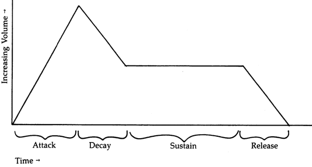

#### 攻击（Attack）

攻击是声音四个阶段中的第一个。它是对声音开始方式的描述。例如，具有快速攻击的声音是突然开始的。图 2a 显示了快速攻击的图。具有缓慢攻击的声音开始时音很小，音量逐渐增大。看图 2b 了解缓慢攻击的示意图。

#### 图 2. 攻击率

- a. 快速攻击

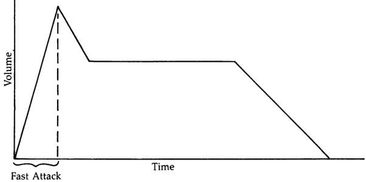

- b. 缓慢攻击

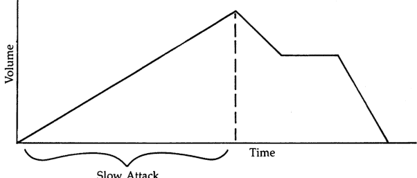

#### 非对称（Asymmetrical）

“非对称”一词指的是任何被划分为不相等部分的内容。在 64 的声音功能中，我们将使用该术语来描述划分不均匀的脉冲波。这是通过对选定的声部编程脉冲宽度来实现的，该宽度大于或小于总波的 50%。

#### 图 3. 非对称脉冲波

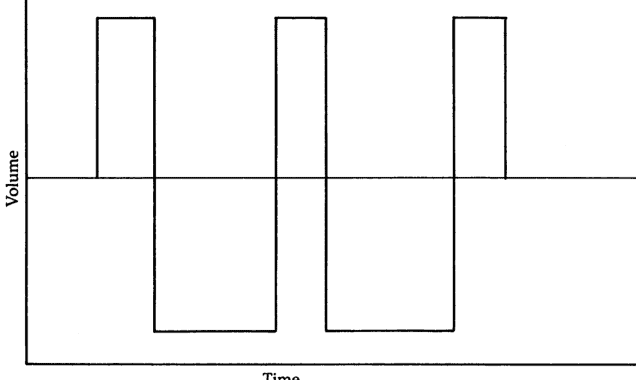

#### 基线（Base Line）

当物体振动时，就会产生声波。当振动物体向外或向上时，它会压缩周围的空气。当它向内或向下时，它会创建一个非常小的真空。这个过程被称为压缩和稀疏。你可以将其想象成向水池中扔石头产生的波纹。许多这样的波纹、压缩和稀疏形成了声波。声音的频率（每秒压缩和稀疏的次数）和幅度（压缩和稀疏的大小）可能会变化。基线是波形的中心。看图 4 一个示例波。

#### 图 4. 基线

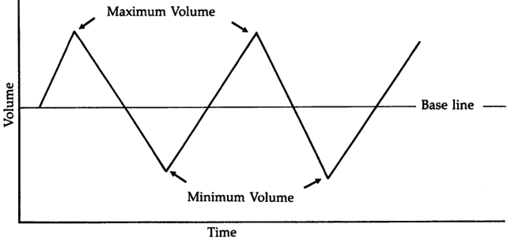

#### 带通（Band Pass）

带通允许选定的频率部分通过，同时拒绝或阻塞其他频率。图 5 展示了带通滤波器对声音频率的影响。

#### 图 5. 带通滤波

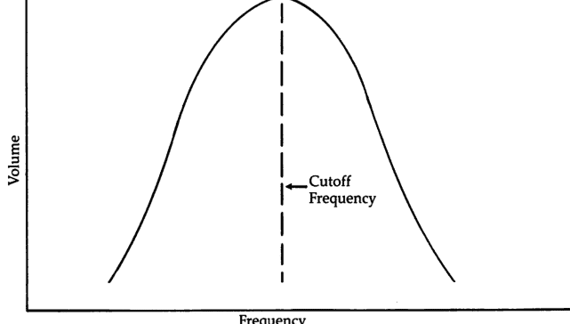

#### 拍音（Beats）

两个距离接近但并不相同的音调会产生一种起伏的声音。这种背景音被称为拍音。

#### 周期（Cycle）

声波是完整的单位，每个单位都有开始和结束。一个声波周期是从从一点到下一点测量的。声音的频率可以通过计算每秒周期数来确定。注意：`Hz`（或 `Hz`）是频率的单位。一赫兹等于每秒一个周期。

#### 图 6. 声周期

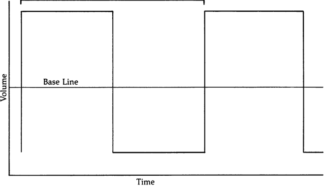

#### 截止点（Cutoff Point）

截止点简单是指滤波器开始拒绝的频率点。低通、带通和高通滤波器使用此点来确定通过哪些频率。

#### 和弦（Chords）

任何三个或更多产生和谐声音的音符组合都可以称为和弦。与不和谐音的情况一样，虽然有公式可以确定实际使用的频率值，但和谐性本质上是一个审美术语。因此，可能通过简单地听这些音符并进行实验来确定你想要的声音。

#### 衰减（Decay）

衰减是随攻击之后的声音部分。它描述了攻击阶段结束到持续阶段开始之间的音量下降。快速衰减会导致声音音量下降速度快于持续水平。缓慢衰减以较慢的速度降低到持续设置。

#### 图 7. 衰减

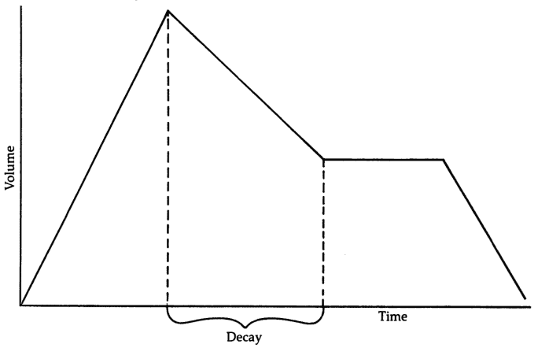

#### 不和谐音（Discord）

任何三个或更多音符在播放时产生不和谐的声音。与和弦的情况一样，虽然有公式可以确定要避免的实际频率值，但不和谐本质上是一个审美术语。由于其应用性，不和谐的声音最好通过实验获得。

#### 包络（Envelope）

在 64 上制作声音时，声音包络是针对任何给定声音定义的波形组件（攻击、衰减、持续和释放）的特定组合。例如，一个缓慢开始、快速下降、保持长时间持续然后缓慢消失到沉默的声音将具有如下波形包络：

#### 滤波（Filtering）

所有的滤波器，无论是我们制作咖啡时用的纸质过滤器还是像这种这样的电子滤波器，其功能基本上相同。它们选择性地允许一种物质通过，同时阻塞其他物质。例如，咖啡过滤器允许水和任何溶解的咖啡通过，而它们阻塞了咖啡渣。

#### 图 8. 声音包络

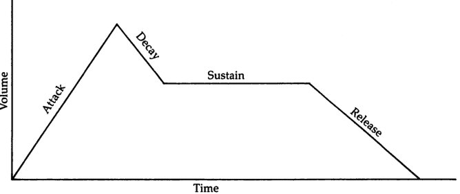

#### 降音 (Flat)

一个大调音阶由 C、D、E、F、G、A 和 B 这些音符组成。然而，在这些音符之间存在半音，称为升号和降号。降音是指比其名称来源音符低半音的音。

#### 频率 (Frequency)

声音是通过空气传播的一系列振动。声音的频率通过计算声音在特定时间内（通常为一秒）内振动的次数来决定。频率的表示方式为：

计算的周期数 / `Hz`

#### 门位 (Gate Bit)

门控制位是通常用于开启和关闭声音的控制信号。它与波形控制位（用于脉冲波、三角波等）位于同一个内存位置中。

#### 硬音 (Hard Sounds)

这是一个美学术语，通常指的是开始和结束突然、音量变化剧烈的声音。哔哔声、滴啾声和点击声可以被视为硬音。

#### 和声 (Harmony)

和声是对一组频率听起来方式的美学描述。虽然被认为和谐的频率实际组合取决于个人口味，但它们可以使用数学公式进行计算。然而，由于产生的实际声音始终受主观意见影响，至少在本书的大多数应用中，最好的方法是简单尝试不同的声音。

#### 兹 (Hertz)

`Hz` 代表每秒周期，指的是振动物体或函数振荡的速率。

#### 高通滤波器 (High Pass Filter)

Commodore 64 中的*高通滤波器*允许所有高于所选截止点的频率通过，同时降低所有低于所选截止点频率的音量。图 9 显示了其工作原理。

#### 图 9. 高通滤波器

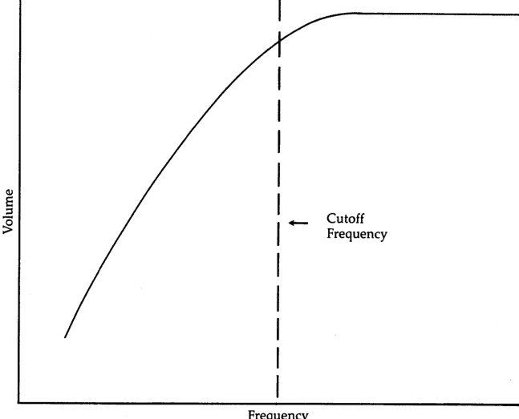

#### 低通滤波器 (Low Pass Filter)

64 中的低通滤波器允许所有低于所选截止频率的频率通过，但会降低所有高于此频率的音量。此功能是高通滤波器的相反。

#### 图 10. 低通滤波器

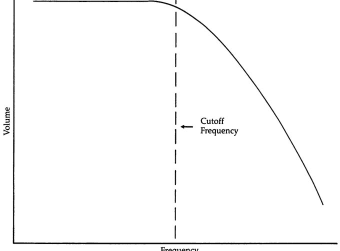

#### 较低音值 (Lower Pitch Value)

三个声部每个产生的音高可以是 65,536 种不同频率中的任意一种。为了产生如此数量的声音，64 使用了两个独立的内存位置：一个高音寄存器和一个低音寄存器。低音寄存器中的值被称为*低音值*。

#### 噪声 (Noise)

噪声是使用 Commodore 64 计算机产生的四种不同波形之一。根据选择的噪声频率，它可以听起来像从低沉的隆隆声到高嘶声的任何声音。

#### 八度 (Octave)

八度是两个比例为 2/1 的音之间的距离。我们的音乐音阶围绕这种关系建立。大调由从一个八度到下一个八度的音组成。第一章的表 1-3 显示了 64 上每个八度内的八度和音。

#### 峰值 (Peak)

峰值是指标记波形最高部分的点或水平。

#### 脉冲波 (Pulse Wave)

脉冲波是计算机产生的四种基本波形之一。脉冲波迅速上升到最大位移，保持该水平一段时间，然后下降到最小位移。这使得脉冲波具有非常清晰、饱满的声音，因为它们始终处于一个极端或另一个极端。下图显示了一个脉冲波。

#### 图 11. 脉冲波

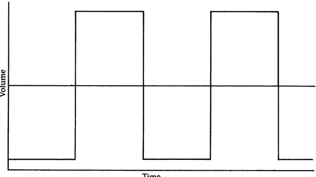

#### 脉冲宽度 (Pulse Width)

在 64 中，脉冲宽度是指脉冲波的高低低部分距离零点最远时间的相对比例。脉冲宽度是指波中高部分的比例。通过使用脉冲控制寄存器，你可以程序设置宽度从 0% 到 100% 的脉冲波，共分 4096 步。图 12 的左侧显示了 10% 的脉冲宽度，右侧详细说明了 50% 的脉冲宽度。

#### 图 12. 脉冲宽度

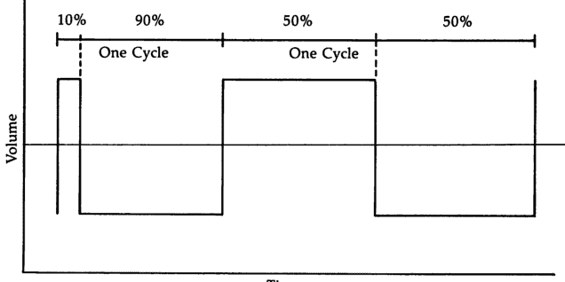

#### 释放 (Release)

释放是声音的第四也是最后一部分。它描述了声音最终关闭的方式。它的行为非常像衰减。快速的释放可以用声音包络持续部分之后紧接着的一条几乎垂直的直线来说明（如图 13 中的释放 A 所示），而较慢的释放可以用更逐渐下降的线来表示（如图 13 中的释放 B 所示）。

#### 图 13. 释放

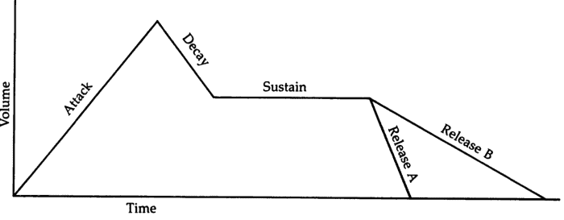

#### 共鸣 (Resonance)

共鸣是一种特殊效果，可以像滤波器一样使用，在播放时修改产生的声音。共鸣强调了滤波声音的截止点。此功能与同步和环形调制一起，用于修改 Commodore 64 产生的基本波形状。

#### 环形调制 (Ring Modulation)

环形调制是用于修改基本波形（脉冲波、三角波、锯齿波和噪声）形状的特殊功能之一。它是两个声部的逻辑与运算产生的。

#### 锯齿波 (Sawtooth Wave)

锯齿波是计算机产生的四种基本波形之一。锯齿波迅速上升到最大位移，保持该水平一段时间，然后下降到最小位移。这使得脉冲波具有非常清晰、饱满的声音，因为它们始终处于一个极端或另一个极端。

#### 图 14. 锯齿波

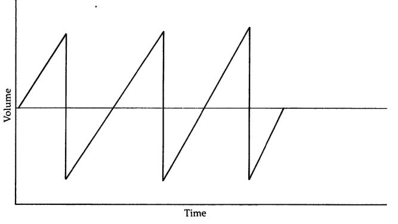

#### 升号 (Sharp)

一个大调音阶由 C、D、E、F、G、A 和 B 这些音符组成。然而，在这些音符之间存在半音，称为升号和降号。升号是指比其名称来源音符高半音的音。

#### 赛 (SID)

`SID` 术代表声音接口设备（Sound Interface Device）。这是 64 芯片的名称。

#### 音 (Soft Sounds)

这是一个美学术语，通常指的是开始和结束缓慢、音量变化平缓的声音。

#### 声音寄存器 (Sound Register)

64 使用 25 个内存位置（地址 54272 到 54296）控制大多数声音功能。这些被称为只写寄存器，因为你只能向它们 `POKE` 值，无法通过 `PEEK` 查看内容。

#### 持续 (Sustain)

声音完成衰减后，64 开始第三个循环：持续。声音的这部分保持指定的音量直到持续被关闭（使用该声部寄存器中的门位）。图 15 展示了长持续。持续不是时间函数，就像 ADSR 的其他元素不是一样。它是一个音量水平。

#### 图 15. 持续

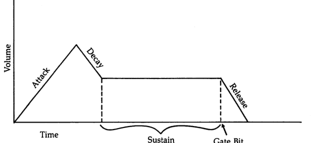

#### 方波 (Square Wave)

方波术语指的是在高部分和低部分之间被平分的脉冲波形。这是通过为选定声部程序正好占总波形 50% 的脉冲宽度来实现的。这产生了最饱满、响亮的声音。有时这被称为对称波。参考图 12 的右侧方波的插图。

#### 同步 (Synchronization)

同步是用于修改基本波形（脉冲波、三角波、锯齿波和噪声）形状的特殊功能之一。它是两个声部的逻辑与运算产生的。

#### 渐变音 (Tapered Sounds)

渐变是一个主观术语，用于描述音量缓慢上升到最大音量，或从最大音量逐渐下降到最小音量的声音。

#### 测试位 (Test Bit)

测试位是声音寄存器中的控制功能之一。当该位位被打开时，它关闭声音；当该位关闭时，它再次打开声音。虽然该位通常用于测试声音电路的特殊应用，但它也可以用于在不操纵其他声音参数的情况下控制声音。

#### 三角波

三角波是 Commodore 64 可以产生的四种基本波形之一。三角波上升到最大正位移，然后缓慢地下降到最小负位移。它们赋予了声音非常柔和的质感。三角波形的图形说明非常简单，如图 16 所示。

#### 图 16. 三角波

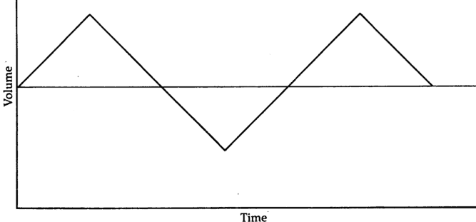

#### 高音位值

计算机三个音道中的每一个产生的音高可以是 65,536 种不同频率中的任意一种。为了产生数量的音高，64 使用了两个独立的内存位置：一个高音位寄存器和一个低音位寄存器。高位寄存器中的值被称为高音位值。

#### 波形

波形是声音的图形化表示。它们显示了声波上升和下降的速度（快或慢），并且可选地显示它们的频率。

你可以使用它们来分析不同的波，从而更好地利用每种声音类型的不同特性。

### 熟悉术语

在参考指南的其余部分，你会经常看到这些术语。虽然这里的短定义确实有助于理解 64 上的声音术语，但通常你通过亲自实验最好最好理解声音函数。在接下来的五章中，你将看到许多示例程序，展示了如何在 Commodore 64 上创建和操纵声音。在这些示例程序中更改值和调整参数是观察计算机上声音如何工作的最佳方法之一。从观察一个程序如何产生声音（通过对其进行微调）到开始编写此类程序，只有几步之遥。许多人都是这样学习编程的。

当然，在你阅读本书的其余部分时，可以查阅这个术语表。你可以返回这一节，学习你刚刚遇到但还不完全理解的术语。

熟悉这些术语非常重要，因为后面的章节将大量使用它们。这确实是一套专业术语，但它让解释变得既简单又完整。花花时间了解这些术语，你会发现本参考指南的其余部分更容易遵循，也更容易使用。

### 从书中输入程序

在继续之前，先阅读书末尾的附录 A、B 和 C 是一个好主意。它们将解释如何输入指南中列出的程序，如果你不熟悉 COMPUTE! 的列表规范，或者如果你刚刚开始使用 Commodore 64，这些附录将非常有帮助。

附录 A“程序输入入门指南”和附录 B“如何输入程序”作为对你 64 编辑功能和我们列表规范的介绍。附录 C“自动校对器”包含一个程序，它可以让无误地输入你的列表变得简单易用。如果你先阅读说明并输入附录 C 中找到的自动校对器，那么输入书中的程序将变得更加容易。

如果你看书中的程序，你会发现每行程序的末尾都有一个 `REM` 语句，前面前面有一个冒号，后面跟着一个数字。例如，你可能会看到 `:rem 127`。在输入程序时，不要输入这个 `REM` 语句或该数字。这是由自动校对器程序生成的校验和。你需要将 `:rem` 之后的数字与屏幕上显示的数字进行比较。使用自动校对器，你可以确保程序的输入与书中所示完全一致。它将为你节省大量时间。

# 第 1 章


# SID：声音接口设备

## 概述

Commodore 64 与其他计算机一样，基于数字运行。它接受数字作为输入，并产生数字作为输出。

由于 64 只输出数字，你可能会好奇它是如何发出声音的，甚至是它每次开启时如何产生视频显示（电视图像）。答案很简单：计算机产生的图像和声音都是数字。计算机拥有存储创建图像和声音数字的内存位置。然后它使用一些特殊设备将这些数字转换为声音和图像。

64 使用两个这样的设备将数字转换为声音和图像。图像由名为 `VIC-II` 的芯片处理，声音则使用 `SID`（声音接口设备）芯片创建。

`SID` 能够同时产生三个音道，并在整个八度范围内产生 65,536 种不同的音高。此外，`SID` 还允许你通过滤波和波形控制来控制它产生声音的实际形状。

这就像在计算机中内置了一个音乐合成器。与其他计算机的产声设备相比更加复杂且功能强大，Commodore 64 的 `SID` 在产生声音和音乐方面提供了惊人的选择范围。正因如此，在 64 上创建声音要变得复杂得多。你必须知道如何访问和操纵 `SID` 芯片的各种控制寄存器。这并不难，只是需要一些时间来学习。但你很快就会发现投入时间是值得的，因为你可以让 Commodore 64 以其他计算机无法做到的方式“唱歌”。

## 控制寄存器

你通过向其声音寄存器中放入不同的值（用数字表示）来编程 `SID` 以产生声音。声音控制寄存器是许多位置，存储了用于在 64 上产生声音的数字。表 1-1 显示了每个声音寄存器的名称和功能、其位置以及可以设置以操纵该寄存器的位。

### 表 1-1. SID 控制寄存器

| 声音寄存器功能 | 内存地址 | 位(s) |
| :--- | :--- | :--- |
| 音道 1 音值（低值） | 54272 | 0–7 |
| 音道 1 音值（高值） | 54273 | 0–7 |
| 音道 1 脉冲宽度（低值） | 54274 | 0–7 |
| 音道 1 脉冲宽度（高值） | 54275 | 0–7 |
| 音道 1 波形输出 | 54276 | 0 |
| 音道 1 同步位 | 54276 | 1 |
| 音道 1 调制位 | 54276 | 2 |
| 音道 1 测试位 | 54276 | 3 |
| 音道 1 三角波启用 | 54276 | 4 |
| 音道 1 锯齿波启用 | 54276 | 5 |
| 音道 1 脉冲波启用 | 54276 | 6 |
| 音道 1 噪声启用 | 54276 | 7 |
| 音道 1 衰减值 | 54277 | 0–3 |
| 音道 1 攻击值 | 54277 | 4–7 |
| 音道 1 释放值 | 54278 | 0–3 |
| 音道 1 维持值 | 54278 | 4–7 |
| 音道 2 音值（低值） | 54279 | 0–7 |
| 音道 2 音值（高值） | 54280 | 0–7 |
| 音道 2 脉冲宽度（低值） | 54281 | 0–7 |
| 音道 2 脉冲宽度（高值） | 54282 | 0–3 |
| 音道 2 波形输出 | 54283 | 0 |
| 音道 2 同步位 | 54283 | 1 |
| 音道 2 调制位 | 54283 | 2 |
| 音道 2 测试位 | 54283 | 3 |
| 音道 2 三角波启用 | 54283 | 4 |
| 音道 2 锯齿波启用 | 54283 | 5 |
| 音道 2 脉冲波启用 | 54283 | 6 |
| 音道 2 噪声启用 | 54283 | 7 |
| 音道 2 衰减值 | 54284 | 0–3 |
| 音道 2 攻击值 | 54284 | 4–7 |
| 音道 2 释放值 | 54285 | 0–3 |
| 音道 2 维持值 | 54285 | 4–7 |
| 音道 3 音值（低值） | 54286 | 0–7 |
| 音道 3 音值（高值） | 54287 | 0–7 |
| 音道 3 脉冲宽度（低值） | 54288 | 0–7 |
| 音道 3 脉冲宽度（高值） | 54289 | 0–3 |
| 音道 3 波形输出 | 54290 | 0 |
| 音道 3 同步位 | 54290 | 1 |
| 音道 3 调制位 | 54290 | 2 |
| 音道 3 测试位 | 54290 | 3 |
| 音道 3 三角波启用 | 54290 | 4 |
| 音道 3 锯齿波启用 | 54290 | 5 |
| 音道 3 脉冲波启用 | 54290 | 6 |
| 音道 3 噪声启用 | 54290 | 7 |
| 音道 3 衰减值 | 54291 | 0–3 |
| 音道 3 攻击值 | 54291 | 4–7 |
| 音道 3 释放值 | 54292 | 0–3 |
| 音道 3 维持值 | 54292 | 4–7 |
| 截止频率值（低值） | 54293 | 0–2 |
| 截止频率值（高值） | 54294 | 0–7 |
| 音道 1 滤波器启用 | 54295 | 0 |
| 音道 2 滤波器启用 | 54295 | 1 |
| 音道 3 滤波器启用 | 54295 | 2 |
| 外部音频滤波器启用 | 54295 | 3 |
| 谐振滤波器值 | 54295 | 4–7 |
| 音量控制 | 54296 | 0–3 |
| 低通滤波器启用 | 54296 | 4 |
| 带通滤波器启用 | 54296 | 5 |
| 高通滤波器启用 | 54296 | 6 |
| 音道 3 输出 | 54296 | 7 |

## 位、字节和半字节

表 1-1 列出的控制寄存器用于访问 64 上所有的声音功能。要操作最后两个寄存器以外的所有寄存器，你使用 `BASIC` 命令 `POKE`。这允许你更改寄存器中的值。`POKE` 命令的格式为：

```
POKE M,V
```

其中 `M` 是一个表示 0 到 65535 之间内存位置的数字，`V` 是要存储在该位置的值。要存储的数字必须在 0 到 255 之间。

为了形象地了解它的工作原理，让我们在内存中存储一个数字：

```
POKE 6000,76
```

现在，位置 6000 包含值 76。如果你想读取该内存位置——也就是说，查看目前那里有什么值——你需要使用 `POKE` 命令对应的 `BASIC` 命令 `PEEK`。

```
PRINT PEEK(6000)
```

`PEEK` 用于检查内存位置的内容。你必须配合 `PRINT` 命令使用 `PEEK` 命令，这样计算机就会显示在位置 6000 找到的值。如果没有 `PRINT` 命令，计算机将不知道对它找到的值做什么。当你按下 `RETURN` 键时，计算机应该显示存储的值 76。

通过这种放置值的方法以及查看内存位置中当前的值，你可以在任何可用的内存地址中存储任何数字，只要你使用的是 0 到 255 之间的值即可。

你被限制只能使用 0 到 255 之间的数字，是因为 Commodore 64 是一台 8 位计算机。也就是说，它只能接受长度为八个二进制位的数字。

虽然本书的目的不是解释二进制数和 64 内存寄存器的工作原理，但让你能够使用它们是非常重要的。如果你需要比下文更详细的二进制数解释，你应该查阅一本关于入门 `BASIC` 的书籍。

64 中的每个内存位置可以存储一个字节，字节反过来由八个位（二进制数字）组成。每个字节中的八个位是编号的，从最右侧的 0 开始，到最左侧的 7 结束。那么，一个字节看起来如下：

### 图 1-1. 字节的位

| 位 | 7 | 6 | 5 | 4 | 3 | 2 | 1 | 0 |
|---|---|---|---|---|---|---|---|---|
| 字节 | | | | | | | | |

此示例字节中的每个位都有其独立的值。如果该位被设置（该位中存储了 1），则该值将加到字节中其他“开启”（set 的另一种术语）的位上。如果该位中存储的是 0，则被称为“关闭”（off）或“未设置”。那么该位的值为 0。字节中位的值见下表：

### 图 1-2. 位的值

| 位 | 7 | 6 | 5 | 4 | 3 | 2 | 1 | 0 |
|---|---|---|---|---|---|---|---|---|
| 位值 | 128 | 64 | 32 | 16 | 8 | 4 | 2 | 1 |

位 0 被设置时（那里存储了 1）的值为 1。位 1 设置时的值为 2，位 2 的值是 4，以此类推。你会发现向左移动时，每个后续位的值正好是前一个位的两倍。只要你记住这一点，这些值很容易记忆。

早些时候提到放置在 64 位置的数字必须在 0 到 255 之间。记住，这是像 Commodore 64 这样的八位计算机的可能值的范围。但这些数字是如何产生的呢？通过字节中的位值，设置某些位（在该位中放置 1）并让其他位关闭（通过在该位中放置 0）。所有设置位的总和就成了存储在该内存位置字节中的值。

例如，让我们看看二进制数 0：

```
00000000
```

这代表了 64 中的单个字节。八个位都包含 0。没有一个位被设置或开启。为了显示二进制数 1，你必须设置一个位，即位 0。你会记得，位 0 在设置时的值为 1。二进制数 1 看起来如下：

```
00000001
```

同时设置位 0 和位 1 将得到一个不同的值。你所做的只是将所有设置位的位值（见图 1-2）相加。1（位 0） + 2（位 1） = 3。因此，二进制数 3 看起来如下：

```
00000011
```

现在看数字 255（它在计算机内部存储的方式）：

```
11111111
```

所有位都通过存储 1 被设置。将所有位值相加得到 255（128+64+32+16+8+4+2+1=255）。如果你尝试在此添加任何内容，数字就会溢出，因为所有位都满了。这就是为什么你不能在任何单个内存位置保存大于 255 的数字。

（当然，你可以在计算机中存储更大的数字，但它们是以多个字节的形式存储的，然后组合成更大的数字。）

## 清除寄存器

清除寄存器应该是编写的每个声音例程的第一步。你这样做是因为没有方法可以确定任何寄存器中存储了什么值。

## ADSR 包络

### 图 1-3. 起始、衰减、维持和释放

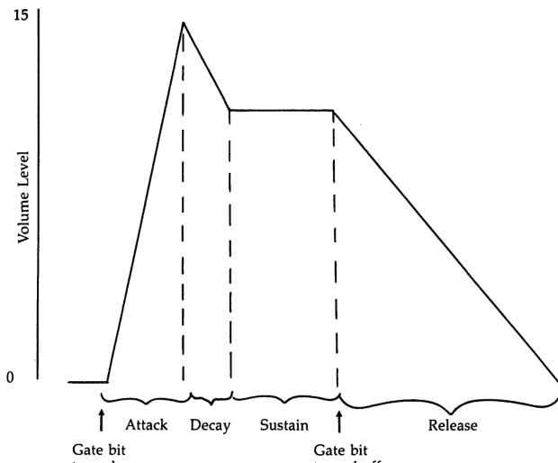

- **起始（Attack）**。这是一个时间函数，音符的*起始*时间决定了声音达到选择音量的速度快慢。你可以将起始时间设置为从两毫秒到近八秒不等。起始速率为 0 表示声音从全音量开始。

- **衰减（Decay）**。*衰减*也是一个时间函数。在初始起始之后，音量会减小，直到达到维持电平（sustain level）指定的水平。衰减表示这一过程持续多长时间。快速速率会使音量迅速从起始的高点下降到维持水平，而慢速速率则会拉长这个过程。

- **维持（Sustain）**。*维持*是 ADSR 中唯一不面向时间的部分；维持实际上是一个音量设置。你为此功能选择的值决定了衰减后达到的音量水平。例如，如果维持设置为 12，衰减将音量从级别 15 降至 12。音符会保持在该音量，直到你清除门位（gate bit）。换句话说，只要不清除门位，你就可以无限地维持一个音符。你可以使用维持设置为 64 个音通道中的每一个设置不同的音量水平。由于位置 54296 处的音量控制是主控，使用维持来设置所有音通道的音量是在创建多个声音时控制音量最简单的方法。

- **释放（Release）**。另一个时间函数，释放是声音通道最后的下降阶段。较短的释放时间会让音符迅速消失，而较长的释放时间会延长音符的下落。

`SID` 芯片能够通过两个寄存器分别控制每个音通道的 ADSR。例如，地址 54277 控制音通道 1 的起始和衰减，而地址 54278 控制维持和释放。你只需要在寄存器中放入一个值，`SID` 芯片就会处理剩下的工作。

如果你查看一个 ADSR 控制寄存器（实际上有六个——Commodore 64 的三个音通道各两个），你会发现寄存器被分为若干个单独的控制位，每个控制位都有特定的功能。图 1-4 显示了地址 54277 音通道 1 的起始和衰减控制寄存器。

### 图 1-4. 起始/衰减控制寄存器

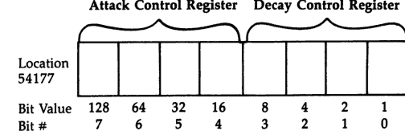

你可以看到，寄存器分为两个部分（位 4–7；也称为高字节组），上部分控制起始长度，下部分（位 0–3；也称为低字节组）控制衰减长度。由于每个字节组只有 4 位，你可以使用的值范围从 0 到 15。衰减作为低字节组，将直接接受这些数字作为值。要更改衰减长度，你只需要在寄存器中输入 0 到 15（十进制）之间的值。数字越大，衰减越长。

在设置包络的起始速率时，同样有 0 到 15 的范围可用。然而，由于它是高字节组，你必须进行一些乘法。为了获得要输入的数字，你需要将起始值（0–15）乘以 16，并将该总值 `POKE` 到寄存器中。要同时使用起始和衰减，将两个值相加并 `POKE` 输入总和。例如，如果你想要起始值为 8，衰减为 9，你可以这样计算总和：

```
(8 × 16) + 9 = 137
```

维持和释放的设置相同，只是使用了每个音通道的第七个寄存器。释放速率由低字节组（位 0-3）设置，使用 0 到 15 的值。维持电平的设置方法与起始相同，将音量乘以 16。将释放和维持值相加并将总和 `POKE` 到寄存器即可设置两个功能。你可以参考表 1-2 来消除起始和维持速率的乘法。它显示了衰减和释放的值。

### 表 1-2. ADSR POKE 值

| 值 | 起始 (Attack) | 衰减 (Decay) | 维持 (Sustain) | 释放 (Release) |
|---|---|---|---|---|
| 0 | 0 | 0 | 0 | 0 |
| 1 | 16 | 1 | 1 | 1 |
| 2 | 32 | 2 | 2 | 2 |
| 3 | 48 | 3 | 3 | 3 |
| 4 | 64 | 4 | 4 | 4 |
| 5 | 80 | 5 | 5 | 5 |
| 6 | 96 | 6 | 6 | 6 |
| 7 | 112 | 7 | 7 | 7 |
| 8 | 128 | 8 | 8 | 8 |
| 9 | 144 | 9 | 9 | 9 |
| 10 | 160 | 10 | 10 | 10 |
| 11 | 176 | 11 | 11 | 11 |
| 12 | 192 | 12 | 12 | 12 |
| 13 | 208 | 13 | 13 | 13 |
| 14 | 224 | 14 | 14 | 14 |
| 15 | 240 | 15 | 15 | 15 |

## 音高寄存器

音高寄存器控制音符的频率，由每个音通道的前两个地址组成。存储在这些位置的数字定义了 0 到 65535 之间的二进制数。每当第一个位置（低寄存器）的计数达到 256 时，额外的计数就会进位到第二个位置（高寄存器）。两个寄存器表示的数字等于低值加上高寄存器值乘以 256。例如，如果低寄存器包含 3，而高寄存器包含 10，则表示的值将是：3 + (10 × 256) = 2563。大多数情况下，你只需要使用表 1-3 中的值，将第一个数字 `POKE` 到低寄存器，第二个数字 `POKE` 到高寄存器。例如，如果你想从第一个八度创建一个 A#，你可以这样做：`POKE 54272,21`；`POKE 54273,1`。低寄存器 (54272) 设置第一个音高值，高寄存器 (54273) 设置第二个音高值。

### 表 1-3. 音符 POKE 值

| 音符 (Musical Note) | 实际频率 (Actual Frequency) | 低位值 (Pitch Value Lower) | 高位值 (Pitch Value Upper) |
|---|---|---|---|
| C | 16 Hz | 12 | 1 |
| C# | 17 Hz | 28 | 1 |
| D | 18 Hz | 45 | 1 |
| D# | 19 Hz | 62 | 1 |
| E | 21 Hz | 81 | 1 |
| F | 22 Hz | 101 | 1 |
| F# | 23 Hz | 123 | 1 |
| G | 24 Hz | 145 | 1 |
| G# | 25 Hz | 169 | 1 |
| A | 27 Hz | 195 | 1 |
| A# | 29 Hz | 221 | 1 |
| B | 31 Hz | 250 | 1 |
| C | 32 Hz | 24 | 2 |
| C# | 34 Hz | 56 | 2 |
| D | 37 Hz | 90 | 2 |
| D# | 39 Hz | 125 | 2 |
| E | 41 Hz | 163 | 2 |
| F | 44 Hz | 203 | 2 |
| F# | 46 Hz | 246 | 2 |
| G | 49 Hz | 35 | 3 |
| G# | 52 Hz | 83 | 3 |
| A | 55 Hz | 134 | 3 |
| A# | 58 Hz | 187 | 3 |
| B | 62 Hz | 244 | 3 |
| C | 65 Hz | 48 | 4 |
| C# | 69 Hz | 112 | 4 |
| D | 73 Hz | 180 | 4 |
| D# | 76 Hz | 251 | 4 |
| E | 82 Hz | 71 | 5 |
| F | 87 Hz | 151 | 5 |
| F# | 92 Hz | 237 | 5 |
| G | 98 Hz | 71 | 6 |
| G# | 104 Hz | 167 | 6 |
| A | 110 Hz | 219 | 7 |
| A# | 117 Hz | 233 | 7 |
| B | 123 Hz | 333 | 7 |
| C | 131 Hz | 97 | 8 |
| C# | 139 Hz | 225 | 8 |
| D | 147 Hz | 104 | 9 |


| D# | 156 Hz | 247 | 9 |
| E | 165 Hz | 143 | 10 |
| F | 175 Hz | 47 | 11 |
| F# | 185 Hz | 218 | 11 |
| G | 196 Hz | 142 | 12 |
| G# | 208 Hz | 77 | 13 |
| A | 220 Hz | 24 | 14 |
| A# | 233 Hz | 238 | 14 |
| B | 247 Hz | 210 | 15 |
| C | 262 Hz | 195 | 16 |
| C# | 277 Hz | 194 | 17 |
| D | 294 Hz | 208 | 18 |
| D# | 311 Hz | 238 | 19 |
| E | 330 Hz | 30 | 21 |
| F | 349 Hz | 95 | 22 |
| F# | 370 Hz | 180 | 23 |
| G | 392 Hz | 29 | 25 |
| G# | 415 Hz | 155 | 26 |
| A | 440 Hz | 48 | 28 |
| A# | 466 Hz | 221 | 29 |
| B | 494 Hz | 164 | 31 |
| C | 523 Hz | 134 | 33 |
| C# | 554 Hz | 132 | 35 |
| D | 587 Hz | 161 | 37 |
| D# | 622 Hz | 221 | 39 |
| E | 659 Hz | 60 | 42 |
| F | 698 Hz | 191 | 44 |
| F# | 740 Hz | 104 | 47 |
| G | 784 Hz | 58 | 50 |
| G# | 831 Hz | 55 | 53 |
| A | 880 Hz | 97 | 56 |
| A# | 932 Hz | 187 | 59 |
| B | 988 Hz | 72 | 63 |
| C | 1046 Hz | 12 | 67 |
| C# | 1109 Hz | 8 | 71 |
| D | 1175 Hz | 66 | 75 |
| D# | 1244 Hz | 187 | 79 |
| E | 1319 Hz | 121 | 84 |
| F | 1397 Hz | 127 | 89 |
| F# | 1480 Hz | 209 | 94 |
| G | 1568 Hz | 117 | 100 |
| G# | 1661 Hz | 110 | 106 |
| A | 1760 Hz | 194 | 112 |
| A# | 1865 Hz | 118 | 119 |
| B | 1976 Hz | 145 | 126 |

# SID：声音接口设备

通过结合使用波形选择位、启用位（`enable`）和门控位（`gate`）来选择波形。C 64 上的每个通道（`voice`）都有自己的寄存器来选择波形，以及它们自己的门控位。例如，通道 1 使用位于 `54276` 处的寄存器同时进行波形选择和启用启用。其他通道的寄存器地址请参见表 1-1。

通过在波形控制寄存器中设置相应的位来选择四种波形。如果你查看这些寄存器之一（共有三个，对应 Commodore 64 的三个通道），你会发现它由若干个控制位组成，每个控制位都有特定的功能。图 1-5 显示了位于 `54276` 处的通道 1 的波形控制寄存器。

## 图 1-5. 波形控制寄存器

| 位 | 7 | 6 | 5 | 4 | 3 | 2 | 1 | 0 |
| --- | --- | --- | --- | --- | --- | --- | --- | --- |
| 值 | 128 | 64 | 32 | 16 | 8 | 4 | 2 | 1 |
| 噪声波启用 | 脉冲波启用 | 锯齿波启用 | 三角波启用 | 测试位 | 环调制 | 同步位 (`Sync`) | 启用位 |

除了具有特定功能外，每个位都有特定的位值。要开启它，只需将相应的位值 `POKE` 到控制寄存器中。位 4 的值为 16，将开启三角形波形生成器。位 5 的值为 32，将启用锯齿波形，而如果位 6 的值为 64，则会开启脉冲波形生成器。最后一种波形噪声，通过设置位 7（值为 128）来启用。例如，要启用脉冲波形，你会向寄存器 `POKE` 64。这将开启脉冲波形生成器。然而，要让 SID 发出声音，你还必须开启门控位 (0)。如果你不这样做，就听不到声音。每当你开启一个波形位时，应该在你选择的值的基础上加上 1（位 0 的值）。因此，要开启脉冲波生成器并启用它，你会向控制寄存器 `POKE` 65。要关闭它，你会向寄存器 `POKE` 64。（记住门控位的值为 1；65–1=64。）

每当你为三个通道的任何一个选择脉冲波形时，必须设置脉冲宽度。它的控制方式与音调寄存器类似。在音调寄存器中，每个通道有两个位置用于脉冲宽度选择。例如，通道 1 的脉冲宽度寄存器位于地址 `52474` 和 `52475`。然而，第二个寄存器只有 4 个位可用，因此存储在这些位置的数字定义了一个 0 到 4095 之间的二进制数。与音调寄存器一样，两个寄存器表示的数字等于低值加上高值乘以 256。例如，如果低位寄存器包含 0，高位寄存器包含 8，则波形值为值为：

```
0 + (8 * 256) = 2048
```

这个数字表示波形高电的比例。上述值恰好为 50% (2048/4096=.50)。减少或增加这些寄存器值所代表的数字将减少或增加波形的高电比例，并改变产生的声音。例如，如果你使用以下语句，波形只有 25% 的时间内是高电：

```
POKE 52474,0:POKE 52475 A
```

声音程序中通常会添加一个持续时间较长的循环。你可以通过简单不关闭门控位来强制其无限播放，或者通过程序中定义的功能键手动关闭门控位。设置音符持续长度最简单的方法是使用 `FOR-NEXT` 作为延迟。此循环应该插入在设置波形（从而开启门控位）的时间和关闭门控位的时间之间。如果你在使用脉冲波形，并且在程序早些时候设置了其他声音参数，它可能像这样：

```
POKE 52476,65 设置脉冲波形并开启门控位
T=0 TO 1000:NEXT 延迟循环以播放一秒声音
POKE 52476,64 关闭门控位
```

记住，持续（`sustain`）仅指音量电平，而不是时间函数（就像声音的 ADSR 的其他元素那样）。这就是为什么你需要在程序中使用像这样的延迟循环；它是控制音符持续部分时间最简单的方法。

关闭门控位是你大多数声音程序中最后执行的操作。一旦音符播放完毕——经过了攻击（`attack`）、衰减（`decay`）、持续（`sustain`）和释放（`release`）步骤——你需要通过向波形控制寄存器 `POKE` 一个比选择波形时小 1 的值来关闭门控。然而，要让 SID 发出声音，你还必须开启门控位 (0)。如果你不这样做，就听不到声音。每当你开启一个波形位时，应该在你选择的值的基础上加上 1（位 0 的值）。因此，要开启脉冲波生成器并启用它，你会向控制寄存器 `POKE` 65。要关闭它，你会向寄存器 `POKE` 64。（记住门控位的值为 1；65–1=64。）

# SID: 音接口设备

```
77 REM - 将音值 POKE 到声道 1 : :rem 149
80 POKE 54272,L: POKE 54273,H : :rem 245
90 REM - 启用音调寄存器 - :rem 233
100 POKE 54276, 65 : :rem 95
110 REM - 播放 1/8 秒的音调 : :rem 119
120 FOR R=0 TO 125: NEXT : :rem 237
130 REM - 关闭声音寄存器 - :rem 228
140 POKE 54276,64 : :rem 98
150 REM - 关闭音量 - :rem 208
160 GO TO 75 : :rem 49
170 REM - 音调表 - :rem 116
180 DATA 195,16,14,17,208,18,23,19,30,21,95,22,1
80,23,29,55,26,48,28,22 : :rem 15
190 DATA 29,164,31,134,33,164,31,221,49,18,255,
26,25,180,23,95,30,21 : :rem 204
195 DATA 238,19,208,18,194,17,999,999 : :rem 83
```

此程序使用了多个 `DATA` 语句，其中包含音阶的音值。每当需要播放音调时，就会从 `DATA` 语句中 `READ` 一对值。这些值被 `POKE` 到地址为 `54272` 和 `54273` 的寄存器中。注意，从 180 行开始的 `DATA` 语句中的值为偶数个。如果你将数字成对分组，你会发现第一个是低音值，第二个是高音值。如果你修改了使其变为偶数个数，请确保数量仍为偶数，并且确保低音值在高音值之前。80 行实际上将这些值放入寄存器中。当所有数字都已 `READ` 后，75 行的例程会 `RESTORES` 数据并重新开始。要停止此例程，请同时按下 `RUN/STOP` 和 `RESTORE` 键。

## 音量调整

除了改变音调频率外，你还可以改变音调的音量（响度）。64 的三个声道产生的任何声音音量由地址 `54296` 处的控制寄存器控制。可以将 0 到 15 之间的值 `POKE` 到此寄存器以设置音量级。你甚至可以将一个变量（如 `V`）`POKE` 到寄存器中，并在例程更改声音。程序 1-3 就是这样做的。

# SID: 音接口设备

### 程序 1-3. 音量变量

为了确保程序输入无误，请务必阅读附录 C 中的“自动校对器”。

```
10 REM      清除声音寄存器 --- :rem 251
20 FOR R=54272 TO 54296:POKE,0:NEXT :rem 255
25 REM      初始化音量控制 -- :rem 234
27 V=I-1                                :rem 83
30 REM      开启音量               :rem 95
40 POKE 54296,V                           :rem 31
50 REM      初始化特殊寄存器 :rem 78
60 POKE 54277,0:POKE 54278,24:POKE 54275,8 :rem 3
70 REM      从表中获取音调          :rem 141
75 READ L,H: IF L=999 RESTORE:GOTO 75
77 REM 将音值 POKE 到声道 1 :rem 119
80 POKE 54272,L: POKE 54273,H          :rem 245
90 REM      启用寄存器            :rem 233
100 POKE 54276,6                       :rem 95
105 REM      递增/测试音量控制:rem 225
110 V=V-I:IF V<0 THEN I=I*-1         :rem 164
110 REM      播放 1/8 秒的音调   :rem 119
120 FOR R=0 TO NEXT:NEXT                  :rem 237
130 REM      关闭声音寄存器  :rem 228
140 POKE 54296,6                       :rem 98
150 REM      关闭音量            :rem 208
160 GOTO 75                             :rem 60
165 POKE 54295,0                        :rem 49
170 REM      音调表               :rem 116
180 DATA 195,16,194,17,208,18,23,19,30,21,95,22,1
80,23,29,25,56,48,28,221               :rem 15
190 DATA 29,16,31,134,33,164,31,221,29,48,155,
26,29,25,180,23,95,22,30,21            :rem 204
195 DATA 238,19,208,18,194,17,999
```

与程序 1-2 类似，此例程包含一个音量控制 (`V`) 和一个增量变量 (`I`)，在播放音调时改变音量。这些值在 107 行增加。在 40 行，我们不再向 `54296` `POKE` 固定值，而是使用变量。使用音量来改变声音的性质可以逐音进行。例如，如果你在音符播放时改变其音量，就可以创建一个完全不同的声音。这就是程序 1-4 所做的。

# SID: 音接口设备

### 程序 1-4. 逐音音量

为了确保程序输入无误，请务必阅读附录 C 中的“自动校对器”。

```
10 REM --- 清除寄存器 --- :rem 251
20 FOR R=54272 TO 54296,POKE,0:NEXT :rem 25
30 REM - 开启音量 :rem 50
40 POKE 54296,15 :rem 47
50 REM - 初始化特殊寄存器 :rem 78
60 POKE 54277,0:POKE 54278,24:POKE 54275,8 :rem 3
70 REM - 从表中获取音调 - :rem 141
75 READ L,H: IF L=999 THEN RESTORE: GOTO 75

77 REM 将音值 POKE 到声道 1 :rem 119
80 POKE 54273,H :rem 149
90 REM - 启用音调寄存器 :rem 233
100 POKE 54276,65 :rem 95
110 REM - 播放 1/8 秒并调整音量 :rem 237
120 FOR R=15 TO 0 STEP -1:POKE 54296,R:FOR T=1 TO 5:NEXT
130 REM - 关闭声音寄存器 - :rem 228
140 POKE 54276,64 :rem 98
150 REM - 关闭音量 - :rem 288
160 GOTO 75 :rem 60
165 POKE 54296,0 :rem 49
170 REM - 音调表 - :rem 116
180 DATA 195,16,194,17,28,18,23,19,30,21,95,22,1
88,23,29,25,15,26,48,28,21 :rem 15
190 DATA 19,24,31,134,33,164,31,221,29,48,28,155,
26,29,25,180,23,95,22,30,21 :rem 204
195 DATA 238,19,208,18,19,174,999,999
```

此例程与程序 1-3 的主要区别在于，我们在 120 行使用了一个 `FOR-NEXT` 循环在每次循环执行时调整音量。设置变量 `R`，音量从 15 开始，每循环一次减少 1。其中的第二个 `FOR-NEXT` 循环是一个单行语句，这样你就可以更轻松地听听到音量的变化。

每个音符都会设置一个不同的音量量级。你可以在自己的例程中使用这种技术，使音效变得生动、淡出然后再次变大。如你所见，修改 64 上的音量寄存器并不困难，并且极大改变你听到的声音。

## 修改 ADSR

我们已经简要查看了声音包络的 ADSR，甚至探索了控制 Commodore 64 上声音创建这一重要部分的寄存器。之前的示例声音例程已经包含了攻击（`Attack`）、衰减（`Decay`）、释放（`Release`）的各种速率，以及音符持续（`Sustain`）的音量量级。但关于声波及其 ADSR，还有几点需要指出来。

如果你画出声波的形状，它看起来就像图 1-6。一个纯音波开始于基准水平（在图中用零表示），达到峰值然后下降。

### 图 1-6. 纯音波

`img/b7e54ff141dd3576dcf2195f763acc2_51_png`

### 图 1-7. 衰减声音

`img/b7e54ff141dd3576dcf2195f763acc2_52_png`

在这个声波中，你可以说攻击非常快，而衰减相对较慢。请记住，攻击是指声音达到最大音量所需的时间速率，而衰减是指声音下降到持续水平所需的时间速率。图 1-7 所示声波开始时很大，因此其攻击速率被设置为较快。另一方面，它逐渐失去音量；因此其衰减速率被设置为较慢。

# 1 SID：声音接口设备

之前的例程使用的是脉冲波形，而程序 1-5 使用了三角波形，这是通过向位置 `54276` `POKE` 值 17 来在第 60 行设置的（并启用了门控位）。

### 程序 1-5. 快速攻击—缓慢衰减

为了确保程序输入无误，请务必阅读附录 C 中的“自动校错”。


```
10 REM CLEAR CLIP                       :rem 208
20 FOR T=8 TO 24 :POKE54272+T,0:NEXT    :rem 212
25 REM - SET VOLUME LEVEL               :rem 180
30 POKE 54296,15                        :rem 46
35 REM - ATTACK/DECAY RATE               :rem 242
40 POKE 54277,10:POKE 54278,0             :rem 248
45 REM - FREQUENCY SET                   :rem 24
50 POKE 54272,40:POKE 54273,95         :rem 48
55 REM - TRIANGLE WAVE FORM AND GATE ENABLED:rem 246
60 POKE 54276,17                       :rem 49
70 FOR T=1 TO 2000:NEXT                :rem 238
80 POKE 54276,16                       :rem 50
90 GOTO 60                              :rem 8
```

修改攻击和衰减时间非常简单。例如，如果你想要更柔和的声音，可以更改第 40 行：

```
40 POKE 54277,208:POKE 54278,0
```

现在攻击时间变长了（通过使用值 208 表示，即 16*13），衰减时间非常短（衰减设置为 0）。请记住，你最终 POKE 到攻击/衰减控制寄存器的值是攻击值（208）和衰减值（0）之和。声音缓慢地上升到最大音量，然后迅速下降到维持水平（通过向位置 54278 POKE 0，将维持水平设置为音量 0）。通过操作两个都较长的攻击和衰减速率，可以产生更柔和的声音。再次更改第 40 行：

```
40 POKE 54277,172:POKE 54278,0
```

如果你看一眼表 1-2，你会发现你将攻击设置为 10 (160)，将衰减设置为 12 (12)。将这些值相加得到 172 的总值，这正是 POKE 到控制寄存器中的值。

你甚至可以通过在攻击/衰减寄存器中 POKE 新值来更改早期的一些示例，例如，尝试将程序 1-2 中的第 60 行替换为如下：

```
60 POKE 54275,8:POKE 54277,9:POKE 54278,0
```

将维持和释放速率设置为快速（0），而将衰减设置为较长速率（9）。维持和释放都已设置为 0，以便你更清楚地听到攻击和衰减带来的差异。注意当你运行这个修改后的版本时声音是如何变化的。现在延长攻击速率对你来说应该很简单。你所做的就是在衰减值 9 之上加上 128（即 8*16）。总和为 137，这表示较长的攻击时间以及较长的衰减速率。再次更改第 60 行，使其变为：

```
60 POKE 54275,8:POKE 54277,137:POKE 54278,0
```

设置音的维持和释放的方法相同，从表 1-2 POKE 到相应的寄存器。你只需要记住，维持（sustain）指示音的音量，而释放（release）信号声音从该水平下降到音量 0 的速率。尝试你使用的声音程序，向 54278（通道 1 的控制寄存器）改变维持/释放值。你通过改变该参数可以创建出的不同声音将让你惊讶。

## 波形

除了改变声音的频率、音量和 ADSR 之外，SID 还允许你产生不同的波形。可用的波形包括脉冲波（我们在大多数示例中使用的）、三角波、锯齿波和噪声。通道 1 的波形选择寄存器位于 54276。POKE 到该位置的值会改变产生音的波形。我们在大多数示例中使用的脉冲波都是对称的（有时被称为方波）。它们上升，在一段时间内保持，下降，在相同的时间内保持然后循环。图 1-8 显示了一个对称波形。

### 图 1-8. 方波


每当你选择脉冲波时，必须在脉冲宽度寄存器中放置值。如果你忘记在寄存器中放置值，请阅读之前关于如何选择脉冲宽度的说明。通过调整脉冲波宽度，我们可以产生从满到细的声音。你实际上是在创建一个非对称波形。

### 程序 1-6. 对称/非对称波形

```
为了确保程序输入无误，请务必阅读附录 C 中的“自动校错”。
10 REM --- CLEAR SOUND REGISTERS :rem 251
20 FOR R=54272 TO 54296:POKER,0:NEXT :rem 25
30 REM --- TURN ON :rem 95
40 POKE 54296,15 :rem 47
50 REM --- INITIALIZE REGISTERS :rem 78
60 POKE 54275,8:POKE 54277,0:POKE 54278,24 :rem 52
70 REM --- POKE TONE VALUES INTO VOICE 1 :rem 142
80 POKE 54272,48:POKE 54273,28 :rem 55
90 REM --- ENABLE TONE REGISTER :rem 233
100 POKE 54276,65 :rem 95
110 REM --- PLAY TONE FOR 1 SECOND.-rem 16
120 FOR R=0 TO 1000:NEXT :rem 22
125 IF P=1 THEN POKE 54275,14: GOTO 65 :rem 54
130 REM --- TURN SOUND OFF :rem 228
140 POKE 54276,64 :rem 98
150 REM --- TURN VOLUME OFF :rem 208
160 POKE 54296,0 :rem 44
```

此程序产生的第一个音是对称的，但第二个音不是。这是因为在第 60 行通过向双字节脉冲宽度寄存器的上半部分 POKE 8，将脉冲宽度首先设置为 50%。记住寄存器的总值是下半部分加上乘以 256 的上半部分（低值 + 上值 * 256）。在此程序中，只使用了上半寄存器（位置 54275）。然后在第 126 行，脉冲宽度被更改，将值 14 POKE 到上半寄存器。这使你的总值为 3584 (14*256)，即 87.5% 的脉冲宽度。换句话说，波形的该百分比是高的，或者在基准音量以上。如果你为第二个音画图，它看起来像这样：

### 图 1-9. 非对称脉冲波


三角波顾如其名，看起来像三角形的顶部和底部，就像对称脉冲波看起来像正方形的顶部和底部。它们总是对称的，产生非常柔和、几乎抑制的声音。设置波形控制寄存器的第 4 位可开启三角波发生器。通常，你会通过向控制寄存器 POKE 17 来同时设置三角波和门控位。输入并运行程序 1-7，它演示了三角波。

### 程序 1-7. 三角波

为了确保程序输入无误，请务必阅读附录 C 中的“自动校错”。

```
10 REM --- CLEAR SOUND REGISTERS :rem 251
20 FOR R=54272 TO 54296:POKER,0:NEXT :rem 25
30 REM --- TURN ON :rem 95
40 POKE 54296,15 :rem 47
50 REM --- INITIALIZE REGISTERS :rem 78
60 POKE 54275,8:POKE 54277,0:POKE 54278,24 :rem 52
70 REM --- GET TONE T :rem 141
75 READ L,H: IF L=999 THEN RESTORE: GOTO 75
77 REM POKE TONE VALUES INTO VOICE :rem 119
80 POKE 54272,L:POKE 54273,H :rem 245
90 REM --- ENABLE TONE REGISTER :rem 233
100 POKE 54276,17 :rem 92
110 REM --- PLAY TONE FOR 1/8 SECOND AND ADJUST VALUE :rem 237
120 FOR R=15 TO 0 STEP -1:POKE 54296,R:NEXT :rem 70
130 REM --- TURN SOUND OFF :rem 228
140 POKE 54276,16 :rem 95
150 GOTO 75 :rem 59
160 REM --- TURN VOLUME OFF :rem 209
165 POKE 54296,0 :rem 11
170 REM - TONE - -
180 DATA 195,16,194,17,208,18,23,19,30,21,95,22,09,23,29,25,155,26,48,28,221 :rem 150
190 DATA 29,164,31,134,33,164,31,221,29,48,28,155,26,29,25,18,23,95,22,30,21 :rem 204
195 DATA 238,199,208,18,194,17,9,999 :rem 83
```

锯齿波不是对称的。它们缓慢上升并突然下降。它们开始像三角波，结束时像脉冲波。图 1-11 展示了一个锯齿波。它们产生了 Commodore 64 上可用波形中最尖锐的声音。通过设置波形控制寄存器的第 5 位，可以启用锯齿波。POKE 33（32 用于波形，1 用于门控位）将开启

## SID: 声音接口设备

在该波形发生器上。如果你已经输入并保存了程序 1-7，只需将第 100 行和 140 行改为你在程序 1-8 中看到的内容即可。切换波形只需执行这些操作。

### 图 1-10. 三角形波

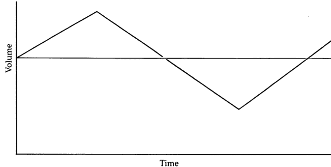

### 图 1-11. 锯齿波

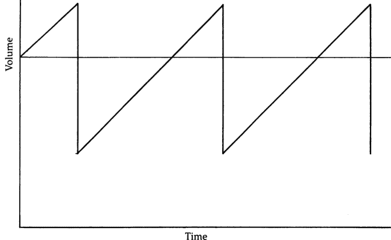

## SID: 声音接口设备

### 程序 1-8. 锯齿波

为了确保程序输入无误，请务必阅读附录 C 中的“自动检查器”。

```
10 REM --- 清空声音寄存器 ---:rem 251
20 FOR R=54272 TO 54296,POKE,0:NEXT :rem 25
30 REM 开启音量 :rem 50
40 POKE 54296,15 :rem 47
50 REM - 初始化特殊寄存器 :rem 78
60 POKE 54275,8:POKE 54277,0:POKE 54278,240 :rem 3
70 REM - 从表格获取音调 - :rem 141
75 READ L,H: IF L=999 RESTORE:OTO 75 :rem 119
77 REM - 将音调值 POKE 通道 1 :rem 149
80 POKE 54272,L: POKE 54273,H :rem 245
90 REM 启用音调寄存器 - :rem 233
100 POKE 54276,33 :rem 90
110 REM - 播放 1/8 秒音调并调整音量 :rem 237
120 FOR R=15 TO 0 STEP -1:POKE 54296,R:NEXT :rem 70
130 REM - 关闭声音寄存器 :rem 228
140 POKE 54276,3 :rem 93
150 GOTO 75 :rem 59
160 REM - 关闭音量 :rem 209
165 POKE 54296,0 :rem 49
170 REM - 音调 - :rem 116
180 DATA 195,16,194,17,208,18,238,19,30,21,99,22,1
83,29,25,25,15,26,48,28,22,21 :rem 15
190 DATA 29,16,31,13,33,164,31,221,29,48,28,155,:rem 204
26,29,25,180,23,95,22,30,21
195 DATA 238,219,08,194,17,999,999 :rem 83
```

噪声（Noise）是 64 上最不规则波形。它产生随机波，创造出一种沙哑、粗糙的声音。它可以用于许多不同的音效，也可以作为音乐的组件。根据你选择的频率，它听起来可以从高频的嘶嘶声到低频的轰隆声。通常被称为白噪声，在游戏音效（如爆炸、人群嘈杂或发动机故障声）中特别有用。

噪声波形显然不是对称的，它可以以多种形式出现，其中如图 1-12 所示。

设置波形控制寄存器的第 7 位可启用噪声发生器。你通过向正在使用的通道控制寄存器 POKE 值 128（波形为 128，门控位为 1）来实现这一点。要听到我们一直使用的示例中的噪声波形，只需将程序 1-8 中的第 100 行和 140 行改为：

```
100 POKE 54276,129
140 POKE 54276,128
```

### 图 1-12. 噪声波形

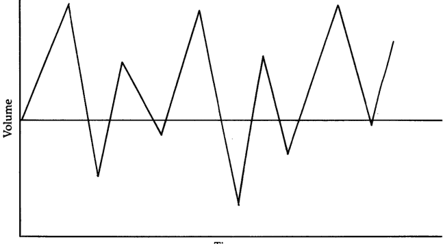

## 高级技巧

现在你已经学会了如何创建单音，甚至是一个从 DATA 表读取并播放多个音符的短程序，让我们来看两个短程序，它们展示了听起来很棒但又非常简单的音效。这是为第二章做准备的好方法，第二章将展示如何产生更复杂、更有有趣的音效。

使用通道 1 的频率寄存器，你可以创建一个扫音效果，从最低八度的底端开始，快速上升到尽可能高的频率。这听起来可能很难，但其实不然。看下程序 1-9，它使用了这种技术。

### 程序 1-9. 扫音

为了确保程序输入无误，请务必阅读附录 C 中的“自动检查器”。

```
10 FOR R=54272 TO 54296:POKE R,0:NEXT :rem 24
POKE 54296,15 :rem 45
```

```
30 POKE 54275,8:POKE 54277,0:POKE 54278,240 :rem 1
40 FOR H=0 TO 255 :rem 63
50 POKE 54272,0:POKE 54273,H :rem 214
60 POKE 54276,33 :rem 47
70 NEXT :rem 166
80 POKE 54276,32 :rem 48
90 POKE 54296,0 :rem 254
```

这个程序的大部分你应该已经熟悉了。 40-70 行的 FOR-NEXT 循环产生 0 到 255 的值并 POKE 到高频率寄存器中。只有高寄存器被改变了。你可以通过滑动冲宽产生类似的效果。虽然听起来完全不同，程序 1-10 的工作原理相同。

### 程序 1-10. 冲宽值

```
20 FOR R=54272 TO 54296:POKE R,0:NEXT :rem 25
30 POKE 54296,15 :rem 46
40 POKE 54272,8:POKE 54277,0:POKE 54278,240 :rem 1
50 POKE 54272,0:POKE 54273,28 :rem 52
55 POKE 54276,65 :rem 56
60 FOR T=0 TO 4095 STEP 8:H=INT(T/256):L=T-(H*256) :rem 182
80 POKE 54274,L:POKE 54275,H :rem 249
90 NEXT :rem 168
95 POKE 54276,64 :rem 59
100 POKE 54296,0 :rem 38
```

第 60 行可能看起来很混乱。实际上，它是声音程序的核心。它产生了第 80 行中 POKE 的高低冲宽寄存器的值。首先，建立了一个从 0 到 4095 的 NEXT 循环，STEP 命令为 8。双字节冲宽寄存器包含的最大数字是 4095。每次循环，变量 T 增加 8。高冲宽寄存器的变量 H 是 T 除以 256 的整数。低冲宽寄存器的变量 L 等于 T-(H*256)。例如，如果 T 等于 256，则 H 等于 1，L 等于 0。注意，由于我们处理的是冲宽，通过 POKE 控制寄存器 65 来启用冲宽波形。你准备好进入声音创作更困难的部分了。如果你仍然不理解 ADSR、波形、音量控制以及如何选择音效和单个音符的参数，最好再过一遍这一章，甚至浏览一下引言中的术语表。如果你不知道如何或为什么在 64 上创建简单的声音，这本书的后面章节可能会困难。

# 第 2 章 音乐与声音编辑器

## 播放音符

第一章向你展示了如何使用 SID 创建声音。大部分更像音效而不是真正的曲子。我们将在章开始这样做。表 1-1 显示了每个通道的特定寄存器及其位置。一旦你知道如何开启声音以及如何设置音符频率，就可以通过简单更改 DATA 语句中的值来播放任何曲子。你只需要记住值必须成对出现：一个低音调值对应高音调值。例如，如果你将 DATA 语句替换为另一组，你可以创建一个像程序 1-2 那样的曲子。（如果你之前已经保存了第 1 章的程序 1-2，只需替换下文所示的内容。）

### 程序 2-1. Yankee Doodle

为了确保程序输入无误，请务必阅读附录 C 中的“自动检查器”。


# 音乐与声音编辑器

## 程序 2-1

```basic
10 REM --- 清空寄存器 --- :rem 251
20 FOR R=54272 TO 54296:POKE R,0:NEXT :rem 25
30 REM 开启音量 :rem 95
40 POKE 54296,15 :rem 47
50 REM - 初始化寄存器 :rem 78
60 POKE 54275,8:POKE 54277,0:POKE 54278,240 :rem 3
70 REM - 从表格获取音调 - :rem 141
75 READ L,H: IF L=999 THEN RESTORE:GOTO 75 :rem 119
77 REM - 将音调值 POKE 通道 1 :rem 149
80 POKE 54272,L: POKE 54273,H :rem 245
90 REM 启用音调寄存器 - :rem 233
100 POKE 54276,65 :rem 95
110 REM - 播放 1/8 秒音调 - :rem 119
120 FOR R=15 TO 0 STEP -1:POKE 54296,R:NEXT :rem 70
130 REM - 关闭声音寄存器 :rem 228
140 POKE 54276,3 :rem 93
150 GOTO 75 :rem 59
160 REM - 关闭音量 :rem 209
165 POKE 54296,0 :rem 49
170 REM - 音调 - :rem 116
180 DATA 195,16,194,17,208,18,238,19,30,21,99,22,183,29,25,25,15,26,48,28,22,21 :rem 15
190 DATA 29,16,31,13,33,164,31,221,29,48,28,155,26,29,25,180,23,95,22,30,21 :rem 204
195 DATA 238,219,08,194,17,999,999 :rem 83
```

## 程序 2-2

```basic
120 FOR R=0 TO 125: NEXT :rem 237
130 REM - 关闭声音寄存器 - :rem 228
140 POKE 54276,64 :rem 98
150 REM - 关闭音量 - :rem 208
160 GOTO 75 :rem 60
165 POKE 54296,0 :rem 49
170 REM - 音调表 - :rem 116
180 DATA 15,16,19,16,208,18,30,21,95,16,30,21,2008,18,12,16,19,16 :rem 162
185 DATA 208,18,30,21,16,0,210,15,0,195,16,195,16,208,18,30,21,95,22 :rem 131
190 DATA 30,21,28,15,16,210,142,12,24,14,2105,15,16,0,195,16,0 :rem 162
195 DATA 99999
```

为了听到攻击率（attack）和衰减率（decay）变化带来的差异，请尝试将第 60 行中 `54277` 处的值改为 `10`、`172` 或 `208`。这种如此简单的改变对声音的修改效果将让你感到惊讶。

通过比较 `DATA` 语句中的高低寄存器值，你应该能够看到正在生成的实际音符。例如，第一对数值由低值 `195` 和高值 `16` 组成。表 1-3 显示，这些数值创建了五音区的一个 C 音。第二对是另一个 C 音，而第三对（`208` 和 `18`）则在同一音区内创建了一个 D 音。从掌握创建每个音符的数值到阅读乐谱并将你看到的音符转换为你的 64 能够理解的数值，这并不遥远。这并不难。

# 时机与节奏

音乐不仅仅按顺序播放的音符集合。它在很大程度上取决于时机。何时播放每个音符与播放哪个音符同样重要。每当你编写歌曲时，必须同时考虑到音符和音乐的时机；否则，你无法准确地复制歌曲。

你刚刚输入并运行程序 2-1 后弹出的旋律在它的 `DATA` 语句中包含几对 `0`。你看到的第一对 `0` 位于第 185 行。这些 `0` 被放置在那里是为了音乐提供停顿。没有这些停顿，音乐将由毫无节奏的平淡音符组成。你可以通过删除程序 2-1 中第 185 行和 190 行的 `0` 以及它们之间的逗号来听到这一点。总共有四对。完成后，再次 `RUN` 程序并听听区别。旋律的前部分是可以辨认的，但当它到达中间时，开始变得奇怪。音符仍然相同，但时机和节奏乱了。

通过在音乐的不同位置放置停顿，你可以改变整首歌的感受。记住，爵士乐和摇滚等音乐风格的主要区别之一就是节奏。

程序 2-2 使用了程序 2-1 的框架，但 `DATA` 语句发生了更改。行中插入了额外的作为停顿的数值对。你只需将新的 `DATA` 语句输入你保存的程序 2-1 版本并重新运行即可。虽然你能认出那段旋律，但它会被停顿扭曲，速度变慢，听起来就像八音盒里发出的版本。试一试。

### 程序 2-2——“扬基当当”——带停顿

为了确保程序录入无误，请务必阅读附录 C 中的“自动校对”。

```basic
10 REM --- 清除寄存器 --- :rem 251
20 FOR R=54272 TO 54296:POKE R,0:NEXT :rem 255
30 REM --- 打开音量 :rem 95
40 POKE 54296,15 :rem 47
50 REM --- 初始化特殊寄存器 :rem 78
60 POKE 54275,8:POKE 54277,0:POKE 54278,240 :rem 3
70 REM --- 从表中获取音调 -- :rem 141
75 READ L,H: IF L=999 THEN RESTORE: GOTO 75
77 REM 将音调值存入通道 1 :rem 119
80 POKE 54272,L:POKE 54273,H :rem 245
90 REM --- 启用音调寄存器 :rem 233
100 POKE 54276,65 :rem 95
110 REM --- 播放音调 1/8 秒 :rem 119
120 FOR R=0 TO 125: NEXT :rem 237
130 REM --- 关闭声音寄存器 :rem 228
140 POKE 54276,6 :rem 98
150 REM --- 关闭音量 :rem 208
160 GOTO 75 :rem 60
165 POKE 54296,0 :rem 49
170 REM - 音调表 - :rem 116
180 DATA 15,16,19,16,208,18,30,21,95,16,30,21,2008,18,12,16,19,16 :rem 162
185 DATA 208,18,30,21,16,0,210,15,0,195,16,195,16,208,18,30,21,95,22 :rem 131
190 DATA 30,21,28,15,16,210,142,12,24,14,2105,15,16,0,195,16,0 :rem 162
195 DATA 99999
```

虽然你可以通过添加停顿来放慢歌曲节奏，但没有什么可以加快单个音符。要让旋律变快，你可以做两件事之一：使用更快的音符（例如使用更短的攻击和衰减率，减小持续循环的长度），或者通过利用独立的循环改变音乐的时机。

# 停顿技术

几个短程序可以展示停顿和延迟是如何工作的。在第一个示例中，通过保持稳定的节奏并在必要的地方添加停顿来调整鼓点速度。

### 程序 2-3. 蛇鼓

为了程序录入无误，请阅读附录中的“自动校对”。

```basic
10 REM -- 清除寄存器 --- :rem 251
20 FOR R=54272 TO 54296:POKE R,0:NEXT :rem 25
30 REM - 打开音量 :rem 95
40 POKE 54296,15 :rem 47
50 REM - 初始化特殊寄存器 -- :rem 78
60 POKE 54277,0:POKE 54278,240 :rem 47
70 REM - 从表中获取音调 - :rem 141
75 READ L,H: IF L=999 THEN RESTORE: GOTO 75 :rem 119
77 REM 将音调值存入通道 1 :rem 149
80 POKE 54272,L:POKE 54273,H :rem 245
90 REM - 启用音调寄存器 :rem 233
100 POKE 54276,129 :rem 144
110 REM - 播放音调 1/64 秒 - :rem 169
120 FOR R=0 TO 16: NEXT :rem 188
130 REM - 关闭门位 :rem 201
140 POKE 54276,128:GOTO 75 :rem 114
170 REM - 音符表 - :rem 116
180 DATA 1,14,1,14,1,14,14,0,0,0,1,14,14,0,0,0, 1,24,0,0,0,999,99:rem 25
```

此程序使用噪声波形，通过向波形控制寄存器写入 `129`（`128` 代表波形，`1` 用于启用门位）来模拟鼓声。通过第 120 行的 `FOR-NEXT` 循环，所有音符都以 1/64 秒的速度播放。唯一改变的是音符之间的停顿。此外，音符具有最短的攻击和衰减率，通过在第 60 行的 `54277` 处写入 `0`，音符看起来非常短。通过在该位置写入数值 `10`，你可以听到不同的声音。它设定了持续时间，但节奏略有不同。下一个示例显示了另一种可以改变单个音符时机的方法。

### 程序 2-4. 调鼓

为了确保程序录入无误，请务必阅读附录 C 中的“自动校对”。

```basic
10 REM - 清除声器 :rem 251
20 FOR R=54272 TO 54296:POKE R,0:NEXT :rem 25
30 REM - 打开音量 :rem 95
40 POKE 54296,15 :rem 47
50 REM - 初始化特殊寄存器 -- :rem 78
60 POKE 54277,0:POKE 54278,240 :rem 47
70 REM - 从表中获取音调 - :rem 141
75 READ L,H: IF L=999 THEN RESTORE: GOTO 75 :rem 119
77 REM 将音调值存入通道 1 :rem 149
80 POKE 54272,L:POKE 54273,H :rem 245
90 REM - 启用音调寄存器 :rem 233
100 POKE 54276,129 :rem 144
110 REM - 播放音调 1/64 秒 - :rem 169
120 FOR R=0 TO 16: NEXT :rem 188
130 REM - 关闭门位 :rem 201
140 POKE 54276,128:GOTO 75 :rem 114
170 REM - 音符表 - :rem 116
180 DATA 1,14,1,14,1,14,14,0,0,0,1,14,14,0,0,0, 1,24,0,0,0,999,99:rem 25
```

这种方法让你调整时间长度和音符之间的停顿。然而，请注意，放弃了灵活性。虽然在创建鼓声时没有大问题，但这种不灵活性会让歌曲变得有些繁琐。操作节奏和

### 程序 2-5. “扬基当当”中的音调与停顿

为了确保程序录入无误，请务必阅读附录 C 中的“自动校对”。

```basic
10 REM --- 清除寄存器 --- :rem 251
20 FOR R=54272 TO 54296:POKE R,0:NEXT :rem 25
30 REM - 打开音量 :rem 95
40 POKE 54296,15 :rem 47
50 REM --- 初始化特殊寄存器 --- :rem 78
60 POKE 54277,0:POKE 54278,240 :rem 47
70 REM - 从节奏表中获取时机 :rem 197
75 READ L,H,T,TT:IF L=999 THEN END :rem 159
77 REM 将 T 值存入通道 1 :rem 149
80 POKE 54272,L:POKE 54273,H :rem 245
90 REM - 启用 T 寄存器 :rem 233
100 POKE 54276,33 :rem 90
110 REM - 播放音调持续指定时间-:rem 222
120 FOR R=0 TO T*3: NEXT :rem 6
130 REM - 关闭门位 :rem 201
140 POKE 54276,32 :rem 93
145 FOR R=0 TO TT*3: NEXT:GOTO 75 :rem 64
170 REM - RHYTHM TABLE - :rem 26
180 DATA 195,16,32,32,195,16,32,208,18,32,32,30,21,32,195 :rem 15
182 DATA 16,32,32,30,21,32,208,18,32,142,123,2,32,196,16,32,195,16,32 :rem 223
185 DATA 32,208,18,32,30,21,32,195,16,128,32,21,15 :rem 225
187 DATA 128,32,195,16,32,195,16,32,208,18,32,30,21,32,95,22,32,32 :rem 239
190 DATA 30,21,32,208,18,32,195,16,32,32,21,15,32,32,142,12,32 :rem 172
192 DATA 24,14,32,32,210,15,32,195,16,32,18,32,5,16,128,32,999,999,999 :rem 10
```

该程序读取第 75 行中的几个变量，并将音值 `POKE` 到频率控制寄存器中，而 `T` 和 `TT` 分别设置持续延迟循环的长度和音符之间的延迟。在 `DATA` 语句中，值每四个一组。第一个值变为 `L`，第二个是 `H`，第三个是 `T`，第四个是 `TT`。这就是为什么与之前的示例相比，`DATA` 语句中有这么多值。虽然程序最后六行的数字列表看起来可能很困惑，特别是如果你刚开始在 64 上使用声音功能，但它是调节歌曲节奏最简单的方法，同时能够产生特定的音符。

如果那组数字让你觉得在 Commodore 64 上创作真实的音乐是不可能的，请不要担心。有一种方法可以相对轻松地创建这些数字。使用音频编辑器，你可以获得听到几乎你所想象的任何声音或乐曲所需的数值。接下来将介绍这样一个编辑器。

# 整合音乐的工具

我们在上一节制作的歌曲实际上非常简单。尽管如此，制作它所需的数据相当复杂，很容易看出，如果是一首更复杂的歌曲，要跟踪所有的音符变化和时值将几乎是不可能的。

简化这一过程的一种方法是将信息组织并放入一个你可以作为歌曲编写的图表中。一旦你有了该图表，就可以简单地将此表转换为数据。表 2-1 显示了《扬基当当》（Yankee Doodle）的所有 `DATA`，并按如下图表形式设置：

### 表 2-1. 《扬基当当》DATA

| 低音值 | 高音值 | 音符长度值 | 暂停长度值 |
|---|---|---|---|
| 195 | 16 | 32 | 32 |
| 195 | 16 | 32 | 32 |
| 208 | 18 | 32 | 32 |
| 30 | 21 | 32 | 32 |
| 195 | 16 | 32 | 32 |
| 30 | 21 | 32 | 32 |
| 208 | 18 | 32 | 32 |
| 142 | 12 | 32 | 32 |
| 196 | 16 | 32 | 32 |
| 195 | 16 | 32 | 32 |
| 208 | 18 | 32 | 32 |
| 30 | 21 | 32 | 32 |
| 195 | 16 | 128 | 32 |
| 210 | 15 | 128 | 32 |
| 195 | 16 | 32 | 32 |
| 195 | 16 | 32 | 32 |
| 208 | 18 | 32 | 32 |
| 30 | 21 | 32 | 32 |
| 95 | 22 | 32 | 32 |
| 30 | 21 | 32 | 32 |
| 208 | 18 | 32 | 32 |
| 195 | 16 | 32 | 32 |
| 210 | 15 | 32 | 32 |
| 142 | 12 | 32 | 32 |
| 24 | 14 | 32 | 32 |
| 210 | 15 | 32 | 32 |
| 195 | 16 | 128 | 32 |
| 195 | 16 | 128 | 32 |

如果你将此表的值与程序 2-5 中的 `DATA` 语句进行比较，你会发现它们是相同的。通过四个一组列出值，你可以很容易看出音乐是如何构建的。显然，这比边写边构建好得多。然而，如果你要利用这种图表，仍然需要熟悉频率表和时间倍数。为了让此表更实用且更容易遵循，你可以向实际数据添加音符名称和时值计数。现在表格更容易理解了。

### 表 2-2. 音符值与计数

| 音符名称 | 低音值 | 高音值 | 长度值 | 暂停长度值 | 时值计数 |
|---|---|---|---|---|---|
| C | 195 | 16 | 32 | 32 | 1 |
| C | 195 | 16 | 32 | 32 | 1 |
| D | 208 | 18 | 32 | 32 | 1 |
| E | 30 | 21 | 32 | 32 | 1 |
| E | 195 | 16 | 32 | 32 | 1 |
| E | 30 | 21 | 32 | 32 | 1 |
| D | 208 | 18 | 32 | 32 | 1 |
| G | 142 | 12 | 32 | 32 | 1 |
| C | 196 | 16 | 32 | 32 | 1 |
| C | 195 | 16 | 32 | 32 | 1 |
| D | 208 | 18 | 32 | 32 | 1 |
| E | 30 | 21 | 32 | 32 | 1 |
| C | 195 | 16 | 128 | 32 | 4 |
| B | 210 | 15 | 128 | 32 | 4 |
| C | 195 | 16 | 32 | 32 | 1 |
| C | 195 | 16 | 32 | 32 | 1 |


| D | 208 | 18 | 32 | 32 | 1 |
| E | 30 | 21 | 32 | 32 | 1 |
| F | 95 | 22 | 32 | 32 | 1 |
| E | 30 | 21 | 32 | 32 | 1 |
| D | 208 | 18 | 32 | 32 | 1 |
| C | 195 | 16 | 32 | 32 | 1 |
| B | 210 | 15 | 32 | 32 | 1 |
| G | 142 | 12 | 32 | 32 | 1 |
| A | 24 | 14 | 32 | 32 | 1 |
| B | 210 | 15 | 32 | 32 | 1 |
| C | 195 | 16 | 128 | 32 | 4 |
| C | 195 | 16 | 128 | 32 | 1 |

## 简单的音频编辑器

一旦你使用上面的表格工作了一段时间，你可能会发现，虽然这种方法在编写音乐方面提供了很大的灵活性，但很繁琐。你需要的某种更接近真实乐器的东西。音频编辑器可以提供这种能力。制作像钢琴那样的音乐是很困难的，一个好的音频编辑器应该能让你轻松输入音符并听到你选择的音符。低频和频率控制寄存器应该像你在之前的 `FOR-NEXT` 程序中做的那样改变音符的长度。音符之间的暂停也应该是简单的。简单的音频编辑器还可以让你存储你的音乐、回播放它，甚至更改它的调性。一旦你将其输入并保存到磁带或磁盘，你就可以避免在 64 上创建声音的苦差。为了确保无误，请阅读附录 C。

### 程序 2-6. 单声道音频编辑器

```basic
1 INITIALIZE SOUND REGISTERS :rem 26
2 :rem 22
3 FOR R=54272 TO 54296:NEXT: 54275,54276,240 :rem 243
4 LE=100:I=0 :rem 63
5 DIM C(62),II(63),5(99),LO(99),UP(99),PA(99),LS(88) :rem 82
6 K(16)=D(21)=E(22)=G(28)=G(31)=A(31)=B
7 :rem 85
8 DEFINE MAXIMUM KEYS :rem 181
9 :rem 29
10 CS=D(20)[RIGHT]=E@{4 LEFT]M3EM(99)[6 LEFT]M3E3[5 LEFT]D(95)[5 LEFT]S3 :rem 0
11 K(33)=T(37)=D(34)=E(44)=F(50)=G(56)=A" :rem 70
12 K(63)=B :rem 173
13 K(17)=C(19)=D(23)=F(26)=G(29)=G(35)=T#rem 1  Editor
14 K(39)=D(47)=F(53)=G(59)=A#rem 124
20 D$={2 DOWN}{8 RIGHT}E@{0 DOWN}{4 LEFT}M3M3{DOWN}{6 LEFT}G2E2 M3{DOWN}{6 LEFT}{RIGHT}N3 T3}{5 LEFT}E5 T3 :rem 16
30 E$={2 DOWN}{3 RIGHT}E@{0 DOWN}{4 LEFT}M3M3{DOWN}{6 LEFT}G3E2 M3{DOWN}{6 LEFT}{RIGHT}N3 T3}{5 LEFT}E5 T3 :rem 160
40 F$={2 DOWN}{3 RIGHT}E@{0 DOWN}{4 LEFT}M3M3{DOWN}{6 LEFT}G3E2 M3{DOWN}{6 LEFT}{RIGHT}N3 T3}{5 LEFT}E5 T3 :rem 53
50 G$={2 SPACES}{2 DOWN}E@{0 DOWN}{4 LEFT}M3M3{DOWN}{6 LEFT}T3{DOWN}M3{6 LEFT}{RIGHT}N3 T3}{5 LEFT}E5 T3 :rem 241
55 A$={2 DOWN}{27 RIGHT}E@{0 DOWN}{4 LEFT}M3M3{DOWN}{6 LEFT}G3E2 M3{DOWN}{6 LEFT}{RIGHT}N3 T3}{5 LEFT}E5 T3 :rem 197
65 A$={2 SPACES}{27 RIGHT}E@{0 DOWN}{4 LEFT}M3M3{DOWN}{6 LEFT}G3E2 M3{DOWN}{6 LEFT}{RIGHT}N3 T3}{5 LEFT}E5 T3 :rem 125
70 B$={2 SPACES}{32 DOWN}E@{0 DOWN}{4 LEFT}M3M3{DOWN}{6 LEFT}G3E2 M3{DOWN}{6 LEFT}{RIGHT}N3 T3}{5 LEFT}E5 T3 :rem 188
75 B$={2 DOWN}{E@{0 DOWN}{4 LEFT}M3M3{DOWN}{6 LEFT}G3E2 M3{DOWN}{6 LEFT}{RIGHT}N3 T3}{5 LEFT}E5 T3 :rem 16
80 Q$={2 DOWN}{5 RIGHT}E@{0 DOWN}{4 LEFT}M3M3{DOWN}{6 LEFT}G3E2 M3{DOWN}{6 LEFT}M3{T3}{5 LEFT}E53 :rem 158
90 W$={2 DOWN}{10 RIGHT}E@{0 DOWN}{4 LEFT}M3M3{DOWN}{6 LEFT}G3E2 M3{DOWN}{6 LEFT}{RIGHT}N3 T3 :rem 200
100 U$={2 DOWN}{14 RIGHT}E@{0 DOWN}{4 LEFT}M3M3{DOWN}{6 LEFT}G3E2 M3{DOWN}{6 LEFT}{RIGHT}N3 T3}{5 LEFT}E5 T3 :rem 222
105 U$={2 DOWN}{E@{0 DOWN}{4 LEFT}M3M3{DOWN}{6 LEFT}G3E2 M3{DOWN}{6 LEFT}{RIGHT}N3 T3}{5 LEFT}E5 T3 :rem 98
110 R$={2 DOWN}{19 RIGHT}E@{0 DOWN}{4 LEFT}M3M3{DOWN}{6 LEFT}G3E2 M3{DOWN}{6 LEFT}{RIGHT}N3 T3}{5 LEFT}E5 T3 :rem 56
115 R$={2 DOWN}{E@{0 DOWN}{4 LEFT}M3M3{DOWN}{6 LEFT}G3E2 M3{DOWN}{6 LEFT}{RIGHT}N3 T3}{5 LEFT}E5 T3 :rem 0
120 T$={2 DOWN}{24 RIGHT}E@{0 DOWN}{4 LEFT}M3M3{DOWN}{6 LEFT}G3E2 M3{DOWN}{6 LEFT}{RIGHT}N3 T3}{5 LEFT}E5 T3 :rem 204
125 T$={2 DOWN}{E@{0 DOWN}{4 LEFT}M3M3{DOWN}{6 LEFT}G3E2 M3{DOWN}{6 LEFT}{RIGHT}N3 T3}{5 LEFT}E5 T3 :rem 7
130 Y$={2 DOWN}{29 RIGHT}E@{0 DOWN}{4 LEFT}M3M3{DOWN}{6 LEFT}G3E2 M3{DOWN}{6 LEFT}{RIGHT}N3 T3}{5 LEFT}E5 T3 :rem 99
135 Y$={2 RIGHT}{E@{0 DOWN}{4 LEFT}M3M3{DOWN}{6 LEFT}G3E2 M3{DOWN}{6 LEFT}{RIGHT}N3 T3}{5 LEFT}E5 T3 :rem 23
140 U$={2 DOWN}{34 RIGHT}E@{0 DOWN}{4 LEFT}M3M3{DOWN}{6 LEFT}G3E2 M3{DOWN}{6 LEFT}{RIGHT}N3 T3}{5 LEFT}E5 T3 :rem 241
145 US$={2 RIGHT}{E@{0 DOWN}{4 LEFT}M3M3{DOWN}{6 LEFT}G3E2 M3{DOWN}{6 LEFT}{RIGHT}N3 T3}{5 LEFT}E5 T3 :rem 233
```

## 音乐与音频编辑器

```basic
150 SP="HOME}{12 DOWN"                               :rem 189
160 AS=SP+$AS:BS=SP+$C:CS=SP+$D:DS=SP+$E=SP
+E:FS=SP+$SF+$G:GS=SP+$GS                               :rem 236
170 QS=SP+$QS:WS=SP+$TH:EE=SP+$EE:R:RS=SP+$RT:T=S
nP+T:YS=SP+$TY+$U:US=SP+$US                               :rem 65
171 GRS="HOME}{RVS} NOTE [OFF]- LOWER - UPPER - L
EN - PAUSE - #"                                            :rem 170
172 GRS=GRS+{HOME}{DOWN}********************:rem 107
********************
173 LL="{6 SPACES}-{7 SPACES}-{7 SPACES}-\:rem 41
{5 SPACES}{7 SPACES}{3 SPACES}"                               :rem 118
200 REM ***** DEFINSE REVERSE KEY *****                     :rem 32
205 REM                                                     :rem 123
210 XC="{2 DOWN}{3 RIGHT}E3@{}DOWN{4 LEFT}(RVS
{E6}{E6}*{E3}{DOWN}{6 LEFT}{E6}{M3}{RVS}N3 T3M}(OFF)
M2 M{DOWN}{6 LEFT}{E6}{M3}{RVS}N3 T3M}(OFF)
{DOWN}{5 LEFT}E5 T                                          :rem 99
220 XD="{2 DOWN}{3 RIGHT}E3@{}DOWN{4 LEFT}(RVS
{E6}{E6}*{E3}{DOWN}{6 LEFT}{E6}{M3}{G2}(OFF)
G2 M{DOWN}{6 LEFT}{RIGHT}N3 T3M}(OFF)
{5 LEFT}E5 T                                              :rem 207
230 XS="{2 DOWN}{13 RIGHT}E3@{}DOWN{4 LEFT}(RVS
{RVS}{E6}*{E3}{DOWN}{6 LEFT}{RIGHT}G3
M2 M{DOWN}{6 LEFT}{RIGHT}N3 T3M}(OFF)
{5 LEFT}E5 T                                              :rem 15
250 XG="{2 SPACES}{2 DOWN}{10 RIGHT"                               :rem 140
255 XFS=XS+{13 RIGHT}E3@{}DOWN{4 LEFT}(RVS
{E6}{E6}*{E3}{DOWN}{6 LEFT}{RIGHT}G4{G2 M2
{DOWN}{6 LEFT}{RIGHT}N3 T3M}(OFF)
{5 LEFT}E5 T                                              :rem 227
260 XG=XS+{2 SPACES}{1 DOWN}{1 RIGHT}                               :rem 31
265 XAS=XA+{13 RIGHT}E3@{}DOWN{4 LEFT}(RVS
{E6}{E6}*{E3}{DOWN}{6 LEFT}{RIGHT}G5{E2 M2
{DOWN}{6 LEFT}{RIGHT}N3 T3M}(OFF)
{5 LEFT}E5 T                                              :rem 232
270 XBS="{2 SPACES}{2 DOWN}{15 RIGHT"                               :rem 171
275 XBS=XS+{13 RIGHT}E3@{}DOWN{4 LEFT}(RVS
{E6}{E6}*{E3}{DOWN}{6 LEFT}{RIGHT}G7{E2 M2
{DOWN}{6 LEFT}{RIGHT}N3 T3M}(OFF)
{5 LEFT}E5 T                                              :rem 223
290 XC=SP+$XC:XD=SP+$XD:XE=SP+$XE:XF=SP+$XF
$XG=SP+$XG:XA=SP+$XA                                     :rem 219
```

### 2

#### 音乐与音频编辑器

```basic
295 XQ=$SP+$XB :rem 75

310 XQS={6 DOWN} {2 RIGHT} :rem 130

315 XQS=QS+$ {2 DOWN {3 RIGHT}£3 @{DOWN {4 LEFT

{RVS}£6G M£*3{DOWN {6 LEFT {OFF}M{RVS

{G£QE£M2 M{DOWN {6 LEFT {OFF}M{RVS}N3 T£M

{OFF}DOWN {5 LEFT {5 T¶ :rem 110

330 XW={6 DOWN {7 RIGHT} :rem 26

325 XWS-XW+{2 DOWN {3 RIGHT}£3 @{DOWN {4 LEFT

{RVS}£6G M£*3{DOWN {6 LEFT {OFF}M{RVS

{G£QE£2 M{DOWN {6 LEFT {RIGHT}N3 T£M

{DOWN} {5 LEFT {5 T¶ :rem 83

330 ZE$={6 DOWN {12 RIGHT} :rem 156

335 ZE$=ZE+{2 DOWN {3 RIGHT}£3 @{DOWN {4 LEFT

{RVS}£6G M£*3{DOWN {6 LEFT {OFF}M{RVS

{G£QE£2 M{DOWN {6 LEFT {RIGHT}N3 T£M

{DOWN} {5 LEFT {5 T¶ :rem 14

340 XRS={6 DOWN {2 RIGHT} :rem 57

345 XRS=XRS+{2 DOWN {3 RIGHT}£3 @{DOWN {4 LEFT

{RVS}£6G M£*3{DOWN {6 LEFT {OFF}M{RVS

{G£QE£2 M{DOWN {6 LEFT {RIGHT}N3 T£M

{DOWN} {5 LEFT {5 T¶ :rem 70

350 XTS={6 DOWN {22 RIGHT} :rem 205

355 XTS+XTS+{2 DOWN {3 RIGHT}£3 @{DOWN {4 LEFT

{RVS}£6G M£*3{DOWN {6 LEFT {OFF}M{RVS

{G£QE£2 M{DOWN {6 LEFT {RIGHT}N3 T£M

{DOWN} {5 LEFT {5 T¶ :rem 77

360 XW={6 DOWN {27 RIGHT} :rem 100

365 XYS+XYS+{2 DOWN {3 RIGHT}£3 @{DOWN {4 LEFT

{RVS}£6G M£*3{DOWN {6 LEFT {OFF}M{RVS

{G£QE£2 M{DOWN {6 LEFT {RIGHT}N3 T£M

{DOWN} {5 LEFT {5 T¶ :rem 93

370 XUS={6 DOWN {32 RIGHT} :rem 242

375 XUS+XUS+{2 DOWN {3 RIGHT}£3 @{DOWN {4 LEFT

{RVS}£6G M£*3{DOWN {6 LEFT {OFF}M{RVS

{G£QE£2 M{DOWN {6 LEFT {RIGHT}N3 T£M

{DOWN} {5 LEFT {5 T¶ :rem 82

390 XQ=$SP+$XQ;XW=$SP+$XW;ZE=$SP+$ZE;XR=$SP+$XR;XTS=$SP+$XTS;XYS=$SP+$XYS;XPS=$SP+$XPS

395 XUS=$SP+$XUS :rem 222

400 GOSUB 640 :rem 128

480 REM :rem 20

490 REM GET ROUTINE :rem 134

495 REM :rem 39

500 GET WW: IFW="" THEN 500 :rem 116

502 IF WW="" THEN 4710 :rem 245

503 IF WW="F3" THEN 5010 :rem 252

504 IF WW="F5" THEN 5510

505 IF WW="RIGHT} OR WW="LEFT} THEN 4000 :rem 29

506 IF WW="F1]" THEN 4410 :rem 250

507 IF WW="UP]" OR WW="DOWN]" THEN 4510:rem 13

509 IF ASC(WW)<40 OR ASC(WW)>200 THEN 810 :rem 250

511 IF WW="1" THEN 520 :rem 172

512 PRINTXC;L=19:H=16:GOSUB 1000 :rem 34

515 PRINTSC;GOTO500 :rem 210

520 IF WW="2" THEN 530 :rem 175

522 PRINTTDX;L=208:H=18:GOSUB 1000 :rem 33

525 PRINTTDD;GOTO500 :rem 212

530 IF WW="3" THEN 540 :rem 178

532 PRINTXE;L=30:H=21:GOSUB 1000 :rem 230

535 PRINTSE;GOTO500

540 IF WW="4" THEN 550 :rem 181
```


# BASIC 程序清单

```basic
542 PRINTKFX;L=95:H=22:GOSUB 1000 :rem 244
545 PRINTSQ;GOTO500 :rem 216
550 IF WW="5" THEN 560 :rem 184
552 PRINTTXG;L=29:H=25:GOSUB 1000 :rem 246
555 PRINTSQ;GOTO500 :rem 218
560 IF WW="6" THEN 570 :rem 187
562 PRINTTXA;L=48:H=28:GOSUB 1000 :rem 245
565 PRINTA;GOTO500 :rem 213
570 IF WW="7" THEN 580 :rem 190
572 PRINTXB;L=164:H=31:GOSUB 1000 :rem 32
575 PRINTSB;GOTO500 :rem 215
580 IF WW="8" THEN 590 :rem 218
582 PRINTTXQ;L=134:H=33:GOSUB 1000 :rem 47
585 PRINTSQ;GOTO500 :rem 231
590 IF WW="9" THEN 900 :rem 217
592 PRINTXW;L=161:H=37:GOSUB 1000 :rem 58
595 PRINTSW;GOTO500 :rem 238
600 IF WW="E" THEN 610 :rem 192
602 PRINTZE;L=88:H=42:GOSUB 1000 :rem 236
605 PRINTSE;GOTO500 :rem 25
610 IF WW="R" THEN 620 :rem 207
612 PRINTXR;L=191:H=44:GOSUB 1000 :rem 47
615 PRTR;GOTO500 :rem 226
620 IF WW="T" THEN 630 :rem 211
622 PRINTXT;L=58:H=50:GOSUB 1000 :rem 1
625 PRINTY;GOTO500 :rem 229
630 IF WW="X" THEN 640 :rem 218
632 PRINTXY;L=97:H=56:GOSUB 1000 :rem 4
635 PRINTS;GOTO500 :rem 235
640 IF WW="U" THEN 650 :rem 210
642 PRINTXU;L=72:H=63:GOSUB 1000 :rem 4
645 PRINTU;GOTO500 :rem 232
700 GOTO 500 :rem 101
800 REM :rem 124
805 REM SHARP VALUES :rem 31
807 REM :rem 131
810 IF WW<>" " THEN 820 :rem 162
812 PRINTCS;L=194:H=17:GOSUB 1000 :rem 37
815 PRINTCS;GOTO500 :rem 213
820 IF WW<>CHR$(34) THEN 830 :rem 248
822 PRINTXD;L=238:H=19:GOSUB 1000 :rem 40
825 PRINTDS;GOTO500 :rem 215
830 IF WW<>"#" THEN 850 :rem 168
832 PRINTXE;L=30:H=21:GOSUB 1000 :rem 233
835 PRINTE;GOTO500 :rem 217
840 IF WW<>"$" THEN 850 :rem 171
845 PRINTFXF;L=180:H=23:GOSUB 1000 :rem 35
850 IF WW<>"%" THEN 860 :rem 219
855 PRINTXG;L=155:H=26:GOSUB 1000 :rem 42
860 IF WW<>"&" THEN 870 :rem 221
865 PRINT;GOTO500
870 IF WW<>"*" THEN 880 :rem 177
872 PRINTXXA;L=221:H=29:GOSUB 1000 :rem 174
875 PRINT;GOTO500 :rem 216
880 IF WW<>"(" THEN 890 :rem 180
882 PRINTXXB;L=164:H=31:GOSUB 1000 :rem 35
885 PRINTB;GOTO500 :rem 218
890 IF WW<>")" THEN 900 :rem 96
892 PRINTXQ;L=132:H=35:GOSUB 1000 :rem 50
895 PRINTQ;GOTO500 :rem 234
900 IF WW<>"-" THEN 910 :rem 95
902 PRINTXW;L=221:H=39:GOSUB 1000 :rem 60
905 PRINTW;GOTO500 :rem 241
910 IF WW<>"=" THEN 920 :rem 70
912 PRINTZE;L=60:H=42:GOSUB 1000 :rem 239
915 PRTR;GOTO500 :rem 28
920 IF WW<>"+" THEN 930 :rem 85
922 PRINTXS;L=104:H=47:GOSUB 1000 :rem 47
925 PRTR;GOTO500 :rem 229
930 IF WW<>"[" THEN 940 :rem 89
932 PRINTXY;L=55:H=53:GOSUB 1000 :rem 4
935 PRINTY;GOTO500 :rem 232
940 IF WW="U" THEN 650 :rem 210
942 PRINTXU;L=72:H=63:GOSUB 1000 :rem 4
945 PRINTU;GOTO500 :rem 232
```

# 音乐与音效编辑器

## 保存音乐例程 (5200-5460)

```basic
5202 REM **** 输入歌曲名称 **** :rem 104
5205 REM :rem 176
5210 PRINT"{HOME}{13 DOWN}{14 RIGHT}" :rem 239
5220 PRINT"{DOWN}(最多16个字母)" :rem 171
5230 INPUT "{4 UP} 歌曲名称";NM$ :rem 201
5240 NM$=LEFT$(NM$,16) :rem 185
5250 PRINT"{HOME}{12 DOWN}{14 RIGHT}{20 SPACES}" :rem 188
5260 PRINT"{HOME}{12 DOWN}{14 RIGHT}";NM$;"{10 SPACES}" :rem 140
5270 INPUT"{21 DOWN} 这是否正确？(Y/N)";CR$ :rem 27
5280 IF CR$="Y" THEN GOSUB 5460
5285 IF CR$="C" THEN GOSUB 6430; IC=SK=0; GOTO 5 :rem 220
5300 PRINT"{14 SPACES}" :rem 22
5310 GOTO 5210 :rem 202
5400 REM :rem 173
5402 REM **** 保存音乐 **** :rem 175
5405 REM --- 磁盘 --- :rem 235
5410 IF ME$="T" THEN 5460 :rem 226
5420 OPEN 1,8,4,"\0:"+NM$+",W" :rem 184
5425 FOR Q=0 TO IC-1 :rem 2
5427 H=VAL(UPS(Q)); LE=VAL(LS(Q)); LE=LL(LS(Q)); PA=VAL(PA(Q)) :rem 123
5430 PRINT#1,H;PRINT#1,LE;PRINT#1,PA, NE :rem 221
5440 CLOSE 1 :rem 116
5450 GOSUB 6430 :rem 27
5452 REM 5000 :rem 159
5455 REM --- :rem 239
5460 OPEN 1,1,1,NM$; GOTO 5425 :rem 26
```

## 加载例程 (5505-5590)

```basic
5505 REM :rem 179
5510 REM **** 加载例程 **** :rem 69
5525 PRINT"{CLR}" :rem 176
5530 INPUT"{HOME}{2 SPACES}从磁盘或磁带加载 (D/T)";ME$ :rem 92
5540 IF ME$="C" THEN GOSUB 6430; GOTO 500 :rem 91
5550 IF ME$<>"D" AND ME$<>"T" THEN 5560 :rem 176
5575 GOTO 5710 :rem 218
5560 PRINT"{DOWN}{6 SPACES}请输入 'D' 代表磁盘;" :rem 142
5575 PRINT"{19 SPACES}'T' 代表磁带" :rem 85
5580 PRINT"{15 SPACES}或 'C' 取消" :rem 30
5590 PRINT"加载并返回主程序 {DOWN}" :rem 73
```

## 备用加载例程 (5700-5960)

```basic
5700 REM **** :rem 176
5702 REM **** 输入歌曲名称 **** :rem 109
5705 REM :rem 181
5710 PRINT "{HOME}{13 DOWN}{14 RIGHT}--------------------" :rem 244
5720 PRINT "{DOWN}(最多16个字母)?" :rem 176
5730 INPUT "{4 UP} 歌曲名称";NM$ :rem 206
5740 NM$=LEFT$(NM$,16) :rem 190
5750 PRINT "{HOME}{12 DOWN}{14 RIGHT}{20 SPACES}" :rem 23
5760 PRINT "{HOME}{12 DOWN}{14 RIGHT}";NM$;"{10 SPACES}" :rem 32
5770 INPUT "{HOME}{21 DOWN}这是否正确？(Y/N)";CR$ :rem 32
5780 IF CR$="Y" THEN 5900 :rem 243
5785 IF CR$="C" THEN GOSUB 6430; GOTO 500 :rem 105
5790 PRINT "{HOME}{12 DOWN}{14 RIGHT}{22 SPACES}" :rem 27
5800 PRINT "{14 SPACES}" :rem 158
5810 GOTO 5710 :rem 212
5900 :rem 178
5902 REM **** 加载音乐 **** :rem 165
5905 GOSUB 6430 :rem 32
5910 IF ME$="T" THEN 5960 :rem 236
5920 OPEN 2,1,4,NM$;R=0;IC=0
5925 IF ME$="D" THEN 5460 :rem 226
```

---

# 音乐与声音编辑器

## 图 2-2. 平键位置

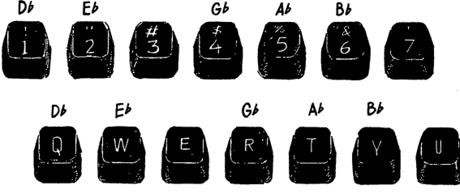

### 保存音乐

要保存你在声音编辑器中编写的歌曲，请按 `f3` 键。系统会询问你希望将歌曲存储在磁带上还是磁盘上。要存储到磁带，按下 `T` 并按 `RETURN`。要存储到磁盘，按下 `D`，然后按 `RETURN`。程序随后会要求你想要用于存储歌曲的名称。名称长度必须少于 16 个字符。

歌曲存储后，计算机将返回编辑屏幕，并准备好接收新首歌曲。

### 加载

要加载之前保存到磁盘或磁带的歌曲，请按 `f5` 键。这将显示一个与保存界面相似的界面。按照指示操作，你可以从磁盘或磁带上加载歌曲。当磁带或磁盘驱动器开始运行后，编辑屏幕将重新出现，存储的音符将在读入内存时播放并显示在屏幕上。

### 几点提示

如果你正在使用声音编辑器输入大量音符，有时会出现你最后按下的键保持高亮状态的情况。如果你按下任何音符键，甚至按下其中一个功能键，什么都不会发生。计算机并没有死机。没有问题。程序只是需要一些时间将你输入的所有值放入计算机内存中。请耐心等待高亮键恢复正常显示。然后你就可以继续添加更多音符、播放歌曲，或将其保存到磁带或磁盘。如果你在最后一个键高亮时按了某个键，那么该音符将在程序将控制权交还给你后被读入内存。在程序存储值时避免按键是一个好主意；否则，它将读取键盘缓冲区并根据你按下该键的次数在歌曲中放置许多音符。如果发生这种情况，你将不得不删除这些多余音符。

如果你想删除一个或多个音符，但仍想保留歌曲当前的副本，请务必将其保存到磁带或磁盘。当屏幕恢复时，你可以删除音符并听新的曲调。如果你不喜欢你的修改，至少在磁带或磁盘上还有一份歌曲原始版本的备份副本。如果你更喜欢原始版本，只需加载它并从那里继续即可。

由于声音编辑器是列出的，它使用了脉冲波形，并将攻击和持续设置为 0，持续/释放寄存器设置为 240。你可以通过更改程序中的行 `1010` 和 `4440` 来改变波形。只需更改 `POKE` 到位置 `54276` 的值即可。在初始化几个寄存器的第 `3` 行添加攻击/衰减值，也会改变你输入音符时以及播放整首歌曲时的声音。

# 和声与不和谐

要在音乐中产生和声，需要同时播放两个或多个音符。幸运的是，`64` 有同时播放三个音符的能力。这三个声部每个都有组类似的控制寄存器，为你提供了三组七个寄存器。

到为止，你只使用了第一个声部（控制寄存器 `54272`–`54278`）。下一节中的示例将同时使用语音 1 和语音 2（寄存器 `54279`–`54285`）。

### 同时播放两个音符

当两个或多个音符同时播放时，音调会融合并变得比单独时更丰富。如果组合音产生的声音是悦耳的，则称它们处于和谐状态。程序 2-7 展示了和声的声音。

### 程序 2-7. 和谐的声音


为了防止程序输入错误，请务必阅读附录 C 中的“自动校对器”。

```
1 REM *** 音乐音符数据 *** :rem 111
2 REM :rem 22
3 DATA 195,16,195,16,400,24,14,24,14,200,47,11,47,11,800 :rem 175
4 DATA 24,14,95,22,700,195,16,30,21,700,95,22,208, 18,1050 :rem 232
5 DATA 999,999,999,999 :rem 86
7 REM :rem 27
8 REM ** 清除并初始化声音寄存器 *** :rem 91
9 FOR R=54720 TO 54296:POKE,0:POKE 54296,15 :rem 124
10 REM --- 设置语音 #1 --- :rem 174
11 REM :rem 70
12 POKE 54274,8:POKE 54277,0:POKE 54278,240 :rem 255
13 REM :rem 72
14 REM 设置语音 #2 --- :rem 179
15 REM :rem 74
16 POKE 54282,8:POKE 54284,0:POKE 54285,240 :rem 254
17 REM :rem 76
18 REM ** 获取表格值 *** :rem 119
19 REM :rem 78
21 READ L1,H1,L2,H2,T:IF H1=999 END :rem 161
22 REM :rem 72
23 REM 将值存入寄存器 :rem 184
24 REM :rem 74
25 POKE 54272,L1:POKE 54273,H1 :rem 86
26 POKE 54279,L2:POKE 54280,H2 :rem 94
27 REM :rem 77
28 REM ** 波形 *** :rem 67
29 REM :rem 79
30 POKE 54276,65:POKE 54283,65 :rem 55
45 FOR R=0 TO T:NEXT :rem 127
50 REM :rem 73
55 REM ** 关闭门限 *** :rem 26
60 REM :rem 74
70 POKE 54276,64:POKE 54283,64 :rem 57
80 GOTO 21 :rem 4
```

注意此程序使用了语音 1 和语音 2；音值是从第 3 到第 5 行的 `DATA` 语句读取的。第一个值 `L1` 是语音 1 的低频值，而 `H1` 是高寄存器值。第三个值 `L2` 被 `POKE` 到语音 2 的低频，`H2` 用于高寄存器。两个语音都使用脉冲波形并具有相同的持续/释放电平和速率。通过更改攻击/衰减速率（语音 1 在第 12 行，语音 2 在第 16 行）或使用不同的波形很容易改变声音。

通过更改第 3、4、5 行 `DATA` 语句中的音值可以轻松创建不和谐的声音。使用程序 2-7，将这些行更改为：

```
DATA 195,16,195,16,400,24,24,14,200,47,11,87,800
DATA 24,14,95,23,700,15,16,30,22,700,95,22,208,19,1050
DATA 999,999,999,999
```

做出更改后，再次运行程序。前几个音符与程序 2-7 相同，但你会很快听到语音的不和谐感。虽然人们通常在音乐中寻找和谐的声音（例如汽车喇叭），请运行程序 2-8 作为示例。

### 程序 2-8. 喇叭

为了防止程序输入错误，请务必阅读附录 C 中的“自动校对器”。

```
5 L1=195:H1=16:L2=30:H2=21 :rem 145
10 FOR R=54272 TO 54296:POKE,R:NEXT :rem 24
20 POKE 54296,15 :rem 45
30 POKE 54275,8:POKE 54277,0:POKE 54278,0 :rem 0
35 POKE 54282,8:POKE 54284,0:POKE 54285,240 :rem 255
40 POKE 54272,L1: PKE 54273,H1
50 POKE 54279,L2:POKE 54280,H2 :rem 91
60 POKE 54276,65:POKE 54283,65 :rem 58
70 FOR M=M0720:NEXT :rem 182
80 POKE 54276,64:POKE 54283,64 :rem 58
90 FOR M=M0750:NEXT :rem 139
100 POKE 54276,65:POKE 54283,65 :rem 101
110 FOR M=M0600:NEXT :rem 229
120 POKE 54276,64:POKE 54283,64
130 POKE 54296,0 :rem 41
```

此程序的大部分你将从其他示例中认出来。感兴趣的主要点是 `FOR-NEXT` 循环的使用方式，它们使音调升高（第 50-90 行）然后下降（第 100-140 行）。这种模式重复四次，如第 40 行中的 `FOR T=0 TO 3` 语句所示。警报声效果是通过这种音调的上升和下降，以及语音 1 和语音 2 播放的音符的不和谐产生的。

当两个频率冲突的音高同时播放时会产生拍频（beats），这是另一种使用多语音的方法。

## 音乐与声音编辑器

64通道的语音能力。拍音的速度（频率）取决于两个音高之间的接近程度。音高越近，拍音就越慢。随着它们变得越远，拍音就越快。

## 程序 2-10 拍音

为了确保程序输入无误，请务必阅读附录 C 中的“自动校对器”。

```
5 REM ** INITIALIZE SOUND REGISTERS *** :rem 30
6 REM :rem 26
10 FOR R=54272 TO 54296:POKE,O:NEXT :rem 24
20 POKE 54273,16 :rem 45
30 POKE 54272,0:POKE 54273,16 :rem 243
40 POKE 5277,0:POKE 54278,170 :rem 47
50 POKE 54284,0:POKE 54285,240 :rem 48
60 POKE 54276,33:POKE 54283,33 :rem 42
70 REM :rem 75
80 REM ** SWEEP SCALES LOOP:VOICE #2 ** :rem 114
90 REM :rem 77
100 FOR H=12 TO 19 :rem 161
110 FOR L=2 TO 255 :rem 163
120 POKE 54279,L2:POKE 54280,H2 :rem 137
130 NEXT:NEXT :rem 76
140 REM :rem 121
150 REM ** TURN REGISTERS ** :rem 254
160 REM :rem 123
170 FOR R=0 TO 1500: :rem 32
180 POKE 54276,32:POKE 54283,32 :rem 97
190 POKE 54296,10 :rem 47
```

通道 1 的音高寄存器在第 30 行设置，但随着第 100-130 行中两个 `FOR-NEXT` 循环的执行，通道 2 的寄存器逐渐增加。通道 2 的起始频率比通道 1 低，随着它的上升，最终会等于并最后超过通道 1 的频率。

和弦与和或拍音不同，它需要同时播放三个或更多和谐音符。通过示例展示是最简单的：

## 程序 2-11 管风琴和弦

为了确保程序输入无误，请务必阅读附录 C 中的“自动校对器”。

```
5 REM ** INITIALIZE SOUND REGISTERS *** :rem 30
6 REM :rem 26
10 FOR R=54272 TO 54296:POKE,O:NEXT :rem 24
11 POKE 54296,10 :rem 40
12 POKE 54277,0:POKE 54278,240 :rem 44
13 POKE 54284,0:POKE 54285,240 :rem 41
14 POKE 54291,0:POKE 54292,240 :rem 38
17 REM :rem 76
18 REM ** TURN ON VOICE #1 ** :rem 165
19 REM :rem 78
20 POKE 54272,210:POKE 54273,15:POKE 54276,33 :rem 87
21 FOR G=0 TO 1500:NEXT :rem 224
22 REM :rem 72
23 REM ** TURN ON VOICE #2 ** :rem 162
24 REM :rem 74
25 POKE 54279,77:POKE 54280,13:POKE 54283,33 :rem 56
26 FOR R=0 TO 1500:NEXT :rem 240
27 REM ** TURN ON VOICE #3 ** :rem 167
28 REM :rem 78
29 POKE 54286,143:POKE 54287,10:POKE 54290,33 :rem 102
61 REM :rem 75
62 REM ** TURN REGISTERS OFF ** :rem 208
63 REM :rem 77
65 FOR R=10 TO 15 STEP .006 :rem 75
70 POKE 54296,R:NEXT :rem 151
80 POKE 54276,32:POKE 54283,32:POKE 54290,32:54296,0 :rem 253
```

每个通道被逐一开启，直到所有通道都发出声音。这种三通道的和声形成了和弦。正如从程序所示，一旦每个通道开启，它就会持续播放，直到第 80 行关闭门位。如果门位从未关闭，声音将无限播放。再看第 65 和 70 行。在这里，音量随着程序的结束而变化。虽然之前的音量设置为 15，现在它随着第 65 行的 `FOR-NEXT` 循环逐渐增加。和弦并不和谐；如果和谐，就会产生不和谐音。交换程序 2-11 中的第 20、25 和 29 行将让你了解不和谐音听起来是什么样的：

```
20 POKE 54272,175:POKE 54273,13:POKE 54276,33
25 POKE 54279,177:POKE 54280,12:POKE 54283,33
29 POKE 54286,43:POKE 54287,18:POKE 54290,33
```

### 多通道和弦

要产生多通道音乐，你需要同时编写两个或三个通道。虽然之前的章节中只编写了一个通道，但使用显示的数据并手动 `POKE` 其他寄存器会非常麻烦。下面的“和弦编辑器”保留了声音编辑器的功能，但允许你一次性编写所有通道。

## 程序 2-12 和弦编辑器

为了确保程序输入无误，请阅读附录 C 中的“自动校对器”。


# 音乐与音效编辑器

## 初始化声音寄存器

```basic
1 REM ** INITIALIZE SOUND REGISTERS *** :rem 26
2 REM :rem 22
3 FOR R=54272 TO 54296:POKE,O:NEXT :rem 234
4 L-I=10:I-B=" :rem 164
5 DIM II$(63),LI$(63),K$(63),NO$(99),LO$(99),UP$(99)
6 LS$(99),PA$(99),PS$(99) :rem 82
7 V$(54272)=H$(0)=54272:POKE,54278:rem 232
8 V$(54283)=L$(1)=54279:POKE,54280:rem 235
9 V$(54290)=L$(2)=54286:H$(2)=54287:POKE,54292,240 :rem 247
10 NO$(0)=\{3 SPACES}:NO$(1)=\{3 SPACES}:NO$(2)=\{3 SPACES}:A3=0 :rem 129
11 FOR R=0 TO 2:LO$(R)=\{3 SPACES}:UP$(R)=\{3 SPACES}:NEXT :rem 153
12 K$(16)=\C$(18)=\D$(19)=\E$:K$(22)="P":K$(25)G)="G":K$(28)=\A":K$(31)="B" :rem 45
13 DIM DD$(99) :rem 229
14 REM ***** FINAL MUSICAL KEYS ***** :rem 225
15 C$(2) [3 RIGHT]E3@{}[DOWN]{4 LEFT]NEG$EM$M(DOWN){6 LEFT}EM$G2E2 M$M(DOWN){6 LEFT}{RIGHT}N3 T$M(DOWN){5 LEFT}E5 T$ :rem 5
16 K$(33)=\C$(37)="D$:K$(42)="E$:K$(44)="T"K$(50)="G$:K$(56)="A" :rem 75
17 K$(63)="B" :rem 178
18 K$(17)=\C$(19)=\D$(24)=\C$(23)="G$"K$(29)=\G#$:K$(35)="T#C" :rem 81
19 K$(39)="D$:K$(47)="F#$:K$(53)=\T#$:K$(59)-A# :rem 129
20 D$(20)=\D$ [2 RIGHT]E3@{}[DOWN]{4 LEFT}NEG$EM$M(DOWN){6 LEFT}EM$G2E2 M$M(DOWN){6 LEFT}{RIGHT}N3 T$M(DOWN){5 LEFT}E5 T$ :rem 16
30 ES=\{2 DOWN}{3 RIGHT}{3 @}{DOWN}{4 LEFT}N6G#M{DOWN}N3{6 LEFT}M{G3}E2 M3{DOWN}{6 LEFT}E5} :rem 160
40 FS=\{2 DOWN}{3 RIGHT}{3 @}{DOWN}{4 LEFT}N6G#M{DOWN}N3{6 LEFT}M{G3}E2 M3{DOWN}{6 LEFT}T :rem 53
50 GS=\{2 DOWN}{22 RIGHT} :rem 241
55 GS=\{2 RIGHT}{3 @}{DOWN{4 LEFT}N6G}M{DOWN}6 LEFT}M{3}}33}}}} :rem 19}
50 =\{2 DOWN}{27}} :rem 25
65 AS=\{2 RIGHT}{3 @}{DOWN}{4 LEFT}N6G#M{DOWN}{6 LEFT}M{3}E2M{DOWN6LEFT} :rem 188
70 BS=\{2 DOWN}{32 RIGHT} :rem 12
755=\{22}{3 @}{DOWN}{4 LEFT}N6G#M{DOWN}{6 LEFT}M{3}E2M{DOWN}{6LEFT} :rem 158
80 QS=\{2 DOWN}{5 RIGHT}{3 @}{DOWN}{4 LEFT}N6G#M{DOWN}{6 LEFT}M{3}E2M{DOWN}{6LEFT} :rem 180
90 WS=\{2 DOWN}{10 RIGHT}{3 @}{DOWN}{4 LEFT}N6G#M{DOWN}{6 LEFT}M{3}E2M{DOWN}{6LEFT} :rem 200
100 EE=\{2 DOWN}{14 RIGHT}M6Mn{DOWN}{6LEFT}M{3}E2M{DOWN}{6LEFT} :rem 98
110 RS=\{2 DOWN}{19 RIGHT} :rem 56
115 RS=\{2 RIGHT}{3 @}{DOWN}{4 LEFT}N6G#M{DOWN}{6 LEFT}M{3}E2M{DOWN}{6LEFT} :rem 0
120 TS=\{2 DOWN}{24 RIGHT} :rem 204
125 TS=\{2 RIGHT}{3 @}{DOWN}{4 LEFT}N6G#M{DOWN}{6 LEFT}M{3}E2M{DOWN}{6LEFT} :rem 2
130 YS=\{2 DOWN}{29 RIGHT} :rem 99
135 YS=\{2 RIGHT}{3 @}{DOWN}{4 LEFT}N6G#M{DOWN}{6 LEFT}M{3}E2M{DOWN}{6LEFT} :rem 2
140 US=\{2 DOWN}{34 RIGHT} :rem 241
145 US=\{2 RIGHT}{3 @}{DOWN}{4 LEFT}N6G#M{DOWN}{6 LEFT}M{3}E2M3M{6LEFT}{RIGHT}N3 T3M{DOWN}{5LEFT}E5 T :rem 233
150 SP=\{HOME}{12 DOWN} :rem 189
160 AS+S=SP+A;BS=SP+B;CS=SP+C;DS=SP+D;ES=SP+E;FS=SP+F;GS=SP+G :rem 236
170 Q=$SP+PS$Q;W=$SP+PS$W;EE=$SP+EE;R=$SP+RS;T=$S-P+$T;Y=$SP+PS$Y;U=$SP+US :rem 65
171 GR=${HOME}{RVS}{4 {SPACES}{3 {SPACES}{OFF}-E{7}1 {WHT}LO/U-E{7}2 {WHT}LO/U-E{7}3 {WHT}LO/U-P-LEN} :rem 64
172 GR=$GS*{{HOME}[DOWN]************************ :rem 80
173 LL={11 SPACES}-{7 SPACES}-{7 SPACES} :rem 76
```

## 定义反显字符

```basic
200 REM DEFINE REVERSE :rem 118
205 XD=\{2 DOWN}{3 RIGHT}{3 {DOWN}{4 LEFT}{RVS}E{6}G{6}E{3}*{DOWN}{6 LEFT}{RIGHT}M{3}RVS}G2M{DOWN}{6 LEFT}{RIGHT}N{3}T{M}OFF}{DOWN}{5 {LEFT}5 T{3} :rem 22
230 XE=\{2 DOWN}{3 RIGHT}{3 {DOWN}{4 LEFT}{RVS}E{6}G{6}E{3}*{DOWN}{6 LEFT}{RIGHT}G{4}E2M{DOWN}{6 LEFT}{RIGHT}N{3}T{M}OFF}{DOWN}{5 {LEFT}5 T{3} :rem 207
250 XG=\{2 SPACES}{2 {10 RIGHT} :rem 31
255 XG=\{13 RIGHT}{3 {DOWN}{4 {RVS}}E{6}G{6}E{3}*{DOWN}{6 LEFT}{RIGHT}G{5}E2M{DOWN}{6 LEFT}{RIGHT}N{3}T{M}OFF}{DOWN}{5 {LEFT}5 T{3} :rem 227
260 XA=\{2 SPACES}{2 {15 RIGHT} :rem 171
265 XA=\{13 RIGHT}{3 {DOWN}{4 {RVS}}E{6}G{6}E{3}*{DOWN}{6 LEFT}{RIGHT}G{6}E2M{DOWN}{6 LEFT}{RIGHT}N{3}T{M}OFF}{DOWN}{5 {LEFT}5 T{3} :rem 223
270 XB=\{2 SPACES}{2 {20 RIGHT} :rem 62
275 XB=\{13 RIGHT}{3 {DOWN}{4 {RVS}}E{7}G{7}E{3}*{DOWN}{6 LEFT}{RIGHT}G{7}E2M{DOWN}{6 LEFT}{RIGHT}N{3}T{M}OFF}{DOWN}{5 {LEFT}5 T{3} :rem 228
290 XC=$SP+XC;XD=$SP+PS$XD;XE=$SP+XE;XP=$SP+FXS:$GS+$SP+$GS;XA=$SP+XA :rem 219
295 XB=$SP+$XB :rem 75
310 XQ=\{2 DOWN}{2 RIGHT} :rem 130
```

## 扩展按键定义

```basic
315 XQS=XQS$="2 [3 RIGHT]£3 @{DOWN]{4 LEFT

{RVS}£G£M{EM}£*{DOWN]{6 LEFT}{OFF}£M{RVS}

£G3£2 M[DOWN]{6 LEFT}{OFF}£M{RVS}N3 TÃM

{OFF]{DOWN]{5 LEFT}{£5 TÃM :rem 110

320 XWS$="2 [7 RIGHT] :rem 266

325 XWS+XWS$="2 [3 RIGHT]£3 @{DOWN]{4 LEFT

{RVS}£G£M{EM}£*{DOWN]{6 LEFT}{OFF}£M{RVS}

£G3£2 M[DOWN]{6 LEFT}{RIGHT}N3 TÃM{OFF}

{DOWN]{5 LEFT}{£5 TÃM :rem 83

330 ZEs$="6 [12 RIGHT] :rem 156

335 ZE+ZE$="2 [3 RIGHT]£3 @{DOWN]{4 LEFT

{RVS}£G£M{EM}£*{DOWN]{6 LEFT}{OFF}£M{RVS}

£G3£2 M[DOWN]{6 LEFT}{RIGHT}N3 TÃM{OFF}

{DOWN]{5 LEFT}{£5 TÃM :rem 34

340 XRS$="6 [17 RIGHT] :rem 57

345 XRS+XRS$="2 [3 RIGHT]£3 @{DOWN]{4 LEFT

{RVS}£G£M{EM}£*{DOWN]{6 LEFT}{OFF}£M{RVS}

£G3£2 M[DOWN]{6 LEFT}{RIGHT}N3 TÃM{OFF}

{DOWN]{5 LEFT}{£5 TÃM :rem 70

350 XWS$="6 [22 RIGHT] :rem 205

355 XWS+XWS$="2 [3 RIGHT]£3 @{DOWN]{4 LEFT

{RVS}£G£M{EM}£*{DOWN]{6 LEFT}{OFF}£M{RVS}

£G3£2 M[DOWN]{6 LEFT}{RIGHT}N3 TÃM{OFF}

{DOWN]{5 LEFT}{£5 TÃM :rem 77

360 XWS$="6 [27 RIGHT] :rem 100

365 XYS+XYS$="2 [3 RIGHT]£3 @{DOWN]{4 LEFT

{RVS}£G£M{EM}£*{DOWN]{6 LEFT}{OFF}£M{RVS}

£G3£2 M[DOWN]{6 LEFT}{RIGHT}N3 TÃM{OFF}

{DOWN]{5 LEFT}{£5 TÃM :rem 93

370 XUS$="6 [32 RIGHT] :rem 242

375 XUS+XUS$="2 [3 RIGHT]£3 @{DOWN]{4 LEFT

{RVS}£G£M{EM}£*{DOWN]{6 LEFT}{OFF}£M{RVS}

£G3£2 M[DOWN]{6 LEFT}{RIGHT}N3 TÃM{OFF}

{DOWN]{5 LEFT}{£5 TÃM :rem 82
```

## 按键处理与音符播放

```basic
390 SP-XQS=XW=XSP-SP+XW;XR=SP+SP+XR=PS+XR :rem 132
$XT=SP+XT;XR=YSP+SP+XYS :rem 114
400 GOS-ZUEB 6400 :rem 112
480 REM :rem 128
490 REM ***** 获取按键程序 ***** :rem 20
495 REM :rem 14
500 GET WF$="IFW$="" THEN 500 :rem 39
502 IF WF$="" THEN 4710 :rem 116
503 IF WF="{F3} THEN 5010
504 IF WF="{F5} THEN 5510 :rem 252
505 IF WF="{RIGHT} OR WF$="{LEFT} THEN 4000 :rem 29
506 IF WF="{F1} THEN 4410 :rem 250
507 IF WF="{UP} OR WF$="{DOWN} THEN 4510:rem 13
509 IF ASC(WW$)<40 OR ASC(WW$)>200 THEN 810 :rem 250
510 IF WW$<>1" THEN 520 :rem 172
512 PRINTXC$:=L=195:H=16:GOSUB1000 :rem 34
515 PRINT$:GOTO500 :rem 210
520 IF WW$>
812 PRINTXC;:L=194;H=17:GOSUB 1000 :rem 37
815 PRINTC$;GOTO500 :rem 213
820 IF WW<>CHR(34) THEN 830 :rem 248
822 PRINTXD;:L=28;H=19:GOSUB 1000 :rem 40
825 PINTTD$;GOTO500 :rem 215
830 IF WW<#" THEN 840 :rem 168
832 PRINTXE;:L=30;H=21:GOSUB 1000 :rem 233
835 PRINTTE$;GOTO500 :rem 217
840 IF WW<$" THEN 850 :rem 171
842 PRINTXF;:L=180;H=23:GOSUB 1000 :rem 35
845 PRINTF$;GOTO500 :rem 219
850 IF WW<#";L=155;H=26:GOSUB 1000 :rem 42
852 PRINTG$;GOTO500 :rem 174
855 PRINTTG$;GOTO500 :rem 221
860 IF WW<@" THEN 870 :rem 177
862 PRINTXH;:L=121;H=29:GOSUB 1000 :rem 34
865 PRINTAS$;GOTO500 :rem 216
870 IF WW<!" THEN 880 :rem 180
872 PRINTXB;:L=164;H=31:GOSUB 1000 :rem 35
875 PRINTB$;GOTO500 :rem 218
880 IF WW<"Q" THEN 890 :rem 96
882 PRINTXQ;:L=132;H=35:GOSUB 1000 :rem 50
885 PRINTQ$;GOTO500 :rem 234
890 IF WW<"W" THEN 900 :rem 95
892 PRINTXW;:L=221;H=39:GOSUB 1000 :rem 60
895 PRINTTW$;GOTO500 :rem 241
900 IF WW<"E" THEN 910 :rem 70
902 PRINTEZ;:L=60;H=42:GOSUB 1000 :rem 239
905 PRTEE$;GOTO500 :rem 28
910 IF WW<"R" THEN 920 :rem 85
912 PRINTXR;:L=104;H=47:GOSUB 1000 :rem 47
915 PRINTTR$;GOTO500 :rem 229
920 IF WW<"T" THEN 930 :rem 89
922 PRINTXXT;:L=55;H=53:GOSUB 1000 :rem 4
925 PRINTTT$;GOTO500 :rem 222
930 IF WW<"Y" THEN 940 :rem 96
932 PRINTXY;:L=187;H=59:GOSUB 1000 :rem 70
935 PRINTTY$;GOTO500 :rem 238
940 IF WW<"U" THEN 950 :rem 7
942 PRINTXU;:L=72;H=63:GOSUB 1000 :rem 235
945 PRINTTU$;GOTO500 :rem 130
```

## 播放音效子程序

```basic
950 REM **** 播放音 ***** :rem 105
960 REM :rem 132
970 REM :rem 99
1000 POKE L(A3),L; POKE H(A3),H :rem 168
1010 POKE V(A3),65: POKE 54296,15 :rem 22
1020 FOR R=0 TO LE:NEXT :rem 173
1030 VL=32THEN R=0 TO LE:STEP.05:NEXT:FOR=TO2:POKE V(R),Ø:NEXT:POKEVL,Ø :rem 219
```

## 存储音调/时间值

```basic
1100 REM :rem 166
1102 REM ** 存储音调/时间值 ** :rem 218
1104 REM :rem 170
1110 POKE MM+49152,L;POKE MM+49153,H :rem 220
1120 MM=MM+2; A3=A3+1 :rem 77
1130 NO$(A3-1)=RIGHT("{3 SPACES}\}+K$(H),3) :rem 175
1140 LO$(A3-1)=RIGHT("{3 SPACES}\}+STR$(L), :rem 96
1150 UP$(A3-1)=RIGHT("{3 SPACES}\}+STR$(L), :rem 103
1160 IF A3=3 THEN POKE MM+49152, LE=MM+1;LB=R("{3 SPACES}\}+STR$(L),4) :rem 17
1170 IF A3=3 THEN FOR Q=49152+MM TO POKE Q,Q;NEXT :rem 169
```


```
3000 REM :rem 167

3002 REM **** 显示值 :rem 223

3004 REM :rem 171

3008 PRINT("[HOME][2]" :rem 12

3010 IF SK<90 THEN R=0 TO SK:PRINT D(R);NEXT GOTO 3020 :rem 126

3015 IF R-K=9 THEN NO$(R)("{3 SPACES}":NO$(1)="{3 SPACES}":NO$(2)="+4 SPACES}" :rem 148

3025 IF A3=3 THEN FOR R=0 TO LO$(R)="{3 SPACES}":"UP$(R)="{3 SPACES}":NEXT: A3=SK-1 :rem 206

3030 RETURN :rem 166

4000 REM :rem 168

4002 REM **** 模式 :rem 68

4003 REM :rem 171

4005 IF I=-1 THEN 4010 :rem 48

4007 PRINT("[HOME][4 SPACES]NOTE{3 SPACES}-#1{WHT}LO/UP-{7}2}{WHT}LO/UP-{7}3}{WHT}LO-{WHT}LO/UP-" :rem 207

4008 PRINT("{3 SPACES}\}+STR$(L),3);"[OFF]";I=I-1;GOTO 500 :rem 254

4010 PRINT("[HOME]{4 SPACES}NOTE{3 SPACES}{OFF}-#1{WHT}LO/UP-{7}2}{WHT}LO/UP-{7}3}{WHT}LO-{WHT}LO/UP";I=-1;GOTO 500 :rem 211

4400 REM :rem 172

4402 REM **** 播放音乐 :rem 198

4405 REM :rem 177

4410 IF SK=0 THEN GOTO 500 :rem 96

4415 FOR Q=49152 TO 49152+(7*(SK-1)) STEP 7 :rem 141

4420 POKE 54272,PEEK(Q):POKE 54273,PEEK(Q+1) :rem 173

4425 POKE 54279,PEEK(Q+2):POKE 54280,PEEK(Q+3) :rem 22

4430 POKE 54286,PEEK(Q+4):POKE 54287,PEEK(Q+5) :rem 27

4435 NX=POEK(Q+6) :rem 219

4440 POKE 54276,65: POKE 54283,65: POKE 54290,65: POKE 54296,15 :rem 169

4450 FOR R=0 TO NX STEP.05:NEXT :rem 4

4460 POKE 54283,0: POKE 54290,0:{SPACE}POKE 54296,0 :rem 196

4470 NEXT:GOTO 500 :rem 22

4500

4502 REM **** 光标上移/下 :rem 233

4505 REM :rem 178

4506 REM --- 滚动窗口 --- :rem 105

4508 REM :rem 181

4509 IF A3<0> THEN 500

4510 IF I=-1 THEN 4560 :rem 59

4512 IF SK=6 THEN 500

4515 PRINT("[HOME]" :rem 255

4517 IF SK=10 THEN 4530 :rem 152

4518 IFSK-1-THENNM-7:IC=IC-1:PRINT RT"[DOWN]":NEXT:SK-1:PRINT LL$ :rem 104

4522 IF SK<0 THEN SK=0:IF ICTHEN=0 :rem 137

4523 FOR Q=49152+MM TO 49152+MM:POKE QM,NE :rem 5

4525 IF R-K THEN 500 :rem 158

4530 SK-1

4530 IF PRINT4555445555rem500 :rem 16

4555 45555 音调长度 :rem 178

4560 IF LE<" THEN 5555 rem 5555555555555555553355) :rem 119

4580 IF LE=LE-1 :rem 137

4585 PRINT("[HOME][4 SPACES]NOTE{3 SPACES}-#1{WHT}LO/UP-{7}2}{WHT}LO/UP-{7}3}{WHT}LO-{WHT}LO/UP-" :rem 207

4586 PRINT("{3 SPACES}\}+STR$(L),3);"[OFF]" :rem 11

4590 PRINT AND RETURN TO THE PROGRAM {DOWN} :rem 211

5100 GOTO 530

5000 REM :rem 172

5010 REM **** 保存程序 :rem 20

5025 PRINT("[CLR]")

5030 INPUT("{HOME}[5 SPACES]SAVE ON DISK " :rem 12

5040 IF ME="C" THEN 6430

5050 IF ME="<" AND ME="T" THEN 5060

5055 GOTO 5210

5060 PRINT("[6 SPACES]ENTER D"

5070 PRINT("[19 SPACES]''T' FOR TAPE"

5080 PRINT("[15 SPACES]''C' TO CANCEL"

5090 PRINT AND RETURN TO THE PROGRAM {DOWN}

5200 REM

5202 REM **** 输入歌曲名称 :rem 178

5210 PRINT("{HOME}[13 DOWN]{16 LETTERS}")

5220 PRINT("{DOWN}{16 LETTERS}")

5230 INPUT("{4 UP] NAME OF SONG}");NM

5240 NM=LEFT$(NM,16)

5250 PRINT("{HOME}[12 DOWN]{20 SPACES}")

5260 PRINT("{HOME}[12 DOWN]{14 RIGHT}";NM;10 SPACES}

5270 INPUT("{HOME}[21 DOWN] THIS IS CORRECT (Y/N)";CRSRS

5280 IF CR="Y" THEN 5400

5285 IF CR="C" THEN 6430: IC=0;SK=0: GOTO 5000

5290 PRINT("{HOME}[12 DOWN]{22 SPACES}")

5300 PRINT("{14 SPACES}")

5310 GOTO 5210

5400 REM

5402 REM **** 播放音乐 :rem 223

5405 REM --- DISK----

5410 IF ME="T"THEN 5455

5420 OPEN 1,8,4,":+NM+",W"

5425 FOR Q=49152 TO 49152 + ((SK)*7) :rem 190

5430 PRINT#1,PEEK(Q): NEXT :rem 25

5440 CLOSE 1 :rem 116

5450 GOSUB 6430 :rem 27

5451 PRINT "{HOME}{LOAD DOWN}";FOR R-SK=0 TO SK-PRINT DD$(R):NEXT :rem 85

5452 GOTO 500 :rem 158

5455 REM -TAPE- :rem 239

5460 OPEN 1,1,1,NM$: GO 5425 :rem 26

5505 REM :rem 179

5510 REM **** LOAD ROUTINE **** :rem 69

5520 REM :rem 176

5525 PRINT "{CLR}" :rem 53

5530 INPUT "{HOME}{5 DOWN]{2 SPACES} FROM DISK FOR TAPE (DT); ME :rem 92

5540 IF ME="C" THEN GOSUB 6430: GO 500 :rem 91

5550 IF ME<>"D" AND ME<>"T" THEN 5560 :rem 176

5570 GOTO 5710 :rem 218

5560 PRINT "{DOWN}{6 SPACES} RETURN 'D' FOR DIS" :rem 142

5570 PRINT "{19 SPACES}' FOR TAPE" :rem 85

5580 PRINT "{15 SPACES}OR{2 SPACES}'C TO CANCEL" :rem 30

5590 PRINT LOAD AND RETURN TO THE MAIN PROGRAM {DOWN}" :rem 73

5700 REM ENTER NAME OF SONG :rem 176

5702 REM **** :rem 109

5705 REM :rem 181

5710 PRINT "{HOME}{13 DOWN}{14 RIGHT}----------------" :rem 244

--" :rem 176

5720 PRINT "{DOWN}{MAX 16 LETTERS}?" :rem 206

5730 INPUT "{4 UP] OF SONG;NM" :rem 190

5740 NM=LEFT$(NM,16) :rem 23

5750 PRINT "{HOME}{12 DOWN}{14 RIGHT}{20 SPACES}" :rem 145

5760 PRINT "{HOME}{12 DOWN}{14 RIGHT};NM;" {10 SPACES}" :rem 158

5770 INPUT "{21 DOWN} IS THIS CORRECT (Y/N)";c :rem 212

5780 IF CR$="Y" THEN 5900 :rem 243

5785 IF CR$="C" THEN GOSUB 6430: GO 500 :rem 105

5790 PRINT "{HOME}{12 DOWN}{14 RIGHT}{22 SPACES}" :rem 27

5800 PRINT "{14 SPACES}" :rem 158

5810 GOTO 5710 :rem 178

5900 REM :rem 165

5902 REM **** LOAD MUSIC **** :rem 32

5905 GOSUB 6430 :rem 236

5910 IF ME$="T" THEN 5960

5912 FOR R=49152 TO 49159: POKE R
```

# 第 2 章 音乐与声音编辑器

音阶的音符。作为声音编辑器，音符定义如下。运用费曼技巧，你只需花上`20 min`就能深入理解知识点，而且记忆深刻，*难以遗忘*。[费曼学习法](https://wiki.example.org/feynmans_learning_method)的灵感源于诺贝尔物理奖获得者**理查德·费曼**。

# 第 3 章

## 音效

到目前为止，你已经了解了 Commodore 64 SID 芯片的功能原理，以及如何应用它们来创建简单的声音。通过使用声音控制寄存器，你学习了如何向不同的内存位置写入值来产生声音。上一章中的“声音编辑器”和“和弦编辑器”为你提供了让这一过程变得简单的工具。

在本章中，我们将探索使用 SID 芯片操纵声音以模仿自然的方法。你将只使用目前讨论过的函数，因此如果你已经读过前两章以及引言中的术语表，就可以开始了。

我们将观察并听四种不同的声音类型：硬音、软音、缓慢上升的渐变音和缓慢下降的渐变音。我们将研究许多关于这些声音类型如何产生特殊音效的示例，以及它们如何组合产生完全全新的声音——大自然无法创造、但通过你的计算机可以实现的。

## 硬音


定义有时必须具有某种任意性。为了区分不同类型的音效，我们只需这样做。我们将硬音定义为那些开始和结束都很突然的声音。另一种表达方式是，它们具有快速的起始（attack）、衰减（decay）和释放（release）速率。声音迅速上升到最大音量，尽可能快地下降到持续（sustain）水平，并迅速从该音量落下。它们可以是短的，如程序 3-1 所示，也可以是长的，如程序 3-2 所示。输入并运行这些短程序以听硬音特征的示例。

### 程序 3-1. 短哔

为了确保程序输入无误，请务必阅读附录 C 中的“自动校对”。

```
10 FOR R=54272 TO 54296:POKER,Ø:NEXT      :rem 24
20 POKE 54296,15                               :rem 45
30 POKE 54275,8:POKE 54277,Ø:POKE 54278,240   :rem 0
40 POKE 54272,47:POKE 54273,25                :rem 47
50 POKE 54276,65                               :rem 51
60 FOR R=0 TO 300:NEXT                          :rem 187
70 POKE 54276,64:POKE 54296,Ø                    :rem 3
```

### 程序 3-2. 长哔

为了确保程序输入无误，请务必阅读附录 C 中的“自动校对”。

```
10 FOR R=54272 TO 54296:POKER,Ø:NEXT      :rem 24
20 POKE 54296,15                               :rem 45
30 POKE 54275,8:POKE 54278,240   :rem 0
40 POKE 54272,47:POKE 54273,25                :rem 47
50 POKE 54276,65                               :rem 51
60 FOR R=0 TO 1000:NEXT                         :rem 233
70 POKE 54276,64:POKE 54296,Ø                    :rem 3
```

你会注意到，这两个程序之间的唯一区别在于第 60 行，即持续延迟。程序 3-2 的播放时间是两倍，因为它的延迟更长。在两个程序的第 30 行中，通过向 POKE 起始/衰减寄存器（位置 54277）写入 0，将起始/衰减速率设置为最快速度。释放速率也被设置为最快速率；通过向 POKE 持续/控制寄存器（位置 54278）将值设置为最大值（15*16=240），但释放值为 0，这表示声音在持续后迅速落下。

你可以让硬音在播放过程中改变音量，如程序 3-3 所示。

### 程序 3-3. 上升与下降音

为了确保程序输入无误，请务必阅读附录 C 中的“自动校对”。

```
10 FOR R=54272 TO 54296:POKER,Ø:NEXT      :rem 24
20 POKE 54296,15                               :rem 45
30 POKE 54275,8:POKE 54277,Ø:POKE 54278,240   :rem 0
40 POKE 54272,47:POKE 54273,25                :rem 47
50 POKE 54276,65                               :rem 51
55 FOR T=0 TO 300:NEXT                          :rem 193
60 FOR R=15 TO 1 STEP --3:POKE 54296,R:NEXT      :rem 74
65 FOR R=1 TO 15 STEP .3:POKE 54296,R:NEXT      :rem 34
70 POKE 54276,64:POKE 54296,Ø                    :rem 3
```

该程序与程序 3-1 几乎相同。然而，第 60 和第 65 行是新的。它们让音量先下降后上升。注意这两行中 STEP 的使用。在第 60 行中，音量以 .3 的步长下降，而在第 65 行中以 .3 的增量上升。硬音在重复时通常最有趣。输入并运行程序 3-4 这种效果。

### 程序 3-4. 重复器

为了确保程序输入无误，请务必阅读附录 C 中的“自动校对”。

```
10 FOR R=54272 TO 54296:POKER,Ø:NEXT      :rem 24
20 POKE 54296,15                             :rem 45
30 POKE 54275,8:POKE 54277,Ø:POKE 54278,240 :rem 0
40 POKE 54272,47:POKE 54273,25                :rem 47
45 FOR R=Ø TO 10                             :rem 19
50 POKE 54296,15                             :rem 48
55 POKE 54276,65                             :rem 56
60 POKE 54276,64:POKE 54296,0                  :rem 2
70 NEXT
```

修改几个寄存器值会修改该声音。例如，修改第 45 行，使 FOR-NEXT 循环的范围变为 0 到 100 而不是 10。这会显著延长声音播放时间。删除第 50 行和第 60 行的 POKE 54296,0 也会改变声音。声音不是每次循环都开启和关闭，而是每次循环只有门位（gate bit）开启和关闭。声音听起来更快且在一起。由于硬音唯一的要求是开始和结束都很突然（快速的起始、衰减和释放速率），你可以使用任何波形产生它们。图 3-1 中的单声说明了硬音如何从基线开始，迅速上升到高音量，然后迅速变为低音量。要创建这种声音，你可以使用 64 上的任何波形，甚至在它们之间切换。

### 程序 3-5. 波形切换

为了确保程序输入无误，请务必阅读附录 C 中的“自动校对”。

```
10 FOR R=54272 TO 54296:POKER,Ø:NEXT      :rem 24
20 POKE 54296,15                             :rem 45
30 POKE 54275,8:POKE 54277,Ø:POKE 54278,240 :rem 0
40 POKE 54272,47:POKE 54273,25                :rem 47
50 POKE 54276,33                             :rem 46
60 FOR R=0 TO 20:NEXT:POKE 54276,32         :rem 140
62 POKE 54276,17                             :rem 51
65 FOR R=0 TO 20:NEXT:POKE 54276,16         :rem 147
67 POKE 54276,65                             :rem 59
69 FOR R=0 TO 20:NEXT:POKE 54276,64         :rem 154
70 FOR R=0 TO 300:NEXT                       :rem 188
80 GOTO 50 :rem 6
```

### 图 3-1. 硬音

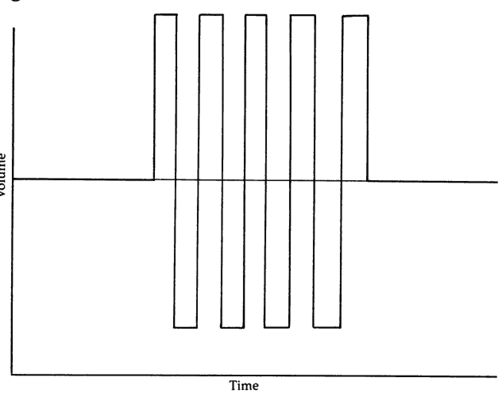

注意此程序中波形是如何变化的。首先启用锯齿波，然后关闭门位（第 50 和第 60 行）。接下来，使用三角波（第 62 和第 65 行），最后启用脉冲波并关闭门位（第 67 和第 69 行）。尽管它们都在一起运行，且每个波形播放时间非常短，但如果你加长第 60、65 和 69 行的 FOR-NEXT 循环，你就能听到三种波形所产生声音的差异。尝试在这些循环中使用 R=0 TO 90；独立的波形将更容易区分。完全删除第 67 和第 69 行，听听使用两种波形时的声音。它非常不同。

由于波形差异如此巨大，我们将每种声音类型分为四个部分，分别涵盖脉冲、三角波和噪声波形。

## 使用脉冲的硬音

这种声音组件的组合产生了 Commodore 64 能够产生的最硬的声音。这是因为声音开始非常快，且波形由突变组成。

如果我们取一个简单的对称的硬脉冲波形（也称为方波）并使其持续时间非常短，它会产生一种咔哒声。图 3-2 显示了这种方波，而程序 3-6 展示了该音效。

### 图 3-2. 硬脉冲波形（对称）


### 程序 3-6. 咔哒声

为了确保程序输入无误，请务必阅读附录 C 中的“自动校对”。

```
10 FOR R=54272 TO 54296:POKER,Ø:NEXT      :rem 24
20 POKE 54296,15                               :rem 45
30 POKE 54275,8:POKE 54277,Ø:POKE 54278,240 :rem Ø
40 POKE 54272,47:POKE 54273,65                   :rem 51
50 POKE 54276,65                                 :rem 51
70 POKE 54276,64:POKE 54296,Ø                     :rem 3
```

## 音效

滴答。通过将这些点击声成对出现并使用两种不同的频率，你可以产生祖父钟那种规律的滴答声。输入并运行程序 3-7 即可听到该声音。

### 程序 3-7. 滴答

为了确保程序输入无误，请务必阅读附录 C 中的“自动校对器”。

```
10 FOR R=54720 POKE 54296,POKER,0:rem 24
20 POKE 54296,5 POKE 54277,240:rem 252
30 POKE R=54275,8:POKE 54278,240:rem 0
40 POKE 54272,51:POKE 54273,90:rem 44
50 POKE R=54276,64:POKE 54296,5:rem 7
60 POKE R=54276,64:POKE 54296,0:rem 2
70 FOR R=0 TO 400:NEXT:rem 189
80 POKE 54272,47:POKE 54273,81:rem 53
90 POKE 54276,65:POKE 54296,5:rem 11
110 POKE 54276,64:POKE 54296,0:rem 46
120 FOR R=0 TO 400:NEXT:rem 233
130 GOTO 40:rem 49
```

声音之所以很短，是因为门控位（gate bit）在某行中开启，在下一行中关闭。这两个步骤之间没有持续延迟循环来保持音符持续在其持续水平。你之前看到的其他生硬声音，即起始（attack）、衰减（decay）和释放（release），都已设置为最快的速率。当门控位开启时（第 50 行和第 90 行），音量级设置为 5，然后设置为 0 以完全关闭（第 60 行和第 110 行）。你可以消除那些设置音量控制寄存器的 POKE 语句，这样声音将会有所不同。它听起来不会那么像时钟，而更像是一种哔哔声。快速连续地开启和关闭声音，就形成了你在例程中听到的声音。

你可以通过更改一两处地方使用此例程创建有趣的声音。例如，更改第 70 行和第 120 行中的 FOR-NEXT 循环（这些循环创建了两个点击声之间的停顿）将产生不同的声音。更改其他值，例如第 40 行和第 80 行中的音高值，也会产生新的声音。

在程序中添加另一个部分可以让你获得闹钟在滴答了一短时间后响起来的效果。在程序 3-7 中添加以下行并重新运行它。在闹响之前，钟会滴答 16 次（由第 35 行中的 `FOR X=0 TO 15` 表示）。

```
35 FOR X=0 TO 15
130 NEXT
132 REM
134 REM ---- ALARM ----
135 REM
150 POKE 54272,47:POKE 54273,255
160 FOR R=0 TO 150
170 POKE 54276,65
180 POKE 54296,15
190 POKE 54276,64:POKE 54296,0
200 NEXT
```

闹铃声的构造与滴答声相同。在第 170 行和第 180 行开启门控位并将音量设置为 15。然后于第 190 行关闭门控位并将音量重置为 0。再次，快速开启和关闭门控位和音量赋予了该声音独特的特性。

乒乓。网球是一项需要高度集中注意力、快速反应以及再多延伸一点的游戏。作为回报，它赋予了玩家和观察者一种非常独特的声音。

### 程序 3-8. 乒乓

为了确保程序输入无误，请务必阅读附录 C 中的“自动校对器”。

```
5 REM ---- INITIALIZE REGISTERS ---- :rem 43
6 REM :rem 26
10 Ø FOR R=54272 TO 54296:POKER,0:NEXT :rem 24
11 POKE 54296,15
12 POKE 54275,8:POKE 54277,0:POKE 54280,240 :rem 0
20 REM :rem 53
21 REM :rem 71
30 POKE 54272,51:POKE 54273,75 :rem 46
40 POKE 54276,65 :rem 50
50 POKE 54296,RND()*10+5 :rem 26
60 POKE 54276,64:POKE 54296,0 :rem 2
62 REM :rem 76
63 REM ---- PAUSE BETWEEN NOTES ---- :rem 198
64 REM :rem 78
65 FOR R=0 TO RND()*100+50:NEXT :rem 221
66 REM :rem 80
78 REM PONG VALUES :rem 72
79 REM :rem 84
80 POKE 54272,47:POKE 54273,55 :rem 54
90 POKE 54276,65 :rem 55
100 POKE 54276,RND()*10+5 :rem 70
110 POKE 54276,64:POKE 54296,0 :rem 46
120 FOR R=0 TO RND(0)*600+300:NEXT :rem 56
130 GOTO 30 :rem 48
```

注意第 50、65、100 和 120 行中 `RND` 函数的使用。它改变了“乒”和“乓”的时间和音量，为模拟吱呀门的幻觉增加了真实感。当门变旧时，它的合链会生锈。它们在吱呀响时发出嘎吱声，门移动得越快，吱呀声越快。

### 程序 3-9. 吱呀门

为了确保程序输入无误，请务必阅读附录 C 中的“自动校对器”。

```
8 REM --- INITIALIZE REGISTERS --- :rem 46
9 REM :rem 29
10 FOR R=54272 TO 54296:POKE R,0:NEXT :rem 24
15 POKE 54296,15 :rem 49
16 POKE 54275,0:POKE 54277,0:POKE 54278,240 :rem 252
20 REM :rem 70
21 REM --- CREAK OPEN LOOP :rem 129
23 REM :rem 73
25 FOR R=1 TO 30 :rem 20
30 POKE 54273,53 :rem 248
33 POKE 54276,65:POKE 54296,15 :rem 57
34 POKE 54276,0:POKE 54296,0 :rem 3
35 FOR T=300 TO 0 STEP-R:NEXT :rem 122
36 NEXT :rem 168
40 REM :rem 72
41 REM --- CREAK CLOSED LOOP ---rem 11
42 REM :rem 74
50 FOR R=1 TO 30 :rem 18
60 POKE 54273,53 :rem 46
63 POKE 54276,65:POKE 54296,15 :rem 60
64 POKE 54276,64 :rem 6
65 FOR T=300 TO 0 STEP-(31-R):NEXT :rem 95
70 NEXT :rem 166
```

此程序使用了非对称波形，这是它听起来像这样的原因之一。第 16 行包含一个 POKE 语句，将脉冲宽度寄存器设置为 0，从而创建非对称波形。本节的所有示例都使用了对称（或方波）脉冲波形。注意使用时间循环来创建音符从稀疏聚集的效果。这给人了一种声音从缓慢开始然后加速的感觉，就像吱呀门开启和关闭的声音一样。图 3-33 展示了这种方法。

### 图 3-33. 时间循环

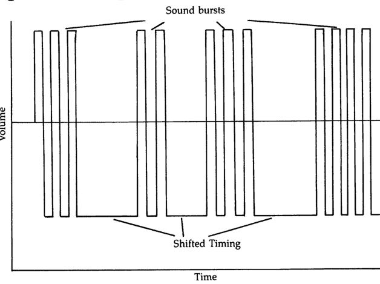

产生这种声音的另一种方法是使用音高变化来创建效果。程序 3-9 在整个例程中使用相同的音高值。门开关的点击声是通过门控位和音量快速开启关闭时产生的短音符的。程序 3-10 使用了不同的技术。音高在例程过程中不断变化，而门控位和音量保持开启状态。在 64 上创建音效通常有多种方法。

### 程序 3-10. 吱呀门的重温

为了确保程序输入无误，请务必阅读附录 C 中的“自动校对器”。


## 音效

### 图 3-4. 增加音高

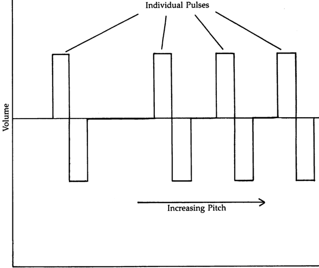

64 可以产生极低的音高（频率），以至于波形周期之间的间隔可达一秒（每秒一次循环，即 1 Hz）。此程序利用了这一特性，通过增加和减少频率来产生吱呀声，而不是使用时间循环来将每个声音放置在正确的距离上。

### 程序 3-11. 蟋鸣

```
为了防止程序输入出现错误，请务必阅读附录 C 中的“自动校对器”。
5 REM ---- 初始化寄存器 ---- :rem 43
7 REM :rem 27
10 FOR R=54272 TO 54296:POKE R,0:NEXT :rem 24
15 POKE 54296,15 :rem 49
16 POKE 54275,8:POKE 54277,0:POKE 54278,240 :rem 4
17 POKE 54272,0:POKE 54273,155 :rem 44
18 POKE 54276,65 :rem 55
21 REM :rem 71
22 REM ---- 蟋鸣主循环 ---- :rem 123
23 REM :rem 73
25 FOR K=0 TO 50 :rem 14
30 FOR I=0 TO 1 :rem 212
40 FOR R=0 TO 15 STEP 5 :rem 132
41 REM :rem 73
42 REM ---- 发出蟋鸣声 --- :rem 232
43 REM :rem 75
50 POKE 54296,R :rem 28
60 POKE 54296,0:NEXT :rem 116
70 FOR M=0 TO 30:NEXT :rem 135
90 NEXT :rem 168
91 REM :rem 78
92 REM ---- 间隔计时循环 :rem 30
93 REM :rem 80
100 FOR D=0 TO RND()*100:NEXT :rem 149
120 NEXT:POKE 54276,64 :rem 217
```

程序中的 `FOR-NEXT` 循环设置了声音听到的次数（第 25 行）、成对出现的次数（第 30 行）、设置音量以区分不同水平（第 40 行），并产生了声音对之间不规则的间隔（第 100 行）。第 100 行的最后一个循环再次使用 `RND` 函数来消除固定计时可能带来的机械感。

声音实际上是在第 50-70 行通过快速切换开启和关闭，并在之间保持极短的暂停创建的。

**马达船声。** 这个程序使用计数器来同时修改声音的速度和音量。计数器记录产生了多少声音。通过这种方式，你可以制作出一个先启动、加速到最高速度，然后离开河流的马达船声。程序 3-12 创建了这种效果。输入并运行它即可听到该声音。

### 程序 3-12. 马达船

```
为了防止程序输入出现错误，请务必阅读附录 C 中的“自动校对器”。

5 REM ---- 初始化寄存器 ---- :rem 43
7 REM :rem 27
10 FOR R=54272 TO 54296:POKE R,0:NEXT :rem 24
15 POKE 54275,8:POKE 54277,0:POKE 54278,240 :rem 3
16 POKE 54273,8:POKE 54272,0 :rem 200
17 POKE 54276,65 :rem 54
41 REM :rem 73
42 REM ---- 船正在靠近近 ---- :rem 178
43 REM :rem 75
47 FOR K=0 TO 300 :rem 64
50 POKE 54296,(K/25)+3      :rem 90
55 POKE 54296,0               :rem 255
57 FOR G=0 TO RND*(150-K/2):NEXT :rem 114
60 NEXT                        :rem 165
61 REM                        :rem 75
62 REM --- 船正在远去 -- :rem 163
63 REM                        :rem 77
70 FOR F=0 TO 450             :rem 61
72 POKE 54296,15-F/30         :rem 57
75 POKE 54296,0               :rem 1
77 FOR G=0 TO RND(0)*5:NEXT   :rem 233
80 REM                        :rem 167
91 REM                        :rem 78
92 REM ---- 关闭        :rem 100
93 REM --- POKE 54276,64:POKE 54296,0 :rem 45
```

第 50 行查看计数器 `K`（由第 47 行的 `FOR-NEXT` 循环增加），并根据 `K` 的值通过改变音量来确定马达的状态。音量水平永远不会低于 3，并随着 `K` 的增大而缓慢增加。第 55 行关闭声音；它是一个创建实际声音的开启和关闭模式。在第 57 行中，`K` 被用来修改 `RND` 函数。起初，当 `K` 值较小时，延迟循环较长（最大为 150），但随着 `K` 的增加，延迟循环变短，使得马达运行得越来越快。

随着船越来越远，第二个循环中的值 `F` 变得越来越大。随着 `F` 的增加，第 72 行中的音量水平变得降低（`15-F/30`）。此外，由于马达声音的速度已经达到最大值，在第 77 行的 `RND` 函数中使用了常数。

### 使用锯齿波产生生硬声音

如果你想使用锯齿波代替脉冲波，你需要更改 `POKE` 到位置 `54276`（通道 1）、`54283`（通道 2）或 `54290`（通道 3）的值，范围从 65 到 33。当你听脉冲波并将其与锯齿波对比时，你会发现锯齿波的声音更尖锐。再次，这是一个审美术语，但通常指的是由较高频率组成的声音。它具有更高的穿透力。听听例子。

### 程序 3-13. 声音对比

```
为了防止程序输入出现错误，请务必阅读附录 C 中的“自动校对器”。

5 REM ---- 初始化寄存器 ---- :rem 65
6 REM :rem 26
10 FOR R=54272 TO 54296:POKE R,0:NEXT :rem 24
11 POKE 54296,15 :rem 45
12 POKE 54275,8:POKE 54277,0:POKE 54278,240 :rem 0
17 REM :rem 76
18 REM -- 脉冲波 :rem 113
19 REM :rem 78
20 POKE 54272,47:POKE 54273,25 :rem 45
30 POKE 54276 :rem 49
40 FOR R=0 TO 300:NEXT :rem 185
50 POKE 54276,6 :rem 50
57 REM :rem 80
58 REM -- 声音间隔 :rem 202
59 REM :rem 82
60 FOR R=0 TO 500:NEXT :rem 189
67 REM :rem 81
68 REM -- 锯齿波 -- :rem 102
69 POKE 54276,33 :rem 83
70 FOR R=0 TO 300:NEXT :rem 48
80 POKE 54276,64:POKE 54296,0 :rem 189
90 POKE 5 :rem 5
```

听到的第一个音是脉冲波，第二个是锯齿波。它们具有相同的音高值，该值是在第 20 行 `POKE` 的。唯一的区别在于波形：第 30 行是脉冲波，第 70 行是锯齿波。这种改变对声音很大，不是吗？电话铃。因为锯齿波产生的尖锐，它们提供了像新铃那样的穿透音调。

### 程序 3-14. 电话铃

```
为了防止程序输入出现错误，请务必阅读附录 C 中的“自动校对器”。

5 REM ---- 初始化寄存器 ---- :rem 0
6 REM :rem 26
10 FOR R=54272 TO 54296:POKE R,0:NEXT :rem 24
11 POKE 54296,15 :rem 45
12 POKE 54277,0:POKE 54278,240 :rem 44
20 REM :rem 70
28 REM -- 声音数量 -- :rem 157
29 REM :rem 79
30 FOR Y=0 TO 5 :rem 232
40 FOR W=0 TO 12 :rem 21
50 REM :rem 73
60 REM --- 高音调 :rem 8
70 REM :rem 75
80 POKE 54272,0:POKE 54273,125 :rem 41
90 POKE 54276,33 :rem 50
100 FOR X=0 TO 30:NEXT :rem 188
110 REM :rem 118
120 REM -- 低音调 --- :rem 7
130 REM :rem 120
140 POKE 54273,100 :rem 134
150 FOR Z=0 TO 30:NEXT :rem 195
160 NEXT :rem 214
170 REM :rem 124
190 REM -- 声音间隔 :rem 247
200 POKE 54276,32 :rem 90
210 FOR R=0 TO 200:NEXT :rem 23
220 NEXT:POKE 54296,0
```

运行此程序时，注意两个音高之间的平滑过渡，这是通过开启音量实现的。**一辆旧车。** 这个程序是一系列讲述故事的例程。它很简单，是复杂效果的良好演示。

### 程序 3-15. 老车

```
为了防止程序输入出现错误，请务必阅读附录 C 中的“自动校对器”。

5 REM --- 初始化寄存器 --- :rem 43
6 REM :rem 26
10 FOR R=54272 TO 54296:POKE R,0:NEXT :rem 24
11 POKE 54296,15 :rem 45
15 POKE 54277,0:POKE 54278,240 :rem 47
20 POKE 54272,0:POKE 54273,18 :rem 244
30 POKE 54276,33 :rem 44
35 REM :rem 76
36 REM --- 钥匙 --- :rem 72
37 REM :rem 78
40 FOR R=0 TO 1 :rem 222
50 POKE 54276,33 :rem 46
60 POKE 54276,32 :rem 46
80 NEXT :rem 167
82 FOR R=0 TO 200:NEXT :rem 190
85 REM :rem 81
86 REM --- 启动电机 --- :rem 112
87 REM :rem 83
190 FOR L=0 TO 10 :rem 62
195 FOR R=0 TO 3 :rem 27
200 POKE 54273,5+R :rem 164
210 POKE 54273,33:POKE 54296,10 :rem 92
220 NEXT :rem 211
230 FOR R=0 TO 3 :rem 17
240 POKE 54273,12-R :rem 216
250 POKE 54273,33:POKE 54296,10 :rem 96
260 NEXT :rem 215
270 NEXT :rem 216
280 POKE 54273,32:POKE 54296,0 :rem 49
285 REM :rem 131
286 REM --- 启动中 :rem 233
287 REM :rem 133
290 POKE 54273,5 :rem 48
295 FOR L=0 TO STEP .5 :rem 20
300 POKE 54273,33:POKE 54296,15 :rem 97
310 POKE 54273,32:POKE 54296,0 :rem 43
315 FOR P=0 TO RND()*L:NEXT :rem 52
320 NEXT :rem 212
326 REM --- 运行中 :rem 153
327 REM :rem 128
330 FOR L=0 TO 300:NEXT :rem 108
340 POKE 54273,32:POKE 54296,0 :rem 46
350 POKE 54273,33:POKE 54296,15-(L/20) :rem 193
360 FOR P=0 TO RND(3)*3 :rem 27
370 NEXT :rem 217
```

作为控制变量（该变量在第 295 行逐渐减小），电机趋于稳定。

电机运行程序会产生良好、稳定的电机声，并带有一个微小的随机值来帮助保持汽车故障的效果，这种效果随着汽车的驶远而逐渐消失。与本章之前的音效一样，这是通过降低音量来实现的，具体位于第 350 行。

在实验此程序时，你可能会尝试更改音调控制寄存器（位置 `54273`）中使用的值，以获得听起来略有不同的引擎声。此外，你也可以尝试移除 `RND` 函数以获得更结实的引擎声。

### 使用三角波的硬质音效

如果你将不同通道波形控制寄存器中 `POKEd` 的值改为 17，Commodore 64 将产生三角波。三角波产生一种几乎是闷的声音，类似于在声音上安装了消音器。尝试在最后一个程序中将波形切换为三角波；声音听起来就像是科幻电影里的效果。程序 3-16 的飞碟效应就产生了这种效果。

**飞碟。** 此程序使用了程序 3-15 的电机启动部分，并添加了与第一个声音略微偏差的第二个通道。程序从引擎启动程序开始，使用了两个通道。引擎预热一段时间后，开始运行运行程序（其抖动速度是启动器的两倍），两个音调逐渐淡出以模拟飞走的效果。

### 程序 3-16. 飞碟

为了确保程序输入无误，请务必阅读附录 C 中的“自动校对器”。

```
5 REM ---- INITIALIZE REGISTERS ---- :rem 43
6 REM --- :rem 26
10 FOR R=54272 TO 54296:POKE R,0:NEXT :rem 24
15 POKE 54277,0:POKE 54278,24 :rem 47
17 POKE 54284,0:POKE 54285,24 :rem 45
20 POKE 54273,18:POKE 54280,19 :rem 45
21 POKE 54276,17:POKE 54283,13 :rem 49
35 REM :rem 76
36 REM ---- START UP ENGINES ---- :rem 241
37 REM :rem 78
190 FOR L=1 TO 15 :rem 68
```


# 程序代码示例

```
195 FOR R=0 TO 3 STEP .7      :rem 188
200 POKE 54273,5+R             :rem 164
205 POKE 54280,8+R             :rem 170
215 POKE 54296,L               :rem 73
220 NEXT                       :rem 211
230 FOR R=0 TO 3 STEP .7      :rem 178
240 POKE 54273,12-R            :rem 216
245 POKE 54280,15-R           :rem 222
255 POKE 54296,L               :rem 77
260 NEXT                       :rem 215
270 NEXT                       :rem 216
335 REM ----- RUNNING ENGINES ----- :rem 127
336 REM                       :rem 188
337 REM                       :rem 129
490 FOR L=1 TO 45             :rem 74
495 FOR R=0 TO 3 STEP 3      :rem 141
500 POKE 54273,5+R             :rem 167
505 POKE 54280,8+R             :rem 173
515 POKE 54296,15-L/3          :rem 65
520 NEXT                       :rem 214
530 FOR R=0 TO 3 STEP 3      :rem 131
540 POKE 54273,12-R            :rem 219
545 POKE 54280,15-R            :rem 225
555 POKE 54296,15-L/3          :rem 69
560 NEXT                       :rem 218
570 NEXT                       :rem 219
580 POKE 54276,16:POKE 54296,0  :rem 54
```

通过使用变量 `L` 作为音量控制的值，声音变大。音调也会随着程序的执行而变化，因为变量 `R` 决定了 `POKE` 进入控制寄存器的音调值。最后，通过使用变量和 `FOR-NEXT` 循环降低音量，创建飞碟飞走的效果。

## 使用噪声波形的硬质音效

程序 3-16 显示了如何使用三角波等波形来软化声音模式。本节将向你展示第四种波形——噪声可以产生种种效果。通过 `POKE` 位置 54276（通道 1）、54283（通道 2）或 54290（通道 3）值为 129 即可启用噪声波形。一个示例将让你听到噪声波形的效果，最好的描述方法可能是：削笔时，插入卷笔刀并旋转手柄。可以使用之前听到的飞碟电机启动程序创建这种声音。将波形更改为噪声可以产生机械卷笔刀的沙沙声。

## 程序 3-17. 卷笔刀

为了确保程序输入无误，请务必阅读附录 C 中的“自动校对器”。

```
5 REM --- INITIALIZE REGISTERS :rem 43
6 REM :rem 26
10 FOR R=54272 TO 54296:POKE R,0:NEXT :rem 24
15 POKE 54275,0:POKE 54278,24 :rem 47
17 POKE 54284,0:POKE 54285,24 :rem 45
20 POKE 54280,18:POKE 54285,20 :rem 45
21 POKE 54276,129:POKE 54283,129 :rem 53
35 REM :rem 76
36 REM --- SHARP PENCIL LOOP :rem 14
37 REM :rem 78
190 FOR L=1 TO 15 :rem 68
195 FOR R=0 TO 3 :rem 27
200 POKE 54273,5+R :rem 164
205 POKE 54280,8+R :rem 170
215 POKE 54296,5 :rem 50
220 NEXT :rem 211
230 FOR R=0 TO 3 :rem 17
240 POKE 54273,12-R :rem 216
245 POKE 54280,15-R :rem 222
255 POKE 54296,5 :rem 54
260 NEXT :rem 215
270 NEXT :rem 216
278 REM --- TURN SOUND :rem 154
279 REM :rem 134
280 POKE 54276,128:POKE 54283,128:POKE 54296,0 :rem 157
```

跑步的马。在这个程序中，你会听到马以全速奔跑开始。最终，马慢了下来，放节奏。最后，马慢到步行并在原地停止。

## 程序 3-18. 奔马

为了确保程序输入无误，请务必阅读附录 C 中的“自动校对器”。

```
5 REM INITIALIZE REGISTERS :rem 43
6 REM :rem 26
10 FOR R=54272 TO 54296:POKE R,0:NEXT :rem 24
11 POKE 54296,15 :rem 45
15 POKE 54277,0:POKE 54278,240 :rem 47
20 POKE 54272,0:POKE 54273,218:POKE 54276,129 :rem 95
30 REM :rem 71
40 REM --- GALLOPING HORSE LOOP :rem 8
50 REM :rem 73
60 FOR L=1 TO 25 :rem 17
70 FOR R=0 TO 3 :rem 227
80 POKE 54296,5, :rem 2
90 POKE 54296,0 :rem 254
110 FOR I=0 TO 30:NEXT :rem 174
120 NEXT :rem 210
125 FOR V=1 TO 150:NEXT :rem 109
135 REM :rem 125
140 REM --- HORSE SLOWING LOOP :rem 191
150 REM :rem 122
160 FOR L=1 TO 5 :rem 16
170 FOR R=0 TO 3 :rem 20
180 POKE 54296,5 :rem 51
190 POKE 54296,0 :rem 47
210 FOR I=0 TO RAND*(70+80):NEXT :rem 213
220 NEXT :rem 211
225 NEXT :rem 216
235 REM :rem 126
240 REM --- HORSE TROTTING :rem 7
250 REM :rem 123
260 FOR L=1 TO 15 :rem 66
280 POKE 54296,5 :rem 52
300 POKE 54296,0 :rem 40
310 FOR I=0 TO 200:NEXT :rem 223
320 NEXT :rem 212
330 POKE 54276,128:POKE 54296,0 :rem 99
```

通过使用变量 `L` 作为音量控制的值，声音变大。音调也会随着程序的执行而变化，因为变量 `R` 决定了 `POKE` 进入控制寄存器的音调值。最后，通过使用变量和 `FOR-NEXT` 循环降低音量，创建飞碟飞走的效果。

## 音效

### 波形混合

除了使用单一波形产生声音，你会发现使用多种波形产生特殊声音是非常有效的。程序 3-19 拨号声就是一个很好的例子。拨号。输入以下程序并运行 `RUN` 听听效果。

#### 程序 3-19. 拨号

为了确保程序输入无误，请务必阅读附录 C 中的“自动校对器”。

```
5 REM --- INITIALIZE REGISTERS :rem 43
7 REM :rem 27
10 FOR R=54270 TO 54296:POKE R,0:NEXT :rem 24
11 POKE 54275,8:POKE 54277,8:POKE 54278,240 :rem 255
21 REM :rem 71
22 REM --- SEVEN NUMBER LOOP :rem 52
23 REM :rem 73
24 FOR I=0 TO 6 :rem 220
25 REM :rem 75
26 REM --- TURN DIAL CLOCKWISE :rem 187
27 REM :rem 77
28 POKE 54296,3 :rem 2
30 G=RND(*)*9 + 1 :rem 11
40 FOR R=0 TO G*1.5 :rem 178
45 POKE 54276,129 :rem 104
50 POKE 54273,14 :rem 42
60 POKE 54273,0 :rem 246
70 NEXT :rem 166
71 REM :rem 76
72 REM --- PAUSE AFTER DIAL :rem 191
73 REM :rem 78
80 FOR K=0 TO 200:NEXT :rem 181
81 REM :rem 77
82 REM --- AUTOMATIC DIAL RETURN :rem 87
83 REM :rem 79
90 POKE 54296,5 :rem 3
95 POKE 54276,65 :rem 60
100 FOR R=0 TO G :rem 33
110 POKE 54273,5 :rem 39
120 FOR D=0 TO 1:NEXT :rem 120
130 POKE 54273,0 :rem 36
140 FOR O=0 TO 50:NEXT :rem 185
150 NEXT :rem 213
151 REM :rem 123
152 REM-拨号下一个数字前暂停 :rem 130
153 REM :rem 125
160 FOR J=0 TO 350:NEXT:NEXT :rem 98
161 REM :rem 124
162 REM ---- 关闭音效 ---- :rem 146
163 REM :rem 126
170 POKE 54276,64:POKE 54296,0 :rem 52
```

尽管这个程序对你来说可能复杂，但它实际上是你之前见过的过程的扩展版本。电话拨号次数在第 24 行通过 `FOR I=0 TO 6` 语句设置。将拨号 7 个数字，这是你拨打本地电话时的常用数字。拨号盘的顺时针旋转发生在第 28 至 60 行。音量设置为 3，启用了噪声波形，声音长度在第 30 行和 40 行使用 `RND` 函数计算。这使得声音持续随机的时间，就像你拨打不同的数字一样。例如，如果你拨打的是小于 1 的数字，那么第 50 行和 60 行在每次执行过程中都会更改音值。例如，如果你删除了第 60 行，声音将失去很多特性。你可以自己尝试听听这种变化。

第 80 行的延迟循环在拨号的数字之间插入了暂停。然后拨号盘返回初始位置，这通过第 90 至 150 行的代码段实现。在第 30 行创建的变量 `G` 再次用于设置拨号盘返回的长度，以便该时间与初始拨号的时间匹配。第 160 行的另一个暂停在拨号数字之间执行了延迟。

尝试各种波形混合可以产生一些有趣的效果。但你并不限于在 64 上产生硬音（hard sounds）。你也可以创建软音（soft sounds）。

# 软音

硬音是指那些开始和结束都很突然的声音，而软音是指那些缓慢上升到最大音量、缓慢下降到持续电平，然后从持续水平逐渐减到最小音量的声音。换句话说，声音的侵入（attack）、衰减（decay）和释放（release）被设置为高值，从而速率较慢。如图所示，软音看起来可能像图 3-5。

图 3-5. 软波形

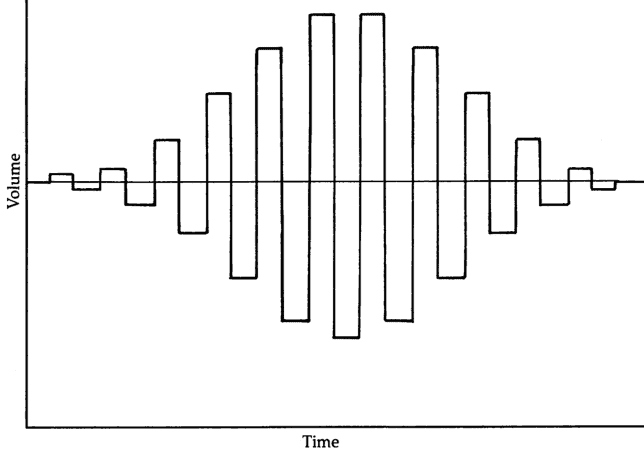

和硬音一样，软音可以使用任何可用的波形创建：脉冲波、三角波、锯齿波或噪声。程序 3-20 连续使用了了所有四种波形，使用相同的音高和相同的侵入、衰减和释放速率。

## 程序 3-20 软音——侵入、衰减和释放

为了确保程序输入无误，请务必阅读附录 C 中的“自动校对器”。

```
5 REM --- 初始化声音寄存器 --- :rem 45
6 REM :rem 26
10 FOR R=54272 TO 54296, 0:NEXT :rem 24
11 POKE 54296,15 :rem 45
12 POKE 54275,8:POKE 54277,170:POKE 54278,250 :rem 105
13 POKE 54272,0:POKE 54273,45 :rem 246
16 REM :rem 75
17 REM ---- 软脉冲波 ---- :rem 172
18 REM :rem 77
20 POKE 54276,65 :rem 48
30 FOR R=0 TO 500:NEXT :rem 186
40 POKE 54276,64 :rem 49
50 FOR P=0 TO 500:NEXT      rem 186
56 REM                        rem 79
57 REM ---- 软三角波 --- rem 125
58 REM                        rem 81
60 POKE 54276,17               rem 49
70 FOR R=0 TO 500:NEXT      rem 190
80 POKE 54276,16               rem 50
90 FOR P=0 TO 500:NEXT      rem 190
96 REM                        rem 83
97 REM ---- 软锯齿波 --- rem 164
98 REM                        rem 85
100 POKE 54276,33             rem 90
110 FOR R=0 TO 500:NEXT      rem 233
120 POKE 54276,32             rem 91
130 FOR P=0 TO 500:NEXT      rem 233
136 REM                        rem 126
137 REM ---- 软噪声波 --- rem 212
138 REM                        rem 128
140 POKE 54276,129             rem 148
150 FOR R=0 TO 500:NEXT      rem 237
156 REM                        rem 128
157 REM ---- 关闭音效 --- rem 150
158 REM                        rem 130
160 POKE 54276,128:POKE 54296,0  rem 99
```

每种波形首先被启用，然后执行持续部分的的循环，最后关闭门控位。另一个 `FOR-NEXT` 循环在不同的声音之间创建暂停。例如，第 20 行启用脉冲波，第 30 行执行持续循环，第 40 行关闭门控位。脉冲波和三角波之间的暂停在第 50 行。侵入和衰减速率通过在第 12 行向 54277 写入值来设置。这提供了 10 的侵入速率（16*5）和 10 的衰减速率。记住将这两个值相加得到数字（160+10=170）。持续电平通过向寄存器 54278 设置设置为最大（16*5），释放速率设置为10。在 64 上编写声音有多种方法，但这并不是例外。对于那些增加到最大然后逐渐减到最小的声音，你也可以使用寄存器 54296 来创建。在这个例子中看起来稍微复杂，但有时它是创建所需声音的唯一方法。程序 3-21 产生的与程序 3-20 非常相似，但它没有使用侵入、衰减和释放速率，而是使用音量控制来制作软音。

## 程序 3-21 软音——音量控制

为了程序输入无误，请务必阅读“自动校对”。


# 音效

## 程序 3-22 声波演示

```basic
5 REM --- 初始化声音寄存器 --- :rem 45
6 REM                           rem 26
10 FOR R=54272 TO 54296:POKE R,0:NEXT :rem 24
12 POKE 54275,8:POKE 54277,0:POKE 54278,240 :rem 0
13 POKE 54272,0:POKE 54273,45 :rem 75
16 REM                           rem 170
17 REM ---- 软脉冲波 ---- :rem 172
18 REM                           rem 77
30 POKE 54276,65 :rem 17
50 FOR R=0 TO 30
60 POKE 54296,R/2:NEXT      rem 247
65 FOR R=30 TO 0 STEP -1      rem 253
75 POKE 54296,R/2:NEXT      rem 187
80 FOR R=0 TO 100:NEXT      rem 124
116 REM                           rem 124
117 REM ---- 软三角波 ---- :rem 170
118 REM                           rem 126
130 POKE 54276,17             rem 95
150 FOR R=0 TO 30             rem 66
160 POKE 54296,R/2:NEXT      rem 40
165 FOR R=30 TO 0 STEP -1      rem 226
175 POKE 54296,R/2:NEXT      rem 46
180 FOR R=0 TO 100:NEXT      rem 236
216 REM                           rem 125
217 REM ----- 锯齿波 ---- :rem 206
218 REM                           rem 127
230 POKE 54276,33             rem 94
250 FOR R=0 TO 30             rem 67
260 POKE 54296,R/2:NEXT      rem 41
265 FOR R=30 TO 0 STEP -1      rem 227
275 POKE 54296,R/2:NEXT      rem 47
280 FOR R=0 TO 100:NEXT      rem 237
316 REM                           rem 126
317 REM ----- 软噪声波 ---- :rem 212
318 REM                           rem 128
330 POKE 54276,129             rem 149
350 FOR R=0 TO 30             rem 68
360 POKE 54296,R/2:NEXT      rem 42
365 FOR R=30 TO 0 STEP -1      rem 228
375 POKE 54296,R/2:NEXT      rem 48
380 FOR R=0 TO 100:NEXT      rem 238
416 REM                           rem 127
417 REM ---- 关闭音效 --- :rem 149
418 REM                           rem 129
420 POKE 54276,128:POKE 54296,0  rem 99
```

## 程序 3-23 电子鸟声

```basic
13 POKE 54276,65 :rem 50
17 REM --- :rem 76
18 REM --- 啾鸣循环 --- :rem 184
19 REM :rem 78
20 FOR S=0 TO 50 :rem 17
25 POKE 54296,15 :rem 50
37 REM :rem 78
38 REM --- 向上啾鸣 --- :rem 210
39 REM :rem 80
42 FOR C=0 TO 10 STEP RND(*)*2+1 :rem 90
43 POKE 54273,155+C:NEXT :rem 168
47 REM :rem 79
48 REM --- 向下啾鸣 --- :rem 102
49 REM :rem 81
52 FOR D=10 TO 0 STEP -(RND(*)*2)+1 :rem 43
53 POKE 54273,155+D:NEXT :rem 170
54 POKE 54296,0 :rem 254
55 FOR T=0 TO RND(*)*75:NEXT :rem 41
60 NEXT :rem 165
70 POKE 54276,64:POKE 54296,0 :rem 3
```

为了让电子鸟声听起来更真实，此程序使用了计数器值（向上啾鸣和向下啾鸣时的变量 `C`）来扫描频率刻度的顶端。这是通过在第 43 行和第 53 行中每次通过程序改变音调值来实现的。`RND` 函数被用于使啾鸣的长度略有不同。注意，`STEP` 值永远不会低于1，因为第 42 行和第 52 行在随机生成的 `STEP` 值上加了1。这防止了啾鸣声变得异常冗长。

第 12 行将起始/衰减值设置为 51，建立了为 3 的起始时间（3*16=48）和为 3 的衰减时间。不过，你可以仅使用音量控制来创建一个软效果。这就是程序 3-23 所做的。

## 程序 3-24 吱吱鞋声

吱吱鞋声。此程序使用非对称脉冲波形来创建基础声音。然后随着音量的逐渐减，声音被打破以产生软效果。这产生了鞋子在地板上吱吱响、作响的声音。

为了确保程序输入无误，请务必阅读附录 C 中的“自动纠错器”。

```basic
5 REM -- 初始化声音寄存器 -- :rem 00
6 REM :rem 26
10 FOR R=54272 TO 54296:POKE R,0:NEXT :rem 24
11 POKE 54275,1:POKE 54277,0:POKE 54278,240:rem 248
12 POKE 54276,65 :rem 49
13 REM :rem 72
113 REM :rem 121
114 REM --- 吱吱鞋声 --- :rem 139
115 REM :rem 123
117 FOR H=0 TO 10 :rem 57
130 FOR R=0 TO 6 :rem 19
140 POKE 54296,R:POKE 54273,20-R*3 :rem 36
145 NEXT :rem 217
147 FOR R=6 TO 0 STEP -1 :rem 181
148 POKE 54296,R:POKE 54273,20-R*3 :rem 44
149 NEXT :rem 221
160 POKE 54296,0 :rem 44
165 FOR U=0 TO 350:NEXT :rem 249
170 NEXT:POKE 54276,64 :rem 222
```

注意第 11 行将脉冲宽度设置为 1。这产生了非对称波形。此程序不是使用起始、衰减和释放寄存器，而是使用音量产生软声音。音量在第 130 行从 0 缓慢增加到 6，并在第 147 行通过 `STEP -1` 命令减小。同时，使用变量 `R` 改变音值。

尝试更改第 11 行的脉冲宽度以产生对称波形。在位置 54275 POKE 8 可以实现这一点。这种效果听起来就不像吱吱声了。

## 程序 3-25 小提琴

软锯齿声。从本章之前的示例中，锯齿波形产生尖锐刺耳的声音。当你使用软类声音时，这非常适合模拟乐器的声音。使用音量寄存器创建软效果，此程序包含一个计数器，每当通过第 150 行和第 165 行的循环时增加一次，并随着音调的开始和结束而起伏。

为了确保程序输入无误，请务必阅读附录 C 中的“自动纠错器”。

```basic
5 REM -- 初始化声音寄存器 -- :rem 0
6 REM :rem 26
10 FOR R=54272 TO 54296:POKE R,0:NEXT :rem 24
11 POKE 54277,0:POKE 54278,240 :rem 43
12 POKE 54276,33 :rem 44
13 REM -- 小提琴音乐 ---- :rem 72
14 REM :rem 29
15 REM :rem 74
16 DATA 33,134,33,134,37,161,42,60,50,58,44,191,42,60,44,191,37,161,42,60 :rem 81
22 REM :rem 72
23 REM --- 音乐循环 ---- :rem 191
24 REM :rem 74
25 FOR S=0 TO 2 :rem 227
30 FOR G=0 TO 7 :rem 216
117 REM :rem 125
118 REM ---- 小提琴拨奏 ---- :rem 119
119 REM :rem 127
120 READ H,L
125 POKE 54272,L:POKE 54273,H :rem 37
150 FOR R=0 TO 15 STEP .75 :rem 27
160 POKE 54296,R:NEXT :rem 199
165 FOR R=15 TO 0 STEP -.75 :rem 78
175 POKE 54296,R:NEXT :rem 205
197 REM :rem 133
198 REM ---- 重复循环 ---- :rem 106
199 REM :rem 135
200 NEXT :rem 209
211 RESTORE :rem 184
216 NEXT :rem 216
217 REM :rem 126
218 REM ---- 关闭声音 ---- :rem 148
219 REM :rem 128
300 POKE 54296,32:POKE 54276,0 :rem 42
```

补充数据行：
```basic
16 DATA 33,134,33,134,37,161,42,60,33,134,42,60,37,161,25,29
17 DATA 33,134,33,134,37,161,42,60,33,134,0,0,31,1,64,0,0
18 DATA 33,134,33,134,37,161,42,60,44,191,42,60,37,161,33,31,164,25,29
19 DATA 28,48,31,164,134,0,0,133,134,0,0
30 FOR G=0 TO 31
```

第 30 行也必须更改，以便程序知道需要 `READ` 多少个音值。使用你创建的音值，你可以用小提琴效果演奏几乎任何音乐。

## 程序 3-26 心跳

软三角波声。由于三角形波产生任何波形中最柔和的声音，因此软三角形波音效是你能制造的最优秀的效果之一，这是很合理的。这里有一个可以作为背景音使用的心跳程序。你可以将其用于任何需要悬疑效果的“电子”游戏。

为了程序输入无误，请务必阅读附录 C 中的“自动纠错器”。

```basic
5 REM -- 初始化声音寄存器 -- :rem 0
6 REM :rem 26
10 FOR R=54272 TO 54296:POKE R,0:NEXT :rem 24
15 POKE 54277,0:POKE 54278,240 :rem 47
20 POKE 54276,17 :rem 45
21 REM :rem 124
22 REM ---- 循环循环 ---- :rem 168
23 REM :rem 126
24 FOR R=0 TO 35 :rem 66
25 REM :rem 125
26 REM ---- 向下心跳 ---- :rem 58
150 FOR R=10 TO 0 STEP -2 :rem 79
155 POKE 54273,35-(R+20) :rem 192
160 POKE 54296,R:NEXT :rem 40
161 REM :rem 124
162 REM ---- 向上心跳 ---- :rem 166
163 REM :rem 126
165 FOR R=0 TO 10 STEP .2 :rem 230
170 POKE 54273,35-(R+20) :rem 189
175 POKE 54296,R:NEXT :rem 205
200 REM :rem 118
202 REM :rem 120
205 POKE 54276,16 :rem 97
206 FOR G=0 TO 300:NEXT :rem 226
207 POKE 54276,17 :rem 100
208 NEXT :rem 217
216 REM :rem 125
217 REM ---- 关闭声音 ---- :rem 147
218 REM :rem 127
220 POKE 54276,16:POKE 54296,0 :rem 45
```

程序使用低音调和三角形波形产生沉闷的心跳声。音调随着音量的起伏而波动。这是通过在第 155 行和第 170 行的高音寄存器中 POKE 不同的 `R` 值来实现。如果你删除了第 205 行和第 207 行，心跳声将产生奇怪的回声。删除第 206 行会让声音变快，就像心跳突然加快一样。

## 程序 3-27 锯木声

软噪音听起来几乎是个矛盾词。然而，许多声音是柔和且不规则的，可以使用噪声波形来复制。

锯木声。为了在程序中产生锯木声，噪声波形使用了两个不同的音值。第一个音值比第二个高，微妙地暗示了锯子向上拉时速度更快。

```basic
5 REM -- 清空声音寄存器 -- :rem 41
6 REM :rem 26
10 FOR R=54272 TO 54296:POKE R,0:NEXT :rem 24
11 POKE 54277,0:POKE 54278,240 :rem 43
12 POKE 54276,129 :rem 98
13 REM :rem 72
14 REM -- 锯木次数循环 ---- :rem 171
15 REM :rem 74
16 FOR L=0 TO 15 :rem 16
17 REM :rem 76
18 REM --- 向上锯木动作 --- :rem 75
19 REM :rem 78
20 POKE 54273,75 :rem 46
50 FOR R=0 TO 15 STEP .7      :rem 181
60 POKE 54296,R:NEXT       :rem 150
65 FOR R=15 TO 0 STEP -.7    :rem 232
75 POKE 54296,R:NEXT       :rem 156
116 REM                     :rem 124
117 REM --- 向下锯齿切割 :rem 14
118 REM                     :rem 126
120 POKE 54273,65           :rem 94
150 FOR R=0 TO 15 STEP .6   :rem 229
160 POKE 54296,R:NEXT       :rem 199
165 FOR R=15 TO 0 STEP -.6  :rem 24
175 POKE 54296,R:NEXT       :rem 205
190 NEXT                    :rem 217
216 REM                     :rem 125
217 REM --- 关闭声音 ---:rem 147
218 REM                     :rem 127
220 POKE 54276,128:POKE 54296,0:rem 97
```

这种速度的差异对应于锯子的使用方式，因为锯子的切刃在向下切割时用得更多。由于切割动作会对锯子产生更大的阻力，因此速度会较慢。这就是为什么第 150 行和 165 行的时间循环更长。较小的 `STEP` 值让那部分声音具有更长的循环。

## 程序 3-28 海浪声

**海洋。** 与程序 3-27 类似，此例程通过减慢效果来重现海洋的声音。

为了确保程序输入无误，请确保阅读附录 C 中的“自动校对器”。

```basic
5 REM --- 清空声音寄存器 :rem 41
6 REM                     :rem 26
10 FOR R=54272 TO 54296:POKE R,0:NEXT:rem 24
11 POKE 54275,8:POKE 54278,240:rem 49
12 POKE 54276,128          :rem 98
13 REM                     :rem 72
14 REM --- 波浪数量循环 :rem 27
15 REM                     :rem 74
16 FOR L=0 TO 15           :rem 16
17 REM                     :rem 76
18 REM --- 波浪例程    :rem 14
19 REM                     :rem 78
20 POKE 54273,75           :rem 46
40 IW=RND(0) * .25+.01:rem 35
45 OW=RND(0) * .02+.01:rem 37
50 FOR R=1 TO 15 STEP IW:rem 241
60 POKE 54296,R:NEXT       :rem 150
65 FOR R=15 TO 1 STEP -OW:rem 42
75 POKE 54296,R:NEXT      :rem 156
76 NEXT                   :rem 172
77 REM                    :rem 82
78 REM ---- 关闭声音 ----:rem 104
79 REM                    :rem 84
80 POKE 54276,128:POKE 54296,0 :rem 53
```


为了让声音更真实，传入和流出波的长度通过第 40 行和 45 行的 `RND` 函数进行变化。这些值成为第 50 行和 65 行时间循环中 `STEP` 命令的一部分。程序的其余部分你应该很熟悉。柔和的声音通过增加和减少音量级来创建；通过 `POKE` 位置 54276 写入 129 来启用噪声波形；音高值在第 20 行设置。你可以通过修改第 40 行和 45 行的波浪来模拟更快的波浪，例如将它们改为 `IW=RND(0)*4+.1` 和 `OW=RND(0)*05+.02`。

## 渐变音

渐变音可以定义为从音量程的一端开始并缓慢上升（或下降）到另一端的声音。例如，上升的渐变音会从安静开始并逐渐达到全音量。然而，它不会像柔和音那样回到最小音量，而是会保持在高音量级。

编写渐变音最简单的方法是使用音量控制寄存器，就像你创建声音时做的那样。虽然可以使用攻击（attack）、衰减（decay）和释放（release）寄存器来创建渐变音，有时会变得困难，尤其是当你处理下降的渐变音时。你可以通过攻击和衰减设置为缓慢速率，然后将水平设置为快速速率来产生渐变音，但协调这三者可能会非常复杂。如果不使用音量控制寄存器，几乎不可能产生下降的渐变音。而且无论你如何努力，声音可能都不对。我们将坚持在示例中使用音量控制寄存器以保持简单。

## 程序 3-28. 上升渐变音

为了确保程序输入无误，请确保阅读附录 C 中的“自动校对器”。

```
5 REM --- 初始化声音寄存器 :rem 45
6 REM                     :rem 26
10 FOR R=54272 TO 54296,0,NEXT :rem 24
11 POKE 54275,8:POKE 54277,0:POKE 54280,24 :rem 255
16 REM                     :rem 75
17 REM - 渐变上升脉冲波-:rem 95
18 REM                     :rem 77
30 POKE 54276,65 :rem 49
50 FOR R=0 TO 30 :rem 17
60 POKE 54296,R/2:NEXT :rem 247
70 FOR R=0 TO 500:NEXT :rem 190
80 POKE 54276,64 :rem 53
116 REM                     :rem 124
117 REM - 渐变上升三角波-:rem 93
118 REM                     :rem 126
130 POKE 54276,17 :rem 95
150 FOR R=0 TO 30 :rem 66
160 POKE 54296,R/2:NEXT :rem 40
170 FOR R=0 TO 500:NEXT :rem 239
180 POKE 54276,16 :rem 99
216 REM                     :rem 125
217 REM - 渐变上升锯齿波-:rem 129
218 REM                     :rem 127
230 POKE 54276,33 :rem 94
250 FOR R=0 TO 30 :rem 67
260 POKE 54296,R/2:NEXT :rem 41
270 FOR R=0 TO 500:NEXT :rem 240
280 POKE 54276,32 :rem 98
316 REM                     :rem 126
317 REM - 渐变上升波-:rem 135
318 REM                     :rem 128
330 POKE 54276,129 :rem 149
350 FOR R=0 TO 30 :rem 68
360 POKE 54296,R/2:NEXT :rem 42
370 FOR R=0 TO 500:NEXT :rem 241
380 POKE 54276,128 :rem 153
416 REM                     :rem 127
417 REM --- 关闭声音 --- :rem 149
418 REM                     :rem 129
420 POKE 54276,128:POKE 54296,0 :rem 99
```

当然，渐变音会从大开始并逐渐减到安静。修改程序 3-28 中的行可以让你听到下降的渐变音。变化是：

```
50 FOR R=30 TO 0 STEP -1
150 FOR R=30 TO 0 STEP -1
250 FOR R=30 TO 0 STEP -1
350 FOR R=30 TO 0 STEP -1
```

现在声音从最高音量级开始，通过使用 `STEP -1` 命令的 FOR-NEXT 循环逐渐减少。

## 渐变脉冲波形

前面提到，渐变音有两种：上升下降。让我们看看上升的渐变音。

**手风琴。** 大多数乐器产生的声音都是下降的。这是因为它们通过让某些元件振动产生声音。随着振动停止，声音逐渐消失。

使用振动元件的手风琴。这些元件是钢簧。但因为手风琴通过泵空气来吹奏钢簧，所以当手风琴手开始压缩风箱时，声音缓慢开始，然后音量逐渐增大。

当手风琴停止压缩风箱时，空气停止了。由于钢簧相当硬，它们停止振动很快，使声音也同样快速停止。程序 3-29 展示了模拟手风琴的上升渐变音。

### 程序 3-29. 手风琴

为了确保程序输入无误，请确保阅读附录 C 中的“自动校对器”。

```
5 REM ----- 初始化声音寄存器 ----- :rem 0
6 REM :rem 26
10 FOR R=54272 TO 54296,0,NEXT:rem 24
11 POKE 54275,7:POKE 54277,0:POKE 54278,240 :rem 250
12 POKE 54276,6 :rem 49
13 REM                     :rem 72
14 REM ----- 手风琴 ----- :rem 222
15 REM                     :rem 74
16 DATA 33,134,4,33,134,4,33,134,4,33,134,2,33,14,4,25,29,2,28,45,2,0,2,16,195,45,18,0,8,2,21,4,25,29,2,28,48,2,0,2,16,195,4,18,0,8,2,21,3,20,16,195,2,18,208,2,21,30,2,16,195,2,18,20,8,2,0,2,16,195,8,3,3,134
17 FOR L=0 TO 15 :rem 16
18 READ L,T :rem 125
19 REM                     :rem 127
20 REM --- 关闭声音 --- :rem 149
21 POKE 54276,128:POKE 54296,0 :rem 99
```

## 音效

```
26 REM :rem 76
27 REM ---- MUSIC LOOPS ---- :rem 195
28 REM :rem 78
29 FOR J=0 TO 1 :rem 221
30 FOR G=0 TO F :rem 231
117 REM :rem 125
118 REM ---- PLAY PIANO :rem 147
119 REM :rem 127
120 READ H,L,T :rem 239
125 POKE 54272,POKE 54273,H :rem 37
150 FOR R=15 TO 0 STEP -(1.5/T) :rem 22
160 POKE 54296,R:next 199
175 POKE 54296,0 :rem 50
197 REM :rem 133
198 REM ---- REPEAT MUSIC LOOP ---- :rem 106
199 REM :rem 135
200 NEXT :rem 209
211 RESTORE:F=F-1 :rem 25
212 NEXT :rem 212
217 REM :rem 126
218 REM ---- TURN OFF SOUND ---- :rem 148
219 REM :rem 128
300 POKE 54276,POKE 54296,0 :rem 47
```

### 音效

11 POKE 54275,15:POKE 54277,0:POKE 54278,240 :rem 45

14 REM --- 大键琴音乐数据 --- :rem 131

16 DATA 42,60,33,134,37,161,14,42,60,1,50,58,35,191,44,49,191,56,97,1 :rem 72

17 DATA 50,58,50,58,67,12,63,72,67,12,12,1,50,58,42,60,1,33,134,37,161 :rem 10

18 DATA 1,42,60,44,49,191,1,58,56,97,1,50,58,1,44,191,44,60,1,37,161,1 :rem 123

19 DATA 42,60,33,134,31,164,33,134,37,161,1,25,29,31,36,191,42,60,37,161,1 :rem 156

20 DATA 44,37,191,42,60,37,161,1 :rem 64

30 FOR G= TO 35 :rem 9

118 REM --- 播放大键琴 --- :rem 83

150 FOR R=15 TO 0 STEP -.(5/T) :rem 229

## 渐减三角波

## 玻璃杯撞击声

### 程序 3-31. 撞击

### 程序 3-32. 带有攻击/衰减的撞击

## 渐减锯齿波

### 程序 3-33. 雾角

## 音效

## 渐减噪声

### 程序 3-34. 噪声

# 4 高级函数

## 音高控制寄存器

音高控制寄存器为每个音器（voice）包含两个内存地址。这些对内存地址中的每个值都由 SID 组合并被视为一个单一值。你可能记得，高控制寄存器中开启的位值会乘以 256，然后加到低控制寄存器中开启的对应位值。这个总和是 SID 芯片用于选择音高或频率的数值。两个寄存器中 16 位中的每一位的值见图 4-1。

### 图 4-1. 音高寄存器位值

| 位 | 15 | 14 | 13 | 12 | 11 | 10 | 9 | 8 | 7 | 6 | 5 | 4 | 3 | 2 | 1 | 0 |
|---|---|---|---|---|---|---|---|---|---|---|---|---|---|---|---|---|
| 值 | 32768 | 16384 | 8192 | 4096 | 2048 | 1024 | 512 | 256 | 128 | 64 | 32 | 16 | 8 | 4 | 2 | 1 |

高控制寄存器 低控制寄存器（普通位值 [1–128] 乘以 256）

音高控制寄存器的内存地址为：

- 音器 1：低音高寄存器 54272
- 音器 1：高音高寄存器 54273
- 音器 2：低音高寄存器 54279
- 音器 2：高音高寄存器 54280
- 音器 3：低音高寄存器 54286
- 音器 3：高音高寄存器 54287

第 1 章中的表 1-3 显示了标准音阶的音值，包括升号和降号。然而，你可能会发现你需要产生某些表中未列出的音高或频率。由于你在 64 上产生的每个频率在 0 到 65,535 之间都有一个对应的值，因此可以根据你想要的频率计算出所需的值。确定任何给定频率的 16 位总值的公式为：

`Value = Frequency/.06097`

当然，你不能直接将此数字 POKE 到高、低寄存器地址中。单个地址能容纳的最大数字是 255。要计算通过 SID 芯片可用频率（0–3995 赫兹）的值并将其分为你可以使用的两个值，请运行这段短程序。输入 0 到 3995 之间的频率，高（U）和低（L）音高值将显示在屏幕上。该音符将使用锯齿波播放，直到你按下任意键。

### 程序 4-1. 频率计算

```
为了防止输入错误，请确保阅读附录 C 中的“自动检查器”。
2 FOR T=54272 TO 54272+24:POKE,0:POKE 54296,1 :rem 197
5 POKEINT(CLR); F :rem 6
10 PRINT A="FREQUENCY"; F :rem 214
15 N=INT(F./06097) :rem 74
20 U=INT(N/256) :rem 212
30 L=N-(U*256) :rem 254
40 PRINT "U=";U;"L=";POKE 54272,L:POKE 54273,U; :rem 56
45 PRINT "2 DOWN [WHT]PRESS ANY KEY TO RUN AGAIN :rem 81
50 GETSA:IF A=$ THEN GOTO 50 :rem 50
55 POKE 54276,32
60 GOTO
```

可以使用这个程序在收听所选音符的同时计算两个寄存器的音值。如果你将显示的值与表 1-3 进行比较，你会注意到细微的差异。例如，如果你请求 16 hz 的频率音值，你会看到屏幕高值为 1，低值为 6。这与表 1-3 显示的高值 1 和低值 12 略有不同。尽管低寄存器值不同，SID 芯片仍会播放该音符。该差异太短，以至于听不到。

## 脉宽寄存器

声波的频率可以通过测量一个波形的上升边缘到下一个波形上升边缘的时间来确定。图 4-2 显示了一个脉冲周期的上升边缘和下降边缘。从图 4-2 可以看出，两个上升边缘之间有一个下降边缘。在这个图中，下降边缘正好位于波形的中间。我们称之为 50% 脉冲波，因为信号在波形的中点下降。这种比例的脉宽产生最响亮、最清晰的脉冲波形。通过让脉冲波大于或小于 50%，你会听到声音变得尖锐。程序 4-2 让你听到改变脉宽产生的效果。当程序产生声音时，它会显示各种脉宽的寄存器值。

### 图 4-2. 上升边缘和下降边缘


### 程序 4-2. 改变脉宽

为了防止输入错误，请确保阅读附录 C 中的“自动检查器”。

```
5 PRINT"{CLR} [2 DOWN]";rem 24
6 REM:rem 26
10 FOR R=54272 TO 54296:POKE,0:NEXT:rem 24
11 POKE 54296,15:rem 45
12 POKE 54277,0:POKE 54278,20:rem 44
13 POKE 54272,30:POKE 54273,20:rem 34
16 POKE 54276,65:rem 53
17 REM -----rem 76
18 REM --- PULSE LOOP :rem 120
19 FOR P=0 TO 100 STEP 5 :rem 179
20 N=INT(4096/100*P) :rem 54
21 U=INT(N/256) :rem 75
22 PRINT RIGHT$(STR(P)+""), = : :rem 249
23 L=N-(U*256)
24 PRINT "LOW:";HIGH:";U :rem 68
28 REM --- PULSE WIDTH DATA ---rem 217
29 REM :rem 79
30 POKE 54274,POKE 54275,U :rem 1
40 FOR R=0 TO 300: NEXT :rem 164
50 NEXT :rem 80
57 REM --- SOUND OFF :rem 102
59 :rem 82
60 POKE 54276,POKE 54296,0 :rem 2
```

通过改变双字节脉宽寄存器中的值，可以产生占周期 0% 到 100% 的脉冲。脉宽控制寄存器位于以下位置：

- 音器 1：脉宽低寄存器 54274
- 音器 1：脉宽高寄存器 54275
- 音器 2：脉宽低寄存器 54281
- 音器 2：脉宽高寄存器 54282
- 音器 3：脉宽低寄存器 54288
- 音器 3：脉宽高寄存器 54289

这里有一个短程序，允许你输入 0 到 100 之间的脉冲值。这个短程序让你在收听音符的同时，为两个寄存器输入你的脉冲值。

### 程序 4-3. 脉冲值

为了防止输入错误，请确保阅读附录 C。

## 包络发生器

在本书中，我们一直讨论了通过修改声音包络来改变声音的方法。使用 ADSR（攻击、衰减、维持和释放），你可以显著地改变声音的“形状”。突出每一个部分，并更详细地展示如何使用它们，可能会非常有价值。

### 图 4-4 声音包络—ADSR

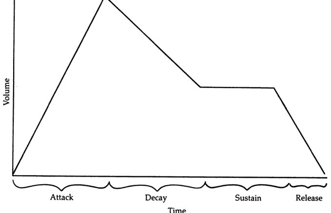

你可以在以下内存位置找到每个通道（voice）的 ADSR 函数：

- Voice 1: 攻击控制寄存器 54277 位 4–7
- Voice 1: 衰减控制寄存器 54277 位 0–3
- Voice 1: 持久控制寄存器 54278 位 4–7
- Voice 1: 释放控制寄存器 54278 位 0–3
- Voice 2: 攻击控制寄存器 54284 位 4–7
- Voice 2: 衰减控制寄存器 54284 位 0–3
- Voice 2: 持久控制寄存器 54285 位 4–7
- Voice 2: 释放控制寄存器 54285 位 0–3
- Voice 3: 攻击控制寄存器 54291 位 4–7
- Voice 3: 衰减控制寄存器 54291 位 0–3
- Voice 3: 持久控制寄存器 54292 位 4–7
- Voice 3: 释放控制寄存器 54292 位 0–3

**Attack（攻击）**指的是声音达到最大音量所需的时间。如果攻击速率快，声音将突然开始。如果设置为较慢的速率，声音达到最大音量的时间就会更长。


### 程序 4-4. 攻击速率

为了确保程序输入无误，请务必阅读附录 C 中的“自动检查器”。

```
5 REM -- INITIALIZE SOUND REGISTERS -- :rem 0
6 REM -- :rem 26
10 FOR R=54272 TO 54296:POKE, Ø:NEXT :rem 24
11 POKE 54296, 15 :rem 45
12 REM :rem 71
13 REM -- SET ATTACK RATE -- :rem 204
14 REM :rem 73
15 POKE 54277,0 :rem 250
16 REM :rem 75
17 REM :rem 76
18 REM -- SET OTHER REGISTERS -- :rem 39
19 REM :rem 78
20 POKE 54275,8:POKE 54278,240
21 POKE 54272,0:POKE 54273,21 :rem 239
22 POKE 54276,65 :rem 50
23 REM :rem 73
24 REM -- PLAY NOTE -- :rem 106
25 REM :rem 75
30 FOR D=0 TO 500:NEXT :rem 172
47 REM :rem 79
48 REM -- TURN OFF SOUND -- :rem 177
49 REM :rem 81
50 POKE 54276,64:POKE 54296,0
```

此程序演示了一个非常快的攻击速率。查看第 15 行。数字 0 被 POKED 到位置为 `54277` 的攻击/衰减控制寄存器中。这同时设置了攻击和衰减（我们将它们设为最快速率）。声音很快上升到最大音量。

然而，如果将攻击设置为较慢的速率，声音将柔和地出现。要听听这种效果，请将程序 4-4 中的第 15 行替换为以下内容：

```
15 POKE 54277,160
```

你刚刚将攻击速率设置为了 10。（记住，你需要将数字乘以 16 以得到要 POKE 到寄存器中的值。）现在声音在经过一段时间后才达到最大音量。它变成了一个柔和得的声音。你可以使用声音的攻击和衰减来创造硬音或软音色，就像你之前使用音量控制一样。

本书其他章节中的一些程序使用了音量控制寄存器来开启和关闭声音。当你使用 ADSR 函数时，你需要使用门控位（gate bit）来开启和关闭声音。正是门控位触发了声音的 ADSR。每当你操作 ADSR 时（每当你在 C64 上创建声音时都会这样做），都应该使用门控位来开启和关闭声音。如果你一直遵循第 1 章中建立的音频编程模式，那么你已经在这样做了。有时，为了创建你所需的特定声音，你可能会使用音量控制寄存器来开启和关闭声音。请注意，如果这样做效果可能会有所不同。

音符音量增加的速度（攻击）由你 POKE 到攻击寄存器中的值决定。攻击速率可以是 0 到 15 之间的任何数字。表 4-1 显示了每个攻击速率对应的 POKE 值和实际经过的持续时间。

### 表 4-1. 攻击时间

| 攻击速率 | POKE 值 | 经过时间 |
| :--- | :--- | :--- |
| 0 | 0 | .002 秒 |
| 1 | 16 | .008 秒 |
| 2 | 32 | .016 秒 |
| 3 | 48 | .024 秒 |
| 4 | 64 | .038 秒 |
| 5 | 80 | .056 秒 |
| 6 | 96 | .068 秒 |
| 7 | 112 | .080 秒 |
| 8 | 128 | .100 秒 |
| 9 | 144 | .250 秒 |
| 10 | 160 | .500 秒 |
| 11 | 176 | .800 秒 |
| 12 | 192 | 1.000 秒 |
| 13 | 208 | 1.000 秒 |
| 14 | 224 | 5.000 秒 |
| 15 | 240 | 8.000 秒 |

例如，如果你想要持续 0.1 秒的攻击，你会使用 8 的攻击速率，但在攻击/衰减寄存器中 POKE 128（8*16）。在设置攻击速率时还有一点需要注意：声音的持续时间至少要与攻击执行所需一样，否则声音会在达到最大音量之前中断。你可以通过更改程序 4-4 中的第 30 行来听到这种现象。确保第 15 行仍为 `POKE 54277,160`。为了计时，`FOR=0 TO 1000` 大约持续一秒。当你重新运行程序时，将询问你希望衰减持续多少秒。

声音包络中的衰减在声音达到最大音量后，它将按照攻击/衰减控制寄存器中指定的速率进行衰减（音量下降），直到达到持久水平。衰减计时比攻击计时慢一些。表 4-2 概述了衰减速率、使用的 POKE 值以及执行这些速率所需的时间。

### 表 4-2. 衰减时间

| 衰减速率 | POKE 值 | 经过时间 |
| :--- | :--- | :--- |
| 0 | 0 | .006 秒 |
| 1 | 1 | .024 秒 |
| 2 | 2 | .048 秒 |
| 3 | 3 | .072 秒 |
| 4 | 4 | .114 秒 |
| 5 | 5 | .168 秒 |
| 6 | 6 | .204 秒 |
| 7 | 7 | .240 秒 |
| 8 | 8 | .300 秒 |
| 9 | 9 | .750 秒 |
| 10 | 10 | 1.500 秒 |
| 11 | 11 | 2.400 秒 |
| 12 | 12 | 3.000 秒 |
| 13 | 13 | 9.000 秒 |
| 14 | 14 | 15.000 秒 |
| 15 | 15 | 24.000 秒 |

注意衰减速率和 POKE 值是相同的。衰减值是被 POKED 到攻击/衰减寄存器的下半部分，不像攻击速率那样乘以 16 后再 POKE 到寄存器。将这三行添加到程序 4-4 的原始版本中。通过 POKE 位置 `54277`，你正在将通道 1 的衰减速率设置为 9。（更改第 20 行减少持久音量，可以让你更容易听到衰减。）

```
15 POKE 54277,9
20 POKE 54275,8:POKE 54278,90
30 FOR D=0 TO 400:NEXT
```

如果你想产生一个同时使用攻击和衰减的声音，将攻击速率的 POKE 值加上衰减速率的值，然后将总和 POKE 到寄存器中。以下代码可以添加到程序 4-4 中，将攻击设置为 10，衰减设为 9。你还需要设置总延迟时间，以听到整个声音。

```
15 POKE 54277,169
20 POKE 54275,8:POKE 54278,90
30 FOR D=0 TO 900:NEXT
```

持久（Sustain）。在声音包络的攻击/衰减部分之后，SID 芯片实现了持久功能。此功能类似于音量控制。然而，它不是决定声音的绝对音量，而是声音在攻击期间获得的一个相对水平。例如，如果攻击达到的最大音量是 10（由位置 `54296` 的音量控制寄存器设置），而持久被设置为 8（16 个可能电平的一半），那么持久期间的最终音量将是 5，即 10 的一半。由于持久水平仅是攻击期间所获得的最大音量的一部分，因此在持久期间声音的音量最好只能保持在该水平。你必须将持久水平设置为 15 才能做到。除非设置为该水平，否则音量总是会从最大值下降。

将我们程序 4-4 最新版本（第 15 行为 `POKE 54277,169` 的版本）中的第 20 行和第 30 行替换，可以将持久水平设置为 8（169 - 16*10？不，请记住实际的 POKE 值是乘以 16 的结果）。替换行如下：

```
20 POKE 54275,8:POKE 54278,128
30 FOR D=0 TO 1500:NEXT
```

## 4 进阶函数

你可以通过声音的起始（Attack）听到音量增大，然后通过其衰减（Decay）下降到较低的持续音（Sustain）电平。将持续音设为更低的值（例如 48），将使这种区别更加明显。

释放（Release）是 ADSR 功能中的最后一个。它在门控位（gate bit）关闭时触发。与起始和衰减一样，释放也是一个计时函数。它决定了音量从持续音电平下降到最低设置需要多久。要将释放设置为 9，而将持续音设置为 10，你只需要将上一个声音例程中的第 20 行更改为：

```
20 POKE 54275,8:POKE 54278,169
```

当你使用释放函数时，你需要在不取消波形的情况下取消声音门控。在我们所有的示例中，我们都是通过仅将波形位 POKE 到波形控制寄存器来实现的。该值比程序之前使用的值小 1，从而关闭了门控位。注意，在门控位关闭后，控制寄存器被设置为 0。如果你不这样做，在所有声音寄存器被清除之前，会产生一个非常低音量的残留声。确保你在延迟循环中预留了足够的时间，使得释放时间与衰减时间相同。这些时间请参考表 4-2。

## 使用声音包络

通过操纵声音包络的 ADSR，你可以创建独特的效果，通常只需改变包络的某一个元素。改变形状就会改变声音。这很简单。你甚至可以通过改变 ADSR 的不同部分来看到相似的声音。产生声音通常有多种方法。

在这里，例如，是一个使用脉冲波的简单音冲冲：

### 程序 4-5. 包络操作

```
5 REM -- 初始化声音寄存器 -- :rem 0
7 REM                                         :rem 27
10 FOR R=54272 TO 54296:POKE R,0:NEXT      :rem 24
11 POKE 54296,15                             :rem 45

140
```

12 REM :rem 71

13 REM -- 设置 A/D/S/R 值 -- :rem 111

14 REM :rem 73

15 POKE 54277,0:POKE 54278,240 :rem 47

16 REM :rem 75

17 REM -- 设置其他寄存器 -- :rem 80

18 REM :rem 77

19 POKE 54275,8 :rem 4

20 POKE 54273,21 :rem 37

21 POKE 54276,65 :rem 49

31 REM :rem 72

32 REM -- 音调计时循环 -- :rem 53

33 REM :rem 74

40 FOR R=0 TO 500:NEXT :rem 187

51 REM :rem 74

52 REM -- 关闭声音 -- :rem 172

53 REM :rem 76

70 POKE 54276,64:POKE 54296,0 :rem 3

```

该 ADSR 设置下的声音包络看起来如下：

图 4-5. 音冲 ADSR

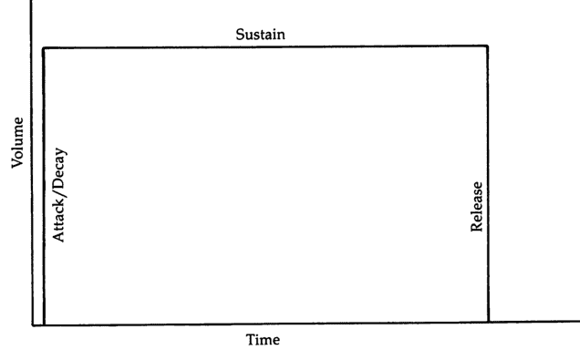

由于起始、衰减和释放都设置为 0（表示最快速率），包络中唯一真正存在的部分是持续音电平，它是通过在第 15 行中 POKE 到位置 `54278` 来设为最大值的。

如果你想让声音缓慢上升，只需增加起始值。在程序 4-5 中用此第 15 行替换原始行，并重新运行该例程。

```
15 POKE 54277,160:POKE 54278,240
```

现在包络看起来像图 4-6。

### 图 4-6. 较长的起始

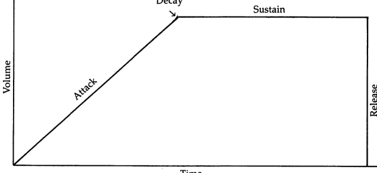

起始速率已设置为 10（通过向位置 `54277` POKE 160 [10*16=160] 表示），但衰减和释放保持为 0。注意这种区别——与起始设置为最快速率相比，无论是声音本身还是插图都是如此。

将起始减到 0 并增加衰减会给你一种完全不同的声音。对于这个示例，持续音也被设置为 0。将程序 4-5 中的第 15 行改为：

```
15 POKE 54277,9:POKE 54278,0
```

使用这种 ADSR，包络看起来像图 4-7。


对于这种声音，必须留出足够的时间让声音在衰减期间关闭。如果你制作带有计时的程序，可能会导致问题。在这些情况下，你可能会发现另一种易用的方法。将以下更改后的新行添加到程序 4-5：

```
15 POKE 54277,0:POKE 54278,0

32 REM -- 无计时循环 --

39 POKE 54276,64

70 POKE 54296,0
```

现在例程不是通过循环计时的。它将声音设为全音量并立即关闭门控，让释放函数将声音“衰减”到 0。保留第 40 行的计时循环是因为如果不清除寄存器，声音会保持微弱状态。将 ADSR 设置为这些值会创建一个像图 4-8 的包络。注意它与之前使用衰减时的相似之处。

### 图 4-8. 使用释放


产生这种声音的第三种方法是动态操纵持续/释放寄存器。使用 FOR 循环，你可以将多个值 POKE 到寄存器中以改变持续音量。将这两行添加到程序 4-5 并重新运行：

```
40 FOR R=240 TO 0 STEP -3

41 POKE 54278,R:NEXT
```

我们从持续寄存器的最大值开始，然后使用第 40 和 41 行的循环减小值直到变为 0。如果现在看包络，它会像图 4-9。

### 图 4-9. 持续音操作


多音量声音。另一个让持续有利的功能是它可以产生比音量寄存器设置值低的声音。下面的程序是一个示例。通过改变持续寄存器中的值，可以让声音更大或更软。使用此功能，你可以产生设置为不同持续水平因此具有不同音量的声音。

### 程序 4-6. 多音量

为了防止程序输入错误，请务必阅读附录 C。

```
5 REM -- 初始化声音寄存器 -- :rem 0

7 REM                               :rem 27

10 FOR R=54272 TO 54296:POKE R,0:NEXT      :rem 24

11 POKE 54296,15                             :rem 45

12 REM :rem 71

13 REM -- 设置 A/D/S/R 值 -- :rem 121

14 REM :rem 73

15 POKE 54277,0:POKE 54284,0 :rem 198

16 POKE 54280,240:POKE 54285,240 :rem 149

17 REM :rem 76

18 REM -- 设置其他值 -- :rem 63

19 REM :rem 78

20 POKE 54273,16:POKE 54272,195 :rem 97

21 POKE 54275,8:POKE 54278,8 :rem 207

22 POKE 54280,21:POKE 54279,30 :rem 40

30 POKE 54283,65:POKE 54283,65 :rem 55

31 REM :rem 72

32 REM -- 音量计时循环 -- :rem 215

33 REM :rem 74

37 FOR R=240 TO 0 STEP -1 :rem 227

38 POKE 54285,R :rem 32

47 NEXT :rem 170

51 REM :rem 74

52 REM -- 关闭声音 -- :rem 172

53 REM :rem 76

54 POKE 54276,64:POKE 54283,0 :rem 1
```

例程以两个和谐音调开始，然后通过减少持续寄存器中的值，逐渐关闭一个音调，同时保持另一个全音量。你可能还会注意到，通过减少持续/释放寄存器的值（减 1），你正在改变释放寄存器的值。由于在该例程中没有使用释放函数，这些值没有被使用。

在此应用程序中，减 1 被用于产生更长的音调。如你所见，64 上通常有方法产生特定声音。但 ADSR 并不是你可以使用的唯一控制。其他更高级函数允许你对 SID 芯片做更多。

### 测试位（Test Bit）

测试位是每个通道波形控制寄存器的第 3 位，是一个特殊位，当向内存位置 POKE 8（值为 3）时会关闭输出。通常它用于测试 SID 芯片。然而，它可以用于特殊功能，因为它产生一种柔和/关闭的声音。为了更好地理解这意味着，你需要听一个首先通过音量控制开启和关闭的声音。这种声音在开关切换时会产生咔哒声。为了进一步消除它，可以使用门控位，快速开启和关闭以产生。

### 程序 4-7. 测试位开启/关闭

为了防止程序输入错误，请务必阅读附录 C。

```
5 REM -- 初始化声音寄存器 -- :rem 0

6 REM                               :rem 26

10 FOR R=54272 TO 54296:POKE R,0:NEXT           :rem 24

11 POKE 54275,8:POKE 54277,0:POKE 54278,240      :rem 254

12 POKE 54274,47:POKE 54273,25                  :rem 46

13 POKE 54276,6                               :rem 50

21 REM                               :rem 71

22 REM -- 使用...开启/关闭声音 -- :217

23 REM -- 音量控制寄存器 ---      :rem 75

24 REM                               :rem 74

25 FOR M=0 TO 30                               :rem 14

50 POKE 54296,15                               :rem 48

60 FOR R=0 TO 50:NEXT                          :rem 141
```


# 4 Functions

## 使用测试位开启/关闭声音

```basic
70 POKE 54296,0:NEXT                           :rem 117
80 FOR N=0 TO 200:NEXT                        :rem 184
81 POKE 54296,15                               :rem 52
82 REM                               :rem 78
83 REM -- 使用...开启/关闭声音 -- :rem 224
```

```basic
85 REM :rem 81
95 FOR M=0 TO 30 :rem 21
96 POKE 54276,65 :rem 61
98 FOR R=0 TO 50:NEXT :rem 152
99 POKE 54276,73:NEXT :rem 184
100 FOR N=0 TO 200:NEXT :rem 225
101 REM :rem 118
102 REM -- 使用门控位开启/关闭声音 -- :rem 8
103 REM -- 门控位控制控制 -- :rem 129
104 REM :rem 121
105 FOR M=0 TO 30 :rem 61
106 POKE 54276,65 :rem 101
107 FOR R=0 TO 50:NEXT :rem 191
108 POKE 54276,64:NEXT :rem 223
109 POKE 54296,0 :rem 47
```

95-100 行包含了测试位（test bit）的开启/关闭过程。程序的其余部分和你见过的其他程序类似。波形和门控位在第 96 行启用，然后在第 99 行通过向寄存器 `POKE` `73` 开启测试位。测试位的值为 8，因此你只需在之前的值（65）上相加即可开启该位。随后，`FOR-NEXT` 循环通过再次向该位置 `POKE` 65 来关闭测试位。通过重复此过程可以以一种新的方式快速开启和关闭声音。

你可能想在自己的例程中使用其他方法来开启和关闭声音，但在创建特定声音时，测试位技术可能会派上用场。你可能希望声音开启和关闭时带有轻微的“咔哒”声——不像使用音量控制寄存器时那么明显，但比使用门控位函数要多。在这种情况下，测试位可能恰好适用。

## 加法合成

通过使用一个通道或在两个通道之间快速切换来创建相对简单的音效，只是在 Commodore 64 上创建声音的方法之一。你还有其他技术，可以创造出与你目前听到的完全不同的奇妙声音。其中一种技术被称为加法合成（additive synthesis）。

加法合成对你来说可能是一个新术语，但它实际上非常简单。它获取通常由 64 上的两个通道产生的声音，并将它们结合形成一个完全全新的声音。它通过叠加声音来创造两者的独特合成。Commodore 64 上的环调制（ring modulation）和同步（synchronization）都是加法合成的示例。

### 环调制（Ring modulation）

环调制是加法合成的一种，能够显著改变两个声音的音质。通过环调制产生的声音不会保留其原始频率。相反，它保留的是两个频率的和和差值。例如，如果第一个声音以每秒 500 次（vps）的速度振动，第二个声音以每秒 300 次的速度振动，那么环调制后的音调就是和（800 vps）与差（200 vps）的组合。它将是一个音调以 1000 vps 速度振动的声音。

大多数时候，环调制后的声音与原始音调大不同。事实上，环调制可以在你的计算机上创造出最有趣、最异常的声音。要在 64 上使用环调制，你必须同时设置波形控制寄存器的第 2 位（参见图 4-3 以获得三个寄存器之一的说明），并启用三角形波形。要做到这一点，只需在通常用于 `POKE` 开启门控位并启用三角形波形的值上加上 4（第 2 位的值）。换句话说，你向位置 54276 `POKE` `21` 用于通道 1（其中 4 用于门控位，4 用于环调制，16 用于三角形波形）。接下来，你必须通过向两个频率控制寄存器中的一个 `POKE` 写入来为通道 3 选择一个频率。对通道 3 只需要做这些操作；你不需要设置通道 3 的波形、ADSR 或任何其他参数。

环调定的效果在音调扫描音阶并混合时最为明显。你可以通过三种方式之一来实现。第一种方法（如程序 4-8 所示）为三角形波形选择一个频率，并将频率寄存器设置为该频率。然后，通过扫描高频率控制寄存器中的可能值来快速改变通道 3 的频率。

#### 程序 4-8. 环调制——扫描通道 3

为了确保引擎无误，请务必阅读附录 C 中的“自动校对器”。

```basic
5 REM 初始化声音寄存器 -- :rem 0
6 REM :rem 26
10 FOR R=54272 TO 54296:POKE R,0:NEXT :rem 24
11 POKE 54296,15 :rem 45
12 POKE 54277,:POKE 54278,240 :rem 44
13 POKE 54273,21 :rem 39
14 REM :rem 73
15 REM -- 开启调制 -- :rem 244
16 REM :rem 75
17 POKE 54276,21 :rem 46
18 REM :rem 77
19 REM -- 扫描音阶 -- :rem 124
20 REM :rem 70
30 FOR R=0 TO 255:POKE 54287,R:NEXT :rem 103
40 POKE 54276,16:POKE 54296,0 :rem 253
```

14 行开启了门控并启用了三角形波形（16+4=21）。第 30 行的 `FOR-NEXT` 循环将 0 到 255 的值 `POKE` 到 54287。产生的声音是通道 1 和 3 频率的和差。

环调定的另一种方法是使用通道 1 扫描并保持通道 3 频率不变。程序 4-9 显示了这种方法。

#### 程序 4-9. 环调制——扫描通道 1

为了确保程序无误，请务必阅读“自动校对器”。

```basic
5 REM 初始化声音寄存器 -- :rem 0
6 REM :rem 26
10 FOR R=54272 TO 54296:POKE R,0:NEXT :rem 24
11 POKE 54296,15 :rem 45
12 POKE 54277,:POKE 54278,240 :rem 44
13 POKE 54273,21 :rem 39
14 REM :rem 73
15 REM -- 开启调制 -- :rem 244
16 REM :rem 75
17 POKE 54276,21 :rem 46
18 REM :rem 77
19 REM -- 扫描三角形波形音阶 -- :rem 124
20 REM :rem 70
30 FOR R=0 TO 255:POKE 54273,R:NEXT :rem 103
40 POKE 54276,16:POKE 54296,0 :rem 253
```

现在不是扫描通道 3 的频率，而是扫描通道 1 的频率。 4-8 程序中的变化相对较小。你可以通过第 13 行使用不同的频率来实验环调制。例如，将其改为 50，声音会更加奇特。

#### 程序 4-10. 环调制——扫描两个通道

为了确保程序无误，请务必阅读“自动校对器”。

```basic
5 REM 初始化声音寄存器 -- :rem 0
6 REM :rem 26
10 FOR R=54272 TO 54296:POKE R,0:NEXT :rem 24
11 POKE 54296,15 :rem 45
12 POKE 54277,:POKE 54278,240 :rem 44
13 POKE 54273,21 :rem 39
14 REM :rem 73
15 REM -- 开启调制 -- :rem 244
16 REM :rem 75
17 POKE 54276,21 :rem 46
18 REM :rem 77
19 REM -- 扫描两个通道 -- :rem 124
20 REM :rem 70
30 FOR R=0 TO 255:POKE 54273,R:POKE 54287,255-R:NEXT :rem 103
40 POKE 54276,16:POKE 54296,0 :rem 253
```

### 同步

同步是另一种加法声音合成的形式，它也叠加两个音调来创造新的不同的效果。它发生在通道 1 的波形取决于是否与通道 3 的频率同步时。由于两个波形通常不同步，波形会产生失真，产生异常的波形。在同步生效的情况下，你听到的是通道 3 的音调，而不是通道 1，正如你通常认为的那样。如果你改变通道 3 并保持通道 1 的频率恒定，音调就会改变；但如果你改变通道 1 而通道 3 的频率保持不变，*音色*（或波形的独特特性）就会改变，每次操作都会产生特定的效果。

要使用同步，你需要设置波形控制寄存器的第 1 位（通过向该位置 `POKE` 的其他值上加上 2 来），设置通道 3。

## 高级函数

……同步到选定的音高，最后通过操作通道 1 的音高来改变产生的声音。与环调制不同，你并不局限于三角形波形；你可以使用带有同步的脉冲波和锯齿波。例如，如果你使用三角形波形，你需要将 `19` `POKE` 到内存位置 `54276` 以开启门控标志位 (1)，启用波形 (16)，并选择同步 (2)。

这种效果产生的声音类似于书中前面提到的拍频。其不同之处在于，你听到的唯一音调是共振拍频，它的速度可能从非常慢到非常快不等。

请查看程序 4-11 以作为同步的示例。

#### 程序 4-11. 同步

为了确保程序输入无误，请务必阅读附录 C“自动校对器”。

```basic
5 REM -- 初始化声音寄存器 -- :rem 0
6 REM :rem 26
10 FOR R=54272 TO 54296:POKE R,0:NEXT :rem 24
11 POKE 54296,15 :rem 45
12 POKE 54275,8:POKE 54277,0:POKE 54278,240 :rem 0
13 POKE 54287,9 :rem 2
14 REM :rem 73
15 REM -- 设置同步函数 -- :rem 141
16 REM :rem 75
17 POKE 54276,19 :rem 53
21 REM -- 同步扫描刻度 -- :rem 71
23 REM :rem 255
24 REM :rem 74
30 FOR R=0 TO 255:POKE 54273,R:NEXT :rem 173
40 POKE 54276,16:POKE 54296,0 :rem 253
```

在这个程序中，通道 3 的音高位于第 13 行，并在程序执行过程中保持不变。然而，在第 30 行中，随着 `FOR-NEXT` 循环增加数值，通道 1 的音高会发生变化。注意第 17 行中 `POKE` 到位置 `54276` 的值 `19`。它是开启门控标志位 (1)、启用三角形波形 (16) 以及选择同步函数 (2) 的所有值之和。

你可以通过切换第 13 行和第 30 行中 `POKE` 的位置来改变声音。按照以下几行的指示更改并重新运行程序。

```basic
13 POKE 54273,9
30 FOR R=0 TO 255:POKE 54287,R:NEXT
```

差别相当大，不是吗？尝试同步功能是 C 64 上创作声音的乐趣之一。你可以玩弄各种参数，并且几乎每次都能得到独特的声音。例如，尝试向程序 4-11 添加这一行代码。

```basic
30 FOR R=255 TO 0 STEP -1:POKE 54273,R:NEXT
```

现在，通道 1 的音高从高频开始，并以单步递减的方式下降。如果你修改第 30 行，你就能听到一个更奇怪的声音。

```basic
30 FOR R=255 TO 0 STEP -1:POKE 54273,R:POKE 54287,255-R:NEXT
```

现在，两个通道的音高值都由 `FOR-NEXT` 循环改变。在 Commodore 64 上玩玩同步功能，你会发现它在你自己的程序和游戏中有几十种用途。

## 减法合成

减法合成是指通过减去单个声音的部分来操纵声音的方法，它是 Commodore 64 声音能力的另一项高级功能。滤波器是使用减法合成改变声音的主要方法。在 64 上创建声音和音乐时，你可以使用三种滤波器：低通滤波器、高通滤波器和带通滤波器。

SID 芯片上的过滤器与用于其他用途的过滤器类似，无论是过滤咖啡还是过滤油。某些东西（如咖啡和油）允许通过，而另一些东西（如粉渣或泥土）会被拦截。电脑中的过滤器允许声音的部分通过，但选择性地阻塞其他部分。与其他应用程序中的过滤器不同，你可以决定哪些通过，哪些被拦截。

低通滤波器旨在移除高频，允许低频通过。高通滤波器具有相反的效果——它移除低频，同时让高频通过。带通滤波器允许一个频带或一组频率通过，而该频带上方和下方的频率会被拦截。

### 滤波器选择

你通过开启内存位置 `54296` 中的三个位之一来选择滤波器（请参考表 1-1 的 SID 芯片控制寄存器及其位置图）。开启位 4 启用低通滤波器，设置位 5 开启带通滤波器，设置位 6 启用高通滤波器。设置这些位与任何其他位一样进行：只需将位值 `POKE` 到该地址即可。例如，向 `54296` `POKE` `16` 将选择低通滤波器。请查看图 4-10 了解位置 `54296` 的内容。

**图 4-10. 位置 54296**

| 位 (Bit) | 7 | 6 | 5 | 4 | 3 | 2 | 1 | 0 |
| :--- | :--- | :--- | :--- | :--- | :--- | :--- | :--- | :--- |
| 值 (Value) | 128 | 64 | 32 | 16 | 8 | 4 | 2 | 1 |
| 功能 | 高通滤波器 | 带通滤波器 | 低通滤波器 | 音量 | 音量 | | | |

你之前将此位置仅用于音量控制。注意，当你选择滤波器时，需要将其位加到音量上。例如，如果你想使用低通滤波器并将值设置为最大，你向该位置 `POKE` `15`（滤波器，15 代表最大音量）。记住，可以通过将两个值 `POKE` 到 `54296` 来组合滤波器。例如，将低通和高通滤波器相加将创建一个带滤波器，只允许中间频率通过。要选择这种效果，你需要将所需的值 `8` `POKE` 到地址。滤波器移除的声音由截止点决定。滤波器从此处开始截止声音。通过设置 11 位寄存器中的不同位来控制截止点。位置 `54293` 的低三位和位置 `54294` 的所有八位构成了该寄存器。可能的值范围从 0 到 2047。图 4-11 详细说明了截止点的字节控制。

**图 4-11. 截止控制**

| 位 (Bit) | 10 | 9 | 8 | 7 | 6 | 5 | 4 | 3 | 2 | 1 | 0 |
| :--- | :--- | :--- | :--- | :--- | :--- | :--- | :--- | :--- | :--- | :--- | :--- |
| 值 (Value) | 1024 | 512 | 256 | 128 | 64 | 32 | 16 | 8 | 4 | 2 | 1 |
| 位置 | | | | | | | | | 54293 | 54294 | |

注意位置 `54293` 中的可能值从 0 到 7，而位置 `54294` 中的值从 0 到 255。这些是你实际 `POKE` 到地址的范围。然而，由于 SID 芯片将此视为 11 位地址，这些位可以被视为图 4-11 所示的值。截止寄存器中的数字越大，截止频率越高。范围从大约 30 Hz 到 12000 Hz，截止频率决定声音的哪些频率通过，哪些被拦截。11 位地址中的数字相对于频率。换句话说，如果你设置位置 `54294` 的第七位，即地址为 1024（见图 4-11），截止频率就是频率的一半。例如，如果你使用高通滤波器并向 `54294` `POKE` `128`（设置第七位），声音的下半部分被拦截，而上半允许通过。

通过实验，我发现当声音频率翻倍时，将 11 位地址中的数字增加 160 可以保持相同的相对位置。例如，如果你将声音频率从 64 Hz 增加到 128 Hz，将截止点 11 位地址中的数字增加 160 将保持截止频率的位置不变。这听起来可能很复杂，但如果你尝试不同的滤波器和截止点，很快就能理解它是如何工作的。设置各种截止点并使用各种滤波器可能是学习（以及听取）它们如何运作的最佳方法。

## 使用你的滤波器

在 Commodore 64 上使用滤波器，你需要完成以下几点：

1.  首先，你需要选择要过滤哪个通道。通道选择控制由位置 `54295` 中的低三位组成。过滤通道 1，向 `54295` `POKE` `1`；过滤通道 2，向 `54295` `POKE` `2`；过滤通道 3，向 `54295` `POKE` `4`。要过滤多个通道，你只需要将位值相加并将和 `POKE` 到该位置。例如，选择通道 1 和通道 2 是通过向 `54295` `POKE` `3` 完成的。参考表 1-1，它显示了 SID 芯片寄存器和内存位置。
2.  向位置 `54296` `POKE` 相应的数字以选择你的滤波器。
3.  将所需的值 `POKE` 到 `54293` 或 `54294` 以选择截止点。该过程请参见上面的说明。

现在你准备好在 64 上过滤声音了。作为参考，这些是在 64 上用于启用和设置过滤参数的位置：

| 参数 | 地址/位 |
| :--- | :--- |
| 截止点 (低值) | 54293 位 0-2 |
| 截止点 (高值) | 54294 位 0-7 |
| 通道 1 启用 | 54295 位 0 |
| 通道 2 启用 | 54295 位 1 |
| 通道 3 启用 | 54295 位 2 |
| 低通滤波器 | 54296 位 4 |
| 带通滤波器 | 54296 位 5 |
| 高通滤波器 | 54296 位 6 |

这是我们在 64 上使用滤波器的第一个示例。输入并运行 4-12 来听听低通滤波器。

#### 程序 4-12. 低通滤波

为了确保程序无误，请务必阅读附录 C“自动校对器”。

```basic
5 REM --- 初始化声音寄存器 -- :rem 
7 REM :rem 27
10 FOR R=54272 TO 54296:POKE R,0:NEXT :rem 24
```


# 4. 高级函数

```
11 POKE 54296,31:POKE 54295,1 :rem 250
13 POKE 54273,10:POKE 54272,5 :rem 243
14 POKE 54276,65 :rem 51
21 REM :rem 71
22 REM -- VARING FILTER LOOP -- :rem 28
23 REM :rem 73
24 FOR R=0 TO 255 :rem 75
25 POKE 54294,R:NEXT :rem 149
51 REM :rem 74
52 REM -- TURN SOUND OFF -- :rem 172
53 REM :rem 76
54 POKE 54276,64:POKE 54283,0 :rem 1
```

第 11 行通过向位置 `54296` 写入 `31`（`16` 代表低通滤波器，`15` 代表音量）来选择低通滤波器并将音量设置为 `15`，然后通过向位置 `54295` 写入数据来启用通道 1 的滤波器。程序的大部分其余与其他之前看到的例程相似，第 24 行和第 25 行除外。这两行建立了一个 `FOR-NEXT` 循环，以创建一个从 `0` 到 `255` 的数字范围，然后将这些值写入双字节截止点控制寄存器的高字节。截止点会从低频率快速上升到高频率。

改变滤波器会改变你听到的声音。修改第 11 行，使第一条语句向 `54296` 写入 `47`（用于带通滤波器且音量为 `15`）或 `79`（用于高通滤波器且音量为 `15`）。现在通过和阻塞的频率变得不同，从而创造出新的声音。

你已经听过不同的截止点如何影响声音。如果你使用不同的波形，将得到不同的滤波声音，因为滤波器会修改波形形状。例如，修改程序 4-12 中的第 14 行和第 54 行：

```
14 POKE 54276,17
54 POKE 54276,16:POKE 54283,0
```

如你所听，三角波产生的声音比脉冲波软得多。相反，锯齿波产生的声音要刺耳得多。将这些行添加到程序 4-12 中：

```
14 POKE 54276,33
24 FOR R=0 TO 255 STEP .5
54 POKE 54276,32:POKE 54283,0
```

通过更改程序 4-12 最后两次修改中的每个滤波器，你可以听到不同的效果。实验滤波器也许是学习它们究竟能为你的声音产生什么作用的最佳方法。改变程序 4-12 及其修改版中的滤波器、使用的通道、截止点和声音频率。你将对自己创造出的效果感到惊讶。

## 共振 (Resonance)

滤波过程是一个减法过程。也就是说，你从一个完整的声波开始，然后通过提取它的各个部分产生一种新的声音。共振是一个向声波添加内容的过程，强调那些接近截止频率的部分。在使用滤波器时，尝试添加共振。这种变化将是巨大的。

要在 64 上使用共振，你需要在位置 `54295` 中设置额外的位。该位置也用于选择要滤波的通道，因此如果你想使用共振，需要将位值相加。位置 `54295` 如图 4-12 所示。

### 图 4-12. 共振与通道滤波器控制

| 位 | 7 | 6 | 5 | 4 | 3 | 2 | 1 | 0 |
|---|---|---|---|---|---|---|---|---|
| 数 | 128 | 64 | 32 | 16 | | 8 | 4 | 2 | 1 |
| 共振 | 共振 | 共振 | 共振 | 外部音频滤波 | 通道3滤波 | 通道2滤波 | 通道1滤波 |
| | | | | | | 位置 54295 | | |

如果你想要最大的共振且正在滤波通道 1，你将向位置 `54295` 写入 `241`（`128+64+32+16=240` 代表最大共振，`1` 代表滤波通道 1）。在程序 4-12 中添加此行将把共振设置为最大值，并强调靠近截止点的频率：

```
11 POKE 54296, 31:POKE 54295,241
```

注意当频率扫过截止点时音量是如何跳跃的。这类效果可以有效地用于产生看起来在经过、趋向听者或远离听者的声音。与其他滤波示例一样，改变滤波类型将改变声音。尝试使用具有不同共振水平的带通或高通滤波器以获得更异常的声音效果。

# 5 综合运用

对程序内部发生的某些动作做出响应。

## 跳球

为了展示这种声音与图形结合的过程，让我们来看一个只在特定时间调用声音的简单程序。这是一个基于 Pong（最早的街机游戏之一）的简单游戏，程序创建了两个障碍物和一个跳球。当球在两个障碍物之间移动时，不需要声音。每当球撞击障碍物时，应该听到跳动风格的效果。

该程序在每次计数 25 次后产生声音并反转球的方向。整个过程是循环的。由于球永远不会发生任何意外，因此你不需要担心实际上中断程序来产生声音；它们只是预先计划好的。

### 程序 5-1. 跳球

```
1 REM ** 初始化声音寄存器 ** :rem 240
2 REM :rem 22
3 FOR R=54272 TO 54296:POKE R,0:NEXT :rem 234
4 POKE 54296,15:POKE 54275,8:POKE 54277,0:POKE 54278,240:POKE 54273,50 :rem 213
5 PRINT "{CLR} [9 DOWN] [8 RIGHT]" :rem 85
7 REM :rem 27
8 REM ** 球向右移动 ** :rem 24
9 REM :rem 29
10 FOR R=0 TO 25 :rem 17
20 PRINT "{RVS} {OFF}[LEFT]" :rem 175
30 FOR G=0 TO 35:NEXT :rem 130
40 NEXT :rem 163
41 REM :rem 73
42 REM ** 播放声音 ** :rem 177
43 REM :rem 75
45 GOSUB 11 :rem 123
47 REM ** 球向左移动 ** :rem 248
48 REM :rem 80
50 FOR R=25 TO 0:STEP -1 :rem 175
60 PRINT "{3 LEFT}{RVS} {OFF}" :rem 237
70 FOR G=0 TO 35:NEXT :rem 134
80 NEXT :rem 167
81 REM :rem 77
82 REM ** 播放声音 ** :rem 181
83 REM :rem 79
85 GOSUB 110 :rem 127
90 GOTO 10 :rem 3
100 REM :rem 117
101 REM ** 声音子程序 ** :rem 183
102 REM :rem 119
110 POKE 54276,65:POKE 54276,64 :rem 103
130 RETURN :rem 116
```

声音寄存器在第 3 和第 4 行初始化，在程序设置球和障碍物的图像之前。第 45 行和第 85 行调用了实际播放声音的子程序。注意，声音是由程序自动调用的；它并不是对特定情况做出反应（就像大多数按需要产生声音的程序那样），而是在第 10 行和第 50 行的 `FOR-NEXT` 循环计数减少到 25 时立即播放。声音例程由第 110 行和第 130 行组成。由于所有其他声音参数都在程序开始时设置，你只需要打开门控，选择一个波形（都是通过向位置 `54276` 写入 `65` 完成），然后关闭门控位（`POKE 54276,64`）。第 130 行的 `RETURN` 简单地将程序返回到第 45 行或第 85 行的 `GOSUB` 命令。

然而，为图像添加声音通常是复杂的。

## 为未计划的情况做计划：跳球

在上面的程序中，我们使用 `PRINT` 命令将球和障碍物放置在屏幕上。由于程序是完全计划好的，它不需要检查屏幕来寻找障碍物，而是知道它们在哪里并提前计划了它们。

遗憾的是，为声音计划并不总是容易的。有时你可能希望程序能够查看屏幕并根据显示的内容判断是否需要播放声音。此程序将球和障碍物 `POKE` 到屏幕上，并 `PEEK` 球将移动到的位置。如果障碍物在下一个位置，球就会跳起并播放声音。

### 程序 5-2. 为声音进行 POKE 和 PEEK

```
1 REM ** 初始化声音寄存器 ** :rem 240
2 REM :rem 22
3 FOR R=54272 TO 54296:POKE R,0:NEXT :rem 234
4 POKE 54296,15:POKE 54275,8:POKE 54277,0:POKE 54278,240:POKE 54273,50 :rem 213
5 PRINT "{CLR} [9 DOWN] [8 RIGHT]" :rem 85
7 REM :rem 27
8 REM ** 球向右移动 ** :rem 24
9 REM :rem 29
10 FOR R=0 TO 25 :rem 17
20 PRINT "{RVS} {OFF}[LEFT]" :rem 175
30 FOR G=0 TO 35:NEXT :rem 130
40 NEXT :rem 163
41 REM :rem 73
42 REM ** 播放声音 ** :rem 177
43 REM :rem 75
45 GOSUB 11 :rem 123
47 REM ** 球向左移动 ** :rem 248
48 REM :rem 80
50 FOR R=25 TO 0:STEP -1 :rem 175
60 PRINT "{3 LEFT}{RVS} {OFF}" :rem 237
70 FOR G=0 TO 35:NEXT :rem 134
80 NEXT :rem 167
81 REM :rem 77
82 REM ** 播放声音 ** :rem 181
83 REM :rem 79
85 GOSUB 110 :rem 127
90 GOTO 10 :rem 3
100 REM :rem 117
101 REM ** 声音子程序 ** :rem 183
102 REM :rem 119
110 POKE 54276,65:POKE 54276,64 :rem 103
130 RETURN :rem 116
```

声音寄存器在第 3 和第 4 行初始化，在程序设置球和障碍物的图像之前。第 45 行和第 85 行调用了播放声音的子程序。注意，声音是由程序自动调用的；它不对特定情况做出反应（就像大多数按需要产生声音的程序），而是在第 10 行和第 50 行的 `FOR-NEXT` 循环计数减少到 25 时立即播放。声音例程由第 110 行和第 130 行组成。由于所有其他声音参数都在程序开始时设置，你只需要打开门控，选择一个波形（通过向位置 `54276` 写入 `65` 完成），然后关闭门控位（`POKE 54276,64`）。第 130 行的 `RETURN` 简单地将程序返回到第 45 行或第 85 行的 `GOSUB` 命令。

然而，为图像添加声音通常是复杂的。

为未计划的情况做计划：跳球。在上面的程序中，我们使用 `PRINT` 命令将球和障碍物放置在屏幕上。由于程序是完全计划好的，它不需要检查屏幕来寻找障碍物，而是知道它们在哪里并提前计划了它们。

遗憾的是，为声音计划并不总是容易的。有时你可能希望程序能够查看屏幕并根据显示的内容判断是否需要播放声音。此程序将球和障碍物 `POKE` 到屏幕上，并 `PEEK` 球将移动到的位置。如果障碍物在下一个位置，球就会跳起并播放声音。

```
4 POKE 54296,15:POKE 54275,8:POKE 54277,0:POKE 54278,240:POKE 54273,50 :rem 213
5 PRINT "{CLR} [9 DOWN] [8 RIGHT]" :rem 85
7 REM :rem 27
8 REM ** 球向右移动 ** :rem 24
9 REM :rem 29
10 FOR R=0 TO 25 :rem 17
20 PRINT "{RVS} {OFF}[LEFT]" :rem 175
30 FOR G=0 TO 35:NEXT :rem 130
40 NEXT :rem 163
41 REM :rem 73
42 REM ** 播放声音 ** :rem 177
43 REM :rem 75
45 GOSUB 11 :rem 123
47 REM ** 球向左移动 ** :rem 248
48 REM :rem 80
50 FOR R=25 TO 0:STEP -1 :rem 175
60 PRINT "{3 LEFT}{RVS} {OFF}" :rem 237
70 FOR G=0 TO 35:NEXT :rem 134
80 NEXT :rem 167
81 REM :rem 77
82 REM ** 播放声音 ** :rem 181
83 REM :rem 79
85 GOSUB 110 :rem 127
90 GOTO 10 :rem 3
100 REM :rem 117
101 REM ** 声音子程序 ** :rem 183
102 REM :rem 119
110 POKE 54276,65:POKE 54276,64 :rem 103
130 RETURN :rem 116
```

声音寄存器在第 3 和第 4 行初始化，在程序设置球和障碍物的图像之前。第 45 行和第 85 行调用了播放声音的子程序。注意，声音是由程序自动调用的；它不对特定情况做出反应（就像大多数按需要产生声音的程序），而是在第 10 行和第 50 行的 `FOR-NEXT` 循环计数减少到 25 时立即播放。声音例程由第 110 行和第 130 行组成。由于所有其他声音参数都在程序开始时设置，你只需要打开门控，选择一个波形（通过向位置 `54276` 写入 `65` 完成），然后关闭门控位（`POKE 54276,64`）。第 130 行的 `RETURN` 简单地将程序返回到第 45 行或第 85 行的 `GOSUB` 命令。

然而，为图像添加声音通常是复杂的。

为未计划的情况做计划：跳球。在上面的程序中，我们使用 `PRINT` 命令将球和障碍物放置在屏幕上。由于程序是完全计划好的，它不需要检查屏幕来寻找障碍物，而是知道它们在哪里并提前计划了它们。

遗憾的是，为声音计划并不总是容易的。有时你可能希望程序能够查看屏幕并根据显示的内容判断是否需要播放声音。此程序将球和障碍物 `POKE` 到屏幕上，并 `PEEK` 球将移动到的位置。如果障碍物在下一个位置，球就会跳起并播放声音。

```
4 POKE 54296,15:POKE 54275,8:POKE 54277,0:POKE 54278,240:POKE 54273,50 :rem 213
5 PRINT "{CLR} [9 DOWN] [8 RIGHT]" :rem 85
7 REM :rem 27
8 REM ** 球向右移动 ** :rem 24
9 REM :rem 29
10 FOR R=0 TO 25 :rem 17
20 PRINT "{RVS} {OFF}[LEFT]" :rem 175
30 FOR G=0 TO 35:NEXT :rem 130
40 NEXT :rem 163
41 REM :rem 73
42 REM ** 播放声音 ** :rem 177
43 REM :rem 75
45 GOSUB 11 :rem 123
47 REM ** 球向左移动 ** :rem 248
48 REM :rem 80
50 FOR R=25 TO 0:STEP -1 :rem 175
60 PRINT "{3 LEFT}{RVS} {OFF}" :rem 237
70 FOR G=0 TO 35:NEXT :rem 134
80 NEXT :rem 167
81 REM :rem 77
82 REM ** 播放声音 ** :rem 181
83 REM :rem 79
85 GOSUB 110 :rem 127
90 GOTO 10 :rem 3
100 REM :rem 117
101 REM ** 声音子程序 ** :rem 183
102 REM :rem 119
110 POKE 54276,65:POKE 54276,64 :rem 103
130 RETURN :rem 116
```

如果你将此与程序 5-1 比较，它似乎并没有多大的改进。主要的改变是 `POKE` 和 `PEEK` 各种屏幕内存位置以将球和障碍物放置在屏幕上，并在球移动时擦除它。声音与程序 5-1 中使用的相同，并通过相同的过程调用。区别在于在程序 5-1 中，声音是在一段时间后自动调用的，而在本例程中，只有当满足条件时才会访问。该条件在第 50 行建立。如果通过 `PEEK BL`（球在屏幕内存中的位置）加上 `DR`（球移动的方向；值为 `1` 或 `-1`）未找到，则通过调用第 110 行的子程序播放声音。这里发生的情况是第 50 行正在查看球路径前方的空间。这是因为它正在 `PEEK` 球的位置（`BL`）加上减去（来自 `DR`） `1`。如果该位置包含屏幕代码为 `160` 的字符（构成球和障碍物的字符），则会播放跳动声。在任何其他时候，都不会调用声音。

添加一个允许你移动障碍物的例程并不太困难，并且它能让你无论障碍物在哪里都能听到跳动声。看看程序 5-3，它是上一个程序的扩展版本。

### 程序 5-3. 移动障碍物

```
1 REM ** 初始化声音寄存器 ** :rem 240
2 REM :rem 22
3 FOR R=54272 TO 54296:POKE R,0:NEXT :rem 234
4 POKE 54296,15:POKE 54275,8:POKE 54277,0:POKE 54278,240:POKE 54273,50 :rem 213
5 LB=1390:LC=5562:RB=1418:RC=5569:BL=1391:BC=556
6 DR=1 :rem 223
6 PRINT "[CLR}" :rem 213
7 REM :rem 27
8 REM ** 设置障碍物 ** :rem 175
9 REM :rem 29
```


# 程序清单

```basic
10 POKE LB,160:POKE LC,1 :rem 54
20 POKE RB,160:POKE RC,1 :rem 67
30 POKE BL,81:POKE BC,* :rem 68
42 REM 移动球 **
43 REM :rem 75
45 OL=LB:OC=BC+DR :rem 93
60 BL=BL-DR:BC=BC :rem 194
61 IF PEEK(BL)=160 OR LB<LB+10 OR >RB-1 THEN BL=BC=OC:GOTO 91 :rem 130
63 POKE BL,81:POKE BC,1:POKE ,32:POKE ,6 :rem 7
64 POKE ,160:POKE R,1 :rem 75
75 FOR G=0 TO 10:NEXT :rem 10
79 REM 移动障碍物例程 :rem 8
81 OB=LB:OC :rem 93
82 IF A$="{1} THEN 42 :rem 243
83 IF A$="{3} THEN 160 :rem 150
85 IF A$="{5} THEN 180 :rem 48
86 IF A$="{7} THEN 60 :rem 65
90 GOTO 45
91 POKE L,161 :rem 90
```

# 汇总总结

这里存在一些明显的区别。首先，程序可以在你按下功能键时读取这些键。第 82–86 行执行了此操作。如果按下其中一个功能键，程序将跳转到第 150、160、170 或 180 行相应的子程序，向正确的方向移动屏障。在这些子程序中，屏障的旧位置（在屏幕内存和颜色内存中）被更改为新位置，位置加 1 或 –1（表示向左或向右移动），然后将新位置 `POKE` 到内存中。旧位置用空格擦除（屏幕 `POKE 32`），然后程序返回第 42 行。

声音程序与程序 5-2 中的程序相同。它的调用方式相同，通过 `PEEK` 查看下一个位置并检查那里是否有内容。如果有，说明即将发生碰撞，此时会播放声音。第 61 行的语句检查碰撞，无论它们在屏幕的哪个位置，并在需要时访问音效。那行代码相当复杂，所以让我们仔细观察一下它的逻辑。这对于我们讨论声音与图形的混合非常重要，因为这一行代码实际上决定了是否应该播放声音。

如果球字符 (`BL`) 的位置包含 160（即屏障字符），或者球的位置小于左屏障的位置加 1，则将播放声音。这通过该行中的部分 `PEEK(BL)=160 OR BL<LB+1` 来表示。换句话说，如果球正在向左移动，当它试图占据同一位置时，它会“看到”屏障字符。如果球字符位于左屏障正右侧的位置 (`LB+1`) 并尝试进一步向左移动（试图让 `BL` 小于 `LB+1`），它也会“看到”屏障。这两个条件中的只要任何一个为真，都会执行，因为第 61 行的 `THEN` 部分将执行。第一条语句中 `OR BL>RB–1` 的部分执行相同的操作，只是当球向右移动，并且当它靠近右屏障时试图向该方向进一步移动。如果存在，程序将检测到右屏障并再次调用弹跳音。

正如你所看到的，`PEEK` 和 `POKE` 的过程可能很复杂。然而，它的通用性通常远大于你必须经历的复杂编程。

## 组合应用

**音乐盒。** 这种程序的另一种应用是将球字符作为屏幕上的光标，并使用屏障来调用 `DATA`。例如，我们可以在屏幕上放置音符，并使用光标在经过这些音符时播放它们，就像音乐盒在音乐鼓拨动音符时播放它们一样。

# 程序 5-4 音乐盒

为了确保程序输入无误，请务必阅读附录 C 中的“自动校对器”。

```basic
1 REM ** 初始化 ** :rem 175
2 REM :rem 22
3 FOR R=54270 TO 54275:POKE R,0:NEXT:POKE 54278,24 :rem 243
4 POKE 54296,15:POKE 54275,8:POKE 54278,0 :rem 8
9 CR=1024 :rem 210
20 REM :rem 70
25 REM *** 音符数据 *** :rem 165
29 REM U(1,2)L(12) :rem 77
30 U(3)=33[SPACES]:L(3)=134 :rem 190
32 U(4)=37[SPACES]:L(4)=161 :rem 198
34 U(5)=42[SPACES]:L(5)=60 :rem 148
35 U(6)=44[SPACES]:L(6)=191 :rem 206
37 U(7)=25[SPACES]:L(7)=29 :rem 161
39 U(1)=28[SPACES]:L(1)=48 :rem 155
41 U(2)=31[SPACES]:L(2)=164 :rem 191
50 REM :rem 73
55 REM **** 显示 **** :rem 233
57 REM :rem 80
58 PRINT "{CLR}";:FOR M=0 TO 5
60 PRINT "[3 SPACES]C[3 SPACES]C[3 SPACES]D[3 SPACES]{3 SPACES}e[3 SPACES]c[3 SPACES]c[3 SPACES]D[3 SPACES]" :rem 188
61 PRINT "C[3 SPACES]C[3 SPACES]C[3 SPACES]D[3 SPACES]E{3 SPACES]c[10 SPACES]B" :rem 204
62 PRINT "C[3 SPACES]C[3 SPACES]C[3 SPACES]D[3 SPACES]C{3 SPACES}f[3 SPACES]f[3 SPACES]e[3 SPACES]D[3 SPACES]A{3 SPACES}b[3 SPACES]c[3 SPACES]e[3 SPACES]A[3 SPACES]B{3 SPACES}c[3 SPACES]C" :rem 236
63 NEXT :rem 168
112 REM :rem 120
115 REM 移动光标/播放音乐 :rem 114
117 REM :rem 25
120 N=PEEK(CR) :rem 41
125 POKE CR,N+1 :rem 156
130 IF N>7 THEN 150 :rem 171
145 GOTO 205 :rem 106
150 POKE CR,N :rem 212
160 CR=CR+1:IF CR=1024 :rem 132
170 GOTO 120 :rem 104
200 REM :rem 118
201 REM ** 声音程序 ** :rem 184
202 REM :rem 120
205 POKE 54273,U(N):POKE 54272,L(N) :rem 111
210 POKE 54276,65 :rem 97
220 FOR R=0 TO 40:NEXT :rem 186
230 POKE 54276,64 :rem 98
240 GOTO 150 :rem 101
```

此程序使用了相当复杂的方法来创建歌曲。注意第 30–41 行初始化的频率值。这些频率值稍后会被 `POKE` 到相应的控制寄存器中，随着光标的移动产生单个音符。初始化的音符为：C、D、E、G 和 A。例如，第 30 行建立了 C 音符的频率。第 58–63 行在屏幕上打印频率值。使用此程序和前面的频率，可以修改这些行来打印任何组合的音符，让光标“播放”曲调。程序的下一个部分在光标经过它们时移动光标并播放音乐。这是通过 `PEEK` 过程（第 120 行）并检查光标是空格而不是 A 到 G 的字母（第 130 行）来实现的。如果位置的值大于 7，说明有一个音符字符，程序跳转到 205 行播放声音。第 160 行将光标向右移动一个位置，如果它在右下角，则会绕回到左上角并重新开始。

声音程序并没有在本章之前的程序长很多。早期初始化的频率值现在被 `POKE` 到正确的控制寄存器中，启用脉冲波形并开启门位，通过短暂的持续播放声音，然后关闭门位。

要更改音符或节奏，你可以更改第 60 到 62 行在屏幕上打印的音符，根据需要添加足够的行。虽然此程序不是产生音乐最实用的方法，但它演示了屏幕和音乐是如何交互的。

精灵碰撞。精灵和字符一样可以放在屏幕的任何地方。然而，由于精灵不使用屏幕内存进行定位，因此不需要 `PEEK` 来寻找它们。可以通过另一种方式检测精灵，这实际上比 `PEEK` 和 `POKE` 更容易使用。通过查看名为精灵碰撞寄存器的内存位置（它们信号两个精灵之间或精灵与字符之间的碰撞），你可以判断精灵是否撞到了东西。你不需要真正知道它是如何工作的，因为这是精灵控制而不是声音的问题。重要的是你可以使用精灵碰撞寄存器结合声音和图形。

# 程序 5-5 精灵碰撞与声音

为了确保程序输入无误，请务必阅读附录 C 中的“自动校对器”。

```basic
1 REM ** 初始化声音寄存器 ** :rem 240
2 REM :rem 22
3 FOR R=54272 TO 54296:POKE R,0:NEXT:POKE 54275,8:POKE 54278,240 :rem 243
4 POKE 54296,15:POKE 54275,8:POKE 54278,0:POKE 54273,50 :rem 7
5 REM :rem 25
6 REM ** 在屏幕上放置障碍 ** :rem 184
7 REM :rem 27
10 PRINT "{CLR}{WHT} {9 DOWN}{6 RIGHT} {RVS} {OFF}{25 RIGHT}{RVS} {OFF}":F=-7 :rem 79
11 REM :rem 70
12 REM ** 放置精灵数据 ** :rem 248
13 REM FOR R=3200 TO 3262 :rem 72
15 REM :rem 17
17 POKE R,0:NEXT :rem 190
20 POKE 53269,1:POKE 2040,50 :rem 183
30 FOR R=3218 TO 3239 STEP 3 :rem 138
40 POKE R,255 :rem 173
50 NEXT :rem 164
70 POKE 53249,116:R=70:POKE 53248,R :rem 126
71 REM :rem 76
72 REM ** 移动精灵程序 ** :rem 41
73 REM :rem 78
80 R=R+F :rem 186
100 POKE 53264,ABS(256<R):POKE 53248,R AND 255 :rem 158
101 REM :rem 118
```

## 汇总应用

```basic
102 REM ** 检查碰撞 ** :rem 99
103 REM :rem 120
105 A=PEEK(53279):IF (A AND 1=1) THEN 210 :rem 35
110 GOTO 80 :rem 51
115 FOR R=0 TO 500:NEXT :rem 238
120 FOR R=35 TO 0 STEP -1 :rem 14
130 POKE 53264,ABS(256<R):POKE 53248,R AND 255 :rem 161
140 NEXT :rem 161
150 FOR R=0 TO 500:NEXT :rem 212
160 GOTO 80 :rem 56
170 REM :rem 124
180 REM ** 弹跳子程序 ** :rem 241
190 REM :rem 126
210 POKE 53246,65:POKE 53276,64 :rem 104
225 F=F*-1:R=R+(F*4):POKE 53264,ABS(256<R):POKE 53248,R AND 255:K=PEEK(53279) :rem 174
230 GOTO 80 :rem 54
```

在许多方面，这与你之前学过的弹球程序相似。声音寄存器被初始化，然后在屏幕上放置了两个障碍物。第 12–70 行控制了在屏幕上移动并从屏障上弹回的精灵。此例程使用了精灵 0；它在第 20 行通过 `POKE 53269,1` 启用，并由后续行创建。它的 X 和 Y 坐标在第 70 行被设置为 70 和 116。

精灵由第 80 行和第 100 行移动。碰撞检查是这种声音与图形混合的关键部分，发生在第 105–160 行。重要的行是第 105 行。地址 53279 用于检查精灵与屏幕上其他字符之间的碰撞（地址 53278 用于检查精灵之间的碰撞）。当发生碰撞时，该精灵在地址 53279 中的位会被设置为 1。由于我们使用的是精灵 0，位 0 是发生碰撞时被设置的那个位。首先通过 `PEEK` 读取碰撞寄存器的值。如果发现的值为 1，意味着发生了碰撞，此时语句 `A AND 1=1` 为真，程序调用声音子程序产生弹跳声。如果其值为 0，则没有发生碰撞，不播放任何声音。

你之前见过的声音子程序以及门控位（gate bit）被打开后关闭。程序的其余部分重置变量并移动精灵。第 225 行的最后一条 `K=PEEK(53279)` 是必要的，用于清除碰撞寄存器，以便下次查看它时才不会给出错误的值。

关于如何创建精灵以及在程序中使用精灵的更多详细信息，请参阅《Commodore 64 程序员参考指南》或《COMPUTE! 的 Commodore 64 图形参考指南》。在考虑声音时需要记住点是，你可以轻松地使用精灵对精灵、精灵对字符的碰撞寄存器，在程序或游戏的特定点发出声音。在许多方面，这比使用 `POKE` 和 `PEEK` 检查字符位置要简单。在大多数编程技术中，实验是非常重要的。

# 背景音

尽管到为止的每个示例在某种程度上不同，但它们有一个共同点：由于屏幕上某一段时间的功能或事件发生而产生的声音。在本节中，我们将集中在其他事情正在发生时产生的声音。

这类声音有多种形式，用于不同的原因和效果。可能你希望在游戏运行时屏幕动作中播放连续的声音。或者是你创作背景音乐。你也可以将背景用于其他效果，例如与屏幕动作相关的音效。它一直播放，而不是像调用声音子程序那样偶尔播放一次。引擎声、脚步声或风声可能是你想要用来强调屏幕动作的效果。这类持续声音有时更复杂，有时会在后期发生变化。创建从一种声音开始然后稍后改变的效果。它们更复杂，但编写起来仍然并不困难。

# 与动作关联的声音

我们将看到的第一个背景音在屏幕动作发生时开始并持续。在第一个示例中，我们将利用 Commodore 64 的 SID 芯片只要不关闭就会持续发声的特性。

### 程序 5-6. 割草机

为了确保程序输入无误，请务必阅读附录 C“自动校对器”。

```basic
1 REM ** 初始化声音与屏幕 ** :rem 113
2 REM :rem 22
3 FOR R=54272 TO 54296:NEXT :rem 234
4 POKE 54296,15:POKE 54275,8:POKE 54278,240 :rem 8
5 POKE 54273,1:POKE 54272,1:POKE 54276,65 :rem 152
6 PRINT "{CLR}" :rem 154
10 REM :rem 69
20 REM 草地花纹 :rem 80
30 REM :rem 71
40 L$="{53}{RED}{2 LEFT}DOWN{2 LEFT}DOWN{3 LEFT}[BLK]WHT{2 SPACES}{E7}" :rem 64
42 L$="{53}{2 SPACES}{RED}{2 LEFT}DOWN{2 LEFT}DOWN{3 LEFT}[BLK]WHT{2 SPACES}{7}"
45 L$="{GRN}{2 LEFT}..{UP}{3 LEFT}:2 DOWN" :rem 159
47 L$="{GRN}{2 LEFT}{4 SPACES}{UP}{3 LEFT}{2 DOWN}.." :rem 186
50 L$="{GRN}{2 SPACES}-TYGH-TYGH-GH"
52 L$="{GRN}{UP}{2 LEFT}.." :rem 212
55 L$="{HOME}{23 DOWN}" :rem 231
60 REM :rem 72
70 REM 显示草地与割草机 :rem 147
80 REM :rem 76
90 PRINT GR$;"{3 UP}{2 RIGHT}";LM$;GS$;"{E7}{HOME}" :rem 65
100 REM :rem 117
110 REM 草地与割草机 :rem 20
120 REM :rem 19
130 POKE 54276,65 :rem 98
140 FOR R=1 TO 3 :rem 175
150 POKE 54273,R :rem 72
160 FOR T=0 TO R*30:NEXT :rem 58
170 POKE 54276,64 :rem 101
180 FOR T=0 TO R*30:NEXT :rem 60
190 POKE 54276,65:NEXT :rem 225
200 REM :rem 118
210 REM 割草地 :rem 236
220 REM :rem 120
230 FOR R=0 TO 30 :rem 65
240 PRINT GR$;"{3 UP}{2 RIGHT}";LM$;GS$; :rem 102
245 FOR T=0 TO 20:NEXT :rem 193
250 PRINT GR$;"{3 UP}{2 RIGHT}";NM$;GS$; :rem 116
260 GR$=LEFT$(GR$,LEN(GR$)-1) :rem 102
270 NEXT :rem 216
290 POKE 54276,64:POKE 54296,0 :rem 55
300 PRINT GR$;"{3 UP}{2 RIGHT}";LM$;GC$;"{7}{HOME}" :rem 84
310 PRINT TAB(14)"LAWN MOWED" :rem 193
320 GOTO 320 :rem 99
```

割草机的电机声是通过选择非常低的频率产生的。频率值首先在第 5 行将高、低控制寄存器设置为 1。在第 150 行，上控制寄存器的值发生细微变化。在第 130–190 行将门控位打开、关闭再次打开，从而产生声音。

割草机在草地上移动，当它停止时，声音关闭。屏幕顶部显示一条简单的消息，通过不断跳转到第 320 行，程序防止 READY 消息破坏图像。如所示，程序初始化了声音寄存器，启用脉冲波形并打开门控位。声音在执行其余部分时持续。程序运行时，在第 290 行关闭声音。简单吧？


动态改变声音。如你所示，某些声音只需要开启就会在没有指令的情况下运行。但在某些应用程序中，你可能希望在程序制作动画的过程中使用会变化的声音。由于这些声音在程序期间更改，因此必须有一种方法在动画发生时更新图像和声音。最好的方法是交替这两个操作，每次程序循环时更新一个。程序 5-7 使用了这种混合声音与图形的方法。

### 程序 5-7. 声音与动画

```
1 REM ** 初始化声音与屏幕 ** :rem 113
2 REM :rem 22
3 FOR R=54272 TO 54296:NEXT :rem 234
4 POKE 54296,15:POKE 54275,8:POKE 54278,240 :rem 8
5 POKE 54273,1:POKE 54272,1:POKE 54276,65 :rem 152
6 PRINT("CLR") :rem 154
10 REM :rem 69
20 REM 草地花纹 :rem 80
30 REM :rem 71
40 L="{53}{RED}{2 LEFT}DOWN{2 LEFT}DOWN{3 LEFT}[BLK]WHT{2 SPACES}{E7}" :rem 64
42 L="{53}{2 SPACES}{RED}{2 LEFT}DOWN{2 LEFT}DOWN{3 LEFT}[BLK]WHT{2 SPACES}{7}"
45 L="{GRN}{2 LEFT}..{UP}{3 LEFT}:2 DOWN :rem 159
47 L="{GRN}{2 LEFT}{4 SPACES}{UP}{3 LEFT}{2 DOWN}.." :rem 186
50 L="{GRN}{2 SPACES}-TYGH-TYGH-GH
52 L="{GRN}{UP}{2 LEFT}.." :rem 212
55 L="{HOME}{23 DOWN :rem 231
60 REM :rem 72
70 REM 显示草地与割草机 :rem 147
80 REM :rem 76
90 PRINT$GR;"{3 UP}{2 RIGHT};LM;GS;{E7}{HOME}" :rem 65
100 REM :rem 117
110 REM 草地与割草机 :rem 20
120 REM :rem 19
130 POKE 54276,65 :rem 98
140 FOR R=1 TO 3 :rem 175
150 POKE 54273,R :rem 72
160 FOR T=0 TO R*30:NEXT :rem 58
170 POKE 54276,64 :rem 101
180 FOR T=0 TO R*30:NEXT :rem 60
190 POKE 54276,65:NEXT :rem 225
200 REM :rem 118
210 REM 割草地 :rem 236
220 REM :rem 120
230 FOR R=0 TO 30 :rem 65
240 PRINT$GR;"{3 UP}{2 RIGHT}";LM;GS; :rem 102
245 FOR T=0 TO 20:NEXT :rem 193
250 PRINT$GR;"{3 UP}{2 RIGHT}";NM;GS; :rem 116
260 GR$=LEFT(GR,LEN(GR)-1 :rem 102
270 NEXT :rem 216
290 POKE 54276,64:POKE 54296,0 :rem 55
```

### 汇总应用

```
1 REM ** 初始化声音与屏幕 ** :rem 113
2 REM :rem 22
15 CS="{8 SPACES}{5 0£}{I}{¶5 0£
{19 SPACES}"
20 CS="{13 SPACES}{@@}{J}{3 SPACES}£ @ U
{17 SPACES}"
30 CS="{13 SPACES}{RVS}{£6 SPACES}{OFF}£
0(17 SPACES)"
40 CS="{12 SPACES}{RVS}{£4 SPACES}{OFF}£
2 T{21 SPACES}"
50 CS="{12 SPACES}£4 T
60 REM
61 REM (BLADE RIGHT)
62 REM
80 B="{14 SPACES}{D}{¶}£
{19 SPACES}"
90 B="{13 SPACES}{@@}{J}{3 SPACES}£ @ U
{17 SPACES}"
100 B="{12 SPACES}{RVS}{£6 SPACES}{OFF}£
0(17 SPACES)"
110 B="{12 SPACES}{RVS}{£6 SPACES}{OFF}£
2 T{21 SPACES}"
111 B112 SPACES}14 T
112 REM
113 REM (BOTH-FAST*)
114 REM
122 CS="{8 SPACES}{5 0£}{I}{¶5 0£
{19 SPACES}"
123 CS="{13 SPACES}{@@}{J}{3 SPACES}£ @ U
{17 SPACES}"
124 CS="{12 SPACES}{RVS}{£6 SPACES}{OFF}

0(17 SPACES)"
125 CS="{12 SPACES}{RVS}{£4 SPACES}{OFF}

22{211ACESACES
1126
112 SP}}14

127

130 PRINT[WHT][CLR];SP+={HOME} 18 DOWN
{8 RIGHT}"
131 REM
132 REM **** HELICOPTER ****
133 REM
140 FOR G=TO 255 STEP 5
150 POKE 54272,B; B$NEXT
160 PRINTSP$;A;PRINTSP$;NEXT
```

## 5 汇总汇总

```
255 POKE 54296
```

此程序列表的大部分内容用于创建直升机的图像。每次循环时，更新声音和图形的部分相对较短。查看第 140–160 行的 `Rev Up`（加速）程序和第 240–260 行的 `Helicopter Takeoff`（直升机起飞）程序。这就是更新发生的地方。例如，随着直升机电机加速（第 140 和 150 行），第 160 行相应的改变图像。每次执行 `FOR-NEXT` 循环，都会更新声音后的图形。当直升机起飞时，执行顺序相反，因为先在第 240 行更改图像，然后在第 255 行更改声音。这两个操作是在不同的行中完成的，但速度非常快，看起来它们是同时发生的。

**背景音乐。** 音乐是许多程序声音中最显著的特征之一，特别是在游戏中。音乐的类型和节奏对玩家玩游戏有重要影响。如果没有背景音乐，吃豆人会变成什么样？当你创建在屏幕上移动的图形时，音乐可以为显示增添专业感。这并非必须，但它无疑会增强程序。

作为动画背景播放的音乐可以与动画同步，也可以独立播放。当然，创建一个与动画同步的音乐片段更简单，因为不需要额外的计时。你只需要在每次更新动画时更改音符即可，就像我们在直升机演示中做的那样。

音乐与动画的同步非常有效，因为两者变得紧密地交织在一起。实现这一点的的一种简单方法是在音乐播放时通过显示器标记时间。程序 5-8 就是一个很好的例子。

### 程序 5-8. 标题界面

```
90 REM **** MUSIC DATA **** :REM 56
95 REM :REM 82
100 FOR L=0 TO 25:PRINT:NEXT :REM 123
200 DATA 33,134,0,33,134,100,0,37,161,100,0,42
60,100,0,33,134,100,0,42,60 :REM 161
```

为了确保程序输入无误，请务必阅读附录 C 的“自动校对器”。

### 汇总

```
210 DATA 100,0,37,161,100,0,25,29,100,0,33,134,100
,0,33,134,100,37,161,100,0:REM 161
220 DATA 42,60,100,0,33,134,100,0,0,100,31,164
:REM 79
,100,0,0,0,100,33,134,100,0:REM 175
230 DATA 33,134,100,0,37,161,100,0,42,60,100,0,44,
,191,100,0,42,60,100,0,37,161:REM 173
240 DATA 100,33,134,100,0,31,164,100,0,25,29,100
,0,28,48,100,0,31,164,100,0:REM 118
250 DATA 33,134,100,0,0,0,33,134,100,0,999,9
99,999:REM 144
251 REM:REM 124
252 REM ** INITIALIZE SOUND REGISTERS *:REM 46
253 REM:REM 126
260 FOR R=54272 TO 54296:POKE,R:NEXT:REM 79
261 POKE 54296,15:POKE 54275,8:POKE 54278,240:POKE
54276,5:REM 117
270 DIM $(1):REM 141
271 REM:REM 126
272 REM ** CREATE TITLE DATA TABLE **:REM 128
273 REM:REM 128
280 FOR R=0 TO 31:A$(R)="":R:NEXT:REM 173
290 A$(9)="Y":A$(10)="":A$(11)="N":A$(12)="K":A$(
(13)="E":A$(14)="E":A$(15)=""::REM 195
300 A$(16)="D":A$(17)="O":A$(18)="O":A$(19)="D":A$(20)="L":A$(21)="E":A$(22)="="
310 A$(8)="":A$(22)="="
320 PRINT A$(8)," DOWN";
321 REM
322 REM
323 REM
360 READ H,L,P:IF H=999 THEN 420:REM 108
361 REM
322 REM
363 REM
370 PRINT A$(I);I=I+1:REM 198
371 REM
372 REM
373 REM
380 POKE 54272,L:POKE
390 FOR R=0 TO 3*(P+L):NEXT
400 POKE 54276,64:POKE 54276,64:REM 105
410 GTO 360:REM 103
411 REM
412 REM
413 REM
420 POKE 54276,64:POKE 54296,0:REM 50
```

一旦声音寄存器和标题界面建立，程序就开始在屏幕上显示字符并播放音乐。使用数组允许你用单行在屏幕上打印不同的字母和符号。第 370 行执行此操作。当每个字符在屏幕上播放时，播放相应的音符。第 380–410 行根据程序的值播放音符。第 360 行实际上 `READ` 数据，第 380 行 `POKE` 将高低音写入寄存器。该程序的循环使声音和图像交替更新，以产生同时发生的印象。非同步音乐比同步音乐更随意。其想法是产生一个与音乐无关的图像。由于音乐通常是有节奏的，在程序运行时需要一个持续的计时来触发事件。这样做，声音和图像看起来可能是同步的。然而，通过以极快的速率运行并在不同时间触发，图像和声音看起来是以不同的速率运行的。输入程序 5-9 查看这种非同步效果。

### 程序 5-9. 非同步声音与图形

为了确保程序无误，请查看附录 C 的“自动校对器”。

```
90 REM **** MUSIC DATA **** :REM 56
95 REM :REM 82
99 FOR L=0 TO 25:PRINT:NEXT :REM 92
100 DATA 33,134,100,0,33,134,100,0,37,161,100,0,42
68,100,0,33,134,100,0,42,60 :REM 160
105 DATA 100,0,37,161,0,25,29,100,0,33,134,100
,0,33,134,100,37,161,100,0:REM 164
110 DATA 42,60,100,0,33,134,100,0,0,100,31,164
,100,0,0,0,100,33,134,100,0:REM 173
115 DATA 33,134,100,0,37,161,100,0,42,60,100,0,44
,191,100,0,0,37,161,0:REM 175
120 DATA 100,0,33,134,100,0,31,164,0,25,29,100
,0,28,48,100,0,31,164,100:REM 115
125 DATA 33,134,100,0,0,0,100,33,134,100,0,0
,100,999,999,999,999:REM 98
252 REM:REM 125
```

### 5 汇总汇总

```
253 REM ** INITIALIZE SOUND REGISTERS *:REM 47
254 REM :REM 127
260 FOR R=54272 TO 54296:POKE,R:NEXT:REM 79
261 POKE 54296,15:POKE 54275,8:POKE 54278,24:POKE
54276,65:REM 117
270 DIM$(200):REM 187
271 REM :REM 126
272 REM ** SCREEN TITLE DATA TABLE **:REM 235
273 REM :REM 178
280 FOR R=0 TO 31:A$(R)="*":R:NEXT:REM 235
285 FOR R=32 TO 50:A$(R)="E":NEXT:REM 235
290 A$(9)="Y":A$(10)="A":A$(11)="N":A$(12)="K":A$(
(13)="E":A$(14)="B":A$(15)=""::REM 195
300 A$(16)="D":A$(17)="O":A$(18)="O":A$(19)="D":A$(20)="L":A$(21)="E":A$(22)="="
310 A$(8)="":A$(22)="="
320 PRINT A$(8)," DOWN}";
321 REM
322 REM
323 REM
360 READ H,L,P:IF H=999 THEN 420:REM 108
361 REM
362 REM
363 REM
370 PRINT A$(I);I=I+1:REM 198
371 REM
372 REM
373 REM
380 POKE 54272,L:POKE
390 FOR R=0 TO 3*(P+L):NEXT
400 POKE 54276,64:POKE 54276,65:REM 105
410 GTO 360:REM 103
411 REM
412 REM
413 REM
420 POKE 54276,64:POKE 54296,0:REM 50
440 GOTO 360
450 REM
460 REM
480 IF X/2=INT(X/2) THEN GOSUB 360:REM 94
485 IF X/2=INT(X/2) THEN X=X+1:GOTO 480:REM 162
490 IF X/3=INT(X/3) THEN GOSUB 370:REM 98
495 IF X/3=INT(X/3) THEN X=X+1:GOTO 490:REM 165
500 X=X+1:GOTO 380:REM 237
```

### 5 汇总汇总

```
10011 REM --- :rem 215
50012 REM - FIRST LINE/LINE INCREMENTS- :rem 49
10013 REM --- :rem 217
10015 INPUT "WHAT STARTING LINE NUMBER{7}"; X :rem 90
10022 INPUT "WHAT LINE INCREMENTS{7}"; :rem 88
10023 X$=STR(X) :rem 117
10030 L$=RIGHT$(X,LEN(X)-1)+DATA " :rem 207
10032 REM --- :rem 218
10033 REM GET MUSIC DATA :rem 190
10034 REM INPUT#1,A$;BB=ST=CT+1 :rem 220
10040 IF BB THEN 10090 :rem 13
10050 REM --- :rem 220
10060 L$=LEFT$(A,LEN(A)-1)+CHR$(44) :rem 72
10061 REM --- :rem 222
10062 REM --- :rem 157
10063 REM --- :rem 222
10070 IF LEN(L)>76 THEN L$=LEFT$(L,LEN(L)-1):PR
10071 INTL$:X=X+LI:GOTO10023 :rem 111
10080 GOTO 10090 :rem 39
10090 L$=LEFT$(L,LEN(L)-1) :rem 24
10100 CLOSE L :rem 153
```

如果你使用的是磁盘驱动器的 Datasette（数据磁带），请将程序 5-10 中的第 10010 行替换为以下行：

`10010 OPEN 1,1,F$+".MUS"`

注意：你使用任一个音频编辑器创建的所有音乐文件都必须使用 `.MUS` 扩展名，才能使用此程序读取它们。

加载和行编号。为了方便你在自己的程序中追加 `DATA` 语句，此例程不会向你的 BASIC 程序中插入 `DATA` 语句。相反，它只是在屏幕上显示这些 `DATA` 语句。这让你可以在将它们放入另一个程序之前获得修改它们的机会。

在输入并运行程序 5-10 后，系统会要求你输入音乐文件名。请确保包含你音乐文件的磁盘或磁带已插入驱动器或 Datasette。在输入文件名时，不要包含 `.MUS` 扩展名。此程序会自动为文件名添加扩展名。包含此 `.MUS` 扩展名是为了防止你意外尝试使用不包含音频编辑器创建的音乐数据的文件。

## 汇总汇总


输入文件名后，程序会要求你提供一个起始行号。这应该是一旦 `DATA` 语句附加到你的其他程序后，它们拥有的起始行。请确保你选择的行范围在另一个程序中是空的，否则当你合并这两个部分时，`DATA` 语句将覆盖原有内容。`DATA` 语句的行号也需要比你要追加的程序的最后一行高。例如，如果你的程序从第 100 行运行到 5000 行，请确保第一个 `DATA` 语句大于 5000。稍后你就知道为什么要这样做了。记住，如果你的程序 `READ` 了多一组 `DATA`，那么 `DATA` 的顺序需要与 `READ` 语句的顺序一致。换句话说，如果包含音乐值的 `DATA` 语句位于程序末尾（它们应该是这样的；见上文），那么 `READ` 这些值的行应该是程序中的最后一个语句。

最后，程序 5-10 要求你输入行增量。这将决定编号的序列。如果你输入的起始行号是 5010，增量为 10，那么 `DATA` 语句的编号将为 5010、5030 等此类推。

## 追加 DATA

运行程序 5-10，指定文件名、起始行号和增量值。`DATA` 语句将开始在屏幕上显示。当显示出九行 `DATA` 时（这是屏幕同时显示的安全最大值），按下 `RUN/STOP` 键。这将停止程序并让你有机会创建一个仅由 `DATA` 语句组成的程序。要这样做，首先输入 `NEW`。这会擦除内存中的所有内容。别担心；你还没有丢失 `DATA` 行。只要它们在屏幕上，你就可以检索它们。此操作是将光标移动到第一行 `DATA` 的开头并按 `RETURN` 。对所有显示的九行重复此操作。`SAVE` 这些新行，确保使用新文件名。一个主意是使用与音频编辑器创建的文件相同的名称，但去掉 `.MUS` 扩展名。现在该程序是一个程序文件，而不是顺序文件，可以追加到另一个程序中。

如果你有超过九行的 `DATA` 语句，你必须重复此过程。再次 `LOAD` 程序 5-10，从磁带或磁盘调用同一个音乐文件（带有 `.MUS` 扩展名的那个），并指定与之前相同的起始和增量值。当程序开始显示 `DATA` 行时，让第一行滚出屏幕，直到你看到下一组 `DATA` 行。再次输入 `NEW`，加载你已经创建的、包含前九行的程序，将光标移动到屏幕上的第一行（实际上是第十行），并按 `RETURN` 向程序添加接下来的九行。如果你使用的是磁盘，`SAVE` 这个较长版本的程序；如果你使用的是 Datasette，创建一个名为文件名的另一个文件，该程序现在有 18 行。你可以根据需要经常重复此过程，向程序添加行。当你完成时，磁带或磁盘上应该有一个具有正确行数的程序。

为了更容易理解，我们来看一个例子。你使用了第 2 章的“语音编辑器”程序创建了一个包含 70 多个音符的音乐文件。使用程序中的 `SAVE` 选项将其保存到磁盘。SCALE 是音乐文件的名称。记住，当你想要将它们追加到程序 5-10 时，必须使用 `.MUS` 扩展名。在 `LOADING` 和 `RUNNING` 5-10 后，输入 `SCALE` 作为文件名，20000 作为行号，10 作为增量值。选择 20000 作为起始行是因为程序想要追加从 100 到 19000 行的 `DATA` 语句。`DATA` 行开始显示。一旦 20080（第九行）滚过屏幕，按下 `RUN/STOP` 键。屏幕应该看起来像图 5-1。现在你在屏幕上看到的是一系列 `DATA` 语句。输入 `NEW` 会擦除内存中的程序。屏幕向上滚动，但所有 `DATA` 行仍留在屏幕上。将光标移动到 20000 行并按 `RETURN`。光标移动到 20010 行。重复到输入了所有九行。输入 `LIST`...


| 文件名 | 起始行号 | 增量 |
| :--- | :--- | :--- |
| SCALE | 20000 | 10 |

```
20000 DATA 16,195.00,01,188.00,0.21,
30100 DATA 02,95.00,02,29,100.00,0.48
20010 DATA 00,31.64,00,31,164,100
02,48,01,25.00,02,22,100
20200 DATA 01,21.00,01,188.00,100,0.16
20100 DATA 06,15.00,02,95,100.00,0.29
20500 DATA 01,31.00,02,31,164,100,0.31
100,02,48,01,48,100.00,0.100
20400 DATA 01,21,00,01,188.00,100,0.0
22,95,100,02,29,100,0.25
20500 DATA 16,195.00,01,165,100.00,0.25
00,0001,02,31.00,01,188.00,100,0.18,
20600 DATA 29,100.00,02,48,100,0.03,31,164,100
20700 DATA 02,95.00,02,29,100,0.16
208100 DATA 01,16,100,10,105,21,30,100,0.18
20800 DATA 208,100.00,01,16,100,0,022,95,1
00,25,29,100,01,28,48,100,0,31,164,100
```

BREAK IN 10070

READY.

# 5 全部汇总

`DATA` 行 20000–20080 显示在屏幕上。现在你可以将此程序文件保存到磁带或磁盘，使用名称 SCALE（不带 `.MUS` 扩展名）。但包含的内容超过九行。所以你必须重复此过程。再次 `LOAD` 程序 5-10，输入 `SCALE` 作为文件名，20000 作为行号，10 作为增量值，就像你之前做的那样。然而，这次让 `DATA` 行向上滚动，直到 20090 行靠近屏幕顶部。它应该像图 5-2。输入 `NEW` 擦除内存中的程序 5-10，从磁带或磁盘 `LOAD SCALE`，并将光标移动到 20090 行。按六次 `RETURN` 完成操作。`LIST` 程序，你将看到从 20000 到 20140 的所有 `DATA` 行。

### 图 5-2. 后续行

```
20090 DATA 0,31,164,100,0,28,48,100,0,25
29,100,0,22,95,100,0,21,30,100,0,18
20100 DATA 208,100.00,01,16,195,100,0,16,195
100,0,18,208,100,0,21,30,100,0,22,95
20110 DATA 0,0,25,29,100,0,28,48,100,0
31,164,100,0,31,164,100,0,28,48,100
20120 DATA 0,25,29,100,0,22,95,100,0,21,
30,100,0,18,208,100,0,16,195,100,0,16
20130 DATA 195,100,0,18,208,100,0,21,30,
100,0,22,95,100,0,25,29,100,0,28,48,100
20140 DATA 0,31,164,100,0,31,164,100,0,2
8,48,100,0,25,29,100,0,25,29,100
```

# 5 整合在一起

要完成对程序文件 SCALE 的创建，如果你使用磁盘，请输入 `SAVE"@0:SCALE",8`；如果你使用 Datasette，则输入 `SAVE"SCALE.1"`。你现在有了一个名为 SCALE（或 SCALE.1）的程序文件，它是一个包含 15 行 DATA 语句的集合。

但你不能单独使用这个程序文件来产生音乐。你必须以某种方式将其附加到一个更长的程序中。最后一步非常简单，尽管它涉及许多步骤。

首先，`LOAD` 你想要附加 DATA 语句的程序。请记住，你的程序中最高行号应该小于 DATA 程序文件的最低行号。然后，在直接模式（无行号模式）下，输入以下命令，每行结束后按 RETURN 键：

```
POKE 43,PEEK(45)-2
POKE 44,PEEK(46)
LOAD"filename",8 (如果使用磁带，则只需输入 "filename")
POKE 44,8:POKE 43,1
```

将 `filename` 替换为你的 DATA 程序文件名。在按下第三行命令的 RETURN 键之前，确保包含 DATA 程序文件的磁盘或磁带已在驱动器或 Datasette 中。输入最后两个 POKE 命令。

只要第二个程序的行号高于第一个程序的最高行号，这种附加程序的方法就会生效。这就是为什么我们为 DATA 程序文件使用从 2000 开始行号。在你输入完上述命令后，将附加后的程序 `SAVE` 到磁带或磁盘上。你的音乐 DATA 值现在已成为你更长程序的一部分。例如，继续我们的 SCALE 示例，你将加载那个更长的程序（假设为 "GAME"，行号从 1000 到 1999），然后输入前两行命令。第三行将是针对磁盘的 `LOAD"SCALE",8` 或针对磁带的 `LOAD"SCALE.1"`。一旦输入了最后两个 POKE，你就可以将附加后的程序保存为 "GAME.2" 之类的文件。

## 如何附加

为了方便参考，这里是你在将编辑器创建的音乐文件转换为另一个程序的片段时需要经历的步骤。

1. `LOAD` 并 `RUN` 程序 5-10。指定文件名（带有 .MUS 扩展名）、起始行号和行号增量。
2. 让程序 5-10 显示九行 DATA，然后按 `RUN`。
3. 输入 `TYPE NEW`。光标移动到第一行，然后按 RETURN。对屏幕上所有行重复此操作。
4. 将这九行保存为程序文件。
5. 如果你有超过九行 DATA，使用相同的文件名、起始行号和增量再次 `LOAD` 程序 5-10。让屏幕滚动直到显示下九行。
6. 输入 `TYPE NEW`。
7. `LOAD` 第四步创建的 DATA 文件，光标移动到屏幕显示的第一行，然后按 RETURN。对所有其他行重复此操作。
8. 再次 `SAVE` DATA 文件，使用 "filename",8 或 "filename.1"。
9. 当所有 DATA 语句都在程序中时，通过加载第一个程序并输入四行直接模式命令，将其附加到你的其他程序。
10. 使用新文件名 `SAVE` 附加后的版本。

## 让 DATA 运转

如果你提取并附加到其他程序的音乐 DATA 是使用单声部编辑器（One-Voice Editor）制作的，那么 DATA 的顺序如下：

- TONE（高音调值）
- TONE（低音调值）
- LENGTH（音符长度）
- LENGTH（暂停长度）

然而，你必须有一种播放音乐的方法。你可以参考本书早些许多通过 `READ DATA` 创建声音和音乐的示例，或者你可以使用如下这样的例程来 `READ` DATA 语句并进行回放。

### 程序 5-11. READ 例程

为了确保程序输入无误，请务必阅读附录 C 中的“自动校对器”。

```
1000 REM
1010 REM INITIALIZE SOUND REGISTERS
1020 REM FOR R=54272 TO 54296:POKE
```

此例程末尾 DATA 语句（1310–1360）用于演示程序的工作原理。通常情况下，你的音乐 DATA 数字会在这里。读取并播放音乐的程序部分位于 1100–1210 行。它包含了四个额外的 DATA 数字（999,999,999,999）。程序使用这些数字来指示歌曲结束。当程序找到 999 时，它会跳转到 1210 行的和弦编辑器处。

要使用“和弦编辑器”并附加 DATA 程序文件，请遵循之前给出的说明。使用程序 5-10 创建 DATA 程序文件，并将其附加到另一个程序。你将使用相同一组直接模式命令进行附加。

回放第 2 章中和弦编辑器创建的音乐与你上面使用的过程类似。但是，现在 DATA 是七个数一组分组的：

- Voice 1（低音调值）
- Voice 1（高音调值）
- Voice 2（低音调值）
- Voice 2（高音调值）
- Voice 3（低音调值）
- Voice 3（高音调值）
- Length（音符长度）

以下程序包含七个虚拟占位符（999）。记住，这个程序将不会播放使用单声部声音编辑器创建的音乐，因为格式是不兼容的。

### 程序 5-12. 和弦编辑器读取

为了确保程序输入无误，请务必阅读附录 C 中的“自动校对器”。

```
1000 REM
1010 REM INITIALIZE SOUND REGISTERS
1020 REM FOR R=54272 TO 54296:POKE
30 FOR R=54222 TO 54296,3
399 54422,,
40 POKE 54275,0
40 POKE 54278,8
41 POKE 54288,2
2222 54248
43 POKE 54292,24
44 REM
45 REM *** GET ***
46 REM
50 L1,H2,L3,H3
60 IF L1=999 THEN 140
64 REM
65 REM *** PLAY ***
66 REM
70 POKE 54273,L1
80 POKE 54279,L2
90 POKE 54286,L3
1011  222,,1111
102 POKE 54287,8
103 POKE 54282,65
104 REM
105 REM *** PLAY NOTE ***
106 REM
110 FOR R=0 TO15
114 REM
115 REM *** TURN OFF ***
116 REM
120 POKE 54290,8
121 POKE 54283,8
122 POKE 54276,65
130 GOTO 50
135 REM *** END SONG ***
136 REM
140 POKE 54290,64
141 POKE 54283,64
142 POKE 54276,64
1305 REM DUMMY VALUES
1306 REM
1307 DATA 999,999,999
```

# 整合在一起

内存空间从位置 49152 开始，然后显示最后使用的地址。如果你愿意，可以将此例程作为更长程序的一部分，让它直接加载并 POKE（写入）这些值。你只需要将最终地址设置为另一个变量，稍后使用该变量停止音乐即可。只要较长的程序和音乐文件在同一块磁盘上（使用这种技术，你会自动加载并 POKE 这些值，然后使用它们来播放曲调）。

程序 5-14 是你可以使用的一个实际上可以播放音乐的例程。此程序只会播放你通过“单声道音效编辑器”（One-Voice Sound Editor）创建的音乐。注意，你必须将 1105 行中的 XXXX 更改为你的最终地址（如程序 5-13 所示），以便停止音乐。如果你在这里不放置任何值（并完全删除 1105 行），那么你将先听到你的旋律，然后是一系列随机音符。这里发生的情况是：程序正在从位置 49152 开始读取计算机的所有内存，PEEK（读取）通常在那里的值，并 POKE（写入）到高低音控制寄存器中。计算机正在播放你的音乐。

### 程序 5-14. PEEK 值——单声道音效编辑器

为了确保程序输入无误，请务必阅读附录 C“自动校对器”。

```
1000 REM                               :rem 165
010 REM * 初始化音效寄存器 * :rem 45
020 REM                               :rem 167
030 FOR R=54270 TO 54296:POKER,R:NEXT :rem 123
040 POKE 54296,15:POKE 54275,8:POKE 54278,240:CT=99
      152 :rem 172
1060 POKE 54276,6 :rem 149
1070 REM                               :rem 172
1080 REM **** 读取音乐数据 **** :rem 180
1090 REM                               :rem 174
1100 H=PEEK(CT):L=PEEK(CT+1):LE=PEEK(CT+2):P=PEEK(
      CT+3)=CT+4 :rem 40
1105 IF CT<>XXXX THEN 1210 :rem 214
1110 REM                               :rem 167
1120 REM **** 播放音乐 **** :rem 175
1130 REM                               :rem 169
1140 POKE 54272,L:POKE 54273,H :rem 83
1150 FOR R=0 TO 1*(P+LE):NEXT :rem 65
```


# 全部整合在一起

```
1160 POKE 54272,0:POKE 54273,0 :rem 33
1170 GOTO 1100                  :rem 196
1180 REM                        :rem 174
1190 REM **** 关闭声音 **** :rem 172
1200 REM                        :rem 167
1210 POKE 54276,64:POKE 54296,0 :rem 96
```

程序 5-15 是用于和弦编辑器（Chord Editor）的简单程序。它演示了如何使用之前 POKE 内存的值来播放音乐。该程序与之前的例程的区别在于 PEEK 了七个值而不是四个。再次，确保将 1105 行更改为程序 5-13 显示的最高地址，以便音乐停止。

### 程序 5-15. PEEK 值——和弦编辑器

为了确保程序输入无误，请务必阅读附录“自动校对器”。


# 声音游戏

为了说明声音和动画的一些组件如何协同工作，这里有一个使用了我们涵盖的许多功能的简单游戏。在你输入并运行它后，仔细查看程序列表。你一定会发现我没有想到的使用声音的方法或修改现有声音的方法。这可是在 Commodore 64 上编程音效（或任何内容）的一半。通过实验他人的程序和编写自己的程序，你可以学到几乎同样的知识。

## 程序 5-16. 声音游戏

为了确保程序输入无误，请务必阅读附录 C“自动校对器”。

### 初始化音效寄存器

```
1 REM ** 初始化音效寄存器 ** :rem 240
2 REM :rem 22
3 FOR R=54272 TO 54296:POKE R,0:NEXT:POKE 54275,8:POKE 54278,240:POKE 54282,8 :rem 197
4 POKE 54285,240:POKE 54289,8:POKE 54292,240 :rem 55
```

### 设置显示

```
5 REM :rem 25
6 REM **** 设置显示 **** :rem 209
7 REM :rem 27
10 PRINT"[CLR":F=5:SH=53262:TN=1 :rem 21
11 POKE 54280,0:POKE 54281,:rem 183
12 PRINT"{HOME}{12} DOWN{7}S A C E{4 SPACES} H O T R[OFF]" :rem 188
13 REM :rem 72
14 REM **** 程序数据 **** :rem 250
15 REM :rem 74
16 FOR R=12800 TO 13311:READA:POKER,A:NEXT :rem 172
```

### 精灵设置

```
18 REM -- 屏幕上精灵 -- :rem 76
19 REM :rem 78
20 POKE 53269,255 :rem 98
21 FOR P=0 TO 7:POKE P+2040,P+200:NEXT :rem 61
25 FOR G=54287 TO 54295:POKE G,14:NEXT :rem 64
26 REM :rem 76
27 REM -- 精灵位置 -- :rem 78
30 POKE 53248,160:POKE 53249,229 :rem 148
31 POKE 53248,160:POKE 53249,229 :rem 149
32 POKE 53258,160:POKE 53251,229 :rem 136
33 POKE 53252,30:POKE 53253,116 :rem 84
34 POKE 53254,240:POKE 53257,110 :rem 134
35 POKE 53256,255:POKE 53257,110 :rem 139
36 POKE 53258,30:POKE 53259,116 :rem 99
37 POKE 53260,255:POKE 53261,116 :rem 143
38 POKE 53262,30:POKE 53263,116 :rem 91
39 R=7 :rem 98
40 REM :rem 72
41 REM --- 精灵颜色 --- :rem 90
42 REM :rem 74
43 POKE 53287,1 :rem 252
44 POKE 53288,14 :rem 50
45 POKE 53289,5 :rem 4
46 POKE 53290,2 :rem 250
47 POKE 53291,7 :rem 1
48 POKE 53292,1 :rem 253
49 POKE 53293,12 :rem 49
50 POKE 53294,12 :rem 42
55 REM :rem 78
56 REM -- 扩张的行星 --- :rem 244
57 REM :rem 80
58 POKE 53271,24:POKE 53277,24 :rem 51
60 GOTO 1800 :rem 104
```

### 移动例程

```
71 REM :rem 76
72 REM **** 移动移动例程 **** :rem 46
73 REM :rem 78
74 POKE SH,PEEK(SH)+F :rem 227
75 IF NT=3 THEN TN=TN*-1:NT=0 :rem 142
76 MU=150+(50*TN) :rem 143
77 POKE 54286,MU: NT=TN+1 :rem 139
78 IF ((SH=53260) AND (PEEK(SH)<30)) THEN:SH=53262:F=5:POKE 53260,255:GOTO 89 :rem 150
79 IF ((SH=53262) AND (PEEK(SH)>250)) THEN:SH=53262:POKE 53262,30:F=-5 :rem 223
```

### 检查发射器

```
81 REM :rem 77
82 REM -- 检查发射的发射器 --- :rem 3
83 REM :rem 79
89 IFR=1 THENPOKE 53251,PEEK(53251)-1:9:54296,15:54276,12 :rem 10
```

### 检查火弹是否在屏幕上

```
91 REM :rem 78
92 REM -- 检查火弹是否在屏幕上 -- :rem 149
93 REM :rem 80
95 IF PEEK(53251)<20 THEN PR=0: POKE 53251,:54276,0 :rem 64
```

### 移动火弹发射器

```
101 REM :rem 118
102 REM -- 移动火弹发射器 -- :rem 124
103 PP=53250 :rem 112
104 GET A :rem 218
106 IF A=$RIGHT]AND(PEEK(PE)<225THANDPOKE 53248,PE:EK(5248)=5*PEEK(PP)+5 :rem 254
107 IF A=$LEFT]AND(PEEK(5248)>50THENPOKE 53248,PE:EK(5248)=-5*PEEK(PP)-5 :rem 183
108 IF A=$1} THEN PR=1 :rem 1
```

### 检查火弹碰撞

```
170 REM :rem 124
180 REM -- 检查火弹碰撞 -- :rem 227
190 REM :rem 126
195 A=PEEK(53278):IF A=254 THEN 220 :rem 55
210 GOTO 74 :rem 60
```

### 碰撞处理与分数子程序

```
220 POKE 54296,15: POKE 54280,10:POKE 54283,129 :rem 143
222 FOR R=0 TO 25:POKE 53281,R POKE 54280,R NEX :rem 201
:T:POKE 54283,128 :rem 241
225 PR=0: POKE 53251,225: POKE 54276,0 :rem 149
370 REM :rem 126
380 REM ** 分数子程序 ** :rem 179
390 REM :rem 128
430 SR=$R5:PRINT"{HOME}{2 DOWN}{2 RIGHT}SCORE=s":R
435 IF SR=5 THEN 2200 :rem 53
440 GOTO 74 :rem 60
```

### 精灵数据

```
1000 REM **** 精灵 1 **** :rem 32
1010 REM :rem 166
1020 REM DATA, 0,6,0,0,0,36,0,36,0,36,0,36,0,0,36,:0,0,36,0,,66,0,255,0,66 :rem 141
```

#### 汇总

```
1030 DATA 0,0,255,0,0,66,0,255,0,0,66,0,255,0,0,66,0,255,0,255,255 :rem 86
1040 DATA 248,31,255,255,255,255,0 :rem 99
1050 REM :rem 170
1060 REM **** 精灵 own #2 #### :rem 39
1070 REM :rem 172
1080 DATA 0,24,0,24,0,24,0,24,0,24,0,24,0,24,0 rem 23
1090 DATA 0,24,0,24,0,52,0,110,0,110,0,110,0,110,0,0,110,0,110,0,110,0,110,0 :rem 135
1100 DATA 0,110,0,110,0,110,0,110,0,239,0,1,239,128,1,153,128,0 :rem 35
1110 REM :rem 167
1120 REM **** 精灵 own #3 #### :rem 37
1130 REM :rem 169
1140 DATA 0,255,0,355 :rem 91
1150 DATA 192,131,252,110,35,218,63,143,252,127,255,250,127,118,190,199 :rem 252
1160 DATA 207,239,263,255,206,255,255,233,191,2247,15,231,192,158,119,207 :rem 75
1170 DATA 0,66,243,252,351,253,248,15,62,240,3,255,64,0,255,028,0,0,0 :rem 114
1171 DATA :rem 128
1180 REM :rem 174
1190 REM **** 精灵 own #4 #### :rem 45
1200 REM :rem 167
1210 DATA 0,0,0,0,8,0,20,0,40,0,70,0,81,1,43,16,3,30,64,2,90,4,6,124 :rem 201
1220 DATA 0,241,192,127,144,3,199,48,1,142,96,1,124,192,2,185,128,5,0,18,0 :rem 221
1230 DATA 20,0,40,0,16,0,0,0,0,0,0 :rem 89
1240 REM :rem 171
1250 REM **** 精灵精灵 #5 #### :rem 43
1260 REM :rem 173
1270 DATA 0,0,0,0,12,0,28,0,5,56,0,112 rem 145
1280 DATA 1,255,224,3,255,192,255,224,7,255,240,7,255,240,7,255,240,3,255 :rem 44
1290 DATA 1,255,224,1,255,192,3,191,0,7,0,0,14,0,2,28,0,56,0,48,0,0,0 :rem 211
rem 168
1300 REM **** 精灵精灵 #6 #### :rem 41
1310 REM :rem 170
1480 DATA 0,255,0,355,192,15,255,240,31,255,248,63,255,242,127,255,247 :rem 165
1340 DATA 255,254,255,255,255,255,255,255,255,255,255,255,255 :rem 253
1350 DATA 127,255,254,127,255,240,63,255,52,31,5,248,15,255,240,3,192,0 :rem 12
1360 DATA 255,0,0,0,0,0,255 :rem 204
1370 REM :rem 175
```

#### 组合在一起

```
1380 REM **** 精灵精灵 #7 #### :rem 49
1390 REM :rem 177
1400 DATA 0,0,0,0,0,0,0,0,31,255,63,207 :rem 142
1410 DATA 0,241,192,127,144,3,199,48,1,142,96,1,124,192,2,185,128,5,0,18,0 :rem 221
1420 DATA 0,0,0,0,0,0,0,0,0 :rem 28
1430 REM :rem 172
1440 REM **** 精灵精灵 #8 #### :rem 47
1450 REM :rem 174
1460 DATA 0,0,0,0,0,0
1470 DATA 0,0,0,0,255,225,248,127,243,252,127,226,1,231,227,0,255,255 :rem 176
1480 DATA 0,127,255,0,7,254,0,3,252,0,1,248,0,0,0,0,0,0 :rem 74
1490 DATA 0,0,0,0,0,0 :rem 228
```

### 播放主题

```
1495 REM **** 播放主题 **** :rem 181
1800 POKE 54267,65:POKE 54283,65:POKE 54290,65:POKE 54296,15 :rem 168
1805 READ U1,L1,U2,L3,L :rem 77
1810 IF L1=99 THEN POKE 54276,0:POKE 54283,0:54287,2:POKE 54273,99:GOTO 70 :rem 6
1815 POKE 54272,U1: POKE 54272,L :rem 203
1820 POKE 54289,U2:POKE 54279,L2 :rem 206
1830 POKE 54287,U3:POKE 54286,L3 :rem 214
1840 FOR M=0 TO L/2 :rem 190
1850 PRINT"(WHT).BLK":"FOR M=RND(O)*39:PRINT[RIGHT];:NEXT PRINT"{7}":GOTO 185 :rem 135
```

### 打开音乐数据

```
1900 REM :rem 174
1910 REM **** 打开音乐数据 **** :rem 170
1920 REM :rem 176
2000 DATA 0,97,56,97,56,97,56,100,60,42,60,42,60,42,100,58,58,58,58,58,100,161 :rem 46
2010 DATA 37,61,37,97,56,100,32,21,30,41,28,10,0,0,0,0,0,0,50,29,25,208 :rem 97
2020 DATA 18,208,18,50,95,22,48,28,95,22,134,33,191,44,97,55,58,58,161 :rem 169
```


2030 DATA 37,191,44,58,134,33,58,50,195,16,50,30,2

1,48,27,95,56,999 :rem 139

2040 DATA 999,999,999,999 :rem 231

2100 REM :rem 167

2105 REM ***** 胜利凯旋曲 ***** :rem 222

2110 POKE 54267,65:POKE 54283,65:POKE 54290,65:
POKE 54296,15 :rem 168

2115 READ U1,L1,U2,L3,L :rem 77

2120 IF L1=99 THEN POKE 54276,0:POKE 54283,0:
54287,2:POKE 54273,99:GOTO 70 :rem 6

2125 POKE 54272,U1: POKE 54272,L :rem 203

2130 POKE 54289,U2:POKE 54279,L2 :rem 206

2135 POKE 54287,U3:POKE 54286,L3 :rem 214

2140 FOR M=0 TO L/2 :rem 190

2145 PRINT"(WHT).BLK":"FOR M=RND(O)*39:PRINT
[RIGHT];:NEXT PRINT"{7}":GOTO 215 :rem 135

# 附录

## 编程入门指南

### 什么是程序？

计算机本身无法完成任何任务。就像没有汽油的汽车，计算机具有潜力，但如果没有程序，它将无处去。书中出版的大多数程序都是用名为 `BASIC` 的计算机语言编写的。`BASIC` 易于学习，并内置在所有的 `Commodore 64` 中。

### BASIC 程序

计算机可能非常挑剔。与充满歧义的英语不同，`BASIC` 表述某事时通常只有一种正确的方式。每个字母、字符或数字都具有重要意义。常见的错误是将字母如 `O` 代替数字 `0`，用小写 `l` 代替数字 `1`，或用大写 `B` 代替数字 `8`。此外，你必须按照书中出现的输入每一个标点符号（如冒号和逗号）。空格也可能很重要。为了安全起见，请完全按照代码列表的内容进行输入。

### 大括号和特殊字符

这一输入规则的例外是你看到大括号时，例如 `{DOWN}`。大括号内的任何内容都是特殊字符，这些字符无法在打印机上轻松列出。当你遇到特殊语句时，请参考附录 B，“如何输入程序”。

### 关于 DATA 语句

有些程序包含一个或多个 `DATA` 语句部分。这些行提供了程序所需的信息。某些 `DATA` 语句包含实际程序（称为机器语言），另一些包含图形代码。这些行对错误特别敏感。

如果任何 `DATA` 语句中的单个数字输入错误，你的机器可能会死机或崩溃。键盘和 `STOP` 键可能看起来失效了，屏幕可能会变白。不要恐慌——没有任何损坏。要重新获得控制权，你必须关闭计算机然后重启。这将擦除内存中的任何程序，因此在 `RUN` 之前，请务必 `SAVE` 程序的备份。如果你的程序崩溃了，你可以加载程序并寻找你的错误。

有时，错误的 `DATA` 语句会在程序 `RUN` 时导致错误信息。错误信息可能指向读取 数据的程序行。尽管如此，错误仍然在 `DATA` 语句中。

### 了解你的机器

在尝试输入程序之前，你应该熟悉你的计算机。学习你用于从磁带或磁盘存储和检索程序的语句。你会想要保存程序的备份，这样你每次使用它时就不需要重新输入了。学习：如果你犯了错如何修改某行？你可以随时重新输入该行，但你至少需要知道如何使用退格键（`backspace`）。你知道如何输入反显视频、小写和控制字符吗？这些在你的计算机手册中都有解释。

### 快速复核

1. 按顺序逐行输入程序。在每行末尾按 `RETURN`。使用 `DEL` 键纠正错误。
2. 将你输入的行与书中的行进行对比。如果在运行程序时遇到错误，可以再次检查整个程序。

## 附录 B

### 如何输入程序

为了让你在将这些程序之一输入计算机时确切知道要输入什么，我们建立了以下代码列表规范。

通常，`Commodore 64` 程序列表将包含大括号内的单词，这些单词拼写出任何特殊字符：`{DOWN}` 意味着按下方向键。`{5 SPACES}` 意味着按下五次空格键。

为了表示某个键需要移位（在按住 `SHIFT` 键的同时按下另一个键），该键在我们的列表中带有下划线。例如，`S` 意味着在按住 `SHIFT` 键的同时输入 `S` 键。这在你的屏幕上将显示为一个心形符号。如果你发现大括号内有一个下划线的键（例如 `{10 N}`），你应该指示次数输入该键（在我们的示例中，你将输入十个移位的 `N`）。

如果一个键包含在特殊括号 `[<]` 中，按下特殊括号内的键时，你应该按住 `Commodore` 键。（`Commodore` 键是键盘左下角的键）。再次，如果该键前面有一个数字，你应该按需要的次数按下该键。

罕见情况下，你会看到一个包含在大括号内的单个字母字母。这些字符可以通过在按住 `CTRL` 键的同时输入大括号内的字母来输入。例如，`{A}` 表示你应该按下 `CTRL-A`。

关于引号模式：你知道你可以用 `CRSR` 键在屏幕上移动光标。有时程序员可能希望在程序控制下移动光标。这就是为什么在我们的程序中看到所有的 `{LEFT}`、`{HOME}` 和 `{BLU}`。计算机区分直接光标控制和程序光标控制的唯一方法就是引号模式。

一旦按下引号（双引号，`SHIFT-2`），你就进入了引号模式。如果你输入了某些内容然后尝试通过向左移动光标来更改它，你只会得到一堆反显行。这些是光标向左的符号。唯一不能编程的编辑键是 `DEL` 键；你仍然可以使用 `DEL` 来退格并编辑行。一旦你输入另一个引号，你就退出了引号模式。在任何情况下，退出引号模式的最简单方法是按 `RETURN`。

| 当你 | 按下： | 看到： | 当 | 按下： | 看到： |
| :--- | :--- | :--- | :--- | :--- | :--- |
| `{CLR}` | `SHIFT` | `CLR/HOME` | `1` | | `1` |
| `{HOME}` | | `CLR/HOME` | `2` | | `2` |
| `{UP}` | `SHIFT` | `CSRR` | `3` | | `3` |
| `{DOWN}` | | `CSRR` | `4` | | `4` |
| `{LEFT}` | `SHIFT` | `CSRR` | `5` | | `5` |
| `{RIGHT}` | | `CSRR` | `6` | | `6` |
| `{RVS}` | `CTRL` | `R` | `7` | | `7` |
| `{OFF}` | `CTRL` | `0` | `8` | | `8` |
| `{BLK}` | `CTRL` | `1` | `F1` | | `F1` |
| `{WHT}` | `CTRL` | `2` | `F2` | | `F2` |
| `{RED}` | `CTRL` | `3` | `F3` | | `F3` |
| `{CYN}` | `CTRL` | `4` | `F4` | | `F4` |
| `{PUR}` | `CTRL` | `5` | `F5` | | `F5` |
| `{GRN}` | `CTRL` | `6` | `F6` | | `F6` |
| `{BLU}` | `CTRL` | `7` | `F7` | | `F7` |
| `{YEL}` | `CTRL` | `8` | `F8` | | `F8` |

## 附录 C

### 自动检查器

Charles Brannon

“自动检查器”将帮助你无错误地输入程序。它是一个隐藏在内存中的短错误检查程序。激活后，在你输入程序行后，它会立即通知你是否犯了错误。请在输入任何程序之前仔细阅读这些说明。

### 准备检查器

1. 使用下面的列表输入检查器。在输入 `DATA` 语句时要非常小心——不要用 `I` 代替 `1`，用 `O` 代替 `0`，多加逗号等。
2. 在第一次运行之前，至少在磁带或磁盘上保存检查器两次。这非常重要，因为检查器在 `RUN` 时会删除自身的一部分。
3. 保存检查器后，输入 `RUN`。它会检查 `DATA` 语句中的输入错误并在出错时警告你。修正任何错误并保存正确版本。将其保存在安全的地方——每当你从这本书、`COMPUTER Gazette` 或 `COMPUTE` 输入程序时都需要它。
4. 当运行正确的检查器版本时，它会自动激活。你现在可以输入程序列表了。如果你按下 `RUN/STOP–RESTORE`，检查器将被禁用。要重新激活它，只需使用命令 `SYS 886` 和 `RETURN`。

### 使用检查器

书中所有的列表在每行末尾都有一个校验和数字——`rem 123`。输入程序时不要输入此语句。它是供你参考的。如果有人输入了，`rem` 会让这个数字变得无害。然而，如果你正确输入了行的其他部分，它会占用内存；如果你输入了错误，它会混淆检查器。

当你输入程序列表的一行并按下 `RETURN` 后，校对器（Proofreader）会在你的屏幕顶部显示一个数字。这个校验和数字必须与打印列表中的校验和匹配。如果不一致，说明你输入的行与列表中列出的内容不符。请立即重新检查你的输入。记住，不要在输入 `rem` 语句时输入校验和数字；发布它仅是为了供你与屏幕上显示的数字进行比对。

校对器对空格并不敏感。它不会注意到多余的空格或缺失的空格。这是为了方便你，因为间距通常并不重要。但有时适当的间距非常重要，所以请对空格格外小心，因为校对器几乎可以捕获其他所有可能出错的地方。

还有另一点需要注意：如果你使用命令缩写来输入行，校验和将无法匹配。但有一种方法可以让校对器对其进行检查。在输入行后，执行 `LIST`。这会消除缩写。然后将光标移到该行并按 `RETURN`。现在它应该与校验和匹配了。你可以这样检查整组的行。

### 特殊磁带 SAVE 指令

当你完成列表输入后，在程序保存到磁带之前，必须禁用校对器。按下 `RUN/STOP-RESTORE`（按住 `RUN/STOP` 键并快速击击 `RESTORE` 键）来禁用校对器。磁盘 `SAVE` 不需要这样做，但在磁带 `SAVE` 之前必须通过这种方法禁用校对器。

`SAVE` 到磁带会擦除内存中的校对器，因此如果你想输入另一个列表，必须重新加载并运行它。`SAVE` 到磁盘则不会擦除校对器。

### 隐藏的危险

校对器在 64 中的位置并不是安全的避风港。由于磁带操作期间磁带缓冲区会被清空，因此你需要在保存程序之前通过 `RUN/STOP-RESTORE` 禁用校对器。这仅适用于磁带使用。磁盘用户无需担心。

对于带有磁带驱动器的 64 用户来说并非如此。如果你分多次输入了一个程序？第二天，你来到电脑前，加载并运行校对器，然后尝试加载部分完成的程序以便继续。但由于校对器正试图隐藏磁带缓冲区，结果被清空了！

你需要一种在加载部分程序后加载校对器的方法。问题是，磁带 `LOAD` 到缓冲区会破坏本应加载的内容。

在你输入并运行校对器后，在直接模式（不带行号）下完全按照所示输入以下行：

```
A="PROOFREADER.T": B$={10 SPACES}": FOR X=1 TO 4: A=886 TO 1018: A=A+CHR(PEEK(X)): NEXT OPEN 1,1,1:CLOSE
```

输入最后一行后，系统会要求你在磁带录音机上按下 `RECORD & PLAY`。将此程序放在新磁带的开头。这为你提供了新的加载加载的方法。每当你想在不干扰其他内容的情况下将校对器引入内存时，将磁带放入驱动器，倒带并输入：

```
OPEN1:CLOSE
```

现在通过输入 `SYS 886` 启动校对器。要测试这一点，`PRINT PEEK (886)` 应该返回数字 `173`。如果不是，请重复上述步骤，确保 `A$ ("PROOFREADER.T")` 包含 `13` 个字符，且 `B$` 包含 `10` 个空格。

现在你可以在 `LOAD` 或 `SAVE` 破坏它时随时将校对器重新加载到内存，恢复你的个人输入助手。

顺便说，你可以通过 `POKE 178,165` 保护 `Commodore 64` 上的磁带缓冲区。使用此 `POKE` 后，`64` 在磁带 `LOAD` 和 `SAVE` 期间不会清空磁带缓冲区。

### 替换原始校对器

如果你输入的是1983年10月份《COMPUTER's Gazette》中的原始版本校对器，你应该将其替换为下面的改进版本。

### 自动校对器

```
100 PRINT{CLR}PLEASE WAIT...":FORI=886TO1018:READ A:CK=K+A:POKE,A:NEXT
110 IF CK<>17539 THEN PRINT"{2}YOU MADE AN ERROR":PRINT"IN DATA STATEMENTS.":END
120 SYS886:PRINT"{CLR} {2 DOWN}PROOFREADER ACTIVATED.":NEW
```

```
886 DATA 173,036,003,201,050,208
892 DATA 001,096,141,151,003,173
898 DATA 037,003,141,152,003,169
904 DATA 150,141,036,003,169,003
910 DATA 141,037,003,169,000,133
916 DATA 254,096,032,087,253,008
928 DATA 240,005,265,241,133
922 DATA 251,134,252,132,253,008
928 DATA 201,013,240,017,201,032
934 DATA 210,251,251,166,252,064
940 DATA 254,165,251,101,254,133
946 DATA 253,040,096,169,013,032
952 DATA 005,206,251,214,141,251
958 DATA 009,251,003,169,000
964 DATA 133,216,169,019,032
970 DATA 255,169,018,032,210,255
976 DATA 169,058,032,210,255
982 DATA 151,003,192,087,208,006
988 DATA 254,169,000,133,254,172
994 DATA 032,205,189,076,235,003
1000 DATA 032,205,221,169,032
1006 DATA 210,255,032,210,255,173
1012 DATA 251,003,133,214,076,173
1018 DATA 003
```


# Commodore 64 音频映射

本附录是 64 SID（音频接口设备）芯片的内存映射。与其他任何映射一样，它向你展示了位置。此内存映射包含了书中解释的所有音频功能及其位置，旨在作为一个快速参考指南。如果你需要关于任何功能的更多信息，请参考书中的描述。

| 内存地址 | 功能描述 | 位(s) |
|---|---|---|
| 54272 | 声道 1 音低值 | |
| 54273 | 声道 1 音高值 | 0–7 |
| 54274 | 声道 1 宽低值 | 0–7 |
| 54275 | 声道 1 宽高值 | 0–3 |
| 54276 | 声道 1 波形寄存器 | 0–7 |
| 54276 | 声道 1: 触发位开启所有通道1声音 | 0 |
| 54276 | 声道 1: 同步控制位 | 1 |
| 54276 | 声道 1: 环调制控制位 | 2 |
| 54276 | 声道 1: 测试位 | 3 |
| 54276 | 声道 1: 三角波控制位 | 4 |
| 54276 | 声道 1: 锯齿波控制位 | 5 |
| 54276 | 声道 1: 脉冲波控制位 | 6 |
| 54276 | 声道 1: 噪声控制位 | 7 |
| 54277 | 声道 1 衰减寄存器 | 0–3 |
| 54277 | 声道 1 攻击寄存器 | 4–7 |
| 54278 | 声道 1 释放寄存器 | 0–3 |
| 54278 | 声道 1 维持寄存器 | 4–7 |
| 54279 | 声道 2 音低值 | 0–7 |
| 54280 | 声道 2 音高值 | 0–7 |
| 54281 | 声道 2 宽低值 | 0–7 |
| 54282 | 声道 2 宽高值 | 0–3 |
| 54283 | 声道 2 波形寄存器 | 0–7 |
| 54283 | 声道 2: 触发位开启所有通道2声音 | 0 |
| 54283 | 声道 2: 同步控制位 | 1 |
| 54283 | 声道 2: 环调制控制位 | 2 |
| 54283 | 声道 2: 测试位 | 3 |
| 54283 | 声道 2: 三角波控制位 | 4 |
| 54283 | 声道 2: 锯齿波控制位 | 5 |
| 54283 | 声道 2: 脉冲波控制位 | 6 |
| 54283 | 声道 2: 噪声控制位 | 7 |
| 54284 | 声道 2 衰减寄存器 | 0–3 |
| 54284 | 声道 2 攻击寄存器 | 4–7 |
| 54285 | 声道 2 释放寄存器 | 0–3 |
| 54285 | 声道 2 维持寄存器 | 4–7 |
| 54286 | 声道 3 音低值 | 0–7 |
| 54287 | 声道 3 音高值 | 0–7 |
| 54288 | 声道 3 宽低值 | 0–7 |
| 54289 | 声道 3 宽高值 | 0–3 |
| 54290 | 声道 3 波形寄存器 | 0–7 |
| 54290 | 声道 3: 触发位开启所有通道3声音 | 0 |
| 54290 | 声道 3: 同步控制位 | 1 |
| 54290 | 声道 3: 环调制控制位 | 2 |
| 54290 | 声道 3: 测试位 | 3 |
| 54290 | 声道 3: 三角波控制位 | 4 |
| 54290 | 声道 3: 锯齿波控制位 | 5 |
| 54290 | 声道 3: 脉冲波控制位 | 6 |
| 54290 | 声道 3: 噪声控制位 | 7 |
| 54291 | 声道 3 衰减寄存器 | 0–3 |
| 54291 | 声道 3 攻击寄存器 | 4–7 |
| 54292 | 声道 3 释放寄存器 | 0–3 |
| 54292 | 声道 3 维持寄存器 | 4–7 |
| 54293 | 截止点低值 | 0–2 |
| 54294 | 截止点高值 | 0–7 |
| 54295 | 滤波器寄存器 | 0–3 |
| 54295 | 声道 1: 滤波器控制位 | 0 |
| 54295 | 声道 2: 滤波器控制位 | 1 |
| 54295 | 声道 3: 滤波器控制位 | 2 |
| 54295 | 外部滤波器控制位 | 3 |

## 录

| 内存地址 | 功能描述 | 位(s) |
|---|---|---|
| 54295 | 谐振寄存器 | 4–7 |
| 54296 | 音量控制寄存器 | 0–3 |
| 54296 | 低滤波器控制位 | 4 |
| 54296 | 带带滤波器控制位 | 5 |
| 54296 | 高滤波器控制位 | 6 |
| 54296 | 声道输出控制位 | 7 |

## COMPUTE! 书籍

P.O. Box 5406 Greensboro, NC 27403

请向您的零售商查询这些 COMPUTE! 书籍。如果他们已售罄，请直接向 COMPUTE! 订购。

获取最快服务
拨打美国免费订购电话
800-334-0868
北卡罗来纳州（NC） 919-275-9809

| 数量 | 书名 | 价格 | 总计 |
|---|---|---|---|
| | 入学者机器语言 | $14.95* | | |
| | 家庭能源应用 | $14.95* | | |
| | COMPUTE VIC 第一系列 | $12.95* | | |
| | COMPUTE VIC 第二系列 | $12.95* | | |
| | COMPUTE VIC 游戏第一系列 | $12.95* | | |
| | COMPUTE 64 第一系列 | $12.95* | | |
| | COMPUTE Atari 第一系列 | $12.95* | | |
| | COMPUTE Atari 第二系列 | $12.95* | | |
| | COMPUTE Atari 图像第一系列 | $12.95* | | |
| | COMPUTE Atari 游戏第一系列 | $12.95* | | |
| | Atari 映射 | $14.95* | | |
| | 深入解析 Atari DOS | $19.95* | | |
| | Atari BASIC 源码指南 | $12.95* | | |
| | TI-99/4A 程序员参考指南 | $14.95* | | |
| | COMPUTE TI 游戏第一系列 | $12.95* | | |
| | 每个孩子的机器人与计算机第一本书 | $4.95† | | |
| | 个人电脑购买入门指南 | $3.95† | | |

* 加 $2 运费及手续费。美国境外加 $5 空陆两运运费。
† 加 $1 运费及手续费。美国境外加 $5 空陆两运运费。

请为每本订购的书加上运费及手续费。

随附金额或应收金额。

所有订单必须预付（汇票、支票或信用卡）。所有付款必须使用美元。北卡罗来纳州居民需缴纳 4% 的销售税。

## 姓名

## 地址

城市 州 邮编
国家

请留 4-5 周的送货时间。

## 千音

Commodore 64 计算机最强大的功能之一是其产生声音的能力。它的 SID 可能是任何个人电脑中最先进的音频创作设备，它可以产生自然和人工音效，还能以三部和的方式“唱歌”。但在 64 上创建和控制声音可能会令人困惑，特别是如果你是初学者。

《COMPUTE'! Commodore 64 入门指南》展示了如何使用你电脑上令人深刻的音频和音乐功能。无论你是经验程序员还是初学者，你都会发现清晰详细的解释让在 64 上制作声音和音乐变得简单。为了帮助你创作自己的音乐，我们包含了完整的单声道和和弦编辑器程序，它们将把你的电脑转变为一台键盘。

* 学习如何更改声音包络，以产生你想要的声音或效果。
* 包含几十种示例音效，你可以输入并运行，或在你的程序和游戏中使用它们。
* 改变波形并创建声音，从警报声到锯木声。
* 使用环形调制、同步和共振来产生异常的人工声音。
* 所有术语在易于理解的词表中均有解释。
* 包含插图、图和表格以便快速参考。

畅销书《COMPUTE'! Commodore 64 图像参考指南》作者 John Heilborn 再次带着清晰的文字和完整的解释回归，帮助你理解并精通声音编程。如果你想为音乐作曲、街机风格游戏或仅仅为了好玩编写声音，你所需的一切都在这里。
