# 计算智能范式：MATLAB® 使用指南的理论与应用

# 前言

计算智能是一种成熟的范式，其中具有良好生物学理解的新理论一直在不断演进。定义计算智能并非易事。简而言之，从当前的研究追求来看，这一点变得相当明显：该领域是异质的，融合了神经网络、模糊系统、粗糙集、进化计算、群体智能、概率推理、多智能体系统等技术。就像人一样，神经网络从经验中学习，而不是通过编程来学习。

神经网络擅长模式识别、泛化和趋势预测。它们速度快、能容忍不完善的数据，并且不需要公式或规则。

狭义的模糊逻辑是形式逻辑中一个有前景的新篇章，其基本思想由 Lotfi Zadeh 提出。该理论旨在形式化我们在日常生活中使用的“近似推理”，其研究对象是人类管理模糊属性的能力。本书旨在提供帮助和基本信息，并为那些困在令人费解的进化计算（EC）世界中的人迈出第一步。过去几年中，模仿某些自然原理的全局优化算法已在各种应用领域证明了其有效性。

## 关于本书

本书旨在提供一些理论概念，并为人工神经网络、模糊系统、进化计算、遗传算法、遗传编程和群体智能等计算智能范式勾勒一个总体框架。本书包含大量用于计算智能研究的智能计算方法与算法。本书还提供了一组使用 MATLAB 软件求解的、与计算智能范式相关的编程示例。此外，这些示例可以在相同条件下使用不同的数据集重复。计算智能领域的研究人员、学者和学生可以使用本书来验证他们关于进化动力学、自组织、自然与人工形态发生、涌现集体行为、群体智能、进化策略、遗传编程以及社会行为进化的想法。

## 主要特点

本书的主要特点包括

- 详细描述计算智能（CI）范式
- 使用 MATLAB 软件给出的神经网络、模糊系统、混合神经模糊系统、进化计算、遗传算法、遗传编程和群体智能的示例
- 用于神经网络、模糊逻辑、遗传算法、遗传编程、进化算法和群体优化的 MATLAB 工具箱及其函数
- 与 CI 相关的研究项目、商业新兴软件包、缩略语和术语表

## 本书结构

第1章描述计算智能（CI）的范式、CI 的问题类别，并对神经网络、模糊系统、进化计算和群体智能作入门性说明。

第2章帮助理解基本神经网络、神经网络的历史概述、神经网络的组成以及电子神经网络的实现。

第3章根据主要应用类别概述一些最常见的人工神经网络。这些类别并非意在互斥，而只是旨在厘清对网络架构及其与特定应用最佳匹配的一些困惑。

第4章讨论基于数据分类、数据关联和数据概念-等应用的主要神经网络类别。


虚拟化。使用 MATLAB 神经网络工具箱对这些网络的实现也进行了描述。

第 5 章介绍了一组常见的神经网络实际应用。本章举例说明了几个 MATLAB 仿真示例，如硬币检测、模式回忆、模式分类，以及使用不同神经网络架构的 Simulink 模型。

第 6 章讨论基本模糊集、模糊集运算、模糊集之间的关系、合成以及模糊算术。还举例说明了若干 MATLAB 程序，涉及隶属函数、模糊运算、模糊算术、关系和合成等主题。

第 7 章重点介绍模糊规则，如 Mamdani 模糊规则和 Takagi-Sugeno 模糊规则、专家系统建模、模糊控制器，以及模糊控制器在 MATLAB 中的实现。

第 8 章说明模糊系统的一些应用，如模糊洗衣机、模糊控制系统，以及 MATLAB 中正弦函数的逼近。

第 9 章着重介绍不同类型的融合神经模糊系统，如 FALCON、ANFIS、GARIC、NEFCON、FINEST、FUN、EFuNN 和 SONFIN。详细描述了 ANFIS，包括其架构和学习算法。还概述了混合神经模糊模型的实现细节。本章解释了分类与回归树及其计算问题、计算细节、计算公式、优点和示例。还描述了数据聚类算法，如硬 c 均值、模糊 c 均值和减法聚类。

第 10 章给出了关于 ANFIS、分类与回归树、模糊 c 均值聚类算法、模糊 ART Map 以及 Takagi-Sugeno 推理系统的 Simulink 模型的 MATLAB 示例说明。

第 11 章简述进化计算（EC）的历史。本章阐释 EC 的范式，如进化策略和进化规划。遗传算法和遗传编程将在下一章详细讨论。本章还描述 EC 的优缺点。

第 12 章给出了已求解的 MATLAB 程序，以说明进化计算在优化、比例-微分控制器、多目标优化和函数最小化等问题中的实现。

第 13 章详细描述遗传算法，讨论其算子和参数。此外，还详细阐述模式定理和技术背景以及不同类型的 GA。最后给出了 MATLAB 代码，用于给定函数最大化、旅行商问题和基于遗传算法的经济调度问题等应用。

第 14 章讨论遗传编程的简史。为便于了解编程，介绍了 Lisp 编程语言的基础知识。讨论了 GP 的基本操作，并配有图示和 MATLAB 例程。还结合流程图解释了 GP 的步骤。

第 15 章给出群的基本定义，随后描述群体机器人。本章还详细阐述生物模型、稳定性表征以及群稳定性分析概述。本章涉及群体智能的分类、特性、研究和应用。讨论了 SI 的变体，如粒子群优化（PSO）和用于优化问题的蚁群算法。本章解释了粒子群优化的一些应用（如计算网格上的作业调度和数据挖掘）以及蚁群优化的一些应用（如旅行商问题（TSP）、二次分配问题（QAP）和数据挖掘）及其在 MATLAB 中的实现。

# 关于作者

S. Sumathi 博士生于 1968 年 1 月 31 日，在泰米尔纳德邦哥印拜陀的政府技术学院完成电子与通信工程 B.E. 学位和应用电子学硕士学位。她获得数据挖掘领域的博士学位，目前担任哥印拜陀 PSG 技术学院电气与电子工程系助理教授，拥有 16 年教学和研究经验。

Sumathi 博士因研究论文《数据挖掘新型软计算模型的开发》获得工程师学会期刊计算机工程分会颁发的 2002 年至 2003 年著名金奖，并因本科技术报告《自组织神经网络方案：作为数据挖掘工具》获得 1999 年最佳项目奖。她于 2006 年获得 PSG 技术学院 Dr. R. Sundramoorthy 杰出学术奖。她指导的一个项目获得了新德里印度技术教育协会颁发的最佳 M.Tech 论文奖。

为表彰其发表多种技术文章，Sumathi 博士获得了 2000 年至 2003 年国家和国际期刊发表奖。她为哥印拜陀 PSG 技术学院电气与电子工程系的电子与仪器实验室以及电气与电子实验室编写了手册，还于 2005 年组织了第二届智能高效电气系统全国会议，并于 2001 年 11 月和 2003 年举办了“神经模糊系统原理与数据挖掘应用”短期课程。Sumathi 博士在国家和国际期刊/会议上发表了多篇研究文章，并指导了许多本科（UG）和研究生（PG）项目。她还出版了书籍：*《MATLAB 神经网络导论》*、*《MATLAB 模糊系统导论》*、*《数据挖掘及其应用导论》*、*《基于 LabVIEW 的高级仪器系统》*以及*《进化智能：使用 MATLAB 的理论与应用导论》*。她曾为国家和国际期刊及会议审稿。她的研究兴趣包括神经网络、模糊系统和遗传算法、模式识别与分类、数据仓库与数据挖掘、操作系统和并行计算。

Surekha P. 女士生于 1980 年 5 月 1 日，在泰米尔纳德邦哥印拜陀的 PARK 工程技术学院完成电气与电子工程 B.E. 学位，并在泰米尔纳德邦哥印拜陀的 PSG 技术学院获得控制系统硕士学位。她目前的研究工作包括计算智能。她在 B.E. 和 M.E. 两个学位项目中均为排名优秀者。她在硕士课程期间因在课内和课外活动中的最佳表现获得校友奖。她在全国会议和期刊上发表了论文。她还出版了书籍，如*《基于 LabVIEW 的高级仪器系统》*和*《进化智能：使用 MATLAB 的理论与应用导论》*。她目前是泰米尔纳德邦霍苏尔 Adhiyamaan 工程学院的讲师。她的研究领域包括机器人学、虚拟仪器、移动通信和计算智能。

# 致谢

作者始终感谢全能的上帝赐予毅力和成就。

作者感谢 PSG 机构管理受托人 G. Rangaswamy 先生和哥印拜陀 PSG 技术学院院长 R. Rudramoorthy 博士在这一成功事业中给予的全力合作和巨大鼓励。

S. Sumathi 博士非常感谢她的女儿 S. Priyanka，她在帮助 Sumathi 把大量时间集中投入本书工作以及切实分担责任方面给予了很大帮助。她对丈夫 Sai Vadivel 先生给予的如钢铁框架般的支持感到高兴和自豪。S. Sumathi 博士衷心感谢她的父母，他们减少了家庭负担并给予她持续支持。她非常感谢她的兄弟 M. S. Karthikeyan 先生，他一直是推动她进步的“激励者”。她特别感谢公婆给予的巨大精神支持。

Surekha P. 女士感谢她的丈夫 A. Srinivasan 先生，在本书开发的整个过程中支持她所做的全部努力。她衷心感谢她的父母 S. Paneerselvam 先生、P. Rajeswari 女士和兄弟 Siva Paneerselvam 先生，他们在本书写作的数月里承担了许多额外责任。他们以长远眼光、品格深度和积极心态做到了这一点，这些品质确实名副其实。

作者谨向所有一直以来……的朋友和同事表示感谢。


在他们的一切努力中，始终以卓越而令人难忘的帮助与协助与他们同在，促成这项工作顺利完成。

# 第1章 计算智能

## 1.1 引言

计算智能（CI）是人工智能的后继者。CI 依赖于启发式算法，例如模糊系统、神经网络和进化计算中的算法。此外，计算智能还涵盖使用群智能、分形与混沌理论、人工免疫系统、小波等技术的方法。计算智能是学习、适应和进化的结合，应用于智能且创新的场景。计算智能研究并不排斥统计方法，而常常为这些方法的实现提供补充视角。计算智能与软计算密切相关；软计算是人工神经网络、模糊逻辑和遗传算法的结合，也涉及人工智能等连接主义系统以及控制论。

CI 专家在实现时主要考虑来自自然的生物学启发；但即使将生物学扩展到包含所有心理学与进化方面的启发，CI 也仅包括神经、模糊和进化算法。学习的贝叶斯基础、概率与可能性推理、马尔可夫链、信念网络以及图论都没有生物学联系。因此，遗传算法是解决优化问题的唯一方案。CI 研究的是那些没有有效算法的问题：要么无法将其形式化，要么因其复杂而在现实应用中缺乏有效性。因此，一个宽泛的定义是：计算智能是计算机科学的一个分支，研究那些尚无有效计算算法的问题。生物有机体每天都在解决这类问题：从感知中提取意义、理解语言、借助大脑对环境的进化适应来解决定义不良的计算视觉问题，以及在敌对环境中生存。然而，这类问题可以用不同方式解决。若以该领域所研究的问题来定义计算智能，就无需限制用于求解的方法类型。

CI 的探索关注较低层次的认知功能：感知经验、对象识别、信号分析、数据中结构的发现、简单联想以及控制。这类问题的求解可通过监督式和无监督式确定方法获得，不仅包括神经、模糊和进化途径，也包括概率与统计途径，例如贝叶斯电子网络或核方法。这些方法用于解决多个领域中的同类问题，如模式识别、信号处理、分类与回归以及数据挖掘。解决涉及有组织思维、逻辑思维、复杂知识表示、情景记忆、规划以及符号知识实现的不可算法化问题，则需要更高层次的认知功能。

目前，人工智能界借助基于搜索、符号认知表示、使用基于框架的专家系统进行逻辑思维、符号领域的机器学习、逻辑学以及语言方法的技术，来破解这些任务。尽管这些任务属于非算法问题类别，但用低层和高层认知功能解决的任务之间存在轻微重叠。从这个角度看，AI 是 CI 的一部分，专注于需要更高认知、且目前更适合用符号知识表示来解决的问题。未来，其他 CI 方法也有可能应用于这些问题。低层与高层认知功能的主要重叠领域包括序列学习、强化学习、机器学习和分布式多智能体系统。所有需要基于感知进行规则推理的任务，例如机器人与自动化、机器驱动汽车等，都需要同时解决低层和高层认知问题的方法，因此成为 AI 专家与 CI 界其他成员的一个天然交汇领域。

“符号操作是一切智能的源泉”——这一观点由纽厄尔和西蒙提出，他们宣称智能理论关乎物理符号，而非符号变量。物理对象的符号表示基于包含大脑状态的多维模式。脑过程的代表性模型无法对任何由连续变量而非符号变量描述的问题给出精确近似。对脑过程的估计应在适当层次上进行，以获得相似功能。符号动力学可为动力系统提供有用信息，并可能有助于建模从低层过程到高层过程的过渡。低层与高层认知功能之间的划分只是对大脑过程的一种粗略近似。过去十年，具身认知得到了深入研究，描绘高级过程如何从低级过程涌现的发展性估计已被机器人学采用。

在语文学中，人们承认语言学术语的真正含义来自基于身体的隐喻，这在数学中同样成立。最终可能会发展出超越模式识别、有助于解决 AI 问题的新 CI 方法，其起点包括分布式知识表示、图方法和激活网络。这类模型的动力学可能允许合理的符号近似。思考 CI 问题的谱系以及解决这些问题所需的各种近似方法是有启发意义的。神经网络模型受大脑过程和结构的启发，几乎处于最低层次；而符号 AI 模型则受最高层次过程的启发。大脑具有非常特定的模块化结构；它并不是一个巨大的神经网络。神经元的感知机模型只有一个内部参数，即激发阈值，以及少数决定神经元间相互作用的突触权重。单个神经元以无差别的方式可靠地参与大脑信息处理。

用于神经网络建模的基本处理器包括更大的神经结构，如微电路或神经细胞集群。这些结构具有更复杂的内部状态以及元素之间更复杂的相互作用。一个“网络的网络”以分层方式隐藏其处理器的复杂性，并在每一层具有不同的吸收特性，将获得越来越多的内部知识，并与其他此类系统产生更复杂的相互作用。在最高层次上，可能获得具有无数潜在内部状态和非常复杂相互作用的完整大脑模型。计算智能当然不只是研究智能体的设计；它还包括研究人类（有时是动物）能够以不同程度能力解决的所有不可算法化过程。不应把 CI 当作没有更深基础的技巧集合。应借助各种应用中的良好数值方法来发展计算智能，并且在涉及智能的问题中，基于知识与搜索的方法应补充核心 CI 技术。

戈德堡和哈里克更将计算智能视为一种思考问题的方式，并呼吁“以更广阔的视角看待该学科的范围”。他们考察了构建计算设计的限制，发现人类行为的范例最为有用。尽管这当然值得，但界定 CI 想要解决的问题，并欢迎所有可用于此类求解的方法——无论其灵感来源如何——甚至更为重要。

可以说，CI 由 AI 中与某种生物或自然发生系统相关的那些范式组成。普遍共识认为——


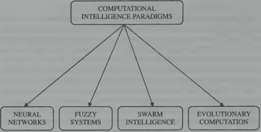

**图 1.1：** 计算智能范式

这表明这些范式是神经网络、进化计算、群体智能和模糊系统。神经网络以人类神经系统中的生物对应物为基础。类似地，进化计算大量借鉴了自然界中观察到的达尔文进化原理。群体智能则仿效昆虫的社会行为和鸟群飞行的编排。最后，使用不精确或模糊语言术语的人类推理由模糊系统近似。本章简要描述这些 CI 范式。在讨论之后，还将涉及其他 CI 范式，如粒度计算、混沌理论和人工免疫系统。本章还详细阐述 CI 的混合方法以及 CI 面临的挑战。

图 1.1 展示了 CI 的这四个主要分支，并说明各种范式之间的混合是可能的。更准确地说，CI 被描述为对自适应机制的研究，这些机制能够在复杂且变化的环境中实现或促进智能行为。还有一些其他 AI 方法既满足这一定义，也满足对某种自然发生现象建模的要求，但它们并不完全归入迄今提到的某一范式。一种更务实的做法可能是明确所关注的问题类别，而不必过于担心这些问题的解是否满足 CI 的某一特定定义所隐含的任何约束。

下一节识别并描述 CI 技术的四个主要问题类别。本章对每个广泛认可的 CI 范式背后的主要概念作简明概述。

## 1.2 CI 技术的主要问题类别

优化将在下一节定义，它无疑是 CI 研究中最重要的问类别，因为几乎任何其他类别的问题都可以重新表述为优化问题。这种转换，尤其是在软件语境中，可能导致问题内在形式所固有的信息丢失。CI 中的主要问题类别分为五类：控制问题、优化问题、分类问题、回归问题和 NP 完全问题。以下各节讨论优化问题和 NP 完全问题。

### 1.2.1 优化

优化问题可以按以下方式表示

给定：从某个集合 \(A\) 到实数集的函数 \(f : A \to \mathbb{R}\)

求：\(A\) 中的一个元素 \(x_0\)，使得对于 \(A\) 中的所有 \(x\)，都有 \(f(x_0) \leq f(x)\)（“最小化”），或者使得对于 \(A\) 中的所有 \(x\)，都有 \(f(x_0) \geq f(x)\)（“最大化”）。

这种概念化表述称为优化问题或数值规划问题。若干现实生活和理论问题或许都可以在这个综合框架中建模。在物理科学与技术领域，使用这一技术表述的问题可能将该技术称为能量最小化，并将函数 \(f\) 视为包含所模拟系统的能量。通常，\(A\) 是欧几里得空间 \(R^n\) 的某个子集，常由 \(A\) 中成员必须满足的一组约束、等式或不等式指定。\(f\) 的定义域 \(A\) 称为搜索空间，而 \(A\) 中的元素称为候选解或可行解。函数 \(f\) 称为目标函数或代价函数。使目标函数最小化（或最大化，如果这是目标）的可行解称为最优解。

一般而言，当问题的可行域或目标函数不呈现凸性时，可能存在多个局部极小值和极大值，其中局部极小值 \(x^*\) 定义为这样的点：存在某个 δ > 0，使得对于所有满足

‖x − x*‖ ≤ δ

的 x，表达式

f(x*) ≤ f(x)

成立；也就是说，在 \(x^*\) 周围的某个区域内，所有函数值都大于或等于该点处的值。局部极大值也以类似方式描述。已有一系列预期算法被指定用于求解非凸问题——包括大多数商业可用的求解器，它们无法区分局部最优结果与严格最优解，并会将前者视为原问题的实际解。应用数学和数值分析中，致力于开发能够在有限时间内保证收敛到非凸问题实际最优解的确定性算法的分支，称为全局优化。

### 1.2.2 NP 完全问题

非确定性多项式时间（NP）问题是计算理论中最常见的底层复杂性类之一。直观地说，NP 包含所有这样的判定问题：其解只需给出答案为‘是’这一事实的证明。更准确地说，这些验证必须能够由确定性图灵机在多项式时间内确认。一个等价而简洁的定义是：NP 是由非确定性图灵机在多项式时间内可求解的判定问题集合。复杂性类 P 包含于 NP，但 NP 包含许多重要问题，称为 NP 完全问题，目前尚不知道这些问题存在多项式时间算法。复杂性理论中最重要的未决问题——P = NP 问题——询问对于 NP 完全问题是否确实存在这样的算法。人们普遍认为情况并非如此。NP 类涵盖若干生物计算机科学问题。具体而言，许多有趣的搜索问题和优化问题的判定版本都包含在 NP 中。

#### 基于验证器的定义

为了解释 NP 的基于验证器的定义，让我们考虑子集和问题：假设给定一些整数，例如 −7、−3、−2、5、8，我们想知道其中某些整数之和是否为零。在这个例子中，答案是‘是’，因为整数子集 −3、−2、5 对应和 (−3) + (−2) + 5 = 0。判定是否存在这样的和为零的子集，这一任务称为子集和问题。

随着输入算法的整数数量增大，计算子集和问题答案所需的时间呈指数增长；事实上，子集和问题是 NP 完全的。

然而请注意，如果给定一个特定子集（通常称为证书），我们只需将该子集中的整数相加，就能轻松检查或验证该子集的和是否为零。因此，如果和确实为零，那么该特定子集就是答案为‘是’的证明或见证。验证给定子集的和是否为零的算法称为验证器。

如果一个问题存在可在多项式时间内执行的验证器，则称该问题属于 NP。就子集和问题而言，验证器只需多项式时间，因此子集和问题属于 NP。

NP 的基于验证器的定义并不要求为‘否’答案提供易于验证的证书。具有此类‘否’答案证书的问题类称为 co-NP。事实上，NP 中的所有问题是否都具有‘否’答案的证书并因此属于 co-NP，仍是一个未决问题。

#### 机器定义

与基于验证器的定义等价的是以下刻画：NP 是由非确定性图灵机在多项式时间内可求解的判定问题集合。

被归类为 NP 完全的问题列表如下：

- 整数分解问题
- 图同构问题
- 旅行商问题
- 布尔可满足性问题

## 1.3 神经网络

术语神经网络指生物神经元的网络或回路。如今，神经网络这一术语的现代用法指的是人工神经网络。这些网络由人工神经元或节点构成。生物神经网络由真实的生物神经元构成，这些神经元在……中相连或功能相关。


周围神经系统或中枢神经系统。在神经科学领域，它们通常被识别为在实验室分析中执行特定生理功能的神经元群。人工神经网络由相互连接的人工神经元（模拟生物神经元特性的编程结构）组成。人工神经网络既可用于理解生物神经网络，也可用于解决人工智能问题，而不必创建真实生物系统的模型。

### 1.3.1 前馈神经网络

单元之间的连接不形成有向循环的人工神经网络称为前馈神经网络。前馈神经网络是最早出现的，也可以说是人工神经网络中组织起来的最简单类型。在该网络中，信息仅沿一个方向（向前）移动，从输入节点经过隐藏节点（如果有）到达输出节点。网络中不存在循环或回路。

图1.2展示了一个全连接的三层网络。各层由神经元组成，这些神经元计算其输入的函数，并将结果传递给下一层的神经元。这样，输入信号便通过网络从一层前馈到下一层。

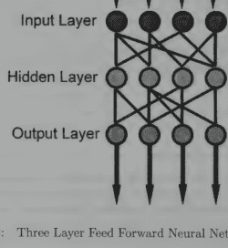

图1.2：三层前馈神经网络

给定神经元的输出由非线性激活函数、输入信号的加权组合以及阈值来表征。阈值可以通过扩展权重向量以包含来自常量偏置单元的输入来替代。通过改变连接的权重值，可以改变网络实现的整体功能。

还有基于监督学习和无监督学习的其他类型神经网络，本书第2章将结合其算法详细讨论。

## 1.4 模糊系统

模糊集起源于1965年，这一概念由Lotfi A. Zadeh提出。此后该概念不断发展，并已应用于多个应用领域。根据Zadeh的观点，“模糊集的概念为构建概念框架提供了一个方便的出发点，该框架在许多方面与普通集合所用的框架类似，但比后者更一般化，并且可能被证明具有更广泛的适用性，特别是在模式分类和信息处理领域。”模糊逻辑是一种多值逻辑，为在不确定性或模糊性下进行推理的逻辑系统提供了合适的基础，它允许在诸如真/假、是/否、高/低等传统评价之间定义中间值。这些评价可以用数学方式表述并由计算机处理，以便在计算机编程中应用一种更接近人类思维的方式。模糊逻辑提供了一种推理形态，使近似的人类推理能力能够应用于基于知识的系统。模糊逻辑理论提供了数学力量，以捕捉与人类认知过程（如思考和推理）相关的不确定性。模糊系统适用于不确定或近似推理，特别是对于难以推导数学模型的系统。模糊逻辑允许在信息不完整或不确定的情况下，利用估计值进行决策。

### 1.4.1 模糊集

模糊集的概念是清晰集概念的扩展。与清晰集类似，论域U上的模糊集通过从U到[0,1]的隶属函数来定义。设U为非空集合，也称为全集、论域或定义域。U上的模糊集定义为：

$$\mu_A(x): U \to [0,1] \tag{1.1}$$

这里$\mu_A$称为隶属函数，$\mu_A(x)$称为$x$的隶属度。隶属函数表示真实程度或相容程度。隶属函数是模糊集的关键组成部分。因此，模糊集上的所有运算都基于各自的隶属函数来定义。表1.1定义了与传统集合运算相对应的模糊集合论算子。

**表1.1：模糊集合论算子**

| 算子 | 定义 |
|---|---|
| 交集 | 交集$\overline{C} = \overline{A} \cap \overline{B}$的隶属函数$\mu_{\overline{C}}(x)$定义为$\mu_{\overline{C}}(x) = \min\{\mu_{\overline{A}}(x), \mu_{\overline{B}}(x)\}, x \in X$ |
| 并集 | 并集$\overline{C} = \overline{A} \cup \overline{B}$的隶属函数$\mu_{\overline{C}}(x)$定义为$\mu_{\overline{C}}(x) = \max\{\mu_{\overline{A}}(x), \mu_{\overline{B}}(x)\}, x \in X$ |
| 补集 | 归一化模糊集$\overline{A}$的补集的隶属函数$\mu_{\overline{C}}(x)$定义为$\mu_{\overline{C}}(x) = 1 - \mu_{\overline{A}}(x), x \in X$ |

模糊关系在模糊逻辑及其应用中起着至关重要的作用。模糊关系是$X \times Y$的模糊子集，定义为从$X \to Y$的映射。如果$X, Y \subseteq R$是论域，则模糊关系定义为$\tilde{R}\{((x,y), \mu_{\tilde{R}}(x,y)) \mid (x,y) \in X \times Y\}$。这些不同乘积空间中的模糊关系可以通过复合运算相互组合。复合有两种基本形式，即最小-最大复合和最大-乘积复合。

- **最小-最大复合：** 设$R_1 \subseteq X \times Y$和$\tilde{R}_2 \subseteq Y \times Z$表示两个模糊关系，则这两个关系上的最小-最大复合定义为$R_1 \circ R_2 = \max\{\min\{\mu_{R_1}(x,y), \mu_{R_2}(y,z)\}\}_{x \in X, y \in Y, z \in Z}$
- **最大-乘积复合：** 设$R_1 \subseteq X \times Y$和$\tilde{R}_2 \subseteq Y \times Z$表示两个模糊关系，则这两个关系上的最大-乘积复合定义为$R_1 \circ R_2 = \max\{\min\{\mu_{R_1}(x,y) * \mu_{R_2}(y,z)\}\}_{x \in X, y \in Y, z \in Z}$

模糊集的隶属度由该模糊集$A$的隶属函数$\mu_A(x)$描述，该函数将每个元素$x_o \in X\)与一个隶属度$\mu_A(x_o)$相关联。模糊集$A$的隶属函数$\mu_A(x)$的记法为$A: X \to \{0,1\}$。每个模糊集都由一个特定的隶属函数完全且唯一地定义。因此，隶属函数的符号也用作相关模糊集的标签。

### 1.4.2 模糊控制器

模糊逻辑控制器基于模糊集合理论与模糊逻辑的结合。系统由基于规则的模糊逻辑控制器控制，而非基于方程。这组规则称为规则库，通常采用IF-THEN-ELSE语句的形式。其中IF部分称为前件，THEN部分称为后件。前件通过简单的布尔函数（如AND、OR、NOT等）连接。图1.3概述了一个简单的模糊逻辑控制器架构。

系统的输出由模糊化模块转换为适当的形式。一旦根据应用定义了所有规则，控制过程就从计算规则后件开始。规则后件的计算在计算单元内进行。最后，使用解模糊模块将模糊集解模糊为一个清晰的（crisp）控制动作。模糊逻辑控制器的设计参数如下：

- **输入单元：** 需要考虑的因素包括输入信号的数量和输入信号的缩放。
- **模糊化单元：** 需要考虑隶属函数的数量和类型。
- **规则库：** 需要考虑规则总数、规则结构类型（Mamdani或Takagi）、规则权重等。
- **解模糊单元：** 需要考虑解模糊过程的类型。

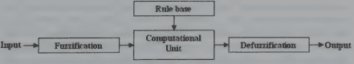

**图1.3：** 模糊控制器架构

模糊逻辑控制器的一些重要特性如下：


- 用户定义规则，可根据应用进行更改。
- 鲁棒性强
- 也可应用于控制非线性系统
- 设计简单
- 总体成本和复杂度低

## 1.5 进化计算

基于自然界生物生命进化规律形成、用于解决若干计算问题的算法被称为进化计算。进化计算（EC）强烈基于自然进化原理。在优化问题的搜索空间内初始化一个个体种群，使得 P (t) = {x_i(t) ∈ S | 1 ≤ i ≤ μ}。搜索空间 S 可以是基因型或表现型，具体取决于所采用的特定进化方法。适应度函数 f（即被优化的函数）用于评估个体的优劣，使得 F (t) = {f(x_i(t)) ∈ R | 1 ≤ i ≤ μ}。显然，如果搜索的是基因型空间，适应度函数还需要包含必要的表现型映射。搜索包括对个体进行重组以形成后代、随机变异以及对下一代进行选择，直到种群中出现解。参数 p_r、p_m 和 p_s 分别是应用重组、变异和选择算子的概率。重组涉及混合两个或多个亲本的特征以形成后代，希望保留亲本的最佳品质。变异则向种群中引入变化，从而扩大搜索范围。一般而言，重组和变异算子可以是恒等变换，因此个体有可能不受扰动地存活到下一代。最后，对新的或修改后的个体重新评估，然后使用选择算子将种群规模削减回 μ。选择算子提供进化压力，使最适应的个体存活到下一代。虽然选择在很大程度上基于个体适应度，但它是概率性的，以防止种群早熟收敛。

本节讨论过去几十年中出现的三种方法，例如：“进化规划（EP）”（L.J. Fogel、A.J. Owens、M.J. Walsh，1966）、“进化策略（ES）”（I. Rechenberg 和 H.P. Schwefel，1973）以及“遗传算法（GA）”（Holland，1975）。尽管在最高层面上相似，但这些变体各自以不同方式实现进化算法。这些差异几乎涉及进化算法的所有方面，包括个体结构表示的选择、所采用选择机制的类型、遗传算子的形式以及性能度量，这些将在本书第5章中解释。

### 1.5.1 遗传算法

遗传算法（GAs）是基于自然选择进化主题引入的自适应启发式搜索算法。GA 设计的基本概念是对自然系统中进化所需的过程进行建模，特别是那些遵循查尔斯·达尔文提出的适者生存原则的过程。GAs 构成了在定义搜索空间内进行随机搜索以解决问题的智能发展。GAs 最早由约翰·霍兰德于20世纪60年代开创，并已在众多工程学科中得到广泛研究、实验和应用。GA 不仅提供了解决问题的替代方法，而且在大多数问题领域中始终优于其他传统方法。许多现实世界问题涉及寻找最优参数，这对传统方法可能很困难，但对 GAs 来说很理想。事实上，遗传算法可以从许多角度看待，而不仅仅是一种优化工具。也许大多数用户将 GAs 视为问题求解器，但这是一种局限性的观点。

GAs 被用作问题求解器、具有挑战性的技术难题、有效机器学习的基础、创新与创造力的计算模型、其他创新系统的计算模型，以及用于指导哲学。

GAs 是作为自适应系统的计算类比而引入的。它们松散地基于通过自然选择进化的原理建模，采用一个个体种群，在变异和重组（交叉）等变异诱导算子存在的情况下经历选择。适应度函数用于评估个体，繁殖成功率随适应度而变化。

**算法**

1. 随机生成初始种群
2. 计算并保存当前种群中每个个体的适应度
3. 为每个个体定义选择概率，使其与适应度成正比
4. 通过遗传算子从当前种群中按概率选择个体产生后代，从而生成下一代种群
5. 重复步骤2，直到获得满意的解

上述 GAs 范式通常用于解决提交给 GAs 的大多数问题。尽管它往往可能找不到最佳解，但会给出一个部分最优解。

### 1.5.2 遗传编程

在遗传编程中，程序通过进化来解决来自这两个领域的预先描述的问题。“进化”一词指的是从生物有机体自然进化中提炼出的人工过程。这一过程已被抽象化，并剥离了其大部分复杂细节。它已被转移到算法领域，在那里可用于近似求解给定甚至变化的问题（机器学习），或用于以语法正确（语言）结构的形式归纳出精确解（自动编程）。

人们已经认识到，程序（或一般结构）的表示对所得算法的行为和效率有强烈影响。因此，遗传编程中采用了许多不同的表示选择方法。这些原理甚至已被应用于其他问题领域，例如电子电路设计或艺术与音乐创作。

遗传编程也属于不断壮大的进化算法集合，这些算法将自然进化的搜索原理应用于各种不同的问题领域，尤其是参数优化。进化算法，尤其是遗传编程，遵循达尔文的差异自然选择原则。该原则指出，要通过（自然）选择发生进化，必须满足以下前提条件：

- 存在称为个体的实体，它们构成一个种群。这些实体可以繁殖，也可以被繁殖。
- 繁殖中存在遗传，也就是说，个体会产生相似的后代。
- 在繁殖过程中存在变异，它会影响个体存活的可能性，从而影响个体的可繁殖性。
- 存在有限资源，这导致个体之间竞争。由于个体过度繁殖，并非所有个体都能在生存斗争中存活下来。差异自然选择将持续对个体施加改进压力。

从长远来看，遗传编程及其同类将彻底变革程序开发。当前方法尚不够成熟，不足以作为自动编程系统进行开发。尽管如此，GP 已经进入自动编程领域，并将在可预见的未来继续如此。同样，将进化应用于机器学习问题是未来十年有待开发的潜力之一。

### 1.5.3 进化规划

进化规划是四大进化算法范式之一。它最早由劳伦斯·J·福格尔于1960年使用，旨在将模拟进化作为学习过程以生成人工智能。福格尔使用有限状态机作为预测器并使其进化。目前，进化规划是一种宽泛的进化计算流派，没有固定的结构或表示，这与其他一些流派形成对比。它越来越难以与进化策略区分开来。它的一些原始变体与后来的遗传编程非常相似，不同之处在于程序结构是固定的，而其数值参数允许进化。其主要变异算子是变异；种群成员被视为特定物种的一部分，而不是同一物种的成员；因此，每个亲本使用幸存者选择产生一个后代。

### 1.5.4 进化策略

进化策略（ESs）在许多方面与遗传算法（GAs）非常相似。顾名思义，ESs 也模拟自然进化。GAs 与 ESs 之间的差异主要源于

这些算法最初开发所针对的应用不同。遗传算法旨在求解离散或整数优化问题，而进化策略最初应用于与实验室实验相关的连续参数优化问题。

进化策略在若干重要方面不同于传统优化算法，例如：

- 它们在解种群之间进行搜索，而不是从一个个体到另一个个体进行搜索。
- 它们仅使用目标函数信息，不使用导数。
- 它们使用概率转移规则。

进化策略的基本结构与基本遗传算法非常相似。与标准优化流程框图相比，一个小改动是使用“种群”一词而不是“解”。更主要的区别是，生成新解的通常操作已被三项独立活动取代——种群选择、重组和变异。进化策略与遗传算法之间的差异正体现在这些操作的实现中。

## 1.6 群体智能

鸟类和动物群体，如鸟群、兽群和鱼群，以看似经过精心编排的方式移动。一群鸟移动起来像一支编排精良的舞蹈团。它们一致转向左侧，然后可能突然全部冲向右侧并俯冲地面。它们如何能如此协调行动？1987年，Reynolds 创建了“boid”模型，这是一种分布式行为模型，用于在计算机上模拟鸟群的运动。每个 boid 都实现为一个独立行动者，根据自身对动态环境的感知进行导航。一个 boid 必须遵循以下规则。第一，“避让规则”指出，boid 必须远离距离过近的 boid，以降低空中碰撞的概率。第二，“复制规则”指出，boid 必须通过对其他 boid 的速度和方向取平均，沿鸟群移动的大致方向飞行。第三，“中心规则”指出，boid 应向感知到的鸟群中心移动，以尽量减少暴露于鸟群外部。Flake 增加了第四条规则“视野”，指出 boid 应横向远离任何遮挡其视野的 boid。如果我们从另一个角度考虑，这个 boid 模型似乎是合理的：即它根据鸟群中邻居之间的吸引和排斥来行动。排斥关系导致避免碰撞，吸引使鸟群保持形状，也就是说，复制邻居的运动可视为一种吸引。中心规则在吸引和排斥中都起作用。模拟鸟群的群体行为是单个鸟相对简单行为密集交互的结果。

可用于求解集体行为模式的算法类型分别是粒子群优化和蚁群优化。粒子群优化（PSO）是一种基于群体智能的算法，用于在搜索空间或模型中寻找优化问题的解，并在存在目标时建模和预测社会行为。蚁群优化算法（ACO）是一种概率技术，用于求解可归约为在图中寻找良好路径的计算问题。它们受到蚂蚁从蚁群到食物寻找路径行为的启发。还将进一步讨论蚁群系统，其中个体之间的交互通过改变其所在环境间接发生。通过对这些社会交互建模，已设计出用于解决包括优化和聚类在内的众多问题的有用算法。

## 1.7 其他范式

计算智能的一些主要范式包括粒计算、混沌理论和人工免疫系统。粒计算是一种新兴的信息处理计算范式。它涉及处理称为信息粒的复杂信息实体，这些实体在数据抽象和从信息中推导知识的过程中产生。混沌理论是一门发展中的科学学科，专注于非线性系统的研究。

一个相对较新的 CI 范式的具体例子是人工免疫系统（AIS），它是一种计算模式识别技术，基于人体免疫系统中的白细胞如何检测不属于身体的病原体。AIS 不是对可用训练数据建立显式模型，而是构建一个隐式分类器，对除训练数据之外的一切进行建模，使其适合检测系统中的异常行为。因此，AIS 非常适合应用于反病毒软件、入侵检测系统和金融领域的欺诈检测。

此外，人工生命（ALife）、机器人学（尤其是多智能体系统）和生物信息学等领域是 CI 技术的应用领域。或者可以说，这些领域是未来 CI 思想的温床。例如，进化计算技术已成功用于生物信息学中破译基因序列。与此同时，对生物进化过程的理解更深入，进化算法也得到改进。

另一个例子是 RoboCup，一个目标非常宏大的项目。挑战在于到2050年打造一支能够击败人类世界冠军足球队的自主人形机器人队伍。这显然是一项需要借鉴许多学科的艰巨任务。机械工程方面只是实现该目标所面临挑战之一。控制机器人则是另一回事。群体机器人学是将群体智能扩展到机器人学的新 CI 范式，可能提供部分答案。与此同时，每年举行的仿真 RoboCup 挑战赛只能暂且满足需要。

### 1.7.1 粒计算

不确定性处理范式可视为概念框架。信息粒是基本实体的概念框架，这些实体被认为在问题表述中很重要。该概念框架是表述通用概念的地方，这些概念对某种抽象层次、处理或向外部环境传递结果很重要。信息粒可视为知识表示和知识处理组件。信息粒的粒度级别（大小）对问题描述和问题求解策略很重要。软计算可在基于信息粒的计算框架背景下看待，并称为粒计算。粒计算识别问题的本质共同特征，这些特征由粒度表示。

粒计算能够处理信息粒，并与其他粒世界或数值世界交互，获取所需的粒信息并给出粒评估结果。粒计算使集合、概率、模糊集、粗糙集以及可能的其他抽象形式理论能在同一背景下考虑，注意到这些形式化的基本共同特征，通过所考虑方法的协同提供比软计算更高的一个计算层次。由于多个计算过程可以同时存在，并可能相互通信，因此可以构想一种分布式处理模型。在该模型中，每个过程或智能体（图1.4）被视为单个实体。

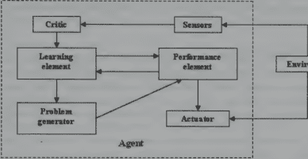

**图 1.4：** 一个智能体

每个智能体如图1.5所示，在各自的粒计算环境中行动，并与其他智能体通信。

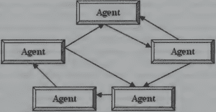

**图 1.5：** 由智能体实现的粒计算

粒计算的形式概念可用四元组<X,F,A,C>表示，其中：X——论域，F——形式粒化框架，A——通用信息粒的集合，C——相关通信机制。粒计算成为计算智能的一个层次，是高于软计算的一个抽象层次。


计算。粒计算协同地补充了表示、学习和优化的不同方面。粒计算在智能系统乃至计算系统的发展中可发挥重要作用，例如在知识集成中，以及在开发更适应于用户、语言和生物学动机的计算系统方面。

### 1.7.2 混沌理论

混沌理论是最年轻的科学之一，从七十年代孤立的研究起源迅速崛起，成为现存最引人入胜的领域之一。该理论应用于若干物理系统的研究，也应用于图像压缩、流体动力学等领域。混沌科学有望继续产生引人入胜的科学信息，这些信息可能塑造未来的科学面貌。

可接受的混沌理论定义指出：混沌理论是确定性非线性系统中不稳定非周期行为的定性研究。混沌行为是复杂的、非线性的和动态的。复杂意味着非周期（即永不重复的行为），非线性意味着递归和更高阶的数学算法，动态意味着非恒定和非周期（时间变量）。因此，混沌理论是基于递归数学概念对永远变化的复杂系统的研究，无论是以递归过程的形式还是以模拟物理系统的微分方程组的形式。

纽豪斯的定义指出：一个具有至少一个正 Lyapunov 指数的有界确定性动力系统就是混沌系统；混沌信号是对混沌系统的观测。正 Lyapunov 指数的存在使得最初彼此接近的轨迹以指数方式分离。这反过来意味着动力学对初始条件的敏感依赖性，这是混沌系统最重要的特征之一。混沌理论令人难以置信之处在于，不稳定的非周期行为可以在数学上简单的系统中找到。洛伦兹证明了复杂的动力学系统表现出有序性，但它们从不重复。我们的世界是混沌的最佳例子，因为它被归类为动态的、复杂的系统；我们的生命、我们的天气和我们的经历从不重复；然而，它们应该形成模式。

混沌行为已在实验室中的多种系统中观察到，包括电气和电子电路、激光器、振荡化学反应、流体动力学以及机械和磁机械装置。

自然界中混沌行为的观测包括太阳系中卫星的动力学、天体磁场的时变演化、生态学中的种群增长、神经元中动作电位的动力学以及分子振动。混沌系统的日常例子包括天气和气候。关于板块构造和经济学中是否存在混沌动力学存在一些争议。

表现出数学混沌的系统是稳定的，因此在某种意义上是有序的；“混沌”一词的这种技术性用法与通常所说的完全无序的含义相悖。一个相关的物理学领域称为量子混沌理论，研究遵循量子力学定律的系统。最近，另一个称为相对论性混沌的领域出现，用于描述遵循广义相对论定律的系统。

混沌系统除了在确定性意义上是有序的，通常还具有明确定义的统计特性。例如，图中所示的洛伦兹系统是混沌的，但具有清晰定义的结构。有界混沌是描述无序模型的一个有用术语。

混沌理论应用于许多科学学科：数学、生物学、计算机科学、经济学、工程学、金融学、哲学、物理学、政治学、种群动力学、心理学和机器人学。

混沌理论目前也被应用于癫痫的医学研究，特别是通过观察初始条件来预测看似随机的癫痫发作。

### 1.7.3 人工免疫系统

生物免疫系统是一个高度并行、分布式且自适应的系统。它利用学习、记忆和联想检索来解决识别和分类任务。特别是，它学习识别相关模式，记忆以前见过的模式，并利用组合学来高效地构建模式检测器。免疫系统这些非凡的信息处理能力在计算领域提供了重要方面。这一新兴领域有时被称为免疫学计算、免疫计算或人工免疫系统（AIS）。虽然它仍然相对较新，但 AIS 与其他受生物学启发的计算模型以及计算生物学有着密切关系，正通过世界各地研究者的热心努力确立其独特性和有效性。

人工免疫系统（AIS）是一种受脊椎动物免疫系统原理和过程启发的优化算法。这些算法通常利用免疫系统的学习和记忆特性来解决问题。它们与人工智能相结合，并与遗传算法密切相关。

AIS 中模拟的过程包括模式识别、B 细胞的超突变和克隆选择、T 细胞的负选择、亲和力

- 基于遗传算法的模糊逻辑控制器学习优化
- 模糊进化系统
- 由遗传算法生成的模糊逻辑控制器

## 1.8 与其他范式的关系

计算智能是一门非常年轻的学科。其他许多学科，如哲学、神经生物学、进化生物学、心理学、经济学、政治学、社会学、人类学、控制工程等等，研究智能的时间要长得多。我们首先讨论与哲学、心理学以及其他研究智能的学科的关系；然后讨论与计算机科学的关系，计算机科学研究如何计算。计算智能（CI）这门科学可以被描述为“综合心理学”、“实验哲学”或“计算认识论”。认识论是对知识的研究。它可以被看作是一种研究知识和智能本质这一古老问题的方式，但使用了比以前更强大的实验工具。与哲学、心理学、经济学和社会学传统上只能观察智能系统的外部行为不同，我们能够用可执行的智能行为模型进行实验。最重要的是，这些模型可以以完整而严谨的方式进行检查、重新设计和实验。换句话说，你现在有办法构建那些哲学家只能理论化的模型。

正如空气动力学的目标不是合成鸟类，而是通过建造飞行器来理解飞行现象一样，CI 的最终目标不一定是全面模拟人类智能。心理有效性的概念将 CI 工作分为两类：一类关注模仿人类智能——通常称为认知建模——另一类则不然。为了强调 CI 作为一门智能科学的发展，至少在本书中，我们关注的不是心理有效性，而是更实际的愿望，即创建解决实际问题的程序。有时，让计算机以类似人类的方式推理问题很重要。当人类需要解释计算机如何生成答案时，这一点尤其重要。人类认知的某些方面你通常不希望复制，例如人类糟糕的算术技能和容易出错的倾向。计算


它与计算智能（CI）具有共生关系。学习其中一门学科的学生都应该了解另一门学科。此外，随着许多新理论将不同领域结合起来，二者之间的界限正变得日益模糊。遗憾的是，本书的篇幅不足以涵盖控制工程和运筹学的内容，尽管许多成果（例如搜索方面的成果）在运筹学和计算智能领域都已被研究过。最后，计算智能可以被视为认知科学这一大框架下的一部分。认知科学连接了研究认知与推理的多个学科，从心理学到语言学，再到人类学和神经科学。计算智能在认知科学中独树一帜，因为它提供了构建智能的工具，而不仅仅是研究智能体的外部行为或剖析智能系统的内部运作。

## 1.9 计算智能面临的挑战

人们已经提出了各种人工智能挑战，这些挑战需要非常庞大的知识库以及高效的结构检索机制。挑战在于提供更高效的知识库、知识表示和检索结构，模拟人脑，并为不同目的使用不同的表示方式。近年来，计算智能通过加入许多其他子学科而得到扩展，并且显而易见的是，这一新领域也需要一系列具有方向指引意义的挑战性问题。如果不设定明确的目标和衡量进展的标尺，许多研究工作将会被浪费。

计算智能（CI）相关技术在科学和工程领域的最先进组件、新型设备和服务中发挥着重要作用。计算智能面临的一些主要挑战涉及大型知识库、从互联网上的知识资源进行引导启动（bootstrapping）等。

计算智能研究的当前状态可描述如下：

- 计算智能的基本概念在35多年前就已提出，但大约花了二十年时间，其潜力才被更广泛的受众所认可。
- 面向应用的研究相当成功，几乎主导了该领域。迄今为止，即使有，也只能找到极少数尚未测试过进化算法的潜在应用领域。在许多情况下，进化算法即便不能产生更优的结果，也已产生了良好的结果。
- 相比之下，理论基础在一定程度上仍然薄弱。更简洁地说：“我们知道它们有效，但我们不知道为什么。”因此，经验不足的用户会反复落入同样的陷阱，因为关于进化算法的设计和参数化，仅有极少数的经验法则。

挑战在于元层面，即自动找到所有有趣的解决方案，尤其是在困难的情况下。大脑是灵活的，可能以多种不同方式解决同一个问题。不同的应用——图像识别、手写字符识别、人脸识别、信号分析、多媒体流、文本分析或各种生物医学数据分析——通常需要高度专业化的方法才能达到顶级性能。这是一种强大的力量，导致不同计算智能分支之间的条块分割，而创建能够与各种应用中最优方法相抗衡的元学习系统将是一个巨大的挑战。如果我们承认计算智能应被定义为解决不可算法化问题的科学，那么整个领域将牢固地植根于计算机科学之中，并且可以提出许多技术挑战。

## 小结

本章对核心计算智能技术进行了广泛的概述，并附有一些简单示例，描述了使用这些方法的一系列实际应用。尽管这些技术正日益成为设计智能控制器的常用且强大的工具，但仍有一些重要的实际考虑因素需要牢记：

- 最终目标是解决控制器设计中的实际问题，因此所考虑的技术需要简单、稳健且可靠。
- 不同的机器人控制问题通常需要不同类型的计算智能技术，具体取决于其不同的实际需求。
- 单一计算智能技术的应用往往不足以独自解决所有实际问题。

- 13. 解释文化进化与协同进化。
- 14. 提及粒子群优化中一些最佳邻域拓扑。
- 15. 什么是蚁群系统？
- 16. 你所说的粒计算和混沌理论是什么意思？
- 17. 提及计算智能所涉及的挑战。

# 第2章：基于MATLAB的人工神经网络

## 2.1 引言

神经网络本质上是一种模型结构以及将模型拟合到给定数据的算法。对对象进行建模的网络方法使用一种通用的非线性形式，并允许调整所有参数。这样，它可以处理各种非线性问题。学习是训练神经网络以表示对象动态特性的过程。神经网络与对象并联放置，系统输出与网络输出之间的误差（即预测误差）被用作训练信号。神经网络具有构建智能控制系统的潜力，因为它们能够学习和适应，能够逼近非线性函数，适合并行和分布式处理，并且天然适合对多变量系统建模。如果物理模型不可用或开发成本过高，神经网络模型可能是一种替代方案。本章各节将帮助读者理解基本神经网络、其历史以及神经网络的组成部分。

## 2.2 神经网络简史

人类大脑的研究始于数千年前。随着先进电子技术的出现，尝试利用这一思维过程自然而然成为趋势。迈向人工神经网络的第一步出现在1943年，当时神经生理学家沃伦·麦卡洛克（Warren McCulloch）和年轻数学家沃尔特·皮茨（Walter Pitts）提出了关于神经元工作原理的理论。最初，人们使用电路来模拟简单的神经网络。

1949年，唐纳德·赫布（Donald Hebb）在其著作《行为的组织》（The Organization of Behavior）中强化了神经元及其工作的概念。书中指出，神经通路每次使用都会得到强化。随着20世纪50年代计算机进入初期发展阶段，开始对这些涉及人类思维的理论的第一性原理进行建模已变得可行。IBM研究实验室的纳撒尼尔·罗切斯特（Nathaniel Rochester）领导了第一次神经网络建模尝试。尽管首次试验失败了，但后续尝试取得了成功。正是在这一时期，传统计算开始蓬勃发展，而随着这种发展，计算的重点使神经研究退居幕后。

在此期间，“思维机器”的支持者们继续为自己的观点辩护。1956年的达特茅斯夏季人工智能研究项目对人工智能和神经网络都起到了推动作用。该项目的主要成果之一是激发了对智能层面（即业界所熟知的人工智能，AI）以及大脑中较低层次的神经处理过程的研究。

在达特茅斯项目之后的几年里，约翰·冯·诺依曼提出了通过使用电报继电器或真空管来模拟简单神经元功能的设想。此外，康奈尔大学的神经生物学家弗兰克·罗森布拉特（Frank Rosenblatt）于1958年开始研究感知机。他对苍蝇眼睛的运作方式着迷。这项研究产生的感知机是以硬件形式构建的，是至今仍在使用的最古老的神经网络。单层感知机被发现可用于将一组连续取值输入分为两类。感知机计算输入的加权和，减去一个阈值，然后将两个可能值之一作为结果输出。不幸的是，感知机存在局限性，这一点在马文·明斯基（Marvin Minsky）和西摩·帕珀特（Seymour Papert）的《感知机》（*Perceptrons*）一书所描述的“幻灭年代”中得到了证明。

1959年，斯坦福大学的伯纳德·威德罗（Bernard Widrow）和马西安·霍夫（Marcian Hoff）构建了他们称为ADALINE和MADALINE的模型。这些模型因其使用了多个自适应线性单元而得名。MADALINE是第一个被应用于现实世界问题的神经网络。它是一种自适应滤波器，用于消除电话线路上的回声。该神经网络至今仍在商业中使用。

遗憾的是，这些早期的成功使人们夸大了神经网络的潜力，尤其是考虑到当时电子技术的局限性。这种从学术界和科技界流出的过度炒作渗透到了当时的通俗文学中。此外，随着作家们开始思考“思维机器”将对人类产生何种影响，一种恐惧情绪也随之出现。阿西莫夫关于机器人的系列作品描述了当机器能够


执行全人类的工作。

这些恐惧，加上未实现的、过度的诉求，导致一些备受尊敬的声音对神经网络研究提出了批评。结果是大量资金被中止。这段增长缓慢的时期一直持续到1981年。1982年，几件事重新激发了人们的兴趣。约翰·霍普菲尔德（John Hopfield）的开创性工作不仅仅是模拟大脑，而是制造有用的设备。他以清晰的思路和数学分析，展示了这类网络如何工作以及它们能做什么。然而，霍普菲尔德最大的资产是他个人的魅力。他善于表达、讨人喜欢，并且是一项沉寂技术的拥护者。

与此同时，在日本京都召开了一场会议。这场会议是“美日合作/竞争神经网络联合会议”。日本随后宣布了其第五代计算机计划。美国期刊报道了这一消息，引发了对美国可能落后的担忧。很快，资金再次涌入。到1985年，美国物理学会开始举办年度会议——“用于计算的神经网络”。到1987年，电气与电子工程师学会（IEEE）首届国际神经网络大会吸引了超过1800名与会者。

1982年，霍普菲尔德展示了如何使用“伊辛自旋玻璃”类型的模型在动态稳定网络中存储信息。他的工作为物理学家进入神经建模领域铺平了道路。这些网络被广泛用作联想记忆网络，并且既有连续值的，也有离散值的。

科霍宁（Kohonen）的自组织映射（SOM）于1972年提出，能够再现生物神经网络结构的重要特征。它们利用拓扑图进行数据表示，这种拓扑图在神经系统中更为常见。SOM在识别问题中也有广泛的应用。

1988年，格罗斯伯格（Grossberg）提出了一种与科霍宁SOM类似的学习规则，该规则广泛用于反向传播网络。这种学习也被称为outstar学习。

卡彭特（Carpenter）和格罗斯伯格发明了自适应共振理论（ART）网络。这种网络既适用于二进制输入，也适用于连续值输入。这些网络最重要的特点是输入可以以任意随机顺序呈现。

如今，神经网络的话题几乎在所有工程学科中无处不在。它们的希望看起来确实光明，因为自然界本身就是这类事物有效的证明。然而，它的未来，实际上整个工程科学的关键，在于硬件的发展。目前，大多数神经网络的发展仅仅是在证明这一原理是可行的。由于处理能力的限制，这种研究产生的神经网络需要数周时间才能学习。要将这些原型从实验室中拿出来并投入实际使用，需要专门的芯片。各公司正在开发三种类型的神经芯片——数字芯片、模拟芯片和光学芯片。少数公司正在致力于开发一种“硅编译器”，以生成神经网络专用集成电路（ASIC）。这些ASIC和类神经元数字芯片似乎是近期的发展趋势。最后，光学芯片看起来前景广阔，但可能要等上几年，光学芯片才能应用于商业领域。

## 2.3 人工神经网络

人工神经网络是基于大脑神经结构的相对粗略的电子模型。大脑能够感知并从经验中获取知识。自然界本身就证明了一些超出当前计算机能力的问题，确实是由微小的、节能的机制解决的。这种大脑建模形式提供了一种不那么技术化的方法来产生机器解决方案。这种新的计算方法在系统过载时，也比其更传统的同类方法具有更优雅的降级表现。

这些生物学革新的计算方法被认为是计算行业的下一个重大进步。即使是简单的动物大脑也能完成目前计算机无法想象的功能。计算机可以执行操作，比如记账或进行复杂的数学运算。但计算机连识别简单的模式都有困难，更不用说将过去的模式概括为未来的行动了。

如今，生物学研究的进步确保了对自然思考和学习机制的初步理解。所获得的一些模式非常复杂，使我们能够从不同角度识别个人的面孔。这种将信息存储为模式、利用这些模式并解决问题的过程，涵盖了一个计算领域的新领域。如前所述，这个领域不采用传统编程，而是涉及创建大规模并行网络，并训练这些网络来解决特定问题。这个领域还使用与传统计算截然不同的词汇，比如行为、反应、自组织、学习、概括和遗忘。

### 2.3.1 神经网络与大脑的比较

人脑的确切运作概念仍然是一个谜。人们对这个惊人脑处理器的了解仅有几个方面。特别是，人脑中最常见的元素是一种特殊的细胞，它不同于身体的其他部分，似乎不会再生。由于这种细胞是身体中唯一不被替换的部分，因此可以假设这些细胞赋予我们记忆、思考以及将以往经验应用于每一次行动的能力。

这些细胞，总共1000亿个，被称为神经元。每个神经元最多可以与20万个其他神经元连接，但通常的连接数是1000到10000个。

人类心智的主要力量来自于这些基本细胞成分的绝对数量以及它们之间的多重连接。它还来自于基因编程和学习。单个神经元是复杂的，它们有无限多的部分、子系统和控制机制。它们通过一系列电化学通路传递信息。根据分类，神经元有一百多种不同的类型。这些神经元及其连接共同形成了一个过程，这个过程不是二进制的，不是稳定的，也不是同步的。简而言之，它与目前可用的电子计算机，甚至人工神经网络毫无相似之处。

这些人工神经网络试图仅复制这种复杂、多变且强大的有机体中最基本的元素。它们以粗略的方式做到这一点。但对于试图解决问题的技术人员来说，神经计算从来不是关于复制人脑的。它是关于机器和解决问题的新方法。

### 2.3.2 人工神经元

神经网络的基本处理单元是神经元。这一人类意识的基本构件包含一些通用能力。基本上，一个生物神经元从其他来源接收输入，以某种方式组合它们，对结果执行通常非线性的运算，然后输出最终结果。图2.1展示了这四个部分的关系。

在人脑中，这种基本神经元类型有许多变体，这进一步使人们试图用电方式复制思维过程变得更加复杂。胞体上像x形的延伸部分充当输入通道，通过其他神经元的突触接收输入。然后胞体在一段时间内处理这些传入信号。接着胞体将处理后的值转换为输出，并通过轴突和突触发送给其他神经元。

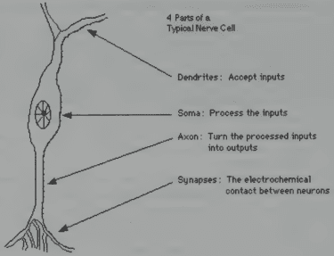

**图2.1：** 一个简单的神经元

现代观测信息提供了额外的证据，表明生物神经元在结构上更为复杂。它们比现有的人工神经网络中内置的人工神经元要复杂得多。随着生物科学对神经元提供了更精细的理解，并且随着工程科学的进步，网络架构师可以基于人类对生物大脑的理解继续改进他们的方案。

目前，人工神经网络的目标并不是自命不凡地再现大脑。相反，神经网络研究人员正在寻求理解自然的能力，以便人们能够为传统计算尚未解决的问题设计解决方案。图2.2显示了人工神经元的基本表示。

在图2.2中，网络的几个输入用数学符号x(n)表示。每个输入都乘以一个由w(n)表示的连接权重。在最简单的情况下，这些乘积只是简单地相加，然后通过传递函数产生输出。这个过程使得在大规模应用中可以通过小型软件包进行物理实现。其他网络结构也可能实现这种电子实现，它们采用不同的求和函数以及不同的传递函数。


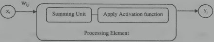

**图 2.2：** 一个基本的人工神经元

一些应用需要“单色”或二值答案。这些实际应用包括文本识别、语音识别以及场景图像解密。这些实际应用需要将现实生活中的输入转换为离散值。这些可能的值被限制在某个已知集合内，例如 ASCII 字符。由于输出选项的这种限制，这些应用并不总是使用由仅对输入求和并因此平滑输入的神经元构成的网络。这些网络可以利用输入的或运算和与运算的二值特性。这些函数以及许多其他函数都可以内置到网络的求和函数和传递函数中。

其他网络处理的问题，其结果不只是若干已知值之一。这些网络需要能够产生无限多种响应。此类情况的示例应用构成了机器人运动背后的智能。这种智能处理输入，然后产生输出；在现实中，这些输出会驱动若干设备运动。这种运动可以支持无限多种非常精确的动作。这些网络确实需要平滑其输入，而由于传感器的限制，这些输入表现为不连续的突发数据。为此，它们可以接收这些输入，对数据求和，然后例如通过应用双曲正切作为传递函数来产生输出。这样，网络的输出值是连续的，并能满足更多现实生活中的接口需求。

其他一些应用可能只是求和并与阈值比较，从而产生两种可能输出之一：0 或 1。有些函数会缩放输出以匹配应用，例如取值 -1 和 1。还有一些函数会对输入数据按时间进行积分，从而创建时间相关网络。

### 2.3.3 人工神经元的电子实现

在现有软件包中，人工神经元被称为“处理单元”。它们比上文描述的简单人工神经元具有更多能力。图 2.3 是这种仍然简化的人工神经元的更详细示意图。

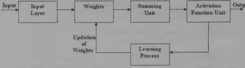

**图 2.3：** “处理单元”的模型

在图 2.3 中，输入从左上角进入处理单元。第一步是将每个输入与其对应的权重因子 (w(n)) 相乘。然后，这些调整后的输入被送入求和函数，该函数通常只是对这些乘积求和。最终，可以选择多种操作。这些操作可以产生若干不同的值，然后这些值被向前传播；例如平均值、最大值、最小值、或运算值、与运算值等。此外，大多数商业开发产品允许软件工程师通过用高级语言编写的例程创建自己的求和函数。有时，还会通过添加激活函数来进一步扩展求和函数，使求和函数能够以时间敏感的方式运行。

无论哪种方式，求和函数的输出随后被送入传递函数。然后，该函数通过某种算法将这个数字转换为实际输出。正是这个算法接收输入，并将其转换为 0 或 1、-1 或 1，或某个其他数字。通常支持的传递函数有 S 形函数、正弦、双曲正切等。该传递函数还可以缩放输出，或通过阈值控制其值。传递函数的结果通常就是处理单元的直接输出。图 2.4 展示了传递函数如何工作的一个示例。

这个 S 形传递函数从求和函数获取值（在图 2.4 中称为 sum），并将其转换为 0 到 1 之间的值。

最后，处理单元准备输出其传递函数的结果。然后，这个输出会被输入到其他处理单元，或输入到外部连接，具体取决于网络的结构。

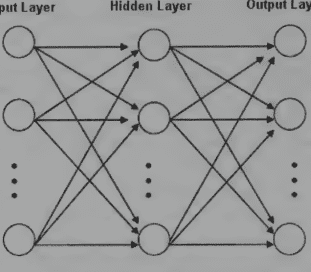

**图 2.5：** 一个简单的神经网络示意图

早期许多研究人员试图仅以随机方式连接神经元，但并未取得多大成功。目前已知，即使是蜗牛的大脑也是一个有组织的实体。在设计结构的最简单技术中，最常见的一种是创建元素层。正是这些神经元分组为层、层与层之间的连接，以及求和函数和传递函数，共同构成了一个可运行的神经网络。

尽管存在仅包含一层甚至一个元素的有用网络，但大多数应用需要至少包含三种常规层类型的网络——输入层、隐藏层和输出层。输入神经元层接收数据，数据可来自输入文件，或在实时应用中直接来自电子传感器。输出层将信息直接发送到外部世界、二级计算机进程，或其他设备（如机械控制系统）。输入层和输出层之间可以有任意数量的隐藏层。这些内部隐藏层包含大量以各种互连结构组织的神经元。这些隐藏神经元中每一个的输入和输出只是传递给其他神经元。

在几乎所有网络中，隐藏层中的每个神经元都会接收其上一层（通常是输入层）所有神经元的信号。一旦该神经元执行完其功能，它就会将输出传递给下一层的所有神经元，从而提供一条通向输出的前馈路径。这些从一个神经元到另一个神经元的通信通道是神经网络的重要方面。它们被称为系统的黏合剂，因为它们将信号互连起来。它们就是连接，为输入提供可变强度。这些连接有两种类型。一种使下一个神经元的求和机制执行加法，另一种使其执行减法。用更拟人的说法，一种起兴奋作用，另一种起抑制作用。

有些网络希望一个神经元抑制同一层中的其他神经元。这称为侧抑制。其最常见用途是在输出层。例如，在文本识别中，如果某个字符为“P”的概率是 0.85，而该字符为“F”的概率是 0.65，网络希望选择概率最高的字符并抑制所有其他字符。它可以通过侧抑制做到这一点。这个概念也称为竞争。

另一种连接类型是反馈。即一层的输出路由回前一层。图 2.6 展示了这样一个示例。

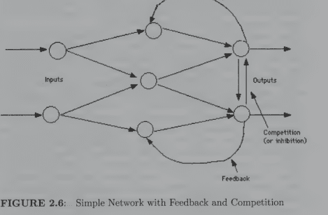

**图 2.6：** 具有反馈和竞争的简单网络

神经元彼此连接的方式对网络的运行有显著影响。在更大、更专业的软件开发包中，用户可以根据需要添加、删除和控制这些连接。通过“调整”参数，可以使这些连接起兴奋或抑制作用。

### 2.3.5 训练人工神经网络

当网络已针对特定应用进行组织和构建后，就意味着该网络已准备好接受训练。这一操作从随机选择初始权重开始。

然后，训练或学习开始。训练有两种方法——有监督训练和无监督训练。有监督训练涉及一种机制，即通过手动“评分”网络性能，或将期望输出与输入一起提供，来向网络提供期望输出。无监督训练则是网络必须在没有外部帮助的情况下理解输入。

神经元连接权重无法在单一步骤内更新。神经元权重被修改的过程发生在多次迭代中。训练数据被呈现给神经网络，并观察其结果。为了使网络学习，必须根据这些结果更新连接权重。这一实际过程受学习算法影响。

这些学习算法通常称为学习规则，几乎总是表示为函数。考虑四个神经元之间的权重矩阵，它在 Java 中表示为如下 double 数组：double weights[][] = new double[4][4];

这给出了四个神经元之间的连接权重。由于大多数编程语言的数组索引从零开始，我们将这些神经元称为神经元 0 到 3。使用上述数组，神经元 2 和神经元 3 之间的权重将包含在变量 weights[2][3] 中。因此，我们希望有一个学习函数能够返回神经元 i 和 j 之间的新权重，例如 weights[i][j] = new weights[i][j] + learningRule(...)。

假想方法 learningRule 计算两个神经元之间为了发生学习而必须产生的变化（增量）。先前的权重值不会完全丢弃，而是计算一个增量值，该值给出上一次迭代与当前迭代的权重之间的差异，从而修改原始权重。当神经网络的权重更新后，会再次向网络呈现训练数据，并且该过程会持续若干次迭代。这些迭代会一直进行，直到神经网络的错误率降低到可接受的水平。

学习规则的一个常见输入是误差。误差是神经网络的实际输出与预期输出之间的差异。如果将这样的误差提供给训练函数，则该方法称为有监督训练。在有监督训练中，神经网络不断调整权重，试图更好地与所提供的预期输出对齐。


目前市面上的商业网络开发软件包提供了一些函数和方法，用于监控人工神经网络在预测正确答案过程中的收敛情况。这些函数可以让训练过程持续数天，直到系统达到某个统计上的理想点或准确度才停止。然而，有些网络始终无法学会。这可能是因为输入数据中不包含能够推导出期望输出的特定信息。如果数据量不足以完成完整的学习，网络同样不会收敛。理想情况下，应该有足够的数据，以便可以保留一部分数据作为测试集。具有多个节点的多层网络能够记住数据。为了监控网络，判断系统是否只是以某种无意义的方式记忆数据，有监督训练需要保留一组数据，在系统完成训练后用于测试。

如果一个网络根本无法解决该问题，设计者就必须重新审视输入和输出、层数、每层的元素数量、层与层之间的连接、求和函数、传递函数、训练函数，甚至初始权重本身。创建一个成功网络所需的这些更改构成了一种过程，而神经网络设计的“艺术”正是在这一过程中得以体现。

设计者的创造力还体现在训练规则的制定上。有许多法则（算法）可用于实现在训练过程中调整权重所需的自适应反馈。最常用的技术是反向误差传播，通常简称为反向传播。本书后面会更深入地探讨这些不同的学习技术。

归根结底，训练并非一种纯粹的技术。它需要经验和敏感性分析，以确保网络不会过度训练。起初，人工神经网络会根据数据的总体统计趋势来配置自身。之后，它会继续“学习”数据中其他一些从普遍角度来看可能是虚假的方面。

最后，当系统已完美训练完毕，不再需要进一步学习时，权重就可以被“冻结”。在某些系统中，这个最终定型的网络会被转化为硬件，以获得更快的速度。其他系统则不会锁定自身，而是在生产环境中继续学习。

#### 无监督训练或自适应训练

另一种类型的训练称为无监督训练。在无监督训练中，网络只接收输入，而不提供期望的输出。系统本身必须决定使用哪些特征来对输入数据进行分组。这通常被称为自组织或自适应。无监督训练的流程图如图2.8所示。

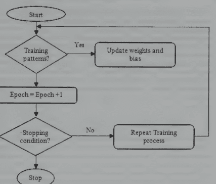

**图2.8.** 无监督训练流程图

目前，人们对无监督学习的理解还不够深入。这种对环境的适应能力正是其前景所在，它将使科幻类型的机器人能够在遇到新情况和新环境（这些情况下不存在精确的训练集）时，持续自主地学习。

无监督学习领域的领先研究者之一是Teuvo Kohonen，他是赫尔辛基理工大学的电气工程师。他开发了一种自组织网络，有时也称为自动联想器，这种网络无需知道正确答案就能学习。这种网络外观独特，因为它只包含一个具有大量连接的层。这些连接的权重必须初始化，输入必须归一化。神经元以赢者通吃的方式进行竞争。

Kohonen主要研究的网络其结构和组织方式与基本的前馈网络有所不同。

向计算机提供有关专家需求实现方式的知识。为了实现这一点，专家系统本身会生成一个计算机程序。该计算机程序是构建此类应用基本规则所必需的。构建规则的过程也很复杂，确实需要具备详细知识的人员。

使专家系统通用化的努力遇到了许多问题。随着系统复杂度的增加，系统会要求过多的计算资源，并且变得过于缓慢。人们发现，专家系统只有在被严格限定于狭窄领域时才是可行的。

人工神经网络提出了一种与问题求解完全相反的方法，它们有时被称为第六代计算。这些网络能够提供自行学习的算法。神经网络被集成起来，以提供无需专家干预、也无需复杂编程即可解决问题的能力。

专家系统已经取得了显著的成功。然而，人工智能在视觉、连续语音识别与合成以及机器学习等领域遇到了问题。人工智能还受制于其运行处理器的速度。最终，它被限制在单个处理器的理论极限之内。此外，专家并不总是用规则来表达，这也是人工智能的一个负担。

尽管神经网络在这些特定领域相对于专家系统和传统计算具有优势，但神经网络并不是完美的解决方案。它们提供的能力并非坚不可摧，比如一个调试好的会计系统。它们会学习，因此也会不断犯“错误”。而且，每当为某个应用开发网络时，都没有办法确定该网络就是找到最优解的最佳网络。神经系统的确有其自身的要求，它们期望开发人员满足若干条件，例如：

- 包含能够表征问题信息的数据集
- 数据集规模足够大，既能训练网络也能测试网络
- 理解待解决问题的基本性质，以便能够对创建网络做出初步的基本决策。这些决策包括激活函数、传递函数以及学习方法
- 理解开发工具

模仿人脑的基本属性。

如前所述，人工神经网络大致是以生物学为基础的。目前对人脑生理学的研究，对于神经元的工作方式，甚至什么构成一般意义上的智能，只揭示了有限的理解。在生物学和工程领域工作的研究人员和科学家正专注于研究和破解人类如何学习以及对日常经历做出反应的重要机制。对神经功能的深入认识有助于这些研究人员制造出更有效、更简洁的人工网络。同样，它也催生了许多新颖且在不断萌生的架构。日本资深研究员Fukushima Kunihiko描述了构建神经网络模型的相互促进过程：“我们尽可能忠实地遵循生理学证据。然而，对于尚不明确的部分，我们会提出一个假设，并构建一个遵循该假设的模型。然后我们分析或模拟模型的行为，并将其与大脑的行为进行比较。如果我们发现模型与大脑之间存在任何行为差异，就修改最初的假设并调整模型。我们重复这个过程，直到模型的行为与大脑一致。”这一常见过程催生了成千上万种网络拓扑结构。

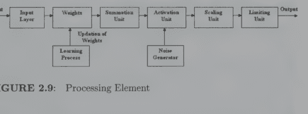

**图2.9：** 处理单元

神经计算包含大多数机器，而非人脑。神经计算是试图构建处理系统的过程，这些系统借鉴了自然界生物学中极为成功的设计。与生物科学的这种联系，就是当今人工神经网络存在共同架构脉络的原因。图2.9展示了一个人工神经元（或处理单元）的模型，它体现了多种多样的网络架构。此图改编自NeuralWare公司在其NeuralWorks Professional II/Plus中使用的仿真模型。

它们的处理单元模型表明，用于预测的网络与用于分类或其他用途的网络可以非常相似。


其他网络类别。预测、分类以及其他网络类别将在后面讨论。这里的要点是，所有人工神经处理元件都具有共同的组成部分。

本节介绍构成人工神经元的七个主要组成部分。无论该神经元用于输入、输出，还是位于某个隐藏层中，这些组成部分都是适用的。

#### 组成部分 1. 权重因子

单个神经元通常会同时接收大量输入。每个输入都有自己的相对权重，该权重赋予输入在处理元件求和函数上所需的能量。所有权重函数执行的功能类型相同，类似于生物神经元中变化的突触强度。在这两种情况下，少数输入被赋予比其他输入更高的重要性，因此当它们聚合以产生神经响应时，会对处理元件产生更大的影响。权重函数是网络内部的自适应系数，它们决定人工神经元所记录的输入信号强度。权重衡量输入的连接强度，可响应各种训练集、根据网络的特定拓扑或通过学习规则进行改变。

#### 组成部分 2. 求和函数

神经网络处理元件运行的第一步，是计算所有输入的加权和。在数学上，输入和对应的权重是向量，可表示为 (i₁, i₂, . . . iₙ) 和 (w₁, w₂, . . . wₙ)。总输入信号是这两个向量的点积（或内积）。这种过度简化的求和函数，是通过将第 i 个向量的每个分量与 w 向量的对应分量相乘，然后把所有乘积相加来确定的。Input₁ = i₁ * w₁、input₂ = i₂ * w₂ 等，按 input₁ + input₂ + . . . + inputₙ 相加。结果是一个单一数字，而不是多元素向量。

两个向量的点积可以在几何上理解为它们相似性的度量。如果两个向量指向相同方向，点积最大；如果两个向量指向相反方向（相差 180 度），它们的点积最小。

求和函数并不仅仅是简单的输入与权重乘积之和，它更为复杂。在传递到传递函数之前，输入和加权系数可以通过几种不同的方式组合。与单纯的乘积求和类似，求和函数还可以选择最小值、最大值、多数值、乘积或若干归一化算法。用于组合神经输入的具体算法由所选择的网络架构和范式决定。有些求和函数会在结果传递到传递函数之前，对结果应用一个附加过程。这一过程有时称为激活函数。使用激活函数的目的是让求和输出能够随时间变化。目前，激活函数在很大程度上仍局限于研究领域。当前大多数网络实现使用“恒等”激活函数，这相当于没有激活函数。此外，这类函数更可能是整个网络的组成部分，而不是每个单独处理元件的组成部分。

#### 组成部分 3. 传递函数

求和函数的输出是加权和，它通过称为传递函数的算法过程转换为工作输出。传递函数将求和总和与阈值函数进行比较，以确定网络的输出。如果总和大于阈值，处理元件就生成信号。如果输入与权重乘积之和小于阈值，则不生成信号（或生成某种抑制信号）。这两种获得输出的情况都具有重要意义。

阈值函数，或称传递函数，通常是非线性的。线性（直线）函数受到限制，因为输出只是与输入成正比。线性函数不太有用。正如明斯基和帕佩特的著作《*感知机*》中所指出的，这正是最早网络模型的问题。

传递函数是一种求和函数结果可能为正或为负的函数。网络的输出可以是零和一（二值输出）、正一和负一（双极性），或任何其他最常用的数值组合。产生这类输出的传递函数是“硬限幅器”或阶跃函数。图 2.10 展示了几个示例传递函数。

另一种传递函数，即阈值函数或斜坡函数，可以在给定范围内镜像输入，并在该范围之外仍充当硬限幅器。它是一种被裁剪到最小值和最大值的线性函数，因此成为非线性函数。然而，另一种传递函数选择是 S 形曲线。S 形曲线在渐近线处位于最小值和最大值之间。当该曲线在 0 和 1 之间取值时，称为 S 形函数；当它在 -1 和 1 之间取值时，称为双曲正切。在数学上，这些曲线最重要且最令人兴奋的特征是，函数及其导数均连续。这种选择效果相当好，并且常作为首选的传递函数。

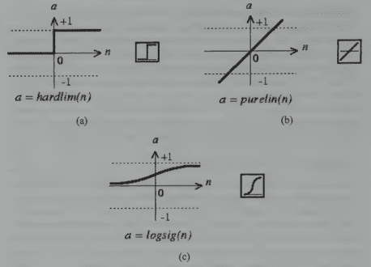

**图 2.10：** 示例传递函数 (a) 硬限幅传递函数 (b) 线性传递函数 (c) 对数 S 形传递函数

在应用传递函数之前，可以加入均匀分布的随机噪声。这种噪声的来源和大小由给定网络范式的学习模式决定。这种噪声通常称为人工神经元的“温度”。温度这个名称源于一种物理现象：当人变得过热或过冷时，思考能力会受到影响。在电子实现中，这一过程通过加入噪声来模拟。实际上，通过向求和结果加入不同水平的噪声，可以实现更像大脑的传递函数。大多数研究人员使用高斯噪声源来模仿自然行为。高斯噪声与均匀分布噪声相似，不同之处在于温度范围内随机数的分布沿钟形曲线进行。温度的使用，也就是网络在学习过程中确定的噪声，仍是一个持续研究领域，尚未应用于许多工程应用。

目前，NASA 正在处理一种网络拓扑，该拓扑在一个新的前馈、反向传播学习函数中使用温度系数。但这个温度系数是一个全局项，它被应用于原始误差，以满足他们的特定目的。

人工神经元的误差通常会传播到另一个处理元件的学习函数中。这个误差项有时称为当前误差。通常，当前误差会反向传播到前一层。这个反向传播的误差值可以是当前误差、以某种方式缩放的当前误差，或某种其他期望输出，具体取决于网络类型。通常，这个反向传播的值经学习函数缩放后，会与每个输入连接权重相乘，以便在下一个学习周期之前修改这些权重。

#### 组成部分 7. 学习函数

学习函数的目的是基于某种神经算法，更新每个处理元件输入上的可变连接权重。这种改变输入连接权重以实现某种期望结果的过程，也可以称为适应函数以及学习模式。学习有两种类型：监督学习和无监督学习。监督学习需要一个教师。教师可以是一组训练数据，也可以是评估网络结果表现的观察者。无论哪种方式，有教师就属于通过强化进行学习。当没有外部教师时，系统必须依据网络设计中内置的某些内部准则来自我组织。这就是在实践中学习。

### 2.4.1 训练人工神经网络

#### 监督学习

大多数人工神经网络解决方案都是在有监督的情况下训练的，也就是说，有一个教师。在监督学习中，神经网络的实际输出会与期望输出进行比较。权重最初被随机设置，随后由网络进行调整，以便下一次迭代或周期能在期望输出和实际输出之间产生更接近的匹配。该学习方法试图最小化所有处理元件的当前误差。这种全局误差的降低是通过随时间不断修改输入权重来实现的，直到达到可接受的网络精度。

在监督学习中，人工神经网络必须经过训练才能变得有用。训练包括向网络提供输入和输出数据。这组数据通常称为训练集。对于系统的每一组输入，都会提供一个期望输出或目标输出。在大多数应用中，必须使用实际数据。训练阶段需要非常长的时间。在原型系统中，使用

处理能力不足时，学习可能需要数周。当神经网络达到用户定义的性能水平时，即认为训练完成。该水平表示网络在针对给定输入序列产生所需输出时，已达到期望的统计精度。当不再需要进一步学习时，权重通常会为该应用而冻结。某些网络类型允许在运行期间以慢得多的速率持续训练。这有助于网络适应逐渐变化的条件。

训练集应尽可能充分，以包含学习所需的所有必要且充分的信息。训练过程还应包含广泛多样的数据。系统不能孤立地学习，而必须把所有内容放在一起学习，以便为问题中可用的全部事实集合找到最佳权重设置。

输入和输出数据如何表示或编码，是成功指导网络的主要组成部分。人工网络只处理数值输入数据。因此，原始数据常常必须从外部环境转换而来。通常需要根据网络的范式对输入数据进行缩放或归一化。将现实世界输入预处理为机器可理解格式，已经是标准计算机的常见工作。许多可直接应用于人工神经网络实现的训练技术已经可以随时获得。网络设计者的工作只是利用这些现成实现，为给定应用找到最佳数据格式和匹配的网络体系结构。

监督网络在训练数据上运行后，关键要确定网络对未见过的数据能做什么。如果系统在该测试集上未产生合理输出，则训练期尚未结束。确实，这种测试至关重要，可确保网络并非只是记住给定数据集，而是学到了应用中涉及的一般模式。

#### 无监督学习

无监督学习也称为聚类，它形成自然的模式组或簇，因此是未来的巨大希望。它证明计算机有朝一日能够真正以机器人意义上的方式自主学习。目前，这种学习技术仅限于称为自组织映射的网络。尽管这些网络并不常用，但已证明它们能在少数情况下提供解决方案，证明其前景并非没有根据。已证明它们在数值计算方面比许多算法技术更有效。它们也正在实验室中使用，在那里被分成一个前端网络，该网络识别短的、类似音素的语音片段，然后这些片段被传给一个后端网络。第二个人工网络将这些片段串识别为单词。

这个前景广阔的无监督学习领域有时称为自监督学习。这些网络不使用任何外部诱因来调整权重，而是在内部监控自身性能。这些网络在输入信号中寻找规律模式，并根据网络的功能做出调整。即使没有被告知对错，网络仍必须拥有关于如何组织自身的一些信息。这些信息内建于网络拓扑和学习规则中。

无监督学习算法可能强调处理元件簇之间的合作。在这种情况下，各簇将协同工作。如果某种外部输入激活了簇中的任一节点，则整个簇的活动可能增强，这具有兴奋性。同样，如果对簇中节点的外部输入减少，则可能对整个簇产生抑制效应。

处理元件之间的竞争也可以构成学习的基础。竞争簇的训练可以放大特定组对特定刺激的响应。因此，它会把那些组彼此关联起来，并与特定的适当响应关联起来。通常，当学习竞争生效时，只有属于获胜处理元件的权重会被更新。

在当前技术水平下，无监督学习尚未被充分理解，仍是研究课题。这项研究目前受到政府关注，因为军事场景中往往在冲突发生之前没有可用于训练网络的数据集。

### 2.4.2 学习率

人工神经网络（ANN）学习的速度取决于若干可控因素。选择学习率时应考虑许多权衡。显然，较慢的学习率意味着要花更多时间完成离线学习，以产生训练充分的系统。然而，采用较快学习率时，网络可能无法做出学习较慢的系统所能实现的精细区分。

通常，在讨论离线训练任务时，除时间外还必须考虑若干因素。需要考虑的一些最常见因素包括网络复杂度、网络规模、范式选择、体系结构、所采用学习规则的类型以及期望精度。所有这些因素在决定训练网络所需时间方面都起着重要作用。如果修改其中任一因素，则训练时间可能延长到过长，或者输出可能不可接受且不准确。

几乎所有学习函数都为学习率或学习常数提供了某种设置。通常该项为正，且介于零和一之间。如果学习率大于一，学习算法在考虑权重时很容易过冲，网络将发生振荡。较小的学习率值不会那么快地校正当前误差，但如果在校正误差时采取小步长，则很有可能达到最佳的最小收敛。

### 2.4.3 学习法则

许多学习法则通常用于训练神经网络。这些法则大多以最古老的学习法则——赫布规则——作为基础。对不同学习函数的研究持续进行，因为新思想经常出现在商业出版物中。一些研究人员和科学家的主要目标是模拟生物学习。另外一些研究人员正在试验对生物感知的改造，以理解自然界如何处理学习。无论哪种方式，人类对神经处理实际如何运作的理解都非常有限。学习无疑比当前已开发的学习法则所代表的简化更复杂。下面介绍其中一些主要法则：

#### 赫布规则

第一个、而且无疑是最著名的学习规则由唐纳德·赫布提出，用于辅助无监督训练。该规则指出：“如果一个神经元接收来自另一个神经元的输入，并且两者都高度活跃（在数学上具有相同符号），则应加强这两个神经元之间的权重。”

训练神经网络的规则几乎总是表示为代数公式。赫布规则表示为：

$$\Delta W_{ij} = \mu a_i a_j$$

上式计算从神经元 i 到神经元 j 的连接权重的所需变化量（delta）。希腊字母 mu（μ）表示学习率。在给定训练模式时，每个神经元的激活值表示为 $a_i$ 和 $a_j$。

为了理解赫布规则的工作方式，考虑一个只有两个神经元的简单神经网络。在这个神经网络中，这两个神经元同时构成输入层和输出层。没有隐藏层。表

其中：
- $x$ 是输入单元的向量激活。
- $y_{in}$ 是输出单元的净输入，$\Sigma x_i w_i$。
- $t$ 是目标向量。
- $\alpha$ 是学习率。

推导如下：

某一训练模式的均方误差为 $E=\Sigma_j(t_j- y_{inj})^2$。

$E$ 的梯度是一个向量，由 $E$ 关于每个权重的偏导数组成。通过调整权重 $W_{IJ}$ 可以快速减小误差。

对 $E$ 关于 $W_{IJ}$ 求偏导：

$$\frac{\partial E}{\partial W_{IJ}} = \frac{\partial \Sigma_j(t_j - y_{inj})^2}{\partial W_{IJ}}$$
$$= \frac{\partial (t_j - y_{inj})^2}{\partial W_{IJ}}$$

由于权重 $W_{IJ}$ 仅在输出单元 $y_J$ 处影响误差。并且，

$$y_{inJ} = \Sigma_{i=1}^{n} x_i W_{IJ}$$

可得，

$$\frac{\partial E}{\partial W_{IJ}} = \frac{\partial (t_j - y_{inj})^2}{\partial W_{IJ}}$$
$$= 2(t_j - y_{inj})(-1)\frac{\partial(y_{inj})}{\partial W_{IJ}}$$
$$\frac{\partial E}{\partial W_{IJ}} = -2(t_j - y_{inj})\frac{\partial(y_{inj})}{\partial W_{IJ}}$$
$$\frac{\partial E}{\partial W_{IJ}} = -2(t_j - y_{inj})x_I$$

因此，根据给定的学习过程，通过按照下式给出的 Delta 规则调整权重，误差将快速减小：

$$\Delta W_{IJ} = \alpha(t_j - y_{inj})x_I$$

#### 多输出单元的 Delta 规则

多输出单元的 Delta 规则推导与上一节类似。通过改变权重来减小净输入与目标之间的差异。

使用 Delta 规则调整从第 I 个输入单元到第 J 个输出单元的权重时，权重修正为：

$$\Delta W_{IJ} = \alpha(t_j - y_{inj})x_I$$

#### 扩展 Delta 规则

这也可以称为广义 Delta 规则。从第 I 个输入单元到第 J 个输出单元的权重更新为：

$$\Delta W_{IJ} = \alpha(t_j - y_{inj})x_I f'(y_{inJ})$$


推导如下。

对于特定训练模式的平方误差为，

$$
E = \sum_j (t_j - y_j)^2
$$

其中 \(E\) 是所有权重的函数。

\(E\) 的梯度是一个向量，由 \(E\) 关于每个权重的偏导数组成。通过沿 \(-\partial E/\partial W_{IJ}\) 方向调整权重 \(W_{IJ}\)，可以快速减小误差。

对 \(E\) 关于 \(W_{IJ}\) 求偏导，

$$
\frac{\partial E}{\partial W_{IJ}} = \frac{\partial \sum_j (t_j - y_j)^2}{\partial W_{IJ}}
$$

$$
\frac{\partial E}{\partial W_{IJ}} = \sum_j (t_j - y_j)\frac{\partial y_j}{\partial W_{IJ}}
$$

由于权重 \(W_{IJ}\) 仅影响输出单元 \(Y_J\) 处的误差

由于

$$
Y_{inj} = \sum_{i=1} x_i w_{iJ}
$$

$$
\frac{\partial E}{\partial W_{IJ}} = 2(t_j - y_j)(-1)\frac{\partial y_j}{\partial W_{IJ}}
= 2(t_j - y_j)\frac{\partial f(y_{inj})}{\partial W_{IJ}}
$$

$$
\frac{\partial E}{\partial W_{IJ}} = 2(t_j - y_j)x_i f'(Y_{inj})
$$

因此，对于给定的学习率 \(\alpha\)，根据 Delta 规则调整权重可快速减小误差，

$$
\Delta W_{IJ} = \alpha (t_j - y_j)x_i f'(Y_{inj})
$$

这给出了扩展 Delta 规则。

使用 Delta 规则时，确保输入数据集充分随机化非常重要。训练集的良好排序或结构化呈现可能导致网络无法收敛到所需精度。如果发生这种情况，则网络无法学习该问题。

#### 竞争学习律或科霍宁学习律

该过程由 Teuvo Kohonen 开发，其灵感来自生物系统中的学习。在此过程中，处理单元竞争学习或更新其权重的机会。输出最大的处理单元被宣布为获胜者，并且能够抑制其竞争者以及激发其相邻单元。只有获胜者被允许输出，并且只有获胜者及其相邻单元被允许调整其连接权重。此外，邻域的大小可以在训练期间变化。通常的做法是从较大的邻域定义开始，并随着训练过程的进行而缩小。由于获胜元素被定义为与输入模式最匹配的元素，科霍宁网络对输入的分布进行建模。这有利于数据的统计或拓扑建模，有时被称为自组织映射或自组织拓扑。

要使神经元 \(P\) 成为获胜神经元，其在给定特定输入模式下的诱导局部场 \(v_p\) 必须是网络中所有神经元中最大的。获胜神经元的输出信号设为 1，在竞争中失败的神经元信号设为 0。因此，

$$
N=\begin{cases}
1 & \text{if } v_p>v_q \text{ for all } q,\ p\neq q \\
0 & \text{otherwise}
\end{cases}
$$

该规则适用于无监督网络训练。胜者为王（winner-takes-all）或竞争学习用于学习输入的统计特性。这里使用标准科霍宁学习规则。

令 \(w_{ij}\) 表示从输入节点 \(j\) 到神经元 \(i\) 的权重。假设该神经元具有固定权重，这些权重分布在其输入节点之间：

$$
\sum_j w_{ij}=1 \quad \text{for all } i
$$

神经元随后通过将权重从其非活动输入节点转移到活动输入节点来学习。如果某个神经元对特定输入模式没有响应，则该神经元不进行学习。如果某个神经元在竞争中获胜，则调整其对应权重。

使用标准竞争规则，\(w_{ij}\) 的变化量由下式给出：

$$
\Delta w_{ij}=\begin{cases}
\alpha(x_j-w_{ij}) & \text{if neuron } i \text{ wins the competition}\\
0 & \text{if neuron } i \text{ loses the competition}
\end{cases}
$$

其中 \(\alpha\) 是学习率。该规则的作用是将获胜神经元 \(i\) 的权重向量 \(w_i\) 移向输入模式 \(x\)。通过竞争学习，神经网络可以进行聚类。

该邻域有时会扩展到简单获胜神经元之外，以包含相邻神经元。在此方法中，权重通常初始化为随机值，并在学习过程中对其长度进行归一化。胜者为王神经元通过点积或欧几里得范数来选取。欧几里得范数使用最广泛，因为点积可能需要归一化。

#### Outstar 学习律

当神经元按层排列时，出星学习规则可以得到很好的解释。该规则旨在从 \(n\) 个神经元的层中产生期望响应 \(t\)。这种类型的学习也称为格罗斯伯格学习。出星学习发生在特定层的所有单元中，并且假定这些单元之间不存在竞争。然而，科霍宁学习和格罗斯伯格学习的权重更新形式密切相关。对于出星学习，

$$
\Delta w_{jk} = \begin{cases}
\alpha(y_k - w_{jk}) & \text{if neuron } j \text{ wins the competition} \\
0 & \text{if neuron } j \text{ loses the competition}
\end{cases}
$$

该规则用于提供输入-输出关系的重复性和特征性属性的学习。虽然它涉及监督学习，但它允许网络提取输入和输出信号的统计属性。它确保在重复施加失真的输出版本后，输出模式变得类似于未失真的期望输出。这里的权重变化将是计算误差乘以 \(\alpha\)。

#### 玻尔兹曼学习律

这是一种随机学习。基于这种学习设计的神经网络称为玻尔兹曼学习。在这种学习中，神经元构成递归结构，并以二进制形式工作。这种学习的特点是具有能量函数 \(E\)，其值由机器中各个神经元占据的特定状态决定，表达式为：

$$
E = -\frac{1}{2} \sum_{i} \sum_{j} w_{ij} x_i x_j, \quad i \neq j
$$

其中 \(x_i\) 是神经元 \(i\) 到神经元 \(j\) 的状态。\(i\neq j\) 表示机器中任何神经元都没有自反馈。机器的运行方式是随机选择一个神经元。

这种学习过程中的神经元分为两组：可见神经元和隐藏神经元。可见神经元中，网络与其运行环境之间存在接口；而隐藏神经元则独立于环境运行。可见神经元可能会被钳制到由环境确定的特定状态，称为钳制条件。另一方面，还有自由运行条件，即允许所有神经元自由运行。

#### 基于记忆的学习律

在基于记忆的学习中，所有先前的经验都存储在一个大型记忆中，其中包含正确分类的输入-输出示例 \(\{(x_i,t_i)\}_{i=1}^N\)，\(x_i\) 是输入向量，\(t_i\) 是期望响应。期望响应是一个标量。

基于记忆的算法涉及两个部分，它们是：

- 用于定义测试向量局部邻域的准则
- 应用于局部邻域训练的学习规则

最广泛使用的基于记忆的学习之一是最近邻规则，其中局部邻域被定义为位于测试向量 \(x\) 紧邻区域的训练示例。向量

$$
x_n^1 \in \{x_1 \ldots x_n\}
$$

被称为 \(x_i\) 的最近邻，如果 \(\min d(x_i, x_t)=d(x_{n*}^1, x_t)\)。

其中 \(d(x_i, x_t)\) 是向量 \(x_i\) 和 \(x_t\) 之间的欧几里得距离。

最近邻分类器的一种变体是 K-最近邻分类器，其表述如下：

- 对于某个整数 \(K\)，找出与测试向量 \(x_t\) 最近的 K 个已分类模式。
- 将 \(x_t\) 分配给在 \(x_t\) 的 K 个最近邻中出现频率最高的类别。

因此，K-最近邻分类器的作用类似于平均设备。基于记忆的学习分类器也可以应用于径向基函数网络。

### 2.4.4 学习规则的 MATLAB 实现

#### 实现赫布规则语法的 MATLAB 代码片段

```matlab
[dW, LS] = learnh(W, P, Z, N, A, T, E, gW, gA, D, LP, LS)
```

其中

- learnh 是赫布权重学习函数
- learnh(W, P, Z, N, A, T, E, gW, gA, D, LP, LS) 接受多个输入
- W -- S x R 权重矩阵（或 S x 1 偏置向量）
- P -- R x Q 输入向量（或 ones(1,Q)）
- Z -- S x Q 加权输入向量


- N -- S x Q 净输入向量
- A -- S x Q 输出向量
- T -- S x Q 层目标向量
- E -- S x Q 层误差向量
- gW -- S x R 关于性能的权重梯度
- gA -- S x Q 关于性能的输出梯度
- D -- S x S 神经元距离
- LP -- 学习参数
- LS -- 学习状态，初始应为 = []
- dW -- S x R 权重（或偏置）变化矩阵

学习根据 learn 的学习参数进行，此处显示其默认值。LP.lr = 0.01 -- 学习率。例如，考虑一个具有双元素输入和三个神经元的层，其随机输入 P 和输出 A，学习率为 0.5。

```matlab
p = rand(2,1)
a = rand(3,1)
lp.lr = 0.5
dW = learn([],p,[],[],a,[],[],[],[],[],lp,[])
```

#### 输出

```text
p =
    0.9501
    0.2311

a =
    0.6068
    0.4860
    0.8913

lp =
    lr: 0.5000

dW =
    0.2883  0.0701
    0.2309  0.0562
    0.4234  0.1030
```

#### 实现 Delta 规则的 MATLAB 代码片段

语法

```matlab
[dw,LS]=learnwh(W,P,Z,N,A,T,E,gW,gA,D,LP,LS)
[db,LS]=learnwh(ones(1,Q),Z,N,A,T,E,gW,gA,D,LP,LS)
```

learnwh 是 delta 学习函数，也称为 Widrow-Hoff 权重/偏置或最小均方（LMS）规则。learnwh(W,P,Z,N,A,T,E,gW,gA,D,LP,LS) 接受若干输入

- W -- S x R 权重矩阵（或 b，以及 S x 1 偏置向量）
- P -- R x Q 输入向量（或 ones(1,Q)）
- Z -- S x Q 加权输入向量
- N -- S x Q 净输入向量
- A -- S x Q 输出向量
- T -- S x Q 层目标向量
- E -- S x Q 层误差向量
- gW -- S x R 关于性能的权重梯度
- gA -- S x Q 关于性能的输出梯度
- D -- S x S 神经元距离
- LP -- 学习参数
- LS -- 学习状态，初始应为 [] 并返回
- dW -- S x R 权重（或偏置）变化矩阵

考虑一个具有双元素输入和三个神经元的层，其随机输入 P 和误差 E，学习率为 0.5。

```matlab
p = rand(2,1)
e = rand(3,1)
lp.lr = 0.5
dw = learnwh([],p,[],[],[],e,[],[],[],lp,[])
```

#### 输出

```text
p =
0.9501
0.2311

e =
0.6068
0.4860
0.8913

lp =
lr: 0.5000

dw =
0.3620    0.0881
0.2169    0.0528
0 0.088 0.0021
```

#### 实现 Kohonen 学习律的 MATLAB 代码片段

语法

```matlab
[dw,LS] = learnsom(W,P,Z,N,A,T,E,gW,gA,D,LP,LS)
```

learnsom 是自组织映射权重学习函数。

learnsom(W,P,Z,N,A,T,E,gW,gA,D,LP,LS) 接受若干输入

- W -- S x R 权重矩阵（或 S x 1 偏置向量）
- P -- R x Q 输入向量（或 ones(1,Q)）
- Z -- S x Q 加权输入向量
- N -- S x Q 净输入向量
- A -- S x Q 输出向量
- T -- S x Q 层目标向量
- E -- S x Q 层误差向量
- gW -- S x R 关于性能的权重梯度
- gA -- S x Q 关于性能的输出梯度
- D -- S x S 神经元距离
- LP -- 学习参数
- LS -- 学习状态
- dW -- S x R 权重（或偏置）变化矩阵

例如，考虑一个具有双元素输入和六个神经元的层，其随机输入 P、输出 A 和权重矩阵 W。为按 2×3 六边形模式排列的神经元计算位置和距离。定义了四个学习参数。

```matlab
p = rand(2,1)
a = rand(6,1)
w = rand(6,2)
pos = hextop(2,3)
d = linkdist(pos)
lp.order.lr = 0.9
lp.order.steps = 1000
lp.tune.lr = 0.02
lp.tune.nd = 1
```

```matlab
ls = []
[dW,ls] = learnsom(w,p,[],[],a,[],[],[],[],d,lp,ls)
```

#### 输出

```text
p =
0.8214
0.4447

a =
0.6154
0.7919
0.9218
0.7382
0.1763
0.4057

w =
0.9355    0.8132
0.9169    0.0099
0.4103    0.1389
0.8936    0.2028
0.0579    0.1987
0.3529    0.6038

pos =
0    1.0000    0.5000    1.5000    0    1.0000
0    0    0.8660    0.8660    1.7321    1.7321

d =
0    1    1    2    2    2
1    0    1    1    2    2
1    1    0    1    1    1
2    1    1    0    2    1
2    2    1    2    0    1
2    2    1    1    1    0

dW =
-0.2189    -0.7071
-0.1909     0.8691
 0.8457     0.6291
-0.1426     0.4777
 1.3144     0.4235
 0.8550    -0.2903
```

#### 实现 Outstar 学习律的 MATLAB 代码片段

语法

```matlab
[dW,LS] = learns(W,P,Z,N,A,T,E,gW,gA,D,LP,LS)
```

learns(W,P,Z,N,A,T,E,gW,gA,D,LP,LS) 接受若干输入

- W -- S x R 权重矩阵（或 S x 1 偏置向量）
- P -- R x Q 输入向量（或 ones(1,Q)）
- Z -- S x Q 加权输入向量
- N -- S x Q 净输入向量
- A -- S x Q 输出向量
- T -- S x Q 层目标向量
- E -- S x Q 层误差向量
- gW -- S x R 关于性能的权重梯度
- gA -- S x Q 关于性能的输出梯度
- D -- S x S 神经元距离
- LP -- 学习参数，无，LP = []
- LS -- 学习状态，初始应为 = [] 并返回
- dW -- S x R 权重（或偏置）变化矩阵

例如，考虑一个具有双元素输入和三个神经元的层，其随机输入 P、输出 A 和权重矩阵 W，学习率为 0.5。

```matlab
p = rand(2,1)
a = rand(3,1)
w = rand(3,2)
lp.lr = 0.5
dW = learns(w,p,[],[],a,[],[],[],[],lp,[])
```

#### 输出

```text
p =
0.6721
0.8381

a =
0.0196
0.6813
0.3795

w =
0.8318   0.4289
0.5028   0.3046
0.7095   0.1897

lp =
lr: 0.5000
order.lr: 0.9000
order.steps: 1000
tune.lr: 0.0200
tune.nd: 1

dw =
-0.2729    -0.1715
0.0600      0.1578
-0.1109     0.0795
```

## 总结

人工神经网络的设计涉及对多种网络拓扑、当前硬件、当前软件工具、待解决应用以及获取训练网络所需数据的策略的理解。该过程还涉及选择学习规则、传递函数、求和函数，以及如何连接网络内的神经元。因此，本章介绍了对神经网络、其历史、学习率、学习律、误差函数、传递函数等组成部分的理解。本章还提供了使用 MATLAB 中的神经网络工具箱对学习规则的基本实现。

## 复习问题

- 1. 什么是人工神经网络？
- 2. 将 ANN 与人脑进行比较。
- 3. 人工神经元如何以电子方式实现？
- 4. 解释有监督和无监督训练。
- 5. 列举几种属于有监督训练的网络。
- 6. 比较神经网络与传统计算和专家系统。
- 7. 详细描述神经网络的主要组成部分。
- 8. 列举不同类型的传递函数。
- 9. 定义学习率。训练网络时该参数有哪些约束？
- 10. 陈述 Hebb 规则。
- 11. 区分 Hebb 和 Hopfield 学习律。
- 12. 推导单输出和多输出情况下 delta 规则的代数表达式。
- 13. 给出使用扩展 delta 规则更新权重的表达式。
- 14. 解释竞争学习。
- 15. 陈述 Boltzmann 学习律和基于记忆的学习律。
- 16. 编写实现 Boltzmann 学习律的 MATLAB 代码。
- 17. 开发用于竞争学习的 MATLAB 代码。

# 第3章

# 人工神经网络——架构与算法

## 3.1 引言

如前一章所述，人工神经网络类似于生物网络，基于神经元、连接和传递函数的概念。各种类型网络的架构或多或少相似。大多数差异源于各种学习规则（如 Hebb、Hopfield、Kohonen 等）以及这些规则对网络拓扑的影响。

本章根据主要应用类别概述一些最常见的人工神经网络。这些类别并非互斥，只是为了厘清网络架构及其与特定应用最佳匹配方面的一些混淆。本章讨论单层和多层网络，以及预测网络的详细架构和算法。本章还阐述了使用 MATLAB 实现预测网络的基本方法。

基本上，神经网络的大多数应用属于以下四类：

- 1. 预测
- 2. 分类
- 3. 数据关联
- 4. 数据概念化

表 3.1 展示了这些网络类别之间的差异，并说明了哪些较常见的网络拓扑属于哪个主要类别。一些按具体实际应用分组的网络正被用于解决多种类型的问题。前馈反向传播网络用于解决


**表3.1：网络选择表**

| 网络类别 | 神经网络 | 应用 |
|---|---|---|
| 预测 | 1. 感知机<br>2. 反向传播<br>3. Delta-Bar-Delta<br>4. 扩展Delta-Bar-Delta<br>5. 定向随机搜索<br>6. 高阶神经网络<br>7. 自组织映射与反向传播 | 用于挑选市场上最好的股票、预测天气、识别有癌症风险的人群等。 |
| 分类 | 1. 学习矢量量化<br>2. 对向传播<br>3. 概率神经网络 | 用于对模式进行分类 |
| 数据关联 | 1. Hopfield<br>2. 玻尔兹曼机<br>3. 汉明网络<br>4. 双向联想记忆 | 用于对数据分类，还能识别包含错误的数据。 |
| 数据概念化 | 1. 自适应共振网络<br>2. 自组织映射 | 用于分析输入，从而推断分组关系（例如，从数据库中提取最有可能购买特定产品的人员姓名） |

几乎适用于所有类型的问题，而且确实是前四类中最流行的。在详细讨论网络类型之前，下一节将讨论基于层数的基本网络。基于层数，人工神经网络分为单层网络和多层网络。

## 3.2 分层架构

在处理神经网络类型的架构和算法之前，让我们先了解基于网络层数的基本架构。根据架构中的层数，网络分为单层网络和多层网络。

### 3.2.1 单层网络

单层神经网络由组织在一层中的一组单元组成。每个单元 \(U_i\) 接收带权输入 \(x_j\)，权重为 \(w_{ji}\)。图3.1展示了一个具有 \(m\) 个输入和 \(n\) 个输出的单层线性模型。

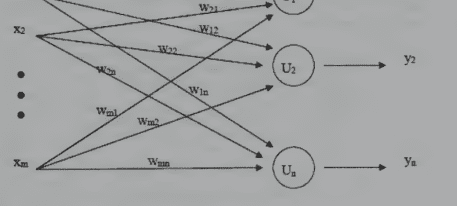

**图3.1：** 单层线性模型

设 \(\bar{X} = (x_1, x_2, \ldots, x_m)\) 为输入向量，激活函数为 \(f\)，则激活值就是到达单元的净和。\(m \times n\) 权重矩阵为

$$
W =
\begin{pmatrix}
w_{11} & w_{12} & \cdots & w_{1n} \\
w_{21} & w_{22} & \cdots & w_{2n} \\
\vdots & \vdots & \ddots & \vdots \\
w_{m1} & w_{m2} & \cdots & w_{mn}
\end{pmatrix}
$$

因此，单元 \(U_k\) 处的输出 \(y_k\) 为

$$
Y_k = (w_{1k}, w_{2k}, \ldots, w_{mk})
\begin{pmatrix}
x_1 \\
x_2 \\
\vdots \\
x_m
\end{pmatrix}
$$

因此，输出向量 \(\vec{Y} = (Y_1, Y_2, \ldots, Y_n)^T\) 由下式给出

$$
\vec{Y} = \tilde{W}^T \vec{X}
$$

一个具有固定权重的简单线性网络，其所能与输入向量关联的输出向量范围是有限的。例如，考虑输入向量集合 \((x_1, x_2)\)，其中每个 \(x_i\) 为0或1。没有任何简单线性网络能产生如表3.2所示的输出，其中输出是输入的布尔异或（XOR）。可以证明，两个权重 \(w_1\) 和 \(w_2\) 必须满足三个不相容的线性方程。实现XOR函数是神经网络中的一个经典问题，因为它是其他更复杂问题的子问题。

**表3.2：** 实现XOR函数的神经网络的输入与输出

| \(x_1\) | \(x_2\) | 输出 \(y\) |
|:---:|:---:|:---:|
| 0 | 0 | 0 |
| 0 | 1 | 1 |
| 1 | 0 | 1 |
| 1 | 1 | 0 |

单层模型通常使用Hebb规则或delta规则。Hebb和delta规则的代数公式参见第2章。使用Hebb规则的网络保证能够学习输入向量集正交的关联。Hebb规则的一个缺点是，如果输入向量不相互正交，可能发生干扰，网络可能无法学习这些关联。

为了克服Hebb规则的缺点，提出了delta规则。delta规则更新权重向量，使误差（期望输出与目标输出之间的差）最小化。delta规则提供了一种绝对且精确的方法来修改初始权重向量。与Hebb规则相比，使用delta规则网络可以学习大量关联。已证明，只要输入线性无关，使用delta规则的网络就能学习关联。

### 3.2.2 多层网络

具有两层或更多层的网络称为多层网络。一层的输出作为下一后续层的输入。中间没有外部连接的层称为隐藏层（图3.2）。任何具有固定权重且采用线性激活函数的多层系统都等价于单层线性系统。假设一个两层线性系统，其中第一层的输入为 \(\bar{X}\)，第一层的输出 \(\bar{Y}=W_1\bar{X}\) 作为第二层的输入，第二层产生输出 \(\bar{Z}=W_2\bar{Y}\)。

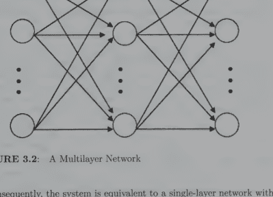

**图3.2：** 多层网络

因此，该系统等价于权重矩阵为 \(W=W_2W_1\) 的单层网络。通过归纳，任何 \(n\) 层线性系统都等价于单层线性系统，其权重矩阵是 \(n\) 个中间权重矩阵的乘积。

与单层网络相比，非线性多层网络能够提供更大的计算潜力。例如，感知机网络中的困难可以通过增加隐藏层来克服；图3.3展示了一个表示XOR函数的多层网络。阈值设为零，因此当单元的激活值大于零时，该单元响应。两层权重矩阵为

$$
W_1 = \begin{pmatrix}1 & -1 \\ -1 & 1\end{pmatrix}, \quad
W_2 = \begin{pmatrix}1 \\ 1\end{pmatrix}.
$$

于是得到

$$
W_1^T(1, 0) = (1, 0), \quad W_2^T(1, 0) = 1, \\
W_1^T(0, 1) = (0, 1), \quad W_2^T(0, 1) = 1, \\
W_1^T(1, 1) = (0, 0), \quad W_2^T(1, 1) = 0, \\
W_1^T(0, 0) = (0, 0), \quad W_2^T(0, 0) = 0.
$$

当输入向量为 \((1,0)\) 或 \((0,1)\) 时，外层产生的输出为1；否则为0。

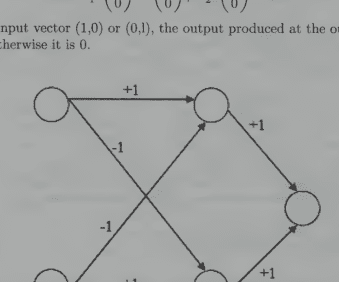

**图3.3：** XOR函数的多层系统表示

多层网络已被证明非常强大。事实上，任何布尔函数都可以由这样的网络实现。

直到Rumelhart、Hinton和Williams提出广义delta规则，多层网络才有了可用的学习算法。在输出层，将输出向量与期望输出进行比较。如果误差（输出与目标向量之间的差）为零，则不更新权重。如果差非零，则根据delta规则计算误差，并将其通过网络反向传播。其思想与delta规则类似，即调整权重以最小化实际输出与期望输出之间的差。这些网络可以通过应用可微激活函数来学习任意关联。

## 3.3 预测网络

神经网络能够预判最可能发生的事情。在这方面，有许多实际应用，其中预判或预测有助于确定优先级。这就是创建一类称为预测网络的网络组背后的基本思想。

### 3.3.1 感知机

感知机学习规则是一种为模式分类寻找网络权重的方法。基本上，感知机网络由一个具有若干可调权重的单个神经元组成。原始感知机由三个单元组成：感觉单元、关联单元和响应单元，如图3.4所示。感觉单元和关联单元具有二值激活，而响应单元使用+1、0或-1的激活值。

**架构**

神经元是神经网络的基本处理器。它具有三个基本要素：

- 1. 一组连接链路（或*突触*）；每条链路带有一个权重（或*增益*）。
- 2. 一个*求和*（或*加法器*）将输入信号乘以各自权重后求和。


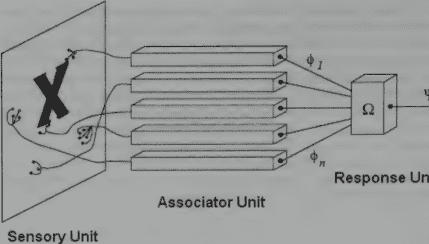

**图 3.4：** 原始感知机

- 3. 激活函数 *f(x)* 限制神经元的输出。通常输出被限制在区间 [0,1]，或者也可以为 [-1,1]。

单层感知机的架构如图 3.5 所示。响应单元的输入是关联单元的输出，它是一个二值向量。由于权重调整仅在关联单元和响应单元之间进行，因此该网络被称为单层网络。所示架构仅由关联单元和响应单元组成。输入层由神经元 X₁、...、Xₙ 组成，这些神经元通过加权互连与输出神经元相连。存在一个公共偏置“1”。

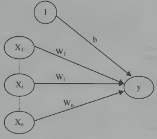

**图 3.5：** 单层感知机的架构

#### 算法

单层感知机的训练和测试算法如下所示。该算法可在 MATLAB 中实现。

#### 参数

```
x: Input vector (x₁, ..., xᵢ, ..., xₙ)
t: Target vector
w: Weight vector for the output unit (w₁, ..., wⱼ, ..., wₙ)
y: Activation function f(y_in)
b: Bias value
θ: Threshold value
```

#### 训练算法

单层感知机训练算法的伪代码如下所示

```
Initialize the weights (either to zero or to a small
random value)
Set learning rate α (in the interval [0,1])
While not stopping condition do,
    For each training pair s:t
        Assign input unit activations xᵢ = sᵢ
        Compute the response of output unit:

            y_in = b + ∑ᵢ xᵢwᵢ

            y = f(y_in) = ⎧  1,        if y_in > θ
                         ⎨  0,        if −θ ≤ y_in ≤ θ
                         ⎩ −1,        if y_in < −θ

Update weights and bias according to,
    If y ≠ t,
        wᵢ(new) = wᵢ(old) + αtxᵢ
        b(new) = b(old) + αt
```

```
    If y_j ≠ t_j,
        w_ij(new) = w_ij(old) + αt_jx_i
        b_j(new) = b_j(old) + αt_j
    else
        w_i(new) = w_i(old)
        b(new) = b(old)

    End If
End For
End While
```

#### 多输出类别的感知机测试算法

具有多个输出类别的单层感知机测试算法伪代码如下所示

```
Set the weights from the training algorithm
For each input vector x
    Compute the response of output unit:
        y_in_j = Σ_i x_i w_i
        y = f(y_in_j) = {
            1,   if y_in_j > θ
            0,   if -θ ≤ y_in_j ≤ θ
            -1,  if y_in_j < -θ
        }
End For
End
```

### 3.3.2 感知机网络的 MATLAB 实现

考虑一个 4 输入 1 输出的问题，其中如果输入模式中 1 的个数为奇数，则输出应为“一”，否则输出应为“零”。

录入输入向量和目标向量

```matlab
clear
inp = [0 0 0 0 0 0 0 0 1 1 1 1 1 1 1 1;
       0 0 0 0 1 1 1 1 0 0 0 0 1 1 1 1;
       0 0 1 1 0 0 1 1 0 0 1 1 0 0 1 1;
       0 1 0 1 0 1 0 1 0 1 0 1 0 1 0 1];
out = [0 1 1 0 1 0 0 1 1 0 0 1 0 1 1 0];
```

使用 MATLAB 神经网络工具箱中的 newff 函数创建一个网络。newff 函数创建一个前馈网络。它需要四个输入，并返回网络对象。第一个输入是一个 R×2 矩阵，包含输入向量 R 个元素各自的最小值和最大值。第二个输入是一个数组，包含各层的大小。第三个输入是一个元胞数组，包含各层要使用的传递函数名称。最后一个输入包含要使用的训练函数名称。

```matlab
network = newff([0 1; 0 1; 0 1; 0 1], [6 1], {'logsig','logsig'});
```

在训练前馈网络之前，必须初始化权重和偏置。newff 命令会自动初始化权重，但可能需要重新初始化它们。这可以通过 init 命令完成。

```matlab
network = init(network);
```

sim 函数用于模拟网络。sim 函数接收网络输入和网络对象 net，并返回网络输出。

```matlab
y = sim(network, inp);
figure, plot(inp, out, inp, y, 'o'),
title('Before Training');
axis([-5 5 -2.0 2.0]);
```

与 traingd 相关的七个训练参数为：epochs、show、goal、time、min_grad、max_fail 和 lr。这里定义了迭代次数和学习率，如下所示

```matlab
network.trainParam.epochs = 500;
network.trainParam.lr = 0.05;
```

训练网络。模拟网络并绘制结果（图 3.6）

```matlab
network = train(network, inp, out);
y = sim(network, inp);
figure, plot(inp, out, inp, y, 'o'),
title('After Training');
axis([-5 5 -2.0 2.0]);
```

更新后的权重和偏置值

```matlab
Layer1.Weights = network.iw1
Layer1.Bias = network.b1
Layer2.Weights = network.lw2
Layer2.Bias = network.b2
Actual.Desired = [y' out']
```

输出：
```
TRAINLM, Epoch 0/500, MSE 0.376806/0,
Gradient 0.527346/1e-010
TRAINLM, Epoch 25/500, MSE 5.86095e-005/0,
Gradient 0.0024019/1e-010
TRAINLM, Epoch 34/500, MSE 1.67761e-012/0,

Gradient 2.89689e-011/1e-010
TRAINLM, Minimum gradient reached, performance goal
was not met.

Layer1.Weights =

   -9.5620    9.4191    6.5063   -11.2360
    8.7636   10.0589  -10.4526    -8.9109
    9.8375  -11.4056   14.3788    -5.5974
    7.4334   10.0157  -13.7152     5.9788
  -10.6286   14.6436   10.6738   -15.2093
    8.7772   -6.0128    6.6699     9.0275

Layer1.Bias =

  -11.8265
   -5.8238
    4.2346
   -7.7644
   -5.0030
   -6.0732

Layer2.Weights =

  -28.4686   17.7464  -10.1867  -26.2315   28.9088
   27.1797

Layer2.Bias =

   -4.4138
```

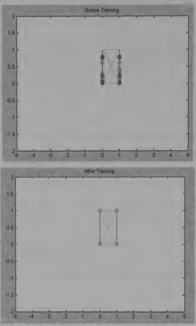

**图 3.6：** 训练前与训练后的模式，34 轮迭代结束时的性能与目标

### 3.3.3 前馈反向传播网络

前馈、反向传播架构由 Rumelhart、Hinton 和 Williams 于 20 世纪 70 年代初提出。目前，反向传播架构是用于复杂多层网络的最常见、最高效且简单的模型。该网络被广泛应用于图像处理、信号处理、人脸识别、语音识别等众多领域。这种网络架构已经衍生出大量具有不同拓扑结构和各种训练方法的网络类型。其主要能力是针对未定义问题获得非线性解。

#### 架构

典型的反向传播网络具有一个输入层、一个输出层以及至少一个隐藏层。隐藏层的数量没有理论限制，但通常只有一层或两层。已有研究表明，解决任意复杂度的问题至少需要四层（三个隐藏层加一个输出层）。每一层都与后续层全连接，如图 3.7 所示。

输入层和输出层表示回忆期间的信息流。回忆是将输入数据输入已训练的网络并接收答案的过程。反向传播不在回忆期间使用，而仅在网络学习训练集时使用。

层数以及每层处理单元的数量是重要的决策。这些前馈反向传播拓扑的参数也是最难以捉摸的。只有一些随着时间积累、并被大多数将这一架构应用于其问题的研究人员和工程师遵循的一般规则。

- *规则 A：隐藏层中处理单元的数量应随着输入输出关系复杂度的增加而增加。*
- *规则 B：如果所建模的过程可分离为多个阶段，则可能需要额外的隐藏层。如果该过程不可分离为多个阶段，那么额外的层可能只是实现记忆，而不是真正的通用解。*
- *规则 C：可用训练数据量设定了隐藏层中处理单元数量的上限。要计算这个上限，请使用训练集中输入输出对示例的数量，并将该数量除以输入的总数*


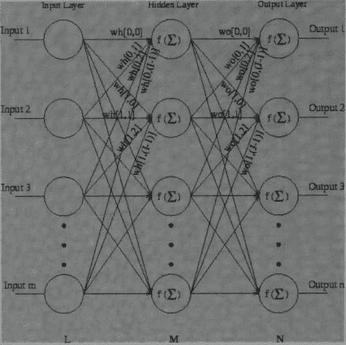

**图3.7：** 反向传播网络

以及网络中的输出处理单元。然后将该结果再除以一个五到十之间的缩放因子。较大的缩放因子用于相对含噪的数据。高度含噪的输入数据需要二十或五十的因子，而与输出单元有精确关系的非常无噪声的输入数据可能映射到大约二。因此，隐藏层有必要具备若干处理单元。

网络一经创建，教学（训练）过程便开始了。这种教学利用一种学习规则，它是 Delta 规则的变体。该规则首先确定误差，即实际输出与期望输出之间的差值。基于该误差，连接权重按误差的比例增加，以获得全局精度。在对单个节点执行此操作时，输入、输出和期望输出应出现在同一处理单元处。该学习规则的复合部分用于让系统确定哪个输入对错误输出的贡献最大，以及该元素如何改变以纠正误差。非活动节点不会对误差有贡献，也无需更新其权重。

为解决这个问题，训练输入被送入网络的输入层，并在输出层比较期望输出。在学习过程中，通过网络进行前向扫描，逐层计算每个单元的输出。实际输出与目标输出之间的差值被反向传播到前一层（或多层），该差值由传递函数的导数修正，连接权重通常使用 Delta 规则进行调整。此过程对前一层（或多层）继续进行，直到到达输入层。

反向传播网络的学习规则有许多变体。可以使用不同的误差函数、传递函数，甚至传递函数导数的修正方法。引入动量误差的概念，是为了在最小化不稳定行为的同时实现更迅速的学习。在这里，误差函数或 delta 权重方程经过修改，使得前一次 delta 权重的一部分被传递到当前 delta 权重中。用工程术语来说，这相当于对 delta 权重项施加低通滤波器，因为总体趋势得到增强，而振荡行为被抵消。这允许使用较低的、通常较慢的学习系数，但能产生更快的学习。

另一种用于使网络收敛的常见技术是，仅在向网络呈现许多对输入及其期望输出之后更新权重，而不是在每次呈现之后更新。这种网络称为累积反向传播，因为直到呈现完整的一对集合后，delta 权重才会累积。在累积期间呈现的输入-输出对的数量称为一个 epoch（轮次）。该 epoch 可以对应于完整的训练对集合，也可以对应于一个子集。

#### 反向传播网络的算法

本节讨论前馈反向传播网络的训练算法和应用算法。

#### 训练算法

反向传播的训练算法涉及四个阶段：

- 1. 权重初始化
- 2. 前馈
- 3. 误差反向传播
- 4. 权重和偏置的更新

在第一阶段，即权重初始化阶段，会分配一些小的随机值。

在前馈阶段，每个输入单元（Xᵢ）接收输入信号，并将该信号传送到每个隐藏单元 z₁ ... zₚ。每个隐藏单元随后计算激活函数，并将其信号 zᵢ 发送到每个输出单元。输出单元计算激活函数，以形成网络对给定输入模式的响应。

在误差反向传播期间，每个输出单元将其计算出的激活值 yₖ 与其目标值 tₖ 进行比较，以确定该模式在该单元处相关联的误差。基于该误差，计算因子 δₖ（k=1 ... m），并用于将输出单元 yₖ 处的误差分配回前一层中的所有单元。类似地，为每个隐藏单元 zⱼ 计算因子 δⱼ（j=1 ... p）。

在最后阶段，使用 δ 因子和激活值更新权重和偏置。

#### 参数

训练算法中使用的各种参数如下：

- x：输入训练向量 x = (x₁, ..., xₙ)
- t：输出目标向量 t = (t₁, ..., tₘ)
- δₖ := 输出单元 yₖ 的误差
- δⱼ := 隐藏单元 zⱼ 的误差
- α := 学习率
- v₀ⱼ := 隐藏单元 j 的偏置
- zⱼ := 隐藏单元 j
- w₀ₖ := 输出单元 k 的偏置
- yₖ := 输出单元 k

反向传播网络训练算法的伪代码如下。该算法按各个阶段给出：

```
Initialization stage:
Initialize weights v and w to small random values
Initialize learning rate
While not stopping condition for phase I DO
    For each training pair

        Feed forward stage:
        Each input unit receives the input signal $x_i$ and transmits to all units in the hidden layer.
        Each hidden unit $(z_j,\ j=1,\ldots,p)$ sums its weighted input signals:
        $$z_{in_j}=v_{0j}+\sum_{i=1}^{n}x_i v_{ij}$$
        Applying activation function:
        $$z_j=f(z_{in_j})$$
        and sends this signal to all units.
        Each output unit $(y_k,\ k=1,\ldots,m)$ sums its weighted input signals:
        $$y_{in_k}=w_{0k}+\sum_{j=1}^{p}z_j w_{jk}$$
        Applies its activation function to calculate output signals:
        $$y_k=f(y_{in_k})$$

        Back propagation of errors:
        Each output unit $(y_k,\ k=1,\ldots,m)$ receives a target pattern corresponding to an input pattern; error information term is calculated as:
        $$\delta_k=(t_k-y_k)f'(y_{in_k})$$
        Each hidden unit $(z_j,\ j=1,\ldots,p)$ sums its delta inputs from units in the layer above:
        $$\delta_{in_j}=\sum_{k=1}^{m}\delta_k W_{jk}$$
        The error information is calculated as:
        $$\delta_j=\delta_{in_j}f'(z_{in_j})$$

        Updation of weights and biases:
        Each output unit $(y_k,\ k=1,\ldots,m)$ updates its bias and weights $(j=0,\ldots,p)$. The weight correction term is given by:
        $$\Delta W_{jk}=\alpha\delta_k z_j$$
        The bias correction term is given by:
        $$\Delta W_{0k}=\alpha\delta_k$$
        $$W_{jk(new)}=W_{jk(old)}+\Delta W_{jk};\quad W_{0k(new)}=W_{0k(old)}+\Delta W_{0k}$$
        Each hidden unit $(z_j,\ j=1,\ldots,p)$ updates its bias and weights $(i=0,\ldots,n)$.
        The weight correction term
        $$\Delta V_{ij}=\alpha\delta_j x_i$$
        The bias correction term
        $$\Delta V_{0j}=\alpha\delta_j$$
        $$V_{ij(new)}=V_{ij(old)}+\Delta V_{ij},\quad V_{0j(new)}=V_{0j(old)}+\Delta V_{0j}$$
    End For
    Test the stopping condition
End while
End
```

停止条件可以是最小化误差、epoch 数量等。

#### 参数选择

用于训练的参数应选择为使网络高效运行。初始值分配将在下一节讨论。

**初始权重：** 初始权重决定误差梯度是否达到全局（或仅局部）最小值，以便网络收敛。如果初始权重过大，则到每个隐藏单元或输出单元的初始输入信号将落入饱和区，其中 sigmoid 的导数具有非常小的值（f(net)=0）。如果初始权重过小，则到隐藏单元或输出单元的净输入将趋近于零，从而导致学习极其缓慢。为了获得最佳结果，初始权重和偏置设置为 -0.5 到 0.5 之间或 -1 到 1 之间的随机数。

**学习率的选择：** 高学习率会导致快速学习，但权重可能振荡；而较低学习率会导致学习较慢。采用学习率的建议方法如下：

- 从高学习率开始并稳步降低它。权重向量的变化必须很小，以减少振荡或任何发散。
- 一个简单的建议是，增大学习率以改善性能，减小学习率以使性能变差。
- 另一种方法是将学习率加倍，直到误差值变差。


#### 反向传播中的学习

学习有两种类型。

- i. 顺序学习或逐模式方法
- ii. 批量学习或逐周期方法

在顺序学习中，给定的输入模式被前向传播，确定误差并反向传播，然后更新权重。

在批量学习中，只有在整个训练集都呈现给网络之后才更新权重。因此，权重更新仅在每个周期之后执行。

如果 p = 一个周期中的模式数，则

$$\Delta w = \frac{1}{p}\sum_{p=1}^{P}\Delta w_p$$

在某些情况下，为若干模式累积权重修正项，并对每个权重进行单次权重调整（等于权重修正项的平均值），而不是在呈现每个模式后更新权重，是有利的。此过程具有“平滑效应”。在某些情况下，平滑可能会增加收敛到局部最小值的可能性。

#### 训练网络所需时间

应用反向传播网络的需要在于实现记忆与泛化之间的平衡；不一定适合一直训练到误差达到最小值。训练期间使用的两个不相交数据集是：

- 训练模式集合
- 训练-测试模式集合。

训练模式对权重调整有很大影响。随着神经网络中的误差增大，网络开始存储和记忆训练模式。

#### 训练对数量

训练对的数量同样对网络训练起着关键作用。使用简单的经验法则来确定训练对的数量。

考虑一个经过训练的网络，它能够正确分类训练模式的比例为 (1-e/2)。这意味着在使用以下条件时，它也能正确分类测试模式的 (1-e)。如果有足够的训练模式，网络将能够按期望进行泛化。足够的训练模式由 w/p = e 给出，其中 p = 训练模式的数量，w = 待训练权重的数量。

e 的取值介于 0 到 1/8 之间。必要条件由下式给出

$$p > |w|/(1-a)$$

其中 a = 测试集的预期准确率。

充分条件由下式给出

$$p > |w|/(1-a)\log(n/(1-a))$$

其中 n = 节点数量。

#### 隐藏单元数量

通常，隐藏单元的选择取决于许多因素，例如：

- 输入和输出单元的数量
- 训练模式的数量
- 目标向量中的噪声
- 待学习函数或分类的复杂度
- 架构
- 隐藏单元激活函数的类型
- 训练算法
- 正则化

在许多情况下，如果不训练多个网络并估计每个网络的泛化误差，就没有确定最佳隐藏单元数量的特定方法。如果隐藏单元很少，则由于欠拟合，训练误差和泛化误差会很高，并且会出现高统计偏差。如果隐藏单元太多，则训练误差会过低，但由于过拟合和高方差，泛化误差仍然很高。

#### 动量因子

BPN 中的权重更新沿着当前梯度与前一个梯度的组合方向进行。当少数训练数据与大多数数据不同时，这种方法是有利的。当出现相同且不寻常的训练模式对时，应用较低的学习率以避免学习方向发生大的扰动。当在权重更新规则中加入动量因子时，收敛速度会提高。为了使用动量，必须保存来自一个或多个先前训练模式的权重。对于带有动量的 BPN，训练步骤 t+2 的新权重基于 t 和 t+1。研究发现，只要校正对若干模式沿着相同的大致方向进行，动量就允许网络进行权重调整。因此，应用动量时，网络不会沿梯度方向前进，而是沿当前梯度与前一个梯度的组合方向前进，并据此进行权重更新。动量的主要目的是加速误差传播算法的收敛。该方法利用最近一次权重调整的一部分来进行当前权重调整。

带有动量的 BPN 的权重更新公式为：

$$w_{jk}(t+1)=w_{jk}(t)+\alpha\delta_k z_j+\mu[w_{jk}(t)-w_{jk}(t-1)]$$

$$v_{ij}(t+1)=v_{ij}(t)+\alpha\delta_j x_i+\mu[v_{ij}(t)-v_{ij}(t-1)]$$

μ 称为动量因子。其范围为 0<μ<1。

#### 应用算法

BPN 的应用过程如下所示：

```
Initialize weights from (training algorithm).
    For each input vector
        For i=1,..,n ;
            set activation of input unit, xᵢ;
        End For
        For j=1,..,p ;
            zᵢₙⱼ = v₀ⱼ + Σᵢ₌₁ⁿ xᵢvᵢⱼ
        End For
        For k=1,..,m ;
            yᵢₙₖ = w₀ₖ + Σⱼ₌₁ᵖ zⱼwⱼₖ
        End For
    End For
End
```

### 3.3.4 使用MATLAB实现BPN

MATLAB 有一套用于构建神经网络的内置函数，即神经网络工具箱。基本上，程序员实现神经网络需要经历三个阶段：设计、训练和测试。

- **设计阶段：**
  - 定义三层（输入层、隐藏层、输出层）中每一层的节点数量
  - 定义传递函数
  - 初始化要使用的训练例程。
  - 设计阶段的可选部分：误差函数（默认是均方误差）、绘制训练进度等。
- **训练阶段：**
  - 网络设计完成后，通过优化误差函数来设计网络
  - 此过程为用户数据集确定“最佳”的权重和偏置集合。
- **测试阶段**
  - 测试网络，以查看它是否在记忆（准确率）与泛化之间找到了良好的平衡

BPN 网络可以使用神经网络工具箱在 MATLAB 中按如下方式实现。

```
clc;
clear all;
close all;
```

训练前馈网络的第一步是创建网络对象。函数 newff 创建前馈网络。它需要四个输入并返回网络对象。第一个输入是一个 R×2 矩阵，包含输入向量 R 个元素各自的最小值和最大值。第二个输入是一个数组，包含每一层的大小。第三个输入是一个元胞数组，包含每一层要使用的传递函数名称。最后一个输入包含要使用的训练函数名称。

```
% Creating a network
net=newff([-1 2; 0 5], [3,1], {'tansig','purelin'}, 'traingd');
```

在训练前馈网络之前，必须初始化权重和偏置。newff 命令会自动初始化权重，但可能需要重新初始化它们。这可以通过命令 init 完成。

```
% Initialising weights
net = init(net);
```

函数 `sim` 用于模拟网络。函数 `sim` 接收网络输入 `p` 和网络对象 `net`，并返回网络输出 `a`。

```
% Simulating the network
p = [1 2 3 4 5; 6 7 8 9 0];
a = sim(net,p)
```

与 `traingd` 相关的训练参数有七个：epochs、show、goal、time、min_grad、max_fail 和 lr。学习率 lr 乘以梯度的负值，以确定权重和偏置的变化。学习率越大，步长越大。如果学习率设置得太大，算法会变得不稳定。如果学习率设置得太小，算法需要很长时间才能收敛。对于算法的每次 show 迭代，都会显示训练状态。（如果 show 设置为 NaN，则从不显示训练状态。）其他参数决定训练何时停止。如果迭代次数超过 epochs，如果性能函数降至 goal 以下，如果梯度的幅值小于 min_grad，或者如果训练时间长于 time 秒，则训练停止。

```
% Parameter setting
net.trainParam.show = 50;
net.trainParam.lr = 0.05;
net.trainParam.epochs = 300;
net.trainParam.goal = 1e-5;
```

现在网络已准备好进入训练阶段

```
% Training the network
t = [1 -1 1 -1 1];
[net,tr]=train(net,p,t);
```

获得的输出如图 3.8 所示。观察结果如下所示

```
TRAINING, Epoch 0/300, MSE 1.27137/1e-005, Gradient 2.30384/1e-010
TRAINING, Epoch 50/300, MSE 0.730344/1e-005, Gradient 0.17989/1e-010
TRAINING, Epoch 100/300, MSE 0.684018/1e-005, Gradient 0.0927535/1e-010
```


最终达到尽可能小的误差。许多学习应用在计算中加入一项，以推动或轻推位于浅层障碍之前的权重，从而找到实际最小值，而不是暂时性错误。

#### 应用

- 文本语音合成
- 机械臂
- 银行贷款评估
- 图像处理
- 知识表示
- 预测与预估
- 多目标跟踪

### 3.3.5 Delta Bar Delta 网络

Delta Bar Delta 网络的架构与反向传播网络相似。两种网络的主要区别在于学习算法方法。Delta Bar Delta 由 Robert Jacobs 开发，旨在通过改进标准前馈反向传播网络的学习率来克服 BPN 的局限性。

反向传播学习过程基于最速下降法，该方法在更新每个人工神经元的连接权重过程中最小化网络的预期误差。动量项最初被赋值，学习率则按逐层方式赋值。反向传播方法允许随着更多训练集提供给网络，学习率逐步减小。尽管该技术能有效解决许多实际应用，但该过程的收敛速度太慢。

Delta Bar Delta 网络使用的学习方法中，每个权重具有自己的自适应系数。这里不使用动量因子。网络的持续操作，例如将误差反向传播到前一层等，与普通反向传播架构相同。Delta Bar Delta 是一种训练人工网络的启发式方法。这里，先前的误差值可用于推断未来计算出的误差值。对可能误差的了解使系统能够以智能方式更新权重。然而，这种方法的复杂之处在于，经验证据表明每个权重对总体误差的影响可能相当不同。Jacobs 随后提出了一个常识性观点：反向传播学习规则应考虑这些对总体误差影响的差异。换句话说，网络中的每个连接权重都应具有自己的学习率。其主张是，对某个连接权重合适的步长可能不适合该层中的所有其他权重。此外，学习率应随时间变化。通过为每个连接权重分配学习率，并允许该学习率随时间连续变化，就引入了更多自由度，从而缩短收敛时间。

直接应用于该算法的规则简单且易于实现。学习率根据标准反向传播中得到的当前误差信息进行改变。在权重更新期间，如果局部误差在连续多个时间步上具有相同符号，则该连接的学习率线性增加。线性增加学习率可防止学习率变得过大。当局部误差频繁改变符号时，学习率按几何方式减小。按几何方式减小可确保连接学习率始终为正。此外，在误差变化较大的区域，它们可以更快地减小。

#### Delta Bar Delta 网络的学习规则

根据学习率，遵循以下启发式规则来训练网络：

- i. 当权重的导数在连续多步上符号相同时，应增加相应的学习率。
- ii. 当权重的导数在连续步上符号交替变化时，应减小相应的学习率。

Delta Bar Delta 规则是广义 Delta 规则的一种变体，并实现了上述启发式规则。事实上，它由两条规则组成：一条用于权重调整，另一条用于学习率控制。

权重修改为：

\[
\vec{W}(t+1)=\vec{W}(t)-\sum_{i=1}^{n}\eta_i(t)E_{i,i}\nabla_{\vec{W}}F(\vec{W})
\]

其中 \(\vec{W}(t)\) 是权重向量在时间步 \(t\) 的值，\(\eta_i(t)\) 是时间步 \(t\) 的学习率，\(E_{i,i}\) 是一个 \(n \times n\) 矩阵，除行 \(=\) 列 \(=i\) 的分量为 \(=1\) 外，其余分量均为 \(=0\)，\((1 \le i \le n)\)，而 \(F(\vec{W})\) 是关于 \(\vec{W}\) 待最小化的函数。

每个学习率根据下式调整：

\[
\eta(t + 1) = \eta(t) + \Delta\eta(t)
\]

其中

\[
\Delta\eta(t) =
\begin{cases}
k, & \text{if } \delta(t-1)\delta(t) > 0,\\
-\phi\,\eta(t), & \text{if } \delta(t-1)\delta(t) < 0,\\
0, & \text{else,}
\end{cases}
\]

其中

\[
\delta(t) = \frac{\partial F(t)}{\partial W(t)}
\quad\text{and}\quad
\bar{\delta}(t) = (1-\theta)\delta(t) + \theta\bar{\delta}(t-1).
\]

这里 \(k > 0\)、\(\phi \in [0,1]\)、\(\theta \in [0,1]\) 为常数。对于每个学习率，\(k\)、\(\phi\) 和 \(\theta\) 都相同。\(\bar{\delta}\) 是 \(W\) 的当前导数和过去导数的指数平均值。

通过允许网络中每个连接权重具有不同的学习率，就不需要沿负梯度方向进行最速下降搜索。因此，连接权重通过误差对权重自身求偏导来更新。权重更新满足局部性约束，即它们只需要来自其所连接的处理单元的数据。

### 3.3.6 扩展 Delta Bar Delta

为克服 Delta Bar Delta 网络的局限性，Ali Minai 和 Ron Williams 开发了扩展 Delta Bar Delta 算法，通过对学习率增量应用指数衰减来增强 Delta Bar Delta。正如在反向传播一节中所讨论的，动量是用于平滑学习率的一个因子。它是加到标准权重更新中的一项，与前一次权重变化成正比。通过这种方式，应用动量因子可以强化良好的总体趋势，并抑制振荡。

每个权重的学习率和动量率都有各自独立的常数来控制其增加和减少。同样，当前误差的符号用于指示增加还是减少是合适的。当学习率和动量率增加时，它们被修改为指数递减函数。因此，在斜率或曲率较小的区域，将施加比高曲率区域更大的增量。这是对 Delta Bar Delta 的跳跃和振荡问题的部分解答。

此外，为了防止权重中的跳跃和振荡，对各个连接的学习率和动量率设置了上限，并配有一个具有恢复功能的记忆。当训练集在每个 epoch 中提供时，会评估累积误差。如果误差小于先前的最小误差，则将权重作为当前最佳保存到记忆中。类似地，如果当前误差超过经容差参数修正后的先前最小误差，则所有连接权重值随机返回到记忆中存储的最佳权重集合。此外，学习率和动量率会减小，以开始恢复过程。

为了克服 Delta Bar Delta 学习算法的缺点，提出了扩展 Delta-Bar-Delta（EDBD）算法，该算法基于以下考虑：

1. 即使斜率方向没有变化，陡峭程度的增加也常常表明接近最小值。因为对于最速下降法，\(\eta\) 是一个乘性因子，而实际步长与斜率成正比，所以任何学习率增量的效果也是如此。因此，使用恒定的学习率增量意味着在陡峭斜坡上的步长比在浅缓斜坡上增加得更快。显然，这与所需情况相反。直观上，在陡峭斜坡上的下降应更加谨慎，以免越过最小值而无法恢复。至少，它不应比在平坦区域中更加鲁莽！此外，正如 Jacobs 所指出的，只有当所有方向上的斜率相等时，最速下降方向才指向最小值。如果斜率不相等，则可以通过在平坦方向上采取不成比例的大步长、在陡峭方向上采取不成比例的小步长，来改善下降向量的方向（在某些拓扑假设下）。然而，这不能做得过分，否则大部分时间将花在盘旋而不是下降上。

2. 在 DBD 中，动量会导致发散，因为它会放大学习率增量。由于在接近最小值之前的陡峭斜坡上步长最大，这也正是动量最危险的时候，应加以控制。然而，在平坦区域，它提供了额外的加速，应最大限度地加以利用。

3. 无界地增加学习率（或动量）即使增量很小也可能导致发散，当然这取决于误差曲面。因此，应对增长设置上限或逐渐减小，以防止这种情况发生。由于这种预防不可能

为了保证所有情况，算法中应包含某种记忆和恢复机制。

基于这些要点，对 delta bar delta 学习算法进行了以下修改：

- 1. 学习率增量被改为关于 \(|\bar{\delta}(t)|\) 的指数递减函数，而不再是一个常数。这意味着学习率在非常平坦的区域会比在坡度较大的区域增加得更快。这样便可以在平坦区域使用相当大的增量，而不必冒因陡坡产生剧烈跳跃的风险。同时，使用指数函数可确保只有当不同斜率明显不成比例且需要补偿性扭曲时，偏离最速下降方向才会显著。
- 2. 动量被用作算法的标准组成部分，但像学习率一样发生变化。因此，动量在平台区增加，而在极小值附近按指数递减。为此也使用了 DBD 准则，但增量因子同样是关于 \(|\bar{\delta}(t)|\) 的递减指数函数。
- 3. 为了防止学习率或动量变得过高，为二者都定义了上限，并对其进行硬限制。这进一步方便了使用大增量，因为它们的影响并非无界。
- 4. 算法中加入了记忆与恢复机制。因此，会保存截至当前时间步所见到的最佳结果。容差参数 ? 用于控制恢复。如果误差变得大于目前已见最低误差的 ? 倍，则从最佳点以衰减后的学习率和动量重新开始搜索。为了防止反复震荡，这一操作是随机执行的，因此存在一个小概率 P，使搜索在一个全新的点重新开始。

EDBD 算法的方程可写为如下形式：

$$
\Delta W_{ij}(t)=-\eta_{ij}(t)\frac{\partial E(t)}{\partial W_{ij}}+\mu_{ij}(t)\Delta W_{ij}(t-1)
$$

$$
\eta_{ij}(t+1)=MIN[\eta_{\max},\eta_{ij}(t)+\Delta\eta_{ij}(t)]
$$

$$
\mu_{ij}(t+1)=MIN[\mu_{\max},\mu_{ij}(t)+\Delta\mu_{ij}(t)]
$$

其中

$$
\Delta\eta_{ij}(t)=
\begin{cases}
k_l\exp(-\gamma_l|\delta_{ij}(t)|)\\
-\phi_l\eta_{ij}(t)\\
0
\end{cases}
$$

$$
\Delta\mu_{ij}(t)=
\begin{cases}
k_m\exp(-\gamma_m|\delta_{ij}(t)|) & \text{if } \delta_{ij}(t-1)\delta_{ij}(t)>0\\
-\phi_m\mu_{ij}(t) & \text{if } \delta_{ij}(t-1)\delta_{ij}(t)<0\\
0 & \text{otherwise}
\end{cases}
$$

总体来看，当前形式的 EDBD 算法似乎相当成功，至少对于在实值、连续问题域中学习的网络而言是如此。尽管在小问题上取得了成功，我们认为仍应针对二值域学习单独评估 EDBD，相关实验正在进行中。此外，由于学习率可变性和动量赋予了逃离局部极小值的能力，或许值得研究某种退火过程，即让学习率可变性和/或动量随时间或误差减小而降低。这应能使搜索在解的质量方面更加稳健和有效。

### 3.3.7 有向随机搜索网络

前面各节讨论的所有网络架构都基于学习规则或算法范式。这些算法采用梯度下降技术来更新权重。与这些网络不同，有向随机搜索利用的是一种标准前馈回想结构。有向随机搜索以随机方式更新权重。为了对这种随机权重更新进行规范化，加入了一个方向分量，以确保权重趋向于先前成功的搜索方向。总而言之，网络中所有可用的处理单元都是单独调节的。

有向随机搜索算法具有许多优点。使用有向随机搜索时，必须对问题有充分理解，这样当初始权重接近最佳权重时才能获得最优结果。该算法的学习速度非常快，因为其训练循环比 delta 规则及其变体等基于微积分的技术快得多。对于中间处理单元不计算误差项，只计算一个输出误差。给定问题应适合小规模网络，因为如果连接数很大，训练会变得过长且复杂。

为了将权重维持在一个紧凑区域内——即算法工作效果最佳的区域——需要对……设置上界。

它会扩展以尝试更大的步长。相反，如果检测到连续多次失败，它就收缩方差以减小步长。

有向随机搜索能在合理时间内为中小型网络找到良好解。训练是自动的，几乎不需要用户交互。连接权重的数量对该学习算法能够有效解决的问题规模施加了实际限制。如果网络连接权重超过 200，有向随机搜索可能需要相对较长的训练时间，并且最终仍能给出可接受的解。

### 3.3.8 函数链接人工神经网络（FLANN）或高阶神经网络

该网络可称为函数链接人工神经网络或高阶人工神经网络。这些神经网络是标准前馈反向传播网络的扩展版本。在这里，输入层处理单元包含节点，以便为网络提供对输入更完整的理解。基本上，输入会以易于理解的数学方式进行变换，这样网络就不必学习某些基础数学函数。这些函数确实增强了网络对给定问题的理解。这些数学函数通过高阶函数（如平方、立方或正弦）转换输入。同一概念的两个名称——高阶映射或函数链接映射——正是源于这些函数的名称。

该方法已被证明能显著提高实际应用中的学习率。这种对反向传播的扩展还有一个额外优点：这些高阶函数可以应用于其他衍生算法——delta bar delta、extended delta bar delta 或任何其他增强的前馈反向传播网络。

在 FLANN 中，向输入层添加额外输入节点有两种基本方法。

- 可以将输入项的交叉乘积加入模型，这种方法称为输出乘积或张量模型，其中输入模式的每个分量与整个输入模式向量相乘。一种合理的做法是加入输入值之间的所有交互项。例如，对于具有三个输入（A、B 和 C）的反向传播网络，交叉乘积将包括：AA、BB、CC、AB、AC 和 BC。该示例为网络的输入结构添加了二阶项。也可以添加三阶项，例如 ABC。
- 添加额外输入节点的第二种方法是对基础输入进行函数展开。因此，具有 A、B 和 C 的反向传播模型可以转换为具有以下输入的高阶神经网络模型：A、B、C、SIN(A)、COS(B)、LOG(C)、MAX(A,B,C) 等。在该模型中，输入变量分别由适当的函数作用。可以使用许多不同的函数。总体效果是为网络提供输入的增强表示。甚至可以将张量模型和函数展开模型结合在一起。

没有添加新信息，但输入的表示得到了增强。输入数据的高阶表示可使网络更容易训练。联合激活或函数激活可立即供模型使用。在某些应用中，添加节点后不再需要隐藏层。该网络模型存在一些局限。为了使用原始输入的变换，必须处理多得多的输入节点。对于高阶系统，问题会更严重。最终，由于计算机处理时间有限，重要的是输入展开程度不要超过获得精确解所需。

Pao 区分了真正添加高阶项（其中一些项表示联合激活）与函数展开（增加表示空间的维数而不添加联合激活）。尽管大多数开发者认识到这一区别，但研究人员通常以相同方式对待这两个方面。Pao 已获得函数链接网络的专利，因此其商业使用可能需要支付专利许可费。

#### 架构

FLANN 的函数逼近能力可以通过如下示例来理解：考虑一个 MLP 示例，其中 d = 2 个输入单元，单隐藏层中有 h = 3 个 S 型隐藏单元。该神经网络计算得到的输出函数为

$$
Y_k = G_k\left(\sum_{j=1}^{h} W_{jk} \star \Phi_j(x)\right)
$$

其中 \(W_{jk}\) 是连接隐藏单元 \(j\) 与输出单元 \(k\) 的权重，\(G_k\) 是输出层神经元采用的激活函数。

隐藏层单元通过隐藏层权重 \(W_{ij}\) 计算原始输入空间到中间空间的投影。

$$
(X_1,\ldots,X_i,\ldots,X_d) \longrightarrow (\Phi_1(X),\ldots,\Phi_j(x),\ldots,\Phi_h(x))
$$

$\Phi_j(x) = G_j\left(\sum_{i=1}^{d} W_{ij} * x_i\right)$

$G_j$ 是隐藏层神经元所使用的激活函数。

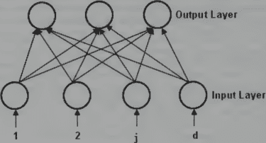

**图 3.9：** FLANN 架构

在这个隐藏空间中，由输出权重执行的线性判别变得比在原始输入空间中更容易。相比之下，FLANN 中使用的线性网络将隐藏单元带到输入层，并使用单层权重。输出函数修改为

$Y_k = G_k\left(\sum_{j=1}^{d'} W_{jk} * \Psi_j(x)\right)$

其中 $d'$ 是新输入空间 $(\Psi_1(x), ..., \Psi_{d'}(x))$ 的维度。新的单元 $\Psi_j(x)$ 不再是原始属性的可学习任意函数，而是由原始属性构造的固定多项式和三角项。

FLANN 网络架构如图 3.9 所示。这个多项式空间中对应的线性映射，事实上在原始输入空间是非线性的。FLANN 没有任何隐藏层，事实上计算成本从隐藏层转移到了为输入层选择合适的扩展输入上。扩展输入通过一种进化技术选择，该技术利用遗传算法并逐步进化 FLANN 的输入，以获得期望模型。

用于获得扩展输入的多项式阶数可以逐步提高，以便使用最少数量的输入并使神经网络复杂度最小化。下面简要复述该进化算法：

- 1. 进化算法从原始输入属性开始。这是合理的，因为有些问题可以线性求解，也许是在剔除一些噪声或不相关属性之后。
- 2. 每个输入向量通过一个二进制染色体编码，其长度等于可用多项式项的数量。位 1 表示相应的多项式项被馈入网络。
- 3. 它不选择初始随机种群，而是从单特征网络池开始。例如，如果要建模的系统有五个输入，则采用以下初始染色体池：

  `[(10000), (01000), (00100), (00010) and (00001)].`

- 4. 所用的 GA 采用了轮盘赌选择和单点交叉。交叉概率和变异概率分别固定为 0.9 和 0.05。
- 5. 最大代数固定为 50。
- 6. 如果种群中最佳个体在验证集上达到的误差不令人满意，则多项式项的阶数提高一。例如，具有两个属性 x1 和 x2 的系统将产生五个二次多项式。
- 7. 项数随乘积多项式或三角多项式的阶数增长得非常快。
- 8. 随着多项式项数增加，重复该过程。前一次进化运行中获得的最佳个体也被包含在新种群中。运行算法，直到达到误差目标或多项式阶数变得高得不可行。由于 FLANN 不需要任何隐藏层；架构变得简单，训练不涉及完整反向传播。因此，可以通过线性学习规则（例如 delta 规则）完成非线性建模。计算复杂度也降低了，神经网络变得适合在线应用。此外，它很容易达到其全局极小值。由于 FLANN 涉及多项式空间中的线性映射，它们可以轻松映射线性项和非线性项。尽管有这些优点，与 MLP 不同，这些网络缺乏通用逼近能力。

## 总结

基于神经网络的应用的设计与开发需要大量艰苦工作，因为要将数据输入系统、监控性能、调整过程、增加连接、修改规则等，直到网络达到期望结果。这些期望结果本质上是统计性的。网络并不总是正确。正因如此，神经网络正被应用于那些人类也无法始终正确的情境。本章帮助理解单层和多层网络，以及预测网络的详细架构和算法。本章还阐述了使用 MATLAB 实现若干预测网络的基本方法。

## 复习题

- 1. 基于应用，神经网络如何分类？
- 2. 区分单层和多层神经网络。
- 3. 列举与数据关联相关的网络。
- 4. 列举几种用于数据概念化的网络。
- 5. 解释反向传播网络的架构和算法。
- 6. 在 BPN 中如何选择学习率？
- 7. 说明 BPN 中动量因子的用途。
- 8. 写一段关于定向随机搜索的说明。
- 9. 编写一个使用神经网络工具箱实现反向传播算法的 MATLAB 程序。
- 10. 实现反向传播算法时应使用什么学习率？
- 11. 说明训练反向传播网络所使用的规则。
- 12. 陈述用于多个输出类的感知机算法。
- 13. 区分偏置与阈值。
- 14. 列举用于实现感知机算法的神经网络工具箱函数。

# 第4章 分类与关联神经网络

## 4.1 引言

上一章介绍了试图预测未来的网络。但理解趋势及其影响可能只是若干类应用中的一类。本章讨论基于数据分类和数据关联等应用的主要神经网络类别。本章描述的另一类网络是数据概念化。还讨论了使用 MATLAB 神经网络工具箱实现这些网络的方法。客户可能存在于所有分类中，但他们可能集中在特定年龄组和特定收入水平内。实际上，额外数据可能会拉伸和扭曲该区域，而该区域包含大多数预期购买者。这一过程称为数据概念化，其中包括自适应共振理论网络和自组织特征映射等网络。

## 4.2 基于分类的神经网络

第二类应用是分类。能够分类的网络可用于医疗行业，处理实验室结果和医生记录的患者症状，以确定最可能的疾病。用于数据分类的一些网络架构包括学习向量量化（LVQ）、对传网络（CPN）和概率神经网络（PNN）。本节讨论这些网络的架构、算法和实现。

### 4.2.1 学习向量量化

向量量化技术最初由 Teuvo Kohonen 在 20 世纪 80 年代中期提出。向量量化网络和自组织映射都基于 Kohonen 层，该层能够将项目分拣到相似对象的适当类别中。这类网络在分类和分割问题中得到应用。

从拓扑上看，该网络包含一个输入层、一个 Kohonen 层和一个输出层。图 4.1 展示了一个示例网络。输出层拥有的处理单元数量与不同类别（或类）的数量相同。Kohonen 层由若干处理单元组成，这些处理单元针对每个已定义类进行分类。每个类中的处理单元数量取决于输入-输出关系的复杂度。每个类在整个层中具有相同数量的元素。正是 Kohonen 层借助训练集学习并执行关系分类。然而，用于分类的规则与反向传播规则差异很大。为了优化学习和回忆功能，输入层对于每个可分离输入参数应只包含一个处理单元。也可以使用高阶输入结构。

学习向量量化将其输入数据分拣到它确定的组中。从根本上说，它将 n 维空间映射到 m 维空间。这意味着该网络有 n 个输入并产生 m 个输出。在训练期间，输入被分类，而不扰乱训练集的固有拓扑。通常，拓扑保持映射会保持训练集中的最近邻关系，使得先前未学习过的输入模式将按其训练数据中的最近邻进行分类。

训练时，计算训练向量到每个处理单元的距离，并在此过程中将距离较短的处理单元宣布为获胜者。整个层始终只有一个获胜者。该获胜者仅激活一个输出处理单元，该输出处理单元确定输入向量所属的类或类别。如果获胜元素处于训练向量的期望类中，则它朝训练向量方向被强化。如果获胜元素不在训练向量的类中，则进入该处理单元的连接权重会远离训练向量。后一操作称为排斥。在这种训练方法中，分配给特定类的各个处理单元会迁移到与其特定类相关的区域。

在回忆模式下，计算输入向量到每个处理单元的距离，并再次将最近的元素判定为获胜者。


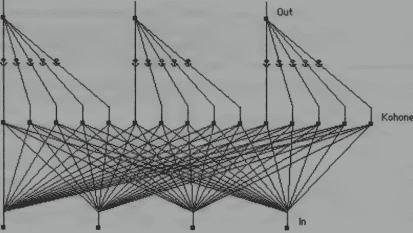

**图 4.1：** 一个学习向量量化网络示例

获胜者。该获胜者进而产生一个输出，表示网络所找到的特定类别。

学习向量量化架构存在一些局限性。显然，对于具有相似对象或输入向量的复杂分类问题，网络需要较大的 Kohonen 层，且每个类别需要许多处理单元。这可以通过对输入参数进行更好的选择或更高阶的表示来克服。

学习机制存在一些缺点，这些缺点可通过该范式的变体来解决。通常这些变体应用于学习过程的不同阶段。在训练网络的不同阶段，它们会引入良心机制、边界自适应算法和吸引函数。

在学习向量量化网络的基本形式中，少数处理单元往往获胜过于频繁，而其他处理单元则无所作为。那些距离较近的处理单元倾向于获胜，而距离较远的处理单元则不参与。为了克服这一缺陷，引入了良心机制，使得获胜过于频繁的处理单元会产生“愧疚”的良心并受到惩罚。实际的良心机制是一种距离偏置，它会加到每个处理单元上。该距离偏置与某处理单元的获胜频率和平均处理单元获胜频率之差成正比。随着网络沿着学习曲线推进，这种偏置比例因子需要减小。

一旦找到相对较好的解，边界修正算法用于改进解。该算法适用于以下情况：获胜处理单元属于错误类别，而第二好的处理单元属于正确类别。另一个局限是训练向量必须位于这两个处理单元连线的中点附近。获胜处理单元朝远离训练向量的方向移动，而第二名的处理单元则朝训练向量方向移动。这个过程细化了容易发生错误分类的区域之间的边界。

在学习向量量化网络的早期训练中，有时需要关闭排斥机制。只有当训练向量和获胜处理单元属于同一类别时，获胜处理单元才向训练向量移动。当一个处理单元为了到达其所需区域而必须穿过具有不同类别的区域时，该选项尤其有用。

#### 架构

LVQ 神经网络的架构如图 4.2 所示。

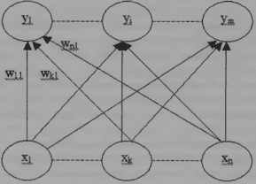

**图 4.2：** LVQ 的架构

该架构与 Kohonen 自组织神经网络的架构相似，但不对输出单元假设拓扑结构。在 LVQ 网络中，每个输出单元都有一个已知类别，因为它使用监督学习，这与使用无监督学习的 Kohonen SOM 不同。该架构可能类似于竞争网络架构，但这是一个输出已知的竞争网络；因此它是一个监督学习网络。

#### 参考网络的初始化方法

- i. 取前 “m” 个训练向量作为权重向量；其余向量用于训练。
- ii. 随机初始化参考向量，并随机分配初始权重和类别。
- iii. 可采用 K 均值聚类方法。

#### 训练算法

LVQ 网络的算法是找出与输入向量具有匹配模式的输出单元。在过程结束时，如果 x 和 w 属于同一类别，则权重向新输入向量方向移动；如果它们属于不同类别，则权重远离输入向量移动。在这种情况下，与 Kohonen 自组织特征图类似，需要确定获胜单元。将获胜单元的索引与目标进行比较，并根据比较结果执行权重更新，如下面的算法所示。通过降低学习率继续迭代。

#### 伪代码中使用的参数

LVQ 网络训练中使用的各种参数如下：

- x：训练向量 (x₁, …, xᵢ, …, xₙ)
- T：训练向量的类别或类
- wⱼ：第 j 个输出单元的权重向量 (wⱼ₁, …, wⱼᵢ, …, wⱼₙ)
- Cⱼ：第 j 个输出单元表示的类别或类
- ||x−wⱼ||：输入向量与第 j 个输出单元权重向量之间的欧氏距离

LVQ 算法的伪代码如下：

```
初始化权重（参考）向量。
初始化学习率
当未达到停止条件时执行
    对于每个训练输入向量 x
        使用平方欧氏距离计算 J
            D(j) = Σ (wⱼᵢ − xᵢ)²
        找到使 D(j) 最小的 j
        按如下方式更新 wⱼ：
        如果 T=Cⱼ，则
            wⱼ(new) = wⱼ(old) + α (x−wⱼ(old))
        如果 T≠Cⱼ，则
            wⱼ(new) = wⱼ(old) − α (x−wⱼ(old))
结束循环
    降低学习率。
    测试停止条件。
结束循环
```

停止条件可以是固定的迭代次数，也可以是学习率降低到足够小的值。

#### LVQ 的变体

Kohonen 开发了两种变体技术，即 LVQ2 和 LVQ3，它们比最初的 LVQ 更复杂，但可以提升分类性能。在 LVQ 算法中，只更新最接近输入向量的参考向量。在 LVQ2 和 LVQ3 算法中，如果满足若干条件，则两个向量都会学习。这两个向量是获胜者和亚军。采用的方法是：如果输入与获胜者和亚军的距离大致相等，则两者都应学习。

##### LVQ2

在这种情况下，获胜者和亚军代表不同的类别。亚军的类别与输入向量相同。输入向量到获胜者的距离与输入向量到亚军的距离大致相等。LVQ2 的基本条件由窗口函数构成。这里，x 是当前输入向量，yc 是最接近 x 的参考向量，yr 是次接近 x 的参考向量，dc 是 x 到 yc 的距离，dr 是 x 到 yr 的距离。窗口定义为：如果满足下式，则输入向量 x 落入窗口中：

$$(dc/dr) > (1 − ε) \quad \text{且} \quad (dc/dr) < (1 + ε)$$

其中 ε 是训练样本数（ε = 0.35）。

更新公式如下：

$$\begin{aligned}
yc(t + 1) &= yc(t) - α(t)[x(t) - yc(t)] \\
yr(t + 1) &= yr(t) + α(t)[x(t) - yr(t)]
\end{aligned}$$

##### LVQ3

窗口定义为：

$$\min(dc1/dc2, dc2/dc1) > \frac{1 - ε}{1 + ε} \quad (ε = 2)$$

考虑两个最近的向量 yc1 和 yc2。

LVQ3 扩展了训练算法，以支持当 $x$、$yc1$ 和 $yc2$ 属于同一类别时的训练。更新公式如下：

$$\begin{aligned}
yc1(t+1) &= yc1(t) + \beta(t)[x(t)-yc1(t)] \\
yc2(t+1) &= yc2(t) + \beta(t)[x(t)-yc2(t)]
\end{aligned}$$

$\beta$ 的值是学习率 $\alpha(t)$ 的倍数，当 $yc1$ 和 $yc2$ 属于不同类别时使用，即 $\beta = m\alpha(t)$；其中 $0.1 < m < 0.5$。$\beta$ 的这种变化表明权重继续逼近类别分布，并防止码本向量在持续学习时偏离其位置。

### 4.2.2 在 MATLAB 中实现 LVQ

可以使用 MATLAB 神经网络工具箱中的 `newlvq` 函数创建 LVQ 网络，如下所示：

```
net = newlvq(PR,S1,PC,LR,LF)
```

其中：

- PR 是一个 R×2 矩阵，包含 R 个输入元素的最小值和最大值。
- S1 是第一层隐藏神经元的数量。
- PC 是一个 S2 元素向量，表示典型类别的百分比。
- LR 是学习率（默认 0.01）。
- LF 是学习函数（默认为 `learnlv1`）。

#### 示例

输入输入向量和目标向量：

```
clear all;
close all;
```

下面的输入向量 P 和目标类别 Tc 定义了一个要由 LVQ 网络解决的分类问题。

```
inp = [-3 -2 -2 0 0 0 0 +2 +2 +3; 0 +1 -1 +2 +1 -1 -2
      +1 -1 0];
target_class = [1 1 1 2 2 2 2 1 1 1];
```

目标类别被转换为目标向量 T。然后，创建一个 LVQ 网络（输入范围取自 P，四个隐藏神经元，类别百分比为 0.6 和 0.4）并进行训练。

```
T = ind2vec(target_class);
```


第一层权重通过函数 midpoint 初始化为输入范围的中心。第二层权重中，60%（即上面 Tc 中 10 个里的 6 个）的列在第一行有一个 1（对应类别 1），40% 的列在第二行有一个 1（对应类别 2）。

```
network = newlvq(minmax(inp),4,[.6 .4]);
network = train(network,inp,T);
```

要查看权重矩阵

```
network.IW(1,1); % first layer weight matrix
```

生成的网络可以测试。

```
Y = sim(network,inp)
Yc = vec2ind(Y)
```

输出：该网络已将输入分为两个基本类别，1 和 2。

```
Y =

1     1     1     0     0     0     0     1     1     1
0     0     0     1     1     1     1     0     0     0
Yc =
1     1     1     2     2     2     2     1     1     1
```

第 1 层的权重矩阵

```
ans =
    2.6384   -0.2459
   -2.5838    0.5796
   -0.0198   -0.3065
    0.1439    0.4845
```

因此，上述代码实现了学习向量量化算法，将给定的一组输入分为两类。

### 4.2.3 反传网络

反传网络由 Robert Hecht-Nielsen 提出并开发，用于综合复杂的分类问题，而不是减少处理单元的数量和训练时间。反传的学习过程与 LVQ 大体相似，只有一个小差别：中间的 Kohonen 层充当查找表。该查找表找到与给定输入模式最接近的匹配，并输出其等效映射。

第一个反传网络由输入层和输出层之间的双向映射组成。本质上，当数据被呈现给输入层以在输出层生成分类模式时，输出层反过来会接受一个额外的输入向量，并在网络的输入层上生成输出分类。该网络因这种信息在其结构中的对向流动而得名。大多数开发者使用这种反传形式表示的单向流变体。反传网络只有一条从输入层到输出层的前馈路径。

图 4.3 展示了一个示例网络。单向反传网络有三层。如果输入在进入网络之前尚未归一化，有时需要第四层。主要层包括输入缓冲层、自组织 Kohonen 层，以及一个输出层，该输出层使用 Delta 规则（也称为 Grossberg 外星层）来修改其输入连接权重。

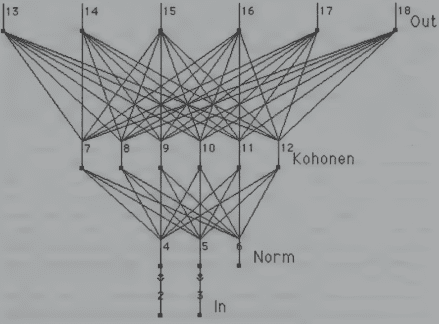

**图 4.3：** 一个示例反传网络

根据定义问题的参数，输入层的大小会变化。如果输入层的处理单元很少，网络可能无法泛化；如果输入层的处理单元很多，处理时间会很长。

通常，为使网络良好运行，输入向量必须归一化。归一化指的是相加的过程；也就是说，对于每一种输入值组合，输入向量的总“长度”相加必须等于 1。归一化过程可以在将数据呈现给网络之前由预处理器完成。在特定应用中，会在输入层和 Kohonen 层之间添加归一化层。归一化层需要为每个输入提供一个处理单元，另外还需要一个处理单元作为平衡元件。该归一化层确保所有输入集合的总和相同。

输入的归一化是必要的，以确保 Kohonen 层找到该问题的正确类别。如果不进行归一化，较大的输入向量会使许多 Kohonen 处理单元产生偏置，以至于较弱值的输入集合无法被正确分类。由于 Kohonen 层的竞争性质，较大值的输入向量会胜过较小的向量。反传使用标准 Kohonen 层，该层将输入集合自组织成分类区域。它遵循经典的 Kohonen 学习律。该层充当最近邻分类器，使得竞争层中的处理单元自主更新其连接权重，以近似按照输入出现的频率来划分输入向量空间。Kohonen 层中应尽可能多地设置与输出类别相对应的处理单元。Kohonen 层的单元通常远多于类别数，仅仅是因为额外的处理单元能在相似对象之间提供更精细的分辨率。

反传的输出层基本上由处理单元组成，这些处理单元学习在施加特定输入时产生输出。由于 Kohonen 层是竞争层，对于给定输入向量只产生一个获胜输出。该层提供了一种将输入解码为有目的输出类别的方法。Delta 规则用于反向传播期望输出类别与训练集生成的实际输出之间的误差。仅输出层中的权重被更新，而 Kohonen 层不受影响。

由于竞争 Kohonen 层一次只有一个输出活跃，而所有其他单元为零，因此为输出处理单元调整的唯一权重是连接到竞争层中获胜单元的那些权重。这样，输出层学习为竞争层中的每个活跃处理单元重现确定的模式。如果许多竞争单元属于同一类别，那么输出处理单元将针对那些竞争处理单元获得权重，而对所有其他单元为零。

这种架构的主要限制在于竞争 Kohonen 层是在没有任何监督的情况下学习的。因此，它无法预测自己报告的是哪种类别。这意味着 Kohonen 层中的一个处理单元可能学习属于不同类别的两个或更多训练输入。在此过程中，对于任何输入，网络的输出都将是多值的。为克服这一困难，可以预先设定 Kohonen 层中的处理单元，使其只学习特定类别。

反传网络分为两类。它们是

- 1. 全反传网络
- 2. 仅前向反传网络

本节描述全 CPN 的训练算法和应用过程。

#### 全 CPN 的训练阶段

全 CPN 分两个阶段实现。

训练的第一阶段称为内星模型化训练。这里的活跃单元是 x 输入层（x = x₁, …, xᵢ, …, xₙ）、z 聚类层（z = z₁, …, zⱼ, …, zₚ）和 y 输入层（y = y₁, …, yₖ, …, yₘ）中的单元。

通常在 CPN 中，聚类单元不假定任何拓扑结构，但允许获胜单元学习。该获胜单元使用我们标准的 Kohonen 学习规则进行权重更新。该规则由下式给出

$$\begin{aligned}
v_{ij}(new) &= v_{ij}(old) + \alpha(x_i - v_{ij}(old)) \\
&= (1-\alpha)v_{ij}(old) + \alpha x_i;\quad i=1\text{ to }n \\
w_{jk}(new) &= w_{jk}(old) + \beta(y_k - w_{jk}(old)) \\
&= (1-\beta)w_{jk}(old) + \beta y_k;\quad k=1\text{ to }m
\end{aligned}$$

在第二阶段，我们可以发现聚类层中只剩下 J 单元保持活跃。从获胜聚类单元 J 到输出单元的权重会被调整，使得 y 输出层中单元的激活向量 y* 近似于输入向量 x。该阶段可称为外星模型化训练。权重更新由 Grossberg 学习规则完成，该规则仅用于外星学习。在外星学习中，假设单元之间不存在竞争，并且

$$\begin{aligned}
u_{jk(\mathrm{new})} &= u_{jk(\mathrm{old})}+\alpha(y_k-u_{jk(\mathrm{old})}) \\
&= (1-\alpha)u_{jk(\mathrm{old})}+\alpha y_k;\quad k=1\text{ to }m \\
t_{ji(\mathrm{new})} &= t_{ji(\mathrm{old})}+\alpha(x_i-t_{ji(\mathrm{old})}) \\
&= (1-\alpha)t_{ji(\mathrm{old})}+\alpha x_i;\quad i=1\text{ to }n
\end{aligned}$$

所示的权重变化为学习率乘以误差。

#### 训练算法

使用的参数如下

- \(x\) - 输入训练向量 \(x=(x_1, \ldots, x_i, \ldots, x_n)\)
- \(y\) - 目标输出向量 \(Y=(y_1, \ldots, y_k, \ldots, y_m)\)
- \(z_j\) - 簇单元 \(Z_j\) 的激活值
- \(x^*\) - 向量 \(x\) 的近似
- \(y^*\) - 向量 \(y\) 的近似
- \(v_{ij}\) - 从 x 输入层到 Z 簇层的权重
- \(u_{jk}\) - 从 x 输入层到 Z 簇层的权重
- \(t_{ji}\) - 从 x 输入层到 X 簇层的权重
- \(u_{ik}\) - 从 x 输入层到 Y 簇层的权重
- \(\alpha, \beta\) - Kohonen 学习期间的学习率
- \(a, b\) - Grossberg 学习期间的学习率

该算法使用欧氏距离法或点积法来计算获胜单元。获胜单元在训练的第一阶段和第二阶段都会被计算。在训练的第一阶段，使用 Kohonen 学习规则进行权重更新；在训练的第二阶段，使用 Grossberg 学习规则。

完整 CPN 的伪代码如下，

```
Initialize weights v and w
Initialize learning rates α and β
While not stopping condition for phase I Do
    For each training input pair x:y
        Assign X input layer activations to vector x
        Assign Y input layer activations to vector y
        Calculate winning cluster D(j) = ∑ᵢ (xᵢ - vᵢⱼ)², i = 1 to n
        Update weights
        v_ij(new) = v_ij(old) + α(x_i - v_ij(old)); i = 1 to n
        w_jk(new) = w_jk(old) + β(y_k - w_jk(old)); k = 1 to m
    End For
    Reduce learning rates α and β
    Test stopping condition for Phase I training
End while
While not stopping condition for phase II Do
    For each training input pair x:y
        Assign X input layer activations to vector x
        Assign Y input layer activations to vector y
        Calculate winning cluster D(j) = ∑ᵢ (xᵢ - vᵢⱼ)²; i = 1 to n
        Update weights from unit z_j to the output layers
        (α and β are constant in this phase)
        U_ij(new) = w_jk(old) + α(y_k - w_jk(old)); k = 1 to m
        t_ij(new) = t_ij(old) + α(x_i - t_ij(old)); i = 1 to n
    End For
    Reduce learning rates α and β
    Test for stopping condition for phase II training
End while
```

获胜单元的选择通过点积或欧氏距离完成。

点积通过计算净输入得到。

$$Z_{inj} = \sum_i x_i v_{ij} + \sum_k y_k w_{kj}$$

净输入最大的簇单元为获胜者。此处向量应归一化。在欧氏距离中，

$$D_j = \sum_i (x_i - v_{ij})^2$$

与输入向量的距离平方最小者为获胜者。

若获胜单元的选择出现平局，则选择索引最小的单元。

与获胜的 Kohonen 神经元相关联。这会将权重向量移动到输入向量所在区域。训练开始时，权重调整仅限于最接近获胜者的那些 Kohonen 神经元。该调整半径逐渐减小，直到仅调整与获胜 Kohonen 神经元相关联的权重。

还有一种方法，为每个 Kohonen 神经元赋予一个“良心”。如果它获胜的时间超过了其应得份额，例如 1/k（其中 k 是 Kohonen 神经元数量），它就会提高阈值以降低自己的获胜机会，从而让其他神经元有机会接受训练。由此可对权重进行初始化。

### 4.2.4 概率神经网络

概率神经网络的发展基于 Parzen 窗，这些网络由 Donald Specht 根据其论文设计。论文《用于分类、映射或联想记忆的概率神经网络》和《概率神经网络》分别于 1988 年和 1990 年发表。模式分类是该网络的主要应用领域，且该网络基于贝叶斯理论。贝叶斯理论于 20 世纪 50 年代发展起来，它允许考虑事件的相对似然，并应用先验信息来改善预测。贝叶斯理论所需的概率密度函数使用 Parzen 窗构建。

概率神经网络的学习过程是一种监督学习，在此学习过程中，分布函数在模式层内形成。这些分布函数用于估计输入特征向量的似然性。学到的模式按照先验概率（也称为相对频率）进行分组，以确定给定输入向量最可能的类别。如果具备关于先验概率的知识，则假定所有类或类别都是等可能的。特征向量根据输入特征向量与某类分布函数之间的最短欧氏距离来确定类别。

概率神经网络的基本结构如图 4.4 所示。基本架构包含三层：输入层、模式层和输出层。输入层具有许多元素，因为描述待分类对象需要可分离参数。模式层以如下方式组织训练集：每个输入向量都由一个独立的处理单元表示。输出层也称为求和层，根据待识别的类别具有大量处理单元。求和层中的每个处理单元都与模式层中的处理单元结合；如果它们关联到同一类别，则生成该类别作为输出。根据应用情况，如果输入在进入网络之前尚未归一化，偶尔会添加第四层来对输入向量进行归一化。

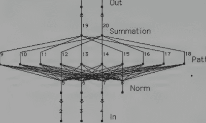

图 4.4：一个概率神经网络示例

模式层构成了贝叶斯分类器的神经网络实现，其中依赖于类别的概率密度函数（PDF）使用 Parzen 估计器近似。通过使用 Parzen 估计器确定 PDF，可最小化对训练集进行错误分类的期望风险。使用 Parzen 估计器时，只要训练集能充分表示类别差异，随着训练样本数量增加，分类会越来越接近真实的底层类别密度函数。

模式层由与训练集中每个输入向量相对应的一个处理单元组成。每个输出类别应包含相同数量的处理单元，否则少数类别可能会被错误地偏向，从而导致分类结果较差。模式层中的每个处理单元只训练一次。当输入向量与训练向量匹配时，处理单元被训练为返回高输出值。为了获得更好的泛化能力，在训练网络时加入平滑因子。在这种情况下，训练向量在训练集中不必按任何预定义顺序排列，因为特定向量的类别由输入的期望输出指定。学习函数仅选择正确输出类别中的第一个未训练处理单元，并更新其权重以匹配训练向量。

模式层基于竞争对输入向量进行分类，其中只有与输入向量匹配度最高者获胜并生成输出。因此，对于任何给定输入向量仅生成一个分类类别。如果输入模式与编程到模式层中的模式之间没有关系，则不生成输出。

为了微调对象分类，加入了 Parzen 估计器。该过程通过将构建到处理单元中的每个训练模式的出现频率相加来执行。从根本上说，一个类别中每个示例发生的概率分布会乘入其各自的训练节点。类似地，将对象更准确的期望添加到特征中，使其可被识别为该类别的成员。

与前馈反向传播网络相比，概率神经网络的训练要简单得多。无论如何，如果类别之间的差异变化很大，模式层可能会非常庞大。这种网络有许多支持者，因为其优化基础建立在众所周知的经典数学之上。

由于概率网络基于贝叶斯理论进行分类，因此必须以贝叶斯最优方式将输入向量分类为两个类别之一。该理论提供了一种代价函数，以涵盖以下事实：将实际上属于类别 A 的向量错误分类，可能比将属于类别 B 的向量错误分类更糟。贝叶斯规则将一个属于类别 A 的输入向量分类为，

$$P_A C_A f_A(x) > P_B C_B f_B(x)$$

其中，
- \(P_A\) - 类别 A 中模式出现的先验概率
- \(C_A\) - 与向量分类相关的代价
- \(f_A(x)\) - 类别 A 的概率密度函数

使用贝叶斯理论估计的 PDF 应在所有 x 上为正且可积，并且结果必须为 1。

概率神经网络使用以下公式来估计概率密度函数，

$$f_A(x)=\frac{1}{(2\pi)^{n/2}\sigma^n}\frac{1}{m_A}\sum_{i=1}^{m_A}\exp\left[-\frac{(x-x_{Ai})^T(x-x_{Ai})}{2\sigma^2}\right]$$


-   其中 `x_Ai` — 来自类别 A 的第 *i* 个训练模式
-   `n` — 输入向量的维数
-   `σ` — 平滑参数（对应高斯分布的标准差）

只要父密度平滑且连续，函数 `f_A(x)` 就充当估计器。随着用于估计的数据点数量增加，`f_A(x)` 趋近于父密度函数。函数 `f_A(x)` 是高斯分布之和。将这种父密度函数与贝叶斯决策规则结合使用的缺点是，必须存储整个训练集，并且对未知向量进行分类所需的计算量与训练集的大小成正比。

#### 架构

概率神经网络的架构如图 4.5 所示。该架构由四类单元组成。

-   输入单元
-   模式单元 — 类别 A 和类别 B。
-   求和单元
-   输出单元

求和单元与输出单元之间的权重为，

$$V_A = 1$$
$$V_B = -\frac{P_B C_B m_A}{P_A C_A m_B}$$

#### 训练算法

概率神经网络的训练算法如下，

```
For each training input pattern, x(p), p = 1, ..., P
    Create pattern unit Zp:
    Weight vector for unit Zp:    wp = x(p)
    (unit Zp is either a ZA unit or ZB unit)
    Connect the pattern unit to summation unit
    If x(p) belongs to class A,
        Then connect pattern unit Zp to summation unit SA
    Else
        connect pattern unit Zp to summation unit SB
    End If
End For
```

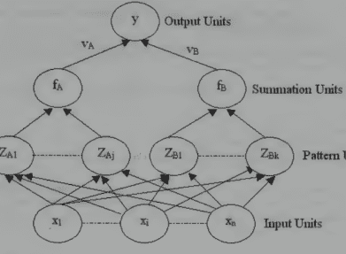

**图 4.5：** 概率神经网络的架构

#### 应用算法

用于分类的应用算法伪代码如下，

```
Initialize weights from training algorithm.
For input pattern to be classified
    Pattern units:
        Calculate net input,
            z_{ij} = x.w_j = x^T W_j
        Calculate the output,
            Z = exp{(z_{ij}-1)/σ²}
    Summation units:
        The weights used by the summation unit for class B is,
            V_B = -P_B C_B m_A / P_A C_A m_B
    Output unit:
        Sums the signals from f_A and f_B
        Input vector is classified as class A if the
        total input to decision unit is positive
End For
```

### 4.2.5 使用 MATLAB 实现概率神经网络

概率神经网络可以在 MATLAB 中使用以下函数实现

```
net = newpnn(P, T, spread)
```

其中，

-   `P` — Q 个输入向量的矩阵
-   `T` — Q 个目标类别向量的矩阵
-   `spread` — 径向基函数的扩展，默认值 = 0.1

该函数返回一个新的概率神经网络。如果 spread 接近零，网络将充当最近邻分类器。随着 spread 变大，所设计的网络将考虑若干附近的设计向量。

#### 示例

输入输入向量和目标向量

```
clear all;
close all;
```

下面的输入向量 P 和目标类别 Tc 定义了一个要由 LVQ 网络解决的分类问题。

```
inp = [1 2 3 4 5 6 7 8 9;9 8 7 6 5 4 3 2 1];
target_class = [1 1 1 2 2 2 3 3 3];
```

目标类别被转换为目标向量 T。然后创建并训练一个 LVQ 网络（其输入范围从 P 获得，具有四个隐藏神经元，类别百分比为 0.6 和 0.4）。

```
T = ind2vec(target_class);
```

创建并仿真该网络，使用输入以确保它确实产生正确的分类。函数 vec2ind 用于将输出 Y 转换为行向量 Yc，以使分类清晰。

```
network = newpnn(inp,T);
```

```
Y = sim(network,inp)
```

```
Yc = vec2ind(Y)
```

**输出**

```
Y =

   (1,1)   1
   (1,2)   1
   (1,3)   1
   (2,4)   1
   (2,5)   1
   (2,6)   1
   (3,7)   1
   (3,8)   1
   (3,9)   1
Yc =
   1  1  1  2  2  2  3  3  3
```

因此，概率神经网络可用于对已呈现的两个类别中每个类别的模式进行分类。这种类型的概率神经网络可用于将心电图输出分类为正常或异常。

## 4.3 数据关联网络

前几节讨论的分类网络与数据关联网络相关。在数据关联中，也要进行分类。例如，识别单元可以将其扫描到的每个输入分类到若干组中。然而，也会存在一些带有错误的数据。数据关联网络将这些错误出现识别为仅仅是缺陷数据，并且这种缺陷数据可以跨越所有分类。

### 4.3.1 霍普菲尔德网络

第一个数据关联网络由 John Hopfield 于 1982 年在美国国家科学院提出，并被命名为霍普菲尔德网络。该网络基于能量函数构思。在霍普菲尔德网络中，仅当状态空间的总体“能量”最小时，处理单元才更新或改变其状态。这类网络的基本应用包括联想问题和优化问题，例如最短路径算法。图 4.6 展示了霍普菲尔德网络的基本模型。早期，原始网络使用二进制格式的处理单元，后来改为双极性格式。因此，二进制处理单元的限制出现在量化期间，即输出被量化为零或一。

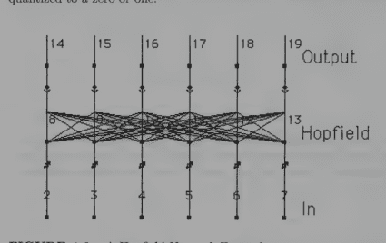

霍普菲尔德网络的基本模型包括三层：输入缓冲层、中间霍普菲尔德层和输出层。所有层都具有相同数量的处理单元。霍普菲尔德层的输入通过可变连接权重连接到输入缓冲层中对应处理单元的输出。霍普菲尔德层的输出回连到除自身以外的每个其他处理单元的输入。训练时，网络通过学习到的连接权重将来自输入层的数据施加到霍普菲尔德层。霍普菲尔德层需要一些时间饱和，该层的当前状态被传递到输出层。该状态与预定义并编程到网络中的模式相匹配。

在学习过程中，网络要求同时将训练模式呈现给输入层和输出层。霍普菲尔德层的递归和振荡特性允许网络调整所有连接权重。学习规则是霍普菲尔德定律，其表述为：“如果期望输出和输入同时激活或同时未激活，则按学习率增加连接权重，否则按学习率减少权重。”显然，该网络的任何非二进制实现都必须在传递函数中具有阈值机制，否则匹配的输入-输出对可能过于稀少，无法正确训练网络。

该网络可用作内容可寻址存储器。当用作内容可寻址存储器时，存在一些限制，例如

-   能够存储并精确回忆的模式数量受到严格限制。如果存储的模式太多，网络可能收敛到错误的模式，或者可能根本不收敛。因此，存储容量应限制为霍普菲尔德层中处理单元数量的大约百分之十五。
-   如果存在共同模式，霍普菲尔德层可能变得不稳定。如果一个模式在零时刻被施加，而网络收敛到训练集中的其他某个模式，则该模式被认为是不稳定的。通过将模式集改变为彼此正交，可以克服这一缺点。

#### 架构

离散霍普菲尔德网络的架构如图 4.7 所示。它由“n”个 x 输入神经元和“y”个输出神经元组成。应注意，除了接收来自输入的信号外，y1 神经元还接收来自其他输出神经元的信号。对于所有其他输出神经元也是如此。因此，存在返回到每个输出神经元的反馈输出。这就是霍普菲尔德网络被称为反馈网络的原因。

#### 训练算法

离散霍普菲尔德网络针对二进制向量模式和双极性向量模式进行了描述。用于存储二进制输入模式集合 s(p) 的权重矩阵，其中 p = 1, ..., P，且

$$s(p) = (s_1(p), ..., s_i(p), ..., s_n(p))$$


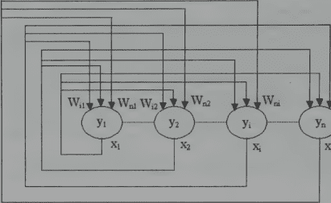

**图4.7：** Hopfield 网络架构

可以借助前面讨论的赫布规则来确定。权重矩阵可由下式确定

\[
w_{ij} = \sum_p (2s_i(p) - 1)(2s_j(p) - 1) \quad \text{for } i \ne j \text{ and } w_{ii}=0
\]

对于双极输入模式，权重矩阵由下式给出，

\[
w_{ij} = \sum_p s_i(p)s_j(p) \quad \text{for } i \ne j \text{ and } w_{ii}=0
\]

#### 应用算法

应用算法所使用的权重从训练算法获得。然后为输入向量设置激活值。计算净输入，并应用激活函数计算输出。该输出被广播到所有其他单元。重复该过程，直到网络收敛。离散 Hopfield 网络应用算法的伪代码如下：

```text
Initialize weights to store pattern (use Hebb rule)
While activations of the net are not converged do
    For each input vector x
        Assign initial activations to external input vector
            x_i, y_i = x_i (i = 1, n)
        For each unit y_i
            Compute the net input
                y_{inj} = x_i + \sum_j y_j w_{ij}

            Determine activation (output signal)
                Y_j = {
                    1,   if y_{inj} > θ
                    Y_j, if y_{inj} = θ
                    0,   if y_{inj} < θ
                }

            Broadcast the value of y_i to all other units
        End For
    End For
    Test for convergence
End While
```

阈值 θ_i 的值通常取为零。单元的更新顺序是随机的，但每个单元必须以相同的平均速率更新。

### 4.3.2 在 MATLAB 中实现 Hopfield 网络

以下代码存储向量 (1 1 0 1 1)。假设存储向量的第一个和第二个分量存在错误，使其成为 (0 0 1 0 0 1)。

```matlab
clc;
clear all;
```

存储的向量为

```matlab
x=[1 1 0 1 1];
```

```matlab
t=[0 0 1 1 0 0 1];
```

权重矩阵由下式确定

\[
w_{ij}=\sum_p (2s_i(p)-1)(2s_j(p)-1) \quad \text{for } i\ne j \text{ and } w_{ii}=0
\]

```matlab
w=(2*x'-1)*(2*x-1);
for i=1:6
    w(i,i)=0;
end
stop=1;
y=[0 1 1 0 0 1];

while stop
    update=[1 2 3 4 5 6];
    for i=1:6

        Compute the net input according to the formula
        Y_i(t+1)=X_i+\sum_j Y_i W_{ji}

        yin(update(i))=t(update(i))+y*w(1:6,update(i));
        if(yin(update(i))>0)
            y(update(i))=1;
        end
    end
    if y == x
        disp('Convergence has reached');
        stop=0;
        disp(y)
    end
end
```

**输出**

已收敛

收敛后的输出为

```text
y = 1 1 1 0 1 1
```

### 4.3.3 玻尔兹曼机

玻尔兹曼机在功能和运行方式上与 Hopfield 网络相似。唯一区别是，玻尔兹曼机在寻找原始模式时使用了模拟退火技术。模拟退火用于搜索模式层的状态空间，以找到全局最小值。因此，当数据在系统中迭代时，该机器能够随时间扩展到一组更优的取值。

玻尔兹曼学习规则最早由 Ackley、Hinton 和 Sejnowski 于 1985 年提出。与 Hopfield 网络类似，玻尔兹曼机具有基于模式层中连接权重的关联状态空间能量。学习训练集的过程涉及最小化该状态空间能量。

学习过程中加入了模拟退火调度。该技术类似于物理退火：温度从较高值开始，并随时间降低。较高的温度值会向模式层中的每个处理单元加入噪声因子，而较低的温度值则试图平息网络的振荡。通过在较低温度下增加更多迭代，可以确定最优解。

因此，高温下的学习过程是随机过程，而低温下的学习过程是确定性过程。在随机学习过程中，处理单元倾向于改变其状态，从而增加系统的总能量。

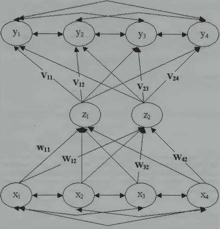

**图4.8：** 玻尔兹曼机架构

#### 架构

玻尔兹曼机的架构如图4.8所示。

玻尔兹曼机的架构看起来像一个二维数组。它由一组单元以及一对单元之间的一组双向连接组成。每一行和每一列中的单元完全互连。每条连接上的权重为 p，并且还存在权重为 b 的自连接。这些单元标记为 \(V_{i,j}\)。神经网络的目标是最大化一致性。

计算接受变化的概率，

\[
A(T)=\frac{1}{1+\exp(-\Delta E/T)}
\]

确定是否接受该变化。

```text
If random number N between 0 to 1.
    If N<A
        change is accepted
        V_{I,J}=1−V_{I,J}
    Else If N ≥ A
        change is rejected
    End If

End For
Reduce the control parameter,
    T(new)=0.95T(old)
Test for stopping condition.
End While
```

停止条件可以是在指定轮数内状态不再变化，或 T 达到指定值。因此，玻尔兹曼机可应用于旅行商问题。

### 4.3.4 汉明网络

汉明网络由 Richard Lippmann 于 20 世纪 80 年代中期提出。汉明网络与 Hopfield 网络大致相似，唯一区别是汉明网络实现最大似然分类器。汉明距离定义为两个对应的定长输入向量之间不同比特的数量，其中一个输入向量是无噪声模式，另一个是受现实世界噪声影响而损坏的向量。因此，输出类别由无噪声训练集定义。在训练期间，输入向量被分配到汉明距离最小的类别。

汉明网络的基本模型如图4.9所示。该网络有三层：输入层、中间的 Hopfield 层和输出层。输入层有许多本质为二值的节点。Hopfield 层也称为类别层，其节点数量等同于类别数。输出层的节点数与类别层中的节点数相匹配。

该网络是一种简单的前馈架构，输入层与类别层全连接。类别层中的每个处理单元都回连到同一层中的其他每个单元，并直接连接到输出处理单元。从类别层到输出层的输出通过竞争实现。

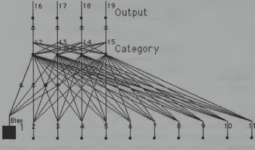

**图4.9：** 一个汉明网络

汉明网络的学习与 Hopfield 网络相似。将期望的训练模式提供给输入层，并将输入向量所属的期望类别提供给输出层。连接权重根据神经网络的递归行为进行更新。

首先设置输入层到类别层的连接权重。生成匹配得分，以确定期望输入与期望输出之间的最佳匹配。类别层的递归连接权重按照与 Hopfield 网络相同的方式进行训练。在正常前馈操作中，将输入向量施加到输入层，并且必须持续足够长的时间，以使下层输入到类别子网的匹配得分输出稳定。这将初始化类别层中 Hopfield 函数的输入，并使该部分子网找到输入向量所属的最近类别。该层具有竞争性，因此一次只启用一个输出。

#### 汉明距离

两个向量之间的汉明距离是向量不同的分量数量。它也可以定义为两个二值或双极向量 (x,y) 之间不同分量的数量。可记为 H(x,y)。平均汉明距离由下式给出，

\[
\overline{H}(x,y) = \frac{1}{n}H(x,y)
\]

其中 n 是每个向量中的分量数量。

在汉明网络中，输入向量与存储原型之间的相似度度量为两向量之间汉明距离的负值。

考虑两个双极向量 x 和 y，

- 如果“a”是向量一致的分量数，并且
- “d”是向量不同的分量数（汉明距离），

则，x·y = a - d。

如果“n”是分量数，则，

```text
n = a + d   or   d = n - a
```

因此

```text
x·y = a - d = a - (n - a)
x·y = 2a - n   (or)   2a = x·y + n
```

从结果可知，如果将权重设为原型向量的一半，并将偏置设为分量数的一半，则网络只需找到净输入最大的单元，就能找到具有最接近原型的单元。

#### 架构

架构如图4.10所示。假设输入向量为 4 元组，输出要被分类为给定的两个类别之一。

该架构由下层网络中的 n 个输入节点组成，每个输入节点连接到 m 个输出节点。这些输出节点连接到上层网络（即作为汉明网络子网的最大网络 Max-Net），该网络计算与输入向量最匹配的原型。输出节点中的“m”表示网络中存储的原型向量数量。需要注意的是，输入向量和原型向量都是双极的。对于给定的一组原型向量，汉明网络找到最接近双极输入向量 x 的原型向量。输入向量与原型向量一致的分量数由净输入给出。


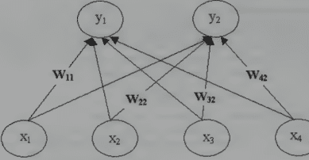

**图4.10：汉明网络架构**

#### 应用流程

所用参数为，

- n —— 输入节点（输入向量）的数量
- m —— 输出节点（示例向量）的数量
- e(j) —— 第 j 个示例向量

应用流程的伪代码如下：

```
Initialize weights for storing m exemplar vectors
wᵢⱼ = eᵢ(j)/2, (i=1..n, j=1..m)
Initializing the bias
bⱼ = n/2 (j=1..m)
For each vector x
    Compute the net input to each unit yⱼ
    Y_inⱼ = bⱼ + ∑ᵢ₌₁ⁿ xᵢwᵢⱼ
    Initialize activations for Max Net
    yⱼ(0) = y_inⱼ (j=1,..m)
    Max net iterates to find the best match exemplar
End For
```

与霍普菲尔德网络相比，汉明网络更具优势。当输入位错误具有随机性时，汉明网络采用最优最小误差分类器对输入向量进行分类。与霍普菲尔德网络相比，汉明网络使用的处理单元更少。类别层对整个类别只需要一个元素，而不是为每个输入节点设置单独元素。汉明网络比霍普菲尔德网络更快、更准确，因为它稳定所需时间更少。

### 4.3.5 双向联想记忆

Bart Kosko 开发了一种模型来推广霍普菲尔德模型，这被称为双向联想记忆（BAM）。在 BAM 中，模式以一对双极向量的形式表示；当呈现含噪输入时，会确定与该输入模式关联的最近模式。

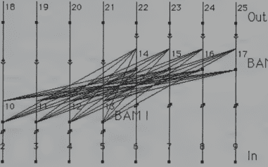

**图4.11：双向联想记忆示例**

双向联想记忆网络的基本模型如图4.11所示。BAM 模型的作用等同于输出处理节点。隐藏层由独立的关联存储器组成，并表示输入向量的大小。各单元的长度不必相等。中间层彼此全连接。输入层和输出层仅用于实现目的；它们是向网络输入信息和从网络检索信息的手段。Kosko 最初的研究目标是用于光学处理的双向联想记忆层，这种处理不需要正式的输入和输出结构。

向量以关联对的形式存储在中间层。每当呈现含噪模式时，中间层会来回摆动，直到达到稳定状态。稳定状态表示最近学习到的关联，并给出与最初呈现的输入模式相似的最佳输出。与霍普菲尔德网络类似，当训练集的补集被用作未知输入向量时，双向联想记忆网络容易错误地找到已训练模式。

#### 架构

BAM 中的层称为 X 层和 Y 层，而不是输入层和输出层，因为权重是双向的，并且算法在更新各层激活值之间交替进行。BAM 有三种形式：

- 1. 二值型
- 2. 双极型
- 3. 连续型

但这三种类型的架构保持不变。BAM 的架构如图4.12所示。

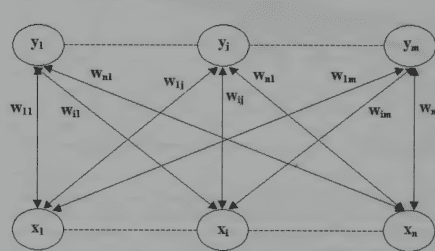

**图4.12：双向记忆网络架构**

异联想 BAM 网络在 X 层有“n”个单元，在 Y 层有“m”个单元。层间连接是双向的，即如果从 X 层发送到 Y 层的信号的权重矩阵为 W，则从 Y 层发送到 X 层的信号的权重矩阵为 W_T。

BAM 架构类似于单层前馈网络，仅由一层加权互连组成。输入层有“n”个输入神经元，输出层有“m”个输出神经元。训练过程基于赫布学习规则。这是一个全互连网络，其中输入和输出不同。双向联想记忆最重要的特征是，从 X 层到 Y 层以及从 Y 层到 X 层都存在加权互连。一层到另一层及其反向连接在图4.12中用双向箭头表示。权重在 X 层与 Y 层之间以及从 Y 层到 X 层进行调整。

#### 双向联想记忆网络的类型

BAM 有两种类型。它们是：

- 离散 BAM
- 连续 BAM

##### 离散 BAM

训练模式可以是二值型或双极型。在两种格式中，权重均由训练向量对的双极形式的赫布外积之和求得。使用带阈值的阶跃激活函数作为激活函数。通常，双极向量能改善网络的性能。

用于存储输入向量和目标向量集合 $s(p): t(p)$（$p=1,\ldots,P$）的权重矩阵，其中

$$s(p)=(s_1(p),\ldots,s_i(p),\ldots,s_n(p))$$

并且可以借助赫布规则确定。

对于二值输入向量，权重矩阵可由以下公式确定。

$$W_{ij}=\sum_p(2s_i(p)-1)(2t_j(p)-1)$$

对于双极输入向量，权重矩阵由下式给出：

$$W_{ij}=\sum_p s_i(p)t_j(p)$$

##### 激活函数

离散 BAM 的激活函数取决于使用的是二值向量还是双极向量。激活函数是相应的阶跃函数。对于二值输入向量，Y 层的激活函数为

$$y_j = \begin{cases} 1, & \text{if } y_{inj} > 0 \\ y_j, & \text{if } y_{inj} = 0 \\ 0, & \text{if } y_{inj} < 0 \end{cases}$$

X 层的激活函数为

$$x_i = \begin{cases} 1, & \text{if } x_{inj} > 0 \\ x_i, & \text{if } x_{inj} = 0 \\ 0, & \text{if } x_{inj} < 0 \end{cases}$$

对于双极向量，Y 层的激活函数为

$$y_j = \begin{cases} 1, & \text{if } y_{inj} > \theta_j \\ y_j, & \text{if } y_{inj} = \theta_j \\ -1, & \text{if } y_{inj} < \theta_j \end{cases}$$

X 层的激活函数为

$$x_i = \begin{cases} 1, & \text{if } x_{inj} > \theta_i \\ x_i, & \text{if } x_{inj} = \theta_i \\ -1, & \text{if } x_{inj} < \theta_i \end{cases}$$

如果净输入等于阈值，激活函数会决定将该单元的激活值保持在其前一值。上式中，$\theta_i$ 表示阈值。

##### 连续 BAM

连续 BAM 由 Kosko 于1988年提出。连续双向联想记忆能够将输入平滑且连续地转换到 [0,1] 区间内的相应输出范围。连续 BAM 对所有单元使用逻辑 S 形函数作为激活函数。

对于二值输入向量 $(s(p),t(p))$，$p=1,2,\ldots,P$，权重由以下公式确定。

$$w_{ij}=\sum_p (2s_i(p)-1)(2t_j(p)-1)$$

Y 层

逻辑 S 形激活函数由下式给出：

$$f(y_{inj})=\frac{1}{1+\exp(-y_{inj})}$$

若计算中包含偏置：

$$y_{inj}=b_j+\sum_i x_iw_{ij}$$

### X 层

逻辑 S 形激活函数由下式给出：

$$f(x_{inj})=\frac{1}{1+\exp(-x_{inj})}$$

若计算中包含偏置：

$$x_{inj}=b_j+\sum_i x_iw_{ij}$$

根据 Haines 和 Hecht-Nielsen 的研究，BAM 的存储容量为 min(n, m)，其中，  
n 是 X 层中的单元数，  
m 是 Y 层中的单元数。  
需要注意的是，如果为每个单元选择合适的非零阈值，这一容量可扩展到 min(2n, 2m)。

#### 应用算法

从训练过程中获得最终权重。输入模式被呈现给 X 层和 Y 层。计算 Y 层的净输入和激活值。然后将信号发送到 X 层，并在此处求出其净输入和激活值。以这种方式测试双向联想记忆的性能。双向记忆网络的伪代码如下：

```
Initialize the weight to store a set of P vectors
Initialize all activations to 0

For each testing input
    Assign activation of X-layer to current pattern
    Input pattern y is presented to the Y-layer
    While activations are not converged do
        Compute the net input y_{inj} = ∑_i w_{ij}x_i
        Compute activations, y_i = f(y_{inj})
        Send signals to the X-layer
        Compute the net input x_{ini} = ∑_i w_{ij}y_i
        Compute the activations x_i = f(x_{ini})
        Send signals to the Y-layer
```


```
Test for convergence
End While

End For
```

停止条件可以是激活向量 x 和 y 已达到平衡。步骤 6 和 7 中应用的激活函数基于前面所作的讨论。

## 4.4 数据概念化网络

在大多数神经网络应用中，作为训练集呈现的数据似乎是变化的。少数应用需要对数据进行分组，这些数据可能清晰可定义，也可能不清晰可定义。在这种情况下，需要尽可能识别出最优的分组。这类网络被归类为数据概念化网络。

### 4.4.1 自适应共振网络

我们讨论的最后一种无监督学习网络与之前的网络不同，因为它是循环的；与下一章的网络一样，数据不仅前馈，而且还从输出单元反馈到输入单元。

#### 背景

1976 年，格罗斯伯格提出了一种解释生物现象的模型。该模型具有三个关键特性：

- 1. 网络总活动的归一化。生物系统通常对其环境的巨大变化具有很强的适应性。例如，人眼能够适应光照强度的巨大变化。
- 2. 输入模式的对比度增强。对输入模式中细微差异的感知在生存方面可能意义重大。区分隐藏的黑豹和休息的黑豹会带来天壤之别。这里使用的机制是对比度增强。
- 3. 对比度增强模式的短期记忆（STM）存储。在输入模式能够被解码之前，它必须存储在短期记忆中。长期记忆（LTM）实现唤醒机制（即分类），而 STM 用于引起 LTM 的逐渐变化。

该系统由 F1 和 F2 两层组成，这两层通过 LTM 相互连接（图 4.13）。输入模式在 F1 处接收，而分类在 F2 中进行。如前所述，输入不会被直接分类。首先通过提取特征进行表征，从而在特征表示场中产生激活。

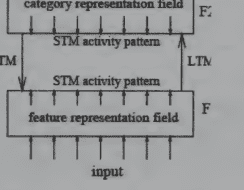

**图 4.13：** ART 架构

驻留在 LTM 连接中的期望将输入模式转换为类别表示场中的归类。分类结果与网络的期望进行比较，该期望驻留在从 F2 到 F1 的 LTM 权重中。如果匹配，则增强期望；否则拒绝该分类。

#### ART1：简化神经网络模型

ART1 的架构是一个非常简化的模型，由两层二值神经元（取值为 1 和 0）组成，分别称为比较层（记为 F1）和识别层（记为 F2）（图 4.14）。比较层中的每个神经元都通过连续值前向长期记忆（LTM）W^f 与识别层中的所有神经元相连，反之亦然，即通过二值后向 LTM W^b 相连。还提供了一个增益单元和一个重置单元。有两个增益单元，分别记为 G1 和 G2。F1 层中的每个神经元接收三个输入：输入模式的一个分量、反馈模式的一个分量以及增益 G1。当且仅当三分之二的输入为高时，该神经元才会激活。识别层中的每个神经元计算其输入（连续值）权重与通过这些连接发送的模式的内积。获胜神经元随后通过侧抑制抑制所有其他神经元。增益 2 是输入模式 x 中所有元素的逻辑“或”。增益 1 等于增益 2，除非来自 F2 的反馈模式包含任何 1；此时增益 1 被强制为零。最后，如果输入向量 x 与 F1 的输出之差超过某个警戒水平，则向 F2 中的活跃神经元发送重置信号。

#### 架构

ART1 具有计算单元和补充单元。其架构如图 4.13 所示。

#### 计算单元

计算单元包括 F1 和 F2 单元以及重置单元。F1(a) 输入单元连接到 F1(b) 接口单元。输入单元和接口单元连接到重置机制单元。通过自上而下和自下而上权重，接口层单元连接到聚类单元，并且也实现了相互性。

#### 补充单元

计算单元存在一些限制。计算单元的所有单元在学习过程中预计会频繁响应。此外，F2 单元在某些特定条件下受到抑制，然后在需要时又应恢复。因此，为了克服这些限制，两个增益控制单元 G1 和 G2 作为补充单元。这些特殊单元接收来自计算结构中所有单元的信号，并向这些单元发送信号。在图 4.14 中，兴奋信号用“+”表示，抑制信号用“−”表示。信号可以发送到接口层或聚类层中的任何单元，只要该单元有三个可接收信号的来源。这些单元中的每一个还接收两个兴奋信号才能处于“开启”状态。因此，这一要求被称为三分之二规则。该规则在参数和初始权重的选择中起作用。重置单元 R 还控制警戒匹配。

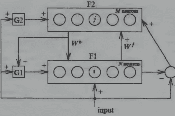

**图 4.14：** ART1 神经网络

#### 运行

网络首先将输入钳制在 F1。由于 F2 的输出为零，G1 和 G2 均开启，且 F1 的输出与其输入匹配。该模式被发送到 F2，在 F2 中一个或多个神经元变为活跃。然后该信号通过后向 LTM 发送回来，在 F1 处重现一个二值模式。G1 受到抑制，只有同时从 x 和 F2 接收到“1”的 F1 神经元保持活跃。如果两个模式之间存在显著不匹配，重置信号将抑制 F2 中的神经元，并重复该过程。

#### 训练算法

训练算法中使用的参数如下：

- **n:** 输入向量中的分量数
- **m:** 可形成的最大聚类数
- **bᵢⱼ:** 自下而上权重（从 F1(b) 到 F2 单元）
- **tᵢⱼ:** 自上而下权重（从 F2 到 F1(b) 单元）
- **ρ:** 警戒参数
- **s:** 二值输入向量
- **x:** 接口层（F1(b) 层（二值））的激活向量
- **‖x‖:** 向量 x 的范数（各分量 xᵢ 之和）

二值输入向量被呈现给 F1(a) 输入层，然后由接口层 F1(b) 接收。F1(b) 层通过加权互连路径将激活信号发送到 F2 层。每个 F2 单元计算净输入。净输入最大的单元将成为获胜者，其激活为 d=1。所有其他单元的激活为零。仅该获胜单元会学习当前输入模式。通过加权互连从 F2 发送到 F1(b) 的信号称为自上而下权重。“X”单元只有在同时从 F1(a) 和 F2 单元接收到非零权重时才保持“开启”。

向量 x 的范数 ||x|| 给出获胜单元的自上而下权重向量 tⱼ 与输入向量 S 均为“1”的分量数量。根据 x 的范数与 S 的范数之比（||x||/||S||），调整获胜聚类单元的权重。整个过程可以重复，直到找到匹配或所有神经元都被抑制。比值（||x||/||S||）称为匹配比。

每次呈现一个模式结束时，所有聚类单元都恢复到非激活状态，但可参与后续过程。

ART1 网络训练算法的伪代码如下。

```
Initialize parameters L > 1 and 0 < ρ ≤ 1
Initialize weights 0 < b_ij(0) ≤ L/(L−1+n) and t_ji(0) = 1

While not stopping condition do
    For each training input
        Assign activations of all F2 units to zero
        Assign activations of F1(a) units to input vector s
        Compute the norm of s: ||s|| = ∑_i s_i

        Send input signal from F1(a) to F1(b) layer: x_i = s_i
        For each F2 node that is not inhibited
            If y_j ≠ −1
                y_j = ∑_i b_ij x_i
            End If
            While reset do
                Find J such that y_J ≥ y_j for all nodes j
                If y_J = −1
                    All nodes are inhibited
                End If
                Recompute activation x of F1(b): x_i = s_i t_Ji
                Compute the norm of vector x: ||x|| = ∑_i x_i
                Test for reset
```

```
If ‖x‖ / ‖s‖ ≤ ρ
    y_J = −1, (inhibit node J)
End If
End While
End For
Update the weights for node J
    b_ij (new) = L x_i / (L − 1 + Σ_i x_i)
    t_ji (new) = x_i
End For
Test for stopping condition
End While
```

停止条件可以是权重不再变化、没有单元重置，或达到最大搜索轮数。

在胜者选择中，如果出现并列，则取 J 为其中最小的索引。此外，t_ji 要么为 0 要么为 1，并且由于稳定学习方法，一旦在学习过程中被置为 0，就永远不能再置回 1。

所用参数具有如下表所示的典型值。

| 参数 | 范围 | 典型值 |
|---|---|---|
| L | L > 1 | 2 |
| ρ | 0 < ρ ≤ 1 | 0.9 |
| b_ij（自下而上权重） | 0 < b_ij(0) < L / (L − 1 + n) | 1 / (1 + n) |
| t_ji（自上而下权重） | t_ji(0) = 1 |  |

### 4.4.2 ART 算法在 MATLAB 中的实现

一个 ART 网络经过几次迭代后的自上而下权重为 t_ji=[1 1 0 0; 0 1 0 0; 1 1 1 1]，自下而上权重为 b_ij=[.57 0 .3;0 0 .3;0 .57 .3;0 .47 .3]。以下 MATLAB 代码演示了在呈现向量 [1 0 1 1] 后，ART 算法求取新权重的步骤。

```
clc;
clear all;

% Step 1: Initialization
% The bottom up weights
b=[.57 0 .3;0 0 .3;0 .57 .3;0 .47 .3];

% The top down weights
t=[1 1 0 0;0 1 0 0;1 1 1 1];

% Vigilance parameter (0<ρ ≤ 1) set to 0.9
rho=0.9;

% Initialize L (L>1) to 2
L=2;

% Step 2: Start training

% Step 3: Present the new vector
x=[1 0 1 1];

% Step 4: Set the activations to the input vector
s=x;

% Step 5: Compute the norm of s according to the
% formula ‖s‖ = ∑ᵢ sᵢ
norm_s=sum(s);

% Step 6: Send input signal from
% F₁(a) to F₁(b) layer with xᵢ=sᵢ
% Step 7: Calculate the net input yⱼ=∑ᵢ bᵢⱼ xᵢ
y=x*b;
stop=1;
while stop
% Step 8: While reset do
    for j=1:3
        % Step 9: Find J such that yⱼ ≥ yₖ for
        % all nodes j
        if y(j)==max(y)
            J=j;
        end
    end
% Step 10: Recomputing activation x of F₁(b)
% xᵢ=sᵢtᵢⱼ
x=s.*t(J,:);
% Step 11: Compute the norm of vector
% x: ||x|| = \sum_i x_i

norm_x=sum(x);
% Step 12: Test for reset
if norm_x/norm_s >= rho
  % Step 13: Updating the weights
  b(:,J)=L*x(:)/(L-1+norm_x);
  t(J,:)=x(1,:);
  stop=0;
else
  y(J)=-1;
  stop=1;
end
if y(J)+1 == 0
  stop=0;
end
end
disp('Top down weights')
disp(t);
disp('Bottom up weights')
disp(b);
```

输出

更新后的权重为：

自上而下权重
```
     1       1       0       0
     1       0       0       1
     1       0       1       1
```

自下而上权重
```
     0.5700  0       0.5000
     0       0       0
     0       0.5700  0.5000
     0       0.4700  0.5000
```

### 4.4.3 自组织映射

Kohonen 网络由 Teuvo Kohonen 于 20 世纪 80 年代初基于数据聚类提出。在该网络中，如果两个输入向量彼此接近，它们将被映射到二维 Kohonen 层中彼此靠近的处理单元，该层表示输入数据的特征或簇。在这里，处理单元构成了输入数据的二维映射。

自组织映射的基本用途是描绘多维输入空间的拓扑结构和层次结构。自组织网络已被用于创建由 Kohonen 层生成的二维空间中的区域填充曲线。Kohonen 层还可用于优化问题，方法是提供连接权重，使其稳定到最小能量模式。

该网络的主要优点在于它基于无监督进行学习。当该拓扑结构与其他神经层结合用于预测或分类时，网络首先以无监督方式学习，然后切换到监督模式，供其所连接的已训练网络使用。

自组织映射网络的基本架构模型如图 4.15 所示。自组织映射通常有两层：输入层和 Kohonen 层。输入层与二维 Kohonen 层全连接。此处所示的输出层用于分类问题，表示输入向量可能所属的三个类别。该输出层通常使用 delta 规则，其操作与对传范式类似。

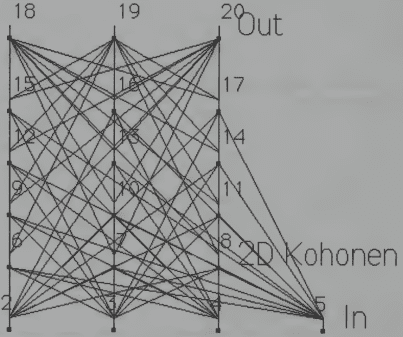

**图 4.15：** 一个自组织映射网络示例

Kohonen 层中的处理单元度量权重与所呈现输入模式之间的欧几里得距离。在回忆阶段，距离最小的 Kohonen 元素为胜者，并向输出层输出 1。由于这是一个竞争网络，一旦选定获胜单元，所有其他处理单元都被强制为零。因此，获胜元素是距离输入值最近的元素，它在二维映射中表示该输入值。

在训练过程中，距离最小的 Kohonen 处理单元调整其权重，使其更接近输入数据的值。获胜元素的邻居也调整其权重，使其更接近同一输入数据向量。

处理单元自然地表示关于输入数据集的大致相等的信息。在输入空间数据稀疏的地方，表示在 Kohonen 空间（或映射）中被压缩。在输入空间密度高的地方，代表性的 Kohonen 元素会分散开，以便进行更精细的区分。通过这种方式，Kohonen 层被认为模拟了生物系统的知识表示。

自组织映射允许网络形成特征映射。自组织学习可以描述为呈现“由局部交互涌现出的全局秩序”。神经网络中自组织学习的一个例子是 SOM 算法。SOM 算法源自三条重要原则：

- 1. 自增强
- 2. 竞争
- 3. 合作

这些原则定义如下：

- 1. **自增强：** 同时激活的单元倾向于形成更强的连接。因此，正连接倾向于自我增强。这就是 Hebbian 学习原理。
- 2. **竞争：** 单元进入竞争，以确定哪一个对输入响应“最好”。“最好”的定义通常依据以下之一：(i) 单元权重向量与输入之间的欧几里得距离，或 (ii) 单元权重向量与输入之间点积的大小。只要向量已归一化，最小欧几里得距离等价于最大点积，因此选择哪一种都无关紧要。最佳匹配单元被视为竞争的胜者。
- 3. **合作：** 在 SOFM 中，“竞争层”中的每个单元都与输入层全连接。此外，每个竞争单元都被赋予映射上的一个位置。最常用的是二维映射，因此单元被分配到二维网格上的位置。（一维或超过二维的映射也是可能的。）每当给定单元赢得竞争时，它的邻居也有机会学习。决定谁是邻居的规则可以是“最近邻”规则，即只把网格中最近的四个单元视为邻域；也可以是“两个最近邻”；或者邻域可以定义为与其他每个单元及胜者之间距离的收缩函数。无论确定邻域成员资格的依据是什么，胜者及其所有邻居都会进行一定的 Hebbian 学习，而邻域之外的单元对于给定模式不学习。

#### 架构

Kohonen SOM 的架构如图 4.16 所示。邻域中从获胜单元接收正反馈的所有单元都参与学习过程。即使某个相邻单元的权重与输入向量正交，其权重向量仍会响应输入向量而改变。对竞争过程而言，这一简单补充足以解释有序映射。

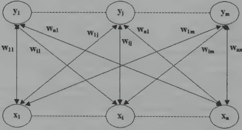

**图 4.16：** Kohonen SOM 的架构


#### 训练算法

权重和学习率最初被设定。待聚类的输入向量被呈现给网络。当输入向量被呈现时，根据初始权重，通过欧几里得距离法或乘积和法计算获胜单元。基于获胜单元的选择，使用前面讨论的竞争学习规则更新该特定获胜单元的权重。一旦所有输入向量都被呈现给网络，就认为完成了一个轮次。通过更新学习率，可以执行多个训练轮次。

SOM 网络训练算法的伪代码如下所示：

```
Initialize topological neighborhood parameters
Initialize learning rate
Initialize weights
While not stopping condition do
    For each input vector x
        For each i, compute squared Euclidean
            distance
                D(j) = ∑ (wᵢⱼ−xᵢ)², i=1 to n and j=1 to m
        Find index J, when D(j) is minimum
        For all units J, with specified neighborhood
        of J,
            and for all i,
                update the weights to
                    wᵢⱼ(new) = wᵢⱼ(old) + α [xᵢ−wᵢⱼ(old)]
    End For
    Update the learning rate
    Reduce the radius of topological neighborhood
    at specified times
    Test the stopping condition
End While
End
```

映射函数分两个阶段进行：

-   初始形成完美（正确）的顺序
-   最终收敛

第二阶段耗时比第一阶段更长，并且需要较小的学习率。学习率是随时间缓慢递减的函数，聚类单元周围邻域的半径也随着聚类过程继续而减小。初始权重假定为随机值。学习率通过 α (t+1) = 0.5 α (t) 更新。

## 4.5 ANN 的应用领域

人工神经网络正在经历这样一种变化：当一个概念离开学术环境，被抛入严酷的用户世界时，这些用户只希望让任务得到安排。最近正在设计的若干网络在统计上相当精确，但它们仍给那些期望计算机能完全解决其问题的用户留下有缺陷的印象。这些网络可能达到 85% 到 90% 的准确率。遗憾的是，少数应用能容忍这一错误水平。

当研究人员继续提高其“创造物”的准确性时，一些探索者正在为当前技术寻找用途。

在审视这一最新技术水平时，很难不被光明的前景所鼓舞，也很难不被清醒的现实所影响。目前，神经网络还不是将口语转换为机器指令的用户界面，但总有一天会成为。总有一天，录像机、家庭安全系统、CD 播放器和文字处理器将只需语音激活。触摸屏和语音编辑将取代当今的文字处理器，同时将电子表格和数据库提升到令大多数人满意的可用性水平。但就目前而言，神经网络正进入一些利基市场，在这些市场中其统计准确性很有价值，同时它们也在等待必将到来的未来。

这些利基市场中的许多确实涉及答案模糊的应用。贷款审批就是其中之一。金融机构通过尽可能降低不良贷款率来赚取更多利润。“90% 准确”的系统可能比当前的选择流程有所改进。事实上，一些银行已经证明，经神经网络批准的贷款的失败率低于通过其一些最佳传统方法批准的贷款。此外，一些信用卡公司正在其申请筛选过程中使用神经网络。

这种通过审视过往经验来展望未来的最新方法也带来了自身独立的问题。主要问题之一是为计算机生成的答案提供理由，例如为什么某一特定贷款申请被拒绝。如本章通篇所述，神经网络的内部运作是“黑箱”。对神经网络及其学习的解释一直很困难。为缓解这一困难过程，许多神经网络工具开发者提供了程序，用于解释哪个输入通过哪个节点主导决策过程。根据这些信息，应用领域的专家应能推断出某一异常数据为何至关重要。

除了填补这些利基市场外，神经网络工作还在其他更有前景的应用领域取得进展。本章下一节将介绍其中一些领域，并简要详述当前工作。这样做是为了帮助激发读者思考神经网络可能提供解决方案的各种可能性，例如语言处理、字符识别、图像压缩、模式识别等。

### 4.5.1 语言处理

人类语言使用者的实际表现不同于其语言能力，即不同于其关于如何正确使用语言进行交流的知识。自然语言处理是一种通过词语和概念联想得到强化的应用，并以神经网络实现。单一神经网络架构能够处理给定句子，并输出大量语言处理预测：词性标注、组块、命名实体标注、语义角色、语义相似词，以及该句子在使用语言模型时在语法和语义上说得通的可能性。

来自多所大学的多位研究人员正在研究如何利用人工神经网络对计算机进行编程，使其能够响应语音命令。自然语言处理（NLP）已成为神经网络（NNs）研究的主流；神经网络是强大的并行分布式学习/处理机器，并在 NLP 的多个领域发挥重要作用。

目前，据学术期刊报道，大多数具备听觉能力的神经网络仅被训练来接收一个说话人的语音。这些单说话人、孤立词识别器只能识别几百个词。但如果在每个词之间有停顿，神经网络就能识别更多数量的词。

少数研究者正在宣扬更大的潜力，但由于预期回报，真正的进展及相关方法仍被严格保密。最受推崇且已演示的语音解析系统来自苹果公司。据 1992 年 4 月《华尔街日报》的一篇文章，该网络能够通过有限词汇识别几乎任何人的语音。

### 4.5.2 字符识别

光学字符识别被认为是人工神经网络最早的应用之一，人工神经网络在人工智能领域部分模拟人类思维。无论手写字符还是印刷字符的识别，都是神经网络正在提供最佳解决方案的主要领域。多层神经网络被用于识别字符，这在银行等领域是一项至关重要的应用。字符识别的主要问题是在成本与准确性和速度等收益之间进行权衡。神经网络提供了一种方法，可将独立训练的字符组合起来，以相对较低的成本实现更高性能。

字符识别领域近期的大量研究都针对将东方文字扫描输入计算机。目前，这些字符每个需要四到五次击键。这一复杂过程使识别一页文本的任务延长为数小时的苦差事。

### 4.5.3 数据压缩

在神经网络中，当隐藏单元数量少于输入和输出单元时，中间层的神经元能够进行数据压缩。研究人员已证明神经网络可以实时压缩和解压数据。这些网络是自联想的，因为它们可以将输入层的八位数据减少为隐藏层的三位，然后在输出层重构为八位时逆转该过程。压缩时信息没有损失。数据压缩的一些主要应用包括多光谱无损图像压缩、模式识别、有损或无损压缩、视频压缩、手写数字分类、边缘检测和磁共振图像压缩。

### 4.5.4 模式识别

模式识别是神经网络非常古老的应用，并且已在许多不同（且主要不相关）的应用中进行了研究，例如按形状对模式分类、指纹识别、肿瘤识别、手写识别、人脸识别、硬币识别等。这些应用大多涉及模式识别问题，并使用前馈网络架构，如多层感知机和径向基函数网络。从模式识别的角度来看，神经

网络可以被看作是对数十年来发展起来的若干传统技术的延伸。

### 4.5.5 信号处理

神经网络在信号处理中的作用正变得越来越分散，其实际应用涉及滤波、参数估计、信号检测、模式识别、信号重建、系统辨识、信号压缩和信号传输等领域。所涉及的信号包括音频、视频、语音、图像、通信、地球物理、声呐、雷达、医学、音乐以及许多其他信号。应用于信号处理的神经网络的主要特征是其异步并行与分布式处理、非线性动力学、网络元件的全局互连、自组织以及高速计算能力。神经网络能够为信号处理中遇到的若干问题提供有效手段，特别是在非线性信号处理、实时信号处理、自适应信号处理和盲信号处理中。

### 4.5.6 金融

早期的金融专家以图表为主要工具，用来驾驭大量可获得的金融数据。一些专家研究公司的长期投资，而另一些专家则试图从总体上预判即将到来的经济或股市走势。所有这些过程都涉及工作中的大量风险。为了帮助人们预测特定市场，已有大量计算机程序可供使用。传统上，这些程序价格昂贵、需要复杂的编程、使用金融专家调查来定义“游戏规则”，并且它们像人一样思考的能力仍然有限。尽管如此，即使获得了解决方案，这项任务仍然困难。尽管有效市场假说具有其含义，许多交易者仍继续基于历史数据做出买入和卖出决策。这些决策是在这样一个前提下做出的：数据中存在模式，并且这些模式指示未来的走势。如果存在此类模式，那么原则上可以应用神经网络等自动模式识别技术来发现这些模式。

神经网络是一种新型计算工具，不受方程或规则的限制。神经网络通过在用户提供的金融数据中寻找相关性和模式来发挥作用。这些模式在训练过程中成为网络的一部分。对于每个要解决的问题，都需要一个单独的网络，但许多网络遵循相同的基本格式。

# 第5章 实现神经网络的MATLAB程序

神经网络计算天然地以矩阵记法表达，而矩阵语言MATLAB中有若干工具箱，例如商业神经网络工具箱，以及用于辨识与控制的工具箱。从监督控制的更广阔视角来看，还有其他应用领域，例如机器人视觉、规划、诊断、质量控制以及数据分析（数据挖掘）。本章的策略是面向所有这些应用领域，但只呈现理解基础知识所必需且充分的神经网络材料。本章说明了一些MATLAB仿真示例，例如硬币检测、模式回忆、模式分类，以及使用不同神经网络架构的Simulink模型。

## 5.1 示例1：使用欧几里得距离进行硬币检测（汉明网络）

将一组硬币作为输入图像，并使用汉明网络对其进行检测。检测边缘，并使用欧几里得距离公式计算到非白色像素的最小距离。

```matlab
% - - - - - - - - - - - - - - - - - - - -
% Main Program
% - - - - - - - - - - - - - - - - - - - -

close all;
clear all;
clc;

I = imread('Image1','jpeg');
flg=isrgb(I);

if flg==1
    I=rgb2gray(I);
end

[h,w]=size(I);
figure;imshow(I);

c = edge(I, 'canny',0.3);       % Canny edge detection
figure; imshow(c);              % binary edges

se = strel('disk',2);            %
I2 = imdilate(c,se);              %
imshow(I2);                       %

d2 = imfill(I2, 'holes');         %
figure, imshow(d2);               %

Label=bwlabel(d2,4);

a1=(Label==1);
a2=(Label==2);
a3=(Label==3);
a4=(Label==4);
a5=(Label==5);
a6=(Label==6);

D1 = bwdist( a1); % computing minimal euclidean
                  % distance to non-white pixel
figure, imshow(D1,[]);
[xc1 yc1 r1]=merkz(D1);
f1=coindetect(r1)

D2 = bwdist( a2); % computing minimal euclidean
                   % distance to non-white pixel
figure, imshow(D2,[]);
%[xc2 yc2 r2]=merkz(D2);
f2=coindetect(r2)

D3 = bwdist( a3); % computing minimal euclidean
                   % distance to non-white pixel
figure, imshow(D3,[]);
%[xc3 yc3 r3]=merkz(D3);
f3=coindetect(r3)

D4 = bwdist( a4); % computing minimal euclidean
                   % distance to non-white pixel
figure, imshow(D4,[]);
%[xc4 yc4 r4]=merkz(D4);
f4=coindetect(r4)

D5 = bwdist( a5); % computing minimal euclidean
                   % distance to non-white pixel
figure, imshow(D5,[]);
%[xc5 yc5 r5]=merkz(D5);
f5=coindetect(r5)

D6 = bwdist( a6); % computing minimal euclidean
                   % distance to non-white pixel
figure, imshow(D6,[]);
%[xc6 yc6 r6]=merkz(D6);
f6=coindetect(r6)

% - - - - - - - - - - - - - - - - - - -
% End of Main Program
% - - - - - - - - - - - - - - - - - - -
```

```matlab
% - - - - - - - - - - - - - - - - - - - - - - -
% Sub-Program Used
% - - - - - - - - - - - - - - - - - - - - - - -

function f=coindetect(rad)

if rad > 100
    f=1;
elseif (68<rad) & (rad<69)
    f=5;
elseif (76<rad) & (rad<77)
    f=10;
elseif (85<rad) & (rad<86)
    f=25;
elseif (95<rad) & (rad<96)
    f=50;
else
    f=0;
end

function [centx,centy,r]=merkz(D)

[w h]=size(D');

mx=max(max(D));
r=mx;
for i=1:h
    for j=1:w
        if D(i,j)==mx
            centx=j;
            centy=i;
        end
    end
end
```

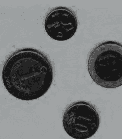

**图5.1：** 输入图像

### 观察结果

图5.1所示的输入图像被转换为灰度图像（图5.2），并检测边缘（图5.3）。图像中的孔洞如图5.4所示。使用欧几里得距离公式计算到非白色像素的最小距离，如图5.5所示。

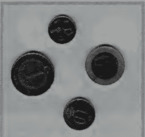

**图5.2：** 灰度输入图像

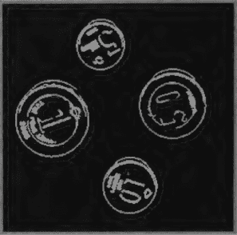

**图5.3：** 边缘检测

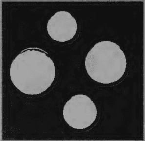

**图5.4：** 填充强度图像的孔洞

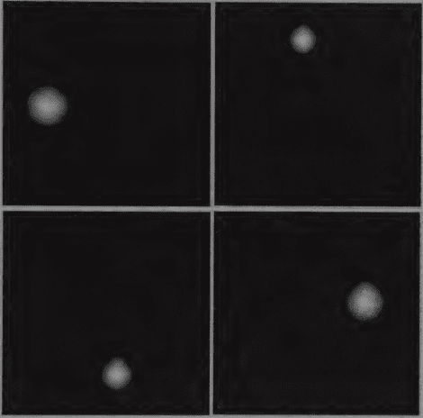

**图5.5：** 计算到非白色像素的最小欧几里得距离

## 5.2 示例2：学习向量量化——对取自不同区域的数据进行聚类

考虑一个具有两个输入单元和四个目标类别的LVQ网络，其有16个分类单元，权重随机分配。学习率在[0,1]之间选取。从不同区域抽取一个输入向量，并据此分配类别。获胜单元基于竞争找到。在本例中，训练向量取自以下区域：

| 类别 | x1 范围 | x2 范围 |
|---|---|---|
| 类别1 | 0.0 <= x1 < 0.5 | 0.0 <= x2 < 0.5 |
| 类别2 | 0.5 <= x1 < 1.0 | 0.0 <= x2 < 0.5 |
| 类别3 | 0.0 <= x1 < 0.5 | 0.5 <= x2 < 1.0 |
| 类别4 | 0.5 <= x1 < 1.0 | 0.5 <= x2 < 1.0 |

根据用户给出的输入值选择类别。权重向量根据从输入向量中选出的类别按如下方式分配，

- 类别1的权重向量 = [0.2 0.2 0.6 0.6;0.2 0.6 0.8 0.4]
- 类别2的权重向量 = [0.4 0.4 0.8 0.8;0.2 0.6 0.4 0.8]
- 类别3的权重向量 = [0.2 0.2 0.6 0.6;0.4 0.8 0.2 0.6]
- 类别4的权重向量 = [0.4 0.4 0.8 0.8;0.4 0.8 0.2 0.6]

```matlab
% MATLAB CODE

% Training with inputs lying in the specified regions
% Different learning rates and different geometries for input
clc;
n=2;
m=4;
p=1;
ep=1;
J=0;

prompt1={'ENTER LEARNING RATE','ENTER TRAINING INPUT x1',...
         'ENTER TRAINING INPUT x2'};
dlgTitle1='PATTERN CLUSTERING';
answer1=inputdlg(prompt1);
disp(answer1);
learn_rate=str2double(answer1(1));
disp(learn_rate);
x1=str2double(answer1(2));
disp(x1);
x2=str2double(answer1(3));
disp(x2);

if((x1>=0.0)&&(x1<0.5)&&(x2>=0.0)&&(x2<0.5))
    T=1;
    X=[x1 x2];
    W=[0.2 0.2 0.6 0.6;0.2 0.6 0.8 0.4];
    disp('Class 1');
elseif((x1>=0.5)&&(x1<1.0)&&(x2>=0.0)&&(x2<0.5))
```


### 观察结果

LVQ 执行的学习过程如图 5.6 和图 5.7 所示。从输出中我们发现，这些向量被分类为属于类别 4。

## 5.3 示例 3：使用 Kohonen SOM 网络进行字符识别

本示例的目标是将大量黑白矩形像素显示中的每一个识别为英文字母表中的 26 个大写字母之一。字符图像基于 20 种不同字体，并且这 20 种字体中的每个字母都经过随机扭曲，从而生成一个包含 20,000 个独特刺激的文件。每个刺激被转换为 16 个原始数值属性（统计矩和边缘计数），然后进行缩放，使其适合 0 到 15 的整数值范围。前 16000 项用于训练，所得模型用于预测其余 4000 项的字母类别。

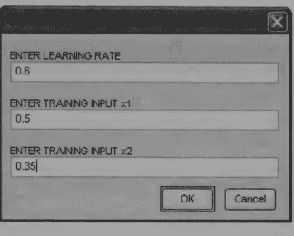

**图 5.6：** 输入格式

该程序中初始化的一些参数如下：

- 实例数量：20000
- 属性数量：17（字母类别和 16 个数值特征）
- 属性信息：
  - 1. `lettr` 大写字母（从 A 到 Z 的 26 个值）
  - 2. `position of box`（整数）
  - 3. `y-box` 框的垂直位置（整数）
  - 4. `width` 框的宽度（整数）
  - 5. `high` 框的高度（整数）
  - 6. `onpix` 亮像素总数（整数）
  - 7. `x-bar` 框内亮像素的 x 均值（整数）
  - 8. `y-bar` 框内亮像素的 y 均值（整数）
  - 9. `x2bar` x 方差均值（整数）
  - 10. `y2bar` y 方差均值（整数）
  - 11. `xybar` x 与 y 相关性的均值（整数）
  - 12. `x2ybr` x * x * y 的均值（整数）
  - 13. `xy2br` x * y * y 的均值（整数）
  - 14. `x-ege` 从左到右的边缘计数均值（整数）
  - 15. `xegvy` x-ege 与 y 的相关性（整数）
  - 16. `y-ege` 从下到上的边缘计数均值（整数）
  - 17. `yegvx` y-ege 与 x 的相关性（整数）

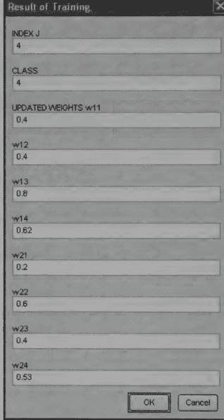

**图 5.7：** 输出格式

缺失属性值：无

类别分布：

| 类别 | A | B | C | D | E | F | G | H |
|---|---:|---:|---:|---:|---:|---:|---:|---:|
| 类别分布 | 789 | 766 | 736 | 805 | 768 | 775 | 773 | 734 |

| 类别 | I | J | K | L | M | N | O | P |
|---|---:|---:|---:|---:|---:|---:|---:|---:|
| 类别分布 | 755 | 747 | 739 | 761 | 792 | 783 | 753 | 803 |

| 类别 | Q | R | S | T | U | V | W | X |
|---|---:|---:|---:|---:|---:|---:|---:|---:|
| 类别分布 | 783 | 758 | 748 | 796 | 813 | 764 | 752 | 787 |

| 类别 | Y | Z |
|---|---:|---:|
| 类别分布 | 786 | 734 |

```matlab
% MATLAB CODE
% ANALOG DATA

clear all;
clc;
m1 = 26;
alpha = input('Enter the value of alpha = ');
per1 = input('Enter the percentage of training vectors = ');
per2 = input('Enter the percentage of testing vectors = ');
x1 = load('d:\final\mqdata160rand.txt');
[patt n] = size(x1);
x2 = x1;
maxi = max(x1, [], 1);
value = x2(:, 1);

for j = 2:n
    x2(:, j-1) = x2(:, j) / maxi(j);
end

[pattern n] = size(input);
ci = 1;
for i = 1:m1
    while (i ~= value(ci))
        ci = ci + 1;
        if (ci > patt)
            ci = 1;
        end
    end
    w(i, :) = input(i, :);
    ci = 1;
end
countw = ones(1, m1);
alphacond = 0.000001 * alpha;
ep = 0;
patterntrain = round(pattern * per1 / 100);
for i = 1:patterntrain
    for j = 1:m1
        if (value(i) == j)
            countw(j) = countw(j) + 1;
            w(j, :) = ((countw(j) - 1) * w(j, :) + input(i, :)) / countw(j);
        end
    end
end
tic;
while (alpha > alphacond)
    clc;
    ep = ep + 1
    for p = 1:patterntrain
        data = input(p, :);
        for i = 1:m1
            d(i) = sum(power((w(i, :) - data(1, :)), 2));
        end
        [mind mini] = min(d);

        w(mini, :) = w(mini, :) + alpha * (data(1, :) - w(mini, :));
    end
    alpha = alpha * 0.9;
end
t = toc;
count = 0;
patterntest = round(pattern * per2 / 100);
for p = 1:patterntest
    data = input(p, :);
    for i = 1:m1
        d(i) = sum(power((w(i, :) - data(1, :)), 2));
    end
    [mind mini] = min(d);
    output(p) = mini;
    if (mini == value(p))
        count = count + 1;
    end
end
fprintf('\nPercentage of TRAINING Vectors : %f', per1);
fprintf('\nPercentage of TESTING Vectors : %f', per2);
fprintf('\nTime Taken for TRAINING : %f in secs', t);

eff = count * 100 / patterntest;
fprintf('\nEfficiency = %f', eff);
```

**表 5.2：** 模拟数据的结果

| 训练向量 | 测试向量 | 时间（秒） | 效率（%） |
|---:|---:|---:|---:|
| 20 | 80 | 2.01 | 51.56 |
| 40 | 60 | 3.98 | 73.95 |
| 60 | 40 | 5.78 | 89.06 |
| 80 | 20 | 9.23 | 93.75 |
| 95 | 5 | 9.36 | 100 |

```matlab
% DIGITAL DATA

clear all;
clc;
m1 = 26;
alpha = input('Enter the value of alpha = ');
per1 = input('Enter the percentage of training vectors ');
per2 = input('Enter the percentage of testing vectors ');
x1 = load('d:\finalpgm\data160rand.txt');
[patt n] = size(x1);
x2 = x1;
maxi = max(x1, [], 1);
value = x2(:, 1);

for j = 2:n
    input(:, (j-1)) = x2(:, j) / maxi(j);
end
[pattern n] = size(input);
for i = 1:pattern
    for j = 1:16
        if (input(i, j) > 0.5)
            input(i, j) = 1;
        else
            input(i, j) = 0;
        end
    end
end
ci = 1;
for i = 1:m1
    while (i ~= value(ci))
        ci = ci + 1;
        if (ci > patt)
            ci = 1;
        end
    end
    w(i, :) = input(i, :);
    ci = 1;
end
countw = ones(1, m1);
alphacond = 0.000001 * alpha;

ep = 0;
patterntrain = round(pattern * per1 / 100);
for i = 1:patterntrain
    for j = 1:m1
        if (value(i) == j)
            countw(j) = countw(j) + 1;
            w(j, :) = ((countw(j) - 1) * w(j, :) + input(i, :)) / countw(j);
        end
    end
end
tic;

while (alpha > alphacond)
    clc;
    ep = ep + 1
    for p = 1:patterntrain
        data = input(p, :);
        for i = 1:m1
            d(i) = sum(power((w(i, :) - data(1, :)), 2));
        end
        [mind mini] = min(d);
        w(mini, :) = w(mini, :) + alpha * (data(1, :) - w(mini, :));
    end
    alpha = alpha * 0.9;
end
t = toc;
count = 0;
patterntest = round(pattern * per2 / 100);
for p = 1:patterntest
    data = input(p, :);
    for i = 1:m1
        d(i) = sum(power((w(i, :) - data(1, :)), 2));
    end
    [mind mini] = min(d);
    output(p) = mini;
    if (mini == value(p))
        count = count + 1;
    end
end

% RESULTS:
fprintf('\nPercentage of TRAINING Vectors : %f', per1);
fprintf('\nPercentage of TEST Vectors : %f', per2);
fprintf('\nTime Taken for TRAINING : %f in secs', t);

eff = count * 100 / patterntest;
fprintf('\nEfficiency = %f', eff);
```

### 观察结果

表 5.2 和表 5.3 展示了 Kohonen 在模拟输入和数字输入下具有最优效率的结果。由此可以推断，效率随着训练向量数量的增加而提高。

**表 5.3：** 数字数据的结果

| 训练向量 | 测试向量 | 时间（秒） | 效率（%） |
|---:|---:|---:|---:|
| 20 | 80 | 1.98 | 70.31 |
| 40 | 60 | 3.87 | 79.16 |
| 60 | 40 | 6.03 | 82.81 |
| 80 | 20 | 7.76 | 84.37 |
| 95 | 5 | 9.29 | 100 |


## 5.4 示例4：Hopfield网络作为联想记忆

本示例演示Hopfield网络的实现，该网络用作模式分类的联想记忆。

```matlab
% - - - - - - - - - - - - - - - - - - - - - -
% Main Program
% - - - - - - - - - - - - - - - - - - - - - -

clear all
% Load input data

X = [-1 -1 -1 -1 -1 -1 -1 -1 -1 -1 -1 -1 1 1 1 -1 -1
-1 -1 1 1 -1 -1 -1 -1 1 1 1 -1 1 1 -1 -1 -1 -1 1 1 -1 1 1 -1
1 1 -1 -1 -1 1 1 1 -1 1 1 -1 -1 -1 -1 1 1 -1 1 1 -1
-1 -1 1 1 1 -1 1 1 -1 1
-1 -1 1 1 -1 1 1 -1 -1 -1 -1 1 1 1 -1 -1 -1
-1 -1 -1

-1 -1 -1 -1 -1 -1;

-1 -1 -1 1 1 1 -1 -1 -1 -1 -1 -1 1 1 1 1 -1 -1 -1 -1
-1 -1 1 1 1 1 -1 -1 -1 -1 -1 1 1 1 1 -1 -1 -1 -1
1 1 1 -1 1 -1 -1 -1 -1 1 1 -1 1 1 -1 -1 -1 -1 1 1
1 1 -1 -1 -1 -1 -1 -1 1 1 1 1 -1 -1 -1 -1 1 1 1
-1 -1 1 1 1 1 1 -1 -1 -1 -1 1 -1 1 1 -1 -1 -1 -1
-1 -1 1 1 1 1 -1 1 -1 -1 1 -1 1 1 1 -1 -1 -1 -1
-1 -1 -1 1 -1 -1 -1 -1 -1 -1 -1 -1 -1 -1 -1 -1 -1 -1 -1 -1
1 1 1 1 -1;
-1 1 1 -1 -1 1 -1 -1 -1 1 1 -1 -1 1 1 -1 -1 1 1 1
-1 -1 -1 1 1 -1 -1 -1 -1 -1 1 -1 1 -1 1 1 1 1 1
1 1 -1 -1 1 -1 -1 -1 -1 -1 1 1 -1 -1 -1 -1 -1 1 1
1 -1 -1 -1 -1 -1 -1 -1 1 1 1 -1 -1 1 -1 -1 -1 -1 1
1 1 1 1 1 -1 -1 -1 1 1 1 -1 -1 1 -1 -1 -1 -1 1 1
1 1 1 1 1 -1 -1 -1 1 1 -1 -1 -1 1 -1 -1 -1 -1 1 1
1 1 1 1 1 1 -1 -1 1 1 -1 -1 -1 1 -1 -1 -1 -1 1 1
-1 1 1 1 -1 -1 1 -1 1 1 1 1 1 1 1 -1 -1 -1 -1 1
-1 -1 1 1 1 1 -1 -1 -1 1 1 1 -1 -1 -1 -1 1 1 1 -1
-1 -1 1 1 1 1 1 -1 -1 1 1 1 -1 -1 -1 -1 1 1 1 -1
1 -1 1 1 1 1 1 -1 -1 1 1 1 1 1 1 -1 -1 -1 1 1
1 -1 1 -1 -1 -1 1 -1 -1 -1 -1 1 1 1 1 1 -1 -1 -1 -1];

X = X([1 2 3 4 5],:);
numPatterns = size(X,1);
numInputs = size(X,2);
% Plot the fundamental memories.
figure
plotHopfieldData(X)

% STEP 1. Calculate the weight matrix using Hebb's postulate
W = (X' * X - numPatterns*eye(numInputs))/numInputs;

% STEP 2. Set a probe vector using a predefined noiselevel. The probe
% vector is a distortion of one of the fundamental memories
noiseLevel = 1/3;
patInd = ceil(numPatterns*rand(1,1));
xold = (2*(rand(numInputs,1)>noiseLevel)-1).*X(patInd,:)';

% STEP 3. Asynchronous updates of the elements of the
% probe vector until it converges. To guarantee convergence,
% the algorithm performs at least numPatterns=81 iterations
% even though convergence generally occurs before this
figure
converged = 0;
x=xold;
while converged==0,
        p=randperm(numInputs);
        for n=1:numInputs
            r = x(p(n));
            x(p(n)) = hsign(W(p(n),:)*x, r);
            plotHopfieldVector(x);
            pause(0.01);
        end

% STEP 4. Check for convergence
                if (all(x==xold))
                    break;
                end
                xold = x;
end

% ----------------------------------------
% End of Main
% ----------------------------------------

% ----------------------------------------
% Subprograms used
% ----------------------------------------

% Update the elements asynchronously.
function y=hsign(a, r)
y(a>0) = 1;
y(a==0) = r;
y(a<0) = -1;

% ----------------------------------------
% End of hsign
% ----------------------------------------

% Plot the fundamental memories.
function plotHopfieldData(X)
numPatterns = size(X,1);
numRows = ceil(sqrt(numPatterns));
numCols = ceil(numPatterns/numRows);
for i=1:numPatterns
                         subplot(numRows, numCols, i);
                         axis equal;
                         plotHopfieldVector(X(i,:))
end

% ----------------------------------------
% End of plotHopfieldData
% ----------------------------------------

% Plot the sequence of iterations for the probe vector.
function plotHopfieldVector(x)
cla;
numInputs = length(x);
numRows = ceil(sqrt(numInputs));
numCols = ceil(numInputs/numRows);
for m=1:numRows
for n=1:numCols
  xind = numRows*(m-1)+n;
  if xind > numInputs
    break;
  elseif x(xind)==1
    rectangle('Position', [n-1 numRows-m 1 1],
              'FaceColor', 'k');
  elseif x(xind)==-1
    rectangle('Position', [n-1 numRows-m 1 1],
              'FaceColor', 'w');
  end
end
set(gca, 'XLim', [0 numCols], 'XTick', []);
set(gca, 'YLim', [0 numRows], 'YTick', []);

% -----------------------------
% End of plotHopfieldVector
% -----------------------------
```

### 观察结果

图5.8展示了输入模式，其中选择“2”用于模式分类。如图5.9所示，引入了一个含噪模式。如图5.10所示，网络在81次迭代后能够分类出正确模式。

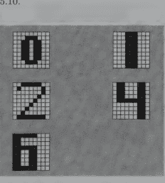

图5.8：输入模式

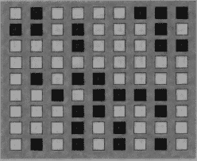

图5.9：含噪模式

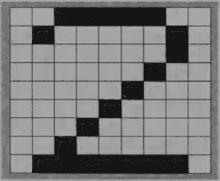

图5.10：网络在81次迭代后收敛

## 5.5 示例5：多层网络的广义Delta学习规则与误差反向传播

本示例展示了反向传播网络中广义学习规则和误差反向传播的实现。

```matlab
% - - - - - - - - - - - - - - - - - -
% Main Program
% - - - - - - - - - - - - - - - - - -

% Load data
load housing.txt
X = housing(:,1:13);
t = housing(:,14);

% Scale to zero mean, unit variance and introduce bias on input.
xmean = mean(X);
xstd = std(X);
X = (X - ones(size(X,1),1)*xmean)./(ones(size(X,1),1)*xstd);
X = [ones(size(X,1),1) X];
tmean = mean(t);
tstd = std(t);
t = (t-tmean)/tstd;

% Iterate over a number of hidden nodes
maxHidden = 2;
for numHidden=1:maxHidden

% Initialise random weight vector.
% Wh are hidden weights, wo are output weights.
randn('seed', 123456);
Wh = 0.1*randn(size(X,2),numHidden);
wo = 0.1*randn(numHidden+1,1);

% Do numEpochs iterations of batch error back propagation.
numEpochs = 2000;
numPatterns = size(X,1);

% Set eta
eta = 0.05/numPatterns;
for i=1:numEpochs
                % Calculate outputs, errors, and gradients
                phi = [ones(size(X,1),1) tanh(X*Wh)];
                y = phi*wo;
                err = y-t;
                go = phi'*err;
                Gh = X'*((1 - phi(:,2:numHidden+1).^2).*(err*wo(2:numHidden+1)'));
                % Perform gradient descent.
                wo = wo - eta*go;
                Wh = Wh - eta*Gh;
                % Update performance statistics.
                mse(i) = var(err);
end

plot(1:numEpochs, mse, '-r')
hold on
end

fsize=15;
set(gca,'xtick',[0:500:2000],'FontSize',fsize)
set(gca,'ytick',[0:0.5:1],'FontSize',fsize)
xlabel('Number of Epochs','FontSize',fsize)
ylabel('Mean Squared Error','FontSize',fsize)
hold off

% --------------------------
% End of Main
% --------------------------
```

### 观察结果

多层网络的广义delta学习规则和误差反向传播的性能统计如图5.11所示。可以发现，均方误差随着训练轮数的增加而减小。

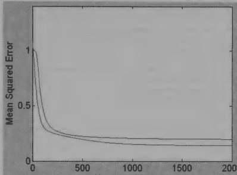

图5.11：广义Delta规则与误差反向传播示意图

## 5.6 示例6：使用学习向量量化对心脏病进行分类

以下程序演示了使用MATLAB通过LVQ将正常人与病人进行分类。这是Kohonen学习规则的有监督版本。原始数据包含13个属性和一个类别属性。根据属性值，网络将区分正常人和病人。

为项目选择的数据集是克利夫兰心脏病数据库。给出了所有属性名称及其取值，以便读者理解程序的目的。

```matlab
% PROGRAM FOR DIGITAL(BIPOLAR) INPUT DATA
clc;
tic;
m=4;
x5=load('heartdata00.txt'); % loading input datas from the file
c3=size(x5)*[1;0]; % calculating size of matrix.
u=size(x5)*[0;1];
```


```matlab
prompt1={'Percentage of datas to be trained',
 'Percentage of datas to be tested',
 'Enter the value of learning rate'};
dlgTitle1='HEART DISEASE DIAGNOSIS USING LEARNING VECTOR
QUANTISATION NETWORK';
lineNo=1;
answer1=inputdlg(prompt1,dlgTitle1,lineNo);
per=str2double(answer1(1));
per1=str2double(answer1(2));
al=str2double(answer1(3));
pe=per/100;
v=round(pe*c3);
% Separating the input attributes and the target from the
% input file
for s1=1:m
    for i=1:c3
        if(x5(i,u)==(s1-1))
            for(j=1:u)
                temp=x5(s1,j);
                x5(s1,j)=x5(i,j);
                x5(i,j)=temp;
            end
        end
    end
end
for i=1:c3
    for j=1:u
        if((j==u))
            t(i)=x5(i,j);
        end
    end
end
for i=1:c3
    for j=1:u-1
        x(i,j)=x5(i,j);
    end
end
for i=1:c3
    for j=1:u-1
        if x(i,j)==0
            x(i,j)=.05;
        end
    end
end
% Normalizing the datas
q2=size(x)*[0;1];
p2=size(x)*[1;0];
y=max(x,[],1);
z=min(x,[],1);
for i=1:q2
    if y(i)==z(i)
        e(i)=y(i)-z(i);
    else
        e(i)=1;
        z(i)=0;
    end
end
for i=1:p2
    for j=1:q2
        x(i,j)=(x(i,j)-z(j))/(e(j));
    end
end
% Initialising the weight matrix
for i=1:u-1
    for j=1:4
        w(i,j)=x(j,i);
    end
end
% Converting the normalized data into bipolar form
for i=1:p2
    for j=1:q2
        if x(i,j)>.3
            x(i,j)=1;
        else
            x(i,j)=-1;
        end
    end
end
q=size(x)*[0;1];
p=size(x)*[1;0];
N=0;
% Stopping condition.
while (al>0.000000001)
    N=N+1;
% Calculating the distance by using Euclidean distance
% method
    for i=5:v
        for k=1:4
            d(k)=0;
            for j=1:u-1
                d(k)=d(k)+[x(i,j)-w(j,k)]^2;
            end
        end
        b=min(d);
% Finding the winner
        for l=1:4
            if (d(l)==b)
                J=l;
            end
        end
% Weight updation
        for f=1:q
            if (t(J)==t(i))
                w(f,J)=w(f,J)+al*[x(i,f)-w(f,J)];
            else
                w(f,J)=w(f,J)-al*[x(i,f)-w(f,J)];
            end
        end
    end
% Reducing the learning rate
    al=al/2;
end
% LVQ Testing
pe1=per1/100;
v1=round(pe1*c3);
for i=1:v1
    for j=1:u-1
        x1(i,j)=x(i,j);
    end
end
p1=size(x1)*[0;1];
q1=size(x1)*[1;0];
count=0;
if (x1(i,j)>.3)
    x1(i,j)=1;
else
    x1(i,j)=-1;
end
for i=1:v1
    t1(i)=t(i);
end
for i=1:q1
    for k=1:m
        d1(k)=0;
        for j=1:p1
            d1(k)=d1(k)+[ (x1(i,j)-w(j,k))]^2;
        end
    end
    c1=min(d1);
    for a=1:m
        if(d1(a)==c1)
            O1=a-1;
        end
    end
    if (O1==t1(i))
        count=count+1;
    end
end
% calculating the efficiency.
eff=round(count*100/(v1));
sec=toc;
% Result display
clc;
prompt={'Total number of datas available  ',...
        'Number of training inputs presented',...
        'Number of testing inputs presented',...
        'Number of recognized datas',...
        'Number of iterations performed',...
        'Efficiency','Execution time'};
c31=num2str(c3) ;
v2=num2str(v) ;
vs=num2str(v1) ;
count1=num2str(count);
N1=num2str(N) ;
eff1=num2str(eff) ;
sec1=num2str(sec);
def={c31,v2,vs,count1,N1,eff1,sec1};
dlgTitle='Result';
lineNo=1;
answer=inputdlg(prompt,dlgTitle,lineNo,def);
```

```matlab
% PROGRAM FOR ANALOG INPUT DATA
clc;
tic;
m=4;
x5=load('heartdata00.txt'); % loading input datas from
    the file heart data.
c3=size(x5)*[1;0]; % calculating size of matrix.
u=size(x5)*[0;1];
prompt1={'Percentage of datas to be trained',
'Percentage of datas to be tested','Enter the value
of learning rate'};
dlgTitle='HEART DISEASE DIAGNOSIS USING
                    LEARNING VECTOR QUANTIZATION NETWORK';
lineNo=1;
answer1=inputdlg(prompt1,dlgTitle,lineNo);
per=str2double(answer1(1));
per1=str2double(answer1(2));
al=str2double(answer1(3));
pe=per/100;
vs=round(pe*c3);
% Separating the input attributes and the target from the
% input file
for s1=1:m
    for i=1:c3
        if(x5(i,u)==(s1-1))
            for(j=1:u)
                temp=x5(s1,j);
                x5(s1,j)=x5(i,j);
                x5(i,j)=temp;
            end
        end
    end
end
for i=1:c3
    for j=1:u
        if(j==u)
            t(i)=x5(i,j);
        end
    end
end
for i=1:c3
    for j=1:u-1
        x(i,j)=x5(i,j);
    end
end
for i=1:c3
    for j=1:u-1
        if x(i,j)==0
            x(i,j)=.05;
        end
    end
end
% Normalizing the datas
q2=size(x)*[0;1];
p2=size(x)*[1;0];
y=max(x,[],1);
z=min(x,[],1);
for i=1:q2
    if y(i)==z(i)
        e(i)=y(i)-z(i);
    else
        e(i)=1;
        z(i)=0;
    end
end
for i=1:p2
    for j=1:q2
        x(i,j)=(x(i,j)-z(j))/(e(j));
    end
end
% Initialising the weight matrix
for i=1:u-1
    for j=1:4
        w(i,j)=x(j,i);
    end
end
q=size(x)*[0;1];
p=size(x)*[1;0];
N=0;
% Stopping condition
while (al>0.000000001)
    N=N+1;
    % Calculating the distance by using Euclidean distance method
        for i=5:vs
            for k=1:4
                d(k)=0;
                for j=1:u-1
                    d(k)=d(k)+(x(i,j)-w(j,k))^2;
                end
            end
        b=min(d);
% Finding the winner
    for l=1:4
        if (d(l)==b)
            J=l;
        end
    end
% Weight updation
    for f=1:q
        if(t(J)==t(i))
            w(f,J)=w(f,J)+al*[x(i,f)-w(f,J)];
        else
            w(f,J)=w(f,J)-al*[x(i,f)-w(f,J)];
        end
    end
end
% Reducing the learning rate
    al=al/2;
end
% LVQ Testing
pe1=per1/100;
v1=round(pe1*c3);
for i=1:v1
    for j=1:u-1
        x1(i,j)=x(i,j);
    end
end
p1=size(x1)*[0;1];
q1=size(x1)*[1;0];
count=0;
for i=1:v1
    t1(i)=t(i);
end
for i=1:q1
    for k=1:m
        d1(k)=0;
        for j=1:p1
            d1(k)=d1(k)+[x1(i,j)-w(j,k)]^2;
        end
        c1=min(d1);
        for a=1:m
```

**表 5.5：数字输入的效率与时间**

| 训练向量 | 测试向量 | 时间（秒） | 识别向量 | 效率 |
|---|---|---|---|---|
| 83(20%) | 331(80%) | 0.141 | 282 | 85.19% |
| 166(40%) | 248(60%) | 0.109 | 202 | 81.46% |
| 248(60%) | 166(40%) | 0.062 | 154 | 92.77% |
| 331(80%) | 83(20%) | 0.047 | 82 | 98.92% |

### 观察结果

表 5.4 和表 5.5 展示了 LVQ 对模拟输入和数字输入的结果，具有最优的效率和耗时。学习率 alpha 从 0.1 变化到 0.9，结果发现当 alpha 值为 0.1 时获得最大效率。程序中使用了以下参数：

- 实例总数：414
- 属性总数：13
- 类别数：4

训练向量数量越多，效率越高；并且如果训练向量数量更多，程序完整执行所需的时间更少。训练模式数量越多，网络识别模式的速度越快。

## 5.7 示例 7：使用 MATLAB Simulink 的神经网络

一个系统由一阶差分方程描述

y(k + 2) = 0.3y(k + 1) + 0.6y(k) + f(u(k))

其中 f(u(k)) = u^3 + 0.3u^2 - 0.4u，且 u(k) 为随机噪声。

在适当范围内为 f(u) 生成数据，并对数据拟合一个神经网络。对精确的 f(u) 和神经网络近似分别仿真系统响应。初始条件可设为零。输入可假定为噪声。Simulink 模型如图 5.12 所示。

可以使用以下命令以多种方式获得神经网络近似

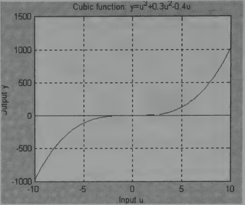

**图 5.13：** 仿真结果

## 小结

本章提供了不同的 MATLAB 程序，供用户理解并依据所需应用编写程序。

## 复习题

- 1. 考虑 MATLAB 中的 humps 函数。它由 \(y = \frac{1}{(x-3)^2 + 1} + \frac{1}{(x-0.9)^2 + 0.04} - 6\) 给出。使用 MATLAB 找到一个神经网络来拟合由 humps 函数在 [0,2] 之间生成的数据。对数据拟合一个多层感知机网络。尝试不同的网络规模和不同的训练算法。
- 2. 考虑由 \(z = \cos(x)\sin(y)\) 描述的一个曲面，其定义在正方形 \(-2 \leq x \leq 2, -2 \leq y \leq 2\) 上。将曲面 \(z\) 绘制为……的函数


x 和 y 的。设计一个神经网络，使用 MATLAB 拟合数据。

- 3. 考虑贝塞尔函数 Jα(t)，它们是微分方程 t²y″ − t y′ + (t² − α²)y = 0 的解。在 MATLAB 中实现反向传播网络，以在 t ∈ [0, 20] 时近似一阶贝塞尔函数 J₁，α = 1。
- 4. 使用 Kohonen SOM 网络分析一个生物医学数据集（例如 Iris 数据集、乳腺癌数据集等）。从 ASCII 文件读取数据并对数据进行归一化。数据归一化后，训练特征映射并使用 MATLAB 分析数据。
- 5. 编写一个 MATLAB 程序，使用 Hopfield 网络求解旅行商问题。
- 6. 使用前馈神经网络在 MATLAB 中模拟并分析控制系统中 PID 整定的行为。

# 第6章

## 6.1 引言

模糊逻辑由加利福尼亚大学伯克利分校计算机科学教授 Lotfi A. Zadeh 于 1965 年创立。基本上，模糊逻辑（FL）是一种多值逻辑，它定义了介于真/假、是/否、高/低等传统评价之间的中间值。这些中间值可以用数学方式表述并由计算机处理，以便应用一种更类似人类的思维方式。基于亚里士多德及其他后来的数学家，人们提出了所谓的“思维定律”。其中之一是“排中律”，它指出每个命题必须要么为真，要么为假。甚至在巴门尼德提出该定律的第一个版本时（约公元前 400 年），就立即出现了强烈的反对意见：例如，赫拉克利特提出事物可以同时为真又不为真。正是柏拉图为何以成为模糊逻辑的理论奠定了基础，他指出存在一个第三区域（超越真与假），这些对立面在其中“翻滚不定”。其他更现代的哲学家也呼应了他的观点，尤其是黑格尔、马克思和恩格斯。卢卡西维茨提出了一种替代亚里士多德二值逻辑的方法。模糊逻辑已发展成为用于控制和操纵系统及复杂工业过程、以及家用和娱乐电子产品的有用工具。

考察模糊逻辑的演进，可以分辨出三个主要阶段。第一阶段从 1965 年到 1973 年，主要关注模糊化，即集合概念的推广，将二值特征函数推广为在单位区间内取值、或更一般地在格中取值的隶属函数。所处理的基本问题和应用大多本质上是集合论的，逻辑和推理并未处于舞台中心。第二阶段从 1973 年到 1999 年，以两个关键概念开始：(a) 语言变量的概念；(b) 模糊 if-then 规则的概念。如今，模糊集合论和模糊逻辑的几乎所有应用都涉及这些概念的使用。如今，模糊逻辑在两种不同意义上应用于各种场合：

- **狭义**——在狭义上，模糊逻辑（缩写为 FL）是一种逻辑系统，是多值逻辑的推广
- **广义**——在广义上，模糊逻辑缩写为 FL，是 FLn、模糊集合论、可能性理论、模糊 if-then 规则演算、模糊算术、模糊量词演算及相关概念与演算的并集

FL 的显著特征是，在 FL 中一切事物都是、或被允许成为程度问题。在演进的第二阶段，可能最显著的增长是模糊控制的快速发展，以及模糊逻辑应用（尤其是在日本）的繁荣。

模糊逻辑相关的基础与应用理论还有许多其他重大发展，其中包括可能性理论与可能性逻辑的起源、知识表示、决策分析、聚类分析、模式识别、模糊算术、模糊数学规划、模糊拓扑，以及更一般地，模糊数学。模糊控制应用激增，但其在文献中的主导地位变得不那么明显。

标志着第三阶段开始的一项重要发展是 1999 年的“从数字计算到词语计算”。基本上，词语与感知计算的发展将模糊逻辑的早期脉络汇集在一起，并提出科学理论应基于模糊逻辑，而不是像目前那样基于亚里士多德式的二值逻辑。精确化自然语言（PNL）概念是词语计算领域的关键组成部分。PNL 为自然语言在技术假设中的用途的重大扩展提供了空间。很可能在未来几年，模糊逻辑尤其是 PNL 最重要的应用领域之一将是互联网，其核心是搜索引擎和问答系统的构思与设计。

自诞生以来，模糊逻辑一直并在某种程度上仍然是怀疑与争议的对象。对模糊逻辑的不相信，体现了这样一个现实：在英语中，“fuzzy”一词通常带有贬义。仅仅是因为，放弃二值性打破了将科学理论建立在二值逻辑之上的数百年传统，所以模糊逻辑难以被接受。

这可能需要一些时间，但最终放弃二值性将被视为科学与人类思想演进中的一种逻辑发展。本章将讨论基本模糊集合、模糊集合上的运算、模糊集合之间的关系、合成以及模糊算术。还会展示一些 MATLAB 程序，涉及隶属函数、模糊运算、模糊算术、关系和合成等主题。

## 6.2 不精确性与不确定性

模糊性不应与其他形式的不精确性和不确定性相混淆。不精确性和不确定性有若干类型，而模糊性只是其中的一个方面。不精确性和不确定性可能存在于测量、概率或描述等方面。测量中的不精确性与缺乏精确知识有关。有时测量是不准确、不精确或置信度低的。

作为概率形式的不精确性与事件或现象未来发生的不确定性有关。它涉及非确定性事件的可能性（随机不确定性）。一个例子是“明天可能下雨”这一陈述，它表现出一定程度的随机性。

描述中的不精确性是模糊逻辑所处理的那类不精确性。它是自然语言中的歧义性、模糊性、定性或主观性（语言、词汇或语义不确定性）。它是在概念定义或诸如“高层建筑”或“低分”等术语含义中发现的歧义性。它也是人类思维即感知和解释中的歧义性。本质上模糊的陈述的例子有“血红蛋白计数非常低。”和“与 Ike 相比，Teddy 相当重。”

因此，模糊性与随机性的本质相当不同。它们是不精确性和不确定性的不同方面。前者传达主观的人类思维、感受或语言，后者表示自然科学中的客观变化。

模糊模型和统计模型也拥有哲学上不同类型的信息：模糊隶属度包含对象与不精确定义属性之间的相似性，而概率传达关于相对频率的信息。因此，模糊性处理的是确定性合理性，而不是非确定性概率。

## 6.3 清晰逻辑与模糊逻辑

模糊逻辑在定性与定量建模这两个领域之间架起桥梁。尽管此类模型的输入-输出映射作为定量映射集成到系统中，但在内部它可以被视为一组定性语言规则。自 1965 年 Zadeh 和 1975 年 Mamdani 的开创性工作以来，由模糊

逻辑已被应用于许多不同类型的信息处理，包括控制系统。

模糊逻辑这一术语意味着，在某种意义上，其方法论分析是模糊的或定义不良的。模糊逻辑发展的基本思想源于设计这类模糊或定义不良系统的需求。这些定义不良的系统无法基于传统二值逻辑运行；因此，采用基于数学理论的模糊方法论分析。

最常见的二值逻辑与集合论被定义为“一个元素属于由所有可能元素构成的集合；并且给定任意特定子集，该元素是该子集的成员或不是其成员。”例如，一只老虎属于所有动物构成的集合。人类推理可以通过这种方式得到增强。同样，许多情况可以用不同类型的集合来描述。考虑以下基本陈述

> *如果水果是红色的 AND 成熟，那么该水果是成熟的*

该规则以完全精确的方式适用于世界各地的许多人。上述规则使用诸如交集运算符 AND 之类的运算符构成，这些运算符对集合进行操作。

最终，并非所有参数都能用二值集合来描述。例如，将人分类为男性和女性很容易，但将其分类为高或不高则有问题。高个子集合要难定义得多，因为不存在定义“高”的精确值。这类问题常常被变通处理，以便能够用现有熟知技术来刻画。例如，身高1.80 m可被定义为高，如图6.1(a)所示。这种清晰推理不会产生平滑的结果，因为身高1.79 m的人或身高1.8 m的人会产生不同的结果。

扎德提出模糊逻辑，作为一种模仿人类推理能力的方法：它使用少量规则，并通过插值过程仍产生平滑输出。它形成基于多值逻辑的规则，从而引入了集合隶属关系的概念。使用模糊逻辑，可以判定一个成分属于某个集合；这种分配由隶属函数完成。例如，身高1.79 m的人会以特定隶属度同时属于“高”和“不高”两个集合。同样，隶属度会随人的身高成比例地增加或减少，如图6.1(b)所示。模糊逻辑思维系统的输出会对相似输入产生类似结果。模糊逻辑理论只是传统逻辑的延伸：其中可以存在部分集合隶属关系，规则条件可以被部分满足，系统输出通过插值计算。因此，在等效二值规则库上，输出是平滑的。这一特性对控制系统应用尤其关键。

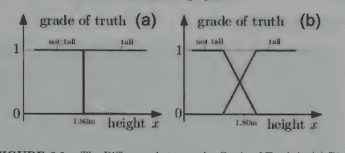

**图6.1：**（a）二值逻辑0、1与（b）模糊逻辑[0,1]中真值等级的差异

模糊逻辑控制系统是指至少有一个系统组件使用模糊逻辑进行内部知识表示的系统。尽管模糊系统可以使用模糊集来传递信息，但大多数应用只有一个模糊系统组件，通过确定性值与常规系统组件通信。在这种情况下，以及在本章中，模糊逻辑仅用于内部知识表示，而在外部可视为与其他任何系统组件相同。

## 6.4 模糊集

集合的数学理论已被扩展以创建模糊集。集合论最初由德国数学家格奥尔格·康托尔（1845—1918）提出。他的集合论在他生前遭到更多反对，但后来大多数数学家认为，几乎所有的数学概念都可以用集合论语言表达。

### 传统集合

集合由若干对象的汇集组成，这些对象总体上可以作为一个整体成分来处理。根据康托尔的观点，集合是来自给定论域的一个对象。术语集合、汇集和类是同义词，正如术语项、元素和成员是同义词一样。日常交谈中几乎任何被称为集合的东西，在数学意义上都是可接受的集合，如下例所示。

### 示例1（集合）：

以下都是定义明确的列表或对象汇集，因此可以称为集合：

- (a) 小于4的非负整数集合。这是一个包含四个成员0、1、2和3的有限集。
- (b) 英国某博物馆地下室中活恐龙构成的集合。该集合没有成员，称为空集。
- (c) 大于10 V的测量值集合。尽管该集合是无限的，但仍可确定给定测量值是否为该集合的成员。

集合可以由其成员指定；成员完全刻画一个集合。成员列表 \(A = \{0, 1, 2, 3\}\) 指定了一个有限集。不可能列出无限集的所有元素；相反，我们必须陈述某种刻画集合中元素的属性，例如谓词 \(x > 10\)。该集合由论域中使谓词为真的元素定义。因此，描述集合有两种方式：以列表显式描述，或以谓词隐式描述。在经典集合论中，集合可以通过枚举其所有元素表示为

\[
A = \{a_1, a_2, \ldots, a_n\}
\]

其所有成员的隶属度由此描述一个模糊集。一个项的隶属度通常是0到1之间的实数，常用希腊字母 \(\mu\) 表示。数值越高，隶属度越高。扎德将康托尔的集合视为一种特殊情况，其中元素具有完全隶属，即 \(\mu = 1\)。如果 \(A\) 的元素 \(a_i\)（\(i=1, \ldots, n\)）共同构成通用基础集 \(X\) 的一个子集，则集合 \(A\) 可对所有元素 \(x \in X\) 由其特征函数表示为

\[
\mu_A(x)=
\begin{cases}
1 & \text{if } x\in A \\
0 & \text{otherwise}
\end{cases}
\qquad (6.1)
\]

在经典集合论中，\(\mu_A(x)\) 仅取值0（“假”）和1（“真”），因此有两个真值。这样的集合也称为清晰集。

非清晰集称为模糊集，对于模糊集也可以定义特征函数。该函数是式(6.1)的推广，称为隶属函数。模糊集的隶属关系由 \(A\) 的这个隶属函数 \(\mu_A(x)\) 描述，它将每个元素 \(x \in X\) 与一个隶属度 \(\mu_A(x)\) 相关联。与经典集合论相反，模糊集的隶属函数 \(\mu_A(x)\) 可以在归一化闭区间 \([0,1]\) 内具有任意真值等级。因此，每个隶属函数将给定通用基础集 \(X\)（其本身是清晰集）的元素映射为 \([0,1]\) 中的实数。模糊集 \(A\) 的隶属函数 \(\mu_A(x)\) 的记号

\[
A : X \to [0,1] \qquad (6.2)
\]

即被采用。每个模糊集都由一个特定的隶属函数完全且唯一地定义。因此，隶属函数的符号也用作相关模糊集的标签。也就是说，每个模糊集及其隶属函数都用同一个大写字母表示。由于清晰集及其相关特征函数可分别视为模糊集和隶属函数的特殊情况，因此清晰集也使用相同的记号，如图6.2所示。


**图6.2：** 清晰集C与模糊集F的隶属函数

基础集 \(X\) 作为全集引入。在实际应用中，考虑的是定义在某个区间内的物理量或类似量。当这些量用集合描述时，基础集可以无缝推广为存在于定义区间内的清晰基础集 \(X\)。这是对模糊集的推广。基础集并不总是清晰集。另一种推广是基础集本身就是一个模糊集。

## 6.5 论域

模糊集的组成元素取自论域（universe）。论域包含可考虑的全部元素。下面的示例说明论域的应用。


**图 6.3：** 集合“非常矮”“中等”和“非常高”由“矮”和“高”派生而来

### 示例 2：（论域）

- (a) “人”这个集合可以以世界上所有人类作为其论域。或者，它也可以是 4 到 6 英尺之间的数值；这些数值将表示人的身高，如图 6.3 所示。

当我们处理非数值量时，例如味道，它无法用数值尺度来衡量，我们就不能使用数值论域。此时称这些元素取自一个*心理连续统*；这种论域的一个例子可以是{苦、甜、酸、咸、辣，……}。

## 6.6 隶属函数

隶属函数 μ_A(x) 描述基础集 X 的元素 x 在模糊集 A 中的隶属情况，其中 μ_A(x) 可以取一大类函数。合理的函数通常是分段线性函数，例如三角形函数或梯形函数。

隶属函数 μ_A(x) 的隶属度 μ_A(x₀) 描述了对于特殊元素 x=x₀，它属于模糊集 A 的程度等级。该值位于单位区间 [0,1] 内。当然，x₀ 可以同时属于另一个模糊集 B，从而 μ_B(x₀) 表征 x₀ 对 B 的隶属度。这种情况如图 6.4 所示。


**图 6.4：** x₀ 在集合 A 和 B 中的隶属度：μ_A(x₀)=0.75，μ_B(x₀)=0.25

一个50岁的人在“年轻”集合中的隶属情况取决于个人观点。隶属度是一种精确但主观的度量，取决于上下文。模糊隶属函数不同于统计概率分布。下面的吃鸡蛋示例说明了这一点。

### 示例 3：（概率与可能性）

```
Consider the statement “Hans ate X eggs for breakfast”, where X ∈ U = {1,2,3,...,8}. We may associate a probability distribution p by observing Hans eating breakfast for 100 days.

U={1, 2, 3, 4, 5, 6, 7, 8}
p={.1, .8, .1, 0, 0, 0, 0, 0}

A fuzzy set expressing the grade of ease with which Hans can eat eggs may be the following possibility distribution Π

U={1, 2, 3, 4, 5, 6, 7, 8}
Π={1, 1, 1, 1, .8, .6, .4, .2}

Where the possibility for X = 3 is 1, the probability is only 0.1. The example shows, that a possible event does not imply that it is probable. However, if it is probable it must also be possible. You might view a fuzzy membership function as the personal distribution, in contrast with a statistical distribution based on observations.
```

### 6.6.1 隶属函数的类型

原则上，任何形如 A:X→[0,1] 的函数都描述一个与模糊集 A 相关联的隶属函数，该函数不仅取决于所要表示的概念，还取决于其使用情境。函数图形可以具有不同形状，并可能具有特定性质。某个特定形状是否合适，只能在应用情境中确定。然而，在某些情况下，模糊集所捕捉的语义含义对形状变化不太敏感，因而简单函数较为方便。在许多实际情形中，模糊集可以通过参数化函数族显式表示，最常见的是以下几种：

- 1. 三角函数
- 2. Γ函数
- 3. S函数
- 4. 梯形函数
- 5. 高斯函数
- 6. 指数函数

上述常见隶属函数的隶属函数定义在以下各节中给出：

#### 三角函数

三角函数的隶属定义如下：

$$
A(x) = \begin{cases}
0, & \text{if } x \le a \\
\frac{x-a}{m-a}, & \text{if } x \in [a,m] \\
\frac{b-x}{b-m}, & \text{if } x \in [m,b] \\
0, & \text{if } x \ge b
\end{cases} \tag{6.3}
$$

其中 m 是模态值，a 和 b 分别表示 A(x) 非零值的下界和上界。有时使用显式突出隶属函数参数的记号更方便；在这种情况下，

$$
A(x; a, m, b) = \max\{\min[(x-a)/(m-a), (b-x)/(b-m)], 0\} \tag{6.4}
$$

#### Γ函数

Γ函数的隶属定义如下：

$$
A(x) = \begin{cases}
0, & \text{if } x \le a \\
1 - e^{-k(x-a)^2}, & \text{if } x > a
\end{cases} \quad (6.5)
$$

或

$$
A(x) = \begin{cases}
0, & \text{if } x \le a \\
\frac{k(x-a)^2}{1+k(x-a)^2}, & \text{if } x > a
\end{cases}
$$

其中 k>0。

#### S函数

S函数的隶属定义如下：

$$
A(x) = \begin{cases}
0, & \text{if } x \le a \\
2\left(\frac{x-a}{b-a}\right)^2, & \text{if } x \in [a,m] \\
1-2\left(\frac{x-b}{b-a}\right)^2, & \text{if } x \in [m,b] \\
1, & \text{if } x > b
\end{cases} \quad (6.6)
$$

点 \(m=(a+b)/2\) 称为 S 函数的交叉点。

#### 梯形函数

梯形函数的隶属定义如下：

$$
A(x) = \begin{cases}
0, & \text{if } x \le a \\
\frac{x-a}{b-a}, & \text{if } x \in [a,b] \\
1, & \text{if } x \in [b,c] \\
\frac{d-x}{d-c}, & \text{if } x \in [c,d] \\
0, & \text{if } x \ge d
\end{cases} \quad (6.7)
$$

使用等价记号，可得

$$
A(x;a,m,n,b)=\max\{\min[(x-a)/(m-a),1,(b-x)/(b-n)],0\} \quad (6.8)
$$

#### 高斯函数

高斯函数的隶属定义如下：

$$
A(x) = e^{-\frac{(x-c)^2}{2\sigma^2}}, \text{ where } 2\sigma^2 > 0. \quad (6.9)
$$


**图 6.5：** 隶属函数

#### 指数函数

指数函数的隶属定义如下：

$$
A(x)=\frac{1}{1+k(x-m)^2},\quad k>1
$$

或

$$
A(x)=\frac{k(x-m)^2}{1+k(x-m)^2},\quad k>0
$$

图 6.5 展示了几个隶属函数。

### 6.6.2 MATLAB 模糊逻辑工具箱中的隶属函数

隶属函数真正必须满足的唯一条件是其取值必须在 0 和 1 之间变化。函数本身可以是任意曲线，其形状可以定义为从简单性、便利性、速度和效率角度适合我们的函数。经典集合可以表示为

$$
A=\{x\mid x>6\}
$$

模糊集是经典集合的扩展。如果 X 是论域，其元素用 x 表示，那么 X 中的模糊集 A 定义为有序对的集合。

$$
A=\{(x,\mu_A(x))\mid x\in X\}
$$

μ_A(x) 称为 x 在 A 中的隶属函数（或 MF）。隶属函数将 X 的每个元素映射为 0 到 1 之间的隶属值。

模糊逻辑工具箱包括 11 种内置隶属函数类型，如图 6.6 所示。这 11 个函数又由若干基本函数构建：分段线性函数、高斯分布函数、S 形曲线，以及二次和三次多项式曲线。按惯例，所有隶属函数名称末尾都带有字母 mf。最简单的隶属函数由直线构成。其中最简单的是三角隶属函数，其函数名为 trimf，它由三个点组成一个三角形。梯形隶属函数 trapmf 具有平顶，只是一个截断的三角形曲线。这些直线型隶属函数的优点是简单。

有两个隶属函数建立在高斯分布曲线上：一个简单高斯曲线，以及两个不同高斯曲线的双侧复合。这两个函数是 gaussmf 和 gauss2mf。广义钟形隶属函数由三个参数指定，函数名为 gbellmf。钟形隶属函数比高斯隶属函数多一个参数，因此如果调整自由参数，它可以逼近非模糊集。由于平滑且记号简洁，高斯和钟形隶属函数是指定模糊集的常用方法。高斯和钟形隶属函数都具有在所有点表示平滑且非零输出的优点。尽管这些曲线具有平滑性，但它们不能指定非对称隶属函数，而非对称隶属函数在某些关键应用中起着至关重要的作用。

S 形隶属函数要么向左开放，要么向右开放。非对称且闭合（即不向左或向右开放）的隶属函数可以用两个 S 形函数合成。除基本的 sigmf 外，还提供两个 S 形函数之差 dsigmf，以及两个 S 形函数之积 psigmf。

模糊逻辑工具箱中的各种隶属函数是基于多项式的曲线。三个相关的隶属函数是 Z、S 和 Pi 曲线，均因其形状而得名。函数 zmf 是向左开放的非对称多项式曲线，smf 是向右开放的镜像函数，pimf 在两端为零、中间上升。在这方面，挑选首选隶属函数有非常大的选择余地。用户也可以使用模糊逻辑工具箱创建自己的隶属函数。


**图6.6：** MATLAB模糊逻辑工具箱中的隶属函数。（a）三角形隶属函数（b）梯形隶属函数（c）简单高斯隶属函数（d）双边复合高斯隶属函数（e）广义钟形隶属函数（f）S形隶属函数（g）差分S形隶属函数（h）乘积S形隶属函数（i）Z曲线隶属函数（j）π曲线隶属函数（k）S曲线隶属函数

### 6.6.3 使用MATLAB代码模拟隶属函数

#### 三角隶属函数

```matlab
y = trimf(x,params)
y = trimf(x,[a b c])
```

三角曲线是向量x的函数，依赖于三个标量参数a、b和c，如式(6.3)所示，更紧凑地表示为

$$f(x; a,b,c)=\max\left(\min\left(\frac{x-a}{b-a},\frac{c-x}{c-b}\right),0\right)$$

参数a和b确定了三角形的“底边”，参数c确定了“峰值”。

**代码**

```matlab
% Triangular membership function
x=0:0.1:10;
y=trimf(x,[3 6 8]);
plot(x,y)
xlabel('trimf, P=[3 6 8]');
title('Triangular Membership Function');
```

**输出**

由上述代码绘制的三角隶属函数如图6.7所示。


**图6.7：** 三角隶属函数

#### 梯形隶属函数

**语法**

```matlab
y = trapmf(x,[a b c d])
```

梯形曲线是向量x的函数，依赖于四个标量参数a、b、c和d，如式(6.7)所示，更紧凑地表示为

$$f(x;a,b,c,d)=\max\left(\min\left(\frac{x-a}{b-a},1,\frac{d-x}{d-c}\right),0\right)$$

参数a和d确定了梯形的“底边”，参数b和c确定了“肩部”。

**代码**

```matlab
% Trapezoidal membership function
x=0:0.1:10;
y=trapmf(x,[1 3 5 9]);
plot(x,y)
xlabel('trapmf, P=[1 3 5 9]')
title('Trapezoidal Membership Function');
```

**输出**

由上述代码绘制的梯形隶属函数如图6.8所示。


**图6.8：** 梯形隶属函数

#### 高斯隶属函数

**语法**

```matlab
y = gaussmf(x,[sig c])
```

对称高斯函数依赖于两个参数σ和c，如式(6.9)所示。`gaussmf` 的参数在向量 `[sig c]` 中按顺序表示参数σ和c。

**代码**

```matlab
% Gaussian membership function
x=0:0.1:10;
y=gaussmf(x,[1 6]);
plot(x,y)
xlabel('gaussmf, P=[1 6]')
title('Gaussian Membership Function');
```

**输出**

由上述代码绘制的高斯隶属函数如图6.9所示。


**图6.9：** 高斯隶属函数

#### 广义钟形隶属函数

**语法**

```matlab
y = gbellmf(x,params)
```

广义钟形函数依赖于三个参数a、b和c，如下所示：

$$f(x;a,b,c)=\frac{1}{1+\left|\frac{x-c}{a}\right|^{2b}}$$

其中参数b通常为正。参数c确定曲线的中心。参数向量 `params` 是 `gbellmf` 的第二个参数，其元素分别为a、b和c。

**代码**

```matlab
% Generalized Bell Shaped membership function
x=0:0.1:10;
y=gbellmf(x,[1 3 7]);
plot(x,y)
xlabel('gbellmf, P=[1 3 7]')
title('Generalized Bell Shaped Membership Function');
```

**输出**

由上述代码绘制的广义钟形隶属函数如图6.10所示。


**图6.10：** 广义钟形隶属函数

#### S形隶属函数

**语法**

```matlab
y = sigmf(x,[a c])
```

S形函数 `sigmf(x,[a c])` 是由下述 f(x,a,c) 给出的向量x上的映射，依赖于两个参数a和c。

$$f(x;a,c)=\frac{1}{1+e^{-a(x-c)}}$$

根据参数a的符号，S形隶属函数本质上是向右或向左开放的，因此适合表示“很大”或“很小”等概念。可以通过取两个不同S形隶属函数的乘积（psigmf）或差（dsigmf）来构造各种传统隶属函数。

**代码**

```matlab
% Sigmoidal Shaped membership function
x=0:0.1:10;
y=sigmf(x,[3 6]);
plot(x,y)
xlabel('sigmf, P=[3 6]')
title('Sigmoidal Shaped Membership Function');
```

**输出**

由上述代码绘制的S形隶属函数如图6.11所示。


**图6.11：** S形隶属函数

#### Z曲线隶属函数

**语法**

```matlab
y = zmf(x, [a b])
```

基于样条的函数之所以被称为Z形，是因为它的形状像字母Z。参数a和b确定了曲线倾斜部分的端点，如式(6.6)所示。

**代码**

```matlab
% Z Curve membership function
x=0:0.1:10;
y=zmf(x,[3 6]);
plot(x,y)
xlabel('zmf, P=[3 6]')
title('Z Curve Membership Function');
```

**输出**

由上述代码绘制的Z曲线隶属函数如图6.12所示。


**图6.13：** π曲线隶属函数

曲线的倾斜部分的端点。

```matlab
% S Curve membership function
x=0:0.1:10;
y=smf(x,[1 8]);
plot(x,y)
xlabel('smf, P=[1 8]')
title('S Curve Membership Function');
```

**输出**

由上述代码绘制的S曲线隶属函数如图6.14所示。


**图6.14：** S曲线隶属函数

### 6.6.4 使用MATLAB在隶属函数之间转换参数

要在隶属函数之间转换参数，MATLAB模糊逻辑工具箱中提供了一个函数 “mf2mf”。该函数的一般语法为

```matlab
outParams = mf2mf (inParams, inType, outType)
```

其中

- `inParams` - 待转换的隶属函数的参数
- `inType` - 待转换的隶属函数类型的字符串名称
- `outType` - 新的隶属函数类型的字符串名称

以下代码将多项式Z曲线隶属函数转换为三角隶属函数。

```matlab
x=0:0.1:5;
mfp1 = [1 2 3];
mfp2 = mf2mf(mfp1,'zmf','trimf');
plot(x,zmf(x,mfp1),x,trimf(x,mfp2))
```

得到的曲线如图6.15所示。


**图6.15：** “mf2mf”函数的示意图

## 6.7 单点

严格来说，模糊集合D是一组有序对的集合

$$A=\{(x,\mu(x))\} \tag{6.11}$$

其中x属于论域，μ(x)是x在A中的隶属度。单独的一个有序对(x,μ(x))称为模糊单点；因此，整个集合可以看作是所有组成单点的并集。通常可以方便地将集合A视为一个向量

$$a = (\mu(x_1), \mu(x_2), \mu(x_3), \ldots, \mu(x_n)) \tag{6.12}$$

因此，这里理解为每个位置i（1,2,3,...,n）对应于包含n个点的论域中的一个点。

## 6.8 语言变量

就像代数变量以数值为值一样，语言变量以单词或句子为值。它可以取值的集合称为其术语集。术语集中的每个值都是定义在基变量上的模糊变量。基变量为术语集中的所有模糊变量定义了论域。简而言之，层次结构如下：语言变量 → 模糊变量 → 基变量。

### 示例4（术语集）

设x是一个标签为“年龄”的语言变量。该语言变量的项（即模糊集合）可以是术语集中的“老”、“年轻”、“非常年轻”。

$$T = \{Old, Very Old, Not So Old, More or Less Young, Quite Young, Very Young\}$$

每一项都是一个定义在基变量上的模糊变量，基变量可能是0到100岁的尺度。

## 6.9 模糊集合的运算

模糊集合运算是经典集合运算的推广。可能存在不止一种推广方式。最广泛使用的运算称为标准模糊集合运算。设U是一个域，A、B是U上的模糊集合。模糊集合有三种基本运算：


**标准模糊补集：** 定义为 \(U\) 上的模糊集 \(\bar A\)，其中对每个 \(x \in U\)，有 \(\bar A(x) = 1 - A(x)\)。

**标准模糊交集：** 定义为 \(U\) 上的模糊集，其中对每个 \(x \in U\)，有 \((A \cap B)(x) = \min[A(x), B(x)]\)。

**标准模糊并集：** 定义为 \(U\) 上的模糊集，其中对每个 \(x \in U\)，有 \((A \cup B)(x) = \max[A(x), B(x)]\)。

满足模糊交集准则的函数称为 t-范数，满足模糊并集准则的函数称为 t-余范数。执行标准模糊交集可得到最大的模糊集，而执行标准模糊并集运算则形成最小的模糊集。

满足 \(A(x) = \bar A(x)\) 的点 \(x \in X\) 称为 \(A\) 的“平衡点”。

符合模糊交集和模糊并集条件的函数在文献中通常分别称为“t-范数”和“t-余范数”。

标准模糊交集是最弱的模糊交集（产生最大的模糊集），而标准模糊并集是最强的模糊并集（产生最小的模糊集）。

模糊交集和模糊并集并未涵盖聚合模糊集的所有运算，但它们是唯一具有结合性的运算。其余聚合运算必须对每个 \(n > 2\) 定义为 \(n\) 个自变量的函数。对任意给定隶属度 \(a_1, a_2, \ldots, a_n\)，产生介于 \(\min(a_1, a_2, \ldots, a_n)\) 和 \(\max(a_1, a_2, \ldots, a_n)\) 之间的隶属度的聚合运算称为“平均运算”。对于给定的模糊集，每个平均运算产生的模糊集都大于任何模糊交集，且小于任何模糊并集。

如果每个 \(x \in X\) 必须是 \(A\)、\(B\) 和/或 \(C\) 的成员，则我们有

$$
B = \bar A \cap \bar C
$$

这意味着，如果一个人不年轻且不年老，那么他一定是中年人。

类似地，

$$
A \cup (A \cap B) = A
$$

证明：

$$
\max[A, \min(A,B)] = \max[A,A] = A \quad \text{if } A(x) \leq B(x)
$$

$$
\max[A, \min(A,B)] = \max[A,B] = A \quad \text{if } A(x) > B(x)
$$

因此它对所有 \(x\) 都成立。

对于定义在有限论域 \(X\) 上的任意模糊集 \(A\)，我们通过公式定义其“标量基数”\(|A|\)：

$$
|A| = \sum_{x \in X} A(x)
$$

有些作者将 \(|A|\) 称为 \(A\) 的“西格玛计数”。

对于定义在有限论域 \(X\) 上的任意一对模糊集，\(A\) 在 \(B\) 中的“子集度”\(S(A,B)\) 定义为

$$
S(A,B) = \frac{|A| - \sum_{x \in X} \max[0, A(x) - B(x)]}{|A|}
= \frac{|A \cap B|}{|A|}
$$

性质：\(A\) 和 \(B\) 是模糊集。对于范围 \([0,1]\) 中的 \(a,b\)，下列性质成立。

- (i) \(a^+ A \subseteq aA\)
- (ii) 如果 \(a \le b\)，则 \(bA \subseteq aA\) 且 \(b^+A \subseteq a^+A\)
- (iii) \(a(A \cap B) = aA \cap aB\) 且 \(a(A \cup B) = aA \cup aB\)
- (iv) \(a^+(A \cap B) = a^+A \cap a^+B\) 且 \(a^+(A \cup B) = a^+A \cup a^+B\)
- (v) \(a(\bar A) = \overline{(1-a)^+ A}\)

这意味着 \(A\) 的补集的 α-截集是 \(A\) 的补集的 \((1-a)\) 强 α-截集。

$$
a(\bar A) \neq \overline{aA}
$$

$$
a^+(\bar A) \neq \overline{a^+A}
$$

### 6.9.1 模糊补集

\(A(x)\) 定义 \(x\) 属于 \(A\) 的程度。令 \(cA\) 表示 \(A\) 的类型为 \(c\) 的模糊补集。\(cA(x)\) 是 \(x\) 属于 \(cA\) 的程度。（因此，\(A(x)\) 是 \(x\) 不属于 \(cA\) 的程度。）

$$
c(A(x)) = cA(x)
$$

#### 模糊补集的公理

- **公理 c1.** \(c(0)=1\) 且 \(c(1)=0\)（边界条件）
- **公理 c2.** 对所有 \(a,b \in [0,1]\)，如果 \(a \le b\)，则 \(c(a) \ge c(b)\)（单调性）
- **公理 c3.** \(c\) 是连续函数（连续性）
- **公理 c4.** \(c\) 是“对合的”，这意味着对所有 \(a \in [0,1]\)，有 \(c(c(a))=a\)（对合）

这些公理并不独立，因为可以证明，如果补函数 \(c\) 满足公理 c2 和 c4，那么它也必须满足 c1 和 c3。此外，它必须是一一函数，这意味着该函数也是“双射”。因此，所有对合补集构成所有连续补集的一个特殊子类，而连续补集又构成所有模糊补集的一个特殊子类。标准模糊补集是一种对合模糊补集。

#### 模糊补集的类

1. “Sugeno 类”由下式定义

$$
c_\lambda(a) = \frac{1-a}{1+\lambda a}
$$

其中 \(\lambda\) 在范围 \((-1, \infty)\) 内。当 \(\lambda=0\) 时，它成为标准模糊补集。

2. “Yager 类”由下式定义

$$
c_w(a) = (1-a^w)^{1/w}
$$

其中 \(w\) 在范围 \((0, \infty)\) 内。当 \(w=1\) 时，我们再次得到标准模糊补集。

#### 模糊补集的定理

**定理 6.2：** 每个模糊补集至多有一个平衡点。这意味着至多有一个 \(a \in [0,1]\) 使 \(c(a)-a=0\)。（通篇假设模糊补集满足全部 4 条公理。）

**定理 6.3：** 假设给定模糊补集 \(c\) 有一个平衡点 \(e\)，根据定理 6.2，该平衡点是唯一的。则

$$
a \le c(a) \quad \text{if } a \le e
$$

$$
a \ge c(a) \quad \text{if } a \ge e
$$

**定理 6.4：** 如果 \(c\) 是连续模糊补集，则 \(c\) 有唯一平衡点。关于 \(e\) 的对偶点 \(d_a\) 定义为

$$
c(d_a) - d_a = a - c(a)
$$

**定理 6.5：** 如果补集 \(c\) 有平衡点 \(e\)，则该平衡点是其自身的对偶点：

$$
d_e = e
$$

**定理 6.6：** 对于每个 \(a \in [0,1]\)，如果 \(c(c(a)) = a\)，即当补集是对合的时候，则 \(d_a = c(a)\)。

这意味着，如果补集不是对合的，那么对偶点要么不存在，要么不与补集点重合。

**定理 6.7（模糊补集的第一表征定理）：**
设 \(c\) 是从 \([0,1]\) 到 \([0,1]\) 的函数。则 \(c\) 是对合模糊补集当且仅当存在从 \([0,1]\) 到 \(\mathbb{R}\) 的连续函数 \(g\)，使得 \(g(0)=0\)，\(g\) 严格递增，且

$$
c(a) = g^{-1}(g(1)-g(a))
$$

其中 \(g^{-1}\) 是 \(g\) 的逆，对所有 \(a \in [0,1]\)。

函数 \(g\) 通常称为递增生成函数。每个符合递增生成函数条件的函数都通过上述方程确定一个对合模糊补集。

对于标准模糊补集，\(g(a)=a\)。

对于 Sugeno 类补集，

$$
g_\lambda(a) = \frac{\ln(1+\lambda a)}{\lambda}, \quad \lambda > -1
$$

对于 Yager 类补集，

$$
g_w(a) = a^w, \quad w > 0
$$

组合得到

$$
g_{\lambda,w}(a) = \frac{\ln(1+\lambda a^w)}{\lambda}, \quad \lambda > -1,\; w > 0
$$

从而得到

$$
c_{\lambda,w}(a) = \left(\frac{1-a^w}{1+\lambda a^w}\right)^{1/w}
$$

其中包含 Sugeno 类和 Yager 类作为特殊子类。

再举一个例子，

$$
g_\gamma(a) = \frac{a}{\gamma + (1-\gamma)a}, \quad \gamma > 0
$$

产生对合模糊补集类

$$
c_\gamma(a) = \frac{\gamma^2(1-a)}{a + \gamma^2(1-a)}, \quad \gamma > 0
$$

对合模糊补集也可以由“递减生成函数”产生。

**定理 6.8（模糊补集的第二表征定理）：**
设 \(c\) 是从 \([0,1]\) 到 \([0,1]\) 的函数。则 \(c\) 是对合模糊补集当且仅当存在从 \([0,1]\) 到 \(\mathbb{R}\) 的连续函数 \(f\)，使得 \(f(1)=0\)，\(f\) 严格递减，且

$$
c(a) = f^{-1}(f(0)-f(a))
$$

其中 \(f^{-1}\) 是 \(f\) 的逆，对所有 \(a \in [0,1]\)。

对于标准模糊补集，\(f(a) = -ka + k\) 对所有 \(k > 0\)。

对于 Yager 类补集，\(f_w(a) = 1 - a^w\)（\(w > 0\)）。

### 6.9.2 模糊交集：t-范数

两个模糊集 \(A\) 和 \(B\) 的交集由单位区间上的二元运算指定；即形如

$$
i : [0,1] \times [0,1] \longrightarrow [0,1]
$$

的函数。对于论域中的每个元素 \(x\)，该函数取 \(x\) 在模糊集 \(A\) 和 \(B\) 中的隶属度，并给出 \(x\) 在构成 \(A\) 与 \(B\) 交集的集合中的隶属度：

$$
(A \cap B)(x) = i[A(x), B(x)]
$$

上式中的算子 \(i\) 遵循若干特定性质，以确保由 \(i\) 产生的模糊集在直觉上可作为给定一对模糊集的有意义模糊交集。t-范数类现在被普遍接受为等价于模糊交集类。因此，“t-范数”和“模糊交集”可以互换使用。

注意，函数 \(i\) 与 \(x\) 无关；它仅取决于 \(A(x)\) 和 \(B(x)\) 的值（或分别位于 \([0,1]\) 中的 \(a\) 和 \(b\)）。

一个“模糊交集/t-范数”是单位区间上的二元运算，它至少对范围 \([0,1]\) 中的所有 \(a\)、\(b\) 和 \(d\) 满足以下公理。

#### 模糊交集的公理

- **公理 i1：** \(i(a,1) = a\)（边界条件）
- **公理 i2：** \(b \le d\) 蕴含 \(i(a,b) \le i(a,d)\)（单调性）
- **公理 i3：** \(i(a,b) = i(b,a)\)（交换性）
- **公理 i4：** \(i(i(a,b),d) = i(a,i(b,d))\)（结合性）

上述四条公理称为“模糊交集/t-范数的公理骨架”。

通常希望通过考虑额外要求来限制模糊交集（t-范数）类。最重要的三项是：

- **公理 i5：** \(i\) 是连续函数（连续性）
- **公理 i6：** \(i(a,a) \le a\)（次幂等性）
- **公理 i7：** \(a_1 < a_2\) 且 \(b_1 < b_2\) 蕴含 \(i(a_1,b_1) < i(a_2,b_2)\)（严格单调性）

由于公理 i6 中的要求弱于“幂等性”——即要求 \(i(a,a)=a\)——因此它被称为“次幂等性”。


满足次幂等性的连续三角范数称为“阿基米德三角范数”；若它还满足严格单调性，则称为“严格阿基米德三角范数”。

**定理 6.9：** 标准模糊交集是唯一的幂等三角范数。

以下是一些常用作模糊交集的三角范数示例（每个均对所有 \(a,b\in[0,1]\) 定义）：

- 标准交集：\(i(a,b)=\min(a,b)\)
- 代数积：\(i(a,b)=ab\)
- 有界差：\(i(a,b)=\max(0,a+b-1)\)
- 剧烈交集：
  - 当 \(b=1\) 时，\(i(a,b)=a\)
  - 当 \(a=1\) 时，\(i(a,b)=b\)
  - 其他情况下，\(i(a,b)=0\)

剧烈交集也记作 \(I_{\min}(a,b)\)。所有模糊交集的完整范围 \(i(a,b)\) 由下一个定理给出。

**定理 6.10：** 对所有 \(a,b\in[0,1]\)，

\[
I_{\min}(a,b)\le i(a,b)\le \min(a,b)
\]

如上所述，“递减生成元”是一个从 \([0,1]\) 到 \(\mathbb{R}\) 的连续且严格递减的函数 \(f\)，满足 \(f(1)=0\)。递减生成元 \(f\) 的伪逆（记作 \(f^{-1}\)）是从 \(\mathbb{R}\) 到 \([0,1]\) 的函数，定义为

\[
f^{-1}(a)=
\begin{cases}
1, & a\in(-\infty,0)\\
f^{\sim}(-a), & a\in[0,f(0)]\quad (f^{\sim}\text{ 是其逆函数})\\
0, & a\in(f(0),\infty)
\end{cases}
\]

一些示例如下：

\[
f_1(a)=1-a^p \quad (p>0)
\]

对任意 \(a\in[0,1]\)

\[
f_1^{-1}(a)=
\begin{cases}
1, & a\in(-\infty,0)\\
(1-a)^{1/p}, & a\in[0,1]\\
0, & a\in(1,\infty)
\end{cases}
\]

以及

\[
f_2(a)=-\ln(a)
\]

对任意 \(a\in[0,1]\)，且 \(f_2(0)=\infty\)。

\[
f_2^{-1}(a)=
\begin{cases}
1, & a\in(-\infty,0)\\
\exp(-a), & a\in(0,\infty)
\end{cases}
\]

一个递减生成元及其伪逆满足对任意 \(a\in[0,1]\) 有 \(f^{-1}(f(a))=a\)，并且

\[
f(f^{-1}(a))=
\begin{cases}
0, & a\in(-\infty,0)\\
a, & a\in(0,f(0))\\
f(0), & a\in(f(0),\infty)
\end{cases}
\]

“递增生成元”是一个从 \([0,1]\) 到 \(\mathbb{R}\) 的连续且严格递增的函数，满足 \(g(0)=-\infty\)。递增生成元 \(g\) 的伪逆（记作 \(g^{-1}\)）是从 \(\mathbb{R}\) 到 \([0,1]\) 的函数，定义为

\[
g^{-1}(a)=
\begin{cases}
0, & a\in(-\infty,0)\\
g^{\sim}(a), & a\in[0,g(1)]\quad (g^{\sim}\text{ 是 }g\text{ 的逆函数})\\
1, & a\in[g(1),\infty)
\end{cases}
\]

一些示例如下：

\[
g_1(a)=a^p \quad (p>0)
\]

对任意 \(a\in[0,1]\)

\[
g_1^{-1}(a)=
\begin{cases}
0, & a\in(-\infty,0)\\
a^{1/p}, & a\in[0,1]\\
1, & a\in(1,\infty)
\end{cases}
\]

以及

\[
g_2(a)=-\ln(1-a)
\]

对任意 \(a\in[0,1]\)，且 \(g_2(1)=\infty\)

\[
g_2^{-1}(a)=
\begin{cases}
0, & a\in(-\infty,0)\\
1-\exp(-a), & a\in(0,\infty)
\end{cases}
\]

一个递增生成元及其伪逆满足对任意 \(a\in[0,1]\) 有 \(g^{-1}(g(a))=a\)，并且

\[
g(g^{-1}(a))=
\begin{cases}
0, & a\in(-\infty,0)\\
a, & a\in(0,g(1))\\
g(1), & a\in(g(1),\infty)
\end{cases}
\]

**引理 6.1：** 设 \(f\) 是一个递减生成元。则函数 \(g\) 定义为

\[
g(a)=f(0)-f(a)
\]

对所有 \(a\in[0,1]\) 是一个递增生成元，且 \(g(1)=f(0)\)，其伪逆 \(g^{-1}\) 由下式给出

\[
g^{-1}(a)=f^{-1}(f(0)-a)
\]

对所有 \(a\in\mathbb{R}\)。

**引理 6.2：** 设 \(g\) 是一个递增生成元。则函数 \(f\) 定义为

\[
f(a)=g(1)-g(a)
\]

对所有 \(a\in[0,1]\) 是一个递减生成元，且 \(f(0)=g(1)\)，其伪逆 \(f^{-1}\) 由下式给出

\[
f^{-1}(a)=g^{-1}(g(1)-a)
\]

对所有 \(a\in\mathbb{R}\)。

**定理 6.11（三角范数特征定理）：** 设 \(i\) 是单位区间上的一个二元运算。则存在一个递减生成元 \(f\) 使得

\[
i(a,b)=f^{-1}(f(a)+f(b))
\]

对所有 \(a,b\in[0,1]\) 成立时，\(i\) 是一个阿基米德三角范数。

下面的定理展示了如何从已有的三角范数生成新的三角范数。

**定理 6.13：** 设 \(i\) 是一个三角范数，设 \(g:[0,1]\to[0,1]\) 是一个函数，使得 \(g\) 在 \((0,1)\) 上严格递增且连续，并且 \(g(0)=0\)，\(g(1)=1\)。则函数 \(i-g\) 定义为

\[
i-g(a,b)=g^{-1}(i(g(a),g(b)))
\]

对所有 \(a,b\in[0,1]\)，其中 \(g^{-1}\) 是 \(g\) 的伪逆，它也是一个三角范数。

还有其他方法可以从给定的三角范数获得新的三角范数，这些方法基于将若干三角范数组合成一个三角范数的各种方式。

### 6.9.3 模糊并集：t-范余（三角余范数）

两个模糊集合 \(A\) 和 \(B\) 的一般模糊并集由一个函数指定

\[
Y:[0,1]\times[0,1]\to[0,1]
\]

或

\[
(A\vee B)(x)=Y[A(x),B(x)]
\]

并集函数满足与文献中已知的 t-范余（三角余范数）完全相同的函数性质。

模糊并集/t-范余 \(\vee\) 是单位区间上的一个二元运算，至少满足以下对所有 \(a,b,d\in[0,1]\) 的公理：

#### 模糊并集的公理

- **公理 u1：** \(Y(a,0)=a\)（边界条件）
- **公理 u2：** \(b\le d\) 蕴含 \(Y(a,b)\le Y(a,d)\)（单调性）
- **公理 u3：** \(Y(a,b)=Y(b,a)\)（交换性）
- **公理 u4：** \(Y(a,Y(b,d))=Y(Y(a,b),d)\)（结合性）

这些被称为“模糊并集/t-范余的公理骨架”。对于模糊并集最重要的附加要求由以下公理表示：

- **公理 u5：** \(Y\) 是一个连续函数（连续性）
- **公理 u6：** \(Y(a,a)>a\)（超幂等性）
- **公理 u7：** \(a_1<a_2\) 且 \(b_1<b_2\) 蕴含 \(Y(a_1,b_1)<Y(a_2,b_2)\)（严格单调性）

任何连续且超幂等的 t-范余称为“阿基米德 t-范余”；如果它也是严格单调的，则称为“严格阿基米德 t-范余”。

**定理 6.14：** 标准模糊并集是唯一的幂等 t-范余（即它是唯一满足 \(u(a,a)=a\) 的 t-范余）。

以下是一些常用作模糊并集的 t-范余示例（每个均对所有 \(a,b\in[0,1]\) 定义）：

- 标准并集：\(Y(a,b)=\max(a,b)\)
- 代数和：\(Y(a,b)=a+b-ab\)
- 有界和：\(Y(a,b)=\min(1,a+b)\)
- 剧烈并集：当 \(b=0\) 时，\(Y(a,b)=a\)；当 \(a=0\) 时，\(Y(a,b)=b\)；其他情况下 \(Y(a,b)=1\)

模糊并集的完整范围由以下定理定义。

**定理 6.15：** 对所有 \(a,b\in[0,1]\)

\[
\max(a,b)\le u(a,b)\le U_{\max}(a,b)
\]

其中 \(U_{\max}\) 表示剧烈并集。

**定理 6.16（t-范余特征定理）：** 设 \(u\) 是单位区间上的一个二元运算。则存在一个递增生成元使得

\[
Y(a,b)=g^{-1}(g(a)+g(b))
\]

对所有 \(a,b\in[0,1]\) 成立时，\(u\) 是一个阿基米德 t-范余。

**定理 6.17：** 设 \(u-w\) 表示 Yager t-范余类。则

\[
\max(a,b)\le u-w(a,b)\le U_{\max}(a,b)
\]

对所有 \(a,b\in[0,1]\) 和所有 \(w>0\) 成立。

可以从已有的 t-范余生成新的 t-范余。

**定理 6.18：** 设 \(u\) 是一个 t-范余，设 \(g:[0,1]\to[0,1]\) 是一个函数，使得 \(g\) 在 \((0,1)\) 上严格递增且连续，并且 \(g(0)=0\)，\(g(1)=1\)。则函数 \(u-g\) 定义为

与 t-范数一样，t-范余也可以通过组合已有的 t-范余来构造。

### 6.9.4 运算的组合

在经典集合论中，交集与并集运算相对于补集是对偶的，因为它们满足 De Morgan 定律：

- \(A\) 与 \(B\) 交集的补集等于 \(A\) 的补集与 \(B\) 的补集的并集。
- \(A\) 与 \(B\) 并集的补集等于 \(A\) 的补集与 \(B\) 的补集的交集。

显然，只有某些特定的 t-范数、t-范余和模糊补集的组合才满足对偶性。如果

\[
c(i(a,b))=u(c(a),c(b))
\]

且

\[
c(u(a,b))=i(c(a),c(b))
\]

则 t-范数 \(i\) 和 t-范余 \(u\) 是“关于模糊补集 \(c\) 对偶的”。这些方程定义了模糊集合的 De Morgan 定律。用三元组 \((i,u,c)\) 表示 \(i\) 和 \(u\) 关于 \(c\) 对偶，并称任何这样的三元组为“对偶三元组”。

以下 t-范数和 t-范余关于标准模糊补集 \(c\) 是对偶的（即对偶三元组）：

- \((\min(a,b),\max(a,b),c_s)\)
- \((ab,a+b-ab,c_s)\)
- \((\max(0,a+b-1),\min(1,a+b),c_s)\)
- \((\min(a,b),U_{\max}(a,b),c_s)\)

**定理 6.19：** 三元组 \((\min,\max,c)\) 和 \((\min,U_{\max},c)\) 关于任何模糊补集 \(c\) 都是对偶的。

**定理 6.20：** 给定一个 t-范数 \(i\) 和一个对合模糊补集 \(c\)，在 \([0,1]\) 上定义的二元运算 \(u\)

\[
u(a,b)=c(i(c(a),c(b)))
\]

对所有 \(a,b\in[0,1]\) 是一个 t-范余，使得 \((i,u,c)\) 是一个对偶三元组。

**定理 6.21：** 给定一个 t-范余 \(u\) 和一个对合模糊补集 \(c\)，在 \([0,1]\) 上定义的二元运算 \(i\)

\[
i(a,b)=c(u(c(a),c(b)))
\]

对所有 \(a,b\in[0,1]\) 是一个 t-范数，使得 \((i,u,c)\) 是一个对偶三元组。

**定理 6.22：** 如果已知对合模糊补集 \(c\) 和 \(c\) 的递增生成元 \(g\)，则通过 \(g\) 生成的 t-范数和 t-范余关于 \(c\) 是对偶的。

**定理 6.23：** 设 \((i,u,c)\) 是由定理 6.22 生成的对偶三元组。则模糊算子 \(i\)、\(u\)、\(c\) 满足排中律 \([u(a,c(a))=1]\) 和矛盾律 \([i(a,c(a))=0]\)。

**定理 6.24：** 设 \((i,u,c)\) 是满足排中律和矛盾律的对偶三元组。则 \((i,u,c)\) 不满足分配律。这意味着

\[
i(a,u(b,d))\text{ 不等于 }u(i(a,b),i(a,d))\text{ 对所有 }a,b,d\in[0,1]
\]

### 6.9.5 用于实现模糊运算的 MATLAB 代码

#### 补集

这里列出两种使用 MATLAB 计算标准补集的选项。第一种选项是计算补集


#### 并集

两个隶属度矩阵 A 和 B 的标准模糊并集按第 6.9.3 节所述进行计算。MATLAB 的函数 `max(A,B)` 通过取相同索引的两个元素之间的最大值，返回与 A 和 B 大小相同的数组。矩阵 A 和 B 的模糊并集使用以下语法计算：

```text
un = max(A,B), where un returns a matrix with the maximum of A and B matrices
```

```text
A =
0    0.3000  0.4000
0.2000  0.5000  0.3000
0.8000  0       0
0.7000  1.0000  0.9000
```

```text
B =
1.0000  0.2000  0.2000
0.1000  0.4000  0.9000
0.1000  1.0000  0
0.7000  0.4000  0.3000
```

```text
>>un=max(A,B)
```

```text
un =
1.0000  0.3000  0.4000
0.2000  0.5000  0.9000
0.8000  1.0000  0
0.7000  1.0000  0.9000
```

#### 交集

矩阵 A 和 B 的标准模糊交集按第 6.9.2 节所述进行计算。在 MATLAB 中，通过使用函数 `min(A,B)` 取相同索引元素之间的最小值来计算。

矩阵 A 和 B 的模糊交集使用以下语法计算：

```text
in = min(A,B), where in returns a matrix with the minimum of A and B matrices
```

```text
A =
0    0.3000  0.4000
0.2000  0.5000  0.3000
0.8000  0       0
0.7000  1.0000  0.9000
```

```text
B =
1.0000  0.2000  0.2000
0.1000  0.4000  0.9000
0.1000  1.0000  0
0.7000  0.4000  0.3000
```

```text
>> in=min(A,B)
in =
         0    0.2000    0.2000
    0.1000    0.4000    0.3000
    0.1000         0         0
    0.7000    0.4000    0.3000
```

### 6.9.6 聚合运算

模糊集上的聚合运算是指按某种标准方式将多个模糊集聚合以产生单个模糊集的运算。形式上，n 个模糊集（n>=2）上的“聚合运算”由函数定义

\[
h:[0,1]^n\longrightarrow[0,1]
\]

或

\[
A(x)=h(A_1(x),A_2(x),\ldots,A_n(x))
\]

为了聚合模糊集，应满足以下公理。这些公理表达了聚合概念的本质：

> **定义（聚合运算）**
>
> **公理 h1：** \(h(0,0,\ldots,0)=0\) 且 \(h(1,1,\ldots,1)=1\)（边界条件）。
>
> **公理 h2：** 对于任意一对 n 元组 \((a_1,a_2,\ldots,a_n)\) 和 \((b_1,b_2,\ldots,b_n)\)，若对所有 \(i\) 都有 \(a_i,b_i\) 在 \([0,1]\) 中，且对所有 \(i\) 都有 \(a_i\le b_i\)，则 \(h(a_1,a_2,\ldots,a_n)\le h(b_1,b_2,\ldots,b_n)\)（即 \(h\) 在其所有参数上单调递增）。
>
> **公理 h3：** \(h\) 是连续函数。

模糊集上的聚合运算通常期望满足两个附加要求。

> **公理 h4：** \(h\) 在其所有参数上是一个“对称”函数；即，
> \[
> h(a_1,a_2,\ldots,a_n)=h(a_{p(1)},a_{p(2)},\ldots,a_{p(n)})
> \]
> 其中 \(p\) 是索引的任意排列。
>
> **公理 h5：** \(h\) 是一个“幂等”函数；即，
> \[
> h(a,a,\ldots,a)=a
> \]
> 对所有 \(a\in[0,1]\)。

任何满足公理 h2 和 h5 的聚合运算 h 也满足不等式

\[
\min(a_1,a_2,\ldots,a_n)\le h(a_1,a_2,\ldots,a_n)\le \max(a_1,a_2,\ldots,a_n)
\]

对所有在 \([0,1]^n\) 中的 n 元组 \((a_1,a_2,\ldots,a_n)\)。同样成立的是，任何满足上述不等式的聚合运算也满足公理 h5。这意味着，位于标准模糊交集与标准模糊并集之间的所有聚合运算都是幂等的，并且它们是唯一幂等的聚合运算。这些聚合运算通常称为“平均运算”。

覆盖 min 与 max 运算之间整个区间的一类平均运算由“广义均值”组成。它们由以下公式定义

\[
h_x(a_1,a_2,\ldots,a_n)=\left(\frac{a_1^x+a_2^x+\cdots+a_n^x}{n}\right)^{1/x}
\]

其中 x 是除 0 以外的任意实数，且所有 \(a_i\) 不能为零。若 x = -1，h 为调和平均；当 x → 0 时，h 趋近几何平均；对于 x = 1，h 为算术平均。

覆盖 min 与 max 算子之间整个区间的另一类聚合运算称为“有序加权平均运算”类；文献中常用缩写 OWA 指代这些运算。令

\[
w=(w_1,w_2,\ldots,w_n)
\]

为一个“权重向量”，使得对所有 \(i\)，\(w_i\) 在 \([0,1]\) 中，并且

\[
\sum_{i=1}^n w_i=1.
\]

那么，与 w 相关联的 OWA 运算为函数

\[
h_w(a_1,a_2,\ldots,a_n)=w_1b_1+w_2b_2+\cdots+w_nb_n,
\]

其中对任意 i，\(b_i\) 是 \(a_1,a_2,\ldots,a_n\) 中第 i 大的元素（b 向量是 a 向量的一个排列，使得元素从大到小排序）。

**定理 6.25：** 设 \(h:[0,1]^n\to R^+\)（正实数）是一个满足公理 h1 和 h2 以及性质

\[
h(a_1+b_1,a_2+b_2,\ldots,a_n+b_n)=h(a_1,a_2,\ldots,a_n)+h(b_1,b_2,\ldots,b_n)
\]

其中对所有 i，\(a_i,b_i,a_i+b_i\) 在 \([0,1]\) 中，则

\[
h(a_1,a_2,\ldots,a_n)=\sum_{i=1}^n w_i a_i
\]

其中对所有 i，\(w_i>0\)。

**定理 6.26：** 设 \(h:[0,1]^n\to[0,1]\) 是一个满足公理 h1 和 h3 以及性质

\[
h(\max(a_1,b_1),\ldots,\max(a_n,b_n))=\max(h(a_1,\ldots,a_n),h(b_1,\ldots,b_n))
\]

\[
h_i(h_i(a_i))=h_i(a_i)
\]

其中对所有 i，\(h_i(a_i)=h(0,\ldots,0,a_i,0,\ldots,0)\)。则，

\[
h(a_1,\ldots,a_n)=\max(\min(w_1,a_1),\ldots,\min(w_n,a_n))
\]

其中对所有 i，\(w_i\) 在 \([0,1]\) 中。（这是一种“加权拟平均”，其中 min 和 max 运算分别替代算术乘积和求和。）

**定理 6.27：** 设 \(h:[0,1]^n\to[0,1]\) 是一个满足公理 h1 和 h3 以及性质

\[
h(\min(a_1,b_1),\ldots,\min(a_n,b_n))=\min(h(a_1,\ldots,a_n),h(b_1,\ldots,b_n))
\]

\[
h_i(ab)=h_i(a)h_i(b)\quad\text{and}\quad h_i(0)=0
\]

对所有 i，其中 \(h_i(a_i)=h(1,\ldots,1,a_i,1,\ldots,1)\)。则存在 \([0,1]\) 中的数 \(x_1,x_2,\ldots,x_n\)，使得

\[
h(a_1,a_2,\ldots,a_n)=\min(a_1^{x_1},a_2^{x_2},\ldots,a_n^{x_n})
\]

一类特殊的聚合运算是 \([0,1]\) 上的二元运算 h，它们满足 t-范数和 t-余范数的“单调性”“交换性”和“结合性”性质，但将边界条件替换为更弱的边界条件

\[
h(0,0)=0\quad\text{and}\quad h(1,1)=1.
\]

这些聚合运算称为“范数运算”。

当一个范数运算还具有性质 \(h(a,1)=a\) 时，它成为 t-范数；当它还具有性质 \(h(a,0)=a\) 时，它成为 t-余范数。否则，它是一种“可结合平均运算”。因此，范数运算覆盖了从 \(I_{\min}\) 到 \(U_{\max}\) 的整个聚合运算范围。

## 6.10 模糊算术

### *模糊数*

要成为“模糊数”，R 上的模糊集 A 必须至少具有以下三个性质：

- (i) A 必须是正规模糊集；
- (ii) A 的 α 截集；对每个 \(\alpha\in(0,1]\)，集合 \(\{x \mid A(x)\ge \alpha\}\) 必须是闭区间；
- (iii) A 的支撑 \(0^+A\)（A 的强 0 截集；\(\{x \mid A(x)>0\}\)）必须有界。

因此，每个模糊数都是凸模糊集。尽管隶属函数的三角形和梯形形状最常用于表示模糊数，但在某些应用中其他形状可能更可取，而且它们不必对称。这可以包括对称或不对称的“钟形”隶属函数，或严格递增或递减的函数（例如 S 型函数），以刻画“大数”或“小数”的概念。

以下定理表明，模糊数的隶属函数通常可以是分段定义的函数。

**定理 4.1：** 设 \(A\) 是一个模糊集。则，若存在一个非空闭区间 \([a,b]\)，使得

\[
A(x)=
\begin{cases}
1, & \text{for } x\in[a,b]\\
l(x), & \text{for } x\in(-\infty,a)\\
r(x), & \text{for } x\in(b,\infty)
\end{cases}
\]

其中 \(l\) 是从 \((-\infty,a)\) 到 \([0,1]\) 的函数，单调递增、右连续，并且对 \((-\infty,w_1)\) 中的 x 有 \(l(x)=0\)；r 是从 \([b,\infty)\) 到 \([0,1]\) 的函数，单调递减、左连续，并且对 \((w_2,\infty)\) 中的 x 有 \(r(x)=0\)。

这意味着每个模糊数都可以用定理 4.1 的形式表示。这种形式意味着模糊数可以分段定义。S 型递增或递减函数可以通过将函数扩展到 \(-\infty\) 和 \(\infty\)，并仅将 \(l(x)\) 和/或 \(r(x)\) 设为 0，从而用这种形式定义。

使用模糊数，我们可以为定义在有限论域上的模糊集定义模糊基数的概念。给定一个模糊集

对于定义在有限全集 X 上的模糊集合 A，其模糊基数 |Ã| 是由以下公式定义的模糊数

|Ã|(|^a A|) = a

对于 Λ(A) 中的所有 a。

### 6.10.1 区间上的算术运算

模糊算术基于模糊数的两个性质：

- 1. 每个模糊集合，因而每个模糊数，都可以由其 alpha 截集完全且唯一地表示。
- 2. 对于 [0,1] 中的所有 alpha，每个模糊数的 alpha 截集都是实数的闭区间。因此，模糊数上的算术运算可以通过其 alpha 截集上的算术运算（即闭区间上的算术运算）来定义，这属于“区间分析”领域的内容。

用 # 表示闭区间上的四种算术运算中的任意一种：“加法” +、“减法” −、“乘法” * 和“除法” /。那么，

[a,b] # [d,e] = {#fg | a ≤ f ≤ b, d ≤ g ≤ e}

这是闭区间上所有算术运算的一般性质，但当 0 位于区间 [d,e] 中时，[a,b]/[d,e] 未定义。因此，闭区间上的算术运算结果仍然是闭区间。

闭区间上的四种算术运算定义如下：

[a,b] + [d,e] = [a+d,b+e]
[a,b] − [d,e] = [a−e,b−d]
[a,b] * [d,e] = [min(ad,ae,bd,be), max(ad,ae,bd,be)]

并且，在 0 不在 [d,e] 中的前提下

[a,b] / [d,e] = [a,b] * [1/e,1/d]
= [min(a/d,a/e,b/d,b/e), max(a/d,a/e,b/d,b/e)]

注意，实数 r 也可以视为一个特殊（退化）区间 [r,r]。当上述等式中的某个区间退化时，我们得到特殊运算；当两个区间都退化时，我们得到实数的标准算术。

令 A=[a1,a2]、B=[b1,b2]、C=[c1,c2]、0=[0,0]、1=[1,1]，算术运算的有用性质如下：

- 1. `A+B = B+A; A*B = B*A`（交换律）
- 2. `(A+B)+C = A+(B+C); (A*B)*C = A*(B*C)`（结合律）
- 3. `A = 0+A = A+0; A = 1*A = A*1`（单位元）
- 4. `A*(B+C)` 是 `A*B + A*C` 的子集（次分配性）
- 5. 如果对 `B` 中的每个 `b` 和 `C` 中的每个 `c` 都有 `b*c >= 0`，那么 `A*(B+C) = A*B + A*C`（分配性）。此外，如果 `A = [a,a]`，那么 `a*(B+C) = a*B + a*C`
- 6. `0` 是 `A-A` 的子集，`1` 是 `A/A` 的子集
- 7. 如果 `A` 是 `E` 的子集且 `B` 是 `F` 的子集，那么：
  - `A+B` 是 `E+F` 的子集
  - `A-B` 是 `E-F` 的子集
  - `A*B` 是 `E*F` 的子集
  - `A/B` 是 `E/F` 的子集（包含单调性）

### 6.10.2 模糊数上的算术运算

本节假设模糊数由连续隶属函数表示。如果 # 是模糊集合 A 和 B 上的四种基本算术运算中的任意一种，我们通过定义其 alpha 截集 a(A#B) 来定义模糊集合 A#B，即

`a(A#B) = aA # aB`

对于 (0,1] 中的任意 a。因此，

`A#B = Union(all a in [0,1]) a(A#B)`

由于对于 [0,1] 中的每个 a，a(A#B) 都是闭区间，且 A 和 B 是模糊数，因此 A#B 也是模糊数。例如，考虑如下定义的两个三角形模糊数 A 和 B：

A(x) = {
  0,       当 x < -1 且 x > 3 时
  (x + 1)/2, 当 -1 < x ≤ 1 时
  (3 − x)/2, 当 1 < x ≤ 3 时
}

B(x) = {
  0,       当 x < 1 且 x > 5 时
  (x − 1)/2, 当 1 < x ≤ 3 时
  (5 − x)/2, 当 3 < x ≤ 5 时
}

它们的 alpha 截集为

aA = [2a-1, 3-2a]
aB = [2a+1, 5-2a]

利用运算定义，可得

a(A+B) = [4a, 8-4a]，对于 [0,1] 中的 a
a(A-B) = [4a-6, 2-4a]，对于 [0,1] 中的 a
a(A*B) = [-4a^2+12a-5, 4a^2-16a+15]，对于 [0,0.5] 中的 a
         [4a^2-1, 4a^2-16a+15]，对于 [0.5,1] 中的 a
a(A/B) = [(2a-1)/(2a+1), (3-2a)/(2a+1)]，对于 [0,0.5] 中的 a
         [(2a-1)/(5-2a), (3-2a)/(2a+1)]，对于 [0.5,1] 中的 a

所得的模糊数则为：

(A+B)(x) = 
{ 0,          当 x ≤ 0 且 x > 8 时
  x/4,        当 0 < x ≤ 4 时
  (8-x)/4,    当 4 < x ≤ 8 时 }

(A-B)(x) = 
{ 0,          当 x ≤ -6 且 x > 2 时
  (x+6)/4,    当 -6 < x ≤ -2 时
  (2-x)/4,    当 -2 < x ≤ 2 时 }

(A*B)(x) = 
{ 0,                    当 x < -5 且 x > 15 时
  [3 - sqrt(4 - x)]/2,  当 -5 ≤ x < 0 时
  [sqrt(1 - x)/2],      当 0 ≤ x < 3 时
  [4 - sqrt(1 + x)]/2,  当 3 ≤ x < 15 时 }

(A/B)(x) = 
{ 0,                当 x < -1 且 x > 3 时
  (x+1)/(2-2x),     当 -1 ≤ x < 0 时
  (5x+1)/(2x+2),    当 0 ≤ x < 1/3 时
  (3-x)/(2x+2),     当 1/3 ≤ x < 3 时 }

另一种基于扩展原理发展模糊算术的技术，是将实数上的标准算术运算扩展到模糊数：

(A#B)(z) = supremum(z=x#y) min[A(x),B(y)]

对于实数集合中的所有 z。更具体地说，我们对 R 中的所有 z 定义：

(A+B)(z) = supremum(z=x+y) min[A(x),B(y)]
(A-B)(z) = supremum(z=x-y) min[A(x),B(y)]
(A*B)(z) = supremum(z=x*y) min[A(x),B(y)]
(A/B)(z) = supremum(z=x/y) min[A(x),B(y)]

定理 4.2：设 # 为 +、−、*、/ 中的一个元素，并设 A、B 表示连续模糊数。那么，上面定义的模糊集合 A#B 也是一个连续模糊数。

### 6.10.3 使用 MATLAB 模糊逻辑工具箱进行模糊算术

MATLAB 模糊逻辑工具箱提供了函数 'fuzarith' 来执行模糊算术。该函数的一般语法为

```
C = fuzarith (X, A, B, operator)
```

其中 A、B 和 X 是相同维度的向量，operator 是以下字符串之一：“sum”、“sub”、“prod”和“div”，C 是与 X 长度相同的列向量。

#### 示例

以下程序演示了在 MATLAB 中实现的模糊算术运算。这里考虑了两个隶属函数——三角形函数和广义钟形函数，并对它们执行四种基本模糊算术运算。

```
x=0:0.1:10;
A=trimf(x,[3 6 8]);
figure;
subplot(3,2,1);
plot(x,A);
title('Triangular Membership Function');
B=gbellmf(x,[1 3 7]);
subplot(3,2,2);
plot(x,B)
title('Generalized Bell Shaped Membership Function');

SUM = fuzarith(x, A, B,'sum');
subplot(3,2,3);
plot(x, SUM);
title('Fuzzy addition A+B');
DIFF = fuzarith(x, A, B, 'sub');
subplot(3,2,4);
plot(x, DIFF);
title('Fuzzy difference A-B');
PROD = fuzarith(x, A, B, 'prod');
subplot(3,2,5);
plot(x, PROD);
title('Fuzzy Product A*B');
DIV = fuzarith(x, A, B, 'div');
subplot(3,2,6);
plot(x,DIV);
title('Fuzzy Division A/B');
```


**图 6.16：** 模糊算术图示

上述程序的结果绘制在图 6.16 中。

## 6.11 模糊关系

模糊关系是 X × Y 的模糊子集，即从 X ⟶ Y 的映射。关系通过两个论域的笛卡尔积，将一个论域 X 中的元素映射到另一个论域（例如 Y）中的元素。该关系表示为

R = { ((x,y), μ_R(x,y)) | (x,y) ∈ X × Y }

模糊关系的运算与模糊集合的运算类似，定义如下。

设 R 和 S 表示笛卡尔空间 X × Y 中的两个模糊关系。

- 1. **并运算：** 两个模糊关系 R 和 S 在笛卡尔空间 X × Y 中的并定义为 \(\mu_{R\cup S}(x,y)=\max\{\mu_R(x,y),\mu_S(x,y)\}\)。
- 2. **交运算：** 两个模糊关系 R 和 S 在笛卡尔空间 X × Y 中的交定义为 \(\mu_{R\cap S}(x,y)=\min\{\mu_R(x,y),\mu_S(x,y)\}\)。
- 3. **补运算：** 模糊关系 R 的补运算定义为 \(\mu_{\bar R}(x,y)=1-\mu_R(x,y)\)。

下面描述衣物上的污垢类型 X 与洗涤时间 Y 之间的关系。

污垢类型是一个语言变量，由具有三个语言项的清晰集合 X 来刻画：

\(X = 油腻,\ 中等油腻,\ 不油腻\)

类似地，洗涤时间为

\(Y = 高,\ 中,\ 低\)

已知两个清晰集合之间的关系 X ⟶ Y 的清晰表述将如表 6.1 所示。

0 和 1 描述了对此关系的隶属度。这个关系现在是由两个清晰基础集合 X 和 Y 构建而成的一种新型清晰集合。这个新集合现在称为 R，也可以用以下规则表示：

- 1. 如果污垢类型为油腻，则洗涤时间为高。
- 2. 如果污垢类型为中等油腻，则洗涤时间为中。
- 3. 如果污垢类型为不油腻，则洗涤时间为低。

**表 6.1：两个清晰集合之间的关系**

|  | 高 | 中 | 低 |
|---|---:|---:|---:|
| 油腻 | 1 | 0 | 0 |
| 中等油腻 | 0 | 1 | 0 |
| 不油腻 | 0 | 0 | 1 |


**表6.2：表6.1的修改形式**

|  | 高 | 中 | 低 |
|---|---:|---:|---:|
| 油腻 | 1 | 0.5 | 0 |
| 中度油腻 | 0.3 | 1 | 0.4 |
| 不油腻 | 0 | 0.2 | 1 |

从这个例子可以看出，关系（称为规则或规则库）可以用来提供模型。

这个清晰关系 $R$ 表示这两个集合的元素之间是否存在关联、交互或互联。这可以推广到允许元素之间存在不同程度的关联或交互强度。关联程度可以用模糊关系中的隶属度来表示，就像集合的隶属程度用模糊集表示一样。将这个思想应用于上述洗衣机示例，表6.1可以修改为表6.2所示的形式。

其中现在有 $[0,1]$ 中的实数。该表表示一个模糊关系，并对模糊规则库中的连接词进行建模。它是一个二维模糊集，问题是这个集合如何由其元素确定。

在上述示例中，语言项被当作清晰项处理。例如，当一个人在光谱尺度上表示污垢类型时，污垢类型将由其光谱分布曲线描述，这些曲线可以解释为隶属函数。洗涤时间也可以视为模糊项，上述关系就是两个模糊集上的二维模糊集。例如，从洗衣机示例中取语言项“油腻”和“高”之间的关系，并用如图6.17a所示的隶属函数表示它们。


**图6.17a：** 隶属函数


**图6.17b：** 应用min运算后关系的隶属函数

该表达式可以通过隶属函数的基本连接算子改写为数学形式：

$\mu_R(x,y)=\min\{\mu_A(x),\mu_B(y)\}$

或

$\mu_R(x,y)=\mu_A(x)\cdot\mu_B(y)$  (6.13)

图6.17b显示了这两个模糊项的三维视图，图6.17c则显示了根据公式(6.13)进行连接运算的结果。该结果通过笛卡尔积运算将两个模糊集组合起来：

$R: X \times Y \longrightarrow [0,1]$  (6.14)

从这个例子可以明显看出，规则中的连接运算只是通过二维模糊交集来完成的。

将规则组合成规则库时，上面的示例可能有助于重写为：

- 1. 如果污垢类型是油腻的，则洗涤时间是高的，（或）
- 2. 如果污垢类型是中度油腻的，则洗涤时间是中等的，（或）
- 3. 如果污垢类型是不油腻的，则洗涤时间是低的

这用语言方式描述了三条规则的并集。对于完整的规则库 $R$，可以用模糊并算子（即模糊OR）将每条规则形成的关系组合起来。

按照IF-THEN和AND的标准数学符号

$A_{r1}(x_1) \wedge A_{r2}(x_2) \wedge \cdots \wedge A_{rn}(x_n) \longrightarrow B_r(u)$  (6.15)

其中 $x_1, x_2, \ldots, x_n$ 是多个输入变量，$r = 1, \ldots, R$ 是规则编号，$A_{ri}$ 和 $B_r$ 是自然语言中的词语。

通过使用max/min算子将规则库写成如下形式来应用并算子：

$\mu_R(x_1, x_2, \ldots, x_n, u) = \max_r \min\{\mu_{P_r}(x_1, x_2, \ldots, x_n), \mu_{B_r}(u)\}$  (6.16)

其中 $\mu_{P_r}(x_1, x_2, \ldots, x_n)$ 是第 $r$ 条规则的前提。这种表示是用于模糊控制器的规则库的标准max/min表示。除了max/min表示之外，所谓的max-prod表示也很常用，其中使用代数积

$\mu_R(x_1, x_2, \ldots, x_n, u) = \max_r \{\mu_{P_r}(x_1, x_2, \ldots, x_n)\cdot \mu_{B_r}(u)\}$  (6.17)

来构建前提与结论之间的关系。

## 6.12 模糊合成

模糊关系的合成在近似推理研究中起着至关重要的作用。合成被定义为将不同乘积空间中的模糊关系相互组合的操作。这使得模糊关系可以与给定事实一起作用，产生以模糊方式表示决策的输出，这被称为模糊推理，它是更一般的模糊合成操作的一个特例。

公式(6.15)给出的两个关系

$R: X \times Y \longrightarrow [0,1]$

$S: Y \times Z \longrightarrow [0,1]$

可以合成为一个关系

$T: X \times Z \longrightarrow [0,1]$

利用max和min算子分别表示并和交，可以用相应的隶属函数来表示合成操作 $T = R\circ S$。根据数学性质，合成可以通过最小-最大合成或最大乘积合成来执行。

**最小-最大合成：** 设 $\bar{R}_1 \subseteq X \times Y$ 和 $\bar{R}_2 \subseteq Y \times Z$ 表示两个模糊关系，则这些关系上的最小-最大合成定义为

$\bar{R}_1 \circ \bar{R}_2 = \max\{\min\{\mu_{\bar{R}_1}(x,y),\mu_{\bar{R}_2}(y,z)\}\}, \quad x\in X, y\in Y, z\in Z.$

**最大乘积合成：** 设 $\bar{R}_1 \subseteq X \times Y$ 和 $\bar{R}_2 \subseteq Y \times Z$ 表示两个模糊关系，则这些关系上的最大乘积合成定义为

$\bar{R}_1 \bar{R}_2 = \max_y\{\mu_{\bar{R}_1}(x,y)\times\mu_{\bar{R}_2}(y,z)\}, \quad x\in X, y\in Y, z\in Z.$

考虑如下定义的 $\bar{R}_1 \subseteq X \times Y$ 和 $\bar{R}_2 \subseteq Y \times Z$：

$$\bar{R}_1 = \begin{bmatrix} 1 & 0.4 & 0.5 \\ 0.3 & 0.7 & 0.7 \\ 0.2 & 0.6 & 0.9 \end{bmatrix}$$

$$\bar{R}_2 = \begin{bmatrix} 0.1 & 0.4 \\ 0.9 & 0.4 \\ 0 & 0.8 \end{bmatrix}$$

最小-最大合成可以计算为

$\bar{R}_1 \circ \bar{R}_2(x_1,z_1) = \max\{\min(1,0.1),\min(0.4,0.9),\min(0.5,0)\}$  
$\qquad = \max\{0.1,0.4,0\} = 0.4$

$\bar{R}_1 \circ \bar{R}_2(x_1,z_2) = \max\{\min(1,0.4),\min(0.4,0.4),\min(0.5,0.8)\}$  
$\qquad = \max\{0.4,0.4,0.5\} = 0.5$

$\bar{R}_1 \circ \bar{R}_2(x_2,z_1) = \max\{\min(0.3,0.1),\min(0.7,0.9),\min(0.7,0)\}$  
$\qquad = \max\{0.1,0.7,0\} = 0.7$

$\bar{R}_1 \circ \bar{R}_2(x_2,z_2) = \max\{\min(0.3,0.4),\min(0.7,0.4),\min(0.7,0.8)\}$  
$\qquad = \max\{0.3,0.4,0.7\} = 0.7$

$\bar{R}_1 \circ \bar{R}_2(x_3,z_1) = \max\{\min(0.2,0.1),\min(0.6,0.9),\min(0.9,0)\}$  
$\qquad = \max\{0.1,0.6,0\} = 0.6$

$\bar{R}_1 \circ \bar{R}_2(x_3,z_2) = \max\{\min(0.2,0.4),\min(0.6,0.4),\min(0.9,0.8)\}$  
$\qquad = \max\{0.2,0.4,0.8\} = 0.8$

因此，通过最小-最大合成得到的结果为

$$\bar{R}_1 \circ \bar{R}_2 = \begin{bmatrix} 0.4 & 0.5 \\ 0.7 & 0.7 \\ 0.6 & 0.8 \end{bmatrix}$$

最大乘积合成可以计算如下：

$\bar{R}_1 \circ \bar{R}_2(x_1,z_1)=\max\{(1*0.1),(0.4*0.9),(0.5*0)\}$  
$\qquad =\max\{0.1,0.36,0\}=0.36$

$\bar{R}_1 \circ \bar{R}_2(x_1,z_2)=\max\{(1*0.4),(0.4*0.4),(0.5*0.8)\}$  
$\qquad =\max\{0.4,0.16,0.4\}=0.4$

$\bar{R}_1 \circ \bar{R}_2(x_2,z_1)=\max\{(0.3*0.1),(0.7*0.9),(0.7*0)\}$  
$\qquad =\max\{0.03,0.63,0\}=0.63$

$\bar{R}_1 \circ \bar{R}_2(x_2,z_2)=\max\{(0.3*0.4),(0.7*0.4),(0.7*0.8)\}$  
$\qquad =\max\{0.12,0.28,0.56\}=0.56$

$\bar{R}_1 \circ \bar{R}_2(x_3,z_1)=\max\{(0.2*0.1),(0.6*0.9),(0.9*0)\}$  
$\qquad =\max\{0.02,0.54,0\}=0.54$

$\bar{R}_1 \circ \bar{R}_2(x_3,z_2)=\max\{(0.2*0.4),(0.6*0.4),(0.9*0.8)\}$  
$\qquad =\max\{0.08,0.24,0.72\}=0.72$

因此，通过最大乘积合成得到的结果为

$$\bar{R}_1 \circ \bar{R}_2=\begin{bmatrix}0.36&0.4\\0.63&0.56\\0.54&0.72\end{bmatrix}$$

与关系的合成方式相同，一维事实可以与规则库进行合成，从而实现推理操作。现在可以针对规则库的一般情况对此进行精确的重新表述。

如果对于规则库

$R:X\times Y\longrightarrow[0,1]$

其隶属函数由公式(6.16)或(6.17)描述，并且如果存在一个由模糊集描述的事实

$A':X\longrightarrow[0,1]$

其隶属函数为 $\mu_{A'}$，则模糊推理的结果

$B'=A'\circ R:Y\longrightarrow[0,1]$

由隶属函数表示为

$\mu_B(y)=\max_{x\in X}\{\min\{\mu_{A'}(x),\mu_R(x,y)\}\}$  (6.18)


### 6.12.1 用 MATLAB 实现模糊合成

模糊合成通过如下 MATLAB 代码来说明。此处，关系

R: X × Y ⟶ [0,1]

S: Y × Z ⟶ [0,1]

分别记为 R 和 S。合成关系 T: X × Z ⟶ [0,1]

*示例 1：* 给定 R: x × y 和 S: y × z 如下。

R = \begin{bmatrix}0.1 & 0.3 & 0.5 & 0.6 \\ 0.3 & 0.5 & 0.8 & 1 \\ 0.2 & 0.9 & 0.7 & 0.1\end{bmatrix}

以及

S = \begin{bmatrix}0 & 0.3 \\ 0.9 & 0.8 \\ 0.4 & 0.7 \\ 0.2 & 0.6\end{bmatrix}

使用 MATLAB 程序计算最大最小合成 T: x × z。

```matlab
%% Max Min Composition

R=[.1 .3 .5 .6 ; .3 .5 .8 1; .2 .9 .7 .1]
S=[0 .3;0.9 0.8;0.4 0.7; 0.2 0.6]
[x,y]=size(R);
[y1,z]=size(S);
if y==y1
T=zeros(x,z);
for i=1:x,
    for j=1:z,
        T(i,j)=max (min ([R(i,:); S(:,j)']));
    end
end
else
    display('Matrix dimension does not match')
end
```

#### 观察：最大最小合成

| 矩阵 | 值 |
|---|---|
| R | 0.1000  0.3000  0.5000  0.6000<br>0.3000  0.5000  0.8000  1.0000<br>0.2000  0.9000  0.7000  0.1000 |
| S | 0  0.3000<br>0.9000  0.8000<br>0.4000  0.7000<br>0.2000  0.6000 |
| T | 0.4000  0.6000<br>0.5000  0.7000<br>0.9000  0.8000 |

**示例 2：** 给定 R: x × y 和 S: y × z 如下。

| 矩阵 | 值 |
|---|---|
| R | 0.1  0.3  0.5  0.6<br>0.3  0.5  0.8  1<br>0.2  0.9  0.7  0.1 |
| S | 0  0.3<br>0.9  0.8<br>0.4  0.7<br>0.2  0.6 |

使用 MATLAB 程序计算最大乘积合成 T: x × z。

```matlab
% Max Product composition
R=[.1 .3 .5 .6; .3 .5 .8 1; .2 .9 .7 .1]
S=[0 .3;0.9 0.8;0.4 0.7; 0.2 0.6]
[x,y]=size(R);
[y1,z]=size(S);
if y==y1
T=zeros(x,z);
for i=1:x,
for j=1:z,
T(i,j)=max(R(i,:).*S(:,j)');
end
end
else
display('Matrix dimension does not match')
end
```

#### 观察：最大乘积合成

R =

|  |  |  |  |
|---|---|---|---|
| 0.1000 | 0.3000 | 0.5000 | 0.6000 |
| 0.3000 | 0.5000 | 0.8000 | 1.0000 |
| 0.2000 | 0.9000 | 0.7000 | 0.1000 |

S =

|  |  |
|---|---|
| 0.0000 | 0.3000 |
| 0.9000 | 0.8000 |
| 0.4000 | 0.7000 |
| 0.2000 | 0.6000 |

T =

|  |  |
|---|---|
| 0.2700 | 0.3600 |
| 0.4500 | 0.6000 |
| 0.8100 | 0.7200 |

***示例 3：*** 给定一个模糊关系

|  |  |  |  |  |
|---|---|---|---|---|
| 0.1 | 0.8 | 0.5 | 0.6 | 0.7 |
| 0.8 | 1 | 0.4 | 0 | 0.2 |
| 0 | 0.1 | 1 | 0.5 | 0.2 |
| 0.7 | 0.5 | 0.2 | 1 | 0.3 |
| 0.2 | 0.9 | 0.5 | 0.3 | 1 |

编写一个 MATLAB 程序计算 R² 和 R³。这里我们利用规则 R⁽ⁿ⁻¹⁾ = RoRoR........ 来计算 R² 和 R³。

```matlab
% MATLAB code to compute R^2 using max min composition

R=[0.1 0.8 0.5 0.6 0.7; 0.8 1 0.4 0 0.2; 0 0.1 1 0.5 0.2; 0.7 0.5 0.2 1 0.3; 0.2 0.9 0.5 0.3 1]

[x,y]=size(R);
    R2=zeros(x,y);
    for i=1:x, % for each row of R matrix
        for j=1:y, % for each column of R matrix
            R2(i,j)=max(min([R(i,:); R(:,j)']))
        end
    end
```

#### 观察：最大最小合成

输入关系：

R =

|  |  |  |  |  |
|---|---|---|---|---|
| 0.1000 | 0.8000 | 0.5000 | 0.6000 | 0.7000 |
| 0.8000 | 1.0000 | 0.4000 | 0.6000 | 0.2000 |
| 0 | 0.1000 | 1.0000 | 0.5000 | 0.2000 |
| 0.7000 | 0.5000 | 0.2000 | 1.0000 | 0.3000 |
| 0.2000 | 0.9000 | 0.5000 | 0.3000 | 1.0000 |

输出：

R2 =

|  |  |  |  |  |
|---|---|---|---|---|
| 0.8000 | 0.8000 | 0.5000 | 0.6000 | 0.7000 |
| 0.8000 | 1.0000 | 0.5000 | 0.6000 | 0.7000 |
| 0.5000 | 0.5000 | 1.0000 | 0.5000 | 0.3000 |
| 0.7000 | 0.7000 | 0.5000 | 1.0000 | 0.7000 |
| 0.8000 | 0.9000 | 0.5000 | 0.5000 | 1.0000 |

```matlab
% MATLAB code to compute R^3 using max min composition
R=[0.1 0.8 0.5 0.6 0.7; 0.8 1 0.4 0.6 0.2; 0 0.1 1 0.5 0.2; 0.7 0.5 0.2 1 0.3; 0.2 0.9 0.5 0.3 1]
[x,y]=size(R);
R2=zeros(x,y);
R3=zeros(x,y);
for i=1:x, % for each row of R matrix
    for j=1:y, % for each column of R matrix
        R2(i,j)=max(min([R(i,:); R(:,j)']));
    end
end
for i=1:x, % for each row of R matrix
    for j=1:y, % for each column of R matrix
        R3(i,j)=max(min([R2(i,:); R(:,j)']));
    end
end
```

#### 观察：最大最小合成

输入关系：

R =

|  |  |  |  |  |
|---|---|---|---|---|
| 0.1000 | 0.8000 | 0.5000 | 0.6000 | 0.7000 |
| 0.8000 | 1.0000 | 0.4000 | 0.6000 | 0.2000 |
| 0 | 0.1000 | 1.0000 | 0.5000 | 0.2000 |
| 0.7000 | 0.5000 | 0.2000 | 1.0000 | 0.3000 |
| 0.2000 | 0.9000 | 0.5000 | 0.3000 | 1.0000 |

输出：

R3 =

|  |  |  |  |  |
|---|---|---|---|---|
| 0.8000 | 0.8000 | 0.5000 | 0.6000 | 0.7000 |
| 0.8000 | 1.0000 | 0.5000 | 0.6000 | 0.7000 |
| 0.5000 | 0.5000 | 1.0000 | 0.5000 | 0.5000 |
| 0.7000 | 0.7000 | 0.5000 | 1.0000 | 0.7000 |
| 0.8000 | 0.9000 | 0.5000 | 0.6000 | 1.0000 |

```matlab
% MATLAB code to compute R^2 using max product composition
R=[0.1 0.8 0.5 0.6 0.7; 0.8 1.0 0.4 0 0.2; 0 0.1 1.0 0.5 0.2; 0.7 0.5 0.2 1 0.3; 0.2 0.9 0.5 0.3 1]
[x,y]=size(R);
    R2=zeros(x,y);
    for i=1:x, % for each row of R matrix
        for j=1:y, % for each column of R matrix
            R2(i,j)=max(R(i,:).*R(:,j)');
        end
    end
```

#### 观察：最大乘积合成

输入关系：

R =

|  |  |  |  |  |
|---|---|---|---|---|
| 0.1000 | 0.8000 | 0.5000 | 0.6000 | 0.7000 |
| 0.8000 | 1.0000 | 0.4000 | 0 | 0.2000 |
| 0 | 0.1000 | 1.0000 | 0.5000 | 0.2000 |
| 0.7000 | 0.5000 | 0.2000 | 1.0000 | 0.3000 |
| 0.2000 | 0.9000 | 0.5000 | 0.3000 | 1.0000 |

输出：

R2 =

|  |  |  |  |  |
|---|---|---|---|---|
| 0.6400 | 0.8000 | 0.5000 | 0.6000 | 0.7000 |
| 0.8000 | 1.0000 | 0.4000 | 0.4800 | 0.5600 |
| 0.3500 | 0.2500 | 1.0000 | 0.5000 | 0.2000 |
| 0.7000 | 0.5600 | 0.3500 | 1.0000 | 0.4900 |
| 0.7200 | 0.9000 | 0.5000 | 0.3000 | 1.0000 |

```matlab
% MATLAB code to compute R^3 using max product composition
R=[0.1 0.8 0.5 0.6 0.7; 0.8 1 0.4 0 0.2; 0 0.1 1 0.5 0.2; 0.7 0.5 0.2 1 0.3; 0.2 0.9 0.5 0.3 1]
[x,y]=size(R);
R2=zeros(x,y); R3=zeros(x,y);
for i=1:x, % for each row of R matrix
    for j=1:y, % for each column of R matrix
        R2(i,j)=max(R(i,:).*R(:,j)');
    end
end
for i=1:x, % for each row of R matrix
    for j=1:y, % for each column of R matrix
        R3(i,j)=max(R2(i,:).*R(:,j)');
    end
end
```

#### 观察：最大乘积合成

输入关系：

R =

|  |  |  |  |  |
|---|---|---|---|---|
| 0.1000 | 0.8000 | 0.5000 | 0.6000 | 0.7000 |
| 0.8000 | 1.0000 | 0.4000 | 0 | 0.2000 |
| 0 | 0.1000 | 1.0000 | 0.5000 | 0.2000 |
| 0.7000 | 0.5000 | 0.2000 | 1.0000 | 0.3000 |
| 0.2000 | 0.9000 | 0.5000 | 0.3000 | 1.0000 |

输出：

R3 =

|  |  |  |  |  |
|---|---|---|---|---|
| 0.6400 | 0.8000 | 0.5000 | 0.6000 | 0.7000 |
| 0.8000 | 1.0000 | 0.4000 | 0.4800 | 0.5600 |
| 0.3500 | 0.2800 | 1.0000 | 0.5000 | 0.2450 |
| 0.7000 | 0.5600 | 0.3500 | 1.0000 | 0.4900 |
| 0.7200 | 0.9000 | 0.5000 | 0.4320 | 1.0000 |

## 小结

模糊逻辑提供了一种完全不同的、非传统的问题处理方法。这种方法关注系统应该做什么，而不是试图理解它如何工作。本章讨论了模糊集合的基本概念、模糊集合上的运算、模糊集合之间的关系、合成以及模糊算术。还通过几个 MATLAB 程序示例演示了隶属函数、模糊运算、模糊算术、关系和合成等主题。

## 复习题

- 1. 叙述“排中律”。
- 2. 区分清晰逻辑与模糊逻辑。
- 3. 给出几个集合的例子。
- 4. 列举几个清晰集合和模糊集合的例子。
- 5. 定义论域。
- 6. 什么是隶属函数？说明隶属函数的不同类型。
- 7. 定义单例和语言变量。
- 8. 用一个例子定义词集。
- 9. 模糊集合执行的主要运算有哪些？
- 10. 叙述模糊补集的公理。
- 11. 叙述模糊交集的公理。
- 12. 叙述模糊并集的公理。
- 13. 什么是聚合算子？叙述聚合运算的公理。
- 14. 提及使模糊集合成为“模糊数”的三个性质。
- 15. 用适当的例子解释模糊合成。

# 第7章 模糊推理与专家系统

## 7.1 引言

模糊推理是利用模糊逻辑从给定输入到输出进行映射的过程。该映射为决策或模式识别提供了基础。模糊推理的过程涉及模糊化、去模糊化、蕴含和聚合等主题。专家控制/建模知识、经验以及将模糊控制器/模型的输入变量与输出变量（或多个变量）联系起来，大多基于模糊规则。模糊专家系统由四个组件组成，即模糊化器、推理引擎、去模糊化器和模糊规则库。本章重点介绍这些规则、专家系统建模、模糊控制器以及模糊控制器在 MATLAB 中的实现。

## 7.2 模糊规则

对于任何模糊逻辑运算，输出都是通过模糊化和去模糊化过程从清晰输入获得的。这些过程涉及规则的使用，这些规则构成了获得模糊输出的基础。模糊 if-then 规则也称为模糊规则、模糊条件语句或模糊蕴含。它通常具有如下形式

IF (x is A) AND (y is B) THEN (z is Z)

其中 x、y、z 等表示变量，A、B、Z 是论域中的语言值。此处，IF 部分称为前件或前提，THEN 部分称为后件。


或结论。AND 是连接两个或多个前件的布尔运算符。这些模糊规则是多值的。

单个模糊规则库可以包含不止一条规则。基于多组规则，可以从各个后件作出总体决策。获得总体决策的这一过程称为规则聚合。

模糊规则最常用于控制系统。应用于控制系统的常见模糊规则类型是曼达尼模糊规则和高木-关野（TS）模糊规则。

### 7.2.1 模糊规则的生成

模糊规则以规范方法形成或生成。规范规则可以通过使用赋值、条件或无条件语句整合语言变量来形成。赋值语句为论域中的特定变量赋值。条件语句涉及一组 IF-THEN 规则。无条件语句的形式是不需要满足任何条件。模糊规则基于条件语句生成，也称为规范规则库系统。规则通常按如下形式构成：

*如果前件则后件*

以下举例说明一些规范规则：

$$\text{如果温度是热的，则压力是中等的}$$

*前件*　　　　　　　　　*后件*

$$\text{如果身高是高，则体重是重的}$$

*前件*　　　　　　　　　*后件*

### 7.2.2 规则分解

大多数实际应用不涉及上述只有一个前件部分的规则。这些应用涉及复合规则结构。此类规则可以分解为更小的规则，并由此形成简单的规范规则。这些规则有多个前件部分，由合取和析取连接词连接。合取连接词使用涉及“AND”连接词的交集运算，如下所示：

$$\text{如果前件}_1\ \text{且前件}_2\ \text{且}\ \ldots$$
$$\text{且前件}_n\ \text{则后件}$$


**图7.1：** 模糊专家系统模型

## 7.3 模糊专家系统模型

图7.1所示的模糊专家系统由四个部分组成，即模糊化器、推理引擎、去模糊化器和模糊规则库。

在模糊化过程中，清晰输入被转换为语言值，并与输入语言变量相关联。随后，当模糊化过程完成时，推理引擎参考包含模糊 IF-THEN 规则的模糊规则库，以推导中间和输出语言变量的语言值。当可获得输出语言测度时，去模糊化器从输出语言值产生最终清晰值。

### 7.3.1 模糊化

将来自传感器的输入值缩放并映射到模糊变量论域的过程称为模糊化。模糊变量也称为语言变量，是基于直觉（来自知识）或推理（已知事实）确定的。这些语言变量在理论上可以是连续的或离散的，但在实践中应为离散的。模糊化是一个两步过程：分配模糊标签，并为每个标签分配数值含义。

**分配模糊标签：**

每个清晰输入在论域中被分配一个模糊标签。例如，对于输入参数身高，模糊标签可以是“高”、“矮”、“正常”、“很高”和“很矮”。每个清晰输入可以分配多个标签。随着标签数量的增加，过程的分辨率更好。在某些情况下，分配大量标签会导致较长的计算时间，从而使模糊系统不稳定。因此，通常系统的标签数量限制为范围[3, 9]内的奇数，以使曲面平衡且对称。


**图7.2：** 清晰输入的模糊化示例

**分配数值含义：**

这里形成隶属函数，为每个标签分配数值含义。与特定标签对应的输入值范围可由隶属函数识别。尽管存在不同的隶属函数形状，但常用三角形和梯形隶属函数以避免时间和空间复杂度。

对于每个模糊集和每个语言变量，确定清晰测度在每个模糊集中的隶属度。例如，数值变量年龄的给定值为25.0，使用为语言变量年龄的每个模糊集定义的三角形隶属函数对其进行模糊化。模糊化（图7.2）的结果是，语言变量年龄具有“年轻”、“有点老”等语言值。

在模糊专家系统应用中，每个输入变量的清晰值首先被模糊化为语言值，然后推理引擎才继续使用规则库进行处理。

### 7.3.2 模糊规则库与模糊 IF-THEN 规则

模糊专家系统使用模糊 IF-THEN 规则。模糊 IF-THEN 规则的形式为

$$\text{如果 } X_1 = A_1 \text{ 且 } X_2 = A_2 \ldots \text{ 且 } X_n = A_n \text{ 则 } Y = B$$

其中 $X_i$ 和 $Y$ 是语言变量，$A_i$ 和 $B$ 是语言术语。模糊 IF-THEN 规则的一个示例是

$$\text{如果压力 = “低” 则体积 = “大”}$$


**图7.3：** 模糊推理引擎操作流程图

### 7.3.4 去模糊化

应用前面步骤的结果是，从推理过程获得一个模糊集，该模糊集描述对于每个可能值 u，使用该特定值有多合理。换句话说，对于每个可能值 u，得到一个隶属度，该隶属度描述该值 u 在多大程度上可合理使用。将模糊系统用作控制器时，人们希望将此模糊信息转换为实际将应用的单一值 u'。这种从模糊集到清晰数的变换称为去模糊化。生成的模糊结果不能原样用于应用，因此有必要将模糊量转换为清晰量以进行进一步处理。这可以通过使用如下方法的去模糊化过程来实现：

#### 最大隶属度原则

- 最大隶属度原则方法找到隶属函数为最大值处的去模糊化值。
- 这种去模糊化方法也称为高度法。


**图7.4：** 最大隶属度原则

- 去模糊化值可由以下表达式确定：$\mu_A(z^*) \ge \mu_A(z)$。
- 以非常快的速度计算去模糊化值。
- 仅对尖峰输出隶属函数非常准确。
- 最大隶属度去模糊化的图形表示如图7.4所示。

#### 重心法（COG）

- 重心去模糊化方法由 Sugeno 于1985年提出。
- 该方法也称为面积中心法或质心法。
- 最常用的方法。
- 定义为 $z^* = \frac{\int \mu_A(z) z \, dz}{\int \mu_A(z) \, dz}$，其中 $z^*$ 是去模糊化输出，$\mu_A(z)$ 是聚合隶属函数，$z$ 是输出变量。
- 能够产生非常准确的结果。


**图7.5：** 质心去模糊化方法

- 主要缺点：对于复杂隶属函数计算困难。
- 重心法的图形表示如图7.5所示。

#### 加权平均法

- 在加权平均法中，输出通过系统每个隶属函数输出的加权平均获得。
- 该方法仅适用于对称输出隶属函数。
- 每个隶属函数以其最大隶属度值加权。定义为 $z^* = \frac{\sum \mu_A(z)z}{\sum \mu_A(z)}$，其中 $z^*$ 是去模糊化输出，$\mu_A(z)$ 是聚合隶属函数，$z$ 是输出变量，$\mu_A(z)$ 是与隶属函数相关的权重。
- 此方法获得的去模糊化值与重心法获得的值非常接近。
- 克服了重心法的缺点：计算强度较低。


**图7.6：** 加权平均法

- 加权平均法的图形表示如图7.6所示。

#### 平均最大值法

- 平均最大值法的去模糊化结果表示隶属函数为最大值时的平均值。（最大隶属函数的平均值）
- 这种方法通常称为最大值中点法。
- 最大隶属度可以是单个点，也可以是一个值域。
- 定义为 \(z^* = (a+b)/2\)，其中 \(a\) 和 \(b\) 表示最大隶属度的端点。
- 平均最大值法的图形表示如图7.7所示。


#### 和中心法

- 和中心法（COS）计算模糊集之和。
- 该方法通过计算各个模糊集的代数和来确定去模糊化值。
- 与重心法非常相似，但COS计算的是各个输出隶属函数的代数和，而不是它们的并集。
- 与所有其他去模糊化方法相比，速度更快。
- 主要缺点是相交区域被重复相加两次。
- 定义为 \(z^* = \frac{\int z\sum_{i=1}^{n}\mu_{A_i}(z)\,dz}{\int \sum_{i=1}^{n}\mu_{A_i}(z)\,dz}\)，其中 \(z^*\) 是去模糊化输出，\(\mu_A(z)\) 是聚合隶属函数，\(z\) 是输出变量。
- COS方法的图形表示如图7.8所示。


**图7.8：** 和中心法

#### 最大面积中心法

- 当论域是非凸的，并且至少包含两个凸模糊子集时，使用最大面积中心法进行去模糊化计算。
- 选择面积最大的凸模糊子集来确定去模糊化值。
- 由于需要先找到凸区域，再计算面积，因此该方法较为复杂。
- 定义为 \(z^* = \frac{\int \mu_{A_m}(z)z\,dz}{\int \mu_{A_m}(z)\,dz}\)，其中 \(A_m\) 是面积最大的凸子区域。
- 主要缺点是，如果最大的隶属函数面积相等，则在选择去模糊化值时会出现歧义。
- 最大面积中心法的图形表示如图7.9所示。


**图7.9：** 最大面积中心法

#### 最大值的首值或末值

- 在最大值首值法中，取整体输出隶属函数中具有最大隶属度的第一个值。
- 最大值首值法定义为 \(z^* = \inf\{z \in Z \mid \mu_A(z) = \text{height}(A)\}\)。
- 在最大值末值法中，取整体输出隶属函数中具有最大隶属度的最后一个值。
- 最大值末值法定义为 \(z^* = \sup_{z\in Z}\{z \mid \mu_A(z)=\text{height}(A)\}\)，其中 \(\text{height}(A)=\sup_{z\in Z}\mu_A(z)\)。

### 7.3.5 使用MATLAB模糊逻辑工具箱实现去模糊化

语法

```
out = defuzz(x,mf,type)
```

`defuzz(x,mf,type)` 根据参数 `type` 所指定的多种去模糊化策略之一，返回位于相关变量值 `x` 处的隶属函数 `mf` 的去模糊化值 `out`。变量 `type` 可以是以下值之一：

- centroid：面积重心法
- bisector：面积等分线法
- mom：最大值平均法
- som：最大值最小法
- lom：最大值最大法

如果 `type` 不是上述值之一，则假定它是一个用户自定义函数。`x` 和 `mf` 会被传递给该函数以生成去模糊化输出。


**图7.10：** 待去模糊化的区域

#### 示例

假设需要对以下区域进行去模糊化。本示例说明了各种去模糊化方法，并比较不同方法以找出最佳方法。

```
x = -5:0.1:5;
m1 = trimf(x,[-5 -4 -2 3]);
m2 = trapmf(x,[-5 -3 2 5]);
m4 = max(0.5*m2,0.7*m1);
plot(x,m4,'LineWidth',4);
set(gca,'YLim',[-1 1],'YTick',[0.5 1])
```

*输出*

图7.10显示了梯形隶属函数的图形（待去模糊化的区域）。

#### *重心法*

重心去模糊化返回曲线下面积的质心。如果该区域是一块密度均匀的平板，则质心就是沿x轴使该形状保持平衡的点。以下代码返回质心值-0.5896，如图7.11所示。

```matlab
x1 = defuzz(x,m4,'centroid')
h1 = line([x1 x1],[-0.2 1.2],'Color','k');
t1 = text(x1,-0.2,' centroid','FontWeight','bold');
```


**图7.11：** 重心去模糊化

#### 等分线法

等分线是一条垂直线，将该区域划分为两个面积相等的子区域。它有时与质心线重合，但并非总是如此。此处去模糊化值为-0.6000，如图7.12所示。

```matlab
x2 = defuzz(x,m4,'bisector')
h2 = line([x2 x2],[-0.4 1.2],'Color','k');
t2 = text(x2,-0.4,' bisector','FontWeight','bold');
```


**图7.12：** 等分线法

#### 最大值平均法

MOM、SOM和LOM分别代表最大值中的中间值、最小值和最大值。这三种方法都以聚合隶属函数所取的最大值为关键。最大值平均法用于计算去模糊化值-4，如图7.13所示。

```matlab
x3 = defuzz(x,mf1,'mom')
h3 = line([x3 x3],[-0.7 1.2],'Color','k');
t3 = text(x3,-0.7,'MOM','FontWeight','bold');
```


**图7.13：** MOM方法

#### 选择最佳方法

从上述图形可以看出，重心法是最佳方法，因为它能够产生最佳且准确的结果。因此，给出了MATLAB代码来说明各种去模糊化方法。

## 7.4 模糊推理方法

模糊推理方法的设计或建模基于两种不同的途径。

- 基于组合的推理
- 基于单条规则的推理

在*基于组合的推理*中，所有规则通过组合操作与模糊值结合并触发。表示每条规则含义的模糊关系被聚合成一个描述整个规则集含义的模糊关系。然后，通过模糊化后的精确输入与表示整个规则集含义的模糊关系之间的模糊组合来执行推理或触发操作。组合的结果是获得描述整体控制输出模糊值的模糊集。

在*基于单条规则的推理*中，每条规则与精确值单独触发，得到“n”个模糊集，这些模糊集再组合成一个整体模糊集。首先，每条规则单独被触发。触发是指计算精确输入与描述规则前件含义的模糊集之间的匹配程度。触发完成后，执行裁剪操作。裁剪是指在规则前件被精确输出匹配的程度处切割隶属函数。最后，将裁剪后的值聚合，形成整体控制输出的值。

在这两种方法中，基于单条规则的推理方法由于计算效率高且节省内存而被广泛使用。最常用的模糊推理方法有Mamdani推理方法、Takagi-Sugeno（TS）推理方法和Tsukamoto推理方法。这些方法彼此相似，仅在它们的后件上有所不同。Mamdani模糊推理方法使用模糊集作为规则后件，而TS方法使用输入变量的函数作为规则后件，Tsukamoto推理方法使用具有单调隶属函数的模糊集作为规则后件。

### 7.4.1 Mamdani模糊推理方法

在上述推理方法中，Mamdani模型因其简单的min-max结构而成为常用方法。该模型由Mamdani（1975）提出，旨在通过综合一组从经验丰富的人类操作员那里获得的语言控制规则来控制蒸汽机和锅炉的组合。Mamdani推理系统的一个示例如图7.14所示。图7.15中的流程图说明了使用Mamdani模型计算FIS所涉及的操作。

流程图中涉及的步骤说明如下：

- *生成模糊规则：* 从物理世界获取的精确值被转换为其等价的语言变量。一组语言陈述构成一条模糊规则。模糊推理系统利用这些模糊规则做出决策。模糊规则的形式如下：

如果（输入₁是语言变量₁）与或（输入₂是语言变量₂）与或……则（输出是语言变量ₙ）


**图7.14：** Mamdani模糊推理方案


**图7.15：** Mamdani推理方法涉及的操作

输入和输出变量通过隶属函数来定义。将借助传感器从外部世界获得的精确数值转换为其等效的模糊语言值的过程称为模糊化。

*模糊化：* 将精确数值转换为模糊语言变量的过程称为模糊化。如前所述，模糊化是一个两步过程，包括分配模糊标签以及为每个标签赋予数值含义等步骤。

每个精确输入都会被赋予论域中的一个模糊标签。例如，对于输入参数“身高”，模糊标签可以是“高”、“矮”、“正常”、“很高”和“很矮”。

形成隶属函数是为了给每个标签赋予数值含义。隶属函数可以识别出对应于特定标签的输入值范围。尽管存在不同的隶属函数形状，但为了避开时间和空间复杂度，通常使用三角形和梯形隶属函数。

*模糊组合：* 诸如“AND”和“OR”之类的布尔运算符在模糊规则中用作连接词。这些运算符被称为模糊组合运算符，因为它们用于组合多个前件部分。

模糊AND表示为

$$\mu_{A\cap B}=\min(\mu_A(x),\mu_B(x))$$

尽管模糊AND与布尔AND相似，但区别在于布尔AND只能处理0和1，而模糊AND处理的是0到1之间的数值。

模糊OR表示为

$$\mu_{A\cup B}=\max(\mu_A(x),\mu_B(x))$$

尽管模糊OR与布尔OR相似，但区别在于布尔OR只能处理0和1，而模糊OR处理的是0到1之间的数值。

*后果：* 使用组合运算符AND/OR将模糊化后的输入组合起来，并确定规则强度。然后在规则强度处对输出隶属函数进行裁剪以获得后果。通过在由前件真值所确定的水平上切割后件隶属函数，将规则后件与前件真值相关联。这个过程称为裁剪或α截集。最上层的隶属函数被裁剪，因此会发生一些信息丢失。为了保持隶属函数的独特形状，缩放比裁剪更受青睐。在缩放中，规则后件的隶属度会乘以前件的真值，从而减少信息丢失。

*输出聚合：* 将所有规则的输出统一起来的过程称为聚合。裁剪或缩放后的隶属函数被组合成单个模糊集。每条模糊规则都会产生一个后果，并据此计算整体输出。所有后果通过使用“AND”或“OR”连接词进行聚合。使用“AND”连接词聚合规则的过程称为合取聚合，使用“OR”连接词聚合规则的过程称为析取聚合。

*去模糊化：* Mamdani推理方法的最后一步是去模糊化。为了获得精确的输出数值，可以使用多种去模糊化方法。来自上一步的聚合输出充当去模糊化模块的输入，并输出单个精确数值。尽管有多种去模糊化方法，如最大隶属度原则、加权平均法、质心法、求和中心法、最大值法、均值法等，但最常用的方法是质心法。该方法计算一个去模糊化值，该值将聚合集分成两个相等的部分。在数学上，去模糊化值计算如下

$$z^* = \frac{\int \mu_A(z)z\,dz}{\int \mu_A(z)\,dz}$$

其中$z^*$是去模糊化输出，$\mu_A(z)$是聚合隶属函数，$z$是输出变量。

### 7.4.2 Takagi–Sugeno模糊推理方法

Takagi–Sugeno模型，也称为TS方法，由Takagi和Michio Sugeno于1985年提出，旨在开发一种系统化的方法来生成模糊规则。Sugeno型模糊推理与Mamdani推理类似；它们之间的区别在于规则后件。TS方法被开发为适用于输入-输出关系定义明确的系统的高效模型。在TS方法中，也称为参数化方法，后件是以系统输入表示的线性参数方程。TS规则的一般形式为

$$\underbrace{\text{IF antecedent}_1\ \text{AND antecedent}_2\ \text{THEN output}}_{\text{consequent}}=f(x,y)$$

这里$output=f(x,y)$是后件中的精确函数。该数学函数可以是线性的或非线性的。最常用的是线性函数，而对于非线性方程则使用自适应技术。在TS方法中，规则后件的隶属函数是单个尖峰或单值。

TS推理方法的一些示例如下

- 如果x小，则y = 3x−2
- 如果x大，则y = x + y + 5

零阶Sugeno模糊模型使用如下形式的规则：

$$\underbrace{\text{IF antecedent}_1\ \text{AND antecedent}_2\ \text{THEN output}}_{\text{consequent}}=k$$

其中k是常数。

在这种情况下，每条模糊规则的输出将是一个常数。使用Sugeno方法的模糊规则评估如图7.16所示。


**图7.16：** Sugeno推理方法示意图

在Sugeno方法中，操作步骤与Mamdani推理方法类似。它经历从生成模糊规则到规则聚合的同一系列步骤。与Mamdani推理方法相比，规则评估有所不同。由于每条规则都有精确输出，因此整体输出通过加权平均去模糊化方法获得。使用加权平均去模糊化方法可以减少Mamdani模型中去模糊化这一耗时过程。此外，由于Sugeno模型中唯一的模糊部分是前件，因此可以清楚地区分模糊部分和非模糊部分。

Sugeno方法计算效率高，非常适合自适应和优化问题，使其在控制系统领域更加有效。Sugeno控制器的规则后件中通常有更多的可调参数，并且参数数量随输入变量数量的增加而呈指数增长。

### 7.4.3 Tsukamoto模糊推理方法


**图7.17：** Tsukamoto推理模型示意图

在Tsukamoto模糊模型中，规则后件用单调隶属函数表示。Tsukamoto规则的一般形式为

*如果前件*~1~ *且前件*~2~ *则输出 = 隶属函数*

该方法在规则后件方面也不同于Mamdani和Sugeno。Tsukamoto模糊推理方法如图7.17所示。

每条规则的输出被定义为由该规则的触发强度所诱导的精确值。Tsukamoto模型也使用加权平均去模糊化方法聚合每条规则的输出，从而减少去模糊化过程所消耗的时间。

## 7.5 MATLAB中的模糊推理系统

输入精确值可以通过模糊逻辑映射到精确输出，这个过程称为模糊推理。这种映射为决策提供了基础。模糊推理涉及所有过程：隶属函数、模糊逻辑运算和规则库。在这方面，可以在MATLAB模糊逻辑工具箱中实现两种类型的模糊推理系统：Mamdani型和Sugeno型。这些推理类型在确定输出的方法上略有不同。

模糊推理系统已成功应用于自动控制、数据分类、决策分析、专家系统和计算机视觉等领域。由于其多学科性质，模糊推理系统与许多名称相关，如基于模糊规则的系统、模糊专家系统、模糊建模、模糊联想记忆、模糊逻辑控制器以及仅称为模糊系统。

最常用的推理类型是Mamdani模糊推理方法。Mamdani的技术是应用模糊集合理论构建的首批控制系统之一。该技术由Ebrahim Mamdani于1975年提出，用于通过综合一组从经验丰富的人类操作员那里获得的语言控制规则来控制蒸汽机和锅炉的组合。Mamdani的工作基于Lotfi Zadeh在1973年发表的关于复杂系统和决策过程的模糊算法的论文。

Mamdani型推理（如模糊逻辑工具箱所定义的）期望输出隶属函数是模糊集合。在聚合过程之后，每个输出变量都有一个需要去模糊化的模糊集合。使用单个尖峰作为输出隶属函数是可能的，并且在许多情况下效率要高得多，而不是使用分布式的模糊集合。这种类型的输出有时被称为单值输出隶属函数，可以将其视为预去模糊化的模糊集合。它提高了去模糊化过程的效率，因为它大大简化了更一般的Mamdani方法所需的计算，后者需要找到二维函数的质心。您无需对二维函数进行积分来找到质心，而是使用少数数据点的加权平均值。Sugeno型系统支持这种模型。一般来说，Sugeno型系统可用于建模任何输出隶属函数为线性或常数的推理系统。

如图7.18所示，在模糊逻辑工具箱中，有五个主要的GUI工具用于构建、编辑和观察模糊推理系统：

- 模糊推理系统（FIS）编辑器
- 隶属函数编辑器
- 规则编辑器
- 规则查看器
- 曲面查看器


a) FIS 编辑器


b) MF 编辑器


c) 规则编辑器


d) 规则查看器


e) 曲面查看器

**图 7.18：** 模糊逻辑工具箱中的 GUI

这些 GUI 是动态链接的，即使用其中一个对 FIS 所做的更改会影响任何其他已打开的 GUI。

输入的数量、名称等由 FIS 编辑器处理。图 7.18a 所示的 FIS 编辑器窗口可通过在 MATLAB 命令窗口中输入“fuzzy”打开。输入数量没有限制。但是，输入数量可能受执行推理的机器的可用内存限制。

隶属函数编辑器用于定义与每个变量相关联的所有隶属函数的形状和类型。图 7.18b 所示的 MF 编辑器窗口可从 FIS 编辑器窗口打开：选择“编辑”，然后从下拉菜单中选择“隶属函数”。

规则编辑器用于基于输入和输出参数编辑规则列表，而该规则库定义系统的行为。图 7.18c 所示的规则编辑器窗口可从 FIS 编辑器窗口打开：选择“编辑”，然后从下拉菜单中选择“规则”。

图 7.18d 和 7.18e 所示的规则查看器和曲面查看器用于查看 FIS 编辑器的状态，并且可从规则编辑器窗口打开：选择“编辑”，然后从下拉菜单中选择“规则”。规则查看器是基于 MATLAB 的模糊推理显示，是一种只读工具。使用规则查看器可以诊断规则库，并研究隶属函数对输出的影响。曲面查看器用于显示其中一个输出对任意一个或两个输入的依赖关系——也就是说，它为系统生成并绘制输出曲面图。

这五个主要编辑器可以相互作用并交换信息。所有这些编辑器都可以与 MATLAB 工作区交换输入和输出。任一特定编辑器中的任何更改也会反映到其他编辑器中。例如，如果使用隶属函数编辑器更改隶属函数的名称，则这些更改会在规则编辑器中显示的规则中更新。FIS 编辑器、隶属函数编辑器和规则编辑器都能够读取和修改 FIS 数据，但规则查看器和曲面查看器不修改 FIS 数据，而是作为只读工具。

### 7.5.1 Mamdani 型模糊推理

考虑一个双输入单输出的模糊洗衣机，其输入参数为“污物量”和“污物类型”，输出参数为“洗涤时间”。规则可形成如下：


**图 7.19：** 三规则洗衣机的基本结构

- 如果 amount_of_dirt 为 More 且 type_of_dirt 为 Greasy，则 washing_time 为 Too_Long
- 如果 amount_of_dirt 为 Medium 且 type_of_dirt 为 Greasy，则 washing_time 为 Long
- 如果 amount_of_dirt 为 Less 且 type_of_dirt 为 Greasy，则 washing_time 为 Long
- 如果 amount_of_dirt 为 More 且 type_of_dirt 为 Medium，则 washing_time 为 Long
- 如果 amount_of_dirt 为 Medium 且 type_of_dirt 为 Medium，则 washing_time 为 Medium
- 如果 amount_of_dirt 为 Less 且 type_of_dirt 为 Medium，则 washing_time 为 Medium
- 如果 amount_of_dirt 为 More 且 type_of_dirt 为 Non_Greasy，则 washing_time 为 Medium
- 如果 amount_of_dirt 为 Medium 且 type_of_dirt 为 Non_Greasy，则 washing_time 为 Short
- 如果 amount_of_dirt 为 Less 且 type_of_dirt 为 Non_Greasy，则 washing_time 为 Too_Short

为简单起见，我们考虑三条规则；具有双输入、单输出的三规则基本结构如图 7.19 所示。

所有信息从左向右流动，即从两个输入流向单个输出。模糊逻辑系统的规则采用并行处理。我们不会基于断点在行为方式之间进行急剧切换，而是从系统行为由某一条规则或另一条规则主导的区域平滑过渡。


**图 7.20：** 通过隶属函数限定输入

模糊推理过程是一个五步过程，包括以下步骤：输入变量的模糊化、在前件中应用模糊算子（AND 或 OR）、从前件到后件的蕴含、跨规则聚合后件，以及去模糊化。这些步骤将在以下各节中更清楚地阐述。

#### 模糊输入

初始步骤是获取输入并确定它们所属的程度。对于每个适当的模糊集合，通过隶属函数确定该程度。输入是限定于论域内的清晰值，输出是表征语言集合中的模糊隶属度，始终位于区间 [0,1] 中。

本节使用的图示基于三条规则构建，每条规则都依赖于将输入转换为若干不同的模糊语言集合，如“amount_of_dirt 为 More”“type_of_dirt 为 Greasy”等。在评估规则之前，输入会根据每个语言集合进行模糊化。图 7.20 显示了输入通过其隶属函数被限定的程度，如语言变量“More”和“Less”所示。

以这种方式，每个输入在规则所需的所有限定隶属函数上进行模糊化。

#### 模糊算子的应用

在对输入值进行模糊化之后，对于每条规则，前件的每个组成部分被满足的程度是已知的。如果给定规则的前件包含不止一个部分，则使用模糊算子找到一个数，表示该规则前件的结果。然后将这个数应用于输出函数。模糊算子的输入是来自模糊化输入变量的两个或多个隶属度值，输出是单个真值。在 MATLAB 的模糊逻辑工具箱中，支持两种内置 AND 方法和两种内置 OR 方法。AND 函数是 min（最小值）和 prod（乘积）函数。OR 方法是 max（最大值）和概率 OR 方法 probor。概率 OR 方法（也称为代数和）根据以下公式计算：

probor(a, b) = a + b − ab

除了这些内置方法之外，用户还可以通过编写任意函数并将其设置为所选方法，来创建自己的 AND 和 OR 方法。


**图 7.21：** 模糊 AND 算子“min”

考虑洗衣机示例中的规则：“如果 amount_of_dirt 为 Less 且 type_of_dirt 为 Greasy，则 washing_time 为 Too_Long”。这里，规则的前件部分有两个部分，分别涉及污物量和污物类型。这两个前件由模糊 AND 算子连接，其运算如图 7.21 所示。模糊 AND 算子选择两个值 0.3 和 0.8 中的最小值，并返回最小值 0.3。

#### 蕴含的应用

在采用蕴含技术之前，必须考虑规则的权重。所有规则都有一个权重（介于 0 和 1 之间的值），该权重应用于前件给出的值。通常权重值为 1，因此它不会影响蕴含过程。

一旦为每条规则指定了合适的权重，就执行蕴含方法。后件是由隶属函数构成的模糊集合，并使用与前件相关联的函数进行重塑，如图 7.22 所示。前件是一个单一数值，作为蕴含过程的输入提供，而蕴含过程的输出是一个模糊集合。蕴含过程针对每条规则执行。MATLAB 的模糊逻辑工具箱支持两种内置方法，AND 方法：min（最小值），


**图 7.22：** 模糊 AND 算子“min”

它会截断输出模糊集；而 prod（乘积）则缩放由蕴含过程产生的输出模糊集。

#### 输出的聚合

模糊集合中的决策基于对 FIS 编辑器中所有规则的测试；所有规则都应以某种方式相互关联，以便做出决策。在聚合过程中，所有负责生成输出的模糊集合被合并为一个独立的模糊集合。对于每个输出变量，聚合只发生一次，且正好在最后一步——去模糊化——之前。聚合过程的输入是蕴含过程为每条规则返回的截断输出函数列表。聚合过程的输出是每个输出变量的一个模糊集合。

只要聚合方法是可交换的，那么规则的执行顺序就无关紧要。此步骤使用 MATLAB 模糊逻辑工具箱中的三种内置方法，例如 max（最大值）、probor（概率 OR）和 sum（各规则输出集合之和）。

在图 7.23 中，三条规则被集中放置，以展示每条规则的输出如何聚合为一个单一模糊集合，该集合的隶属函数为每个输出值分配一个权重值。


**图 7.23：** 每条规则输出的聚合

#### 去模糊化

上一步得到的聚合模糊输出作为去模糊化过程的输入，而去模糊化过程的输出是一个单一值。由于上一步的模糊集合聚合包含一定范围的输出值，因此必须对聚合输出进行去模糊化，以便从该集合中确定单个输出值（图 7.24）。

最常见的去模糊化方法是质心法，它返回曲线下面积的中心。MATLAB 模糊逻辑工具箱支持五种内置方法，例如 centroid（质心）、bisector（平分线）、middle of maximum（最大值的中间）、largest of maximum（最大值中的最大者）和 smallest of maximum（最大值中的最小者）。

模糊逻辑工具箱旨在提供开放且易于修改的模糊推理系统结构。因此，模糊逻辑工具箱被设计为用户友好，以便针对所需应用定制模糊推理过程。例如，用户可以针对上述五个步骤中使用的任何默认函数，替换为各种 MATLAB 函数：隶属函数、AND 方法、OR 方法、蕴含方法、聚合方法和去模糊化方法。


**图 7.24：** 使用质心法的去模糊化输出

#### Mamdani 方法的优点

- 直观。
- 被广泛接受。
- 适合人工输入。

### 7.5.2 Sugeno 型模糊推理

上一节详述的整个模糊推理过程称为 Mamdani 模糊推理方法，它是主要方法之一。本节讨论所谓的 Sugeno 模糊推理方法，或称 Takagi-Sugeno-Kang（TS 方法）。TS 方法于 1985 年提出，在若干方面与 Mamdani 方法相似。模糊推理过程的第一步——对输入进行模糊化并应用模糊算子——与 Mamdani 方法相似。Mamdani 与 Sugeno 的主要区别在于，Sugeno 的输出隶属函数是线性的或常数。

Takagi-Sugeno 模糊模型具有以下形式的规则

如果“x 是 X”且“y 是 Y”，则“z = g(z)”

对于零阶 Sugeno 模型，输出水平 z 可以是常数或线性函数。在这种 Sugeno 型推理系统中，后件部分是一个明确定义的函数。每条规则的输出水平 z 由该规则的触发强度 w 加权。对于双输入系统，触发强度由下式给出

w = AndMethod (G1(x), G2(y))

其中 G1,2(·) 是输入 1 和输入 2 的隶属函数。系统的最终输出是所有规则输出的加权平均值，计算如下

最终输出 = (∑_{i=1}^{N} W_i Z_i) / (∑_{i=1}^{N} W_i)。

## 需求和架构设计文档

### 版本历史

| 版本 | 日期 | 作者 | 修改内容 |
|---|---|---|---|
| v1.0 | 2023-05-10 | 张伟 | 初始版本 |
| v1.1 | 2023-05-15 | 李娜 | 增加接口定义 |
| v1.2 | 2023-06-01 | 王强 | 修改数据库设计 |

### 1. 引言

本文档描述了系统的整体架构和核心需求。系统旨在提供高效、可靠的数据处理能力，支持大规模并发访问，并确保数据安全。

本文档适用于参与本项目的所有开发人员、测试人员、项目经理及业务相关方。

### 2. 总体架构设计

系统采用微服务架构，各服务之间通过RESTful API进行通信。整体架构分为以下几层：

- 展示层：负责前端页面渲染及用户交互
- 应用层：包含业务逻辑处理服务
- 服务层：提供通用业务能力组件
- 数据层：包含数据库、缓存及搜索引擎


### 3. 核心功能需求

系统核心功能包括用户管理、数据分析、报表生成和权限控制。以下为关键需求描述：

> 安全性：所有外部接口必须采用OAuth 2.0协议进行身份认证，数据传输必须使用HTTPS加密。

系统需支持每秒1000次以上的并发请求处理，平均响应时间不超过200毫秒，保证99.9%的可用性。

在这种情况下，必须定期且平滑地更新，以跟上飞行器不断变化的状态。在这类情况下，Sugeno 模糊推理系统非常适合在输入空间内对将要施加的线性增益进行平滑插值；它是一种自然且高效的增益调度器。同样，Sugeno 系统适合通过在多个线性模型之间插值来对非线性系统建模。

#### Sugeno 方法的优点

- 计算效率高。
- 适用于线性技术（例如 PID 控制）。
- 适用于优化和自适应技术。
- 保证输出曲面的连续性。
- 非常适合数学分析。

### 7.5.3 Mamdani 系统到 Sugeno 系统的转换

MATLAB 命令行函数 mam2sug 可用于将 Mamdani 系统转换为具有常数输出隶属函数的 Sugeno 系统（不一定为单输出）。它使用与 Mamdani 系统所有输出隶属函数相关联的质心。以下 Mamdani 系统 mam21.fis 作为输入。

```matlab
% mam21.fis
[System]
Name = 'mam21'
Type = 'mamdani'
NumInputs = 1
NumOutputs = 1
NumRules = 4
AndMethod = 'min'
OrMethod = 'max'
ImpMethod = 'min'
AggMethod = 'max'
DefuzzMethod = 'centroid'

[Input1]
Name = 'angle'
Range = [-5 5]
NumMFs = 2
MF1='small':'gbellmf',[5 8 -5 0]
MF2='big':'gbellmf',[5 8 5 0]

[Input2]
Name = 'velocity'
Range = [-5 5]
NumMFs = 2
MF1='small':'gbellmf',[5 2 -5 0]
MF2='big':'gbellmf',[5 2 5 0]

[Output1]
Name = 'force'
Range = [-5 5]
NumMFs = 4
MF1='negBig':'gbellmf',[1.67 8 -5 0]
MF2='negSmall':'gbellmf',[1.67 8 -1.67 0]
MF3='posSmall':'gbellmf',[1.67 8 1.67 0]
MF4='posBig':'gbellmf',[1.67 8 5 0]

[Rules]
1 1, 1 (1) : 1
1 2, 2 (1) : 1
2 1, 3 (1) : 1
2 2, 4 (1) : 1
```

实现 mam2sug 函数的代码如下：

```matlab
mam_fismat = readfis('mam21.fis');
sug_fismat = mam2sug(mam_fismat);
subplot(1,2,1);
gensurf(mam_fismat, [1 2], 1);
title('Mamdani system (Output)');
subplot(1,2,2);
gensurf(sug_fismat, [1 2], 1);
title('Sugeno system (Output)');
```

图形格式的输出如图 7.27 所示。


**图 7.27：** Mamdani 到 Sugeno 转换示意

## 7.6 模糊自动机与语言

由于元胞自动机作为离散模型具有多样化的行为应用，它们在多个过程的实现中引起了更多关注。Wolfram 关于元胞自动机中通用性和复杂性的讨论描述了自动机的四类行为：第 1 类为均匀稳定行为，第 2 类为简单周期模式，第 3 类为混沌非周期行为，第 4 类为生成局部结构的复杂行为。Cattaneo、Flocchini、Mauri、Quaranta Vogliotti 和 Santoro 的近期工作提出了一种替代分类方案，该方案可通过将布尔元胞自动机推广为模糊自动机，然后观察嵌入模糊域中的布尔窗口的定性行为来获得。这些自动机可以根据布尔行为占主导、出现布尔行为与模糊行为的混合，还是出现纯模糊行为来分类。模糊行为还可进一步划分为具有均匀行为和非均匀行为的子类。经典元胞自动机由状态数组（通常从有限集合中选取）以及用于更新状态数组的局部规则组成。一些最简单的自动机定义在一维元胞格点上，是布尔型（二状态），并根据由该单元及其左右邻居组成的 3 单元邻域中的状态来确定该单元的未来状态。设 表示时刻 t 位于位置 i 的单元的值，取 0 或 1。

表 7.1 展示了一个示例自动机的行为。它被称为规则 17，因为结果列表 , 给出了 17 的二进制数字。规则 17


**表7.1：** 规则17的定义

| $a_{i-1}^{t}$ | $a_i^{t}$ | $a_{i+1}^{t}$ | $a_i^{t+1}$ |
|---:|---:|---:|---:|
| 0 | 0 | 0 | 1 |
| 0 | 0 | 1 | 0 |
| 0 | 1 | 0 | 0 |
| 0 | 1 | 1 | 0 |
| 1 | 0 | 0 | 1 |
| 1 | 0 | 1 | 0 |
| 1 | 1 | 0 | 0 |
| 1 | 1 | 1 | 0 |

通过为每个可能的输出1的三种输入状态中的每一种选择一个变量或其否定，可以很容易地将其转换为析取范式。因此，我们得到

$$a_i^{t+1} = (a_{i-1}^{t} \land \neg a_i^{t} \land \neg a_{i+1}^{t}) \lor (\neg a_{i-1}^{t} \land \neg a_i^{t} \land \neg a_{i+1}^{t})$$

其中我们用上划线表示逻辑“非”。注意，我们可以用矩阵来捕捉这种表示的本质细节

$$\begin{pmatrix} 0 & 0 & 0 \\ 1 & 0 & 0 \end{pmatrix}$$

矩阵的行是表7.1中输出值为1的两个输入行。

然后，通过以这种形式重新解释逻辑函数，该定义被转换为模糊规则。在模糊自动机中，0被想象为假或死，1被想象为真或活，因此逻辑“非x”与1−x一致。变量x和y之间的逻辑或运算（x OR y）可以表示为min 1, x+y，而逻辑与运算（x AND y）由乘法表示：x * y。这允许用户将规则17的析取范式视为一个公式，其中单元格的值在区间[0,1]内，这与端点0和1上的布尔解释一致。因此，就产生了一个模糊自动机。

## 7.7 模糊控制

大多数智能系统都与生物系统进行类比。智能系统执行类似于人类的操作，如控制任务、识别模式或做出决策。尽管机器能够执行人类智能，但人类与机器之间存在不匹配。人类以不确定、不精确和模糊的方式推理事实，而机器推理基于二值推理。模糊逻辑是一种通过鼓励机器像人类一样以模糊方式推理，从而创建更智能机器的手段。

结合智能技术和传统技术的控制器通常用于复杂动态系统的智能控制。因此，嵌入式模糊控制器使传统的人类控制活动自动化。

传统控制方法需要对物理现实进行建模，这涉及以下三种基本模型：

### 实验方法

基于对过程进行的随机实验，输入-输出关系可以以输入-输出表的形式表征。这些输入-输出值也可以以图形方式绘制。凭借对输入-输出的透彻了解，用户可以设计控制器。用这种方法设计控制器时存在若干缺点，例如过程设备可能无法用于实验，该过程通常非常昂贵，并且对于大量输入值，测量输出以及测量输出之间的插值是不切实际的，等等。用户在确定输入和输出的预期范围时应意识到这一点，以确保它们落在可用测量仪器的范围内。

### 数学建模

任何受控过程都可以用差分方程或微分方程表示。这些方程通过应用拉普拉斯变换和z变换来求解。通常，为了创建简单的数学模型，过程被假定为线性和时不变的，这意味着输入输出关系是线性的，并且输出相对于输入值不随时间变化。线性过程是值得的，因为它们提供了过程的专家视角。同样，没有一般理论来获得非线性微分方程的解析解，因此也没有可用于非线性动态系统的综合分析工具。

另一个假设是，尽管系统组件老化和环境变化，过程参数不随时间变化（即系统是时不变的）。在为工业过程开发有意义且现实的数学描述时，会出现以下问题：

- (1) 对现象理解不足
- (2) 各种参数的取值不准确
- (3) 模型复杂性

### 启发式方法

基于先前获得的知识对过程进行建模，称为启发式方法。启发式规则是以下形式的逻辑蕴含：如果[条件]，则[结论]，或者在典型控制情况下：如果[条件]，则[动作]。规则将结论与条件关联起来。或多或少，启发式方法类似于构建输入和相应输出值表的实验方法，其中不是使用输入和输出变量的清晰数值，而是使用模糊值：

```
IF input_voltage = Large
THEN output_voltage = Medium.
```

启发式方法的优点在于：

- (1) 无需假设系统是线性的。
- (2) 启发式规则可以集成到人类操作员的控制策略中。

模糊控制方案基于经验和实验，而不是基于数学模型，因此语言实现要快得多。模糊控制方案需要大量输入，其中大多数仅在某些特殊条件下相关。此类输入仅在相关条件占主导时被激活。通过向模糊规则添加少量计算开销，规则库结构保持可理解，从而实现高效的编码和系统文档化。

### 7.7.1 模糊控制器

几乎所有商业模糊产品，如洗衣机、洗碗机等，都是基于规则的系统，它们在设备运行时从反馈回路中获取当前信息并控制设备的操作。模糊逻辑系统有四个模块，如图7.28所示。清晰值作为来自设备的输入信息，并被转换为模糊值。每个输入模糊集对应于一个


**图7.28：** 模糊控制器框图

模糊化模块。输入变量的论域决定了正确单位操作所需的标度。标度确实非常重要，因为只需改变输入和输出的标度，模糊系统就可以改装到其他设备或操作范围。决策逻辑影响模糊逻辑操作的性能，并参考知识库确定每条模糊规则的输出。这些输出通过去模糊化模块进行组合并转换为清晰值。输出清晰值可以通过重心法或加权平均来计算。

为了处理输入以获得输出推理，创建基于规则的模糊系统涉及六个步骤：

- 1. 识别输入及其范围并命名。
- 2. 识别输出及其范围并命名。
- 3. 为每个输入和输出创建模糊隶属度函数。
- 4. 构建系统运行所依据的规则库。
- 5. 通过为规则分配强度来决定如何执行动作。
- 6. 组合规则并对输出进行去模糊化。

模糊系统在消费产品、工业和商业系统以及决策支持系统领域处于领先地位。模糊逻辑不应用复杂的数学方程，而是应用语言描述来描绘输入数据和输出动作之间的关系。模糊逻辑为开发控制应用提供了一个易于访问且用户友好的前端，从而帮助设计人员专注于功能目标，而不是所涉及的数学理论。


### 7.7.2 MATLAB 中的模糊控制器

本节说明使用 MATLAB 实现模糊控制器的步骤。具有五个部分（隶属函数、规则库、模糊化、模糊推理和去模糊化）的标准模糊逻辑控制器例程如下：

```matlab
function [u] = StandardFLC(ke, kec, ku, e, ec)
% Standard FLC function
% Inputs of this function:
% 1) [ke, kec] are scales of inputs of FLC
% 2) [ku] is output scale of FLC
% 3) e, ec are error and change in error
% 4) Rule_Base is a matrix, it is an m-file in the
% Output of this function:
% 1) u is output of standard FLC
%
% e.g. StandardFLC(1, 1, 1, 3, 5, Rule_Base('table'))

% Part I: Membership Functions
% Creates a new Mamdani-style FIS structure
a = newfis('ST_FLC');

%% to add input parameter of e into FIS
a = addvar(a, 'input', 'e', [-5 5]);

%%% fuzzify e to E
a = addmf(a, 'input', 1, 'NB', 'trapmf', [-5 -5 -4 -2]);
a = addmf(a, 'input', 1, 'NS', 'trimf', [-4 -2 0]);
a = addmf(a, 'input', 1, 'ZE', 'trimf', [-2 0 2]);
a = addmf(a, 'input', 1, 'PS', 'trimf', [0 2 4]);
a = addmf(a, 'input', 1, 'PB', 'trapmf', [2 4 5 5]);
figure(1);
plotmf(a, 'input', 1);

%% to add input parameter of ec into FIS
a = addvar(a, 'input', 'ec', [-6.25 6.25]);
%%% fuzzify ec to EC
a = addmf(a, 'input', 2, 'NB', 'trapmf', [-6.25 -6.25 -5 -2.5]);
a = addmf(a, 'input', 2, 'NS', 'trimf', [-5 -2.5 0]);
a = addmf(a, 'input', 2, 'ZE', 'trimf', [-2.5 0 2.5]);
a = addmf(a, 'input', 2, 'PS', 'trimf', [0 2.5 5]);
a = addmf(a, 'input', 2, 'PB', 'trapmf', [2.5 5 6.25 6.25]);
figure(2);
plotmf(a, 'input', 2);

%%% to add output parameter of u into FIS
a = addvar(a, 'output', 'FD', [-1.165 1.165]);
%%% fuzzify output u to U
a = addmf(a, 'output', 1, 'NB', 'trapmf', [-2 -2 -1 -0.67]);
a = addmf(a, 'output', 1, 'NM', 'trimf', [-1 -0.67 -0.33]);
a = addmf(a, 'output', 1, 'NS', 'trimf', [-0.67 -0.33 0]);
a = addmf(a, 'output', 1, 'ZE', 'trimf', [-0.33 0 0.33]);
a = addmf(a, 'output', 1, 'PS', 'trimf', [0 0.33 0.67]);
a = addmf(a, 'output', 1, 'PM', 'trimf', [0.33 0.67 1]);
a = addmf(a, 'output', 1, 'PB', 'trapmf', [0.67 1 2 2]);

figure(3);
plotmf(a, 'output', 1);

% Part II: Rule-bases

Rule_Base = [1 1 7 1 1
             1 2 6 1 1
             1 3 5 1 1
             1 4 4 1 1
             1 5 4 1 1
             2 1 6 1 1
             2 2 5 1 1
             2 3 4 1 1
             2 4 4 1 1
             2 5 4 1 1
             3 1 5 1 1
             3 2 4 1 1
             3 3 4 1 1
             3 4 4 1 1
             3 5 3 1 1
             4 1 4 1 1
             4 2 4 1 1
             4 3 4 1 1
             4 4 3 1 1
             4 5 2 1 1
             5 1 4 1 1
             5 2 4 1 1
             5 3 3 1 1
             5 4 2 1 1
             5 5 1 1 1];
%% add Rule_Base into FIS
a = addrule(a, Rule_Base);
%
showfis(a);
showrule(a);
figure(8);
gensurf(a);

% Part III: Fuzzify

%% from e to E, ec to EC
E = ke * e;
EC = kec * ec;
%% confine E
if E > 4
    E = 4;
elseif E < -4
    E = -4;
end
%% confine EC
if EC > 5
    EC = 5;
elseif EC < -5
    EC = -5;
end

% Part IV: Fuzzy Inference

FLC.input = [E, EC];

U = evalfis(FLC.input, a);

% Part V: Defuzzify
u = ku * U;
end
```

通过根据应用需求修改输入和输出，上述代码可用于创建任何应用。

## 小结

模糊控制器的实现方式更为专门化，但它们最初是从本章所介绍的概念和定义（尤其是推理和蕴含）发展而来的。在模糊控制器中，数据依次经过预处理模块、控制器和后处理模块。预处理包括线性或非线性缩放，以及在隶属函数被离散化（向量）时的量化；若未离散化，则只需在适当函数中查找输入的隶属度。设计规则库时，设计者需要考虑项集的数目、形状及其重叠情况。规则本身必须由设计者确定，除非有自组织或神经网络等更先进的手段可用。在激活中可在乘法与最小值之间选择。去模糊化也有多种选择；重心法可能是使用最广泛的方法。模糊专家系统是使用模糊逻辑而非布尔逻辑的专家系统。换言之，模糊专家系统是一组用于对数据进行推理的隶属函数和规则。这些规则的集合称为知识库。将这些知识应用于输入变量并确定输出，这一过程称为推理。推理按照本章讨论的步骤，从模糊化进行到去模糊化。本章还介绍了基于模糊控制器和模糊推理的 MATLAB 实现。

## 复习题

- 1. 区分 Mamdani 和 Takagi-Sugeno 模糊规则。
- 2. 说明模糊专家系统的组成部分。
- 3. 什么是去模糊化？解释最重要的去模糊化方法。
- 4. 定义规则 17。它在模糊自动化中如何使用？
- 5. 传统控制方法使用的三种方法是什么？
- 6. 用合适的图描述模糊控制器。
- 7. 编写 MATLAB 代码实现模糊化过程。
- 8. 如何使用 MATLAB 将 Mamdani 规则库转换为 Sugeno 规则库？
- 9. 列举 Mamdani 和 Sugeno 方法的一些优缺点。
- 10. 什么是模糊专家系统？
- 11. 定义知识库。
- 12. 定义推理和蕴含。

# 第8章

# 模糊系统的 MATLAB 图解示例

本章介绍模糊系统的一些应用，例如模糊洗衣机、模糊控制系统以及 MATLAB 中正弦函数的逼近。

## 8.1 示例 1：使用 MATLAB 的模糊控制器应用——模糊洗衣机

如今，许多家用电器内置了模糊逻辑，以使其使用更加方便。模糊逻辑出现在淋浴喷头、电饭煲、吸尘器等几乎无处不在的产品中。本节将介绍一个简化的模糊洗衣机模型。

与真实洗衣机一样，该模型首先检测衣物有多脏。一旦知道衣物有多脏，就可以轻松计算应洗涤多长时间。为此，它使用图 8.1 所示的图表：

首先，它总是取 10 分钟作为基础时间。这样做的目的是，即使用户放入完全干净的衣物来洗涤，也能对其工作感到满意。然后，它计算衣物的脏污程度。如果衣物 100% 脏，则每件衣物增加两分钟。当然，真实洗衣机最终只会进行这些计算，但该模型对每件单独衣物进行计算，以便更容易跟踪正在发生的情况。

在图 8.1 的图表中，显示了十分钟的基础时间。点 0.0 表示衣物完全干净：不脏且不油。点 0.1 表示衣物不油，但脏。点 1.0 表示衣物有油但不脏，1.1 表示衣物既有油又脏。对于 100% 脏或 100% 油污，洗衣机每件衣物增加 2 分钟；对于 100% 又脏又油，则增加 4 分钟。


**图 8.1：** 模糊洗衣机中时间的图形表示

过去二十年中，模糊机器出现过一股热潮。这不仅是因为它们能够完成迄今为止人类不得不亲自完成的事情，还因为它们的制造成本比普通二值机器低得多。

### MATLAB 代码

```matlab
function varargout = gui1(varargin)
% GUI1, by itself, creates a new GUI or raises the existing
% singleton.
%
% H = GUI1 returns the handle to a new GUI1 or the handle to
% the existing singleton.
%
% GUI1('CALLBACK',hObject,eventData,handles,...) calls the local
% function named CALLBACK in GUI1.M with the given input arguments.
%
% GUI1('Property','Value',...) creates a new GUI1 or raises the
% existing singleton*. Starting from the left, property value pairs are
% applied to the GUI before gui1_OpeningFunction gets called.
% unrecognized property name or invalid value makes property application
```


```matlab
% stop. All inputs are passed to gui1_OpeningFcn via varargin.
%
```

### 初始化代码

```matlab
gui_Singleton = 1;
gui_State = struct('gui_Name', mfilename, ...
    'gui_Singleton', gui_Singleton, ...
    'gui_OpeningFcn', @gui1_OpeningFcn, ...
    'gui_OutputFcn', @gui1_OutputFcn, ...
    'gui_LayoutFcn', [], ...
    'gui_Callback', []);
if nargin && ischar(varargin{1})
    gui_State.gui_Callback = str2func(varargin{1});
end

if nargout
    [varargout{1:nargout}] = gui_mainfcn(gui_State, varargin{:});
else
    gui_mainfcn(gui_State, varargin{:});
end
% End of Initialization code

% --- Executes just before gui1 is made visible.
function gui1_OpeningFcn(hObject, eventdata, handles, varargin)
% This function has no output args, see OutputFcn.
% hObject    handle to figure
% eventdata  reserved - to be defined in a future version of MATLAB
% handles    structure with handles and user data (see GUIDATA)

% Hints: get(hObject,'Value') returns position of slider
%        get(hObject,'Min') and get(hObject,'Max') to determine range of slider
x = get(handles.slider1,'Value')
set(handles.text1,'String',num2str(x))

% --- Executes during object creation, after setting all properties.
function slider1_CreateFcn(hObject, eventdata, handles)
% hObject    handle to slider1 (see GCBO)
% eventdata  reserved - to be defined in a future version of MATLAB
% handles    empty - handles not created until after all CreateFcns called

% Hint: slider controls usually have a light gray background, change
%       'usewhitebg' to 0 to use default.
usewhitebg = 1;
if usewhitebg
    set(hObject,'BackgroundColor',[.9 .9 .9]);
else
    set(hObject,'BackgroundColor',get(0, 'defaultUicontrolBackgroundColor'));
end

% --- Executes during object creation, after setting all properties.
function slider2_CreateFcn(hObject, eventdata, handles)
% hObject    handle to slider2 (see GCBO)
% eventdata  reserved - to be defined in a future version of MATLAB
% handles    empty - handles not created until after all CreateFcns called

% Hint: slider controls usually have a light gray background, change
%       'usewhitebg' to 0 to use default.
usewhitebg = 1;
if usewhitebg
    set(hObject,'BackgroundColor',[.9 .9 .9]);
else
    set(hObject,'BackgroundColor',get(0, 'defaultUicontrolBackgroundColor'));
end

% --- Executes on button press in pushbutton1.
function pushbutton1_Callback(hObject, eventdata, handles)
% hObject    handle to pushbutton1 (see GCBO)
% eventdata  reserved - to be defined in a future version of MATLAB
% handles    structure with handles and user data (see GUIDATA)
p = get(handles.slider1,'Value');
q = get(handles.slider2,'Value');

a = newfis('wash_machine1');
a = addvar(a,'input','x',[0 100]);
a = addmf(a,'input',1,'A1','trimf',[0 0 50]);
a = addmf(a,'input',1,'A2','trimf',[0 50 100]);
a = addmf(a,'input',1,'A3','trimf',[50 100 100]);

a = addvar(a,'input','y',[0 100]);
a = addmf(a,'input',2,'B1','trimf',[0 0 50]);
a = addmf(a,'input',2,'B2','trimf',[0 50 100]);
a = addmf(a,'input',2,'B3','trimf',[50 100 100]);

a = addvar(a,'output','z',[0 60]);
a = addmf(a,'output',1,'C1','trimf',[0 8 12]);
a = addmf(a,'output',1,'C2','trimf',[8 12 20]);
a = addmf(a,'output',1,'C3','trimf',[12 20 30]);
a = addmf(a,'output',1,'C4','trimf',[30 40 50]);
a = addmf(a,'output',1,'C5','trimf',[50 60 70]);

rulelist = [ ...
    1 1 1 1 1
    2 2 3 1 1
    3 3 5 1 1
    1 2 3 1 1
    1 3 3 1 1
    2 1 2 1 1
    2 3 4 1 1
    3 1 2 1 1
    3 2 4 1 1];

a = addrule(a, rulelist);

z = evalfis([p q], a)

set(handles.text3,'String',num2str(z))
set(handles.slider4,'Value',z)

% --- Executes on slider movement.
function slider3_Callback(hObject, eventdata, handles)
% hObject    handle to slider3 (see GCBO)
% eventdata  reserved - to be defined in a future version of MATLAB
% handles    structure with handles and user data (see GUIDATA)

% Hints: get(hObject,'Value') returns position of slider
%        get(hObject,'Min') and get(hObject,'Max') to determine range of slider

% --- Executes during object creation, after setting all properties.
function slider3_CreateFcn(hObject, eventdata, handles)
% hObject    handle to slider3 (see GCBO)
% eventdata  reserved - to be defined in a future version of MATLAB
% handles    empty - handles not created until after all CreateFcns called

% Hint: slider controls usually have a light gray background, change
%       'usewhitebg' to 0 to use default.
usewhitebg = 1;
if usewhitebg
    set(hObject,'BackgroundColor',[.9 .9 .9]);
else
    set(hObject,'BackgroundColor',get(0, 'defaultUicontrolBackgroundColor'));
end

% --- Executes on slider movement.
function slider4_Callback(hObject, eventdata, handles)
% hObject    handle to slider4 (see GCBO)
% eventdata  reserved - to be defined in a future version of MATLAB
% handles    structure with handles and user data (see GUIDATA)

% Hints: get(hObject,'Value') returns position of slider
%        get(hObject,'Min') and get(hObject,'Max') to determine range of slider

% --- Executes during object creation, after setting all properties.
function slider4_CreateFcn(hObject, eventdata, handles)
% hObject    handle to slider4 (see GCBO)
% eventdata  reserved - to be defined in a future version of MATLAB
% handles    empty - handles not created until after all CreateFcns called

% Hint: slider controls usually have a light gray background, change
%       'usewhitebg' to 0 to use default.
usewhitebg = 1;
if usewhitebg
    set(hObject,'BackgroundColor',[.9 .9 .9]);
else
    set(hObject,'BackgroundColor',get(0, 'defaultUicontrolBackgroundColor'));
end
```

### 输出

图 8.2 和图 8.3 分别展示了当污垢程度为 70.2041% 和 22.449% 时模糊洗衣机的图形用户界面。

### 仿真结果

输入变量“x”和“y”分别表示污垢类型和污垢百分比。输出变量“z”表示洗衣机去除污垢所需的时间。部分观测结果列于表 8.1。

因此，以上部分讨论了带有 GUI 的模糊洗衣机的运行情况，以及在 MATLAB 中设计的模糊控制器，并给出了一些结论性观察。

**表 8.1：** 模糊洗衣机的观测结果

| 序号 | 污垢类型“x” | 污垢百分比“y” | 洗涤时间“z” |
|---:|---:|---:|---:|
| 1 | 72.58 | 39.59 | 29.07 |
| 2 | 14.92 | 03.67 | 10.39 |
| 3 | 12.50 | 40.00 | 17.63 |
| 4 | 26.62 | 73.06 | 30.43 |
| 5 | 85.46 | 87.35 | 40.27 |
| 6 | 96.37 | 97.55 | 49.63 |


**图 8.2：** 当污垢程度为 70.2041% 时模糊洗衣机的 GUI


**图 8.3：** 当污垢程度为 22.449% 时模糊洗衣机的 GUI

## 8.2 示例 2 - 油轮模糊控制系统

该程序模拟油轮的模糊控制系统。它有一个模糊控制器，具有两个输入：船舶航向误差（e）和该误差的变化（c）。模糊控制器的输出是舵输入（delta）。我们希望油轮航向（psi）跟踪参考输入航向（psi_r）。我们将油轮模拟为一个连续时间系统，该系统由在数字计算机上实现的模糊控制器控制，采样间隔为 T。

该程序可用于说明：

- i) 为模糊控制器编写代码（针对两个输入和一个输出，说明一些简化计算的方法，针对三角形隶属函数，以及重心法或中心平均法去模糊化）。
- ii) 调节模糊控制器的输入和输出增益。
- iii) 被控对象条件变化（“压载”和“满载”）的影响。
- iv) 传感器噪声（航向传感器噪声）、对象扰动（风吹击船侧）和对象运行条件（船速）如何影响性能。
- v) 缩放增益选择不当如何导致振荡（极限环）。
- vi) 缩放增益（或规则库）选择不当如何导致系统不稳定。
- vii) 通过绘制模糊控制器的输入-输出映射，展示由模糊控制器实现的非线性形状。

### MATLAB 代码

```matlab
clear  % Clear all variables in memory
% Initialize ship parameters
% (Can test two conditions, "ballast" or "full"):

ell = 350;    % Length of the ship (in meters)
```


```matlab
w=5;    % Nominal speed (in meters/sec)
u=3;    % A lower speed where the ship is more difficult to control
abar=1; % Parameters for nonlinearity
bbar=1;

% The parameters for the tanker under ``ballast'' conditions
% (a heavy ship) are:

K_0=5.88;
tau_10=-16.91;
tau_20=0.45;
tau_30=1.43;

% The parameters for the tanker under ``full''
% conditions (a ship
% that weighs less than one under ``ballast'' conditions)
% are:

% K_0=0.83;
% tau_10=-2.88;
% tau_20=0.38;
% tau_30=1.07;

% Some other parameters are:

K=K_0*(u/ell);
tau_1=tau_10*(ell/u);
tau_2=tau_20*(ell/u);
tau_3=tau_30*(ell/u);
% Initialize parameters for the fuzzy controller

nume=11; % Number of input membership functions for the e
% universe of discourse (can change this but must
% also
% change some variables below if you make such
% a change)
numc=11; % Number of input membership functions for the c
% universe of discourse (can change this but must
% also
% change some variables below if you make such
% a change)

% Next, we define the scaling gains for tuning membership functions for
% universes of discourse for e, change in e (what we call c) and
% delta. These are g1, g2, and g0, respectively
% These can be tuned to try to improve the performance.

% First guess:
g1=1/pi; g2=100; g0=8*pi/18; % Chosen since:
% g1: The heading error is at most 180 deg (pi rad)
% g2: Just a guess - that ship heading will change at most
% by 0.01 rad/sec (0.57 deg/sec)
% g0: Since the rudder is constrained to move between +-80 deg
% Tuning:
g1=1/pi; g2=200; g0=8*pi/18; % Try to reduce the overshoot
g1=2/pi; g2=250; g0=8*pi/18; % Try to speed up the response
% g1=2/pi; g2=0.00001; g0=2000*pi/18; % Values tuned to get oscillation
% (limit cycle) for COG, ballast, and nominal speed with no sensor
% noise or rudder disturbance):
% g1: Leave as before
% g2: Essentially turn off the derivative gain
% since this help improve the oscillation
% g0: Make this big to force the limit cycle
% In this case simulate for 16,000 sec.
% g1=2/pi; g2=250; g0=-8*pi/18; % Values tuned to get an instability
% g0: Make this negative so that when there
% is an error the rudder will drive the
% heading in the direction to increase the error

% Next, define some parameters for the membership functions

we=0.2*(1/g1);
% we is half the width of the triangular input membership
% function bases (note that if you change g0, the base width
% will correspondingly change so that we always
% end up with uniformly distributed input membership
% functions)
% Note that if you change nume you will need to adjust the
% "0.2" factor if you want membership functions that
% overlap in the same way.
wc=0.2*(1/g2);
% Similar to we but for the c universe of discourse
base=0.4*g0;
% Base width of output membership functions of the fuzzy
% controller

% Place centers of membership functions of the fuzzy controller:

% Centers of input membership functions for the e universe of
% discourse of fuzzy controller (a vector of centers)
ce=[-1 -0.8 -0.6 -0.4 -0.2 0 0.2 0.4 0.6 0.8 1]*(1/g1);

% Centers of input membership functions for the c universe of
% discourse of fuzzy controller (a vector of centers)
cc=[-1 -0.8 -0.6 -0.4 -0.2 0 0.2 0.4 0.6 0.8 1]*(1/g2);

% This next matrix specifies the rules of the fuzzy controller.
% The entries are the centers of the output membership functions.
% This choice represents just one guess on how to synthesize
% the fuzzy controller. Notice the regularity
% of the pattern of rules. Notice that it is scaled by g0, the
% output scaling factor, since it is a normalized rule base.
% The rule base can be tuned to try to improve performance

rules=
[1   1   1   1   1   1   0.8   0.6   0.3   0.1   0;
 1   1   1   1   1   0.8   0.6   0.3   0.1   0   -0.1;
 1   1   1   1   0.8   0.6   0.3   0.1   0   -0.1   -0.3;
 1   1   1   0.8   0.6   0.3   0.1   0   -0.1   -0.3   -0.6;
 1   1   0.8   0.6   0.3   0.1   0   -0.1   -0.3   -0.6   -0.8;
 1   0.8   0.6   0.3   0.1   0   -0.1   -0.3   -0.6   -0.8   -1;
 0.8   0.6   0.3   0.1   0   -0.1   -0.3   -0.6   -0.8   -1   -1;
 0.6   0.3   0.1   0   -0.1   -0.3   -0.6   -0.8   -1   -1   -1;
 0.3   0.1   0   -0.1   -0.3   -0.6   -0.8   -1   -1   -1   -1;
 0.1   0   -0.1   -0.3   -0.6   -0.8   -1   -1   -1   -1   -1;
 0   -0.1   -0.3   -0.8   -1   -1   -1   -1   -1   -1   -1]*g0;

% Now, you can proceed to do the simulation or simply view the nonlinear
% surface generated by the fuzzy controller.

flag1=input('\n Do you want to simulate the \n fuzzy control system \n for the tanker? \n (type 1 for yes and 0 for no) ');

if flag1==1,

% Next, we initialize the simulation:

t=0; % Reset time to zero
index=1; % This is time's index (not time, its index).
tstop=4000; % Stopping time for the simulation (in
 % seconds)
step=1; % Integration step size
T=10; % The controller is implemented in discrete
 % time and
    % this is the sampling time for the
    % controller.
    % Note that the integration step size
    % and the sampling
    % time are not the same. In this way
    % we seek to simulate
    % the continuous time system via the
    % Runge-Kutta method and
    % the discrete time fuzzy controller as
    % if it were
% implemented by a digital computer.
% Hence, we sample
% the plant output every T seconds
% and at that time
% output a new value of the controller
% output.
counter=10;  % This counter will be used to count the
 % number of integration
 % steps that have been taken in the current
 % sampling interval.
 % Set it to 10 to begin so that it will
 % compute a fuzzy controller
 % output at the first step.
 % For our example, when 10 integration steps
 % have been
 % taken we will then we will sample the ship
 % heading
 % and the reference heading and compute a
 % new output
 % for the fuzzy controller.
eold=0;  % Initialize the past value of the error (for
 % use
 % in computing the change of the error, c).
 % Notice
 % that this is somewhat of an arbitrary
 % choice since
 % there is no last time step. The same
 % problem is
 % encountered in implementation.
x=[0;0;0];  % First, set the state to be a vector
x(1)=0;  % Set the initial heading to be zero
x(2)=0;  % Set the initial heading rate to be zero.
 % We would also like to set x(3) initially
 % but this
 % must be done after we have computed the
 % output
 % of the fuzzy controller. In this case,
 % by
 % choosing the reference trajectory to be
 % zero at the beginning and the other
 % initial conditions to be
 % as they are, and the fuzzy controller as
 % designed,
% we will know that the output of the
% fuzzy controller
% will start out at zero so we could have
% set
% x(3)=0 here. To keep things more general,
% however,
% we set the initial condition immediately
% after
% we compute the first controller output
% in the
% loop below.
psi_r_old=0; % Initialize the reference trajectory

% Next, we start the simulation of the system.
% This is the main loop for the simulation of fuzzy
% control system.

while t <= tstop

% First, we define the reference input psi_r (desired
% heading).

if t<100, psi_r(index)=0; end
% Request heading of 0 deg
if t>=100, psi_r(index)=45*(pi/180); end
% Request heading of 45 deg
if t>2000, psi_r(index)=0; end
% Then request heading of 0 deg
% if t>4000, psi_r(index)=45*(pi/180); end
% Then request heading of 45 deg
% if t>6000, psi_r(index)=0; end
% Then request heading of 0 deg
% if t>8000, psi_r(index)=45*(pi/180); end
% Then request heading of 45 deg
% if t>10000, psi_r(index)=0; end
% Then request heading of 0 deg
% if t>12000, psi_r(index)=45*(pi/180); end
% Then request heading of 45 deg

% Next, suppose that there is sensor noise for the
% heading sensor with that is additive, with a uniform
% distribution on [-0.01,+0.01] deg.
s(index)=0.01*(pi/180)*(2*rand-1);
s(index)=0;    % This allows us to remove the noise.

psi(index)=x(1)+s(index);
% Heading of the ship (possibly with sensor noise).

if counter == 10,
    % When the counter reaches 10 then execute the
    % fuzzy controller
    counter=0;    % First, reset the counter

% Fuzzy controller calculations:
% First, for the given fuzzy controller inputs we
% determine the extent at which the error membership
% functions of the fuzzy controller are on
% (this is the fuzzification part).

c_count=0; e_count=0;
    % These are used to count the
    % number of non-zero mf
    % certainties of e and c
e(index)=psi_r(index)-psi(index);
% Calculates the error input for
% the fuzzy controller

c(index)=(e(index)-eold)/T; % Sets the value of c

eold=e(index);    % Save the past value of e for
% use in the above computation the
% next time around the loop

% The following if-then structure fills the vector mfe
% with the certainty of each membership function of e
% for the current input e. We use triangular
% membership functions.

    if e(index)<=ce(1)
    % Takes care of saturation of the left-most
    % membership function
    mfe=[1 0 0 0 0 0 0 0 0 0 0];
    % i.e., the only one on is the

    % left-most one
    e_count=e_count+1; e_int=1;
```


```matlab
% One mf on, it is the
% left-most one.
elseif e(index) >= ce(nume)
% Takes care of saturation
% of the right-most mf
  mfe=[0 0 0 0 0 0 0 0 0 1];
  e_count=e_count+1; e_int=nume;
% One mf on, it is the
% right-most one
else
% In this case the input is on the middle
% part of the universe of discourse for e
% Next, we are going to cycle through the mfs
% to find all that are on
  for i=1:nume
    if e(index)<=ce(i)
      mfe(i)=max([0, 1+(e(index)-ce(i))/we]);
% In this case the input is to the
% left of the center ce(i) and we compute
% the value of the mf centered at ce(i)
% for this input e
      if mfe(i)~=0
% If the certainty is not equal to zero then say
% that have one mf on by incrementing our count
        e_count=e_count+1;
        e_int=i; % This term holds the index last entry
                 % with a non-zero term
      end
    else
      mfe(i)=max([0,1+(ce(i)-e(index))/we]);
% In this case the input is to the
% right of the center ce(i)
      if mfe(i)~=0
        e_count=e_count+1;
        e_int=i; % This term holds the index of the
                 % last entry with a non-zero term
      end
    end
  end
end
end
end

% The following if-then structure fills the vector mfc
% with the certainty of each membership function of c
% for its current value (to understand this part of the
% code see the above similar code for computing mfc).
% Clearly, it could be more efficient to make a subroutine
% that performs these computations for each of the fuzzy
% system inputs.

if c(index)<=cc(1)
    % Takes care of saturation of left-most mf
    mfc=[1 0 0 0 0 0 0 0 0 0];
    c_count=c_count+1;
    c_int=1;
elseif c(index)>=cc(numc)
    % Takes care of saturation of the right-most mf
    mfc=[0 0 0 0 0 0 0 0 0 1];
    c_count=c_count+1;
    c_int=numc;
else
    for i=1:numc
        if c(index)<=cc(i)
            mfc(i)=max([0,1+(c(index)-cc(i))/wc]);
            if mfc(i)~=0
                c_count=c_count+1;
                c_int=i;
            % This term holds last entry
                % with a non-zero term
            end
        end
    end
end

% The next two loops calculate the crisp output using
% only the non-zero premise of error, e, and c. This
% cuts down computation time since we will only compute
% the contribution from the rules that are on (i.e., a
% maximum of four rules for our case). The minimum
% is center-of-gravity used for the premise
% (and implication for the defuzzification case).

num=0;
den=0;
for k=e_int-e_count+1:e_int
    % Scan over e indices of mfs that are on
    for l=c_int-c_count+1:c_int
% Scan over c indices of mfs that are on
prem=min(mfe(k),mfc(l));
% Value of premise membership function
% This next calculation of num adds up the numerator for
% the center of gravity defuzzification formula.
% rules(k,l) is the output center for the rule.
% base*(prem-(prem)^2/2) is the area of a symmetric
% triangle that peaks at one with base width ``base''
% and that is chopped off at a height of prem (since
% we use minimum to represent the implication).
% Computation of den is similar but without rules(k,l).
num=num+rules(k,l)*base*(prem-(prem)^2/2);
den=den+base*(prem-(prem)^2/2);
% To do the same computations, but for center-average
% defuzzification, use the following lines of code rather
% than the two above (notice that in this case we did not
% use any information about the output membership function
% shapes, just their centers; also, note that the
% computations are slightly simpler for the center-average
% defuzzification):
% num=num+rules(k,l)*prem;
% den=den+prem;
    end
  end

delta(index)=num/den;
% Crisp output of fuzzy controller that is the input
% to the plant.
else
% This goes with the ``if'' statement to check if the
% counter=10 so the next lines up to the next ``end''
% statement are executed whenever counter is not
% equal to 10

% Now, even though we do not compute the fuzzy
% controller at each time instant, we do want to
% save the data at its inputs and output at each time
% instant for the sake of plotting it. Hence, we need to
% compute these here (note that we simply hold the
% values constant):

e(index)=e(index-1);
c(index)=c(index-1);

(K/(tau_1*tau_2))*delta(index) ];

k1=step*F;
xnew=x+k1/2;

F=[ xnew(2) ;
    xnew(3) + (K*tau_3/(tau_1*tau_2))*delta(index) ;
    -((1/tau_1)+(1/tau_2))*xnew(3)
    + (K*tau_3/(tau_1*tau_2))*delta(index)-...
    (1/(tau_1*tau_2))*(abar*xnew(2)^3 + bbar*xnew(2))
    + (K/(tau_1*tau_2))*delta(index) ];

k2=step*F;
xnew=x+k2/2;

F=[ xnew(2) ;
    xnew(3) + (K*tau_3/(tau_1*tau_2))*delta(index) ;
    -((1/tau_1)+(1/tau_2))*xnew(3) +
    (K*tau_3/(tau_1*tau_2))*delta(index)-...
    (1/(tau_1*tau_2))*(abar*xnew(2)^3 + bbar*xnew(2))
    + (K/(tau_1*tau_2))*delta(index) ];

k3=step*F;
xnew=x+k3;

F=[ xnew(2) ;
    xnew(3) + (K*tau_3/(tau_1*tau_2))*delta(index) ;
    -((1/tau_1)+(1/tau_2))*xnew(3) +
    (K*tau_3/(tau_1*tau_2))*delta(index)-...
    (1/(tau_1*tau_2))*(abar*xnew(2)^3 + bbar*xnew(2))
    + (K/(tau_1*tau_2))*delta(index) ];

k4=step*F;
x=x+(1/6)*(k1+2*k2+2*k3+k4); % Calculated next state

t=t+step;  % Increments time
index=index+1;  % Increments the indexing term so that
% index=1 corresponds to time t=0.
counter=counter+1;  % Indicates that we computed one more
% integration step

end % This end statement goes with the first ``while''
% statement in the program so when this is complete the simulation is done.

%
% Next, we provide plots of the input and output of the
% ship along with the reference heading that we want
% to track. Also, we plot the two inputs to the
% fuzzy controller.
%

% First, we convert from rad. to degrees
psi_r=psi_r*(180/pi);
psi=psi*(180/pi);
delta=delta*(180/pi);
e=e*(180/pi);
c=c*(180/pi);

% Next, we provide plots of data from the simulation

figure(1)
clf
subplot(211)
plot(time,psi,'k-',time,psi_r,'k--')
% grid on
xlabel('Time (sec)')
title('Ship heading (solid) and desired ship heading (dashed), deg.')
subplot(212)
plot(time,delta,'k-')
% grid on
xlabel('Time (sec)')
title('Rudder angle (\delta), deg.')
zoom

figure(2)
clf
subplot(211)
plot(time,e,'k-')
% grid on
xlabel('Time (sec)')
title('Ship heading error between ship heading and desired heading, deg.')
subplot(212)
plot(time,c,'k-')
% grid on
xlabel('Time (sec)')
title('Change in ship heading error, deg./sec')
zoom

end % This ends the if statement (on flag1) on whether
    % you want to do a simulation or just
    % see the control surface

% % % % % % % % % % % % % % % % % % % %
% Next, provide a plot of the fuzzy controller surface:
% % % % % % % % % % % % % % % % % % % %

% Request input from the user to see if they want to
% see the controller mapping:

flag2=input('\n Do you want to see the nonlinear \n mapping implemented by the fuzzy \n controller? \n (type 1 for yes and 0 for no) ');

if flag2==1,

% First, compute vectors with points over the whole range
% of the fuzzy controller inputs plus 20% over the end of
% the range and put 100 points in each vector
e.input=(-(1/g1)-0.2*(1/g1)):(1/100)*(((1/g1)+0.2*(1/g1))-(-(1/g1)-0.2*(1/g1))):((1/g1)+0.2*(1/g1));
ce.input=(-(1/g2)-0.2*(1/g2)):(1/100)*(((1/g2)+0.2*(1/g2))-(-(1/g2)-0.2*(1/g2))):((1/g2)+0.2*(1/g2));

% Next, compute the fuzzy controller output for all
% these inputs

for jj=1:length(e.input)
    for ii=1:length(ce.input)

c.count=0; e.count=0; % These are used to count the
% number of non-zero mf certainties of e and c

% The following if-then structure fills the vector mfe
% with the certainty of each membership function of e
e.count=e.count+1;
e.int=i;
        % This term holds the index of the
        % last entry with a non-zero term
    end
  end
end
end

% The following if-then structure fills the vector mfc
% with the certainty of each membership function of c
% for its current value.

  if ce.input(ii)<=cc(1)
    % Takes care of saturation of left-most mf
    mfc=[1 0 0 0 0 0 0 0 0 0 0];
    c.count=c.count+1;
    c.int=1;
  elseif ce.input(ii)>=cc(numc)
    % Takes care of saturation of the right-most mf
    mfc=[0 0 0 0 0 0 0 0 0 0 1];
    c.count=c.count+1;
    c.int=numc;
  else
    for i=1:numc
      if ce.input(ii)<=cc(i)
        mfc(i)=max([0,1+(ce.input(ii)-cc(i))/wc]);
        if mfc(i)~=0
          c.count=c.count+1;
          c.int=i; % This term holds last entry
                    % with a non-zero term
        end
      else
        mfc(i)=max([0,1+(cc(i)-ce.input(ii))/wc]);
        if mfc(i)~=0
          c.count=c.count+1;
          c.int=i; % This term holds last entry
                   % with a non-zero term
        end
      end
    end
  end
end
```


```matlab
% The next loops calculate the crisp output using only
% the non-zero premise of error,e, and c.

num=0;
den=0;
for k=(e.int-e.count+1):e.int
    % Scan over e indices of mfs that are on
    for l=(c.int-c.count+1):c.int
        % Scan over c indices of mfs that are on
        prem=min([mfe(k) mfc(l)]);
        % Value of premise membership function
        % This next calculation of num adds up the numerator
        % for the center of gravity defuzzification formula.
        num=num+rules(k,l)*base*(prem-(prem^2/2));
        den=den+base*(prem-(prem^2/2));
        % To do the same computations, but for center-average
        % defuzzification, use the following lines of code rather
        % than the two above:
        % num=num+rules(k,l)*prem;
        % den=den+prem;
    end
end

delta_output(ii,jj)=num/den;
% Crisp output of fuzzy controller that is the input
% to the plant.

end
end

% Convert from radians to degrees:

delta_output=delta_output*(180/pi);
e_input=e_input*(180/pi);
ce_input=ce_input*(180/pi);

% Plot the controller map

figure(3)
clf
surf(e_input,ce_input,delta_output);
view(145,30);
colormap(white);

xlabel('Heading error (e), deg.');
ylabel('Change in heading error (ce), deg.');
zlabel('Fuzzy controller output (δ), deg.');
title('Fuzzy controller mapping between inputs and output');

end

% % % % % % % % % % % % % % % % % % %
% End of program %
% % % % % % % % % % % % % % % % % % %
```

### 输出

图 8.4 展示了模糊控制系统的仿真输出，包括船舶航向和舵角。误差及其导数绘制于图 8.5 中，图 8.6 展示了输入与输出之间的非线性关系。


**图 8.4：** 油轮模糊控制系统的仿真，显示船舶航向、期望船舶航向和舵角


**图 8.5：** 船舶航向误差及其变化

## 8.3 示例 3——使用模糊逻辑逼近任意函数

本节设计一个模糊系统来逼近一个可能无法解析定义的函数，但该函数在 n 个点处的值例如定义为：g(x,z)。该逼近值由模糊集设计计算得到。这里实现的模糊函数使用 Takagi-Sugeno 逼近来逼近给定函数，并与线性、多项式以及神经网络（单层和多层感知机）逼近方法进行比较。

*MATLAB 代码*


**图 8.6：** 输入与输出之间的非线性

```matlab
clear

% For the M=7 case
x7=-6:2:6;

M=length(x7)

for i=1:M,
    G7(i)=exp(-50*(x7(i)-1)^2)-0.5*exp(-100*(x7(i)-1.2)^2)+atan(2*x7(i))+2.15+...
    0.2*exp(-10*(x7(i)+1)^2)-0.25*exp(-20*(x7(i)+1.5)^2)+0.1*exp(-10*(x7(i)+2)^2)-0.2*exp(-10*(x7(i)+3)^2);
    if x7(i) >= 0
        G7(i)=G7(i)+0.1*(x7(i)-2)^2-0.4;
    end
end
% For the M=121 case
x121=-6:0.1:6;

M=length(x121)

for i=1:M,
    z(i)=0.15*(rand-0.5)*2;
    % Define the auxiliary variable
    G121(i)=exp(-50*(x121(i)-1)^2)-0.5*exp(-100*(x121(i)-1.2)^2)+atan(2*x121(i))+2.15+...
    0.2*exp(-10*(x121(i)+1)^2)-0.25*exp(-20*(x121(i)+1.5)^2)+0.1*exp(-10*(x121(i)+2)^2)-0.2*exp(-10*(x121(i)+3)^2);
    if x121(i) >= 0
        G121(i)=G121(i)+0.1*(x121(i)-2)^2-0.4;
    end
    G121(i)=G121(i)+z(i);
    % Adds in the influence of the auxiliary variable
    % fpoly(i)=0.6+0.1*x(i);
end

% Next, plot the functions:

figure(1)
plot(x7,G7,'ko')
xlabel('x(i)')
ylabel('y(i)=G(x(i))')
title('M=7')
grid
axis([min(x7) max(x7) 0 max(G7)])

figure(2)
plot(x121,G121,'ko')
xlabel('x(i)')
ylabel('y(i)=G(x(i))')
title('M=121')
grid
axis([min(x121) max(x121) 0 max(G121)])

figure(3)
plot(x121,G121,'ko')
xlabel('x(i)')
ylabel('y(i)=G(x(i),z(i))')
```

### 输出

对一个未知函数进行了逼近，其训练模式如图 8.7 所示。该函数使用不同的逼近技术进行训练，例如线性、多项式、单层和多层神经网络。采用 Takagi-Sugeno 逼近获得了最佳性能，结果绘制于图 8.8 中。


**图 8.7：** 长度为 121 的训练数据

图 8.9 展示了 Takagi-Sugeno 模糊系统逼近器的训练数据及其隶属函数和基函数。

## 8.4 示例 4——构建模糊 Simulink 模型

要构建使用模糊逻辑的 Simulink 系统，只需将 `sl_tank` 中的 Fuzzy Logic Controller 模块（或该工具箱提供的其他任何 Simulink 演示系统中的模块）复制出来，并将其放到框图中。Fuzzy Logic Toolbox 库中的 Fuzzy Logic Controller 模块可以通过在 Simulink 库浏览器中选择 **Fuzzy Logic Toolbox** 打开，也可以在 MATLAB 提示符下键入 `fuzzblock` 打开。随后会出现以下库（图 8.10）。

Fuzzy Logic Toolbox 库包含 Fuzzy Logic Controller


**图 8.8：** 近似方法比较


**图 8.9：** Takagi-Sugeno 模糊系统逼近器的训练数据及其隶属度函数和基函数


**图 8.10：** 模糊库


**图 8.11：** 模糊逻辑控制器模块

以及带有规则查看器的模糊逻辑控制器模块。它还包括一个隶属度函数子库，其中包含用于内置隶属度函数的 Simulink 模块。

带有规则查看器的模糊逻辑控制器模块是模糊逻辑控制器模块的扩展。它允许用户在仿真期间可视化规则的触发方式（图 8.11）。双击带有规则查看器的模糊逻辑控制器模块，将出现以下内容。

要初始化模糊逻辑控制器模块（无论是否带有规则查看器），请双击该模块并输入描述 FIS 的结构变量名称。该变量必须位于 MATLAB 工作区中。

### 模糊逻辑控制器模块

对于大多数模糊推理系统，模糊逻辑控制器模块会自动生成 FIS 的层次化框图表示。这种自动模型生成能力称为模糊向导（Fuzzy Wizard）。该框图表示仅使用内置 Simulink 模块，因此可实现高效的代码生成。

模糊向导无法处理具有自定义隶属度函数，或具有以下列表之外的 AND、OR、IMP 和 AGG 函数的 FIS：

- orMethod: max
- andMethod: min, prod
- impMethod: min, prod
- aggMethod: max

在这些情况下，模糊逻辑控制器模块使用 S 函数 sfis 来仿真 FIS。

### 小车与摆杆仿真

小车与摆杆仿真是由模糊逻辑控制器模块自动生成 FIS 模型的一个示例。在 MATLAB 提示符下输入 slc 以打开该仿真。将出现图 8.12 中的模型。右键单击模糊逻辑控制器模块，并从右键菜单中选择 Look under mask（查看掩膜内部）。将打开图 8.13 所示的子系统。


**图 8.12：** 小车与摆杆示例的 FIS 模型

按照相同步骤查看 FIS 向导子系统的掩膜内部，以了解 FIS 的实现。模糊逻辑控制器模块使用内置 Simulink 模块实现 FIS。尽管模型可能变得复杂，但该表示方式比 S 函数 sfis 更适合高效代码生成。


**图 8.13：** 模糊逻辑控制器模块的子系统

## 小结

根据文献，如果传统方法能产生令人满意的结果、已经存在易于求解且足够的数学模型，或者问题无法求解，则不建议采用模糊逻辑。针对每个模糊概念都给出了 MATLAB 示例，以便读者在实践中实现理论概念。

## 复习题

- 1. 设 y = f(x) = -2x - x²，
  - (i) 使用 MATLAB 构造一个模糊系统，在 x ∈ [-10, 10] 时逼近函数 f。通过添加均值为零、单位方差的随机正态分布噪声，重复上述过程。
  - (ii) 模拟输入为 sin(t) 时的输出。观察输出端信号形状会发生什么变化。
- 2. 使用 MATLAB SIMULINK 构造一个具有三个输入和一个输出的模糊控制器。同时考虑连续输入和离散输入，并假设输出为单值。分析该控制器的操作。
- 3. 编写 MATLAB 程序构造倒立摆的非线性模型。
- 4. 使用简单的通用 Mamdani 型控制器构造基于 SIMULINK 的车辆控制系统。
- 5. 进行合适的实验以控制直流电机的速度。使用 SIMULINK 构造模型并绘制转矩和速度特性。
- 6. 编写 MATLAB 代码以使用模糊逻辑实现 PID 控制器，并观察结果。

需要指定模糊算子和知识库。要为特定应用实现 ANN，需要架构和学习算法。这些方法的缺点看起来是互补的，因此自然应考虑实现一个结合神经模糊概念的集成系统。

## 9.2 协作式与并发式神经模糊系统

在最简单的方式中，协作模型可视为预处理器，其中 ANN 学习机制根据训练数据确定 FIS 的隶属度函数或模糊规则。一旦 FIS 参数确定，ANN 就退居幕后。规则通过聚类方法或模糊聚类算法形成。模糊隶属度函数由神经网络根据训练数据逼近。在并发模型中，ANN 持续辅助 FIS 确定所需参数，尤其是当控制器的输入变量无法直接测量时。在某些情况下，FIS 输出可能无法直接应用于过程。此时，ANN 可以作为 FIS 输出的后处理器。图 9.1 和图 9.2 展示了协作式和并发式 NF 模型。


**图 9.2：** 并发式 NF 模型

## 9.3 融合式神经模糊系统

在融合式神经模糊（NF）架构中，学习算法用于找出 FIS 的参数。融合式 NF 系统共享信息结构和知识表示。通过将模糊系统解释为类似 ANN 的架构，学习算法可应用于模糊系统。一般而言，传统 ANN 学习算法不能直接应用于模糊系统，因为推理过程中使用的函数通常是不可微的。

该领域的一些主要工作包括 GARIC、FALCON、ANFIS、NEFCON、FUN、SONFIN、FINEST、EFuNN、dmEuNN、神经模糊系统的进化设计，以及许多其他工作。

### 9.3.1 模糊自适应学习控制网络（FALCON）

FALCON 具有如图 9.3 所示的五层架构。每个输出变量有两个语言节点，其中一个节点用于存储训练数据，第二个节点用于 FALCON 的目标输出。第一隐藏层负责对每个输入变量进行模糊化。使用单个节点或多层节点表示隶属度函数。FIS 所需的前提条件在第二隐藏层中定义，规则后件在第三隐藏层中。对 FALCON 架构应用无监督学习算法以确定初始隶属度函数和规则库，并应用梯度下降学习来最优更新 MF 的参数，以产生期望输出。


**图 9.3：** FALCON 的架构

### 9.3.2 自适应神经模糊推理系统（ANFIS）

ANFIS 实现 Takagi-Sugeno FIS，并具有如图 9.4 所示的五层架构。输入变量在第一隐藏层中模糊化，模糊算子在第二隐藏层中应用以计算规则前件部分。模糊规则库在第三隐藏层中归一化，规则后件参数在第四隐藏层中确定。第五输出层计算总体输出，即所有输入信号之和。ANFIS 使用反向传播学习确定与隶属度函数相关的参数，并使用最小均方估计确定后件参数。

学习过程中的一个步骤包含两部分：第一部分中，输入模式被传播，最优后件参数通过迭代最小均方过程估计，同时前件参数在当前训练集周期内假定固定。第二部分中，模式再次传播，在此轮次中使用反向传播修改前件参数，而后件参数保持固定。然后重复此过程。


**图 9.4：** ANFIS 的结构

### 9.3.3 基于广义近似推理的智能控制（GARIC）

GARIC 通过使用两个神经网络模块——动作选择网络（ASN）和动作状态评估网络（AEN）——实现神经模糊控制器。AEN 评估 ASN 的活动。GARIC 的 ASN 部分是一个五层前馈网络，层间没有连接权重。图 9.5 展示了 GARIC-ASN 的结构。语言值存储在第一隐藏层中，输入单元连接到该单元。模糊规则库存储在第二隐藏层中。第三隐藏层表示控制输出变量的语言值。GARIC 中用于计算规则输出的去模糊化方法是最大均值法。从每条规则得到一个清晰输出；因此，在将输出累加为控制器最终输出值之前，必须对其进行去模糊化。GARIC 中使用的学习方法是梯度下降与强化学习的结合。


**图 9.5：** GARIC 的架构


**图 9.6：** NEFCON 的架构

### 9.3.4 神经模糊控制（NEFCON）

NEFCON 旨在实现 Mamdani 型 FIS，如图 9.6 所示。NEFCON 中各层之间的连接由模糊集和规则加权，即所谓的共享权重。这些加权连接保证了规则库的统一性。在 NEFCON 结构的三层中，输入单元表示语言值，输出单元是去模糊化接口。中间隐藏层用作模糊推理。NEFCON 模型使用强化学习和反向传播学习的组合。如果关于系统没有先验知识，NEFCON 能够学习初始规则库，甚至能够优化手动定义的规则库。NEFCON 有两个变体：NEFPROX（用于函数逼近）和 NEFCLASS（用于分类任务）。

#### NEFCON 学习算法

NEFCON 规则库通过递增式规则学习或递减式规则学习来学习。递增式规则学习用于无法预测正确输出的情况，以及根据估计输出值创建规则的情况。随着学习过程的推进，会创建更多规则。在递减式规则学习中，最初由于过程变量的模糊划分而创建规则，并在学习过程中消除不必要的规则。递增式规则学习比递减式方法更高效。假设一个过程具有 n 个状态变量，每个状态变量由 p_i 个模糊集组成，并具有一个包含 q 个语言项的控制变量，则最多创建 N 条语言规则，其中 N = q∏_{i=1}^{n} p_i。因此，该规则库是不一致的。规则必须与 k 条规则一致，并且必须满足条件 k ≤ N/q。

该学习算法分阶段执行，如下所示：

- **第一阶段**：在此阶段，删除所有输出值符号与最优输出值不同的规则单元。
- **第二阶段**：在此阶段，取出具有相似前件的规则子集，并选择与当前状态匹配的规则来对 NEFCON 输出作出贡献。在此阶段结束时，每个规则子集中仅保留误差最小的规则，所有其他规则从 NEFCON 系统中删除。

#### 递减式规则学习

令 R 表示所有规则单元的集合，Ant(R_r) 表示与规则单元 R_r 对应的模糊规则的前件，Con(R_r) 表示其后件。令 S 表示一个过程，其具有 n 个状态变量 ξ_i ∈ X_i（i ∈ {1, ..., n}），每个状态变量由 p_i 个模糊集划分，并具有一个控制变量 η ∈ Y，由 q 个模糊集划分。此外，设存在初始规则，满足

`(∀R, R° ∈ R((Ant(R) = Ant(R°) ∧ Con(R) = Con(R°)) ⇒ R = R°))`

- **1.** 对每个规则单元 R_r，定义一个计数器 C_r（初始化为零），r ∈ {1, ..., N}。对于固定迭代次数 m_1，执行以下步骤：
  - 使用 S 的当前状态确定当前 NEFCON 输出 O_η。
  - 对每个规则 R_r，确定其对总输出 O_η 的贡献 t_r，r ∈ {1, ..., N}。
  - 确定当前输入值的 sgn(η_opt)。
  - 删除每个满足 sgn(t_r) ≠ sgn(η_opt) 的规则单元 R_r，并更新 N 的值。
  - 对所有满足 o_r > 0 的 R_r，递增计数器 C_r。
  - 将 O_η 施加于 S，并确定新的输入值。

- **2.** 对每个规则单元 R_r，定义一个计数器 Z_r（初始化为零）。对于固定迭代次数 m_2，执行以下步骤：
  - 从所有子集 R_r = {R_r | Ant(R_r) = Ant(R_s)}（r, s ∈ {1, …, N}）⊆ R 中，任意选择一个规则单元 R_r。
  - 仅使用所选单元和 S 的当前状态确定当前 NEFCON 输出 O_n。
  - 将 O_n 施加于 S，并确定新的输入值。
  - 对每个规则 R_rj，确定其对总输出 O_n 的贡献 t_rj，r ∈ {1, …, N}。
  - 确定当前输入值的 sgn(η_opt)。
  - 将 |O_rj| 加到每个所选单元 R_rj 的计数器 Z_r 上。
  - 对所有满足 O_rj > 0 的所选规则单元 R_rj，递增 C_rj。

- **3.** 对于所有子集 R_j，从网络中删除所有这样的规则单元 R_sj：存在规则单元 R_sj ∈ R_j 且 Z_rj < Z_sj；并从网络中删除所有满足 C_r < β · (m_1 + m_2)、0 ≤ β < 1 的规则单元 R_r，并更新 N 的值。

- **4.** 对具有 k = N 个剩余规则单元的 NEFCON 系统应用适当的 FEBP 算法。

#### 递增式规则学习

在该学习过程中，规则库通过逐条添加规则从头构建。规则库的构建首先通过对输入向量进行分类，即找到每个变量对应的、对相应输入值产生最高隶属度值的隶属函数，从而形成规则前件。训练算法试图通过从当前模糊误差推导输出值来逼近该输出值。为开始该算法，必须为每个变量分配初始模糊划分。

令 S 表示一个过程，其具有 n 个状态变量 ξ_i ∈ X_i（i ∈ {1, …, n}），每个状态变量由 p_i 个模糊集划分，并具有一个控制变量 η ∈ [y_min, y_max]，由 q 个模糊集划分。此外，设存在 k 个预定义的初始规则单元，其中 k 可以为零。以下步骤给出递增式规则学习算法。

- **1.** 对于固定迭代次数 m_1，执行以下步骤。
  - 对于当前输入向量 (x_1, ..., x_n)，找到满足 (∀i, j)(μ^(i)(x_i) ≥ μ^(j)(x_i)) 的那些模糊集 (μ^(1), ..., μ^(n))。
  - 若不存在具有该前件的规则：如果 ξ_i 为 μ^(i) 且 ξ_n 为 μ^(n)，则选择满足 (∀j)(v̂(v_0) ≥ v_j(v_0)) 的模糊集 v̂，其中启发式输出值 o 由 `o = { m + |E| · (y_max − m) if E ≥ 0; m − |E| · (m − y_min) if E < 0 }` 确定，其中 m = (y_max + y_min)/2。
  - 将该规则“如果 ξ_i 为 μ^(i) 且 ξ_n 为 μ^(n)，则 η 为 v̂”输入 NEFCON 系统。

- **2.** 对于固定迭代次数 m_2，执行以下步骤：
  - 将当前输入向量通过 NEFCON 系统传播，并对每个规则 R_r 估计其对总输出 O_n 的贡献 t_r。通过 `t_r* = t_r + σ·o_r·E` 计算对系统输出值的期望贡献，其中 E 是扩展模糊误差，σ > 0 是学习率。
  - 对每个规则单元 R_r，确定新的输出隶属函数 v_r，使得 (∀i)(v_r(t_r*) ≥ v_r(t_r))。
  - 删除所有在全部传播中使用率未超过 p% 的规则。
  - 对 NEFCON 系统应用适当的 FEBP 算法。

规则学习算法主要用于检查现有规则并对其进行评估。所有规则单元都要经历测试过程，如果它们未通过该测试，则从网络中删除。在此，算法必须从由具有相同前件的规则组成的每个子集中选择误差值最低的规则，并删除每个子集中的所有其他规则。必须学习整个状态空间，以便生成良好的规则库。由于递增式规则学习是一个复杂过程，因此它最适合较大的系统，而递减式规则学习可应用于较小的系统。为了降低递减式规则学习的学习过程成本，考虑以下两个准则：

- 如果某个前件对应的后件已知，则将等效的规则单元放入 NEFCON 系统，并且不删除该规则。
- 对于少数状态，只需考虑所有可能规则的一个子集，在这种情况下，仅将这些规则放入网络。

类似情况也适用于递增式规则学习，即如果有先验知识可用，则规则学习无需从头开始。

### 9.3.5 模糊推理软件中的模糊推理与神经网络（FINEST）

FINEST 能够进行两类调整过程：模糊谓词、组合函数的调整，以及蕴涵函数的调整。广义肯定前件式通过以下四种方式得到改进：

- (1) 具有协同与抵消性质的聚合算子
- (2) 参数化蕴涵函数
- (3) 可降低模糊性的组合函数
- (4) 基于广义肯定前件式的反向链推理

#### FINEST 架构与训练算法

FINEST 中的参数调整通过反向传播算法完成。图 9.7 展示了 FINEST 的分层架构以及模糊推理的计算过程。FINEST 提供了一个框架，在给定关于参数的导数函数的情况下，可调整网络中表示模糊数据计算过程的节点中出现的任何参数。

在图 9.7 中，输入值 (x_i) 是事实，输出值 (y) 是模糊推理的结论。

考虑以下模糊规则和事实：

```
Rule i: If x_i is A_i1 and x_n is A_in then y is B_i
Fact j: x_j is A_j° (j = 1,..., n, i = 1,...,m)
```

各层的计算过程如下：

第 1 层：对规则 i 的条件 j 进行反向真值限定，

```
τ_AiJ(a_ij) = sup μ_Aj°(x_j)
μ_AiJ(x_j) = a_ij
```


**图 9.7：** FINEST 的架构

- 第 2 层：规则 \(i\) 各条件的真值聚合，

  $$\tau_{A_i}(a_i)=\sup\{\tau_{A_i}(a_{i1})\land\cdots\land\tau_{A_i}(a_{in})\}$$

- 第 3 层：由规则 \(i\) 推导结论，

  $$\mu_{B_j}^{3}(y)=\sup\{\tau_{A_i}(a_i)\land I_i(a_i,\mu_{B_j}(y))\}$$

- 第 4 层：组合由所有规则推导出的结论，

  $$\mu_{B_j}^{4}(y)=\operatorname{comb}\{\mu_{B_1}(y)\land\cdots\land\mu_{B_m}(y)\}$$

在上述方程中，\(\tau_{A_{ij}}(x_i)\)、\(\tau_{A_i}(a_i)\) 和 \(\mu_{B_j}(y)\) 分别表示规则 \(i\) 的条件“\(x_i\) 是 \(A_{ij}\)”的真值、规则 \(i\) 条件部分的真值，以及从规则 \(i\) 推导出的结论。此外，函数 \(I_i\) 和 \(comb\) 分别表示表征规则 \(i\) 蕴含函数的函数，以及全局组合函数。

反向传播方法用于调整网络参数。网络内部的所有数据均被视为模糊集。网络 B 的实际输出由下式给出

$$B^o = b^{o(1)}/y^{(1)} + \cdots + b^{o(p)}/y^{(p)}$$

教师信号 T 由下式给出

$$T = t^{(1)}/y^{(1)} + \cdots + t^{(p)}/y^{(p)}$$

误差函数 E 表示为

$$E = \frac{1}{2} \sum_{h=1}^{p} (t^{(h)} - b^{(h)})^2$$

如果给定了关于参数的导数函数，就可以调整任何出现在表示模糊数据计算过程的网络节点中的参数。因此，将推理过程参数化非常重要。

### 9.3.6 模糊网络（FUN）

FUN 的架构由三层组成，第一隐藏层中的神经元对输入变量进行模糊化，并且还包含隶属函数。第二隐藏层执行模糊 AND 运算。输出变量的隶属函数存储在第三隐藏层中，激活函数为 Fuzzy-OR。输出神经元采用适当的去模糊化方法进行去模糊化。网络用模糊规则库及相应的隶属函数初始化。隶属函数的参数通过学习过程进行修改。学习过程由代价函数驱动，该代价函数在隶属函数随机改变之后进行评估。每当改变带来性能提升，就保留该改变；否则将其撤销。

#### FUN 学习策略

FUN 通过修改规则与模糊值之间的连接来学习规则。在第一和第三隐藏层节点的数据发生变化时，隶属函数得到学习。FUN 可采用标准神经网络训练策略进行训练，例如强化学习或监督学习。

- *规则学习：* FUN 中的规则通过网络层之间的连接表示。学习过程在规则空间中作为随机搜索进行：修改任意选定的连接，并用代价函数评估新的网络性能。如果性能良好，则保留该连接；如果性能变差，则撤销该改变。该过程持续到达到期望输出为止。由于学习算法应保持规则的语义，必须确保同一变量的两个值不会出现在同一规则中。这是通过切换相似变量各值之间的连接来实现的。

- *隶属函数学习：* FUN 架构使用带有三个隶属函数描述符（MFD）的三角隶属函数。隶属函数被视为归一化的，即其高度始终为 1。学习算法基于梯度下降与随机搜索的混合。最初为所有 MFD 分配一个随机方向上的最大变化量。以随机方式从某个语言变量中选择一个 MFD，并按照该 MFD 的允许变化量修改它，再用修改后的 MFD 测试网络功能。如果根据给定代价函数网络性能更好，则接受新值，并在下一次沿同一方向尝试另一次改变。相反，如果网络性能更差，则撤销该改变。为保证收敛，每次训练步骤后都会减小变化量，并按照学习率渐近收缩至零。

### 9.3.7 进化模糊神经网络（EFuNN）

在 EFuNN 中，所有节点均在学习过程中创建。EFuNN 的架构如图 9.8 所示。信息从输入层传递到第二层，在第二层中根据输入值计算其属于预定义模糊隶属函数的模糊隶属度。模糊规则库位于第三层，这些规则表示输入-输出数据的原型。连接权重用于描述规则节点，这些规则通过混合学习技术进行调整。第四层计算输入数据与输出隶属函数的匹配程度，第五层进行去模糊化并计算输出变量的精确值。动态进化模糊神经网络（DmEFuNN）是 EFuNN 的扩展版本，其中获胜规则节点的激活被传播，并且对于每个新输入向量动态选择一组规则节点，其激活值用于计算输出函数的动态参数。EFuNN 实现 Mamdani 型模糊规则，而 DmEFuNN 基于最小二乘算法估计 Takagi-Sugeno 模糊规则。


**图 9.9：** SONFIN 的六层架构

进化模型可以采用 Mamdani 型或 Takagi-Sugeno 型模糊推理。各层在基本架构中的展示如图 9.10 所示。进化搜索过程将确定最佳的节点数量以及层间连接数量。模糊化层和规则前件层的功能与其他 NF 模型类似。规则的结论部分将根据问题类型所决定的推理系统来获得，并由进化搜索机制进行相应调整。

去模糊化算子根据进化算法所选择的 FIS 进行调整。对于每个学习参数和每种推理机制，都存在推理机制的全局搜索，该搜索在学习参数（仅针对推理机制）、推理系统和问题所决定的环境中，以更快的时间尺度持续进行。同样，对于每种架构，隶属函数参数的进化在由架构、推理机制、学习规则、推理系统类型和问题所决定的环境中，以更快的时间尺度进行。不同适应过程的层次结构将取决于先验知识。例如，如果关于架构的先验知识多于关于推理机制的先验知识，那么最好在更高层次上实现架构。

本章开头几节讨论的协作模型和并发模型由于存在黑箱概念，因而不能完全可解释。但融合的神经模糊模型具有可解释性，并且能够在监督模式下学习。FALCON、GARIC、ANFIS、NEFCON、SONFIN、FINEST 和 FUN 的学习过程仅涉及固定结构内的参数级适应，因此仅适用于小规模问题。在大规模问题中，学习过程与规则库的确定十分复杂。在这种情况下，系统期望用户提供架构细节、模糊算子类型等。EFuNN 和 DmEFuNN 的一个重要特征是一次遍历（单 epoch）训练，这非常适合在线学习。随着问题变得更加复杂，手动定义 NF 架构/参数也变得更加复杂。


**图 9.10：** 用于神经模糊系统进化设计的架构设计

**表 9.1：** NF 系统与 ANN 的性能

| 系统 | 轮次 | RMSE |
|---|---:|---:|
| ANFIS | 75 | 0.0017 |
| NEFPROX | 216 | 0.0332 |
| EFuNN | 1 | 0.0140 |
| DmEFuNN | 1 | 0.0042 |
| SONFIN | — | 0.0180 |

更具体地说，对于需要最优 NF 系统的过程，进化设计方法似乎是最佳解决方案。表 9.1 给出了一些神经模糊系统的性能比较，其中训练在 500 个数据集上进行，NF 模型用另外 500 个数据集进行测试。


在本节中，我们介绍了不同神经模糊系统的最新建模方法。由于缺乏一个通用框架，通常仍然难以在概念上比较不同的神经模糊模型，并对比评估其性能。就 RMSE 误差而言，使用 Takagi-Sugeno 模糊推理系统的神经模糊模型比 Mamdani 模糊推理系统表现更好，尽管其计算代价较高。下一节将详细讨论 ANFIS。神经模糊系统要变得更加智能，一些主要要求包括：快速学习、在线适应性（容纳新的特征，如输入、输出、节点、连接等）、实现全局误差率，以及计算成本低廉。大多数神经模糊系统使用梯度下降技术来学习隶属函数参数。为了获得更快的学习和收敛速度，可以使用更高效的神经网络学习算法，如共轭梯度搜索。

## 9.4 混合神经模糊模型——ANFIS

不同的研究者已经描述了几种模糊推理系统，但最常用的是 Mamdani 型和 Takagi-Sugeno 型，后者也称为 Takagi-Sugeno-Kang 型。对于 Mamdani 型模糊推理系统，模糊 if-then 规则的前件（if）部分和后件（then）部分都是模糊命题。对于 Takagi-Sugeno 型模糊推理系统，模糊规则的前件部分是模糊命题，而后件部分是一个数学函数，通常是零阶或一阶多项式函数。在 ANFIS（一种 Sugeno 型模型）中，选择与给定隶属函数相关的参数，以适应输入/输出数据集。

### 9.4.1 自适应神经模糊推理系统的架构

本节阐述 ANFIS 的基本架构及其用于 Sugeno 模糊模型的学习算法。假设模糊推理系统有两个输入 \(m\) 和 \(n\)，一个输出 \(y\)。对于一阶 Sugeno 模糊模型，包含两条模糊 if-then 规则的典型规则集可表示为：

- 规则 1：如果 (\(m\) 是 \(A_1\)) 且 (\(n\) 是 \(B_1\))，则：\(y_1 = \alpha_1 m + \beta_1 n + \gamma_1\)
- 规则 2：如果 (\(m\) 是 \(A_2\)) 且 (\(n\) 是 \(B_2\))，则：\(y_2 = \alpha_2 m + \beta_2 n + \gamma_2\)

其中 \(\alpha_1,\beta_1,\gamma_1,\alpha_2,\beta_2,\gamma_2\) 是线性参数，\(A_1,A_2,B_1,B_2\) 是非线性参数。对应的等价 ANFIS 架构如图 9.11 所示。整个系统架构由五层组成，即模糊层、乘积层、归一化层、去模糊层和总输出层。下面将描述每一层的功能。

#### 第 1 层——模糊层

- 设 \(O_{1,i}\) 为第 1 层第 \(i\) 个节点的输出。
- 该层中的每个节点 \(i\) 都是一个自适应节点，其节点函数为 \(O_{1,i} = \mu_{A_i}(x)\)（\(i=1,2\)）；或 \(O_{1,i} = \mu_{B_i}(y)\)（\(i=1,2\)），其中 \(x\) 是节点 \(i\) 的输入，\(A_i\) 是与该节点函数相关联的语言标签（小、大等）。换句话说，\(O_{1,i}\) 是 \(A_i\) 的隶属函数，它指明了给定的 \(x\) 满足量词 \(A_i\) 的程度。最常用的隶属函数是钟形和高斯隶属函数。
- 钟形隶属函数由下式给出
  \[
  f(x,a,b,c)=\frac{1}{1+\left|\frac{x-c}{a}\right|^{2b}}
  \]
  其中参数 \(b\) 通常为正。参数 \(c\) 确定曲线的中心。
- 高斯隶属函数由下式给出
  \[
  A(x)=e^{-\frac{(x-c)^2}{2\sigma^2}},\quad 2\sigma^2>0.
  \]
- 第 1 层中的参数称为前提参数。

#### 第 2 层——乘积层

- 该层中的每个节点都包含一个乘积 t-norm 算子作为节点函数。
- 该层综合第 1 层传递的信息，将所有输入信号相乘，并输出乘积。
- 乘积层的输出由下式给出
  \[
  O_{2,i}=\mu_{A_i}(x)\mu_{B_i}(y)=W_i
  \]
- 该层中的每个节点用于衡量规则的强度。
- 该层的输出充当权重函数。


**图 9.11：** ANFIS 架构

#### 第 3 层——归一化层

- 该层中的每个节点对上一层乘积层获得的权重函数进行归一化。
- 第 \(i\) 个节点的归一化输出计算为第 \(i\) 条规则的触发强度与所有规则触发强度之和的比值，如下所示
  \[
  O_{3,i}=\bar{W}_i=\frac{w_i}{w_1+w_2}
  \]

#### 第 4 层——去模糊层

- 该层中的节点本质上是自适应的。
- 该层的去模糊输出根据以下公式计算
  \[
  O_{4,i}=O_{3,i}f_i=O_{3,i}(\alpha_i x+\beta_i y+\gamma_i)
  \]

其中 \(\alpha_i,\beta_i\) 和 \(\gamma_i\) 是对应节点 \(i\) 的线性参数或后件参数。

#### 第 5 层——总输出层

- 该层中的唯一节点综合第 4 层传递的信息，并使用以下固定函数返回总体输出
  \[
  O_{5,1}=\frac{\sum_i w_i f_i}{\sum_i w_i}
  \]

### 9.4.2 混合学习算法

Jang、Sun 和 Mizutani 提出的 ANFIS 混合学习算法是最速下降（Steepest Descent）和最小二乘估计（Least Squares Estimate）学习的结合。设参数总集为 \(S\)，令 \(S_1\) 表示前提参数，\(S_2\) 表示后件参数。前提参数称为非线性参数，后件参数称为线性参数。ANFIS 使用两遍学习算法：前向传播和后向传播。在前向传播中，前提参数不被修改，后件参数使用最小二乘估计学习算法计算。在后向传播中，后件参数不被修改，前提参数使用梯度下降算法计算。基于这两种学习算法，ANFIS 在自适应网络中调整参数。从架构中可以清楚地看出，ANFIS 的总体输出可以表示为后件参数的线性组合，即

\[
f=\frac{w_1}{w_1+w_2}f_1+\frac{w_2}{w_1+w_2}f_2=\bar{w}_1f_1+\bar{w}_2f_2
\]

在前向传播中，信号向前传播至第 4 层，并计算后件参数；而在后向传播中，误差率被反向传播，并通过梯度下降法更新前提参数。

#### 前向传播：最小二乘估计法

最小二乘估计法通过找到使观测响应与模型函数部分之间平方偏差之和最小的参数数值，从回归函数 \(f(\vec{x};\vec{\alpha})\) 估计未知参数值 \(\alpha_0,\alpha_1\)。获得参数估计的数学表达式为

\[
Q=\sum_{i=1}^{n}[y_i-f(\vec{x};\vec{\alpha})]^2
\]

这里 \(\alpha_0,\alpha_1,\ldots\) 是要优化的变量，\(x_1,x_2,\ldots\) 是被视为系数的预测变量值。对于线性模型，最小二乘最小化通常使用微积分解析地进行。另一方面，对于非线性模型，最小化几乎总是必须使用迭代数值算法来完成。

在前向传播过程中保持前提参数固定，计算后件参数的步骤如下：

- 第 1 步：向 ANFIS 模型提供输入向量。
- 第 2 步：计算每一层的节点输出。
- 第 3 步：对所有提供的输入信号重复第 2 步。
- 第 4 步：使用 LSE 算法计算后件参数。
- 第 5 步：计算每个训练对的误差度量。

#### 后向传播：最速下降法

尽管最速下降法是最古老的方法之一，但它最适合解决有约束和无约束的问题。该方法是最常用的非线性优化技术之一。

设 \(z=f(\vec{X})\) 是关于 \(\vec{X}\) 的函数，且 \(\frac{\partial f(\vec{X})}{\partial x_k}\) 对 \(k=1,2,\ldots,n\) 存在。\(f(\vec{X})\) 的梯度，记为 \(\nabla f(\vec{X})\)，是向量

\[
\nabla f(\vec{X})=\left[\frac{\partial f(\vec{X})}{\partial x_1},\frac{\partial f(\vec{X})}{\partial x_2},\ldots,\frac{\partial f(\vec{X})}{\partial x_n}\right]^T.
\]

梯度的方向指向 \(f(\vec{X})\) 增长速率最大的局部最陡上升方向。因此，\(-\nabla f(\vec{X})\) 指向 \(f(\vec{X})\) 的最陡下降方向。从点 \(\vec{P}_0\) 开始，沿方向 \(\vec{S}_0=-\frac{\nabla f(\vec{P}_0)}{\|\nabla f(\vec{P}_0)\|}\) 执行迭代搜索过程。在此搜索中，根据关系式 \(\vec{X}=\vec{P}_0+\nu\vec{S}_0\) 获得局部最小值所在的点 \(\vec{P}_1\)。这种搜索和最小化继续产生一系列点，满足 \(f(\vec{P}_0)>f(\vec{P}_1)>\ldots>f(\vec{P}_k)\)；此时 \(f(P)\) 将是局部最小值。

最速下降搜索方法的基本算法如下：

- 第 1 步：计算梯度向量 \(\nabla f(P_k)\)。
- 第 2 步：计算搜索方向 \(\vec{S}_k=-\frac{\nabla f(P_k)}{\|\nabla f(P_k)\|}\)。
- 第 3 步：在区间 \([0,b]\) 上对 \(g(\nu)=f(P_k+\nu\vec{S}_k)\) 执行单参数最小化。执行后，产生 \(g(\nu)=h_{\min}\)，即 \(g(\nu)\) 的局部最小值所在之处。关系式 \(g(h_{\min})=f(P_k+h_{\min}\vec{S}_k)\) 表明这是 \(f(\vec{X})\) 沿搜索线 \(\vec{X}=P_k+\nu\vec{S}_k\) 的最小值。
- 第 4 步：搜索下一个点 \(P_{k+1}=P_k+h_{\min}\vec{S}_k\)。
- 第 5 步：检验终止条件。
- 第 6 步：重复整个过程。


当函数值 \(f(P_k)\) 和 \(f(P_{k+1})\) 彼此足够接近，并且距离 \(\|P_{k+1} - P_k\|\) 达到最小时，即可获得终止条件。

## 9.5 分类与回归树

### 9.5.1 CART——简介

分类与回归树（Classification and Regression Trees，简称 CART）最早由 Breiman 等人于 1984 年提出。CART 是一种树结构的、非参数的、计算密集型技术，广泛应用于各个领域。最常见的是，技术人员使用 CART 来更快地计算结果。这些树不仅用于将实体分类为离散的若干组，还可作为回归分析的替代方法，在给定一组解释性（自变量）变量中每个变量的值时，估计响应（因变量）变量的值。

在二叉树分类器中，树的每个非终端节点根据可用属性的值做出决策。设置一个阈值，并将属性值与阈值进行比较。如果属性值小于阈值，则选择树的左分支，否则选择右分支。这些属性要被分类到的类别可以是树的叶子或终端节点。根据这些类别，该树被称为分类树或回归树。如果类别的性质是离散的，则该树被称为分类树。如果类别的性质是连续的，则该树被称为回归树。

CART 具有的一些使其颇具吸引力的特性包括：

- 直观的表示方式，所得模型易于人类理解和掌握。
- CART 是非参数模型，因此不需要任何用户干预，可用于探索性知识发现。
- CART 是可扩展算法——随着训练数据规模的增大，其性能逐渐下降。
- 与其他更高级的模型相比，这些决策树更加准确。

在构建树时，首先需要考虑的问题是确定父节点的二元分割。节点分割准则用于确定二元分割。

### 9.5.2 节点分割准则

用于找到节点分割以产生更纯后代的算法如图 9.12 所示：

- 设 \(p\) 表示类别的比例。
- 设 \(t\) 为根节点。
- **步骤 1：** 节点比例定义为 \(p(j|t)\)，其中比例属于类别 \(j\)。
- **步骤 2：** 节点 \(t\) 的节点不纯度度量定义为 \(i(t)\)，是一个非负函数 \(\phi\)。
  
  设 \(\Delta\) 表示节点 \(t\) 的候选分割，使得该分割将节点 \(t\) 划分为 \(t_{left}\) 和 \(t_{right}\)。现在分割度量定义为 \(\Delta i(t) = i(t) - p_{left} i(t_{left}) - p_{right} i(t_{right})\)。
- **步骤 3：** 定义二元分割的集合，使得候选分割将 \(t\) 中具有“真值”的所有值发送到 \(t_{left}\)，将 \(t\) 中具有“假值”的所有值发送到 \(t_{right}\)。

在每个节点处，CART 求解如下最大化问题：\(\max\{i(t) - p_{left} i(t_{left}) - p_{right} i(t_{right})\}\)。


图 9.12：CART 的节点分割算法

节点不纯度度量使用两个基本的纯度函数来定义：基尼分割规则和双化（Twoing）分割规则。

**基尼分割规则：** 该规则也称为基尼指数，将不纯度函数定义为 \(i(t)=\sum_{i\ne j}p(i|t)p(j|t)\)，其中 *i* 和 *j* 表示类别索引。\(p(i|t)\) 表示类别 *i* 的比例。基尼算法能够搜索学习样本中最大的类别，并将其与其余数据分离开来。基尼最适合用于数据带有噪声的应用场景。

**双化分割规则：** 双化规则最早由 Breiman 于 1984 年提出。需要计算的不纯度度量值定义为 \(i(t)=p_{left}p_{right}\sum_i|p(i|t_{left})-p(i|t_{right})|\)。双化值实际上是一种优良性度量，而非不纯度度量。

### 9.5.3 分类树

分类树的构建是一个需要两个阶段的过程。在第一个阶段，即生长阶段，从训练数据中构建一棵非常大的分类树。在第二个阶段，即剪枝阶段，确定树 \(T\) 的最终大小。大多数分类树构建算法以自顶向下的贪婪方式生长树。

分类树算法的伪代码如下：

- **步骤 1：** 根据所提出的查询，以二元方式分割根节点。根节点中答案为“真”的属性形成左节点，答案为“假”的属性形成右节点。
- **步骤 2：** 使用公式 \(V_i(t)=i(t)-p_{left}i(t_{left})-p_{right}i(t_{right})\) 对每个分割点应用节点分割准则。
- **步骤 3：** 确定具有较高不纯度降低的最优属性分割。
- **步骤 4：** 对根节点处的其余属性重复步骤 1 到 3。
- **步骤 5：** 从一组选定的最优分割中，根据不纯度的降低程度对最优分割进行排序。
- **步骤 6：** 选择使根节点不纯度最小的属性及相应的分割点。

决策树的这一过程称为剪枝。剪枝方法允许树生长到最大尺寸，然后最终移除所有不能泛化的较小分支。

通常当树的大小确定时，会在树的不纯度度量与树的复杂度（由树中终端节点的总数定义）之间进行权衡。一般来说，对于最大树，不纯度度量为零。在这种情况下，终端节点的数量总是最大的。为了预测树的最优大小，可以应用交叉验证技术。

构建基于树的模型所涉及的过程可以使用一种称为交叉验证的密集方法进行验证。在交叉验证中，从一组称为学习样本的观测计算出的树，会与另一组完全独立的称为测试样本的观测进行比较。学习样本被随机分成 \(N\) 个部分，使得每个 \(N\) 个数据子集中的结果分布均匀。在这些子集中，选择一个作为测试样本，其余 \(N-1\) 个子集构成学习样本。模型构建过程重复 \(N\) 次，从而产生 \(N\) 个不同的模型，每个模型都可以针对数据的独立子集进行测试。在 CART 中，整个树的构建和剪枝序列执行 \(N\) 次。因此，会产生 \(N\) 个树序列。如果学习样本分析所确定的大多数或所有分割本质上基于“随机噪声”，那么对测试样本的预测将会非常差。因此可以推断，所选树不是一棵高效的树。使用这种方法，当树足够复杂以拟合学习数据集中的信息，但又不过于复杂以致于拟合数据中的“噪声”时，会产生最小代价。

V 折交叉验证也用于确定最优树大小。V 折交叉验证的工作原理是将可用数据划分为大小相等的段，并每次提供一个段用于测试。如果目标变量的某些类别样本量非常小，可能无法将每个类别细分为 v 个子集。由于该方法不需要单独且独立的测试样本，已被证明更准确。该过程避免了过拟合问题，即生成的树能很好地拟合训练数据，但无法对新数据提供准确预测。

### 9.5.6 计算步骤

分类和回归树的计算过程可以概括为涉及四个基本步骤：

- 树构建


- 停止分裂
- 树剪枝
- 选择“合适大小”的树

### 树的构建

树构建步骤的初始过程是：基于条件“$X_j \leq d$?”将根节点处的样本划分为二值节点，其中 $X_j$ 是数据集中的一个变量，$d$ 是一个实数。根据该条件，所有观测值都被放置在根节点。为了找到最佳属性，需要确定所有可能的分裂属性（称为分裂器）以及该属性用于分裂节点的所有可能取值。为了选择最佳分裂器，要使两个子节点的平均“纯度”最大化。可以选择多种纯度度量，也称为分裂准则或分裂函数，但实践中常用的函数是“基尼度量”和“Twoing 度量”。包括根节点在内的每个节点都被分配给一个预定义类别。该分配基于每个类别的概率、决策代价矩阵以及学习样本中具有每种结果的对象比例。该分配确保树具有最小决策代价。

### 停止分裂

如果不停止分裂，那么整个过程会变得非常复杂。如果满足以下任一条件，则树构建过程或分裂过程的停止条件就会发生：

- 如果每个子节点中仅存在一个观测值。
- 如果每个子节点内的所有观测值具有相同的预测变量分布，从而使分裂无法进行。
- 如果用户已指定最大树层数的阈值限制。

### 树剪枝

树剪枝通过避免数据过拟合来提高决策树的性能。剪枝方法允许树生长到最大规模，然后最终移除所有不能泛化的较小分支。在最小代价复杂度剪枝中，通过最弱环节切割创建初始大树的一个嵌套子树序列。使用最弱环节切割（剪枝）时，由特定非终端节点产生的所有节点都被剪除，所选择的特定节点是这样一个节点：其相应的被剪枝节点在再代入误分类率上提供最小的每节点下降量。如果剪枝过程中两个或更多切割选择会产生相同的再代入误分类率每节点下降量，则倾向于剪除最多数量的节点。使用复杂度参数 α 进行剪枝；随着 α 增大，越来越多的节点被剪除，从而得到更简单的树。

### 选择合适大小的树

已构建的最大树可能具有非常高的复杂度，并由数百个层级组成。因此，在将其用于分类过程之前，需要对该树进行优化。

选择最优树的主要目标是找到正确的复杂度参数 α，以便拟合学习样本中的信息，从而避免过拟合。

优化后的最大树应遵循以下几个性质：

- 树应足够复杂以解释已知事实，同时应尽可能简单。
- 它应利用能够提高预测精度的信息，并忽略不能提高预测精度的信息。
- 它应有助于更好地理解其所描述的现象。

由于过拟合，树的泛化能力不佳，并且当呈现新数据时，树的性能是次优的。为了避免过拟合问题，可以定义停止规则。这基于一个阈值；也就是说，当节点纯度超过某个阈值，或当树达到某个深度时，分裂过程停止。停止得太早可能无法揭示子变量中的分裂——如果允许树进一步生长，这些分裂会带来节点不纯度的大幅下降。Breiman 指出，“寻找正确的停止规则是看待该问题的错误方式。”他们提出，应首先允许树生长到其最大规模，然后通过剪除与其他分支相比导致精度下降最小的分支来逐步收缩。寻找“合适大小”的树的过程从自底向上剪枝或折叠最大树的一些分支开始，使用代价复杂度参数以及交叉验证或独立测试样本来衡量剪枝后树的预测精度。

### 9.5.7 CART 中的精度估计

几乎所有分类过程都会产生错误，但精度是 CART 中最重要的属性。Breiman 提出了三种估计树结构分类器精度的方法。

**再代入估计：** 真实误分类率的估计如图 9.13 所示。这种误分类估计的缺点在于，它来自构建树所用的同一数据集；因此，它低估了真实误分类率。在这种情况下，错误率总是很低。


图 9.13：再代入估计的流程图

**测试样本估计：** 当样本量太大时，使用该估计来确定误分类率。确定真实误分类率估计的方法如图 9.14 所示。


图 9.14：测试样本估计的流程图

**K 折交叉验证：** 该估计通常最适合小样本集。计算真实误分类率的过程如图 9.15 所示。从图中获得的输出是一系列测试样本再代入估计。这些估计最终被求和，并计算其平均值作为真实误分类率。


图 9.15：K 折交叉验证的流程图

### 9.5.8 分类与回归树的优点

树分类技术相对于许多替代分类技术具有若干优点。

- 结果简单——树中结果的解释确实非常简单。这种简单性不仅有助于快速分类新观测值，而且通常还能生成一个简单得多的“模型”，用于解释以特定方式对观测值进行分类或预测的原因。
- 它本质上是非参数的——不对预测变量取值的底层分布作任何假设。
- 能够灵活处理广泛的响应类型，包括数值型、分类型、评级型和生存数据。
- 对解释变量的单调变换具有不变性。
- 它是一种相对自动化的机器学习方法。
- 构建容易且稳健。
- 易于解释。
- 能够处理响应变量和解释变量中的缺失值。

## 9.6 数据聚类算法

模式识别中的基本问题之一是聚类，即搜索数据中结构的过程。从有限数据集 $X$ 中，可以确定若干聚类中心。传统聚类分析涉及形成 $X$ 的一个划分，使得划分块内数据的关联程度强，而不同块中数据的关联程度弱。然而，在许多实际应用中，这一要求过强，因此最好用更弱的要求来代替它。当对 $X$ 的清晰划分要求被替换为对 $X$ 的模糊划分或模糊伪划分这一更弱要求时，所出现的问题领域称为模糊聚类。模糊伪划分通常称为模糊 c 划分，其中 $c$ 表示划分中模糊类别的数量。模糊聚类的一些基本方法包括模糊 c 均值聚类方法（FCM）和减法聚类。

### 9.6.1 使用模糊聚类的系统辨识

一般来说，系统辨识涉及结构辨识和参数辨识。结构由一条规则识别，该规则通过去除所有不显著变量而形成，形式为 IF-THEN 规则及其模糊集。参数辨识包括基于某些目标准则的后件参数辨识。在 Takagi 和 Sugeno 提出的模型中，称为 TS 模糊模型，后件部分表示为前件的线性组合。在 TS 模型中，具有 $N$ 条规则和 $m$ 个前件的系统可以表示为

$$R^1: \text{IF } x_1 \text{ is } A_1^1 \text{ AND } x_2 \text{ is } A_2^1 \text{ AND } \ldots \text{ AND } x_m \text{ is } A_m^1$$

$$\text{THEN } y^1 = P_0^1 + P_1^1 x_1 + \ldots + P_m^1 x_m \quad (9.39)$$

$$R^N: \text{IF } x_1 \text{ is } A_1^N \text{ AND } x_2 \text{ is } A_2^N \text{ AND } \ldots \text{ AND } x_m \text{ is } A_m^N$$

$$\text{THEN } y^N = P_0^N + P_1^N x_1 + \ldots + P_m^N x_m$$


其中 \(x_i\) 是第 \(i\) 个前件（\(i=0,1,\ldots,m\)），\(R_i^j\) 和 \(y^j\) 分别表示第 \(j\) 条规则及其后件（\(j=0,1,\ldots,N\)），而 \(p_i^j\) 是后件参数。

当输入-输出数据先验可得时，模糊聚类是一种可用于结构辨识的技术。然后，后件参数可通过高木和菅野提出的最小二乘估计（LSE）进行优化。利用模糊聚类进行系统辨识包括在数据空间中形成聚类，并将这些聚类转换为 TSK 规则，从而使所获得的模型接近被辨识的系统。

模糊 C 均值（FCM）聚类算法已被广泛研究和应用，但它需要预先知道聚类数量。如果 FCM 期望一个理想的聚类数，并且可以猜测每个聚类中心的位置，那么输出规则将强烈依赖于初始值的选择。FCM 算法通过迭代形成合适的聚类模式，以最小化一个依赖于聚类位置的目标函数。聚类中心的数量和初始位置也可以通过搜索技术自动确定，山峰聚类方法中便提供了这种技术。该方法通过在每个网格点计算一种称为山峰函数的搜索度量，将每个离散网格点视为潜在的聚类中心。它是一种计算量有所改进的减法聚类方法，在该方法中，数据点本身（而非网格点）被视为聚类中心的候选。通过应用该方法，计算量仅与数据点数量成正比，并且与问题的维数无关。

在这种方法中，具有最高势（势是距离度量的函数）的数据点被视为聚类中心，并且靠近新聚类中心的数据点会受到惩罚，以便控制新聚类中心的出现。

下面讨论不同类型的聚类算法：

### 9.6.2 硬 C 均值聚类

C 均值算法试图在多维特征空间中定位聚类。其目标是将特征空间中的每个点分配到特定的聚类。基本方法如下：

- 步骤 1：手动用 c 个聚类中心初始化算法，每个聚类一个。（此步骤需要关于这些点将被划分为多少个聚类的先验信息。）
- 步骤 2：将每个数据点分配到最近的聚类中心。
- 步骤 3：通过取分配给每个类的点的坐标的均值，为每个类计算一个新的聚类中心。
- 步骤 4：如果未满足停止准则，则转到步骤 2。

可以添加一些附加规则，以消除精确知道有多少聚类的必要性。这些规则允许邻近的聚类合并，也允许在坐标上具有较大标准差的聚类分裂。一般而言，C 均值算法基于数据空间 \(U\) 的一个 c 划分，即将 \(U\) 划分为一族聚类 \(\{C_i\}\)，\(i=1,2 \ldots c\)，并满足以下集合论方程：

\[
\bigcup_{i=1}^{c} C_i = U \tag{9.40}
\]
\[
C_i \cap C_j = \emptyset,\quad i \ne j \tag{9.41}
\]
\[
\emptyset \subset C_i \subset U,\ \text{所有 } i \tag{9.42}
\]

集合 \(U=\{u_1,u_2,\ldots,u_K\}\) 是由特征轴张成的空间中的有限点集，\(c\) 是聚类数。这里 \(2 \le c \le K\)，因为 \(c=K\) 意味着每个数据样本各自成为一个聚类，而 \(c=1\) 意味着所有数据样本都归入同一个聚类。方程 (9.40) 至 (9.42) 表明：聚类的并集覆盖整个论域，聚类之间没有重叠，并且一个聚类既不能为空，也不能包含所有数据样本。C 均值算法在每个聚类中找到一个中心，从而最小化某个距离度量的目标函数。该目标函数取决于向量 \(u_k\) 与聚类中心 \(c_i\) 之间的距离，当选择欧氏距离作为距离函数时，目标函数的表达式为：

\[
J = \sum_{i=1}^{c} J_i = \sum_{i=1}^{c} \left( \sum_{k,u_k \in C_i} \|u_k - c_i\|^2 \right) \tag{9.43}
\]

其中 \(J_i\) 是聚类 \(i\) 内部的目标函数。划分后的聚类通常由一个 \(c \times K\) 的二元特征矩阵 M 来定义，该矩阵称为隶属度矩阵，其中每个元素 \(m_{ik}\) 在第 \(k\) 个数据点 \(u_k\) 属于聚类 \(i\) 时取 1，否则取 0。由于一个数据点只能属于一个聚类，因此隶属度矩阵 M 具有以下性质：

- 每列之和为 1
- 所有元素之和为 K

如果聚类中心 \(c_i\) 固定，则使 \(J\) 最小的 \(m_{ik}\) 可以推导为

\[
m_{ik}=\begin{cases}1 & \text{若对每个 }j\ne i，\|u_k-c_i\|^2\leq\|u_k-c_j\|^2\\0 & \text{其他情况}\end{cases} \tag{9.44}
\]

也就是说，如果 \(c_i\) 是所有中心中距离 \(u_k\) 最近的中心，则 \(u_k\) 属于聚类 \(i\)。另一方面，如果 \(m_{ik}\) 固定，则使 (9.43) 最小的最优中心 \(c_i\) 是聚类 \(i\) 中所有向量的均值：

\[
c_i=\frac{1}{|C_i|}\sum_{k,\,u_k\in C_i}u_k \tag{9.45}
\]

其中 \(|C_i|\) 是 \(C_i\) 中对象的数量，求和是对向量逐元素求和。

#### 算法

硬 C 均值算法有五个步骤。

- 1. 通过从数据点中随机选择 \(c\) 个点，初始化聚类中心 \(c_i\)（\(i=1,2\ldots c\)）。
- 2. 使用方程 (9.44) 确定隶属度矩阵 \(M\)。
- 3. 计算目标函数 (9.43)。如果该值低于某个阈值，或者其相对于上一次迭代的改进低于某个容差，则停止。
- 4. 根据 (9.45) 更新聚类中心。
- 5. 转到步骤 2。

该算法是迭代式的，并且不能保证它会收敛到最优解。其性能取决于聚类中心的初始位置，因此建议采用某种方法来找到良好的初始聚类中心。也可以先初始化一个随机的隶属度矩阵 \(M\)，然后再执行迭代过程。例如，我们有一个包含两个聚类的特征空间。

图 9.16 中的聚类图表明了水平轴上的变量 \(x\) 与垂直轴上的变量 \(y\) 之间的关系。例如，图中右上角的聚类非常粗略地表明：只要 \(x\) 是“高”的（定义为接近水平轴右端），则 \(y\) 也是“高”的（定义为接近垂直轴顶端）。这种关系可以用规则描述为：

IF \(x\) 高 THEN \(y\) 高 (9.46)

基于聚类中心的位置，似乎可以对规则中“高”一词的两次出现做出一些直观的定义。图左下部分的聚类可以描述为

IF \(x\) 低 THEN \(y\) 低 (9.47)


**图 9.16：** 两个聚类的示例。聚类中心用实心圆标记。

### 9.6.3 模糊 C 均值（FCM）聚类

有时可以假设聚类中心之间的点对两个聚类都具有渐变的隶属度。自然，这可以通过将 (9.46) 和 (9.47) 中“低”和“高”的定义模糊化来实现。模糊化的 C 均值算法允许每个数据点以某个隶属度指定的程度属于一个聚类，因此每个点可以属于多个聚类。

模糊 C 均值算法将由 m 维向量 \(u_k\)（\(k=1,2, \ldots K\)）指定的 K 个数据点划分为 c 个模糊聚类，并在每个聚类中找到一个聚类中心，同时最小化一个目标函数。模糊 C 均值与硬 C 均值不同，主要是因为：


采用模糊划分，其中某个点可以以不同的隶属度属于多个聚类。为适应模糊划分，允许隶属矩阵 M 的元素取值范围为 [0,1]。然而，为保持 M 矩阵的性质，一个点对所有聚类的总隶属度必须始终等于 1。目标函数是式 (9.43) 的推广，

$$J(M,c_1,c_2,\ldots)=\sum_{i=1}^{c}J_i=\sum_{i=1}^{c}\sum_{k=1}^{K}m_{ik}^{q}d_{ik}^{2} \tag{9.48}$$

其中 $m_{ik}$ 是介于 0 和 1 之间的隶属度，$c_i$ 是模糊聚类 $i$ 的中心，$d_{ik}=\lVert u_k-c_i\rVert$ 是第 $i$ 个聚类中心与第 $k$ 个点之间的欧几里得距离，$q \in [1,\infty)$ 是加权指数。

J 达到最小值有两个必要条件：

$$c_i=\frac{\sum_{k=1}^{K}m_{ik}^{q}u_k}{\sum_{k=1}^{K}m_{ik}^{q}} \tag{9.49}$$

以及

$$m_{ik}=\frac{1}{\sum_{j=1}^{c}\left(\frac{d_{ik}}{d_{jk}}\right)^{2/(q-1)}} \tag{9.50}$$

#### 算法

该算法就是对上述两个条件进行迭代。在批处理模式操作中，模糊 c 均值算法使用以下步骤确定聚类中心 $c_i$ 和隶属矩阵 M：

- 1. 在 (9.44) 的约束下，用 0 到 1 之间的随机值初始化隶属矩阵 M。
- 2. 使用 (9.49) 计算 c 个聚类中心 $c_i$（$i=1,2,\ldots,c$）。
- 3. 根据 (9.48) 计算目标函数。如果它低于某个阈值水平，或者其相对于前一次迭代的改进低于某个容差，则停止。
- 4. 使用 (9.50) 计算新的 M。
- 5. 转到步骤 2。

也可以先初始化聚类中心，然后再执行迭代过程。该算法可能不会收敛到最优解，并且其性能取决于初始聚类中心，正如硬 c 均值算法的情况一样。

### 9.6.4 减法聚类

减法聚类基于特征空间中数据点密度的度量。减法聚类的核心思想是确定特征空间中数据点密度高的区域。具有最多邻居数的点被选为一个聚类的中心。在预先指定的模糊半径内的数据点会被减去，然后算法寻找具有最多邻居数的新点。该过程持续进行，直到检查完所有数据点。

考虑由 m 维向量 $u_k$（$k=1,2,\ldots,K$）指定的 K 个数据点的集合。不失一般性，假设数据点已归一化。由于每个数据点都是聚类中心的候选点，因此数据点 $u_k$ 处的密度度量定义为：

$$D_k = \sum_{j=1}^{K} \exp\left(-\left(\frac{\|u_k - u_j\|}{(r_a/2)}\right)^2\right) \tag{9.51}$$

其中 $r_a$ 是一个正常数。如果一个数据点有许多相邻数据点，则它将具有高密度值。只有半径 $r_a$ 内的模糊邻域对密度度量有贡献。

在计算每个数据点的密度度量之后，选择密度最高的点作为第一个聚类中心。设 $u_{c1}$ 为选中的点，$D_{c1}$ 为其密度度量。接下来，通过以下公式修正每个数据点 $u_k$ 的密度度量：

$$D'_k = D_k - D_{c1}\exp\left(-\left(\frac{\|u_k - u_{c1}\|}{(r_b/2)}\right)^2\right) \tag{9.52}$$

其中 $r_b$ 是一个正常数。因此，靠近第一个聚类中心 $u_{c1}$ 的数据点的密度度量将显著降低，从而使这些点不太可能被选为下一个聚类中心。常数 $r_b$ 定义了要在密度度量中削减的邻域。它通常大于 $r_a$，以防止聚类中心间距过近；通常 $r_b = 1.5r_a$。一旦修正了每个点的密度度量，就选择下一个聚类中心 $u_{c2}$，并再次修正所有密度度量。重复该过程，直到生成足够数量的聚类中心。当将减法聚类应用于一组输入-输出数据时，每个聚类中心代表一条规则。为生成规则，聚类中心被用作单一类型规则库中前提集的中心，或径向基函数神经网络中径向基函数的中心。

|  | -1.31 | -0.64 | 0.36 | 1.69 | -0.98 | 0.02 | 0.36 | -0.31 | 1.02 | -0.31 | 1.36 | -1.31 |
|---|---:|---:|---:|---:|---:|---:|---:|---:|---:|---:|---:|---:|
| **X1** | -1.31 | -0.64 | 0.36 | 1.69 | -0.98 | 0.02 | 0.36 | -0.31 | 1.02 | -0.31 | 1.36 | -1.31 |
| **X2** | -0.63 | -0.21 | -1.47 | 0.63 | -0.63 | 1.47 | 0.21 | 0.63 | -0.63 | 1.89 | -1.47 | 0.63 |

**表 9.2.** 训练集

### 9.6.5 实验

这些实验说明了模糊 C 均值聚类算法与减法聚类算法之间的比较，以确定最优算法并应用于 RBF 神经网络。

为此选择了两个训练集：

- a) 为在该训练集上获得两个聚类，使用表 9.2：

借助模糊 C 均值聚类算法，得到以下聚类中心（图 9.17）。初始聚类中心是任意生成的，而最终聚类中心是执行 FCM 算法后形成的。根据该算法，目标函数值由公式 (11) 计算，隶属矩阵 M 由公式 (13) 计算。两个聚类的隶属函数分布如图 9.18 所示。

在进一步的实验中，尝试增加聚类数量。得到以下目标函数值：

- 2 个聚类 - 目标函数 = 17.75（2 次迭代）
- 3 个聚类 - 目标函数 = 9.45（2 次迭代）


**图 9.17.** 初始（a）和最终（b）聚类中心


**图 9.18:** 隶属函数分布

- 4 个聚类 - 目标函数 = 4.84（2 次迭代）。结果如图 9.19、9.20 和 9.21 所示。

- b) 借助减法算法，使用实验数据集进行了实验：

图 9.20 显示了在实验数据集上执行减法算法的结果。实验表明，减法算法难以应用。

- c) 借助 FCM 算法，使用 SPIRAL 数据库进行了实验：

图 9.21 和 9.22 显示了在 SPIRAL 数据库上执行 FCM 算法的结果。

使用 FCM 方法进行的实验表明，FCM 算法的执行结果接近 K 均值算法（在模式识别任务中）的运行结果。

在本工作中，描述了模糊聚类算法的可能性。模糊 c 均值聚类是一种聚类方法，其中每个数据点可以以隶属函数指定的程度部分属于多个聚类。FCM 从对聚类中心位置的初始猜测开始，并基于最小化代价函数迭代更新聚类中心以及每个数据点的隶属度。减法聚类方法是一种用于估计聚类数量的快速单遍算法。它将数据划分为聚类，并生成一个 FIS，该 FIS 具有区分与每个聚类相关联的模糊特性所需的最少规则数。模糊聚类与其他聚类技术的主要区别在于，它生成数据的模糊划分而不是硬划分。因此，数据模式可以属于多个聚类，并在每个聚类中具有不同的隶属度值。


**图 9.19:** FCM 算法结果：两个、三个和四个聚类


**图 9.20:** 减法算法结果：部分聚类中心


**图 9.21:** 最终聚类中心（a）和两个聚类的隶属函数（b）


**图 9.22:** SPIRAL 数据的 FCM 算法结果：两个和三个聚类


## 摘要

混合神经模糊方法提供了一个强大的建模框架，可将地球科学信息中的概念性组成部分和经验性组成部分一致地用于矿产潜力制图。通过在自适应神经网络框架中实现模糊推理系统，混合神经模糊方法为估计模糊推理系统的参数提供了一种稳健的基于数据的方法。混合神经模糊模型的输出不太可能受到两个或多个预测变量图之间条件依赖性的影响。此外，多类别预测变量图可以方便地用于混合神经模糊模型。在混合神经模糊方法中，与输入特征向量维数相关的问题可以通过使用零阶Takagi-Sugeno型模糊推理系统和/或因子分析等统计方法来解决。可以构建并实现类似的混合神经模糊推理系统，以对更大比例尺的证据图进行建模，从而在预测的潜在成矿区内圈定具体远景区。所述混合神经模糊模型和神经网络模型的高性能水平表明，机器学习算法能够有效识别并考虑输入预测变量模式之间可能存在的条件依赖性。

## 复习问题

- 1. 解释并发式和协作式神经模糊系统。
- 2. 描述FALCON架构。
- 3. 简要解释GARIC和NEFCON。
- 4. 比较FUN和EfuNN。
- 5. 解释ANFIS模型的理论背景。
- 6. 详细解释ANFIS模型的分层架构和混合学习算法。
- 7. 描述实施混合神经模糊模型的不同阶段。
- 8. 什么是分类与回归树？
- 9. 阐述C&RT的一般计算问题和独特解决方案。
- 10. 分类问题中准确率的三种估计是什么？
- 11. 说明分类与回归树的优点。
- 12. 什么是数据聚类算法？这些算法有什么必要？
- 13. 解释硬C均值聚类算法。
- 14. 详细描述模糊C均值聚类算法。
- 15. 区分模糊C均值与减法聚类算法。
- 16. 模糊性如何融入神经网络框架？

# 第10章

# 使用MATLAB进行神经模糊建模

本章给出关于ANFIS、分类与回归树、模糊C均值聚类算法、模糊ART Map以及Takagi-Sugeno推理系统Simulink模型的MATLAB示例。

## 10.1 示例1——模糊ART Map

```matlab
% Simplified Fuzzy Art Map

% SFAM usage demo.
%
function sfam_demo

% load data
load demodata

% create network
net = create_network(size(data,2));

% change some parameters as you wish
% net.epochs = 1;

% train the network
tnet = train(data, labels, net, 100);

% test the network on the testdata
r = classify(testdata, tnet, testlabels, 10);

% compute classification performance
fprintf(1,'Hit rate: %f\n', sum(r' == testlabels)*100/size(testdata,1));

%--------------------------------
% Subprograms used

function results = classify(data, net, labels, debug)
% CLASSIFY Classifies the given data using the given
% trained SFAM.
% RESULTS = CLASSIFY(DATA, NET, LABELS, DEBUG)
% DATA is an M-by-D matrix where M is the number of
% samples and D is the size of the feature
% space. NET is a previously trained SFAM network.
% LABELS is a M-vector containing the correct labels
% for the data. If you don't have them, give it as an
% empty-vector []. DEBUG is a scalar to control
% the verbosity of the program during training. If
% 0, nothing will be printed, otherwise every DEBUG
% iterations an informatory line will be printed.
%

results = [];
hits = 0;

tic;
for s=1:size(data,1)
    input = data(s,:);
    % Complement code input
    input = [input 1-input];

    % Compute the activation values for each
    % prototype.
    activation = ones(1,length(net.weights));
    for i=1:length(net.weights)
        activation(i) = sum(min(input,net.weights{i})) / ...
            (net.alpha + sum(net.weights{i}));
    end

    % Sort activation values
    [sortedActivations, sortedIndices] = ...
        sort(activation,'descend');
    % Iterate over the prototypes with decreasing
    % activation-value
    results(s) = -1;
    for p=sortedIndices
        % Compute match of the current candidate
        % prototype
        match = sum(min(input,net.weights{p}))/net.D;

        % Check resonance
        if match>=net.vigilance
            results(s) = net.labels(p);

            if ~isempty(labels)
                if labels(s)==results(s)
                    hits = hits + 1;
                end
            end

            break;
        end
    end

    if mod(s,debug)==0
        elapsed = toc;
        fprintf(1,'Tested %4dth sample. Hits so far: %3d which is %.3f%%. \tElapsed %.2f seconds.\n',s,hits,100*hits/s,elapsed);
        tic;
    end
end % samples loop
% ----------------------------------

function net = create_network(num_features, varargin)
% Network can be configured by giving parameters in
% the format: NET = CREATE_NETWORK(NUM_FEATURES,
% 'paramname1', value1,'paramname2', value2, ...)
% Valid parameters are: D, max_categories, vigilance,
% alpha, epochs, beta, epsilon, singlePrecision
%

net = struct( ...
    'D', num_features ...
    ,'max_categories', 100 ...
    ,'vigilance', 0.75 ...
    ,'alpha', 0.001 ...
    ,'epochs', 10 ...
    ,'beta', 1 ...
    ,'weights', cell(1) ...
    ,'labels', [] ...
    ,'epsilon', 0.001 ...
    ,'singlePrecision', false ...
    );
for i=1:2:length(varargin)
    net = setfield(net,varargin{i},varargin{i+1});
end
% -------------------------------------------

function net = train(data, labels, net, debug)

% dotstop in train at 18

for e=1:net.epochs
    network_changed = false;

    tic;
    for s=1:size(data,1)

        if mod(s,debug)==0
            elapsed = toc;
            fprintf(1,'Training on %dth sample, in %dth epoch. %5d of prototypes.\tElapsed seconds: %f\n',s,e,length(net.weights),elapsed);
            tic;
        end

        input = data(s,:);
        input_label = labels(s);

        % Complement code input
        input = [input 1-input];

        % Set vigilance
        ro = net.vigilance;

        % By default, create_new_prototype=true. Only
        % if input resonates with one of the existing
        % prototypes, a new prot. will not be created
        create_new_prototype = true;
        % Compute the activation values for each
        % prototype.
        activation = ones(1,length(net.weights));
        for i=1:length(net.weights)
            activation(i) = sum(min(input,net.weights{i})) / ...
                (net.alpha + sum(net.weights{i}));
        end

        % Sort activation values
        [sortedActivations, sortedIndices] = ...
            sort(activation,'descend');

        % Iterate over the prototypes with decreasing
        % activation-value
        for p=sortedIndices
            % Compute match of the current candidate
            % prototype
            match = sum(min(input,net.weights{p}))/net.D; % see note [1]

            % Check resonance
            if match>=ro
                % Check labels
                if input_label==net.labels(p)
                    % update the prototype
                    net.weights{p} = net.beta*(min(input,net.weights{p})) + ...
                        (1-net.beta)*net.weights{p};
                    network_changed = true;
                    create_new_prototype = false;
                    break;
                else
                    % Match-tracking begins.
                    % Increase vigilance.
                    ro = sum(min(input,net.weights{p}))/net.D + net.epsilon;
                end
            end
        end
        if create_new_prototype
            new_index = length(net.weights)+1;
            if net.singlePrecision
                net.weights{new_index} = ones(1,2*net.D,'single');
```


```matlab
else
    net.weightsnew.index = ones(1,2*net.D);
end

net.weightsnew.index = net.beta*(min(input,net.weights{new.index})) + ...
    (1-net.beta)*net.weightsnew.index;

net.labels(new.index) = input.label;
network.changed = true;
end
end % samples loop

if ~network.changed
    fprintf(1,'Network trained in %d epochs.\n',e);
    break
end
end % epochs loop
```

### 观察结果

```text
tnet =
D : 2
max_categories : 100
vigilance : 0.7500
alpha : 1.0000e-003
epochs : 10
beta : 1
weights : [ ]
labels : [ ]
epsilon : 1.0000e-003
singlePrecision : 0
```

```text
tnet =
D : 2
max_categories : 100
vigilance : 0.7500
alpha : 1.0000e-003
epochs : 1
```

**表 10.1：训练样本**

| 训练样本 | 原型数量 | 耗时（秒） |
|---:|---:|---:|
| 100 | 20 | 0.047000 |
| 200 | 27 | 0.047000 |
| 300 | 29 | 0.062000 |
| 400 | 29 | 0.047000 |
| 500 | 31 | 0.063000 |
| 600 | 33 | 0.062000 |
| 700 | 34 | 0.063000 |
| 800 | 35 | 0.062000 |
| 900 | 37 | 0.063000 |
| 1000 | 38 | 0.063000 |

```text
beta : 1
weights : 1x38 cell
labels : [2 1 2 2 1 2 2 1 2 1 1 1 2 2 1 1 1 2
          2 1 1 2 1 2 1 2 2 2 1 1 2 2]
epsilon : 1.00000e-003
singlePrecision : 0
```

命中率：96.000000

**表 10.2：测试样本**

| 测试样本 | 命中数 | 耗时（秒） |
|---:|---:|---:|
| 10 | 10 | 0.00 |
| 20 | 20 | 0.00 |
| 30 | 30 | 0.02 |
| 40 | 39 | 0.00 |
| 50 | 49 | 0.00 |
| 60 | 58 | 0.02 |
| 70 | 68 | 0.00 |
| 80 | 77 | 0.00 |
| 90 | 86 | 0.02 |
| 100 | 96 | 0.00 |

## 10.2 示例 2：模糊 C 均值聚类——对比案例研究

本程序展示了两个层次的模糊 C 均值聚类。FCM 聚类通常比 Otsu 方法效果更好，后者在荧光图像上输出的阈值偏大或偏小。

```matlab
- - - - - - - - - - - - - - - - - - - - - - - - -
% Main Program
- - - - - - - - - - - - - - - - - - - - - - - - -
clear; close all;
im=imread('cell.png');
J = filter2(fspecial('sobel'), im);
fim=mat2gray(J);
level=graythresh(fim);
bwfm=im2bw(fim,level);
[bwfim0,level0]=fcmthresh(fim,0);
[bwfim1,level1]=fcmthresh(fim,1);
subplot(2,2,1);
imshow(fim);title('Original');
subplot(2,2,2);
imshow(bwfm);title(sprintf('Otsu,level=%f', ...
             level));
subplot(2,2,3);
imshow(bwfim0);title(sprintf('FCM0,level=%f', ...
             level0));
subplot(2,2,4);
imshow(bwfim1);title(sprintf('FCM1,level=%f', ...
             level1));
- - - - - - - - - - - - - - - - - - - - - - - - -
% Subprograms
- - - - - - - - - - - - - - - - - - - - - - - - -
function [bw,level]=fcmthresh(IM,sw)
% Thresholding by fuzzy c-means clustering
% [bw,level]=fcmthresh(IM,sw) outputs the binary
%   image bw and threshold level of
%   image IM using a fuzzy c-means clustering.
% sw is 0 or 1, a switch of cut-off position.
% sw=0, cut between the small and middle class
% sw=1, cut between the middle and large class
% check the parameters
if (nargin<1)
    error('You must provide an image.');
elseif (nargin==1)
    sw=0;
elseif (sw~=0 && sw~=1)
    error('sw must be 0 or 1.');
end

data=reshape(IM,[],1);
[center,member]=fcm(data,3);
[center,cidx]=sort(center);
member=member';
member=member(:,cidx);
[maxmember,label]=max(member,[],2);
if sw==0
    level=(max(data(label==1))+min(data(label==2)))/2;
else
    level=(max(data(label==2))+min(data(label==3)))/2;
end
bw=im2bw(IM,level);
```

### 观察结果

图 10.1 展示了原始图像和聚类后的图像。将模糊 C 均值聚类与 Otsu 方法进行比较，可以看出 FCM 的性能优于 Otsu 方法。阈值根据切换截断位置取 0 或 1。如果阈值水平为 0，则在较小类与中间类之间进行截断；如果阈值水平为 1，则在中间类与较大类之间进行截断。


**图 10.1：** 使用 Otsu 方法和 FCM 方法进行聚类的图

## 10.3 示例 3——K 均值聚类

本示例展示了使用 MATLAB 实现 K 均值算法，对给定图像进行聚类并形成重新聚类后的图像。

```matlab
% MATLAB Code
fprintf('\n Execution Starts...');

clear;
close all;
% Size Of The Image
wd=256;

X=im2double(imread('ALLPICDATA.bmp'));
X=imresize(X,[wd wd]);
X=im2uint8(X);
X=double(X);

mean1 = mean(mean(X(:,:,1)));
mean2 = mean(mean(X(:,:,2)));
mean3 = mean(mean(X(:,:,3)));

mean_mat = [mean1 mean2 mean3];
[dum,dom]=max(mean_mat);

switch dom
    case 1
        plane1=2;
        plane2=3;
    case 2
        plane1=1;
        plane2=3;
    case 3
        plane1=1;
        plane2=2;
end

PP=X(:,:,dom);

no_of_cluster = 5;
ipimage=PP;
e=0.03;
thrd=e*mean(mean(ipimage));

% Initial Centroids
miniv = min(min(ipimage));
maxiv = max(max(ipimage));
range = maxiv - miniv;
stepv = range/no_of_cluster;
incrval = stepv;
for i = 1:no_of_cluster
    K(i).centroid = incrval;
    incrval = incrval + stepv;
end

imax=size(ipimage,1);
jmax=size(ipimage,2);

% Initialization Starts...here...
for i=1:imax
    for j=1:jmax
        opimage(i,j).pixel=ipimage(i,j);
    end
end

loop=1;
for ii=1:no_of_cluster
    dist(ii)=K(ii).centroid;
end
while dist>thrd
    temp=K;
    % Initial Clustering...
    for i=1:imax
        for j=1:jmax
            for k=1:no_of_cluster
                diff(k)=abs(ipimage(i,j)-K(k).centroid);
            end
            [y,ind]=min(diff);
            opimage(i,j).index=ind;
        end
    end

    % New Centroids...
    summ=zeros(no_of_cluster,1);
    count=zeros(no_of_cluster,1);

    sum1 = zeros(no_of_cluster,1);
    sum2 = zeros(no_of_cluster,1);

    for i=1:imax
        for j=1:jmax
            for k=1:no_of_cluster
                if(opimage(i,j).index==k)
                    summ(k)=summ(k)+opimage(i,j).pixel;
                    sum1(k)=sum1(k)+X(i,j,plane1);
                    sum2(k)=sum2(k)+X(i,j,plane2);
                    count(k)=count(k)+1;
                end
            end
        end
    end

    % Update Centroids...
    for k=1:no_of_cluster
        K(k).centroid=summ(k)/count(k);
    end
    fprintf('\nNew Loop...');
    loop=loop+1
    clear dist;
    % New distance...
    for ii=1:no_of_cluster
        dist(ii)=abs(temp(ii).centroid-K(ii).centroid);
    end
end
% End Of while Loop

for k=1:no_of_cluster
    OtherPlane1(k).centroid=sum1(k)/count(k);
    OtherPlane2(k).centroid=sum2(k)/count(k);
end
% Resultant Image
reimage=zeros(wd,wd,3);
for i=1:imax
    for j=1:jmax
        reimage(i,j,dom) = K(opimage(i,j).index).centroid;
        reimage(i,j,plane1) = OtherPlane1(opimage(i,j).index).centroid;
        reimage(i,j,plane2) = OtherPlane2(opimage(i,j).index).centroid;
    end
end

% End Of K-Means Algorithm...

% Results...
for k=1:no_of_cluster
    rimage=zeros(imax,jmax,3);
    for i=1:imax
        for j=1:jmax
            if opimage(i,j).index==k
                rimage(i,j,dom) = K(k).centroid; % opimage(i,j).pixel;
                rimage(i,j,plane1) = OtherPlane1(k).centroid;
                rimage(i,j,plane2) = OtherPlane2(k).centroid;
            end
        end
    end
    strbuf = sprintf('Cluster No %d ',k);
    figure,imshow(uint8(rimage));
    title(strbuf);
end

figure;
```


**图 10.2：** 输入图像

```matlab
imshow(uint8(reimage));title('Re Clustered Image');
fprintf('\n Done...');
```

### 观察结果

图 10.2 至图 10.8 展示了原始图像和聚类后的图像。


**图 10.3：** 聚类图像 1


**图 10.4：** 聚类图像 2


**图 10.5：** 聚类图像 3


**图 10.6：** 聚类图像 4


**图 10.7：** 聚类图像 5


**图 10.8：** 聚类图像 6

## 10.4 示例 4 - 使用 Simulink 的神经模糊系统

使用 SIMULINK 仿真神经模糊系统时，采用函数 y = f(x) = -2x - x²。构建一个模糊系统来近似函数 f，其中 x ∈ [-10,10]。生成输入输出数据并绘制成图，如图 10.9 所示。

```matlab
clc;
x=[-10:.5:10]';
y=(-2*x)-(x.*x);
plot(x,y)
grid
xlabel('x');ylabel('output');title('Nonlinear characteristics')
% The data is stored in appropriate form for genfis1
% and anfis and plotted as in Figure 10.10
data=[x y];
trndata=data(1:2:size(x),:);
```


**图 10.9：** 抛物线函数的绘图

```matlab
chkdata=data(2:2:size(x),:);
plot(trndata(:,1),trndata(:,2),'o',chkdata(:,1),
chkdata(:,2),'x')
xlabel('x');ylabel('output');title('Measurement data');grid

% The fuzzy system is initialized with the command
nu=5; mftype='gbellmf'; fisMat=genfis1(trndata, nu, mftype);

% The initial membership functions produced by genfis1
% are plotted in Figure 10.11

plotmf(fisMat,'input',1)
xlabel('x');ylabel('output');title('Initial membership functions');
grid
% Next apply anfis-command to find the best FIS system
% max number of
% iterations = 100
```


**图 10.10：** 由抛物线方程生成的训练数据（o）和检验数据（x）

```matlab
numep=100;
[parab, trnerr, ss, parabcheck, chkerr] = anfis(trndata, fisMat, numep, [], chkdata);

% The output of FIS system is evaluated using input x
% and is plotted
% as shown in Figure 10.12
anfi=evalfis(x,parab);
plot(trndata(:,1),trndata(:,2),'o',chkdata(:,1),
chkdata(:,2),'x',x,anfi,'-')
grid
xlabel('x');ylabel('output');title('Goodness of fit')
```


**图 10.11：** 用于 ANFIS 的初始模糊系统（fismat）

## 10.5 示例 5 - 使用 Takagi-Sugeno 和 MATLAB ANFIS GUI 的神经模糊系统

- 步骤 1：从模糊工具箱 GUI 中选择一个新的 Sugeno 系统（图 10.13）
- 步骤 2：将工作区中的训练数据加载到 ANFIS 编辑器中（图 10.14）
- 步骤 3：生成隶属函数类型（图 10.15）。此处选择 5 个 gbellmf，类型为线性。
- 步骤 4：训练网络以查看性能。误差容限选择为 0.001，迭代轮数限制为 100（图 10.16）。

误差在 100 轮迭代结束时收敛。可使用编辑器通过测试模式测试网络。


**图 10.14：** 来自工作区的训练数据


**图 10.15：** 生成隶属函数类型


**图 10.16：** 71 轮迭代结束时的误差

## 小结

通过在自适应神经网络框架中实现模糊推理系统，混合神经模糊方法为估计模糊推理系统的参数提供了一种稳健的基于数据的方法。混合神经模糊模型的输出不太可能受到两个或多个预测变量图之间条件依赖的影响。此外，多类预测变量图可以方便地用于混合神经模糊模型。在混合神经模糊方法中，与输入特征向量维数相关的问题可以通过使用零阶 Takagi-Sugeno 型模糊推理系统和/或因子分析等统计方法来解决。为便于实现神经模糊系统，本章给出了一组 MATLAB 示例，用户可以参照这些示例构建自己的模型。

## 复习题

- 1. 在 MATLAB 中实现 NEFCON 学习规则，并用 PID 控制器仿真 CSTR。
- 2. 使用 MATLAB 比较模糊 c 均值与减法聚类的映射图。
- 3. 编写一个 MATLAB 程序来生长、剪枝并绘制分类树。
- 4. 借助一个合适的示例，在 MATLAB 中实现 ANFIS 模型。
- 5. 使用 NEFCON 学习规则编写一个 MATLAB 程序来控制直流电机的速度。

# 第11章

# 进化计算范式

## 11.1 引言

进化计算是计算智能中一个广泛的子领域，需要处理组合优化问题。进化计算算法是一个迭代过程，类似于种群中的生长或发育。然后通过在种群中进行并行处理来获得最优解。这些过程常常受到生物进化机制的启发。个体组成的种群暴露于环境中，并以一系列行为作出响应。

其中一些行为比其他行为更适合满足环境的需求。选择倾向于淘汰那些表现出不适当行为的个体。幸存者进行繁殖，其行为特征背后的遗传信息传递给后代。但这种复制绝非没有错误，没有任何个体基因型能保持无随机突变。随机遗传变异的引入反过来导致新的行为特征，进化过程不断迭代。在连续世代中，越来越合适的行为在进化中的种系内积累。进化优化行为（即表型），因为选择只能作用于表型变异。功能适应在遗传中的编码方式对选择而言是不可见的；只有基因型与环境相互作用后实现的行为，才能通过竞争性选择加以评估。有用的变异最有可能在生存斗争中被保留下来，从而带来持续改进的过程。进化实际上可能创造出“极端完美和复杂的器官”，但始终必须在物理发育的约束以及先于当前种群的生命历史偶然性的范围内发挥作用。进化完全是机会主义的，只能利用现存个体中存在的变异。

进化计算过程可以用算法建模并在计算机上仿真。下面的差分方程给出了进化模型的基本概述：

x[t+1] = s(v(x[t]))    (11.1)

其中，时刻 t 的种群 x[t] 经过随机变异 v 和选择 s 的作用，产生新的种群 x[t + 1]。自然进化过程是连续的，而人工进化发生在不连续的时间区间内。通过迭代变异和选择，进化算法能够在响应面上达到最优种群，该响应面表示种群中可能存在的每个可行个体的可测量价值。进化计算是研究这些算法以及用于在计算机上模拟进化的类似程序性质的领域。

进化计算的历史跨越近四十年。20 世纪 50 年代和 60 年代，人们进行了若干独立尝试，以便在计算机上模拟进化。进化计算有几个基本子类别，例如：进化策略、进化规划和遗传算法。所有子类别都从针对当前任务的一组相互竞争的试探解种群开始。通过任意改变现有解来创建更多新解。适应度度量用于评估每个试探解的性能，并利用某个解来确定保留的父代。这些程序之间的差异体现在典型的数据表示、为产生子代而对解施加的变异类型，以及用于选择新父代的方法上。

本章简要讨论进化计算（EC）的历史。本章阐释 EC 的范式，例如进化策略和进化规划。遗传算法和遗传编程将在下一章详细讨论。本章还描述了 EC 的优点和缺点。

## 11.2 进化计算

进化计算是研究基于自然进化类比的计算方法的学科。进化计算是一种


生物启发式计算的一个例子。其他生物启发式计算的例子包括神经网络（一种基于动物神经系统类比的计算）、人工生命和人工智能。

在进化计算过程中，若干个个体种群会经历模拟进化。在解决某些特定类型的问题时，这些个体通常构成该问题的潜在解。这些解以某种数据结构来表示。模拟进化使用选择机制来找出最能适应并生存下来的个体。模拟进化还会包含一些变异生成方法，个体可以通过这些方法生成与现有结构不同的新个体。突变和重组（模拟交配）是两种常见的变异生成方法。不同的进化计算方法在以下方面会有所不同：

- 个体的数据结构表示
- 变异产生机制
- 父代选择方法
- 生存选择方法
- 种群规模

以下是进化计算算法的基本伪代码：

```
Generate an initial population in a random manner
While no stopping condition do
    Select parents based on fitness
    Produce offspring with some variants of their parents
    Select a few individuals to die based on fitness
End While
```

个体的适应度函数通常由待解决的问题决定。进化计算更常用于优化领域，此时会给定一个带有多个参数的函数，目标是找到能给出函数最大值或最优值的参数设置。EC 并不保证能找到函数的最优值，它只是试图找到一个能给出“较大”或“接近最优”函数值的参数设置。因此，EC 可被描述为“搜索算法”而非“优化算法”。被优化的函数不一定是数学函数——它可能是计算机模拟或真实世界实验的结果。例如，在遗传编程中，目标可以是找到一个能完成特定任务的公式或计算机程序。被优化的函数是将该公式或程序（表示为解析树）应用于一系列测试用例所得的结果。

## 11.3 进化计算简史

在20世纪50年代和60年代，一些科学家和研究人员证明，进化计算可以作为解决工程优化问题的工具。其基本思想是利用受遗传变异和自然选择启发的算子，对一个给定问题的候选解种群进行进化。许多其他研究人员也为优化和机器学习问题开发了进化算法。历史本身就是一个进化过程，这不仅指它随时间而变化，更严格地说，它也在经历突变和选择。

选择功能是在变异过程中执行的。进化计算的历史与其说是一份事实记录，不如说与科幻小说关系更大。在基于种群的进化模拟中使用重组的思想并非源自某一次重大创新，而实际上在20世纪50年代和60年代，它已经被普遍（即便不是常规性地）应用于多个独立的研究方向中。群体遗传学家和进化生物学家认为计算机可以用来研究“可能的生命”（即人工生命），而不是“我们所知的生命”。

利用达尔文原理进行自动化问题求解的想法起源于20世纪50年代，甚至早在计算机被大规模使用之前。后来在20世纪60年代，这一想法的三种不同解释得到了发展：美国的 Lawrence J. Fogel 提出了进化规划，John Henry Holland 提出了一种称为遗传算法的方法，德国的 Ingo Rechenberg 和 Hans-Paul Schwefel 提出了进化策略。直到20世纪90年代初，这些领域都各自独立地取得了长足发展。此后，这些技术被合并为一门统一的技术，称为进化计算。在此期间，一种遵循进化规划、遗传算法和进化策略总体思路的第四种范式出现了，它被命名为遗传编程。这些术语用“进化计算”来指代整个领域，并将进化规划、进化策略、遗传算法和遗传编程视为其子领域。

## 11.4 生物进化与人工进化

进化计算（EC）的基本思想植根于生物进化的原理。本节将介绍 EC 领域使用的一组术语和表达方式。

### 11.4.1 进化计算中使用的表达方式

EC 技术的基础非常简单，即达尔文的进化论，特别是适者生存。其术语大多借自生物学。一组染色体构成一个种群，其中每条染色体代表一个可能的解。每条单独的染色体都由一组基因组成，这些基因就是待优化的变量。

进化算法的过程涉及一系列操作：创建初始种群（一组染色体），评估该种群，然后通过多代让种群进化。在每一代结束时，种群中最适应的染色体（即代表最佳解的那些染色体）会被保留，并允许与其他适应成员交叉。执行交叉的目的是从每个父代中获取最佳特征，从而创造出比父代双方都更适应的染色体。因此，经过若干代之后，染色体种群的适应度会不断提高，其中最适应染色体中的基因代表了最优解。EC 的整个过程与生物物种相似，它们会进化以适应不断变化的环境条件。表11.1简要概述了从生物学中借用并用于 EC 的部分术语。

### 11.4.2 受自然启发的生物进化

进化过程是生物体逐渐发展的过程。生物体通过竞争、选择、繁殖和突变等过程的相互作用而进化。生物种群的进化凸显了生物体“基因型”与“表型”之间的差异。表型是生物体在生理、形态和行为中所包含的响应方式。基因型是生物体潜在的遗传编码（DNA）。

**表11.1：EC中使用的基本表达方式总结**

| 生物学表达 | EC 含义 |
|---|---|
| 染色体 | 符号串 |
| 种群 | 一组染色体 |
| 同类群 | 密切相关染色体的局部种群，是总种群的子集 |
| 基因 | 特征、性状或检测器 |
| 等位基因 | 特征值 |
| 基因座 | 染色体上的一个位置 |
| 基因型 | 结构 |
| 表型 | 一组参数、替代解或解码后的结构 |

尽管进化的基本原理（自然选择和突变）已被充分理解，但群体遗传学和系统发育学都因近年来大量分子数据的可得性而发生根本性变革。例如，在群体遗传学（研究种群中的突变）中，20世纪60年代发现的分子变异性超出了预期。系统发育学（研究生命的进化历史）使用多种不同类型的数据，其中 DNA 序列最为重要，此外还有全基因组、代谢、形态、地理和地质数据。

进化生物学的基本概念表明，生物体拥有共同起源，并随时间发生分化。这些分化在进化历史中的细节和发生时间，无论从学术角度还是实际角度都很重要；系统发育关系几乎在所有物种比较中都处于核心地位。系统发育学领域已帮助追踪传染病传播的路径，并识别出新的病原体。

例如，考虑估计大型系统发育树的问题，这是进化生物学中的一个核心挑战。假设存在三个物种 X、Y 和 Z。这三个物种可以形成三种可能的树结构：(X, (Y, Z))；(Y, (X, Z))；(Z, (X, Y))。这里 (X, (Y, Z)) 表示 Y 和 Z 共享一个共同祖先，而这个祖先又与 X 共享另一个不同的共同祖先。即使随机选择一棵树，选对的机会也只有三分之一。但可能的树的数量会随着物种数量的增加而增长得非常快。对于一个涉及10个物种的小型系统发育问题，可能有34,459,425棵不同的树。对于一个涉及

22 个物种时，树的数量超过 10^23。如今，大多数系统发育问题涉及 80 多个物种，一些数据集包含 500 多个物种。

面对如此大的搜索空间，显然，穷举搜索唯一正确的系统发育树并不是一种可行的策略，无论计算机在可预见的未来变得多快。研究人员和调查者已经开发了许多方法来应对这些问题规模，但其中大多数方法存在严重缺陷。因此，进化生物学的算法学是一个富有研究潜力的领域。

可以比较物种间的一些特征。这种比较方法为自然选择提供了大量证据，并且可能是进化生物学中使用最广泛的统计方法。比较分析始终必须考虑系统发育历史，因为多个物种共有的特征相似性源于共同的进化历史，可能会不恰当地并严重地使分析产生偏差。已经开发了许多方法在比较分析中纳入系统发育，但其中大多数技术假定系统发育是已知且无误差的。然而，这显然不现实，因为几乎所有系统发育都具有很大程度的不确定性。因此，一个重要问题是理解如何在不依赖任何单一系统发育正确的前提下，进行纳入系统发育历史的比较分析。

基因组变化发生在生物体适应新环境中的一组新选择压力时。基因组变化是进化生物学中一个有趣的问题。由于适应性变化过程难以直接研究，关于适应遗传学仍有许多重要且未回答的问题。例如，关于某一给定适应性变化涉及多少突变、当涉及不同生物或不同环境时这一数目是否发生变化、适应过程中适应度分布是否变化等问题。尽管其中一些问题仍未得到回答，但进化趋势正引领几乎所有研究领域。

### 11.4.3 进化生物学

1789 年，托马斯·马尔萨斯写了他的《人口原理》，其中他认识到：a) 人口增长率是人口规模的函数，因此 b) 如果不受限制，人口将呈指数增长。然而，由于环境只有有限资源，增长的人口最终会达到一个临界点，即马尔萨斯困境，此时生物 a) 将不得不竞争这些资源，并且 b) 将产生超过环境可承载数量的后代。这一关键时刻成为达尔文开创性进入讨论的切入点。

由于每个物种出生的个体远多于可能存活下来的个体；因此，生存斗争频繁发生，由此可知，任何生物，如果在复杂且有时变化的生活条件下，以任何对自身有利的方式发生变异，哪怕极其微小，也会有更好的生存机会，从而被自然选择。

简而言之，资源竞争与可遗传的适应度变异的结合导致自然选择驱动的进化。当马尔萨斯困境到来时，如果

-   a) 种群中存在任何变异，其意义在于某些个体在生存和繁殖方面比另一些个体更有优势，并且
-   b) 这些关键优势可以传递给后代。

那么，随着更多个体出生时带有理想性状，整个种群将逐渐更好地适应其环境。

简而言之，种群将会进化。当然，这假定种群的变化可以比地理因素快得多。除了

-   a) 马尔萨斯困境造成的、偏向某些性状而非其他性状的压力（称为选择压力），以及
-   b) 理想性状使适应良好的个体的特征得以传播并最终主导种群，

变异的概念对进化也至关重要，它不仅是种群被一组主导性状接管的先决条件，而且是一个持续过程，确保种群永远不会完全停滞，以免与一个必然发生变化的环境脱节。

因此，进化过程的三个基本要素是：

-   1. 选择——某些环境因素必须偏向某些性状而非其他性状。
-   2. 变异——必须不断出现与其祖先显著（尽管不一定很大）不同的个体。
-   3. 遗传力——子女平均必须从父母继承相当多的性状，以确保被选择的性状在世代更替中存续。

这三个因素隐含在图 11.1 所描绘的基本进化循环中。从图的左下方开始，环境中存在一组称为基因型的遗传蓝图（更准确地说，是生长配方）。这些可能是一个池塘底部的（受精）鱼卵，或一个瞪羚种群子宫中所有 1 日龄胚胎的集合。每个基因型都经历一个发育过程，产生一个幼年生物体，即年轻表型。在表型层面，由基因型编码的性状（如长腿、着色模式等）在生物体中显现出来。在图 11.1 中，选择压力存在于所有由实线五边形包围的过程中。这些代表隐喻意义上的选择筛，种群（基因型和表型）必须通过它。在发育过程中，这个筛子可能已经滤除编码致命生长方案的基因型，例如那些可能导致哺乳动物流产的基因型。

这个筛子是持续存在的，因此，即使是编码适应力强幼体的方案的基因型，也几乎没有增殖的保证。幼体必须在成长到成熟的过程中克服生活中的重重考验，才能进入一个新的竞争舞台，即获得产生后代的权利。因此，当生物体到达右上角，即交配表型时，基因型库已经显著缩小。由于缺乏配偶，个体不一定死亡；少数个体可以被重新处理，并在下一个交配季节再试一次，如图 11.1 中成年表型集合上方的衰老/死亡过滤器所示。从图 11.1 的右上角向下，我们通过配子的产生回到基因型层面。这在每个生物体内通过有丝分裂（复制）和减数分裂（交叉重组）发生，产生许多半基因型（在二倍体生物中），它们通常体现亲本基因的微小变异。配对时，这些半基因型配对产生一个完整的基因型，但与每个亲本的基因型略有不同。通常配子会过量产生；只有少数被选中的配子成为新基因型的一部分。尽管很难精确指出变异和遗传力的确切位置，因为遗传突变可以在生命过程中的任何时候发生在生殖细胞（即未来的配子）上，但似乎可以公平地说，遗传变异的主要来源分别是有丝分裂和减数分裂期间的（不完美）复制和重组过程。遗传则位于从配子到基因型的底部路径上，因为这是亲本 DNA（及其编码的性状）正式进入下一代的点。通过反复循环这一环路，种群逐渐适应（相对静态的）环境。用工程术语来说，种群进化，使其个体成为更好的设计，或成为对环境所提出挑战的更好解决方案。


**图 11.1：** 进化的基本循环。云朵表示基因型（基因）或表型（类型）的种群。多边形表示过程。实线五边形表示过滤个体池的过程，而有丝分裂和减数分裂的虚线五边形表示增加（在此情况下为遗传物质）。

## 11.5 典型进化算法的流程图

在 EC 中维护一个结构种群，使其根据选择规则和其他算子（如重组和变异）进化。种群中的每个个体都会获得其在环境中适应度的度量。在选择过程中，更多注意力集中在高适应度个体上，从而利用可用的适应度信息。重组和变异过程扰动这些个体，从而为探索提供一般性的启发式方法。尽管从生命科学家的角度来看这些算法很简单，但它们足够复合，能够提供稳健而强大的自适应搜索机制。图 11.2


**图 11.2：** 典型进化算法流程图

图11.2概述了一个典型的进化算法（EA）。种群在初始步骤中被初始化，然后通过评估、选择、重组和变异等重复操作一代代进化。在进化算法中，种群规模 N 通常是恒定的，尽管并没有*先验*理由（除了方便之外）作出这一假设。进化算法通常随机初始化其种群，不过也可以利用领域特定知识来偏置搜索。评估过程度量每个个体的适应度，其可能简单到计算一个适应度函数，也可能复杂到运行精细的仿真。选择通常分两步进行：父代选择和生存选择。父代选择决定谁成为父代以及父代产生多少子代。子代通过重组和变异产生，重组在父代之间交换信息，变异进一步扰动子代。随后对子代进行评估。最后，生存选择步骤决定谁在种群中存活。

遗传算法经历一个模拟“进化”的过程。遗传算法被应用于众多应用领域，主要用于优化。最常引用的例子是旅行商问题，其中必须通过优化路径来确定最佳最短路线。

在实践中，遗传计算模型可以通过使用位或字符数组来表示染色体来实现。简单的位操作允许实现交叉、变异和其他操作。尽管已经在变长字符串和其他结构上进行了大量研究，但遗传算法的大部分工作集中在定长字符串上。用户应同时关注定长这一方面，以及将所寻求解的表示编码为字符串的需要。因为这些是区分遗传编程的关键方面，遗传编程没有定长表示，而且通常不存在对问题的编码。

遗传算法的应用方式是评估种群中所有个体的适应度。一旦评估了适应度函数，就通过对个体执行交叉、适应度比例繁殖和变异等操作来创建新种群。每次执行迭代时，旧种群被淘汰，并使用新种群继续迭代。

该循环的一次迭代称为一代。实际上，自然界中的种群行为并非以整体形式出现，但它是一种方便的实现模型。

该过程的第一代（第0代）在随机生成的个体种群上运行。从那时起，遗传操作与适应度度量协同作用，以改进种群。典型遗传算法的流程图见图11.2a。

### 11.6.2 遗传编程（GP）

发展遗传编程（GP）背后的主要思想是允许自动编程和程序归纳。GP 可以被视为遗传算法的一种特殊形式，它使用修改后的遗传算子来操作变长染色体。遗传编程无法区分搜索空间和表示空间。然而，为任何进化算法引入基因型/表型映射并不困难，只不过它可能是一一映射。

GP 的搜索空间包括问题空间以及问题的表示空间。遗传的技术搜索空间


**图 11.3：** GP 算法

给定输入。必须引入适应度评估过程的终止机制来停止算法。图11.3概述了一个典型的遗传编程（GP）算法。


**图 11.3a：** 进化规划流程图

### 11.6.4 进化策略（ESs）

进化策略（ESs）是独立发展起来的，其算子包括选择、变异和规模为一的种群。Schwefel 引入了重组（交叉）以及包含多个个体的种群。由于 ES 的早期应用是在流体动力学优化问题中，进化策略通常使用实值向量表示。

进化策略主要被设计用于求解技术优化问题（TOPs），并且直到近年来，ES 只被土木工程师所认可。通常，TOPs 没有闭式解析目标函数，因此，除了工程师的直觉之外，不存在实用的优化技术。

在双成员 ES 中，一个父代每代通过应用正态分布变异产生一个子代，即较小步长比较大步长更可能发生，直到某个子代表现优于其祖先并取代其位置。由于这种简单结构，可以推导出步长控制和收敛速度的理论结果。成功变异产生的子代与所有变异产生的子代之间的比例应为 1/5：基于这一性质，发明了 1/5 成功规则。这个仅应用变异的初始算法进一步扩展为 (m+1) 策略，由于有多个（即 m 个）父代可用，该策略纳入了重组（交叉）。变异方案和外生步长控制从双成员 ES 中原样沿用。

后来，Schwefel 将这些策略外推到多成员 ES，记为 (m+1)（加策略）和 (m,l)（逗号策略），它模仿有机进化的以下基本原则：一个种群，从而带来随机交配重组、变异和选择的可能。在加策略中，选择时考虑父代；而在逗号策略中，只有子代经历选择，父代死亡。m（通常为小写 m）表示种群规模，l（通常为小写 lambda）表示每代产生的子代数量。进化策略的算法如下：

~~~
(define (Evolution-strategy population)
 (if (terminate? population)
  population
  (evolution-strategy
   (select
    (cond (plus-strategy?
     (union (mutate
      (recombine population))
      population))
     (comma-strategy?
      (mutate
       (recombine population))))))))
~~~

ES 种群的每个个体由以下基因型组成，该基因型表示搜索空间中的一个点：

#### 对象变量

实值 x(i) 变量应通过重组（交叉）和变异进行进化，以使目标函数达到其全局最优。

#### 策略变量

实值 s(i) 变量或平均步长决定 x(i) 的可变性。它们表示高斯分布（GD）的标准差（0, …, σ_i），该分布作为无向变异加到每个 x(i) 上。如果期望值为0，则父代将产生与其自身相似的子代。为了使步长加倍和减半具有相同的概率，s(i) 逐代按对数正态分布（即 exp(GD)）变异。这些步长隐藏了种群对其环境所建立的内部模型，即步长的自适应已经取代了 (1+1) ES 的外生控制。

这一概念之所以有效，是因为选择迟早会偏好那些已建立良好目标函数模型的个体，从而产生更好的子代。因此，学习发生在两个层面：（1）基因型层面，即对象变量和策略变量层面；（2）表型层面，即适应度层面。

取决于个体的 x(i)，所得目标函数值 f(x)（其中 x 表示目标变量向量）在选择步骤中作为表型（适应度）。在加策略中，所有 (m+l) 个个体中最优的 m 个存活下来，成为下一代的父代。使用逗号变体时，选择只在 l 个子代中进行。下一种策略更具自然主义色彩，因而更为突出，因为没有个体可以永远存活；而使用加变体则可能发生这种情况。逗号策略比传统优化算法表现更好。只有当高适应度个体被遗忘时，步长的持续自适应才可能发生。通过这一过程，可以避免因步长不适配而造成的长期停滞阶段。这些个体已经建立了一个不再适合进一步进展的内部模型，因此最好将其丢弃。

通过选择合适的 m/l 比例，可以获得进化策略的收敛。为了更快收敛，优选的 m/l 比例应非常小，约为 (5,100)。为了找到最优解，通常选择约 (15,100) 的优选比例。

以下因素会极大影响 ES 内部的自适应：

#### 随机性

变异不能设计为纯随机过程，因为子代将完全独立于其父代。


#### 种群规模

足够大的种群是获得最优解的最佳选择。不仅要让当前最优解繁殖，也要让优秀个体群体也能繁殖。

#### 合作

当种群 m >1 时，个体应将自己的知识与他人重新组合（合作），因为不能期望知识只积累在最优个体身上。

#### 退化

为了在未来取得更好的进展，应当假定从一代到下一代会发生退化。自然界中受限的寿命并非失败的标志，而是阻止物种在基因上冻结的重要手段。

与其他额外的迭代方法相比，进化策略（ESs）已被证明是成功的。由于进化策略需要较少的关于问题的数据，因此它们能够适应各种优化问题。进化策略还能够求解受线性和/或非线性约束的高维、多模态、非线性问题。进化策略已被应用于向量优化问题，并且还可以作为 NP 完全组合问题的启发式方法，例如旅行商问题或具有噪声或变化响应面的问题。第 11.9 节给出了进化策略的详细描述。

## 11.7 进化算法

进化算法（EAs）是源于经典进化理论的随机搜索和优化启发式方法，在大多数情况下它们在计算机上实现。其基本思想是：如果一个种群中只有满足特定选择标准的个体能够繁殖，而种群中的其他个体死亡，那么种群将收敛到最满足选择标准的个体。图 11.4 展示了一个简单进化算法的结构。

在计算的初始阶段，随机初始化若干个体（种群）。目标函数或适应度函数。每个子种群都类似于单一种群，先进化若干代，然后在子种群之间交换一个或多个个体。多种群进化算法比单一种群进化算法更接近自然地对物种进化进行建模。图 11.5 展示了这种扩展的多种群进化算法的结构。


**图 11.5：扩展多种群进化算法的结构**

### 11.7.1 进化算法参数

进化计算或进化算法这一术语涵盖了遗传算法（GA）、进化策略、进化规划和遗传编程等领域。为了定义特定的 EA，必须指定进化算法的一系列参数、过程或算子。EA 最重要的参数包括：

- 表示
- 适应度函数
- 种群
- 父代选择机制
- 变异算子、重组和突变
- 繁殖算子

除了上述参数外，还必须定义初始化过程和终止条件。

### 11.7.2 解的表示

在进化计算方法中，表示解/个体的方法称为表示。它可以编码个体的外观、行为和物理特质。设计一个具有表现力且可进化的表示是进化计算中的一个难题。遗传表示之间的冲突是划分已知进化计算类别的主要标准之一。

进化算法更常用线性二进制表示，其中最具代表性的表示是位数组。其他类型的数据和结构数组也可以以类似方式使用。这些遗传表示之所以受欢迎，主要在于其固定大小使得各个部分具有良好的协调性。由于这种协调良好的排列，简单的交叉操作易于实现。进化算法也能够在可变长度表示上运行，但在这种情况下，交叉的实现更为复杂。

基于人类的遗传算法（HBGA）提供了一种避免解决困难表示问题的方式，它将所有遗传算子外包给外部代理（此处指人类）。在这种情况下，算法无需了解任何解所使用的特定遗传表示。一些常见的遗传表示包括：

- 二进制数组
- 遗传树
- 解析树
- 二叉树
- 自然语言

### 11.7.3 适应度函数

适应度函数是一种特殊类型的目标函数，用于度量或评估进化算法中解的最优性，以便将特定染色体与所有其他染色体进行分级。最优染色体，或至少更优的染色体，被允许通过多种方法繁殖并整合其数据集，从而产生（希望是）更好的新一代。

适应度函数也可以从适应度景观的角度来考虑，它展示了每个可能染色体的适应度。理想的适应度过程与算法目标密切相关，并且可以快速计算。执行速度非常重要，因为对于非平凡问题，典型的遗传算法必须迭代多次才能产生可用结果。

在某些情况下，适应度函数的定义并非直截了当，如果遗传算法产生的最优解并非所需，则通常需要迭代地定义。在某些情况下，推导甚至猜测适应度函数的定义非常困难或不可能。交互式遗传算法通过将评估外包给外部代理来解决这一困难。当遗传表示已勾勒完成后，下一步是根据适应度函数为每个染色体分配一个值。一般来说，确定适应度函数没有问题。事实上，大多数时候，它由待优化的问题隐式表征。在根据个体适应度进行选择时，应特别注意。适应度函数不仅表明解有多好，还应对应于染色体与最优解的接近程度。

适应度函数以物理表示的形式表示染色体，并根据解中期望的特征来评估其适应度。当染色体的适应度特征优于其他染色体时，适应度函数的值更大。此外，适应度函数还插入了染色体选择的标准。

### 11.7.4 种群规模的初始化

一般来说，EA 的种群初始化需要考虑两个方面：初始种群大小和种群初始化过程。

为了生成最优解，种群大小必须随问题复杂度（即染色体长度）呈指数增长。新的研究表明，使用小得多的种群规模也可以获得可接受的结果。大的种群非常有用，但会消耗过多的内存和时间。

生成初始种群有两种方法：启发式初始化和随机初始化。启发式初始化只搜索解空间的一小部分，由于种群缺乏多样性，永远找不到全局最优解。因此，采用随机初始化，以便通过编码方法生成初始种群。种群初始化的算法如下所示：

```text
Procedure:population initialization
    Begin
        Select the first job into the first position
        randomly;
        For i=0 to code.size(n) //n: length of chromosome
            For j=0 to job.size(m) //m:number of jobs
                Insert i that has not inserted into
                    the chromosome
                temporarily
                Evaluate the fitness value of this
                    complete chromosome so far;
                Keep the fitness value in memory;
            End For
        Evaluate the best fitness value from the memory
    End For
```

### 11.7.5 选择机制

适者生存或自然选择是这样一种过程：有利的遗传特征在繁殖生物种群的连续世代中在更大程度上变得普遍，而不利的可遗传特征则变得更少见。自然选择作用于表型，即生物体的可观察特征，因此具有有利表型的个体比那些具有不太有利表型的个体更有可能生存和繁殖。表型的遗传基础，即与有利表型相关的基因型，


在后续世代中出现的频率会不断增加。随着时间推移，这一过程可导致生物产生适应，使其分化并适应特定的生态位，并最终可能促成新物种的出现。更一般地说，自然选择是特定生物种群中可能发生进化的机制。

根据适应度，通过以下算法之一来选择父代：

- 轮盘赌选择
- 随机通用采样
- 局部选择
- 截断选择
- 锦标赛选择

#### 轮盘赌选择

该选择过程的基本思想是：从一代中随机选择个体，并为下一代奠定基础。适应度最高的个体比适应度较低的个体具有更大的生存机会。这模拟了自然界的情况：适应度更高的个体往往具有更高的生存概率，并会继续形成下一代的交配池。自然，这类个体可能具有对后续世代有用的遗传编码。

##### 图解

通常采用的方法是轮盘赌（如图11.6所示）。表11.3列出了一个包含5个个体的样本种群（典型的400个个体种群将难以图示）。

这些个体由10位染色体组成，并被用于优化一个简单的数学函数（我们可以从该示例中假设，我们试图寻找最大值）。如果 x 的输入范围在0到10之间，那么我们可以将二进制染色体映射为十进制值，再映射为0到10之间的输入值。随后将适应度值取为该 x 的函数值。从表中可以推断，3号个体适应度最高，2号个体适应度最低。将这些适应度值相加，可以得到适应度百分比总和。由此，最强个体对应38%，最弱个体对应5%。这些适应度百分比值随后可用于配置轮盘赌。表11.3突出显示，3号个体占有一块等于轮盘面积38%的扇区。轮盘旋转的次数等于


**图 11.7：** 随机通用采样

#### 随机通用采样

随机通用采样（SUS）是一种单阶段采样算法，具有最小间距和零偏差。SUS 使用 N 个等距指针，而不是轮盘赌方法中使用的单一选择指针。这里 N 是所需的选择次数。种群被随机打乱，并在范围 [0, Sum/N] 内生成一个随机数 ptr。然后通过生成间距为1的 N 个指针 [ptr, ptr+1, ..., ptr+N-1] 来选择 N 个个体，并选择适应度跨越这些指针位置的个体。因此，一个个体保证被选择最少的次数而不会更多，从而实现最小间距。此外，由于个体完全根据其在种群中的位置被选择，SUS 具有零偏差。轮盘赌选择方法都可以实现为 $O(N\log N)$，尽管 SUS 是更简单的算法，时间复杂度为 $O(N)$。

若要选择7个个体，指针之间的距离为1/7。图11.7展示了上述示例的选择情况。对于在范围 [0, 1/7] 内抽取1个随机数的样本：0.1。

#### 局部选择

局部选择（LS）被定义为一种最小化个体间交互的选择方案。选择方案中的局部性一直是进化计算领域的一个持续主题。这种选择过程在真实生物种群的进化模型中引出了更现实的繁殖方案。在这种模型中，代理的适应度必须来自个体与环境的交互，该环境包含与其他代理共享的资源，而不是来自整个种群的全局交互。

在局部选择中，每个代理被视为种群中的一个候选解，并首先用某个随机解和初始能量储备进行初始化。如果算法按顺序实现，则可以通过随机化调用顺序来模拟代理的并行执行。在算法的每次迭代中，代理探索一个与其自身相似的候选解（可能包括一个动作）。代理为该动作支付 $E_{cost}$ 的代价，并从环境中收集 $\Delta E$。

在选择个体时，代理将其当前能量水平与阈值 θ 进行比较。如果其能量高于 θ，则该代理进行繁殖。这个繁殖出的个体或突变个体随后会评估其适应度，并成为种群的一员，其能量为父代能量的一半。如果代理能量耗尽，则被杀死。

由于阈值 θ 是一个独立于种群其余部分的常数值，因此选择是局部的。由于局部选择，代理进程之间的通信被最小化，从而带来若干积极结果。最初，两个代理只有在位于环境的同一部分时才会竞争共享资源。环境在驱动竞争和选择压力方面起主要作用。代理的寿命不可预测，也没有明确的决策来决定其繁殖频率或死亡时间。搜索直接受环境影响。LS 机制是一种隐式小生境方案，因此自然影响种群多样性的维持。这一过程使搜索算法更倾向于覆盖多模态优化，而不是遵循标准收敛准则。其偏差在于利用环境中的所有资源，而不是定位单一最佳资源。

种群规模不是一开始就确定的，而是由环境的承载力所决定。这由以下因素决定：

- 任何动作所产生的代价
- 资源的补充

这两个因素都独立于种群。最后，消除选择过程中的集中式瓶颈使算法可并行化，因而适合分布式实现。

尽管局部选择有许多优点，但它也有一些缺点和局限。局部选择可以设想这样一群代理：它们能在分布式环境中的远程服务器上执行，但每执行一个动作都必须到中央机器上查询数据。一个典型情形是分布式信息检索任务，其中代理共享一个集中式页面缓存。由于通信开销和同步问题，这种情况下可实现的并行加速将受到严重阻碍。正如这一场景所表明的，基于局部选择的进化算法要实现分布式实现，其可行性要求环境能够被用作一种数据结构。与自然生物类似，代理必须能够标记环境，以便局部交互能够利用先前的经验。

#### 截断选择

在截断选择中，个体表型的数量表达高于或低于某个称为截断点的值。截断选择或块选择是一种特殊的育种技术，它根据适应度对所有个体进行排序，并选择最好的个体作为父代。在截断选择中，定义阈值 T，使得前 T% 的最优个体被选中。截断选择在进化策略中最常用。它也常用于数量遗传学中，研究育种者进行的人工选择。一种特定的遗传算法——育种遗传算法——融合了育种者的思想，以执行参数优化任务以及位计数函数的收敛模型。块选择等价于截断选择，因为对于给定种群规模 n，只需给 n/s 个最优个体各 s 份拷贝。当 $s = 100/T$ 时，两种实现完全相同。

如果适应度服从正态分布，数量遗传学定义了选择强度 i，它以标准差 $\sigma(t)$ 的函数形式表示选择差 $S(t)=f(t^*)-\bar{f}(t)$：

$$S(t)=i\,\sigma(t)$$

利用上述定义，可以很容易地计算收敛模型：

$$\bar{f}(t+1)-\bar{f}(t)=i\sigma(t)$$

由于 $f(t)=lp(t)$ 且 $\sigma^2=lp(t)(1-p(t))$，因此

$$p(t+1)-p(t)=\frac{i}{\sqrt{l}}\sqrt{p(t)(1-p(t))}$$

用微分方程近似该差分方程

$$\frac{dp(t)}{dt}=\frac{i}{\sqrt{l}}\sqrt{p(t)(1-p(t))}$$

解变为

$$p(t)=0.5\left(1+\sin\left(\frac{i}{\sqrt{l}}t+\arcsin(2p(0)-1)\right)\right)$$

对于随机初始化的种群 $p(0)=0.5$

$$p(t)=0.5\left(1+\sin\left(\frac{t}{\sqrt{l}}\right)\right)$$

#### 锦标赛选择

在锦标赛选择中，以随机方式选择一组个体，并挑选出最适合繁殖的个体。该组中的个体数量通常等于2，但可以使用更大的锦标赛规模以增加选择压力。这里我们考虑使用锦标赛规模 $s=2$ 优化比特计数函数的情形。在函数服从正态分布的假设下，每次锦标赛中随机抽样的两个个体之间的适应度差异也服从正态分布，其均值 $\mu_{\Delta f}(t)=0$，方差 $\sigma^2_{\Delta f}(t)=2\sigma^2(t)$。由于只选择两个竞争个体中的最优者，因此只考虑适应度差异的绝对值。因此，随机抽样的两个个体之间的平均适应度差异由那些大于 $\mu_{\Delta f}$ 的差值的平均值给出，这等价于在其均值0处截断的正态分布一半的平均值。标准正态分布右半部分的平均值为 $\sqrt{2/\pi}=0.7979$。

锦标赛选择从每一对随机个体中选出最优者，因此种群从一代到下一代的平均适应度增量等于随机抽样的两个个体之间差异平均值的一半：

$$\bar{f}(t+1)-\bar{f}(t)=\frac{1}{2}0.7979\sigma_{\Delta f}(t)=\frac{1}{2}0.7979\sqrt{2}\sigma(t)=\frac{1}{\sqrt{\pi}}\sigma(t)$$

由于 $f(t)=lp(t)$ 且 $\sigma^2=lp(t)(1-p(t))$，因此

$$p(t+1)-p(t)=\sqrt{\frac{p(t)(1-p(t))}{\pi l}}$$

用微分方程近似差分方程

$$\frac{dp(t)}{dt}=\sqrt{\frac{p(t)(1-p(t))}{\pi l}}$$

其解变为

$$p(t)=0.5\left(1+\sin\left(\frac{t}{\sqrt{\pi l}}+\arcsin(2p(0)-1)\right)\right)$$

对于随机初始化的种群 $p(0)=0.5$，收敛模型为

$$p(t)=0.5\left(1+\sin\left(\frac{t}{\sqrt{\pi l}}\right)\right)$$

#### 用于选择的MATLAB代码片段

以下子程序展示了在MATLAB中选择过程的实现。

```matlab
function result = select(popWithDistrib)
% Select some genotypes from the population,
% and possibly mutates them.

selector = rand;
total_prob = 0;
% Default to last in case of rounding error
genotype = popWithDistrib(end,2:end);
for i = 1:size(popWithDistrib,1)
    total_prob = total_prob + popWithDistrib(i,1);
    if total_prob > selector
        genotype = popWithDistrib(i,2:end);
        break;
    end
end
result = mutate(genotype);
```

### 11.7.6 交叉技术

交叉是一种二元变异算子，它将两个父代基因型的信息组合成一个或两个子代基因型。交叉也称为重组。重组是一种随机算子。在重组中，通过将两个具有不同但理想特征的个体进行交配，两个具有不同但理想特征的个体进行交配可以产生一个结合了双亲特征的子代。在进化算法中，通过随机重组产生的众多子代，其特征比其亲本有更多的改进。根据个体变量的表示方式，可应用的重组类型有：

- 离散重组
- 实数值重组
- 二进制值重组
- 其他类型的交叉
  - 算术交叉
  - 启发式交叉

#### 离散重组

考虑以下两个各含8个变量的个体：

**表11.4：离散重组**

| 个体 | 1 | 2 | 3 | 4 | 5 | 6 | 7 | 8 |
| --- | --- | --- | --- | --- | --- | --- | --- | --- |
| 个体 1 | a | b | c | d | e | f | g | h |
| 个体 2 | A | B | C | D | E | F | G | H |
|  | ↓ |  |  |  |  |  |  |  |
| 子代 | a | b | C | d | E | f | g | H |

给定两个亲本，个体1和个体2，子代通过离散重组产生，如表11.4所示。离散重组可用于任何类型的变量（二进制、整数、实数或符号）。

#### 实数值重组

该重组技术适用于具有实数值变量的个体的重组。考虑以下两个各含8个变量的个体，子代由亲本产生，如表11.5所示。

**表11.5：实数值重组**

| 个体 | 1 | 2 | 3 | 4 | 5 | 6 | 7 | 8 |
| --- | --- | --- | --- | --- | --- | --- | --- | --- |
| 个体 1 | a | b | c | d | e | f | g | h |
| 个体 2 | A | B | C | D | E | F | G | H |
|  | ↓ |  |  |  |  |  |  |  |
| 子代 | (a+A)/2 | (b+B)/2 | (c+C)/2 | (d+D)/2 | (e+E)/2 | (f+F)/2 | (g+G)/2 | (h+H)/2 |

#### 二进制值重组（交叉）

该交叉技术适用于具有二进制变量的个体。重组通过选择两个亲本，然后选择一个交叉点，然后亲本之间相对于该交叉点相互交换信息来完成。根据交叉点的数量，二进制值交叉分为单点、两点和多点交叉。

单点交叉——选择一个交叉点，在交叉点处两个亲本染色体的二进制串中最好的部分用于产生新的子代，如表11.6所示。

**表11.6：单点交叉**

|  | 二进制串 |
| --- | --- |
| 亲本 1 | 1 1 0 0 1 \| 0 1 1 |
| 亲本 2 | 1 1 0 1 1 \| 1 1 1 |
| 子代 | 1 1 0 0 1 1 1 1 |

两点交叉——选择两个交叉点，两个交叉点之间的二进制串中的最优染色体形成新个体，如表11.7所示。

**表11.7：两点交叉**

|  | 二进制串 |
| --- | --- |
| 亲本 1 | 1 1 \| 0 0 1 0 \| 1 1 |
| 亲本 2 | 1 1 \| 0 1 1 1 \| 1 1 |
| 子代 | 1 1 0 1 1 1 1 1 |

均匀交叉——从第一个或第二个亲本中随机复制位，如表11.8所示。

**表11.8：均匀交叉**

|  | 位 1 | 位 2 | 位 3 | 位 4 | 位 5 | 位 6 | 位 7 | 位 8 |
| --- | ---: | ---: | ---: | ---: | ---: | ---: | ---: | ---: |
| 亲本 1 | 1 | 1 | 0 | 0 | 1 | 0 | 1 | 1 |
| 亲本 2 | 1 | 1 | 0 | 1 | 1 | 1 | 1 | 1 |
| 子代 | 1 | 1 | 0 | 0 | 1 | 1 | 1 | 1 |

#### 算术交叉

一种交叉算子，根据以下方程线性组合两个亲本染色体，产生两个新的子代：

*Offspring1 = a × Parent1 + (1 − a) × Parent2*  
*Offspring2 = (1 − a) × Parent1 + a × Parent2*

其中 a 是一个随机权重因子（在每次交叉操作前选择）。考虑以下两个已选择进行交叉的亲本（每个包含4个浮点基因）：

亲本 1：(0.3) (1.4) (0.2) (7.4)

亲本 2：(0.5) (4.5) (0.1) (11.6)

如果 a = 0.7，则将产生以下两个子代：

子代 1：(0.36) (2.33) (0.17) (6.86)

子代 2：(0.402) (2.981) (0.149) (6.842)

#### 启发式交叉

一种利用两个亲本染色体的适应度值来确定搜索方向的交叉算子。子代根据以下方程产生：

$$Offspring1 = BestParent + r \times (BestParent - WorstParent)$$

$$Offspring2 = BestParent$$

其中 r 是0到1之间的随机数。

Offspring1 可能不可行。如果选择的 r 导致其一个或多个基因超出允许的上下限，则可能发生这种情况。因此，启发式交叉有一个用户可设置的参数 n，用于尝试寻找产生可行染色体的 r 的次数。如果在 n 次尝试后仍未产生可行染色体，则将 WorstParent 作为 Offspring1 返回。

#### 交叉概率

这只是两个染色体交换其位的几率。交叉概率的一个良好值约为0.7。交叉通过沿染色体长度选择一个随机基因，并交换该点之后的所有基因来执行。

#### 用于交叉的MATLAB代码片段

```matlab
function [x,y] = crossover(x,y)
% Possibly takes some information from one genotype and
% swaps it with information from another genotype

if rand < 0.6
    gene_length = size(x,2);
    % site is between 2 and gene_length
    site = ceil(rand * (gene_length-1)) + 1;
    tmp = x(site:gene_length);
    x(site:gene_length) = y(site:gene_length);
    y(site:gene_length) = tmp;
end
```

### 11.7.7 变异算子

变异是一种应用于群体的遗传算子，用于维持两个连续染色体群体之间的遗传多样性。在变异过程中，遗传序列中的任意一位将从其原始状态改变。变异是通过为序列中的每一位生成一个随机变量来实现的。该随机变量给出特定位是否被修改的信息。

进化算法中变异的目的是通过防止染色体群体彼此过于相似，从而避免算法陷入局部最优，进而减缓甚至停止进化。这一推理也解释了这样一个事实：大多数进化算法系统在生成下一代时，并非只选取种群中最适应的个体，而是采用随机（或半随机）选择，并偏向于更适应的个体。

#### 实数值变异

在实数值变异中，以较低的概率将随机生成的值添加到变量上。因此，必须定义变量发生变异的概率（变异率）和每个变异变量的变化大小（变异步长）。变异的一个示例如表11.9所示。


**表11.9：** 实数变异前后的个体

|  | A | B | C | D | E | F | G | H |
|---|---|---|---|---|---|---|---|---|
| 变异前的个体 | A | B | C | D | E | F | G | H |
| 变异后的个体 | A | B | D | E | C | F | G | H |

#### 二元变异

在二元变异中，个体的变量值会被随机翻转，因为每个变量只有两种状态。因此，变异步长始终为1。表11.10展示了一个包含11个变量的个体进行二元变异的示例，其中变量6发生了变异。

**表11.10：** 二元变异前后的个体

|  | 1 | 1 | 0 | 0 | 0 | 1 | 1 | 1 |
|---|---|---|---|---|---|---|---|---|
| 变异前的个体 | 1 | 1 | 0 | 0 | 0 | 1 | 1 | 1 |
| 变异后的个体 | 1 | 1 | 0 | 0 | 0 | 0 | 1 | 1 |

#### 高级变异

从现有成员中产生更优成员的方法称为变异。该过程关注给定子代的父母之间的相似性；相似性越高，发生变异的可能性就越大。这一过程降低了过早收敛的概率。

繁殖、交叉和变异算子是基于遗传算法的常用算子。在繁殖过程中，只有优良的字符串通过复制其遗传特征的多个副本而存活。在交叉过程中，两个具有良好适应度值的父字符串的交叉部分被交换以形成新的染色体。相反，在变异过程中，只更改给定字符串的一部分，以期获得遗传上更好的子代。这些算子限制了劣质字符串在后续世代中存活的机会。此外，如果在过程中存在或产生了优良字符串，它们很可能会进入后续世代。

#### 其他类型的变异

##### 翻转位

该变异算子仅适用于二元字符串，它只是将所选基因的值取反（即0翻转为1，1翻转为0）。

##### 边界

该变异算子适用于整数型和浮点型染色体字符串，它将所选基因的值替换为该基因的上界或下界。上界或下界是随机选择的。

##### 非均匀

随着世代的推进，非均匀变异算子会增加变异概率，使变异量趋近于0。这种类型的算子可防止种群在进化早期停滞，随后又允许遗传算法在进化后期对解进行微调。该变异算子仅适用于整数和浮点基因。

##### 均匀

均匀变异算子将所选基因的值替换为在该基因用户指定的上下界之间均匀分布的随机值。该变异算子仅适用于整数和浮点基因。

##### 高斯

高斯变异算子对所选基因施加一个单位高斯分布的随机值。如果新的基因值超出用户指定的该基因下界或上界，则会被截断。该变异算子仅适用于整数和浮点基因。

#### 变异概率

变量发生变异的概率与变量数量相关。变量数量越少，变异概率越大。变异概率是指染色体中的某个位被翻转（0变为1，1变为0）的几率。对于二元编码基因，这一概率通常很低，例如0.001。

#### 用于变异的MATLAB代码片段

```matlab
function result = mutate(genotype)
% Possibly mutates a genotype
result = abs(genotype - (rand(size(genotype,1), size(genotype,2))<0.03));
```

### 11.7.8 繁殖算子

繁殖算子用于选择具有高质量解且能够将信息传递给下一代的个体。在此阶段会应用两个基本算子，即交叉和变异。交叉操作在两个父代上执行，通过组合每个父代染色体的一部分来创建新个体。该子代随后经历变异，这一过程会在个体解中产生一些小的变化。因此，交叉利用预先确定的优良解，而变异则允许进化算法探索搜索空间的不同部分。一旦生成了所需数量的子代，其中一些个体会被选中以形成下一代的种群。

通常，繁殖算子会保持种群规模不变。用于选择优良解进行繁殖的最常用技术是秩分组、比例分组和锦标赛分组。这种选择过程通过分配秩来避免过快收敛。

给定种群中的个体根据其期望值和适应度而非绝对适应度进行排列或放置。这种定位过程称为秩选择。适应度不会被缩放，因为绝对适应度常常被掩盖。排除绝对适应度可避免收敛问题，这是秩选择方法的一个优势。这种选择方法的难点在于识别某个个体远优于最接近的竞争者这一关键情况。在秩选择中，种群首先被排序，然后每个染色体根据排序获得相应的适应度。每个个体根据其秩被分配一个选择概率，而秩又基于目标函数值来确定。

在适应度比例选择中，每个操作有两个阶段。第一阶段是为每个个体计算适应度的期望值。此外，它还用于计算平均适应度。适应度比例技术是一种耗时的技术，且与秩选择更为相似。使用该技术的优点是它在并行实现中更有效。

锦标赛选择比秩选择方法更高效，因为它不消耗太多时间。用于交配的个体对是从随机种群中选出的。从种群中选择一个无偏数n，使得n在[0,1]范围内，m是一个参数。这两个参数应满足n ≤ m。如果该条件不满足，则这两个个体将被放回初始种群重新选择。在锦标赛分组中，两个字符串竞争新世代中的一个位置，获胜的字符串占据该位置。该过程是递归的，优胜字符串会两次进入竞争以产生两个位置。同样，劣质字符串也有机会参与竞争并两次失败。因此，每个字符串在新世代中要么有0、1或2个代表。研究表明，用于繁殖的锦标赛分组（繁殖算子）收敛速度非常快，并且比其他算子需要更少的过程。

## 11.8 进化规划

进化规划最初由Lawrence J. Fogel于1960年提出，是一种类似于遗传算法的随机优化策略，但它更强调父母与其后代之间的行为联系，而不是试图模仿自然界中观察到的特定遗传算子。进化规划与进化策略相似，尽管这两种方法是独立发展的。

与进化策略和遗传算法类似，当梯度下降或直接解析发现等其他技术不可行时，进化规划是一种有用的优化方法。在组合优化和实值函数优化中，优化曲面或适应度景观是“崎岖的”，拥有许多局部最优解，非常适合进化规划。

### 11.8.1 历史

Fogel、Owens和Walsh于1966年出版的著作《通过模拟进化实现人工智能》是进化规划应用的里程碑式出版物，尽管此前文献中已出现许多其他论文。在这本书中，有限状态自动机被用来预测由马尔可夫过程和非平稳时间序列生成的符号字符串。这种进化预测源于对预测是智能行为基石的认知（智能行为以适应性行为来定义，即智能有机体必须预测事件，以便根据目标调整行为）。

1992年，第一届进化规划年会在加利福尼亚州拉荷亚举行。此后还举办了其他几届会议。这些会议鼓励了从事进化规划技术理论发展以及将进化规划应用于广泛优化问题的学术界、商业界和研究人员群体。


在工程学和生物学中都是如此。与其详细列出并分析各种来源，下面列出了几个基本来源，它们应能很好地指向该领域的全部研究工作。

### 11.8.2 进化规划的过程

在 EP 中，与 GA 类似，有一个基本假设：适应度景观可以用变量来刻画，并且在这些变量方面存在一个最优解（或多个这样的最优解）。例如，在求解旅行商问题中的最短路径时，每个解都会是一条路径。路径长度可以表示为一个数，该数可作为该解的适应度。该问题的适应度景观可以刻画为在可能路径空间中与路径长度成正比的一个超曲面。目标是在该空间中找到全局最短路径，或者更实际地说，非常快速地找到非常短的巡回路线。

基本的 EP 方法包括 3 个步骤（重复执行，直到超过迭代阈值或获得足够好的解）。

- 步骤 1：随机选择一个由试验解组成的初始种群。种群中解的数量与优化速度密切相关，但无法预测合适解的数量（除大于 1 之外），也无法预测哪些解会被丢弃。
- 步骤 2：产生的每个解都会被复制到一个新种群中。然后根据变异类型分布对这些后代进行变异，变异类型从最小到最大，其间为连续变异类型。变异的严重程度根据施加于父代的函数变化来估计。
- 步骤 3：通过计算每个后代的适应度函数来对其进行评估。通常采用随机锦标赛选择来确定 N 个解，这些解被保留下来构成解种群。种群大小不必保持不变，也不要求每个父代只产生一个后代。通常，EP 不使用任何交叉作为遗传算子。

然而，并不要求种群大小保持不变，也不要求每个父代只产生一个后代。应当指出，EP 通常不使用任何交叉作为遗传算子。

### 11.8.3 EP 与 GA

EP 与 GA 在功能上或多或少相似。尽管二者相似，但这两种技术之间存在一些差异。首先，对表示形式没有约束。在 GA 方法中，问题的解被编码为一串具有代表性的标记，即基因组。在 EP 技术中，表示形式由问题本身决定。

另一个主要区别是，变异操作只是根据一种统计分布改变解的某些方面，该分布使后代行为中的微小变化具有高概率，而使实质性变化越来越不可能。此外，随着逼近全局最优解，变异的严重程度通常会被降低。

### 11.8.4 EP 算法

进化规划算法的步骤如下：

- 步骤 1：从初始时间 t=0 开始
- 步骤 2：在 t=0 时初始化一个随机个体种群
- 步骤 3：评估种群中所有初始个体的适应度
- 步骤 4：检验终止准则（时间、适应度等）。如果达到终止准则，则转到步骤 8。
- 步骤 5：对整个种群进行随机扰动
- 步骤 6：评估其新的适应度
- 步骤 7：根据实际适应度选择幸存者
- 步骤 8：结束

### 11.8.5 流程图

图 11.8 中的以下流程图概述了使用进化规划方法寻找全局最优解所涉及的步骤。与其他优化技术相比，EP 更多被视为一种方法，而不是一种算法。在特定计算机程序中使用该方法时，需要设置许多参数。以下部分解释流程图中的各个不同步骤。


**图 11.8** EP 的流程图

#### 选择解的编码方案

在所有全局优化方法中，都需要使用某种方案来存储候选解。在标准遗传算法中，使用的是位串。位串并不是存储解的最佳方法，因为它对某些类型的问题完全无法适用。存储值被量化，而且除非用户用汇编语言编写，否则使用位操作没有计算优势。用户可以根据应用选择编码方案。

#### 旅行商问题类型

对于旅行商问题（TSP）及其变体，一个可能的解可以用一个固定长度的整数数组来唯一描述。例如，数组 (A,B,C,G,H) 可以表示推销员从城市 A 出发，然后前往城市 B、C、G 和 H，最后返回城市 A。

TSP 与其他问题的不同之处在于，第一个城市是预先已知的，并且为方便起见设为城市 A。与 TSP 类似的问题，其解是一个由 1 到 N 的整数组成的 N 元素数组。每个整数代表一个特定城市；这些整数中的每一个都必须在解数组中恰好出现一次。目标是找到这些已知整数的最佳顺序。

#### (0,1)-背包问题类型

这一类问题的解也由一个已知长度的整数数组组成。在这类问题中，数组中每个位置的整数之间没有依赖关系，这意味着同一个整数可以出现在多个位置。

问题是从一大组物品中决定哪些物品放入背包，使得背包不被过度装满，并且放入其中的物品价值最大。例如，解 (0,1,0,0,1,1,0,1,1,0) 表示物品 2、5、6、8 和 9 将被放入背包，而其余物品不会被放入。该解的质量是公司从这些物品中获得的利润，减去因容器装得过满而评估的任何惩罚。对于该问题，所有解都由一个包含 10 个整数的数组表示，其中整数为 0 或 1，但最优解中 1 的数量预先未知。

当用户试图生成定量结构/活性关系（QSARs）和定量结构/性质关系（QSPRs）时，会出现略微不同的情况。在这些情况下，用户可以从一个数据集开始，该数据集包含一组相关化合物的基于结构的描述符值，以及它们的生物活性或某些物理性质（例如它们的 HPLC 保留时间）。目标是生成一种数值关系，该关系使用少量可用描述符，并尽可能准确地预测活性/性质。例如，如果数据集中有 10 个描述符，而目标是生成一个 3 描述符关系，则解数组 (0,1,0,0,0,1,1,0,0,0) 表示该关系具有如下形式

$$ C_0 + C_1 * D_2 + C_2 * D_6 + C_3 * D_7 $$

系数 $C_i$ 可以通过利用这些化合物的已知活性/性质值以及描述符 2、6 和 7，对部分或全部数据进行最小二乘拟合来确定。该解（关系）的质量可以是拟合的 RMS 误差，也可以是数据集中未用于确定系数的其他化合物所观察到的误差。

对于这类问题，我们不仅知道解数组的长度，还知道必须出现的 1 和 0 的数量。

这种编码方案可以扩展为使用其他整数，其中非 1 的整数表示描述符的某些函数（例如其平方或自然对数）。在这里，我们仍然知道解数组中非零元素的总数。

一种略有不同的编码方案适用于从多个可能供应商处订购多个物品。例如，如果需要订购 10 件物品，解数组 (1,3,2,2,3,1,1,3,2,1) 表示物品 1、6、7 和 10 从供应商 1 订购，物品 3、4 和 9 从供应商 2 订购，物品 2、5 和 8 从供应商 3 订购。该解的质量通过计算从这些供应商处获得这些物品的总成本来确定。该成本包括运输和处理费用，并且可能受到某个供应商提供的多件物品折扣的影响。

尽管这看起来可能是一种不同类型的问题，但所有这些问题都具有已知长度的解数组，而且最重要的是，数组中某一位置的值不会排斥另一位置的任何值（但需注意，在 QSAR/QSPR 问题中，数组中非零元素的总数是固定的）。

#### 自主车辆路径问题

自主车辆路径（AVR）问题是指让一辆无人驾驶车辆以最少的能量从点 A 行驶到点 B。这种能量既取决于行程的总长度，也取决于所经过地面的拓扑结构（因此直线通常不是最佳路径）。整个地形通常被放置在一个网格上，车辆从一个网格区域移动到相邻区域。

这个问题与本节提到的其他问题不同，原因在于最优解数组的长度是未知的。例如，如果不允许车辆沿对角线移动，则解数组的每个元素可以包含数字 1 到 4，分别表示四个基本方向（N、E、S 和 W）。因此，以 (1,2,2,3, ...) 开头的路线意味着车辆向北移动一格、向东移动两格、向南移动一格，依此类推。该路线持续进行，直到到达点 B，或已达到最大移动次数。于是，该解的质量可能取决于多个因素。

- 访问路线上每个区域的地形成本。
- 在允许区域之外行驶的惩罚。
- 未能在最大步数内到达点 B 的惩罚。


同样，解数组中某个元素的值并不排除其他数组元素的任何取值，但在搜索开始时，最优解中的总步数是未知的。

最后，通过让每个数组元素取 1 到 8 之间的数字，可以允许对角线移动。

#### 选址/分配问题类型

与上述其他问题类型不同，选址/分配问题和分子构象的解向量是固定长度的浮点数数组，而不是整数。在选址/分配问题中，一家公司的许多客户分布在地图上，目标是找到固定数量配送中心的最优位置。如果用户希望设置两个配送中心，解向量包含以下四个浮点数 (X1,Y1,X2,Y2)，其中 (X1,Y1) 是第一个配送中心的地图坐标，(X2,Y2) 是第二个配送中心的地图坐标。所有客户将由最近的配送中心提供服务，解的质量可以是对每个客户距离的未加权和，也可以是该距离的加权和，从而每月配送次数多的客户应比配送次数少的客户更靠近配送中心。

为了确定分子的最优构象，分子的几何结构由所有“可旋转键”的二面角值唯一确定。因此，如果一个分子包含 4 个可旋转键，则一个可能的解由四个浮点数组成的数组描述，这些数设定这四个二面角的值。该解的质量与该几何结构的内能成反比，目标是找到使内能最低的二面角值。

这两个问题的解都是固定长度的浮点数数组，并且数组中某个位置的元素值不会排除数组中其他位置的任何可能取值。

#### 扩展编码方案

到目前为止，编码方案仅用于存储问题的一个候选解。没有理由认为这种编码不能包含额外信息。

进化规划可以针对特定编码方案使用不同的*变异算子*。如果某个算法中有两个这样的算子可用，则存在使用其中一个或另一个的概率。用于生成候选解的这一概率值可以存储在该解的编码方案中。这意味着，描述后代将如何产生的一个或多个参数被存储在父代的编码方案中。这些参数可以经过交配/变异形成后代的参数集，并将使用该参数集产生后代。这意味着优化将同时尝试优化解的质量和用于产生后代的遗传算子。

将后代生成参数存储在编码方案中，是进化规划与进化策略之间的差异之一。本概述旨在足够通用，以涵盖这两种方法。

#### 生成初始种群

在选定针对特定问题的编码方案后，用户需要决定程序将存储多少个候选解。在遗传方法的术语中，这称为*种群规模*，并用参数 $N_{POP}$ 表示。较大的 $N_{POP}$ 值通常是有利的，因为这使解种群能够覆盖更多搜索空间。其缺点是，随着 $N_{POP}$ 增大，所得程序收敛所需时间会显著增加。因此，决定 $N_{POP}$ 良好取值的因素包括：

- 1. 问题的复杂度及其解空间地形。
- 2. 计算机可用的内存量。
- 3. 可用于求解程序的时间量。

第一个因素在搜索开始时显然是未知的，因此最好使用不同的 $N_{POP}$ 值运行搜索，并观察随着 $N_{POP}$ 增大最终解是否出现较大变化。如果发现较大变化，则应进一步增大 $N_{POP}$，直到找到一致的解。

第二个因素很重要，因为保存当前种群和所有已生成后代的候选解的数组应保存在计算机内存中。如果解数组非常大且 $N_{POP}$ 设为非常大的值，所需存储可能超过可用内存。这要么会导致作业停止，要么会导致部分内存被写入硬盘。如果发生后者，作业将运行得非常慢。

第三个因素通常是在问：快速得到一个相当好的解，还是缓慢得到一个非常好的解，哪种更好。当使用进化规划方法求解不同问题时，人们发现搜索目标有所不同。在使用遗传方法进行构象搜索时，为了准确确定若干柔性多肽的全局能量最低结构，$N_{POP}$ 被设为数百。

一旦确定了特定模拟的 $N_{POP}$ 值，就必须生成与问题编码方案一致的初始种群。一般来说，使用随机数生成器构建初始种群。

例如，在一个 10 城市旅行商问题中，所有解都必须以不同顺序包含数字 1 到 10，但附加条件是 1 始终位于第一个位置。为构建初始种群，使用随机数生成器将数组 RAN(1) 填充为 10 个介于 0.0 和 1.0 之间的浮点数。由于用户总是从城市 1 出发，将该数组的第一个元素设为 1.5，并找出该数组中值最小的元素。该元素在 RAN(1) 中的位置决定要访问的第二个城市，并将 RAN(1) 中的该元素改为 1.5。继续此过程，直到确定所有 10 个城市的顺序。计算该路径的总路线长度，并将该结果及其长度存入初始种群。

对于共有 10 个物品的 0/1 背包问题，查看 RAN(1) 的 10 个元素：如果该特定条目小于阈值（例如 0.5），则在解数组中放入 0，否则放入 1。在 QSAR/QSPR 问题中，解数组中应只有少量固定数量的元素具有非零值。这里，可以使用随机数数组来选择解数组中的位置，以放置这些非零值。将解数组及其质量放入初始种群。

在自主车辆路径问题中，需要选择解的最大可能长度。例如，如果地形被划分为 100x100 网格，用户可能希望给车辆最多 300 步，使其从点 A 到达点 B。可以使用随机数生成器用允许的步进方向（整数 1 到 4 或 1 到 8）填充所有这些位置。从点 A 开始，使用这些步进使车辆穿越地形，用户可以在行进过程中存储该路线成本的累计值。如果在任何时候到达点 B，则停止车辆，并已知该路径的“成本”。如果在 300 步内未找到点 B，则添加一个惩罚项，其大小取决于最终位置距 B 的距离。将该步进数组和最终成本存入初始种群。

最后，对于选址-分配问题和构象搜索，解数组由浮点数组成。可以使用随机数生成器为每个元素在允许区域内选取随机值。将该解的质量和解数组存入初始种群。重复该过程，直到


$N_{POP}$ 个解存储在初始种群中。

除了随机生成初始种群外，还可以使用其他优化方法的结果来生成初始种群。例如，在多肽折叠的理论检验中，当搜索柔性多肽构象的全局最优时，用户可以将先前模拟退火研究的结果用作遗传算法搜索的初始种群。

这样做时需要小心，因为初始种群过于接近次优解可能会使找到全局最优变得更加困难。我们使用遗传算法和进化规划进行了几次测试，以寻找多肽的全局最小能量（−16.1 kcal/mol）。每种情况下都使用不同的随机数生成器种子进行了多次模拟，以随机构建初始构象。在第一种情况下，初始构象完全不受限制，部分初始能量大于 10000 kcal/mol。在第二种情况下，所有初始构象（经过局部最小化后）的能量必须低于 1000 kcal/mol。在第三和第四种情况下，只有经过局部最小化后能量分别低于 20.0 和 0.0 kcal/mol 的推定解才会被添加到初始种群中。

每次在 GA 或 EP 模拟中运行这些种群时，第二种情况产生了最佳结果（通常是正确的全局最小）。第一种情况充斥着糟糕的解，从未出现很好的解。第三和第四种情况包含的初始解有点太好。如果后代探索了搜索空间的一个新区域，其能量几乎总是大于初始种群中的任何构象。由于这些方法使用了“适者生存”策略，这些“不适应”的构象永远无法对新解的生成做出显著贡献。搜索空间的其他区域，包括包含全局最小的区域，从未被充分探索，因此从未找到该解。

因此，要求初始种群中的解尽可能广泛地分布在整个搜索空间中，同时又不能质量太差，以免产生的后代也非常不适应。反过来，初始种群也不应太好，因为解可能聚集在搜索空间中存在次优解的区域，而且这些次优解足够好，以至于所有其他解都因适应度不足而消亡。

##### 当前种群

当前种群表示程序在任意时刻存储的 NPOP 个解的集合，用于创建新解。在将后代放入新种群的代际算法中（进化规划和某些遗传算法），当前种群在整个世代中保持不变。对于非代际遗传算法，每次产生一个后代时当前种群都会改变。在搜索开始时，当前种群就是随机生成的初始种群。

在遗传算法程序中，可以选择直接从当前种群中挑选父代，也可以使用该种群创建一个交配种群，再从交配种群中选择父代。仅当用户希望对两个父代使用相同的概率选择过程时，才应创建交配种群。例如，如果用户决定使用锦标赛选择过程，他可以先运行大量此类锦标赛（至少 NPOP 次），并将锦标赛获胜者放入交配种群。要为每次交配选择两个父代，用户只需从交配种群中随机选择两个条目即可。

如果每个父代使用不同的选择过程，例如一个使用锦标赛选择，另一个使用随机选择，那么构建两个交配种群（每个父代一个）没有任何优势，但也可以这样做。

最后，如果在代际遗传算法中使用交配种群，可以选择将当前种群或交配种群与新种群合并，然后再使用选择过程为下一代选择当前种群。推荐使用当前种群，原因如下：如果新种群主要由不能很好解决问题的解（不适应或高 COST 的解）主导，它们的解数组可能缺少找到全局最优所需的关键组成部分。这表明该组成部分在交配种群中也可能缺失或代表性不足。如果这两个种群被合并，并使用选择过程为下一代创建当前种群，那么此关键组成部分很可能不存在。如果发生这种情况，找到全局最优的可能性将非常低。另一方面，存在一种可能：此关键组成部分存在于当前种群的成员中，但其他数组元素的值使它们不够适应，因而被放入交配种群。如果当前种群与新种群合并，该关键组成部分更有机会进入下一代的当前种群。另一种情况是，新种群包含许多具有高适应度（低 COST）的解。将此种群与当前种群合并只会增加优秀新解被传递到下一代当前种群的机会。

如果将交配种群与新种群合并，合并后的种群中将出现许多优秀解的副本。这意味着下一代的当前种群有很大概率看起来与上一代的交配种群非常相似。如果连续几代都这样做，当前种群的所有成员可能变成同一个解，搜索实际上将停止。

#### 进化规划方法中的后代生成

在所有进化规划方法中，当前种群的每个成员都用于生成一个后代。每个后代都被放入一个新种群。当所有后代都生成后，当前种群与新的后代种群合并，并使用选择过程为下一代生成当前种群。

本节描述了可用于从当前种群的单个成员创建新后代的一些变异算子。该列表绝不是完整的，但能让读者了解一些可能的变异算子。可用的算子类型显然取决于编码方案，因此将为每种方案描述一个或多个示例算子。

此外，许多动物种群会哺育新后代，并在测试其生存适应度之前让它们成熟。因此，尽管在任何标准进化规划形式中都没有使用这一概念，但在某些情况下使用成熟算子是有用的。该算子在确定每个后代的 COST 或适应度之前，对其初始解执行局部优化。本文还将给出该算子的一些示例。

##### 旅行商问题类型

所有这些问题都有一个解，它是由 1 到 N 的整数组成的数组。每个整数代表一个特定的城市、物品、任务或游戏；每个整数在解数组中必须恰好出现一次。由于目标是找到这些已知整数的最佳顺序，变异算子只需对某些元素进行重新排序。两种可能的变异算子是成对交换和区域反转。

您公司运送这些物品所获得的利润减去超出此运输箱容量所产生的任何罚金。

如果使用成熟算子，其目标将是消除罚金或增加货物利润。如果所选物品超过了箱子的容量，成熟算子可以简单地按利润递增的顺序查看待运物品列表，并移除第一个使总容量低于限制的物品。如果找不到单个这样的物品，则移除利润最小的物品，然后再次检查其他物品。另一方面，如果所选物品没有完全装满箱子，成熟算子可以按利润递减的顺序查看未选物品列表，并添加第一个不会导致箱子容量超限的物品。一旦该物品被添加到已装物品列表中（其在解数组中对应位置的 0 变为 1），就可以检查其余物品，看看是否还能再添加一个。

对于 QSAR/QSPR 问题类型，通常希望将解数组中非零元素的数量保持为解所需的描述符数量。这意味着用户可以随机选择一个已选描述符和一个未选描述符，并改变这些位置的元素值。如下例所示。

```
(1,0,0,0,1,0,1,0) Parent solution
      | |      Selected solutions
(1,0,1,0,0,0,1,0) offspring solution
```

如果解数组的元素可以具有 0 和 1 以外的值，以表示描述符的不同函数形式，则可以使用额外的变异算子。例如，如果允许的值范围为 0 到 4，该变异算子可以随机选择一个要包含的描述符，并将其数组元素的值随机改为任何允许的非零值（1、2、3 或 4）。相反，可以使用一个成熟算子，检查每个已选描述符，并在保持数组中其他元素不变的情况下，依次使用所有允许的非零值。然后将该元素的值设置为产生最佳结果的值。对所有选定的描述符都完成此操作后，可以重复此过程，直到没有非零元素被改变。

最后，在一项 QSPR 研究中发现，如果解的 COST 包含一项对描述符数量错误进行罚金的项，那么先在早期世代添加一个额外的描述符、然后在后续世代移除一个描述符时，会获得更好的结果。在这项研究中必须小心，以确保罚金不至于太大而禁止添加任何额外项，也不至于太小而允许程序使用过多描述符。The


在每个世代结束时检查解种群，并且如果出现任一情况，则调整惩罚值。该过程可能等价于：使用变异算子随机添加一个描述符，然后立即采用成熟算子依次移除每个被选中的描述符。在上例中，会随机选择五个取值为零的位置之一，并将其替换为 1。此时解数组包含四个非零元素，并将检查具有三个非零元素的四种可能解。产生最佳解的那个将代表这个新子代。

对于从多个可能供应商处订购多种供应品的问题，变异算子会随机选择一种或多种供应品，并随机选择一个与父代解所用供应商不同的可能供应商。示例如下。

```
    (3,2,3,4,1,5,1,2)    Parent Solution
        | Selected Position
        1   Possible Suppliers Excluding Supplier 3
        2
        5
        |
    (3,2,5,4,1,5,1,2) offspring Solution
```

该过程没有简单的成熟算子可用，因为那只会导致再次使用变异算子，并可能使子代看起来与父代完全相同。

##### 自主车辆路径问题

对于此问题，每个解向量由一个最大长度数组组成，数组包含描述下一步方向的整数。变异算子将与上述类似：选择数组中一个或多个位置，并将描述下一步方向的整数改为另一个允许值。

对于此问题，可以使用成熟算子确保地图中没有网格被访问超过一次。可以构造第二个数组，其中包含车辆当前占据的网格编号。如果同一编号出现多次，可以移除形成该闭环的路径，并在路径末尾添加随机方向以填满数组。另一个成熟算子可以检查路径并确保车辆不离开允许区域。如果发生这种情况，可以改变边界点处下一步的方向，以确保路径不折返且车辆留在允许区域内。这两种成熟算子对于为车辆找到良好路线可能很有价值。

##### 选址/分配问题类型

选址/分配问题和分子构象的解向量是固定长度的浮点数数组。因此，变异算子只是对解数组中的一个或多个元素加上或减去一个随机量。对于选址/分配问题，程序首先必须确保新坐标位于问题地图上。如果不是，则应选择不同的随机量。

在实际中，可以设置最大步长（MXSTEP），并将以下量

(1.0-2.0*R)*MXSTEP

加到某个数组元素上，其中 R 是范围 (0.0,1.0) 内的随机数。

在选址/分配问题中，不存在不同于重新应用变异算子的成熟算子。因此，可能建议在每一代结束时减小 MXSTEP 的大小，以便后续世代更仔细地探索解空间中的良好区域。

在分子构象问题中存在成熟算子，它只是寻找局部最小结构。因此，所使用的是将一个或多个二面角完全随机化的变异算子，并配合该成熟算子，且在整个搜索过程中不改变该变异算子。

在上述某些问题类型中，可以使用不止一个成熟算子和/或多次使用同一个成熟算子。因此，进化规划程序可能希望包含使用特定变异算子或多次使用它的概率。这些概率可用于所有子代的生成，并且可以保持恒定，或从一代到下一代发生变化。反过来，如“选择解的编码方案”中所述，这些概率可以存储在每一个候选解的解数组中。这些特定概率在传递给子代时可被变异，然后用于生成子代的解。

最后一点是，进化规划的所有标准应用都让当前种群的每个成员生成一个子代，并将其加入新种群。同样也可以让每个成员生成多个子代，并且只将最适合（COST 最低）的子代放入新种群。这可能会显著增加算法的计算时间，但也可能改善最终结果。

当前种群中的两个子代。这些过程称为世代算法，因为在生成子代新种群期间，当前种群不发生变化。该过程的优点是，子代的生成可以通过计算机网络以分布式方式执行。该方法的潜在缺点是，一个在求解问题方面表现非常好的子代不能立即用于生成新子代，这可能会减慢种群向全局最优收敛的速度。此外，在世代算法中，一个相对适应的子代有可能被用作父代。

一旦子代新种群生成，就将其与当前种群合并。然后从该合并种群中选择 NPOP 个成员作为下一代的当前种群。此过程重复用户指定的次数（NGEN），或直到满足用户指定的收敛准则。搜索结束时的当前种群表示最终解种群。

在遗传算法的应用中，当前种群的某些成员有可能通过基于适应度的概率方法被选中，并放入交配种群。尽管只有交配种群的成员被随机选为父代并产生子代，但我认为，应与子代新种群合并的是当前种群，而不是交配种群。解数组某些元素的值可能是找到全局最优解所需要的，但拥有这些值的当前种群成员可能未被选入交配种群。如果交配种群与新种群合并，这些所需的值将会丢失。此外，交配种群可能包含当前种群中最适合的解的多个副本。如果将它们与新种群合并，那么它们中的大多数或全部很可能被选为下一代的当前种群。它们的数量会在下一个交配种群中再次放大，仅过几代，当前种群就会被少数解的多个副本所支配。尽管这会提高算法的收敛速度，但当前种群可能陷入次优解区域。因此，为了保持当前种群的多样性并增加找到全局最小值的可能性，应与子代新种群合并的是当前种群，而不是交配种群。

#### 选择当前种群

在所有进化规划算法中，当前种群的每个成员（共 $N_{POP}$ 个）使用变异算子生成一个子代，并将该子代放入新种群。在世代遗传算法中，从当前种群或交配种群中选择 NPOP 对父代，并使用交配算子将单个子代或互补的一对子代放入新种群。

一旦新种群构建完成，就将其与当前种群合并。从该合并种群中，选择 $N_{POP}$ 个成员组成下一代的当前种群（或最终解集）。由于遗传算法中每次交配选择父代都使用类似方法，各种选择过程将在单独一节中介绍。

由于必须采用“适者生存”准则来确保迄今为止最好的解存活到下一代，因此这里不应使用随机选择过程（尽管在遗传算法中可用它来选择父代之一）。换句话说，只应使用基于适应度的选择过程来确定合并种群中的哪些解成为下一代当前种群的成员。

*确定性选择*过程是一个显而易见的选择，因为合并种群中最适合（COST 最低）的 $N_{POP}$ 个成员会存活。该过程使迄今为止最佳解的适应度和当前种群的平均适应度逐代从不下降。还发现它会提高种群的收敛性。其推论是，解的多样性会迅速降低。这是因为当前种群很快会变成围绕相当好的解的一个或多个解簇。如果其中一个簇围绕全局最优解，它将被迅速找到。相反，如果没有任何簇围绕全局最优解，那么它可能永远找不到的可能性就会增加。因此，对于某些类型的问题，可能宜采用概率选择过程。

尽管前面已经介绍了若干概率选择过程，但如果使用基于相似度的选择过程，下一代当前种群的多样性可以最大化。如果每个父代或交配对只将单个子代放入新种群，则合并种群的大小为 $2*N_{POP}$，并且应使用锦标赛规模（$N_{TRN}$）为 2。相反，如果遗传算法将互补的一对子代放入新种群，则合并种群的大小为 $3*N_{POP}$，并且应使用 $N_{TRN}=3$。


该过程只是在合并种群中搜索可用解列表，并找出COST最低（适应度最高）的成员。该解被添加到下一代当前种群中。然后，算法查看合并种群中的其他成员，找出与所选解最相似的N_TRN-1个解，并将所有N_TRN个解从后续考虑中移除。此过程持续进行，直到合并种群中只剩下N_TRN个解，其中COST最低的那个被选为下一代当前种群的最终成员。基本上，这是一种锦标赛选择，其中锦标赛的所有成员都是基于相似性选择的，并且锦标赛中的所有解都被排除在后续考虑之外。通过基于可用最低COST解进行相似性选择，下一代当前种群保证拥有高多样性且优质的解。

实际问题的复杂性和/或用户对速度与多样性的要求，将决定是使用确定性选择、某种概率性选择，还是基于相似性的选择过程。

## 11.9 进化策略

如前所述，进化策略（ESs）由柏林工业大学的Rechenberg和Schwefel开发，并在欧洲得到了广泛研究。

虽然进化规划（EP）是出于纯科学兴趣而提出的，但这一主题的动机从一开始就是解决工程设计问题：Rechenberg和Schwefel开发ESs是为了进行连续的风洞实验，以实现气动外形优化。它们的重要特征有三点：

- ESs使用设计参数的实数编码，因为它们是在个体表型层面上模拟有机进化。
- ESs的进化依赖于确定性选择和突变。
- ESs使用策略参数，例如突变参数的在来自适应。

进化策略中使用的表示形式是固定长度的实值向量。与遗传算法的位串一样，向量中的每个位置对应个体的一个特征。然而，这些特征被认为是行为性的，而非结构性的。

进化策略（ESs）在许多方面与遗传算法（GAs）非常相似。顾名思义，ESs也模拟自然进化。GAs和ESs之间的差异主要源于它们最初开发时所针对的应用不同。GAs旨在解决离散或整数优化问题，而ESs首先应用于与实验室实验相关的连续参数优化问题。ESs与传统优化算法在几个方面有所不同：

- ESs在种群之间搜索，而不是在个体之间搜索。
- 只需要目标函数信息，不需要导数。
- ESs使用的转换规则是概率性的，而非确定性的。

ES中的繁殖过程仅通过突变进行。为了应用突变，使用了高斯突变算子。有时会使用中间重组算子，即将两个父本的向量逐元素平均，形成新的后代（见图11.9）。

这些算子反映了表示的“行为性”而非“结构性”解释，因为利用向量元素的值来推导新的向量元素。

与GA和GP相比，由于字符串表示简单，选择父本以形成后代的约束较少。正是由于这种表示特性，很容易对来自许多

|  |  |  |  |  |
|---|---:|---:|---:|---:|
| 父本1 | 0.2 | 0.6 | 0.9 | 1.5 |
| 父本2 | 1.0 | 0.8 | 0.7 | 0.5 |
| 后代 | 0.6 | 0.7 | 0.8 | 1.0 |


**图11.9：** 父本的中间重组

在ES实现中，突变扮演着更核心的角色。在其最一般的形式中，ES突变算子如下工作：

- 首先，如果使用了与个体解关联的标准差和旋转角（策略参数），则对它们进行突变：

$$
\sigma'_i = \sigma_i \exp(\tau' \times N + \tau \times N) \quad (11.22)
$$
$$
\alpha'_{ij} = \alpha_{ij} + \beta \times N \quad (11.23)
$$

其中，N是从均值为零、标准差为一的一维正态分布随机变量中抽取的（不同的）随机数，$\tau$、$\tau'$ 和 $\beta$ 是算法控制参数，Schwefel推荐以下值：

$$
\tau = \frac{1}{\sqrt{2\sqrt{n}}}, \tau' = \frac{1}{\sqrt{2n}}, \beta = 0.0873 \quad (11.24)
$$

其中n为控制变量的数量。

- 然后对控制变量向量进行突变：

$$
\mathbf{x}' = \mathbf{x} + \mathbf{n} \quad (11.25)
$$

其中 $\mathbf{n}$ 是从n维正态分布中抽取的随机数向量，均值为零，概率密度函数如公式(11.20)所示。

### 11.9.3 重组

在ESs中使用了多种重组算子。有些像GA交叉算子一样，将两个随机选择的父本的组分组合在一起，而另一些则允许从父本种群中的任何解中获取组分。重组不仅应用于控制变量，也应用于策略参数。实际上，在某些ES实现中，不同的重组算子被应用于解表示的不同组分。以下各节描述最常用的重组算子。

#### 离散重组

在离散重组中，后代解从两个随机选择的父本中继承其组分，如控制变量、策略参数等。

#### 全局离散重组

在全局离散重组中，后代解从种群中的任意成员继承组分，每个组分的贡献父本通过“平衡轮盘赌选择”来选取。因此，如果种群中有μ个成员，每个成员被选中为每个后代解的每个组分做出贡献的概率为1/μ。

#### 中间重组

在中间重组中，后代解继承的组分是两个随机选择的父本组分的加权平均值：

c₀ = ωc₁ + (1 − ω)c₂

其中组分c可以是控制变量分量xᵢ、标准差σᵢ或旋转角αᵢⱼ，权重ω传统上取0.5，尽管某些ES实现允许ω变化。

#### 全局中间重组

全局中间重组与中间重组类似，后代解继承的组分是两个随机选择的父本组分的加权平均值，但此时后代解每个组分的新父本是通过“平衡轮盘赌选择”从种群中选出的。

实践中发现，如果对控制变量进行离散重组，对策略参数进行中间重组，ESs往往表现最佳。

### 选择

从λ个后代的种群中，或从μ个先前父本及其λ个后代的组合中，选出最好的μ个个体作为下一代的父本。前一种方案称为(μ, λ)-选择，后一种称为(μ + λ)-选择。虽然(μ + λ)-选择是精英主义的，但通常更倾向于(μ, λ)-选择，因为它能更好地适应不断变化的环境（这是ESs最初开发时所针对的参数优化问题的一个共同特征）。Schwefel建议μ: λ的比例为1:7。

### 11.9.4 种群评估

ES不使用导数信息；它只需要为每个种群的每个成员提供一个目标函数值。


因此，就 ES 而言，问题函数的评估本质上是一种“黑箱”操作。显然，为了整体计算效率，问题函数评估应高效执行。只要没有等式约束且可行空间并非不相交，那么不可行解可以简单地被“拒绝”。在 ES 中，这意味着确保这些特定解不会被选为下一代的父代。

如果这些约束条件不满足，则应使用罚函数法。适用于 ES 的一种合适形式是：

$$f_A(x) = f(x) + M^k w^T c_V(x)    (11.26)$$

其中 w 是非负加权系数向量，向量 c_V 量化任何约束违反的幅度，M 是当前代数，k 是合适的指数。罚项对代数的依赖使搜索随着进展越来越强烈地偏向可行空间。

### 11.9.5 收敛准则

两种标准收敛测试用于终止 ES 搜索。其一是选择后种群中最优和最差成员的目标函数值之间的绝对差小于用户指定限值，即，

$$f_w - f_b ≤ ω_c    (11.27)$$

其二是选择后种群中最优和最差成员的目标函数值之间的相对差小于用户指定限值，即，

$$f_w - f_b ≤ (ε_d / μ) | ∑_{i=1}^{μ} f_i |    (11.28)$$

因此，无论按绝对差还是相对差，父代的目标函数值必须彼此接近，算法才被视为已经收敛。

### 11.9.6 计算方面的考虑

控制新解生成的程序非常简单，以至于实现 ES 的计算成本通常由问题函数评估相关成本主导。因此，这些评估应高效执行，这很重要；如果要在串行计算机上执行优化，则至关重要。

与 GA 一样，ES 特别适合在并行计算机上实现。通过变异和重组，可以针对整个种群同时评估目标函数和约束。

如果能够有效并行化单个问题函数的评估，则需要一些思考，或许还需要实验，以确定应在何种层级执行多任务。这取决于可用处理器数量、预期种群规模以及可获得的潜在加速。如果处理器数量超过种群规模，则可能实现多级并行化。

#### 伪代码

ES 的伪代码如下所示：

```
t=0
initialize(P(t=0));
evaluate(P(t=0));
while is Not Terminated () do
P_r(t) = selectBest (μ, P(t));
P_c(t) = reproduce (λ, P_p);
mutate(P_c(t));
evaluate(P_c(t));
if (use Plus Strategy) then P(t+1) = P_c(t) ∪ P(t);
else P(t+1) = P_c(t);
t = t + 1;
end
```

### 11.9.7 算法性能

图 11.10 显示了 ES 在二维 Rosenbrock 函数 f = (1 − x1)^2 + 100(x2 − x1^2)^2 上的进展。第 1、10、20 和 30 代的每个成员都用符号显示，尽管事实上第 1 代的大多数成员位于图的边界之外。种群向 (1,1) 最优解邻域的收敛显而易见。注意第 20 代似乎正收敛到 (0.75,0.7)，但在接下来的 10 代中，搜索成功沿着浅谷推进到真正的最优解。


**图 11.10：** ES 在 Rosenbrock 函数上的进展

本次运行使用 (20, 100)-ES。两个控制变量采用（父代成对的）离散重组，而策略参数采用全局中间重组。

图 11.11 显示了同一搜索在降低目标函数方面的进展。图中显示了每个种群内最优个体的目标函数值和种群平均目标值（注意刻度不同）。这是 ES 运行中两种标准的进展度量。这两种度量之间的差异指示了种群的收敛程度。


**图 11.11：** 降低目标函数的进展

## 11.10 进化计算的优点和缺点

进化算法优化器是全局优化方法，并且能很好地扩展到高维问题。它们对含噪评估函数具有鲁棒性，并且对于在给定时间内未产生合理结果的评估函数的处理也很直接。进化计算算法适用于各种优化问题。待优化函数可以具有连续、离散或混合参数。不对凸性、连续性或可微性作*先验*假设。因此，将通用进化计算算法应用于搜索或优化问题相对容易。目标函数如果对相同参数给出不同值，则称其含噪。许多现实问题具有这种性质。进化计算算法对噪声相对不敏感。进化算法易于并行化。关于并行化这些算法的不同方法已有大量研究。在许多情况下，它们可扩展到许多处理器。进化算法可以成为编程或增强自适应和分布式智能体编程的自然方式。

另一方面，用于求解某类特定问题的最佳算法几乎总会利用该问题的特征。换言之，理解问题并在求解中利用这种知识是有回报的。通常，求解特定类别问题的最佳算法并非基于进化计算，尽管在某些情况下，将爬山法或局部搜索等其他技术与进化计算相结合的算法可以表现得很好。进化计算算法往往计算密集。此外，使用进化计算通常无法保证特定质量的解。因此，它们通常不适合实时应用。进化计算算法数量众多，且这些算法通常有许多参数。选择算法可能很困难，而一旦选定算法，调参也可能很困难。

EAs 的优点和缺点都在于设计灵活性。它允许针对所研究问题进行调整。EAs 的算法设计可以逐步实现。这种设计涉及对设计选项的经验测试以及扎实的方法论知识。EAs 的另一个缺点是，它们通常不保证在给定时间内识别全局最小值。在实际求解中，很难预测有限时间内可达到的解质量。

## 总结

随着对 EAs 各种实现之间异同的更好理解，学界已开始集中将最初仅针对特定 EAs 展示的结果推广。例如，Grefenstette 和 Baker 说明，在假定选择与缩放具有某些性质时，EAs 的许多特征不会改变。他们还指出，如果这些性质不满足，特征会在何时改变。尽管这项工作尚属初步，但它有助于解释为什么各种各样的 EAs 都取得了成功。随着我们更好地理解当前进化模型的优缺点，重新审视生物学和进化文献以获取新的见解和增强灵感也很重要。Booker 最近指出了 GA 重组理论与更一般的群体遗传学重组分布理论之间的联系。Muhlenbein 专注于以育种实践为模型构建的 EAs。在 EP 领域，Arnar 强调了进化理论和 EA 领域常见的一些错误。因此，本章通过描述不同类别的进化算法，对进化计算领域进行了简要概述，这些算法定义并塑造了该领域。通过强调它们的异同，我们识别出若干重要问题，为未来研究指明了方向。


- 21. 简要解释进化策略（ES）中的变异和重组。
- 22. 进化策略搜索中的收敛准则是什么？
- 23. 区分进化规划（EP）和进化策略（ES）。
- 24. 简述进化计算（EC）的几个优点和缺点。

# 第12章

# 使用MATLAB实现的进化算法

本章给出了已求解的MATLAB程序，以说明进化计算在优化、比例-微分控制器、多目标优化和函数最小化等问题中的实现。

## 12.1 示例1：差分进化优化器

```matlab
%**************************************************
% Script file for the initialization and run of the differential
% evolution optimizer
%**************************************************

% F_VTR    "Value To Reach" (stop when ofunc < F_VTR)
F_VTR = -10;

% I_D      number of parameters of the objective
%          function
I_D = 2;

% FVr_minbound,FVr_maxbound   vector of lower
% and bounds of initial population
%          the algorithm seems to work especially
% well if [FVr_minbound,FVr_maxbound]
% covers the region where the global minimum is
%          expected
%*** note: these are no bound constraints!! ***
FVr_minbound = -3*ones(1,I_D);
FVr_maxbound = 3*ones(1,I_D);
I_bnd_constr = 0; % 1: use bounds as bound
% constraints, 0: no bound constraints

% I_NP number of population members
I_NP = 15; % pretty high number -
% needed for demo purposes only

% I_itermax maximum number of iterations(generations)
I_itermax = 50;

% F_weight DE-stepsize F_weight ex [0, 2]
F_weight = 0.85;

% F_CR crossover probability constant ex [0, 1]
F_CR = 1;

% I_strategy 1 -->DE/rand/1:
%           the classical version of DE.
%           2 -->DE/local-to-best/1:
%           a version which has been used by quite a number
%           of scientists. Attempts a balance between robustness
%           and fast convergence.
%           3 -->DE/best/1 with jitter:
%           tailored for small population sizes and fast convergence.
%           Dimensionality should not be too high.
%           4 -->DE/rand/1 with per-vector-dither:
%           Classical DE with dither to become even more robust.
%           5 -->DE/rand/1 with per-generation-dither:
%           Classical DE with dither to become even more robust.
%           Choosing F_weight = 0.3 is a good start here.
%           6 -->DE/rand/1 either-or-algorithm:
%           Alternates between differential mutation and three-point-
%           recombination.

I_strategy = 3;

% I_refresh intermediate output will be produced after
%       "I_refresh" iterations. No intermediate
%       output will be produced if I_refresh is <1
I_refresh = 1;

% I_plotting    Will use plotting if set to 1. Will
% skip plotting otherwise.
I_plotting = 1;

%--Problem dependent constant values for plotting--
if (I_plotting == 1)
    FVc.xx = [-3:0.25:3]';
    FVc.yy = [-3:0.25:3]';

    [FVrX,FM_y] = meshgrid(FVc.xx',FVc.yy');
    FM.meshd = peaks(FVrX,FM_y);

    S.struct.FVc.xx = FVc.xx;
    S.struct.FVc.yy = FVc.yy;
    S.struct.FM.meshd = FM.meshd;
end

S.struct.I_NP           = I_NP;
S.struct.F_weight       = F_weight;
S.struct.F_CR           = F_CR;
S.struct.I_D            = I_D;
S.struct.FVr_minbound   = FVr_minbound;
S.struct.FVr_maxbound   = FVr_maxbound;
S.struct.I_bnd_constr   = I_bnd_constr;
S.struct.I_itermax      = I_itermax;
S.struct.F_VTR          = F_VTR;
S.struct.I_strategy     = I_strategy;
S.struct.I_refresh      = I_refresh;
S.struct.I_plotting     = I_plotting;

%******************************************************
% Start of optimization
%******************************************************

[FVr_x,S_y,I_nf] = deopt('objfun',S.struct)
```

### 使用的子函数

```matlab
%%%%%%%%%%%%%%%%%%%%%%%%%%%%%%%%%%%%%%%%%%%%%%%%%%%%%%
% Minimization of a user-supplied function with respect
% to x(1:I_D),
% using the differential evolution (DE) algorithm.
% DE works best if [FVr_minbound,FVr_maxbound] covers
% the region where the
% global minimum is expected. DE is also somewhat
% sensitive to
% the choice of the stepsize F_weight. A good initial
% guess is to
% choose F_weight from interval {0.5, 1], e.g. 0.8.
% F_CR, the crossover
% probability constant from interval [0, 1] helps to
% maintain
% the diversity of the population but should be close to
% 1 for most.
% practical cases. Only separable problems do better with
% CR close to 0
% If the parameters are correlated, high values of F_CR
% work better.
% The reverse is true for no correlation.
% The number of population members I_NP is also not very
% critical. A
% good initial guess is 10*I_D. Depending on the
% difficulty of the
% problem I_NP can be lower than 10*I_D or must be higher
% than
% 10*I_D to achieve convergence.
%
% deopt is a vectorized variant of DE which, however,
% has a
% property which differs from the original version of DE:
% The random selection of vectors is performed by
% shuffling the
% population array. Hence a certain vector can't be
% chosen twice
% in the same term of the perturbation expression.
% Due to the vectorized expressions deopt executes
% fairly fast
% in MATLAB's interpreter environment.
%
% Parameters: fname (I) String naming a function f(x,y)
% to minimize.
% S.struct (I) Problem data vector (must remain
% fixed during the
% minimization ).

I_NP        = S.struct.I_NP;
F_weight    = S.struct.F_weight;
F_CR        = S.struct.F_CR;
I_D         = S.struct.I_D;
FVr_minbound = S.struct.FVr_minbound;
FVr_maxbound = S.struct.FVr_maxbound;
I_bnd_constr = S.struct.I_bnd_constr;
I_itermax   = S.struct.I_itermax;
F_VTR          = S.struct.F_VTR;
I_strategy     = S.struct.I_strategy;
I_refresh      = S.struct.I_refresh;
I_plotting     = S.struct.I_plotting;

% - - - - - Check input variables - - - - - - - - -

if (I_NP < 5)
  I_NP = 5;
  fprintf(1,' I_NP increased to minimal value 5\n');
end
if ((F_CR < 0) | (F_CR > 1))
  F_CR = 0.5;
  fprintf(1,'F_CR should be from interval [0,1]; set to default value 0.5\n');
end
if (I_itermax <= 0)
  I_itermax = 200;
  fprintf(1,'I_itermax should be >0; set to default value 200\n');
end
I_refresh = floor(I_refresh);

% - - - - - Check input variables - - - - - - - - -
FM_pop = zeros(I_NP,I_D); % initialize FM_pop to gain speed
% - - FM_pop is a matrix of size I_NPx(I_D+1). It will be initialized - - -
% - - - with random values between the min and max values of the - - -
% - - - - - parameters - - - - - - - - - - - - - - - -

for k=1:I_NP
  FM_pop(k,:) = FVr_minbound + rand(1,I_D) .* (FVr_maxbound - FVr_minbound);
end

FM_popold = zeros(size(FM_pop)); % toggle population
FVr_bestmem = zeros(1,I_D); % best population member ever
FVr_bestmemit = zeros(1,I_D); % best population member in iteration
I_nfeval = 0; % number of function evaluations

% ---Evaluate the best member after initialization---

I_best_index = 1;        % start with first
                         % population member
S_val(1) = feval(fname,FM_pop(I_best_index,:),S_struct);
S_bestval = S_val(1);     % best objective
                         % function value so far
I_nfeval = I_nfeval + 1;
for k=2:I_NP              % check the remaining
                           % members
    S_val(k) = feval(fname,FM_pop(k,:),S_struct);
    I_nfeval = I_nfeval + 1;
    if (left_win(S_val(k),S_bestval) == 1)
        I_best_index = k;  % save its
                           % location
        S_bestval = S_val(k);
    end
end
FVr_bestmerit = FM_pop(I_best_index,:); % best
                                        % member of current iteration
S_bestvalit = S_bestval;                 % best
                                        % value of current iteration

FVr_bestmem = FVr_bestmerit;             % best
                                        % member ever

% ----- DE-Minimization ---------------------------
% -- FM_popold is the population which has to
%    compete. It is ------
% ----- static through one iteration. FM_pop
%    is the newly ------
% ----- emerging population. --------------------
FM_pm1 = zeros(I_NP,I_D); % initialize population
                           % matrix 1
FM_pm2 = zeros(I_NP,I_D); % initialize population
                           % matrix 2
FM_pm3 = zeros(I_NP,I_D); % initialize population
                           % matrix 3
FM_pm4 = zeros(I_NP,I_D); % initialize population
                           % matrix 4
FM_pm5 = zeros(I_NP,I_D); % initialize population
```


```matlab
                                % matrix 5
FM.bm    = zeros(I.NP,I.D); % initialize FVr.bestmem
                                % bestmember matrix
FM.ui    = zeros(I.NP,I.D); % intermediate population
                                of perturbed vectors
FM.mui   = zeros(I.NP,I.D); % mask for intermediate
                                population
FM.mpo   = zeros(I.NP,I.D); % mask for old population
FVr.rot  = (0:1:I.NP-1); % rotating index array
                                (size I.NP)
FVr.rotd = (0:1:I.D-1); % rotating index array
                                (size I.D)
FVr.rt   = zeros(I.NP); % another rotating index
                                array
FVr.rtd  = zeros(I.D); % rotating index array for
                                exponential crossover
FVr.a1   = zeros(I.NP);       % index array
FVr.a2   = zeros(I.NP);       % index array
FVr.a3   = zeros(I.NP);       % index array
FVr.a4   = zeros(I.NP);       % index array
FVr.a5   = zeros(I.NP);       % index array

FVr.ind  = zeros(4);

FM.meanv = ones(I.NP,I.D);
I.iter = 1;
while ((I.iter < I.iter.max) & (S.bestval.FVr.oa(1) > F.VTR))
    FM.popold = FM.pop;        % save the old
                               % population
    S.struct.FM.pop = FM.pop;
    S.struct.FVr.bestmem = FVr.bestmem;

    FVr.ind  = randperm(4);    % index
                               % pointer array

    FVr.a1   = randperm(I.NP);       % shuffle
                                     % locations of vectors
    FVr.rt   = rem(FVr.rot+FVr.ind(1),I.NP); % rotate
                                     % indices by ind(1) positions
    FVr.a2   = FVr.a1(FVr.rt+1);       % rotate vector
                                     % locations
    FVr.rt   = rem(FVr.rot+FVr.ind(2),I.NP);
    FVr.a3 = FVr.a2(FVr.rt+1);
    FVr.rt = rem(FVr.rot+FVr.ind(3),I.NP);
    FVr.a4 = FVr.a3(FVr.rt+1);
    FVr.rt = rem(FVr.rot+FVr.ind(4),I.NP);
    FVr.a5 = FVr.a4(FVr.rt+1);

    FM.pm1 = FM.popold(FVr.a1,:); % shuffled
                                      % population 1
    FM.pm2 = FM.popold(FVr.a2,:); % shuffled
                                      % population 2
    FM.pm3 = FM.popold(FVr.a3,:); % shuffled
                                      % population 3
    FM.pm4 = FM.popold(FVr.a4,:); % shuffled
                                      % population 4
    FM.pm5 = FM.popold(FVr.a5,:); % shuffled
                                      % population 5

    for k=1:I.NP    % population filled with
                    % the best member
        FM.bm(k,:) = FVr.bestmemit;    % of the last
                                       % iteration
    end

    FM.mui = rand(I.NP,I.D) < F_CR;    % all random
                                       % numbers < F_CR are 1, 0 otherwise

    % ---- Insert this if you want exponential
    % crossover.-----------------------------------
    % FM.mui = sort(FM.mui');  % transpose, collect
    % 1's in each column
    % for k = 1:I.NP
    %     n = floor(rand*I.D);
    %     if (n >0)
    %         FVr.rtd = rem(FVr.rot+n,I.D);
    %         FM.mui(:,k) = FM.mui(FVr.rtd+1,k); % rotate
    %     end
    % end
    % FM.mui = FM.mui';        % transpose back
    % ---- End: exponential crossover ----------------

    FM.mpo = FM.mui < 0.5; % inverse mask to FM.mui

    if (I.strategy == 1)      % DE/rand/1
        FM.ui = FM.pm3 + F_weight * (FM.pm1 - FM.pm2);   % differential variation
        FM.ui = FM.popold.*FM.mpo + FM.ui.*FM.mui;       % crossover
        FM.origin = FM.pm3;
    elseif (I.strategy == 2)   % DE/local-to-best/1
        % FM.ui = FM.popold + F_weight*(FM.bm-FM.popold)
        % +F_weight*(FM.pm1 - FM.pm2);
        FM.ui = FM.popold.*FM.mpo + FM.ui.*FM.mui;
        FM.origin = FM.popold;
    elseif (I.strategy == 3)   % DE/best/1 with jitter
        FM.ui = FM.bm + (FM.pm1 - FM.pm2).*((1-0.9999)*rand(I.NP,I.D)+F_weight);
        FM.ui = FM.popold.*FM.mpo + FM.ui.*FM.mui;
        FM.origin = FM.bm;
    elseif (I.strategy == 4)   % DE/rand/1 with per-vector-dither
        f1 = ((1-F_weight)*rand(I.NP,1)+F_weight);
        for k=1:I.D
            FM.pm5(:,k)=f1;
        end
        FM.ui = FM.pm3 + (FM.pm1 - FM.pm2).*FM.pm5;
                           % differential variation
        FM.origin = FM.pm3;
        FM.ui = FM.popold.*FM.mpo + FM.ui.*FM.mui;
                           % crossover
    elseif (I.strategy == 5)   % DE/rand/1 with per-vector-dither
        f1 = ((1-F_weight)*rand+F_weight);
        FM.ui = FM.pm3 + (FM.pm1 - FM.pm2).*f1;   % differential variation
        FM.origin = FM.pm3;
        FM.ui = FM.popold.*FM.mpo + FM.ui.*FM.mui;
                           % crossover
    else                      % either-or-algorithm
        if (rand < 0.5);       % Pmu = 0.5
            FM.ui = FM.pm3 + F_weight*(FM.pm1 - FM.pm2);
                           % differential variation
            FM.origin = FM.pm3;
        else                  % use F-K-Rule: K = 0.5(F+1)
            FM.ui = FM.pm3 + 0.5*(F_weight+1.0)*(FM.pm1 + FM.pm2 - 2*FM.pm3);
        end
        FM.ui = FM.popold.*FM.mpo + FM.ui.*FM.mui;
                                     % crossover
    end

    % ----- Optional parent+child selection ------------
    % --------Select which vectors are allowed to enter
    % the new population------------------
    for k=1:I.NP

        % ===== Only use this if boundary constraints
        % are needed =====
        if (I.bnd_constr == 1)
            for j=1:I.D %------boundary constraints via
                        % bounce back-----
                if (FM.ui(k,j) > FVr.maxbound(j))
                    FM.ui(k,j) = FVr.maxbound(j) + rand*(FM.origin(k,j) - FVr.maxbound(j));
                end
                if (FM.ui(k,j) < FVr.minbound(j))
                    FM.ui(k,j) = FVr.minbound(j) + rand*(FM.origin(k,j) - FVr.minbound(j));
                end
            end
        end
        %================== End boundary constraints =============
        S.tempval = feval(fname,FM.ui(k,:),S.struct);% check
                                     % cost of competitor
        I.nfeval = I.nfeval + 1;
        if (left_win(S.tempval,S.val(k)) == 1)
            FM.pop(k,:) = FM.ui(k,:);% replace old
                % vector with new one (for new iteration)
            S.val(k) = S.tempval; % save value
                                  % in "cost array"
            % ----------we update S.bestval only in case
            % of success to save time --------
            if (left_win(S.tempval,S.bestval) == 1)
                S.bestval = S.tempval; % new best value
                FVr.bestmem = FM.ui(k,:); % new best parameter
                                    % vector ever
            end
        end
    end
end % for k = 1:I.NP

    FVr.bestmemit = FVr.bestmem; % freeze the best
        % member of this iteration for the coming iteration.
        % This is needed for some of the strategies.

    % ---- Output section ---------------------------

    if (I.refresh > 0)
        if ((rem(I.iter,I.refresh) == 0) | I.iter == 1)
            fprintf(1,'Iteration: %d, Best: %f, F_weight: %f, F_CR: %f, NP: %d \n', I.iter, S.bestval.FVr.oa(1), F_weight, F_CR, I.NP);
            % var(FM.pop)
            format long e;
            for n=1:I.D
                fprintf(1,'best (%d) = %g \n', n, FVr.bestmem(n));
            end
            if (I.plotting == 1)
                PlotIt(FVr.bestmem, I.iter, S.struct);
            end
        end
    end

    I.iter = I.iter + 1;
end %---end while ((I.iter < I.iter.max) ...
```

### 观察结果

- 交叉概率 F_CR = 1.0
- 差分进化步长 F_weight = 0.850000
- 种群成员数 NP = 15

从表12.1可以得出结论，均方误差从第25次迭代起保持不变，并在第49次迭代时收敛。如图12.1所示，向量分布值聚集在四个象限的中心。

```matlab
Kdmin=-500;
Kdmax=-0; % Program below assumes this

KpKd=0*ones(2,S,Nevsteps);
for ss=1:S
    KpKd(1,ss,1)=Kpmin+rand; % Generates a random
                              % proportional gain in range
    KpKd(2,ss,1)=Kdmin+rand; % Generates a random
                              % proportional gain in range
end

% Store performance measure for evaluating closed-loop performance

Jcl=0*ones(S,Nevsteps); % Allocate memory

% Define scale parameters for performance measure
w1=1;
w2=0.01;

% Set parameters that determine size of cloud of
% design points about best one

beta1=0.5;
beta2=50;

% Set the probability that a mutation will occur
% (only one can mutate per generation as is)
pm=1;

%%%%%%%%%%%%%%%%%%%%%%%%%%%%%%%%%%%%%%%%%%%%%%%%%%
% Start evolutionary design loop

for k=1:Nevsteps+1
    % Loop for evolution (note that add one
    % simply to show the best controller up to
    % the last one and so that 0 in the plots
    % corresponds to the initial condition)
    for ss=1:S
%%%%%%%%%%%%%%%%%%%%%%%%%%%%%%%%%%%%%%%%%%%%%%%%%%

% Simulate the controller regulating the ship heading
```


```matlab
% 接下来，我们初始化仿真：

t=0;          % 将时间重置为零
index=1;      % 这是时间的索引（不是时间本身，而是其
              % 索引）。
tstop=1200;   % 仿真的停止时间（以
              % 秒为单位）
step=1;       % -- 通常为 20000 积分步长
              % 大小
T=10;         % 控制器以
              % 离散时间实现，这是
              % 采样
              % 时间，即控制器的采样时间。
              % 注意，积分步长
              % 和
              % 采样时间并不相同。
              % 通过这种方式，我们试图仿真
              % 连续时间系统，通过
              % 龙格-
              % 库塔方法，并且离散时间
              % 控制器就像
              % 由数字计算机实现一样。
              % 因此，我们采样被控对象的输出
              % 每隔
              % T 秒，并在该时刻输出
              % 一个新的
              % 控制器输出值。
counter=10;   % 该计数器将用于统计
              % 已经
              % 在当前采样区间内
              % 执行的
              % 积分
              % 步数。
              % 初始将其设为 10，以便它
              % 将
              % 在第
              % 一
              % 步计算控制器输出。在我们的示例中，当 10
              % 个积分
              % 步已经完成后，我们将
              % 对船舶航向和
              % 参考航向进行采样，并计算一个新的输出，提供给
              % 控制器。
eold=0; % 初始化误差的过去值
        % （用于计算误差变化量 c）。
        % 请注意
        % 这一选择多少有些任意，
        % 因为
        % 不存在上一个时间步。同样
        % 的问题也
        % 会在实现中遇到。
cold=0; % 下面初始化 phiold 时需要它

psi_r_old=0; % 初始化参考轨迹
ymold=0; % 一阶参考模型的
% 初始条件

x=[0;0;0]; % 首先，将状态设为一个向量
x(1)=0;      % 将初始航向设为零
x(2)=0;      % 将初始航向角速度设
             % 为零。
             % 我们还希望设置 x(3)
             % 的初始值
             % 但这必须在我们已经
             % 计算出
             % 控制器的输出之后进行。
             % 在这种情况下，通过选择
             % 参考
             % 轨迹在开始
             % 时为零，
             % 并且其他初始条件
             % 保持原样，且控制器按
             % 设计工作，我们就会知道
             % 控制器的
             % 输出将从
             % 零开始，
             % 因此我们本可以在这里设置 x(3)=0。
             % 然而，为了更一般化，
             % 我们在
             % 计算出
             % 第一个控制器
             % 输出之后，
             % 立即在下面的循环中设置初始条件。

% 接下来，我们开始对系统进行仿真。
% 这是
% 控制系统的
% 仿真主循环。

psi_r=0*ones(1,tstop+1);
psi=0*ones(1,tstop+1);
e=0*ones(1,tstop+1);
c=0*ones(1,tstop+1);
s=0*ones(1,tstop+1);
w=0*ones(1,tstop+1);
delta=0*ones(1,tstop+1);
ym=0*ones(1,tstop+1);

while t <= tstop

% 首先，我们定义参考输入 psi_r
%（期望航向）。
if t>=0, psi_r(index)=0; end
                         % 请求 0 度航向
if t>=100, psi_r(index)=45*(pi/180); end
                         % 请求 45 度航向
if t>=1500, psi_r(index)=0; end
                         % 请求 0 度航向
if t>=3000, psi_r(index)=45*(pi/180); end
                         % 请求 -45 度航向
if t>=4500, psi_r(index)=0; end
                         % 请求 0 度航向
if t>=6000, psi_r(index)=45*(pi/180); end
                         % 请求 45 度航向
if t>=7500, psi_r(index)=0; end
                         % 请求 0 度航向
if t>=9000, psi_r(index)=45*(pi/180); end
                         % 请求 45 度航向
if t>=10500, psi_r(index)=0; end
                         % 请求 0 度航向
if t>=12000, psi_r(index)=45*(pi/180); end
                         % 请求 45 度航向
if t>=13500, psi_r(index)=0; end
                         % 请求 -45 度航向

% 这将保存 ym 和 psi_r 的过去值，
% 以便我们下次循环时可以使用它。

% 控制器计算：

e(index)=psi_r(index)-psi(index); % 计算误差
                                 % （感知机第一层）
c(index)=(e(index)-eold)/T; % 设置 c 的值
eold=e(index); % 保存 e 的过去值，用于
% 上述
      % 计算在下次循环
% 时使用

%%%%%%%%%%%%%%%%%%%%%%%%%%%%%%%%%%%%%%%%%%%%%%%%
% 一个比例-微分（PD）控制器：

delta(index)=KpKd(1,ss,k)*e(index)+KpKd(2,ss,k)*c(index);
%%%%%%%%%%%%%%%%%%%%%%%%%%%%%%%%%%%%%%%%%%%%%%%%

else % 这是与“if”语句配套的 else，用于检查
% counter 是否等于 10；因此，从下一行直到下一个“end”
% 语句之间的内容将在 counter 不
% 等于 10 时执行

% 现在，即使我们不在每个时刻都计算控制器，
% 我们仍然希望保存其输入和输出
% 在每个时刻的数据，以便
% 绘图。因此，我们需要在这里计算它们
% （注意，我们只是将值保持不变）：

e(index)=e(index-1);
c(index)=c(index-1);
delta(index)=delta(index-1);

ym(index)=ym(index-1);

end % 这是“if
    % counter=10”
    % 语句的结束语句

% 接下来，使用龙格-库塔方程求
% 下一个状态。显然，更好的做法是
% 对 F 使用一个 Matlab“函数”（但这里我们没有这样做，
% 以便只能有一个程序）。

time(index)=t;

% 首先，我们定义一个作用于船体上的风扰动，
% 其效果相当于将水
% 压向舵面

% if flag==0, w(index)=0.5*(pi/180)*sin(2*pi*0.001*t);
% 这是对
% 舵输入的一个附加正弦扰动。其幅值为
% 0.5 度，周期为 1000 秒。
% delta(index)=delta(index)+w(index);
% end

% 接下来，实现舵角在正负 80 度范围内
% 饱和的非线性特性

if delta(index) >= 80*(pi/180), delta(index)=80*(pi/180); end
if delta(index) <= -80*(pi/180), delta(index)=-80*(pi/180); end
% 下面这一行用来代替其后的一行，
% 以改变船舶速度
% if flag==0,
%% if t>=10000000,
%% if t>=9000, % 这会切换船舶
                    % 速度（不切实际地快）
% u=3;       % 较低航速

% else

u=5;
% end

% 接下来，我们将船舶参数改为油轮参数，
% 以反映不同的装载条件（注意，我们
% 仿真的是船舶在航行中装载的情况，但我们
% 只在航向为零时改变参数，
% 这样就类似于重新运行
% 仿真，即在装载/卸载发生后的
% 不同时间启动油轮作业）。

% 下面这一行用来代替其后的一行，
% 以便在整个仿真过程中保持“压载”
% 状态
if flag==0,
% t>=1000000,
% if t>0,      % 这会切换参数，
              % 可能是在仿真
% 中途。
K_0=0.83;      % 这些是
              % “满载”条件下的参数
tau_10=-2.88;
tau_20=0.38;
tau_30=1.07;

else

K_0=5.88;      % 这些是
              % “压载”条件下的参数
tau_10=-16.91;
tau_20=0.45;
tau_30=1.43;

end

% 以下参数用于定义
% 油轮模型：

K=K_0*(u/ell);
tau_1=tau_10*(ell/u);
tau_2=tau_20*(ell/u);
tau_3=tau_30*(ell/u);

% 接下来，是被控对象（plant）：
% 现在，对于第一步，我们设置
% 第三个状态 x(3) 的初始条件。

if t==0, x(3)=-(K*tau_3/(tau_1*tau_2))*delta(index); end
% 接下来，我们使用公式来实现龙格-
% 库塔方法（注意，这里只是一个近似
```


```matlab
% to the method is implemented where we do not compute
% the function at multiple points in the integration
% step size).

F=[ x(2) ;
    x(3) + (K*tau3/(tau1*tau2))*delta(index) ;
    -((1/tau1)+(1/tau2))*(x(3) + (K*tau3/
        (tau1*tau2))*delta(index)) - ...
        (1/(tau1*tau2))*(abar*x(2)^3 + bbar*x(2)) + ...
        (K/(tau1*tau2))*delta(index) ];

    k1=step*F;
    xnew=x+k1/2;

F=[ xnew(2) ;
    xnew(3) + (K*tau3/(tau1*tau2))*delta(index) ;
    -((1/tau1)+(1/tau2))*(xnew(3) +
        (K*tau3/(tau1*tau2))*delta(index)) - ...
        (1/(tau1*tau2))*(abar*xnew(2)^3 + bbar*xnew(2)) + ...
        (K/(tau1*tau2))*delta(index) ];

    k2=step*F;
    xnew=x+k2/2;

F=[ xnew(2) ;
    xnew(3) + (K*tau3/(tau1*tau2))*delta(index) ;
    -((1/tau1)+(1/tau2))*(xnew(3) +
        (K*tau3/(tau1*tau2))*delta(index)) - ...
        (1/(tau1*tau2))*(abar*xnew(2)^3 + bbar*xnew(2)) + ...
        (K/(tau1*tau2))*delta(index) ];

    k3=step*F;
    xnew=x+k3;

F=[ xnew(2) ;
    xnew(3) + (K*tau3/(tau1*tau2))*delta(index) ;
    -((1/tau1)+(1/tau2))*(xnew(3) +
        (K*tau3/(tau1*tau2))*delta(index)) - ...
        (1/(tau1*tau2))*(abar*xnew(2)^3 + bbar*xnew(2)) + ...
        (K/(tau1*tau2))*delta(index) ];

    k4=step*F;
    x=x+(1/6)*(k1+2*k2+2*k3+k4); % Calculated next state

t=t+step;            % Increments time
index=index+1;       % Increments the indexing
                     % term so that index=1
                     % corresponds to time t=0.
counter=counter+1; % Indicates that we computed
                     % one more integration step

end % This end statement goes with the first "while"
    % statement
    % in the program so when this is complete the
    % simulation is done.
%%%%%%%%%%%%%%%%%%%%%%%%%%%%%%%%%%%%%%%%%%%%%%%%%%%%%%%%%%%%

% Compute how well the controller did in terms of
% deviation
% from the reference model and the control energy

Jcl(ss,k)=w1*(psi-ym)*(psi-ym)'+w2*delta*delta';

end % End evaluation of each controller in the population

[Jbest(k),bestone(k)]=min(Jcl(:,k)); % Store the best
                                     % controller for plotting
Kpbest(k)=Kpd(1,bestone(k),k);
Kdbest(k)=Kpd(2,bestone(k),k);

% Generate next generation of gains:

Kpd(:,bestone(k),k+1)=Kpd(:,bestone(k),k);
                     % Use elitism - keep the best one

% Create a cloud of points around the best one
for ss=1:S
    if ss ~= bestone(k)
        Kpd(:,ss,k+1)=Kpd(:,bestone(k),k+1)+...
            [beta1*randn; beta2*randn];
                     % Perturb random
                     % points about the best one
        if Kpd(1,ss,k+1)<Kpmin,Kpd(1,ss,k+1)=Kpmin; end
                     % Fix gains if perturbed out of range
        if Kpd(1,ss,k+1)>Kpmax, Kpd(1,ss,k+1)=Kpmax; end
        if Kpd(2,ss,k+1)<Kdmin, Kpd(2,ss,k+1)=Kdmin; end
        if Kpd(2,ss,k+1)>Kdmax, Kpd(2,ss,k+1)=Kdmax; end
end

% Next place a mutant, do not mutate the best one

if pm>rand,  % Replace either the first or last
             % member, provided not the best one
    if bestone(k) ~= 1
        Kpd(1,1,k+1)=Kpmin*rand; % Generates
        % a random proportional gain in range
        Kpd(2,1,k+1)=Kdmin*rand; % Generates
        % a random derivative gain in range
    else
        % So, the bestone is the first one so
        % replace the last
        Kpd(1,S,k+1)=Kpmin*rand;
        Kpd(2,S,k+1)=Kdmin*rand;
    end
end

end % End evolutionary design loop (iterate in k)
%%%%%%%%%%%%%%%%%%%%%%%%%%%%%%%%%%%%%%%%%%%%%%%%%%%%
%
% Next, we provide plots of the input and output
% of the ship along with the reference heading
% that we want to track for the last best
% design.
%
%%%%%%%%%%%%%%%%%%%%%%%%%%%%%%%%%%%%%%%%%%%%%%%%%%%%

% Take easy approach of simply choosing the best
% gains from the last step of the evolutionary process
% and simulating the control system for those to
% show the final performance

flag=0; % Test under off-nominal conditions
% flag=1;
%%%%%%%%%%%%%%%%%%%%%%%%%%%%%%%%%%%%%%%%%%%%%%%%%%%%
% Simulate the controller regulating the ship heading

% Next, we initialize the simulation:

t=0;          % Reset time to zero
index=1;      % This is time's index (not time,
              % its index).
tstop=1200;   % Stopping time for the simulation
              % (in seconds) - normally 20000
step=1;       % Integration step size
T=10;         % The controller is implemented in
              % discrete time and this is the
              % sampling time for the controller. Note
              % that the
              % integration step size and the
              % sampling
              % time are not the same. In this
              % way we
              % seek to simulate the continuous
              % time
              % system via the Runge-Kutta
              % method and
              % the discrete time controller as
              % if it
              % were implemented by a digital
              % computer.
              % Hence, we sample the plant output
              % every
              % T seconds and at that time output
              % a new
              % value of the controller output.
counter=10;   % This counter will be used to
              % count the
              % number of integration steps
              % that have
              % been taken in the current
              % sampling
              % interval. Set it to 10 to
              % begin so
              % that it will compute a
              % controller
              % output at the first step.
              % For our
              % example, when 10 integration
              % steps
              % have been taken we will then
              % sample the ship heading and
              % the
              % reference heading and compute
              % a new reference heading
              % output for the controller.

eold=0;             % Initialize the past value of
                    % the error
                    % (for use in computing the change of
                    % the error,
                    % c). Notice that this is somewhat
                    % of an arbitrary
                    % choice since there is no last time
                    % step.
                    % The same
                    % problem is encountered in
                    % implementation.
cold=0;             % Need this to initialize phold below

psir_old=0;         % Initialize the reference trajectory
ymold=0;            % Initial condition for the first
                    % order reference model

x=[0;0;0];          % First, set the state to be a vector
x(1)=0;             % Set the initial heading to be zero
x(2)=0;             % Set the initial heading rate to
                    % be zero.
                    % We would also like to set x(3)
                    % initially
                    % but this must be done after we have
                    % computed
                    % the output of the controller. In
                    % this case, by
                    % choosing the reference trajectory
                    % to be
                    % zero at the beginning and the other
                    % initial
                    % conditions as they are, and the
                    % controller as
                    % designed, we will know that the
                    % output of the
                    % controller will start out at zero
                    % so we could

ym=ym*(180/pi);

% Next, we provide plots

figure(1)
clf
subplot(211)
plot(time,psi,'k-',time,ym,'k--',time,psi,'k-.')
zoom
grid on
title('Ship heading (solid) and desired ship heading (dashed, deg.)')
xlabel('Time in sec');
ylabel('Heading in deg');
subplot(212)
plot(time,delta,'k-')
zoom
grid on
title('Rudder angle, output of controller (input to the ship), deg.')
xlabel('Time in sec');
ylabel('Rudder angle in deg');

figure(2)
clf
plot(time,psi-ym,'k-')
zoom
grid on
title('Ship heading error between ship heading and reference model heading, deg.')
xlabel('Time in sec');
ylabel('Ship Heading Error in deg');

figure(3)
clf
plot(0:Ne_steps,Jbest,'k-')
zoom
grid on
title('Performance measure J_c_l for best controller')
xlabel('Generation');
ylabel('Closed loop performance ');

figure(4)
```


**图12.3：** 船舶航向与参考模型航向之间的误差图

误差曲线绘制在图12.3中。闭环性能指标、比例增益和微分增益分别绘制在图12.4、图12.5和图12.6中。


**图12.4：** 最优控制器的性能指标


**图12.5：** 比例增益


**图12.6：** 微分增益

## 12.3 示例3：使用进化算法在边界内最大化给定的一维函数

```matlab
%%%%%%%%%%%%%%%%%%%%%%%%%%%%
% Main Program
%%%%%%%%%%%%%%%%%%%%%%%%%%%%

% boundaries
bounds = [-10 10];
% pop size
n = 10;
% number of iterations
numits = 100;
% number of mutations per it
nummut = 1;

f = @multipeak;

blength = bounds(2)-bounds(1);

% initial population
pop = rand(1,n) * blength + bounds(1);

for it=1:numits
    % fitness eval
    for i=1:n, fpop(i) = feval(f, pop(i)); end
    maxf(it) = max(fpop);
    meanf(it) = mean(fpop);
    % subtract lowest fitness in order to normalize
    m=min(fpop);
    fpop=fpop-m;
    cpop(1) = fpop(1);
    for i=2:n, cpop(i) = cpop(i-1) + fpop(i); end

    % SELECTION
    totalfitness = cpop(n);

    % use roulette selection (-> need pos. fitness!)
    for i=1:n
        p=rand*totalfitness;
        % now find first index
        j=find(cpop-p>0);
        if isempty(j)
            j=n;
        else
            j=j(1);
        end
        parent(i)=pop(j);
    end
    % pop, fpop, parent, pause
    % REPRODUCTION
    % parents 2i-1 and 2i make two new children 2i-1
    % and 2i
    % crossover

    % use arithmetic crossover
    for i=1:2:n
        r=rand;
        pop(i)   = r*parent(i)   + (1-r)*parent(i+1);
        pop(i+1) = (1-r)*parent(i) + r*parent(i+1);
    end

    % mutation
    % use uniform mutation
    for i=1:nummut
        pop(ceil(rand*n)) = bounds(1) + rand*blength;
    end
end
pop
for i=1:n, fpop(i) = feval(f, pop(i)); end
fpop

close all
ezplot(@multipeak,[-10 10])
hold on
[y,xind]=max(fpop);
plot(pop(xind),y,'ro')
title('Multipeak at (6.4488,44.3352)')
xlabel('Population')
ylabel('Variable y')

figure, plot(maxf), hold on, plot(meanf,'r-');
title('Maximum and Mean of the 1-D function');
xlabel('Population')
ylabel('Variable y')
%%%%%%%%%%%%%%%% End of Main %%%%%%%%%%%%%%%%

%%%%%%%%%%%%%%%%%%%%%%%%%%%%%%%%%%%%
% Subprogram used
%%%%%%%%%%%%%%%%%%%%%%%%%%%%%%%%%%%%
function y = multipeak(x)
% Demonstration evaluation function
% f(x)=x+10sin(5x)+7cos(4x) + 25

y = x + 10*sin(5*x)+7*cos(4*x) + 25;

%%%%%%%%%%%%%%%%%%%%%%%%%%%%%%
```

### 观察

图12.7显示了给定函数的多峰，峰值出现在(6.4488, 44.3352)；图12.8显示了给定函数的最大值和平均值。


**图12.7：** 给定函数的多峰


**图12.8：** 给定函数的最大值和平均值

## 12.4 示例4：使用进化算法进行多目标优化(MOEA)

此问题旨在找到由下式给出的不连续函数的全局最优空间解：

$$f_1(x) = 1 - e^{-4x_1} \sin^6(6\pi x_1)$$

$$f_2(x) = g(x)\left(1 - \left(\frac{f_1(x)}{g(x)}\right)^2\right)$$

其中 \(g(x) = 1 + 9\left(\sum_{i=1}^6 \frac{x_i}{4}\right)^{0.25}\)，且满足 \(0 \le x_i \le 1\)

```matlab
% Main program to run the MOEA

%% Initialize the variables
% Declare the variables and initialize their values
% pop - population
% gen - generations
% pro - problem number
pop = 200;
gen = 1000;
pro = 1;

switch pro
    case 1
        % M is the number of objectives.
        M = 2;
        % V is the number of decision variables.
        % In this case it is
        % difficult to visualize the decision
        % variables space while the
        % objective space is just two dimensional.
        V = 6;
    case 2
        M = 3;
        V = 12;
end

% Initialize the population
chromosome = initialize_variables(pop,pro);
%% Sort the initialized population
% Sort the population using non-domination-sort. This returns two columns
% for each individual which are the rank and the
% crowding distance
% corresponding to their position in the front they belong.
chromosome = non_domination_sort_mod(chromosome,pro);
%% Start the evolution process
% The following are performed in each generation
% Select the parents
% Perform crossover and Mutation operator
% Perform Selection.
for i = 1 : gen
    % Select the parents
    % Parents are selected for reproduction to generate offspring by
    % tournament selection The arguments are
    % pool - size of the mating pool. It is common to have this to be half
    % the population size.
    % tour - Tournament size.
    pool = round(pop/2);
    tour = 2;

    parent_chromosome = tournament_selection(chromosome,pool,tour);
    % Perform crossover and Mutation operator
    % Crossover probability pc = 0.9 and mutation
    % probability is pm = 1/n, where n is the number
    % of decision variables.
    % Both real-coded GA and binary-coded GA are
    % implemented in the original
    % algorithm, while in this program only the
    % real-coded GA is considered.
    % The distribution indices for crossover and
    % mutation operators
    % as mu = 20
    % and mum = 20 respectively.
    mu = 20;
    mum = 20;
    offspring_chromosome = genetic_operator(parent_chromosome,pro,mu,mum);

    % Intermediate population
    % Intermediate population is the combined population of parents and
    % offsprings of the current generation.
    % The population size is almost 1 and
    % half times the initial population.
    [main_pop,temp] = size(chromosome);
    [offspring_pop,temp] = size(offspring_chromosome);
    intermediate_chromosome(main_pop + 1 : main_pop + offspring_pop,1 : M + V) = ...
        offspring_chromosome;

    % Non-domination-sort of intermediate population
    % The intermediate population is sorted again based on non-domination sort
    % before the replacement operator is performed on the intermediate
    % population.
    intermediate_chromosome = ...
        non_domination_sort_mod(intermediate_chromosome,pro);
    % Perform Selection
    % Once the intermediate population is sorted only the best solution is
    % selected based on it rank and crowding distance. Each front is filled in
    % ascending order until the addition of population size is reached. The
    % last front is included in the population based on the individuals with
    % least crowding distance
    chromosome = replace_chromosome(intermediate_chromosome,pro,pop);
    if mod(i,10) == 0
        fprintf('%8d\n',i);
    end
end

%% Result
% Save the result in ASCII text format.
save solution.txt chromosome -ASCII

%% Visualize
% The following is used to visualize the result for the given problem.
switch pro
    case 1
        plot(chromosome(:,V + 1),chromosome(:,V + 2),'*');
        xlabel('f(x_1)');
        ylabel('f(x_2)');
    case 2
        plot3(chromosome(:,V + 1),chromosome(:,V + 2),chromosome(:,V + 3),'*');
        xlabel('f(x_1)');
        ylabel('f(x_2)');
        zlabel('f(x_3)');
end

%%%%%%%% End of Main Program %%%%%%%%

%%%%%%%%%%%%%%%%%%%%%%%%%%%%%%
% Subprograms
%%%%%%%%%%%%%%%%%%%%%%%%%%%%%%

function f = initialize_variables(N,problem)
% function f = initialize_variables(N,problem)
% N - Population size
% problem - takes integer values 1 and 2 where,
% '1' for MOP1
% '2' for MOP2
%
% This function initializes the population with N
% individuals and each individual having M decision variables based on
% the selected problem.
% M == 6 for problem MOP1 and M == 12 for problem MOP2.
% The objective space
% for MOP1 is 2 dimensional while for MOP2 is 3
% dimensional.
% Both the MOP's has 0 to 1 as their range for all the
% decision variables.
min = 0;
max = 1;
switch problem
    case 1
        M = 6;
        K = 8;
    case 2
        M = 12;
        K = 15;
end
for i = 1 : N
    % Initialize the decision variables
    for j = 1 : M
        f(i,j) = rand(1); % i.e f(i,j) = min + (max - min)*rand(1);
    end
    % Evaluate the objective function
    f(i,M + 1: K) = evaluate_objective(f(i,:),problem);
end

%%%%%% End of initialize_variables %%%%%%%%
%%% Non-Domination Sort

% This function sort the current population based on
% non-domination. All the individuals in the first front are given a rank of
% 1, the second front
% individuals are assigned rank 2 and so on. After
% assigning the rank the
% crowding in each front is calculated.
```


```matlab
function f = non_domination_sort_mod(x,problem)
[N,M] = size(x);
switch problem
    case 1
        M = 2;
        V = 6;
    case 2
        M = 3;
        V = 12;
end

front = 1;

% There is nothing to this assignment, used only to
% manipulate easily in MATLAB.
F(front).f = [];
individual = [];
for i = 1 : N % Number of individuals that dominate this individual
    % Individuals which this individual dominate
    individual(i).p = [];
    individual(i).n = 0;
    for j = 1 : N
        dom_less = 0;
        dom_equal = 0;
        dom_more = 0;
        for k = 1 : M
            if (x(i,V + k) < x(j,V + k))
                dom_less = dom_less + 1;
            elseif (x(i,V + k) == x(j,V + k))
                dom_equal = dom_equal + 1;
            else
                dom_more = dom_more + 1;
            end
        end
        if dom_less == 0 & dom_equal ~= M
            individual(i).n = individual(i).n + 1;
        elseif dom_more == 0 & dom_equal ~= M
            individual(i).p = [individual(i).p j];
        end
    end
    if individual(i).n == 0
        x(i,M + V + 1) = 1;
        F(front).f = [F(front).f i];
    end
end

% Find the subsequent fronts
while ~isempty(F(front).f)
    Q = [];
    for i = 1 : length(F(front).f)
        if ~isempty(individual(F(front).f(i)).p)
            for j = 1 : length(individual(F(front).f(i)).p)
                individual(individual(F(front).f(i)).p(j)).n = ...
                    individual(individual(F(front).f(i)).p(j)).n - 1;
                if individual(individual(F(front).f(i)).p(j)).n == 0
                    x(individual(F(front).f(i)).p(j),M + V + 1) = ...
                        front + 1;
                    Q = [Q individual(F(front).f(i)).p(j)];
                end
            end
        end
    end
    front = front + 1;
    F(front).f = Q;
end
[temp,index_of_fronts] = sort(x(:,M + V + 1));
for i = 1 : length(index_of_fronts)
    sorted_based_on_front(i,:) = x(index_of_fronts(i),:);
end
current_index = 0;

% Find the crowding distance for each individual in each front
for front = 1 : (length(F) - 1)
    objective = [];
    distance = 0;
    y = [];
    previous_index = current_index + 1;
    for i = 1 : length(F(front).f)
        y(i,:) = sorted_based_on_front(current_index + i,:);
    end
    current_index = current_index + i;
    % Sort each individual based on the objective
    sorted_based_on_objective = [];
    for i = 1 : M
        [sorted_based_on_objective, index_of_objectives] = ...
            sort(y(:,V + i));
        sorted_based_on_objective = [];
        for j = 1 : length(index_of_objectives)
            sorted_based_on_objective(j,:) = ...
                y(index_of_objectives(j),:);
        end
        f_max = ...
            sorted_based_on_objective(length(index_of_objectives), V + i);
        f_min = sorted_based_on_objective(1, V + i);
        y(index_of_objectives(length(index_of_objectives)),M + V + 1 + i) = Inf;
        for j = 2 : length(index_of_objectives) - 1
            next_obj = sorted_based_on_objective(j + 1,V + i);
            previous_obj = sorted_based_on_objective(j - 1,V + i);
            if (f_max - f_min == 0)
                y(index_of_objectives(j),M + V + 1 + i) = Inf;
            else
                y(index_of_objectives(j),M + V + 1 + i) = ...
                    (next_obj - previous_obj)/(f_max - f_min);
            end
        end
    end
    distance = [];
    distance(:,1) = zeros(length(F(front).f),1);
    for i = 1 : M
        distance(:,1) = distance(:,1) + y(:,M + V + 1 + i);
    end
    y(:,M + V + 2) = distance;
    y = y(:,1 : M + V + 2);
    z(previous_index:current_index,:) = y;
end
f = z;
% End of non_domination_sort_mod

function f = selection_individuals(chromosome,pool_size,tour_size)

% function selection_individuals(chromosome,pool_size,tour_size) is the
% selection policy for selecting the individuals for the mating pool. The

max_candidate = max_candidate(1);
end
f(i,:) = chromosome(candidate(min_candidate(max_candidate)),:);
else
f(i,:) = chromosome(candidate(min_candidate(1)),:);
end
% End of selection_individuals

function f = genetic_operator(parent_chromosome,pro,mu,mum)

% This function is utilized to produce offsprings
% from parent chromosomes.
% The genetic operators crossover and mutation which
% are carried out with
% slight modifications from the original design.
% For more information read
% the document enclosed.

[N,M] = size(parent_chromosome);
switch pro
    case 1
        M = 2;
        V = 6;
    case 2
        M = 3;
        V = 12;
end
p = 1;
was_crossover = 0;
was_mutation = 0;
l_limit = 0;
u_limit = 1;
for i = 1 : N
    if rand(1) < 0.9
        child_1 = [];
        child_2 = [];
        parent_1 = round(N*rand(1));
        if parent_1 < 1
            parent_1 = 1;
        end
        parent_2 = round(N*rand(1));
        if parent_2 < 1
            parent_2 = 1;
        end
end
% Make sure that the mutation does not result in
% variables out of
% the search space. For both the MOP's the range
% for decision space
% is [0,1]. In case different variables have
% different decision
% space each variable can be assigned a range.
child_3 = parent_chromosome(parent_3,:);
for j = 1 : V
    r(j) = rand(1);
    if r(j) < 0.5
        delta(j) = (2*r(j))^(1/(mum+1)) - 1;
    else
        delta(j) = 1 - (2*(1 - r(j)))^(1/(mum+1));
    end
    child_3(j) = child_3(j) + delta(j);
    if child_3(j) > u_limit
        child_3(j) = u_limit;
    elseif child_3(j) < l_limit
        child_3(j) = l_limit;
    end
end
child_3(:,V + 1: M + V) = evaluate_objective(child_3,pro);
was_mutation = 1;
was_crossover = 0;
end
if was_crossover
    child(p,:) = child_1;
    child(p+1,:) = child_2;
    was_crossover = 0;
    p = p + 2;
elseif was_mutation
    child(p,:) = child_3(1,1 : M + V);
    was_mutation = 0;
    p = p + 1;
end
end
f = child;
% End of genetic_operator

function f = replace_chromosome(intermediate_chromosome,pro,pop)
% replace_chromosome(intermediate_chromosome,pro,pop)
% This function replaces the chromosomes based
% on rank and crowding
% distance. Initially until the population size is
% reached each front is
% added one by one until addition of a complete
% front which results in
% exceeding the population size. At this point
% the chromosomes in that
% front is added subsequently to the population
% based on crowding distance.

[N,V] = size(intermediate_chromosome);
switch pro
    case 1
        M = 2;
        V = 6;
    case 2
        M = 3;
        V = 12;
end

% Get the index for the population sort based on the rank
[temp,index] = sort(intermediate_chromosome(:,M + V + 1));

% Now sort the individuals based on the index
for i = 1 : N
    sorted_chromosome(i,:) = ...
        intermediate_chromosome(index(i),:);
end

% Find the maximum rank in the current population
max_rank = max(intermediate_chromosome(:,M + V + 1));

% Start adding each front based on rank and crowding
% distance until the
% whole population is filled.
previous_index = 0;
for i = 1 : max_rank
    current_index = max(find(sorted_chromosome(:,M + V + 1) == i));
    if current_index > pop
        remaining = pop - previous_index;
        temp_pop = ...
            sorted_chromosome(previous_index + 1 : current_index,:);
        [temp_sort,temp_sort_index] = ...
            sort(temp_pop(:, M + V + 2),'descend');
        for j = 1 : remaining
            f(previous_index + j,:) = ...
                temp_pop(temp_sort_index(j),:);
        end
        return;
    elseif current_index < pop
        f(previous_index + 1 : current_index, :) = ...
            sorted_chromosome(previous_index + 1 : current_index,:);
    else
        f(previous_index + 1 : current_index, :) = ...
            sorted_chromosome(previous_index + 1 : current_index,:);
        return;
    end
    previous_index = current_index;
end
% End of replace_chromosome

function f = evaluate_objective(x,problem)

% Function to evaluate the objective functions for the given input vector
% x. x has the decision variables

switch problem
    case 1
        f = [];
        %% Objective function one
        f(1) = 1 - exp(-4*x(1))*(sin(6*pi*x(1)))^6;
        sum = 0;
        for i = 2 : 6
            sum = sum + x(i)/4;
        end
        %% Intermediate function
        g_x = 1 + 9*(sum)^0.25;
        %% Objective function one
        f(2) = g_x*(1 - ((f(1))/(g_x))^2);
    case 2
        f = [];
        %% Intermediate function
        g_x = 0;
        for i = 3 : 12
            g_x = g_x + (x(i) - 0.5)^2;
        end
        %% Objective function one
end
```


**表12.2：** 用于优化函数的参数

| 种群规模 | 代数 | 池大小 | 锦标赛规模 | 交叉分布指数 η_c | 变异分布指数 η_m |
| --- | --- | --- | --- | --- | --- |
| 200 | 1000 | 100 | 2 | 20 | 20 |

```matlab
f(1) = (1 + g.x)*cos(0.5*pi*x(1))*cos(0.5*pi*x(2));
%% Objective function two
f(2) = (1 + g.x)*cos(0.5*pi*x(1))*sin(0.5*pi*x(2));
%% Objective function three
f(3) = (1 + g.x)*sin(0.5*pi*x(1));
end
%%%%%%%%%% End of evaluate_objective %%%%%%%%%%%
```

### 观察

用于优化函数的参数见表12.2。目标函数集合得到的解如图12.9所示。


**图12.9：** 最优目标空间解

## 12.5 示例5：非线性函数最小化的进化策略

本节以待最小化的函数作为子程序给出。用户可根据需要修改该函数。

```matlab
% - - - - - - - - - - - - - - - - - - - - - - - - - - - - - - - -
% Main program
% - - - - - - - - - - - - - - - - - - - - - - - - - - - - - - - -
% -------------------- Initialization --------------------

% User defined input parameters (need to be edited)

% User defined input parameters (need to be edited)
strfitnessfct = 'testfunc'; % name of objective/fitness function
N = 10; % number of objective variables/problem dimension
xmean = rand(N,1); % objective variables initial point
sigma = 0.5; % coordinate wise standard deviation (step size)
stopfitness = 1e-10; % stop if fitness < stopfitness (minimization)
stopeval = 1e3*N^2; % stop after stopeval number of function evaluations

% Strategy parameter setting: Selection
lambda = 4+floor(3*log(N)); % population size, offspring number
mu = floor(lambda/2); % number of parents/points for recombination
weights = log(mu+1)-log(1:mu)'; % muXone array for weighted recombination
% lambda=12; mu=3; weights = ones(mu,1); % uncomment for (3,1,12)-ES
weights = weights/sum(weights); % normalize recombination weights array
mueff=sum(weights)^2/sum(weights.^2); % variance-effective size of mu
% Strategy parameter setting: Adaptation
cc = 4/(N+4); % time constant for cumulation for covariance matrix
cs = (mueff+2)/(N+mueff+3); % t-const for cumulation for sigma control
mucov = mueff; % size of mu used for calculating learning rate ccov
ccov = (1/mucov) * 2/(N+1.4)^2 + (1-1/mucov) * ...
    (2*mueff-1)/((N+2)^2+mueff); % learning rate for covariance matrix
damps = 1 + 2*max(0, sqrt((mueff-1)/(N+1))-1) + cs; % damping for sigma usually close to 1

% Initialize dynamic (internal) strategy parameters and constants
pc = zeros(N,1); ps = zeros(N,1);  % evolution paths for C and sigma
B = eye(N,N);    % B defines the coordinate system
D = eye(N,N);    % diagonal matrix D defines the scaling
C = B*D*(B*D)';  % covariance matrix
chiN=N^0.5*(1-1/(4*N)+1/(21*N^2)); % expectation of ||N(0,I)|| == norm(randn(N,1))

% - - - - - - - - - - - - - Generation Loop - - - - - - - - - - - -

counteval = 0; % the next 40 lines contain the 20 lines of interesting code
while counteval < stopeval

  % Generate and evaluate lambda offspring
  arz = randn(N,lambda); % array of normally distributed mutation vectors
  for k=1:lambda,
    arx(:,k) = xmean + sigma * (B*D * arz(:,k)); % add mutation  % Eq. (1)
    arfitness(k) = feval(strfitnessfct, arx(:,k)); % objective function call
    counteval = counteval+1;
  end

  % Sort by fitness and compute weighted mean into xmean
  [arfitness, arindex] = sort(arfitness); % minimization
  xmean = arx(:,arindex(1:mu))*weights; % recombination, new mean value
  zmean = arz(:,arindex(1:mu))*weights; % == sigma^-1*D^-1*B'*(xmean-xold)

  % Cumulation: Update evolution paths
  ps = (1-cs)*ps + sqrt(cs*(2-cs)*mueff) * (B * zmean); % Eq. (4)
  hsig = norm(ps)/sqrt(1-(1-cs)^(2*counteval/lambda))/chiN < 1.4 + 2/(N+1);
  pc = (1-cc)*pc ...
    + hsig * sqrt(cc*(2-cc)*mueff) * (B * D * zmean);  % Eq. (2)
  % Adapt covariance matrix C
  C = (1-ccov) * C ...      % regard old matrix      % Eq. (3)
    + ccov * (1/mucov) * (pc*pc' ... % plus rank one update
      + (1-hsig) * cc*(2-cc) * C) ... % plus rank one update
    + ccov * (1-1/mucov) ...       % plus rank mu update
      * (B*D*arz(:,arindex(1:mu))) ...
      * diag(weights) * (B*D*arz(:,arindex(1:mu)))';
  % Adapt step size sigma
  sigma = sigma * exp((cs/damps)*(norm(ps)/chiN - 1)); % Eq. (5)
  % Update B and D from C
  % This is O(N). When strategy internal CPU-time is critical, the
  % next three lines should be executed only every (alpha/ccov/N)-th
  % iteration, where alpha is e.g. between 0.1 and 10
  C=triu(C)+triu(C,1)'; % enforce symmetry
  [B,D] = eig(C); % eigen decomposition, B==normalized eigenvectors
  D = diag(sqrt(diag(D))); % D contains standard deviations now
  % Break, if fitness is good enough
  if arfitness(1) <= stopfitness
    break;
  end
  disp([num2str(counteval) ' : ' num2str(arfitness(1))]);
end % while, end generation loop

% -------------------- Ending Message --------------------
disp([num2str(counteval) ' : ' num2str(arfitness(1))]);
xmin = arx(:, arindex(1)); % Return best point of last generation.
                          % Notice that xmean is expected to be even better.
% --------------------------------------------------------

% --------------------------------------------------------
% Test function used in the main program
% --------------------------------------------------------
function f=testfunc(x)
  N = size(x,1);
  if N < 2
    error('dimension must be greater one');
  end
```

## 本章小结

本章包含了一组MATLAB程序，供读者实现和模拟进化算法。随着该领域的快速发展，我们尤其迫切需要扩展现有的分析工具并开发新的分析工具，以便更好地理解和评估不断涌现的各种进化算法及其应用。

## 复习题

- 1. 使用进化策略编写MATLAB程序来整定PI控制器。

- 2. 使用进化算法最小化Griewank函数

  f(x) = sum((x-100).^2,2)/4000 - prod(cos((x-100)./sqrt(repmat([1:N], length(x(:,1)),1))),2)+1

- 3. 针对以下适应度函数及其约束条件，编写MATLAB代码实现约束进化优化的随机排序（Stochastic Ranking）方法：

  ```matlab
  % fitness function
  f = sum(x(:,1:3),2) ;
  % constraints g<0
  g(:,1) = -1+0.0025*(x(:,4)+x(:,6)) ;
  g(:,2) = -1+0.0025*(x(:,5)+x(:,7)-x(:,4)) ;
  g(:,3) = -1+0.01*(x(:,8)-x(:,5)) ;
  g(:,4) = -x(:,1).*x(:,6)+833.33252*x(:,4)+100*x(:,1)-83333.333 ;
  g(:,5) = -x(:,2).*x(:,7)+1250*x(:,5)+x(:,2).*x(:,4)-1250*x(:,4) ;
  g(:,6) = -x(:,3).*x(:,8)+1250000+x(:,3).*x(:,5)-2500*x(:,5) ;
  ```

- 4. 使用进化算法编写MATLAB程序来设计比例-积分-微分控制器。

- 5. 使用进化算法编写MATLAB程序来最小化Rosenbrock函数。

# 第13章 基于MATLAB的遗传算法

## 13.1 引言

一些研究人员和神创论者声称，进化论作为科学理论毫无用处，因为它没有产生实际益处，而且对日常生活没有意义。但有了生物学证据，这种说法可以被证明是错误的。自然现象中通过进化产生的各种发展，为若干实际应用提供了坚实的理论知识。例如，观察到的抗性发展——作物害虫对杀虫剂的抗性、细菌对抗生素的抗性、癌细胞对化疗的抗性，以及HIV等病毒对抗逆转录病毒药物的抗性——这些都是突变和选择法则的结果。对进化的深入了解使研究人员能够设计并制定应对这些有害生物的策略。共同祖先的进化假设帮助了新的药物和技术的发展，因为它让研究人员清楚知道应当用哪些生物进行实验，以获得最可能对人类有用的结果。基于选择性育种原理，人们能够为自己利益创造自然界中存在的定制生物。最典型的例子当然是被驯化的狗的众多品种，但不太为人所知的例子包括栽培玉米（与其野生近缘种差别很大，野生近缘种都没有人类种植玉米那种熟悉的“穗”）、金鱼（与狗一样，我们培育出了与野生型外观截然不同的品种），以及奶牛（它们的乳房巨大，远超过仅哺育后代所需）。

一些批评者可能指出，神创论者可以不借助进化论来处理这些问题。例如，神创论者常常通过假定上帝决定以固定的类群（称为“种类”）创造生物，来解释细菌对抗生素产生耐药性的发展，或人工选择在家养动物中引起的变化。


或 baramin。自然进化或人工选择可以在最初创造的类群内演化出不同变种，例如“犬类”、“牛类”或“细菌类”。

过去几十年，现代技术的持续进步带来了新事物。进化几乎能在每个领域产生实际效益，同时，创造论者也不能声称他们的解释同样符合事实。进化的主要领域是计算机科学，其效益来自一种称为遗传算法的编程方法。本章详细讨论遗传算法及其算子和参数。进一步，还详细阐述模式定理和技术背景以及不同类型的遗传算法。最后，给出用于给定函数最大化、旅行商问题和基于遗传算法的 PID 参数整定等应用的 MATLAB 代码。

## 13.2 编码与优化问题

一般来说，遗传算法有两个基本功能：问题编码和评价函数，二者都依赖于具体问题。例如，考虑一个基本参数优化问题，其中一组变量应被优化为最大值或最小值。这类问题可以视为一个黑箱，带有一系列代表不同优化参数的控制旋钮。黑箱的结果是由评价函数返回的值，该值给出对特定参数设置组合的度量，而该组合解决优化问题。目标是通过设置各种参数来优化输出。用更传统的术语说，就是最小化或最大化某个函数 $F(X_1, X_2, ..., X_M)$。

通常选择非线性问题使用遗传算法进行优化。因此，每个参数不能被视为独立变量。通常必须考虑参数的组合效应，以最大化或最小化黑箱的输出。变量在组合过程中的这种相互作用在遗传学群体中称为上位效应。通常初始假设是，表示参数的变量可以用比特串表示。这意味着变量以*先验*方式离散化，且离散化的范围对应于 2 的某个幂。例如，每个参数用 12 位表示，我们得到一个包含 4096 个离散值的范围。

对于连续值参数，离散化并不是一个特殊问题。离散化过程提供了足够的分辨率，使得以期望的精度水平调整输出成为可能。它还假定离散化在某种意义上代表了底层函数。如果某个参数只能取一个精确的有限值集合，那么编码问题就变得更加困难。例如，如果恰好有 1100 个离散值可以赋给某个变量 $X_i$。我们至少需要 10 位来覆盖这个范围，但它总共编码 1024 个离散值。这 76 个不必要的位模式可能导致不进行评价、采用默认的最差可能评价，或者某些参数设置可能被表示两次，从而使所有二进制串都产生一组合法的参数值。解决这类编码问题通常被视为评价函数设计的一部分。除编码问题外，评价函数通常作为问题描述的一部分给出。有时，确定和开发评价函数可能涉及开发一个仿真。在少数其他情况下，评价可能基于性能，并且可能只表示近似评价或部分评价。

评价函数或适应度函数还必须相对快速地衡量问题的适应度。由于遗传算法作用于潜在解的种群，因此会产生评价该种群的成本。此外，种群按代际整体或部分替换。种群成员繁殖，其后代随后必须被评价。

## 13.3 遗传算法的历史概述

遗传算法最早于 20 世纪 50 年代末和 60 年代初被开发出来，进化工程师和生物学家将该技术编程到计算机上，以模拟自然进化的各个方面。在电子计算机的成型时期，进化计算无疑已经呼之欲出。1962 年，G.E.P. Box、G.J. Friedman、W.W. Bledsoe 和 H.J. Bremermann 等研究者都独立提出并开发了受进化启发的函数优化和机器学习算法。但这项工作并未获得太多重视。Ingo Rechenberg 于 1965 年引入了进化策略，它与其说像遗传算法，不如说更像爬山算法。在这种策略中，没有种群或交叉；一个父代被变异产生一个后代，两者中较好的被保留并成为下一轮变异的父代。后来引入的版本使用了种群的概念。

进化规划技术于 1966 年出现，由美国的 L.J. Fogel、A.J. Owens 和 M.J. Walsh 提出。在进化规划中，优化问题的候选解被表示为简单的有限状态机；与 Rechenberg 的进化策略一样，他们的算法通过随机变异这些模拟机器之一并保留两者中较好的来工作。与进化策略类似，进化规划技术更广泛的形式仍然是持续研究的领域。

基于自然进化的特性，人们发明了遗传算法（GA）以模仿这些自然特性。遗传算法的思想是利用进化的自然力量来求解优化问题。原始遗传算法之父是 John Holland，他在 20 世纪 70 年代初发明了它。Holland 最初的意图是确切确定适应在自然界中如何发生，然后开发使自然适应成为计算机系统一部分的方法，而不是创造算法。

这些基础算法使人们对进化计算产生了更多兴趣。最初，遗传算法被应用于广泛的主题，从装箱问题和图着色等抽象数学问题，到管道流动控制、模式识别与分类以及结构优化等具体工程问题。所有这些应用主要是理论性的。随着该领域研究的增加，遗传算法进入了商业领域；计算能力的指数级增长和互联网的发展推动了它们的兴起。如今，进化计算是一个蓬勃发展的领域，遗传算法正在诸如股市预测与投资组合规划、航空航天工程、微芯片设计、生物化学与分子生物学，以及机场和装配线调度等多样化的研究领域中“解决日常关注的问题”。

## 13.4 遗传算法描述

遗传算法是在达尔文进化论的基础上发展起来的。为了通过遗传算法获得问题的解，算法从一组称为种群的解（由染色体表示）开始。从一个种群中随机选择解，形成新的种群。形成新种群时假定新种群会比旧种群更好。根据适应度度量从种群中选择父代解，以形成新解（后代）。该过程重复若干次迭代，或直到满足某个条件（例如种群数量或最优解的改进）为止。

在 Holland 的原始工作中，提出遗传算法是为了理解自然系统和人工系统中的适应现象，它们具有三个关键特征，使其有别于其他以自然进化为模型的计算方法：

- 使用比特串进行表示
- 使用交叉作为产生变异体的主要方法
- 使用比例选择

在进化计算范式中，遗传算法是最常见、最流行的技术之一。传统遗传算法使用固定长度的比特串表示染色体。假定串中的每个位置代表个体的某个特定特征，该位置存储的值表示该特征在解中如何表达。一般来说，该串被“评价为解的一组结构特征，这些特征之间几乎没有或完全没有相互作用”。可以直接类比到生物体中的基因。每个基因代表一个在结构上独立于其他基因的实体。

更经典的繁殖算子是单点交叉，其中两条串作为父代，交换两条串之间的一个子序列形成新个体。另一种常用算子是位翻转变异，其中将串中的单个位翻转以形成新的后代串。人们还开发了种类繁多的其他交叉和变异算子。各种算子之间的基本区别在于它们是否向种群中引入任何新信息。例如，遗传算子交叉不引入新信息，而变异则引入。根据基因的串解释，字符串以受约束的方式被操作。例如，考虑两条串上同一位置的任意两个基因，它们可以在父代之间交换，但不能根据其值进行组合。

解种群中的一些个体根据其适应度值按概率被选为父代；新产生的后代取代父代。该方法用于求解包括离散设计参数的设计优化问题，随后用于实数参数优化问题。遗传算法的早期应用包括天然气管道控制优化、结构设计优化、飞机起落架支柱重量优化、键盘布局设计等。应当提到，遗传算法通过细致的理论分析，为确立模式定理以及认识交叉的作用和重要性作出了贡献。


## 13.5 遗传算法的作用

遗传算法通常被视为函数优化器——通过重组和变异来操作一组解。这种表述忽略了许多遗传算法中存在的机制。在这里，我们最关心的是基因型空间（遗传算子在其中应用）与表现型空间（个体适应度在其中评估）之间的区别。发育是将基因型转化为表现型的过程，这一术语分为成熟和学习。成熟是指基因型映射为表现型的过程，而学习是指成熟有机体中保留的表现型可塑性，表现为对环境适应性的反应。

标准遗传算法如下进行：初始个体群体随机或启发式生成。在每个进化步骤（称为*代*）中，当前群体中的个体被解码，并根据某些预定义的质量标准（称为适应度或适应度函数）进行评估。为了创建新群体或下一代，根据适应度选择一些个体，它们作为父代解。目前使用多种选择方法，但最简单的一种是Holland最初的*适应度比例选择*，其中个体以与其相对适应度成比例的概率被选中。个体被选中的预期次数大致与其在群体中的相对表现成比例。因此，最适合或优良的个体有更好的繁殖机会，而低适应度的个体更可能消失。

选择不是选择群体中最佳解的唯一过程。受遗传启发的算子、交叉和变异产生最适合的解。交叉在两个被选中的个体（父母）之间进行，通过交换基因组部分来形成新的个体（后代）解，交叉概率为*p*<sub>cross</sub>（交叉概率或交叉率）；在最简单的形式中，在随机选择的交叉点之后交换子串。该算子往往能使进化过程朝向搜索空间中有前景的区域移动。引入变异算子是为了通过在搜索空间中随机采样新点来防止过早收敛到局部最优。它以某个（较小的）概率*p*<sub>mut</sub>随机翻转比特来实现。遗传算法是随机迭代过程，不保证收敛；终止条件可以指定为固定的最大代数或达到可接受的适应度水平。标准遗传算法的伪代码如下所示：

```
Initialize population of chromosomes P(g)
Evaluate the initialized population by computing
its fitness measure
While not termination criteria do
    g:=g+1
    Select P(g+1) from P(g)
    Crossover P(g+1)
    Mutate P(g+1)
    Evaluate P(g+1)
End While
```

## 13.6 遗传算法的解表示

解和个体可以使用遗传表示来编码个体的外观、特征、行为以及物理品质。进化计算中最苛刻的任务是遗传表示。遗传表示是区分已知进化计算类别的主要标准之一。

遗传算法中最常用的表示形式是二进制表示。对于更标准的应用，使用位数组进行表示。由于固定大小，格式容易对齐，这使得GA操作更方便，从而实现灵活的交叉操作。如果字符串是可变长度的，那么交叉操作将变得更加复杂。

算法不需要知道任何特定解所用的具体遗传表示。一些常见的遗传表示有：

- 二进制数组
- 遗传树
- 解析树
- 二叉树
- 自然语言

针对问题定义的适应度函数在遗传表示上定义，以评估所表示解的质量。

## 13.7 遗传算法的参数

GA中的参数调整涉及调整交叉概率和变异概率等参数。GA领域的研究人员和科学家提出了多项研究来决定这些概率的值。根据在不同实验上进行的各种实验以及DeJong的观点，对于种群大小为50的情况，交叉概率*P*<sub>x</sub>最好设为0.6，变异概率*P*<sub>m</sub>设为0.001，精英主义设为2，且不使用任何窗口。

### 13.7.1 标准参数设置

GA的效率在很大程度上取决于其调整参数。一些主要研究人员致力于GA的参数研究，并给出如下一组规范：

**DeJong设置**

DeJong的设置是大多数GA的标准。DeJong已经表明，这种参数组合在函数优化方面比许多其他参数组合效果更好。

- 种群大小 50
- 代数 1,000
- 交叉类型 = 通常为两点交叉
- 交叉率 0.6
- 变异类型 = 位翻转
- 变异率 0.001

交叉方法通常假设为单点或两点交叉。对于更具破坏性的方法（如均匀交叉），使用较低的交叉率（例如0.50）。上述变异率是*每位*的，而在许多公共领域代码中，变异率是作为*每染色体*概率输入的。

**Grefenstette设置**

这通常是第二组最流行的参数设置。当计算目标函数的计算成本迫使你使用较小的种群时，通常使用这组设置。

位置3和5的值可以是1或0，类似于三态值。模式中固定位置的数量称为阶，第一个和最后一个特定位置之间的距离是定义长度δ(H)。模式10*0*1的阶为4，定义长度为5。模式的适应度是匹配该模式的所有字符串的平均适应度。字符串的适应度是由特定问题的评估函数计算的编码问题解的价值度量。按照上面定义的遗传算子，模式定理指出：短的、低阶的、具有高于平均适应度的模式在连续世代中呈指数增长。用方程表示为：

$$m(H,t+1) \geq \frac{m(H,t)f(H)}{a_t}[1-p]$$

这里m(H,t)是第t代中属于模式H的字符串数量，f(H)是观察到的模式H的适应度，*a*<sub>t</sub>是第t代观察到的平均适应度。破坏概率p是交叉或变异破坏模式H的概率。它可以表示为：

$$p = \frac{\delta(H)}{l-1}p_c + o(H)p_m$$

其中o(H)是固定位置的数量，l是代码长度，*p*<sub>m</sub>是变异概率，*p*<sub>c</sub>是交叉概率。因此，具有较短定义长度δ(H)的模式不易被破坏。模式定理是一个不等式，而不是等式。这通常是研究人员之间的一个大问题。答案其实很简单：该定理忽略了这样一种小但非零的概率，即一个属于模式H的字符串可能是由上一代中不属于H的单个字符串突变（或两个字符串重组）而“从头”产生的。

### 13.8.1 积木块假设

尽管遗传算法相对容易实现，但它们的行为似乎难以理解。在实践中，很难理解为什么它们常常能够成功生成高适应度的解。积木块假设（BBH）包括：

- 对一种抽象自适应机制的描述，该机制通过重组“积木块”（即具有高于平均适应度的低阶、低定义长度的模式）来执行自适应。


- 一种假设：遗传算法通过隐式且高效地实现这种抽象自适应机制来执行适应。

根据 Goldberg 的说法，这种抽象自适应机制被定义为：“短小、低阶且高适应度的模式被采样、重组[交叉]并重新采样，以形成可能具有更高适应度的字符串。在某种程度上，通过处理这些特定的模式[积木块]，而不是尝试所有可想象的组合来构建高性能字符串，可以从过去采样的最佳部分解中构建出越来越好的字符串。”

正如孩子通过排列简单的木块（积木块）搭建出宏伟的堡垒一样，遗传算法也通过并置短小、低阶、高性能的模式（即积木块）来寻求接近最优的性能。

### 13.8.2 模式的动态

模式定理仅说明模式如何动态变化，以及适应度保持在平均值以上的短小、低阶模式如何在样本数量上获得指数级增长。它无法对种群组成、适应度分布以及与遗传算法本身更直接相关的其他统计量做出更直接的预测。一般算法的伪代码如下：

```
Initialize population
While not end of population do
    Calculate Fitness
    Choose two parents selection methods
    Choose one of the offspring by single-point crossover
    Mutate each bit with probability pm,
    Place each bit in population.
End While
```

近似动态的方法可通过以下方法计算。设 S 为在时刻 t 的给定种群中至少有一个实例的模式。设函数 n(S,t) 为时刻 t 模式 S 的实例数，并设函数 f(S,t) 为时刻 t 模式 S 的观测平均值。现在，需要计算下一时间区间内模式 S 的期望实例数。假设 E(x) 是 x 的期望值，为了确定 E(n(S,t+1))，t+1 时刻的实例数等于产生的子代数。为进行计算，必须确定将要使用的选择过程。如果要使用适应度比例选择方法，则期望子代数等于字符串适应度除以该代平均适应度，即：

\[
\text{适应度比例} = \frac{f(x)}{\bar{f}(t)} \tag{13.3}
\]

因此，假设 \(x \in S\)（x 是 S 的一个子集或实例），得到的方程为：

\[
E(n(S,t+1)) = \sum_{x \in S} \frac{f(x)}{\bar{f}(t)} \tag{13.4}
\]

现在，使用 \(\hat{u}(S,t)\) 的定义，最终方程为：

\[
\sum_{x \in S} \frac{f(x)}{n(S,t)} = \hat{u}(S,t)
\]

\[
\therefore E(n(S,t+1)) = \left[\frac{\hat{u}(S,t)}{\bar{f}(t)}\right] n(S,t) \tag{13.5}
\]

因此，得到了跟踪遗传算法中模式动态的基本公式。遗传算法很简单，因为它们还模拟变异和交叉的效果。这两种效果既有建设性作用，也有破坏性作用——这里考虑破坏性作用。

图 13.1 总结了模式定理。

- 选择——适应度比例 = \(\displaystyle \frac{f(x)}{\bar{f}(t)}\)
- 交叉——\(p_c(S) \ge 1 - p_c \cdot \frac{\delta(S)}{m-1}\)
- 变异——\(p_m(S) = (1 - p_m)^{o(S)}\)
- 模式定理——\(E(n(S,t+1)) \ge \left[\frac{\hat{u}(S,t)}{\bar{f}(t)}\right] n(S,t) \left(1 - p_c \frac{\delta(S)}{m-1}\right)(1 - p_m)^{o(S)}\)

**图 13.1：模式定理的推导**

### 13.8.3 基于模式定理的示例

**示例 1：**

考虑以下两个模式：

- `* * * 1 1 1 * *` 和 `1 * * * * * 1 *`
- (a) 定义长度是多少？阶是多少？
- (b) 设 \(p_m = 0.001\)（简单变异的概率）。每个模式的存活概率是多少？
- (c) 设 \(p_c = 0.85\)（交叉的概率）。估计每个模式的存活概率？

**解：**

(a). 阶：

\[
o(S_1)=3;\quad o(S_2)=2;
\]

定义长度：

\[
\delta(S_1)=2;\quad \delta(S_2)=6;
\]

(b). 已知：\(p_m=0.001\)

变异：

\[
p_m(S)=(1-p_m)^{o(S)}
\]

\[
p_m(S_1)=(1-p_m)^{o(S_1)}=(1-0.001)^3=99.7\%
\]

\[
p_m(S_2)=(1-p_m)^{o(S_2)}=(1-0.001)^2=99.8\%
\]

(c). 已知：\(p_c=0.85\)；

已知 \(m=8\)；

交叉：

\[
p_c(S)\ge 1-p_c\frac{\delta(S)}{m-1}
\]

\[
p_c(S_1)=1-p_c\frac{\delta(S_1)}{m-1}=1-0.85\frac{2}{8-1}=76\%
\]

\[
p_c(S_2)=1-p_c\frac{\delta(S_2)}{m-1}=1-0.85\frac{6}{8-1}=27\%
\]

**示例 2：**

一个种群在第 0 代包含以下字符串和适应度值（表 13.1）：

如果 \(p_m=0.01\) 且 \(p_c=1.0\)，计算第 1 代中被模式 `1 * * * *` 覆盖的字符串的期望数量。

**表 13.1：字符串与适应度值**

| 编号 | 字符串 | 适应度 |
|------|--------|---------|
| 1    | 10001  | 20      |
| 2    | 11100  | 10      |
| 3    | 00011  | 5       |
| 4    | 01110  | 15      |

**解：**

*模式定理：*

\[
E(n(S,t+1)) \ge \frac{\hat{u}(S,t)}{\bar{f}(t)} n(S,t)\left(1-p_c\frac{\delta(S)}{m-1}\right)\left((1-p_m)^{o(S)}\right)
\]

\[
\hat{u}(S,t)=\frac{20+10}{2}=15
\]

\[
\bar{f}(t)=\frac{20+10+5+15}{4}=12.5
\]

第 1 代中给定模式覆盖的字符串数量为：

\[
E(n(S,t+1))=2\cdot\frac{15}{12.5}\cdot\left[1-1.0\cdot\frac{0}{4}-0.01\cdot1\right]=2\cdot1.2\cdot(1-0.0-0.01)=2.376
\]

**示例 3：**

假设存在一个模式 S，当它出现在某个特定字符串中时，使该字符串的适应度比当前种群的平均适应度高 25%。如果该模式在变异和交叉下的破坏概率可以忽略不计，并且第 0 代中存在该模式的一个代表，确定模式 S 何时会超过规模为 \(n = 20; 50; 100; 200\) 的种群。

**解：**

\[
\hat{u}(S,t) \ge \hat{u}(S,t-1)\cdot\frac{\hat{u}(S,t-1)}{\bar{f}(t-1)}\cdot1
\]

\[
\hat{u}(S,t) \ge \hat{u}(S,t-2)\cdot1.25\cdot1.25
\]

\[
\vdots
\]

\[
\hat{u}(S,t) \ge \hat{u}(S,0)\cdot(1.25)^t
\]

\[
n(S,t)=(1.25)^t
\]

因此

\[
\begin{aligned}
n &\le (1.25)^t \\
t &\ge \log_{1.25}(n) \\
&\ge \frac{\log(n)}{\log(1.25)}
\end{aligned}
\]

当以下情况时，模式将超过种群：

- \(n = 20 \Rightarrow t \ge 14\)
- \(n = 50 \Rightarrow t \ge 18\)
- \(n = 100 \Rightarrow t \ge 21\)
- \(n = 200 \Rightarrow t \ge 24\)

**示例 4：**

假设存在一个模式 S，当它出现在某个特定字符串中时，使该字符串的适应度比当前种群的平均适应度低 10%。假设模式定理取等号而非不等号，并且该模式在变异和交叉下的破坏概率可以忽略不计。如果第 0 代中该模式的代表个体占种群的 60%，计算模式 S 何时会从规模为 \(n = 20; 50; 100; 200\) 的种群中消失。

**解：**

\[
\begin{aligned}
n(S,t) &= n(S,0)\cdot(0.9)^t \\
&= 0.6\cdot n\cdot(0.9)^t
\end{aligned}
\]

当期望实例数小于 \(\frac{1}{2}\) 时，该模式消失：

\[
0.6\cdot n\cdot(0.9)^t < \frac{1}{2}
\]

\[
(0.9)^t < \frac{1}{1.2\cdot n}
\]

\[
t > \log_{0.9}\left(\frac{1}{1.2\cdot n}\right)
\]

给定模式在以下情况时消失：

- \(n = 20 \Rightarrow t \ge 31\)
- \(n = 50 \Rightarrow t \ge 39\)
- \(n = 100 \Rightarrow t \ge 46\)
- \(n = 200 \Rightarrow t \ge 53\)


**图 13.1a：搜索空间的表示**

#### 关于搜索空间、超立方体、模式与格雷码的示例

**示例 5：**

假设我们处理一个使用长度为 L 的位串作为染色体的“简单 GA（Simple GA）”。

- 为什么用超立方体表示规模为 \(2^L\) 的搜索空间比“线性表示”更合适？

```
Linear Representation

00 ... 00|00 ... 01|00 ... 10| ... |01 ... 10| ... |11 ... 10|11 ... 11| ...
```

**解：**

超立方体的性质：

- (i) d 维超立方体：由 2 个 (d-1) 维超立方体组成
- (ii) 每个节点都与所有位表示仅在 1 个位置上不同的其他节点相连或相邻。（汉明距离为 1）

因此，相邻的基因型被表示为相邻节点。

## 13.9 交叉算子与模式

关于交叉及其类型的基础知识已在第 11 章进化计算范式的 11.7.6 节中讨论过。因此，本节将阐述相对于超平面的交叉操作。模式中超平面的观测表示对应于选择之后、交叉之前的中间种群中的表示。在重组过程中，1 阶超平面样本不受重组影响，因为单个关键位总是由其中一个子代继承。2 阶及更高阶超平面划分的潜在样本的观测分布可能受交叉影响。此外，同一阶的所有超平面不一定以相同概率受到影响。

### 13.9.1 单点交叉

单点交叉对表示超平面的不同模式的影响相对容易量化。假设一个仅用 12 位编码的字符串。现在考虑以下两个模式。

```
11************ and 1************1
```

在单点交叉过程中，第一个模式中的位被分开的概率仅为 \(1/(L-1)\)，因为长度为 L 的字符串通常有 \(L-1\) 个交叉点。然而，第二个（最右侧）模式中的位被单点交叉破坏的概率为 \((L-1)/(L-1)\)，即 1.0，因为 \(L-1\) 个交叉点中的每一个都会分开该模式中的位。由此得到一个一般性观察：使用单点交叉时，模式中位的位置对于确定这些位在交叉期间保持在一起的可能性很重要。

### 13.9.2 两点交叉

两点交叉算子随机选择两个交叉点。交换两点之间的字符串片段。Ken DeJong 首次观察到，两点交叉将字符串和模式视为形成一个环，如图 13.2 所示。


其中 b1 到 b12 表示第 1 到第 12 个比特。按这种方式来看，单点交叉是两点交叉的特例，其中一个交叉点总是发生在第一个和最后一个比特之间的环绕位置。现在，一阶模式的最大破坏发生在两个比特位于该环上的互补位置时。

从单点交叉和两点交叉都可以看出，那些比特在串编码（或环）上彼此靠近的模式，被交叉破坏的可能性较小。更准确地说，由更紧凑表示的模式所表示的超平面，其采样率应更接近仅在选择作用下所能达到的潜在采样分布目标。就当前目的而言，相对于模式而言的紧凑表示，是指在交叉期间使破坏概率最小化的表示。注意，这个定义依赖于算子，因为对于两点交叉而言，两个二阶模式都同样且最大程度地紧凑，但对于单点交叉而言，它们则最大程度地不同。

### 13.9.3 连锁与定义长度

在连锁中，一组比特充当“共适应等位基因”，它们倾向于作为一个整体一起遗传。在这种情况下，一个等位基因将对应于染色体上特定位置的一个特定比特值。当然，连锁可以看作是关于模式的紧凑表示概念的推广。单点交叉下的连锁通常由串编码中比特的物理邻接关系来定义。两点交叉下的连锁则不同，必须相对于将染色体视为环时的距离来定义。尽管如此，连锁通常等同于串上按所度量的物理邻接关系。

## 13.10 基因型与适应度

使用遗传算法解决问题的第一步，是了解问题所需的基因型类型。问题的参数被映射为二进制串或固定长度串。用户可以决定这种映射，这意味着用户必须选择每个参数的比特数、解码后的二进制到十进制参数的范围、字符串在遗传算法操作期间长度保持不变还是变化，等等。

在大多数实际应用中，串使用二进制字母表，并且在进化过程中长度保持不变。遗传算法中的所有参数都解码为长度范围内的相同取值区间，并且为串中的基因分配相同数量的比特。最近，几乎在所有实际应用中，这种情况都发生了变化。随着问题复杂度的增加，应用也需要动态长度串，或者不同的非二进制字母表。通常，整数或浮点基因用于若干领域，例如神经网络训练、具有大量变量的函数优化、旅行商问题等重排序问题，等等。

早期在模式概念中使用二进制串，因为每个串所采样的模式数量被最大化。最近，模式概念主要被解释用于说明非二进制基因的使用。在这种新的解释形式中，由于基数更大的字母表具有更强的表达力，因此考虑使用它们。通配符符号（*）充当不同符号集合的实例化字符。更准确地说，* 被重新解释为一族符号 *x，其中 x 可以是字母表中符号的任意子集。对于二进制串，这两种解释相同，但对于基数更大的字母表，它们并不相同。

就基因型而言，若干其他发展推动了非串表示的使用，例如符号树，这种表示对大量应用而言更加合适和灵活。基因型被解码以产生表型，即问题参数串。解码过程是必要的，因为用户必须评估串以便为其分配适应度值。因此，适应度函数的输入以及适应度值都是表型，这帮助算法对种群中的串池进行相对排序。

为每个问题创建的合适适应度函数必须被视为对遗传算法的正确运行非常重要。适应度函数用于评估问题环境，并找到能很好解决问题的最佳串。在构造适应度函数时，应考虑以下因素：

- 准则是最大化还是最小化。
- 当适应度函数复杂时，可以只计算近似值，而不是计算整个解。
- 适应度函数还应考虑约束条件。
- 如果适应度函数纳入其他不同的子目标，例如多目标函数，那么它会呈现非传统问题。
- 适应度函数充当遗传算法的黑箱。表型作为输入提供给适应度函数以获得适应度值。这一过程通过数学函数实现。复杂的计算机模拟程序或人类被用来判定一个串有多好。

## 13.11 遗传算法中的高级算子

遗传算法除了第 5 章讨论的常见交叉、变异、复制等算子之外，还有多种算子。本节讨论其中一些高级算子。

### 13.11.1 倒位与重排序

在遗传算法运行期间，可以使用倒位和重排序等技术修改基因在染色体中的位置。倒位是指在染色体中两个随机选择的位置之间，基因的顺序被反转的过程。重排序不会降低上位效应，但会极大扩展搜索空间。图 13.3 给出了一个说明倒位的示例。

### 13.11.2 上位效应


**图 13.3：** 说明倒位的示例

串中比特或串种群中比特的独立性称为上位效应。它被定义为一个基因的“表达”在多大程度上依赖其他基因的值。染色体中每个基因都有不同程度的相互作用。对一个基因所做的任何微小修改都会在一定程度上影响适应度。由此产生的变化可能因其他基因的值而异。特定比特位置上存在的某些等位基因值对串的适应度有很强影响。根据 Rawlins，存在两种极端情况：*最大上位效应* 和 *零上位效应*。在最大上位效应中，可能找到一个或多个比特，其值会影响该比特对串适应度的贡献。第二种是零上位效应，其中所有比特相互独立。

### 13.11.3 欺骗

在欺骗性问题中，最佳低阶模式包含一个欺骗性吸引子，它离全局解最远。欺骗性排序或排列问题可以用同样方式定义：选择在某种意义上距离最远的全局吸引子和欺骗性吸引子。通过交叉，这些最优模式将汇聚形成全局最优染色体。有时不存在于全局最优中的模式比存在的模式频率增长更快，从而误导遗传算法远离而非趋向全局最优。这称为欺骗。欺骗是上位效应的特例，而上位效应是欺骗的必要（但非充分）条件。上位效应很高时，遗传算法不会有效；上位效应很低时，遗传算法会被更简单的技术（如爬山法）胜过。

### 13.11.4 变异与朴素进化

选择和变异结合并称为朴素进化。“朴素进化”执行一种类似爬山法的搜索技术，并且已被证明即使没有交叉也更强大。由于变异在种群之间进行搜索，与交叉相比，它通常能够找到更好的解。当种群收敛时，可以发现变异更有成效，而交叉成效较低。

### 13.11.5 小生境与物种形成

物种形成是一种在进化方法的种群内生成多个物种的有用技术。有几种物种形成算法限制个体只与相似个体交配，而另一些则利用小生境压力操纵其适应度以控制选择。特别是后一类算法自然基于小生境方法。在遗传算法中，小生境类似于适应度函数中的极大值。如果遗传算法不能将整个种群收敛到单一峰值，那么遗传算法就会遭受遗传漂变。解决这个问题的两种基本技术是保持多样性，或者共享与小生境相关的收益。

### 13.11.6 限制交配

执行限制交配或动态繁殖，以防止不同小生境成员之间的交叉。在限制交配过程中，第一个亲本通过基于共享适应度值的锦标赛选择选出。第二个亲本通过检查从种群中无放回随机选出的 MF（交配因子）成员池，并选择与第一个亲本来自同一小生境的最适个体来确定。如果找不到这样的个体，则该亲本与交配池中最相似的个体交配，这可能产生致死后代。动态近交确实比无限制交配或标准交配有所改进。标准共享方法和动态共享方法都有偏好较高峰的缺点，因为它们使用基于适应度的锦标赛选择，这可能导致相对较低的峰灭绝。

### 13.11.7 二倍体与显性

包含两组基因的染色体称为二倍体染色体。早期大多数遗传算法工作集中在单倍体染色体上。尽管单倍体染色体因其简单性而被使用；二倍体染色体具有更多优势。Holl-


Stein 在 1971 年对遗传算法中的二倍体和显性进行了建模。在他的方案中，基因型被认为是二倍体。种群中的每个个体都携带一对染色体。二倍体染色体对可以通过显性映射到特定的表现型，而表现型进一步用于适应度评估。Goldberg 和 Smith 关注显性和二倍体作为搁置结构（屏蔽在情况变化时可能有用的信息）的作用。在二倍体染色体中，两个基因的存在允许记住两个不同的“解决方案”，并将其传递给后代。在两个不同的解决方案中，一个将是显性的，而另一个将是隐性的。随着环境条件的改变，显性可以发生转移，从而使另一个基因成为显性。这种转移的发生速度比进化机制必须改变基因时要快得多。如果环境在两个状态之间定期切换，这种机制是理想的。

## 13.12 遗传算法与传统搜索和优化方法的比较

一个高效的优化算法必须使用两种技术来找到全局最大值：*探索*和*开发*。探索用于研究搜索空间中的创新和陌生区域，而开发则利用截至当时从已发现点中获得的知识库来寻找更好的点。这两个需求是矛盾的，一个好的搜索算法必须在两者之间找到权衡。本节将遗传算法与其他搜索方法进行比较。

### 13.12.1 神经网络

广义上，遗传算法（GA）和神经网络（NN）属于进化计算算法的范畴，这些算法试图模仿自然进化或针对日常问题（如预测股市、营业额或识别银行的信用奖励类别）的数据处理。GA 和 NN 在现代都变得更加重要，尤其是在微观经济问题方面。尽管它们的设计表面上存在争议，但它们也共享一些足够有趣、面向创新应用的共同特征。由于这两种方法进化过程中内置的动态性，它们有些孤立，很少交互。GA 和 NN 都是自适应的，它们会学习，能够处理高度非线性的模型和噪声数据，并且是鲁棒的“弱”随机搜索方法。它们不需要梯度信息或平滑函数，而主要关注非线性函数。在这两种情况下，建模和编码应当谨慎执行，因为它们很复杂。这些算法最适合现实世界的应用。GA 可以优化神经网络的参数，GA 也可以用于微调 NN 参数。

### 13.12.2 随机搜索

在随机搜索中，复杂函数的搜索方法是一种随机搜索或枚举搜索。搜索空间中的点是随机选择的，并评估它们的适应度。由于这不是一种高效的策略，因此很少应用。GA 已被证明比随机搜索更有效。在 GA 无法有效解决问题（其中适应度度量仅指定正确/错误）的情况下，GA 无法收敛到解。在这种情况下，随机搜索可以像 GA 一样快地找到解。

### 13.12.3 梯度方法

已经开发了几种方法来优化良态连续函数，这些方法依赖于函数的斜率信息。函数的梯度或斜率用于引导搜索方向，称为爬山法。它们在单峰函数或单峰函数上表现良好。对于多峰函数，它们会受到遗传漂移问题的影响。因此，梯度方法可以与 GA 协调。与梯度方法相比，遗传算法最适合应用于监督学习应用。梯度方法不能直接用于权重优化领域，在这种情况下它们会与 GA 结合。一般来说，梯度方法能够找到局部最优和全局最优解，而 GA 已被证明能找到比梯度方法更好的解。

### 13.12.4 迭代搜索

随机搜索和梯度搜索的结合产生了一种称为迭代爬山搜索的技术。这种方法非常简单，如果函数没有太多局部极大值，则性能高效。当随机搜索推进时，它会在整个搜索空间中均匀分配其试验。这意味着它仍会在被确定为低适应度的区域中测量尽可能多的点，就像在高适应度区域中一样。GA 从初始随机种群开始，并将越来越多的试验分配到搜索空间中已发现具有高适应度的区域。如果最大值位于一个小区域中，且四周被低适应度区域包围，这是一个缺点。这种函数难以用任何方法优化，而在这里，迭代搜索的简单性通常会胜出。

### 13.12.5 模拟退火

由于遗传算法（GA）是自适应搜索技术，被配置为寻找具有多个局部极大值的大规模优化问题的最佳最优解，这基本上是爬山法的一种变体。解、它们的成本、邻居和移动等术语与模拟退火有关，而个体（或染色体）、它们的适应度以及选择、交叉和突变等术语与遗传算法有关。命名上的差异自然反映了强调点的不同，同样也掩盖了 SA 和 GA 之间的相似性和真正的差异。

本质上，SA 可以被认为是种群大小仅为 1 的 GA。当前解是种群中唯一的个体。由于只有一个个体，因此没有交叉，只有突变。事实上，这是 SA 和 GA 之间的主要区别。SA 通过仅用局部移动改变一个解来产生新解，而 GA 也通过融合两个不同的解来产生解。

SA 和 GA 都共享一个基本假设：最佳解更常在已知良好解的“附近”找到，而不是从整个解空间中随机选择。如果特定问题或表示不是这种情况，它们的表现不会比随机采样更好。

附加的积极结论涉及使用 GA 的交叉操作来重组通过其他方法获得的近最优解。使用交叉来组合子部分的混合算法比单独的 SA 或 GA 更有效和高效。

## 13.13 GA 的优点

GA 的一些优点如下：

- 由于遗传算法对大型问题有多个后代，评估所有字符串所需的时间太长，因此 GA 能够进行并行处理。
- GA 可以以非常快的速度扫描大量的解集。
- GA 非常适合复杂、不连续、有噪声的适应度函数。
- GA 不需要计算偏导数，也不需要将问题线性化。
- 由于 GA 有效地搜索全局空间，它们能够有效地收敛到局部极小值。

## 13.14 遗传算法的 MATLAB 程序

本节给出了一组 MATLAB 示例，用于实际实现 GA 函数，例如给定函数的最大化和最小化，以及旅行商问题。

### 13.14.1 示例 1：在给定边界内最大化给定的一维函数

最大化函数 f(x) = x + sin(x) + cos(x)

**解：**
使用基本遗传算法来最大化给定函数。回顾一下，算法如下：

- 步骤 1. 创建初始种群（通常是随机生成的字符串）。
- 步骤 2. 评估所有个体（对个体应用某种函数或公式）。
- 步骤 3. 根据评估函数给出的个体适应度，从旧种群中选择新种群。
- 步骤 4. 对种群成员应用遗传算子（突变和交叉）以创建新解。
- 步骤 5. 评估这些新创建的个体。
- 步骤 6. 重复步骤 3-6（一代），直到满足终止标准（通常执行一定固定数量的代数）。


### MATLAB 代码

设置遗传算法来寻找该问题的最大值。

```matlab
% boundaries
bounds = [-10 10];
% pop size
n = 10;
% number of iterations
numits = 100;
% number of mutations per iteration
nummut = 1;

f = @multipeak;

% ezplot(f,[-10 10])
% pause

blength = bounds(2)-bounds(1);
% initial population
pop = rand(1,n)*blength + bounds(1);

for it=1:numits
    % fitness eval
    for i=1:n, fpop(i) = feval(f, pop(i)); end
    maxf(it) = max(fpop);
    meanf(it) = mean(fpop);
    % subtract lowest fitness in order to normalize
    m=min(fpop);
    fpop=fpop-m;
    cpop(1) = fpop(1);
    for i=2:n, cpop(i) = cpop(i-1) + fpop(i); end

    % SELECTION
    total_fitness = cpop(n);
    % use roulette selection (-> need pos. fitness!)
    for i=1:n
        p=rand*total_fitness;
        % now find first index
        j=find(cpop-p>0);
        if isempty(j)
            j=n;
        else
            j=j(1);
        end
        parent(i)=pop(j);
    end
    % pop, fpop, parent, pause

    % REPRODUCTION
    % parents 2i-1 and 2i make two new children

    % 2i-1 and 2i crossover
    % use arithmetic crossover
    for i=1:2:n
        r=rand;
        pop(i) = r*parent(i) + (1-r)*parent(i+1);
        pop(i+1) = (1-r)*parent(i) + r*parent(i+1);
    end

    % mutation
    % use uniform mutation
    for i=1:nummut
        pop(ceil(rand*n)) = bounds(1) + rand*blength;
    end
end

pop
for i=1:n, fpop(i) = feval(f, pop(i)); end
fpop

close all
ezplot(@multipeak,[-10 10])
hold on
[y,xind]=max(fpop);
plot(pop(xind),y,'ro')

figure, plot(maxf), hold on, plot(meanf,'g');
xlabel('Variable x');
ylabel('Max and Mean of the function');
```

绘制给定函数：

```matlab
function y = multipeak(x)
% Evaluation function
y = x + sin(x)+cos(x);
```


**图 13.4：** 给定函数的最大值和均值


**图 13.5：** 给定函数及其最佳拟合的图

**观察结果：**

图 13.4 和图 13.5 展示了给定函数的最大值和最佳拟合。

### 13.14.2 示例 2：使用遗传算法求解经济调度问题

该程序使用 MATLAB 的遗传算法工具箱求解经济调度问题。数据矩阵应包含 5 列燃料成本系数和机组限制。

```matlab
%--------------------Main Program--------------------
clear;
clc;
tic;
global data B Pd
data=[0.007 7 240 100 500
0.0095 10 200 50 200
0.009 8.5 220 80 300
0.009 11 200 50 150
0.008 10.5 220 50 200
0.0075 12 120 50 120];
% Loss coefficients; it should be a square matrix of
% size n×n where n is the number of plants
B=1e-4*[0.14 0.17 0.15 0.19 0.26 0.22
0.17 0.6 0.13 0.16 0.15 0.2
0.15 0.13 0.65 0.17 0.24 0.19
0.19 0.16 0.17 0.71 0.3 0.25
0.26 0.15 0.24 0.3 0.69 0.32
0.22 0.2 0.19 0.25 0.32 0.85
];
% Demand (MW)
Pd=700;
% setting the genetic algorithm parameters.
options = gaoptimset;
options = gaoptimset('PopulationSize',50,'Generations', ...
500,'TimeLimit',200,'StallTimeLimit',100,'PlotFcns', ...
@gaplotbestf,@gaplotbestindiv);
[x f]=ga(@eldga,5,options);
[F, P1] = eldga(x)
toc;

%------------------------------------------------------------
% Subprogram
%------------------------------------------------------------
function [F, P1] = eldga(x)
global data B Pd
x=abs(x);
n=length(data(:,1));
for i=1:n-1
    if x(i)>1;
        x(i)=1;
    else
    end
    P(i)=data(i+1,4)+x(i)*(data(i+1,5)-data(i+1,4));
end

B11=B(1,1);
B1n=B(1,2:n);
Bnn=B(2:n,2:n);
A=B11;
BB1=2*B1n*P';
B1=BB1-1;
C1=P*Bnn*P';
C=Pd-sum(P)+C1;
x1=roots([A B1 C]);
% x=.5*(-B1-sqrt(B1^2-4*A*C))/A
x=abs(min(x1));
if x>data(1,5)
    x=data(1,5);
else
end
if x<data(1,4)
    x=data(1,4);
else
end
P1=[x P];

for i=1:n
    F1(i)=data(1,1) * P1(i)^2+data(1,2)*P1(i)+data(1,3);
end
Ploss=P1*B*P1';
lam=abs(sum(P1)-Pd-Ploss);
F=sum(F1)+1000*lam;
%---------------End of subprogram-----------------
```


**图 13.6：** 经济调度问题的最佳值

**观察结果：**

图 13.6 展示了使用遗传算法求解经济调度问题时评估的最佳适应度和平均适应度。在第 233 代结束时，总燃料成本为 8.3532 × 10³。涉及的输电损耗为 10.7272。

### 13.14.3 示例 3：旅行商问题

使用遗传算法确定在城市之间旅行所需的最短路径，以找到旅行商问题的最优解。

**解决方案：**

MATLAB 函数 tsp_ga 以城市数量作为输入参数。然后构建并绘制距离矩阵。接着使用遗传算法作为优化工具获得最短路径。

**MATLAB 代码：**

用于实现旅行商问题的 MATLAB 代码如下所示：

```matlab
function varargout = tsp_ga(varargin)
% the function tsp_ga finds a (near) optimal
% solution to the Traveling Salesman Problem
% by setting up a Genetic Algorithm (GA) to
% search for the shortest path (least distance
% needed to travel to each city exactly once)
```

MATLAB 函数 tsp_ga 的输入参数可以是以下任意一种：

- `tsp_ga(NUM_CITIES)`，其中 NUM_CITIES 是表示城市数量的整数（默认值 = 50）。例如，`tsp_ga(25)` 求解 25 个随机城市的 TSP。
- `tsp_ga(CITIES)`，其中 CITIES 是一个 Nx2 矩阵，表示用户指定城市的 X/Y 坐标。例如，`tsp_ga(10 * RAND(30,2))` 求解 `10*RAND(30,2)` 矩阵中 30 个随机城市的 TSP。
- `tsp_ga(OPTIONS)`，其中 OPTIONS 可按任意顺序包含以下一项或多项：
  - `'NOPLOT'` 关闭显示遗传算法进度的图。
  - `'RESULTS'` 打开显示最终结果的图，以及以下参数对：
    - `'POPSIZE', VAL` 设置遗传算法种群中的个体数量。VAL 应为正整数（可被 4 整除）——默认值 = 100。
    - `'MRATE', VAL` 设置遗传算法的变异率。VAL 应为 0 到 1（含端点）之间的浮点数——默认值 = 0.85。
    - `'NUMITER', VAL` 设置遗传算法的迭代次数（代数）。VAL 应为正整数——默认值 = 500。

例如，以下代码使用种群大小 60、75% 的变异率和 250 次遗传算法迭代来求解 20 个随机城市的 TSP：

```matlab
tsp_ga(20, 'popsize', 60, 'mrate', 0.75, 'numiter', 250);
```

以下代码在不显示进度图的情况下求解 30 个随机城市的 TSP：

```matlab
[sorted_cities, best_route, distance] = tsp_ga(30, 'noplot');
```

以下代码使用 1000 次遗传算法迭代求解 40 个随机城市的 TSP，并绘制结果：

```matlab
cities = 10*rand(40, 2);
[sorted_cities] = tsp_ga(cities, 'numiter', 1000, 'results');
```

声明 TSP 中使用的参数：

```matlab
error(nargchk(0, 9, nargin));
num_cities = 50;
cities = 10*rand(num_cities, 2);
pop_size = 100;
numiter = 500;
mutate_rate = 0.85;
show_progress = 1;
show_results = 0;
% Declare the Process Inputs
cities_flag = 0;
option_flag = 0;
for var1 = varargin
    if option_flag
        if ~isfloat(var1), error(['Invalid value for option ' upper(option)]); end
        switch option
        case 'popsize', pop_size = 4*ceil(real(var1(1))/4);
            option_flag = 0;
        case 'mrate', mutate_rate = min(abs(real(var1(1))), 1);
            option_flag = 0;
        case 'numiter', numiter = round(real(var1(1)));
            option_flag = 0;
        otherwise, error(['Invalid option ' upper(option)])
        end
    elseif ischar(var1)
        switch lower(var1)
        case 'noplot', show_progress = 0;
        case 'results', show_results = 1;
        otherwise, option = lower(var1);
            option_flag = 1;
        end
    elseif isfloat(var1)
        if cities_flag, error('CITIES or NUM_CITIES may be specified, but not both') end
        if length(var1) == 1
            num_cities = round(real(var1));
            if num_cities < 2, error('NUM_CITIES must be an integer greater than 1') end
            cities = 10*rand(num_cities, 2);
            cities_flag = 1;
        else
            cities = real(var1);
            [num_cities, nc] = size(cities);
            cities_flag = 1;
            if or(num_cities < 2, nc ~= 2)
                error('CITIES must be an Nx2 matrix of floats, with N > 1')
            end
        end
    else
        error('Invalid input argument.')
    end
end
```


#### 使用距离度量公式构建距离矩阵

```matlab
distmatx = zeros(num_cities);
for ii = 2:num_cities
    for jj = 1:ii-1
        distmatx(ii, jj) =
            sqrt(sum((cities(ii, :) - cities(jj, :)).^2));
        distmatx(jj, ii) = distmatx(ii, jj);
    end
end
```

绘制城市和距离矩阵。图 13.7 展示了该图。

```matlab
if show_progress
    figure(1)
    subplot(2, 2, 1)
    plot(cities(:,1), cities(:,2), 'b.')
    if num_cities < 75
        for c = 1:num_cities
            text(cities(c, 1),cities(c, 2),[' ' num2str(c)], ...
                'Color','k', 'FontWeight', 'b')
        end
    end
    title([num2str(num_cities) ' Cities'])
    subplot(2, 2,2)
    imagesc(distmatx)
    title('Distance Matrix')
    colormap(flipud(gray))
end
```

#### 以随机方式初始化种群

```matlab
pop = zeros(pop_size, num_cities);
pop(1, :) = (1:num_cities);
for k = 2:pop_size
    pop(k, :) = randperm(num_cities);
end
```

#### 计算最佳路线

```matlab
if num_cities < 25, display_rate = 1;
else
    display_rate = 10; end
fitness = zeros(1, pop_size);
best_fitness = zeros(1, num_iter);
```

```matlab
ts_r1 = randperm(p);
winners_r1 = zeros(p/2, n);
tmp_fitness = zeros(1, p/2);
for i = 2:2:p
  if fitness(ts_r1(i-1)) > fitness(ts_r1(i))
    winners_r1(i/2, :) = pop(ts_r1(i), :);
    tmp_fitness(i/2) = fitness(ts_r1(i));
  else
    winners_r1(i/2, :) = pop(ts_r1(i-1), :);
    tmp_fitness(i/2) = fitness(ts_r1(i-1));
  end
end

% Tournament Selection - Round Two
ts_r2 = randperm(p/2);
winners = zeros(p/4, n);
for i = 2:2:p/2
  if tmp_fitness(ts_r2(i-1)) > tmp_fitness(ts_r2(i))
    winners(i/2, :) = winners_r1(ts_r2(i), :);
  else
    winners(i/2, :) = winners_r1(ts_r2(i-1), :);
  end
end
new_pop(1:p/4, :) = winners;
new_pop(p/2+1:3*p/4, :) = winners;

% Crossover
crossover = randperm(p/2);
children = zeros(p/4, n);
for i = 2:2:p/2
  parent1 = winners_r1(crossover(i-1), :);
  parent2 = winners_r1(crossover(i), :);
  child = parent2;
  ndx = ceil(n*sort(rand(1, 2)));
  while ndx(1) == ndx(2)
    ndx = ceil(n*sort(rand(1, 2)));
  end
  tmp = parent1(ndx(1):ndx(2));
  for j = 1:length(tmp)
    child(find(child == tmp(j))) = 0;
  end
  child = [child(1:ndx(1)) tmp child(ndx(1)+1:n)];
  child = nonzeros(child)';
  children(i/2, :) = child;
end
end
new_pop(p/4+1:p/2, :) = children;
new_pop(3*p/4+1:p, :) = children;

% Mutate
mutate = randperm(p/2);
num_mutate = round(mutate_rate*p/2);
for i = 1:num_mutate
    ndx = ceil(n*sort(rand(1, 2)));
    while ndx(1) == ndx(2)
        ndx = ceil(n*sort(rand(1, 2)));
    end
    new_pop(p/2+mutate(i), ndx(1):ndx(2)) = ...
        fliplr(new_pop(p/2+mutate(i), ndx(1):ndx(2)));
end
```

#### 输出

因此，在 MATLAB 中执行了旅行商问题，并绘制了结果，显示了城市数量、距离矩阵、最佳遗传算法路线和最佳适应度。


**图 13.7：** 旅行商问题的城市、距离矩阵、最佳遗传算法路线和最佳适应度图

## 总结

因此可以观察到，遗传算法具有鲁棒性、实用性，是在一系列领域中检测问题的强大工具。此外，遗传算法能够揭示并解决各种复杂问题。而且，它们能够为其设计提供动机，并预见固有系统的广泛趋势。再者，这些理想表示的原因在于为当前的确切问题提供思路，并检验其合理性。

因此，它们被用作计算机编码，并识别这些趋势如何受到与模型相关的变换的影响。没有遗传算法，就不可能解决现实世界中的问题。遗传算法方法可能使研究人员能够开展在此技术演进时代之前无法想象的研究。因此，人们能够复现这种现象，而通过传统方法或对某些方程的分析，这几乎是不可能获得或分析的。因为遗传算法构成进化计算的一个子领域，优化算法受到生物系统和进化系统的启发，并提供一种基于模拟进化的学习方法。

## 复习题

- 1. 你所说的基于微积分的方案和基于枚举的优化方案是什么意思？
- 2. 定义遗传算法。
- 3. 用合适的流程图解释遗传算法的功能。
- 4. 列举一些常见的遗传表示。
- 5. 陈述模式定理。
- 6. 使用数学模型推导模式定理。
- 7. 模式定理的破坏性影响如何得到补偿？请从交叉和变异的角度解释。
- 8. 说明构造适应度函数时的考虑因素。
- 9. 解释倒位和重排。
- 10. 写一段关于上位效应的说明。
- 11. 定义欺骗。
- 12. 你所说的朴素进化是什么意思？
- 13. 定义物种形成过程。
- 14. 简要解释限制交配、二倍体和显性。
- 15. 实现遗传算法时需要考虑哪些重要问题？
- 16. 将遗传算法与神经网络、随机搜索和模拟退火进行比较。
- 17. 列举遗传算法的优点。
- 18. 列举遗传算法的几个应用领域。

# 第 14 章

# 遗传编程

## 14.1 引言

遗传编程是一种预定义且系统化的方法，用于利用计算机自动获得问题的解。遗传编程（GP）是进化计算或进化算法的一员，该方法也遵循达尔文的进化论——“适者生存”。一组计算机程序被选作个体种群，这些个体在彼此之间繁殖。随着这一过程不断进行，最佳个体将存活下来，并似乎能够在给定环境中成功进化。

GP 的定义——“遗传编程是一种自动化方法，它从问题的高层问题陈述出发，创建可工作的计算机程序。遗传编程通过利用达尔文自然选择原理和受生物启发的操作，对计算机程序种群进行遗传繁育来实现这一点。”

实际上，遗传编程模型可以用位数组或字符数组来表示染色体。交叉、变异等遗传操作可以通过简单的位操作来执行。遗传编程是将学习的遗传模型扩展到程序空间。表示种群的组成部分不是固定长度的字符串，它们编码给定问题的可能解。种群中的这些组成部分是程序，当它们被执行时，它们就是问题的候选解。在遗传编程中，这些程序表示为解析树，而不是代码行。

遗传编程通过遵循进化方法来生成程序。过程如下。用户应指定要解决的任务或问题以及评估函数。用户必须指定程序要执行的操作类型。一旦提供了规格说明，就会随机生成程序的初始种群。每个程序都要经历翻译、编译和执行过程。这些任务的执行情况取决于所评估的问题。该过程能够计算每个程序的适应度值，并选择其中最好的程序进行繁殖。被选中的程序经历变异操作，产生的后代被加入下一代程序。这一过程重复进行，直到达到终止条件。本节讨论遗传编程的简要历史。为了了解编程，将介绍 Lisp 编程语言的基础知识。将结合示例讨论 GP 的基本操作。

GP 中的程序经过进化以解决预定义问题。进化一词指的是对生物自然进化进行建模的人工过程。这一过程已被抽象化，并去除了大部分复杂细节。它已被转移到算法领域，在那里可用于近似求解给定甚至变化的问题（机器学习），或用于以语法正确的（语言）结构形式归纳出精确解（自动编程）。

遗传编程是一种领域无关的方法，它通过遗传繁育计算机程序种群来解决问题。此外，遗传编程通过迭代应用自然发生的遗传操作的类似操作，将计算机程序种群转换为新一代程序。该过程如图 14.1 所示。

遗传操作包括交叉（有性重组）、变异、繁殖、基因复制和基因删除。有时使用发育过程的类似操作将胚胎转化为完全发育的结构。遗传编程是遗传算法的扩展，其中种群中的结构不是编码问题候选解的固定长度字符串，而是程序，这些程序在执行时就是问题的候选解。

在 GP 中，程序以树形式表示，这是最常见的形式，这种树称为程序树（或解析树或语法树）。一些替代的程序表示包括有限自动机（进化编程）和文法（文法进化）。例如，简单表达式 min(x/y*5, x+y) 的表示如图 14.2 所示。该树包括节点（也称为点）和链接。节点表示要执行的指令。链接表示每条指令的参数。下文将树中的内部节点称为函数，而将树的叶子称为终端。

遗传编程中的树及其表达式可以使用前缀表示法表示（例如，作为 Lisp S-表达式）。以下介绍……的基本概念


**图 14.1：** 遗传编程的主循环


**图 14.2：** 遗传编程中使用的基本树状程序表示

理解遗传编程的表示方法和编程需要具备 Lisp 编程知识。第 14.3 节简要讨论了 Lisp 编程。在前缀表示法中，函数总是位于其参数之前。在这种表示法中，很容易看出表达式与其语法树之间的对应关系。简单的递归过程可以将前缀表示法表达式转换为中缀表示法表达式，反之亦然。

## 14.2 遗传编程的发展

遗传编程的出现始于 Nils Aall Barricelli 在 1954 年对进化算法的利用。该应用需要进化模拟和进化算法，而参照 Ingo Rechenberg 在 20 世纪 60 年代和 70 年代初的工作，这些算法已被广泛接受为标准优化方法。他的团队能够通过进化策略解决复杂的工程问题。除 Rechenberg 的工作外，John Holland 的工作在 20 世纪 70 年代初也极具影响力。

关于 GP 方法学的初步结果由 Stephen F. Smith 在 1980 年描述。随后在 1981 年，Forsyth 报告了英国警方在法医学中进化小程序的成果。现代遗传编程的初始表述——“GP 是由树状结构协调、并由适当定义的 GA 算子运行的过程性语言”——由 Michael L. Cramer 于 1985 年提出，并由 Jürgen Schmidhuber 于 1987 年独立提出。基于这些工作，GP 的主要倡导者 John R. Koza 启动了遗传编程在若干复杂优化和搜索问题中的实际应用。应当注意，Koza 将 GP 表述为遗传算法的推广，而不是其特化。

GP 计算强度更高，因此在 20 世纪 90 年代主要被用于解决基础性问题。近来，由于 CPU 算力的指数级增长，GP 在量子计算、电子设计、博弈、排序、搜索等许多领域产生了大量新颖且更突出的成果。这些成果使得 2000 年后若干发明得以复现或发展。GP 除了计算机程序之外，也被用于可进化硬件。最初，为 GP 制定假设确实非常困难，因此在 20 世纪 90 年代，GP 在搜索技术中曾被视为一种异类。紧接着，21 世纪初发生了一系列突破，GP 理论取得了令人瞩目且快速的发展，因此构建精确的 GP 概率模型已成为可能。

## 14.3 Lisp 编程语言

20 世纪 50 年代末，John McCarthy 构建了一个名为 Lisp 的编程语言家族。Lisp 程序的基本计算机制是递归。该语言被实现为支持多种平台。根据可用的计算机，用户可以通过多种方法执行 Lisp。同样，不同 LISP 解释器之间只有少量微小差异。Lisp 中可用的两种基本数据结构类型是原子和列表。原子可以是符号或数字。列表是链表，其中列表元素可以是原子或其他列表。原子列表写法如下：

(1 B D 5)

嵌套列表结构（以列表为元素的列表）写法如下：

(A (1 2) D (4 (6 G)))

这个例子是一个包含四个元素的列表。第一个是原子 A；第二个是子列表 (1 2)；第三个是原子 D；第四个是子列表 (4 (6 G))。在内部，列表通常表示为单链表。列表的每个节点由两个指针组成。第一个指针指向相应的原子或相应的子列表。第二个指针指向列表中的下一个节点。

纯 Lisp 是一种函数式编程语言。在函数式程序中，计算通过将函数应用于参数来完成。符号、数字或其他函数调用等参数可用作实参。计算不需要赋值语句或变量。因此，Lisp 程序只是一个可以相互调用的函数集合。Lisp 中的函数以与数据相同的方式表示，即嵌套列表结构。下面是一个对其参数 x 求平方的函数：

```lisp
(defun square (x) (* x x))
```

defun 可被视为一个关键字，表示后面跟着函数定义。函数名是 square。然后是一个参数列表（形参）。最后是函数体。该函数返回 x 乘以 x 所得的值。

下面是一个使用 square 函数的稍复杂示例：

```lisp
(defun hypotenuse (a b)
  (sqrt (+ (square a) (square b))))
```

用于求长度的函数定义如下：

```lisp
(defun list-length (x)
  (if (null x)
      0
      (+ 1 (length (rest x)))))
```

如果列表为 null（即空），则长度为 0。否则，长度为 1 加上移除第一个元素后的列表长度。由于 Lisp 函数以数据形式存储，编写定义和操作其他函数的函数非常容易。这正是遗传编程所做的。在 Lisp 中编写一个简单的遗传编程包相对容易。

## 14.4 遗传编程的功能

本节描述典型遗传编程的操作步骤，例如创建个体、创建随机种群、适应度测试、函数与终端、遗传操作、选择函数、交叉操作、变异和用户决策（图 14.3）。

### 14.4.1 个体与种群的生成

个体的基本元素是其基因。这些基因组合在一起形成程序。个体的程序是一种树状结构，因此有两类基因：*函数*和*终端*。

终端被定义为叶子或无分支的节点，函数被定义为有子节点的节点。节点的子节点为函数提供参数。在示例（图 14.4）中，有三个函数（−、+ 和 /）和四个终端（x、3、y 和 6）。/（除法）函数需要两个参数：“−”的返回值和以“+”为根的子树的返回值。−（减法）函数接受两个参数，分别由 x 和 3 提供。+（加法）函数也接受两个参数，分别由 y 和 6 提供。


**图 14.3：** 遗传编程的功能

该示例可解释为 (x−3)/(y+6)。可供 GP 系统使用的基因必须由用户选择或创建。这是一个重要决策，因为选择不当很可能使系统无法进化出解。

### 14.4.2 创建随机种群

基因选定后，就会创建一个随机种群。创建随机种群有三种基本技术，例如生长法（grow）、完全法（full）和半半递增法（ramped-half-and-half）：

- 2. 所有函数都会追加数量等于该函数元数的子节点，然后算法重新开始。因此，只有将 d 指定为 1 时，这种方法才可能生成单节点树。

#### 半半递增法

该技术由 Koza 使用。为了增加结构变异，在创建种群时可以同时使用生长法和完全法——这种技术即半半递增法，是唯一的方法。只需指定最大深度 md，但该方法会生成一个包含各种随机大小和随机结构个体的、具有良好范围的种群。

- 1. 种群被均匀分成若干部分：总共 md-1 个部分。
- 2. 一半种群由生长法产生，另一半使用完全法产生。对于第一部分，生长法的参数为 m，完全法的参数为 d。这一过程持续到第 md-1 部分，此时使用数字 md。因此，利用生长法和完全法创建了一个具有良好变异的种群。

### 14.4.3 适应度测试

创建初始随机种群后，需要评估个体的适应度。评估程序的适应度函数需要将程序表现的好坏转换为数值。通常，这需要用不同参数多次执行程序，并在每次执行时评估输出。

### 14.4.4 函数与终端

遗传编程最重要的组成部分是终端集和函数集。用户定义的所有变量和常量都包含在终端集中，而所有函数和子程序都在函数集中。函数可以是任何数学函数，例如加法、减法、除法、乘法以及其他更复杂的函数。

### 14.4.5 遗传操作

一旦对初始随机种群中所有个体的适应度测试完成，进化过程就开始。新种群中的个体由复制、交叉和选择等遗传算子形成。每当创建新种群时，旧种群就被销毁。


### 14.4.6 选择函数

根据应用场景，可以使用多种选择函数，其中适应度比例选择、贪婪过度选择和锦标赛选择最为常见。

#### 适应度比例选择

在该方法中，通过将个体与整个种群进行比较，依据其能力来选择个体。由于这种比较，种群中最好的个体可能比最差的个体更频繁地被选中。选择概率通过以下算法计算：

- 1. 原始适应度被重新表述为标准化适应度。标准化适应度值越低，表示个体越好。如果原始适应度随个体改进而增加，则个体的标准化适应度等于最大原始适应度（即种群中最佳个体的适应度）减去该个体的原始适应度。如果原始适应度随个体改进而降低，则个体的标准化适应度等于该个体的原始适应度。
- 2. 然后将标准化适应度重新表述为调整适应度，其中值越高表示适应度越好。所用公式为：
  
  adj(i) = 1 / (1 + std(i))    (14.1)
  
  其中 adj(i) 是个体 i 的调整适应度，std(i) 是个体 i 的标准化适应度。使用这种调整有利于区分标准化适应度值接近零的个体。
- 3. 归一化适应度是两种选择方法都使用的形式。它按以下方式由调整适应度计算得到：
  
  norm(i) = adj(i) / Σ_{k=1}^{M} adj(k)    (14.2)
  
  其中 norm(i) 是个体 i 的归一化适应度，M 是种群中的个体数。
- 4. 选择概率（sp）为：
  
  sp(i) = norm(i) / Σ_{k=1}^{M} norm(k)    (14.3)

这可以通过以下方式实现：

- (a) 按归一化适应度对种群中的个体排序（最佳个体位于列表顶部）。
- (b) 从零到一之间选择一个随机数 r。
- (c) 从列表顶部开始遍历每个个体，并累计其归一化适应度值。一旦该累计值超过 r，就停止循环并选择当前个体。

#### 贪婪过度选择

贪婪过度选择主要用于减少一次遗传规划运行所需的代数。个体根据其性能被选择，但该方法使选择偏向表现最好的个体。对每个个体计算归一化适应度。

- 1. 使用归一化适应度值，将种群分为两组。第 I 组包括前 20% 的个体，第 II 组包含其余 80% 的个体。
- 2. 有 50% 的时间从第 I 组中选择个体。组内选择方法为适应度比例选择。

#### 锦标赛选择

在该方法中，随机选择成对的个体，并选择两者中最适者进行繁殖。如果两个不适应的个体被配对在一起，则其中一个必定会繁殖。有时通过使用评价函数分配排名来选择个体，并选择排名最靠前的个体，这意味着只有最好的个体才会被选择用于繁殖。与大多数 AI 应用一样，这是一个尝试不同方法以确定哪种方法适用于特定问题的问题。

### 14.4.7 选择操作的 MATLAB 例程

```matlab
function selm = gpols_selection(popu,gap,pc,pm,tsels)
% Selection operator, mix the new generation
% selm = gpols_selection(popu,gap,pc,pm,tsels)
% selm <- matrix (n x 3)
% popu ->population
% gap ->generation gap (0-1)
% pc ->crossover probability (0-1)
% pm ->mutation probability (0-1)
% tsels ->selection (integer)
%
% Remark:
% if tsels = 0 ->roulette wheel selection
% if tsels = 1 ->total random selection
% if tsels >= 2 ->tournament selection, tsels = tournament...
% size Example values: ggap = 0.8, pc = 0.7, pm = 0.3,
% tsels = 2 Columns of selm:
% 1: index of individual (first parent)
% 2: index of second ind. (second parent) (if crossover)
% 3: 0: direct rep., 1: crossover, 2: mutation
%
% Begin
popun = popu.size;
selm = zeros(popun,3);

% Fitness values and sort
fit = zeros(1,popun);
for i = 1:popun,
    fit(i) = popu.chromi.fitness;
end
if ~isempty(find(fit<0)),
end
[fitsort,sortix] = sort(-fit);
fitsort = -fitsort./sum(-fitsort);
fitsum = cumsum(fitsort);
fitsum(end) = 1; % avoid 1E-16 error from representation

% Copy elite indiv.s
i = floor((1-ggap)*popun);
if i>=1 & i<=popun,
    selm(1:i,1) = sortix(1:i)';
    i = i+1;
else
    i = 1;
end
nn = i-1;

% New individuals
while nn<popun,
    if tsels > 0,
        j1 = tournament(fit,tsels);
    else
        j1 = roulette(fitsum,sortix);
    end
    % Select a method
    r = rand;
    if r<pc,
        % Crossover
        if tsels > 0,
            j2 = tournament(fit,tsels);
        else
            j2 = roulette(fitsum,sortix);
        end
        selm(i,1) = j1;
        selm(i,2) = j2;
        selm(i,3) = 1;
        i = i+1;
        nn = nn+2;
    elseif r<pc+pm,
        % Mutation
        selm(i,1) = j1;
        selm(i,3) = 2;
        i = i+1;
        nn = nn+1;
    else
        % Direct copy
        selm(i,1) = j1;
        selm(i,3) = 0;
        i = i+1;
        nn = nn+1;
    end
end
selm = selm(1:i-1,:);
%--------------------------------------------------
function j = tournament(fit,tsels)
n = length(fit);
jj = floor(rand(tsels,1)*n)+1;
[fitmax,maxix] = max(fit(jj));
j = jj(maxix);
%--------------------------------------------------
function j = roulette(fitsum,sortix)
v = find(fitsum >= rand(1,1));
j = sortix(v(1));
```

### 14.4.8 交叉操作

遗传规划中的结构通过两个主要遗传算子——交叉和变异——来改变。在交叉操作中，两个父代解通过有性组合形成两个新的子代解。评估适应度函数并选择父代。有三种方法可选择用于交叉操作的解。第一种方法基于解的适应度概率。如果 \(f(s_i(t))\) 是解 \(s_i\) 的适应度，且 \(\sum_{j=1}^{M} f(s_j(t))\) 是种群中所有成员的总和，那么解 \(s_i\) 被复制到下一代的概率为：

\[\frac{f(s_i(t))}{\sum_{j=1}^{M} f(s_j(t))}\qquad (14.4)\]

选择解的第二种方法是锦标赛选择。遗传程序选择两个随机解，其中适应度较高的解获胜。该技术模拟生物交配模式，即同性的两个成员竞争与异性的第三个成员交配。

最后一种方法通过对种群中解的适应度函数进行排名来实现。

在交叉操作中，通过删除第一个父代的交叉片段，然后插入第二个父代的交叉片段来创建子代。类似地，也会创建第二个子代。考虑图 14.5 中的两个表达式，其中表达式以树形表示。

对于基于树的遗传规划，交叉算子按以下方式工作：

- 1. 根据选择机制选择两个个体。
- 2. 在每个父代中选择一个随机子树。
- 3. 交换两个子树或指令序列。

交叉算子密切模拟生物有性繁殖过程。以这一生物过程为基础，交叉算子被用来主张遗传规划搜索比仅基于变异的方法更高效。

图 14.5 说明了遗传规划相对于遗传算法的主要优势之一。在遗传规划中，相同父代

**不同父代的交叉操作**

父代


子代

**图 14.5：** 交叉操作


**具有相同父代的交叉操作**

**父代**


**子代**


**图 14.5：** *（续）* 可以产生不同的后代，而在遗传算法中，相同的父代会生成相同的后代。加粗的选择表示被交换的子树。

### 14.4.9 用于交叉的 MATLAB 例程

```matlab
function [tree1,tree2] = recombinate_trees(treein1,treein2, mode, symbols)
% Recombines two trees
% [tree1,tree2] = recombinate_trees(treein1,treein2, mode, symbols)
% tree1,tree2 <- two childs
% treein1,treein2 -> two parents
% mode -> 1: one-point- 2: two-point crossover
% symbols -> cell arrays of operator and terminator node strings
%
% Begin
tree1 = treein1;
tree2 = treein2;
nn = [length(symbols1), length(symbols2)];
% Calculate indexes
switch mode,
  case 1,
    [n,v1] = tree.size(tree1);
    [n,v2] = tree.size(tree2);
    n = max([tree1.maxsize, tree2.maxsize]);
    dummy1 = zeros(n,1);
    dummy2 = zeros(n,1);
    dummy1(v1) = 1;
    dummy2(v2) = 1;
    v = find((dummy1+dummy2)==2);
    ix1 = v(floor(rand*(length(v))+1));
    ix2 = ix1;
  case 2,
    [n,v] = tree.size(tree1);
    ix1 = v(floor(rand*(length(v))+1));
    [n,v] = tree.size(tree2);
    ix2 = v(floor(rand*(length(v))+1));
  otherwise,
    return;
end
% Replace subtrees (recombinate)
sub1 = tree.getsubtree(treein1,ix1);
sub2 = tree.getsubtree(treein2,ix2);
tree1 = tree.inserttree(sub2,tree1,ix1,nn(2));
tree2 = tree.inserttree(sub1,tree2,ix2,nn(2));
```

### 14.4.10 变异操作

在遗传编程中，变异有两种可能的方式。在第一种技术中，函数始终替换函数，终结符只替换终结符。而在第二种技术中，整个子树可以替换另一个子树。图 14.6 解释了变异的概念：

**变异操作**

*原始个体*


*变异个体*


**图 14.6：** 变异操作

### 14.4.11 用于变异的 MATLAB 例程

```matlab
function tree = tree_mutate(treein,symbols);
% Mutates a tree (mutates one randomly selected node)
% tree = tree_mutate(treein,symbols)
% tree <- the output tree
% treein -> the input tree
% symbols -> cell arrays of operator and terminator node strings
%
% Begin
tree = treein;
nn = [length(symbols1), length(symbols2)];
% Mutate one node
[n,v] = tree.size(tree);
i = v(floor(rand*length(v))+1);
if i<(tree.maxsize+1)/2 & rand<0.5,
    [tree.nodetyp(i) tree.node(i)] = tree.genrndsymb((tree.nodetyp(i)==1),nn);
else
    while tree.node(i)==treein.node(i) & tree.nodetyp(i)==treein.nodetyp(i),
        [tree.nodetyp(i) tree.node(i)] = tree.genrndsymb((tree.nodetyp(i)==1),nn);
    end
end
%------------------------------------------------------------
function [nodetyp,node] = tree.genrndsymb(p0,nn)
% Generate a random symbol (terminate or operate)
% [nodetyp,node] = tree.genrndsymb(p0,nn)
% nodetyp,node <- results
% p0 -> probability of terminate node
% nn -> vector [number of operators, variables]
%
if rand<p0,
    nodetyp = 2;
else
    nodetyp = 1;
end
node = floor(nn(nodetyp)*rand)+1;
```

## 14.5 机器学习中的遗传编程

在人工智能、机器学习或符号处理等若干领域中，许多问题的求解可以被视为：在能够根据输入产生一些期望输出的可行程序空间中，搜索一个计算机程序。这种搜索的执行方式应使所搜索到的程序对所考虑的问题尽可能有能力。遗传编程（GP）范式为实现这类搜索提供了合适框架，能够以高效且灵活的方式实现，因为它可以适应任何问题类型。

遗传编程范式基于适者生存原则（C. Darwin）。它从随机生成的初始种群开始，采用这一原则获得种群。新个体是当前种群中较优个体经过遗传操作产生的。与遗传算法（GA）相联系，GP 贡献了启发式和随机性的哲学与特性。

在机器学习领域中，各种范式都集中于解决问题。每种范式所应用的结构各不相同。

### 连接主义模型

在这里，信号的值会以称为权重的强度被放大或缩小，权重为实数值。问题的解由一组实值权重给出。

应用领域：神经网络

### 进化模型

在该模型中，解是定长字符串。每条染色体表示问题的一个可能解。应用传统遗传算法，在所有可能解中获得最优解（或足够好的解）。

应用领域：遗传算法

### 归纳模型

根据该范式，某个问题的解由决策树给出。每棵决策树都将问题的每个实例分类到若干类别中，对于这些类别存在一个可能的解。

应用领域：分类器系统

上述所有模型在解决某一问题类型时可能或多或少有效。用于确定一种方法效率的途径，首先是其适应多种问题类型的灵活性，其次是其以自然且用户可理解的方式表示该问题解的容易程度。计算机程序提供了灵活性：

- 使用不同类型的变量执行操作。
- 执行以中间点所得结果为条件的操作。
- 执行迭代和递归。
- 定义以后可以使用的例程。

解的灵活性包括解在大小、形式和结构复杂度方面的灵活性概念。用户应避免对结果的大小或形式表达任何解释或预先设定。GP 的真正能力在于其适应问题类型的能力，因此关于结果大小、复杂度或形式的条件应在其自身求解过程中产生。解表示的重要性在于：遗传算法直接保持表示的结构，而不是保持其自身的解。

字符串表示不能直接提供程序的层次数据结构。同样，个体形式、大小和复杂度的适应也变得非常困难。因此，GP 已扩展到更复杂的表示，以提供必要的灵活性。

GP 使用类似于个体的程序，但不同观点会随着其实现而出现。Cramer 使用类似解析树的代码表示，并指定合适的操作（例如，为重组交换子树）。Fujiki 和 Dickinson 开发了一个系统，该系统基于生成使用 LISP 简单条件语句（COND）的程序。

许多问题的求解可以被建模为一个进化过程，其中适者生存。该进化过程的模拟从生成初始种群开始，初始种群由表示个体的计算机程序组成。这些程序从最适合待解决问题的函数和终结符元素集合开始生成。在大多数情况下，终结符和非终结符（函数）集合的选择对于使算法正常工作至关重要。

例如，为了呈现复杂的数学函数，在非终结符集合中引入正弦、余弦等函数是很有意义的。对于图形应用，通常很自然地引入 Line、Circle、Torus 等图元，以多种方式图形化地表示图形。

每个程序的适当性根据其在特定问题环境中的表现来量化。该度量称为适应度函数。程序通常在多个代表性案例中进行测量，其适应度的最终度量将是所有度量的平均值。通常，遗传算法的结果是在第 n 代生成的最佳个体，其中 n 是最大代数。

## 14.6 遗传编程的基本步骤

识别待解决的任务，并形成问题的高层描述。该描述是遗传编程系统的输入。为了将高层描述与 GP 系统对应起来，用户需要指定若干准备步骤。这些步骤是：

- (1) 为每个分支设置终结符集合（例如，问题的自变量、零参数函数和随机常数）


- 待进化程序的
- (2) 待进化程序每个分支的原始函数集
- (3) 适应度度量（用于显式或隐式地度量种群中个体的适应度）
- (4) 控制运行过程的某些参数
- (5) 终止准则和指定运行结果的方法

### 14.6.1 终端集

进化得到的程序中的所有变量和常量都存储在终端集中。而函数集则由所有特定于问题的细节组成。考虑一个控制机器人的场景，移动函数可能由方向参数化，例如左、右、前、后，这些方向将构成该GP应用的终端集的一部分。同样，像π等常量也可以位于终端集中。终端集就是终端节点，因为在树表示中，常量和变量位于分支的末端。

### 14.6.2 函数集

函数集是一组与领域相关的函数，与终端集一起用于为给定问题构造有效的解决方案。与评估函数一样，函数集是为特定任务量身定制的。例如，在进化一个控制洗衣机运行的程序时，尝试使用的函数将包括洗涤时间、衣物脏污程度等。函数集还包括一组程序性函数，如if-then-else和for循环，类似于传统的“C”编程语言。

### 14.6.3 适应度函数

为种群中每个成员分配的数值，用于提供对当前问题解的合适程度的度量，称为适应度函数。


**图14.7：** 使用树结构表示数值表达式。

父代1：y = (a − b) / 3 (2)

父代2：y = (c − b) * (a + c) (3)

父代1有输入变量“a”和“b”以及常量“3”，而父代2有三个输入变量“a”、“b”和“c”。

两个表达式都试图预测过程输出“y”。

如果选择父代1中的“/”和父代2中的“*”作为交叉点，则两个子代如下：

子代1：y = (a − b) / (a + c) (4)

子代2：y = (c − b) * 3 (5)

## 14.7 遗传编程流程图

遗传编程与遗传算法之间最重要的差异在于解的表示方式。遗传编程创建Lisp或Scheme计算机语言的计算机程序作为解。遗传算法创建一串数字来表示解。遗传编程使用以下基本执行步骤来解决问题：

- 步骤1：生成随机初始种群
- 步骤2：为种群中的每个个体分配适应度值
- 步骤3：创建新种群
- 步骤4：选择现有的最佳解
- 步骤5：通过交叉和变异创建新解
- 步骤6：选择最佳解作为最适应解。

遗传编程的过程从初始种群开始，该种群由适合问题的函数和终端组成的计算机程序构成。这些个体程序通常通过递归生成一棵有根带标签的程序树来产生，该树由原始函数和终端的随机选择组成。个体生成时具有预定义的最大尺寸。种群中的每个程序大小不同，形状（树的形状）也不同。

种群中的每个个体程序都会被单独执行。之后，对种群中的每个个体程序进行评估，以了解其性能。该评估会产生一个单一的显式数值，称为适应度。在大多数实际应用中，适应度度量是多目标的，这意味着它结合了两个或多个不同的要素。适应度度量的不同要素之间往往在某种程度上相互竞争。在一些实际问题上，种群中的每个个体都会在一组具有代表性的不同适应度案例上执行。这些适应度案例可能代表程序输入的不同值、系统的不同初始条件、不同的传感器输入或不同的环境。适应度案例只是以概率方式实施。初始种群是随机选择的，从某种意义上说，搜索是对问题搜索空间的盲目随机搜索。通常，第一代（第0代）中的个体适应度很差。遗传编程随后利用适应度之间的差异。遗传编程应用达尔文选择和遗传操作，从当前种群创建新的子代程序种群。

遗传操作包括交叉（有性重组）、变异、繁殖和结构改变操作。一旦通过适应度度量从种群中选出了个体，这些个体就会经历交叉、变异等遗传操作。在个体的概率选择过程中，较好的个体比劣等个体更受青睐。这意味着种群中最好的个体不一定被选中，而最差的个体也不一定被略过。

## 14.8 遗传编程的优点

遗传编程的几个优点如下：

- 1. 无需任何分析知识即可获得准确结果。
- 2. 如果模糊集被编码在基因型中，则会生成新的、更合适的模糊集来精确描述各个隶属函数。这可以通过现有模糊集的交集和/或并集来实现。
- 3. 所得到的GP规则库的每个组成部分都以某种方式与问题的解决相关。因此，不会编码那些在运行时消耗计算资源的空操作。
- 4. 这种方法确实能随问题规模扩展。其他一些解决小车居中问题的方法使用GA对N×N参数矩阵进行编码。随着问题规模增大（即N增大），这些解决方案效果会变差。
- 5. 使用GP时，对解的结构没有任何限制。而且，所计算解的复杂度或规则数量也没有限制。

## 14.9 使用遗传编程的MATLAB示例

在GP运行过程中，它会以树结构的形式生成大量潜在解。这些树可能包含更好或更差的项（子树），这些项对树所表示的模型的准确性有不同程度的贡献。本节重点介绍如何使用MATLAB编码应用正交最小二乘（OLS）方法来估计树的分支对模型准确性的贡献。示例1讨论静态函数的GP-OLS模型，示例2讨论动态模型。

### 14.9.1 示例1：静态函数辨识

该遗传编程代码应用正交最小二乘算法（OLS）来提高GP的搜索效率。它可用于

```matlab
% ---------------------------------------------
% Subprograms
% ---------------------------------------------
function popu = gpols.init(popusize,maxtreedepth,symbols);
% Initializes population variable
% popu = gpols.init(popusize,maxtreedepth,symbols)
%     popu <- generated individuals (population
%     variable) popusize -> number of
%     individuals (size of population) maxtreedepth
%     -> maximum tree depth symbols ->
%     cell arrays of operator and terminator node
%     strings.
% E.g.
%     symbols1 = {'+','-','*'};
%     symbols2 = {'x1','x2','x3'};
%     popu = gpols.init(20,5,symbols);

popu.generation = 1;
popu.symbols = symbols;
popu.size = popusize;
for i = 1:popusize
    popu.chrom(i).fitness = 0;
    popu.chrom(i).mse = 0;
    popu.chrom(i).tree = tree_genrnd(maxtreedepth,symbols);
end
% ------------ End of gpols.init ----------------

function popu = gpols.evaluate(popuin,ixs,X,Y,Q,optv);
% Evaluates individuals and identifies their linear
% parameters popu=gpols.evaluate(popuin,ixs,X,Y,Q,optv)
% popu <- result (population)
% popu <- input population
% ixs -> vector of indexes of individuals to evaluate
% X -> Regression matrix without bias (!)
% Y -> Output vector
% Q -> Weighting vector (set empty if not used)
% optv -> evaluation parameters (set empty for default)
%     [optv(1)optv(2)1:a2 tree-size penalty parameters
%     (default: 0,0)
%     optv(3): OLS threshold value,range: 0-1 (default:0)
%     optv(4): if = 1 then polynomial evaluation else
%     normal (default: 0)

% Output
popu = popuin;
```


```matlab
% Options and parameters
if isempty(optv),
    optv = zeros(1,4);
end
a1 = optv(1);
a2 = optv(2);
olslimit = optv(3);
polye = optv(4);

% WLS matrices
if isempty(Q),
    Q = ones(size(Y,1),1);
end
Q = diag(Q);
X = sqrt(Q)*X;
Y = sqrt(Q)*Y;

% Symbol list
for i = 1:length(popu.symbols1),
    s = popu.symbols1{i};
    if s=='*' | s=='/' | s=='^' | s=='=',
        symbols1i = strcat('/',popu.symbols1{i});
    else
        symbols1i = popu.symbols1{i};
    end
end
for i = 1:size(X,2),
    symbols2i = sprintf('X%d',i);
end

% MAIN loop
for j = ixs,

    % Get the tree
    tree = popu.chrom{j}.tree;

    % Exchange '+' --> '*' under non-'+'
    % (polynom-operation)
    if (polye == 1),
        tree = polytree(tree);
    end

    % Collect the '+ parts'
    [vv,fs,vvdel] = fsgen(tree,symbols);

    % Prune redundant parts
    tree = prunetree(vvdel,tree,symbols);

% Collect the '+ parts'
[vv,fs,vvdel] = fsgen(tree,symbols);
if ~isempty(vvdel),
    error('Fatal error: redundant strings after deleting');
end

% OLSQ
[vfsdel,err] = gpols_olsq(fs,X,Y,olslimit);
tree.err = err;
vvdel = vv(vfsdel);

% Prune redundant parts
tree = prunetree(vvdel,tree,symbols);

% Collect the '+ parts'
[vv,fs,vvdel] = fsgen(tree,symbols);
if ~isempty(vvdel),
    error('Fatal error: redundant strings after deleting');
end

% LSQ
[mse,cfsq,theta] = gpols_lsq(fs,X,Y);
fit = cfsq;

% Tree-size penalty
if a1~=0 & a2~=0,
    Sl = treesize(tree);
    fit = fit ./ (1+exp(a1*(Sl-a2)));
end

% Chrom
popu.chrom{j}.tree = tree; % write back the tree
popu.chrom{j}.mse = mse;
popu.chrom{j}.fitness = fit;
popu.chrom{j}.tree.param(1:length(theta)) = theta;
popu.chrom{j}.tree.paramn = length(theta);

end

%--------------------------------------------------------------
function [tree] = polytree(treein);
tree = treein;
v = [];
vv = [];
i = 1;
end
% Search the redundant '+ parts'
vvdel = [];
vvv = [];
i = 1;
while i <= length(fs),
    ok = 0;
    ii = 1;
    while ii<i & ok==0,
        ok = strcmp(fs{ii},fs{i});
        ii = ii+1;
    end
    if ok==1,
        vvdel = [vvdel, vv(i)];
    else
        vvv = [vvv, i];
    end
    i = i+1;
end
%--------------------------------------------------
function tree = prunetree(vvdel,treein,symbols);
% Delete subtrees
nn = [length(symbols1), length(symbols2)];
tree = treein;
n = floor(tree.maxsize/2);
tree.nodetyp(vvdel) = 0;
ok = 1;
while ok,
    ok = 0;
    i = 1;
    while i<=n & ok==0,
        if (tree.nodetyp(i)==1)&(tree.nodetyp(i*2)==0|tree.nodetyp(i*2+1)==0),
            ok = 1;
            if tree.nodetyp(i*2)==0&tree.nodetyp(i*2+1)==0,
                tree.nodetyp(i*2) = treein.nodetyp(i*2);
                tree.nodetyp(i*2+1) = treein.nodetyp(i*2+1);
                tree.nodetyp(i) = 0;
            elseif tree.nodetyp(i*2)==0,
                tree.nodetyp(i*2) = treein.nodetyp(i*2);
                subtree = tree.getsubtree(tree,i*2+1);
                tree = tree.inserttree(subtree,tree,i,nn(2));
            else
                tree.nodetyp(i*2+1) = treein.nodetyp(i*2+1);
                subtree = tree.getsubtree(tree,i*2);
                tree = tree.inserttree(subtree,tree,i,nn(2));
            end
        elseif (tree.nodetyp(i*2)==0 | tree.nodetyp(i*2+1)==0),
            ok = 1;
            if tree.nodetyp(i*2)==0,
                tree.nodetyp(i*2) = treein.nodetyp(i*2);
            end
            if tree.nodetyp(i*2+1)==0,
                tree.nodetyp(i*2+1) = treein.nodetyp(i*2+1);
            end
        end
        i = i+1;
    end
end
%--------------------------------------------------
function [popu,evnum] = gpqls_mainloop(popuin,X,Y,Q,opt);
% Run one evolutionary loop, makes the next generation
% [popu,evnum] = gpqls_mainloop(popuin,X,Y,Q,opt)
%   popu <- next generation of the population
%   evnum <- number of fun.evaluation (usually number
%            of new individuals) popuin ->the population
%   opt ->options vector, GPQLS-parameters
%   X,Y,Q ->input, output and weighting matrices
%       (see gpqls_evaluate)
%
% Remark:
%   opt(1): ggap, generation gap (0-1)
%   opt(2): pc, probability of crossover (0-1)
%   opt(3): pm, probability of mutation (0-1)
%   opt(4): selection type(integer,see gpqls.selection)
%   opt(5): rmode, mode of tree-recombination (1 or 2)
%   opt(6): a1, first penalty parameter
%   opt(7): a2, second penalty parameter (0 if there
%            is not penalty)
%   opt(8): OLS threshold real 0-1 or integer >= 2
%   opt(9): if == 1 ->polynomial evaluation
%   opt(10):if == 1 ->evaluate all indiv.s not only
%            new offsprings
%

popun = popuin.size;
ggap = opt(1);
pc = opt(2);
pm = opt(3);
tsels = opt(4);
rmode = opt(5);

% Selection
selm = gpols_selection(popuin,ggap,pc,pm,tsels);

% New generation
popu = popuin;
newix = [];
nn = 1;
for i=1:size(selm,1),
    m = selm(i,3);
    %*** Crossover ***
    if m==1,
        p1 = selm(i,1);
        p2 = selm(i,2);
        popu.chrom{nn} = popuin.chrom{p1};
        popu.chrom{nn}.fitness = -1;
        if nn+1<popu.size,
            popu.chrom{nn+1} = popuin.chrom{p2};
            popu.chrom{nn+1}.fitness = -1;
        end
        % recombine trees
        tree1 = popuin.chrom{p1}.tree;
        tree2 = popuin.chrom{p2}.tree;
        [tree1,tree2] = tree.crossover(tree1,tree2,rmode,...
                            popu.symbols);
        popu.chrom{nn}.tree = tree1;
        if nn+1<popu.size,
            popu.chrom{nn+1}.tree = tree2;
        end
        % remember the new individuals
        newix = [newix nn];
        nn = nn+1;
        if nn<popu.size,
            newix = [newix nn];
            nn = nn+1;
        end
    %*** Mutation ***
    elseif m==2,
        p1 = selm(i,1);
        popu.chrom{nn} = popuin.chrom{p1};
        popu.chrom{nn}.fitness = -1;
        % mutate tree
        tree1 = popuin.chrom{p1}.tree;
        tree1 = tree.mutate(tree1,popu.symbols);
        popu.chrom{nn}.tree = tree1;
        % remember the new individual
        newix = [newix nn];
        nn = nn+1;
    %*** Direct copy ***
    else
        p1 = selm(i,1);
        popu.chrom{nn} = popuin.chrom{p1};
        nn = nn+1;
    end
end

% if opt(10)==1 ->evaluate all indiv.s
if length(opt)>9 & opt(10)==1,
    newix = [1:popu.size];
end

function [sout,tree] = gpdis_result(popu,info)
% Gets information string about the best solution
% of a population
% [sout,tree] = gpdis.result(popu,info);
% sout <- text (string)
% tree <- the best solution
% popu ->population structure
% info ->info mode (1,2)
%
if info == 0,
    sout = sprintf('Iter \t Fitness \t Solution');
    return;
end
best = popu.chrom{1}.fitness;
bestix = 1;
for i = 1:popu.size,
    if popu.chrom{i}.fitness >best,
        best = popu.chrom{i}.fitness;
        bestix = i;
    end
end
tree = popu.chrom{bestix}.tree;
if info == 1,
    sout=sprintf('% 3i.\t% f',popu.generation,best);
    s = tree.stringrc(tree,1,popu.symbols);
    sout = sprintf('% s \t % s',sout,s);
    return;
end
if info == 2,
    sout = sprintf('fitness:% f, mse: \n      % f',best,popu.chrom{bestix}.mse);
    [vw,fs] = fsgen(tree,popu.symbols);
    for i = 1:length(fs),
        sout = sprintf('% s \n % f * % s +',sout,...
            tree.param(i),fs{i});
    end
    sout = sprintf('% s \n % f',sout,tree.param(i+1));
    return;
end
sout = '???';
% --------------------------------------------------
function [vv,fs,vvdel] = fsgen(tree,symbols);
% Search the '+ parts'
v = [1];
vv = [];
i = 1;
while i <= length(v),
    ii = v(i);
    if tree.nodetyp(ii)==1 & tree.node(ii)==1,
        v = [v, ii*2, ii*2+1];
    else
        vv = [vv, ii];
    end
    i = i+1;
end
fs = [];
i = 1;
for ii = [vv],
    fs{i} = strcat('(',tree.stringrc(tree,ii,symbols),')');
    i = i+1;
end
% Search the redundant '+ parts'
vvdel = [];
vvv = [];
i = 1;
while i <= length(fs),
    ok = 0;
    ii = 1;
    while ii<i & ok==0,
        ok = strcmp(fs{ii},fs{i});
        ii = ii+1;
    end
    if ok==1,
        vvdel = [vvdel, vv(i)];
    else
        vvv = [vvv, i];
    end
    i = i+1;
end
```


```matlab
disp(gpols_result{1,1});
disp(gpols_result{popu,1});
% GP loops
for c = 2:20,
    % iterate
    popu = gpols_mainloop(popu,X,Y,[],opt);
    % info
    disp(gpols_result{popu,1});
end

% Result
[s,tree] = gpols_result(popu,2);
disp(s);
```

| 迭代 | 适应度 | 解 |
| --- | --- | --- |
| 1. | 0.284622 | (y(k-2))+((u(k-2))+(u(k-1))) |
| 2. | 0.284622 | (y(k-2))+((u(k-2))+(u(k-1))) |
| 3. | 0.284622 | (y(k-2))+((u(k-2))+(u(k-1))) |
| 4. | 0.683562 | (y(k-2))+((u(k-1))*(u(k-1))) |
| 5. | 0.683562 | (y(k-2))+((u(k-1))*(u(k-1))) |
| 6. | 0.894455 | (y(k-1))+((u(k-1))*(u(k-1))) |
| 7. | 0.894455 | (y(k-1))+((u(k-1))*(u(k-1))) |
| 8. | 0.894455 | (y(k-1))+((u(k-1))*(u(k-1))) |
| 9. | 0.903012 | ((y(k-2))+((u(k-1))*(u(k-1))))+((u(k-1))*(u(k-2))) |
| 10. | 0.903012 | ((y(k-2))+((u(k-1))*(u(k-1))))+((u(k-1))*(u(k-2))) |
| 11. | 0.903012 | ((y(k-2))+((u(k-1))*(u(k-1))))+((u(k-1))*(u(k-2))) |
| 12. | 0.903012 | ((y(k-2))+((u(k-1))*(u(k-1))))+((u(k-1))*(u(k-2))) |
| 13. | 0.903012 | ((y(k-2))+((u(k-1))*(u(k-1))))+((u(k-1))*(u(k-2))) |
| 14. | 0.903012 | ((y(k-2))+((u(k-1))*(u(k-1))))+((u(k-1))*(u(k-2))) |
| 15. | 0.903012 | ((y(k-2))+((u(k-1))*(u(k-1))))+((u(k-1))*(u(k-2))) |
| 16. | 0.903012 | ((y(k-2))+((u(k-1))*(u(k-1))))+((u(k-1))*(u(k-2))) |
| 17. | 0.903012 | ((y(k-2))+((u(k-1))*(u(k-1))))+((u(k-1))*(u(k-2))) |
| 18. | 0.903012 | ((y(k-2))+((u(k-1))*(u(k-1))))+((u(k-1))*(u(k-2))) |
| 19. | 0.903012 | ((y(k-2))+((u(k-1))*(u(k-1))))+((u(k-1))*(u(k-2))) |
| 20. | 0.903012 | ((y(k-2))+((u(k-1))*(u(k-1))))+((u(k-1))*(u(k-2))) |

```text
fitness: 0.903012, mse: 0.001285
-0.777391 * ((u(k-1))*(u(k-2))) +
-0.370513 * (y(k-2)) +
1.059709 * ((u(k-1))*(u(k-1))) +
-0.047268
```

GP-OLS 算法生成参数线性模型或多项式模型，仿真结果表明，所提出的工具为非线性过程选择输入-输出模型结构提供了一种高效、快速的方法。

### 14.9.3 示例 3 – 符号回归问题

使用遗传编程工具箱

以下程序运行一个符号回归问题（二次多项式），使用 100 个个体、25 代，自动调整算子概率，在运行过程中绘制若干图形，并在运行结束后再绘制两个附加图形。

```matlab
-----------------------------------------------------------
% Main Program
-----------------------------------------------------------
fprintf('Running symbolic regression demo...');
p=presetparams;

p=setoperators(p,'crossover',2,2,'mutation',1,1);
p.operatorprobstype='variable';
p.minprob=0;

p.datafilex='quartic.x.txt';
p.datafiley='quartic.y.txt';

p.usetestdata=1;
p.testdatafilex='exp.x.txt';
p.testdatafiley='exp.y.txt';

p.calcdiversity='uniquegen';
p.calccomplexity=1;
p.graphics={'plotfitness','plotdiversity','plotcomplexity',
'plotoperators'};
p.depthsnodes='2';

[v,b]=gplab(25,50,p);

desired_obtained(v,[],1,0,[]);
accuracy_complexity(v,[],0,[]);

figure
plotpareto(v);

drawtree(b.tree);

-----------------------------------------------------------
% Subprograms
-----------------------------------------------------------
function params=setoperators(params,varargin)
%
% Input arguments:
%   PARAMS - the algorithm running parameters (struct)
% OPNAME - the name of the operator to use (string)
% NPARENTS - the number of parents required by the
% operator
% NCHILDREN - the number of children produced by
% the operator
% Output arguments:
% PARAMS - the updated algorithm running parameters
% (struct) %

params.operatornames={};
params.operatorparents={};
params.operatorchildren={};

params.initialfixedprobs=[];
params.initialvarprobs=[];

params = addoperators(params,varargin);

% - - - - - - - - End of setoperators - - - - - - - -

function [vars,best]=gplab(g,varargin)
% Input arguments:
%   NGENS - the number of generations to run
%           the algorithm (integer)
%   POPSIZE - the number of individuals in the
%             population (integer)
%   PARAMS - the algorithm running parameters (struct)
%   VARS - the algorithm variables (struct)
%     VARS.POP - the current population
%     VARS.PARAMS - the algorithm running parameters =
%                   PARAMS
%     VARS.STATE - the current state of the algorithm
% Output arguments:
%   VARS - the algorithm variables (struct) - see Input
%          arguments
%   BEST - the best individual found in the run
%          (struct)

if (nargin<2) || (nargin>3)

error('GPLAB: Wrong number of input arguments. Use either gplab(ngens, vars) to continue a run, or gplab(ngens, popsize, [optional params]) to start a run')

...

elseif isstruct(varargin{1})
    % argument 1: the number of additional generations to run
    % argument 2: the algorithm variables
    if ~(isvalid(g,'posit'))
        error('GPLAB: The first argument must be an integer greater than 0.')
    end
    start=0;
    continuing=1;
    vars=varargin{1};
    n=vars.state.popsize;
    level=vars.state.maxlevel;
    ginic=vars.state.generation+1; % start generation number
    gend=ginic-1+g; % end generation number
else
    % argument 1: the number of generations to run
    % argument 2: the number of individuals in the population
    % argument 3: (optional) the parameters of the algorithm

    if ~(isvalid(g,'special_posint') && isvalid(varargin{1}, 'posit') && varargin{1}>=2)

        error('GPLAB:The first two arguments must be integers, and the second >1')

    end
    start=1;
    continuing=0;
    n=varargin{1};
    if nargin==3
        vars.params=varargin{2};
    else
        vars.params=[];
    end
    vars.state=[];
    vars.data=[];
    ginic=1; % start generation number
    gend=g; % end generation number
end

% check parameter variables:
vars.params=checkvarsparams(start,continuing,
vars.params,n);

% check data variables:
[vars.data,vars.params]=checkvarsdata(start,
continuing,vars.data,vars.params);

% check state variables:
[vars.state,vars.params]=checkvarsstate(start,
continuing,vars.data,vars.params,vars.state,n,g);

% initialize random number generator (see help on
RAND):
rand('state',sum(100*clock));
fprintf('\n Running algorithm...\n');

% initiate graphics:
% (if we're not going to run generations or draw
history,
% don't initiate the graphics)
if ~isempty(vars.params.graphics) && (ginic <= gend || continuing)
    gfxState=graphicsinit(vars.params);
end

% initial generation:

if start
    [vars.pop,vars.state]=genpop(vars.params,vars.state,vars.data,n);
    if strcmp(vars.params.savetofile,'firstlast') || ...
    strcmp(vars.params.savetofile,'every10') || ...
    strcmp(vars.params.savetofile,'every100') || ...
    strcmp(vars.params.savetofile,'always')
        saveall(vars);
    end
    if ~strcmp(vars.params.output,'silent')
        fprintf(' # Individuals: %d\n', vars.state.popsize);
        if strcmp(vars.params.survival,'resources')
            fprintf('MaxResources: %d\n', vars.state.maxresources);
        end
        fprintf('UsedResources: %d\n', vars.state.usedresources);
        fprintf('Best so far: %d\n', vars.state.bestsofar.id);
        fprintf('Fitness: %f\n', vars.state.bestsofar.fitness);
        if vars.params.usetestdata
            fprintf(' Test fitness: %f\n', vars.state.bestsofar.testfitness);
        end
        fprintf(' Depth: %d\n', vars.state.bestsofar.level);
        fprintf(' Nodes: %d\n\n', vars.state.bestsofar.nodes);
    end
    % (if we're not going to run generations, don't start
    % the graphics:)
    if ~isempty(vars.params.graphics) && ginic<=gend
        gfxState=graphicsstart(vars.params,vars.state,
                     gfxState);
    end
end

if continuing
    if ~isempty(vars.params.graphics)
       gfxState=graphicscontinue(vars.params,vars.state,
                     gfxState);
    end
end

sc=0;

% generations:

for i=ginic:gend

    % stop condition?
    sc=stopcondition(vars.params,vars.state,vars.data);
    if sc
       % unless the option is to never save, save
       % the algorithm variables now:
       if ~strcmp(vars.params.savetofile,'never')
           saveall(vars);
       end
       break % if a stop condition has been reached,
             % skip the for cycle
    end

    % new generation:

    [vars.pop,vars.state]=generation(vars.pop,vars.params,
vars.state, vars.data);
```

```matlab
% save to file?
if (strcmp(vars.params.savetofile,'firstlast') && img) ||
   (strcmp(vars.params.savetofile,'every10') && rem(i,10)==0) ||
   (strcmp(vars.params.savetofile,'every100') && rem(i,100)==0) ||
   strcmp(vars.params.savetofile,'always')
    saveall(vars);
end

% textual output:
if ~strcmp(vars.params.output,'silent')
    fprintf(' # Individuals: %d\n',vars.state.popsize);
    if strcmp(vars.params.survival,'resources')
        fprintf(' MaxResources: %d\n',vars.state.maxresources);
    end
    fprintf(' UsedResources: %d\n',vars.state.usedresources);
    fprintf(' Best so far: %d\n',vars.state.bestsofar.id);
    fprintf(' Fitness: %f\n',vars.state.bestsofar.fitness);
    if vars.params.usetestdata
        fprintf(' Test fitness: %f\n',vars.state.bestsofar.testfitness);
    end
    fprintf(' Depth: %d\n',vars.state.bestsofar.level);
    fprintf(' Nodes: %d \n\n',vars.state.bestsofar.nodes);
end

% plots:
if ~isempty(vars.params.graphics)
    gfxState=graphicsgenerations(vars.params, vars.state, gfxState);
end

end % for i=gnic:gend

% messages regarding the stop condition reached:
if sc
    if vars.state.generation==0
        fprintf('\n Stop condition #%d was reached after initial generation.\n', sc);
    else
        fprintf('\n Stop condition #%d reached after generation %d.\n', sc, vars.state.generation);
    end
else
    fprintf('\n Maximum generation %d was reached.\n', vars.state.generation);
end

best=vars.state.bestsofar;
vars.state.keepvals=[];
% clear memory, we don't want to save all this!

fprintf('\nDone!\n\n');

% - - - - - - - - - End of gplab - - - - - - - - - -

function accuracy_complexity(vars,offsets,bw,sizexy)
% Input arguments:
% VARS - all the variables of the algorithm (struct)
% OFFSETS - the offsets for each line, [] for no offset
% BLACKWHITE - the flag to draw a bw or color plot (boolean)
% SIZEPLOT - the x and y size of plot, [] for default (1x2 matrix)
h=vars.state.bestsofarhistory;

if isempty(offsets)
    fitoffset=0;
    leveloffset=0;
    nodesoffset=0;
else
    fitoffset=offsets(1);
    leveloffset=offsets(2);
    nodesoffset=offsets(3);
end

if isempty(sizexy)
    sizexy(1)=0;
    sizexy(2)=0;
end

for i=1:size(h,1)
    g(i)=h(i,1);
    f(i)=h(i,2).fitness;
    l(i)=h(i,2).level;
    n(i)=h(i,2).nodes;
    % noruegueses fizeram
    % n(i)=nodes(h(i,2).tree);
end
g=g';
f=f'+fitoffset;
l=l'+leveloffset;
n=n'+nodesoffset;

ff=figure;
set(ff,'Color',[1 1 1]);
if sizexy(1)<=0
    sizexy(1)=400;
end
if sizexy(2)<=0
    sizexy(2)=350;
end

set(ff,'Position',[200 250 sizexy(1) sizexy(2)])
hold on
title('Accuracy versus Complexity');
xlabel('generation');

if fitoffset~=0
    if fitoffset<0
        ylab1=strcat('fitness',int2str(fitoffset));
    else
        ylab1=strcat('fitness+',int2str(fitoffset));
    end
else
    ylab1='fitness';
end

if leveloffset~=0
    if leveloffset<0
        ylab2=strcat('level',int2str(leveloffset));
    else
        ylab2=strcat('level+',int2str(leveloffset));
    end
else
    ylab2='level';
end

if nodesoffset~=0
    if nodesoffset<0
        ylab3=strcat('nodes',int2str(nodesoffset));
    else
        ylab3=strcat('nodes+',int2str(nodesoffset));
    end
else
    ylab3='nodes';
end

ylaball=[ylab1 ' ' ylab2 ' ' ylab3];
ylabel(ylaball);

if bw
    plot(g,f,'k.-',g,l,'k--',g,n,'k+-');
else
    plot(g,[f,l,n],'-');
end
legend(ylab1,ylab2,ylab3);

% - - - - - End of accuracy_complexity - - - - -

function plotpareto(vars) %
% Input arguments:
%   VARS - all the variables of the algorithm (struct)
% Output arguments:
%   none
%

for im=1:length(vars.pop)
    if isempty(vars.pop(im).nodes)
        vars.pop(im).nodes=nodes(vars.pop(im).tree);
    end
end

% build pareto front variable:
paretofront=[];
paretofront(1).fitness=[];
for solution=vars.pop
    while length(paretofront)<solution.nodes
        paretofront(end+1).ind=[];
    end
    if isempty(paretofront(solution.nodes).fitness)|| ...
       ((vars.params.lowerisbetter&&...
       solution.fitness<paretofront(solution.nodes).fitness)|| ...
       (~vars.params.lowerisbetter&&...
       solution.fitness>paretofront(solution.nodes).fitness))
        % cross validation
        if vars.params.usetestdata
            testindividual=calcfitness(solution, vars.params.vars, data.test, vars.state, 1);
            % (1 = test data)
            solution.testfitness=testindividual.fitness;
        end
        paretofront(solution.nodes).fitness=solution.fitness;
        paretofront(solution.nodes).ind=solution;
        if vars.params.usetestdata
            paretofront(solution.nodes).testfitness=solution.testfitness;
        end
    end
end
% collect fitness and #nodes:
y=[paretofront.fitness];
x=[];
for i=1:size(paretofront,2)
    if ~isempty(paretofront(i).ind)
        x=[x i];
    end
end
if length(y) ~=length(x)
    error('','internal error');
end
% Compute pareto front:
best=[];
bestind=[];
sofar=[];
for i=1:length(y)
    if i==1 | y(i) >sofar
        sofar=y(i);
        best=[best sofar];
        bestind=[bestind x(i)];
    end
end

hold on
title('Pareto front');
xlabel('nodes');
ylabel('fitness');
% plot:
plot(x,y,'o-',bestind,best,'ro-');
plot([vars.pop.nodes],[vars.pop.fitness],'g*');
if vars.params.usetestdata
    plot(x,[paretofront.testfitness],'m-');
    legend('best for #nodes','pareto front','current population','test fitness');
else
    legend('best for #nodes','pareto front','current population');
end
hold off
% - - - - - - - - - End of plotpareto - - - - - - - - -

function drawtree(tree,titletxt)
%
% Input arguments:
% TREE - a GPLAB tree (struct)
% TITLE - title of the tree figure (optional,string)
% Output arguments:
% none
%
% Set tree titles
if nargin <2
    titletxt = 'Displaying GPLAB-tree found';
end
% Using new figure to display tree
h=figure; % new figure for this particular tree
set(h,'name',titletxt);

% First, count nodes
[tree, count] = walkTreeDepthFirst(tree, 'countLeaves', [], 0, 0);
state.nodeCount = count;
state.yDist = -1;
% Position leaves (equally spaced)
[tree, state]=walkTreeDepthFirst(tree, 'positionLeaves', [], 0, state);
% Position parents (midway between kids)
[tree, state] = walkTreeDepthFirst(tree, [], 'positionParents', 0, 0, state);
% Draw tree
[tree,state]=walkTreeDepthFirst(tree, [], 'drawNode', 0, 0);

axis('off')

function [tree, state] = walkTreeDepthFirst(tree, preDive, postDive, initialDepth, state)
% Calls preDive(tree, depth, state), enters subnodes,
% calls postDive(tree,depth,state). Useful for walking
% the tree.
if ~isempty(preDive)
    [tree, state] = feval(preDive, tree, initialDepth, state);
end

for i = 1:length(tree.kids)
    [tree.kids{i}, state] = walkTreeDepthFirst(tree.kids{i}, preDive, postDive, initialDepth + 1, state);
end
if ~isempty(postDive)
    [tree, state] = feval(postDive, tree, initialDepth, state);
end

function [tree,count]=countLeaves(tree,depth,count)
if isempty(tree.kids)
    tree.index = count;
    count = count + 1;
end

function [tree,state]=positionLeaves(tree,depth,state)
if isempty(tree.kids)
    if state.nodeCount <= 1
        tree.X = 0;
    else
        tree.X = tree.index / (state.nodeCount - 1);
    end
    tree.Y = depth * state.yDist;
end

function [tree,state]=positionParents(tree,depth,state)
if ~isempty(tree.kids)
    x = [];
    for i = 1:length(tree.kids)
        kid = tree.kids{i};
        x = [x kid.X];
    end
    tree.X = mean(x);
    tree.Y = depth * state.yDist;
end

function [tree, state] = drawNode(tree, depth, state)
if ~isempty(tree.kids)
    for i = 1:length(tree.kids)
        kid = tree.kids{i};
        line([tree.X kid.X], [tree.Y kid.Y]);
    end
    line(tree.X, tree.Y, 'marker', '*', 'markersize', 8)
    opText = tree.op;
    text(tree.X, tree.Y, [' ' opText], 'HorizontalAlignment', 'left', 'interpreter', 'none')
else
```


```matlab
opText = tree.op;
line(tree.X, tree.Y, 'marker', '.', 'markersize', 8)
text(tree.X, tree.Y, opText, 'HorizontalAlignment', ...
    'center', 'VerticalAlignment', 'top', 'interpreter', ...
    'none')
end
% - - - - - - - - End of drawtree.m - - - - - - - -
```


**图14.9：** 25代后GP的观测结果。（a）适应度图（b）种群多样性图（c）结构复杂度（d）遗传算子

#### 观测结果

25代后的参数如下所示。

- 个体数：50
- 已用资源：821
- 迄今最佳：1019
- 适应度：6.057157


**图14.10：** 显示最佳节点、当前种群和测试适应度的Pareto图

- 测试适应度：15.218551
- 深度：8
- 节点数：12

图14.9显示了符号回归问题在25代后的适应度、种群多样性、结构复杂度和遗传算子。图14.10中还显示了Pareto图，指示了最佳节点、当前种群和测试适应度。使用GP找到的树绘制在图14.11中。


**图14.11：** 使用GP找到的树的图

## 总结

从本章讨论的各节可以推断，遗传编程（GP）是一种从问题的高级问题陈述中创建可用计算机程序的自动化方法。遗传编程从“需要做什么”的高级陈述开始，自动创建一个计算机程序来解决问题。本章提供了一组关于GA和GP的MATLAB示例，为用户提供实践知识。

遗传编程能够演化出与人类产生的结果相竞争的实体，这一事实表明，遗传编程可以用作自动化发明机器，创造新的、有用的可专利发明。在充当发明机器时，遗传编程等进化方法具有不受先入之见束缚的优势，这些先入之见往往将人类解决问题的方式限制在常规路径上。

## 复习题

- 1. 定义遗传编程。
- 2. 简要介绍Lisp编程语言。
- 3. 解释遗传编程的基本操作。
- 4. 解释遗传编程中的选择。
- 5. 遗传编程中的交叉和变异是如何发生的？
- 6. 提及机器学习中遗传算法（GA）的范式，并为每种范式举一个例子。
- 7. 在遗传编程中，用户需要指定哪五个基本准备步骤？
- 8. 绘制并解释遗传编程的流程图。
- 9. 提及遗传编程的几个优点。
- 10. 编写一个MATLAB程序，使用遗传算法在给定边界内最大化一维函数。考虑函数y = x + 10*sin(5*x)+7*cos(4*x) + 25，边界为x ∈ [-10, 10]。
- 11. 使用遗传算法，编写一个MATLAB程序来整定PI控制器。
- 12. 编写一个MATLAB程序，使用遗传算法找到最短路径。
- 13. 编写一个MATLAB程序来绘制树。
- 14. 在MATLAB中实现遗传编程的选择、变异、交叉和插入。
- 15. 通过编写合适的MATLAB程序确定树的大小。

# 第15章 基于MATLAB的群体智能

## 15.1 群体智能简介

鸟类群、蚂蚁群、鱼群等的行为是早期研究的领域。昆虫和鸟类的这种集体行动被称为“群体行为”。后来，人工生命领域的生物学家和计算机科学家研究了生物群体的建模，以分析社会动物之间的互动，实现目标并使其进化。近年来，工程师们的兴趣迅速增长，因为由此产生的群体智能（SI）可应用于各个领域的优化问题，如电信系统、机器人学、电力系统、消费电器、交通系统的交通模式、军事应用等。在群体智能中，群体或社会群体中的N个智能体通过其行为协调实现特定目标。这种集体智能源于由相对简单的智能体组成的大群体。智能体的行为由简单的局部规则支配。智能体群体通过整个群体的互动来实现目标。一种“自组织”从群体的行为集合中涌现出来。

群体智能是简单自主智能体群体的集体智能。自主智能体是一个与其环境（可能包括其他智能体）交互，但相对独立于所有其他智能体行动的一个子系统。没有全局计划或领导者来控制整个自主智能体群体。例如，考虑一只鸟在鸟群中的运动；这只鸟调整其运动，使其与邻近的鸟群成员的运动协调。这只鸟试图与其鸟群一起移动，保持与其他鸟类的移动一致，并以避免它们之间碰撞的方式移动。没有领导者来指定运动；因此，鸟类试图彼此协调移动。任何鸟都可以在群体的前面、中间和后面飞行。群体行为帮助鸟类利用多种优势，包括保护免受捕食者侵害（尤其是群体中间的鸟类），以及寻找食物（基本上每只鸟都在利用其他每只鸟的眼睛）。

本章给出了群体的基本定义，随后描述了群体机器人。本章还详细阐述了生物模型、稳定性特征以及群体稳定性分析概述。本章涉及群体智能的分类、群体智能系统的属性、群体智能的研究与应用。讨论了SI的变体，如粒子群优化（PSO）和用于优化问题的蚁群算法。本章解释了粒子群优化的一些应用，如计算网格上的作业调度和数据挖掘，以及蚁群优化的一些应用，如旅行商问题（TSP）、二次分配问题（QAP）和数据挖掘及其在MATLAB中的实现。

## 15.2 生物学背景

鸟类和其他生物物种的群体，如鸟群、羊群和鱼群，以协调一致的方式移动。鸟群的移动类似于一支精心编排的舞蹈团。同样，一群蚂蚁或一群鱼即使为了寻找所需路径而处于相反方向，也会跟随群体中的其他成员。鸟类的移动看起来是一样的，要么一致向左，要么突然全部向右猛冲并俯冲向地面。鸟类能够如此出色地协调它们的行动，这确实是一个非常令人惊讶的特征。1987年，Reynolds创建了一个“boid”模型。这个boid是一个分布式行为模型，用于在个人计算机上模拟鸟群的移动。每个boid作为一个独立的行动者，根据自身对动态环境的感知进行导航。boid必须遵守一定的一组规则。

- 规避规则：单个boid必须远离太近的boid，以减少空中碰撞的机会。
- 复制规则：boid必须考虑其他boid的平均方向，沿群体的大致方向飞行。

它们的行为受到现实动力学的限制，如重力、摩擦和碰撞，仅限于物理上合理的行动。他通过节点和连接的有向图来构建基因型。这些基因型可以确定用于控制肌肉力量的神经系统以及这些生物体的形态。他们通过使形态和行为在进化过程中相互适应来模拟协同进化。他们发现，在竞争生物体种群的模拟过程中，出现了有趣且多样的策略和反策略。

## 15.3 群体机器人

群体智能的主要应用领域是群体机器人学。与现有的传统机器人系统相比，群体能够提供增强的任务性能、高可靠性、低单元复杂性和更低的成本。它们还能够执行单个机器人无法完成的任务。这些群体机器人在柔性制造系统、航天器、检查/维护、建筑、农业和医疗工作等领域得到应用。已经提出并实现了多种群体模型。Beni引入了细胞机器人系统，由一组自主、非同步、非智能的机器人组成，在分布式控制下在有限的n维细胞空间中进行协调。这些机器人独立运行，并根据其他机器人协调其行为，以实现给定任务的预定义全局目标。Hackwood和Beni提出了一个模型，其中机器人基于路标概念运行。这些路标能够在群体单元移动时修改其内部状态。由于这些路标，整个群体作为一个集体单位执行复杂行为。自组织行为在一个通用模型中实现，该模型以循环边界条件为最严格的假设。该模型要求感知群体在感知操作期间在回路中“循环”。

基于这种行为，Brooks提出了一种控制策略，该策略更受欢迎，并应用于简单独立机器人的集合，通常用于简单任务。Ueyama提出了一种技术，其中复杂机器人以树状层次结构排列，机器人之间的通信仅限于层次结构。Mataric描述了一组在不同通信条件下运行的同质机器人种群的实验。随着机器人之间通信的增加，群体机器人正在……


能够解决各种复杂行为。群体机器人更类似于自主智能体网络，它们是潜在可重构的通信智能体网络，能够进行协调感知并与环境交互。考虑到移动机器人等群体的多种可能设计，Dudek 提出了一种群体机器人分类法，用以描述此类群体机器人的不同特征维度。该提议非常有助于阐明各种设计的优势、约束和权衡。分类轴线的维度包括群体规模、通信范围、拓扑结构、带宽、群体可重构性、单元处理能力和组成。例如，群体规模包括单智能体、成对、有限集合和无限数量等情况。通信范围包括无通信、邻近邻居通信和完全通信（即每个智能体与其他所有智能体通信）。

群体组成可以是同构的或异构的（即，所有智能体相同或混合不同智能体）。例如，Hackwood 和 Beni 的模型具有多个智能体、邻近通信范围、广播通信拓扑、自由通信带宽、动态群体可重构性、异构组成，并且其智能体处理能力相当于图灵机。由于对分散式自主机器人系统的研究，许多领域受到了极大关注，包括群体建模、智能体规划或决策制定及其产生的群体行为，以及群体行为的进化。决策制定是人工智能的一部分，因为多个智能体需要协调或合作以做出决策。Fukuda 引入了一种分布式遗传算法来优化细胞机器人系统中的分布式规划。还提出了用于决策的自我识别概念，以证明学习和自适应能力。

## 15.4 群体的稳定性

群体的稳定性通常被视为内聚性。群体智能有若干基本原则，例如邻近性、品质、响应多样性、适应性和稳定性。群体的稳定性基于群体中相邻成员的相对速度和距离。为了获得稳定性，环境中应存在吸引物和排斥物分布，使得群体朝向吸引物移动并避开排斥物。Jin 提出了 1 维和 2 维群体结构的同步分布式控制稳定性分析。他证明，如果垂直干扰的变化比智能体伺服系统的响应时间足够慢，则在相邻误差之和中采用适当权重的同步群体结构在 Lyapunov 意义上是稳定的。

Li W 等人证明，如果底层群体的拓扑结构是强连通的，那么无论在开放空间还是分布场中，无论超椭球中心是否移动，群体都是稳定的，即所有智能体将在有限时间内全局且指数收敛到一个超椭球体。群体边界和收敛速度由群体的特征参数刻画，这揭示了群体行为与耦合拓扑特性之间的定量关系。

Beni 提出了线性群体异步收敛到同步可实现配置的充分条件，因为一大类分布式机器人系统的自组织任务可以映射为群体中模式的重构。然而，其模型和稳定性分析与计算机网络中负载均衡问题的模型和稳定性证明非常相似。

## 15.5 群体智能

Gerardo Beni 和 Jing Wang 在 1989 年的一篇文章中引入了“群体智能”这一术语。群体智能技术是基于种群的随机方法，用于组合优化问题，其中相对简单的个体通过与其环境的局部交互产生的集体行为形成功能性的全局模式。群体智能代表了一种解决各种问题的元启发式方法。尽管通常不存在指导智能体行为的集中控制，但智能体之间的局部交互往往会促成全局模式的出现。自然界中可以找到此类系统的例子，包括蚁群、鸟群、兽群、蜜蜂、细菌等等。类似群体的算法，如粒子群优化（PSO）和蚁群优化（ACO），已经成功应用于解决各种工程应用中的现实世界优化问题。

粒子群优化（PSO）由 James Kennedy 和 R. C. Eberhart 于 1995 年提出，其灵感来自生物的社会行为，如鸟群和鱼群。除了解决优化问题外，PSO 算法还可作为基于社会心理学原理表征人类和人工智能体社会认知的工具。作为一种优化工具，PSO 提供了一种基于种群的搜索过程，其中称为粒子的个体随时间改变其位置（状态）。在 PSO 系统中，粒子在多维搜索空间中飞行。在飞行过程中，每个粒子根据自身经验以及邻近粒子的经验，利用自身和邻居遇到的最佳位置来调整其位置。因此，与现代遗传算法和模因算法一样，PSO 系统将局部搜索方法与全局搜索方法相结合，试图平衡探索和利用。

蚁群优化（ACO）是一类算法，其第一个成员称为蚁群系统，最初由 Colorni、Dorigo 和 Maniezzo 提出。ACO 算法受自然蚁群觅食行为的启发，用于解决优化问题。ACO 算法的本质特征在于将关于有希望解结构的先验信息与关于先前获得的良好解结构的后验信息相结合。蚁群在问题的状态空间中移动，这些状态对应于待解决问题部分解。它们通过基于两个参数（称为信息素痕迹和吸引力）的随机局部决策策略进行移动。通过移动，每只蚂蚁逐步构建问题的一个解。当蚂蚁完成一个解，或在构建过程中时，蚂蚁评估该解并修改其解中所用组件上的痕迹值。这种信息素信息将指导未来蚂蚁的搜索。

### 15.5.1 群体智能系统的特性

群体作为一个整体，能够基于简单规则，通过相邻个体的交互展现出智能行为。典型的群体智能系统具备以下特性：

-   统一性：群体是多个个体的组合。
-   容错性：群体智能过程不依赖于集中控制机制。因此，少数节点或链路的丢失不会导致灾难性故障，而是导致优雅的、可扩展的性能下降。
-   基于规则的行为：个体遵循一组特定规则，这些规则仅利用个体直接或通过环境交换的局部信息。
-   **自主性：** 群体系统的整体行为是自组织的，不依赖于系统本身外部的指令。无需人工监督。
-   **可扩展性：** 智能体的数量可根据网络规模进行调整。局部和分布式智能体交互也促进了可扩展性。
-   **适应性：** 蚁群中存在的个体根据整个网络的变化而改变、死亡或繁殖。
-   **速度：** 群体中的个体根据邻居快速改变其行为。传播速度非常快。
-   **模块化：** 智能体的行为独立于群体中的其他个体。
-   **并行性：** 个体的操作本质上是并行的。

## 15.6 粒子群优化（PSO）

1995 年，Eberhart 博士和 Kennedy 博士开发了 PSO，这是一种基于种群的随机优化策略，其灵感来自鸟群、鱼群、蜂群甚至有时人类的社会行为。虽然 PSO 在随机解初始化种群和逐代搜索全局最优方面与遗传算法（GA）相似，但 PSO 不进行交叉和变异，而是粒子跟随当前最优粒子在问题空间中移动。其基本概念是，在每个时刻，每个粒子（也称为潜在解）的速度在其最佳位置和最新位置之间变化。具有最佳解（适应度值）的粒子似乎是领导者，每个粒子都跟踪其在问题空间中的坐标。该适应度值被存储，称为 pbest。粒子群优化器跟踪的另一个“最佳”值是该粒子邻域中任何粒子迄今为止获得的最佳值。该位置称为 lbest。当一个粒子将所有种群作为其拓扑邻居时，该最佳值为全局最佳值，称为 gbest。


本节讨论规范模型、PSO 的参数、与一些全局优化算法的性能比较、面向离散问题的 PSO 扩展模型以及二进制 PSO。

### 15.6.1 PSO 的数学模型

由随机候选解种群初始化得到的粒子群在 d 维问题空间中移动，以搜索新的解。适应度 \(f\) 可计算为某种质量度量。每个粒子具有由位置向量 \(present_i\) 表示的位置（\(i\) 为粒子索引），以及由速度向量 \(velocity_i\) 表示的速度。每次迭代后，将截至目前群体中的最优位置向量存储在一个向量中。从先前速度到新速度的速度更新由式(15.1)确定。新位置随后由先前位置与新速度之和通过式(15.2)确定。

\[
\begin{aligned}
velocity_{ij}(new) &= w \cdot velocity_{ij}(old) + c_1 \, rand_1 \left(pbest_{ij}(old) - present_{ij}(old)\right) \\
&\quad + c_2 \, rand_2 \left(gbest_j(old) - present_{ij}(old)\right)
\end{aligned} \tag{15.1}
\]

\[
present_{ij}(new) = present_{ij}(old) + velocity_{ij}(new) \tag{15.2}
\]

其中 \(w\) 为惯性权重，\(rand_1\) 和 \(rand_2\) 为通常选在 \([0,1]\) 之间的随机数。\(c_1\) 为正的常数，称为自我认知分量的系数；\(c_2\) 为正的常数，称为社会分量的系数，其取值通常选为 \(c_1 = c_2 = 2\)，一般称为学习因子。由式(15.1)可知，粒子在决定下一步移动方向时，会考虑自身经验（即其过去最优位置的记忆）以及群体中最成功粒子的经验。在粒子群模型中，粒子在范围为 \([-s, s]\) 的问题空间中搜索解（若范围不对称，可平移至相应的对称范围）。为了在搜索空间中有效引导粒子，一次迭代中的最大移动距离必须限制在式(15.3)给出的最大速度 \([-velocity_{\max}, velocity_{\max}]\) 之间：

\[
velocity_{ij} = sign(velocity_{ij}) \min(|velocity_{ij}|, velocity_{\max}) \tag{15.3}
\]

\(v_{\max}\) 的值为 \(p \times s\)，其中 \(0.1 \le p \le 1.0\)，通常选为 \(s\)，即 \(p = 1\)。粒子群优化算法的伪代码如下所示：

### 15.6.2 PSO 算法

粒子群优化算法的伪代码如下所示：

```text
Initialize the size of the particle swarm n
Initialize the positions and the velocities for
all the particles randomly
While end criterion false do
    t = t + 1
    Compute fitness value of each particle
    x* = arg min_{i=1}^n (f(x*(t-1)), f(x_1(t)), f(x_2(t)),
    ..., f(x_n(t)));
    For i = 1 to n
        x_i#(t) = argmin_{i=1}^n (f(x_i#(t-1)), f(x_i(t)))
        For j = 1 to Dimension
            Update the j-th dimension value of x_i and v_i
            v_{ij}(t+1) = w v_{ij}(t) + c_1 r_1 (x_i#(t) - x_{ij}(t)) + c_2 r_2 (x_j^*(t) - x_{ij}(t))
            x_{ij}(t+1) = x_{ij}(t) + v_{ij}(t+1)
            v_{ij} = sign(v_{ij}) min(|v_{ij}|, v_{\max})
        End For
    End For
End While
```

### 15.6.3 PSO 的参数与参数调优

PSO 不需要初始化大量参数。初始化过程相当简单。本节给出 PSO 的参数列表及初始化过程。

- **粒子数量：** 粒子数量是一个非常重要、需要考虑的因素。对于大多数实际应用，粒子数量的最佳选择通常在 \([20, 40]\) 范围内。通常 10 个粒子已经是一个较大的数量，足以获得最佳结果。对于困难问题，也可以选择 100 或 200 个粒子。
- **惯性权重：** 惯性权重在 PSO 算法的收敛行为中起着非常重要的作用。惯性权重用于控制先前速度历史对当前速度的影响。相应地，参数 \(w\) 调节群体全局（大范围）与局部（附近）探索能力之间的权衡。惯性权重过大有助于全局探索（搜索大范围区域），而过小则有助于局部探索（在附近区域内搜索）。为了在全局与局部探索之间取得平衡，定位最优解所需的迭代次数得以减少。惯性权重最初设为常数，并且为了促进对搜索空间的全局探索，该参数逐渐减小以获得更优解。通常惯性权重的最佳选择约为 1.2，随着算法推进，该值逐渐减小到 0。
- **学习因子：** 参数 \(c_1\) 和 \(c_2\)，即自我认知分量和社会分量的系数，对 PSO 的收敛并不十分关键。对这些学习向量进行微调有助于更快收敛并缓解局部极小值。通常这些参数取 \(c_1 = c_2 = 2\)，但一些实验结果表明 \(c_1 = c_2 = 1.49\) 可能提供更好的结果。近期论文报告称，选择比社会分量 \(c_2\) 更大的自我认知分量 \(c_1\) 可能更好，只要满足条件 \(c_1 + c_2 = 4\)。
- **粒子的范围与维度：** 粒子的范围和维度根据待优化问题确定。对于不同维度的粒子，可以选择不同的范围。
- **最大速度（Velocitymax）：** 一个粒子在一次迭代中可产生的最大变化定义为最大速度，记为 \(Velocity_{\max}\)。通常将粒子的范围设为最大速度。例如，若某粒子属于范围 \([-5, 5]\)，则最大速度为 10。
- **停止条件：** 停止条件可以是以下任一准则：
  - 过程可在固定迭代次数（如 500、1000 次迭代等）后终止。
  - 当所获得的目标函数值与最佳适应度值之间的误差小于预先设定的预期阈值时，过程可以终止。

### 15.6.4 邻域拓扑

基于群体的行为运动，研究了多种类型的邻域拓扑。最常见的邻域拓扑包括：

- 星形（或轮形）拓扑。
- 环形（或圆形）拓扑。
- 冯·诺依曼（或方形）拓扑。

#### 星形拓扑

与计算机网络拓扑类似，星形拓扑也称为 gbest 模型，是一种全连接的邻域关系。星形拓扑是最常见的网络设置之一，其中工作空间中的所有粒子都连接到一个被选作中心枢纽的特定粒子。采用该拓扑时，信息传播非常快，从而导致早熟收敛问题。图15.1(a) 展示了星形邻域拓扑。

#### 环形拓扑

在环形拓扑（图15.1b）中，也称为 lbest 模型，每个粒子在单个圆环上与其直接相邻粒子相连。由于没有终止端，与星形拓扑相比，环形拓扑中的信息流动非常慢。然而，使用环形拓扑会降低收敛速度，因为所找到的最优解必须经过若干邻域传播后才能影响群体中的所有粒子。这种缓慢传播使粒子能够探索搜索空间中的更多区域，从而降低早熟收敛的可能性。

#### 冯·诺依曼拓扑

Kennedy 和 Mendes 研究了各种种群拓扑对 PSO 性能的影响，并提出了冯·诺依曼拓扑。他们的实验表明，当拓扑由两个粒子位置之间的欧几里得距离确定时，可将其视为空间邻域；也可视为社会计量邻域。尽管冯·诺依曼拓扑是 lbest 模型的一种，但在冯·诺依曼拓扑中，粒子通过类似晶格结构的网格网络连接，其中每个


**图15.1：** 邻域拓扑 a) 星形，b) 环形，c) 冯·诺依曼


该粒子与其四个相邻粒子相连，如图15.1(c)所示。与环形拓扑类似，使用冯·诺依曼拓扑会降低收敛速度。缓慢的传播使粒子能够在搜索空间中探索更多区域，从而减少过早收敛的机会。

## 15.7 粒子群优化算法的扩展模型

### 15.7.1 PSO-I

标准PSO中保留局部最优，由于每个粒子的下一个位置是从全局搜索范围中采样得到的，因此采样会持续进行，直到每个粒子的下一个位置落在局部范围内。采样范围如下：

如果 \(a \geq 0\)，则 \(R(\text{global}) = [0, 2d_{\max}]\)，其中 \(d_{\max} = \max(d_1, d_2)\)。

如果 \(a \leq 0\) 且 \(b \geq 0\)，则 \(R(\text{global}) = [d_{\min}, 0] \cup [0, 2d_{\max}]\)，其中 \(d_{\max} = \max(d_1, d_2)\)，\(d_{\min} = \min(d_1, d_2)\)。

如果 \(b < 0\)，则 \(R(\text{global}) = [2d_{\min}, 0]\)，其中 \(d_{\min} = \min(d_1, d_2)\)。

### 15.7.2 PSO-II

在PSO-II中，每一代都会在靠近当前最优粒子的位置随机生成一个粒子，并且每个维度都有一个在区间 \([0,1]\) 内抽取的阈值 \(p\)。粒子的速度用于下一代。“s”是从区间 \([-r,r]\) 上的均匀分布中随机抽取的，其中 \(r\) 是全局最优位置 \(x_{gB}\) 在整个种群中的邻域半径。\(r\) 根据测试函数的属性来确定。如果 \(l < p\)，则计算实际位置；如果 \(l \geq p\)，则计算 \(x(t+1)\)，其结果与SPSO得到的结果相同。实际位置的计算公式为

\[
\tilde{x}(t+1) = \begin{cases}
x_{gB} + s, & \text{if } l < p \\
x(t+1), & \text{if } l \geq p
\end{cases}
\]

### 15.7.3 PSO-III

PSO-III的目标是调整粒子，使其更恰当地搜索解空间。粒子落入 \(x_{gB}\) 周围范围的概率增大，同时保持粒子飞离 \(x_{gB}\) 的概率，并且粒子在包含 \(x_{gB}\) 的小范围内游走的概率也增大。因此，粒子只有两种选择：要么降落在非常接近 \(x_{gB}\) 的位置以增强局部搜索能力，要么降落在远离 \(x_{gB}\) 的位置以保持全局搜索能力。因此，PSO-III只是让粒子更有针对性和更高效地搜索空间。

在这种PSO变体中，速度会影响PSO的行为。这里在每一代中，围绕每个维度的最优个体设置一个范围 \([-r,r]\)。当群体中的粒子在下一代中穿过该范围时，使用一个放大算子来扩大该范围，同时不改变粒子的速度。这样，粒子将有更好的机会落入该范围，从而能够更精确地检查当前最优个体周围的区域。另一方面，粒子的速度得以保持，使它们能够在某些代中飞出该范围，以维持全局搜索能力。粒子 \(x\) 从第 \(t\) 代到第 \(t+1\) 代在每个维度上的转移过程可以分别用以下四种情况示意表示，并且在每种情况下，都将计算PSO-III中使用放大算子后的位置：

\[
\tilde{x}(t+1)=\begin{cases}
x(t+1)-(2*r/s-2*r) & \text{if }x(t)<L\text{ and }x(t+1)>R,\\
x(t+1)+(2*r/s-2*r) & \text{if }x(t)>R\text{ and }x(t+1)<L,\\
x(t+1)-[(R-x(t))/s-(R-x(t))] & \text{if }L<x(t)<R\text{ and }x(t+1)>R,\\
x(t+1)+[(x(t)-L)/s-(x(t)-L)] & \text{if }L<x(t)<R\text{ and }x(t+1)<L.
\end{cases}
\]

\(r\) 是区间半径，\(L\) 和 \(R\) 分别为左边界和右边界，\(s\) 是决定范围放大倍数的尺度。\(s\) 不应太小，它的取值应使得粒子不会过于容易地落入该范围而难以飞出，否则会导致早熟。另一方面，\(r\) 应随着代数的增长而减小，因为最优个体应当收敛到该范围内。因此，需要为 \(r\) 设定一个初始值，然后 \(r\) 线性减小到零。\(r\) 的迭代方程表示为

\[
r=r*(1-k/M)
\]

其中 \(k\) 是当前迭代次数，\(M\) 是最大迭代次数。

### 15.7.4 PSO-IV

在PSO-IV中，使用两个子群进行进化。一个子群使用标准公式。另一个包含 \(n\) 个粒子的子群使用以下公式。

\[
V_{id}(t+1)=wV_{id}(t)+(rc_1(r_1-0.5)+r/2)(P_{Bid}(t)-X_{id}(t))+(rc_2(r_2-0.5)+r/2)(P_{Gbd}(t)-X_{id}(t))
\]

其中 \(r\) 用于调整 \(X\) 和 \(Y\) 的采样范围。这两个子群使用不同的采样范围进行进化。因此，PSO的性能应该会发生变化。

## 15.8 蚁群优化算法

在自然界中，蚂蚁通常随机游走，当发现食物后，它们会返回巢穴，同时沿途留下信息素痕迹。其他蚂蚁发现这条路径（信息素痕迹）后，会沿着路径前进，如果最终找到食物，就会返回并加强这条路径。随着时间的推移，信息素开始蒸发。如果一只蚂蚁沿路径往返巢穴所需的时间较长，信息素就会蒸发，从而使路径变得不那么明显。相比之下，较短的路径会被更多蚂蚁访问（可以描述为一个正反馈循环），因此信息素密度在较长时间内保持较高。ACO是作为一组集体智能代理实现的，它们模拟蚂蚁的行为，在代表待解决问题图上行走，并利用协作和适应机制。ACO算法需要以下定义：

- 问题需要被适当地表示，以便蚂蚁能够基于路径上的信息素量和其他特定于问题的知识，通过概率转移规则逐步更新解。同样重要的是，要执行一种策略，仅构建与问题定义相对应的有效解。
- 一个依赖于问题的启发式函数 \(\eta\)，用于衡量可以添加到当前部分解中的分量的质量。
- 一组信息素更新规则，指定如何修改信息素值 \(\tau\)。
- 一个基于启发式函数 \(\eta\) 的值和信息素值 \(\tau\) 的概率转移规则，用于迭代地构建解。

### 15.8.1 ACO的数学模型

ACO最初是通过旅行商问题（TSP）引入的。从起始节点开始，一只蚂蚁迭代地从一个节点移动到另一个节点。当蚂蚁在某个节点时，它会在时间 \(t\) 以一定的概率选择前往一个未访问的节点，该概率由下式给出

\[
P_{i,j}^{k}(t)=\frac{[\tau_{i,j}(t)]^{\alpha}[\eta_{i,j}(t)]^{\beta}}{\sum_{l\in N_i^k}[\tau_{i,l}(t)]^{\alpha}[\eta_{i,l}(t)]^{\beta}}\quad j\in N_i^k \tag{15.16}
\]

其中 \(N_i^k\) 是 \(ant_k\) 的可行邻域，即 \(ant_k\) 尚未访问的城市集合；\(\tau_{i,j}(t)\) 是时间 \(t\) 时边 \((i,j)\) 上的信息素值，\(\alpha\) 是信息素的权重；\(\eta_{i,j}(t)\) 是时间 \(t\) 时边 \((i,j)\) 上可用的先验启发式信息，\(\beta\) 是启发式信息的权重。两个参数 \(\alpha\) 和 \(\beta\) 决定了信息素痕迹和启发式信息的相对影响。\(\tau_{i,j}(t)\) 由下式确定

\[
\tau_{i,j}(t)=\rho\tau_{i,j}(t-1)+\sum_{k=1}^{n}\Delta\tau_{i,j}^{k}(t) \tag{15.17}
\]

\[
\Delta\tau_{i,j}^{k}(t)=\begin{cases}
\frac{Q}{L^k(t)}, & \text{if the edge }(i,j)\text{ chosen by ant}_k \\
0, & \text{otherwise}
\end{cases} \tag{15.18}
\]

其中 \(\rho\) 是信息素痕迹蒸发率（\(0<\rho<1\)），\(n\) 是蚂蚁数量，\(Q\) 是用于信息素更新的常数。ACO算法的伪代码的通用版本将在下一节中说明。

### 15.8.2 蚁群优化算法

```text
初始化蚂蚁数量 n
当结束条件为假时执行
    t=t+1
    对于 k=1 到 n
        将 ant_k 放置在起始节点上；
    对于 m=2 到 问题规模
        根据概率转移规则选择状态
        将所选移动追加到 ant_k 的 tabu_k(t) 中
```


```
End For
Update the trail pheromone intensity for every edge (i, j)

τ_ij(t) = ρτ_ij(t − 1) + Σ_{k=1}^{n} Δτ_ij^k(t) ∀(i, j)

Δτ_ij^k(t) = { Q/L_k(t)  if the edge (i, j) chosen by ant_k
                0          otherwise }

Compare and update the best solution
End For
End While
```

## 15.9 群体智能的研究与应用

本节给出了几个基于科学与工程群体智能研究的示例。

### 15.9.1 基于蚁群的路由

Dorigo 等人和惠普公司在 20 世纪 90 年代中期将群体智能应用于电信网络领域，并将其称为基于蚁群的路由。该应用涉及一个概率路由表，对每只“蚂蚁”（一种小型控制分组）成功经过的路由进行奖励或强化。他们的研究分析并考察了前向、反向以及同时双向的路由强化。反向强化使用对称网络，该网络以双向方式耦合。前向强化在结果已知之前就对路由进行奖励。

### 15.9.2 蚂蚁的聚类行为

基于群体智能的聚类算法的主要思想由 Deneubourg 提出。聚类过程分为三个阶段。第一阶段，随机选择数据对象并将其投影到低维空间。第二阶段，简单智能体感知当前对象与局部区域的群体相似性，并计算拾取和放下的概率。最后在第三阶段，简单智能体基于集体行为形成聚类中心。

### 15.9.3 图着色

这里给出了将图着色用作求解分布式约束满足问题基准的示例。空间中的所有智能体与所提出图的节点一一对应。节点直接相连的智能体是敌人；节点之间图距离最短的智能体是朋友。通常智能体在从一个地方移动到另一个地方时会被朋友吸引，以避开敌人。图着色所用的颜色对应于特定的吸引空间区域，智能体被吸引到这些区域。图着色解由智能体在颜色吸引区域上的分布给出。如果所有智能体都位于某个颜色吸引空间区域内，则系统配置可解释为定义了图的一种完整着色。如果一些智能体位于这些区域之外，则系统配置对应于着色问题的一个部分解。

### 15.9.4 机器调度

机器调度应用用于将一组机器 \(M_1, M_2, \ldots, M_n\) 分配给一组作业 \(J_1, J_2, \ldots, J_m\)。每个作业由一组操作 \(O_{j1}, O_{j2}, \ldots, O_{jm}\) 组成，机器根据某些约束被分配作业，例如：

- 一台机器一次只能执行一个操作
- 不同作业上的操作没有任何优先级
- 正在运行的操作不能被中断

令 \(T_i\) 表示机器 \(M_i\) 完成操作 \(O_{jk}\) 所需的时间。令 \(\sum T_i\) 表示机器 \(M_i\) 完成所有分配作业所需的时间。因此，机器调度问题的目标是最小化定义为 \(\max\{\sum T_i\}\) 的最大完成时间，并最小化定义为 \(\sum_{i=1}^{n}\{\sum T_i\}\) 的完成时间总和。

对于机器调度问题，PSO 算法的参数初始化如下：

- 学习向量 \(c_1 = c_2 = 1.49\)
- 惯性权重初始为 \(w = 0.9\)，并逐渐减小到 \(0.1\)
- 粒子数 = 20

应用 ACO 算法求解机器调度问题时使用的参数如下：

- 蚂蚁数量 = 5
- 信息素轨迹权重 \(\alpha = 1\)
- 启发式信息权重 \(\beta = 5\)
- 信息素蒸发参数 \(\rho = 0.8\)
- 信息素更新常数 \(Q = 10\)

### 15.9.5 二次背包问题

0-1 二次背包问题（QKP）是一个困难的计算问题，是背包问题（KP）的推广。该问题由 Gallo 提出，用于从 n 个物品中选择元素，以在线性容量约束下最大化二次利润目标函数。问题定义如下：

目标：最大化
\[
f(x) = \sum_{i=1}^{n} p_i x_i + \sum_{i=1}^{n-1} \sum_{j=i+1}^{n} p_{ij} x_i x_j
\]

约束条件为：
\[
g(x) = \sum_{i=1}^{n} w_i x_i - C \le 0
\]

其中 \(p_i\) 和 \(p_{ij}\) 是利润系数，\(w_i\) 是重量系数，\(C\) 表示背包容量。所有这些系数均为非负整数。\(x_i\) 表示待选择的物品。

PSO 算法求解 QKP 问题时所用参数的最佳选择可按如下方式初始化：

- 学习向量 \(c_1 = c_2 = 1.49445\)
- 惯性权重初始为 \(w = 0.729\)，并逐渐减小到 \(0.1\)
- 粒子数 = 20
- 粒子的范围与维度 = \(2.8 \times 10^9\)

ACO 算法求解 QKP 问题时所用参数的最佳选择可按如下方式初始化：

- 蚂蚁数量 = 30
- 信息素轨迹权重 \(\alpha = 1\)
- 启发式信息权重 \(\beta = 5\)
- 信息素蒸发参数 \(\rho = 0.01\)
- 信息素更新常数 \(Q = 10\)

### 15.9.6 旅行商问题

旅行商问题的目标定义为访问若干城市，规划行程使每个城市至少访问一次，且整个行程尽可能短。旅行商问题（TSP）是计算数学中一个简单的组合问题。推销员从某个城市出发，循环经过 n 个城市。一旦访问完所有城市，他就在出发地结束。约束是使旅行距离最小，即找到合适的城市访问顺序。更形式化地，TSP 可用一个完全加权图 \(G = (N,A)\) 表示，其中 \(N\) 表示节点集合，代表城市；\(A\) 表示完全连接节点 \(N\) 的弧集合。每条弧被赋予一个值 \(d_{ij}\)，即弧 \((i, j) \in A\) 的长度，也就是城市 i 和 j 之间的距离，其中 \(i, j \in N\)。

PSO 算法求解 TSP 问题时所用参数的最佳选择可按如下方式初始化：

- 学习向量 \(c_1 = c_2 = 1\)
- 惯性权重初始为 \(w =\)，并逐渐减小到 \(0.1\)
- 粒子数 = 20

ACO 算法求解 TSP 问题时所用参数的最佳选择可按如下方式初始化：

- 蚂蚁数量 = 25
- 信息素轨迹权重 \(\alpha = 1\)
- 启发式信息权重 \(\beta = 2\)
- 信息素蒸发参数 \(\rho = 0.2\)
- 信息素更新常数 \(Q = 20\)

## 15.10 群体智能的 MATLAB 示例

本节说明粒子群优化和蚁群优化的一些应用，例如旅行商问题（TSP）、二次分配问题（QAP）、群体行为以及 MATLAB 中的仿真。

### 15.10.1 示例 1：模拟群体运动以最小化目标函数

```matlab
%% Particle Swarm Optimization Simulation
% Simulates the movements of a swarm to minimize
% the objective function
% (x - 15)^2 + (y - 20)^2

% The swarm matrix is
%
% swarm(index, [location, velocity, best position, best
% value], [x, y components or the value component])
%
%
% Initialization
% Parameters
clear
clc
iterations = 30;
inertia = 1.0;
correction.factor = 2.0;
swarm.size = 49;
% - - - - initial swarm position - - - -
index = 1;
for i = 1 : 7
    for j = 1 : 7
    swarm(index, 1, 1) = i;
    swarm(index, 1, 2) = j;
    index = index + 1;
    end
end

swarm(:, 4, 1) = 1000; % best value so far
swarm(:, 2, :) = 0;     % initial velocity
% Iterations
for iter = 1 : iterations

    %- - evaluating position & quality - - -
    for i = 1 : swarm.size
    swarm(i, 1, 1) = swarm(i, 1, 1) + swarm(i, 2, 1)/1.3;
    % update x position
```


```matlab
swarm(i, 1, 2) = swarm(i, 1, 2) + swarm(i, 2, 2)/1.3;
% update y position
x = swarm(i, 1, 1);
y = swarm(i, 1, 2);

val = (x - 15) ^ 2 + (y - 20) ^ 2; % fitness evaluation

if val < swarm(i, 4, 1) % if new position is better
    swarm(i, 3, 1) = swarm(i, 1, 1); % update best x,
    swarm(i, 3, 2) = swarm(i, 1, 2); % best y positions

    swarm(i, 4, 1) = val; % and best value
end
end

[temp, gbest] = min(swarm(:, 4, 1)); % global best position

%--- updating velocity vectors
for i = 1 : swarm_size
    swarm(i, 2, 1) = rand*inertia*swarm(i, 2, 1) + correction.factor*rand*(swarm(i, 3, 1) - swarm(i, 1, 1)) + correction.factor*rand*(swarm(gbest, 3, 1) - swarm(i, 1, 1)); % x velocity component
    swarm(i, 2, 2) = rand*inertia*swarm(i, 2, 2) + correction.factor*rand*(swarm(i, 3, 2) - swarm(i, 1, 2)) + correction.factor*rand*(swarm(gbest, 3, 2) - swarm(i, 1, 2)); % y velocity component
end

%% Plotting the swarm
clf
plot(swarm(:, 1, 1), swarm(:, 1, 2), 'x') % drawing swarm movements
axis([-2 30 -2 30]);
title('Swarm movements')
xlabel('Variable x')
```


**图 15.2：** 群体运动——给定函数在 30 次迭代结束时达到最优值

```matlab
disp('13) Tripod');
disp(' ');
```


**图 15.2：（续）**

```matlab
disp('Dynamic test functions, minima/environment evolves over time/iteration:');
disp('14 f6_bubbles_dyn');
disp('15 f6_linear_dyn');
disp('16 f6_spiral_dyn');

functchc=input('Choose test function ? ');
funcname = functnames{functchc};

disp(' ');
disp('1) Intense graphics, shows error topology and surfing particles');
disp('2) Default PSO graphing, shows error trend and particle dynamics');
disp('3) no plot, only final output shown, fastest');
plotfcn=input('Choose plotting function ? ');
if plotfcn == 1
  plotfcn = 'goplotpso4demo';
  shw = 1; % how often to update display
elseif plotfcn == 2
  plotfcn = 'goplotpso';
  shw = 1; % how often to update display
else
  plotfcn = 'goplotpso';
  shw = 0; % how often to update display
end

% set flag for 'dynamic function on', only used at very end for tracking plots
dyn_on = 0;
if functchc==14 | functchc == 15 | functchc == 16
    dyn_on = 1;
end

% xrng=input('Input search range for X, e.g. [-10,10] ? ');
% yrng=input('Input search range for Y ? ');
xrng=[-30,30];
yrng=[-40,40];
disp(' ');
% if =0 then we look for minimum, =1 then max
disp('0) Minimize')
disp('1) Maximize')
minmax=input('Choose search goal ?');
% minmax=0;
disp(' ');
mvden = input('Max velocity divisor (2 is a good choice) ? ');
disp(' ');
ps = input('How many particles (24 - 30 is common) ? ');
disp(' ');
disp('0) Common PSO - with inertia');
disp('1) Trelea model 1');
disp('2) Trelea model 2');
disp('3) Clerc Type 1 " with constriction');
modl = input('Choose PSO model ?');
% note: if errgoal=NaN then unconstrained min or max
% is performed
if minmax==1
    % errgoal=0.97643183; % max for f6 function (close enough for termination)
    errgoal=NaN;
else
    % errgoal=0;     errgoal=NaN;
end
minx = xrng(1);
maxx = xrng(2);
miny = yrng(1);
maxy = yrng(2);
%----------------------------------------------------------
dims=2;
varrange=[];
mv=[];
for i=1:dims
    varrange=[varrange;minx maxx];
    mv=[mv;(varrange(i,2)-varrange(i,1))/mvden];
end

ac = [2.1,2.1]; % acceleration constants, only used for modl=0
Iwt = [0.9,0.6]; % inertia weights, only used for modl=0
epoch = 400; % max iterations
wt_end = 100; % iterations it takes to go from Iwt(1) to Iwt(2); only for modl=0
errgrad = 1e-99; % lowest error gradient tolerance
errgraditer=100; % max # of epochs without error change >= errgrad
PSOseed = 0; % if=1 then can input particle starting positions, if=0 then all random
% starting particle positions (first 20 at zero, just for an example)
PSOseedValue = repmat([0],ps,10,1);

psoparams=...
[shw epoch ac(1) ac(2) Iwt(1) Iwt(2) wt_end errgrad errgraditer errgoal modl PSOseed];
% run pso
% vectorized version
[pso_out,t,pso_Trelea_vectorized(funcname, dims,...
mv, varrange, minmax, psoparams,plotfcn,PSOseedValue);

%------------------------------------------
% display best params, this only makes sense for static
% functions, for dynamic you’d want to see a time history
% of expected versus optimized global best values.
disp(' ');
disp(' ');
disp(['Best fit parameters: ']);
disp([' cost = ',num2str( [ input1, input2 ] )]);
disp(['------------------------------------']);
disp([' input1 = ',num2str(pso_out(1))]);
disp([' input2 = ',num2str(pso_out(2))]);
disp([' cost = ',num2str(pso_out(3))]);
disp([' mean cost = ',num2str(mean(tr))]);
disp([' # of pso = ',num2str(tr(end))]);

%% optional, save picture
% set(gcf,'InvertHardcopy','off');
% print -dmeta
% print('-djpeg','demoPSOBehavior.jpg');
```

```matlab
%----------------------------------------
% Sub Functions
%----------------------------------------
% goplotpso.m
clf
set(gcf,'Position',[651 31 626 474]); % this is the computer dependent part
% set(gcf,'Position',[743 33 853 492]);
set(gcf,'DoubleBuffer','on');

plot3(pos(:,1),pos(:,D),out,'b.','Markersize',7)
hold on
plot3(pbest(:,1),pbest(:,D),pbestval,'g.' ,'Markersize',7);
plot3(gbest(1),gbest(D),gbestval,'r.','Markersize',25);

% crosshairs
offx = max(abs(min(min(pbest(:,1)),min(pos(:,1)))),...
    abs(max(max(pbest(:,1)),max(pos(:,1)))));
offy = max(abs(min(min(pbest(:,D)),min(pos(:,D)))),...
    abs(max(max(pbest(:,D)),max(pos(:,D)))));
plot3([gbest(1)-offx;gbest(1)+offx],...
    [gbest(D);gbest(D)],...
    [gbestval;gbestval],...
    'r-.');
plot3([gbest(1);gbest(1)],...
    [gbest(D)-offy;gbest(D)+offy],...
    [gbestval;gbestval],...
    'r-.');

hold off

xlabel('Dimension 1','color','y')
ylabel(['Dimension ',num2str(D)],'color','y')
zlabel('Cost','color','y')

title('Particle Dynamics','color','w','fontweight','bold')

set(gca,'Xcolor','y')
set(gca,'Ycolor','y')
set(gca,'Zcolor','y')
set(gca,'color','k')
% camera control
view(2)
try
axis([gbest(1)-offx,gbest(1)+offx,gbest(D)-offy,gbest(D)+offy]);
catch
  axis([VR(1,1),VR(1,2),VR(D,1),VR(D,2)]);
end

% error plot, left side
subplot('position',[0.1,0.1,.475,.825]);
semilogy(tr(find(~isnan(tr))),'color','m','linewidth',2)
% plot(tr(find(~isnan(tr))),'color','m','linewidth',2)
xlabel('epoch','color','y')
ylabel('gbest val.','color','y')

if D==1
  titstr1=sprintf(['% 11.6g = % s ( | % 9.6g | )'],...
    gbestval,strrep(funcname,'_','\_'),gbest(1));
elseif D==2
  titstr1=sprintf(['% 11.6g = % s ( | % 9.6g, % 9.6g | )'],...
    gbestval,strrep(funcname,'_','\_'),gbest(1),gbest(2));
elseif D==3
  titstr1=sprintf(['% 11.6g = % s ( | % 9.6g, % 9.6g, % 9.6g | )'],...
    gbestval,strrep(funcname,'_','\_'),gbest(1),gbest(2),gbest(3));
else
  titstr1=sprintf(['% 11.6g = % s ( | % 9 inputs | )'],...
    gbestval,strrep(funcname,'_','\_'),D);
end
title(titstr1,'color','m','fontweight','bold');

grid on
% axis tight

set(gca,'Xcolor','y')
set(gca,'Ycolor','y')
set(gca,'Zcolor','y')
set(gca,'color','k')
set(gca,'YMinorGrid','off')
% text box in lower right
% doing it this way so I can format each line any way I want
subplot('position',[.62,.1,.29,.4]);
% clear titstr
if trelea==0
    PSOtype = 'Common PSO';
    xtrname = 'Inertia Weight : ';
    xtraval = num2str(wt(length(wt)));

elseif trelea==2 | trelea==1

    PSOtype = {'Trelea Type ',num2str(trelea)};
    xtrname = ' ';
    xtraval = ' ';

elseif trelea==3
    PSOtype = {'Clerc Type 1'};
    xtrname = ' chi value : ';
    xtraval = num2str(chi);

end
if isnan(errgoal)
    errgoalstr='Unconstrained';
else
    errgoalstr=num2str(errgoal);
end
if minmax==1
    minmaxstr = {'Maximize to : '};
elseif minmax==0
    minmaxstr = {'Minimize to : '};
else
    minmaxstr = {'Target to : '};
end
if rstflg==1
    rststat1 = 'Environment Change';
    rststat2 = ' ';
else
    rststat1 = ' ';
    rststat2 = ' ';
end

titstr={'PSO Model: ',PSOtype;...
 'Dimensions : ',num2str(D);...
 '# of particles : ',num2str(ps);...
 minmaxstr ,errgoalstr;...
 'Function : ',strrep(funcname,'_','\_');...
 xtrname ,xtraval;...
 rststat1 ,rststat2};

text(1,1,{titstr{1,1},titstr{1,2}},'color','g',...
'fontweight','bold');
hold on
text(1,9,{titstr{2,1},titstr{2,2}},'color','m');
text(1,8,{titstr{3,1},titstr{3,2}},'color','m');
```


```matlab
text(.1, .7, [titstr{4,1}],'color','w');
text(.55, .7, [titstr{4,2}],'color','m');
text(.1, .6, [titstr{5,1},titstr{5,2}],'color','m');
text(.1, .5, [titstr{6,1},titstr{6,2}],'color','w','fontweight','bold');
text(.1, .4, [titstr{7,1},titstr{7,2}],'color','r','fontweight','bold');

% if we are training a neural net, show a few more
% parameters
if strcmp('pso_neteval',funcname)
    % net is passed from trainpso to pso_3relea
    % _vectorized incase you are wondering where that
    % structure comes from
    hiddlyrstr = [];
    for lyrcnt=1:length(net.layers)
        TF{lyrcnt} = net.layers{lyrcnt}.transferFcn;
        Sn(lyrcnt) = net.layers{lyrcnt}.dimensions;
        hiddlyrstr = [hiddlyrstr,',',TF{lyrcnt}];
    end
    hiddlyrstr = hiddlyrstr(3:end);

    text(0.1,.35,['#neur/lyr = [',num2str(net.inputs{1}.size),',',num2str(Sn),' ],'],'color','c',...
        'fontweight','normal','fontsize',10);
    text(0.1,.275,['Lyr Fcn: ',hiddlyrstr], 'color','c','fontweight','normal','fontsize',9);

end

legstr = {'Green = Personal Bests';...
'Blue = Current Positions';...
'Red = Global Best'};
text(.1,0.025,legstr{1},'color','g');
text(.1,-.05,legstr{2},'color','b');
text(.1,-.125,legstr{3},'color','r');

hold off

set(gca,'color','k');
set(gca,'visible','off');

drawnow
----------------------End of goplotpso.m------------------
% function to force a vector to be a single column
function[out]=forcecol(in)
len=prod(size(in));
out=reshape(in,[len,1]);
%-------------------End of forcecol.m-------------------
% function to force a vector to be a single row
function[out]=forcerow(in)
len=prod(size(in));
out=reshape(in,[1,len]);
%-------------------End of forcerow.m-------------------

% returns an offset that can be added to data that
% increases linearly with
% time, based on cputime, first time it is called
% is start time
% equation is: offset = (cputime - tnot)*scalefactor
% where tnot = cputime at the first call
% scalefactor = value that slows or speeds up
% linear movement
%
% usage: [offset] = linear_dyn(scalefactor)

function out = linear_dyn(sf)
  % this keeps the same start time for each run of the
  % calling function
  % this will reset when any calling prog is re-saved
  % or workspace is
  % cleared
  persistent tnot
  % find starting time
  if ~exist('tnot') | length(tnot)==0
    tnot = cputime;
  end
  out = (cputime-tnot)*sf;
  return
%-------------------End of linear_dyn.m-------------------

% spiral_dyn.m
% returns x,y position along an archimedean spiral of
% degree n
% based on cputime, first time it is called is start time
%
% based on: r = a*(theta^n)
%
% usage: [x_cnt,y_cnt] = spiral_dyn(n,a)
% i.e.,
% n = 2 (Fermat)
%   = 1 (Archimedes)
%   = -1 (Hyperbolic)
%   = -2 (Lituus)

function [x_cnt,y_cnt] = spiral_dyn(n,a)
% this keeps the same start time for each run of the
% calling function
% this will reset when any calling prog is re-saved or
% workspace is
% cleared
persistent tnot titer
% find starting time
if ~exist('tnot') |length(tnot)==0
    tnot = cputime;
    % iter = 0;
end
% iter = iter+10 ;
theta = cputime-tnot;
% theta = iter/10000;
r = a*(theta.^n);
x_cnt = r*cos(theta);
y_cnt = r*sin(theta);
return
-------------------------End of spiral_dyn.m-------------------------

% Rosenbrock function
%
% used to test optimization/global minimization problems
%
% f(x) = sum([ 100*(x(i+1) - x(i)^2)^2 + (x(i) -1)^2 ])
%
% x = N element row vector containing [x0, x1, ..., xN]
% each row is processed independently,
% you can feed in matrices of timeNxN no prob
%
% example: cost = Rosenbrock([1,2;5,6;0,-50])
% note: known minimum =0 @ all x = 1

function [out]=Rosenbrock(in)

x0=in(:,1:end-1);
x1=in(:,2:end);

out = sum( (100*(x1-x0.^2).^2 + (x0-1).^2) , 2);
-------------------------End of Rosenbrock.m-------------------------
```

### 观察

这些观察结果是通过最小化Rosenbrock函数获得的。在迭代过程中，维度、粒子数、全局最优值以及当前位置等参数被绘制在图15.3中。


(a) 经过16次迭代后；(b) 经过34次迭代后；(c) 经过92次迭代后；(d) 经过152次迭代后；(e) 经过216次迭代后；(f) 经过287次迭代后；(g) 经过313次迭代后；(h) 经过400次迭代后

**图15.3：** Rosenbrock函数的性能

```text
Best fit parameters:
cost = Rosenbrock({ input1, input2 })
--------------------------------
    input1      = 1
    input2      = 1
    cost        = 7.0754e-012
    mean cost   = 348.636
    # of epochs = 400
```

### 15.10.3 示例3：蚁群算法确定最短路径

```matlab
%%%%%%%% Main Program %%%%%%%%%

% getting information
[x,y,d,t,h,iter,alpha,beta,e,m,n,el]=ants_information;
for i=1:iter
    [app]=ants_primaryplacing(m,n);
    [at]=ants_cycle(app,m,n,h,t,alpha,beta);
    at=horzcat(at,at(:,1));
    [cost,f]=ants_cost(m,n,d,at,el);
    [t]=ants_traceupdating(m,n,t,at,f,e);
    costa(i)=min(cost);
    [mincost(i),number]=min(cost);besttour(i,:)=at(number,:);
    iteration(i)=i;
end
subplot(2,1,1);plot(iteration,costa);
title('average of cost (distance) versus number of cycles');
xlabel('iteration');
ylabel('distance');
[k,l]=min(mincost);
for i=1:n+1
    X(i)=x(besttour(l,i));
    Y(i)=y(besttour(l,i));
end
subplot(2,1,2);plot(X,Y,'--rs','LineWidth',2,...
    'MarkerEdgeColor','k',...
    'MarkerFaceColor','g',...
    'MarkerSize',10)
xlabel('X');ylabel('y');axis('equal');
for i=1:n
    text(X(i)+.5,Y(i),['\leftarrow node ',num2str(besttour(1,i))]);
end
title(['optimum course by the length of ',num2str(k)]);
% End of Main
------------------------------------------------------------
Subprograms

% Ant information
function [x,y,d,t,h,iter,alpha,beta,e,m,n,el]=ants_information;
iter=100;% number of cycles.
m=200;% number of ants.
x=[8 0 -1 2 4 6 3 10 2.5 -5 7 9 11 13];
y=[2 4 6 -1 -2 -0.5 0 3.7 1.8 1 0 4 3 2];% take care not to enter iterative points.
n=length(x);% number of nodes.
for i=1:n % generating link length matrix.
    for j=1:n
        d(i,j)=sqrt((x(i)-x(j))^2+(y(i)-y(j))^2);
    end
end
e=.1;% evaporation coefficient.
alpha=1;% order of effect of ants' sight.
beta=5;% order of trace's effect.
for i=1:n% generating sight matrix.
    for j=1:n
        if d(i,j)==0
            h(i,j)=0;
        else
            h(i,j)=1/d(i,j);
        end
    end
end
t=0.0001*ones(n);% primary tracing.
el=.96;% coefficient of common cost elimination.
-------------------End of ant information-------------------
function [cost,f]=ants_cost(m,n,d,at,el)
for i=1:m
    s=0;
    for j=1:n
        s=s+d(at(i,j),at(i,j+1));
    end
    f(i)=s;
end
cost=f;
f=f-el*min(f);% elimination of common cost.
----------------- End of ants_cost ------------------
function [at]=ants_cycle(app,m,n,h,t,alpha,beta);
 for i=1:m
    mh=h;
    for j=1:n-1
        c=app(i,j);
        mh(:,c)=0;
        temp=(t(c,:).^beta).*(mh(c,:).^alpha);
        s=(sum(temp));
        p=(1/s).*temp;
        r=rand;
        s=0;
        for k=1:n
            s=s+p(k);
            if r<s
                app(i,j+1)=k;
                break
            end
        end
    end
 end
at=app;% generation of ant tour matrix during a cycle.
----------------- End of ants_cycle ------------------
function [app]=ants_primaryplacing(m,n);
rand('state',sum(100*clock));
for i=1:m
    app(i,1)=fix(1+rand*(n-1));% ants primary placing.
end
----------------- End of ants_primaryplacing ------------------
function [t]=ants_traceupdating(m,n,t,at,f,e);
for i=1:m
    for j=1:n
        dt=1/f(i);
        t(at(i,j),at(i,j+1))=(1-e)*t(at(i,j),at(i,j+1))+dt;% updating traces.
    end
end
----------------- End of ants_traceupdating ------------------
```

#### 观察

平均距离与蚁群循环次数的关系被绘制出来。如图15.4所示，最优距离为45.562。


**图 15.4：** 距离与最优长度的关系图

### 15.10.4 示例 4：二次分配问题（QAP）的蚁群算法

以下 MATLAB 代码实现了 QAP，即将 n 个部门分配到 n 个唯一位置。

```matlab
clc;
clear;

% 距离/流量矩阵
% 上半部分 = 距离，下半部分 = 流量
DF = [NaN 1 2 3 4 4;
      5 NaN 1 2 2 1 2 3;
      2 3 NaN 1 2 2 1 2;
      4 0 0 NaN 4 3 2 1;
      1 2 0 5 NaN 1 2 3;
      0 2 2 2 10 NaN 1 2;
      0 2 0 2 0 5 NaN 1;
      6 0 5 10 0 1 10 NaN];

% 问题规模（位置或部门数量）
pr_size = size(DF, 1);
ants = 5; % 蚂蚁数量
max_assigns = 100000; % 最大分配次数
% （何时停止）
optimal = 107; % 最优解
a = 1; % 信息素权重
b = 5; % 启发式信息权重
lamda = 0.8; % 蒸发参数
Q = 10; % 信息素更新常量
AM = ones(ants,pr_size); % 每只蚂蚁的分配方案
min_cost = -1;

% 启发式信息 - 各位置间距离之和
for i=1:pr_size
    D(i) =sum( DF(i:i-1,i))+sum(DF(i,i+1:pr_size));

end

% 开始算法
assign = 1;
while (assign <= max_assigns) & ( ( min_cost > optimal) | (min_cost == -1) )
    % ============ 计算信息素 =============

    % 第一次循环时，初始化信息素
    if assign==1
        % 将初始信息素设为1
        pher = ones(8);

    % 其余循环中，计算信息素
    else
        for i=1:pr_size
            for j=1:pr_size
                tmp = zeros(ants,pr_size);
                tmp( find(AM==j)) = 1;
                tmp = tmp(:,i);
                tmp = tmp .* costs';
                tmp( find(tmp==0) ) = [];
                tmp = Q ./ tmp;
                delta(i,j) = sum(tmp);
            end
        end
        pher = lamda * pher + delta;
    end
    % ============= 将部门分配到位置 =============

    % 每只蚂蚁进行分配
    for ant=1:ants
        % 生成随机的部门顺序
        depts = rand(pr_size, 2);
        for i=1:pr_size
            depts(i,1) = i;
        end
        depts = sortrows(depts,2);

        % 将可用位置保存在向量中
        for i=1:pr_size
            free_sites(i) = i;
        end
        pref = ones(pr_size,1); % 每个位置的偏好
        prob=ones(pr_size,1);% 每个部门的概率
        for dept_index=1:pr_size
            % 计算偏好之和
            % 以及每个位置的偏好
            pref_sum = 0;
            for site_index=1:size(free_sites,2)
                tmp_pher=pher(depts(dept_index),free_sites(site_index));
                pref(site_index) = tmp_pher^a * (1/D(free_sites(site_index)))^b;
                pref_sum = pref_sum + pref(site_index);
            end

            % 计算将部门分配给
            % 每个空闲位置的概率
            prob = free_sites';
            prob(:,2) = pref / pref_sum;

            % 获取部门将被分配到的位置
            prob = sortrows(prob,2);
            AM(ant,dept_index) = prob(1);

            % 从空闲位置中删除选中的位置
            index = find(free_sites==prob(1));
            prob(1,:) = [];
            free_sites(index) = [];
            pref(index) = [];
        end

        % 获取该蚂蚁分配方案的成本
        costs(ant) = 0;
        for i=1:pr_size
            for j=1:i-1
                dept_flow = DF(i,j);
                site1 = AM(ant,i);
                site2 = AM(ant,j);
                if site1 < site2
                    sites_distance = DF(site1, site2);
                else
                    sites_distance = DF(site2, site1);
                end
                costs(ant) = costs(ant) + dept_flow * sites_distance;
            end
        end
        if (costs(ant) < min_cost)|(min_cost==-1)
            min_cost = costs(ant);
            ch_assign = AM(ant,:);
        end
    end
    if mod(assign,100) == 0
        disp(sprintf('Assignments so far : %d\nCheapest cost : %d', assign, min_cost));
    end
    assign = assign + 1;
end

disp(sprintf('Cheapest Cost : %d', min_cost));
disp(sprintf('Assignments : %d', assign-1));
disp(' ');
disp('Assignment');
disp('----------');
ant_index = find(costs==min(costs));
for i=1:pr_size
    disp(sprintf('Dept %d to Site %d', i, ch_assign(i)));
end
```

**输出：** 最低成本：107  
分配次数：4945

分配方案

- 部门 1 到位置 2
- 部门 2 到位置 1
- 部门 3 到位置 5
- 部门 4 到位置 3
- 部门 5 到位置 4
- 部门 6 到位置 8
- 部门 7 到位置 7
- 部门 8 到位置 6

## 总结

本章介绍了群体智能的理论基础，重点阐述了粒子群优化和蚁群优化算法的实现与示例。我们提供了几个粒子群优化问题和蚁群优化的应用案例，以帮助理解优化问题。同时给出了一组用于实现 PSO 和 ACO 的 MATLAB 程序，并对结果进行了分析、讨论，展示了它们的潜力。

## 复习题

- 1. 定义群体和群体行为。
- 2. 简要解释 boid。
- 3. 什么是群体机器人？
- 4. 撰写关于群体稳定性分析的说明。
- 5. 定义群体智能。
- 6. 解释群体智能的分类。
- 7. 提及群体智能的几个特性。
- 8. 简要解释群体智能的应用。
- 9. 提及粒子群优化和蚁群优化的用途。
- 10. 用规范形式表示 PSO。
- 11. 写出 PSO 的算法并简要解释操作步骤。
- 12. 提及影响 PSO 性能的几个邻域拓扑。
- 13. 将 PSO 与几种全局优化技术进行比较。
- 14. 陈述用于测试 PSO 性能的函数。
- 15. 简要说明模糊 PSO 和二进制 PSO。
- 16. 解释使用 PSO 的作业调度应用。
- 17. 撰写关于 PSO 用于数据挖掘的说明。
- 18. 写出 ACO 的算法并简要解释操作步骤。
- 19. 如何使用 ACO 优化旅行商问题？
- 20. 二次分配问题是什么意思？
- 21. 撰写关于 ACO 用于数据挖掘的说明。
- 22. 编写一个 MATLAB 程序来实现 PSO 算法，并分析其在作业车间调度问题上的性能。
- 23. 在 MATLAB 中使用 PSO 算法优化旅行商问题的路径，并将结果与 ACO 进行比较。
- 24. 在 MATLAB 中使用混合 PSO 求函数的最小值。
- 25. 使用 PSO 编写一个 MATLAB 程序来训练前馈神经网络。假设该神经网络正在逼近一个带噪声的正弦函数。
- 26. 在 MATLAB 中使用 PSO 实现二次分配问题，并将结果与使用 ACO 算法的 QAP 进行比较。

**聚合（Aggregation）：** 在 Mamdani 模糊推理系统中，为去模糊化做准备而将每条规则的结论进行组合的过程。

**算法（Algorithm）：** 一个详细且无歧义的指令序列，描述了计算应如何进行，并且可以作为程序实现。

**等位基因（Allele）：** 基因的替代形式；一个基因在单个位点上可以存在的不同形式之一。

**等位基因丢失（Allele Loss）：** 等位基因丢失是指在运行过程中，基因库中的性状在世代中自然丢失。等位基因丢失的另一个术语是收敛。严重的等位基因丢失会导致种群无法利用现有基因库解决问题。

**蚁群优化（Ant Colony Optimization，ACO）：** 针对 NP 难优化问题的启发式搜索算法，灵感来源于真实蚁群的觅食行为。实验表明，当蚁群采用这种觅食行为时，可以涌现出最短路径。

**前件（Antecedent）：** 规则中 IF 部分的条件语句，也称为前提（Premise）。

**蚂蚁（Ants）：** 蚂蚁是社会性、群居筑巢的昆虫，生活在自组织的群体中。它们的感知范围仅限于各种气味和良好的触觉。单只蚂蚁本身不具备复杂思考能力，也没有分配知识的“超级蚂蚁”。蚁后的特殊角色仅限于产卵。那么为什么蚁群作为一个整体会表现出复杂而智能的行为呢？“单只蚂蚁并不聪明，蚁群才是。”这种效应被称为“群体智能”：个体遵循简单的规则，而复杂的行为由此涌现。例如：从蚁群到食物有两条路线，一条长一条短。没有一只蚂蚁知道哪条路更好以及为什么，它们起初随机选择路线。然而，选择较短路线的蚂蚁在同一时间段内往返于蚁群和食物之间的次数更多，因此在较短路径上留下了更多的信息素痕迹。这种气味信号向其他蚂蚁表明这是最优路线。

**近似推理（Approximate Reasoning）：** 不要求产生式规则的 IF 部分与数据库中的数据精确匹配的推理。

**人工神经网络（Artificial Neural Network，ANN）：** 一种受人类大脑结构和功能启发的信息处理范式。一个 ANN


由许多简单且高度互连的处理器组成，这些处理器称为神经元，类似于大脑中的生物神经元。神经元通过加权连接相连，这些连接将信号从一个神经元传递到另一个神经元。在生物神经网络中，学习涉及对突触的调整，而人工神经网络（ANN）则通过反复调整权重来学习。这些权重存储着解决特定问题所需的知识。

**断言：** 在推理过程中得出的事实。

**联想记忆：** 联想记忆通过响应信息线索来回忆信息。联想记忆可以是自联想的或异联想的。自联想记忆回忆的是与用作线索的相同信息，这对于补全部分模式很有用。异联想记忆作为记忆很有用。人类长期记忆被认为是联想性的，因为从中检索出一个想法会引出另一个想法。当我们想把一条新信息存入长期记忆时，如果该信息无法与预先存储的项目关联，通常需要 8 秒来存储；但如果存在一个可将新项目与之关联的现有信息结构，则只需要一两秒。

**属性：** 对象的性质。例如，对象“计算机”可能具有“型号”“处理器”“内存”和“成本”等属性。

**自动定义函数（ADF）：** 一种旨在提高遗传编程（GP）效率的模块化概念。ADF 是子树，可在主树中用作函数。ADF 的变异方式与主树相同。

**轴突：** 生物神经元的一条长分支，将输出信号（动作电位）从细胞中传出。轴突可能长达一米。在 ANN 中，轴突由神经元的输出建模。

## B

**反向传播：** 一种用于高效计算神经网络误差梯度的算法，该梯度随后可作为学习的基础。反向传播等价于感知机的德尔塔规则，但通过推广误差校正项的概念，也可以为多层感知机的隐藏层权重计算适当的权重变化。在最简单的情况下，反向传播是网络权重搜索空间中的一种最速下降，并且通常会收敛到局部极小值。

- **反向传播学习规则：** 一种学习规则，其中权重和偏置通过网络反向传播的误差导数（delta）向量进行调整。反向传播通常应用于前馈多层网络。有时该规则被称为广义德尔塔规则。

- **回溯搜索：** 一种线性搜索例程，从步长乘数为 1 开始，然后回溯，直到获得可接受的性能下降。

- **鲍德温效应：** 如果学习能力提高了个体的适应度（即生存能力），那么其后代将很有可能具有这种学习能力。

- **批次：** 同时施加到网络的输入（或目标）向量矩阵。对于输入矩阵中的整组向量，网络权重和偏置仅更改一次。（术语 batch 正被更具描述性的表达“concurrent vectors”所取代。）

- **偏置：** 一种神经元参数，它与神经元的加权输入相加，并通过神经元的传递函数以生成神经元的输出。

- **偏置向量：** 一层神经元的偏置值组成的列向量。

- **双向联想记忆（BAM）：** 一类模拟联想记忆特性的神经网络；由巴特·科斯科于 20 世纪 80 年代提出。BAM 将一组中的模式与另一组中的模式相关联，反之亦然。其基本架构由两个全连接层组成：一个输入层和一个输出层。

- **膨胀/代码膨胀：** 遗传编程个体中基因组不受控增长的现象。

- **块：** 树形遗传编程个体的元素。块集合由终端集和函数集组成。

- **鸟群个体（Boid）：** 一种自主智能体，其行为像一只简化的鸟，但在其他鸟群个体存在时会表现出群集模式。

- **玻尔兹曼选择：** 在玻尔兹曼选择这种受模拟退火技术启发的方法中，选择压力随进化时间缓慢增加，以逐渐聚焦搜索。给定适应度 f，玻尔兹曼选择根据一个可微函数赋予新的适应度 f′。

**分支：** 决策树中节点之间的连接。

**积木块：** 染色体连续片段中的一种基因模式，如果存在，则赋予个体高适应度。根据积木块假设，可以通过交叉将原本散布于整个种群中的许多积木块在单个个体中连接起来，从而构建出完整解。

**积木块假设（BBH）：** 它试图基于模式定理解释（二进制）遗传算法的工作机制。BBH 基于这样一个假设：父代的有利特性聚集在基因组内若干位置处的（相对）小代码块中。在后代中，这些代码块可以通过交叉合并。因此，BBH 表明，改进的解是由“部分解”（即所谓的积木块）组装而成的。

## C

**基于案例的推理：** 基于案例的推理（CBR）通过检索先前类似问题的解决方案并修改这些方案以满足当前需求来解决当前问题。它基于先前的经验以及先前经验的模式。在特定工作和活动中拥有多年经验的人（例如，一名熟练的急救人员到达事故现场时，通常能自动知道处理病人的最佳步骤）使用这种技术来解决他们的许多问题。CBR 的一个优点是，缺乏经验的人可以借鉴经验丰富的同事（包括不在本组织中的同事）的知识来解决他们的问题。同义词：类比推理。

**规范遗传算法：** 系统的因果性，即原因的微小变化只会引起结果的微小变化。在进化算法（EA）中，原因的变化对应于基因型的变化，结果的变化对应于表现型或相应目标函数值（适应度）的变化。尽管强因果性显著提高了 EA 的效率，但它并不总是其成功应用的前提条件。

**CART（分类与回归树）：** 一种使用决策树的数据挖掘工具。CART 提供一组规则，可应用于新的数据集以预测结果。CART 通过创建二元划分来分割数据记录。

**级联前向网络：** 一种分层网络，其中每一层仅接收来自先前各层的输入。

**元胞自动机：** 一种由相同有限状态自动机组成的规则阵列，其下一状态仅由当前状态和邻居状态决定。最常见的是生命游戏，其中复杂的模式从（假定无限的）简单二状态（生与死）自动机方形网格中涌现，这些自动机的下一状态仅由其四个最近邻居及其自身的当前状态决定。

**确定性因子：** 分配给事实或规则的一个数，用于表示人们对该事实或规则有效的确定性或置信度，也称为置信因子。

**确定性理论：** 一种基于不精确推理来管理专家系统中不确定性的理论。它使用确定性因子来表示在观察到某一特定事件时对某个假设的相信程度。

**子节点：** 在决策树中，子节点是通过分裂位于树前一层次节点的数据而产生的节点。子节点包含其父节点所含数据的一个子集。

**染色体：** 通常，在遗传算法中，染色体是表示个体的位串。在遗传编程中，个体及其表示通常是相同的，二者都是程序解析树。在自然界中，许多物种将遗传信息存储在不止一条染色体上。

**染色体突变：** 染色体结构或数目的任何类型变化。

**类：** 一组具有共同属性的对象。动物、人、汽车和计算机都是类。

**类框架：** 表示类的框架。

**分类：** 自动分类工具（如决策树）已被证明在区分和表征海量数据方面非常有效。它们基于一组观测特征，将项目归入一组预定义对象类之一。例如，人们可以根据颜色、大小和菌褶大小来确定某种蘑菇是“有毒”还是“可食用”。分类器可以通过监督学习从一组示例中自动学习。分类规则是基于数据库内的各种属性来区分数据库不同分区的规则。数据库的分区基于一个称为分类标签的属性（例如，“故障”和“良好”）。


### 分类器
分类器是分类器系统中的一条规则，它有一个条件，只有该条件匹配后，其消息（或动作）才能被发布（或生效）。分类器的强度决定在多个条件匹配时，它能在竞标中胜过其他分类器的可能性。

### 分类器系统
一种类似于产生式系统的自适应系统，包含许多称为分类器的“如果……那么”规则。环境状态由检测器编码为消息，并放入消息列表，分类器的条件部分可与之匹配。随后，“获胜”的分类器可将自己的消息发布到消息列表，最终形成一种计算，可能使消息由效应器转换为动作。分类器的强度由桶队算法修改，新规则可通过遗传算法引入。

### 聚类分析
一种数据约简方法，试图将给定数据分组为簇；同一簇中的数据应相似或同质，不相交簇中的数据应最大程度不同；将每个数据点恰好分配给一个簇常常会带来问题，因为在现实世界问题中，由于类别重叠，簇的清晰分离很少可能；而且通常存在无法适当分配给任何簇的例外。

### 聚类
聚类是一种学习方法，旨在根据对象的相似性自动将其放入有意义的组中。与分类不同，聚类不要求预先定义组，而是希望算法确定数据点中有用但隐藏的分组。应用聚类算法的期望是发现有用但未知的项目类别。一个广为人知的聚类系统成功案例是NASA发现了一类新的恒星光谱。

### 协同进化
物种的进化不仅相对于其环境，也相对于它们与其他物种的关系。这是一种比通常所考虑的更强有力的进化形式，会动态改变适应度景观的形状。

### 组合优化
有些任务涉及以特定方式组合一组实体（例如建造房屋的任务）。一般的组合任务涉及决定这些实体的规格（例如砖的尺寸、形状和制作材料），以及这些实体结合的方式（例如砖的数量及其相对位置）。如果由此产生的实体组合能够以某种方式获得适应度分数，那么组合优化就是设计一组实体并决定如何配置它们以给出最大适应度的任务。

### 竞争学习
一种无监督学习，其中神经元相互竞争，使得只有一个神经元会对特定输入模式作出响应。赢得“竞争”的神经元称为胜者通吃神经元。Kohonen自组织特征映射是采用竞争学习的ANN的一个例子。

### 计算
程序在计算机中的实现。

### 计算智能
这一领域的系统只处理数值数据，具有模式识别能力，不使用人工意义上的知识。

### 并发输入向量
这是对同时呈现给网络的一个输入向量矩阵的称呼。矩阵中的所有向量只用于对权重和偏置做一组更改。

### 条件独立性
如果两个命题不影响彼此为真的机会，则它们独立。如果它们在给定某些条件下独立，则它们条件独立。例如，空气湿度高和人行道潮湿并不独立，但如果我们知道刚下过雨，它们就是条件独立的。

### 条件概率
在已知某证据B的情况下，命题A为真的概率。这表示为P(A | B)。

### 条件概率表（CPT）
网络中某个节点的概率值表。每个值对应一个条件化情形。

### 条件化情形
给定节点的所有父节点真值的一种排列，列在CPT中。

### 连接
网络中神经元之间的单向链接。

### 连接强度
网络中两个神经元之间链接的强度。这种强度通常称为权重，决定一个神经元对另一个神经元的影响。

### 连接主义系统
以组件之间存在显式连接为特征、从而形成分布式数据结构的系统（如神经网络中所用）。

### 连通性
智能体与其邻居的关系；它可以是稀疏连接（仅受少数邻居影响）、全连接（与系统中每个其他智能体交互）或某种中间安排。这一参数对系统动力学有关键影响。

### 后件
“如果—那么”规则中的“那么”部分，或规则该部分中的一个子句或表达式。

### 约束
某种限制系统运动的力。在生命研究中，形式的变化不允许无限变化，某种东西约束了可用选项。复杂性研究寻求在这些情况以及类似领域中适用的规律（如果有的话）。

### 收敛
对于计算机，带答案停机；对于动力系统，落入吸引子；对于搜索（例如反向传播和遗传算法），找到无法再改进的位置；对于无限求和，趋近一个确定值。

### 合作
两个或多个个体为增加所有参与个体的收益而行动的行为。

### 交叉
一种繁殖算子，通过组合两个“父”染色体各自的部分来形成新染色体。最简单的形式是单点交叉，即在染色体中任选一点。来自父本A的全部信息从起点复制到交叉点，然后来自父本B的全部信息从交叉点复制到染色体末端。因此，新染色体得到一个父本染色体的头部与另一个父本染色体的尾部组合。变体使用多个交叉点，或以其他方式组合来自父本的信息。

### 交叉点
模糊集的交叉点是U中其隶属函数为0.5的元素。

### 交叉概率
一个介于0和1之间的数，表示两个染色体发生交叉的概率。

### 循环
输入向量的一次呈现、输出计算以及新权重和偏置。

## D

### 达尔文主义
达尔文提出的进化理论，认为进化来自可遗传特征的随机变异，再加上自然选择（适者生存）。其物理机制（就基因和染色体而言）在许多年后才被发现。20世纪30至50年代，T. Dobzhansky、E. Mayr、G. Simpson、R. Fisher、S. Wright等人将达尔文主义与魏斯曼的选择论和孟德尔的遗传学相结合，形成了新达尔文主义综合。

### 死亡神经元
竞争层神经元在训练期间从未赢得任何竞争，因此没有成为有用的特征检测器。死亡神经元不响应任何训练向量。

### 决策边界
由权重和偏置向量确定的线，对于该线，净输入n为零。

### 决策
利用给定领域的知识和与问题相关的数据，推导复杂问题解的过程。

### 决策树
数据集的一种图形表示，用树状结构描述数据。决策树由节点、分支和叶组成。树总是从根节点开始，并通过在每一层将数据分裂到新节点而向下生长。决策树特别擅长解决分类问题。其主要优点是数据可视化。

### 去模糊化
模糊推理的最后一步；将模糊规则的组合输出转换为清晰（数值）值的过程。去模糊化过程的输入是聚合集，输出是单个数字。

### 隶属度
一个介于0和1之间的数值，表示元素属于特定集合的程度，也称为隶属值。

### Delta规则
训练期间更新感知器权重的一种过程。Delta规则通过将神经元的输入与误差和学习率相乘来确定权重校正。

### 树突
生物神经元的一个分支，将信息从细胞的一部分传递到另一部分。树突通常充当细胞的输入功能，尽管许多树突也具有输出功能。在ANN中，树突由神经元的输入来建模。


**有向无环图（DAG）：**一种图，其中节点由箭头连接（有向），并且不存在从给定节点回到自身的定向路径（无环）。

**距离函数：**计算距离的一种特定方式，例如两个向量之间的欧几里得距离。

**DNA：**脱氧核糖核酸，一种双链螺旋结构的大分子（可比作螺旋楼梯）。两条单链均为线性、无分支的核酸分子，由交替的脱氧核糖（糖）和磷酸分子构成。每个脱氧核糖部分连接一个核苷酸碱基，该碱基负责与 DNA 的另一条链建立连接。四种核苷酸碱基腺嘌呤（A）、胸腺嘧啶（T）、胞嘧啶（C）和鸟嘌呤（G）是遗传信息的字母表。DNA 分子中这些碱基的序列决定了任何生物体的构建蓝图。

## E

**早停：**基于将数据划分为三个子集的技术。第一个子集是训练集，用于计算梯度并更新网络权重和偏置。第二个子集是验证集。当验证误差在指定迭代次数内增加时，停止训练，并返回验证误差最小时的权重和偏置。第三个子集是测试集，用于验证网络设计。

**生态学：**研究生物与环境之间关系与相互作用的学科。

**生态系统：**由来自不同物种的许多生物组成的生物系统。

**生态系统：**特定区域内不同物种之间相对稳定的平衡。通常是一个循环且自我维持的食物链。

**特征值：**相应特征向量乘以其矩阵时发生的长度变化。

**特征向量：**一种单位长度向量，当其乘以其对应矩阵时保持方向。（一个 *n* × *n* 矩阵最多可有 *n* 个唯一特征向量，每个特征向量都有自己的特征值）。

**精英主义：**精英主义（或精英策略）是某些 EA 采用的一种机制，确保种群中最适成员的染色体传递到下一代而不被遗传算子改变。使用精英主义可确保种群的最小适应度不会从一代到下一代降低。精英主义通常使种群更快收敛。在某些应用中，精英主义提高找到最优个体的机会，而在另一些应用中则会降低这种机会。

**嵌入：**一种方法，取标量时间序列，并使用过去固定时间间隔处值的延迟快照，从而可将底层系统的动力学作为先前观测状态的函数来观察。

**涌现：**系统的全局行为无法从其各元素的局部行为中明显看出；这是复杂动力系统的一个决定性特征。

**熵：**衡量系统随机性或无序程度的量度。

**环境：**环境围绕生物体。它可以是“物理的”（非生物的），也可以是生物的。在两种环境中，生物体占据一个生态位，该生态位影响其在总体环境中的适应度。生物环境可能在种群内呈现频率依赖的适应度函数，也就是说，生物体行为的适应度可能取决于有多少其他个体也在这样做。经过数代，生物环境可能促进共同进化，其中适应度部分由其他物种的选择决定。

**后成说：**终身学习。

**上位效应：**基因之间的“掩蔽”或“切换”效应。当一个基因的存在抑制另一基因座上的基因效应时，该基因被称为上位基因。上位基因有时被称为抑制基因，因为它们对其他被称为下位基因的基因有影响。上位效应指基因之间任何类型的强相互作用，而不仅仅是掩蔽效应。一个可能的定义是：“上位效应是染色体中不同基因之间的相互作用。它是一个基因对适应度的贡献在多大程度上取决于其他基因的值。”上位效应很少或没有上位效应的问题很容易解决（爬山法就足够了）。但高度上位效应的问题很难解决，即使对 GA 也是如此。高上位效应意味着积木块无法形成，并且会出现欺骗。

**轮次：**将训练（输入和/或目标）向量集呈现给网络并计算新权重和偏置。注意，训练向量可以一次一个地呈现，也可以作为一批全部一起呈现。

**平衡：**系统趋于稳定到一个不易受扰动的稳态（吸引子）的趋势。传统上，物理学中的平衡系统没有能量输入并最大化熵，通常涉及各态历经吸引子，但耗散系统维持远离平衡的稳态（也是非平衡）。

**误差跳跃：**训练期间网络平方和误差突然增加。这通常由于学习率过大。

**误差比：**与反向传播网络的自适应学习率和动量训练一起使用的训练参数。

**误差：**在采用监督学习的 ANN 中，实际输出与期望输出之间的差异。

**误差向量：**网络响应输入向量时的输出向量与相关目标输出向量之间的差异。

**欧几里得：**与标准几何学相关，即点、线、面、体、正方形、立方体、三角形等。

**欧拉法：**获得微分方程数值解的最简单方法。还有许多其他更精确的数值技术；然而，解析解（即积分的闭式形式）总是更可取，但并不总是可能。

**进化：**作用于种群的过程，涉及个体间的变异、性状可遗传，以及个体适应度水平是所拥有性状的函数。在相对较长的时期内，可遗传性状的分布将倾向于反映这些性状赋予个体的适应度；因此，进化充当过滤器，选择能产生适应度的性状而非其他性状。

**进化：**这是一个普遍观念，被概括为“一般选择理论”，即所有系统性随时间改进（包括“试错”学习）背后的“变异、选择、保留”过程。然而，该术语通常具体应用于遗传进化，其中某些变化因在功能方式上更高效而被自然选择偏好。

**进化策略：**一种类似于聚焦蒙特卡洛搜索的数值优化过程。与遗传算法不同，进化策略仅使用变异算子，并且不要求以编码形式表示问题。当没有解析目标函数且不存在传统优化方法时，进化策略用于解决技术优化问题。

**进化稳定策略：**在由相同策略主导的种群中表现良好的策略。或者换句话说，“ESS”是一种这样的策略：如果种群所有成员都采用它，则任何突变策略都无法入侵。

**进化算法（EA）：**所有受达尔文进化启发的（概率性）优化和近似算法变体的统称。最优状态通过基于变异-选择范式的逐次改进来近似。由此，变异算子产生遗传多样性，选择引导进化搜索。

**进化计算（EC）：**基于进化算法的计算。EC 涵盖在计算机上模拟进化的方法。该术语相对较新，代表着将一直在密切相关领域工作但遵循不同范式的研究人员汇聚在一起的努力。现在该领域被视为包括遗传算法、进化策略、进化编程、人工生命的研究。

**进化计算：**使用模仿自然选择的遗传和进化过程的算法来生成软件程序或解决问题。自然选择过程使用一段代码的许多副本（对应于生物物种的 DNA），引入随机变化（突变），允许最佳结果继续存在（适者生存），混合它们的性状（繁殖），并多次重复该循环（进化）。

**进化编程（EP）：**它是一种随机优化策略，类似于遗传算法，但摒弃了“基因组”表示以及作为繁殖算子的交叉。它是 EA 的一种变体，与 ES 一样，作用于“自然”问题表示。仅使用突变作为变异算子，并结合锦标赛选择；不采用重组。


**演化系统：** 采用繁殖、变异、竞争和选择等演化动力学的过程或系统。这些过程的具体形式与一个系统是否被称为演化系统无关。

**演化理论：** 基于新达尔文主义思想的演化研究。现代复杂性科学为该理论增添了额外的自组织概念，以更好地解释组织涌现。

**可演化硬件：** 可演化硬件包括特殊器件、电路或机器，它们允许在物质层面实现达尔文演化范式。

**兴奋性：** 指为正的神经突触或权重，使得源神经元的活动促进相连神经元的活动；与抑制性相反。

**穷举搜索：** 一种问题求解技术，其中检查每一个可能的解，直到找到可接受的解。

**实验：** 科学家试图理解自然的一种过程。观察和/或操纵某一现象，以便能够看到该现象状态的变化。所得数据可用于推导过程的新模型或确认现有模型。实验是理论化的补充。

## F

**模糊逻辑：** 传统西方逻辑系统假定事物要么属于某一类别，要么属于另一类别。然而在日常生活中，我们知道情况往往并非如此精确。人并不只是矮或高，他们可能相当矮或相当高；此外，对于什么身高才算高，我们的看法也各不相同。蛋糕的配料并不只是“未混合”或“已混合”，它们可以混合得比较均匀。模糊逻辑提供了一种方法，使计算机在自动决策时能够考虑我们的常识知识：大多数事物都是程度问题。例如，一种电饭煲使用模糊逻辑，即使烹饪者放入的水太少或太多，也能把米饭煮得恰到好处。

**反馈：** 将系统的输出链接回输入。传统上，反馈可以是负反馈，倾向于使系统返回到期望状态；也可以是正反馈，倾向于偏离该状态。生命会采用这两种方法。

**反馈网络：** 具有从某层输出到该层输入的连接的网络。反馈连接可以是直接的，也可以经过若干层。

**前馈神经网络：** 一种 ANN 拓扑，其中一层中的神经元连接到下一层中的神经元。输入信号按层逐层向前传播。前馈网络的一个例子是多层感知机。

**触发规则：** 执行产生式规则的过程，或者更准确地说，当规则的 IF 部分为真时执行该规则的 THEN 部分。

**触发强度：** 模糊规则的前件部分被满足的程度。触发强度可能是 AND 或 OR 运算的结果，并且它塑造该规则的输出函数，也称为满足度。

**适应度：** 分配给个体的一个值，反映该个体解决当前任务的好坏。使用“适应度函数”将染色体映射为适应度值。“适应度景观”是将适应度函数应用于搜索空间中每一点所得到的超曲面。

**适应度函数：** 评估种群中一个成员并给出分数或适应度的过程。在大多数情况下，目标是找到具有最大（或最小）适应度的个体。

**适应度缩放：** 适应度缩放将适应度函数返回的原始适应度分数转换为适合选择函数的值范围。选择函数使用缩放后的适应度值来选择下一代的父代。选择函数为具有更高缩放值的个体分配更高的选择概率。

**不动点：** 动力系统状态空间中映射回自身的点，即如果系统不经历扰动，它将停留在该不动点。

**群集：** 鸟群聚集现象可以用简单规则来解释：这些规则告诉主体与邻居保持固定距离。鸟群绕过障碍物时表现出的看似智能的行为，直接源于对这些规则的无意识应用。

**频率依赖适应度：** 其强度随种群中基因型相对频率的变化而变化的适应度差异。

**频率依赖选择：** 涉及频率依赖适应度的选择；根据基因型在种群中的频率来选择基因型。

**频率无关适应度：** 不依赖于与同物种其他个体相互作用的适应度。

**函数：** 从一个空间到另一个空间的映射。通常理解为数之间的关系。可计算的函数可由通用计算机计算。

**函数逼近：** 从一类函数中找到一个与未知函数差异最小的实例的任务。这是神经网络的常见任务。

**函数优化：** 对于一个接受 N 个输入参数并返回单个输出值 F 的函数，函数优化是找到使 F 取得最大（或最小）值的参数集的任务。函数优化是一种基于值的问题。

**函数集：** GP 中使用的算子集合。这些函数标记表示种群中程序的解析树的内部（非叶）节点。一个示例函数集可能是 +、−、*。

**模糊化：** 模糊推理的第一步；将清晰（数值）输入映射为这些输入属于相应模糊集合的程度的过程。

**模糊聚类分析：** 为每个数据样本到每个聚类指定一个介于0和1之间的隶属度；大多数模糊聚类分析方法优化一个目标函数，该函数评估数据到聚类的给定模糊分配；通过适当选择目标函数的参数，可以搜索不同形式的聚类：一方面是（超维）实心球体、椭球体或平面形式的实心聚类，另一方面是圆、线或双曲线等几何轮廓的壳层（壳聚类）；后者尤其适合图像分析；从模糊聚类分析的结果中可以获得一组模糊规则来描述底层数据；例如，这些规则可用于构建模糊系统，如模糊分类器或模糊控制器。

**模糊C均值聚类：** 一种数据聚类技术，其中每个数据点以由隶属度指定的程度属于某个聚类。

**模糊推理：** 基于模糊逻辑进行推理的过程。模糊推理包括四个步骤：输入变量的模糊化、规则评估、规则输出的聚合以及去模糊化。

**模糊逻辑：** 一种为表示难以用二元术语“真”和“假”轻易描述的条件而开发的逻辑系统。该概念由 Lotfi Zadeh 于1965年提出。与布尔逻辑不同，模糊逻辑是多值的，并处理部分真（真值介于“完全真”与“完全假”之间）的概念。

**模糊算子：** 与（AND）、或（OR）和非（NOT）算子。它们也称为逻辑连接词。

**模糊规则：** 形式为 IF x 是 A THEN y 是 B 的条件语句，其中 x 和 y 是语言变量，A 和 B 是由模糊集合确定的语言值。

**模糊集合：** 模糊集合是允许其成员在区间 [0,1] 内具有不同隶属度（隶属函数）的任何集合。

**模糊单点：** 一种模糊集合，其隶属函数在论域中的单点处等于1，而在其他各处均为0。

**模糊变量：** 可以取语言值的量。例如，模糊变量“温度”可能取“热”“中”“冷”等值。

**模糊变量与模糊逻辑：** 取多个值并具有不同确定性水平的变量，以及使用此类变量进行推理的技术。

## G

**遗传算法：** 机器学习中使用的搜索算法，其通过组合两个高分早期（或父代）解来迭代生成新的候选解，以搜索更优解；之所以如此命名，是因为它依赖源自生物演化的思想。


- **配子：** 携带来自父母的遗传信息、用于有性生殖的细胞。在动物中，雄性配子称为精子，雌性配子称为卵子。配子具有单倍体数目的染色体。

- **高斯：** 正态分布（呈钟形曲线），均值位于曲线中心，尾部宽度与数据关于均值的标准差成正比。

- **基因：** 染色体上控制生物体特定特征发育的基本单位。在霍兰德的染色体中，基因用 0 或 1 表示。

- **基因库：** 一个繁殖种群中全部基因的总和。该术语所基于的隐喻淡化了基因实际上以离散个体方式存在这一不可否认的事实，而强调了基因像液体一样在世界上流动的观念。

- **泛化：** 人工神经网络（ANN）从未经训练的数据中产生正确结果的能力。

- **广义Delta规则：** 反向传播的另一个名称。

- **广义回归网络：** 在给定足够数量隐藏神经元的情况下，能以任意精度逼近连续函数。

- **代：** 通过繁殖算子测量适应度并创建新种群的一次迭代。

- **代数当量：** 在稳态遗传算法中，创建与种群规模相同数量的新个体所需的时间。

- **代沟：** 用于描述重叠世代（稳态进化算法）的概念。代沟定义为后代数量与父代种群规模之比。

- **代：** 遗传算法的一次迭代。

- **逐代遗传编程：** 逐代遗传编程是在遗传算法的每次迭代中产生不同世代的过程。

- **遗传算法（GA）：** 计算机科学中用于寻找优化和搜索问题近似解的搜索技术。遗传算法是进化算法的一个特定类别，使用受进化生物学启发的技术，如遗传、突变、自然选择和重组（或交叉）。

- **遗传漂变：** 种群遗传学中使用的术语，指有限种群中等位基因频率随时间发生的统计漂移，这是由于连续世代形成过程中的随机抽样效应所致；在更狭义的意义上，遗传漂变指中性等位基因（定义为对适应度无正或负影响的等位基因）的预期种群动态，在没有其他机制影响等位基因分布的情况下，这些等位基因预计最终会固定在零频率或100%频率。

- **遗传模糊系统：** 结合遗传原理和模糊原理的系统；最常见的方法包括：适应并学习基于模糊规则的系统知识库的遗传算法；模糊系统的遗传调优；模糊系统中的遗传学习过程；混合遗传模糊系统，如遗传模糊聚类或遗传神经模糊系统。

- **遗传算子：** 遗传算法或遗传编程中的一种算子，作用于染色体以产生新个体。遗传算子包括交叉和突变。

- **遗传程序：** 由遗传编程产生的程序。

- **遗传编程（GP）：** 由约翰·科扎推广的技术，其中被优化的是计算机程序而非函数参数；遗传编程通常使用基于树的内部数据结构来表示待适应的计算机程序，而不是遗传算法中典型的列表或数组结构。

- **遗传修复：** 一种解释重组可能提升性能的方法。相应地，重组任务是从所选个体中提取共同的遗传信息，因为这些信息很可能带来适应度提升。一个完美的重组算子还应减少基因组中导致适应度下降的部分。例如，在实值搜索空间中，进化策略（ES）的重组算子通过（部分地）平均掉缺陷成分，在统计上实现了这一点。

- **基因型：** 构成生物体的基因组合。基因型本身没有形态，但在系统、动力学和环境的相互作用下指导表型的生成。通常被视为由若干等位基因或位组成（具有两种状态的系统，0或1，关或开）。

- **基因型/表型区分：** 表型与基因型之间的区分是理解生物体遗传和发育的基础。生物体的基因型是该生物体所属的类别，由生物体受孕时其父母传递给它的实际物理材料（由DNA组成）的描述决定。对于有性生殖的生物体，该物理材料包括其双亲的精子和卵子贡献给受精卵的DNA。对于无性生殖的生物体，例如细菌，遗传材料是其亲代DNA的直接拷贝。生物体的表型是该生物体所属的类别，由生物体的物理和行为特征的描述决定，例如其大小和形状、代谢活动以及运动模式。

- **全局最小（最大）值：** 搜索空间中曲面上的最低（或最高）点，通常代表该空间内针对某个问题的最佳可能解。

- **全局优化：** 对泛函的极值进行搜索的过程；在进化计算中，该泛函对应于用于评估任何个体性能的适应度函数或误差函数。

- **目标：** 专家系统试图证明的一个假设。

- **梯度：** 一个对向量进行运算的函数的偏导数向量。直观上，梯度表示高维曲面的斜率。

- **梯度下降：** 对权重和偏置进行修改的过程，修改量与网络误差关于这些权重和偏置的导数成正比。这样做是为了最小化网络误差。

## H

- **异构数据库：** 包含不同类型数据的数据库，例如文本数据和数值数据。

- **单倍体：** 指含有单条染色体或单组染色体的细胞，每条染色体由单条基因序列组成。配子就是一个例子。在进化计算（EC）中，个体通常是单倍体。遗传算法的解是单组染色体（一个个体）。

- **硬选择：** 选择作用于相互竞争的个体。当仅保留最佳可用个体来产生后代时，称为“硬选择”。相比之下，“软选择”提供了一种概率机制，使目标值相对较差的个体仍能成为未来后代的亲本。

- **赫布定律：** 唐纳德·赫布在20世纪40年代末提出的学习定律；它指出，如果神经元 i 足够近地激发神经元 j，并反复参与其激活，则这两个神经元之间的突触连接会增强，神经元 j 对来自神经元 i 的刺激变得更加敏感。该定律为无监督学习提供了基础。

- **模糊限制词：** 用于修改模糊集形状的限定词。模糊限制词包括“非常”、“有点”、“相当”、“或多或少”和“稍微”等副词。它们通过降低模糊元素的隶属度（例如，非常高的男人）实现集中化运算，通过提高隶属度（例如，或多或少高的男人）实现扩张化运算，以及通过将高于0.5的隶属度进一步提高、将低于0.5的隶属度进一步降低（例如，确实高的男人）实现强化运算。

- **启发式（策略）：** 一种可应用于复杂问题的策略；它通常（但并非总是）能产生正确的解。启发式策略源于多年经验，常用于将复杂问题的求解简化为基于判断的更简单操作。启发式策略通常以经验法则的形式表达。

- **启发式搜索：** 一种应用启发式策略来引导推理、从而缩小解的搜索空间的搜索技术。

- **隐藏层：** 位于输入层和输出层之间的神经元层；之所以称为“隐藏”，是因为该层中的神经元无法通过神经网络的输入/输出行为观察到。没有明显的方法知道隐藏层的期望输出应该是什么。

- **隐藏神经元：** 位于隐藏层中的神经元。

- **层次结构：** 一种树状分支结构，其中每个组件只有一个所有者或更高级别的组件。这是一种 1:N 结构。

- **命中数：** 个体获得的命中数是指它返回正确答案（或足够接近正确答案）的测试用例数量。这可能成为适应度函数的一个组成部分，也可能不是。当

**推理链：** 表示专家系统如何应用规则库中的规则以得出结论的步骤序列。

**推理引擎：** 专家系统的基本组成部分，执行推理，从而使专家系统得出解决方案。它将规则库中提供的规则与数据库中包含的事实进行匹配。也称为解释器。

**推理技术：** 推理引擎用于指导专家系统中的搜索和推理的技术。有两种主要技术：前向链接和后向链接。

**推理：** 从现有事实推断出的新知识。

**继承：** 类框架的所有特征由实例框架承担的过程。继承是基于框架的系统的基本特征。继承的一个常见用途是对所有实例框架施加默认特征。

**初始化：** 训练算法的第一步，将权重和阈值设置为其初始值。

**输入层：** 人工神经网络（ANN）中的第一层神经元。输入层接受来自外部世界的输入信号，并将它们重新分配给下一层的神经元。输入层很少包含计算神经元，并且不处理输入模式。

**输入神经元：** 输入层中的神经元。

**输入空间：** 所有可能输入向量的范围。

**输入向量：** 呈现给网络的向量。

**输入权重向量：** 通向一个神经元的权重行向量。

**输入权重：** 将网络输入连接到各层的权重。

**昆虫组织模型：** 对蚂蚁和其他昆虫社会的自组织、集体韧性进行的行为学研究，已促使人们开展研究，试图效仿它们的成功。

**实例：** 类中的一个具体对象。例如，类“计算机”可以有实例 IBM Aptiva S35 和 IBM Aptiva S9C。在基于框架的专家系统中，类的所有特征都由其实例继承。

**实例框架：** 表示实例的框架。

**交集：** 在经典集合论中，两个集合的交集包含这些集合共有的元素。例如，高个子男人和胖男人的交集包含所有又高又胖的男人。在模糊集合论中，一个元素可能部分属于两个集合，而交集是该元素在两个集合中隶属度的最低值。

**倒位：** 一种重排序算子，其工作方式是选择染色体中的两个切割点，并反转这两个点之间所有基因的顺序。

## K

**Kohonen自组织特征映射：** 一类特殊的具有竞争学习的人工神经网络（ANN），由 Teuvo Kohonen 于20世纪80年代末提出。Kohonen映射由单层计算神经元组成，具有两种连接：从输入层神经元到输出层神经元的前向连接，以及输出层神经元之间的侧向连接。侧向连接用于在神经元之间产生竞争。神经元通过将其权重从非活动连接转移到活动连接来学习。只有获胜神经元及其邻域被允许学习。

## L

**LISP：** LISP（list processing language 的缩写）是一种计算机语言，由人工智能先驱之一约翰·麦卡锡发明。该语言非常适合表示知识（例如，如果火警铃响，那么有火灾），并从中进行推理。

**拉马克主义：** 一种遗传方法，不适用于遗传学，但适用于社会适应。拉马克主义认为，后天获得的性状可以从亲代传给子代。

**层：** 具有特定功能并作为一个整体处理的一组神经元。例如，多层感知机至少有三层：输入层、输出层和一个或多个隐藏层。

**学习：** 有动机的有机体通过经验、练习或锻炼，在现有知识、技能、习惯或行动倾向中获取和消除修改的过程；生物有机体的学习是机器学习的灵感来源；相关主题：监督学习、无监督学习、示例学习、从经验中学习、观察学习。

**学习率：** 一个小于1的正数，控制人工神经网络（ANN）中权重从一次迭代到下一次迭代的变化量。学习率直接影响网络训练的速度。

**学习规则：** 推导网络中可能进行的下一步变化的方法，或用于修改网络权重和偏置的过程。

**线性：** 仅具有乘性因子。如果 f(x) 是线性函数，那么对于所有 a、b、c 和 x 的值，f(a+b) = f(a) + f(b) 和 f(cx) = c f(x) 都必须成立。自然界中的大多数事物是非线性的。

**线性激活函数：** 一种激活函数，其产生的输出等于神经元的净输入。具有线性激活函数的神经元常用于线性近似。

**线性传递函数：** 一种传递函数，其输出等于输入。

**线性（不可）可分：** 如果存在一个线性函数，使得一类点位于超平面（由该线性函数定义）的一侧，而另一类中的所有点都位于另一侧，则两类点是线性可分的。XOR映射定义了两个线性不可分的点集。

**语言值：** 模糊变量可以采用的一种语言元素。例如，模糊变量“收入”可以采用“很低”“低”“中等”“高”和“很高”等语言值。语言值由隶属函数定义。

**语言变量：** 一种可以取语言元素（如单词和短语）作为值的变量。在模糊逻辑中，术语“语言变量”和“模糊变量”是同义词。

**局部极小（大）值：** 谷底或峰顶；搜索空间中的一个点，使得所有附近点要么更高（对于极小值），要么更低（对于极大值）。在连续搜索空间中，局部极小值和极大值具有零梯度向量。请注意，这个特定的谷（或峰）不一定是空间中的最低（或最高）位置，该位置称为全局极小（大）值。

**局部最小值：** 函数在其输入参数的有限范围内的最小值。如果在训练期间遇到局部最小值，人工神经网络（ANN）可能永远无法达到期望的行为。摆脱局部最小值的常用方法是随机化权重并继续训练。

**局部最优：** 状态空间中容易找到的最优值，但不保证是全局最优。

**局部搜索：** 使用变异算子或搜索策略（不一定是进化算法（EA））来定位或近似最优状态，这些方法只探索搜索空间的一小部分，即所谓的（搜索）邻域。因此，通常找到的是局部最优。

## M

**Mamdani型推理：** 一种模糊推理，其中通过聚合算子组合每条规则后件中的模糊集合，并对得到的模糊集合进行去模糊化，以产生系统的输出。

**曼哈顿距离：** 两个向量 x 和 y 之间的曼哈顿距离计算为 D = sum(abs(x-y))。

**映射：** 通常被理解为在离散时间步上迭代的函数。

**映射：** 按照规则或查找表将输入转换为输出。它也被称为对“现实”的选择性研究。

**矩阵：** 一个矩形的二维数字数组，可以被视为向量上的线性算子。矩阵-向量乘法可用于描述几何变换，如缩放、旋转、反射和平移。它们还可以描述用于构造IFS和MRCM分形的仿射变换。

**麦卡洛克-皮茨神经元模型：** 由 Warren McCulloch 和 Walter Pitts 于1943年提出的一种神经元模型，至今仍是大多数人工神经网络的基础。该模型由一个线性组合器后接一个硬限幅器组成。净输入被施加到硬限幅器，如果其输入为正，则产生等于 +1 的输出；如果为负，则产生 -1 的输出。

**均值：** 一组数字的算术平均值；高斯分布的中心。


**隶属函数：** 定义论域上模糊集的数学函数。模糊专家系统中典型的隶属函数是三角形和梯形。

**元遗传算法：** 如果用一个遗传算法来设置参数或发现第二个遗传算法的最佳设置，则前者称为元遗传算法。

**微型遗传算法：** 微型遗传算法是一种种群规模较小（通常为5）的遗传算法，具有特殊的重新初始化或变异算子，以增加多样性并防止因种群规模小而导致的自然收敛。

**迁移：** 迁移是子种群之间个体的交换。迁移用于区域种群模型。信息在子种群间的传播受迁移拓扑（即哪些子种群交换个体）、迁移间隔（即交换发生的频率）和迁移率（即交换的个体数量）的影响。这些参数决定了子种群是相对独立地进化，还是表现得像一个随机婚配种群。

**模型：** 在科学中，模型是对事物运作方式的一种估计。模型通常具有与其现实对应物相对应的输入和输出。自适应系统还包含其环境的隐式模型，使其能够根据对环境将发生情况的预判来改变行为。

**多准则优化：** 针对多个目标函数旨在同时改进目标的优化。目标通常是相互冲突的，因此不存在传统意义上的最优解。相反，人们追求帕累托最优等，即必须找到帕累托集，用户可以从中选择一个合格的解。

**多层感知器（MLP）：** 一种前馈神经网络，是感知器的扩展，因为它至少有一个隐藏神经元层。层的更新从输入开始，到输出结束。每个神经元计算输入信号的加权和以产生净输入，并将该值通过其S形激活函数以产生神经元的激活值。与感知器不同，MLP可以解决线性不可分问题。

**神经计算：** 一种对人脑进行建模的计算方法，依赖于连接大量简单处理器来产生复杂行为。神经计算可以在专用硬件上实现，也可以通过称为人工神经网络的软件实现，该软件在传统计算机上模拟人脑的结构和功能。

**神经网络（NN）：** 通过突触或权重连接的神经元网络。在本书中，该术语几乎专门用于指人工神经网络，而非真实的神经网络。每个神经元执行一个简单的计算，该计算是与它相连的神经元激活值的函数。通过反馈机制和/或神经元的非线性输出响应，整个网络能够执行极其复杂的任务，包括通用计算和通用逼近。神经网络分为三类：前馈、反馈和递归神经网络，它们的连接程度和类型不同。

**神经模糊系统：** 使用源自神经网络理论或受其启发的学习算法，通过处理数据样本来确定其参数（模糊集和模糊规则）的模糊系统；通常表示为特殊的多层前馈神经网络。

**神经元：** 一种简单的计算单元，对输入信号进行加权求和，加上阈值或偏置项以产生净输入，并通过激活函数映射最后的值以计算自身的激活值。一些神经元，例如反馈网络或霍普菲尔德网络中的神经元，会保留其先前激活的一部分。

**生态位：** 在进化计算（EC）中，通常需要保持种群多样性。有时适应度函数可能是多峰的，并且可能需要定位所有峰值。在这种情况下，将适应度函数中的每个峰值视为类似于生态位。通过应用适应度共享等技术，可以防止种群收敛到单个峰值，而是在每个峰值处形成稳定的子种群。这类似于不同物种占据不同的生态位。

**没有免费午餐（NFL）：** 一个定理，指出在最坏情况下，对无限多个搜索空间取平均，所有搜索方法表现一样好。而不仅仅是一种谴责。

**对象变量：** 直接参与评估个体相对价值的参数。

**目标函数/质量函数：** 也称为目标函数（goal function），是待优化的函数，取决于对象参数（也称为搜索空间参数或表型参数）。目标函数构成了待解决问题的一种实现。输入参数是对象参数。输出是表示个体/表型评估/质量的目标值。

**面向对象编程：** 一种以对象为基础进行分析、设计和实现的编程方法。

**后代：** 通过繁殖产生的个体，也称为子代（Child）。

**OPS：** 一种源于LISP的高级编程语言，用于开发基于规则的专家系统。

**优化：** 寻找全局最优解，或在（通常）多值系统中寻找最佳整体折衷。在存在相互作用的地方，通常会出现许多最优解（适应度景观“崎岖不平”），这种情况没有解析解，通常需要自适应解决方案。

**基于顺序的问题：** 一种必须根据特定项目的排列（如线性顺序）来指定解的问题，例如旅行商问题、计算机进程调度。基于顺序的问题是组合优化问题的一类，其中要组合的实体已经确定。

**排序阶段：** 训练期间的一个阶段，在此阶段神经元权重预计会在输入空间中按照相关神经元位置进行排序。

**外积：** 对两个向量进行运算得到一个矩阵。给定两个维数相同的向量，外积是一个方阵对称矩阵，包含两个向量中所有元素对的乘积，即A[i,j] = x[i] y[j]。

**输出层：** 人工神经网络（ANN）中的最后一层神经元。输出层产生整个网络的输出模式。

**输出向量：** 神经网络的输出。输出向量的每个元素是一个神经元的输出。

**输出权值向量：** 来自神经元或输入的权重的列向量。

**过拟合：** 人工神经网络（ANN）记住了所有训练样本但无法泛化的状态。如果隐藏神经元数量过多，可能会出现过拟合。防止过拟合的实用方法是选择能够产生良好泛化的最小隐藏神经元数量，也称为过度训练（Over-training）。

**过度训练：** 参见过拟合。

## P

**并行处理：** 一种同时执行多个任务的计算技术。人脑是并行信息处理系统的一个例子：它在整个生物神经网络中同时存储和处理信息，而不是在特定位置。

**并行系统：** 一种同时使用两个到数千个处理器的计算机。并行系统软件将各个问题的一部分分配给每个处理器，然后组合结果。可以分解为多个部分的问题，例如分析大量科学数据，并行系统比单处理器系统能更快地解决。

**并行性：** 多个智能体同时独立行动，类似于生命系统中发生的同步计算。

**父节点：** 在决策树中，父节点是将其数据分配给树中下一层级节点的节点。父节点包含完整的数据集，而子节点保存该数据集的子集。

**帕累托最优：** 一组等价的优化解，它们都具有相同的全局适应度，但在各目标之间体现了不同的折衷或生态位。

**粒子群：** 一种自组织系统，其全局动态由局部规则涌现。

**粒子群优化（PSO）：** 元胞自动机的扩展；利用候选解种群来演化问题的最优或接近最优解；最优程度由用户定义的适应度函数衡量。


**模式：** 一个向量。

**模式联想：** 由经过训练的网络执行的任务，该网络对每个呈现的输入向量以正确的输出向量作出响应。

**模式分类：** 神经网络经常被训练执行的一项任务。给定某种输入模式，任务是对输入进行准确的类别分配。例如，将许多字母图像分类为字母表中的二十六个字母之一，就是一项模式分类任务。

**模式识别：** 由计算机识别视觉或音频模式。模式识别涉及将模式转换为数字信号，并将其与已存储在记忆中的模式进行比较。人工神经网络已成功应用于模式识别，特别是在语音和字符识别、雷达目标识别以及机器人学等领域。

**感知机学习规则：** 用于训练单层硬限幅网络的学习规则。只要网络能够做到，它就能保证在有限时间内产生一个功能完美的网络。

**感知机：** 一种最简单的神经网络形式，由弗兰克·罗森布拉特提出。感知机的运行基于麦卡洛克-皮茨神经元模型。它由一个具有可调突触权重和硬限幅器的单个神经元组成。感知机通过小幅调整权重来学习任务，以减小实际输出与期望输出之间的差异。初始权重被随机分配，然后进行更新，以获得与训练示例一致的输出。

**表型：** 生物体的形态。是基因型和环境在发育过程中对自组织内部过程共同影响的结果。

**种系发生：** 指一个生物种群。一个生物种群从史前时期至今的寿命。

**系统发育：** 物种的进化。

**种群：** 可能相互交互的一组个体，例如通过交配、产生后代等方式。在进化计算中，典型的种群规模从 1（对于某些进化策略）到数千（对于遗传编程）不等。

**种群规模：** 种群中个体的数量。

**早熟收敛：** 遗传算法的种群收敛到并非所需解的状态。

**预处理：** 在输入或目标数据被呈现给神经网络之前对其进行变换。

## Q

**拟牛顿算法：** 基于牛顿法的一类优化算法。在算法的每次迭代中，基于梯度计算近似 Hessian 矩阵。

## R

**径向基网络：** 一种神经网络，可以通过在能发挥最大作用的位置拟合特殊响应元件来直接设计。

**径向基传递函数：** 径向基神经元的传递函数为 radbas(n) = e⁻ⁿ²。

**随机/随机性：** 没有原因；不可压缩；服从公平硬币抛掷的统计规律。

**推理：** 从观察、事实或假设中得出结论或推论的过程。

**重组：** 重组也称为交叉。

**循环神经网络：** 一种类似于前馈神经网络的网络，不同之处在于可能存在从输出层或隐藏层到输入的连接。循环神经网络具有通用计算能力。

**递归的：** 严格地说，一个集合或函数如果可计算，则是递归的；然而，按通常意义，如果一个函数的定义引用了自身，则称该函数为递归的。例如，阶乘可定义为 x! = x * (x - 1)!，其基本情况 1! 等于 1。

**递归可枚举（RE）：** 一个可能无限的集合，其成员可由通用计算机枚举；然而，通用计算机可能无法确定某事物不是递归可枚举集合的成员。停机集合是递归可枚举的，但不是递归的。

**还原论：** 认为自然可以通过分解来理解的观点。换句话说，了解事物如何运作的最低层细节（例如在亚原子物理层面）就能揭示更高层现象是如何产生的。这是一种自下而上观察宇宙的方式，与整体论完全相反。

**繁殖算子：** 在繁殖过程中影响遗传信息从亲代传递给子代的方式的机制。算子分为三大类：交叉算子、变异算子和重排序算子。

**繁殖：** 由两个亲代产生新个体（有性繁殖）。无性繁殖是由单个亲代产生新个体。

**轮盘赌选择：** 一种选择种群中特定个体作为亲代的方法，其概率等于该个体的适应度除以种群总适应度。

**规则库：** 包含一组产生式规则的知识库。

**规则评估：** 模糊推理的第二步；将模糊输入应用于模糊规则前件，并确定每条规则前件真值的过程。如果给定规则有多个前件，则执行交集或并集的模糊运算，以获得表示前件评估结果的单个数值。

**基于规则的专家系统：** 其知识库包含一组产生式规则的专家系统。

**基于规则的系统：** 一种基于 IF-THEN 规则表示知识的专家系统。

## S

**图式：** 染色体中基因值的模式，可能包括“无关”状态。因此，在二进制染色体中，每个图式（复数 schemata）可由一个与染色体长度相同的字符串指定，每个字符为 0、1、# 之一。如果某个特定染色体与图式匹配，则称该染色体包含该图式（例如，染色体 01101 匹配图式 #1#0#）。图式的阶是指定的非无关位置的数目，而定义长度是最远的两个非无关位置之间的距离。因此 # 1 # # 0 # 的阶为 2，定义长度为 3。

**图式定理：** 霍兰德为解释遗传算法行为而提出的定理。本质上，它指出遗传算法会以指数级增加的繁殖试验次数分配给高于平均的图式。由于每条染色体包含大量图式，种群中图式处理的速率非常高，从而导致一种称为隐式并行性的现象。与随机搜索相比，这使得种群规模为 N 的遗传算法获得 N 的三次方倍的加速。

**图式/图式集：** 用于分析遗传算法的相似性模板。通过使用通配符字符，图式定义了可能在种群中找到的一整类字符串。

**搜索算子：** 用于生成待评估新个体的过程。遗传算法中的搜索算子通常基于交叉和点变异。进化策略和进化编程中的搜索算子通常源于解的表示方式，并且在应用于实值向量时往往涉及高斯扰动或对数正态扰动。

**搜索空间：** 如果任务的解可以用一组 N 个实值参数表示，那么寻找该解的工作可以看作是在 N 维空间中的搜索。这简称为搜索空间。更一般地，如果任务的解可以使用表示方案 R 表示，那么搜索空间是可以在 R 中表示的所有可能配置的集合。

**选择：** 种群中某些个体被选为繁殖对象的过程，通常基于偏好适应度更高的个体。

**自组织：** 通过低层对象的相互作用而涌现出的自发形成的更高层结构或功能模式。

**集合：** 一组事物，通常是数字。集合的大小可以是无限的。

**集合论：** 对集合或对象类的研究。集合是数学中的基本单位。经典集合论不承认模糊集合，模糊集合的元素可以在某种程度上属于多个集合。经典集合论是二值的：元素要么属于某个特定集合，要么不属于。也就是说，经典集合论赋予集合的每个成员值 1，而所有不在该集合中的成员值 0。


**Sigmoid 激活函数：** 一种激活函数，将可在正负无穷之间取任意值的输入转换为 0 到 1 范围内的合理值。具有该函数的神经元用于多层感知机。

**模拟/仿真：** 在理论空间中的实验，或实验与理论化的结合。一些数值仿真是表示自然运作方式的模型的程序。通常，由于计算的丰富性和不确定性，仿真的结果与自然事件的结果一样令人惊讶。

**模拟退火：** 一种搜索技术，其中单个试探解被随机修改。定义能量来表示解的好坏。目标是通过最小化能量找到最佳解。导致能量降低的变化总是被接受；能量增加的变化按概率接受。该概率由 exp(-ΔE/kT) 给出，其中 ΔE 是能量变化，k 是常数，T 是温度。初始温度很高，对应于液体或熔融状态，此时可能发生较大变化；然后使用冷却进度逐步降低温度，从而允许较小变化，直到系统在低能量解处固化。

**单点输出函数：** 一种输出函数，由单个数值处的尖峰而不是连续曲线给出。在模糊逻辑工具箱中，仅作为零阶 Sugeno 模型的一部分受支持。

**单点：** 参见 **模糊单点**。

**物种：** 在进化计算中，“物种”的定义不太明确，因为通常一对个体总是可以一起繁殖。最安全的做法可能仅在采用显式物种形成机制的算法语境中使用该术语。

**稳定性：** 不随时间变化。这可以是静态状态（没有任何变化）或稳态（存在资源流动）。在复杂的非平衡系统中，存在多稳态，即单个系统内可能存在许多半稳定位置。

**状态：** 系统在特定时间点或时间跨度内的状况。状态概念广泛用于计算机科学和工程，因为它使人们能够将复杂系统视为更小、更简单单元的集合。

**阶跃激活函数：** 一种硬限幅激活函数，当输入为正时输出等于 +1，当输入为负时输出为 0。

**随机通用采样：** 将个体映射到一条直线上的连续线段，使得每个个体的线段大小恰好等于其适应度，就像轮盘赌选择一样。这里在直线上放置等间距的指针，指针数量与待选个体数量相同。设 NPointer 为待选个体数量，则指针之间的距离为 1/NPointer，第一个指针的位置由区间 [0, 1/NPointer] 内随机生成的数给出。

**强度：** 对于分类器系统，指分类器在争夺将消息发布到消息列表的权利的竞价匹配中获胜的相对能力。

**子种群：** 一个种群可以细分为若干组，称为子种群，其中个体只能与同一组中的其他个体交配。（这种技术可能为并行处理器选用。）这种细分可能显著影响种群的进化动力学。子种群可由各种迁移约束定义：岛屿模型具有有限的任意迁移；踏脚石模型具有向邻近岛屿的迁移；距离隔离模型中每个个体只与近邻交配。

**减法聚类：** 一种通过检测输入-输出训练数据中的聚类来自动生成模糊推理系统的技术。

**Sugeno 型推理：** 一种模糊推理，其中每条规则的后件是输入的线性组合。输出是各后件的加权线性组合。

**误差平方和：** 对于给定输入向量或向量集合，网络目标值与实际输出之间差值的平方和。

**监督学习：** 一种需要外部教师的学习，教师向 ANN 呈现一系列训练示例。每个示例包含输入模式以及网络应生成的目标输出模式。网络确定其实际输出，并将其与训练示例中的目标输出进行比较。如果网络输出与训练示例中指定的目标输出不同，则修改网络权重。最流行的监督学习方法是反向传播。

**适者生存：** 只有适应度最高的个体才能生存下来并将其基因传递给下一代的法则。

**群集：** 无组织移动物体的簇，通常是昆虫，不规则、混乱地移动，尽管所有个体显然随机方向移动，却仍以某种方式保持在一起；松散结构的交互智能体（元素）集合。

**群体智能：** 研究“简单智能体群体的涌现集体智能”的领域。在群居昆虫（如蚂蚁和蜜蜂）群体中，个体只能独自完成简单任务，而群体的协作工作是其表现出智能行为的主要原因。群体机器人是由许多高度复杂的机器人单元构成的非常复杂的实体。

**突触：** 生物神经网络中两个神经元之间由化学介质介导的连接，使得一个细胞的状态影响另一个细胞的状态。突触通常发生在轴突和树突之间，尽管还有许多其他排列方式。

**突触权重：** 参见权重。

## T

**Tan-Sigmoid 传递函数：** 如下所示形式的压缩函数，将输入映射到区间 (−1,1)。该函数由 \(\frac{1}{1+e^{-x}}\) 给出。

**目标向量：** 给定输入向量的期望输出向量。

**终端集合：** 表示程序的解析树中所有末端（叶）节点都必须取自的集合。终端可以是变量、常量或无参数函数。

**终端符：** 终端符是解析树中的数值（变量、常量和零参数函数），并且始终是树中的外部（叶）节点。终端符充当其父节点运算符（原子）的参数。

**终止条件：** 决定进化过程终止的条件（例如：目标函数评估次数、最大运行时间，以及适应度或搜索空间中的收敛）。

**测试集：** 用于测试 ANN 泛化能力的数据集。测试数据集严格独立于训练集，并包含网络此前未见过的示例。训练完成后，使用测试集对网络进行验证。

**测试向量：** 用于测试已训练网络的一组输入向量（不直接用于训练）。

**阈值：** 在生成神经元输出之前必须超过的特定值。例如，在 McCulloch 和 Pitts 神经元模型中，如果净输入小于阈值，则神经元输出为 -1。但如果净输入大于或等于阈值，则神经元被激活，其输出达到 +1，也称为阈值。

**阈值：** 参见阈值。

**拓扑结构：** 神经网络的结构，指神经网络中的层数、每层中的神经元数量以及神经元之间的连接，也称为架构。

**锦标赛选择：** 一种从种群中选择个体的机制。从种群中随机选出一组（通常为 2 到 7 个个体），并选择其中最好的（通常只有一个，但也可能更多）。

**训练：** 调整网络以完成特定任务的过程。通常被视为离线任务，与自适应训练中在每个时间区间内进行的调整相对。

**训练集：** 用于训练 ANN 的数据集。

**训练向量：** 用于训练网络的输入向量和/或目标向量。

**轨迹：** 系统在状态空间中所经过的路径。它是状态序列或随时间绘制的路径。影响适应度的两种一般形式是正和与负和。

**旅行商问题：** 旅行推销员的任务是拜访位于不同城市的一些客户。要解决的问题是：应以什么顺序访问这些城市，才能使总旅行距离（包括返回家中）最小？这是基于顺序问题的经典示例。

**截断选择：** 截断选择是从 λ 个后代中确定性地选择最好的 μ 个个体的选择方式（不考虑父代），必要条件：λ > μ。


## U

**并集：** 在经典集合论中，两个集合的并集包含属于任一集合的所有元素。例如，高个子男人和胖男人的并集包含所有要么高要么胖的男人。在模糊集合论中，并集是交集的反操作，即并集是元素在任一集合中的最大隶属度值。

**通用逼近：** 具有以任意精度逼近任意函数的能力。神经网络是通用逼近器。

**通用计算：** 能够计算原则上可计算的任何事物；在计算能力上等同于图灵机、λ演算或Post产生式系统。

**通用构造器：** 一种能够在给定适当指令的情况下构造任何其他对象（包括自身的副本）的机器。

**论域：** 论域是模糊系统输入的所有可能值的范围。

**不稳定：** 吸引域的尺寸为0；即最微小的扰动将永远改变系统状态。一支笔尖平衡的铅笔是不稳定的。

**无监督学习：** 一种不需要外部教师的学习类型。在学习过程中，人工神经网络（ANN）接收许多不同的输入模式，发现这些模式中的重要特征，并学习如何将输入数据分类到适当的类别中，也称为*自组织学习*。

## V

**验证向量：** 用于监视训练进度的一组输入向量（不直接用于训练），以防止网络过拟合。

**向量：** 一维数字数组，可用于表示多维空间中的点。

**向量优化：** 这通常是一个需要满足多个目标的优化问题。目标通常是相互冲突的，因此传统意义上的最优解并不存在。取而代之的是追求帕累托最优等，即必须找到帕累托集，用户从中可以选择一个合格的解。

## W

**权重：** 在神经网络中，两个神经元之间突触（或连接）的强度。权重可以是正的（兴奋性）或负的（抑制性）。神经元的阈值也被视为权重，因为它们会通过学习算法进行自适应调整。

**权重函数：** 权重函数根据特定函数对输入施加权重以获得加权输入。

**权重矩阵：** 包含从一层的输入到其神经元的连接强度的矩阵。权重矩阵W的元素wᵢⱼ表示从输入j到神经元i的连接强度。

**加权输入向量：** 对层的输入应用权重的结果，无论该输入是网络输入还是另一层的输出。

**Widrow-Hoff学习规则：** 用于训练单层线性网络的学习规则。该规则是反向传播规则的前身，有时也称为delta规则。

## X

**异或：** 异或函数；给定两个布尔输入，当且仅当两个输入不同时，异或的输出为1；否则输出为0。

# 附录B

## 缩略语列表

本附录给出了本书中使用的缩略语列表。

- ABC - 基于蚂蚁的控制
- ACO - 蚁群优化
- AGA - 自适应遗传算法
- ANFIS - 自适应神经模糊推理系统
- ANN - 人工神经网络
- ART - 自适应共振理论
- ASA - 自适应模拟退火
- BBF - 积木块过滤
- BDN - 二进制决策单元
- BP - 反向传播
- CA - 元胞自动机
- CI - 计算智能
- CPD - 条件概率分布
- CRG - 内容表示图
- CS - 分类器系统
- DB - 数据库
- DE - 差分进化
- DEDP - 动态经济调度问题
- DFA - 确定性有限状态自动机
- DM - 数据挖掘
- dmEFuNN - 动态演化模糊神经网络
- DNA - 脱氧核糖核酸
- DP - 动态规划
- DPGA - 动态参数遗传算法
- DPSO - 耗散粒子群优化
- DRS - 话语表示结构
- EA - 进化算法
- EC - 进化计算
- EDA - 扩展依赖分析
- EFuNN - 演化模糊神经网络
- EP - 进化规划
- ES - 进化策略
- FACS - 面部动作编码系统
- FATSPO - 粒子群优化中的模糊自适应扰动
- FBM - 适应度盲变异
- FCM - 模糊C均值
- FGCS - 第五代计算系统
- FINEST - 模糊推理软件中的模糊推理与神经网络
- FIS - 模糊推理系统
- FL - 模糊逻辑
- FLC - 模糊逻辑控制器
- FUN - 模糊网络
- FWR - 形式词表示
- GA - 遗传算法
- GAM - 广义加性模型
- GAP - 遗传算法百分比
- GARIC - 基于广义近似推理的智能控制
- GPCSO - 保证收敛的粒子群优化
- GD - 高斯分布
- GDA - 一般判别函数分析
- GFRBS - 遗传模糊规则系统
- GFS - 遗传模糊系统
- GGA - 代际遗传算法
- GLM - 一般线性模型
- GLM - 广义线性/非线性模型
- GP - 遗传编程
- GPEA - 几何位置进化算法
- GrC - 粒计算
- GRM - 一般回归模型
- GSF - 全局空间框架
- GSO - 遗传群体优化
- HBGA - 基于人类的遗传算法
- HC - 杂交系数
- HGA - 混合遗传算法
- HHC - 高次谐波控制
- HPA - 启发式路径算法
- IAGA - 集成自适应遗传算法
- ILP - 归纳逻辑程序设计
- INPSO - 独立邻域粒子群优化
- IRL - 迭代规则学习
- JPD - 联合概率分布
- LAN - 局域网
- LDS - 有限差异搜索
- LDS - 线性动力系统
- LISP - 列表处理
- LP - 线性规划
- LS - 局部搜索
- LSD - 最小平方偏差
- LSE - 最小二乘估计
- LVQ - 学习向量量化器
- MF - 隶属度函数
- mGA - 杂乱遗传算法
- MI - 互信息
- MIT - 麻省理工学院
- MOGA - 多目标遗传算法
- MOP - 记忆组织包
- NC - 神经计算
- NEAT - 增强拓扑的神经进化
- NEFCON - 神经模糊控制
- NF - 神经模糊
- NFC - 神经模糊控制器
- NN - 神经网络
- OCL - 对象约束语言
- PGA - 并行遗传算法
- PLS - 惩罚最小二乘
- PSO - 粒子群优化
- QAP - 二次分配问题
- RA - 可重构性分析
- RB - 规则库
- RBF - 径向基函数
- RFHN - 粗糙模糊Hopfield网络
- SA - 模拟退火
- SC - 软计算
- SI - 群体智能
- SOFM - 自组织特征映射
- SOM - 自组织映射
- SSE - 误差平方和
- SSGA - 稳态遗传算法
- TPSO - 粒子群优化中的扰动
- TSP - 旅行商问题
- VFSR - 极快模拟再退火

# 附录C

## 基于CI的MATLAB工具箱

本附录讨论了一些常用的基于计算智能的MATLAB工具箱，例如遗传算法与直接搜索工具箱、遗传与进化算法工具箱、遗传算法工具箱、遗传编程工具箱、神经网络工具箱和模糊逻辑工具箱。

## C.1 用于MATLAB的遗传算法工具箱

遗传算法工具箱是一个与MATLAB一起使用的模块，其中包含用于实现遗传算法（GA）和其他进化计算技术的软件例程。

遗传算法工具箱由Andrew Chipperfield、Carlos Fonseca、Peter Fleming和Hartmut Pohlheim开发，他们因在这一领域的研究和应用而享誉国际。该工具箱是专门MATLAB函数的集合，支持遗传和进化算法的开发与实现。

其主要特点包括：

- 支持二进制、整数和实数值表示。
- 广泛的遗传算子。
- 大多数低级函数的高级入口点，使用户在创建GA应用程序时更加轻松和灵活。
- 标准GA的多种变体。
- 支持虚拟多个子种群。

与其他MATLAB工具箱的开放系统方法一致，遗传算法工具箱是可扩展的，以满足用户的需求。结合其他MATLAB工具箱和SIMULINK，


该工具箱为探索和开发遗传算法提供了通用且强大的环境。

遗传算法工具箱以不提供技术支持的方式适度收费提供。其中包括文档，并允许无限数量的用户使用。

### 遗传算法工具箱的函数

#### 创建种群

| 函数 | 描述 |
|---|---|
| crtbase | 创建基向量 |
| crtbp | 创建二进制种群 |
| crtrp | 创建实值种群 |

#### 适应度分配

| 函数 | 描述 |
|---|---|
| ranking | 基于排名的适应度分配 |
| scaling | 比例适应度缩放 |

#### 选择与重插入

| 函数 | 描述 |
|---|---|
| reins | 均匀随机和基于适应度的重插入 |
| rws | 轮盘赌选择 |
| select | 高级选择例程 |
| sus | 随机通用采样 |

#### 变异算子

| 函数 | 描述 |
|---|---|
| mut | 离散变异 |
| mutate | 高级变异函数 |
| mutbga | 实值变异 |

#### 交叉算子

| 函数 | 描述 |
|---|---|
| recdis | 离散重组 |
| recint | 中间重组 |
| reclin | 线性重组 |
| recmut | 带变异特征的线性重组 |
| recombin | 高级重组函数 |
| xovdp | 双点交叉 |
| xovdprs | 双点减少代理交叉 |
| xovmp | 通用多点交叉 |
| xovsh | 洗牌交叉 |
| xovshrs | 洗牌减少代理交叉 |
| xovsp | 单点交叉 |
| xovsprs | 单点减少代理交叉 |

#### 子种群支持

| 函数 | 描述 |
|---|---|
| migrate | 在子种群之间交换个体 |

#### 工具函数

| 函数 | 描述 |
|---|---|
| bs2rv | 二进制串到实值转换 |
| rep | 矩阵复制 |

#### 演示及其他函数

| 函数 | 描述 |
|---|---|
| mpga | 多种群遗传算法演示 |
| objfun1 | De Jong 的第一个测试函数 |
| objharv | 收获函数 |
| resplot | 结果绘图 |
| sga | 简单遗传算法演示 |

## C.2 模糊逻辑工具箱 2.2.7

模糊逻辑工具箱通过用于设计基于模糊逻辑的系统的工具扩展了 MATLAB 技术计算环境。图形用户界面 (GUI) 引导用户完成模糊推理系统设计的各个步骤。提供了用于许多常见模糊逻辑方法的函数，包括模糊聚类和自适应神经模糊学习。

该工具箱让用户使用简单的逻辑规则对复杂系统行为进行建模，然后在模糊推理系统中实现这些规则。用户可以将该工具箱用作独立的模糊推理引擎。或者，可以在 Simulink 中使用模糊推理模块，在整个动态系统的综合模型中模拟模糊系统。

与所有 MATLAB 工具箱一样，模糊逻辑工具箱可以自定义。用户可以检查算法、修改源代码，并添加自己的隶属度函数或去模糊化技术。

*主要特性包括*

- 用于构建模糊推理系统以及查看和分析结果的专用 GUI
- 用于创建模糊推理系统的隶属度函数
- 在用户定义规则中支持 AND、OR 和 NOT 逻辑
- 标准 Mamdani 和 Sugeno 型模糊推理系统
- 通过神经自适应和模糊聚类学习技术自动塑造隶属度函数
- 能够将模糊推理系统嵌入 Simulink 模型
- 能够生成可嵌入的 C 代码或独立可执行模糊推理引擎

### 模糊逻辑工具箱的函数

#### GUI 工具与绘图函数

| 工具 | 描述 |
|---|---|
| anfisedit | 打开 ANFIS 编辑器 GUI |
| findcluster | 用于模糊 c 均值和子聚类的交互式聚类 GUI |
| fuzzy | 打开基础模糊推理系统编辑器 |
| mfedit | 隶属度函数编辑器 |
| plotfis | 绘制模糊推理系统 |
| plotmf | 绘制给定变量的所有隶属度函数 |
| ruleedit | 规则编辑器和解析器 |
| ruleview | 规则查看器和模糊推理图 |
| surfview | 打开输出曲面查看器 |

#### 隶属度函数

| 函数 | 描述 |
|---|---|
| dsigmf | 由两个 sigmoidal 隶属度函数之差组成的内置隶属度函数 |
| gauss2mf | 高斯组合隶属度函数 |
| gaussmf | 高斯曲线内置隶属度函数 |
| gbellmf | 广义钟形内置隶属度函数 |
| pimf | Π 形内置隶属度函数 |
| psigmf | 由两个 sigmoid 形隶属度函数之积组成的内置隶属度函数 |
| sigmf | Sigmoid 形内置隶属度函数 |
| smf | S 形内置隶属度函数 |
| trapmf | 梯形内置隶属度函数 |
| trimf | 三角形内置隶属度函数 |
| zmf | Z 形内置隶属度函数 |

#### FIS 数据结构管理

| 函数 | 描述 |
|---|---|
| addmf | 向模糊推理系统添加隶属度函数 |
| addrule | 向模糊推理系统添加规则 |
| addvar | 向模糊推理系统添加变量 |
| defuzz | 对隶属度函数去模糊化 |
| evalfis | 执行模糊推理计算 |
| evalmf | 通用隶属度函数求值 |
| gensurf | 生成模糊推理系统输出曲面 |
| getfis | 获取模糊系统属性 |
| mf2mf | 在隶属度函数之间转换参数 |
| newfis | 创建新的模糊推理系统 |
| parsrule | 解析模糊规则 |
| readfis | 从文件加载模糊推理系统 |
| rmmf | 从模糊推理系统中移除隶属度函数 |
| rmvar | 从模糊推理系统中移除变量 |
| setfis | 设置模糊系统属性 |
| showfis | 显示带注释的模糊推理系统 |
| showrule | 显示模糊推理系统规则 |
| writefis | 将模糊推理系统保存到文件 |

#### 高级技术

| 函数 | 描述 |
|---|---|
| anfis | Sugeno 型模糊推理系统的训练例程 |
| fcm | 模糊 c 均值聚类 |
| genfis1 | 使用网格划分从数据生成模糊推理系统结构 |
| genfis2 | 使用减法聚类从数据生成模糊推理系统结构 |
| genfis3 | 使用 FCM 聚类从数据生成模糊推理系统结构 |
| subclust | 使用减法聚类查找聚类中心 |

#### 在 Simulink 环境中工作

| 函数 | 描述 |
|---|---|
| fuzblock | Simulink 模糊逻辑库 |
| sfs | 用于 Simulink 软件的模糊推理 S-function |

## C.3 神经网络工具箱 6.0

神经网络工具箱通过用于设计、实现、可视化和仿真神经网络的工具扩展了 MATLAB。对于形式化分析困难或不可能的应用，例如模式识别、非线性系统辨识和控制，神经网络非常宝贵。神经网络工具箱为许多经过验证的网络范式提供了全面支持，还提供了使用户能够设计和管理网络的图形用户界面 (GUI)。该工具箱的模块化、开放且可扩展的设计简化了自定义函数和网络的创建。

*主要特性包括：*

- 用于创建、训练和仿真神经网络的 GUI 和快速入门向导
- 支持最常用的有监督和无监督网络架构
- 全面的训练和学习函数集
- 动态学习网络，包括时间延迟、非线性自回归 (NARX)、层递归和自定义动态网络
- 用于构建神经网络的 Simulink 模块，以及用于控制系统应用的高级模块
- 支持从神经网络对象自动生成 Simulink 模块
- 模块化网络表示，支持无限数量的输入设置层和网络互连
- 用于改进网络训练和评估网络性能的预处理和后处理函数
- 用于改进泛化的例程
- 用于查看网络性能的可视化函数


### 神经网络工具箱函数

| 函数 | 说明 |
|---|---|
| 分析函数 | 分析网络属性 |
| 距离函数 | 计算两个向量之间的距离 |
| 图形界面函数 | 打开用于构建神经网络的图形用户界面 |
| 层初始化函数 | 初始化层权重 |
| 学习函数 | 用于调整网络的学习算法 |
| 线搜索函数 | 线搜索算法 |
| 网络输入函数 | 对层的激励求和 |
| 网络初始化函数 | 初始化网络权重 |
| 新建网络函数 | 创建网络架构 |
| 网络使用函数 | 用于操作网络的高级函数 |
| 性能函数 | 度量网络性能 |
| 绘图函数 | 绘制和分析网络及网络性能 |
| 处理函数 | 预处理和后处理 |
| Simulink 支持函数 | 生成用于网络仿真的 Simulink 模块 |
| 拓扑函数 | 按特定拓扑排列层的神经元 |
| 训练函数 | 训练网络 |
| 传递函数 | 转换网络层的输出 |
| 工具函数 | 内部工具函数 |
| 向量函数 | 用于网络计算的内部函数 |
| 权重和偏置初始化函数 | 初始化权重和偏置 |
| 权重函数 | 卷积、点积、标量积和距离权重函数 |

#### 分析函数

| 函数 | 说明 |
|---|---|
| `errsurf` | 单输入神经元的误差曲面 |
| `confusion` | 分类混淆矩阵 |
| `minlinlr` | 线性神经元的最大学习率 |
| `roc` | 受试者工作特征 |

#### 距离函数

| 函数 | 说明 |
|---|---|
| `boxdist` | 两个位置向量之间的距离 |
| `dist` | 欧氏距离权重函数 |
| `linkdist` | 链接距离函数 |
| `mandist` | 曼哈顿距离权重函数 |

#### 图形界面函数

| 函数 | 说明 |
|---|---|
| `nctool` | 神经网络分类工具 |
| `nftool` | 打开神经网络拟合工具 |
| `nntool` | 打开网络/数据管理器 |
| `nntraintool` | 神经网络训练工具 |
| `nprtool` | 神经网络模式识别工具 |
| `view` | 查看神经网络 |

#### 层初始化函数

| 函数 | 说明 |
|---|---|
| `initnw` | Nguyen-Widrow 层初始化函数 |
| `initwb` | 按权重和偏置的层初始化函数 |

#### 学习函数

| 函数 | 说明 |
|---|---|
| `learncon` | 意识偏置学习函数 |
| `learngd` | 梯度下降权重/偏置学习函数 |
| `learngdm` | 带动量的梯度下降权重/偏置学习函数 |
| `learnh` | Hebb 权重学习函数 |
| `learnhd` | 带衰减的 Hebb 权重学习规则 |
| `learnis` | Instar 权重学习函数 |
| `learnk` | Kohonen 权重学习函数 |
| `learnlv1` | LVQ1 权重学习函数 |
| `learnlv2` | LVQ2 权重学习函数 |
| `learnos` | Outstar 权重学习函数 |
| `learnp` | 感知器权重和偏置学习函数 |
| `learnpn` | 归一化感知器权重和偏置学习函数 |
| `learnsom` | 自组织映射权重学习函数 |
| `learnsomb` | 批量自组织映射权重学习函数 |
| `learnwh` | Widrow-Hoff 权重和偏置学习规则 |

#### 线搜索函数

| 函数 | 说明 |
|---|---|
| `srchbac` | 使用回溯搜索的一维最小化 |
| `srchbre` | 使用 Brent 方法的一维区间定位 |
| `srchcha` | 使用 Charalambous 方法的一维最小化 |
| `srchgol` | 使用黄金分割搜索的一维最小化 |
| `srchhyb` | 使用混合二分/三次搜索的一维最小化 |

#### 性能函数

| 函数 | 说明 |
|---|---|
| `mae` | 平均绝对误差性能函数 |
| `mse` | 均方误差性能函数 |
| `msereg` | 带正则化的均方误差性能函数 |
| `mseregec` | 带正则化和精简化的均方误差性能函数 |
| `sse` | 误差平方和性能函数 |

#### 绘图函数

| 函数 | 说明 |
|---|---|
| `hintonw` | 权重矩阵的 Hinton 图 |
| `hintonwb` | 权重矩阵和偏置向量的 Hinton 图 |
| `plotbr` | 绘制贝叶斯正则化训练的网络性能 |
| `plotconfusion` | 绘制分类混淆矩阵 |
| `plotep` | 在误差曲面上绘制权重和偏置位置 |
| `plotes` | 绘制单输入神经元的误差曲面 |
| `plotfit` | 绘制函数拟合 |
| `plotpc` | 在感知器向量图上绘制分类线 |
| `plotperf` | 绘制网络性能 |
| `plotpv` | 绘制感知器输入目标向量 |
| `plotregression` | 绘制线性回归 |
| `plotroc` | 绘制受试者工作特征 |
| `plotsom` | 绘制自组织映射 |
| `plotsomhits` | 绘制自组织映射样本命中 |
| `plotsomnc` | 绘制自组织映射邻域连接 |
| `plotsomnd` | 绘制自组织映射邻域距离 |
| `plotsompos` | 绘制自组织映射权重位置 |
| `plotsomtop` | 绘制自组织映射拓扑 |
| `plottrainstate` | 绘制训练状态值 |
| `plotv` | 以从原点出发的直线绘制向量 |
| `plotvec` | 用不同颜色绘制向量 |
| `postreg` | 使用线性回归后处理训练后的网络响应 |

#### 处理函数

| 函数 | 说明 |
|---|---|
| `fixunknowns` | 通过标记含未知值的行来处理数据 |
| `mapminmax` | 通过将行的最小值和最大值映射到 [-1 1] 来处理矩阵 |
| `mapstd` | 通过将每行的均值映射为 0、标准差映射为 1 来处理矩阵 |
| `processpca` | 使用主成分分析处理矩阵的列 |
| `removeconstantrows` | 通过移除常量行来处理矩阵 |
| `removerows` | 通过移除指定索引的行来处理矩阵 |

#### Simulink 支持函数

| 函数 | 说明 |
|---|---|
| `gensim` | 生成用于神经网络仿真的 Simulink 模块 |

#### 拓扑函数

| 函数 | 说明 |
|---|---|
| `gridtop` | Gridtop 层拓扑函数 |
| `hextop` | 六边形层拓扑函数 |
| `randtop` | 随机层拓扑函数 |

#### 训练函数

| 函数 | 说明 |
|---|---|
| `trainb` | 使用权重和偏置学习规则进行批量训练 |
| `trainbfg` | BFGS 拟牛顿反向传播 |
| `trainbfgc` | 用于神经网络模型参考自适应控制器的 BFGS 拟牛顿反向传播 |
| `trainbr` | 贝叶斯正则化 |
| `trainbuwb` | 批量无监督权重/偏置训练 |
| `trainc` | 循环顺序增量更新 |
| `traincgb` | Powell-Beale 共轭梯度反向传播 |
| `traincgf` | Fletcher-Powell 共轭梯度反向传播 |
| `traincgp` | Polak-Ribière 共轭梯度反向传播 |
| `traingd` | 梯度下降反向传播 |
| `traingda` | 具有自适应学习率的梯度下降反向传播 |
| `traingdm` | 带动量的梯度下降反向传播 |
| `traingdx` | 带动量和自适应学习率的梯度下降反向传播 |
| `trainlm` | Levenberg-Marquardt 反向传播 |
| `trainoss` | 一步正割反向传播 |
| `trainr` | 使用学习函数进行随机顺序增量训练 |
| `trainrp` | 弹性反向传播（Rprop） |
| `trains` | 使用学习函数进行顺序增量训练 |
| `trainscg` | 缩放共轭梯度反向传播 |

#### 传递函数

| 函数 | 符号 | 说明 |
|---|---|---|
| `compet` | [图标] | 竞争传递函数 |
| `hardlim` | [图标] | 硬极限传递函数 |
| `hardlims` | [图标] | 对称硬极限传递函数 |
| `logsig` | [图标] | 对数 S 型传递函数 |
| `netinv` | [图标] | 逆传递函数 |
| `poslin` | [图标] | 正线性传递函数 |
| `purelin` | [图标] | 线性传递函数 |
| `radbas` | [图标] | 径向基传递函数 |
| `satlin` | [图标] | 饱和线性传递函数 |
| `satlins` | [图标] | 对称饱和线性传递函数 |
| `softmax` | [图标] | Softmax 传递函数 |
| `tansig` | [图标] | 双曲正切 S 型传递函数 |
| `tribas` | [图标] | 三角形基传递函数 |


#### 实用函数

| | |
|---|---|
| `calcgx` | 将权重和偏置的性能梯度计算为单个向量 |
| `calcjejj` | 计算雅可比性能向量 |
| `calcjx` | 将权重和偏置的性能雅可比计算为单个矩阵 |
| `calcpd` | 计算延迟的网络输入 |
| `calcperf` | 计算网络输出、信号和性能 |
| `getx` | 将所有网络权重和偏置值作为单个向量获取 |
| `setx` | 使用单个向量设置所有网络权重和偏置值 |

#### 向量函数

| | |
|---|---|
| `combvec` | 创建向量的所有组合 |
| `con2seq` | 将并发向量转换为顺序向量 |
| `concur` | 创建并发偏置向量 |
| `ind2vec` | 将索引转换为向量 |
| `minmax` | 矩阵行的范围 |
| `normc` | 归一化矩阵的列 |
| `normr` | 归一化矩阵的行 |
| `pnormc` | 伪归一化矩阵的列 |
| `quant` | 将值离散化为数量的倍数 |
| `seq2con` | 将顺序向量转换为并发向量 |
| `vec2ind` | 将向量转换为索引 |

#### 权重和偏置初始化函数

| | |
|---|---|
| `initcon` | conscience 偏置初始化函数 |
| `initsompc` | 使用主成分初始化 SOM 权重 |
| `initzero` | 零权重和偏置初始化函数 |
| `midpoint` | 中点权重初始化函数 |
| `randnc` | 归一化列权重初始化函数 |
| `randnr` | 归一化行权重初始化函数 |
| `rands` | 对称随机权重/偏置初始化函数 |
| `revert` | 将网络权重和偏置更改为先前的初始化值 |

## C.5 GPLAB——MATLAB 的遗传编程工具箱

GPLAB 是用于 MATLAB 的遗传编程工具箱。其大多数函数都作为“即插即用”设备使用，因此只要用户具备最少的 MATLAB 编程环境知识，它就是一个通用且易于扩展的工具。

GPLAB 的一些特性包括：

- 3 种树初始化模式（Full、Grow、Ramped Half-and-Half）+ 这些模式的 3 种变体
- 若干用于构建树的预置函数和终端
- 对树深度或大小的动态限制（可选）
- 资源受限的 GP（可变规模种群）（可选）
- 动态种群（可变规模种群）（可选）
- 4 种遗传算子（交叉、变异、交换变异、收缩变异）
- 可配置的算子概率自动适应（可选）
- 稳态 + 世代 + 批处理模式，且它们之间具有模糊边界
- 5 种采样方法（轮盘赌、SUS、锦标赛、字典序简约压力锦标赛、双重锦标赛）
- 3 种计算预期后代数量的模式（绝对值 + 2 种排名方法）
- 2 种读取输入文件和计算适应度的方法（符号回归和奇偶校验问题 + 人工蚂蚁问题）
- 对运行中最佳个体进行运行时交叉验证（可选）
- 通过任一个体进行离线交叉验证或结果预测（可选）
- 4 级精英保留
- 可配置的停止条件
- 将结果保存到文件（5 种频率模式，可选）
- 3 种运行时文本输出模式
- 运行时图形输出（4 种图，可选）
- 离线图形输出（5 个函数，可选）
- 运行时种群多样性测量（2 种度量，可选）
- 运行时测量平均树层级、节点数、内含子数和树填充率（可选）
- 4 个演示函数（符号回归、奇偶校验、人工蚂蚁、多路复用器）

无论这个列表有多长，GPLAB 最大的特点始终是“即插即用”理念。用户构建的任何替代（或集合）函数都会被该工具箱直接接受，只要它符合与所涉模块相关的规则。此外，函数与参数之间不存在不兼容性，这意味着用户可以使用它们的任意组合，即使用户使用的是自己的函数也是如此。

GPLAB 未实现：

- 多个子种群
- 自动定义函数

### 遗传编程工具箱的函数

GPLAB 工具箱提供的超过一百个函数可分为若干不同的功能组。以下是每个组中包含的函数列表。同一个函数可能列在多个组中。

#### 演示函数

| | |
|---|---|
| `demo` | DEMO 运行一个符号回归问题 |
| `demoparity` | DEMO 运行一个奇偶校验-3 问题 |
| `demoant` | DEMO 运行一个蚂蚁 |

#### 运行算法与测试结果

| | |
|---|---|
| `gplab` | 运行 GPLAB 遗传编程算法 |
| `testind` | 在不同的数据集上评估一个 GPLAB 个体 |

#### 参数和状态设置

| | |
|---|---|
| `setparams` | 设置 GPLAB 算法的参数变量 |
| `resetparams` | 重置 GPLAB 算法的参数变量 |
| `resetstate` | 重置 GPLAB 算法的状态变量 |
| `setoperators` | 将算子信息存储为 GPLAB 算法的参数 |
| `addoperators` | 将附加算子信息存储为 GPLAB 的参数 |
| `setfunctions` | 将函数信息存储为 GPLAB 算法的参数 |
| `addfunctions` | 将附加函数信息存储为 GPLAB 的参数 |
| `setterminals` | 将终端信息存储为 GPLAB 算法的参数 |
| `addterminals` | 将附加终端信息存储为 GPLAB 的参数 |

#### 自动变量检查

| | |
|---|---|
| `checkvarsparams` | 初始化 GPLAB 算法参数变量 |
| `checkvarsstate` | 初始化 GPLAB 算法状态变量 |
| `checkvarsdata` | 为 GPLAB 算法填充数据集变量 |

#### 参数和状态变量的描述

| | |
|---|---|
| `availableparams` | 描述 GPLAB 算法参数变量 |
| `availablestate` | 描述 GPLAB 算法状态变量 |

#### 创建新一代

| | |
|---|---|
| `genpop` | 为 GPLAB 算法创建初始代 |
| `generation` | 为 GPLAB 算法创建新一代 |
| `pickoperator` | 抽取一个要在 GPLAB 算法中应用的遗传算子 |
| `applyoperator` | 应用遗传算子以创建新的 GPLAB 个体 |
| `pickparents` | 从池中为 GPLAB 遗传算子挑选父代 |
| `applysurvival` | 为 GPLAB 算法选择新一代个体 |
| `updatestate` | 更新 GPLAB 算法状态变量 |
| `stopcondition` | 检查 GPLAB 算法满足哪个停止条件 |

#### 创建新个体

| | |
|---|---|
| `initpop` | 为 GPLAB 算法创建新种群 |
| `fullinit` | 使用 full 方法创建新的 GPLAB 种群 |
| `growinit` | 使用 grow 方法创建新的 GPLAB 种群 |
| `rampedinit` | 使用 ramped half-and-half 方法创建新的 GPLAB 种群 |
| `newind` | 为 GPLAB 算法创建新个体 |
| `maketree` | 为 GPLAB 算法创建表示树 |

#### 过滤新个体

| | |
|---|---|
| `validateinds` | 对新 GPLAB 个体应用验证过程 |
| `strictdepth` | 对新 GPLAB 个体应用严格深度过滤器 |
| `strictnodes` | 对新 GPLAB 个体应用严格大小过滤器 |
| `dyndepth` | 对新 GPLAB 个体应用动态深度过滤器 |
| `dynnodes` | 对新 GPLAB 个体应用动态大小过滤器 |
| `heavydyndepth` | 对新 GPLAB 个体应用重度动态深度过滤器 |
| `heavydynnodes` | 对新 GPLAB 个体应用重度动态大小过滤器 |

#### 受保护函数与逻辑函数

| | |
|---|---|
| `mydivid` | MYDIVIDE(X1,X2) 如果 X2==0 则返回 X1，否则返回 X1/X2 |
| `mylog` | MYLOG(X) 如果 X=0 则返回零，否则返回 LOG(ABS(X)) |
| `mylog2` | MYLOG2(X) 如果 X=0 则返回零，否则返回 LOG2(ABS(X)) |
| `mylog10` | MYLOG10(X) 如果 X=0 则返回零，否则返回 LOG10(ABS(X)) |
| `mysqrt` | MYSQRT(X) 如果 X=0 则返回零，否则返回 SQRT(X) |
| `mypower` | MYPOWER(X1,X2) 如果 X1^X2 为 Inf，或具有虚部，则返回 0，否则返回 X1^X2 |
| `myif` | 计算 IF-THEN-ELSE 语句的结果 |
| `kozadivide` | KOZADIVIDE(X1,X2) 如果 X2==0 则返回 1，否则返回 X1/X2 |
| `kozasqrt` | KOZASQRT(X) 返回 SQRT(ABS(X)) |
| `nand` | NAND(X1,X2) 返回 NOT(AND(X1,X2)) |
| `nor` | NOR(X1,X2) 返回 NOT(OR(X1,X2)) |

#### 人工蚂蚁函数

| | |
|---|---|
| `demoant` | GPLAB 工具箱的演示函数 |
| `antmove` | 将 GPLAB 人工蚂蚁向前移动一步 |
| `antleft` | 将 GPLAB 人工蚂蚁向左转 |
| `antright` | 将 GPLAB 人工蚂蚁向右转 |
| `antprogn2` | 执行 GPLAB 人工蚂蚁的两个动作 |
| `antprogn3` | 执行 GPLAB 人工蚂蚁的三个动作 |
| `antif` | 执行 GPLAB 人工蚂蚁的其中一个动作 |
| `antfoodahead` | 测试 GPLAB 人工蚂蚁前方是否有食物 |
| `antnewpos` | 计算 GPLAB 人工蚂蚁的新位置 |
| `anteval` | 评估 GPLAB 人工蚂蚁的树 |
| `antfitness` | 测量 GPLAB 人工蚂蚁的适应度 |
| `antfitness_lib` | 测量 GPLAB 人工蚂蚁的适应度，值越低越好 |
| `antrail` | 将矩阵解释为 GPLAB 人工蚂蚁的食物轨迹 |
| `antsim` | 模拟最佳 GPLAB 人工蚂蚁的行为 |
| `antpath` | 存储 GPLAB 人工蚂蚁所走的路径 |


#### 树操作

| 函数 | 描述 |
|---|---|
| maketree | 为 GPLAB 算法创建表示树 |
| treelevel | 统计 GPLAB 算法树的层数 |
| nodes | 统计 GPLAB 算法树的节点数 |
| intronnodes | 统计 GPLAB 树的内含子节点数 |
| tree2str | 将 GPLAB 算法树转换为字符串 |
| findnode | 在 GPLAB 算法树中查找节点 |
| swapnodes | 在两棵 GPLAB 树之间交换节点（子树） |
| updatenodeids | 更新 GPLAB 树的节点 ID |

#### 数据操作

| 函数 | 描述 |
|---|---|
| xy2inout | 将矩阵转换为 GPLAB 算法数据集（输入和输出） |
| saveall | 将 GPLAB 算法的所有变量保存到磁盘 |

#### 期望子代数量

| 函数 | 描述 |
|---|---|
| calcpopexpected | GPLAB 的归一化期望后代数 |
| absolute | 计算 GPLAB 算法的期望后代数 |
| rank85 | 计算 GPLAB 算法的期望后代数 |
| rank89 | 计算 GPLAB 算法的期望后代数 |

#### 采样

| 名称 | 描述 |
|---|---|
| sampling | 在 GPLAB 算法中抽取个体作为父代 |
| roulette | 通过轮盘赌法对 GPLAB 个体进行采样 |
| sus | 通过 SUS 方法对 GPLAB 个体进行采样 |
| wheel | 通过转轮法对 GPLAB 个体进行采样 |
| tournament | 通过锦标赛法对 GPLAB 个体进行采样 |
| lexictour | 通过字典序简约锦标赛对 GPLAB 个体进行采样 |
| doubletour | 通过双锦标赛法对 GPLAB 个体进行采样 |
| tourbest | 按大小或适应度对 GPLAB 个体进行锦标赛 |

#### 遗传算子

| 名称 | 描述 |
|---|---|
| crossover | 通过交叉为 GPLAB 算法创建新个体 |
| mutation | 通过变异为 GPLAB 创建一个新个体 |
| shrinkmutation | 通过收缩变异为 GPLAB 创建一个新个体 |
| swapmutation | 通过交换变异为 GPLAB 创建一个新个体 |

#### 适应度

| 名称 | 描述 |
|---|---|
| calcpopfitness | 计算 GPLAB 种群的适应度值 |
| calcfitness | 测量 GPLAB 个体的适应度 |
| regfitness | 测量 GPLAB 个体的适应度 |
| evaluate_tree | 在 GPLAB 中替代在 'regfitness' 里使用 'eval' 的方案 |
| linearppp | 对 GPLAB 个体施加线性参数化简约压力 |

#### 生存

| 函数 | 描述 |
|---|---|
| applysurvival | 为 GPLAB 算法选择新一代个体 |
| fixedpopsize | 为下一代选择固定数量的 GPLAB 个体 |
| resources | 为下一代选择一定数量的 GPLAB 个体 |
| pivotfixe | 为下一代选择一定数量的 GPLAB 个体 |

#### 有限资源

| 函数 | 描述 |
|---|---|
| low | 对 GPLAB 种群规模施加限制 |
| steady | 对 GPLAB 种群规模施加限制 |
| free | 不对 GPLAB 种群规模施加限制 |
| normal | 决定是否接受一个 GPLAB 个体进入种群 |
| light | 决定是否接受一个 GPLAB 个体进入种群 |

#### 动态种群

| 函数 | 描述 |
|---|---|
| ajout | 向种群中添加一定数量的 GPLAB 个体 |
| supression | 从种群中移除一定数量的 GPLAB 个体 |

#### 多样性度量

| 函数 | 描述 |
|---|---|
| uniquegen | 计算 GPLAB 种群基于基因型的多样性 |
| hamming | 计算 GPLAB 种群的汉明多样性 |

#### 自动算子概率自适应

| 函数 | 描述 |
|---|---|
| isoperator | 对于 GPLAB 算法算子为真 |
| setinitialprobs | 设置 GPLAB 算法的初始算子概率 |
| automaticoperatorprobs | GPLAB 的自动算子概率过程 |
| moveadaptwindow | 移动 GPLAB 自动算子概率自适应窗口 |
| addcredit | 将信用归属于信用列表中的 GPLAB 个体 |
| updateoperatorprobs | 更新 GPLAB 遗传算子概率 |

#### 运行时图形输出

| 函数 | 描述 |
|---|---|
| graphicsinit | 初始化 GPLAB 算法的图形 |
| graphicsstart | 初始化 GPLAB 图形中的首批绘制点 |
| graphicscontinue | 在 GPLAB 图形中绘制历史曲线 |
| graphicsgenerations | 在 GPLAB 图形中绘制新一代数据 |

#### 离线图形输出

| 函数 | 描述 |
|---|---|
| desired_obtained | 用 GPLAB 绘制期望函数和实际获得函数 |
| accuracy_complexity | 用 GPLAB 绘制精度和复杂度度量 |
| plotpareto | 在 GPLAB 中绘制帕累托前沿 |
| operator_evolution | 用 GPLAB 绘制算子概率演化 |
| drawtree | 以图形方式绘制 GPLAB 树 |

#### 实用函数

| 函数 | 描述 |
|---|---|
| explode | 将字符串拆分为片段 |
| implode | 用分隔符连接字符串 |
| scale | 将数值从一个区间映射到另一个区间 |
| normalize | 归一化向量 |
| shuffle | 打乱向量或矩阵 |
| orderby | 按预定义顺序排列向量和矩阵 |
| intrand | 在区间内生成整数随机数 |
| countfind | 统计数字出现次数 |
| findfirstindex | 查找数字首次出现的位置 |
| isvalid | 根据定义域验证值 |
| ranking | 对向量元素进行排名 |
| fixdec | 按指定小数位数向零舍入 |
| uniquenosort | 在不改变顺序的情况下消除重复行 |
| nansum | 沿 N 维数组 X 的任意维度计算总和并忽略 NaN |
| nullexceeding | 将列表中的数字置空，使总和不超过限制 |

# 附录D 新兴软件包

本附录列出了所有已知的、与计算智能相关的、可供用户使用的商业新兴软件包。

## D.1 BUGS

BUGS（Better to Use Genetic Systems）是一个用于演示遗传算法的交互式程序。用户可以演化出逼真的生物体（曲线）。使用 BUGS 是理解 GA 如何工作以及为何工作的简便方法。除了演示基本遗传算子（选择、交叉和变异）外，它还让用户能够轻松看到并理解遗传漂变和早熟收敛等现象。BUGS 用 C 编写，可在 Suntools 和 X Windows 下运行。

获取地址：ftp://www.aic.nrl.navy.mil/pub/galist/src/BUGS.tar.Z

## D.2 ComputerAnts

ComputerAnts 是一个免费的 Windows 程序，通过在计算机屏幕上繁殖蚁群来教授遗传算法原理。用户创建蚂蚁、食物、毒药，并设置交叉率和变异率。然后他们观察蚁群慢慢演化。它包括大量在线帮助和遗传算法教程。

获取地址：http://www.bitstar.com

- 对重复运行进行数据处理（无论是否更改策略参数）。
- 结果的图形化展示：在线展示进化过程，一维、二维和三维图形输出以分析适应度函数和进化过程。
- 集成调用 MS-DOS 实用程序（Turbo C）。

EM 软件以目标代码形式提供，可在装有 MS-DOS 和 Turbo C v2.0 或 Turbo C++ v1.01 的 PC 上运行。EM 手册包含在发行套件中。

获取地址：ftp://ftp-bionik.fb10.tu-berlin.de/pub/software/Evolution-Machine/

## D.6 Evolutionary Objects

EO（Evolutionary Objects）是一个 C++ 库，编写和设计目的是让各种进化算法能够轻松构建。它旨在成为一个“开源”项目，以创建权威的 EC 库。它具有：邮件列表、匿名 CVS 访问、频繁快照以及其他功能。

获取地址：http://fast.to/EO

## D.7 GAC, GAL

GAC 和 GAL 是过去几年中使用的软件包。GAC 是用 C 编写的 GA。GAL 是我的 Common Lisp 版本。它们在精神上类似于 John Grefenstette 的 Genesis，但没有所有那些齐全的附加功能。两个版本目前都在 Sun 工作站上运行。

获取地址：ftp://ftp.aic.nrl.navy.mil/pub/galist/src/ga/GAC.shar.Z


## D.8 GAGA

GAGA（GA for General Application，通用应用遗传算法）是一个自包含、可重入的过程，适用于许多“困难”代价函数的最小化。最初由 Ian Poole 用 Pascal 编写，后由 Jon Crowcroft 用 C 重写。

可从以下地址获取：ftp://ftp.cs.ucl.ac.uk/darpa/gaga-shar

## D.9 GAGS

GAGS（Genetic Algorithms from Granada, Spain，来自西班牙格拉纳达的遗传算法）是一个库及配套程序，旨在减轻设计遗传算法的工作负担。它提供了一个用于遗传算法编程的类库，但从用户角度看，它是一个遗传算法应用生成器。如果待优化的函数已经写好，GAGS 会用足够的代码将其包围，使遗传算法能够启动并运行，然后编译并运行它。GAGS 用 C++ 编写，因此可以在任何运行 GNU 工具的平台上编译。它已在多种机器上测试过。

GAGS 包括：

- 稳态选择、轮盘赌选择、锦标赛选择和精英选择。
- 使用训练文件进行适应度评估。
- 通过 gnuplot 输出图形。
- 均匀交叉和两点交叉，以及位翻转突变和基因转座突变。
- 变长染色体及相关算子。

应用生成器 gags.pl 用 Perl 编写，因此安装 GAGS 之前也必须安装该语言。

可从以下地址获取：http://kal-el.ugr.es/GAGS

- 算子概率、适应度缩放、输出量、迁移频率和模式
- 停止准则（使用“标准”收敛统计量等）
- Falkenauer 的 GGA（Grouping Genetic Algorithm，分组遗传算法）繁殖和算子。GALOPPS 允许并支持：
  - 在每个子种群中使用不同的表示，并对迁入个体进行转换
  - 在子种群层面进行倒位，并自动处理不同的字段大小、迁入个体
  - 控制子代替换，包括 DeJong 拥挤、随机替换或类似 SGA 的父代替换
  - 配偶选择，使用近亲减少
  - 迁入个体选择，使用近亲减少和/或 DeJong 拥挤进入接收子种群
  - 可选的精英保留

可从以下地址获取：http://GARAGE.cps.msu.edu/

## D.12 GAMusic

GAMusic 1.0 是一个用户友好的交互式演示程序，展示了一个演化音乐旋律的简单遗传算法。在这里，用户就是适应度函数。可以播放种群中的旋律，然后为其分配适应度。迭代、重组频率和突变频率均由用户控制。该程序旨在介绍遗传算法，可能不会引起有经验的遗传算法编程人员的兴趣。GAMusic 是用 Microsoft Visual Basic 3.0 为 Windows 3.1x 编写的。

可从以下地址获取：ftp://wuarchive.wustl.edu/pub/MSDOSUPLOADS/GenAlgs/gamusic.zip

用 Common Lisp 编写。GECO 大量使用 CLOS（Common Lisp 对象系统）来实现其功能。类提供的抽象在设计时既考虑让熟悉遗传算法范式的人容易理解，也考虑为算法开发者提供定制其操作各个方面的能力。它附带大量文档，形式为 PostScript 文件，并提供了一些简单示例来说明其预期用途。

可从以下地址获取：ftp://ftp.aic.nrl.navy.mil/pub/galist/src/ga/GECO-v2.0.README

## D.16 Genesis

Genesis 是由 John Grefenstette 用 C 编写的世代型遗传算法系统。作为第一个广泛可用的遗传算法程序，Genesis 在推动遗传算法的使用方面非常有影响力，其他几个遗传算法软件包也基于它。Genesis 与 OOGA 一起提供。

可从以下地址获取：ftp://ftp.aic.nrl.navy.mil/pub/galist/src/genesis.tar.Z

## D.17 GENEsYs

GENEsYs 是一个基于 Genesis 的遗传算法实现，包含用于实验目的的扩展和新特性，例如线性排序、Boltzmann、(mu, lambda)-选择等选择方案，以及通用的可扩展选择变体；n 点交叉和均匀交叉等交叉算子，以及离散重组和中间重组。突变率的自适应也是可能的。

提供了一组目标函数，包括 De Jong 函数、复杂的连续函数、一个 TSP 问题、二元函数和一个分形函数。还有额外的数据监控设施，例如记录目标变量的平均值、方差和偏度以及突变率，或创建种群的位图转储。

可从以下地址获取：ftp://lumpi.informatik.uni-dortmund.de/pub/GA/src/GENEsYs-1.0.tar.Z

## D.18 GenET

GenET 是一个“通用”遗传算法软件包。所谓通用，是指所有与问题无关的机制都已实现，并且无论应用领域如何都可以使用。使用该软件包会迫使用户专注于问题本身：用户必须提出最佳表示，以及利用问题特定知识为该空间设计的最佳算子。该软件包除了支持快速实现应用、并可作为比较不同模型和策略的自然工具之外，还旨在成为表示和算子的存放库。目前，库中仅实现了浮点表示，且算子很少。

该算法提供了广泛的模型和选择。例如，种群模型从世代型遗传算法，到稳态型，再到 (n,m)-EP 和 (n,n+m)-EP 模型（适用于任意问题，而不仅是参数优化）。（有些目前尚未完成）。选择包括算子概率的自动调整和动态排序机制等。

可从以下地址获取：ftp://radom.umsl.edu/var/ftp/GenET.tar.Z

## D.19 Genie

Genie 是一个基于遗传算法的建模/预测系统，用于长期规划。可以构建环境模型，然后查看该环境未来将如何演化的预测。之后可以修改环境的未来图景，以构建期望未来的图景。然后使用遗传算法建议对现有环境进行更改，以使期望的未来得以实现。

可从以下地址获取：ftp://hiplab.newcastle.edu.au/pub/GenieCode.sea.Hqx

## D.20 Genitor

Genitor 是一个模块化遗传算法软件包，包含浮点、整数和二进制表示的示例。其特性包括许多排序算子以及子种群建模。Genitor 软件包包含若干基于顺序的交叉算子的代码，以及用于将一些小型 TSP 问题求解至最优的示例代码。

可从以下地址获取：ftp://ftp.cs.colostate.edu/pub/GENITOR.tar

## D.21 GENlib

GENlib 是一个遗传算法函数库。其中包括该库在神经网络领域的两个应用。第一个名为“cosine”的应用使用遗传算法训练一个简单的三层前馈网络，使其作为余弦函数工作。这个任务对于反向传播算法来说很难训练，而遗传算法能产生良好的结果。第二个名为“vartop”的应用是开发一个执行 XOR 函数的神经网络。这是通过两个遗传算法完成的，第一个开发网络拓扑，第二个调整权重。

可从以下地址获取：ftp://ftp.neuro.informatik.uni-kassel.de/pub/NeuralNets/GA-and-NN/

## D.22 GENOCOP

这是一个基于遗传算法的优化软件包，由 Zbigniew Michalewicz 开发，并在其著作《Genetic Algorithms + Data Structures = Evolution Programs》中详细描述。GENOCOP（Genetic Algorithm for Numerical Optimization for Constrained Problems，约束问题数值优化的遗传算法）优化具有任意数量线性约束（等式和不等式）的函数。

可从以下地址获取：ftp://ftp.uncc.edu/coe/evol/genocop2.tar.Z

## D.23 GPEIST

Smalltalk 中的遗传编程环境（GPEIST）提供了一个框架，用于在……内研究遗传编程


## D.26 LibGA

LibGA 是一个用 C 编写的例程库，用于开发遗传算法。它使用相当简单，并且有许多可调参数。大多数遗传算法参数都可以通过配置文件设置或更改，无需重新编译（例如，算子、种群规模，甚至染色体中使用的数据类型都可以在配置文件中更改）。遗传算子使用函数指针，因此可以轻松地动态操作。提供了若干遗传算子，并且很容易添加更多算子。LibGA 可在许多系统/体系结构上运行，包括 Unix、DOS、NeXT 和 Amiga。

可从以下地址获取：ftp://ftp.aic.nrl.navy.mil/pub/galist/src/ga/libga100.tar.Z

## D.27 mGA

mGA 是杂乱遗传算法（messy GA）的一种实现。杂乱遗传算法通过结合变长串、基因表达、杂乱算子和进化处理的非齐次阶段化，克服了简单遗传算法的连锁问题。在许多困难的欺骗性测试函数上，结果令人鼓舞：杂乱遗传算法总能在多项式次函数评估内找到全局最优解。

可从以下地址获取：ftp://gal4.ge.uiuc.edu/pub/src/messyGA/C/

## D.28 PGA

PGA 是一个用于遗传算法基础探索的简单测试平台。命令行参数控制一系列参数，并且内置了许多供遗传算法求解的问题。当前集合包括：

- 最大化染色体中置位比特的数量
- De Jong 函数 DJ1、DJ2、DJ3、DJ5
- Schaffer 等人使用的二进制 F6
- 一个粗略的一维背包问题；当指定目标值以及外部文件中的一组数字时，遗传算法会尝试找到一个子集，使其和尽可能接近目标值
- “皇家大道”函数；染色体被视为一组大小为 K 的连续块，每个完全填满 1 的块得 K 分，等等；有一系列参数
- 最大连续比特
- 时间表安排，具有各种智能变异选项；能够解决许多现实世界中的时间表安排问题

大量遗传算法选项：排名、轮盘赌、锦标赛、婚姻锦标赛、空间结构选择；单点、双点、均匀或不交叉；固定或自适应变异；一个或两个子代；等等。默认输出基于 curses，可选输出到文件；也可以非交互式运行，用于批量系列实验。染色体表示为字符数组。PGA 已被用于教学好几年，并且被相当多的人用作自己项目的起点。因此它相当可靠。

可从以下地址获取：ftp://ftp.dai.ed.ac.uk/pub/pga/pga-3.1.tar.gz

## D.29 PGAPack

PGAPack 是一个通用、数据结构中立的并行遗传算法库。它旨在以集成、无缝且可移植的方式提供遗传算法库所期望的大多数能力。

特性包括：

- 可从 Fortran 或 C 调用
- 可在单处理器、并行计算机和工作站网络上运行
- 二进制、整数、实数和字符值的原生数据类型
- 完全可扩展，以支持自定义算子和新数据类型
- 面向新手和应用用户的易用接口。
- 面向专家用户的多级访问权限

表示库包含用于定义、创建和解码遗传串的函数，以及多种交叉和变异算子。提供了支持二进制串和排列的库，其他库可由用户创建。

适应度模块通常由用户编写，不过也提供了一些示例应用。这些模块可以包含适应度函数、各种控制参数的初始值，以及一个以图形方式显示最佳解的函数。

Splicer 为 Macintosh 和 X11 窗口系统（使用 HP 控件集）提供事件驱动的图形用户界面库；还提供菜单驱动的 ASCII 界面，但未完全支持。详尽的文档包括参考手册和用户手册；体系结构手册和高级程序员手册目前正在编写中。

可通过邮件向以下地址索取：jbayer@galileo.jsc.nasa.gov。

## D.32 跨维学习

这是一个 Windows 3.1 人工神经网络和遗传算法程序（共享软件）。TDL 允许用户利用可快速自动构建神经网络的软件进行模式识别，基本免去了参数调优的需要。进化过程与半权重网络（标准加权神经元与无权重 n 级阈值单元之间的混合交叉）相结合，通常会产生非常紧凑的网络（即减少的连接和隐藏单元）。通过支持相对于标准单次学习的多次学习，可以增量地学习多个数据集（这些数据集以不同的输入和输出维度为特征），从而得到一个单一连贯的网络。这还可以显著提高预测精度（跨维泛化）。还提供图形支持和若干数据文件。

可从以下地址获取：http://pages.prodigy.com/upso

## D.33 WOLF

这是 G/SPLINES（遗传样条模型）算法的模拟器，该算法根据实验数据构建基于样条的函数模型，并使用交叉和变异使种群向更好的拟合进化。它源自 Friedman 的 MARS 模型。原始工作在 ICGA-4 上提出，进一步结果（包括 B 样条等额外基函数类型）已在 NIPS-91 会议上提出。

可从以下地址获取：ftp://riacs.edu/pub/wolf-4.0.tar.Z

## D.34 XGenetic

XGenetic 是一个 ActiveX 控件，用于在任何接受 ActiveX 接口的语言中实现遗传算法。这类语言包括但不限于：Visual Basic、Visual C++、Delphi 等。XGenetic 用 Visual Basic 6.0 编写，实现灵活，使用户能够轻松定义其特定场景的参数，无论是预测、调度，还是遗传算法的无数其他用途。

特性：

- 数据类型：位、整数、实数
- 选择算子：轮盘赌、锦标赛、随机通用采样、截断、随机
- 交叉算子：N 点（1 点、2 点、3 点等）、均匀、算术
- 变异算子：均匀、边界

该软件有两个版本可用。产品的共享软件版本可从网上免费获取（地址如下）。它包括程序文件（xgen.ocx）和三种格式的文档（包括示例程序）。

可从以下地址获取：http://www.winsite.com/info/pc/win95/demo/xgen-sw.zip

## D.35 XFUZZY：模糊逻辑控制系统的仿真环境

XFUZZY 是一个基于 X-Windows 的模糊控制器仿真工具，运行于 Sun 工作站。XFUZZY 的内核由模糊推理引擎的软件实现构成。定义控制器行为（模糊化器、规则集和去模糊化器）和被控系统（模型）的模块与该推理引擎交互。该环境还包含一个用户界面，它通过一组菜单简化编辑隶属函数、规则和系统模型的任务，以及仿真结果的图形展示。

完整系统（控制器 + 受控系统）的反馈回路闭合，是通过一个 C 程序完成的，该程序由用户根据环境提供的模板文件中的说明提供。该模块动态链接到推理引擎，使用户无需退出环境即可完成控制器的整体调优。

可从以下地址获取：ftp://ftp.cnm.us.es/pub/Xfuzzy11.tar.Z

## D.36 ART*Enterprise

ART*Enterprise 是 20 世纪 80 年代中期源于 ART 的基于规则开发环境家族中的最新成员。它是一个面向企业级应用的开发环境，融合了规则、一个完整对象系统（其特性目前在 C++ 或 Smalltalk 中尚不具备），以及大量对象类，用于跨平台（从 Windows 到 OS/2 再到 Unix）的 UI 开发、数据库访问（基于 SQL 和基于 ODBC）和多人开发。ART*Enterprise 环境提供前向链引擎，可在其中实现后向链，尽管并不直接支持后向链。ART*Enterprise 还为有兴趣将 CBR 内核集成到其应用中的用户提供了该内核。

可从以下地址获取：http://www.brightware.com/

## D.37 COMDALE/C、COMDALE/X 和 ProcessVision

COMDALE/C 是一个为工业过程监控和控制而设计的实时专家系统。COMDALE/C 允许对建议、结论和控制动作的论证提出请求，而不会中断决策过程。它能够处理不确定性。


在知识和数据方面，并具有开放的架构和基于时间的推理。其他功能包括：

- 完全面向对象的配置
- 完整的网络功能
- 报警处理
- 一个中断驱动的控制器
- 趋势记录和历史数据采集
- 定时调度事件
- 一个实时数据库，以及与DCS、PLC和其他I/O设备的接口。

COMDALE/X 是一个离线咨询式专家系统，它向用户查询做出决策所需的信息。COMDALE/X 与 COMDALE/C 一起提供，作为实时专家系统的开发工具。COMDALE/X 能够将超文本文档与专家系统的推理能力相结合，生成专家超手册，通过易于使用的界面提供信息和生成建议。

ProcessVision 是一个实时过程监控与控制软件包。基于开放和模块化的架构，ProcessVision 提供图形化操作员界面、直观的面向对象显示配置、智能报警、传感器验证、热备，以及在一个全局环境中与所有过程仪表的无限制连接。

获取地址：http://www.comdale.com/

# 附录E

## 研究项目

本附录给出了来自多个IEEE期刊、研究中心和大学的研究项目的简要描述。

### E.1 基于水平集演化与拉丁方的全局优化进化算法

在本项目中，水平集演化被用于设计一种用于全局优化的新型进化算法（EA）。拉丁方的一个应用产生了一种新颖且有效的交叉算子。该交叉算子能够在父代周围生成一组均匀散布的后代，具有局部搜索能力，并能高效地探索搜索空间。为了计算全局最优解，目标函数的水平集通过交叉和变异算子不断演化，从而逐步逼近全局最优解集。因此，水平集可以得到有效改进。基于这些技术，开发了一种新的EA，通过不断演化目标函数的水平集，使其越来越小，直到其所有点都是最优解，从而解决全局优化问题。此外，可以证明所提出的算法以概率1收敛于全局最优解。我们对20个标准测试函数进行了数值仿真。将该算法的性能与最近发表的八种EA以及均值水平集方法的蒙特卡洛实现进行了比较。结果表明，所提出的算法既有效又高效。

### E.2 演化问题以学习粒子群优化器及其他搜索算法

进化计算（EC）被用于自动发现问题，以展示现代搜索启发式算法的优点和缺点。特别地，我们分析了粒子群优化（PSO）、差分进化（DE）和协方差矩阵自适应进化策略（CMA-ES）。每种进化算法都与其他算法以及一种基于牛顿-拉弗森法的鲁棒非随机梯度跟随器（即爬山算法）进行了对比。演化出的基准问题提供了对PSO运行机制的洞察，说明了不同种群规模、速度限制和收缩（摩擦）系数的优缺点。由遗传编程生成的适应度地形揭示了新的群体现象，如欺骗，从而解释了它们的工作原理，并允许设计更好的扩展粒子群系统。该方法可应用于任何类型的优化器。

### E.3 用于电路与网络演化的模拟遗传编码

本项目描述了一种称为模拟遗传编码（AGE）的新型遗传表示。该表示面向电路和网络的进化综合与逆向工程，如模拟电子电路、神经网络和基因调控网络。AGE允许同时演化网络的拓扑结构和尺寸。构成网络的设备之间连接的建立，是基于基因组不同部分之间相互作用的隐式定义。与直接编码连接相比，这减少了基因组必须携带的信息量。通过模拟电子电路和神经网络综合的示例说明了AGE的应用。我们将该表示的性能以及使用AGE获得的结果质量与遗传编程产生的结果进行了比较。

基于合成基准测试以及从知名基准测试套件中提取的例程的实现清楚地表明，所提出的方法在将寄存器分配给变量方面非常成功。此外，实验评估还表明，在大多数实验案例中，它优于一种基于图着色的最先进寄存器分配启发式算法。

### E.6 利用模糊集合理论对一般语言项进行语义理解

自然语言处理领域中使用的现代统计技术在应用上受到限制，因为它们会丢失文本文档中包含的大部分语义信息。模糊技术被提出作为纠正此问题的一种方法，通过对词与词之间的关系进行建模，同时适应自然语言的模糊性。然而，这些技术目前要么局限于对简单词语效果的建模，要么专门针对单一领域。在本项目中，我们提出了一种新颖的统计-模糊方法，通过对“主语-动词-宾语”三元组之间的关系进行建模，来表示各种文本文档中描述的动作。研究将首先关注用于从文本中准确提取三元组的技术、计算主语-动词和动词-宾语对统计量所需的方程、从这些统计量插值模糊隶属函数所需的公式，以及用于对未见三元组的隶属值进行去模糊化所需的公式。综合来看，这些方程组构成了一个完整的系统，允许对文本文档的含义进行量化和评估，同时具有足够的通用性，可应用于任何领域。在第二阶段，本项目通过将新方法应用于专为本研究设计的模糊分类器的实现，来实验验证该方法的有效性。该分类器使用布朗语料库的一部分进行训练，并使用来自三个不同领域的20篇未见文档组成的语料库测试其效率。从这些实验测试中获得的积极结果证实了新方法的可靠性，并表明它是一个有前途的研究方向。

### E.7 用于精神压力评估的心率信号模糊评价

精神压力伴随着自主神经系统（ANS）活动的动态变化。心率变异性（HRV）分析是评估自主神经系统活动的常用工具。本项目提出了一种使用模糊聚类和鲁棒辨识技术进行精神压力评估的HRV分析新方法。该方法包括：1) 在线监测心率信号；2) 信号处理（例如，使用连续小波变换提取HRV在时频域中的局部特征）；3) 利用模糊聚类和模糊辨识技术，使HRV分析对个体差异带来的不确定性具有鲁棒性；以及4) 监测不同压力条件下自主神经系统的功能。实验涉及38名身体健康的受试者（26名男性，12名女性，年龄18-29岁）进行空中交通管制任务模拟。使用NASA任务负荷指数评估心理负荷的主观评分。模糊聚类方法已被用于对实验数据进行建模。此外，还使用了一种鲁棒模糊辨识技术来处理个体差异带来的不确定性，以进行精神压力评估。

### E.8 解决概率旅行商问题的蚁群优化方法

概率旅行商问题（PTSP）是一种TSP问题，其中每个客户都有一定的概率需要访问。目标是找到一条在所有客户上期望长度最小的*先验*路线，其策略是随机访问一个客户子集，访问顺序与它们在*先验*路线中出现的顺序相同。我们探讨了由TSP启发式算法找到的*先验*路线是否以及在什么情况下也能成为PTSP的好解。通过对两种蚁群优化算法的相对性能进行测试来回答这个问题：一种是Dorigo和Gambardella为TSP提出的蚁群系统（ACS），另一种是其变体——概率蚁群系统（pACS），旨在最小化PTSP目标函数。结果表明，客户概率配置下的pACS和ACS是解决PTSP的有前途的算法。


### E.9 符号数据的神经处理

连接主义系统构成了强大的自适应机器学习工具，特别适合大规模和噪声学习问题。然而，一个主要问题在于，典型的神经系统局限于平坦向量表示，使其在具有额外符号或结构化知识的领域中的适用性受到限制。在各种具体项目中，已经开发了新的模型以及理论背景，用于研究面向非欧几里得、符号和结构化数据的神经方法。

# 参考文献

- [1] Ackley, D. H., Hinton, G. E., & Sejnowski, T. J. (1985). 玻尔兹曼机的学习算法. Cognitive Science, 9(1), 147-169.
- [2] Ahalt, S. C., Krishnamurthy, A. K., Chen, P., & Melton, D. (1990). 用于向量量化的竞争学习算法. Neural Networks, 3, 277-290.
- [3] Amari, G. S., & Gottlieb, A. (1989). 高度并行计算. The Benjamin/Cummings Publishing Company, Inc.
- [4] Almeida, L. B. (1987). 组合环境中带反馈的异步感知机学习规则. In Proceedings of the First International Conference on Neural Networks (Vol. 2, pp. 609 - 618). IEEE.
- [5] Amit, D. J., Gutfreund, H., & Sompolinsky, H. (1986). 神经网络的自旋玻璃模型. Physical Review A, 32(2), 1007-1018.
- [6] Anderson, J. A. (1977). 具有认知意义的神经模型. In D. LaBerge & S. J. Samuels (Eds.), Basic Processes in Reading Perception and Comprehension Models (p. 27-90). Hillsdale, NJ: Erlbaum.
- [7] Anderson, J. A., & Rosenfeld, E. (1988). 神经计算：研究基础. Cambridge, MA: The MIT Press.
- [8] Barto, A. G., & Anandan, P. (1985). 模式识别随机学习自动机. IEEE Transactions on Systems, Man and Cybernetics, 15, 360-375.
- [9] Barto, A. G., Sutton, R. S., & Anderson, C. W. (1983). 能解决困难学习问题的类神经元自适应元件. IEEE Transactions on Systems, Man and Cybernetics, 13, 834-846.
- [10] Barto, A. G., Sutton, R. S., & Watkins, C. (1990). 序列决策问题与神经网络. In D. Touretzky (Ed.), Advances in Neural Information Processing II.
- [11] Blelloch, G., & Rosenberg, C. R. (1987). Connection Machine 上的网络学习. In Proceedings of the Tenth International Joint Conference on Artificial Intelligence, pp.323-326.
- [12] Breiman, L., Friedman, J. H., Olshen, R. A., & Stone, C. J. (1984). 分类与回归树. Wadsworth and Brooks/Cole.
- [13] Carpenter, G. A., & Grossberg, S. (1987a). 一种用于自组织神经模式识别机的大规模并行架构. Computer Vision, Graphics, and Image Processing.
- [14] Carpenter, G. A., & Grossberg, S. (1987b). ART 2：模拟输入模式的稳定类别识别码的自组织. Applied Optics, 26(23), 4919-4930.
- [15] Cottrell, G. W., Munro, P., & Zipser, D. (1987). 通过反向传播进行图像压缩：外延编程的演示 (Tech. Rep. No. TR 8702). UCSD, Institute of Cognitive Sciences.
- [16] Cybenko, G. (1989). 由 S 形函数叠加的逼近. Mathematics of Control, Signals, and Systems, 2(4), 303-314.
- [17] Eckmiller, R., Hartmann, G., & Hauske, G. (1990). 神经系统与计算机中的并行处理. Elsevier Science Publishers B.V.
- [18] Farhat, N. H., Psaltis, D., Prata, A., & Paek, E. (1985). Hopfield 模型的光学实现. Applied Optics, 24, 1469-1475.
- [19] Feldman, J. A., & Ballard, D. H. (1982). 连接主义模型及其性质. Cognitive Science, 6, 205-254.
- [20] Feynman, R. P., Leighton, R. B., & Sands, M. (1983). 费曼物理学讲义. Reading (MA), Menlo Park (CA), London, Sydney, Manila: Addison-Wesley Publishing Company.
- [21] Flynn, M. J. (1972). 若干计算机组织及其有效性. IEEE Transactions on Computers, C-21, 948-960.
- [22] Friedman, J. H. (1991). 多元自适应回归样条. Annals of Statistics, 19, 1-141.
- [23] Fritzke, B. (1991). 让它生长：具有问题相关单元结构的自组织特征映射. In T. Kohonen, O. Simula, & J. Kangas (Eds.), Proceedings of the 1991 International Conference on Artificial Neural Networks (pp. 403-408). North-Holland/Elsevier Science Publishers.
- [24] Fukushima, K. (1975). Cognitron：一种自组织多层神经网络. Biological Cybernetics, 20, 121-136.
- [25] Fukushima, K. (1988). Neocognitron：一种能够进行视觉模式识别的分层神经网络. Neural Networks, 1, 119-130.
- [26] Gielen, C., Krommenhoek, K., & Gisbergen, J. van. (1991). 拓扑有序映射中自组织传感器融合的一种方法. In T. Kanade, F. C. A. Groen, & L. O. Hertzberger (Eds.), Proceedings of the Second International Conference on Autonomous Systems (pp. 417-423). Elsevier Science Publishers.
- [27] Gorman, R. P., & Sejnowski, T. J. (1988). 用于分类声呐目标的分层网络中隐藏单元的分析. Neural Networks, 1(1), 75-89.
- [28] Grossberg, S. (1976). 自适应模式分类与通用重编码 I & II. Biological Cybernetics, 23, 121-134, 187-202.
- [29] Group, O. U. (1987). 基于 Transputer 的机器的并行编程：第 7 届 Occam 用户组技术会议论文集. Grenoble, France: IOS Press.
- [30] Gullapalli, V. (1990). 一种学习实值函数的随机强化学习算法. Neural Networks, 3, 671-692.
- [31] Hartigan, J. A. (1975). 聚类算法. New York: John Wiley & Sons.
- [32] Hartman, E. J., Keeler, J. D., & Kowalski, J. M. (1990). 以高斯隐藏单元作为通用逼近器的分层神经网络. Neural Computation, 2(2), 210-215.
- [33] Hebb, D. O. (1949). 行为组织. New York: Wiley.
- [34] Hecht-Nielsen, R. (1988). 对向传播网络. Neural Networks, 1, 131-139.
- [35] Hertz, J., Krogh, A., & Palmer, R. G. (1991). 神经计算理论导论. Addison Wesley.
- [36] Hesselroth, T., Sarkar, K., Smagt, P. van der, & Schulten, K. (1994). 气动机械臂的神经网络控制. IEEE Transactions on Systems, Man, and Cybernetics, 24(1), 28-38.
- [37] Hestenes, M. R., & Stiefel, E. (1952). 求解线性系统的共轭梯度法. Nat. Bur. Standards J. Res., 49, 409-436.
- [38] Hillis, W. D. (1985). Connection Machine. The MIT Press.
- [39] Hopfield, J. J. (1982). 具有涌现集体计算能力的神经网络和物理系统. Proceedings of the National Academy of Sciences, 79, 2554-2558.
- [40] Hopfield, J. J. (1984). 具有分级响应的神经元具有类似二态神经元的集体计算性质. Proceedings of the National Academy of Sciences, 81, 3088-3092.
- [41] Hopfield, J. J., & Tank, D. W. (1985). 优化问题中决策的“神经”计算. Biological Cybernetics, 52, 141-152.
- [42] Kohonen, T. (1977). 联想记忆：一种系统理论方法. Springer-Verlag.
- [43] Kohonen, T. (1982). 拓扑正确特征映射的自组织形成. Biological Cybernetics, 43, 59-69.
- [44] Lippmann, R. P. (1987). 神经网络计算导论. IEEE Transactions on Acoustics, Speech, and Signal Processing, 2(4), 4-22.
- [45] Lippmann, R. P. (1989). 用于语音识别的神经网络综述. Neural Computation, 1, 1-38.
- [46] Minsky, M., & Papert, S. (1969). 感知机：计算几何导论. The MIT Press.
- [47] Pearlmutter, B. A. (1989). 在循环神经网络中学习状态空间轨迹. Neural Computation, 1(2), 263-269.
- [48] Pearlmutter, B. A. (1990). 动态循环神经网络 (Tech. Rep. Nos. CMU-CS: 90-196). Pittsburgh, PA 15213: School of Computer Science, Carnegie Mellon University.
- [49] Pineda, F. (1987). 反向传播到循环神经网络的推广. Physical Review Letters, 59(5), 2229-2232.
- [50] Polak, E. (1971). 优化中的计算方法. New York: Academic Press.
- [51] Pomerleau, D. A., Gusciora, G. L., Touretzky, D. S., & Kung, H. T. (1988). 曲速下的神经网络模拟：我们如何达到每秒 1700 万个连接. In IEEE Second International Conference on Neural Networks (Vol. II, pp. 143-150).
- [52] Press, W. H., Flannery, B. P., Teukolsky, S. A., & Vetterling, W. T. (1986). 数值食谱：科学计算的艺术. Cambridge: Cambridge University Press.


# 参考文献

- [53] 鲁梅尔哈特，D. E.，辛顿，G. E.，和威廉姆斯，R. J.（1986）。通过反向传播误差学习表示。《自然》，323，533-536。
- [54] 桑格，T. D.（1989）。单层线性前馈神经网络中的最优无监督学习。《神经网络》，2，459-473。
- [55] 辛格，A.（1990）。连接机上人工神经网络的实现（技术报告编号RL90-2）。剑桥，马萨诸塞州：思维机器公司。
- [56] 索夫格，D.，和怀特，D.（1992）。应用学习：制造业的最优控制。见D.索夫格和D.怀特（编），《智能控制、神经、模糊与自适应方法手册》。范诺斯特兰德·莱因霍尔德出版社，纽约。
- [57] 汤姆林森，M. S.，Jr.，和沃克，D. J.（1990）。DNNA：一种数字神经网络架构。见《国际神经网络会议论文集》（第二卷，第589-592页）。
- [58] 韦博斯，P. J.（1974）。超越回归：行为科学中预测与分析的新工具。未发表的博士论文，哈佛大学。
- [59] 韦博斯，P. J.（1990）。随时间强化学习的设计菜单。见W. T.米勒三世、R. S.萨顿和P. J.韦博斯（编），《用于控制的神经网络》。麻省理工学院出版社/布拉德福德。
- [60] 维德罗，B.，温特，R. G.，和巴克斯特，R. A.（1988）。用于模式识别的分层神经网络。IEEE声学、语音与信号处理汇刊，36(7)，1109-1117。
- [61] 贝兹德克，J. C.《基于模糊目标函数算法的模式识别》。普莱努姆出版社，纽约，1981年。
- [62] 布朗，M.，和哈里斯，C. J.《神经模糊自适应建模与控制》。普伦蒂斯·霍尔出版社，英国赫默尔亨普斯特德，1994年。
- [63] 布朗，C.，和哈里斯，C. J. 非线性自适应控制器：模糊逻辑控制与神经控制的比较。IMA数学控制与信息杂志，8(3)：239-265，1991年。
- [64] 考克斯，E.《模糊系统手册》。AP专业出版社，1994年。
- [65] 德里安科夫，D.，海伦多恩，H.，和赖因弗兰克，M.《模糊控制导论》。施普林格出版社，柏林，1993年。
- [66] 弗里德曼，J. H. 多元自适应回归样条。《统计年鉴》，19(1)：1-141，1991年。
- [67] 弗里德曼，J. H.，和斯图茨勒，W. 投影寻踪回归。《美国统计协会杂志》，76(376)：817-823，1981年。
- [68] 哈里斯，C. J.，摩尔，C. G.，和布朗，M.《智能控制：模糊逻辑与神经网络的若干方面》。世界科学出版社，伦敦与新加坡，1993年。
- [69] 亨特，K. J.，哈斯，R.，和布朗，M. 论模糊推理系统与基于样条网络的函数等价性。《国际神经系统杂志》，6(2)：171-184，1995年。
- [70] 黄，J. N.，莱，S. R.，梅克勒，马丁，M. R.，和希默特，J. 反向传播和投影寻踪学习中的回归建模。《IEEE神经网络汇刊》，5(3)：342-353，1994年。
- [71] 张，J. S. R.，和孙，C. T. 神经模糊建模与控制。《IEEE会议录》，83(3)：378-406，1995年。
- [72] 科斯科，B.《神经网络与模糊系统》。普伦蒂斯·霍尔出版社，新泽西州恩格尔伍德克利夫斯，1992年。
- [73] 科斯科，B.《模糊思维：模糊逻辑的新科学》。哈珀与柯林斯出版社，1994年。
- [74] 莱恩，S. H.，汉德尔曼，D. A.，和格尔凡德，J. J. 高阶CMAC神经网络的理论与发展。《IEEE控制系统杂志》，第23-30页，1992年4月。
- [75] 拉维奥莱特，M.，和西曼，J. W. 不确定性模糊表示的有效性。《IEEE模糊系统汇刊》，2(1)：4-15，1994年。
- [76] 麦克尼尔，D.，和弗赖贝格尔，P.《模糊逻辑》。西蒙与舒斯特出版社，纽约，1993年。
- [77] 米尔斯，D. J.，布朗，M.，和哈里斯，C. J. 训练神经模糊系统。见《IFAC实时控制中人工智能研讨会论文集》，第213-218页，巴伦西亚，1994年。
- [78] 佩德里奇，W.《模糊控制与模糊系统》。研究学习出版社、约翰·威利父子，汤顿，第2版，1993年。
- [79] 萨顿，R.，和杰斯，I. M. 用于船舶控制的自组织模糊自动驾驶仪的设计研究。IMechE，《机械工程师学会会刊》，205：35-47，1991年。
- [80] 王，L. X.《自适应模糊系统与控制：设计与稳定性分析》。普伦蒂斯·霍尔出版社，新泽西州恩格尔伍德克利夫斯，1994年。
- [81] 韦恩特格斯，H. W. 单位分解改进神经函数逼近。见《IEEE国际神经网络会议论文集》，第914-918页，加利福尼亚州旧金山，1993年。第2卷。
- [82] 扎德，L. A. 模糊集合。《信息与控制》，8：338-353，1965年。
- [83] 扎德，L. A. 复杂系统与决策过程分析新方法纲要。《IEEE系统、人与控制论汇刊》，3(1)：28-44，1973年。
- [84] 齐默尔曼，H. J.《模糊集合理论及其应用》。克鲁维尔学术出版社，马萨诸塞州波士顿，第2版，1993年。
- [85] 扎德，L. A. “模糊算法”，《信息与控制》，第12卷，1968年，第94-102页。
- [86] 扎德，L. A. “让计算机像人一样思考”，《IEEE频谱》，1984年8月，第26-32页。
- [87] 科纳，S. “思维规律”，《哲学百科全书》，第4卷，麦克米伦，纽约：1967年，第414-417页。
- [88] 鲍德温，J. F. “模糊逻辑与模糊推理”，见《模糊推理及其应用》，E. H. 马姆达尼和B. R. 盖恩斯编，伦敦：学术出版社，1981年。
- [89] 埃什拉格，F.，和马姆达尼，E. H. “语言近似的一种通用方法”，见《模糊推理及其应用》，学术出版社，1981年。
- [90] 福克斯，J. “走向模糊逻辑与标准逻辑的调和”，《人机研究国际杂志》，第15卷，1981年，第213-220页。
- [91] 哈克，S. “我们需要模糊逻辑吗？”《人机研究国际杂志》，第11卷，1979年，第437-445页。
- [92] 拉德茨基，T. “对信息检索的模糊集合理论方法的评价”，见R. 特拉普尔、N. V. 芬德勒和W. 霍恩编，《控制论与系统研究进展》，第11卷：奥地利控制论研究会组织的研讨会论文集，半球出版公司，纽约：1982年。
- [93] 克鲁泽，R.，格布哈特，J.，和克拉沃恩，F. “模糊系统基础”，威利出版社，奇切斯特，1994年。
- [94] 齐默尔曼，H. J.《模糊集合、决策与专家系统》，波士顿，克鲁维尔出版社，1987年。
- [95] 张，R. 《神经模糊建模：架构、分析与应用》，博士论文，加利福尼亚大学伯克利分校，1992年7月。
- [96] 黄家峰，林金腾，一种在线自构建神经模糊推理网络及其应用，IEEE模糊系统汇刊，第6卷，第1期，第12-32页，1998年。
- [97] 苏尔茨伯格，S. M.，奇霍德-古尔曼，N.，和维斯特利，S. J.，FUN：使用神经网络优化基于模糊规则的系统，见《IEEE神经网络会议论文集》，旧金山，第312-316页，1993年3月。
- [98] 田野，S.，大山，T.，和阿诺德，T.，模糊推理中模糊推理与神经网络的深度融合，《模糊集合与系统》，82(2)，第151-160页，1996年。
- [99] 卡萨博夫，N.，和宋群。具有“m-out-of-n”激活节点的在线自适应系统动态演化模糊神经网络，技术报告TR99/04，奥塔哥大学信息科学系，1999年。
- [100] 瑙克，D.，和克鲁泽，R. 用于函数逼近的神经模糊系统，第4届模糊-神经系统国际研讨会，1997年。
- [101] 林，C. T.，和李，C. S. G. 基于神经网络的模糊逻辑控制与决策系统，IEEE计算机汇刊，40(12)：第1320-1336页，1991年。
- [102] 贝伦吉，H. R.，和凯德卡，P. 通过强化学习与调整模糊逻辑控制器，IEEE神经网络汇刊，第3卷，第724-740页，1992年。
- [103] 亚伯拉罕，A.，和纳特，B. 神经模糊系统的进化设计——一个通用框架，见第4届日澳智能与进化系统联合研讨会论文集，日本，2000年11月。
- [104] 亚伯拉罕，A.，和纳特，B. 设计用于智能控制的最优神经模糊系统，见第六届控制、自动化、机器人、计算机视觉国际会议论文集（ICARCV 2000），新加坡，2000年12月。
- [105] 克利尔，G. J.，和袁，B. 模糊集合与模糊逻辑：理论与应用。普伦蒂斯·霍尔出版社，1997年。
- [106] 赫什，D. R.，和霍恩，B. G. 监督神经网络的进展。自利普曼以来有什么新进展？IEEE信号处理杂志，1993年1月，第10卷，第1期，第32-43页。
- [107] 格劳布茨，P. RBF神经网络中聚类算法应用的研究，里加技术大学科学论文集，2001年，第50-57页。


- [108] Kosko, B.，“组合与自适应知识网络中的隐藏模式”，Int. J. Approx. Reason.，第2卷，第377-393页，1988年。
- [109] Omlin, C. W., & Lee Giles, C.，“基于递归神经网络的规则修正”，IEEE Trans. Knowl. Data Eng.，第8卷，第183-188页，1996年。
- [110] Opitz, D. W., & Shavlik, J. W.，“连接主义理论细化：遗传搜索网络拓扑空间”，J. Artif. Intell. Res.，第6卷，第177-209页，1997年。
- [111] Kasabov, N., & Woodford, B.，“从演化模糊神经网络中插入和提取规则：构建自适应智能专家系统的算法与应用”，载于Proc. IEEE Conf. Fuzzy Syst. FUZZ-IEEE’99，韩国首尔，1999年8月，第III-1406至III-1411页。
- [112] Mitra, S., & Pal, S. K.，“模糊多层感知器、推理与规则生成”，IEEE Trans. Neural Networks，第6卷，第51-63页，1995年1月。
- [113] Mitra, S., De, S. K., & Pal, S. K.，“用于分类和规则生成的基于知识的模糊MLP”，IEEE Trans. Neural Networks，第8卷，第1338-1350页，1997年。
- [114] Banerjee, M., Mitra, S., & Pal, S. K.，“粗糙模糊MLP：知识编码与分类”，IEEE Trans. Neural Networks，第9卷，第1203-1216页，1998年。
- [115] Taha, I. A., & Ghosh, J.，“人工神经网络的符号解释”，IEEE Trans. Knowl. Data Eng.，第11卷，第448-463页，1999年。
- [116] Nauck, D., Klawonn, F., & Kruse, R. 《神经模糊系统基础》。英国奇切斯特：Wiley，1997年。
- [117] Kosko, B. 《神经网络与模糊系统》。新泽西州恩格尔伍德克利夫斯：Prentice-Hall，1991年。
- [118] Takagi, H.，“模糊理论与神经网络的融合技术——综述与未来方向”，载于Proc. Int. Conf. Fuzzy Logic Neural Networks，日本饭塚，1990年，第13-26页。
- [119] Buckley, J. J., & Hayashi, Y.，“神经网络、连续函数与模糊系统之间的数值关系”，Fuzzy Sets Syst.，第60卷，第1期，第1-8页，1993年。
- [120] Mamdani, E. H., & Assilian, S.，“模糊逻辑控制器的语言综合实验”，Int. J. Man-Mach. Stud.，第7卷，第1-13页，1975年。
- [121] Takagi, T., & Sugeno, M.，“系统的模糊辨识及其在建模与控制中的应用”，IEEE Trans. Syst., Man, Cybern.，第SMC-15卷，第116-132页，1985年。
- [122] Buckley, J. J., & Feuring, T. 《模糊与神经：交互与应用》，丛书“模糊性与软计算研究”。德国海德堡：Physica-Verlag，1999年。
- [123] Bramer, M. A.，“使用N-PRISM从示例中自动归纳分类规则”，载于Research and Development in Intelligent Systems XVI，Springer-Verlag，第99-121页，2000年。
- [124] Tsumoto, S.，“基于粗糙集的医学诊断规则建模”，载于Rough Sets and Current Trends in Computing，人工智能讲稿，1424卷，Springer-Verlag，柏林，第475-482页，1998年。
- [125] Zadeh, L. A.，“迈向模糊信息粒度化理论及其在人类推理与模糊逻辑中的核心地位”，Fuzzy Sets and Systems，第19卷，第111-127页，1997年。
- [126] Knoblock, C. A. 《生成抽象层次：规划中减少搜索的自动化方法》，Kluwer Academic Publishers，波士顿，1993年。
- [127] Pawlak, Z. 《粗糙集：数据推理的理论方面》，Kluwer Academic Publishers，多德雷赫特，1991年。
- [128] Salthe, S. N. 《演化中的层次系统：其结构与表示》，Columbia University Press，1985年。
- [129] Whyte, L. L., Wilson, A. G., & Wilson, D.（编）《层次结构》，American Elsevier Publishing Company, Inc.，纽约，1969年。
- [130] Zadeh, L. A.，“对软计算、粒度计算及其在信息/智能系统概念、设计与利用中的作用的若干思考”，Soft Computing，第23-25页，1998年。
- [131] Shaw, E.，“鱼类的集群行为”，Sci. Am.，第206卷，第128-138页，1962年。
- [132] Bonabeau, E., Dorigo, M., & Theraulaz, G. 《群体智能：从自然系统到人工系统》。纽约：Oxford Univ. Press，1999年。
- [133] Arkin, R. 《基于行为的机器人学》。马萨诸塞州剑桥：MIT Press，1998年。
- [147] Jin, K., Liang, P., & Beni, G.，“离散群体结构的同步分布式控制稳定性”，载于IEEE International Conference on Robotics and Automation，第1033-1038页，1994年。
- [148] Beni, G., & Liang, P.，“群体中的模式重构——分布式异步有界迭代算法的收敛性”，IEEE Trans. on Robotics and Automation，第12卷，1996年6月。
- [149] Passino, K., & Burgess, K. 《离散事件系统的稳定性分析》。纽约：John Wiley and Sons Pub.，1998年。
- [150] Koza, J. R. 《遗传规划》。The MIT Press，马萨诸塞州剑桥，1992年。
- [151] Reynolds, C. W.，“鸟群、兽群与鱼群：一种分布式行为模型”，Computer Graphics，21(4):25-34，1987年7月。
- [152] Bourgine, P.，“自治与适应”，载于(Magnenat Thalmann, N., Thalmann, D. 编)，Proc. Computer Animation '94，IEEE Computer Society Press，1994年。
- [153] De Castro, L., & Von Zuben, F. (2001). “基于克隆选择原理的学习与优化”，IEEE Transactions on Evolutionary Computation，人工免疫系统特刊，6(3)，第239-251页。
- [154] Chao, D. L., & Forrest, S.，“信息免疫系统”，Genetic Programming and Evolvable Machines，第4卷，第4期，第311-331页，2003年。
- [155] Atmar, W. (1992). “困扰进化理论与模拟进化编程的哲学错误”，载于Proceedings of the First Annual Conference on Evolutionary Programming，第27-34页。加利福尼亚州圣迭戈：Evolutionary Programming Society。
- [156] Back, T., Hoffmeister, F., & Schwefel, H.-P. (1991). “进化策略综述”，载于Proceedings of the Fourth International Conference on Genetic Algorithms，第2-9页。
- [157] Belew, R. K., & Booker, L. B.（编）(1991). 《第四届遗传算法国际会议论文集》。加利福尼亚州拉荷亚：Morgan Kaufmann。
- [158] Booker, L. B. (1992). “遗传算法的重组分布”，载于Proceedings of the Foundations of Genetic Algorithms Workshop。科罗拉多州韦尔：Morgan Kaufmann。
- [159] Box, G. E. P. (1957). “进化操作：提高工业生产率的方法”，Applied Statistics，第6卷，第81-101页。
- [160] Davis, L. (1989). “遗传算法中算子概率的自适应调整”，载于Proceedings of the Third International Conference on Genetic Algorithms，第60-69页。加利福尼亚州拉荷亚：Morgan Kaufmann。
- [161] de Garis, H. (1990). “遗传编程：达尔文机器的模块化进化”，载于Proceedings of the 1990 International Joint Conference on Neural Networks，第194-197页。Lawrence Erlbaum。
- [162] De Jong, K. A. (1975). “一类遗传自适应系统行为的分析”，博士论文，计算机与通信科学系。密歇根大学，安娜堡。
- [163] De Jong, K., & Spears, W. (1991). “使用遗传算法学习概念分类规则”，载于Proceedings of the Twelfth International Joint Conference on Artificial Intelligence，第651-656页。Morgan Kaufmann。
- [164] De Jong, K. A. (1992). “遗传算法是函数优化器吗？”，载于Proceedings of the Second International Conference on Parallel Problem Solving from Nature。
- [165] Eshleman, L. J., & Schaffer, J. D. (1991). “通过防止近亲繁殖来防止遗传算法过早收敛”，载于Proceedings of the Fourth International Conference on Genetic Algorithms，第115-122页。
- [166] Fogel, D. B. (1992). “进化编程分析”，载于Proceedings of the First Annual Conference on Evolutionary Programming，第43-51页。
- [167] Fogel, D. B., & Atmar, J. W.（编）(1992). 《第一届进化编程年会论文集》。加利福尼亚州拉荷亚：Evolutionary Programming Society。
- [168] Fraser, A. S. (1957). “用自动数字计算机模拟遗传系统”，Australian Journal of Biological Science，第10卷，第484-491页。
- [169] Fujiko, C., & Dickinson, J. (1987). “使用遗传算法生成LISP源代码以解决囚徒困境”，载于Proceedings of the Second International Conference on Genetic Algorithms，第236-240页。马萨诸塞州剑桥：Lawrence Erlbaum。
- [170] Goldberg, D. E. (1989a). “串行与并行遗传算法的种群规模确定”，载于Proceedings of the Third International Conference on Genetic Algorithms，第70-79页。弗吉尼亚州费尔法克斯。


- [171] Goldberg, D. E. (1989b)《搜索、优化与机器学习中的遗传算法》。马萨诸塞州雷丁：艾迪生-韦斯利出版社。

- [172] Grefenstette, J. (1989)《一种用遗传算法学习控制策略的系统》。第三届国际遗传算法会议论文集，第183-190页。

- [173] Harp, S. A.、Samad, T. 与 Guha, A. (1991)《面向神经网络遗传综合》。第四届国际遗传算法会议论文集，第360-369页。

- [174] Fogel, D. B.《进化计算》，IEEE出版社，2002年。

- [175] Whitley, D.《遗传算法教程》，科罗拉多州立大学计算机科学系。

- [176] Buckles, B. P. 与 Petry, F. E.《遗传算法》，IEEE出版社，1992年。

- [177] Back, T.、Hoffmeister, F.、Schwefel, H. P.《进化策略综述》，多特蒙德大学计算机科学第十一系。

- [178] Rudolph, G.《一般搜索空间中进化算法的收敛性》，多特蒙德JCD信息学中心。

- [179] Back, T.《遗传算法中的自适应》，载于第一届欧洲人工生命会议论文集，F.J. Varela 与 P. Bourgine 编。马萨诸塞州剑桥：麻省理工学院出版社，第263-271页，1992年。

- [180] Back, T. 与 Schwefel, H.P.《进化计算：概述》，《进化计算》，1996年，IEEE国际会议论文集，第20-29页，1996年。

- [181] Bremermann, H.J.《智能的进化：神经系统作为其环境的模型》，技术报告，第1号，合同号477(17)，华盛顿大学数学系，西雅图，1958年7月。

- [182] Sumathi, S.、Hamsapriya, T. 与 Surekha, P.《进化智能：使用MATLAB的理论与应用导论》，施普林格出版社，2008年。

- [183] Fogel, D.B.、Ghozeil, A.《随机效应下比例选择中的模式处理》。《IEEE进化计算汇刊》，第1卷，第4期，第290-293页，1997年。

- [184] Gehlhaar, D. K. 与 Fogel, D. B.《为构象灵活的分子对接调整进化规划》，载于第五届进化规划年会会议录。马萨诸塞州剑桥：麻省理工学院出版社，1996年，第419-429页。

- [185] Greene, W.A.《通过遗传算法实现动态负载均衡》。人工智能工具，第13届国际会议论文集，第121-128页，2001年。

- [186] Greenwood, G.W.、Gupta, A. 与 McSweeney, K.《使用进化策略在多处理器系统中调度任务》，《进化计算》，1994年。IEEE计算智能世界大会。第一届IEEE会议论文集，第1卷，第345-349页，1994年。

- [187] Grefenstette, J. J.《欺骗被认为有害》。载于 L. D. Whitley 编，《遗传算法基础2》。摩根考夫曼出版社，1993年。

- [188] Goldberg, D. E.《搜索、优化与机器学习中的遗传算法》。艾迪生-韦斯利出版社，1989年。

- [189] Minglun, G. 与 Yee-Hong, Y.《使用遗传算法的多分辨率立体匹配》，《立体与多基线视觉，2001年》（SMBV 2001）。IEEE研讨会论文集，第21-29页，2001年。

- [190] Hansen, N. 与 Ostermeier, A.《进化策略中自适应任意正态变异分布：协方差矩阵自适应》。《进化计算》，1996年，IEEE国际会议论文集，第312-317页，1996年。

- [191] Hajela, P. 与 Lin, C.Y.《多准则优化设计中的遗传搜索策略》，载于《结构优化》，第4卷，第99-107页，1992年。

- [192] Hatanaka, T.、Uosaki, K.、Tanaka, H. 与 Yamada, Y.《通过进化策略进行系统参数估计》，SICE ’96。第35届SICE年会会议录。国际会议论文，第1045-1048页，1996年。

- [193] Horn, J.、Nafpliotis, N.《使用小生境帕累托遗传算法的多目标优化》，伊利诺伊遗传算法实验室报告93005，伊利诺伊大学厄巴纳-香槟分校，1993年7月。

- [194] Knowles, J. 与 Corne, D.《帕累托存档进化策略：一种新的帕累托多目标优化基线算法》，《进化计算》，1999年，CEC 99。1999年大会论文集，第1卷，第98-105页，1999年。

- [195] Kotani, M.、Ochi, M.、Ozawa, S. 与 Alazawa, K.《使用变长染色体遗传算法的进化判别函数》。神经网络，2001年。IJCNN’01国际联合会议论文集，第1卷，第761-766页，2001年。

- [196] Louchet, J.《使用个体进化策略的立体分析》，模式识别，2000年。第15届国际会议论文集，第1卷，第908-911页，2000年。

- [197] Madureira, A.、Ramos, C. 与 do Carmo Silva, S.《一种使用遗传算法解决现实调度问题的协调机制》，《进化计算》，2002年。CEC ’02。2002年大会论文集，第1卷，第175-180页，2002年。

- [198] Nix, E.A.、Vose, M.D.《用马尔可夫链建模遗传算法》，《数学与人工智能年鉴》，第5卷，第79-88页，1992年。

- [199] Ostertag, M.、Nock, E. 与 Kiencke, U.《使用进化策略优化安全气囊释放算法》，控制应用，1995年。第四届IEEE会议论文集，第275-280页，1995年。

- [200] Pettit, E. 与 Swigger, K. M.《基于遗传的模式跟踪分析》，载于全国人工智能会议论文集，AAAI ’83，第327-332页，1983年。

- [201] Poli, R.《为什么模式定理在存在随机效应时仍然正确》。《进化计算》，2000年。2000年大会论文集，第1卷，2000年，第487-492页。

- [202] Radcliffe, N. J.《模式处理》。载于：《进化计算手册》（T. Back、D.B. Fogel 与 Z. Michalewicz 编），第B.2.5-1.10页，牛津大学出版社，1997年。

- [203] Rogers, A. 与 Prugel-Bennett, A.《建模稳态遗传算法的动力学》。《遗传算法基础5》，第57-68页，1999年。

- [204] Rudolph, G.《一般搜索空间中进化算法的收敛性》，《进化计算》，1996年，IEEE国际会议论文集，第50-54页，1996年。

- [205] Prugel-Bennett, A. 与 Shapiro, J.L. 1994。《使用统计力学分析遗传算法》。《物理评论快报》第72卷，第9期：第1305-1309页。

- [206] Schaffer, J.D.《使用遗传算法的多目标优化》。第一届国际遗传算法会议论文集，第93-100页，1985年。

- [207] Schwefel, H. P.《计算机模型的数值优化》。威利出版社，奇切斯特，1981年。

- [208] Smith, J. 与 Fogarty, T.C.《稳态遗传算法中变异率的自适应》，载于第三届IEEE进化计算会议论文集。新泽西州皮斯卡塔韦：IEEE出版社，第318-323页，1996年。

- [209] Whitley, D.《遗传算法教程》，科罗拉多州立大学计算机科学系，whitley@cs.colostate.edu

- [210] Zitzler, E. 与 Thiele, L.《多目标进化算法：比较案例研究与强度帕累托方法》，《IEEE进化计算汇刊》，第3卷，第4期，第257-271页，1999年。

- [211] Bishop, C. M.《模式识别神经网络》。牛津大学出版社，1995年。

- [212] MacKay, D. J. C.《信息论、推断与学习算法》。剑桥大学出版社，2003年。

- [213] Abraham, A.《智能系统：体系结构与展望》，《智能范式与应用的最新进展》，Abraham, A.、Jain, L. 与 Kacprzyk, J.（编），《模糊性与软计算研究》，德国施普林格出版社，第1章，第1-35页，2002年。

- [214] Abraham, A.《元学习进化人工神经网络》，《神经计算杂志》，荷兰爱思唯尔科学，2003年（出版中）。

- [215] Abraham, A. 与 Nath B.《模糊控制系统的进化设计——一种混合方法》，第六届控制、自动化、机器人与视觉国际会议（ICARCV 2000），CD-ROM会议录，Wang J.L.（编），ISBN 9810434456，新加坡，2000年。

- [216] Abraham, A. 与 Nath B.《神经模糊系统的进化设计——一个通用框架》，载于第四届日澳智能与进化系统联合研讨会论文集，Namatame, A. 等（编），日本，第106-113页，2000年。

- [217] Bezdek, J. C.《使用模糊目标函数算法的模式识别》，纽约：普莱纳姆出版社，1981年。

- [218] Cordon, O.、Herrera, F.、Hoffmann, F. 与 Magdalena, L.《遗传模糊系统：模糊知识库的进化调优与学习》，新加坡世界科技出版公司，2001年。


- [219] Edwards, R., Abraham A., & Petrovic-Lazarevic, S. 使用EvoNF方法的专家行为建模，The International Conference on Computational Science (ICCS 2003), Springer-Verlag, Lecture Notes in Computer Science- Volume 2660, Sloot P.M.A. et al (EDS.), pp. 169-178, 2003.
- [220] Hall, L. O., Ozyurt, I. B., & Bezdek J. C., 采用遗传优化方法的聚类，IEEE Transactions on Evolutionary Computation, Vol. 3, No. 2, pp. 103-112, 1999.
- [221] Jang J. S. R. ANFIS：基于自适应网络的模糊推理系统，IEEE Transactions in Systems Man and Cybernetics, Vol. 23, No. 3, pp. 665-685, 1993.
- [222] Jayalakshmi, G. A., Sathiamoorthy, S., & Rajaram, 混合遗传算法——求解旅行商问题的一种新方法，International Journal of Computational Engineering Science, Vol. 2, No. 2, pp. 339-355, 2001.
- [223] Lotfi, A. 学习模糊推理系统，PhD Thesis, Department of Electrical and Computer Engineering, University of Queensland, Australia, 1995.
- [224] Pedrycz, W. (ED.), 《模糊进化计算》，Kluwer Academic Publishers, U. S. A., 1997.
- [225] Sanchez, E., Shibata, T., & Zadeh, L. A. (EDS.), 《遗传算法与模糊逻辑系统：软计算视角》，World Scientific Publishing Company, Singapore, 1997.
- [226] Stepniewski, S. W., & Keane, A. J., 使用现代随机优化技术修剪反向传播神经网络，Neural Computing & Applications, Vol. 5, pp. 76-98, 1997.
- [227] Wang, L. X., & Mendel, J. M., 作为非线性动态系统辨识器的反向传播模糊系统，In Proceedings of the First IEEE International conference on Fuzzy Systems, San Diego, U. S. A., pp. 1409-1418, 1992.
- [228] Wang, L. X., & Mendel, J. M., 通过从示例中学习生成模糊规则，IEEE Transactions on Systems Man and Cybernetics, Vol. 22, pp. 1414 - 1427, 1992.
- [229] Wang, L. X., 《自适应模糊系统与控制》，Prentice Hall Inc, U. S. A., 1994.
- [230] Wang, X., Abraham A. & Smith K. A, 用于Web访问模式分析的软计算范式，Proceedings of the 1st International Conference on Fuzzy Systems and Knowledge Discovery, pp. 631-635, 2002.
- [231] Zadeh, L. A., 软计算与模糊逻辑在信息/智能系统的构思、设计与部署中的作用，Computational Intelligence: Soft Computing and Fuzzy-Neuro Integration with Applications, Kaynak O. et al (Eds.), pp. 1-9, 1998.
- [232] Honavar, V. 迈向使用多种策略和表示的学习系统。载于：《人工智能与神经网络：迈向原则性集成》。Honavar, V. and Uhr, L. (Ed.) New York: Academic Press, 1994. - pp. 615-644.
- [233] Gavrilov, A.V., & Novickaja J.V. 混合专家系统开发工具包。 - 5-th Int. Symp. “KORUS-2001”, Tomsk: TPU, 2001. - Proceedings. - Vol.1. - pp. 73-75.
- [234] Gavrilov, A. V. 智能系统的联想记忆模型。 - The 6-th Russian-Korean International Symposium on Science and Technology. Proceedings. - Novosibirsk, 2002. - Vol. 1. - pp. 174-177.
- [235] Carpenter, G. A., and Grossberg, S. 自组织神经网络模式识别，Cambridge, MA, MIT Press, 1991.
- [236] Bonissone, P. P., Badami, V., Chiang, K. H., Khedkar, P. S., Marcelle, K., & Schutten, M. J. “模糊逻辑在通用电气公司的工业应用，” Proc. IEEE, Vol. 83, pp. 450-465, Mar. 1995.
- [237] Chen, Y.T., & Bonissone, P. P. “神经网络在通用电气公司的工业应用，” General Electric CRD, Schenectady, NY, Tech. Inform. Series 98CRD79, Oct. 1998.
- [238] Zadeh, L. A. “模糊逻辑与软计算：问题、争论与展望，” in Proc. IIZUKA’94: 3rd Int. Conf Fuzzy Logic, Neural Nets and Soft Computing, Iizuka, Japan, 1994, pp. 1-2.
- [239] Dubois, D., & Prade, H. “软计算、模糊逻辑与人工智能，” Soft Comput. Fusion of Foundations, Methodologies Applicat., Vol. 2, no. 1, pp. 7-11, 1998.
- [240] Bouchon-Meunier, B., Yager, R., & Zadeh, L. A. 《模糊逻辑与软计算》。Singapore: World Scientific, 1995.
- [241] Bonissone, P. P. “软计算：新兴推理技术的融合，” Soft Comput. Fusion of Foundations, Methodologies Applicat., Vol. 1, No. 1, pp. 6-18, 1997.

# 参考文献

- [242] Black, M. “模糊性：逻辑分析练习，” Phil. Sci., vol. 4, pp. 427-455, 1937.
- [243] Ruspini, E. H., Bonissone, P. P., & Pedrycz, W. 《模糊计算手册》。Bristol, U.K.: Inst. Phys., 1998.
- [244] Pok, Y.M., & Xu, J.X. “模糊控制为何鲁棒，” in Proc. 3rd IEEE Int. Conf. Fuzzy Systems (FUZZ-IEEE’94), Orlando, FL, 1994, pp. 1018-1022.
- [245] Shafer, G. 《证据的数学理论》。Princeton, NJ: Princeton Univ. Press, 1976.
- [246] Hornik, K., Stinchcombe, M., & White, H. “多层前馈网络是通用逼近器，” Neural Networks, Vol. 2, pp. 359-366, 1989.
- [247] Moody, J., & Darken, C. “局部调谐处理单元网络中的快速学习，” Neural Computation, Vol. 1, No. 2, pp. 281-294, 1989.
- [248] Fraser, A. S. “用自动数字计算机模拟遗传系统，I：引言，” Australian J. Biol. Sci., Vol. 10, pp. 484-491, 1957.
- [249] Holland, J. 《自然与人工系统中的适应》。Cambridge, MA: MIT Press, 1975.
- [250] Koza, J. 《遗传编程：通过自然选择对计算机进行编程》。Cambridge, MA: MIT Press, 1992.
- [251] Fogel, D. B. 《进化计算》。New York: IEEE Press, 1995.
- [252] Back, T., Fogel, D. B., & Michalewicz, Z. 《进化计算手册》。New York: Oxford, 1997.
- [253] Takagi, T., & Sugeno, M. “系统的模糊辨识及其在建模与控制中的应用，” IEEE Trans. Syst., Man, Cybern., Vol. 15, pp. 116-132, Jan.-Feb. 1985.
- [254] Jang, J. S. R. “ANFIS：基于自适应网络的模糊推理系统，” IEEE Trans. Syst., Man, Cybern., Vol. 23, pp. 665-685, May-June 1993.
- [255] Karr, C. L. “使用遗传算法设计自适应模糊逻辑控制器，” in Proc. Int. Conf. Genetic Algorithms (ICGA’91), San Diego, CA, 1991, pp. 450-456.
- [256] Abraham, A. (2004) 元学习进化人工神经网络，Neurocomputing Journal, Elsevier Science, Netherlands, Vol. 56, pp. 1-38.
- [257] Ahuja, R. K., Orlin, J. B., Tiwari, A. 求解二次分配问题的贪婪遗传算法。Computers and Operations Research, 27, 917-934, 2000.
- [258] Clerc, M., & Kennedy, J. 粒子群：多维复杂空间中的爆炸稳定性与收敛性，IEEE Transaction on Evolutionary Computation 6(1), pp. 58-73, 2002.
- [259] Dozier G, Bowen J, Homaifar A. 使用混合进化搜索求解约束满足问题，IEEE Transactions on Evolutionary Computation, 2(1), pp. 23-33, 1998.
- [260] Eberhart, R. C., & Kennedy, J. 一种基于粒子群理论的新优化器。In Proceedings of 6th International Symposium on Micro-Machine and Human Science, Nagoya, Japan, IEEE Service Center, Piscataway, NJ, pp. 39-43, 1995.
- [261] Martinez, C. H., Pedrajas, G. C. 通过聚类方法实现进化算法与局部搜索的混合，IEEE Transactions on Systems, Man and Cybernetics, Part B, 36(3), pp. 534-545, 2006.
- [262] Fatourechi, M., Bashashati, A., Ward, R. K., & Birch, G. A. 一种提高LF-ASD脑机接口性能的混合遗传算法方法，In Proceedings of the International Conference on Acoustics, Speech, and Signal Processing (ICASSP’05), Philadelphia, pp. 345-348, 2005.
- [263] Fleurent, C., & Ferland, J. 二次分配问题的遗传混合算法。载于《二次分配及相关问题》，P.M. Pardalos & H. Wolkowicz (Eds.), DIMACS Series in Discrete Mathematics and Theoretical Computer Science, Vol. 16, AMS: Providence, Rhode Island 1994, pp. 190-206, 1994.
- [264] Fogel, D. B. 模拟进化优化导论。IEEE Transaction on Neural Networks, 5(1), pp. 3-14, 1994.
- [265] Ganesh, K., & Punniyamoorthy, M. 使用混合遗传算法-模拟退火优化连续时间生产计划，International Journal of Advanced Manufacturing Technology, 26(1), pp. 148-154, 2004.
- [266] Grefenstette, J. J. 将问题特定知识融入遗传算法。载于：Davis, L.（编），《遗传算法与模拟退火》。

模拟退火。Morgan Kaufmann，加利福尼亚州洛斯阿尔托斯，第42-60页，1987。

- [267] Grimaldi, E. A., Grimaccia, F., Mussetta, M., Pirinoli, P., & Zich, R. E. 一种用于电磁优化的新型混合遗传群算法，载于 Proceedings of International Conference on Computational Electromagnetics and its Applications，中国北京，第157-160页，2004。
- [268] Harik, G. R., & Goldberg, D. E. 通过概率表达进行连锁学习。Computer Methods in Applied Mechanics and Engineering 186(2-4)，第295-310页，2000。
- [269] Herrera, F., & Lozano, M. 基于模糊逻辑控制器的遗传算法参数自适应。Genetic Algorithms and Soft Computing，F. Herrera、J. L. Verdegay（编），第95-125页，1996。
- [270] Jeong, S. J., Lim, S. J., & Kim, K. S. 使用遗传算法和仿真的生产调度混合方法，International Journal of Advanced Manufacturing Technology，28(1)，第129-136页，2005。
- [271] Keedwell, E., & Khu, S. T. 一种用于供水管网设计的混合遗传算法，Engineering Applications of Artificial Intelligence，18(4)，第461-472页，2005。
- [272] Kennedy, J., & Eberhart, R. C. 粒子群优化，载于 Proceedings of IEEE International Conference on Neural Networks，澳大利亚珀斯，第1942-1948页，1995。
- [273] Kennedy, J. 粒子群：知识的社会适应，载于 Proceedings of IEEE International Conference on Evolutionary Computation，印第安纳州印第安纳波利斯，1997，第303-308页，1997。
- [274] Kim, J. H., Myung, H., Jeon, J. Y. 用于约束优化问题的快速收敛混合进化规划，IEEE Conference on Intelligent Systems for the 21st Century，加拿大温哥华，第3047-3052页，1995。
- [275] Koza, J. R. 遗传编程 II：可重用程序的自动发现，MIT Press，马萨诸塞州剑桥，1994。
- [276] Koza, J. R., Bennett, F. H., Andre, D., & Keane, M. A. 遗传编程 III：达尔文式发明与问题求解，Morgan Kaufmann，1999。
- [277] Koza, J. R., Keane, M. A., Streeter, M. J., Mydlowec, W., Yu, J., & Lanza, G. 遗传编程 IV：常规人类竞争性机器智能，Kluwer Academic Publishers，2003。
- [278] Lee, M. A., & Takagi, H. 使用模糊逻辑技术对遗传算法进行动态控制。载于：S. Forrest（编），Proc. of the Fifth Int. Conf. on Genetic Algorithms，第76-83页，1993。
- [279] Liaw, C. F. 一种用于开放车间调度问题的混合遗传算法。European Journal of Operational Research 124(1)，第28-42页，2000。
- [280] Lin, Y. C., Hwang, K. S., & Wang, F. S. 一种求解混合整数非线性规划问题的进化算法混合编码方案，Computers and Mathematics with Applications，47(8-9)，第1295-1307页，2004。
- [281] Lo, C. C., & Chang, W. H. 一种用于容量受限多点网络设计问题的多目标混合遗传算法，IEEE Transactions on Systems, Man and Cybernetics - Part B，30(3)，第461-470页，2000。
- [282] Liu, H., Abraham, A., & Zhang, W. 一种模糊自适应湍流粒子群优化，International Journal of Innovative Computing and Applications，第1卷，第1期，第39-47页，2007。
- [283] Maa, C. Y., & Shanblatt, M. A. 一种两阶段优化神经网络，IEEE Transactions on Neural Networks，3(6)，第1003-1009页，1992。
- [284] Magyar, G., Johnsson, M., & Nevalainen, O. 一种用于三匹配问题的自适应混合遗传算法，IEEE Transactions on Evolutionary Computation，4(2)，第135-146页，2000。
- [285] Menon, P. P., Bates, D. G., & Postlethwaite, I. 用于非线性飞行控制律放行的混合进化优化方法，载于 Proceedings of the 44th IEEE Conference on Decision and Control, and the European Control Conference，西班牙塞维利亚，第4053-4058页，2005。
- [286] Misevicius, A. 与破坏和重建过程混合的遗传算法：在二次分配问题中的应用，Knowledge-Based Systems，16，第261-268页，2003。
- [287] Myung, H., & Kim, J. H. 用于高度约束问题的混合进化规划。Biosystems，38(1)，第29-43页，1996。
- [288] Nepalli, V. R., Chen, C. L., & Gupta, J. N. D. 用于两阶段双准则流水车间问题的遗传算法。European Journal of Operational Research 95，第356-373页，1996。
- [289] Von Neumann, J. 载于：A. Burks（编），自复制自动机理论。University of Illinois Press，伊利诺伊州香槟，1966。
- [290] Osman, S., & Cunningham, P. 使用案例检索为遗传算法提供初始种子。International Journal of Computational Intelligence and Applications 1(1)，第71-82页，2001。
- [291] Schlottmann, F., & Seese, D. 一种用于信用组合离散多目标优化的混合启发式方法，Computational Statistics and Data Analysis，47(2)，第373-399页，2004。
- [292] Shi, X. H., Liang, Y. C., Lee, H. P., Lu, C., & Wang, L. M. 一种改进的遗传算法和一种新的基于 PSO-GA 的混合算法，Information Processing Letters，93(5)，第255-261页，2005。
- [293] Sinha, A., & Goldberg, D. E. 混合遗传与进化算法综述，技术报告，2003。
- [294] Storn, R., & Price, K. 差分进化——一种用于连续空间全局优化的简单高效自适应方案。Journal of Global Optimization，11(4)，第341-359页，1997。
- [295] Wang, L., Zhang, L., & Zheng, D. Z. 一种用于有限缓冲区流水车间调度的有效混合遗传算法，Computers and Operations Research，33(10)，第2960-2971页，2006。
- [296] Grosan, C., Abraham, A., & Nicoara, M. 使用混合粒子子群和进化算法的搜索优化，International Journal of Simulation Systems, Science and Technology，英国，第6卷，第10和11期，第60-79页，2005。
- [297] Andrews, R., Diederich, J., & Tickle, A. B. 从训练后人工神经网络中提取规则技术的综述与评析。技术报告，昆士兰科技大学，1995。
- [298] Andrews, R., & Geva, S. 规则与局部函数网络。载于 Proceedings of the Rule Extraction From Trained Artificial Neural Networks Workshop，Artificial Intelligence and Simulation of Behaviour，英国布莱顿，1996。
- [299] Barnden, J. A., & Holyoak, K. J. 连接主义与神经计算理论的进展，第3卷。Ablex Publishing Corporation，1994。
- [300] Benitez, J., Castro, J., & Requena, J. I. 人工神经网络是黑箱吗？IEEE Transactions on Neural Networks，8(5)：1156-1164，1997。
- [301] Bogacz, R., & Giraud-Carrier, C. 一种用于基于规则和基于相似性推理的新型模块化神经架构。载于 Hybrid Neural Systems（本卷）。Springer-Verlag，2000。
- [302] Bologna, G. 从 DIMLP 神经网络中提取符号规则。载于 Hybrid Neural Systems（本卷）。Springer-Verlag，2000。
- [303] Churchland, P. S., & Sejnowski, T. J. 计算大脑。MIT Press，马萨诸塞州剑桥，1992。
- [304] Fu, L. M. 计算机智能中的神经网络。McGraw-Hill, Inc.，纽约州纽约，1994。
- [305] Gallant, S. I. 神经网络学习与专家系统。MIT Press，马萨诸塞州剑桥，1993。
- [306] Holldobler, S., Kalinke, Y., & Wunderlich, J. 一种用于自反推理的递归神经网络。载于 Hybrid Neural Systems（本卷）。Springer-Verlag，2000。
- [307] Honkela, S. 符号处理中的自组织映射。载于 Hybrid Neural Systems（本卷）。Springer-Verlag，2000。
- [308] Alba, E., & Tomassini, M. “并行性与进化算法，”IEEE Transactions on Evolutionary Computation，第6卷，第443-462页，2002。
- [309] Bertoluzza, C., Gil, M. A., & Ralescu, D. A. 模糊数据的统计建模、分析与管理。Springer-Verlag，2003。
- [310] Coello, C. A., Van Veldhuizen, D. A., & Lamont, G. B. 求解多目标问题的进化算法。Kluwer Academic Publishers，2002。
- [311] Cordon, O., M. J. del Jesus, Herrera, F., & Lozano, M. “MOGUL：一种在迭代规则学习方式下获得遗传模糊规则库系统的方法，”International Journal of Intelligent Systems，第14卷，第1123-1153页，1999。
- [312] Cordon, O., Herrera, F., Hoffmann, F., & Magdalena, L. 遗传模糊系统。模糊知识库的进化调优与学习。World Scientific，2001。


# 参考文献

- [313] Deb, K. 《基于进化算法的多目标优化》。John Wiley & Sons，2001年。
- [314] De Jong, K.A., Spears, W.M., Gordon, D.F. “使用遗传算法进行概念学习”，《Machine Learning》，第13卷，第161-188页，1993年。
- [315] Dietterich, T. “用于比较监督分类学习算法的近似统计检验”，《Neural Computation》，第10卷，第1895–1924页，1998年。
- [316] Dubois, D., Prade, H., & Sudkamp, T.，“论模糊关联的表示、度量与发现”，《IEEE Trans. on Fuzzy Systems》，第13卷，第250-262页，2005年。
- [317] Goldberg, D. E. 《搜索、优化与机器学习中的遗传算法》。Addison-Wesley，1989年。
- [318] Herrera, F., Lozano, M., & Verdegay, J.L. “使用遗传算法学习模糊控制规则的过程”，《Fuzzy Sets & Systems》，第100卷，第143-151页，1998年。
- [319] Konar, A. 《计算智能：原理、技术与应用》。Springer-Verlag，2005年。
- [320] Kweku-Muata, Osei-Bryson，“决策树评价：一种多准则方法”，《Computers & Operations Research》，第31卷，第1933-1945页，2004年。
- [321] Yager, R.R., & Filev, D.P. 《模糊建模与控制基础》，John Wiley & Sons，1994年。
- [322] Wang, H., Kwong, S., Jin, Y., Wei, W., & Man, K.F. “用于可解释模糊规则知识提取的多目标层次遗传算法”，《Fuzzy Sets & Systems》，第149卷，第149-186页，2005年。
- [323] Wong, M.L., & Leung, K.S. 《使用基于语法的遗传编程进行数据挖掘及其应用》。Kluwer Academic Publishers，2000年。
- [324] Bhatt, R. B. & Gopal, M. “论模糊粗糙集特征选择方法”，《Pattern Recognition Letters》，第26卷，第7期，第965-975页，2005年。
- [325] Bian, H., & Mazlack, L. “模糊粗糙最近邻分类方法”，《第22届北美模糊信息处理学会国际会议论文集》（NAFIPS），第500-505页，2003年。
- [326] Boixader, D., Jacas, J., & Recasens, J. “模糊集的上近似与下近似”，《International Journal of General Systems》，第29卷，第4期，第555-568页，2000年。
- [327] Chen, W.C., Chang, N.B., & Chen, J.C. “面向工业废水处理的基于粗糙集的混合模糊神经网络控制器设计”，《Water Research》，第37卷，第1期，第95-107页，2003年。
- [328] Chen, D., Zhang, W.X., Yeung, D., & Tsang, E.C.C. “完全完全分配格上的粗糙近似及其在广义粗糙集中的应用”，《Information Sciences》，第176卷，第13期，第1829-1848页，2006年。
- [329] Hirano, S., & Tsumoto, S. “粗糙聚类及其在医学中的应用”，《Journal of Information Science》，第124卷，第125-137页，2000年。
- [330] Hoppner, F., Kruse, R., Klawonn, F., & Runkler, T. 《模糊聚类分析：分类、数据分析与图像识别方法》，John Wiley & Sons，2000年。
- [331] Jensen, R., & Shen, Q. “基于蚁群优化的模糊粗糙数据约简”，《Fuzzy Sets & Systems》，第149卷，第1期，第5-20页，2005年。
- [332] Jensen, R., & Shen, Q. “模糊决策树的模糊粗糙特征显著性”，《2005年英国计算智能研讨会论文集》，第89-96页，2005年。
- [333] Kuncheva, L.I. “模糊粗糙集：在特征选择中的应用”，《Fuzzy Sets & Systems》，第51卷，第2期，第147-153页，1992年。
- [334] Lingras, P. “使用粗糙Kohonen神经网络分类器的无监督学习”，《建模、分析与仿真研讨会论文集》，CESA’96 IMACS多会议，第753-757页，1996年。
- [335] Lingras, P., & Davies, C. “粗糙遗传算法的应用”，《Computational Intelligence》，第17卷，第3期，第435-445页，2001年。
- [336] Pawlak, Z. “粗糙集”，《International Journal of Information & Computer Sciences》，第11卷，第145-172页，1982年。
- [337] Pawlak, Z. 《粗糙集：关于数据推理的理论方面》。Kluwer Academic Publishing，1991年。
- [338] Qin, K., & Pei, Z. “论模糊粗糙集的拓扑性质”，《Fuzzy Sets & Systems》，第151卷，第3期，第601-613页，2005年。
- [339] Radzikowska, A.M., & Kerre, E.E. “模糊粗糙集的比较研究”，《Fuzzy Sets & Systems》，第126卷，第2期，第137-155页，2002年。
- [340] Wang, X.Z., Ha, Y., & Chen, D. “论模糊粗糙集的约简”，《2005年国际机器学习与控制论会议论文集》，第5卷，第3174-3178页，2005年。
- [341] Sumathi, S., Deepa, S.N., & Sivanandam, S.N. 《使用MATLAB 6.0的神经网络导论》，Tata McGraw-Hill Company Ltd，新德里，2005年6月。
- [342] Sumathi, S., Deepa, S.N., & Sivanandam, S.N. 《使用MATLAB的模糊逻辑导论》，Springer-Verlag，德国，2006年。
- [343] Kosko, B. 《神经网络与模糊系统：机器智能的动态系统方法》，Prentice Hall，1991年。
- [344] Goldberg, D.E. “杂乱遗传算法：动机、分析与初步结果”，《Complex Systems》，第3卷，第493-530页，1989年。
- [345] Chowdhury, M., & Li, Y. “基于杂乱遗传算法的结构优化神经模糊控制器新学习方法”，《IEEE国际工业技术会议论文集》，中国上海，第274-279页，1996年。
- [346] Bonarini, A. “延迟强化、模糊Q学习与模糊逻辑控制器”，载于《遗传算法与软计算》，Herrera, F. & Verdegay, J. L.（编），Physica-Verlag，1996年。
- [347] Li, Y. 《神经与进化计算》，四年级课程讲义（2RPX），格拉斯哥大学电子与电气工程系，1995年。
- [348] Koza, J.R. 1994年。《遗传编程II：可重用程序的自动发现》。The MIT Press。
- [349] Koza, J.R., Bennett, H.B., Andre, D., & Keane, M.A. 1999年。《遗传编程III：达尔文式发明与问题求解》。Morgan Kaufmann Publishers。
- [350] Alpigini, James J.，《粗糙集与当前计算趋势：第三届国际会议》，Springer，2002年。
- [351] Alba, E., & Cotta, C. 《进化计算在线教程》，载于《软计算进展》，Roy R., Furuhashi T., Chawdhry P.K.（编），第603-604页，Springer-Verlag，伦敦，1999年。

## 1. 泄密风险因素

|  | 是 | 否 |
| --- | --- | --- |
| 涵盖的业务项目是否具有明显的窗口期或签订排他协议? | ✓ |  |
| 项目签约主体是否首次与我方合作? | ✓ |  |
| 项目是否涉及大型活动、重要时间节点或敏感日期? | ✓ |  |
| 项目使命是否为客户公司层面的战略发展、组织架构调整、重要管理变革? | ✓ |  |
| 项目内容是否涉及我方尚未公开的业务动态或敏感经营信息? | ✓ |  |
| 项目内容是否涉及与第三方(含我方、客户方及第三方)之前的合作方式、价格条款、份额分配等具体敏感信息? | ✓ |  |
| 项目内容是否涉及合作伙伴、渠道方或供应商等的内部敏感经营数据? | ✓ |  |
| 项目交付内容是否涉及大量客户内部敏感数据或个人信息? | ✓ |  |
| 项目是否涉及我方或客户方的重大资产交易、融资信息、知识产权? | ✓ |  |
| 项目是否可能涉及我方或客户方在信创产业中的敏感布局? | ✓ |  |

以下为两种情况描述，请在符合企业情况描述的括号中填写该项目利润率为低或高(填写低或高即可)。

- A. 若该项目的窗口期或排他期在3个月以内，与客户的合作期3年以上、且金额≥1000万元，项目利润可观。( )
- B. 若该项目的实施周期在3个月以上，与客户的合作期3年以下、且金额＜1000万元，项目利润可能有限。( )

## 2. 决策层(KP)关注因素

|  | 是 | 否 |
| --- | --- | --- |
| 决策层(KP)是否有政府、国企、事业单位从业背景? | ✓ |  |
| 决策层(KP)是否对信息系统建设过程中涉及的监管、审计、合规风险意识较强? | ✓ |  |
| 决策层(KP)是否有政委、纪委书记等相关任职经历? | ✓ |  |
| 决策层(KP)在组织内任职年限是否未满3年? | ✓ |  |
| 决策层(KP)对信息化系统建设过程中管理变革的顾虑较小? | ✓ |  |
| 决策层(KP)是否不经常(几乎不)在会议中提及"保密"、"安全"、"纪律"等关键词? | ✓ |  |
| 决策层(KP)是否对软件厂商、服务供应商持开放包容态度? | ✓ |  |
| 决策层(KP)是否对数据引入外部服务商没有额外偏好和顾虑? | ✓ |  |
| 决策层(KP)近期是否关注到我方企业业务发展情况及相关舆情? | ✓ |  |

- [28] www.cs.bgu.ac.il/~sipper/ga.html
- [29] http://www.spaceandmotion.com/Charles-Darwin-Theory-Evolution.htm
- [30] http://www.complexity.org.au/ci/vol04/thornton/building.htm
- [31] http://library.thinkquest.org/18242/ga.math.shtml
- [32] http://www.genetic-programming.com/gppreparatory.html
- [33] http://www.generation5.org/content/2001/ga.math.asp
- [34] http://www.cimms.ou.edu/~lakshman/Papers/ga/node8.html
- [35] http://evonet.lri.fr/CIRCUS2/node.php?node=161
- [36] http://www.massey.ac.nz/~mgwalker/gp/intro/introduction.to.gp.pdf
- [37] http://www.ece.osu.edu/~passino/swarms.pdf
- [38] http://www.mathworks.com/products/fuzzylogic/description1.html
- [39] http://gplab.sourceforge.net/
- [40] http://www.nd.com/products/genetic/mutation.htm
- [41] http://www.scholarpedia.org/article/Swarm.intelligence
- [42] http://evonet.lri.fr/evoweb/resources/software/record.php?id=15
- [43] http://www.mathworks.com/products/fuzzylogic/description1.html
- [44] http://www.nd.com/products/genetic/mutation.htm
- [45] http://www.mathworks.de/matlabcentral
- [46] http://www.ece.osu.edu/~passino/ICbook/ic.code.html
- [47] http://www.softcomputing.net/publication.html
- [48] http://www.psychology.mcmaster.ca/3W03/sigproc.html
- [49] https://www.dacs.dtic.mil/techs/neural/neural11.php
- [50] http://www.nd.com/products/genetic/mutation.htm
- [51] www.mathworks.de/matlabcentral
- [52] http://www.ece.osu.edu/~passino/ICbook/ic.code.html
- [53] www.geneticprogramming.com/Tutorial/
- [54] http://www.waset.org/ijcs/v1/v1-1-3.pdf
- [55] http://ww2.lafayette.edu/reiterc/mvp/fuzz.auto/fuzzlife.4d.pp.pdf


- [56] ieeeexplore.ieee.org/book/0780334817.excerpt.pdf
- [57] Mustafa UCAK，“硬币检测的MATLAB代码”，www.mathworks.com
- [58] www.cs.umt.edu/CS/COURSES/CS555/lect9.3.pdf
- [59] http://www.edc.ncl.ac.uk/highlight/rjanuary2007g02.php/
- [60] http://www.talkorigins.org/faqs/genalg/genalg.html
- [61] Rakesh Patel，“基于GUI的模糊洗衣机”，www.mathworks.com
- [62] Leo Chen，“MATLAB中的模糊控制器”，www.mathworks.com
- [63] Kyriakos Tsourapas，“二次分配问题的蚁群算法”，www.mathworks.com
- [64] http://en.wikipedia.org/wiki/Holland's_schema_theorem
- [65] http://neo.lcc.uma.es/TutorialEA/semEC/cap06/cap_6.html
- [66] http://www.genetic-programming.com/gppreparatory.html
- [67] http://www.genicmodel.com/Koza_GPs.html
- [68] http://www.cis.syr.edu/~mohan/pso/
- [69] Emre Akbas，“简化的模糊ART图映射”，www.mathworks.com
- [70] staff.washington.edu/paymana/papers/globecom01_2.pdf
- [71] http://www.aaai.org/Papers/AAAI/2008/AAAI08-004.pdf
- [72] http://news.bbc.co.uk/1/hi/technology/7549059.stm
- [73] Guanglei Xiong，“模糊c均值聚类的比较案例研究”，www.mathworks.com
- [74] http://www.itl.nist.gov/div898/handbook/
- [75] http://math.fullerton.edu/mathews/n2003/GradientSearchMod.html
- [76] Aravind Seshadri，“使用进化算法的多目标优化”，www.mathworks.com
- [77] http://www.dtreg.com/crossvalidation.htm
- [78] www.esr.ruhr-uni-bochum.de/rt1/syscontrol/node119.html
- [79] http://www.nd.com/products/genetic/mutation.htm
- [80] http://people.msoe.edu/blessing/cs470/Fuzzification.pdf
- [81] Saloman Danaraj，“使用遗传算法解决经济调度问题”，www.mathworks.com
- [82] Wesam Elshamy，“模拟群体运动以最小化目标函数”，www.mathworks.com
- [83] Sahba Jahromi，“用于确定最短路径的蚁群优化”，www.mathworks.com
- [84] http://www.ece.osu.edu/passino/
- [85] Brian Birge，“粒子群优化的行为”，www.mathworks.com
- [86] Nikolaus Hansen，“非线性函数最小化的进化策略”，http://www.lri.fr/hansen/cmaes.inmatlab.html
- [87] Heikki Koivo，“使用Simulink的神经模糊系统”，http://profile.iita.ac.in/rkarne.b03/SPEECH%20RECOGNITION%20BY%20B2003107/papers/FVAnfis2.pdf
- [88] Kenneth Price & Rainer Storn，“差分进化优化器”，http://www.icsi.berkeley.edu/storn/code.html
- [89] Janos Madar，“系统辨识”，维斯普雷姆大学，2005年，http://www.fmt.vein.hu/softcomp/publications.html
- [90] Sara，“使用遗传编程工具箱的符号回归问题”，pdownload.sourceforge.net/gplab/gplab.manual.1.1.pdf 下载。

# 索引

单点交叉 563
两点交叉 563
Γ函数 213

## A

- 累增模式 122
- 动作选择网络 355
- 动作状态评估网络 355
- 激活函数 76
- 适应现象 551
- 适应 656
- 自适应共振网络 146–153
- 自适应训练 42
- 加法器 75
- 高级变异 456
- 规则聚合 263
- 聚合操作 239
- 聚合 239
- 算法控制参数 614
- ANFIS 353
- 基于蚂蚁的路由 665
- 蚁群优化 663
- 算术交叉 453
- ART1 147
- 人工免疫系统 21
- 结合律 230
- 自动编程 592
- 自动定义函数 433
- 自主智能体 649
- 自主车辆路径问题 464, 473
- 自主性 655
- 避让规则 16, 650
- 模糊交集的公理框架 230
- 轴突 33, 34

## B

- 误差反向传播 86
- 批量学习 89
- 双向联想记忆 141–146
- 二进制变异 456
- 二元分裂 373
- 二进制值重组 452
- 生物神经元 33
- 平分线法 273
- 黑箱 158
- Boid 650
- Boid模型 16
- 玻尔兹曼学习定律 60
- 玻尔兹曼机 134–137
- 自下而上权重 151
- 边界自适应算法 111
- 边界修正算法 111
- 积木块假设 556

## C

- 规范方法 262
- 上限 98, 99
- 面积中心法 268
- 重心法（COG） 268
- 最大面积中心法 271
- 求和中心法 270
- 中心规则 16, 651
- 质心法 268
- 混沌理论 20
- 混沌行为 20
- 字符识别 160, 174
- 经典集合 214
- 分类与回归树 372
- 分类单元 171
- 裁剪 277
- 蚂蚁的聚类行为 665
- c均值算法 385
- 共适应等位基因 564
- 硬币检测 165
- 交换律 230
- 竞争 155
- 竞争 51
- 竞争学习定律 58, 59
- 基于合成的推理 276
- 计算智能 1
- 计算单元 147
- 并发神经模糊模型 352
- 连接权重 40, 41
- 联结主义模型 610
- 连续性 230
- 连续双向联想记忆 144
- 常规集合 207
- 凸组合方法 122
- 合作 439
- 协作 156
- 协作神经模糊模型 352
- 复制规则 16, 642
- 反传播网络 116
- 交叉概率 454
- 当前种群 469

## D

- 达尔文进化 4
- 达尔文选择 616
- 数据压缩 160
- 数据概念化网络 146
- 欺骗性 568
- 递减生成器 231
- 递减规则学习 357
- 定义长度 559
- 去模糊化单元 11
- 去模糊化 267
- DeJong设置 554
- Delta规则 56
- 设计阶段 92
- 退化 439
- 确定性过程 135
- 确定性选择过程 477
- 差分进化优化器 491
- 粒子维度 659
- 二倍体 569
- 离散双向联想记忆 143
- 离散重组 452, 481
- 规则分解 262
- 分配律 244
- 显性 569
- 对偶三元组 235
- 动态进化模糊神经网络 363
- 动态输入输出模型辨识 629
- 模式动力学 557

## E

- 经济调度问题 576
- EDBD算法 97–100
- EfuNN 363
- 上位效应 567
- 认识论 23
- 轮次 85
- 平衡点 226
- 欧几里得距离 155
- 进化策略 13
- 进化 428
- 进化计算 12, 419
- 进化模型 611
- 进化规划 13
- 兴奋性信号 148
- 样例 139
- 实验方法 299
- 专家控制 261
- 利用 570
- 探索 570
- 计算智能的探索 2
- 指数函数 214
- 表达 567
- 扩展Delta规则 57

## F

- FALCON 353
- 容错性 655
- 前馈阶段 86
- 前馈反向传播网络 83
- 前馈神经网络 8
- 金融 161
- FINEST 360
- 触发强度 266, 267
- 最大值的最先或最后 272
- FIS编辑器 284, 285, 286
- 适应度函数 435
- 模式的适应度 556
- 适应度概率 604
- 适应度测试 599
- 适应度比例选择 558
- FLANN 103–105
- 位翻转变异算子 456
- 满 598
- FUN学习策略 362
- FUN 362
- 函数式程序 591
- 函数 588
- 模糊化单元 11
- 模糊算术 242
- 模糊自动机 297
- 模糊C均值（FCM）聚类 386
- 模糊补集 226, 227
- 模糊合成 251
- 模糊推理机 266
- 模糊交集 226, 230
- 模糊逻辑控制器 11
- 模糊逻辑工具箱 214

## G

- 增益控制单元 148
- 增益 75
- 博弈规则 161
- GARIC 355
- 高斯函数 213
- 高斯变异算子 457
- 基因删除 592
- 基因重复 592
- 广义钟形隶属函数 219
- 广义Delta规则 75
- 模糊规则的生成 262
- 代 553
- 遗传算法 13, 548, 550
- 遗传编程 14, 591
- 基因型 419, 424
- 基尼分裂规则 374
- 全局离散重组 482
- 全局中间重组 482
- 隶属度 210
- 梯度方法 571
- 粒计算 18
- 图着色 666
- 贪婪过度选择 601
- Grefenstette设置 554
- 生长 598
- Gtype 428

## H

- 汉明距离 137, 139
- 汉明网络 137–141
- 硬C均值聚类 383


# 索引

- 硬限幅器 49
- 赫布学习规则 143
- 赫布规则 55
- 遗传力 426
- 启发式交叉 454
- 启发式初始化 444
- 启发式方法 300
- 霍普菲尔德定律 56
- 霍普菲尔德网络 130-134
- 基于人类的遗传算法 442
- 混合学习算法 370

## I

- 幂等性 230
- 同一律 244
- 不精确性 205
- 包含单调性 244
- 递增生成器 232
- 增量规则学习 357
- 基于个体规则的推理 277
- 归纳模型 611
- 惯性权重 658
- 推理 264
- 信息粒 17
- 抑制信号 148
- 初始种群 435
- 输入缓冲层 117
- 中间重组 479, 482
- 插值 206
- 直觉 264
- 倒位 565, 567
- 对合性 227
- 迭代搜索 571

## J

- 幼年生物 427

## K

- K 折交叉验证 380
- 背包问题 463, 471
- 科霍宁层 110, 116, 117
- 科霍宁学习律 58, 59

## L

- 最大隶属度最大值法 273
- 排中律 203
- 思维规律 203
- Lbest（局部最优） 656
- 学习算法 40, 55
- 学习因子 659
- 学习函数 52
- 学习律 55
- 学习率 54
- 学习向量量化 110-115
- 最小二乘估计法 370
- 限幅 51
- 线性表示 562
- 语言变量 225
- 连锁 564
- 连接 592
- LISP 433
- 局部选择 447
- 选址/分配问题 465, 474
- LVQ2 114
- LVQ3 114

## M

- 机器调度 666
- Mamdani 模糊规则 262
- Mamdani 模糊推理方法 278
- 匹配率 150
- 数学建模 299
- 交配种群 469
- 最大乘积合成 252, 253
- 最大乘积合成 10
- 最大上位性 568
- 最大隶属度原则 267
- 平均最大隶属度 270
- 最大隶属度平均值法 273
- 均方误差 501
- 隶属函数描述符 363
- 隶属函数 210-224
- 基于记忆的学习律 61
- 隶属函数编辑器 284, 285, 286
- MicroGA 设置 555
- 最小-最大合成 10, 252, 253
- 模块化 656
- MOEA 526
- 动量因子 90
- 单调性 230
- 多层网络 73
- 多值逻辑 203
- 变异概率 457
- 变异 435

## N

- 朴素进化 569
- 自然语言处理 159
- 自然选择 444
- 最近邻分类器 128
- NEFCLASS 356
- NEFCON 356
- NEFPROX 356
- 神经网络 7
- 小生境 569
- 节点不纯度度量 373
- 节点分裂准则 373
- 节点 592
- 非确定性多项式时间（NP）问题 6
- 非线性函数最小化 541
- 向量范数 150
- 范数运算 241
- 归一化 118
- 归一化适应度 600
- 粒子数 658

## O

- 一维函数 573
- 优化 5
- 阶 559
- 正交最小二乘算法 612
- 外星层 117
- 外星学习律 60

## P

- 并行性 656
- 父代选择机制 442, 444
- 粒子群优化 656
- Parzen 估计器 124
- 模式分类 182
- 模式识别 160
- 害虫 647
- 表型 419, 424
- 信息素轨迹 663
- 系统发育学 424
- Pi 曲线隶属函数 222
- 点 588
- 种群评估 482
- 种群遗传学 424
- 种群规模 439
- 可能性 210
- 精确化自然语言 203
- 预测网络 75
- 前周期法 89
- 前模式法 89
- 概率神经网络 123-128
- 概率密度函数 123, 124
- 选择概率 600
- 概率 210
- 处理单元 35, 36
- 比例-微分控制器 502
- PSO-I 661
- PSO-II 661
- PSO-III 662
- PSO-IV 663
- P 型 428

## Q

- 二次背包问题 667

## R

- 渐变半半法 599
- 随机初始化 444
- 随机搜索 571
- 随机步 101
- 随机性 438
- 粒子范围 659
- 原始适应度 600
- 实值变异 455
- 实值重组 452
- 回忆模式 110
- 回忆 83
- 重组（交叉） 437
- 强化学习 355
- 重排序 567
- 表示 442
- 复制算子 458
- 限制交配 567
- 回代估计 379
- 反转步 101
- 环（或圆）拓扑 660
- 轮盘赌选择 445
- 规则库 11
- 基于规则的行为 655
- 规则编辑器 284, 285, 286
- 规则查看器 284, 285, 286

## S

- 可扩展性 656
- 缩放 51
- 图式 556
- 图式定理 555
- 图式（复数） 556
- 选择“大小合适”的树 378
- 选择 424, 425, 426
- 自适应方差 101
- 自放大 155
- 自组织 649
- 自组织映射 153-158
- 顺序学习 89
- 集合论 206
- 集合 208
- S 函数 213
- Sigmoid 传递函数 36, 37
- S 形隶属函数 220
- 信号处理 161
- 模拟退火 572
- Simulink 模型 165
- 单层网络 71
- 单点 224
- 最大隶属度最小值法 273
- 胞体 33, 34
- SONFIN 364
- 物种形成 569
- 速度 647
- 群体稳定性 653
- 标准化适应度 600
- 星形（或轮形）拓扑 660
- 静态函数辨识 618
- 最速下降法 371
- 最速下降法 95
- 阶跃函数 49
- 随机锦标赛选择 435
- 随机通用采样 447
- 停止条件 659
- 停止分裂 377
- 严格单调性 230
- 次分配性 244
- 次幂等性 230
- 减法聚类 388
- Sugeno 类 228
- 求和函数 48
- 求和函数 34, 36
- 有监督训练 41, 42
- 补充单元 147
- 曲面查看器 284-286
- 适者生存 591
- 交换 552
- 群体行为 649
- 群体组成 652
- 群体智能 649
- 群体机器人 649
- 符号动力学 2
- 符号回归问题 632
- 符号表示 2
- 对称 240
- 突触 33, 34, 75
- 系统响应 198

## T

- Takagi Sugeno 模糊推理方法 281
- Takagi-Sugeno（TS）模糊规则 262
- t-余范数 233
- 技术优化问题 436
- 术语集 225
- 终端 592
- 终止准则 614
- 测试阶段 92
- 测试样本估计 380
- 阈值 49
- t-范数 230
- 容差参数 98, 99
- 自顶向下权重 151
- 锦标赛选择 450
- 训练阶段 92
- 传递函数 35, 36
- 梯形函数 213
- 树构建 376, 377
- 树剪枝 378
- 截断选择 449
- Tsukamoto 模糊推理方法 282
- Twoing 分裂规则 374

## U

- 统一性 655
- 论域 209
- 全域 209
- 无监督训练 40, 41

## V

- LVQ 的变体 114
- 变异 426
- 基于验证器的定义 6
- V 折交叉验证 376
- 查看规则 651
- 警戒匹配 148
- 警戒参数 149
- 冯·诺依曼（或方形）拓扑 660

## W

- 最弱链接切割 378
- 加权平均法 269
- 加权拟平均 241
- 加权因子 48

## Y

- Yager 类 228

## Z

- Z 曲线隶属函数 221
- 零上位性 568


80025 75540

**计算智能范式：使用 MATLAB® 的理论与应用**提供了大量使用 MATLAB® 实现的编程示例，介绍了计算智能（CI）方法的理论概念和通用框架。它涵盖了 CI 研究中使用的众多智能计算方法和算法。

本书首先聚焦神经网络，包括常见的人工神经网络；基于数据分类、数据关联和数据概念化的神经网络；以及神经网络的现实应用。随后讨论模糊集、模糊规则、模糊系统的应用以及不同类型的融合神经模糊系统，然后给出 ANFIS、分类与回归树、模糊 c 均值聚类算法、模糊 ART 映射和 Takagi-Sugeno 推理系统的 MATLAB 图示。作者还描述了进化计算的历史、优点和缺点，并包含已求解的 MATLAB 程序，以说明进化计算在各种问题中的实现。在探讨遗传算法的算子和参数之后，他们介绍了遗传编程的基本概念和 MATLAB 例程。最后一章介绍群体智能及其应用、粒子群优化和蚁群优化。

## 特点

- 包含对 CI 范式的详细描述
- 提供神经网络、模糊系统、混合神经模糊系统、进化计算、遗传算法与编程以及群体智能的实例
- 介绍用于神经网络、模糊逻辑、遗传算法与编程、进化算法和群体优化的 MATLAB 工具箱及其函数
- 包含研究项目、对新兴商业软件包的综述以及大量复习题

这本内容全面的书将帮助读者理解动力学、自组织、自然与涌现的集体行为、群体策略、遗传编程以及 e

