# 可持续发展的计算智能数据分析（查普曼与霍尔/CRC 数据挖掘与知识发现系列）

已撤回  
UTSA 图书馆

## 致谢

本书的创作灵感来自一系列会议和研讨会，包括IEEE国际数据挖掘会议（ICDM）的“气候数据知识发现”研讨会（ClimKD）、NASA智能数据理解会议（CIDU），以及与第十届SIAM（工业与应用数学学会）国际数据挖掘会议（SDM 2010）联合举办的“机器学习与数据挖掘促进可持续发展”研讨会。ClimKD的组织委员会成员包括Nitesh Chawla、Auroop Ganguly、Vipin Kumar、Michael Steinbach和Karsten Steinhaeuser。CIDU的大会主席是Nitesh Chawla和Ashok Srivastava。“机器学习与数据挖掘促进可持续发展”研讨会的程序委员会成员包括Manfred Lenzen、Carla P. Gomes、Toby Walsh、Xin Zhou、Jin Fan、Zico Kolter、Zhen Wu和Ghazi Al-Naymat。明尼苏达大学的Vipin Kumar教授和Randi Cohen（Taylor & Francis Group）邀请我们总结这一主题的最新研究成果。

如此篇幅且涵盖如此广泛内容的书籍，绝不可能是仅凭三人之力就能完成的。顾问委员会成员包括：澳大利亚悉尼大学的Manfred Lenzen教授、Joy Murray博士和Chris Dey博士；澳大利亚巴拉瑞特大学的Julien Ugon博士；中国台湾国立虎尾科技大学的Pohsiang Tsai博士；德国HTW柏林工业环境信息学系的Volker Wohlgemuth教授；以及澳大利亚卧龙岗大学的Aditya Ghose教授。其他审稿人包括中国浙江大学的Bin Shen博士和澳大利亚悉尼科技大学的Boda Kang博士。

MATLAB® 是 The MathWorks, Inc. 的注册商标。如需产品信息，请联系：

- The MathWorks, Inc.
  3 Apple Hill Drive
  Natick, MA 01760-2098 USA
  电话：508-647-7000
  传真：508-647-7001
  电子邮件：info@mathworks.com
  网址：www.mathworks.com

## 关于编者

Ting Yu博士，是澳大利亚悉尼大学综合可持续性分析组的荣誉研究员。他的研究兴趣包括机器学习、数据挖掘、并行计算、应用经济学和可持续性分析。他曾从事机器学习、从环境数据、金融数据和交通数据中进行数据挖掘的研究，并发表了20多篇期刊和会议论文。他还在澳大利亚新南威尔士州交通局担任交通建模师。此前，他是对冲基金BCS Capital的量化金融分析师。他获得了悉尼科技大学的计算科学博士学位，英国利兹大学的分布式多媒体系统理学硕士学位，以及中国浙江大学的工程学士学位。

Nitesh V. Chawla博士，是圣母大学计算机科学与工程系副教授，跨学科网络科学与应用中心（iCeNSA）主任，以及数据推断分析与学习实验室（DIAL）主任。他于2007年在圣母大学开始他的 tenure-track 职位，并于2011年晋升并获得终身教职。在加入圣母大学之前，他是加拿大帝国商业银行（CIBC）的高级风险建模经理。他的研究重点是机器学习、数据挖掘和网络科学。他在医疗信息学、社交网络、分析学以及气候/环境科学方面的创新工作处于跨学科应用的前沿。他获得了多项研究和教学创新奖项，包括多项杰出教师奖、美国国家工程院新教师奖学金，以及多项最佳论文奖和提名。他是IEEE计算智能学会（CIS）数据挖掘技术委员会主席。他是《IEEE系统、人与控制论汇刊（B部分）》和《模式识别快报》的副主编。

Simeon J. Simoff博士，目前是西悉尼大学计算、工程与数学学院院长。Simeon此前是悉尼科技大学（UTS）信息技术教授。在UTS之前，他曾在悉尼大学、中东技术大学、南特大学综合理工学院和伊斯坦布尔技术大学担任学术职务。2006年，他是博尔扎诺-博岑自由大学和特伦托大学的BIT教授。他是澳大利亚分析专业人士协会的创始董事和会士。目前，Simoff博士是澳大利亚计算机学会（ACS）计算机科学与ICT研究与实践会议（CRPIT）系列丛书的编辑。在此之前，他是美国土木工程师学会（ASCE）《计算土木工程杂志》的副主编（澳大利亚）。目前，他在ASCE数据与信息管理以及智能计算技术委员会任职。

- Karsten Steinhaeuser
  明尼苏达大学计算机科学与工程系
  明尼苏达州明尼阿波利斯

- Kalyan Veeramachaneni
  麻省理工学院计算机科学与人工智能实验室
  马萨诸塞州剑桥

- Marco Tedesco
  纽约城市学院-纽约市立大学
  以及
  纽约市立大学研究生中心
  纽约州纽约

- Harald Vogt
  Acteno Energy
  德国瓦尔多夫

- Michael Tippett
  国际气候与社会研究所
  地球研究所
  哥伦比亚大学
  纽约州帕利塞兹

- Xiang Ye
  麻省理工学院计算机科学与人工智能实验室
  马萨诸塞州剑桥

- Jameson L. Toole
  麻省理工学院工程系统部
  马萨诸塞州剑桥

- Ting Yu
  悉尼大学综合可持续性分析
  新南威尔士州，澳大利亚

- Xin Zhou
  全球环境战略研究所经济与环境组
  日本叶山

## 面向可持续发展的计算智能数据分析

*引言与概述*

Ting Yu, Nitesh V. Chawla, and Simeon Simoff

### 国风韵味，AI智能体

这使得这些国家在没有第三方援助的情况下，难以或无法为其政府债务进行再融资。

过去20年，环境保护对政府和企业而言变得更加重要，这也使得愿意投资绿色技术的人数显著增加。彭博新能源财经估计，2010年投资额达到创纪录的2430亿美元，远超传统能源，比上年增长30%以上。澳大利亚在2010—2011财年对可再生能源的投资超过52亿美元，其中仅家庭太阳能发电就约占40亿美元。这比2009—2010财年高出60%以上[3]。

直到最近，“可持续性辩论”在很大程度上仍局限于环境界，可持续性的社会维度相对受到忽视。*社会可持续性*是指：当正式和非正式的过程、系统、结构和关系积极支持当代和后代创造健康宜居社区的能力时，社会可持续性便得以实现。社会可持续社区是公平、多元、互联和民主的，并能提供良好的生活质量[4]。

在图1.1中，环境通过提供自然资源和吸收人类废物来支撑人类社会。人类社会不仅包含经济活动，还包括教育、卫生系统和社区。强劲的经济不一定带来高生活水平。在许多发展中国家，高速经济增长建立在低生活水平、恶劣工作条件和对自然环境的牺牲之上。显然，可持续的经济增长必须建立在可持续社会和可持续环境之上。制定可持续发展政策的关键问题将涉及关于自然资源管理的复杂决策，更广泛地说，涉及平衡环境、经济和社会需求的复杂决策[5]。随着联合国和 ICLEI 城市与社区核算三重底线（TBL）标准于2007年初获得批准，三重底线涵盖了一套扩展的价值和标准，用于衡量组织（和社会）的成功：经济、生态和社会。组织报告的三重底线方法（也称为“可持续性报告”）与可持续发展的三大支柱相一致。

与人口增长相比，技术演进是一个缓慢的过程。发现新的可负担能源和新型自然资源需要很长时间。人口增长比技术演进发生得更快。为维护生态系统和人类社会的健康，环境与经济政策中的一个关键问题是平衡个人利益与共同利益[5, 6]。

这里我们用“血钽”来说明全球范围内的可持续发展是什么。

一部典型的诺基亚手机含有约40毫克钽。钽是一种稀有金属，熔点为2,996°C，也是极佳的热导体。全球近三分之二的钽产量最终用于高质量电容器，这些电容器用于手机和其他电子设备等装置。

然而，作为满足全球50%以上钽需求的矿业公司，澳大利亚泰利森矿业过去三年反而一直在缩减运营。泰利森问题的根源在于一场正在1万公里外印度洋另一侧进行的冲突。

过去十年的大部分时间里，来自刚果民主共和国（DRC）东北部地区各反叛组织控制下矿山的廉价钽供应，流入了一条漫长而复杂的供应链。从这一贸易中获利的团体包括与1994年卢旺达大屠杀有关的胡图族民兵。钶钽铁矿（铌钽铁矿）存在于冲积矿床中，或由工人在原始露天矿坑中开采；这些工人中有些是儿童，有些被奴役或处于契约劳工状态，使用的是最基础的工具。

国际救援委员会难民行动组织表示，过去十年刚果（金）的冲突已导致超过540万刚果人死亡。这项调查是一个名为“以杀牟利：战争生意”的在线项目的一部分，该项目探究了军火贩子、资源掠夺者和腐败政客的世界，这些人从战争中获利，并进而对让战争持续下去产生了利益诉求。

电子行业供应链中的制造商施加压力以保持低价，这促使买家寻求尽可能便宜的来源。如果制定新的合规要求来禁止使用“血钽”，这类合规要求将使苹果®、索尼®、戴尔和诺基亚等公司处境更加艰难[7]。

一个只购买最低价手机的普通消费者，可能不仅间接资助了刚果内战和与1994年卢旺达大屠杀有关的胡图族民兵，还加速了泰利森矿业的衰落。然而，如果没有这些直接信息，普通消费者无法区分手机是否含有“血钽”。普通消费者也不可能追溯供应链上游，查明手机中的稀有材料来自何处。因此，不应因普通消费者的行为而责备他们。市场这只“看不见的手”似乎失去了魔力，因为全球供应链过于复杂，无法表明原材料来自何处。政府有必要进行干预，迫使生产商提供充分、清晰和准确的信息，以支持普通消费者在无需承担额外成本的情况下做出符合道德的正确决定。这类干预需要足够的分析工具和实践，以考虑可持续发展的三大支柱，从而为消费者和生产商提供完整图景。同时，应尽量减少额外可持续性分析的成本，以避免使生产商处于不利地位。

### 1.2 计算智能数据分析简介

过去50年，我们见证了高容量数字数据存储和强大CPU（中央处理器）的诞生，它们用于存储和处理数以百万计又数以百万计字节的数据。纸笔已被计算机取代；过去需要数天的机械计算已被向机器下达的一条命令所取代，机器随后毫不费力、准确、高效且即时地完成计算。计算机的普及使现代数据分析人员能够输入几个符号，就完成以前需要数天才能完成的任务。

数据分析的一个可能定义是：从给定数据集合中计算各种汇总值和派生值的过程[8]。没有人一开始只是为了分析数据。人们总是怀有某种目标：想要回答某些问题。这些问题可能是高层次的总体性问题，也许是探索性的；也可能更具针对性的确认性问题。与探索性/确认性这一区分相正交，我们还可以区分描述性分析和推断性分析。描述性（或汇总性）分析旨在对当前数据集作出陈述。相比之下，推断性分析旨在尝试得出具有更普遍有效性的结论。

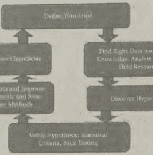

图1.2 数据分析的迭代过程。

通常，推断性研究基于来自总体的样本，其目的是尝试就该总体的某些更广泛方面作出一些一般性陈述，而该总体的多数（或部分）尚未被观察到。

实践中，数据分析是一个迭代过程（图1.2）。在定义了一个用于衡量数据分析是否成功的目标（或问题）之后，收集相关数据。人们研究数据，使用某些分析技术对其进行考察。人们可能决定换一种方式来看待数据，也许在此过程中通过变换或划分对其进行修改，然后回到起点并应用另一种数据分析工具。这个过程可以反复进行许多次。

计算智能数据分析确实通过消除繁琐而机械的计算，使迭代式数据分析过程计算机化。计算智能数据分析超越了这一范围。它旨在设计算法，以在不断变化的环境中解决日益复杂的数据分析问题。它研究自适应机制，以在复杂多变的环境中支持或促进数据分析过程。这些机制包括能够表现出学习或适应新情境、泛化、抽象、发现和联想能力的范式[9]。简言之，它研究如何让计算机完成通常与人类卓越能力相关的事情[10]。在很大程度上，完全自主数据挖掘的雄心如今已被放弃[11]。计算智能数据分析并不会完全取代人类。

新的计算与数据存储技术不仅增强了传统数据分析工具，还通过提出新挑战改变了数据分析的格局。由于计算机技术能够以毫秒级延迟存储和处理最新数据与信息，计算智能数据分析解决了一个新问题：我们如何高效且正确地纳入最新数据、更新模型、适应新环境，并最终提供充分证据以做出及时而正确的决策？

计算智能数据分析的另一个动机是，传统分析工具无法在合理时间限制内处理当前正在存储的数据量。因此，计算智能数据分析被视为一种有用方法，可对正在收集的数据提供某种程度的自动化洞察。然而，已经显而易见的是，尽管可以发现一些有用的模式，并且该学科已取得若干显著成功，但出现逻辑错误或统计错误的可能性极高。因此，许多计算智能数据分析充其量只是一组建议进一步研究的话题[12]。结果的高度不可靠性是许多应用——例如金融投资——的主要担忧。在这些领域，决策必须审慎且透明，以避免任何灾难。试错是不可接受的。

计算智能数据分析起源于统计学和机器学习。作为一门研究，它并非对统计和机器学习工具的随意应用，也不是在分析技术空间中的随机游走，而是一个经过仔细规划和深思熟虑的过程，用以决定什么将最有用、最具揭示性。数据分析过程可以被视为具有两种不同形式：（1）分析（或建模）方法，其中以数学方式对现实世界建模，并可由此以某种方式计算预测；（2）模式匹配，或归纳方法，其中基于经验做出预测[12]。

统计归纳从后者开始，旨在将该过程转化为以前者为主的过程，而机器学习主要发生在后者之中。给定一组观测，机器学习算法形成零假设空间，并搜索这个巨大的假设空间以找到最优假设。这是人们能够接近潜在真实假设的最近程度，而该真实假设可能在该假设空间中，也可能不在。当从观测中得出的假设位于空间中与真实解不同的部分，却未被现有数据反驳时，归纳谬误便会产生作用。例如，我们可以构建一个回归模型，将一个变量与若干潜在解释变量关联起来，或许还能获得非常准确的预测模型，却并不声称或相信该模型以任何方式代表了因果机制。

在大多数机器学习算法情形中，零假设空间是无限的。因此，机器学习本质上具有足够的计算效率来搜索该空间，以找到不仅能最佳拟合观测、而且能对新观测做出正确预测的那部分空间。后者对于解决实现偏差与方差平衡的问题至关重要。就数学优化而言，重要的是找到全局最优而非局部最优。然而，搜索准则的设计比优化过程更重要。该准则直接决定最终哪个最优解将实现偏差与方差的平衡以避免过拟合。将机器学习方法应用于大型数据库被称为数据挖掘或知识发现[13]。

在计算智能数据分析领域，分析人员通过更复杂、更精细甚至半自动的数据分析工具开展工作。给定明确定义的准则（例如误差平方和），人们可以让计算机执行比人工所能执行的大得多的搜索。程序已成为分析的关键部分，并将分析人员的能力拓展到无人辅助时不可能达到的领域。然而，一个挑战是找到明确定义的准则——有时不是一条而是一组——来代表分析目标。分析人员指示程序去开展工作的视角本质上是一种机器学习视角。

机器学习算法对一系列技术至关重要，包括网络搜索、推荐系统、个性化互联网广告、计算机视觉和自然语言处理。机器学习还对自然科学产生了重大影响，例如生物学；生物信息学这一跨学科领域促进了基因组学和蛋白质组学中的许多发现[14]。

相比之下，现代统计学几乎完全由假设和模型的概念驱动。通常需要先验知识来指定一组零假设和备择假设以及模型结构。然后数据用于反驳假设、改进模型以更好地反映目标问题，并通过校准过程估计系数。机器学习的本质在于，它也可能产生虚假的、在逻辑和统计上错误的猜想[12]。现代统计学过程通过纳入人类知识，极大地降低了产生虚假假设的机会。然而，当大量数据被持续收集时，需要更高效的智能数据分析方法来处理数据流入。当互联网和现代传感器网络被广泛用于通信和监测时，这种情况越来越频繁地发生。社交网络挖掘和数据流挖掘尤其面临全新的现象，尚无理论甚至现有研究对其加以研究。然而，正如苏格拉底的名言“我知道一件事，那就是我一无所知”所言，人类知识非常有限。甚至许多知识仅在特定领域和方法中为真。数据分析主要涉及数值数据，但其他类型的数据确实存在。示例包括文本数据和图像数据。在文本数据中，基本符号是词而非数字，并且它们的组合方式比数字更多。文本数据分析的两个主要挑战是搜索与结构。

#### 1.2.1 计算智能数据分析的过程

传统上，数据分析人员被教导在开始对数据建模或用算法检验数据之前，要“熟悉自己的数据”。这一步基本上是描述性分析，通过汇总和应用简单分析工具来理解数据的基本特征。然而，面对现代数据集的大规模，这不太可行（在许多情况下甚至完全不可能）。在这里，必须依靠计算机程序检查数据，并在各种聚合层次上可视化数据。

数据分析的第一个正式步骤是数据清洗与协调。在许多情况下，用于分析的很大一部分数据是为其他目的收集的。这导致数据源异构，并要求必须针对给定的数据分析工具对数据进行协调。清洗与协调过程旨在处理缺失值和失真——例如异常值。这些缺陷可能由数据收集过程中的错误记录和采样不足造成。缺失值很容易检测，但失真则难以识别得多。极端数据不一定意味着异常值。过去几年中已观测到许多极端事件，例如百年一遇的日本海啸。

实验设计与调查设计的子学科多年来不断发展，如今已非常成熟[8]。它们提供了良好的

为了在数据分析中获得有效答案，必须确保数据的良好与准确，这里展示了为此所需付出的努力。然而，无论使用何种分析工具，其原则都是一样的：垃圾进，垃圾出（garbage in, garbage out）。在许多情况下，大数据集指的是包含众多案例或记录的数据集。但有时，“大”这个词也可能指代描述每条记录的变量数量。后者引入了维度灾难[16]。人工神经网络和核方法将输入数据映射到高维特征空间，从而将非线性问题转化为线性近似问题。这种映射的代价就是维度灾难。降维是一组用于合并或变换输入数据以消除次要特征的技术。

在科学界，“实验”一词指的是（部分）潜在影响变量可以被控制的调查过程。通常，控制所有潜在影响变量是不可能的。为了克服这一点，受试者（或对象）被随机分配到由那些我们希望控制的变量所定义的类别中。

总而言之，计算智能数据分析中有两个主要角色：（1）计算智能数据分析技术；（2）人类分析人员。技术必须足够高效以处理大量数据，足够精确以找到最佳解决方案，并且足够可靠以抵抗噪声。人类分析人员则需要理解问题、定义标准、选择合适的技术并分析结果。

### 1.3 面向可持续发展的计算智能数据分析

如第1.1节所述，可持续性是一个描述人类生活各个方面维持其生存能力的发展过程。它意味着解决各种相互竞争目标之间的冲突，并涉及同时追求经济繁荣、环境质量和社会公平——这被称为三个维度（三重底线）。显然，任何深思熟虑的决策都需要对这三个维度进行分析，并权衡其影响以最大化利益。这种微妙的决策过程需要高效的数据收集和分析方法，为理性决策过程提供充分的证据支持。与此同时，经济、环境和社会数据的特征给数据分析研究界带来了许多独特的挑战。这促使了用于自动处理经济和环境数据的新方法论的开发及后续应用，以支持可持续发展的决策过程。Ness等人认为，可持续性评估的目的是“为决策者提供从全球到本地、从短期到长期视角对综合的自然-社会系统的评估，以帮助决策者决定为了社会可持续发展，应该采取或避免哪些行动”[17]。

生态系统由生物群落及其非生物环境组成，它们作为一个系统相互作用。作为人类，我们都生活在社会中，与他人以及周围环境（包括生态系统）相互作用。由于可持续发展将生态系统和人类社会视为一个综合系统，对这个综合系统的分析不可避免地涉及极其复杂的相互作用。由于这种复杂的系统特性，进行受控实验是很困难的[18]。智能数据分析工具将因所收集数据的特性而对可持续发展有所裨益：环境、经济和社会数据的大规模特征（数千个状态变量）；数据的时间性（从毫秒、秒、分钟、小时、周、年到年）和统计性质；离散和连续信息混合的存在；通过可视化手段与专家沟通的必要性；快速决策的在线操作时间限制；以及不确定性（噪声、异常值、缺失信息）的存在。

首先，经济、环境和社会数据通常是空间和时间性的，因为可持续性问题往往是区域性或跨区域的，并且会随着时间的推移而演变。空间数据的主要特征是其结构复杂性和不确定性水平，这些特征继承自生成这些数据集的自然系统和人类社会。机器学习的新机会可以被整合到一个有凝聚力的、且重要的是科学可信的知识发现过程中。这对于空间和时空发现尤其必要，因为产生无意义且代价高昂的偏离方向的可能性很高。

其次，在过去二十年里，长期的环境观测、污染监测、稀有和极端事件监测以及最近的遥感技术产生了大型数据库，并使得新的分析和处理工具得以使用。观测只能提供必要数据集的识别，但要对所监测现象进行正确解读，则需要一个从数据中提取知识的过程，旨在检测空间模式和所测变量之间的潜在关系。这只有通过仔细的数据分析过程才能实现。另一方面，许多生态研究人员在非常有限的历史时间内收集数据，其时间序列仅能回溯100年。HJ Andrews实验林场最长的连续数据集是1909年至今；他们直到1990年才开始数据收集[18]。

第三，在大多数情况下，经济和环境数据流形受到强噪声和非线性的影响。所涉变量之间的关系通常不太清晰，或者被噪声扭曲。低信噪比导致最终模型的高方差。在经典的机器学习应用中，可以通过包含更多训练数据来减小方差。在许多情况下，尽管数据供应充足，但许多经济和环境现象是随时间演变的，这缩短了数据的时间跨度，并限制了其与当前决策的相关性。需要更实时的和覆盖范围更广的数据分析，以便及时处理大面积区域的数据。

#### 1.3.1 时空数据分析

地理信息系统（GIS）通过拥有多种地理表现形式来识别复杂系统（自然的或城市的）。例如，在交通建模工具EMME中，一个完整的交通系统被记录为多层网络和矩阵：地理表面、道路和铁路网络、出行流量和质心。地理表面以经纬度编码，而出行流量通常根据给定的空间单元（如统计局部地区（SLA））以起点-终点矩阵来表示。例如，澳大利亚标准地理分类（ASGC）被用于收集和传播广泛的澳大利亚统计局（ABS）社会、人口和经济统计数据。ASGC有五个层级，按升序排列为：人口普查区（CD）、统计局部地区、统计分区（SSD）、统计区域（SD）和州/领地（S/T）[19]。

空间分析最重要的任务之一是确定空间单元。每个空间单元在给定目的下都拥有一组同质人群。例如，在交通建模中，一个强有力的假设是每个出行区内的population具有统一的出行行为。当然，不同的应用可能导致不同的空间单元。异构数据通过地图叠加进行整合。

David O'Sullivan和David Unwin列出了空间数据的陷阱。其中最重要的是：传统统计假设所有...

持续、快速的数据记录。此外，由于数据收集过程，多频率时间序列常常并存，例如日、周、月和年时间序列。将高频时间序列聚合为低频时间序列相对容易，例如将日数据聚合为月数据。然而，反过来，从低频到高频，则极其困难。

最后，极端事件的发生频率远高于正态分布所表明的频率。我们已经目睹了极端案例（例如“全球金融危机”和自然灾害）的影响——其影响之深足以彻底颠覆所谓的正常生活。“黑天鹅理论”表明，完全意外事件的频率和影响通常被低估。不幸的是，高影响、难以预测且稀有的事件所具有的不成比例的作用，超出了历史、科学、金融和技术领域正常预期的范畴。具有重大后果的稀有事件发生的概率很小[23]。相当大比例的可持续性分析旨在预测、预防这类极端事件（如自然疾病或社会动荡），或从中恢复。

#### 1.3.2 综合可持续性分析

有许多工具可用于描述和/或量化技术社会及其与环境相互作用的结构[24]。Ness 等人将其分为三大类：（1）区域或国家可持续性指标和指数；（2）产品相关工具；（3）综合评估工具[17]。第一组表示对区域或国家经济、社会或环境状态的度量。这些指标和指数被持续测量和计算，因此能够从回溯视角描述长期可持续性趋势。第二组更具体，因为它聚焦于与商品和服务生产及消费相关的流动。这些工具的目标是评估沿生产或消费链，或贯穿产品或服务全生命周期的自然资源消耗和环境负荷排放。该组的例子包括生命周期评估（LCA）。第三组综合评估工具在分析中纳入可持续性三大支柱，并允许在区域层面进行分析。综合可持续性分析捕捉我们的社会、经济和环境支持系统的复杂性和相互依存关系。

LCA 是对给定产品或服务因其存在而造成或所需的环境影响进行调查和评估，并评估产品或过程在其整个生命周期中的环境影响。环境 LCA 常被视为“从摇篮到坟墓”，因此是对产品或服务环境成本和效益最完整的核算[25]。例如，纸质购物袋的 CO₂ 足迹可能是伐木车辆、造纸厂、从工厂到商店的运输以及袋子使用后分解所排放的 CO₂ 之和。

在各种 LCA 方法中，经济投入产出生命周期评估（EIO-LCA）方法利用行业交易信息——一个行业从另一个行业购买材料——以及行业直接环境排放信息，来估算整个供应链的总排放[25]。在 EIO-LCA 方法中，投入产出表充当关键引擎。投入产出表简单使用一个矩阵，表示产业内流动以及工业部门与消费之间的流动，或增加值部门与工业部门之间的流动。随着经济不断演变，投入产出表必须至少每年更新一次，以反映新情况。澳大利亚经济的一个典型投入产出表以七个 2800×2800 矩阵的形式表示。

全球有100多个国家定期按照联合国经济和社会事务部统计司管理的指南发布投入产出表[26]。不幸的是，在包括澳大利亚在内的大多数国家，由于涉及大量资金和人力成本，投入产出表每三到四年才发布一次。悉尼大学综合可持续性分析（ISA）小组开发了大规模计算建模方法，全面涵盖针对不同经济层级估算和更新投入产出表的过程，并基于估算的投入产出表开展后续报告阶段。

全球化，加之人口不断增长和消费增加，意味着生态足迹如今正更广泛、更沉重地遍布全球。环境影响正在加剧，而供应链不断延长意味着消费者往往远离其所驱动的影响。要管理和减少我们的足迹，首先必须能够测量它。ISA 小组计算了187个国家在相关商品方面的净贸易差额，以构建高分辨率全球贸易投入产出表。利用高分辨率全球贸易投入产出表，他们追踪相关商品从其生产国出发，往往经过若干中间贸易和转化步骤，直至最终消费国[27]。生物多样性相关商品的国际贸易可使用全球贸易流图进行可视化。*

* ISA 小组提供交互式全球贸易流图：http://www.worldmrio.com/biodivmap。

第2章将投入产出表从国家尺度扩展到跨国尺度，以测量覆盖整个供应链的足迹。多区域投入产出表是一个 1000×1000 矩阵，这需要估计数百万个变量。第2章提供一种数学优化方法，以解决估计中的若干关键问题，例如信息冲突。空间分析的困难之一是尺度对估计结果的影响。在多区域模型应用于环境分析时，通常需要部门重新分类和聚合，以匹配环境数据和经济数据。因此，对于使用多区域投入产出（MRIO）模型的环境扩展分析而言，部门聚合是一项实际而重要的任务。第3章量化不同重新分类和聚合方案之间的误差或离散度，并发现聚合误差高度集中于特定区域和部门，这表明这些区域和部门在聚合误差层面具有更大影响。

#### 1.3.3 气候变化的计算智能数据分析

《京都议定书》最初于1997年12月11日在日本京都通过，并于2005年2月16日生效。截至2012年5月，已有192个国家签署并批准该议定书。2005年，欧盟排放交易体系（EU ETS）是世界上首个大型排放交易计划。它的启动旨在应对气候变化，是欧盟气候政策的主要支柱。欧盟 ETS 目前涵盖能源和工业部门中净热输入超过20兆瓦（MW）的10,000多个设施，这些设施合计占欧盟 CO₂ 排放的近一半，以及其温室气体总排放的40%[28]。与此同时，政府、学术界和社区层面开展了大量辩论和研究工作。美国国家科学基金会（NSF）资助由明尼苏达大学 Vipin Kumar 教授领导的“理解气候变化：一种数据驱动方法”项目，旨在更好地理解地球系统的复杂本质以及促成……的机制

气候变化的不利后果，例如飓风频率和强度的增加，以及导致环境灾害的极端天气事件的发生倾向[29]。

*Climate Informatics 2011*，即第一届气候信息学国际研讨会，由一群数据挖掘和机器学习研究者组织。作为该研讨会的成果之一，第4章总结了数据分析界对气候变化贡献的最新进展。本章旨在启发气候信息学这一新兴领域的未来工作。各种类型的大量气候数据可用，为未来的数据挖掘和机器学习研究提供了丰富而肥沃的试验场。即使是探索性数据分析也可能有助于加速气候信息学中的发现。

基于对气候信息学的介绍，第5章特别关注气候极端事件和不确定性。在极值理论中，极端事件位于概率分布的尾部，因为其发生频率非常低。然而，许多自然极端事件，如飓风和热浪，具有深远影响，涉及人类不适和可能的生命损失。由于其罕见性，需要足够数据的经典数据分析工具可能无法很好地解释和预测它们。第5章提出了气候极端事件科学中的若干关键挑战，这些挑战未被当前一代气候模型处理。这些长期存在的挑战可能无法在不久的将来通过基于物理的建模改进得到解决，而数据驱动的计算方法可能提供新颖的解决方案。

#### 1.3.4 面向生物多样性和物种保护的计算智能数据分析

由于森林砍伐、农业、城市化和土地开发导致的自然栖息地减少和碎片化，是物种衰退和灭绝的主要原因[5]。*Ando 等*已经表明，大量濒危物种集中在相对少数国家，并得出结论：如果保护工作和资金能够在少数关键地区扩展，就有可能以很高效率保护濒危物种[30]。他们比较了保护区选址问题的两个版本——集合覆盖问题（SCP）和最大覆盖问题（MCP）——以强调在高效物种保护中同时考虑生态和经济因素的重要性。

三个领先研究小组在理解生态系统结构和功能方面做了开创性工作。在康奈尔大学计算可持续性研究所（ICS），Carla Gomes 最近将该问题在数学上表述为所谓的“连接子图问题”[31, 32]。目标是设计美国北落基山脉灰熊的野生动物走廊，以便在三个核心生态系统——黄石、Salmon-Selway 和北大陆分水岭生态系统——之间移动，这些生态系统横跨爱达荷州、怀俄明州和蒙大拿州的64个县。这一大规模优化问题对当前计算方法提出了重大需求。

在俄勒冈州立大学，Thomas Dietterich 指出了在数据流水线中应用先进计算机科学和人工智能方法的许多机会。传感器捕获数据以创建数据集。然后分析这些数据以生成可支持政策设计的模型。模型还指导假设的形成，然后可以通过设计和执行实验来检验这些假设[18]。Dietterich 的项目之一是快速高通量节肢动物识别以测量生态系统功能。节肢动物计数提供了生物多样性和生态系统健康的便捷度量，并且是理解和恢复生态系统的重要因变量。另一个项目是传感器网络的自动数据清洗。传感器会失效，尤其是当它们被放置在具有挑战性的环境中（例如冰川、山顶和海底）时。当大规模收集数据时，人工检测和诊断传感器故障不再可行。需要能够实时检测和纠正传感器故障的自动数据清洗方法。

在 AT&T® 实验室，Steven Phillips 领导保护生物学计算与数学研究小组；他们开发了一个基于最大熵方法的物种栖息地建模软件包[33, 34]。世界各地的政府和非营利组织是保护具有生态价值土地和确保环境服务的项目的主要资金来源。保护组织通常使用的项目选择策略依赖于地块评级方案，该方案涉及专家小组或标准化评分系统。第6章介绍了多目标线性规划（MOLP），它是广泛使用的收益目标（BT）选择过程的替代方案。宾夕法尼亚州土路和碎石路项目的案例研究表明，MOLP 不仅解决了 BT 方法的低效率问题，而且提供了更通用的方法，例如处理实物成本分摊等。

#### 1.3.5 面向智能电网和可再生能源的计算智能数据分析

可再生能源和智能电网的最终目标是提供负担得起、可靠、清洁的电力。新能源对最终消费者应有合理价格，转向新能源不应降低当前生活水平。这需要改进当前可再生能源技术，以低于或等于当前化石燃料发电机的价格发电，从而优化资产并高效运营以高效配电。可靠的可再生电力供应为经济和社会提供优质电力，没有长期电力短缺，自动预测和响应系统扰动，并在攻击或自然灾害发生时具有韧性运行。

可再生能源并不意味着零环境影响。可再生能源的发展除了提高能源效率外，还可能产生意想不到的负面环境影响。例如，生物能源的温室气体效益最近受到质疑，部分是基于间接土地利用变化的经济建模。直接和间接土地利用变化造成的实际排放很大程度上取决于农业在何处以及如何扩张或集约化。例如，将热带森林、泥炭地和稀树草原转化为农田会向大气释放大量碳[35]。据报道，美国生物燃料生产激励正在促进东南亚和亚马逊地区的土地转化和森林砍伐。为促进美国玉米生产用于乙醇的大规模补贴已将大豆生产转移到巴西，那里大片塞拉多草原正被开垦为大豆农场。该地区大豆扩张正在加剧亚马逊森林砍伐[36]。

另一个例子是风电的影响，这是一种有前景的可再生能源，但引起了人们对鸟类和蝙蝠种群损害的担忧[5]。第7章表明，向依赖可再生能源的可持续能源系统持续转型会导致从需求驱动发电到发电驱动需求的范式转变。特别是，可再生能源对电网构成挑战，电网需要稳定，并且应允许所有人在任何时间点消耗能源。由于电能难以储存，需要永久保持供需之间的恒定平衡。随着可再生能源份额上升，由于其发电不稳定且波动，维持这种平衡变得更加困难。这需要所谓的*智能电网*。

第8章预测短期供应，这可能因不断变化的环境而令人沮丧。可再生能源严重依赖周围环境。例如，太阳能生产力在午餐时间前后达到每日峰值。从其月度模式来看，太阳能呈现出另一种季节性模式，并在夏季达到峰值。第8章表明，最大化可再生能源供应电力的渗透率可以通过两种不同技术实现：建设超级电网或将可再生能源与需求管理和储存相结合。

第9章提供了智能数据分析，用于从使用现有基于互联网的频率监测网络收集的电力系统频率数据中实时检测破坏性事件。及早检测电网内的供应扰动使电网运营商能够以令人印象深刻的效率和可靠性水平保持发电与负荷之间的持续平衡。

根据世界风能协会2011年的数据，风电现在有能力发电239吉瓦，而2010年为197吉瓦，足以覆盖世界电力需求的3%[37]。2005年至2010年间，风电新增装机年均增长率为27.6%。风电发电不取决于客户需求；它取决于风电场周围的风速。第10章评估了一组用于长期风资源评估的计算智能技术。它提供了一种通用方法——测量、关联与预测（MCP）——来估计站点和公开可用的邻近来源的风速联合分布。

#### 1.3.6 面向社会政治可持续性的计算智能数据分析

社会政治可持续性关注人造社会系统的可持续性，包括交通系统；城市；建筑；农业；健康信息以及环境、文化、经济和社会背景下的健康；税务信息；治理层级：地方、区域、国家和国际层面的可持续性；可持续性规划；人口增长及其后果；复杂性和不确定性理论；以及知识来源、信息资源和数据收集过程。

Nathan Eagle利用手机数据深入考察和理解贫民窟居民群体，以获得衡量贫民窟动态的定量结果[38]。由于贫民窟是非正式建立、缺乏规划且未被政府承认的，科学家对全球20万个贫民窟以及居住其中的10亿人的了解非常有限。ICS的Chris Barrett研究了非洲贫困、粮食安全与环境压力之间的社会经济相互关系，尤其是资源动态与小农农业系统贫困陷阱之间的联系[39]。

第11章提供了一个很好的例子，说明如何利用时间和空间数据分析工具深入洞察行为数据，并解决犯罪等重大社会问题。过去几年，已从人类社会各个方面收集了大量数据。正如第11章所揭示的，1991年至1999年间发生了近100万起与盗窃有关的犯罪，并收集了费城20万起报案犯罪的数据。在数字数据存储系统发明之前，如此庞大的数据量是难以想象的。

区域规划是一门为区域可持续增长高效布局活动与基础设施的科学[40]。在区域规划中，政策制定者必须考虑对环境、经济和社会的影响。第12章介绍了约束逻辑编程（CLP）在一个规划问题中的应用，即意大利艾米利亚-罗马涅大区区域能源计划的环境与社会影响评估。

### 1.4 结论与研究挑战

计算智能数据分析与可持续发展都是相对较新的研究领域。然而，两者在过去二十年中都经历了快速发展。过去几年，我们目睹了数据分析界日益增长的兴趣。可持续发展已成为智能数据分析的重要应用领域。例如，已在美国和欧洲举办了三届计算可持续性国际会议。IEEE国际数据挖掘会议（ICDM）自2009年起持续举办“气候数据知识发现：预测、极端事件与影响”研讨会。ACM SIGKDD知识发现与数据挖掘会议（KDD）于2011年启动了“数据挖掘在可持续性中的应用”研讨会。SIAM数据挖掘会议于2010年举办了“面向可持续发展的机器学习与数据挖掘”研讨会。神经信息处理系统大会（NIPS）于2009年举办了一场小型研讨会，*面向可持续性的机器学习*。Katharina Morik、Kanishka Bhaduri和Hillol Kargupta[41]简要列出了十个正在可持续系统领域开展活跃研究的项目与团队。

现代传感器网络、移动设备和社交网络提供了海量的环境、经济和社会数据。的确，历史上从未有如此大量的数据可供分析和处理。同时，不断变化的人类社会迫切需要全面、系统且及时的行动，以应对全球变暖、人口过剩、贫困和污染等各种可持续发展问题。这些问题没有一个能孤立或轻易地解决。我们常常必须在个人利益与共同利益之间取得平衡[6]。看不见的手并非这些问题的最终解决方案。智能数据分析本身无法解决这些问题，但它提供了强大的工具，帮助深入洞察这些问题，以支持理性决策。同时，可持续发展问题所提供的数据为数据分析研究人员创造了机遇与挑战，因为他们可以创建并将强大的技术应用于现实问题。这提出了一种研究此类挑战性问题的新方法的需求：将计算问题视为“自然”现象，使其能够接受科学方法论的考察；在这种方法论中，旨在探索问题参数空间和隐藏问题结构的原理性实验，与形式分析发挥着同样突出的作用。因此，重要的是开发新方法，以识别并利用这种现实世界结构，将原理性实验与数学建模相结合，从而形成可扩展且切实有效的解决方案[42]。本书是探索这一新主题的早期尝试之一。我们希望本书能吸引更多研究人员，为这一年轻而富有前景的领域开发新方法和应用作出贡献。

### 参考文献

- 1. 联合国环境规划署（UNEP）。*世界环境与发展委员会报告，大会第42/187号决议*，联合国，编辑。1987年。
- 2. 联合国环境与发展会议（UNCED）。*21世纪议程，里约环境与发展宣言*，U.N.D.o.E.a.S.A. 联合国可持续发展司（DSD），编辑。1992年：巴西里约热内卢。
- 3. CEC，*2011年澳大利亚清洁能源*，C.E. Council，编辑。2012年。
- 4. Partridge, E.，社会可持续性：一个有用的理论框架？，载于*澳大利亚政治学协会年会*，2005年。新西兰达尼丁。
- 5. Gomes, C.P.，计算可持续性——面向可持续环境、经济和社会的计算方法。*The Bridge*，2009，39(4)：5–13。
- 6. Hardin, G.，公地悲剧。*Science*，1968，162(3859)：1243–1248。
- 7. Hutcheon, S.，来自非洲：你手机中的血钽，载于*悉尼先驱晨报*。2009年5月8日：Fairfax Media：澳大利亚悉尼。
- 8. Berthold, M. 和 D.J. Hand，*智能数据分析：导论*。2003年。柏林、纽约：Springer。
- 9. Engelbrecht, A.P.，*计算智能：导论*，第2版。2007年。纽约：Wiley。
- 10. Rich, E. 和 K. Knight，*人工智能*。1991年。纽约：McGraw-Hill。
- 11. Roddick, J.F.，数据仓库与数据挖掘：我们做对了吗？，载于*数据库技术进展。计算机科学讲义*。1999年。纽约：Springer，第1552–1556页。
- 12. Roddick, J.F. 和 B.G. Lees，时空数据挖掘范式与方法，载于*地理数据挖掘与知识发现*，H.J. Miller 和 J. Han 编。2009年。佛罗里达州博卡拉顿：CRC Press。第27–44页。
- 13. Akbani, R.、S. Kwek 和 N. Japkowicz。将支持向量机应用于不平衡数据集，载于*第15届欧洲机器学习会议（ECML）*。2004年。
- 14. Bishop, C.M.，*模式识别与机器学习*。2006年。纽约：Springer。
- 15. Ness, B. 等，可持续性评估工具的归类。*Ecological Economics*，2007年。60：498–508。
- 16. Dietterich, T.G.，生态系统信息学与可持续性中的机器学习，载于*第21届国际人工智能联合会议论文集*。2009年。加利福尼亚州帕萨迪纳。
- 17. ABS，1216.0——澳大利亚标准地理分类（ASGC），澳大利亚统计局，编辑。2011年。堪培拉。
- 18. O'Sullivan, D. 和 D. Unwin，*地理信息分析*，第1版。2002年。纽约：Wiley。
- 19. Hamilton, J.D.，*时间序列分析*，第1版。1994年。新泽西州普林斯顿：Princeton University Press。
- 20. Gaber, M.M.、A. Zaslavsky 和 S. Krishnaswamy，数据流挖掘：综述。*ACM SIGMOD Record*，2005，34(2)：18–26。
- 21. Taleb, N.N.，*黑天鹅：高度不可预测事件的影响*，第1版。2007年。纽约：Random House。
- 22. Butnar, I.，用于生命周期评估的投入产出分析：区域建模导论，载于*化学工程系*，2007年，罗维拉-威尔吉利大学：塔拉戈纳，西班牙语。
- 23. Hendrickson, C.T.、L.B. Lave 和 H.S. Matthews，*商品和服务的环境生命周期评估：投入产出方法*。2006年。未来资源研究所，华盛顿特区。

- 24. Murray, J.、R. Wood 和 M. Lenzen，《投入产出分析——优势与局限》，载于 *《可持续性从业者投入产出分析指南》*，J. Murray 和 R. Wood 主编。2010 年，伊利诺伊州尚佩恩：Common Ground Publishing LLC。第 165–176 页。
- 25. Lenzen, M. 等，《国际贸易加剧发展中国家的生物多样性威胁》。*《自然》*，2012 年。486：109。
- 26. Ellerman, D. 和 B.K. Buchner，《欧盟排放交易体系：起源、分配与早期成果》。*《环境经济与政策评论》*，2007 年。1(1)：66–87。
- 27. Kawale, J. 等，《数据引导的动态气候偶极子发现》，载于 *《NASA 智能数据理解会议》*。2011 年。
- 28. Ando, A. 等，《物种分布、土地价值与高效保护》。*《科学》*，1998 年。279(27)：2126–2128。
- 29. Conrad, J. 等，《网络中的连接：可行性与最优性的难度？》，载于 *《第五届人工智能与运筹学技术在约束规划中用于组合优化问题集成国际会议（CPAIOR 2008）》*。2008 年。
- 30. [图像中不可见。]
- 31. Conrad, J.M. 等，《野生动物走廊作为连通子图问题》。*《环境经济与管理杂志》*，2012 年。63：1–18。
- 32. Phillips, S.J.、M. Dudík 和 R.E. Schapire，《物种分布建模的最大熵方法》，载于 *《第二十一届国际机器学习会议》*。2004 年。
- 33. Elith, J. 等，《面向生态学家的 MaxEnt 统计学解释》。*《多样性与分布》*，2011 年。17：43–57。
- 34. Kline, K. 等，*《土地利用变化与生物能源研讨会》*。2009 年。田纳西州沃诺尔。
- 35. Butler, R.A. *《美国生物燃料政策推动印度尼西亚和亚马逊地区的森林砍伐》*。2008 年 [引用日期：2012 年 5 月 12 日]；可查阅：http://news.mongabay.com/2008/0117-biofuels.html。
- 36. WWEA，*《WWEA 季刊：世界风能》*。2012 年。世界风能协会。
- 37. Wesolowski, A.P. 和 N. Eagle，《贫民窟动态的参数化》，载于 *《2010 年 AAAI 人工智能促进发展春季研讨会（AI-D）》*。2010 年。
- 38. Barrett, C.B.、P. Little 和 M. Carter 主编。*《理解并减少非洲持续性贫困》*。2007 年。纽约：Routledge。
- 39. Isard, W. 等，*《区域间与区域分析方法》*。1998 年。英格兰汉茨：Ashgate。
- 40. Morik, K.、K. Bhaduri 和 H. Kargupta，《可持续发展数据挖掘导论》。*《数据挖掘与知识发现》*，2012 年。24(2)：311–324。
- 41. Gomes, C.P.，*《计算可持续性中的约束推理与优化挑战：约束规划原理与实践——CP 2009》*。2009 年。纽约：Springer。

# I 综合可持续性分析

## 使用高分辨率投入产出表追踪贸易中的隐含二氧化碳

Daniel Moran 和 Arne Geschke

本章经作者许可转载自 *《生态足迹与国际贸易》*（D. Moran，悉尼大学，2012 年）。其中题为“调和冲突约束：Eora 作为约束优化问题的解”一节摘自 *《AISHA：构建大规模列联矩阵的工具》*（A. Geschke，悉尼大学，2012 年），并经作者许可。

### 2.1 摘要

投入产出（IO）表记录了经济体各部门之间的所有流量。在可持续性应用中，投入产出表可用于追溯消费者与第二产业和第一产业中上游环境或社会损害之间的联系。由于数据密集型程度极高，投入产出表历来难以构建。Eora 多区域投入产出（MRIO）表是一张新的高分辨率表格，记录了 187 个国家 15,000 个部门之间的双边流量。这种全面、高分辨率的模型有利于可持续性政策的分析和实施。本章概述了 Eora 投入产出表的构建过程。我们开发了一种自定义数据处理语言，用于从多个政府来源读取、聚合、拆分原始数据，并将其转换为统一的张量。这些原始数据往往相互冲突，无法形成平衡的矩阵。我们创建了一种自定义优化算法，以调和冲突数据并平衡表格。构建和平衡 Eora MRIO 的计算量巨大：在拥有 66 个核心、600 GB 内存和 15 TB 存储空间的集群上，每个数据年大约需要 20 小时的计算时间。最后，我们总结了高分辨率 MRIO 表在可持续性方面的一些应用，如计算碳足迹。

全球化与人口增长和消费增加相结合，意味着我们的生态足迹现在正更广泛、更沉重地落在地球上。我们的环境影响正在增加。供应链的延长意味着消费者往往远离他们所驱动的环境影响。为了管理和减少我们的足迹，我们必须首先能够测量它。这就是环境扩展投入产出分析的目标。

我们希望识别哪些国家和部门直接造成了环境损害，哪些最终从中受益。我们希望将个人、家庭和公司与他们最终驱动的上游环境损害联系起来。这一原则被称为消费者责任：即消费者而非生产者应对污染负责。成功的可持续性政策应同时考虑生产者责任和消费者责任，并需要在供应链的生产、贸易和消费环节应对不同的挑战。

测量足迹有两种方法：自下而上和自上而下。自下而上的方法将足迹的各个组成部分相加。例如，一个纸质购物袋的二氧化碳足迹可能是伐木车辆、纸浆厂、从工厂到商店的运输以及购物袋使用后分解所排放的二氧化碳之和。自上而下的方法先考虑总足迹，然后将其分配到不同产品；例如，在二氧化碳总排放量中，有多少来自纸制品，而纸制品中有多少是纸质购物袋。

生命周期分析（LCA）是自下而上分析的主要方法。LCA 追踪生产-使用-处置链上所有环节的输入、过程和输出。LCA 研究复杂、数据需求量大，而且常常涉及棘手的边界问题，很难在不漏算（遗漏某些输入或输出流）或重复计算（当两个存量或流量重叠时，各部分之和超过整体之和）的情况下提取单一流量。

投入产出分析采用自上而下的方法。一般来说，自上而下方法的问题在于分辨率较低。自上而下分析或许能告诉你普通乘用车的二氧化碳足迹，但无法区分 SUV 和混合动力轿车。

Eora 项目使用复杂的数据处理技术来保持原始数据的原生形态，从而生成了迄今为止分辨率远高于其他任何投入产出表的表格。迄今为止，大多数多区域投入产出表都采用了一种通用的低分辨率部门分类，并将所有输入表统一到该分类下。Eora MRIO 使用许多对应矩阵来连接不同分类的数据。Eora 高分辨率表格能够实现更好的自上而下分析，并且更容易与自下而上的方法结合，形成所谓的混合 LCA。IO 分析全面，不存在边界问题，并且越来越准确。

投入产出表最初由瓦西里·列昂惕夫设想为一种分析美国经济各部门之间流动的经济工具。借助 IO 表，列昂惕夫可以估计一个部门受到的冲击可能如何影响其他部门。各种现代经济模型，包括广泛使用的可计算一般均衡（CGE）模型，都建立

在投入产出表基础上。大多数国家统计局编制投入产出表，并遵循联合国标准国民账户体系，将其作为国民账户的基础。多区域投入产出表将许多国家投入产出表整合为一张大型的全球投入产出表。MRIO 并非由政府构建，而是由少数几个学术研究团队构建。它们是国际政策分析的有力工具，而环境扩展投入产出表对于可持续性分析极为有用。近年来，随着数据可得性提高和计算能力增强，能够创建分辨率更高、更准确的投入产出表，基于投入产出的分析变得越来越流行。Eora 多区域投入产出表是迄今组装的最大、最详细的投入产出表。它之所以可行，是因为使用了复杂的数据处理自动化、现代计算机硬件以及数学而非人工流程来平衡和解决数据冲突。

### 2.2 投入产出表的结构

本节为不熟悉投入产出分析的读者简要概述投入产出表的结构。如需了解更多，推荐阅读 Miller 和 Blair（2009）的权威著作。

投入产出矩阵的元素是一个部门向另一个部门销售的总额。矩阵中的每一行表示一个部门生产的商品和服务，即该部门的产出。沿该行的各列是消费这些产品的各个部门。因此，矩阵中的每个元素表示部门 A 与部门 B 之间交易的总价值。在单国投入产出表中，行和列表示该经济体内部的各部门。

图 2.1 展示了单国投入产出表的布局，并说明了交易矩阵中记录钢铁部门对汽车生产部门投入总价值的元素。该交易矩阵是投入产出表的主要区块。其右侧附加了另一组列 Y，表示家庭、政府、存货等最终消费。其下方还增加了一组行 V，用于表示所谓的“最初投入”。其中最重要的是增加值。通过将增加值视为生产的一种投入，一个部门出售其产出所获得的价值可以超过其其他投入之和。

图 2.1 一张基本投入产出表，附有注释，显示交易矩阵中记录钢铁部门向汽车生产部门产出的总价值的位置。

在多区域投入产出表中，行和列表示每个国家的部门。例如，日本钢铁和澳大利亚钢铁是两个单独的行和两个列，而不是一个部门。图 2.2 说明了这一点。可以构建区域不是国家而是州、城市或公司的 MRIO。这显然高度依赖于数据可得性。也可以使用额外数据进一步分解该表，从而获得更高分辨率。例如，额外的销售和采购数据可能允许将日本钢铁部门拆分为传统钢铁部门和工程钢铁部门。几乎所有的应用都希望表格高度详细，但分解是数据密集型的，并且往往使表格更难以平衡。

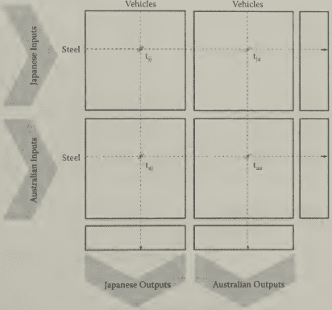

图 2.2 一个两国 MRIO。交易 tᵢⱼ、tⱼₐ、tₐⱼ 和 tₐₐ 记录用于国内汽车产业以及出口到另一国汽车产业的钢铁价值。

投入产出表下方可能还放置了一组额外的行，用于表示非货币投入，例如劳动小时或用水量。这个所谓的卫星指标区块 Q 的各行被视为生产的额外投入。在投入产出分析中，污染也不被视为生产的后果，而是被视为一种必要投入，因此作为指标行加入。Eora 模型有近 2,000 个指标行，涵盖能源使用、水资源使用、土地利用（生态足迹）、温室气体（GHG）排放和空气污染物等非货币投入。

图 2.3 说明了通过环境扩展 MRIO 的一条路径。对角线上的区块是国内投入产出表，非对角线区块是贸易区块，底部的阴影行包含卫星指标区块。数据点 (1) 记录巴西咖啡种植者威胁了多少物种。卫星账户可以包含任何类型的指标；这同样可以是巴西咖啡种植者排放的二氧化碳吨数或用水立方升数。数据点 (2) 记录该指标与巴西咖啡种植的关联程度；点 (3) 记录按威胁加权的对美咖啡出口，点 (4) 和 (5) 将这些进口与最终消费者连接起来。这五个点构成了一条供应链，将美国咖啡消费者与巴西咖啡种植园造成的物种威胁联系起来。环境扩展投入产出表的结构由联合国环境经济核算体系（SEEA）概述。在该结构中，每一项环境指标（卫星账户行合计）都被分配到直接造成该影响的各种部门（列）中。

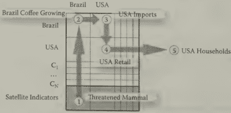

图 2.3 带有受威胁物种卫星账户的 MRIO 示意图。

Eora MRIO 覆盖 187 个国家，总共有超过 15,000 个部门。热图有助于可视化和验证投入产出表。图 2.4 展示了 Eora 的热图可视化，并放大了韩国投入产出表。Eora MRIO 并非同质的。一些国家拥有大型、高分辨率的投入产出表，而另一些国家则拥有部门定义宽泛的小型表格。为了提供最高分辨率和数据完整性，Eora 按照提供数据的国家的国家经济分类来维护每个国家投入产出表。

图 2.4 Eora 热图及韩国投入产出表放大图。每个像素代表交易矩阵中的一个元素，颜色更深的单元格表示更大的交易值。

图 2.4 中一个显著特征是明显的向下对角线带。形成对角线带的一个原因是同一部门内公司之间的交易可能很大，特别是当部门定义宽泛时，例如，如果汽车生产部门既包括销售汽车零部件的公司，也包括销售整车的公司。同部门交易占对角线带的很大一部分。该带也源于常见经济分类系统的结构。大多数部门分类从基础产业开始，经过中间加工产业，最后到最终生产和零售产业。只要经济价值创造遵循同样的逐步路径，就会看到一条对角线带，因为价值从左上角的第一产业向下游传递到右下角的第三产业生产行业。例如，如果小麦、面粉、烘焙和零售面包店部门在分类系统中相邻，那么每个部门的大部分产出将直接用作下一个部门的投入，从而在表中形成对角线带。

投入产出表应当平衡。每一行的合计应等于每一列的合计。如果一个行业不平衡，意味着该行业要么从某个未知来源获得投入，要么向某个未知去向交付产出。组装大型 MRIO 表的一个重大挑战一直是确保这种平衡。下面我们讨论 Eora 项目如何使用优化器来确保表格平衡。

Eora MRIO 提供五种估值：卖方记录的销售价格、额外支付的税收成本、获得的补贴价值、运输成本以及零售和分销成本。这些加成使人们能够区分生产者与购买者之间几种类型的中间商价格加成。税收、补贴、运输以及零售和分销成本被加到生产者价格上，以得到购买者价格。这些加价由基本价格投入产出表之上的四个附加表表示（图 2.5）。将这些加价分离到单独的表中，有助于分析政策变化对税收、补贴和运输成本的影响，以及这些变化如何以不同方式影响卖方和购买者。

在结构上，Eora 是一个张量。在最直观的表示中，它是一个三维张量：五个矩阵的垂直堆叠。然而，我们将其视为一个八维张量。行和列具有逻辑分层分组，如图 2.6 所示。

为了快速定位张量中的特定元素，我们使用如下形式的八维地址：

- 输入国家/区块/部门索引
- 输出国家/区块/部门索引
- 表页
- 年份

两个“区块”维度将部门分组为增加值部门、最终需求部门、行业、商品或卫星（Q 区块）部门。这种八维寻址用于 AISHA（协调账户自动化集成系统）数据处理语言中，以指定 Eora 张量的区域。

我们面临两个挑战。第一个是，我们希望使用的源数据存在多种格式和聚合级别。我们必须对这些输入数据集进行聚合、解聚和重新分类，以使每个国家及其贸易伙伴使用相同的分类方案。第二个挑战更为重大：原始数据输入经常相互冲突。

构建MRIO的第一个挑战是协调所有输入数据，使其能够合并到一张表中。Eora项目的一个主要目标是尽可能多地纳入可用的经济和环境数据。这些数据涵盖了广泛的聚合级别、格式和分类方案。关于输入数据必须如何进行转换的一些示例如下：

- 重新分类：例如，将一组贸易数据从《产品总分类》（CPC）转换为《协调制度》（HS）生产分类。
- 聚合：例如，将400个部门分类的数据聚合到60个部门分类。
- 解聚：例如，根据各部门对国内生产总值（GDP）的贡献，将单一总值分配到各部门。

我们创建了一种数据处理语言来协助完成这项任务。该语言有助于聚合和解聚，并方便对张量的各个区域进行寻址和填充。处理语言中的解聚命令可以指定钢铁部门销售总额，该总额应按比例或平均分配给多个金属制造业。

与该语言紧密结合的是一个大型的对应矩阵库。对应矩阵包含一个加权映射，将源向量中的值重新分配到不同的目标向量中。对应矩阵使用N×M矩阵将长度为N的源向量映射到长度为M的目标向量。每行包含一组总和为1的权重。源向量的第一个元素使用第一行指定的权重分配到目标向量，第二个元素使用第二行的权重添加到目标向量，依此类推。对应矩阵是聚合和解聚数据以及将一种分类方案中的数据投影到另一种方案中的特别方便的工具。

对于每个数据源（所有提供数据的机构，如联合国、国家机构、环境机构等，所提供的每个表格），我们都编写了一个处理语言脚本，用该源的内容填充张量。脚本指定使用哪个（些）对应矩阵将数据转换为Eora表中使用的分类。脚本还指定了重新分类后的数据应放置在Eora张量中的目标地址。

数据处理语言解释器称为AISHA（*自动化协调账户系统*）。AISHA本质上是一个数据库服务器。它批量读取数据处理脚本并填充张量。我们的实现采用分布式架构。许多工作进程自主处理这些脚本，然后主进程聚合结果。

如果数据源不重叠且不冲突，故事到这里就结束了。AISHA实际上并不填充张量，而是填充一个初始估计矩阵和约束矩阵，这些矩阵通过优化包运行以产生最终张量。

### 2.4 调和相互冲突的约束：EORA作为约束优化问题的解

MRIO应满足若干约束。一个基本约束是平衡约束：一个部门的总产出必须等于该部门的总投入。统计机构提供的已发布数据遵循这一条件。但在构建像Eora这样的大型MRIO时，必须将来自多个不同来源的数据合并到一张表中。这张新合并的表很可能无法满足这一平衡约束。必须对表中的某些元素进行微调，以确保平衡条件得到满足。

构建MRIO过程中的另一个常见问题是数据冲突。考虑以下情形：我们有一张来自美国政府的投入产出表，详细列出了GDP的部门构成。我们还有一个来自联合国提供的美国GDP总量数据。这两个GDP总量数据不相等。这两个数据为最终值定义了上下界，实际实现的最终值必须介于两者之间。为了调和这些相互冲突的约束，我们确定每个数据的可靠性，并要求优化器找到一个能最大程度满足这两个按可靠性加权的约束的解值。

构建Eora时，生成一张满足所有指定约束（平衡、冲突数据和/或其他）的表的问题被一步解决。通过将这个问题解释为一个数学约束优化问题，实现了数据的调和以满足任何给定的外部条件。

我们通过使用来自多个不同来源的原始数据构建初始版本的表来开始构建Eora的过程。我们将这个版本的MRIO称为原始数据表。如果所有这些不同的数据源一致，那么MRIO就完成了。但很可能，前一节描述的挑战仍然存在：MRIO将违反我们指定的约束。

#### 2.4.1 可靠性信息

为了处理这个问题，我们首先必须引入可靠性数据。Jaynes（1957）提出的最大熵原理断言，投入产出交易是一个具有最佳猜测值和相关可靠性的随机变量。投入产出表由统计局精心编制，但各个部门间的交易值并非100%确定。因此，MRIO的各个元素和外部条件都具有一定程度的单独可靠性。此外，可以假设MRIO的元素服从正态分布，并且彼此统计独立。因此，每笔交易都可以被解释为相应变量的最佳猜测值，可靠性用该随机变量的标准差表示。可靠性大的交易值对应非常小的标准差；可靠性较小的交易值对应较大的标准差。

通常，可靠性信息并非针对MRIO的每笔交易都提供。在这种情况下，可以估算标准差的值。一般来说，可以假设较大的值远比小值可靠。一个很好的近似是将MRIO中最大值的标准差定义为其自身绝对值的3%，并将MRIO中最小值的标准差定义为其自身绝对值的200%。其余值的标准差可以通过对数函数计算，其系数必须由用户计算。Lenzen等（2010）对这一策略进行了详细的动机说明和解释。

此外，某些约束的可靠性可能是已知的。例如，平衡条件必须精确；否则MRIO无法恰当地表示一个经济体（参见Leontief，1986）。这意味着相应平衡约束的标准差为0。标准差为0的约束称为*硬约束*。其他硬约束包括上下界，规定交易值永远不能为负，或者补贴（记录为负值）永远不能为正的约束。因此，这些约束的标准差也为0。其他约束，如前面美国GDP的例子，可能可靠性较低，具有正的标准差值。这些是*软约束*。

显然，如果来自两个不同来源的同一信息陈述了不同的事实，那么两者中至少有一个必定是不正确的。实际上，很可能两者都是如此。但其中一个数据源可能比另一个更可靠。在这种情况下，例如，由国家统计机构提供的美国GDP总量数据可能远比联合国报告的数据可靠。因此，并非100%可靠的外部条件不必由MRIO百分之百满足。

这个概念适用于MRIO中的元素。MRIO中的每个交易值都具有一定的可靠性。这意味着原始数据表中的每个元素都可以（在其可靠性确定的特定范围内）进行调整，并且仍然能较好地代表真实的交易值。

统计机构通常不公布可靠性数据。在这些情况下，可以估算可靠性信息。我们使用多种启发式方法来估算不同数据集的可靠性。大的交易值通常测量良好，因此比小值更可靠（Lenzen等，2010）。我们认为国家统计机构数据的可靠性高于联合国数据，且联合国经济数据的可靠性高于贸易数据。已发布的Eora结果包含我们对每个数据集可靠性估计的信息。由于最终的MRIO表是这些数据的组合，我们还为最终表提供可靠性数值，显示表中每个值的可靠程度，这是基于构成该结果的各种输入数据的组合可靠性。

#### 2.4.2 约束优化的概念

约束优化的基本思想如下：

通过根据可靠性调和原始数据表的元素来获得最终MRIO，具体方式为：

- 1. 所有硬外部条件都精确满足。
- 2. 所有软外部条件都得到良好满足，满足程度由其可靠性决定。
- 3. 原始数据表受到的扰动最小。

$$
\begin{aligned}
t_{12}+y_1-t_{21}-v_1&=0\\
t_{21}+y_2-t_{12}-v_2&=0
\end{aligned}
\tag{2.1}
$$

这两个方程的所有变量和取值都具有相应的可靠性。根据投入产出（IO）的定义可知，平衡约束必须得到满足。因此，方程右侧的 0 值不能被违反。这意味着这些 0 值的标准差为 $\sigma=0$。平衡约束是硬约束，而硬约束的标准差为 $\sigma=0$。软约束的一个例子如下：假设有一个可用的数据源，它提供的信息表明 MRIO M 的总最终需求等于某个值 $a$。该信息对应的方程为

$$
y_1+y_2=a
$$

在这种情况下，我们几乎可以肯定，值 $a$ 并非完全可靠。因此，值 $a$ 的标准差不会等于零，即 $\sigma>0$。该方程可以被待计算的最终 MRIO 所违反。可接受的违反程度由值 $a$ 的标准差 $\sigma$ 决定。

#### 2.4.4 将平衡约束汇总为单个矩阵方程

既然约束已经以方程的形式给出，我们便迈出了数学解释的第一步。为了更方便地将 MRIO 作为优化问题来处理，我们将交易矩阵 $\mathbf{T}$ 向量化，并将得到的向量称为 $\mathbf{a}$

$$
\mathbf{T}=\begin{pmatrix}t_{11}&t_{12}&y_1\\t_{21}&t_{22}&y_2\\v_1&v_2&\end{pmatrix}\quad\text{变为}\quad\mathbf{a}=\begin{pmatrix}t_{11}\\t_{12}\\y_1\\t_{21}\\t_{22}\\y_2\\v_1\\v_2\end{pmatrix}
$$

这使我们能够将第一个平衡约束

$$
t_{12}+y_1-t_{21}-v_1=0
$$

重新表述为逐向量形式的方程：

$$
\underbrace{(0\quad 1\quad 1\quad -1\quad 0\quad 0\quad -1\quad 0)}_{=\mathbf{g}^{\mathsf T}}\underbrace{\begin{pmatrix}t_{11}\\t_{12}\\y_1\\t_{21}\\t_{22}\\y_2\\v_1\\v_2\end{pmatrix}}_{\mathbf{a}}=0.
$$

由此，平衡约束方程具有如下形式

$$
\mathbf{g}^{\mathsf T}\mathbf{a}=0 \tag{2.2}
$$

向量 **g** 就是所谓的*系数向量*，它包含向量 **a** 中各元素对应的系数，用以表示平衡方程。每个约束都可以写成（方程 2.2）的形式。因此，每个约束都提供一个约束向量 **g**。这些约束向量现在可以汇总成一个约束矩阵 **G**。该约束矩阵的每一行代表一个约束。对于本节前面使用的三个约束示例，系数矩阵 **G** 为

$$
\underbrace{\begin{pmatrix}0&1&1&-1&0&0&-1&0\\0&-1&0&1&0&1&-1&0\\0&0&1&0&0&1&0&0\end{pmatrix}}_{\mathbf{G}}\underbrace{\begin{pmatrix}t_{11}\\t_{12}\\y_1\\t_{21}\\t_{22}\\y_2\\v_1\\v_2\end{pmatrix}}_{\mathbf{a}}=\underbrace{\begin{pmatrix}0\\0\\a\end{pmatrix}}_{=\mathbf{w}_{\mathrm{lc}}}\tag{2.3}
$$

相应约束方程右侧的值被汇总在向量 c 中。利用方程 (2.3) 的概念，我们可以将 MRIO 必须遵守的完整外部约束集简洁地写成

**Ga = c**

向量化后的 MRIO $\mathbf{a}$ 和右侧值 $\mathbf{c}$ 的相应可靠性数据可以分别存储在两个向量 $\sigma_a$ 和 $\sigma_c$ 中，这两个向量的大小与其所承载可靠性信息的向量（即 $\mathbf{a}$ 和 $\mathbf{c}$）相同。

#### 2.4.5 构建约束优化问题

我们将原始数据表记为 $\mathbf{T}^0$，将最终 MRIO（尚待计算）记为 $\mathbf{T}$。设 $\mathbf{a}^0$ 为 $\mathbf{T}^0$ 的向量化结果，$\mathbf{a}$ 为 $\mathbf{T}$ 的向量化结果。

回顾之前所述的优化问题的概念：

> 找到一个满足所有外部条件、同时对原始数据表扰动最小的最终 MRIO。

利用目前建立的概念，“满足所有外部条件的 MRIO”这一表述的数学形式可简单地写为

**Ga = c**

这个方程组通常是欠定的，也就是说，未知数的数量（此处指 MRIO 中元素的数量）多于约束的数量。因此，通常存在不止一个满足约束的解（即最终 MRIO 并非由约束唯一确定）。

尚需从数学上解释的是，“尽可能考虑原始数据表”究竟意味着什么。

由于 $\mathbf{a}^0$ 和 $\mathbf{a}$ 分别是原始数据表和最终表的向量化表示，为了满足给定约束而对原始数据表 $\mathbf{a}^0$ 所做的改动可以用所谓的目标函数 $f(\mathbf{a}^0,\mathbf{a})$ 来“度量”。由于约束方程组允许多个解，优化器的设计目标就是在满足约束的条件下找到使目标函数最小化的那个解。因此，优化问题可表示为

$$
\min f(\mathbf{a}^0,\mathbf{a}) \quad \text{subject to} \quad \mathbf{G}\mathbf{a}=\mathbf{c}
$$

对于 Eora 模型，目标函数基于 Byron（1978）的方法，该方法使用如下形式的二次拉格朗日函数：

$$
f=(\mathbf{a}^0-\mathbf{a})\Sigma_a^{-1}(\mathbf{a}^0-\mathbf{a})+\lambda'(\mathbf{G}\mathbf{a}-\mathbf{c})
$$

其中 $\Sigma_a$ 表示以该向量的 $\sigma_a$ 值为主对角线的对角矩阵。随后需要应用一阶条件来求解拉格朗日乘数，进而得到最终 MRIO。

要计算拉格朗日乘数，必须进行一次矩阵求逆，而对于像 Eora 这样规模非常大的问题，这种计算将是计算密集型的，并且可能数值不稳定。为了避免显式计算拉格朗日乘数和矩阵求逆，Van der Ploeg（1982）利用以下思路巧妙地重新表述了 Byron 的方法：

- 1. 对矩阵 $G$ 的行和右侧向量 $c$ 重新排序，使所有硬约束对应的行位于顶部，随后是软约束对应的行。设 $G_{hard}$ 和 $G_{soft}$ 分别表示属于硬约束和软约束的约束行块。则 $G$ 和 $c$ 可以写成如下形式

$$
G=\begin{pmatrix}G_{hard}\\G_{soft}\end{pmatrix} \quad \text{和} \quad c=\begin{pmatrix}c_{hard}\\c_{soft}\end{pmatrix}
$$

由于软约束并非完全可靠，它们可以在一定程度上被违反。为了处理这些违反情况，我们为每个软约束引入一个扰动 $\varepsilon_i$（注意：硬约束不引入任何扰动，因为它们必须被严格遵守）。设 $\varepsilon$ 为所有扰动构成的向量，则软约束系统变为

$$
G_{soft}a=c_{soft}+\varepsilon \Leftrightarrow G_{soft}a-\varepsilon=c_{soft}
$$

$$
\mathbf{p}^{0}=\begin{pmatrix}a^{0}\\0\end{pmatrix}
$$

Van der Ploeg 方法的优点在于，右侧向量 **c** 的可靠性信息被转移到了迭代变量上，该变量现在称为 **p**。缺点是迭代变量（此前为 **a**，现在为 **p**）会增加与软约束数量相同数量的变量，因此问题规模会显著增大。不过，约束的数量保持不变。该问题的解即为最终 MRIO 以及软约束的扰动向量。最终 MRIO 满足所有约束，并在计算过程中考虑了原始数据和约束的可靠性。

通常情况下，MRIO 的某些值必须保持在一定的边界之内。例如，基础价格表中的交易值必须为正值；补贴表中的值只能为负值。因此，每个元素 $p_i$ 都可以受到上界或下界的约束，即 $l_i \leq p_i \leq u_i$。通过允许正无穷或负无穷作为上界或下界的可行值，可以为每个元素 $p_i$ 构造一个边界方程。上界和下界值可以汇总为与 **p** 大小相同的向量。整个 MRIO 的边界条件因此可以汇总为

$$
\mathbf{l} \leq \mathbf{p} \leq \mathbf{u}
$$

将这些边界条件加入优化问题，我们得到

$$
\min (\mathbf{p}^{0}-\mathbf{p})\sum_{p}(\mathbf{p}^{0}-\mathbf{p}) \quad \text{subject to } G\mathbf{p}=\mathbf{c},\; \mathbf{l}\leq\mathbf{p}\leq\mathbf{u} \qquad (2.4)
$$

Eora 模型就是基于方程 (2.4) 所给出的优化问题生成的。

对于 Eora 项目，总 MRIO 包含大约 $10^9$ 个元素，受 $10^6$ 个约束的制约。优化过程中涉及的数据总量约为 40 GB。在计算过程中，该算法使用了超过 250 GB 的内存。由于商业算法无法求解如此规模的问题，我们开发了一种自定义的并行优化算法。迭代的频率、沉重的通信负载以及这样一个事实，即

每个工作进程都需要\(G\)（30 GB约束矩阵），这一点共同表明需要使用大型共享内存多处理器系统。为构建一年的Eora，优化器在商用24核、288 GB内存系统上运行数小时。求解该约束优化问题是可行的，但会逼近当前计算硬件的极限。

由于原始数据表和冲突数据被指定为软约束，优化器还能够生成结果表中每个元素的标准差估计。

估计所得MRIO的标准差值——与表本身的协调非常相似——是一个欠定优化问题。假设初始原始数据表和约束值的标准差已知。令\(\mathbf{p}^0\)为向量化的原始数据MRIO，\(\mathbf{c}\)为约束值。令\(\mathbf{p}\)为协调后的MRIO，使得

\[
G\mathbf{p} = \mathbf{c}
\]

成立。那么\(\mathbf{p}\)的标准差\(d\mathbf{p}\)和\(\mathbf{c}\)的标准差\(d\mathbf{c}\)必须满足

\[
d\mathbf{c} = \left\{\sqrt{\sum_j (g_{ij}\, d\mathbf{p}_j)^2}\right\}_i
\]

标准差\(d\mathbf{p}^0\)是优化过程输入的一部分，因此已知。标准差\(d\mathbf{p}\)未知。然而，MRIO每个元素在优化过程中从\(\mathbf{p}^0\)得到\(\mathbf{p}\)时所经历的偏移是已知的。使用距离向量\(\mathbf{p} - \mathbf{p}^0\)作为标准差\(d\mathbf{p}\)的初始猜测，SDRAS算法可以求解欠定优化问题

\[
d\mathbf{c} = \left\{\sqrt{\sum_j (g_{ij}\, d\mathbf{p}_j)^2}\right\}_i
\]

以得到\(d\mathbf{p}\)。SDRAS首次在Lenzen等（2010）中提出。

图2.7展示了优化器如何协调两个相互冲突的数据点，二者都声称报告同一数值。优化器报告的解S的估计标准差会大于D₁的标准差，但小于D₂的标准差。

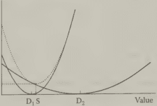

**图 2.7** 优化器协调冲突约束的示意图。数据点D₁置信度高，而声称报告同一数值的数据点D₂置信度低。最优解S最小化对冲突约束的违反，因此更靠近可靠性更高的约束D₁。

Eora是首个在提供结果的同时给出这些结果置信度估计的大型MRIO。Eora为用户提供交易层级的可靠性估计，并全面报告最终表中哪些约束（来自各种输入数据源）得到最好和最差遵守。

### 2.5 列昂惕夫逆矩阵

现在我们有完整的平衡、协调的MRIO表。几乎所有环境应用都将通过计算MRIO的列昂惕夫逆矩阵来进行。列昂惕夫逆矩阵回答了这个问题：给定一单位产出中，包含多少总投入，既包括产品中直接包含的投入，也包括其生产间接需要的投入？这一计算是确定消费者责任足迹的基础，因为它使得计算生产一单位产出所需的总环境影响成为可能，包括供应链上游的所有影响。

列昂惕夫逆矩阵计算如下。用总产出对交易矩阵T进行归一化，将每个元素转换为系数，使每列之和为一；也就是说，每个系数表示每单位产出中每种投入的相对贡献。该矩阵称为A，即技术系数矩阵或直接需求矩阵。例如，汽车直接包含钢铁（底盘、发动机等），但也需要钢铁作为其生产的间接投入。工厂、汽车运输公司和展厅也都使用一些钢铁，其中一部分用于提供那辆汽车。这个总需求矩阵L（与直接需求矩阵相对）是从单位矩阵I开始的一个无穷级数之和：

\[
\mathbf{L} = \mathbf{I} + \mathbf{A} + \mathbf{A}^2 + \mathbf{A}^3 + \cdots = \sum_{n=0}^{\infty} \mathbf{A}^n
\]

列昂惕夫意识到这不过是矩阵求逆

\[
\mathbf{L} = (\mathbf{I} - \mathbf{A})^{-1}
\]

因此，列昂惕夫逆矩阵L的每个元素报告生产一单位产出所需的总投入量。可以使用卫星指标按环境负荷对投入加权，以求出每单位产品生产所需的环境加权总投入。

结构路径分析（SPA）可用于选择性地对单个元素进行这种级数展开，并追踪供应链。SPA通常用于搜索以感兴趣的部门为起点或终点的排名最高（流量最大）的供应链。SPA的思想并不难，但实现是一门艺术。SPA算法本质上必须搜索一棵15,000 × 15,000 = 225,000,000个分支的树，其叶节点值随深度渐近趋于零。在最坏情况下，单个投入在最终被消费之前可能访问世界上的每一个部门。实践中，将每条供应链评估到10至15步即可捕获该链99%的价值。尽管如此，智能的剪枝和排序启发式方法仍是必需的。列昂惕夫逆矩阵和SPA互补使用。使用列昂惕夫逆矩阵计算的足迹报告产品和部门的总足迹，而SPA算法则搜索所涉及的个别供应链。

### 2.6 Eora MRIO 的应用

Eora MRIO提供了一系列MRIO表时间序列，并配有相匹配的环境和社会卫星账户，覆盖整个世界经济，具有高度的部门和国别细节。约187个国家以25至500个部门的分辨率表示（取决于原始数据可得性），追踪超过50亿条供应链。该时间序列覆盖1990年至2010年。Eora MRIO呈现了一个完全协调和平衡的世界MRIO表，纳入了来自联合国国民账户体系（SNA）、联合国商品贸易统计数据库（UN COMTRADE）、欧盟统计局（Eurostat）、发展中国家经济研究所（IDE）/日本贸易振兴机构（JETRO）等主要来源以及许多国家投入产出表的数百万个原始数据点。每个MRIO元素都附有可靠性估计。

Eora MRIO表追踪近2,000个可持续性指标条目，涵盖

- 能源
- 温室气体（GHG）排放
- 空气污染物
- 生态足迹（公顷）
- 人类占用的净初级生产力（克碳）
- 用水量（升）
- 物质流（千克材料）

Eora MRIO还被用于生物多样性足迹研究，将世界自然保护联盟（IUCN）红色名录中的30,000条物种威胁记录与生产行业和最终消费者联系起来，并用于研究源自非洲和亚洲的冲突矿产（钶钽铁矿和稀土金属）供应链。

投入产出分析能够区分并连接生产者、供应链和消费者，这使其可用于制定可持续性政策。投入产出分析可以量化生产者与消费者之间的联系，并系统地识别和量化感兴趣的供应链。这一数据丰富的资源可用于为生产者、贸易商和消费者的可持续性政策提供信息。

目前大多数环境立法旨在控制生产足迹。生产足迹可以通过以下方式加以约束：要求清洁生产、保护和养护措施的法规，更好地执行现有立法，以及买方要求供应商达到高环境标准。

对环境有害产品的贸易流可以受到约束。例如，《濒危野生动植物种国际贸易公约》（CITES）广泛限制濒危物种及其衍生产品的任何贸易。拟议的碳税作用类似，有效限制不良商品的贸易。

森林管理委员会和海洋管理委员会等机构颁发的可持续发展证书，旨在限制非法及不负责任来源的森林和海洋产品的贸易。目前，高风险贸易流往往是通过机会性调查发现的，而非系统性识别。投入产出（IO）分析能够系统而全面地量化供应链路径，有助于识别高危供应链并对其进行排序。为了抑制消费需求，可以利用可持续性标签（如“海豚安全”金枪鱼、有机农产品和公平贸易咖啡）将消费者需求从高影响力产品转向来源更负责任的产品。企业和政府买家可以利用足迹数据来制定可持续采购政策，确保这些组织消费环境足迹较低的产品。环境足迹核算的一个主要动机，是提供更多信息帮助消费者了解其生态足迹。Eora MRIO表采用先进的计算技术，提供信息丰富的答案，为可持续性政策提供依据。

### 参考文献

- 拜伦，R. 1978. 大型社会账户矩阵的估计. *皇家统计学会会刊A辑*, 141(3): 359–367.
- 杰恩斯，E.T. 1957. 信息论与统计力学. *物理评论*, 106: 620–630.
- 伦岑，M.，R. 伍德和T. 维德曼. 2010. 多区域投入产出模型的不确定性分析——英国碳足迹案例研究. *经济系统研究*, 22: 43–63.
- 列昂惕夫，W. 1986. *投入产出经济学*. 纽约：牛津大学出版社.
- 米勒，R.E. 和P.D. 布莱尔. 2009. *投入产出分析：基础与扩展*, 第2版. 英国剑桥：剑桥大学出版社.
- 范德普洛格，F. 1982. 大型经济核算矩阵序列的可靠性与调整. *皇家统计学会会刊A辑*, 145(2): 169–194.

## 使用多区域投入产出分析进行碳足迹核算中的加总效应

Xin Zhou, Hiroaki Shirakawa, and Manfred Lenzen

### 3.1 引言

在实践中，环境影响评估和排放核算通常在可获得一手数据的企业层面、项目层面或产品层面进行。自20世纪90年代初以来，投入产出分析（IOA）已被广泛用于环境核算，例如碳足迹评估，以及根据研究目的对一个国家、一个地区或多个地区的部门层面的隐含排放和虚拟水进行计算。使用IOA的优势之一是，不仅可以系统地考虑直接排放，还可以考虑供应链中各种上游过程的间接排放。每一张经验性投入产出（IO）表都基于对产业的定义，而这种定义通常是将相似产品聚合为一个部门而得到的。对于每个定义的产业，收集企业层面的数据，投入产出表中的投入系数可以代表许多不同样本企业生产函数的平均值。因此，已发布的投入产出表对实际环境评估的有用性受到结果稳健性的挑战，因为不同的企业、产品或流程分类方式可能会影响结果（Gibbons等，1982；Wiedmann，2009a）。

加总问题对IOA学界来说并不新鲜，自20世纪50年代以来，这一问题一直被深入讨论。Fisher（1958、1962和1966）对加总的优化提供了丰富的理论思考。Ara（1959）为IOA可接受的部门加总提供了充分必要条件的理论证明。与旨在缩小IO模型规模的常规方法不同，Leontief（1967）另辟蹊径，提出了一种从现有投入产出表中消除某些产品和流程的系统性程序。Doeksen和Little（1968）同时使用假设模型和实际区域IO模型检验了加总。他们得出结论：当其余部门被高度加总时，模型规模（加总水平）对未加总部门的乘数影响很小。一个有用的启示是，即使使用一个小型区域模型，也有可能确定新工厂对当地就业和收入的影响。Karaska（1968）利用费城的调查数据和其他信息，检验了区域IO表中列昂惕夫系数的变异。他发现，从详细的四位数水平到标准行业分类（SIC）体系中定义的两位数水平，变异随加总水平的上升而增加，且本地系数的变异大于

Hertwich，2008；Hertwich和Peters，2009；Zhou等，2010）。关于该领域的综述，参见Wiedmann（2009b）和Minx等人（2012）。

所使用的MRIO模型是亚洲投入产出（AIO）2000年表（AIO，2000），由发展经济研究所（2006）发布。AIO 2000是Chenery-Moses型模型（Chenery，1953；Moses，1955），涵盖十个亚太经济体（印度尼西亚、马来西亚、菲律宾、新加坡、泰国、中国大陆、台湾、韩国、日本和美国）的76个部门。通过随机加总部门，我们检验了加总误差的大小，并将其作为随机变量进行了分析。

### 3.2 加总效应的检验

一个典型的用于部门和区域间供需均衡的MRIO模型可以表示如下：

$$x_i^r = \sum_s \sum_j t_{ij}^{rs} + \sum_s f_i^{rs} \tag{3.1}$$

其中 $r$ 和 $s$ 表示区域，$i$ 和 $j$ 表示部门，$x_i^r$ 是区域 $r$ 中部门 $i$ 的产出，$t_{ij}^{rs}$ 是区域 $r$ 中部门 $i$ 作为投入用于区域 $s$ 中部门 $j$ 的产出（中间需求），$f_i^{rs}$ 是区域 $r$ 供给、用于区域 $s$ 中产品 $i$ 的最终需求。

通过定义投入系数 $a_{ij}^{rs}=t_{ij}^{rs}/x_j^s$，对于 $k$ 区域模型，方程（3.1）可以表示为如下矩阵形式：

$$\begin{pmatrix}x^1\\x^2\\\vdots\\x^k\end{pmatrix}=\begin{pmatrix}A^{11}&A^{12}&\cdots&A^{1k}\\A^{21}&A^{22}&\cdots&A^{2k}\\\vdots&\vdots&\ddots&\vdots\\A^{k1}&A^{k2}&\cdots&A^{kk}\end{pmatrix}\begin{pmatrix}x^1\\x^2\\\vdots\\x^k\end{pmatrix}+\begin{pmatrix}\sum_s f^{1s}\\\sum_s f^{2s}\\\vdots\\\sum_s f^{ks}\end{pmatrix}\tag{3.2}$$

投入产出分析（IOA）由瓦西里·列昂惕夫于20世纪40年代初提出（Leontief，1941），已被广泛用于预测由最终需求变化引起的部门产出变化（方程（3.3））。在区域层面，IOA可以帮助预测新工厂建立对区域经济的影响。在多区域层面，IOA可以分析不同区域之间的贸易关系。

**表3.1 定义**

| | 未加总模型 | 加总模型 |
|---|---|---|
| 中间需求 | $T = \{T^n\} = \{t^n\}$ | $\tilde{T} = \{\tilde{T}^n\} = \{\tilde{t}^n\}$ |
| 最终需求 | $f = \{f^n\} = \{f_i^n\}$ | $\tilde{f} = \{\tilde{f}^n\} = \{\tilde{f}_i^n\}$ |
| 总产出 | $x = \{x^n\} = \{x_i^n\}$ | $\tilde{x} = \{\tilde{x}^n\} = \{\tilde{x}_i^n\}$ |
| 投入系数 | $A = \{A^n\} = [a_{ij}^n]$ | $\tilde{A} = \{\tilde{A}^n\} = [\tilde{a}_{ij}^n]$ |
| 列昂惕夫逆矩阵 | $L = \{L^n\} = [l_{ij}^n]$ | $\tilde{L} = \{\tilde{L}^n\} = [\tilde{l}_{ij}^n]$ |
| 碳强度（单位产出的排放量） | $c = \{c^n\} = \{c_i^n\}$ | $\tilde{c} = \{\tilde{c}^n\} = \{\tilde{c}_i^n\}$ |
| 碳足迹 | $w = \{w^n\} = \{w_i^n\}$ | $\tilde{w} = \{\tilde{w}^n\} = \{\tilde{w}_i^n\}$ |

$$x = (I - A)^{-1} f \qquad (3.3)$$

其中 $I$ 是单位矩阵，$(I - A)^{-1}$ 称为列昂惕夫逆矩阵，表示满足一单位最终需求所需的直接（由最终需求）或间接（通过上游生产中的中间需求）产出量。

表3.1给出了未加总模型和加总模型（带波浪号的字母）中矩阵和向量的约定。矩阵用大写字母表示，向量和标量用小写字母表示。

假设有 $n$ 个部门和 $k$ 个区域。因此，加总前矩阵 $T$ 的大小为 $nk \times nk$，每个分块矩阵 $T^n$ 的大小为 $n \times n$。加总规则定义如下：

- 1. 同一区域内的部门可以加总，但不同区域的部门不能加总。
- 2. 允许在一个区域内进行多次加总（例如，同时将区域1中的部门1和2加总，以及将部门3、4和5加总）。
- 3. 允许同时在多个区域进行加总（例如，同时将区域1中的部门1和2加总，以及将区域2中的部门1、2和3加总）。假设区域 $r$ 中的 $n$ 个部门被分为 $n(r) \le n$ 个部门。

定义

$$m = \left[ \sum_{r=1}^{k} n(r) \right] \le nk$$

就聚合模型的规模而言。聚合后的中间需求 $\bar{T}$ 是一个 $m \times m$ 方阵。对角线上的每个分块 $\bar{T}^{rr}$ 是一个 $n(r) \times n(r)$ 方阵。非对角矩阵基本上为矩形，其尺寸取决于聚合后供给区域 $r$ 和需求区域 $s$ 的规模。例如，$\bar{T}^{rs}$ 的尺寸为 $n(r) \times n(s)$。

我们将聚合矩阵定义如下：

$$Z = \begin{bmatrix} z(1) & 0 & 0 & 0 \\ 0 & z(2) & 0 & 0 \\ 0 & 0 & \ddots & 0 \\ 0 & 0 & 0 & z(k) \end{bmatrix}$$

对角线上的每个 $z(r)$ 是一个 $n(r) \times n$ 分块聚合矩阵。$z(r)$ 的每一列必须有一个且仅有一个“1”，其他元素为“0”；每一行必须至少有一个“1”（可以有多个“1”），其他元素为“0”。一行中“1”的位置表示未聚合模型中的哪些部门将被合并为聚合模型中的一个新部门。如果矩阵左乘 $z(r)$，则原矩阵的行（而非列）被归并为 $n(r)$ 个部门。撇号表示矩阵或向量的转置。因此，矩阵右乘 $z(r)'$ 会将列聚合为 $n(r)$ 个部门。

聚合前后中间需求、最终需求、总产出和碳强度的关系如下：

$$ZTZ' = \bar{T} \qquad (3.4)$$

$$Zx = \bar{x} \qquad (3.5)$$

$$ZF = \bar{F} \qquad (3.6)$$

$$[Z(c \otimes x)] \otimes (Zx)^{-1} = \bar{c} \qquad (3.7)$$

$\otimes$ 为对应元素相乘。$c$ 是详细模型的碳强度对角矩阵，对角线上为 $c^1$、$c^2$、… 和 $c^k$。$\bar{c}$ 是聚合后相应的碳强度对角矩阵。

基于式(3.3)，未聚合模型具有以下关系：

$x=(I-A)^{-1}F=Lf$ (3.8)

使用MRIO计算碳足迹（CFs）如下：

$C\otimes x=C\otimes Lf$ (3.9)

对于特定地区 $s$，碳足迹 $w=\{w_j^s\}$ 计算如下：

$w_j^s=\sum_q\left[\left(\sum_i\sum_l c_{lj}^{i}r_{ij}^{q}\right)f_j^{qs}\right]$ (3.10)

对于聚合模型，计算碳足迹有两种可选方法：

#### 过程1：

$\bar{w}=Zw$ (3.11)

其中 $w$ 是由未聚合模型计算得到的碳足迹。由于未聚合系统的所有信息均已知，且过程1只是对原模型中相关部门碳足迹求和，因此不存在聚合偏差。我们将 $\bar{w}$ 定义为“真实”值。

#### 过程2：

在另一种方法中，我们首先基于式(3.4)至(3.7)聚合MRIO模型。然后，从聚合模型计算碳足迹：

$\bar{x}=(I-\bar{A})^{-1}\bar{f}=\bar{L}\bar{f}$ (3.12)

$\bar{C}\otimes\bar{x}=\bar{C}\otimes\bar{L}\bar{f}$ (3.13)

$\hat{w}_j^s=\sum_q\left[\left(\sum_i\sum_l\bar{c}_{lj}^{i}\bar{r}_{ij}^{q}\right)\bar{f}_j^{qs}\right]$ (3.14)

其中 $\hat{w}$ 是由聚合模型计算得到的碳足迹。过程2是所讨论的问题，其中碳足迹计算中会出现聚合偏差。我们将 $\hat{w}$ 与 $\bar{w}$ 之间的差异定义为聚合误差。在地区—部门层面，该差异为 $(\hat{w}_j^s - \bar{w}_j^s)$。此外，我们使用误差率 $(\hat{w}_j^s - \bar{w}_j^s)/\hat{w}_j^s$ 来评估聚合的相对影响而非绝对影响。使用误差率是因为，由于国民经济中各部门经济规模不同，聚合误差的幅度可能极大。某些小部门的聚合误差虽然对部门本身很重要，但与大规模部门的聚合误差相比可能被忽视。

### 3.3 结果

为考察聚合偏差，我们使用蒙特卡洛模拟随机设定由 Z 确定的聚合方案。该过程包括以下步骤：

- 1. 随机确定进行聚合的地区数量。
- 2. 随机确定选择哪些地区进行聚合。
- 3. 随机确定每个所选地区的部门数量。
- 4. 随机确定每个所选地区中选择哪些部门进行聚合。

我们将该过程重复100,000次，得到100,000个随机确定的聚合矩阵 $Z_s$。对于每个 $Z_i$，我们计算了 $\hat{w}^{Z_i} = ((\hat{w})^s Z_i)^T$、$\bar{w}^{Z_i} = ((\bar{w})^s Z_i)^T$、$(\hat{w})^s Z_i - (\bar{w})^s Z_i$ 以及 $[(\hat{w})^s Z_i - (\bar{w})^s Z_i]/(\hat{w})^s Z_i$。由于聚合被随机执行多次，聚合误差和误差率可视为随机变量。

本实验使用的未聚合MRIO模型为AIO 2000。由于马来西亚“未分类部门”的投入和产出均为“0”，这会在列昂惕夫逆矩阵计算中造成问题，因此我们将“未分类部门”与“公共管理”部门合并，并在新的MRIO系统中将其命名为“未分类”部门。为计算碳强度，我们使用了GTAP-E数据库第6版（Dimaranan, 2006）。GTAP数据库第6版是代表2001年世界经济、涵盖87个地区和57种商品的全球数据库。GTAP-E数据库第6版提供了2001年相应地区和部门的排放数据。

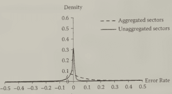

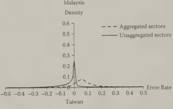

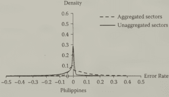

图3.1（续）十个经济体的误差率概率分布。

对于聚合部门，样本误差率范围很宽，从−479（中国三个部门的聚合，即“原油和天然气”、“钢铁”和“金融和保险”）到166（泰国两个部门“稻谷”和“合成树脂和纤维”的聚合）（表3.2）。误差率均值从0.029（韩国）到0.167（中国）。这表明，总体而言，AIO 2000的聚合会对碳足迹核算产生中等程度的影响；然而，某些部门的聚合可能造成相当大的偏差。

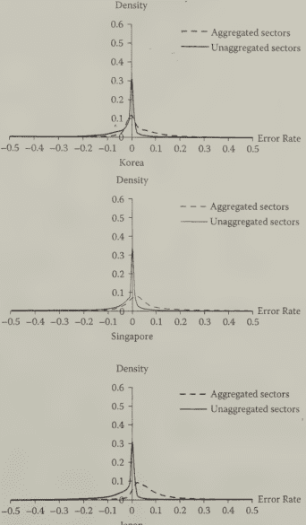

图3.1（续）十个经济体的误差率概率分布。

对于未聚合部门，误差率范围从−0.876（新加坡）到超过16（印度尼西亚）（表3.3），均值水平在−2%至−5%之间。置信区间显示，例如对于印度尼西亚，聚合部门95%的误差率落在−0.055至0.465的区间内。

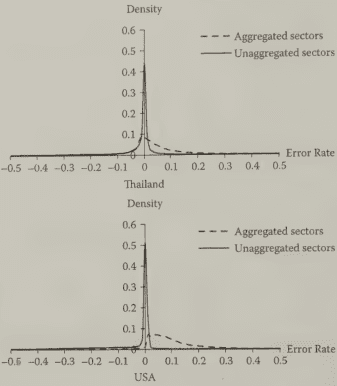

图3.1（续）十个经济体的误差率概率分布。

#### 表3.2 聚合部门误差率汇总

| 地区 | 最小值 | 均值 | 最大值 | 标准差 | 置信区间下限（2.5%） | 置信区间上限（2.5%） |
|---|---:|---:|---:|---:|---:|---:|
| 印度尼西亚 | −0.734 | 0.107 | 2.677 | 0.140 | −0.055 | 0.465 |
| 马来西亚 | −12.176 | 0.037 | 11.471 | 0.162 | −0.126 | 0.377 |
| 菲律宾 | −8.139 | 0.057 | 29.343 | 0.271 | −0.092 | 0.380 |
| 新加坡 | −0.438 | 0.066 | 1.885 | 0.162 | −0.102 | 0.536 |
| 泰国 | −2.941 | 0.044 | 165.589 | 0.713 | −0.099 | 0.326 |
| 中国大陆 | −478.753 | 0.167 | 119.134 | 2.149 | −0.013 | 0.746 |
| 台湾 | −1.384 | 0.072 | 8.798 | 0.119 | −0.080 | 0.311 |
| 韩国 | −0.527 | 0.029 | 6.869 | 0.100 | −0.096 | 0.235 |
| 日本 | −7.846 | 0.065 | 4.558 | 0.100 | −0.043 | 0.289 |
| 美国 | −0.355 | 0.092 | 1.574 | 0.088 | −0.007 | 0.310 |

#### 表3.3 未聚合部门误差率汇总

| 地区 | 最小值 | 均值 | 最大值 | 标准差 | 置信区间下限（2.5%） | 置信区间上限（2.5%） |
|---|---:|---:|---:|---:|---:|---:|
| 印度尼西亚 | −0.733 | −0.023 | 16.585 | 0.162 | −0.398 | 0.113 |
| 马来西亚 | −0.758 | −0.040 | 5.779 | 0.118 | −0.399 | 0.105 |
| 菲律宾 | −0.669 | −0.042 | 5.309 | 0.100 | −0.318 | 0.108 |
| 新加坡 | −0.876 | −0.049 | 3.349 | 0.127 | −0.506 | 0.074 |
| 泰国 | −0.772 | −0.030 | 6.237 | 0.107 | −0.335 | 0.085 |
| 中国大陆 | −0.806 | −0.036 | 3.548 | 0.115 | −0.383 | 0.073 |
| 台湾 | −0.595 | −0.031 | 5.072 | 0.094 | −0.234 | 0.140 |
| 韩国 | −0.681 | −0.025 | 4.338 | 0.066 | −0.175 | 0.075 |
| 日本 | −0.694 | −0.038 | 2.906 | 0.074 | −0.247 | 0.034 |
| 美国 | −0.826 | −0.043 | 3.596 | 0.106 | −0.353 | 0.017 |

聚合部门的置信区间范围在−0.102至0.746之间，未聚合部门在−0.506至0.14之间。

比较两组结果，除少数情况外，聚合部门的误差率范围更大、均值水平更高。这表明聚合对聚合部门的影响大于对未聚合部门的影响。此外，聚合部门的正均值表明，平均而言，AIO 2000的聚合导致聚合部门碳足迹被高估。负均值表明，当其他部门被聚合时，未聚合部门的碳足迹存在被低估的趋势。

对于各个经济体，部门聚合平均而言对中国、印度尼西亚和美国的碳足迹核算影响可能大于其他经济体。从误差率范围和聚合部门的标准差可以看出，中国、泰国和菲律宾某些部门的聚合会产生相当大的影响。对于印度尼西亚，国内部门聚合会对某些特定未聚合部门产生较大影响（表3.3）。

#### 3.3.2 影响聚合效应的因素

由误差率范围和标准差可推断，某些特定部门的聚合可能对

利用AIO 2000进行碳足迹核算的确定性。通过对汇总部门的错误率绝对值进行排序，我们识别出那些汇总可能导致较大偏差的部门（前30个结果的示例见附录3B）。

在前300个样本中，错误率绝对值从479降至1.85，其中140个发生在中国大陆（占前300个汇总结果的46.7%），105个发生在菲律宾（35%），22个发生在印度尼西亚（7.3%），14个发生在马来西亚（4.7%），13个发生在韩国（4.3%），日本和新加坡各3个（1%）。在中国大陆的140个高值汇总错误中，87个汇总方案包含了“钢铁”部门，25个汇总方案包含了“化肥和农药”部门。菲律宾的105个高错误率汇总方案中有104个包含了“原油和天然气”部门。印度尼西亚的22个高错误率汇总方案中有20个包含了“钢铁”部门。马来西亚的14个高错误率汇总方案中有13个包含了“非金属矿和其他采矿”部门。韩国未显示出对特定部门的如此高度集中。在13个高错误率汇总方案中，“木材”部门出现了5次。日本在3个高错误率汇总方案中，“水泥和水泥制品”部门出现了2次。新加坡在3个高错误率汇总方案中，“电力与燃气”部门和“房屋建筑”部门各出现了2次（不互斥）。

对于未汇总的部门，我们通过排序错误率的绝对值进行了类似实验。在前300个结果中，范围从16.585降至4.16，印度尼西亚的“碾磨谷物和面粉”部门（出现282次）受该地区其他部门不同汇总方式的影响最大。

我们比较了包含和不包含前300个高错误率结果的所有模拟的最小值、最大值、均值和标准差（见表3.4和表3.5）。可以发现，最小值和最大值的绝对水平显著下降，尤其是对于中国、泰国、菲律宾、印度尼西亚、马来西亚和日本，这些地区在前300个高错误率结果中出现频率很高。由于样本数量大，均值水平没有明显变化。标准差也因为样本量大，在大多数地区没有变化，但中国和泰国除外，这两个地区的标准差水平显著下降。

表3.4 所有模拟结果的错误率汇总

| 地区 | 最小值 | 平均值 | 最大值 | 标准差 | 样本数 |
|---|---:|---:|---:|---:|---:|
| 印度尼西亚 | −0.734 | −0.051 | 16.585 | 0.260 | 2,081,316 |
| 马来西亚 | −12.176 | −0.090 | 11.471 | 0.177 | 2,092,685 |
| 菲律宾 | −8.139 | −0.086 | 29.343 | 0.147 | 2,089,085 |
| 新加坡 | −0.876 | −0.102 | 3.349 | 0.186 | 2,088,507 |
| 泰国 | −2.941 | −0.067 | 165.589 | 0.199 | 2,105,087 |
| 中国大陆 | −478.753 | −0.087 | 119.134 | 0.390 | 2,082,398 |
| 台湾地区 | −1.384 | −0.047 | 8.798 | 0.142 | 2,093,642 |
| 韩国 | −0.681 | −0.045 | 6.869 | 0.094 | 2,094,986 |
| 日本 | −7.846 | −0.078 | 4.558 | 0.104 | 2,095,602 |
| 美国 | −0.826 | −0.107 | 3.596 | 0.152 | 2,089,001 |

表3.5 剔除300个高错误率结果后的模拟错误率汇总

| 地区 | 最小值 | 平均值 | 最大值 | 标准差 | 样本数 |
|---|---:|---:|---:|---:|---:|
| 印度尼西亚 | −0.734 | −0.052 | 4.335 | 0.253 | 2,081,086 |
| 马来西亚 | −0.779 | −0.090 | 3.991 | 0.176 | 2,092,676 |
| 菲律宾 | −0.897 | −0.086 | 4.289 | 0.142 | 2,089,059 |
| 新加坡 | −0.876 | −0.102 | 3.349 | 0.186 | 2,088,507 |
| 泰国 | −2.941 | −0.067 | 4.278 | 0.163 | 2,105,083 |
| 中国大陆 | −4.199 | −0.087 | 3.883 | 0.179 | 2,082,374 |
| 台湾地区 | −1.384 | −0.047 | 4.280 | 0.142 | 2,093,638 |
| 韩国 | −0.681 | −0.045 | 3.875 | 0.094 | 2,094,985 |
| 日本 | −0.694 | −0.078 | 2.906 | 0.103 | 2,095,600 |
| 美国 | −0.826 | −0.107 | 3.596 | 0.152 | 2,089,001 |

### 3.4 结论

MRIO表的构建既耗时又昂贵。目前可用于实际应用的MRIO表仍然很少。MRIO表通常基于国家投入产出表和双边贸易数据构建。不同国家有不同的关键部门和优先事项，这可能影响其国家投入产出表中的部门分类和汇总水平。在构建MRIO表时，通常需要进行重新分类和汇总，以调整各国投入产出表之间的差异。在将MRIO模型应用于环境分析时，需要再次进行部门重新分类和汇总，以匹配环境数据和经济数据。因此，部门汇总对于使用MRIO模型进行环境扩展分析是一项实用且重要的任务。通过使用亚太经济体的实证MRIO模型检验碳足迹核算中汇总偏差的大小，我们得出以下结论：

- 1. 平均而言，AIO 2000的汇总对碳足迹核算的影响适中（平均错误率的绝对值小于20%）。然而，某些部门的汇总可能导致相当大的偏差（错误率绝对值极高，例如479）。

- 2. 汇总对已汇总部门的影响大于对未汇总部门的影响。对于AIO 2000，存在一种趋势：汇总会导致已汇总部门的CF被高估，而未汇总部门的CF被低估。

- 3. 与其他实证文献（例如Karaska（1968）和Hewings（1974）提出汇总偏差随汇总水平增加而增加）不同，我们发现对于AIO 2000，汇总水平并非关键因素，但特定地区的某些特定部门确实在影响汇总偏差方面起关键作用。通过排除有限的高误差结果，错误率的范围可以大幅缩小，例如剔除前300个结果后，从(−479, 166)降至(−4, 4)。对于那些将对AIO 2000进行汇总以进行环境分析的人来说，在其汇总方案中排除特定部门可以大大提高核算结果的确定性。

- 4. 尽管我们识别了一些如果汇总会产生较大汇总误差的部门，但仍然缺乏先验识别它们的方法。由于部门碳强度、列昂惕夫乘数和最终需求水平根据方程(3.12)至(3.14)同时且非线性地影响汇总误差，因此难以提供一种简单的方法来事先检查哪些部门会产生潜在影响。这虽然不在本工作的范围内，但可以成为未来研究的重要议程。

### 致谢

Xin Zhou感谢日本环境省对“亚洲资源循环系统环境、经济和社会影响评估”项目的财政支持，该项目属于环境经济学政策研究（PSEE）。Hiroaki Shirakawa感谢日本环境省通过其环境研究与技术开发基金（E-1104）对“亚洲先进流域模型的开发与实践：迈向气候变化适应（FY2011-FY2013）”项目的支持。

### 参考文献

- Andrew, R., Peters, G.P., and Lennox, J., 2009. Approximation and regional aggregation in multi-regional input-output analysis for national carbon footprint accounting. *Economic Systems Research*, 21(3), 311-335.
- Ara, K., 1959. The aggregation problem in input-output analysis. *Econometrica*, 27, 257-262.
- Blair, P., and Miller, R.E., 1983. Spatial aggregation in multiregional input-output models. *Environment and Planning A*, 15, 187-206.
- Chenery, H.B., 1953. Regional Analysis. In Chenery, H.B., Clark, P.G., and Pinne, V.C., Eds., *The Structure and Growth of the Italian Economy*: 97-129. U.S. Mutual Security Agency, Rome.
- Dimaranan, B.V., 2006. Global Trade, Assistance, and Production: GTAP 6 Data Base, 2-8, 2-9. Center for Global Trade Analysis, Purdue University, West Lafayette, IN.
- Doeksen, G.A., and Little, C.H., 1968. Effect of size of the input-output model on the results of an impact analysis. *Agricultural Economics Research*, 20(4), 134-138.
- Fisher, W.D., 1958. Criteria for aggregation in input-output analysis. *The Review of Economics and Statistics*, 40, 250-260.
- Fisher, W.D., 1962. Optimal aggregation in multi-equation prediction models. *Econometrica*, 30, 744-769.
- Fisher, W.D., 1966. Simplification in economic models. *Econometrica*, 34, 563-584.
- Gibbons, J.C., Wolsky, A.M., and Tolley, G., 1982. Approximate aggregation and error in input-output models. *Resources and Energy*, 4, 203-230.
- Hertwich, E.G., and Peters, G.P., 2009. Carbon footprint of nations: A global, trade-linked analysis. *Environmental Science & Technology*, 43, 6416-6420.
- Hewings, G.J.D., 1974. The effect of aggregation on the empirical identification of key sectors in a regional economy: A partial evaluation of alternative techniques. *Environment and Planning A*, 6, 439-453.

日本贸易振兴机构亚洲经济研究所，2006年。*亚洲国际投入产出表2000：第1卷，说明性注释*。日本贸易振兴机构亚洲经济研究所，东京。

Karsaka, G.J.，1968年。不同加总水平下投入产出系数的变化。*区域科学杂志*，8(2)，215–227。

Lenzen, M.，2007年。共同责任的加总（不变性）：澳大利亚案例研究。*生态经济学*，64，19–24。

Lenzen, M.，2011年。环境投入产出分析中的加总与分解。*经济系统研究*，23(1)，73–89。

Leontief, W.，1941年。*美国经济结构：1919–1929*。牛津大学出版社，纽约。

Leontief, W.，1967年。投入产出分析和国民账户中加总方法的替代方案。*经济学与统计学评论*，49，412–419。

Minx, J.C., Wiedmann, T., Wood, R., Peters, G.P., Lenzen, M., Owen, A., Scott, K., Barrett, J., Hubacek, K., Baiocchi, G., Paul, A., Dawkins, E., Briggs, J., Guan, D., Suh, S.，和 Ackerman, F.，2012年。投入产出分析与碳足迹核算：应用综述。*经济系统研究*，21(3)，187–216。

Moses, L.N.，1955年。区域间贸易模式的稳定性与投入产出分析。*美国经济评论*，45，803–832。

Munksgaard, J.，和 Pedersen, K.A.，2001年。开放经济体的CO2核算：生产者责任还是消费者责任。*能源政策*，29，327–334。

Peters, G.P. 和 Hertwich, E.G.，2008年。国际贸易中的隐含CO2及其对全球气候政策的影响。*环境科学与技术*，42，1401–1407。

Su, B. 和 Ang, B.W.，2010年。贸易中隐含的CO2排放的投入产出分析：空间加总的影响。*生态经济学*，70(1)，10–18。

Su, B., Huang, H.C., Ang, B.W.，和 Zhou, P.，2010年。贸易中隐含的CO2排放的投入产出分析：部门加总的影响。*能源经济学*，32(1)，166–175。

Wiedmann, T.，2009a。用于基于消费的排放与资源核算的近期多区域投入产出模型综述。*生态经济学*，69，211–222。

Wiedmann, T.，2009b。社论：碳足迹与投入产出分析——导论。*经济系统研究*，21(3)，175–186。

Wyckoff, A.W.，和 Roop, J.M.，1994年。制成品进口中的隐含碳。*能源政策*，23(3)，187–194。

Zhou, X., Liu, X.B.，和 Kojima, S. 编，2010年。*国际贸易中隐含的碳排放：亚洲视角的评估*。全球环境战略研究所（IGES），日本叶山。取自 http://enviroscope.iges.or.jp/modules/envirolib/upload/2719/attach/embodied_emissions_whole_sf_publication.pdf。

### 附录3A：AIO 2000与GTAP6数据库中的部门分类

| 代码 | AIO 2000中的部门 | GTAP6数据库中对应的部门分类 |
|---|---|---|
| 001 | 稻谷 | 稻谷（pdr） |
| 002 | 其他谷物 | 小麦（wht）；谷类作物（gro） |
| 003 | 食用作物 | 蔬菜（v_f）；油籽（osd）；甘蔗、甜菜（c） |
| 004 | 非食用作物 | 植物纤维（pfb）；其他作物（ocr） |
| 005 | 牲畜和家禽 | 牛、羊、山羊、马（ctl）；动物产品（oap）；生乳（rmk）；羊毛、蚕茧（wol） |
| 006 | 林业 | 林业（frs） |
| 007 | 渔业 | 渔业（fsh） |
| 008 | 原油和天然气 | 石油（oil）；天然气（gas） |
| 009 | 铁矿石 | 矿产（omn）；煤炭（coa） |
| 010 | 其他金属矿石 |  |
| 011 | 非金属矿石和采石 |  |
| 012 | 碾磨谷物和面粉 | 加工大米（pcr）；植物油和脂肪（vol）；糖（sgt）；食品（ofd） |
| 013 | 鱼制品 | 牛、羊、山羊和马肉（cmt）；肉制品（omt）；乳制品（mil） |
| 014 | 屠宰、肉制品和乳制品 |  |
| 015 | 其他食品 |  |
| 016 | 饮料 | 饮料和烟草制品（b_t） |
| 017 | 烟草 |  |
| 018 | 纺纱 | 纺织品（tex） |
| 019 | 织造与印染 |  |
| 020 | 针织 |  |
| 021 | 服装 | 服装（wap） |
| 022 | 其他纺织制成品 |  |
| 023 | 皮革及皮革制品 | 皮革制品（lea） |
| 024 | 木材 | 木制品（lum） |
| 025 | 木制家具 |  |
| 026 | 其他木制品 |  |
| 027 | 纸浆和造纸 | 纸制品、出版（ppp） |
| 028 | 印刷和出版 |  |
| 029 | 合成树脂和纤维 | 化学、橡胶、塑料制品（crp） |
| 030 | 基础工业化学品 |  |
| 031 | 化肥和农药 |  |
| 032 | 药品和医药 |  |
| 033 | 其他化学产品 |  |
| 034 | 精炼石油及其制品 | 石油、煤炭制品（p_c） |
| 035 | 塑料制品 |  |
| 036 | 轮胎和内胎 |  |
| 037 | 其他橡胶制品 |  |
| 038 | 水泥及水泥制品 | 非金属矿物制品（nmm） |
| 039 | 玻璃及玻璃制品 |  |
| 040 | 其他非金属矿物制品 |  |
| 041 | 钢铁 | 黑色金属（i_s） |
| 042 | 有色金属 | 有色金属（hfm） |
| 043 | 金属制品 | 金属制品（fmp） |
| 044 | 锅炉、发动机和涡轮机 | 其他机械及设备（ome） |
| 045 | 通用机械 |  |
| 046 | 金属加工机械 |  |
| 047 | 专用机械 |  |
| 048 | 重型电气设备 |  |
| 049 | 电视机、收音机、音响和通信设备 | 电子设备（ele） |
| 050 | 电子计算设备 |  |
| 051 | 半导体和集成电路 |  |
| 052 | 其他电子和电子产品 |  |
| 053 | 家用电器 | 其他制成品（omf） |
| 054 | 照明灯具、电池、电线及其他 |  |
| 055 | 汽车 | 汽车及零部件（mvh） |
| 056 | 摩托车 | 其他运输设备（otn） |
| 057 | 造船 |  |
| 058 | 其他运输设备 |  |
| 059 | 精密机械 |  |
| 060 | 其他制造产品 |  |
| 061 | 电力与燃气 | 电力（el）、燃气制造与分销（gdt） |
| 062 | 供水 | 水（wtr） |
| 063 | 房屋建筑 | 建筑（cns） |
| 064 | 其他建筑 |  |
| 065 | 批发和零售贸易 | 贸易（trd） |
| 066 | 运输 | 海运（wtp）；空运（atp）；其他运输（otp） |
| 067 | 电话和电信 | 通信（cmn） |
| 068 | 金融和保险 | 其他金融服务（ofi）；保险（isr） |
| 069 | 房地产 | 其他商业服务（obs） |
| 070 | 教育科研 | 娱乐和其他服务（ros）；公共管理、国防、卫生和教育（osg） |
| 071 | 医疗卫生服务 |  |
| 072 | 餐饮 |  |
| 073 | 旅馆 |  |
| 074 | 其他服务 |  |
| 075 | 未分类 |  |

### 附录3B：前30个加总误差排名

*（见下表。）*

| 排名 | 国家 | 加总部门数 | 加总误差率 | 加总部门 | 碳强度（加总后） | 碳强度（加总前） | 里昂惕夫乘数（加总后） | 里昂惕夫乘数（加总前） | 碳乘数（加总后） | 碳乘数（加总前） | 最终需求（加总后） | 最终需求（加总前） |
|---:|---|---:|---:|---|---:|---:|---:|---:|---:|---:|---:|---:|
| 1 | 中国 | 3 | -78.753 | 原油和天然气、钢铁、金融中介和保险 | 0.907 | 0.735, 1.544, 0.030 | 2.116 | 1.739, 2.813, 1.529 | 2.892 | 2.223, 5.191, 0.477 | 1.8615424 | 4.162585, 1.760807, 1.315191 |
| 2 | 泰国 | 2 | 165.589 | 稻谷、合成树脂和纤维 | 0.202 | 0.940, 0.499 | 1.626 | 1.437, 2.145 | 0.612 | 0.349, 0.656 | -1.19395 | 1.315191, 0.2256 |
| 3 | 中国 | 3 | 119.194 | 钢铁、电话和电信 | 0.759 | 1.514, 0.033 | 2.221 | 2.813, 2.157 | 2.738 | 5.191, 1.597 | 2.1389644 | 4.162585, 4.83724, 1.689307 |
| 4 | 中国 | 5 | 65.765 | 稻谷、铁矿石、鱼制品、化肥和农药、钢铁 | 0.911 | 0.062, 1.330, 0.642, 1.544 | 2.495 | 1.929, 1.992, 2.418, 2.878 | 3.499 | 0.477, 1.240, 0.562, 1.324 | 1.961581 | 1.987327, 9.687287, 1.980731 |
| 5 | 中国 | 3 | -35.293 | 其他橡胶制品、钢铁、电子计算设备 | 1.145 | 0.472, 1.544, 0.019 | 2.724 | 2.813, 2.157, 2.573 | 3.882 | 5.191, 1.981, 0.804 | 1.5144006 | 6.273441, 4.162585, 1.665493 |
| 6 | 菲律宾 | 2 | 29.343 | 原油和天然气、基础化学产品、基础钢铁 | 13.812 | 284.147, 0.344107, 0.1147 | 2.103 | 1.466, 2.171 | 20.454 | 284.258, 0.528, 0.394 | 4.118 | 3.41121 |
| 7 | 菲律宾 | 3 | 17.572 | 原油和天然气、石油制品、其他橡胶制品、其他运输设备 | 7.608 | 284.147, 0.172, 0.002 | 2.079 | 1.486, 2.142, 1.793 | 8.429 | 284.258, 0.545, 0.222 | 1.17223 | 3.395972, 2.1254 |

## 气候信息学

Claire Monteleoni、Gavin A. Schmidt、Francis Alexander、Alexandru Niculescu-Mizil、Karsten Steinhaeuser、Michael Tippett、Arindam Banerjee、M. Benno Blumenthal、Auroop R. Ganguly、Jason E. Smerdon 和 Marco Tedesco

### 目录

- 4.1 引言 — 82
- 4.2 机器学习 — 84
- 4.3 理解与使用气候数据 — 84
  - 4.3.1 *实地*观测 — 85
  - 4.3.2 格点化/处理后的观测 — 85
  - 4.3.3 卫星反演 — 86
  - 4.3.4 古气候代用资料 — 86
  - 4.3.5 再分析产品 — 87
  - 4.3.6 全球气候模式（GCM）输出 — 87
  - 4.3.7 区域气候模式（RCM）输出 — 88
- 4.4 气候信息学中的科学问题 — 88
  - 4.4.1 参数化方案开发 — 89
  - 4.4.2 利用气候预估的多模式集合 — 89
  - 4.4.3 古气候重建 — 90
  - 4.4.4 资料同化与初始化的年代际预测 — 90
  - 4.4.5 扰动物理集合（PPEs）的开发与理解 — 90
- 4.5 气候数据分析：问题与方法 91
  - 4.5.1 突变 91
  - 4.5.2 气候网络 94
  - 4.5.3 预测建模：平均过程与极端事件 96
- 4.6 季节气候预测 97
  - 4.6.1 季节预测的基础是什么？ 97
  - 4.6.2 数据挑战 99
  - 4.6.3 识别可预测量 99
  - 4.6.4 充分利用GCM数据 100
- 4.7 气候极端事件、不确定性与影响 101
  - 4.7.1 气候变化的挑战 101
  - 4.7.2 气候极端事件科学 101
  - 4.7.3 气候影响科学 102
- 4.8 重建过去气候 103
  - 4.8.1 全球温度重建问题 104
  - 4.8.2 伪代用资料实验 107
  - 4.8.3 气候重建与未来 108
- 4.9 在极地问题中的应用 110
- 4.10 迈向气候信息学工具箱 112
- 4.11 气候信息学中的数据挑战与机遇 114
  - 4.11.1 跨类比较的问题 114
  - 4.11.2 气候系统复杂性 116
  - 4.11.3 挑战：基于云计算的可重现气候数据分析 116
    - 4.11.3.1 数据规模 117
    - 4.11.3.2 可重现性与溯源图 117
- 4.12 结论 118
- 致谢 118
- 参考文献 119

### 4.1 引言

当前及潜在未来气候变化的影响将成为21世纪最重要的科学和社会挑战之一。鉴于在温度、海冰和海平面方面已观测到的变化，增进我们对气候系统的理解是一项国际优先事项。该系统的特征是复杂现象，观测不完善，模拟更不完善。但随着来自卫星和环境传感器的气候数据不断增加，数据和气候模式输出的规模开始使目前用于分析这些数据的相对简单的工具不堪重负。因此，计算方法对于这些分析挑战将是不可或缺的。本章介绍新兴的研究学科*气候信息学*：气候科学家与机器学习研究者之间的合作，以弥合数据与理解之间的差距。我们希望气候信息学的研究能够加速回答气候科学中紧迫问题的发现。

机器学习是计算机科学与统计学交叉的一个活跃研究领域，致力于开发用于检测数据模式的自动化技术或算法。机器学习（和数据挖掘）算法对一系列技术至关重要，包括网络搜索、推荐系统、个性化互联网广告、计算机视觉和自然语言处理。机器学习也对自然科学产生了重大影响，例如在生物学中；生物信息学这一跨学科领域促进了基因组学和蛋白质组学的许多发现。机器学习对气候科学的影响有望同样深远。

本章的目标是定义*气候信息学*并为这一新兴领域提出一些重大挑战。作者以及其他研究团队近期在气候信息学方面的进展表明，与气候科学家的合作也为机器学习开辟了有趣的新问题。在这两个领域的交汇处存在无数可能的合作。本章采用自上而下和自下而上两种方法来激发气候信息学中一系列问题的研究进展，其中一些问题尚未被提出。对于前者，我们介绍了由气候科学家提出的挑战性难题，并在*气候信息学2011：第一届气候信息学国际研讨会*上与机器学习、数据挖掘和统计学研究人员进行了讨论，该研讨会是所有合著者都参与的新年度研讨会的首次活动。为了自下而上地激发创新，我们还描述并讨论了部分可用数据类型。除了总结气候信息学的一些关键挑战外，本章还借鉴了合著者近期的一些气候信息学研究。

本章组织如下。首先，我们讨论可用的气候数据类型，并概述气候信息学的一些挑战，包括分析气候数据的问题。然后我们将进一步详细讨论几个关键的气候信息学问题：季节气候

| 排名 | 国家/地区 | 汇总部门数 | 误差率 | 汇总部门 | 碳强度（之前） | 碳强度（之后） | 列昂惕夫乘数（之后） | 列昂惕夫乘数（之前） | 碳乘数（之后） | 碳乘数（之前） | 最终需求（之后） | 最终需求（之前） |
|---|---|---|---|---|---|---|---|---|---|---|---|---|
| 18 | 菲律宾 | 2 | 9.983 | 碳、石油和天然气 | 3.648 | 284.47 | 1.841 | 1.846 | 1.936 | 281.258 | 477.94 | -3.47797 |
| 19 | 菲律宾 | 2 | 9.982 | 碳、石油和天然气 | 3.648 | 284.47 | 1.842 | 1.849 | 1.945 | 281.258 | 477.94 | -3.47797 |
| 20 | 菲律宾 | 3 | 9.973 | 碳、石油和天然气；石油和天然气；蒸汽和热水供应 | 4.817 | 284.47 | 1.999 | 1.845 | 5.257 | 281.258 | 20030 | -3.57849 |
| 21 | 菲律宾 | 3 | 9.565 | 电力；重型设备 | 1.664 | 284.47 | 1.963 | 1.846 | 2.424 | 281.258 | 57658 | -3.59843 |
| 22 | 中国 | 3 | 9.119 | 非金属矿物制品；化学与石化产品；电子与电气设备 | 0.621 | 130.472 | 2.295 | 2.276 | 5.316 | 3.966 | 102715 | -3.507341 |
| 23 | 中国台湾 | 2 | 8.798 | 合成树脂与纤维；金融与保险；电子计算设备 | 0.029 | 0.002 | 1.679 | 2.095 | 0.128 | 2.126 | 141548 | 0.472 |
| 24 | 菲律宾 | 3 | 8.513 | 碳、石油和天然气；肥料与化学品；其他制造产品 | 3.783 | 284.47 | 2.041 | 2.106 | 0.624 | 281.258 | 15953 | -3.4041 |
| 25 | 菲律宾 | 3 | 8.198 | 林业；原油和天然气 | 1.603 | 0.426 | 284.147, 0.002 | 2.280 | 1.319, 1.486, 2.590 | 1.853 | 0.584, 284.285, 8.195 | 6.59596, 6.1212, — |
| 26 | 菲律宾 | 3 | 8.139 | 原油和天然气；煤炭开采 | 3.084 | 0.457, 0.257 | 284.147, 0.571 | 2.259 | 4.084, 2.275, 2.220 | — | 284.147, 0.571 | -2.702, -3.22384, -2.5983, — |
| 27 | 菲律宾 | 2 | 8.049 | 原油和天然气；玻璃及玻璃制品 | 10.308 | 284.147, 0.907 | 2.186 | 1.486, 2.215 | 12.620 | 0.573, 284.258, 0.422 | 3.0573 | — |
| 28 | 菲律宾 | 2 | 8.039 | 原油和天然气；玻璃及玻璃制品 | 10.308 | 284.147, 0.707 | 2.184 | 1.486, 2.215 | 12.606 | 0.573, 284.258, 0.422 | 3.0573 | — |
| 29 | 日本 | 2 | 7.846 | 原油和天然气；玻璃制品；非金属矿石与采石 | 0.096 | 0.001, 0.102 | 2.021 | 1.651, 2.018 | 0.174 | 0.061, 0.183 | -6.197, -10.86, 4.829 | — |
| 30 | 中国 | 4 | 7.833 | 鱼类制品；其他制造业；橡胶制品；钢铁 | 1.159 | 0.060, 0.060, 0.272, 1.544 | 2.751 | 2.419, 2.078, 2.737, 2.883 | 3.923 | 1.34, 0.986, 2.386, 5.191 | 1.76407, 9.0740, 12304, 276.1198, 461.6285 | — |

预报、预测极端气候、重建过去气候以及极地地区的一些问题。然后我们讨论一些可能具有前景的机器学习与统计方法（这些方法在前面的章节中未提及）。最后，我们讨论气候科学数据与数据管理方面的一些挑战和机遇。由于本章覆盖范围广泛，相关工作的讨论穿插在各节之中。

### 4.2 机器学习

过去几十年里，机器学习领域已显著成熟，借鉴了优化、统计学和人工智能等多个学科的思想[4, 34]。机器学习的应用已在从互联网应用到科学问题的广泛领域中带来重要进展。针对各种预测建模以及探索性数据分析问题，已经发展出多种机器学习方法。在预测建模方面，线性分类与回归、分层线性模型、基于核的非线性模型，以及组合不同预测器输出的集成方法都取得了重要进展。在探索性数据分析方面，聚类和降维取得了进展，包括用于检测数据中低维流形结构的非线性方法。推动现代机器学习研究的一些重要主题，源于科学、社会和商业应用中的现代数据集特性。特别是，这些数据集规模极大，达到数百万甚至数十亿个数据点；维度很高，可达数万维甚至更多；并且具有复杂的统计依赖关系，违背了传统方法中的“独立同分布”假设。这些特性在气候数据集中很容易观察到，包括观测、再分析以及气候模式输出。这些方面使得人们更加重视可扩展优化方法[94]、在线学习方法[11]和图模型[47]，它们能够处理高维且具有统计依赖关系的大规模数据。

### 4.3 理解和使用气候数据

现有大量各种类型的气候数据，为未来的数据挖掘和机器学习研究提供了丰富而肥沃的试验场。这里我们讨论一些可用的数据种类，并就如何使用它们提供一些建议。讨论会引出一些有趣的问题。气候数据有多种来源，从以非结构化方式散布在全球各地的单站点观测，到全球范围且均匀网格化的气候模式输出。每一类数据都有其特定特征，在成功使用或比较之前应当充分认识这些特征。我们在此对每一类数据作简要介绍，并给出一些示例和进一步信息的参考文献。还讨论了跨类别综合中出现的常见问题。

#### 4.3.1 *原位观测*

*原位*测量是指对多种气候系统属性（可包括温度、降雨、风、柱臭氧、云量、辐射等）在特定地点进行的原始（或仅经过最低限度处理）测量。这些地点通常位于地表（例如气象站），但也可能包括来自无线电探空仪气球的大气测量、来自浮标的次表层海洋数据，以及来自船舶、飞机和特殊强化观测平台的数据。

其中大部分数据由各国气象部门或AEROCOM（气溶胶数据）、国际综合海洋-大气数据集（ICOADS）（来自船舶的海洋温度和盐度）、Argo（海洋浮标）等专项项目常规收集，并以整理后的形式提供。与单一实验相关的多变量数据（例如大气辐射测量（ARM）计划或北极地表热收支（SHEBA））组织得稍差一些，尽管通常可在专门网站上获取。

这类数据可用于进行一致的多变量比较，不过通常局限于有限的时间和空间范围；也可作为天气模式分析的输入，或作为处理成网格化数据的原材料（见下一小节）。这类数据的主要问题在于空间上稀疏，并且在时间上由于测量实践或仪器不同而存在不均匀性，以及总体不完整（并非所有变量都在同一时间或地点测量）[45, 62]。

#### 4.3.2 网格化/处理后的观测

给定一个原始 *原位* 数据网络，下一步是将这些网络综合成经过质量控制、规则网格化的数据集。与原始数据相比，这些数据集具有若干优势：更易于使用，与模式输出（下文讨论）更具可比性，并且非气候伪信号更少。网格化产品通常以5°纬度×5°经度网格或更高分辨率提供。然而，这些产品使用了插值、时空空缺填补以及对已知偏差的订正，所有这些都会影响产品的结构不确定性。由此得到的误差估计往往依赖于空间和时间。针对同一基本量的不同产品可以反映这些产品的结构不确定性，我们强烈建议使用多个版本。例如，对于全球平均地表温度的不同估计，可以从国家气候数据中心（NCDC）、哈德利中心和NASA获取异常值[6, 33, 90]；这些估计在处理方式和细节上有所不同，但在大尺度上显示出很大程度的一致性。

#### 4.3.3 卫星反演

自1979年以来，地球气候的全球和近全球观测一直由低地球轨道和地球静止卫星进行。这些观测基于被动辐射（直接来自地球的发射辐射，或经反射的太阳辐射），或基于通过激光或雷达进行的主动扫描。这些卫星主要由美国机构（NOAA、NASA）、欧洲空间局和日本项目（JAXA）运行，数据通常以近实时方式提供。数据有若干级别，从原始辐射（1级）、作为时间函数处理的数据（2级），到全球尺度网格化平均数据（3级）。

卫星产品确实对气候系统具有特定而独特的视角，这要求在任何将卫星数据与其他产品进行比较时，都要纳入对“卫星视角”的认识。许多卫星产品针对特定平台上的特定仪器；跨多仪器和多平台的合成产品是可能的，但仍很少见。

#### 4.3.4 古气候代用资料

原位仪器数据在全球范围内仅可追溯到19世纪中叶，尽管个别记录可以延伸到17或18世纪。为了获得更长时间尺度的视角，气候信息必须从所谓的“代用”档案中提取，例如冰芯、海洋泥、湖泊沉积物、树轮、花粉记录、洞穴或珊瑚，这些档案保留了有时与特定气候变量或事件高度相关的信息[41]。

与卫星数据一样，适当的比较通常需要建立一个正演模型，描述气候信息储存的过程，并纳入影响任何特定代用资料的多重变量[75]。然而，过去气候中往往可以发现的显著更大信号，能够克服因空间稀疏和非气候噪声导致的不确定性增加，尤其是在采用多代用资料方法进行组合时[58]。古气候中的问题将在第4.8节进一步详细讨论。

#### 4.3.5 再分析产品

天气预报模式会使用尽可能多的可同化观测数据（原位、遥感等）来进行天气预报（“分析场”），这些分析场是任意时刻气候状态的极好估计。然而，随着模式随时间改进，天气预报的时间序列可能包含仅与模式变化有关的趋势，而非真实世界的变化。因此，许多天气预报团体开展了“再分析”，使用固定模式重新处理过去的数据，以便对真实世界获得一致的视角（更多细节见 reanalyses.org）。这在某种程度上相当于对现有数据集进行基于物理的插值，并且通常能提供仪器时期气候状态的最佳估计（例如ERA-Interim [16]）。

然而，再分析中的并非所有变量都同等受到观测数据的约束。因此，海平面气压和风得到了很好的表征，但降水、云场和地表通量则更依赖模式，因而并不那么可靠。此外，输出中仍然存在随观测网络随时间变化而产生的非物理趋势。特别是，1979年大规模遥感的开始使许多场出现跳跃，这些跳跃可能被误认为真实的气候趋势[105]。

#### 4.3.6 全球气候模式（GCM）输出

全球气候模式是对气候系统的基于物理的模拟，可选地包含大气、海洋、海冰、陆面、植被、冰盖、大气气溶胶与化学以及碳循环等分量。模拟可以是对变化边界条件的瞬态响应（例如20世纪回报），也可以是对被认为相对稳定时期的时段切片（例如6000年前的全新世中期）。输出的变化可能取决于初始条件（由于天气的混沌性质）、所使用的模式，或强迫场的变化（例如由于气溶胶排放的时间历程存在不确定性）。一些协调性计划，特别是耦合模式比较计划（CMIP），已经组织了

由世界各地多个气候模拟小组所遵循的连贯模式实验，这些实验是模式输出的主要来源[96]。

这些模式用于定义强迫气候变化的指纹，这些指纹可用于气候变化的检测与归因[39]，用于生成关于气候系统联系的假设，作为评估所提出的现实世界分析的试验平台[24]，当然也用于未来预测[61]。量化模式参数化或模式框架中的结构不确定性、关键过程实现中已知缺陷的影响，以及在小空间或时间尺度上作出妥协的必要性，都是重要挑战。

#### 4.3.7 区域气候模式（RCM）输出

全球模式必然需要在水平分辨率上作出妥协。为了在局地尺度纳入更多细节（尤其是区域地形），可使用全球模式或全球再分析的输出驱动更高分辨率的区域气候模式。随后可利用嵌入 RCM 代码中的物理原理，将大尺度场转换为更高分辨率。特别是，对详细地形非常敏感的降雨格局，在 RCM 中往往比在全球尺度驱动模式中模拟得好得多。然而，RCM 中有许多变量需要考虑——从边界场强迫实施方式的变化到物理包的变化——利用 RCM 改进变化预测的效用尚不清楚。一项检验这些问题的协调实验是北美区域气候变化评估计划（NARCCAP）[60]。

### 4.4 气候信息学中的科学问题

气候科学家正在研究许多不同类型的问题，机器学习和计算机科学技术可能在其中产生重大影响。这是几个示例的简要描述（并讨论文献中的相关工作），这些示例代表了这些想法，尽管所提到的任何具体实现都不应被视为最终结论。本节简要描述广义气候信息学中的几个挑战性问题。在 4.5 节中，我们介绍气候数据分析中的问题。在后续章节中，我们将更详细地探讨气候信息学中的一些具体问题。

#### 4.4.1 参数化开发

气候模式需要处理发生在小于任何有限模式所能分辨尺度上的物理过程。这可能涉及云的形成、海洋湍流、陆面非均匀性、浮冰相互作用、尘粒表面化学等。这通过使用参数化方案来处理，这些方案试图捕捉特定过程的唯象特征及其相对于（已分辨的）大尺度的敏感性。这是一项持续进行的任务，目前主要由科学家的物理直觉和相对有限的校准数据驱动。随着观测数据变得更易获得，关键过程的直接数值模拟变得更易处理，机器学习和数据挖掘技术在帮助定义新参数化方案和框架方面的潜力也随之增加。例如，神经网络框架已被用于开发辐射模式[50]。

#### 4.4.2 使用气候预估的多模式集合

全球约25个中心已开发了多个气候模式，并正在积极改进。每个模式至少与某些其他模式共享一些基本特征，但每个模式通常都是独立设计和实现的，并具有许多独特之处。在协调的模式比对计划（MIP）中（最有用的包括耦合模式比对计划（CMIP3、CMIP5）、大气化学与气候模式比对计划（ACCMIP）、古气候模式比对计划（PMIP3）等），模拟小组尝试在相似边界条件下使用多个模式进行类似模拟。这些“集合”提供了评估以下问题的可能性：哪些结果在模式间是稳健的，内部变率、结构不确定性和情景不确定性在不同时间和空间尺度上评估不同预估时起什么作用，以及提供多种模式—观测比较机会。是否存在针对当前和过去模式模拟、且能为未来预估提供信息的技巧度量？是否存在最大化预测技巧的加权策略？如何探索这一点？这些问题也出现在天气预报或季节预报中，但由于涉及长时间尺度，气候问题使这些问题更加困难[40, 97]。最近一些工作已将机器学习应用于该问题，并取得了令人鼓舞的结果[63]。

#### 4.4.3 古气候重建

理解在广泛仪器观测开始之前过去气候如何变化非常令人关注——尤其因为古记录中看到的气候变化使20世纪的变化相形见绌，因此可能为本世纪预计的重大变化提供很多洞见。然而，古数据甚至比仪器数据更稀疏，而且通常不能直接与仪器记录相称。如4.3节所述，古代用指标（如水同位素、树木年轮、花粉计数等）是气候变化的指示物，但其行为常受到非气候因素影响，或者它们与更标准变量（如温度或降水）之间的关系可能是非平稳的或卷积的。将不同的多代用指标证据整合起来以生成大尺度气候变化型，是一项巨大挑战[59]；或者从另一个方向，在模式中建立足够的“正向建模”能力，以便直接使用代用指标作为建模目标[76]。该主题将在4.8节进一步详细讨论。

#### 4.4.4 数据同化与初始化年代际预测

利用稀疏观测数据构建完整场的主要方式是通过数据同化。这是天气预报以及大气和海洋各种再分析的基本手段。在许多方面，这是模式与观测相结合的最复杂用法，但其在改进气候预测方面的应用仍处于起步阶段。对于天气时间尺度，这种方法效果很好；但对于更长期的预报（从季节到年代际），关键变量在海洋而非大气中，而初始化气候模式以使海洋变率的演变以有用方式模拟真实世界，仍是一项正在进行的工作[44, 90]。初步结果即使还不令人信服，也颇具启发性，而且更多示例预计将在新的 CMIP5 档案中上线[61]。

#### 4.4.5 开发与理解扰动物理集合（PPEs）

模式结构不确定性的一种度量是来自不同模拟小组的不同模式之间的离散度。但这些模式不能被视为所有可能模式空间中的随机样本。另一种方法是采用单个模式，并在代码中改变多个（不确定的）参数，以生成一族相似模式。

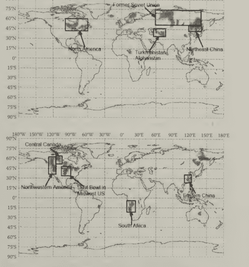

图4.1（见彩色插页。）我们的算法检测到的干旱区域。每个面板显示从特定十年开始的干旱：1905–1920（左上）、1921–1930（右上）、1941–1950（左下）和1961–1970（右下）。黑色矩形区域表示[63]发现的共同干旱。

使用了 Unit（CRU）降水数据集，空间分辨率为 0.5°×0.5° 经纬度，时间范围为 1901 至 2006 年。LP 涉及约 700 万个变量，并使用高效优化技术求解。该方法检测到了过去一个世纪几乎所有众所周知的干旱。更一般地，这种方法可用于检测和研究各种情境下的突变，包括热浪、干旱，

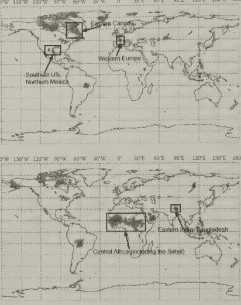

图4.1（见彩插）（续）我们的算法检测到的干旱区域。每个面板显示了从特定十年开始的干旱：1905–1920（左上）、1921–1930（右上）、1941–1950（左下）和1961–1970（右下）。黑色矩形内的区域表示[63]发现的共同干旱。

降水与植被。该分析可以酌情应用于观测数据、再分析数据以及模型输出。

#### 4.5.2 气候网络

识别各种气候变量与气候过程之间的依赖关系，是理解全球气候系统的关键部分。这种依赖关系可以表示为气候网络[19, 20, 106, 107]，其中相关的变量或过程表示为节点，依赖关系通过它们之间的边来捕获。气候网络是底层全球气候系统复杂过程的一种丰富表示，可用于理解和解释观测到的现象[95, 108]。

气候网络中的一个关键挑战是如何从观测到的气候变量构建这样的网络。从统计机器学习的角度来看，气候网络应反映由所涉变量联合分布所捕获的适当依赖关系。现有方法通常关注从联合分布推导出的合适度量，例如协方差或互信息。通过基于样本的成对协方差或互信息矩阵估计，可以对估计矩阵进行适当阈值化从而获得气候网络。这类方法已显示出巨大的潜力，常常能够识别全球气候系统中的一些关键依赖关系[43]（图4.2）。

展望未来，要实现全球气候系统更准确的表示，还必须解决许多其他计算和算法方面的挑战。例如，当前的网络构建方法并未考虑时间滞后相关的可能性，然而我们知道这种关系是存在的。类似地，时间自相关以及具有变化幅度和相位的信号也没有被显式处理。还需要更好地平衡空间自相关的主导信号与可能的遥相关（跨区域的远程依赖）信号，后者往往是人们高度关注的。此外，气候科学文献中还有许多已知且有记录的过程，网络表示应能够以系统的方式纳入这种*先验*知识。这些基于网络的方法最初的动机和优势之一是其可解释性，而随着这些不同方面被整合到日益复杂的模型和分析方法中，保留这一特性将至关重要。

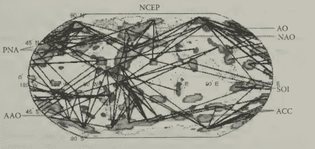

图4.2（见彩插）使用基于图的分析方法从海平面气压（再分析）数据中发现的气候偶极子（详见[42]）。

#### 4.5.3 预测建模：平均过程与极值

对观测到的气候现象进行预测建模，有助于理解影响特定观测行为的关键因素。虽然预测建模的通常目标是使响应变量（例如给定地点的温度或降水）达到高精度，但在气候数据分析情境中，识别对响应影响最显著的协变量往往更为重要。因此，除了获得高预测精度外，特征选择将是预测建模的一个关键焦点。此外，还需要区分平均过程和极值，这两者是响应变量截然不同的状态。在实践中，不同的协变量可能在不同的状态和时间尺度下影响响应变量。

在近期文献中，在高维回归背景下进行特征选择已取得了重要进展[66, 101]。具体而言，考虑基于所有海洋位置的多个海洋变量来预测巴西平均温度的问题。协变量数量$p$达到数万，而基于几十年月平均值的样本数量$n$只有几百到几千。标准回归理论并不适用于这种$n \ll p$的情形。由于特定位置的海洋变量天然成组，只有少数这样的位置与预测相关，且每个位置中只有少数变量相关，因此可以将回归问题表述为稀疏组套索问题[24, 25]：

$$\min_{\theta\in\mathbb{R}^p}\|y-X\theta\|_2^2+\lambda_1\|\theta\|_1+\lambda_2\sum_{g=1}^{N}\|\theta_g\|_2$$

其中$N$是海洋位置的数量，$m$是每个位置的海洋变量数量，因此$p=Nm$，$\theta$是所有协变量上待估计的权重向量，$\theta_g$是位置$g$上变量的权重集合，$\lambda_1, \lambda_2$是非负常数。稀疏组套索正则化器确保只有少数位置获得非零权重，并且即使在这些位置中，也只选择少数变量。图4.3显示了在巴西温度预测任务中被一致选择的位置和特征。

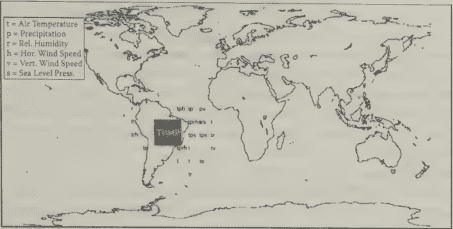

图4.3 巴西的温度预测：通过交叉验证选择的变量。

### 4.6 季节性气候预测

季节性气候预测是指那些超出标准天气预报时间范围（例如2周）、提前一到两个季节（最长6个月）的预测。基本问题涉及什么是可预测的（以及什么是不可预测的），以及究竟可预测到什么程度。回答这些问题通常也能很好地指示在实践中如何进行预测。这些都是困难的问题，因为气候系统中有很多是不可预测的，而且观测记录很短。将数据挖掘和机器学习方法应用于观测数据和数值气候预测模型的输出，提供了有前途的途径。关键问题包括找出气候状态空间中可预测的分量，并在观测与数值模型的相应预测之间构建有用的关联。

#### 4.6.1 季节性预测的基础是什么？

大气混沌的本质以及数值天气预报对初始条件的相关敏感性，可用著名的“蝴蝶效应”来描述——巴西一只蝴蝶扇动翅膀可能会在得克萨斯州引发龙卷风。数值天气预报初始状态中的小误差会迅速放大，直到预报失去价值。这种对初始条件的敏感依赖性解释了为什么有效天气预报只能提前有限的时间（几天到一周），也解释了为什么在20世纪80年代初之前人们认为季节性预测是不可能的[81]。这也解释了为什么需要努力“在混沌的干草堆中寻找可预测性的针”。鉴于天气的可预测性有限，诸如降水和近地表温度等量又如何能够提前一个季节（3到6个月）被熟练地预报出来？

首先，应该指出的是，气候预测的格式与天气预报不同。天气预报针对特定某天或某小时的气象条件。气候预测则是针对某个时间范围内的天气统计量。例如，当前气候预测中最常见的量是降水和近地表温度的3个月（季节）平均值。地球系统的两个基本事实使气候预测成为可能。第一，海洋演化的时间尺度通常比大气慢，某些海洋结构可以提前几个月预测。最突出的可预测海洋结构与厄尔尼诺–南方涛动（ENSO）相关，表现为赤道太平洋海表温度（SST）相对于其季节调整的长期值出现广泛、持续的偏离（异常）。第一次ENSO预测是在20世纪80年代末作出的[10]。第二个事实是，大气的某些组成部分会对持续的SST异常作出响应。在任意给定的一天，大气对SST的响应往往相对于通常的天气变率较小。然而，由于SST强迫和相应的大气响应可能持续数月或数季，季节平均值对SST强迫的响应可能很显著[82]。例如，ENSO对温度、降水、热带气旋、人类健康，甚至可能对冲突都有影响[31, 38, 49, 72]。早期使用前期SST与气候响应之间的典型相关分析（CCA）构建的季节性预测[3]，正是利用了SST的这种持续性。这类统计（或经验性的，即不包含显式基本物理定律）预测仍然具有吸引力，因为相对于基于物理过程的模型（通常是拥有数百万自由度的大气环流模型；GCM），它们通常维度低、成本低。

#### 4.6.2 数据挑战

这里我们介绍可用数据带来的一些挑战。数据挑战将在第 4.11 节进一步讨论。严重限制来自可用数据的维度。可靠的气候观测通常不会向前延伸超过 40 或 50 年。这意味着，例如，1 月至 3 月平均降水的可用观测可能只有 40 或 50 个。此外，这些数据的质量和完整性可能随时间和空间而变化。来自 GCM 的气候预报往往甚至不覆盖这一有限时期。许多季节气候预报系统在 20 世纪 80 年代初开始进行后报，当时卫星观测（尤其是 SST 观测）开始可用。与样本量形成对比的是，GCM 状态空间的维度可能达到 10⁶ 量级，具体取决于空间网格分辨率。在应用典型相关分析等经典方法寻找预报和观测中的关联特征之前，必须进行降维（常用主成分分析[PCA]）[5]。在季节气候预测问题中，已有一些工作使用了更复杂的降维方法[53]。需要能够处理大状态空间和小样本量的方法。一种有趣的近期方法避免了小样本问题：使用不受观测约束的长期气候模拟来估计统计模型，并在观测上检验所得模型[18, 115]。这种方法面临的挑战是选择气候变率“真实”的 GCM；鉴于观测记录，这是一个极其困难的问题。

#### 4.6.3 识别可预报量

气候预报的初步成功在于预测降水、近地表温度等量的季节平均值。在这种情况下，时间平均充当滤波器，用于寻找可预报信号。赤道太平洋某区域 SST 的空间平均被用于定义 NINO3.4 指数，该指数用于 ENSO 预报和观测分析。这种空间平均通过降低噪声来增强大尺度可预报的 ENSO 信号。马登-朱利安振荡（MJO）是气候变率的一个次季节分量，通过时间和空间滤波来检测。已有一些工作构建旨在优化可预报性度量的空间滤波器[17]，并且新方法仍有机会。

### 4.7 气候极端事件、不确定性与影响

#### 4.7.1 气候变化挑战

政府间气候变化专门委员会（IPCC）第四次评估报告（AR4）使人们更广泛地接受由排放情景的人为驱动因素引起的全球气候变化。然而，地球系统建模者仍难以在区域和年代际尺度上对极端事件（如热浪、寒潮、极端降雨事件、干旱、飓风和热带风暴）或极端胁迫（如温带地区的热带气候或降雨模式变化）作出精确预测。此外，对于政策制定者和利益相关者而言，最重要的知识缺口仍然是无法对局地至区域尺度的气候极端事件和变化影响作出可信估计。过程研究、气候模型及相关时空降尺度策略中的不确定性，可以通过统计评估来评估和降低。但对极端水文和气象事件进行类似处理，可能需要新的统计方法和改进的降尺度。气候变化影响的场景不确定性从根本上难以处理，但其他来源的不确定性可能可以降低。区域影响需要计入预期风险和损害估计中的额外不确定性，无论这些风险和损害涉及环境、基础设施、经济还是社会。从情景到模型、到降尺度、最终到影响的级联不确定性，使高成本决策难以评估。如果必须对因果驱动因素或政策影响作出可信归因，这一问题会变得尤为尖锐。

#### 4.7.2 气候极端事件科学

一个目标是，在区域至年代际尺度上，就全球气候变化对天气或水文极端胁迫和极端事件的影响，形成可量化的认识。精确的局地预测——例如，十年后某一年某一天发生极端事件的可能性——将永远无法实现，原因在于气候系统的混沌性质、测量精度的限制，以及我们无法对过程物理的所有方面进行建模。然而，天气和水文的概率密度函数——例如极端事件的强度-历时-频率（IDF）可能性，或导致极端胁迫的平均变化可能性——可能是可实现的目标。可选工具涵盖科学的两大传统支柱：理论（例如，物理理解的进步和高分辨率过程尺度[40]。

共同纪元（CE）还跨越了许多人类文明的兴衰，因此这一时期的古气候信息对于理解气候与有组织社会之间的复杂关系十分重要[7, 15]。

鉴于其广泛用途以及所涉及的代用系统数量庞大，CE 气候研究是一项范围广泛且多样化的研究事业。以下讨论的目的不是对整个领域进行综述，而是聚焦于 CE 古气候学中一项相对较新的研究方向：利用全球分布的多代用资料网络的合成来重建全球或半球温度。这一特定问题可能很适合采用新兴的数据分析技术，包括机器学习和数据挖掘方法。因此，以下讨论的动机是概述基本重建问题，并描述如何在合成实验中检验方法。

#### 4.8.1 全球温度重建问题

通常将全球或半球（大尺度）温度重建方法分为两类。第一类涉及指数方法，其目标是半球平均温度等大尺度指数[13, 35, 51, 58]；第二类包括气候场重建（CFR）方法，其目标是大尺度格局，即温度变化的全球地图[21, 55, 56, 59, 88]。尽管这两类方法通常共享共同的方法学基础，以下讨论主要聚焦于 CFR 问题。

大尺度温度 CFR 依赖两个主要数据集。第一个是月或年格点（纬度 5° × 经度 5°）温度产品，其覆盖范围从 19 世纪中后期开始接近全球。这些格点温度场源自对气象站陆基和海基表面温度测量以及船基和浮标观测网络的分析[6, 42]。第二个数据集由多个气候代用资料档案的集合组成[58]，其中每个档案都已独立分析，以确定其对局地或区域气候变率某一方面的敏感性。这些代用记录在全球分布不均（图4.4），覆盖的时间段长短不一，并且每个记录都受其特有的误差和不确定性影响。

CFR 技术的基本前提是，在观测气候场与多代用资料网络的共同重叠区间内，可以确定二者之间的关系。一旦确定，该关系可用于利用延伸到更久远过去的多代用资料网络，在直接测量之前估计气候场。图4.4 使用一个数据矩阵示意性地表示这一概念，该矩阵将 CFR 形式体系表述为缺失数据问题。请注意，这种缺失数据方法最初是为使用正则化期望最大化的 CFR 提出的[77]，此后已成为针对 CE 的重建的一种常用方法[56, 57, 59]。图4.4 中的时间×空间数据矩阵首先由器测数据构建，行对应年份，列对应器测场中的格点数量。对于针对年度全球 5° × 5° 温度场的典型 CFR，时间维度为几个世纪到数千年，空间维度约为 1000 至 2000 个格点。数据矩阵的时间维度由温度观测可用的校准区间长度，加上重建区间，即

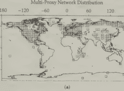

图4.4 （a）Mann 等人[58]所用的最新全球多代用资料网络的全球分布表示。灰色方块表示参考文献[58]中未筛选网络里至少包含一个代用资料的 5° 格点。（b）覆盖 CE 全部或部分时段温度场重建的数据矩阵示意图。数据矩阵中的灰色区域示意表示器测温度场和多代用资料矩阵中的数据可用性。白色区域表示数据矩阵各部分中的缺失数据。

取决于可用代用记录的长度。空间位置的数量可能少于5°全球网格中可能的2,592个网格单元，并取决于所采用的地表温度分析产品。重建方法可能试图填充缺失温度观测的网格单元[103]，或仅将其保留为缺失，这取决于它们所跨越的年数[59]。复合数据矩阵的第二部分由多代用资料网络构成，其维数由最长的代用记录和代用资料总数决定（通常为几百到一千量级）。多代用资料网络中的记录数通常随回溯时间而减少，在重建区间的最早时段可能减少到几十条记录。代用资料序列的时间分辨率也可能从季节尺度到十年尺度不等。

气候场重建（CFRs）已使用多种方法，包括贝叶斯框架内的一些新兴技术[52, 103]。然而，迄今为止绝大多数CFRs采用了各种形式的正则化多元线性回归，其中线性回归算子是在温度矩阵与代用资料矩阵重叠的时期内估计的。当校准区间（图4.4）中的时间维数远大于空间维数时，这类线性回归方法效果最好，因为温度场与代用资料之间的协方差能够更可靠地估计。CFR方法的挑战在于，在实际情况下不满足该条件时如何估计线性回归算子。在CFR应用中，目标变量的数量常常超过时间维数，从而产生秩亏问题。因此，线性回归形式需要某种形式的正则化。已发表的全球温度CFRs线性方法主要区别在于所采用的正则化形式（关于方法学形式的一般讨论见[88, 102]）。矩阵分解，例如对温度矩阵和代用资料矩阵进行奇异值分解[29]，是常见的首要步骤。如果奇异值的平方迅速下降——在气候学数据中常常如此，因为主导气候型态压过更多表达较弱的局地型态或噪声——那么温度矩阵和代用资料矩阵的降秩表示通常是其全秩版本的良好近似。因此，这些降秩后的温度矩阵和代用资料矩阵被用于在校准区间内采用各种多元回归技术估计线性回归算子。根据所用方法的不同，该回归算子还可基于对降秩温度矩阵与代用资料矩阵的交叉协方差或相关分析进一步正则化。在每一步中选择降秩程度已有多种手段，例如基于奇异值（或特征值）谱分析的选择规则[57]，或使针对所有可能降秩组合计算出的交叉验证统计量最小化[88]。

#### 4.8.2 伪代用资料实验

文献中充斥着对各种已应用的CFR方法及其性能的讨论（关于许多已采用方法的简明总结见[29]）。鉴于所提出的方法数量众多，建立使用共同数据集比较方法的手段已变得十分重要。用于此类比较的一种新兴工具是来自耦合大气环流模式（CGCMs）的千年长度、强迫瞬变模拟[1, 30]。这些模式模拟已被用作合成气候，在称为伪代用资料实验的测试中评估重建方法的性能（综述见[85]）。伪代用资料实验的动机是采用一个可被系统改变和评估的共同框架。它们还提供了比现实世界数据所能获得的更长的验证期（尽管是合成的），因此方法学评估可以扩展到更低频率和更长时间尺度。尽管人们必须始终注意结果如何转化为现实意义，但这些设计属性使研究人员能够测试超出以往可能范围的重建技术，并在共同数据集上比较多种方法。

伪代用资料实验的基本方法是，以模拟现实重建中所用可用代用资料和仪器数据的方式，提取时空完整的CGCM场的一部分。主要实验步骤如下：（1）从完整的CGCM场中，在近似其现实数据可得性的位置和时间段内，对伪仪器数据和伪代用资料数据进行子采样；（2）将代表代用资料信息的时间序列加到噪声序列上，以模拟现实代用资料网络中存在的時間（在某些情况下还有空间）噪声特征；（3）将重建算法应用于模式采样的伪仪器数据和伪代用资料网络，以生成对CGCM所模拟气候的重建。作为收尾的第四步是将所得重建与这类方法的已知模式结果进行比较[52, 103]，同时古气候同化技术也显示出前景[112]。

在机器学习背景下，重建缺失数据矩阵各部分的问题已作为矩阵补全问题得到广泛研究（见图4.4）。该问题的一个常见例子出现在电影推荐系统中，其中给定系统的每位用户对成千上万部可用影片中的少数几部进行评分。系统随后预测所有可能电影的暂定用户评分，并最终显示用户可能喜欢的影片。与给定数据矩阵中仅少数条目缺失的传统缺失值插补问题不同，在矩阵补全背景下，处理的是大部分条目缺失的情况（例如，在电影推荐系统中，通常有99%或更多的矩阵条目缺失）。低秩矩阵分解方法已被证明在此类矩阵补全问题中相当成功[48, 73]。因此，针对古气候重建问题的矩阵补全方法的进一步探索完全有必要。这包括研究现有方法的适用性，例如概率矩阵分解[73]或低秩与稀疏分解[114]，以及探索考虑古气候重建特有方面的新方法。能够同时给出补全结果和置信度分数的方法更可取，因为不确定性量化是古气候学的一项重要需求。

最后，重要的是回到这一事实：公元纪年（CE）古气候学领域的大量方法学工作，部分旨在更好地约束十年至百年尺度上的自然气候变率。除预期的强迫变化外，这一变率时间尺度也将是21世纪观测气候的另一关键贡献。无论我们是寻求改进的十年预测[93]，还是更精细的20世纪区域气候影响预估[28]，这些估计都必须纳入对强迫变率和自然变率的估计。因此，我们迫切需要充分理解气候在一系列相关时间尺度上如何自然变化、在受到强迫时如何变化，以及这两种变化分量可能如何耦合在一起。仅凭现代仪器记录无法实现这种理解，而CE是一个战略性的古气候目标，因为它既提供了具有高时间和空间分辨率的重建，也提供了一个CGCM模拟同样可行的区间。结合

因此，利用这两类信息来源来评估未来气候的模式预估，其本身就是一个重要的未来探索领域。将古气候估算的不确定性与多模式模拟的集合结果相结合的分析，对这些评估至关重要，并且随着该领域未来的发展，很可能成为气候信息学的关键组成部分。

### 4.9 机器学习在极地问题中的应用

机器学习的另一个潜在应用涉及气候变化对极地的影响，以及极地与气候整体的相互作用。由于在极地地区收集数据困难、成本相对高昂且后勤保障复杂，因此最大化从数据中获得的潜在收益十分重要。地表实测数据的匮乏，可由卫星/机载数据和模式输出的丰富性及不断增长的体量来补充。在这方面，需要强大的工具——不仅用于分析、处理和可视化大型数据集，还用于从不同来源搜索和发现新信息——以利用数据与过程之间那些物理模型不明显或无法捕捉的关系。

过去十年，机器学习在极地研究中的应用数量虽有所增加，但总体并不高。当考虑来自星载传感器的数据时尤其如此。例如，Tedesco及其同事[98, 99]使用人工神经网络（ANNs）或遗传算法，根据星载微波观测估算雪参数。Soh和Tsatsoulis [91]使用自动海冰分割（ASIS）系统，该系统通过整合图像处理、数据挖掘和机器学习方法，自动分割合成孔径雷达（SAR）海冰图像。Soh等人[92]对该系统进行了进一步开发，提出了一种用于卫星海冰图像分析的智能系统，称为“利用海冰类型知识的高级推理”（ARKTOS），该系统“模拟海冰专家的推理过程”。Lu和Leen [54]使用半监督学习，通过多光谱方法区分格陵兰的雪区和无雪区。Reusch [71]应用人工神经网络领域的工具，利用来自18个南极西部站点的冰芯数据集和基于卫星的海冰记录，重建南极西部海冰变化的百年尺度记录。人工神经网络被用作非线性工具，将冰芯预测因子（例如海盐化学特征）与海冰目标（例如海冰边缘）关联起来。该研究的结果之一是，总体而言，重建结果对所用的预测因子相当敏感，且并非所有预测因子似乎都有用。最后，Gifford [27]展示了一项关于团队学习、协作和决策的详细研究，该研究应用于1999年5月和2007年9月在格陵兰采集的冰层探测雷达数据，目的是建立冰下水体存在分类的模型。

上述例子只是机器学习工具应用于极地研究问题中的少数案例。尽管相关研究的数量似乎在增加（这很可能是因为针对气候变化和极地的研究增多，以及计算能力的提升使机器学习工具的应用得以扩展），但与更简单但往往效率较低的技术相比，这些应用仍然相对较少。

机器学习和数据挖掘可以通过揭示单数据集分析中不明显的关联信息来提升数据的价值。例如，识别海冰范围减少与格陵兰融化加剧之间的联系，可以通过物理模型来实现，这些模型试图通过大气通量交换来模拟两者之间的关联。然而，大尺度的联系（或其他不同时空尺度的联系）可能通过数据驱动模型来揭示，或者以更复杂的方式，通过物理模型与数据驱动模型的结合来揭示。这种方法除了其他优势外，还能克服物理模型的局限性——即使物理模型代表了相应领域的最先进水平，它们也受到我们对物理过程知识和理解的限制。人工神经网络不仅可用于理解多个参数之间的联系（通过分析神经元连接），还可用于理解参数对整个过程的相对重要性随时间可能发生的变化（例如，由于格陵兰过去几年裸露冰的出现和固态降水减少，反照率的重要性增加）。应用不仅限于纯粹的科学分析，还包括信息管理、误差分析、数据库之间缺失的关联，以及改进数据采集流程。

总而言之，在气候变化背景下，机器学习可以在许多领域为极地研究提供支持。除了前面几节讨论的内容外，这些领域还包括气候模式参数化，以及针对海冰范围、格陵兰融化、海平面上升贡献等变量的多模式集合预估。

### 4.10 迈向气候信息学工具箱

现代机器学习工具箱中的新增工具具有相当大的潜力，可以为气候科学的预测和推断能力做出贡献并大幅改进。气候预测面临着重大挑战，包括高维性、多尺度行为、不确定性和强非线性，同时也受益于历史数据和基于物理的模型。我们必须将所有可用的相关工具应用于气候领域。除了第4.2节及后续章节中提到的方法外，这里我们简要介绍其他几种（其中一些是最近提出的）可能应用于气候科学问题的方法。

我们首先介绍加州理工学院和洛斯阿拉莫斯国家实验室最近开发的最优不确定性量化（OUQ）形式体系[67, 79]。OUQ是一种严谨而实用的不确定性量化方法，它在给定明确假设集的前提下，为不确定性提供最优界限。例如，OUQ可以保证某个物理变量超过临界值的概率小于某个值ε。该方法已被成功应用于评估桁架结构在地震活动中的安全性。具体而言，OUQ可以提供结构失效概率随地震震级变化的最大值和最小值。这些概率通过求解一个由问题中的假设所确定的优化问题来计算。作为输入，OUQ需要对假设进行详细说明。假设的一种形式可以是（历史）数据。该方法的实际应用潜力在于将无限维非凸优化问题简化为有限维（通常是低维）问题。对于给定的假设集，OUQ方法返回三个答案之一：（1）是，结构承受地震的概率大于p；（2）不，结构无法以概率p承受该地震；或（3）根据输入，无法得出结论（即不确定）。在不确定的情况下，需要更多/不同的数据/假设才能得出明确结论。气候模式通常是无限维动力系统，而一组给定的假设将把这一问题简化为有限维问题。OUQ方法可以解决这样的问题：（在给定潜在情景下）全球平均温度增幅是否会以某个概率ε超过阈值T。

为了提高统计学习问题的性能（例如，减少泛化误差），有时融入领域

基因组学和医学诊断。将共形预测（conformal prediction）应用于计算科学中的其他复杂问题可能是值得的。

统计关系学习 [26] 为气候中的推断提供了一个自然的框架。这组方法中包括图模型 [47]，它是一种灵活而强大的形式体系，可用于对大型、高度复杂的系统进行推断（其中一些已在4.5节和4.6节讨论过）。在一个极端，图模型可以仅从数据推导得到。在另一个极端，图模型提供了卡尔曼滤波或平滑器的推广，其中数据与模型相结合。这种通用方法相当强大，但需要高效计算条件概率。因此，可以探索如何调整或扩展当前的信念传播方法套件，以适用于气候特定问题。

最后，对于上述所有方法，如果学习算法能够自动确定接下来获取哪些信息或数据会有用，那将很有帮助。“最优学习”形式体系解决了这个问题 [69]。这种梯度学习方法可应用于一大类学习问题，即在信息收集方面可分配资源有限的问题。最优学习已成功应用于实验设计，尤其是在制药行业，它有潜力降低药物发现过程的成本（财务、时间等）。最优学习可能应用于气候科学，以指导下一组观测和/或下一批模拟。

总之，有一系列最近开发的机器学习方法，其在气候科学中的适用性和实用性值得探索。目前，我们才刚刚开始触及表面。如果这些方法在气候研究中被证明成功，我们预计它们也会适用于其他地方——只要有物理系统的模型并且能够获取数据。

### 4.11 气候信息学中的数据挑战与机遇

这里我们讨论分析气候数据中的额外挑战和重要问题。

#### 4.11.1 跨类别比较的问题

常常需要跨不同类别的数据进行比较，无论是为卫星反演提供真值，还是评估气候模式预测，抑或校准代用测量。但由于数据特征不同，进行“同类对同类”的比较可能很困难。

这种比较可能相对于真实世界名义上的情况，给观测带来偏差或偏斜。卫星遥感中的例子很常见——例如，卫星的低云记录只有在没有高云时才能看到低云。类似地，卫星的“对流层中层”温度记录实际上可能是从地表到平流层温度的加权积分。古气候记录可能对应某个量，该量虽然与温度或降水有关，却可能是二者的复杂函数，并偏向特定季节加权。在所有这些情况下，通常建议为观测过程本身建立一个“前向模型”，以对原始模拟输出进行后处理，从而生成更相称的诊断量。

#### 4.11.2 气候系统复杂性

在建立气候系统统计模型时，还会出现另一个问题，因为真实世界和动力模型都具有大量不同的物理变量。

即使简化模型也可能有数百个变量；虽然并非所有变量都对确定系统状态必不可少，但仅一个变量往往也不够。陆地、大气和海洋过程都有不同的主导时间尺度，因此不同分量在不同尺度上至关重要。因此，即使采用从大型数据集中提取结构的分析方案，也需要一定的物理理解才能做出合适的变量/数据选择。此外，这些系统是混沌的，也就是说，在任何给定观测系统中实际上无法区分的初始条件，会在某个短时间尺度上彼此大幅发散。因此，要提取有用的预测，仅创建更准确的模型还不够——还需要确定哪些方面可预测、哪些不可预测。

#### 4.11.3 挑战：基于云计算的可复现气候数据分析

科学研究要求结果可复现：科学是一个工作体系，共同体努力确保结果并非源于某个特定个人或群体的独特能力和境遇。传统上，这在很大程度上通过发表论文来实现，但现代气候建模和数据分析工作的规模已远远超出期刊论文传达足够信息以实现可复现性的能力。这既是规模问题，也是复杂性问题：模式结果远非几页纸所能承载，而模式和分析流程也都过于复杂，无法在几页纸中充分描述。

GCMs和卫星数据集的庞大规模也正在超越我们传统的数据存储与分发方法：通常，模式输出中只有少数变量以高分辨率保存和分发，其余模式输出则被大幅平均，以生成足够小的数据集。

应对这些问题的一种有前景的方法是基 于云计算的可复现气候数据分析。让数据和分析都驻留在计算云中，可以使用户无需了解计算细节；例如，计算中数据密集的部分可以在靠近数据所在位置执行。但这些分析必须可复现，这不仅带来归档、查找、描述和发布分析流程的技术挑战，也带来确保作为这些分析基础的大型数据集仍可访问的制度性挑战。

##### 4.11.3.1 数据规模

数据集的规模正在迅速超出存储和提供这些数据的能力。我们连存储CMIP3模式结果完整档案的单一副本都有困难；制作这些结果的完整副本并分发用于分析，既是一项庞大工程，也会将分析限制在少数具备相应规模数据存储设施的地方。分发前由托管方进行的分析（例如平均）会将规模缩减到更易管理的程度，但目前这些缩减是提前很久就选定的，而且还有许多其他有用的分析目前并未开展。

基于云的分析框架将允许选择此类缩减，并仍能在可快速访问数据的机器上执行。

##### 4.11.3.2 可复现性与溯源图

基于云的分析框架必须生成可复现且有文档记录的结果；也就是说，我们不仅需要能够重新运行计算并知道它会生成相同结果，还需要确切知道已经完成了什么分析。这可以部分通过标准化分析方案来实现，从而可以确切知道某个给定数据过滤器中计算了什么；同样重要的是系统性地追踪计算的完整溯源信息。这种溯源图展示数据过滤器以及初始、中间和最终结果的完整网络，将为可复现性和结果交流提供基础。溯源图提供了重新运行计算并获得相同结果所需的信息；它们也为结果的完整文档化提供基础。这个完整网络需要具有抽象层次，以便用户可以从总体图景开始，然后根据需要进入更详细的版本。

### 4.12 结论

本章的目标是激发气候信息学这一新兴领域的未来工作。我们希望鼓励不仅针对本文提出的一些挑战性问题开展工作，也针对新问题开展工作。各种类型的大量气候数据可供使用，为未来的机器学习和数据挖掘研究提供了丰富而肥沃的试验场。即使是探索性数据分析，也可能有助于加速发现。为此，我们作为*第一届气候信息学国际研讨会*的成果，准备了一个气候信息学维基，其中包括带描述的气候数据链接、挑战性问题以及机器学习技术教程 [4]。我们相信，在气候科学与机器学习、数据挖掘和统计学的交叉领域，存在大量可能的合作。我们希望我们的工作将鼓励在气候信息学一系列新兴问题上取得进展。

### 致谢

*第一届气候信息学国际研讨会（2011年）* 为本章提供了灵感，其中一些主题也在该研讨会上讨论过。研讨会的赞助方包括哥伦比亚大学拉蒙特-多尔蒂地球观测站（LDEO）/戈达德空间研究所（GISS）气候中心；洛斯阿拉莫斯国家实验室信息科学与技术中心；NEC美国实验室、哥伦比亚大学统计系；Yahoo! Labs；以及纽约科学院。

KS部分得到美国国家科学基金会（NSF）资助编号1029711的支持。MKT和MBB得到美国国家海洋和大气管理局（NOAA）资助/合作协议（NA05OAR4311004）的支持。本文表达的观点为作者观点，不一定反映NOAA或其下属机构的观点。AB部分得到NSF资助项目IIS-1029711、IIS-0916750和IIS-0812183以及NSF CAREER奖IIS-0953274的支持。ARG的研究

本文所报道的研究得到了橡树岭国家实验室和东北大学的基金资助，以及国家科学基金会奖1029166的资助，此外还得到了美国能源部和印度政府科技部的资助。IES的工作部分得到了NSF基金ATM0902436以及NOAA基金NA07OAR4310060和NA10OAR43120137的支持。MT谨对NSF基金ARC 0909388表示感谢。GAS得到了NASA建模与分析计划的支持。

### 参考文献

- 1. C.M. Ammann, F. Joos, D.S. Schimel, B.L. Otto-Bliesner, and R.A. Tomas. 过去一千年期间太阳对气候的影响：使用NCAR气候系统模型进行的瞬态模拟结果. *美国国家科学院院刊*, 104(10): 3713–3718, 2007.
- 2. K.J. Anchukaitis, M.N. Evans, A. Kaplan, E.A. Vaganov, M.K. Hughes, and H.D. Grissino-Mayer. 美国东南部区域尺度树木年轮模式的正向模拟及夏季干旱的近期影响. *地球物理研究快报*, 33, L04705, DOI:10.1029/2005GL025050.
- 3. A.G. Barnston and T.M. Smith. 使用CCA从全球海表温度确定并预测全球地表温度和降水. *气候杂志*, 9: 2660–2697, 1996.
- 4. C.M. Bishop. *机器学习和模式识别*. 纽约：Springer出版社, 2007.
- 5. C.S. Bretherton, C. Smith, and J.M. Wallace. 在气候数据中寻找耦合模式的方法比较. *气候杂志*, 5: 541–560, 1992.
- 6. P. Brohan, J.J. Kennedy, I. Harris, S.F.B. Tett, and P.D. Jones. 区域和全球观测温度变化的不确定性估计：自1850年以来的新数据集. *地球物理研究杂志*, 111, D12106, 2006.
- 7. B.M. Buckley, K.J. Anchukaitis, D. Penny et al. 气候是柬埔寨吴哥消亡的一个促成因素. *美国国家科学院院刊*, 107: 6748–6752, 2010.
- 8. S.J. Camargo and A.G. Barnston. IRI热带气旋活动的试验性季节动力预报. *天气与预报*, 24: 472–491, 2009.
- 9. S.J. Camargo, A.W. Robertson, A.G. Barnston, and M. Ghil. 东北太平洋热带气旋路径的聚类：ENSO和MJO的影响. *地球化学、地球物理学和地球系统*, 9:Q06V05, 2008. doi:10.1029/2007GC001861.
- 10. M.A. Cane, S.E. Zebiak, and S.C. Dolan. 厄尔尼诺的试验性预报. *自然*, 321: 827–832, 1986.
- 11. N. Cesa-Bianchi and G. Lugosi. *预测、学习与博弈*. 剑桥（英国）和纽约：剑桥大学出版社, 2006.
- 12. V. Chandrasekaran, S. Sanghavi, P. Parrilo, and A. Willsky. 矩阵分解的秩-稀疏非相干性. *SIAM优化杂志*, 21(2): 572–596, 2011.
- 13. B. Christiansen, T. Schmitt, and P. Thejll. 气候重建方法的替代集成研究：随机性和稳健性. J. Climate, 22(4):951–976, 2009.
- 14. 气候信息学维基：http://sites.google.com/site/1stclimateinformatics/
- 15. E.R. Cook, R. Seager, M.A. Cane, and D.W. Stahle. 北美干旱：重建、成因与后果. Earth Science Reviews, 81: 93–134, 2007.
- 16. D.P. Dee, S.M. Uppala, A.J. Simmons et al. ERA-Interim再分析：数据同化系统的配置与性能. Quart. J. Roy. Meteorol. Soc., 137:553–597, 2011.
- 17. T. DelSole and M.K. Tippett. 平均可预报时间：第一部分 理论. J. Atmos. Sci., 66: 1188–1204, 2009.
- 18. T. DelSole, M.K. Tippett, and J. Shukla. 近期全球变暖加速中非强迫多年代际变化的一个重要成分. J. Climate, 24: 909–926, 2011.
- 19. J.F. Donges, Y. Zou, N. Marwan, and J. Kurths. 气候网络的骨干. Eur. Phys. Lett., 87(4):48007, 2007.
- 20. R. Donner, S. Barbosa, J. Kurths, and N. Marwan. 将地球理解为复杂系统——地球科学中数据分析与建模的最新进展. Eur. Phys. J. Special Topics, 174: 1–9, 2009.
- 21. M.N. Evans, A. Kaplan, and M.A. Cane. 利用约化空间客观分析从珊瑚δ¹⁸O数据重建太平洋海表温度场. Paleoceanography, 17, 7, 10.1029/2000PA000590, 2002.
- 22. M.N. Evans, B.K. Reichert, A. Kaplan, K.J. Anchukaitis, E.A. Vaganov, M.K. Hughes, and M.A. Cane. 树木年轮数据古气候解释的正向建模方法. J. Geophys. Res., 111(G3):G03008, 2006.
- 23. J.A. Foley, M.T. Coe, M. Scheffer, and G. Wang. 撒哈拉和萨赫勒地区的状态转变：北非生态与气候系统之间的相互作用. Ecosystems, 6: 524–532, 2003.
- 24. G. Foster, J.D. Annan, G.A. Schmidt, and M.E. Mann. 对S.E. Schwartz“地球气候系统的热容量、时间常数和敏感性”一文的评论. J. Geophys. Res., 113, D15102, 2008.
- 25. J. Friedman, T. Hastie, and R. Tibshirani. 关于group lasso和稀疏group lasso的一点说明. Preprint, 2010.
- 26. L. Getoor and B. Taskar (编). 统计关系学习导论. 麻省理工学院出版社，剑桥，马萨诸塞州, 2007.
- 27. C.M. Gifford. 集体机器学习：多智能体系统中的团队学习与分类. 博士论文，堪萨斯大学, 2009.
- 28. F. Giorgi and N. Diffenbaugh. 制定区域气候变化情景以用于评估对人类健康与疾病的影响. Clim. Res., 36: 141–151, 2008.
- 29. G.H. Golub and C.F. Van Loan. 矩阵计算，第三版. 约翰霍普金斯大学出版社，华盛顿特区, 1996.
- 30. J.F. González-Rouco, H. Beltrami, E. Zorita, and H. von Storch. 替代气候中钻孔温度剖面的模拟与反演：空间分布与地表耦合. *地球物理研究快报*, 33(1): L01703, DOI:10.1029/2005GL024693.2006.
- 31. W.M. Gray. 大西洋季节性飓风频率. 第一部分：厄尔尼诺和30百帕准两年周期振荡的影响. *每月天气评论*, 112: 1649–1688, 1984.
- 32. A.M. Greene, A.W. Robertson, P. Smyth, and S. Triglia. 使用非齐次隐马尔可夫模型对印度季风降雨预报进行降尺度. *皇家气象学会季刊*, 137: 347–359, 2011.
- 33. J. Hansen, R. Ruedy, M. Sato, and K. Lo. 全球地表温度变化. *地球物理评论*, 48: RG4004, 2010.
- 34. T. Hastie, R. Tibshirani, and J. Friedman. *统计学习基础：数据挖掘、推断与预测*. 斯普林格出版社，纽约, 2001.
- 35. G.C. Hegerl, T.J. Crowley, M. Allen et al. 检测人为影响对新的、经过验证的1500年温度重建的作用. *气候杂志*, 20: 650–666, 2007.
- 36. G.C. Hegerl, F.W. Zwiers, P. Braconnot et al. 理解并归因气候变化. *气候变化2007：物理科学基础.* 政府间气候变化专门委员会第四次评估报告第一工作组报告，S. Solomon 等编，剑桥大学出版社，剑桥（英国）和纽约, 2007.
- 37. M. Hoerling, J. Hurrell, J. Eischeid, and A. Phillips. 二十世纪非洲北部和南部降水变化的检测与归因. *气候杂志*, 19(16): 3989–4008, 2006年8月.
- 38. S.M. Hsiang, K.C. Meng, and M.A. Cane. 内部冲突与全球气候相关. *自然*, 476: 438–441, 2011.
- 39. IDAG（国际特设检测与归因小组）. 检测并归因外部因素对气候系统的影响：近期进展综述. *气候杂志*, 18: 1291–1314, 2005.
- 40. IPCC（政府间气候变化专门委员会）. 评估与组合多模型气候预测专家会议：评估与组合多模型气候预测良好实践指南文件，R. Knutti 等, 2010.
- 41. P.D. Jones, K.R. Briffa, T.J. Osborn et al. 过去一千年高分辨率古气候学：现状与未来展望综述. *全新世*, 19: 3–49, 2009.
- 42. A. Kaplan, M.A. Cane, and Y. Kushnir. 历史海洋观测最优分析插值的约化空间方法：成就、困难与前景. 载于《海洋气候学应用进展：WMO海洋气候学应用指南动态部分》, 第199–216页，日内瓦，瑞士, 2003. 世界气象组织.
- 43. J. Kawale, S. Liss, A. Kumar et al. 数据引导的动态偶极子发现. 载于《NASA智能数据理解会议论文集》, 2011.

- 44. N.S. Keelyside, M. Latif, J. Jungclaus, L. Kornblueh, and E. Roeckner. 推进北大西洋区域年代际尺度气候预测。*自然*，453: 84–88，2008。
- 45. J.J. Kennedy, N.A. Rayner, R.O. Smith, D.E. Parker, and M. Saunby. 重新评估1850年以来原位测量的海表温度观测中的偏差及其他不确定性。1. 测量采样不确定性。*地球物理研究杂志*，116: D14103，2011。
- 46. R. Knutti, G.A. Meehl, M.R. Allen, and D.A. Stainforth. 利用地表温度的季节循环约束气候敏感性。*气候杂志*，19: 4224–4233，2006。
- 47. D. Koller and N. Friedman. *概率图模型：原理与技术*。MIT Press，Cambridge, MA，2009。
- 48. Y. Koren, R.M. Bell, and C. Volinsky. 推荐系统中的矩阵分解技术。*IEEE计算机*，42(8): 30–37，2009。
- 49. R.S. Kovats, M.J. Bouma, S. Hajat, E. Worrall, and A. Haines. 厄尔尼诺与健康。*柳叶刀*，362: 1481–1489，2003。
- 50. V.M. Krasnopolsky and M.S. Fox-Rabinovitz. 结合确定性成分与机器学习成分的复杂混合模型用于数值气候建模和天气预报。*神经网络*，19(2): 122–134，2006。
- 51. T.C.K. Lee, F.W. Zwiers, and M. Tsao. 基于代用资料的千年重建方法评估。*气候动力学*，31: 263–281，2008。
- 52. B. Li, D.W. Nychka, and C.M. Ammann. 过去气候多代用资料重建的价值。*美国统计协会杂志*，105: 883–895，2010。
- 53. C.H.R. Lima, U. Lall, T. Jebara, and A.G. Barnston. 利用非线性降维由次表层海水温度对ENSO进行统计预测。*气候杂志*，22: 4501–4519，2009。
- 54. Z. Lu and T.K. Leen. 带惩罚概率聚类的半监督学习。载于*神经信息处理系统进展*，MIT Press，Cambridge, MA，2005。
- 55. M.E. Mann, R.S. Bradley, and M.K. Hughes. 过去千年北半球温度：推断、不确定性与局限性。*地球物理研究快报*，26: 759–762，1999。
- 56. M.E. Mann, S. Rutherford, E. Wahl, and C. Ammann. 测试用于过去气候的基于代用资料重建方法的保真度。*气候杂志*，18: 4097–4107，2005。
- 57. M.E. Mann, S. Rutherford, E. Wahl, and C. Ammann. 基于代用资料的气候场重建方法的稳健性。*地球物理研究杂志*，112(D12109)，2007。
- 58. M.E. Mann, Z. Zhang, M.K. Hughes 等. 过去两千年半球和全球地表温度变化的基于代用资料重建。*美国国家科学院院刊*，105: 13252–13257，2008。
- 59. M.E. Mann, Z. Zhang, S. Rutherford 等. 小冰期和中世纪气候异常的全球特征与动力起源。*科学*，326: 1256–1260，2009。
- 60. L.O. Mearns, W.J. Gutowski, R. Jones 等. 北美区域气候变化评估计划。*EOS*，90: 311–312，2009。
- 61. G.A. Meehl, T.F. Stocker, W.D. Collins 等. 全球气候预估。*气候变化2007：物理科学基础*。政府间气候变化专门委员会第四次评估报告第一工作组的贡献，S. Solomon 等（编），剑桥大学出版社，英国剑桥和纽约，2007。
- 62. M.J. Menne, C.N. Williams Jr., and M.A. Palecki. 论美国地表温度记录的可靠性。*地球物理研究杂志*，115: D1108，2010。
- 63. C. Monteleoni, G.A. Schmidt, S. Saroha, and E. Asplund. 追踪气候模型。*统计分析与数据挖掘*，4: 372–392，2011。
- 64. J.M. Murphy, B.B. Booth, M. Collins 等. 一种基于扰动物理集合的区域气候变化概率预测方法。*皇家学会哲学汇刊A*，365: 2053–2075，2007。
- 65. G.T. Narisma, J.A. Foley, R. Licker, and N. Ramankutty. 20世纪降水的突变。*地球物理研究快报*，34: L06710，2007年3月。
- 66. S. Negahban, P. Ravikumar, M.J. Wainwright, and B. Yu. 可分解正则化项下m估计器高维分析的统一框架。Arxiv，2010。http://arxiv.org/abs/1010.2731v1。
- 67. H. Owhadi, J.C. Scovel, T. Sullivan, M. McKems, and M. Ortiz. 最优不确定性量化。*SIAM评论*，2011（已提交）。
- 68. R.D. Peng, J.F. Bobb, C. Tebaldi, L. McDaniel, M.L. Bell, and F. Dominici. 面向全球气候变化下未来热浪死亡率的定量估计。*环境健康展望*，119: 701–706，2010。
- 69. W.B. Powell and P. Frazier. 最优学习。载于*运筹学教程：信息时代最先进的决策工具*。Hanover, MD，2008。
- 70. P. Ravikumar, A. Agarwal, and M.J. Wainwright. 图结构线性规划的消息传递：近端投影、收敛与舍入方案。*机器学习研究杂志*，11: 1043–1080，2010。
- 71. D.B. Reusch. 西南极海冰变率的冰芯重建：神经网络视角。*美国地球物理联合会秋季会议*，2010。
- 72. C.F. Ropelewski and M.S. Halpert. 与厄尔尼诺/南方涛动相关的全球和区域尺度降水模式。*每月天气评论*，115: 1606–1626，1987。
- 73. R. Salakhutdinov and A. Mnih. 概率矩阵分解。载于*神经信息处理系统进展20*，2008。
- 74. M. Scheffer, S. Carpenter, J.A. Foley, C. Folke, and B. Walker. 生态系统中的灾难性转变。*自然*，413(6856): 591–596，2001年10月。
- 75. G.A. Schmidt. 古盐度计算的误差分析。*古海洋学*，14: 422–429，1999。
- 76. G.A. Schmidt, A. LeGrande, and G. Hoffmann. 耦合海气模式中内在变率和强迫变率的水同位素表达。*地球物理研究杂志*，112, D10103，2007。
- 77. T. Schneider. 不完整气候数据的分析：均值与协方差矩阵估计及缺失值插补。*气候杂志*，14: 853–871，2001。
- 78. S.D. Schubert, M.J. Suarez, P.J. Pegion, R.D. Koster, and J.T. Bacmeister. 论20世纪30年代沙尘碗的成因。Science，303: 1855–1859，2004。
- 79. C. Scovel and I. Steinwart. 用于验证与认证的假设检验。J. Complexity，2010（已提交）。
- 80. G. Shafer and V. Vovk. 共形预测教程。J. Mach. Learn. Res.，9: 371–421，2008。
- 81. J. Shukla. 月平均值的动力可预报性。Mon. Wea. Rev.，38: 2547–2572，1981。
- 82. J. Shukla. 混沌之中的可预报性：气候预报的科学基础。Science，282: 728–731，1998。
- 83. F.H. Sinz. *从非样本中获得的先验知识*。Diplomarbeit（学位论文），德国蒂宾根大学，2007。
- 84. F.H. Sinz, O. Chapelle, A. Agrawal, and B. Schölkopf. 使用Universum进行推理的分析。载于神经信息处理系统进展20，2008。
- 85. I.E. Smirnov. 作为气候重建方法测试平台的气候模式：伪代用资料实验。Wiley Interdisciplinary Reviews Climate Change，修订中，2011。
- 86. I.E. Smirnov and A. Kaplan. 对“测试基于代用资料重建过去气候的方法的保真度”的评论：标准化区间的作用。J. Climate，20(22): 5666–5670，2007。
- 87. I.E. Smirnov, A. Kaplan, and D.E. Amrhein. 多项伪代用资料研究中的错误模式场表示：更正与启示。J. Climate，23: 5548–5554，2010。
- 88. I.E. Smirnov, A. Kaplan, D. Chang, and M.N. Evans. 对重建过去千年气候场的CCA和RegEM方法的伪代用资料评估。J. Climate，24: 1284–1309，2011。
- 89. I.E. Smirnov, A. Kaplan, E. Zorita, J.F. González-Rouco, and M.N. Evans. 针对公元纪年的四种气候场重建方法的空间性能。Geophys. Res. Lett.，38，2011。
- 90. D.M. Smith, S. Cusack, A.W. Colman 等. 利用全球气候模式改进未来十年的地表温度预测。Science，317: 769–799，2007。
- 91. L.-K. Soh and C. Tsatsoulis. 使用多分辨率峰值检测和聚合总体均衡对ERS和Radarsat海冰图像进行无监督分割。Int. J. Remote S.，20: 3087–3109，1999。
- 92. L.-K. Soh, C. Tsatsoulis, D. Gineris, and C. Bertola. ARKTOS：一种用于SAR海冰图像分类的智能系统。IEEE T. Geosci. Remote S.，42: 229–248，2004。
- 93. A. Solomon, L. Goddard, A. Kumar, J. Carton, C. Deser, I. Fukumori, A. Greene, G. Hegerl, B. Kirtman, Y. Kushnir, M. Newman, D. Smith, D. Vimont, T. Delworth, J. Meehl, and T. Stockdale. 区分自然与人为强迫年代际气候变率的作用：对预测的启示。Bull. Amer. Meteor. Soc.，92: 141–156，2010。
- 94. S. Sra, S. Nowozin, and S. Wright. 机器学习中的优化。MIT Press，2011。

- 95. K. Steinhaeuser, A.R. Ganguly, and N.V. Chawla. 通过复杂网络揭示全球气候系统中的多变量和多尺度依赖性。*Climate Dynamics*，doi:10.1007/s00382-011-1135-9，出版中，2011。
- 96. K.E. Taylor, R. Stouffer, and G. Meehl. CMIP5 实验设计。*Bull Amer. Meteorol. Soc.*，2011（已投稿）。
- 97. C. Tebaldi and R. Knutti. 多模式集合在概率气候预估中的应用。*Phil. Trans. Roy. Soc. A*，365: 2053–2075，2007。
- 98. M. Tedesco and E.J. Kim. 利用密集介质模型和遗传算法从辐射测量数据反演干雪参数的研究。*IEEE T. Geosci. Remote S.*，44: 2143–2151，2006。
- 99. M. Tedesco, J. Pulliainen, P. Pampaloni, and M. Hallikainen. 基于人工神经网络的技术从 SSM/I 数据反演 SWE 和雪深。*Remote Sens. Environ.*，90: 76–85，2004。
- 100. D.M. Thompson, T.R. Ault, M.N. Evans, J.E. Cole, and J. Emile-Geay. 利用珊瑚 δ¹⁸O 正向模型比较观测和模拟的热带气候趋势。*Geophys. Res. Lett.*，审稿中，2011。
- 101. R. Tibshirani. 通过 lasso 进行回归收缩和选择。*Journal of Royal Statistical Society B*，58: 267–288，1996。
- 102. M.P. Tingley, P.F. Craigmile, M. Haran, B. Li, E. Mannshardt-Shamseldin, and B. Rajaratnam. 拼合过去：古气候重建的统计洞见。技术报告 2010-09，斯坦福大学统计系，2010。
- 103. M.P. Tingley and P. Huybers. 用于重建时空气候异常的贝叶斯算法。第一部分：开发及其在古气候重建问题中的应用。*J. Climate*，23(10): 2759–2781，2010。
- 104. M.K. Tippett, S.J. Camargo, and A.H. Sobel. 热带气旋生成的泊松回归指数及大尺度涡度在生成中的作用。*J. Climate*，24: 2335–2357，2011。
- 105. K.E. Trenberth, P.D. Jones, P. Ambenje et al. 观测：地表和大气气候变化。*气候变化 2007：物理科学基础*。政府间气候变化专门委员会第四次评估报告第一工作组贡献，S. Solomon 等（编），剑桥（英国）和纽约：剑桥大学出版社，2007。
- 106. A.A. Tsonis, K.L. Swanson, and P.J. Roebber. 网络与气候有什么关系？*Bulletin of the American Meteorological Society*，87(5): 585–595，2006。
- 107. A.A. Tsonis and P.J. Roebber. 气候网络的架构。*Physica A*，333: 497–504，2004。
- 108. A.A. Tsonis and K.L. Swanson. 厄尔尼诺和拉尼娜网络的拓扑结构与可预测性。*Physical Review Letters*，100(22): 228502，2008。
- 109. K.Y. Vinnikov, N.C. Grody, A. Robock et al. 地表和对流层温度趋势。*J. Geophys. Res.*，111: D03106，2006。
- 110. F.D. Vitart and T.N. Stockdale. 利用耦合 GCM 积分进行热带风暴季节预报。*Mon. Wea. Rev.*，129: 2521–2537，2001。
- 111. M.J. Wainwright and M.I. Jordan. 图模型、指数族和变分推断。*Foundations and Trends in Machine Learning*，1(1–2): 1–305，2008。

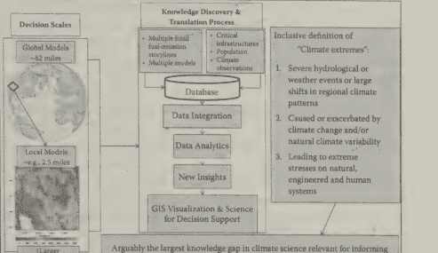

**图 5.1** 气候极端事件的不确定性量化——在此语境中作广义理解——是最大的知识缺口之一，涉及将气候的物理科学基础转化为与影响评估和适应决策相关的信息，并最终转化为减缓政策。然而，不确定性的级联难以量化。对于气候适应和减缓政策，行动和不行动的社会成本都可能很大；因此，气候中的不确定性对于有效刻画和沟通很重要。气候极端事件可广义地包括区域气候模式的巨大转变，或由自然气候变率或气候变化引起或加剧的严重天气或水文事件。本章主要关注严重事件的统计属性，或尾部行为的变化。

自然和工程基础设施的管理，以及处理城市化、人口增长或迁移、土地利用或能源与水可持续性、能源或排放控制的政策制定者，都需要关于地方到区域尺度气候极端事件的可操作洞见。行动和不行动的成本都可能很大，因为为气候极端事件设计的适应和减缓策略可能对当代成本高昂，甚至对后代成本更高。先前工作表明气候极端事件对利益相关者群体重要性的具体例子包括：与全球排放谈判相关的国际气候变化政策（Engelhaupt, 2008; Tollefson, 2008a, b）；与区域威胁评估和准备相关的国家安全决策，例如美国国防部2010年《四年防务评估报告》（Ganguly et al., 2009a）；以及与北极海冰相关的战争推演（转引自 NRC, 2011）。

#### 5.1.3 计算数据科学：挑战与机遇

计算机科学、信息学和计算（或网络）基础设施在我们当前对气候极端事件的理解、预估和归因中发挥了重要作用，主要通过基于物理的模型。气候系统是非线性的、动力学的（且常常是混沌的，或对初始条件非常敏感），受多种反馈机制（例如海洋、大气和陆地过程之间的反馈）、阈值和间歇性（例如降水和云物理）影响，表现出低频（甚至“1/f”）变率和复杂依赖结构（例如时间上的长记忆过程或空间上的长程依赖或“遥相关”），以及非平稳性（例如在更暖世界中产生极端事件的过程的相对主导地位可能发生变化）。因此，纯粹数据驱动的外推可能不够，甚至不合适，特别是对于长提前期预估（例如年代际到百年尺度），在这些情况下数据同化方法的价值也可能有限。最先进的物理气候模型基于基本物理定律（例如运动定律以及质量和动量守恒）。物理近似和数学离散技术（例如策略性选择的有限差分方程系统表述）被应用于这些定律，产生封装在数十万或数百万行低级源代码中的复杂系统（Christensen et al., 2005）。当前的全球气候模型由多个相互作用的组件组成，包括大气、海洋，通常还有陆地和海冰模型（IPCC, 2007）。此类基于物理的模型，无论是全球气候模型、地球系统模型，还是用于降尺度全球模型输出的区域气候模型，对于大陆到全球尺度上的平均温度等变量更为可信。同样的模型对气候极端事件则不太可靠；例如，它们不足以处理降水极端事件和热带气旋，尤其是在做出知情决策所需的精度上。

计算数据科学的研究机会有三方面：(1) 改进对气候的刻画、预估和归因

##### 5.1.3.1 研究领域概述：1. 极端事件刻画

极端事件可以根据其与影响的相关性来刻画（例如，根据夜间最低温度定义热浪，这与人体不适和可能丧生有关：Meehl and Tebaldi, 2004），或通过统计分布来刻画（例如，降水极端事件的极值理论：Kharin et al., 2007）。因此，我们对模型模拟和替代观测（通过将来自不同传感器的天气数据同化到数值天气预报模型中生成的重分析数据）的分析（Ganguly et al., 2009b）指出，在一种合理但高排放情景下，本世纪热浪趋势更高但不确定性更大，这反过来意味着在适应或减缓决策中需要更大紧迫性但也需谨慎。另一方面，我们对多个模型模拟和重分析数据的分析（Kodra et al., 2011a；见 Tollefson, 2011 的报告）揭示，虽然极端寒冷事件可能变得不那么频繁，但确实发生的事件的强度和持续时间可能常常保持在当前水平。我们对强降水事件的分析（Kao and Ganguly, 2011）表明极端事件存在放大，尤其是在中高纬度地区，并在大陆到全球尺度上以总体意义存在。需要社区范围的重大努力来全面刻画极端事件在空间和时间上渐变或突变变化的统计属性，包括定义较差或可预测性较低的气候极端事件，如干旱。这推动了最先进方法、新的方法学改造，以及空间或时空统计和数据挖掘中新方法的结合。

##### 5.1.3.2 研究领域概述：2. 不确定性评估

极端事件的不确定性评估（Wehner, 2010）需要考虑模型物理中的知识缺口（例如，基于统计方法，通过扩展 Smith et al., 2009 等方法，平衡模型过去的技能和多模式未来的收敛性），极端事件定义或分布的适用性和统计有效性，以及参数估计过程中的不确定性（例如，通过 Kharin et al., 2007 或 Kao and Ganguly, 2011 中的 bootstrap）。通过比较我们最近的工作（Ghosh et al., 2011）与先前方法（Goswami et al., 2006），基于极端事件定义所获得的洞见和不确定性在性质上的潜在差异变得明显。当前极端事件归因方法，例如针对强降水事件，包括统计技术（Min et al., 2011）或

数值模拟（Pall 等，2011）；这些方法可以受益于严格的不确定性量化方法。这些领域亟需新的不确定性数学方法。

##### 5.1.3.3 研究领域概述：3. 增强预测

我们在对某些关键变量的科学理解和预估方面仍存在巨大差距，这些变量常常与气候极端事件以及驱动极端事件的精细尺度或聚合过程有关。有人声称，*气候科学令人悲哀的真相是，最关键的信息恰恰最不可靠*（Schiermeier，2010）。与增强气候极端事件预估相关的一个问题是：相对预测得更好的变量（例如海表温度或总体海洋气象、陆地上空的大气温度或湿度廓线）在多大程度上可能包含关于可能更关键的变量（例如极端降水或飓风强度和频率）的信息，以及此类信息能否用于开发预测模型。有证据表明存在信息内容；例如，Liu 等（2009）及其他研究者报告了极端降水的温度依赖性。也有文献试图建立基于物理的关系；例如，O’Gorman 和 Schneider（2009）、Sugiyama 等（2010）以及 Muller 和 O’Gorman（2011）试图基于大气协变量更好地理解与极端事件相关的降水过程，而 Emanuel 等（2008）则试图基于气候模式模拟的海洋变量生成飓风统计属性的预估。尽管应探索数据驱动方法以形成新颖且可操作的预测洞见，但这些方法必须能够处理非线性过程以及复杂的依赖模式，同时仍保持物理可解释性，并能够推广到非平稳条件。这一领域可能对计算数据科学构成严峻挑战，或许还会推动真正跨学科的方法，这些方法源自传统上迥异的方法，从计算统计、信号处理和计量经济学，到非线性动力学、基于图的方法、数据挖掘和机器学习。我们近期为基于海洋气象变量改进陆地区域预测所做的努力（Steinhaeuser 等，2011a, b 和 Chatterjee 等，2012），或 Kawale 等（2011）为理解气候偶极子所做的工作，仅仅是这一领域的初步步骤；该领域很可能代表数据密集型科学的一项重大挑战。

### 5.2 极端事件表征

在表征和分析与气候极端事件相关的数据方面存在若干挑战。首要挑战之一是数据的性质：观测数据持续时间相对较短，通常无法让许多重要的极端条件显现出来，其空间分布不均匀，数据质量也不均匀。气候模式输出和再分析数据不存在其中若干问题，但 Mannshardt-Shamseldin 等（2011）表明，网格数据中极端事件的性质与观测数据存在显著差异。此外，正如 Wehner（2010）所观察到的：

> ……就气候模式可被调校以重现近期过去而言，模式开发者关注的是气候观测的均值，而不是其分布的尾部。

其他若干研究（O'Gorman 和 Schneider，2009；Sugiyama 等，2010；Wehner，2010；Min 等，2011）指出，我们目前对极端降水的理解仍有改进空间，而且当前一代气候模式很可能未能反映现实。近期研究（O'Gorman 和 Schneider，2009；Sugiyama 等，2010）表明，我们对极端降水与大气水汽含量之间关系的理解存在不足。Wehner（2010）提出，如果以足够高的分辨率运行，气候模式或许实际上能够模拟极端事件；但对于以“政府间气候变化专门委员会第四次评估报告”（AR4，一份关于气候变化科学状况的里程碑式评估报告）（IPCC，2007）所采用的典型分辨率水平运行的模式而言，情况并非如此，而更高分辨率的运行计算成本高昂。Min 等（2011）指出，由于可能未考虑人为因素对未来极端降水事件的影响，降水趋势可能被低估。所有这些都表明，数据质量以及分析现有极端数据的方法学开发仍有改进空间。

气候极端事件的统计分析和数据驱动分析面临的另一项挑战是，对*什么*是极端事件的定义应由各类利益相关者和用户来指导。例如，就降雨而言，（1）给定单位时间内的降雨量，（2）总降雨量，（3）降雨持续时间，（4）降雨事件之间的时间间隔，

#### 全国代表大会文件

（2026年10月26日通过）

中国共产党第二十次全国代表大会关于《中国共产党章程（修正案）》的决议

中国共产党第二十次全国代表大会审议并通过了十九届中央委员会提出的《中国共产党章程（修正案）》，决定自通过之日起生效。

大会认为，习近平新时代中国特色社会主义思想是全党全国人民为实现中华民族伟大复兴而奋斗的行动指南。大会一致同意把习近平新时代中国特色社会主义思想写入党章，作为党必须长期坚持的指导思想。

大会认为，党的十九大以来，以习近平同志为核心的党中央统筹中华民族伟大复兴战略全局和世界百年未有之大变局，团结带领全党全军全国各族人民有效应对严峻复杂的国际形势和接踵而至的巨大风险挑战，推动党和国家事业取得历史性成就、发生历史性变革。大会一致同意把党中央提出的新的重要思想、重要观点、重大判断、重大举措写入党章。

关于极值分布的最佳参数估计与推断技术（Hosking 和 Wallis，1997；Kharin 和 Zwiers，2000；Coles 和 Dixon，1999；Kharin 和 Zwiers，2005），以及纳入协变量信息的方法仍在开发中（Hall 和 Tajvidi，2000）。

广义而言，自助法（bootstrap）是一类重采样技术，可用于量化参数估计中的抽样变异性（不确定性），并具有其他用途（Efron，1979）。在 Kharin 和 Zwiers（2000；2005；2007）研究气候极端事件时，参数自助法和 Efron（1979）的传统非参数自助法被与 L-矩法和最大似然法结合使用；他们还比较了各种估计技术并列出若干注意事项。气候极端事件的推断可能受益于更好地理解常用统计推断程序（如极值理论）的局限性和适用性，以及应用和/或创建其他放宽假设或对现有极端数据局限性具有稳健性的方法。

### 5.3 不确定性评估

#### 5.3.1 多模式集合中不确定性的统计建模

在此，我们讨论在利用全球气候模式或地球系统模式（GCM/ESM）集合评估区域气候变化的情形下，不确定性量化（UQ）的最新进展。尽管统计降尺度和动力降尺度（区域气候模式）常用于区域评估，但它们反过来由 ESM 驱动，因此 ESM 中的 UQ 仍是一项重要挑战。UQ 常常伴随着紧迫感，而 ESM 集合是一种可便捷地形成实用且及时的不确定性评估的工具。结构不确定性，即由气候模式数学机制变化引起的不确定性，是本节所讨论方法中 UQ 的主要关注点；已在多模式集合中以若干形式对其开展研究，其中为各个模式分配权重作为其可靠性的一种度量。我们将这里讨论的集合方法与用于探索单个气候模式内参数不确定性的其他 UQ 方法——例如物理扰动集合（Stainforth 等，2005）——以及基于或类似于多项式混沌展开的方法（见第 5.3.2 节）区分开来。重要的是要了解所有用于……的方法。

UQ旨在理解多模式集合用于气候UQ的范围和局限性：迄今为止，还没有统计上的多模式集合UQ方法明确纳入气候模型内部的不确定性（例如，理解气候过程参数化所贡献的不确定性以及这些不确定性沿其余模型组成部分的传播）。然而，这里讨论的集合方法为探索模型间（即结构性的）不确定性提供了基础。

虽然多模式集合用于预测已在数据科学学科中得到广泛研究（Seni and Elder, 2010），但对于气候科学领域必须做出重要区分。在许多典型的时间序列和分类应用中，例如，感兴趣的预测期通常是一到两个（或几个）时段之后，或者二分类是对下一个观测值的（Seni and Elder, 2010）。在这种情况下，预测模型有可能从集合预测中学习，并在验证时重新校准其下一次预测（Fern and Givan, 2003）。然而，有几个关键挑战将气候预测与更典型的问题设置区分开来：很长的预测提前期（几十年到百年尺度）、潜在的非平稳性（其中嵌入在GCM中的过程的有效性可能会改变）、难以选择对模型训练有意义的度量指标（Knutti, 2010），以及最后对于感兴趣的预测时段无法进行真正的验证。数据科学中开发的许多方法，虽然其本身和跨应用有价值，但不能直接很好地转化到气候预测中。例如，即使将过去的数据分割成多个训练样本，以便基于精心选择的、物理上有意义的误差指标来严格开发多模式集合预测公式，也没有保证在给定的提前期下，非平稳性不会使该预测公式在未来失效。因此，虽然成熟的数据科学集合方法作为基础方法可能有价值，但需要用新颖和创造性的方法来解决多模式集合在气候中的UQ问题。

气候文献中一个持续存在的观点是，多模式平均（MMA），即多个GCM气候输出的空间、时间或时空场的平均，是做出“最可能”预测的一种稳健方法；这种稳健性在很大程度上基于所谓的偏差（噪声）抵消和GCM的正交技能（Knutti et al., 2010）。其在气候中的潜在效用概念可能源于天气预报的成功（Krishnamurti et al., 1999; Hagedorn et al., 2005），并在气候归因研究中得到了经验证明（Pierce et al., 2009; Santer et al., 2009）；事实上，后者的研究隐含地表明，随机选择足够数量的GCM的MMA将形成可靠的预测，至少对于人为归因而言。等权重的MMA可能代表一种更保守的方法，因为与等权重相比，最优模型加权可能带来的潜在收益不如风险大（Weigel et al., 2010）。MMA在一些气候利益相关者评估报告中已成为默认做法（Karl et al., 2009），这些报告有时在视觉上展示结果而没有明确提及不确定性。这可能是一种有问题的做法，因为对动力学一致的空间场或时间序列进行平均可能会产生物理上无意义的信号，而排除个别模型结果可能会掩盖气候变化的合理上下限（Knutti et al., 2010）。最近的一项案例研究（Perkins et al., 2009）也隐含地质疑了*先验*使用MMA以及纳入明显较差的GCM的做法。对印度季风气候学的历史（20世纪）观测和模拟的研究（Kodra et al., 2012）可能表明，MMA不应是默认选择，并且应仔细评估集合中的所有模型。

鉴于围绕MMA的争论，展示从存档的GCM输出中得出的最差和最佳案例可能是传达不确定性的最低要求。然而，由于多模式集合并不是来自更大总体的独立GCM的真正随机样本，它们不应被视为正式的概率分布（Tebaldi and Knutti, 2007）。可能需要更严格且具有统计基础的方法；最近，已经开发了几种著名的概率方法：Giorgi和Mearns（2002）提出了可靠性集合平均（REA）方法，用于为GCM模拟的区域平均温度赋予可靠性；该方法后来被扩展并发展成为一个更正式的贝叶斯框架，该框架已成为使用多模式集合进行UQ的最突出方法。本质上，REA方法试图根据所谓的可靠性对GCM进行加权，这是（1）相对于观测的历史模型偏差和（2）未来多模式一致性（收敛）或模型与集合离散中心的距离之间的平衡。Giorgi和Mearns（2002）分别定义了偏差和收敛如下：

$$\lambda_{B,j} = \min\left(1, \frac{1}{|X_j-\mu|}\right), \qquad (5.1)$$

$$\lambda_{C,j} = \min\left(1, \frac{1}{|Y_j-\bar{\bar Y}|}\right), \qquad (5.2)$$

其中 $X_j$ 是气候模型 $j$ 的历史（20世纪）温度输出，$\mu$ 是同一时期的观测（“真实”）温度；$Y_j$ 和 $\bar{\bar Y}$ 分别是未来时期对应的量。如果参数

$$\frac{1}{|X_j-\mu|} \quad \text{或} \quad \frac{1}{|Y_j-\bar{\bar Y}|}$$

大于1，则选择1作为 $\lambda_{B,j}$ 或 $\lambda_{C,j}$，理由是 $|X_j-\mu|$ 或 $|Y_j-\bar{\bar Y}|$ 可能只是偶然地小。“$\bar{\bar Y}$”是一个未知量，因此必须使用以下权重进行估计：

$$\lambda_j = \left(\lambda_{B,j}^m \lambda_{C,j}^n\right)^{1/mn}, \qquad (5.3)$$

$$\bar{\bar Y} = \frac{\sum_j \lambda_j Y_j}{\sum_j \lambda_j}, \qquad (5.4)$$

在实践中，Giorgi和Mearns（2002）任意设定 $m=n=1$，使得偏差和一致性受到同等重视。由于 $\bar{\bar Y}$ 和 $\lambda_{C,j}$ 都是未知量，但彼此依赖，因此使用递归程序来计算两者（Giorgi and Mearns, 2002）。

这两个标准表明，模型的可信度（权重）信息可以通过与观测数据相比的性能以及收敛程度来估计；如果一个模型偏离集合中心很远，它可能更像是离群值而非可能的结果。一致性标准可能至少部分源于先前讨论的MMA的偏差抵消和正交技能的思想（Krishnamurti et al., 1999; Hagedorn et al., 2005），并且该标准受到了强烈批评，这一点已被承认（Tebaldi and Knutti, 2007）。此外，GCM技能（最近工作中通常指*偏差*）的标准难以定义和评估；在大多数情况下，很难确定衡量过去GCM技能的指标是否会延伸到未来（Tebaldi and Knutti, 2007; Knutti et al., 2010）。

REA方法公认是特设的；然而，其关于GCM技能和一致性的两个概念（Giorgi and Mearns, 2002）构成了一个著名研究路线的基础，从Tebaldi等人（2004）开始，他们将这些概念形式化到一个贝叶斯模型中。该统计模型的最新版本之一可以在Smith等人（2009）中找到，该版本还允许联合考虑多个区域。具体来说，使用该模型，可以通过马尔可夫链蒙特卡洛（MCMC）采样器，使用每个GCM j的权重λ_j，模拟过去或当前温度μ和未来温度υ的后验分布。接下来，每个λ_j可以通过考虑GCM j的偏差和一致性从后验中模拟。然后，权重λ_j为μ和υ提供新的估计，这又为每个λ_j提供新的估计，依此类推。具体来说，λ_j遵循一个Gamma后验分布，其期望如下：

$$\mathbb{E}[\lambda_j\mid\cdot]=\frac{a+1}{b+0.5(X_j-\mu)^2+0.5(\vartheta_j-\upsilon-\beta(X_j-\mu))^2}\tag{5.5}$$

其中 *a* 和 *b* 是先验参数（通常是无信息先验），β 是一个未知量，表示历史与未来模型输出之间的相关性，θ 是一个随机量，允许未来气候方差与过去不同。条件性有助于说明这样一个事实：λ_j 的期望取决于所有其他随机参数和数据的值。因此，λ_j 的真实值是随机量 μ、υ、θ 和 β 的函数，而这些随机量本身又有各自的后验条件分布。一般来说，值得注意的是，在这种公式下，所有这些随机量都是条件独立的，不能轻易地进行边缘分析。

对最新模型（Smith et al., 2009）模拟结果的初步事后分析（Kodra et al., 2011b）表明，该方法可能更依赖一致性而非偏差（即技能），并且偏差标准可能不足以代表模型技能。从概念上讲，在当前最先进的统计模型中，在其他条件不变的情况下，υ的后验分布将向多模式均值“收缩”，即使所有GCM在过去的资料上都表现出较差的技能；在这种情况下，它可能

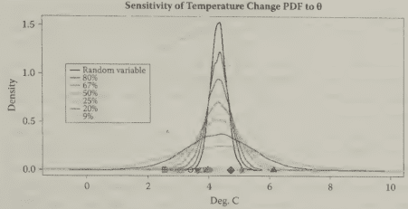

图5.3 来自Smith等（2009）的单变量（单区域）贝叶斯模型说明了参数θ在决定区域平均温度变化概率密度函数（PDF）的分布范围方面的重要性。这组特定PDF是针对1970—1999年至2070—2099年时空平均的格陵兰温度变化获得的。水平轴衡量摄氏度变化，垂直轴衡量频率。图例表示条件θ，从上到下对应从窄到宽的PDF：“random”是最窄的密度，并如Smith等（2009）那样将θ视为随机未知量。对于其余PDF，θ的值固定为不同数值，这些数值代表收敛与偏差的相对重要性（其中偏差的重要性为100%减去θ的重要性）。值得注意的是，将θ视为随机量得到的结果中，收敛比偏差更受青睐。

不确定性实际上应当增加，这是合理的。向均值收缩的程度由参数θ决定。其重要性在图5.3中得到强调，并从式5.1中清楚可见：如果θ >> 1，则在其他条件不变时，统计模型更倾向于共识。确实，Tebaldi等（2004）的早期工作提出了其统计模型的一个轻微变体，该变体通过先验分布作出规定，限制θ的影响；Smith等（2009）后来未纳入这一规定。虽然上述内容代表了结合多模式集合量化区域气候不确定性的最突出工作方向，但也发展了一些其他初始方法。这些方法通过整合量化模式间收敛（Greene等，2006）和空间变异结构（Furrer等，2007；Sain等，2008）的方法、作为模型加权技术的贝叶斯模型平均（Min and Hense，2007），以及量化GCM偏差的方法（Buser等，2009），扩展了广泛的多模式UQ工作路线。

Monteleoni等（2010）提出了一种在线学习方法，其中GCM的权重可以随新数据而变化。更具体地说，α-专家预测年全球平均温度；这些专家从GCM的错误（即平方误差）中学习，并且实际上能够比所有GCM的最佳预测或多模式均值更好地预测提前一年的温度。虽然这是结合GCM的一种有趣方法，并且似乎能很好地处理一步超前非平稳性，但其目前形式不允许长提前期预测，而这通常是气候模型的主要目标。此外，该算法内尚未建立不确定性界限。

区域气候UQ研究领域仍相对新生，可能受益于新方法（Knutti等，2010）。必须开发同时适应长提前期以及潜在非平稳性的方法，其中条件（例如变量之间的关系）可能发生变化。此外，考虑多个变量之间的物理关系以增强GCM加权过程中的稳健性和可解释性可能具有价值，如第5.4节所讨论。近期UQ工作（Tebaldi and Sanso，2009）与Smith等（2009）思路相同，开发了一个用于平均温度和降水联合预估的分层贝叶斯模型；该模型试图在统计上利用这两个变量之间的相关性。将此类统计模型扩展到考虑气候极端事件，将对气候界有价值。例如，O’Gorman and Schneider（2009）开发了一个相对简单的概念物理模型，用于说明人为气候变化下极端降水的增加；而Kao and Ganguly（2011）在刻画21世纪极端降水时探索了概念物理基础。对此类见解进行仔细的统计利用，可能产生新的极端事件多模式集合UQ方法，这有助于为各影响部门提供信息。

#### 5.3.2 单个气候模型中的参数不确定性

虽然第5.3.1节讨论了量化结构不确定性的方法，但考虑参数不确定性对于理解模型内在变率很重要，特别是因为存档的全球模型并未遍历整个合理预测空间（Stainforth等，2005）。气候模型在陆地、海洋、大气和冰子模型组件中采用广泛的参数化方案。这些参数通常根据数据进行校准。贝叶斯方法有助于进行带量化不确定性的参数估计，因为它们提供参数联合后验密度的估计。虽然贝叶斯方法已用于气候模型组件的参数估计（Jackson等，2003，2004，2008；Annan and Hargreaves，2006；Govaerts and Lattanzio，2007；Villagran等，2008），但总体而言，估计各种气候模型参数仍有许多工作要做。一个关键挑战是构建有效的气候模型代理模型，以促进贝叶斯/反问题求解。高斯过程以及其他代理模型已被用于表示气候数据（Jackson等，2004；Banerjee等，2008；Cressie and Johannesson，2008；Sanso等，2008；Villagran等，2008；Drignei等，2009；Furrer and Sain，2009）。高维性——在当前语境中主要体现在大量不确定参数上——是代理模型构建和一般不确定性量化的重大挑战。全局敏感性分析方法（Morris，1991；Saltelli等，2000）已被用于识别对感兴趣气候系统输出至关重要的一小部分参数。或者，压缩感知（CS）方法已被开发用于提供构建高维信息稀疏表示的手段（Donoho，2006；Candès and Wakin，2008）。贝叶斯CS方法已被用于发现陆地模型中的稀疏性（S. Babacan等，2010）。

使用贝叶斯方法校准参数并用后验密度描述后，可以估计由输入参数不确定性引起的模型可观测量的不确定性前向传播。虽然这可以通过采用参数后验密度的随机采样来完成，但模型复杂性和计算成本使该任务不可行，因为蒙特卡洛方法收敛需要大量随机样本（Caflisch，1998）。近年来，多项式混沌（PC）UQ方法已被开发出来，并在表示不确定/随机变量以及加速计算模型中的前向不确定性传播方面得到很好应用（Ghanem and Spanos，1991；Xiu and Karniadakis，2002；Debusschere等，2004；Le Maître等，2004；Soize and Ghanem，2004）。PC方法依赖于将随机变量表示为给定随机基的正交函数的截断展开。因此，不确定模型参数$\chi$可以写成基于$n$维基的PC展开（PCE）：

$$\chi = \sum_{k=0}^{P} \alpha_k \Psi_k(\xi_1, \xi_2, \ldots, \xi_n) \tag{5.6}$$

关键任务则是将不确定性从参数$\chi$传播到气候模型输出$Z$，其中$Z = \mathcal{H}(\chi)$（Najm，2009）。通常，PC方法有两种变体（Najm，2009）：（1）侵入式方法，其中控制方程采用Galerkin投影进行变换，得到关于PC模态系数的新方程组；（2）非侵入式方法，其中原始模型在采样语境中作为黑箱使用。前一种方法需要更改底层物理模型的源代码/前向求解器。鉴于已有遗留代码，后一种方法更为实用。在这种方法中，感兴趣模型输出$Z$的PCE中的模态系数，采用选定的一组$N$个基样本$\{\xi_i\}_{i=1}^{N}$及相关的模型输出值$Z^i$来评估。采用稀疏求积评估PC系数投影积分的自适应各向异性确定性采样方法在这方面非常有效（Noble等，2008）。

PC前向UQ问题的结果是感兴趣的不确定模型输出的PCE，可用于生成相应的概率密度函数或感兴趣的矩。注意，PCE作为模型输出在输入参数不确定性范围内的函数表示，也可简单地用作模型输出对参数依赖性的代理模型。PC代理模型已被使用，非常像GP代理模型，用于加速贝叶斯推断（Marzouk and Najm，2009）。

在全球尺度气候建模背景下使用PC UQ方法，原则上采用非侵入式形式是可行的，尽管它受到随机输入空间高维性的严重挑战，特别是考虑到单次模型运行的计算费用。假设模型参数的不确定性已知，探索小参数子集的目标研究是相当可行的。通过敏感性分析或CS方法进行稀疏化，以及利用已知参数相关性和气候模型的层次结构，有助于降低不确定输入空间的有效维度，从而使整体问题更可行。

最后，鉴于气候变化最具破坏性的后果与气候极端事件相关，值得讨论模型参数不确定性下极端行为的预测。与估计不确定气候预测的均值/矩相比，这是一项更具挑战性的工作，尤其是当所关注的极端事件本身也很罕见时。在计算环境中，当采样到尾区域的概率很小时，准确捕捉概率分布的尾部具有挑战性，因此意味着总体上需要非常大的样本量。虽然 PC 方法可以避免随机采样，但 PC 表示在建模潜在随机变量尾部行为方面的准确性需要特别关注。原则上，使用高阶展开可能有所帮助；然而，这会使问题在计算上更具挑战性，例如在非侵入式设置中需要大量样本。使用一种经过定制、在尾部区域比传统构造具有更高精度的 PC 基也是可行的。例如，可以通过选择具有厚尾行为密度的基来实现。然而，这种方法仍需进一步发展，才能在实际气候模型中实施。

### 5.4 增强预测

在极端事件背景下，预测模型的关键需求包括对与极端事件相关的关键变量进行准确且量化不确定性的预估，以及对共同影响极端事件的协变量和气候过程进行简洁表征。此类表征必须认识到复杂且可能非线性的依赖模式，同时保持物理可解释性，从而形成对极端事件及其驱动过程的科学理解。虽然第 5.3 节已讨论不确定性量化方法，现在我们简要介绍一些可能有助于增强预测、并或许能降低当前一代物理模型未能很好捕捉的关键气候变量不确定性的方法。

标准预测模型（如最小二乘法或逻辑线性回归）在多个方面无法满足这些需求。可能影响极端降水等关键变量的协变量和精细尺度气候过程的数量 p 远远超过此类极端事件的样本数 n。在回归的 n ≪ p 情形下，标准理论中的一致性保证失效，这意味着推断出的模型甚至不具备统计意义（Girka, 1995; Candès and Tao, 2007）。此外，此类标准模型会赋予非零回归

对于不可靠变量（尤其是极端事件）的回归，另一种有前景的替代方法可以基于相关但更可靠的变量，或当前预测得更好的变量。例如，尽管降雨极端事件可能难以直接通过一组协变量来表征，但鉴于降雨极端事件可能以某种方式与温度相关（O’Gorman and Schneider, 2009; Sugiyama et al., 2010），而温度可以使用合适的（稀疏）回归模型有效表征，于是便可获得一种间接但可靠的降雨极端事件建模方法。上述思想是多变量或多输出回归中的一个突出主题，尤其是在空间与地质统计学背景下，此类模型被研究为协同区域化线性模型（LMC）（Wackernagel, 2003; Gelfand and Banerjee, 2010）及相关时空模型（Higdon, 2002; Mardia and Goodall, 1993）。近年来，统计机器学习中已使用高斯过程研究相关的多输出、非线性、非参数回归模型（Agovic et al., 2011; Álvarez and Lawrence, 2011）。特别是，我们近期关于概率矩阵加法（Probabilistic Matrix Addition）的工作（Agovic et al., 2011）具有两项在此背景下可能有用的额外能力：（1）能够利用协变量之间的非线性协方差函数（核）K_x，以及多变量输出（例如降水和温度）之间的非线性协方差函数 K_y；（2）能够处理含缺失项的数据矩阵。近期文献已显示证据表明，可靠的辅助变量可能包含有关当前难以进行物理建模的关键变量的有价值信息（例如，O’Gorman and Schneider, 2009; Sugiyama et al., 2010），而上述思想可能形成一种系统化利用此类信号的方法。这样的成果不仅可能增强此类关键变量的可预测性，还可能增进物理理解，从而为气候建模界未来的工作提供参考。

### 5.5 结论与未来研究

计算数据科学可能为一项与利益相关方、资源管理者和政策制定者相关的关键科学挑战提供前进路径——具体而言，即气候变化对极端事件统计属性的影响。本章介绍了气候极端事件科学中的若干关键挑战：当前一代气候模型未处理这些挑战；它们代表科学理解中的长期挑战；可能无法在不久的将来通过基于物理的建模改进得到解决；而数据驱动的计算方法可能提供新颖的解决方案。本章详细介绍了三个相互关联的问题领域——*极端事件表征、不确定性量化*和*增强预测*——以及若干潜在的概念和方法方向，供跨学科计算与数据科学界推进这些领域的科学。

物理理解（或基于物理的建模）与数据驱动洞见之间的紧密结合，从三个相互关联的视角得到强调。

- 1. 来自观测的数据驱动洞见为模型诊断和不确定性量化提供信息。
- 2. 增强预估依赖于数据引导的函数映射（例如，极端降水与温度之间的映射），这些映射反过来可能来自观测和模型模拟，但未来仍以基于物理的模型模拟结果为条件（例如，未来关于极端降水的数据驱动洞见可能以模型预测的未来温度为条件）。
- 3. 从观测或模型模拟数据中获得的大规模多变量关联新洞见，不仅增进了我们对相关过程的理解，还可能为全球或区域气候模型中的物理公式和参数选择提供依据。

本章并未试图全面处理两个重要研究方向。第一个领域是关于气候极端事件的归因，主要由气候科学界领导的前期和持续进行的工作推动，但近年来也见证了计算机科学界的进展。第二个领域是关于气候中的图模型和复杂网络，其动力来自地球科学中的非线性动力学界，以及更近期来自跨学科数据科学界。将气候极端事件归因于全球变暖、人为排放、城市化与土地利用的区域变化以及其他可能因果因素，是政策制定者的关键关切。相应方法包括数据驱动方法，如格兰杰因果和最优指纹法，例如可用于归因降雨极端事件的全球和区域变化（Min et al., 2011）。数值建模技术

Banerjee, S., Gelfand, A.E., Finley, A.O., and Sang, H. 2008. 大空间数据集的高斯预测过程模型. *皇家统计学会会刊 B*, 70(4): 825–848.

Buser, C.M., Künsch, H.R., Lüthi, D., Wild, M., and Schär, C. 2009. 气候的贝叶斯多模型预估：偏差假设与年际变率. *气候动力学*, 33: 849–868, doi:10.1007/s00382-009-0588-6.

Caflisch, R. 1998. 蒙特卡罗与准蒙特卡罗方法. *数值学报*, 7: 1–49.

Candès, E., and Tao, T. 2007. Dantzig 选择器：当 *p* 远大于 *n* 时的统计估计. *统计学年鉴*, 35(6): 2313–2351.

Candès, E.J., and Wakin, M.B., 2008. 压缩采样导论. *IEEE 信号处理杂志*, 25(2), 21–30.

Chatterjee, S., Banerjee, A., Chatterjee, S., Steinhaeuser, K., and Ganguly, A.R. 2012. 稀疏组套索：一致性与气候应用. *SIAM 国际数据挖掘会议论文集*（出版中）.

Christensen, C., Aina, T., and Stainforth, D. 2005. 长时间气候模型模拟中志愿计算面临的挑战. *第一届 e-Science 与网格计算国际会议*. doi: 10.1109/E-SCIENCE.2005.76.

Coles, S.G. 2001. *极值统计建模导论*. 纽约：Springer，208 页.

Coles, S.G., and Dixon, M.J. 1999. 极值模型的基于似然的推断. *极值*, 2(1): 5–23.

Cressie, N., and Johannesson, G. 2008. 超大空间数据集的固定秩克里金. *皇家统计学会会刊 B*, 70(1): 209–226.

Debusschere, B., Najm, H., Pebay, P., Knio, O., Ghanem, R., and Le Maitre, O. 2004. 使用多项式混沌表示随机过程的数值挑战. *SIAM 科学计算杂志*, 26: 698–719.

Donoho, D.L. 2006. 压缩感知. *IEEE 信息论汇刊*, 52(4): 1289–1306.

Drignei, D., Forest, C.E., and Nychka, D. 2009. 计算密集型非线性回归的参数估计及其在气候建模中的应用. *应用统计学年鉴*, 2(4): 1217–1230.

Efron, B. 1979. Bootstrap 方法：重新审视刀切法. *统计学年鉴*, 7: 1–18.

Emanuel, K., Sundararajan, R., and Williams, J. 2008. 飓风与全球变暖：IPCC AR4 模拟降尺度结果. *美国气象学会公报*, 89(3): 347–368.

Embrechts, P., Klüppelberg, C., and Mikosch, T. 2011. *保险与金融中的极值事件建模*. 纽约：Springer.

Engelhaupt, E. 2008. 气候变化：国家安全问题. *环境科学与技术*, 42(20): 7458–7549.

Falk, M., Hüsler, J., and Reiss, R. 2010. *小概率定律：极值与稀有事件*. 纽约与柏林：Springer.

- Fern, A., and Givan, R. 2003. 在线集成学习：一项实证研究。*Machine Learning*, 53: 71–109.

- Ferro, C.A.T., and Segers, J. 2003. 极值簇的推断。*Journal of the Royal Statistical Society, Series B*, 65(2): 545–556.

- Furrer, R., and Sain, S.R. 2009. 面向大型数据集的空间模型拟合及其在气候与微阵列问题中的应用。*Statistics and Computing*, 19: 113–128, doi: http://dx.doi.org/10.1007/s11222-008-9075-x.

- Furrer, R., Sain, S.R., Nychka, D., and Tebaldi, C. 2007. 大气–海洋环流模型的多元贝叶斯分析。*Environmental and Ecological Statistics*, 14: 249–266.

- Ganguly, A.R., Steinhaeuser, K., Erickson, D.J., Branstetter, M., Parish, E.S., Singh, N., Drake, J.B., and Buja, L. 2009b. 21世纪温度和热浪趋势更高但不确定性和地理变率更大。*Proceedings of the National Academy of Sciences of the United States of America*, 106(37): 15555–15559.

- Ganguly, A.R., Steinhaeuser, K., Sorokina, A., Parish, E.S., Kao, S.-C., and Branstetter, M. 2009a. 为《四年防务评估》开展气候极端事件的地理分析与可视化。*Proceedings of the 17th ACM SIGSPATIAL International Conference on Advances in Geographic Information Systems*, p. 542–543.

- Gelfand, A.E., and Banerjee, S. 2010. 多元空间过程模型。载于 A.E. Gelfand、P. Diggle、P. Guttorp 和 M. Fuentes（编），*Handbook of Spatial Statistics*。Boca Raton, FL: CRC Press.

- Ghanem, R., and Spanos, P. 1991. *随机有限元：一种谱方法*。New York and Berlin: Springer.

- Ghosh, S., Das, D., Kao, S.-C., and Ganguly, A.R. 2011. 观测到的印度极端降水缺乏一致趋势但空间变率增加。*Nature Climate Change*, 2, 86–91.（出版中——可在线获取）。DOI: 10.1038/nclimate1377.

- Giorgi, F., and Mearns, L.O. 2002. 通过“可靠性集合平均”（REA）方法计算AOGCM模拟的区域气候变化的平均值、不确定性范围与可靠性。*Journal of Climate*, 15: 1141–1158.

- Girko, V.L. 1995. *递增维数观测的统计分析*。New York: Kluwer Academic.

- Goswami, B.N., Venugopal, V., Sengupta, D., Madhusoodanan, M.S., and Xavier, P.K. 2006. 变暖环境下印度上空极端降雨事件呈增加趋势。*Science*, 314(5804): 1442–1445.

- Govaerts, Y.M., and Lattanzio, A. 2007. 由地球静止轨道宽波段卫星观测反演地表反照率的误差估计：应用于Meteosat-2和Meteosat-7数据。*Journal of Geophysical Research*, 112, D05102, doi: http://dx.doi.org/10.1029/2006JD007313.

- Greene, A.M., Goddard, L., and Lall, U. 2006. 概率性多模式区域温度预估。*Journal of Climate*, 19: 4326–4343.

- Hagedorn, R.F., Doblas-Reyes, F.J., and Palmer, T.N. 2005. 多模式集合在季节预报中成功的依据。I. 基本概念。*Tellus A*, 57: 219–233.

- Hall, P., and Tajvidi, N. 2000. 在将参数模型拟合于极值数据时对时间趋势的非参数分析。*Statistical Science*, 15(2): 153–167.

- Higdon, D.M. 2002. 使用过程卷积进行空间与时空建模。载于 *Quantitative Methods for Current Environmental Issues*, p. 37–56。Berlin: Springer-Verlag.

- Hosking, J.R.M., and Wallis, J.R. 1997. *区域频率分析：基于L矩的方法*。Cambridge: Cambridge University Press.

- IPCC. 2007. 第四次评估报告（AR4），第一工作组，第8章。

- IPCC. 2011. 决策者摘要。载于 *Intergovernmental Panel on Climate Change Special Report on Managing the Risks of Extreme Events and Disasters to Advance Climate Change Adaptation*，Field, C.B.、Barros, V.、Stocker, T.F.、Qin, D.、Dokken, D.J.、Ebi, K.L.、Mastrandrea, M.D.、Mach, K.J.、Plattner, G.-K.、Allen, S.、Tignor, M. 和 Midgley, P.M.（编）。Cambridge (UK) and New York: Cambridge University Press.

- Jackson, C., Sen, M., and Stoffa, P. 2004. 一种用于气候模式预测最优参数与不确定性估计的高效随机贝叶斯方法。*Journal of Climate*, 17(14): 2828–2841.

- Jackson, C., Xia, Y., Sen, M., and Stoffa, P. 2003. 陆面模式的最优参数与不确定性估计：利用荷兰Cabauw数据的案例。*Journal of Geophysical Research*, 108(D18): 4583, http://dx.doi.org/10.1029/2002JD002991.

- Jackson, C.S., Sen, M.K., Huerta, G., Deng, Y., and Bowman, K.P. 2008. 气候预测中的误差削减与收敛。*Journal of Climate*, 21: 6698–6709, doi: 10.1175/2008JCLI2112.1.

- Kao, S.-C., and Ganguly, A.R. 2011. 21世纪变暖情景下极端降水的强度、持续时间和频率。*Journal of Geophysical Research*, 116(D16119): 14页。DOI: 10.1029/2010JD015529.

- Karl, T.R., Melillo, J.M., and Peterson, T.C. Eds. 2009. *美国全球气候变化影响*。Cambridge (UK) and New York: Cambridge University Press, 196页。

- Kawale, J., Liess, S., Kumar, A., Steinbach, M., Ganguly, A., Samatova, N.F., Semazzi, F., Snyder, P., and Kumar, V. 2011. 数据引导的动态气候偶极子发现。*Proceedings of the 2011 NASA Conference on Intelligent Data Understanding (CIDU)*.

- Khan, S., Bandyopadhyay, S., Ganguly, A.R., Saigal, S., Erickson, D.J., Protopopescu, V., and Ostrouchov, G. 2007. 用于量化短噪声数据间依赖性的互信息估计方法的相对性能。*Physical Review E*, 026209.

- Khan, S., Ganguly, A.R., Bandyopadhyay, S., Saigal, S., Erickson, D.J., Protopopescu, V., and Ostrouchov, G. 2006. 非线性统计揭示ENSO与热带水文循环之间更强的联系。*Geophysical Research Letters*, 33: L24402.

- Kharin, V.V., and Zwiers, F.W. 2000. 耦合大气-海洋GCM瞬变气候模拟集合中极端事件的变化。*Journal of Climate*, 13: 3760–3788.

- Kharin, V.V., and Zwiers, F.W. 2005. 瞬变气候变化模拟中的极端值估计。*Journal of Climate*, 18: 1156–1173.

- Kharin, V.V., Zwiers, F.W., Zhang, X., and Hegerl, G.C. 2007. IPCC全球耦合模式模拟集合中温度和降水极端事件的变化。*Journal of Climate*, 20: 1419–1444.

- Knutti, R. 2010. 模式民主的终结？*Climatic Change*, 102(3–4): 395–404.

- Knutti, R., Furrer, R., Tebaldi, C., Cermak, J., and Meehl, G.A. 2010. 组合多个气候模式预估所面临的挑战。*Journal of Climate*, 23(10): 2739–2758.

- Kodra, E., Chatterjee, S., and Ganguly, A.R. 2011b. 改进数据引导的全球气候模式集合处理以用于区域气候变化评估的挑战与机遇。*ICML Workshop on Machine Learning for Global Challenges*.

- Kodra, E., Ghosh, S., and Ganguly, A.R. 2012. 面向印度季风气候学的全球气候模式评估。*Environmental Research Letters*, 7, 014012, 7页, doi: 10.1088/1748-9326/7/1/014012.

- Kodra, E., Steinhaeuser, K., and Ganguly, A.R. 2011a. 21世纪变暖情景下持续存在的极端寒冷事件。*Geophysical Research Letters*, 38(L08705): 5页。DOI: 10.1029/2011GL047103.

- Koltchinskii, V., and Yuan, M. 2008. 核机器大型集合中的稀疏恢复。*Conference on Learning Theory (COLT)*.

- Krishnamurti, T.N. 等. 1999. 利用多模式超级集合改进天气与季节气候预报。*Science*, 285(5433): 1548–1550.

- Le Maitre, O., Najm, H., Ghanem, R., and Knio, O. 2004. Wiener型不确定性传播方案的多分辨率分析。*Journal of Computational Physics*, 197: 502–531.

- Liu, S.C., Fu, C., Shiu, C.-J., Chen, J.-P., and Wu, F. 2009. 全球极端降水的温度依赖性。*Geophysical Research Letters*, 36(L17702): 4页。DOI: 10.1029/2009GL040218.

- Lozano, A.C., Abe, N., Liu, Y., and Rosset, S. 2009b. 用于时间因果建模的分组图Granger建模方法。*ACM SIGKDD Conference on Knowledge Discovery and Data Mining (KDD) 2009*, p. 577–586.

- Lozano, A.C., Li, H., Niculescu-Mizil, A., Liu, Y., Perlich, C., Hosking, J., and Abe, N. 2009a. 面向气候变化归因的时空因果建模。*Proceedings of the 15th ACM SIGKDD International Conference on Knowledge Discovery and Data Mining*, p. 587–596.

- Malik, N., Bookhagen, B., Marwan, N., and Kurths, J. 2011. 利用复杂网络分析南亚时空极端季风降雨。*Climate Dynamics*, 39(3–4): 971–987, DOI: 10.1007/s00382-011-1156-4.

- Mannshardt-Shamseldin, E.C., Smith, R.L., Sain, S.R., Mearns, L.O., and Cooley, D. 2011. 极端事件降尺度：点源与格点降水数据中极值分布的比较。*Annals of Applied Statistics*, 4(1): 486–502.

O’Gorman, P.A., 与 Schneider, T. 2009. 21世纪气候变化模拟中降水极端事件增加的物理基础. *美国国家科学院院刊*, 106(35): 14773–14777.

Overpeck, J.T., Meehl, G.A., Bony, S., 与 Easterling, D.R. 2011. 21世纪的气候数据挑战. *科学*, 331: 700–702. doi: 10.1126/science.1197869.

Pall, P., Aina, T., Stone, D.A., Stott, P.A., Nozawa, T., Hilberts, A.G.J., Lohmann, D., 与 Allen, M.R. 2011. 2000年秋季英格兰和威尔士洪水风险的人为温室气体贡献. *自然*, 470: 382–385.

Perkins, S.E., Pitman, A.J., 与 Sisson, S.A. 2009. 在技能筛选的气候模型中，澳大利亚20年温度重现水平预计增幅较小. *地球物理研究快报*, 36: L06710, doi:10.1029/2009GL037293.

Pierce, D.W., Barnett, T.P., Santer, B.D., 与 Gleckler, P.J. 2009. 为区域气候变化研究选择全球气候模型. *美国国家科学院院刊*, 106(21): 8441–8446.

Raskutti, G., Wainwright, M.J., 与 Yu, B. 2010. 通过凸规划在核类上稀疏可加模型的极小极大最优速率. 技术报告, http://arxiv.org/abs/1008.3654, 加州大学伯克利分校统计系, 8月.

Ravikumar, P., Wainwright, M.J., 与 Lafferty, J. 2010. 使用L1正则化逻辑回归的高维Ising模型选择. *统计学年鉴*, 38(3): 1287–1319.

Sain, S., Furrer, R., 与 Cressie, N. 2008. 通过多变量马尔可夫随机场模型组合区域气候模型输出的集合. 技术报告, 俄亥俄州立大学统计系.

Saltelli, A., Chan, K., 与 Scott, E.M. 2000. *敏感性分析*. Wiley概率与统计系列，纽约.

Sanso, B., Forest, C.E., 与 Zantedeschi, D. 2008. 使用计算机模型推断气候系统属性. *贝叶斯分析*, 3(1): 1–38.

Santer, B.D. 等 2009. 在气候变化检测与归因研究中纳入模型质量信息. *美国国家科学院院刊*, 106(35): 14778–14783.

Schiermeier, Q. 2010. 气候科学中的真正漏洞. *自然*, 463: 284–287.

Seni, G., 与 Elder, J.F. 2010. 数据挖掘中的集成方法：通过组合预测提高准确性. *数据挖掘与知识发现综合讲座*.

Smith, R.L., Tebaldi, C., Nychka, D., 与 Mearns, L.O. 2009. 气候模型集合中不确定性的贝叶斯建模. *美国统计协会杂志*, 104(485): 97–116. doi:10.1198/jasa.2009.0007.

Soize, C., 与 Ghanem, R. 2004. 具有随机不确定性的物理系统：任意概率测度的混沌表示. *SIAM科学计算杂志*, 26: 395–410.

Stainforth, D.A. 等 2005. 对温室气体水平上升的气候响应预测中的不确定性. *自然*, 433: 403–406.

Steinhaeuser, K., Chawla, N.V., 与 Ganguly, A.R. 2011a. 复杂网络作为气候科学中描述性分析和预测建模的统一框架. *统计分析与数据挖掘*, 4(5): 497–511.

Steinhaeuser, K., Ganguly, A.R., 与 Chawla, N. 2011b. 通过复杂网络揭示全球气候系统中的多变量和多尺度依赖性. *气候动力学*, DOI: 10.1007/s00382-011-1135-9. 39(3–4): 889–895.

Sugiyama, M., Shiogama, H., 与 Emori, S. 2010. MIROC和IPCC气候模型中超过水分含量增加的降水极端变化. *美国国家科学院院刊*, 107(2): 571–575.

Tebaldi, C., 与 Knutti, R. 2007. 多模型集合在概率气候预估中的使用. *皇家学会哲学汇刊A*, 365: 2053–2075.

Tebaldi, C., Mearns, L.O., Nychka, D., 与 Smith, R.L. 2004. 降水变化的区域概率：多模型模拟的贝叶斯分析. *地球物理研究快报*, 31: L24213, doi:10.1029/2004GL021276.

Tebaldi, C., 与 Sanso, B. 2009. 多个气候模型对温度和降水变化的联合预估：分层贝叶斯方法. *皇家统计学会杂志A*, 172(1): 83–106.

Tibshirani, R. 1996. 通过lasso的回归收缩与选择. *皇家统计学会杂志，B辑*, 58(1): 267–288.

Tollefson, J. 2008a. 气候兵棋推演. *自然*, 454(7205): 673. 8月7日.

Tollefson, J. 2008b. 气候兵棋推演：“愤怒的红色图表”。自然博客. 7月30日: http://blogs.nature.com/news/blog/events/climate_war_game/.

Tollefson, J. 2011. 气候变化：暖世界中的寒潮. *自然*, 472: 139. 研究亮点，4月14日. DOI:10.1038/472139d.

Tsonis, A.A., Swanson, K., 与 Kravtsov, S. 2007. 重大气候转变的新动力机制. *地球物理研究快报*, 34: L13705, 5页, doi:10.1029/2007GL030288.

Villagran, A., Huerta, G., Jackson, C.S., 与 Sen, M.K. 2008. 气候模型中参数估计的计算方法. *贝叶斯分析*, 3: 823–850, doi: http://dx.doi.org/10.1214/08-BA331.

Wackernagel, H. 2003. *地质统计学：应用导论*. 柏林：施普林格出版社.

Wehner, M. 2010. 气候数据极值统计中的不确定性来源. *极端值*, 13(2): 205–217.

Weigel, A.P., Knutti, R., Liniger, M.A., 与 Appenzeller, C. 2010. 多模型气候预估中模型加权的风险. *气候杂志*, 23: 4175–4191.

Xiu, D., 与 Karniadakis, G. 2002. 随机微分方程的Wiener-Askey多项式混沌. *SIAM科学计算杂志*, 24: 619–644.

Zhao, P., 与 Yu, B. 2006. 论lasso的模型选择一致性. *机器学习研究杂志*, 7: 2541–2567.

# 第三部分：面向生物多样性与物种保护的计算智能数据分析

## 数学规划在土地保护与环境质量中的应用

Jacob R. Fooks 与 Kent D. Messer

### 目录

- 6.1 引言 — 160
  - 6.1.1 保护规划中优化的背景 — 160
  - 6.1.2 宾夕法尼亚州土路和砾石路项目概述 — 163
- 6.2 理论模型与结果 — 168
  - 6.2.1 问题1：如何最好地核算实物资助 — 170
  - 6.2.2 问题2：给定项目成本和实物贡献不确定性时结果的敏感性 — 172
  - 6.2.3 问题3：结果对州资金分配规则的敏感性 — 174
- 6.3 结论 — 175
- 参考文献 — 176

规划（BLP）。CEA以类似于BT的方式进行排名和选择，但项目排名基于每美元成本的效益得分比率。因此，CEA每美元支出可实现更大价值。它通常比BT表现好得多，并且具有直观、易于解释以及相对容易向项目经理推销的额外优势。另一方面，它在许多条件下会得到次优结果（Messer, 2006），并且难以扩展到具有复杂约束结构或非线性效益函数的问题。

BLP（有时称为二进制整数规划（BIP））是线性规划的一种扩展，其中决策变量取二进制值，表示资助（取值为一）或不资助（取值为零）一个项目的决策。该问题二进制形式的一个优点是，目标函数可以表示为效益得分向量乘以二进制决策变量。该目标函数在预算约束下最大化，并可能受额外的项目特定约束。BLP模型通常使用分支定界算法求解，并且是一种可靠的算法，因为只要可行，它总能识别出真正的最优解。其相对于CEA的表现从边际改善到最多达到CEA所实现效益水平的两倍不等（Dantzig, 1957）。

保护项目总体上一直迟迟未采用这两种方法中的任何一种。尽管CEA或BLP都有望大幅增加环境效益，但已知唯一使用其中任何一种方法的保护组织是巴尔的摩县环境保护与资源管理部（DEPRM），该部门自2007年以来一直将CEA用于其农业保护项目。在DEPRM使用CEA的前3年中，与之前的BT流程在相同预算下本会保护的土地相比，它多保护了680英亩土地，价值540万美元（Kaiser 与 Messer, 2011）。

研究人员研究了这种采用不足（例如，Prendergast 等，1999；Messer、Allen 与 Chen，2011；Pressey 与 Cowling，2001），并识别出保护决策过程中的若干障碍。例如，Prendergast 等（1999）通过对生态学家和土地管理者抽样的非正式访谈过程，识别出三个主要的采用障碍：（1）缺乏对替代方法的了解，（2）缺乏资源，以及（3）方法中真实存在和感知到的缺点。最近一项对马里兰州县级保护项目管理者的调查表明，管理者不仅不熟悉这两种方法中的任何一种

BLP或CEA，而且这些管理者没有考虑到成本效益是一个主要优先事项，并且报告称缺乏采用替代选择方法的激励（Messer, Allen, and Chen, 2011）。

这些研究中识别出的一个共同担忧是对BLP的“黑箱”认知。项目管理者的职责可能不仅仅是最大化效益得分。他们还必须捍卫来自捐赠者、资助机构和纳税人的资金的“价值”；确保参与者通过透明的决策机制获得公平待遇；并以一种被认为公平的方式分配资金。经典实施的BLP被认为缺乏透明度以及应对许多此类职责所需的灵活性，这些职责可被视为次要目标或操作目标。这些目标可能不会立即影响保护高质量土地这一主要目标，但仍可能是决策过程中的重要因素，因而也是采用新方法的重大障碍。操作目标可以作为约束条件纳入，正如Önal等（1998）所做的那样，他们使用优化模型在水流域管理情景中同时处理环境与公平关切。他们的模型在整个水流域最大化总利润，并对化学品径流水平施加机会约束以考虑降雨的随机性，还对项目影响的公平性施加约束，该公平性用偏离统一损失分担水平的指数来衡量。该研究改变这些约束以考察收入、污染和公平损失之间的权衡。然而，这种方法仍然几乎无法考虑所提供单一解的敏感性或其替代方案。

第二种选择是将该过程表述为多目标线性规划（MOLP）问题（也称为目标规划），并将次要目标作为加权目标纳入。MOLP已应用于若干保护项目：在渔业管理中平衡短期和长期的经济与生物目标（Dynan and Sandiford, 1985; Mardle and Pascoe, 1999; Mardle et al., 2000）；在能源生产中优化环境、社会和经济目标（Silva and Nakata, 2009）；以及公共水资源管理（Neely et al., 1977; Ballestero et al., 2002）。Önal（1997）在森林管理情境中考虑了一种类似于MOLP的方法；他采用的模型不是像MOLP中那样最小化对目标的偏差，而是使用对目标的有约束偏差来最大化折现的未来采伐价值，同时维持物种多样性指数的最低值。

每个项目的实际成本和实物捐助的不确定性对最优解的影响，并研究资金在各县之间的分配如何影响全州总体效益。

DGRP的几个特征很重要。首先，该项目侧重于地方管理，所有分配和审计管理均在县一级完成。州仅参与培训县级项目管理者、报告总体项目结果以及制定基本项目标准。州还制定环境可持续方法（ESM）标准，规定可使用的方法和材料，以确保每个项目在长期内代表一种环境可持续的修复。所有受资助者必须有一名在过去5年内接受过ESM培训的员工才有资格。根据一组12项标准，包括道路拓扑结构、与溪流的邻近程度、排水基础设施的稳定性以及树冠覆盖量等，对场地按潜在环境影响进行排名。每项标准的单独得分相加，生成从0到100的总体环境排名，该排名用于分配资助优先顺序。此外，资助申请人的实物捐助在该项目中发挥重要作用。这些捐助通常以实物设备和劳动力形式提供，州并不要求，但各县可以制定最低捐助水平，或利用这些实物捐助水平来调整排名得分。过去几年中，该项目的实物支持占项目支出资金的比例一直在40%到50%之间。此外，各县经常制定法规，限制可同时授予一个镇的合同或项目总数，或规定所有申请人在任何申请人可被考虑获得多个项目之前必须至少获得过一个资助项目。关于该项目州级管理的更多细节可从宾夕法尼亚州立大学土路与砾石路研究中心（CDGRS）获取，该中心是为该项目提供技术服务而设立的（CDGRS, 2009）。

实物成本分担和配套资金的纳入是保护项目中的常见做法，旨在利用合作机构和个人提供的额外资源来实现其保护目标（Kotani, Messer, and Schulze, 2010）。实施方式各不相同，但大多数要求参与组织承担项目成本的某个百分比。许多其他要求某种形式成本分担的联邦、州和私人保护资助项目包括美国农业部保护储备计划（USDA, 2010）、美国林务局森林遗产计划（Fooks and Messer, 2012）以及美国鱼类和野生动物管理局国家湿地保护赠款计划。

在文献中，实物成本分担被视为一种配套拨款计划，即申请拨款的机构同意支付项目总成本的某个百分比。理论上，配套拨款被视为一种纠正联邦化机构结构中的外部性和“溢出效应”的机制。Oates（1999）指出，正在考虑的项目所带来的地方收益可能不足以让地方机构为其提供资金。然而，一个项目可能提供额外的非地方收益，这些溢出收益可能使整个社会受益。由外部机构提供的配套拨款将代表一种“庇古补贴”，用于补偿地方机构在其他辖区获得的外部收益。另一方面，Bucovetsky等（1998）为配套拨款提供了一种信息论证，其出发点是政府应将资金分配给最重视公共服务的地区，然后将配套拨款机制合理化为揭示潜在拨款接受者承诺水平的一种方式——换言之，要求他们通过“用钱证明自己的承诺”来展示项目的真实收益。因此，配套拨款作为一种机制，使资助者能够揭示资助对参与者的私人价值。

迄今为止提供的关于配套拨款和成本分担效果的证据好坏参半。^1 Baker等（1999）发现，在加拿大援助计划中建立配套拨款制度后，随着各省承担部分项目成本，支出增长降低了8到9个百分点。Borge和Rattso（2008）利用模拟发现，配套拨款比整笔拨款更能减少支出，但会导致服务供给随时间不稳定。Chernick（1995）发现，美国联邦福利项目从配套拨款转为固定整笔拨款在各州之间差异很大，但总体上导致福利减少。

^1 关于配套拨款及其实施的深入讨论，见Boadway and Shah（2007）。

项目选择文献通常不涉及将实物要求纳入选择过程的相关问题。实物捐助通过降低政府项目成本被隐含地考虑，但该指标未能充分利用实物成本分担规模可能提供的额外信息，例如合作组织的承诺程度，以及利用项目资金撬动其他组织、机构和个人资源所带来的政治收益。在本章中，我们通过开发一个MOP模型，将这种额外信息纳入优化方法，该模型力求同时优化保护结果和合作伙伴实物成本分担捐助。模型结果表明，MOP提供的结果优于DGRP目前使用的方法，同时产生具有成本效益的结果，这些结果可能比标准BLP方法生成的解决方案更实用。

对于DGRP案例研究，可获得宾夕法尼亚州三个县的数据集：布拉德福德县、坎布里亚县和卡本县（见图6.1）。布拉德福德县是三者中面积最大且最乡村化的县。它拥有该州第二大的土路网络，并在项目实施期间平均每年获得246,000美元资助。卡本县和坎布里亚县面积都较小且人口更密集。卡本县平均每年获得24,000美元，在……

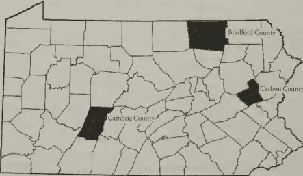

图6.1 宾夕法尼亚州各县地图。

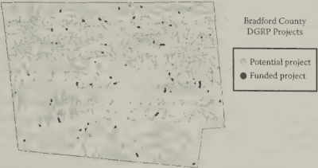

图6.2 布拉德福德县项目地图。

在该项目实施过程中，坎布里亚县每年获得17,000美元。这三个县是由州项目人员推荐进行分析的，因为当地官员最愿意合作并共享数据，而且这些县在参与该项目的各类县中最具代表性。已完成项目和资金分配数据由泥土和砾石道路研究中心（CDRGS，2009）提供。布拉德福德县按年份提交的项目和程序数据来自布拉德福德县保护区（BCCD）（M. Lovegreen，BCCD主任，个人通信，2009年11月2日）。潜在项目和已资助项目地图见图6.2。

由于坎布里亚县和卡本县每年获得的资金有限（不足30,000美元，而许多项目成本超过50,000美元），它们的项目选择受限，并采用较不复杂的决策标准。坎布里亚县在项目最初启动时发布了项目征集，此后逐步处理完最初申请者，并资助了所有符合州标准的项目。卡本县不正式宣传该项目，并资助保护区管理者在履行职责过程中遇到的任何合适项目。这些流程难以用二进制规划方法处理，因为各县没有保留未获资助项目的数据。这并不是说它们采用的选择过程在某种程度上是最优的；但由于关于替代项目的数据很少，无法判断不定期征集新项目错过了多少机会。

布拉德福德县采用更传统的排名方法。项目提案每年征集一次，资助决策基于环境排名，该排名根据收到的实物捐助进行调整。该县要求最低10%的实物捐助才考虑资助项目。对于超过10%的每一百分点实物捐助，环境效益得分增加0.5。此外，除非所有提交项目的乡镇都至少有一个项目获得资助，否则任何乡镇都不能获得超过一个项目。这种修改后的排名系统可以很容易地适用于二进制规划，并比较潜在的效率收益。

### 6.2 理论模型与结果

本案例使用的基本模板是 BLP。其最一般形式可表示为

$$\text{Max: } Z = c^T x$$

$$\text{Subject to: } Ax \leq b$$

$$x_i \in \{0, 1\}$$

其中 \(Z\) 是县资金可获得的环境效益总量，是各项目环境得分之和，\(c\) 是项目环境得分的向量，\(x\) 是二元变量向量，表示是否选择给定项目（选择为1；未选择为0），\(A\) 是约束因素矩阵，如项目成本，\(b\) 是每个约束因素的总禀赋向量，如总预算。基本模型仅在预算约束下最大化环境得分。然而，本案例还必须考虑若干额外因素。具体而言，同一申请者多个项目资助的任何条件以及对实物捐助的考虑都必须纳入模型。

项目有时会因位于敏感流域而被特别指定为“鳟鱼无限”（Trout Unlimited）。这些项目在所有资金中始终获得最高优先级。回想一下，Trout Unlimited组织最初帮助组织了DGRP。然而，Trout Unlimited项目非常罕见（2002年至2008年只有一个），因此被排除在本分析之外。

为了体现资助限制，我们可以加入一个约束，即一个乡镇所有项目之和。当设为大于或等于1时，该约束确保所有乡镇至少获得一个资助项目。将该约束设为小于1时，它防止每个乡镇获得超过一个项目的资助。要使该约束成立，这些条件之一必须为真。这可以通过逻辑条件或二元开关变量实现；然而，这些技术会使规划变为非线性，从而增加求解复杂度。作为替代方案，由于通常没有足够资金让乡镇获得多个项目，可以省略第一个条件，但需注意，如果将来有足够资金为每个乡镇至少资助一个项目，则必须对模型稍作修改。实物捐助将在下一小节深入讨论。因此，对于初始基础模型，我们使用以下形式：

\[
\begin{aligned}
\text{Max: } Z &= \sum_{i=1}^{n} x_i e_i \\
\text{Subject to: } &\sum_{i=1}^{n} x_i p_i \leq B \\
&\sum_{i=1}^{n} x_i \leq 1 \\
&x_i \in \{0,1\}
\end{aligned}
\]

其中 \(x_i\) 是二元变量，表示是否选择项目 \(i\)，\(x_{ij}\) 是乡镇 \(j\) 提交项目的 \(x_i\)，\(e_i\) 是项目 \(i\) 的环境得分，\(p_i\) 是项目 \(i\) 申请的资助金额，\(B\) 是年度总预算。

表6.1概述了2002年至2008年两种方法为布拉德福德县带来的总效益的模型结果。关键观察是 BLP 带来了显著改善。具体而言，BLP选择的一组项目将使环境效益增加57%，实物捐助增加57%，资助项目数量增加102%。然而，由于项目成本存在不确定性，这些结果可能不现实。这将在问题2中进一步讨论（见6.2.2节）。

**表6.1** 多目标线性规划、二进制线性规划和效益目标法的结果

|  | 多目标线性规划 | 二进制线性规划 | 效益目标法 |
|---|---:|---:|---:|
| 支出金额 | $1,924,423 | $2,027,195 | $1,934,422 |
| 环境得分 | 5,736 | 6,613 | 4,208 |
| 实物捐助 | $640,170 | $603,641 | $424,141 |
| 资助项目数量 | 100 | 119 | 59 |

#### 6.2.1 问题1：如何最好地核算实物资助

从表面上看，为项目提供的实物资助金额并不重要，因为项目的资助方式不会改变项目提供的环境效益。然而，乡镇提供的实物资助越多，县在单个项目上需要投入的资金就越少，从而可以资助更多项目。乡镇不一定有动力提供大量实物捐助，尤其是考虑到限制每个申请者资助项目数量的约束。因此，必须建立一种激励机制，使项目长期使用县资金的效果最大化。州政府不要求提供实物捐助，因此由各县决定如何处理此类资助。布拉德福德县采用的方法包括设定最低实物捐助比例，并在排名过程中对超过最低比例的每一百分点提高项目的环境效益得分。尽管这种方法确实将实物捐助纳入了流程，但这种临时性解决方案缺乏灵活性，也不特别优雅。作为替代方案，我们建议适度地将问题重构为 MOLP 模型。

作为MOLP模型，该算法不是仅最大化环境效益，而是同时计算最大可能环境效益和最大实物资助提供额，目标是最小化与这两个最大值的加权百分比偏差，其中85%的权重放在环境效益上，15%放在实物捐助上。这种85:15的权重方案是任意的，但被设定为初始权重估计，目的是在仍考虑实物捐助水平的同时强调环境效益。其他权重将在后文探讨。

¹ 一项有趣的分析将是确定是否存在一种最优权重方案，能够使长期效益最大化。不幸的是，这样的分析需要关于乡镇是否以及如何对决策过程中实物捐助处理方式的变化作出反应的数据。目前尚无此类数据。

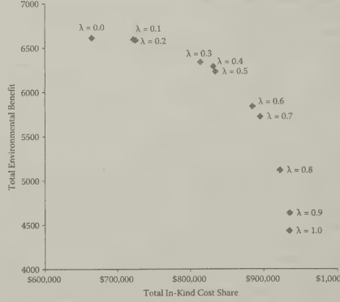

图6.3 效益–实物贡献前沿。

为决策者提供了一组权重框架菜单，并展现了各种目标之间存在的权衡，如图6.3所示。

#### 6.2.2 问题2：项目成本和实物贡献不确定性下结果的敏感性

在将理论最优解与实际项目资助安排进行比较时，出现的一个主要问题是资助申请者成本估算的准确性。根据布拉德福德县的项目数据，项目费用在历史上似乎一直被大幅低估。2002年至2008年，任一给定年份项目的平均实际成本在低于资助申请额30%到高于其85%之间变动。布拉德福德县为单个项目实际支付的金额，从高于资助提案报价428%到低于其66%不等，平均高出54%。实物贡献也存在类似的低估。一个签约乡镇提供的实际实物贡献最终从高于原始报价738%到低于原始报价87%不等，平均高出129%。从规划角度看，预算超支的可能性很大。

在本案例中，传统敏感性分析没有帮助，因为使用的是二进制规划。理想情况下，可以在一系列超支和未达标的百分比范围内，独立且系统地改变成本和实物贡献，并比较结果。然而，这并不可行，因为30个项目即使只有三种此类偏差，也需要超过4×10⁴次单独优化。

作为替代性敏感性分析，我们使用一种自助法型方法分析这种情况，该方法评估在一系列价格和实物贡献随机变动下，项目在最优解中的持续性。所有成本和实物贡献均独立地按第10至第90百分位范围内的系数变动：成本为−28%至+140%，实物资助为−57%至+307%。记录若干随机样本的最优解，并计算某个特定项目被推荐的次数百分比，即“持续性”。该持续性得分可用于识别费用“确定无疑”的项目，以及那些对成本特别敏感的项目。该分析使用55个观测值对2002年进行了分析。表6.2给出了实际获得资助项目的一部分结果。

表6.2 持续性得分节选

| 项目编号 | 排名 | 多目标线性规划值 | 持续性 |
|---|---:|---:|---:|
| Z010 | 1 | 1 | 1.00 |
| Z006 | 2 | 0 | 0.51 |
| X313 | 3 | 1 | 1.00 |
| A398 | 4 | 0 | 1.00 |
| A438 | 5 | 1 | 0.98 |
| A300 | 6 | 1 | 1.00 |
| A872 | 7 | 0 | 0.65 |
| A518 | 8 | 1 | 0.96 |
| A241 | 9 | 1 | 0.15 |
| X353 | 10 | 1 | 1.00 |
| A606 | 11 | 1 | 0.07 |
| A949 | 12 | 1 | 1.00 |

持续性得分等于或接近1.0的项目，即使在相当程度的成本不确定性下，也很可能在提供环境效益方面具有效率。然而，方差较大的项目（如表6.2中的A606）如果成本发生重大变化，则不太可能具有效率，尽管排序过程和MOLP过程都推荐它们；对这类项目应更加谨慎。

表6.3 效益目标法、多目标线性规划和持续性选择的结果

|  | 效益目标法 | 多目标线性规划 | 持续性选择 |
|---|---:|---:|---:|
| 支出金额 | $283,901 | $293,962 | $293,080 |
| 环境得分 | 1,342 | 1,613 | 1,629 |
| 实物贡献 | $57,549 | $96,741 | $110,907 |

值得注意的是，在这些不确定性下实现的预期效益水平总体上仅略低于MOLP模型初始设定所生成的水平（见表6.3）。这是在决策时已知实际成本的条件下。

#### 6.2.3 问题3：结果对州资金分配规则的敏感性

坎布里亚县和卡本县的官员在各自县内发展DGRP计划时感到受挫，因为他们获得的资助如此之少，有时甚至不足以完全覆盖一个项目的相关成本。这引出一个有趣的问题：不同的资金分配规则会对全州总体环境效益和县项目产生什么影响？为优化整体计划，某一给定年度内资助哪些项目的决策可以在州一级作出。然而，这种制度会减少地方参与，而地方参与是DGRP的既定目标。作为替代方案，我们考虑了一种州级分配机制，该机制可以将资金从一个县重新分配到另一个县，以观察总体环境效益如何变化。

我们使用了布拉德福德县2002年提交的项目以及坎布里亚县迄今完成的项目，后者基本上相当于一年的项目提交量。在参数分析中，最优资金分配通过以下方式确定：以每个县的平均DGRP预算为基线，并以1万美元为单位对称地改变分配给每个县的预算额。当每个县获得其传统预算拨款——布拉德福德约30万美元、坎布里亚约1.5万美元时，两县的总环境效益得分为1,923。图6.4表示通过将布拉德福德县部分预算重新分配给坎布里亚县所达到的总效益水平。x轴表示每年从布拉德福德县转移到坎布里亚县的总金额，而*y*轴表示两县的总效益得分。最大值出现在环境效益得分为2,070时，此时从布拉德福德县向坎布里亚县重新分配3万美元。

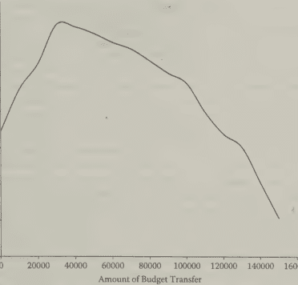

图6.4 县际资金分配。

在最大效益水平下，布拉德福德县仍获得27万美元（90%），而坎布里亚县的预算显著增长至4.5万美元（300%）。然而，总环境效益在该点之后开始稳步下降。因此，虽然向获得资金较少的县进行少量重新分配可能具有显著优势，但DGRP资金的大部分仍应继续流向土路系统较大的县。

### 6.3 结论

本章通过数学规划技术将优化应用于宾夕法尼亚州水质保护问题。它展示了如何扩展二进制线性规划，以应对实地保护情形中遇到的各种挑战。宾夕法尼亚州土路和砾石路计划是鳟鱼无限组织、宾夕法尼亚州以及宾夕法尼亚州县水土保持区合作的结果。他们采用一种创新方法来减少非点源污染，通过资助敏感水道周边土路的稳定化。他们目前使用效益目标法算法选择项目，该算法对项目进行排序并选择质量最高的项目，直到预算耗尽。他们的工作可以通过二进制线性规划方法得到改进。该平台提供了若干自然的扩展，有可能应对该计划面临的若干挑战，包括实物成本分摊的处理、项目成本的不确定性以及资金在各县水土保持区之间的分配。

本分析中的一个小挑战是数据的可得性。利用布拉德福德县的数据可以进行大量研究；然而，若有更多数据，还可以开展其他若干有趣的分析，包括全州资金分配分析，以及可能的数据包络分析，以比较各县决策方法的差异。分析中提出了若干值得进一步思考的问题，包括MOLP模型中实物贡献的最优权重方案，以及继续研究成本敏感性和环境得分敏感性对最终实现效益的影响。

尽管存在这些数据挑战，优化在该计划中仍显示出可观的收益前景。首先，较大县在决策过程中使用BLP有可能获得可观的效率提升，尽管这在一定程度上受到成本不确定性的削弱。其次，MOLP可用于将实物贡献纳入考虑，以鼓励乡镇提高贡献率。此外，由于项目成本存在不确定性，考虑解在项目成本随机扰动下的持续性可能有用，以帮助识别无论实际成本如何都最可能具有效率的项目。最后，通过向目前仅获得有限资金的县进行少量资金重新分配，可以提高全州效率，但拥有较大道路系统的县仍应继续获得大部分资金。

### 参考文献

- Aldrich, R., and Wyerman, J. (2006). 2005年全国土地信托普查报告。华盛顿特区：土地信托联盟。
- American Farmland Trust (2010). 州PACE计划现状。在线见 www.farmland.org（2010年3月17日访问）。
- Babcock, B.A., Lakshminarayan, P.G., Wu, F., and Zilberman, D. (1997). 购买环境舒适性的目标工具。*土地经济学*，73，325–339。

- Baker, M., Payne, S., and Smart, M. (1999). 匹配拨款的实证研究：“CAP 上限”。*公共经济学杂志*，72，269–288。

- Ballestero, E., Alarcon, S., and Garcia-Bernabeu, A. (2002). 建立政治上可行的水市场：一种多准则方法。*环境管理杂志*，65，411–429。

- Boadway, R., and Shah, A. (2007). 政府间财政转移支付。华盛顿特区：世界银行。

- Borge, L.-E., and Rattso, J. (2008). 对临时匹配拨款项目的本地调整：动态分析。未刊稿，挪威科技大学经济系。

- Bucovetsky, S., Marchand, M., and Pestieau, P. (1998). 税收竞争与公共支出偏好的显示。*公共经济学杂志*，44，367–390。

- Center for Dirt and Gravel Road Studies, University of Pennsylvania (2009). 宾夕法尼亚大学泥土与砾石道路研究中心：更好的道路，更清洁的溪流。网站：www.dirtandgravel.psu.edu。

- Chernick, H. (1995). 面向贫困者的整笔拨款的财政效应：证据综述。载于 *美国全国税收协会年度税收会议论文集*，第24–33页。

- Claassen, R. (2009). 美国农业部经济研究局保护政策简报室。在线：www.ers.usda.gov/briefing/conservationpolicy/background.htm（2010年2月访问）。

- Dantzig, G.B. (1957). 离散变量极值问题。*运筹学*，5(2)，266–288。

- Drynan, R.G., and Sandiford, F. (1985). 将经济目标纳入渔业管理目标规划。*海洋资源经济学*，2(2)，175–195。

- European Union Directorate-General for Agriculture and Rural Development (2009). 欧盟农村发展：2009年统计与经济信息报告。布鲁塞尔：欧盟。

- Fooks, J., and Messer, K.D. (2012). 最大化保护与实物成本分担：将目标规划应用于森林保护，*森林经济学*，18：207–217。

- Kaiser, H.M., and Messer, K.D. (2011). 农业、环境与资源经济学的数学规划。新泽西州霍博肯：Wiley。

- Kotani, K., Messer, K.D., and Schulze, W.D. (2010). 匹配拨款与慈善捐赠：为什么有些人有时会伸出援手资助环境产品。*农业与资源经济学评论*，39(2)，324–343。

- Mardle, S., and Pascoe, S. (1999). 多准则决策技术在渔业中的应用综述。*海洋资源经济学*，14，41–63。

- Mardle, S., Pascoe, S., Tamiz, M., and Jones, D. (2000). 北海底层渔业资源分配：目标规划方法。*运筹学年鉴*，94，321–342。

- Messer, K.D. (2006). 成本有效的土地征用的保护效益：马里兰州案例研究。*环境管理杂志*，79，305–315。

- Messer, K.D., Allen, W.L., and Chen, C. (2011). 提高马里兰农业用地保护基金会成本效益的最佳实践。哈里·R·休斯农业生态研究中心研究报告。

- Neely, W.P., North, R.M., and Fortson, J.C. (1977). 使用整数目标规划进行公共水资源项目多目标决策的一种可操作方法。*美国农业经济学杂志*，59，198–203。

- Oates, W.E. (1999). 财政联邦主义论。*经济文献杂志*，37，1120–1149。

- Önal, H. (1997). 在具有环境影响和收入分配目标的森林管理中结构多样性与经济目标之间的权衡。*美国农业经济学杂志*，79(3)，1001–1012。

- Önal, H., Algozin, K.A., Işik, M., and Hornbaker, R.H. (1998). 具有环境影响和收入分配目标的经济有效流域管理。*环境管理杂志*，53，241–253。

- Polasky, S., Camm, J.D., and Garber-Yonts, B. (2001). 成本有效地选择生物保护区：在俄勒冈州陆生脊椎动物保护中的应用。*土地经济学*，77，68–78。

- Prendergast, J.R., Quinn, R.M., and Lawton, J.H. (1999). 自然保护区选择中理论与实践之间的差距。*保护生物学*，13(3)，484–492。

- Pressey, R.L., and Cowling, R.M. (2001). 保护区选择算法与现实世界。*保护生物学*，15(1)，275–277。

- Silva, D., and Nakata, T. (2009). 考虑贫困因素的偏远地区农村电气化多目标评估。*能源政策*，37(8)，3096–3108。

- Trust for Public Lands (2009). 2009年年报。在线：www.tpl.org（2010年8月10日访问）。

- Underhill, L.G. (1994). 最优与次优保护区选择算法。*生物保护*，70，85–87。

- U.S. Department of Agriculture (2009). 农业部长维尔萨克宣布保护储备计划租金支付17亿美元。美国农业部新闻室。在线：www.fsa.usda.gov/FSA/newsReleases?area=…&newsroom&subject=landing&topic=ener&newstype=newsrel&type=detail&item=nr_20091007_rel_0497.html（2010年7月20日访问）。

- U.S. Department of Agriculture (2010). 保护储备计划。美国农业部农场服务局项目。在线：www.fsa.usda.gov/FSA/webapp?area=home&subject=cpf&topic=crp（2010年8月10日访问）。

- Wu, J., Adams, R.M., and Boggess, G. (2000). 保护努力的累积效应与最优目标定位：俄勒冈州硬头鳟栖息地改善。*美国农业经济学杂志*，82，400–413。

- Xu, J., Tao, R., Xu, Z., and Bennett, M.T. (2010). 中国的退耕还林计划：扩大是否等于成功？*土地经济学*，86，219–244。

# IV

# 面向智能电网与可再生能源的计算智能数据分析

- 7.4.5 分解 — 220
  - 7.4.5.1 负荷分解方法 — 221
  - 7.4.5.2 实际应用 — 223
- 7.4.6 能源数据集的探索与比较 — 225
  - 7.4.6.1 扩展数据管理技术 — 226
  - 7.4.6.2 面向意外模式的引导式探索 — 227
  - 7.4.6.3 对比分析与涌现模式 — 228
- 7.4.7 优化 — 229
- 7.4.8 隐私保护数据挖掘 — 231
- 7.5 结论 — 232
- 致谢 — 233
- 参考文献 — 233

### 7.1 引言

能源系统目前正经历重大变革，主要驱动因素是需要更可持续和更安全的能源供应。传统系统一方面依赖石油、天然气和煤炭等化石资源的燃烧，另一方面依赖核技术，这种系统不可持续，主要有三个原因：

- 1. 化石和核资源有限，其开发将变得更加昂贵（经济上不可持续）。
- 2. 化石能源燃烧导致CO₂排放，推动温室效应（环境上不可持续）。
- 3. 核电站在运行中具有一定风险，并产生核废料，需要防止未经授权的获取。

此外，迄今为止，尚无核废料的永久处置场，后代——他们不会从这种能源中获益——将不得不处理它（社会不可持续，如果考虑所有处置成本，可能在经济上也不可持续）。实现可持续性的最佳方式显然是能效，即各种形式的节能。另一种方式是可再生能源。幸运的是，可再生能源发展迅速，最显著的是风能、光伏系统、水力和沼气。以德国为例，2011年可再生能源在电力供应中的份额超过20%大关[7]。预计到2050年这一份额将翻两番[3]。

除德国外，许多其他国家也有类似计划，以减少温室气体排放并应对气候变化。

可再生能源的兴起伴随着电力供应方面的若干挑战。数据分析技术是能够促进这些发展的关键组成部分，正如我们将在本章后面看到的。特别是，可再生能源对电网构成挑战，电网必须稳定，并应允许任何人在任何时间消费能源。这很难实现，因为电力系统必须始终维持供需平衡。储能可以帮助实现这一点，但地理可用性非常有限，而且目前储能的经济性使其不适合大规模应用。随着可再生能源份额上升，由于其发电不稳定且波动，维持平衡变得更加困难。这要求所谓的*智能电网*，这是本章的主要主题。

特别是，未来能源系统——旨在减少对化石燃料和核技术的依赖，并越来越多地依靠可再生能源——面临以下四个主要因素的挑战：

- 1. *波动性发电。* 可再生能源可能最大的问题是其波动性。这给电力系统带来巨大挑战。光伏或风能的发电不取决于消费者需求，而仅取决于难以或无法控制的外部条件（例如一般天气条件）。这些条件不一定与消费者的能源需求模式相匹配。在可再生能源占整体发电量份额很小的环境中，这种自然波动可以容忍。然而，份额越大，补偿这种效应所需的努力就越大。
  
  补偿可再生能源的波动性可以通过例如永久处于待机运行的灵活燃气轮机来实现。它们可以自发增加发电，例如当云层遮住太阳、发电量减少时。然而，这种待机运行效率极低，并造成显著的温室气体排放[136]。额外发电的替代方案是转移需求，本章剩余部分将更详细地讨论这一点。如果某些需求可以转移到更多……的时间点

当可再生能源可用时，这一能量可被视为虚拟产出、储能或缓冲。相应的负荷转移方案和实施通常被称为*需求响应*。

然而，在未来的情景中，情况可能更加严峻。当电力生产中很大一部分来自可再生的波动性电源时，总发电量可能会超过总需求。如果需求（包括储能设施）无法再转移到这样的时段，那么即使是可再生能源的生产也必须停止，这使得其发电效率降低。此外，这还可能对发电和电网基础设施造成重大损害。

- 2. *分布式发电。*未来的能源生产将更加分散。今天，它依赖于数量相对较少的大型集中式发电厂。这些发电厂从高压等级向低压等级馈入能量，形成单向潮流。未来，尤其是由于可再生能源的兴起，发电单元的数量很可能急剧增加，并且分布范围更广。一方面，这是因为安装在私人和工业建筑上的光伏系统数量不断增加，同时风力涡轮机也并非总是大型风电场的一部分。另一方面，基于沼气的小型发电厂和*热电联产机组（combined heat and power units, CHP units）*正变得越来越普及。热电联产机组也能为更可持续的能源生产做出贡献。这是因为与不利用废热的纯化石燃料发电相比，它们更高效。此外，它们还可能在发电量较低时用于发电。特别是所谓的*微型热电联产机组*越来越多地安装在私人住宅中，部分原因是政府项目的激励。这些发展使许多*消费者*成为所谓的*产消者*。产消者是拥有例如光伏系统或微型热电联产机组的消费者，这些设备产生的能量如果超过其自身需求，就会馈入电网。

*需求响应*被认为是更广泛的*需求侧管理*领域的一个要素，该领域还包括能效措施[110]。

德国4200万辆注册汽车中有4万辆是（混合动力）电动汽车[5]。

电动汽车只有在其消耗的能源也是可持续的时才是可持续的。由于电动汽车将导致能源消耗的增加，因此需要更多的可再生来源来满足这一新需求。此外，电动汽车充电需求波动性很大，如果与能源的生产和分配不协调，峰值需求很难被满足。另外，在同一电网区域同时为太多电动汽车充电可能导致过载，最坏情况下会造成停电。与此同时，电网的典型平均负荷远不够为电动汽车充电。同样，用增加电网容量的方式应对这种峰值需求是昂贵的，而且并不能解决某些时间点可再生电力生产不足的问题。因此，需要智能充电控制才能将电动汽车整合到智能电网中。

电动汽车不应仅仅被视为挑战，更应被视为实现智能电网的机遇。例如，智能技术可以调度电动汽车的充电过程，以避免电网问题，实现需求响应（例如，当可再生能源产量高而其他需求低时充电），并满足用户需求（例如，在用户需要时让车辆充电到一定水平）。除了智能充电外，电动汽车的电池还可以用作电网中的缓冲。也就是说，当发电量低或出现需求峰值时，可以将车辆中的能量馈入电网（*车辆到电网，V2G*）[118]。然而，由于电动汽车仍处于起步阶段，要将其与智能电网整合，必须解决许多挑战，包括数据分析。例如，为了获得用户认可，智能系统需要捕捉和预测用户行为，以便在用户需要时使车辆有足够的电量。

除了电动汽车，*热泵*在某些地区也越来越受欢迎。这种设备从环境中提取热能用于供暖和/或制冷。然而，它们是电力系统中不可忽视的负荷，并且可能在某种程度上用于转移需求。

- 4. *自由化。*除了可持续性目标和技术发展之外，能源系统还受到立法的挑战[104]。传统上，电力发电、输电、配电和零售由区域性垄断企业完成，而如今许多国家的电力市场已经自由化。自20世纪90年代末以来，上述任务被分离，电能的发电和零售领域引入了竞争。除了发电和零售公司之外，自由化还带来了许多其他参与者，如输电和配电网络运营商、平衡责任方、计量运营商、增值服务提供商等。特别是与电网运行相关的参与者通常受到政府机构的监管。从更技术性的角度来看，电力系统涉及更多的参与者。他们都会生成数据，而这些分布式数据必须与其他合作伙伴交换，以完成各自的任务。这为数据分析开辟了新的有趣可能性，同时也需要以隐私保护的方式处理数据。

总结这些挑战，未来的可持续能源系统将经历重大变化。发电和生产将更加波动，格局变得更加分散，无论是从技术（分布式发电、波动性发电和消费）还是组织角度（新的和更专业的参与者）来看。最重要的是从过去的*需求驱动发电*向未来的*发电驱动需求*的范式转变，这种转变由可再生能源发电和新负荷引发。智能电网中基于发电驱动的能耗管理是一个复杂的优化问题[138]。它涉及某些分布式能源的运行和能耗控制，例如通过基于市场的机制。在自由化的电力市场中，不同的参与者可能会以分布式方式共同解决优化问题。此外，解决方案可能是分层的：某些优化将在输电网层面进行，进一步的优化在配电网层面，再下一层可能是更细粒度的消费和相邻消费者与小型能源发电机之间的发电转移。在这些不同层面，消费、发电和电网使用数据将以不同的聚合水平出现，并为数据分析带来新的挑战。

影响当前和未来能源系统的另一项技术发展是*智能计量*。智能电表便于对能源消耗、生产和质量进行细粒度测量，并实现相应测量值的通信。它们是本章描述的许多未来能源情景的技术基础之一。此外，从立法角度来看，智能电表的推广也受到推动，许多国家都有相应的计划。举个例子，欧盟希望在2020年实现80%的智能电表覆盖率[1]。

本章详细回顾了智能电网领域中的一些典型情景。其中大多数有助于实现从需求驱动发电到发电驱动需求的范式转变，或实现能源效率。这些阐述揭示了在实施这些情景时必须解决的一些数据分析挑战。这些挑战连同可能的解决方案将得到更详细的讨论。

本章其余部分结构如下：第7.2节描述了电力市场的现状；第7.3节回顾了作为智能电网构建模块的精选未来能源情景；基于第7.2节和第7.3节，第7.4节随后描述了由此产生的数据分析挑战并重点介绍了初步解决方案；第7.5节给出结论。

### 7.2 当今能源市场

在本节中，我们以欧洲为例，简要概述当前电能市场。本节不仅是理解第7.3节所述未来能源情景的基础，也带来了一些数据分析挑战。特别是，消费和发电的预测在当今能源市场中已经发挥着重要作用。在本节中，我们首先介绍能源市场中的不同角色（第7.2.1节），然后描述能源交易（第7.2.2节）和电网中的能量平衡（第7.2.3节）。

#### 7.2.1 能源市场中的参与者

正如引言中所讨论的，自由化导致了能源市场中许多新的参与者和角色。由于监管的原因，这在不同国家可能有所不同，并且某些角色可能由

同一实体（例如，一个发电商也可能充当向消费者售能的零售商）。从数据分析的视角来看，能源市场中（新）参与者的数量也很有意思：这些参与者中的大多数都能访问潜在有价值的数据，或者可以从不同参与者提供的数据中获益。研究这些参与者及其数据，会为数据分析带来有意思的机会，甚至可能催生新的角色，例如分析服务提供商。下面，我们介绍本章剩余部分 [2] 所涉及的最常见参与者和角色：

- *发电商。* 一家生产电能并将其馈入输电或配电网的公司。发电商可能使用常规电厂，也可能产生可再生能源。
- *消费者。* 消耗电能的工业或私人实体或个人。
- *产消者。* 同时生产电能的消费者。与发电商的不同之处在于，产消者可能完全消耗自己生产的电能。发电通常由可再生能源或微型 CHP（热电联产）机组完成。
- *配电系统运营商（DSO）。* 运营区域配电网络（低压和中压），为消费者、产消者和小型发电商提供电网接入。历史上，此类电网旨在将集中生产的电能分配给消费者。如今，也可能出现临时馈入电网的能量多于从电网取用能量的情况。DSO 还规划、建设和维护电网基础设施。
- *输电系统运营商（TSO）。* 运营输电网络（高压），并在远距离大量输送电能。这包括为大型发电商和消费者以及 DSO 提供电网接入。TSO 负责其所属输电网络部分的整体稳定性，并负责提供平衡功率（见第 7.2.3 节）。TSO 还规划、建设和维护电网基础设施。
- *平衡责任方（BRP）。* BRP 负责确保其平衡区域内计划供应的能量与预期消耗的能量相对应。为实现这一点，BRP 使用平衡功率来消除即将出现的不平衡，并与

##### 7.2.2.1 长期交易

尽管电能传统上通过双边场外（OTC）合约交易，但如今越来越多的能量在电力交易所交易。此类交易所交易标准化产品，这使交易更容易并提高价格可比性。尽管能量交易方式多种多样，但博弈论 [54] 中已知的双重拍卖是确定价格的主导手段 [137]。

例如，位于德国莱比锡的欧洲能源交易所股份公司（EEX）交易不同种类的标准化能源期货和期权。这些产品描述在未来特定时间潜在交付一定量能量。交付必须在其中一个输电网内进行。除了交易产品外，它们还为 OTC 合约提供清算服务。2010 年，EEX 德国衍生品市场的交易量为 313 太瓦时（TWh），包括场外交易则为 1,208 TWh [6]。后一数字大致相当于同期德国能量消耗量的两倍。

##### 7.2.2.2 短期交易

由于消费和生产都无法以 100% 的准确率预测，短期交易变得必要。因此，并非所有能量需求都能由长期交易满足。特别是，波动的可再生能源使对发电量进行正确的长期预测几乎不可能。例如，风能发电量只能提前几小时以足够准确度预测。因此，电力交易所被用于短期交易，同样利用不同类型的拍卖。在此类交易所，如果零售商的需求未被期货覆盖，他们可以购买电能进行实物交割。同样，交付必须在其中一个输电网内进行。

位于法国巴黎的 EPEX Spot SE（欧洲电力交易所）为多个欧洲市场交易能量。在那里，交易划分如下：

- 在*日前拍卖*中，电能按 1 小时间隔交易，次日交付 [6]。这些拍卖在每天的午间进行。可对单个小时或多个小时组成的块进行投标，价格可以为正或为负。例如，当预测的可再生能源发电量非常高而需求较低时（可能是在公共假日），就可能出现负价格。
- 在*日内交易*中，电能交易用于当天或次日交付，同样按 1 小时间隔 [6]。每个小时可在交付前 45 分钟之前交易；从下午 3:00 开始，次日的所有小时均可交易。也可对单个小时或多个小时组成的块进行投标，价格同样可以为正或为负。

2010 年，EPEX 通过日前拍卖交易了 267 TWh，通过日内交易交易了 11 TWh（德国、法国和奥地利市场）[6]。这些交易的总和大致相当于同期德国电能消耗量的一半（其中大部分能量是为德国市场交易的）。

#### 7.2.3 能量平衡

为确保可靠、安全地提供电能且不发生任何停电，电网必须在任何时刻保持稳定。特别是，必须确保发电量始终等于能量消耗量。在实践中，由于随机消费行为、不可预测的电厂停运以及波动的可再生能源发电，避免发电与需求之间的不平衡具有挑战性 [137]。

在非常粗的时间粒度上，平衡通过能量交易（见第 7.2.2 节）和数据分析机制（尤其是预测和预报）实现：零售商购买其客户的预测需求，发电商出售其预测发电量。如第 7.2.1 节所述，BRP 确保计划供应的能量与预期消耗的能量相对应。这种预期消耗也是使用数据分析技术得出的。TSO 负责电网的稳定性。下面我们描述它们如何做到这一点。

从技术角度看，需求减少会导致频率升高，而发电量减少会导致频率降低（增加时则相反）。应实时避免电网偏离固定的 50 Hz 频率，因为这可能损坏接入电网的设备。

通常，频率控制通过三阶段过程实现：一次、二次和三次控制。一次控制负责非常短的偏差（15 至 30 秒），二次控制负责短偏差（最长 5 分钟），三次控制负责较长偏差（最长 15 分钟）[137]。控制过程可通过多种方式实现，例如备用发电机、电厂负荷变化或负荷转移。涉及不同类型电厂的不同措施具有不同的反应时间，因此用于不同的控制层级。

平衡电网所需的容量同样经常通过拍卖交易：一次和二次容量每半年交易一次，而三次容量按日交易 [137]。通常，只有预合格参与者才被允许进入此类平衡市场，因为必须确保相应层级的要求能够在技术上得到满足。一次控制投标由所提供的容量和实际交付平衡功率的价格组成。相比之下，二次和三次控制的投标由两部分价格组成：提供一定容量的价格和所消耗电能的价格 [137]。因此，容量在平衡市场中扮演重要角色，参与者部分因潜在供应而获得报酬，这阻碍了发电商在常规市场上出售这部分能量。

对于二次和三次控制实际交付能量所产生的成本，造成偏差的发电商或未为其客户采购正确数量能量的零售商将被收取费用 [81, 137]。一次控制以及二次和三次控制容量的成本由相应的电网运营商支付 [137]，这些运营商赚取电网使用费。由于平衡市场的成本通常高于正常能源市场，发电商和零售商受到激励，尽可能做出最佳的能源生产和消费预测 [81]。

### 7.3 未来能源场景

在本节中，我们描述若干面向未来的愿景性能源场景。它们代表可能的智能电网的构建模块。我们从研究者的视角描述这些场景——它们假设某些技术发展，并可能需要立法变更。我们选择了科学界和工业界常讨论的场景，无论是所描述的形式还是某种变体。

#### 场景 7.1：智能电表数据访问

智能计量是智能电网的关键构建模块，因为许多后续场景依赖于细粒度能源消耗和发电信息的可用性。例如，智能计量可以增强负荷预测，并实现需求响应、动态定价等。其中一些场景将在下文描述。然而，智能

计量不仅是其他场景的促成因素。让用户能够访问其用电画像，可以使其更清楚地了解自身用电情况并提高能效。这一点很重要，因为许多消费者对自身能耗知之甚少。

出于计费目的，智能电表数据通常以 15 分钟为间隔生成。也就是说，电表每 15 分钟将消费者的累计用电量传输给计量运营商。从技术上讲，智能电表可以提高用电数据的时间分辨率，例如测量每秒或每分钟的用电量。这样一来，人们可以获得能耗的详细图景——甚至可以识别单个设备（例如咖啡机），因为每个设备都有其典型的负荷曲线。这种细粒度数据也可以传输给计量运营商。此外，任何粒度的计量数据都可以在家庭网络中提供，例如通过平板电脑上的可视化工具进行访问。

能源消费者对用电画像的访问可以不止于纯数字或简单图表。相应的可视化工具可以轻松显示与前几日、前几周等的比较。对于服务提供商而言，他们还可以提供与具有相似家庭（就家庭规模和所用电器而言）的消费者同伴群体的比较。此外，设备可以通过其负荷曲线来识别 [113]，并且可以额外进行可视化。这会增强对每个单个设备能耗的认识。

已有若干研究考察了让用户访问智能计量数据所产生的影响。Schleich 等 [126] 对 2,000 名消费者开展了受控现场实验，并得出结论：允许访问详细用电数据可能会适度降低总能耗，降幅约为 4%。其他（元）研究表明，节省幅度甚至可能略高一些 [39, 45, 94]。

#### 场景 7.2：动态价格下的需求响应

能源零售商在现货市场采购其部分能源需求，那里的价格反映了（可再生）能源的实际可用性（见第 7.2.2.2 节）。与此同时，能源消费者通常以每千瓦时固定价格购买能源，此外还需支付与用电量无关的月费。尽管这对消费者来说很方便，并且在已知用电量的情况下可以轻松计算月度或年度账单总额，但消费者没有激励在能源供应充足时（例如风电产量高时）用电，或在产量低时节能。正如引言中所讨论的，这种从需求驱动发电到发电驱动需求的范式转变对于促进可再生能源整合是必要的。实现这一点的一种方法是动态定价。简而言之，零售商将当前或未来的每千瓦时能源价格传达给消费者，消费者可以决定是否对这种激励作出反应，还是更愿意在自己需要时用电，并容忍可能更高的价格。

动态价格的前身是夜间电价更便宜的费率方案，这反映了当时平均需求较低。然而，这并未考虑可再生能源发电的波动。动态价格机制可以将这些波动考虑在内，并将其纳入对可再生能源发电和消费者需求的预测中。动态价格方案的主要区别在于可能价格的范围、价格有效时间区间的分辨率，以及提前传达价格的时间跨度。非常短的时间跨度可以实现高度动态的需求响应，但也会使能源消费规划变得困难。此外，立法可能要求某些最小时间跨度。Jokic 等 [70] 对动态价格进行了更详细的综述。

德国研究项目 MeRegio 调查了用户对所谓“能源交通灯”的接受度（更多信息见 [4]）。这些小型设备通过无线电接收未来 24 小时的能源费率。价格粒度包括三个离散等级：“低”、“正常”和“高”。消费者可以看到这些等级并据此规划。此外，该设备以不同颜色可视化这三个等级（例如红色代表“高”），这使消费者更清楚地意识到当前电价。当然，动态价格并不只是供人解读。智能设备可以接收此类价格信号，并决定何时启动某个过程（例如，当最低费率开始时，洗碗机可以自动启动）。这种自动化在所谓的智能家居中得到了更大程度的实现，场景 7.4 将对此进行描述。

除了作为实现需求响应的有前景的方法外，动态价格也带来风险。例如，可能会出现许多设备在低价时间段开始时同时启动运行的情况。这可能会给配电网带来挑战，因为需求突然显著增加很难由能量平衡机制处理，因此应予以避免。这可以通过为不同消费者使用个性化动态价格（通过细微差异来平滑需求曲线）来实现，或者通过采用更精细的价格粒度来实现。如果粒度足够细，不同的用户偏好可能会使设备启动时间分布得更广。

许多科学研究已经考察了动态定价的用户接受度和效率。一项元研究 [50] 考察了 24 个不同试点项目的结果。几乎所有这些研究的结果都表明，消费者确实接受动态价格，并在一定程度上调整其行为。具体而言，这些研究表明，动态定价方案是一种有效的需求响应措施——可实现 12% 的中位数峰值削减。自然，如果用户得到智能技术（例如智能家居中的技术）的支持，用户接受度会特别高（见场景 7.4）[109]。

#### 场景 7.3：基于市场并带控制信号的需求响应

当能源零售商在白天遇到能源短缺时，他们会在日内交易所购买能源（见第 7.2.2.2 节）。当可再生能源产量较低时，这可能非常昂贵，而要求客户在特定时间范围内减少用电可能是更好的选择。同样，电网运营商监测电网，并可能希望要求消费者暂时减少用电以实现电网稳定。本场景描述了动态价格（见场景 7.2）之外的一种需求响应替代方案，重点在于解决电网问题。它需要消费者与相关方之间签订相应合同，规定消费者参与相应措施（例如减少能源账单）的激励。具体而言，消费者与专业的需求侧管理公司签订合同，这些公司可能是当地配电系统运营商。此外，还需要能够执行需求响应措施的基础设施。本场景描述了不同于动态价格的市场机制，可依赖此类基础设施，用于交易需求响应用途的柔性负荷。

考虑采取需求响应措施的能源零售商可以将其请求发送到电子市场。同样，如果检测到过载或电压问题，电网运营商也可以发出类似请求。然后，所有受影响的需求侧管理公司从市场接收这些请求，每家公司提交一份解决问题的报价。市场选择一组满足请求的报价组合。如果零售商或电网运营商接受该报价组合（零售商也可能更愿意在交易所购买能源，如果这样更便宜），则相应的需求侧管理公司负责执行该需求响应请求。然后，这些公司向其签约消费者的智能家居控制盒发送优先级信号。控制盒将信号发送到消费者场所的智能设备以及电动汽车充电基础设施。

#### 场景 7.4：智能家居

家庭自动化以“智能家居”之名已为人所知相当一段时间。然而，直到最近，这主要意味着提供舒适性功能，例如自动关闭百叶窗、自动开灯，或根据当前天气条件控制房屋的空调系统。智能家居通常配备某种能源生产单元（例如光伏或微型热电联产），并可采用中央优化组件来控制房屋内大部分能源的生产和利用。最近，家庭自动化在智能电网应用中的潜力得到了认可 [17]。虽然智能家居中的控制组件主要根据用户预设进行操作，但它们也可以考虑能源电网中的当前情况 [23]。

家庭中的一些应用有可能将其运行时间推迟到未来；另一些应用则可能比通常更早运行。在时间上转移其用电量就实现了需求响应。当然，并非家庭中的所有应用都适合这一目的。照明或烹饪等应用不具备时间可变应用的潜力 [60, 11]。洗碗机或洗衣机的情况则不同。这些电器通常不需要立即启动，因此具有将电力需求转移到未来的潜力。例如，用户希望晚餐时有干净的盘子。盘子是在午餐后立刻清洗，还是在下午某个时候清洗，并不重要。

转移电力需求的另一种可能性是改变加热或冷却应用中的温度。此类应用包括冰箱、空调和供暖系统。它们都必须在某一范围内维持温度。冷冻柜的可容忍范围约为 −18°C，容差为 ±2°C。在正常运行模式下，设备会冷却到 −20°C，然后暂停，直到

温度达到 –16 °C，然后再次开始。智能系统将能够在 –18 °C 时中断冷却，或已经在该温度下开始冷却，而不必等待进一步升温，从而转移冷却设备的电力需求。同样的方案也可应用于室温，因为舒适范围通常在 21 °C 左右。对用户偏好的扩展了解可以进一步扩大这一潜力。如果住户希望晚上回家时温度为 21 °C，系统可以在下午将房屋加热到 25 °C，然后让其缓慢冷却到理想的 21 °C。这会需要更多总能量，但在未来能源系统中仍然可行，因为那时白天有大量太阳能可用（因而价格低廉）[73]。

如果将典型用户行为画像与电动汽车（EV）结合，还可以进一步提高智能家居的需求转移能力。不仅可以将车辆的充电曲线与用户和能源系统的需求相匹配，而且当车辆不需要使用时，电动汽车的电池还可以用作临时储能。这一概念被称为车辆到电网（见场景 7.5）[118]。

#### 场景 7.5：储能

随着波动性能源生产（如太阳能或风能）占比增加，储存电能变得更加重要。尽管电能难以储存，但确实存在一些技术解决方案。在电力储存的背景下，必须牢记此类系统的一些关键参数。第一个是效率，指可重新获得的已储存能量的百分比。它始终低于 100%。其他参数是储能系统的容量和峰值功率，它们指的是此类系统的性能。

如今，唯一能够以合理价格储存相当数量能量的储能系统是抽水蓄能水电站。它们通过将水从低处水库抽到高处储存来储存能量，并通过让水流经发电机向下流来重新获得这种势能，就像在水电站中一样。虽然这种储能方式可以几乎无限期地储存能量，但其土地占用相当高，并且需要自然落差，这使得在人口稠密地区建设此类储能设施变得困难。

另一种选择是安装大型基于电池的化学储能设施。日本一些地区已经这样做了。电池系统几乎可以按任何所需容量和峰值功率制造。电池系统的缺点是价格相对较高。随着电动汽车市场份额的预期上升，这种情况可能很快就会改变。电池在其使用寿命期间会不断损失容量。在某个时间点，其功率密度不足以再将其用作电动汽车电池。然而，在固定式储能场景中，功率密度可以忽略不计。因此，电池储能设施可以通过重复使用旧电池，从电动汽车的相当市场份额中受益。

另一种储能选择是 V2G 概念 [118]。由于车辆只有约 5% 的生命周期在路上行驶，电动汽车有潜力在 95% 的时间里用作本地储能。假设一个国家有 100 万辆电动汽车（例如，德国政府的目标是到 2020 年达到这一数量 [3]），这总计可提供约 15 吉瓦时（GWh）的储能容量，峰值功率为 3 至 20 吉瓦（GW），相当于两到五座典型的抽水蓄能水电站。

储能系统的盈利能力取决于商业模式，与其使用情况相关，而如今使用情况与充放电循环次数成正比。由于电池质量因素不仅随使用寿命下降，而且随每次使用循环下降，因此对此类系统的利用必须有所保留地考虑。

#### 场景 7.6：基于能源数据的管理决策

能源已成为工业、公共设施、仓库、中小企业乃至大学的主要成本因素。因此，这些组织中的管理层需要基于组织能源消耗的决策支持。让我们以一所大学为例，其数据中心计划安装新一代服务器。不仅必须考虑采购成本，还必须考虑冷却、空间，尤其是能源消耗。虽然对于大多数此类管理决策，已有 IT 解决方案可用，但能源消耗仍然是一个被大多数企业资源计划（ERP）工具忽视的未解决问题。能源管理开辟了若干需要考虑的新方面。特别是，随着智能电表等新型数据源的出现，我们观察到此类数据分析工具包具有很大潜力。

自动化数据分析或半自动化数据探索可以提供一所大学、一个系、单个研究所的总体能耗概览，或者从其他维度提供所有服务器、所有个人计算机的详细能耗，以及更多此类关于能耗的正交视图。为管理决策提供不同聚合层次上的大量此类视图至关重要。

八月至九月

### 我的计划

### 早晨

- 维生素、镁
- 8:00 前淋浴
- 8:30 签到

### 白天

- 上午 10:00 小型项目
- 外出午餐

### 晚上

- 睡前拉伸
- 阅读 20 页

### 目标

- 3 个个人项目
- 每日写日志
- 1 万步

### 周末

- 早晨徒步
- 备餐

> 我每天都在变得更好！

*未来能源*情景（见第 7.3 节）要求更先进的数据管理和数据分析，正如传统能源系统中已经使用的那样（见第 7.2 节）。本节描述能源领域的数据分析挑战，并给出初步解决方案。我们特别关注数据管理（第 7.4.1 节）；数据准备（第 7.4.2 节）；预测、预报和分类的广阔领域（第 7.4.3 节）；模式检测（第 7.4.4 节）；分解（第 7.4.5 节）；以及交互式探索（第 7.4.6 节）。最后，我们评论优化问题（第 7.4.7 节）以及隐私保护数据挖掘这一新兴且富有挑战性的领域（第 7.4.8 节）。

#### 7.4.1 数据管理

在讨论实际的数据分析挑战之前，我们先提出一些关于数据管理的考虑。如前所述，*智能电网*的兴起带来了许多大型的新数据源。此类数据最突出的来源是*智能电表*（见场景 7.1）。然而，还有更多数据源，从动态价格，到描述需求响应措施的数据，再到储能的使用和智能家居中的事件。在下文中，我们重点关注智能电表数据。在第 7.4.6.1 节中，我们将讨论在能源数据集探索和比较背景下的更多数据管理方面。

如前所述，智能电表能够以高分辨率测量能源消耗和/或发电量，例如使用 1 秒的间隔。图 7.1 给出了此类测量的示例，并展示了一个两人办公室中以 1 秒为分辨率的典型用电曲线（有关数据更多细节，见第 7.4.2 节和 [135]）。

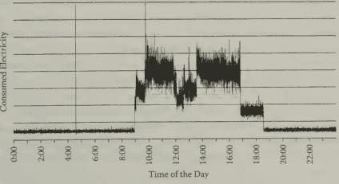

**图 7.1** 办公室中的典型用电量。

**表 7.1** 智能电表数据的存储需求（仅纯电表读数）

| 计量粒度 | 测量次数：1 天 | 测量次数：1 年 | 存储量，1 个智能电表：1 天 | 存储量，1 个智能电表：1 年 | 存储量，4000 万个智能电表：1 天 | 存储量，4000 万个智能电表：1 年 |
|---|---:|---:|---:|---:|---:|---:|
| 1 秒 | 86,400 | 31,536,000 | 338 kB | 120 MB | 13 TB | 4 PB |
| 1 分钟 | 1,440 | 525,600 | 6 kB | 2 MB | 215 GB | 76 TB |
| 15 分钟 | 96 | 35,040 | 384 B | 137 kB | 14 GB | 5 TB |
| 1 小时 | 24 | 8,760 | 96 B | 34 kB | 4 GB | 1 TB |
| 1 天 | 1 | 365 | 4 B | 1 kB | 153 MB | 54 GB |
| 1 个月 | — | 12 | — | 48 kB | — | 2 GB |
| 1 年 | — | 1 | — | 4 B | — | 153 MB |

从数据分析的角度来看，长时间、针对许多智能电表存储最细粒度的数据当然会很有意义。然而，除了隐私问题（见第 7.4.8 节）之外，从技术角度来看，这可能并不可行。因此，必须决定为了何种目的需要保留多少数据。在许多情况下，并不需要最细粒度，电表数据的样本或聚合数据就足够了。

表 7.1 说明了智能电表数据的测量量和存储需求，假设数据库中单次电表读数需要 4 字节（B）。¹ 表中的行包含不同粒度，从 1 秒（许多电表提供的最细粒度）到 1 年（如今经常使用的人工抄表周期）。表中的列包含 1 天和 1 年的测量次数及相应存储需求。例如，1 秒粒度的数据每年总计 3200 万次电表读数，相当于 120 兆字节（MB）。如果要在一个国家（大致相当于德国的规模 [143]）为 4000 万个智能电表收集此类数据，总计将达到 4 拍字节（PB）。另一个例子是通常用于计费的 15 分钟粒度，在全国范围内仍会达到 5 太字节（TB）。请注意，实际内存消耗很容易

¹ 这不包括日期、时间和位置等元数据；Schapranow 等 [125] 报告称，包含此类数据的大小可能大得多，即高达 12 倍。

如上所述[125]，可能达到十二倍。管理这些数据量仍然具有挑战性。

如表7.1所示，智能电表可能导致海量数据。未来能源系统中的其他数据源也类似。如前所述，能源系统中涉及的每个参与者只负责现有数据的特定子集。这仍可能导致数据量挑战数据管理基础设施。对各个参与者的具体挑战在于选择相关数据，以及对此类数据进行聚合和采样而不丢失重要信息。

多位研究者研究了智能电表数据的存储架构：Martínez等人[19]研究了集中式和分布式关系数据库、键值存储以及混合数据库/文件系统架构；Schapranow等人[125]展示了内存数据库[112]的结果；Biseglia[26]展示了Hadoop[139] MapReduce[41]框架的经验；Rusitschka等人[120]研究了进一步的云存储技术。除此之外，智能电表读数可以使用*数据流*[10]技术进行管理，因为细粒度读数可以看作这样一种流（见第7.4.4节）。

处理海量数据的一种方法是压缩。它可以利用前面提到的一种架构来简化存储。例如，Schapranow等人[125]报告，在数据库技术中使用*无损*压缩技术（对包括元数据的计量数据）时，压缩因子为8。对细粒度数据（示例见图7.1）使用*有损*压缩技术来近似原始数据，似乎可以使压缩因子达到数百，具体取决于所需的数据精度和粒度。这种对*时间序列数据*的近似可以用各种*回归模型*来完成，例如使用直线函数[35, 47]、基函数的线性组合或非线性函数（使用相应的近似技术，例如Seidel[127]以及Tishler和Zang[130]所描述的）。然而，本章作者尚未了解到任何研究基于不同时间粒度的智能电表数据，考察压缩比、计算成本以及有损压缩数据对不同应用的有用性之间的权衡。此外，有损压缩技术需要与数据管理技术集成。研究相应技术并在现实场景中验证其部署——特别是就上述权衡而言——是一个开放的研究问题。

来自智能电表的数据属于*时间序列数据*[86]这一类。除了通过回归技术进行压缩以及此类数据的实际存储之外，许多其他数据管理方面也很重要。这包括时间序列的索引和基于相似性的检索（这些技术的综述可参见Fink和Pratt[52]、Hetland[64]以及Vlachos等人[134]）。此类技术对于基于这类数据的许多分析应用很重要。例如，索引和相似性搜索可用于检索具有相似电力需求的消费者，这在分类和聚类中很重要（分别见第7.4.3.2节和第7.4.4.1节）。在能源数据背景下研究上述时间序列分析技术的使用应该很有前景，因为文献中很少提及它们。

#### 7.4.2 数据预处理

数据预处理是任何领域数据分析项目中的关键步骤[30]。它涉及准备要存储、处理或分析的数据，以及清除不必要和有问题的伪影。有研究指出，预处理占分析项目总时间的50%到70%[30]。这当然也适用于能源领域，但具体数值显然高度依赖于项目和数据。在下文中，我们重点介绍一些能源领域特有的预处理挑战。许多其他数据质量问题也存在于许多其他领域，并且在这里可能也很重要（例如，关于更多问题和技术，见Berthold等人[24]、Han等人[61]和Witten等人[140]的教科书）。

来自智能电表的数据经常包含*离群值*。某些离群值指的是测量误差而非真实用电量，如图7.1中可视化的原始数据所示：大约在04:30和10:00发生的、持续仅数秒的尖峰是由测量设备故障引起的。智能电表故障了数秒，导致在下一个测量点报告累积用电量。如果之后需要应用某些函数，则必须消除此类离群值。例如，计算图7.1中未清理数据的最大用电量将没有意义。其他离群值可能指非典型事件或日期：例如，当电视上播放世界杯决赛，或者某个工作日成为公共假日时，能源消费模式可能显著不同。（图7.2(b)说明工作日和周末的负荷曲线相当不同。）此类异常消费模式不应用作“正常”日预测的基础，但如果遇到类似的特殊事件，分析它们可能特别有意义。我们将在第7.4.4节进一步阐述用于预处理的非监督学习技术——特别是聚类分析和离群值检测。

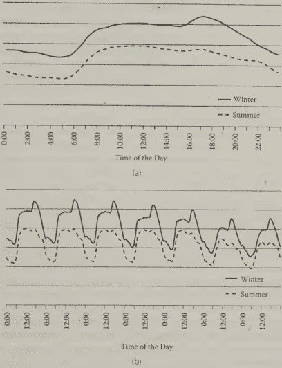

**图7.2** 典型的聚合需求曲线。（数据来自Metered Half-Hourly Electricity Demands [8]。）

智能电表数据的另一个常见问题涉及*时序问题*。可能发生的情况是：（1）以1秒粒度运行的智能电表在一天（或一周、一个月等）内产生的测量值略多或略少；或者（2）以15分钟粒度运行的电表没有恰好在整刻钟进行测量。这两种情况在某些情况下可能可以忽略，但在其他情况下应加以处理。虽然缺少一秒可能毫无意义，但鉴于度量衡法规，忽略它可能有问题。在动态能源价格存在的情况下计费（见场景7.2）可能需要精确时间点上的测量值。如果测量值延迟了，比如5分钟，这可能造成显著差异（例如，当高耗能过程的启动被安排在廉价时间段开始时）。第一个问题的一种可能解决方案是将缺失/额外的测量值加到相邻测量值上或从中减去。第二个问题可以使用回归技术来解决，该技术能够估计任意时间点的测量值。

#### 7.4.3 预测、预报与分类

预测和分类属于能源领域最重要的数据分析挑战。这不仅适用于第7.3节所述的未来场景，而且在今天就已经至关重要：用电量和发电量的预测对于在当前能源市场中盈利至关重要（见第7.2节）。在下文中，我们首先详细讨论时间序列预测；然后关注消费者及其行为的预测和分类，之后再讨论时间相关事件。

##### 7.4.3.1 时间序列预测

如前所述，对时间相关数据的数值预测——也称为*时间序列预测*——在当今和未来的能源场景中至关重要。下面我们列出一些属于这种情况的场景：

- *预测消费者需求*在许多不同场景中都是需要的：（1）在*能源交易*中（见第7.2.2节），零售商有兴趣预测其客户的需求。预测越精确，就能在可能更便宜的长期市场购买更多能源，而不是在日内市场购买或支付能源平衡费用。购买超过需求的“廉价”能源也是无利可图的，因为即使客户不使用，零售商也必须为其付费。（2）为了*实现动态定价*（见场景7.2），零售商需要知道其客户的预测用电量。这是为了以某种方式推导价格，使客户可能将负荷转移到其他时间段，从而使用电量与之前

采购的能源或预测的可再生能源发电量。(3) 为避免电网问题，平衡责任方需要根据各自区域的预测负荷来规划其电网容量。如果预测的高负荷（例如，为电动汽车充电时）预计会导致电网问题，需求响应场景可以缓解这种情况（见场景7.2和7.3）。(4) 智能家居（见场景7.4）通常会提前规划其能源消耗和发电，因此需要预测的消耗量。(5) 储能设施运营商（见场景7.5）需要了解预测的消耗量，以便相应地规划其运营。(6) 制定管理决策（见场景7.6）通常不仅需要实际消耗信息，还需要预测信息。例如，这可以评估组织内某个单元消耗是否低于或高于预测值。

- 预测可再生能源发电量所需的场景，与预测传统能源消费者消耗量所需的场景完全相同。这是因为发电和消耗在任何时刻都必须相等。因此，所有需要预测消耗量的机制也需要知道预测的能源发电量。
- 预测电网负荷在短期和长期都很重要：提前数小时了解某些区段的预测电网负荷，对于规划需求响应措施（见场景7.2和7.3）和运营储能设施（见场景7.5）很重要。对未来数年的电网负荷进行估算，对电网规划者（即配电系统和输电系统运营商，见第7.2.1节）很重要，他们需要“指导关于建什么、何时建以及在哪里建的决策”[85]。
- 在若干场景中需要预测灵活容量，这与消费者需求预测相关，因为能源需求只有实际存在时才能被转移。具体而言，本章考虑的需求响应场景的要求如下：(1) 为参与需求转移竞价，控制信号场景（见场景7.3）中的需求侧管理者需要尽可能精确地了解其客户的负荷转移潜力。(2) 使用动态价格（见场景7.2）的零售商需要估计对价格激励做出反应的客户数量以及相应的电量。这需要了解潜在可转移的负荷量。
- *预测储能容量*在*储能场景*（见场景7.5）中有帮助。由于储能运营商通常旨在通过*能源交易*（见第7.2.2节）最大化利润，他们需要了解未来容量。这可以作为优化算法的输入，用于确定储能设施的充能和放能调度。
- *预测能源价格*当然并不容易，但能源价格可能存在一些规律性，有助于预测。具体而言，以下两个方向值得关注：(1) 如果在*能源交易*（见第7.2.2节）中以一定概率知道未来能源价格，那么显然可以获得巨大收益。例如，在存在*需求响应*（见场景7.2和7.3）的情况下，可以将客户负荷转移到更便宜的时间点。(2) 在*动态价格*（见场景7.2）未提前很久已知的情况下，可以自行预测能源价格并投机性地调整消耗。这尤其可以在高度自动化的*智能家居*（见场景7.4）中实现。

所有这些场景各不相同，但从技术角度看，它们处理的是同一个问题：*时间序列预测*。然而，不同场景需要不同的数据。来自智能电表的历史发电和消耗数据——可能是从许多智能电表聚合而来的——是大多数场景的基础。其他场景依赖历史储能容量、过去实施的需求响应措施数据或能源价格，或者需要天气预报等外部数据来预测可再生能源发电。在下文中，我们重点关注消耗量预测。前面提到的其他预测可以用各自特定的数据以类似方式处理。

预测和预报通常可以通过从历史数据中学习来完成。就能源消耗而言，这是一种有前景的方法，因为数据中存在某些规律性：(1) 1天内的消耗通常相似。人们早上起床开灯，中午做饭，晚上看电视。图7.2(a)展示了英国（UK）所有消费者聚合后在两个不同日期的两条典型需求曲线。(2) 工作日的消耗通常相似，而周末和国庆假日则不同，例如工厂不运转。图7.2(b)描述了典型的一周内能源消耗情况。(3) 冬季的用电量与夏季不同。这是由于电灯使用和可能的供暖使用不同造成的。图7.2展示了夏季较低的用电需求以及冬季和夏季日期的不同消耗模式。

预测消耗量最简单的方法可能是对过去一定数量的相似日（不涉及特殊事件的日子）的曲线取平均值。例如，要预测某个星期日的需求，可以对过去四个未发生特殊事件的星期日的需求取平均值。可以通过提高天气预报相似的星期日的影响来改进这一点。

不同的时间序列预测方法不仅所涉及的技术不同，而且预测的时间跨度也不同：是需要未来几个小时的预测，还是下一天、下个月或下一年的预测？一般来说，时间序列预测技术可以分类如下[36]：

- *自回归*是一类使用数学模型中利用时间序列先前值的技术。其中一些称为*移动平均*的技术依赖使用历史时间序列的滑动窗口方法。各种增强方法被用于处理例如能源数据中的季节性效应。
- *指数平滑技术*是移动平均方法，但使用随时间呈指数衰减的因子进行加权。

许多自回归和指数平滑的具体方法依赖参数估计，为此可以使用各种技术。

来自*机器学习*的若干技术也已被适配用于时间序列预测。这包括*人工神经网络*、*贝叶斯网络*和*支持向量机*。例如，参见Berthold等人[24]、Han等人[61]、Mitchell[95]和Witten等人[140]的教科书以了解这些算法的描述。

Dannecker等人[36]在能源背景下对上述所有技术进行了广泛综述；Alfares和Nazeeruddin[16]是另一篇综述；Hippert等人[66]尤其综述了*神经网络方法*，这些方法可以与前面提到的相似日方法相结合[93]。尽管大量论文关注预测

- 在竞争非常激烈的市场中运营的电力零售商（见第7.2.1节）希望*出于营销目的对客户进行分类*。例如，如果他们想推出针对某一消费者群体（比如住在公寓的家庭）的新电价方案，他们希望基于能源消耗模式为营销活动选择这一目标群体。
- 在依赖动态价格或控制信号的需求响应场景（见场景7.2和7.3）中，相关方希望*预测哪些消费者将参与*某项需求响应措施（例如价格激励），以及*通过该特定措施可以转移多少需求*。类似的预测在智能家居中也有意义。
- 在智能家居（见场景7.4）中，*用户行为分类*可以判断用户是去上班、待在家里、使用电动汽车等。这对于调度能源发电和消耗很重要。类似的分类在电动汽车领域也很重要（见第7.1节中关于*新增负荷*的段落和场景7.5）。例如，智能充电和V2G机制[118]需要知道用户是否会按通常方式行为，仅开车上下班，还是用户可能计划更长或更远的行程。

同样，各个挑战需要不同的数据，从一般客户数据和智能电表读数，到描述需求响应措施、智能家居事件和电动汽车使用的数据。由于预测和分类是数据挖掘和机器学习中非常成熟的领域，大量潜在相关技术可供使用。这包括*决策树分类器、神经网络、支持向量机、朴素贝叶斯分类器*和*k近邻算法*。更多信息可在相关文献中找到[24, 61, 95, 140]。然而，此类分类器不能直接应用于所有类型的相关数据来预测行为。例如，如果具有行为事件的序列数据，可能需要组合方法[29]来处理这些数据。为了处理来自智能电表的时间序列数据，必须计算聚合值以将数据输入标准分类器。或者，可以应用更具体的时间序列技术[86]（见第7.4.1节），例如专门的*时间序列分类*[56, 76]。

文献中有一些关于电力消费者分类的研究。Ramos和Vale[116]首先使用聚类技术来识别

不同的客户群体（见第7.4.4.1节）。然后，作者构建特征向量，并使用标准决策树分类器来学习这些群体，并自动将新消费者分配到这些群体中。他们通过定义若干聚合特征，从消费者平均并归一化的日负荷曲线中构建特征。这些聚合特征包括峰值需求与平均需求之比、午餐时段和夜间等时段能耗占比等。[90]提取特征的方式不同。作者使用消费者的平均需求和峰值需求，以及时间序列预测技术[36]中的系数。对于分类，作者采用线性判别分析。

过去，预测和分类客户行为一直是数据分析的重要应用。令人惊讶的是，在能源消费者行为背景下开展的研究并没有那么多。然而，随着更多市场角色出现（见第7.2.1节）以及可能收集到更多数据，此类分析需求将会增加。一些分析挑战当然可以通过数据挖掘和机器学习中的成熟技术来解决。由于数据可能复杂且来自不同来源，还需要进一步开发特定算法并组合不同的分析技术[29]。因此，能源客户行为的预测与分类是*领域驱动数据挖掘*[28]中的一个重要领域。

##### 7.4.3.3 消费事件的预测与分类

在未来能源系统中，涉及事件和消费模式预测与分类的挑战有很多：

- 在*智能家居*（见场景7.4）中进行优化控制与规划，需要检测负荷曲线并预测事件，同时给出各自的预测结果[117, 141]。
- 在*智能电表场景*（见场景7.1）中，可以通过不仅显示家庭总用电量，还将负荷曲线分解到不同电器并在可视化中突出显示它们，来增强可视化效果。这将提高用户意识并提升能效。模式识别算法可用于识别家庭负荷曲线中的电器[63, 87]。
- 负荷模式识别的另一个用例是*交叉销售活动*，例如由增值服务提供商开展的活动。通过分析单个电器，在出现新型高能效电器时，可以触发特别销售优惠。
- *能效*效果会随着所考虑负荷规模的增大而变得更加重要。因此，如场景7.6所述，*在复杂环境中*识别消费模式十分重要。
- *为电动汽车充电*将成为电网中的主要负荷。举例来说，开车10公里上班再返回，相当于四次洗衣机负荷。需要以可靠方式预测这些负荷，以便未来能源系统能够在智能家居内部以及整个电网中制定合适的调度计划[118]。
- 检测和预测*电动出行中的用户行为事件*（事件可以是开始某次出行）相当复杂，因为车辆经常由多人使用。此类知识与预测对于促进电动汽车智能充电和V2G（见场景7.5）至关重要。

大规模分布式发电和新增负荷（见第7.1节）可能导致*电网问题场景*。检测和预测此类事件是智能电网中的一个重要课题。本书第8章对此进行了全面阐述。

从技术角度看，上述挑战可分为两部分：(1) 事件预测；(2) 消费模式分类。在基于智能电表数据的模式检测领域已有大量研究。其中部分成果已发表在隐私领域[96, 113]（见第7.4.8节）。模式检测也是*负荷分解技术*的基础构件，我们将在第7.4.5节结合相关技术对其进行更详细的描述。早期工作已经表明，可以以高精度1将整栋房屋的用电量分解到主要电器[49]。Nizar等[108]是一篇关于负荷曲线分析方法的综述。事件预测在能源背景下受到的关注较少。虽然诸如*序列挖掘*[62]等传统技术在原则上可用于预测离散事件[46]，但*机器学习*中的更多技术最近已被采用。例如，Savio等[124]使用神经网络和支持向量机在用电领域进行事件预测。

总之，对事件预测以及消费模式的分类与预测存在巨大需求。在

- *用于增强需求响应的模式检测。* 在需求响应中（例如场景7.2中的动态价格），人们试图使能源生产与能源消费相匹配，这需要对供需双方都有深入理解。对于发电侧，已有研究提出了用于预测风能或太阳能发电的预测技术（见第7.4.3.1节）。对于用电侧，除预测外，人们还关注能够洞察其日常行为的客户画像（见第7.4.3.2节）。由于行为会随时间发生剧烈变化，不能总是依赖历史数据和学习算法。因此，无监督方法（例如聚类或离群点挖掘）是此类数据分析的手段。聚类算法无需事先了解客户群体，就能检测出行为高度相似的客户群。特别是在需求侧管理中，这些聚类可用于针对每个客户群体制定特定策略。虽然有些客户无法或不愿参与某些管理行动，但另一些客户在转移部分用电量方面表现出很大潜力。了解此类分组对于利用需求侧管理的整体潜力至关重要。
- *智能家居自动监控。* 作为智能家居的一部分（见场景7.4），我们在上一个示例中讨论了需求响应。然而，智能家居在数据分析任务方面还有更多潜力。在可获得智能家居全部能耗数据的情况下，可以设计自动监控机制，例如协助老年人日常生活。能耗画像非常详细，能揭示大量关于我们日常行为的信息，并可用于追踪、预警和辅助系统。例如，在辅助居家生活中，了解老年人是否改变日常习惯至关重要。一个通常整天四处活动并使用许多电器的年轻人，如果某一天停止这种行为，就会变得非常可疑。此类剧烈变化可作为意外模式被检测到，并用作向医疗或其他援助方发出的警告。这个例子凸显了对无监督学习技术的需求。尽管有些模式可以通过监督技术学习，但大多数意外行为对系统而言将是新的，这凸显了在单一数据库上使用多种聚类解决方案的必要性[102]。特别是，在给定大量属性的情况下，哪些属性相关尚不清楚。选择这些属性是数据分析面临的另一项挑战。

已提出降维技术来选择一组属性。这些技术应对“维数灾难”，该问题会阻碍有意义的聚类[25]。无关属性会掩盖数据中的簇模式。全局降维技术，例如*主成分分析（PCA）*，可减少属性数量[71]。然而，这种降维在降维空间中可能只得到单一聚类。对于局部变化的属性相关性而言，这意味着一些在降维空间中不显现的簇将被遗漏。此外，降维技术无法识别不同降维空间中的聚类。对象在不同数据投影中可能属于不同的簇。*我们的客户细分示例凸显了这一性质。* 每个簇都需要一组单独的相关维度。

近年来，高维空间中的聚类研究日益增多。投影聚类或子空间聚类旨在为每个簇识别局部相关的属性约简。特别是，子空间聚类允许为任意对象识别若干可能的子空间。因此，一个对象可能在不同子空间中属于多个簇[101, 128]。

对于基于能耗画像的客户细分，在检测对象组以及为每个组检测相关属性方面存在若干开放挑战。许多私营和公共组织收集大量能耗测量数据；然而，这些数据与个体模式的相关性仍不明确。在全部属性集上进行聚类并非解决方案，通过降维技术预选相关属性也并非解决方案。必须在数据的所有可能投影中进行代价高昂的搜索，以识别针对不同属性组合的多种聚类解决方案。因此，此类数据挖掘技术的可扩展性将是一个重大挑战，近期一项研究[101]也强调了这一点。如第7.4.1节所述，智能电表读数将形成庞大的数据库。最近只有少数出版物关注此类可扩展性问题[34, 98, 99]。然而，大多数子空间聚类模型仍基于低效的处理方案[15, 72, 100]。此类数据的流处理还带来进一步挑战[11]。这不仅涉及簇的检测问题，也涉及随时间跟踪簇的问题[59, 129]。跟踪客户画像的变化将是一项至关重要的

将属性组合作为描述。基于在数据的任意投影中进行子空间挖掘这一总体思想，已有若干用于选择子空间的预处理技术被提出[33, 74]。这些技术试图衡量离群点与数据库聚类区域之间的对比度。第一种方法提出基于熵度量进行选择[33]。若子空间具有低熵，即其密度变化较大，则选择该子空间。较新的方法则侧重于高对比度区域的统计选择[74]。它们比较密度偏差，并且仅利用最显著子空间。此类子空间可被视为高偏差的原因。在我们的示例中，高对比度子空间可能是“供暖设备的能耗”和“冰箱的使用年限”。这种组合可能是区分现代家庭与老旧家庭的特征，并可能揭示节能住宅中一些带有旧冰箱（本应更换）的意外情况。这个例子表明，检测这些情况很重要。然而，更重要的是为这些情况为何表现出高偏差提供良好的解释。

展望此类离群点挖掘技术在例如智能家居中的未来用途，我们注意到，其大多数使用者将是没有数据分析背景的人。这将对结果呈现提出新的可视化和解释要求。它需要能够突出模式之间差异的新型数据挖掘技术。例如，此类技术可以揭示单个对象高偏差的原因，或两组客户之间的差异。这一方向的首批技术已被提出[22]。给定两个不同的数据集，它们试图度量差异并输出特征属性以区分这些集合。非常有前景的实例已应用于流数据背景下的新兴模式检测或新颖性检测[44]。

由于离群点挖掘是数据挖掘中的一项成熟技术，它已被用于能源数据领域的多项工作中。举例来说，Li 等人[90]使用离群点挖掘来检测异常能耗。Chen 等人[32]定义了能源数据中所谓的负荷清洗问题，并开发了类似离群点挖掘的技术。Jakkula 和 Cook[67]提出了专门用于智能家居中收集的电力数据集的离群点检测算法。所有这些方法都可视为简单离群点模型的首批实例。能源数据的进一步潜力必须通过更先进的离群点检测技术来挖掘。

#### 7.4.5 负荷分解

为实现能效，深入了解设施内各设备之间所消耗功率的分布很重要（见场景7.1和7.6）。在实践中，这通常通过在单个设备上直接安装计量装置来实现，但这种方式昂贵、耗时，而且通常并不全面。从电网接口处的计量数据推导功率分布会更容易（另见第7.4.3.3节）。

智能计量，即高分辨率计量和计量数据的远程传输，有望在所有计量点提供对基础设施的深入洞察。实现这一目标的技术通常称为*非侵入式（电器）负荷监测*（*NILM*，有时也作 *NALM*）或功率数据的*分解*。这在实现更好的能效（见场景7.1和7.6）、促进需求响应（见场景7.2和7.3）以及负荷管理（例如在*智能家居*中，见场景7.4）方面具有潜在应用。因此，自1992年首篇论文发表[63]以来，在完成进一步研究（例如包括[49, 87]）之后，该主题最近引起了越来越多的兴趣[31, 53, 55, 78, 82, 91, 142]。

住宅和工业环境中的常见智能电表安装在配电网接口处。它们测量连接到始于该电表的电路上的所有设备所使用的有功和无功电能。还可以测量其他值，例如峰值负荷。单个设施可以安装多个电表，如果需要对消耗电能进行分开计费，通常就是这种情况。出于计费目的，此类电表通常以15分钟为间隔采集消耗电能。然而，电表本身通常提供一个具有更高时间分辨率的接口，可在本地访问。

随着这些电表日益普及，人们很容易也想将计量数据用于分析目的。在住宅环境中，能耗透明化可能促进节能（见场景7.1）。NILM 也被提出作为验证需求响应措施有效性的工具。在工业或商业环境中，能源审计是识别能效潜力的有价值的工具（见场景7.6）。可获得的信息越详细，此类审计就能执行得越彻底。因此，安装（临时）分表是常见做法，并且至少可以部分由 NILM 替代。

图7.1展示了可用于负荷分解的真实能源数据示例。如果这条负荷曲线表示某人在一整天中所做的事情，那么人们就能够为负荷曲线中的某些模式分配标签。这些标签将描述当天的事件或活动。然而，如果其他人查看这条负荷曲线，他们无法直接推断出关于某人日常活动的信息。他们或许能够识别某些设备，例如烤箱。上下文信息的缺乏限制了这些数据的使用。这就需要如第7.4.3.3节所述的自动化分解和可视化。

工厂或商业建筑的负荷曲线比家庭或个人的负荷曲线复杂得多（见场景7.6）。更多个人和设备共同构成负荷曲线，其中许多具有个体行为。复杂的工业过程同时执行。然而，有大量可用的上下文信息可用于识别单个设备和过程。

除了表示有功功率随时间变化的曲线外，还可以使用无功功率、峰值电流以及可能的其他电气特征等值。从这些时间序列中可以推断出大量更高层次的信息，例如频域特征、瞬时导纳波形等[91]。

一个先进的能源审计系统应能够将过程信息映射到负荷模式。它应能够识别重复出现的模式。可能有必要用额外知识初始化该系统。负荷分解应尽可能准确，并且假阳性与假阴性之间的关系应可调。

##### 7.4.5.1 负荷分解方法

下文描述负荷分解的基本问题。此外，我们描述解决该问题的基本方法，并讨论一些近期工作。关于该领域历史和近期工作的详尽描述，请参阅 Zeifman 和 Roth[142]；关于可用于分解的设备特征概述，请参阅 Froehlich 等人[53]。

负荷曲线是描述复负荷（有功和无功电能）随时间变化的函数 L。在每个离散时间步 t，对所有设备消耗的有功电能 r_i 及其各自的无功电能 q_i 求和。噪声 r_b 和 q_b 也被加入：

$$L(t)=\sum_{i=0}^{N}(r_i(t),q_i(t))+(r_b,q_b)$$

仅给定随时间变化的结果总和值，我们要寻找一个状态矩阵，其中包含每个设备在任意离散时间点的状态。各设备的状态空间相互独立。对于大多数实际设备，其可能状态以及由内部电气结构和使用模式引起的状态转换存在若干约束。例如，所有实际设备都在最小负荷和最大负荷之间运行，并且具有有限多个运行状态。

负荷分解需要完成两个基本步骤。第一步是*特征识别*，即从观测到的电表数据中提取特征。第二步是应用*优化*算法为状态矩阵赋值。

模式识别正被应用于观测值（见第7.4.3.3节），其最简单形式是应用于有功功率负荷的变化。该步骤的目标是识别出一组可能呈现所观测模式的设备。一种朴素算法可以将负荷变化映射到其阶跃大小与观测变化最接近的设备。理想算法会完美地识别观测事件的原因：要么是并非由状态变化引起的波动，要么正是造成该变化的设备及其状态变化。然而，目前不存在这样的完美算法，假阳性匹配和假阴性不可避免。

有多种特征可用于找到有效的分解。设备最基本的特征是其负荷方差，Hart[63]使用了该特征。基于这一特征，可以识别出四类设备：*永久型、开关型、多状态型*和*可变型*。永久型设备是单状态设备，始终消耗相同负荷（例如从不关闭的报警系统）。开关型设备还有一个关闭状态，此时消耗（接近）为零。多状态型设备具有多种运行模式，这些模式通常按一定模式执行；例如，洗衣机有加热水、泵送或脱水等特定模式。可变负荷设备表现出任意、不规则的负荷模式，这些模式可能取决于其实际使用模式。需要注意的是，大多数实际设备不能仅由这些类别中的一种来完全表征。通常，设备表现出的行为是这些类别的复杂混合。分解此类负荷的挑战因如下事实而更加复杂：在……

当然，设备的复杂负荷曲线会相互叠加，这使得准确且无歧义的分解难以实现。

由于基本特征（也称为*宏观特征*，例如用电量或有功功率与无功功率）存在局限性，为了获得更准确的结果，人们研究了*微观*层面的特征 [142]。微观特征指的是底层电信号的特征，这些特征可在至少千赫兹范围的频率下测量。这允许识别波形模式和信号的谐波。使用这些特征比仅基于基本特征的分解能获得更好的结果。然而，此类测量需要专用硬件和额外处理能力，这限制了它们的实际应用。

*优化*步骤（这是数据分析中的常见任务；见第7.4.7节）试图找到与观测值最匹配的状态矩阵赋值。这回答了哪个设备在哪个时段以何种功率水平处于活动状态的问题。

寻找状态矩阵的一种常见方法是创建系统的*隐马尔可夫模型（HMM）* [31, 78, 82]。每个设备由一个HMM表示，这是一种灵活的结构，可以捕捉复杂行为。粗略地说，功耗的急剧变化对应于设备HMM内部的状态变化。挑战在于从观测到的电表数据中提取HMM参数。这通常由使用已知特征的监督训练阶段提供支持。

##### 7.4.5.2 *实际应用*

准确的负荷分解至少对某些应用而言可以替代分项计量。但即使达到当前可用的准确率水平，有用的应用似乎也是可行的。例如，Chen 等人 [31] 正在使用用水量数据来识别淋浴或洗衣等活动。这项工作通过评估负荷分解所使用的具体情境来改进结果。取决于一天中的时间、家庭规模和人口统计特征的使用模式有助于推导电器使用的统计信息，例如洗衣机使用分布。据报道，它还帮助人们就更高效率的资源使用做出决策，例如用更高效的电器替换旧电器。

提高NILM在实际应用中的准确率仍然是一项挑战。许多研究假设所涉及设备的特征事先已知。在此类*监督式*设置中，有必要

运行记录、工作小时或乱序事件。通过这样做，可以获得更高的准确率。

#### 7.4.6 能源数据集的探索与比较

在前面的章节中，重点在于自动学习：(1) 预测任务中的模型（第7.4.3节），(2) 提取意外和新颖模式（第7.4.4节），以及 (3) 通过元数据提取进行设备分解（第7.4.5节）。与这些自动技术相反，许多能源场景（例如场景7.1和7.6）需要对数据进行手动探索。用户希望理解底层数据，并使用数据管理和分析技术来获得其数据的概览。在许多情况下，他们试图通过比较两个或多个不同数据集来从数据中推导知识。协助这些手动或半自动探索任务将是以下讨论的主要焦点。

让我们给出一些与探索和比较相关的能源数据半自动和手动任务的简要示例：

- *能源交易的探索。* 对于能源市场而言，了解特定条件下的交易量至关重要。所有市场参与者都对这类手动选择感兴趣，以理解市场。他们根据某些手动定义的条件来探索交易。例如，上个月德国全国范围内有多少笔太阳能交易。其他人可能对丹麦沿海近海区域风电场产生的总能量感兴趣。第三个示例可能是欧洲储能设施的平均容量以及它从2010年到2011年如何演变。所有这些示例都是对数据聚合子部分的用户驱动查询。人类专家设计这些查询，而数据管理技术必须为高效处理而设计。

- *不同客户行为的比较。* 许多案例研究 [57] 考察了描述不同客户能源行为的两个或多个给定数据库中的能耗差异。人们关注一组人（或设备、设施等）相对于第二组的特征行为。这些特征差异被用来理解客户群体。在其他情况下，两个对比数据状态是节能活动“之前”和“之后”。因此，需要进行比较以衡量此类活动的成功。例如，半自动技术可以推导出照明和制冷设备的能耗降低。这种节能可能是未来活动的重要结果，并可能揭示更多节能潜力。

- *意外事件的手动验证。* 如第7.4.3节所述，存在一些罕见事件，例如电视转播的世界杯足球决赛，会显著影响典型能耗。在简单情况下，例如世界杯决赛，对这一事件的理解相当容易。专家在验证此事件时不需要任何协助。然而，对于能源生产和能源消费而言，有大量因素影响系统。许多意外事件（例如第7.4.4.2节所述的检测到的离群值，或第7.4.3节中妨碍良好预测的新兴事件）在验证时都需要协助。为意外高能耗提供时间戳对人类专家来说可能是非常有限的信息。理解和验证此类事件意味着我们必须丰富提供给用户的信息集。

##### 7.4.6.1 扩展数据管理技术

我们将能源数据的高效聚合视为手动探索的主要任务之一。从基于能源交易的简单示例中抽象出来，用户对原始生产、消费、分配和销售数据的各种聚合感兴趣。一般来说，此类处理在数据库社区中被称为*联机分析处理（OLAP）。* 基于用户指定的假设，系统必须提供关于特定条件集的聚合信息。这些条件由属性（例如位置、时间、生产类型等）描述，并基于给定的粒度层次结构（例如周、月、年等）进行结构化。此类OLAP系统已被提出用于零售公司的销售分析。它们提供了决策的重要手段，但没有解决基于能源数据决策的特定场景（见场景7.6）。

这些技术遗漏了能源生产、分配和消费的本质属性。现代数据管理技术（见第7.4.1节）试图克服这些挑战。特别是，大规模数据必须在主存中聚合。这种处理

例如，如果我们查看每个月的能源生产，就可以检测到8月的一个高峰，由于某些意外的高能源生产，该高峰偏离其余月份。同样的统计方法可应用于数年中的所有8月份，并突出特定年份。这导致对属性组合的非常有前景的选择，每个组合在能源生产上都有高偏差。总体而言，这些意外度量可以被视为手动探索的候选。可以向用户提供其中一些属性组合，用户将能够细化这些选择。

已有进一步技术被提出用于引导式OLAP [121, 123]；它们更关注与用户的交互，并提供通过OLAP立方体进行逐步处理的额外手段，以及关于数据偏差的额外描述。然而，所有这些技术在计算方面代价高昂。与其他自动数据分析技术类似，它们无法扩展到具有许多属性且在非常细粒度上有数百万次测量的能源数据库。此类技术的应用总是受效率限制，而就可扩展性问题而言，能源数据是最成问题的应用领域之一。

##### 7.4.6.3 对比分析与新兴模式

另一种用于模式探索的自动化方法是对比分析。该技术侧重于为数据库中的两个或多个给定类别提取描述性、区分性、新兴和对比模式 [22, 44, 79]。对比分析技术提供属性（及属性值）子集作为对比模式。例如，给定一个包含同一家庭中居住超过两人的数据库，以及另一个单人家庭能源曲线的数据库，人们可能对比较这两组客户感兴趣。这种自动比较可以提供人们行为的特征差异。一方面，这些差异可以用作任何学习任务的输入。另一方面，它们为人类探索提供了重要手段。我们在此关注后者，并强调对比分析中的技术挑战。

对于人类探索而言，拥有易于理解的输出始终至关重要。在对比分析中，一个研究方向基于所谓的对比集 [22]。它们形成在两个数据库中表现出高偏差的特征属性组合。例如，与洗衣机相关的能耗可能是……之一

- 在*需求侧*，智能设备（例如智能家居中的设备，见场景7.4）需要*对动态价格作出反应*（见场景7.2），并据此优化其需求计划。如果消费者拥有微型热电联产机组，他们必须为其运行寻找优化调度方案。另一个挑战是*电动汽车充电以及可能的V2G场景*（见场景7.5）。这不仅在消费者场所重要，在所谓的*智能停车场*[115]中也很重要。它们对能源系统的影响尤其大，因为其功耗很高。*负荷分解*是利用优化的另一项技术（见7.4.5节）。
- 在*供给侧*，最突出的优化问题可能是*寻找动态价格*[70]。在带有*控制信号*的场景中，需要进行优化以从需求侧管理者提供的报价中进行选择（见场景7.3）。优化相关的另一个领域是*储能管理*（见场景7.5），其中需要决定何时对储能充电以及何时放电。

上述许多优化问题可能变得相当复杂。这尤其常常是因为需要考虑的参数很多：

- *微型热电联产机组*的规划在其盈利能力方面存在约束。这包括最短运行时间、正常运行时间和循环成本。类似的约束也适用于*集中式储能*，例如抽水蓄能水电站。
- *电动汽车智能充电和V2G*要求考虑用户偏好（汽车何时需要充电到何种水平？）以及车主或停车场运营商的经济利益。此外，电网的当前状况以及可能的动态价格也很重要[115]。
- *寻找动态价格*旨在实现预期利润并实现需求响应，以较低的经济风险防止电网问题。此外，需要考虑预测的发电量和需求量（见7.4.3.1节），以及预测的客户相应反应的意愿和能力（见7.4.3.2节）。显然，当前市场价格以及可能存在的长期合同是进一步的参数。
- 在*控制信号场景*中，必须选择可用的可转移需求报价，同时考虑其成本效益、可靠性以及位于正确的电网区段。
- 在*储能*中，运营商必须考虑（预测的）未来发电量、需求和价格，以及储能系统参数容量和峰值功率。

上述条件和约束的结果往往是高维、多变量优化问题。除经典求解方法[51]外，启发式方法[42, 75, 88, 97]近年来一直是重要的研究领域。例如，针对智能充电场景，已有研究探讨了多目标进化优化算法[115]。

#### 7.4.8 隐私保护数据挖掘

正如本章所讨论的，自由化电力市场中越来越多的参与者（见7.2.1节）在实现当前和未来能源场景（见7.3节）时收集越来越多的数据（见7.4节）。许多类型的数据可以映射到真实个人，并带有潜在的隐私风险。智能电表数据（见场景7.1）可能是最常见的例子，但其他类型的数据，例如参与需求响应措施（见场景7.3）、智能家居中的用户行为（见场景7.4）或来自电动汽车的数据，也可能泄露隐私数据。

由于隐私是一个广泛的领域，在以下讨论中，我们集中说明分析智能电表数据的可能性。根据此类数据的时间分辨率，可以推断出不同的用户行为。例如，拥有1分钟粒度的智能电表数据，就能够识别典型家庭中的大多数用电设备[113]。拥有半秒粒度的数据可能揭示是否使用了切割机来切面包或萨拉米香肠[21]。不用说，泄露此类数据将构成严重的隐私风险，因为人们可以精确推断某人在某一时刻在做什么。此外，近期研究表明，甚至可以使用标准智能电表以半秒的时间粒度识别某人正在观看哪个电视节目（在若干已知节目中）[58]。有趣——也许令人恐惧——的是，即使是计费场景中常用的15分钟粒度数据也可能构成隐私威胁。此类数据足以识别哪些人在家以及他们在什么时间在家、他们是准备冷早餐还是热早餐、何时做饭、何时看电视或上床睡觉[96]。Jawurek等人[69]进一步表明，一个家庭的用电曲线通常是唯一的，可用于识别家庭。

有大量工作识别了能源领域中隐私风险和攻击的不同场景；例如，Khurana等人[77]提供了综述。较少研究提出了特定解决方案，主要针对特定问题，例如在存在智能电表时的计费问题[68]。然而，该领域仍然相当年轻，仍然需要能够轻松应用于现场的有效隐私保护方法。除了消费者隐私外，此类方法还需要确保能源市场中的所有参与者都能获得所需数据，以便在当前和未来能源场景中高效履行各自角色。这要求在*安全研究*和*隐私保护数据挖掘*领域进行进一步发展和新技术[13, 131, 133]，而未来能源系统和市场是这些技术的重要应用领域。

### 7.5 结论

依赖化石和核能的传统能源系统不可持续。正在进行的向更多依赖可再生能源的更可持续能源系统的转型，带来了重大挑战，以及从*需求驱动*发电到*发电驱动需求*的范式转变。持续发展中的进一步影响因素是自由化以及新型负荷（例如电动汽车）的影响。未来能源领域的这些发展将借助许多通常被称为*智能电网*的技术来促进。这些技术和场景大多会产生新的数据源，并带来以适当方式管理和分析这些数据的挑战。

在本章中，我们重点介绍了向可持续能源系统发展的当前进展。我们概述了当前能源市场，并描述了一些未来能源场景。基于这些阐述，我们详细推导了数据分析挑战。简而言之，结论是已有大量研究，但仍有许多未解决的问题，并且需要更多数据分析研究。现有技术可以应用，或者需要进一步开发以用于智能电网。因此，未来能源领域是应用数据分析研究的重要领域，并有潜力为可持续发展作出贡献。

### 致谢

我们感谢Pavel Efros的协助，感谢Anke Weidlich和SAP Research的许多同事，以及Acteno Energy进行富有成果的讨论并校对本章（部分内容）。

### 参考文献

- 1. 欧洲议会和欧盟理事会2009年7月13日关于电力内部市场共同规则的2009/72/EC指令。*Official Journal of the European Union*，L 211：56–93，2009。
- 2. E-Energy术语表。DKE——德国电气电子信息技术委员会（DKE—Deutsche Kommission Elektrotechnik Elektronik Informationstechnik im DIN und VDE）网站，德国：https://teamwork.dke.de/specials/7/Wiki_EN/Wiki_Pages/Home.aspx，2010。
- 3. 面向环境友好、可靠且可负担能源供应的能源方案。德国联邦经济与技术部和联邦环境、自然保护与核安全部出版物，2010年9月。
- 4. MeRegio——项目第二阶段。MeRegio项目主页：http://www.meregio.de/en/?page=solution-phasetwo，2010。
- 5. 2010年年度报告。德国联邦机动车运输管理局出版物，2011。
- 6. 连接市场。EEX公司与产品手册，欧洲能源交易所股份公司，2011年10月。
- 7. 联邦环境部长Röttgen：20%可再生能源是巨大成功。德国联邦环境、自然保护与核安全部新闻稿108/11，2011年8月。
- 8. 计量半小时电力需求。英国国家电网网站：http://www.nationalgrid.com/uk/Electricity/Data/Demand+Data/，2011。
- 9. Charu C. Aggarwal. 稀疏数据流中的异常检测。载于*International Conference on Data Mining (SDM)*，2005。
- 10. Charu C. Aggarwal 编。*Data Streams: Models and Algorithms*，*Advances in Database Systems*第31卷。柏林和纽约：Springer，2007。
- 11. Charu C. Aggarwal. 关于不确定数据流的高维投影聚类。载于*International Conference on Data Engineering (ICDE)*，2009。
- 12. Charu C. Aggarwal 和 Philip S. Yu. 高维数据的离群点检测。载于*International Conference on Management of Data (SIGMOD)*，2001。
- 13. Charu C. Aggarwal 和 Philip S. Yu 编。*Privacy-Preserving Data Mining: Models and Algorithms*，*Advances in Database Systems*第34卷。柏林和纽约：Springer，2008。
- 14. Sanjeev Kumar Aggarwal、Lalit Mohan Saini 和 Ashwani Kumar. 放松管制市场中的电价预测：综述与评估。*International Journal of Electrical Power and Energy Systems*，31(1)：13–22，2009。
- 15. Rakesh Agrawal、Johannes Gehrke、Dimitrios Gunopulos 和 Prabhakar Raghavan. 面向数据挖掘应用的高维数据自动子空间聚类。载于*International Conference on Management of Data (SIGMOD)*，1998。

- 30. Pete Chapman, Julian Clinton, Randy Kerber, Thomas Khabaza, Thomas Reinartz, Colin Shearer, and Rüdiger Wirth. CRISP-DM 1.0，逐步数据挖掘指南，SPSS，美国芝加哥。2000年8月。
- 31. Feng Chen, Jing Dai, Bingsheng Wang, Sambit Sahu, Milind Naphade, and Chang-Tien Lu. 基于低采样率智能电表的活动分析。载于 *知识发现与数据挖掘国际会议 (KDD)*，2011。
- 32. Jiyi Chen, Wenyuan Li, Adriel Lau, Jiguo Cao, and Ke Wang. 电力系统中负荷曲线数据的自动清洗。*IEEE 智能电网汇刊*，1(2)：213–221，2010。
- 33. Chun-Hung Cheng, Ada Wai-Chee Fu, and Yi Zhang. 用于挖掘数值数据的基于熵的子空间聚类。载于 *知识发现与数据挖掘国际会议 (KDD)*，1999。
- 34. Robson Leonardo Ferreira Cordeiro, Agma J.M. Traina, Christos Faloutsos, and Caetano Traina Jr. 在超大型多维数据集的子空间中寻找聚类。载于 *数据工程国际会议 (ICDE)*，2010。
- 35. Marco Dalai and Riccardo Leonardi. Lᵖ 范数下一维数字信号的近似。*IEEE 信号处理汇刊*，54(8)：3111–3124，2006。
- 36. Lars Dannecker, Matthias Böhm, Ulrike Fischer, Frank Rosenthal, Gregor Hackenbroich, and Wolfgang Lehner. 预测技术现状报告——能源需求与供应预测模型综述。公开交付物 D4.1，*MIRACLE 联盟*（欧盟委员会项目编号：248195），德国德累斯顿，2010年6月。
- 37. Lars Dannecker, Matthias Böhm, Wolfgang Lehner, and Gregor Hackenbroich. 预测能源需求与供应的演化时间序列。载于 *东欧数据库与信息系统进展会议 (ADBIS)*，2011。
- 38. Lars Dannecker, Matthias Schulze, Robert Böhm, Wolfgang Lehner, and Gregor Hackenbroich. 能源领域预测模型的上下文感知参数估计。载于 *科学和统计数据库管理国际会议 (SSDBM)*，2011。
- 39. Sarah Darby. 能源消耗反馈的有效性：为 DEFRA 撰写的关于计量、账单和直接显示的文献综述。技术报告，英国牛津大学环境变化研究所，2006年4月。
- 40. Timothy de Vries, Sanjay Chawla, and Michael E. Houle. 在极高维空间中寻找局部异常。载于 *数据挖掘国际会议 (ICDM)*，2010。
- 41. Jeffrey Dean and Sanjay Ghemawat. MapReduce：大型集群上的简化数据处理。载于 *操作系统设计与实现研讨会 (OSDI)*，2004。
- 42. Kalyanmoy Deb, Samir Agrawal, Amrit Pratap, and T. Meyarivan. 一种用于多目标优化的快速精英非支配排序遗传算法：NSGA-II。载于 *自然并行问题求解国际会议 (PPSN)*，2000。
- 43. Arthur P. Dempster, Nan M. Laird, and Donald B. Rubin. 通过 EM 算法从不完整数据中求最大似然。*皇家统计学会杂志*，39(1)：1–38，1977。
- 44. Guozhu Dong and Jinyan Li. 新兴模式的高效挖掘：发现趋势与差异。载于 *知识发现与数据挖掘国际会议 (KDD)*，1999。
- 45. Karen Ehrhardt-Martinez, Kat A. Donnelly, and John A. “Skip” Laitner. 先进计量举措与住宅反馈计划：家庭节电机会的元综述。技术报告 E105，美国节能经济委员会，华盛顿特区，2010年6月。
- 46. Frank Eichinger, Detlef D. Nauck, and Frank Klawonn. 用于电信客户行为预测的序列挖掘。载于 *实践数据挖掘研讨会：应用、经验与挑战*，2006。
- 47. Hazem Elmeleegy, Ahmed K. Elmagarmid, Emmanuel Cecchet, Walid G. Aref, and Willy Zwaenepoel. 具有精度保证的数值流在线分段线性近似。载于 *超大型数据库国际会议 (VLDB)*，2009。
- 48. Martin Ester, Hans-Peter Kriegel, Jörg Sander, and Xiaowei Xu. 一种用于发现大型空间数据库中聚类的基于密度的算法。载于 *知识发现与数据挖掘国际会议 (KDD)*，1996。
- 49. Linda Farinaccio and Radu Zmeureanu. 使用模式识别方法将家庭总用电量分解为主要终端用途。*能源与建筑*，30(3)：245–259，1999。
- 50. Ahmad Faruqui and Jennifer Palmer. 动态定价及其不满。*监管杂志*，34(3)：16–22，2011。
- 51. Michael C. Ferris and Todd S. Munson. 博弈中的互补问题与 Path 求解器。*经济动态与控制杂志*，24(2)：165–188，2000。
- 52. Eugene Fink and Kevin B. Pratt. 压缩时间序列的索引。载于 Last 等 [86]，第3章，第51–78页。
- 53. Jon Froehlich, Eric Larson, Siddhant Gupta, Gabe Cohn, Matthew S. Reynolds, and Shwetak N. Patel. 面向智能电网的终端用途能源感知分解。*普适计算*，10(1)：28–39，2011。
- 54. Drew Fudenberg and Jean Tirole. *博弈论*。马萨诸塞州剑桥：MIT 出版社，1991。
- 55. Hugo Gonçalves, Adrian Ocneanu, and Mario Bergés. 使用聚合用电数据对电器进行无监督分解。载于 *可持续发展中的数据挖掘应用研讨会 (SustKDD)*，2011。
- 56. Carlos J. Alonso González and Juan J. Rodríguez Díez. 提升基于区间的文字：可变长度与早期分类。载于 Last 等 [86]，第7章，第149–171页。
- 57. Jessica Granderson, Mary Piette, and Girish Ghatikar. 建筑能源信息系统：用户案例研究。*能源效率*，4：17–30，2011。
- 58. Ulrich Greveler, Benjamin Justus, and Dennis Löhr. 通过智能电表用电功率曲线识别多媒体内容。载于 *计算机、隐私与数据保护国际会议 (CPDP)*，2012。
- 59. Stephan Günnemann, Hardy Kremer, Charlotte Laufkötter, and Thomas Seidl. 追踪时序气候数据中演化的子空间聚类。*数据挖掘与知识发现*，24(2)：387–410，2011。
- 60. Duy Long Ha, Minh Hoang Le, and Stephane Ploix. 不确定环境下家庭负荷能量管理问题的一种方法。载于 *工业工程与工程管理国际会议 (IEEM)*，2008。
- 61. Jiawei Han, Micheline Kamber, and Jian Pei. *数据挖掘：概念与技术*。Morgan Kaufmann，美国伯灵顿，2011。
- 62. Jiawei Han, Jian Pei, and Xifeng Yan. 通过模式增长进行序列模式挖掘：原理与扩展。载于 W. Chu 和 T. Lin 编，*模糊性与软计算研究*，*数据挖掘基础与进展*第180卷，第183–220页。柏林和纽约：Springer，2005。
- 63. George W. Hart. 非侵入式电器负荷监测。*IEEE 会刊*，80(12)：1870–1891，1992。
- 64. Magnus L. Hetland. 相似时间序列高效检索的近期方法综述。载于 Last 等 [86]，第2章，第27–49页。
- 65. Alexander Hinneburg and Daniel Keim. 一种带噪声的大型多媒体数据库聚类高效方法。载于 *知识发现与数据挖掘国际会议 (KDD)*，1998。
- 66. Henrique Steinherz Hippert, Carlos Eduardo Pedreira, and Reinaldo Castro Souza. 用于短期负荷预测的神经网络：综述与评估。*IEEE 电力系统汇刊*，16(1)：44–55，2001。
- 67. Vikramaditya Jakkula and Diane Cook. 智能环境结构化电力数据集中的异常检测。载于 *智能环境国际会议 (IE)*，2010。
- 68. Marek Jawurek, Martin Johns, and Florian Kerschbaum. 智能计量计费的插件式隐私保护。载于 *隐私增强技术国际研讨会 (PETS)*，2011。
- 69. Marek Jawurek, Martin Johns, and Konrad Rieck. 智能计量去假名化。载于 *年度计算机安全应用会议 (ACSAC)*，2011。
- 70. Andrej Jokić, Mircea Lazar, and Paul P.J. van den Bosch. 电力系统的基于价格的控制。载于 Negenborn 等 [105]，第5章，第109–131页。
- 71. Ian Jolliffe. *主成分分析*。柏林和纽约：Springer，1986。
- 72. Karin Kailing, Hans-Peter Kriegel, and Peer Kröger. 高维数据的密度连通子空间聚类。载于 *数据挖掘国际会议 (SDM)*，2004。

- 73. Andreas Kamper. 用于平衡电网短期偏差的分散式负荷管理. KIT科学出版社，德国卡尔斯鲁厄，2009.
- 74. Fabian Keller, Emmanuel Müller, and Klemens Böhm. HiCS：用于基于密度的异常排序的高对比子空间. 见国际数据工程会议（ICDE），2012.
- 75. James Kennedy and Russel Eberhart. 粒子群优化. 见国际神经网络会议，1995.
- 76. Eamonn Keogh and Shruti Kasetty. 论时间序列数据挖掘基准的必要性：综述与实证演示. 数据挖掘与知识发现，7(4): 349–371，2003.
- 77. Himanshu Khurana, Mark Hadley, Ning Lu, and Deborah A. Frincke. 智能电网安全问题. IEEE安全与隐私，8(1): 81–85，2010.
- 78. Hyungsul Kim, Manish Marwah, Martin F. Arlitt, Geoff Lyon, and Jiawei Han. 低频功率测量的无监督分解. 见国际数据挖掘会议（SDM），2011.
- 79. Edwin M. Knorr and Raymond T. Ng. 发现基于距离的异常点的有意知识. 见国际超大型数据库会议（VLDB），1999.
- 80. Edwin M. Knox and Raymond T. Ng. 大型数据集中基于距离的异常点挖掘算法. 见国际超大型数据库会议（VLDB），1998.
- 81. Koen Kok, Martin Scheepers, and René Kamphuis. 电力网络中嵌入可再生能源与分布式发电的智能. 见 Negenborn 等 [105]，第8章，第179–209页.
- 82. J. Zico Kolter and Tommi Jaakkola. 加性因子隐马尔可夫模型中的近似推断及其在能源分解中的应用. 见国际人工智能与统计会议（AISTATS），2012.
- 83. J. Zico Kolter and Matthew Johnson. REDD：用于能源分解研究的公共数据集. 见可持续性数据挖掘应用研讨会（SustKDD），2011.
- 84. Andrew Kusiak, Haiyang Zheng, and Zhe Song. 风电场功率的短期预测：一种数据挖掘方法. IEEE能量转换汇刊，24(1): 125–136，2009.
- 85. National Energy Technology Laboratory. 现代电网的愿景. 见《智能电网》，第11章，第283–293页. The Capitol Net Inc.，2007.
- 86. Mark Last, Abraham Kandel, and Horst Bunke. 编. 时间序列数据库中的数据挖掘，《机器感知与人工智能系列》第57卷. 世界科学出版社，新加坡，2004.
- 87. Christopher Laughman, Kwangduk Lee, Robert Cox, Steven Shaw, Steven Leeb, Les Norford, and Peter Armstrong. 功率特征分析. 电力与能源杂志，1(2): 56–63，2003.
- 88. Yiu-Wing Leung and Yuping Wang. 用于全局数值优化的带量化正交遗传算法. IEEE进化计算汇刊，5(1): 41–53，2001.
- 89. Shuhui Li, Donald C. Wunsch, Edgar O’Hair, and Michael G. Giesselmann. 用于风力涡轮机功率曲线估计的回归与人工神经网络模型的比较分析. *太阳能工程杂志*，123(4): 327–332，2001.
- 90. Xiaoli Li, Chris P. Bowers, and Thorsten Schnier. 基于异常检测的建筑能耗分类. *IEEE工业电子汇刊*，57(11): 3639–3644，2010.
- 91. Jian Liang, Simon K. K. Ng, Gail Kendall, and John W. M. Cheng. 负荷特征研究. I. 基本概念、结构与方法. *IEEE电力输送汇刊*，25(2): 551–560，2010.
- 92. J. MacQueen. 多变量观测分类与分析的一些方法. 见*伯克利数理统计与概率研讨会*，1967.
- 93. Paras Mandal, Tomonobu Senjyu, Naomitsu Urasaki, and Toshihisa Funabashi. 基于神经网络的数小时前电力负荷预测：使用相似日方法. *国际电力与能源系统杂志*，28(6): 367–373，2006.
- 94. Friedemann Mattern, Thorsten Staake, and Markus Weiss. 绿色ICT：计算机如何帮助我们节约能源. 见*国际节能计算与网络会议（E-Energy）*，2010.
- 95. Tom Mitchell. *机器学习*. 纽约：麦格劳-希尔，1997.
- 96. Andrés Molina-Markham, Prashant Shenoy, Kevin Fu, Emmanuel Cecchet, and David Irwin. 智能电表的私人回忆录. 见*建筑能效嵌入式传感系统研讨会（BuildSys）*，2010.
- 97. Sanaz Mostaghim and Jürgen Teich. 多目标粒子群优化（MOPSO）中寻找良好局部引导策略. 见*群体智能研讨会（SIS）*，2003.
- 98. Emmanuel Muller, Ira Assent, Stephan Günnemann, and Thomas Seidl. 可扩展的基于密度子空间聚类. 见*国际信息与知识管理会议（CIKM）*，2011.
- 99. Emmanuel Muller, Ira Assent, Ralph Krieger, Stephan Günnemann, and Thomas Seidl. DensEst：高维空间中数据挖掘的密度估计. 见*国际数据挖掘会议（SDM）*，2009.
- 100. Emmanuel Muller, Ira Assent, and Thomas Seidl. HSM：高维数据中的异质子空间挖掘. 见*科学与统计数据库管理（SSDBM会议论文集）*，2009.
- 101. Emmanuel Muller, Stephan Günnemann, Ira Assent, and Thomas Seidl. 评估高维数据子空间投影中的聚类. 见*国际超大型数据库会议（VLDB）*，2009.
- 102. Emmanuel Muller, Stephan Günnemann, Ines Färber, and Thomas Seidl. 发现多重聚类解决方案：在数据的不同视图中对对象分组. 见*国际数据挖掘会议（ICDM）*，2010.
- 103. Emmanuel Muller, Matthias Schiffer, and Thomas Seidl. 用于异常排序的相关子空间投影的统计选择. 见*国际数据工程会议（ICDE）*，2011.
- 104. Daniel Müller-Jentsch. 欧洲-地中海地区电力市场的发展：自由化与区域一体化的趋势与前景. 技术论文491，世界银行，华盛顿特区，2001.
- 105. Rudy R. Negenborn, Zofia Lukszo, and Hans Hellendoorn，编. 智能基础设施，《智能系统、控制与自动化：科学与工程》第42卷. 柏林和纽约：施普林格，2010.
- 106. Andrew Ng, Michael Jordan, and Yair Weiss. 论谱聚类：分析与算法. 见神经信息处理系统会议（NIPS），2001.
- 107. Donglin Niu, Jennifer G. Dy, and Michael I. Jordan. 多重非冗余谱聚类视图. 见国际机器学习会议（ICML），2010.
- 108. Anish H. Nizar, Zhao Y. Dong, and J.H. Zhao. 电力放松管制市场中的负荷画像与数据挖掘技术. 见电力工程学会大会，2006.
- 109. Alexandra-Gwyn Paetz, Birger Becker, Wolf Fichtner, and Hartmut Schmeck. 利用智能家居技术转移电力需求——用户接受度的实验研究. 见USAEE/IAEE北美会议，2011.
- 110. Peter Palensky and Dietmar Dietrich. 需求侧管理：需求响应、智能能源系统与智能负荷. IEEE工业信息汇刊，7(3): 381–388，2011.
- 111. Peter Palensky, Dietmar Dietrich, Ratko Posta, and Heinrich Reiter. 使用LonWorks在私人住宅中实施需求侧管理. 见国际工厂通信系统研讨会，1997.
- 112. Hasso Plattner and Alexander Zeier. 内存数据管理——企业应用的拐点. 柏林和纽约：施普林格，2011.
- 113. Elias Leake Quinn. 智能计量与隐私：现有法律与竞争政策. 提交给科罗拉多州公用事业委员会的报告，科罗拉多大学法学院（CEES），博尔德，科罗拉多州，2009年5月.
- 114. Thanvanth Rakthamnathon, Eamonn Keogh, Stefano Lonardi, and Scott Evans. 时间序列增音：聚类时间序列流需要忽略部分数据. 见国际数据挖掘会议（ICDM），2011.
- 115. Maryam Ramezani, Mario Graf, and Harald Vogt. 使用多目标进化算法的电动汽车智能充电仿真环境. 见应对全球变暖的信息与通信技术国际会议（ICT-GLOW），2011.
- 116. Sergio Ramos and Zita Vale. 数据挖掘技术在配电公用事业中的应用. 见输电与配电会议与展览会，2008.
- 117. Sira Panduranga Rao and Diane J. Cook. 使用未标记数据识别智能家居中的任务并预测动作. 见机器学习与数据挖掘中从标记数据到未标记数据的连续体，2003，发表于“使用未标记数据识别智能家居中的任务并预测动作”研讨会论文集.

- 118. Ulrich Reiner、Thomas Leibfried、Florian Allerding 和 Hartmut Schmeck。在分散式能源管理下，具有反馈能力和可控负荷的电动汽车在电网中的潜力。载于国际ETG大会，2009年。
- 119. Peter J. Rousseeuw 和 Annick M. Leroy。稳健回归与异常值检测。纽约：Wiley，1987年。
- 120. Sebnem Rusitschka、Kolia Eger 和 Christoph Gerdes。智能电网数据云：在智能电网领域利用云计算的一种模型。载于国际智能电网通信会议（SmartGridComm），2010年。
- 121. Sunita Sarawagi。多维数据的用户自适应探索。载于国际超大型数据库会议（VLDB），2000年。
- 122. Sunita Sarawagi、Rakesh Agrawal 和 Nimrod Megiddo。OLAP数据立方体的发现驱动探索。载于国际数据库技术扩展会议（EDBT），1998年。
- 123. Gayatri Sathe 和 Sunita Sarawagi。多维OLAP数据中的智能汇总。载于国际超大型数据库会议（VLDB），2001年。
- 124. Dominic Savio、Lubomir Karlik 和 Stamatis Karnouskos。预测未来智能电网中支持服务的设备的能耗测量。载于国际计算机建模与仿真会议（UKSim），2010年。
- 125. Matthieu-P. Schapranow、Ralph Kühne、Alexander Zeier 和 Hasso Plattner。使用内存数据库实现智能电网基础设施的实时计费。载于智能电网网络基础设施研讨会，2010年。
- 126. Joachim Schleich、Marian Klobasa、Marc Brunner、Sebastian Götz 和 Konrad Götz。德国和奥地利的智能计量：现场试验中提供反馈信息的结果。可持续性与创新工作论文 S 6/2011，Fraunhofer系统与创新研究所（ISI），德国卡尔斯鲁厄，2011年。
- 127. Raimund Seidel。小维度线性规划与凸包变得简单。离散与计算几何，6(1)：423–434，1991年。
- 128. Kelvin Sim、Vivekanand Gopalkrishnan、Arthur Zimek 和 Gao Cong。增强子空间聚类综述。数据挖掘与知识发现，2012年。
- 129. Myra Spiliopoulou、Irene Ntoutsi、Yannis Theodoridis 和 Rene Schult。MONIC。聚类转换的建模与监控。载于国际知识发现与数据挖掘会议（KDD），2006年。在线可用：http://link.springer.com/article/10.1007/s10618-012-0258-X。DOI:10.1007/s10618-012-0258-X。
- 130. Ash Tishler 和 Israel Zang。非线性回归模型的极小极大算法。应用数学与计算，13(1/2)：95–115，1983年。
- 131. Jaideep Vaidya、Yu Zhu 和 Christopher W. Clifton。隐私保护数据挖掘。信息安全的进展第19卷。柏林和纽约：Springer，2006年。
- 132. Sergio Valero Verdú、Mario Ortiz García、Carolina Senabre、Antonio Gabaldón Marín 和 Francisco J. García Franco。通过使用自组织映射对电力客户负荷模式进行分类、过滤和识别。IEEE电力系统汇刊，21(4)：1672–1682，2006年。
- 133. Vassilios S. Verykios、Elisa Bertino、Igor Nai Fovino、Loredana Parasiliti Provenza、Yucel Saygin 和 Yannis Theodoridis。隐私保护数据挖掘的最新进展。SIGMOD记录，33(1)：50–57，2004年。
- 134. Michail Vlachos、Dimitrios Gunopulos 和 Gautam Das。噪声条件下的时间序列索引。载于Last等人[86]，第4章，第67–100页。
- 135. Harald Vogt、Holger Weiss、Patrick Spiess 和 Achim P. Karduck。智能电网中基于市场的产消者参与。载于国际数字生态系统与技术会议（DEST），2010年。
- 136. Horst F. Wedde、Sebastian Lehnhoff、Christian Rehtanz 和 Olav Krause。分散式电力管理下不可预测供需的自底向上自组织。载于国际自适应与自组织系统会议，2008年。
- 137. Anke Weidlich。相互关联的电力市场工程。Physica Verlag，德国海德堡，2008年。
- 138. Anke Weidlich、Harald Vogt、Wolfgang Krauss、Patrik Spiess、Marek Jawurek、Martin Johns 和 Stamatis Karnouskos。节能电力系统中的分散式智能。载于 Alexey Sorokin、Steffen Rebennack、Panos M. Pardalos、Niko A. Iliadis 和 Mario V. F. Pereira 编，电力系统网络手册：优化、建模、仿真与经济方面。柏林和纽约：Springer，2012年。
- 139. Tom White。Hadoop：权威指南。O'Reilly，美国塞巴斯托波尔，2009年。
- 140. Ian H. Witten、Eibe Frank 和 Mark A. Hall。数据挖掘：实用机器学习工具与技术。Morgan Kaufmann，美国伯灵顿，2011年。
- 141. G. Michael Youngblood 和 Diane J. Cook。用于分层模型创建的数据挖掘。IEEE系统、人与控制论汇刊，37(4)：561–572，2007年。
- 142. Michael Zeifman 和 Kurt Roth。非侵入式电器负荷监测：回顾与展望。消费电子汇刊，57(1)：76–84，2011年。
- 143. Roberto V. Zicari。大数据：智能计量——对Markus Gerdes的访谈。ODBMS行业观察博客：http://www.odbms.org/blog/2012/06/big-data-smart-meters-interview-with-markus-gerdes/，2012年。

## 无化石燃料的电力供应

John Boland、Peter Pudney 和 Jerzy Filar

### 目录

- 8.1 引言 244
- 8.2 方法 246
    - 8.2.1 可再生能源发电 246
    - 8.2.2 克服波动性 247
        - 8.2.2.1 存储 248
    - 8.2.3 需求管理 249
    - 8.2.4 需求管理的机制设计 249
- 8.3 风电和太阳能发电预测 250
    - 8.3.1 估算逐时太阳辐照度 252
    - 8.3.2 Box-Jenkins或ARMA建模 254
    - 8.3.3 共振模型 254
    - 8.3.4 估算波动率 256
        - 8.3.4.1 利用高频风电数据建模结果构建低频模型 260
        - 8.3.4.2 单一来源总结 262
        - 8.3.4.3 多来源 263
- 8.4 投资组合分析 264
- 8.5 结论 268
- 参考文献 269

### 8.1 引言

如果国际社会要将大气CO₂浓度稳定在450 ppm（百万分之一）[18]，那么澳大利亚人需要在2050年前将人均温室气体排放量降至2000年水平的5%。自Garnaut报告发布以来，情况已经表明，如果要将全球变暖限制在2°C以内，350 ppm是更现实的目标。无论哪个目标都是巨大挑战，并且将要求我们发电和用电方式发生前所未有的改变。参见图8.1以更好地了解这一挑战。

澳大利亚约38%的温室气体排放来自电力使用[11]。按国际标准这一比例很高，因为我们的用电量很高，而且93%的电力来自化石燃料。

我们对化石燃料的使用是不可持续的。我们需要设想、设计并过渡到一个所有电力都由可再生能源产生的未来。解决方案将需要多种发电技术的组合，包括太阳能热发电、太阳能光伏发电和风电。可再生能源的波动性将通过备用容量、空间上多样化的发电机位置、储能以及管理需求以匹配供应的组合来克服。本章描述了设计和优化一个能够为澳大利亚提供负担得起、可靠、清洁电力的系统所需的数学模型和方法。

2011年11月8日，澳大利亚参议院通过了《清洁能源未来法案》，制定了从2012年7月1日起对CO₂排放定价的立法。财政部长兼前气候变化部长

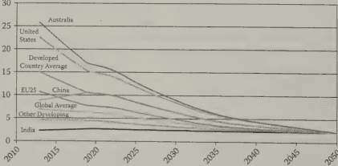

图8.1 人均CO₂排放权 [18]。

黄英贤表示：“我们接受科学和这样的建议，即对碳定价是减少排放的最佳方式。”这一行动为澳大利亚电力供应行业的转型创造了条件。根据2011年12月7日*《气候观察者》*在线的一篇文章：

> 政府当前的清洁能源政策围绕两项基本原则展开——20%的[大型]可再生能源目标（LRET）旨在部署现有最廉价的可再生能源技术，而清洁能源金融公司将支持那些未来可能最廉价、最有用的技术的商业化和部署。

LRET要求到2020年，20%的电力将来自可再生能源。这可以像目前这样以临时拼凑的方式完成：风电场在大型装机中占主导，住宅光伏装置也在密集增加（例如，新南威尔士州已安装300兆瓦（MW））。据广泛说法，这正在推高其他民众的用电成本。然而，这一推测受到澳大利亚能源市场委员会的质疑；该委员会估计，上网电价和可再生能源计划的合计成本将占未来电价涨幅的约14%，而为应对峰值需求增长而强化输配电系统的成本，将占未来3年电价上涨的49%[3]。为最大化温室气体减排，必须采取更协调的方法。

最大化可再生能源在电力供应中的渗透率，可通过两种不同的技术实现：(1) 建设超级电网；或 (2) 将可再生能源与需求管理和储能相结合。例如，在欧洲，有诸如 Desertec 计划之类的提案，旨在建设一个超级电网，将欧洲、北非和中东各地的可再生能源发电装置互联起来[21]。其基本原理是：如果太阳能电站沿同一纬度东西向分布，就可延长为电网提供能量的太阳能日照时间。此外，沿同一经度南北向分布的风电场，可利用在不同纬度上整体移动的天气系统。这种利用气象和天文属性来增强能源来源多样性的理念，需要对电网进行大幅扩展，包括提供高压直流输电系统，以尽量减少与距离相关的损耗。在这种配置下，即使有其他可再生能源作为补充，仍需要一定的储能用于备用和负荷平衡——丹麦通过抽水蓄能，将多余的风电储存在挪威的水电站大坝中。

当今电网面临的另一个挑战是空调普及率的增长。在西悉尼，现在超过80%的家庭装有空调。这种增长正促使 Ingleburn 等能源供应方在未来5年花费约30亿美元用于电网基础设施，以满足增加的峰值负荷。但这种额外基础设施每年只需要几天；这就像修建一条27车道的高速公路，好让我们永远不再有高峰时段交通拥堵。——*《气候观察者》*，2010年7月14日。

另一种方法是制定一套规程，将多种来源（技术和地点均多样）的可再生能源供应，与精细的需求管理（负荷跟随供应，而非反过来）和储能结合起来，以最大化可再生能源的渗透率。这需要多种供应方案——它们比超级电网方案更直接地嵌入输配电网络——以及多种储能方案。这种更精细的方法所带来的任务，是确定每种供应方案以及储能方案的数量、它们在系统中的位置，以及如何最好地利用需求侧管理。这导致一个组合优化问题。

总之，在本章中，我们介绍了我们认为必要的数学建模工具，用于对电力供应中向高比例可再生能源转型这一问题进行理性而精细的分析。

### 8.2 方法

#### 8.2.1 可再生能源发电

有许多可再生能源技术可以在不消耗有限资源、不产生CO₂排放的情况下发电，包括聚光太阳能热发电厂、太阳能光伏板、风力涡轮机、潮汐发电机和生物燃料发电机。

“零碳澳大利亚”[41]描述了一项雄心勃勃的计划，旨在通过60%的聚光太阳能热发电（带熔盐储热）、40%的风电，以及来自水电和生物燃料的备用电力相结合，满足澳大利亚的电力需求。Elliston 等[13]已经表明，以与现有系统相同的可靠性由可再生能源供电在技术上是可行的。

#### 8.2.2 储能

- 电动汽车中的短期储能
- 季节性储热。

其中许多技术已在中大型装置中得到验证。问题在于开发出方法，以确定对于给定电力系统，哪种储能技术与位置的组合最为有效。

#### 8.2.3 需求管理

当前电力系统的设计目标是供应所需的任意电力，而负荷协调很少甚至没有。因此，系统按每年仅出现数小时的峰值需求来确定容量。澳大利亚国家电力市场的平均电力需求为峰值需求的70%；在南澳大利亚，平均需求仅为峰值需求的50%。图8.2显示了2010年每一天国家电力市场的逐小时电力需求。

电器正变得更加高效，但我们使用的电器也更多了。峰值需求的增长要求升级输配电基础设施，这显著增加了电力成本。此外，固定零售电价使住宅和商业消费者无法感知供应约束以及相关的发电成本变化。这一问题可通过分时电价部分解决：在需求通常较低的时段，电价更便宜；也可通过尖峰电价解决：消费者支付的价格随供电成本而变化。随用电量增加而提高的能源价格也会鼓励负荷均衡。

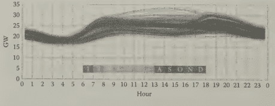

图8.2（见彩色插图）2010年NEM的逐小时需求曲线（数据来自澳大利亚能源市场运营商[5]）。

然而，归根结底，我们需要电器响应不断变化的电网状况，以防止过载。需求管理可以推迟电网强化的需要，减少对仅在需求高峰时段使用的昂贵发电的需求，并提高供电质量和可靠性。

需求管理还有另一个重要原因。随着更多能量来自可变可再生能源，我们将需要从供应跟随需求的系统，转向需求也响应可用供应变化的系统。

澳大利亚一半以上的电力用于住宅和商业部门。许多住宅和商业负荷——空调、热水器、洗衣机和洗碗机、干衣机、冰箱、冰柜、泳池泵以及电动汽车充电器——可以在不同程度上自动重新安排，而不会造成不便。澳大利亚标准 AS 4755 正在定义一种简单接口，使电器能够被控制。家庭区域网络、建筑管理系统和智能电网也将使电器和建筑能够响应包括电价和可再生电力可用性在内的信号，改变其电力需求。然而，仍然需要一些机制来鼓励参与，并使智能电器能够公平地分享任意时刻可用的电力。

#### 8.2.4 需求管理的机制设计

机制设计是数学博弈论的一个分支，旨在为具有私人信息的自利参与者设计博弈规则，以实现整体理想结果。必须设计机制，以这样的方式将可用电力分配给电器：在可行时，每台电器都能按时完成其任务。分配机制应具有“激励相容”性，使参与者不能通过虚报其需求而获利。当无法按时完成所有任务时，机制应尽可能公平地分配电力。

2007年诺贝尔经济学奖授予 Hurwicz、Maskin 和 Myerson，以表彰他们在机制设计理论方面的工作。瑞典皇家科学院的一份报告[35]对该主题作了很好的概述，Nisan 等[28]也是如此。

南安普顿大学的一个研究小组目前正在研究将机制设计用于需求侧管理、需求聚合以及电动汽车充电定价[19, 32, 33]。Gerding

等人 [19] 描述了一个为电动汽车分配充电容量的系统，以避免局部区域的容量约束被超出。每位车主指定其对第一小时充电、第二小时充电等的估值，以及车辆可充电的时间区间。一种在线机制每小时将充电容量分配给估值最高的车辆。定价机制的设计使车主没有动机虚报其估值或充电区间。需要进一步研究以将该方法扩展到混合不同电器的情况，并将其与其他在线机制 [29–31] 进行比较。

Fahrioglu 和 Alvarado [15] 描述了在设计电力供应合同时运用机制设计来鼓励参与需求管理项目，但未考虑智能电器可能如何响应实时需求管理信号。

更接近电力系统供应侧，Zou [42] 讨论了批发市场上常用的两种电力买卖方案：(1) 统一价格，即每台发电机都按市场边际价格获得支付；或 (2) 按报价支付，即每台发电机按其报价获得支付。目前尚不清楚这两种方案哪种更好，因为发电机在每种方案下的投标行为不同。Zou 提出了一种基于 Vickrey-Clarke-Groves 机制的新机制，该机制仅选择对社会福利贡献为正的投标者，从而能够提升电力市场的社会福利。然而，这些想法能否应用于零售电力市场仍有待观察。

最后，Rothkopf [34] 给出了 13 条理由，说明作为机制设计理论大部分基础的 Vickrey-Clarke-Groves 机制为何在实践中可能行不通。在设计需求侧管理的实际系统时，考虑这些问题将十分重要。

### 8.3 风能和太阳能发电预测

一个关键研究领域，也是组合优化的前提，是可变可再生能源供应的预测。近期成果 [1, 40] 在估算风电场和太阳能电站的出力水平与波动率的方法上取得了显著改进。在预测出力的条件方差方面尤其如此。可再生能源发电并不表现出同质变异性，我们设计了估计这种变化变异性的方法，而不是使用集成方法 [1]。

对于单个站点，我们一直在开发分析风电场出力和太阳能序列的方法。在预测方面，我们结合使用标准时间序列技术（如自回归移动平均 (ARMA)(p,q) 模型）和一种改编自大脑突触放电研究的谐振模型。Lucheroni [26] 应用 FitzHugh–Nagumo 耦合非线性随机微分方程系统，构建了一种称为随机谐振尖峰的动态机制。ARMA 技术本身无法有效建模 Lucheroni 所关注的电价中的尖峰行为，也无法有效建模气候变量中类似的尖峰行为。

#### 8.3.1 估算逐时太阳辐照度

在对气候变量或依赖于气候变量的系统进行时间序列分析时，第一步是识别并建模季节性。使用频谱分析 [8] 可以识别出若干显著周期。一年中第 t 小时的太阳辐照度季节性分量可通过傅里叶级数估计：

S_t = α_0 + α_1 cos(2πt/8760) + β_1 sin(2πt/8760) + α_2 cos(4πt/8760) + β_2 sin(4πt/8760) + ∑_{i=3}^{11} ∑_{m=-1}^{1} [α_i cos(2π(365n+m)t/8760) + β_i sin(2π(365n+m)t/8760)]

这里，α_0 是数据的均值；α_1、β_1 是年周期系数；α_2、β_2 是半年周期系数；α_i、β_i 是日周期及其谐波和相关拍频的系数。对功率谱的检查会表明，我们需要包括日周期的谐波（n = 2、3 以及 n = 1）以及拍频（m = -1、1）。后者调制振幅以拟合一年中的时间——换言之，描述年周期与日周期的拍频现象。

图 8.3 展示了一个示例站点一年内的日变化。

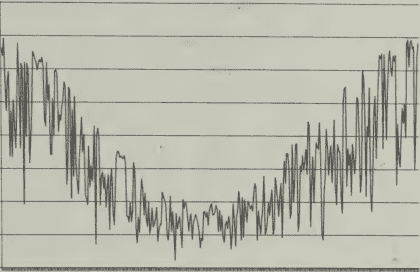

**图 8.3** 日太阳辐射。

图 8.4 展示了 5 天的逐时太阳辐射以及该变化的傅里叶级数模型。

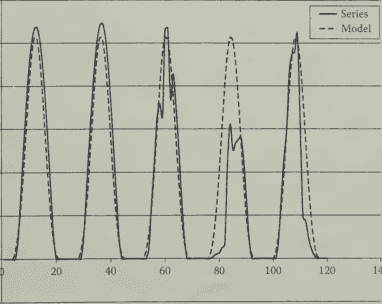

**图 8.4** 五天数据与傅里叶级数。

在图 8.5 中，我们可以看到那些被不同地称为“拍频”或“边带”的特定频率的作用，它们调制日谐波的振幅以适应一年中的时间。

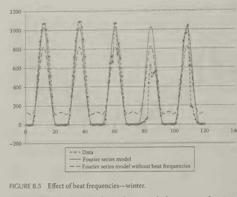

**图 8.5** 拍频效应——冬季。

请注意，在我们测试过的示例中，傅里叶级数解释的方差量约为 80% 至 85%。

#### 8.3.2 Box-Jenkins 或 ARMA 建模

一旦确定了季节性分量，我们就从数据中减去其贡献，并处理残差序列 r_t。ARMA (p,q) 模型的一般形式为

X_t - φ_1 X_{t-1} - φ_2 X_{t-2} - ... - φ_p X_{t-p} = Z_t + θ_1 Z_{t-1} + θ_2 Z_{t-2} + ... + θ_q Z_{t-q}

其中 {X_t} 是随机变量，X_t ~ (0,σ_X^2)，而 {Z_t} 是白噪声，独立同分布，Z_t ~ (0,σ_Z^2)。图 8.6 展示了 AR(2) 模型的结果。

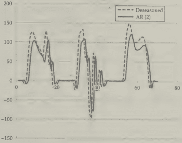

**图 8.6** 拟合 3 天残差的 AR(2) 模型。

#### 8.3.3 谐振模型

图 8.6 表明，当太阳辐射残差下降时，该 AR(2) 模型效果特别好。然而，AR(2) 模型低估了数据中所有的高峰。因此，找到另一种有助于捕捉这些峰值的模型很重要。Lucheroni [26] 提出了一种电力市场谐振模型，该模型利用电价对数及其对数价格导数的二维一阶非自治随机微分方程系统中同时存在的 Hopf 临界点、周期强迫和噪声。该模型源于生物物理学（文献中称为 FitzHugh–Nagumo 系统 [17, 25]），在电力市场建模中表现非常好；参见 Lucheroni [26]。

该模型（此处以其离散形式写出）由 Lucheroni [26] 开发：

$$f_{i+1}=f_i+z_i\Delta t \tag{8.1}$$

$$z_{i+1}=z_i+\left[\kappa(z_i+f_i)-\lambda(3f_i^2z_i+f_i^3)-\varepsilon z_i-\gamma f_i-b\right]\frac{\Delta t}{\varepsilon} \tag{8.2}$$

这里，$\omega_t$ 和 $a_t$ 是噪声项，$\Delta t$ 是时间步长。式 (8.2) 旨在利用当前 $z_t$ 值有助于预测未来值 $R_{t+1}$ 这一事实。参数 $\kappa$、$\lambda$、$\varepsilon$、$\gamma$ 和 $b$ 可使用普通最小二乘 (OLS) 方法估计。对于去季节化数据，参数的估计值为 $\kappa=-2.1$、$\lambda=-6\times10^{-8}$、$\varepsilon=0.09$、$\gamma=0.5$ 和 $b=2$。$\lambda$ 几乎为零，这表明去季节化残差 $R_t$ 呈线性行为。此外，$\kappa$ 的负值保证了式 (8.2) 中固有阻尼振荡器的稳定性。

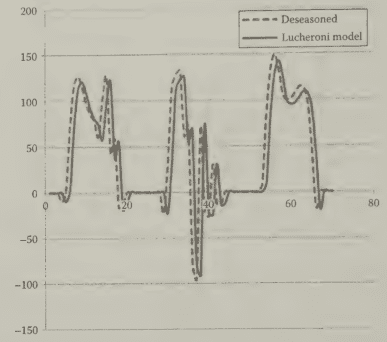

**图 8.7** 3 个样本日的 Lucheroni 模型。

Lucheroni 模型（图 8.7）擅长捕捉峰值，而 AR(2) 模型（图 8.6）擅长在序列的主要区域进行预测，因为当 AR(2) 模型达到峰值时，它比 Lucheroni 模型更快地收敛到均值。除了目测图形之外，是否有证据支持这一点？将 AR(2) 模型与 Lucheroni 模型结合可能解决这些问题。我们还可以加入二阶导数分量（曲率的代理变量），从而进一步提高可预测性（图 8.8）。

#### 8.3.4 估算波动率

传统的波动率预测方法必然是非直接的，因为波动率在时间序列中不可观测。这些间接方法包括广义自回归条件异方差 (GARCH) [9] 和隐马尔可夫模型 (HMM) [40]。我们开发了一种利用高频数据 [1] 估算波动率的方法，然后使用谐振模型 [26] 预测电力市场所需的 5 分钟和 30 分钟时间尺度上的波动率。这些预测方法还可用于刻画出力的水平和变异性。因此，我们能够对任何拟建的单台风力或太阳能装置进行这些估算。

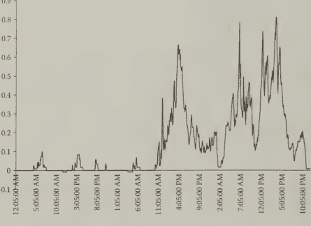

图8.9 五分钟风电场输出。

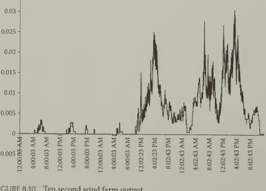

图8.10 十秒风电场输出。

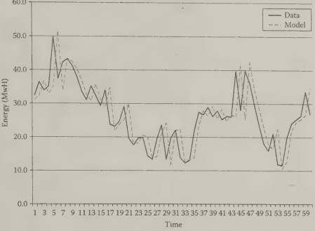

图8.11 五分钟输出与模型。

十秒数据（$X_t$）可以使用AR(3)过程进行令人满意的建模（见图8.12）：

$$X_t = \alpha_1 X_{t-1} + \alpha_2 X_{t-2} + \alpha_3 X_{t-3} + Z_t$$

或者等价地，

$$\phi(B) X_t = Z_t$$

其中 $\phi(B) = 1 - \alpha_1 B - \alpha_2 B^2 - \alpha_3 B^3$，而 $B$ 表示后移算子，即 $BX_t = X_{t-1}$。

由于 $\phi(B)$ 是可逆的，该过程等价于一个无穷阶移动平均过程。

$$X_t = \psi(B) Z_t$$

其中 $\psi(B) = \psi_0 + \psi_1 B + \psi_2 B^2 + \psi_3 B^3 + \cdots$。

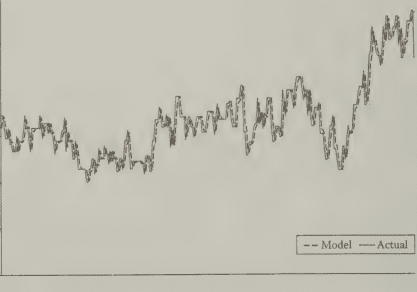

图8.12 *（见彩色插页。）* AR(3)：十秒数据的拟合。

因此，简单地说，

$$X_t = \psi_0 Z_t + \psi_1 Z_{t-1} + \psi_2 Z_{t-2} + \psi_3 Z_{t-3} + \cdots, \tag{8.3}$$

可以证明

$$\psi_j = \alpha_1\psi_{j-1} + \alpha_2\psi_{j-2} + \alpha_3\psi_{j-3} \tag{8.4}$$

其中 $\psi_0 = 1$，且对于 $j < 0$，$\psi_j = 0$。

##### 8.3.4.1 利用高频风能数据建模结果构建低频模型

5分钟时间尺度上的总风能是该5分钟内三十个10秒能量总和之和，因此我们可以将遵循AR(3)过程的10秒时间尺度变量相加，得到一个5分钟变量。设 $\{X_t\}$ 表示间隔为10秒的风能输出时间序列，设 $\{Y_t\}$ 表示每5分钟聚合能量输出的时间序列。作为三十个“10秒观测值”之和的5分钟过程可以表示为

$$Y_t = X_t + X_{t-\frac{1}{30}} + X_{t-\frac{2}{30}} + \cdots + X_{t-\frac{29}{30}} \tag{8.5}$$

重新整理可得

$$\sigma^2(Y_t)=\left(\sum_{n=0}^{29}\left(\sum_{i=0}^{n}\psi_i\right)^2\right)\sigma^2(Z_t)+\left(\sum_{n=30}^{59}\left(\sum_{i=0}^{n}\psi_i-\sum_{i=0}^{n-30}\psi_i\right)^2\right)\sigma^2(Z_{t-1})+\left(\sum_{n=60}^{89}\left(\sum_{i=0}^{n}\psi_i-\sum_{i=0}^{n-30}\psi_i\right)^2\right)\sigma^2(Z_{t-2})+\cdots \tag{8.8}$$

$\sigma^2(Y_t)$ 表达式中的基本组成部分是

$$\sum_{i=0}^{n}\psi_i$$

我们能够证明

$$\sum_{i=0}^{n}\psi_i=\sum_{k=0}^{n}\sum_{(n_1,n_2,n_3)\in A}\frac{(n_1+n_2+n_3)!}{n_1!\,n_2!\,n_3!}\alpha_1^{n_1}\alpha_2^{n_2}\alpha_3^{n_3}$$

其中三元组 $(n_1,n_2,n_3)$ 来自集合 $A=\{(n_1,n_2,n_3)\mid n_1+n_2+n_3\leq k\ \&\ n_1+2n_2+3n_3=k\}$。使用方程8.8，我们得到图8.13所示的五分钟数据的估计标准差。

##### 8.3.4.2 单一来源的总结

可靠预测太阳能和风能输出所需的步骤包括：

- 1. 将自回归与共振混合模型（ARR）验证应用于澳大利亚各地气候的代表性太阳能数据集。
- 2. 将ARR扩展到风电场输出序列。
- 3. 确定太阳能能量序列需要何种波动率建模。

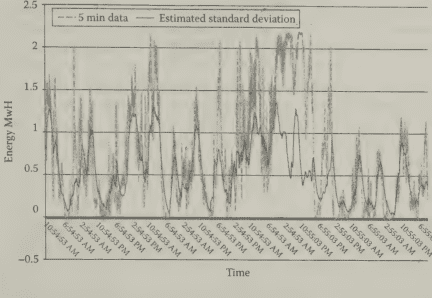

图8.13 （见彩色插页。）输出与估计标准差。

##### 8.3.4.3 多来源

增加可再生能源来源的空间多样性将有助于平滑总体输入的波动性，前提是电网具有足够的互联性。人们可以轻松计算两个时间序列之间的两两相关性，但如何评估一组来源的整体连通性？Getz [20] 提出了相关相干性的概念，用于分析象群中个体大象运动的整体连通性。类似的方法可用于确定多个风电场输出之间的总体相关性[7]。首先，取相关矩阵 R，其中包含 n 个来源之间的两两相关系数。其特征值 λᵢ（i = 1, …, n）具有性质 0 ≤ λᵢ/n ≤ 1，并且

$\sum_{i=1}^{n} \lambda_i/n = 1$

Getz [20] 提出了一种香农-韦弗特征值多样性度量，它使我们能够了解各来源相互协同变化的程度：

$$C(X^n)=1-\frac{1}{\ln(1/n)}\sum_{i=1}^{n}\left(\frac{\lambda_i}{n}\right)\ln\left(\frac{\lambda_i}{n}\right) \tag{8.9}$$

如果所有非对角线元素具有相同的值 r ∈ [0,1]，且对角线元素均为1，则相关矩阵 R(r) 的特征值为 λ_1 = 1 + (n−1)r，对于 i = 2,...,n，λ_i = 1 − r。在这种情况下，我们有

$$C_n(r) = \frac{(1+(n-1)r)\ln(1+(n-1)r)+(n-1)(1-r)\ln(1-r)}{n\ln n} \qquad (8.10)$$

因此 r 是

$$r = C_n^{-1}\left(C(X_n)\right) \qquad (8.11)$$

的解。

另一个选项来自 Hoff 和 Perez [23]，他们提出了一种度量方法，用于衡量由一组等间距、相同的光伏系统组成的整体所产生的短期功率输出变异性。他们构建了相对输出变异性度量，定义为整体输出变异性与同一光伏集群集中在单一位置时的输出变异性之比。输出变异性为

$$\sigma_{\Delta t}^N = \frac{1}{C}\sqrt{\operatorname{Var}\left[\sum_{n=1}^{N}\Delta P_{\Delta t}^{n}\right]} \qquad (8.12)$$

其中 C 是整体的总装机峰值功率，ΔP_{Δt}^n 是一个随机变量，表示第 n 个装置在使用 Δt 采样时间间隔时的功率变化时间序列。

### 8.4 投资组合分析

Delucchi 和 Jacobson [10] 指出：

> 对于世界主要地区（更不用说世界所有地区）的100% [风能、水能、太阳能] 系统，尚未进行过……优化分析，因此这显然是一个关键的新研究领域。

选择最佳电力生产、存储和效率政策组合的问题与投资组合优化问题并无太大区别。每个决策方案都会产生或多或少的电力产量，承担或多或少的成本，并带来或多或少的变异性。

一个特殊的挑战是，电力行业要求在网络中的所有时间和所有地点，供需之间保持非常高的协调水平。传统的发电投资方法将需求建模为一个外生时间序列，需要通过一些常规的、可控的发电技术的组合来满足。高比例可再生能源的接入不适用于此类方法，因为它们在传统意义上不可调度，并且如前所述，它们具有高度复杂、不确定且相关的一次能源通量。因此，高渗透率不仅会对可调度发电（无论是可再生能源还是非可再生能源）提出更高的要求，而且还可能要求更大的需求侧参与，以帮助管理供应短缺和供应过剩。

应对这些挑战的投资组合工具远未成熟。已有一些关于将可再生能源纳入最优发电组合工具的研究[12, 39]。然而，该领域仍需相当大的进展，特别是在优化可再生能源资源的不同可能组合和布局方面。此外，关于如何将储能和可控负荷适当整合到这些投资工具中，也存在有趣且具有挑战性的研究需求。

选择最佳发电技术组合的问题将以类似于寻找最优投资组合的方式来建模。然而，与货币收益及其变异性不同，必须考虑能量输出及其变异性。问题的约束当然包括能量产出等于或超过需求的要求，此外还有许多其他实际要求。

假设在给定的固定时间间隔内，电力需求为 $D$ 兆瓦时（MW-h），我们决定从 $n = 4$ 个不同能源来源供应所需电力的特定比例：$(\varepsilon_1)$ 常规能源、$(\varepsilon_2)$ 太阳能、$(\varepsilon_3)$ 风能和 $(\varepsilon_4)$ 储能。令 $x_r =$ 分配给来源 $\varepsilon_r$ 的 $D$ 的比例，$r = 1, \ldots, 4$。

我们要求

$$x_1 + x_2 + x_3 + x_4 = 1$$

$$x_1, x_2, x_3, x_4 \geq 0$$

不失一般性，我们可以将需求比例 $x_r$ 解释为对应电量 $a_r = x_rD$（以兆瓦时为单位）的数量。

待从源$ε_r$获得，对于每个$r = 1, ..., R$。然而，每个$ε_r$是一个随机变量，其概率分布并不能精确已知。

然而，假设我们拥有$p$个早期时段的历史数据，表明当将数量$a_r := x_r D$分配给能源$ε_r$时，它在过去的时段$k = 1, 2, ..., p$中产生了$x_{rk}D$兆瓦时的电量。我们将此解释为一种概率分布。

|  | 1 | 2 | ⋯ | p |
|---|---|---|---|---|
| $ε_r$ | $x_{r1}D$ | $x_{r2}D$ | $⋯$ | $x_{rp}D$ |
| $P(ε_r = x_{rk}D)$ | $1/p$ | $1/p$ | $⋯$ | $1/p$ |

也可以使用加权分布。在均匀权重的情况下，我们可以通过下式估计源$ε_r$的预期输出：

$E_r := E(ε_r) = (D/p) Σ_{k=1}^{p} x_{rk}$    $r = 1, 2, 3, 4$

因此，如果我们的“配置组合策略”为$x^T = (x_1, x_2, x_3, x_4)$，则意味着该时段内供应的总能量是随机变量

$ε := Σ_{r=1}^{4} ε_r x_r$    (8.13)

其期望可以通过下式估计：

$E := E(ε) = Σ_{r=1}^{4} E(ε_r)x_r$    (8.14)

当然，$ε$的波动性是一个问题，因此，类比于马科维茨著名的投资组合优化问题，我们可以尝试找到能够解决以下问题的$x^* = (x_1^*, x_2^*, x_3^*, x_4^*)$：

(EPVM) = 能源组合方差最小化问题：$minVar(ε)$

现在，能源组合方差最小化问题(EPVM)变为：

\[
\min x^T Vx
\]

约束条件为：

\[
\sum_{j=1}^{n} E_j x_j \geq L \quad \text{(EPVM)}
\]

\[
\sum_{j=1}^{n} x_j = 1
\]

\[
x_j \geq 0,\ \forall j
\]

最后，在对连续时段之间的相互作用进行适当假设的前提下，这种方法也可以扩展到多周期规划区间。

必须考虑方差最小化以外的性能标准。后者包括其他风险度量，如CVaR（条件风险价值）和目标百分位数准则[24]。Vithayasrichareon和MacGill [39]已将VaR技术应用于发电投资，并且有明显的扩展可以增强该工具的价值。此外，必须利用相关优化问题的随机和鲁棒规划版本[6]。

### 8.5 结论

在本章中，我们考察了适当分析提高可再生能源在电力供应中所占比例所需的一些工具。这只是一项宏观层面的研究，因为我们没有研究该问题的电力工程方面，也没有研究财务问题。

果断、及早行动的好处大大超过成本。根据斯特恩报告[37]，其执行摘要中有如下内容：

- 未减缓的气候变化每年可能使世界损失至少5%的GDP；如果更戏剧性的预测成为现实，损失可能超过GDP的20%。
- 减排成本可能被限制在全球GDP的1%左右；人们可能需要为碳密集型商品支付更多费用。
- 我们每排放一吨二氧化碳造成的损害至少价值85美元，但减排成本可以低于每吨25美元。

### 参考文献

- 1. M.R. Agrawal, J. Boland, and B. Ridley, Volatility of Wind Energy Using High Frequency Data, *Proceedings of IASTED International Conference: Modelling, Identification and Control (AsiaMIC 2010)*, November 24–26, 2010, Phuket, Thailand, 1–3, 2010.
- 2. M.R. Agrawal, J. Boland, I. Filar, and B. Ridley, Analysis of wind farm output: Estimation of volatility using high frequency data, *Environmental Modeling and Assessment*, 2013.
- 3. Australian Energy Market Commission, Future Possible Retail Electricity Price Movements: 1 July 2010 to 30 June 2013, Technical Report, 2010.
- 4. Australian Energy Market Operator, *An Introduction to Australia’s National Electricity Market*, AEMO, Melbourne, Australia, July 2010.
- 5. Australian Energy Market Operator, http://www.aemo.com.au, 2011.
- 6. A. Ben-Tal and A. Nemirovski, Robust optimization–methodology and applications, *Mathematical Programming*, 92: 453–480, 2002.
- 7. J. Boland, K. Gilbert, and M. Korolkowicz, Modelling wind farm output variability, *MODSIM07*, Christchurch, New Zealand, 10–13 December, 2007.
- 8. J.W. Boland, Time series and statistical modelling of solar radiation, in *Recent Advances in Solar Radiation Modelling*, Viorel Badescu (Ed.), Berlin and New York, Springer-Verlag, pp. 283–312, 2008.
- 9. T. Bollerslev, Generalised autoregressive conditional heteroskedasticity, *Journal of Econometrics*, 31: 307–327, 1986.
- 10. M.A. Delucchi and M.Z. Jacobson, Providing all global energy with wind, water and solar power. II. Reliability, system and transmission costs, and policies, *Energy Policy*, 39: 1170–1190, 2010.
- 11. Department of Climate Change and Energy Efficiency, Quarterly Update of Australia’s National Greenhouse Gas Inventory, December Quarter 2010, Technical report, 2011.
- 12. R. Doherty, H. Outhred, and M. O’Malley, Establishing the role that wind generation may have in future generation portfolios, *IEEE Transactions on Power Systems*, 21: 1415–1422, 2006.
- 13. B. Elliston, M. Diesendorf, and I. MacGill, Simulations of scenarios with 100% renewable electricity in the Australian National Electricity Market, *Solar2011, the 49th AuSES Annual Conference*, 2011.
- 14. R.F. Engle, Autoregressive conditional heteroscedasticity with estimates of the variance of United Kingdom inflation, *Econometrica*, 50: 987–1007, 1982.
- 15. M. Fahrioglu and F.L. Alvarado, Designing incentive compatible contracts for effective demand management, *IEEE Transactions on Power Systems*, 15(4): 1255–1260, 2000.
- 16. T. Farrell, Demand Response/Smart Grid Interfaces for Appliances—The Need for Global Standards, Technical report, Department of Climate Change and Energy Efficiency, 37th Expert Group on Energy Efficiency and Conservation Meeting, Washington, D.C., United States 28 February–2 March 2011.
- 17. R.A. FitzHugh, Impulses and physiological states in models of nerve membrane, *Biophysical Journal*, 1: 445–466, 1961.
- 18. R. Garnaut, *The Garnaut Climate Change Review: Final Report*, Technical report, Garnaut Climate Change Review, 2008.
- 19. E.H. Gerding, V. Robu, S. Stein, D.C. Parkes, A. Rogers, and N.R. Jennings, Online mechanism design for electric vehicle charging, *Proceedings of the 10th International Conference on Autonomous Agents and Multiagent Systems*, 2011.
- 20. V.M. Getz, Correlative coherence analysis: Variation from intrinsic sources in competing populations, *Theoretical Population Biology*, 64: 89–99, 2003.
- 21. H. Girardet and M. Mendonca, *A Renewable World, Energy, Ecology, Equality*, Green Books, Foxhole, Dartington, Totnes, Devon, UK, 2009.
- 22. J. Hansen, M. Sato, P. Kharecha, D. Beerling, V. Masson-Delmotte, M. Pagani, M. Raymo, D.L. Royer, and J.C. Zachos, Target atmospheric CO₂: Where should humanity aim?, *Open Atmospheric Science Journal*, 2: 217–231, 2008.
- 23. T.E. Hoff and R. Perez, Quantifying PV power output variability, *Solar Energy*, 84: 1782–1793, 2010.
- 24. B. Kang and J.A. Filar, Time consistent, dynamic risk measures, *Mathematical Methods of Operations Research*, 63: 169–186, 2011.
- 25. B. Linder, J. Garcia-Ojalvo, A. Neiman, and L. Schimansky-Geier, *Physics Reports*, 392: 321–424, 2004.
- 26. C. Lucheroni, Resonating models for the electric power market, *Physical Review E*, 76: 1–13, 2007.
- 27. P.J. Lunde, *Solar Thermal Engineering*, John Wiley & Sons, New York, 1979.
- 28. N. Nisan, T. Roughgarden, E. Tardos, and V.V. Vazirani (Editors), *Algorithmic Game Theory*, Cambridge University Press, Cambridge (UK) and New York, 2007.
- 29. D.C. Parkes and Q. Duong, An ironing-based approach to adaptive online mechanism design in single-valued domains, *Proceedings of the 22nd National Conference on Artificial Intelligence*, pp. 94–101, 2007.
- 30. D.C. Parkes and S. Singh, An MDP-based approach to online mechanism design, *Proceedings of NIPS’03*, 2003.
- 31. R. Porter, Mechanism design for online real-time scheduling, *Proceedings of the Fifth ACM Conference on Electronic Commerce*, pp. 61–70, 2004.

- 32. S.D. Ramchurn、P. Vytelingum、A. Rogers 和 N.R. Jennings，智能电网中分散式需求侧管理的基于智能体控制，*第十届自主智能体与多智能体系统国际会议（AAMAS 2011）*，2011a。
- 33. S.D. Ramchurn、P. Vytelingum、A. Rogers 和 N.R. Jennings，智能电网中绿色能源的基于智能体稳态控制，*ACM 智能系统与技术汇刊*，2(4)，文章编号35，2011b。
- 34. M.H. Rothkopf，Vickrey-Clarke-Groves过程不实用的十三个原因，*运筹学*，55(2)：191–197，2007。
- 35. 瑞典皇家科学院，机制设计理论，技术报告，2007。
- 36. B. Ridley、J. Boland 和 P. Lauret，使用多个预测变量对散射太阳辐射比例建模，*可再生能源*，35(2)：478–483，2010。
- 37. N. Stern，*斯特恩评论：气候变化经济学*，2010，http://siteresources.worldbank.org/INTINDONESIA/Resources/226271-1170911056314/3428109-1174614780539/SternReviewEng.pdf。
- 38. M.A.P. Taylor、P.J. Pudney、R. Zito、N.M. Holyoak、A.R. Albrecht 和 R. Raicu，澳大利亚电动汽车规划——我们能否满足环境要求、技术和出行需求？，*第12届世界交通研究学会会议论文集*，2010。
- 39. P. Vithayasrichareon 和 I.F. MacGill，高风电渗透率下低碳未来电力行业的发电组合分析，*2011 IEEE Trondheim PowerTech*，2010。
- 40. K. Ward、M. Korolkiewicz 和 J. Boland，使用HMM对风电场波动性建模，*第18届世界IMACS/MODSIM大会*，澳大利亚凯恩斯，2009年7月13–17日。
- 41. Zero Carbon Australia，固定式能源计划，技术报告，2010。
- 42. X. Zou，基于社会福利最大化的电力双边拍卖机制设计，*能源政策*，37：4231–4239，2009。

## 用于电网扰动实时识别的数据分析

Varun Chandola、Olufemi Omitaomu 和 Steven J. Fernandez

### 目录

- 9.1 引言 — 274
- 9.2 电网系统中的一些研究问题 — 275
- 9.3 区域间振荡模式的检测与可视化 — 277
  - 9.3.1 信号预处理 — 277
    - 9.3.1.1 信号分解 — 280
  - 9.3.2 主导振荡模式的识别与提取 — 281
  - 9.3.3 主导模式对完整数据集的加窗拟合 — 283
    - 9.3.3.1 一致群的识别 — 284
  - 9.3.4 模态提取结果的可视化 — 285
- 9.4 使用k-中位数方法对电网频率数据流进行分类 — 288
  - 9.4.1 使用k-中位数方法检测破坏性事件 — 288
  - 9.4.2 使用k-中位数确定事件前和事件后运行点 — 290
  - 9.4.3 窗口数据的选择 — 291
  - 9.4.4 决策边界的确定 — 292
  - 9.4.5 决策边界的评估 — 293
- 9.5 使用时间序列变化检测识别电网扰动 ...... 294
  - 9.5.1 一种基于CUSUM的快速时间序列异常检测方法 — 294
  - 9.5.2 在电网数据上的结果 — 296
    - 9.5.2.1 数据描述与算法参数 — 296
    - 9.5.2.2 原始结果 — 297
    - 9.5.2.3 纳入空间信息 — 297
- 9.6 结论 — 299
- 参考文献 — 300

### 9.1 引言

美国电网系统由发电、高压输电系统和本地配电系统的多个不同互联系统组成，这些互联系统以令人瞩目的效率和可靠性维持发电与负荷之间的持续平衡。作为关键基础设施，电网系统在未来十年内因拟议的电网现代化而发生的变化，可能比过去一个世纪所经历的变化还要多。特别是，可再生能源发电（集中式和分布式）、智能电表、同步相量、智能电网控制、储能以及新型导电材料的广泛部署，将要求电网规划以及我们运行电网的方式发生根本性变化。

这种现代化将导致电网系统各层级——发电、输电、配电和用电——收集的数据量爆炸式增长。在这些层级收集的数据可以归纳为三类：（1）现场数据（由分布在整个系统中的各种设备采集，例如数字记录仪）；（2）集中式数据档案（来自监控、控制和运行系统，例如数据采集与监视控制（SCADA）系统）；（3）仿真数据（在规划或运行环境中进行）。这项数据收集活动的核心，是处理来自海量数据储备的信息以支持未来决策的能力。需要注意的是，由于高延迟（例如，在相量测量单元（PMU）的情况下，每秒高达六十个数据点）和数据集的高维性，不能仅将数据交由现场专家处理。因此，需要开发能够从数据中综合出结构的算法。

开发此类算法、实现它们并将其应用于实际问题，正是所谓数据挖掘领域的目标。

数据挖掘是一个通用方法的术语，该方法在不同程度上得到一组技术的支持：统计学、可视化、机器学习和神经网络。分类、回归、聚类、摘要、依赖建模、偏差检测和时间问题有望由数据挖掘工具解决。由于所收集数据的特征，数据挖掘工具在电网系统中将很有用：电网的大规模特性（数千个状态变量）；数据的时间性（从毫秒、秒、分钟、小时、周到年）和统计特性；存在离散信息（例如发电机跳闸或相位变化等事件）与连续信息（模拟状态变量）的混合；需要通过可视化手段与专家沟通；快速决策的在线运行时间限制；以及存在不确定性（噪声、异常值、缺失信息）。

本章使用本节前面描述的一些数据，介绍数据挖掘工具在电网系统某些问题中的应用。第9.2节讨论电网系统中已识别出的一些研究问题。第9.3节描述一种对配电级使用同步相量采集的频率数据进行分类和可视化的方法。第9.4节讨论一种从频率数据中检测和可视化区域间振荡模式的方法。第9.5节描述一种时空异常检测方法，使用基于统计原理的变化检测技术快速检测电网事件。

### 9.2 电网系统中的一些研究问题

如前所述，电网内数据采集能力的现代化正导致电网系统各层级——发电、输电、配电和用电——收集的数据量爆炸式增长。如前所述，我们需要新的算法方法以及并行方案来应对这种数据爆炸。关键组成部分之一是变化预测和异常检测。最先进的算法不适合处理流式数据分析的需求。最近，由能源部资助的“用于分析拍字节级数据的数学”研讨会确定了对本提案重要的若干挑战：（1）需要能够随数据规模扩展的事件检测算法；（2）需要不仅能处理数据的多维性质，还能对数据中的空间和时间依赖关系（它们在大多数情况下高度非线性）进行建模的算法；（3）需要能够以在线方式处理流式数据的算法。

如上所述，现代化电网系统的一个要素是在街道电线杆上安装广域频率测量系统，用于配电线路的状态监测。这将提供反映电网状态的频率测量值，以及关于即将发生的问题在其发生前的可能信息。及时处理这些频率数据可以消除即将发生的故障及其随后向整个系统的级联。监测配电线路的能力只是所提议的智能电网技术的一个方面。其他要素包括安装智能电表等先进设备、输电线路自动化、太阳能和风能等可再生能源技术的集成，以及插电式混合动力电动汽车技术的进步。那么总体目标是使电网系统在面对即将到来的国家和全球运行挑战时更加鲁棒。

广域频率扰动记录器（FDR）已在电网系统的输电和配电层面使用[1]。这些记录器用于实时监测和记录不同位置电压频率的变化。FDR执行本地GPS同步频率测量，并通过互联网将数据发送到中央服务器，信息管理系统处理数据采集、存储、通信、数据库操作和Web服务。目前美国各地部署了50多台FDR。每个FDR使用110V插座在配电级测量电压相量和频率，并每秒流式传输十个数据点，未来型号预计具有更高的流式传输速率。从FDR收集的大量数据流带来的一个直接挑战是：*如何从多个高速数据流中实时检测并分类电网即将发生的故障，同时尽量减少误报并消除漏检，然后如何识别和评估已检测故障的影响。*

在接下来的三节中，我们描述数据挖掘的三种不同应用，以解决两个与电网相关的问题。第一个问题涉及识别数据中特定类型的模式（模式发现），而第二个问题涉及识别破坏性事件

从电网数据中。第9.3节讨论第一个问题，而第9.4节和第9.5节讨论第二个问题。

### 9.3 区域间振荡模式的检测与可视化

电力系统中的区域间模式振荡是基于系统架构的全局小信号稳定性问题。给定特定的系统拓扑，就会产生这些振荡模式。每个系统都有其自身的特征模式，这些模式可在多种应力条件下被激发。当被激发时，这些模式会在功率中产生振荡，形成不必要的功率流，从而给系统引入附加应力。如果阻尼不足或未加抑制，这些振荡有可能引发级联停电。

由于这些危害，已经实施了若干不同的控制方案，专门针对已知振荡频率的模式。这些方法的一个主要缺陷是，它们依赖于预先知道具体的区域间模态频率来设计控制方案。这些模式频率可以根据系统拓扑计算得到，但在许多情况下，系统模型可能不准确、不完整或不可用。此外，随着系统拓扑随时间变化，模式频率也会随之变化。这些因素可能导致控制系统整定不当。

随着高时间分辨率电力系统测量装置的普及，已经可以在这些区域间模式发生时对其进行观测。随着更多装置安装在整个系统中，可以获得不同区域更完整的图景。测量向量数量的增加使得能够辨识同调发电机组及其相关地理区域。

本节介绍的工作概述了开发一种解决方案的流程，该方案用于提取区域间模式并确定其在每个测量点处的幅值、相位和阻尼，并且基于Bank、Omitaomu、Fernandez和Liu的论文[8]。

#### 9.3.1 信号预处理

为了更好地拟合振荡内容，首先需要对测量数据进行适当的预处理。图9.1(a)给出了测量频率数据的一个示例。希望提取该振荡的特性。

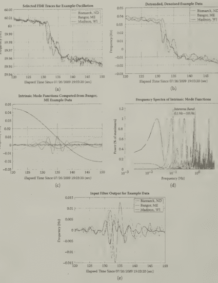

图9.1（见彩色插页。）FDR轨迹示例及后处理结果。

本示例的数据取自FDR测量数据，这些数据捕获了系统对发电机组跳闸的响应。由此产生的系统频率下降如图9.1所示，从约60.05赫兹（Hz）急剧下降到59.96 Hz。在这一下降期间，还观察到强烈的振荡，缅因州的电网系统与北达科他州的系统以180度反相振荡。本示例数据集将在本节中贯穿使用，以演示模态辨识流程的运行。

尽管通过目视检查很容易观察到这种振荡，但难以用数值方法量化。其主要原因是主导频谱的高直流分量。0.1 Hz至0.8 Hz的区域间频带完全被更低频率分量所掩盖。为解决这一问题，应从信号中通过数学方法去除直流分量。该问题的一个简单解决方案是从原始信号中减去中位数；这样做可以对数据去趋势，并使数据点分布以零为中心。尽管这样做去除了直流分量，但仍有低频分量掩盖区域间频带。这些剩余的不要分量将在后续阶段由非线性带通滤波器进一步衰减。

此时，我们考虑输入信号的噪声内容。观察图9.1(a)可以看到，示例数据中仍存在明显数量的噪声。根据先前的工作[13]，频率监测网络（FNET）系统中噪声的性质已被表征为具有拉普拉斯分布特性。研究还表明，滑动中值滤波器为这些噪声成分提供了最优滤波。由于区域间振荡分量占据0.1 Hz至0.8 Hz频带，所选低通滤波器应以最小失真通过这些频率。因此，用于本应用中FDR数据去噪的低通滤波器，其截止频率应大于0.8 Hz且小于2 Hz。基于此，选择了窗口大小为5个点的滑动中值滤波器来满足这些要求。

将所述去趋势方法和滑动中值滤波器应用于示例数据集，得到图9.1(b)中的滤波后信号。与图9.1(a)中的原始信号相比，噪声成分被衰减的程度变得显而易见。图9.1(b)显示出极少的高频噪声内容，振荡内容清晰得多。

到此为止的滤波过程有助于对输入数据进行调理，并分离出感兴趣的振荡频率。尽管如此，数据信号仍包含一个大的低频分量，掩盖了区域间频带。此时我们的兴趣是仅分离出区域间频带内的那些频率，以便能够提取主导振荡模式。这是通过实现非线性带通滤波器来实现的。该滤波器将主要基于对去趋势和去噪后的输入信号进行经验模态分解（EMD）。

##### 9.3.1.1 信号分解

经验模态分解是一种数据驱动方法，可将信号分解为一组本征模态函数（IMF）。每个IMF都是一个振荡信号，由原始信号中频率分量的一个子集组成。与傅里叶、小波及类似方法不同，EMD通过识别局部极值并在迭代过程中围绕信号设置包络，直接从数据构造这些分量信号。然后对局部极值进行拟合以生成一个IMF。在生成一个IMF之后，将其从原始信号中减去，并重复该过程以识别下一个IMF。这一识别与移除过程持续进行，直到原始信号完全由一组IMF描述。EMD过程的输出是IMF集合；通常，该集合是少量信号（对于本文考虑的数据通常少于十个），当它们相加时，与原始信号完全匹配。EMD算法不像其他信号分解技术那样显式计算振荡频率、幅值或相位角；相反，IMF是基于输入信号的局部极值直接从输入信号中导出的。EMD算法的完整数学描述超出本章范围，但可在[9–12]中找到。EMD及相关希尔伯特-黄变换最近也被提出作为电力系统中分离区域间模式的方法[16, 17]。

对图9.1(b)中的班戈轨迹执行EMD，可提取出图9.1(c)中给出的七个IMF。该过程中提取的第一和第二个IMF由图9.1(c)中的蓝色和绿色轨迹给出；它们捕获输入信号的高频分量和噪声。接下来的三个IMF由红色、青色和紫色轨迹给出，捕获信号中存在的中间频率。最后，提取的最后两个IMF（由芥末黄和黑色线条表示）定义了输入的低频分量，在本例中表示事件下降本身。

图9.1(c)中IMF信号的傅里叶变换如图9.1(d)所示。频率变量以对数坐标绘制，以更好地展示较低范围内的频率。快速傅里叶变换（FFT）已按其最大值进行缩放，以使低频分量不会主导该图。对IMF信号的检查证实，每个IMF捕获原始信号的一个特定频带。提取的第一个IMF以蓝色绘制，其中心约在3至4 Hz，随后的每一个IMF依次拾取更低频率的分量。

由于区域间频带为0.1 Hz至0.8 Hz，我们希望仅保留那些其功率中有显著部分位于

保留该频带，并舍弃其他频带。该滤波器的最终实现计算各IMF，然后对每个IMF进行傅里叶变换。利用傅里叶变换结果，计算每个IMF在区域间频带内的功率百分比。如果该百分比超过给定阈值，则保留该IMF；否则将其舍弃。最终滤波器输出为所保留IMF的总和。通过对多个数据集的测试，确定截止频率为0.1 Hz和0.8 Hz、功率百分比阈值为0.75时响应最佳。这些设置能够在去除大部分其他频率分量的同时，最好地保留区域间频带。

该模态辨识应用的总输入滤波过程由三个阶段组成：首先是中位数去趋势阶段；随后是移动中位数滤波器；最后是基于EMD的滤波器。该过程用于仅分离区域间频带内的频率分量，以便后续处理能够提取该区域内的指定模态。将这一多级滤波过程应用于示例数据集，得到如图9.1(e)所示的信号。将该图与图9.1(a)比较，可以看出低频趋势被完全去除，留下零中心信号。此外，高频分量和噪声也从原始数据矢量中去除。事件跌落期间观察到的区域间频带振荡现在是数据最显著的特征，从计算角度看更易于提取。

该滤波过程被证明对多种类型的数据均能良好工作。此处以FDR系统获得的频率测量数据为例进行说明，但它对来自FDR和相量测量单元（PMU）数据集的相角测量也有类似表现。对于任何这些不同类型的数据，滤波过程都会返回一个零中心信号，并隔离出类似于图9.1(e)的区域间模态。该滤波过程能够处理各种不同类型的数据集，使得最终的模态提取过程与所有这些形式的输入数据兼容。模态提取过程的其余部分针对类似于图9.1(e)的数据矢量进行了调整；因此，任何经输入滤波器可化简为该形式的数据集都能被处理。

#### 9.3.2 主导振荡模态的辨识与提取

选择一个振荡频率，并随时间提取每个测量矢量在该模态下的特性。对于历史数据分析，该提取将聚焦于包含振荡的某个特定事件。将提取该振荡中的主导频率，然后在事件周围的更大数据集上随时间跟踪。为了确定事件中的主导模态，提取相应时间跨度的数据。一旦确定所需的时间跨度，每个测量矢量的数据都被滤波并提取到缩减数据集中。这样可产生一组零中心且以振荡模态为主的信号。

事件数据经过适当调理后，即可开始提取主导模态频率。为提取该模态，采用基于矩阵束 [14, 15] 的分析方法，在滑动数据窗口上进行。当窗口在数据上滑动时，对每个测量矢量和每个数据窗口独立执行一次矩阵束过程。示例数据集上其中一次矩阵束拟合的结果如图9.2(a)所示。

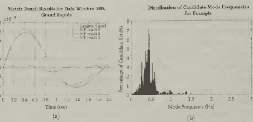

**图 9.2**  示例数据的一个子集的矩阵束结果与分析。

观察图9.2(a)可以发现，计算所得模态之一（MP结果3）与振荡非常吻合，并捕获了原始信号的大部分。该结果是所有测试案例的典型情况，主要归因于输入滤波器的数据去趋势处理。在所有观察到的案例中，计算所得模态之一与原始信号拟合得非常紧密，其余矩阵束结果则解释了两者之间的差异。模态分量的表达式由方程(9.1)给出，其中A为幅值，α为阻尼，f为频率，θ为相角。

$$ y = A e^{\alpha t}\cos(2\pi f t + \theta) \tag{9.1} $$

该信号的功率由方程(9.2)给出。注意，该方程并不表示真实的电功率，因为它是由频率信号而非电流或电压导出的。

$$ P_y = y^2 \tag{9.2} $$

方程(9.1)的总能量于是可以表示为功率随时间求和，如方程(9.3)所示。同样，这并不是真正的物理能量量，而只是数据信号的类似度量。

$$ E_y = \sum P_y \tag{9.3} $$

每当在一个数据窗口上对一个测量矢量执行矩阵束方法时，都会对每个所得模态评估该能量度量。然后选择能量值最大的模态作为该数据矢量和数据窗口的代表模态。该过程在振荡事件跨度内对每个矢量和每个数据窗口重复执行。每次迭代都会确定一个代表模态，从而产生许多可能的模态频率。

每个候选模态都代表在某个特定数据窗口内、某个测量矢量上占主导的振荡频率。因此，候选模态频率集可以被视为描述主导模态位置的概率分布。示例数据集的候选模态分布如图9.2(b)所示。该分布表示一个非对称概率密度函数。我们希望从该数据分布中确定最可能的值。

评估候选模态分布中出现最频繁的值，可以得到最常出现的频率分量的估计。正是该估计将被视为事件期间的主导振荡模态。对示例数据集执行该过程，确定模态频率为0.428 Hz。该值位于期望的区域间频带内，并与图9.1(a)的原始数据相比，与观察到的振荡频率一致。

#### 9.3.3 主导模态对全数据集的分窗拟合

现在，主导振荡频率已经确定，它将被应用于整个数据集长度。再一次，将使用滑动窗口随时间拟合该模态。对于每个测量

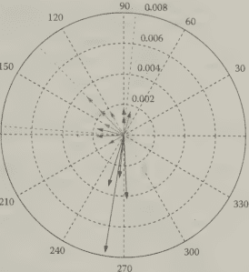

**图 9.3**（*见彩色插页*）相量聚类示例。

图9.3给出了从示例数据中提取的一组模态相量的聚类算法结果。在此，每个测量设备产生一个相量。聚类算法通过根据相量指向的方向对其进行分类，来识别形成相干群组的相量。在图9.3中，每个群组用单独的颜色标识，群组质心由相同颜色的虚线给出。

#### 9.3.4 模态提取结果的可视化

开发了一个可视化包来显示前述模态辨识过程的结果。该可视化基于地理显示，给出每个测量点的模态幅值和相位。这些相量被放置在地图上，以便可以从空间上观察相干群组。该可视化架构用于生成跨越给定振荡的电影，随时间呈现图形，从而可以实时观察时间演化。图9.4通过一系列帧捕获展示了这样一部电影。该电影由围绕本节所用示例案例构建的数据集生成。

图9.4(a)给出了事件之前的一个电影帧，展示了一个几乎没有振荡内容的区域。顶部的图

图 9.4(a) 的角落给出了所提取的模态频率，以及系统各测量点观测到的平均阻尼因子。平均阻尼的左侧是一个交通灯式指示器。当阻尼大于零时，该指示灯变红，表示振荡正在增长，处于报警状态。如果振荡为轻阻尼（−0.1 < α ≤ 0），指示灯变黄。最后，当振荡为重阻尼（α < −0.1）时，该指示器为绿色。图 9.4(a) 的最后一个特征是在右下角的相量图，它将所有模态相量绘制在同一原点上，以便更好地展示聚类和相对幅值。在该图中，虚线表示计算得到的聚类质心。如高亮时间跨度（红色移动窗口）的位置所示，图 9.4(a) 绘制的是触发事件之前的时间点。此时，系统处于稳态，未发生区域间振荡。因此，所有模态相量的幅值都很小，在图中显示为接近零。

随着时间推进到图 9.4(b)，区域间振荡已充分发展。五大湖周边的 FDR 以及位于班戈的 FDR 观测到更高的幅值。系统平均阻尼为正，因为振荡正在增长。此时聚类算法已识别出两个主要相干群组：第一组是红色的两个新英格兰 FDR，第二组以蓝色覆盖五大湖地区。大部分情况下，这两组以相位相差 180 度的方式振荡。

到图 9.4(c) 时，区域间振荡已增长到最大幅值；此时几乎所有测量点都记录到显著幅值，所有相量均可在图上观察到。同时，振荡幅值已开始衰减，表明系统存在阻尼。平均阻尼因子为 −0.902，表明系统各处振荡正在快速衰减。随后，两个主要群组分别由缅因州班戈的机组和北达科他州俾斯麦的机组定义，它们以接近 180 度的相位差振荡。

随着时间推进到图 9.4(d)，振荡继续衰减。因此，本次截取中的大多数相量比图 9.4(c) 中更小。此处系统平均阻尼因子达到 −0.636。新英格兰机组仍与美国南部构成相干群组，如蓝色和粉色群组所示。该群组现在相对于系统其余部分振荡，最明显的是北部平原地区，如黑色机组群组所示。聚类算法还识别出第三组，其振荡介于另外两组之间，并以红色和绿色显示。

当动画接近图 9.4(e) 的时间跨度时，振荡几乎完全消失。在所有测量点，模态相量的幅值很小甚至没有。此外，计算得到的阻尼值预计它们在下一个周期不会显著增长。系统平均阻尼仍为负值，但正在趋近于零；这不一定意味着报警，而主要是因为系统未表现出任何明显振荡。由此可见，振荡已经结束，系统已达到新的稳态值。

本节所述可视化和动画制作均在 MATLAB 中完成。各帧渲染为 MATLAB 图形，然后导入 *.avi 文件以生成动画。显示中的地理映射和海岸线通过 M_Map [18] 实现，它是一组实现映射工具箱的 MATLAB 函数。本节介绍的方法可供工程师和控制室操作员实时识别、提取并可视化系统中的区域间模态。

### 9.4 使用 k-Medians 方法对电网频率数据流进行分类

本节介绍一种用于对空间分布数据流进行聚类并识别破坏性事件的 k-Medians 方法。

#### 9.4.1 使用 k-Medians 方法检测破坏性事件

电力系统频率提供了大量关于系统健康状况和当前运行条件的信息。频率趋势指示系统的功率平衡。当发电量等于消耗量时，系统处于稳态，频率保持恒定。如果发电/消耗不平衡，系统会通过将部分动能转换为电能来弥补功率不平衡，从而加速向新的运行点过渡。这种加速可体现为频率变化。发电过剩使系统加速，导致频率升高。负荷过剩使系统减速，压低频率。这种频率变化与功率不平衡的幅值成正比。这一概念在图 9.5(a) 中展示，该图给出了若干 FDR 在 60 秒时间跨度内监测到的系统频率。在该时间段内，约 t = 32 秒时，一台发电机离线，造成约 1,200 兆瓦的瞬时发电缺额。这种不平衡导致频率骤降。下降后，系统达到新的运行点，并稳定在相对稳定的频率值上。

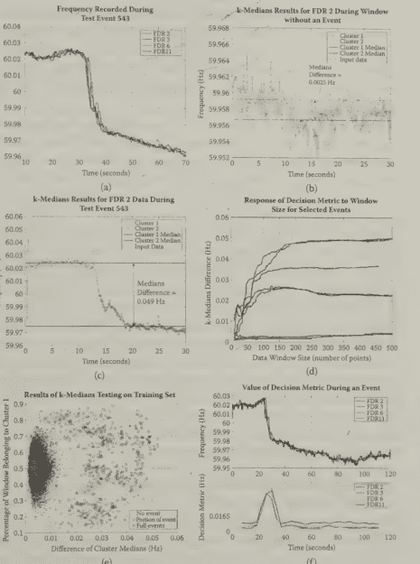

图 9.5 *（见彩色插页。）* 基于 *k*-Medians 方法识别事件的示意图：(a) 发电机跳闸频率响应示例；(b) 无事件特征的频率数据的 *k*-Medians 结果；(c) 含事件特征的频率数据的 *k*-Medians 结果；(d) 窗口大小对用于选择训练事件的 *k*-Medians 指标的影响；(e) 在训练数据上评估的 *k*-Medians 指标；以及 (f) 所选 FDR 在事件期间决策指标的响应。

由这类系统事件引起的功率不平衡可能对整个系统的稳定性产生不利影响；因此，期望实时监视传入的 FDR 数据，以识别频率的突然变化。当检测到此类事件时，可从频率数据中提取更多信息 [6, 7]，并由系统操作员采取适当措施。

鉴于包括电网系统在内的应用日益增多，流式数据挖掘正受到越来越多的关注。对于流式数据挖掘，使用少量内存的单遍算法至关重要。已提出若干数据流算法 [2–5]。图 9.5(a) 所示数据集代表了需要检测的特征类型。事件之前是相对稳定的初始运行点，随后频率快速变化，最后稳定到新的运行点。这种快速变化可以是如图 9.5(a) 所示的频率下降。对数据窗口拟合阶跃函数应能给出事件前和事件后的运行点。取这两个运行点之差可得到事件规模。然后可基于该差值设置决策边界，以区分包含事件的数据集和不包含事件的数据集。

#### 9.4.2 使用 *k*-Medians 确定事件前和事件后运行点

包含事件的数据窗口将由两类数据点簇主导：属于事件前状态的点集和属于事件后状态的点集。每个点集还会包含一些属于事件本身的点。如果选择的窗口大小足够大于事件区域，这些点将被事件前和事件后簇所掩盖。这两个簇的识别通过 *k* = 2 的 *k*-Medians 算法实现。正如 Wang、Gardner 和 Liu [7] 所讨论的，FDR 数据集天然包含大量离群点，因此中位数比均值更适合作为位置估计量；

以已知事件时间为参照，对 k-Medians 差分度量进行性能评估。结果如图 9.5(e) 所示。图 9.5(e) 中的每个点代表训练集数据中的一个窗口。蓝色叉号对应不包含任何事件的窗口；黑色圆圈代表包含完整事件特征的窗口；红色圆圈则代表包含部分事件但并非整个跌落过程的窗口。包含不完整事件的窗口散布在另外两组之间。这些点代表从非事件状态到事件状态的过渡，因此它们出现在每组中都是符合预期的。由于数据窗口的滑动特性以及事件特征的宽度，每个事件都保证至少完整出现在一个窗口内。因此，图 9.5(e) 中的红色点成为“无关紧要”的情况，因为它们代表的事件要么已经被检测到，要么将被后续窗口检测到。对图 9.5(e) 进行评估以确定蓝色组与黑色组之间的决策边界后发现，当 k-Medians 差分度量的绝对值为 0.0165 赫兹时，决策边界最优。小于该值表示没有事件，而大于 0.0165 赫兹则表示发生了事件。此处确定的决策边界专门针对美国电网系统中的东部互联电网设计。电网系统中的其他互联电网将具有不同的决策边界。

#### 9.4.5 决策边界的评估

在构建事件检测算法并为其度量设置决策边界后，针对训练集之外的多个数据集进行了测试。在所有情况下，该算法都能正确区分包含事件特征的窗口和不包含事件特征的窗口。图 9.5(f) 给出了事件检测度量与源数据的基于时间的比较。其中，上图给出测量数据值；下图给出事件期间 k-Medians 差分决策度量的对应值。选定的决策边界在决策度量图中显示为水平虚线。如图所示，该度量在事件发生前低于决策边界，在事件特征的时间范围内超过该值，并在事件过去后最终回落到边界以下。

### 9.5 使用时间序列变化检测识别电网中断

识别电网中断的一个挑战是尽早检测到事件。第 9.3 节讨论的 *k*-Medians 方法需要实际事件前后的数据才能可靠地识别事件。这一限制可能使该方法不适用于实时决策应用。本节介绍一种更快的方法来识别单个数据流中的电网中断，该方法应用时间序列变化检测算法来识别显著变化。

时间序列变化检测是统计学中一个研究较多的领域，尤其是在*统计过程控制*的背景下[19, 20]。近年来，已有一些数据挖掘方法被提出用于识别时间序列中的变化[21, 22]。但这些方法中的许多要么不是在线方法，要么无法扩展到该领域所遇到的高吞吐量数据。

本节讨论一种基于广泛使用的质量控制方法——累积和控制图（CUSUM）[23]的时间序列变化检测方法。变化检测在时间序列分析和预测背景下已被广泛研究。标准方法包括各种平滑技术、Box-Jenkins 自回归积分滑动平均（ARIMA）建模、创新和异常值分析，以及较新的基于小波的方法。

#### 9.5.1 基于 CUSUM 的快速时间序列异常检测方法

本小节讨论一种基于 CUSUM 的、用于识别单变量时间序列中异常的方法。确切的问题可以定义为：

给定一个定期采样的时间序列 $T$，其中每个值 $T_p$ 是某个传感器在时间 $t$ 的测量值，识别形如 $[t_1,t_2]$ 的区间，使得底层系统在从 $t_1$ 到 $t_2$ 的时间段内处于异常状态。

虽然传统上 CUSUM 用于识别时间序列中的变化，但它可以适用于时间序列中的异常检测。CUSUM 的核心思想是，通过识别变化点，可以使用它来确定给定时间序列中异常状态的开始和结束。

CUSUM 方法是一种涉及累积和计算的序贯方法。对于给定的时间序列，在给定的时间 $t (> 1)$，计算以下两个量：

$$S_t^+ = \max(0, S_{t-1}^+ + (T_t - \omega_t))$$

$$S_t^- = \max(0, S_{t-1}^- + (\omega_t - T_t))$$

量 $\omega_t$ 是在每个时间点分配的权重。虽然它可以依赖于 $t$，但设置为

$$\omega_t = \mu_0 + k|\mu_0 - \mu|$$

其中 $\mu_0$ 表示 $T$ 在受控状态下的期望均值，而 $\mu$ 表示需要检测的最小偏移。该方法有一个参数，即*允许值* $k$，通常设置为 0.5 或 1。允许值 $k$ 控制允许偏离期望均值的程度。如果过程天然具有噪声，$k$ 通常设置得较高；而对于相对稳定的过程，$k$ 设置为较低值。

该过程初始化为

$$S_1^+ = \max(0, T_1 - \omega_1)$$

$$S_1^- = \max(0, \omega_1 - T_1)$$

$S^+$ 统计量监控正方向的变化（有时也称为“高侧”CUSUM），$S^-$ 统计量监控负方向的变化（有时也称为“低侧”CUSUM）。对于监控电网中断，低侧 CUSUM 是相关的，因为我们感兴趣的是检测电力频率下降的事件。

图 9.6 展示了一个简单示例，说明了在合成生成的时间序列数据集上基于 CUSUM 的异常检测。时间序列中的前 100 个点和后 100 个点由均值为 0、标准差为 1 的正态分布生成。从时间 101 到 200 的点由均值为 -0.25、标准差为 1 的正态分布生成。可以看出，尽管异常区域肉眼难以区分，但基于 CUSUM 的方法仍然可以识别异常区域。在异常状态期间，CUSUM 分数增加，一旦时间序列恢复正常状态，分数开始下降。

在计算方面，这种方法速度很快，因为它在每个时间点只需要常数时间的操作，而且内存效率也很高，因为我们只需要维护前一个时间点的 CUSUM 统计量的值。

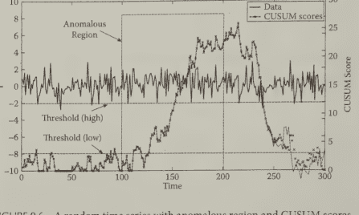
图 9.6 带有异常区域和 CUSUM 分数的随机时间序列。

这种方法的关键问题在于，CUSUM 的输出需要一个阈值来声明系统何时处于异常状态。如果阈值设置得很低，误报率就会很高；而当阈值设置得过高时，可能会导致识别事件的延迟。为了缓解这一问题，质量控制文献提供了一种基于*平均运行长度*（ARL）指标设置阈值的方法。通常，阈值是根据受控过程中的预期事件数来设置的。

#### 9.5.2 电网数据上的结果

本节总结了前一节所述的基于 CUSUM 的异常检测器在本章第 9.3 节所述 FDR 传感器收集的频率数据上的性能。这些实验的目标如下：

- 1. 基于 CUSUM 的方法能否识别有用的事件？
- 2. 典型的误报率是多少？

##### 9.5.2.1 数据描述和算法参数

对于本节所示的结果，数据来自位于美国东部互联电网（EI）内的 21 个 FDR。使用了 2 个月（2008 年 5 月和 2008 年 6 月，共 61 天）的数据。时间

时间序列以10赫兹的速率采样。每天的时间序列长度为864,000。数据按月分别分析。频率数据使用*k*-Medians方法预处理，其中*k*设为5。

CUSUM算法的允许值（*k*）设为1，要检测的最小偏移（μ）设为0.05，受控分布均值（μ₀）为0。异常事件定义为一个月长时间序列的子序列，其中CUSUM统计量大于零。基于领域理解，如果异常事件持续至少2秒（20个观测值），则认为其是*显著的*。

##### 9.5.2.2 *原始结果*

表9.1总结了2008年5月和2008年6月各传感器识别出的显著异常事件数量。结果表明，对于所有FDR，系统处于异常状态的时间占总时间的很小一部分，但这一比例本身可能对应很大的数量。例如，密歇根州大急流城的FDR 11处于异常状态的时间占总时间的0.0082，约200,000个观测值。然而，每个传感器一个月内显著异常事件的数量不超过119。

表9.1 不同FDR下基于CUSUM的异常检测输出的汇总统计

| FDR编号 | 位置 | 州 | 2008年5月报警比例 | 2008年5月异常事件数 | 2008年6月报警比例 | 2008年6月异常事件数 |
|---:|---|:---:|---:|---:|---:|---:|
| 11 | 大急流城 | MI | 0.0082 | 117 | 0.0094 | 115 |
| 13 | 卡梅尔 | IN | 0.0081 | 115 | 0.0095 | 113 |
| 38 | 霍利奥克 | MA | 0.007 | 97 | 0.0093 | 106 |
| 40 | 圣保罗 | MN | 0.008 | 116 | 0.0092 | 111 |
| 42 | 塔拉哈西 | FL | 0.0081 | 116 | 0.0095 | 116 |
| 510 | 布莱克斯堡 | VA | 0.0038 | 64 | 0.0046 | 85 |
| 513 | 州学院 | PA | 0.0082 | 119 | 0.0095 | 113 |
| 514 | 辛普森维尔 | SC | 0.0009 | 16 | 0.0005 | 13 |
| 516 | 罗切斯特 | NY | 0.0056 | 88 | 0.009 | 108 |
| 519 | 纽波特纽斯 | VA | 0.0034 | 53 | 0.0034 | 37 |
| 521 | 奇利科西 | OH | 0.0076 | 117 | 0.0058 | 71 |
| 523 | 橡树岭 | TN | 0.0033 | 43 | 0.0019 | 19 |
| 526 | 伯明翰 | AL | 0.0082 | 118 | 0.0095 | 113 |
| 560 | 德卢斯 | MN | 0.0068 | 92 | 0.0079 | 90 |
| 561 | 麦迪逊 | WI | 0.0081 | 119 | 0.0095 | 115 |
| 566 | 格尔夫波特 | MS | 0.0081 | 116 | 0.0095 | 113 |
| 568 | 蒙哥马利 | AL | 0.0082 | 117 | 0.0095 | 113 |
| 570 | 亚特兰大 | GA | 0.0082 | 118 | 0.004 | 54 |
| 571 | 彭萨科拉 | FL | 0.0082 | 118 | 0.0095 | 111 |
| 596 | 库克维尔 | TN | 0.0067 | 93 | 0.0062 | 69 |
| 597 | 库克维尔 | TN | 0.0067 | 92 | 0.0056 | 66 |

由于缺乏该时间段电网相关事件的真实基准数据，评估异常检测器的输出是一项挑战。一种可能是检查事件发生具体日期的当地新闻来源，尽管该过程可能成本高昂，而且不保证覆盖每个电网事件。为了进一步整合输出，可以应用*空间同址约束*，如下文所述。

##### 9.5.2.3 *引入空间信息*

电网事件（如停电、跳闸）通常具有级联效应。因此，电网事件必须在空间同址传感器收集的数据中显现出来。表9.2显示了在考虑空间信息的情况下，基于CUSUM的异常检测系统为每个传感器识别出的显著事件数量。因此，如果某个传感器发出的警报也被邻近传感器（本研究中为八个）发出，则该警报被视为“真实”。引入空间信息后，显著事件的数量减少了。虽然不能推断被如此忽略的事件没有用，但这种方法确实允许得到一个缩减后的集合以供进一步分析。

数据已经使用*k*-Medians方法进行了中心化，即使用中位数作为中心来平移数据子集。

如表9.2所示，考虑空间上下文后，显著事件的数量急剧减少到143。虽然这种方法真正的好处只能通过确认检测到的事件确实有助于识别实际事件来验证，但缺乏关于电网事件的可靠真实基准使验证具有挑战性。在撰写本章时，检测到的事件正在通过人工流程进行验证，其结果将在未来的出版物中记录。

表9.2 不同FDR下空间感知的基于CUSUM的异常检测输出的显著事件数量

| FDR编号 | 位置 | 州 | 2008年5月 | 2008年6月 |
|---|---|---|---|---|
| 11 | 大急流城 | MI | 8 | 8 |
| 13 | 卡梅尔 | IN | 5 | 6 |
| 38 | 霍利奥克 | MA | 0 | 0 |
| 40 | 圣保罗 | MN | 8 | 8 |
| 42 | 塔拉哈西 | FL | 0 | 0 |
| 510 | 布莱克斯堡 | VA | 0 | 0 |
| 513 | 州学院 | PA | 0 | 0 |
| 514 | 辛普森维尔 | SC | 0 | 0 |
| 516 | 罗切斯特 | NY | 0 | 0 |
| 519 | 纽波特纽斯 | VA | 0 | 0 |
| 521 | 奇利科西 | OH | 0 | 0 |
| 523 | 橡树岭 | TN | 0 | 0 |
| 526 | 伯明翰 | AL | 9 | 8 |
| 560 | 德卢斯 | MN | 8 | 8 |
| 561 | 麦迪逊 | WI | 8 | 8 |
| 566 | 格尔夫波特 | MS | 9 | 8 |
| 568 | 蒙哥马利 | AL | 9 | 8 |
| 570 | 亚特兰大 | GA | 0 | 0 |
| 571 | 彭萨科拉 | FL | 9 | 8 |
| 596 | 库克维尔 | TN | 0 | 0 |
| 597 | 库克维尔 | TN | 0 | 0 |

### 9.6 结论

数据挖掘在解决若干关键电网问题方面具有巨大意义，特别是在本章讨论的快速事件检测领域，这些问题有望在实现智能电网所承诺的效益方面发挥长远作用。该领域在数据分析方面的关键挑战在于数据的海量性以及允许充分响应所需的短反应时间（约几秒）。本章提出的分析解决方案主要集中于可扩展到数据规模和输入功率信号高采样率的简单分析。未来，随着同步相量变得越来越先进（无论是在采样率还是全国部署传感器数量方面），将需要更多研究来使数据分析解决方案具有可扩展性。

### 参考文献

- 1. J.N. Bank, O.A. Omitaomu, S.J. Fernandez, and Y. Liu, 电力系统频率数据流的可视化与分类，*Proceedings of the IEEE International Conference on Data Mining Workshops*，第650–655页，2009年。
- 2. P. Domingos and G. Hulten, 挖掘高速数据流，*Proceedings of the Sixth ACM SIGKDD International Conference on Knowledge Discovery and Data Mining*，第71–80页，2000年。
- 3. G. Hulten, L. Spencer, and P. Domingos, 挖掘随时间变化的数据流，*Proceedings of KDD 2001*，第97–106页，2001年。
- 4. D. Kifer, S. Ben-David, and J. Gehrke, 检测数据流中的变化，*Proceedings of the 30th VLDB Conference*，第180–191页，2004年。
- 5. L. O'Callaghan, N. Mishra, A. Meyerson, S. Guha, and R. Motwani, 用于高质量聚类的流数据算法，*Proceedings of the 18th International Conference on Data Engineering*，2002年。
- 6. B. Qiu, L. Chen et al. 基于互联网的频率监测网络（FNET），*IEEE Power Engineering Society, Winter Meeting*，2001年。第3卷，2001年1月28日–2月1日，第1166–1171页。
- 7. J.K. Wang, R.M. Gardner, and Y. Liu, 使用广域测量分析系统振荡，*IEEE Power Engineering Society, General Meeting*，2007年，2007年6月25日–6月28日。
- 8. J.N. Bank, O.A. Omitaomu, S.J. Fernandez, and Y. Liu, 电力系统区间振荡模式的提取与可视化，*Proceedings of the IEEE Power & Energy Society Annual Meeting*，Minneapolis, MN，2010年7月25–29日。
- 9. N.E. Huang, Z. Shen, S.R. Long, M.C. Wu, S.H. Shih, Q. Zheng, C.C. Tung, and H.H. Liu, 经验模态分解方法及希尔伯特谱用于非平稳时间序列分析，*Proceedings of the Royal Society of London*，A454: 903–995，1998年。
- 10. H. Liang, Z. Lin, and R.W. McCallum. 基于经验模态分解方法的胃电图伪影减少，*Medical & Biological Engineering & Computing*，38: 35–41，2000年。
- 11. A.K. Jain and R.C. Dubes, *数据聚类算法*。Prentice-Hall，Englewood Cliffs, NJ，1981年。
- 12. N.E. Huang, M.-L. Wu, W. Qu, S.R. Long, and S.P. Shen. 希尔伯特–黄变换在非平稳金融时间序列分析中的应用，*Applied Stochastic Models in Business and Industry*，19: 245–268，2003年。
- 13. S.T. Quek, P.S. Tua, and Q. Wang. 基于真实数据的希尔伯特–黄变换检测梁和板中的异常，*Smart Materials and Structures*，12: 447–460，2003年。
- 14. Z. Zhong, C. Xu, et al. 电力系统频率监测网络（FNET）的实现，*IEEE Trans. on Power Systems*，20(4): 1914–1921，2005年。
- 15. T.K. Sarkar and O. Pereira. 使用矩阵束方法估计复指数和的参数，*IEEE Antennas and Propagation Magazine*，37(1): 48–55，1995年。

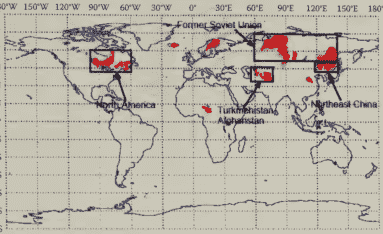

前苏联

北美

土库曼斯坦 阿富汗

中国东北

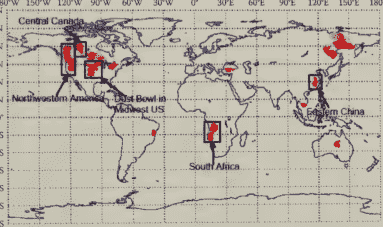

加拿大中部

美国西北部

尘暴区

中国华北

南非

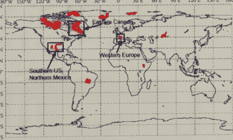

加拿大东部

美国南部

墨西哥北部

西欧

图4.1 我们的算法检测到的干旱区域。每个面板显示从特定十年开始的干旱：1905—1920年（左上）、1921—1930年（右上）、1941—1950年（左下）和1961—1970年（右下）。黑色矩形区域表示文献[63]发现的共同干旱区域。

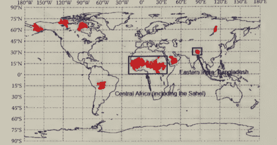

图4.1（续）我们的算法检测到的干旱区域。每个面板显示从特定十年开始的干旱：1905—1920年（左上）、1921—1930年（右上）、1941—1950年（左下）和1961—1970年（右下）。黑色矩形区域表示文献[63]发现的共同干旱区域。

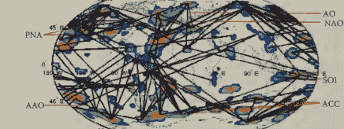

图4.2 使用基于图的分析方法从海平面气压（再分析）数据中发现的气候偶极子（详见[42]）。

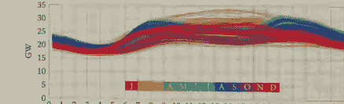

图8.2 2010年NEM的逐小时需求曲线（数据来自澳大利亚能源市场运营商[5]）。

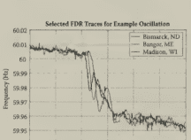

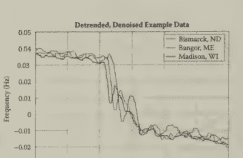

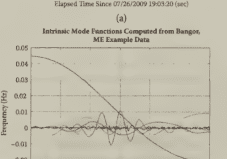

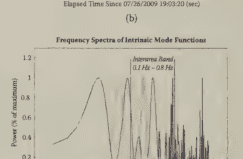

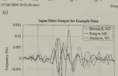

图9.1 FDR轨迹样本及后处理结果。

图9.3 相量聚类示例。

**图9.4** 使用相量可视化识别电网事件：(a) 事件前状态；(b) 振荡初始周期；(c) 振荡达到最大幅度；(d) 振荡阻尼；(e) 系统趋于稳态。

图10.1 风资源估计表示为双变量（速度和方向）统计分布（左）或“风玫瑰图”（右）。

图10.4 数据参考自美国马萨诸塞州十四个机场位置。见表10.1。

图10.5 红圈显示马萨诸塞州波士顿科学博物馆屋顶上风速计的位置。

## 风资源评估的统计方法

Kalyan Veeramachaneni, Xiang Ye, and Una-May O’Reilly

### 目录

- 10.1 引言 — 304
- 10.2 测量-相关-预测 — 307
- 10.3 风速估计方法 — 310
  - 10.3.1 多元正态模型 — 313
  - 10.3.2 非参数多元模型 — 313
  - 10.3.3 朴素结构图模型 — 314
  - 10.3.4 带结构学习的图模型 — 316
  - 10.3.5 多元Copula — 316
- 10.4 评估设置 — 319
- 10.5 结果与讨论 — 321
  - 10.5.1 算法比较 — 321
  - 10.5.2 增加可用于建模的数据 — 322
- 10.6 结论与未来工作 — 323
- 致谢 — 326
- 参考文献 — 326
- 附录10A — 327

### 10.1 引言

风资源评估是选择风电场场址决策过程中的一个环节。影响场址选择的因素有多种。其中包括法律考虑、社区意见、施工便利性、维护和电缆成本。可以说，最关键的是，在理想风速范围内是否有足够的风能，并能在很长的时间跨度内持续存在，例如一代人或更长时间。高频风预测（如数小时至数天至数周）充满技术和传感挑战——再加上内在不确定性。用于场址选择的风资源评估与高频预测不同。其目标是提供总体估计以指导选择，而不是精确预测。风电场的年度实际风资源预计会以合理方差偏离评估值。然而，当实际年度资源在长时间跨度上取平均时，目标是评估值与实际情况应当吻合。通过这种方式，风资源评估有助于为场址在其延长寿命期内（可能包括风机及相关设施的逐步升级）的发电能力问题提供依据。

风资源评估表示为覆盖360°的各方向区间上的一组风速概率分布。图10.1左侧给出了0°至15°、15°至30°和30°至45°三个区间的三个分布示例。每个绘制的概率函数都用由形状参数和尺度参数参数化的威布尔分布建模。对该函数进行（数学）积分，可以推导出给定方向范围内的风速处于特定范围的概率。

图10.1（见彩色插页。）风资源评估表示为双变量（速度和方向）统计分布（左）或“风玫瑰图”（右）。

该评估也可通过风玫瑰图进行可视化；见图10.1（右）。整个360°范围按南北罗盘方向定向，以表明其与场址的方位对齐关系。图10.1（左）显示了16个方向区间，每个区间都是一个离散的“扇片”，其颜色描绘风速。扇片的长度和宽度表示概率。

推导风资源评估的方法有多种。所有方法都存在很大的不确定性。当风资源评估基于风图谱和最近位置的公开可用数据集时，由于图谱过于宏观，往往会高估风速。即使利用考虑地表粗糙度及其他因素的模型来改进风图谱对某一地理位置的资源估计，显著的不准确性仍然存在，因为场址的具体细节仍被忽略。另一种方法是使用计算流体动力学（CFD）模型来获得更好的资源评估。然而，CFD也有局限性。很难将所有与湍流相关的局部属性和因素纳入仿真。虽然风电行业已开始将CFD与风图谱方法相结合，但当前方法仍是临时性的、不够稳健，且成本高于期望。

本章我们为这样一种评估方法提供新技术：它是唯一尽可能考虑多年历史数据（尽管这些数据远离场址本身）的方法，同时还整合场址特定信息（尽管这些信息是短期的且相对嘈杂）。我们考虑测量-相关-预测评估方法，简称MCP，它利用风速计和/或其他提供场址特定数据的传感设备[1–4]。测量步骤包括在场址测量一定持续时间内的风速和风向。在相关步骤中，然后将这些数据与附近气象站的同时期数据相关联，这些气象站即所谓的历史站点，也具有长期历史数据。在时间同步的数据集之间建立相关模型。在预测步骤中，然后使用该模型以及来自气象站的历史数据来预测场址的风资源。预测结果表示为双变量（速度和方向）统计分布，或如图10.1所示的“风玫瑰图”。

虽然MCP确实纳入了场址特定数据，但这些数据基于非常廉价的传感器，即风速计，因此噪声很大。此外，风速计在场址上经常被移动，并且不会部署很长时间。因此，关键

MCP 的挑战在于利用廉价、含噪的短期传感器测量进行准确预测。我们旨在探讨各种技术如何与数据可获得性相匹配。通常，风电行业将 8 到 10 个月视为标准。然而，我们寻求非常简单的建模技术，以减少获得长期风速准确估计所需的数据量。

另一个挑战是整合历史站点数据。如果只考虑风向，那么用于将风速与某站点进行关联的最佳历史站点（例如机场）可能在某种程度上是直观的：例如，当该站点吹北风时，其风速可能与正北方某个机场气象塔的风速相关性最好。然而，当地地形高度变化等站点条件，或森林、大型建筑等地形特征，会使识别最佳相关数据源变得复杂得多。站点条件无法在数据中直接观测到，但会影响相关关系。此外，相关强度可能对风向如何划分为聚合分箱和区间很敏感。迄今为止，这种选择是通过试错建模以及对拟建站点与历史站点之间相似性的经验性理解来完成的。几乎总是使用距离测试站点最近的一个历史站点来构建预测模型。然而，对于任何给定位置，当站点不同方向上的多个历史站点都可作为候选整合到估计中时，可以获得更好的精度。本章讨论如何整合来自多个历史站点的风信息，并根据每个历史站点的相关强度对其进行加权。

风电场未达到预期发电量并不罕见。英国开展的一项研究监测了小型和微型风力涡轮机的性能，发现风资源被高估了 15 倍 [5]。另一个例子中，对马萨诸塞州安装的 19 台小型涡轮机 [6] 的数据分析显示，涡轮机平均性能低于预期 4 倍。容量系数低至 3% 至 4%。风资源评估不足被确定为影响性能不达标的主要因素之一（占 20%）。

本章介绍一组基于统计推断的计算智能技术。每种技术都依赖于估计站点风速与公开可获得的邻近数据源风速的联合分布。这些技术中任何一种的精度都对建模设置和/或参数化的选择敏感。我们旨在评估哪种技术及其选择最佳。我们的评估将利用波士顿科学博物馆一处站点的风速计测量数据，在站点数据可获得性分别为 3、6 和 8 个月时，将其与附近 14 个机场的数据进行关联；见图 10.4 和表 10.1。

表 10.1 波士顿科学博物馆位于 N42.37°、W71.1°

| 变量 | 机场 | 距离（英里） | 罗盘方位（纬度，经度） |
|---|---|---:|---|
| x₁ | North Adams | 151 | (42.69°, −73.16°) |
| x₂ | Bedford | 18.7 | (42.46°, −71.28°) |
| x₃ | Beverly | 20.6 | (42.58°, −70.91°) |
| x₄ | Chatham | 88.5 | (41.68°, −69.99°) |
| x₅ | New Bedford | 56.2 | (41.67°, −70.95°) |
| x₆ | Fitchburg | 41.2 | (42.55°, −71.75°) |
| x₇ | Hyannis | 72.7 | (41.66°, −70.28°) |
| x₈ | Lawrence | 28.1 | (42.71°, −71.11°) |
| x₉ | Vineyard Haven | 92.9 | (41.39°, −70.61°) |
| x₁₀ | Orange | 84.7 | (42.57°, −72.28°) |
| x₁₁ | Norwood | 23.2 | (42.18°, −71.17°) |
| x₁₂ | Plymouth | 43.9 | (41.96°, −70.68°) |
| x₁₃ | Taunton | 39.3 | (41.87°, −71.01°) |
| x₁₄ | Boston | 4.9 | (42.36°, −71.02°) |

注：第 1 列和第 2 列显示机场名称及其在我们多变量模型中的对应变量名。第 3 列显示每个机场到波士顿科学博物馆的视线距离（英里）。第 4 列显示每个机场的罗盘方位。

我们按如下结构展开：10.2 节详细描述 MCP；10.3 节介绍可用于 MCP 框架的统计技术；10.4 节说明我们评估这些技术的方法；10.5 节给出实证评估；最后，10.6 节陈述结论并概述未来工作。

### 10.2 测量-关联-预测

我们考虑通过一种称为测量-关联-预测（Measure-Correlate-Predict）的方法得到的风资源估计；见图 10.2。就符号而言，特定位置的风由速度 x 和风向 θ 表征。风速由风速计测量，风向由风向标测量。360° 方向被划分为多个分箱，每个分箱具有下限（θₗ）和上限（θᵤ）。我们为风向分箱赋予索引值 J = 1…j。我们用 y 表示测试站点（需要估计风资源的站点）的风速测量值，用 x 表示其他站点（可获得长期风资源的站点）的风速测量值，并用 M = 1…m 对这些其他站点建立索引。

| 日期时间 | 历史站点 风向 | 历史站点 风速 | 测试 风速 | 测试 风向 |
|---|---:|---:|---:|---:|
| 11/5/2008 8:55 | 180 | 1.543 | 0.724 | 58.79 |
| 11/5/2008 9:15 | 140 | 1.543 | 0.423 | 83.49 |
| 11/5/2008 9:25 | 145 | 2.058 | 0.500 | 74.13 |
| 11/5/2008 9:35 | 180 | 1.543 | 0.705 | 53.62 |
| ... | ... | ... | ... | ... |
| 2/5/2009 12:15 | 140 | 1.801 | 0.441 | 277.5 |
| 2/5/2009 12:25 | 145 | 1.801 | 0.303 | 290.67 |
| 2/5/2009 12:35 | 135 | 1.543 | ? | ? |
| ... | ... | ... | ... | ... |
| 11/5/2009 15:25 | 110 | 1.543 | ? | ? |
| 11/5/2009 15:35 | 85 | 1.801 | ? | ? |

图 10.2 MCP 生成一个模型，将站点风向与历史站点同时刻的风向相关联。对于每个风向分箱，它生成一个将同时刻风速相关联的模型。

MCP 的三个步骤如下：

- 1. **测量：** 收集站点上的短期传感测量数据。记为 Y = {y_t ... y_n}。测量可使用站点上的风速计、新建的气象塔，甚至声呐或激光雷达等遥感技术来收集。不同的测量技术会产生不同成本，从而决定其在不同项目中的可行性。收集同一时期内附近站点的测量数据。这些站点称为*历史站点*，拥有过去 10 至 20 年的额外数据。它们记为 X = {x_{t_1...t_n}^i}，其中每个 x_{t_1...t_n}^i 对应一个历史站点的数据；\(k\) 和 \(n\) 是时间索引，\(m\) 表示历史站点的总数。与建模所用站点观测在时间上不同步的历史数据将用于**预测**步骤。
- 2. **关联：** 首先构建一个风向模型，将站点观测到的风向与历史站点同时刻的风向相关联。接下来，对于 360° 范围内的每个方向区间（称为（方向）分箱），构建一个模型，将站点风速与历史站点同时刻的风速相关联，即 \(Y_i = f_\theta(x_{i,t}^{1:m})\)，其中 \(k \le i \le n\)。此阶段从站点可获得的数据预计是稀疏且含噪的。
- 3. **预测：** 为获得站点长期风况的准确估计，我们首先将来自历史站点的数据（这些数据与建模所用站点观测在时间上不同步）划分为对应于各风向分箱的子集。长期站点条件的预测包括两个步骤：
  - a. 我们使用针对该方向建立的模型 \(f_{\theta_j}\) 以及来自对应该方向的历史站点数据 \(x_{i,t}^{1:m}|\theta_j\)，预测站点风速 \(Y_p = y_{i,t...}\) 会是多少。
  - b. 利用上述步骤 3a 得到的预测值 \(Y_p\)，我们估计威布尔分布的参数。该分布就是我们针对风资源评估问题的答案。我们为每个风向分箱生成一个分布。图 10.1（左）给出了不同分箱的几个示例分布。或者，也可以通过图 10.1（右）所示的风玫瑰图来汇总这些分布。

目标是生成每个方向上的预测长期风速分布，使其尽可能接近真实（尚未实际经历）的分布。然后，MCP 的结果——每个分箱中的统计分布——被用于在给定制造商提供的功率曲线的情况下，估计风力涡轮机可期望产生的能量。如果考虑涡轮机之间的尾流相互作用，该计算可扩展到整个风电场。更多细节参见 Wagner 等 [7]。

注意，该分布不仅捕获平均值，还捕获该风速的方差。这对于长期风资源评估和长期发电量估计至关重要。

Rogers 等 [8] 开发了多种方法来评估预测风速分布的准确性。其中一种方法通过威布尔分布真实参数与实际参数之间的比值来衡量准确性：即真实形状与估计形状、真实尺度与估计尺度。为了完整捕捉预测分布中任何可能的不准确之处，我们测量对称 Kullback-Leibler（KL）距离。需要注意的是，该度量不同于均方误差或平均绝对误差，后者通过每个预测值与真实观测值之间的差异来衡量准确性。使这些误差最小化的方法，未必能准确表达近似分布与真实分布之间的接近程度。现在，我们继续描述为在 MCP 框架内部署而引入的一组统计方法。

### 10.3 风速估计方法

在符号表示上，我们将训练点记为 \(\ell \in \{1,\ldots,L\}\)，将需要对其进行预测的点记为 \(k \in \{1,\ldots,K\}\)。在所有地点测量完成时间同步后，我们省略时间记号。我们还省略方向分箱的下标。从此以后，当我们提到模型时，指的是特定分箱 \(j\) 的模型。然后，\(f_Z(z)\) 表示变量（或变量集合）\(z\) 的概率密度函数。\(F_Z(z)\) 表示变量 \(z\) 的累积分布函数，对于连续密度函数，满足

\[
F_Z(\alpha)=\int_{-\infty}^{\alpha} f_Z(z)\,dz
\]

我们的 MCP 方法包含四个步骤：

- **步骤 1：** 首先，我们构建一个概率密度函数为 \(f_{X,Y}(x,y)\) 的多元分布，其中 \(x = \{x_1,\ldots,x_m\}\) 是历史站点的风速，\(y\) 是目标站点的风速。为此，我们采用似然参数估计。所有分箱的模型构建过程类似，只需更改数据。
- **步骤 2：** 给定步骤 1 得到的联合分布，我们通过估计条件密度 \(f_Y(y|x_k)\)，预测与给定测试样本 \(x_k = \{x_{1,k},\ldots,x_{m,k}\}\) 相对应的 \(y\) 的概率密度。条件密度可通过下式估计

  \[
  f_{Y|X=x_k}(y|x_k) = \frac{f_{X,Y}(x_k, y)}{\int_{y} f_{X,Y}(x_k, y)\,dy} \quad (10.1)
  \]

- **步骤 3：** 现在，我们可以通过寻找使条件密度最大的 \(y\) 值，对 \(\hat{y}_k\) 进行点预测：

  \[
  \hat{y}_k = \arg\max_{y \in Y} f(y|\mathbf{X} = \mathbf{x}_k) \quad (10.2)
  \]

- **步骤 4：** 对 \(\hat{y}_{1\ldots K}\) 的所有预测值拟合威布尔密度函数，从而给出测试站点长期风资源的估计。

该方法涉及两项设计决策：

- **1. 选择模型：** 一个关键决策是应使用哪个密度函数来建模单变量密度 \(f_{x_k}(x)\)，以及联合密度函数的选择。简单直接的选择是单变量和多变量高斯分布。这是因为高斯密度函数具有用于参数估计和条件密度求值的闭式解析方程，易于计算。遗憾的是，在许多情况下，这种选择可能导致不准确。单个变量可能无法在无显著误差的情况下拟合高斯密度函数——例如，当它们具有显著的尾部特性或双峰分布时。联合高斯密度函数只能捕捉变量之间的线性相关性。如果我们为 \(x_n\) 选择非高斯单变量密度，则必须使用 *Copula 函数* 来构建多元联合密度函数。
- **2. 关于变量依赖结构的假设：** 联合密度函数的参数估计计算代价高昂，并且需要大量数据。从联合分布进行推断同样代价高昂。假设某些变量之间条件独立，可在上述三个方面提高效率，因为这允许对密度函数进行因式分解。例如，图 10.3 展示了变量与输出变量 \(y\) 的两种可能依赖结构。

FIGURE 10.3 上：朴素贝叶斯结构。该结构是假设得到的，不需要学习。\(x_1,\ldots,x_{14}\) 表示来自机场的 14 个变量，\(y\) 表示波士顿测试站点的变量。下：使用 K2 算法学习结构。最多指定两个父节点，\(x_2\) 成为大多数节点的父节点。

上图是最简单的结构，它假设在给定输出变量时输入变量之间相互独立。下图展示了可以从数据中学习到的一种可能结构。

在风资源评估中，学习依赖结构的一个主要优势是：在将更多机场纳入模型且不需要更多站点数据的情况下，仍能减少预测时间。在此，我们将评估该结构应当从数据中学习还是预先定义。

我们的每种风资源评估统计技术都遵循这些步骤。每种技术在步骤 1 以及如何估计联合多元密度函数方面各有特点。下面我们逐一描述这些技术。

#### 10.3.1 多元正态模型

这里，假设联合密度 \(f_{X,Y}(x,y)\) 服从多元正态模型 \(N(\mu,\Sigma)\)，即

\[
f_Z(z) = (2\pi)^{-(n+1)/2} \det(\Sigma)^{-1/2} \exp\left(-\frac{1}{2}(z-\mu)^T\Sigma^{-1}(z-\mu)\right) \quad (10.3)
\]

其中 \(z = \{x,y\}\)，\(\det\) 表示矩阵的行列式。多元高斯密度函数有两个参数 \(\{\mu,\Sigma\}\)。我们通过在一组 \(L\) 个独立同分布观测下最大化似然函数来估计这些参数。该模型的最大优势在于模型易于构建，因为最大似然估计（MLE）可直接由闭式解析形式给出。变量 \(z\) 的均值向量 \(\mu\) 的 MLE 就是样本均值。协方差矩阵 \(\Sigma\) 的 MLE 由下式给出

\[
\hat{\Sigma} = \frac{1}{L} \sum_{i=1}^{L} (z_i - \bar{z})(z_i - \bar{z})^T \quad (10.4)
\]

一旦使用闭式表达式并基于训练数据估计出联合密度的参数，我们就使用联合密度函数推导测试数据中给定 \(x_k\) 样本时 \(y\) 的条件密度。该密度同样为高斯分布，均值为 \(\mu_{y|x_k}\)，方差为 \(\sigma_{y|x_k}\)。值 \(\mu_{y|x_k}\) 被用作给定 \(x_k\) 时 \(\hat{y}_k\) 的点预测。方差 \(\sigma_{y|x_k}\) 给出预测的不确定性。如果 \(\sigma_{y|x_k}\) 较高，则不确定性较高。

#### 10.3.2 非参数多元模型

我们的第二个模型改编自 Chan 等 [9]，其中作者采用多元核密度估计器。选择高斯核，并使用所有数据 \(x_{1\ldots L}\) 估计密度。多元核密度函数由下式给出

\[
f_{X,Y}(x,y) = \frac{1}{L}\sum_{i=1}^{L} \prod_{j=1}^{m} K(x_j - x_{ij})K(y - y_i) \quad (10.5)
\]

对于输出未知的测试点 \(x_k\)，通过求条件密度函数 \(f_Y(y|x_k)\) 的期望值进行预测，即

\[
\begin{aligned}
E(Y\mid X=x_k)&=\int_y y\,f_Y(y\mid x_k)\,dy \tag{10.6}\\
&=\int_y \frac{\frac{1}{L}\sum_{i=1}^{L}\prod_{j=1}^{m}K(x_{j,k}-x_{j,i})K(y-y_i)}
{\frac{1}{L}\sum_{i=1}^{L}\prod_{j=1}^{m}K(x_{j,k}-x_{j,i})}\,dy \tag{10.7}\\
&=\frac{\sum_{i=1}^{L}y_i\prod_{j=1}^{m}K(x_{j,k}-x_{j,i})}
{\sum_{i=1}^{L}\prod_{j=1}^{m}K(x_{j,k}-x_{j,i})} \tag{10.8}
\end{aligned}
\]

该模型没有参数，也没有估计步骤。尽管式 (10.5) 给出了密度函数，但除非遇到新的测试点，否则不会对其进行求值。为了能够评估测试站点风速的期望值，我们需要存储所有训练点，并在式 (10.8) 中使用它们进行预测。在式 (10.8) 中，给定测试点 \(x_k=\{x_{1,k},\ldots,x_{m,k}\}\)，针对训练点 \(x_i\) 与该测试点之间的差值计算核值。该值与相应的 \(y_i\) 值相乘。对所有训练点 \(1\ldots L\) 重复此过程并求和。这构成分子。若求和时不乘以 \(y_i\)，则构成式 (10.8) 中的分母。该方法有一些缺点。设计者必须选择核函数。然后应通过进一步划分训练数据来调整核函数的参数。它还要求保留所有训练数据才能进行预测。对于每个测试点，核函数需要求值 \(L\) 次。

#### 10.3.3 朴素结构图模型

该技术使用多元高斯模型，并假设变量依赖结构相互独立。我们将联合密度函数建模为具有独立变量 \(x_{1,\ldots,m}\) 的贝叶斯网络，即，

$$
f_{X,Y}(x,y)=\prod_{i=1}^{m} f_{X_i}(x_i\mid y)f_Y(y) \tag{10.9}
$$

贝叶斯网络 $\mathcal{B}=\langle\mathcal{G},\theta\rangle$ 是一种概率图模型，它表示一组随机变量 $X_1,\ldots,X_n$ 上的联合概率分布。贝叶斯网络表示包含两个组成部分。有向无环图（DAG）$\mathcal{G}$ 编码变量之间的独立性关系。每个变量都是该图中的一个节点。一组局部概率模型 $\theta$ 定义图中每个节点在给定其父节点时的条件概率分布。令 $\mathrm{Pa}_X$ 表示 $\mathcal{G}$ 中节点 $X$ 的父节点。那么网络 $\mathcal{B}$ 编码以下概率分布：

$$
P(X_1,\ldots,X_n)=\prod_{i=1}^{n}P(X_i\mid\mathrm{Pa}_{X_i})
$$

相比之下，前面介绍的多变量模型假设相同的朴素贝叶斯结构，但对每个单独变量使用核密度估计器。

*估计：* 给定该结构（也如图 10.3 所示），我们针对二元高斯密度函数 $f_{X_i,Y}(x_i,y)$ 估计图 10.3（左）中每个节点的参数。我们使用最大似然估计，并采用与第 10.3.1 节类似的解析表达式，但这次分别针对每一对 $x_i,y$ 进行。$f_Y(y)$ 的参数直接使用 $y$ 的训练数据进行估计。

*预测：* 对于测试点 $x_k$，我们推导以下条件分布：

$$
f_{Y\mid X=x_k}(y\mid x_k)=\frac{\prod_{i=1}^{m} f_{X_i}(x_i\mid y)f_Y(y)}{\int_y \prod_{i=1}^{m} f_{X_i}(x_i\mid y)f_Y(y)\,dy} \tag{10.10}
$$

如果我们要最小化均方误差，最优预测是上述条件密度函数的均值。如果我们要最小化平均绝对误差，最优预测是条件密度函数的中位数 [10]。由于我们假设联合密度函数为高斯模型，这也会导致条件分布为高斯模型；$y\mid x_k$ 的均值和中位数相同。这也是使条件密度最大化的值。因此，$\hat{y}_k$ 为

$$
\hat{y}_k = \int y f_{Y\mid X=x_k}(y\mid x_k)\,dy \tag{10.11}
$$

#### 10.3.4 带结构学习的图模型

在第 10.3.3 节的模型中，我们假设一种朴素结构。相比之下，在本技术中，我们根据站点数据学习变量依赖结构（即贝叶斯网络）。文献中有许多结构学习算法，可以直接采用 [11–13]。

*估计：* 我们的估计包括两个步骤。首先，我们学习网络结构 $\mathcal{G}$，然后估计 $\mathcal{G}$ 中每个节点的条件概率分布参数。在我们的实验中，我们采用一种称为 K2 的启发式算法 [13]。该算法接受变量的顺序，并尝试学习依赖结构 [11]。然后，我们通过似然参数估计来估计每个节点处条件联合密度的参数。

*预测：* 给定一个新的测试点，有多种推断技术可用于预测 $y_k\mid x_k$ 的值 [11]。

我们建议读者参阅 Koller 和 Friedman [11]，以全面了解贝叶斯网络，以及一个知名的、公开可用的基于 MATLAB 的工具，用于 K2、似然参数估计和推断 [14]。

#### 10.3.5 多变量 Copula

我们之前的建模技术假设所有变量服从高斯分布，并且多变量联合分布为高斯分布。然而，有理由认为高斯分布不能准确表示风速分布。事实上，传统上使用单变量 Weibull 分布 [15] 来参数化描述风传感器测量值。选择 Weibull 分布可能还因为其灵活性，因为它可以表示多种分布中的任意一种，包括瑞利分布或高斯分布。

然而，据我们所知，尚未针对风资源评估估计非高斯分布的联合密度函数。在本章中，为了根据并非全部为高斯的边缘分布构建多变量模型，我们利用 Copula 函数。Copula 框架提供了一种从训练数据建模多变量联合分布的方法。然后可以基于 Copula 函数进行推断。

由于 Copula 估计不太为人所熟知，我们现在简要回顾 Copula 理论。然后，我们将描述如何构造作为 Copula 组成部分的各个参数分布，以及如何将它们耦合起来形成多变量密度函数。最后，我们给出在给定 $x_1,\ldots,x_m$ 的情况下预测 $y$ 值的方法。

参数为 $\theta$ 的 Copula 函数 $C(u_1,\ldots,u_{m+1};\theta)$ 表示多个均匀随机变量 $U_1,\ldots,U_{m+1}$ 的联合分布函数，使得

$$
C(u_1,\ldots,u_{m+1};\theta)=F(U_1\le u_1,\ldots,U_{m+1}\le u_{m+1}) \tag{10.12}
$$

令 $U_1,\ldots,U_m$ 表示变量 $x_1,\ldots,x_m$ 的累积分布函数（CDF），$U_{m+1}$ 表示 $y$ 的 CDF。因此，Copula 表示 $C(F(x_1),\ldots,F(x_m),F(y))$ 的联合分布函数，其中 $U_i=F(x_i)$。根据 Sklar 定理，任何以边缘分布 $F(x_i)$ 为参数的 Copula 函数都定义了具有边缘分布 $F(x_i)$ 的有效联合分布。因此，我们能够构造 $x_1,\ldots,x_m,y$ 的联合分布函数，如下所示：

$$
F(x_1,\ldots,x_m,y)=C(F(x_1),\ldots,F(x_m),F(y);\theta) \tag{10.13}
$$

联合概率密度函数（PDF）通过对式（10.13）求 $(m+1)$ 阶导数得到：

$$
f(x_1,\ldots,x_m,y)=\frac{\partial^{m+1}}{\partial x_1\cdots\partial x_m\partial y} C(F(x_1),\ldots,F(x_m),F(y);\theta) \tag{10.14}
$$

$$
=\prod_{i=1}^{m} f(x_i) f(y) c(F(x_1),\ldots,F(x_m),F(y)) \tag{10.15}
$$

其中 $c(\cdot,\cdot)$ 是 Copula 密度。因此，联合密度函数是独立密度函数的加权版本，其中权重通过 Copula 密度得到。文献中存在多种 Copula。在本章中，我们考虑多变量高斯 Copula，为我们变量构建如下统计模型：

$$
C_G(\Sigma)=F_G(F^{-1}(u_1),\ldots,F^{-1}(u_m),F^{-1}(u_y),\Sigma) \tag{10.16}
$$

其中 $F_G$ 是均值为零向量、协方差为 $\Sigma$ 的多变量正态分布的 CDF，$F^{-1}$ 是标准正态分布的逆。*参数估计：* 有两组参数需要估计。多变量高斯 Copula 的第一组参数是 $\Sigma$。第二组记为 $\Psi=\{\psi,\psi_y\}$，由 $x,y$ 的边缘分布参数组成。给定变量 $x,y$ 的 $N$ 个独立同分布观测值，对数似然函数为

$$
L(x,y;\Sigma,\Psi)=\sum_{i=1}^{N}\log f(x_i,y_i\mid\Sigma,\Psi) \tag{10.17}
$$

$$
=\sum_{i=1}^{N}\log\left[\left(\prod_{j=1}^{m}f(x_{ij};\psi_j)f(y_i;\psi_y)\right)c\bigl(F(x_1),\ldots,F(x_m),F(y);\Sigma\bigr)\right] \tag{10.18}
$$

参数 $\Psi$ 通过 Iyengar [16] 进行估计：

$$
\hat{\Psi}=\underset{\Psi\in\Psi}{\arg\max}\left\{\sum_{i=1}^{N}\log\left[\left(\prod_{j=1}^{m}f(x_{ij};\psi_j)f(y_i;\psi_y)\right)c\bigl(F(x_1),\ldots,F(x_m),F(y);\Sigma\bigr)\right]\right\} \tag{10.19}
$$

文献中有多种算法可用于估计式（10.19）中的 MLE。我们建议用户参阅 Iyengar [16]，以全面了解估计方法。关于 Copula 理论的更多细节，读者可参阅 Nelsen [17]。

*基于 Copula 的预测：* 对于新观测值 $x$，我们需要预测 $y$。为此，我们首先构造条件分布：

$$
P(y\mid x)=\frac{P(x,y)}{\int_y P(x,y)\,dy} \tag{10.20}
$$

我们预测的 $\hat{y}$ 最大化该条件概率：

$$
\hat{y}=\arg\max_{y\in Y} P(y\mid x) \tag{10.21}
$$

注意，式（10.20）分母中的项保持不变；因此，为了寻找最优值，我们可以忽略其计算。我们只需以离散步长在 $Y$ 的整个范围内评估该条件概率，并选择使条件概率最大的 $y\in Y$ 值。

### 10.4 评估设置

为了评估和比较我们的不同算法，我们从马萨诸塞州获取了多种风数据。我们从 ASOS（自动地面观测系统）机场数据库下载了数据，该数据库是公开的，包含马萨诸塞州 14 个机场在过去 10 至 20 年间收集的风数据。这些数据常被风能行业使用。机场位置如图 10.4 所示。然后，我们从安装在波士顿科学博物馆屋顶上的风速计获取数据，那里还安装了一个风向标。这些风速计价格低廉，因此噪声较大。博物馆坐落在建筑群和一条河流之间，并且靠近一个港口，如图 10.5 所示。这为我们提供了一个地形具有挑战性的站点。在该位置

**图 10.4** *（见彩色插图。）* 数据参考自美国马萨诸塞州的十四个机场位置。见表 10.1。

**图 10.5**（见彩色插页。）红色圆圈显示马萨诸塞州波士顿科学博物馆屋顶上风速计的位置。

我们拥有大约两年的数据，采集频率为每秒1个样本，10分钟平均值存储在另一个数据库中。

为了进行风资源评估，我们使用第一年的数据进行训练。这些数据被划分为三个数据集，我们分别称为 D₃、D₆ 和 D₈。划分 D₃ 包含3个月的数据。划分 D₆ 另有3个月的数据，总计6个月；而 D₈ 再有2个月的数据，总计8个月。我们进一步将每个数据集以及第二年数据集划分为十二个等大小的方位区间，从正北（0°）开始。我们假设可以使用线性回归模型来确定科学博物馆处的风向。第二年数据集成为我们的“真值”——该场址的真实风资源评估——并使我们能够评估和比较不同技术。为此，我们估计其威布尔分布模型。作为预测精度的度量，我们使用Kullback-Leibler散度将最终估计的威布尔分布与真值分布进行比较。该值越低，预测越准确：

\[
D_{Y\|\hat{Y}} = \mathrm{KL}\left(P_Y(y) \,\|\, P_{\hat{Y}}(\hat{y})\right) \tag{10.22}
\]

KL散度导出两个概率分布之间的距离：

\[
D_{KL}\left(P_Y(y) \,\|\, P_{\hat{Y}}(\hat{y})\right) = \sum_i P_{\hat{Y}}(\hat{y}=i)\ln\frac{P_Y(y=i)}{P_{\hat{Y}}(\hat{y}=i)} \tag{10.23}
\]

为了进行基线比较，我们还开发了一个线性回归模型，该模型在风资源评估中被广泛使用 [2, 8]。

### 10.5 结果与讨论

本节展示在波士顿科学博物馆屋顶风速计采集的数据上，对所描述的风资源评估技术进行比较的结果。我们还考察了当以训练数据从3个月增至6个月、再增至8个月的形式为每种算法提供更多数据时，各算法性能的改善情况。

#### 10.5.1 算法比较

首先，我们在每种算法可用于建模的数据量相同时比较这些算法。结果分别在图10.6至图10.8中给出，对应数据集 $D_3$、$D_6$ 和 $D_8$。每幅图显示每个区间上，真值分布与根据每种技术对第二年数据集给出的预测所估计的分布之间的KL距离。我们绘制所有12个区间的KL距离。

我们注意到，Copula建模技术始终优于其他四种技术。采用朴素变量依赖结构假设的图形模型技术表现第二好，尽管它在第一个区间上表现较差。然而，随着数据集规模增大，它在该区间上的表现会改善。人们会预期，具有学习得到的变量依赖结构的图形模型会优于采用朴素假设的模型。在这里，除第一个区间外，情况并非如此。这可能意味着需要更好的结构学习算法，或者所使用的算法需要进一步微调。后一种可能性较大，因为结构学习算法K2在依据变量顺序时只考察所有可能结构的一部分。一种不假设变量顺序的更稳健的结构学习算法可能带来改进。

线性回归是所有方法中表现最差的，但在有8个月数据时表现良好。这与风能领域的许多研究一致；这些研究发现，为准确估计长期分布，需要8个月的数据。

**图 10.6** 当对3个月的数据建模并与来自14个机场的长期历史数据整合时，不同技术的比较。这些结果使用 D₃ 得出，并比较了其与波士顿科学博物馆第二年测量的威布尔分布估计之间的KL散度距离。

#### 10.5.2 增加可用于建模的数据

现在考察当可用于建模的数据较少时，每种技术如何体现稳健性。图10.9分别绘制了每种技术在使用3、6或8个月数据（数据集 D₃、D₆ 和 D₈）建模时的单独表现。

我们观察到，Copula建模技术不仅总体更优，而且当可用于建模的数据减少时，其性能也没有大幅下降。具有朴素变量结构的图形模型克服了其较弱表现，在获得更多数据后能够预测第一个区间。线性回归和具有学习变量结构的图形模型在获得更多数据后都显著改善。

**图 10.8** 当对8个月的数据建模并与来自14个机场的更长期历史数据整合时，不同技术的比较。这些结果使用 D₈ 得出，并比较了其与波士顿科学博物馆第二年测量的威布尔分布估计之间的KL散度距离。

从定义上看，这些技术在是否为参数化方法，以及是否将所有变量纳入联合分布方面有所不同。这似乎会影响风资源评估中模型的准确性。Copula建模比所有其他技术都更准确。

我们进一步分析了在建模步骤可获得不同数量数据时各技术的性能。基于Copula理论的技术即使只有最少数据（3个月）也表现良好。另一种基于图形模型的更简单技术也能产生合格的结果。

在本章中，我们强调需要探索多种统计建模技术。对于本章介绍的每种技术，都可以取得多种进一步进展。这些进展包括但不限于以下内容：

**图 10.9** 上（左）：使用朴素结构图形模型的估计精度。上（右）：使用线性回归的估计精度。下（左）：使用Copula的估计精度。下（右）：使用结构已学习的贝叶斯网络进行估计。

- *基于Copula的函数：* 可以使用非参数核密度函数估计边缘分布，以为 *copula* 准备输入。也可以系统地探索哪种 *copula* 更好；然而，尾部行为需要在多大程度上被准确建模仍有争议。统计文献中记录有多种 *copulas*，从而为进一步研究提供了机会。
- *贝叶斯网络函数：* 可以使用更先进的结构学习算法来估计贝叶斯网络结构。可以探索不同的参数估计技术。
- *Copula贝叶斯网络：* 可以在通过基于Copula的多元密度函数形成每个节点的条件分布的同时，寻找网络结构。这一概念最近已在机器学习中的分类问题中进行了探索 [18]。

### 致谢

我们感谢波士顿科学博物馆的 Steve Nichols（IIT项目经理）和 Marian Tomusiak（风力涡轮机实验室分析师）协助我们进行数据采集与评估。我们感谢MIT能源倡议对Adrian Orozco的资助，他作为本科生研究助理准备并同步了从波士顿科学博物馆采集的数据。

### 参考文献

- 1. Gross, R.C. 和 Phelan, P. 波士顿科学博物馆风力涡轮机安装可行性研究。技术报告，Boreal Renewable Energy Development（2006年10月）。
- 2. Bass, J.、Rebeck, M.、Landberg, L.、Cabré, M. 和 Hunter, A. 一种改进的测量-相关-预测算法，用于预测复杂环境区域的长期风气候。（2000）。可在互联网上获取：www.res-group.com/media/234621/j03-cr98-0295-finalreport.pdf。该研究部分由欧盟委员会在非核能计划 JOULE III 框架下资助。
- 3. Bailey, B.、McDonald, S.、Bernadett, D.、Markus, M. 和 Elsholz, K. 风资源评估手册：开展成功监测计划的基础。技术报告，National Renewable Energy Lab，Golden, CO；AWS Scientific, Inc.，Albany, NY（1997）。
- 4. Lackner, M.、Rogers, A. 和 Manwell, J. 循环式场址评估方法：风能场址评估的一种新方法。《可再生能源》，33(9)，2019–2026，2008。
- 5. Encraft. 华威风电试验最终报告。技术报告，第28页，Encraft（2009）。可访问 www.warwickwindtrials.org.uk/resources/Warwick+Wind+Trials+Final+Reports.pdf。
- 6. Shaw, S. 关于获得马萨诸塞州技术协作组织（MTC）资金的小型风能开发项目的进展报告，Cadmus Group Inc.，美国马萨诸塞州沃尔瑟姆（2008）。
- 7. Wagner, M.、Veeramacheneni, K.、Neumann, F. 和 O'Reilly, U. 优化1000台风力涡轮机的布局。载于欧洲风能协会会议科学论文集（EWEA 2011）（2011）。
- 8. Rogers, A.、Rogers, J. 和 Manwell, J. 四种测量-相关-预测算法性能的比较。《风工程与工业空气动力学杂志》，93(3)，243–264，2005。
- 9. Chan, C.、Stalker, J.、Edelman, A. 和 Connors, S. 利用高性能计算进行统计风能预测。载于WINDPOWER 2010论文集（2010）。
- 10. Frank, E.、Trigg, L.、Holmes, G. 和 Witten, I. 技术说明：用于回归的朴素贝叶斯。《机器学习》，41(1)，5–25，2000。
- 11. Koller, D. 和 Friedman, N. 概率图模型：原理与技术。麻省理工学院出版社，马萨诸塞州剑桥（2009）。

- 12. Heckerman, D., Geiger, D., and Chickering, D. 学习贝叶斯网络：知识与统计数据的结合。*Machine Learning*, 20(3), 197–243, 1995.
- 13. Cooper, G.F. and Herskovits, E. 一种从数据归纳概率网络的贝叶斯方法。*Machine Learning*, 9(4), 309–347, 1992.
- 14. Murphy, K. et al. MATLAB的贝叶斯网络工具箱。*Computing Science and Statistics*, 33(2), 1024–1034, 2001.
- 15. Burton, T., Sharpe, D., Jenkins, N., and Bossanyi, E. 风能：手册。Wiley Online Library (2001).
- 16. Iyengar, S. 异构传感器决策——一种基于Copula的方法。博士学位论文（2011）。Syracuse University, Syracuse, NY, USA.
- 17. Nelsen, R. *Copulas引论*。Springer Verlag，柏林和纽约（2006）。
- 18. Elidan, G. Copula贝叶斯网络。编：J. Lafferty, C.K.I. Williams, J. Shawe-Taylor, R.S. Zemel and A. Culotta。*Advances in Neural Information Processing Systems*, 24, 559–567, 2010.
- 19. Eaton, M., Euclid, P., Library, C.U., and Press, D.U. *多元统计：向量空间方法*。Wiley，纽约（1983）。

### 附录10A

下面我们描述在联合分布被建模为正态分布的假设下，如何推导给定**x**时**y**的条件密度函数参数。我们首先对**z**的联合分布的均值和协方差矩阵进行分块如下：

$$
\mu = \begin{bmatrix}\mu_y\\\mu_x\end{bmatrix} \qquad (10A.1)
$$

尺寸为

$$
\begin{bmatrix}1\times1\\m\times1\end{bmatrix} \qquad (10A.2)
$$

$$
\Sigma = \begin{bmatrix}\Sigma_{yy} & \Sigma_{yx}\\\Sigma_{xy} & \Sigma_{xx}\end{bmatrix} \qquad (10A.3)
$$

尺寸为

$$
\begin{bmatrix}1\times 1 & 1\times m \\ m\times 1 & m\times m\end{bmatrix} \tag{10A.4}
$$

那么，在$\mathbf{x}=\mathbf{x}_k$条件下，$y$的分布为多元正态分布[19]

$$
\underline{\mu}_{y\mid x_k}=\mu_y+\Sigma_{yx}\Sigma_{xx}^{-1}(\mathbf{x}_k-\mu_x) \tag{10A.5}
$$

协方差矩阵为

$$
\underline{\sigma}_{y\mid x_k}=\Sigma_{yy}-\Sigma_{yx}\Sigma_{xx}^{-1}\Sigma_{xy} \tag{10A.6}
$$

# V

# 面向社会政治可持续性的计算智能数据分析

## 犯罪记录中的时空相关性

Jameson L. Toole, Nathan Eagle, and Joshua B. Plotkin

### 目录

- 11.1 引言 — 331
- 11.2 数据 — 333
  - 11.2.1 数据条件化 — 335
- 11.3 方法 — 338
  - 11.3.1 基本分析与统计 — 339
  - 11.3.2 自相关与互相关 — 343
  - 11.3.3 相关矩阵 — 345
  - 11.3.4 特征值谱及与随机矩阵的比较 — 347
  - 11.3.5 1999年每日毒品相关犯罪率 — 348
  - 11.3.6 1991年至1999年每周盗窃相关犯罪率 — 350
- 11.4 总结与结论 — 357
- 致谢 — 358
- 参考文献 — 358

### 11.1 引言

如今，来自不同国家和文化的数十亿个体正在生成并存储海量行为数据。从笔记本电脑到手机，移动传感器的普及开启了数字数据存储与管理的新时代。如今已能够大规模地度量社会系统。城市居民的出行模式可以从手机使用中推断[4]，流行病可以在跨越多个数量级的距离上建模[20]，信息扩散可以在大规模人群中测量[10]。借助这股数据洪流，我们拥有非常真实且重要的机会来研究并最终促进人造系统的可持续性。对这些系统的洞察有助于为从经济学到社会学的社会科学提供信息，并为政策制定者提供关键答案，以更好地分配稀缺资源或实施有益的社会项目。

然而，为了产生这些新的、有望更好的解决方案，必须使用更广泛的工具组合来分析庞大而丰富的信息流。目标是利用这些数据更好地理解产生数据的系统。在本章中，我们展示一种新颖应用：将来自多种学科的工具和分析技术用于识别捕捉社会系统基本动态的模式和信号。为了探索空间和时间中的关系，我们将互相关和自相关度量与自回归模型以及随机矩阵理论的结果相结合，以分析行为数据中的模式。最近，类似技术已被用于根据在手机数据或Wi-Fi活动中观察到的模式对空间进行划分[2, 14]。我们表明，这些技术也可应用于犯罪活动。

本研究使用的数据集包含1991年至1999年费城市内的犯罪事件。它包含近100万份个人犯罪报告，详细记录了盗窃、抢劫和入室盗窃相关犯罪的时间、地点和警方响应。除这些轻微犯罪外，1999年的数据集还包括重大犯罪，涵盖从轻微盗窃到凶杀的各种犯罪。借助这些已报告的犯罪，我们考察空间、时间和事件信息。我们分析的目标是探索犯罪事件的时空动态，希望识别可能有助于预测和预防未来犯罪活动的模式。然而，除了应用于犯罪学之外，我们认为这些技术还可应用于广泛的系统，这些系统在许多维度和多个尺度上表现出复杂相关性。

犯罪学、社会学、心理学和经济学的早期研究探讨了犯罪活动与教育、社区失序、族裔等社会经济变量之间的关系[8, 21]。数据可得性的限制使这些研究局限于对大规模人群和广阔地理区域的汇总统计。Wilson和

**表11.1 一份典型犯罪报告**

| 属性 | 数据（%） |
| --- | --- |
| 犯罪编号 | 0000010 |
| 日期和时间 | 1996年9月12日，星期六，下午1点 |
| 地址 | 1700 McKean |
| 纬度 | 39.926152 |
| 经度 | -75.17267917 |
| 犯罪描述 | 盗窃车内物品，价值超过200美元。 |
| 事件地点 | 汽车 |
| 警区 | 第11区，B分区 |
| 结果 | 报告的犯罪已确认。案件未经调查即结案，或无法侦破。 |

在1999年费城全市范围内近20万起报告犯罪中，涵盖从轻微盗窃到凶杀的所有类型。总计，全市42,000个不同地点报告了犯罪，并按案发小时加上了时间戳。除时间和地点外，还提供了犯罪的详细描述（例如，盗窃价值低于200美元、持手枪加重袭击等）。表11.1显示了此类报告的一个示例（请注意，这些数据为匿名而随机生成，并非实际报告）。借助这些数据，本研究的主要目标是更好地理解犯罪事件的时空结构。

该数据的空间分辨率足够高，可以对犯罪进行街区/邻里分析。绘制地理编码事件可揭示城市的特征，如街道网格、公园、桥梁、河流等（图11.1）。虽然每份报告的时间精确到小时以内，但地理区域内的犯罪通常按日、周或月汇总计数，以确保时间序列有足够的数据量。展示全市盗窃相关犯罪在不同聚合层次和时间窗口下的时间序列，揭示了多个尺度上的特征。季节性趋势（例如炎热夏季月份犯罪增加）以及节假日等单一事件均可见（图11.2）。最后，在适用时，犯罪报告按类型汇总（图11.3），以便检验不同犯罪之间的关系。尽管除盗窃外的犯罪数据仅1999年可用，但该年报告的20万起犯罪仍构成一个非常丰富且详细的数据集，可用于考察不同犯罪类型之间的相互作用。

### 11.2 1999年的重罪与轻罪

图11.1 1999年费城县普查区叠加图上标绘了所有犯罪，无论重罪还是轻罪。城市的地理特征，如河流、公园、桥梁等，清晰可见。

#### 11.2.1 数据条件化

行为信息必须转换为可进行数值操作的变量。虽然时间和地点很适合此类分析，但所报告的犯罪类型必须根据警方的描述推断。虽然数据集的第一部分仅包含与盗窃相关的犯罪，但对于更丰富的1999年数据，通过解析警方描述中的关键词，将犯罪归入六个更宽泛的类别，如表11.2所述。聚合确保有足够数量的事件来填充时间序列，同时仍利用了该年可用数据中近75%的数据。

我们使用两种不同的空间聚合方法来测量犯罪密度。第一种方法是在城市地图上铺设网格，并将犯罪聚合到最近的网格点。一般而言，可以使用任意网格尺寸，但我们的分析表明，在全市产生50到100个位置的网格能在不掩盖模式的情况下实现良好的降噪。

图11.2 全市盗窃相关犯罪在不同时间尺度上的时间序列图。上图显示1999年每日盗窃犯罪，其中节假日等个别事件可见。下图进一步聚合为月度计数，揭示出诸如炎热夏季月份盗窃增加等季节性趋势。

灵活的网格使我们能够对更稀有的犯罪类型（例如与毒品相关的犯罪）使用更大的空间分箱。所使用的第二种空间聚合是费城2000年美国人口普查的381个普查区。普查区具有与人口密度成反比缩放的良好特性；因此，人口较少（犯罪量也相应较少）的城市区域不会被更密集市中心高得多的犯罪计数所淹没。除了便利的缩放特性外，使用普查区还使我们能够纳入可能与犯罪相关的各种社会经济和人口统计数据。最后，普查区为政策制定者提供了一个可直接识别的分析单元。

犯罪类型百分比构成

图11.3 基于事件报告的不同犯罪百分比构成。

**表11.2 1999年数据中不同犯罪类型的分类分组**

| 类别 | 包含的罪行 | 犯罪数（%） |
|---|---:|---:|
| 全部 | 所有已报告罪行 | 211,606 (100%) |
| 汽车 | 汽车盗窃、重大交通 | 16,005 (7.6%) |
| 盗窃 | 入室盗窃、抢劫、汽车 | 80,290 (38%) |
| 暴力 | 袭击、凶杀、枪支 | 29,908 (14%) |
| 破坏公物 | 破坏公物、涂鸦 | 17,880 (8.5%) |
| 毒品 | 持有、贩卖、酒驾 | 11,642 (5.5%) |

对于每个空间单元，无论是在网格上还是在普查区中，都会为有数据可用的每一类犯罪构建一个时间序列。在拥有近10年数据的情况下，考察从小时到年的时间尺度。这些时间序列被归一化为零均值和单位方差，以便利用各种统计检验，并捕捉犯罪率的变化而非事件的绝对数量。总体而言，生成的时间序列大多是稳定且平稳的，均值和方差大致恒定。那些具有明显序列相关性的时间序列会从分析中剔除。

### 11.3 方法

使用经过条件化的数据，我们开发分析工具以实现以下目标：

- 1. 识别空间和时间关系。
- 2. 选择合适的尺度来考察这些关系。
- 3. 解释任何相关结构的来源。

为实现这些目标，我们将时间序列分析与随机矩阵理论的结果相结合，以量化数据中相关性的幅度和显著性。在此过程中，我们借鉴了神经科学（对尖峰序列数据进行相关分析）和金融经济学（在噪声时间序列数据中寻找信号）中类似问题的知识 [5, 9, 12, 13, 18]。

尽管存在许多检测空间和时间相关性的方法，但犯罪行为的性质以及所使用的数据类型适合本章采用的特定工具。例如，虽然我们在寻找空间中的相关性，但技术能够检测非局部相关性很重要，而城市相对两侧的两个街区可能因社会经济原因具有相似的犯罪概况。考虑到这一点，我们排除了只能捕捉局部扩散的模型。将某一特定位置的时间序列回归到其他位置并跨多个滞后期的多变量自回归（MVAR）模型可以检测这种结构，但鉴于空间位置数量极多且时间序列很长，这些模型很快会变得庞大且难以处理 [11, 23]。

我们还希望我们的分析能够说明相关结构的具体细节，而不仅仅是犯罪在空间或时间上的分布。虽然关注异质景观中物种形成的模型可能有助于理解非线性环境（人口密度、社会经济因素等）中现象或事件分布的性质，但它们更难描述这些分布在城市真实地理空间中的具体实现。

最后，还有噪声问题。我们的数据集虽然很大，但噪声很大，所使用的任何工具和方法都必须能够有把握地找到并分离信号。接下来的方法具有同时提供解析零模型和计算零模型的优势。随机矩阵理论为协方差矩阵的极限分布和统计量提供解析结果，而人工犯罪数据可以使用泊松过程可靠地模拟，以获得计算零模型。考虑到这些因素，以下算法和方法被结合起来，以满足我们的建模和统计要求。

#### 11.3.1 基础分析与统计

我们首先使用基础数据分析技术和统计方法，以更好地理解数据。一般而言，犯罪在全市范围内并非均匀分布。相反，其空间结构与犯罪“热点”的描述一致。这些热点是城市内经常经历高犯罪水平的小区域。在试图寻找不同类型犯罪之间的关系时，刻画犯罪的不均匀空间分布很重要。例如，图11.4显示，毒品相关犯罪的中心位于费城西北部，而盗窃在费城市中心更为普遍。我们希望使用定量工具来衡量这些位置之间的相互作用。

图11.4 左图显示1999年毒品相关犯罪的密度。热点主要位于费城中部，而许多盗窃相关犯罪（左图）主要位于城市南部地区。

图11.4（续） 左图显示1999年毒品相关犯罪的密度。热点主要位于费城中部，而许多盗窃相关犯罪（左图）主要位于城市南部地区。

在时间域中，我们可以通过基础傅里叶分析识别数据中的一般周期性。暂时忽略空间，我们将城市作为一个整体来考虑，创建按小时采样的全市犯罪时间序列（图11.5）。通过这些方法，我们可以量化明显的季节性趋势。周期存在于从小时到年的尺度上。这些周期性在视觉上与以下时间序列相吻合：炎热夏季月份犯罪增加，或某些类型犯罪在周末减少，从而产生周趋势。较小尺度（如日）的周期可能来自昼夜犯罪率的差异，而小时频率可能源于警方程序。然而，这种分析无法察觉城市内各位置之间可能出现的任何自相关或互相关度量。

对这些全市时间序列进行基础回归显示出一些有趣的结果。例如，将全市毒品犯罪对星期几进行回归，揭示了显著相关性。仅考虑星期几，我们就能解释每日毒品犯罪中近60%的方差（表11.3）。以周日为省略组，对应周一至周六的虚拟变量系数

图11.5 1991年至1999年全市盗窃犯罪时间序列（逐小时采样）的频谱。在从仅几小时到数年的时间尺度上出现了许多周期性。

**表11.3 全市毒品犯罪与暴力犯罪对星期几的回归**

| 星期 | 毒品 | 暴力 |
|---|---:|---:|
| 星期日 | 16.55a | 76.87a |
| 星期一 | −4.61b | −13.20a |
| 星期二 | 22.52a | −10.63a |
| 星期三 | 23.99a | −10.71a |
| 星期四 | 21.63a | −11.70a |
| 星期五 | 15.52a | −4.47b |
| 星期六 | 8.08a | 2.57 |

*注：（R²_drug = .59，R²_violent = .30）。*  
a pval < 0.001，b pval < 0.05，c pval < 0.1。

这些系数被解释为星期日与该星期中特定一天之间犯罪活动的变化。因此，我们得出结论：星期日的毒品相关犯罪率最低，而周中（星期二、星期三和星期四）最高。这与暴力犯罪形成鲜明对比，后者在周末增加，工作日下降。我们还注意到，暴力犯罪的频率是毒品犯罪的四到五倍。

虽然从绝对数量来看，大多数犯罪发生在工作日，但对某些犯罪类型所观察到的这种反向关系表明，在分析中需要谨慎选择聚合的程度。然而，尚不清楚这些关系的存在是因为毒品犯罪者与暴力犯罪者之间存在某些根本性差异，还是因为警察策略或组织方面的某种人为因素。

我们还注意到，环境因素对犯罪率有微小但在统计上显著的影响。利用美国国家海洋和大气管理局（NOAA）保存的1999年每日天气记录，我们将犯罪率对环境因素进行回归。虽然这些影响并非十分强烈，但在统计上是显著的。我们发现，温度升高可能与犯罪增加有关，而降水则导致犯罪减少。比较这些效应在不同犯罪类型中的系数，我们发现了一些有趣的差异。

为了比较发生频率不同的犯罪之间的系数，我们将发生次数的对数对温度和降水进行回归。这样，系数分别表示温度每升高1°F或降水量每增加1英寸所带来的犯罪率百分比变化。表11.4显示了这一回归的结果。我们发现，可能由心理或生理需求驱动的毒品相关犯罪不受天气影响，而更可能由激情和环境驱动的暴力犯罪则对温度或降水的增加有显著响应。

表11.4 环境因素对犯罪发生的影响

|  | 全部 | 汽车 | 毒品 | 盗窃 | 破坏 | 暴力 |
|---|---:|---:|---:|---:|---:|---:|
| 常数 | 6.23a | 3.74a | 3.30a | 5.37a | 3.76a | 4.23a |
| 温度（°F） | 0.0014a | — | — | — | 0.0018b | 0.0026a |
| 降水量（英寸） | −0.03a | −0.03a | −0.078a | −0.03a | −0.11a | −0.053b |

a pval < 0.001，b pval < 0.05，c pval < 0.1，— 不显著。

#### 11.3.2 自相关与互相关

为了进行更高分辨率的分析，我们使用前文所述的可扩展格网和人口普查区。无论使用何种空间单元，我们都为每个点创建时间序列。然后将时间序列归一化为零均值和单位方差，以便我们在不考虑犯罪绝对数量的情况下比较全市各地的位置。我们从经过条件化处理的数据中选择两个时间序列y₁和y₂，并寻找它们之间的相关性。

互相关r₁,₂是衡量一对时间序列之间相似度的指标。在数学上，该量定义为两个时间序列内积的期望：

$$r_{1,2} = E[\langle y_1,y_2\rangle] = \sum_{t=1}^{n} y_1(t)y_2(t)$$

类似地，可以通过将其中一个序列移动m个滞后来确定滞后相关。滞后互相关r₁,₂(m)由上述公式的变体给出：

$$r_{1,2}(m) = \sum_{t=1}^{n} y_1(t+m)y_2(t)$$

互相关值随后被归一化到−1和1之间，其中r₁,₂ = 1表示两个时间序列完全相关。互相关序列定义为一系列滞后上的互相关值序列。通过检查两个时间序列的互相关序列，我们可以识别显著关系的存在，并量化其在多个滞后上的强度。这些度量不仅可以检测犯罪从一个区域到另一个区域的流动，还可以量化其速度和方向。

为了区分真实的联系与随机联系，我们还必须为显著相关性定义一个合理的检验。为此，我们为每一对时间序列创建一个零模型。每个序列被随机置乱，保留计数的均值和分布，但打乱顺序并去除时间上的任何相关性。然后计算新的互相关值。重复这个过程多次，我们构建了一个随机互相关值的分布，从中可以判断这两种犯罪类型在恰好零滞后时是否存在显著相关性。其他时间滞后缺乏显著相关性表明，不存在其他显著关系，例如某地的盗窃会导致同一地点稍后发生暴力犯罪。我们发现这两种犯罪类型之间几乎没有显著相关性，这至少表明犯罪类型在小于一个月的时间尺度上没有关联。

#### 11.3.3 相关矩阵

在建立了相关性度量以及用于评估显著性的相应零模型之后，我们试图将这一分析与空间维度结合起来。我们不仅希望检测时间上的相关性，还希望检测空间上的相关性。

为此，我们构造一个 $K \times T$ 矩阵 $\mathbf{Y}$，其中 $K$ 是全市地点的数量，$T$ 是每个时间序列的长度。通过记录每个时间序列对应的地点，我们可以将真实的城市位置与相关性关联起来。特定滞后 $m$ 的延迟相关矩阵 $\mathbf{C}(m)$ 通过矩阵乘法构造如下：

$$\mathbf{C}(m)=\frac{1}{T}\mathbf{Y}\mathbf{Y}^{T}(m)$$

其中 $^{T}$ 表示矩阵转置。$\mathbf{C}$ 的元素由下式给出：

$$C_{ij}(m)=\sum_{t=1}^{T} y_i(t)y_j(t+m)$$

注意，$m=0$ 对应零滞后。

为了说明这一过程，我们检验了1999年不同社区之间毒品相关犯罪随时间变化的相关性。按照上述方式对数据进行条件化处理后，为35个格网点构建了时间序列。这些点是拥有足够犯罪数量以填充每日时间序列的社区。零滞后互相关（度量实时相关性）如图11.7(a)所示。

该矩阵的元素 $C_{ij}$ 表示来自地点 $i$ 和 $j$ 的毒品相关犯罪时间序列之间的互相关。在检查该矩阵时，没有立即看到明显的强模式或高相关区域。需要指出的是，数字 $i$ 和 $j$ 对应的是时间序列标签，而非实际位置坐标，但标签

**零滞后相关矩阵 | 每日**

**零滞后相关矩阵 | 每周**

**图11.7** （a）毒品相关犯罪在空间格网上聚合后的零滞后相关矩阵。似乎几乎没有空间相关性，也缺乏高度相关的地点。（b）按人口普查区聚合、1991年至1999年每周采样的盗窃相关犯罪的零滞后相关矩阵。可以看到更强的相关信号。

邻里关系使得位置 *i* 和 *i* + 1 通常在空间上接近。当再次使用随机排列来检验显著性时，我们发现这些相关性中极少能被认定为不同于随机相关性。

无结构相关矩阵表明，每日邻里犯罪率在空间上可能并不高度相关。然而，该示例未考虑位置之间可能存在的任何滞后相关性。不过，构建最多30天（1个月）的滞后互相关矩阵后，结果相似。对于每日毒品相关犯罪水平，我们没有发现任何直接的空间相关结构或跨时空流动。

缺乏相关结构仅表明无法在日时间尺度上凭视觉识别相关结构，但并不能说明周和月尺度上的相关结构。使用1991年至1999年的每周盗窃犯罪率（汇总到人口普查区层面）进行相同分析，图11.7(b)显示出更显著的相关性。在比较多个滞后阶数上的滞后互相关矩阵时，高相关性的周期与傅里叶频谱中看到的年度季节性趋势相匹配，但增加了空间分辨率。

然而，即使在短时间尺度上，数据也足够嘈杂，以至于在基本上是随机背景的情况下，识别显著模式可能很困难。

#### 11.3.4 特征值谱及与随机矩阵的比较

为了量化上述矩阵中不同程度的相关性，我们借助金融经济学（市场、股票、股权等）和气候预测等领域中针对类似问题的解决方案[9, 18]。

这些领域的工作表明，系统的相关结构可以通过考察相关矩阵的特征值谱来刻画。利用随机矩阵理论（RMT）的结果来检验这些指标的显著性已取得很大成功。

为了检验相关矩阵中的非随机结构，我们考虑两组相关的矩阵：高斯矩阵和Wishart矩阵。高斯矩阵 *G* 的元素抽取自标准正态分布，而Wishart矩阵 *W* 由高斯矩阵与其转置矩阵相乘形成，$W = GG^{\mathsf{T}}$ [3]。关键观察在于Wishart矩阵与互相关矩阵的构造之间存在直接类比。我们将这些随机Wishart矩阵用作互相关度量的零模型。

关于随机Wishart矩阵特征值分布的各种解析结果可见于Edelman [3]、Sengupta和Mitra [16]以及Utsugi等 [19]。特征值密度 $\rho(\lambda)$ 定义为低于某个值 $\lambda$ 的特征值所占比例。给定一个元素抽取自标准正态分布的随机相关矩阵，当 $K$ 和 $T$ 趋于无穷时，特征值密度由Marcenko-Pastur定律给出：

$$
\rho(\lambda)=\frac{Q}{2\pi}\frac{\sqrt{(\lambda_{max}-\lambda)(\lambda-\lambda_{min})}}{\lambda}\tag{11.1}
$$

其中 $Q = T/K \ge 1$，且 $\lambda_{max/min} = 1+1/Q \pm 2\sqrt{1/Q}$ [9]。

也就是说，我们可以通过将数据中的特征值谱与随机零模型的特征值谱进行比较，来建立显著的相关结构。如果我们发现特征值显著超出理论阈值，就可以断定噪声中埋藏着信号。与这些显著特征值相关的特征向量随后被解释为对系统相关结构有贡献的各个因素。例如，在金融数据中，最大特征值（及相应的特征向量）被识别为“市场”因素，其分量具有相等权重。Mayya等已对滞后互相关矩阵获得了类似的解析结果[12]。

#### 11.3.5 1999年每日毒品相关犯罪率

考察1999年每日毒品数据的特征值谱，我们发现一个微弱信号。毒品相关犯罪相关矩阵对应的谱如图11.8(a)所示。虽然大多数特征值无法与噪声区分开，但确实存在一个很大的显著特征值。

接下来，我们考察一系列滞后相关矩阵的谱。绘制每个滞后相关矩阵最大特征值的幅度，并将其与随机数据预期的最大值进行比较，我们看到一个周期为7天的强周期信号（图11.8）。该分析表明，存在以周为周期的显著相关结构。我们还注意到，该信号的强度不随时间减弱。这表明我们检测到某种持续存在的周期成分，而不是某次一次性事件的结果。

**图 11.8** （a，上）只有一个特征值 $\lambda_i = 3$ 能够与实线表示的噪声区分开。（a，下）实线是实际矩阵谱的特征值密度，而虚线是式（11.1）的理论预测。（b）我们绘制了30个滞后中每个滞后延迟相关矩阵的最大特征值。对于毒品相关犯罪，我们看到在7天（1周）频率上存在非常清晰的周期性。

除特征值大小外，我们还考察每个特征向量内部分量的分布。再次借鉴金融经济学的结果，我们采用逆参与率（IPR）来考察显著特征向量的分量结构。一个向量的IPR由下式给出

$$
IPR(\vec{v}_i) = \sum_{j=1}^K |u_{ij}|^4
$$

[1]。较大的IPR意味着只有少数分量对特征向量有贡献，而较小的IPR表明许多分量参与其中。通过此类分析可以确定聚类结构。例如，在金融数据中，对应大“市场”特征值的特征向量具有较低的IPR，表明自身是一种平等影响所有股票的力量。其他具有较大IPR的特征向量，其分量集中在市场的各个部门[1]。对于犯罪数据，这些分量对应于城市中的各个位置，因此特征向量分量的聚类将对应于邻里的聚类。

考察滞后相关矩阵中显著特征向量的IPR，我们的结果表明，对应最大特征值的特征向量具有较低的IPR，因此可解释为一种“市场”力量。对于其余显著特征向量，我们发现它们也具有较低的IPR，这表明几乎没有聚类或社区结构（图11.9）。

**图 11.9** 毒品犯罪在7天滞后下延迟相关矩阵特征向量的IPR图。

回顾上文基本回归中发现的星期几与报告犯罪数量之间的强相关性，我们发现，可以使用表11.3中的回归系数和泊松随机数生成器构造人工时间序列，从而重现该特征值信号。除了这个单一的、大的市场特征值之外，我们无法在由每日毒品相关犯罪率生成的相关矩阵谱中区分出任何其他显著结构。对于毒品相关犯罪，除了从周末到工作日报告犯罪数量的周升降之外，似乎几乎不存在其他信号。尚不清楚这种周期性是由于毒品犯罪的某种普遍规律，还是仅仅源于警察程序。

#### 11.3.6 1991年至1999年每周盗窃相关犯罪率

在仅识别出发生在日尺度上的较小相关结构之后，我们接下来考察周尺度上的犯罪。如图11.7(b)所示，存在更明显的相关性。对于这些数据，我们构造了381条时间序列，城市中每个人口普查区各一条。考察1991年至1999年每周盗窃数据零滞后相关矩阵的特征值谱，我们发现比每日毒品数据更多的显著特征值（图11.10）。可以看到一些高相关值或低相关值的块，这表明盗窃犯罪存在某种空间结构。

**图 11.10** 每周盗窃相关犯罪计数（汇总到人口普查区层面）的零滞后相关矩阵的特征值谱。实线表示RMT预测，而虚线是以最小和最大特征值作为拟合参数对实际分布进行的拟合。

图 11.11 (a) 每周盗窃时间序列零滞后相关矩阵所对应特征值的 IPR 值。灰色区域之外的点表示显著性超出 RMT 预测的边界。显著特征值更多，这些结果表明较大的特征值具有较低的 IPR，对应于影响全城犯罪的全局性力量；而较小的特征值则与仅由少数地点产生的信号相关。(b) 显著特征值（λ1、λ2、λ3、λ4）的分量密度分布证实了我们将一个“市场”特征值解释为以相同偏置作用于几乎所有地点的因素。从分布的随机部分选择一个特征向量（即 λ6,7）显示出与理论预测的良好一致性。

观察与盗窃相关的特征向量的 IPR 值，我们发现较大的市场特征值远没有那么明显。这很可能是因为在人口普查区层面使用了更稀疏的时间序列，而不是更大的网格。然而，现在还有其他显著特征向量（既有高于预测最大值者，也有低于预测最小值者），它们讲述了不同的情况。图 11.11(a) 表明，与较大特征值相关的特征向量通常具有较低的 IPR，这些 IPR 对应于影响更多空间区域的因素；而显著的小特征值具有最高的 IPR，表明它们是由仅作用于少数分量（城市周边地点）而产生的。

图 11.11（续）。(a) 每周盗窃时间序列零滞后相关矩阵所对应特征值的 IPR 值。灰色区域之外的点表示显著性超出 RMT 预测的边界。显著特征值更多，这些结果表明较大的特征值具有较低的 IPR，对应于影响全城犯罪的全局性力量；而较小的特征值则与仅由少数地点产生的信号相关。(b) 显著特征值（λ1、λ2、λ3、λ4）的分量密度分布证实了我们将一个“市场”特征值解释为以相同偏置作用于几乎所有地点的因素。从分布的随机部分选择一个特征向量（即 λ6,7）显示出与理论预测的良好一致性。

更仔细地考察对相关矩阵中所含信号有贡献的特征向量时，我们检查每个 $\mathbf{u}_i = (u_{i1}, u_{i2}, \ldots, u_{iN})$ 的分量。由 RMT 推导出的分量理论分布是均值为零、方差为 1 的正态分布 [13]。

$$\rho(u)=\frac{1}{\sqrt{2\pi}}e^{-u^2/2} \qquad (11.2)$$

对于该市 381 个人口普查区 1991 年至 1999 年每周盗窃时间序列的相关矩阵，图 11.11(b) 将分量分布与理论分布进行了比较。我们发现，与最大特征值相关的特征向量几乎全为正值分量。尽管 IPR 不大，仍有可能将其识别为一种市场力量。它在城市所有地点都具有较大的正偏置。其他显著特征向量也具有非均匀分布。我们将这些与来自谱随机部分的一个特征向量进行比较，后者与 RMT 结果显示出良好的一致性。

为了准确量化和解释其余显著特征值中的结构，我们必须首先去除最大特征值的主导影响。由于强“市场”特征向量以相同偏置作用于城市所有地点，我们可以通过将全市犯罪时间序列投影到特征向量 u¹ 上来重建这种全局影响（该过程由 Plerou 等人 [13] 概述）。该时间序列可视为基于最突出因素对全市犯罪的估计。将原始归一化时间序列记为 Y(t)，我们构造投影

$$Y^1(t)=\sum_{j=1}^{381}u_jY_j(t) \qquad (11.3)$$

将该时间序列与原始每周全市犯罪进行比较，我们发现在近 10 年的每周数据中二者高度一致，相关系数为 ⟨Y(t) Y¹(t)⟩ = .95。

在建立了作用于所有地点犯罪率的市场力量的合理代理变量后，我们将各地点时间序列对该全局力量进行回归，并使用不受其影响的残差。对于与每个地点 yᵢ(t) 相关的时间序列，我们执行以下回归：

$$Y_i(t)=\alpha_i+\beta_iY^1(t)+\varepsilon_i(t) \qquad (11.4)$$

其中 αᵢ 和 βᵢ 是特定于地点的拟合参数。然后使用残差时间序列 ε(t) 计算与前述相同的相关矩阵和谱分析，但这次不包含全局趋势。

我们现在取残差相关矩阵的显著特征向量并检查其分量结构。特定特征向量的大分量对应于城市中受与该向量相关的力量以类似方式偏置的地点。当我们将其余显著特征向量中最大的 10% 分量按地理位置绘制时，我们发现每个向量的大分量在空间上强相关。

图 11.12 显示了不同残差特征向量最大分量的空间分布。与较大特征值相关的向量主要作用于费城中心附近高犯罪率地区的社区。其他特征值产生类似的空间聚类，尽管这些地点为何聚类的解释仍是一个开放问题。该分析表明，每周时间尺度揭示了丰富得多的空间结构。我们发现，使用每月时间序列执行类似过程会降低相关性，这表明每周时间尺度是分析社区犯罪趋势的正确选择。

尺度选择问题在本章所用算法下可以自然处理。虽然傅里叶分析、回归和互相关度量都能指示数据中的信号量，但它们都没有为我们的分析提供令人满意的尺度选择。例如，全市盗窃计数的快速傅里叶变换（FFT）（图 11.5）中的最大频率出现在每 3 小时一次处。这一结果很可能与警察换班等程序有关，但若为所有后续分析选择小时尺度，必定会得到噪声过大且数据点过少而无法使用的时间序列。

通过将随机矩阵理论的结果用作零模型，我们可以通过观察高于预测最大值的特征值，轻松看出有多少信号可以与噪声区分开。此外，空间和时间尺度的变化以相同方式影响该谱——增加或减少显著特征值的数量和幅度。因此，我们可以通过从小时到月扫描时间、从小格点到大格点扫描空间来选择适当尺度。选择使这些偏差最大化的组合，使我们能够从噪声数据中提取最多信号，聚合尽可能多但不过量的数据。

我们可以通过指出以下一点来进一步细化这些陈述：无论这些显著特征向量（或主因子）背后是什么社会现象，它们都在某种程度上相互独立。无论是什么力量驱动第二特征向量大分量所对应地点的犯罪率，它在原因或表现上都与第三向量背后的力量足够分离。这是目前大多数旨在解释因果关系的工具所未能提供的解释层次。这些因素背后的社会动力学仍然……

图 11.12 绘制前九个显著特征向量中最大的 10% 分量的地理位置，揭示了强空间相关性。我们得出结论：这些特征向量对应于社区或社区集合，并代表影响当地犯罪率的力量。

这一点尚属未知，我们希望在未来工作中加以解决。然而，重要的是，这一分析表明，有充分理由在不同社区中对犯罪采取不同的处理方式，并且警务策略可以通过在策略中引入更多的地方自主权而得到改进。

### 11.4 总结与结论

在本章中，我们展示了来自数学、物理学和信号处理等领域定量工具的一种新颖应用，这些工具可用于分析行为数据集中的时空模式。基础分析和统计技术揭示了数据中的周期性和循环，随后通过更高分辨率的技术进行了进一步探索。由于信噪比较低，我们采用随机矩阵理论的结果作为合适的零模型来构建显著性检验。这些检验揭示了我们的相关矩阵特征值谱中存在明确的结构。

鉴于每日犯罪率中有很大一部分可以通过将数据按星期几进行回归来解释，这些结果可能反映了警务程序，例如在周一安排的警力多于周日。然而，不同类型犯罪在高发日上的差异可能表明，不同类型的犯罪可能代表了独特的聚合行为。我们分析中另一个有趣的结果是，这些不同犯罪类型之间缺乏相关性。破窗理论和社会失序理论假定，诸如涂鸦和故意破坏等轻微违法行为的涌入可能导致袭击或枪支暴力等更严重犯罪的增加。我们在短时间尺度上没有发现这方面的证据。但这并不是说不存在任何关系。由于数据限制，我们仅研究了长达30天时间尺度上的相互作用。这些类型的流动可能发生在月度或年度时间尺度上。

凭借10年的盗窃犯罪数据，我们能够在周尺度上寻找相关性。通过检查相关矩阵的特征值和特征向量，我们进行了一种主成分分析，其中显著性通过与随机矩阵理论的结果进行比较来确定。我们发现最大的特征值及其对应的特征向量可解释为一种全市范围的力量，它同样作用于所有地点。在移除这一主导因素的影响后，我们发现了若干显著的特征值和特征向量。通过检查这些特征向量的成分结构，我们证明了它们对应于不同的社区

- 3. Alan Edelman. 随机矩阵的特征值与条件数. SIAM 矩阵分析与应用杂志, 9(4): 543–560, 1988.
- 4. Marta C. González, Cesar A. Hidalgo, and Albert-László Barabási. 理解个体人类移动模式. 自然, 453(7196): 779–782, 2008年6月.
- 5. Maciej Kamiński, Mingzhou Ding, Wilson A. Truccolo, and Steven L. Bressler. 评估神经系统中的因果关系：Granger因果关系、定向传递函数与显著性统计评估. 生物控制论, 85(2): 145–157, 2001年8月.
- 6. Kees Keizer, Siegwart Lindenberg, and Linda Steg. 失序的蔓延. 科学, 322(5908): 1681–1685, 2008年12月.
- 7. George L. Kelling and James Q. Wilson. 破窗. 大西洋月刊, 1982年3月. 249(3): 29–38.
- 8. Gary LaFree. 20世纪90年代暴力犯罪率下降：预测犯罪的繁荣与萧条. 社会学年度评论, 25(1): 145–168, 1999.
- 9. Laurent Laloux, Pierre Cizeau, Jean P. Bouchaud, and Marc Potters. 金融相关矩阵的噪声修饰. 物理评论快报, 83(7): 1467–1470, 1999年8月.
- 10. Jure Leskovec, Lars Backstrom, and Jon Kleinberg. 模因追踪与新闻周期的动态. 见《第15届ACM SIGKDD国际知识发现与数据挖掘会议论文集》, KDD '09, 第497–506页, 纽约, NY: ACM.
- 11. Helmut Lütkepohl. 多元时间序列分析新引论. Springer, 柏林和纽约. 第1版2006年. 修正第2次印刷版, 2007年10月.
- 12. K.B.K. Mayya and M.S. Santhanam. 相关性、延迟与金融时间序列. 市场与商业网络的经济物理学, 69–75, 2007.
- 13. Vasiliki Plerou, Parameswaran Gopikrishnan, Bernd Rosenow, Luís A. Nunes Amaral, Thomas Guhr, and H. Eugene Stanley. 金融数据中交叉相关的随机矩阵方法. 物理评论E, 65(6): 066126+, 2002年6月.
- 14. J. Reades, F. Calabrese, and C. Ratti. 特征场所：利用移动电话网络的时空结构分析城市. 环境与规划B：规划与设计, 36(5): 824–836, 2009.
- 15. Robert J. Sampson, Stephen W. Raudenbush, and Felton Earls. 社区与暴力犯罪：集体效能的多层次研究. 科学, 277(5328): 918–924, 1997年8月.
- 16. A.M. Sengupta and P.P. Mitra. 某些随机矩阵奇异值的分布. 物理评论E, 60(3): 3389–3392, 1999年9月.
- 17. Martin B. Short, P. Jeffrey Brantingham, Andrea L. Bertozzi, and George E. Tita. 犯罪反应-扩散模型中热点的耗散与迁移. 美国国家科学院院刊, 107(9): 3961–3965, 2010年3月.
- 18. Michele Tumminello, Fabrizio Lillo, and Rosario N. Mantegna. 金融市场中的相关性、层级与网络. 经济行为与组织杂志, 75(1): 40–58, 2010年7月.
- 19. Akihiko Utsugi, Kazusumi Ino, and Masaki Oshikawa. 金融市场中交叉相关的随机矩阵理论分析. *物理评论E*, 70(2): 026110+, 2004年8月.
- 20. Duncan J. Watts, Roby Muhamad, Daniel C. Medina, and Peter S. Dodds. 层次性集合种群模型中的多尺度、复发性流行病. *美国国家科学院院刊*, 102(32): 11157–11162, 2005年8月.
- 21. David Weisburd, Gerben J.N. Bruinsma, and Wim Bernasco. 地理犯罪学中的分析单位：历史发展、关键问题与开放问题. 见 David Weisburd, Wim Bernasco, and Gerben J.N. Bruinsma 编, *将犯罪置于其位：地理犯罪学中的分析单位*. 纽约：Springer, 2009.
- 22. Per-Olof Wikström, Vania Ceccato, Beth Hardie, and Kyle Treiber. 活动场域与犯罪动态. *定量犯罪学杂志*, 26: 55–87, 2010. 10.1007/s10940-009-9083-9.
- 23. Jeffrey Wooldridge. 计量经济学导论：现代方法（附经济应用、数据集、学生解决方案手册印刷访问卡）. South-Western College Publishing, 俄亥俄州梅森, 第4版, 2008年3月.

## 支持政策制定的约束与优化技术

Marco Gavanelli, Fabrizio Riguzzi, Michela Milano, and Paolo Cagnoli

### 目录

- 符号定义 — 361
- 12.1 问题 — 363
  - 12.1.1 区域规划与影响评估 — 365
- 12.2 为什么采用基于约束的方法？ — 367
  - 12.2.1 一个CLP模型 — 368
- 12.3 区域能源计划 — 370
- 12.4 区域能源计划 2011–2013 — 371
- 12.5 CLP的附加价值 — 378
- 12.6 结论与未来开放问题 — 379
- 致谢 — 380
- 参考文献 — 380

### 符号定义

| 符号 | 定义 |
|---|---|
| **A** | 活动向量。对于能源来源，以兆瓦（MW）为单位。 |
| $N_a$ | 活动数量：$N_a = \vert \mathbf{A} \vert$。 |
| $a_i$ | **A** 向量的元素：$i \in \{1, \ldots, N_a\}$。 |
| **p** | 压力向量。 |
| $N_p$ | 压力数量：$N_p = \vert P \vert$。 |
| $p_i$ | $P$ 向量的元素：$i \in \{1, \ldots, N_p\}$。 |
| $R$ | 受体向量。 |
| $N_r$ | 受体数量：$N_r = \vert R \vert$。 |
| $r_i$ | $R$ 向量的元素：$i \in \{1, \ldots, N_r\}$。 |
| $O$ | 结果向量。 |
| $o_i$ | 活动 $A_i$ 的结果。对于作为能源来源的活动，它表示一个1兆瓦的工厂一年所产生的能量（以吨油当量计）。 |
| $T^p$ | 区域计划的总结果。它是各单项活动结果之和。 |
| $\mathcal{M}$ | 定义活动与压力之间关系的矩阵。 |
| $m_i^j$ | 矩阵 $\mathcal{M}$ 的元素。活动 $a_i$ 对压力 $p_j$ 的依赖性。 |
| $\mathcal{D}$ | 定义主要活动与次要活动之间依赖关系的矩阵。 |
| $d_{ij}$ | 矩阵 $\mathcal{D}$ 的元素。它度量（次要）活动 $a_j$ 对（主要）活动 $a_i$ 的依赖性。 |
| $\mathcal{N}$ | 定义压力与受体之间关系的矩阵。 |
| $n_i^j$ | 矩阵 $\mathcal{N}$ 的元素。它是压力 $p_i$ 对受体 $r_j$ 的影响。 |
| $C$ | 成本向量：$\vert C \vert = N_a$。 |
| $c_i$ | $C$ 向量的元素。活动 $a_i$ 的单位成本。 |
| $A^P$ | 主要活动的索引集合；若 $i \in A^P$，则 $A_i$ 是主要活动。 |
| $A^S$ | 次要活动的索引集合；若 $i \in A^S$，则 $A_i$ 是次要活动。 |
| $A^P_{ren}$ | 提供可再生能源的主要活动的索引集合。 |
| $G$ | 幅度向量。 |
| $B$ | 可用总预算。 |
| $U_i$ | 该地区能源来源 $a_i$ 可产生的最大能量。 |
| $L_i$ | 该地区能源来源 $a_i$ 必须产生的最小能量。 |
| $F_i$ | 该地区能源来源 $a_i$ 应产生的最小能量比例（百分比）。 |

### 12.1 问题

公共政策问题极其复杂，出现在以不确定性为特征的快速变化环境中，并涉及不同利益之间的冲突。由于全球化、扩大以及不断变化的地缘政治形势，我们的社会日益复杂。这意味着政治活动与干预变得更加广泛，因此其干预效果变得更难评估；与此同时，确保行动有效应对这种日益增加的复杂性所带来的真正挑战，正变得越来越重要。因此，负责制定、实施和执行政策的人必须能够针对以下问题情境做出决策：定义不清、尚未被充分理解、没有唯一正确答案、涉及许多相互竞争的利益，并在多个层面与其他政策相互作用。因此，确保这些复杂问题之间的一致性变得越来越重要。

在本章中，我们特别考虑与区域规划相关的政策问题；区域规划是一门关于为区域可持续增长高效布局活动与基础设施的科学。区域规划可分类为农业、林业、渔业、能源、工业、交通、废物、水资源、电信、旅游、城市发展和环境等类型，仅举几例。每项规划界定规划实施期间应开展的活动。在区域规划中，政策制定者必须考虑对环境、经济和社会的影响。旨在评估区域规划影响的程序称为战略环境评价（SEA）[14]，它将规划中界定的活动与环境和经济影响联系起来。该评估程序目前由环境专家手动实施，但从未在规划/计划构建期间应用。此外，该程序应用于一个给定的、已经实例化的规划。*事后*考虑影响只能采取纠正性干预，而这些干预至多能减少错误规划决策的负面影响。

在利用计算智能方法支持政策制定者时，需要考虑的一个重要方面是形式化政策模型的定义。在文献中，大多数政策模型依赖基于智能体的仿真[9, 12, 17]，其中智能体代表参与决策和实施过程的各方。其理念是，基于智能体的建模与仿真适合对复杂系统进行建模。特别是，基于智能体的模型允许开展计算机实验，以帮助更好地理解经济、环境和社会系统的复杂性、结构性变化，以及响应政策变化的内生调整反应。

除了提供“个体层面模型”的基于智能体的仿真模型之外，我们认为政策规划活动需要全局视角：在区域规划中，我们需要“区域视角”，它在全局层面面对问题，同时与个体层面模型紧密交互。因此，我们并非提出一种相对于仿真的替代方法，而是认为这两种方法应适当结合，因为它们代表同一问题的两种不同视角：个体视角和全局视角。这种集成是我们当前研究活动的主题。在此背景下，区域规划活动可以转化为复杂的组合优化问题。政策制定者必须做出满足一组约束的决策，同时实现一组（可能相互冲突的）目标，例如减少对环境、社会和经济的负面影响并增强正面影响。因此，影响评估应集成到政策模型中，以改进当前*事后*执行的程序。

在先前的工作[7]中，我们试验了两种不同技术来处理区域规划的战略环境评价，即评估给定规划对环境的影响。我们应用的技术是约束逻辑编程（CLP）[11]和因果概率逻辑编程[18]。Gavanelli 等人[8]提出了一种用于 SEA 的模糊模型。尽管它比传统 CLP 方法表达能力强得多，但在区域规划决策支持系统中的可用性较差。我们用这两种模型评估了一个先前的区域规划，并将输出结果提交给一位环境专家。专家比较了两种输出，并选择 CLP 模型作为最接近人工评估的模型。

在这项工作中，我们扩展了用于评估的 CLP 模型，并将其应用于规划问题——即决定在规划中应采取哪些行动。在模型中，决策变量表示政治决策（例如区域规划中给定活动的规模），潜在结果与每个决策相关联，约束限制决策变量赋值的可能组合，目标（也称为准则）既可用于评估备选方案，也可转化为附加约束。该模型已用约束逻辑编程[11]技术求解，并在艾米利亚-罗马涅区域能源规划上进行了测试。结果已由政策制定和影响评估领域的专家验证，以评估结果的准确性。

针对能源领域更狭窄的问题，已有其他基于约束的方法被提出，例如将生物质发电厂选址在经济上可负担[2, 5, 6]且环境上可持续[4]的位置。其他方法已应用于风力涡轮机布局[10]。本章所面对的问题要广泛得多，因为区域需要决定未来2至3年（并以2020年为更长远愿景）在能源领域进行哪些战略投资。所有具体细节留待规划实施阶段处理，而不在区域规划阶段考虑。据我们所知，这是首次将基于约束的推理应用于如此广泛且具有战略性的视角。

#### 12.1.1 区域规划与影响评估

区域规划是欧洲各地区主要政策制定活动的成果。每个地区都有一个由运营计划（OP）分配的预算；OP 规定了各地区发放资金的优先事项。在这些资金的基础上，地区必须确定其优先事项：在能源领域，一个优先事项的例子是增加可再生能源的使用。然后，地区应决定将哪些活动纳入规划。活动大致可分为六类：

- 1. 基础设施与工厂
- 2. 建筑与土地利用转变
- 3. 资源开采
- 4. 水文情势的改变
- 5. 工业转型
- 6. 环境管理

此外，还应确定每项活动的规模，描述给定活动实施的程度。

污染；等等。正面影响的例子包括减少水/空气污染、减少温室气体排放、减少噪声、节约自然资源、创建新生态系统等。

第二个矩阵ℵ定义了影响与环境受体之间的依赖关系。矩阵ℵ的每个元素 nᵢʲ 定义了影响 i 与环境受体 j 之间的定性依赖关系。同样，依赖关系可以是高、中、低或无。环境受体的例子包括地表水和地下水质量、景观质量、能源可用性、野生动物健康等。

艾米利亚-罗马涅目前使用的矩阵包含93项活动、29种负面影响、19种正面影响和23个受体，并评估11类规划。

### 12.2 为何采用基于约束的方法？

区域规划活动目前由人类专家执行，他们制定单一规划，并考虑符合国家和欧盟指导方针的区域战略目标。在制定规划后，环境保护机构会被要求从环境角度评估该规划。通常没有反馈：评估可以说明所制定的规划是否环境友好，但不能改变规划。在少数情况下，它可以提出纠正性对策，但这些对策只能减轻错误规划决策的负面影响。此外，尽管法规规定重大环境评估应比较两个或更多方案（不同规划），但在欧洲很少这样做，因为评估通常是手工进行的，并且需要长时间的努力。即使在少数考虑两个方案的情况下，通常一个是该规划，另一个是不制定规划（即什么都不做）。

基于约束的建模出于若干原因克服了手工过程的局限：

- 第一，它提供了一种工具，可自动执行规划决策，同时考虑区域运营计划分配给该规划的预算以及国家/欧盟指导方针。
- 第二，它在规划构建期间考虑环境方面，从而避免试错方案。

- 第三，约束推理为政策制定者提供了一个强大的工具，因为生成备选情景极其容易，而且其比较与评估无需任何成本。如果结果不能令政策制定者或环境专家满意，还可以即时进行调整。例如，在区域能源规划领域，通过改变每种能源可提供能源量的上限，我们可以结合市场趋势以及该地区的潜在接受度来调整计划。

#### 12.2.1 一个 CLP 模型

为了设计基于约束的区域规划模型，我们必须定义变量、约束和目标。变量代表必须做出的决策。给定一个活动向量 $A = (a_1, ..., a_{N_A})$，我们将每个活动与一个定义其规模的变量 $G_i$ 相关联。规模既可以用绝对方式表示，即作为给定活动的数量；也可以用相对方式表示，即相对于同类活动现有数量的百分比。在本章中，我们使用绝对表示法。

如上所述，我们区分主要活动与次要活动：设 $A^P$ 为主要活动的索引集合，$A^S$ 为次要活动的索引集合。这种区分的动机在于，某些活动在给定计划中具有首要重要性。次要活动是那些通过提供所需基础设施来支持主要活动的活动。主要活动与次要活动之间的依赖关系由以下约束考虑：

$$\forall j \in A^S \quad G_j = \sum_{i \in A^P} a_{ij} G_i$$

给定一个计划可用的预算 $B_{Plan}$，我们有一个约束限制总体计划成本如下：

$$\sum_{i=1}^{N_A} G_i c_i \le B_{Plan} \qquad (12.1)$$

这样的约束可以施加于整个计划，也可以施加于计划的一部分。例如，如果预算被划分为若干章节，我们可以对给定章节中的活动施加方程 (12.1)。

此外，给定计划的预期成果 $o_{plan}$，我们有一个约束确保实现该成果：

$$\sum_{i=1}^{N_A} G_i o_i \ge o_{plan}$$

例如，在能源计划中，成果可以是该地区有更多可用的能源，因此 $o_{plan}$ 可以表示为电力供应量的增加（例如，以千吨油当量（kilo-TOE，Tonnes of Oil Equivalent）为单位）。在这种情况下，$o_i$ 将是每个单位活动 $a_i$ 以 kTOE 为单位的产量。

关于区域计划的影响，我们将所有活动的贡献相加，并估算对每种环境压力的影响：

$$\forall j \in \{1,...,N_p\} \quad p_j = \sum_{i=1}^{N_A} m_j^i G_i \qquad (12.2)$$

同样，给定环境压力向量 $\mathbf{P} = (p_1, ..., p_{N_p})$，可以通过将压力与受体关联起来的矩阵 $\mathcal{N}$ 来估算它们对环境受体 $r_j$ 的影响：

$$\forall j \in \{1,...,N_r\} \quad r_j = \sum_{i=1}^{N_p} n_j^i p_i \qquad (12.3)$$

此外，我们还可以对受体和压力施加约束。例如，“温室气体排放”（即一种负面压力）不应超过给定阈值。

关于目标，规划专家提出了多种可能性。从经济角度来看，可以决定最小化计划的总体成本（即在任何方式下都受预算约束）。显然，在这种情况下，最具经济性的能源会受到青睐，尽管它们可能产生负面环境影响（这些影响无论如何都可以被约束）。另一方面，可以保持固定预算并最大化所产生的能源。在这种情况下，最高效的能源将被优先考虑。或者，规划者可能更倾向于 *绿色* 计划，并优化环境受体。例如，可以

$$\forall i\in A^P\quad G_{i,0}\leq U_i$$

最后，区域优先事项应符合欧洲准则，例如 20-20-20 倡议，该倡议旨在到 2020 年实现三个宏伟目标：温室气体排放量减少 20%，可再生能源占最终能源消费的 20%，以及能源效率提高 20%。因此，我们可以对可再生能源（其活动集合称为 $A^P_{ren}$）产生的最低能量 $L_{ren}$ 施加约束。我们可以施加的约束是

$$\sum_{i\in A^P_{ren}} G_{i,0}\geq L_{ren}$$

### 12.4 2011–2013 年区域能源计划

前面章节描述的基于约束的模型已被用于 2011–2013 年区域能源计划的制定。该系统使用约束逻辑编程语言 ECLiPSe [1] 实现，并特别使用了其 Eplex 库 [15]，该库将 ECLiPSe 与（混合整数）线性规划求解器连接起来。计算时间在此应用中不是问题，在现代计算机上几乎无法测量。

区域能源计划的目标是为实现 20-20-20 指令的宏伟目标铺平道路，特别是到 2020 年 20% 的能源由可再生能源生产。这一数量不仅考虑电力，还考虑该地区的整个能源平衡，包括热能和交通。

交通可以通过使用可再生燃料来使用可再生能源，例如沼气（由植物或动物废弃物发酵产生的甲烷）或由各种作物生产的油。目前，我们不考虑这个问题。

热能例如可用于家庭供暖；在这种情况下，可再生能源包括太阳能热板（产生生活用热水）、地源热泵（用于房屋供暖或降温）和生物质电厂（冬季产生热水用于邻近房屋供暖）。

所考虑的利用可再生能源发电的电站包括水电站、光伏电站、光热电站、风力发电机以及生物质电厂。

对于每种能源，计划应提供以下内容：

- 装机功率，以兆瓦为单位
- 一年内产生的总能量，以千吨油当量为单位
- 总成本，以百万欧元为单位。

装机功率与总发电量之间的比率主要受能源可用性的影响：生物质电厂可以（至少在理论上）24/7 全天候生产能源，而太阳仅在白天可用，风只是偶尔有。对于不可靠的能源，取全年平均值。

相反，电厂的成本主要取决于装机功率：太阳能电站的安装成本取决于安装面板的平方米数，而面板反过来可以提供一定的最大功率（峰值功率）。

值得注意的是，所考虑的成本是该电厂对区域系统的总成本，这与艾米利亚-罗马涅大区纳税人的成本不同。事实上，该地区可以通过多种方式实施政策，说服私人利益相关者投资电力生产。这可以通过金融杠杆或为投资者提供有利条件（经济上的或其他方面的）来实现。一些能源在经济上是盈利的，因此该地区无需提供补贴。例如，目前在意大利，生物质能对投资者来说在经济上是有利的，因此私营实体正在提议建设生物质电厂的项目。另一方面，生物质也会产生污染物；这些污染物并非总是可持续的（讨论见 [4]），因此当地委员会很可能会发起运动反对建设新电厂。出于这些原因，该地区向私营利益相关者发放的用于建设生物质电厂许可证的数量是有限的。

该地区的技术人员（考虑到当前的能源需求、增长趋势、预期的节能）估计了 2020 年的总能源需求；其中 20% 应由可再生能源提供。他们还为 2011 年至 2013 年计划期间应提供的这一数量提出了一个百分比：约 177 千吨油当量的电能和 296 千吨油当量的热能。

从这些数据出发，他们分别制定了电能和热能计划。

**表12.1 仅使用生物质的计划的环境评估**

| 环境受体 | 值 |
|---|---:|
| 沉降限制 | -25.4475793911422 |
| 堤岸稳定性 | -696.277574714292 |
| 海岸或海底稳定性 | -21.4612152513278 |
| 河岸和河床稳定性 | -267.844653150394 |
| 土壤质量 | -732.083075332985 |
| 海水质量 | -343.348156768071 |
| 内陆地表水质量 | -669.53249452972 |
| 地下水质量 | -1242.58982368129 |
| 空气质量 | -897.397559402556 |
| 气候质量 | -189.576828693382 |
| 陆生植被健康 | -1531.95274530939 |
| 野生动物健康 | -2156.42423356061 |
| 水生植物健康 | -1732.32367634811 |
| 人类健康与福祉 | 204.340731338623 |
| 敏感景观质量 | -2175.66773469884 |
| 文化/历史遗产价值 | -1547.2098822988 |
| 休闲资源可达性 | -64.6744331685445 |
| 水资源可用性 | -1163.25455176302 |
| 农业肥沃土地可用性 | -827.660112502349 |
| 石质资源可用性 | 287.089994706276 |
| 能源可用性 | 57.450758535756 |
| 生产性资源可用性 | 3204.83984275847 |
| 物质商品价值 | 2469.68141448106 |

我们使用了第12.3节中介绍的模型，最初仅考虑“极端”情况，即只使用一种能源。

该应用提供了最优计划及其环境评估——即对环境保护局使用的环境受体进行的评估（表12.1）。

为了理解各种能源形式的单独贡献，我们在图12.1中绘制了所有使用单一能源的计划，以及该地区专家制定的计划。在x轴上，我们选择了*空气质量*受体，因为它可能是艾米利亚-罗马涅大区最敏感的受体。在y轴上，我们绘制了计划成本。如前所述，所有计划提供相同的能源（以kTOE计），但它们可能需要不同的装机功率（以兆瓦计）。

**图12.1** 仅使用一种能源的*极端*计划与该地区专家计划的对比图。

首先，我们注意到一些能源类型改善了空气质量（x轴上的正值），而另一些则使其恶化（负值）。当然，没有任何发电厂本身能改善空气质量（因为它无法从空气中去除污染物）。关键在于，发电厂提供电能而不引入新的污染物；如果这些能源没有提供给电网，那么这些能源将从邻近地区进口。在这种情况下，所需的能源将与国内生产使用相同的能源组合产生，包括那些排放污染物的能源，因此对空气质量而言，净贡献是正的。还要注意，不同的能源来源对空气质量的影响不同——不仅因为发电厂的排放，还因为各种能源所需的辅助活动的影响。

最后，请注意，“极端”计划通常不可行，因为对该地区能源实际可用性的约束被放宽了。例如，风力发电机以低成本提供了非常好的空气质量，但考虑到该地区的平均风力和可用于安装发电机的土地，相应的极端计划中所需的数量在该地区是不可能的。

该地区专家提出的计划更加*平衡*：它考虑了该地区能源的实际可用性，并提供了所有不同可再生能源类型的组合。这对于可再生能源尤为重要，因为它们往往是不连续的：风力只有在风速足够时才能得到，太阳能只有在晴天时才能得到，等等，因此拥有一个组合

**表12.2 该地区专家制定的能源计划**

| 能源来源 | 2010年功率（MW） | 2013年功率（MW） | 2013年能源（kTOE） | 投资（M€） |
|---|---:|---:|---:|---:|
| 发电厂 | 300 | 310 | 69.3 | 84 |
| 水电 | 230 | 850 | 87.7 | 2170 |
| 光伏 | 0 | 10 | 1 | 45 |
| 光热太阳能 | 20 | 80 | 10.3 | 120 |
| 风力发电机 | 430 | 600 | 361.2 | 595 |
| 总计 | 980 | 1850 | 529.5 | 3014 |

**表12.3 优于专家计划的能源计划（保持相同空气质量且成本更低）**

| 能源来源 | 2010年功率（MW） | 2013年功率（MW） | 2013年能源（kTOE） | 投资（M€） |
|---|---:|---:|---:|---:|
| 发电厂 | 300 | 303 | 67.74 | 25.2 |
| 水电 | 230 | 782.14 | 80.7 | 1932.51 |
| 光伏 | 0 | 5 | 0.5 | 22.5 |
| 光热太阳能 | 20 | 140 | 18.03 | 240 |
| 风力发电机 | 430 | 602.23 | 362.54 | 602.8 |
| 总计 | 980 | 1832.37 | 529.5 | 2823 |

表12.2包含该地区专家制定的计划，而表12.3显示了帕累托曲线上与专家计划具有相同空气质量的那个计划。风力发电机产生的能源几乎翻倍（因为它们提供了非常有利的空气质量/成本比；见图12.1）；廉价的生物质能源略有增加，而其他能源相应减少。

关于环境评估，我们在图12.3中绘制了帕累托前沿关键点上受体的值。每个条形代表图12.2帕累托前沿上某个特定计划的一个环境受体。这样很容易比较不同计划对受体的影响。在图中，白色条形与前沿上空气质量最高的计划相关联，而深色条形与成本低（因此空气质量低）的计划相关联。注意，受体有不同的趋势：当我们沿着前沿向更高空气质量移动时，一些受体得到改善（如*气候质量、人类健康、物质商品价值*），而另一些则在转向成本更低的方案时得到改善（如*敏感景观质量、野生动物健康、土壤质量*）。这由多种原因造成，既取决于所安装的发电厂类型，也取决于辅助活动。

**图12.3** 帕累托前沿上受体的值。

例如，风力发电机对空气质量有良好效果，但它们也被认为不美观，因此如果在敏感区域（如山顶）安装，难免会引起居民抗议（受体*敏感景观质量*）。不幸的是，丘陵也是艾米利亚-罗马涅大区最多风的区域。

候鸟沿气流飞行以减少长途飞行中的疲劳；另一方面，风力发电机应安装在多风区域才能有效。因此，在迁徙期间，鸟类很有可能意外遇到大型旋转的风力叶片，并可能与其碰撞；这种影响不容忽视——尤其是对濒危物种（受体*野生动物健康*）。

### 12.5 CLP 的附加价值

该应用（包括评估和规划）由一名CLP专家在几个人月内开发完成。它还没有图形用户界面，目前仅能由CLP专家使用；但它会生成电子表格文件，其中的表格结构与该地区专家多年使用的表格结构相同，因此最终用户很容易理解输出。我们目前正在开发一个基于Web的应用，使用户能够输入相关数据并自行尝试即时生成计划。

评估模块[7]首先在一个先前制定的计划上进行了测试，然后在2011-2013年区域能源计划的规划中使用。各种备选方案已提交给区域委员会，它将有能力从中选择一个，而不是像往年那样接受/拒绝唯一的提案。

成果之一是能够轻松生成带有评估的替代计划；这是欧盟法规的要求，但长期以来被广泛忽视。

另一个成果是能够提供最优计划的可能性；优化标准可以包括成本或各种环境受体之一。用户可以选择两个目标，在这种情况下，应用会生成帕累托前沿。这有助于专家或区域委员会做出更有依据的决策。

我们仍然不知道区域委员会将选择哪个计划；也不知道区域计划中的指令是否会以及如何实施。更精细的计划（在省或市一级）应遵循区域计划中的指导原则，但在计划执行过程中也可能引入修改。然而，在一个一切都按预期实施的完美世界中，CLP以货币计量的附加价值可能是表12.2和12.3中计划*投资*列的差额：3年内在整个地区节省了1.91亿欧元（由公共和私人等各种主体共同节省）。

最后，选择约束编程极大地提高了模型的灵活性。在与专家的讨论中，他们常常会改变对某些模型约束或目标的看法。因此，处理附加约束和非线性约束时的灵活性有助于知识获取，使约束编程成为解决该问题及其未来扩展的首选技术。

### 12.6 结论与未来待解决的问题

全球公共政策制定是一个受许多因素影响的复杂过程。我们相信，使用约束推理技术可以使政策制定者分析各个方面并调整参数，从而获得替代方案及其环境评估，这能极大地提高这一过程的效率。鉴于区域规划涉及大量资金、人力和环境资源，即使微小的改进也能产生巨大的影响。

该系统的重要特点在于其高效性——仅需几毫秒即可返回一个方案；以及其广泛的适用性，可应用于许多区域规划、省级和城市规划，以及私人和公共项目。该系统已用于意大利艾米利亚-罗马涅大区区域能源规划的环境评估。除了自动执行评估（此前几年为人工执行）外，该评估还首次纳入了替代方案的评价：这是欧盟法规的一项要求，但在实践中基本上被忽视。此外，替代方案是通过优化环境受体的质量以及社区对该方案本身的成本而产生的。

这项工作朝着一个全面支持决策者设计公共政策的系统迈出了第一步。为实现这一目标，该方法必须扩展到考虑个体层面，研究政策对受影响各方的影响。这可以通过将约束推理与再现各方之间相互作用的仿真模型相结合来实现。在我们目前的研究中，我们正在研究该地区如何选择激励形式并对其进行校准，以推动能源市场朝着区域能源计划[13]预见的投资方向发展。

反过来，这些模型可以通过采用电子参与工具来加以丰富，这些工具允许公民和利益相关者表达对政策决策的关切。为了充分利用电子参与工具，系统还必须能够从所有可用数据（包括自然语言）中提取信息。因此，观点挖掘技术在这种情况下将很有用。

目前，该系统只能由IT专家使用。为了使其成为决策者日常使用的实用工具，我们必须为其配备用户友好的界面。特别是，我们正在为约束求解器开发Web界面，以使其易于使用且便于广泛访问。

最后，将使用经济指标来评估方案的经济方面。到目前为止，仅考虑了预算和少数经济压力及受体。我们相信，一个全面的系统应充分纳入这一方面。我们将把公认的方法（联合国和欧盟统计局指南）和来自官方统计的可靠数据整合到系统中，将经济账户（以货币计）和环境账户（以物理单位计）结合起来，形成一个单一框架，用于评估区域的综合经济、环境-社会绩效。

### 致谢

本工作部分得到了欧盟ePolicy项目（FP7-ICT-2011-7，资助协议号 288147）的支持。信息的可能不准确之处由项目团队负责。本文仅反映作者的观点。欧洲委员会对本章所含信息的任何使用不承担责任。

### 参考文献

- 1. Krzysztof R. Apt 和 Mark Wallace. 使用 ECLiPSe 的约束逻辑编程. 剑桥（英国）和纽约：剑桥大学出版社，2007年。
- 2. Maurizio Bruglieri 和 Leo Liberti. 基于生物质的能源生产过程的最优运行与规划. 能源政策, 36(7): 2430–2438, 2008年7月.
- 3. Paolo Cagnoli. VAS 战略环境评价. Dario Flaccovio, 巴勒莫, 意大利, 2010年.
- 4. Massimiliano Cattafi、Marco Gavanelli、Michela Milano 和 Paolo Cagnoli. 意大利艾米利亚-罗马涅大区可持续生物质发电厂选址. ACM智能系统与技术汇刊, 2(4), 第33条, 1–19, 2011年7月.
- 5. Damiana Chinese 和 Antonella Meneghetti. 森林生物燃料供应链设计. 国际物流系统与管理杂志, 5(5): 525–550, 2009年.
- 6. Davide Freppaz、Riccardo Minciardi、Michela Robba、Mauro Rovatti、Roberto Sacile 和 Angela Taramasso. 区域层面能源供应中森林生物质利用的优化. *生物质与生物能源*, 26: 15–24, 2003年.
- 7. Marco Gavanelli、Fabrizio Riguzzi、Michela Milano 和 Paolo Cagnoli. 基于逻辑的战略环境评价决策支持. *逻辑编程理论与实践，第26届国际逻辑编程会议（ICLP’10）特刊*, 10(4-6): 643–658, 2010年7月.
- 8. Marco Gavanelli、Fabrizio Riguzzi、Michela Milano、Davide Sottara、Alessandro Cangini 和 Paolo Cagnoli. 模糊逻辑在战略环境评价中的应用. 见 R. Pirrone 和 F. Sorbello 主编, *人类身边与超越的人工智能——意大利人工智能协会第十二届国际会议*, *计算机科学讲义*第6934卷, 第324–335页, 2011年. 柏林/海德堡：施普林格.
- 9. Nigel Gilbert. *计算社会科学*. 加利福尼亚州千橡市：Sage出版社, 2010年.
- 10. S.A. Grady、M.Y. Hussaini 和 Makola M. Abdullah. 使用遗传算法的风力发电机布置. *可再生能源*, 30(2): 259–270, 2005年.
- 11. Joxan Jaffar 和 Michael J. Maher. 约束逻辑编程：综述. *逻辑编程杂志*, 19/20: 503–581, 1994年.
- 12. Robin B. Matthews、Nigel G. Gilbert、Alan Roach、Gary J. Polhill 和 Nick M. Gotts. 基于Agent的土地利用模型：应用综述. *景观生态学*, 22(10), 1447–1459, 2007年.
- 13. Michela Milano、Marco Gavanelli、Barry O’Sullivan 和 Alan Holland. 基于仿真-优化混合方法的假设分析. 见 *欧洲建模与仿真会议论文集（ECMS）*, 2012年.
- 14. Barry Sadler、Ralf Aschemann、Jiri Dusik、Thomas Fischer、Maria Partidario 和 Rob Verheem（编）. *战略环境评价手册*. Earthscan，伦敦和华盛顿特区, 2010年.
- 15. Kish Shen 和 Joachim Schimpf. Eplex：利用数学规划求解器进行约束逻辑编程. 见 P. van Beek 主编, *约束编程原理与实践——CP 2005*, *计算机科学讲义*第3709卷, 第622–636页, 2005年. 柏林/海德堡：Springer-Verlag.
- 16. Jens C. Sorensen 和 Mitchell L. Moss. 协助影响声明程序的流程与计划. 技术报告，加利福尼亚大学伯克利分校, 1973年.
- 17. Klaus G. Troitzsch、Ulrich Mueller、G. Nigel Gilbert 和 Jim Doran. 社会科学微观模拟. *人工社会与社会模拟杂志*, 2(1): 柏林：施普林格出版社, 1996年.
- 18. Joost Vennekens、Sofie Verbaeten 和 Maurice Bruynooghe. 带注释析取的逻辑程序. 见 Bart Demoen 和 Vladimir Lifschitz 主编, *国际逻辑编程会议*, *计算机科学讲义*第3131卷, 第195–209页, 2004年. 德国海德堡：施普林格.

# 索引

- 3D张量，35
- 20-20-20 倡议，371
- 50赫兹频率，192

A

- 异常能源使用，通过离群点挖掘检测，219
- 突变，91–94
  - 具有空间和时间持续性，92
- 加速（与发电过剩相关），288
- 可操作的洞见，102
  - 关于气候极端事件与不确定性，127–128
- 活动成本，366
- 活动规模，用于区域规划，365
- 活动结果，366
- 自适应各向异性确定性采样方法，144
- 自适应机制，6
- 利用知识进行海冰分类的高级推理（ARKTOS），110
- AEROCOM，85
- 气溶胶数据，85
- 基于Agent的建模与仿真，363–364
- 聚合需求曲线，205
- 聚合部门，61
  - 置信区间，65
  - 误差率，64, 65
  - 正均值，65
- 聚合偏差，55
  - 对聚合与非聚合部门的影响，68
- 聚合效应
  - 在使用MRIO的碳足迹核算中，53–56, 55
  - 对环境分析的影响，55
  - 误差率，聚合部门，64
  - 影响因素，65–66
  - 幅度，61–65
  - 流程1，59
  - 流程2，59–60
  - 检验，56–60
- 聚合误差，60
  - 碳强度、列昂惕夫乘数和最终需求的影响，68
  - 小部门的，60
  - 前30名排名，73–77
- 聚合水平，54
  - 方法对其敏感性，55
  - 变异随之增加，54
- 聚合矩阵，58
  - 随机确定，60
- 聚合问题，54
  - 在环境扩展投入产出分析中，55
- 聚合单元，13
- AI560 2000数据库
- AIO 2000数据库
  - 聚合效应对碳足迹核算的影响，62–63, 68
  - 部门分类，71–73
- 空调，185

- 空气污染物，可持续性指标条目，50
- 空气质量，374, 375
  - 作为环境受体，373
  - 专家小组与帕累托前沿，376
  - 风力涡轮机与，377
- 机场风数据，88
  - 风速计测量，307
  - 波士顿科学博物馆，307
  - 估算技术比较，322, 323, 324
- AISHA 数据处理语言，34, 37
- 算法设计，6
  - 新算法的必要性，274–275
  - 空间与时间依赖建模，276
- 算法随机性，113
- 全零矩阵，45
- 投资组合分配策略，266
- 配额值，295, 297
- 备择假设，8
- 分析服务，190
- 分析方法，7
- 风速计，305
  - 波士顿科学博物馆，88
  - 在波士顿科学博物馆，307
  - 成本效益，323
- 异常检测，294, 297
- 人为影响，对极端事件缺乏考虑，134
- 人为排放，气候极端的归因，148
- Apple，血液中钽的涉及，4
- AR(2) 模型，83, 255, 257
  - 高峰低估，254
- AR(3) 模型，83
- ARCH 模型，257
- ARMA 建模，254
  - 问题表述，254
- 人工神经网络（ANNs），110, 111, 209
- 亚洲投入产出（AIO）表2000，56
- 渐近极限，135
- 风险供应链，识别/排序，51
- 大气化学与气候MIP（ACC MIP），89
- 大气水汽含量，极端降水与，134
- 大气辐射测量（ARM）计划，85
- AT&T实验室，18
- 属性组合，228
- 澳大利亚
  - 清洁能源未来法案，244
  - 电价上涨，245
  - 每小时需求曲线，83, 248
  - LRET，245
  - 减少温室气体排放的需求，244
  - 化石燃料占比，244
- 澳大利亚气象局（BOM），251
- 澳大利亚统计局（ABS），12
- 澳大利亚能源市场运营商，251
- 澳大利亚标准AS 4755，249
- 澳大利亚标准地理分类（ASGC），12
- 自相关，332
  - 与费城犯罪发生，343–345
- 自回归技术，209
- 自动化数据清洗，18
- 自动化分解，221
- 自动化洞察，7
- 自动化海冰分割（ASIS）系统，110
- 自动化地面观测系统（ASOS）机场数据库，319
- 自动化监控机制，215
- 自动处理，以支持决策过程，11
- 汽车犯罪
  - 互相关，344–345
  - 与盗窃犯罪的滞后互相关，344
- 自回归与谐振（ARR）模型，263, 332
- 自回归移动平均（ARMA）模型，252
- 平均阻尼，287
- 平均运行长度（ARL），296

## B

- 后移算子，259
- 平衡责任方（BRP），187
  - 能源市场角色，189–190
- 平衡能源计划，374
- 平衡条件，38, 40
- 平衡约束，37, 38, 41
  - 作为硬约束，41
  - 重新表述，42
  - 在单个矩阵方程中总结，41–43
  - 作为逐向量方程，42
- 巴尔的摩县，环境保护与资源管理司，161
- 基础负荷电力，247
- 基础产业，33
- 电池
  - 容量损失，199
  - 使用电池的储能，247
  - 高温液态金属，247
  - 作为临时储能，198
  - 钒氧化还原液流，247
- 基于电池的化学存储设施，198
- 贝叶斯分类器，211
- 贝叶斯框架，106, 108, 138, 143, 209, 314
  - 概率图模型，315
  - REA方法，138
  - 使用贝叶斯框架的风速估算精度，325
- 贝叶斯推断，144
- 贝叶斯模型，140
  - 单变量，141
- 贝叶斯模型平均，142
- 贝叶斯网络功能，325
- 拍频，252
  - 冬季效应，254
- 行为数据，331, 357
  - 其中的模式，332
  - 转换为变量，335
- 实物效益边界，172
- 效益瞄准，174
- 效益瞄准（BT）选择过程，18
- 偏差，8
- 偏差消除，137, 139
- 偏差标准与模型技能，140
- Eora MRIO中的双边流动，28
- 二元整数规划（BIP），161
- 二元线性规划（BLP）
  - 方法，160–161
  - 对其黑箱认知，162
  - 对透明度的担忧，162
  - 扩展，175
  - 公式化，168
  - 目标函数，161
  - 项目选择，169
- 生物多样性，计算智能数据分析，17–18
- 生物多样性足迹，50
- 生物能源，19
- 生物燃料发电机，246
- 生物燃料生产，意外的负面环境影响，19
- 沼气，182
- 生物信息学，83
- 生物质
  - 仅使用生物质的环境评估，373
  - 生物质产生的污染物，372
- 生物质发电厂选址，365, 366, 371
- 双变量统计分布，风资源，304
- 黑天鹅理论，14
- 块聚合矩阵，58
- 血钽，4
- 自举技术，136
- 波士顿科学博物馆，319
  - 机场数据，307
  - 风速计位置，88, 320
- 自下而上分析
  - 在气候信息学中，83
  - 与LCA一起，29
- Box-Jenkins建模，254
- 布拉德福德县
  - 替代敏感性分析，173
  - 预算超支可能性，173
  - 数据集，166
  - 环境排名方法，168
  - 向坎布里亚县重新分配资金，174, 175
  - 资金决策，168
  - 项目支出的历史性低估，172
  - 最小化加权百分比偏差，170
  - 最低实物贡献百分比，170
  - MOLP建模，170
  - 最优资金分配确定，174
  - 项目地图，167
  - 排名系统对二元规划的适应，168
  - 传统项目排名方法，168
- BRL模型，251
- 破窗理论，333, 357
- 布伦特兰委员会，2
- 预算约束，土地保护，160
- 楼宇管理系统，249
- 蝴蝶效应，97
- 拜伦的方法，44

## C

- 坎布里亚县
  - 数据集，166
  - 对DGRP计划的不满，174
  - 资金重新分配计划，174–175
  - 土地保护补助金收入，167
  - 小额补助金，174
- 加拿大援助计划，配套补助金计划，165
- 典型相关分析（CCA），98
- 卡本县
  - 数据集，166
  - 对DGRP计划的不满，174
  - 小额补助金，174
- 二氧化碳排放
  - 澳大利亚的方法，244
  - 人均配额，244
  - 不可持续性，182
- 碳足迹，57
  - 作为温室气体排放管理指标，55
- 碳足迹核算
  - 使用MRIO的聚合效应，53–56
  - AIO 2000数据库，71–73
  - 结论，67–68
  - 置信区间，65
  - 错误率概率分布，61–64
  - 聚合部门的错误率，65
  - 模拟结果的错误率，67
  - 影响聚合效应的因素，65–66
  - GTAP6数据库，71–73
  - 聚合效应的幅度，61–65
  - 结果，60–67
  - 部门分类，71–73
  - 模拟结果错误率，67
  - 聚合效应的检验，56–60
  - 前30个聚合错误排名，73–77
- 碳强度，57
  - 聚合前后，58
- 级联停电
  - 由电网事件引起，297
  - 由小信号稳定性问题引起，277
- 因果概率逻辑编程，364
- 人口普查区
  - 按人口普查区划分的犯罪数据，336
  - 刑事犯罪，与，335
  - 高分辨率分析，343
  - 周尺度，350
- 土路与砾石路研究中心，167。另见宾夕法尼亚州立大学土路与砾石路研究中心（CDGRS）
- 集中式数据档案，274
- 质心，291
- 混沌，气候系统中的，130
- 混沌效应，季节性预测与，97
- 中国，错误率绝对值，66
  - 部门聚合与碳足迹核算，65
- 分类
  - 消费事件，212–214
  - 客户行为分类，215
  - 电力客户分类，211
  - 未来能源系统，206
  - 与相似性搜索，204
  - 用户行为分类，210–212

- 气候适应，行动/不作为的社会成本，129
- 气候归因研究，138
- 气候变化
  - 气候极端事件的挑战，101
  - 面向气候变化的计算智能数据分析，16–17
  - 气候极端事件的破坏性后果，145
  - 减缓与适应，102
- 气候数据，83
  - 全球气候模型（GCM）输出，87–88
  - 网格化/处理后观测，85–86
  - 原位观测，85
  - 古气候代用资料，86–87
  - 再分析产品，87
  - 区域气候模型（RCM）输出，88
  - 卫星反演，86
  - 理解与使用，84–85
- 气候数据分析
  - 突变问题，91–94
  - 气候网络问题，94–96
  - 预测建模，96–97
  - 问题与方法，91
- 气候偶极子，再分析数据，95
- 气候极端事件，17
  - 其归因，148
  - 表征研究，132
  - 基于与影响的相关性进行表征，132
  - 气候变化挑战，101
  - 面向可操作洞察的计算数据科学，127–128
  - 共同影响的协变量，145
  - 定义，128
  - 不断增长的统计属性，128
  - 局地到区域，101
  - 作为气候变化最具破坏性的后果，145
  - 基于物理的模型，130
  - 预测，84
  - 其科学，101–102
  - 不确定性量化，129
- 气候场重建（CFR）方法，104，106，108
  - 前向模型作为约束，108
  - 可变空间技能，108
- 气候预测，在犯罪数据中的应用，347
- 气候影响，101
  - 作为国际优先事项，82
  - 其科学，102–103
- 气候信息学，81–84
  - 气候变化挑战，101
  - 气候数据分析，91–97
  - 气候数据使用与气候信息学，84–88
  - 气候极端事件，101–103
  - 气候系统复杂性，116
  - 跨类别比较问题，114–116
  - 数据挑战与机遇，114–118
  - 数据规模挑战，117
  - 机器学习与气候信息学，84
  - 古重建，90
  - 参数化开发，89
  - 扰动物理集合，90–91
  - 极地地区应用，110–111
  - 重建过去气候，103–104
  - 可重复性与溯源图，117–118
  - 科学问题，88–91
  - 季节气候预测，97–100
  - 自上而下与自下而上方法，83
  - 不确定性问题，101–103
- 气候信息学 2011，17，83
- 气候信息学工具箱，112–114
- 气候减缓，行动与不作为的社会成本，129
- 气候模型模拟，计算数据科学方法，131
- 气候模型中的参数不确定性，142–145
- 气候网络问题，94–96
- climateprediction.net，91
- 气候预估，多模式集合，89
- 气候代用档案，104
- 气候质量，作为环境受体，376
- 气候重建，未来与气候重建，108–110
- 气候利益相关者评估报告，138
- 气候变量，识别其间的依赖关系，94
- 气候研究组（CRU）降水数据集，92–93
- 基于云的分析框架，117
- 基于云计算的可重复气候数据分析，116–117
- 云形成，89
- 云存储技术，203
- CLP模型，368–370
  - 其中的约束，364
  - 其中的决策变量，364
  - 其中的潜在结果，364
  - 与人类评估的相似性，364
  - 变量、约束和目标，368
  - 基于Web的应用，378，380
- 聚类分析，100，205
  - 在未来能源系统中，216–217
- 聚类中心，284
- 聚类，84，211–212，214，215
- CMIP3模型结果，117
- 热电联产单元，184
- 同轴矩阵，366，367
- 系数矩阵，42
- 系数向量，42
- 一致性，跨复杂政策问题，363
- 一致群体，287
  - 识别，284–285
- 寒冷温度，极端事件，135
- 组合优化问题，将规划活动视为组合优化问题，364
- 热电联产单元（CHP单元），184
- 公元（CE）气候研究，103–104，109
- 复杂性
  - 规划目标的复杂性，370
  - 公共政策问题中的复杂性，363
- 压缩空气储存，247
- 比较因子，智能电表数据，203
- 可计算一般均衡（CGE）模型，29
- 计算成本
  - CUSUM方法，295
  - 高分辨率，134
- 计算数据科学
  - 面向可操作洞察，127–128
  - 挑战与机遇，130–131
  - 与气候极端事件，127–128
  - 气候模型模拟与计算数据科学，131
  - 动机，128
  - 遥感观测研究，131
  - 研究机遇，130–131
  - 与不确定性，127–128
- 计算数据科学，社会与利益相关者优先事项，128–130
- 计算流体动力学（CFD）模型，305
- 计算智能数据分析
  - 在政策制定中的应用，363
  - 面向生物多样性，17–18
  - 面向气候变化，16–17
  - 综合可持续性分析，14–16
  - 引言，5–10
  - 其动机，7
  - 过程，9–10
  - 面向可再生能源，19–20
  - 研究挑战，21–22
  - 面向智能电网，19–20
  - 面向社会政治可持续性，20–21
  - 面向物种保护，17–18
  - 面向可持续发展，1，10–21
- 计算建模，102
- 计算统计学，133
- 聚光太阳能电站（CSP），251
- 条件密度函数，参数推导，327–328
- 条件风险价值（CVaR），268
- 导电材料，进展，274
- 置信区间，碳足迹核算，65
- 冲突约束，优化器协调，48
- 冲突数据输入，36
- 冲突目标，在公共政策制定中，364
- 保形预测，113–114
- 连接子图问题，18
- 连接，用IO表追踪，28
- 共识标准，138，139，140
- 保护规划。另见岛屿保护
  - 采用替代方法的障碍，161
  - 其中的优化，160–162
  - 不愿采用替代方法，161
- 约束优化，39–40
  - 附加值，378–379
  - 用于区域规划的CLP模型，368–370
  - 模型灵活性，379
  - 克服人工决策局限，367
  - 问题表述，363–367
  - 理由，367–370
  - 用于区域规划和影响评估，365–367
  - 支持政策制定，361
  - 符号定义，361–362
- 约束优化问题，37–38
  - 平衡约束，41–43
  - 计算需求，47
  - 表述，43–48
  - 可靠性信息，38–39
- 约束逻辑编程（CLP），364，365，371
- 约束推理，379
  - 与仿真模型集成，379
- 约束可靠性，38
- 约束
  - 在CLP模型中，364，368
  - 硬约束，39
  - 用于MRIO表，37–38
  - 对受体和压力，369
  - 软约束，39
- 消费者需求预测，206–207
- 消费者责任原则，28–29
  - 列昂惕夫逆矩阵与消费者责任原则，48
- 消费者：
  - 能源市场角色，189
  - 通过IO分析关联，50
- 消费曲线，通过其识别家庭，232
- 消费事件，预测与分类，212–214
- 消费不平衡，288
- 消费模式，分类，213
- 对比分析，228–229
- 对比集，228
- 控制盒，智能家居，197
- 受控实验，生态系统的困难，11
- 濒危野生动植物种国际贸易公约（CITES），50
- 收敛，138
- 凸聚类，216
- 基于Copula的函数，325
- Copula贝叶斯网络，325
- Copula密度，317
- Copula函数，316，317
- Copula建模技术
  - 准确性，324
  - 数据极少时的性能，324
  - 性能，321
  - 稳健性，322
- Copula，311
  - 多变量，316–319
  - 使用Copula的风速估计准确性，325
- 相关变量，147
- 基于相关性的复杂网络，149
- 相关矩阵，345–347
- 相关一致性，263
- 对应矩阵，29，36
- 成本效果分析（CEA），160
- 最终消费国，16
- 耦合大气环流模型（CGCM），107
- 耦合模式比较计划（CMIP），87，89
- 耦合非线性随机微分方程，252
- 协方差矩阵，327，328
- 协变量，对气候极端事件的共同影响，145
- 从摇篮到坟墓分析，15
- 犯罪周期，340
- 犯罪数据集
  - 高分辨率定量分析，333
  - 周期性，340
- 犯罪密度，空间聚合，335

- 犯罪热点，333，339
  - 费城的涉毒犯罪，339–340
  - 环境因素及，342
  - 持续性，333
- 犯罪率及相关结构，358
- 犯罪类型
  - 分类分组，337
  - 基于事件报告的百分比细分，337
- 犯罪活动
  - 可达性与暴露，333
  - 按类别聚合，335
  - 街区/邻里分析，334
  - 分量分布*与*理论分布，353
  - 流动与系统动力学方法，333
  - 网格大小，335
  - 滞后空间相关性，347
  - 局部自治及，357
  - 位置特定拟合参数，354
  - 市场因素，348
  - 市场力量的代理指标，354
  - 季节趋势，334
  - 与社会经济变量，332–333
  - 空间分布，339
  - 工作日时间尺度，340
- 刑事犯罪记录
  - 分析方法，338–357
  - 将随机矩阵理论应用于，332
  - 自相关与互相关，343–345
  - 相关矩阵，345–347
  - 每日涉毒犯罪率，348–350
  - 特征值分布，349
  - 特征值谱及与随机矩阵的比较，347–348
  - 环境因素及，342
  - 在人口普查区上进行地理编码，335
  - 滞后互相关，344
  - 各滞后阶的最大特征值，349
  - 按事件报告的百分比细分，337
  - 时空相关性，331–333
  - 典型犯罪报告，334

- 跨类别比较，114
- 互相关，332
  - 与费城犯罪发生，343–345
  - 与犯罪之间的关系，344
- 跨区域聚合，61
- 交叉销售活动，212
- 基于交叉验证的变量，97
- 累积分布函数（CDFs），317
- 累积和控制图（CUSUM），294
- 维数灾难，10，217
- 客户行为。参见用户行为
- 基于能源画像的客户细分，217
- 基于CUSUM的方法，294–299
  - 空间感知，299
  - 不同FDR的汇总统计量，298
  - 阈值要求，296

## D

- 阻尼正弦函数的最小二乘拟合，284
- 数据采集速率，91
- 数据聚合，36
- 数据分析
  - 定义，5
  - 作为迭代过程，6
  - 用于实时电网扰动识别，273–275
  - 时空，12–14
- 数据分析挑战，200–201
  - 对比分析，228–229
  - 当前能源市场，188–193
  - 数据管理，201–204
  - 数据预处理，204–206
  - 分解，220–225
  - 分布式发电，184–185
  - 新兴模式，228–229
  - 能源数据集探索与比较，225–229
  - 扩展数据管理技术，226–227
  - 未来能源领域，181–183
  - 未来能源情景，193–200
  - 引导探索意外模式，227–228
  - 市场自由化，187
  - 新负荷，185–187
  - 优化，229–231
  - 预测、预报与分类，206–214
  - 隐私保护数据挖掘，231–232
  - 未知模式检测，214–219
  - 波动性发电，183–184
- 数据同化，90
- 数据可用性，32，176
- 数据挑战
  - 气候信息学中的，114–118
  - 气候系统复杂性，116
  - 基于云计算的可复现气候数据分析，116–117
  - 跨类别比较，114–116
  - 数据规模，117
  - 可复现性与溯源图，117–118
  - 季节性气候预报，99
  - 时空相关性，333–337
- 数据类别，274
- 数据冲突，36，37，38
  - 通过优化器协调，48
- 数据分解，36
- 数据驱动洞察，148
- 数据引导的函数映射，148
- 数据管理，电力系统挑战，201–204
- 数据管理与发现，102
- 数据挖掘，8，133，275
  - 应用于电网系统，275
  - 领域驱动，212
  - 隐私保护问题，231–232
  - 流式，290
- 数据预处理，204–206
- 数据处理语言，36
  - AISHA，34
  - MRIO，35–37
- 数据重分类，36，67
- 数据规模，气候信息学中的挑战，117
- 数据存储
  - 行为数据，331
  - 以最细粒度，202

- 数据流挖掘，9
- 数据流算法，290
- 数据集维度，274
- 日前拍卖，191
- 直流分量，从信号中去除，279
- 决策边界，293
  - 确定，292–293
  - 评估，293
- 决策
  - 支持决策的自动化处理，10–11，379
  - 伦理上正确，5
- 基于能源数据的决策支持，199
- 决策树分类器，211
- 决策树分类器，212
- CLP模型中的决策变量，364
- 森林砍伐，17
- GCMs的自由度，98
- 延迟相关矩阵，345
- Dell，血钽牵涉，4
- 需求聚合，249
- 聚合需求曲线，205
- 需求驱动发电，19，232
  - 向发电驱动需求的范式转变，187，195
- 需求管理，248–249
  - 针对需求管理的机制设计，249–250
- 需求预测，206–207
- 需求响应，184，208
  - 动态价格下，194–196
  - 基于市场并带控制信号，196–197
  - 用于增强的模式检测，215
  - 情景，207
- 需求响应措施，207，210，211
  - 验证有效性，220
- 需求转移报价，231
- 需求转移，183，211
  - 在智能家居中，198
  - 通过温度变化，197
- 需求侧优化，229–230
- 供需平衡，19
- 基于密度的聚类，216，218
- 依赖关系，312
  - 风速估计的假设，311–312
  - 作为边，95
    - 识别气候变量之间的依赖关系，94
      - 影响与受体之间的依赖关系，367
      - 初级与次级活动之间的依赖关系，36

- 描述性分析，5
- 基于偏差的方法，218
- 偏差检测，275
- 对角矩阵，45
- 迪特里希，托马斯，18
- 数字数据存储，331
- 降维，10，84，99，144，217
- 维数灾难，10
- 直接需求矩阵，48
- 直接太阳辐照度，251
- 方向箱，307，308
  - 马萨诸塞州风速数据，320
  - 统计分布，309
- 分解，213，220–221，225
  - 基于负荷的方法，221–223
    - 自动化，21
    - 实际应用，223–225
- 发现驱动的OLAP系统，227
- 扰动事件
  - 从电网数据中识别，276–277
  - *k-means*方法检测，288–290
  - 实时检测，20
- 基于距离的方法，218
- 分布式数据库服务器，MRIO，35–37
- 分层分布式预测，210
- 分布式发电，210，213
  - 数据分析挑战，184–185
- 分布式太阳能农场，245
- 配电基础设施升级，248
- 配电线路监测，276
- 配电系统运营商（DSOs），187
  - 能源市场角色，189
- 海豚安全金枪鱼，51
- 领域驱动数据挖掘，212
- 领域知识，112–113
- 主导振荡模式
  - 相干群识别，284–285
  - 识别/提取，281–283
  - 模型提取结果可视化，285–288
  - 对全数据集进行加窗拟合，283–285

- 无关项情形，293
- 双边拍卖，191
- 重复计算，29
- 降尺度到特定位置，115
- 干旱检测，81，82，92，100
  - 基于MAP推断方法，92–93
- 干旱区域，通过算法检测，81，82，93–94
- 涉毒犯罪，350
  - 邻里之间的相关性，345
  - 日时间尺度，341，348–350
  - 费城邻里中的密度，339–340
  - 相对于暴力犯罪的频率，342
  - 延迟相关矩阵特征向量的IPR，351
  - 按星期几回归，341
  - 工作日相关性，340
  - 零滞后相关矩阵，346
- 动态能源价格，194–196，195，206，207，208，210
  - 消费者接受度，196
  - 带控制信号，230
  - 风险，195
  - 智能家居的反应，230

## E

- 电子参与工具，379
- 地球系统模型（ESMs），136
- 东部互联电网（EI），296
- 生态谬误，13
- 生态足迹
  - 自下而上测量，29
  - 全球化影响，15，28
  - 可持续性指标行项目，50
  - 自上而下测量，29
- 计量经济学，133
- 经济增长，2
- 经济指标，380
- 经济投入产出生命周期评估（EIO-LCA）方法，15
- 经济可持续性，2
- 经济价值创造，33
- 生态系统，11

- 边缘效应，13
  - 气候依赖性，94
- 效率前沿，171
- 特征值密度，348
- 特征值分布
  - IPR，毒品犯罪的延迟相关矩阵，351
  - 费城犯罪，349
- 特征值多样性，263
- 特征值大小，与市场力量，352
- 特征值谱，348
  - 刑事犯罪记录，347–348
  - 市场影响，357
  - 盗窃犯罪，351
- 特征值，空间聚类，355
- 特征向量分布，犯罪数据，354, 355
- 厄尔尼诺-南方涛动（ENSO），98
- 电动汽车充电
  - 智能控制，186
  - 定价，249
- 电动出行，213
- 电线杆，在其上安装广域频率测量系统，276
- 电动汽车，185, 198
  - 向其分配充电，250
  - 充电基础设施，197, 230
  - 利用电动汽车储能，248
  - 充电需求的波动性，186
- 电力消费
  - 办公，201
  - 季节性波动，209
  - 工作日与周末，208
- 发电结构，265
- 电力存储，选择方案，247–248
- 电力供应
  - 方法，246–250
  - AR(2)模型，255
  - 拍频，254
  - Box-Jenkins或ARMA建模，254
  - 每日太阳辐射，253
  - 需求管理方法，248–249
  - 估算逐时太阳辐照度，252–254
  - 估算波动性，256–264
  - 五日数据，253
  - 傅里叶级数，253
  - 需求管理的机制设计，249–250
  - 克服可变性，247
  - 组合分析，264–268
  - 共振模型，254–256
  - 存储选项，247–248
  - 通过可再生能源发电，247
  - 风能和太阳能发电预测，250–264
  - 无化石燃料，243–246
- 电力供应合同，机制设计方法，250
- 隐含CO₂，利用高分辨率投入产出表追溯，27–30
- 隐含排放测试，54
- 基于EMD的滤波器，281
- 新兴模式，228–229
- 排放核算，54
- EMME交通建模工具，12
- 经验模态分解（EMD），279, 280
- 濒危物种，17
- 能量平衡，192–193
- 能源消耗
  - 使能源生产与之相匹配，215
  - 高分辨率测量，201
  - 预测，209
- 能源数据，基于其的管理决策，199–200
- 能源需求，与频率的权衡，192
- 能源效率
  - 通过能源效率实现可持续性，182
  - 通过消费意识，194, 213
  - 通过发电驱动的需求，188
- 能源激励，194–195, 196
- 能源市场
  - 参与者，188–190
  - 平衡责任主体（BRP），189–190
  - 消费者角色，189
  - 配电系统运营商（DSOs）在其中的作用，189
  - 能量平衡，192–193
  - 能源市场运营商角色，190
  - 能源交易，190–192
  - 未来碎片化，187
  - 发电商角色，189
  - 计量运营商角色，190
  - 产消者角色，189
  - 零售商角色，190
  - 输电系统运营商（TSOs）在其中的作用，189
  - 增值服务提供商角色，190
- 能源市场运营商，190
- 能源规划。参见“区域能源规划”
- 能源组合方差最小化（EPVM）问题，266, 268
- 能源价格
  - 预测，208
  - 策略，248, 249
- 能源来源多样化，370
- 能源存储，198–199, 246, 274
  - 用于备用和负荷平衡，246
  - 容量预测，208
  - 在发电站点，246–248
  - 管理，230
  - 在最终使用点，247
- 储能设施，207
- 能源系统
  - 立法带来的挑战，187
  - 当前的重大变化，182
- 能源交易，190, 192, 208
  - 消费者需求预测与，206
  - 日前拍卖，191
  - 能源数据集探索，225
  - 日内交易，192
  - 长期，191
  - 短期，191–192
- 能源交通灯，195
- 增强预测，133, 145–147, 148
- 企业资源规划（ERP）工具，局限性，199
- 熵度量，219
- 环境核算，54
- 环境评估，373, 376
  - 纯生物质方案，373
- 环境效益指数（EBI），160
- 环境效益，土地保护核算，172
- 环境影响
  - 计算总量，48
  - 受影响的国家和部门，28
  - 依赖性，367
  - 全球化效应，28
  - 区域能源规划，363
- 环境影响评估，54
- 环境生命周期评估（LCA），15
- 环境压力，369
- 环境保护，3
- 环境质量，数学规划应用，159–160
- 环境受体
  - 空气质量，373
  - 气候质量，376
  - 依赖性，367
  - 人类福祉，376
  - 相关压力，366
  - 敏感景观质量，377
  - 土壤质量，377
  - 物质商品价值，376
  - 野生动物福祉，377
- 环境服务，确保，160
- 环境可持续性，2
- 环境扩展投入产出分析（IOA），55
- 环境可持续方法（ESM）标准，163
- Eora多区域投入产出（MRIO），30
  - 应用，49–51
  - 双边流，38
  - 计算强度，28
  - 八维张量，34
  - 五种估价，34
  - 热力图，33
  - 高分辨率，29
  - 指标行，32
  - 作为约束优化问题的解，37–38
  - 作为张量，34
- 流行病建模，331–332
- Eplex库，371
- 等权重的MMA，138
- 错误，潜在可能性，7
- 误差最小化准则，146
- 误差率
  - 绝对值排名，66
  - 汇总部门，64
  - 所有模拟结果，67
  - 排除误差最大的结果，67
  - 概率分布，61–64
  - 未汇总部门，62, 63, 65

- 未来能源情景，183
  - 动态电价下的需求响应，194–196
  - 能源存储，198–199
  - 基于能源数据的管理决策，199–200
  - 基于市场的带控制信号的需求响应，196–197
  - 范式转变，187
  - 智能家居，197–198
  - 智能电表数据访问，193–194
- 未来多模态共识，138

## G

- 德国
  - 电动汽车目标，185
  - McRegio研究项目，195
  - 可再生能源占比，182
- 全球气候模型（GCMs），136
  - 多个相互作用的组成部分，130
  - 正交技能，137
  - 输出，87–88
- 全局维度技术，217
- 全局最优，8
- 全球视角，364
- 全局敏感性分析方法，143
- 全球温度重建问题，104–107
- 全球贸易分析项目（GTAP），55
- 全球贸易流向图，16
- 全球变暖，气候极端事件的归因，148
- 伽辽金投影，144
- 博弈论方法，113
- 缺口填补，86
- 垃圾进，垃圾出，10
- GARCH模型，256, 257
- Garnaut报告，244
- 高斯矩阵，347
- GCM偏差，量化，142
- GCM数据
  - 最佳用途，100
  - 维度，99
  - 系统误差，100
- GCM技能标准，140
- 一般渐近理论，135
- 大气环流模型（GCMs），98
- 泛化误差，在OQ方法中，112
- 广义自回归条件异方差（GARCH）模型，256
- 广义帕累托分布，135
- 发电-需求失衡，192
- 发电驱动的需求，19, 195, 232
  - 向此的范式转变，187
- 发电失衡，288
- 发电投资，VaR技术，268
- 发电-负荷平衡，274
- 发电商，能源市场角色，189
- 遗传算法，110
- 地理多样性，251
- 地理信息系统（GIS），12
- 地理分散的发电机组，互联，247
- 全球化
  - 对生态足迹和环境影响的影响，28
  - 对生态足迹的影响，15
- 目标规划，162
- 政府支出，用于土地保护，160
- 梯度学习方法，114
- 格兰杰因果关系，146, 148
- 基于图的分析方法，95, 133
- 图模型，84, 100
  - 风速估计精度，325
- 绿色计划，369
- 绿色技术，投资，3
- 温室效应，182
- 温室气体效益，19
- 温室气体排放
  - 澳大利亚的，244
  - 减排成本，269
  - 欧洲减排目标，371
  - 可持续性指标分项，50
- 温室气体，国际减排，183
- 电网扰动
  - 同调机组辨识，284–285
  - 区域间振荡模式的检测与可视化，277–288
  - 主导振荡模式的识别/提取，281–283
  - 电网事件识别，286

- 基于时间序列变化检测的识别，294–299
- *k*-中位数方法，288–293
- 相量聚类示例，285
- 电网频率数据流分类，288–293
- 电网研究问题，275–277
- 快速事件检测，299
- 实时识别，273–275
- 电网事件识别，86
- 电网负荷预测，207
- 电网平滑固定储能，247
- 电网系统现代化，274, 275
- 网格化观测，85–86
  - *对比*气候极端事件，134
- 网格化温度场，104
- 地面真值，320
  - 分布，321
- GTAP6 数据库，60
  - 部门分类
- 引导式 OLAP，228

## H

- 历史数据，308
  - 准确性，306
  - 整合到风功率预测中，306
  - 相关性，13
- 家庭局域网，249
- 家庭自动化，197. *另见* 智能家居
- Hopf 临界点，255
- 小时级需求曲线，83, 248
- 小时级尺度，355
- 小时级太阳辐射估算，252–254
- 基于消费曲线的家庭识别，232
- 人类分析师在计算智能数据分析中的作用，10
- 人类占用净初级生产力，50
- 人类知识的局限性，9
- 卡特里娜飓风，102
- 飓风与大尺度气候变量的关联，100
- 混合生命周期评价，29
- 混合动力汽车，185, 276
  - 在德国，186
- 水电站，370, 371
- Hadoop MapReduce 框架，203
- 硬约束，39
  - 作为平衡约束，41
  - 与软约束一起总结，45
  - 上下界，39
- 硬外部条件，39
- 热泵，185, 186
- 热浪与死亡率增加的关系，100
- Eora MRIO 热图，33
- 隐马尔可夫过程，13, 256
  - 用其求状态矩阵，223
- 高对比度区域的统计选择，219
- 高犯罪率地区的特征值，355
- 高维回归，96
- 高延迟数据集，274
- 高侧 CUSUM，295
- 高温液态金属电池，247
- 高低压设计，185
- 希尔伯特-黄变换，280
- 后报，99

## I

- 浮冰相互作用，89
- *IEEE 国际数据挖掘会议 (ICDM)*，21
- 图像数据，9
- 影响评估，365–367
  - 整合到公共政策模型中，364
- 即将发生的故障分类，276
- 受控分布均值，297
- 实物贡献
  - 隐性核算，166
  - 低估，172–173
- 实物成本分摊，164
  - 作为配套补助计划，165
  - 关于此的混合证据，165
- 实物资助
  - 核算，170–172
  - 最大值，170
  - 与州基金分配规则，174–175
  - 理论模型与结果，168–175
  - 总环境效益，172
  - 实物成本分摊总额，172
  - 与项目成本不确定性，172–174

## L

- 地表异质性，89
- 土地利用，气候极端事件的归因，148
- 土地利用变化，19
- 大数据集，22
  - 在气候信息学中，84
  - 与犯罪活动相关的，333
  - 维数灾难，10
  - 数据规模存储问题，117
- 大规模遥感，87
- 大规模可再生能源目标 (LRET)，245
- 大规模部门的聚合误差，60
- 学习到的结构
  - 算法性能，321
  - 风速估计精度，325
- 阻尼正弦函数的最小二乘拟合，284
- 列昂惕夫，瓦西里，29, 54, 56
- 列昂惕夫系数，54
- 列昂惕夫逆矩阵，48–49, 57, 60
- 列昂惕夫乘数，68
- 生命周期分析 (LCA)，14, 29
  - 自下而上性质，29
  - 环境方面，15
- 协同区域化线性模型 (LMC)，147
- 线性回归
  - 使用 8 个月数据的性能，321
  - 风速估计性能较差，321
  - 鲁棒性与数据量，322
  - 风速估计精度，325
- 负荷清理问题，219
- 负荷曲线，221
- 负荷分解方法，221–223
  - 半自动方法，224
- 负荷平抑，鼓励，249
- 负荷模式识别，212
- 负荷重调度，自动，249
- 负荷转移计划，184, 207, 211
- 负荷方差，222
- 局部系数的变化，54
- 局部最优，8
- 局部预测的不可实现性，101
- 逻辑错误的可能性，7
- 长期能源交易，191
- 无损压缩，203
- 有损压缩，203
- 低秩矩阵分解方法，109
- 低侧 CUSUM，295
- 下界，39, 46
- 低通滤波器，279
- Lucenoni 模型，83, 256
  - 固定组成部分，257

## M

- M-Map，288
- 机器学习，7, 213, 275
  - 适应时间序列预测，209
  - 与气候信息学，83, 84
  - 与极地研究，111
  - 虚假推测，8–9
- 机器学习算法，8
- 宏观特征，223
- 马登-朱利安振荡 (MJO)，99
- 重大刑事犯罪，332
- 《发战争财：战争生意》，4
- 马来西亚，误差率绝对值，66
- 管理决策，207
- 人类福祉，作为环境受体，376
- 人工数据探索，225
  - 监管要求，229
- 马尔琴科-帕斯图尔定律，348
- 海洋管理委员会，51
- 基于市场的需求响应，含控制信号，196–197
- 市场因素，348, 350
  - 在特征值谱中，357
  - 代理指标，354
- 市场自由化，188
  - 数据分析挑战，187
- 马尔可夫随机场 (MRF) 方法，92
- 马科维茨投资组合优化问题，266
- 马萨诸塞州机场，风数据位置，88, 319
- 配套补助计划，165
- 物质流，50
  - 可持续性指标科目，50
- 物质商品的价值，376
- 数学博弈论，249
- 数学建模，与实验结合，22
- 数学规划在土地保护与环境质量中的应用，159–160
  - 在宾夕法尼亚州泥土与砾石道路计划中的应用，163–168
  - 理论模型与结果，168–175
- MATLAB，288
- 矩阵补全问题，109
- 矩阵分解，10
- 矩阵求逆，49
- 矩阵束方法，282, 283
  - 示例数据的结果，282
- 最大覆盖问题 (MCP)，17
- 最大后验 (MAP) 推断问题，92
- 最大熵原理，38
- 极大似然估计 (MLEs)，313
- 最大可能环境效益，170, 171
- 均值过程，基于其的预测建模，96–97
- 测量、相关与预测 (MCP)，20, 305
  - 相关步骤，305, 309
  - 测量步骤，305, 308
  - 方法论，307–310
  - 含噪声数据挑战，306
  - 预测步骤，305, 309
  - 站点风向相关模型，308
- 机制设计，用于需求管理，249–250
- 中值去趋势阶段，281
- MeRegio 研究项目，195
- 计量运营商，187
  - 能源市场角色，190
- 微型热电联产机组，184, 189, 230
- 微观特征，223
- 候鸟，378
- 最小位移，297
- 消除漏检，276
- 缺失数据问题，105, 109, 147
- 手机数据，21
  - 普遍性，331
- 手机，血钽与，4, 5
- 出行模式，331
- 模态提取结果，285–288
- 模态识别，三个阶段，281
- 模型依赖性，87
- 模型到中心的距离，138
- 模型拟合，与简约性平衡，146
- 模型比较计划 (MIPs)，89
- 模型-观测比较，91
- 模型选择，博弈论方法，113
- 模型规模，对未聚合部门的影响，54
- 内在模型变异性，142
- 模型加权，142
- 建模方法，7
- 可修改面积单元问题 (MAUP)，13
- 熔盐储热罐，247
- 蒙特卡洛方法，143
- 移动平均，209
- 移动中值滤波器，279, 281
- 移动窗口滤波器，283, 284
- MRIO。另见 多区域投入产出 (MRIO) 模型
- 多元高斯连接函数，317
- 多目标进化优化算法，231
- 多周期规划期，268
- 多代用指标网络，106
- 多区域投入产出 (MRIO) 模型，16, 55
  - 3D 张量，35
    - 作为 3D 张量，34, 35
  - 碳足迹核算中的聚合效应，53–56
  - 亚洲投入产出 (AIO) 表 2000，56
    - 计算开销，67
    - 含五个估值表，35
    - 满足所有外部条件，43

- 热力图，Eora，33
  - 高分辨率应用，28
  - 作为国际政策工具，30
  - 韩国投入产出表，33
- 列昂惕夫逆矩阵，48–49
  - 数学解释，40–41
  - 填充，35–37
  - 包含受威胁物种卫星账户，32
  - 其中的部门，30
  - 两国模型，31
- 多状态设备，222
- 多频时间序列，14
- 多模态平均值（MMA），137
- 多模态平均值（MMA）
  - 等权重，138
  - 正交技能，139
  - *先验*使用，138
- 多模型集成，89
  - 统计不确定性建模，136–142
- 多模型UQ，141
- 跨国尺度，16
- 区域内多重聚合，57
- 多信息源，100
- 多目标线性规划（MOLP），18
  - 使用MOLP的保护项目流程，162
  - 最大实物资助额，170
  - 最大可能环境效益，170
  - 使用MOLP优化成本分摊和保护成果，166
  - 保护区（PA）优化方法，163
  - 问题表述，171
  - 持久性评分的选择，173
- 多目标线性规划值，173
- 多输出模型，147
- 多元关联，148
- 多元自回归模型，146
  - 犯罪数据，338
- 多元连接函数，用于风速估计，316–319
- 多元高斯分布，31
- 多元高斯连接函数，317
  - 参数估计，318
- 多元核密度估计器，313
- 多元核密度函数，313
- 多元正态模型，风速估计，313

## N
- 朴素贝叶斯结构，312，315
  - 带有（朴素贝叶斯）的图模型，314–316
  - 风速估计精度，325
- 朴素变量依赖，321
- 国家尺度，16
- 国家安全决策，130
- 国家统计局，30
- 国家可持续性指标，14
- 国家气象服务，85
- 近地表温度，99
- 近地表温度，98
- 神经信息处理系统大会（NIPS），22
- 神经网络方法，209
- 神经网络框架，211，275
  - 使用（神经网络）的辐射模型，89
- 新负荷，211，213
  - 数据分析挑战，185–187
- 噪声，255，257，355
  - 来自风速计数据，305，319
  - 犯罪时间序列数据中的，338
  - 经济与环境数据中的，12
  - 电网扰动输入信号中的，279
- MCP方法挑战，306
  - 最优滤波器，279
  - 犯罪数据中的问题，338
- 噪声序列，107
- 诺基亚，血钽关联，4
- 从反例中学习，113
- 非高斯行为，146
- 投入产出表的非货币投入，32
- 非侵入式负荷监测（NILM），220
  - 提高精度，223
- 非线性带通滤波器，279
- 非线性协方差函数，147
- 非线性动力学方法，149
- 非线性方法，84，133
  - 适配，146
- 非线性模型，147
- 非线性，经济与环境数据中的，12
- 非局域关联，338
- 非参数自助法，136
- 非参数多元模型，风速估计，313–314
- 非点源污染，MOLP实施，163
- 非平稳性，137
  - 用先进预测模型适配，146
- 空间不均匀性问题，13
- 北美区域气候变化评估计划（NARCCAP），88
- 核电站，182
- 核废料，182
- 松弛模拟，115
- 机器学习算法的零假设空间，8
- 数值数据，9
- 数值模拟，气候极端事件，133

## O
- 正交技能，137
- 振荡
  - 阻尼，286
  - 增长指标，287
  - 初始周期，286
  - 最大幅度，286
- 振荡幅度，衰减，287
- 异相振荡，287
- 异常值检测，205
- 异常值挖掘，214，219
  - 用于未知模式，218–219
- 异常值，9
  - 来自智能电表数据，204
- 场外交易（OTC）合约，191
- 超大发电机，247
- 目标，369
  - 在CLP模型中，368
- 观测数据，局限性，134
- 海洋湍流，89
- 开关设备，222
- 联机分析处理（OLAP），226，227
  - 挑战，227
- 在线学习方法，84
- 运营计划（OP），365
- 意见挖掘技术，380
- 最优指纹法，148
- 最优学习形式，114
- 最优不确定性量化（OUQ）形式，112
- 优化问题，45，222，223
  - 保护规划，160–162
  - 未来能源系统，229–231
- 优化技术，用于支持政策制定，361
- 俄勒冈州立大学，18
- 有机农产品，51

## P
- 古数据，90
- 古代用指标，90
- 古气候模式比较计划（PMIP3），89
- 古气候代用指标，86–87
- 古气候同化技术，198
- 古气候学，103
- 古重建，90
- 范式转变，232
  - 能源发电，187，195
- 并行优化算法，46
- 参数化发展，89，143
- 参数自助法，136
- 单个气候模型中的参数不确定性，142–145
- 帕累托曲线，376
- 帕累托前沿，375，378
  - 空气质量与成本，375
  - 受体值，377
- 简约性，平衡模型拟合，146
- 过去气候重建，84，103–104
  - 气候重建与未来，108–110
  - 全球温度重建问题，104–107
  - 伪代理实验，107–108
- 模式检测，276
  - 行为数据中的，332
  - 异常值，218
  - 意外模式，227–228
  - 未知模式，214
- 模式匹配，7
- 模式识别算法，212
- 按报价支付定价，250
- PC正向UQ问题，144
- 为峰值需求确定发电规模，248
- 惩罚项，146
- 宾州州立大学土路与砾石路研究中心（CDGRS），164
- 宾夕法尼亚州县级地图，166
- 宾夕法尼亚土路与砾石路计划，18，175–176
  - 三县数据集，166
  - 项目概览，163–168
- 周期强迫，255
- 犯罪数据中的周期性，340
- 永久设备，222
- 持久性评分，选择，173
- 持久性选择，174
- 扰动物理集合（PPEs），90–91，136
- 千万亿级数据，275
- 相量聚类示例，85，285
- 相量测量单元（PMU）数据集，281
- 相量可视化，286
  - 使用（相量可视化）的电网事件识别，86
- 费城犯罪记录，332
  - 基本分析与统计，339–342
  - 人口普查区，335，336
  - 每日毒品相关犯罪率，348–350
  - 毒品相关犯罪密度，339–340
  - 特征值谱，零滞后相关矩阵，351
  - 环境因素与犯罪发生，342
  - 逆参与率，352–353
  - 方法，338–357
  - 随机矩阵理论（RMT）预测，351
  - 空间相关性，355
  - 盗窃相关犯罪，339
  - 时间序列图，336
  - 不同时间尺度，336
  - 每周盗窃相关犯罪率，350–357
- 菲律宾，错误率绝对值，66
- 菲利普斯，史蒂文，18
- 光伏系统，182，371
  - 在澳大利亚，245
  - 对分布式发电的影响，184
- 基于物理的模型
  - 气候极端事件，130
  - 对气候极端事件的不可靠性，130
- 庇古补贴，165
- 规划。参见区域能源计划；区域规划
- 泊松随机数生成器，350
- 极地地区，84
  - 气候信息学应用，110–111
- 警务策略
  - 数据分析应用，357
  - 工作日排班，357
- 政策制定
  - 备选方案生成，378，379
  - CLP附加值，378–379
  - 同轴矩阵，366
  - 用于（政策制定）的约束与优化技术，361
  - 依赖性，366
  - 电子参与工具，379–380
  - 经济指标，380
  - 能源来源多样化，370
  - 环境影响，366
  - 环境受体，366
  - 未来开放问题，379–380
  - 绿色计划，369
  - 对环境压力的影响，369
  - 需要全球视角，364
  - 需要区域视角，364
  - 负面影响，366
  - 负面压力，366
  - 意见挖掘技术，380
  - 帕累托前沿，空气质量与成本，375
  - 正面影响，367
  - 正面压力，366
  - 问题表述，363–367
  - 受体值，帕累托前沿，377
  - 区域能源计划，370–371
  - 区域规划与影响评估，365–367
  - 符号定义，361–362
  - 网络界面，379，380
- 政策模型，363

- 概率密度函数（PDF），317
  - 区域平均温度变化，141
  - 风速估计，88, 310
- 概率分布，266
  - 按方向区间的风速，304
- 有问题的网格情形，213
- 已处理观测数据，85–86
- 生产者责任，29
- 生产者，通过投入产出分析关联，50
- 产品相关工具，14
- 生产足迹，50
- 生产行业，33
- 产消者（Prosumers）
  - 能源市场角色，189
  - 将消费者转变为，184
- 来源图，117–118
- 代理档案，86
- 伪代理实验，107–108
- 公共管理部门，60
- 公共政策问题，363。*另见* 政策制定
  - 结合约束推理使用，379
- 抽水蓄能水电站，198
- 抽水蓄能，247

## Q

- 二次拉格朗日函数，44
- 量化模型预测中的不确定性（QUMP），91

## R

- 降雨，极端事件标准，134
- 极端降雨，难以表征，147
- 随机矩阵，与特征值谱比较，347–348
- 随机矩阵理论，332, 338, 347, 357
  - 与时间序列分析相结合，338
- 随机置换，347
- 随机时间序列，CUSUM分数，296
- 快速事件检测，299
- 高通量节肢动物识别，18
- 罕见事件，*与*极端事件相对，135
- 原始数据表，38, 40, 43
- 原始测量值，85
- 反应-扩散方程，333
- Reanalyses.org，87
- 再分析产品，87
  - 气候偶极子应用，95
- 受试者工作特征（ROC）曲线，224
- 受体值，帕累托前沿，377
- 重建区间，105–106
- 区域聚合，61
- 区域气候模式（RCM）输出，88
- 区域能源计划，370–371
  - 2011–2013，371–378
  - 平衡计划，374
  - 符合欧洲指南，371
  - 电力和热能，372
  - 仅使用生物质的环境评估，373
  - 专家计划，374, 376
  - 单一能源来源的极端计划，374
  - 以较低成本保持空气质量，376
- 区域地理特征，370
- 区域投入产出表，54
- 区域平均温度，变化概率密度函数，141
- 区域视角，364
- 区域规划
  - 活动成本，366
  - 活动规模，365
  - 活动成果，366
  - 建模为组合优化问题，364
  - 纠正性对策，367
  - 活动之间的依赖关系，366
  - 极端计划，374
  - 与影响评估，365–367
  - 装机功率，372
  - 缺乏反馈，367
  - 最优计划，375
  - 政策问题，363
  - 主要活动与次要活动，368
  - 次要活动，366
  - 六种活动类型，365
  - 总成本，372
  - 总能源产量，372
- 区域可持续性指标，14
- 区域，56
- 回归模型，203
- 回归问题，96, 100, 106–107
- 正则化项，146
- 相对输出变异性度量，264
- 最关键信息的可靠性，133
- 可靠性集合平均（REA）方法，138
  - 其中的GCM技能和一致性，140
- 可靠性信息，38–39
  - 交易层面估计，48
  - 未公开性质，39
- 可靠性加权约束，37
- 遥感观测
  - 低成本选项，323
  - 通过计算数据科学方法研究，131
- 遥感技术，用于风速测量，308
- 可再生能源，274, 276
  - 通过其增加电力供应，246
  - 对电网的挑战，183
  - 计算智能数据分析，19–20
  - 不连续性问题，374
  - 与不可再生能源的多元化组合，370
  - 欧洲目标，371
  - 波动性，191, 192, 195
  - 多种来源，263–264
  - 发电量预测，207
  - 通过其实现可持续性，182
  - 最终目标，19
  - 意外负面环境影响，19
  - 波动性发电，198
- 可再生发电，预测，207
- 可重复性，气候信息学中的挑战，117–118
- 重采样技术，136
- 研究挑战，21–22
- 保护区选址问题，17
- 剩余天数
  - AR(2)模型拟合，255
  - Lucheoni模型，256
- 资源开采，环境不可持续性，2
- 零售和分销成本，34
- 零售行业，33
- 零售商，能源市场角色，190
- 风险度量，268
- 卢旺达种族灭绝，4, 5

## S

- 萨赫勒干旱，92
- 销售价格，作为估值，34
- 同部门交易，33
- 卫星账户，32
  - 针对受威胁物种，32
- 卫星指标块，32
- 卫星反演，86
- 可扩展性
  - 数据挖掘技术，217
  - 异常值挖掘，218
- 可扩展优化方法，84
- 情景不确定性，101
- 科学问题
  - 气候极端事件，101–102
  - 气候信息学中，88
  - 数据同化，90
  - 初始化年代际预测，90
  - 气候预测的多模式集合，89
  - 古气候重建，90
  - 参数化开发，89
  - 扰动物理集合，90–91
- 海平面上升，111
- 海表温度（SST），98
- 搜索标准，设计，8
- 季节平均值，99
  - 犯罪活动，334, 347
- 季节气候预测，83–84, 97
  - 基础，97–98
  - GCM数据的最佳利用，100
  - 数据挑战，99
  - 识别可预测量，99–100
- 季节蓄热，247
- 季节预测，131
- 季节性，识别与建模，252
- 次要活动，368, 370
- 二次频率控制，192, 193
- 部门聚合，16, 68
  - 对隐含CO2计算的影响，55, 65
  - 随机，56
  - 区域内，57
- 部门分类，33
  - AIO 2000和GTAP6数据库，71–73
- 部门分解，迭代过程，55
- 部门识别，55
- 部门重分类，68
- 部门碳强度，68
- 部门产出，变化预测，56
- 部门，56
- 安全研究，232
- 沉积物污染，163
- 半监督学习，110
- 敏感景观，质量，377
- 传感器故障，实时检测与校正，18
- 传感器网络，自动化数据清洗，18
- 序列挖掘，213
- 集合覆盖问题（SCP），17
- 香农-韦弗度量，263
- 短期能源交易，191–192
- SIAM数据挖掘会议，21
- 边带，252
- 信号分解，区间振荡模式，280–281
- 信号处理，133
  - 区域间振荡模式，277–279
- 信噪比，12
  - 行为数据，357
- 显著特征向量，354
  - 应用于社会数据，355
- 相似日方法，209
- 相似性搜索，204
- 模拟数据，274
- 新加坡，误差率绝对值，66
- 单一能源来源，使用其的极端计划，374
- 单遍算法，290
- 奇异值分解，106
- 站点风向，MCP模型相关性，308
- 滑动窗口方法，209, 282, 291, 292
- 贫民窟动态，21
- 小部门，聚合误差，60
- 小信号稳定性问题，277
- 智能家电，249, 250
- 智能汽车，230
- 智能充电，186
- 智能电网，20, 183, 193, 201, 249, 276
  - 计算智能数据分析，19–20
  - 电动汽车移动性与，186
  - 粒度，200
  - 最终目标，19
- 智能电网控制，274
- 智能家居监控，215–216
- 智能家居，195, 197–198, 207, 208
  - 需求转移，198
  - 对动态价格的反应，230
  - 用户行为分类，211
- 智能电表数据，212, 231
  - 1分钟粒度，231
  - 15分钟间隔，194, 231
  - 访问权限，193–194
  - 基于其的聚类解决方案，216
  - 异常值，204
  - 存储需求，202
  - 时间问题，205
  - 用户访问，194
- 智能计量，188, 201, 220, 274, 276
  - 15分钟粒度，202
  - 产生的数据量，203
- 社会失序理论，333, 357
- 社交网络挖掘，9
- 社会可持续性，3
- 社会成本，行动与不行动的，129
- 社会优先事项，气候极端事件与不确定性，128–130
- 社会经济变量
  - 与犯罪热点，333
  - 犯罪活动与，332–333
- 社会政治可持续性，2
  - 计算智能数据分析，20–21

- 软约束，39
  - 方程组，44, 45
  - 不可靠性，44
- 软外部条件，39
- 土壤质量，377
- 太阳日延长，245
- 太阳能旗舰计划，251
- 太阳能光伏板，246
- 太阳能发电，预测，250–252
- 太阳能热电厂，246
- 索尼，血钽关联，4
- 稀疏组套索问题，96
- 稀疏回归，146, 147
  - 利用模型选择，146
- 稀疏化，通过敏感性分析，144
- 空间分析，298
  - 犯罪数据，335–336, 345
  - 毒品相关犯罪，346
  - 尺度困难，16
- 空间自相关，13, 95
- 空间同位约束，297
- 空间数据
  - 特征，11
    - 陷阱，12–13
- 空间分集，263
- 空间滤波器，99
- 空间信息，纳入
  - 时间序列变化检测，297–298
- 空间持续性，92
- 空间分辨率，犯罪数据，334
- 空间稀疏性，146
- 空间单元，12
- 空间变异性，141
- 时空相关性
  - 自相关和互相关，343–345
  - 相关矩阵，345
  - 在犯罪记录中，331–337
    - 数据，333–337
  - 特征值谱及与随机矩阵的比较，347–348
  - 地理位置和显著特征向量，356
  - 逆参与率，352
  - 方法，338–357
  - 总结与结论，357–358
  - 每周盗窃相关犯罪率，350–357
- 时空数据分析，11, 12–14
- 物种保护，计算性的
  - 智能数据分析，17–18
- 物种衰退和灭绝，17
- 谱聚类，216
- 利益相关者优先事项，气候极端事件与不确定性，128–130
- 标准差数值，38, 84
  - 平衡约束，38
    - 用于平衡约束，41
  - 对角矩阵，45
  - 欠定优化问题的估计，47
  - 正数，39
- 标准行业分类（SIC）体系，54
- 国家基金分配规则，结果敏感性及，174–175
- 状态矩阵，222
  - 使用隐马尔可夫模型发现，223
- 统计方法，风资源评估，303–307
- 统计误差，潜在可能，7
- 统计局部区域（SLA），12
- 统计质量控制，294
- 统计关系学习，114
- 统计技术，132
- 统计，7
- 稳态，286, 288
- 随机消费行为，192
- 随机序列，100
- 随机共振放电，252
- 存储需求
  - 电力，183
    - 用于智能电表数据，202
- 战略环境评估（SEA），363
  - 环境影响核算，366
  - 模糊模型，364
- 流数据挖掘，290
- 流数据建模，276
- 结构路径分析（SPA），49
- 结构不确定性，136
  - 度量，90
- 结构学习，在风速估计中，316
- 子计量，224
- 补贴值，34
- 子空间分析，214, 217, 219
- 超级电容器，247
- 超级电网，20, 245
- 监督学习，223
- 监控与数据采集（SCADA）系统，274
- 供应链，16
  - 延长效应，15
  - 识别/排列风险，51
  - 通过投入产出分析关联，50
  - 政府干预的必要性，5
  - 卫星账户，32
  - 搜索排名最前的，49
- 供给侧优化，229–230
- 支持向量机，209, 211
- 抑制项，333
- 北极地表热量收支（SHEBA），85
- 调查设计，9
- 可持续性
  - 能源系统，182
  - 三大支柱，2
  - 通过能源效率，182
- 可持续性分析
  - 扩展的投入产出表，30
  - 综合的，14–16
- 可持续性证书，51
- 可持续性辩论，3
- 可持续性指标行项目，50
- 可持续性标签，51
- 可持续性政策，计算技术支持，51
- 可持续性报告，3
- 可持续发展
  - 计算智能数据分析，1, 10–12
  - 引言，2–5
- 符号定义，约束与优化技术，361–362
- 同步相量，274
- 合成孔径雷达（SAR）海冰影像，110
- 系统动力学与犯罪研究，333
- 系统稳定性，功率失衡的不利影响，290

## T

- 尾部行为，134, 145
  - 变化，129
  - 抽样概率小，145
- 尾部观测，135
- 塔利森矿业，4, 5
- 钽，案例研究，4
- 目标百分位标准，268
- 电价方案，195
- 已缴税款，估值，34
- 技术系数矩阵，48
- 技术系数，变化，54–55
- 技术演进，相对速度，3
- 温度与犯罪发生，342
- 温度预测，交叉验证变量，97
- 温度相关极端事件，预测置信度，128
- 时间分析，275
  - 目标，13
- 时间自相关，95
- 时间持续性，92
- 时间稀疏性，146
- 十秒风电场出力，258
  - AR(3) 模型拟合，260
- 三次频率控制，192, 193
- 文本数据，9
- 盗窃相关犯罪，332, 333
  - 在费城市中心，339
  - 特征值谱，351
  - 小时频率谱，341
  - IPR 值，每周时间序列，352–353
  - 与汽车犯罪的滞后互相关，344
  - 按时间尺度绘制，336
  - 与暴力犯罪的关系，344
  - 时间序列，334
  - 每周时间尺度，350–357
- 理论与实验，101–102
- 热能，371
- 热动力太阳能电站，371
- 受威胁物种，卫星账户，32
- 潮汐发电机，246
- 分时电价，248
- 时间序列，216
  - 添加到噪声序列，107
  - 与随机矩阵理论结合，338
  - 犯罪活动，334, 337
  - 具有异常区域的随机，296
- 时间序列分析，13, 49, 252
- 时间序列变化检测
  - 基于CUSUM的方法，294–299
  - 数据描述和算法参数，296–297
  - 网格数据结果，296–298
  - 电网中断的，294–299
  - 纳入空间信息，297–298
  - 显著事件数量，299
  - 原始结果，297
- 时间序列数据，203
  - 来自智能电表，204
- 时间序列预测，208, 209, 210
  - 消费者需求预测，206–207
  - 未来能源系统，206
- 时间尺度，89
  - 犯罪数据，337, 340
  - 每日毒品相关犯罪，348–350
  - 数据可靠性及，99
  - 星期几，350
  - 全市小时盗窃犯罪，341
  - 海洋演化，98
  - 费城盗窃相关犯罪，336
  - 变异性，109
  - 与天气相关的，90
  - 基于工作日的毒品和暴力犯罪，341, 350, 353, 356, 358
  - 每周盗窃相关犯罪率，350–357
- 临界点，91
- 自上而下分析
  - 在气候信息学中，83
  - 使用投入产出表，29
  - 低分辨率问题，29
- 总产出，57, 58
- 总需求矩阵，48
- 贸易流动，限制对环境有害产品，50
- 贸易关系，IOA 分析，56
- 交易级可靠性估计，48
- 交易矩阵，33
- 输电基础设施升级，248
- 输电线路，自动化，276
- 输电系统运营商（TSO），能源市场角色，189
- 交通建模工具，12
- 运输成本，34
- 树木年轮，90
- 三重底线（TBL）标准，3, 10
- 热带气旋（TC），100
  - 可预测性，128
- 两国MRIO，31

## U

- 联合国商品贸易统计数据库，50
- 未聚合MRIO模型，60
- 未聚合部门，57, 61
  - 无模型规模效应，54
  - 置信区间，65
  - 错误率排名，66
  - 错误率，62, 63, 65
  - 负平均值，65
- 不确定性
  - 局地/区域尺度的表征，131
  - 计算数据科学用于可操作洞察，127–128
  - 估计前向传播，143
  - 在参数估计过程中，132
  - 在公共政策制定中，363
  - 气候极端事件的量化，129
  - 统计建模，136–142
  - 在风速估计中，304
- 不确定性评估，132–133, 136–145
  - 单个气候模型中的参数不确定性，142–145
  - 多模型集合中的统计建模，136–142
- 不确定性量化（UQ），136, 141, 148
  - 多项式混沌方法，143
- 未分类部门，60
- 意外事件
  - 人工验证，226
  - 低估，14

## U

- 意外模式，215、218、225
  - 引导式探索，227–228
- 单向功率流，185
- 统一定价，250
- 联合国国民账户标准体系，30、50
- 联合国环境经济核算体系（SEEA），33
- 美国，部门汇总与 CF 核算，65
- 单变量高斯分布，311
- Universum 学习，113
- 未知模式
  - 自动智能家居监控与未知模式，215–216
  - 用于增强需求响应的检测，215
  - 检测，214–219
  - 离群点挖掘与未知模式，218–219
  - 无监督学习作为预处理步骤，214
- 不可靠性，7
- 不可靠变量的回归，147
- 无监督学习，214、215、224
  - 聚类作为无监督学习，216
  - 用于预处理，205
  - 作为预处理步骤，214
- 上界，39、46
- 将极端气候归因于城市化变化，148
- 美国农业部
  - 保护储备计划，160、165
  - 环境效益指数，160
  - 土地评估与场地评估得分，160
  - 自然资源保护局，160
- 美国鱼类及野生动物管理局，国家湿地保护赠款计划，165
- 美国林务局，森林遗产计划，165
- 美国电网系统，274
- 用户行为
  - 捕获与预测，186
  - 分类，211
  - 能源数据集中的比较，225–226
  - 模式检测，213
  - 预测与分类，210–212

## V

- 估值表
  - 在 Eora MRIO 中，34
  - 在 MRIO 中，35
- 增加值投入，30
- 增值服务提供商，187、212
  - 能源市场角色，190
- Van der Ploeg 方法，46
- 全钒液流电池，247
- 波动性
  - 电力供应中的波动性，247
  - 通过地理多样性降低，251
- 可变设备，222
- 变量
  - CLP 模型中的变量，368
  - 变量数量，116
- 方差，8
  - 风电出力建模，262
- 向量 IPR，350
- 车辆到电网（V2G），186、198、199、211、230
- 车辆生产部门，30、33
- 维克里-克拉克-格罗夫斯机制，250
- 暴力犯罪
  - 与星期几的关系，341
  - 相对于毒品犯罪的频率，342
  - 按星期几回归，341
- 可视化，275
- 波动性发电
  - 数据分析挑战，183–184
  - 估算，256–264
  - 可再生能源的波动性发电，198
- 波动率聚集，257
- 波动率建模，263
- 电压波动，185

## W

- 水同位素，90
- 水能，182
- 水质保护，175
- 用水，50
  - 可持续性指标行项目，50
- 天气预报
  - 与气候预测的对比，98
  - 与犯罪数据，342
  - 数据同化与天气预报，90
  - 有限可预测性，98
- 工作日能源消耗，208
- 周时间尺度，356
- 威布尔分布，309、316、320
  - 密度函数，311
  - 用于风速估计，304
- 加权分布，266
- 野生动物健康，377、378
- 广域频率测量系统，276
- 野生动物廊道设计，18
- 风向，MCP 方法中的测量，307
- 风电场出力
  - 澳大利亚，251
  - 十秒数据的拟合，260
  - 五分钟，258
  - 五分钟出力与模型，259
  - 出力与估计标准差，260
  - 十秒出力，258
- 风电场选址中风资源评估的作用，304
- 风力发电机，371
- 风资源图，305
- 风电，182、198
  - 不连续性，374
  - 五分钟风电场出力，258
  - 预测，250–252
  - 高频风电数据建模，261–263
  - 发电量预测，210
  - 意外影响，19
- 风资源评估
  - 多历史站点下的准确性，306
  - 算法比较，321–322
  - 科学博物馆的风速计位置，320
  - 作为二元统计分布，304
  - 作为风玫瑰图，304
  - 波士顿科学博物馆机场数据，307
  - 结论与未来工作，323–325
    - 条件密度函数参数推导，310、327–328
    - Copula 函数，311
    - 所需数据量，322
    - 设计决策，311–312
    - 方向区间，307、308
    - 估计精度，325
    - 评估设置，319–321
      - 真值，320
      - 历史数据，305
      - 历史站点，308
    - 对风电场性能的重要性，306
    - 数据可用性增加，321–323
    - 联合密度函数，311、313
    - 马萨诸塞州机场数据位置，319
    - 最大似然估计（MLE），313
    - 测量-相关-预测方法，305
    - 测量-相关-预测方法，307–310
    - 方法稳健性比较，322–323
    - 最低成本目标，323
    - 最少数据目标，323
    - 模型选择，311
    - 多元分布，310
    - 多元高斯分布，311
    - 非高斯单变量密度，311
    - 高估问题，306
    - 参数估计，318
    - 点预测，311
    - 遥感技术，308
    - 结果与讨论，321–323
    - 场地条件，306
    - 站点风向 MCP 模型，308
    - 统计方法，303–307
    - 技术比较：短期与长期数据，322、323、324
    - 单变量密度建模，311
    - 单变量高斯分布，311
    - 变量依赖结构假设，311–312
    - 威布尔密度函数，311
  - 风速估计方法，310–319
- 风资源估算表达式，304
- 风玫瑰图，88、304、305、309
- 风速估计方法，310–312
  - 精度评估，310
  - 捕获均值与方差，309
  - 朴素结构图模型，314–316
  - 结构学习图模型，316
  - 历史数据，305
  - 学习得到的 K2 算法结构，312
  - 最低成本目标，323
  - 使用最少站点采集数据，323
  - 多元 Copula，316–319
  - 多元正态模型，313
  - 朴素贝叶斯结构，312
  - 非参数多元模型，313–314
  - 高估趋势，305
  - 概率密度函数，88
  - 技术与传感挑战，304
- 风力涡轮机，246
  - 美观缺陷，377
  - 布局决策，365
- 窗口数据选择，291–292
- 窗口大小
  - 对 k-medians 度量的影响，289
  - 最优，292
- Wishart 矩阵，347
- 气候信息学研讨会，83
- 世界 MRIO 表，49

## Z

- 零碳澳大利亚，246
- 零中心信号，281
- 零滞后相关矩阵
  - 毒品相关犯罪，346
  - IPR 值，每周盗窃时间序列，353–353
- 零均值与单位方差，犯罪数据，337

