# SageMath 计算数学

## 前言

本书是为那些希望高效使用计算机代数系统，尤其是 Sage 的读者而写。符号计算系统提供了大量功能，但有时很难找到解决特定问题的正确方法或命令。参考手册对系统中每个函数都有详细的分析性描述；然而，这并不十分有用，因为我们通常事先不知道自己要找的函数名称！本书提供了另一种思路，给出全局而综合的观点，同时强调背后的数学、我们能解决的问题类别以及相应的算法。

第一部分更侧重于 Sage，将帮助读者掌握这一系统。这部分内容力求让大学生能够理解，部分内容也适合高中生阅读。其余部分涵盖了本科和研究生学习中遇到的更专门的主题。与参考手册不同，本书先清楚地解释数学概念，再用 Sage 加以说明。因此，本书首先是一本关于数学的书。

为了给本书提供示例，Sage 是自然而然的选择，因为它是一个开源系统，任何人都可以随意使用、修改和再分发。尤其，在中学学习 Sage 的学生，将来在本科或研究生阶段、在公司里等都可以继续使用。Sage 仍然是一个相对年轻的系统，尽管其功能已经相当广泛，但仍存在一些缺陷。不过，得益于其非常活跃的开发者社区，Sage 发展得非常迅速。每位 Sage 用户都可以在 trac.sagemath.org 或通过 sage-support 邮件列表报告错误——也许还可以附上解决方法。

在撰写本书时，我们使用了 Sage 8.2 版本。尽管如此，书中的示例在后续版本中应该仍然有效。不过，某些解释可能不再适用，例如 Sage 依赖 Maxima 进行数值积分这一事实。

2009 年 12 月，当我邀请 Alexandre Casamayou、Guillaume Connan、Thierry Dumont、Laurent Fousse、François Maltey、Matthias Meulien、Marc Mezzarobba、Clément Pernet 和 Nicolas Thiéry 撰写本书的第一版（法文版）时，所有人都热情地同意了——包括后来加入的 Nathann Cohen。鉴于法文版取得的成功，英文版显然也会受到欢迎。2017 年 3 月，我决定开始着手英文版的工作；我要再次感谢“梦之队”中帮助我将文本翻译成英文、将示例更新到新版本 Sage，并进一步改进本书内容的人（Guillaume Connan、Thierry Dumont、Clément Pernet、Nicolas Thiéry），也感谢英文版的新作者（Erik Bray、John Cremona、Marcelo Forets、Alexandru Ghitza、Hugh Thomas）。

有数人曾校对法文版：Gaëtan Bisson、Françoise Jung、Hugh Thomas、Anne Vaugon、Sébastien Desreux、Pierrick Gaudry、Maxime Huet、Jean Thiéry、Muriel Shan Sei Fan、Timothy Walsh、Daniel Duparc，尤其是 Kévin Rowanet 和 Kamel Naroun。以下人员通过校对一章或多章，或仅仅报告一个拼写错误，帮助我们改进了英文版：Fredrik Johansson、Pierre-Jean Spaenlehauer、Jacob Appelbaum、Nick Higham、Helmut Büch、Shashank Singh、Annegret Wagler、Bruno Grenet、Daniel S. Roche、Jeroen Demeyer、Evans Doe Ocansey、Minh Van Nguyen、Simon Willerton，以及同样重要的 Adil Hasan 和 Dimitris Papachristoudis，他们给出了非常棒的反馈。在技术和排版方面，我们感谢 Emmanuel Thomé、Sylvain Chevillard、Gaëtan Bisson、Jérémie Detrey 和 Denis Roegel。

在撰写本书的过程中，我们学到了许多关于 Sage 的知识，当然也遇到了一些缺陷——其中一部分已经修复。我们希望这本书也能对其他人有用，包括中学生、本科生或研究生、工程师、研究人员，或者仅仅是数学爱好者。尽管经过多次校对，本书肯定并非完美，我们期待读者通过 https://book.gforge.inria.fr 页面告诉我们任何错误、拼写错误或提出任何建议。

法国南锡  
2018 年 5 月

Paul Zimmermann

# 第一部分 掌握 Sage

## 1 第一步

本章介绍 Sage 数学系统的思维方式。本部分后续章节将展开基本概念：如何在分析中进行符号或数值计算，如何使用向量或矩阵、编写程序、处理数据列表、生成图形等。本书后续部分将更详细地讨论计算机大有帮助的一些数学分支。

### 1.1 Sage 程序

#### 1.1.1 数学工具

Sage 是一款在各种场景中实现数学算法的软件。首先，它可以用作科学袖珍计算器，能够处理各种数，从整数和有理数到任意精度的实数和复数的数值近似，还包括有限域的元素。

然而，数学计算远不止于数：Sage 是一个*计算机代数系统*；例如，它可以帮助初中生学习如何求解线性方程，或展开、因式分解、化简表达式；也可以在任意多项式环或有理函数域中执行这类运算。在分析中，Sage 可以处理涉及平方根、指数、对数或三角函数的表达式：积分、极限计算、和式化简、级数展开、某些微分方程的求解等。在线性代数中，它用向量、矩阵和子空间进行计算。它还可以帮助说明和解决概率、统计和组合数学中的问题。

总之，Sage 力求为广泛数学领域——从群论到数值分析——以及更广范围——二维和三维可视化、动画、网络、数据库……——的功能提供一致且统一的访问方式。使用单一的统一软件，使（初出茅庐的）数学家不必在多个工具之间传输数据，也不必学习多种编程语言的语法。

#### 访问 Sage

要使用 Sage，只需要一个网页浏览器。作为入门，服务 http://sagecell.sagemath.org/ 可用于测试命令。要进一步使用，可以使用某个在线服务。例如，CoCalc（http://cocalc.com，原名 SageMathCloud）提供大量计算软件和协作工具，以及课程管理功能。它由 William Stein 创立的独立公司 SageMath Inc. 开发和托管，日常使用免费，其大部分代码也是自由的。其他类似服务由大学和机构托管。可以四处打听，了解你附近有哪些可用服务。

对于经常使用，建议在自己的机器上使用 Sage；如果系统管理员尚未安装，就自行安装。Sage 可用于大多数操作系统：Linux、Windows、MacOS；参见 http://sagemath.org 上的下载部分。

如何启动 Sage 取决于环境；因此我们在此不深入细节。在 CoCalc 上，需要创建一个账户、一个项目，最后创建一个 Jupyter 工作表。在桌面上，系统可能提供启动图标。在 Linux 或 MacOS 下，通常会在终端中启动命令 `sage --notebook jupyter`。

#### 资源

Sage 官方网站提供许多资源：

- http://www.sagemath.org/ — 官方网站
- http://doc.sagemath.org/ — 文档
- http://wiki.sagemath.org/quickref — 命令列表

要获取使用 Sage 的帮助，问答网站 http://ask.sagemath.org/ 非常活跃。对于技术问题（安装、故障排除……），最好的渠道是邮件列表 sage-support@googlegroups.com。

#### 用户界面：笔记本或命令行

无论通过何种方式访问 Sage，都可以通过一个 Web 应用程序使用它，该程序支持编辑和共享笔记本，这些笔记本混合了代码、交互式计算、方程、可视化和文本：

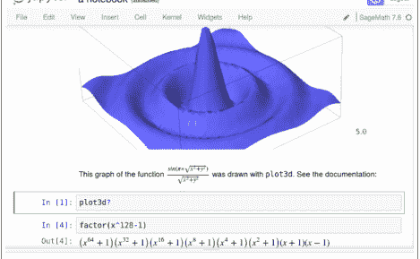

帮助菜单提供对文档的访问。我们建议从“用户界面之旅”开始，经常回看“键盘快捷键”，并逐步探索“主题教程”。

Sage 使用 Jupyter 作为 Web 应用程序。Jupyter 以前称为 IPython，允许使用大量数学软件（GAP、PARI/GP 或 Singular……）以及更多软件（从 Python 到 C++！），并受到庞大社区的支持。笔记本分别采用 .sws 和 .ipynb 格式。CoCalc 提供另一种格式 .sagenb，它的可移植性较差，但利用了高级交互功能。

作为替代方案，可以在终端中使用 Sage。其类似计算器的命令行界面提供对其所有功能（包括图形）的完整访问：

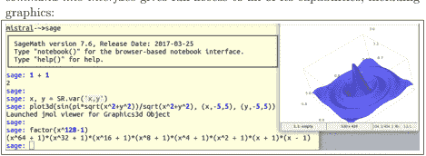

#### Sage 与 Python

与大多数数学计算软件一样，Sage 通过发出用编程语言编写的命令来使用。为此，Sage 使用通用编程语言 Python，仅用一层薄薄的语法糖来支持交互使用中的一些常见数学记号。对于复杂或只是重复性的计算，可以编写程序，而不是简单的一行命令。当这些程序成熟且具有普遍意义时，可以提交以纳入 Sage。

#### Sage 的目标与历史

2005 年，美国学者 William Stein 发起了 Sage 项目，目标是开发由用户为用户开发的数学计算自由软件。这满足了数学家长期以来的需求，很快，一个由数百名开发者组成的国际社区围绕 Sage 凝聚起来，其中大多数是教师和研究人员。起初，Sage 有些侧重于数论，这是其创始人感兴趣的领域。随着贡献不断涌入，其能力逐步扩展到许多数学领域。这一点，加上科学 Python 生态系统带来的数值计算能力，使 Sage 成为今天这样的通用数学软件。

Sage 不仅可以免费使用和下载，而且是自由软件：作者对其使用、再分发、研究或修改不施加任何限制，只要修改本身也是自由的。本着同样的精神，本书中的材料可以自由阅读、共享和重复使用（当然，需适当署名）。这一许可与学术界自由发展和传播知识的精神相一致。

#### Sage，生态系统中的一款软件

由于采取了复用现有自由软件的策略，Sage 的开发相对较快，这些软件包括许多专门的数学库或系统，例如仅举几例：GAP、PARI/GP、Maxima、Singular。

Sage 本身用 Python 编写，这是一种被数百万人使用、以易于学习而闻名的编程语言。Python 在科学领域尤其根深蒂固。在同一个计算环境中，可以将 Sage 的能力与用于数值计算、数据分析、统计、可视化、机器学习、生物学、天体物理学的科学库，以及用于网络、数据库、Web 等的技术库结合起来……例如参见：https://en.wikipedia.org/wiki/List_of_Python_software。

#### SAGE、Sage 还是 SageMath？


**图 1.1** — Sage 这个名字的首次出现，见于 W. Stein 的手写笔记。

起初，Sage 既是一个首字母缩略词，也指“鼠尾草”这种药用植物。后来该系统扩展到涵盖数学的许多领域时，首字母缩略词的部分被去掉了。随着 Sage 在更大的圈子里为人所知，并且为了避免与例如同名的商业管理软件混淆，官方名称改为 SageMath。当上下文明确时，例如在本书中，传统上只使用 Sage。

### 1.2 Sage 作为计算器

#### 1.2.1 初次计算

在本书余下部分，我们以如下形式展示计算，这种形式模拟 Sage 命令行会话：

```
sage: 1+1
2
```

第一行开头的 `sage:` 文本是系统的命令提示符。该提示符（在笔记本界面中不出现）表示 Sage 正在等待用户命令。该行其余部分是要执行的命令，按 ⟨Enter⟩ 键进行验证。下面的行是系统的回答，通常就是计算结果。有些命令会使用多行（见第 3 章）。此时，附加的命令行可以通过行首的 `...` 识别。多行命令应遵循换行位置和缩进（用于相对于上一行对齐的空格），但不要复制开头的 `...`。

在笔记本中，直接在计算单元格中输入命令，然后通过点击*求值*或使用 ⟨Shift⟩+⟨Enter⟩ 组合键进行验证。⟨Alt⟩+⟨Enter⟩ 组合键不仅执行当前单元格的命令，还会在正下方创建一个新单元格。也可以通过点击给定单元格正上方的小空白处，或最后一个单元格下方的小空白处来创建新单元格。

Sage 像科学计算器一样解释简单公式。运算 +、× 等具有通常的优先级，括号也有通常的用法：

```
    sage: ( 1 + 2 * (3 + 5) ) * 2
    34
```

上面的 `*` 字符表示乘法，即使像 `2*x` 这样的表达式中也不应省略。幂运算写作 `^` 或 `**`：

```
    sage: 2^3
    8
    sage: 2**3
    8
```

除法用 `/` 表示：

```
    sage: 20/6
    10/3
```

请注意这是精确计算：上述除法化简后的结果是有理数 10/3，而不是像 3.33333 这样的近似值。整数或有理数的大小没有限制¹：

```
    sage: 2^10
    1024
    sage: 2^100
    1267650600228229401496703205376
    sage: 2^1000
    10715086071862673209484250490600018105614048117055336074437503883703510511249361224931983788156958581275946729175531468251871452856923140435984577574698574803934567774824230985421074605062371141877954182153046474983581941267398767559165543946077062914571196477686542167660429831652624386837205668069376
```

要获得数值近似，只需将其中一个数写成带小数点的形式（可以将 20.0 替换为 20. 或 20.000）：

```
    sage: 20.0 / 14
    1.42857142857143
```

此外，`numerical_approx` 函数给出表达式的数值近似：

```
    sage: numerical_approx(20/14)
    1.42857142857143
    sage: numerical_approx(2^1000)
    1.071508607186267e301
```

数值近似可以计算到任意大的精度。例如，让我们将精度提高到 60 位，以展示有理数小数展开的周期性：

¹ 除非受所用计算机可用内存的限制。

| 基本算术运算 | |
| --- | --- |
| “四则运算” | a+b, a-b, a*b, a/b |
| 幂 | a^b or a**b |
| 平方根 | sqrt(a) |
| n 次方根 | a^(1/n) |
| **整数运算** | |
| 整数除法 | a // b |
| 余数 | a % b |
| 商和余数 | divmod(a,b) |
| 阶乘 n! | factorial(n) |
| 二项式系数（n 选 k） | binomial(n,k) |
| **实数、复数等上的常用函数** | |
| 整数部分 | floor(a) |
| 绝对值、模 | abs(a) |
| 初等函数 | sin, cos, ...（见表 2.2） |

表 1.1 - 一些常用操作。

```
    sage: numerical_approx(20/14, digits=60)
    1.42857142857142857142857142857142857142857142857142857142857
```

精确计算与数值计算之间的差异在第 10 页的边栏中讨论。

运算符 `//` 和 `%` 给出两个整数相除的商和余数：

```
    sage: 20 // 6
    3
    sage: 20 % 6
    2
```

还有若干其他函数适用于整数。其中专用于整数的有阶乘和二项式系数（见表 1.1）：

```
    sage: factorial(100)
    9332621544394415268169923885626670049071596826438162146859296389521759999322991560894146397615651828625369792082722375825118521091686400000000000000000000000
```

下面是一种将整数分解为质因数的方法。我们将在第 5 章回到这个问题，然后在第 6 章再次讨论。

```
    sage: factor(2^(2^5)+1)
    641 * 6700417
```

费马曾猜想所有整数 $2^{2^n} + 1$ 都是质数。上述例子是最小的反例。

#### 计算机代数与数值方法

计算机代数系统是一种程序，旨在仅通过精确（即符号）变换来操作、化简和计算数学公式。这里术语 *符号* 与 *数值* 相对；它意味着计算使用代数公式进行，仅操作符号。这就是为什么 *符号计算* 有时被用来代替 *计算机代数*。在法语中，人们说 *形式计算*，有时也说 *符号计算*。

一般来说，袖珍计算器最多精确处理十二位整数；更大的数字会被舍入，从而引入误差。因此，袖珍计算器会将下面的表达式错误地计算为 0，而正确结果是 1：

$$(1 + 10^{50}) - 10^{50}.$$

如果这类错误出现在中间计算过程中，且没有被理论分析预见到，就很难检测。相反，计算机代数系统没有这些限制，并且精确执行所有整数计算：它们对前面的计算回答 1。

数值方法以给定精度（使用梯形法则、辛普森法则、高斯求积等）近似定积分 $\int_0^\pi \cos t\,dt$，以获得接近零的数值结果（例如误差为 $10^{-10}$）。然而，它们无法告诉用户结果是恰好为 0，还是相反地接近零但绝对不是零。

计算机代数系统使用符号数学变换将积分 $\int_0^\pi \cos t\,dt$ 重写为表达式 $\sin \pi - \sin 0$，然后将其求值为 $0 - 0 = 0$。这种方法证明 $\int_0^\pi \cos t\,dt = 0$。

然而，代数变换也有局限。符号计算系统处理的大多数表达式是有理函数，表达式 $a/a$ 会被自动化简为 1。这种自动化简与解方程不兼容；实际上，方程 $ax = a$ 的解是 $x = a/a$，它会被化简为 $x = 1$，而没有区分特殊情形 $a = 0$，此时任意标量 $x$ 都是解（另见 §2.1.5）。

#### 1.2.2 初等函数与常用常数

常用函数和常数可用（见表 1.1 和表 1.2），对复数也是如此。这里计算同样是精确的：

```
    sage: sin(pi)
    0
    sage: tan(pi/3)
    sqrt(3)
    sage: arctan(1)
    1/4*pi
    sage: exp(2 * I * pi)
    1
```

即使返回的是符号表达式而不是数值表达式：

| | |
| --- | --- |
| **一些特殊值** | |
| 布尔值“真”和“假” | True, False |
| 虚数单位 i | I or i |
| 无穷大 ∞ | Infinity or oo |
| **常见数学常数** | |
| 阿基米德常数 π | pi |
| 以 e = exp(1) 为底的对数 | e |
| 欧拉-马歇罗尼常数 γ | euler_gamma |
| 黄金比 φ = (1 + √5)/2 | golden_ratio |
| 卡塔兰常数 | catalan |

表 1.2 – 预定义常量。

```
    sage: arccos(sin(pi/3))
    arccos(1/2*sqrt(3))
    sage: sqrt(2)
    sqrt(2)
    sage: exp(I*pi/7)
    e^(1/7*I*pi)
```

并不总能得到预期的结果。实际上，只有少数化简会自动完成。如有需要，可以显式调用化简函数：

```
    sage: simplify(arccos(sin(pi/3)))
    1/6*pi
```

我们将在 §2.1 中看到如何调整表达式的化简。当然，也可以计算结果的数值近似，精度可以任意大：

```
    sage: numerical_approx(6*arccos(sin(pi/3)), digits=60)
    3.141592653589793238462643383279502884197169399375105820974944
    sage: numerical_approx(sqrt(2), digits=60)
    1.41421356237309504880168872420969807856967187537694807317668
```

#### 1.2.3 在线帮助与自动补全

每个函数、常数或命令的参考手册可通过在其名称后加上问号 `?` 访问：

```
    sage: sin?
```

文档页面包含函数描述、语法和一些用法示例。

在单词开头按制表键 `<Tab>` 会列出所有以这些字母开头的命令名：输入 `arc` 后按 `<Tab>`，会打印所有反三角函数和双曲函数的名称：

```
    sage: arc<tab>
    Possible completions are:
    arc arccos arccosh arccot arccoth arccsc arccsch
    arcsec arcsech arcsin arcsinh arctan arctan2 arctanh
```

#### 1.2.4 Python 变量

要保存计算结果，可将其 *赋值* 给一个 *变量*：

```
    sage: y = 1 + 2
```

以便稍后重用：

```
    sage: y
    3
    sage: (2 + y) * y
    15
```

注意，当计算结果被赋值给变量时，不会自动打印。因此，我们将按以下方式同时打印它，

```
    sage: y = 1 + 2; y
    3
```

`;` 字符用于在同一行分隔多条指令。由于结果的计算在赋值之前完成，因此可以重用同一个变量：

```
    sage: y = 3 * y + 1; y
    10
    sage: y = 3 * y + 1; y
    31
    sage: y = 3 * y + 1; y
    94
```

此外，Sage 将最后三个结果保存在特殊变量 `_`、`__` 和 `___` 中：

```
    sage: 1 + 1
    2
    sage: _ + 1
    3
    sage: __
    2
```

我们上面使用的变量是 Python 变量；我们将在 §1.3 中进一步讨论它们。这里只提一下，不建议重新定义 Sage 中预定义的常数和函数。虽然这不会影响 Sage 的内部行为，但可能会产生令人惊讶的结果：

```
    sage: pi = -1/2
    sage: exp(2*pi*pi)
```

要恢复原始值，可以输入例如：

```
sage: from sage.all import pi
```

或者也可以

```
sage: restore()
```

它会将所有预定义变量和函数恢复为默认值。`reset()` 函数执行更彻底的复位，尤其是会清除所有用户定义的变量。

#### 1.2.5 符号变量

到目前为止，我们处理的是诸如 \(\sin(\sqrt{2})\) 这样的常量表达式，但 Sage 在处理包含 \(x + y + z\) 或 \(\sin(x) + \cos(x)\) 这类变量的表达式时特别有用。这些表达式中出现的“数学家的”*符号变量* \(x, y, z\) 通常与前文遇到的“程序员的”变量不同。在这一点上，Sage 与 Maple 或 Maxima 等其他计算机代数系统明显不同。

符号变量在使用前应显式声明²（SR 是 *符号环* 的缩写）：

```
sage: z = SR.var('z')
sage: 2*z + 3
2*z + 3
```

在这个例子中，命令 `SR.var('z')` *构建*并返回一个名为 \(z\) 的符号变量。这个符号变量是一个完美的 Sage 对象：它完全像 \(\sin(x) + 1\) 这样更复杂的表达式一样被处理。然后，这个符号变量被赋值给“程序员的”变量 \(z\)，这使人们能够像使用任何其他表达式一样使用它，以构建更复杂的表达式。

我们本可以把 \(z\) 赋值给另一个不同于 \(z\) 的变量：

```
sage: y = SR.var('z')
sage: 2*y + 3
2*z + 3
```

因此，将符号变量 \(z\) 赋值给 Python 变量 `z` 只是一种约定，不过建议这样做以避免混淆。

反过来，Python 变量 `z` 不会与符号变量 \(z\) 交互：

```
sage: c = 2 * y + 3
sage: z = 1
sage: 2*y + 3
2*z + 3
sage: c
2*z + 3
```

² 符号变量 \(x\) 除外，它在 Sage 中是预定义的。

如何给表达式中出现的符号变量赋值？可以使用*替换*操作，如下所示：

```
sage: x = SR.var('x')
sage: expr = sin(x); expr
sin(x)
sage: expr(x=1)
sin(1)
```

符号表达式中的替换将在下一章详细讨论。

**练习 1.** 逐步解释以下指令执行过程中发生了什么：

```
sage: u = SR.var('u')
sage: u = u+1
sage: u = u+1
sage: u
u + 2
```

由于创建大量符号变量会变得繁琐，因此有一个快捷方式 `x = SR.var('x', n)`，其中 `n` 是正整数（注意索引从 0 开始）：

```
sage: x = SR.var('x', 100)
sage: (x[0] + x[1])*x[99]
(x0 + x1)*x99
```

命令 `var('x')` 是 `x = SR.var('x')` 的便捷替代³：

```
sage: var('a, b, c, x, y')
(a, b, c, x, y)
sage: a * x + b * y + c
a*x + b*y + c
```

如果显式声明符号变量过于繁琐，也可以模拟 Maxima 或 Maple 等系统的行为。不过，此功能仅在 notebook 界面中可用（但不在 Jupyter worksheet 中）。因此，在 notebook 中，执行以下命令后：

```
sage: automatic_names(True)
```

每次使用未赋值的变量都会创建同名符号变量并对其进行赋值：

```
sage: 2 * bla + 3
2*bla + 3
sage: bla
bla
```

³ 在本书中，我们经常写 `x = var('x')`，而不是更好但更繁琐的形式 `x = SR.var('x')`，以避免 `var('x')` 产生的输出。

#### 1.2.6 初识绘图

`plot` 命令可以轻松绘制实函数在给定区间上的曲线。`plot3d` 命令是它在三维图形或二元实函数图形方面的对应命令。以下是这两个命令的示例：

```
sage: plot(sin(2*x), x, -pi, pi)
sage: plot3d(sin(pi*sqrt(x^2 + y^2))/sqrt(x^2+y^2),
....:        (x,-5,5), (y,-5,5))
```

Sage 的图形功能要广泛得多。我们将在第 4 章中更详细地探讨它们。

## 2 分析与代数

本章通过简单示例介绍分析与代数中有用的基本函数。学生将能够用*键盘和屏幕*替代*纸笔*，同时保持理解数学所需的同等智力挑战。

这里对 Sage 主要微积分命令的介绍应适合年轻学生；标有星号的部分保留给更高年级的学生。更多细节可在其他章节中找到。

### 2.1 符号表达式与化简

#### 2.1.1 符号表达式

Sage 允许对由数字、符号变量、四种基本运算以及 `sqrt`、`exp`、`log`、`sin`、`cos` 等常用函数构成的*符号表达式*进行广泛的解析计算。符号表达式可以看作如图 2.1 所示的树。重要的是要理解，符号表达式是一个*公式*，而不是一个值或一个数学函数。因此，Sage 不认为下面两个表达式相等¹：

```
sage: bool(arctan(1+abs(x)) == pi/2 - arctan(1/(1+abs(x))))
False
```

¹ 相等测试 `==` 不只是语法比较：例如，表达式 `arctan(sqrt(2))` 和 `pi/2-arctan(1/sqrt(2))` 被视为相等。事实上，当用 `bool(x==y)` 比较两个表达式时，Sage 会尝试证明它们的差为零，如果成功则返回 `True`。

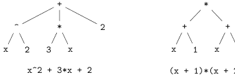

*图 2.1 – 表示同一数学对象的两个符号表达式。*

最常见的操作是通过给表达式的某些参数赋值来*求值*。`subs` 方法——可以使其隐式调用——执行这种变换：

```
sage: a, x = var('a, x'); y = cos(x+a) * (x+1); y
(x + 1)*cos(a + x)
sage: y.subs(a=-x); y.subs(x=pi/2, a=pi/3); y.subs(x=0.5, a=2.3)
x + 1
-1/4*sqrt(3)*(pi + 2)
-1.41333351100299
sage: y(a=-x); y(x=pi/2, a=pi/3); y(x=0.5, a=2.3)
x + 1
-1/4*sqrt(3)*(pi + 2)
-1.41333351100299
```

与通常的数学记号 `x ↦ f(x)` 相比，被替换的变量必须显式给出。多个参数的替换是并行进行的，而连续替换则按顺序执行，如下面两个示例所示：

```
sage: x, y, z = var('x, y, z'); q = x*y + y*z + z*x
sage: bool(q(x=y, y=z, z=x) == q), bool(q(z=y)(y=x) == 3*x^2)
(True, True)
```

要替换比单个变量更复杂的表达式，可以使用 `substitute` 方法：

```
sage: y, z = var('y, z'); f = x^3 + y^2 + z
sage: f.substitute(x^3 == y^2, z==1)
2*y^2 + 1
```

#### 2.1.2 变换表达式

最简单的非常量表达式是一个或多个变量的多项式与有理函数。允许将表达式重写为多种形式或将其化为标准形式的函数汇总在表 2.1 中。例如，`expand` 方法可用于展开多项式：

```
sage: x, y = SR.var('x,y')
```

|  |  |
| --- | --- |
| 多项式 | p = z*x^2 + x^2 - (x^2 + y^2)(a*x - 2*b*y) + z*y^2 + y^2 |
| p.expand() | -a*x^3 + 2*b*x^2*y - a*x*y^2 + 2*b*y^3 + x^2*z + y^2*z + x^2 + y^2 |
| p.expand().collect(x) | -a*x^3 - a*x*y^2 + 2*b*y^3 + (2*b*y + z + 1)*x^2 + y^2*z + y^2 |
| p.collect(x).collect(y) | 2*b*x^2*y + 2*b*y^3 - (a*x - z - 1)*x^2 - (a*z - z - 1)*y^2 |
| p.factor() | -(a*x - 2*b*y - z - 1)*(x^2 + y^2) |
| p.factor_list() | [(a*x - 2*b*y - z - 1, 1), (x^2 + y^2, 1)] |
| 分式 | r = (x^3 + y^3 + z^3 + 1 + y^2 + z^2 + 2*x + 2*y) / (x^3 + 2*x^2 + x*y + 2*y) |
| r.simplify_rational() | (x^2 + (x + 1)*y + z) / (x^2 + y) |
| r.factor() | ((x + 1)*(y + 1)*(z + 1)) / (x^2 + y) |
| r.factor().expand() | x^2/(x^2 + y) + x*y/(x^2 + y) + x/(x^2 + y) + y/(x^2 + y) + z/(x^2 + y) |
| 分式 | r = (x - 1)^2/(x^2 - 7) + x^2/(x^2 - 7) + b/a + a/(x + 1) |
| r.combine() | ((x - 1)^2 + x^2)/(x^2 - 7) + (b + a)/a + a/(x + 1) |
| 分式 | r = 1/(x^3 + 1)^2 |
| r.partial_fraction(x) | -(x - 2)/(3*(x^2 - x + 1)^2) + 1/(3*(x + 1)^2) |

*表 2.1 - 多项式和分式。*

当两个多项式或分式写成这种形式时，只需比较它们的系数即可判断它们是否相等：我们说它们处于标准形式。

#### 2.1.3 常用数学函数

Sage 了解大多数数学函数，特别是三角函数、对数和指数函数：它们汇总在表 2.2 中。

知道如何变换这些函数至关重要。要化简表达式或符号函数，可以使用 `simplify` 方法：

```
sage: (x^x/x).simplify()
x^(x - 1)
```

然而，对于更微妙的化简，应明确指定所需的化简类型：

```
sage: f = (e^x-1) / (1+e^(x/2)); f.canonicalize_radical()
e^(1/2*x) - 1
```

例如，要化简三角表达式，应使用 `simplify_trig` 方法：

```
sage: f = cos(x)^6 + sin(x)^6 + 3 * sin(x)^2 * cos(x)^2
sage: f.simplify_trig()
1
```


| 常用数学函数 |  |
|---|---|
| 指数与对数 | `exp`, `log` |
| 以 a 为底的对数 | `log(x, a)` |
| 三角函数 | `sin`, `cos`, `tan` |
| 反三角函数 | `arcsin`, `arccos`, `arctan` |
| 双曲函数 | `sinh`, `cosh`, `tanh` |
| 反双曲函数 | `arcsinh`, `arccosh`, `arctanh` |
| 整数部分等 | `floor`, `ceil`, `trunc`, `round` |
| 平方根与 n 次方根 | `sqrt`, `nth_root` |
| 重写三角表达式 |  |
| 化简 | `simplify_trig` |
| 线性化 | `reduce_trig` |
| 反线性化 | `expand_trig` |

**表 2.2** 常用函数与化简。

要线性化（或反线性化）一个三角表达式，我们使用 `reduce_trig`（或 `expand_trig`）：

```python
sage: f = cos(x)^6; f.reduce_trig()
1/32*cos(6*x) + 3/16*cos(4*x) + 15/32*cos(2*x) + 5/16
sage: f = sin(5 * x); f.expand_trig()
5*cos(x)^4*sin(x) - 10*cos(x)^2*sin(x)^3 + sin(x)^5
```

包含阶乘的表达式也可以化简：

```python
sage: n = var('n'); f = factorial(n+1)/factorial(n)
sage: f.simplify_factorial()
n + 1
```

`simplify_rational` 方法尝试化简一个分式；而要化简平方根、对数或指数，推荐使用 `canonicalize_radical` 方法：

```python
sage: f = sqrt(abs(x)^2); f.canonicalize_radical()
abs(x)
sage: f = log(x*y); f.canonicalize_radical()
log(x) + log(y)
```

`simplify_full` 命令按该顺序应用 `simplify_factorial`、`simplify_rational`、`simplify_trig`、`simplify_rational` 和 `expand_sum` 方法。

确定函数变化情况（导数、渐近线、极值、零点定位和图形绘制）所需的一切，都可以借助计算机代数系统轻松获得。适用于函数的主要 Sage 操作在 §2.3 中介绍。

#### 2.1.4 假设

在计算过程中，表达式中出现的符号变量通常被视为可以在复平面中取任意值。当某个参数表示受限定义域中的量（例如正实数）时，这可能会成为问题。

一个典型情况是表达式 $\sqrt{x^2}$ 的化简。正确的方法是使用 `assume` 函数，它使我们能够定义变量的属性，而这些属性又可以通过 `forget` 指令撤销：

```python
sage: assume(x > 0); bool(sqrt(x^2) == x)
True
sage: forget(x > 0); bool(sqrt(x^2) == x)
False
sage: n = var('n'); assume(n, 'integer'); sin(n*pi)
0
```

#### 2.1.5 一些陷阱

> **化简问题**
>
> §2.1.5 中的例子说明了规范形式有多么重要，尤其是 *零测试*。
>
> 某些表达式族（例如多项式）具有判断是否等于零的判定过程。因此，对于这些表达式族，程序能够判定给定表达式是否为零。在大多数情况下，这种测试通过归约到规范形式来完成：表达式为零当且仅当其规范形式为 0。
>
> 不幸的是，并非所有表达式类都有规范形式；此外，对于某些类，可以证明不存在能在有限时间内判定表达式是否为零的通用方法。此类的一个例子由有理数、常数 π、log 2 和一个变量，以及加法、减法、乘法、指数函数和正弦函数构成。重复使用 *numerical_approx* 并不断提高精度，在大多数情况下能够推测给定表达式是否为零；然而，已经证明不可能编写一个计算机程序，以该类表达式为输入，并在该表达式为零时返回 *true*，否则返回 *false*。
>
> 在这些类中，化简问题要困难得多。在没有任何规范形式的情况下，计算机代数系统只能提供一些重写函数，用户必须反复尝试这些函数才能获得某种结果。然而，如果我们能够识别出具有规范形式的表达式子类，并且知道应应用哪些方法来计算这些规范形式，那么仍有一些希望。Sage 处理这些问题的方案在第 5 章中有更详细的介绍。

设 c 为一个稍微复杂的表达式：

```python
sage: a = var('a')
sage: c = (a+1)^2 - (a^2+2*a+1)
```

其中我们希望关于变量 $x$ 求解方程 $cx = 0$：

```python
sage: eq = c * x == 0
```

人们可能倾向于在求解之前先用 $c$ 除这个方程：

```python
sage: eq2 = eq / c; eq2
x == 0
sage: solve(eq2, x)
[x == 0]
```

幸运的是，Sage 避免了这一错误：

```python
sage: solve(eq, x)
[x == x]
```

Sage 能够正确求解该方程，是因为系数 $c$ 是一个多项式表达式。因此，通过展开它来检查 $c$ 是否为零很容易：

```python
sage: expand(c)
0
```

并利用这样一个事实：两个数学上相同的多项式具有相同的展开形式；换言之，展开形式是多项式的一种规范形式。

然而，在一个稍微更复杂的例子中，Sage 没有避开这个陷阱：

```python
sage: c = cos(a)^2 + sin(a)^2 - 1
sage: eq = c*x == 0
sage: solve(eq, x)
[x == 0]
```

即使 Sage 能够正确化简并测试该表达式是否为零：

```python
sage: c.simplify_trig()
0
sage: c.is_zero()
True
```

### 2.2 方程

我们现在讨论方程以及如何求解它们；主要函数总结在表 2.3 中。

#### 2.2.1 显式求解

让我们考虑以下方程，其中未知量为 $z$，参数为 $\varphi$：

$$z^2 - \frac{2}{\cos\varphi}z + \frac{5}{\cos^2\varphi} - 4 = 0, \quad \text{with } \varphi \in \left[-\frac{\pi}{2}, \frac{\pi}{2}\right].$$

在 Sage 中写为：

```python
sage: solve([cos(x)*sin(x) == 1/2, x+y == 0], x, y)
[[x == 1/4*pi + pi*Z, y == -1/4*pi - pi*Z]]
```

solve 命令也可以求解不等式：

```python
sage: solve(x^2+x-1 > 0, x)
[[x < -1/2*sqrt(5) - 1/2], [x > 1/2*sqrt(5) - 1/2]]
```

有时，solve 会将方程组的解返回为浮点数。例如，让我们在 $\mathbb{C}^3$ 中求解以下方程组：

\[
\begin{cases}
x^2yz = 18,\\
xy^3z = 24,\\
xyz^4 = 6.
\end{cases}
\]

```python
sage: x, y, z = var('x, y, z')
sage: solve([x^2 * y * z == 18, x * y^3 * z == 24,\
    ...:       x * y * z^4 == 6], x, y, z)
[[x == 3, y == 2, z == 1],
 [x == (1.337215067329613 - 2.68549874065195*I),
  y == (-1.700434271459228 + 1.052864325754712*I),
  z == (0.9324722294043555 - 0.3612416661871523*I)], ...]
```

Sage 在这里返回 17 个元组，其中 16 个是近似复数解。要获得完全符号化的解，请参阅第 9 章。

要以数值方式求解方程，`find_root` 函数接受单变量函数或符号等式，以及搜索区间的边界作为输入。Sage 没有找到该方程的任何符号解：

```python
sage: expr = sin(x) + sin(2 * x) + sin(3 * x)
sage: solve(expr, x)
[sin(3*x) == -sin(2*x) - sin(x)]
```

于是有两种选择：要么求数值解，

```python
sage: find_root(expr, 0.1, pi)
2.0943951023931957
```

要么先重写表达式：

```python
sage: f = expr.simplify_trig(); f
2*(2*cos(x)^2 + cos(x))*sin(x)
sage: solve(f, x)
[x == 0, x == 2/3*pi, x == 1/2*pi]
```

最后但同样重要的是，roots 函数给出方程根及其重数。可以指定在哪个环中寻找解；使用 `RR` 或 `CC` 时，我们得到浮点根。求解方法特定于给定方程，而 `solve` 方法使用通用方法。

让我们考虑三次方程 $x^3 + 2x + 1 = 0$。该方程具有负判别式，因此它有一个实根和两个复根，这些根由 roots 方法给出：

```python
sage: (x^3+2*x+1).roots(x)
```


$$[(-1/2 (I√3+1)(1/18√3√59 - 1/2)^(1/3) + -(I√3-1)/(3(1/18√3√59 - 1/2)^(1/3)), -1/2 (-I√3+1)(1/18√3√59 - 1/2)^(1/3) + -(-I√3-1)/(3(1/18√3√59 - 1/2)^(1/3)), (1/18√3√59 - 1/2)^(1/3) + -2/(3(1/18√3√59 - 1/2)^(1/3))]$$

```sage
sage: (x^3+2*x+1).roots(x, ring=RR)
[(-0.453397651516404, 1)]
```

```sage
sage: (x^3+2*x+1).roots(x, ring=CC)
[(-0.453397651516404, 1), (0.226698825758202 - 1.46771150871022*I, 1),
 (0.226698825758202 + 1.46771150871022*I, 1)]
```

#### 2.2.2 无显式解的方程

在大多数情况下，一旦方程或方程组变得过于复杂，就无法找到显式解：

```sage
sage: solve(x^(1/x)==(1/x)^x, x)
[(1/x)^x == x^(1/x)]
```

然而，这并不一定是一种限制！事实上，计算机代数的一个特点是能够操作由方程定义的对象，特别是能够在没有显式求解它们的情况下计算其性质。甚至更好的是：在某些情况下，定义数学对象的方程是它最好的算法表示。

例如，由线性微分方程和初始条件给出的函数是完全确定的。线性微分方程的解集在加法与乘法（以及其他运算）下封闭，因此形成一个重要的类，在其中可以判定是否等于零。然而，如果我们显式求解这样的方程，得到的解可能属于一个大得多的类，而在其中可判定的问题非常少。

```sage
sage: y = function('y')(x)
sage: desolve(diff(y,x) + x*diff(y,x) + y == 0, y, [0,0,1])
-1/2*I*sqrt(2)*sqrt(pi)*erf(1/2*I*sqrt(2)*x)*e^(-1/2*x^2)
```

我们将在第 14 章和 §15.1.2 中更详细地讨论这一点。

### 2.3 分析

本节简要介绍实分析中有用的函数。对于更高级的用法或更多细节，我们参考后续章节，特别是关于数值积分（第 14 章）、非线性方程（第 12 章）和微分方程（第 10 章）的章节。

#### 2.3.1 求和

sum 函数计算符号和。例如，我们求前 $n$ 个正整数之和：

```text
sage: k, n = var('k, n')
sage: sum(k, k, 1, n).factor()
\frac{1}{2} (n + 1)n
```

sum 函数可用于简化二项式展开：

```text
sage: n, k, y = var('n, k, y')
sage: sum(binomial(n,k) * x^k * y^(n-k), k, 0, n)
(x + y)^n
```

这里还有更多例子，其中包括一个含 $n$ 个元素的集合的所有子集的基数之和：

```text
sage: k, n = var('k, n')
sage: sum(binomial(n,k), k, 0, n), \\
......: sum(k * binomial(n, k), k, 0, n), \\
......: sum((-1)^k*binomial(n,k), k, 0, n)
(2^n, 2^(n-1)*n, 0)
```

最后，是一些等比求和的例子：

```text
sage: a, q, k, n = var('a, q, k, n')
sage: sum(a*q^k, k, 0, n)
\frac{aq^{n+1}-a}{q-1}
```

要计算相应的幂级数，我们应告诉 Sage：$q$ 的模小于 1：

```text
sage: assume(abs(q) < 1)
sage: sum(a*q^k, k, 0, infinity)
\frac{a}{1-q}
```

```text
sage: forget(); assume(q > 1); sum(a*q^k, k, 0, infinity)
Traceback (most recent call last):
...
ValueError: Sum is divergent.
```

²请记住，默认情况下，符号变量表示复数值。

练习 2（用递推计算求和）。不使用 sum 命令，计算整数 0 到 $n$ 的 $p$ 次幂之和，其中 $p = 1,\dots,4$：

$$S_n(p)=\sum_{k=0}^{n} k^p.$$

下面的递推式可用于计算该和：

$$S_n(p)=\frac{1}{p+1}\left((n+1)^{p+1}-\sum_{j=0}^{p-1}\binom{p+1}{j}S_n(j)\right).$$

通过用两种不同方法计算裂项和 $\sum_{0\le k\le n}(k+1)^{p+1}-k^{p+1}$，很容易得到这个递推式。

$$\sum_{0\le k\le n}(k+1)^{p+1}-k^{p+1}.$$

#### 2.3.2 极限

要确定极限，我们使用 limit 命令或其别名 lim。我们来计算以下极限：

- a) $\lim_{x\to 8}\frac{\sqrt[3]{x}-2}{\sqrt[3]{x+19}-3}$ ;
- b) $\lim_{x\to \frac{\pi}{4}}\frac{\cos(\frac{\pi}{4}-x)-\tan x}{1-\sin(\frac{\pi}{4}+x)}$.

```sage
sage: limit((x**(1/3) - 2) / ((x + 19)**(1/3) - 3), x = 8)
9/4
sage: f(x) = (cos(pi/4-x)-tan(x))/(1-sin(pi/4 + x))
sage: limit(f(x), x = pi/4)
Infinity
```

最后一个输出表明，左极限或右极限中有一个是无穷大。为了进一步了解，我们使用 dir 选项研究左极限（minus）和右极限（plus）：

```sage
sage: limit(f(x), x = pi/4, dir='minus')
+Infinity
sage: limit(f(x), x = pi/4, dir='plus')
-Infinity
```

#### 2.3.3 序列

上述函数使我们能够研究数列。我们通过比较指数数列和等比数列的增长来说明这一点。

例。（序列研究）考虑数列 $u_n = \frac{2^{100n}}{100^n}$。计算前 10 项。该数列如何变化？数列的极限是什么？从哪个 $n$ 值开始，$u_n \in ]0,10^{-8}[$ 成立？

- 1. 为了定义第 \(n\) 项，我们使用符号函数。然后手工计算前 10 项（循环将在第 3 章介绍）：

```sage
sage: u(n) = n^100 / 100^n
sage: u(1);u(2);u(3);u(4);u(5);u(6);u(7);u(8);u(9);u(10)
0.0100000000000000
1.26765060022823e26
5.15377520732011e41
1.60693804425899e52
7.88860905221012e59
6.53318623500071e65
3.23447650962476e70
2.03703597633449e74
2.65613988875875e77
1.00000000000000e80
```

我们可能会很快得出结论：\(u_n\) 趋于无穷大……

- 2. 为了了解数列的变化，我们可以绘制函数 \(n \to u_n\) 的图像（参见图 2.2）。

```sage
sage: plot(u(x), x, 1, 40)
Graphics object consisting of 1 graphics primitive
```

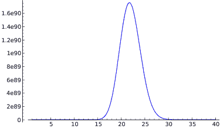

图 2.2 – \(x \mapsto x^{100}/100^x\) 的图像。

然后我们猜想该数列从索引 22 开始递减。

```sage
sage: v(x) = diff(u(x), x); sol = solve(v(x) == 0, x); sol
[x == 50/log(10), x == 0]
sage: floor(sol[0].rhs())
21
```

因此，该数列在索引 21 之前递增，在索引 22 之后递减。

|  | 函数与运算符 |
|---|---|
| 导数 | `diff(f(x), x)` |
| n 阶导数 | `diff(f(x), x, n)` |
| 原函数 | `integrate(f(x), x)` |
| 数值积分 | `integral_numerical(f(x), a, b)` |
| 符号求和 | `sum(f(i), i, imin, imax)` |
| 极限 | `limit(f(x), x=a)` |
| 泰勒展开 | `taylor(f(x), x, a, n)` |
| 幂级数展开 | `f.series(x==a, n)` |
| 函数图像 | `plot(f(x), x, a, b)` |

表 2.4 – 分析中有用的函数。

- 3. 然后我们计算极限：

```sage
sage: limit(u(n), n=infinity)
0
sage: n0 = find_root(u(n) - 1e-8 == 0, 22, 1000); n0
105.07496210187252
```

由于数列从索引 22 开始递减，我们推断从索引 106 开始，数列始终位于区间 ]0, 10⁻⁸[ 内。

#### 2.3.4 幂级数展开（*）

要计算在 $x_0$ 处 n 阶的幂级数展开，使用的命令是 `f(x).series(x==x0, n)`。

我们来求下列函数的幂级数展开：

- a) \((1 + \arctan x)^{1/x}\) 在 \(x_0 = 0\) 处的 3 阶展开；
- b) \(\ln(2\sin x)\) 在 \(x_0 = \frac{\pi}{6}\) 处的 3 阶展开。

```sage
sage: ((1+arctan(x))^(1/x)).series(x==0, 3)
(e) + (-\frac{1}{2}e)x + (\frac{1}{8}e)x^2 + O(x^3)
```

```sage
sage: (ln(2*sin(x))).series(x==pi/6, 3)
(√3)(-\frac{1}{6}π + x) + (-2)(-\frac{1}{6}π + x)^2 + O(-\frac{1}{216}(π - 6x)^3)
```

要提取由 `series` 得到的幂级数展开的正则部分，我们调用 truncate 方法：

```sage
sage: (ln(2*sin(x))).series(x==pi/6, 3).truncate()
-\frac{1}{18}(π - 6x)^2 - \frac{1}{6}√3(π - 6x)
```

taylor 命令也提供渐近展开。例如，让我们看看函数 \((x^3 + x)^{1/3} - (x^3 - x)^{1/3}\) 在 +∞ 附近的行为：

```sage
sage: taylor((x**3+x)**(1/3) - (x**3-x)**(1/3), x, infinity, 2)
2/3/x
```

**练习 3**（计算符号极限）。设 \(f\) 在 \(a\in\mathbb{R}\) 附近为 \(C^3\)。计算

\[\lim_{h\to 0}\frac{1}{h^3}\bigl(f(a+3h)-3f(a+2h)+3f(a+h)-f(a)\bigr).\]

推广？

例。（*马青公式*）证明以下公式：

\[\frac{\pi}{4}=4\arctan\frac{1}{5}-\arctan\frac{1}{239}.\]

天文学家约翰·马青（John Machin，1680–1752）在 1706 年使用这个公式和 arctan 的级数展开计算了 π 的 100 位小数。

我们首先注意到 \(4\arctan\frac{1}{5}\) 和 \(\frac{\pi}{4}+\arctan\frac{1}{239}\) 具有相同的正切：

```sage
sage: tan(4*arctan(1/5)).simplify_trig()
120/119
sage: tan(pi/4+arctan(1/239)).simplify_trig()
120/119
```

由于实数 \(4\arctan\frac{1}{5}\) 和 \(\frac{\pi}{4}+\arctan\frac{1}{239}\) 都位于开区间 \(]0,\pi[\) 内，所以它们相等。因此，为了得到 π 的近似值，我们按如下步骤进行：

```sage
sage: f = arctan(x).series(x, 10); f
1*x + (-1/3)*x^3 + 1/5*x^5 + (-1/7)*x^7 + 1/9*x^9 + Order(x^10)
sage: (16*f.subs(x=1/5) - 4*f.subs(x=1/239)).n(); pi.n()
3.14159268240440
3.14159265358979
```

**练习 4**（高斯的一个公式）。在哥廷根皇家科学学会编的高斯著作集版本中，下列公式需要 20 页的因式分解表（参见 *著作集*，Königl. Ges. d. Wiss. Göttingen 编，第 2 卷，第 477–502 页）：

\[\frac{\pi}{4}=12\arctan\frac{1}{38}+20\arctan\frac{1}{57}+7\arctan\frac{1}{239}+24\arctan\frac{1}{268}.\]

- 1. 定义 \(\theta=12\arctan\frac{1}{38}+20\arctan\frac{1}{57}+7\arctan\frac{1}{239}+24\arctan\frac{1}{268}\)。用 Sage 验证 \(\tan\theta=1\)。
- 2. 证明不等式：\(\forall x\ge 0,\ \arctan x\le x\)。推导高斯公式。
- 3. 用 arctan 函数在 0 处的 21 阶泰勒展开近似 arctan 函数，并由此推导出 \(\pi\) 的一个新近似值。

#### 2.3.5 级数（*）

前面介绍的命令可用于对级数进行计算。我们给出一些例子。

例。（*黎曼 zeta 函数的求值*）


```text
sage: k = var('k')
sage: sum(1/k^2, k, 1, infinity),\\
.....: sum(1/k^4, k, 1, infinity),\\
.....: sum(1/k^5, k, 1, infinity)
(1/6 π², 1/90 π⁴, ζ(5))
```

**例。**（*拉马努金给出的一个公式*）利用下列级数的前 12 项，我们给出 π 的一个近似值，并与 Sage 给出的值进行比较。

$$\frac{1}{\pi}=\frac{2\sqrt{2}}{9801}\sum_{k=0}^{\infty}\frac{(4k)!(1103+26390k)}{(k!)^4\cdot396^{4k}}.$$

```text
sage: s = 2*sqrt(2)/9801*(sum((factorial(4*k)) * (1103+26390*k) /
.....:     ((factorial(k))^4 * 396 ^ (4 * k)) for k in (0..11)))
sage: (1/s).n(digits=100)
3.141592653589793238462643383279502884197169399375105820974...
sage: (pi-1/s).n(digits=100)
-4.36415445739398e-96
```

我们注意到，前 12 项的部分和已经给出 π 的 95 位有效数字！

**例。**（*一个级数的收敛性*）我们来研究级数

$$\sum_{n\geq 0}\sin\left(\pi\sqrt{4n^2+1}\right).$$

的收敛性。

为了得到通项的渐近展开，我们利用正弦函数的 2π 周期性，使得正弦的自变量趋于 0：

$$u_n=\sin\left(\pi\sqrt{4n^2+1}\right)=\sin\left[\pi\left(\sqrt{4n^2+1}-2n\right)\right].$$

然后，我们可以对通项的这个新表达式应用 taylor 函数：

```text
sage: n = var('n'); u = sin(pi*(sqrt(4*n^2+1)-2*n))
sage: taylor(u, n, infinity, 3)
π/(4 n) - π³/(384 n³)
```

我们推出 $u_n\sim\frac{\pi}{4n}$。因此，与定义黎曼 zeta 函数的级数比较，级数 $\sum_{n\geq0}u_n$ 发散。

**练习 5**（*一个数列的渐近展开*）。容易证明（例如，利用一个双射），对所有 $n\in\mathbb{N}$，方程 $\tan x=x$ 在区间 $[n\pi,n\pi+\frac{\pi}{2}]$ 中恰有一个解 $x_n$。给出 $x_n$ 在 $+\infty$ 处的 6 阶渐近展开。

#### 2.3.6 导数

导数函数（别名为 `diff`）计算符号表达式或函数的导数。

```text
sage: diff(sin(x^2), x)
2*x*cos(x^2)
sage: function('f')(x); function('g')(x); diff(f(g(x)), x)
f(x)
g(x)
D[0](f)(g(x))*diff(g(x), x)
sage: diff(ln(f(x)), x)
diff(f(x), x)/f(x)
```

#### 2.3.7 偏导数 (*)

导数（或 `diff`）命令也计算迭代导数或偏导数。

```text
sage: f(x,y) = x*y + sin(x^2) + e^(-x); derivative(f, x)
(x, y) |--> 2*x*cos(x^2) + y - e^(-x)
sage: derivative(f, y)
(x, y) |--> x
```

例。我们来验证下列函数是调和的$^3$：

$$f(x,y)=\frac{1}{2}\ln(x^2+y^2)\quad\text{for all }(x,y)\neq(0,0).$$

```text
sage: x, y = var('x, y'); f = ln(x**2+y**2) / 2
sage: delta = diff(f,x,2) + diff(f,y,2)
sage: delta.simplify_rational()
0
```

**练习 6**（皮亚诺给出的施瓦茨定理的一个反例）。设 $f$ 为从 $\mathbb{R}^2$ 到 $\mathbb{R}$ 的函数，定义为：

$$f(x,y)=\begin{cases} xy\frac{x^2-y^2}{x^2+y^2} & \text{if } (x,y)\neq(0,0),\\ 0 & \text{if } (x,y)=(0,0). \end{cases}$$

是否有 $\partial_1\partial_2 f(0,0)=\partial_2\partial_1 f(0,0)$？

#### 2.3.8 积分

为了计算不定积分或定积分，我们使用 `integrate` 作为函数或方法（或其别名 `integral`）：

```text
sage: sin(x).integral(x, 0, pi/2)
1
sage: integrate(1/(1+x^2), x)
arctan(x)
```

```text
sage: integrate(1/(1+x^2), x, -infinity, infinity)
pi
sage: integrate(exp(-x**2), x, 0, infinity)
1/2*sqrt(pi)
```

```text
sage: integrate(exp(-x), x, -infinity, infinity)
Traceback (most recent call last):
...
ValueError: Integral is divergent.
```

**例。** 对 $x\in\mathbb{R}$，我们来计算积分 $\varphi(x)=\int_0^{+\infty}\frac{x\cos u}{u^2+x^2}\,du$。

```text
sage: u = var('u'); f = x * cos(u) / (u^2 + x^2)
sage: assume(x>0); f.integrate(u, 0, infinity)
1/2*pi*e^(-x)
sage: forget(); assume(x<0); f.integrate(u, 0, infinity)
-1/2*pi*e^x
```

于是我们有：$\forall x\in\mathbb{R}^*,\ \varphi(x)=\frac{\pi}{2}\cdot\operatorname{sgn}(x)\cdot e^{-|x|}$。

为了在区间上数值计算积分，我们可以使用 `integral_numerical` 函数，它返回一个二元组，其中第一个值是积分的近似值，第二个值是对应误差的估计。

```text
sage: integral_numerical(sin(x)/x, 0, 1)
(0.946083070367183, 1.0503632079297087e-14)
sage: g = integrate(exp(-x**2), x, 0, infinity)
sage: g, g.n()
(1/2*sqrt(pi), 0.886226925452758)
sage: approx = integral_numerical(exp(-x**2), 0, infinity)
sage: approx
(0.886226925452758, 1.714774436012769e-08)
sage: approx[0]-g.n()
-1.11022302462516e-15
```

**练习 7**（BBP 公式 (*)）。我们通过符号计算来建立 BBP 公式（或 Bailey–Borwein–Plouffe 公式）；该公式直接给出 π 在二进制（或十六进制）中的第 $n$ 位数字，而无需计算前面的数字，并且内存占用和时间都很少。对 $N\in\mathbb{N}$，定义

$$S_N=\sum_{n=0}^{N}\left(\frac{4}{8n+1}-\frac{2}{8n+4}-\frac{1}{8n+5}-\frac{1}{8n+6}\right)\left(\frac{1}{16}\right)^n.$$

- 1. 考虑函数 $f\colon t\longmapsto 4\sqrt{2}-8t^3-4\sqrt{2}\,t^4-8t^5$。对 $N\in\mathbb{N}$，将下列积分表示为 $S_N$ 的函数：

  $$I_N=\int_0^{1/\sqrt{2}} f(t)\left(\sum_{n=0}^{N} t^{8n}\right)\,dt.$$

一个以 \(O\) 为焦点的椭圆。我们可以选择坐标系 \((O; \vec{\imath}, \vec{\jmath})\)，使得椭圆的极坐标方程为 \(r = \frac{p}{1-e\cos\theta}\)，其中 \(e\) 是椭圆的离心率，\(p\) 是其参数。对 \(i \in \{1,2,3\}\)，记 \(\vec{r}_i = \overrightarrow{OA_i}\) 和 \(r_i = \|\vec{r}_i\|\)。然后考虑由 \(A_1\)、\(A_2\) 和 \(A_3\) 推导出的以下三个向量：

\[\vec{D} = \vec{r}_1 \wedge \vec{r}_2 + \vec{r}_2 \wedge \vec{r}_3 + \vec{r}_3 \wedge \vec{r}_1,\]
\[\vec{S} = (r_1 - r_3)\cdot \vec{r}_2 + (r_3 - r_2)\cdot \vec{r}_1 + (r_2 - r_1)\cdot \vec{r}_3,\]
\[\vec{N} = r_3\cdot(\vec{r}_1 \wedge \vec{r}_2) + r_1\cdot(\vec{r}_2 \wedge \vec{r}_3) + r_2\cdot(\vec{r}_3 \wedge \vec{r}_1).\]

- 1. 证明 \(\vec{r} \wedge \vec{D} = -\frac{1}{2}\vec{S}\)，并推出椭圆的离心率。
- 2. 证明 \(\vec{r}\) 与向量 \(\vec{S} \wedge \vec{D}\) 共线。
- 3. 证明 \(\vec{r} \wedge \vec{N} = -\frac{\ell^2}{2}\vec{S}\)，并推出椭圆参数 \(p\)。
- 4. 用参数 \(p\) 和离心率 \(e\) 表示，计算椭圆的半长轴 \(a\)。
- 5. *数值应用：* 在带有笛卡尔坐标系的平面中，考虑以下点：

  \[A_1(\frac{1}{7}, \frac{1}{7}),\quad A_2(\frac{1}{2}, \frac{4}{5}),\quad A_3(\frac{6}{5}, 0),\quad O(0,0).\]

  数值确定以 \(O\) 为焦点且经过 \(A_1\)、\(A_2\) 和 \(A_3\) 三点的唯一椭圆的特征。

#### 2.4.3 矩阵计算

要构造矩阵，需要使用 `matrix` 函数，它允许可选地指定基环（或域）：

```sage
sage: A = matrix(Qq, [[1,2],[3,4]]); A
[1 2]
[3 4]
```

为了求矩阵方程 \(Ax = b\)（相应地 \(xA = b\)）的一个特解，我们调用 `solve_right` 函数（相应地 `solve_left`）。为了求出所有解，应将该特解与相伴齐次方程的通解相加。为求解齐次方程 \(Ax = 0\)（相应地 \(xA = 0\)），我们使用 `right_kernel`（相应地 `left_kernel`）函数，如下面的练习所示。

**练习 10（向量子空间的基）。**

- 1. 确定对应于矩阵：

  \[A = \begin{pmatrix} 2 & -3 & 2 & -12 & 33 \\ 6 & 1 & 26 & -16 & 69 \\ 10 & -29 & -18 & -53 & 32 \\ 2 & 0 & 8 & -18 & 84 \end{pmatrix}.\]

  的线性齐次方程组解空间的一组基。

- 2. 确定由 \(A\) 的列生成的向量空间 \(F\) 的一组基。
- 3. 用一个或多个方程刻画 \(F\)。


| 矩阵的常用函数 | |
|---|---|
| 矩阵的构造 | `matrix` |
| 求解矩阵方程 | `solve_right`, `solve_left` |
| 右核与左核 | `right_kernel`, `left_kernel` |
| 行阶梯形 | `echelon_form` |
| 列生成向量空间 | `column_space` |
| 行生成向量空间 | `row_space` |
| 矩阵拼接 | `block_matrix` |

| 矩阵化简 | |
|---|---|
| 矩阵的特征值 | `eigenvalues` |
| 矩阵的特征向量 | `eigenvectors_right` |
| Jordan 标准形化简 | `jordan_form` |
| 最小多项式 | `minimal_polynomial` |
| 特征多项式 | `characteristic_polynomial` |

表2.6 – 矩阵计算。

**练习11**（一个矩阵方程）。让我们回顾线性映射的分解引理。设 $E,F,G$ 是有限维 $\mathbb{K}$-向量空间。设 $u\in\mathcal{L}(E,F)$ 和 $v\in\mathcal{L}(E,G)$。则以下断言等价：

- i) 存在 $w\in\mathcal{L}(F,G)$ 使得 $v=w\circ u$，
- ii) $\operatorname{Ker}(u)\subset\operatorname{Ker}(v)$。

我们在一个具体情形中寻找这个问题的所有解。设

$$
A=\begin{pmatrix}-2&1&1\\8&1&-5\\4&3&-3\end{pmatrix}
\quad\text{and}\quad
C=\begin{pmatrix}1&2&-1\\2&-1&1\\-5&0&3\end{pmatrix}.
$$

确定方程 $A=BC$ 的所有解 $B\in\mathcal{M}_3(\mathbb{R})$。

#### 2.4.4 方阵的化简

为了研究矩阵的特征值和特征向量，表2.6中的所有函数都可用。这些函数将在第8章详细说明。这里只给出几个简单的用法示例。

**例。** 矩阵 $A=\begin{pmatrix}2&4&3\\-4&-6&-3\\3&3&3\end{pmatrix}$ 是否可对角化？是否可三角化？

我们首先通过给出基域（`QQ`）来定义矩阵 $A$，然后确定其特征值和特征向量。

```sage
sage: A = matrix(QQ, [[2,4,3],[-4,-6,-3],[3,3,3]])
sage: A.characteristic_polynomial()
x^3 + 3*x^2 - 4
sage: A.eigenvalues()
[1, -2, -2]
sage: A.minimal_polynomial().factor()
(x - 1) * (x + 2)^2
```

$A$ 的最小多项式有一个单根和一个二重根；因此 $A$ 不可对角化。然而，其最小多项式分解为线性因子，因此 $A$ 可三角化。

```sage
sage: A.eigenvectors_right()
[(1, [(1, -1, 1)], 1), (-2, [(1, -1, 0)], 2)]
```

```sage
sage: A.jordan_form(transformation=True)
(
( 1  0  0 )  ( 1  1  1 )
( 0 -2  1 ), ( -1 -1  0 )
( 0  0 -2 )  ( 1  0 -1 )
)
```

**例。** 让我们对角化矩阵 $A = \begin{pmatrix}1&-1/2\\-1/2&-1\end{pmatrix}$。我们首先尝试 `jordan_form` 函数：

```sage
sage: A = matrix(QQ, [[1,-1/2],[-1/2,-1]])
sage: A.jordan_form()
Traceback (most recent call last):
...
RuntimeError: Some eigenvalue does not exist in Rational Field.
```

这里出现一个小困难：特征值不都是有理数。

```sage
sage: A = matrix(QQ, [[1,-1/2],[-1/2,-1]])
sage: A.minimal_polynomial()
x^2 - 5/4
```

因此我们必须改变基域。

```sage
sage: R = QQ[sqrt(5)]
sage: A = A.change_ring(R)
sage: A.jordan_form(transformation=True, subdivide=False)
(
( 1/2 sqrt5       0 )  ( 1             1 )
( 0      -1/2 sqrt5 ) , ( -sqrt5 + 2   sqrt5 + 2 )
)
```

这应解释为：

$$
\left(\left(\begin{array}{cc}\frac{1}{2}\sqrt{5}&0\\0&-\frac{1}{2}\sqrt{5}\end{array}\right),\left(\begin{array}{cc}1&1\\-\sqrt{5}+2&\sqrt{5}+2\end{array}\right)\right)
$$

**例。** 让我们对角化矩阵

$$
A = \begin{pmatrix}
2 & \sqrt{6} & \sqrt{2}\\
\sqrt{6} & 3 & \sqrt{3}\\
\sqrt{2} & \sqrt{3} & 1
\end{pmatrix}.
$$

这里，我们必须在域 $\mathbb{Q}$ 的 4 次扩域中工作，例如如下。

```sage
sage: K.<sqrt2> = NumberField(x^2 - 2)
sage: L.<sqrt3> = K.extension(x^2 - 3)
sage: A = matrix(L, [[2, sqrt2*sqrt3, sqrt2], \
....:                [sqrt2*sqrt3, 3, sqrt3], \
....:                [sqrt2, sqrt3, 1]])
```

```sage
sage: A.jordan_form(transformation=True)
((
[6 0 0]
[0 0 0]
[0 0 0]
), (
[1/2*sqrt(2)*sqrt(3)  1       0]
[1/2*sqrt(2)          0       1]
[1/2*sqrt(2)         -sqrt(2) -sqrt(3)]
))
```

## 3 编程与数据结构

前两章介绍了使用单行命令进行数学计算，但 Sage 也允许包含指令序列的程序。

Sage 计算机代数系统实际上是 Python¹ 计算机语言的扩展，并且除少数例外，允许使用 Python 编程结构。

前几章描述的命令表明，使用 Sage 不必了解 Python 语言；本章解释如何在 Sage 中使用 Python 编程结构。由于我们只介绍基础编程，熟悉 Python 的读者可以跳过本章；示例选自数学中最经典的例子，以便读者通过与已知编程语言类比，快速掌握 Python 编程结构。

本章特别介绍带有循环和测试的*结构化编程*范式，然后描述处理列表和其他数据结构的函数。

### 3.1 语法

#### 3.1.1 一般语法

指令通常逐行处理。Python 将井号“#”视为注释的开始，直到行尾。分号“;”分隔写在同一行上的多条指令：

| Python 语言关键字 | |
|---|---|
| `while, for...in, if...elif...else` | 循环和测试 |
| `continue, break` | 提前退出代码块 |
| `try...except...finally, raise` | 处理并引发异常 |
| `assert` | 调试条件 |
| `pass` | 无操作语句 |
| `def, lambda` | 函数定义 |
| `return, yield` | 返回一个值 |
| `global, del` | 作用域以及删除变量和函数 |
| `and, not, or` | 布尔运算 |
| `print` | 文本输出 |
| `class, with` | 面向对象和上下文编程 |
| `from...import...as` | 库访问 |
| `exec...in` | 动态代码求值 |

表3.1 – Sage 代码的一般语法。

```sage
sage: 2*3; 3*4; 4*5        # one comment, 3 results
6
12
20
```

在终端中，可以通过在每行末尾前放置反斜杠“\”将一条命令写在多行上，该字符会被忽略：

```sage
sage: 123 + \
....: 345
468
```

标识符——即变量或函数名等——由字母、数字和下划线符号“_”组成，且不能以数字开头。用户标识符应与表3.1中给出的语言关键字不同，这些关键字构成 Python 语言的核心。关键字列表可通过以下方式获得：

```sage
sage: import keyword; keyword.kwlist
['and', 'as', 'assert', 'break', 'class', 'continue', 'def', 'del',
'elif', 'else', 'except', 'exec', 'finally', 'for', 'from',
'global', 'if', 'import', 'in', 'is', 'lambda', 'not', 'or', 'pass',
'print', 'raise', 'return', 'try', 'while', 'with', 'yield']
```

除这些关键字外，我们还有常量 None（空值，在其他语言中称为 NULL）、True 和 False，以及 Python 或 Sage 预定义的若干函数，如 len、cos 和 integrate。最好不要将这些用作变量名，否则某些功能可能不再可用。解释器还知道一些附加命令，例如 quit 用于退出 Sage 会话。我们将在本书后面发现其他命令，如 time 或 timeit。

有些符号在 Sage 中有特殊含义。表3.2 对它们进行了解释。

| Sage 特殊符号及其主要用途 | |
|---|---|
| `,` `;` | 参数和指令分隔符 |
| `:` | 指令块开始 |
| `.` | 小数点、访问对象字段 |
| `=` | 将值赋给变量 |
| `+` `-` `*` `/` | 基本算术运算 |
| `^` `**` | 幂 |
| `//` `%` | 欧几里得除法的商和余数 |
| `+=` `-=` `*=` `/=` `**=` | 修改变量的算术运算 |
| `==` `!=` `<>` `is` | 相等性测试 |
| `<` `<=` `>` `>=` | 比较 |
| `&` `\|` `^^` `<<` `>>` | 集合运算和按位逻辑运算 |
| `#` | 注释（直到行尾） |
| `[...]` | 构造列表、按索引访问元素 |
| `(...)` | 函数或方法调用、不可变元组 |
| `{...:...}` | 字典构造 |
| `<code>\</code>` | 特殊字符转义（以及线性代数） |
| `@` | 将装饰器应用于函数 |
| `?` `??` | 帮助和源代码访问 |
| `-` `""` `---` | 最近三个结果 |

*表3.2 – Sage 一般语法（续）。*

#### 3.1.2 函数调用

要计算一个函数，应将其参数放在括号内——例如 `cos(pi)`——或在无参数函数调用中如 `reset()`。然而，对于命令来说括号是多余的：指令 `print 6*7` 和 `print(6*7)` 等价²。不带参数也不带括号的函数名表示函数本身，不执行任何计算。

#### 3.1.3 关于变量的更多内容

如前所述，Sage 用等号“=”表示将值赋给变量。等号右边的表达式首先被求值，然后其值保存在左侧名称对应的变量中。因此我们有：

```sage
sage: y = 3; y = 3 * y + 1; y = 3 * y + 1; y
31
```

前三个赋值改变变量 `y` 的值而不产生任何输出，最后一条命令打印 `y` 的最终值。

`del x` 命令丢弃赋给变量 `x` 的值，函数调用 `reset()` 恢复初始 Sage 状态。

可以*同时*给多个变量赋值，这与*顺序*赋值 `a = b; b = a` 不同：

```sage
sage: a, b = 10, 20  # (a, b) = (10, 20) and [10, 20] are also possible
```

² 在 Python 3 中，`print` 是函数，因此需要括号。此行为可通过 `from __future__ import print_function` 获得。


```python
sage: a, b = b, a
sage: a, b
(20, 10)
```

赋值 a, b = b, a 等价于借助一个辅助变量交换 a 和 b 的值：

```python
sage: temp = a; a = b; b = temp     # equivalent to: a, b = b, a
```

下面的技巧使用加法和减法，在没有任何辅助变量的情况下交换 a 和 b 的值：

```python
sage: x, y = var('x, y'); a = x ; b = y
sage: a, b
(x, y)
sage: a = a + b ; b = a - b ; a = a - b
sage: a, b
(y, x)
```

指令 a = b = c = 0 将同一个值（这里是 0）赋给多个变量；指令 x += 5 和 n *= 2 分别等价于 x = x+5 和 n = n*2。

两个对象之间的比较通过双等号“==”进行：

```python
sage: 2 + 2 == 2^2, 3 * 3 == 3^3
(True, False)
```

### 3.2 算法学

*结构化编程*的范式在于将计算机程序设计为按顺序执行的有限指令序列。这些指令可以是原子指令或组合指令：

- 原子指令的一个例子是给变量赋值（参见 §1.2.4），或者输出一个结果；
- 组合指令，例如循环或条件语句，由若干条指令构成，而这些指令本身又可以是原子指令或组合指令。

#### 3.2.1 循环

**枚举循环。** 枚举循环会针对索引 *k* ∈ {*a*, . . . , *b*} 的所有整数值执行相同的计算：下面的例子³输出 7 的乘法表的开头部分：

³在终端中使用 Sage 时，这样的指令块必须用一个额外的空行结束，本书中这一空行将隐含不写。通过网页浏览器使用 Sage 时则不需要这样做。

```python
sage: for k in [1..5]:
....:     print(7*k)  # block containing a single instruction
7
14
21
28
35
```

第一行末尾的冒号“:”启动该指令块，该指令块会针对变量 k 的每个连续取值 1、2、3、4 和 5 进行求值。每次迭代时，Sage 通过 print 命令输出乘积 7k。

在这个例子中，重复执行的指令块包含一条指令（即 print），它相对于 for 关键字向右缩进。包含多条指令的块中，各指令一行一行地写在下面，并具有相同的缩进。

指令块的位置很重要：下面两个程序只在一行的缩进上不同，却会产生不同的结果。

```python
sage: S = 0
sage: for k in [1..3]:
....:     S = S+k
sage: S = 2*S
sage: S
```

```python
sage: S = 0
sage: for k in [1..3]:
....:     S = S+k
....:     S = 2*S
sage: S
```

左边，指令 S = 2*S 只在循环结束时执行一次；而右边，它在每次迭代时都会执行，这就解释了结果为何不同：

$S=(0+1+2+3)\cdot 2=12\qquad S=((((0+1)\cdot 2)+2)\cdot 2+3)\cdot 2=22.$

这种循环将有助于计算递推关系的某一项，参见本节末尾的例子。

枚举循环的语法 for k in [a..b] 是最简单的，可以毫无问题地用于 10⁴ 或 10⁵ 次迭代；它的缺点是在执行迭代块之前会显式构造循环变量所有可能值的列表，不过它操作的是 Integer 类型的 Sage 整数（参见 §5.3.1）。若干 .range 函数允许迭代时在两种选择中作出选择。第一种选择是：要么在开始循环之前构造可能值的列表，要么在循环迭代过程中确定这些值。第二种选择是在 Sage 整数⁴（Integer）和 Python 整数（int）之间选择，这两种整数类型的属性略有不同。如有疑问，应优先使用 [a..b] 形式。

⁴命令 srange、xrange 和 [...] 也适用于有理数和浮点数：例如可以试试 [pi,pi+5..20]。

**用于整数 `a`、`b`、`c` 的 `.range` 形式的迭代函数**

|  |  |
|---|---|
| `for k in [a..b]: ...` | 构造 Sage 整数 a ≤ k ≤ b 的列表 |
| `for k in srange(a, b): ...` | 构造 Sage 整数 a ≤ k < b 的列表 |
| `for k in range(a, b): ...` | 构造 Python 整数（int）的列表 |
| `for k in xrange(a, b): ...` | 枚举 Python 整数（int），而不显式构造相应列表 |
| `for k in srange(a, b):` | 枚举 Sage 整数而不构造列表 |
| `    [a..b, a..b, step=c]` | Sage 整数 a、a + c、a + 2c、...，只要 a + kc ≤ b |
| `    .range(b)` | 等价于 range(0, b) |
| `    .range(a, b, c)` | 将迭代增量设为 c 而不是 1 |

**表 3.3 – 不同的枚举循环。**

**While 循环。** 另一类循环是 while 循环。与枚举循环一样，它们会将同一指令序列执行一定次数；不过，这里的重复次数并非*先验*已知，而是取决于一个条件。

顾名思义，*while* 循环在给定条件满足时执行指令。下面的例子计算指数小于或等于 \(10^6\) 的非负整数的平方和，即 \(1^2 + 2^2 + \cdots + 13^2\)。

```python
sage: S = 0 ; k = 0        # The sum S starts to 0
sage: while e^k <= 10^6:   # e^13 <= 10^6 < e^14
....:     S = S + k^2      # accumulates the squares k^2
....:     k = k + 1
sage: S
819
```

最后一条指令返回变量 S 的值并输出结果：

\[
S = \sum_{\substack{k\in\mathbb{N}\\ e^k\le 10^6}} k^2 = \sum_{k=0}^{13} k^2 = 819,\qquad e^{13}\approx 442413 \le 10^6 < e^{14}\approx 1202604,
\]

上述指令块包含两个赋值：第一个累加新项，第二个移动到下一个索引。这两条指令在 *while* 循环结构内以相同方式缩进。

下面的例子是 *while* 循环的另一个典型例子。对于给定数 \(x \ge 1\)，它寻找满足 \(2^{n-1} \le x < 2^n\) 的唯一整数 \(n \in \mathbb{N}\)，即满足 \(x < 2^n\) 的最小整数。下面的程序将 \(x\) 与 \(2^n\) 比较，\(2^n\) 的值依次为 \(1, 2, 4, 8\) 等；它对 \(x = 10^4\) 执行这一计算：

```python
sage: x = 10^4; u = 1; n = 0        # invariant: u = 2^n
sage: while u <= x: n = n+1; u = 2*u  # or n += 1; u *= 2
sage: n
14
```

只要条件 \(2^n \le x\) 满足，这个程序就会计算两个变量 \(n\) 和 \(u\) 的新值 \(n+1\) 和 \(2^{n+1} = 2\cdot 2^n\)，并用它们替换 \(n\) 和 \(2^n\)。当条件不再满足，即当 \(x < 2^n\) 时，循环结束：

$x = 10^4,\qquad \min\{n \in \mathbb{N} \mid x < 2^n\} = 14,\qquad 2^{13} = 8192,\qquad 2^{14} = 16384.$

注意，如果第一次测试时条件为假，while 循环的主体就绝不会执行。

如上所示，小型命令块可以在冒号“:”之后输入到同一行中，而不必在下一行开始一个新的缩进块。

**中止循环执行**

for 和 while 循环会将同一组指令重复给定次数。循环内的 break 命令会在循环结束前中断它，而 continue 命令会直接进入下一次迭代。因此，这些命令除其他用途外，还允许在循环中的任何位置检查终止条件。

下面的四个例子确定满足 $\log(x+1) \leq x/10$ 的最小正整数 $x$。第一个程序（左上）使用一个最多尝试 100 次的 for 循环，一旦找到第一个解就终止；第二个程序（右上）寻找最小解，如果条件始终不满足，则可能不会终止；第三个程序（左下）等价于第一个程序，但循环条件更复杂；最后，第四个程序（右下）具有不必要的复杂循环结构，其唯一目的是展示 continue 命令。在所有情况下，最终值 $x$ 都是 37.0。

```python
for x in [1.0..100.0]:
    if log(x+1)<=x/10:  break

x=1.0
while log(x+1)>x/10 and x<100:
    x=x+1
```

```python
x=1.0
while log(x+1)>x/10:
    x=x+1

x=1.0
while True:
    if log(x+1)>x/10:
        x=x+1
        continue
    break
```

return 命令（它结束函数的执行并定义其结果，参见 §3.2.3）提供了另一种提前退出指令块的方法。

**应用于序列与级数**

for 循环使我们能够轻松计算递推序列的给定项。例如，考虑由下式定义的序列 $(u_n)$：

$$u_0 = 1,\qquad \forall n \in \mathbb{N},\qquad u_{n+1} = \frac{1}{1+u_n^2}.$$

下面的程序给出 $n = 20$ 时 $u_n$ 的数值近似；变量 U 在每次循环迭代时更新，以便根据从 $u_{n-1}$ 变为 $u_n$


到递推关系。第一次迭代在 $n = 1$ 时由 $u_0$ 计算 $u_1$，第二次迭代在 $n = 2$ 时同样由 $u_1$ 计算 $u_2$，而第 $n$ 次迭代将 $U$ 从 $u_{n-1}$ 更新为 $u_n$：

```sage
sage: U = 1.0          # or U = 1. or U = 1.000
sage: for n in [1..20]:
....:     U = 1 / (1 + U^2)
sage: U
0.682360434761105
```

同样的程序，如果在第一行用整数 $U = 1$ 代替浮点数 $U = 1.0$，就会在有理数上进行精确计算；此时 $u_{10}$ 会变成一个具有几百位数字的有理数，而 $u_{20}$ 有几十万位数字。当舍入误差在数值近似中累积时，精确计算是有用的。否则，*手工或使用计算机*，对十几位数字的数值近似进行计算，比对上万位或更多位数字的整数或有理数进行计算更快。

允许递推公式的求和或求积以同样的方式计算：

$$S_n = Σ_{k=0}^n (2k)(2k+1) = 2·3 + 4·5 + ⋯ + (2n)(2n+1),$$
$$S_0 = 0,    S_n = S_{n-1} + (2n)(2n+1)   \text{对 } n ∈ ℕ − \{0\}.$$

下面的编程方法遵循递推序列的方法：从 0 开始，对 $k = 1$、$k = 2$、……依次累加各项，直到 $k = n$：

```sage
sage: S = 0 ; n = 10
sage: for k in [1..n]:
....:     S = S + (2*k) * (2*k+1)
sage: S
1650
```

这个例子突出了一种计算求和的通用方法；然而，在这个简单情形中，符号计算可以得到一般答案：

```sage
sage: n, k = var('n, k') ; res = sum(2*k*(2*k+1), k, 1, n)
sage: res, factor(res)        # result expanded, factorised
(4/3*n^3 + 3*n^2 + 5/3*n, 1/3*(4*n + 5)*(n + 1)*n)
```

这些结果也可以通过*纸笔*方法从已知求和中得到：

$$Σ_{k=1}^n k = n(n+1)/2,    Σ_{k=1}^n k^2 = n(n+1)(2n+1)/6,$$
$$Σ_{k=1}^n 2k(2k+1) = 4Σ_{k=1}^n k^2 + 2Σ_{k=1}^n k = 2n(n+1)(2n+1)/3 + n(n+1)$$
$$= n(n+1)((4n+2)+3)/3 = n(n+1)(4n+5)/3.$$

$(S_{2n})_{n∈N}$ 和 $(S_{2n+1})_{n∈N}$ 满足式 (3.1)，具有共同的极限，记为 ℓ。因此序列 $(S_n)_{n∈N}$ 也收敛到 ℓ，并且有 $S_{2p+1} ≤ ℓ = \lim_{n→∞} S_n ≤ S_{2p}$。

下面的程序通过将包围极限的部分和 $S_{2n}$ 和 $S_{2n+1}$ 存储在两个变量 $U$ 和 $V$ 中，来说明序列 $a_k = 1/k^3$（从 $k = 1$ 开始）的这一结果：

```sage
sage: U = 0.0                  # the sum S0 is empty, of value zero
sage: V = -1.0                 # S1 = -1/1^3
sage: n = 0                    # U and V contain S(2n) and S(2n+1)
sage: while V-U >= 1.0e-6:
....:     n = n+1              # n += 1 is equivalent
....:     U = V + 1/(2*n)**3   # going from S(2n-1) to S(2n)
....:     V = U - 1/(2*n+1)**3 # going from S(2n) to S(2n+1)
sage: V, U
(-0.901543155458595, -0.901542184886447)
```

主循环增加 $n$ 的值，直到两项 $S_{2n}$ 和 $S_{2n+1}$ 足够接近。两个变量 $U$ 和 $V$ 包含两个连续项；循环体由 $S_{2n−1}$ 计算 $S_{2n}$，然后由 $S_{2n}$ 计算 $S_{2n+1}$，并对 $U$ 和 $V$ 进行交叉赋值。

当包围极限的两个连续项 $S_{2n+1}$ 和 $S_{2n}$ 足够接近时，程序停止；此时近似误差——不考虑舍入误差——满足 $0 ≤ a_{2n+1} = S_{2n} − S_{2n+1} ≤ 10^{−6}$。

对这五个交错级数进行编程是类似的：

$$∑_{n≥2} (−1)^n / \log n,    ∑_{n≥1} (−1)^n / n,    ∑_{n≥1} (−1)^n / n²,$$
$$∑_{n≥1} (−1)^n / n⁴,    ∑_{n≥1} (−1)^n e^{−n \ln n} = ∑_{n≥1} (−1)^n / n^n.$$

这些级数的项以快慢不一的速度收敛到 0，因此极限近似需要或多或少的计算量。

要获得这些级数极限的 3、10、20 或 100 位精度，就在于求解以下不等式：

- $1/\log n \le 10^{-3} \iff n \ge e^{10^3} \approx 1.97\cdot10^{434}$
- $1/n \le 10^{-10} \iff n \ge 10^{10}$
- $1/n \le 10^{-3} \iff n \ge 10^3$
- $1/n^2 \le 10^{-10} \iff n \ge 10^5$
- $1/n^2 \le 10^{-3} \iff n \ge \sqrt{10^3} \approx 32$
- $1/n^4 \le 10^{-10} \iff n \ge 317$
- $1/n^4 \le 10^{-3} \iff n \ge (10^3)^{1/4} \approx 6$
- $e^{-n\log n} \le 10^{-10} \iff n \ge 10$
- $e^{-n\log n} \le 10^{-3} \iff n \ge 5$
- $1/n^2 \le 10^{-20} \iff n \ge 10^{10}$
- $1/n^2 \le 10^{-100} \iff n \ge 10^{50}$
- $1/n^4 \le 10^{-20} \iff n \ge 10^5$
- $1/n^4 \le 10^{-100} \iff n \ge 10^{25}$
- $e^{-n\log n} \le 10^{-20} \iff n \ge 17$
- $e^{-n\log n} \le 10^{-100} \iff n \ge 57$

在最简单的情形中，求解这些不等式会得到一个指标 $n$，从该指标起值 $S_n$ 足够接近极限 ℓ，于是可以使用 for 枚举循环。然而，当无法求解不等式 $a_n \le 10^{-p}$ 时，就需要使用 `while` 循环。

上述某些极限的数值近似代价太高，特别是当指标 $n$ 大到 $10^{10}$ 或 $10^{12}$ 时。数学研究有时可以确定极限，或用其他方法逼近它，例如对于给出黎曼 ζ 函数值的级数：

$$
\lim_{n \to +\infty} \sum_{k=1}^n \frac{(-1)^k}{k^3} = -\frac{3}{4}\zeta(3), \quad \text{其中 } \zeta(p) = \lim_{n \to +\infty} \sum_{k=1}^n \frac{1}{k^p},
$$
$$
\lim_{n \to +\infty} \sum_{k=1}^n \frac{(-1)^k}{k} = -\log 2, \quad \lim_{n \to +\infty} \sum_{k=1}^n \frac{(-1)^k}{k^2} = -\frac{\pi^2}{12},
$$
$$
\lim_{n \to +\infty} \sum_{k=1}^n \frac{(-1)^k}{k^4} = -\frac{7\pi^4}{6!}.
$$

Sage 能够符号化地计算其中一些级数，并在几秒钟内确定 $\zeta(3)$ 的 1200 位数值近似，而且所执行的操作远少于定义所需的 $10^{400}$ 次操作：

```python
sage: k = var('k');
sum((-1)^k/k, k, 1, +oo)
-log(2)
sage: sum((-1)^k/k^2, k, 1, +oo), sum((-1)^k/k^3, k, 1, +oo)
(-1/12*pi^2, -3/4*zeta(3))
sage: -3/4 * zeta (N(3, digits = 1200))
-0.901542677369695714049803621133587493073739719255374161344\
2036656036786534385249716416984190507200144360964936836445539\
5638689969900496241033229762790592512109045633721202005039\
...
0199954926528892970698040801518083359081543437310705359919271\
7989701514061635603285245024606505197774421390289145054538\
9019612163591468378139165980642866722553438177035397601706262
```

#### 3.2.2 条件语句

另一种重要指令是条件语句（或测试），它使我们能够根据布尔条件的结果执行某些指令。条件语句的结构以及两种可能的语法如下：

```
if a condition:                 if a condition:
    an instruction sequence         an instruction sequence
                                else:
                                    another instruction sequence
```

Syracuse 序列使用奇偶性条件定义：

$$
u_0 \in \mathbb{N} - \{0\}, \quad u_{n+1} = \begin{cases} u_n/2 & \text{若 } u_n \text{ 为偶数} \\ 3u_n + 1 & \text{若 } u_n \text{ 为奇数。} \end{cases}
$$

Collatz 猜想断言——2017 年尚无已知证明——对于所有初值 $u_0 ∈ \mathbb{N} − \{0\}$，存在一个秩 $n$ 使得 $u_n = 1$。接下来的项则是 4、2、1、4、2 等。该序列每一项的计算都需要进行奇偶性测试。这个条件在一个 while 循环中检查，该循环确定满足 $u_n = 1$ 的最小 $n ∈ \mathbb{N}$：

```python
sage: u = 6 ; n = 0
sage: while u != 1:    # the test u <> 1 is also possible
....:   if u % 2 == 0: # the operator % yields the remainder
....:       u = u/2    # //: Euclidean division quotient
....:   else:
....:       u = 3*u+1
....:   n = n+1
sage: n
8
```

检查 $u_n$ 是否为偶数，是通过将 $u_n$ 除以 2 的欧几里得除法余数与 0 比较来完成的。块结束时的变量 $n$ 是迭代次数。循环一旦 $u_n = 1$ 就结束；例如，如果 $u_0 = 6$，那么 $u_8 = 1$，且 $8 = \min\{p ∈ \mathbb{N} \mid u_p = 1\}$：

| p | 0 | 1 | 2 | 3 | 4 | 5 | 6 | 7 | 8 | 9 | 10 | ... |
|---|---|---|---|---|---|---|---|---|---|---|---|---|
| u_p | 6 | 3 | 10 | 5 | 16 | 8 | 4 | 2 | 1 | 4 | 2 | ... |

可以通过在循环体内使用监视指令 `print(u, n)` 来逐步验证循环的正确行为。

if 指令还允许使用 elif 关键字在 else 分支中进行嵌套测试。因此，以下两种结构是等价的：

```
if a condition cond1:
    an instruction sequence inst1
else:
    if a condition cond2:
        an instruction sequence inst2
    else:
        if a condition cond3:
            an instruction sequence inst3
        else:
            in other cases instn

if cond1:
    inst1
elif cond2:
    inst2
elif cond3:
    inst3
else:
    instn
```

与 for 循环一样，较短的指令序列可以放在同一行冒号之后，而不是放在下方缩进的块中。

#### 3.2.3 过程和函数

**通用语法。** 与其他计算机语言一样，Sage 用户可以定义自己的过程或函数，使用 `def` 命令，其语法在下面详细说明。在本书中，我们把*函数*（相应地，*过程*）称为子程序

带有零个、一个或若干参数，并返回（相应地，不返回）结果。让我们定义函数 \((x, y) \mapsto x^2 + y^2\)：

```sage
sage: def fct2 (x, y):
....:   return x^2 + y^2
sage: a = var('a')
sage: fct2 (a, 2*a)
5*a^2
```

函数求值以 `return` 命令结束，其参数（此处为 \(x^2 + y^2\)）就是函数的结果。

过程（procedure）类似于函数，但不返回任何值；在没有 `return` 指令时，过程的主体指令会一直执行到末尾。事实上，过程返回 `None` 值，表示“无”。

默认情况下，函数中出现的所有变量都被视为局部变量。局部变量在每次函数调用时创建，在函数结束时销毁，并且不与同名的其他变量交互。特别地，如果函数具有同名的局部变量，则全局变量不会因该函数的求值而被修改：

```sage
sage: def foo (u):
....:   t = u^2
....:   return t*(t+1)
sage: t = 1 ; u = 2
sage: foo(3), t, u
(90, 1, 2)
```

可以使用 `global` 关键字在函数内部修改全局变量：

```sage
sage: a = b = 1
sage: def f(): global a; a = b = 2
sage: f(); a, b
(2, 1)
```

再次考虑两个正数的算术-调和平均值的计算：

```sage
sage: def AHmean (u, v):
....:   u, v = min(u, v), max(u, v)
....:   while v-u > 2.0e-8:
....:     u, v = 2*u*v/(u+v), (u+v)/2
....:   return (u+v) / 2
```

```sage
sage: AHmean (1., 2.)
1.41421356237309
sage: AHmean                 # corresponds to a function
  <function AHmean at ...>
```

`AHmean` 函数有两个参数 u 和 v，它们是局部变量，其初始值就是函数参数的值；例如调用 `AHmean (1., 2.)` 时，函数体从 `u = 1.0` 和 `v = 2.0` 开始。

结构化编程范式建议将 `return` 语句放在函数体的最末尾。不过，也可以把它放在指令块的中间，此时后面的指令将不会被执行。而且函数体可能包含多个 `return`。

将数学家的观点转化为计算机实现时，建议使用从参数返回结果的函数，而不是用 `print` 命令输出这些结果的过程。Sage 计算机代数系统本身就构建在众多函数之上，例如 `exp` 或 `solve`，它们返回一个结果，例如一个数、一个表达式、一个解列表等。

##### 迭代方法与递归方法

如上所述，用户定义的函数是一系列指令。如果一个函数在求值过程中用不同的参数调用自身，则称该函数为递归函数。阶乘序列是递归序列的一个简单示例：

0! = 1，  (n + 1)! = (n + 1)n! 对所有 n ∈ ℕ。

下面两个函数对非负整数参数 n 产生相同的结果；第一个函数使用带 `for` 循环的迭代方法，而第二个函数是上述递归定义的逐字翻译：

```sage
sage: def fact1 (n):
....:     res = 1
....:     for k in [1..n]: res = res*k
....:     return res
```

```sage
sage: def fact2 (n):
....:     if n == 0: return 1
....:     else: return n*fact2(n-1)
```

斐波那契序列是一个二阶递推关系，因为 uₙ₊₂ 依赖于 uₙ 和 uₙ₊₁：

u₀ = 0，  u₁ = 1，  uₙ₊₂ = uₙ₊₁ + uₙ 对所有 n ∈ ℕ。

下面的函数 `fib1` 应用迭代方案计算斐波那契序列的项：变量 U 和 V 在计算下一项之前存储前两个值：

```sage
sage: def fib1 (n):
....:     if n == 0 or n == 1: return n
....:     else:
....:         U = 0 ; V = 1 # the initial terms u0 and u1
....:         for k in [2..n]: W = U+V ; U = V ; V = W
....:         return V
sage: fib1(8)
21
```

`for` 循环从 \(n = 2\) 开始应用关系 \(u_n = u_{n-1} + u_{n-2}\)。注意：用并行赋值 `U,V = V,U+V` 代替 `W=U+V; U=V; V=W` 可以避免使用辅助变量 W，并且可以将一阶向量递推 \(X_{n+1}=f(X_n)\)（其中 \(f(a,b)=(b,a+b)\)，\(X_n=(u_n,u_{n+1})\)）翻译成程序。这些迭代方法是高效的，然而编写它们需要手动处理与序列不同项对应的变量。

相反，递归函数 `fib2` 更贴近斐波那契序列的数学定义，这使其编程和理解更容易：

```sage
sage: def fib2 (n):
....:     if 0 <= n <= 1: return n       # for n = 0 or n = 1
....:     else: return fib2(n-1) + fib2(n-2)
```

该函数的结果是条件语句返回的值：对于 \(n = 0\) 和 \(n = 1\) 分别为 0 或 1，否则为和 `fib2(n-1)+fib2(n-2)`；测试的每个分支都由一条 return 指令组成。

然而，这种方法效率较低，因为某些计算会重复进行。例如，`fib2(5)` 会求值 `fib2(3)` 和 `fib2(4)`，而它们又会以相同方式求值。因此，Sage 会计算两次 `fib2(3)`、三次 `fib2(2)`。这个递归过程最终以求值 `fib2(0)` 或 `fib2(1)`（值为 0 或 1）结束，而 `fib2(n)` 的求值最终归结为通过加上 \(u_n\) 个 1 和 \(u_{n-1}\) 个 0 来计算 \(u_n\)。因此，计算 \(u_n\) 所执行的总加法次数为 \(u_{n+1}-1\)。这个数字增长非常快，没有计算机能以这种方式计算 \(u_{100}\)。

其他方法也是可能的，例如使用装饰器 `@cached_function` 记住中间项，或利用矩阵幂的性质：下一段将展示如何计算该序列的第一百万项。例如，在 \(n = 30\) 时，比较上面定义的函数 `fib2` 与下面函数的效率：

```sage
sage: @cached_function
sage: def fib2a (n):
....:     if 0 <= n <= 1: return n
....:     else: return fib2a(n-1) + fib2a(n-2)
```

#### 3.2.4 示例：快速幂

对于 \(n \in \mathbb{N}\)，计算 \(a^n\) 的朴素方法是使用 `for` 循环执行 \(n\) 次乘以 \(a\)：

```sage
sage: a = 2; n = 6; res = 1       # 1 is the product neutral element
sage: for k in [1..n]: res = res*a
sage: res                          # the value of res is 2^6
64
```

整数幂在数学和计算机科学中经常出现；本段讨论一种比朴素方法快得多的计算 $a^n$ 的通用方法。下面的序列 $(u_n)_{n\in\mathbb{N}}$ 满足 $u_n=a^n$；这可由等式 $a^{2k}=(a^k)^2$ 和 $a^{k+1}=a a^k$ 通过归纳法得出：

\[
u_n = \begin{cases}
1 & \text{if } n=0,\\
u_{n/2}^2 & \text{if } n \text{ is even positive},\\
a u_{n-1} & \text{if } n \text{ is odd}.
\end{cases}
\qquad (3.2)
\]

例如，对于 $n = 11$：

\[
u_{11}=a u_{10},\quad u_{10}=u_5^2,\quad u_5=a u_4,\quad u_4=u_2^2,\\
u_2=u_1^2,\quad u_1=a u_0=a;
\]

因此：

\[
u_2=a^2,\quad u_4=u_2^2=a^4,\quad u_5=a a^4=a^5,\\
u_{10}=u_5^2=a^{10},\quad u_{11}=a u_{10}=a^{11}.
\]

$u_n$ 的计算只涉及满足 $k\in\{0,\ldots,n-1\}$ 的项 $u_k$，因此可以在有限次操作内很好地完成。

这个例子还表明，$u_{11}$ 是在求值 6 个项 $u_{10}$、$u_5$、$u_4$、$u_2$、$u_1$ 和 $u_0$ 之后得到的，仅执行了 6 次乘法。一般来说，计算 $u_n$ 需要介于 $\log n/\log 2$ 与 $2\log n/\log 2$ 次乘法。实际上，$u_n$ 由 $u_k$（$k\le n/2$）根据 $n$ 的奇偶性通过一到两个额外步骤得到。因此，当 $n$ 很大时，这种方法比朴素方法快得多：对于 $n=10^4$，大约二十次乘法，而不是 $10^4$ 次乘法：

| 索引 k： | 10000 | 5000 | 2500 | 1250 | 625 | 624 | 312 | 156 | 78 |
|---|---|---|---|---|---|---|---|---|---|
|  | 39 | 38 | 19 | 18 | 9 | 8 | 4 | 2 | 1 |

然而，这种方法并不总是最佳方法；下面使用 $b$、$c$、$d$ 和 $f$ 的运算执行 5 次乘法来计算 $a^{15}$，而上述使用 $u$、$v$、$w$、$x$ 和 $y$ 的方法需要 6 次乘法，还不包括初始乘积 $a\cdot 1$：

$b=a^2 \quad c=ab=a^3 \quad d=c^2=a^6 \quad f=cd=a^9 \quad df=a^{15}$：5 次乘法；

$u=a^2 \quad v=au=a^3 \quad w=v^2=a^6$

$x=aw=a^7 \quad y=x^2=a^{14} \quad ay=a^{15}$：6 次乘法。

递归函数 pow1 使用递推序列 (3.2) 计算 $a^n$：

```sage
sage: def pow1 (a, n):
....:     if n == 0: return 1
....:     elif n % 2 == 0: b = pow1 (a, n/2); return b*b
....:     else: return a * pow1(a, n-1)
```

```sage
sage: pow1 (2, 11)               # result is 2^11
```

2048

此函数执行的运算次数与使用 (3.2) 手工计算相同。当 n 为偶数时，如果把指令 `b = pow1(a, n//2);return b*b` 替换为 `pow1(a, n//2)*pow1(a, n//2)`，Sage 会执行多得多的计算，因为就像斐波那契数列的递归函数 fib2 那样，某些计算会被重复。这样乘积的数量级就是 n，即与朴素方法一样多。

注意，除了 `b = pow1(a, n//2);return b*b`，我们也可以写成 `return pow1(a*a, n/2)`。

下面的程序使用迭代方法完成 $a^n$ 的同样计算：

```sage
sage: def pow2 (u, k):
....:     v = 1
....:     while k != 0:
....:         if k % 2 == 0: u = u*u ; k = k//2
....:         else: v = v*u ; k = k-1
....:     return v
```

```sage
sage: pow2 (2, 10)                  # result is 2^10
1024
```

`pow2(a, n)` 返回 $a^n$ 这一事实，可通过验证每次迭代后变量 u、v 和 k 的值都满足 $v u^k = a^n$（无论 k 的奇偶性如何）来证明。第一次迭代前 v = 1、u = a、k = n；最后一次迭代后 k = 0，因此 v = $a^n$。

整数变量 k 的相继取值非负，并构成一个递减序列。因此，该变量在变为零并终止循环之前只能取有限个值。

尽管表面上有差异——pow1 是递归的，而 pow2 是迭代的——这两个函数表达的几乎是同一种算法：唯一的区别在于，$a^{2k}$ 在 pow1 中计算为 $(a^k)^2$，而在 pow2 中通过变量 u 的更新计算为 $(a^2)^k$。

这里介绍的方法并不局限于计算 $a^n$（其中 a 是数、n 是正整数），它适用于任何结合律（这是保持迭代乘积通常性质所必需的）。例如，把整数 1 替换为 $m \times m$ 单位矩阵 $1_m$，上述两个函数就可以计算方阵的幂。这些函数展示了如何在乘法上高效实现幂运算符“**”，并且与 Sage 内部实现的方法类似。

例如，使用矩阵幂使我们能够计算斐波那契数列中项数大得多的项：

\[ A=\begin{pmatrix}0&1\\1&1\end{pmatrix},\qquad X_n=\begin{pmatrix}u_n\\u_{n+1}\end{pmatrix},\qquad AX_n=X_{n+1},\qquad A^nX_0=X_n. \]

相应的 Sage 程序只需两行，所需结果是矩阵乘积 A^n X_0 的第一个坐标，它对 n = 10^7 确实有效；fib3 和 fib4 程序等价，其高效性来自 Sage 实现了快速幂方法：

```sage
sage: def fib3 (n):
....:     A = matrix ([[0, 1], [1, 1]]) ; X0 = vector ([0, 1])
....:     return (A^n*X0)[0]
```

```sage
sage: def fib4 (n):
....:     return (matrix([[0,1], [1,1]])^n * vector([0,1]))[0]
```

#### 3.2.5 输入与输出

print 指令是主要的输出命令。默认情况下，它的各个参数依次打印，以空格分隔，并在命令之后换行：

```sage
sage: print 2^2, 3^3, 4^4 ; print 5^5, 6^6
4 27 256
3125 46656
```

末尾的逗号告诉下一个 print 指令在同一行继续：

```sage
sage: for k in [1..10]: print '+', k,
+ 1 + 2 + 3 + 4 + 5 + 6 + 7 + 8 + 9 + 10
```

要打印结果且不带中间空格，我们可以使用 str(..) 函数将它们转换为字符串，并用“+”运算符连接字符串：

```sage
sage: print 10, 0.5 ; print 10+0.5 ; print 10.0, 5
10 0.500000000000000
10.5000000000000
10.0000000000000 5
sage: print 10+0, 5 ; print(str(10)+str(0.5))
10 5
100.500000000000
```

本章最后一节将更详细地讨论字符串。print 命令还能够格式化输出：下面的示例使用 %d 占位符和 % 运算符打印四次方表：

```sage
sage: for k in [1..6]: print('%-2d^4 = %4d' % (k, k^4))
1 ^4 =    1
2 ^4 =   16
3 ^4 =   81
4 ^4 =  256
5 ^4 =  625
6 ^4 = 1296
```

% 运算符将它右侧的表达式替换到左侧字符串中，替代像 %2d 或 %.4f 这样的占位符。在上面的示例中，%4d 说明符会在表示 k 的字符串左侧添加一些填充空格，使其至少为四个字符。同样，'pi = %.4f' % n(pi) 中的 %.4f 占位符会输出 pi = 3.1416，小数点后有四位数字。

在终端中，raw_input('message') 命令会打印文本消息，等待键盘输入并由 <Enter> 键确认，然后返回用户给定的字符串。

### 3.3 列表及其他数据结构

本节讨论 Sage 中可用的一些数据结构：字符串、列表（可变或不可变）、集合和字典。

#### 3.3.1 列表的创建与访问

计算机科学中的列表和数学中的 n 元组允许枚举数学对象。在有序对——其中 (a, b) ≠ (b, a)——和 n 元组中，每个对象都有自己的位置，这与集合不同。

列表通过用方括号 [...] 包围其元素、并用逗号分隔来定义。将三元组 (10, 20, 30) 赋给变量 L 的方法如下，空列表定义如下：

```sage
sage: L = [10, 20, 30]
sage: L
[10, 20, 30]
sage: []
                          # [] is the empty list
[]
```

列表索引从 0、1、2 等递增。列表 L 中索引为 k 的元素只需通过 L[k] 访问；用数学术语说，这对应于到第 k 个坐标的典范投影。列表的元素个数由 len 函数给出⁵：

```sage
sage: L[1], len(L), len([])
(20, 3, 0)
```

⁵len 的输出是类型为 int 的 Python 整数；要得到 Sage 整数，我们写作 Integer(len(...))。

修改元素也以相同方式进行，只需给对应索引赋值。因此，下面的命令修改列表的第三项，其索引为 2：

```sage
sage: L[2] = 33
sage: L
[10, 20, 33]
```

负索引访问列表末尾的元素，L[-1] 指最后一个元素：

```sage
sage: L = [11, 22, 33]
sage: L[-1], L[-2], L[-3]
(33, 22, 11)
```

命令 L[p:q] 提取子列表 [L[p], L[p+1], ..., L[q-1]]，如果 q ≤ p，则该子列表为空。负索引可用于引用列表的最后几项；最后，L[p:] 等价于 L[p:len(L)]，而 L[:q] 等价于 L[0:q]：

```sage
sage: L = [0, 11, 22, 33, 44, 55]
sage: L[2:4]
[22, 33]
sage: L[-4:4]
[22, 33]
sage: L[2:-2]
[22, 33]
sage: L[:4]
[0, 11, 22, 33]
sage: L[4:]
[44, 55]
```

与修改列表元素的 L[n] = ... 命令类似，赋值 L[p:q] = [...] 会替换从索引 p（包含）到索引 q（不包含）之间的所有元素：

```sage
sage: L = [0, 11, 22, 33, 44, 55, 66, 77]
sage: L[2:6] = [12, 13, 14]          # substitutes [22, 33, 44, 55]
```

因此，L[:1] = [] 和 L[-1:] = [] 分别删除列表的第一项和最后一项；同样，L[:0] = [a] 和 L[len(L):] = [a] 分别把元素 a 插入列表头部和尾部。更一般地，下列等式成立：

$$
\begin{aligned}
L &= [\ell_0, \ell_1, \dots, \ell_{n-1}] = [\ell_{-n}, \ell_{-n+1}, \dots, \ell_{-1}] && \text{其中 } n = \operatorname{len}(L), \\
\ell_k &= \ell_{k-n} && \text{对于 } 0 \le k < n, \qquad \ell_j = \ell_{n+j} && \text{对于 } -n \le j < 0.
\end{aligned}
$$

运算符 in 检查列表是否包含给定元素，而“==”逐元素比较两个列表。下面两个分别使用正索引和负索引的子列表相等：

```sage
sage: L = [1, 3, 5, 7, 9, 11, 13, 15, 17, 19]
sage: L[3:len(L)-5] == L[3-len(L):-5]
True
sage: [5 in L, 6 in L]
[True, False]
```

虽然到目前为止我们考虑的是元素为整数的列表，但列表元素可以是任意 Sage 对象：数、表达式、其他列表等。


#### 3.3.2 全局列表操作

加法运算符“+”连接两个列表，而乘法运算符“*”与一个整数一起执行重复连接：

```sage
sage: L = [1, 2, 3] ; L + [10, 20, 30]
[1, 2, 3, 10, 20, 30]
sage: 4 * [1, 2, 3]
[1, 2, 3, 1, 2, 3, 1, 2, 3, 1, 2, 3]
```

两个子列表 L[:k] 和 L[k:] 的连接重建原列表。这解释了为什么子列表 L[p:q] 的左边界 p 被包含，而右边界 q 被排除：

L = L[:k]+L[k:] = [ℓ₀, ℓ₁, ℓ₂, …, ℓₙ₋₁]
= [ℓ₀, ℓ₁, ℓ₂, …, ℓₖ₋₁] + [ℓₖ, ℓₖ₊₁, ℓₖ₊₂, …, ℓₙ₋₁].

以下示例展示了这一性质：

```sage
sage: L = 5*[10, 20, 30] ; L[3:]+L[:3] == L
True
```

由两个点“..”构成的运算符使得无需显式枚举所有元素即可轻松构造整数列表，并且可以与孤立元素混合使用：

```sage
sage: [1..3, 7, 10..13]
[1, 2, 3, 7, 10, 11, 12, 13]
```

下面我们解释如何构造一个列表在函数下的像，以及一个列表的子列表。相应的函数是 `map` 和 `filter`，以及 [ . . for . . in . . ] 构造。数学中经常涉及通过将函数 f 应用于其元素而生成的列表：

(a₀, a₁, …, aₙ₋₁) ↦ (f(a₀), f(a₁), …, f(aₙ₋₁)).

`map` 命令构造这种“映射”：下面的示例将三角函数 cos 应用于一个常用角度列表：

```sage
sage: map (cos, [0, pi/6, pi/4, pi/3, pi/2])
[1, 1/2*sqrt(3), 1/2*sqrt(2), 1/2, 0]
```

用户自定义函数（用 `def` 定义）或 lambda 表达式也可以用作 `map` 的第一个参数；下面的命令使用函数 t ↦ cos t，与上面的命令等价：

```sage
sage: map (lambda t: cos(t), [0, pi/6, pi/4, pi/3, pi/2])
[1, 1/2*sqrt(3), 1/2*sqrt(2), 1/2, 0]
```

`lambda` 命令后跟以逗号分隔的参数，冒号后必须恰好跟一个表达式，即函数结果（不带 `return` 关键字）。

lambda 表达式可以包含一个测试，因此以下函数是等价的：

```python
fctTest1 = lambda x: res1 if cond else res2
def fctTest2 (x):
    if cond: return res1
    else: return res2
```

因此，以下三个 map 命令是等价的，复合 N ∘ cos 以不同方式表达：

```sage
sage: map (lambda t: N(cos(t)), [0, pi/6, pi/4, pi/3, pi/2])
[1.000000000000000, 0.866025403784439, 0.707106781186548,
0.500000000000000, 0.000000000000000]
```

```sage
sage: map (N, map (cos, [0, pi/6, pi/4, pi/3, pi/2]))
[1.000000000000000, 0.866025403784439, 0.707106781186548,
0.500000000000000, 0.000000000000000]
```

```sage
sage: map (compose(N, cos), [0, pi/6, pi/4, pi/3, pi/2])
[1.000000000000000, 0.866025403784439, 0.707106781186548,
0.500000000000000, 0.000000000000000]
```

filter 命令构造满足给定条件的元素子列表。要获取 1,...,55 中所有素数：

```sage
sage: filter (is_prime, [1..55])
[2, 3, 5, 7, 11, 13, 17, 19, 23, 29, 31, 37, 41, 43, 47, 53]
```

测试条件可以在 filter 命令内部定义，如下例所示，该例通过穷举搜索找出 7 模素数 37 的所有四次方根；该方程有四个解 3、18、19 和 34：

```sage
sage: p = 37 ; filter (lambda n: n^4 % p == 7, [0..p-1])
[3, 18, 19, 34]
```

构造列表的另一种方式是使用推导式形式 [ . . for . . x in . . ]；下面两个命令都枚举从 1 到 31 的奇数：

```sage
sage: map(lambda n:2*n+1, [0..15])
[1, 3, 5, 7, 9, 11, 13, 15, 17, 19, 21, 23, 25, 27, 29, 31]
sage: [2*n+1 for n in [0..15]]
[1, 3, 5, 7, 9, 11, 13, 15, 17, 19, 21, 23, 25, 27, 29, 31]
```

推导式命令独立于 for 循环。与 if 条件结合使用时，它产生与 filter 等价的构造：

```sage
sage: filter (is_prime, [1..55])
[2, 3, 5, 7, 11, 13, 17, 19, 23, 29, 31, 37, 41, 43, 47, 53]
sage: [p for p in [1..55] if is_prime(p)]
[2, 3, 5, 7, 11, 13, 17, 19, 23, 29, 31, 37, 41, 43, 47, 53]
```

在下面两个示例中，我们将 if 和 filter 测试与推导式 for 结合使用，以确定一个模 4 同余于 1 的素数列表，然后确定一个素数平方列表：

```sage
    sage: filter (is_prime, [4*n+1 for n in [0..20]])
    [5, 13, 17, 29, 37, 41, 53, 61, 73]
    sage: [n^2 for n in [1..20] if is_prime(n)]
    [4, 9, 25, 49, 121, 169, 289, 361]
```

在第一种情况下，`is_prime` 测试在计算 `4n + 1` 之后执行；而在第二种情况下，素性测试在计算平方 `n^2` 之前进行。

`reduce` 函数按照从左到右的结合性对列表元素进行运算。让我们定义以下运算，记为 *：

x * y = 10x + y，那么 ((1 * 2) * 3) * 4 = (12 * 3) * 4 = 1234。

`reduce` 的第一个参数是一个双参数函数，第二个参数是其参数列表：

```sage
    sage: reduce (lambda x, y: 10*x+y, [1, 2, 3, 4])
    1234
```

第三个可选参数给出空列表的像：

```sage
    sage: reduce (lambda x, y: 10*x+y, [9, 8, 7, 6], 1)
    19876
```

这第三个参数通常对应于所应用运算的单位元。以下示例计算奇数乘积：

```sage
    sage: L = [2*n+1 for n in [0..9]]
    sage: reduce (lambda x, y: x*y, L, 1)
    654729075
```

Sage 函数 add^6 和 `prod` 直接应用于 `reduce` 运算符来计算和与积；下面三个示例产生相同结果。列表形式使我们能够添加一个可选第二参数，它代表单位元：乘积为 1、和为 0，或矩阵乘积为单位矩阵：

```sage
    sage: prod ([2*n+1 for n in [0..9]], 1) # a list with for
    654729075
    sage: prod ( 2*n+1 for n in [0..9])      # without a list
    654729075
    sage: prod (n for n in [0..19] if n%2 == 1)
    654729075
```

与 `or` 运算符关联的函数 `any`，以及与 `and` 运算符关联的函数 `all`，具有相似的语法。只要某一项得到的结果 `True` 或 `False` 能避免对后续项的求值，它们的求值就会终止：

^6 不要将 `add` 与 `sum` 混淆，后者用于求和的符号表达式。

```sage
    sage: def fct (x): return 4/x == 2
    sage: all (fct(x) for x in [2, 1, 0])
    False
    sage: any (fct(x) for x in [2, 1, 0])
    True
```

相反，构造列表 [fct(x) for x in [2, 1, 0]] 以及命令 all([fct(x) for x in [2, 1, 0]]) 会产生错误，因为所有项都会被求值，包括最后一项 x = 0。

嵌套多个 for 运算符使我们能够构造两个列表的笛卡尔积，或定义列表的列表。如下例所示，最左侧的 for 运算符对应于最外层循环：

```sage
    sage: [[x, y] for x in [1..2] for y in [6..8]]
    [[1, 6], [1, 7], [1, 8], [2, 6], [2, 7], [2, 8]]
```

因此，顺序与使用嵌套 for 推导式构造列表的列表所得到的顺序不同：

```sage
    sage: [[[x, y] for x in [1..2]] for y in [6..8]]
    [[[1, 6], [2, 6]], [[1, 7], [2, 7]], [[1, 8], [2, 8]]]
```

以多个列表作为参数的 map 命令依次从每个列表中取一个元素：

```sage
    sage: map (lambda x, y: [x, y], [1..3], [6..8])
    [[1, 6], [2, 7], [3, 8]]
```

最后，使用 flatten 命令，我们可以在一个或多个层级上连接列表：

```sage
    sage: L = [[1, 2, [3]], [4, [5, 6]], [7, [8, [9]]]]
    sage: flatten (L, max_level = 1)
    [1, 2, [3], 4, [5, 6], 7, [8, [9]]]
    sage: flatten (L, max_level = 2)
    [1, 2, 3, 4, 5, 6, 7, 8, [9]]
    sage: flatten (L)              # equivalent to flatten (L, max_level = 3)
    [1, 2, 3, 4, 5, 6, 7, 8, 9]
```

这些基本列表操作在 Sage 的其他部分相当有用；以下示例计算 x e^x 的前几阶逐次导数；diff 的第一个参数是要微分的表达式，后面的参数是求导变量，或者在多个参数的情况下，是表达式应依次对其求导的变量：

```sage
    sage: x = var('x')
    sage: factor(diff(x*exp(x), x, x))
    (x + 2)*e^x
    sage: map(lambda n: factor(diff(x*exp(x), n*x)), [0..6])
    [x*e^x, (x + 1)*e^x, (x + 2)*e^x, (x + 3)*e^x, (x + 4)*e^x,
     (x + 5)*e^x, (x + 6)*e^x]
    sage: [factor (diff (x*exp(x), n*x)) for n in [0..6]]
```


```
[x*e^x, (x + 1)*e^x, (x + 2)*e^x, (x + 3)*e^x, (x + 4)*e^x,
 (x + 5)*e^x, (x + 6)*e^x]
```

`diff` 命令支持不止一种语法。函数 *f* 之后的参数可以是一个变量列表、一组变量枚举，或者一个变量和一个求导阶数：

```
diff(f(x), x, x, x),  diff(f(x), [x, x, x]),  diff(f(x), x, 3).
```

我们也可以对单变量函数使用 `diff(f(x), x, 3)`。上述结果是用于二项乘积迭代导数的莱布尼茨公式的直接推论，因为 *x* 的二阶或更高阶导数为零：

$$ (xe^x)^{(n)} = \sum_{k=0}^{n} \binom{n}{k} x^{(k)}(e^x)^{(n-k)} = (x+n)e^x. $$

#### 3.3.3 列表的主要方法

`reverse` 方法反转列表中元素的顺序，而 `sort` 方法将给定列表转换为已排序的列表：

```sage
sage: L = [1, 8, 5, 2, 9] ; L.reverse() ; L
[9, 2, 5, 8, 1]
sage: L.sort() ; L
[1, 2, 5, 8, 9]
sage: L.sort(reverse = True) ; L
[9, 8, 5, 2, 1]
```

这两种方法都就地修改列表 *L*，初始列表会丢失。

`sort` 的第一个可选参数使我们能够选择顺序关系，形式为双参数函数 `Order(x, y)`。该函数的返回值必须是 Python 整数的 `int` 类型：当 *x* < *y*、*x* = *y* 或 *x* > *y* 时，它分别为负数、零或正数，例如 −1、0 或 1。变换后的列表 $(x_0, x_1, \ldots, x_{n-1})$ 满足 $x_0 \preccurlyeq x_1 \preccurlyeq \cdots \preccurlyeq x_{n-1}$。

两个长度相同的数字列表的字典序类似于字母顺序，定义如下，忽略开头相等的项：

$$ P = (p_0, p_1, \ldots, p_{n-1}) \prec_{\text{lex}} Q = (q_0, q_1, \ldots, q_{n-1}) $$
$$ \iff \exists r \in \{0, \ldots, n-1\} \quad (p_0, p_1, \ldots, p_{r-1}) = (q_0, q_1, \ldots, q_{r-1}) \text{ and } p_r < q_r. $$

以下函数比较两个长度相等的列表。尽管 `while True` 循环*先验地*是无限的，但 `return` 命令与有限长度共同确保终止。根据 $P \prec_{\mathrm{lex}} Q$、$P = Q$ 或 $P \succ_{\mathrm{lex}} Q$，结果为 −1、0 或 1：

```sage
sage: def alpha (P, Q):        # len(P) = len(Q) by hypothesis
....:     i = 0
....:     while True:
....:         if i == len(P): return int(0)
....:         elif P[i] < Q[i]: return int(-1)
....:         elif P[i] > Q[i]: return int(1)
....:         else: i = i+1
```

```sage
sage: alpha ([2, 3, 4, 6, 5], [2, 3, 4, 5, 6])
1
```

以下命令使用字典序对长度相同的列表的列表进行排序。alpha 函数使用与 Sage 比较两个列表时相同的顺序；因此，不带可选参数的 `L.sort()` 命令是等价的：

```sage
sage: L = [[2, 2, 5], [2, 3, 4], [3, 2, 4], [3, 3, 3], \
....: [1, 1, 2], [1, 2, 7]]
sage: L.sort (cmp = alpha) ; L
[[1, 1, 2], [1, 2, 7], [2, 2, 5], [2, 3, 4], [3, 2, 4], [3, 3, 3]]
```

齐次字典序首先根据项的权重比较各项，其中权重是系数之和，只有在权重相等时才采用字典序：

$$P = (p_0, p_1, \,\ldots, p_{n-1}) \prec_{\mathrm{lexH}} Q = (q_0, q_1, \,\ldots, q_{n-1})$$
$$\Longleftrightarrow \sum_{k=0}^{n-1} p_k < \sum_{k=0}^{n-1} q_k \quad\text{or}\quad \left(\sum_{k=0}^{n-1} p_k = \sum_{k=0}^{n-1} q_k\text{ and } P \prec_{\mathrm{lex}} Q\right).$$

此函数实现齐次字典序：

```sage
sage: def homogLex (P, Q):
....:     sp = sum (P) ; sq = sum (Q)
....:     if sp < sq: return int(-1)
....:     elif sp > sq: return int(1)
....:     else: return alpha (P, Q)
```

```sage
sage: homogLex ([2, 3, 4, 6, 4], [2, 3, 4, 5, 6])
-1
```

Sage 函数 `sorted` 是数学意义上的函数：它以列表作为第一个参数，并返回相应的已排序列表，而不修改其参数，这与 `sort` 不同。

Sage 提供了列表的其他方法，用于在尾部插入元素、在末尾追加列表、统计元素出现次数：

- `L.append(x)` 等价于 `L[len(L):] = [x]`
- `L.extend(L1)` 等价于 `L[len(L):] = L1`
- `L.insert(i, x)` 等价于 `L[i:i] = [x]`
- `L.count(x)` 等价于 `len([t for t in L if t == x])`

命令 `L.pop(i)` 和 `L.pop()` 删除索引为 $i$ 的元素或最后一个元素，并返回被删除的元素；它们的行为由以下两个函数描述：

```python
def pop1 (L, i):
    a = L[i]
    L[i:i+1] = []
    return a

def pop2 (L):
    return pop1 (L, len(L)-1)
```

此外，`L.index(x)` 返回第一个等于 `x` 的元素的索引，而 `L.remove(x)` 删除第一个等于 `x` 的元素。当 `x` 不在列表中时，这些命令会引发错误。最后，命令 `del L[p:q]` 等价于 `L[p:q] = []`，而 `del L[i]` 删除第 $i$ 个元素。

与在其他几种计算机语言中发生的情况相反，这些函数就地修改列表 `L`，而不创建新列表。

#### 3.3.4 列表操作示例

以下示例构造给定列表的偶数项列表和奇数项列表。第一种解决方案遍历列表两次，因此执行两次奇偶性测试：

```sage
sage: def fct1(L):
....:     return [filter (lambda n: n % 2 == 0, L),
....:             filter (lambda n: n % 2 == 1, L)]

sage: fct1([1..10])
[[2, 4, 6, 8, 10], [1, 3, 5, 7, 9]]
```

下面的第二个函数只遍历列表一次，并逐个元素地构造两个结果列表：

```sage
sage: def fct2(L):
....:     res0 = [] ; res1 = []
....:     for k in L:
....:         if k%2 == 0: res0.append(k) # or res0[len(res0):] = [k]
....:         else: res1.append(k)        # or res1[len(res1):] = [k]
....:     return [res0, res1]
```

此程序用递归调用和附加参数替换 for 循环和辅助变量：

```sage
sage: def fct3a (L, res0, res1):
....:     if L == []: return [res0, res1]
....:     elif L[0]%2 == 0: return fct3a(L[1:], res0+[L[0]], res1)
....:     else: return fct3a (L[1:], res0, res1+[L[0]])
```

```sage
sage: def fct3 (L): return fct3a (L, [], [])
```

参数 `res0` 和 `res1` 包含已经处理的元素，而参数列表 `L` 在每次递归调用时少一个项。

下面的第二个示例提取数字列表的所有极大非递减序列。使用了三个变量：第一个变量 `res` 记录已经获得的所有非递减序列，`start` 变量是当前子序列的起始索引，而 `k` 是循环索引：

```sage
sage: def subSequences (L):
....:     if L == []: return []
....:     res = [] ; start = 0 ; k = 1
```

也可以使用非常广泛的 Python 库 `re` 来搜索子字符串、单词和正则表达式。

#### 3.3.6 共享或复制的数据结构

方括号 `[...]` 中的列表可以通过给其某些元素赋值、改变元素数量，或通过 `sort` 或 `reverse` 之类的方法来修改。

将列表赋给变量不会复制数据结构，该结构是共享的。在以下示例中，列表 `L1` 和 `L2` 保持相同：它们对应同一对象的两个别名，修改其中一个会在另一个上可见：

```sage
sage: L1 = [11, 22, 33] ; L2 = L1
sage: L1[1] = 222 ; L2.sort() ; L1, L2
([11, 33, 222], [11, 33, 222])
sage: L1[2:3] = [] ; L2[0:0] = [6, 7, 8]
sage: L1, L2
([6, 7, 8, 11, 33], [6, 7, 8, 11, 33])
```

相反，`map`、`filter` 和 `flatten` 函数会复制数据结构；通过 `L[p:q]` 或 `[...for..if...]` 构造列表，以及通过 `+` 和 `*` 进行连接，也会复制数据结构。

在上面的示例中，将第一行的 `L2 = L1` 替换为接下来六个命令之一会完全改变后续结果，因为对一个列表的修改不会传播到另一个列表。两个结构变得独立，两个列表即使值相同也是不同的；例如，赋值 `L2 = L1[:]` 复制 `L1` 从第一项到最后一个项的子列表，从而完全复制 `L1` 的结构：

```python
L2 = [11, 22, 33]    L2 = copy(L1)    L2 = L1[:]
L2 = []+L1           L2 = L1+[]       L2 = 1*L1
```

在 Sage 中可以使用 `is` 二元运算符检查共享数据结构；如果答案为真，则所有修改都会对两个变量产生副作用：

```sage
sage: L1 = [11, 22, 33] ; L2 = L1 ; L3 = L1[:]
sage: [L1 is L2, L2 is L1, L1 is L3, L1 == L3]
[True, True, False, True]
```

列表上的复制操作仅在一个层级上操作。因此，尽管在外层复制了列表，修改列表的列表中的元素仍会产生副作用：

```sage
sage: La = [1, 2, 3] ; L1 = [1, La] ; L2 = copy(L1)
sage: L1[1][0] = 5          # [1, [5, 2, 3]] for L1 and L2
sage: [L1 == L2, L1 is L2, L1[1] is L2[1]]
[True, False, True]
```

以下指令在两个层级上复制列表：


而 `deepcopy` 函数则会递归地复制所有层级的 Python 对象：

```sage
sage: La = [1, 2, 3]; L1 = [1, La]; L2 = deepcopy(L1)
sage: L1[1][0] = 5; [L1 == L2, L1 is L2, L1[1] is L2[1]]
[False, False, False]
```

逆字典序是在 *n* 元组上的字典序基础上，通过反转每个元素上的顺序来定义的：

$$P = (p_0, p_1, \ldots, p_{n-1}) <_{\mathrm{lex\,inv}} Q = (q_0, q_1, \ldots, q_{n-1})$$
$$\Longleftrightarrow \exists r \in \{0, \ldots, n-1\},\quad (p_{r+1}, \ldots, p_{n-1}) = (q_{r+1}, \ldots, q_{n-1}) \text{ and } p_r > q_r.$$

可以使用上面定义的 `alpha` 函数（该函数实现了字典序）来实现这个逆字典序。为了在不修改列表的情况下执行反转，我们必须复制列表 $P$ 和 $Q$。更准确地说，`lexInverse` 函数通过 `reverse` 反转 *n* 元组，并返回与所需比较对应的 Python 整数的相反数：−(P₁ <ₗₑₓ Q₁)：

```sage
sage: def lexInverse(P, Q):
....:     P1 = copy(P); P1.reverse()
....:     Q1 = copy(Q); Q1.reverse()
....:     return -alpha(P1, Q1)
```

对作为函数参数传入的列表所做的更改会作用于原始列表，因为函数不会复制作为列表的参数。因此，如果某个函数直接执行 `P.reverse()` 而不是 `P1 = copy(P)` 和 `P1.reverse()`，就会永久修改列表 $P$；这种副作用通常是不希望出现的。

变量 $P$ 是函数的局部变量，与任何其他也叫 $P$ 的全局变量无关，但这与对作为函数参数传入的列表所做的修改无关。

Python 和 Sage 中的列表实现为动态表，这与 Lisp 和 OCaml 不同，后者的列表由头部 $t$ 和尾部列表 $Q$ 定义。Lisp 命令 `cons(t,Q)` 返回一个以 $t$ 为头部的列表，而不会修改列表 $Q$；而在 Python 中，通过 `T.append(e)` 向动态表 $T$ 添加元素 $e$ 会修改表 $T$。这两种表示各有优缺点，并且可以在两者之间切换，但给定算法的效率可能会因表示方式的不同而有很大差异。

#### 3.3.7 可变与不可变数据结构

列表使我们能够构造和操作可以被修改的元素：它们被称为*可变*数据结构。

Python 还允许定义不可变对象。与列表对应的不可变数据结构称为序列或元组，用圆括号 `(...)` 表示，而不是方括号 `[...]`。只有一个元素的元组需要在该元素后加一个逗号来定义，以区别于数学中的圆括号。

```sage
sage: S0 = (); S1 = (1,); S2 = (1, 2)
sage: [1 in S1, 1 == (1)]
[True, True]
```

元组上的操作与列表上的操作基本相同，例如 `map` 用一个函数构造元组的像，`filter` 提取子序列。在所有情况下结果都是列表，而 `for` 推导式将元组转换为列表：

```sage
sage: S1 = (1, 4, 9, 16, 25); [k for k in S1]
[1, 4, 9, 16, 25]
```

`zip` 命令将多个列表或元组按项分组，等价于下面的 `map` 命令：

```sage
sage: L1 = [0..4]; L2 = [5..9]
sage: zip(L1, L2)
[(0, 5), (1, 6), (2, 7), (3, 8), (4, 9)]
sage: map(lambda x, y: (x, y), L1, L2)
[(0, 5), (1, 6), (2, 7), (3, 8), (4, 9)]
```

#### 3.3.8 有限集合

与列表不同，集合数据结构只记录某个元素是否存在，而不考虑其位置或重复次数。Sage 通过 `Set` 函数（应用于元素列表）构造有限集合。结果用花括号输出：

```sage
sage: E = Set([1, 2, 4, 8, 2, 2, 2]); F = Set([7, 5, 3, 1]); E, F
({8, 1, 2, 4}, {1, 3, 5, 7})
```

运算符 `in` 检查集合是否包含给定元素，Sage 允许通过 `+` 或 `|` 进行集合并，通过 `&` 进行交集，通过 `-` 进行集合差，以及使用 `^` 进行对称差：

```sage
sage: E = Set([1, 2, 4, 8, 2, 2, 2]); F = Set([7, 5, 3, 1])
sage: 5 in E, 5 in F, E + F == F | E
(False, True, True)
sage: E & F, E - F, E ^ F
({1}, {8, 2, 4}, {2, 3, 4, 5, 7, 8})
```

`len(E)` 命令给出这种有限集合的基数。操作 `map`、`filter` 和 `for..if...` 同样适用于集合和元组，并产生列表作为结果。通过 `E[k]` 访问给定元素。下面的命令用两种不同方式构造集合中元素的列表：

```sage
sage: E = Set([1, 2, 4, 8, 2, 2, 2])
sage: [E[k] for k in [0..len(E)-1]], [t for t in E]
([8, 1, 2, 4], [8, 1, 2, 4])
```

下面的函数使用并运算符检查 `E` 是否为 `F` 的子集：

```sage
sage: def included(E, F): return E + F == F
```

与列表不同，集合是不可变的，因此不能被修改；其元素也必须是不可变的。因此，元组集合或集合的集合是可能的，但列表的集合则不行：

```sage
sage: Set([Set([]), Set([1]), Set([2]), Set([1, 2])])
{{}, {1}, {2}, {1, 2}}
sage: Set([(), (1,), (2,), (1, 2)])
{(1, 2), (2,), (), (1,)}
```

下面的函数递归地扫描一个集合的所有子集：

```sage
sage: def Parts(EE):
....:     if EE == Set([]): return Set([EE])
....:     else:
....:         return withOrWithout(EE[0], Parts(Set(EE[1:])))
```

```sage
sage: def withOrWithout(a, E):
....:     return Set(map(lambda F: Set([a]) + F, E)) + E
```

```sage
sage: Parts(Set([1, 2, 3]))
{{}, {1}, {2}, {3}, {1, 2}, {1, 3}, {2, 3}, {1, 2, 3}}
```

`withOrWithout(a, E)` 函数调用接收一个由子集组成的集合 `E`，并构造一个两倍大的集合，其中包含这些子集，以及这些子集与 `a` 的并（在集合并的意义上）。递归构造从一个单元素集合 `E = {{}}` 开始。

#### 3.3.9 字典

最后但同样重要的是，Python（以及 Sage）提供了字典的概念。字典就像电话簿一样，将值与给定的键关联起来。

字典的键可以是任何不可变类型：数字、字符串、元组等。语法与列表类似，从空字典 `dict()`（也可以写成 `{}`）开始赋值：

```sage
sage: D = {}; D['one'] = 1; D['two'] = 2; D['three'] = 3; D['ten'] = 10
sage: D['two'] + D['three']
5
```

上面的例子展示了如何向字典添加条目（键，值），以及如何通过 `D[...]` 访问与给定键关联的值。

运算符 `in` 检查键是否在字典中，命令 `del D[x]` 或 `D.pop(x)` 删除该字典中键 `x` 的条目。

下面的例子演示了如何使用字典来表示有限集合上的函数：

E = {a0, a1, a2, a3, a4, a5}, f(a0) = b0, f(a1) = b1, f(a2) = b2, f(a3) = b0, f(a4) = b3, f(a5) = b3.

## 4 图形

绘制一个或两个变量的函数，或者一系列数据，可以更容易地理解数学或物理现象，并帮助我们做出猜想。在本章中，我们将通过几个示例说明 Sage 的图形功能。

### 4.1 二维图形

平面曲线有几种可能的定义方式：作为函数的图像、由参数方程组给出、使用极坐标、或通过隐式方程。我们将详细说明这四种情况，并给出一些数据可视化的例子。

#### 4.1.1 函数的图形表示

要绘制符号函数或 Python 函数在区间 $[a,b]$ 上的图像，我们使用 `plot(f(x), a, b)` 或另一种语法 `plot(f(x), x, a, b)`。

```sage
sage: plot(x * sin(1/x), x, -2, 2, plot_points=500)
```

在 `plot` 命令的众多选项中，我们提及以下这些：

- `plot_points`（默认值 200）：计算点的最小数量；
- `xmin` 和 `xmax`：函数显示区间的边界；
- `color`：图形的颜色，可以是 RGB 三元组、如 `'blue'` 这样的字符串，或者像 `'#aaff0b'` 这样的 HTML 颜色；
- `detect_poles`（默认值 False）：用于在函数的极点处绘制垂直渐近线；


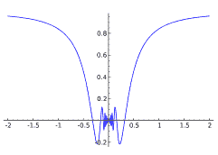

-   alpha：线条透明度；
-   thickness：线条粗细；
-   linestyle：线条样式，可以用 `':'` 表示点线，用 `'-.'` 表示点划线，或用默认值 `'-'` 表示实线。

为了可视化图形，我们将图形对象赋给一个变量，比如 `g`，然后使用 `show` 命令；此外，我们还可以给定 y 轴的边界（`g.show(ymin=-1, ymax=3)`），或选择纵横比（`g.show(aspect_ratio=1)`），使 `x` 和 `y` 的刻度相等。

得到的图形可以用 `save` 命令导出为多种格式，这些格式由后缀 `.pdf`、`.png`、`.ps`、`.eps`、`.svg` 和 `.sobj` 定义：`g.save(name, aspect_ratio=1, xmin=-1, xmax=3, ymin=-1, ymax=3)`

要在 LaTeX 文档中使用 `includegraphics` 命令包含这样的图形，如果文档要用 `latex` 编译，则应使用 `eps` 后缀（封装 PostScript）；如果文档要用 `pdflatex` 编译，则应使用 `pdf` 后缀（为了获得更好的分辨率，应优先于 `png`）。

让我们在同一幅图上绘制正弦函数及其在 0 处的首批 Taylor 多项式。

```sage
sage: def p(x, n):
....:     return(taylor(sin(x), x, 0, n))
sage: xmax = 15 ; n = 15
sage: g = plot(sin(x), x, -xmax, xmax)
sage: for d in range(n):
....:     g += plot(p(x, 2 * d + 1), x, -xmax, xmax,\
....:     color=(1.7*d/(2*n), 1.5*d/(2*n), 1-3*d/(4*n)))
sage: g.show(ymin=-2, ymax=2)
```

我们还可以创建动画，以观察当 Taylor 多项式的次数增加时，它们如何越来越好地逼近正弦函数。要保留动画，只需将其保存为 `gif` 格式。

#### 4.1.2 参数曲线

参数曲线 \((x = f(t),\ y = g(t))\) 可以使用命令 `parametric_plot((f(t), g(t)), (t, a, b))` 可视化，其中 \([a, b]\) 是参数 \(t\) 的取值范围。

让我们展示由以下方程定义的参数曲线：

\[
\begin{cases}
x(t)=\cos(t)+\frac{1}{2}\cos(7t)+\frac{1}{3}\sin(17t),\\
y(t)=\sin(t)+\frac{1}{2}\sin(7t)+\frac{1}{3}\cos(17t).
\end{cases}
\]

```sage
sage: t = var('t')
sage: x = cos(t) + cos(7*t)/2 + sin(17*t)/3
sage: y = sin(t) + sin(7*t)/2 + cos(17*t)/3
sage: g = parametric_plot((x, y), (t, 0, 2*pi))
sage: g.show(aspect_ratio=1)
```

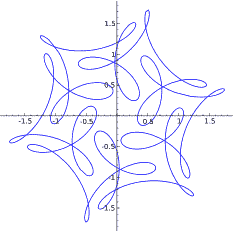

图 4.4 – 方程 \(x(t)=\cos(t)+\frac{1}{2}\cos(7t)+\frac{1}{3}\sin(17t)\)、\(y(t)=\sin(t)+\frac{1}{2}\sin(7t)+\frac{1}{3}\cos(17t)\) 的参数曲线。

#### 4.1.3 极坐标中的曲线

极坐标 \(\rho = f(\theta)\) 中的曲线，其中参数 \(\theta\) 在区间 \([a, b]\) 上变化，可以用命令 `polar_plot(rho(theta), (theta,a,b))` 绘制。例如，让我们用图形观察极坐标方程为 \(\rho(\theta)=1+e\cdot\cos(n\theta)\) 的玫瑰线，其中 \(n=20/19\)，\(e\in\{2,1/3\}\)。

```sage
sage: t = var('t'); n = 20/19
sage: g1 = polar_plot(1+2*cos(n*t),(t,0,n*36*pi),plot_points=5000)
sage: g2 = polar_plot(1+1/3*cos(n*t),(t,0,n*36*pi),plot_points=5000)
```

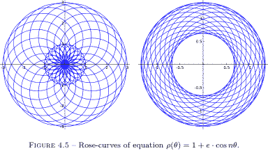

```python
sage: g1.show(aspect_ratio=1); g2.show(aspect_ratio=1)
```

**练习 12.** 当参数 $a$ 从 0 到 2 以 0.1 为步长变化时，绘制极坐标方程 $\rho(\theta)=a+\cos\theta$ 的帕斯卡蜗线族。

#### 4.1.4 由隐式方程定义的曲线

要绘制由隐式方程给出的曲线，需要调用函数 `implicit_plot(f(x, y), (x, a, b), (y, c, d))`；不过也可以使用 `complex_plot` 命令，它使我们能够用颜色绘制二元函数的水平集。让我们绘制由隐式方程 $C=\{z\in\mathbb{C},\ |\cos(z^4)|=1\}$ 给出的曲线。

```python
sage: z = var('z')
sage: g1 = complex_plot(abs(cos(z^4))-1,
                       (-3,3), (-3,3), plot_points=400)
sage: f = lambda x, y : (abs(cos((x + I * y) ** 4)) - 1)
sage: g2 = implicit_plot(f, (-3, 3), (-3, 3), plot_points=400)
sage: g1.show(aspect_ratio=1); g2.show(aspect_ratio=1)
```

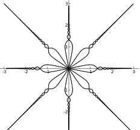

图 4.6 – 由方程 |cos(z^4)| = 1 定义的曲线 g2。

#### 4.1.5 数据绘图

要构造条形图，有两种不同的函数可用。一方面，`bar_chart` 接收一个整数列表作为输入，并绘制竖直条，其高度由列表元素给出（按给定顺序）。width 选项使我们能够选择条宽。

```python
sage: bar_chart([randrange(15) for i in range(20)])
sage: bar_chart([x^2 for x in range(1,20)], width=0.2)
```

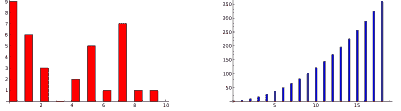

图 4.7 – 条形图。

另一方面，要根据浮点数列表绘制随机变量的直方图，我们使用 `plot_histogram` 函数。列表中的值首先被排序并分组到区间中（区间数量由选项 bins 给出，其默认值为 50），每个条的高度与对应值的数量成正比。

```sage
sage: liste = [10 + floor(10*sin(i)) for i in range(100)]
sage: bar_chart(liste)
sage: finance.TimeSeries(liste).plot_histogram(bins=20)
```

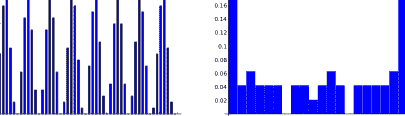

(a) 使用 bar_chart 绘图。

(b) 使用 plot_histogram 绘图。

我们想要研究的数据值列表经常以电子表格格式存储。Python 的 csv 包使我们能够导入以 csv 格式存储的这类数据。例如，假设我们想绘制一个班级成绩的直方图，这些成绩位于文件 exam01.csv 的第 3 列。要从这一列提取成绩，我们将使用以下指令（通常，这类文件的前几行包含文本，因此我们用 try 关键字处理可能不匹配的行）：

```python
sage: import csv
sage: reader = csv.reader(open("exam01.csv"))
sage: grades = []; list = []
sage: for line in reader:
....:     grades.append(line[2])
....: for i in grades:
....:     try:
....:         f = float(i)
....:     except ValueError:
....:         pass
....:     else:
....:         list.append(f)
sage: finance.TimeSeries(list).plot_histogram(bins=20)
```

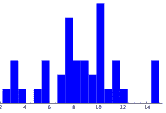

要绘制一组相连的点（或不相连的点），我们使用 `line(p)`（或 `point(p)` 或 `points(p)`）命令，其中 p 是一个由二元素列表（或元组）组成的列表，给出各点的横坐标和纵坐标。

**例。（随机游走）** 从原点 O 出发，一个粒子每 t 秒沿随机方向移动距离 ℓ，且与之前的移动无关。让我们绘制一个粒子轨迹的示例。红线从初始位置延伸到最终位置。

```python
sage: n, l, x, y = 10000, 1, 0, 0; p = [[0, 0]]
sage: for k in range(n):
....:     theta = (2 * pi * random()).n(digits=5)
....:     x, y = x + l * cos(theta), y + l * sin(theta)
....:     p.append([x, y])
sage: g1 = line([p[n], [0, 0]], color='red', thickness=2)
sage: g1 += line(p, thickness=.4); g1.show(aspect_ratio=1)
```

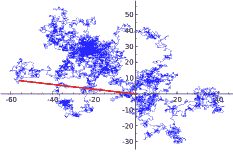

图 4.8 – 随机游走。

**例。（均匀分布序列）** 给定实数序列 \((u_n)_{n\in\mathbb{N}}\)，我们构造折线，其连续顶点是复平面中的点

$$z_N = \sum_{n\leq N} e^{2i\pi u_n}.$$

如果该序列模 1 均匀分布，则折线应表现得像随机游走，因而不会离原点太远。因此，我们可以从折线的图形外观推测其模 1 均匀分布。让我们研究以下情形：

- \(u_n = n\sqrt{2}\) 且 \(N = 200\)，
- \(u_n = n\ln(n)\sqrt{2}\) 且 \(N = 10000\)，
- \(u_n = [n\ln(n)]\sqrt{2}\) 且 \(N = 10000\)，
- \(u_n = p_n\sqrt{2}\) 且 \(N = 10000\)（这里 \(p_n\) 是第 \(n\) 个素数）。

图 4.9 按如下方式得到（这里以 \(u_n = n\sqrt{2}\) 为例）：

```
sage: length = 200; n = var('n')
sage: u = lambda n: n * sqrt(2)
sage: z = lambda n: exp(2 * I * pi * u(n)).n()
sage: vertices = [CC(0, 0)]
sage: for n in range(1, length):
....:     vertices.append(vertices[n - 1] + CC(z(n)))
sage: line(vertices).show(aspect_ratio=1)
```

我们看到，曲线 4.9a 惊人地规则，这表明 \(n\sqrt{2}\) 模 1 的均匀分布是确定性的。在 \(u_n = n\ln(n)\sqrt{2}\) 的情形中，这些值模 1 看起来似乎是随机的。然而，相关曲线 4.9b 却结构分明。曲线 4.9c 具有与第二条曲线相同类型的结构。最后，曲线 4.9d 显示了素数模 \(1/\sqrt{2}\) 的完全不同性质：螺旋消失了，外观看起来非常类似于随机游走 \(u_n\)（图 4.8）。因此，看起来“素数利用了赋予它们的所有随机性……”

关于这些曲线的详细解释，我们请读者参阅 Gérald Tenenbaum 和 Michel Mendès France 的书（法文）*Les nombres premiers* [TMF00]。

**练习 13**（绘制递推序列的项）。我们考虑由下式定义的序列 \((u_n)_{n\in\mathbb{N}}\)：

$$u_0 = a, \qquad \forall n \in \mathbb{N},\; u_{n+1} = \left|u_n^2 - \frac{1}{4}\right|.$$

通过构造点列表 \([(u_0, 0), (u_0, u_1), (u_1, u_1), (u_1, u_2), (u_2, u_2), \ldots]\) 来图形化表示该序列的行为，其中 \(a \in \{-0.4, 1.1, 1.3\}\)。

#### 4.1.6 显示微分方程的解

我们可以组合上述命令来表示微分方程或方程组的解。要符号求解一个常微分方程，需要调用

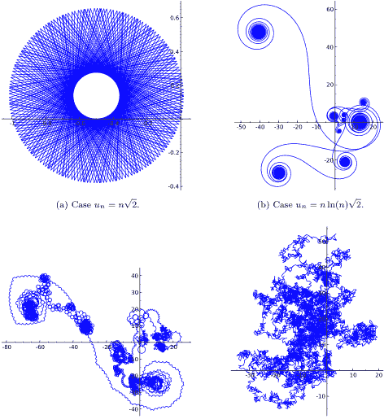

(a) 情形 \(u_n = n\sqrt{2}\)。

(b) 情形 \(u_n = n\ln(n)\sqrt{2}\)。

(c) 情形 \(u_n = \ln\ln(n)\sqrt{2}\)。

(d) 情形 \(u_n = p_n\sqrt{2}\)。

图 4.9 — 均匀分布序列。

desolve 函数将在第 10 章中更详细地研究。为了数值求解微分方程，Sage 提供了几种工具：`desolve_rk4`（使用与 `desolve` 相同的语法，足以求解本科水平的微分方程）、`odeint`（调用 SciPy 包），最后是 `ode_solver`（调用 GSL 库，其用法在第 14.2 节中详述）。`desolve_rk4` 和 `odeint` 函数返回点列表，使用 `line` 命令很容易绘制；本节将用它们绘制数值解。

**示例。**（*一阶线性微分方程*）我们来绘制微分方程 \(xy' - 2y = x^3\) 的积分曲线。

```sage
sage: x = var('x'); y = function('y')
sage: DE = x*diff(y(x), x) == 2*y(x) + x^3
sage: desolve(DE, [y(x),x])
(_C + x)*x^2
sage: sol = []
sage: for i in srange(-2, 2, 0.2):
....:     sol.append(desolve(DE, [y(x), x], ics=[1, i]))
....:     sol.append(desolve(DE, [y(x), x], ics=[-1, i]))
sage: g = plot(sol, x, -2, 2)
sage: y = var('y')
sage: g += plot_vector_field((x, 2*y+x^3), (x,-2,2), (y,-1,1))
sage: g.show(ymin=-1, ymax=1)
```

为了减少计算时间，这里更好的做法是“手工”定义方程的通解，并创建一个特解列表（如习题 14 的解答中所做的那样），而不是用不同的初始条件多次求解微分方程。我们也可以计算该方程的数值解（使用 `desolve_rk4` 函数）来绘制其积分曲线：

```sage
sage: x = var('x'); y = function('y')
sage: DE = x*diff(y(x), x) == 2*y(x) + x^3
sage: g = Graphics()                         # creates an empty graph
sage: for i in srange(-2, 2, 0.2):
....:     g += line(desolve_rk4(DE, y(x), ics=[1, i]), \
....:         step=0.05, end_points=[0,2])
....:     g += line(desolve_rk4(DE, y(x), ics=[-1, 1]), \
....:         step=0.05, end_points=[-2,0]))
sage: y = var('y')
sage: g += plot_vector_field((x, 2*y + x^3), (x,-2,2), (y,-1,1))
sage: g.show(ymin=-1, ymax=1)
```

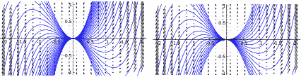

(a) 符号解。　　　　　　　　　(b) 数值解。

图 4.10 — \(xy' - 2y = x^3\) 的积分曲线。

如上例所示，desolve_rk4 函数接受一个微分方程（或显式形式 \(y' = f(y,x)\) 中方程的右端 \(f\)）、未知函数的名称、初始条件、步长以及求解区间作为输入。可选参数 output 使我们能够指定输出类型：默认值 'list' 返回列表（如果像我们的示例那样要组合图形，这很有用），'plot' 输出解的图形，'slope_field' 添加积分曲线斜率图。

**习题 14.** 绘制方程 \(x^2 y' - y = 0\) 的积分曲线，其中 \(-3 \le x \le 3\) 且 \(-5 \le y \le 5\)。

现在给出 SciPy 包中 `odeint` 函数的一个示例。

**示例。**（一阶非线性微分方程）我们来绘制方程 \(y'(t)+\cos(y(t)\cdot t)=0\) 的积分曲线。

```sage
sage: import scipy; from scipy import integrate
sage: f = lambda y, t: -cos(y * t)
sage: t = srange(0, 5, 0.1); p = Graphics()
sage: for k in srange(0, 10, 0.15):
....:     y = integrate.odeint(f, k, t)
....:     p += line(zip(t, flatten(y)))
sage: t = srange(0, -5, -0.1); q = Graphics()
sage: for k in srange(0, 10, 0.15):
....:     y = integrate.odeint(f, k, t)
....:     q += line(zip(t, flatten(y)))
sage: y = var('y')
sage: v = plot_vector_field((1, -cos(x*y)), (x,-5,5), (y,-2,11))
sage: g = p + q + v; g.show()
```

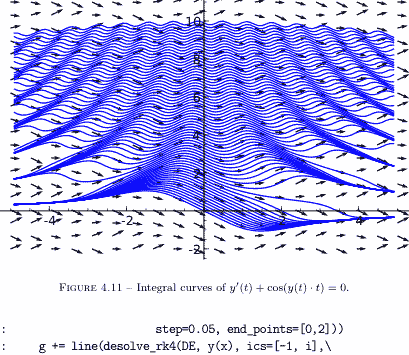

**图 4.11** — \(y'(t)+\cos(y(t)\cdot t)=0\) 的积分曲线。

odeint 函数接受微分方程 \(y' = f\) 的右端 \(f\)（假定为显式形式）、一个或多个初始条件，以及求解区间作为参数；它返回一个类型为 `numpy.ndarray` 的数组，可用已在 §3.3.2 中见过的 `flatten` 命令¹转换。得到的列表随后使用 `zip` 命令与数组 \(t\) 组合，并显示近似解。为了添加与积分曲线相切的向量场，我们使用了 `plot_vector_field` 命令。

**示例。**（Lotka–Volterra 捕食者-猎物模型）我们希望用图形表示一组猎物和捕食者根据 Lotka–Volterra 方程组演化时的数量变化：

$$
\begin{cases}
\dfrac{du}{dt} = au - buv,\\[4pt]
\dfrac{dv}{dt} = -cv + dbuv,
\end{cases}
$$

其中 \(u\) 是猎物数量（例如兔子），\(v\) 是捕食者数量（例如狐狸）。此外，参数 \(a\)、\(b\)、\(c\)、\(d\) 描述种群演化：\(a\) 是在没有狐狸捕食时兔子的自然增长，\(b\) 是狐狸捕杀兔子时兔子的减少量，\(c\) 是没有兔子可吃时狐狸的减少量，最后 \(d\) 表示每出现一只新狐狸需要多少只兔子。

```sage
sage: import scipy; from scipy import integrate
sage: a, b, c, d = 1, 0.1, 1.5, 0.75
sage: def dX_dt(X, t=0):                      # returns the population variation
....:     return [a*X[0] - b*X[0]*X[1], -c*X[1] + d*b*X[0]*X[1]]
sage: t = srange(0, 15, .01)                  # time scale
sage: X0 = [10, 5]                            # initial conditions: 10 rabbits and 5 foxes
sage: X = integrate.odeint(dX_dt, X0, t)      # numerical solution
sage: rabbits, foxes = X.T                    # short cut for X.transpose()
sage: p = line(zip(t, rabbits), color='red')  # number of rabbits graph
sage: p += text("Rabbits", (12,37), fontsize=10, color='red')
sage: p += line(zip(t, foxes), color='blue')  # idem for foxes
sage: p += text("Foxes", (12,7), fontsize=10, color='blue')
sage: p.axes_labels(['time', 'population']); p.show(gridlines=True)
```

上面的指令显示了兔子和狐狸数量随时间的变化（图 4.12，左），下面的指令显示了向量场（图 4.12，右）：

```sage
sage: n = 11;  L = srange(6, 18, 12 / n); R = srange(3, 9, 6 / n)
sage: CI = zip(L, R)              # list of initial conditions
sage: def g(x,y):
....:     v = vector(dX_dt([x, y]))   # for a nicer grid, we
....:     return v/v.norm()          # normalise the vector field
sage: x, y = var('x, y')
sage: q = plot_vector_field(g(x, y), (x, 0, 60), (y, 0, 36))
sage: for j in range(n):
....:     X = integrate.odeint(dX_dt, CI[j], t)       # resolution
....:     q += line(X, color=hue(.8*float(j)/(1.8*n))) # graph plot
sage: q.axes_labels(["rabbits","foxes"]); q.show()
```

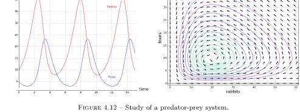

图 4.12 — 捕食者-猎物系统的研究。

**习题 15**（捕食者-猎物模型）。使用 `desolve_system_rk4` 而不是 `odeint` 重新绘制图 4.12 的左图。

**习题 16**（一个自治微分系统）。绘制以下微分系统的积分曲线：

$$
\begin{cases}
\dot{x}=y,\\
\dot{y}=0.5y-x-y^2.
\end{cases}
$$

**习题 17**（带马格努斯效应的圆柱绕流）。我们将半径为 \(a\) 的圆柱周围的简单流动与参数为 \(\alpha\) 的涡旋叠加，后者会改变周向速度分量。我们在以圆柱为中心的坐标系中工作，使用平面 \(z=0\) 中的柱坐标，即极坐标。速度分量于是为：

$$v_r=v_0\cos(\theta)\left(1-\frac{a^2}{r^2}\right)\qquad\text{and}\qquad v_\theta=-v_0\sin(\theta)\left(1+\frac{a^2}{r^2}\right)+\frac{2\alpha a v_0}{r}.$$

流线（由于流动是定常的，因此与轨迹相同）平行于速度。我们寻找流线的参数表达式；因此必须求解微分方程组：

$$\frac{dr}{dt}=v_r\qquad\text{and}\qquad\frac{d\theta}{dt}=\frac{v_\theta}{r}.$$

通过使用以圆柱半径 \(a\) 缩放的坐标，我们可以假设 \(a=1\)。绘制 \(\alpha\in\{0.1,0.5,1,1.25\}\) 时的流线。


马格努斯效应被提出用于构建由大型垂直旋转圆柱制成的推进系统，当风垂直于船体时，这些圆柱能够产生纵向推力（安东·弗莱特纳建造的巴登-巴登号旋筒船就是这种情况，该船于 1926 年横渡大西洋）。

#### 4.1.7 曲线的渐屈线

现在我们给出绘制参数弧的渐屈线的示例（让我们回顾一下，渐屈线是曲线法线的包络，或者等价地，是曲率中心的轨迹）。

示例。（*抛物线的渐屈线*）让我们求方程 $y=x^2/4$ 的抛物线 $\mathcal{P}$ 的渐屈线方程，并在同一幅图中显示抛物线 $\mathcal{P}$、$\mathcal{P}$ 的一些法线及其渐屈线。

为了确定由形如 $\alpha(t)X+\beta(t)Y=\gamma(t)$ 的笛卡尔方程定义的一族直线 $\Delta_t$ 的渐屈线的一个参数方程组 $(x(t),y(t))$，我们表达直线 $\Delta_t$ 在 $(x(t),y(t))$ 处与包络相切这一事实：

\[ \alpha(t)x(t)+\beta(t)y(t)=\gamma(t), \quad (4.1) \]
\[ \alpha(t)x'(t)+\beta(t)y'(t)=0. \quad (4.2) \]

对方程 (4.1) 求导并结合 (4.2)，得到方程组：

\[ \alpha(t)x(t)+\beta(t)y(t)=\gamma(t), \quad (4.1) \]
\[ \alpha'(t)x(t)+\beta'(t)y(t)=\gamma'(t). \quad (4.3) \]

在我们的情形中，抛物线 $\mathcal{P}$ 在 $M(t,t^2/4)$ 处的法线 $(N_t)$ 具有法向量 $\vec{v}=(1,t/2)$（该向量与抛物线相切）；因此其方程为：

\[ \begin{pmatrix} x-t \\ y-t^2/4 \end{pmatrix} \cdot \begin{pmatrix} 1 \\ t/2 \end{pmatrix}=0 \quad\Longleftrightarrow\quad x+\frac{t}{2}y=t+\frac{t^3}{8}, \]

换言之，$(\alpha(t),\beta(t),\gamma(t))=(1,t/2,t+t^3/8)$。然后我们可以用 solve 函数求解上述方程组：

```sage
sage: x, y, t = var('x, y, t')
sage: alpha(t) = 1; beta(t) = t / 2; gamma(t) = t + t^3 / 8
sage: env = solve([alpha(t) * x + beta(t) * y == gamma(t),\
....:     diff(alpha(t), t) * x + diff(beta(t), t) * y == \
....:     diff(gamma(t), t)], [x,y])
```

\[ \boxed{\left[x=-\frac14 t^3,\quad y=\frac34 t^2+2\right]} \]

这给出了法线包络的一个参数表示：

\[ \begin{cases} x(t)=-\frac14 t^3,\\ y(t)=2+\frac34 t^2. \end{cases} \]

然后我们可以通过绘制抛物线的一些法线来回答所给问题（更准确地说，我们绘制线段 $[M,M+18\vec{n}]$，其中 $M(u,u^2/4)$ 是 $\mathcal{P}$ 上的一点，而 $\vec{n}=(-u/2,1)$ 是 $\mathcal{P}$ 的一个法向量）：

| 绘图类型 | 函数 |
|---|---|
| 函数的图像 | `plot` |
| 参数曲线 | `parametric_plot` |
| 由极坐标方程定义的曲线 | `polar_plot` |
| 由隐式方程定义的曲线 | `implicit_plot` |
| 复函数的水平集 | `complex_plot` |
| 空图形对象 | `Graphics()` |
| 微分方程的积分曲线 | `odeint, desolve_rk4` |
| 条形图、柱状图 | `bar_chart` |
| 统计序列的直方图 | `plot_histogram` |
| 折线 | `line` |
| 点云 | `points` |
| 圆 | `circle` |
| 多边形 | `polygon` |
| 文本 | `text` |

表 4.1 —— 二维图形函数汇总。

```sage
sage: T(t) = [df(t)[0] / df(t).norm(), df(t)[1] / df(t).norm()]
sage: N(t) = [-df(t)[1] / df(t).norm(), df(t)[0] / df(t).norm()]
sage: R(t) = (df(t).norm())^3 / (df(t)[0]*d2f(t)[1]-df(t)[1]*d2f(t)[0])
sage: Omega(t) = [f(t)[0] + R(t)*N(t)[0], f(t)[1] + R(t)*N(t)[1]]
sage: g = parametric_plot(f(t), (t,-8,8), color='green',thickness=2)
sage: for u in srange(.4, 4, .2):
....:     g += line([f(t=u), Omega(t=u)], color='red', alpha = .5)
....:     g += circle(Omega(t=u), R(t=u), color='blue')
sage: g.show(aspect_ratio=1,xmin=-12,xmax=7,ymin=-3,ymax=12)
```

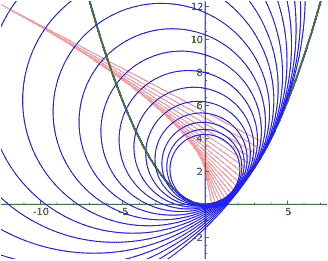

图 4.14 —— 抛物线的密切圆。

表 4.1 汇总了本节详述的函数。它还包含 text 命令，该命令使我们能够在图形中添加字符串，以及 polygon 命令来绘制多边形。

### 4.2 三维曲线

Sage 提供 `plot3d(f(x,y),(x,a,b),(y,c,d))` 命令来显示三维曲面。所得到的曲面随后可以通过 Jmol 应用程序进行可视化；也可以使用 Tachyon 3D Ray Tracer 或 three.js，并通过 show 命令的选项 `viewer='tachyon'` 或 `viewer='threejs'` 来实现。下面是参数曲面的第一个示例（图 4.15）：

```sage
sage: u, v = var('u, v')
sage: h = lambda u,v: u^2 + 2*v^2
sage: plot3d(h, (u,-1,1), (v,-1,1), aspect_ratio=[1,1,1])
```

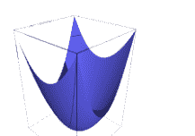

图 4.15 参数曲面 $(u, v) \mapsto u^2 + 2v^2$。

显示二变量函数对应的曲面有助于我们研究该函数，如下例所示。

示例。（*一个方向导数处处存在的不连续函数！*）研究由下式定义的函数 $f$ 从 $\mathbb{R}^2$ 到 $\mathbb{R}$ 在 $(0,0)$ 处方向导数的存在性及其连续性：

\[
f(x,y)=
\begin{cases}
\dfrac{x^2y}{x^4+y^2}, & (x,y)\ne(0,0),\\
0, & (x,y)=(0,0).
\end{cases}
\]

对于 $H=[\cos\theta;\sin\theta]$，函数 $\varphi(t)=f(tH)=f(t\cos\theta,t\sin\theta)$ 对任意 $\theta$ 值在 $t=0$ 处可微；事实上，

```sage
sage: f(x, y) = x^2 * y / (x^4 + y^2)
sage: t, theta = var('t, theta')
sage: limit(f(t * cos(theta), t * sin(theta)) / t, t=0)
cos(theta)^2/sin(theta)
```

因此，$f$ 在点 $(0, 0)$ 处沿任意方向都有明确定义的方向导数。为了更好地可视化 $f$ 对应的曲面，我们可以先寻找一些水平集；例如值为 $\frac{1}{2}$ 的水平集：

```sage
sage: solve(f(x,y) == 1/2, y)
[y == x^2]
sage: a = var('a'); h = f(x, a*x^2).simplify_rational(); h
a/(a^2 + 1)
```

因此，沿着方程 $y = ax^2$ 的抛物线（原点除外），$f$ 具有常值 $f(x, ax^2) = \frac{a}{1+a^2}$。然后我们显示函数 $h: a \longmapsto \frac{a}{1+a^2}$：

```sage
sage: plot(h, a, -4, 4)
```

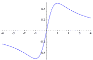

图 4.16 —— 所研究曲面的一个垂直截面。

函数 $h$ 在 $a = 1$ 处取得最大值，在 $a = -1$ 处取得最小值。$f$ 在方程 $y = x^2$ 的抛物线上的限制对应于“高度”为 $\frac{1}{2}$ 的水平集；反过来，在方程 $y = -x^2$ 的抛物线上的限制对应于高度为 $-\frac{1}{2}$ 的“谷底”。总之，在任意接近点 $(0, 0)$ 的地方，我们都能找到 $f$ 取值为 $\frac{1}{2}$ 或分别为 $-\frac{1}{2}$ 的点。因此，$f$ 在原点处不连续。

```sage
sage: p = plot3d(f(x,y),(x,-2,2),(y,-2,2),plot_points=[150,150])
```

我们也可以用以下方式绘制水平平面来显示该函数的水平集：

```sage
sage: for i in range(1,4):
....:     p += plot3d(-0.5 + i / 4, (x, -2, 2), (y, -2, 2),\
....:               color=hue(i / 10), opacity=.1)
```

在其他三维图形命令中，`implicit_plot3d` 允许我们显示由形如 $f(x,y,z) = 0$ 的隐式方程定义的曲面。例如，让我们显示由隐式方程 $(a^2 + x^2 + y^2)^2 = 4a^2x^2 + z^4$ 定义的卡西尼曲面（图 4.18a）：

```sage
sage: x, y, z = var('x, y, z'); a = 1
sage: h = lambda x, y, z: (a^2 + x^2 + y^2)^2 - 4*a^2*x^2-z^4
sage: implicit_plot3d(h, (x,-3,3), (y,-3,3), (z,-2,2),\
....:                 plot_points=100)
```

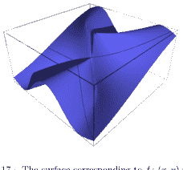

图 4.17 —— 对应于 $f : (x,y) \mapsto \frac{x^2 y}{x^4+y^2}$ 的曲面。

最后，我们给出一个使用 line3d 命令绘制三维曲线（图 4.18b）的示例：

```sage
sage: line3d(([-10*cos(t)-2*cos(5*t)+15*sin(2*t),\
....:       -15*cos(2*t)+10*sin(t)-2*sin(5*t),\
....:       10*cos(3*t)) for t in srange(0,6.4,.1)],radius=.5)
```

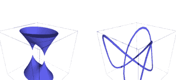

（a）卡西尼曲面。

（b）空间中的纽结。

图 4.18 —— 三维中的曲面与曲线。


## 5 计算域

在纸上或黑板上书写数学，需要在记号简便性与严谨性之间取得折衷。日常使用计算机代数系统也是如此。Sage 试图把这一选择权交给用户：让用户或多或少严格地指定计算域：所考虑对象的本质是什么，它们属于哪些集合，可以对其应用哪些运算？

### 5.1 Sage 是面向对象的

Python 和 Sage 大量使用面向对象编程范式。尽管在日常使用中这仍相对透明，但稍微了解这一范式是有用的，因为它在数学语境中相当自然。

#### 5.1.1 对象、类与方法

面向对象编程范式在于：用编程语言中称为*对象*的构造，对希望操作的每个物理或抽象实体进行建模。在大多数情况下，如同在 Python 中一样，每个对象都是某个*类*的实例。例如，有理数 12/35 由一个对象表示，该对象是 `Rational` 类的实例：

```
sage: o = 12/35
sage: type(o)
<type 'sage.rings.rational.Rational'>
```

注意，这个类确实关联到对象 12/35，而不是关联到存储它的变量 o：

```
sage: type(12/35)
<type 'sage.rings.rational.Rational'>
```

更准确地说，*对象*是计算机内存的一部分，其中存储着表示相应实体所需的信息。而*类*则定义两件事：

- 1. 对象的*数据结构*，即信息在内存中如何组织。例如，Rational 类规定，像 12/35 这样的有理数由两个整数表示：其分子和分母；
- 2. 对象的*行为*，特别是可对该对象使用的*运算*：如何取得有理数的分子，如何计算其绝对值，如何相乘或相加两个有理数。这些运算中的每一个都由一个*方法*实现（这里分别对应 `numerator`、`abs`、`__mul__`、`__add__`）。

因此，要对一个整数进行因式分解，我们将使用以下语法调用 *factor* 方法：

```
sage: o = 720
sage: o.factor()
2^4 * 3^2 * 5
```

我们可以这样理解：“取 `o` 的值，并对其应用 *factor* 方法，不传入任何其他参数”。在底层，Python 执行以下计算：

```
sage: type(o).factor(o)
2^4 * 3^2 * 5
```

从左到右读作：“从 `o` 的类（`type(o)`）中请求因式分解方法（`type(o).factor`），并将其应用于 `o`”。

请注意，我们不仅可以将此方法应用于变量，还可以直接应用于值：

```
sage: 720.factor()
2^4 * 3^2 * 5
```

因此，我们可以从左到右链式调用运算。这里，我们首先取一个有理数的分子，然后对这个分子进行因式分解：

```
sage: o = 720 / 133
sage: o.numerator().factor()
2^4 * 3^2 * 5
```

为了让用户更轻松，Sage 还提供了一个 *函数* `factor`，因此 `factor(o)` 是 `o.factor()` 的快捷方式。若干常用函数也是如此，而且我们可以添加自己的快捷方式，如下面的练习所示。

**练习 18.** 构建一个快捷方式 `ndigits`，使得 `ndigits(o)` 调用对象 `o` 的 `ndigits` 方法。

#### 5.1.2 对象与多态

几乎所有的 Sage 运算都是*多态的*，也就是说，它们适用于多种对象。例如，无论我们想要“因式分解”的对象 `o` 是什么性质，我们都会使用相同的记号 `o.factor()`（或其快捷方式 `factor(o)`）。然而，对整数或多项式进行因式分解所需执行的计算并不相同！如果多项式具有有理系数或有限域中的系数，计算也会不同。对象类决定了将调用哪个版本的 factor 代码。

同样，与通常的数学记号一样，两个对象 `a` 和 `b` 的乘积始终可以记为 `a*b`，即使每种情况下使用的算法不同[^1]。下面是一个两个整数的乘积：

```
sage: 3 * 7
21
```

两个有理数的乘积，通过将分子和分母分别相乘，然后约分得到：

```
sage: (2/3) * (6/5)
4/5
```

两个复数的乘积，使用关系 `i² = −1`：

```
sage: (1 + I) * (1 - I)
2
```

两个形式表达式的一些可交换乘积：

```
sage: (x + 2) * (x + 1)
(x + 2)*(x + 1)
sage: (x + 1) * (x + 2)
(x + 2)*(x + 1)
```

除了记号简洁之外，这种形式的多态还使我们能够编写*通用的*程序，这些程序适用于任何具有所涉运算（这里是乘法）的对象：

```
sage: def fourth_power(a):
....:     a = a * a
....:     a = a * a
....:     return a
```

```
sage: fourth_power(2)
16
sage: fourth_power(3/2)
81/16
sage: fourth_power(I)
1
sage: fourth_power(x+1)
(x + 1)^4
sage: M = matrix([[0,-1],[1,0]]); M
[ 0 -1]
[ 1  0]
sage: fourth_power(M)
[1 0]
[0 1]
```

#### 5.1.3 内省

Python 对象，因而 Sage 对象，具有一些*内省*特性。这意味着，在执行过程中，我们可以向对象“询问”其类、方法等信息，并使用编程语言的常规构造来操作所获得的信息。例如，对象 o 的类本身就是一个 Python 对象，我们可以使用 `type(o)` 获取它：

```
sage: t = type(5/1); t
<type 'sage.rings.rational.Rational'>
sage: t == type(5)
False
```

我们在这里看到，表达式 5/1 构造出有理数 5，作为 Python 对象，它与整数 5 不同！

内省工具还允许从整数类型的对象访问因式分解的在线帮助：

```
sage: o = 720
sage: o.factor?
Docstring:
    Return the prime factorization of this integer as a formal
    Factorization object.

...
```

甚至还可以访问该函数的源代码：

```
sage: o.factor??
...
def factor(self, algorithm='pari', proof=None, ...)
    ...
    if algorithm == 'pari':
        ...
    elif algorithm in ['kash', 'magma']:
        ...
```

撇开一些技术细节不谈，我们在这里看到，Sage 将整数因式分解委托给其他工具（PARI/GP、Kash 或 Magma）。

同样地，我们可以使用自动补全，以交互方式向对象 o“询问”可以对其应用哪些运算：

```
sage: o.<tab>
o.n	o.nbits	o.ndigits
o.next_prime	o.next_prime_power	o.next_probable_prime
o.nth_root	o.numerator	o.numerical_approx
```

这再次说明，它是一种内省形式。

### 5.2 元素、父对象与范畴

#### 5.2.1 元素与父对象

在上一节中，我们看到了对象的*类*这一概念。在实践中，知道这一概念存在就足够了；我们很少需要显式查找对象的类型。然而，Sage 引入了另一个更接近数学的概念：对象的*父对象*，我们现在将详细说明。

例如，假设我们想知道元素 *a* 是否*可逆*。答案不仅取决于元素本身，还取决于它所属的数学集合 *A*（以及其可能的逆元）。例如，数字 5 在整数集合 ℤ 中不可逆，因为它的逆 1/5 不是整数：

```
sage: a = 5; a
5
sage: a.is_unit()
False
```

然而，它在有理数集合中可逆：

```
sage: a = 5/1; a
5
sage: a.is_unit()
True
```

Sage 对该问题给出两个不同的答案，因为如上节所示，对象 5 和 5/1 具有不同的类。

在一些面向对象的计算机代数系统（如 MuPAD 或 Axiom）中，*x* 所属的数学集合 *X*（这里是 ℤ 或 ℚ）就简单地是 *x* 的类。Sage 遵循 Magma 系统的方法，通过附加到 *x* 的另一个对象来定义集合 *X*，该对象称为 *x* 的*父对象*：

```
sage: parent(5)
Integer Ring
sage: parent(5/1)
Rational Field
```

我们可以使用以下快捷方式获得这两个集合：

```
sage: ZZ
Integer Ring
```

[^1]: 对于像乘积这样的二元运算，选择合适的方法比上文所述略为复杂。确实，对于像整数与有理数的和 2 + 3/4 这样的混合运算，在这种情况下，2 将被转换为有理数 2/1，并将调用两个有理数的加法。描述哪个操作数必须被转换以及应如何转换的规则，是*强制转换模型*的一部分。


``` 
Full MatrixSpace of 3 by 3 dense matrices over
Univariate Polynomial Ring in x over Finite Field of size 5
```

并从此定义域中抽取一个随机元素：

```sage
sage: M.random_element()
[2*x^2 + 3*x + 4    4*x^2 + 2*x + 2    4*x^2 + 2*x]
[              3*x   2*x^2 + x + 3    3*x^2 + 4*x]
[    4*x^2 + 3*x^2 + 2*x + 4          2*x + 4]
```

#### 5.2.3 延伸阅读：范畴

一般来说，父对象本身并没有父对象，而是有一个指示其性质的*范畴*：

```sage
sage: QQ.category()
Join of Category of number fields and Category of quotient fields and
    Category of metric spaces
```

Sage 知道 ℚ 是一个域：

```sage
sage: QQ in Fields()
True
```

因此，例如，它是一个加法交换群（见图 5.1）：

```sage
sage: QQ in CommutativeAdditiveGroups()
True
```

由于 ℚ 是域，ℚ[x] 是欧几里得环：

```sage
sage: QQ['x'] in EuclideanDomains()
True
```

所有这些性质都被用来对这些集合中的元素进行严谨而高效的计算。

### 5.3 具有标准形的定义域

现在让我们浏览一些在 Sage 中将会遇到的父对象。

我们已在 §2.1 中看到标准形²在计算机代数中可能有多么重要，因为通过比较两个对象的标准形表示，就可以判断它们在数学上是否相等。本节介绍的每个基本父对象都对应一个*具有标准形的定义域*，即一组具有标准形的数学对象。这使得 Sage 能够毫无歧义地表示这些父对象中每一个的元素³。

²在本书中，我们同时使用*规范形*和*标准形*来表示：如果两个对象的规范形（或标准形）相等，则它们在数学上相同。有时*标准形*被理解为一种更弱的概念，其中只假定零具有唯一表示。

³Sage 中可用的大多数其他父对象都对应于具有标准形的定义域，但并非全部如此。有时，出于效率原因，Sage 仅在明确请求时才以标准形表示元素。

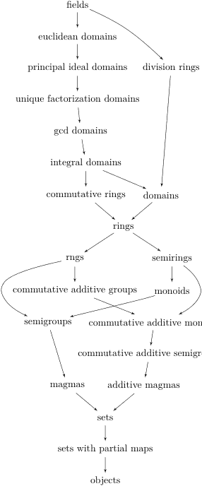

图 5.1 – Sage 中范畴图的一小部分。

| 定义域 | Sage 表示 |
|---|---|
| **一些基本 Python 类型** | |
| Python 整数 | `int` |
| Python 浮点数 | `float` |
| 布尔值（`true`、`false`） | `bool` |
| 字符串 | `str` |
| **基本数值定义域** | |
| 整数 ℤ | `ZZ` 或 `IntegerRing()` |
| 有理数 ℚ | `QQ` 或 `RationalField()` |
| 具有 *p* 位的浮点数 | `Reals(p)` 或 `RealField(p)` |
| 具有 *p* 位的复浮点数 | `Complexes(p)` 或 `ComplexField(p)` |
| **环与有限域** | |
| 模 *n* 的整数，ℤ/*n*ℤ | `Integers(n)` 或 `IntegerModRing(n)` |
| 有限域 𝔽<sub>q</sub> | `GF(q)` 或 `FiniteField(q)` |
| **代数数** | |
| 代数数 ℚ̄ | `QQbar` 或 `AlgebraicField()` |
| 实代数数 | `AA` 或 `AlgebraicRealField()` |
| 数域 ℚ[*x*]/(*p*) | `NumberField(p)` |
| **符号计算** | |
| 系数在 *A* 中的 *m* × *n* 矩阵 | `MatrixSpace(A, m, n)` |
| 多项式 *A*[*x*,*y*] | `A[x,y]` 或 `PolynomialRing(A, 'x,y')` |
| 级数 *A*[[*x*]] | `A[['x']]` 或 `PowerSeriesRing(A, 'x')` |
| 符号表达式 | `SR` |

表 5.1 – 主要定义域与父对象。

#### 5.3.1 初等定义域

我们把不含变量的经典常数集合称为*初等计算定义域*（或简称为初等定义域）：整数、有理数、浮点数、布尔值、模 *n* 的整数……

**整数。** 整数在内部以二进制表示，默认以十进制打印。如上所述，Sage 整数是类 `Integer` 的对象。它们的父对象是环 ℤ：

```sage
sage: 5.parent()
Integer Ring
```

整数始终处于标准形；因此，检查它们是否相等很容易。因此，为了能够以因式分解形式表示整数，`factor` 命令需要一个特定的类：

```sage
sage: type(factor(4))
<class 'sage.structure.factorization_integer.IntegerFactorization'>
```

`Integer` 类是 Sage 特有的：默认情况下，Python 使用 `int` 类型的整数。一般来说，从 `Integer` 到 `int` 的转换——或反过来——是自动的，但可能有必要通过以下方式显式转换：

```sage
sage: int(5)
5
sage: type(int(5))
<type 'int'>
```

或者反过来：

```sage
sage: Integer(5)
5
sage: type(Integer(5))
<type 'sage.rings.integer.Integer'>
```

**有理数。** 标准形性质也适用于有理数，即 QQ 的元素，它们始终以约简形式表示。因此，在以下命令中：

```sage
sage: factorial(99) / factorial(100) - 1 / 50
-1/100
```

阶乘会先被求值，然后得到的分数 1/100 被化为约简形式。接着 Sage 构造有理数 1/50，执行减法，然后再次约简结果（这里无需再做任何处理）。

**浮点数。** 实数不能全部用有限格式精确表示。它们的数值由浮点数近似表示，这将在第 11 章中更详细地讨论。

在 Sage 中，浮点数以二进制基数编码。因此，与输入 0.1 对应的浮点数与 1/10 略有不同，因为 1/10 无法用二进制精确表示！每个浮点数都有自己的精度。具有 p 位有效数字的浮点数的父对象记为 RealField(p)；对于默认精度（p = 53），它也记为 RR。与整数一样，Sage 浮点数不同于 Python 中的对应类型。

当浮点数出现在同时包含整数或有理数的和、积或商中时，浮点数是“传染性的”；整个表达式随后会按浮点数求值：

```sage
sage: 72/53 - 5/3 * 2.7
-3.14150943396227
```

同样，当某个常用函数的参数是浮点数时，结果仍然是浮点数：

```sage
sage: cos(1), cos(1.)
(cos(1), 0.540302305868140)
```

`numerical_approx` 方法（或其别名 n）会对剩余表达式进行数值求值。可选参数允许我们设置此求值所使用的有效数字位数。例如，下面是具有 50 位有效数字的 $\pi$：

```sage
sage: pi.n(digits=50)  # variant: n(pi,digits=50)
3.1415926535897932384626433832795028841971693993751
```

**复浮点数。** 类似地，精度为 $p$ 的复数的浮点近似是 `Complexes(p)` 的元素——或其别名 `ComplexField(p)`——，或者使用默认精度 53 位的 CC。例如，我们可以构造一个复浮点数并计算其辐角：

```sage
sage: z = CC(1,2); z.arg()
1.10714871779409
```

##### 复数符号表达式

虚数单位 $i$（记为 I 或 i）在前面的章节中已经遇到过，它不是 CC 的元素，而是一个符号表达式（见 §5.4.1）：

```sage
sage: I.parent()
Symbolic Ring
```

我们可以用它通过显式转换来定义一个复浮点数：

```sage
sage: (1.+2.*I).parent()
Symbolic Ring
sage: CC(1.+2.*I).parent()
Complex Field with 53 bits of precision
```

在符号表达式的世界中，方法 `real`、`imag` 和 `abs` 分别给出复数的实部、虚部和模：

```sage
sage: z = 3 * exp(I*pi/4)
sage: z.real(), z.imag(), z.abs().canonicalize_radical()
(3/2*sqrt(2), 3/2*sqrt(2), 3)
```

**布尔值。** 逻辑表达式也构成一个具有标准形的计算定义域，但布尔值类是 Sage 中没有特定父对象的基本类型。两种标准形是 `True` 和 `False`（或 true 和 false）：

```sage
sage: a, b, c = 0, 2, 3
sage: a == 1 or (b == 2 and c == 3)
True
```


在测试和循环中，由运算符 `or` 和 `and` 构成的条件会从左到右进行惰性求值。这意味着，条件 `or` 的求值一旦遇到第一个 `True` 值就结束，不再对最右边的项求值；`and` 与 `False` 的情况类似。因此，下面的整除性测试（判断 $b$ 能否被 $a$ 整除）即使 $a = 0$ 也不会产生任何错误：

```sage
sage: a = 0; b = 12; (a == 0 and b == 0) or (a != 0 and b % a == 0)
```

运算符 `not` 的优先级高于 `and`，而 `and` 的优先级又高于 `or`；相等性和比较测试的优先级高于所有布尔运算符。因此，下面两个测试与上面的测试等价：

```sage
sage: ((a == 0) and (b == 0)) or ((a != 0) and (b % a == 0))
sage: a == 0 and b == 0 or not a == 0 and b % a == 0
```

此外，Sage 允许像数学中那样进行多重相等或不等测试：

$$
x \le y < z \le t \quad \text{编码为} \quad x \texttt{ <= } y \texttt{ < } z \texttt{ <= } t
$$

$$
x = y = z \ne t \quad \text{编码为} \quad x \texttt{ == } y \texttt{ == } z \texttt{ != } t
$$

在简单情况下，这些测试会自动执行；否则我们调用 `bool` 命令来强制求值：

```sage
sage: x, y = var('x, y')
sage: bool( (x-y)*(x+y) == x^2-y^2 )
True
```

##### 模 $n$ 的整数

要定义模 $n$ 的整数，我们首先构建其父对象，即环 $\mathbb{Z}/n\mathbb{Z}$：

```sage
sage: Z4 = IntegerModRing(4); Z4
Ring of integers modulo 4
sage: m = Z4(7); m
3
```

与浮点数的情况一样，涉及 $m$ 的计算会通过自动转换在模 4 下完成。在下面的示例中，3 和 1 会被自动转换为 $\mathbb{Z}/4\mathbb{Z}$ 的元素：

```sage
sage: 3 * m + 1
2
```

当 $p$ 为素数时，我们也可以选择将 $\mathbb{Z}/p\mathbb{Z}$ 构建为域：

```sage
sage: Z3 = GF(3); Z3
Finite Field of size 3
```

`IntegerModRing(n)` 和 `GF(p)` 都是具有标准形的域：模 $n$ 或 $p$ 的约化会自动完成。环与有限域中的计算在第6章详细说明。

#### 5.3.2 复合域

从定义明确的常量出发，可以构造若干类带变量且具有标准形的符号对象。其中最重要的类包括矩阵、多项式、有理函数和截断幂级数。

相应的父对象由其系数域参数化。例如，整数系数矩阵不同于系数在 $\mathbb{Z}/n\mathbb{Z}$ 中的矩阵，相应的计算规则会自动应用，无需显式调用将整数模 $n$ 约化的函数。

本书第二部分主要讨论这些对象。

##### 矩阵

当矩阵的所有系数本身都处于标准形时，就得到该矩阵的标准形⁴。因此，在具有标准形的域或环上定义的矩阵会自动处于标准形：

```sage
sage: a = matrix(QQ, [[1,2,3],[2,4,8],[3,9,27]])
sage: (a^2 + 1) * a^(-1)
[ -5 13/2 7/3]
[  7    1 25/3]
[  2 19/2   27]
```

矩阵函数调用是一种快捷方式。在内部，Sage 会构建相应的父对象，这里是系数在 $\mathbb{Q}$ 中的 3 × 3 矩阵空间（它具有标准形），然后用它来构造矩阵：

```sage
sage: M = MatrixSpace(QQ,3,3); M
Full MatrixSpace of 3 by 3 dense matrices over Rational Field
sage: a = M([[1,2,3],[2,4,8],[3,9,27]])
sage: (a^2 + 1) * a^(-1)
[ -5 13/2 7/3]
[  7    1 25/3]
[  2 19/2   27]
```

符号矩阵上的运算在第8章描述，数值矩阵上的运算在第13章描述。

##### 多项式与分式

与矩阵一样，Sage 中的多项式“知道”其系数的类型。它们的父对象是诸如 $\mathbb{Z}[x]$ 或 $\mathbb{C}[x, y, z]$ 的多项式环，第7章和第9章将详细介绍，可按如下方式构建：

```sage
sage: P = ZZ['x']; P
Univariate Polynomial Ring in x over Integer Ring
sage: F = P.fraction_field(); F
Fraction Field of Univariate Polynomial Ring in x over Integer Ring
sage: p = P(x+1) * P(x); p
x^2 + x
sage: p + 1/p
(x^4 + 2*x^3 + x^2 + 1)/(x^2 + x)
sage: parent(p + 1/p)
Fraction Field of Univariate Polynomial Ring in x over Integer Ring
```

⁴ 不要将标准形这一概念与将矩阵视为线性变换时的标准形混淆，后者将在第8章讨论。

正如我们将在 §5.4.2 中看到的那样，多项式与分式没有最优表示。多项式环的元素以展开形式表示。因此，只要系数本身属于具有标准形的域，这些环就具有标准形。

这些多项式不同于我们在第2章见过的多项式表达式（符号环），后者没有明确定义的系数类型，也没有反映这种类型的父对象。后者为“真正的”多项式提供了一种替代方案，例如在需要混合多项式与其他数学表达式时可能很有用。然而，与多项式环相反，当我们处理此类表达式时，必须显式调用诸如 `expand` 这样的约化命令，才能将它们化为标准形（如果存在这样的形式）。

##### 幂级数

截断幂级数是形如

$$
a_0 + a_1 x + a_2 x^2 + \cdots + a_n x^n + O(x^{n+1})
$$

的对象，例如用于表示泰勒展开，其在 Sage 中的用法在 §7.5 中描述。以 $x$ 为变量、截断到 $n$ 阶、系数在 $A$ 中的级数的父对象是环 $A[[x]]$，通过 **PowerSeriesRing(A, 'x', n)** 构建。

与多项式一样，截断幂级数在符号表达式世界 SR 中也有对应物。相应的化为标准形的命令是 `series`。

```sage
sage: f = cos(x).series(x == 0, 6); 1 / f
```

$$
\frac{1}{1+(-\frac{1}{2})x^2+\frac{1}{24}x^4+O(x^6)}
$$

```sage
sage: (1 / f).series(x == 0, 6)
```

$$
1 + \frac{1}{2}x^2 + \frac{5}{24}x^4 + O(x^6)
$$

##### 代数数

代数数定义为多项式的根。当多项式次数为 5 或更高时，通常不可能用 $+,-,\times,/,$ $\sqrt{\ }$ 这些运算显式写出其根。然而，仅凭多项式本身而无需其他信息，就可以成功执行许多涉及根的运算。

```sage
sage: k.<a> = NumberField(x^3 + x + 1); a^3; a^4+3*a
-a - 1
-a^2 + 2*a
```

本书不详细描述如何在 Sage 中处理代数数，但在第7章和第9章中可以找到若干示例。

### 5.4 表达式与计算域

因此，在 Sage 中操作多项式之类的对象可以有多种方法。我们可以像前几章那样将它们视为特定的符号表达式，也可以引入给定的多项式环并用其元素进行计算。作为本章的结尾，我们简要描述符号表达式的父对象，即 SR 域，然后通过若干示例说明控制计算域的重要性，以及两种方法之间的差异。

#### 5.4.1 符号表达式作为计算域

符号表达式本身构成一个计算域。在 Sage 中，它们的父对象是*符号环*：

```sage
sage: parent(sin(x))
Symbolic Ring
```

也可以通过以下方式获得：

```sage
sage: SR
Symbolic Ring
```

这个环的性质相当模糊；它是交换的：

```sage
sage: SR.category()
Category of commutative rings
```

并且计算规则大致上假定所有符号变量都在 $\mathbb{C}$ 中。

由于 SR 中表达式（多项式、分式、三角表达式）的形式在其类或父对象中并不明显，计算结果通常需要一些手动变换才能获得所需形式（见 §2.1），例如使用 `expand`、`combine`、`collect` 和 `simplify`。要很好地使用这些函数，我们必须知道它们执行何种变换、这些变换适用于符号表达式的哪些子类⁵，以及这些子类中哪些具有标准形。特别地，盲目使用 `simplify` 命令可能会产生错误结果。`simplify` 的一些变体则允许精确描述要应用的变换。

#### 5.4.2 示例：多项式与标准形

让我们构建 4 个变量的多项式环 $\mathbb{Q}[x_1, x_2, x_3, x_4]$：

```sage
sage: R = QQ['x1,x2,x3,x4']; R
Multivariate Polynomial Ring in x1, x2, x3, x4 over Rational Field
sage: x1, x2, x3, x4 = R.gens()
```

R 的元素会自动化为展开形式：

⁵ 这里指子集意义，而不是 Python 类。


```
sage: x1 * (x2 - x3)
x1*x2 - x1*x3
```

正如我们所见，这是一个标准形。特别地，在 $R$ 中判断是否为零是平凡的：

```
sage: (x1+x2)*(x1-x2) - (x1^2 - x2^2)
0
```

展开形式并不总是最优的。例如，如果我们构造范德蒙德行列式 $\prod_{1\leq i<j\leq n}(x_i-x_j)$：

```
sage: prod( (a-b) for (a,b) in Subsets([x1,x2,x3,x4],2) )
x1^3*x2^2*x3 - x1^2*x2^3*x3 - x1^3*x2*x3^2 + x1*x2^3*x3^2
+ x1^2*x2*x3^3 - x1*x2^2*x3^3 - x1^3*x2^2*x4 + x1^2*x2^3*x4
+ x1^3*x2*x4^2 - x2^3*x3^2*x4 - x1^2*x3^3*x4 + x2^2*x3^3*x4
+ x1^3*x2*x4^2 - x1*x2^3*x4^2 - x1^3*x3^3*x4^2 + x2^3*x3^3*x4^2
+ x1^3*x2*x4^2 - x1*x2^3*x4^2 - x1^3*x3^3*x4^2 + x2^3*x3^3*x4^2
+ x1*x3^3*x4^2 - x2*x3^3*x4^2 - x1^2*x2*x4^3 + x1*x2^2*x4^3
+ x1^2*x3*x4^3 - x2^2*x3*x4^3 - x1*x3^2*x4^3 + x2*x3^2*x4^3
```

我们会得到 $4! = 24$ 项。用 SR 中的表达式进行同样的构造，结果会保持为因式分解形式，而且紧凑、易读得多：

```
sage: x1, x2, x3, x4 = SR.var('x1, x2, x3, x4')
sage: prod( (a-b) for (a,b) in Subsets([x1,x2,x3,x4],2) )
-(x1 - x2)*(x1 - x3)*(x1 - x4)*(x2 - x3)*(x2 - x4)*(x3 - x4)
```

此外，因式分解表示可以加快最大公因数的计算。然而，自动将每个多项式都化为因式分解形式是不明智的，即使这也是一种标准形，因为因式分解的计算代价很高，并且会使加法运算变得昂贵。

一般来说，根据计算的种类不同，一个元素的最优表示并不总是它的标准形（如果存在的话）。这导致计算机代数系统在表达式上采取折中。一些基本化简，如分数约分或乘以零，会自动完成；其他变换则留给用户通过所提供的专用命令来完成。

#### 5.4.3 示例：多项式因式分解

让我们考虑以下多项式表达式的因式分解：

```
sage: x = var('x')
sage: p = 54*x^4+36*x^3-102*x^2-72*x-12
sage: factor(p)
6*(x^2 - 2)*(3*x + 1)^2
```

这个答案令人满意吗？它确实是 $p$ 的一个因式分解，但其完备性在很大程度上取决于上下文！目前，Sage 将 $p$ 视为一个符号表达式，而它恰好是多项式。Sage 无法知道我们是想把 $p$ 分解为整系数多项式的乘积，还是（例如）有理系数多项式的乘积。

为了完全掌控，我们将明确 p 所在的数学集合（即计算域）。首先，让我们把 p 视为一个整系数多项式。于是，我们定义这些多项式的环 R = Z[x]：

```
sage: R = ZZ['x']; R
Univariate Polynomial Ring in x over Integer Ring
```

然后我们将 p 转换到这个环中：

```
sage: q = R(p); q
54*x^4 + 36*x^3 - 102*x^2 - 72*x - 12
```

输出看起来完全相同，但 q 知道自己是 R 中的一个元素：

```
sage: parent(q)
Univariate Polynomial Ring in x over Integer Ring
```

因此，它的因式分解被唯一确定：

```
sage: factor(q)
2 * 3 * (3*x + 1)^2 * (x^2 - 2)
```

让我们在有理数域中类似地进行：

```
sage: R = QQ['x']; R
Univariate Polynomial Ring in x over Rational Field
sage: q = R(p); q
54*x^4 + 36*x^3 - 102*x^2 - 72*x - 12
sage: factor(q)
(54) * (x + 1/3)^2 * (x^2 - 2)
```

在这个新的上下文中，因式分解同样是良定义的，但与之前的因式分解不同。

现在让我们在复数域上计算一个完整的因式分解。第一种解决方案是允许使用精度为 16 位的复数数值近似：

```
sage: R = ComplexField(16)['x']; R
Univariate Polynomial Ring in x over Complex Field
with 16 bits of precision
sage: q = R(p); q
54.00*x^4 + 36.00*x^3 - 102.00*x^2 - 72.00*x - 12.00
sage: factor(q)
(54.00) * (x - 1.414) * (x + 0.3333)^2 * (x + 1.414)
```

另一种解决方案是扩有理数域，例如添加 √2。

```
sage: R = QQ[sqrt(2)]['x']; R
Univariate Polynomial Ring in x over Number Field in sqrt2
with defining polynomial x^2 - 2
sage: q = R(p); q
54*x^4 + 36*x^3 - 102*x^2 - 72*x - 12
sage: factor(q)
(54) * (x - sqrt2) * (x + sqrt2) * (x + 1/3)^2
```

最后，也许我们希望系数按模 5 考虑？

```
sage: R = GF(5)['x']; R
Univariate Polynomial Ring in x over Finite Field of size 5
sage: q = R(p); q
4*x^4 + x^3 + 3*x^2 + 3*x + 3
sage: factor(q)
(4) * (x + 2)^2 * (x^2 + 3)
```

#### 5.4.4 小结

在前面的示例中，我们展示了用户如何控制其计算的严谨程度。

一方面，用户可以使用符号表达式。这些表达式位于环 $SR$ 中。它们提供了若干方法（在第 2 章中介绍），这些方法很适合某些子类表达式，如多项式表达式。当我们识别出给定表达式属于哪些类时，这有助于知道可以应用哪些函数。表达式化简是一个特殊问题，在这种识别至关重要。主要表达式类的定义考虑了这个化简问题，在本书剩余部分我们将更倾向于这种方法。

另一方面，用户可以*构造*一个父结构，以显式定义计算域。当这个父结构具有*标准形*时尤其有趣：也就是说，当两个对象在数学上相等当且仅当它们具有相同的表示时。

总结来说，符号表达式（$SR$）的主要优点是易于使用：无需显式声明计算域，容易添加新变量或函数，容易改变计算域（例如对一个多项式表达式取正弦时），可以使用所有可能的微积分工具（积分等）。显式定义计算域的优点是：首先是教学上的，计算更严谨$^6$，自动进行标准形变换（这也可能是一个缺点！），以及容易进行那些使用符号表达式会很困难的高级构造（在有限域或 $\mathbb{Q}$ 的代数扩域中计算、在非交换环中计算等）。

# 第二部分

# 代数与符号计算

> *上帝创造了整数，其余的一切都是人类的工作。*
>
> Leopold Kronecker (1823 - 1891)

## 6 有限域与初等数论

本章介绍 Sage 在初等数论中的使用，用于处理与有限域相关的对象（§6.1）、素性测试（§6.2）和整数分解（§6.3）；我们还将讨论一些应用（§6.4）。

### 6.1 有限域与环

有限环和有限域是数论以及整个计算机代数中的基本对象。事实上，计算机代数中的许多算法都涉及有限域上的计算，在这些计算中可以利用通过 Hensel 提升等技术获得的信息，或利用中国剩余定理进行重构。作为一个例子，我们可以提到用于分解整系数一元多项式的 Cantor-Zassenhaus 算法，它首先在有限域上分解该多项式。

#### 6.1.1 模 *n* 整数环

在 Sage 中，模 *n* 的整数环 ℤ/*n*ℤ 使用构造器 `IntegerModRing`（或者更简单地说，`Integers`）来定义。使用这个构造器构造的所有对象以及由它们派生的对象，都会系统地按模 *n* 约化，因此具有规范（或标准）形式：也就是说，两个表示同一个模 *n* 值的变量也具有相同的内部表示。在某些非常特殊的情况下，推迟这些模 *n* 约化可能更高效；例如，如果用这样的系数相乘矩阵，那么人们宁愿使用整数进行计算，并“手工”进行模 *n* 约化。


使用 a % n。注意模数 n 不会显式出现在显示值中：

```
sage: a = IntegerModRing(15)(3); b = IntegerModRing(17)(3); a, b
(3, 3)
sage: a == b
False
```

这样做的一个后果是，当使用“剪切粘贴”复制模 n 整数时，会丢失关于 n 的信息。给定一个值为模 n 整数的变量，可以使用 `base_ring` 或 `parent` 方法恢复关于 n 的信息，并使用 `characteristic` 方法恢复 n 的值：

```
sage: R = a.parent(); R
Ring of integers modulo 15
sage: R.characteristic()
15
```

基本运算（加法、减法和乘法）已对模 n 整数重载，并会调用相应的函数；此外，当其中一个操作数是模 n 整数时，整数会自动转换：

```
sage: a + a, a - 17, a * a + 1, a^3
(6, 1, 10, 12)
```

对于求逆，即 1/a mod n，或除法，即 b/a mod n，Sage 会在可能时执行该运算；否则，即当 a 和 n 有非平凡公因子时，会引发 `ZeroDivisionError`：

```
sage: 1/(a+1)
4
sage: 1/a
Traceback (most recent call last):
...
ZeroDivisionError: Inverse does not exist.
```

要从其余数 a mod n 获得 a 的整数值，可以使用 `lift` 方法，甚至 `ZZ`：

```
sage: z = a.lift(); y = ZZ(a); y, type(y), y == z
(3, <type 'sage.rings.integer.Integer'>, True)
```

a 模 n 的加法阶是满足 ka = 0 mod n 的最小整数 k > 0。它等于 k = n/g，其中 g = gcd(a,n)，并由 `additive_order` 方法给出（我们稍后会看到，也可以使用 `Mod` 或 `mod` 来定义模 n 整数）：

```
sage: [Mod(x,15).additive_order() for x in range(0,15)]
[1, 15, 15, 15, 15, 3, 5, 15, 15, 5, 3, 15, 5, 15, 15]
```

对于 a 与 n 互素¹的情形，a 模 n 的乘法阶是满足 a^k = 1 mod n 的最小整数 k > 0。（如果 a 与 n 有公因子 p，那么对于所有 $k$，$a^k \bmod n$ 都会是 $p$ 的倍数。）如果这个乘法阶等于 $\varphi(n)$，即模 $n$ 乘法群的阶，则称 $a$ 是该群的生成元。因此对于 $n = 15$，不存在生成元，因为最大阶为 $4 < 8 = \varphi(15)$：

```
sage: [[x, Mod(x,15).multiplicative_order()]
.....:   for x in range(1,15) if gcd(x,15) == 1]
[[1, 1], [2, 4], [4, 2], [7, 4], [8, 4], [11, 2], [13, 4], [14, 2]]
```

¹ “互素”和“互质”是同义词。

下面是一个 $n = p$ 为素数的例子，其中 3 是生成元：

```
sage: p = 10^20 + 39; mod(2,p).multiplicative_order()
50000000000000000019
sage: mod(3,p).multiplicative_order()
100000000000000000038
```

$\mathbb{Z}/n\mathbb{Z}$ 上的一个重要运算是模幂运算，即计算 $a^e \bmod n$。RSA 密码系统依赖于这一运算。为了计算 $a^e \bmod n$，最高效的算法需要大约 log $e$ 次模 $n$ 乘法或平方。关键是要系统地将所有计算都对 $n$ 取模，而不是先计算整数 $a^e$，如下例所示：

```
sage: n = 3^100000; a = n-1; e = 100
sage: %timeit (a^e) % n
5 loops, best of 3: 387 ms per loop
sage: %timeit power_mod(a,e,n)
125 loops, best of 3: 3.46 ms per loop
```

#### 6.1.2 有限域

有限域²使用构造函数 `FiniteField` 定义，或更简单地使用 `GF`。除了构造 $p$ 为素数的素域 $\mathrm{GF}(p)$ 外，还可以构造非素有限域 $\mathrm{GF}(q)$，其中 $q = p^k$，$p$ 为素数且 $k > 1$ 为整数。与环一样，在这种域中创建的对象具有规范表示，并且每次算术运算都会进行约化。有限域具有与环（§6.1.1）相同的性质，此外还可以对每个非零元素求逆：

```
sage: R = GF(17); [1/R(x) for x in range(1,17)]
[1, 9, 6, 13, 7, 3, 5, 15, 2, 12, 14, 10, 4, 11, 8, 16]
```

非素有限域 $\mathbb{F}_{p^k}$（其中 $p$ 为素数且 $k > 1$）同构于 $\mathbb{F}_p[x]$ 中多项式模一个次数为 $k$ 的首一不可约多项式 $f$ 的商环。在这种情况下，Sage 会为该域的生成元提供一个名称，即变量 $x$，或者用户可以提供一个名称：

²含 $q$ 个元素的有限域记作 $\mathbb{F}_q$，或记作 $\mathrm{GF}(q)$（其中“GF”代表“Galois Field”）。这里我们将用记号 $\mathbb{F}_q$ 表示数学对象，并在 Sage 代码中使用记号 $\mathrm{GF}(q)$。

- 中控中心大脑
  - 能源管理系统
  - 状态感知系统
  - 大厅控制子系统
    - 照明控制
    - 空调控制
    - 新风系统
    - 窗帘控制
    - 视频矩阵
    - 环境监测
  - 区域控制子系统
    - 照明控制
    - 空调控制
    - 新风系统

这里我们给出了中国剩余定理的最简单变体。还可以考虑多个模数 $m_1, m_2, \ldots, m_k$ 的情形。给定 $a, b, m, n$ 求 $x_0$ 的 Sage 命令是 `crt(a,b,m,n)`：

```
sage: a = 2; b = 3; m = 5; n = 7; lambda0 = (b-a)/m % n; a + lambda0 * m
17
sage: crt(2,3,5,7)
17
```

让我们回到 $H_n$ 的计算。我们首先对 $i = 1,2,\ldots,k$ 计算 $H_n \bmod m_i$，然后通过中国剩余定理得到 $H_n \bmod m_1 \cdots m_k$，最后通过有理重构恢复 $H_n$ 的值：

```
sage: def harmonic3(n):
....:     q = lcm(range(1,n+1))
....:     pmax = RR(q*(log(n)+1))
....:     B = ZZ(2*pmax^2)
....:     a = 0; m = 1; p = 2^63
....:     while m < B:
....:         p = next_prime(p)
....:         b = harmonic_mod(n,p)
....:         a = crt(a,b,m,p)
....:         m = m*p
....:     return rational_reconstruction(a,m)
sage: harmonic(100) == harmonic3(100)
True
```

当模数 $m$ 和 $n$ 不互素时，也可以使用 Sage 函数 `crt`。如果 $g = \gcd(m,n)$，则当且仅当 $a \equiv b \bmod g$ 时存在解：

```
sage: crt(15,1,30,4)
45
sage: crt(15,2,30,4)
Traceback (most recent call last):
...
ValueError: No solution to crt problem since gcd(30,4) does not divide 15-2
```

中国剩余定理的一个更复杂的应用见练习 23。

### 6.2 素性

测试一个整数是否为素数是符号计算软件包的一项基本操作。即使用户没有意识到，软件每秒也会执行数千次这样的测试。例如，要对 $\mathbb{Z}[x]$ 中的多项式进行因式分解，首先要在 $\mathbb{F}_p[x]$ 中对其因式分解，其中 $p$ 是某个素数，因此必须找到一个合适的素数。

| 常用命令 | |
| --- | --- |
| 模 \(n\) 整数环 | `IntegerModRing(n)` |
| 含 \(q\) 个元素的有限域 | `GF(q)` |
| 伪素性测试 | `is_pseudoprime(n)` |
| 素性测试 | `is_prime(n)` |

表 6.1 – 复习。

素性测试主要分为两大类。最高效的是*伪素性*测试，通常基于费马小定理的各种形式。费马小定理指出，如果 \(p\) 是素数，那么每个满足 \(0<a<p\) 的整数 \(a\) 都是乘法群 \((\mathbb{Z}/p\mathbb{Z})^*\) 的元素，因此 \(a^{p-1}\equiv 1\mod p\)。人们使用较小的 \(a\) 值（2、3、……）来加速 \(a^{p-1}\mod p\) 的计算。如果 \(a^{p-1}\not\equiv 1\mod p\)，那么 \(p\) 肯定不是素数。如果 \(a^{p-1}\equiv 1\mod p\)，则既不能断定 \(p\) 是素数，也不能断定它不是素数；我们说 \(p\) 是一个（费马）*以 a 为底的伪素数*。直观上，一个对许多底都是伪素数的整数 \(p\) 有更大的机会是素数（但见下文）。伪素性测试具有这样的性质：当它们返回 False 时，该数肯定是合数；而当它们返回 True 时，则无法得出确定结论。

第二类由*真素性*测试组成。这些测试总是返回正确答案，但可能比伪素性测试效率低，特别是对于对许多底都是伪素数的数，尤其是真正的素数。许多软件包只提供伪素性测试，尽管相应函数的名字（例如 isprime）有时会让用户以为提供的是真素性测试。Sage 提供了两个不同的函数：用于伪素性的 `is_pseudoprime` 和用于真素性的 `is_prime`：

```
sage: p = previous_prime(2^400)
sage: %timeit is_pseudoprime(p)
625 loops, best of 3: 1.07 ms per loop
sage: %timeit is_prime(p)
5 loops, best of 3: 485 ms per loop
```

在这个例子中我们看到，素性测试的代价更高；因此，在可能的情况下，人们更倾向于使用 `is_pseudoprime`。

有些素性测试算法会提供一个*证书*，它允许随后对结果进行独立验证，而且通常比测试本身更高效。Sage 在当前版本中不提供这样的证书，但可以使用波克林顿定理构造一个：

**定理。** 设 \(n>1\) 是奇整数，且 \(n-1=FR\)，其中 \(F\geq\sqrt{n}\)。如果对于 \(F\) 的每个素因子 \(p\)，都存在 a，使得 \(a^{n-1}\equiv 1\mod n\) 且 \(a^{(n-1)/p}-1\) 与 \(n\) 互素，那么 \(n\) 是素数。

例如考虑 \(n=2^{31}-1\)。\(n-1\) 的分解为 \(2\cdot 3^2\cdot 7\cdot 11\cdot 31\cdot 151\cdot 331\)。可以取 \(F=151\cdot 331\)，而 \(a=3\) 对两者都满足条件

因子 \(p = 151\) 和 \(p = 331\)。因此，只需证明 151 和 331 的素性，就能推出 \(n\) 是素数。该测试以重要方式使用了模幂运算。

#### 卡迈克尔数

*卡迈克尔数* 是对所有与 \(n\) 互素的底数都为伪素数的合数整数 \(n\)。无论测试多少底数，费马小定理都不足以将这些数与素数区分开。最小的卡迈克尔数是 561 = 3 · 11 · 17。一个卡迈克尔数必须至少有三个素因子：假设 \(n = pq\) 是卡迈克尔数，其中 \(p, q\) 为素数且 \(p < q\)；根据卡迈克尔数的定义，若 \(a\) 是模 \(q\) 的原根，则由 \(a^{n-1} \equiv 1\) 模 \(n\) 可推出同一同余式也模 \(q\) 成立，因此 \(n - 1\) 是 \(q - 1\) 的倍数。于是 \(n\) 必具有形式 \(q + \lambda q(q - 1)\)，因为它是 \(q\) 的倍数，且 \(n - 1\) 是 \(q - 1\) 的倍数；现在由 \(n = pq\) 可得 \(p = \lambda(q - 1) + 1\)，这与 \(p < q\) 矛盾。若 \(n = pqr\)，则当 \(a^{n-1} \equiv 1\) mod \(p\)，且类似地模 \(q\) 和 \(r\) 成立时，\(n\) 是卡迈克尔数，因为此时中国剩余定理可推出 \(a^{n-1} \equiv 1\) mod \(n\)。所以一个充分条件是 \(n - 1\) 可被 \(p - 1\)、\(q - 1\) 和 \(r - 1\) 中的每一个整除。

```sage
sage: [560 % (x-1) for x in [3,11,17]]
[0, 0, 0]
```

**练习 20.** 编写一个 Sage 函数，统计 \(n = pqr \leq N\) 的卡迈克尔数，其中 \(p, q, r\) 为互不相同的奇素数。对于 \(N = 10^4, 10^5, 10^6, 10^7\)，你分别能找到多少个？[Richard Pinch 已数出小于 \(10^{21}\) 的卡迈克尔数有 20138200 个。]

最后，为了对区间内所有素数重复执行某个操作，最好采用构造 `prime_range`，它使用筛法构造素数表，而不是简单地用 `next_probable_prime` 或 `next_prime` 编写循环。

```sage
sage: def count_primes1(n):
.....:     return add([1 for p in range(n+1) if is_prime(p)])
sage: %timeit count_primes1(10^5)
5 loops, best of 3: 674 ms per loop
```

如果使用 `is_pseudoprime` 而不是 `is_prime`，该函数会更快：

```sage
sage: def count_primes2(n):
.....:     return add([1 for p in range(n+1) if is_pseudoprime(p)])
sage: %timeit count_primes2(10^5)
5 loops, best of 3: 256 ms per loop
```

在这个例子中，值得使用循环，而不是构造一个含 \(10^5\) 个元素的列表；同样，因为 `is_pseudoprime` 比 `is_prime` 更快：

```sage
sage: def count_primes3(n):
.....:     s = 0; p = 2
.....:     while p <= n: s += 1; p = next_prime(p)
.....:     return s
sage: %timeit count_primes3(10^5)
5 loops, best of 3: 49.2 ms per loop
sage: def count_primes4(n):
.....:     s = 0; p = 2
.....:     while p <= n: s += 1; p = next_probable_prime(p)
.....:     return s
sage: %timeit count_primes4(10^5)
5 loops, best of 3: 48.6 ms per loop
```

使用迭代器 `prime_range` 还要更快：

```sage
sage: def count_primes5(n):
.....:     s = 0
.....:     for p in prime_range(n): s += 1
.....:     return s
sage: %timeit count_primes5(10^5)
125 loops, best of 3: 2.67 ms per loop
```

### 6.3 因子分解与离散对数

称整数 $a$ 是模 $n$ 的平方，或二次剩余，如果存在 $x$ 使得 $a \equiv x^2 \pmod n$。否则，称 $a$ 是模 $n$ 的二次非剩余³。当 $n=p$ 为素数时，有一种测试可高效判定 $a$ 是否为二次剩余，它利用 $a$ 与 $p$ 的雅可比符号，记作 $(a|p)$，取值为 $\{-1,0,1\}$，其中当 $a$ 是 $p$ 的倍数时 $(a|p)=0$，而当 $a$ 是（分别地，不是）模 $p$ 的平方时 $(a|p)=1$（分别地，$(a|p)=-1$）。计算雅可比符号 $(a|n)$ 的复杂度本质上与计算 $a$ 和 $n$ 的最大公约数相同，即 $O(M(\ell)\log \ell)$，其中 $\ell$ 是 $n$ 的大小，$M(\ell)$ 是乘两个大小为 $\ell$ 的整数的代价。然而，雅可比符号的实现——如同 gcd 的实现——并非都具有这种复杂度（这里，`a.jacobi(n)` 计算 $(a|n)$）：

```sage
sage: p = (2^42737+1)//3; a = 3^42737
sage: %timeit a.gcd(p)
125 loops, best of 3: 4.3 ms per loop
sage: %timeit a.jacobi(p)
25 loops, best of 3: 26.1 ms per loop
```

当 $n$ 为合数时，求 $x^2 \equiv a \pmod n$ 的解与分解 $n$ 一样困难。此外，雅可比符号虽然计算相对简单，但只给出部分信息：若 $(a|n)=-1$，则无解，因为解的存在意味着对所有 $n$ 的素因子 $p$ 都有 $(a|p)=1$，从而 $(a|n)=1$；但当 $n$ 为合数时，$(a|n)=+1$ 并不能推出 $a$ 是模 $n$ 的平方。

³这一术语是传统的，尽管“非二次剩余”会更合乎逻辑。

其中 $r_k$ 是仿射平面 $\mathbb{R}^2$ 中包含至少 $k$ 个 $\mathbb{Z}^2$ 点的最小闭圆盘的半径。例如，$r_2=1/2$，$r_3=r_4=\sqrt{2}/2$，$r_5=1$，$r_6=\sqrt{5}/2$，$r_7=5/4$，以及 $r_8=r_9=\sqrt{2}$。

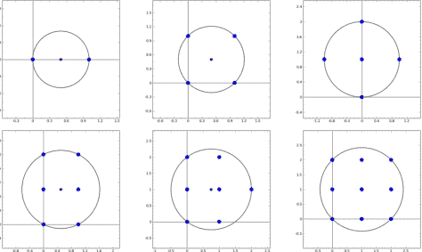

**练习 22**（Masser–Gramain 常数）。

1. 编写一个函数，输入为正整数 $k$，返回一个最小圆盘的半径 $r_k$ 和圆心 $(x_k,y_k)$，该圆盘半径为 $r_k$，且包含至少 $k$ 个 $\mathbb{Z}^2$ 中的点。可以假设 $r_k < \sqrt{k/\pi}$。
2. 编写一个函数，绘制以 $(x_k,y_k)$ 为圆心、$r_k$ 为半径的圆，以及如上所述的 $m \geq k$ 个 $\mathbb{Z}^2$ 中的点。
3. 利用如下界不等式
\[
\frac{\sqrt{\pi(k-6)+2}-\sqrt{2}}{\pi}<r_k<\sqrt{\frac{k-1}{\pi}},\tag{6.2}
\]
计算 $\delta$ 的近似值，误差至多为 $0.3$。

#### 6.4.2 多重积分的计算

本应用受文章 [Bea09] 启发。设 $k$ 和 $n_1,n_2,\ldots,n_k$ 为非负整数。我们希望计算积分

\[
I=\int_V x_1^{n_1}x_2^{n_2}\cdots x_k^{n_k}\,dx_1\,dx_2\cdots dx_k,
\]

其中积分区域定义为 $V=\{x_1\geq x_2\geq\cdots\geq x_k\geq 0,\ x_1+\cdots+x_k\leq 1\}$。例如，对于 $k=2$、$n_1=3$、$n_2=5$，可得值

\[
I=\int_{x_2=0}^{1/2}\int_{x_1=x_2}^{1-x_2}x_1^3x_2^5\,dx_1\,dx_2=\frac{13}{258048}.
\]

**练习 23.** 已知 \(I\) 是有理数，请利用有理重构和/或中国剩余定理设计一种计算 \(I\) 的算法。在 Sage 中实现该算法，并将其应用于情形 \([n_1,\ldots,n_{31}] = [9, 7, 8, 11, 6, 3, 7, 6, 6, 4, 3, 4, 1, 2, 2, 1, 1, 1, 2, 0, 0, 0, 3, 0, 0, 0, 0, 1, 0, 0, 0]\)。

## 7 多项式

本章将讨论一元多项式及相关对象，主要是有理函数和形式幂级数。我们将首先了解如何用 Sage 执行一些变换，如多项式欧几里得除法、分解为不可约多项式、根隔离或部分分式分解。所有这些变换都会考虑多项式系数所在的环或域：对于一整套基环，Sage 使我们能够在多项式环 $A[x]$、其商环 $A[x]/(P(x))$、分式域 $K(x)$ 或形式幂级数环 $A[[x]]$ 中进行计算。

多项式运算还有一些意想不到的应用。你会如何自动猜出序列 1, 1, 2, 3, 8, 11, 39... 的下一项？例如，你可以使用 7.4.3 节介绍的有理函数的 Padé 逼近！如何得到方程 $e^{x f(x)} = f(x)$ 的解的级数展开？答案可在 7.5.3 节找到。

我们通常假设读者已习惯在大学一年级水平上处理多项式和有理函数。不过，我们还将讨论更高级的主题。如何证明方程 $x^5 - x - 1$ 的解不能用根式表示？只需计算其伽罗瓦群，如 7.3.4 节所述。相应部分在本书其他地方不会用到，读者可以跳过。最后，本章给出几个涉及代数数和 $p$-进数的例子。

这里我们将重点关注含一个变量的多项式，称为一元多项式。多元多项式将在第 9 章讨论。


### 7.1 多项式环

| 使用多项式环，\(R=A[x]\) | |
|---|---|
| 构造（稠密表示），例如 \(\mathbb{Z}[x], \mathbb{Q}[x], \mathbb{R}[x], \mathbb{Z}/n\mathbb{Z}[x]\) | `R.<x> = A[]` 或 `R.<x> = PolynomialRing(A)` |
| 构造（稀疏表示） | `R.<x> = PolynomialRing(A, sparse=True)` |
| 访问基环 \(A\) | `R.base_ring()` |
| 访问变量 \(x\) | `R.gen()` 或 `R.0` |
| 测试（整环、诺特环……） | `R.is_integral_domain(), R.is_noetherian(), ...` |

表7.1 – 多项式环。

#### 7.1.1 引言

我们在第2章已经看到如何对*符号表达式*（即“符号环”SR的元素）进行计算。这些表达式可用的一些方法（例如 degree）也适用于多项式：

```sage
sage: x = var('x'); p = (2*x+1)*(x+2)*(x^4-1)
sage: print("{} is of degree {}".format(p, p.degree(x)))
(x^4 - 1)*(2*x + 1)*(x + 2) is of degree 6
```

在一些计算机代数系统（如 Maple 或 Maxima）中，将多项式表示为特定的符号表达式是处理它们的通常方式。与 Axiom、Magma 或 MuPAD 一样，Sage 也允许以更代数化的方式处理多项式，并且“知道”如何在诸如 \(\mathbb{Q}[x]\) 或 \(\mathbb{Z}[x,y,z]\) 的环中进行计算。

因此，为了在定义良好的多项式环中重现上面的例子，我们给 Python 变量 \(x\) 赋予由 `polygen(QQ, 'x')` 给出的*有理系数多项式环中关于 \(x\) 的未定元*，而不是由 `var('x')` 返回¹的*符号变量* \(x\)：

```sage
sage: x = polygen(QQ, 'x'); p = (2*x+1)*(x+2)*(x^4-1)
sage: print("{} is of degree {}".format(p, p.degree()))
2*x^6 + 5*x^5 + 2*x^4 - 2*x^2 - 5*x - 2 is of degree 6
```

我们注意到该多项式被自动展开。“代数”多项式总是以标准形式表示。这是相对于 SR 中多项式的一个关键区别。特别地，当两个代数多项式在数学上相等时，它们的计算机表示相同，逐系数比较就足以检查它们是否相等。

可用于代数多项式的函数比可用于（多项式）符号表达式的函数广泛得多，也高效得多。

¹ 这里有一点小区别：在交互使用中，`var('x')` 等价于 `x = var('x')`，而单独使用 `polygen(QQ, 'x')` 不会改变 Python 变量 x 的值。

#### 7.1.2 构造多项式环

Sage 中的多项式与许多其他代数对象一样，通常以交换环作为系数环。这是本书的观点；不过，大多数例子的系数都在一个域中。在本章中，字母 A 和 K 分别对应一个交换环和一个域。

在代数结构 R 中进行计算的第一步通常是构造 R 本身。我们用以下方式构造 ℚ[x]：

```sage
sage: R = PolynomialRing(QQ, 'x')
sage: x = R.gen()
```

第一行中的 'x' 是一个字符串，它是未定元（即环的生成元）的名称。第二行中的 x 是一个 Python 变量，用于存储该生成元；使用相同的名称可以使代码更易读。变量 x 中存储的对象表示多项式 x ∈ ℚ[x]。它的父对象（Sage 对象的父对象是“它来自的”代数结构，见 §5.1）是环 QQ['x']：

```sage
sage: x.parent()
Univariate Polynomial Ring in x over Rational Field
```

对于基环 A ≠ ℚ，多项式 x ∈ ℚ[x] 被认为不同于 x ∈ A[x]，也不同于那些未定元名称不同的多项式，例如 t ∈ ℚ[t]。

表达式 PolynomialRing(QQ, 't') 也可以写作 QQ['t']。我们经常将此缩写与构造 S.<g> = ... 结合使用，它同时将结构赋给变量 S，并将其生成元赋给变量 g。于是，环 ℚ[x] 及其未定元的构造就简化为 R.<x> = QQ[]。上面看到的 x = polygen(QQ, 'x') 形式等价于

```sage
sage: x = PolynomialRing(QQ, 'x').gen()
```

需要提及的是，在构造多项式环时，我们可以在几种内存表示之间进行选择。这些表示之间的区别将在 §7.6 中讨论。

##### 练习 24（变量与未定元）

- 1. 你会如何定义 x 和 y 以获得以下结果？

  ```sage
  sage: x^2 + 1
  y^2 + 1
  sage: (y^2 + 1).parent()
  Univariate Polynomial Ring in x over Rational Field
  ```

- 2. 在执行以下指令之后

  ```sage
  sage: Q.<x> = QQ[]; p = x + 1; x = 2; p = p * x
  ```

  p 的值是多少？

| 访问数据、语法操作 | |
|---|---|
| 未定元 \(x\) | `p.variables(), p.variable_name()` |
| \(x^k\) 的系数 | `p[k]` |
| 首项系数 | `p.leading_coefficient()` |
| 次数 | `p.degree()` |
| 系数列表 | `p.list()` 或 `p.coefficients(sparse=False)` |
| 非零系数列表 | `p.coefficients()` |
| 字典 次数 → 系数 | `p.dict()` |
| 测试（首一、常数……） | `p.is_monic(), p.is_constant(), ...` |

| 基本算术 | |
|---|---|
| 运算 \(p+q, p-q, p\times q, p^k\) | `p + q`, `p - q`, `p * q`, `p^k` |
| 代入 \(x := a\) | `p(a)` 或 `p.subs(a)` |
| 导数 | `p.derivative()` 或 `p.diff()` |

| 变换 | |
|---|---|
| 系数变换 | `p.map_coefficients(f)` |
| 基环变换 \(A[x] \to B[x]\) | `p.change_ring(B)` 或 `B['x'](p)` |
| 互反多项式 | `p.reverse()` |

表7.2 – 多项式 \(p, q \in A[x]\) 的基本运算。

将列表 \([a_0, a_1, \ldots]\) 转换为 \(\mathbb{Z}[x]\) 中的元素，得到多项式 \(a_0 + a_1x + \cdots \in \mathbb{Z}[x]\)。

**多项式运算的全局视图。** 多项式环的元素由类 `Polynomial` 或其派生类的 Python 对象表示。这些对象可用的主要运算总结在表7.2至表7.5中。例如，我们用 `degree` 方法查询多项式的次数。类似地，`p.subs(a)` 或简单地 `p(a)` 给出 \(p\) 在点 \(a\) 处的值，但当 \(a\) 本身是多项式时，它也会计算复合 \(p \circ a\)，更一般地，在 \(A\)-代数的一个元素处对 \(A[x]\) 中的多项式求值：

```sage
sage: p = R.random_element(degree=4) # a random polynomial
sage: p
-4*x^4 - 52*x^3 - 1/6*x^2 - 4/23*x + 1
sage: p.subs(x^2)
-4*x^8 - 52*x^6 - 1/6*x^4 - 4/23*x^2 + 1
sage: p.subs(matrix([[1,2], [3,4]]))
[-375407/138  -273931/69]
[ -273931/46  -598600/69]
```

我们将在 §7.2.1 和 §7.3 中回到最后两个表的内容。

² 还有许多其他运算。这些表省略了过于高级的函数、我们提到的一些方法的专门变体，以及许多对所有环元素甚至所有 Sage 对象都通用、但对多项式没有特别意义的方法。然而请注意，一些专门方法（例如 `p.rescale(a)`，等价于 `p(a*x)`）通常比可以替代它们的更一般的方法更高效。

**环变换。** 可用运算的确切列表、含义和效率在很大程度上取决于基环。例如，`GF(p)['x']` 中的多项式有一个方法 `small_roots`，它返回关于特征 p 的小根；`QQ['x']` 中的多项式没有这样的方法，因为这没有意义。`factor` 方法对所有多项式都存在，但对于系数在 `SR` 或 `Z/4Z` 中的多项式，会抛出异常 `NotImplementedError`。该异常意味着，尽管该运算具有数学意义，但在 Sage 中对于这类对象不可用。

能够灵活处理我们可能考虑给定多项式时所用的不同系数环是非常有用的。应用于 `A[x]` 中的多项式时，方法 `change_ring(B)` 返回其在 `B[x]` 中的像，前提是存在一种自然的系数转换方法。这种转换通常由从 `A` 到 `B` 的典范态射给出；特别地，`change_ring` 可用于扩展基环以获得额外的代数性质。例如，这里多项式 `p` 在有理数上不可约，但它在 ℝ 上可分解：

```sage
sage: x = polygen(QQ)
sage: p = x^2 - 16*x + 3
sage: p.factor()
x^2 - 16*x + 3
sage: p.change_ring(RDF).factor()
(x - 15.810249675906654) * (x - 0.18975032409334563)
```

`RDF` 域是“机器浮点数”域，将在第11章讨论。得到的分解是近似的；它不足以恢复原始多项式。为了以能够进行精确计算的方式表示整系数多项式的实根，我们使用实代数数域 `AA`。我们将在后续章节中看到一些例子。

同样的方法 `change_ring` 可以将 `Z[x]` 中的多项式模一个素数约化：

```sage
sage: p.change_ring(GF(3))
x^2 + 2*x
```

反过来，如果 `B ⊂ A` 且 `p` 的系数实际上在 `B` 中，我们也调用 `change_ring` 来在 `B[x]` 中恢复 `p`。

**迭代。** 更一般地，人们经常需要对多项式的所有系数应用给定的变换。方法 `map_coefficients` 正是为此设计的。应用于多项式 `p ∈ A[x]`，参数为函数 `f` 时，它返回将 `f` 应用于 `p` 的所有非零系数所得到的多项式。通常，`f` 是使用 `lambda` 构造定义的匿名函数（见 §3.3.2）。例如，下面是如何计算一个复系数多项式的共轭：

```sage
sage: QQi.<myI> = QQ[I]        # myI is the i of QQi, I that of SR
sage: R.<x> = QQi[]; p = (x + 2*myI)^3; p
x^3 + 6*I*x^2 - 12*x - 8*I
sage: p.map_coefficients(lambda z: z.conjugate())
```


```
x^3 - 6*I*x^2 - 12*x + 8*I
```

这里，我们也可以写 `p.map_coefficients(conjugate)`，因为对于 \(z \in \mathbb{Q}[i]\)，`conjugate(z)` 与 `z.conjugate` 效果相同。显式调用对象 `z` 的方法更稳健：这样代码适用于所有具有 `conjugate()` 方法的对象，并且只适用于这些对象。

##### 多项式环上的运算

多项式对象的父结构，即环 \(A[x]\)，本身就是一等 Sage 对象。让我们简要看看如何使用它们。

第一类方法使我们能够构造特定多项式、随机抽取多项式或枚举族，这里是 \(\mathbb{F}_2\) 上次数恰好为 2 的多项式族：

```sage
sage: list(GF(2)['x'].polynomials(of_degree=2))
[x^2, x^2 + 1, x^2 + x, x^2 + x + 1]
```

我们将在后续章节的示例中调用其中一些方法，以构建我们要在其上工作的对象。第 15 章更一般地解释如何用 Sage 枚举有限集。

其次，系统“知道”每个多项式环的一些基本事实。我们可以检查给定对象是否为环、是否为诺特环：

```sage
sage: A = QQ['x']
sage: A.is_ring() and A.is_noetherian()
True
```

或者检查 \(\mathbb{Z}\) 是否为 \(\mathbb{Q}[x]\) 的子环，以及对于哪些 \(n\)，环 \(\mathbb{Z}/n\mathbb{Z}\) 是整环：

```sage
sage: ZZ.is_subring(A)
True
sage: [n for n in range(20)
....:     if Integers(n)['x'].is_integral_domain()]
[0, 2, 3, 5, 7, 11, 13, 17, 19]
```

这些能力很大程度上依赖 Sage 范畴系统（另见 §5.2.3）。多项式环属于若干“范畴”，如集合范畴、欧几里得环范畴等：

```sage
sage: R.categories()
[Category of euclidean domains,
 Category of principal ideal domains,
 ...
 Category of sets with partial maps, Category of objects]
```

这反映出任何多项式环也是一个集合、一个欧几里得整环，等等。因此，系统可以自动将这些不同范畴中对象的一般性质迁移到多项式环上。

**整除性与欧几里得除法**

| 操作 | Sage 命令 |
|---|---|
| 整除性测试 \(p\mid q\) | `p.divides(q)` |
| 除数的重数 \(q^k\mid p\) | `k = p.valuation(q)` |
| 欧几里得除法 \(p=qd+r\) | `q, r = p.quo_rem(d)` 或 `q, r = p//d, p%d` |
| 伪除法 \(a^k p=qd+r\) | `q, r, k = p.pseudo_quo_rem(d)` |
| 最大公因数 | `p.gcd(q), gcd([p1, p2, p3])` |
| 最小公倍数 | `p.lcm(q), lcm([p1, p2, p3])` |
| 扩展 gcd \(g=up+vq\) | `g, u, v = p.xgcd(q)` 或 `xgcd(p, q)` |
| “中国剩余” \(c\equiv a\pmod p,\ c\equiv b\pmod q\) | `c = crt(a, b, p, q)` |

**其他**

| 操作 | Sage 命令 |
|---|---|
| 插值 \(p(x_i)=y_i\) | `p = R.lagrange_polynomial([(x1,y1), ...])` |
| \(p\in\mathbb{Z}[x]\) 的内容 | `p.content()` |

表 7.3 – 多项式算术。

### 7.2 欧几里得算术

除加法和乘法之外，多项式上最基本的运算就是欧几里得除法和最大公因数计算。相应的运算符和方法（表 7.3）模仿整数上的对应操作。然而，这些运算常常被额外的抽象层隐藏：环的商（§7.2.2）中每次算术运算都涉及隐式欧几里得除法；有理函数（§7.4）的规范化意味着要进行一些 gcd 计算……

#### 7.2.1 整除性

**除法。** 欧几里得除法在域中可行，更一般地，在除数的首项系数可逆的交换环中也可行，因为该系数是唯一需要从基环中去除的系数：

```sage
sage: R.<t> = Integers(42)[]; (t^20-1) % (t^5+8*t+7)
22*t^4 + 14*t^3 + 14*t + 6
```

当首项系数不可逆时，我们仍然可以定义*伪欧几里得除法*（简称伪除法）：设 \(A\) 为交换环，\(p,d\in A[x]\)，且 \(a\) 为 \(d\) 的首项系数。那么存在两个多项式 \(q,r\in A[x]\)，满足 \(\deg r<\deg d\)，以及一个整数 \(k\leq\deg p-\deg d+1\)，使得

\[
a^k p=qd+r.
\]

伪除法由 Sage 的 `pseudo_quo_rem` 方法给出。

要执行精确除法，我们也使用欧几里得商运算符 `//`。实际上，用 `/` 除以非常数多项式会返回有理函数类型的结果（见 §7.4），或者在没有意义时失败：

```sage
sage: ((t^2+2*t)//t).parent()
Univariate Polynomial Ring in t over Ring of integers modulo 42
sage: (t^2+t)/t
Traceback (most recent call last):
...
TypeError: self must be an integral domain.
```

**练习 25。** 通常，在 Sage 中，\(\mathbb{Q}[x]\) 中的多项式以单项式基 \((x^n)_{n\in\mathbb{N}}\) 表示。由 \(T_n(\cos\theta)=\cos(n\theta)\) 定义的切比雪夫多项式 \(T_n\) 构成一族正交多项式，因此构成 \(\mathbb{Q}[x]\) 的一组基。前几个切比雪夫多项式为

```sage
sage: x = polygen(QQ); [chebyshev_T(n, x) for n in (0..4)]
[1, x, 2*x^2 - 1, 4*x^3 - 3*x, 8*x^4 - 8*x^2 + 1]
```

编写一个函数，输入 \(\mathbb{Q}[x]\) 中的一个元素，返回其在基 \((T_n)_{n\in\mathbb{N}}\) 下分解的系数。

**练习 26**（按升幂除法）。设 \(n\in\mathbb{N}\)，\(u,v\in A[x]\)，且 \(v(0)\) 可逆。那么存在唯一一对多项式 \((q,r)\in A[x]\)，满足 \(\deg q\le n\)，使得 \(u = qv + x^{n+1}r\)。编写一个函数，通过类似欧几里得除法算法的方式计算 \(q\) 和 \(r\)。如何使用可用的 Sage 函数以最简单的方式执行此计算？

**最大公因数。** Sage 能够计算域上多项式的 gcd，这得益于 \(K[x]\) 的欧几里得结构；它也能在某些其他环上计算，包括整数环：

```sage
sage: S.<x> = ZZ[]; p = 2*(x^10-1)*(x^8-1)
sage: p.gcd(p.derivative())
2*x^2 - 2
```

我们可能更偏好更对称的表达式 `gcd(p,q)`，它产生与 `p.gcd(q)` 相同的结果。不过，它在 Sage 中稍显不自然，因为它不是一种通用机制：`gcd(p,q)` 调用一个在 Sage 源代码中手工定义的双参数函数，该函数又调用 `p.gcd`。只有一些常用方法才有这样的关联函数。

*扩展 gcd，即计算贝祖关系*

\[
g = \gcd(p,q) = ap + bq, \quad p,q,a,b \in K[x]
\]

由 `p.xgcd(q)` 给出：

```sage
sage: R.<x> = QQ[]; p = x^5-1; q = x^3-1
sage: print('the gcd is %s = (%s)*p + (%s)*q' % p.xgcd(q))
the gcd is x - 1 = (-x)*p + (x^3 + 1)*q
```

`xgcd` 方法也适用于 `ZZ['x']` 中的多项式，但要注意：由于 \(\mathbb{Z}[x]\) 不是主理想环，结果一般不是贝祖关系（\(ap+bq\) 可能是 gcd 的整数倍）！

#### 7.2.2 理想与商

**\(A[x]\) 的理想。** 多项式环的理想以及这些理想的商，由通过 `ideal` 和 `quo` 方法从多项式环构建的 Sage 对象表示。多项式元组与多项式环的乘积被解释为一个理想：

```sage
sage: R.<x> = QQ[]
sage: J1 = (x^2 - 2*x + 1, 2*x^2 + x - 3)*R; J1
Principal ideal (x - 1) of Univariate Polynomial Ring in x
over Rational Field
```

我们可以乘理想，并将多项式模一个理想进行约化：

```sage
sage: J2 = R.ideal(x^5 + 2)
sage: ((3*x+5)*J1*J2).reduce(x^10)
421/81*x^6 - 502/81*x^5 + 842/81*x - 680/81
```

在这种情况下，约化后的多项式仍是 \(\mathbb{Q}[x]\) 的一个元素。另一种方法是构造关于理想的商，并将元素投影到其上。投影后元素的父结构此时位于商环中。商元素的 `lift` 方法将它们转换回初始环。

```sage
sage: B = R.quo((3*x+5)*J1*J2)  # quo automatically names 'xbar' which is
sage: B(x^10)                   # the generator of B image of x
421/81*xbar^6 - 502/81*xbar^5 + 842/81*xbar - 680/81
sage: B(x^10).lift()
421/81*x^6 - 502/81*x^5 + 842/81*x - 680/81
```

如果 \(K\) 是域，那么环 \(K[x]\) 是主理想环：计算过程中理想由生成元表示，这一切是 §7.1 中运算的代数语言。其主要优点是商环可以很容易地用于新的构造，这里是 \((\mathbb{F}_5[t]/(t^2+3))[x]\) 的构造：

```sage
sage: R.<t> = GF(5)[]; R.quo(t^2+3)['x'].random_element()
(3*tbar + 1)*x^2 + (2*tbar + 3)*x + 3*tbar + 4
```

Sage 也允许像在 \(\mathbb{Z}[x]\) 中那样构造非主理想，此时可用运算受到限制——但域上的多元多项式除外，这是第 9 章的主题。

**练习 27。** 我们定义序列 \((u_n)_{n\in\mathbb{N}}\)，初始条件为 \(0 \le n < 1000\) 时 \(u_n = n + 7\)，以及线性递推关系

\[
u_{n+1000} = 23u_{n+729} - 5u_{n+2} + 12u_{n+1} + 7u_n \quad (n \ge 0).
\]

计算 \(u_{10^{10000}}\) 的最后五位数字。*提示：* 我们可以查看 §3.2.4 中的算法。然而，当递推阶数很大时，该算法代价过高。引入一个巧妙的多项式环商来避免这个问题。


| 理想与商环 Q = R/J 的构造 | |
| --- | --- |
| 理想 (u, v, w) | `R.ideal(u, v, w)` 或 `(u, v, w)*R` |
| p 模 J 的约化 | `J.reduce(p)` 或 `p.mod(J)` |
| 商环 R/J、R/(p) | `R.quo(J)`、`R.quo(p)` |
| 其商为 Q 的环 | `Q.cover_ring()` |
| 同构的数域 | `Q.number_field()` |

| K[x]/(p) 的元素 | |
| --- | --- |
| 提升（R → R/J 的截面） | `u.lift()` |
| 最小多项式 | `u.minpoly()` |
| 特征多项式 | `u.charpoly()` |
| 矩阵 | `u.matrix()` |
| 迹 | `u.trace()` |

表 7.4 – 理想与商。

**代数扩张。** 一个重要特例是：用不可约多项式对 K[x] 作商，以构造 K 的代数扩张。数域（Q 的有限扩张）由对象 `NumberField` 表示，它不同于 `QQ['x']` 的商。在有意义时，多项式环的商的 `number_field` 方法会返回相应的数域。数域的接口比商环的接口更完整，但超出了本书的范围。非素有限域 $F_{p^r}$ 是作为素有限域 $F_p$ 的代数扩张构造的，将在 §6.1 中描述。

### 7.3 因式分解与根

在初等运算和欧几里得算术之后的第三个层次，涉及将多项式分解为不可约因子的乘积，即因式分解。这也许正是计算机代数最有用的地方！

#### 7.3.1 因式分解

**不可约性检验。** 在代数方面，关于多项式因式分解的最简单问题是它是否不可约。自然，答案取决于基环。方法 `is_irreducible` 判断一个多项式在其父环中是否不可约。例如，多项式 $3x^2 - 6$ 在 $\mathbb{Q}$ 上不可约，但在 $\mathbb{Z}$ 上不是（为什么？）：

```sage
sage: R.<x> = QQ[]; p = 3*x^2 - 6
sage: p.is_irreducible(), p.change_ring(ZZ).is_irreducible()
(True, False)
```

**因式分解。** 对几百或几千位的整数进行因式分解是一个非常困难的问题。相比之下，在 $\mathbb{Q}$ 或 $\mathbb{F}_p$（$p$ 较小时）上分解一个次数为 1000 的多项式只需要几秒钟[^3]：

```sage
sage: p = QQ['x'].random_element(degree=1000)
sage: %timeit p.factor()
1 loop, best of 3: 2.45 s per loop
```

至此，我们在前几节中看到的多项式与整数之间的算法相似性就结束了。

与不可约性检验一样，因式分解是在基环上进行的。例如，整数上多项式的因式分解包含一个常数部分（其本身又分解为素因子）以及一个本原多项式的乘积，即系数互素的多项式：

```sage
sage: x = polygen(ZZ); p = 54*x^4+36*x^3-102*x^2-72*x-12
sage: p.factor()
2 * 3 * (3*x + 1)^2 * (x^2 - 2)
```

Sage 能够在各种环上分解多项式——特别是有理数域、复数域（近似）、有限域和数域：

```sage
sage: for A in [QQ, ComplexField(16), GF(5), QQ[sqrt(2)]]:
....:     print(str(A) + ":")
....:     print(A['x'](p).factor())
Rational Field:
(54) * (x + 1/3)^2 * (x^2 - 2)
Complex Field with 16 bits of precision:
(54.00) * (x - 1.414) * (x + 0.3333)^2 * (x + 1.414)
Finite Field of size 5:
(4) * (x + 2)^2 * (x^2 + 3)
Number Field in sqrt2 with defining polynomial x^2 - 2:
(54) * (x - sqrt2) * (x + sqrt2) * (x + 1/3)^2
```

分解为不可约因子的结果不是多项式（因为多项式总是处于规范形式，即展开形式！），而是一个 `Factorization` 类型的对象。用 `f[i]` 可获得第 i 个因子，用 `f.expand()` 可还原多项式。`Factorization` 对象还提供 `gcd` 和 `lcm` 等方法，它们的含义与多项式相同，但作用于已分解的形式。

**无平方因子分解。** 尽管多项式完整因式分解在理论和实际复杂度上都很好，但它仍是一个昂贵的操作。无平方因子分解是一种较弱的因式分解，更容易获得——只需若干次 gcd 计算——并且已经能带来大量信息。

设 $p = \prod_{i=1}^n p_i^{m_i} \in K[x]$ 是一个在特征为零的域 $K$ 上分解为不可约因子乘积的多项式。如果 $p$ 的所有因子 $p_i$ 的重数均为 $m_i = 1$，也就是说，$p$ 在 $K$ 的代数闭包中的根都是单根，则称 $p$ 是无平方因子的。*无平方因子分解* 是分解为无平方因子且互素的因子乘积：

$$p = f_1 f_2^2 \cdots f_s^s \qquad \text{其中} \qquad f_m = \prod_{m_i=m} p_i.$$

因此，无平方因子分解按重数拆分 $p$ 的不可约因子。$p$ 的*无平方因子部分* $f_1 \cdots f_s = p_1 \cdots p_s$ 是一个具有单根的多项式，它与 $p$ 具有相同的根（忽略重数）。

| | 因式分解 |
| --- | --- |
| 不可约性检验 | `p.is_irreducible()` |
| 因式分解 | `p.factor()` |
| 无平方因子分解 | `p.squarefree_decomposition()` |
| 无平方因子部分 $p/\gcd(p,p')$ | `p.radical()` |
| | **根** |
| 在 $\overline{A}$ 中、在 $D$ 中的根 | `p.roots()`, `p.roots(D)` |
| 实根 | `p.roots(RR)`, `p.real_roots()` |
| 复根 | `p.roots(CC)`, `p.complex_roots()` |
| 实根隔离 | `p.roots(RIF)`, `p.real_root_intervals()` |
| 复根隔离 | `p.roots(CIF)` |
| 结式 | `p.resultant(q)` |
| 判别式 | `p.discriminant()` |
| 伽罗瓦群（$p$ 不可约） | `p.galois_group()` |

表 7.5 · 因式分解与根。

#### 7.3.2 求根

多项式的根可以通过多种方式计算：我们想要实根还是复根？在另一个域中的根？精确根还是近似根？带不带重数？以有保证的方式还是启发式方式？多项式的 *roots* 方法默认返回其基环中的根，形式为（根，重数）对的列表：

```sage
sage: R.<x> = ZZ[]; p = (2*x^2-5*x+2)^2 * (x^4-7); p.roots()
[(2, 2)]
```

带参数时，$roots(D)$ 返回域 $D$ 中的根；这里分别是有理根，以及 $\ell = 19$ 时 $\ell$-进根的近似：

```sage
sage: p.roots(QQ)
[(2, 2), (1/2, 2)]
```

```sage
sage: p.roots(Zp(19, print_max_terms=3))
[(7 + 16*19 + 17*19^2 + ... + O(19^20), 1),
 (12 + 2*19 + 19^2 + ... + O(19^20), 1),
 (10 + 9*19 + 9*19^2 + ... + O(19^20), 2),
 (2 + O(19^20), 2)]
```

这对大量域都适用，效率高低不一。

特别地，将 D 选为代数数域 QQbar 或实代数数域 AA，使我们能够精确计算有理系数多项式的复根或实根：

```sage
sage: roots = p.roots(AA); roots
[(-1.626576561697786?, 1), (0.50000000000000000?, 2),
(1.626576561697786?, 1), (2.0000000000000000?, 2)]
```

Sage 对用户透明地处理代数数的不同表示。每个 $\alpha \in \mathbb{Q}$ 由其最小多项式以及一个足够精确的区间来编码，以便将 $\alpha$ 与其他根区分开。因此，尽管输出看起来如此，返回的根并不只是近似值。它们可以用于精确计算：

```sage
sage: a = roots[0][0]^4; a.simplify(); a
7
```

精确求解的一种变体是简单地*隔离*根，即通过将域 D 指定为实区间 RIF 或复区间 CIF，确定每个区间恰好包含一个根。对于有理系数多项式，其他有用的域还包括 RR、CC、RDF、CDF，它们都对应近似数值根，以及数域 QQ[alpha]。特定方法 `real_roots`、`complex_roots`（以及对于某些基环的 `real_root_intervals`）提供额外选项，或给出与 `roots` 方法略有不同的结果。根的数值近似与隔离将在 §12.2 中更详细地讨论。

#### 7.3.3 结式

在唯一分解整环中，两个多项式之间存在非常数公因子，可由它们的结式 Res(p,q) 是否为零来刻画，而结式是它们系数的多项式。与 gcd 相比，结式的一个主要优点是它在环同态下能很好地*特化*。例如，多项式 $x - 12$ 和 $x - 20$ 在 $\mathbb{Z}[x]$ 中互素，但它们的结式

```sage
sage: x = polygen(ZZ); (x-12).resultant(x-20)
-8
```

模 n 为零表明：它们在 $\mathbb{Z}/n\mathbb{Z}$ 中有公因子当且仅当 n 整除 8。

设 $p = \sum_{i=0}^m p_i x^i$ 和 $q = \sum_{i=0}^n q_i x^i$ 是两个非常数多项式，位于

[^3]: 在理论方面，我们知道如何在多项式时间内对 $\mathbb{Q}[x]$ 中的多项式进行因式分解，并如何在概率多项式时间内对 $\mathbb{F}_p[x]$ 中的多项式进行因式分解，但我们不知道整数是否能在多项式时间内分解。


$A[x]$，其中 $p_m,q_n\ne 0$。$p$ 和 $q$ 的结式定义为

$\operatorname{Res}(p,q)=\begin{vmatrix} p_m & \cdots & \cdots & p_0 \\ & \ddots & & \\ & p_m & \cdots & p_0 \\ q_n & \cdots & q_0 & \\ & \ddots & & \\ & & \ddots & \\ & & q_n & \cdots & q_0 \end{vmatrix}.$ (7.1)

在合适的基下，它是线性映射

$A_{n-1}[x]\times A_{m-1}[x]\ \xrightarrow{(u,v)\mapsto up+vq}\ A_{m+n-1}[x]$

的行列式，其中 $A_k[x]\subset A[x]$ 是次数至多为 $k$ 的多项式子模。如果 $p$ 和 $q$ 分解为线性因子，它们的结式也可以用其根的差表示：

$\operatorname{Res}(p,q)=p_m^n q_n^m\prod_{i,j}(\alpha_i-\beta_j),\quad\left\{\begin{aligned}p&=p_m(x-\alpha_1)\cdots(x-\alpha_m)\\q&=q_n(x-\beta_1)\cdots(x-\beta_n).\end{aligned}\right.$

上述特殊化性质由定义 (7.1) 推出：如果 $\varphi:A\to A'$ 是环同态，将其应用于 $p$ 和 $q$ 时保持它们的次数不变，即满足 $\varphi(p_m)\ne 0$ 且 $\varphi(q_n)\ne 0$，那么有

$\operatorname{Res}(\varphi(p),\varphi(q))=\varphi(\operatorname{Res}(p,q)).$

因此，当 $\varphi(p)$ 和 $\varphi(q)$ 有公因子时，$\varphi(\operatorname{Res}(p,q))$ 为零。上文已看到这一现象的一个例子，其中 $\varphi$ 是从 $\mathbb Z$ 到 $\mathbb Z/n\mathbb Z$ 的典范投影。

结式最常见的用法涉及基环本身是多项式环的情形：$p,q\in A[x]$，其中 $A=K[a_1,\ldots,a_k]$。特别地，给定 $\alpha_1,\ldots,\alpha_k\in K$，考虑特殊化

$\varphi:K[a_1,\ldots,a_k]\longrightarrow K$  
$\qquad q(a_1,\ldots,a_k)\longmapsto q(\alpha_1,\ldots,\alpha_k).$

我们看到，结式 $\operatorname{Res}(p,q)$ 在 $(\alpha_1,\ldots,\alpha_k)$ 处为零，当且仅当特殊化 $\varphi(p),\varphi(q)\in K[x]$ 有公因子，假设 $p$ 和 $q$ 的首项之一在 $(\alpha_1,\ldots,\alpha_k)$ 处不为零。

例如，次数为 $m$ 的 $p\in\mathbb Q[x]$ 的判别式定义为

$\operatorname{disc}(p)=(-1)^{m(m-1)/2}\operatorname{Res}(p,p')/p_m.$

这个定义推广了二次和三次多项式的经典判别式：

```sage
sage: R.<a,b,c,d> = QQ[]; x = polygen(R); p = a*x^2+b*x+c
sage: p.resultant(p.derivative())
-a*b^2 + 4*a^2*c
sage: p.discriminant()
b^2 - 4*a*c
sage: (a*x^3 + b*x^2 + c*x + d).discriminant()
b^2*c^2 - 4*a*c^3 - 4*b^3*d + 18*a*b*c*d - 27*a^2*d^2
```

由于 \(p\) 的判别式在相差一个规范化因子的意义下是 \(p\) 与其导数的结式，因此它为零当且仅当 \(p\) 在 \(\mathbb{C}\) 中有重根。

#### 7.3.4 伽罗瓦群

不可约多项式 \(p\in\mathbb{Q}[x]\) 的伽罗瓦群是一个代数对象，它描述 \(p\) 的根的一些“对称性”。它是代数方程理论中的核心对象。特别地，方程 \(p(x)=0\) 可用根式求解——即其根可以用四则运算和 \(n\) 次根从 \(p\) 的系数表示——当且仅当 \(p\) 的伽罗瓦群可解。

Sage 允许计算具有有理系数、次数适中的多项式的伽罗瓦群，并对所得群执行若干操作。Sage 的伽罗瓦理论和群论功能都超出了本书的范围。我们只需不加更多解释地应用伽罗瓦关于根式可解性的定理。下面的计算⁴表明 \(x^5-x-1\) 的根不能用根式表示：

```sage
sage: x = polygen(QQ); G = (x^5 - x - 1).galois_group(); G
Transitive group number 5 of degree 5
sage: G.is_solvable()
False
```

⁴此计算需要一张有限群表，它不在 Sage 的默认安装中，但我们可以用命令 `sage -i database_gap` 下载并自动安装它（安装后可能需要重启 Sage）。

这是这种情况最简单的例子之一，因为次数小于或等于 4 的多项式总是可用根式求解的，形如 \(x^5-a\) 的多项式显然也是如此。通过把 \(G\) 看作置换群并观察其生成元，我们认出 \(G\simeq S_5\)，这很容易验证：

```sage
sage: G.gens()
[(1,2,3,4,5), (1,2)]
sage: G.is_isomorphic(SymmetricGroup(5))
True
```

### 7.4 有理函数

#### 7.4.1 构造与基本性质

两个多项式（在整环上）相除产生一个有理函数。其父对象是多项式环的分式域，通过 Frac(R) 得到：

| 有理函数 | |
| --- | --- |
| 分式域 K(x) | Frac(K['x']) |
| 分子 | r.numerator() |
| 分母 | r.denominator() |
| 化简（修改 r） | r.reduce() |
| 部分分式分解 | r.partial_fraction_decomposition() |
| s mod m 的有理重构 | s.rational_reconstruct(m) |
| **截断幂级数** | |
| 环 A[[t]] | PowerSeriesRing(A, 'x', default_prec=n) |
| 环 A((t)) | LaurentSeriesRing(A, 'x', default_prec=n) |
| 系数 x^k f(x) | f[k] |
| 截断 | x + O(x^n) |
| 精度 | f.prec() |
| 导数、原函数（在 0 处取值为 0） | f.derivative(), f.integral() |
| 常用运算 √f、exp f、... | f.sqrt(), f.exp(), ... |
| 倒数（f ∘ g = g ∘ f = x） | g = f.reverse() |
| y' = ay + b 的解 | a.solve_linear_de(precision, b) |

*表 7.6 - 由多项式构造的对象。*

```sage
sage: x = polygen(RR); r = (1 + x)/(1 - x^2); r.parent()
Fraction Field of Univariate Polynomial Ring in x over Real
Field with 53 bits of precision
sage: r
(x + 1.0000000000000000)/(-x^2 + 1.0000000000000000)
```

我们看到，化简不是自动进行的。这是因为 RR 是一个*非精确*环，即其元素是数学对象的近似。*reduce* 方法将分式化为既约形式。它不返回新对象，而是修改现有分式：

```sage
sage: r.reduce(); r
1.000000000000000/(-x + 1.000000000000000)
```

相反，在精确环上，有理函数会自动约简。

有理函数上的运算与多项式上的运算类似。那些在两种情形下都有意义的运算（代入、求导、因式分解等）可以用相同的方式使用。表 7.6 列举了其他一些有用的方法。部分分式分解和有理重构值得解释一下。

#### 7.4.2 部分分式分解

Sage 根据 \(b\) 在 K['x'] 中的因式分解，计算 Frac(K['x']) 中有理函数 \(a/b\) 的部分分式分解。因此这是 K 上的部分分式分解。结果包含一个多项式部分 \(p\) 以及一个有理函数列表，这些有理函数的分母是 \(b\) 的不可约因子的幂：

```sage
sage: R.<x> = QQ[]; r = x^10 / ((x^2-1)^2 * (x^2+3))
sage: poly, parts = r.partial_fraction_decomposition()
sage: poly
x^4 - x^2 + 6
sage: for part in parts: part.factor()
(17/32) * (x - 1)^-1
(1/16) * (x - 1)^-2
(-17/32) * (x + 1)^-1
(1/16) * (x + 1)^-2
(-243/16) * (x^2 + 3)^-1
```

于是我们得到了有理数域上的部分分式分解

$$r = \frac{x^{10}}{(x^2-1)^2(x^2+3)} = x^4-x^2+6 + \frac{17}{32}\frac{1}{x-1} + \frac{1}{16}\frac{1}{(x-1)^2} - \frac{17}{32}\frac{1}{x+1} + \frac{1}{16}\frac{1}{(x+1)^2} - \frac{243}{16}\frac{1}{x^2+3}.$$

这显然也是 \(r\) 在实数域上的部分分式分解。然而，在复数域上，最后一项的分母不是不可约的，因此该有理函数可以进一步分解。我们可以数值地计算复数域上的部分分式分解：

```sage
sage: C = ComplexField(15)
sage: Frac(C['x'])(r).partial_fraction_decomposition()
(x^4 - x^2 + 6.000, [0.5312/(x - 1.000), 0.06250/(x^2 - 2.000*x + 1.000),
    4.385*I/(x - 1.732*I), (-4.385*I)/(x + 1.732*I),
    (-0.5312)/(x + 1.000), 0.06250/(x^2 + 2.000*x + 1.000)])
```

通过将 \(C\) 替换为 \(\overline{\mathbb{Q}}\)，我们以同样的方式得到 \(\mathbb{C}\) 上的精确分解。在 \(AA\) 上计算，我们将得到实数域上的分解，即使分母的所有实根不都是有理数。

#### 7.4.3 有理重构

如同 §6.1.3 中对于整数那样，有理重构对于系数在 \(A = \mathbb{Z}/m\mathbb{Z}\) 中的多项式也存在。给定 \(m, s \in A[x]\)，命令

```sage
sage: s.rational_reconstruct(m, dp, dq)
```

在可能时计算多项式 \(p, q \in A[x]\)，使得

$$qs \equiv p \pmod m, \qquad \deg p \le d_p, \qquad \deg q \le d_q.$$

为简单起见，我们限制在 \(m\) 为素数的情形。这样的关系若 \(q\) 与 \(m\) 互素，则蕴含在 \(A[x]/(m)\) 中 \(p/q = s\)，这解释了“有理重构”这一名称。

有理重构问题转化为关于 \(p\) 和 \(q\) 的系数的线性方程组，而一个简单的维数论证表明，只要 \(d_p + d_q \ge d_m - 1\)，就存在非平凡解。\(p\) 与 \(m\) 互素的解并不总是存在（例如，\(p \equiv qx \mod x^2\) 且 \(\deg p \le 0, \deg q \le 1\) 的解是 \(p=q=0\) 的常数倍），但 `rational_reconstruct` 更倾向于寻找与 \(m\) 互素的解 \(q\)。


##### 帕德逼近

$m = x^n$ 的情形称为帕德逼近。形式幂级数 $f \in K[[x]]$ 的 $(k, n - k)$ 型帕德逼近是一个有理函数 $p/q \in K(x)$，使得 $\deg p \le k - 1$、$\deg q \le n - k$、$q(0) = 1$，且 $p/q = f + O(x^n)$。于是我们有 $p/q \equiv f \bmod x^n$。

让我们从一个符号例子开始。以下命令计算级数 $f = \sum_{i=0}^{\infty} (i + 1)^2 x^i$ 的一个帕德逼近，其系数在 $\mathbb{Z}/101\mathbb{Z}$ 中：

```
sage: A = Integers(101); R.<x> = A['x']
sage: f6 = sum((i+1)^2 * x^i for i in (0..5)); f6
36*x^5 + 25*x^4 + 16*x^3 + 9*x^2 + 4*x + 1
sage: num, den = f6.rational_reconstruct(x^6, 1, 3); num/den
(100*x + 100)/(x^3 + 98*x^2 + 3*x + 100)
```

将找到的有理函数重新展开为幂级数，我们看到不仅各项对应到 $x^5$ 项，甚至连下一项也“是正确的”！

```
sage: S = PowerSeriesRing(A, 'x', 7); S(num)/S(den)
1 + 4*x + 9*x^2 + 16*x^3 + 25*x^4 + 36*x^5 + 49*x^6 + O(x^7)
```

事实上，$f$ 本身就是一个有理函数：我们有 $f = (1 + x)/(1 - x)^3$。截断展开 $f_6$，连同分子和分母次数的界，就足以毫无歧义地表示它。从这个观点看，帕德逼近的计算是幂级数展开的逆过程：它允许我们从这种替代表示回到通常的表示，即两个多项式的商。

##### 一个解析例子

历史上，帕德逼近并非来自这种符号推理，而是来自解析函数的逼近论。事实上，解析函数展开的帕德逼近常常比级数截断更好地逼近该函数。当分母的次数足够大时，帕德逼近甚至能在级数的收敛圆盘之外给出良好的逼近。我们有时说它们“吞掉了极点”。图7.1展示了正切函数在 $0$ 附近的 $(2k, k)$ 型逼近的收敛性，说明了这一现象。

尽管 `rational_reconstruct` 仅限于 $\mathbb{Z}/n\mathbb{Z}$ 上的多项式，但可以用它来计算具有有理系数的帕德逼近，并得到该图。最简单的方法是先在一个足够大的素数模下进行有理重构：

```
sage: x = var('x'); s = tan(x).taylor(x, 0, 20)
sage: p = previous_prime(2^30); ZpZx = Integers(p)['x']
sage: Qx = QQ['x']

sage: num, den = ZpZx(s).rational_reconstruct(ZpZx(x)^10,4,5)
sage: num/den
(1073741779*x^3 + 105*x)/(x^4 + 1073741744*x^2 + 105)
sage: add(
....:     plot(expr, -2*pi, 2*pi, ymin=-3, ymax=3,
....:          linestyle=sty, detect_poles=True, aspect_ratio=1)
....:     for (expr, sty) in [
....:         (tan(x), '-'),
....:         (SR(mypade(s, 4, 2)), '!'),
....:         (SR(mypade(s, 8, 4)), '-.'),
....:         (SR(mypade(s, 12, 6)), '--') ])
```

以下练习展示了有理重构的另外两个经典应用。

- **练习 28.**
  1. 证明：若 \((u_n)_{n\in\mathbb{N}}\) 满足常系数线性递推，则幂级数 \(\sum_{n\in\mathbb{N}} u_n z^n\) 是有理函数。你会如何解释分子和分母？
  2. 使用 `rational_reconstruct` 猜测序列

     1, 1, 2, 3, 8, 11, 34, 39, 148, 127, 662, 339, 3056, 371, 14602, -4257, . . . ,

     的后续项。再用 `berlekamp_massey` 函数重新得到该结果。

- **练习 29**（柯西插值）。求一个有理函数 \(r = p/q \in \mathbb{F}_{17}(x)\)，使得 \(r(0) = -1\)、\(r(1) = 0\)、\(r(2) = 7\)、\(r(3) = 5\)，且 \(p\) 的次数最小。

### 7.5 形式幂级数

形式幂级数是把幂级数看作简单的系数序列，而不考虑收敛性。更确切地说，若 \(A\) 是交换环，我们把未定元 \(x\) 的、系数在 \(A\) 中的形式幂级数称为形式和 \(\sum_{n=0}^{\infty} a_n x^n\)，其中 \((a_n)\) 是 \(A\) 中元素的任意序列。连同自然的加法和乘法运算

\[
\sum_{n=0}^{\infty} a_n x^n + \sum_{n=0}^{\infty} b_n x^n = \sum_{n=0}^{\infty} (a_n+b_n)x^n,
\]
\[
\left(\sum_{n=0}^{\infty} a_n x^n\right)\left(\sum_{n=0}^{\infty} b_n x^n\right) = \sum_{n=0}^{\infty}\left(\sum_{i+j=n} a_i b_j\right)x^n,
\]

形式幂级数构成一个环，记作 \(A[[x]]\)。

在计算机代数系统中，这些级数可用于表示我们没有闭形式的解析函数。一如既往，计算机执行一些计算，但赋予它们数学意义是用户的责任。特别是，用户应确保所考虑的级数收敛（如果需要）。

形式幂级数也经常以生成级数的形式出现在组合学中。我们将在 §15.1.2 中看到这样一个例子。

#### 7.5.1 截断幂级数的运算

形式幂级数环 Q[[x]] 由以下方式构造

```
sage: R.<x> = PowerSeriesRing(QQ)
```

或简写为 `R.<x> = QQ[[]]`^5。A[['x']] 的元素是截断幂级数，即形如

$$f = f_0 + f_1 x + ... + f_{n-1} x^{n-1} + O(x^n).$$

的对象。它们扮演无限“数学”级数的近似角色，很像 RR 的元素是实数的近似。因此，A[['x']] 环是一个不精确环。

每个级数都有自己的截断阶数^6，而精度会自动贯穿计算过程：

```
sage: R.<x> = QQ[[]]
sage: f = 1 + x + O(x^2); g = x + 2*x^2 + O(x^4)
sage: f + g
1 + 2*x + O(x^2)
sage: f * g
x + 3*x^2 + O(x^3)
```

确实存在无限精度的级数，它们恰好对应多项式：

```
sage: (1 + x^3).prec()
+Infinity
```

当需要截断一个精确结果时，会使用默认精度。它在创建环时给出，或者之后通过 set_default_prec 方法给出：

```
sage: R.<x> = PowerSeriesRing(Reals(24), default_prec=4)
sage: 1/(1 + RR.pi() * x)^2
1.00000 - 6.28319*x + 29.6088*x^2 - 124.025*x^3 + O(x^4)
```

由上述内容可知，不可能测试两个级数之间的数学相等性。这是这些对象与本章所见其他对象类之间的一个重要区别。因此，Sage 只要两个 A[['x']] 元素在它们精度的最小值范围内一致，就认为它们相等：

```
sage: R.<x> = QQ[[]]
sage: 1 + x + O(x^2) == 1 + x + x^2 + O(x^3)
True
```

警告：这意味着测试 O(x^2) == 0 会返回真。

级数的基本算术运算与多项式相同。我们还有一些常用函数，例如当 f(0) = 0 时的 f.exp()，以及

^5 或者由 Q[[x]]，通过 QQ[['x']].completion('x') 得到。

^6 在某种意义上，这是多项式模 x^n 与截断到 n 阶的级数之间的主要区别：对这两个对象的运算是类似的，但 A[[x]]/(x^n) 的元素都具有相同的“精度”。

Sage 对象的行为可能不同。表示的选择会影响可进行的运算、其结果的确切形式，尤其是计算的效率。

##### 稠密表示或稀疏表示

表示多项式主要有两种方式。在*稠密*表示中，$p = Σ_{i=0}^d p_i x^i$ 的系数存储在一个按指数索引的表 $[p_0, …, p_d]$ 中。*稀疏*表示只存储非零系数：多项式由一组指数-系数对 $(i, p_i)$ 编码，这些对存储在一个列表中，或者更好的是，存储在一个按指数索引的字典中（见 §3.3.9）。

对于真正稠密的多项式，即其系数大多非零的多项式，稠密表示使用更少的内存，并能实现更快的计算。它省去了指数和字典内部数据结构的编码：它只存储严格必要的内容，即系数。此外，在表中访问元素和迭代元素比在字典中更快。相反，稀疏表示使我们能够高效地计算那些用稠密表示甚至无法存入内存的多项式：

```
sage: R = PolynomialRing(ZZ, 'x', sparse=True)
sage: p = R.cyclotomic_polynomial(2^50); p, p.derivative()
(x^562949953421312 + 1, 562949953421312*x^562949953421311)
```

如上一个例子所示，表示是多项式环的一个特征，在构造时选择。“稠密”多项式 $x ∈ ℚ[x]$ 和“稀疏”多项式 $x ∈ ℚ[x]$ 因此具有不同的父对象。一元多项式的默认表示是稠密的。`PolynomialRing` 的 `sparse=True` 选项使我们能够构造具有稀疏表示的多项式环。

此外，表示的某些细节会随系数的种类而变化。用于执行基本运算的代码也是如此。事实上，Sage 提供了一个适用于任何交换环的*通用*多项式实现，但也为某些特定类型的系数提供了优化变体。这些变体带来了一些额外功能，最重要的是比通用版本高效得多。为此，它们调用一些专门的外部库，例如在 ℤ[x] 的情况下调用 Flint 或 NTL。

为了成功完成巨大的计算，尽可能在具有高效实现的多项式环中工作非常重要。对多项式 `p` 执行 `p?` 输出的帮助页面会指示它使用哪种实现。实现的选择通常取决于基环和表示。当有多种实现可能时，`PolynomialRing` 的 `implementation` 选项使我们能够选择一种特定的实现。

##### 符号表达式

第1章和第2章讨论的符号表达式（即 `SR` 的元素）提供了多项式的第三种表示。当计算混合多项式与更多样化的表达式时，它们是一种自然选择，这在分析中经常如此。它们提供的灵活性有时甚至在纯代数语境中也有用。例如，多项式


##### 一点理论

为了充分利用多项式的快速运算，最好了解其算法复杂度。我们针对具备一定算法知识的读者简要讨论这一点。我们仅限稠密多项式情形。

系数上的加法、减法和其他直接运算相对于所考虑多项式的次数以线性时间完成。因此其实际效率本质上取决于能否轻松访问系数，从而取决于内部数据结构。

关键运算是乘法。确实，它不仅是一种基本算术运算，而且其他运算所使用的算法复杂度本质上依赖于乘法的复杂度。例如，给定两个次数至多为 n 的多项式，我们可以在 O(1) 次乘法的代价下计算它们的欧几里得除法，或在 O(log n) 次乘法的代价下计算它们的 gcd。

好消息：我们知道如何在准线性时间内进行多项式乘法。更准确地说，在任意环上已知最佳复杂度是基环中的 O(n log n log log n) 次运算。它依赖于著名的 Schönhage–Strassen 算法的推广，该算法在整数乘法上达到相同复杂度。相比之下，手工乘法多项式的方法需要约 n^2 次运算。

实践中，快速乘法算法在次数足够大时具有竞争力，相应的除法方法也是如此。Sage 针对某些系数类型调用的库使用了这类高级算法：这解释了为什么 Sage 能够在某些系数环上高效处理巨大次数的多项式。

(x + 1)^(10^10) 一旦展开就是稠密的，但为了对其求导或数值求值，没有必要（也不希望！）展开它。

但请注意：与代数多项式相反，符号多项式（在 SR 中）不依附于特定的多项式环，也不会被置于规范形式。一个给定的多项式可能有许多不同形式，用户有责任在它们之间执行所需的转换。同样，SR 域将所有符号表达式归在一起，不区分多项式和其他表达式，但我们可以通过 `f.is_polynomial(x)` 显式检查给定的符号表达式 f 是否为变量 x 的多项式。

| 矩阵空间 |  |
|---|---|
| 构造 | `MS = MatrixSpace(K, nrows, ncols)` 或 `MS = Mat(...)` |
| 构造（稀疏矩阵） | `MS = MatrixSpace(K, nrows, ncols, sparse = True)` |
| 基环 K | `MS.base_ring()` |
| 扩展环 | `MS.base_extend(B)` |
| 更换环 | `MS.change_ring(B)` |
| 生成的群 | `MatrixGroup([A,B])` |
| 向量空间的基 | `MS.basis()` 或 `MS.gens()` |

| 矩阵构造 |  |
|---|---|
| 零矩阵 | `MS()` 或 `MS.zero()` 或 `zero_matrix(K,nrows,ncols)` |
| 由系数构造矩阵 | `MS([1,2,3,4])` 或 `matrix(K,2,2,[1,2,3,4])` 或 `matrix(K,[[1,2],[3,4]])` |
| 单位矩阵 | `MS.one()` 或 `MS.identity_matrix()` 或 `identity_matrix(K,n)` |
| 随机矩阵 | `MS.random_element()` 或 `random_matrix(K,nrows,ncols)` |
| 若尔当块 | `jordan_block(x,n)` |
| 分块矩阵 | `block_matrix([[A,1,B,0]])` 或 `block_diagonal_matrix(A,B)` |

| 初等操作 |  |
|---|---|
| 访问一个系数 | `A[2,3]` 或 `A[2][3]` |
| 最后一行第三列 | `A[-1,-3]` 或 `A[-1,2]` |
| 前四个偶数列 | `A[:,0:8:2]` |
| 子矩阵 | `A[3:4,2:5]`, `A[:,2:5]`, `A[4:2:5]` |
|  | `A.matrix_from_rows([1,3])` |
|  | `A.matrix_from_columns([2,5])` |
|  | `A.matrix_from_rows_and_columns([1,3],[2,5])` |
|  | `A.submatrix(i,j,nrows,ncols)` |
| 行拼接 | `A.stack(B)` |
| 列拼接 | `A.augment(B)` |

表 8.1 – 矩阵及其空间的构造。

这些空间的一个生成族，即规范基，可通过方法 `MS.gens()` 或 `MS.basis()` 获得。

```sage
sage: B = MatrixSpace(ZZ,2,3).basis()
sage: list(B)
[(1 0 0) (0 1 0) (0 0 1) (0 0 0) (0 0 0) (0 0 0)
 (0 0 0), (0 0 0), (0 0 0), (1 0 0), (0 1 0), (0 0 1)]
```

可以方便地通过行号和列号访问其元素：

```sage
sage: B[1,2]
(0 0 0)
(0 0 1)
```

**矩阵群。** 还可以在矩阵空间中定义群和子群。域 *K* 上次数为 *n* 的一般线性群记作 GLₙ(*K*)，是由 *M*ₙ,ₙ(*K*) 中所有可逆 *n × n* 矩阵组成的群。在 Sage 中可用命令 `GL(n,K)` 构造。特殊线性群 `SL_n(K)` 由 `GL_n(K)` 中行列式为 1 的元素组成，用命令 `SL(n,K)` 构造。

构造 `MatrixGroup([A,B,...])` 返回由列表参数中的矩阵生成的群，这些矩阵都必须可逆。

```sage
A = matrix(GF(11), 2, 2, [1,0,0,2])
B = matrix(GF(11), 2, 2, [0,1,1,0])
MG = MatrixGroup([A,B])
MG.cardinality()
200
identity_matrix(GF(11),2) in MG
True
```

#### 8.1.2 向量和矩阵的构造

矩阵和向量自然可以作为其空间的元素生成，方法是提供它们的系数列表。对于矩阵，系数按行主序列出：

```sage
MS = MatrixSpace(ZZ,2,3); A = MS([1,2,3,4,5,6]); A
( 1  2  3 )
( 4  5  6 )
```

空构造函数 `MS()` 返回零矩阵，方法 `MS.zero()` 也是如此。若干专用构造函数可生成最常见的矩阵，例如 `random_matrix`、`identity_matrix`、`jordan_block`（见表 8.1）。特别地，可以使用矩阵和向量构造函数构造矩阵和向量，而无需事先构造相关空间。默认情况下，矩阵在整数环 `Z` 上构建，维度为 0 × 0。

```sage
a = matrix(); a.parent()
Full MatrixSpace of 0 by 0 dense matrices over Integer Ring
```

当然，也可以指定系数域和维度，以形成零矩阵或系数由列表给出的矩阵。

```sage
a = matrix(GF(8,'x'),3,4); a.parent()
Full MatrixSpace of 3 by 4 dense matrices over Finite Field in x of size 2^3
```

构造函数 `matrix` 也接受可自然转换为矩阵的对象作为参数。例如，它可用于生成图的邻接矩阵，系数在 `Z` 中。

```sage
g = graphs.PetersenGraph()
m = matrix(g); m, m.parent()
[0 1 0 0 1 0 0 0 0 0]
[1 0 1 0 0 0 0 1 0 0]
[0 1 0 1 0 0 0 0 1 0]
[0 0 1 0 1 0 0 0 0 1]
[1 0 0 1 0 0 0 0 0 1]
[1 0 0 0 0 0 0 1 1 0]
[0 1 0 0 0 0 0 0 1 1]
[0 0 1 0 0 1 0 0 0 1]
[0 0 0 1 0 1 1 0 0 0]
[0 0 0 0 1 0 1 1 0 0]
Full MatrixSpace of 10 by 10 dense matrices over Integer Ring
```

**分块矩阵。** 函数 `block_matrix` 允许由若干子矩阵按块定义矩阵。

```text
sage: A = matrix([[1,2],[3,4]])
sage: block_matrix([[A,-A],[2*A, A^2]])
⎛ 1  2  │ −1  −2 ⎞
⎜ 3  4  │ −3  −4 ⎟
⎜ 2  4  │  7  10 ⎟
⎝ 6  8  │ 15  22 ⎠
```

默认情况下，该结构按块为方阵，但块行数或块列数可分别通过可选参数 `nrows` 和 `ncols` 指定。只要有意义，标量系数（如 0 或 1）会被解释为一个块，即零块或单位块，且维度相符。

```text
sage: A = matrix([[1,2,3],[4,5,6]])
sage: block_matrix([[1,A,0,0,-A,2]], ncols=3)
⎛ 1  0  1  2  3 │ 0  0 ⎞
⎜ 0  1  4  5  6 │ 0  0 ⎟
⎜ 0  0 −1 −2 −3 │ 2  0 ⎟
⎝ 0  0 −4 −5 −6 │ 0  2 ⎠
```

在分块对角矩阵的特殊情形下，对角线块列表直接传给构造函数 `block_diagonal_matrix`。

```text
sage: A = matrix([[1,2,3],[0,1,0]])
sage: block_diagonal_matrix(A, A.transpose())
⎛ 1  2  3 │ 0  0 ⎞
⎜ 0  1  0 │ 0  0 ⎟
⎜ 0  0  0 │ 1  0 ⎟
⎜ 0  0  0 │ 2  1 ⎟
⎝ 0  0  0 │ 3  0 ⎠
```

块结构只是一种显示特性，Sage 将该矩阵当作任何其他矩阵处理。通过向 `block_matrix` 构造函数提供参数 `subdivide=False`，可以禁用这种显示模式。

#### 8.1.3 矩阵的基本操作与算术

**索引与访问系数。** 系数和子矩阵通过方括号运算符 `A[i,j]` 以统一方式访问，遵循


通常的 Python 约定。行索引和列索引 $i$ 和 $j$ 可以是整数（用于访问某个系数），也可以是形如 \(1:3\) 的区间（回忆：Python 中的索引从 0 开始，区间总是下界包含、上界不包含）。不带边界的区间“:”对应于所考虑维度中所有可能的索引。记号 `a:b:k` 按步长 $k$ 枚举 $a$ 到 $b-1$ 之间的所有索引。最后，负索引同样有效，允许从索引空间的末尾开始迭代。因此，`A[-2,:]` 指的是矩阵 `A` 的倒数第二行。这些访问子矩阵的模式既可用于读取操作，也可用于写入操作。例如，可以如下修改某一列：

```python
sage: A = matrix(3,3,range(9))
sage: A[:,1] = vector([1,1,1]); A
( 0  1  2 )
( 3  1  5 )
( 6  1  8 )
```

步长 $k$ 也可以为负，以便按递减顺序迭代。

```python
sage: A[::-1], A[:,::-1], A[:,2:-1]
( ( 6  1  8 )   ( 2  1  0 )   ( 2 ) )
( ( 3  1  5 ) , ( 5  1  3 ) , ( 8 ) )
( ( 0  1  2 )   ( 8  1  6 )       )
```

**提取子矩阵。** 为了从一组行或列索引中提取子矩阵（这些索引不一定连续），可以使用方法 `A.matrix_from_rows`、`A.matrix_from_columns`，或者在更一般的场景中使用方法 `A.matrix_from_rows_and_columns`。

```python
sage: A = matrix(ZZ,4,4,range(16)); A
(  0   1   2   3 )
(  4   5   6   7 )
(  8   9  10  11 )
( 12  13  14  15 )
```

```python
sage: A.matrix_from_rows_and_columns([0,2,3], [1,2])
(  1   2 )
(  9  10 )
( 13  14 )
```

另外，当行和列索引连续时，也可以使用方法 `A.submatrix(i,j,m,n)`，它形成维度为 $m \times n$ 的子矩阵，其左上角系数位于 `A` 中的位置 \((i,j)\)。

| 基本操作 | |
| --- | --- |
| 转置、共轭 | `A.transpose(), A.conjugate()` |
| 标量乘法 | `a*A` |
| 和、积、k 次幂、逆 | `A + B, A * B, A^k, A^-1 or ~A` |

*表 8.2——基本操作与矩阵运算*

**嵌入与扩张。** 矩阵空间的 `base_extend` 方法可以将一个矩阵空间嵌入到另一个维度相同、但基环为原基环的扩张的矩阵空间。然而，此操作仅对域扩张或环扩张有效。若要在环态射（如果存在）下改变矩阵空间的环，则应改用 `change_ring` 方法。

```text
sage: MS = MatrixSpace(GF(3),2,3)
sage: MS.base_extend(GF(9,'x'))
Full MatrixSpace of 2 by 3 dense matrices over Finite Field
in x of size 3^2
sage: MS = MatrixSpace(ZZ,2,3)
sage: MS.change_ring(GF(3))
Full MatrixSpace of 2 by 3 dense matrices over Finite Field of size 3
```

**可变性与缓存。** 默认情况下，矩阵对象是可变的，这意味着在构造之后可以修改其成员（即系数）。为了保护矩阵不被修改，可以使用函数 `A.set_immutable()` 使其不可变。之后仍然可以使用函数 `copy(A)` 创建此矩阵的可变副本。注意，对计算结果（如秩、行列式等）的缓存机制始终处于激活状态，与可变性状态无关。

#### 8.1.4 矩阵的基本运算

矩阵的算术运算使用通常的运算符 `+,-,*,^`。矩阵 `A` 的逆可以通过 `A^-1` 或 `~A` 等价地得到。对于标量 `a` 和矩阵 `A`，运算 `a*A` 对应矩阵空间中的标量乘法。对于任何其他以标量 `a` 代替矩阵的运算（例如 `a+A`），如果维度允许且 `a != 0`，则该标量会被解释为相应的标量矩阵 `aI_n`。两个矩阵的逐元素乘积通过 `elementwise_product` 方法实现。

### 8.2 矩阵计算

在线性代数中，矩阵通常用于表示向量族、线性方程组、线性变换或向量子空间。因此，计算诸如向量族的秩、线性方程组的解、线性变换的特征空间或子空间的维数等性质，最终都归结为对相应矩阵的运算，这些运算将揭示相应的性质。

这些变换通常对应于基变换，从矩阵的角度来看，它们转化为等价变换：$B = PAQ^{-1}$，其中 $P$ 和 $Q$ 是可逆矩阵。如果两个矩阵之间存在这样的变换，则称它们是等价的。然后可以针对这一关系形成等价类，并定义以唯一方式刻画每个等价类的标准形。下面，我们将从这类变换的两种实例出发，介绍 Sage 中的大部分矩阵计算：

-   左等价变换，形式为 $B = UA$，揭示向量族的特征性质，例如它们的秩（线性无关向量的个数）、行列式（由向量族构成的平行六面体的体积）、秩轮廓（构成该向量族张成空间的一组基的最初一组向量）……高斯消元是这些变换的关键工具，而简化阶梯形是相应的标准形（在 Z 上则为 Hermite 标准形）。

-   相似变换，形式为 $B = UAU^{-1}$，揭示表示自同态的矩阵的特征性质，如特征值、特征空间、最小多项式与特征多项式……根据底层域的不同，Jordan 标准形或 Frobenius 标准形将是这些变换的标准形。

Gram-Schmidt 正交化过程则产生了另一种基于左等价变换的分解，它将一个矩阵变为一组正交向量。

#### 8.2.1 高斯消元与阶梯形

**高斯消元与左等价。** 高斯消元是计算线性代数中的基础运算，因为它提供了一种矩阵表示，即三角因子的乘积，它既更适合计算（例如求解线性方程组），又能揭示诸如秩、秩轮廓、行列式等基本性质。用于定义高斯消元的基本运算是初等行运算：

-   交换两行：$L_i \leftrightarrow L_j$，
-   将一行的倍数加到另一行：$L_i \leftarrow L_i + sL_j$。

从矩阵的角度来看，这些变换分别对应左乘一个置换矩阵 $T_{i,j}$ 和一个切变矩阵 $C_{i,j,s}$，它们的定义如下：

$$
T_{i,j} =
\begin{bmatrix}
1 & & & & & \\
& \ddots & & & & \\
& & 0 & 1 & & \\
& & 1 & 0 & & \\
& & & & \ddots & \\
& & & & & 1
\end{bmatrix},
\qquad
C_{i,j,s} =
\begin{bmatrix}
1 & & & & & \\
& \ddots & & & & \\
& & 1 & & s & \\
& & & \ddots & & \\
& & & & 1 & \\
& & & & & \ddots
\end{bmatrix}
$$

这些矩阵的行列式均为 $1$ 或 $-1$。因此，左乘这些矩阵的任意乘积是一种保持体积的基变换，即保持行列式（至多相差一个符号）。在 Sage 中，切变通过 `add_multiple_of_row(i,j,s)` 方法实现，换位通过 `swap_rows(i,j)` 方法实现。

| 操作 | Sage 命令 |
|---|---|
| **高斯消元及其应用** | |
| 行切变 | `add_multiple_of_row(i,j,s)` |
| 列切变 | `add_multiple_of_column(i,j,s)` |
| 行、列换位 | `swap_rows(i,j), swap_columns(j,i)` |
| 简化行阶梯形，不可变 | `echelon_form` |
| 简化行阶梯形，就地 | `echelonize` |
| 史密斯标准形 | `elementary_divisors` |
| 不变因子 | `smith_form` |
| 行列式、秩 | `det, rank` |
| k 阶子式 | `minors(k)` |
| 列、行秩轮廓 | `pivot, pivot_rows` |
| 左侧系统求解 (Ax = b) | `b/A or A.solve_left(b)` |
| 右侧系统求解 (Ax = b) | `A\b or A.solve_right(b)` |
| 像空间 | `image` |
| 左核 | `kernel or left_kernel` |
| 右核 | `right_kernel` |
| 基环中的核 | `integer_kernel` |
| **谱分解** | |
| 最小多项式 | `minimal_polynomial or minpoly` |
| 特征多项式 | `characteristic_polynomial or charpoly` |
| 左端 Krylov 迭代 | `maxspin(v)` |
| 特征值 | `eigenvalues` |
| 左、右特征向量 | `eigenvectors_left, eigenvectors_right` |
| 左、右特征空间 | `eigenspaces_left, eigenspaces_right` |
| 对角化 | `eigenmatrix_left, eigenmatrix_right` |
| Jordan 块 $J_{n,k}$ | `jordan_block(n,k)` |

*表 8.3——矩阵计算*


\[
\begin{pmatrix}
6 & 2 & 2 \\
5 & 4 & 4 \\
6 & 4 & 5 \\
5 & 1 & 3
\end{pmatrix}
\]

```text
sage: u = copy(identity_matrix(GF(7),4)); u[1,0] = -a[1,0]/a[0,0]
sage: u, u*a
((1 0 0 0)   (6 2 2)
 (5 1 0 0)   (0 0 0)
 (6 0 1 0) , (0 2 3)
 (5 0 0 1)   (0 4 6))
```

```text
sage: v = copy(identity_matrix(GF(7),4)); v.swap_rows(1,2)
sage: b = v*u*a; v, b
((1 0 0 0)   (6 2 2)
 (0 0 1 0)   (0 2 3)
 (0 1 0 0) , (0 0 0)
 (0 0 0 1)   (0 4 6))
```

```text
sage: w = copy(identity_matrix(GF(7),4))
sage: w[2,1] = -b[2,1]/b[1,1]; w, w*b
((1 0 0 0)   (6 2 2)
 (0 1 0 0)   (0 2 3)
 (0 0 1 0) , (0 0 0)
 (0 5 0 1)   (0 0 0))
```

##### 高斯-约当消元法

高斯-约当变换与高斯变换类似，只需把对应于索引 \(i<k\) 的各行的平延变换加到 \(G_{x,k}\) 上；其效果是消去主元上方和下方的所有系数。此外，如果每一行都除以其主元，就得到所谓的简化行阶梯形或高斯-约当形。它是一种标准形：对于每个等价类，都存在唯一的这种简化行阶梯形。

**定义.** 一个矩阵处于简化行阶梯形，如果：

- 所有零行都位于底部；
- 每个非零行的首项系数（称为主元）为 1，且位于上一行主元的右侧；
- 主元是其所在列中唯一的非零元素。

**定理.** 对于域上的每个 \(m\times n\) 矩阵 \(A\)，存在唯一的 \(m\times n\) 简化行阶梯形矩阵 \(R\) 以及可逆的 \(m\times m\) 矩阵 \(U\)，使得 \(UA=R\)。

在 Sage 中，简化行阶梯形可通过方法 `echelonize` 和 `echelon_form` 获得。前者用其简化行阶梯形替换输入矩阵，而后者返回一个不可变矩阵，且不修改输入矩阵。

```text
sage: A = matrix(GF(7),4,5,[4,4,0,2,4,5,1,6,5,4,1,1,0,1,0,5,1,6,6,2])
sage: A.echelon_form()
(
( 4 4 0 2 4 )   ( 1 0 5 0 3 )
( 5 1 6 5 4 )   ( 0 1 2 0 6 )
( 1 1 0 1 0 ) · ( 0 0 0 1 5 )
( 1 5 1 6 6 )   ( 0 0 0 0 0 )
)
```

高斯消元算法的大多数变体都会产生对计算非常有用的矩阵分解：对于一般矩阵，形式为 $A = LU$ 的分解；对于任意秩的矩阵，形式为 $A = LSP, LQUP, PLUQ$ 的分解。在这些分解中，$L$ 矩阵为下三角矩阵（主对角线以上为零），且对角线为 1；$U$ 矩阵为上三角矩阵（主对角线以下为零），且对角线为可逆元素；$P$ 和 $Q$ 为置换矩阵。尽管这些分解的计算代价低于简化行阶梯形（对于 $n \times n$ 满秩矩阵，约为 $\frac{2}{3}n^3$ 对 $2n^3$），但它们不产生标准形。

##### 欧几里得环上的阶梯形

在欧几里得环上，非零系数不一定可逆，而在高斯消元过程中只有可逆元素才能被选作主元。因此，某些非零列可能不包含任何主元，消元将不再可行。然而，借助扩展欧几里得算法，仍然可以定义幺模变换（其行列式可逆），用另一行的首项系数来消去某一行的首项系数。设 $A = \begin{bmatrix} a & * \\ b & * \end{bmatrix}$，$g = \gcd(a,b)$。设 $u$ 和 $v$ 为对 $a$ 和 $b$ 应用扩展欧几里得算法计算得到的贝祖（Bézout）系数（使得 $g = ua + vb$），并设 $s = -b/g, t = a/g$，使得

\[
\begin{bmatrix}
u & v \\
s & t
\end{bmatrix}
\begin{bmatrix}
a & * \\
b & *
\end{bmatrix}
=
\begin{bmatrix}
g & * \\
0 & *
\end{bmatrix}.
\]

该变换是幺模的，因为 $\det \begin{pmatrix} u & v \\ s & t \end{pmatrix}=1$。

此外，如同在高斯-约当消元中一样，也总是可以把主元行的倍数加到其上方各行，以便将主元列中的系数对主元 $g$ 取模约简。对矩阵的所有列迭代此操作，便产生埃尔米特标准形。

**定义.** 一个矩阵处于埃尔米特标准形，如果：

- 其零行位于底部，
- 每个非零行的首项系数（称为主元）位于前一行主元的右侧，
- 主元上方的所有系数都对主元取模约简。

**定理.** 对于欧几里得环上的任意 $m \times n$ 矩阵 $A$，存在唯一的 $m \times n$ 埃尔米特形矩阵 $H$ 以及 $m \times m$ 幺模矩阵 $U$，使得 $UA = H$。

在域上，埃尔米特形与简化行阶梯形一致。事实上，此时所有主元都可逆，每个非零行都可以除以其主元，使该主元等于 1。然后，将每个主元上方的系数对 1 取模约简就意味着将它们置为零，从而产生简化行阶梯形。因此在 Sage 中只有一个方法 `echelon_form`，它根据系数定义域是欧几里得环还是域，返回埃尔米特形或简化行阶梯形。

例如，一个整数系数矩阵根据基环是 $\mathbb{Z}$ 还是 $\mathbb{Q}$，会产生以下两个不同的简化行阶梯形。

```text
sage: a = matrix(ZZ, 4, 6, [2,1,2,2,2,-1,1,2,-1,2,1,-1,\
....:              -1,2,2,2,1,1,-1,-1,-1]); a.echelon_form()
( 1  2  0  5   4  -1)
( 0  3  0  2  -6  -7)
( 0  0  1  3   3   0)
( 0  0  0  6   9   3)
```

```text
sage: a.base_extend(QQ).echelon_form()
( 1  0  0  0   5/2  11/6)
( 0  1  0  0  -3/2  -8/3)
( 0  0  1  0  -3/2  -3/2)
( 0  0  0  1   3/2   1/2)
```

对于 $\mathbb{Z}$ 上的矩阵，也可以使用方法 `hermite_form` 获得埃尔米特形。对于这两种方法，当传入选项 `transformation=True` 时，还会返回满足 $UA = H$ 的变换矩阵 $U$。

```text
sage: A = matrix(ZZ,4,[4,0,2,4,5,1,6,5,4,1,1,0,1,0,5,1,6,6,2])
sage: H, U = A.echelon_form(transformation=True); H, U
(
( 1  1  0  0  0  2)  ( 0  1   1  0)
( 0  4 -6  0 -4)  ( 0 -1   5  0)
( 0  0  0  1 -2)  ( 0  0  -1  1)
( 0  0  0  0  0)  ( 1 -2  -4  2)
)
```

##### 不变因子与史密斯标准形

当进一步消去埃尔米特标准形时，使用幺模右变换（作用于列），便可以达到一种对角标准形，称为史密斯标准形。其对角系数是矩阵的初等因子。它们在整除关系下构成全序：$s_i \mid s_{i+1}$。

**定理.** 对于系数在主理想环上的任意 $m \times n$ 矩阵 $A$，存在维度分别为 $m \times m$ 和 $n \times n$ 的幺模矩阵 $U$ 和 $V$，以及唯一的 $m \times n$ 对角矩阵 $S$，使得 $S = UAV$。对于 $i \in \{1, \ldots, \min(m, n)\}$，系数 $s_i = S_{i,i}$ 是 $A$ 的初等因子，并且满足 $s_i \mid s_{i+1}, \forall i < \min(m, n)$。

在 Sage 中，方法 `elementary_divisors` 返回初等因子列表。也可以使用方法 `smith_form` 直接计算史密斯标准形以及变换矩阵 $U$ 和 $V$。

```text
sage: A = matrix(ZZ, 4, 5, [...])
sage: S,U,V = A.smith_form()

((1 0 0 0 0)  (1 0 0 0 0)  (0 -2 -1 -5 0)
 (0 1 0 0 0)  (0 0 1 0 0)  (1 0 1 -1 -1)
 (0 0 3 0 0), (-2 1 0 0 0), (0 0 0 0 1)
 (0 0 0 6 0)  (0 0 -2 -1)  (-1 2 0 5 0)
                              (0 -1 0 -2 0))
```

```text
sage: A.elementary_divisors()
[1, 1, 3, 6]
sage: S == U*A*V
True
```

##### 秩、秩轮廓与主元

高斯消元揭示了许多矩阵不变量，例如秩、行列式（计算为主元的乘积）。这些值可通过方法 `det` 和 `rank` 获取。它们会被缓存，因此再次调用该方法时不会重新计算。

更一般地，当把矩阵视为向量序列时，秩轮廓的概念很有意义。

**定义.** 秩为 $r$ 的 $m \times n$ 矩阵 $A$ 的列秩轮廓是 $A$ 中 $r$ 个线性无关列的索引的字典序最小序列。

列秩轮廓可以直接从简化行阶梯形中读出，即主元所在列的索引序列。它由方法 `pivots` 获得。当简化行阶梯形已经计算过时，列秩轮廓会存储在缓存中，无需额外计算即可获得。

行秩轮廓的定义类似，只需将矩阵视为 $m$ 个行向量的序列。它由方法 `pivot_rows` 获得。它等价于转置矩阵的列秩轮廓。

```text
sage: B = matrix(GF(7),5,4,[4,5,1,5,4,1,1,1,0,6,0,6,2,5,1,6,4,4,0,2])
sage: B.transpose().echelon_form()

(1 0 5 0 3)
(0 1 2 0 6)
(0 0 0 1 5)
(0 0 0 0 0)
```

```text
sage: B.pivot_rows()
(0, 1, 3)
sage: B.transpose().pivots() == B.pivot_rows()
True
```


#### 8.2.2 线性方程组求解、像与零空间基

**线性方程组求解。** 线性方程组可以用矩阵 $A$ 以及右端向量或左端向量 $b$ 表示，分别对应形如 $Ax = b$ 或 $x^T A = b^T$ 的方程组。方法 `solve_right` 和 `solve_left` 可求解这些方程组。也可以使用运算符 `A\b` 和 `b/A`。当方程组由环上的矩阵给出时，求解会系统地在环的分式域上进行（例如，对于环 $\mathbb{Z}$ 使用 $\mathbb{Q}$，对于 $K[X]$ 使用 $K(X)$）。稍后我们将看到如何在基环上求解方程组。方程组等式中的右端可以是向量或矩阵（后者对应于用同一矩阵求解多个方程组）。

方程组的矩阵可以是矩形，方程组可能有唯一解、无解或无穷多解。在后一种情况下，求解方法返回其中一个解，并将方程组中线性相关列对应的系数置零。

```sage
sage: R.<x> = PolynomialRing(GF(5),'x')
sage: A = random_matrix(R,2,3); A
[ 3*x^2 + x        x^2 + 2*x         2*x^2 + 2]
[ x^2 + x + 2   2*x^2 + 4*x + 3    x^2 + 4*x + 3]
```

```sage
sage: b = random_matrix(R,2,1); b
[  4*x^2 + 1]
[  3*x^2 + 2*x]
```

```sage
sage: A.solve_right(b)
[ (4*x^4 + 2*x + 4)/(3*x^2 + 2*x + 2)]
[ (3*x^3 + 3*x + 3)/(3*x^2 + 2*x + 2)]
[ (x^3 + 4*x^2 + 4*x)/(3*x^2 + 2*x + 2)]
[                                     0]
```

```sage
sage: A.solve_right(b) == A\b
True
```

**像与核。** 一个 $m \times n$ 矩阵 $A$ 可视为线性变换 $\Phi$，它分别定义了 $K^m$ 和 $K^n$ 的两个子空间，即 $\Phi$ 的像与核。

像是由 $A$ 的列向量的线性组合构成的所有 $K^m$ 中向量组成的集合。它由方法 `image` 给出，返回一个向量空间，其基为简化行阶梯形。

核是由所有满足 $Ax = 0$ 的向量 $x$ 构成的 $K^n$ 的子空间。该子空间的一组基有助于描述具有无穷多解的欠定线性方程组的解集：如果 $\bar{x}$ 是 $Ax = b$ 的一个解，$V$ 是 $A$ 的核，那么 $\bar{x} + V$ 就是该方程组的全部解集。该集合由方法 `right_kernel` 计算，返回一个向量空间，其基为简化行阶梯形。左核类似地定义为满足 $x^T A = 0$ 的向量 $x \in K^m$ 的集合，它也是 $A$ 的转置矩阵的右核。它由方法 `left_kernel` 返回。按照约定，方法 `kernel` 返回左核，并且基以行向量矩阵的形式给出。

```sage
sage: a = matrix(QQ,3,5,[2,2,-1,-2,-1,2,-1,2,-1,1,2,-1/2,2,-2,-1,2,-1,2,-1/2])
sage: a.image()
Vector space of degree 5 and dimension 3 over Rational Field
Basis matrix:
[  1   0   0   1/4  -11/32]
[  0   1   0   -1   -1/8]
[  0   0   1   1/2   1/16]
sage: a.right_kernel()
Vector space of degree 5 and dimension 2 over Rational Field
Basis matrix:
[  1   0    0  -1/3   8/3]
[  0   1  -1/2  11/12  2/3]
```

核的概念自然推广到系数不再属于域而属于环的情形；此时它具有自由模的结构。特别地，对于定义在整环的分式域上的矩阵，其在基环中的核可由方法 `integer_kernel` 得到。例如，一个定义在 $\mathbb{Z}$ 上的矩阵，嵌入到域 $\mathbb{Q}$ 上的向量空间后，其核既可以是 $\mathbb{Q}^m$ 的 $\mathbb{Q}$-向量子空间，也可以是 $\mathbb{Z}^m$ 的自由 $\mathbb{Z}$-子模。

```sage
sage: a = matrix(ZZ,5,3,[1,1,122,-1,-2,1,-188,2,1,1,-10,1,-1,-1,-1])
sage: a.kernel()
Free module of degree 5 and rank 2 over Integer Ring
Echelon basis matrix:
[   1   979  -11  -279   811]
[   0  2079  -22  -569  1488]
sage: b = a.base_extend(QQ)
sage: b.kernel()
Vector space of degree 5 and dimension 2 over Rational Field
Basis matrix:
[   1       0  -121/189 -2090/189   6949/63]
[   0       1    -2/189  -569/2079   496/693]
sage: b.integer_kernel()
Free module of degree 5 and rank 2 over Integer Ring
Echelon basis matrix:
[   1   979  -11  -279   811]
[   0  2079  -22  -569  1488]
```

#### 8.2.3 特征值、Jordan 标准形与相似变换

方阵 $A$ 是线性算子（即自同态）在给定基下的表示。任何基变换都对应于形如 $B = U^{-1}AU$ 的相似变换。矩阵 $B$ 表示该线性算子在新基下的表示，此时矩阵 $A$ 与 $B$ 相似。线性算子与表示基无关的性质，因而可通过研究矩阵的相似不变量来揭示，即其在相似变换下保持不变的性质。

在这些不变量中，最基本的是秩和行列式。事实上，由于矩阵 $U$ 和 $U^{-1}$ 可逆，$U^{-1}AU$ 的秩就是 $A$ 的秩。此外，$\det(U^{-1}AU) = \det(U^{-1})\det(A)\det(U) = \det(U^{-1}U)\det(A) = \det(A)$。类似地，矩阵 $A$ 的特征多项式定义为 $\chi_A(x) = \det(x\operatorname{Id} - A)$，它在相似变换下也不变：

$$\det(x\operatorname{Id} - U^{-1}AU) = \det(U^{-1}(x\operatorname{Id} - A)U) = \det(x\operatorname{Id} - A).$$

因此，矩阵的特征值——定义为其特征多项式在其分裂域中的根——也是相似不变量。

按定义，若存在非零向量 $u$ 使得 $Au = \lambda u$，则标量 $\lambda$ 是矩阵 $A$ 的特征值。与特征值 $\lambda$ 相关联的特征空间是所有满足 $Au = \lambda u$ 的向量 $u$ 的集合。它是由 $E_\lambda = \operatorname{Ker}(\lambda \operatorname{Id} - A)$ 定义的线性子空间。

特征值与特征多项式的根一致：

$$\det(\lambda \operatorname{Id} - A) = 0 \iff \dim(\operatorname{Ker}(\lambda \operatorname{Id} - A)) \ge 1 \iff \exists u \ne 0, \lambda u - Au = 0.$$

这两种观点分别对应于特征值的代数方法和几何方法。几何观点比代数观点更精确地考察线性算子 $A$ 在环境空间中对向量的作用。特别地，它们在特征值重数的概念上有所不同：代数重数是特征多项式中根的重数，而几何重数是与该特征值相关联的特征空间的维数。当矩阵可对角化时，这些概念等价；否则，几何重数小于或等于代数重数。

几何观点能给出矩阵结构的更精细细节。它还有助于设计计算特征值、特征向量以及特征多项式和极小多项式的高效算法。

##### 循环不变子空间与 Frobenius 标准形

设 $A$ 是域 $K$ 上的 $n \times n$ 矩阵，$u \in K^n$ 是一个向量。向量 $u, Au, A^2u, \ldots, A^n u$ 称为 Krylov 序列，它们是线性相关的（因为这是 $n$ 维空间中的 $n+1$ 个向量）。设 $d$ 是使得 $A^d u$ 与其前驱 $u, Au, \ldots, A^{d-1}u$ 线性相关的第一个索引。我们可以将该线性相关关系写成

$$A^d u = \sum_{i=0}^{d-1} \alpha_i A^i u.$$

因此，满足关系 $\varphi_{A,u}(A)u = 0$ 的多项式 $\varphi_{A,u}(x) = x^d - \sum_{i=0}^{d-1} \alpha_i x^i$ 是零化该 Krylov 序列的首一多项式，且次数最小。它称为向量 $u$（关于矩阵 $A$）的*极小多项式*。$u$ 的所有零化多项式构成 $K[X]$ 的一个理想，由 $\varphi_{A,u}$ 生成。

矩阵 $A$ 的极小多项式定义为零化矩阵 $A$ 的次数最小的首一多项式：$\varphi_A(A)=0$。特别地，在该方程右乘向量 $u$ 表明 $\varphi_A$ 零化 $u$ 的 Krylov 序列。因此它必然是 $u$ 的极小多项式的倍数。此外，可以证明（见练习31）总存在向量 $\bar u$ 使得

$$\varphi_{A,\bar u}=\varphi_A. \tag{8.1}$$

当随机选取向量 $u$ 时，它满足方程 (8.1) 的概率随域的大小而增加（可以证明该概率至少为 $1-\frac{n}{|K|}$）。

**练习31.** 我们将证明总存在一个向量 $\bar u$，其极小多项式与矩阵的极小多项式相同。

- 1. 设 $(e_1,\ldots,e_n)$ 是向量空间的一组基。证明 $\varphi_A$ 等于所有 $\varphi_{A,e_i}$（$1\le i\le n$）的最小公倍数。
- 2. 在 $\varphi_A$ 是某个不可约多项式的幂的情形下，证明存在索引 $i_0$ 使得 $\varphi_A=\varphi_{A,e_{i_0}}$。
- 3. 证明如果向量 $e_i$ 和 $e_j$ 的极小多项式 $\varphi_i=\varphi_{A,e_i}$ 与 $\varphi_j=\varphi_{A,e_j}$ 互素，那么 $\varphi_{A,e_i+e_j}=\varphi_i\varphi_j$。
- 4. 证明如果 $\varphi_A=P_1P_2$，其中 $P_1$ 和 $P_2$ 互素，那么存在两个非零向量 $x_1\ne 0$ 和 $x_2\ne 0$，使得对于 $i=1,2$，$P_i$ 是 $x_i$ 的极小多项式。
- 5. 利用 $\varphi_A$ 分解为不可约因式 $\varphi_A=\varphi_1^{m_1}\ldots\varphi_k^{m_k}$ 得出结论。
- 6. 示例：设 $A=\begin{bmatrix}0&0&3&0&0\\1&0&6&0&0\\0&1&5&0&0\\0&0&1&5&0\\0&0&0&1&5\end{bmatrix}$ 是 GF(7) 上的矩阵。计算 $A$ 的极小多项式的次数、标准基向量 $u=e_1$ 和 $v=e_4$ 的极小多项式的次数，以及向量 $u+v$ 的极小多项式的次数。可以对矩阵 $A$ 的转置使用方法 `maxspin(u)`，它返回向量 $u$ 的线性无关 Krylov 迭代的最大序列。

设 $P=x^k+\sum_{i=0}^{k-1}\alpha_i x^i$ 是次数为 $k$ 的首一多项式。与多项式 $P$ 相关联的友矩阵是 $k\times k$ 矩阵

$$C_P=\begin{bmatrix}0& & & -\alpha_0\\1& & & -\alpha_1\\ &\ddots& &\vdots\\ & &1&-\alpha_{k-1}\end{bmatrix}.$$

该矩阵具有性质：$P$ 等于其极小多项式，也等于其特征多项式。

**命题.** 设 $K_u$ 是由向量 $u$ 的前 $d$ 个 Krylov 迭代构成的矩阵。那么

$$AK_u=K_uC_{\varphi_{A,u}}.$$


因此，当 $d=n$ 时，矩阵 $K_u$ 是方阵且可逆。因此，它定义了相似变换 $K_u^{-1}AK_u=C_{\varphi_\Delta}$，将 $A$ 化为一个友矩阵。现在，该变换保持行列式，因而也保持特征多项式。因此，特征多项式和最小多项式（在此情形下二者相同）的系数可以直接从友矩阵的最后一列读出。

```sage
A = matrix(GF(97), 4, 4,\
    [86,1,6,68,34,24,8,35,15,36,68,42,27,1,78,26])
e1 = identity_matrix(GF(97),4)[0]
U = matrix(A.transpose().maxspin(e1)).transpose()
F = U^-1*A*U
[0 0 0 83]
[1 0 0 77]
[0 1 0 20]
[0 0 1 10]
```

```sage
K.<x> = GF(97)[]
P = x^4 - sum([F[i,3]*x^i for i in range(4)]); P
x^4 + 87x^3 + 77x^2 + 20x + 14
```

```sage
P == A.charpoly()
True
```

在一般情形（$d\le n$）下，迭代向量 $u,\ldots,A^{d-1}u$ 构成线性子空间 $I$ 的一组基，该子空间在矩阵 $A$ 的作用下不变（即满足 $AI\subseteq I$）。该子空间也称为循环不变子空间，因为这些向量是通过将矩阵 $A$ 反复作用于前一个向量而循环得到的。该子空间的维数是 $u$ 的最小多项式的次数，因而以矩阵 $A$ 的最小多项式的次数为界。当维数达到最大时，该空间由习题 31 中构造的向量的 Krylov 迭代生成，我们将其记为 $u_1^*$。它称为第一不变子空间。令 $V$ 为该第一不变子空间的补子空间。模第一不变子空间进行计算，即只要两个向量之差属于第一不变子空间就认为它们相等，可以为该补子空间中的向量定义第二不变子空间，以及一个称为第二相似不变量的最小多项式。在这种情况下，我们有以下形式的关系：

$$A\begin{bmatrix}K_{u_1^*}&K_{u_2^*}\end{bmatrix}=\begin{bmatrix}K_{u_1^*}&K_{u_2^*}\end{bmatrix}\begin{bmatrix}C_{\varphi_1}&0\\0&C_{\varphi_2}\end{bmatrix},$$

其中 $\varphi_1,\varphi_2$ 是前两个相似不变量，$K_{u_1^*},K_{u_2^*}$ 是对应于由向量 $u_1^*$ 和 $u_2^*$ 生成的两个循环子空间的 Krylov 矩阵。

迭代地，可以构造矩阵 $K=[K_{u_1^*}\;\cdots\;K_{u_k^*}]$，它是方阵且可逆，并满足

$$K^{-1}AK=\begin{bmatrix}C_{\varphi_1}&&\\&\ddots&\\&&C_{\varphi_k}\end{bmatrix}.\tag{8.2}$$

由于每个 $u_i^*$ 都被 $\varphi_j$（$j \le i$）零化，因此对任意 $2 \le i \le k$，有 $\varphi_i \mid \varphi_{i-1}$。等价地，序列 $\varphi_i$ 按整除关系构成全序。可以证明，每个矩阵都存在唯一的相似不变量序列 $\varphi_1,\ldots,\varphi_k$。因此，与矩阵 $A$ 相似且揭示这些多项式的分块对角矩阵 $\mathrm{Diag}(C_{\varphi_1},\ldots,C_{\varphi_k})$ 是一种标准形，称为有理标准形或弗罗贝尼乌斯标准形。

**定理（弗罗贝尼乌斯标准形）。** 对域上的每个矩阵 $A$，存在唯一的矩阵 $F = \begin{bmatrix} C_{\varphi_1} & & \\ & \ddots & \\ & & C_{\varphi_k} \end{bmatrix}$，其中对所有 $i < k$ 有 $\varphi_{i+1} \mid \varphi_i$，且与 $A$ 相似。

式 (8.2) 表明，可以从变换矩阵 $K$ 读出各不变子空间的基。

**注记。**

$$\chi_A(x) = \det(x\mathrm{Id}-A) = \det(K)\det(x\mathrm{Id}-F)\det(K^{-1})$$
$$= \prod_{i=1}^k \det(x\mathrm{Id}-C_{\varphi_i}) = \prod_{i=1}^k \varphi_i(x).$$

因此，最小多项式 $\varphi_1$ 是特征多项式的因子，而特征多项式因此零化矩阵 $A$。

在 Sage 中，可以使用 `frobenius`$^1$ 方法计算系数在 $\mathbb{Z}$ 上的矩阵在 $\mathbb{Q}$ 上的弗罗贝尼乌斯标准形：

```sage
sage: A = matrix(ZZ,8,[[6,0,-2,4,0,0,0,-2],[14,-1,0,6,0,-1,-1,1],\
....: [2,2,0,1,0,0,1,0],[-12,0,5,-8,0,0,0,4],\
....: [0,4,0,0,0,0,4,0],[0,0,0,1,0,0,0,0],\
....: [-14,2,0,-6,0,2,2,-1],[-4,0,2,-4,0,0,4,0]])
sage: A.frobenius()
(
[0 0 0 4 0 0 0 0]
[1 0 0 4 0 0 0 0]
[0 1 0 1 0 0 0 0]
[0 0 1 0 0 0 0 0]
[0 0 0 0 0 0 0 4]
[0 0 0 0 1 0 0 0]
[0 0 0 0 0 1 1 0]
[0 0 0 0 0 0 0 2]
)
```

也可以通过传入 1 作为参数来获得相似不变量列表。为了获得相关不变子空间的信息，传入 2 作为参数，这将产生变换矩阵 $K$。它是整个空间的一组基，分解为不变子空间的直和。

```sage
sage: A.frobenius(1)
[x^4 - x^2 - 4x - 4, x^3 - x^2 - 4, x - 2]
```

```sage
sage: F, K = A.frobenius(2)
sage: K
[ 1 -15/56 17/224 15/56 -17/896 0 -15/112 17/64 ]
[ 0 229/224 -223/896 -23/224 -17/896 -17/896 29/448 13/128 ]
[ 0 -75/896 75/896 -75/896 -47/896 0 -17/896 23/128 ]
[ 0 17/896 29/896 15/896 0 -896/448 0 0 ]
[ 0 0 0 0 0 1 0 0 ]
[ 0 0 0 0 0 0 1 0 ]
[ 0 1 0 0 0 0 1 0 ]
[ 0 -4/21 -4/21 -10/21 0 0 -2/21 1 ]
```

```sage
sage: K^-1*F*K == A
True
```

这些结果隐含地假设矩阵 A 嵌入在分式域 ℚ 中。为了研究矩阵 A 在自由模 ℤ^n 上的作用，并明确该模相应的分解，可以使用 decomposition 方法。然而，对该方法的进一步解释将超出本书范围。

##### 不变因子与相似不变量

有一个基本性质将相似不变量与不变因子联系起来，这在 8.2.1 节中已提及。

**定理。** 域 F 上矩阵 A 的相似不变量对应于其特征矩阵 xId - A 在环 F[x] 上的不变因子。

该定理的证明远远超出本书范围，我们仅在前面的例子中说明。

```sage
sage: S.<x> = QQ[]
sage: B = x*identity_matrix(8) - A
sage: B.elementary_divisors()
[1, 1, 1, 1, 1, x - 2, x^3 - x^2 - 4, x^4 - x^2 - 4*x - 4]
```

```sage
sage: A.frobenius(1)
[x^4 - x^2 - 4*x - 4, x^3 - x^2 - 4, x - 2]
```

##### 特征值与特征向量

考虑将最小多项式分解为不可约因子，$\varphi_1 = \psi_1^{m_1}\cdots\psi_s^{m_s}$，则每个不变因子可以写成 $\varphi_i = \psi_1^{m_{i1}}\cdots\psi_s^{m_{is}}$，其中重数 $m_{i,j} \le m_j$。可以证明存在相似变换，将弗罗贝尼乌斯标准形中的每个友矩阵块 $C_{\varphi_i}$ 替换为对角块 $\mathrm{Diag}(C_{\psi_1^{m_{i1}}},\ldots,C_{\psi_s^{m_{is}}})$。这种弗罗贝尼乌斯标准形的变体称为中间形式，它仍由友矩阵块组成，但每个友矩阵块现在对应于某个不可约多项式的某次幂。

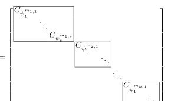

当一个不可约因子 $\psi_i$ 的次数为 1 且重数为 1 时，其友矩阵块是主对角线上的 1×1 矩阵，因此对应于一个特征值。当最小多项式分裂且无平方因子时，矩阵可对角化。

特征值通过 `eigenvalues` 方法获得。`eigenvectors_right` 和 `eigenvectors_left` 方法分别列出每个特征值关联的右（分别左）特征向量以及该特征值的重数。最后，`eigenspaces_right` 和 `eigenspaces_left` 方法返回特征空间以及特征向量的一组基。

```sage
sage: A = matrix(GF(7),4,[5,5,4,3,0,3,3,4,0,1,5,4,6,0,6,3])
sage: A.eigenvalues()
[4, 1, 2, 2]
sage: A.eigenvectors_right()
[(4, [
(1, 5, 5, 1)
], 1), (1, [
(0, 1, 1, 4)
], 1), (2, [
(1, 3, 0, 1),
(0, 0, 1, 1)
], 2)]
sage: A.eigenspaces_right()
[
(4, Vector space of degree 4 and dimension 1 over Finite Field
of size 7
User basis matrix:
[1 5 5 1]),
(1, Vector space of degree 4 and dimension 1 over Finite Field
of size 7
User basis matrix:
[0 1 1 4]),
(2, Vector space of degree 4 and dimension 2 over Finite Field
of size 7
User basis matrix:
[1 3 0 1]
[0 0 1 1])
]
```


更简洁地说，方法 **eigenmatrix_right** 返回对角化矩阵以及相应右特征向量矩阵组成的元组。**eigenmatrix_left** 对左特征向量做类似处理。

```sage
sage: A.eigenmatrix_right()
(
    [ [ 4, 0, 0, 0 ],
      [ 0, 1, 0, 0 ],
      [ 0, 0, 2, 0 ],
      [ 0, 0, 0, 2 ] ],
    [ [ 1, 0, 1, 0 ],
      [ 5, 1, 3, 0 ],
      [ 5, 1, 0, 1 ],
      [ 1, 4, 1, 1 ] ]
)
```

**若尔当标准形。** 当最小多项式在基域上分裂，但含有重数大于 1 的因子时，中间形式 (8.3) 不是对角形。可以证明不存在使其对角化的相似变换，因此该矩阵不可对角化。然而它可以三角化，即化为上三角矩阵，且特征值位于主对角线。在所有可能的此类上三角矩阵中，最简化的一个是若尔当标准形。与特征值 $\lambda$ 相关联且阶为 $k$ 的若尔当块 $J_{\lambda,k}$ 是由下式给出的 $k \times k$ 矩阵 $J_{\lambda,k}$

$$J_{\lambda,k} = \begin{bmatrix} \lambda & 1 & & & \\ & \ddots & \ddots & & \\ & & \lambda & 1 & \\ & & & \lambda & 1 \\ & & & & \lambda \end{bmatrix}$$

该矩阵扮演与友块类似的角色，更精确地揭示特征值的重数。事实上，其特征多项式为 $\chi_{J_{\lambda,k}} = (X-\lambda)^k$。此外，其最小多项式也等于 $\varphi_{J_{\lambda,k}} = (X-\lambda)^k$：它必然是 $P = X-\lambda$ 的倍数，而此时矩阵

$$P(J_{\lambda,k}) = \begin{bmatrix} 0 & 1 & & & \\ & \ddots & \ddots & & \\ & & 0 & 1 & \\ & & & 0 & 1 \\ & & & & 0 \end{bmatrix}$$

是 $k$ 阶幂零的，因此 $\varphi_{J_{\lambda,k}} = \chi_{J_{\lambda,k}} = (X-\lambda)^k$。若尔当标准形对应于中间形式 (8.3)，其中 $v_j^{m_{i,j}}$ 的友块已被若尔当块 $J_{\lambda_j, m_{i,j}}$ 替换（回忆一下，由于最小多项式分裂，$v_j$ 具有 $X-\lambda_j$ 的形式）。因此，每个最小多项式分裂的矩阵都相似于如下形式的若尔当矩阵

$$J=\begin{bmatrix}\mathcal{J}_{\lambda_1,m_{1,1}} & & & \\ & \ddots & & \\ & & \mathcal{J}_{\lambda_1,m_{1,s_1}} & \\ & & & \mathcal{J}_{\lambda_1,m_{\lambda_1,1}} \\ & & & & \ddots \\ & & & & & \mathcal{J}_{\lambda_1,m_{\lambda_1,s_{\lambda_1}}}\end{bmatrix}. \tag{8.4}$$

特别地，在任何代数闭域（例如 $\mathbb{C}$）上，若尔当标准形总是存在。在 Sage 中，构造函数 `jordan_block(a,k)` 生成若尔当块 $J_{a,k}$。若尔当标准形由方法 `jordan_form` 获得。选项 `transformation=True` 使该方法还返回变换矩阵 $U$，使得 $U^{-1}AU$ 处于若尔当标准形。

```sage
A = matrix(ZZ,4,[3,-1,0,-1,0,2,0,-1,1,-1,2,0,1,-1,-1,3])
A.jordan_form()
```

```text
⎛3  0  0  0⎞
⎜0  3  0  0⎟
⎜0  0  2  1⎟
⎝0  0  0  2⎠
```

```sage
J, U = A.jordan_form(transformation=True)
U^-1*A*U == J
```

```text
True
```

若尔当标准形在若尔当块的排列意义下唯一。根据参考文献的不同，有时会要求它们的顺序遵循相似不变量的顺序，如式 (8.4) 所示。注意，从上面的例子可以看出，Sage 并不遵循这一顺序，因为第一个相似不变量（最小多项式）是多项式 $(X-3)(X-2)^2$。

**主标准形。** 为完整起见，我们还应提到最后一种标准形，它在最小多项式不分裂的情形下推广了若尔当标准形。对于次数为 $k$ 的不可约多项式 $P$，将重数为 $m$ 的若尔当块定义为 $km\times km$ 矩阵

$$J_{P,m}=\begin{bmatrix}C_P & B & & \\ & \ddots & \ddots & \\ & & C_P & B \\ & & & C_P\end{bmatrix}$$

其中 $B$ 是 $k\times k$ 矩阵，除 $B_{k,1}=1$ 外所有系数为零；$C_P$ 是与多项式 $P$ 相关联的友矩阵（§8.2.3）。注意，当 $P=X-\lambda$ 时，该定义与特征值 $\lambda$ 相关联的若尔当块概念一致。类似地可以证明，该矩阵的最小多项式与特征多项式为

$$\chi_{J_{P,m}} = \varphi_{J_{P,m}} = P^m.$$

因此，存在一个相似变换，将中间形式 (8.3) 中的每个友块 $C_{e_j}^{m_{i,j}}$ 替换为若尔当块 $J_{e_j,m_{i,j}}$。所得矩阵称为主形式，或第二 Frobenius 形式。它同样是一种标准形，在对角块的排列意义下唯一。

这些标准形的唯一性可用于例如检验两个矩阵是否相似，并在相似时给出从一个矩阵到另一个矩阵的相似变换。

**练习 32。** 编写一个程序，检验输入的两个矩阵 $A$ 和 $B$ 是否相似，并返回变换矩阵 $U$，使得 $A = U^{-1}BU$（若两个矩阵不相似，则可以改为返回 **None**）。

## 9 多项式系统

本章完成前两章的内容。我们考虑的对象是多元方程组，如第 8 章。这些方程如第 7 章一样是多项式方程。与单变量多项式相比，多变量多项式具有很好的数学性质，但也带来新的困难，尤其与环 $K[x_1,\ldots,x_n]$ 不是主环这一事实有关。Gröbner 基理论提供了克服这一限制的工具。最终，我们拥有研究多项式系统的强大方法，并在各个领域有无数应用。

本章大部分内容只需要多变量多项式的基本知识。然而，有些部分达到大学三、四年级交换代数课程的水平。更多细节可参考 Cox、Little 和 O’Shea 的著作 [CLO07]，这是一本非常好且完整的参考文献。

### 9.1 多变量多项式

#### 9.1.1 环 $A[x_1,\ldots,x_n]$

这里我们考虑多不定元或多变量多项式，也称为多元多项式。

与 Sage 中其他代数结构类似，在构造多项式之前，我们必须定义一族同处一个环中的不定元。语法与单变量几乎相同（参见 §7.1.1）：

```sage
R = PolynomialRing(QQ, 'x,y,z')
x,y,z = R.gens() # gives the tuples of indeterminates
```

或简写为：

```sage
sage: R.<x,y,z> = QQ[]
```

（甚至可以是 R = QQ['x,y,z']）。PolynomialRing 构造函数还允许创建具有相同名称和整数索引的一族不定元：

```sage
sage: R = PolynomialRing(QQ, 'x', 10)
```

将 gens 返回的 n 元组赋给变量 x 后，就可以通过 x[i] 方便地访问不定元 $x_i$：

```sage
sage: x = R.gens()
sage: sum(x[i] for i in xrange(5))
x0 + x1 + x2 + x3 + x4
```

变量的顺序很重要。在 QQ['x,y'] 与 QQ['y,x'] 之间用 == 进行比较会返回 false，而同一个多项式作为前者的元素或后者的元素打印出来会有所不同：

```sage
sage: def test_poly(ring, deg=3):
....:     monomials = Subsets(
....:         flatten([(x,)*deg for x in (1,) + ring.gens()]),
....:         deg, submultiset=True)
....:     return add(mul(m) for m in monomials)
```

```sage
sage: test_poly(QQ['x,y'])
x^3 + x^2*y + x*y^2 + y^3 + x^2 + x*y + y^2 + x + y + 1
sage: test_poly(QQ['y,x'])
y^3 + y^2*x + y*x^2 + x^3 + y^2 + y*x + x^2 + y + x + 1
sage: test_poly(QQ['x,y']) == test_poly(QQ['y,x'])
True
```

**练习 33。** 解释上面定义的 test_poly 函数的行为。

更一般地，将多项式写成规范形式需要选择一种对其单项式排序的方式。按次数排序对单变量多项式是自然的，然而对于多变量多项式，没有一种单项式序在所有情形下都令人满意。因此，借助 PolynomialRing 的 order 选项，Sage 允许我们在多种序之间选择。例如，deglex 序首先按总次数排列单项式，若总次数相同，则按不定元次数的字典序排列：

```sage
sage: test_poly(PolynomialRing(QQ, 'x,y', order='deglex'))
x^3 + x^2*y + x*y^2 + y^3 + x^2 + x*y + y^2 + x + y + 1
```

主要可用序在 §9.3.1 中有更详细的描述。我们将看到，单项式序的选择不仅决定输出，而且对某些计算也很重要。

**练习 34。** 定义环 Q[x_2, x_3, ..., x_37]，其不定元以小于 40 的素数作为索引，并定义变量 x2, x3, ..., x37 来访问这些不定元。

最后，在某些情况下，以*递归表示*处理多变量多项式可能很有用，即将其视为系数本身也是多项式的多项式环中的元素（见第 130 页的边栏）。


| 多项式环的构造 |  |
|---|---|
| 环 \(A[x,y]\) | `PolynomialRing(A, 'x,y')` 或 `A['x,y']` |
| 环 \(A[x_0,\ldots,x_{n-1}]\) | `PolynomialRing(A, 'x')` |
| 环 \(A[x_0,x_1,\ldots,y_0,y_1,\ldots]\) | `InfinitePolynomialRing(A, ['x','y'])` |
| 生成元的 \(n\) 元组 | `R.gens()` |
| 第1、第2……个生成元 | `R.0, R.1, ...` |
| \(R=A[x,y][z][\ldots]\) 的未定元 | `R.variable_names_recursive()` |
| 转换 \(A[t_1,t_2,y]\to A[x_1,x_2][y]\) | `p.polynomial(y)` |

| 系数的访问 |  |
|---|---|
| 支撑集、非零系数 | `p.exponents(), p.coefficients()` |
| 单项式的系数 | `p[x^2*y]` 或 `p[2,1]` |
| 次数（全次数、\(x\) 的次数、偏次数） | `p.degree(), p.degree(x), p.degrees()` |
| 首项单项式/首项系数/首项 | `p.lm(), p.lc(), p.lt()` |

| 基本运算 |  |
|---|---|
| 系数的变换 | `p.map_coefficients(f)` |
| 偏导数 \(\partial/\partial x\) | `p.derivative(x)` |
| 求值 \(p(x,y)\mid_{x=a,y=b}\) | `p.subs(x=a, y=b)` 或 `p(x=a, y=b)` |
| 齐次化 | `p.homogenize()` |
| 公分母 \((p\in\mathbb{Q}[x,y,\ldots])\) | `p.denominator()` |

表9.1 – 多元多项式。

#### 9.1.2 多项式

正如一元多项式属于 `Polynomial` 类，多元多项式（在有限个变量的环中）属于 `MPolynomial` 类¹。对于通常的基环（如 \(\mathbb{Z}\)、\(\mathbb{Q}\) 或 \(\mathbb{F}_q\)），Sage 调用 Singular 计算机代数系统，该系统专门用于快速多项式计算。在其他情况下，会使用一个通用但慢得多的实现。

多元多项式总是以稀疏表示²编码。为什么这样选择？一个具有 \(n\) 个变量、全次数为 \(d\) 的稠密多项式包含 \(\binom{n+d}{d}\) 个单项式：对于 \(n=d=10\)，这意味着要存储 184 756 个系数！因此，像一元多项式那样处理大型稠密多项式是非常困难的。此外，即使多项式是稠密的，实践中遇到的支撑集（非零单项式的指数）也有各种形状。例如，如果一个有 \(n\) 个变量、稠密到全次数 \(d-1\) 的多项式用一个 \(d\times\cdots\times d\) 的矩形数组表示，那么对于大的 \(d\)，大约只有 \(n!\) 个系数中有一个是非零的。相反，通过字典实现的稀疏表示非常适合支撑集的形状，也适合单项式序。

##### 环 \(A[(x_n,y_n,\ldots)_{n\in\mathbb{N}}]\)

有时在计算开始时，我们并不知道需要多少个变量。这使得使用 PolynomialRing 相当痛苦：我们首先必须在一个初始域中计算，然后每次想要引入新变量时，都需要扩展该域并转换所有元素。

具有无限多个变量的多项式环提供了一种更灵活的数据结构。它们的元素可以在一个或几个无限未定元族中包含变量。环的每个生成元不仅对应一个单独的变量，而且对应一个由整数索引的变量族：

```
sage: R.<x,y> = InfinitePolynomialRing(ZZ, order='lex')
sage: p = mul(x[k] - y[k] for k in range(2)); p
x_1*x_0 - x_1*y_0 - x_0*y_1 + y_1*y_0
sage: p * x[100]
x_100 + x_1*x_0 - x_1*y_0 - x_0*y_1 + y_1*y_0
```

我们借助 polynomial 方法回到通常的多项式环 PolynomialRing，该方法返回来自 InfinitePolynomialRing 的一个元素在足够大的环中的像，该环足以包含到目前为止已产生的无限变量环中的所有元素。得到的环通常不是具有此性质的最小环。

作为这种便利的代价，这些环的效率低于 PolynomialRing 环。此外，在多项式系统的计算中，它们的理想不能取代通常多项式环的理想，而这正是本章的主题。

#### 9.1.3 基本运算

让我们固定术语。设 R = A[x_1, ..., x_n] 是一个多项式环。我们称形如 x_1^{α_1} x_2^{α_2} ... x_n^{α_n} 的表达式为单项式，即未定元的乘积，并简记为 x^α。整数 n 元组 α = (α_1, α_2, ..., α_n) 是单项式 x^α 的指数。一项是一个单项式与 A 中一个元素的乘积，该元素就是它的系数。

由于项的排序方式不是唯一的，因此 R 的元素作为数学对象没有主导系数。然而，一旦在环构造时选择了某个序，就可以定义首项单项式，即书写顺序中最左边的项，这是有意义的。多元多项式的 `lm`、`lc` 和 `lt` 方法分别返回其首项单项式、首项系数，以及它们共同构成的项：

```
sage: R.<x,y,z> = QQ[]
sage: p = 7*x*y^2*x^2 + 3*y*x*y^2 + 2*x*y*z + x^3 + 6
sage: p.lt()
7*x^2*y^2
```

算术运算 +、- 和 *，以及 coefficients、dict 等方法，都与其一元变体的工作方式类似。在小的差异中，用于提取系数的方括号运算符 `[]` 接受单项式或其指数作为参数：

```
sage: p[x^2*y] == p[(2,1,0)] == p[2,1,0] == 3
True
```

同样，多项式的求值需要给所有变量赋值，或者明确要替换的变量：

```
sage: p(0, 3, -1)
0
sage: p.subs(x = 1, z = x^2+1)
2*x^2+2*y + 7*x^2 + 5*y + 7
```

subs 方法也可以同时替换任意数量的变量，高级示例请参阅其文档。次数可以是全次数或偏次数：

```
sage: print("total={d}    (in x)={dx}    partial={ds}"\
.....:     .format(d=p.degree(), dx=p.degree(x), ds=p.degrees()))
total=4    (in x)=3    partial=(3, 2, 1)
```

其他构造只需做简单调整，例如 derivative 方法将我们想要对其求导的变量作为参数。

#### 9.1.4 算术

除了语法上的基本算术运算，Sage 中可用的函数通常仅限于域上的多项式，有时也适用于 ℤ 或 ℤ/nℤ 上的多项式。在本章其余部分，除非另有说明，我们将考虑域上的多项式。

多项式的欧几里得除法只在一元情况下有意义。在 Sage 中，`quo_rem` 方法以及相关的运算符 `//` 和 `%` 仍然为多元多项式定义。它们计算的“带余除法”满足

(p//q)*q + (p%q) == p

当 p 和 q 仅依赖于一个变量时，这与欧几里得除法一致，但它不是欧几里得除法，也不是规范的。然而，当除法是精确的或除数是单项式时，它是有用的。在其他情况下，我们更倾向于使用 `quo_rem` 及其变体 `mod` 方法，该方法在 §9.2.3 中描述，它会在考虑环的单项式序的情况下将多项式模一个理想约化：

```
sage: R.<x,y> = QQ[]; p = x^2 + y^2; q = x + y
sage: print("({quo})*({q}) + ({rem}) == {p}".format(\
.....:     quo=p//q, q=q, rem=p%q, p=p//q*q+p%q))
(-x + y)*(x + y) + (2*x^2) == x^2 + y^2
sage: p.mod(q)  # is NOT equivalent to p%q
2*y^2
```

| 多元多项式上的运算 |  |
|---|---|
| 整除性 \(p \mid q\) | `p.divides(q)` |
| 因式分解 | `p.factor()` |
| gcd, lcm | `p.gcd(q), p.lcm(q)` |
| 无平方因子测试 | `p.is_squarefree()` |
| 结式 \(\operatorname{Res}_x(p,q)\) | `p.resultant(q, x)` |

表9.2 – 算术。

`divides`、`gcd`、`lcm` 或 `factor` 等方法与一元情况下的含义相同。由于多元多项式环一般不是欧几里得环，前几个方法不适用于任意系数环，但在通常的域上有效，例如数域：

```
sage: R.<x,y> = QQ[exp(2*pi*i/5)][]
sage: (x^10 + y^5).gcd(x^4 - y^2)
x^2 + y
sage: (x^10 + y^5).factor()
(x^2 + y) * (x^2 + (a^3)*y) * (x^2 + (a^2)*y) * (x^2 + (a)*y) * (x^2 +
    (-a^3 - a^2 - a - 1)*y)
```

### 9.2 多项式系统与理想

我们现在考虑本章的核心主题。9.2.1 和 9.2.2 节概述了借助 Sage 找到和理解多项式方程组解的不同方法。9.2.3 节专门讨论与这些系统相关的理想。最后几节将更详细地回到代数消元与系统求解工具上。

#### 9.2.1 第一个例子

让我们重新审视第 2.2 节中的多项式系统，

$\begin{cases} x^2y z^2 = 18 \\ xy^3z = 24 \\ xyz^4 = 6. \end{cases}$ (9.1)

Sage 的 `solve()` 函数只能找到数值解。现在让我们看看 Sage 如何精确求解该系统，并在用户稍加帮助下，为所有解找到简单的闭式形式³。

**枚举解。** 让我们首先将问题转化为更代数的形式，构造由方程生成的 $\mathbb{Q}[x,y,z]$ 的理想：

¹ 与 `Polynomial` 不同，该类不能直接从命令行使用：我们必须使用它的全名。例如，我们可以通过 `isinstance(p, sage.rings.polynomial.multi_polynomial.MPolynomial)` 来检查一个对象是否为“多元多项式”类型。

² 递归表示（参见第130页的侧边栏）仍然会产生部分稠密的多项式。在来自 \(A[x][y]\) 的多项式的内存表示中，\(y^k\) 的每个系数（通常）占据与其在 \(x\) 中的次数成正比的空间，此外还要加上多项式本身与 \(y\) 的次数成正比的空间。

³ 我们在这里的目的是说明求解多项式系统的工具，因此忽略了通过对数将 (9.1) 化为线性方程的可能性。


```
sage: R.<x,y,z> = QQ[]
sage: J = R.ideal(x^2 * y * z - 18,
....:               x * y^3 * z - 24,
....:               x * y * z^4 - 6)
```

正如我们将在第 9.2.3 节中看到的，下面的命令使我们能够检查理想 J 是零维的，即系统 (9.1) 在 $\mathbb{C}^3$ 中有有限个解：

```
sage: J.dimension()
0
```

一旦确定了这一点，第一反应应该是调用 variety 方法，它计算该系统的所有解。在没有任何参数时，它给出多项式环基域中的解：

```
sage: J.variety()
[{y: 2, z: 1, x: 3}]
```

因此，已经找到的解 (3,2,1) 是唯一的有理解。

下一步是枚举复数解。为了精确地完成这一步，我们在代数数域中工作。我们再次找到这 17 个解：

```
sage: V = J.variety(QQbar)
sage: len(V)
17
```

具体来说，最后三个解具有以下形式：

```
sage: V[-3:]
[{z: 0.9324722294043558? - 0.3612416661871530?*I,
  y: -1.700434271459229? + 1.0528634325754712?*I,
  x: 1.337215067329615? - 2.685489874065187?*I},
 {z: 0.9324722294043558? + 0.3612416661871530?*I,
  y: -1.700434271459229? - 1.0528634325754712?*I,
  x: 1.337215067329615? + 2.685489874065187?*I},
 {z: 1, y: 2, x: 3}]
```

每个解点由一个字典给出，其键是 QQbar['x,y,z'] 的生成元（而不是 QQ['x,y,z'] 的生成元，这解释了下面为何稍作绕行），值为该点相应的坐标。除了已经确定的有理解之外，第一个坐标都是次数为 16 的代数数：

```
sage: (xx, yy, zz) = QQbar['x,y,z'].gens()
sage: [ pt[xx].degree() for pt in V ]
[16, 16, 16, 16, 16, 16, 16, 16, 16, 16, 16, 16, 16, 16, 16, 16, 1]
```

##### 用解进行计算并识别其结构

我们已经获得了系统 (9.1) 的复数解的一个精确表示，然而这种表示并不真正显式。这不是问题：只要坐标是 QQbar 的元素，就足以对这些解进行精确计算。

例如，不难看出，如果 \((x,y,z)\) 是系统 (9.1) 的解，那么 \((|x|,|y|,|z|)\) 也是。让我们构造由解 \((x,y,z)\) 对应的 \((|x|,|y|,|z|)\) 组成的集合：

```
sage: Set(tuple(abs(pt[i]) for i in (xx,yy,zz)) for pt in V)
{(3, 2, 1)}
```

因此，\(x\)（相应地，\(y, z\)）的所有值都具有相同的模。更进一步，我们可以验证，替换

\((x,y,z)\mapsto(\omega x,\omega^9 y,\omega^6 z)\qquad\text{其中}\qquad \omega=e^{2\pi i/17}\qquad (9.2)\)

使该系统保持不变。特别地，这些解的最后一个坐标恰好是 17 次单位根；由于可以用代数数进行精确计算，我们再次验证了这一点：

```
sage: w = QQbar.zeta(17); w  # primitive root of 1
0.93247222940435587 + 0.36124166618715303*I
sage: Set(pt[zz] for pt in V) == Set(w^i for i in range(17))
True
```

因此，该系统的解是三元组 \((3\omega, 2\omega^9, \omega^6)\)，其中 \(\omega^{17}=1\)。这要显式得多！

**练习 35.** 寻找 (9.1) 的实数解（而不只是有理解），以直接验证只有 \((x=3,y=2,z=1)\)。通过使用 Sage 进行计算，再次找出替换 (9.2)，包括作为单位根的 \(\omega\) 的阶为 17 这一值。

我们本可以通过检查 \(V\) 中点的坐标的极小多项式来得到相同结果。确实，我们看到，除 \((3,2,1)\) 之外，对于所有解点，给定的坐标具有相同的极小多项式。第三个坐标的公共极小多项式正是分圆多项式 \(\Phi_{17}\)：

```
sage: set(pt[zz].minpoly() for pt in V[:-1])
{x^16 + x^15 + x^14 + x^13 + x^12 + x^11 + x^10 + x^9 + x^8 + x^7 + x^6
    + x^5 + x^4 + x^3 + x^2 + x + 1}
```

第一个和第二个坐标的公共极小多项式分别是 \(3^{16}\cdot\Phi_{17}(x/3)\) 和 \(2^{16}\cdot\Phi_{17}(x/2)\)。

##### 闭式表达式

因此，利用复数的指数表示，可以得到解的显式形式：

```
sage: def polar_form(z):
....:     rho = z.abs(); rho.simplify()
....:     theta = 2 * pi * z.rational_argument()
....:     return (SR(rho) * exp(I*theta))
sage: [tuple(polar_form(pt[i]) for i in (xx,yy,zz)) for pt in V[-3:]]
[(3*e^(-6/17*I*pi), 2*e^(-14/17*I*pi), e^(-2/17*I*pi)),
 (3*e^(6/17*I*pi), 2*e^(-14/17*I*pi), e^(2/17*I*pi)), (3, 2, 1)]
```

当然，如果我们想到用指数表示写出 \(V\) 的元素，那就足以得出结论。

##### 化简系统

还可以采用另一种方法。与其寻找解，不如尝试计算系统本身更简单的形式。Sage 为此提供的基本工具是三角分解和 Gröbner 基。稍后我们将确切看到它们计算什么；让我们先在这个例子上使用它们：

```
sage: J.triangular_decomposition()
[Ideal (z^17 - 1, y - 2*z^10, x - 3*z^3) of Multivariate
Polynomial Ring in x, y, z over Rational Field]
sage: J.transformed_basis()
[z^17 - 1, -2*z^10 + y, -3/4*y^2 + x]
```

在两种情况下，我们都得到等价系统

$z^{17}=1\qquad y=2z^{10}\qquad x=3z^3,$

或者，对于使用 transformed_basis 得到的最后一个方程，有 $x=3y^2/4$，即 \(V=\{(3\omega^3,2\omega^{10},\omega)\mid \omega^{17}=1\}\)。这直接给出了上文手工找到的解的紧凑形式的参数化。

#### 9.2.2 求解意味着什么？

一个有解的多项式系统往往有无穷多个解。简单的方程 $x^2-y=0$ 在 $\mathbb{Q}^2$ 中就有无穷多个解，更不用说在 $\mathbb{R}^2$ 或 $\mathbb{C}^2$ 中了。因此不可能枚举它们。我们所能做的最好的事情，是“尽可能显式地”描述解集，即计算它的一种表示，从中可以容易地提取有用信息。这种情况类似于线性系统：对于线性系统（在齐次情形下），系统核的一组基就是解集的一种良好描述。

在解的数量有限的特殊情形下，就有可能“计算它们”。然而，即使在这种情形下，我们是要枚举 $\mathbb{Q}$ 中的解，还是有限域 $\mathbb{F}_q$ 中的解？是要寻找实数或复数数值近似？还是甚至像上一节的例子那样，用代数数表示它们，即例如计算其坐标的极小多项式？

这个例子本身就说明，解集的其他表示可能比一个点列表有用得多，尤其是当解的数量很多时。因此，枚举解并不总是最好的做法，即使这是可能的。归根结底，我们并不真正想计算解本身，而是想*用*它们进行计算，以便之后根据给定问题推导出我们真正感兴趣的信息。本章其余部分将研究为此目的的几个有用工具。

#### 9.2.3 理想与系统

如果 $s$ 个多项式 $p_1,\ldots,p_s\in K[x]$ 在坐标属于 $K$ 或 $K$ 的扩域的点 $x$ 处取值为零，那么它们生成的理想中的任何元素也在 $x$ 处取值为零。因此，自然可以将多项式系统

\(p_1(x)=p_2(x)=\cdots=p_s(x)=0\)

与这些商环中的元素联系起来。与 \((S_1)\) 关联的理想 \(J_1\) 按如下方式构造：

```
sage: R.<x,y> = QQ[]
sage: J = R.ideal(x^2 + y^2 - 1, 16*x^2*y^2 - 1)
```

然后我们可以构造 \(K[x]\) 对 \(J_1\) 的商，将多项式投影到其上，用模 \(J_1\) 的等价类进行计算，并把它们“提升”为代表元：

```
sage: ybar2 = R.quo(J)(y^2)
sage: [ybar2^i for i in range(3)]
[1, ybar2, ybar2 - 1/16]
sage: ((ybar2 + 1)^2).lift()
3*y^2 + 15/16
```

这里有一个理论问题。\(K[x]/J\) 的元素以正规形式表示，这是能够检查两个元素是否相等所必需的。然而，这种正规形式并不容易定义，原因已在 §9.1.4 中提到：在 \(K[x]/J\) 中计算时，要用 \(J\) 的一个主生成元去除等价类 \(p + J\) 的一个代表元，而这一除法在多变量情形下没有直接类比。现在我们暂且承认，正规形式仍然存在；它依赖于构造环时所选的元素顺序，并建立在 \(J\) 的一个称为 Gröbner 基的特殊生成元系之上。本章末尾的第 9.3 节将定义 Gröbner 基，并说明如何在计算中使用它们。Sage 会在需要时自动计算 Gröbner 基；然而，这些计算有时非常昂贵，尤其是当变量很多时，这可能使商环中的计算变得有些困难。

让我们回到 Sage 的操作。当 \(p \in J\) 时，命令 `p.lift(J)` 将 \(p\) 重写为 \(J\) 的生成元的线性组合，其系数为多项式：

```
sage: u = (16*y^4 - 16*x^2*y^2 + 1).lift(J); u
[16*y^2, -1]
sage: u[0]*J.0 + u[1]*J.1
16*y^4 - 16*x^2*y^2 + 1
```

对于任意多项式 \(p\)，表达式 `p.mod(J)` 给出 \(p\) 模 \(J\) 的正规形式，并将其视为 \(K[x]\) 的元素：

```
sage: (y^4).mod(J)
y^2 - 1/16
```

注意：虽然 `J.reduce(p)` 等价于 `p.mod(J)`，但变体 `p.reduce([p1, p2, ...])` 返回的是 \(p + J\) 的一个代表元，它不一定是正规形式（见 §9.3.2）：

```
sage: (y^4).reduce([x^2 + y^2 - 1, 16*x^2*y^2 - 1])
y^4
```

通过结合 `p.mod(J)` 和 `p.lift(J)`，我们可以将多项式 \(p\) 分解为 \(J\) 的生成元的线性组合（系数为多项式），再加上一个余项；该余项为零当且仅当 \(p \in J\)。

是有限生成的！）本章其余部分不适用于这些对象。


| 理想 | |
| --- | --- |
| 理想 \((p_1,p_2) \subset R\) | `R.ideal(p1, p2)` 或 `(p1, p2)*R` |
| 和、积、幂 | `I + J`、`I * J`、`I^k` |
| 交 \(I \cap J\) | `I.intersection(J)` |
| 商 \(I : J = \{p \mid pJ \subset I\}\) | `I.quotient(J)` |
| 根 \(\sqrt{I}\) | `I.radical()` |
| 模 \(I\) 约化 | `I.reduce(p)` 或 `p.mod(I)` |
| \(R \to R/I\) 的截面 | `p.lift(I)` |
| 商环 \(R/I\) | `R.quo(I)` 或 `R.quotient(I)` |
| 齐次化理想 | `J.homogenize()` |
| **一些预定义理想** | |
| 无关理想 \((x_1,\ldots,x_n)\) | `R.irrelevant_ideal()` |
| 雅可比理想 \((\partial p/\partial x_i)\) | `p.jacobian_ideal()` |
| 循环根（9.11） | `sage.rings.ideal.Cyclic(R)` |
| 域方程 \(x_i^q = x_i\) | `sage.rings.ideal.FieldIdeal(GF(q)['x1,x2'])` |

**表 9.3 — 理想。**

##### 理想的根与解

理想与代数簇之间的主要对应关系在于希尔伯特零点定理，也称为*零点定理*。设 \(\overline{K}\) 为 \(K\) 的代数闭包。

**定理（零点定理）。** 设 \(p_1,\ldots,p_s \in K[\mathbf{x}]\)，并设 \(Z \subset \overline{K}^n\) 为 \(p_i\) 的公共零点集。多项式 \(p \in K[\mathbf{x}]\) 在 \(Z\) 上恒为零，当且仅当存在整数 \(k\) 使得 \(p^k \in \langle p_1,\ldots,p_s\rangle\)。

这一结果提供了一个代数判据，用于检验一个多项式系统是否有解。常数多项式 \(1\) 在 \(Z\) 上恒为零当且仅当 \(Z\) 为空，因此系统 \(p_1(x)=\cdots=p_s(x)=0\) 在 \(\overline{K}\) 中有解当且仅当理想 \(\langle p_1,\ldots,p_s\rangle\) 不包含 \(1\)。例如，以 \((0,0)\) 和 \((4,0)\) 为圆心、半径为 1 的两个圆有一个复交点：

```sage
sage: 1 in ideal(x^2+y^2-1, (x-4)^2+y^2-1)
False
```

然而，在添加条件 \(x = y\) 之后，该系统没有任何解。通过把方程的一个组合作为*证书*展示出来——若这些方程被满足，该组合就约化为 \(1 = 0\)——我们可以给出一个说明它不相容的简单证明。计算

```sage
sage: R(1).lift(ideal(x^2+y^2-1, (x-4)^2+y^2-1, x-y))
[-1/28*y + 1/14, 1/28*y + 1/14, -1/7*x + 1/7*y + 4/7]
```

得到关系式

\[
\frac{1}{28}\left((-y+2)(x^2+y^2-1)+(y+2)\left((x-4)^2+y^2-1\right)\right)
+(-4x+4y+16)(x-y)=1.
\]

用理想的语言来说，*零点定理*表明，在理想 \(J\) 所关联的簇 \(V_K(J)\) 上恒为零的多项式集合，就是该理想的*根*，定义为

\[
\sqrt{J}=\{p\in K[\mathbf{x}]\mid \exists k\in\mathbb{N}, p^k\in J\}.
\]

我们有

\[
V_K(\sqrt{J})=V_K(J)
\]

但直观地说，转到根会“忘记重数”。因此，理想 \(J_1\) 是它自身的根（我们说它是根理想），而关联到 \((S_2)\) 的理想 \(J_2\) 满足 \(J_2 \subsetneq \sqrt{J_2}\)。

```sage
sage: J1 = (x^2 + y^2 - 1, 16*x^2*y^2 - 1)*R
sage: J2 = (x^2 + y^2 - 1,  4*x^2*y^2 - 1)*R
sage: J1.radical() == J1
True
sage: J2.radical()
Ideal (2*y^2 - 1, 2*x^2 - 1) of Multivariate Polynomial
Ring in x, y over Rational Field
sage: 2*y^2 - 1 in J2
False
```

> **系统、理想与密码学**
>
> 一些特定的模块 `sage.rings.polynomial.multi_polynomial_sequence` 和 `sage.crypto.mq` 提供了处理多项式系统的工具，这些工具会考虑方程的特殊形式，而不仅仅是它们生成的理想。这对于处理大型结构化系统很有用，例如密码学中出现的系统。模块 `sage.crypto` 还定义了几个与经典密码学构造相关联的多项式系统。

##### 理想上的运算

也可以直接对理想本身进行计算。让我们回顾两个理想之和的定义：

\[
I+J=\{p+q\mid p\in I \text{ and } q\in J\}=\langle I\cup J\rangle.
\]

它在几何上对应代数簇的交：

\[
V(I+J)=V(I)\cap V(J).
\]

因此，关联到 \((S_1)\) 的理想 \(J_1\) 是 \(C=\langle x^2+y^2-1\rangle\) 与 \(H=\langle 16x^2y^2-1\rangle\) 的和，它们分别定义圆和双曲线。在 Sage 中：

```sage
sage: C = ideal(x^2 + y^2 - 1); H = ideal(16*x^2*y^2 - 1)
sage: C + H == J1
True
```

这个相等性测试同样基于计算 Gröbner 基。

类似地，理想的交、积和商满足

| \(I \cap J = \{p \mid p \in I \text{ and } p \in J\}\) | \(V(I \cap J) = V(I) \cup V(J)\) |
| \(I \cdot J = \{pq \mid p \in I,\ q \in J\}\) | \(V(I \cdot J) = V(I) \cup V(J)\) |
| \(I : J = \{p \mid pJ \subset I\}\) | \(V(I : J) = V(I) \setminus V(J)\) |

这些运算按表 9.3 所示计算。这里记号 \(\overline{X}\) 表示 \(X\) 的 Zariski 闭包，即包含 \(X\) 的最小代数簇。例如，图 9.1a 中的曲线是来自 \(C \cap H\) 的多项式的零点集，而商 \((C \cap H) : (4xy-1)\) 对应于圆与两条双曲线之一的并：

```sage
sage: CH = C.intersection(H).quotient(ideal(4*x*y-1)); CH
Ideal (4*x^3*y + 4*x*y^3 + x^2 - 4*x*y + y^2 - 1) of
Multivariate Polynomial Ring in x, y over Rational Field
sage: CH.gen(0).factor()
(4*x*y + 1) * (x^2 + y^2 - 1)
```

然而，从 \(V(H)\) 中删去有限个点后得到的曲线不是代数子簇，因此：

```sage
sage: H.quotient(C) == H
True
```

##### 维数

每个理想 \(J \subset K[x]\) 还关联一个*维数*，直观上它对应于代数闭域上簇 \(V(J)\) 的“分量”的最大“维数”⁵。例如我们有：

```sage
sage: [J.dimension() for J in [J1, J2, C, H, H+J2, J1+J2]]
[0, 0, 1, 1, 1, -1]
```

事实上，\(V(J_1)\) 和 \(V(J_2)\) 有有限个点，\(V(C)\) 和 \(V(H)\) 是曲线，\(V(H \cdot J_2)\) 是曲线与孤立点的并，而 \(V(J_1 + J_2)\) 为空。*零维系统*，即生成零维理想的系统，或等价地，在 \(K\) 的代数闭包上有有限个解的系统，将在本章剩余部分特别研究，因为它们是我们能够最显式地“求解”的系统。

⁵ 我们在 §9.3.3 给出一个更严格（但不一定更清晰）的定义。建议读者参阅本章开头给出的参考文献，以获得更好的解释。

#### 9.2.4 消元

在方程组中，*消去*一个变量意味着找到该系统的“推论”，或者更确切地说“所有推论”，且这些推论与该变量无关。换句话说，我们希望找到任何解都满足、但不包含被消去变量的方程，这通常使它们更易于分析。

| 操作 | Sage 命令 |
| --- | --- |
| **一般多项式系统：消元、几何** | |
| 消元理想 \(J \cap K[z,t] \subseteq K[x,y,z,t]\) | `J.elimination_ideal(x,y)` |
| 结式 \(\operatorname{Res}_x(p,q)\) | `p.resultant(q,x)` |
| 维数 | `J.dimension()` |
| 亏格 | `J.genus()` |
| **零维系统** | |
| \(L \supseteq K\) 中的解 | `J.variety(L)` |
| 商在 \(K\) 上的维数 | `J.vector_space_dimension()` |
| 商基 | `J.normal_basis()` |
| 三角分解 | `J.triangular_decomposition()` |

**表 9.4 — 求解多项式系统。**

例如，我们可以从线性系统

\[
\begin{cases}
2x + y - 2z = 0\\
2x + 2y + z = 1
\end{cases}
\qquad (9.4)
\]

中消去 \(x\)，方法是第二式减去第一式。得到 \(y + 3z = 1\)，这说明 (9.4) 的任意解三元组 \((x,y,z)\) 都具有形式 \((x,1-3z,z)\)。然后我们可以验证，每个“部分解” \((1-3z,z)\) 都能提升为 (9.4) 的一个（唯一）解 \(\left(\frac{5z-1}{2},1-3z,z\right)\)。这说明高斯主元消去算法通过消元来求解线性系统，而不是例如使用克拉默公式。

##### 消元理想

在多项式系统的语境中，方程 \(p_1(x)=\cdots=p_s(x)=0\) 的“推论”是理想 \(\langle p_1,\ldots,p_s\rangle\) 的元素。如果 \(J\) 是 \(K[x_1,\ldots,x_n]\) 的一个理想，我们称 \(J\) 的第 \(k\) 个*消元理想*为集合

\[
J_k = J \cap K[x_{k+1},\ldots,x_n] \tag{9.5}
\]

其中元素属于 \(J\)，且只包含最后 \(n-k\) 个变量。这是 \(K[x_{k+1},\ldots,x_n]\) 的一个理想。

在 Sage 中，方法 `elimination_ideal` 以要消去的变量列表为输入。注意：它返回的不是 \(J_k \subset K[x_{k+1},\ldots,x_n]\)，而是它在 \(K[x_1,\ldots,x_n]\) 中生成的理想 \(\langle J_k\rangle\)。对于线性系统 (9.4)，我们得到

```sage
sage: R.<x,y,z> = QQ[]
sage: J = ideal(2*x + y - 2*z, 2*x + 2*y + z - 1)
sage: J.elimination_ideal(x)
Ideal (y + 3*z - 1) of Multivariate Polynomial Ring in x, y, z
over Rational Field
sage: J.elimination_ideal(x,y)
Ideal (0) of Multivariate Polynomial Ring in x, y, z over Rational Field
```

从数学上，我们如下解释这些结果：我们有 \(J \cap \mathbb{Q}[y,z] = \langle y+3z-1\rangle \subseteq \mathbb{Q}[y,z]\) 以及 \(J \cap \mathbb{Q}[z] = \langle 0\rangle\)，即 \(\mathbb{Q}[z] \not\subseteq J\)。（事实上，理想 \(\langle 0\rangle\)


对应于约化为唯一平凡方程 $0=0$ 的系统，而任何多项式都是它的解。显然，这并不是求解线性方程组的推荐方式：第 8 章讨论的具体工具要高效得多！

再看一个稍微不那么平凡的例子：让我们回到第 9.2.3 节的系统 $(S_1)$（见图 9.1a）：

```text
sage: R.<x,y> = QQ[]
sage: J1 = ideal(x^2 + y^2 - 1, 16*x^2*y^2 - 1)
```

消去 $y$ 得到 $\mathbb{Q}[x]$ 的一个理想——因此是主理想——它由多项式 $g$ 生成，而 $g$ 的根是

$$\frac{\pm\sqrt{2\pm\sqrt{3}}}{2}$$

即 $(S_1)$ 的八个解的横坐标：

```text
sage: g = J1.elimination_ideal(y).gens(); g
[16*x^4 - 16*x^2 + 1]
sage: SR(g[0]).solve(SR(x)) # solves by radicals
[x == -1/2*sqrt(sqrt(3) + 2), x == 1/2*sqrt(sqrt(3) + 2),
 x == -1/2*sqrt(2 - sqrt(3)), x == 1/2*sqrt(2 - sqrt(3))]
```

将求得的每个 $x$ 值重新代入 $(S_1)$，我们得到一个仅含 $y$ 的（冗余）方程组，由此可以计算相应的 $y$ 值。

##### 消元 = 投影

上述例子表明，在系统中消去 $y$ 在几何上对应于将解簇投影到方程为 $y = \text{constant}$ 的超平面上（投影记为 $\pi$）。然而，现在让我们分别考虑理想 $C = \langle x^2 + y^2 - 1\rangle$ 和 $H = \langle 16x^2y^2 - 1\rangle$，它们的和为 $J_1$，并再次消去 $y$：

```text
sage: C.elimination_ideal(y).gens()
[0]
sage: H.elimination_ideal(y).gens()
[0]
```

就 $C$ 而言，这并不奇怪。圆 $\{(x,y)\in\mathbb{R}^2\mid x^2+y^2=1\}$ 投影到 $[-1,1]$ 上；然而很明显，任何 $x$ 值都可以被“重新代入”唯一方程 $x^2+y^2-1=0$，而所得关于 $y$ 的方程有复数解。在 $C$ 中消去 $y$ 对应于将复圆 $\{(x,y)\in\mathbb{C}^2\mid x^2+y^2=1\}$ 投影到第一坐标上，而该投影整体就是 $\mathbb{C}$。

$H$ 的情形稍微更复杂一些。方程 $16x^2y^2=1$ 在 $x=0$ 时没有解，即使是复数解也没有。于是我们有

$$V_{\mathbb{C}}(H\cap\mathbb{Q}[x])=\mathbb{C}\subseteq\pi(V_{\mathbb{C}}(H))=\mathbb{C}\setminus\{0\}.$$

事实上，双曲线的投影 $\mathbb{C}\setminus\{0\}$ 不是代数子簇。结论：消元确实对应于（代数闭域上的）投影，但它计算的并不是精确投影，而只是其扎里斯基闭包。

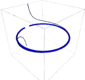

图 9.2 – 由 (9.6) 定义的 $(x,y,t)$ 中曲线的一部分及其在平面 $t=0$ 上的投影。

##### 应用：平面几何

如果 $X\subset\mathbb{C}^k$ 由有理参数化给出

$$X=\{(f_1(t),f_2(t),\ldots,f_k(t))\},\qquad f_1,\ldots,f_k\in\mathbb{Q}(t_1,\ldots,t_n),$$

那么求 $X$ 的隐式方程，就是将由方程 $x_i=f_i(t)$ 定义的 $\mathbb{C}^{k+n}$ 的部分投影到子空间 $(x_1,\ldots,x_k)\cong\mathbb{C}^k$ 上。这是一个消元问题。让我们考虑圆的经典参数化

$$x=\frac{1-t^2}{1+t^2}\qquad y=\frac{2t}{1+t^2} \tag{9.6}$$

它与用 $\tan(\theta/2)$ 表示 $(\cos\theta,\sin\theta)$ 的表达式相关。它转化为定义 $\mathbb{Q}[x,y,t]$ 的一个理想的多项式关系：

```text
sage: R.<x,y,t> = QQ[]
sage: Param = R.ideal((1-t^2)-(1+t^2)*x, 2*t-(1+t^2)*y)
```

让我们消去 $t$：

```text
sage: Param.elimination_ideal(t).gens()
[x^2 + y^2 - 1]
```

我们得到圆的一个方程。我们可以注意到，该方程在 $(x,y)=(-1,0)$ 处为零，尽管参数化 (9.6) 并不经过该点，因为圆去掉一个点不是代数子簇。

另一个例子：让我们画出方程

$$C_t:\qquad x^2+(y-t)^2=\frac{t^2+1}{2} \tag{9.7}$$

的几个圆 $(C_t)$，使用 Sage 命令（见图 9.3）：

```text
sage: R.<x,y,t> = QQ[]
sage: eq = x^2 + (y-t)^2 - 1/2*(t^2+1)
```

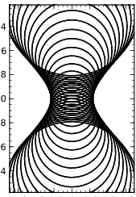

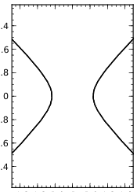

图 9.3 一族圆及其包络。

```text
sage: fig = add((eq(t=k/5)*QQ[x,y]).plot() for k in (-15..15))
sage: fig.show(aspect_ratio=1, xmin=-2, xmax=2, ymin=-3, ymax=3)
```

我们看到，圆族 $\mathcal{C}_t$ 的*包络*出现了，它是一条与所有 $\mathcal{C}_t$ 相切的“极限曲线”；我们可以非正式地把它描述为与该族“无限接近的圆”的“交点”集合。

更准确地说，如果 $f$ 是可微函数，且曲线 $\mathcal{C}_t$ 对任意 $t$ 都由 $f(x,y,t)=0$ 定义，那么 $\{\mathcal{C}_t\}$ 的包络是满足下式的点 $(x,y)$ 的集合

$$\forall t,\quad f(x,y,t)=0 \qquad\text{and}\qquad \frac{\partial f}{\partial t}(x,y,t)=0. \tag{9.8}$$

在圆 (9.7) 的情形中，函数 $f(x,y,t)$ 是多项式。它们的包络是 (9.8) 的解在 $(x,y)$ 平面上的投影，因此我们可以通过如下消元计算确定其方程：

```text
sage: env = ideal(eq, eq.derivative(t)).elimination_ideal(t)
sage: env.gens()
[2*x^2 - 2*y^2 - 1]
```

剩下的只需画出所得到的曲线：

```text
sage: env.change_ring(QQ[x,y]).plot((x,-2,2), (y,-3,3))
```

##### 结式与消元

前面例子中执行的消元隐含地基于 Sage 自动计算的 Gröbner 基。然而，我们在本书中已经遇到过另一种消元工具：结式。

让我们考虑两个非常数多项式 $p,q \in K[x_1,\ldots,x_n,y]$。记 $\operatorname{Res}_y(p,q)$ 为 $p$ 和 $q$ 的结式，这里把它们视为单变量 $y$ 的多项式，系数在 $K[x_1,\ldots,x_n]$ 中。我们在 §7.3.3 中已经看到，它是 $K[x_1,\ldots,x_n]$ 中的一个多项式；它在 $u\in K^n$ 处为零，当且仅当 $p(u_1,\ldots,u_n)$ 和 $q(u_1,\ldots,u_n)$（它们是 $K[y]$ 中的两个多项式）有公共零点，除非 $p$ 和 $q$ 的（关于 $y$ 的）首项系数本身在 $u$ 处为零。

我们一些只涉及两个多项式的消元计算可以用结式代替。例如，圆 (9.7) 的包络方程是

```text
sage: eq.derivative(t).resultant(eq, t)
x^2 - y^2 - 1/2
```

结式 $\operatorname{Res}_y(p,q)$ 是消元理想 $(p,q)\cap K[x_1,\ldots,x_n]$ 中的一个元素。然而，即使在 $n=1$ 的情形（此时消元理想是主理想），并且即使 $p$ 和 $q$ 关于 $y$ 的首项系数互素，结式也不一定生成消元理想：

```text
sage: R.<x,y> = QQ[]
```

##### 不等式

让我们考虑顶点为 $A=(0,0)$、$B=(1,0)$ 和 $C=(x,y)$ 的三角形。假设角 $\widehat{BAC}$ 和 $\widehat{CBA}$ 相等，并尝试通过计算证明该三角形是等腰三角形。通过引入参数 $t=\tan\widehat{A}=\tan\widehat{B}$，该问题可由方程 $y=tx=t(1-x)$ 编码，并且我们需要证明它们蕴含

$$x^2+y^2=(1-x)^2+y^2.$$

使用 Sage，我们得到：

```text
sage: R.<x,y,t> = QQ[]
sage: J = (y-t*x, y-t*(1-x))*R
sage: (x^2+y^2) - ((1-x)^2+y^2) in J
False
```

这是可以预料到的：当 $x=y=t=0$ 时，假设条件成立，但结论为假！从几何上看，我们必须排除退化三角形的情形，这种三角形可以有两个相等的角却不是等腰三角形。

如何编码约束 $t\ne 0$？技巧是引入辅助变量 $u$，并强制 $tu=1$。计算变为：

```text
sage: R.<x,y,t,u> = QQ[]
sage: J = (y-t*x, y-t*(1-x), t*u-1)*R
sage: (x^2+y^2) - ((1-x)^2+y^2) in J
True
```

现在我们得到了预期的结果。顺便指出，我们可以只用一个辅助变量，借助形如 $t_1t_2\cdots t_nu=1$ 的方程，同时迫使若干个表达式为零。


```sage
sage: p = y^2 - x; q = y^2 + x
sage: p.resultant(q, y)
4*x^2
sage: ideal(p, q).elimination_ideal(y)
Ideal (x) of Multivariate Polynomial Ring in x, y over Rational Field
```

#### 9.2.5 零维系统

仅通过消元理想的计算，我们就可以处理许多问题，而 Sage 并未提供其他“黑箱”工具来求解一般的多项式系统。对于零维系统，情况则有所不同。

当商 \(K[x]/J\) 是有限维向量空间时，称理想 \(J \subset K[x]\) 的维数为零。在代数闭域上，这等价于说簇 \(V(J)\) 包含有限个点。例如，系统 (9.1) 和 (9.3) 生成零维理想——我们说它们本身是零维的。相反，\(\mathbb{Q}[x,y]\) 中的理想 \(((x^2+y^2)(x^2+y^2+1))\) 的维数为 1，尽管其唯一实解为 (0, 0)：

```sage
sage: R.<x,y> = QQ[]
sage: ((x^2 + y^2)*(x^2 + y^2 + 1)*R).dimension()
1
```

零维系统可以比上一节的一般工具所能做到的更显式地求解。我们已经在 §9.2.1 的示例中实际看到了其中几种方法。

##### 枚举解

首先，解的数量有限使我们能够枚举它们，无论是精确地还是近似地。

Sage 表达式 `J.variety(L)` 计算簇 \(V_L(J)\)。如果 \(J\) 不是零维的，它会引发错误。默认情况下，它寻找坐标位于定义该系统的多项式环的基域中的解。例如，由 \(J_1\) 定义的 \(\mathbb{Q}^n\) 的子簇为空：

```sage
sage: R.<x,y> = QQ[]
sage: J1 = (x^2 + y^2 - 1, 16*x^2*y^2 - 1)*R
sage: J1.variety()
[]
```

但是，像单变量多项式的 roots 方法一样，`variety` 适用于任何类型的域 \(L\)。目前最重要的情况是代数数域。我们确实可以证明，系数在 \(K\) 中的零维系统的解，其坐标位于 \(K\) 的代数闭包中。因此，可以精确计算与理想 \(J \subset \mathbb{Q}[x]\) 相关联的复簇 \(V_{\mathbb{C}}(J)=V_{\bar{\mathbb{Q}}}(J)\)：

```sage
sage: J1.variety(QQbar)[0:2]
[{y: -0.9659258262890683?, x: -0.2588190451025208?},
 {y: -0.9659258262890683?, x: 0.2588190451025208?}]
```

**练习 36.** 证明 \((S_1)\) 的解的坐标位于 \(\mathbb{Q}[\sqrt{2-\sqrt{3}}]\) 中，并用根式表示它们。

##### 三角分解

在内部，*J.variety(L)* 会经过理想 *J* 的一个*三角分解*。这种分解本身也很有意思，因为它有时会给出*簇* *J* 的一种描述，这种描述更适合后续计算，甚至比 *variety* 的输出更容易理解（见 §8.2.1），在解的数量很多时尤其如此。

一个多项式系统若具有如下形式，则称为*三角*系统

\[
\begin{aligned}
p_1(x_1) &:= x_1^{d_1}+a_{1,d_1-1}x_1^{d_1-1}+\cdots+a_{1,0}=0\\
p_2(x_1,x_2) &:= x_2^{d_2}+a_{2,d_2-1}(x_1)x_2^{d_2-1}+\cdots+a_{2,0}(x_1)=0\\
&\vdots\\
p_n(x_1,\ldots,x_n) &:= x_n^{d_n}+a_{n,d_n-1}(x_1,\ldots,x_{n-1})x_n^{d_n-1}+\cdots+a_{n,0}(x_1,\ldots,x_{n-1})=0
\end{aligned}
\]

或者换句话说，如果每个多项式 \(p_i\) 只涉及变量 \(x_1,\ldots,x_i\)，并且关于变量 \(x_i\) 是首一的。当一个零维系统具有这种形式时，求解它归结为求解有限个单变量多项式方程：只需找到 \(p_1\) 的根 \(x_1\)，将它们代入 \(p_2\)，然后找到后者的根 \(x_2\)，依此类推。无论寻求精确解还是近似（数值）解，该策略都适用。

并非每个系统都等价于一个三角系统。例如，考虑由以下定义的理想 *J*：

```sage
sage: R.<x,y> = PolynomialRing(QQ, order='lex')
sage: C = ideal(x^2+y^2-1)
sage: D = ideal((x+y-1)*(x+y+1))
sage: J = C + D
```

图示见图 9.4（左）：

```sage
sage: opts = {'axes':True, 'gridlines':True, 'frame':False,
....:    'aspect_ratio':1, 'axes_pad':0, 'xmin':-1.3, 'xmax':1.3,
....:    'ymin':-1.3, 'ymax':1.3, 'fontsize': 8}
sage: show(C.plot() + D.plot(), figsize=(2,2), **opts)
```

簇 *V(J)* 包含两个横坐标为 0 的点，但只有一个横坐标为 −1 的点；同样，只有一个纵坐标为 −1 的点，而有两个纵坐标为 0 的点。因此理想 *J* 不能由三角系统描述。

然而我们可以证明，任何零维理想都可写成由三角系统生成的理想的有限交。*三角分解*方法计算这样的分解：

```sage
sage: J.triangular_decomposition()
[Ideal (y, x^2 - 1) of Multivariate Polynomial Ring in x, y
over Rational Field,
 Ideal (y^2 - 1, x) of Multivariate Polynomial Ring in x, y
over Rational Field]
```

在几何上，我们得到簇 *V(J)* 的一种表示，即与更简单系统相关联的簇的并，而且这些系统往往足够简单，能很好地描述解。

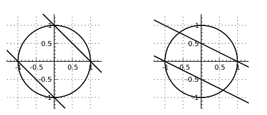

$⟨x^2 + y^2 - 1, (x + y - 1)(x + y + 1)⟩$    $⟨x^2 + y^2 - 1, (x + 2y - 1)(x + 2y + 1)⟩$

**图 9.4** 在每种情况下，正文中理想 J 所关联的簇都是一个圆与两条直线的并的交集。

##### 一些困难

我们完全有理由质疑三角分解在枚举解方面的价值。毕竟，给定一个零维系统，总可以通过计算某个消元理想，找到一个单变量多项式，其根恰好是解的第一坐标。将其根代入系统，我们减少了变量数目，从而可以迭代该过程，直到完全解出系统。

然而，通过传播部分结果而在系统中进行“代入”可能会很复杂。让我们稍微修改前面的系统：

```sage
sage: D = ideal((x+2*y-1)*(x+2*y+1)); J = C + D
sage: J.variety()
[{y: -4/5, x: 3/5}, {y: 0, x: -1}, {y: 0, x: 1}, {y: 4/5, x: -3/5}]
sage: [T.gens() for T in J.triangular_decomposition()]
[[y, x^2 - 1], [25*y^2 - 16, 4*x + 3*y]]
```

三角分解的形状保持不变：对于每个分支，我们有一个只涉及 \(y\) 的方程，以及第二个方程，它能够用 \(y\) 表示 \(x\)。

于是，让我们消去 \(x\)，得到一个只含 \(y\) 的方程，它是上面两个关于 \(y\) 的方程的乘积：

```sage
sage: Jy = J.elimination_ideal(x); Jy.gens()
[25*y^3 - 16*y]
```

为了求 \(x\)，现在只需将该方程的根代入定义理想 \(J\) 的方程。第一个方程 \(x^2 + y^2 - 1 = 0\) 给出：

```sage
sage: ys = QQ['y'](Jy.0).roots(); ys
[(4/5, 1), (0, 1), (-4/5, 1)]
sage: QQ['x'](J.1(y=ys[0][0])).roots()
[(-3/5, 1), (-13/5, 1)]
```

这两个值中有一个是正确的——我们有 \((-3/5, 4/5) \in V(J)\)——但另一个不对应任何解：我们必须用第二个初始方程 \((x + 2y - 1)(x + 2y + 1)\) 来检验找到的值，以将其剔除。

如果以数值方式求解这些单变量方程，问题会变得更困难；由于代数数上的运算代价高昂，这有时是必要的：

```sage
sage: ys = CDF['y'](Jy.0).roots(); ys
[(-0.8000000000000002, 1), (0.0, 1), (0.8, 1)]
sage: [CDF['x'](p[y][0]).roots() for p in J.gens()]
[([(-0.9999999999999999 - 1.306289919905113e-16*I, 1),
   (0.6000000000000001 + 1.306289919905113e-16*I, 1)],
  [(-0.6000000000000001 - 3.1350958058172247e-16*I, 1),
   (2.6000000000000001 + 3.135095805817224e-16*I, 1)])]
```

这里，将 \(y = -0.8\) 代入 \(J\) 的两个生成元，我们找到两个接近 \(\pm 0.6\) 的 \(x\) 值。如何确保它们是同一个精确解 \((x,y) \simeq (0.6,-0.8)\) 的坐标 \(x\) 的近似值，而不是像前一个例子中那样的伪根？当变量和方程数量增长时，这种现象会变得更棘手。然而，当系统是三角系统时，每个代入步骤只需考虑一个方程，并且由于该方程是首一的，数值近似不会改变解的数量。

让我们继续。对于下面的系统，`J.variety()` 会（精确地）计算 \(J\) 的一个三角分解，然后用数值方法求出所得系统（一个或多个）的实数解。这给出了唯一的实数解：

```sage
sage: R.<x,y> = QQ[]; J = ideal([ x^7-100*x^2, y-x^7+1 ])
sage: J.variety(RealField(51))
[{y: 396340.890165545, x: -14.1660266425312}]
```

然而，通过精确地执行计算直到最后，我们看到有三个实数解，并且上述数值解中 \(x\) 的值完全错误：

```sage
sage: J.variety(AA)
[{x: 0.009999999999999035?, y: -0.9999999999999990?},
 {x: 0.010000000000000035?, y: -0.9999999999999990?},
 {x: 6.305568996413857?, y: 396340.890165545?}]
```

结论：三角分解并不能解决所有问题，我们在解释近似计算时应保持谨慎。

还存在大量其他方法可用于参数化和近似零维系统的解，它们或多或少适合特定问题，但 Sage 中并未实现。练习 37 概述了一些所采用的思想。

##### 进阶数学

> Sage 还提供了许多用于交换代数和代数几何的函数，这些超出了本书的范围。我们邀请感兴趣的读者查阅多项式理想以及 `sage.schemes` 模块的文档。其他功能还可通过专用工具 Singular、CoCoA 和 Macaulay2 的接口获得。


  
**商代数。** 与一般理想相比，零维理想的商更容易处理，因为商代数中的计算可以归结为有限维线性代数。

如果 $J \subset K[x]$ 是一个零维理想，那么商代数作为 $K$-向量空间的维数 $\dim_K K[x]/J$ 限定了 $V(J)$ 的点的个数。（实际上，对于任何 $u \in V(J)$，存在一个系数在 $K$ 中的多项式，它在 $u$ 处等于 1，而在 $V(J)$ 的任何其他点处等于 0。这样的两个多项式模 $J$ 不可能等价。）我们可以将这个维数视为该系统在 $K$ 的代数闭包上的“带重数”的解的个数。例如，我们已经注意到 §9.2.3 中引入的系统 $(S_2)$ 的四个解分别是两条曲线的“二重”交点。这解释了以下结果：

```sage
sage: len(J2.variety(QQbar)), J2.vector_space_dimension()
(4, 8)
```

正规基方法计算一组单项式，它们在 $K[x]/J$ 上的投影构成一组基：

```sage
sage: J2.normal_basis()
[x*y^3, y^3, x*x^2*y^2, x^2*y, x*y, y, x, 1]
```

返回的基取决于构造多项式环时所选的单项式序；我们将在 §9.3.3 中更精确地描述它。

**练习 37.** 设 $J$ 是 $\mathbb{Q}[x,y]$ 的一个零维理想。设 $\chi_x$ 为线性变换的特征多项式

$$\begin{aligned}m_x :\quad \mathbb{Q}[x,y]/J &\longrightarrow \mathbb{Q}[x,y]/J \\ p+J &\longmapsto xp+J.\end{aligned}$$

在 $J=J_2=\langle x^2+y^2-1,\,4x^2y^2-1\rangle$ 的情形下计算 $\chi_x$。证明 $\chi_x$ 的每一个根都是簇 $V_{\mathbb{C}}(J)$ 中某一点的横坐标。

### 9.3 Gröbner 基

到目前为止，我们一直将 Sage 提供的用于代数消元和多项式系统求解的函数视为黑盒。本节介绍一些底层的数学和算法工具。其目的既在于能够直接调用这些工具，也在于明智地使用前面看到的高级函数。

Sage 用于理想计算和消元的方法基于 Gröbner 基的概念。我们可以将 Gröbner 基视为 $K[x]$ 的理想用主生成元表示的多元推广。本节的主要问题是为来自 $K[x]$ 的商代数的元素定义并计算一个正规形式。我们的观点仍然是用户视角：我们定义 Gröbner 基，展示如何用 Sage 获得它们以及它们如何有用，但不讨论计算它们的算法。

**主要单项式序，以 Q[x, y, z] 为例**

|  |  |
|---|---|
| lex | $x^\alpha \prec x^\beta \Leftrightarrow \alpha_1 < \beta_1$ 或 $(\alpha_1 = \beta_1$ 且 $\alpha_2 < \beta_2)$ 或 ...<br>或 $(\alpha_1 = \beta_1,\ldots,\alpha_{n-1} = \beta_{n-1}$ 且 $\alpha_n < \beta_n)$<br>$x^3 > x^2 y > x^2 z > x^2 > xy^2 > xyz > xy > xz^2 > xz > x > y^3 > y^2 z > yz^2 > yz > y > z^3 > z^2 > z > 1$ |
| invlex | $x^\alpha \prec x^\beta \Leftrightarrow \alpha_n < \beta_n$ 或 $(\alpha_n = \beta_n$ 且 $\alpha_{n-1} < \beta_{n-1})$ 或 ...<br>或 $(\alpha_n = \beta_n,\ldots,\alpha_2 = \beta_2$ 且 $\alpha_1 < \beta_1)$<br>$z^3 > yz^2 > xz^2 > y^2 z > yz > xyz > z^2 > xz > z > y^3 > y^2 > xy^2 > y > x^2 y > x^2 > x > 1$ |
| deglex | $x^\alpha \prec x^\beta \Leftrightarrow |\alpha| < |\beta|$ 或 $(|\alpha| = |\beta|$ 且 $x^\alpha \prec_{lex} x^\beta)$<br>$x^3 > x^2 y > x^2 z > xy^2 > xyz > xz^2 > y^3 > y^2 z > yz^2 > z^3 > x^2 > xy > xz > y^2 > yz > z^2 > x > y > z > 1$ |
| degrevlex | $x^\alpha \prec x^\beta \Leftrightarrow |\alpha| < |\beta|$ 或 $(|\alpha| = |\beta|$ 且 $x^\alpha \succ_{invlex} x^\beta)$<br>$x^3 > x^2 y > xy^2 > y^3 > x^2 z > xyz > y^2 z > xz^2 > yz^2 > z^3 > x^2 > xy > y^2 > xz > yz > z^2 > x > y > z > 1$ |

**构造单项式序**

|  |  |
|---|---|
| 表示 n 个变量上预定义序的对象 | TermOrder('nom', n) |
| 矩阵序：$x^\alpha &lt;_M x^\beta \Leftrightarrow M\alpha &lt;_{lex} M\beta$ | TermOrder(M) |
| 分块：$x^a y^b \prec x^{a'} y^{b'} \Leftrightarrow a &lt;_1 a'$ 或 $(a = a', b &lt;_2 b')$ | T1 + T2 |

表9.5 · 单项式序。

#### 9.3.1 单项式序

单项式序或容许序是多项式环的单项式 $x^\alpha$ 上的一个全序，它满足

$$x^\alpha \prec x^\beta \Longrightarrow x^{\alpha+\gamma} \prec x^{\beta+\gamma} \qquad\text{且}\qquad \gamma \neq 0 \Longrightarrow 1 \prec x^\gamma \qquad (9.9)$$

对所有指数 $\alpha, \beta, \gamma$ 成立。等价地，我们可以将 $\prec$ 看作指数 $\alpha \in \mathbb{N}^n$ 上的序，或单项式 $c x^\alpha$ 上的序。对于当前的单项式序，多项式 $p$ 的首项单项式、首项系数和首项（参见 §1.1.3）是指数最大的那些；我们分别用 lm p、lc p 和 lt p 表示它们。

(9.9) 中的第一个条件说明单项式序应与乘积相容：乘以一个固定的单项式不改变序。第二个条件意味着 $\prec$ 是一个良序，即不存在无限递减的单项式序列。让我们注意到，$K[x]$ 上唯一的单项式序是通常的序 $x^n > x^{n-1} > \cdots > 1$。

我们在 §9.1.1 中已经看到，Sage 允许在定义多项式环时通过如下构造选择序：

```sage
sage: R.<x,y,z,t> = PolynomialRing(QQ, order='lex')
```

表9.5 列出了主要的预定义单项式序；lex 是指数的字典序，invlex 是从右向左读取指数的字典序^a，而 *deglex* 先按全次数对单项式排序，再按字典序排序。*degrevlex* 的定义稍复杂：先按全次数排序，然后按指数*从右向左读取*的*递减*字典序排序。然而，当我们省略 *order* 选项时，默认使用的正是这种奇怪的序，因为对于某些计算它比其他序更高效。

^a Sage 还允许称为“局部”的序，其中 1 是最大的单项式而不是最小的。例如，在 Q[x,y,z] 上的 neglex 序中，有 1 > z > z^2 > z^3 > y > ⋯

我们通常（但并非总是！）同时选择环的变量序和单项式序，使得 $x_1 > x_2 > \cdots > x_n$，然后我们常常说例如“满足 $x > y > z$ 的 lex 序”，而不是“$K[x,y,z]$ 上的 lex 序”。预定义的序 lex、deglex 和 degrevlex 遵循该约定；对于 $K[x,y,z]$ 上的 *invlex* 序，它也是满足 $z > y > x$ 的 lex 序，即 $K[z,y,x]$ 上的 lex 序。

#### 9.3.2 多项式族的除法

固定一个单项式序 $\prec$，设 $G = \{g_1,g_2,\ldots,g_s\}$ 是来自 $K[x]$ 的有限多项式集合。我们用 $\langle G\rangle = \langle g_1,g_2,\ldots,g_s\rangle$ 表示由 $G$ 生成的 $K[x]$ 的理想。

多项式 $p \in K[x]$ 被 $G$ 除是 $K[x]$ 中欧几里得除法的多元类比。与后者一样，它给 $p$ 关联一个余式，在 Sage 中由表达式 `p.reduce(G)` 给出，它是一个“更小的”多项式，属于模 $\langle G\rangle$ 的同一个等价类：

```sage
sage: ((x+y+z)^2).reduce([x-t, y-t^2, z^2-t])
2*z*t^2 + 2*z^2*t + t^4 + 2*t^3 + t^2 + t
```

余式通过不断从 $p$ 中减去 $G$ 的元素的倍数得到，这些元素的首项在减法中消去了 $p$ 的某一项。与一元情形相反，可能发生这样的情况：我们虽然可以借此消去 $p$ 的一项，但不是首项：此时我们只要求根据单项式序消去最大的一项。

形式化地，对于 $p \in K[x]$，我们用 $\operatorname{lt}_G p$ 表示 $p$ 中指数最大的项，该项可被 $G$ 中某个元素的首项整除。我们将如下形式的每个变换称为*初等约化*

$$p \mapsto \tilde{p} = p - c x^\alpha g, \qquad \text{其中 } g \in G \text{ 且 } \operatorname{lt}_G p = c x^\alpha \operatorname{lt} g. \qquad (9.10)$$

初等约化不改变 $p$ 模 $\langle G\rangle$ 的等价类，并使 $p$ 中被约化的最大单项式消失：我们有

$$\tilde{p} - p \in \langle G\rangle \qquad\text{且}\qquad \operatorname{lt}_G \tilde{p} < \operatorname{lt}_G p.$$

由于 $\prec$ 是良序，不可能对多项式进行无限多次连续的初等约化。每个初等约化序列都终止于一个局部序，该局部序在定义 (9.9) 的意义下不是良序，我们在本书中不使用它们；然而，好奇的读者可以使用 §9.1.1 中定义的 test_poly 函数来完善表9.5。


因此，是在一个无法进一步约化的多项式上，也就是除法的余式上。

让我们注意，这一过程推广了单变量多项式和线性系统中一些熟悉的消元方法。在单变量情形，用一个单元素集合 \(G = \{g\}\) 对多项式 \(p\) 作除法，恰好归结为用 \(g\) 对 \(p\) 作欧几里得除法。在另一个极端情形，即多变量多项式但其单项式全都为 1 次时，它就等同于 Gauss-Jordan 方法的初等约化。

然而，与这些特殊情形中发生的情况相反，一般而言，余式依赖于初等约化的选择。（于是我们说，重写规则系统 (9.10) 不是合流的。）因此，改变我们给出 \(G\) 中元素的顺序，在下面的例子中会导致不同的约化选择：

```sage
sage: R.<x,y> = PolynomialRing(QQ, order='lex')
sage: (g, h) = (x-y, x*y^2-x); p = x*y - x
sage: p.reduce([g, h])  # two reductions by h
y^3 - y^2
sage: p.reduce([h, g])  # two reductions by g
y^2 - y
```

即使按确定性的顺序考虑 \(G\) 的元素（从而对给定的 \(p\) 和 \(G\) 结果唯一），又例如，如何确保用 \(\{g,h\}\) 对 \(p\) 所选的初等约化序列会发现下面的关系，该关系表明 \(p \in \langle g,h\rangle\)？

```sage
sage: p - y*g + h
0
```

#### 9.3.3 Gröbner 基

多变量除法的局限性解释了 §9.2.3 中提到的困难：为代数 \(K[x]/J\) 的元素获得标准形——只用理想的生成元作除法是不够的……至少在一般情形下如此！确实，存在某些特殊的生成元系统，对其作除法是合流的，并能计算出一个标准形。这些系统称为 *Gröbner 基*。

**阶梯图。** 理解 Gröbner 基的一种令人愉快的方式是通过理想阶梯的概念。让我们给 \(K[x_1,\ldots,x_n]\) 中的每个非零多项式附加上由它的前导指数给出的 \(\mathbb{N}^n\) 中的一个点，并画出理想 \(J\) 所占据的部分 \(E \subset \mathbb{N}^n\)（见图 9.5 至 9.7）。所得的图（它依赖于单项式序）具有阶梯形状：确实，对任意 \(\alpha \in E\)，我们有 \(\alpha + \mathbb{N}^n \subset E\)。\(J \setminus \{0\}\) 的元素位于灰色区域，即阶梯上方或其边界上。严格位于“阶梯下方”的点只对应于 \(K[x] \setminus J\) 中的多项式，但并非所有 \(K[x] \setminus J\) 中的多项式都在阶梯下方。

例如，在理想 \(\langle x^3, xy^2 z, xz^2\rangle\) 中，每个单项式，无论是否为前导单项式，都是多项式 \(x^3\)、\(xy^2 z\) 和 \(xz^2\) 之一的倍式。前导单项式恰好是满足不等式 \((\alpha, \beta, \gamma) \ge (3, 0, 0)\)、\((\alpha, \beta, \gamma) \ge (1, 2, 1)\) 或 \((\alpha, \beta, \gamma) \ge (1, 0, 2)\)（按分量逐项比较）之一的 \(x^\alpha y^\beta z^\gamma\)（图 9.5）。一个前导指数不满足这些条件的多项式，例如在单项式序为带 \(x > y > z\) 的字典序时的 \(x^2 + xz^2\)，不可能属于该理想。有些多项式，如 \(x^3 + x\)，尽管其前导单项式位于阶梯上方，也不在该理想中。对于任何由单项式生成的理想，情况类似。

对于任意一个理想，阶梯结构并不能轻易地从生成元上看出来。例如，记生成元的前导指数为 \(\delta_1,\ldots,\delta_s\)，则在图 9.6 和图 9.7 的所有例子中，除了第二个例子之外，都有 \(\bigcup_{i=1}^s (\delta_i + \mathbb{N}^n) \subsetneq E\)。然而我们可以证明，\(E\) 总能写成有限个形如 \(\alpha + \mathbb{N}^n\) 的集合之并，也就是说，直观上，阶梯有有限个角。这个结果有时称为迪克森引理。

**Gröbner 基。**

Gröbner 基简单来说就是一族生成元，它捕捉了阶梯的形状；更确切地说，它包含对应于每个角的一个多项式。

**定义。**

理想 \(J \subset K[x]\) 相对于单项式序 \(<\) 的一个 Gröbner 基，是 \(J\) 的一个有限子集 \(G\)，使得对任意非零的 \(p \in J\)，都存在 \(g \in G\)，其前导单项式 \(\operatorname{lm} g\)（对于序 \(<\)）整除 \(\operatorname{lm} p\)。

在 Sage 中，用 **basis_is_groebner** 方法检查定义一个理想的生成元是否构成 Gröbner 基。我们已经注意到，任何单项式集合都是 Gröbner 基：

```sage
sage: R.<x,y> = PolynomialRing(QQ, order='lex')
sage: R.ideal(x*y^4, x^2*y^3, x^4*y, x^5).basis_is_groebner()
True
```

然而，编码图 9.1a 中圆与双曲线之交的系统 \(\{x^2 + y^2 - 1, 16x^2y^2 - 1\}\) 不是 Gröbner 基：

```sage
sage: R.ideal(x^2+y^2-1, 16*x^2*y^2-1).basis_is_groebner()
False
```

根据阶梯形状（图 9.6），它缺少一个来自 \(J_1\)、前导单项式为 \(y^4\) 的多项式。

上文提到的基于迪克森引理的推理表明，每个理想都有 Gröbner 基。

⁷ 我们可以把这个结果看作 Hilbert 基定理的一个有效版本，该定理指出 \(K[x]\) 中的理想由有限个元素生成。该定理的一个经典证明与按字典序构造 Gröbner 基非常相似。

让我们计算 \(J_1\) 以及图 9.6 中显示其阶梯的其他理想的 Gröbner 基。对于 \(J_1\) 的情形，得到：

```sage
sage: R.ideal(x^2+y^2-1, 16*x^2*y^2-1).groebner_basis()
[x^2 + y^2 - 1, y^4 - y^2 + 1/16]
```

前导单项式 \(x^2\) 和 \(y^4\) 如预期出现。它们的存在解释了阶梯在坐标轴上闭合的方式；我们将看到这是零维系统的特征。仅对于这条双曲线本身，得到：

```sage
sage: R.ideal(16*x^2*y^2-1).groebner_basis()
[x^2*y^2 - 1/16]
```

即生成元的一个倍式。一般而言，每个单元素集本身就是一个 Gröbner 基。第三个例子表明，一个 Gröbner 基可能包含比一个生成元系统更多的多项式：

```sage
sage: R.ideal(x^2*y^2-1, (x*y)^2-1).groebner_basis()
[x^2 + y^2 - 1, x*y, y^3 - y]
```

由于前面这些例子很简单，这三个 Gröbner 基即使依赖于单项式序，依赖也不大（如果真有依赖的话）。一般情形则相当不同。图 9.7 表示 \(\mathbb{Q}[x,y]\) 中同一个理想在三种经典单项式序下关联的阶梯。相应的 Gröbner 基为：

```sage
sage: R.<x,y> = PolynomialRing(QQ, order='lex')
sage: J_lex = (x*y+x+y^2+1, x^2*y+x*y^2+1)*R; J_lex.gens()
[x*y + x + y^2 + 1, x^2*y + x*y^2 + 1]
sage: J_lex.groebner_basis()
[x - 1/2*y^3 + y^2 + 3/2, y^4 - y^3 - 3*y - 1]
```

```sage
sage: R_invlex = PolynomialRing(QQ, 'x,y', order='invlex')
sage: J_invlex = J_lex.change_ring(R_invlex); J_invlex.gens()
[y^2 + x*y + x + 1, x*y^2 + x^2*y + 1]
sage: J_invlex.groebner_basis()
[y^2 + x*y + x + 1, x^2 + x - 1]
```

```sage
sage: R_drl = PolynomialRing(QQ, 'x,y', order='degrevlex')
sage: J_drl = J_lex.change_ring(R_drl); J_drl.gens()
[x*y + y^2 + x + 1, x^2*y + x*y^2 + 1]
sage: J_drl.groebner_basis()
[y^3 - 2*x*y^2 - 2*x - 3, x^2 + x - 1, x*y + y^2 + x + 1]
```

字典序的 Gröbner 基清楚地展示了重写规则 \(x = 1/2 y^3 - y^2 - 3/2\)，借助它我们可以仅用变量 \(y\) 表示商代数的元素。相应阶梯被拉长的形态反映了这一规则。类似地，invlex 序的 Gröbner 基表明，我们可以通过等式 \(y^2 = -xy - x - 1\) 消去 \(y\) 的幂。我们将在下一节末尾回到这一点。

#### 9.3.4 Gröbner 基的性质

Gröbner 基用于实现第 9.2 节所研究的运算。我们尤其用它们来计算多项式环中理想的标准形，以及这些理想的商中元素的标准形，用于消去多项式系统中的变量，或确定解的特征（例如其维数）。

因此，理想 \(J\) 是零维的，当且仅当其阶梯下方的点数是有限的，而这个点数就是商 \(K[x]/J\) 的维数。在这种情况下，§9.2.5 中描述的方法 `normal_basis` 返回的基，就是关联单项式序下阶梯下方的单项式集合：

```sage
sage: J_lex.normal_basis()
[y^3, y^2, y, 1]
sage: J_invlex.normal_basis()
[x*y, y, x, 1]
sage: J_drl.normal_basis()
[y^2, y, x, 1]
```

让我们注意，阶梯下方的单项式数目与单项式序无关。

**维数。**

现在我们可以给出理想维数的一般定义：当 \(t \to \infty\) 时，若阶梯下方对应总次数至多为 \(t\) 的单项式的点数具有 \(t^d\) 阶，则 \(J\) 的维数为 \(d\)。例如，理想 \((16x^2y^2 - 1)\)（图 9.6）的维数为 1：

```sage
sage: ideal(16*x^2*y^2-1).dimension()
1
```

确实，对于 \(t \ge 3\)，阶梯下方满足 \(\deg_x m + \deg_y m \le t\) 的单项式 \(m\) 的数目等于 \(4t - 2\)。同样，图 9.5 中的两个理想分别具有维数 1 和 2。我们可以证明，维数与单项式序无关，并且——除退化情形外——对应于关联代数簇的“几何”维数。

**约化基。**

包含一个 Gröbner 基的有限多项式集合本身也是一个 Gröbner 基，因此非零理想有无穷多个 Gröbner 基。一个 Gröbner 基 \(G = \{g_1, \ldots, g_s\}\) 称为既约的，当

- \(g_i\) 的前导系数全为 1（且 \(0 \notin G\)）；
- 并且 \(g_i\) 的任何项都不能按规则 (9.10) 的意义被基的其余部分 \(G \setminus \{g_i\}\) 约化。

在固定单项式序下，每个理想都有唯一的既约 Gröbner 基。例如，理想 (1) 的既约 Gröbner 基是单元素集 \(\{1\}\)，无论单项式序如何。因此，既约 Gröbner 基为 \(K[x]\) 的所有理想提供了一种标准形。

一个既约 Gröbner 基是极小的，意思是，如果我们去掉任意一个元素，剩下的就不再是该理想的一个生成元系统。具体地说，它恰好对阶梯的每个“角”包含一个多项式。它可以由任意 Gröbner 基 \(G\) 计算得到：用 \(g \in G\) 除以 \(G \setminus \{g\}\) 的余式替换每个元素 \(g\)，并在可能时继续这样做。这正是 `interreduced_basis` 方法所做的。约化为零的多项式会被删去。


**消去。** 字典序单项式序具有如下基本性质：*若 $G$ 是 $J \subset K[x_1, \ldots, x_n]$ 关于字典序的 Gröbner 基，则 $G \cap K[x_{k+1}, \ldots, x_n]$ 是消去理想*⁸ $J \cap K[x_{k+1}, \ldots, x_n]$ 的 Gröbner 基。一个字典序 Gröbner 基可分解为若干块，其中最后一块只依赖于 $x_n$，倒数第二块依赖于 $x_n$ 和 $x_{n-1}$，依此类推⁹。

> \*对于给定的 $k$，这一结论对任意满足 $i \le k < j \Rightarrow x_i > x_j$ 的序都成立。这样的序称为“分块序”（另见表 9.5）。

> ⁹ 于是我们得到由理想生成元构成的方程组的一种“三角形式”，但相对于 §2.5，这是一种较弱的意义上的形式：我们无法先验地对每一块中多项式的个数或其首项作太多说明。

```sage
sage: R.<t,x,y,z> = PolynomialRing(QQ, order='lex')
sage: J = R.ideal(t*x*y*z-t, t^2-x^2-y^2-z^2-1, t-x*y)
sage: [u.polynomial(u.variable(0)) for u in J.groebner_basis()]
[t + x + y + z - 1,
 (y + 1)*x + y + z - 1,
 (z - 2)*x + y*z - 2*y - 2*z + 1,
 (z - 2)*y^2 + (-2*z + 1)*y - z^2 + z - 1]
```

在这个例子中，基的最后一个多项式只依赖于 $y$ 和 $z$。它前面是一个由两个关于 $x$、$y$ 和 $z$ 的多项式构成的块，而第一个多项式包含所有变量。逐次的消去理想可以立即看出。

我们在 §2.5 中已经看到，消去理想并不能完美地描述该理想。这里，仅含 $z$ 的多项式块是空的，因此 $z$ 的任意值（也许除有限个例外外）都会作为解的最后一个坐标出现。我们很想借助最后一个方程，对每个 $z$ 求出 $y$ 的可能值。除了 $z=2$ 时只有 $y=-1$ 可行外，我们会得到两个值。只有当我们进一步看到前一个方程时，才会注意到 $z=2$ 的选择是矛盾的。反过来，同样由最后一个方程，$y=-1$ 蕴含 $z=2$，因此也被排除。最终发现，当 $z \neq 2$ 时，这些多项式（如上述 Sage 输出所示，以各自的主变量写出）的首项没有一个为零。

**练习 38**（三角关系）。将 $\sin(\theta)^6$ 写成 $u(\theta) = \sin \theta + \cos \theta$ 和 $v(\theta) = \sin(2\theta) + \cos(2\theta)$ 的多项式。

#### 9.3.5 计算

我们请对计算 Gröbner 基的算法感兴趣的读者参阅引言中提到的参考文献 [CLO07]。此外，Sage 中的模块 `sage.rings.polynomial.toy_buchberger` 提供了 Buchberger 算法及多种相关算法的“教学式”实现，这些实现紧密遵循其理论描述。

不过我们要记住，计算 Gröbner 基在时间和内存上的代价都很高，在某些不走运的情况下甚至非常高。此外，`groebner_basis` 方法有若干选项¹⁰，允许专家用户根据待解问题的特征手动选择 Gröbner 基算法。

> ¹⁰ 更多细节参见该方法的帮助页，以及理想中名称以 `_groebner_basis` 开头的内部方法的帮助页。

让我们考虑由下式定义的理想 C_n(K) ⊂ K[x_0, …, x_{n−1}]：

C₂(K) = ⟨x₀ + x₁, x₀x₁ − 1⟩  
C₃(K) = ⟨x₀ + x₁ + x₂, x₀x₁ + x₀x₂ + x₁x₂, x₀x₁x₂ − 1⟩  
⋮  
C_n(K) = ⟨∑_{i∈ℤ/nℤ} ∏_{j=0}^{k} x_{i+j}⟩_{k=0}^{n−2} + ⟨x₀⋯x_{n−1} − 1⟩,    (9.11)

并可通过如下命令在 Sage 中访问：

```sage
sage: from sage.rings.ideal import Cyclic
sage: Cyclic(QQ['x,y,z'])
Ideal (x + y + z, x*y + x*z + y*z, x*y*z - 1) of
Multivariate Polynomial Ring in x, y, z over Rational Field
```

它们是评估多项式系统求解工具效率的经典测试问题。在一台 Sage 用不到一秒即可计算出 C₆(ℚ) 的约化 Gröbner 基的计算机上：

```sage
sage: def C(R, n): return Cyclic(PolynomialRing(R, 'x', n))

sage: %time len(C(QQ, 6).groebner_basis())
CPU times: user 136 ms, sys: 0 ns, total: 136 ms
Wall time: 147 ms
45
```

而 $C_7(\mathbb{Q})$ 的计算在十几个小时后仍未终止，并使用了超过 3 Gb 的内存。

既然在有理数域上计算 Gröbner 基失败，我们不妨尝试将 $\mathbb{Q}$ 替换为有限域 $\mathbb{F}_p$。这个在计算机代数中经典的想法是限制系数运算的代价：对 $\mathbb{F}_p$ 中元素的运算具有恒定代价，而有理数的位数在计算过程中往往会迅速增长。我们选择足够小的 $p$，使得 $\mathbb{F}_p$ 中的计算可以直接用机器整数完成。但 $p$ 也不能太小，这样才能让 $\mathbb{F}_p$ 上的 Gröbner 基与 $\mathbb{Q}$ 上的 Gröbner 基共享大部分结构。

例如，取合适的 $p$ 时，$C_6(\mathbb{F}_p)$ 的 Gröbner 基与 $C_6(\mathbb{Q})$ 的 Gröbner 基具有相同的元素个数：

```sage
sage: p = previous_prime(2^30)
sage: len(C(GF(p), 6).groebner_basis())
45
```

通过增大待求解方程组的规模，我们看到系数域对计算时间的影响远非可以忽略：$n=7$ 和 $n=8$ 的情形变得容易求解。

```sage
sage: %time len(C(GF(p), 7).groebner_basis())
CPU times: user 1.44 s, sys: 4 ms, total: 1.44 s
Wall time: 1.46 s
209
sage: %time len(C(GF(p), 8).groebner_basis())
CPU times: user 40.7 s, sys: 24 ms, total: 40.7 s
Wall time: 40.9 s
372
```

这些例子还说明了另一个重要现象：Gröbner 基计算的输出可能远大于输入。例如，上面的最后一次计算表明，在 degrevlex 序下（取该 $p$ 值），$C_8(\mathbb{F}_p)$ 的任意 Gröbner 基（无论是否约化）都至少有 372 个元素，而 $C_8$ 仅由 8 个多项式生成。

##### 换序

最令人感兴趣的 Gröbner 基并不是最容易计算的：通常，`degrevlex` 序的代价最低，但从字典序 Gröbner 基上能读出更有用的信息。此外，我们有时需要同一个理想关于不同单项式序的 Gröbner 基。

这就促使我们在通用的 Gröbner 基计算算法之外，引入“换序”算法。这些算法从同一理想在另一种序下的 Gröbner 基出发，计算该理想在给定单项式序下的 Gröbner 基。它们通常比直接计算目标序基的算法更高效。因此，计算字典序 Gröbner 基时一种常常奏效的策略是：先计算 `degrevlex` 序的基，再应用换序算法。Sage 在某些情况下会自动执行这一策略。

当理想为零维或目标序为 `lex` 时，`transformed_basis` 方法允许我们通过换序“手工”计算 Gröbner 基。如有必要，它会先计算与该多项式环相关联的单项式序下的 Gröbner 基。

> 为了求解这个微分方程，你盯着它看，直到想到一个解法为止。
>
> 乔治·波利亚（George Pólya，1887—1985）

## 10 微分方程与递推

### 10.1 微分方程

#### 10.1.1 引言

如果乔治·波利亚的方法似乎不太有效，即使微分方程的形式求解领域仍是许多符号计算系统的弱点，也可以求助于 Sage。不过，Sage 正在通过拓宽其求解范围而不断发展。

如果需要，可以调用 Sage 来进行定性研究：事实上，它的数值和图形工具会引导直觉。这是数值积分一章中 §14.2 的主题。解的图形研究工具见 §4.1.6。使用级数的求解方法见 §7.5.2。

有人可能更愿意精确求解微分方程。正如我们将在本章看到的，Sage 有时能通过直接给出形式解来提供帮助。

在大多数情况下，需要对这些方程进行巧妙的处理来帮助 Sage。应当记住，微分方程的期望解是某个区间上可微的*函数*，而 Sage 处理的是没有定义域的*表达式*。因此，机器需要人的干预才能走向严格的解。

我们首先研究一阶常微分方程的一般性质，以及一些特殊情况，如线性方程、可分离变量方程、齐次方程、含参数方程（§10.1.2）；然后更简要地讨论二阶方程和一个偏微分方程的例子（§10.1.3）。最后，我们将以拉普拉斯变换的使用收尾（§10.1.4），并最终求解一些微分方程组（§10.1.5）。


一个*常微分方程*（ODE）是涉及单个变量的（未知）函数以及该函数的一个或多个导数（无论阶次是否连续）的方程。

在方程 $y'(x)+x·y(x)=sin(x)$ 中，未知函数 $y$ 称为*因变量*，变量 $x$（$y$ 相对于其变化）称为*自变量*。

一个*偏微分方程*（简称 PDE）涉及多个自变量以及因变量关于这些自变量的偏导数。

除非另有说明，本章中我们将考虑实变量函数。

#### 10.1.2 一阶常微分方程

**基本命令。** 我们想要解一个一阶常微分方程：

$$F(x,y(x),y'(x))=0.$$

我们首先定义一个变量 $x$ 和一个依赖于该变量的函数 $y$：

```sage
x = var('x')
y = function('y')(x)
```

然后：

```sage
desolve(equation, variable, ics = ..., ivar = ...,
        show_method = ..., contrib_ode = ...)
```

其中：

- `equation` 是微分方程。等号用 `==` 表示，例如，方程 $y' = 2y + x$ 写作 `diff(y,x) == 2*y+x`；
- `variable` 是因变量，即 $y' = 2y + x$ 中的 $y$；
- `ics` 是可选的，表示初值条件。对于一阶方程，写成 $[x_0,y_0]$；对于二阶方程，写成 $[x_0,y_0,x_1,y_1]$ 或 $[x_0,y_0,y_0']$；
- `ivar` 是可选的，表示自变量，即 $y' = 2y+x$ 中的 $x$。如果存在多个自变量或参数（如 $y' = ay + bx + c$），则必须指定；
- `show_method` 是一个可选的布尔值，默认设为 `false`。若为 `true`，则 Sage 返回一个对 $[solution, method]^4$，其中 method 是描述用于获得解的方法的字符串。该方法可以是以下之一：`linear`、`separable`、`exact`、`homogeneous`、`bernoulli`、`generalized homogeneous`。
- `contrib_ode` 是一个可选的布尔值，默认设为 `false`。若为 `true`，`desolve` 允许求解 Clairaut、Lagrange、Riccati 及其他一些方程。这可能会花费很长时间，因此默认关闭。

##### 可由 Sage 直接求解的一阶方程

本节中我们将研究如何使用 Sage 求解线性、可分离、Bernoulli、Riccati、Lagrange、Clairaut、齐次和恰当方程。

线性方程。这些是如下形式的方程

$$y' + P(x)y = Q(x),$$

其中 $P$ 和 $Q$ 在给定区间上是连续函数。

示例：$y' + 3y = e^x$。

```sage
x = var('x'); y = function('y')(x)
```

```sage
desolve(diff(y,x) + 3*y == exp(x), y, show_method=True)
[1/4*(4*_C + e^(4*x))*e^(-3*x), 'linear']
```

可分离方程。这些是如下形式的方程

$$P(x) = y'Q(y),$$

其中 $P$ 和 $Q$ 在给定区间上是连续函数。

示例：$yy' = x$。

```sage
desolve(y*diff(y,x) == x, y, show_method=True)
[1/2*y(x)^2 == 1/2*x^2 + _C, 'separable']
```

注意！有时 Sage 会将可分离方程当作恰当方程求解。示例：$y' = e^{x+y}$。

```sage
desolve(diff(y,x) == exp(x+y), y, show_method=True)
[-(e^(x + y(x)) + 1)*e^(-y(x)) == _C, 'exact']
```

Bernoulli 方程。这些是如下形式的方程

$$y' + P(x)y = Q(x)y^\alpha,$$

其中 $P$ 和 $Q$ 在给定区间上是连续函数，且 $\alpha \notin \{0,1\}$。示例：$y' - y = xy^4$。

```sage
desolve(diff(y,x)-y == x*y^4, y, show_method=True)
[e^x/(-1/3*(3*x - 1)*e^(3*x) + _C)^(1/3), 'bernoulli']
```

齐次方程。这些是如下形式的方程

$$y' = \frac{P(x,y)}{Q(x,y)},$$

其中 $P$ 和 $Q$ 在给定区间上是同次数的齐次函数。

示例：$x^2y' = y^2 + xy + x^2$。

```sage
desolve(x^2*diff(y,x) == y^2+x*y+x^2, y, show_method=True)
[_C*x == e^(arctan(y(x)/x)), 'homogeneous']
```

解没有显式给出。我们将在后文中看到在某些情况下如何处理这些方程。

**恰当方程。** 这些是如下形式的方程

$$\frac{\partial f}{\partial x}\,dx + \frac{\partial f}{\partial y}\,dy,$$

其中 $f$ 是二元可微函数。

示例：$y' = \frac{\cos(y)-2x}{y+x\sin(y)}$，其中 $f=x^2-x\cos y+y^2/2$。

```text
sage: desolve(diff(y,x) == (cos(y)-2*x)/(y+x*sin(y)), y,
....:         show_method=True)
[x^2 - x*cos(y) + 1/2*y(x)^2 == _C, 'exact']
```

同样，解没有显式给出。

**Riccati 方程。** 这些是如下形式的方程

$$y' = P(x)y^2 + Q(x)y + R(x),$$

其中 $P$、$Q$ 和 $R$ 在给定区间上是连续函数。

示例：$y' = xy^2 + \frac{1}{x}y - \frac{1}{x^2}$。

在这种情况下，我们设置 `contrib_ode` 为 `True`，以使 Sage 使用更复杂的方法。

```text
sage: desolve(diff(y,x) == x*y^2+y/x-1/x^2, y,
....:         contrib_ode=True, show_method=True)[1]
'riccati'
```

**Lagrange 方程和 Clairaut 方程。** 当方程为 $y = xP(y') + Q(y')$ 的形式时，其中 $P$ 和 $Q$ 在给定区间上为 $C^1$，这就是一个 Lagrange 方程。当 $P$ 为恒等函数时，它是 Clairaut 方程。示例：$y = xy' - y'^2$。

```text
sage: desolve(y == x*diff(y,x)-diff(y,x)^2, y,
....:         contrib_ode=True, show_method=True)
[(y(x) == -_C^2 + _C*x, y(x) == 1/4*x^2), 'clairaut']
```

**线性方程。** 让我们求解 $y' + 2y = x^2 - 2x + 3$：

```text
sage: x = var('x'); y = function('y')(x)
```

```text
sage: DE = diff(y,x)+2*y == x**2-2*x+3
sage: desolve(DE, y)
1/4*((2*x^2 - 2*x + 1)*e^(-2*x) - 2*(2*x - 1)*e^(-2*x) + 4*_C
+ 6*e^(-2*x))*e^(2*x)
```

我们可以用 `expand` 重新整理输出：

```sage
sage: desolve(DE, y).expand()
1/2*x^2 + _C*e^(-2*x) - 3/2*x + 9/4
```

因此使用 `desolve(...).expand()` 的形式很方便。让我们检查使用了哪种方法：

```sage
sage: desolve(DE, y, show_method=True)[1]
'linear'
```

让我们添加一个初值条件，例如 y(0) = 1：

```sage
sage: desolve(DE, y, ics=[0,1]).expand()
1/2*x^2 - 3/2*x - 5/4*e^(-2*x) + 9/4
```

##### 可分离方程

让我们求解 y' log(y) = y sin(x)：

```sage
sage: x = var('x'); y = function('y')(x)
sage: desolve(diff(y,x)*log(y) == y*sin(x), y, show_method=True)
[1/2*log(y(x))^2 == _C - cos(x), 'separable']
```

Sage 同意我们的看法：这是一个可分离方程。
我们应该将解赋值，以便之后使用：

```sage
sage: ed = desolve(diff(y,x)*log(y) == y*sin(x), y); ed
1/2*log(y(x))^2 == _C - cos(x)
```

这里，y(x) 没有显式给出：1/2 log²(y(x)) = _C − cos(x)。
我们可以使用 `solve` 显式求出 y(x)。请注意，ed 是一个以 y 为变量的方程：

```sage
sage: solve(ed, y)
[[y(x) == e^(-sqrt(2*_C - 2*cos(x))), y(x) == e^(sqrt(2*_C - 2*cos(x)))]]
```

我们应当注意，即使 Sage 没有警告我们，sqrt(2*_C - 2*cos(x)) 也可能引起一些问题。因此我们将假设 _C ≥ 1。
要绘制解的图像，我们需要它们的右端表达式。例如，为了得到 _C = 5 时第一个解的右端表达式，我们可以输入：

```sage
sage: solve(ed, y)[0].substitute(_C==5).rhs()
Traceback (most recent call last):
...
NameError: name '_C' is not defined
```

`_C` 没有被定义，只是由 Sage 引入的。我们可以通过 `variables()` 命令获取它，该命令给出变量列表：

```sage
sage: ed.variables()
(_C, x)
```

只有 `_C` 和 `x` 是变量，`y` 已被定义为变量 `x` 的函数。

```sage
sage: c = ed.variables()[0]
sage: solve(ed, y)[0].substitute(c == 5).rhs()
e^(-sqrt(-2*cos(x) + 10))
```

```sage
....:      f = solve(ed,y)[j].substitute(c==2+0.25*k).rhs()
....:      P += plot(f, x, -3, 3)
sage: P
```

但是比例尺差别太大，无法同时看到两组曲线：

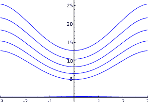

**练习 39**（可分离方程）。求下列可分离方程在 $\mathbb{R}$ 中的解：

1. $(E_1):\quad \dfrac{w y'}{\sqrt{1+y^2}} = \sin(x);$
2. $(E_2):\quad y' = \dfrac{\sin(x)}{\cos(y)}.$

**齐次方程。** 我们要求解微分方程 $x y' = y + \sqrt{y^2+x^2}$，它是齐次的，因为

$$\frac{dy}{dx}=\frac{y+\sqrt{y^2+x^2}}{x}=\frac{N(y,x)}{M(y,x)},$$

且 $N(ky,kx)=kN(y,x)$，$M(ky,kx)=kM(y,x)$。

对于所有实数 $x$，我们只需引入变量替换 $y(x)=x\cdot u(x)$ 即可得到一个可分离方程。

```sage
sage: u = function('u')(x)
sage: y = x*u
sage: DE = x*diff(y,x) == y + sqrt(x**2 + y**2)
```

让我们在初始微分方程中进行变量替换。由于该方程在 0 处无定义，我们首先在 $]0,+\infty[$ 上求解，然后在 $]-\infty,0[$ 上求解。

```sage
sage: assume(x>0)
sage: desolve(DE, u)
x == -_C*e^arcsinh(u(x))
```

我们没有显式得到 $u$。因此我们使用 Maxima 的 `ev` 命令（即 `evaluate`），并设置 `logarc=True`，以便将反双曲函数用作对数；然后 $u$ 将通过 `solve` 命令表示出来：


```text
sage: S = dsolve(DE,u)._maxima_().ev(logarc=True).sage().solve(u); S
[u(x) == -(sqrt(u(x)^2 + 1)*_C - x)/_C]
```

这里，S 是一个包含单个方程的列表；因此 S[0] 就是该方程本身。
这里我们可以观察到，该方程仍然是隐式求解的，因此我们将请 Sage 求解等价的方程：

$$c^2(u^2 + 1) = (x - uc)^2,$$

通过

```text
sage: solu = (x-S[0]*c)^2; solu
(_C*u(x) - x)^2 == (u(x)^2 + 1)*_C^2
sage: sol = solu.solve(u); sol
[u(x) == -1/2*(_C^2 - x^2)/(_C*x)]
```

然后我们只需回到 $u$：

```text
sage: y(x) = x*sol[0].rhs(); y(x)
-1/2*(_C^2 - x^2)/_C
```

下面就是显式解！

$$y(x) = \frac{x^2 - c^2}{2c}.$$

然后我们在 $]0,+\infty[$ 上绘制这些解，记住 $_C$ 必须是一个非零常数。

```text
sage: c = y(x).variables()[0]
sage: P = Graphics()
sage: for k in range(-19,19,2):
.....:     P += plot(y(x).substitute(c == 1/k), x, 0, 3)
sage: P
```

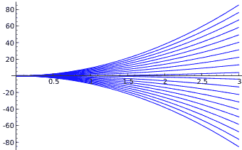

**练习 40**（齐次微分方程）。在 $\mathbb{R}$ 上求解以下齐次方程：$(E_5):\ xy' = x^2 + y^2.$

##### 一个参数方程：Verhulst 方程

种群的相对增长率是种群规模的线性递减函数。为了研究这一点，可以尝试求解如下形式的方程：

$$ y' = ay - by^2 $$

其中 $a$ 和 $b$ 是正实参数。

```text
sage: x = var('x'); y = function('y')(x); a, b = var('a, b')
sage: DE = diff(y,x) - a*y == -b*y**2
sage: sol = desolve(DE, [y,x]); sol
-(log(b*y(x) - a) - log(y(x)))/a == _C + x
```

像往常一样，我们并没有显式地得到 $y$。让我们尝试用 solve 将其分离出来：

```text
sage: Sol = solve(sol, y)[0]; Sol
log(y(x)) == _C*a + a*x + log(b*y(x) - a)
```

我们仍然没有得到显式解。我们将左侧的各项合并，并使用 simplify_log() 化简这个表达式：

```text
sage: Sol = Sol.lhs() - Sol.rhs(); Sol(x)
-_C*a - a*x - log(b*y(x) - a) + log(y(x))
sage: Sol = Sol.simplify_log(); Sol(x)
-_C*a - a*x + log(y(x)/(b*y(x) - a))
sage: solve(Sol, y)[0].simplify()
y(x) == a*e^(_C*a + a*x)/(b*e^(_C*a + a*x) - 1)
```

#### 10.1.3 二阶方程

**常系数线性常微分方程。** 现在让我们求解一个常系数二阶线性常微分方程，例如：

$$ y'' + 3y = x^2 - 7x + 31 $$

这里我们使用与一阶方程相同的语法，$y$ 关于 $x$ 的二阶导数通过 diff(y, x, 2) 得到。

```text
sage: x = var('x'); y = function('y')(x)
sage: DE = diff(y,x,2)+3*y == x^2-7*x+31
sage: desolve(DE, y).expand()
1/3*x^2 + _K2*cos(sqrt(3)*x) + _K1*sin(sqrt(3)*x) - 7/3*x + 91/9
```

让我们添加初始条件，例如 $y(0) = 1$ 和 $y'(0) = 2$：

```text
sage: desolve(DE, y, ics=[0,1,2]).expand()
1/3*x^2 + 13/9*sqrt(3)*sin(sqrt(3)*x) - 7/3*x - 82/9*cos(sqrt(3)*x) + 91/9
```

或 $y(0) = 1$ 和 $y(-1) = 0$：

```text
sage: desolve(DE, y, ics=[0,1,-1,0]).expand()
1/3*x^2 - 7/3*x - 82/9*cos(sqrt(3))*sin(sqrt(3)*x)/sin(sqrt(3))
+ 115/9*sin(sqrt(3)*x)/sin(sqrt(3)) - 82/9*cos(sqrt(3)*x) + 91/9
```

即

$$\frac{1}{3}x^2-\frac{7}{3}x-\frac{82\sin(\sqrt{3}x)\cos(\sqrt{3})}{9\sin(\sqrt{3})}+\frac{115\sin(\sqrt{3}x)}{9\sin(\sqrt{3})}-\frac{82}{9}\cos(\sqrt{3}x)+\frac{91}{9}.$$

##### 如何求解偏微分方程：热方程

接下来我们将研究著名的热方程。温度 $z$ 在长度为 $\ell$ 的均匀直杆中按如下方程分布（其中 $x$ 是沿杆的横坐标，$t$ 是时间）：

$$\frac{\partial^2 z}{\partial x^2}(x,t)=C\frac{\partial z}{\partial t}(x,t).$$

将在以下初始条件下研究该方程：

$$\forall t\in\mathbb{R}^+,\quad z(0,t)=0\quad z(\ell,t)=0\quad \forall x\in]0,\ell[,\quad z(x,0)=1.$$

我们将寻找如下形式的非零解：

$$z(x,t)=f(x)g(t).$$

这就是分离变量法。

```text
sage: x, t = var('x, t'); f = function('f')(x); g = function('g')(t)
sage: z = f*g
sage: eq(x,t) = diff(z,x,2) == diff(z,t); eq(x,t)
g(t)*diff(f(x), x, x) == f(x)*diff(g(t), t)
```

方程因此变为：

$$g(t)\frac{d^2f(x)}{dx^2}=f(x)\frac{dg(t)}{dt}.$$

让我们除以 $f(x)g(t)$，并假设其不为零：

```text
sage: eqn = eq/z; eqn(x,t)
diff(f(x), x, x)/f(x) == diff(g(t), t)/g(t)
```

于是我们得到一个方程，其中每一边只依赖于一个变量：

$$\frac{1}{f(x)}\frac{d^2f(x)}{dx^2}=\frac{1}{g(t)}\frac{dg(t)}{dt}.$$

因此每一边都只能是常数。让我们分离方程并引入常数 $k$：

```text
sage: k = var('k')
sage: eq1(x,t) = eqn(x,t).lhs() == k; eq2(x,t) = eqn(x,t).rhs() == k
```

我们分别求解这些方程，从第二个方程开始：

```text
sage: g(t) = desolve(eq2(x,t), g(t)); g(t)
_C*e^(k*t)
```

因此 $g(t)=ce^{kt}$，其中 $c$ 是常数。对于第一个方程，我们不能直接求解：

```text
sage: desolve(eq1,[f,x])
Traceback (most recent call last):
  ...
TypeError: ECL says: Maxima asks:
Is k positive, negative, or zero?
```

让我们使用 assume 机制：

```text
sage: assume(k>0); desolve(eq1,[f,x])
_K1*e^(sqrt(k)*x) + _K2*e^(-sqrt(k)*x)
```

即 $f(x)=k_1e^{\sqrt{k}x}+k_2e^{-\sqrt{k}x}$。

#### 10.1.4 拉普拉斯变换

拉普拉斯变换将带初始条件的微分方程转换为代数方程，而逆变换则使得回到微分方程的解成为可能。

如果 $f$ 是定义在 $\mathbb{R}$ 上且在 $]-\infty,0[$ 上恒为零的函数，我们称由下式（在一定条件下）定义的函数 $F$ 为 $f$ 的拉普拉斯变换：

$$\mathcal{L}(f(x))=F(s)=\int_0^{+\infty}e^{-sx}f(x)\,dx.$$

拉普拉斯变换可以很容易地从多项式、三角函数、指数函数等得到。这些变换具有非常有趣的性质，特别是关于导数的变换：如果 $f'$ 是 $\mathbb{R}_+$ 上的分段连续函数，那么

$$\mathcal{L}(f'(x))=s\mathcal{L}(f(x))-f(0),$$

并且如果 $f'$ 满足施加于 $f$ 的条件：

$$\mathcal{L}(f''(x))=s^2\mathcal{L}(f(x))-sf(0)-f'(0).$$

**例。** 我们想使用拉普拉斯变换求解微分方程 $y''-3y'-4y=\sin(x)$，初始条件为：$y(0)=1$ 和 $y'(0)=-1$。于是：

$$\mathcal{L}(y''-3y'-4y)=\mathcal{L}(\sin(x)),$$

即：

$$ (s^2-3s-4)\mathcal{L}(y)-sy(0)-y'(0)+3y(0)=\mathcal{L}(\sin(x)).$$

如果我们忘记了最常见函数的拉普拉斯变换，可以使用 Sage：

```text
sage: x, s = var('x, s'); f = function('f')(x)
sage: f(x) = sin(x); f.laplace(x,s)
x |--> 1/(s^2 + 1)
```

于是我们得到 $y$ 的拉普拉斯变换的一个表达式：

$$\mathcal{L}(y)=\frac{1}{(s^2-3s-4)(s^2+1)}+\frac{s-4}{s^2-3s-4}.$$

让我们使用 Sage 求逆变换：

```text
sage: X(s) = 1/(s^2-3*s-4)/(s^2+1) + (s-4)/(s^2-3*s-4)
sage: X(s).inverse_laplace(s, x)
3/34*cos(x) + 1/85*e^(4*x) + 9/10*e^(-x) - 5/34*sin(x)
```

如果想“作弊”，可以先将 $X(s)$ 分解为部分分式：

```text
sage: X(s).partial_fraction()
1/34*(3*s - 5)/(s^2 + 1) + 9/10/(s + 1) + 1/85/(s - 4)
```

剩下的就是查逆变换表。不过，我们可以使用黑箱 `desolve_laplace`，它会直接给出解：

```text
sage: x = var('x'); y = function('y')(x)
sage: eq = diff(y,x,x) - 3*diff(y,x) - 4*y - sin(x) == 0
sage: desolve_laplace(eq, y)
1/85*(17*y(0) + 17*D[0](y)(0) + 1)*e^(4*x) + 1/10*(8*y(0)
 - 2*D[0](y)(0) - 1)*e^(-x) + 3/34*cos(x) - 5/34*sin(x)
sage: desolve_laplace(eq, y, ics=[0,1,-1])
3/34*cos(x) + 1/85*e^(4*x) + 9/10*e^(-x) - 5/34*sin(x)
```

#### 10.1.5 线性微分方程组

**一阶线性微分方程组的一个简单例子。** 我们想求解以下线性微分方程组

$$\begin{cases} y'(x)=A\cdot y(x) \\ y(0)=c \end{cases}$$

已知

$$A=\begin{bmatrix}2&-2&0\\-2&0&2\\0&2&2\end{bmatrix},\qquad y(x)=\begin{bmatrix}y_1(x)\\y_2(x)\\y_3(x)\end{bmatrix},\qquad c=\begin{bmatrix}2\\1\\-2\end{bmatrix}.$$

我们编写：

```text
sage: x = var('x'); y1 = function('y1')(x)
sage: y2 = function('y2')(x); y3 = function('y3')(x)
sage: y = vector([y1, y2, y3])
sage: A = matrix([[2,-2,0],[-2,0,2],[0,2,2]])
sage: system = [diff(y[i], x) - (A * y)[i] for i in range(3)]
sage: desolve_system(system, [y1, y2, y3], ics=[0,2,1,-2])
```


```text
[y1(x) == e^(4*x) + e^(-2*x),
y2(x) == -e^(4*x) + 2*e^(-2*x),
y3(x) == -e^(4*x) - e^(-2*x)]
```

这里初始条件的语法为：`ics = [x0,y1(x0),y2(x0),y3(x0)]`。

##### 一个具有复特征值的矩阵

现在考虑

$$A=\begin{bmatrix}3&-4\\1&3\end{bmatrix},\qquad c=\begin{bmatrix}2\\0\end{bmatrix}.$$

使用 Sage：

```python
sage: x = var('x'); y1 = function('y1')(x); y2 = function('y2')(x)
sage: y = vector([y1,y2])
sage: A = matrix([[3,-4],[1,3]])
sage: system = [diff(y[i], x) - (A * y)[i] for i in range(2)]
sage: desolve_system(system, [y1, y2], ics=[0,2,0])
[y1(x) == 2*cos(2*x)*e^(3*x), y2(x) == e^(3*x)*sin(2*x)]
```

即：

$$\begin{cases}y_1(x)=2\cos(2x)e^{3x}\\y_2(x)=\sin(2x)e^{3x}.\end{cases}$$

##### 一个二阶系统

我们想求解以下系统

$$\begin{cases}y_1''(x)-2y_1(x)+6y_2(x)-y_1'(x)-3y_2'(x)=0\\y_2''(x)+2y_1(x)-6y_2(x)-y_1'(x)+y_2'(x)=0.\end{cases}$$

通过令

$$u=(u_1,u_2,u_3,u_4)=(y_1,y_2,y_1',y_2').$$

我们将其化为一个一阶系统。于是得到：

$$\begin{cases}u_1'=u_3\\u_2'=u_4\\u_3'=2u_1-6u_2+u_3+3u_4\\u_4'=-2u_1+6u_2+u_3-u_4.\end{cases}$$

即 $u'(x)=A\cdot u(x)$，其中

$$A=\begin{bmatrix}0&0&1&0\\0&0&0&1\\2&-6&1&3\\-2&6&1&-1\end{bmatrix}.$$

使用 Sage：

```sage
sage: x = var('x'); u1 = function('u1')(x); u2 = function('u2')(x)
sage: u3 = function('u3')(x); u4 = function('u4')(x)
sage: u = vector([u1,u2,u3,u4])
sage: A = matrix([[0,0,1,0],[0,0,0,1],[2,-6,1,3],[-2,6,1,-1]])
sage: system = [diff(u[i], x) - (A*u)[i] for i in range(4)]
sage: sol = desolve_system(system, [u1, u2, u3, u4])
```

我们将只考虑前两个坐标，因为我们需要 $y_1$ 和 $y_2$，即 $u_1$ 和 $u_2$：

```sage
sage: sol[0]
u1(x) == 1/12*(2*u1(0) - 6*u2(0) + 5*u3(0) + 3*u4(0))*e^(2*x)
+ 1/24*(2*u1(0) - 6*u2(0) - u3(0) + 3*u4(0))*e^(-4*x) + 3/4*u1(0)
+ 3/4*u2(0) - 3/8*u3(0) - 3/8*u4(0)
sage: sol[1]
u2(x) == -1/12*(2*u1(0) - 6*u2(0) - u3(0) - 3*u4(0))*e^(2*x)
- 1/24*(2*u1(0) - 6*u2(0) - u3(0) + 3*u4(0))*e^(-4*x) + 1/4*u1(0)
+ 1/4*u2(0) - 1/8*u3(0) - 1/8*u4(0)
```

可以更简洁地概括为：

$$\begin{cases} y_1(x)=k_1 e^{2x}+k_2 e^{-4x}+3k_3 \\ y_2(x)=k_4 e^{2x}-k_2 e^{-4x}+k_3 \end{cases}$$

其中 $k_1$、$k_2$、$k_3$ 和 $k_4$ 是取决于初始条件的参数。

### 10.2 递推关系

#### 10.2.1 递推 $u_{n+1}=f(u_n)$

**定义。** 设 $u_{n+1}=f(u_n)$ 是一个递推关系，其中 $u_0=a$。我们可以通过递归算法自然地定义该关系。例如，考虑逻辑斯谛映射（由 $x_{n+1}=r x_n(1-x_n)$ 定义）：

$$ f : x \mapsto 3.83 \cdot x \left(1 - \frac{x}{100000}\right) \quad \text{and} \quad u_0 = 20000. $$

使用 Sage：

```sage
sage: x = var('x'); f = function('f')(x)
sage: f(x) = 3.83*x*(1 - x/100000)
sage: def u(n):
....:     if n==0: return(20000)
....:     else: return f(u(n-1))
```

可能更倾向于使用迭代定义：

```sage
sage: def v(n):
....:     V = 20000;
....:     for k in [1..n]:
....:         V = f(V)
....:     return V
```

| 类别 | 命令/说明 |
|---|---|
| **微分方程** | |
| 变量声明 | `x=var('x')` |
| 函数声明 | `y=function('y')(x)` |
| 求解方程 | `desolve(equation, y, <options>)` |
| 求解系统 | `desolve_system([eq1, ...], [y1, ...], <options>)` |
| 一阶初始条件 | `[x₀, y(x₀)]` |
| 二阶初始条件 | `[x₀, y(x₀), x₁, y(x₁)]` 或 `[x₀, y(x₀), y'(x₀)]` |
| 系统初始条件 | `[x₀, y₁(x₀), y₂(x₀), ...]` |
| 自变量 | `ivar=x` |
| 求解方法 | `show_method=True` |
| 调用特殊方法 | `contrib_ode=True` |
| **拉普拉斯变换** | |
| *f* 的拉普拉斯变换：*x* ↦ *f(x)* | `f.laplace(x,s)` |
| *X(s)* 的逆变换 | `X(s).inverse_laplace(s,x)` |
| 用拉普拉斯变换求解 ODE | `desolve_laplace(equation,function)` |
| **其他命令** | |
| 一阶导数 | `diff(y,x)` |
| 展开表达式 | `expr.expand()` |
| 获取变量 | `expr.variables()` |
| 变量替换 | `expr.substitute(var==val)` |

表 10.1 – 求解微分方程的有用命令。

**图形表示。** 让我们绘制 $(k, u_k)$ 的坐标：

```sage
sage: def cloud(u,n):
....:     L = [[0,u(0)]]
....:     for k in [1..n]:
....:         L += [[k,u(k)]]
....:     points(L).show()
```

从下图可以假设存在三个极限点：

```sage
sage: cloud(u,50)
```

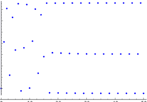

可能更倾向于使用包含第一角平分线和 $f$ 的代表曲线的表示。由于 Sage 原生不支持这种表示，我们将构建一个小过程来完成这项工作：

```python
sage: def snail(f,x,u0,n,xmin,xmax):
....:     u = u0
....:     P = plot(x, x, xmin, xmax, color='gray')
....:     for i in range(n):
....:         P += line([[u,u], [u,f(u)], [f(u),f(u)]], color = 'red')
....:         u = f(u)
....:     P += f.plot(x, xmin, xmax, color='blue')
....:     P.show()
```

例如，对于同一关系：

```python
sage: f(x) = 3.83*x*(1 - x/100000)
sage: snail(f,x,20000,100,0,100000)
```

三个极限点被突出显示：

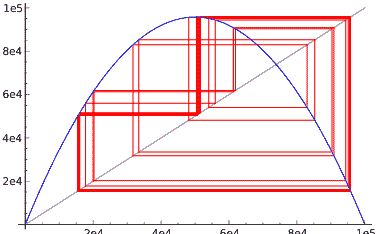

#### 10.2.2 有理系数线性递推

Sage 处理以下类型的关系：

$$a_k u_{n+k} + a_{k-1}u_{n+k-1} + \cdots + a_1u_{n+1} + a_0u_n = 0,$$

其中 $(a_i)_{0\le i\le k}$ 是有理标量的索引族。

例如，考虑以下关系：

$$u_0=-1,\quad u_1=1,\quad u_{n+2}=\frac{3}{2}u_{n+1}-\frac{1}{2}u_n.$$

众所周知的函数 `rsolve` 不能直接访问。必须从 SymPy 中引入，这带来一些不便，例如声明变量时语法变化。例如，这里需要一段前导代码：

```sage
sage: from sympy import Function
sage: from sympy.abc import n
sage: u = Function('u')
```

然后必须将递推关系定义为：$a_k u_{n+k}+\cdots+a_0u_n=0$。这里 $u_{n+2}-\frac{3}{2}u_{n+1}+\frac{1}{2}u_n=0$：

```sage
sage: f = u(n+2)-(3/2)*u(n+1)+(1/2)*u(n)
```

最后，我们使用 `rsolve`，注意初始条件如何声明（`u(0):value`、`u(1):value` 等）：

```sage
sage: from sympy import rsolve
sage: rsolve(f, u(n), {u(0):-1,u(1):1})
3 - 4*2**(-n)
```

即 $u_n=3-\frac{1}{2^{n-2}}$。

#### 10.2.3 非齐次线性递推关系

Sage 也处理以下类型的关系：

$$a_k(n)u_{n+k}+a_{k-1}(n)u_{n+k-1}+\cdots+a_1(n)u_{n+1}+a_0(n)u_n=f(n),$$

其中 $(a_i)_{0\le i\le k}$ 是 $n$ 的多项式、有理或超几何函数的索引族。

命令将取决于 $f(n)$ 的性质：

- 如果 $f$ 是多项式，则用 `rsolve_poly`；
- 如果 $f$ 是有理函数，则用 `rsolve_ratio`；
- 如果 $f$ 是超几何函数，则用 `rsolve_hyper`。

系数 $a_i(n)$ 以列表 $[a_0(n),\ldots,a_{k-1}(n),a_k(n)]$ 给出。例如，为了研究归并排序的复杂度，必须研究以下关系：

$$u_{n+1}=2u_n+2^{n+2},\quad u_0=0.$$

计算得到：

```python
sage: from sympy import rsolve_hyper
sage: from sympy.abc import n
sage: rsolve_hyper([-2,1],2**(n+2),n)
2**n*C0 + 2**(n + 2)*(C0 + n/2)
```

并且由于 $u_0=0$ 给出 $C0=0$，我们得到 $u_n=n\cdot 2^{n+1}$。

# 第三部分

# 数值计算

## 11 浮点数

在接下来的章节中，浮点数是所有计算的核心。有必要研究它们，因为它们的行为遵循精确的规则。

我们如何在计算机中表示实数？一般来说，这些数无法用有限的信息量编码，因此无法精确表示。必须使用有限的内存来近似表示它们。

围绕用有限信息量近似表示实数，出现了一个标准：浮点表示。

在本章中，读者将找到：浮点数的基本描述、Sage 中可用的不同类型浮点数，以及它们某些性质的演示。示例将展示使用浮点数计算时遇到的一些困难以及一些规避技巧。我们希望读者能养成必要的谨慎态度。最后，我们将尝试描述数值方法在使用这些数时必须满足的一些性质。

要进一步深入，读者应参考 [BZ10] 和 [Gol91]（可在互联网上获取）或书籍 [MBdD+10]。

### 11.1 引言

#### 11.1.1 定义

浮点数集合 $F(\beta,r,m,M)$ 由四个参数定义：基数 $\beta \ge 2$、位数 $r$ 以及两个带符号整数 $m$ 和 $M$。$F(\beta,r,m,M)$ 的元素是如下形式的数

$$x = (-1)^s 0.d_1d_2\ldots d_r \cdot \beta^j,$$


### 11.2 浮点数

Sage提供两类浮点数：

- 1. 如§11.1.3所述的“双精度”数字：这些数字由计算机的处理器提供；在Sage中，它们属于类RDF：

```
sage: xrdf = RDF(3.0)
```

- 2. 具有任意精度的浮点数：类RealField —— 或`RR` —— 的每个实例都定义了一组具有给定精度（也可能具有给定的舍入模式：见§11.3.2）的浮点数。例如，要声明一个精度为100个二进制位的数字x100，可以这样写：

```
sage: R100 = RealField(100) # precision: 100 bits.
sage: x100 = R100(3/8); x100
0.375000000000000000000000000000
```

在集合RealField(p)中，数字的形式为

\((-1)^s 0.d_1d_2 \ldots d_p \cdot 2^e,\)

其中s ∈ {0,1}；有效数有p个二进制位，e可能有30个二进制位（在某些计算机上可能更多）。有一个隐含的精度可用：

```
sage: Rdefault = RealField() # default precision of 53 bits
sage: xdefault = Rdefault(2/3)
```

并且可以使用prec()方法检查所有浮点数的精度：

```
sage: xrdf.prec()
53
sage: x100.prec()
100
sage: xdefault.prec()
53
```

因此，集合RealField()中的数字与集合RDF中的数字具有相同的精度，但RealField()允许更大的指数。精度为53位的集合RealField()是Sage中“实数”的默认类型：

```
sage: x = 1.0; type(x)
<type 'sage.rings.real_mpfr.RealLiteral'>
sage: x.prec()
53
```

这里，real_mpfr.RealLiteral意味着x所属的数字集合由GNU MPFR库实现。让我们回想一下，变量的类型由赋值语句右侧自动定义：

```
sage: x = 1.0        # x belongs to RealField()
sage: x = 0.1e+1     # idem: x belongs to RealField()
sage: x = 1          # x is an integer
sage: x = RDF(1)      # x is a machine double-precision number
sage: x = RDF(1.)     # idem: x is a machine double-precision number
sage: x = RDF(0.1e+1) # idem
sage: x = 4/3         # x is a rational number
sage: R = RealField(20)
sage: x = R(1)        # x is a 20-bit floating-point number
```

并且会自动执行有理数的自然转换：

```
sage: RDF(8/3)
2.6666666666666665
sage: R100 = RealField(100); R100(8/3)
2.666666666666666666666666666667
```

如同不同浮点数集合之间的转换：

```
sage: x = R100(8/3)
sage: R = RealField(); R(x)
2.666666666666667
sage: RDF(x)
2.6666666666666665
```

不同的浮点数集合包含特殊值+0、-0、+infinity、-infinity和NaN¹：

```
sage: 1.0/0.0
+infinity
sage: RDF(1)/RDF(0)
+infinity
sage: RDF(-1.0)/RDF(0.)
-infinity
```

¹这些结果遵循IEEE-754标准。

特殊值NaN表示未定义的结果：

```
sage: 0.0/0.0
NaN
sage: RDF(0.0)/RDF(0.0)
NaN
```

#### 11.2.1 应该选择哪种浮点数？

任意精度浮点数允许我们以非常大的精度进行计算，而RDF数字的精度是固定的。使用RealField(n)数字进行计算时，使用GNU MPFR软件库；而RDF数字的计算则使用处理器的浮点运算，速度要快得多。在§13.2.10中，我们给出了一个比较，其中

| x | R2(x).ulp() | RDF(x).ulp() | R100(x).ulp() |
|---|---|---|---|
| 10^{-30} | 3.9e-31 | 1.75162308041e-46 | 1.2446030555722283414288128108e-60 |
| 10^{-10} | 2.9e-11 | 1.29246970711e-26 | 9.1835496157991211560057541970e-41 |
| 10^{-3} | 0.00049 | 2.168404344971e-19 | 1.5407439555097886824447823541e-33 |
| 1 | 0.50 | 2.220446049250e-16 | 1.577721810442036102845734136e-30 |
| 10^{3} | 510. | 1.13686837722e-13 | 8.077935669463160887416100505e-28 |
| 10^{10} | 4.3e9 | 1.90734863281e-06 | 1.355252715606880542509316001e-20 |
| 10^{30} | 3.2e29 | 1.40737488355e+14 | 1.000000000000000000000000000000 |

表11.1 - 浮点数之间的距离。

**R2，一个玩具浮点数集合。** 除了在大精度计算中必不可少外，任意精度浮点数还使我们能够定义一类浮点数；由于精度非常低，这类数能从外部展示浮点数的性质；精度为2位的数集R2：

```
sage: R2 = RealField(2)
```

### 11.3 浮点数的一些性质

#### 11.3.1 这些集合布满空隙

在每个浮点数集合中，ulp()方法（*末位单位*）返回一个可表示数字到下一个可表示数字（朝远离零的方向）的距离：

```
sage: x2 = R2(1.); x2.ulp()
0.50
sage: xx = 1.; xx.ulp()
2.22044604925031e-16
```

读者可以很容易地验证x2.ulp()给出的值。

表11.1给出了对于不同的数字集合（R100是集合RealField(100)）和不同的x值，将给定数字x —— 或者更准确地说，R(x)，其中R是所考虑的集合 —— 与其最近邻（朝远离零的方向）分开的区间大小。

正如所料，两个连续数字之间的空隙大小随着数字的绝对值增大而增大。

练习41（一个有点令人惊讶的值）。证明R100(10^30).ulp()恰好等于1.000000000000000000000000000000。

#### 11.3.2 舍入

如何逼近一个在浮点数集合中无法精确表示的数字？定义舍入有几种不同的可能性：

- 朝最近可表示数字的方向：这就是集合`RDF`所做的，也是`RealField`创建的集合的默认行为。当一个数字正好位于两个可表示数字中间时，舍入在最近的偶数有效数上进行；

- 朝−∞的方向：要获得具有p位精度的这种行为，使用`RealField(p,rnd='RNDD')`；

- 朝零的方向：`RealField(p,rnd='RNDZ')`；

- 朝+∞的方向：`RealField(p,rnd='RNDU')`。

#### 11.3.3 一些性质

舍入对于浮点数集合来说是必要的，它会引发许多意想不到的效应。让我们探讨其中一些：

**一个危险的现象。** 被称为*灾难性抵消*，它是两个非常接近的数字相减导致的精度损失；更准确地说，它是误差的放大：

```
sage: a = 10000.0; b = 9999.5; c = 0.1; c
0.100000000000000
sage: a1 = a+c # add a small perturbation to a.
sage: a1-b
0.600000000000364
```

这里，在*a*上引入的误差*c*使计算不精确（最后3位是错误的）。

**应用：二次方程的根。** 即使是计算二阶方程的根也可能引起问题。让我们考虑 *a* = 1，*b* = 10^4，*c* = 1 的情况：

```
sage: a = 1.0; b = 10.0^4; c = 1.0
sage: delta = b^2-4*a*c
sage: x = (-b-sqrt(delta))/(2*a); y = (-b+sqrt(delta))/(2*a)
sage: x, y
(-9999.99990000000, -0.000100000001111766)
```

根的和是正确的，但它们的积不正确：

```
sage: x+y+b/a
0.000000000000000
sage: x*y-c/a
1.11766307320238e-9
```

该误差源于*灾难性抵消*现象，它出现在我们将`-b`和`sqrt(delta)`相加来计算`y`的过程中。这里，我们可以尝试为`y`找到更好的近似值：

```
sage: y = (c/a)/x; y
-0.00010000000000000000
sage: x+y+b/a
0.00000000000000000000
sage: x*y-c/a
-1.11022302462516e-16
```

我们可以注意到，由于舍入，根的和保持正确，但积更接近`c/a`。读者可以考虑对`a`、`b`和`c`的所有不同选择，从而相信编写一个数值稳健的程序来计算二次三项式的根绝非易事。

**浮点数集合不是加法群。** 实际上，加法不满足结合律。让我们使用集合R2（精度为2位）：

```
sage: x1 = R2(1/2); x2 = R2(4); x3 = R2(-4)
sage: x1, x2, x3
(0.50, 4.0, -4.0)
sage: x1+(x2+x3)
0.50
sage: (x1+x2)+x3
0.00
```

我们可以推断，程序中不同的计算顺序对结果有一定影响！

**浮点数的递推与序列。** 考虑递推式 \(u_{n+1}=4u_n-1\)。如果 \(u_0=1/3\)，该序列是平稳的：对所有 \(i\)，\(u_i=1/3\)。

```
sage: x = RDF(1/3)
sage: for i in range(1,100): x = 4*x-1; print(x)
0.333333333333
0.333333333333
0.333333333333
...
-1.0
-5.0
-21.0
-85.0
-341.0
-1365.0
-5461.0
```

²感谢Marc Délèglise（法国里昂卡米耶·儒尔当研究所）提供这个例子。


```
-21845.0
⋮
⋮
```

计算出的序列发散了！我们可以观察到这种行为是自然的，因为这是一个经典的不稳定现象：\(u_0\) 上的每个误差在每次迭代时都会乘以 4，而我们知道浮点运算会引入舍入误差，这些误差在每次迭代时都会被放大。

现在，让我们计算递推 \(u_{n+1}=3u_n-1\)，其中 \(u_0=1/2\)。我们预期会遇到同样的问题：如果精确计算，序列是常数，但每个误差都会在每次迭代时被放大。

```
sage: x = RDF(1/2)
sage: for i in range(1,100): x = 3*x-1; print(x)
0.5
0.5
0.5
⋮
0.5
```

现在，计算出的序列保持常数！我们如何解释这两种不同的行为？让我们看看两种情况中 \(u_0\) 的二进制表示。

对于第一种情况（\(u_{n+1}=4u_n-1\)，\(u_0=1/3\)），我们有：

\[\frac{1}{3}=\frac{1}{4}\sum_{i=0}^{\infty}\frac{1}{4^i}=\frac{1}{4}\sum_{i=0}^{\infty}\frac{1}{2^{2i}},\]

因此 \(1/3\) 不能在我们可用的浮点数集合中精确表示。邀请本书读者在例如 `RealField(1000)` 这样的高精度集合中重复前面的计算，以验证计算出的序列总是发散的。让我们注意，如果在第一个程序中，将行

```
sage: x = RDF(1/3)
```

替换为

```
sage: x = 1/3
```

那么计算将在有理数中进行，迭代值将保持等于 \(1/3\)。在第二种情况（\(u_{n+1}=3u_n-1\)，\(u_0=1/2\)）中，\(u_0\) 和 \(3/2\) 在二进制下分别为 0.1 和 1.1；因此，在不同浮点数集合中唯一无舍入精确表示的值是：计算是精确的，序列保持常数。

下面的练习表明，编码在浮点数集合中的序列可能收敛到错误的极限。

**练习 42**（Jean-Michel Muller 的一个例子）。我们考虑序列（参见 [MBdD⁺10, 第9页]）：

\[u_n=111-\frac{1130}{u_{n-1}}+\frac{3000}{u_{n-1}u_{n-2}}.\]

可以证明通解形式为：

\[u_n=\frac{\alpha 100^{n+1}+\beta 6^{n+1}+\gamma 5^{n+1}}{\alpha 100^n+\beta 6^n+\gamma 5^n}.\]

- 1. 选择 \(u_0=2\) 和 \(u_1=-4\)：\(\alpha\)、\(\beta\) 和 \(\gamma\) 的值是多少？序列收敛到哪个极限？
- 2. 编写一个程序，在集合 `RealField()`（或 RDF）中计算该序列（仍取 \(u_0=2\) 和 \(u_1=-4\)）。我们能观察到什么？
- 3. 解释这种行为。
- 4. 在例如 `RealField(5000)` 的高精度下进行同样的计算。评论结果。
- 5. 递推现在定义在 \(\mathbb{Q}\) 中。在有理数集合中编程实现并评论结果。

##### 数值级数的求和

我们考虑一个正项通项为 \(u_n\) 的数值级数。部分和 \(\sum_{i=0}^m u_i\) 在浮点数集合中的计算会受到舍入误差的扰动。读者可以验证：如果当 \(n\) 趋于无穷时 \(u_n\) 趋于 0，并且部分和保持在可表示数的区间内，那么经过某一阶 \(m\) 之后，带舍入计算的序列 \(\sum_{i=0}^m u_i\) 是平稳的。简而言之，在浮点数的世界里，生活很简单：正项且趋于 0 的级数会收敛，只要部分和增长得不太多！

例如，让我们看看通项为 \(u_n=1/n\) 的调和（发散）级数：

```sage
sage: def sumharmo(p):
....:     RFP = RealField(p)
....:     y = RFP(1.); x = RFP(0.); n = 1
....:     while x <> y:
....:         y = x; x += 1/n; n += 1
....:     return p, n, x
```

让我们用不同的精度 \(p\) 测试这个函数：

```sage
sage: sumharmo(2)
(2, 5, 2.0)
sage: sumharmo(20)
(20, 131073, 12.631)
```

读者可以用纸和笔验证，在我们的玩具浮点数集合 \(\mathbb{R}_2\) 中，该函数在 5 次迭代后收敛到值 2.0。显然，结果取决于精度 \(p\)，读者也可以（仍然用笔……）验证：对于 \(n > \beta^p\)，计算出的和是平稳的。但是，要小心！在默认精度 53 位且每秒进行 \(10^9\) 次运算的情况下，达到平稳值可能需要 \(2^{53}/10^9/3600\) 小时，即大约 104 天！

##### 改进某些递推的计算

稍加小心，就有可能改进某些结果：这里有一个有用的例子。

经常会遇到如下形式的递推：

\[y_{n+1}=y_n+\delta_n,\]

其中数 $δ_n$ 与 $y_n$ 相比绝对值很小；例如，可以想到通过积分天体力学常微分方程来模拟太阳系：大数值（距离、速度）在长时间内经历非常小的扰动 [HLW02]。即使可以精确计算 $δ_n$ 项，在进行加法 $y_{n+1} = y_n + δ_n$ 时的舍入误差也会引入重要误差。

作为例子，考虑由 $y_0 = 10^{13}$、$δ_0 = 1$ 和 $δ_{n+1} = aδ_n$ 定义的序列，其中 $a = 1 - 10^{-8}$。计算 $y_n$ 的标准朴素编程方式是：

```
    sage: def iter(y,delta,a,n):
    ....:     for i in range(0,n):
    ....:         y += delta
    ....:         delta *= a
    ....:     return y
```

由于我们为 $y_0$、$δ_0$ 和 $a$ 选择了有理数值，我们可以用 Sage 计算迭代值的精确值：

```
    sage: def exact(y,delta,a,n):
    ....:     return y*delta*(1-a^n)/(1-a)
```

现在，让我们再次计算 100 000 次迭代，但使用 RDF（例如）中的浮点数，并将结果与精确值进行比较：

```
    sage: y0 = RDF(10^13); delta0 = RDF(1); a = RDF(1-10^(-8)); n = 100000
    sage: ii = iter(y0,delta0,a,n)
    sage: s = exact(10^13,1,1-10^(-8),n)
    sage: print("exact - classical summation: %.1f" % (s-ii))
    exact - classical summation: -45.5
```

现在，这是*补偿求和*算法：

```
    sage: def sumcomp(y,delta,e,n,a):
    ....:     for i in range(0,n):
    ....:         b = y
    ....:         e += delta
    ....:         y = b+e
    ....:         e += (b-y)
    ....:         delta = a*delta # new value of delta
    ....:     return y
```

为了理解该算法的行为，让我们看下面的图示（这里我们遵循 [Hig93] 和 [HLW02] 的表述），其中方框表示数的有效数字。方框的位置表示指数（方框越靠左，其指数越大）：

|  |  |  |
|---|---|---|
| $b = y_n$ | $b_1$ | $b_2$ |
| $e$ | $\epsilon_1$ | $0$ |
| $\delta_n$ | $\delta_1$ | $\delta_2$ |
| $e = e + \delta_n$ | $\delta_1$ | $\epsilon_1 + \delta_2$ |
| $y_{n+1} = b + e$ | $b_1$ | $b_2 + \delta_1$ |
| $e = e + (b - y_{n+1})$ | $\epsilon_1 + \delta_2$ | $0$ |

舍入误差在 $e$ 中累积，$\delta_n$ 的任何数字都没有丢失，而在朴素方法中，记为 $\delta_2$ 的数字从计算中消失了。

让我们用补偿求和方法再次计算前 100 000 次迭代：

```
sage: c = sumcomp(y0,delta0,RDF(0.0),n,a)
sage: print("exact - compensated summation: %.5f" \
      % RDF(s-RR(c).exact_rational()))
exact - compensated summation: -0.00042
```

朴素算法的绝对误差是 $-45.5$，而补偿求和的绝对误差是 $-0.00042$！还应注意，相对误差分别为朴素方法的 $4.55\cdot10^{-12}$ 和补偿求和的 $4.16\cdot10^{-17}$。

#### 11.3.4 复数浮点数

Sage 提供两族复数，它们在计算机中由属于我们上面遇到的集合的浮点数对表示：

- 1. **双精度复数** `ComplexDoubleField`（缩写为 CDF）。这些是形如 $x + i \cdot y$ 的数，其中 $x$ 和 $y$ 都是“双精度”浮点数。它们像这样创建：

```
sage: x = CDF(2,1.); x
2.0 + 1.0*I
sage: y = CDF(20,0); y
20.0
```

或者：

```
sage: z = ComplexDoubleElement(2.,1.); z
2.0 + 1.0*I
```

- 2. **任意精度复数** `ComplexField`——或 `Complexes`。这些是形如 $x + i \cdot y$ 的数，其中 $x$ 和 $y$ 具有相同的 $p$ 位精度。`ComplexField` 类的实例创建一个给定位精度（默认为 53）的集合：

```
sage: C = ComplexField(); C(2,3)
2.000000000000000 + 3.000000000000000*I
sage: C100 = ComplexField(100); C100(2,3)
2.000000000000000000000000000000 + 3.000000000000000000000000000000*I
```


#### 11.3.5 方法

我们已经见过 `prec` 和 `ulp` 方法。我们遇到的不同数集提供了大量方法。让我们给出一些例子：

- 返回常量的方法。示例：

```sage
sage: R200 = RealField(200); R200.pi()
3.1415926535897932384626433832795028841971693993751058209749
sage: R200.euler_constant()
0.57721566490153286060651209008240243104215933593992359880577
```

- 三角函数 sin、cos、arcsin、arccos 等。示例：

```sage
sage: x = RDF.pi()/2; x.cos() # floating-point approximation of zero!
6.123233995736757e-17
sage: x.cos().arccos() - x
0.0
```

- 对数（log、log10、log2 等）、双曲函数及其反函数（sinh、arcsinh、cosh、arccosh 等）。

- 特殊函数（gamma、j0、j1、jn(k) 等）。

读者应查阅 Sage 文档，以获取可用方法（数量非常庞大）的完整列表。我们记得，可以通过以下方式获得该列表：

```sage
sage: x = 1.0; x.<tab>
```

对于每个方法，我们可以通过键入以下内容来获取参数（如果有）和使用示例（这里以欧拉 Γ(x) 函数为例）：

```sage
sage: x.gamma?
```

### 11.4 区间算术与球算术

根据本章上文所解释的内容，应当清楚，浮点数只能让我们计算数值结果的*近似值*，无法提供证明。但事实证明，我们可以计算所求量的严格*包围*。例如，使用浮点数进行计算时，我们通常无法*证明*某个实数 x_0 是某个方程 f(x) = 0 的解，但我们可以*证明*在区间 I = [x, x̄] 中存在解，或者证明在 I 中不存在解。

用于此的工具是*区间算术*和*球算术*。

- 给定浮点数集合 $\mathcal{F}$，实区间（或 inf-sup）算术使用区间 $\mathbf{a} = [a, \overline{a}] = \{x \in \mathbb{R}: a \leq x \leq \overline{a}\}$（其中 $a$ 和 $\overline{a} \in \mathcal{F}$）进行计算。在下文中，我们使用粗体字母表示区间，并采用这样的约定：任何数 $x \in \mathcal{F}$ 都由单点区间 $\mathbf{x} = [x, x]$ 表示。

- 实球算术（或中点-半径区间算术）：这里我们考虑数 $x \in \mathcal{F}$ 以及附加到 $x$ 的误差界；球是形如 $\{y \in \mathbb{R}: x - \varepsilon \leq y \leq x + \varepsilon\}$ 的集合。我们也将使用粗体字母来表示它们。

正如我们稍后将看到的，这些集合族可以扩展到复平面。这里我们只对这一重要领域作非常简短的介绍；感兴趣的读者可以参阅例如 [Tuc11]（我们采用了其中的记号）。

给定实值区间（或实球）$\mathbf{a}$ 和 $\mathbf{b}$，四则运算在实值区间（或实球）中定义如下：

$\mathbf{a} * \mathbf{b} = [a * b \text{ for } a \in \mathbf{a} \text{ and } b \in \mathbf{b}]$,

其中 $*$ 表示 $+, -, \times, \div$ 之一。

注意，如果 $0 \in \mathbf{b}$，则 $\mathbf{a} \div \mathbf{b}$ 尚未定义。为绕过这一点，有必要用无穷值 $\pm\infty$ 扩展 $\mathcal{F}$，并考虑一个或两个方向上的无穷区间。下面的示例表展示了在使用一类实区间进行计算时，对于所有 $0 \in \mathbf{b}$ 的情况所得的结果：

| a | b | 备注 | a ÷ b |
|---|---|---|---|
| [−1, +1] | [−2, +3] | 0 ∈ a | [−无穷 .. +无穷] |
| [−2, −1] | [−1, 0] | a < 0 | [1.0000000000000000 .. +无穷] |
| [−2, −1] | [0, +2] | a < 0 | [−无穷 .. −0.5000000000000000] |
| [+2, +3] | [−3, 0] | 0 < a | [−无穷 .. −0.6666666666666662] |
| [+2, +3] | [0, +4] | a > 0 | [0.5000000000000000 .. +无穷] |
| [−2, −1] | [0] | 0 ∉ a | [−无穷 .. +无穷] |
| [0] | [0] |  | [.. NaN ..] |

在下文中，我们始终假设 $\mathcal{F}$ 包含 $+\infty$ 和 $-\infty$。注意，必须选择舍入模式以保证这些结果：因此，在对区间进行算术运算时，必须始终将结果区间向外舍入。

#### 11.4.1 Sage 中的实现

回想一下，Sage 中有任意精度实数（并且可以使用不同的舍入模式）；那么：

- `RealIntervalField(n)` 是精度为 n 位的实区间的集合。它使用来自 `RealField(n)` 的数对实现。在默认情况下（53 位精度），`RealIntervalField()` 可以缩写为 `RIF`。我们可以从数值表达式创建一个 RIF（或 `RealIntervalField(n)`）对象：

```sage
sage: r3 = RIF(sqrt(3)); r3
1.732050807568877?
sage: print(r3.str(style="brackets"))
[1.732050807568769 .. 1.732050807568775]
```

由于 √3 无法在 RealField() 中精确表示，它由一个包含其精确值的区间表示。打印时，默认使用“问号风格”，即打印数字中“已知正确”的部分，后跟一个问号。问号表示前一位数字可能最多有 ±1 的误差。“方括号”风格打印区间最小值和最大值的外向近似值（边界以二进制存储：打印出来的是分别朝 −∞ 和 +∞ 方向舍入后的边界十进制值）。

使用以下指令，我们将打印风格固定为“方括号”（将 brackets 替换为 question 可回到默认风格）：

```sage
sage: sage.rings.real_mpfi.printing_style = 'brackets'
```

当我们从一个可以在 $\mathcal{F}$ 中精确表示的数创建 RIF 对象时，所创建的区间是单点区间（直径为 0 的区间），正如预期：

```sage
sage: r2 = RIF(2); r2, r2.diameter()
([2.000000000000000 .. 2.000000000000000], 0.000000000000000)
```

我们也可以通过给出两个实数来创建任意大小的区间，结果是包含它们的最小可表示区间：

```sage
sage: rpi = RIF(sqrt(2),pi); rpi
[1.4142135623730949 .. 3.1415926535897936]
sage: RIF(0,+infinity)
[0.000000000000000 .. +infinity]
```

- `RealBallField(n)` 是精度为 n 位的实球的集合。默认情况（53 位精度）下，`RealBallField()` 可以缩写为 `RBF`。一些可用的构造是：

```sage
sage: RBF(pi)
[3.141592653589793 +/- 5.61e-16]
sage: RealBallField(100)(pi)
[3.14159265358979323846264338328 +/- 3.83e-30]
```

注意，与区间类似，可精确表示的数会产生半径为 0 的球：

```sage
sage: RBF(2).rad()
0.00000000
```

##### 区间和球的一些方法

以下方法无需进一步说明：

```sage
sage: si = sin(RIF(pi))
sage: si.contains_zero()
True
sage: sb = sin(RBF(pi))
sage: sb.contains_zero()
True
```

标准函数 exp、sin、cos、arcsin、arccos、sinh、cosh…… 等均已定义，并且存在获取区间中心、区间或球的直径、将一个区间切成两个几乎相等的区间的二分法等方法。注意，区间的中点不一定在 𝓕 中，因此并不总是可能将一个区间切成两个相等的区间。下面是一个极端情况，其中左子区间是单点区间，而右子区间与原区间相同：

```sage
sage: a = RealIntervalField(30)(1, RR(1).nextabove())
sage: a.bisection()
([1.0000000000 .. 1.0000000000], [1.0000000000 .. 1.0000000019])
```

出于同样的原因，中心和直径可能不精确：

```sage
sage: b = RealIntervalField(2)(-1,6)
sage: b.center(), b.diameter()
(2.0, 8.0)
```

也可以从 RealIntervalField() 区间构建 RealBallField() 对象，反之亦然：

```sage
sage: s = RIF(1,2)
sage: b = RBF(s)
sage: bpi = RBF(pi)
sage: ipi = RIF(bpi)
```

但要注意：

```sage
sage: RIF(RBF(RIF(1,2))) == RIF(1,2)
False
sage: RBF(RIF(RBF(pi))) == RBF(pi)
False
```

为什么会这样？原因在于这两个类的实现不同：

- 如上所述，`RealIntervalField(n)` 对象由 `RealField(n)` 数对表示，并依赖 MPFI 库 [RR05]。

- `RealBallField(n)` 对象的实现不同：存储球的中点及其半径，但只有中点以全精度存储。半径由一个具有固定精度有效数字和任意精度指数的浮点数表示。一般来说，半径用几个比特就足够了。Sage 中的实现依赖 Arb 库 [Joh13]。


因此，球算术的计算开销低于下确界-上确界区间算术；甚至在高精度下，其开销也不高于普通浮点算术。

#### 11.4.2 使用实区间和实球进行计算

一旦定义了区间集或球集，就必须定义作用于其上的函数。对于给定的区间（或球）**x**，函数 *f* 在 **x** 上的值域由 *R(f, x)* = {*f(x)* | *x* ∈ **x**} 给出。对于连续函数 *f*，我们只需将其区间扩展 **F(x)** 定义为包含 *R(f, x)* 的最小 区间（或球）**F(x)**。

示例：

```sage
sage: E = RIF(-pi/4,pi)
sage: sin(E)
[-0.70710678118654769 .. 1.0000000000000000]
sage: E = RIF(-1,2); exp(E)
[0.36787944117144227 .. 7.3890560989306505]
sage: E = RIF(0,1); log(E)
[-infinity .. -0.0000000000000000]
```

对于一组*标准函数*（exp、sin、cos、arcsin、arccos、sinh、cosh、……），**F(x)** 会被尽可能精确地计算，并且是 *R(f, x)* 的紧近似。

但是，当我们将标准函数复合，并与算术运算符结合时，情况就不那么显然了。示例：

```sage
sage: E=RIF(-pi,pi)
sage: f = lambda x: sin(x)/x
sage: f(E)
[-infinity .. +infinity]
```

数学家可能会期望得到区间 [0, 1]，并通过连续性将 *s(x) = sin(x)/x* 在 0 处延拓为 1。但区间算术和球算术并不能替代数学分析！实际上，对于区间 **x**，会先计算区间 *s* = sin(**x**)，然后使用上文所述的除法规则计算 *s* ÷ **x**；这就解释了我们得到的结果：sin(x)/x 不属于*标准函数*集合。

我们将*初等函数*集合 *E* 定义为通过算术运算和复合将标准函数、常量和变量组合而得到的函数。例如，考虑 *f(x) = (1 + x²) sin(2x + 1)*：这是一个初等函数。为了对给定区间（或球）**x** 计算 *f* 的扩展 **F(x)**，我们计算 **I₁ = 2x + 1**、**I₂ = 1 + x²**、**I₃ = sin(I₁)**，然后计算 **F(x) = I₂·I₃**（这样的分解通常不唯一）。由此不难推出，对于初等函数 *f*，我们只需有：

*R(f, x)* ⊆ **F(x)**。

此外，函数到区间的扩展常常存在多种可能：例如，考虑实值函数 *f₁(x) = 1 − x²*；我们也可以将其写成 *f₂(x) = 1 − x · x* 或 *f₃(x) = (1 − x) · (1 + x)*。事实证明，这些函数到区间的扩展是不同的。读者可手工验证以下结果：

```sage
sage: x = RIF(-1,1)
sage: 1-x^2
[0.0000000000000000 .. 1.0000000000000000]
sage: 1-x*x
[0.0000000000000000 .. 2.0000000000000000]
sage: (1-x)*(1+x)
[0.0000000000000000 .. 4.0000000000000000]
```

**练习 43.** 解释 `1-x^2` 与 `1-x*x` 的输出为何不同。

#### 11.4.3 一些应用示例

**通过二分法求根。** 设 f : I → ℝ 为连续初等函数。我们希望找出 f 在 I 中的所有零点。更准确地说，我们希望找出（微小的）区间，使它们的并集包含 f 在 I 中的所有零点（并且每个区间只含一个根）。回忆一下，对于区间 x ⊂ I，有 R(f,x) ⊂ F(x)。反之，y ∉ F(x) ⇒ y ∉ R(f,x)。于是我们得到一个简单算法：递归地将 I 切分为子区间，直到达到某个阈值大小；对于任意子区间 s，若 0 ∉ F(s)，就可以丢弃 s，因为我们知道它不可能包含任何根。此外，当二分结束时，若我们知道 f 的导数且导数连续，就可以检查 f 在所有计算出的区间上是否单调，从而获得每个区间仅存在一个根的证明。

示例：在区间 [1/64, 1/32] 中找出 sin(1/x) 的所有根，精度为 100 位（这里使用区间进行计算）：

```sage
sage: def bisect(funct,x,tol,zeros):
....:     if 0 in funct(x):
....:         if x.diameter()>tol:
....:             x1,x2 = x.bisection()
....:             bisect(funct,x1,tol,zeros)
....:             bisect(funct,x2,tol,zeros)
....:         else:
....:             zeros.append(x)
sage: sage.rings.real_mpfi.printing_style = 'question'
sage: fs = lambda x: sin(1/x)
sage: d = RealIntervalField(100)(1/64,1/32)
sage: zeros = []
sage: bisect(fs,d,10^(-25),zeros)
sage: for s in zeros:
....:     s
0.015915494309189533576888377?
0.01675315190441003534409303?
0.01768388256576614848176487?
0.018724110951987685610451487
0.01989436788648691697111047?
0.021220659078919378102517835?
0.022736420441699338126912611?
0.024485375860291590118289809?
0.026525823848649222628147293?
0.02893726238034460650343342?
```

因此，sin(1/x) 在区间 [1/64, 1/32] 中恰好有 10 个根；该计算是一个*证明*。

注意，牛顿法（见第 270 页）可以推广到区间算术 [Tuc11]。

**证明矩阵非奇异。** 考虑大小为 n 的矩阵 M，其元素为 M_{i,j} = (1 + log i)/(i^2 + j^2)：

```sage
sage: def NearlySingularMatrix(R,n):
....:     M=Matrix(R,n,n)
....:     for i in range(0,n):
....:         for j in range(0,n):
....:             M[i,j]= (1+log(R(1+i)))/((1+i)^2+(j+1)^2)
....:     return M
```

固定 n = 35。我们在 RDF 中构造 M 并计算其行列式：

```sage
sage: n=35
sage: NearlySingularMatrix(RDF,n).det()
0.0
```

因此，行列式似乎为零。现在我们使用 RBF 球进行计算：

```sage
sage: NearlySingularMatrix(RBF,n).det().contains_zero()
True
```

由于计算出的球行列式包含零，我们无法断定该矩阵是否奇异。下面使用精度不断提高的球进行计算：

```sage
sage: def tryDet(R,n):
....:     p = 53
....:     z = True
....:     while z:
....:         p += 100
....:         MRF=NearlySingularMatrix(R(p),n)
....:         d = MRF.det()
....:         z = d.contains_zero()
....:     return p,d
sage: tryDet(RealBallField,n)
(1653, [9.552323592707808e-485 +/- 1.65e-501])
```

在 1653 位精度下，我们找到了一个球 $9.552323592707808 \cdot 10^{-485} \pm 1.65 \cdot 10^{-501}$，它包含行列式的精确值，因此 $M$ 的行列式不等于零。我们已经*证明*该矩阵非奇异（注意，更严谨的程序为安全起见，应当对精度 $p$ 上的循环设置上限）。

我们可以用区间进行同样的计算：

```sage
sage: tryDet(RealIntervalField,n)
(1653, 9.552323592707808e-485)
```

这里我们也得到相同结论：$M$ 非奇异。下面比较计算时间：

```sage
sage: time p,d = tryDet(RealBallField,n)
CPU times: user 4.75 s, sys: 12 ms, total: 4.76 s
Wall time: 4.75 s
sage: time p,d = tryDet(RealIntervalField,n)
CPU times: user 6.62 s, sys: 8 ms, total: 6.63 s
Wall time: 6.62 s
```

正如预期（1653 位是很大的精度！），`RealBallField` 的计算开销低于 `RealIntervalField`。

#### 11.4.4 复区间与复球

`ComplexIntervalField(n)` 和 `ComplexBallField(n)` 定义复平面中的方形区域，精度为 `n` 位。默认情形（53 位精度）可称为 `CIF` 和 `CBF`。构造函数接受数值复数量：

```sage
sage: CBF(sqrt(2),pi)
[1.414213562373095 +/- 4.10e-16] + [3.141592653589793 +/- 5.61e-16]*I
sage: CIF(sqrt(2),pi)
1.414213562373095? + 3.141592653589794?*I
sage: CIF(sqrt(2)*pi*I)
1.414213562373095? + 3.141592653589794?*I
sage: CBF(sqrt(2)*pi*I)
[1.414213562373095 +/- 4.10e-16] + [3.141592653589793 +/- 5.61e-16]*I
```

以及实区间或实球：

```sage
sage: c = CIF(RIF(1,2),RIF(-3,3))
sage: c.real()
[1.0000000000000000 .. 2.0000000000000000]
sage: c.imag()
[-3.0000000000000000 .. 3.0000000000000000]
sage: CBF(RIF(1,2),RIF(-3,3))
[+/- 2.01] + [+/- 3.01]*I
```


标准函数已定义，此外还有计算辐角、范数等的方法：

```
sage: ComplexIntervalField(100)(1+I*pi).arg()
1.26262725567891168344432208361?
sage: ComplexBallField(100)(1+I*pi).arg()
[1.26262725567891168344432208360 +/- 6.60e-30]
sage: ComplexIntervalField(100)(1+I*pi).norm()
10.86960440108935861883449099997?
```

#### 11.4.5 用法与局限

首先，并非每个计算都能用球或区间完成。例如，多项式求根尚未实现：

```
sage: (x^3+2*x-1).roots(ring=RR)
[(0.453397651516404, 1)]
sage: (x^3+2*x-1).roots(ring=RBF)
...
NotImplementedError: root finding for this polynomial not implemented
```

（对于 ring=RIF 也是如此。）线性代数也有一些限制：例如，矩阵求逆、计算阶梯形、最小多项式、线性方程组求解都可用，但特征值计算不可用。其次，在给定计算中 RealBallField 和 RealIntervalField 都可用时，应使用哪一个？没有确定答案，但上面的例子表明，处理可能很大的区间时，使用 RealIntervalField 更容易，而在计算受误差影响的数时 RealBallField 更快。

#### 11.4.6 Sage 使用区间算术

在内部，Sage 使用区间算术；例如，Sage 可以在代数数域（Z[x] 中多项式的根）中计算。数由其最小多项式表示，且计算是精确的。但如何打印结果？如何得到人类可理解的结果？区间算术就是答案（另见本书第140页和第275页）：

```
sage: x=QQbar(sqrt(3)); x
1.732050807568877?
sage: x.interval(RealIntervalField(100))
1.73205080756887729352744634151?
```

### 11.5 结论

Sage 中实现的所有数值方法，如后续章节所述，都经过了理论研究：这种数值分析包括研究迭代方法的收敛性、为使问题可计算而简化问题时引入的误差，以及在诸如浮点数不精确算术所引入的扰动存在时计算的行为。

| 浮点数集合 |  |
| --- | --- |
| 机器浮点数 | RDF |
| 机器复数浮点数 | CDF |
| 精度为 p 位的实数 | RealField(p) |
| 精度为 p 位的复数 | ComplexField(p) |
| 精度为 p 位的实区间 | RealIntervalField(p) |
| 精度为 p 位的复区间 | ComplexIntervalField(p) |
| 精度为 p 位的实球 | RealBallField(p) |
| 精度为 p 位的复球 | ComplexBallField(p) |

表11.2 浮点数类汇总。

考虑一个算法 F，它从某些数据 d 计算 x = F(d)。只有当该算法不会过多增加 d 上的误差时才能使用：d 的扰动 ε 对应扰动解 xε = F(d + ε)。所引入的误差 xε − x 必须仅适度依赖于 ε（以连续方式、不会增长太快……）；所有数值算法都必须具备稳定性才能使用。第13章将探讨数值线性代数中所用算法的稳定性问题。

我们还注意到，有些计算在有限精度下绝对不可行，例如习题42中给出的序列：任何扰动，无论多小，都会使序列收敛到错误值。这是问题求解的典型不稳定性：用浮点数对序列进行实验研究时应格外小心。

读者可能认为用浮点数进行计算毫无希望，但这种观点应有所缓和：可用计算资源的绝大部分都用于这些数集上的计算：偏微分方程的近似解、优化或信号处理等。浮点数应谨慎使用，但它们并未阻碍计算及其应用的发展：仅举一个明显例子，舍入误差并不限制数值天气预报的有效性。

区间算术似乎最早出现在 Ramon E. Moore 1966 年的工作中 [Moo66]（尽管这一想法在计算机时代之前就已出现），但新的软件发展（如 Sage 使用的 MPFI 和 Arb）以及一些引人注目的应用使人们关注它：一些著名的古老数学猜想，其证明至少部分依赖区间计算。例如，可以提及 Thomas C. Hales 于1998年提出的开普勒猜想，或 Harald A. Helfgott 于2013年提出的三素数哥德巴赫问题。

## 12 非线性方程

本章说明如何使用 Sage *求解*非线性方程。我们首先研究多项式方程，并展示精确解搜索的局限。然后描述一些经典数值求解方法，同时指出 Sage 中实现的数值算法。

### 12.1 代数方程

代数方程是形如 $p(x) = 0$ 的方程，其中 $p$ 是单变量多项式，系数在整环 $A$ 中。若 $p(α) = 0$，则称元素 $α ∈ A$ 是多项式 $p$ 的*根*。

设 $α$ 是 $A$ 的元素。用 $x − α$ 对 $p$ 做多项式长除法，得到常数多项式 $r$，使得

$p = (x − α)q + r.$

在 $x = α$ 处计算该式，得 $r = p(α)$。因此，多项式 $x − α$ 整除 $p$ 当且仅当 $α$ 是 $p$ 的根。这一观察引出多项式 $p$ 的根 $α$ 的*重数*概念：它是使 $(x − α)^m$ 整除 $p$ 的最大整数 $m$。我们注意到，$p$ 的根的重数之和小于或等于 $p$ 的次数。

#### 12.1.1 方法 `Polynomial.roots()`

求解代数方程 $p(x) = 0$ 意味着确定多项式 $p$ 的根及其重数。方法 `Polynomial.roots()` 求多项式的根。它最多接受三个参数，全部可选。参数 `ring` 指示在哪个环中寻找根。如果不给该参数赋值，Sage 使用多项式的系数环。布尔参数 multiplicities 指定 Polynomial.roots() 返回的信息是否应同时包含根和重数。参数 algorithm 指示使用哪种算法；可能值如下所述（见 §12.2.2）。

```
sage: R.<x> = PolynomialRing(RealField(prec=10))
sage: p = 2*x^7 - 21*x^6 + 64*x^5 - 67*x^4 + 90*x^3 \
....:     + 265*x^2 - 900*x + 375
sage: p.roots()
[(-1.7, 1), (0.50, 1), (1.7, 1), (5.0, 2)]
sage: p.roots(ring=ComplexField(10), multiplicities=False)
[-1.7, 0.50, 1.7, 5.0, -2.2*I, 2.2*I]
sage: p.roots(ring=RationalField())
[(1/2, 1), (5, 2)]
```

#### 12.1.2 数的表示

我们回顾如何用 Sage 表示常用环（见 §7.2）。整数由 Integer 类的对象表示；转换通过父对象 ZZ 或函数 IntegerRing() 完成，该函数返回对象 ZZ。类似地，有理数由 Rational 类的对象表示；这些对象的父对象是对象 QQ，由函数 RationalField() 返回。两种情况 Sage 都使用任意精度库 GMP。无需深入该库内部，Sage 使用的整数具有任意大小，仅受运行软件的机器可用内存限制。

实数有几种近似表示（见第11章）。有 RealField()——或 Real()——用于给定精度的浮点数，特别地，RR 表示 53 位精度。使用机器双精度的表示由 RDF 提供，它是 RealDoubleField() 的缩写。还有类 RIF——RealIntervalField() 的缩写——其中实数用包含它的区间表示；该区间的端点是浮点数。

复数的类似表示是：CC、CDF 和 CIF。同样，每个对象都关联一个函数，即 ComplexField()、ComplexDoubleField() 和 ComplexIntervalField()。

Polynomial.roots() 执行的计算是精确还是近似，取决于多项式系数的表示以及（若指定）参数 ring 的值：例如，给定 ZZ 或 QQ，计算是精确的；给定 RR，则是近似。本章第二部分将描述用于计算根的算法，并说明参数 ring 和 algorithm 的作用（见 §12.2）。

求解代数方程与数的概念密切相关。非常数多项式 p 的分裂域是系数域的最小扩域，在其中 p 可分解为一次多项式的乘积；可以证明这样的扩域总是存在。在 Sage 中，我们可以构造分裂域

用方法 `Polynomial.root_field()` 求一个不可约多项式的分裂域。随后，我们可以用分裂域中*隐式*包含的根进行计算。

```sage
sage: R.<x> = PolynomialRing(QQ, 'x')
sage: p = x^4 + x^3 + x^2 + x + 1
sage: K.<alpha> = p.root_field()
sage: p.roots(ring=K, multiplicities=None)
[(alpha, 1), (alpha^2, 1), (alpha^3, 1), (-alpha^3 - alpha^2 - alpha - 1, 1)]
sage: alpha^5
1
```

#### 12.1.3 代数基本定理

实系数多项式 $x^2 + 1$ 的分裂域正是复数域。值得注意的是，每个复系数非常数多项式都至少有一个复根：这正是*代数基本定理*的内容。因此，每个非常数复多项式都是若干个一次多项式的乘积。上面我们注意到，多项式 $p$ 的根的重数之和小于或等于 $p$ 的次数。换言之，每个 $n$ 次复系数多项式方程都有 $n$ 个复根（按重数计）。

下面看看如何用方法 `Polynomial.roots()` 来说明这一结果。在下面的例子中，我们构造实系数多项式环（其中的系数用精度为 53 位的浮点数表示）。然后从该环中随机选取一个次数小于 15 的多项式。最后，我们将用方法 `Polynomial.roots()` 计算出的复根的重数相加，并把该和与多项式的次数进行比较。

```sage
sage: R.<x> = PolynomialRing(RR, 'x')
sage: d = ZZ.random_element(1,15)
sage: p = R.random_element(d)
sage: p.degree() == sum([r[1] for r in p.roots(CC)])
True
```

#### 12.1.4 根的分布

我们给出一个有趣的例子来说明方法 `Polynomial.roots()` 的强大之处：我们在复平面中绘制所有这样的点，其对应的复数都是某个 12 次且系数属于集合 $\{-1, 1\}$ 的多项式的根。次数的选择相当随意，目的是在较短时间内获得足够细致的图。对复数使用近似值同样是出于性能方面的考虑（见 §13）。

```sage
sage: def build_complex_roots(degree):
....:     R.<x> = PolynomialRing(CDF, 'x')
....:     v = []
....:     for c in cartesian_product([[-1, 1]] * (degree + 1)):
....:         v.extend(R(list(c)).roots(multiplicities=False))
....:     return v
```

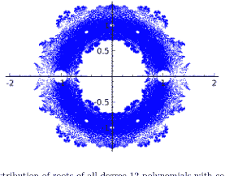

*图 12.1 —— 所有系数为 −1 或 1 的 12 次多项式的根的分布。*

```sage
sage: data = build_complex_roots(12)
sage: points(data, pointsize=1, aspect_ratio=1)
```

#### 12.1.5 根式可解性

在某些情况下，可以计算多项式根的精确值。例如，当我们可以用多项式的系数并通过根式（平方根、立方根等）表示这些根时，就会出现这种情况。这时我们说该多项式是*根式可解的*。

要用 Sage 进行根式求解，必须使用类 `Expression` 的对象，它们表示符号表达式。我们已经看到，由类 `Integer` 的对象表示的整数具有相同的*父对象*，即对象 `ZZ`。类似地，类 `Expression` 的对象也具有相同的父对象：对象 `SR`（*Symbolic Ring* 的缩写）；这允许将其转换为类 `Expression`。

```sage
sage: a, b, c, x = var('a, b, c, x')
sage: p = a * x^2 + b * x + c
sage: type(p)
<type 'sage.symbolic.expression.Expression'>
sage: p.parent()
Symbolic Ring
sage: p.roots(x)
[(-1/2*(b + sqrt(b^2 - 4*a*c))/a, 1),
 (-1/2*(b - sqrt(b^2 - 4*a*c))/a, 1)]
```

##### 次数严格大于 2

3 次和 4 次代数方程是根式可解的。然而，次数至少为 5 的多项式方程一般不可能用根式求解（见 §7.3.4）。这种不可能性促使人们研究数值解法（见 §12.2）。

```sage
sage: a, b, c, d, e, f, x = var('a, b, c, d, e, f, x')
sage: p = a*x^5+b*x^4+c*x^3+d*x^2+e*x+f
sage: p.roots()
Traceback (most recent call last):
...
RuntimeError: no explicit roots found
```

我们用 Sage 说明一种在复数域上求解 3 次方程的方法。首先说明，一般的 3 次方程可以化为 $x^3 + px + q = 0$ 的形式。

```sage
sage: x, a, b, c, d = var('x, a, b, c, d')
sage: p = a * x^3 + b * x^2 + c * x + d
sage: alpha = var('alpha')
sage: p.subs(x = x + alpha).expand().coefficient(x, 2)
3*alpha + b
sage: p.subs(x = x - b / (3 * a)).expand().collect(x)
a*x^3 - 1/3*(b^2/a - 3*c)*x + 2/27*b^3/a^2 - 1/3*b*c/a + d
```

为求形如 $x^3 + px + q = 0$ 的方程的根，我们令 $x = u + v$。

```sage
sage: p, q, u, v = var('p, q, u, v')
sage: P = x^3 + p * x + q
sage: P.subs(x = u + v).expand()
u^3 + 3*u^2*v + 3*u*v^2 + v^3 + p*u + p*v + q
```

假设最后一个表达式为零。于是我们注意到，$u^3 + v^3 + q = 0$ 等价于 $3uv + p = 0$；此外，如果这些等式成立，那么 $u^3$ 和 $v^3$ 满足一个二次方程：$(X - u^3)(X - v^3) = X^2 - (u^3 + v^3)X + (uv)^3 = X^2 + qX - p^3/27$。

```sage
sage: P.subs({x: u + v, q: -u^3 - v^3}).factor()
(3*u*v + p)*(u + v)
sage: P.subs({x: u+v, q: -u^3 - v^3, p: -3 * u * v}).expand()
0
sage: X = var('X')
sage: solve([X^2 + q*X - p^3 / 27 == 0], X, solution_dict=True)
[{X: -1/2*q - 1/18*sqrt(12*p^3 + 81*q^2)},
 {X: -1/2*q + 1/18*sqrt(12*p^3 + 81*q^2)}]
```

因此，方程 $x^3 + px + q = 0$ 的解就是和 $u + v$，其中 $u$ 和 $v$ 是

$$\frac{-\sqrt{4p^3+27q^2}\sqrt{3}}{18}-\frac{q}{2}\quad\text{and}\quad\frac{\sqrt{4p^3+27q^2}\sqrt{3}}{18}-\frac{q}{2}$$

的立方根，并且满足 $3uv + p = 0$。

#### 12.1.6 方法 Expression.roots()

前面的例子使用了方法 Expression.roots()。该方法返回一个精确根列表，但不保证列表完整。在该方法的可选参数中，有我们已经在前面的方法 Polynomial.roots() 中见过的参数 ring 和 multiplicities。需要牢记的是，方法 Expression.roots() 并不限于多项式表达式。

```sage
sage: e = sin(x) * (x^3 + 1) * (x^5 + x^4 + 1)
sage: roots = e.roots(); len(roots)
9
sage: roots
[(0, 1),
 (-1/2*(1/18*sqrt(23)*sqrt(3) - 1/2)^(1/3)*(I*sqrt(3) + 1) - 1/6*(-I*
  sqrt(3) + 1)/(1/18*sqrt(23)*sqrt(3) - 1/2)^(1/3),
  1),
 (-1/2*(1/18*sqrt(23)*sqrt(3) - 1/2)^(1/3)*(-I*sqrt(3) + 1) - 1/6*(I*
  sqrt(3) + 1)/(1/18*sqrt(23)*sqrt(3) - 1/2)^(1/3),
  1),
 ((1/18*sqrt(23)*sqrt(3) - 1/2)^(1/3) + 1/3/(1/18*sqrt(23)*sqrt(3) -
  1/2)^(1/3),
  1),
 (-1/2*I*sqrt(3) - 1/2, 1),
 (1/2*I*sqrt(3) - 1/2, 1),
 (1/2*I*sqrt(3)*(-1)^(1/3) - 1/2*(-1)^(1/3), 1),
 (-1/2*I*sqrt(3)*(-1)^(1/3) - 1/2*(-1)^(1/3), 1),
 ((-1)^(1/3), 1)]
```

如果未指定参数 ring，则类 Expression 的方法 roots() 会将根的计算委托给 Maxima；Maxima 会尝试对表达式进行因式分解，然后对每个次数严格小于 5 的因子进行根式求解。当指定参数 ring 时，表达式会被转换为类 Polynomial 的对象，其系数的父对象由参数 ring 标识；随后返回方法 Polynomial.roots() 的结果。我们将在下文描述这种情况下所使用的算法（见 §12.2.2）。

也可以用隐式根进行计算，我们可以通过表示代数数域的对象 QQbar 和 AA 来访问这些根（见 §7.3.2）。

##### 消除重根

给定一个有重根的多项式 p，可以构造一个有单根（即重数为 1）的多项式，其根与 p 的根相同。因此，在计算多项式的根时，我们可以假定这些根是单根。我们首先证明具有单根的多项式存在，然后说明如何构造它。这将给出方法 Expression.roots() 的一个新示例。

设 α 是多项式 p 的一个重数为 m > 1 的根。它是导数 p' 的重数为 m − 1 的根。事实上，如果 $p = (x − α)^m q$，那么 $p' = (x − α)^{m−1}(mq + (x − α)q')$。


```sage
sage: alpha, m, x = var('alpha, m, x'); q = function('q')(x)
sage: p = (x - alpha)^m * q
sage: p.derivative(x)
(-alpha + x)^(m - 1)*m*q(x) + (-alpha + x)^m*diff(q(x), x)
sage: simplify(p.derivative(x)/(x-alpha))
0
```

因此，$p$ 与 $p'$ 的最大公因式（gcd）是乘积 $\prod_{\alpha\in\Gamma}(x-\alpha)^{m_\alpha-1}$，其中 $\Gamma$ 是 $p$ 的重数严格大于 1 的根组成的集合，$m_\alpha$ 是根 $\alpha$ 的重数。若用 $d$ 表示这个最大公因式，则商 $p/d$ 具有所需性质。

注意，$p$ 除以 $d$ 所得商的次数严格小于 $p$ 的次数。特别地，如果这个次数严格小于 5，就可以用根式表示这些根。下面的例子用一个次数为 13 的有理系数多项式说明了这一点。

```sage
sage: R.<x> = PolynomialRing(QQ, 'x')
sage: p = 128 * x^13 - 1344 * x^12 + 6048 * x^11 - 15632 * x^10 \
.....: + 28056 * x^9 - 44604 * x^8 + 71198 * x^7 - 98283 * x^6 \
.....: + 105840 * x^5 - 101304 * x^4 + 99468 * x^3 - 81648 * x^2 \
.....: + 40824 * x - 8748
sage: d = gcd(p, p.derivative())
sage: (p // d).degree()
4
sage: roots = SR(p // d).roots(multiplicities=False)
sage: roots
[1/2*I*sqrt(3)*2^(1/3) - 1/2*2^(1/3),
 -1/2*I*sqrt(3)*2^(1/3) - 1/2*2^(1/3),
 2^(1/3),
 3/2]
sage: [QQbar(p(alpha)).is_zero() for alpha in roots]
[True, True, True, True]
```

### 12.2 数值解

数学中传统上存在*离散*与*连续*的二分法。数值分析在一定程度上弥合了这一鸿沟：数值分析的一个主要方面，是通过实验性视角研究关于实数（实数明确属于连续领域）的问题，而这一过程常常借助计算机，计算机则属于离散领域。

关于非线性方程的求解，除了计算近似值之外，还会产生许多自然的问题：给定方程有多少个实根？有多少个虚根、正根或负根？

本节开始针对代数方程这一特殊情形回答此类问题。然后，我们描述一些计算非线性方程近似解的方法。

```sage
sage: def sturm(p, a, b):
....:     assert p.degree() > 2
....:     assert not (p(a) == 0)
....:     assert not (p(b) == 0)
....:     assert a <= b
....:     remains = [p, p.derivative()]
....:     for i in range(p.degree() - 1):
....:         remains.append(-(remains[i] % remains[i + 1]))
....:     evals = [[], []]
....:     for q in remains:
....:         evals[0].append(q(a))
....:         evals[1].append(q(b))
....:     return count_sign_changes(evals[0]) \
....:         - count_sign_changes(evals[1])
```

下面是函数 `sturm()` 的一个使用示例。

```sage
sage: R.<x> = PolynomialRing(QQ, 'x')
sage: p = (x - 34) * (x - 5) * (x - 3) * (x - 2) * (x - 2/3)
sage: sturm(p, 1, 4)
2
sage: sturm(p, 1, 10)
3
sage: sturm(p, 1, 200)
4
sage: p.roots(multiplicities=False)
[34, 5, 3, 2, 2/3]
sage: sturm(p, 1/2, 35)
5
```

#### 12.2.2 迭代逼近方法

本节说明逼近非线性方程 $f(x) = 0$ 的解的各种方法。此类逼近本质上主要有两种途径。最高效的算法会混合使用这两种途径。

第一种途径构造一系列嵌套区间，其中包含方程的一个解。我们可以控制精度，并且收敛性有保证，但收敛速度并不总是很好。

第二种途径从方程某个解的一个给定近似值开始。如果函数 $f$ 的局部性态足够规则，我们可以计算出一个新的、更精确的解的近似值。通过递推，我们得到近似值序列。这种方法假定已知目标数的一个初步近似值。此外，其性能取决于函数 $f$ 良好的局部性态：我们无法*先验地*规定答案的精度；更糟的是，近似值序列的收敛性也不一定有保证。

本节始终考虑非线性方程 $f(x)=0$，其中 $f$ 是定义在区间 $[a,b]$ 上并在该区间上连续的数值函数。我们假定 $f$ 在区间 $[a,b]$ 端点处的值非零且符号相反：换言之，乘积 $f(a)f(b)$ 严格为负。$f$ 的连续性保证方程 $f(x)=0$ 在区间 $[a,b]$ 内至少存在一个解。

对于所讨论的每种方法，我们都用以下函数进行实验。

```sage
sage: f(x) = 4 * sin(x) - exp(x) / 2 + 1
sage: a, b = RR(-pi), RR(pi)
sage: bool(f(a) * f(b) < 0)
True
```

需要注意，对于这个函数，命令 `solve` 没有用处。

```sage
sage: solve(f(x) == 0, x)
[sin(x) == 1/8*e^x - 1/4]
```

```sage
sage: f.roots()
Traceback (most recent call last):
...
RuntimeError: no explicit roots found
```

求解非线性方程的算法可能非常耗时：在继续之前，最好采取某些预防措施。特别地，我们应当通过研究所涉函数的连续性、可微性以及其符号变化来确保解存在；在此绘制函数图像可能很有用（见第 4 章）。

**二分法。** 该方法基于第一种途径：构造一系列嵌套区间，其中每个区间都包含方程 $f(x)=0$ 的一个解。

我们找到区间 $[a,b]$ 的中点 $c$。假定 $f(c) \ne 0$（否则我们已经找到一个解）。要么 $f(a)f(c)$ 为负，因此区间 $[a,c]$ 必定包含方程的一个解；要么 $f(c)f(b)$ 为负，因此区间 $[c,b]$ 包含方程的一个解。因此，我们可以构造一个包含解且长度为区间 $[a,b]$ 长度一半的区间。通过迭代这一构造，我们得到一个具有所需性质的区间序列。为实现这一途径，我们如下定义一个 Python 函数 `intervalgen`。

```sage
sage: def phi(s, t): return (s + t) / 2
sage: def intervalgen(f, phi, s, t):
....:     msg = '{0} wrong arguments: f({0})*f({1})>=0'.format(s, t)
....:     assert (f(s) * f(t) < 0), msg
....:     yield s
....:     yield t
....:     while True:
....:         u = phi(s, t)
....:         yield u
....:         if f(u) * f(s) < 0:
....:             t = u
....:         else:
....:             s = u
```

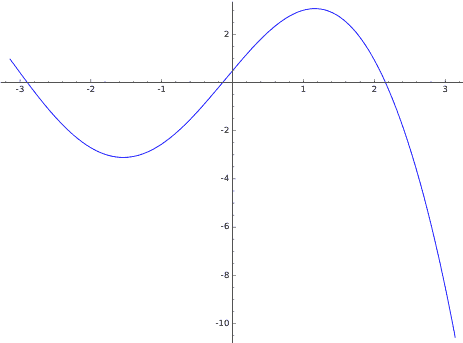

图 12.2 – 函数 $f$ 的图像。

这个函数的定义值得解释。`intervalgen` 定义中的关键字 `yield` 会把它变成一个*生成器*（见 §15.2.4）。当调用生成器的 `next()` 方法时，如果解释器看到关键字 `yield`，所有局部数据都会被保存，执行被中断，并立即返回该关键字右侧的表达式。下一次调用 `next()` 方法时，会恢复中断前保存的局部数据，并从关键字 `yield` 的下一行继续执行。在无限循环（`while True:`）中使用关键字 `yield`，可以通过一种与数学定义非常相似的语法来实现递归序列。使用关键字 `return` 可以完全停止执行。

参数 `phi` 是一个指定逼近方法的函数。对于二分法，该函数计算区间的中点。为了测试其他同样使用嵌套区间的迭代逼近方法，我们需要给出函数 `phi` 的新定义，然后可以使用函数 `intervalgen` 构造相应的生成器。

该函数的参数 `s` 和 `t` 指定第一个

保证由二分法计算出的值以严格小于 `prec` 的误差逼近解。

一旦迭代次数大于参数 `maxit`，就会抛出异常。

```sage
sage: bisection = intervalgen(f, phi, a, b)
sage: iterate(bisection)
After 22 iterations: 2.15847275559132
```

- **练习 44.** 修改函数 `intervalgen`，使得当区间的某个端点是解时，生成器停止。
- **练习 45.** 使用函数 `intervalgen` 和 `iterate`，通过嵌套区间计算方程 $f(x) = 0$ 的近似解，其中每个区间都是通过在前一个区间中随机选择一点将其划分而得到的。

##### 试位法

该方法也采用第一种思路：构造一个包含方程 $f(x) = 0$ 的解的嵌套区间序列。不过，它使用函数 $f$ 的线性插值来划分每个区间。

更准确地说，为了划分区间 $[a,b]$，我们考虑连接 $f$ 图像上横坐标为 $a$ 和 $b$ 的两点的线段。由于 $f(a)$ 与 $f(b)$ 符号相反，该线段与 $x$ 轴相交，从而将区间 $[a,b]$ 分成两个子区间。与二分法一样，我们通过计算两个子区间公共点处的 $f$ 值来确定包含解的子区间。

过点 $(a, f(a))$ 和 $(b, f(b))$ 的直线方程为

$$ y = \frac{f(b)-f(a)}{b-a}(x-a)+f(a). \tag{12.1} $$

由于 $f(b) \neq f(a)$，这条直线与 $x$ 轴交于横坐标为

$$ a - f(a)\frac{b-a}{f(b)-f(a)}. $$

的点。因此，我们可以按如下方式测试该方法。

```sage
sage: phi(s, t) = s - f(s) * (t - s) / (f(t) - f(s))
sage: falsepos = intervalgen(f, phi, a, b)
sage: iterate(falsepos)
After 8 iterations: -2.89603757331027
```

需要注意，二分法和试位法构造的序列不一定收敛到同一个解。通过缩小区间范围，我们重新得到通过二分法得到的正解。

```sage
sage: a, b = RR(pi/2), RR(pi)
sage: phi(s, t) = t - f(t) * (s - t) / (f(s) - f(t))
sage: falsepos = intervalgen(f, phi, a, b)
```

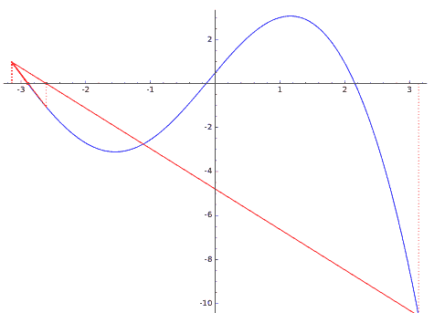

图 12.3 在 $[-\pi, \pi]$ 上的试位法。

```sage
sage: phi(s, t) = (s + t) / 2
sage: bisection = intervalgen(f, phi, a, b)
sage: iterate(falsepos)
After 15 iterations: 2.15846441170219
sage: iterate(bisection)
After 20 iterations: 2.15847275559132
```

##### 牛顿法

与试位法一样，牛顿法使用函数 $f$ 的线性近似。从图形角度看，我们考虑用 $f$ 图像的一条切线来近似该图像。

我们假设 $f$ 可微，且导数 $f'$ 在区间 $[a,b]$ 中保持同号；因此 $f$ 是单调的。我们还假设 $f$ 在区间 $[a,b]$ 中变号。于是方程 $f(x)=0$ 在该区间中有唯一解；我们将其记为 $\alpha$。

设 $u_0 \in [a,b]$。$f$ 的图像在横坐标为 $u_0$ 的点处的切线方程为

$$ y = f'(u_0)(x-u_0)+f(u_0). \qquad (12.2) $$

这条直线与 $x$ 轴交点的坐标为

$$ (u_0 - f(u_0)/f'(u_0), 0). $$

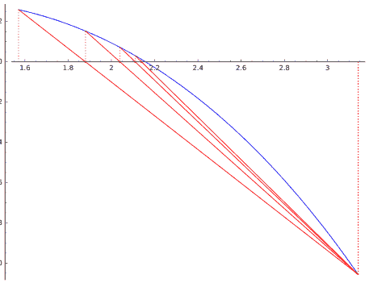

图 12.4 – 在 [π/2, π] 上的试位法。

我们用 φ 表示函数 x ↦ x − f(x)/f′(x)。如果 f′ 在区间 [a, b] 上不为零，则该函数有定义。我们关注由 u_{n+1} = φ(u_n) 定义的递归序列 u。

如果序列 u 收敛¹，那么其极限 ℓ 满足 ℓ = ℓ − f(ℓ)/f′(ℓ)，因此 f(ℓ) = 0；所以该极限等于方程 f(x) = 0 的解 α。

¹L. Kantorovich 的一个定理给出了牛顿法收敛的一个充分条件。

为了使我们的例子满足单调性假设，我们必须缩小区间范围。

```sage
sage: f.derivative()
x |--> 4*cos(x) - 1/2*e^x
sage: a, b = RR(pi/2), RR(pi)
```

我们定义一个 Python 生成器 `newtongen`，表示上面定义的递归序列。然后我们定义一个新的收敛测试 `checkconv`，当最后计算出的两项足够接近时停止迭代；当然，这个测试并不保证近似序列收敛。

```sage
sage: def newtongen(f, u):
....:     while True:
....:         yield u
....:         u -= f(u) / f.derivative()(u)
```

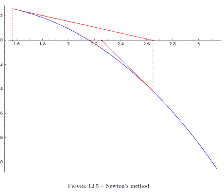

```python
sage: def checkconv(u, v, w, prec):
....:     return abs(w - v) / abs(w) <= prec
```

现在，我们可以在我们的例子上测试牛顿法。

```python
sage: iterate(newtongen(f, a), check=checkconv)
After 6 iterations: 2.15846852566756
```

##### 割线法

牛顿法中导数的计算可能代价很高。可以用线性插值来代替它：给定解的两个近似值，也就是 $f$ 图像上的两个点，如果过这两个点的直线与 $x$ 轴相交，我们就取交点的横坐标作为新的近似值。为了开始构造，或者当这条直线平行于 $x$ 轴时，我们使用牛顿法。

这产生了与试位法相同的迭代公式，但应用于不同的点。与试位法相反，割线法不提供一个包含解的区间。

我们定义一个实现该方法的 Python 生成器。

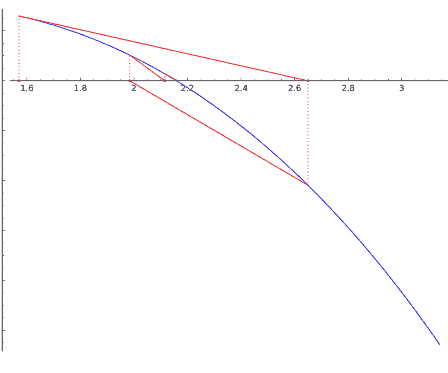

图 12.6 割线法。

```python
sage: def secantgen(f, a):
....:     yield a
....:     estimate = f.derivative()(a)
....:     b = a - f(a) / estimate
....:     yield b
....:     while True:
....:         fa, fb = f(a), f(b)
....:         if fa == fb:
....:             estimate = f.derivative()(a)
....:         else:
....:             estimate = (fb - fa) / (b - a)
....:         a = b
....:         b -= fb / estimate
....:         yield b
```

现在，我们可以在我们的例子上测试割线法。

```python
sage: iterate(secantgen(f, a), check=checkconv)
After 8 iterations: 2.15846852557553
```

##### Muller 法

可以通过用任意次数的多项式近似来代替 $f$，从而扩展割线法。例如，Muller 法$^{2}$ 使用二次近似。

²这是 David E. Muller，他也因发明 Reed-Muller 码而闻名，而不是第 11 章提到的 Jean-Michel Muller。

假设我们已经构造了方程 $f(x)=0$ 的解的三个近似值 $r$、$s$ 和 $t$。我们考虑由 $f$ 图像上横坐标为 $r$、$s$ 和 $t$ 的三个点所定义的 Lagrange 插值多项式。它是一个二次多项式。我们取该多项式中最接近 $t$ 的根作为新的近似值。序列的前三项直接取为 $a$、$b$ 和 $(a+b)/2$。

我们应该注意，多项式的根——因此计算出的近似值——可以是复数。

该方法在 Sage 中的实现并不困难；它可以仿照割线法来完成。不过，我们的实现使用了一种更适合枚举递归序列各项的数据结构。

```sage
sage: from collections import deque
sage: basering = PolynomialRing(CC, 'x')
sage: def quadratigen(f, r, s):
....:     t = (r + s) / 2
....:     yield t
....:     points = deque([(r,f(r)), (s,f(s)), (t,f(t))], maxlen=3)
....:     while True:
....:         pol = basering.lagrange_polynomial(points)
....:         roots = pol.roots(ring=CC, multiplicities=False)
....:         u = min(roots, key=lambda x: abs(x - points[2][0]))
....:         points.append((u, f(u)))
....:         yield points[2][0]
```

Python 标准库的 `collections` 模块提供了若干数据结构。在 `quadratigen` 中，类 `deque` 用于存储最后计算出的近似值。deque 对象最多存储其创建时指定的 `maxlen` 个数据；这里存储数据的最大数量就是近似序列的递推阶数。一旦 deque 对象达到其最大存储容量，方法 `deque.append()` 就按照“先进先出”的规则插入新数据。

注意，该方法的迭代不需要计算导数。此外，每次迭代只需要对函数 $f$ 进行一次求值。

```sage
sage: generator = quadratigen(f, a, b)
sage: iterate(generator, check=checkconv)
After 5 iterations: 2.15846852554764
```

##### 回到多项式

我们回到本章开头研究的情形：计算实系数多项式 $P$ 的根。我们假设 $P$ 是首一的：

$$P = a_0 + a_1x + \cdots + a_{d-1}x^{d-1} + x^d.$$


**收敛速度。** 考虑一个收敛的数列 \(u\)，并设 \(\ell\) 为其极限。若存在 \(K \in (0,1)\) 使得

$$\lim_{n\to\infty} \frac{|u_{n+1}-\ell|}{|u_n-\ell|}=K.$$

则称数列 \(u\) 的收敛速度是*线性*的。若存在 \(K>0\) 使得

$$\lim_{n\to\infty}\frac{|u_{n+1}-\ell|}{|u_n-\ell|^2}=K.$$

则称数列 \(u\) 的收敛速度是*二次*的。

回顾牛顿法构造了一个递推数列 \(u\)，其定义为 \(u_{n+1}=\varphi(u_n)\)，其中 \(\varphi\) 是函数 \(x\mapsto x-f(x)/f'(x)\)。若 \(f\) 二阶可微，则 \(\varphi\) 在根 \(\alpha\) 的邻域内关于 \(x\) 的泰勒公式为

$$\varphi(x)=\varphi(\alpha)+(x-\alpha)\varphi'(\alpha)+\frac{(x-\alpha)^2}{2}\varphi''(\alpha)+O_\alpha((x-\alpha)^3).$$

但 \(\varphi(\alpha)=\alpha\)、\(\varphi'(\alpha)=0\) 且 \(\varphi''(\alpha)=f''(\alpha)/f'(\alpha)\)。将其代入前一公式并利用数列 \(u\) 的定义，可得

$$u_{n+1}-\alpha=\frac{(u_n-\alpha)^2}{2}\frac{f''(\alpha)}{f'(\alpha)}+O_\alpha((u_n-\alpha)^3).$$

因此，当牛顿法收敛时，该数列的收敛速度是二次的。

**收敛加速。** 给定一个收敛速度为线性的收敛数列，可以构造一个收敛速度为二次的数列。将同样的技术应用于牛顿法，就得到所谓的 Steffensen 方法。

```sage
sage: def steffensen(sequence):
....:     assert isinstance(sequence, GeneratorType)
....:     values = deque(maxlen=3)
....:     for i in range(3):
....:         values.append(sequence.next())
....:         yield values[1]
....:     while True:
....:         values.append(sequence.next())
....:         u, v, w = values
....:         yield u - (v - u)^2 / (w - 2 * v + u)
```

```sage
sage: g(x) = sin(x^2 - 2) * (x^2 - 2)
sage: sequence = newton(g, RR(0.7))
sage: accelseq = steffensen(newton(g, RR(0.7)))
sage: iterate(sequence, check=checkconv)
After 17 iterations: 1.41422192763287
```

SciPy 库不提供任意精度计算（除非我们满足于用整数进行计算）；事实上，方法 `Expression.find_root()` 的源代码首先将边界转换为双精度数。另一方面，我们在本章给出的所有求解方法示例都可在任意精度下工作，甚至可符号化工作。

```sage
sage: a, b = pi/2, pi
sage: generator = newtongen(f, a)
sage: generator.next(); generator.next()
1/2*pi
1/2*pi - (e^(1/2*pi) - 10)*e^(-1/2*pi)
```

**练习 46。** 编写一个适用于任意精度的 Brent 方法生成器。

## 13 数值线性代数

这里我们考虑线性代数的数值方面，符号方面在第 8 章描述。线性代数的数值分析与方法在 [TBI97, Sch02] 中讨论。Golub 和 Van Loan 的著作 [GVL12] 是该领域的重要参考。

数值线性代数在*科学计算*中起着关键作用，包括常微分方程和偏微分方程的数值求解、优化问题以及信号处理问题。

其中若干问题（即使是线性问题）的数值求解依赖于由嵌套循环构成的算法；在这些循环的最底层，大多数情况下需要求解一个线性方程组。非线性代数方程组通常使用牛顿法求解：这里同样需要处理线性方程组。因此，数值线性代数方法的效率与鲁棒性至关重要。

本章分为三节：第一节讨论数值线性代数计算中不精确性的不同来源；第二节（§13.2）在不追求详尽的前提下讨论更经典的问题（线性方程组求解、特征值计算、最小二乘）；第三节（§13.3）考虑稀疏矩阵的情形。最后一节不仅是用户指南，也介绍了属于活跃研究领域的方法。

### 13.1 不精确计算

这里我们考虑使用浮点（即不精确）计算求解的经典线性代数问题（线性方程组求解、特征值和特征向量计算等）。Sage 中可用的不同种类浮点数在第 12 章详细介绍。

例如考虑要求解的方程组 \(Ax=b\)，其中 \(A\) 是实系数矩阵。若用 \(\delta A\) 修改 \(A\)，或用 \(\delta b\) 修改 \(b\)，我们会得到多大的误差 \(\delta x\)？本章给出一些部分答案。

#### 13.1.1 矩阵范数与条件数

设 \(A \in \mathbb{R}^{n \times n}\)（或 \(\mathbb{C}^{n \times n}\)）。我们在 \(\mathbb{R}^n\)（或 \(\mathbb{C}^n\)）上定义一个范数 \(\|x\|\)，例如范数 \(\|x\|_\infty = \max_i |x_i|\) 或 \(\|x\|_1 = \sum_{i=1}^n |x_i|\)，甚至欧几里得范数 \(\|x\|_2 = (\sum_{i=1}^n |x_i|^2)^{1/2}\)；于是量

\[\|A\| = \max_{\|x\|=1} \|A x\|\]

在 \(n \times n\) 矩阵集合上定义了一个范数。我们说它是关于 \(\mathbb{R}^n\)（或 \(\mathbb{C}^n\)）上定义的范数的*诱导范数*。非奇异矩阵 \(A\) 的*条件数*定义为 \(\kappa(A) = \|A^{-1}\| \cdot \|A\|\)。基本结果是，若 \(A\) 被 \(\delta A\) 轻微修改，\(b\) 被 \(\delta b\) 轻微修改，则线性方程组 \(Ax=b\) 的解 \(x\) 的修改量 \(\delta x\) 满足

\[\frac{\|\delta x\|}{\|x\|} \le \frac{\kappa(A)}{1-\kappa(A)\|\delta A\|/\|A\|}\left(\frac{\|\delta A\|}{\|A\|}+\frac{\|\delta b\|}{\|b\|}\right).\]

范数 \(\|\cdot\|_\infty\) 和 \(\|\cdot\|_1\) 易于计算：\(\|A\|_\infty = \max_{1\le i\le n}(\sum_{j=1}^n |a_{ij}|)\) 且 \(\|A\|_1 = \max_{1\le j\le n}\sum_{i=1}^n |a_{ij}|\)。相反，范数 \(\|\cdot\|_2\) 更难计算，因为 \(\|A\|_2 = \sqrt{\rho(A^T A)}\)，其中矩阵 \(A\) 的谱半径 \(\rho\) 是其特征值的最大模。

Frobenius 范数定义为

\[\|A\|_F = \left(\sum_{i=1}^n \sum_{j=1}^n |a_{ij}|^2\right)^{1/2}.\]

容易验证 \(\|A\|_F^2 = \mathrm{trace}(A^T A)\)。与上述范数不同，它不是诱导范数。

**在 Sage 中计算矩阵范数。** Sage 中的矩阵有一个 `norm(p)` 方法。根据参数 `p` 的取值，它计算：

- \(p=1\)：\(\|A\|_1\)，\(p=2\)：\(\|A\|_2\)
- \(p=\text{Infinity}\)：\(\|A\|_\infty\)，\(p=\text{'frob'}\)：\(\|A\|_F\)

该方法仅当矩阵系数可转换为复数浮点数 CDF 时有效。请注意，我们写作 `A.norm(Infinity)`，但写作 `A.norm('frob')`。使用 `A.norm()` 可得到默认范数 \(\|A\|_2\)。

##### 误差与条件数：一个精确计算与近似计算的例子

让我们利用 Sage 在系数为有理数时执行精确计算的能力。考虑希尔伯特矩阵

$$a_{ij}=1/(i+j-1),\ i,j=1,\ldots,n.$$

以下程序使用范数 $\|\cdot\|_\infty$ 精确计算希尔伯特矩阵的条件数¹：

```sage
sage: def cond_hilbert(n):
....:     A = matrix(QQ, [[1/(i+j-1) for j in [1..n]] for i in [1..n]])
....:     return A.norm(Infinity) * (A^-1).norm(Infinity)
```

以下是几个 $n$ 的结果：

| \(n\) | 条件数 |
|---:|---:|
| 2 | 27 |
| 4 | 28375 |
| 8 | 33872791095 |
| 16 | 5.06277e+22 |
| 32 | 1.35711e+47 |

我们看到条件数关于 \(n\) 增长得极快。可以证明 \(\kappa(A)\ge e^{7n/2}\)，它确实增长得非常快。仍在有理数域中计算，取 \(x=[1,\ldots,1]^t\)、\(y=Ax\)，并求解方程组 \(\tilde{A}s=y\)，其中 \(\tilde{A}\) 是矩阵 \(A\) 的轻微修改；然后比较解 \(s\) 与 \(x=A^{-1}y\)，从而度量由 \(A\) 的修改所引入的误差：

```sage
sage: def diff_hilbert(n):
....:     x = vector(QQ, [1 for i in range(0,n)])
....:     A = matrix(QQ, [[1/(i+j-1) for j in [1..n]] for i in [1..n]])
....:     y = A*x
....:     A[n-1,n-1] = (1/(2*n-1))*(1+(1/10^5))  # modifies the matrix
....:     s = A \ y
....:     return max(abs(float(s[i]-x[i])) for i in range(0,n))
```

我们得到：

| \(n\) | 误差（diff_hilbert） |
|---:|---:|
| 2 | 3.99984e-05 |
| 4 | 5.97610e-3 |
| 8 | 4.80536 |
| 16 | 67.9885 |
| 32 | 20034.3 |

相对于 \(x_i=1\)，误差非常迅速地变得过大。

现在让我们用浮点系数执行同样的计算。我们不再修改矩阵 \(A\)，但浮点运算将会执行

¹ 在 Sage 中，有一个 `condition()` 方法可返回各种范数下的条件数，但它仅适用于系数在 RDF 或 CDF 中的矩阵。


### 13.2 稠密矩阵

#### 13.2.1 求解线性方程组

**应避免的方法。** 应（几乎）始终避免使用克莱姆法则。递推推理表明，使用克莱姆法则计算一个 n × n 矩阵的行列式需要约 n! 次乘法和加法。为求解一个规模为 n 的方程组，我们必须计算 n + 1 个行列式。考虑 n = 20：

```sage
sage: n = 20; cost = (n+1)*factorial(n); cost
51090942171709440000
```

我们得到 51 090 942 171 709 440 000 次乘法这一巨大数值。假设我们的计算机每秒执行 3 · 10^9 次乘法，我们来计算该计算会持续多久：

```sage
sage: v = 3*10^9
sage: print("%.3f" % float(cost/v/3600/24/365))
540.028
```

因此该计算大约需要 540 年！当然，我们可以使用克莱姆法则求解一个 2 × 2 方程组，但再大就不行了！实践中使用的所有方法都有一个共同点：其代价关于维数是多项式的，即阶为 n^p，其中 p 较小（通常 p = 3）。

**实用方法。** 线性方程组 Ax = b 的求解在大多数情况下基于将矩阵 A 分解为两个矩阵的乘积 A = M1 M2，其中 M1 和 M2 对应“容易”求解的线性方程组。为求解 Ax = b，我们因此先求解 M1y = b，再求解 M2x = y。

例如 M1 和 M2 可以是三角矩阵；在这种情况下，一旦完成分解，我们必须求解两个三角形线性方程组。分解比求解三角形线性方程组昂贵得多（例如 LU 分解为 O(n^3)，而三角形线性方程组为 O(n^2)）。因此，当需要求解多个具有相同矩阵的方程组时，我们应只进行一次矩阵分解。当然，我们*绝不*通过求矩阵逆来解线性方程组，因为求逆需要矩阵分解，然后求解 n 个方程组，而不是仅求解一个。

#### 13.2.2 直接求解

求解线性方程组的最简单方式如下所示：

```sage
sage: A = matrix(RDF, [[-1,2],[3,4]])
sage: b = vector(RDF, [2,3])
sage: x = A\b; x
(-0.200000000000018, 0.900000000000001)
```

在 Sage 中，矩阵有一个 `solve_right` 方法用于求解线性方程组（它基于 *LU* 分解）；上述用法即使用了该方法。我们也可以写成：

需要注意，不执行 Cholesky 分解就无法轻松判断一个对称矩阵是否正定；如果对非正定矩阵应用 Cholesky 方法，分解将失败并引发异常 `ValueError`。

使用 Cholesky 分解求解方程组 $Ax = b$ 时，过程与 $LU$ 分解类似。一旦计算出 Cholesky 分解，我们调用 `A.solve_right(b)`。这里同样不会重新计算分解。

为什么使用 Cholesky 分解而不是 $LU$ 分解来求解对称正定矩阵的线性方程组？首先，由于对称性，存储因子所需的内存减半，但 Cholesky 方法尤其有趣之处在于其运算次数：实际上，对于一个规模为 $n$ 的矩阵，Cholesky 分解需要 $n$ 次平方根、$n(n-1)/2$ 次除法、$(n^3-n)/6$ 次加法和同样多的乘法。作为对比，$LU$ 分解也需要 $n(n-1)/2$ 次除法，但需要 $(n^3-n)/3$ 次加法和同样多的乘法。

#### 13.2.5 $QR$ 分解

设 $A \in \mathbb{R}^{n\times m}$，且 $n \ge m$。我们想找到两个矩阵 $Q$ 和 $R$，使得 $A = QR$，其中 $Q \in \mathbb{R}^{n\times n}$ 是正交矩阵（$Q^t \cdot Q = I$），$R \in \mathbb{R}^{n\times m}$ 是上三角矩阵。当然，一旦计算出这样的分解，如果矩阵 $A$ 是方阵且可逆，我们就可以用它来求解线性方程组。然而，正如我们将看到的，$QR$ 分解对于求解最小二乘问题和计算特征值尤其有趣。我们应注意，$A$ 不一定是方阵。$QR$ 分解总是存在。示例：

```sage
A = random_matrix(RDF,6,5)
Q, R = A.QR()
```

**练习 47**（扰动线性系统）。设 $A$ 是可逆方阵，并假设我们已经计算了 $A$ 的一个分解（$LU$、$QR$、Cholesky 等）。设 $u$ 和 $v$ 是两个向量。我们考虑矩阵 $B = A + uv^t$，并假设 $1 + v^t A^{-1}u \ne 0$。如何低成本地求解 $Bx = f$ 方程组（即不进行 $B$ 的分解）？

提示：我们将使用谢尔曼-莫里森公式（我们将证明或假设它）：

$$(A + uv^t)^{-1} = A^{-1} - \frac{A^{-1}uv^tA^{-1}}{1 + v^tA^{-1}u}$$

#### 13.2.6 奇异值分解

设 $A$ 是一个具有实系数的 $n \times m$ 矩阵。那么存在两个正交矩阵 $U \in \mathbb{R}^{n\times n}$ 和 $V \in \mathbb{R}^{m\times m}$，使得

$$U^tAV = \Sigma = \operatorname{diag}(\sigma_1, \sigma_2, \ldots, \sigma_p),$$

其中 $\sigma_1 \ge \sigma_2 \ge \ldots \ge \sigma_p \ge 0$（且 $p = \min(m,n)$）。数 $\sigma_1, \ldots, \sigma_p$ 是 $A$ 的*奇异值*。

```sage
sage: A = matrix(RDF, [[1,3,2],[1,4,2],[0,5,2],[1,3,2]])
sage: b = vector(RDF, [1,2,3,4])
sage: Z = transpose(A)*A
sage: C = Z.cholesky()
sage: R = transpose(A)*b
sage: Z.solve_right(R)
(-1.5000000000000135, -0.5000000000000085, 2.7500000000000213)
```

我们应注意，Cholesky 分解会被缓存，并由 `Z.solve_right(R)` 使用，而不会重新计算。

**使用 QR 分解。** 假设 $A$ 满秩$^7$；我们考虑 $A$ 的 $QR$ 分解。那么

$$\|Ax-b\|_2^2 = \|QRx-b\|_2^2 = \|Rx-Q^T b\|_2^2.$$

我们有：$R = \begin{bmatrix} R_1 \\ 0 \end{bmatrix}$，其中 $R_1$ 是 $m \times m$ 上三角矩阵，且 $Q^T b = \begin{bmatrix} c \\ d \end{bmatrix}$，其中 $c$ 的大小为 $m$。因此 $\|Ax-b\|_2^2 = \|R_1 x - c\|_2^2 + \|d\|_2^2$，最小值通过求解三角形方程组 $R_1 x = c$ 获得：

```sage
sage: A = matrix(RDF, [[1,3,2],[1,4,2],[0,5,2],[1,3,2]])
sage: b = vector(RDF, [1,2,3,4])
sage: Q, R = A.QR()
sage: R1 = R[0:3,0:3]
sage: b1 = transpose(Q)*b
sage: c = b1[0:3]
sage: R1.solve_right(c)
(-1.499999999999999, -0.4999999999999867, 2.749999999999997)
```

让我们计算 $A^T A$ 在无穷范数下的条件数：

```sage
sage: Z = A.transpose()*A
sage: Z.norm(Infinity)*Z^(-1).norm(Infinity)
1992.375000000168
```

$QR$ 方法和正规方程方法得到的结果在舍入误差水平乘以 $\kappa(A^T A)$ 的范围内一致。

**使用奇异值分解。** 奇异值分解 $A = U\Sigma V^T$ 也允许我们计算解；此外，当 $A$ 不是满秩时，我们也可以使用它。如果 $A$ 不是零矩阵，$\Sigma$ 有 $0 < r \le m$ 个正系数 $\sigma_i$（假定按降序排列）。于是我们有：

$$\|Ax-b\|_2^2 = \|U^T A V V^T x - U^T b\|_2^2.$$

记 $\lambda = V^T x$，并用 $u_i$ 表示 $U$ 的列，我们有：

$$\|Ax-b\|_2^2 = \sum_{i=1}^{r} (\sigma_i \lambda_i - u_i^T b)^2 + \sum_{i=r+1}^{m} (u_i^T b)^2.$$

因此，最小值通过取 $\lambda_i = (u_i^H b)/\sigma_i$（对于 $1 \le i \le p$，若 $\lambda_i \ne 0$）以及否则 $\lambda_i = 0$ 来达到。我们最终得到解 $x = V\lambda$。

下面是相应的 Sage 程序：

```sage
sage: A = matrix(RDF, [[1,3,2],[1,3,2],[0,5,2],[1,3,2]])
sage: b = vector(RDF, [1,2,3,4])
sage: U, Sig, V = A.SVD()
sage: m = A.ncols()
sage: x = vector(RDF, [0]*m)
sage: lamb = vector(RDF, [0]*m)
sage: for i in range(0,m):
....:     s = Sig[i,i]
....:     if s!=0.0:
....:         lamb[i]=U.column(i)*b/s
sage: x = V*lamb; x
(0.237037037037037, 0.451851851851852, 0.370370370370370)
```

请注意，我们这里选择了一个秩为 2 的矩阵（我们可以用 A.rank() 命令检查），因此它不是满秩的；最小二乘问题有多个解，而上述数学分析表明 x 是欧几里得范数最小的解。

让我们看一下奇异值：

```sage
sage: m = 3; [ Sig[i,i] for i in range(0,m) ]
[8.309316833256451, 1.3983038884881154, 0.0]
```

矩阵 $A$ 的秩为 2，因此第三个奇异值必然为 0。

**示例。** 在奇异值分解（SVD）的众多奇妙应用中，这里有一个很难用其他方法求解的问题（称为*正交普罗克鲁斯提斯问题*）：设 $A$ 和 $B \in \mathbb{R}^{n \times m}$ 是一个重复两次的实验的结果。我们想知道能否将 $B$ *扭曲* 到 $A$，即是否存在一个正交矩阵 $Q$ 使得 $A = BQ$。自然，测量值 $A$ 和 $B$ 包含一些噪声，因此该问题一般无解。因此我们考虑相应的最小二乘问题：我们寻找使 Frobenius 范数的平方最小化的正交矩阵 $Q$：

$$\|A - BQ\|_F^2.$$

我们记得 $\|A\|_F^2 = \operatorname{trace}(A^t A)$。那么

$$\|A - BQ\|_F^2 = \operatorname{trace}(A^t A) + \operatorname{trace}(B^t B) - 2 \operatorname{trace}(Q^t B^t A) \ge 0,$$

并且我们必须最大化 $\operatorname{trace}(Q^t B^t A)$。然后我们计算 $B^t A$ 的 SVD：我们有 $U^t(B^t A)V = \Sigma$。我们用 $\sigma_i$ 表示奇异值，并令 $Z = V^t Q^t U$。该矩阵是正交矩阵，因此其所有系数的绝对值都小于或等于 1。于是：

$$\operatorname{trace}(Q^t B^t A) = \operatorname{trace}(Q^t U \Sigma V^t) = \operatorname{trace}(Z\Sigma) = \sum_{i=1}^m Z_{ii}\sigma_i \le \sum_{i=1}^m \sigma_i,$$

并且最大值在 \(Q = UV^t\) 时取得。

```sage
sage: A = matrix(RDF, [[1,2],[3,4],[5,6],[7,8]])
```

B 是通过向 A 添加随机噪声，然后应用旋转 R 得到的：

```sage
sage: th = 0.7
sage: R = matrix(RDF, [[cos(th),sin(th)],[-sin(th),cos(th)]])
sage: B = (A + 0.1*random_matrix(RDF,4,2)) * transpose(R)
```

```sage
sage: C = transpose(B)*A
sage: U, Sigma, V = C.SVD()
sage: Q = U*transpose(V)
```

随机噪声很小，正如预期，Q 接近 R：

```sage
sage: Q
[ 0.7612151656410958  0.6484993998439783]
[-0.6484993998439782  0.7612151656410955]
sage: R
[ 0.7648421872844885  0.644217687237691]
[-0.644217687237691   0.7648421872844885]
```

**练习 48**（对称半正定矩阵的平方根）。设 A 是一个对称半正定矩阵（即对任意向量 \(x\)，满足 \(x^t A x \ge 0\)）。证明我们可以计算一个同样是对称半正定的矩阵 \(X\)，使得 \(X^2 = A\)。

#### 13.2.8 特征值与特征向量

到目前为止，我们使用了一些直接方法（LU、QR 或 Cholesky 分解），它们在有限次运算内给出解（四种基本算术运算，以及 Cholesky 分解中的平方根）。对于特征值的计算，这*并不成立*：事实上（参见第 294 页），我们可以为每个多项式关联一个矩阵，使其特征值是该多项式的根，而我们知道对于次数为 5 或更高的多项式，不存在求根的显式公式，而直接方法会给出这样的公式。此外，构造特征多项式以计算其根将极其昂贵（Faddeev–Le Verrier 算法允许我们在 \(O(n^4)\) 次运算中计算大小为 \(n\) 的矩阵的特征多项式，这仍被认为过于昂贵）。用于计算特征值和特征向量的数值方法都是迭代的。还要回想一下，矩阵 \(A\) 的奇异值是 \(A^t A\) 的特征值的平方根；因此不存在计算奇异值分解的直接方法。

因此，我们将构造收敛到特征值（和特征向量）的序列，并在足够接近解时停止迭代。¹

¹在下文的示例中，为简单起见，我们选择固定次数的迭代。

```text
-2.3272481190401657,
-3.52779132536669]
```

我们确实确定了主特征值。

这种方法可能看起来没什么意思，但它会再次出现在稀疏矩阵中。它还引出了接下来的内容，这些内容非常有用。

##### 反幂法

我们假设已知特征值 \(\lambda_j\) 的一个近似值 \(\mu\)（其中 \(\mu,\lambda_j\in\mathbb{C}\)）。我们如何确定与 \(\lambda_j\) 相关联的特征向量？

我们假设对于 \(\forall k\ne j\)，有 \(0<|\mu-\lambda_j|<|\mu-\lambda_k|\)，因此 \(\lambda_j\) 是一个单特征值。然后我们考虑 \((A-\mu I)^{-1}\)，其最大特征值为 \((\lambda_j-\mu)^{-1}\)，并对该矩阵应用幂法。

例如，我们取：

```python
sage: A = matrix(RDF, [[1,3,2], [1,2,3], [0,5,2]])
```

通过调用方法 `A.eigenvalues()`，我们得到特征值（四舍五入到 5 位有效数字）`6.3929, 0.56052, -1.9535`。我们将从近似值出发，搜索与第二个特征值相关联的特征向量：

```python
sage: A = matrix(RDF, [[1,3,2], [1,2,3], [0,5,2]])
sage: mu = 0.56
sage: AT = A - mu*identity_matrix(RDF,3)
sage: X = vector(RDF, [1 for i in range(0,A.nrows())])
sage: lam_old = 0
sage: for i in range(1,1000):
.....:     Z = AT.solve_right(X)
.....:     X = Z/Z.norm()
.....:     lam = X.dot_product(A*X)
.....:     s = abs(lam - lam_old)
.....:     print("{i} s={s} lambda={lam}".format(i=i, s=s, lam=lam))
.....:     lam_old = lam
.....:     if s<1.e-10:
.....:         break
1 s=0.56423627407 lambda=0.56423627407
2 s=0.00371649959176 lambda=0.560519774478
3 s=2.9833340176e-07 lambda=0.560519476145
4 s=3.30288019157e-11 lambda=0.560519476112
sage: X
(0.9276845629439007, 0.10329475725387141, -0.3587917847453505)
```

让我们验证我们计算出了所选特征值及其相关联特征向量的近似值：

```python
sage: A*X-lam*X
(2.886579864025407e-15, 1.672273430841642e-15, 8.326672684688674e-15)
```

可以作几点说明：

- 我们不计算矩阵 \(A-\mu I\) 的逆，而是使用它的 \(LU\) 分解，该分解只计算一次（由第一次 `solve_right` 调用完成）；
- 我们利用迭代来改进对所选特征值的估计；
- 收敛非常快；事实上，我们可以证明（在上述假设成立，并且初始向量与 \(\lambda_j\) 关联的特征向量 \(q_j\) 不正交的前提下），对于迭代 \(x^{(i)}\) 和 \(\lambda^{(i)}\)，有：
  \[
  \|x^{(i)}-q_j\|=O\left(\left|\frac{\mu-\lambda_j}{\mu-\lambda_K}\right|^i\right)
  \]
  以及
  \[
  |\lambda^{(i)}-\lambda_j|=O\left(\left|\frac{\mu-\lambda_j}{\mu-\lambda_K}\right|^{2i}\right),
  \]
  其中 \(\lambda_K\) 是离 \(\mu\) 第二近的特征值；
- \(A-\mu I\) 的条件数（下界为 \(A-\mu I\) 的最大特征值与最小特征值之比）很大，因此很糟糕；然而，我们可以证明误差终究并没有那么重要！

##### QR 算法

设 \(A\) 为一个非奇异方阵。我们考虑序列 \(A_0=A, A_1, A_2, \ldots, A_k, A_{k+1}, \ldots\)。在 \(QR\) 算法的原始形式中，从 \(A_k\) 到 \(A_{k+1}\) 的过程如下：

1. 我们计算 \(A_k\) 的 \(QR\) 分解：\(A_k=Q_kR_k\)，
2. 我们计算 \(A_{k+1}=R_kQ_k\)。

让我们用 \(A\) 为一个实对称矩阵来编程实现这种方法：

```sage
sage: m = matrix(RDF, [[1,2,3,4],[1,0,2,6],[1,8,4,-2],[1,5,-10,-20]])
sage: Aref = transpose(m)*m
sage: A = copy(Aref)
sage: for i in range(0,20):
.....:     Q, R = A.QR()
.....:     A = R*Q
.....:     print(A.str(lambda x: RR(x).str(digits=8)))
[
    347.58031    -222.89331    -108.24117    -0.067928252]
[ -222.89331     243.51949     140.96827     0.081743964]
[ -108.24117     140.96827      90.867499   -0.0017822044]
[ -0.067928252   0.081743964   -0.0017822044   0.032699348]
...
[
    585.03056  -3.2281469e-13  -6.8752767e-14  -9.9357605e-14]
[-3.0404094e-13    92.914265  -2.5444701e-14  -3.3835458e-15]
[-1.5340786e-39   7.0477800e-25     4.0229095     2.7461301e-14]
[ 1.1581440e-82  -4.1761905e-68   6.1677425e-42    0.032266909]
```

我们观察到收敛到一个近似对角矩阵。对角系数是 \(A\) 的特征值的近似。让我们检查一下：

```sage
sage: Aref.eigenvalues()
[58.030586202212, 92.91426499150643, 0.03226690899408103,
 4.022909479477674]
```

如果矩阵是 Hermitian 正定矩阵，我们可以证明收敛性。如果我们有一个非对称矩阵，我们应该在 \(\mathbb{C}\) 中计算，特征值先验是复的，并且如果方法收敛，\(A_k\) 的下三角部分趋于零，而对角线趋于 \(A\) 的特征值。

\(QR\) 方法需要若干改进才能变得高效，特别是因为连续的 \(QR\) 分解代价高昂；在常见的改进中，我们通常先将矩阵 \(A\) 化为更简单的形式（Hessenberg 形式：上三角加上第一条次对角线），这使得 \(QR\) 分解便宜得多；然后，为了加速收敛，我们应用巧妙选择的平移 \(A := A + \sigma I\)（例如参见 [GVL12]）。这正是 Sage 用于稠密矩阵 CDF 或 RDF 的方法。

##### 实践

上面的程序主要作为教学示例给出；在实践中，我们将使用 Sage 提供的方法，这些方法在可能的情况下会调用 Lapack 库中的优化例程。该接口允许只获取特征值，或者同时获取特征值和相应的特征向量：

```sage
sage: A = matrix(RDF, [[1,3,2],[1,2,3],[0,5,2]])
sage: eigen_vals, eigen_vects = A.eigenmatrix_right()
sage: eigen_vals
[ 6.39294791648918                0.0                0.0]
[                0.0 0.560519476111939                0.0]
[                0.0                0.0 -1.9534673926011215]
sage: eigen_vects
[ 0.542484060110651  0.927684562943908 0.09834254667424457]
[ 0.5544692861094349 0.10329475725336986 -0.617227053099068]
[ 0.6310902116870117 -0.3587917847435306  0.780614827194734]
```

这个例子计算了以特征值为对角元素的对角矩阵，以及特征向量矩阵（其列对应特征向量）。

**示例**（计算多项式的根）。给定一个首一多项式（系数为实数或复数）\(p(x) = x^n + a_{n-1}x^{n-1} + \cdots + a_1x + a_0\)，很容易验证，由 \(M_{i+1, i} = 1\) 和 \(M_{1,n-i} = -a_i\) 定义的友矩阵 \(M\) 的特征值就是 \(p\) 的根（参见 §8.2.3），因此这给出了一种近似这些根的方法：

```sage
sage: def pol2companion(p):
....:     n = len(p)
....:     m = matrix(RDF, n)
....:     for i in range(1, n):
....:         m[i, i-1] = 1
....:     m.set_column(n-1, -p)
....:     return m
```


```text
sage: q = vector(RDF,[1,-1,2,3,5,-1,10,11])
sage: comp = polycompanion(q); comp
[  0.0   0.0   0.0   0.0   0.0   0.0   0.0  -1.0]
[  1.0   0.0   0.0   0.0   0.0   0.0   0.0   1.0]
[  0.0   1.0   0.0   0.0   0.0   0.0   0.0  -2.0]
[  0.0   0.0   1.0   0.0   0.0   0.0   0.0  -3.0]
[  0.0   0.0   0.0   1.0   0.0   0.0   0.0  -5.0]
[  0.0   0.0   0.0   0.0   1.0   0.0   0.0   1.0]
[  0.0   0.0   0.0   0.0   0.0   1.0   0.0 -10.0]
[  0.0   0.0   0.0   0.0   0.0   0.0   1.0 -11.0]
sage: roots = comp.eigenvalues(); roots
[0.3475215101190289 + 0.5665505533984981*I, 0.3475215101190289 -
  0.5665505533984981*I,
 0.34502377696179265 + 0.43990870238588275*I, 0.34502377696179265 -
  0.43990870238588275*I,
 -0.5172576143252197 + 0.5129582067889322*I, -0.5172576143252197 -
  0.5129582067889322*I,
 -1.3669971645459291, -9.983578180965276]
```

在此示例中，多项式由其系数列表 `q` 表示，系数从 0 到 $n-1$。因此，多项式 $x^2 - 3x + 2$ 将表示为 `q=[2,-3,1]`。

#### 13.2.9 多项式曲线拟合：魔鬼又回来了

**连续版本。** 我们希望用次数 $\le n$ 的多项式 $P(x)$ 在区间 $[\alpha, \beta]$ 上逼近函数 $f(x)$。我们建立如下最小二乘问题：

$$\min_{a_0,\ldots,a_n\in\mathbb{R}} J(a_0,\ldots,a_n) = \int_\alpha^\beta \left(f(x)-\sum_{i=0}^n a_i x^i\right)^2\,dx.$$

将 $J(a_0,\ldots,a_n)$ 对系数 $a_i$ 求导，我们发现 $a_0,\ldots,a_n$ 是线性方程组 $Ma = F$ 的解，其中 $M_{i,j}=\int_\alpha^\beta x^{i+j}\,dx$，$F_j=\int_\alpha^\beta x^j f(x)\,dx$。观察 $\alpha=0$、$\beta=1$ 的情形，我们立刻可以看出 $M$ 是一个希尔伯特矩阵！不过存在补救办法：只需使用正交多项式基（例如，对于 $\alpha=-1$ 和 $\beta=1$，我们得到勒让德多项式）；于是 $M$ 变为单位矩阵。

**离散版本。** 我们考虑在点 $x_1,\ldots,x_m$ 处对某一现象的 $m$ 个观测值 $y_1,\ldots,y_m$。我们想在这些值之间拟合一个次数（至多）为 $n-1$ 的多项式 $\sum_{i=0}^{n-1} a_i x^i$，其中 $n\le m$。因此我们最小化泛函：

$$J(a_0,\ldots,a_{n-1}) = \sum_{j=1}^m \left(\sum_{i=0}^{n-1} a_i x_j^i-y_j\right)^2.$$

这样写出来，该问题会产生一个接近希尔伯特矩阵的矩阵，方程组将难以精确求解。然而，我们注意到 $\langle P,Q\rangle = \sum_{j=1}^m P(x_j)\cdot Q(x_j)$ 定义了次数至多为 $n-1$ 的多项式上的一个内积。因此，我们可以先构造 $n$ 个次数递增且关于该内积标准正交的多项式，然后对线性方程组进行对角化。记住⁵，Gram-Schmidt 过程在计算正交多项式时归结为三项递推，我们寻找形如 $P_{n+1}(x)= xP_n(x) - \alpha_n P_{n-1}(x) - \beta_n P_{n-2}(x)$ 的多项式 $P_{n+1}(x)$；下面的 `orthopoly` 过程执行该计算（这里我们用系数列表表示多项式：例如 `[1,-2,3]` 对应多项式 $1-2x+3x^2$）。用于计算多项式值的 Horner 方案给出以下程序：

```text
sage: def eval(P,x):
....:     if len(P) == 0:
....:         return 0
....:     else:
....:         return P[0] + x*eval(P[1:],x)
```

然后我们可以编码两个多项式的内积：

```text
sage: def pscal(P,Q,lx):
....:     return float(sum(eval(P,s)*eval(Q,s) for s in lx))
```

以及两个多项式 $P$ 和 $Q$ 的运算 $P \leftarrow P + aQ$：

```text
sage: def padd(P,a,Q):
....:     for i in range(0,len(Q)):
....:         P[i] += a*Q[i]
```

更谨慎的程序应在使用错误时抛出异常；在我们的情形中，当 $n > m$ 时使用以下异常：

```text
sage: class BadParamsForOrthop(Exception):
....:     def __init__(self, degreplusone, npoints):
....:         self.deg = degreplusone - 1
....:         self.np = npoints
....:     def __str__(self):
....:         return "degree: " + str(self.deg) + \
....:                " nb. points: " + repr(self.np)
```

以下过程计算 $n$ 个正交多项式：

```text
sage: def orthopoly(n,x):
....:     if n > len(x):
....:         raise BadParamsForOrthop(n, len(x))
....:     orth = [[1./sqrt(float(len(x)))]]
....:     for p in range(1,n):
....:         nextp = copy(orth[p-1])
....:         nextp.insert(0,0)
....:         s = []
....:         for i in range(p-1,max(p-3,-1),-1):
....:             s.append(pscal(nextp, orth[i], x))
....:         j = 0
....:         for i in range(p-1,max(p-3,-1),-1):
....:             padd(nextp, -s[j], orth[i])
....:             j += 1
....:         norm = sqrt(pscal(nextp, nextp, x))
....:         nextp = [nextp[i]/norm for i in range(len(nextp))]
....:         orth.append(nextp)
....:     return orth
```

⁵ 证明它并不很难！

一旦计算出正交多项式 $P_0(x), \ldots, P_{n-1}(x)$，解由 $P(x) = \sum_{i=0}^{n-1} \gamma_i P_i(x)$ 给出，其中：

$$\gamma_i = \sum_{j=1}^{m} P_i(x_j)y_j,$$

这显然又可以依次在单项式基 $1, x, \ldots, x^{n-1}$ 中表示出来。

**示例（$n=15$）：**

```text
sage: L = 40
sage: X = [100*float(i)/L for i in range(40)]
sage: Y = [float(1/(1+25*X[i]**2)+0.25*random()) for i in range(40)]
sage: n = 15; orth = orthopoly(n, X)
```

让我们在正交多项式基上计算解的系数：

```text
sage: coeff = [sum(Y[j]*eval(orth[i],X[j]) for j in
....:           range(0,len(X))) for i in range(0,n)]
```

然后我们可以将该结果转换到单项式基 $1, x, \ldots, x^{n-1}$，例如为了绘制图形：

```text
sage: polmin = [0 for i in range(0,n)]
sage: for i in range(0,n):
....:     padd(polmin, coeff[i], orth[i])
sage: p = lambda x: eval(polmin, x)
sage: plot(p(x), x, 0, X[len(X)-1])
```

这里我们不再详述在单项式基 $x^i$ 上进行朴素拟合的计算及其图形表示。我们得到图 13.1。

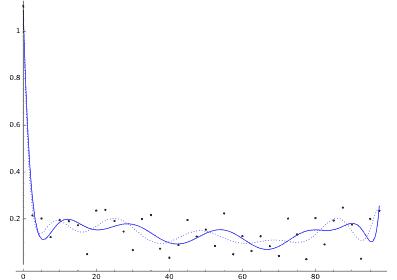

图 13.1 – 虚线：朴素拟合。实线：正交多项式拟合。

两条曲线，即对应于用正交多项式基进行的拟合和用单项式基进行的拟合，很接近；然而，如果我们计算它们的残差（泛函 $J$ 的值），我们会发现正交多项式基为 0.1202，而朴素拟合为 0.1363。

#### 13.2.10 实现与效率

具有 RDF 系数的矩阵计算由处理器浮点单元执行，而具有 RR 系数的矩阵计算由 GNU MPFR 库执行。此外，在第一种情况下，Sage 使用 NumPy/SciPy，而后者又调用 Lapack 库（用 Fortran 编写），Lapack 库使用 BLAS⁶，这些 BLAS 针对每个处理器进行了优化。于是对于两个大小为 1000 的矩阵的乘积，我们得到：

```text
sage: a = random_matrix(RR, 1000)
sage: b = random_matrix(RR, 1000)
sage: %time _ = a*b
CPU times: user 7min 50s, sys: 508 ms, total: 7min 50s
Wall time: 7min 51s
```

```text
sage: c = random_matrix(RDF, 1000)
sage: d = random_matrix(RDF, 1000)
sage: %time _ = c*d
CPU times: user 40 ms, sys: 4 ms, total: 44 ms
Wall time: 45.2 ms
```

⁶ 基础线性代数子程序（矩阵-向量乘积、矩阵-矩阵乘积等）。

因此，乘法时间之比超过 10000！（回想一下，两种情况下的计算精度相同。）

我们还可以注意到具有 RDF 系数的矩阵计算的效率：由于两个大小为 $n$ 的方阵的乘积需要 $n^3$ 次乘法（以及同样多次加法），我们在这里用 0.045 秒执行了 $10^9$ 次乘法和同样多次加法；这大约是每秒 $44\cdot 10^9$ 次浮点运算，相当于 44 gigaflops。处理器时钟频率为 3.3 GHz，因此我们每个时钟周期执行超过一次运算：这之所以可能，要归功于对相应 BLAS 例程的几乎直接调用（该例程利用了现代处理器核心中并行计算的不同可能性）。存在一种计算两个矩阵乘积的代价低于 $n^3$ 的算法，即 Strassen 算法。它在浮点计算中并不经常使用，因为它比朴素方法对舍入误差更敏感 [Hig93]。

### 13.3 稀疏矩阵

稀疏矩阵在科学计算中经常出现：稀疏性确实是一种人们所期望的性质，它使我们能够求解大规模问题，而这些问题用稠密矩阵是无法处理的。

*一个近似定义：我们将称一个矩阵序列 $M_n$（其中 $M_n$ 的大小为 $n$）为稀疏矩阵族，如果 $M_n$ 的非零系数个数为 $O(n)$。*

显然，这些矩阵在计算机中使用只存储非零元素的数据结构进行编码。通过考虑矩阵的稀疏性，我们当然希望节省内存以能够表示大型矩阵，同时也大幅降低计算成本。

#### 13.3.1 稀疏系统从何而来？

**边值问题。** 稀疏线性系统最常见的来源是偏微分方程的离散化。例如，让我们考虑泊松方程（稳态热方程）：

$$-\Delta u = f$$

其中 $u = u(x,y)$，$f = f(x,y)$，

$$\Delta u := \frac{\partial^2 u}{\partial x^2} + \frac{\partial^2 u}{\partial y^2}.$$

该方程在正方形 $[0,1]^2$ 中考虑，边界条件为在正方形边界上 $u = 0$。一维类似问题是

$$-\frac{\partial^2 u}{\partial x^2} = f, \qquad (13.1)$$

其中 $u(0)=u(1)=0$。

为了近似该方程的解，最简单的方法之一是使用有限差分法：我们将区间 $[0,1]$ 划分为有限个数 $N$ 的等宽 $h$ 区间。我们用 $u_i$ 表示 $u$ 在点 $x_i = ih$ 处的近似值。我们用 $(u_{i+1} - u_i)/h$ 近似 $u$ 的导数，并用

$$\frac{(u_{i+1} - u_i)/h - (u_i - u_{i-1})/h}{h} = \frac{u_{i+1} - 2u_i + u_{i-1}}{h^2}.$$

近似其二阶导数。


我们立即看到，值 u_0, . . . , u_N 在点 ih 处逼近 u，它们满足一个每行只有 3 个非零项的线性方程组（并且其矩阵是对称正定的）。

在二维情形下，我们可以在单位正方形上放置步长为 h 的网格，于是得到一个五对角方程组（对角线上为 4/h^2，前两条次对角线和前两条超对角线上为 −1/h^2）。在三维情形下，如果在立方体中类似处理，我们得到一个每行有 7 个非零系数的方程组。因此我们确实得到非常稀疏的矩阵。

**大型稀疏图上的随机游走。** 我们考虑一个图，其中每个顶点只与少量顶点相连（相对于顶点总数而言很少）。例如，我们可以设想一个图，其顶点是互联网页面：每个页面只链接到少量其他页面（这定义了图的边），但它显然是一个巨大的图。图上的随机游走由一个随机矩阵定义，即一个矩阵，其系数是 0 到 1 之间的实数，且每一行的系数之和为 1。我们可以证明，这样的矩阵 A 有一个等于 1 的主特征值。随机游走的平稳分布是与该主特征值相关联的（左）特征向量 x，即满足 xA = x 的向量 x。最引人注目的应用之一是 Google 的 PageRank 算法，其中向量 x 用于平衡搜索结果。

#### 13.3.2 Sage 中的稀疏矩阵

Sage 让我们有机会处理稀疏矩阵，只需在创建矩阵时加上 `sparse = True`。这对应于一种字典表示（§3.3.9）。此外，对于系数在 `RDF` 或 `CDF` 中的大型稀疏矩阵，Sage 使用 SciPy 库进行计算，而 SciPy 提供了自己的稀疏矩阵类。在当前情况下，Sage 的稀疏矩阵与 SciPy 的稀疏矩阵之间没有接口。因此，我们必须直接使用 SciPy 对象。

可用于稀疏矩阵的 SciPy 类有：

- 一种列表的列表结构（不过与 Sage 使用的结构不同），它非常便于创建和修改矩阵，即 `lil_matrix` 类；
- 一些不可变结构，它们只存储非零系数，并且是稀疏线性代数中的标准格式（`csr` 和 `csc` 格式）。

#### 13.3.3 求解线性方程组

对于中等规模的方程组，我们可以使用基于 *LU* 分解的直接法。我们很容易确信，在稀疏矩阵 *A* 的 *LU* 分解中，*L* 和 *U* 因子通常总共包含比 *A* 更多的非零项。必须记住未知量以限制所用内存，正如 Sage 以透明方式使用的 SuperLU 库那样：

```sage
sage: from scipy.sparse.linalg.dsolve import *
sage: from scipy.sparse import lil_matrix
sage: from numpy import array
sage: n = 200
sage: n2 = n*n
sage: A = lil_matrix((n2, n2))
sage: h2 = 1./float((n+1)^2)
sage: for i in range(0,n2):
....:    A[i,i]=4*h2+2.
....:    if i+1<n2: A[i,int(i+1)]=-h2
....:    if i>0: A[i,int(i-1)]=-h2
....:    if i+n<n2: A[i,int(i+n)]=-h2
....:    if i-n>=0: A[i,int(i-n)]=-h2
sage: Acsc = A.tocsc()
sage: b = array([1 for i in range(0,n2)])
sage: solve = factorized(Acsc)  # LU factorisation
sage: S = solve(b)             # resolution
```

一旦我们将矩阵创建为 `lil_matrix`（注意，这种格式要求使用 Python 的 int 类型索引），就必须将其转换为 `csc` 格式。上面的程序效率不高：构造 `lil_matrix` 很慢，因为 `lil_matrix` 数据结构相当低效。不过，转换为 `csc` 矩阵及其分解很快；随后的求解甚至更快。

**迭代法。** 这些方法的主要原理是构造一个收敛到 Ax = b 方程组解的序列。现代迭代法依赖于 Krylov 空间 K_n，即由 {b, Ab, ..., A^n b} 张成的向量空间。在最流行的方法中，我们可以提到：

- 共轭梯度法：它只能用于矩阵 A 为对称正定的方程组。在这种情况下，||x||_A = √(xᵀAx) 是一种范数，且迭代 x_n 使得对于 x_n ∈ K_n，解 x 与 x_n 之间的误差 ||x − x_n||_A 最小（存在一些易于编程的公式，例如参见 [GVL12]）；

- 广义最小残量法（GMRES）：它适用于非对称线性方程组。在第 n 次迭代时，对于 x_n ∈ K_n，欧几里得残量范数 ||Ax_n − b||₂ 被最小化。我们注意到这是一个最小二乘问题。

在实践中，这些方法只有配合预条件才高效：我们不解 Ax = b，而是解 MAx = Mb，其中 M 是一个使 MA 的条件数优于 A 的矩阵。高效预条件子的研究与发现是数值分析中一个活跃的分支，并取得了丰硕进展。例如，下面用共轭梯度法求解上面研究的方程组，其中预条件子 M 是 A 的对角线的逆。这是一个简单但不是很高效的预条件子：

```sage
sage: b = array([1 for i in range(0,n2)])
sage: m = lil_matrix((n2, n2))
sage: for i in range(0,n2):
....:     m[i,i] = 1./A[i,i]
sage: msc = m.tocsc()
sage: from scipy.sparse.linalg import cg
sage: x = cg(A, b, M = msc, tol=1.e-8)
```

| 最常用的命令（稠密矩阵） |  |
| --- | --- |
| 求解线性方程组 | `x = A\b` |
| LU 分解 | `P, L, U = A.LU()` |
| Cholesky 分解 | `C = A.cholesky()` |
| QR 分解 | `Q, R = A.QR()` |
| 奇异值分解 | `U, Sig, V = A.SVD()` |
| 特征值与特征向量 | `Val, Vec = A.eigenmatrix_right()` |

表 13.1 – 小结。

#### 13.3.4 特征值、特征向量

**幂法。** 幂法特别适合巨大的稀疏矩阵；事实上，要实现该算法，只需知道如何进行矩阵-向量乘积和标量乘积。例如，让我们回到稀疏图上的随机游走，并使用幂法计算平稳分布：

```sage
sage: from scipy import sparse
sage: from numpy.linalg import *
sage: from numpy import array
sage: from numpy.random import rand
sage: def power(A,x):        # power iteration
....:     for i in range(0,1000):
....:         y = A*x
....:         z = y/norm(y)
....:         lam = sum(x*y)
....:         s = norm(x-z)
....:         print("%i s=%s lambda=%s"%(i,s,lam))
....:         if s < 1e-3:
....:             break
....:         x = z
....:     return x
sage: n = 1000
sage: m = 5
sage: # build a stochastic matrix of size n
sage: # with m non-zero coefficients per row
sage: A1 = sparse.lil_matrix((n, n))
sage: for i in range(0,n):
....:     for j in range(0,m):
....:         l = int(n*rand())
....:         A1[i,l] = rand()
sage: for i in range(0,n):
....:     s = sum(A1[i,0:n])
....:     A1[i,0:n] /= s
sage: At = A1.transpose().tocsc()
sage: x = array(rand() for i in range(0,n))
sage: # compute the dominant eigenvalue
sage: # and the associated eigenvector
sage: y = power(At, x)
0 s=17.0241218112 lambda=235.567796432
1 s=0.3937371784 lambda=0.908668201953
2 s=0.230865716856 lambda=0.967356896036
3 s=0.134156683993 lambda=0.98660315554
4 s=0.0789423487458 lambda=0.99542635219
...
```

运行这个例子时，我们可以试着测量其不同部分所花费的时间，会观察到几乎所有时间都花在构造矩阵上；计算转置并不很昂贵；幂迭代本身耗时可以忽略（在测试计算机上约占总时间的 2%）。使用列表的列表表示效率不高，这类问题更应当用编译型语言和合适的数据结构来求解。

#### 13.3.5 关于求解大型非线性方程组的进一步思考

幂法和使用 Krylov 空间的方法有一个关键共同性质：它们只要求计算矩阵-向量乘积。我们甚至不需要知道矩阵本身，只需知道矩阵对向量的作用。这就是这些方法也被称为“黑箱”方法的原因。因此，在矩阵未显式已知或无法计算矩阵的情况下，也可能进行某些计算。实际上，SciPy 方法允许将 *线性算子* 作为参数。我们邀请读者考虑下面的应用，或许可以将其实现。

设 $F : \mathbb{R}^n \to \mathbb{R}^n$。我们想求解 $F(x) = 0$。我们考虑牛顿法，其中从 $x_0$ 开始计算迭代 $x_{n+1} = x_n - J(x_n)^{-1} \cdot F(x_n)$。雅可比矩阵 $J(x_n)$ 是 $F$ 在 $x_n$ 处的偏导数矩阵。在实践中，人们会依次求解 $J(x_n)y_n = F(x_n)$，然后计算 $x_{n+1} = x_n - y_n$。因此，我们必须求解一个线性方程组。如果 $F$ 的计算有些困难，那么其偏导数通常更难计算和编程，而且这种计算可能几乎不可能完成。因此，我们借助自动微分来救场：如果 $e_j$ 是 $\mathbb{R}^n$ 中除第 $j$ 个分量为 1 外其余分量均为 0 的向量，那么 $(F(x + he_j) - F(x))/h$ 给出一个（好的）

小 \(h\) 时 Jacobian 矩阵第 \(j\) 列的近似。于是，为了得到 \(J\) 的近似，我们必须对 \(F\) 进行 \(n+1\) 次求值；如果 \(n\) 很大，这相当昂贵。那么，采用像 Krylov 这样的迭代方法来求解系统 \(J(x_n)y_n = F(x_n)\) 会怎样呢？我们注意到，当 \(h\) 足够小时，\(J(x_n)V \simeq (F(x_n+hV) - F(x_n))/h\)，这避免了计算整个矩阵。在 SciPy 中，只需定义一个“线性”算子为映射 \(V \to (F(x_n + hV) - F(x_n))/h\) 即可。这类方法常用于求解大型非线性系统。由于该“矩阵”非对称，我们将例如使用 GMRES 方法。

## 14 数值积分与微分方程

本章介绍使用 Sage 进行积分的数值计算（§14.1）以及常微分方程的数值求解（§14.2）。我们回顾积分方法的理论基础，然后详述可用的函数及其用法（§14.1.1）。

我们已在 §2.3.8 中看到如何用 Sage 符号计算积分；本章只会简要提及这一点。这种“符号-数值”方法在可行时是 Sage 的优势之一，应当优先采用，因为所执行的数值计算次数——从而舍入误差的次数——通常少于纯数值积分方法。

对于微分方程，我们快速介绍经典求解方法，并在一个引入性示例（§14.2.1）之后，描述 Sage 的功能（§14.2.2）。

### 14.1 数值积分

我们考虑实函数的数值积分；对于函数 $f : I \to \mathbb{R}$，其中 $I$ 是 $\mathbb{R}$ 的一个区间，我们希望近似计算：

$$\int_I f(x)\,dx.$$

例如，让我们计算

$$\int_1^3 \exp(-x^2)\log(x)\,dx.$$

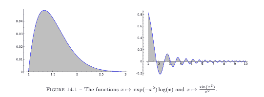

```python
sage: x = var('x'); f(x) = exp(-x^2) * log(x)
sage: N(integrate(f, x, 1, 3))
0.035860294991267694
```

```python
sage: plot(f, 1, 3, fill='axis')
```

由于 `integrate` 函数计算给定表达式的符号积分，我们必须显式请求数值结果。

原则上，也可以计算无界区间上的积分：

```python
sage: N(integrate(sin(x^2)/x^2, x, 1, infinity))
0.285736646322853 - 6.93889390390723e-18*I
```

```python
sage: plot(sin(x^2)/x^2, x, 1, 10, fill='axis')
```

Sage 中有多种方法可用于数值积分，尽管它们的技术实现不同，但都遵循以下两条原则之一：

- 多项式插值（特别是 Gauss-Kronrod 方法）；
- 函数变换（双指数方法）。

**插值方法。** 在这些方法中，我们在给定数量 $n$ 个精心选择的点 $x_1, x_2, \dots, x_n$ 处计算待积分函数 $f$，并由此得到 $f$ 在 $[a, b]$ 上积分的近似：

$$
\int_a^b f(x)\,dx \approx \sum_{i=1}^n w_i f(x_i).
$$

$w_i$ 系数是该方法的“权重”，其确定依据是：该方法对于任意次数小于或等于 $n - 1$ 的多项式 $f$ 都应精确。对于固定点 $(x_i)$，权重 $(w_i)$ 由该条件唯一确定。我们将方法的*阶*定义为最大次数

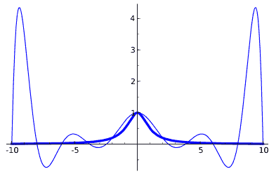

图 14.2 – 在 [−10, 10] 上等距的 11 个点处，用 10 次多项式（细线）对函数 x ↦ 1/(1 + x²)（粗线）进行插值。端点处出现龙格现象。

其中

$$I_1 = I_a^{(a+b)/2}(f) + I_{(a+b)/2}^{b}(f)$$

并且当 $|I_0 - I_1|$ 相对于 $I_0$ 在所需精度下足够小时，我们停止细分过程。这里方法的阶就起作用了：对于 $n$ 阶求积规则，将区间二等分会将理论误差除以 $2^n$，即不考虑舍入误差。

Sage 中可用的插值方法之一是 Gauss-Legendre 方法。在该方法中，$n$ 个积分点是 $n$ 次 Legendre 多项式的根（其定义区间经过平移以匹配所考虑的区间 $[a,b]$）。Legendre 多项式关于标量积正交，其性质

$$\langle f,g\rangle = \int_a^b f(x)g(x)\,dx,$$

意味着相应的求积规则可以精确计算次数不超过 $2n - 1$ 的多项式的积分，而不是一般情况下的仅 $n - 1$。此外，相应的积分权重始终为正，这最小化了像相消$^{1}$这类数值问题的影响。

¹当一组实数之和的绝对值显著小于各加数的绝对值时，就会发生这种现象：此时每个舍入误差都可能大于最终结果，从而导致精度完全丧失。另见 §11.3.3。

总结插值方法，具有 $2n + 1$ 个点的 Gauss-Kronrod 方法是对具有 $n$ 个点的 Gauss-Legendre 方法的“扩展”：

- $2n + 1$ 个点中有 $n$ 个是 Gauss-Legendre 积分点；
- 该方法对任意次数不超过 $3n + 1$ 的多项式精确。

我们可以朴素地指出，$3n + 2$ 个未知量（$2n + 1$ 个权重和 $n + 1$ 个新增点）先验地由要求该方法至少为 $3n + 1$ 阶来确定（这确实给出 $3n + 2$ 个等式）。请注意，Gauss-Kronrod 方法中与 $n$ 个 Gauss-Legendre 点相关联的权重没有理由与原始 Gauss-Legendre 方法中相关联的权重一致。

当求积规则的主要成本是待积分函数 $f$ 的求值次数时（尤其是当积分点和权重已制成表格时），这种扩展方法就变得特别有意义。由于 Gauss-Kronrod 方法原则上比 Gauss-Legendre 方法更精确，我们可以用其结果 $I_1$ 来验证后者的结果 $I_0$，并以 $|I_1 - I_0|$ 作为误差估计，同时最小化 $f$ 的求值次数。读者可以将这种为 Gauss-Legendre 方法所特有的策略，与第 308 页描述的更一般的细分策略进行比较。

**双指数方法。**

双指数（DE）方法依赖于一种变量替换，该替换将有界积分区间变换为 $\mathbb{R}$，并依赖于梯形法则在 $\mathbb{R}$ 上对解析函数的极好精度。对于在 $\mathbb{R}$ 上可积的函数 $f$ 和积分步长 $h$，梯形法则计算

$$ I_h = h \sum_{i=-\infty}^{+\infty} f(hi) $$

作为 $\int_{-\infty}^{+\infty} f(x) \, dx$ 的近似值。双指数变换由 Takahasi 和 Mori 于 1973 年发现，常被数值积分软件工具使用。我们在此描述其主要特征；[Mor05] 给出了该变换及其发现的介绍。该文特别解释了梯形法则对于 $\mathbb{R}$ 上的解析函数具有惊人良好精度的原因，该法则在某种意义上是最优的。

为了计算

$$ I = \int_{-1}^{1} f(x) \, dx, $$

可以使用变换 $x = \varphi(t)$，其中 $\varphi$ 在 $\mathbb{R}$ 上解析并满足

$$ \lim_{t\to -\infty} \varphi(t) = -1, \quad \lim_{t\to +\infty} \varphi(t) = 1, $$

于是

$$ I = \int_{-\infty}^{+\infty} f(\varphi(t))\varphi'(t) \, dt. $$

对最后一个表达式应用梯形法则，我们计算

$$ I_h^N = h \sum_{k=-N}^{N} f(\varphi(kh))\varphi'(kh) $$

其中 $h$ 为给定步长，并将求和截断为从 $-N$ 到 $N$ 的项。所提出的变换选为

$$\varphi(t)=\tanh\left(\frac{\pi}{2}\sinh t\right)$$

由此得到公式

$$I_h^N=h\sum_{k=-N}^{N} f\left(\tanh\left(\frac{\pi}{2}\sinh kh\right)\right)\frac{\frac{\pi}{2}\cosh kh}{\cosh^2\left(\frac{\pi}{2}\sinh kh\right)}.$$

该方法的名字来源于以下函数的双指数衰减：

$$\varphi'(t)=\frac{\frac{\pi}{2}\cosh t}{\cosh^2\left(\frac{\pi}{2}\sinh t\right)}$$

当 $|t|\to\infty$ 时（见图 14.3）。该变换的主要思想是将待积分函数的贡献集中在 0 附近，这解释了当 $|t|$ 增大时 $\varphi'(t)$ 的巨大衰减。需要在参数和变换 $\varphi$ 的选择之间找到折中：比双指数更快的衰减会减小截断误差，但会增加离散误差。

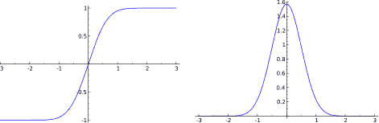

图 14.3 – 双指数方法中使用的变换 $\varphi(t)=\tanh\left(\frac{\pi}{2}\sinh t\right)$（左）以及 $\varphi'(t)$ 的衰减（右）。

自 DE 变换发现以来，该方法可单独使用，或根据被积函数、其奇点以及积分域的性质与其他变换结合使用。其他变换的一个例子是基数正弦函数“sinc”：

$$f(x)\approx\sum_{k=-N}^{N} f(kh)S_{k,h}(x)$$

其中

$$S_{k,h}(x)=\frac{\sin(\pi(x-kh)/h)}{\pi(x-kh)/h},$$

在 [TSM05] 中与双指数方法一起使用，以改进此前依赖单一指数变换 $\varphi(t)=\tanh(t/2)$ 的方法。


$$
\begin{aligned}
I_5 &= \int_0^1 \sin(\sin(x))\,dx, \quad I_6 = \int_0^\pi \sin(x)\exp(\cos(x))\,dx = e - \frac{1}{e},\\
I_7 &= \int_0^1 \frac{1}{1+10^{10}x^2}\,dx = 10^{-5}\arctan(10^5), \quad I_8 = \int_0^{1.1} \exp(-x^{100})\,dx,\\
I_9 &= \int_0^{10} x^2\sin(x^3)\,dx = \frac{1}{3}(1-\cos(1000)), \quad I_{10} = \int_0^1 \sqrt{x}\,dx = \frac{2}{3}.
\end{aligned}
$$

我们不会详尽描述积分函数——这些可在在线帮助中找到——而只介绍它们更常见的用法。

#### N(integrate(...))

可与 Sage 一起使用的第一种数值方法是 N(integrate(...))：

```python
sage: N(integrate(exp(-x^2)*log(x), x, 17, 42))
2.5657285006962035e-127
```

这种方式并不保证积分会真正以数值方式计算。实际上，`integrate` 命令要求进行符号积分；如果符号积分成功，那么 Sage 只会对得到的符号表达式进行数值求值：

```python
sage: integrate(log(1+x)*x, x, 0, 1)
1/4
sage: N(integrate(log(1+x)*x, x, 0, 1))
0.250000000000000
```

#### numerical_integral

相反，`numerical_integral` 函数明确要求对给定函数进行数值积分。它调用 GSL 库（GNU Scientific Library），该库对固定数量 n 的积分点实现 Gauss-Kronrod 方法。积分点和权重是预先计算好的，精度限于机器浮点数的精度（53 位有效数字）。结果是一个包含计算近似值和误差估计的二元组：

```python
sage: numerical_integral(exp(-x^2)*log(x), 17, 42)
(2.5657285006962035e-127, 3.3540254049238093e-128)
```

误差估计并不是误差的保证上界，而只是对逼近给定积分难易程度的简单指示。在上面的例子中，误差估计如此之大，以至于结果中除最高有效位之外的所有数字都可能是错误的。

`numerical_integral` 的参数尤其允许：

- 选择求值点的数量（有六种选择，从 rule=1 对应 15 个点到 rule=6 对应 61 个点，后者为默认值）；
- 请求自适应细分（默认选择），或要求在积分区间上直接应用复合方法（使用选项 algorithm='qng'）；
- 限制被积函数的求值次数。

禁止 GSL 执行自适应积分可能会导致精度损失：

```python
sage: numerical_integral(exp(-x^100), 0, 1.1)
(0.99432585119150..., 4.0775730...e-09)
sage: numerical_integral(exp(-x^100), 0, 1.1, algorithm='qng')
(0.994327538576531..., 0.016840666914688864)
```

当 integrate 命令找不到所请求积分的解析表达式时，它会原样返回输入的积分：

```python
sage: integrate(exp(-x^2)*log(x), x, 17, 42)
integrate(e^(-x^2)*log(x), x, 17, 42)
```

而使用 N 进行的数值求值会调用 numerical_integral。这尤其解释了为什么在这种情况下精度参数被忽略：

```python
sage: N(integrate(exp(-x^2)*log(x), x, 17, 42), digits=60)
2.5657285006962035e-127
```

但我们得到：

```python
sage: N(integrate(sin(x)*exp(cos(x)), x, 0, pi), digits=60)
2.350402387287602913764763701191201630311435962628190174045913
```

因为在这种情况下符号积分成功了。

#### sage.calculus.calculus.nintegral

对于符号函数，可以向 Maxima 请求积分的数值近似：

```python
sage: sage.calculus.calculus.nintegral(sin(sin(x)), x, 0, 1)
(0.430606103120690..., 4.78068810228705...e-15, 21, 0)
```

也可以直接在 Expression 类型的对象上调用 nintegral 方法：

```python
sage: g = sin(sin(x))
sage: g.nintegral(x, 0, 1)
(0.430606103120690..., 4.78068810228705...e-15, 21, 0)
```

Maxima 调用 QUADPACK 数值求积库，该库与 GSL 一样限于机器浮点数。nintegral 方法对积分区间使用自适应细分策略，并且我们可以指定：

- 结果所需的相对精度；
- 计算的最大子区间数。

输出是一个元组：

- 1. 积分的近似值；
- 2. 绝对误差的估计；
- 3. 被积函数的求值次数；
- 4. 错误代码（如果未遇到问题则为 0；关于其他可能值的更多细节，读者应使用 `sage.calculus.calculus.nintegral?` 查阅参考手册）。

#### gp('intnum(...)')

Sage 中可用的 PARI/GP 计算器也实现了一个名为 intnum 的数值积分命令：

```python
sage: gp('intnum(x=17, 20, exp(-x^2)*log(x))')
2.5657285005610514829173563961304785900 E-127
```

intnum 命令使用双指数方法，但请注意，它不保证结果有任何正确的有效数字！

我们可以通过修改 PARI/GP 解释器的全局精度来请求结果的给定精度：

```python
sage: gp('intnum(x=0, 1, sin(sin(x)))')
0.43060610312069049123773552484578643
sage: old_prec = gp.set_precision(50)
sage: gp('intnum(x=0, 1, sin(sin(x)))')
0.430606103120690490123773552484578643360804182200
```

一个主要瓶颈是被积函数必须以字符串形式按照 PARI/GP 语法给出，因此无法通过这种方式对任意函数进行积分。

intnum 命令允许我们指明被积函数在区间边界处的行为。下面的例子演示了对结果精度的相应影响。让我们在没有任何指示的情况下对 $x \mapsto x^{-99/100}$ 进行积分：

```python
sage: p = gp.set_precision(old_prec) # we reset the default precision
sage: gp('intnum(x=0, 1, x^(-99/100))')
73.62914262423378365
```

如果我们给出奇点的性质，即该函数在 0 处行为类似于 $x \mapsto x^{-99/100}$：

```python
sage: gp('intnum(x=[0, -99/100], 1, x^(-99/100))')
100.0000000000000000000000000000000000
```

用户要对所给行为的准确性负责；如果我们错误地说该函数在 0 处行为类似于 $x \mapsto x^{-1/42}$，误差将仍然很大：

```python
sage: gp('intnum(x=[0, -1/42], 1, x^(-99/100))')
74.47274932026288503
```

#### mpmath.quad

mpmath 库是一个用 Python 编写的任意精度数值库。它能够处理浮点实数和复数、矩阵以及浮点实数区间。

它提供数值求积函数（其中主要的是 quad），并在导入后可在 Sage 中使用：

```python
sage: import mpmath
sage: mpmath.mp.prec = 53
sage: mpmath.quad(lambda x: mpmath.sin(mpmath.sin(x)), [0, 1])
mpf('0.43060610312069059')
```

mpmath 的浮点数 mpf(...) 可以转换为 Sage 浮点数，反之亦然：

```python
sage: a = RDF(pi); b = mpmath.mpf(a); b
mpf('3.1415926535897931')
sage: c = RDF(b); c
3.141592653589793
```

用户可以以十进制位数（mpmath.mp.dps）或以比特位数（mpmath.mp.prec）指定所需精度，就像使用 Sage 的 N 命令一样：N(...,53) 或 N(..., digits=17)。

```python
sage: mpmath.mp.prec = 113
sage: mpmath.quad(lambda x: mpmath.sin(mpmath.sin(x)), [0, 1])
mpf('0.430601063109062904912377355248465809')
```

mpmath.quad 函数可以使用 Gauss-Legendre 方法，或双指数方法（后者默认使用）。要使用的方法可以通过函数 mpmath.quadgl 和 mpmath.quadts 固定。²

Sage 中 mpmath 积分函数的一个重要限制是它们不能操作任意的 Sage 表达式：

```python
sage: mpmath.quad(sin(sin(x)), [0, 1])
Traceback (most recent call last):
...
TypeError: no canonical coercion from <type 'sage.libs.mpmath.ext_main.
    mpf'> to Symbolic Ring
```

然而，情况不像限于自身语法的 PARI/GP 那样严重。确实可以定义求值和转换过程，以便通过 mpmath.quad 对任意函数进行积分³：

```python
sage: g(x) = max_symbolic(sin(x), cos(x))
sage: mpmath.mp.prec = 100
sage: mpmath.quadts(lambda x: g(N(x, 100)), [0, 1])
mpf('0.873912416263038435957979086252')
```

不规则函数（如上面的 J₄ 例子）的积分可能导致显著的精度损失，即使请求很大的精度：

```python
sage: mpmath.mp.prec = 170
sage: mpmath.quadts(lambda x: g(N(x, 190)), [0, 1])
mpf('0.873910975740075205393005981962476344054148354188794')
sage: N(eqtr2(-cos(1), 100))
0.87391125650495533140075211677
```

这里我们只得到 5 位正确数字。尽管如此，我们无法通过建议对区间域进行细分（这里是在不规则点处，参见图 14.5）来帮助 mpmath：

² 这让人想起上面见过的变换 φ : t ↦ tanh(π/2 sinh(t)) 的名称。

³ 想知道我们为什么使用 max_symbolic 的读者可以改用 max 试试，并查看 max_symbolic 的在线帮助。


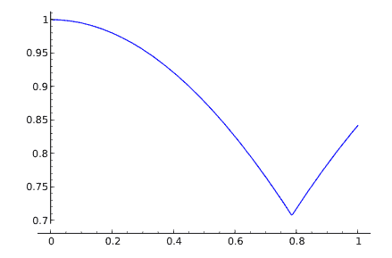

**图 14.5** —— 函数 $x \mapsto \max(\sin(x), \cos(x))$。$\pi/4$ 处的不规则性使数值积分变得相当棘手。

```sage
sage: mpmath.quadts(lambda x: g(N(x, 170)), [0, mpmath.pi / 4, 1])
mpf('0.87391125650495533140075211676672147483736145475902551')
```

不连续函数（或导数不连续的函数）是积分方法的经典“陷阱”；然而，如上所述的自动细分策略可以限制其影响。

**练习 49**（牛顿-科茨系数的计算）。我们想要计算具有 $n$ 个点的牛顿-科茨方法的系数，而 Sage 中并未提供该功能。为简单起见，我们考虑积分区间为 $I = [0, n - 1]$，因此积分点为 $x_1 = 0$、$x_2 = 1$、$\ldots$、$x_n = n - 1$。求积规则的系数 $(w_i)$ 满足方程

$$
\int_0^{n-1} f(x)\,dx = \sum_{i=0}^{n-1} w_i f(i) \tag{14.1}
$$

对任意次数不超过 $n - 1$ 的多项式 $f$ 都精确成立。

- 1. 对 $i \in \{0, \ldots, n - 1\}$，考虑多项式 $P_i(X) = \prod_{\substack{j=0\\j\neq i}}^{n-1}(X - x_j)$。将方程 (14.1) 应用于 $P_i$，用 $P_i$ 表示并确定 $w_i$。
- 2. 推导一个函数 `NCrule`，它将 $n$ 关联到区间 $[0, n - 1]$ 上具有 $n$ 个点的牛顿-科茨规则的系数。
- 3. 说明如何将这些权重应用于区间 $[a, b]$，其中 $a, b$ 为任意实数。
- 4. 编写一个函数 `QuadNC`，它计算在作为参数给出的 $\mathbb{R}$ 的一段上给定的函数的积分。将其结果与 Sage 中可用的积分函数在积分 $I_1$ 到 $I_{10}$ 上的结果进行比较。

#### 14.1.2 多重积分

让我们考虑二重积分：

$$I = \int_0^1 \int_0^{\sqrt{y}} \exp(y\sin x)\, dx\, dy.$$

我们首先尝试通过寻找内层积分的闭式表达式将其化为简单积分，但在此情况下失败了：

```sage
sage: y = var('y'); integrate(exp(y*sin(x)), (x, 0, sqrt(y)))
integrate(e^(y*sin(x)), x, 0, sqrt(y))
```

由于 Sage 不提供任何多重积分功能，我们将问题重写为 $I = \int_0^1 f(y)\,dy$，其中 $f$ 是一个 Sage 函数，它本身调用数值积分方法：

```sage
sage: f = lambda y: numerical_integral(lambda x: exp(y*sin(x)), \
...:                                     0, sqrt(y))[0]
sage: f(0.0), f(0.5), f(1.0)
(0.0, 0.8414895067661431, 1.6318696084180513)
```

现在我们可以数值计算 $f$ 在 $[0,1]$ 上的积分：

```sage
sage: numerical_integral(f, 0, 1)
(0.8606791942204567, 6.301207560882073e-07)
```

我们也可以使用 sage.calculus.calculus.nintegral 来计算 $f$：

```sage
sage: f = lambda y: sage.calculus.calculus.nintegral(exp(y*sin(x)), \
...:                                      x, 0, sqrt(y))[0]
sage: numerical_integral(f, 0, 1)
(0.860679194220456..., 6.301207560882096e-07)
```

甚至使用 mpmath.quad：

```sage
sage: f = lambda y: RDF(mpmath.quad(lambda x: mpmath.exp(y*mpmath.sin(x)), \
...:                                      [0, sqrt(y)]))
sage: numerical_integral(f, 0, 1)
(0.8606791942204567, 6.301207561187562e-07)
```

注意，mpmath 能够直接计算多重积分，甚至支持任意精度，但仅限于矩形区域：

```sage
sage: mpmath.mp.dps = 60
sage: f = lambda x, y: mpmath.exp(y*mpmath.sin(x))
sage: mpmath.quad(f, [0,1], [0,1])
mpf('1.28392205575238471754385917646324675741664250325189751108716305')
```

有时，特别是当被积函数计算代价高昂时，我们希望答案最多进行（比如）$n^2$ 次求值，即使结果的精度会变差。下面是使用 numerical_integral 的选项 algorithm 和 max_points 的一种解决方案：

```sage
sage: def evalI(n):
....:     f = lambda y: numerical_integral(lambda x: exp(y*sin(x)),
....:                                    0, sqrt(y), algorithm='qng', max_points=n)[0]
....:     return numerical_integral(f, 0, 1, algorithm='qng', max_points=n)
sage: evalI(100)
(0.8606792028826138, 5.553962923506737e-07)
```

### 14.2 数值求解常微分方程

在本节中，我们关注数值求解常微分方程。Sage 中可用的函数能够处理如下形式的系统：

$\begin{cases}\frac{dy_1}{dt}(t)=f_1(t,y_1(t),y_2(t),\ldots,y_n(t))\\[2pt]\frac{dy_2}{dt}(t)=f_2(t,y_1(t),y_2(t),\ldots,y_n(t))\\\vdots\\\frac{dy_n}{dt}(t)=f_n(t,y_1(t),y_2(t),\ldots,y_n(t))\end{cases}$

其初始条件 $(y_1(0), y_2(0), \ldots, y_n(0))$ 已知。

这种设置使我们也能通过引入辅助变量来求解阶数大于 1 的问题（参见 §14.2.1 中的详细示例）。然而，它不允许表示 Dickman 的 $\rho$ 函数所满足的方程组：

$\begin{cases}u\rho'(u)+\rho(u-1)=0 & \text{for }u\geq 1,\\\rho(u)=1 & \text{for }0\leq u\leq 1.\end{cases}$

实际上，求解常微分方程的工具不适合这种方程（称为*带延迟*方程）。

“单步”数值方法都使用相同的一般原理：对于给定的步长 $h$ 以及已知的 $y(t_0)$ 和 $y'(t_0)$ 值，我们根据在区间 $[t_0,t_0+h]$ 上取得的 $y'(t)$ 估计值来计算 $y(t_0+h)$ 的近似值。最简单的方法由以下近似组成：

$\forall t\in[t_0,t_0+h],\quad y'(t)\approx y'(t_0),$

$\int_{t_0}^{t_0+h}y'(t)\,dt\approx hy'(t_0),$

$y(t_0+h)\approx y(t_0)+hy'(t_0).$

用常数在 $[t_0,t_0+h]$ 上近似 $y'$ 让我们想到矩形求积规则。所得到的方法是 1 阶的，即假设 $f$ 足够正则，经过一个计算步骤后产生的误差为 $O(h^2)$。一般来说，如果一个宽度为 $h$ 的步骤上产生的误差为 $O(h^{p+1})$，则该方法为 $p$ 阶。这样，在 $t_1=t_0+h$ 处得到的值被用作起点再进行一步，直到达到所需目标。

这种 1 阶方法称为欧拉法，并不以其精度著称（如同数值积分中的矩形规则），并且存在一些更高阶的方法，例如用于求解方程 \(y' = f(t,y)\) 的 2 阶龙格-库塔法：

\[
\begin{aligned}
k_1 &= h f(t_n,y(t_n)) \\
k_2 &= h f\left(t_n + \tfrac{1}{2}h, y(t_n) + \tfrac{1}{2}k_1\right) \\
y(t_{n+1}) &\approx y(t_n) + k_2 + O(h^3).
\end{aligned}
\]

在该方法中，我们尝试计算 \(y'(t_n+h/2)\) 以获得 \(y(t_n+h)\) 的更好估计。

还存在一些多步方法（例如 Gear 法）：对于给定的步数 \(\ell\)，它们根据已经计算出的值 \(y(t_{n-1}), y(t_{n-2}), \ldots, y(t_{n-\ell})\) 来计算 \(y(t_n)\)。这些方法必然需要一个初始阶段，在获得足够多的值之前。

与 Gauss-Kronrod 求积方法类似，也存在一些用于求解微分方程的混合方法。例如，Dormand-Prince 方法使用相同的近似点计算 4 阶和 5 阶的值，后者用于估计前者产生的误差。我们称其为自适应方法。

我们还区分显式方法和隐式方法：在显式方法中，\(y(t_{n+1})\) 的值由仅使用已知值的公式给出；对于隐式方法，我们必须求解一个方程。例如，让我们考虑隐式欧拉法：

\[
y(t_{n+1}) = y(t_n) + h f(t_{n+1}, y(t_{n+1})).
\]

所求值 \(y(t_{n+1})\) 出现在方程两边；如果函数 \(f\) 足够复杂，我们必须求解一个非线性代数系统，通常使用牛顿法（参见 §12.2.2）。

先验地，我们预期减小积分步长 \(h\) 会得到更精确的结果；然而，除了这隐含的额外计算之外，预期的精度提升还会被增加的舍入误差所抵消，最终这些舍入误差相对于最终结果可能变得显著。

#### 14.2.1 一个示例

让我们考虑参数为 \(\mu\) 的 Van der Pol 振子，它满足以下微分方程：

\[
\frac{\mathrm{d}^2x}{\mathrm{d}t^2}(t) - \mu(1-x^2)\frac{\mathrm{d}x}{\mathrm{d}t}(t) + x(t) = 0.
\]

记 \(y_0(t)=x(t)\) 和 \(y_1(t)=\frac{\mathrm{d}x}{\mathrm{d}t}\)，我们得到 1 阶系统：

\[
\begin{cases}
\dfrac{\mathrm{d}y_0}{\mathrm{d}t} = y_1,\\
\dfrac{\mathrm{d}y_1}{\mathrm{d}t} = \mu(1-y_0^2)y_1-y_0.
\end{cases}
\]

为了求解它，我们将使用 ode_solver 命令提供的“求解器”对象：

```sage
sage: T = ode_solver()
```


求解器对象使我们能够注册待求解系统的定义和参数；它提供了来自 GSL 库的微分方程数值求解工具，这些工具在数值积分部分已经提到过。

系统方程以函数的形式给出：

```python
sage: def f_1(t,y,params): return [y[1],params[0]*(1-y[0]^2)*y[1]-y[0]]
sage: T.function = f_1
```

参数 y 表示未知函数向量，我们应返回系统的右端向量，其以 t 和一个可选参数表示（这里的 params[0] 表示 $\mu$）。

一些 GSL 算法还要求系统的雅可比矩阵（其第 $(i, j)$ 项为 $\frac{\partial f_i}{\partial y_j}$，最后一行包含 $\frac{\partial f_i}{\partial t}$）：

```python
sage: def j_1(t,y,params):
....:     return [[0, 1],
....:             [-2*params[0]*y[0]*y[1]-1, params[0]*(1-y[0]^2)],
....:             [0,0]]
sage: T.jacobian = j_1
```

现在可以请求数值解。我们选择算法、希望求解的区间以及步数，步数决定 $h$：

```python
sage: T.algorithm = "rk8pd"
sage: T.ode_solve(y_0=[1,0], t_span=[0,100], params=[10],
....:           num_points=1000)
sage: f = T.interpolate_solution()
```

这里，我们选择 Runge-Kutta Dormand-Prince 算法在 $[0,100]$ 上计算解；初始条件和参数值（这里只有一个参数）也已给出：$y_0=[1,0]$ 表示 $y_0(0) = 1, y_1(0) = 0$，即 $x(0) = 1, x'(0) = 0$。

为了显示解的图形（我们可以尝试 `plot(f, 0, 2)` 来更清楚地看到 $t = 0$ 处的零导数）：

```python
sage: plot(f, 0, 100)
```

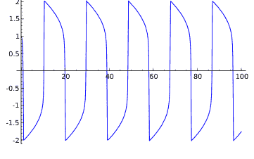

#### 14.2.2 可用函数

我们已经在 GSL 的求解器对象中提到了 `rk8pd` 方法。其他可用方法包括：

- `rkf45`：Runge-Kutta-Fehlberg，一种 5 阶和 4 阶自适应方法；
- `rk2`：3 阶和 2 阶自适应 Runge-Kutta 方法；
- `rk4`：经典的 4 阶 Runge-Kutta 方法；
- `rk2imp`：一种隐式 2 阶 Runge-Kutta 方法，在区间中点处求值；
- `rk4imp`：一种隐式 4 阶 Runge-Kutta 方法，在“高斯点”⁴处求值；
- `bsimp`：隐式 Bulirsch-Stoer 方法；
- `gear1`：隐式单步 Gear 方法；
- `gear2`：隐式两步 Gear 方法。

关于所有这些方法的更多细节，请读者参阅 [AP98]。

应当注意，我们为数值积分提到的 GSL 对机器浮点数的限制——因而是固定精度——同样适用于求解微分方程。

Maxima 也提供了用其自身语法数值求解微分方程的程序：

```sage
sage: t, y = var('t, y')
sage: desolve_rk4(t*y*(2-y), y, ics=[0,1], end_points=[0, 1], step=0.5)
[[0, 1], [0.5, 1.12419127424558], [1.0, 1.461590162288825]]
```

`desolve_rk4` 函数使用 4 阶 Runge-Kutta 方法（与 GSL 的 `rk4` 相同），其参数包括：

- 方程的右端 \(y'(t) = f(t,y(t))\)，这里为 \(y' = ty(2-y)\)；
- 未知函数的名称，这里为 \(y\)；
- 初始条件 `ics`，这里为 \(t = 0\) 且 \(y = 1\)；
- 求解区间 `end_points`，这里为 \([0,1]\)；
- 求解步长，这里为 0.5。

我们省略类似的命令 `desolve_system_rk4`，它已在第 4 章提到，适用于微分方程组。Maxima 同样受限于机器精度。

如果我们想要任意精度解，可以使用 `mpmath` 包中的 `odefun`：

⁴二次 Legendre 多项式的根，它们被平移到区间 \([t, t + h]\) 上，其名称源自 Gauss-Legendre 求积规则。

```sage
sage: import mpmath
sage: mpmath.mp.prec = 53
sage: sol = mpmath.odefun(lambda t, y: y, 0, 1)
sage: sol(1)
mpf('2.7182818284590451')
sage: mpmath.mp.prec = 100
sage: sol(1)
mpf('2.7182818284590452353602874802307')
sage: N(exp(1), 100)
2.7182818284590452353602874714
```

`mpmath.odefun` 函数的参数如下：

- 方程组的右端，以函数 \((t,y) \mapsto f(t,y(t))\) 的形式给出，这里为 \(y'=y\)，与 `ode_solver` 函数类似。系统的维数由函数返回值的维数自动推断；
- 初始条件 \(t_0\) 和 \(y(t_0)\)，这里为 \(y(0)=1\)。

例如，对于这个二维系统

$$\begin{cases} y_1' &= -y_2 \\ y_2' &= y_1 \end{cases}$$

其解为 \((\cos(t),\sin(t))\)，初始条件为 \(y_1(0)=1\) 和 \(y_2(0)=0\)：

```sage
sage: mpmath.mp.prec = 53
sage: f = mpmath.odefun(lambda t, y: [-y[1], y[0]], 0, [1, 0])
sage: f(3)
[mpf('-0.98999249660044542'), mpf('0.14112000805986721')]
sage: (cos(3.), sin(3.))
(-0.98999249660044505, 0.141120008059867)
```

`mpmath.odefun` 函数依赖 Taylor 方法。对于次数 \(p\)，它使用：

$$y(t_{n+1}) = y(t_n) + h\frac{dy}{dt}(t_n) + \frac{h^2}{2!}\frac{d^2y}{dt^2}(t_n) + \ldots + \frac{h^p}{p!}\frac{d^py}{dt^p}(t_n) + O(h^{p+1}).$$

主要问题在于计算 \(y\) 的导数。为此，`odefun` 计算近似值

$$[\widetilde y(t_n+h),\ldots,\widetilde y(t_n+ph)] \approx [y(t_n+h),\ldots,y(t_n+ph)]$$

使用较不精确的 Euler 方法的 \(p\) 步。然后我们计算

$$\frac{dy}{dt}(t_n) \approx \frac{\widetilde y(t_n+h)-\widetilde y(t_n)}{h}, \qquad \frac{dy}{dt}(t_n+h) \approx \frac{\widetilde y(t_n+2h)-\widetilde y(t_n+h)}{h}$$

然后

$$\frac{d^2y}{dt^2}(t_n) \approx \frac{\frac{dy}{dt}(t_n+h)-\frac{dy}{dt}(t_n)}{h},$$

## 15 枚举与组合数学

本章主要介绍 Sage 中处理以下组合问题的内容：枚举（集合 $S$ 中有多少个元素？）、列出（生成 $S$ 的所有元素，或遍历它们）以及随机选择（根据给定分布，例如均匀分布，从集合 $S$ 中随机选择一个元素）。这些问题自然地出现在概率计算中（在扑克中获得顺子或四个 A 的概率是多少？）、统计物理中，也出现在计算机代数中（有限域中元素的数量），或算法分析中。组合数学涵盖的领域要广泛得多（偏序、表示论……），我们只给出一些指向 Sage 所提供可能性的线索。图在第 16 章讨论。

计算组合数学的一个特点是需要操作的对象和集合种类繁多。不可能将它们全部描述出来，更不用说全部实现。在一些示例（§15.1）之后，本章说明其基本方法：提供用于描述常见组合集合的基本构件 §15.2，用于组合它们以构造新示例的工具 §15.3，以及用于统一解决一大类问题的通用算法 §15.4。初读时，本章可以快速跳过，在 §15.1.2 和 §15.3 节的总结处稍作停留。

在这个领域中，Sage 的能力比大多数计算机代数系统都要广泛得多，并且正在快速扩展；与此同时，它仍然相当新，并且存在许多不必要的限制和不一致之处。

### 15.1 初始示例

#### 15.1.1 扑克与概率

我们首先解决一个经典问题：枚举扑克游戏中某些牌的组合，以推导其概率。

扑克牌中的一张牌由花色（红桃、方块、黑桃或梅花）和点数（2、3、……、10、J、Q、K、A）确定。游戏使用一副完整的牌，即花色集合与点数集合的笛卡尔积：

Cards = Suits × Values = {(s,v) | s ∈ Suits 且 v ∈ Values}。

我们在 Sage 中构造这些示例：

```sage
sage: Suits = Set(["Hearts", "Diamonds", "Spades", "Clubs"])
sage: Values = Set([2, 3, 4, 5, 6, 7, 8, 9, 10,
....:               "Jack", "Queen", "King", "Ace"])
sage: Cards = cartesian_product([Values, Suits])
```

有 4 种花色和 13 个可能点数，因此扑克牌中有 4 × 13 = 52 张牌：

```sage
sage: Suits.cardinality()
4
sage: Values.cardinality()
13
sage: Cards.cardinality()
52
```

随机抽取一张牌：

```sage
sage: Cards.random_element()
(6, 'Clubs')
```

随机抽取两张牌：

```sage
sage: Set([Cards.random_element(), Cards.random_element()])
{(2, 'Hearts'), (4, 'Spades')}
```

回到我们的主题，我们将考虑一种简化版扑克，其中每位玩家直接抽取五张牌，组成其手牌。所有牌互不相同，且抽取顺序无关紧要；因此，一手牌是牌集合中大小为 5 的子集。为了随机抽取一手牌，我们首先构造所有可能手牌的集合，然后请求随机选择一个元素：

```sage
sage: Hands = Subsets(Cards, 5)
sage: Hands.random_element()
{(4, 'Hearts'), (9, 'Diamonds'), (8, 'Spades'),
 (9, 'Clubs'), (7, 'Hearts')}
```


手牌总数由大小为 52 的集合中大小为 5 的子集数量给出，即二项式系数 \(\binom{52}{5}\)：

```
sage: binomial(52, 5)
2598960
```

也可以忽略计算方法，直接询问手牌集合的大小：

```
sage: Hands.cardinality()
2598960
```

一手扑克的强弱取决于其中出现的具体牌面组合。其中一种组合是*同花*；即所有牌均为同一花色的手牌。（原则上应排除同花顺；这将是下文一道练习的目标。）因此，这样一手牌的特征是从 13 种可能点数中选出 5 个值，并从 4 种花色中选出 1 种。我们将构造所有同花手牌的集合，以确定其数量：

```
sage: Flushes = cartesian_product([Subsets(Values, 5), Suits])
sage: Flushes.cardinality()
5148
```

因此，随机抽取一手牌时得到同花的概率为：

```
sage: Flushes.cardinality()  / Hands.cardinality()
33/16660
```

约为千分之二：

```
sage: 1000.0 * Flushes.cardinality()  / Hands.cardinality()
1.98079231692677
```

下面我们尝试做一点数值模拟。以下函数检验给定的一手牌是否为同花：

```
sage: def is_flush(hand):
....:     return len(set(suit for (val, suit) in hand)) == 1
```

现在我们随机抽取 10000 手牌，并统计得到的同花数量。（这大约需要 10 秒。）

```
sage: n = 10000
sage: nflush = 0
sage: for i in range(n):
....:     hand = Hands.random_element()
....:     if is_flush(hand):
....:         nflush += 1
sage: print(n, nflush)
10000 18
```

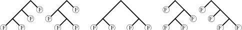

图15.1 —— 具有四片叶子的五棵完整二叉树。

- **练习 50.** 包含四张点数相同的牌的一手牌称为*四条*。构造四条手牌的集合。（提示：使用 Arrangements 随机选择一对不同的点数，然后为第一个点数选择一种花色。）计算四条手牌的数量，列出它们，然后确定随机抽取一手牌时得到四条的概率。

- **练习 51.** 若一手牌所有牌均为同一花色，且这些点数连续，则称为*同花顺*，否则称为*同花*。统计同花顺的数量，然后推导随机抽取一手牌时得到同花的正确概率。

- **练习 52.** 计算每种扑克牌型（见 [http://en.wikipedia.org/wiki/Poker_hands](http://en.wikipedia.org/wiki/Poker_hands)）的概率，并与模拟结果进行比较。

#### 15.1.2 使用生成函数枚举树

本节讨论完整二叉树的例子，并在此背景下说明许多枚举技术，其中形式幂级数发挥着自然的作用。这些技术相当通用，只要所讨论的组合对象允许递归定义（文法），就可以应用（自动化处理见§15.4.3）。目标并不是对这些方法作形式化介绍；计算是严谨的，但大多数论证将被略过。

一棵*完整二叉树*要么是一片叶子 F，要么是一个节点，其下附接两棵完整二叉树（见图15.1）。

- **练习 53.** 手工找出所有具有 $n = 1, 2, 3, 4, 5$ 片叶子的完整二叉树（使用 Sage 找出它们见练习61）。

我们的目标是确定具有 $n$ 片叶子的完整二叉树的数量 $c_n$（在本节中，除非另有明确说明，“树”始终指完整二叉树）。这是一种典型情形：人们不仅关心单个集合，而且关心一个集合族，通常由 $n \in \mathbb{N}$ 参数化。

根据练习53的解答，前几项为 $c_1, \ldots, c_5 = 1, 1, 2, 5, 14$。仅仅知道这几个数就已经非常有价值。事实上，这使人们能够在一个信息金矿中检索：*整数序列在线百科全书* [http://oeis.org/](http://oeis.org/)（通常称为“Sloane”，即其主要作者的名字），其中包含超过 282892 个整数序列：

```
sage: oeis([1,1,2,5,14])
0: A000108: Catalan numbers: C(n) = binomial(2n,n)/(n+1) = (2n)!/(n!(n+1)!). Also called Segner numbers.
1: A120588: G.f. satisfies: 3*A(x) = 2 + x + A(x)^2, with a(0) = 1.
2: A080937: Number of Catalan paths (nonnegative, starting and ending at 0, step +/-1) of 2n steps with all values <= 5.
```

结果暗示，这些树由最著名的序列之一——卡塔兰数——来计数。查阅该百科全书提供的参考文献后，我们发现情况确实如此：上面这几个数构成了我们研究对象的一种数字指纹，使我们能够在几秒钟内从大量文献中找到精确结果。

##### 使用生成级数进行枚举

我们的下一个目标是使用 Sage 重新得到这一结果。设 $C_n$ 为具有 $n$ 片叶子的树的集合，因此 $c_n = |C_n|$；按约定，我们定义 $C_0 = \emptyset$ 且 $c_0 = 0$。于是所有树的集合是各集合 $C_n$ 的不交并：

$$C = \bigsqcup_{n\in\mathbb{N}} C_n.$$

将所有这些树的集合命名为 $C$ 后，我们可以把树的递归定义转化为集合论方程：

$$C \approx \{\mathrm{L}\} \uplus C \times C.$$

换言之：一棵树 $t$（按定义属于 $C$）要么是一片叶子（因此属于 $\{\mathrm{L}\}$），要么是一个节点，其下附接了两棵树 $t_1$ 和 $t_2$，因此我们可以将其等同于有序对 $(t_1,t_2)$（位于笛卡尔积 $C \times C$ 中）。

代数组合学的奠基性思想由欧拉在 1751 年写给哥德巴赫的一封信中为处理一个类似问题而引入，其做法是同时处理所有数 $c_n$，将它们编码为形式幂级数中的系数，该幂级数称为这些 $c_n$ 的*生成函数*：

$$C(z) = \sum_{n\in\mathbb{N}} c_n z^n,$$

其中 $z$ 是形式变量（这意味着我们不必担心收敛性问题）。这个思想的美妙之处在于，集合论运算 $(A \uplus B, A \times B)$ 会自然地转化为对应级数上的代数运算 $(A(z) + B(z), A(z) \cdot B(z))$，使得 $C$ 所满足的集合论方程可以直接转化为 $C(z)$ 所满足的代数方程：

$$C(z) = z + C(z) \cdot C(z).$$

现在我们可以用 Sage 求解这个方程。为此，我们引入两个变量 $C$ 和 $z$，并定义方程：

```
sage: C, z = var('C, z'); sys = [ C == z + C*C ]
```

有两个解，它们恰好具有闭形式：

```
sage: sol = solve(sys, C, solution_dict=True); sol
[{C: -1/2*sqrt(-4*z + 1) + 1/2}, {C: 1/2*sqrt(-4*z + 1) + 1/2}]
sage: s0 = sol[0][C]; s1 = sol[1][C]
```

其泰勒级数开头如下：

```
sage: s0.series(z, 6)
1*z + 1*z^2 + 2*z^3 + 5*z^4 + 14*z^5 + Order(z^6)
sage: s1.series(z, 6)
1 + (-1)*z + (-1)*z^2 + (-2)*z^3 + (-5)*z^4 + (-14)*z^5 + Order(z^6)
```

第二个解显然没有意义，而第一个解给出了预期的系数。因此，我们令：

```
sage: C = s0
```

现在我们可以计算接下来的项：

```
sage: C.series(z, 11)
1*z + 1*z^2 + 2*z^3 + 5*z^4 + 14*z^5 + 42*z^6 + 132*z^7 + 429*z^8 + 1430*z^9 + 4862*z^10 + Order(z^11)
```

或者几乎瞬间计算出第 100 个系数：

```
sage: C.series(z, 101).coefficient(z,100)
227508830794229349661819540395688853956041682601541047340
```

如果某个时候我们想要第 101 个系数，却不得不重新计算所有内容，那就很不方便。惰性幂级数（见§7.5.3）在这里正好发挥其优势：人们可以由方程组定义它们而无需求解该方程组，尤其是不需要答案的闭形式。我们首先定义惰性幂级数环：

```
sage: L.<z> = LazyPowerSeriesRing(QQ)
```

然后我们创建一个“自由”幂级数，为其命名，再用递归方程定义它：

```
sage: C = L()
sage: C._name = 'C'
sage: C.define(z + C * C )
```

```
sage: [C.coefficient(i) for i in range(11)]
[0, 1, 1, 2, 5, 14, 42, 132, 429, 1430, 4862]
```

在任何时候，都可以查询任意系数，而无需重新定义 C：

```
sage: C.coefficient(100)
227508830794229349661819540395688853956041682601541047340
```

```
sage: C.coefficient(200)
129013158064429114001222907669676675134349530552728882499810851598901419013348319045534580850847735528275750122188940
```


**递推关系与闭式公式。** 现在我们回到 $C(z)$ 的闭式形式：

```sage
sage: z = var('z'); C = s0; C
-1/2*sqrt(-4*z + 1) + 1/2
```

$C(z)$ 的泰勒级数中的第 $n$ 个系数由 $\frac{1}{n!}C(z)^{(n)}(0)$ 给出，我们考察其逐次导数 $C(z)^{(n)}(z)$：

```sage
sage: derivative(C, z, 1)
1/sqrt(-4*z + 1)
sage: derivative(C, z, 2)
2/(-4*z + 1)^(3/2)
sage: derivative(C, z, 3)
12/(-4*z + 1)^(5/2)
```

这表明存在一个简单的显式公式，我们现在就来寻找。下面这个小函数返回 $d_n = n!c_n$：

```sage
sage: def d(n): return derivative(C, n).subs(z=0)
```

取逐次商：

```sage
sage: [ (d(n+1) / d(n)) for n in range(1,17) ]
[2, 6, 10, 14, 18, 22, 26, 30, 34, 38, 42, 46, 50, 54, 58, 62]
```

我们观察到 $d_n$ 满足递推关系 $d_{n+1} = (4n-2)d_n$，由此我们推断出 $c_n$ 满足递推关系 $c_{n+1} = \frac{(4n-2)}{n+1}c_n$。化简后，我们发现 $c_n$ 是第 $(n-1)$ 个卡特兰数：

$$c_n = \mathrm{Catalan}(n-1) = \frac{1}{n}\binom{2(n-1)}{n-1}.$$

我们来验证一下：

```sage
sage: def c(n): return 1/n*binomial(2*(n-1),n-1)
sage: [c(k) for k in range(1, 11)]
[1, 1, 2, 5, 14, 42, 132, 429, 1430, 4862]
sage: [catalan_number(k-1) for k in range(1, 11)]
[1, 1, 2, 5, 14, 42, 132, 429, 1430, 4862]
```

现在我们可以计算更大规模的系数；这里我们计算 $c_{100000}$，它有超过 60000 位数字：

```sage
sage: %time cc = c(100000)
CPU times: user 2.34 s, sys: 0.00 s, total: 2.34 s
Wall time: 2.34 s
sage: ZZ(cc).ndigits()
60198
```

##### 代数-微分方程的系统处理

我们使用的方法可以推广到所有递归定义的对象：集合论方程组可以转化为生成函数上的方程组，从而能够递归计算其系数。如果集合论方程足够简单（例如，只涉及笛卡尔积和不相交并），则 $C(z)$ 的方程是代数的。这个方程一般没有闭式解。然而，利用*限定*（confinement），我们可以推导出 $C(z)$ 满足的一个*线性*微分方程。这个微分方程又可以转化为其系数 $c_n$ 上的固定长度递推关系。在这种情况下，该级数称为 *D-有限*（D-finite）的。在初步计算出这个递推关系之后，系数的计算就非常快了。所有这些步骤都是纯算法的，并且计划将 Maple（gfun 和 combstruct 包）或 MuPAD-Combinat（decomposableObjects 库）中已有的实现移植到 Sage 中。

目前，我们以完全二叉树为例来说明这一通用过程。生成函数 $C(z)$ 是代数方程 $P(z,C(z))=0$ 的一个解，其中 $P=P(x,y)$ 是系数在 $\mathbb{Q}$ 中的多项式。在当前情况下，$P=y^2-y+x$。我们对这个方程关于 $z$ 进行形式微分：

```sage
sage: x, y, z = var('x, y, z')
sage: P = function('P')(x, y); C = function('C')(z)
sage: equation = P(x=z, y=C) == 0
sage: diff(equation, z)
diff(C(z), z)*D[1](P)(z, C(z)) + D[0](P)(z, C(z)) == 0
```

或者，以更可读的格式，

$$\frac{dC(z)}{dz}\frac{\partial P}{\partial y}(z,C(z)) + \frac{\partial P}{\partial x}(z,C(z)) = 0.$$

由此我们推导出：

$$\frac{dC(z)}{dz}=-\frac{\frac{\partial P}{\partial x}(z,C(z))}{\frac{\partial P}{\partial y}(z,C(z))}.$$

在完全二叉树的情况下，这给出：

```sage
sage: P = y^2 - y + x; Px = diff(P, x); Py = diff(P, y)
sage: - Px / Py
-1/(2*y - 1)
```

回想一下 $P(z,C(z))=0$。因此，我们可以计算这个分式模 $P$，从而将 $C(z)$ 的导数表示为*系数在 $\mathbb{Q}(z)$ 中的关于 $C(z)$ 的多项式*。为了实现这一点，我们构造商环 $R=\mathbb{Q}(x)[y]/(P)$：

```sage
sage: Qx = QQ['x'].fraction_field(); Qxy = Qx['y']
sage: R = Qxy.quo(P); R
Univariate Quotient Polynomial Ring in ybar
 over Fraction Field of Univariate Polynomial Ring in x
 over Rational Field with modulus y^2 - y + x
```

注意：ybar 是商环中变量 $y$ 的名字；关于商环的更多信息，参见 §7.2.2。我们继续在 $R$ 中计算这个分式：

```sage
sage: fraction = - R(Px) / R(Py); fraction
(1/2*(x - 1/4))*ybar - 1/4/(x - 1/4)
```

我们将结果提升到 $\mathbb{Q}(x)[y]$，然后代入 $z$ 和 $C(z)$，得到 $\frac{\partial}{\partial z}C(z)$ 的表达式：

```sage
sage: fraction = fraction.lift(); fraction
(1/2*(x - 1/4))*y - 1/4/(x - 1/4)
sage: fraction(x=z, y=C)
2*C(z)/(4*z - 1) - 1/(4*z - 1)
```

或者，更清晰地，

$$\frac{\partial C(z)}{\partial z} = \frac{1}{1-4z} - \frac{2}{1-4z}C(z).$$

在这个简单情形中，我们可以直接从该表达式推导出系数在 $\mathbb{Q}[z]$ 中的线性微分方程：

```sage
sage: eqdiff = diff(C,z) == fraction(x=z, y=C); eqdiff
diff(C(z), z) == 2*C(z)/(4*z - 1) - 1/(4*z - 1)
sage: eqdiff = eqdiff.simplify_rational()
sage: eqdiff = eqdiff * eqdiff.rhs().denominator()
sage: eqdiff = eqdiff - eqdiff.rhs()
sage: eqdiff
(4*z - 1)*diff(C(z), z) - 2*C(z) + 1 == 0
```

或者，更清晰地，

$$\left(1-4z\right)\frac{\partial C(z)}{\partial z} + 2C(z) - 1 = 0.$$

在闭式形式上验证这个方程是平凡的：

```sage
sage: Cf = sage.symbolic.function_factory.function('C')
sage: bool(eqdiff.substitute_function(Cf, lambda z: s0(z=z)))
True
```

在一般情况下，我们继续计算 $C(z)$ 的逐次导数。这些导数被*限定*在商环 $\mathbb{Q}(z)[C]/(P)$ 中，该商环在 $\mathbb{Q}(z)$ 上的维数为 $\deg P$。因此，我们最终会在 $C(z)$ 的前 $\deg P$ 个导数之间找到一个线性关系。将其放到一个公分母上，我们得到阶数 $\leq \deg P$ 且系数在 $\mathbb{Q}[z]$ 中的线性微分方程。通过提取微分方程中 $z^n$ 的系数，我们得到所需的系数递推关系；在这个情形中，我们恢复了之前基于闭式形式已经找到的关系：

$$c_{n+1} = \frac{4n-2}{n+1}c_n.$$

在确定正确的初始条件后，就可以递归地计算 $C(z)$ 的系数：

```sage
sage: def C(n): return n if n <= 1 else (4*n-6)/n * C(n-1)
sage: [ C(i) for i in range(10) ]
[0, 1, 1, 2, 5, 14, 42, 132, 429, 1430]
```

如果 $n$ 太大，无法显式计算 $c_n$，则可以寻找与系数序列 $c_n$ 渐近等价的序列。这里同样有通用技术。核心工具是复分析，特别是研究生成函数在其奇点附近的行为。在目前的例子中，奇点位于 $z_0 = 1/4$，我们将得到 $c_n \sim \frac{4^{n-1}}{n^{3/2}\sqrt{\pi}}$。

**小结。** 我们在这里看到计算机代数的一个普遍现象：描述复杂数学对象（实数、序列、形式幂级数、函数、集合）的最佳*数据结构*通常是定义该对象的方程（或方程组，通常带有一些初始条件）。试图寻找这个方程的闭式解并不一定有意义：一方面，这种闭式很少存在（例如，用根式求解多项式的问题），另一方面，方程本身包含了所有必要信息，足以通过算法计算所考虑对象的性质（例如数值近似、初始项或元素、渐近等价），或者与对象本身进行计算（例如对幂级数进行算术运算）。因此，与其解方程，我们不如寻找描述该对象且最适合我们想要解决的问题的方程；另见 §2.2.2。

正如我们在例子中所看到的，限定（例如在有限维向量空间中）是研究此类方程的基本工具。这种限定的概念在消元技术（线性代数、Gröbner 基及其代数-微分推广）中有着广泛的应用。同样的工具在自动求和与恒等式自动验证算法（Gosper 算法、Zeilberger 算法及其推广 [PWZ96]；另见 §2.3.1 中的例子和练习 56）中也是核心。

所有这些技术及其众多推广是当前非常活跃的研究主题的核心：自动组合学和分析组合学，它们在算法分析中有重要应用 [FS09]。它们有望逐步在 Sage 中实现，这也是我们所期望的。

### 15.2 常见枚举集合

#### 15.2.1 第一个例子：集合的子集

固定一个大小为 $n$ 的集合 $E$，并考虑 $E$ 的大小为 $k$ 的子集。我们知道这些子集由二项式系数 $\binom{n}{k}$ 计数。因此，我们可以用函数 binomial 计算 $E = \{1, 2, 3, 4\}$ 的大小为 $k = 2$ 的子集个数：

```sage
sage: binomial(4, 2)
6
```


从物理上不可能显式构造 $S$ 的所有元素，因为它们的数量远多于宇宙中的粒子数（估计为 $10^{82}$）。

**备注：** 在 Python 中，使用 `len(S)` 询问 `S` 的基数是很自然的。但这是不可能的，因为 Python 要求 `len` 的结果是 `int` 类型的整数；这可能导致溢出，并且不允许对无限集返回 `Infinity`。

```sage
sage: len(S)
Traceback (most recent call last):
...
OverflowError: Python int too large to convert to C long
```

#### 15.2.2 整数分拆

我们现在考虑另一个经典问题：给定正整数 $n$，它可以有多少种方式写成正整数之和 $n = i_1 + i_2 + \cdots + i_\ell$？需要区分两种情况：

- 和中元素的顺序不重要，此时我们称 $\{i_1,\ldots,i_\ell\}$ 为 $n$ 的一个*分拆*；
- 和中元素的顺序重要，此时我们称 $(i_1,\ldots,i_\ell)$ 为 $n$ 的一个*有序分拆*。

我们从 $n = 5$ 的分拆开始；和之前一样，首先构造这些分拆的集合：

```sage
sage: P5 = Partitions(5); P5
Partitions of the integer 5
```

然后询问它的基数：

```sage
sage: P5.cardinality()
7
```

我们看看这 7 个分拆；由于顺序无关紧要，按照惯例，各项按降序排列。

```sage
sage: P5.list()
[[5], [4, 1], [3, 2], [3, 1, 1], [2, 2, 1], [2, 1, 1, 1],
[1, 1, 1, 1, 1]]
```

分拆数的计算使用 Rademacher 公式（见 http://en.wikipedia.org/wiki/Partition_(number_theory)），该公式用 C 实现并经过高度优化，因此非常快：

```sage
sage: Partitions(100000).cardinality()
2749351056977569651267751632098635268817342931598005475820312598430214
73281149641370505074016607336215901587744774296248940493063070200461792
7644930355116010793424571901557189435097253124661084520063695589344642
4871628782839821623450092628538314045970213071306745106244192273123899
9702284408609370935531629697851569569892196108480158600569421098519
```

整数分拆是组合对象，天然配备许多运算。因此，它们作为比简单列表更丰富的对象返回。

```sage
sage: P7 = Partitions(7); p = P7.unrank(5); p
[4, 2, 1]
```

```sage
sage: type(p)
<class 'sage.combinat.partition.Partitions_n_with_category.element_class'>
```

例如，它们可以用 Ferrers 图图形化表示：

```sage
sage: print(p.ferrers_diagram())
****
**
*
```

我们让用户通过自省来探索可用的运算。注意，我们也可以直接通过以下方式构造一个分拆：

```sage
sage: Partition([4,2,1])
[4, 2, 1]
sage: P7([4,2,1])
[4, 2, 1]
```

如果希望限制分拆各部分 $i_1,\ldots,i_\ell$ 的可能取值，例如在找零时，可以使用 `WeightedIntegerVectors`。例如，以下计算：

```sage
sage: WeightedIntegerVectors(8, [2,3,5]).list()
[[0, 1, 1], [1, 2, 0], [4, 0, 0]]
```

表明使用 2 美元、3 美元和 5 美元钞票凑出 8 美元，可以使用一张 3 美元和一张 5 美元，或一张 2 美元和两张 3 美元，或四张 2 美元。

整数有序分拆以同样的方式操作：

```sage
sage: C5 = Compositions(5); C5
Compositions of 5
sage: C5.cardinality()
16
sage: C5.list()
[[1, 1, 1, 1, 1], [1, 1, 1, 2], [1, 1, 2, 1], [1, 1, 3],
 [1, 2, 1, 1], [1, 2, 2], [1, 3, 1], [1, 4], [2, 1, 1, 1],
 [2, 1, 2], [2, 2, 1], [2, 3], [3, 1, 1], [3, 2], [4, 1], [5]]
```

上面的数字 16 似乎很重要，暗示存在一个公式。我们看看 $n$ 从 0 到 9 的有序分拆数：

```sage
sage: [ Compositions(n).cardinality() for n in range(10) ]
[1, 1, 2, 4, 8, 16, 32, 64, 128, 256]
```

类似地，如果按长度考虑 5 的有序分拆数，我们会发现帕斯卡三角形的一行：

```sage
sage: x = var('x'); sum( x^len(c) for c in C5 )
x^5 + 4*x^4 + 6*x^3 + 4*x^2 + x
```

上面的例子使用了一个我们尚未见过的功能：C5 是可迭代的，因此可以像列表一样用于 for 循环或推导式（§15.2.4）。

**练习 54.** 证明上述例子所暗示的关于 $n$ 的有序分拆数以及长度为 $k$ 的 $n$ 的有序分拆数的公式；通过自省调查 Sage 是否使用这些公式计算基数。

#### 15.2.3 其他一些有限枚举集

本质上，对于想在 Sage 中进行组合数学研究的所有有限集，原理都相同；首先构造一个为该集合建模的对象，然后按照统一接口¹提供适当的方法。现在我们再给出几个典型例子。

¹ 或者至少情况应当如此；仍有许多角落需要清理。

整数区间：

```sage
sage: C = IntegerRange(3, 21, 2); C
{3, 5, ..., 19}
sage: C.cardinality()
9
sage: C.list()
[3, 5, 7, 9, 11, 13, 15, 17, 19]
```

排列：

```sage
sage: C = Permutations(4); C
Standard permutations of 4
sage: C.cardinality()
24
sage: C.list()
[[1, 2, 3, 4], [1, 2, 4, 3], [1, 3, 2, 4], [1, 3, 4, 2],
 [1, 4, 2, 3], [1, 4, 3, 2], [2, 1, 3, 4], [2, 1, 4, 3],
 [2, 3, 1, 4], [2, 3, 4, 1], [2, 4, 1, 3], [2, 4, 3, 1],
 [3, 1, 2, 4], [3, 1, 4, 2], [3, 2, 1, 4], [3, 2, 4, 1],
 [3, 4, 1, 2], [3, 4, 2, 1], [4, 1, 2, 3], [4, 1, 3, 2],
 [4, 2, 1, 3], [4, 2, 3, 1], [4, 3, 1, 2], [4, 3, 2, 1]]
```

集合划分：

```sage
sage: C = SetPartitions([1,2,3]); C
Set partitions of {1, 2, 3}
sage: C.cardinality()
5
sage: C.list()
[[{1, 2, 3}], [{1}, {2, 3}], [{1, 3}, {2}], [{1, 2}, {3}], [{1}, {2}, {3}]]
```

8 个元素集合上的偏序（偏序集），在同构意义下：

```sage
sage: C = Posets(8); C
Posets containing 8 elements
sage: C.cardinality()
16999
```

让我们画出其中一个偏序集（见图 15.2）：

```sage
sage: show(C.unrank(20))
```

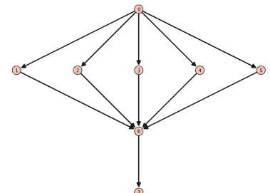

图 15.2 一个 8 个顶点的偏序集。

可以遍历所有图（在同构意义下）。例如，有 34 个具有 5 个顶点的简单图（图 15.3）：

```sage
sage: len(list(graphs(5)))
34
```

以下是如何画出所有至多 4 条边的图（见图 15.3）：

```sage
sage: for g in graphs(5, lambda G: G.size() <= 4):
....:     show(g)
```

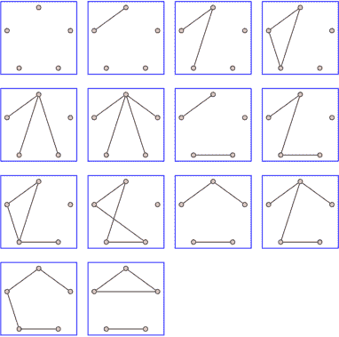

图 15.3 — 具有 5 个顶点且至多 4 条边的简单图。

然而，这些图的集合 *C* 在 Sage 中*尚不*可用；因此，以下命令尚未实现：

```sage
sage: C = Graphs(5); C.cardinality()
34
sage: Graphs(19).cardinality()
24637809253125004524383007491432768
sage: Graphs(19).random_element()
Graph on 19 vertices
```

到目前为止我们看到的内容原则上也适用于有限代数结构，例如二面体群：

```sage
sage: G = DihedralGroup(4); G
Dihedral group of order 8 as a permutation group
sage: G.cardinality()
8
sage: G.list()
[(), (1,4)(2,3), (1,2,3,4), (1,3)(2,4), (1,3), (2,4), (1,4,3,2), (1,2)(3,4)]
```

或有限域 ℤ/2ℤ 上的 2 × 2 矩阵代数：

```sage
sage: C = MatrixSpace(GF(2), 2); C.list()
[
[0 0]  [1 0]  [0 1]  [0 0]  [0 0]  [1 1]  [1 0]  [1 0]  [0 1]
[0 0], [0 0], [0 0], [1 0], [0 1], [0 0], [1 0], [0 1], [1 0],
[0 1]  [0 0]  [1 1]  [1 1]  [1 0]  [0 1]  [1 1]
[0 1], [1 1], [1 0], [0 1], [1 1], [1 1], [1 1]
]
```

```sage
sage: C.cardinality()
16
```

**练习 55.** 列出三个变量中所有次数为 5 的单项式（见 `IntegerVectors`）。操作有序集合划分 `OrderedSetPartitions` 和标准表（`StandardTableaux`）。

**练习 56.** 列出大小为 3、4 和 5 的交错符号矩阵，并尝试猜测其定义（见 `AlternatingSignMatrices`）。这些矩阵计数公式的发现和证明（见方法 cardinality）由物理学中的行列式计算所推动，是一段相当精彩的故事。特别是，Zeilberger 在 1992 年给出的第一个证明是由计算机程序自动产生的。它长达 84 页，需要近百人来验证 [Zei96]。

**练习 57.** 手工计算 $(\mathbb{Z}/2\mathbb{Z})^5$ 中向量的个数，以及 $\mathrm{GL}_3(\mathbb{Z}/2\mathbb{Z})$ 中矩阵的个数（也就是说，系数在 $\mathbb{Z}/2\mathbb{Z}$ 中的可逆 $3\times 3$ 矩阵的个数）。用 Sage 验证你的答案。推广到 $\mathrm{GL}_n(\mathbb{Z}/q\mathbb{Z})$。

#### 15.2.4 集合推导式与迭代器

我们现在展示 Python 为构造（以及遍历）集合提供的一些可能性，其记法灵活且接近通常的数学用法，特别是它在组合数学中带来的好处。

我们首先构造有限集 $\{i^2 \mid i \in \{1,3,7\}\}$：

```sage
sage: [ i^2 for i in [1, 3, 7] ]
[1, 9, 49]
```

然后构造同一个集合，但让 $i$ 从 1 到 9：

```sage
sage: [ i^2 for i in range(1,10) ]
[1, 4, 9, 16, 25, 36, 49, 64, 81]
```

这种形式的 Python 构造称为*集合推导式*。可以添加一个子句，只保留那些 $i$ 为素数的元素：

```sage
sage: [ i^2 for i in range(1,10) if is_prime(i) ]
[4, 9, 25, 49]
```

组合多个集合推导式，可以构造集合 $\{(i,j)\mid 1\leq j<i<6\}$：

```sage
sage: [ (i,j) for i in range(1,6) for j in range(1,i) ]
[(2, 1), (3, 1), (3, 2), (4, 1), (4, 2), (4, 3),
 (5, 1), (5, 2), (5, 3), (5, 4)]
```

或生成帕斯卡三角形：

```sage
sage: [[binomial(n, i) for i in range(n+1)] for n in range(10)]
```


```text
[[1],
 [1, 1],
 [1, 2, 1],
 [1, 3, 3, 1],
 [1, 4, 6, 4, 1],
 [1, 5, 10, 10, 5, 1],
 [1, 6, 15, 20, 15, 6, 1],
 [1, 7, 21, 35, 35, 21, 7, 1],
 [1, 8, 28, 56, 70, 56, 28, 8, 1],
 [1, 9, 36, 84, 126, 126, 84, 36, 9, 1]]
```

集合推导式的执行分两步完成；首先构造一个*迭代器*，然后由迭代器依次产生的元素填充列表。技术上，*迭代器*是一个带有 `next` 方法的对象，每次调用该方法都会返回一个新值，直到耗尽。例如，下面的迭代器 `it`：

```sage
sage: it = (binomial(3, i) for i in range(4))
```

会依次返回二项式系数 $\binom{3}{i}$，其中 $i=0,1,2,3$：

```sage
sage: it.next()
1
sage: it.next()
3
sage: it.next()
3
sage: it.next()
1
```

当迭代器最终耗尽时，会引发异常：

```sage
sage: it.next()
Traceback (most recent call last):
  ...
StopIteration
```

更一般地，*可迭代对象*是一个 Python 对象 `L`（列表、集合等），可以遍历其元素。技术上，迭代器由 `iter(L)` 构造。实际上，`iter` 和 `next` 命令很少使用，因为 for 循环和列表推导式提供了更舒适的语法：

```sage
sage: for s in Subsets(3): s
{}
{1}
{2}
{3}
{1, 2}
{1, 3}
{2, 3}
{1, 2, 3}
```

```text
[True, True, True, True, True, True, True, True, True, True,
 True, True, True, True]
```

反过来也成立吗？

**练习 58.** 尝试以下两条命令，并解释计算长度上的巨大差异：

```sage
sage: all( [ is_prime(mersenne(p)) for p in range(1000) if is_prime(p) ] )
False
sage: all( is_prime(mersenne(p)) for p in range(1000) if is_prime(p) )
False
```

现在尝试寻找最小的反例。为此，我们使用 Sage 函数 exists：

```sage
sage: exists( (p for p in range(1000) if is_prime(p)),
.....:        lambda p: not is_prime(mersenne(p)) )
(True, 11)
```

或者，我们可以在反例上构造一个迭代器：

```sage
sage: counter_examples = \
.....:     (p for p in range(1000)
.....:      if is_prime(p) and not is_prime(mersenne(p)))
sage: counter_examples.next()
11
sage: counter_examples.next()
23
```

**练习 59.** 以下命令做什么？

```sage
sage: cubes = [t**3 for t in range(-999,1000)]
sage: exists([(x,y) for x in cubes for y in cubes], lambda (x,y): x+y == 218)
sage: exists([(x,y) for x in cubes for y in cubes], lambda (x,y): x+y == 218)
```

最后两条命令中哪一条在时间上更经济？在内存方面呢？经济多少？

**练习 60.** 尝试以下每条命令，并解释结果。警告：将有必要中断其中一些命令的执行。

```sage
sage: x = var('x'); sum( x^len(s) for s in Subsets(8) )
```

```sage
sage: sum( x^p.length() for p in Permutations(3) )
```

```sage
sage: P = Permutations(5)
sage: all( p in P for p in P )
```

```sage
sage: for p in GL(2, 2): print(p); print("------")
```

```sage
sage: for p in Partitions(3): print(p)
```

```sage
sage: for p in Partitions(): print(p)
```

```sage
sage: for p in Primes(): print(p)
```

```sage
sage: g = f(4)
sage: g.next()
0
sage: g.next()
1
sage: g.next()
2
sage: g.next()
3
```

```sage
sage: g.next()
Traceback (most recent call last):
...
StopIteration
```

该函数可以如下使用：

```sage
sage: [ x for x in f(5) ]
[0, 1, 2, 3, 4]
```

这种计算模型称为*续延*，在组合数学中非常有用，尤其是与递归结合时。（另见 §12.2.2 了解其他应用。）下面说明如何生成给定字母表上所有给定长度的单词：

```sage
sage: def words(alphabet,l):
....:     if l == 0: yield []
....:     else:
....:         for word in words(alphabet, l-1):
....:             for l in alphabet: yield word + [l]
sage: [ w for w in words(['a','b'], 3) ]
[['a', 'a', 'a'], ['a', 'a', 'b'], ['a', 'b', 'a'], ['a', 'b', 'b'],
['b', 'a', 'a'], ['b', 'a', 'b'], ['b', 'b', 'a'], ['b', 'b', 'b']]
```

然后可以通过以下方式统计这些单词：

```sage
sage: sum(1 for w in words(['a','b','c','d'], 10))
1048576
```

在这种情况下，逐个数单词显然不是一种高效的方法，因为公式 n^l 也可用；不过请注意，这也不是最愚蠢的做法——至少它避免了在内存中构造整个列表。

现在考虑 Dyck 词，它们是由字母“(”和“)”构成的括号配对良好的词。下面的函数生成给定长度的所有 Dyck 词（其中长度是括号对的数量），使用递归定义：一个 Dyck 词要么为空，要么形如 (w₁)w₂，其中 w₁ 和 w₂ 是 Dyck 词：

```sage
sage: def dyck_words(l):
....:     if l == 0: yield ''
....:     else:
....:         for k in range(l):
....:             for w1 in dyck_words(k):
....:                 for w2 in dyck_words(l-k-1):
....:                     yield '(' + w1 + ')' + w2
```

以下是长度为 4 的所有 Dyck 词：

```sage
sage: list(dyck_words(4))
['()()()()', '()()(())', '()(())()', '()(()())', '()((()))',
 '(())()()', '(())(())', '(()())()', '((()))()', '(()()())',
 '(()(()))', '((())())', '((()()))', '(((())))']
```

对它们计数，我们得到一个著名的序列：

```sage
sage: [ sum(1 for w in dyck_words(l)) for l in range(10) ]
[1, 1, 2, 5, 14, 42, 132, 429, 1430, 4862]
```

**练习 61.** 在具有 n 个叶子的完全二叉树集合 \(C_n\) 上构造一个迭代器（见 §15.1.2）。

提示：使用 BinaryTree；在下面的示例中，我们构造一个叶子以及图 15.1 中的第二棵树。

```sage
sage: BT = BinaryTree
sage: BT()
.
sage: t = BT(BT(BT(BT(), BT(BT(),BT())), BT()), BT()); t
[[., [., .]], .]
```

请注意，绘制完全二叉树时，Sage 使用经典约定，仅显示其骨架，即剪掉叶子的树：

```sage
sage: view(t)
```

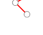

### 15.3 构造

现在我们看看如何从这些构件出发构造新集合。事实上，上一节中构造 P(P({1,2,3,4})) 以及 §15.1 中牌组集合的例子时，我们已经开始这样做了。

考虑一个大型笛卡尔积：

```sage
sage: C = cartesian_product([Compositions(8), Permutations(20)]); C
The Cartesian product of (Compositions of 8, Standard permutations of
20)
sage: C.cardinality()
311411457046609920000
```

显然，构造这个笛卡尔积所有元素的列表是不切实际的。不过仍可以操作它，例如生成一个随机元素：

```sage
sage: C.random_element()
([2, 3, 2, 1], [10, 6, 11, 13, 14, 3, 4, 19, 5, 12, 7, 18, 15, 8, 20, 1,
    17, 2, 9, 16])
```

构造 `cartesian_product` 了解其参数的代数性质。因此，在下面的示例中，\(H\) 既具有通常的组合运算，也具有作为乘积群的结构。

```sage
sage: G = DihedralGroup(4)
sage: H = cartesian_product([G,G])
sage: H.cardinality()
64
sage: H in Sets().Enumerated().Finite()
True
sage: H in Groups()
True
```

现在构造两个现有集合的不交并：

```sage
sage: C = DisjointUnionEnumeratedSets([Compositions(4),Permutations(3)])
sage: C
Disjoint union of Family (Compositions of 4, Standard permutations of 3)
sage: C.cardinality()
14
sage: C.list()
[[1, 1, 1, 1], [1, 1, 2], [1, 2, 1], [1, 3], [2, 1, 1], [2, 2], [3, 1],
 [4], [1, 2, 3], [1, 3, 2], [2, 1, 3], [2, 3, 1], [3, 1, 2], [3, 2, 1]]
```

也可以取多于两个不交集合的并集，甚至无限多个不交集合的并集。现在我们将构造所有排列的集合，将其视为大小为 \(n\) 的排列集合 \(P_n\) 的并集。首先构造无限族 \(F = (P_n)_{n\in\mathbb{N}}\)：

```sage
sage: F = Family(NonNegativeIntegers(), Permutations); F
Lazy family (<class 'sage.combinat.permutation.Permutations'>(i))_{i in
    Non negative integers}
sage: F.keys()
Non negative integers
sage: F[1000]
Standard permutations of 1000
```

现在我们可以构造不交并 \(\bigcup_{n\in\mathbb{N}} P_n\)：

```sage
sage: U = DisjointUnionEnumeratedSets(F); U
Disjoint union of
Lazy family (<class 'sage.combinat.permutation.Permutations'>(i))_{i in
    Non negative integers}
```

它是一个无限集：

```sage
sage: U.cardinality()
+Infinity
```


它并不禁止对其元素进行迭代，尽管需要在某个时刻将其中断：

```python
sage: for p in U: p
[]
[1]
[1, 2]
[2, 1]
[1, 2, 3]
[1, 3, 2]
[2, 1, 3]
[2, 3, 1]
[3, 1, 2]
...
```

注意：上述集合也可以直接用以下方式构造：

```python
sage: U = Permutations(); U
Standard permutations
```

**总结。** 总而言之，Sage 提供了一个常见枚举集合的库，可以通过标准构造进行组合，从而构成一个灵活（但仍可扩展）的工具箱。还可以用几行代码向 Sage 添加新的构造块（参见 `Sets().Enumerated().Finite()` 中的代码）。这得益于接口的统一性以及 Sage 基于面向对象语言的事实。此外，由于惰性求值策略（迭代器等），即使非常大甚至无限的集合也可以被操作。

这一切并无魔法：在底层，Sage 应用了通常的规则（例如，E × E 的基数为 |E|²）；其附加值来自处理复杂构造的能力。这种情况与 Sage 实现微积分的方式类似：Sage 应用函数及其复合函数微分的通常规则，而附加值则来自处理复杂公式的可能性。从这个意义上说，Sage 实现了一种有限枚举集合的演算。

### 15.4 通用算法

#### 15.4.1 整数列表的字典序生成

在经典的枚举集合中，尤其是在代数组合学中，有相当一部分由固定和的整数列表组成，例如分拆、有序分拆或整数向量。这些例子还可以添加进一步的约束。下面是一些示例。我们从和为 10、长度为 3 的整数向量开始，其分量分别有下界 2、4 和 2：

```sage
sage: IntegerVectors(10, 3, min_part = 2, max_part = 5,
....:             inner = [2, 4, 2]).list()
[[4, 4, 2], [3, 5, 2], [3, 4, 3], [2, 5, 3], [2, 4, 4]]
```

和为 5、每个分量至多为 3，且长度为 2 或 3 的有序分拆：

```sage
sage: Compositions(5, max_part = 3,
.....:             min_length = 2, max_length = 3).list()
[[3, 2], [3, 1, 1], [2, 3], [2, 2, 1], [2, 1, 2], [1, 3, 1],
 [1, 2, 2], [1, 1, 3]]
```

5 的严格递减分拆：

```sage
sage: Partitions(5, max_slope = -1).list()
[[5], [4, 1], [3, 2]]
```

这些集合共享相同的底层算法结构，实现在更通用——也稍显繁琐——的类 `IntegerListsLex` 中。该类对非负整数向量 `(ℓ₀, …, ℓₖ)` 的集合进行建模，这些向量带有关于总和与长度的约束，以及关于分量和相邻分量之差的界限。下面再举一些例子：

```sage
sage: IntegerListsLex(10, length=3, min_part = 2, max_part = 5,
.....:                 floor = [2, 4, 2]).list()
[[4, 4, 2], [3, 5, 2], [3, 4, 3], [2, 5, 3], [2, 4, 4]]
```

```sage
sage: IntegerListsLex(5, min_part = 1, max_part = 3,
.....:                 min_length = 2, max_length = 3).list()
[[3, 2], [3, 1, 1], [2, 3], [2, 2, 1], [2, 1, 2], [1, 3, 1],
 [1, 2, 2], [1, 1, 3]]
```

```sage
sage: IntegerListsLex(5, min_part = 1, max_slope = -1).list()
[[5], [4, 1], [3, 2]]
```

```sage
sage: list(Compositions(5, max_length=2))
[[5], [4, 1], [3, 2], [2, 3], [1, 4]]
```

```sage
sage: list(IntegerListsLex(5, max_length=2, min_part=1))
[[5], [4, 1], [3, 2], [2, 3], [1, 4]]
```

`IntegerListsLex` 模型的意义在于它在迭代的通用性和效率之间取得了良好的折衷。主要算法允许以逆字典序遍历这样的集合 `S` 的元素，并且除了极退化的情况外，具有常数均摊时间（CAT）；粗略地说，遍历所有元素所需的时间与元素数量成正比，这是最优的。此外，内存使用量与找到的最大元素成正比，也就是说在实践中可以忽略不计。

该算法基于遍历决策树的一个非常通用的原则，称为*分支定界*（*branch and bound*）：在顶层，我们遍历 ℓ₀ 的所有可能选择；对于每一个选择，再遍历 ℓ₁ 的所有可能选择，依此类推。从数学上讲，我们在 `S` 的元素上赋予了一棵前缀树的结构：树中深度为 `k` 的节点对应于 `S` 的一个（或多个）元素的前缀 ℓ₀, …, ℓₖ（见图 15.4）。

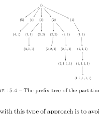

这类方法通常需要避免错误决策导致离开前缀树并探索死分支，这一点尤其棘手，因为元素数量随深度呈指数增长。事实证明，上述约束足够简单，可以保证以下性质：给定 $S$ 的一个前缀 $\ell_0,\ldots,\ell_k$，使得 $\ell_0,\ldots,\ell_{k+1}$ 成为 $S$ 的前缀的 $\ell_{k+1}$ 的集合，要么为空，要么是一个区间 $[a,b]$，并且界 $a$ 和 $b$ 可以在与以 $\ell_0,\ldots,\ell_k$ 为前缀的 $S$ 的最长元素长度成线性关系的时间内计算出来。

#### 15.4.2 多面体中的整数点

尽管 `IntegerListsLex` 中的迭代算法是高效的，但其计数算法却很朴素：它只是遍历所有元素。

另一种方法是：将所需的整数列表建模为多面体的整数点集合，也就是说，一个线性不等式组的整数坐标解集。这是一个非常通用的框架，其中存在先进的计数算法（例如 Barvinok），这些算法已在 LattE 等库中实现。迭代原则上并不构成难题。然而，有两个局限性证明了 `IntegerListsLex` 存在的合理性。第一个是理论上的：多面体中的格点只能对固定维度（长度）的问题进行建模。第二个是实践上的：目前只有 `PALP` 库具有 Sage 接口，尽管它为多面体的研究提供了多种功能，但在当前应用中它只能生成格点列表，既不提供迭代器，也不提供非朴素的计数：

```sage
sage: A = random_matrix(ZZ, 6, 3, x=7)
sage: L = LatticePolytope(A.rows())
sage: L.points()
M(1, 4, 3),
M(6, 4, 1),
...
M(3, 5, 5)
in 3-d lattice M
sage: L.points().cardinality()
23
```

下面是在 3D 中绘制该多面体的方法（见图 15.5）：

```sage
sage: L.plot3d()
```

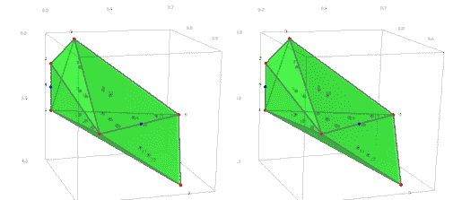

图 15.5 – 多面体 *L* 及其整数点，采用交叉眼立体透视画法。

#### 15.4.3 物种与可分解组合类

在 §15.1.2 中，我们展示了如何利用二叉树的递归定义，通过生成函数高效地对它们进行计数。我们在那里使用的技术非常通用，适用于所涉及的集合可以递归定义的情形（不同的人可能有不同的说法，这样的集合被称为可分解组合类，或者粗略地说，组合物种）。这包括所有类型的树，以及排列、有序分拆、框图等等。

这里，我们仅使用 Sage 的组合物种库来展示几个例子：

```sage
sage: from sage.combinat.species.library import *
sage: o = var('o')
```

我们首先重新定义完全二叉树；为此，我们直接在集合上规定递推关系：

```sage
sage: BT = CombinatorialSpecies()
sage: Leaf = SingletonSpecies()
sage: BT.define( Leaf + (BT*BT) )
```

现在我们可以构造具有五个节点的树的集合，列出它们，对它们计数……：

```sage
sage: BT5 = BT.isotypes([o]*5); BT5.cardinality()
14
sage: BT5.list()
[o*(o*(o*o)), o*(o*((o*o)*o)), o*((o*o)*(o*o)), o*((o*(o*o))*o),
 o*((((o*o)*o)*o)), (o*o)*(o*(o*o)), (o*o)*((o*o)*o), ((o*(o*o))*o),
 ((o*o)*o)*(o*o), (o*(o*o))*(o*o), (o*(o*o)*(o*o)), (o*(o*o)*(o*o)),
 ((o*(o*o))*o)*o, (((o*o)*o)*o)*o]
```

这些树是使用通用的递归结构构造的，因此显示效果并不理想。要做得更好，就需要为 Sage 提供一种更专门的数据结构，使其具有所需的显示能力。

我们重新得到 Catalan 数的生成函数：

```sage
sage: g = BT.isotype_generating_series(); g
x + x^2 + 2*x^3 + 5*x^4 + 14*x^5 + O(x^6)
```

它以惰性幂级数的形式返回：

```sage
sage: g[100]
227508830794229349661819540395688853956041682601541047340
```

最后我们来看 Fibonacci 词，即没有两个连续“1”的二进制词。它们有一个自然的递归定义：

```sage
sage: Eps = EmptySetSpecies(); ZO = SingletonSpecies()
sage: Z1 = Eps*SingletonSpecies()
sage: FW = CombinatorialSpecies()
sage: FW.define(Eps + ZO*FW  +  Z1*Eps + Z1*ZO*FW)
```

这里很容易认出 Fibonacci 序列，因此得名：

```sage
sage: L = FW.isotype_generating_series().coefficients(15); L
[1, 2, 3, 5, 8, 13, 21, 34, 55, 89, 144, 233, 377, 610, 987]
```

```sage
sage: oeis(L)
0: A000045: Fibonacci numbers: F(n) = F(n-1) + F(n-2) with F(0) = 0 and
   F(1) = 1.
1: A212804: Expansion of (1-x)/(1-x-x^2).
2: A132636: a(n) = Fibonacci(n) mod n^3.
```

这是递推关系的直接推论。我们也可以立即生成长度为给定值的所有 Fibonacci 词，但同样受到通用显示的限制。

```sage
sage: FW3 = FW.isotypes([o]*3)
sage: FW3.list()
[o*(o*(o+{})), o*(o*({}*o)*{}), o*(({}*o)*o*{}),
 (({}*o)*o)*(o*{}), (({}*o)*o)*({}*o*{})]
```

将 o 替换为 0，将 {}*o 替换为 1，并去掉括号以及最后的 {}，即可分别读出 000、001、010、100 和 101。


图 15.6 – 4 个顶点的简单图的生成树。

这些不可避免的操作仍然昂贵；因此人们试图尽量减少对它们的调用次数。

典范代表的选择方式使得：对于每个典范标号图 G，都存在一条边的典范选择，删除该边会产生另一个典范标号图，后者称为 G 的父图。这一性质意味着，可以把顶点集合 V 上的典范标号图组织成一棵树的节点：根处是无边图；其下是它唯一的子节点——有一条边的图；然后是两条边的图，依此类推。图 G 的子节点集合可以通过*增广*来构造：以所有可能的方式向 G 添加一条边，然后在这些图中选择仍然是典范的图[^3]。递归地，就能得到所有典范图。

[^3]: 在实际中，高效的实现会利用 G 的对称性，即其自同构群，来减少需要探索的子节点数量，并降低每次典范性测试的成本。

这个算法在何种意义上是通用的？例如考虑平面图（可以在平面中绘制而不发生边交叉的图）：从平面图中删除一条边，会得到另一个平面图；因此平面图构成前一棵树的一棵子树。为了生成它们，可以使用完全相同的算法，只选择那些是平面图的子节点：

```
sage: [len(list(graphs(n, property = lambda G: G.is_planar())))
....:  for n in range(7)]
[1, 1, 2, 4, 11, 33, 142]
```

以类似方式，可以生成任何对删边封闭的图族，特别是任何由禁用于图刻画的图族。例如，这包括森林（无环图）、二部图（无奇环图）等。这种方法也可以应用于生成：

- 偏序，通过与哈斯图（无环且没有由序关系传递性所蕴含的边的有向图）的双射；
- 格，通过与删除最大顶点所得交半格的双射；在这种情况下，使用的是按顶点而非按边的增广。

##### Pólya 计数

我们现在使用 Pólya 计数来在同构意义下计数 $n$ 个顶点上的图。我们有意保持简短且不正式；鼓励读者关注示例，以直观理解正在发生的事情。我们的目的确实仅仅是介绍代数组合学中的这颗明珠，它连接了计数组合学、群论、对称函数，事实上甚至连接了一些表示论。有关其背后理论的细节，请参见 https://en.wikipedia.org/wiki/Cycle_index。

如上所述，我们固定 $V = \{1, 2, \ldots, n\}$ 为顶点集合。在示例中，我们取 $n = 4$。现在，一个标号图只是顶点对 $\{i, j\}$ 的 $\binom{n}{2}$ 个对构成的集合 $F$ 的一个子集 $E$：

```
sage: V = [1,2,3,4]
sage: F = Subsets(V, 2); F.list()
[{1, 2}, {1, 3}, {1, 4}, {2, 3}, {2, 4}, {3, 4}]
```

我们取 $V$ 的所有置换构成的群 $S_n$：

```
sage: S = SymmetricGroup(V)
```

我们希望让 $S_n$ 作用于 $F$ 中的对。首先定义一个让单个置换作用于一个对的函数：

```
sage: def on_pair(sigma, pair):
....:     return Set(sigma(i) for i in pair)
sage: def on_pairs(sigma):
....:     return [on_pair(sigma, e) for e in F]
```

下面演示其作用：

```
sage: sigma = S.an_element(); sigma
(1,2,3,4)
sage: for e in F: print((e, on_pair(sigma, e)))
({1, 2}, {2, 3})
({1, 3}, {2, 4})
({1, 4}, {1, 2})
({2, 3}, {3, 4})
({2, 4}, {1, 3})
({3, 4}, {1, 4})
sage: on_pairs(sigma)
[{2, 3}, {2, 4}, {1, 2}, {3, 4}, {1, 3}, {1, 4}]
```

现在可以构造由 $S_n$ 的作用诱导出的、作用于对上的置换群 $G_n$：

```
sage: G = PermutationGroup([ on_pairs(sigma) for sigma in S.gens() ],
....:                       domain=F)
```

接下来计算 $G_n$ 的循环指标。这是一个对称函数，它编码了 $G_n$ 中置换的循环类型的统计信息：

```
sage: Z = G.cycle_index(); Z
1/24*p[1, 1, 1, 1, 1, 1] + 3/8*p[2, 2, 1, 1] + 1/3*p[3, 3] + 1/4*p[4, 2]
```

这个对象应如下解释：项 $\frac{1}{4}p_{(4,2)}$ 表示，在 $G_4$ 中，有 $|G_4| \cdot \frac{1}{4}=6$ 个置换具有一个长度为 4 的循环和一个长度为 2 的循环；确实：

```
sage: [ sigma for sigma in G if sigma.cycle_type() == [4,2] ]
[({1,2},{2,3},{3,4},{1,4})({1,3},{2,4}),
 ({1,2},{2,4},{3,4},{1,3})({1,4},{2,3}),
 ({1,2},{1,3},{3,4},{2,4})({1,4},{2,3}),
 ({1,2},{1,4},{3,4},{2,3})({1,3},{2,4}),
 ({1,2},{1,4},{2,3},{3,4})({1,3},{2,4}),
 ({1,2},{3,4})({1,3},{2,3},{2,4},{1,4})]
```

这个对称函数的有趣之处——这也是 Pólya 计数公式的内容——在于：*当在字母表* $A=(a_1,\ldots,a_n)$ *上求值时，它返回从* $E$ *到大小为* $n$ *的集合的函数的按权重生成函数，该集合的元素由* $A$ 加权。略过术语细节，我们在贯穿本节的示例中说明这一点。我们把图 $G$ 视为从 $F$ 到含 2 个元素的集合的函数，并用 $t$ 给边加权、用 $q$ 给非边加权。那么，4 个节点上的无标号图按边数的生成函数为：

```
sage: q,t = QQ['q,t'].gens()
sage: p = Z.expand(2, [q,t]); p
q^6 + q^5*t + 2*q^4*t^2 + 3*q^3*t^3 + 2*q^2*t^4 + q*t^5 + t^6
```

项 $2q^2t^4$ 表示有两个具有四条边的图（因而有两条非边）。其他系数可与图 15.6 核对。无标号图的总数可通过进一步在 $q=t=1$ 处对 $p$ 求值得到：

```
sage: p(q=1,t=1)
11
```

如果我们转而希望按边数计数多重图（带多重边的图），则可以在无限字母表 $A=(1,q,q^2,\cdots)$ 上对循环指标多项式求值。Sage 尚未直接支持无限字母表；不过，这可以很容易地手工完成，因为对称幂和 $p_k$ 在字母表 $A$ 上的求值，可通过将 $A$ 编码为 $1+q+q^2+\cdots=\frac{1}{1-q}$，并在该公式中用 $q^k$ 替换 $q$ 来得到：

```
sage: q = var('q')
sage: H = sum( c * prod( 1/(1-q^k) for k in partition )
....:         for partition, c in Z )
sage: H
1/3/(q^3 - 1)^2 + 1/4/((q^4 - 1)*(q^2 - 1))
+ 3/8/((q^2 - 1)^2*(q - 1)^2) + 1/24/(q - 1)^6
```

现在，具有 0 到 19 条边的多重图数量可通过泰勒展开得到：

```
sage: H.series(q)
1 + 1*q + 3*q^2 + 6*q^3 + 11*q^4 + 18*q^5 + 32*q^6 + 48*q^7
+ 75*q^8 + 111*q^9 + 160*q^10 + 224*q^11 + 313*q^12 + 420*q^13
+ 562*q^14 + 738*q^15 + 956*q^16 + 1221*q^17 + 1550*q^18 + 1936*q^19
+ Order(q^20)
```

循环指数的计算以相当高效的方式进行：使用 GAP 提供的群论算法，将循环指标的计算归约为对群的共轭类求和。下面的示例在几秒钟内计数了 $n=10$ 个节点上的图的数量；在这种情况下，$G_n$ 包含作用于 45 条边上的 $10!$ 个置换：

```
sage: n = 10
sage: V = range(1,n+1)
sage: F = Subsets(V, 2)
sage: S = SymmetricGroup(V)
sage: G = PermutationGroup([ on_pairs(sigma) for sigma in S.gens() ],
....:                         domain=F)
sage: q,t = QQ['q,t'].gens()
sage: Z = G.cycle_index()
sage: Z.expand(2, [q,t])(q=1,t=1)
12005168
```

大部分时间花在计算 $G_n$ 的共轭类上。通过利用该群的具体结构，可以走得更远：事实上，$G_n$ 同构于 $S_n$，而 $S_n$ 的共轭类由整数分拆索引：

```
sage: n = 20
sage: V = range(1,n+1)
sage: F = Subsets(V, 2)
sage: S = SymmetricGroup(V)
sage: CC = S.conjugacy_classes(); CC
[...
Conjugacy class of cycle type [19, 1] in Symmetric group of order 20!
    as a permutation group,
Conjugacy class of cycle type [20] in Symmetric group of order 20! as a
    permutation group]
```

现在，计数 20 个节点上的图的数量只需几秒钟：

```
sage: p = SymmetricFunctions(QQ).powersum()
sage: G = PermutationGroup([ on_pairs(sigma) for sigma in S.gens() ],
                           domain=F)
sage: Z = p.sum_of_terms([(G(on_pairs(c.representative())).cycle_type(),
                            c.cardinality())
                          for c in CC]) / factorial(n)
sage: Z.expand(2, [q,t])(q=1,t=1)
645490122795799841856164638490742749440
```


## 16 图论

本章介绍如何使用 Sage 研究图论，首先描述 Graph 类（§16.1）及其方法（§16.2），然后介绍如何用它们解决实际问题（§16.4），或通过实验验证理论结果（§16.3）。

### 16.1 构造图

#### 16.1.1 从零开始

我们将图定义为二元组 \((V, E)\)，其中 \(V\) 表示顶点集合，\(E\) 表示边集合，即顶点的无序对。图 16.1 所示的图由顶点集合 \(\{0, 1, 2, 5, 9, \text{'Madrid'}, \text{'Edinburgh'}\}\) 定义，其边为 \((1, 2), (1, 5), (1, 9), (2, 5), (2, 9)\) 以及 \((\text{'Madrid'}, \text{'Edinburgh'})\)。

不足为奇的是，Sage 中的图由 Graph 类表示：

```sage
sage: g = Graph()
```

默认情况下，\(g\) 是一个空图。下面的示例演示如何添加顶点和边：每当创建一条边时，相应的顶点——如果它们尚不在图中——会被静默添加。我们可以通过一些用途不言自明的方法观察这一过程：

```sage
sage: g.order(), g.size()
(0, 0)
sage: g.add_vertex(0)
sage: g.order(), g.size()
(1, 0)
sage: g.add_vertices([1, 2, 5, 9])
sage: g.order(), g.size()
(5, 0)
sage: g.add_edges([(1,5), (9,2), (2,5), (1,9)])
sage: g.order(), g.size()
(5, 4)
sage: g.add_edge("Madrid", "Edinburgh")
sage: g.order(), g.size()
(7, 5)
```

添加边 (1,2) 等价于添加边 (2,1)。还应注意，方法 add_vertex 和 add_edge 都有“复数”形式（add_vertices 和 add_edges），它们以列表作为参数，从而允许更紧凑的写法（例如参见 §16.4.1，我们在那里构造一个已经生成边集的图）。

一般来说，Sage 对图的顶点可以使用哪些类型的对象并不挑剔。事实上，它接受任何不可变的 Python 对象，也就是任何可以作为字典键的对象（参见 §3.3.9）。当然，我们可以使用 delete_* 方法删除已添加的元素，也可以枚举顶点和边，这些方法我们会经常用到。

```sage
sage: g.delete_vertex(0)
sage: g.delete_edges([(1,5), (2,5)])
sage: g.order(), g.size()
(6, 3)
sage: g.vertices()
[1, 2, 5, 9, 'Edinburgh', 'Madrid']
sage: g.edges()
[(1, 9, None), (2, 9, None), ('Edinburgh', 'Madrid', None)]
```

实际上，Sage 将图的边表示为三元组，其中最后一项是标签。大多数情况下，标签会填一个数值——例如在流或连通性算法中被解释为容量，在匹配问题中被解释为权重——但它也可以包含任何不可变对象。默认情况下，标签为 None。

当我们提前知道一个图的顶点和边时，可以用一个将每个顶点与其邻居列表关联起来的字典，以紧凑的方式构造它：

```sage
sage: g = Graph({
....:     0: [],
....:     1: [5, 9],
....:     2: [1, 5, 9],
....:     'Edinburgh': ['Madrid']})
```

与前面一样，我们可以省略与已经作为其他顶点邻居列出的顶点（如 5、9 或 ‘Madrid’）对应的行。同样地，我们可以指定 1 是 2 的邻居，即使 2 没有出现在 1 的邻居列表中：无论哪种方式，边 (1,2) 都会被创建。


**练习 62**（*循环图*）。由 $n, d$ 参数化的循环图是一个具有 $n$ 个顶点的图，顶点编号为 0 到 $n - 1$（我们可以将其表示成圆形），当 $u \equiv v + c \bmod n$（其中 $-d \leq c \leq d$）时，两个顶点 $u$ 和 $v$ 之间由一条边相连。请编写一个函数，接受参数 $n$ 和 $d$，并返回相应的图。

#### 16.1.2 可用的构造器

尽管有前面的示例，但在 Sage 中输入邻接表，或者类似地手动枚举边来创建图，是相当少见的。大多数情况下，从预定义的组件构建它们更为高效：`graphs.*` 中的方法可以构造七十多个图或图族，下面就来介绍这些图或图族。例如，Chvatal 图和 Petersen 图可以通过以下几行在 Sage 中获得：

```sage
sage: P = graphs.PetersenGraph()
sage: C = graphs.ChvatalGraph()
```

我们首先介绍小图——与后面将遇到的图族相对。

**小图。**这些图通常以发现者的名字命名，或者以它们形似的对象（房子、棒棒糖、公牛）命名。

| 小图 | | |
|---|---|---|
| BullGraph | ChvatalGraph | ClawGraph |
| DesarguesGraph | DiamondGraph | DodecahedralGraph |
| FlowerSnark | FruchtGraph | HeawoodGraph |
| HexahedralGraph | HigmanSimsGraph | HoffmanSingletonGraph |
| HouseGraph | HouseXGraph | IcosahedralGraph |
| KrackhardtKiteGraph | LollipopGraph | MoebiusKantorGraph |
| OctahedralGraph | PappusGraph | PetersenGraph |
| TetrahedralGraph | ThomassenGraph | |

| 图族 | |
|---|---|
| BarbellGraph | BubbleSortGraph |
| CircularLadderGraph | DegreeSequence |
| DegreeSequenceBipartite | DegreeSequenceConfigurationModel |
| DegreeSequenceTree | DorogovtsevGoltsevMendesGraph |
| FibonacciTree | FuzzyBallGraph |
| GeneralizedPetersenGraph | Grid2dGraph |
| GridGraph | HanoiTowerGraph |
| HyperStarGraph | KneserGraph |
| LCFGraph | LadderGraph |
| NKStarGraph | NStarGraph |
| OddGraph | ToroidalGrid2dGraph |
| Pauty_graph | |

```sage
sage: K = graphs.KneserGraph(5, 2); P = graphs.PetersenGraph()
sage: K.is_isomorphic(P)
True
```

由构造可知，Kneser 图也是顶点传递的。它们的色数恰好是 n − 2k + 2，这是 Lovász 的一个惊人结果，它通过 Borsuk-Ulam 定理——因此借助拓扑学考虑——得到证明 [Mat03]。让我们立刻用几个例子来验证这一点：

```sage
sage: all( graphs.KneserGraph(n,k).chromatic_number() == n - 2*k + 2
....:      for n in range(5,9) for k in range(2,floor(n/2)) )
True
```

**练习 63**（*Kneser 图*）。编写一个接受两个参数 n,k 并返回相应 Kneser 图的函数，如果可能的话，不要使用“if”语句。

**基本图。**下面的图是图论中最常见的“构造块”：完全图、完全二部图、循环图、路、圈、星形图等。同样，有一个明显的例外：树；该方法可以遍历 n 个顶点的所有树的集合。

| 基本图 | | |
|---|---|---|
| BalancedTree | CirculantGraph | CompleteBipartiteGraph |
| CompleteGraph | CubeGraph | CycleGraph |
| EmptyGraph | PathGraph | StarGraph |
| WheelGraph | trees | |

**随机图。**这最后一类图的性质非常丰富。其中，我们能看到 G_{n,p} 和 G_{n,m}，这是随机图的两个最简单的模型。

| 随机图 | | |
|---|---|---|
| DegreeSequenceExpected | RandomLambdaiAlbert | RandomBipartite |
| RandomRegular | RandomLobster | RandomNewmanWattsStrogatz |
| RandomIntervalGraph | RandomShell | RandomPowerLaw |

图 G_{n,p} 由整数 n 和实数 0 ≤ p ≤ 1 定义。我们通过为 \(\binom{n}{2}\) 个顶点对 \(i,j\) 各抛一次硬币——正面朝上的概率为 \(p\)——并在每次得到“正面”时将相应的边添加到图中，从而得到 n 个顶点 {0,...,n−1} 上的随机图 G_{n,p}。

我们观察到，对于固定的图 \(H\)，当 \(0 < p < 1\) 固定且 \(n\) 趋于无穷时，\(G_{n,p}\) 包含 \(H\) 作为导出子图¹的概率趋于 1（参见 §16.3.4）：

```sage
sage: H = graphs.ClawGraph()
sage: def test():
....:     g = graphs.RandomGNP(20,2/5)
....:     return not g.subgraph_search(H, induced=True) is None
sage: sum( test() for i in range(100) ) >= 80
True
```

#### 16.1.3 不相交并

除了这些基本构造块之外，Sage 还允许通过两种简单而有效的操作来创建图的不相交并。*两个图相加*对应于它们的不相交并：

```sage
sage: P = graphs.PetersenGraph()
sage: H = graphs.HoffmanSingletonGraph()
sage: U = P + H; U2 = P.disjoint_union(H)
sage: U.is_isomorphic(U2)
True
```

图 \(G\) 与整数 \(k\) 的*乘积*返回 \(k\) 个 \(G\) 的副本的不相交并：

```sage
sage: C = graphs.ChvatalGraph()
sage: U = 3 * C; U2 = C.disjoint_union(C.disjoint_union(C))
sage: U2.is_isomorphic(U)
True
```

下面一行代码创建了 Petersen 图的 3 个副本和 Chvátal 图的 2 个副本的不相交并：

```sage
sage: U = 3*P + 2*C
```

验证这一结果的方法有很多，每种方法都不需要超过几行代码。例如，通过确保每个连通分量都与这两个图之一同构：

```sage
sage: all( (CC.is_isomorphic(P) or CC.is_isomorphic(C))
....:       for CC in U.connected_components_subgraphs() )
True
```

或者通过精确计算子图的数量：

¹ 如果存在一个顶点集合 \(S \subseteq V(G)\)，使得 \(G\) 在 \(S\) 上的限制（即顶点集为 \(S\)、边仅为 \(G\) 中两端点都在 \(S\) 内的那些边的图）同构于 \(H\)，则称 \(H\) 是 \(G\) 的一个导出子图。我们将这样的导出子图记为 \(G[S]\)。


```sage
sage: sum( CC.is_isomorphic(P)
....:     for CC in U.connected_components_subgraphs() )
3
sage: sum( CC.is_isomorphic(C)
....:     for CC in U.connected_components_subgraphs() )
2
```

**技术细节。** 应注意，加法运算和乘积运算会创建副本。这可能会在内存和时间方面造成额外开销。因此，修改 P 或 C 并不会反过来导致 U 被修改。此外，这两种运算还会导致另外两种信息丢失：

-   最终图的顶点被整数 {0,1,2,...} 重新标记；
-   顶点（在布局中）的位置在 U 中不会被保留。

disjoint_union 方法的行为有所不同：如果图 g 包含顶点 a，图 h 包含顶点 b，则 g.disjoint_union(h) 返回的图包含顶点 (0, a) 和 (1, b)。当 a 或 b 不是整数，而是其他类型的对象（字符串、元组等）时，使用此方法会大大简化对该并运算所得图的遍历。

#### 16.1.4 图的可视化

在 Sage 中研究图的一个非常有用的方面是能够对它们进行可视化。对于基本、无多余装饰的可视化，一条命令就足够了：

```sage
sage: C = graphs.ChvatalGraph() ; C.show()
```


这是可视化某些函数结果的有价值工具。这里，我们突出显示一个独立集：

```sage
sage: C.show(partition = [C.independent_set()])
```

show 和 plot 命令的选项无穷无尽，并且有完善的文档。至少我们应该提到 figsize = 15 选项，它指定图像的分辨率，并且对于大型图会很有用。

### 16.2 Graph 类的方法

Graph 类有 250 多个可用方法，不包括仅在 DiGraph 类中定义的方法，或仅出现在扩展模块中的方法。这使 Sage 成为一个表达力强且完整的图论库，使我们能够专注于本质——也就是说，我们可以花更少时间编写基本函数，而把更多时间花在我们真正感兴趣的问题上。

正如学习任何编程语言（或库）时一样，至少浏览一遍其函数列表以熟悉其功能是很有用的。本（非详尽的）节试图简洁地介绍 Graph 的方法。建议读者花几分钟浏览每一类方法的内容——甚至完整的方法列表；当面对图问题时，这些时间将被证明极其值得。还建议打开一个 Sage 会话，以便查阅所介绍的每个方法的在线文档（例如 g.degree_constrained_subgraph?），因为有些方法接受许多选项，或者名称并不完全明确。

#### 16.2.1 修改图结构

当然，Graph 类的许多内容由用于定义和修改图的自然方法组成——这是必要但并非特别引人注目的功能。

Graph 类的访问和修改方法

| add_cycle | add_edge | add_edges |
|---|---|---|
| adjacency_matrix | allow_loops | allow_multiple_edges |
| allow_loops | delete_edge | clear |
| delete_edge | delete_edges | delete_multiedge |
| delete_vertex | delete_vertices | edge_iterator |
| edges | edge_label | edges |
| edges_incident | get_vertex | get_vertices |
| has_edge | has_loops | has_multiple_edges |
| has_vertex | incidence_matrix | latex_options |
| loop_edges | loop_vertices | loops |
| merge_vertices | neighbors | multiple_edges |
| neighbor_iterator | num_verts | networkx_graph |
| num_edges | relabel | number_of_loops |
| order | rename | remove_loops |
| remove_multiple_edges | set_edge_label | reset_name |
| set_vertex | set_vertices | set_vertices |
| subdivide_edge | subdivide_edges | size |
| vertices | weighted | vertex_iterator |
| | | weighted_adjacency_matrix |

#### 16.2.2 运算符

沿着同样的思路，我们发现一些充当运算符的方法，它们返回 Graph 类（或 DiGraph）的实例。例如，应用于图 $G$ 的 complement 方法返回一个定义在同一顶点集上的图，使得边 $uv$ 存在当且仅当 $uv \notin G$。subgraph 方法从图 $G$ 获得由给定顶点集诱导的子图（见第 368 页定义），该运算记为 $G[\{v_1,\ldots,v_k\}]$。

让我们检查一些基本关系。$P_5$ 的补图（记为 $\overline{P_5}$）是一个房子图，而图 $P_4$ 和 $C_5$ 是自补的：

```sage
sage: P5 = graphs.PathGraph(5); House = graphs.HouseGraph()
sage: P5.complement().is_isomorphic(House)
True
sage: P4 = graphs.PathGraph(4); P4.complement().is_isomorphic(P4)
True
sage: C5 = graphs.CycleGraph(5); C5.complement().is_isomorphic(C5)
True
```

Sage 还（通过同名方法）定义 $G$ 的线图——通常记为 $L(G)$——其中顶点对应于 $G$ 的边，并且如果两个顶点对应的边在 $G$ 中相关联，则这两个顶点相邻。我们还找到图的不同乘积的定义。在以下每个示例中，我们假设 $G$ 是 $G_1$ 和 $G_2$ 的乘积，定义在顶点集 $V(G_1) \times V(G_2)$ 上。两个顶点 $(u,v), (u',v') \in G$ 相邻当且仅当：

| 乘积 | Sage 方法 | 邻接条件 |
|---|---|---|
| 笛卡尔积 | `cartesian_product` | $u=u'$ 且 $vv'\in E(G_2)$，或 $uu'\in E(G_1)$ 且 $v=v'$ |
| 字典序积 | `lexicographic_product` | $uu'\in E(G_1)$，或 $u=u'$ 且 $vv'\in E(G_2)$ |
| 析取积 | `disjunctive_product` | $uu'\in E(G_1)$ 或 $vv'\in E(G_2)$ |
| 张量积 | `tensor_product` | $uu'\in E(G_1)$ 且 $vv'\in E(G_2)$ |
| 强积 | `strong_product` | $u=u'$ 且 $vv'\in E(G_2)$，或 $uu'\in E(G_1)$ 且 $v=v'$，或 $uu'\in E(G_1)$ 且 $vv'\in E(G_2)$ |

我们可以将方形网格 GridGraph 构造为两条路径的笛卡尔积：

```sage
sage: n = 5; Path = graphs.PathGraph(n)
sage: Grid = Cartesian_product(Path)
sage: Grid.is_isomorphic(graphs.GridGraph([n,n]))
True
```

流、连通性等

| | |
|---|---|
| `blocks_and_cut_vertices` | `connected_component_containing_vertex` |
| `connected_components` | `connected_components_number` |
| `connected_components_subgraphs` | `degree_constrained_subgraph` |
| `edge_boundary` | `edge_connectivity` |
| `edge_cut` | `edge_disjoint_paths` |
| `edge_disjoint_spanning_trees` | `frozenset` |
| `gomory_hu_tree` | `is_connected` |
| `matching` | `multicommodity_flow` |
| `vertex_boundary` | `vertex_connectivity` |
| `vertex_cut` | `vertex_disjoint_paths` |

#### 16.2.5 NP 完全问题

Sage 包含用于精确求解某些 NP 完全问题的算法。当然，这些问题可能需要大量计算资源，但许多现实世界的情况可能比其理论反例更容易求解。例如，可以求解以下优化问题。

**最大团与独立集。** 图的最大团是最大基数的两两相邻顶点集合（对于独立集则是两两不相邻的顶点集合）。此类问题的一个应用在 §16.4.1 中介绍。这是程序 Cliquer [NO] 所使用的算法。

方法：`clique_maximum`、`independent_set`

**顶点着色与边着色。** 图的正常顶点着色是为顶点分配颜色，使得任意两个相邻顶点具有不同颜色。Sage 有若干函数来计算精确着色，大多使用线性规划或 *Dancing Links* 算法。读者将在 §16.3.1 中找到一种简单但非最优的图着色算法的解释。

方法：`chromatic_number`、`coloring`、`edge_coloring`¹、`grundy_coloring`¹。

**支配集。** 图的一个顶点集合 *S* 称为支配集，如果 *G* 中的所有顶点 *v* 都与 *S* 中的某个元素相邻——我们称不在集合 *S* 中的顶点被该集合的元素*支配*。所有顶点构成的集合显然是支配集，因此问题是最小化集合 *S* 的大小。此问题由 Sage 借助线性规划求解。

方法：`dominating_set`

**哈密顿环、旅行商。** 图 *G* 称为*哈密顿的*，如果它包含一个经过其每个顶点一次且仅一次的环。与*欧拉环*问题——使用 *G* 的每条*边*一次且仅一次的环——不同，此问题是 NP 完全的，并且在*旅行商*问题的特定情况下，由 Sage 使用线性规划求解。

¹这些方法不能通过 `Graph` 类直接访问。要访问这些及其他着色函数，请参阅 `graph_coloring` 模块。


图16.2 —— Chvátal 图及其一条哈密顿回路。

我们演示 `hamiltonian_cycle` 函数，当存在哈密顿回路时，该函数会返回一条哈密顿回路（图16.2）：

```python
sage: g = graphs.ChvatalGraph(); cycle = g.hamiltonian_cycle()
sage: g.show(vertex_labels = False); cycle.show(vertex_labels = False)
```

方法：`is_hamiltonian`、`hamiltonian_cycle`、`traveling_salesman_problem`

**其他问题。** Sage 还知道如何计算图的*亏格*（`genus`）、*最大割*（`max_cut`）、*斯坦纳树*（`steiner_tree`）等。它还可以求解存在性问题，例如多商品流（`multicommodity_flow`）的存在性，检验子式是否存在（`minor`——寻找与给定图同构的子式），或搜索子图（`subgraph_search`）。

尽管这些问题的理论复杂度尚不清楚，但已有算法可用于求解图同构问题（`is_isomorphic`），以及计算图的自同构群（`automorphism_group`）。

NP完全问题（或类似问题）

|  |  |
|---|---|
| `automorphism_group` | `characteristic_polynomial` |
| `chromatic_number` | `chromatic_polynomial` |
| `coloring` | `disjoint_routed_paths` |
| `edge_coloring` | `dominating_set` |
| `genus` | `hamiltonian_cycle` |
| `independent_set_of_representatives` | `is_hamiltonian` |
| `is_isomorphic` | `max_cut` |
| `minor` | `multicommodity_flow` |
| `multivary_cut` | `subgraph_search` |
| `traveling_salesman_problem` | `steiner_tree` |
| `vertex_cover` |  |

#### 16.2.6 性质的识别与检验

许多 NP完全问题对于属于特殊类的图都有高效解法（线性、二次等）。例如，在弦图上求解最大团问题是平凡的，而在完美图上计算最优顶点着色的复杂度为多项式（尽管困难）。Sage 具有识别某些基本图类的算法：森林（`is_forest`）、树（`is_tree`）、二分图（`is_bipartite`）、欧拉图（`is_eulerian`）、正则图（`is_regular`）等。还可以识别以下类别。

**弦图。** 如果一个图不包含任何大小大于四的环作为诱导子图，则称该图为*弦图*。等价地，任何弦图都可以通过依次删除那些邻域为完全图的顶点来分解（这种分解顺序称为*完美消除顺序*）。此类图可以使用*广度优先搜索*（`lex_BFS`）来识别。

方法：`is_chordal`

**区间图。** 令 I = {I₁,…,Iₙ} 为实数区间的有限集合。由 I 定义一个有 n 个顶点 {1,…,n} 的图 G，其中两个顶点 i 和 j 相邻当且仅当对应的区间 Iᵢ 和 Iⱼ 有非空交集。区间图就是能以这种方式构造的图。它们构成弦图的一个子类，借助 PQ 树的结构可在线性时间内识别。

方法：`is_interval`

**完美图。** 如果对于所有诱导子图 G′ ⊆ G，G′ 的色数等于最大团的大小（即 χ(G′) = ω(G′) 成立），则称图 G 是*完美*的。尽管识别这些图是多项式问题，但算法复杂，Sage 中的实现使用指数算法。

方法：`is_perfect`

**顶点传递图。** 如果对所有顶点对 u 和 v，存在同构 h : V(G) → V(G) 使得 h(u) = v，则称图 G 是*顶点传递*的。尽管理论复杂度尚未确定，但 Sage 中可用的实现相当高效。

方法：`is_vertex_transitive`

**图的笛卡尔积。** 只有某些图可以表示为图序列 G₁,…,Gₖ 的笛卡尔积。给定连通图 G，可以借助一个优雅的刻画结果找到唯一的这种构造，该结果容易转化为多项式算法。

方法：`is_cartesian_transitive`

除了通过构造（如弦图）或通过特定性质（如完美图）来刻画之外，许多图类还用排除子图来表述。这等价于说图 G 属于类 C 当且仅当它不包含 {G₁,…,Gₖ} 中的子图。在这种情况下，我们可以编写一个识别算法，简单地测试每个这些子图是否存在，这可以通过 `subgraph_search` 函数完成。

**性质的识别与检验**

|  |  |  |
|---|---|---|
| `is_bipartite`<br>`is_equitable`<br>`is_forest`<br>`is_overfull`<br>`is_subgraph`<br>`is_triangle_free` | `is_chordal`<br>`is_eulerian`<br>`is_interval`<br>`is_regular`<br>`is_transitively_reduced`<br>`is_vertex_transitive` | `is_directed`<br>`is_even_hole_free`<br>`is_odd_hole_free`<br>`is_split`<br>`is_tree` |

### 16.3 图的应用

现在该运用我们发现的一些功能了。以下示例由实际或理论方面的缘由驱动，不一定是使用 Sage 解决其所说明问题的最佳方式。它们通常是暴力枚举式的，而这正是其魅力所在：其目标显然是提供使用 Sage 图库的清晰易懂示例——形式重于实质。

#### 16.3.1 图的贪心顶点着色

给图的顶点着色意味着给每个顶点分配一种颜色（这里我们可以约定用一个整数作为颜色），使每个顶点的颜色与其邻居不同。这当然总是可行的：只需使用与顶点数量一样多的颜色；正因如此，着色问题是一个最小化问题：给定图 \(G\)，找到满足上述约束的最小颜色数 \(\chi(G)\)。

由于计算 \(\chi(G)\) 是一个已有大量令人印象深刻文献研究的问题，具有更实际思维的读者会高兴地发现，存在比平凡的 \(|V|\) 种颜色更接近最优着色的快速方法。我们向他们提出以下算法：“图顶点的贪心着色”。

我们取任意顶点并给它分配一种颜色，即整数 0。迭代地，取一个未着色顶点，给它分配其邻居未使用的最小未使用整数。

这个算法只需几行解释，在 Sage 中实现也是如此。我们在这里将算法应用于一个随机图：

```python
sage: n = 100; p = 5/n; g = graphs.RandomGNP(n, p)

sage: # Set of available colours.
sage: # In the worst-case scenario up to n colours suffice
sage: available_colours = Set(range(n))

sage: # This dictionary contains the colour associated
sage: # with each vertex of the graph
sage: colour = {}
sage: for u in g:
....:     forbidden = Set([colour[v] for v in g.neighbors(u)
....:                                  if v in colour])
....:     colour[u] = min(available_colours - forbidden)

sage: # Number of colours used
sage: max(colour.values()) + 1
6
```

这比使用 100 种颜色显著更高效。然而，当我们注意到它依赖于一个未知因素：顶点被选择的顺序时，就很容易改进这个算法。事实上，我们对顺序没有任何控制，因为我们只使用了“for u in g”，这曾便于程序的快速开发。在第 13 章中，我们学习了 Sage 中丰富的集合类型集合，其中一种是 Permutations。更好的是，这个类有一个我们可以使用的 `random_element` 方法：

```python
sage: P = Permutations([0,1,2,3]); P.random_element()
[2, 0, 1, 3]
```

我们将通过按照随机排列给出的顺序对我们的图顶点着色 30 次，尝试获得更好的结果。结果就是以下代码，我们将其应用于之前定义的图 `g`：

```python
sage: available_colours = Set(range(n))

sage: n_tests = 30
sage: vertices = g.vertices()
sage: P = Permutations(range(n))
sage: best_coloring = {}
sage: best_chromatic_number = +oo

sage: for t in range(n_tests):
....:     # Random ordering of vertices
....:     p = P.random_element()
....:     colour = {}
....:     for i in range(g.order()):
....:         u = vertices[p[i]]
....:         forbidden = Set([colour[v] for v in g.neighbors(u)
....:                                  if v in colour])
....:         colour[u] = min(available_colours - forbidden)
....:     # Update the best colouring
....:     if max(colour.values()) + 1 < best_chromatic_number:
....:         best_coloring = colour
....:         best_chromatic_number = 1 + max(colour.values())

sage: best_chromatic_number # Number of colours used
```


4

无论如何，这是一项改进！然而，用于更新最小值的所有机制并非必需。没有必要对已经存在的东西进行编程。在 Python 中，绝大多数对象——在这里是 (`int`, `dict`) 对——彼此之间可以按字典序比较（我们可以先比较第一项——整数——，再比较第二项——字典——，不过后者在这种情况下意义较小）。将我们代码的第一部分重写为函数后，得到以下结果：

```python
sage: def greedy_coloring(g, permutation):
....:     n = g.order()
....:     available_colours = Set(range(n))
....:     vertices = g.vertices()
....:     colour = {}
....:     for i in range(n):
....:         u = vertices[permutation[i]]
....:         forbidden = Set([colour[v] for v in g.neighbors(u)
....:                          if v in colour])
....:         colour[u] = min(available_colours - forbidden)
....:     return max(colour.values()) + 1, colour
```

定义此函数后，执行 50 次尝试并返回最小值就很简单了：

```python
sage: P = Permutations(range(g.order()))
sage: n_colours, coloration = min(
....:     greedy_coloring(g, P.random_element()) for i in range(50))
sage: n_colours
4
```

要使用最少数量的颜色为图着色，最好使用 coloring 方法。由于该问题是 NP 完全问题，应当预期计算时间比贪心着色更长。

**练习 64**（贪心着色的最优顺序）。如果按正确的顺序遍历顶点，贪心着色算法能够用尽可能少的颜色数为图着色（即 χ(G)）。借助计算最优着色的 coloring 方法，编写一个函数，返回一个顶点顺序，使得贪心着色算法在该顺序下产生最优结果。

#### 16.3.2 在约束下生成图

随机图 $G_{n,p}$ 具有非常有趣的连通性。特别地，它们的最小割几乎可以肯定是一个顶点的邻域：因此存在这样的割，使得两个连通划分之一仅由一个顶点组成。这似乎令人不安：于是每个顶点集都定义了一个基数大于最小割大小的割。然而，只要有极大的耐心（对于非常大的图）并借助几行 Sage 代码，就有可能生成略有不同的随机图。下面是我们将要实现的方法。

如果考虑从 $V$ 到 $\{1,\ldots,|V|\}$ 的双射集合 $P$，我们会注意到

$$
\begin{aligned}
\sum_{\pi\in P}|S_\pi| &= \sum_{\pi\in P}\sum_{v\in G} \text{1 if }v\text{ is minimal for }\pi\text{, 0 otherwise}\\
&= \sum_{v\in G}\left(\sum_{\pi\in P} \text{1 if }v\text{ is minimal for }\pi\text{, 0 otherwise}\right)\\
&= \sum_{v\in G}\frac{|P|}{d(v)+1} = |P|\sum_{v\in G}\frac{1}{d(v)+1}.
\end{aligned}
$$

因此，这样的函数平均对应一个大小为 $\sum_{v\in G} \frac{1}{d(v)+1}$ 的独立集。为了用 Sage 获得这样大小的集合，我们将使用 Permutations 类生成随机双射，直到获得定理所承诺的大小：

```python
sage: g = graphs.RandomGNP(40, 0.4)
sage: P = Permutations(range(g.order()))
sage: mean = sum( 1/(g.degree(v)+1) for v in g )

sage: while True:
....:     n = P.random_element()
....:     S = [v for v in g if all( n[v] < n[u] for u in g.neighbors(v))]
....:     if len(S) >= mean:
....:         break
```

#### 16.3.4 在随机图中寻找诱导子图

这里我们将研究随机图 $G_{n,p}$，第 16.1.2 节关于图构造器的内容已简要讨论过。正如那里提到的，这些图具有以下性质。

> *设 $H$ 是一个图，且 $0 < p < 1$。那么：*
>
> $$
> \lim_{n\to\infty} P\left[H \text{ is an induced subgraph of } G_{n,p}\right] = 1
> $$
>
> *这意味着，当 $H$ 和 $p$ 固定时，大型随机图 $G_{n,p}$ 几乎必然包含 $H$ 作为诱导子图（见第 368 页定义）。*

让我们重新表述：给定一个图 $H$ 和一个大型随机图 $G$，可以通过迭代地为 $V(H) = \{v_1,\ldots,v_k\}$ 的每个顶点 $v_i$ 分配一个代表 $h(v_i)$，在 $G$ 中找到 $H$ 的一个副本，其中每个 $v_i$ 都是已选顶点的一个“正确扩展”。因此，我们将遵循以下算法：

- 为 $v_1$ 关联一个随机顶点 $h(v_1) \in G$；
- 为 $v_2$ 关联一个随机顶点 $h(v_2) \in G$，使得在 $G$ 中 $h(v_1)$ 与 $h(v_2)$ 相邻当且仅当在 $H$ 中 $v_1$ 与 $v_2$ 相邻；
- $\ldots$
- 经过 $j<k$ 步后，我们已为每个 $v_i$（$i\le j$）关联了一个代表 $h(v_i)\in G$，使得对于任意 $i,i'\le j$，$h(v_i)h(v_{i'})\in E(G)$ 当且仅当 $v_iv_{i'}\in E(H)$。现在为 $v_{j+1}$ 关联一个随机顶点 $h(v_{j+1})$，使得对于任意 $i\le j$，$h(v_i)h(v_{j+1})\in E(G)$ 当且仅当 $v_iv_{j+1}\in E(H)$；
- $\cdots$
- 经过 $k$ 步后，由顶点 $v_1,\ldots,v_k$ 的代表所诱导的 $G$ 的子图就是 $H$ 的一个副本。

**命题。** 当 $n$ 很大时，该策略以高概率成功。

*证明。* 令 $H_j=H[\{v_1,\ldots,v_j\}]$，并记 $P[H\hookrightarrow G_{n,p}]$ 为 $H$ 是 $G_{n,p}$ 的诱导子图的概率。我们可以用以下方式粗略地界定 $H_j$（但不是 $H_{j+1}$）是 $G_{n,p}$ 的诱导子图的概率：

- 给定某个 $G_{n,p}$ 中 $H_j$ 的一个副本，让我们计算没有其他顶点能将当前副本补全为 $H_{j+1}$ 的副本的概率。一个顶点可用的概率为

$$p^{d_{H_{j+1}}(v_{j+1})}(1-p)^{j-d_{H_{j+1}}(v_{j+1})}\geq \min(p,1-p)^j,$$

那么剩余 $n-j$ 个顶点都不可用的概率至多为

$$(1-\min(p,1-p)^j)^{n-j}$$

- 我们的图中至多有 $j!\binom{n}{j}$ 个不同的 $H_j$ 副本（事实上，有 $\binom{n}{j}$ 种方式选择 $j$ 个顶点，并且这些顶点与 $H_j$ 的顶点之间有 $j!$ 个双射）。

由于 $0<p<1$，记 $0<\varepsilon=\min(p,1-p)$；因此，对于固定的 $j\leq k$，$H_j$（但不是 $H_{j+1}$）是 $G_{n,p}$ 的诱导子图的概率至多为

$$j!\binom{n}{j}(1-\varepsilon^j)^{n-j}\leq j!n^j(1-\varepsilon^j)^{n-j}=o(1/n)$$

当 $n$ 增大时，该量渐近于零。最终：

$$\begin{aligned}
P[H\hookrightarrow G_{n,p}]\;&\geq 1-P[H_2\not\hookrightarrow G_{n,p},H_3\not\hookrightarrow G_{n,p}]\\
&\quad-P[H_3\not\hookrightarrow G_{n,p},H_4\not\hookrightarrow G_{n,p}]\\
&\quad\cdots\\
&\quad-P[H_{k-1}\not\hookrightarrow G_{n,p},H_k\not\hookrightarrow G_{n,p}]\\
&\geq 1-\sum_{j\leq k}j!n^j(1-\varepsilon^j)^{n-j}\\
&\geq 1-k\,o\!\left(\frac{1}{n}\right).
\end{aligned}$$

此外，该证明提供了一种概率算法，能够在大型随机图 $G_{n,p}$ 中找到给定图 $H$ 的一个副本。尽管如果这样的副本存在，该算法并不总能找到 $H$ 的副本，但当 $n$ 趋于无穷时，成功概率趋于 1。

```python
sage: def find_induced(H, G):
....:     # the function from V(H) to V(G) we aim to define:
....:     f = {}
....:     # set of vertices of G not yet used by f:
....:     G_remain = G.vertices()
....:     # set of vertices having no representative yet:
....:     H_remain = H.vertices()
....:     # while the function is not complete:
....:     while H_remain:
....:         v = H_remain.pop(0) # Look for the next vertex of H
....:         # and its potential images in G
....:         candidates = [u for u in G_remain if
....:                      all([H.has_edge(h,v) == G.has_edge(f_h,u)
....:                           for h, f_h in f.iteritems()])]
....:         # if no candidate is found, we abort immediately
....:         if not candidates:
....:             raise ValueError("No copy of H has been found in G")
....:         # otherwise we select the first candidate
....:         f[v] = candidates[0]
....:         G_remain.remove(f[v])
....:     return f
```

```python
sage: H = graphs.PetersenGraph()
sage: G = graphs.RandomGNP(500,0.5)
sage: find_induced(H,G)
{0: 0, 1: 4, 2: 3, 3: 7, 4: 35, 5: 10, 6: 67, 7: 108, 8: 240, 9: 39}
```

要在一行中于图 $G$ 中找到给定图 $H$ 的副本，更高效的方法是调用 Graph.subgraph_search 方法。

### 16.4 使用图解决的一些问题

#### 16.4.1 法国杂志《Le Monde 2》中的一道测验

我们可以在《Le Monde 2》第 609 期中读到以下测验。

> 最大的集合 $S \subseteq [0,\ldots,100]$ 的大小是多少，该集合不包含两个整数 $i,j$ 使得 $|i-j|$ 为平方数？

该问题可以很容易地转化为图论问题。关系“$|i-j|$ 为平方数”是一种二元对称关系，我们首先在顶点集 $[0,\ldots,100]$ 上创建图，其中两个顶点是


若两个数的差是一个平方数，则称它们相邻（不相容）。为此，我们将使用 `Subsets` 类，它可以让我们在这里遍历所有大小为 2 的子集。

```python
sage: n = 100; V = range(n+1)
sage: G = Graph()
sage: G.add_edges([
....:     (i,j) for i,j in Subsets(V,2) if is_square(abs(i-j)) ])
```

由于我们在寻找“相容”元素的最大数量，我们可能会调用 `independent_set` 方法，它会返回一个由不相邻元素组成的极大子集。

```python
sage: G.independent_set()
[4, 6, 9, 11, 16, 21, 23, 26, 28, 33, 38, 43, 50,
56, 61, 71, 76, 78, 83, 88, 93, 95, 98, 100]
```

因此答案是 24，而不是“42”。由此可见，“Le Monde 2”上的这个测验并不是“生命、宇宙以及一切的终极问题”，其答案应在别处寻找。

#### 16.4.2 任务分配

我们现在面临以下情况：在一个重要的建筑工地上，十名工人必须完成总共十项任务。我们可以为每名工人关联一个他们能够完成的任务列表。如何以最优方式分配这些任务呢？

同样地，我们首先将问题转化为图：这将是一个二分图，定义在工人和任务的并集 {w0,...,w9} ∪ {t0,...,t9} 上；当 w_j 能完成任务 t_i 时，我们定义 t_i 与 w_j 相邻。

```python
sage: tasks = {0: [2, 5, 3, 7], 1: [0, 1, 4],
....:          2: [5, 0, 4],        3: [0, 1],
....:          4: [8],              5: [2],
....:          6: [8, 9, 7],        7: [5, 8, 7],
....:          8: [2, 5, 3, 6, 4],  9: [2, 5, 8, 6, 1]}
sage: G = Graph()
sage: for i in tasks:
....:     G.add_edges(("w" + str(i), "t" + str(j) for j in tasks[i]))
```

现在只需使用 `matching` 方法，它将返回一组可由不同人员同时完成的任务的极大集合：

```python
sage: for task, worker, _ in sorted(G.matching()):
....:     print("{} can be performed by {}".format(task, worker))
t0 can be performed by w2
t1 can be performed by w3
t2 can be performed by w5
t3 can be performed by w8
t4 can be performed by w1
t5 can be performed by w7
t6 can be performed by w9
```


## 17 线性规划

本章专门讨论线性规划和混合整数线性规划，介绍许多可以用这些方法解决的问题。所涉及的应用主要来自图论，其中的基础应用即使不具备该领域的专门知识也应易于理解。作为组合学中的一种工具，应用线性规划相当于理解如何将存在性或优化问题重新表述为线性约束的形式。

### 17.1 定义

一个*线性规划*是一个线性方程组，其目标是寻找一个最优解。形式化地，它由一个矩阵 \(A : \mathbb{R}^m \to \mathbb{R}^n\) 和两个向量 \(b \in \mathbb{R}^n\)、\(c \in \mathbb{R}^m\) 定义。这里的求解线性规划是指找到一个向量 \(x \in \mathbb{R}^m\)，在满足线性约束方程组的同时最大化一个*目标*函数，即

\[c^{t}x = \max_{y\ \text{s.t.}\ Ay\le b} c^{t}y\]

其中两个向量之间的关系 \(u \le u'\) 表示 \(u\) 的每个分量都小于或等于 \(u'\) 的对应分量。我们还将写成：

\[\text{maximise: } c^{t}x\]
\[\text{such that: } Ax \le b.\]

下面这个线性规划的一个解由 $x = 4, y = 0, z = 1.6$ 给出：

最大化： $x + y + 3z$  
约束条件： $x + 2y \leq 4$  
$5z - y \leq 8$  
$x, y, z \geq 0$.

换句话说，求解线性规划就是在一个多胞体上寻找一个使线性函数最大化的点（此处为多胞体 $A^{-1}(\leq b)$）。然而，这些定义并没有解释在组合学中使用线性规划的动机，而这正是本章的主要焦点。我们将展示如何应用这一形式体系来解决背包问题（§17.4.1）、匹配问题（§17.4.2）或流问题（§17.4.3）等问题。在 §17.5 中，我们将通过生成约束的方法证明哈密顿圈的存在性。

### 17.2 整数规划

线性规划的这个定义伴随着一个坏消息：线性规划（LP）可以在多项式时间内求解。这确实是坏消息，因为这意味着除非我们定义规模为指数级的 LP，否则我们不能指望用这种方法解决 NP 完全问题，那将令人失望。好的一面是，如果我们被允许指定一种不同类型的约束——要求 $x$ 的全部或部分分量为整数而不是实数值——那么求解线性规划就变成 NP 完全的。这样的 LP 实际上被称为整数线性规划（ILP），或者如果只有某些分量需要是整数，则称为混合整数线性规划（MILP）。

众所周知，求解 ILP 或 MILP 是 NP 完全的。因此，我们可以期待在 MILP 框架中找到广泛的表达能力。

### 17.3 实践

#### 17.3.1 MixedIntegerLinearProgram 类

在 Sage 中，`MixedIntegerLinearProgram` 表示……一个 MILP！它也用于求解常规的 LP。它的方法数量很少，用于定义我们的约束和变量集合，然后在求解器计算完成后读取其找到的解。还可以将用 Sage 定义的 MILP 导出为 LP 或 MPS 文件——这是大多数求解器都能理解的标准格式。

为了说明，让我们求解 §17.1 中给出的线性规划。我们首先需要构建一个 `MixedIntegerLinearProgram` 类的对象，

```python
sage: p = MixedIntegerLinearProgram()
```

定义 3 个优化变量，

```python
sage: x, y, z = p['x'], p['y'], p['z']
```

**变量的类型。** 默认情况下，`new_variable` 返回的变量是实值变量。可以使用参数 `binary = True` 将它们定义为二进制变量，或使用 `integer = True` 定义为整数变量。然后，我们可以借助方法 `set_min` 和 `set_max` 为变量设置最小或最大边界。此外，还可以在变量创建后借助方法 `set_binary`、`set_integer` 或 `set_real` 更改变量的类型。

#### 17.3.3 不可行或无界问题

某些线性规划在形式上没有任何解。事实上，试图在一个空集上优化一个函数（即使是线性函数）是不现实的；反之，在一个约束不足的域上优化则会使目标函数无界。在这两种情况下，当调用 `solve` 方法时，Sage 将返回一个异常：

```python
sage: p = MixedIntegerLinearProgram()
sage: p.set_objective( p[3] + p[2] )
sage: p.add_constraint( p[3] <= 5 )
```

```python
sage: p.solve()
Traceback (most recent call last):
...
MIPSolverException: GLPK: The LP (relaxation) problem has no dual
    feasible solution
```

```python
sage: p.add_constraint( p[2] <= 8 )
sage: p.solve()
13.0
```

```python
sage: p.add_constraint( p[3] >= 6 ); p.solve()
Traceback (most recent call last):
...
MIPSolverException: GLPK: Problem has no feasible solution
```

类似地，将变量限制为整数可能会使可行域变为空集：

```python
sage: p = MixedIntegerLinearProgram()
sage: p.set_objective( p[3] )
sage: p.add_constraint( p[3] <= 4.75 ); p.add_constraint( p[3] >= 4.25 )
sage: p.solve()
4.75
sage: p.set_integer(p[3]); p.solve()
Traceback (most recent call last):
...
MIPSolverException: GLPK: Problem has no feasible solution
```

在任何情况下，只要线性规划无法求解就让代码停止运行都是不合理的；事实上，某些线性规划的唯一目的是检验解的*存在性*，因此它们通常写成如下形式：

```python
sage: try:
....:     p.solve()
....:     print("The problem has a solution!")
....: except:
....:     print("The problem is infeasible!")
The problem is infeasible!
```

### 17.4 组合学中的初步应用

在讨论了基础知识之后，让我们考虑一个更有趣的方面：建模。在本节中，我们介绍几个优化或存在性问题：从它们的抽象定义出发，我们将每个问题建模为 MILP，用几行代码即可获得一个 NP 完全问题的算法。

#### 17.4.1 背包问题

“背包问题”如下：我们面前有一组物品，每个物品都有重量和一个用实数度量的“效用”。我们希望选择其中一些物品，使得总重量不超过给定常数 C，最好的方式就是优化背包中物品的效用总和。

为了实现这一点，对于列表 L 中的每个对象 o，我们关联一个二进制变量 taken[o]：如果该对象被选中，则取值为 1，否则为 0。我们试图求解以下 MILP：

$$\begin{aligned}
\max\quad & \sum_{o\in L} \mathrm{utility}_o \times \mathrm{taken}_o \\
\text{such that:}\quad & \sum_{o\in L} \mathrm{weight}_o \times \mathrm{taken}_o \leq C.
\end{aligned}$$

使用 Sage，让我们为物品分配一些重量和效用：

```python
sage: C = 1
sage: L = ["Pan", "Book", "Knife", "Flask", "Flashlight"]
sage: w = [0.57,0.35,0.98,0.39,0.08]; u = [0.57,0.26,0.29,0.85,0.23]
sage: weight = {}; utility = {}
sage: for o in L:
....:     weight[o] = w[L.index(o)]; utility[o] = u[L.index(o)]
```

我们现在可以定义 MILP 本身了。

```python
sage: p = MixedIntegerLinearProgram()
sage: taken = p.new_variable(binary = True )
```


```sage
sage: p.add_constraint(
....:   p.sum( weight[o] * taken[o] for o in L ) <= C )
sage: p.set_objective(
....:   p.sum( utility[o] * taken[o] for o in L ) )
sage: p.solve()
1.41999999999999999999
sage: taken = p.get_values(taken)
```

我们可以检查该解是否可行：

```sage
sage: sum( weight[o] * taken[o] for o in L )
0.96000000000000000000
```

我们应该拿一个烧瓶吗？

```sage
sage: taken["Flask"]
1.0
```

练习 65（子集和）。称为子集和的组合问题是在一组整数中找到一个非空元素子集，使其和为零。请用整数线性规划对集合 {28, 10, −89, 69, 42, −37, 76, 78, −40, 92, −93, 45} 求解该问题。

#### 17.4.2 匹配

在图里寻找一个匹配，相当于找出一组两两不相交的边。空集是平凡匹配，因此我们把注意力集中在最大匹配上：我们寻求使匹配中的边数最大化。计算最大匹配是一个多项式问题，这可由 Jack Edmonds [Edm65] 的一个结果推出。Edmonds 算法基于局部改进，以及该算法在找到最大匹配之前不会停止的证明。在图论所提供的算法中，该算法并不是最难实现的，不过这个问题可以用一个非常简单的 MILP 来建模。

对于这个任务，和上一个问题一样，我们需要为每个对象——图的边——关联一个二元值，指示该边是否属于我们的匹配。

然后需要确保两条相邻边不能同时出现在匹配中。实际上，这看起来就像一个线性约束：如果 x 和 y 是同一图的两条边，且 mₓ 和 mᵧ 是它们关联的变量，只需要求不等式 mₓ + mᵧ ≤ 1 成立即可。由于这两条边不会同时出现在我们的解中，我们就能写出一个计算最大匹配的线性规划。注意，如果两条边不能同时出现在匹配中，是因为它们都有图的一个公共顶点 v。于是更简单的说法是：匹配中至多只能取与每个顶点 v 相关联的一条边，这又是一个线性约束。

$$\max: \sum_{e\in E(G)} m_e$$

$$\text{such that: } \forall v\in V(G), \sum_{e\in E(G), e\sim v} m_e \leq 1.$$

使用 Sage 可以很容易地把这个问题转化为 MILP：

```sage
sage: g = graphs.PetersenGraph()
sage: p = MixedIntegerLinearProgram()
sage: matching = p.new_variable(binary = True)

sage: p.set_objective(p.sum(matching[e]
....:                     for e in g.edges(labels = False)))

sage: for v in g:
....:     p.add_constraint(p.sum(matching[e]
....:                          for e in g.edges_incident(v, labels = False)) <= 1)
sage: p.solve()
5.0

sage: matching = p.get_values(matching)
sage: [e for e, b in matching.iteritems() if b == 1]
[(0, 1), (4, 9), (6, 8), (5, 7), (2, 3)]
```

**练习 66**（*支配集*）。图中的一个支配集是一个顶点集合 $S$，使得每个不在 $S$ 中的顶点在 $S$ 中至少有一个邻居。请写出一个整数线性规划，为 Petersen 图找到一个基数最小的支配集。

#### 17.4.3 流

在本节中，我们介绍图论中另一个基本算法：最大流！给定 *有向图* $G$ 的一对顶点 $s$ 和 $t$（即边有方向，参见图 17.1），该问题是在使用 $G$ 的边的情况下，从 $s$ 向 $t$ 发送一个 *最大流*。这些边中的每一条都有一个关联的 *最大容量*——即能够通过它的最大流量。

该问题的定义几乎就是其线性规划形式：我们为每条边寻找一个实数值，表示流经它的流量强度，并受两类约束：

- 到达某顶点（不同于 $s$ 或 $t$）的流量应等于离开该顶点的流量；
- 一条边上的流量不能超过其容量。


图 17.1 —— Chvátal 图上的一个最大流问题。

话虽如此，我们剩下的任务是最大化离开 $s$ 的流量：所有流量最终都会到达 $t$，因为其他顶点发送的流量与接收的流量一样多。我们可以用如下线性规划对流问题建模（假设所有边的容量均为 1）：

$$\text{Maximise: } \sum_{sv\in E(G)} f_{sv}$$

$$\text{such that: } \forall v\in V(G)\setminus\{s,t\},\quad \sum_{uv\in E(G)} f_{uv}=\sum_{uv\in E(G)} f_{vu}$$

$$\forall uv\in E(G),\ f_{uv}\leq 1.$$

我们将在 Chvátal 图的一个定向（参见图 17.1）上求解流问题，其中所有边的容量均为 1：

```python
sage: g = graphs.ChvatalGraph()
sage: g = g.minimum_outdegree_orientation()

sage: p = MixedIntegerLinearProgram()
sage: f = p.new_variable()
sage: s, t = 0, 2

sage: for v in g:
.....:     if v == s or v == t: continue
.....:     p.add_constraint(
.....:         p.sum(f[v,u] for u in g.neighbors_out(v)) ==
.....:         p.sum(f[u,v] for u in g.neighbors_in(v)))

sage: for e in g.edges(labels = False): p.add_constraint( f[e] <= 1 )

sage: p.set_objective(p.sum( f[s,u] for u in g.neighbors_out(s)))

sage: p.solve()
2.0
```


图 17.3 —— 非精确建模的一个可能解。

- 对图中每个顶点 $v$，关联一个整数 $i_v$，表示环 $C$ 访问它的阶段，其中对于固定顶点 $v_0$，有 $i_{v_0}=0$；
- 对 $G$ 的每条边 $uv$，关联两个二元变量 $b_{uv}$ 和 $b_{vu}$，指示该边是否属于环 $C$（并用于判断该边正被使用的方向）；
- 我们要求每个顶点在 $C$ 中都有一条出边和一条入边；
- 仅当 $i_u < i_v$ 时，边 $uv$ 才属于 $C$（边按照访问顺序递增的方向延伸）。

我们可以用几行线性方程改写该算法：

max：无目标函数

满足：

$$\forall v \in V(G),\quad \sum_{uv\in E(G)} b_{uv}=1$$

$$\forall v \in V(G),\quad \sum_{uv\in E(G)} b_{vu}=1$$

$$\forall uv \in E(G)\setminus\{v_0\},\quad i_u-i_v+|V(G)|b_{uv}\leq |V(G)|-1$$

$$i_v-i_u+|V(G)|b_{vu}\leq |V(G)|-1$$

$$\forall v \in V(G),\quad i_v\leq |V(G)|-1$$

$b_{uv}$ 是二元变量

$i_v$ 是整数变量。

在这个公式中，有一个系数 $|V(G)|$，这通常表明求解器将无法高效地求解该线性规划。因此，我们将对哈密顿环采用另一种建模方法。考虑下面这个简单的观察：如果我们的图中存在一个哈密顿环 $C$，那么对于每个顶点真子集 $S$，都至少存在两条 $C$ 的边进入或离开 $S$。如果我们用 $\bar{S}$ 表示恰好有一个端点在 $S$ 中的边集，那么可以得到如下公式（将变量 $b_{uv}$ 和 $b_{vu}$ 视为相同）：

max：无目标函数

满足：$\forall u \in V(G),\quad \sum_{uv\in E(G)} b_{uv}=2$

$\forall S \subseteq V(G),\ \emptyset \ne S \ne V(G),\quad \sum_{e\in\bar{S}} v_e \geq 2$

$b_{uv}$ 是二元变量。

我们不太可能直接使用前面的公式来求解哈密顿环问题，即使对于像 $4 \times 6 = 24$ 个元素这样的小网格也是如此：关于集合 $S$ 的约束将有 $2^{24}-2=16\,777\,214$ 条。另一方面，线性不等式求解器所使用的 *分支定界*方法（或 *分支切割*）非常适合在线性规划求解*期间*生成约束¹。为哈密顿环问题生成约束对应于以下步骤：

- 创建一个线性规划——不带目标函数——每条边有一个二元变量；
- 对每个顶点添加一个约束，强制其度数为 2；
- 求解该线性规划；
- 当当前解不是哈密顿环时（此时它是一个具有若干连通分量的子图），令 $S$ 为其一个连通分量，并添加约束，要求至少有两条边离开 $S$。

幸运的是，验证当前解无效并生成相应约束在算法上很快。使用 Sage 的约束生成方法，下面是我们如何在网格上求解哈密顿环问题：

```sage
sage: g = graphs.Grid2dGraph(4, 6)
sage: p = MixedIntegerLinearProgram()
sage: b = p.new_variable(binary = True)
```

为了避免变量 $b[u,v]$ 和 $b[v,u]$ 之间的差异，方便的做法是创建一个 lambda 函数，把对 $x,y$ 替换为集合 $\{x,y\}$：

```sage
sage: B = lambda x,y : b[frozenset([x,y])]
```

¹ 这意味着，一旦线性规划求解完成，就可以添加一个额外约束，并利用前一次计算中获得的部分结果来求解新的线性规划。


图17.4——通过生成约束计算得到的哈密顿回路。

现在让我们添加度约束：

```sage
sage: for u in g:
....:     p.add_constraint( p.sum( B(u,v) for v in g.neighbors(u) ) == 2 )
```

现在该计算问题的第一个解，并创建表示它的图了，

```sage
sage: p.solve()
0.0
sage: h = Graph()
sage: h.add_edges( [(u,v) for u, v in g.edges(labels = False)
....:     if p.get_values(B(u,v)) == 1.0 ] )
```

然后开始迭代：

```sage
sage: while not h.is_connected():
....:     S = h.connected_components()[0]
....:     p.add_constraint(
....:         p.sum( B(u,v) for u,v
....:             in g.edge_boundary(S, labels = False) )
....:         >= 2)
....:     zero = p.solve()
....:     h = Graph()
....:     h.add_edges( [(u,v) for u,v in
....:         g.edges(labels = False)
....:         if p.get_values(B(u,v)) == 1.0 ] )
```

在不到十二次迭代中（相对于 $2^{24}-2$ 而言，这是一种有趣的计算量节省），我们得到了一个可行解（参见图17.4）。在性能方面，这种求解方法超过了 Miller-Tucker-Zemlin 的公式。当我们在 Sage 中实现这两个线性规划时，对于随机图 $G_{35,0.3}$，计算时间如下：

```sage
sage: g = graphs.RandomGNP(35, 0.3)
sage: %time MTZ(g)
CPU times: user 51.52 s, sys: 0.24 s, total: 51.76 s
Wall time: 52.84 s
sage: %time constraint_generation(g)
CPU times: user 0.23 s, sys: 0.00 s, total: 0.23 s
Wall time: 0.26 s
```

# 附录

## A 习题答案

### A.1 初步

**练习1 第14页。** 命令 `R.var('u')` 创建符号变量 $u$，并将其赋给计算机变量 `u`。计算机变量 `u` 连续两次接收其当前值加一，即先变为 $u+1$，再变为 $u+2$（其中 $u$ 仍是符号变量）。

### A.2 分析与代数

**练习2 第28页。**（*用递推计算和*）

```sage
sage: n = var('n'); pmax = 4; s = [n + 1]
sage: for p in [1..pmax]:
....:     s += [factor((n+1)^(p+1) - sum(binomial(p+1, j) * s[j]
....:         for j in [0..p-1])) / (p+1)]
sage: s
```

于是我们得到：

$$\sum_{k=0}^n k = \frac{1}{2}(n+1)n, \qquad \sum_{k=0}^n k^2 = \frac{1}{6}(n+1)(2n+1)n,$$
$$\sum_{k=0}^n k^3 = \frac{1}{4}(n+1)^2 n^2, \qquad \sum_{k=0}^n k^4 = \frac{1}{30}(n+1)(2n+1)(3n^2+3n-1)n.$$

**练习3 第31页。**（*计算符号极限*）为了回答这个问题，我们使用一个符号函数，并计算其在 0 处直到 3 阶的泰勒多项式：

```sage
sage: x, h, a = var('x, h, a'); f = function('f')
sage: g(x) = taylor(f(x), x, a, 3)
sage: phi(h) = (g(a+3*h) - 3*g(a+2*h) + 3*g(a+h) - g(a)) / h^3; phi(h)
diff(f(a), a, a, a)
```

函数 $g$ 与 $f$ 相差一个相对于 $h^3$ 可忽略的余项；因此函数 $\phi$ 与那个商相差 $o(1)$；从而 $\phi$ 在 $0$ 处具有所求的极限。综上所述，

$$\lim_{h\to 0}\frac{1}{h^3}\bigl(f(a+3h)-3f(a+2h)+3f(a+h)-f(a)\bigr)=f'''(a).$$

该公式允许在不进行任何求导的情况下近似计算 $f$ 的三阶导数。

我们可以猜想该公式可以推广为以下形式：

$$\lim_{h\to 0}\frac{1}{h^n}\left(\sum_{k=0}^{n}(-1)^{n-k}\binom{n}{k}f(a+kh)\right)=f^{(n)}(a).$$

为了对更大的 $n$ 值验证该公式，我们可以轻松地调整前面的计算：

```sage
sage: n = 7; x, h, a = var('x h a'); f = function('f')
sage: g(x) = taylor(f(x), x, a, n)
sage: sum((-1)^(n-k) * binomial(n,k) * g(a+k*h) for k in (0..n)) / h^n
diff(f(a), a, a, a, a, a, a, a)
```

**练习4 第31页。**（*一个源于高斯的公式*）

- 1. 我们依次使用 `trig_expand` 和 `trig_simplify`：

```sage
sage: theta = 12*arctan(1/38) + 20*arctan(1/57) \
....:     + 7*arctan(1/239) + 24*arctan(1/268)
sage: tan(theta).trig_expand().trig_simplify()
1
```

- 2. 反正切函数在 $[0,+\infty[$ 上是凹的，因此 $\forall x\ge 0$，有 $\arctan x\le x$。

```sage
sage: 12*(1/38) + 20*(1/57) + 7*(1/239) + 24*(1/268)
37735/48039
```

由此我们推出：

$$\theta = 12\arctan\frac{1}{38}+20\arctan\frac{1}{57}+7\arctan\frac{1}{239}+24\arctan\frac{1}{268}$$
$$\le 12\cdot\frac{1}{38}+20\cdot\frac{1}{57}+7\cdot\frac{1}{239}+24\cdot\frac{1}{268}$$
$$=\frac{37735}{48039}<\frac{\pi}{2}.$$

因此 $0<\theta<\pi/2$；另外（参见问题1）$\tan\theta=1=\tan\frac{\pi}{4}$，且 $\tan$ 在 $[0,\pi/2]$ 上单射。我们推出 $\theta=\frac{\pi}{4}$。

- 3. 我们将泰勒多项式代入高斯公式：

```sage
sage: x = var('x'); f(x) = taylor(arctan(x), x, 0, 21)
sage: approx = 4 * (12 * f(1/38) + 20 * f(1/57)
....:          + 7 * f(1/239) + 24 * f(1/268))
sage: approx.n(digits = 50); pi.n(digits = 50)
3.1415926535897932384626433832795028841971693993751
3.1415926535897932384626433832795028841971693993751
sage: approx.n(digits = 50) - pi.n(digits = 50)
9.644474859113248678542091753740470529297881708080e-37
```

**练习5 第32页。**（*一个序列的渐近展开*）可以容易地证明 \(x_n \sim n\pi\)，即 \(x_n = n\pi + o(n)\)。

我们将这个等式代入以下方程，该方程由 \(\arctan x + \arctan(1/x) = \pi/2\) 得到：

$$x_n = n\pi + \frac{\pi}{2} - \arctan\left(\frac{1}{x_n}\right)$$

然后我们将由此方程得到的 \(x_n\) 的渐近展开代入，如此继续（逐次精化法）。

由于我们知道在每一步，\(p\) 阶展开可以得到 \((p+2)\) 阶展开，因此经过四步，我们得到 6 阶展开。预先借用第3章的内容，我们可以将这四个步骤编程为一个循环：

```sage
sage: n = var('n'); phi = lambda x: n*pi + pi/2 - arctan(1/x)
sage: x = n*pi
sage: for i in range(4):
....:     x = taylor(phi(x), n, infinity, 2*i); x
```

最后，我们得到：

$$x_n = \frac{1}{2}\pi + \pi n - \frac{1}{\pi n} + \frac{1}{2}\frac{1}{\pi^2 n^2} - \frac{1}{12}\frac{3\pi^2+8}{\pi^3 n^3} - \frac{1}{8}\frac{1}{\pi^2 n^4} - \frac{1}{240}\frac{15\pi^4+240\pi^2+208}{\pi^5 n^5} + \frac{1}{96}\frac{3\pi^4+80\pi^2+208}{\pi^6 n^6} + O\left(\frac{1}{n^7}\right).$$

**练习6 第33页。**（*一个由佩亚诺给出的施瓦茨定理反例*）部分映射 \(f(x,0)\) 和 \(f(0,x)\) 在 \((0,0)\) 处恒为零；无需任何计算，我们推出 \(\partial_1 f(0,0)=\partial_2 f(0,0)=0\)。然后我们计算 \((0,0)\) 处的二阶偏导数：

```sage
sage: h = var('h'); f(x, y) = x * y * (x^2 - y^2) / (x^2 + y^2)
sage: D1f(x, y) = diff(f(x,y), x); limit((D1f(0,h) - 0) / h, h=0)
-1
sage: D2f(x, y) = diff(f(x,y), y); limit((D2f(h,0) - 0) / h, h=0)
1
sage: g = plot3d(f(x, y), (x, -3, 3), (y, -3, 3))
```


图 A.1 —— 佩亚诺曲面。

我们推出 $\partial_1\partial_2 f(0,0)=1$ 且 $\partial_2\partial_1 f(0,0)=-1$。因此，我们得到了施瓦茨定理的一个反例（图 A.1）。

**练习7 第34页。（BBP 公式）**

- 1. 让我们首先比较

$$u_n=\int_0^{1/\sqrt{2}} f(t)\cdot t^{8n}\,dt \quad\text{and}\quad v_n=\left(\frac{4}{8n+1}-\frac{2}{8n+4}-\frac{1}{8n+5}-\frac{1}{8n+6}\right)\left(\frac{1}{16}\right)^n.$$

```sage
sage: n, t = var('n, t')
sage: v(n) = (4/(8*n+1)-2/(8*n+4)-1/(8*n+5)-1/(8*n+6))*1/16^n
sage: assume(8*n+1>0)
sage: f(t) = 4*sqrt(2)-8*t^3-4*sqrt(2)*t^4-8*t^5
sage: u(n) = integrate(f(t) * t^(8*n), t, 0, 1/sqrt(2))
sage: (u(n)-v(n)).canonicalize_radical()
0
```

我们推出 $u_n=v_n$。由积分的线性性，我们得到：

$$I_N=\int_0^{1/\sqrt{2}} f(t)\left(\sum_{n=0}^{N}t^{8n}\right)dt=\sum_{n=0}^{N}u_n=\sum_{n=0}^{N}v_n=S_N.$$

- 2. 幂级数 $\sum_{n\ge 0}t^{8n}$ 的收敛半径为 $1$，因此它在区间 $\left[0,\frac{1}{\sqrt{2}}\right]$ 上收敛。我们可以在此区间上交换积分与极限


区间：

$$
\begin{aligned}
\lim_{N\to\infty} S_N
&= \lim_{N\to\infty}\int_0^{1/\sqrt{2}} f(t)\left(\sum_{n=0}^{N}t^{8n}\right)\,dt\\
&= \int_0^{1/\sqrt{2}} f(t)\cdot\left(\sum_{n=0}^{\infty}t^{8n}\right)\,dt\\
&= \int_0^{1/\sqrt{2}} f(t)\cdot\frac{1}{1-t^8}\,dt = J.
\end{aligned}
$$

- 3. 现在，我们计算 \(J\)：

  ```sage
  sage: t = var('t'); J = integrate(f(t) / (1-t^8), t, 0, 1/sqrt(2))
  sage: J.canonicalize_radical()
  pi + 2*log(sqrt(2) + 1) + 2*log(sqrt(2) - 1)
  ```

  为了化简这个表达式，我们必须让 Sage 合并对数之和：

  ```sage
  sage: J.simplify_log().canonicalize_radical()
  pi
  ```

最后，我们得到公式：

$$
\sum_{n=0}^{+\infty}\left(\frac{4}{8n+1}-\frac{2}{8n+4}-\frac{1}{8n+5}-\frac{1}{8n+6}\right)\left(\frac{1}{16}\right)^n=\pi.
$$

利用这个公式，我们得到另一种逼近 \(\pi\) 的方法：

```sage
sage: l = sum(v(n) for n in (0..40)); l.n(digits=60)
3.14159265358979323846264338327950288419716939937510581474759
sage: pi.n(digits=60)
3.141592653589793238462643383279502884197169399375105820974944
sage: print("%e" % (1-pi).n(digits=60))
-6.227358e-54
```

#### 练习 8 第 35 页。（正弦函数的多项式逼近）

我们给向量空间 \(C^\infty([-\pi,\pi])\) 赋予点积 \(\langle f|g\rangle=\int_{-\pi}^{\pi} f g\)。所求多项式是正弦函数在向量子空间 \(\mathbb{R}_5[X]\) 上的正交投影。求这个多项式可归结为求解一个线性方程组：事实上，\(P\) 是正弦函数的投影，当且仅当函数 \((P-\sin)\) 与 \(\mathbb{R}_5[X]\) 的规范基的每个向量都正交。下面是 Sage 代码：

```sage
sage: x = var('x'); ps = lambda f, g : integral(f * g, x, -pi, pi)
sage: n = 5; a = var('a0, a1, a2, a3, a4, a5')
sage: P = sum(a[k] * x^k for k in (0..n))
sage: equ = [ps(P - sin(x), x^k) for k in (0..n)]
sage: sol = solve(equ, a)
sage: P = sum(sol[0][k].rhs() * x^k for k in (0..n)); P
105/8*(pi^4 - 153*pi^2 + 1485)/pi^6*x - 315/4*(pi^4 - 125*pi^2 +
1155)*x^3/pi^8 + 693/8*(pi^4 - 105*pi^2 + 945)*x^5/pi^10
sage: g = plot(P,x,-6,6,color='red') + plot(sin(x),x,-6,6,color='blue')
sage: g.show(ymin = -1.5, ymax = 1.5)
```

所求多项式为：

$$P = \frac{105}{8}\frac{\pi^4 - 153\pi^2 + 1485}{\pi^6}x - \frac{315}{4}\frac{\pi^4 - 125\pi^2 + 1155}{\pi^8}x^3 + \frac{693}{8}\frac{\pi^4 - 105\pi^2 + 945}{\pi^{10}}x^5.$$

然后，我们可以绘制正弦函数及其正交投影，以查看这个多项式逼近的效果（图 A.2）。


图 A.2 – 正弦函数的最小二乘逼近。

#### 练习 9 第 35 页。（高斯问题）

让我们先形式化地证明这些关系；然后进行数值应用。我们首先定义向量 \(\vec{r}_i\)：

```sage
sage: p, e = var('p, e')
sage: theta1, theta2, theta3 = var('theta1, theta2, theta3')
sage: r(theta) = p / (1 - e * cos(theta))
sage: r1 = r(theta1); r2 = r(theta2); r3 = r(theta3)
sage: R1 = vector([r1 * cos(theta1), r1 * sin(theta1), 0])
sage: R2 = vector([r2 * cos(theta2), r2 * sin(theta2), 0])
sage: R3 = vector([r3 * cos(theta3), r3 * sin(theta3), 0])
```

- 我们验证 \(\vec{S} + e \cdot (\vec{r}_1 \wedge \vec{D})\) 是零向量：

  ```sage
  sage: D = R1.cross_product(R2)+R2.cross_product(R3)+R3.cross_product(R1)
  sage: S = (r1 - r3) * R2 + (r3 - r2) * R1 + (r2 - r1) * R3
  sage: i = vector([1, 0, 0]); V = S + e * i.cross_product(D)
  sage: V.simplify_full()
  (0, 0, 0)
  ```

  由此得到所需关系。我们推出 \(e = \frac{\|\vec{\gamma} \times \vec{D}\|}{\|\vec{D}\|^2} = \frac{\|\vec{\gamma}\|}{\|\vec{D}\|}\)，因为 \(\vec{D}\) 垂直于轨道平面，从而垂直于 \(\vec{\gamma}\)。

- 然后我们验证 \(\vec{\gamma}\) 与 \(\vec{S} \wedge \vec{D}\) 共线：

  ```sage
  sage: S.cross_product(D).simplify_full()[1:3]
  (0, 0)
  ```

  结果表明第二个和第三个分量为零。

- 我们还验证 \(p \cdot \vec{S} + e \cdot (\vec{\gamma} \wedge \vec{N})\) 是零向量，

  ```sage
  sage: N = r3 * R1.cross_product(R2) + r1 * R2.cross_product(R3) \
  ....:   + r2 * R3.cross_product(R1)
  sage: W = p * S + e * i.cross_product(N)
  sage: W.simplify_full()
  (0, 0, 0)
  ```

  由此得到所需关系。我们推出：

$$p = e\frac{\|\vec{\gamma} \times \vec{N}\|}{\|\vec{S}\|} = e\frac{\|\vec{N}\|}{\|\vec{S}\|} = \frac{\|\vec{N}\|}{\|\vec{D}\|},$$

因为 \(\vec{N}\) 垂直于轨道平面，从而垂直于 \(\vec{\gamma}\)。

- 根据圆锥曲线的一个经典性质，我们有 \(a = \frac{p}{1-e^2}\)。

- 现在，我们进行数值应用：

  ```sage
  sage: R1=vector([0,1,0]); R2=vector([2,2,0]); R3=vector([3,5,0])
  sage: r1 = R1.norm(); r2 = R2.norm(); r3 = R3.norm()
  sage: D = R1.cross_product(R2) + R2.cross_product(R3) \
  ....:   + R3.cross_product(R1)
  sage: S = (r1 - r3) * R2 + (r2 - r3) * R1 + (r2 - r1) * R3
  sage: N = r3 * R1.cross_product(R2) + r1 * R2.cross_product(R3) \
  ....:   + r2 * R3.cross_product(R1)
  sage: e = S.norm() / D.norm(); p = N.norm() / D.norm()
  sage: a = p/(1-e^2); c = a * e; b = sqrt(a^2 - c^2)
  sage: X = S.cross_product(D); i = X / X.norm()
  sage: phi = atan2(i[1], i[0]) * 180 / pi.n()
  sage: print("%.3f %.3f %.3f %.3f %.3f %.3f" % (a, b, c, e, p, phi))
  2.360 1.326 1.952 0.827 0.746 17.917
  ```

因此，我们最终得到：

$$a \approx 2.360,\quad b \approx 1.326,\quad c \approx 1.952,\quad e \approx 0.827,\quad p \approx 0.746,\quad \varphi \approx 17.917.$$

椭圆长轴的倾角为 17.92 度。

#### 练习 10 第 36 页。（向量子空间的基）

- 1. 与 \(A\) 相关联的齐次系统的解集 \(\mathcal{S}\) 是 \(\mathbb{R}^5\) 的向量子空间。我们使用函数 `right_kernel` 获得 \(\mathcal{S}\) 的维数和一组基：

  ```sage
  sage: A = matrix(QQ, [[ 2, -3,   2, -12, 33],
  ....:                [ 6,   1,  26, -16, 69],
  ....:                [10, -29, -18, -53, 32],
  ....:                [ 2,   0,   8, -18, 84]])
  sage: A.right_kernel()
  Vector space of degree 5 and dimension 2 over Rational Field
  Basis matrix:
  [  1   0 -7/34  5/17   1/17]
  [  0   1 -3/34 -10/17 -2/17]
  ```

  因此，\(\mathcal{S}\) 是由上述两个向量生成的向量平面（逐行读取，如下所示）。

- 2. 我们按如下方式从给定的生成族中提取所求向量空间的一组基。我们逐行化简矩阵 \(A\)（由列 \(u_1, u_2, u_3, u_4, u_5\) 构成），直到得到 Hermite 形式：

  ```sage
  sage: H = A.echelon_form(); H
  ```

$$\begin{pmatrix}
1 & 0 & 4 & 0 & -3 \\
0 & 1 & 2 & 0 & 7 \\
0 & 0 & 0 & 1 & -5 \\
0 & 0 & 0 & 0 & 0
\end{pmatrix}$$

  设 \(F = \operatorname{Vect}(u_1,u_2,u_3,u_4,u_5)\) 为 \(A\) 的列向量族。它是 \(\mathbb{R}^4\) 的向量子空间。观察 \(H\)，我们看到主元位于第 1、2 和 4 列。更确切地说，我们有：

$$\begin{cases}
(u_1,u_2,u_4) \text{ 是自由族，}\\
u_3 = 4u_1 + 2u_2,\\
u_5 = -3u_1 + 7u_2 - 5u_4.
\end{cases}$$

  因此 \(F = \operatorname{Vect}(u_1,u_2,u_3,u_4,u_5) = \operatorname{Vect}(u_1,u_2,u_4)\) 由自由族 \((u_1,u_2,u_4)\) 生成；因此 \((u_1,u_2,u_4)\) 是 \(F\) 的一组基。更直接地，我们也可以使用 column_space 方法：

  ```sage
  sage: A.column_space()
  Vector space of degree 4 and dimension 3 over Rational Field
  Basis matrix:
  [   1    0    0 1139/350]
  [   0    1    0   -9/50]
  [   0    0    1  -12/35]
  ```

- 3. 现在，我们寻找所生成子空间的方程：我们在含四个变量的多项式环中使用 Sage 计算，对由右端项增广的矩阵 \(A\) 进行化简：

  ```sage
  sage: S.<x, y, z, t> = QQ[]
  sage: C = matrix(S, 4, 1, [x, y, z, t])
  sage: B = block_matrix([A, C], ncols=2)
  sage: C = B.echelon_form()
  sage: C[3,5]*350
  -1139x + 63y + 120z + 350t
  ```

  我们推出 \(F\) 是由 \(-1139x + 63y + 120z + 350t = 0\) 定义的 \(\mathbb{R}^4\) 的超平面。

  也可以通过计算 \(A\) 的左核得到这个方程，左核给出定义 \(F\) 的线性形式的坐标（这里只有一个形式）：

  ```sage
  sage: K = A.left_kernel(); K
  Vector space of degree 4 and dimension 1 over Rational Field
  Basis matrix:
  [     1  -63/1139 -120/1139 -350/1139]
  ```

  由这个线性形式定义的超平面的一组基由以下向量给出，这些向量已由 A.column_space() 获得：

  ```sage
  sage: matrix(K.0).right_kernel()
  Vector space of degree 4 and dimension 3 over Rational Field
  Basis matrix:
  [     1      0      0  1139/350]
  [     0      1      0    -9/50]
  [     0      0      1   -12/35]
  ```

#### 练习 11 第 37 页。（一个矩阵方程）

我们首先定义矩阵 \(A\) 和 \(C\)：

```sage
sage: A = matrix(QQ, [[-2, 1, 1], [8, 1, -5], [4, 3, -3]])
sage: C = matrix(QQ, [[1, 2, -1], [2, -1, -1], [-5, 0, 3]])
```

由于方程 \(A = BC\) 是线性的，解集是 \(\mathcal{M}_3(\mathbb{R})\) 的仿射子空间。我们寻找方程的一个特解。

```sage
sage: B = C.solve_left(A); B
[ 0 -1  0]
[ 2  3  0]
[ 2  1  0]
```

然后，我们确定解的一般形式，即 \(C\) 的左核：

```sage
sage: C.left_kernel()
Vector space of degree 3 and dimension 1 over Rational Field
Basis matrix:
[1 2 1]
```

然后，我们得到方程解的一般形式：

```sage
sage: x, y, z = var('x, y, z'); v = matrix([[1, 2, 1]])
sage: B = B + (x*v).stack(y*v).stack(z*v); B
```


\[
\begin{bmatrix}
x & 2x-1 & x\\
y+2 & 2y+3 & y\\
z+2 & 2z+1 & z
\end{bmatrix}
\]

很容易验证结果：

```sage
sage: A == B*C
True
```

总之，解集是一个三维仿射子空间：

\[
\left\{
\begin{pmatrix}
x & 2x-1 & x\\
y+2 & 2y+3 & y\\
z+2 & 2z+1 & z
\end{pmatrix}
\;\middle|\;
(x,y,z)\in\mathbb{R}^3
\right\}.
\]

### A.4 图形

#### 练习 12 第 79 页。（帕斯卡蚶线）

```sage
sage: t = var('t'); liste = [a + cos(t) for a in srange(0, 2, 0.1)]
sage: g = polar_plot(liste, (t, 0, 2 * pi)); g.show(aspect_ratio = 1)
```

#### 练习 13 第 82 页。（绘制递推数列的项）

```sage
sage: f = lambda x: abs(x**2 - 1/4)
sage: def liste_pts(u0, n):
....:     u = u0; liste = [u0]
....:     for k in range(n):
....:         v, u = u, f(u)
....:         liste.extend([v,u], [u,u])
....:     return(liste)
sage: g = line(liste_pts(1.1, 8), rgbcolor = (.9,0,0))
sage: g += line(liste_pts(-4, 8), rgbcolor = (.01,0,0))
sage: g += line(liste_pts(1.3, 3), rgbcolor = (.5,0,0))
sage: g += plot(f, -1, 3, rgbcolor = 'blue')
sage: g += plot(x, -1, 3, rgbcolor = 'green')
sage: g.show(aspect_ratio = 1, ymin = -.2, ymax = 3)
```

#### 练习 14 第 85 页。（一阶微分方程，已求解）

```sage
sage: x = var('x'); y = function('y')
sage: DE = x^2 * diff(y(x), x) - y(x) == 0
sage: desolve(DE, y(x))
_C*e^(1/x)
sage: g = plot([c*e^(-1/x) for c in srange(-8, 8, 0.4)], (x, -3, 3))
sage: y = var('y')
sage: g += plot_vector_field((x^2, y), (x,-3,3), (y,-5,5))
sage: g.show()
```


图 A.3 x^2 y' - y = 0 的积分曲线。

#### 练习 15 第 87 页。（捕食者-猎物模型）

```sage
sage: from sage.calculus.desolvers import desolve_system_rk4
sage: f = lambda x, y: [a*x-b*x*y,-c*y+d*b*x*y]
sage: x, y, t = var('x y t')
sage: a, b, c, d = 1, 0.1, 1.5, 0.75
sage: P = desolve_system_rk4(f(x,y), [x,y],\
....:     ics=[0,10,5], ivar=t, end_points=15)
sage: QL = [[i,j] for i,j in P]; p = line(QL, color='red')
sage: p += text("Rabbits", (12,37), fontsize=10, color='red')
sage: QR = [[i,k] for i,k in P]; p += line(QR, color='blue')
sage: p += text("Foxes", (12,7), fontsize=10, color='blue')
sage: p.axes_labels(["time", "population"])
sage: p.show(gridlines = True)
```


图 A.4 一个自治微分系统。

也可以重做图 1.12 右侧的图形：

```sage
sage: n = 10; L = srange(6, 18, 12 / n); R = srange(3, 9, 6 / n)
sage: def g(x,y): v = vector(f(x, y)); return v / v.norm()
sage: q = plot_vector_field(g(x, y), (x, -3, 3), (y, 0, 36))
sage: for j in range(n):
....:     P = desolve_system_rk4(f(x,y), [x,y],
....:         ics=[0,[L[j],R[j]]], ivar=t, end_points=15)
....:     Q = [[j,k] for i,j,k in P]
....:     q += line(Q, color=hue(.8-j/(2*n)))
sage: q.axes_labels(["rabbits", "foxes"]); q.show()
```

#### 练习 16 第 87 页。（一个自治微分系统）

```sage
sage: from scipy import integrate
sage: def dX_dt(X, t=0): return X[1], 0.5*X[1] - X[0] - X[1]^3
sage: t = srange(0, 40, 0.01); x0 = srange(-2, 2, 0.1); y0 = 2.5
sage: CI = [[1, y0] for i in x0] + [[-1, -y0] for i in x0]
sage: def g(x,y): v = vector(dX_dt([x, y])); return v / v.norm()
sage: x, y = var('x y'); n = len(CI)
sage: q = plot_vector_field(g(x, y), (x, -3, 3), (y, -y0, y0))
sage: for j in xrange(n):
....:     X = integrate.odeint(dX_dt, CI[j], t)
....:     q += line(X, color=(1.7*j/(4*n),1.5*j/(4*n),1-3*j/(8*n)))
sage: X = integrate.odeint(dX_dt, [0.01,0], t)
sage: q += line(X, color = 'red'); q.show()
```

#### 练习 17 第 87 页。（绕圆柱流动与马格努斯效应）

```sage
sage: from scipy import integrate
sage: t = srange(0, 40, 0.2)
sage: n = 35; CI_cart = [[4, .2 * i] for i in range(n)]
sage: CI = map(lambda x: [sqrt(x[0]**2+x[1]**2), \
....:      pi - arctan(x[1]/x[0])], CI_cart)
sage: for alpha in [0.1, 0.5, 1, 1.25]:
....:     dX_dt = lambda X, t=0: [cos(X[1])*(1-1/X[0]**2), \
....:          -sin(X[1]) * (1/X[0]+1/X[0]**3) + 2*alpha/X[0]**2]
....:     q = circle((0, 0), 1, fill=True, rgbcolor='purple')
....:     for j in range(n):
....:         X = integrate.odeint(dX_dt, CI[j], t)
....:         Y = [[u[0]*cos(u[1]), u[0]*sin(u[1])] for u in X]
....:         q += line(Y, xmin = -4, xmax = 4, color='blue')
....:     q.show(aspect_ratio = 1, axes = False)
```


(a) α = 0.1 的情形。    (b) α = 0.5 的情形。    (c) α = 1 的情形。

**图 A.5** 马格努斯效应。

对应 α = 0.1、0.5、1 的解如图 A.5 所示。

### A.5 计算域

#### 练习 18 第 96 页。

```sage
sage: def ndigits(x): return x.ndigits()
sage: o = 720; ndigits(o)
3
```

如果对象 x 没有 ndigits 方法，就会得到错误：

```sage
sage: ndigits("abcd")
...
```

```
AttributeError: 'str' object has no attribute 'ndigits'
```

#### 练习 19 第 100 页。

精度为 p 位的浮点数 RealField(p) 全都共享同一类型，但由于其父对象包含精度信息，RealField(p) 与 RealField(q) 的父对象不同：

```sage
sage: a = Reals(17)(pi); b = Reals(42)(pi)
sage: type(a) == type(b)
True
sage: parent(a), parent(b)
(Real Field with 17 bits of precision, Real Field with 42 bits of precision)
```

要找到两个父对象相同但类型不同的对象则更难。下面是一个例子：

```sage
sage: a = 0.1; b = 0.1*1
sage: type(a), type(b)
(<type 'sage.rings.real_mpfr.RealLiteral'>, <type 'sage.rings.real_mpfr.RealNumber'>)
sage: parent(a) == parent(b)
True
```

这个例子需要一些解释。类型 RealLiteral 表明，Sage 以字符串形式保存 a，而不进行任何会丢失其精确值的浮点数转换，因为 1/10 无法用二进制精确表示。相反，由于 b 是计算的结果，它会被转换为浮点数，默认精度为 53 位。可以通过以 100 位精度计算 a − 1/10 和 b − 1/10 来观察这一差异：

```sage
sage: Reals(100)(a)-1/10
0.0000000000000000000000000000
sage: Reals(100)(b)-1/10
5.5511151231257629805595278152e-18
```

下面是一个更高级的例子，其中具有相同父对象的对象可以有不同的实现：

```sage
sage: E = CombinatorialFreeModule(QQ, [1,2,3])
sage: H = Hom(E,E); H.rename("H")
sage: C = E.category(); C
Category of finite dimensional vector spaces with basis over Rational Field
sage: phi1 = E.module_morphism(on_basis=lambda i: E.term(i), codomain=E)
sage: phi2 = E.module_morphism(on_basis=lambda i: E.term(i),
....:                                 triangular="lower", codomain=E)
sage: phi3 = E.module_morphism(diagonal=lambda i: i, codomain=E,
....:                                 category=C)
sage: phi1.parent() == phi2.parent() == phi3.parent() == H
True
sage: type(phi1)
<class 'sage.modules.with_basis.morphism.
    ModuleMorphismByLinearity_with_category'>
sage: type(phi2)
<class 'sage.modules.with_basis.morphism.
    TriangularModuleMorphismByLinearity_with_category'>
sage: type(phi3)
<class 'sage.modules.with_basis.morphism.
    DiagonalModuleMorphism_with_category'>
```

### A.6 有限域与数论

#### 练习 20 第 122 页。

我们假设 $n = pqr$，其中 $p < q < r$。必然有 $p^3 \leq n$，主函数变为：

```sage
sage: def enum_carmichael(N, verbose=True):
....:     p = 3; s = 0
....:     while p^3 <= N:
....:         s += enum_carmichael_p(N, p, verbose); p = next_prime(p)
....:     return s
```

其中函数 `enum_carmichael_p` 统计 $p$ 的倍数中的卡迈克尔数，这些数具有形式 $a + \lambda m$，其中 $\lambda$ 是非负整数，$a \equiv n \pmod m$ 且 $m = p(p - 1)$，因为 $n$ 应是 $p$ 的倍数，而 $n - 1$ 应是 $p - 1$ 的倍数：

```sage
sage: def enum_carmichael_p(n, p, verbose):
....:     a = p; m = p*(p-1); q = p; s = 0
....:     while p*q^2 <= n:
....:         q = next_prime(q)
....:         s += enum_carmichael_pq(n, a, m, p, q, verbose)
....:     return s
```

函数 `enum_carmichael_pq` 统计 $pq$ 的倍数中的卡迈克尔数，这些数具有形式 $a' + \mu m'$，其中 $\mu$ 是非负整数，$a' \equiv a \pmod m$，$a' \equiv q \pmod{q(q - 1)}$，且 $m'$ 同时是 $m = p(p - 1)$ 和 $q(q - 1)$ 的倍数。我们使用 `crt` 函数求解同时成立的模约束，同时排除无解的情形，否则 Sage 会报错。我们还要求 $a' > pq^2$，以便有 $r > q$：

```sage
sage: def enum_carmichael_pq(n,a,m,p,q,verbose):
....:     if (a-q) % gcd(m,q*(q-1)) != 0: return 0
....:     s = 0
....:     a = crt(a, q, m, q*(q-1)); m = lcm(m,q*(q-1))
....:     while a <= p*q^2: a += m
....:     for t in range(a, n+1, m):
....:         r = t // (p*q)
....:         if is_prime(r) and t % (r-1) == 1:
....:             if verbose:
```


图 A.6 — 真因数和序列 840 的图。

位于第一卦限，关于直线 $x=y$ 对称，我们可以将它们带回第二卦限。）我们还可以假设三角形 $OAB$ 在 $A$ 处的角为锐角（如有必要交换 $A$ 和 $B$，并且如果它们位于不同卦限，则关于直线 $x=y$ 对称之后）。因此，$A$ 的横坐标满足 $x_A < \sqrt{2k/\pi}$，其纵坐标满足 $x_A \le y_A < \sqrt{4k/\pi - x_A^2}$。对于点 $B$，有 $0 < x_B < 2\sqrt{k/\pi}$，且 $0 < x_Ax_B + y_Ay_B$（在 $A$ 处为锐角）。由此得到以下代码，其中 `rk_aux` 例程计算以 $(x_c,y_c)$ 为圆心、半径为 $\sqrt{r_2}/d$ 的圆盘中点的数量，其中 $x_c,y_c,d,r_2$ 均为整数。

```python
sage: def rk_aux(xc, yc, d, r2):
....:     s = 0
....:     xmin = ceil((xc - sqrt(r2))/d)
....:     xmax = floor((xc + sqrt(r2))/d)
....:     for x in range(xmin, xmax+1):
....:         r3 = r2 - (d*x-xc)^2
....:         ymin = ceil((yc - sqrt(r3))/d)
....:         ymax = floor((yc + sqrt(r3))/d)
....:         s += ymax + 1 - ymin
....:     return s
```

```python
sage: def rk(k): # returns (r_k^2, xc, yc)
....:     if k == 2: return 1/4, 1/2, 0
....:     dmax = (2*sqrt(k/pi)).n(); xmax = (sqrt(2*k/pi)).n()
....:     sol = (dmax/2)^2, 0, 0
....:     for xa in range(0, floor(xmax)+1):
....:         # if xa=0, ya > 0 since A should differ from O
....:         yamin = max(xa, 1)
....:         for ya in range(yamin, floor(sqrt(dmax^2-xa^2))+1):
....:             xbmin = 0 # we want xb*ya <= xa^2+ya^2
....:             if xa == 0:
....:                 xbmin = 1 # 0, A, B should not be aligned
....:             xbmax = min(floor(dmax), floor((xa*xa+ya*ya)/ya))
....:             for xb in range(xbmin, xbmax+1):
....:                 ybmax = floor(sqrt(dmax^2-xb^2))
....:                 if xa > 0: # we want xb*ya+yb*xa <= xa^2+ya^2
....:                     tmp = floor((xa*xa+ya*ya-xb*ya)/xa)
....:                     ybmax = min(ybmax, tmp)
....:                 # if xb>0, yb > 0 since B should differ from O
....:                 ybmin = 0
....:                 if xb == 0:
....:                     ybmin = 1
....:                 for yb in range(ybmin, ybmax+1):
....:                     d = 2*abs(xb*ya - xa*yb)
....:                     if d != 0:
....:                         ra2 = xa^2+ya^2; rb2 = xb^2+yb^2
....:                         xc = abs(ra2*yb - rb2*ya)
....:                         yc = abs(rb2*xa - ra2*xb)
....:                         r2 = ra2*rb2*((xa-xb)^2+(ya-yb)^2)
....:                         m = rk_aux(xc,yc,d,r2)
....:                         if m >= k and r2/d^2 < sol[0]:
....:                             sol = r2/d^2, xc/d, yc/d
....:     return sol
```

```python
sage: for k in range(2,10): print((k, rk(k)))
(2, (1/4, 1/2, 0))
(3, (1/2, 1/2, 1/2))
(4, (1/2, 1/2, 1/2))
(5, (1, 0, 1))
(6, (5/4, 1/2, 1))
(7, (25/16, 3/4, 1))
(8, (2, 1, 1))
(9, (2, 1, 1))
```

对于问题 2，一个解法如下：

```python
sage: def plotrk(k):
    r2, x0, y0 = rk(k); r = n(sqrt(r2))
    var('x, y')
    c = implicit_plot((x-x0)^2+(y-y0)^2-r2,
        (x, x0-r-1/2, x0+r+1/2), (y, y0-r-1/2, y0+r+1/2),
        center = points([(x0,y0)], pointsize=50, color='black'))
    # we want (x-x0)^2+(y-y0)^2 <= r2
    # thus |x-x0| <= r and |y-y0| <= sqrt(r2 - (x-x0)^2)
    l = [(i, j) for i in range(ceil(x0-r), floor(x0+r)+1)
                    for j in range(ceil(y0-sqrt(r2-(i-x0)^2)),
                                   floor(y0+sqrt(r2-(i-x0)^2))+1)]
    d = points(l, pointsize=100)
    return (c+center+d).show(aspect_ratio=1, axes=True)
```

问题 3 需要多做一些工作。令 $S_{i,j}=\sum_{k=i}^{j}1/(\pi r_k)^2$。由 $r_k$ 的上界 (6.2)，我们得到 $r_k^2<(k-1)/\pi$，因此 $1/(\pi r_k^2)>1/(k-1)$，且 $S_{n,N}>\sum_{k=n+1}^{N}1/(k-1)>\int_n^N dk/k=\log(N/n)$。

下界 (6.2) 给出 $1/(\pi r_k^2)<1/k+2/k^{3/2}$，对于 $k\ge 407$，这导致对于 $n\ge 407$ 有 $S_{n,N}<\sum_{k=n+1}^{N}(1/k+2/k^{3/2})<\int_{n-1}^{N}(1/k+2/k^{3/2})\,dk=\log(N/(n-1))+4/\sqrt{n-1}-4/\sqrt{N}$，因此：

$S_{2,n-1}+\log(1/n)\le \delta\le S_{2,n-1}+\log(1/(n-1))+4/\sqrt{n-1}.$

```sage
sage: def bound(n):
....:     s = sum(1/pi/rk(k)[0] for k in range(2,n+1))
....:     return float(s+log(1/n)), float(s+log(1/(n-1))+4/sqrt(n-1))
....:
sage: bound(600)
(1.73274736597979615, 2.2703101282176377)
```

我们推得 $1.73<\delta<2.28$，因此近似值 $\delta\approx 2.00$，误差上界为 $0.28$。

**练习 23 第 126 页。** 我们这里使用与 Beauzamy 文章中相同的记号。我们写 $s_i=1-x_i-\cdots-x_k$，其中 $s_{k+1}=1$。因此必须有 $x_1+\cdots+x_{i-1}\le s_i$，特别地 $x_2\le x_1\le s_2$。让我们定义

$C_1=\int_{x_1=x_2}^{s_2}x_1^{n_1}\,dx_1=\frac{1}{n_1+1}(s_2^{n_1+1}-x_2^{n_1+1}).$

```sage
sage: x1, x2, s2 = var('x1, x2, s2')
sage: n1 = 9; C1 = integrate(x1^n1, x1, x2, s2); C1
1/10*s2^10 - 1/10*x2^10
```

然后有 $x_3\le x_2\le s_3=s_2+x_2$，因此，在 $C_1$ 中将 $s_2$ 替换为 $s_3-x_2$，并对 $x_2$ 从 $x_3$ 到 $s_3/2$ 积分——因为 $x_1+x_2\le s_3$ 且 $x_2\le x_1$——得到：

```sage
sage: x3, s3 = var('x3, s3')
sage: n2 = 7; C2 = integrate(C1.subs(s2=s3-x2)*x2^n2, x2, x3, s3/2); C2
44923/2294179403040*s3^18 - 1/80*s3^10*x3^8 + 1/9*s3^9*x3^9 - 9/20*s3^8*x3^10
+ 12/11*s3^7*x3^11 - 7/4*s3^6*x3^12 + 126/65*s3^5*x3^13 - 3/2*s3^4*x3^14
+ 4/5*s3^3*x3^15 - 9/32*s3^2*x3^16 + 1/17*s3*x3^17
```

以此类推。在每次迭代中，$C_i$ 是关于 $x_{i+1}$ 和 $s_{i+1}$ 的齐次多项式，系数为有理数，总次数为 $n_1+\cdots+n_i$。对于最后一个变量，我们在 $x_k=0$ 与 $x_k=1/k$ 之间积分。

通过假设 $I$ 的分子和分母的已知界，我们可以对不整除 $I$ 的分母的不同素数 $p$ 计算 $I \bmod p$，并由中国剩余定理推出 $I$ 模这些素数乘积的值，最后利用有理重构得到 $I$ 的精确值。

### A.7 多项式

#### 练习 24 第 129 页。

- 1. 例如（但还存在许多其他解法），我们可以取

```sage
sage: x = polygon(QQ, 'y'); y = polygon(QQ, 'x')
```

让我们回顾 Sage 中 Python 变量与数学变量之间的区别。Python 变量是名称，用于编程；它们只表示内存中的一个位置。数学变量（多项式也属于此类）在本质上完全不同；它们是 Sage 对象，*可以存储*在 Python 变量中。如果我们创建一个名为 `'x'` 的未定元，并不强制把它存储在 Python 变量 x 中——我们也可以把 `'y'` 存储在那里。

- 2. 我们首先将有理系数多项式的未定元 `'x'` 赋给 Python 变量 x。然后，表达式 `x+1` 求值为多项式 $x+1 \in \mathbb{Q}[x]$，我们将其赋给变量 p。之后，我们将整数 2 赋给变量 x。此操作对 p 没有影响，p 仍保持值 $x+1$；这里的 x 是未定元；它与当前值为 2 的 Python 变量无关。现在 `p+x` 求值为 $x+3$，因此 p 的最终值为 $x+3$。

#### 练习 25 第 135 页。

一个简单的解法是：按次数递增依次用切比雪夫多项式进行欧几里得除法：如果多项式次数为 $n$，我们设 $p = c_n T_n + R_{n-1}$，其中 $c_n \in \mathbb{Q}$ 且 $\deg R_{n-1} \le n-1$，然后 $R_{n-1} = c_{n-1}T_{n-1}$，依此类推。

在下面的 Sage 程序中，我们不是把计算得到的系数 $c_n$ 作为简单列表返回，而是更愿意构造一个符号表达式，其中多项式 $T_n$ 表示为“惰性”函数（即未求值形式）`T(n,x)`。

```sage
sage: T = sage.symbolic.function_factory.function('T', nargs=2)
sage: def to_chebyshev_basis(pol):
....:     (x,) = pol.variables()
....:     res = 0
....:     for n in xrange(pol.degree(), -1, -1):
....:         quo, pol = pol.quo_rem(chebyshev_T(n, x))
....:         res += quo * T(n, x)
....:     return res
```

让我们测试这个函数。为检查结果，我们只需将计算切比雪夫多项式的函数代入我们的“惰性”函数 T，然后展开结果：

```sage
sage: p = QQ['x'].random_element(degree=6); p
4*x^6 + 4*x^5 + 1/9*x^4 - 2*x^3 + 2/19*x^2 + 1
sage: p.ch = to_chebyshev_basis(p); p.ch
1/8*T(6, x) + 1/4*T(5, x) + 55/72*T(4, x) + 3/4*T(3, x) + 27/1368*T(2, x) + T(1, x) + 1069/456*T(0, x)
```


```sage
sage: p_cheb.substitute_function(T, chebyshev_T).expand()
4*x^6 + 4*x^5 + 1/9*x^4 - 2*x^3 + 2/19*x^2 + 1
```

#### 练习 26 第 135 页。

将 Sage 中的算法直接翻译，大致得到：

```sage
sage: def mydiv(u, v, n):
....:     v0 = v.constant_coefficient()
....:     quo = 0; rem = u
....:     for k in xrange(n+1):
....:         c = rem[0] / v0
....:         rem = (rem - c*v) >> 1  # shifting the coefficients
....:         quo += c*x^k
....:     return quo, rem
```

（可以将此函数应用于更大的例子，测量执行时间，并在保持同一算法的前提下尝试让代码更高效。）

但是，按递增幂次除到 \(n\) 阶，就是有理函数 \(u/v\) 截断到 \(n+1\) 阶的级数展开。利用形式幂级数的除法（见 §7.5），我们可以像下面这个函数那样计算按递增幂次的除法。

```sage
sage: def mydiv2(u, v, n):
....:     x = u.parent().gen()
....:     quo = (u / (v + O(x^(n+1)))).polynomial()
....:     rem = (u - quo*v) >> (n+1)
....:     return quo, rem
```

代码行 `quo = ...` 利用了这样一个事实：如果给一个多项式加上 \(O(x^{n+1})\)，它就会被转换为截断级数；并且，用级数除多项式时使用的默认精度就是除数的精度。

#### 练习 27 第 136 页。

首先，\(u_{10^{10000}}\) 大约有 \(10^{10000}\) 位期望数字。完整计算它绝对无法实现。但由于我们只关心最后五位数字，这并不是真正的问题：我们将在模 \(10^5\) 下计算所有内容。§3.2.4 中介绍的快速幂方法需要数万次矩阵乘法，矩阵大小为 1000 × 1000，系数在 \(\mathbb{Z}/10^5\mathbb{Z}\) 中。每次矩阵乘积大约需要十亿次乘法，使用快速算法则更少。这并非不可能，但仅做一次乘法的测试表明，用 Sage 完整计算至少需要一小时：

```sage
sage: Mat = MatrixSpace(IntegerModRing(10^5), 1000)
sage: m1, m2 = (Mat.random_element() for i in (1,2))
sage: %time p = m1*m2
CPU times: user 48 ms, sys: 4 ms, total: 52 ms
Wall time: 54.3 ms
```

从算法角度看，可以做得更好得多。记 \(S\) 为移位算子 \((a_n)_{n\in\mathbb{N}} \mapsto (a_{n+1})_{n\in\mathbb{N}}\)。\(u = (u_n)_{n\in\mathbb{N}}\) 满足的方程可以改写为 \(P(S)\cdot u = 0\)，其中 \(P(x) = x^{1000} - 23x^{729} + 5x^2 - 12x - 7\)。对于所有 \(N\)（尤其是 \(N = 10^{10000}\)），项 \(u_N\) 是序列 \(S^N \cdot u\) 中的第一项。设 \(R\) 为 \(x^N\) 除以 \(P\) 的欧几里得除法的余数。由于 \(P(S)\cdot u = 0\)，我们有 \(S^N \cdot u = R(S)\cdot u\)。因此，只需计算 \(x^N\) 在 \((\mathbb{Z}/10^5\mathbb{Z})[x]/(P(x))\) 中的像。我们得到以下代码，在同一台机器上，它在不到二十秒内计算出结果：

```sage
sage: Poly.<x> = Integers(10^5)[]
sage: P = x^1000 - 23*x^729 + 5*x^2 - 12*x - 7
sage: Quo.<s> = Poly.quo(P)
sage: op = s^(10^10000)
sage: add([op[n]*(n+7) for n in range(1000)])
63477
```

最后五位数字是 63477。两种方法之间的计算时间差异随递推阶数的增加而迅速增大。

#### 练习 28 第 147 页。

- 1. 假设对所有 \(n \ge 0\)，有 \(a_s u_{n+s} + a_{s-1}u_{n+s-1} + \cdots + a_0u_n = 0\)，并记 \(u(z) = \sum_{n=0}^{\infty} u_n z^n\)。令 \(Q(z) = a_s + a_{s-1}z + \cdots + a_0 z^s\)。那么

  \[
  S(z) = Q(z) u(z) = \sum_{n=0}^{\infty} (a_s u_n + a_{s-1}u_{n-1} + \cdots + a_0u_{n-s}) z^n,
  \]

  其中约定当 \(n < 0\) 时 \(u_n = 0\)。\(S(z)\) 中 \(z^n\) 的系数在 \(n \ge s\) 时为零，因此 \(S(z)\) 是一个多项式，且 \(u(z) = S(z)/Q(z)\)。分母 \(Q(z)\) 是递推特征多项式的倒数多项式，分子则编码了初始条件。

- 2. 最初的系数足以猜出给定系数所满足的一个三阶递推。使用 rational_reconstruct，我们得到一个有理函数。通过计算该有理函数的级数展开，我们可以恢复所有给定系数以及可能的后续系数：

```sage
sage: p = previous_prime(2^30); ZpZx.<x> = Integers(p)[]
sage: s = ZpZx([1, 1, 2, 3, 8, 11, 34, 39, 148, 127, 662, 339])
sage: num, den = s.rational_reconstruct(x^12, 6, 6)
sage: S = ZpZx.completion(x)
sage: map(lift_sym, S(num)/S(den))
[1, 1, 2, 3, 8, 11, 34, 39, 148, 127, 662, 339, 3056, 371,
 14602, -4257, 72268, -50489, 369854, -396981]
```

（lift_sym 函数在本书相应章节中定义。该序列前 20 个系数都远小于 \(2^{29}\)，因此我们可以允许在模接近 \(2^{30}\) 的素数下展开递推，然后将结果提升到 \(\mathbb{Z}\) 中，而不是反过来。）

使用 berlekamp_massey，我们直接得到系数在 \(\mathbb{Z}\) 中的递推特征多项式：

```sage
sage: berlekamp_massey([1, 1, 2, 3, 8, 11, 34, 39, 148, 127])
x^3 - 5*x + 2
```

然后我们验证所有系数都满足 \(u_{n+3} = 5u_{n+1} - 2u_n\)，并由此猜出缺失的系数 \(72268 = 5 \cdot 14602 - 2 \cdot 371\)、\(-50489 = 5 \cdot (-4257) - 2 \cdot 14602\) 等等。

#### 练习 29 第 147 页。

我们首先构造一个满足给定插值条件的三次多项式：

```sage
sage: R.<x> = GF(17)[]
sage: pairs = [(0,-1), (1,0), (2,7), (3,5)]
sage: s = R(QQ['x'].lagrange_polynomial(pairs)); s
6*x^3 + 2*x^2 + 10*x + 16
sage: [s(i) for i in range(4)]
[16, 0, 7, 5]
```

我们将该练习归结为有理重构问题：

\[
p/q \equiv s \pmod{(x-1)(x-2)(x-3)}.
\]

由于 \(s\) 在模 \(x(x-1)(x-2)(x-3)\) 下不可逆（回忆 \(s(1)=0\)），因此不存在常数 \(p\) 的解。取 \(\deg p=1\)，我们得到：

```sage
sage: s.rational_reconstruction(prod(x-i for i in range(4)), 1, 2)
(15*x + 2, x^2 + 11*x + 15)
```

#### 练习 30 第 150 页。

我们像示例中那样进行：将方程 \(\tan x = \int_0^x (1 + \tan^2 t)\,dt\) 改写，并从初始条件 \(\tan(0) = 0\) 出发寻找不动点。

```sage
sage: S.<x> = PowerSeriesRing(QQ)
sage: t = S(0)
sage: for i in range(7): # here t is correct up to degree 2i+1
....:     # with O(x^15) we prevent the truncation order to grow
....:     t = (1+t^2).integral() + O(x^15)
sage: t
x + 1/3*x^3 + 2/15*x^5 + 17/315*x^7 + 62/2835*x^9 + 1382/155925*x^11 + 21844/6081075*x^13 + O(x^15)
```

### A.8 线性代数

#### 练习 31 第 171 页。（*向量的最小多项式*）

- 1. \(\varphi_A\) 是标准基中所有向量 \(e_i\) 的零化多项式。因此它是所有 \(\varphi_{A,e_i}\) 的倍数。设 \(\psi\) 为 \(\varphi_{A,e_i}\) 的最小公倍数。它满足 \(\psi|\varphi_A\)。此外，\(\psi(A) = [\psi(A)e_1\ \ldots\ \psi(A)e_n] = 0\) 零化矩阵 \(A\)。因此 \(\varphi_A|\psi\)。由于这两个多项式都是首一的，所以它们相等。

- 2. 在这种情况下，所有 \(\varphi_{A,e_i}\) 都具有形式 \(\chi^{\ell_i}\)，其中 \(\chi\) 是不可约多项式。由上一问，\(\varphi_A\) 与具有最大重数 \(\ell_i\) 的多项式 \(\chi^\ell\) 一致。

- 3. 设 \(\varphi\) 是向量 \(e = e_i + e_j\) 的零化多项式，并令 \(\varphi_1 = \varphi_{A,e_i}\)、\(\varphi_2 = \varphi_{A,e_j}\)。我们有 \(\varphi_2(A)\varphi(A)e_i = \varphi_2(A)\varphi(A)e - \varphi(A)\varphi_2(A)e_j = 0\)。因此 \(\varphi_2\varphi\) 零化向量 \(e_i\)，从而可被 \(\varphi_1\) 整除。现在由于 \(\varphi_1\) 与 \(\varphi_2\) 互素，我们有 \(\varphi_1 | \varphi_2\varphi\)，因此 \(\varphi\) 是 \(\varphi_1\varphi_2\) 的倍数。又 \(\varphi_1\varphi_2\) 零化 \(e\)，所以 \(\varphi = \varphi_1\varphi_2\)。

- 4. 由于 \(P_1\) 与 \(P_2\) 互素，存在两个多项式 \(\alpha\) 和 \(\beta\)，使得 \(1 = \alpha P_1 + \beta P_2\)。于是对任意向量 \(x\)，我们有 \(x = \alpha(A)P_1(A)x + \beta(A)P_2(A)x = x_2 + x_1\)，其中 \(x_1 = \beta(A)P_2(A)x\)，\(x_2 = \alpha(A)P_1(A)x\)。由于 \(\varphi_A = P_1P_2\)，\(P_1\) 零化 \(x_1 = \beta(A)P_2(A)x\)（类似地，\(P_2\) 零化 \(x_2\)）。如果对任意向量 \(x\)，都有 \(x_1 = 0\)，那么 \(\beta P_2\) 零化 \(A\)，因此是 \(P_1P_2\) 的倍数，从而 \(1 = P_1(\alpha + \gamma P_2)\)，这意味着 \(\deg P_1 = 0\)。因此，存在非零的 \(x_1\)，使得 \(P_1\) 是 \(x_1\) 的零化多项式。我们现在证明 \(P_1\) 对 \(x_1\) 是最小的：设 \(\tilde P_1\) 是 \(x_1\) 的零化多项式。那么 \(\tilde P_1(A)P_2(A)x = P_2(A)\tilde P_1(A)x_1 + \tilde P_1(A)P_2(A)x_2 = 0\)，因此 \(\tilde P_1P_2\) 是 \(\varphi_A = P_1P_2\) 的倍数。所以 \(P_1 | \tilde P_1\)，因此 \(P_1\) 是 \(x_1\) 的最小多项式。对 \(x_2\) 的推理完全相同。

- 5. 对于每个因子 \(\varphi_i^{m_i}\)，存在一个向量 \(x_i\)，使得 \(\varphi_i^{m_i}\) 是它的最小多项式，并且向量 \(x_1 + \cdots + x_k\) 的最小多项式为 \(\varphi_A\)。

- 6. 首先计算矩阵 \(A\) 的最小多项式。

```sage
sage: A = matrix(GF(7),[[0,0,3,0,0],[1,0,6,0,0],[0,1,5,0,0],
....:                  [0,0,0,0,5],[0,0,0,1,5]])
sage: P = A.minpoly(); P
x^5 + 4*x^4 + 3*x^2 + 3*x + 1
sage: P.factor()
(x^2 + 2*x + 2) * (x^3 + 2*x^2 + x + 4)
```

它具有最大次数。

```sage
sage: e1 = identity_matrix(GF(7),5)[0]
sage: e4 = identity_matrix(GF(7),5)[3]
sage: A.transpose().maxspin(e1)
[(1, 0, 0, 0, 0), (0, 1, 0, 0, 0), (0, 0, 1, 0, 0)]
sage: A.transpose().maxspin(e4)
[(0, 0, 0, 1, 0), (0, 0, 0, 0, 1)]
sage: A.transpose().maxspin(e1 + e4)
[(1, 0, 0, 1, 0), (0, 1, 0, 0, 1), (0, 0, 1, 5, 5),
 (3, 6, 5, 4, 2), (1, 5, 3, 3, 0)]
```

方法 `maxspin` 在左侧迭代一个向量。因此我们在矩阵的转置上应用它，以便从向量 \(e_1\) 和 \(e_4\) 生成线性无关的 Krylov 迭代向量列表。于是 \(e_1\) 的最小多项式次数为 3，\(e_4\) 的次数为 2，而 \(e_1 + e_4\) 的次数为 5。注意，矩阵的形状意味着向量 \(e_1\) 和 \(e_4\) 产生的迭代向量也是标准基向量。这种形式也称为 Frobenius 标准形（见 §8.2.3）。它描述了如何

```
sage: M = matrix([ [p.degree(v) for v in (x,y,z)]
....:                 for p in J.gens()]); M
[2 1 1]
[1 3 1]
[1 1 4]
```

通过计算其行列式

```
sage: M.det()
17
```

我们看到 \(k = 17\) 可行。剩下只需找到一个非零的核元素：

```
sage: M.change_ring(GF(17)).right_kernel()
Vector space of degree 3 and dimension 1 over Finite Field of size 17
Basis matrix:
[1 9 6]
```

#### 练习 36，第 198 页。

这几乎是平凡的：

```
sage: L.<a> = QQ[sqrt(2-sqrt(3))]; L
Number Field in a with defining polynomial x^4 - 4*x^2 + 1
sage: R.<x,y> = QQ[]
sage: J1 = (x^2 + y^2 - 1, 16*x^2*y^2 - 1)*R
sage: J1.variety(L)
[{y: 1/2*a^3 - 2*a, x: -1/2*a}, {y: 1/2*a^3 - 2*a, x: 1/2*a},
 {y: -1/2*a, x: 1/2*a^3 - 2*a}, {y: -1/2*a, x: -1/2*a^3 + 2*a},
 {y: 1/2*a, x: 1/2*a^3 - 2*a}, {y: 1/2*a, x: -1/2*a^3 + 2*a},
 {y: -1/2*a^3 + 2*a, x: -1/2*a}, {y: -1/2*a^3 + 2*a, x: 1/2*a}]
```

因此，例如，对于上面的第五个解，我们有：

\[x = \frac{1}{2}(2-\sqrt{3})^{3/2}-2\sqrt{2-\sqrt{3}},\qquad y = \frac{1}{2}\sqrt{2-\sqrt{3}}.\]

#### 练习 37，第 202 页。

我们已经看到如何得到 ℚ-向量空间 \(\mathbb{Q}[x,y]/J_2\) 的一组基 \(B\)：

```
sage: R.<x,y> = QQ[]; J2 = (x^2+y^2-1, 4*x^2*y^2-1)*R
sage: basis = J2.normal_basis(); basis
[x*y^3, x*y^2, x*y, x^2*y, y, x, 1]
```

然后我们计算 \(B\) 在 \(m_x\) 下的像，并推出 \(m_x\) 在基 \(B\) 下的矩阵：

```
sage: xbasis = [(xp).reduce(J2) for p in basis]; xbasis
[1/4*y, x*y^3, 1/4, x*y^2, -y^3 + y, x*y, -y^2 + 1, x]
sage: mat = matrix([ [xp@q for q in basis]
                     for xp in xbasis])
sage: mat
[ 0 0 0 0 0 1/4 0 0]
[ 1 0 0 0 0 0 0 0]
[ 0 0 0 0 0 0 0 1/4]
[ 0 0 1 0 0 0 0 0]
[ 0 -1 0 0 0 1 0 0]
[ 0 0 0 0 0 1 0 0]
[ 0 0 0 -1 0 0 0 1]
[ 0 0 0 0 0 0 1 0]
```

多项式 χₓ 及其根则由下式给出（见第 2 章和第 8 章）：

```
sage: charpoly = mat.characteristic_polynomial(); charpoly
x^8 - 2*x^6 + 3/2*x^4 - 1/2*x^2 + 1/16
sage: solve(SR(charpoly), SR(x))
[x == -1/2*sqrt(2), x == 1/2*sqrt(2)]
```

从这个例子我们看到，χ 的根是 V(J₂) 中点的横坐标。

对于任取的一个理想 J，假设 χ(λ) = 0，其中 λ ∈ ℂ。那么 λ 是 mₓ 的一个特征值。设 p ∈ ℚ[x,y]∖J 是与 λ 相关联的特征向量的一个代表：对某个给定的 q ∈ J，我们有 xp = λp + q。由于 p ∉ J，可以找到 (x₀, y₀) ∈ V(J)，使得 p(x₀, y₀) ≠ 0，于是我们有

(x₀ − λ)p(x₀, y₀) = q(x₀, y₀) = 0,

因此 λ = x₀。

#### 练习 38，第 211 页。

表达式 sin θ、cos θ、sin(2θ) 和 cos(2θ) 由经典三角公式相联系

sin²θ + cos²θ = 1,   sin(2θ) = 2 sin(θ) cos(θ),   cos(2θ) = cos²θ − sin²θ。

为简化记号，令 c = cos θ，s = sin θ。来自 ℚ[s, c, u, v] 的理想

(u − (s + c), v − (2sc + c² − s²), s² + c² − 1)

表达了练习中 u(θ) 和 v(θ) 的定义，以及正弦与余弦之间的关系。对于先消去 s 和 c 的单项式序，s⁶ 模该理想的标准形给出所需结果。

```
sage: R.<s, c, u, v> = PolynomialRing(QQ, order='lex')
sage: I = ideal(u-(s+c), v-(2*s*c+c^2-s^2), s^2+c^2-1)
sage: I.reduce(s^6)
1/16*u^2*v^2 - 3/8*u^2*v + 7/16*u^2 - 1/8*v^2 - 1/8*v - 1/8
```

### A.10 微分方程与递推关系

#### 练习 39，第 221 页。

（*可分离变量方程*）

- 1. 我们使用与 10.1.2 节相同的方法：

```
sage: x = var('x')
sage: y = function('y')(x)
sage: ed = (desolve(y*diff(y,x)/sqrt(1+y^2) == sin(x),y)); ed
sqrt(y(x)^2 + 1) == _C - cos(x)
```

同样的问题出现了。我们要求 _C-cos(x) 为正：

```
sage: c = ed.variables()[0]
sage: assume(c-cos(x) > 0)
sage: sol = solve(ed,y) ; sol
[y(x) == -sqrt(_C^2 - 2*_C*cos(x) + cos(x)^2 - 1),
y(x) == sqrt(_C^2 - 2*_C*cos(x) + cos(x)^2 - 1)]
```

```
sage: P = Graphics()
sage: for j in [0,1]:
....:    for k in range(0,20,2):
....:        P += plot(sol[j].substitute(c==2+0.25*k).rhs(),x,-3,3)
sage: P
```


- 2. 同样的方法：

```
sage: sol = desolve(diff(y,x)==sin(x)/cos(y), y, show_method=True)
sage: sol
[sin(y(x)) == _C - cos(x), 'separable']
sage: solve(sol[0],y)
[y(x) == -arcsin(-_C + cos(x))]
```

#### 练习 40，第 222 页。

（齐次方程）我们验证方程 $xy' = x^2 + y^2$ 在 $]0,+\infty[$ 和 $]-\infty,0[$ 上有定义且为齐次方程，然后尝试用 10.1.2 节所处理例子中给出的未知函数代换来求解它。

```
sage: x = var('x')
sage: y = function('y')(x)
sage: id(x) = x
sage: u = function('u')(x)
sage: D = diff(u*id,x)
sage: DE = (x*D == x*x+y*y).substitute(y == u*id)
sage: eq = desolve(DE,u)
```

```
sage: sol = solve(eq,u)
sage: sol
[u(x) == -sqrt(2*_C + 2*log(x)), u(x) == sqrt(2*_C + 2*log(x))]
sage: Y = [x*sol[0].rhs(), x*sol[1].rhs()]
sage: Y[0]
-sqrt(2*_C + 2*log(x))*x
```

我们可以用 assume 对 x 添加条件，以记住该方程在 0 处没有定义。

### A.11 浮点数

#### 练习 41，第 239 页。

我们提出两种解法。

- 1. 我们不用 `RealField` 类中给出一个数的有效数字和指数的方法来进行计算。首先检查 2⁹⁹ < 10³⁰ < 2¹⁰⁰（注意 10³⁰ = (10³)¹⁰ ≈ (2¹⁰)¹⁰）。

```
sage: R100=RealField(100)
sage: x=R100(10^30)
sage: x>2^99
True
sage: x<2^100
True
```

然后，我们计算有效数字：

```
sage: e=2^100
sage: s1=10^30
sage: significand=[]
sage: nbdigits=0 # number of significant digits
sage: while s1>0:
....:     e/=2
....:     if e<=s1:
....:         significand.append(1)
....:         s1-=e
....:     else:
....:         significand.append(0)
....:     nbdigits+=1
sage: print(significand)
[1, 1, 0, 0, 1, 0, 0, 1, 1, 1, 1, 1, 0, 0, 1, 0, 1, 1, 0, 0,
 1, 0, 0, 1, 1, 1, 0, 0, 1, 1, 0, 0, 0, 0, 0, 1, 0, 0,
 0, 1, 0, 0, 1, 1, 1, 1, 0, 1, 0, 0, 1, 1, 1, 0, 0, 1, 0, 1,
 1, 1, 1, 0, 1, 0, 1, 0, 1, 0, 0, 1]
sage: print("number of significant digits: " + str(nbdigits))
number of significant digits: 70
```

有效数字中第七十位之后的所有二进制位均为零。因此，我们在有效数字上加 2⁻¹⁰⁰，以得到离 10³⁰ 最近的数，并得到结果：x.ulp() 的值为 2⁻¹⁰⁰ · 2¹⁰⁰ = 1。

- 2. 使用 `RealField` 类的 `sign_mantissa_exponent()` 方法，我们直接得到：

```
sage: R100=RealField(100)
sage: x=R100(10^30)
sage: s,m,e = x.sign_mantissa_exponent()
sage: s,m,e
(1, 1000000000000000000000000000000, 0)
```

命令 `m.binary()` 表明两种情况下得到相同的有效数字。

#### 练习 42，第 242 页。

- 1. 我们来计算公式中的 α、β 和 γ 的值：

$$u_n = \frac{\alpha 100^{n+1} + \beta 6^{n+1} + \gamma 5^{n+1}}{\alpha 100^n + \beta 6^n + \gamma 5^n}. \tag{A.1}$$

为什么不用 Sage 来做这件事呢？我们利用 u0、u1 和 u2 的值得到一个以 α、β 和 γ 为未知量的方程组，然后求解它。让我们定义通解：

```
sage: var('u0 u1 u2 alpha beta gamma n')
(u0, u1, u2, alpha, beta, gamma, n)
sage: recurrence = lambda a,b: 111-1130/a+3000/(a*b)
sage: gener1 = lambda n: (alpha*100^n+beta*6^n+gamma*5^n)
sage: solGen = lambda n: gener1(n+1)/gener1(n)
```

我们把 u2 表示为 u1 和 u0 的函数，以得到方程组：

```
sage: u2 = recurrence(u1,u0)
sage: s = [u2==solGen(2),u1==solGen(1),u0==solGen(0)]
sage: t = [s[i].substitute(u0=2,u1=-4) for i in range(0,3)]
```

然后求解它：

```
sage: solve(t,alpha,beta,gamma)
[(alpha == 0, beta == -3/4*r1, gamma == r1)]
```

这表明 γ 可以取任意值。

我们必须验证确实得到了通解，也就是说，方程 (A.1) 对所有 n 都成立：

```
sage: alpha=0
sage: beta = -3/4*gamma
sage: final=solGen(n)-recurrence(solGen(n-1),solGen(n-2))
sage: final.simplify_full()
0
```

由于 γ 可以取任意值，我们取 γ = 4，于是有 β = −3，α = 0。


```python
sage: for i in range(1,2500):
....:     x = recur(u1,u0)
....:     u0 = u1
....:     u1 = x
sage: x
100.0000000000000000000000000000000000000000000000000000000000000...
```

如果 $u_i$ 中只有一个没有被精确计算，那么序列发散（$\alpha$ 不等于零）。

- 5. 只需对程序做极少修改，我们就可以将 u0 和 u1 初始化为整数（并在 ℚ 中完成所有计算）：

```python
sage: u0 = 2
sage: u1 = -4
sage: for i in range(1,2500):
....:     x = recur(u1,u0)
....:     u0 = u1
....:     u1 = x
sage: float(x)
6.0
```

我们得到期望值 6.0，但如果打印 x，我们会看到用于计算的巨量信息（此处未复现打印输出！）。如果打印 x-6，我们会验证序列的极限并未达到：如果我们继续迭代，x 的内存大小没有理由减小。

**练习 43 第 251 页。** 设 I 是一个区间。如果 f(x) = 1 − x²，我们使用函数 x ↦ x² 扩展到区间 I（见第 250 页）。但是，当我们计算 g(x) = 1 − x · x 到 I 的扩展时，我们计算的是区间 I₂ = {y · z, y ∈ I, z ∈ I}。最终结果可能不同：

```python
sage: f = lambda x: x^2
sage: g = lambda x: x*x
sage: sage.rings.real_mpfi.printing_style = 'brackets'
sage: I = RIF(-1,1)
sage: f(I)
[0.000000000000000 .. 1.000000000000000]
sage: g(I)
[-1.000000000000000 .. 1.000000000000000]
```

### A.12 非线性方程

**练习 44 第 269 页。** 我们已经看到关键字 `return` 会终止函数的执行。只需测试 f(u) 是否为零。为了避免两次计算 f(u)，我们将其值存储在一个变量中。得到以下函数：

```python
sage: def intervalgen(f, phi, s, t):
....:     assert (f(s) * f(t) < 0), \
....:            'Wrong arguments: f(%) * f(%) >= 0' % (s, t)
....:     yield s
....:     yield t
....:     while 1:
....:         u = phi(s, t)
....:         yield u
....:         fu = f(u)
....:         if fu == 0:
....:             return
....:         if fu * f(s) < 0:
....:             t = u
....:         else:
....:             s = u
```

让我们用一个有已知解的方程来测试这个函数，例如一个仿射函数：

```text
sage: f(x) = 4 * x - 1
sage: a, b = 0, 1
sage: phi(s, t) = (s + t) / 2
sage: list(intervalgen(f, phi, a, b))
[0, 1, 1/2, 1/4]
```

**练习 45 第 269 页。** 作为参数传递给 `intervalgen` 的函数 `phi` 确定我们必须分割区间的点。只需定义函数：

```text
sage: f(x) = 4 * x * sin(x) - exp(x) / 2 + 1
sage: a, b = RR(-pi), RR(pi)
sage: def phi(s, t): return RR.random_element(s, t)
sage: random = intervalgen(f, phi, a, b)
sage: iterate(random, maxit=10000)
After 19 iterations: 2.1584837948958564
```

**练习 46 第 278 页。** 很自然会尝试在 `PolynomialRing(SR, 'x')` 中计算，它有一个 `roots()` 方法：

```text
sage: basering.<x> = PolynomialRing(SR, 'x')
sage: p = x^2 + x
sage: p.roots(multiplicities=False)
[-1, 0]
```

因此我们得到以下代码。

```python
sage: from collections import deque
sage: basering = PolynomialRing(SR, 'x')
sage: q, method = None, None
sage: def quadraticgen(f, r, s):
....:     global q, method
....:     t = r - f(r) / f.derivative()(r)
....:     method = 'newton'
....:     yield t
....:     pts = deque([(p, f(p)) for p in (r, s, t)], maxlen=3)
....:     while True:
....:         q = basering.lagrange_polynomial(pts)
....:         roots = [r for r in q.roots(multiplicities=False) \
....:                  if CC(r).is_real()]
....:         approx = None
....:         for root in roots:
....:             if (root - pts[2][0]) * (root - pts[1][0]) < 0:
....:                 approx = root
....:                 break
....:             elif (root - pts[0][0]) * (root - pts[1][0]) < 0:
....:                 pts.pop()
....:                 approx = root
....:                 break
....:         if approx:
....:             method = 'quadratic'
....:         else:
....:             method = 'dichotomy'
....:             approx = (pts[1][0] + pts[2][0]) / 2
....:         pts.append((approx, f(approx)))
....:         yield pts[2][0]
```

现在，可以打印由 Brent 方法定义的序列的前几项。但是，这些计算需要相对较长的计算时间（并且产生的输出对于本书的单个页面来说太大）。

```python
sage: basering = PolynomialRing(SR, 'x')
sage: a, b = pi/2, pi
sage: f(x) = 4 * sin(x) - exp(x) / 2 + 1
sage: generator = quadraticgen(f, a, b)
sage: generator.next()
1/2*pi - (e^(1/2*pi) - 10)*e^(-1/2*pi)
```

运行上述代码，有耐心的读者可以可视化序列前几项中使用的抛物线段。

```python
sage: generator = quadraticgen(f, a, b)
sage: g = plot(f, a, b, rgbcolor='blue')
sage: g += point((a, 0), rgbcolor='red', legend_label='0')
sage: g += point((b, 0), rgbcolor='red', legend_label='1')
sage: data = {'2': 'blue', '3': 'violet', '4': 'green'}
sage: for i, color in data.iteritems():
....:     u = RR(generator.next())
....:     print(i, method)
....:     g += point((u, 0), rgbcolor=color, legend_label=i)
....:     if method == 'quadratic':
....:         q = sum([c*x**d for d, c in enumerate(q.list())])
....:         g += plot(q, 0, 5, rgbcolor=color)
....:
2.64959209030252 newton
2.17792417785922 quadratic
2.15915701206506 quadratic
sage: g.show()
```

### A.13 数值线性代数

**练习 47 第 286 页。** 根据 Sherman–Morrison 公式，$Bx=f$ 的解等价于 $Ax=\sigma(u+v^tA^{-1})f$ 的解，其中 $\sigma=(1+v^tA^{-1}u)^{-1}$。然后我们按以下方式进行：

- 1. 我们计算 $w$ 为 $Aw=u$ 的解，然后 $\sigma=(1+v^tw)^{-1}$。
- 2. 我们计算 $z$ 为 $Az=f$ 的解，然后 $g=v^tz$（这是一个标量）。
- 3. 然后，我们计算 $h=\sigma(f-gu)$ 并求解 $Ax=h$；$x$ 实际上就是 $Bx=f$ 的解。

我们注意到，我们已经求解了 3 个以矩阵 $A$ 为系数的线性系统，而 $A$ 已被分解。合起来我们求解了 6 个线性系统，其中每一个都是三角系统。每次求解的代价约为 $n^2$ 次运算，远小于一次分解的代价，后者约为 $n^3$ 次运算。要验证 Sherman–Morrison 公式，只需将公式右端右乘 $A+uv^t$，然后验证结果等于单位矩阵。

**练习 48 第 290 页。** 我们考虑 Cholesky 分解 $A=CC^t$，以及 $C$ 的奇异值分解：$C=USV^t$。那么，$X=USU^t$。确实：$A=CC^t=(USV^t)(VSU^t)=US^2U^t=X^2$。

让我们构造一个随机对称正定矩阵：

```python
sage: m = random_matrix(RDF,4)
sage: a = transpose(m)*m
sage: c = a.cholesky()
sage: U,S,V = c.SVD()
sage: X = U*S*transpose(U)
```

现在，我们验证 $X^2-a$ 为零（模舍入误差）：

```python
sage: M = (X*X-a)
sage: all(abs(M[i,j]) < 10^-14
....:     for i in range(4) for j in range(4) )
True
```

### A.14 数值积分

练习 49 第 316 页。*（Newton-Cotes 系数的计算）*

- 1. 我们注意到 \(P_i\) 的次数为 \(n-1\)（因此可以应用公式 (14.1)），并且对于 \(j\in\{0,\ldots,n-1\}\) 且 \(j\ne i\)，有 \(P_i(j)=0\)，由此推出

\[\int_0^{n-1} P_i(x)\,dx=w_iP_i(i)\]

即

\[w_i=\frac{\int_0^{n-1}P_i(x)\,dx}{P_i(i)}.\]

- 2. 然后很容易推出如何计算权重：

```python
sage: x = var('x')
sage: def NCRule(n):
....:     P = prod([x - j for j in xrange(n)])
....:     return [integrate(P / (x-i), x, 0, n-1) \
....:             / (P/(x-i)).subs(x=i) for i in xrange(n)]
```

- 3. 通过简单的变量替换，我们得到：

\[\int_a^b f(x)\,dx=\frac{b-a}{n-1}\int_0^{n-1}f\!\left(a+\frac{b-a}{n-1}u\right)\,du.\]

- 4. 应用前面的公式，我们得到以下程序：

```python
sage: def QuadNC(f, a, b, n):
....:     W = NCRule(n)
....:     ret = 0
....:     for i in xrange(n):
....:         ret += f(a + (b-a)/(n-1)*i) * W[i]
....:     return (b-a)/(n-1)*ret
```

在从精度角度将此方法与其他方法进行比较之前，我们可以验证它不会返回不一致的结果：

```python
sage: QuadNC(lambda u: 1, 0, 1, 12)
1
sage: N(QuadNC(sin, 0, pi, 10))
1.99999989482634
```

让我们在积分 \(I_2\) 和 \(I_3\) 上将我们的方法与 GSL 进行比较：

```python
sage: numerical_integral(x * log(1+x), 0, 1)
(0.25, 2.7755575615628914e-15)
sage: N(QuadNC(lambda x: x * log(1+x), 0, 1, 19))
0.25000000000000001
sage: numerical_integral(sqrt(1-x^2), 0, 1)
```


```python
(0.785398167726482..., 9.04272522456719...e-07)
sage: N(pi/4)
0.785398163397448
sage: N(QuadNC(lambda x: sqrt(1-x^2), 0, 1, 20))
0.784586419900198
```

我们注意到，结果的精度取决于所使用的点数：

```python
sage: [N(QuadNC(lambda x: x * log(1+x), 0, 1, n) - 1)
....:  for n in [2, 8, 16]]
[0.0965735902799726, 1.17408932933522e-7, 2.1344905010566e-13]
sage: [N(QuadNC(lambda x: sqrt(1-x^2), 0, 1, n) - pi/4)
....:  for n in [2, 8, 16]]
[-0.285398163397448, -0.0052456673640445, -0.00125482109302663]
```

要在 Sage 中的不同数值积分方法与我们的方法 QuadNC 之间进行更有趣的比较，需要将其变成自适应方法。自适应方法会自动细分积分区间，就像 numerical_integral 所做的那样。

### A.15 枚举与组合数学

#### 练习 50 第 330 页。（抽到四条的概率）

让我们构建四条牌型的集合：

```python
sage: Suits = FiniteEnumeratedSet(
....:     ["Hearts", "Diamonds", "Spades", "Clubs"])
sage: Values = FiniteEnumeratedSet([2, 3, 4, 5, 6, 7, 8, 9, 10,
....:     "Jack", "Queen", "King", "Ace"])
sage: FourOfAKind = cartesian_product((Arrangements(Values,2), Suits))
```

我们使用了 FiniteEnumeratedSet 而不是 Set，以便指定花色和点数的顺序，从而指定四条牌型的顺序：

```python
sage: FourOfAKind.list()
[((2, 3), 'Hearts'),
 ((2, 3), 'Diamonds'),
 ...
 (('Ace', 'King'), 'Clubs')]
```

上面的列表以“2 的四条配红桃 3”开始，以“A 的四条配梅花 K”结束。总共有 624 手四条：

```python
sage: FourOfAKind.cardinality()
624
```

相对于手牌总数，随机抽取一手牌时，抽到四条的概率为 1/4165：

```python
sage: Cards = cartesian_product([Values, Suits])
sage: Hands = Subsets(Cards, 5)
sage: FourOfAKind.cardinality() / Hands.cardinality()
1/4165
```

#### 练习 51 第 330 页。（*抽到同花和同花顺的概率*）

要选择一手同花顺，我们必须选择其最小的牌（介于 1 和 10 之间）及其花色。因此共有 40 手同花顺。

```python
sage: StraightFlush = cartesian_product([range(1, 11), Suits])
sage: StraightFlush.cardinality()
40
```

因此还剩 5108 手（非顺子）同花：

```python
sage: AllFlush = cartesian_product([Subsets(Values,5),Suits])
sage: AllFlush.cardinality() - StraightFlush.cardinality()
5108
```

最后，随机抽取一手牌得到同花的概率约为 2/1000：

```python
sage: _ / Hands.cardinality()
1277/649740
sage: float(_)
0.001965401545233478
```

如果能在集合上执行上述计算——而不是处理基数——通过显式地把同花集合构建为 AllFlush 与 StraightFlush 的差集，那会更好。然而，没有高效的通用算法来计算两个集合的差集 `A \setminus B`：在没有任何额外信息的情况下，我们能做的最好的事情就是扫描 A 的所有元素，并检查它们是否在 B 中。在上面的计算中，我们利用了 B 包含于 A 这一事实，而 Sage 无法*先验地*猜到这一点。另一个困难虽然更容易处理，即 A 和 B 的元素应当以相同方式表示。

#### 练习 52 第 330 页。

这里我们只处理葫芦（full hand）的情形，即由三条和一个对子组成。我们先写一个检查是否为葫芦（full hand）的函数。为了写得更简短，我们使用下面的方法，它允许我们统计一个单词中字母的重复次数：

```python
sage: Word(['a','b','b','a','a','b','a']).evaluation_dict()
{'a': 4, 'b': 3}
```

```python
sage: def is_full_hand(hand):
....:     suits = Word([value for (value, suit) in hand])
....:     repetitions = sorted(suits.evaluation_dict().values())
....:     return repetitions == [2,3]
sage: is_full_hand((('5', 'Diamonds'), ('6', 'Diamonds'), ('6', 'Hearts'),
....:                ('5', 'Spades'), ('1', 'Spades')))
False
```

```python
sage: is_full_hand({(3, 'Clubs'), (3, 'Spades'), (3, 'Hearts'),
....:              (2, 'Clubs'), (2, 'Spades')})
True
```

现在，我们通过实验估计葫芦（full hand）的比例。更一般地，下面的函数估计有限集合 $S$ 中满足谓词 predicate 的元素比例。它假定该集合具有均匀分布的 `random_element` 方法。

```python
sage: def estimate_proportion(S, predicate, n):
....:     count = 0
....:     for i in range(n):
....:         if predicate(S.random_element()):
....:             count += 1
....:     return count/n
```

```python
sage: float(estimate_proportion(Hands, is_full_hand, 10000))
0.0014
```

现在让我们符号化地进行计算。要确定一手葫芦（full hand），我们必须选择一对不同的点数，其中一个用于三条，一个用于对子，并为三条选择一个由三个花色组成的集合，为对子选择两个花色组成的集合：

```python
sage: FullHands = cartesian_product([Arrangements(Values, 2),
....:     Subsets(Suits, 3), Subsets(Suits, 2)])
```

例如，下面是一手葫芦（full hand），其中三条是 2，对子是 3：

```python
sage: FullHands.first()
([2, 3], {'Hearts', 'Spades', 'Diamonds'}, {'Hearts', 'Diamonds'})
```

抽到葫芦（full hand）的概率为：

```python
sage: float(FullHands.cardinality() / Hands.cardinality())
0.0014405762304921968
```

#### 练习 53 第 330 页。（*手工计数完全二叉树*）

有一棵含一个叶子的完全二叉树，以及一棵含两个叶子的完全二叉树。对于 $n = 3, 4$ 和 $5$ 个叶子，我们分别得到 $2$、$5$ 和 $14$ 棵树（对于 $n = 4$，见图 15.1）。

#### 练习 54 第 340 页。

$n$ 的 $k$ 部分 composition 与 $\{1, \ldots, n - 1\}$ 的大小为 $k - 1$ 的子集一一对应：对于集合 $\{i_1, i_2, \ldots, i_{k-1}\}$，其中 $0 < i_1 < i_2 < \cdots < i_{k-1} < n$，我们关联 composition $(i_1, i_2 - i_1, \ldots, i_{k-1} - i_{k-2}, n - i_{k-1})$，反之亦然。由此得到枚举公式：$n$ 有 $2^{n-1}$ 个 composition，其中具有 $k$ 个部分的 composition 有 $\binom{n-1}{k-1}$ 个。

```python
sage: n=6
sage: Compositions(n).cardinality(); 2^(n-1)
32
32
sage: n=6; k=3
sage: Compositions(n, length=k).cardinality(); binomial(n-1, k-1)
10
10
```

为了回头确认是否使用了这些公式，我们可以查看 cardinality 命令的代码：

```python
sage: C = Compositions(n)
sage: C.cardinality??
```

在下面的第二种情形中，内部使用的方法名，即 `_cardinality_from_iterator`，给出了答案：基数是通过遍历所有 composition 来计算的——而且效率不高。

```python
sage: C = Compositions(5,length=3)
sage: C.cardinality
<bound method IntegerListsLex...._cardinality_from_iterator ...>
```

#### 练习 55 第 343 页。

一些例子：

```python
sage: IntegerVectors(5,3).list()
[[5, 0, 0], [4, 1, 0], [4, 0, 1], [3, 2, 0], [3, 1, 1], [3, 0, 2],
...
[0, 4, 1], [0, 3, 2], [0, 2, 3], [0, 1, 4], [0, 0, 5]]
```

```python
sage: OrderedSetPartitions(3).cardinality()
13
sage: OrderedSetPartitions(3).list()
[[{1}, {2}, {3}], [{1}, {3}, {2}], [{2}, {1}, {3}], [{3}, {1}, {2}],
...
[{1, 2}, {3}], [{1, 3}, {2}], [{2, 3}, {1}], [{1, 2, 3}]]
sage: OrderedSetPartitions(3,2).random_element()
[{1, 3}, {2}]
```

```python
sage: StandardTableaux([3,2]).cardinality()
5
sage: StandardTableaux([3,2]).an_element()
[[1, 3, 5], [2, 4]]
```

#### 练习 56 第 343 页。

对于较小的尺寸，我们得到置换矩阵：

```python
sage: list(AlternatingSignMatrices(1))
[[1]]
sage: list(AlternatingSignMatrices(2))
[
[1 0]  [0 1]
[0 1], [1 0]
]
```

第一个负号出现在 $n = 3$ 时：

```python
sage: list(AlternatingSignMatrices(3))
[
[1 0 0] [0 1 0] [1 0 0] [ 0 1 0] [0 0 1] [0 1 0] [0 0 1]
[0 1 0] [1 0 0] [0 0 1] [ 1 -1 1] [1 0 0] [0 0 1] [0 1 0]
[0 0 1], [0 0 1], [0 1 0], [ 0 1 0], [0 1 0], [1 0 0], [1 0 0]
]
```

通过观察更大 n 的例子，我们可以看出，该集合由所有系数在 {−1, 0, 1} 中的矩阵组成，使得在每一行和每一列上，非零系数在 1 和 −1 之间交替，并以 1 开始和结束。

#### 练习 57 第 343 页。

在 (Z/2Z)^5 中有 2^5 个向量：

```python
sage: GF(2)^5
Vector space of dimension 5 over Finite Field of size 2
sage: _.cardinality()
32
```

要构造一个系数在 Z/2Z 中的可逆 3 × 3 矩阵，只需选择一个非零行向量（2^3 − 1 种选择），然后选择一个与第一个向量线性无关的第二个向量（2^3 − 2 种选择），再选择一个与前两个向量都线性无关的第三个向量（2^3 − 2^2 种选择）。这给出：

```python
sage: (2^3-2^0)*(2^3-2^1)*(2^3-2^2)
168
```

确实：

```python
sage: GL(3,2)
General Linear Group of degree 3 over Finite Field of size 2
sage: _.cardinality()
168
```

同样的推理给出一般公式，它自然用 q-阶乘表示：

$$\prod_{k=0}^{n-1}(q^n-q^k)=q^{n(n-1)/2}(q-1)^n[n]_q!$$

因此：

```python
sage: from sage.combinat.q_analogues import q_factorial
sage: q = 2; n = 3
sage: q^(n*(n-1)/2) * (q-1)^n * q_factorial(n,q)
168
sage: q = 3; n = 5
sage: GL(n, q).cardinality()
475566474240
sage: q^(n*(n-1)/2) * (q-1)^n * q_factorial(n,q)
475566474240
```

#### 练习 58 第 346 页。

在第一种情形中，Python 先构建所有结果的列表，然后将其传给 all 函数。在第二种情形中，迭代器


以增量方式向所有对象给出结果，因此一旦找到反例就可以停止迭代。

#### 练习 59 第 346 页。

第一行给出从 −999 到 999 的所有整数的立方组成的列表。接下来两行搜索一对立方数，其和为 218。最后一行更快，因为一旦找到解就会停止。

```python
sage: cubes = [t**3 for t in range(-999,1000)]
sage: %time exists([(x,y) for x in cubes for y in cubes],
....:             lambda (x,y): x+y == 218)
CPU times: user 940 ms, sys: 104 ms, total: 1.04 s
Wall time: 1.06 s
(True, (-125, 343))
sage: %time exists([(x,y) for x in cubes for y in cubes],
....:             lambda (x,y): x+y == 218)
CPU times: user 524 ms, sys: 4 ms, total: 528 ms
Wall time: 532 ms
(True, (-125, 343))
```

此外，它在内存方面更高效：若 n 是立方数列表的长度，则所用内存为 n 阶而不是 n² 阶。如果把 n 乘以十，这一点就会变得明显。

#### 练习 60 第 346 页。

- 计算 $\{1,\ldots,8\}$ 的子集按基数给出的生成函数 $\sum_{S\subseteq \{1,\ldots,8\}} x^{|S|}$。
- 计算 $\{1,2,3\}$ 的排列按逆序数给出的生成函数。
- 检查当 $P$ 为 $\{1,2,3,4,5\}$ 的排列集合时的重言式 $\forall x\in P, x\in P$。这是检验给定集合的迭代函数与成员函数之间内部一致性的极好测试。事实上，它已包含在 Sage 的通用测试中；参见：

```python
sage: P = Partitions(5)
sage: P._test_enumerated_set_contains??
```

重言式 $\forall x\notin P, x\notin P$ 对完善成员测试会非常有用。然而，我们需要指明所考虑的论域；而且，我们还需要一个作用于该论域中 $P$ 的补集上的迭代器，而这不是一种常用操作。

- 打印 $\mathbb{Z}/2\mathbb{Z}$ 上所有 $2\times2$ 可逆矩阵。
- 打印 3 的所有整数分拆。
- 打印所有整数分拆（不会终止！）。
- 打印所有素数（不会终止！）。
- 搜索一个素数，使得其关联的梅森数不是素数。
- 遍历所有关联的梅森数不是素数的素数。

#### 练习 61 第 349 页。

让我们递归地定义迭代器：

```sage
sage: def C(n):
....:     if n == 1:
....:         yield BinaryTree()
....:     elif n > 1:
....:         for k in range(1,n):
....:             for t1 in C(k):
....:                 for t2 in C(n-k):
....:                     yield BinaryTree([t1,t2])
```

下面是小树：

```sage
sage: list(C(1))
[.]
sage: list(C(2))
[[., .]]
sage: list(C(3))
[[., [., .]],
 [[., .], .]]
sage: list(C(4))
[[., [., [., .]]],
 [., [[., .], .]],
 [[., .], [., .]],
 [[., [., .]], .],
 [[[., .], .], .]]
```

我们确实得到卡塔兰数列：

```sage
sage: [len(list(C(n))) for n in range(9)]
[0, 1, 1, 2, 5, 14, 42, 132, 429]
```

### A.16 图论

#### 练习 62 第 365 页。

(*循环图*) 两个循环应当足够了！

```sage
sage: def circulant(n,d):
....:     g = Graph(n)
....:     for u in range(n):
....:         for c in range(d):
....:             g.add_edge(u,(u+c)%n)
....:     return g
```

#### 练习 63 第 367 页。

(*Kneser 图*) 最简单的方法使用 Sage 的 Subsets 对象。随后我们枚举所有顶点对来找出邻接关系，尽管会有大量冗余计算。

```sage
sage: def kneser(n,k):
....:     g = Graph()
....:     g.add_vertices(Subsets(n,k))
....:     for u in g:
....:         for v in g:
....:             if not u & v:
....:                 g.add_edge(u,v)
....:     return g
```

不过，可以通过直接枚举相邻顶点来节省时间。

```sage
sage: def kneser(n,k):
....:     g = Graph()
....:     sommets = Set(range(n))
....:     g.add_vertices(Subsets(sommets,k))
....:     for u in g:
....:         for v in Subsets(sommets - u,k):
....:             g.add_edge(u,v)
....:     return g
```

#### 练习 64 第 381 页。

(*贪心着色的最优顺序*) 着色方法将一种着色返回为列表的列表：颜色 0 的顶点列表、颜色 1 的顶点列表，等等。于是，为了获得用于贪心着色的顶点最优顺序，只需列出颜色 0 的顶点（它们的顺序无关紧要），接着列出颜色 1 的顶点，依此类推！因此，对于 Petersen 图，我们得到：

```sage
sage: g = graphs.PetersenGraph()
sage: def optimal_order(g):
....:     order = []
....:     for colour_class in g.coloring():
....:         for v in colour_class:
....:             order.append(v)
....:     return order
sage: optimal_order(g)
[1, 3, 5, 9, 0, 2, 6, 4, 7, 8]
```

### A.17 线性规划

#### 练习 65 第 394 页。

(*子集和*) 对集合中的每个元素，我们关联一个二元变量，指示该元素是否包含在和为零的集合中，并给出两个约束：
- 集合中元素之和必须为零。
- 集合不应为空。

这可以编码如下：

```sage
sage: l = [28, 10, -89, 69, 42, -37, 76, 78, -40, 92, -93, 45]
sage: p = MixedIntegerLinearProgram()
sage: b = p.new_variable(binary = True)
sage: p.add_constraint(p.sum([ v*b[v] for v in l ]) == 0)
sage: p.add_constraint(p.sum([    b[v] for v in l ]) >= 1)
sage: p.solve()
0.0
sage: b = p.get_values(b)
sage: [v for v in b if b[v] == 1]
[-93, 10, 45, 78, -40]
```

请注意，这里没有必要定义目标函数。

#### 练习 66 第 395 页。

(支配集) 这个整数线性规划的约束对应一个覆盖问题：图的一个顶点集合 S 是支配集，当且仅当对于图中的任意顶点 v，都有 ({v} ∪ N_G(v)) ∩ S ≠ ∅，其中 N_G(v) 表示 v 在 G 中的邻居集合。我们可以编写如下代码：

```sage
sage: g = graphs.PetersenGraph()
sage: p = MixedIntegerLinearProgram(maximization = False)
sage: b = p.new_variable(binary = True)
sage: for v in g:
....:     p.add_constraint( p.sum([b[u] for u in g.neighbors(v)])
....:                         + b[v] >= 1)
sage: p.set_objective( p.sum([ b[v] for v in g ]) )
sage: p.solve()
3.0
sage: b = p.get_values(b)
sage: [v for v in b if b[v] == 1]
[0, 2, 6]
```

## B 参考文献

- [AP98] Uri M. Ascher 和 Linda R. Petzold，*常微分方程与微分代数方程的计算机方法*。Society for Industrial and Applied Mathematics，1998，ISBN 0898714128。
- [AS00] Noga Alon 和 Joel H. Spencer，*概率方法*。Wiley-Interscience，2000，ISBN 0471370460。
- [Bea09] Bernard Beauzamy，*面向极罕见事件的稳健数学方法*。在线，2009。http://www.scm-sa.eu/RMM/BB_rare_events_2009_08.pdf，20 页。
- [BZ10] Richard P. Brent 和 Paul Zimmermann，*现代计算机算术*。Cambridge University Press，2010，ISBN 0521194693。http://www.loria.fr/~zimmerma/mca/pub226.html。
- [CLO07] David Cox、John Little 和 Donal O’Shea，*理想、簇与算法*。Undergraduate Texts in Mathematics。Springer-Verlag，第 3 版，2007，ISBN 0387946802。
- [Coh93] Henri Cohen，*计算代数数论教程*。*Graduate Texts in Mathematics* 第 138 卷。Springer-Verlag，1993，ISBN 3540556400。
- [CP01] Richard Crandall 和 Carl Pomerance，*素数：计算视角*。Springer-Verlag，2001，ISBN 0387947779。
- [Edm65] Jack Edmonds，*路径、树与花*。Canadian Journal of Mathematics，17(3):449–467，1965。
- [FS09] Philippe Flajolet 和 Robert Sedgewick，*解析组合学*。Cambridge University Press，2009，ISBN 0521898065。
- [Gol91] David Goldberg，*每位计算机科学家都应了解的浮点运算知识*。ACM Computing Surveys，23(1):5–48，1991。
- [GVL12] Gene H. Golub 和 Charles F. Van Loan，*矩阵计算*，第 3 卷。JHU Press，2012。
- [Hig93] Nicholas J. Higham，*浮点求和的精度*。SIAM Journal on Scientific Computing，14(4):783–799，1993，ISSN 1064-8275。
- [HLW02] Ernst Hairer、Christian Lubich 和 Gerhard Wanner，*几何数值积分*。Springer-Verlag，2002，ISBN 3662050200。
- [HT04] Florent Hivert 和 Nicolas M. Thiéry，*MuPAD-Combinat，一个用于代数组合学研究的开源软件包*。Séminaire lotharingien de combinatoire，51:B51z，2004。http://www.mat.univie.ac.at/~slc/wpapers/s51thiery.html。
- [Joh13] F. Johansson，*Arb：一个用于球算术的 C 库*。ACM Communications in Computer Algebra，47(4):166–169，2013。
- [Mat03] Jiří Matoušek，*使用 Borsuk-Ulam 定理：组合学与几何中的拓扑方法讲座*。Springer-Verlag，2003，ISBN 3540003625。
- [MBdD+10] Jean Michel Muller、Nicolas Brisebarre、Florent de Dinechin、Claude Pierre Jeannerod、Vincent Lefèvre、Guillaume Melquiond、Nathalie Revol、Damien Stehlé 和 Serge Torres，*浮点运算手册*。Birkhäuser，2010，ISBN 0817647049。
- [Moo66] Ramon E. Moore，*区间分析*，第 4 卷。Prentice-Hall Englewood Cliffs，1966。
- [Mor05] Masatake Mori，*双指数变换的发现及其发展*。Publications of the Research Institute for Mathematical Sciences，41:897–935，2005。
- [NO] Sampo Niskanen 和 Patric R. J. Östergård，*Cliquer——用于团搜索的例程*。http://users.tkk.fi/pat/cliquer.html。
- [PWZ96] Marko Petkovšek、Herbert S. Wilf 和 Doron Zeilberger，*A = B*。A K Peters Ltd.，1996，ISBN 1568810636。
- [RR05] Nathalie Revol 和 Fabrice Rouillier，*任意精度区间算术与 mpfi 库的动机*。Reliable computing，11(4):275–290，2005。


## C

## 索引

- \*\*, 43
- +, 43, 58, 71, 160, 368
- ·, 46
- ;, 41
- =, 43
- ==, 17, 44
- ?, 11, 43
- #, 41
- _, 12
- \\, 42, 168
- ~, 160
- AA, 103, 140, 275
- abs, 9, 96, 105
- 绝对值, 9
- 收敛加速, 276
- \_\_add\_\_, 96
- add, 63
- add_constraint, 391
- add_edge, 363
- add_edges, 363, 386
- add_vertex, 363
- 邻接矩阵, 157, 364
- 邻接表, 364
- 代数几何, 201
- 代数数, 38, 108, 111, 132, 137, 140, 144, 185
- 代数结构, 99–101
- 代数簇, 187
- AlgebraicField, 103
- AlgebraicRealField, 103
- 算法
  - Dijkstra 算法, 374
  - Edmonds 算法, 375
  - 快速乘法, 153
  - Ford-Fulkerson, 375
  - QR, 293
- 别名, 69
- 等分序列, 124
- all, 63, 345, 446, 447
- AlternatingSignMatrices, 343
- and, 106
- animate, 76
- 动画, 76
- 原函数, 30
- any, 63, 345
- append, 66, 67, 274
- Arb, 249
- 算术
  - 基础, 7
  - 初等, 104–105
  - 区间，参见区间算术
  - 模, 115–117
  - 多项式的, 134, 183
- 算术运算, 7, 17, 97
  - 有限域, 117
  - 矩阵, 160
  - 模 n, 116
  - 多项式, 130, 182
- 算术-调和平均, 49, 53
- Arrangements, 330
- assert, 42, 264
- 赋值, 43, 49, 69
- assume, 21, 225
- attrcall, 347
- augment, 156
- 自动补全, 11, 98
- automatic_panes, 14
- automorphism_group, 377
- Axiom, 99, 128
- 反斜杠, 42
- 条形图, 79, 90
- 条形图, 79, 90
- bar_chart, 79, 90
- base_extend, 156, 160
- base_ring, 116, 128, 156, 275
- 基本类型, 103
- 基, 156
  - 基（向量空间）, 36, 156
  - basis_is_groebner, 207
- berlekamp_massey, 146, 426
- Bézout 关系, 135
- BinaryTree, 349
- 二项式, 9, 336
  - 二项式系数, 9
- 二分法, 256
- BLAS, 298
- 分块矩阵, 158
- block_diagonal_matrix, 158
- block_matrix, 156, 158
- bool, 17, 103
- 布尔, 11, 105
- breadth_first_search, 374
- break, 47
- 缺陷, iii
- C++, 5
- 规范形式，参见标准形式, 115
- canonicalize_radical, 20, 21
- 基数, 343, 445
- 笛卡尔积, 64, 100
- cartesian_product, 259, 350
- Cassini 曲面, 92
- catalan, 11
- 卡塔兰常数, 11
- 灾难性抵消, 240
- 范畴, 133
- 范畴, 100, 133
- 范畴, 101
- Cauchy 插值, 147
- CBF, 253
- CC, 103, 258, 275
- CDF, 245, 255, 258, 275
- 中心, 374
- 变量替换, 221
- change_ring, 131, 156, 160, 208
- 字符串, 58
- 特征, 116
- 特征多项式, 37, 162, 170, 173
- 特征值, 170
- characteristic_polynomial, 37, 162
- charpoly, 137, 162, 172
- 中国剩余定理，参见定理
- 色数, 366, 367
- chromatic_number, 366, 376
- CIF, 140, 253, 258, 275
- 圆, 89, 90
- 类, 95, 99
- 类, 42
- 团, 376
- clique_maximum, 376
- Cliquer（程序）, 376
- 闭式表达式, 186
- CoCalc, 4, 5
- CoCoA, 201
- 系数
  - 矩阵, 158
  - 多项式, 131, 181
- 系数, 131, 181
- 强制转换, 97
- collect, 19, 20, 130
- collections, 274
- 着色, 370, 376, 381
- 颜色, 370
- 列, 79
- column_space, 37, 412
- combine, 19
- comconstruct, 334
- 命令历史, 12
- 命令行, 5
- 命令提示符, 7
- 注释, 41
- 友矩阵, 176
- 比较, 44
  - 两个表达式的, 17
- 补图, 372
- CompleteBipartiteGraph, 366
- CompleteGraph, 366
- 复浮点数, 105
- complex_plot, 79, 90
- ComplexBallField, 253
- ComplexDoubleField, 258
- ComplexField, 163, 255, 258
- ComplexIntervalField, 253, 258
- 推导式, 62, 343
- 计算, 7, 8, 32, 34
- 计算域, 101–112
- 计算机代数, 3
  - 与数值计算, 10, 263
  - 系统, 110
- 拼接, 68
- 蚌线, 78
- 条件数, 279–282, 287, 288, 301
- 条件语句, 51
- 条件指令, 51
- 共轭, 132, 160
- 共轭梯度, 301
- 连通分量, 375
- connected_components, 375
- 连通性, 375, 376, 378, 381
- 常量, 246
- 常量（预定义）, 11
- 内容, 134
- continue, 47
- contrib_ode, 216
- 约定, 7
- 收敛, 32, 50, 242, 243, 265, 276
  - 收敛加速, 276
- 转换, 97, 100, 104, 132, 238
- copy, 69, 160, 293, 373
- cos, 21
- count, 66
- cover_ring, 137
- David A. Cox, 179
- 克拉默公式, 283
- 叉积, 35
- cross_product, 35, 410
- crt, 120, 134
- 密码学, 117, 191
- CSV（逗号分隔值）, 80
- 割（图）, 377, 381
- Cyclic, 190
- 循环向量, 171
- 数据共享, 69
- 十进制数, 104
- 小数点, 8
- decomposableObjects, 334
- 分解
  - 部分分式, 143
  - 无平方, 138
- 分解, 174
- 装饰器, 55
- deepcopy, 70
- def, 42, 53
- 次数, 131, 181
- del, 43, 67, 72
- 延迟约化, 117
- delete_edge, 364
- delete_vertex, 364
- 分母, 143, 335
- depth_first_search, 374
- deque, 274
- 导数
  - 多项式的导数, 131, 181
  - 表达式的导数, 30, 33, 65
  - 偏导数, 33, 181, 216
- 导数, 33, 131, 181, 263
- 笛卡尔符号法则, 264
- desolve, 24, 216, 229
- desolve_laplace, 226, 229
- desolve_rk4, 84, 90
- desolve_system, 227
- det, 167
- 行列式, 162, 167, 170
- 对角化, 37, 162
- 直径, 374
- 图的直径, 374
- Dickson 引理, 207
- dict, 72, 131
- 字典, 181
- diff, 30, 33, 131, 229, 407
- 微分方程, 82, 149, 215–228, 305, 318
  - Bernoulli 方程, 217
  - Clairaut 方程, 218
  - 常系数, 223
  - 恰当, 218
  - 齐次, 217, 221, 222
  - Lagrange 方程, 218
  - 一阶线性, 217, 218
  - 参数, 223
  - 绘图, 220
  - Riccati 方程, 218
  - 可分离, 217, 219, 221
  - 方程组, 226
- 扩散列表, 4
- DiGraph, 372
- 维数
  - 簇的维数, 210
  - 理想的维数, 184, 192, 198, 210
- 维数, 185, 192, 193
- 离散对数, 123–124
- 判别式, 139
- 多项式的判别式, 25, 141
- disjoint_union, 368, 369
- 显示
  - 图, 369
- 距离（图中的）, 374
- 整除, 134, 184
- 除法, 8
  - 按递增幂, 135
  - 整数, 9
  - 多项式的, 134, 136, 183, 204, 209
- divmod, 9
- 文档, 4
- 定义域
  - 计算域, 22
- 支配集, 376, 395
- dominating_set, 376
- Dormand-Prince 方法, 319
- dot_product, 35
- 双指数方法, 309
- 双精度, 237, 245, 278
- 绘图, 81
- e, 11
- 偏心度, 374
- 偏心度, 374
- 阶梯形, 37, 163
- echelon_form, 37, 162, 165, 166, 412
- echelonize, 162, 165
- 边（图）, 363
- edge_coloring, 376
- edge_connectivity, 375
- edge_cut, 375
- edge_disjoint_paths, 375
- Jack Edmonds, 394
- eigenmatrix_left, 162, 176
- eigenmatrix_right, 162, 176
- 特征空间, 162, 170
- eigenspaces_left, 162, 175
- eigenspaces_right, 162, 175
- 特征值, 37, 162, 170, 174, 227
- 特征值, 37, 175
- 特征向量, 37, 162, 174
- eigenvectors_left, 162
- eigenvectors_right, 37, 162
- elementary_function, 21
- elementary_divisors, 162, 167
- elementwise_product, 160
- elif, 52
- 消元
  - 代数消元, 184, 192, 196, 211
- elimination_ideal, 193
- else, 51
- 自同态约化, 37
- 曲线族的包络, 88, 195
- 等式
  - 左/右侧, 24
- 方程, 10, 23–26
  - 微分，参见微分方程
  - 线性, 23, 24
  - 数值解, 25, 257–278
  - 曲线的方程, 78, 79, 195
  - 曲面的方程, 92
  - 偏微分，参见偏微分方程
  - 多项式方程, 139
  - 求解, 24
  - 方程组, 24
- 欧拉方法, 318
- euler_gamma, 11
- exec, 42
- exists, 346
- exp, 21
- expand, 18, 29
- expand_sum, 21
- expand_trig, 21
- 浮点数的指数, 235–237
- 幂运算
  - 二进制, 136
  - 模, 117, 122
- 导出图形, 371
- Expression, 260
- 表达式树, 17
- extend, 66
- 扩域, 38
- factor, 9, 20, 96, 97, 103, 138, 139, 184
- factor_list, 20
- 阶乘, 9
  - 编程, 54
- 阶乘, 9, 21, 104
- 因式分解
  - 整数, 96, 125, 137
  - 多项式, 110, 120, 132, 137
- False, 11, 105
- 快速乘法, 153
- 费马检验, 120
- 皮埃尔·德·费马, 9
- 斐波那契数列, 54–58
- FieldIdeal, 190
- Fields, 101
- 图形导出, 76
- filter, 62, 67, 69, 71
- 金融, 80
- find_root, 24, 25, 277
- 有限域, 103, 106, 115–118, 121
  - 非素数, 117
- FiniteEnumeratedSet, 442
- FiniteField, 103, 117
- 不动点, 150
- flatten, 64, 69
- float, 103
- 浮点数, 25, 104
- floor, 9
- 流, 375–377, 395
- 流, 375
- for, 42, 44, 62, 64, 340, 344
- forget, 22
- 形式幂级数, 108, 143, 145, 147, 425
- 公式
  - Bailey-Borwein-Plouffe, 34
  - Sherman-Morrison, 440
- 傅里叶级数, 77
- fourier_series_partial_sum, 77
- Frac, 143
- Frobenius 标准形, 170, 173
- frozenset, 399
- 函数, 19, 216, 229
- function_graph, 90
- function_factory, 424
- 函数方程, 149
- 伽罗瓦群, 142
- galois_group, 139, 142
- GAP, 9, 10, 480
- 高斯-约当消元法, 164
- Gauss-Kronrod 方法, 306, 308
- Gauss-Legendre 方法, 308
- 高斯消元法, 161–163
- gcd
  - 整数, 116, 118, 119
  - 多项式, 134, 263
- gcd, 134, 184
- Gear 方法, 319
- gen, 129, 192
- 生成器, 117, 129, 271, 272
  - 多项式环的生成器, 179
  - 编程, 267


- 向量空间，156
- 泛性，97
- gens，156，179
- 亏格，193，377
- 亏格，193，377
- 几何，195，197
- get-values，391
- GF，103，117，121
- gfun，334
- 吉布斯现象，77
- 围长（图），366
- GL，157
- 全局，53
- GMP，258
- GMRES，301，304
- GNU MPFR，237，298
- GNU/Linux，4
- golden_ratio，11
- 图，363，364，372，376
- 图，90
  - 伴随，见线图
  - 二部，367，378
  - 弦，374，378
  - 循环，365，367
  - 完全，367
  - 欧拉，378
  - 图族，366
  - 区间，378
- 图
  - k-连通，375
  - Kneser，366
  - 完美，378
  - Petersen，365，366
  - 平面，366
  - 随机，367，375，381，383
  - 小图，365
  - 顶点传递，366，378
- 图着色，376，379，387
- 图同构，377
- 图子式，377
  - 禁用，366
- 函数图像，75
  - 微分方程解，82，320
- 图路径
  - 边不相交，375
  - 顶点不相交，375
- 图遍历，373，375
- 图形，84，90
- 图形，15，75–93
- Gröbner 基，189，192，202，205–213
  - 计算成本，211
  - 定义，207
  - 约化，210
- 群，101
  - 线性 GLₙ，156
- GSL，84，312，313，320，321，441
- 猜测，147
- 哈密顿回路，376，397
- hamiltonian_cycle，376，377
- 调和函数，33
- 调和数，119，243
- 哈希表，71
- 帮助，4，11，98
- 埃尔米特标准形，165，412
- hermite_form，166
- 希尔伯特矩阵，281，295，296
- 直方图，79，90
- 齐次化，181，190
- i（虚数单位），11，105
- 理想
  - 多项式，183，184，187
  - 无限多个变量的多项式，182
- 理想，136，137，184，190
- 标识符，42
- identity_matrix，156，157，292
- IEEE-754 标准，236
- if，51，62
- imag，105
- 图像，见图形
  - 函数的，73
  - 线性变换的，168
- 像，162，168
- 不可变性，160，364，391
- 不可变的，70，72
- implicit_plot，79，90
- implicit_plot3d，92
- import，13，42
- in，60，71，72
- 缩进，7，45，46
- independent_set，369，376，382，386
- independent_set，369，376，386
- 索引，67
- 诱导子图，368，383
- 不等式，25，389
  - 多项式系统，197
- 惰性函数，424
- 无穷，238
- InfinitePolynomialRing，181，182
- Infinity，11，28，338
- 初始条件，216
- inject_variables，430
- 插入，66
- 实例，95
- 指令块，45
- int，103，338
- Integer，104，258
- 整数
  - 模 n，106
  - 数，103
  - 部分，9，21
  - 环，115–117
- integer_kernel，162，169
- IntegerListsLex，352，353
- IntegerModRing，103，106，115，121
- IntegerRing，103
- Integers，103，115
- IntegerVectors，343
- 积分，33
- 积分曲线，84，90
- integrate，30，33，312
- integrate_numerical，34
- 积分
  - 数值，34，305–316
  - 符号，30，33
- interreduced_basis，210
- 交集，190，192
- 区间算术，258
- 自省，98
- 不变因子，166，174
- 不变子空间，170
- 逆
  - 复合（级数的），143
  - 模，116
  - 幂，292
- inverse_laplace，226，229
- IPython，5
- irrelevant_ideal，190
- is_bipartite，378
- is_cartesian_transitive，378
- is_chordal，374，378
- is_connected，375
- is_constant，131
- is_eulerian，378
- is_exact，275
- is_hamiltonian，377
- is_integral_domain，128
- is_interval，378
- is_irreducible，137，139
- is_isomorphic，368，377
- is_monic，131
- is_noetherian，133
- is_perfect，378
- is_prime，121
- is_pseudoprime，121
- is_regular，366
- is_ring，133
- is_squarefree，184
- is_tree，378
- is_vertex_transitive，366，378
- is_zero，23，263
- iter，344
- 可迭代对象，30，344
- 迭代器，45，46，267，347，374
- itertools，347
- jacobi，123
- 雅可比符号，123
- jacobian_ideal，190
- Jmol，91
- 若尔当
  - 块，176
  - 标准形，37，169，176
  - 矩阵，176
- jordan_block，156，157，162，177
- jordan_form，37，38，177
- Jupyter，4，5，14
- Kash，98
- 核，36，37，162，168
- 核，162，169
- 键盘快捷键，7
- 键，73，350
- 背包（问题），393
- 纽结，93
- Krylov 序列，170
- 标签（图），364，369
- lagrange_polynomial，134，274，307
- lambda，42，61，67
- LAPACK，294，298
- laplace，229
- 拉普拉斯变换，225
- LaTeX，76
- 格，353
- LaurentSeriesRing，143
- 惰性计算，150
- LazyPowerSeriesRing，150，332
- lc，181
- lcm，119，134，184
- 首项系数，181，182，203
- 首项单项式，181，182，203
- 首项，181，182，203
- leading_coefficient，131
- left_kernel，36，37，162，169
- left_solve，24
- 勒让德多项式，35，308
- 莱布尼茨公式，65
- len，59，68，71，338
- lex_BFS，374，378
- 字典序，65，203
- lhs，24，223，229
- 提升，116，136，137，189，190
- lim，28
- 极限，30
  - 数值近似，49
- 极限，28，30，407
- 极限点，229
- 线，81，84，90
- 线图，373
- line3d，93
- 线性代数，35–39，155–178
  - 数值，279–304
- 线性方程，168
- 线性规划，375，376，389–401
  - 在整数上，390
- 线性系统，168
  - 求解，162，168
- 线性化（三角），21
- Linux，4
- 列表，59
- 列表，131
- Little, John B.，179
- lm，181
- log，21，124，246
- 逻辑，105
- 逻辑斯谛映射，228
- 循环
  - while，45
  - 提前中止，47
  - for（枚举），44
  - 无限，65
- lt，181
- Macaulay2，201
- Machin 公式，31
- Machin, John，31
- MacOS，1
- Magma，98，99，128
- Magma 效应，87
- 手册，4
- 映射，64，69，71
- map_coefficients，181
- Maple，13，14，128，334
- Masser-Gramain 常数，124
- 匹配，375，376，394
- 匹配，386
- 矩阵，36，37，107，155，178，279–304，380
  - 列，158
  - 友矩阵，171
  - 分解，见矩阵分解
  - 等价，161，164，169
  - 分解
    - Cholesky，285，286，290
    - LU，165，283，285，286，293
    - QR，286–288，293，294
  - 逆，160
  - 范数，280，287–289
  - 标准形，161，164–166，173
  - 秩，286–288
  - 行，158
  - 相似，见相似（矩阵）
  - 转置，160
  - 幺模，165
- 矩阵，36，37，107，137，157
- matrix_block，37
- MatrixGroup，156，157
- MatrixSpace，103，107，155，156
- max_cut，377
- max_symbolic，315
- Maxima，6，13，14，128，221，262，313，321
- maxpin，162，172
- Mendès France, Michel，82
- 方法
  - 二分法，266
  - Brent 法，277
  - 试位法，269
  - 牛顿法，270
  - Newton-Cotes 法，307
  - 编程，96
  - 割线法，272
  - 分离变量法，224
  - Steffensen 法，276
- Microsoft Windows，4
- 极小多项式，37
  - 代数数，186
  - 线性递推，136
  - 矩阵，38，162，171
  - 向量，171
- minimal_polynomial，37，162
- 子式，162
- 子式，377
- minpoly，137，162
- MixedIntegerLinearProgram，390，391
- mod，116，137，183，190
- 模（复数），9，105
- 单项式序，180，182，183，203
  - 改变序，212
- MPFR，249
- MPFR，见 GNU MPFR
- MPolynomial，181
- mq，191
- __mul__，96
- Muller, David E.，273
- Muller, Jean-Michel，242
- multicommodity_flow，377
- 重数，188，257，262
- MuPAD，99，128
- MuPAD-Combinat，334
- 可变性，见不可变性
- n，见 numerical_approx
- n 元组，见元组
- NaN（非数），238
- new_variable，392，395
- next，344
- next_prime，120
- None，42，53
- 范数
  - 矩阵的，见矩阵范数
  - 向量的，35
- not，65
- 正规方程，287，288
- 标准形
  - 表达式，20，22，101，112，128
  - 模一个理想，189
- normal_basis，193，202
- not，106
- 笔记本，7
- NotImplementedError，132
- nth_root，21
- 零点定理，190
- 数
  - 卡迈克尔数，122
  - 浮点数，235

- 整数
  - 模, 115–117
  - 素数, 120–121
- 数域, 38, 111, 137
- number_field, 137
- NumberField, 38, 108, 137
- numer, 96
- 分子, 143
- 数值近似, 8, 47, 125, 140, 246, 279
  - 微分方程, 318–323
  - 方程求解, 257
  - 积分, 305–316
  - 极限, 32
  - 方程的解, 25–26, 140, 200, 241, 278
- 数值序列, 49
  - 均匀分布, 81
- numerical_approx, 8, 11, 22, 105
- NumPy, 86, 275, 298
- 对象, 95
- 面向对象编程, 95–98
- 目标函数, 391
- ode_contrib, 218
- ode_solver, 84, 319
- odeint, 84, 90, 417
- 一, 156
- oo, 11
- 优化, 389–401
- or, 106
- 阶
  - 加法阶, 116
  - 乘法阶, 116
- 阶, 363
- 变量顺序, 180
- OrderedSetPartitions, 343
- 密切圆, 90
- O’Shea, Donal, 179
- p-adic 数, 139
- Padé 逼近, 145
- 配对, 386
- PALP, 353
- 参数曲线, 78, 88, 90, 195
  - 三维中, 93
- 参数曲面, 91
- parametric_plot, 78, 90
- 参数化, 88, 195
- 父对象, 99, 101, 129, 133
- 父对象, 116
- PARI/GP, 5, 6, 98, 275, 311, 314, 315
- 偏微分方程, 216
- 部分分式分解, 19, 226
- 部分分式, 19, 20, 226
- 部分分式分解, 143
- pass, 42
- 外围, 374
- Permutations, 380
- π（阿基米德常数）, 11
  - 计算，参见 π 的计算
- 分段, 77
- pivot_rows, 162, 167
- pivots, 162, 167
- plot, 15, 30, 75, 90, 220, 259, 306, 372
- plot（微分方程）, 220
- plot3d, 15, 91
- plot_histogram, 79, 90
- plot_points, 75
- plot_vector_field, 86
- 点, 81
- 点云, 81
- 点, 81, 90
- 极坐标, 36, 78
- polar_plot, 78, 90
- 多边形, 128
- 多边形, 90
- 多态性, 97
- 多项式, 127–153, 179–213
  - 切比雪夫, 135
- 多项式, 181, 182
- 多项式表示
  - 稠密, 152
  - 递归, 130, 181
  - 稀疏, 152
- 多项式环, 128, 179, 275
  - 含无穷多个变量, 182
- 多项式的根, 257
- polynomial_sequence, 191
- PolynomialRing, 103, 128, 179, 181
- pop, 66, 72
- 幂, 8
- 幂法, 291–293, 302–304
- 幂级数, 27, 30, 108
  - 展开, 30
- PowerSeriesRing, 108, 143
- prec, 148
- 精度
  - 任意精度与固定精度, 237, 255
  - 浮点数, 235–238, 240, 241, 243
  - 精度损失, 240
- 数值计算, 200
- 级数, 148
- 捕食者-猎物模型, 86
- 素性，参见 数字，素数
- 准素正规形, 177
- prime_range, 122
- print, 42, 54, 58
- 概率, 368
- 过程, 43, 52
- prod, 63
- 积, 63
  - 图的积, 373, 378
- 编程, 41–73, 343–349
  - 方法, 43
- 投影, 194
- 伪除法, 134
- 伪素性, 120
- pseudo_divrem, 134
- 公共服务器, 4–6
- Python
  - 函数, 43, 52
    - 匿名, 61
  - 变量, 12–13
  - 第3版, 41
- q阶乘, 446
- QQ, 103, 255, 275
- QQbar, 103, 140, 185, 275
- QUADPACK, 313
- 二次剩余, 123
- 求积法则, 307
- quit, 42
- quo, 136, 137, 190
- quo_rem, 134, 183
- 商
  - 数值，参见 算术运算
  - 多项式环, 188, 202
    - Gröbner, 116
- 商, 190, 192
- 根式, 139, 190
- 理想的根, 190
- 半径, 374
- 图的半径, 374
- Ramanujan, Srinivasa, 32
- 随机, 81
- 随机游走, 81
- random_element, 131, 380
- random_matrix, 156, 157
- randrange, 79
- range, 46
- range, 46, 345
- 秩, 162
  - 矩阵, 167, 170
  - 秩轮廓, 162, 167
- 秩, 167
- Rational, 95, 96
- 有理数
  - 数, 104
- 有理函数, 19, 134, 142–143
- 有理重建, 118, 125, 143, 144
- rational_argument, 186
- rational_reconstruct, 143, 145
- rational_reconstruction, 118
- RationalField, 103
- raw_input, 59
- RBF, 248
- RDF, 132, 237, 255, 258, 275
- 实数, 105
- real_root_intervals, 139
- real_roots, 139, 275, 277
- RealBallField, 248
- RealField, 103, 237, 255, 258
- RealIntervalField, 247, 258
- Reals, 237, 258
- 矩形法则, 307
- 递推, 45
- 递推关系, 228–232
- 递推序列, 47–55, 136
  - 绘图, 82
  - 数值稳定性, 241
- 递推级数, 147
- 递归性, 54
- reduce
  - 列表, 63
  - 模, 136, 143, 189, 190
- reduce_trig, 21
- 简化阶梯形, 164
  - 变换为简化阶梯形, 164
- 自同态的约化, 162
- 正则表达式, 69
- remove, 67
- 多项式的表示
  - 因式分解的, 110
  - 稀疏的, 181
- reset, 43, 45
- 求解
  - 多项式方程组, 184
- 资源, 4
- restore, 13
- 结式, 140, 196
- 结式, 139, 184, 193
- return, 42, 47, 53, 267, 347
- 反转, 65, 130, 131, 143
- 重写, 205
- rhs, 24, 229
- RIF, 140, 247, 258, 275
- right_kernel, 36, 37, 162, 168, 411
- right_solve, 24
- 根
  - n次方根, 9, 21
  - 多项式的根, 139, 240, 265
  - 隔离, 264
- root_field, 259
- roots, 24, 25, 139, 198, 257, 262, 263, 277
- 舍入, 256, 240, 245
- row_space, 87
- RR, 103, 275
- RSA（加密系统）, 117
- rsolve, 231
- 龙格现象, 307
- 龙格-库塔
  - 方法, 319
- Sage 开发者, 6
- Sage 历史, 6
- sage-support, iii
- sage.: 7
- sagemath.org, 4
- SageMathCloud，参见 CoCalc, 4
- SageMathInc, 4
- save, 76
- 标量积, 35
- SciPy, 84, 85, 277, 278, 298, 300, 303, 304, 417
- 序列，参见 元组
  - 数值的, 28
  - 叙拉古, 51
- 级数, 31, 243
  - 交错, 49
  - 展开, 150
- 级数, 30, 108
- Set, 71, 442
  - set, 71
- set_binary, 392
- set_immutable, 160
- set_integer, 392
- set_max, 392
- set_min, 392
- set_objective, 391
- set_real, 392
- 最短路径（图）, 374
- shortest_path, 374
- show, 76, 91, 369, 372, 387
- 有效数字, 235–244
- 相似性（矩阵）, 169, 173, 178
- 相似不变量, 170, 172, 174
- 化简, 11, 21, 22, 110
- simplify, 11, 29, 109
- simplify_factorial, 21
- simplify_full, 21
- simplify_rational, 20, 21, 335
- simplify_rectform, 21
- simplify_trig, 20, 21, 23
- sin, 21, 246
- Singular, 5, 6, 181, 201
- 奇异值分解, 286, 288, 289
- 规模, 363
- SL, 157
- small_roots, 132
- 史密斯标准形, 166
- smith_form, 162
- solve, 23, 24, 88, 184, 222, 391, 392
- solve_left, 36, 37, 162, 168
- solve_right, 36, 37, 162, 168
- 求解
  - 线性规划, 391
  - 线性方程组, 35
  - 数值方程, 23–26, 257–278
- sort, 65
- sorted, 66
- sorting, 65
- split, 68
- 电子表格, 80
- sqrt, 21, 22, 38
- squarefree_decomposition, 139
- SR, 103, 152, 260
- SR.var，参见 var
- strange, 46
- SSP（子集和问题）, 394
- 稳定的（图），参见 独立集
- 栈, 156
- 阶梯, 205, 206
- StandardTableaux, 343
- Stein, William, 6
- steiner_tree, 377
- str, 68, 103
- 函数研究, 21
- 斯图姆序列, 264
- 子图, 373
- subgraph_search, 368, 377, 379, 385
- submatrix, 159
- submatrix, 156
- SubMultiset, 429
- subs, 18, 131, 181, 183
- 子集和, 394
- Subsets, 429, 448
- 替换, 18
- substitute_function, 424
- 求和, 27, 30, 63, 345
  - 求和
    - 补偿, 244
    - 编程, 48
    - 符号, 27, 30
- SVD，参见 奇异值分解
- swap_columns, 162
- swap_rows, 162
- srange, 46
- 符号表达式, 10–14, 17, 105, 108–109, 112, 128, 152
  - 函数, 19
  - 零测试, 22
- 符号函数, 19, 229, 405
- 符号变量, 13–14
- SymPy, 231
- 方程组, 35, 179, 389
  - 微分方程组, 226
- 制表, 11
- Tachyon, 91
- 切线（曲线）, 270
- taylor, 39, 145, 405
- 泰勒展开, 30, 108
- Tennenbaum, Gerald, 82
- 零测试, 22
- test_poly, 180
- text, 90
- 定理
  - 博苏克-乌拉姆, 367
  - 凯莱-哈密顿, 173
  - 中国剩余, 119
  - 定理
    - （代数）基本, 259
  - 库拉托夫斯基, 366
  - 门格尔, 375
  - 波克林顿, 121
  - 施瓦茨, 33


SageMath，简称 Sage，是一个基于 Python 语言的开源数学软件系统。Sage 由数百名教师和研究人员组成的国际社区开发，其目标是提供 Magma、Maple、Mathematica 和 MATLAB 等商业产品的替代方案。为实现这一目标，Sage 依赖于许多开源程序，包括 GAP、Maxima、PARI 以及各种 Python 科学计算库，并向其中添加了数千个新函数。Sage 可免费获取，并受所有现代操作系统支持。

对于高中生，Sage 提供了一个出色的科学与图形计算器。它高效地支持本科生在分析、线性代数、微积分等领域的计算。对于研究生、研究人员和工程师，Sage 为数学的许多领域提供了最新的算法和工具。这就是为什么世界各地的一些大学已经在本科阶段使用 Sage，包括用于学生实习。

本书由不同层次（高中、本科、研究生）的研究人员和教师撰写，侧重于底层数学，这是高效使用 Sage 所必需的。通过这种方式，它更像是一本用 Sage 的具体示例加以说明的数学书，而不是一本参考手册。

本书第一部分适合高中生和本科生阅读。其他部分的内容更适合研究生、教师和研究人员。

本书采用知识共享（Creative Commons）许可协议发布。可从以下网址免费下载

http://sagebook.gforge.inria.fr/

