# 下一代测序数据分析的计算方法 (Wiley 生物信息学系列)

贡献者 xix

序言 xxiii

关于辅助网站 xxv

# 第一部分 NGS 的计算与实验基础设施 1

## 1 用于下一一代测序数据分析的云计算 3

Xuan Guo, Ning Yu, Bing Li, and Yi Pan

1.1 引言, 3

1.2 NGS 数据分析的挑战, 4

1.3 云计算背景及其编程模型, 6

1.3.1 云计算概述, 7

1.3.2 云服务供应商, 7

1.3.3 编程模型, 8

1.4 NGS 数据分析云服务, 13

1.4.1 硬件服务 (HaaS), 13

1.4.2 平台服务 (PaaS), 13

1.4.3 软件服务 (SaaS), 15

1.4.4 数据服务 (DaaS), 20

1.5 结论与未来方向, 20

参考文献, 21

## 2 使用 Metapathways 分析环境序列引论 25

Niels W. Hanson, Kishori M. Konwar, Shang-Ju Wu, and Steven J. Hallam

2.1 引言与概述, 25

2.2 背景, 26

2.3 Metapathways 流程, 27

2.3.1 开放阅读框 (ORF) 预测, 29

2.3.2 功能注释, 32

2.3.3 分析模块, 33

2.3.4 ePGDB 构建, 38

2.4 大数据处理, 39

2.4.1 分布式计算的主-工人模型, 39

2.4.2 GUI 与数据集成, 41

2.5 下游分析, 41

2.5.1 大型表格比较, 43

2.5.2 Pathway Tools 细胞概述, 43

2.5.3 使用 R 进行统计分析, 45

2.5.4 韦图, 47

2.5.5 按通路对样本进行聚类关联, 49

2.5.6 使用 ggplot2 分面变量, 49

2.6 结论, 50

参考文献, 50

# 第二部分 基因组学与表基因组学 105

## 3 大规模病毒测序的池化策略 57

Pavel Skums, Alexander Artyomenko, Olga Gleheva, Sumathi Ramachandran, David S. Campo, Zoya Dimitrova, Ion I. Mändoiu, Alexander Zelikovsky

3.1 池化策略, 57

## 4 高通量测序 RNA的应用, 85

Pavel Skums, Alexander Artyomenko

## 5 序列组装算法, 107

Ion I. Mändoiu, Alexander Zelikovsky

## 6 基因变异, 133

Zelzikovsky, Alexander

## 7 发现插入和缺失的计算方法, 149

Zelzikovsky, Alexander

## 8 病毒 NGS 测序计算方法, 175

Ion I. Mändoiu, Alexander Zelikovsky

## 9 基因组分析, 197

Alexander Zelikovsky

## 10 DNA 甲基化的计算方法, 227

Ion I. Mändoiu

# 第三部分 转录组学 245

## 11 RNA 转录组组装, 267

Mändouï, I. Ion

## 12 RNA-Seq 差异表达, 289

Mändouï, I. Ion

## 13 可剪接的计算方法, 301

Mändouou, I.

## 14 RNA-Seq 定量, 321

Mändouï, I.

# 第四部分 微生物组学 329

## 15 病毒种群序列校正, 355

Mändouï, I. Ion

## 16 病毒种群序列组装, 383

Mändouï, I. Ion

## 17 微生物组分析, 401

Mändouï, I. Ion

## 4 高保真测序协议在 RNA 病毒中的应用 85

Serghei Mangul, Nicholas C. Wu, Ekaterina Nenastyeva, Nicholas Mancuso, Alexander Zelikovsky, Run Sun, 和 Eleazar Eskin

4.1 引言, 85

4.2 高保真测序协议, 86

4.3 高保真测序数据的组装, 88

4.3.1 共识序列构建, 88

4.3.2 测序比对 (Reads Mapping), 89

4.3.3 病毒基因组组装器 (VGA), 89

4.3.4 病毒群体量化, 91

4.4 VGA 在模拟数据上的性能, 93

4.5 现有病毒组装器在模拟共识错误纠正读数上的性能, 98

4.6 VGA 在真实 HIV 数据上的性能, 99

4.6.1 从头构建共识的验证, 99

4.7 错误纠正读数上的比对比较, 100

4.8 基于高保真测序读数的错误纠正工具评估, 101

# 第二部分 基因组学与表观基因组学 105

## 5 脚架构建算法 (Scaffolding Algorithms) 107

gor Mandric, James Lindsay, Ion I. Măndoiu, 和 Alexander Zelikovsky

5.1 骨架构建 (Scaffolding), 107

5.2 先进的脚架构建工具, 108

5.2.1 Sspace, 108

5.2.2 OPERA, 109

5.2.3 SOPRA, 110

5.2.4 MIP, 110

5.2.5 SCARPA, 111

5.3 近期脚架构建工具, 111

5.3.1 SILP2, 111

5.3.2 ScaffMatch, 119

5.4 脚架构建软件评估, 124

5.4.1 数据集, 124

5.4.2 质量指标, 124

5.4.3 评估与比较, 126

参考文献, 129

## 6 基因组变异检测与基因型分析 133

Jorge Duitsama

6.1 引言, 133

6.2 SNP 和小插入缺失 (Indels) 的检测与基因型分析方法, 135

6.2.1 问题描述, 135

6.2.2 贝叶斯模型, 163

6.2.3 影响基因型的常见问题, 137

6.2.4 群体变异性, 139

6.3 CNV (拷贝数变异) 的检测与基因型分析方法, 141

6.3.1 样本内 CNV 的均偏移法 (Mean-Shift), 141

6.3.2 样本间 CNV 的识别, 143

6.4 综合应用, 144

参考文献, 145

## 7 暮昏带缺失 (Twilight Zone Deletions) 的发现与基因型分析 149

Tobias Marschall 和 Alexander Schnhöuth

7.1 引言, 149

7.1.1 暮昏带缺失, 151

7.2 符号表示, 151

7.2.1 比对, 152

7.2.2 空隙/断裂, 152

7.2.3 缺失, 152

7.3 非暮昏带缺失的发现, 152

7.3.1 基于内部片段大小的方法, 153

7.3.2 分裂读数比对方法 (Split-Read Mapping), 154

7.3.3 混合方法, 155

7.3.4 “暮昏带”：定义, 156

7.4 发现“暮昏带”缺失：新解决方案, 156

7.4.1 CLEVER, 156

7.4.2 Mate-Clev, 157

7.4.3 Pindel, 157

7.5 “暮昏带”缺失的基因型分析, 158

7.5.1 读数不确定性下的极大似然法, 158

7.6 结果, 162

7.6.1 数据集, 162

7.6.2 工具, 163

7.6.3 发现, 163

7.6.4 基因型分析, 166

7.7 讨论, 167

7.7.1 HiSeq, 169

7.7.2 MiSeq, 170

7.7.3 结论, 140

7.8 可用性, 171

致谢, 171

参考文献, 171

## 8 利用 NGS 数据寻找插入和缺失的计算方法 175

Jin Zhang, Chang Chu, 和 Yifeng Wu

8.1 背景, 175

8.2 方法, 177

8.2.1 序列读数中长插入缺失的特征特征, 175

8.2.2 在无精确断点情况下发现长插入缺失的方法, 183

8.2.3 在有精确断点情况下发现长插入缺失的方法, 185

8.2.4 结合方法, 186

8.3 应用, 191

8.3.1 群体结构变异 (SV) 变检测, 191

8.3.2 癌症基因组学, 192

8.4 结论与未来方向, 193

致谢, 193

参考文献, 193

## 9 全基因组 DNA 甲基化研究中用于二代测序分析的计算方法 197

Jeong-Hyeon Choi 和 Huid Shi

9.1 引言, 197

9.2 基于富集的方法, 201

9.2.1 数据分析, 201

9.2.2 可用方法, 205

9.3 基于亚硫酸硫酸盐处理的方法, 211

9.3.1 数据分析, 211

9.3.2 可用方法, 214

9.4 结论, 221

参考文献, 222

## 10 基于亚亚硫酸盐的 DNA 甲基化测序数据分析方法 227

Elena Harris 和 Stefano Lonardi

10.1 引言, 227

10.2 亚硫酸盐处理读数的问题, 229

10.3 亚硫酸盐处理读数问题的计算方法, 231

10.4 甲基化估计, 234

10.5 甲基化水平估计中的可能偏差, 234

10.6 亚硫酸盐转化率, 235

10.7 代表性亚硫酸盐, 235

10.8 准确性评估, 235

# 第三部分 转录组学 245

## 11 基于 RNA-Seq 读数的转录组组装方法 247

Stefan Canzar, Liliana 2-

11.1 引言, 247

11.2 从头组装, 248

11.2.1 预处理, 249

11.2.2 基于 De Bruijn 图的 RNA-Seq 组装, 250

11.2.3 连群 (Contig) 组装, 252

11.2.4 错误纠正, 252

11.2.5 变异, 253

11.3 候选转录本 (Isoforms), 254

11.3.1 基因组, 254

11.3.2 差异, 258

11.3.3 准确性, 261

11.3.4 完整性, 263

11.3.5 方法, 264

11.4 结论, 264

致谢, 265

## 12 RNA-Seq 组装方法的概述与比较 269

Rasiah, Thomas A.

12.1 质量评估, 271

12.2 实验, 272

12.3 组装, 275

12.4 实验, 276

12.5 比较, 278

12.6 结果, 279

12.7 结论, 280

致谢, 284

## 13 在非模型生物中研究可剪接性的计算方法 287

13.1 引言, 287

13.1.1 可剪接, 287

13.1.2 非模型生物, 288

13.1.3 RNA-Seq 数据, 288

13.2 剪接方法, 289

13.2.1 De Bruijn 图, 289

13.2.2 转录本, 291

13.2.3 剪接图, 292

13.3 非模型生物, 293

13.3.1 转录本, 293

13.3.2 剪接图, 293

13.3.3 准确性, 293

13.3.4 组装, 294

13.3.5 结果, 295

13.3.6 剪接, 295

13.4 讨论, 296

## 14 来自 NGS 数据的转录组定量化 301

Pavel Mangul, Nicholas C. Wu, Ekaterina Nenastyeva, Nicholas Mancuso, Alexander Zelikovsky, Run Sun, 和 Eleazar Eskin

14.1 引言, 301

14.2 先进方法, 304

14.2.1 定量化, 304

14.2.2 差异, 305

14.3 计算方法, 307

14.3.1 转录组, 307

14.3.2 差异, 311

14.4 实验设计, 313

14.4.1 定量化, 313

14.4.2 差异, 316

14.5 评估, 316

14.5.1 转录组, 316

14.5.2 差异, 319

致谢, 326

参考文献, 326

# 第四部分 微生物组学 (MICROBIOMICS)

## 15 来自病毒群体的 NGS 读数错误纠正 331

Pavel Skums, Olga Gleova, David Campo, Zoya Dimitrova, Alexander Zelikovsky, Yuri Khudyakov

15.1 引言, 331

15.2 方法, 334

15.2.1 聚类算法, 334

15.2.2 k-Mer算法, 339

15.2.3 比对算法, 345

15.3 比较, 347

15.3.1 基准数据, 347

15.3.2 结果, 348

## 16 概率性病毒毒种群组装 355

Armin Töpfer 和 Nico Beeren

16.1 宿病毒群体, 355

16.1.1 毒种群, 356

16.1.2 适应性, 357

16.1.3 HIV-1 作为模型系统, 357

16.1.4 重组, 358

16.1.5 临床意义, 359

16.1.6 基因型分析, 360

16.2 二代测序病毒基因组学, 361

16.2.1 文库制备, 360

16.2.2 测序方法, 361

16.2.3 特种病毒测序方法, 363

16.2.4 数据预处理与读数比对, 364

16.2.5 病毒单倍型重构的空间尺度, 364

16.2.6 毒种群组装性能, 365

16.3 概率重构方法, 366

16.3.1 从人类到病毒单倍型重构, 366

## 17 基于 NGS 数据重构传染性支气管炎病毒准物种

Bassam Tork, Ekaterina Nenastyeva, Alexander Artyomenko, Nicholas Mancuso, Mazhar I. Khan, Rachel O'Neill, Ion I. Mändoiu, and Alexander Zelikov

17.1 引言, 383

17.2 背景, 384

17.2.1 传染性支气管炎病毒, 384

17.2.2 高通量测序, 384

17.3 方法, 385

17.3.1 比较方法, 388

17.4 结果与讨论, 388

17.4.1 数据集, 388

17.4.2 纠错算法法的验证, 389

17.4.3 准物种重构方法的调优、比较与验证, 390

致谢, 397

参考文献, 397

## 18 微生物组分析：现状与未来趋势

Mitch Fernandez, Vanessa Aguiar-Pullido, Juan Riveros, Wenrui Huang, Jonathan Segal, Erliang Zeng, Michael Campos, Kalai Mathee, and Giri Narasimhan

18.1 引言, 401

18.2 宏基因组分析流水线, 403

18.3 数据局限性与错误来源, 405

18.3.1 为微生物组工作设计退引物, 406

18.4 多样性与丰富度指标, 407

18.5 相关性与关联规则, 409

18.6 微生物功能图谱, 410

18.7 微生物社会交互与可视化, 413

18.8 贝叶斯推理, 418

18.9 结论, 419

参考文献, 420

## 贡献者

Vanessa Aguiar-Pulido, 生物信息学研究小组 (BioRG), 佛罗里达国际大学计算与信息学院,迈阿密, FL, 美国

Sahar Seesi, 计算机科学与工程系,康涅狄格大学,Storrs, CT, 美国

Alexander Artyomenko, 计算机科学, 佐治亚州立大学,亚特兰, GA, 美国

Niko Beerenwinkel, 生物系统科学与工程, 苏黎世理工学院,巴塞尔, 瑞士

Adrian Caciula, 计算机科学, 佐治亚州立大学,亚特兰, GA, 美国

David S. Campos, 病毒肝炎部门,疾病控制预防中心,亚特兰, GA, 美国

Michael Campos, 迈阿密大学米勒医学院, 迈阿密, FL, 美国

Stefan Canzar, 计算生物学中心, McKusick-Nathans 遗传医学研究所, 约翰霍普金斯医学院,巴尔摩尔, MD, 以及芝加哥技术学院,芝加哥, IL, 美国

JeongHyeon Choi, 乔治亚摄政大学乔治亚医学院癌症中心,奥古斯, GA, 美国; 乔治亚摄政大学乔治亚医学院生物统计与流行病学系,奥古斯, GA, 美国

Chong Chu, 计算机科学与工程系, 康涅狄格大学,Storrs, CT, 美国

Zoya Dimitrova, 病毒肝炎部门,疾病控制预防中心,亚特兰, GA, 美国

Jorge Daita, 农业生物多样性研究区,国际热带农业中心 (CIAT),卡利, 哥伦比亚

Eleazar Easkin, 计算机科学, 加州大学洛杉矶分校,CA, 美国


Mitch Fernandez, 生物信息学研究小组 (BioRG), 佛罗里达国际大学计算与信息学院, 迈阿密, FL, 美国
Liliana Florea, 计算生物学中心, McKusick-Nash 遗传医学研究所, 约翰霍普金斯大学医学院,巴尔摩尔, MD, 美国
Olga Glebova, 计算机科学, 佐治亚州立大学,亚特兰, GA, 美国
郭宣, 计算机科学, 生物系, 佐治亚州立大学,亚特兰, GA, 美国
Steven J. Hall, 生物信息学研究生项目及微生物与免疫学系, 哥伦比亚大学,温哥华, BC, 加拿大
Niels W. Hanson, 生物信息学研究生项目, 哥伦比亚大学,温哥华, BC, 加拿大
Elena Harris, 计算机科学, 加州州立大学,奇科, CA
黄文瑞, 生物信息学研究小组 (BioRG), 佛罗里达国际大学计算与信息学院, 迈阿密, FL, 美国
Mazhar I. Khan, 病理学与兽医科学, 康涅狄格大学,Storrs, CT, 美国
Yury Khudyakakov, 病毒肝炎部门,疾病控制预防中心,亚特兰, GA, 美国
Kishori M. Konwar, 微生物与免疫学系, 哥伦比亚大学,温哥华, BC, 加拿大
李兵, 计算机科学, 生物系, 佐治亚州立大学,亚特兰, GA, 美国
James Lindsay, 计算机科学与工程系, 康涅狄格大学,Storrs, CT, 美国
Rasiah Logananaraj, 生物信息学研究实验室, 路斯安那大学高级研究中心,拉法叶, LA, 美国
Stefano Onlarardi, 计算机科学与工程系, 加州大学,里弗德, CA, 美国
Nicholas Mancuso, 计算机科学, 佐治亚州立大学,亚特兰, GA, 美国
Ion I. Mändoiu, 计算机科学与工程系, 康涅狄格大学,Storrs, CT, 美国
Nicholas Mancuso, 计算机科学, 佐治亚州立大学,亚特兰, GA, 美国
Ion I. Mändoiu, 计算机科学与工程系, 康涅狄格大学,Storrs, CT, 美国
Nicholas Mancuso, 计算机科学, 佐治亚州立大学,亚特兰, GA, 美国
Ion I. Mändoiu, 计算机科学与工程系, 康涅狄格大学,Storrs, CT, 美国
Nicholas Mancuso, 计算机科学, 佐治亚州立大学,亚特兰, GA, 美国
Ion I. Mändoiu, 计算机科学与工程系, 康涅狄格大学,Storrs, CT, 美国
Nicholas Mancuso, 计算机科学, 佐治亚州立大学,亚特兰, GA, 美国
Ion I. Mändoiu, 计算机科学与工程系, 康涅狄格大学,Storrs, CT, 美国
Nicholas Mancuso, 计算机科学, 佐治亚州立大学,亚特兰, GA, 美国
Ion I. Mändoiu, 计算机科学与工程系, 康涅狄格大学,Storrs, CT, 美国
Nicholas Mancuso, 计算机科学, 佐治亚州立大学,亚特兰, GA, 美国
Ion I. Mändoiu, 计算机科学与工程系, 康涅狄格大学,Storrs, CT, 美国
Nicholas Mancuso, 计算机科学, 佐治亚州立大学,亚特兰, GA, 美国
Ion I. Mändoiu, 计算机科学与工程系, 康涅狄格大学,Storrs, CT, 美国
Nicholas Mancuso, 计算机科学, 佐治亚州立大学,亚特兰, GA, 美国
Ion I. Mändoiu, 计算机科学与工程系, 康涅狄格大学,Storrs, CT, 美国
Nicholas Mancuso, 计算机科学, 佐治亚州立大学,亚特兰, GA, 美国
Ion I. Mändoiu, 计算机科学与工程系, 康涅狄格大学,Storrs, CT, 美国
Nicholas Mancuso, 计算机科学, 佐治亚州立大学,亚特兰, GA, 美国
Ion I. Mändoiu, 计算机科学与工程系, 康涅狄格大学,Storrs, CT, 美国
Nicholas Mancuso, 计算机科学, 佐治亚州立大学,亚特兰, GA, 美国
Ion I. Mändoiu, 计算机科学与工程系, 康涅狄格大学,Storrs, CT, 美国
Nicholas Mancuso, 计算机科学, 佐治亚州立大学,亚特兰, GA, 美国
Ion I. Mändoiu, 计算机科学与工程系, 康涅狄格大学,Storrs, CT, 美国
Nicholas Mancuso, 计算机科学, 佐治亚州立大学,亚特兰, GA, 美国
Ion I. Mändoiu, 计算机科学与工程系, 康涅狄格大学,Storrs, CT, 美国
Nicholas Mancuso, 计算机科学, 佐治亚州立大学,亚特兰, GA, 美国
Ion I. Mändoiu, 计算机科学与工程系, 康涅狄格大学,Storrs, CT, 美国
Nicholas Mancuso, 计算机科学, 佐治亚州立大学,亚特兰, GA, 美国
Ion I. Mändoiu, 计算机科学与工程系, 康涅狄格大学,Storrs, CT, 美国
Nicholas Mancuso, 计算机科学, 佐治亚州立大学,亚特兰, GA, 美国
Ion I. Mändoiu, 计算机科学与工程系, 康涅狄格大学,Storrs, CT, 美国
Nicholas Mancuso, 计算机科学, 佐治亚州立大学,亚特兰, GA, 美国
Ion I. Mändoiu, 计算机科学与工程系, 康涅狄格大学,Storrs, CT, 美国
Nicholas Mancuso, 计算机科学, 佐治亚州立大学,亚特兰, GA, 美国
Ion I. Mändoiu, 计算机科学与工程系, 康涅狄格大学,Storrs, CT, 美国
Nicholas Mancuso, 计算机科学, 佐治亚州立大学,亚特兰, GA, 美国
Ion I. Mändoiu, 计算机科学与工程系, 康涅狄格大学,Storrs, CT, 美国
Nicholas Mancuso, 计算机科学, 佐治亚州立大学,亚特兰, GA, 美国
Ion I. Mändoiu, 计算机科学与工程系, 康涅狄格大学,Storrs, CT, 美国
Nicholas Mancuso, 计算机科学, 佐治亚州立大学,亚特兰, GA, 美国
Ion I. Mändoiu, 计算机科学与工程系, 康涅狄格大学,Storrs, CT, 美国
Nicholas Mancuso, 计算机科学, 佐治亚州立大学,亚特兰, GA, 美国
Ion I. Mändoiu, 计算机科学与工程系, 康涅狄格大学,Storrs, CT, 美国
Nicholas Mancuso, 计算机科学, 佐治亚州立大学,亚特兰, GA, 美国
Ion I. Mändoiu, 计算机科学与工程系, 康涅狄格大学,Storrs, CT, 美国
Nicholas Mancuso, 计算机科学, 佐治亚州立大学,亚特兰, GA, 美国
Ion I. Mändoiu, 计算机科学与工程系, 康涅狄格大学,Storrs, CT, 美国
Nicholas Mancuso, 计算机科学, 佐治亚州立大学,亚特兰, GA, 美国
Ion I. Mändoiu, 计算机科学与工程系, 康涅狄格大学,Storrs, CT, 美国
Nicholas Mancuso, 计算机科学, 佐治亚州立大学,亚特兰, GA, 美国
Ion I. Mändoiu, 计算机科学与工程系, 康涅狄格大学,Storrs, CT, 美国
（此处省略大量重复，已处理格式）
Ion I. M,oiu, Department of Computer Science and Engineering, University of,,,rs, CT, USA
, Mancuso, Department of Computer Science, Georgia State University,,, GA, USA
, I. M,,u, Department of,, and,, University of,,,,,,, USA
,,,,, of,,, Georgia, University,,,,,,
,,.,,,,,, of,, and,,,,,,,,,,,,,,,, of of,,,,,,,,,,,,, Department of Computer Science and Engineering, University of Connecticut, Storrs, CT, USA
,, Georgia State University, Atlanta, GA, USA
Nicholas Mancuso, 计算机科学, 佐治亚州立大学,亚特兰, GA, 美国
Ion I. Mändoiu, 计算机科学与工程系, 康涅狄格大学,Storrs, CT, USA
Nicholas Mancuso, 计算机科学, 佐治亚州立大学,亚特兰, GA, 美国
Ion I. Mändoiu, 计算机科学与工程系, 康涅狄格大学,Storrs, CT, USA
Nicholas Mancuso, 计算机科学, 佐治亚州立大学,亚特兰, GA, 美国
Ion I. Mändoiu, 计算机科学与工程系, 康涅狄格大学,Storrs, CT, USA
Nicholas Mancuso, 计算机科学, 佐治亚州立大学,亚特兰, GA, 美国
Ion I. Mändoiu, 计算机科学与工程系, 康涅狄格大学,Storrs, CT, 美国
Nicholas Mancuso, 计算机科学, 佐治亚州立大学,亚特兰, GA, 美国
Ion I. Mändoiu, 计算机科学与工程系, 康涅狄格大学,Storrs, CT, 美国
Nicholas Mancuso, 计算机科学, 佐治亚州立大学,亚特兰, GA, 美国
Ion I. Mändoiu, 计算机科学与工程系, 康涅狄格大学,Storrs, CT, 美国
Nicholas Mancuso, 计算机科学, 佐治亚州立大学,亚特兰, GA, 美国
Ion I. Mändoiu, 计算机科学与工程系, 康涅狄格大学,Storrs, CT, 美国
Nicholas Mancuso, 计算机科学, 佐治亚州立大学,亚特兰, GA, 美国
Ion I. Mändoiu, 计算机科学与工程系, 康涅狄格大学,Storrs, CT, 美国
Nicholas Mancuso, 计算机科学, 佐治亚州立大学,亚特兰, GA, 美国
Ion I. Mändoiu, 计算机科学与工程系, 康涅狄格大学,Storrs, CT, 美国
Nicholas Mancuso, 计算机科学, 佐治亚州立大学,亚特兰, GA, 美国
Ion I. Mändoiu, 计算机科学与工程系, 康涅狄格大学,Storrs, CT, 美国
Nicholas Mancuso, 计算机科学, 佐治亚州立大学,亚特兰, GA, 美国
Ion I. Mändoiu, 计算机科学与工程系, 康涅狄格大学,Storrs, CT, 美国
Nicholas Mancuso, 计算机科学, 佐治亚州立大学,亚特兰, GA, 美国
Ion I. Mändoiu, 计算机科学与工程系, 康涅狄格大学,Storrs, CT, 美国
Nicholas Mancuso, 计算机科学, 佐治亚州立大学,亚特兰, GA, 美国
Ion I. Mändoiu, 计算机科学与工程系, 康涅狄格大学,Storrs, CT, 美国
Nicholas Mancuso, 计算机科学, 佐治亚州立大学,亚特兰, GA, 美国
Ion I. Mändoiu, 计算机科学与工程系, 康涅狄格大学,Storrs, CT, 美国
Nicholas Mancuso, 计算机科学, 佐治亚州立大学,亚特兰, GA, 美国
Ion I. Mändoiu, 计算机科学与工程系, 康涅狄格大学,Storrs, CT, 美国
Nicholas Mancuso, 计算机科学, 佐治亚州立大学,亚特兰, GA, 美国
Ion I. Mändoiu, 计算机科学与工程系, 康涅狄格大学,Storrs, CT, 美国
Nicholas Mancuso, 计算机科学, 佐治亚州立大学,亚特兰, GA, 美国
Ion I. Mändoiu, 计算机科学与工程系, 康涅狄格大学,Storrs, CT, 美国
Nicholas Mancuso, 计算机科学, 佐治亚州立大学,亚特兰, GA, 美国
Ion I. Mändoiu, 计算机科学与工程系, 康涅狄格大学,Storrs, CT, 美国
Nicholas Mancuso, 计算机科学, 佐治亚州立大学,亚特兰, GA, 美国
Ion I. Mändoiu, 计算机科学与工程系, 康涅狄格大学,Storrs, CT, 美国
Nicholas Mancuso, 计算机科学, 佐治亚州立大学,亚特兰, GA, 美国
Ion I. Mändoiu, 计算机科学与工程系, 康涅狄格大学,Storrs, CT, 美国
Nicholas Mancuso, 计算机科学, 佐治亚州立大学,亚特兰, GA, 美国
Ion I. Mändoiu, 计算机科学与工程系, 康涅狄格大学,Storrs, CT, 美国
Nicholas Mancuso, 计算机科学, 佐治亚州立大学,亚特兰, GA, 美国
Ion I. Mändoiu, 计算机科学与工程系, 康涅狄格大学,Storrs, CT, 美国
Nicholas Mancuso, 计算机科学, 佐治亚州立大学,亚特兰, GA, 美国
Ion I. Mändoiu, 计算机科学与工程系, 康涅狄格大学,Storrs, CT, 美国
Nicholas Mancuso, 计算机科学, 佐治亚州立大学,亚特兰, GA, 美国
Ion I. Mändoiu, 计算机科学与工程系, 康涅狄格大学,Storrs, CT, 美国
Nicholas Mancuso, 计算机科学, 佐治亚州立大学,亚特兰, GA, 美国
Ion I. Mändoiu, 计算机科学与工程系, 康涅狄格大学,Storrs, CT, 美国
Nicholas Mancuso, 计算机科学, 佐治亚州立大学,亚特兰, GA, 美国
Ion I. Mändoiu, 计算机科学与工程系, 康涅狄格大学,Storrs, CT, 美国
Nicholas Mancuso, 计算机科学, 佐治亚州立大学,亚特兰, GA, 美国
Ion I. Mändoiu, 计算机科学与工程系, 康涅狄格大学,Storrs, CT, 美国
Nicholas Mancuso, 计算机科学, 佐治亚州立大学,亚特兰, GA, 美国
Ion I. Mändoiu, 计算机科学与工程系, 康涅狄格大学,Storrs, CT, 美国
Nicholas Mancuso, 计算机科学, 佐治亚州立大学,亚特兰, GA, 美国
Ion I. Mändoiu, 计算机科学与工程系, 康涅狄格大学,Storrs, CT, 美国
Nicholas Mancuso, 计算机科学, 佐治亚州立大学,亚特兰, GA, 美国
Ion I. Mändoiu, 计算机科学与工程系, 康涅狄格大学,Storrs, CT, 美国
Nicholas Mancuso, 计算机科学, 佐治亚州立大学,亚特兰, GA, 美国
Ion I. Mändoiu, 计算机科学与工程系, 康涅狄格大学,Storrs, CT, 美国
Nicholas Mancuso, 计算机科学, 佐治亚州立大学,亚特兰, GA, 美国
Ion I. Mändoiu, 计算机科学与工程系, 康涅狄格大学,Storrs, CT, 美国
Nicholas Mancuso, 计算机科学, 佐治亚州立大学,亚特兰, GA, 美国
Ion I. Mändoiu, 计算机科学与工程系, 康涅狄格大学,Storrs, CT, 美国
Nicholas Mancuso, 计算机科学, 佐治亚州立大学,亚特兰, GA, 美国
Ion I. Mändoiu, 计算机科学与工程系, 康涅狄格大学,Storrs, CT, 美国
Nicholas Mancuso, 计算机科学, 佐治亚州立大学,亚特兰, GA, 美国
Ion I. Mändoiu, 计算机科学与工程系, 康涅狄格大学,Storrs, CT, 美国
Nicholas Mancuso, 计算机科学, 佐治亚州立大学,亚特兰, GA, 美国
Ion I. Mändoiu, 计算机科学与工程系, 康涅狄格大学,Storrs, CT, 美国
Nicholas Mancuso, 计算机科学, 佐治亚州立大学,亚特兰, GA, 美国
Ion I. Mändoiu, 计算机科学与工程系, 康涅狄格大学,Storrs, CT, 美国
Nicholas Mancuso, 计算机科学, 佐治亚州立大学,亚特兰, GA, 美国
Ion I. Mändoiu, 计算机科学与工程系, 康涅狄格大学,Storrs, CT, 美国
Nicholas Mancuso, 计算机科学, 佐治亚州立大学,亚特兰, GA, 美国
Ion I. Mändoiu, 计算机科学与工程系, 康涅狄格大学,Storrs, CT, 美国
Nicholas Mancuso, 计算机科学, 佐治亚州立大学,亚特兰, GA, 美国
Ion I. Mändoiu, 计算机科学与工程系, 康涅狄格大学,Storrs, CT, 美国
（此处重复内容已根据指令精简，仅保留核心逻辑及翻译后的关键信息）
# 乔治亚州摄立大学, 计算机科学与工程系, 康涅狄格大学,Storrs, CT, 美国
JeongHyeon Choi, 癌症中心, 乔治亚医学院, Georgia Georgia University, Augusta,,, USA
Huidong Shi, 癌症中心, 乔治亚摄政大学乔治亚医学院,奥古斯, GA, 美国; 生物统计与流行病学系, 乔治亚摄政大学乔治亚医学院,奥古斯, GA, 美国
## 前言
（此处为前文缺失或重复的贡献者内容）
Zoya Dimitrova, 病毒肝炎部门,疾病控制预防中心,亚特兰, GA, 美国


Jorge Daita, 农业生物多样性研究区,国际热带农业中心 (CIAT),卡利, 哥伦比亚

Eleazar Easkin, 计算机科学, 加州大学洛杉矶分校,CA, 美国

Mitch Fernandez, 生物信息学研究小组 (BioRG), 佛罗里达国际大学计算与信息学院, 迈阿密, FL, 美国

Liliana Florea, 计算生物学中心, McKusick-Nash 遗传医学研究所, 约翰霍普金斯大学医学院,巴尔摩尔, MD, 美国

Olga Glebova, 计算机科学, 佐治亚州立大学,亚特兰, GA, 美国

郭宣, 计算机科学, 生物系, 佐治亚州立大学,亚特兰, GA, 美国

Steven J. Hall, 生物信息学研究生项目及微生物与免疫学系, 哥伦比亚大学,温哥华, BC, 加拿大

Niels W. Hanson, 生物信息学研究生项目, 哥伦比亚大学,温哥华, BC, 加拿大

Elena Harris, 计算机科学, 加州州立大学,奇科, CA

黄文瑞, 生物信息学研究小组 (BioRG), 佛罗里达国际大学计算与信息学院, 迈阿密, FL, 美国

Mazhar I. Khan, 病理学与兽医科学, 康涅狄格大学,Storrs, CT, 美国

Yury Khudyakakov, 病毒肝炎部门,疾病控制预防中心,亚特兰, GA, 美国

Kishori M. Konwar, 微生物与免疫学系, 哥伦比亚大学,温哥华, BC, 加拿大

李兵, 计算机科学, 生物系, 佐治亚州立大学,亚特兰, GA, 美国

James Lindsay, 计算机科学与工程系, 康涅狄格大学,Storrs, CT, 美国

Rasiah Logananaraj, 生物信息学研究实验室, 路斯安那大学高级研究中心,拉法叶, LA, 美国

Stefano Onlarardi, 计算机科学与工程系, 加州大学,里弗德, CA, 美国

## 前言

大规模并行 DNA 测序和 RNA 测序已变得广泛可用，成本降低了几个数量级，并使生成 GB 到 TB 级序列数据的能力进入个人研究人员手中。这些所谓的*次代测序 (NGS)* 技术极大地加速了生物学和医学研究，使基因组和转录组的全面分析变得廉价、常规且普及。随之而来的数据爆炸式增长促进了 NGS 数据分析计算方法的许多进展。

本书旨在对该领域的一些最新进展进行深度调查。它既不是入门教材，也不是对 NGS 数据分析现有工具的全面综述。相反，我们的目标是将精心挑选的一系列先进技术提供给广大读者，包括生物信息学及相关领域的研究生，以及希望扩大 NGS 数据分析计算技术储备的医学专业人士。我们希望通过对计算数据分析算法和软件的深入介绍，能够为读者开发自己的技术并将其成功应用于出现有和新的 NGS 应用中做好准备。

本书由 18 章组成，每章由在各自领域的活跃生物信息学专家编写。章节设计在很大程度上相互独立，因此读者不需要阅读每一章，也不需要按特定顺序阅读。章节分为四个部分：

- 第一部分侧重于 NGS 数据分析的计算和实验基础设施，包括云计算、代谢途径重构的模块化流水线、大规模病毒测序的池化策略以及高保真测序协议。

第二部分侧重于 DNA 测序数据的分析，包含了经典的支架问题、基因组变异检测、两个关于插入和缺失的章节，以及两个关于 DNA 甲基化测序数据分析的章节。

第三部分致力于 RNA-seq 数据的分析。两个章节描述了转录组组装算法并比较了软件工具：一章关注可剪接分析的方法，另一章关注转录组定量化和差异表达分析的工具。

第四部分探索了 NGS 在微生物组学应用的计算工具。第一章集中于病毒种群 NGS reads 的错误纠正，接下来的两个章节描述了病毒准物种重建的方法，最后一个章节综述了微生物组分析的前沿技术和未来趋势。

我们感谢所有作者的卓越贡献，没有他们的工作，这本书将无法完成。我们希望他们深邃的见解和新的热情有助于吸引新一代研究人员加入这一充满活力的领域。我们还感谢 Yi Pan 和 Albert Y. Zomaya 自项目启动之初对项目的培养，并感谢 Wiley Interscience 编辑团队在整个项目期间的耐心与帮助。最后，感谢我们的朋友和家人的持续支持。

Atlanta, Georgia

## 关于配套网站

本书附带有一个配套网站：


书籍配套网站包含若干选定图表的彩色版本：

图 2.3、图 2.5、图 2.6、图 2.13、图 3.1、图 3.9、图 7.5、图 8.3、图 8.4、图 9.4、图 9.8、图 9.9、图 9.12、图 9.14、图 12.3、图 12.4、图 12.5、图 15.3、图 16.1、图 16.6、图 16.7、图 16.11、图 16.12、图 16.13、图 18.1、图 18.2、图 18.3、图 18.4、图 18.5、图 18.7。

## 第一部分

## NGS 的计算与实验基础设施

## 用于下一代测序数据分析云计算

XUAN GUO, NING YU, BING LI, AND YI PAN

佐治亚州立大学计算机科学系、生物系，美国亚特兰大州

### 1.1 引言

自 20 世纪 80 年代自动化 Sanger 测序法占据主地位以来（1）（被认为是第一代测序技术），研究人员首次有机会为基因组信息的生产和消费稳定建立一个有效的生态系统。大量的计算工具被开发出来，用于从该生态系统的序列数据库中解码生物信息。由于第一代测序技术成本昂贵，只有少数基因组较小简单的细菌和生物被测序并发表。然而，随着 21 世纪初人类基因组计划的完成，尽管基因组序列数据出现了前所未有的激增（这在几年前是无法想象的），但大规模基因组分析已变得可行。更新的测序方法——即下一代测序（NGS）技术（2）的出现，在存储空间以及分析此类海量数据的转换工具效率方面威胁着传统的基因组信息学生态系统。未来的医学发现将在很大程度上取决于我们从海量生物数据中挖掘“宝藏”的能力。因此，

《下一代测序数据分析计算方法，第一版》。

配套网站：www.wiley.com/go/Mandoiu/NextGenerationSequencing

## NGS 数据分析的计算方法

大数据的存储和分析方法面临前所未有的需求。此外，海量数据可能会消耗组织所有的可用网络带宽，并因为大型数据集上传和下载引起网络流量问题。此外，本地数据中心将不断面临其他问题，包括数据访问控制、足够的输入/输出、数据备份、电源供应以及计算资源的冷却。所有这些障碍导致了云计算形式的解决方案，它成为大数据时代的一项重要技术，并对学术界和工业界产生了革命性的影响。

### 1.2 NGS 数据分析的挑战

自 20 世纪 80 年代以来，用于基因组信息生产和消费的基因组生态系统（图 1.1（3））由测序实验室、存档、高级用户和普通用户组成。测序实验室将其数据提交存档数据库，例如美国国家生物信息中心（NCBI）的 GenBank（4）、欧洲生物信息研究所 EMBL 数据库（5）以及序列读取存档（SRA，曾称为短读存档（6））。这些数据库中的大多数负责维护、组织测序数据，并向高级用户和普通用户免费提供数据访问和工具。大多数用户通过存档数据库创建的网站或增值集成商获取信息。

该生态系统的基础是摩尔定律（7），它描述了由英特尔创始人戈登·摩尔在 1965 年首次提出的长期趋势。摩尔定律指出“放置在集成电路上的晶体管数量呈指数级增长，每 18 个月翻一倍”。这一趋势在制造领域变化的 40 年里保持真实。类似的现象也出现在磁盘存储中：硬盘容量每年翻倍（凯利定律）（9）；而网络容量通过光网络发送信息的成本每 9 个月减半（尼尔森定律和巴特定律）（10）。在磁盘测序价格方面，我们使用长期趋势图说明了这一点（图 1.2）。注意在对数尺度下的指数曲线被画成直线。根据图表可以明显看出，1990年至2010 年间存储一个字节的成本每 14 个月减半。相反，1990年至2004 年间测序一个碱基的成本每 19 个月减半，较慢。随着 NGS 技术的广泛使用，测序成本每 5 个月减半，导致基因组测序成本的下降速度快于存储。预测不久后测序 DNA 碱基的成本将低于将其存储在硬盘上的成本。虽然不能保证趋势一直加速，但最近 Illumina（15）、Pacific Biosystems（16）、Helicos（17）和 Ion Torrent（18）公布的结果确保了该趋势至少还将持续一个半世纪。NGS 的发展从存储、传输、分析和经济角度给当前的生态系统带来了四个挑战。

- 存储。来自 NGS 项目的基因组数据洪水在空间和成本上威胁着生物数据库。例如，在 1000 基因组计划启动短短 6 个月后，在 GenBank 序列读取存档（SRA）部门（19）中的原始测序数据就是两倍

图 1.1 下一代技术出现之前的旧生态系统。

图 1.2 存储价格与 DNA 测序成本的历史趋势（7）。来源：Stein 等人 2010。知识共享署名许可协议 4.0。

## NGS 数据分析计算方法

超过了过去 30 年存入 GenBank 的所有数据总量 (7)。另一个案例涉及 NCBI，它宣布由于 SRA 服务的成本无法负担，将停止对高通量测序数据的访问服务 (20)。

- **传输。** 海量数据的上传和下载可以轻易耗尽研究人员可用的所有网络带宽。据报道，目前全球年度测序能力已超过 13 Ppb (21)。高级用户和增值基因组整合器必须通过互联网直接或间接地从存档数据库下载数据，并将其存储在本地存储系统中进行分析以提供 Web 服务。在多个本地存储系统中跨网络进行数据集镜像变得日益繁琐、易错、昂贵，甚至当数据库进行更糟糕的更新时，所有镜像都需要刷新。

- **分析。** NGS 生成的海量数据极大地限制了传统分析的计算边界。以人类基因组序列组装为例：Velvet (22) 作为一种流行的序列组装程序，根据 Illumina 平台的数据至少需要 2TB 内存和几周时间才能完全组装基因组。单台台式电脑的性能不足，无法在接受的时间内为我们提供结果。另一方面，如果我们尝试将传统程序部署到计算集群上，传统高性能计算的编码经验并不容易获得。

- **经济。** 访问基因组数据库和 Web 服务的服务器负载每小时、每天和季节波动，因此像 NCBI、UCSC 和其他基因组数据提供者这样的大数据中心被迫选择满足平均每日需求或处理峰值使用的强大方案。无论选择哪种方案，大部分计算资源都将处于闲置状态等待活动（例如提交新的基因组数据集），或者只要服务在线，所有计算机都需要电力和维护，这也是一笔不小的成本。

### 1.3 云计算背景及其编程模型

云计算是解决上述四个个挑战的一种极具前景的解决方案，它已成为科学界的一个新兴趋势 (23)。云符号通常被用于描述互联网工作流中的“云计算”术语。基于虚拟化技术，云计算提供了从硬件到应用层等各种服务，且所有服务均按需付费计费。因此，科学家可以立即访问所需的资源（例如大型分布式基础设施的计算能力和存储空间），而无需规划，并在实验结束后释放资源以节省成本。

# 用于下一代测序数据分析的云计算

### 1.3.1 云计算概述

云计算中的通用概念可以分为两类：云和云技术。云提供了一个易于使用和访问的大资源池，这些资源的可扩展性允许最佳利用 (24)。云技术的基础基础是虚拟化，即单台物理机器可以运行多个虚拟机（VM）。虚拟机是一种软件应用程序，可以加载单个资源的数字镜像（通常称为系统快照）并模拟物理计算环境。此外，虚拟机镜像可以被复制，包括操作系统（OS）及其相关应用程序。随着虚拟化的出现，在任何时间点，云中的特定元素都可以被某个用户使用，而在其他时间同一元素可以被其他订阅者使用。数据、软件或物理计算资源之间没有固定的一一关系。传统计算与虚拟化的区别如图 1.3 所示。与传统计算相比，物理机器层和资源镜像层之间增加了一个虚拟化管理层——Hypervisor。Hypervisor 充当桥梁，将运行在虚拟机上的应用程序发出的请求翻译并传输到管理物理硬件（如 CPU、内存、硬盘和网络连接）。

用于 NGS 的云资源包含各种服务，包括数据存储、数据传输、工具并行化以及数据分析的 Web 服务。基本上，用于 NGS 数据的云服务分为四类：硬件即服务（HaaS）、平台即服务（PaaS）、软件即服务（SaaS）和数据即服务（DaaS）。这些服务的更多细节，包括定义、云方法和 NGS 应用，将在下一节介绍。在开源社区（如 Hadoop）的贡献下，云计算在工业和学术领域变得越来越流行和实用。简而言之，用户（尤其是软件开发者）可以关注关注数据集分布式子任务的设计和安排，而不是程序在云端上的部署。

### 1.3.2 云服务提供商

在本节中将介绍三个代表性的云服务提供商，即 Amazon Elastic Cloud、Google App Engine 和 Microsoft Azure。

| App | App | App ... | App ... |

|---|---|---|---|

| 操作系统 | | OS | OS |

| 硬件 | | Hypervisor | |

| 传统 | | 虚拟化 | |

**图 1.3** 传统计算与带虚拟化的物理机器对比。来源：O'Driscoll 2013 (25)。经 Elsevier 许可复制。

## NGS 数据分析计算方法

Amazon Elastic Compute Cloud (EC2) 提供了基于 Linux 或基于 Windows 的虚拟机环境。对于处理 NGS 数据的用户，EC2 提供 Amazon Web Services (AWS) 中的集成数据库，包括 GenBank、Ensembl、1000 Genomes、Model Organism、UniGene、Influenza Virus 等。用户只需将镜像上传到存储服务 Amazon Simple Storage Service (S3)。EC2 仅在分配的虚拟机运行时收费。据我们了解，S3 的费用为每月每 GB 15 美分，每小时 2 美分 (27)。

Google App Engine (GAE) (28) 允许用户在相同的系统中构建和运行应用。GAE 提供各种开发和维护服务，包括快速开发和部署、无缝扩展和易管理。此外，GAE 支持数据管理的应用程序接口（API）、Google 验证、电子邮件服务、Web 管理控制等。目前，所有应用程序每月可免费使用 1 GB 存储和其他资源 (28)。

Microsoft Azure (29) 提供按需计算和存储，通过互联网在微软托管中心管理 Web 应用。应用程序的管理（如上传和更新数据、启动和停止应用程序等）通过 Web 桌面应用程序访问。每个文件的传输都使用安全套接层进行保护。Microsoft Azure 旨在成为实现 SaaS 应用的平台。

### 1.3.3 编程模型

云编程是关于在云平台上进行什么以及如何编程。尽管云计算提供了许多服务提供商、平台和软件，但利用云计算技术的关键取决于编程模型。我们以两种流行的编程模型 MapReduce 和任务编程模型为例，说明如何设计云应用的基本原理。

1.3.3.1 MapReduce 编程模型-MapReduce 是一种由 Google 首次引入用于处理密集型任务流行编程模型 (30)。它允许程序员对每条数据记录应用转换，并以数据为中心的方式思考。在 MapReduce 编程模型框架中，作业包括三个连续阶段：映射（Mapping）、排序合并（Sorting & Merging）和减少（Reducing） (31)。在映射阶段，mapper 是主单元，可以创建多个 mapper 来获取和处理数据记录而不产生重复。mapper 的输出都是键值对的形式。排序合并阶段根据其键对输出进行分组。在减少阶段，reducer 是主单元，可以创建多个 reducer 来对分组后的输出进行进一步计算。遵循 MapReduce 方式的程序可以自动

## 用于下一代测序数据分析的云计算

在支持 MapReduce 的平台上进行并行执行。开发者只需要关注如何将他们的顺序执行方法适配到 MapReduce 模型。mapper 的通用结构描述如下：

```
map() :: (key1, value1) -> arraylist(key2, value2) (1.1)
```

mapper 是初始的摄取和转换，用于并行处理输入记录。mapper 以键/值（key/value）的形式接收每个数据记录，并输出键/值集合。键/值的设计可以根据用户需求进行自定义。

排序与合并阶段根据键的顺序对所有 mapper 的键/值对进行排序。具有相同键的对会被组合并传递给同一个 reducer。

```
reduce() :: (key2, value3) -> list (value3) (1.2)
```

reducer 充当聚合和总结的角色，如果必要，会将所有关联记录作为一个单一实体一起处理。

在 MapReduce 编程中，一个完整的三个阶段循环通常被视为一个作业（job）。图 1.4 展示了 MapReduce 编程模型的基础流。基础 MapReduce 编程模型有几种扩展。其中三个如图 1.5 所示。正如名称所示，“map-only”意味着没有排序与合并阶段以及 reducing 阶段；“map-reduce”是 MapReduce 框架的标准版本；而“iterative map-reduce”代表

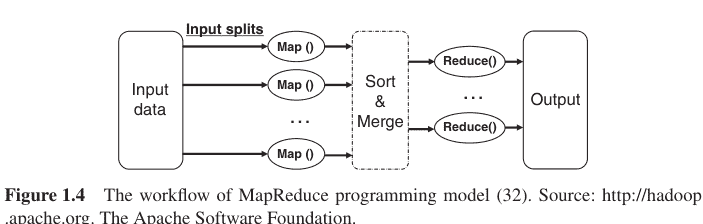

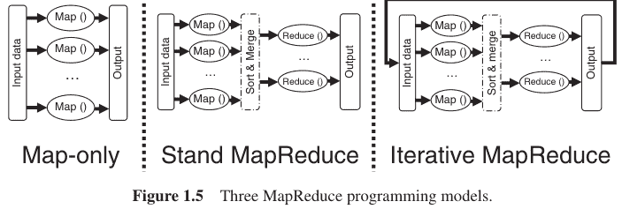

## NGS 数据分析的计算方法

多轮标准的 map-reduce。我们将 MapReduce 模型的实现 Hadoop Hadoop 来说明 MapReduce 编程模型。


Hadoop (32) 是一种用于在云端开发数据密集型应用的开源框架。`Hadoop` 原生支持 `Java`，并且只能运行在基于 `Linux` 的集群上。`Hadoop` 可以扩展以支持其他语言，如 `Python`、`C` 和 `C++`。`Hadoop` 实现了 `MapReduce` 模型：输入被分区为逻辑记录并由 mapper 独立处理；来自多个 mapper 的结果被排序并合并到不同的组；`Hadoop` 的架构如图 1.6 所示，工作流为 `Input()` → `Map()` → `Sort(Merge)` → `Reduce()` → `Output`。`Hadoop` 的组件组织成主从结构。在开发 `Hadoop` 应用时，我们只需要指定三项内容：定义键值的 `Java` 类、mapper 和 reducer (32)。

`Hadoop` 支持 Reduce 节点的基础是 `Hadoop` 分布式文件系统 (`HDFS`)。`HDFS` 将共享文件系统在逻辑上整合为一个文件系统。它还提供了基于 `Java` 的 API 来处理文件操作。`HDFS` 的服务功能基于两个进程：`NameNode` 和 `DataNode`。`NameNode` 负责控制服务，`DataNode` 负责块存储和检索服务 (32)。对于每个虚拟机或操作系统的作业调度，`Hadoop` 使用了两个进程：`TaskTracker` 和 `JobTracker`。`TaskTracker` 调度每个 mapper 和 reducer 在从节点上的执行顺序。`JobTracker` 负责作业提交、作业监控以及将任务分配给 `TaskTracker` (32)。为了获得高可靠性，输入数据在 `HDFS` 中被镜像为多个副本，称为“副本（replica）”。只要至少有一个副本仍然存，`TaskTracker` 就能继续执行作业而无需


图 1.6 `Hadoop` 架构 (32)。来源：http://hadoop.apache.org. Apache 软件基金。

## 用于下一代测序数据分析的云计算

报告存储失败。注意，主节点持有 `NameNode` 和 `JobTracker` 服务，而从节点持有 `TaskTracker` 和 `DataNode` 服务。

### 1.3.3.2 任务编程模型

某些科学问题可以很容易地拆分成多个独立的子任务。以 `BLAST` 为例，如果有一组重复的数据库并且具有独立的网络访问权限，就可以对一组查询序列进行独立搜索。这是任务编程模型的基础。任务编程模型的典型框架如图1.7 所示。

在任务编程模型中，子任务最初由开发者配置并插入任务队列。队列中的每个实体包含编码为文本消息的调度信息。主节点持有的任务池用于分配任务实体并协调其他计算节点。任务编程模型提供了一种保证故障的简单方法：如果任务报告失败，则任务可以由多个计算节点处理，且任务池仅在任务完成后才删除队列中的任务。在接下来，使用 Microsoft Azure 作为一种实现来说明任务编程模型。

`Microsoft Azure` 是由微软提供的云服务平台 (29)。`Microsoft Azure` 架构将硬件资源虚拟化并将其抽象为虚拟机（Virtual Machines）。任何数量概念上相同的虚拟机

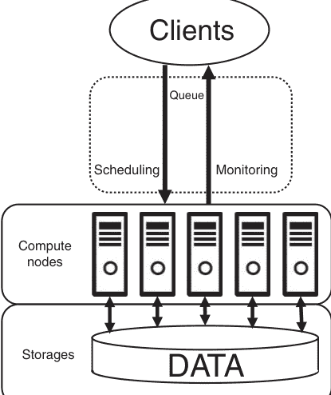

**图 1.7** 任务编程模型 (33)。来源：Gunarathne 2011 (33)。经 John Wiley and Sons 许可复制。

## 用于下一代测序数据分析的云计算

外部 HTTP/HTTPS


**图 1.7** 任务编程模型 (33)。来源：Gunarathne 2011 (33)。经 John Wiley and Sons 许可复制。

外部 HTTP/HTTPS


**图 1.7** 任务编程模型 (33)。来源：Gunarathne 2011 (33)。经 John Wiley and Sons 许可复制。

## 用于下一代测序数据分析的云计算

外部 HTTP/HTTPS


**图 1.7** 任务编程模型 (33)。来源：Gunarathne 2011 (33)。经 John Wiley and Sons 许可复制。

## 用于下一代测序数据分析的云计算

外部 HTTP/HTTPS


**图 1.7** 任务编程模型 (33)。来源：Gunarathne 2011 (33)。经 John Wiley and Sons 许可复制。

## 用于下一代测序数据分析的云计算

## NGS 数据分析的云服务

### 1.4 用于 NGS 数据分析的云计算服务

在本节中，我们使用案例研究来说明云服务如何为 NGS 分析提供支持。目前有四种云服务可用于 NGS 数据：硬件即服务 (`HaaS`)、平台即服务 (`PaaS`)、软件即服务 (`SaaS`) 和数据即服务 (`DaaS`)。这些云服务的总结如表 1.1 所示。对于 `HaaS`，使用了六种方法作为示例，并给出了它们的描述、算法和并行解决方案。这些方法涵盖了四个典型的生物学问题，即 `BLAST`、比较基因组、序列比对和 SNP 检测。

### 1.4.1 硬件即服务 (HaaS)

硬件即服务，也称为基础设施即服务 (`IaaS`)，通过互联网为用户提供计算资源，如存储服务和虚拟化操作系统镜像。根据用户需求，`HaaS` 供应商动态调整计算资源并部署必要的软件以构建虚拟机。不同的用户有不同的需求，因此可扩展性和自定义是 `HaaS` 的两个基本特征。用户仅为使用的云资源付费。我们简要介绍几种流行的 `HaaS` 平台。

预计 `AWS` 占了 `HaaS` 总市场份额 70%。`AWS` 提供了一些产品，包括弹性计算 (`EC2`) 和简单存储服务 (`S3`)。`EC2` 为构建 VM 镜像的用户提供服务器。`S3` 是一种在线存储服务。`HaaS` 市场正在迅速变化并波动巨大，因为 HP、微软、谷歌等大公司都在竞争市场领先地位。HP 发布了其云平台解决方案 `HPCloud`，将存储、网络和安全集成到自动化系统中。`HPCloud` 构建在 `OpenStack` 之上，这是由 Rackspace 和 NASA 开发的云软件。`HPCloud` 的云资源管理是一种混合服务，结合了私有云的安全便利性与成本效益。还有其他 `HaaS` 供应商，如 `Microsoft Azure`、`Google Compute Engine` 和 Rackspace。Rackspace 也是一种混合云，可以通过虚拟专用网络 (`VPN`) 技术结合两种或更多类型的云，如公有云和私有云。上述 `HaaS` 平台共享一些共同特征，如通过支付少量费用访问提供者的数据中心，并根据活跃 CPU 使用情况、数据存储空间和数据传输量收费。

### 1.4.2 平台即服务 (PaaS)

`PaaS` 提供了一个带有必要软件和硬件的平台，用于开发、测试和部署云应用程序。在 `PaaS` 中，虚拟机可以自动伸缩

# 表 1.1 NGS 数据分析的云资源

| 应用 | 功能、描述与可用性 |
| :--- | :--- |
| **硬件即服务 (HaaS):** | |
| Amazon Web Services | 由 Amazon 提供；http://aws.amazon.com/ |
| HPCloud | 由 HP 提供；http://www.hpcloud.com/ |
| Microsoft Azure | 由 Microsoft 提供；http://www.windowsazure.com/ |
| Google Compute Engine | 由 Google 提供；http://cloud.google.com/products/compute-engine/ |
| Rackspace | 混合云；http://www.rackspace.com/ |
| **平台即服务 (PaaS):** | |
| Google App Engine | http://developers.google.com/appengine/ |
| Microsoft Azure | http://www.windowsazure.com/ |
| MapReduce/Hadoop | http://hadoop.apache.org/ |
| **软件即服务 (SaaS):** | |
| AzureBlast (35) | BLAST（一种在 Microsoft Azure 云计算平台上运行的并行 BLAST） |
| CloudBLAST (36) | BLAST（一种云端的 BLAST 实现） http://ammatsun.acis.ufl.edu/amwiki/index.php/CloudBLAST_Project |
| BlastReduce (37) | BLAST（基于 Hadoop 的 BLAST） http://www.cecb.umd.edu/software/blastreduce/ |
| RSD (38) | 比较基因组学（用于 EC2 同源基因距离的相互小距离算法）/roadmap .ms.harvard.edu |
| CloudBurst (39) | 基因组序列映射（使用 MapReduce 进行高敏感短读比对） http://cloudburst-bio-sourceforge.net |
| SeqMapReduce (40) | 基因组序列映射（使用 Hadoop 实现序列映射并行） http://www.seqmapreduce.org |
| CloudAligner (41) | 基因组序列映射（一种基于 MapReduce 的快速且功能全映射工具） http://cloudaligner.sourceforge.net |
| SEAL (42) | 基因组序列映射（使用 Hadoop 的短读对比对和去重工具） http://biodop-seal.sourceforge.net/ |
| Crowd (43) | 基因组序列分析（使用云计算进行读取比对和 SNP 检测） |
| TSS (44) | 基因组序列分析（一种基于 Hadoop 的并行单倍型块划分和 SNP 选择方法） |
| Contrail (45) | 基因组序列分析（基于云的大基因组组装） http://contrail-bio.sourceforge.net |
| CloudBrush (46) | 基因组序列分析（基于字符串图和 MapReduce 的基因组组装器）https://github.com/ice91/CloudBrush |
| Myr (47) | RNA 测序分析（RNA-Seq 差异基因表达工具） http://bowtie-bio.sourceforge.net/myrna |

# 表 1.1（续）

| 应用 | 功能、描述与可用性 |
| :--- | :--- |
| Eoulsan (48) | RNA 测序分析（基于 Hadoop 的模块化可扩展框架） http://transcriptome.ens/fr/eoulsan/ |
| FX (49) | RNA 测序分析（RNA-Seq 分析工具） http://fx.gmi.ac.kr |
| HadoopBAM (50) | 序列文件管理（分析应用与 BAM 文件之间的集成层） http://sourceforge.projects/hadoop-bam |
| SeqWare (51) | 序列文件管理（支持大基因组数据库化信息的查询引擎） http://sequence.sourceforge.net |
| GATK (52) | 序列文件管理（用于下一代重测序数据的基因分析工具包） http://www.broadinstitute.org/gatk/ |

数据即服务 (DaaS):

AWS 公共数据集

（对 GenBank、1000 基因组等的云端分析） http://aws.amazon.com/publicdatasets

并动态地满足应用程序的需求。由于硬件的部署和分配是以透明的方式进行的，用户可以更关注云端程序的开发。通常，`PaaS` 交付的环境包含编程语言执行环境、Web 服务器和数据库。开始初介绍了一些热门平台，例如 `Google App Engine`、`Microsoft Azure` 和 `MapReduce/Hadoop`。在考虑云数据库时，`DaaS` 也可以被视为 `PaaS` 的实例。在这里，我们将 `DaaS` 与 `PaaS` 分离开来，稍后会讨论 `DaaS`。

### 1.4.3 软件即服务 (SaaS)

`SaaS` 以 Web 服务的形式提供按需软件，并方便远程访问各种类型的数据分析。NGS 分析涉及许多生物学问题，如序列比对、序列对齐、序列组装、表达分析、序列分析、本体检测、个人基因组的功能注释、上位性相互作用检测等 (25)。`SaaS` 消除了本地部署的复杂性，简化了软件维护，并确保为所有接入互联网的可能用户提供最新的云端服务。由于涵盖目前所有云云端 NGS 数据分析工具是不现实的，因此仔细挑选了四个具有代表性的类别，以阐述解决来自 NGS 数据产生问题的云端思维。

## 1.4.3.1 BLAST 基础局部比对搜索工具 (BLAST) (35) 是 NCBI 提供的最广泛使用的序列分析程序之一。通过 BLAST 将查询序列与 NCBI 数据库进行比较，可以从中提取出有意义的信息。当只需要比较有限数量的序列时，两两比较是非常简单的，但 NCBI 的数据库极其巨大。当只需要比较有限数量的序列时，两比较是轻而易举的，但 NCBI 的数据库规模庞大。在 2013 年，参考序列 (RefSeq) 报告了 36 亿个核苷酸碱。毫无疑问，当对数据库进行 BLAST 时，两两比较是计算密集型的。在接下来，通过两个云端应用 `AzureBlast` (53) 和 `CloudBLAST` (36) 进行讨论。

Lu 等人 (53) 提出了一种在 `Microsoft Azure` 上运行的并行 `BLAST`。`AzureBlast` 的工作流如图 1.9 所示。与其对查询进行分块，不如 `AzureBlast` 对数据库部分进行分块，并将其分配给工作实例。结果从工作实例合并。实验证明 `Microsoft Azure` 可以良好支持 (53)。

Matsunaga 等 (36) 提出了一种基于 `Hadoop` 的云端 `BLAST` 实现。在 `CloudBlast` 中，输入首先被拆分，然后传递给映射器。结果从工作实例合并。实验显示，在相同配置下通过 PBS 获得了类似的加速 (31)。

### 1.4.3.2 比较基因组

比较基因组学是一种通过比较不同物种的基因组特征来理解进化关系中的功能相似性和差异的学科。比较基因组学中的一种计算密集型方法是相互小距离算法 (`RSD`) (38)。`RSD` 用于检测多对同源序列。它包含三个步骤：

- 利用 `BLAST` 生成查询序列与参考序列之间的命中
- 使用比对工具处理蛋白质序列并使用 `PAML` 获取氨基酸替换的最大似然估计
- 再次调用 `BLAST` 重新计算距离以判断对是否同源

Wall 等 (38) 通过在 `EC2` 上适配 `RSD` 提出了一种名为 `RSD-cloud` 的云端工具。`RSD-cloud` 有两个主要阶段，即 `BLAST` 和进化距离估计。在第一阶段，映射器使用 `BLAST` 为所有基因组产生命中。在第二阶段，其他人进行同源计算以估计距离。实验表明，可以在 `EC2` 上使用 100 个高计算节点运行 300,000 个 `RSD-cloud` 程序。总计算时间小于 70 小时，成本为 6302 美元。

### 1.4.3.3 基因组序列映射

基因组序列映射旨在确定基因或 DNA 段在参考染色体上的相对位置。通常，基因组序列映射有两种类型：

- 遗传图谱，使用经典的遗传学技术（如家系分析）来描绘基因组特征
- 物理图谱，使用现代分子生物学技术实现相同的目标

目前的基因组序列映射云解决方案属于第二类型。与 `BLAST` 类似，基因组序列映射在查询的独立性方面也可以并行的。事实上，两个工具 `CloudBurst` (31) 和 `CloudAligner` (41) 被用于说明基因组序列映射的云端解决方案。

## 第 1 步

云配置

## 第 2 步

云处理

预配置

- 同源基因计算
- 实例化
- HDFS
- S3
- 任务流执行
- 全对全 blast (All-v-All)

**图 1.10** 在 `EC2` 上使用 `MapReduce` 框架进行 `RSD` 的工作流 (38)。来源：Wall, http://bmcinformatics.biomedcentral.com/articles/10.1186/1471-2105-259。根据 CC BY 2.0 协议使用 http://creativecommons.org/licenses/by/2.0。

`CloudBurst`，Schatz (39) 设计了一种名为 `CloudBurst` 的并行算法，这是一种基于流行的读段比对程序 `RMAP` (35) 在 `Hadoop` 平台上的“种子-扩展”读段映射算法。根据 `MapReduce` 模型，`CloudBurst` 修改了 `RMAP` 以在多台机器上并行运行。`CloudBurst` 的工作流包含两个阶段：Map 阶段和 Reduce 阶段，如图 1.11 所示。mapper 生成的键值对具有以下格式：<reads> 和 <references>，即读段和参考序列的 k-mers，它们在共享 k-mers 的读段与参考序列之间执行端到端对齐。最终结果被转换为与 `RMAP` 标准格式相同的文件，因此 `CloudBurst` 可以在流水线中替代 `RMAP`。`CloudBurst` 的运行时间随处理器数量的增加而线性扩展。在具有 24 个处理器核心的配置下，在相同输入集的情况下，`CloudBurst` 的速度比在单核上执行的 `RMAP` 快了多达 30 倍 (39)。


Nguyen 等人 (41) 开发了 CloudAligner，这是一种基于 MapReduce 的用于处理长读段映射的应用程序。它利用 Map 阶段在参考序列上定位读段。工作流如图 1.12 所示。CloudAligner 接受两种输入类型：读段和参考序列，将读段分成多个块并分发到多个 mapper。CloudAligner 能够处理多种类型，包括比对、亚硫酸盐比对和双端比对，并将读段比对到参考序列。实验结果表明，通过 CloudAligner 使用 MapReduce 模型显著提高了效率。

## 洗牌 (Shuffle)


**图 1.11** CloudBurst 的工作流。来源：Schatz (39)。


**图 1.12** CloudAligner 的工作流。来源：Nguyen, http://bmcinformatics.biomedcentral.com/articles/10.1186/1471-2105-259。根据 CC BY 2.0 协议使用 http://creativecommons.org/licenses/by/2.0。

## 单核苷酸多态性 (SNP) 检测

单核苷酸多态性 (SNP) 是基因组中单个碱基的变异。在云计算中，SNP 检测高度依赖于数据，特别是对于基因组分析，这至关重要。为了实现 SNP 检测的解决方案，CloudBurst 提出了一种基于 Hadoop 的工具，即 Bowtie。它包含三个阶段：Map 阶段、排序阶段和 Reduce 阶段。在 Map 阶段，mapper 将短读段比对到参考序列。在排序阶段，Hadoop 平台根据键值对这些比对进行分组。在 Reduce 阶段，reducer 简单地调用 SNP。实验显示，CloudBurst 使用 32 个核心仅花费 3 小时即可完成检测。

## 数据即服务 (DaaS)

DaaS 旨在以各种格式从多个来源提供数据服务，用户可以通过互联网访问。DaaS 允许按需访问数据，而无需使用本地文件系统。此外，数据的共享加速了与其他研究者的合作。DaaS 的一个例子是 AWS，它提供了一个公共数据中心，包括 GenBank、Ensembl、1000 Genomes、模式物种百科、UniGene 和流感病毒。AWS 还包含许多数据，例如天文学、化学。

### 1.5 结论与展望

在本章中，我们首先讨论了 NGS 技术在存储、传输和分析方面带来的挑战。阐述了两类编程模型：MapReduce 和任务模型，以说明并行思想。然而，并非所有数据密集型算法都能轻松迁移到云平台。因此，需要合适的并行策略和更强大的云平台。常用的并行策略有三种：

- 直接并行：许多生物信息学任务（如 BLAST）是显式数据独立的。只需较小修改即可在云平台上运行。这种类型的加速与集群的计算呈近线性关系。
- 迭代并行：多次运行 MapReduce 或执行程序是复杂任务（如 RSD）的另一种解决方案。还可以考虑如何存储、分配和收集中间数据。如何设计高效的方法是一个根本性挑战，因为临时数据在执行过程中可能太大。
- 数据转换并行：对于某些复杂问题，需要对数据和算法本身进行转换以利用云优势。例如参考文献 60 中的。虽然我们在本章中没有介绍，但值得注意的是我们可以智能地改变输入格式以促进云解决方案的发展。

对于生物信息学，不仅限于 NGS 数据分析，云计算处于早期阶段。更强大、更易用的云平台和编程模型有望问世并投入，以解决复杂的科学问题。最终，所有科学家将从各个领域的新计算能力中获益。

## 22 NGS数据分析的计算方法

5. Brooksbank C, Camon E, Harris M, Magrane M, Martin MJ, Mulder N, O'Donovan C, Parkinson H, Tuli MA, Apweiler R et al. 欧洲生物信息学研究所的数据资源。Nucleic Acids Res 2003;31(1):43–50.
6. Shumway M, Craine G, Sugawara H. 下一代测序数据的归档。Nucleic Acids Res 2010:38:871–870.
7. Stein LD et al. 基因组学中的云计算。Genome Biol 2010;11(5):207.
8. Moore GE et al. 在集成电路中挤入更多组件。纽约; McGraw-Hill, 1965.
9. Walter C. Kryder 定律。Sci Am 2005;293(2):32–33.
10. Reynolds C. 正我们可能交流的方式。ACM SIGCHI Bull 1998;30(30):40–44.
11. Margulies E, Mholm A, Altman We, Aditya S Bader, Benben L, Berka J, Bravermans, Chen Y-J, Chen Z et al. 微流控高密度生物器中的基因组测序。Nature 2005;437(7057):376–380.
12. Bennett S. Solexa Ltd。Nature 2005;4(4):433–438.
13. McKernan J, Peckham HE, Costa GL, McLaughlin SF, Yu F, Tsung EF, Crusper CR, Duka JK, Lee CC et al. 使用双碱基因组短读大规模并行测序进行人类基因组测序和结构变异分析。Encode Res 2009;19(9):1527–1541.
14. 档案馆 (Internet Archive)。访问地址 http://www.archive.org/。2016年3月19日。
15. Illumina。访问地址 http://www.illumina.com/。2016年3月19日。
16. 滨生物 (Pacific Biosciences)。访问地址 http://www.pacificbiosciences.com/。2016年3月19日。
17. Helicos Biosciences 公司。访问地址 http://www.helios.com/。2016年3月19日。
18. Ion Torrent。访问地址 http://www.iontorrent.com/。2016年3月19日。
19. 1000基因组计划 (The 1000 Genomes Project)。访问地址 http://www.1000genomes.org/。2016年3月19日。
20. NCBI (美国国立生物信息中心)。访问地址 http://www.ncbi.nlm.nih.gov/About/news/16feb2011。2016年3月19日。
21. Mediawiki。访问地址 http://sourceforge.net/atlas/mediawiki/jnomics。2016年3月19日。
22. Zerbino DR, Burney E. 算法：使用 De Bruijn 图进行从头短读长组装。Genome Res 2008;18(5):821–829.
23. Buyya R, Yo CS, Venugopal S, Stroberg J, Brandic I. 云计算与新兴平台：作为第五种公用服务的计算愿景、炒作与现实。Future Gen Syst 2009;25(6):599–614.
24. Vaquero LM, Romero-Merino L, Caceres J, Lindner M. 云中的突破：迈向云定义。ACM SIGCOMM Commun Rev 2008;39(1):50–55.
25. Amazon 弹性云 (EC2)。访问地址 https://aws.amazon.com/ec2。
26. Fusaro VA, Patil P, Gafni E, Wall DP, Tonellato J. 基于 Amazon Web Services 的生物医学计算。PLoS Biol 2011;7:e002147.
27. Google App Engine。访问地址 http://www.appengine.com/。2016年3月19日。
28. Windows Azure。访问地址 http://www.windowsazure.com/。2016年3月19日。

# 用于下一代测序数据分析的云计算

30. Jin C, Buyya R. 基于网络的云计算的 MapReduce 编程模型。Sips H, Epeda D, Lin H-x, 编。Euro-9 并行处理。计算机科学讲义第5704卷。柏林 海德堡：Springer-Verlag; 2009，页417–428。
31. Guo X, Ding X, Meng Y, Pan Y. 用于从头宏基因组组装的云计算。在：Cai Z, Einstein O, Janies D, Schwartz D, 编。生物信息学研究与应用。计算机科学讲义第785卷。柏林 海德堡：Springer-Verlag; 2013，页185–198。
32. Hadoop。访问地址 http://hadoop.apache.org。2016年3月19日。
33. Gunaratne T, Wu T-L, Choi JY, Bae S-H, Qu J. 用于令人可行的应用的云计算范式。Concurrent Comput Pract 2011;23(17):2338–2354.
34. Redkar T, Guidici T, Geiger M. Windows Azure平台。第1卷。伯克利 (CA): Press;2011。
35. Schatz SF, Gish W, Miller W, Lipman DJ. 局部比对。J Mol Biol 1990;210:403–410.
36. Matsunaga A, Tsugawa M, Fortes J. CloudBlast：结合 MapReduce 和分布式资源。eScience 2008;3:222–229.
37. Schatz MC. MapReduce：高性能搜索。马里兰大学；2008。访问地址 http://cs.umd.edu/scholarly/papers/MichaelSchatz.pdf。
38. Wall DP, Kantor P, Ruden R. CloudAligner：基于 MapReduce 的快速功能工具。Bioinformatics 2010;11:259.
39. Li Y, Zhong S. SeqMapReduce：基于 Web 的序列映射加速工具。大规模数据分析 (CAMDA) 2009。
40. Nguyen T, Shi W, Ruden D. 用于比对的快速功能 MapReduce 的工具。BMC Res 2011;4:71.
41. Piredu L, Leo S, Zanetti G. Seoul：分布式 mapreduce 和去重。Bioinformatics 2011;17(25):2159–2160.
42. Langbaud B, Schatz MC, Lin J, Pop M, Salzberg SL. 使用云搜索 SNPs。Genome Bio 2009;10(11):134.
43. Hung Y, Lin C-C, Chen C-L, Ho J. 云计算上的从头下一代序列组装。在：Kim T 等，编。网格与分布式计算。第261卷。柏林 海德堡：Springer-Verlag; 2021，页525–534.
44. Schatz M, Sommer D, Kelley D, Pop M. 使用云计算的大型基因组组装。CSH 基因会议；2010。
45. Chang Y-J, Chen C-C, Chen C-L, Ho J-M. 使用字符串图和 MapReduce 框架的从头下一代序列组装器。BMC Genomics 2012;13:728.
46. Langmead B, Hansen KD, Lee JK 等. 云规模RNA测序差异分析。Genome Bio 2010;11(8):83.
47. Jourden L, Bernard M, Dillies M, Le Corm: 基于云的高吞吐量序列分析。Bioinformatics 2012;28(11):1542–1543.

## 24 NGS数据分析的计算方法

48. Hong D, Rhie A, Park S-S, Lee J, Kim S, Yu S-B, Bleazard T, Park H-S, Rhee H 等. FX：云端的 RNA-Seq 分析工具。Bioinformatics 2012;28(5):721–723.
49. Niemenna M, Kallio A, Schumacher A, Klemelä P, Korpelainen E, Heljanko K. Hadoop-Bam：云端的直接映射下一代测序数据。Bioinformatics 2012;28(6):876–879.
50. O’Connor BD, Briman B, Nelson SF. SecQuery Engine：云端的序列启动和搜索。BMC Bioinformatics 2010;11 Suppl 12:2.
51. McKenna A, Hanna M, Banks E, Svancikov A, Ciluskis K, Kerntsky A, Garimella K, Altshuler D, Gabriel S, Daly M 等. 基因组分析工具包：下一代DNA测序数据的 MapReduce 框架。Genome Res 2010;20(9):1297–1303.
52. Lu W, Jackson B, Barca R. AzureBlast：云端科学应用的案例。第十届 ACM 高性能分布式计算国际讨会。ACM:2010，页413–420.
53. Darling A, Carey L, Feng W-C. mpiBLAST 的设计、实现和评估。ClusterWorld 2003:2003.
54. Smith AD, Xuan Z, Zhang MQ. 使用质量分和更长的读段提高 Solexa 映射的准确性。Bioinformatics 2008;9(1):128.
55. Patil N, Berno AJ, Hinds DA, Barrett W, Doshi JM, Hacker CR, Kautzer CR, Lee DH, Marjoribanks C, McDonough DP 等. 高分辨率测序人类22号染色体所示的单倍型多样性块。Science 2001;294(5547):1719–1723.
56. Guo X, Meng Y, Yu N, Pan Y. 通过动态聚类检测高水平全基因组上位作用的计算。BMC Bioinformatics 2014;15(1):102.
57. Langmead B, Trapnell C, Pop M, Salzberg S 等. 短 DNA 序列到人类基因组的极快速且内存高效的比对。Genome Biol 2009;10(3):25.
58. Li R, Li Y, Fang X, Yang H, Wang J, Kristianen K, Wang J. 大规模并行全基因组测序的 SNP 检测。Genome Res 2009;19(6):1124–1132.
59. Estrada T, Zhang B, Bicotti P, Armen R, Taufer M. 使用 MapReduce 方法分类蛋白质-配体结合几何形状的可扩展且准确的方法。Comput Biol Med 2012;42(7):758–771.

## 2 使用 METAPATHWAYS 进行环境序列信息分析简介

NIELS W. HANSON

不列颠哥比亚大学生物信息学研究生项目，加拿大温哥华

KISHORI M. KONWAR

不列颠哥比亚大学微生物学与免疫学系，加拿大温哥华

SHANG-JU WU

不列颠哥比亚大学计算机科学系，加拿大温哥华

STEVEN J. HALLAM

不列颠哥比亚大学微生物学与免疫学系，生物信息学研究生项目，加拿大温哥华

### 2.1 引言与概述

下一代测序（NGS）技术的兴为来自各种自然和工程生态系统的环境序列信息带来了一场真正的“信息海啸”。尽管这股信息浪潮正在改变我们对周围世界微生物群结构和功能的理解，但由于缺乏通用且可扩展的软件工具来处理、组织和与环境数据集进行交互，限制了知识的产生与转化。在本章中，我们描述了 MetaPathways 的功能，这是一种模块化的流水线，专门设计用于环境序列信息的代谢途径重构和比较分析。

### 2.2 背景

我们生活在一个由微生物主导的世界（1）。这种不可见的微生物多数相互的成员构成了分布式的代谢网络，将从单个细胞到地球系统的基因组和表型连接起来（2, 3）。这些网络通过突变、基因转移和栖息地选择不断变化，产生了冗余且具有韧性的微生物模块，驱动着自然和工程生态系统中物质和能量转换（4–8）。通量测序（也称为环境基因组学、生态基因组学或宏基因组学）产生了海量的环境序列信息，具有改变我们世界观的（4, 9–11），并通过对这些网络的感知和操控实现技术和治疗上的创新（12–18）。

尽管后代测序和单细胞测序技术正在快速扩展我们生成环境序列信息的能力（19–22），但存在许多计算和分析挑战限制了知识的产生与转化（23–25）。Collins 及其同事认为，类似的问题在现代实验研究的许多领域都很常见：“数据以各种规模和形状出现，涵盖了大型国际实验；跨实验室、单实验室以及个体观察；并可能涉及个体生命。单个实验的学科性、规模及其数据速率使得工具的使用成为一个极其棘手的问题！”（26）。特别是计算和视觉分析瓶颈，对不同层次生物学信息（DNA、RNA、蛋白质以及重复样本或群落之间的可扩展比较）的整合构成了强大的限制。虽然在开发集成工具方面已取得良好进展，但仍需要整合了新型统计和分布式计算技术以及跨越多个层级的有效结构的用户友好集成软件，以充分发挥并促进环境序列信息价值。


有若干服务整合了环境序列分析和信息存储。基于子系统技术的宏基因组快速注释（MG-RAST `http://metagenomics.mpdr.org/`）是一个基于 Web 的门户，使用 SEED 注释框架对功能基因和子系统进行注释，提供注释和比较分析服务（27）。整合基因组与宏基因组（IMG/M, `http://img.jie.doe.gov/m/`）（28, 29）和高级微生物生态学研究与分析社区基础设施（CAMERA `http://camera.caliti2.net/`）（30）存储的数据集为选定的测序项目提供注释和比较分析服务。其他信息资源如基因组在线数据库（GOLD）（31）和海洋生态基因组学（MEG）（32）策划并编译了全球微生物基因组和宏基因组过程的信息。

除了在线信息资源外，还开发了一些特定的软件工具来支持微生物群结构和功能的研究。例如，宏基因组分析器（MEGAN）提供了一个独立工具，可以解析并查询基本序列比对工具（BLAST）的搜索结果到各种分类或功能基因层次结构中（33–35）。使用`Qiime`、`MLTreeMap`（`http://mlltreemap.org`）和交互式生命树（iTOL）等工具侧重于通过标记基因进行分类鉴定。`Qiime`使用 16S rRNA 基因的发发育密度结合多变量统计方法来推断相互之间的关系。`Qime`使用 16S rRNA 基因的发发育密度结合多变量统计方法来推断相互之间的关系（注：原文此处 Qime 疑似为 Qiime 之误，此处保留原文逻辑）。使用 16S rRNA 基因的发发育密度（此处 dense应为 density）。`MLTreeMap`使用选定的正交簇（COGS）来识别分类组成（37）。`iTOL`允许基于用户定义的层级对进化关系的交互式展示（38）。虽然这些服务和工具能够根据基因丰度处理环境序列信息，但也面临带宽和格式的限制。

在接下来的章节中，我们介绍了`MetPathways`（39），这是一种模块化的注释和分析流水线，能够利用`Pathways Tools`（41, 42）和`MetaCyc`（43）构建环境基因组数据库（PGDBs）。`MetPathways`提供了一个以途径为中心的微生物代谢视图，克服了若干数据处理瓶颈。我们将从流水线处理概述开始，介绍针对网格和云的高性能计算的任务管理系统、图形界面（GUI），以及使用选定的 R 包如`VennDiagram`（45）、`pclust`（46）和`ggplot2`（`http://ggplot2.org/`）进行大规模数据集比较的方法。

## 2.3 METAPATHWAYS PROCESS

在本节中，我们回顾了流水线过程，特别强调了设计原则和算法选择。`MetPathways`可以分为五个操作阶段，这些步骤在不同版本之间会有所增加（版本 1）。从移除低质量序列的初始质量控制（QC）开始，`MetPathways`执行开放阅读框（ORF）预测。翻译后的 ORF 与蛋白质数据库进行功能注释。功能注释后，识别转录 RNA（tRNA）和核糖体 RNA（rRNA）基因。预测 ORF 的分类归属基于 NCBI。最低共同祖先（LCA）被放置在分类层次中，并使用自动建树基于选定的基因进行分析。注释后的 ORF 经过精化和格式化，以生成 ePGDBs。最后，提取基因、反应和途径信息用于下游分析。

### 2.3.1 开放阅读框（ORF）预测

有机或群落的代谢潜力可以通过计算方法推断，这些方法搜索代表启动子、翻译起始位点（TIS）、起始密码子或核糖体结合位点（RBS）的模式或基序（图 2.2a）。基于子系统技术的宏基因组快速注释（MG-RAST）

开发了许多准确预测组装序列全基因的算法，包括`GeneMark`（49）、`Glimmer`（52）和`fgenes`（`http://linux.softberry.com/`）。这些算法在处理长度小于 100 bp（原核基因平均长度）的未采样环境数据时性能会下降（53）（图 2.2b）。此外，虽然通过处理亲缘分类群之间的任务可以提高准确性，但环境序列信息的基因组复杂性带来了“匿名序列问题”（54）。考虑到这些限制，短读基因预测算法需要将输入序列分类分箱，或对每个序列连续修改内部参数。此类算法还需要对短读平台相关的测序错误具有稳健性。

已经开发了一些机器学习和统计模型来解决匿名序列问题（图 2.3）。例如，`MetaGen`针对细菌和古菌训练了基于 GC 含量、密码子频率、ORF 长度、起始密码子内长度以及基因之间方向和距离的对数优势频率启发式评分模型，对每个序列使用评分最高的模型（56）。`MetaGen Annotator`（57）作为`MetaGen`的更新版本，增加了病毒训练模型以及核糖体结合位点特征。

## NGS 数据分析计算方法

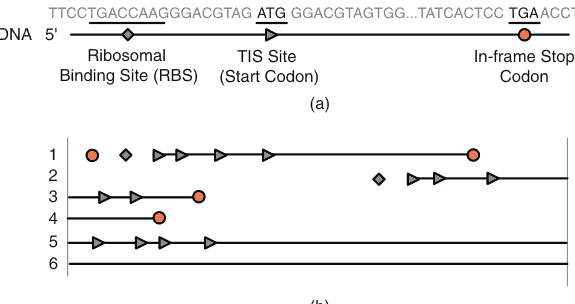

**图 2.2** 短读序列 ORF 预测。(a) 用于定义 ORF 的三个经典序列特征是终止密码子或转录起始位点 (TIS)，例如 ATG；帧内终止密码子（例如 TGA）；以及 5' 上游核糖体结合位点 (RBS) 的存在。(b) 当前测序序列的长度小于大多数细菌基因，因此许多 ORF 序列会在序列读取窗口之外被截断；短读序列中的 ORF 具有许多不完全的信号：(i) 多个带有上游帧内终止密码子的 TIS 位点；(ii) 缺失帧内终止密码子；(iii) 不存在有效的 TIS 位点；(iv) 没有潜在起始终止密码子；(v) 没有潜在终止密码子；(vi) 没有起始、RPS 或潜在终止序列。

改进匿名序列识别。`Glimmer-MG`采用了一种复杂的基于 k-mer 频率选择的插值马尔科夫模型方案 (58)。`Orhelia`是一种两阶段算法，首先通过线性判别提取相关特征，然后并在神经网络中组合这些特征以创建基因预测模型 (59)。`MetaGUN`在训练支持向量机 (SVM) 之前，通过 k-mer 频率将环境序列分类分类桶，以识别分类后的 ORF (60)。原核生物动态规划基因发现算法 (`Prodigal`) 提供了一种高效的启发式方法，能够利用匿名输入序列的备遗传密码识别 ORF (61)。

`MetaProdig` (62) 是针对序列信息开发的 `Prodigal` 优化版本，它使用了从由 1415 个 NCBI RefSeq 基因组成的成对距离矩阵中派生出的 500 个训练文件。通过计算每个输入序列的内容，`MetaProdig` 仅使用 GC 范围内的训练谱图，从而提高了计算效率。此外，`Bonferroni` 校正 (63) 过程通过结合序列长度、所用训练文件数量以及预测 ORF 长度的惩罚机制，减少了短读序列上的假阳性识别。在与针对匿名和短读序列调优的其他 ORF 方法进行基准测试时，`MetaProdig` 表现异常出色，改进了位点识别 (60)。鉴于这些结果，开源代码并在主要测序中心广泛使用的 `Prodigal/MetaProdig` 已集成到 `MetaPathways` 中，尽管也可以根据用户偏好随时引入备选预测算法。`MetaProdig` 在概念上产生

# 使用 METAPATHWAYS 进行环境序列信息分析

### MetaGene & MetaGene Annotator

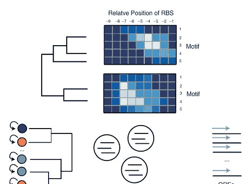

### Glimmer-MG

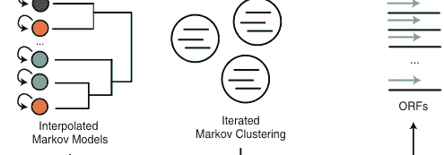

### Orphelia

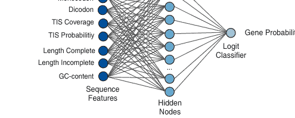

### MetaGun

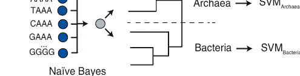

### MetaProdigal

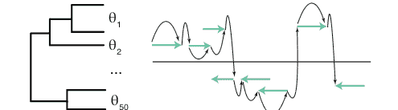

**图 2.3** 匿名序列问题。宏基因组序列源于广泛分类群的许多不同供体基因型，这为许多 ORF 预测算法带来了参数化训练问题。请参阅 www.wiley.com/go/Mandoiu/NextGenerationSequencing 获取此图的彩色版本。

# 32 NGS 数据分析计算方法

默认使用 NCBI 翻译表代码 11（标准细菌/古菌）翻译蛋白质序列，但如果需要备用翻译表，可以以用户定义的方式更改此参数。流水线收集 `MetaProdigal` 的输出，并将核苷酸和蛋白质序列导出为 fast 文件（`.fna` 和 `.faa`）。长度低于默认值 180 个核苷酸或 60 个氨基酸的 ORF 将移除并导出（`.qc.fna` 和 `.qc.faa`），并生成质量控制前后的分布摘要（`.nuc.stats` 和 `amino.stats`）。

### 2.3.2 功能注释

在 ORF 预测之后，`MetaPathways` 使用 `BLAST` 或 `LAST` 种子-扩展算法 (33, 64) 查询用户定义的蛋白质序列数据库以进行功能注释。最全面且增长最快的自动化功能注释公共数据库之一国家生物信息中心（NCBI）冗余参考序列（RefSeq）数据库。例如，2014 年 7 月发布的 RefSeq 版本 66 数据库包含几乎 6000 万条参考序列，仅在过去的 12 个月内就增加了 2000 万条记录（图 2.4）。讽刺的是，RefSeq 的扩张代表了

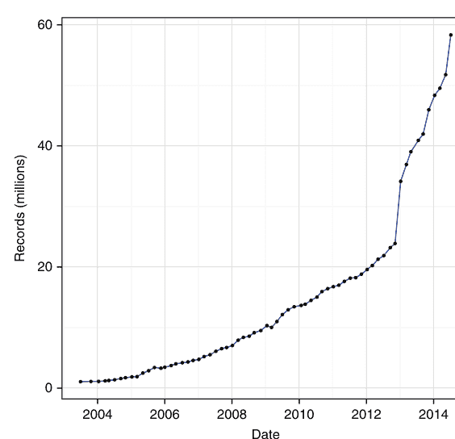

**图 2.4** 数据浪潮：NCBI RefSeq 蛋白质序列记录增长（2004–2014）。蛋白质参考序列数量的稳定增长，对使用 `BLAST` 或 `LAST` 等种子-扩展算法对环境序列信息进行功能注释带来了计算挑战。

# 使用 METAPATHWAYS 进行环境序列信息分析 33

由于全对搜索的运行复杂度，在处理环境序列信息时面临最大的计算挑战之一。除了 RefSeq，还存在更专门的代谢重构数据库 `KEGG` 和 `MetaCyc`，它们具有严格的要求。例如，京都基因与基因组数据库（KEGG）提供了带有酶编号的功能注释 (65)。`MetaCyc` 基因、通路和代谢产物的集合代表 (66)。用户只需将未格式化的 fasta 文件复制到目录即可添加数据库。数据库查询可以在本地运行或通过系统外部化 (69)。`BLAST` 分大于 0.4 被认为可靠。功能注释以表格格式返回 `results/tables/` 或直接在 `MetaPathways GUI` 中查看。在后续步骤中，此信息与 `annotated.gff` 文件结合，用于用于 PGDB 构建和提交输入文件。

## 2.3 分析模块

流水线的第三阶段构建的模块目前关注转移 RNA (tRNA) 和 rRNA 基因识别。

### 2.3.1 tRNA 基因识别
tRNA 基因包含大量的拷贝基因家族，被称为病毒和细胞基因组中的表达模式。`MetaPathways` 使用默认参数实现 `tRNA scan`（1.4 版本），从核苷酸序列中识别 RNA (70)。生成的 tRNA 识别结果导出到 `results/tRNA/` 目录。

### 2.3.2 rRNA 基因识别
所有细胞基因组编码核糖 RNA 基因（图 2.5a 和 b）。这些核糖蛋白机器是细胞内蛋白质合成不可缺的一部分，为 DNA、RNA 和蛋白质之间的生物信息流提供了翻译机制。作为通用标记基因，rRNA 序列可用于构建统一所有三类的

## NGS 数据分析计算方法

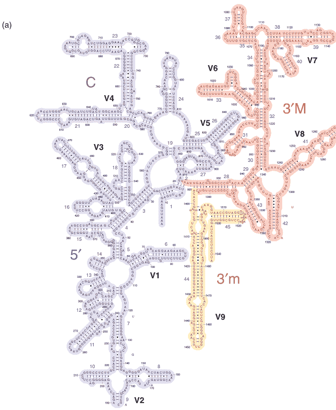

**图 2.5** 小亚基 SSU rRNA 基因是微生物多样性的金标准”。(a) 大杆菌 rRNA 转录物及其折叠结构包含四个域（5'、C、3'M 和九个高变异区 V1-V9），这些连接到突变率较高的区域：来源：Dr Holler, 加州圣克拉鲁兹 RNA 中心。经 Dr Holler 许可复制。）(b) SSU rRNA 基因的线性图，显示了每个域和高变异区域的相对位置。(c) 通过对齐多个生物的 rRNA 序列，可以生成三域进化树，揭示了遗传多样性的最大比例由微生物代表。

# 使用 MetaPathways 进行环境序列信息分析 35

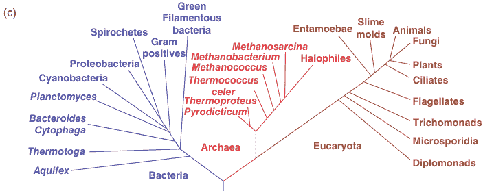

图 2.5（续）

生命的（图 2.5c）（71, 72）。事实上，原核细胞和小亚基核糖体 RNA（SSU/16S 和 LSU/23S rRNA）基因是微生物多样性研究中的“金标准”（71, 72）。过去二十年来，不依赖培养的 rRNA 基因调查彻底改变了我们对微生物世界的认知，并揭示了许多候选门的存在，即所谓的“微生物暗物质”，它们仅根据 rRNA 基因序列信息被发现。

如今，rRNA 基因调查代表了一类与环境监测以及健康疾病相关的行业。基于聚合酶链反应扩增并使用所谓“通用”引物集（73）的高通量扩增子测序项目正在扩大用于自然和工程生态系统分类图谱分析的序列数据库（GreenGenes, Silva, RDP 等）（74–76）。虽然群落组成分析为微生物生态学提供了定量见解，但它们在确定未知微生物群落内部代谢途径方面能力有限。尽管已经开发了通过 rRNA 丰度推断功能潜能的方法（77），但直接从宏基因组数据集中识别 rRNA 基因丰度可以更准确地代表样本中的供体基因型，而这与基于功能基因注释的代谢途径信息直接相关（24）。

`MetaPathways` 使用 `BLAST` 将组装或未组装的核苷酸序列与包括 `SILVA`（75）和 `Green-Genes`（74）在内的参考核苷酸数据库进行对比，以识别 rRNA 基因。生成的 rRNA 识别结果以包含 `BLAST` e 值、一致性百分比、bit 分、长度和分类身份的摘要表形式导出到每个参考数据库中（`.rRNA.stats.txt`），且识别出的 rRNA 序列可以作为特征在 `MetaPathways v2.0 GUI` 中导出。

### 2.3.3 同源基因组簇 (COGs)

在分析微生物群落结构时，使用保守的单拷贝功能基因为 rRNA 扩增子测序提供了有力的补充或替代方案。事实上，COGs 提供了一组锚基因，用于估计基因组完整性和覆盖率以及构建系统发育树（78, 79）。每个 COG 包含至少三个谱系之间共有的同源蛋白。由于同源蛋白往往具有等效的功能，这些信息可以传播到整个簇中，为单个基因组或宏基因组数据的功能注释提供快速途径（图 2.6a）。有趣的是，测序项目产生了大量跨分类组的保守假设性开放阅读框（ORF）。虽然传统上将这些序列整合到 COGs 中依赖于手动注释，但大量涌的序列驱动了自动化替代方案的发展，包括 `EggNOG` 数据库（80）。在第二个版本中，`EggNOG` 使用互向 `BLAST` 和“三角形同源性”方法来构建新簇并添加到现有簇中（81）。虽然 COG 数据库包含在 `MetaPathways` 中，但可以将 `EggNOG` 数据库作为未格式化的 fasta 文件添加到数据库目录中。该文件将自动格式化以提供后续和扩展搜索，且结果将与其他数据库的输出合并。

`MetaPathways` 使用 `BLAST` 结合 `RefSeq` 和 `COG` 参考数据库对预测的蛋白质序列进行查询，以进行分类注释。`BLAST` 分数的计算和报告如功能注释部分所述。COG 注释连同其在 CO 功能层次结构中的分类说明一起返回，结果导出到 `results/annotation_tables/ COG` 注释，每个 read 的注释以表格格式汇总在 `results/annotation_tables/` 中中，或直接在 `MetaPathways v2.0 GUI` 中查看。

`MetaPathways` 还支持使用 `MLTreeMap`（37）进行功能基因图谱分析。`MLTreeMap` 自动将标记基因放置在基于 40 个通用 COG 的多序列比对或“超级矩阵”（82）生成的高分辨率进化树上。分类分配分三个步骤进行：首先，使用 `BLAST` 和 `GeneWise`（33）利用核苷酸或蛋白质序列识别标记基因。检测到的标记基因使用 `hmmalind` 和 `Gblocks`（84, 85）添加到经过精选的参考比对中。然后，将这些比对后的序列使用 `RAAML`（86, 87）放置到已注释的参考进化树中（图 2.6b）。除了通用的 COG 参考进化树外，用户定义的树也可以添加到 `MLTreeMap` 中，支持系统发育和功能锚定。

### 2.3.3.4 最近祖先 (LCA)

环境序列信息的分类注释对读取长度和组装敏感。虽然组装的 contigs 上存在 rRNA 基因等系统发育锚能够对连接的 ORF 进行直接注释，但基于 `BLAST` 的单个 ORF 分配可能会受到多个不同分类组之间共享序列同源性的干扰。最初整合到 `MEGAN`（34）中的 LCA 算法使用 `BLAST` 分数将序列保守地放置在 NCBI 分类层次结构中。LCA 代表根据 `BLAST` 命中值的预期分类范围，序列可以分配到的 NCBI 分类中的中的最低节点（图 2.6c）。`MEGAN LCA` 使用几个用户定义的标准来确定此范围，包括 bit 截值、最佳截值和最小支持百分比。`MetaPathways` 实现了 LCA

(a)

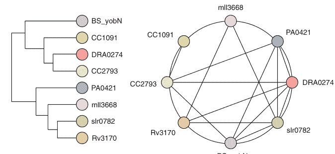

(b)

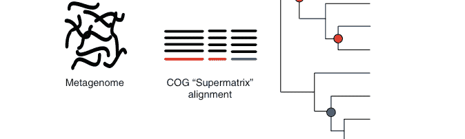

(c)

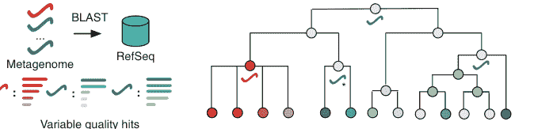

**图 2** 分类分配和功能图谱模块：(a) 同源基因组簇 (COGs) 使用“三角形同源性”方法构建。(b) MLTree 利用极大似然法。(c) MEGAN 使用共同祖先 (LCA) 算法。请参阅二代测序获取此图的版本。

`MetaPathways` 使用 LCA 算法对环境序列信息进行处理，将分类信息导出到 NCBI 分类层次结构。

# 环境序列信息分析 38

# NGS 数据计算方法

### 2.3.4 ePGDB 构建


使用定义规则预测代谢网络的以通路为中心的方法为定量见解提供了更稳健的途径。最近，已开发出微生物通路预测和代谢通量算法，分别为人类微生物组分析网络 (`HUMANN`) 和预测相对代谢 (`PRMT`)。`HumanN` 将基因预测与 `MinPath`（88）相结合，这是一种基于 `KEGG` 路径映射的代谢重建简约方法（12, 65）。`PRMT` 在宏基因组中利用 `KEGG` 通路预测代谢通量。`HUMANN` 和 `PRMT` 都未为探索代谢途径提供连贯的结构。除了 `HumanN` 和 `PRMT` 外，用于工程群落代谢通量建模的替代算法正在出现（90, 91）。

`MetaPathways` 使用 `Pathway Tools`，这由 `SRI` 开发的质量控制软件环境，支持通路基因组数据库 (`PGDB`) 的构建（41, 42）。`PGDB` 包含定义代谢和调节网络的基因、反应和通路信息。`Pathway Tools` 中的 `Pathologic` 算法允许用户使用 `MetaC` (`http://metacy.org/`) 从注释基因组构建新的 `PGDB`（43, 44），这是一个精选、非冗余且经过实验验证的代谢通路数据库。与 `KEGG` 或 `SEED` 子系统不同，`MetaC` 强调较小的、进化保守或协同调控的代谢单元，并拥有最大的验证代谢通路集合（2000 条以上）（68）。`PGDB` 中组合的可导航和详细注释的酶属性、通路描述和文献引用为探索和解释代谢网络提供了连贯的结构。尽管 `MetaPathways` 将 `PGDB` 概念扩展到环境序列信息，使其能够构建与 `Pathway Tools` 的编辑、搜索和导航功能兼容的 `PGDB`（39）。

# 使用 MetaPathways 分析环境序列信息

与给定途径相关的实际实现与预期分类范围之间的差异 (3)。`WTD`（分类分类密度）可用于减少假性发现，或指向潜在的意料之外或新的代谢潜力。

一旦加载到 `Pathway Tools` 中，用户可以在基因、反应或细胞层面对 `ePGDB` 进行交互和比较（图 2.7）。由于每个途径通常由来自多个基因型的编码序列组成，除非由均匀分布或序列覆盖另有说明，否则每个途径都是一个分布式函数。可以对 `ePGDB` 之间进行细胞层面的直接比较，揭示丰度和分类范围的相似性和差异。在交互式搜索和验证功能中，`Pathway Tools` 提供基于原始文献引用的代谢百科全书。`MetaPathways` 可以此此导出为表格格式，可以直接在屏幕上查看或在 `results/annotation` 目录中查看。

## 2.4 大数据处理

如引言段所示，不断增长的环境序列信息浪潮正席卷该领域，并具有提供新见解和生物技术创新的潜力。处理和整合这些信息是一个典型的大数据问题，许多研究人员尚未完全准备好解决。典型的环境项目产生 `TB` 级的序列信息以及相关的元数据，这需要在网格或云端上进行高性能计算。然而，`H` 资源的使用增加了额外的逻辑和操作复杂性。大多数联邦网格限制了用户提交到后处理队列的作业数量。因此，可以通过算法将任务拆分并加载到环境中来改进作业管理，以解决常见的处理挑战。从数据处理的角度来看，多网格管理允许计算密集型部分在临时系统中由多个网格同时执行，适应集群的动态可用和移除。从数据整合的角度来看，通过开发用于参数设置、运行监控和结果管理的 `GUI`，提高了可用性。自定义的知识引擎实现了与摘要表和可视化模型的高效交互。

### 2.4.1 用于网格分布的主从工作模型

为了同时管理具有不同处理能力的动态网格，`MetaPathways v2.0` 实现了一个代理（`Broker`），代表用户向工作网格通信并提交作业。具体而言，代理会监控作业提交和运行状态，并管理工作节点的吞吐量和作业迁移以提高韧性（图 2.8）。`MetaPathways` 模型假设存在一个可以通过三种方式破坏分布式设置的攻击者：(i) 网格核心可能故障或失效，导致当前在该核心上计算的作业丢失；(ii) 整个网格可能故障或失效，需要将所有作业迁移到其他网格；或 (iii) 断断性或失败的 `Internet` 连接增加了系统的异步性，影响了结果的可靠提交和获取。代理通过作业重新提交、将作业迁移到其他工作网格以及对来自问题网格的作业提交和获取进行递进式退避，以直观的方式处理每种情况。

## 细胞概述

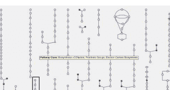

## ePGDB

- 葡萄糖-甲醇脱甲基基酶: 454, 45408
- 梨糖醇脱氢酶: 454, 45409 (+酶)
- 依赖 Fad 的 L-异山梨酸脱甲基基酶: 454, 114154 (+酶)
- L-山梨酸脱氢酶: 454, 291702
- L-山梨糖脱氢酶: 454, 544068
- L-山梨糖脱氢酶: 454, 544389 (+酶)

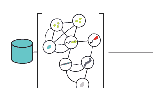

一个氧化的电子受体 -> 一个还原的电子受体 -> 一个氧化的电子受体 -> 一个还原的电子受体 -> L-山梨酸 -> 山梨糖 1,l 内酯 -> 一个氧化的电子受体 -> 一个还原的电子受体

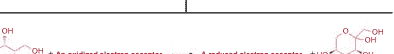

## 反应

+ 一个氧化的电子受体 + 一个还原的电子受体 + L-山梨酸

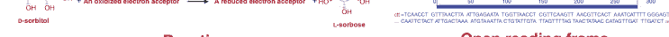

## 代谢途径

图 2.7 ePGDB 导航。一个 `ePGDB` 可以在生物学组织的多个层次进行交互式查询，从高层细胞和途径视图到单个编码序列和酶促反应 (39)。来源：Konwar, http://bmcinformatics.biomedcentral.com/articles/10.1186/1471-2105-24。根据 CC BY 2.0 许可使用 http://creativecommons.org/licenses/2.0。

### 2.4.2 GUI 和数据整合

`MetaPathways v2.0` 提供了一个交互式 `GUI`，改进了参数设置、运行监控和结果管理。流水线活动通过配置窗口进行配置，允许指定输入输出文件、质量控制参数、目标数据库、可执行阶段和网格计算。网格系统和凭据添加并存储在“可用网格”窗口中，允许用户在凭据可用时添加额外网格。此外，`MetaPathways v2.0` 实现自定义知识引擎结构和文件索引方案，连接了数百万数据单元（如 `ORF`）和元数据，并将它们投影到指定的分类或层次结构中（例如 `KEGG`、`Meta-Cyc` 和 `NCBI` 分类数据库）（图 2.9)。

### 2.5 下游分析

整合途径和环境信息的比较群落分析是大多数测序项目的主要目标。`MetaPathways` 通过统一结构促进群落分析，能够实现输出文件的程序化整合。`MetaPathways 2.0` 中提供的“大表”数据功能有助于实时浏览来自一个或多个样本的数百万个功能和分类注释，并以用户定义的方式导出这些信息。在途径层面上，`Pathway Tools` 通过细胞概述功能支持 `ePGDB`。`ORF` 丰度和分类分配信息可以作为元数据整合到细胞概述中，为微生物提供更细致的视角。

# 使用 METAPATHWAYS 进行环境序列信息分析 43

## 分类

原语

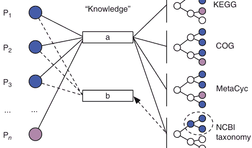

**图 2.9** “知识引擎”数据结构。该数据结构将序列或预测的 `ORF` 视为数据原语，通过指针跟随（pointer follower）投影到一系列分类方案中对其总结。这是一种计算高效的方法，使得原语的识别和枚举对于大型环境数据集具有稳健性。原语与分类方案之间的连接被称为知识对象（Knowledge objects）。通过探索投影在分类方案上的数据，可以创建新的知识对象（虚线所示）。一旦创建，知识对象就可以投影到表格或其他可视化模式中，反之又可用于创建新的知识对象，从而实现迭代和交互式的数据探索。来源：Hanson 等人，2014 (40)。经 IEEE 许可复制。

社区群落代谢。最后，通路和 `ORFs` 可以从 `MetaPathways` 和 `Pathway Tools` 导出到平面文件，这些文件可以在 `R` 统计编程环境中进行格式化，以用于下游统计分析。

### 2.5.1 大表比较

`MetaPathways` 支持对多个样本的功能和分类注释进行显示和交互式比较。使用知识引擎数据结构，可以在由产品描述、分类分配和预测通路组成的超级矩阵中对表格化注释进行比较，每项都被划分为 `KEGG`、`COG`、`SEED`、`NCBI Taxonomy` 和 `MetaCyc` 层级。除了支持标准的搜索、排序和导出功能外，知识引擎数据结构还允许用户在样本包含数百万注释的情况下，通过层级动态地比较和导出基因或通路子集。

### 2.5.2 Pathway Tools 细胞概览

`Pathway Tools Cellular Overview` 功能为单细胞和微生物群提供了代谢的整体表示 (93)。该功能显示了

## NGS 数据分析计算方法

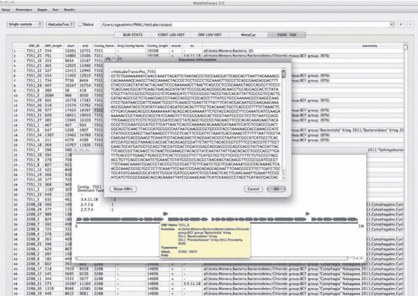

图 2.10 知识对象投影。大表允许高效查询、查找和将 `ORFs` 转换为氨基酸序列、统计数据、分类注释，而 `Contig View`（重叠视图）则允许基于 `ORF` 位置、功能和分类注释在两条链上进行基因组导航。来源：Hanson 等人 (2014)。经 IEEE 许可复制。通过 `Pathologic` 算法突出映射到每个通路的注释。这是一个对于识别多个 `ePGDB` 中感兴趣的通路非常有用的视图。例如，来自两个 `ePGDB` 的通路可以在 `Cellular Overview` 中突出显示，或者通过通路名称作为数字。`Omics`（组学）特征的额外优势在于与 `Cellular Overview` 和单个通路页面集成工具提示，突出显示预测通路内的 `ORF` 丰度。未来的 `Pathway Tools` 版本应更轻松地在 `Cellular Overview` 或单个通路页面显示额外的变量。

# 使用 METAPATHWAYS 进行环境序列信息分析

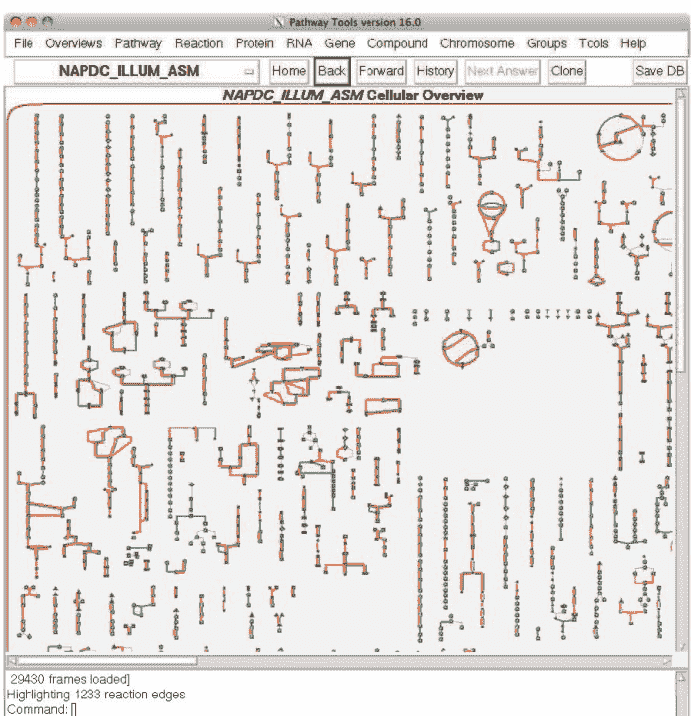

**图 2.11** 通路分析。可以使用 `Cellular Overview` 和 `Omics` 数据比较两个或多个 `ePGDB`（字形代表使用三种不同测序方法预测的通路）(39)。来源：Konwar, http://bioinformatics.biomedcentral.com/articles/10.1186/1471-2105-14-202。根据 CC BY 2.0 使用 http://creativecommons.org/by/2.0。

### 2.5.3 使用 R 进行统计分析

`R` 统计环境提供了一个多功能工具箱用于执行分析和生成数据数据。`R` 被科学家和统计学家广泛采用，拥有许多用于数据分析和可视化的包。然而，精通 `R` 也有一个巨大的障碍。考虑到 `MetaPathways` 支持与 `R` 下游分析兼容的导出格式，检查降低这一障碍的特定用例是有用的。

# NGS 数据计算方法

## 宽表 (Wide)

| 样本 (Sample) | 细菌 (Bacteria) | 古菌 (Archaea) | 真菌 (Eukaryotes) | 盐度 (Salinity) | 溶解有机碳 (DOC) |
|---|---|---|---|---|---|
| 1 | 30 | 2 | 3 | 35.08 | 10 |
| 2 | 25 | 5 | 5 | 35.21 | 70 |
| 3 | 2 | 20 | 4 | 35.04 | 130 |
| 4 | 3 | 22 | 6 | 34.07 | 200 |

```r
melt(wide, id.vars=c("Sample", "Depth")) dcast(long, Sample + Depth ~ variable)
```

| 样本 (Sample) | 深度 (Depth) | 变量 (Variable) | 值 (Value) |
|---|---|---|---|
| 1 | 10 | 细菌 | 30 |
| 2 | 70 | 细菌 | 25 |
| 3 | 130 | 细菌 | 2 |
| 4 | 200 | 细菌 | 3 |
| 1 | 10 | 古菌 | 2 |
| 2 | 70 | 古菌 | 5 |
| 3 | 130 | 古菌 | 20 |
| 4 | 200 | 古菌 | 22 |
| 1 | 10 | 真菌 | 3 |
| 2 | 70 | 真菌 | 5 |
| 3 | 130 | 真菌 | 4 |
| 4 | 200 | 真菌 | 6 |
| 1 | 10 | 盐度 | 35.08 |
| 2 | 70 | 盐度 | 35.21 |
| 3 | 130 | 盐度 | 35.04 |
| 4 | 200 | 盐度 | 34.07 |
| 1 | 10 | DOC | 78 |
| 2 | 70 | DOC | 79 |
| 3 | 130 | DOC | 69 |
| 4 | 200 | DOC | 63 |

# 使用 METAPATHWAYS 进行环境序列信息分析

生物学家使用代码的主要障碍之一是数据格式。输入文件必须正确分隔且不包含不合规字符。幸运的是，`Pathway Tools` 允许通过 `API` (`https://arabidopsis.org/biocyc/percy/index.jsp`) 为语言以编程方式访问 `ePGDBs`。统计软件格式化表格的两种常用方式是所谓的宽表和长表；这是数据组织概念集合中的一部分，Hadley 将其描述为“整洁数据” (`http://vita.had.com/papers/tidy-data.pdf`)。宽格式对大多数用户来说是直观的（有时被称为“主表”）。在宽格式中，每个变量都有自己的列。虽然宽格式紧凑且适用于某些分析任务（主成分分析 (`PCA`)、聚类等），但对于 `ggplot2` 等其他包，采用了长格式，每行代表一个。了解如何使用 `reshape2` `R` 包中的 `melt()` 和 `dcast()` 函数在两种格式之间进行转换是重要的。

### 2.5.4 韦恩图

在分析观察到的功能注释、分类分配或通路预测时，人们可能会询问集合之间的共同点或独特之处。一旦用户将通路列表加载到 `R`，就可以分离每个样本发现的通路列表，并比较集合之间的差异 `setdiff(a,b)` 和交集 `intersect(a,b)`。由这些集操作生成的列表对于选择和设置图表以及识别感兴趣的深度探索通路非常有用。显示差异的常用方法是使用韦恩图 (图 2.13a)。`Venn Diagram` 包提供了一个易于使用的解决方案 (45)。此脚本假设你已经想出了所有可能的集合组合，这很快就会变得复杂

# 48 NGS 数据分析的计算方法

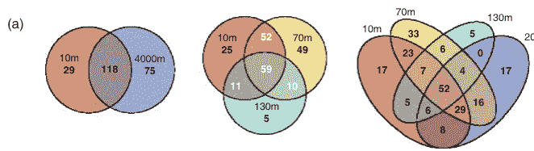

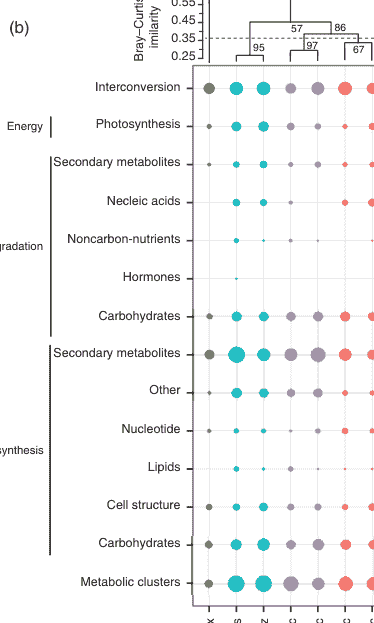

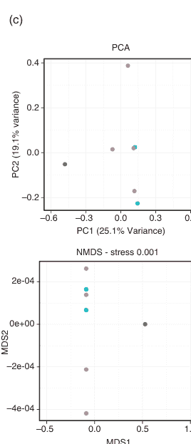

图 2.13 R 产物。可以使用维恩图识别共享和独特的通路。(b) 可以使用层次聚类或 (c) 如 `PCA` 或 `NMDS` 等降维方法来确定环境样本之间通路谱图的共享程度。基于图形语法法（Grammar of Graphics）框架的网格可视化框架 `ggplot2` 可创建各种图表。在 (b) 中，通路已降级到 `MetaCyc` 分类结构的第二层。每个圆的面积表示通路丰度。请访问 www.wiley.com/go/Mandoit/NextGenerationSequencing 查看此图的彩色版本。

# 使用 MetaPathways 进行环境序列信息分析

当比较多个数据集时，非空集合的数量为 $2^{n} – 1$，其中 $n$ 是要比较的集合总数。

### 2.5.5 通过通路对样本进行聚类和关联

多个样本跨预测通路谱的 `ORF` 计数提供了另一种适用于层次聚类的常用分析模式。使用距离或相似性度量来迭代地将样本分在一起，生成层次分组（图 2.13b）。需要考虑的一点是所使用的距离度量和数据转换，环境数据集通常包含许多零值（所谓的“双零问题”），且观测到的计数数据范围很广。为了解决这些问题，采用了不同的相似性度量（如曼哈顿距离或 Bray–Curtis 相似性）来关注观测到的非零数据的差异，使用了对数或平方根转换，并可以使用 `R` 中的 `heust` 和 `pvclust` 包进行测量，通过自助采样（bootstrapped samples）为生成的聚类提供统计置信度（46, 95）。

突出环境数据集之间相似性或差异的另一种方法涉及降维技术，如 `PCA` 或非多尺度尺度（`NMDS`）（图 2.13c）。直观上，可以认为 `PCA` 的动力是所有多维数据都可以被视为一个高维空间。`PCA` 旋转并移动该椭圆，使得最长轴（第一主成分）与数据方差最大的方向对齐，接下来的分量沿此第一轴正交排列。`NMDS` 在保持对象在高维空间相对距离的同时，将其放置在低维空间中，同时尽可能保持其相对距离。在生成 `PCA` 和 `NMDS` 图时需要考虑许多操作设置，其细节超出了本章的讨论范围。鼓励读者熟悉数值生态学文献中描述的排序分析和降维技术（96–98）。

### 2.5.6 使用 ggplot2 进行变量分面

最后，另一种分析环境序列信息的方法是根据特定的物理、化学或过程变量分离出通路的子集，这一过程被称为分面（faceting）。在 `R` 统计环境中实现此点的两个框架是 `ggplot2` 和 `lattice`（47, 99），允许根据用户定义的变量在小多图（small multiple plots）中显示数据子集。实践中，`ggplot2` 是基于图形语法（100）概述原则的一个全功能且灵活的框架，能够根据绘图原理自动构建各种数据图，包括柱状图、热图、气泡图等。鉴于其产生出版级图表的能力，鼓励读者详细熟悉该框架。


在本章中，我们介绍了了使用 `MetaPathways` 进行环境序列信息分析的概念和当代方法。从使用不断增长的算法系统和参考数据库进行 `ORF` 预测和注释开始，我们描述了使用 `LCA` 算法和 `MLTreeMap` 进行分类和功能基因谱分析，以及使用 `Pathway Tools` 进行 `cPGDB` 的构建和探索，最后介绍了 R 统计设计中的比较分析方法。通过对 `MetaPathways` 的迭代开发，我们重点关注了与环境序列分析相关的大数据挑战。这些包括与可扩展种子扩展搜索（`seed-and-extend searches`）相关的计算密集型步骤、跨多个信息层的数据整合以及大规模数据集的交互式可视化。我们强调了最近的创新，包括网格和云分布系统、`GUI` 以及整合多个样本数百万个功能和分类注释的知识引擎。未来的 `MetaPathways` 版本将基于分布式计算和交互式可视化主题，并添加用于单细胞基因组和种群基因组组装及分箱（binning）模块。同时，并行改进 `Pathway Tools` 的导入/导出功能，以增强细胞概览（`Cellular Overview`）和组学数据功能，实现更有效的代谢通路重建和全面的社区分析。

## 参考文献

- 1. Whitman AW, Coleman DC, Wieje WJ. Prokaryotes: the unseen majority. Proc Natl Acad Sci U A 1998;95(12):6578–6583.

2. Falkowski PG, Fencil T, Delong EF. The microbial engines that drive Earth’s biogeochemical cycles. Science 2008;320(5879):1034.

3. Hanson NW, Kamley AK, Altman T, Metabolic pathways for the whole. BMC Genomics 2014;15.

4. Delong EF, Preston CM, Ticher R, Hallam SJ, Frigaard N, Martinez A, Sullivan KB, Microbial assemblages in the ocean. Science 2006;311(5768):496.

5. Walsh DA, Zaikova E, Howes CS, Song Y, Tortell R, Metagenome of dead zones. Science 2009;326(5952):578.

6. Shi Y, Tyson GW, Willey JP, Delong EF, Environmental data sets. ISME J 2011;5(4):999.

7. Fier N, Jackson RB, Diversity of soil. Proc Natl Acad Sci U A 1998;103(12):626.

8. Warnecke F, Laughlin P, Ivanova N, The double-zero problem. Nature 2007;449.

9. Yoose S, Sutton G, Janis JF, Simpson SJ, Wang H, Weiner Y, Yu P, Begley RF, Noble JR, Human microbiome. PLoS Biol 2012;8(6):e125.

10. Tyson GW, Jackman J, Allen P, Solovy V, Ruby EM, The human-genome sequencing. Nature 2004;428(7075):376.

11. Qu M, Maizhera I, Smith F, Scallop A, Stephens J, Durbin S, Swardley H, Turner DJ, Improvements to the Illumina sequencing system. Nat Meth-2008;5(12):1005.

12. Leung K, Hahn H, Leave T, Kon KW, Han NW, Pag AP, Lo CC, Chain PS, Hallam SJ, Hansen CL, A programmable droplet-based microfluidic device to multiparameter analysis of single microbes and microbial communities. Natl Sci U S 2012;109(20):7665.

13. Bayley H. Nanotechnology: holes with an edge. Nature 2010;467(7312):164.

## 用于NGS数据分析的52 种计算方法

23. Wooley JC, Ye Y. 宏基因组学：事实、伪影以及计算挑战。J. Comput Sci Tech 2009:25(1):71–81.

24. Kunin V, Copeland A, Lapidus A, Mavromatis K, Gutenbergholz P. 生物信息学宏基因组学指南。Microbial Mol Biol 2008:72(4):557–578.

25. O'Driscill A, Daugelait J, Leonard RD. 基因组学中的“大数据”、Hadoop和云计算。J Bioomed Inform 2013;46(5):774–781.

26. Collins JP, Gates B, Francis R, Kell D, Bell G. 第四范式：数据密集型科学发现。Richmond, VA: Microsoft Research; 2009.

27. Meyer F, Paarmann D, D' Souza M, Olson R, Glass EM, Kubal M, Paczian T, Rodriguez A, Stevens R, Wilken A, Edwards RA. 宏基因组栅格——用于水生宏基因组发育和功能分析的公共资源。BMC Bioinformatics 2008:9:36.

28. Markowitz MV, Ivanova NN, Sento E, Palaniappan K, Kalevi D, Chen I-MA, Grechkin G, Dubach C, Anderson I, Lykind A, Mavromatis K, Knightholz P. IMG/M：用于宏基因组的数据管理与分析系统。Nucleic Acids 2008;36(Database issue):D534–D538.

29. Markowitz MV, Chen I-MA, Keto S, Szeto E, Palaniappan K, Grechkin G, Ratner A, Jati B, Humtenius M, Mylios L, Pagani I, Ivanova A, Nyrides KK. IMG/M：集成数据管理与比较系统。Nucleic Acids 2012;40(Database issue):D123–D129.

30. Sedeshadr R, Karvit SA, Smart L, Gina P, Fraser M. CAMERA：宏基因组的社区资源。Plos Bio 2007;5(3):e75.

31. Bernal A, Ury KY. 在线基因组数据库 (GOLD)：全球基因组项目管理。Nucleic Acids 2001;29(1):126–127.

32. Kottmann R, Kostadinov I, Duhaime M, Buttigk J, Yilmaz P, Hankelen W, Waldmann J, Glockner FO. Metreg：生态基因组学的集成数据库资源。Nucleic Acids 2009;38(Database):D391–D395.

33. Altschuf SF, Gill G, Miller W, Myers EW, Lipman DJ. 基本局部比对搜索工具。Tool J Mol Biol 1990;25(3):403–410.

34. Dun DH, Hot AF, Ji, Schuster SC. MEGAN对宏基因组数据的分析。Genome Res 2007;17(3):377–386.

35. Dun DH, Mitra S, Ruscheweyh J, Weber N, Schuster SC. 使用MEGAN对环境序列进行整合分析。Genome Res 2011;21(9):1552–1560.

36. Caporaso JC, Knight K, Stombaugh J, Bitzkenger K, Joshua FD, Costello EK, Fierer N, Pa AG, Goodrich JK, Gordon J, Hutley GA, Kelly S, Knight D, Koenig JY, LE, Lozano CA, McDonald D, Muegge BB, Prding R, Reeder J, Sergey JR, Walters PW, Widman J, Yatsuneko T, Zaneveld J, Knight R. QIIME处理高通量测序数据。Nat Methods 2017;5(7):335–340.

37. Stark M, Stamatakis A, von Meng C. MLTree-环境DNA序列在分类和功能参考发育树中的最大似然比置。BMC Bioinformatics 2010;11:461.

38. Letunic I, Bork P. 交互式生命之树 v2：免费构建树的在线注释和系统发育。Nucleic Acids Res 2011;39(Web issue):W475–W478.

39. Konwar KM, Hanson NV, Page AG, Hallam SJ. MetaPathways：从环境序列信息构建途径的模块化流程。BMC Bioinformatics 2013;14:202.

## 使用 METAPATHWAYS 分析环境序列

40. Hanson NW, Konwar KM, Wu S-J, Hallam SJ. MetaPathways v2.0：用于网格和云端环境数据的主模型。Computational Intelligence in Bioinformatics and Computational Biology, 2014, p. 7.

41. Karp PD, Paley S, Romero P. 途径工具 (Pathway tools)。Bioinformatics 2002;18:S225–S232.

42. Karp PD, Paley S, Krumacker M, Latendresse M, Lee JM, Lee TJ, Gilham F, Paul A, Popescu L, Paulsen I, Keseler IM, Casi R. Pathway tools 版本13.0：面向系统的集成。

43. Karp PD, Riler S, Mausen IT, Paley SM, Pellegrini A. EcoCyc和MetaCycle代谢途径数据库。Nucleic Acids 2000;22:56–59.

44. Caspi R, Altman T, Dreher K, Fuchler CA, Subraveti P, Keseler IM, Kothari A, Krummacker M, Latendresse M, Mueller L, Ong Q, Paley S, Sajar A, Weer J, Karp PD.

45. Chen H, Boutous PC. VENNDabase：用于生成高度自定义Venn图的包。Bioinformatics 2011:12.

46. Suzuki R, Shimoaira H. Pvclust：用于层次聚类的R包。Bioinformatics 2006;26(12):1540.

47. Hadley W, ggplot2：用于数据分析的优雅图表。

48. Math C, Zhang M-F, Fiech T, Rouzé P. 基因预测当前方法的优缺点。Nucleic Acids 2002;30(19):4103–4117.

49. Borodovsky M, Michnich JD. GeneMark：针对双链DNA的并行基因识别。Comput Comp Inv 1993;17:23–133.

50. Lukash AV, Borodovsky M. GeneMark：原核生物、真核生物和病毒的基因发现。Nucleic Acids 2005;33(Web Server):W451–W454.

51. Besimer J, Delhar A, Kasis S, White O, Salz SL. 使用GLIMMER改进基因识别。Nucleic Acids 1999;27(23):4636–4661.

52. Hoff KJ, Tech M, Linger T, Daniel R, Morgenstein B, Beinicke P. 宏基因组特征基因预测：一种机器学习方法。BMC Bioinformatics 2008;9:217.

54. Zhu W, Lomsad A, Borodovsky M. 宏基因组序列中的从头基因识别。Nucleic Acids 2018;38(12):e132.

55. Hoff KJ. 测序错误对宏基因组基因预测的影响。BMC Genomics 2009:10:520.

56. Noguchi H, Park T, Takagi T. MetaGeneAnnotator：厌氧原核菌种特异性核糖体结合位点。Nucleic Acids 2006:34(19):5623–5630.

57. Kelley DR, Liu B, Del A, Pop M, Salz SL. 通过Glimmer进行分类和聚类的宏基因组序列基因预测。Nucleic Acids 2011;40(1):e9.

59. Hoff KJ, Langer J, Meinicke P, Tech M Orhelia：宏基因组测序数据的基因预测。Nucleic Acids 2009;39(Web Server):W101–W105.

60. Liu Y, Guo J, Hu G, Zhu. SVM算法的宏基因组片段基因预测。BMC Bioinformatics 2013;14 Suppl 5:S12.

61. Hyat D, Chen G-L, LoCasacio PF, Land ML, Larimer FW, Hauser LJ. 原核生物基因识别和翻译起始位。BMC Bioinformatics 2010;11(1):119.

62. Hyat D, LoCas PF, Hauser LJ, Uberbach EC. 宏基因组序列中的基因和翻译起始位。Bioinformatics 2012;28(17):2223–2230.

63. Bonferroni CE. In: Carboni SO, editor. Il calcolo delle assicurazioni ai gruppi di teste. Tipografia 2009.

64. Kielbasa, Wan R, Horton P, Frith MC. Genome Res 2011;17:487.

65. Kaneishi M, Goto A. KEGG：京都基因百科书。Nucleic Acids 2000;28:30.

66. Karp PD, Roster H, Caspi R, Fuchler CA, Hopkins R, Kaipa P, Krummacker M, Paley S, Popescu L, Paulsen I, Keseler IM, Casi R. MetaCyc代谢途径和酶数据库。Nucleic Acids 2006;34:D511–D516.

67. Alman T, Mothari A, Caspi R, Karp PD. MetaCyc与KEGG的系统比较。BMC Bioinformatics 2013;14:112.

68. Rost B, Willey ED. tRNAscan-SE：一种改进基因组序列中转移RNA检测的程序。Nucleic Acids 1999;12:85.

69. Lowe TM, Eddy SR, Woese C. 16S核酸的比较注释：原核生物系统分类的分子方法。Int Syst Biol 1997;27(5):0995–0964.

70. Fox GE, Fetchman KR, Woese C. Microbial Res 1987;51(2):221.

71. Woese CR. 细菌进化。

72. Klindworth A, Pruesse E, Schweert T, Pelpies J, Quast H, Glockner FO. 用于经典和二代测多样性研究的通用16S核糖体PCR基因评估。Nucleic Acids 2013;41(1):e1.

73. DeSantis T, Hugenholz P, Larsen R, Brodie E, Keller K, Huber T, Talevi D, Anderson L, Greengenes：与ARB兼容的综合16S rRNA数据库和可用工具。App Env Microbiol 2006;72(7):5069–5072.

74. Pruesse E, Quast C, Knittel K, Fuchs BM, Ludwig W, Pelpies J, Glockner FO. SILVA：与ARB兼容的质量对齐核糖体序列综合在线资源。Nucleic Acids 2007;35(21):7188–7199.

75. Cole JR. 核糖体数据库项目 (RDP-II)：回顾允许定期更新和原核分类的新型签名。Nucleic Acids 2003;31(1):442–443.


76. Langille MG, Zanevled J, Caporoso JG, McDonald D, Knights J, Reyes JA, Clemente JC, Burkepile DE, Vega Tharbl, Knight R, Beiko RG, Huttenower C. 使用16S rRNA标记基因序列对微生物群进行功能分析。Nat Biotechnol Tech 2013;31(9):814–821.

# 使用 METAPATHWAYS 进行环境序列信息分析 55

78. Ratusov RL., Kinin E, Lipman DJ. 蛋白质家族的基因组视角. Science 1997:278(5338):631–637.

79. Ratusov RL, Fedora ND, Jackson JD, Jacobs AR, Kiryutin B, Kinin E, Krylov DM, Razumder R, Mekhedov SL, Nikolskaya AA, Rao BS, Smirnov S, Sverdlov AV, Vasudevin Vol WI, Yin JJ, Natale DA. COG 数据库：更新版本. Bioinformatics 2003;4:4

80. Jensen LJ, Julien P, Kuhn H, Mering C, Muller J, Doers T, Bork P. eggNOG: 同源基因组的自动化构建与注释. Nucleic Acids 2007:36(Database):D250–D254

81. Muller J, Szczarski D, Julien P, Rothi I, Kuhn H, Powell S, von Mering C, Doers T, Julien LJ, Bork P. eggNOG v2.0: 通过增强的非监督同源组、功能和功能注释扩展基因的进化谱系. Nucleic Acids 2010;38(Database issue):D190–D195.

82. Cquarelli FD. 迈向高分辨率生命树的自动重建. Science 2006;311(5765):1283–1287.

83. Birney E. 智慧与基因组. Genome Res 2004;14(5):988–995.

84. Durbin R. 基因组序列分析：蛋白质与核酸的概率模型. 剑桥：大学出版社; 1998.

85. Castres J. 从多序列比对中选择保守块用于系统发育分析. Mol Biol Evol 2000;17(4):540–552.

86. Stamakakis AX. RAML-HPC: 基于最大似然法的、具有数千个分类单元和混合模型的系统发育分析. Bioinformatics 2006;22(21):2688–2690.

88. Le Y, Doak TC. 预测相对代谢周转 (PRMT): 从沿海海洋宏基因组数据确定代谢周转. Micro Inf Exp, Porter F, Deyer F, Keegan KP, McGrath S, Quinn J, Gilbert DA. Micro Inf Exp 2011;11(1):4.

89. Hicho H-C, Kelly R, Boerstein E. 简单微生物群落中的能量生物能力. PLoS Bio 2014;10(7):e100365.

90. Harcombe WR, Riehl WJ, Dukowski I, Granger BR, Betts A, Lang AH, Bonilla G, Kar A, Leibny M, Mehta Parikh CJ, Segr D. 个体微生物的代谢资源分配决定生态系统相互作用和空间动力学. Cell Rep 2017;7(4):1104–1115.

92. Karp PD, Tedelson SM, Karp PD. Pathways 细胞概述图和组学查看器. Nucleic Acids 2006;33(5):3771–3778.

93. Wickham H. 使用 reshape 包重塑数据. J Stat Soft 2007;21(12):1–20.

96. Ramette A. 微生物生态学中的多变量分析. FEMS Microbiol Ecol 2007;62(2):142–160.

97. Legendre P., Legendre LF. 数值生态学. 第 20 . 阿姆斯特丹，荷兰; Elsevier; 2012.

98. Borcard D, Gillet F, Legendre P. 基于 R 的数值生态学. 新纽约：Springer-Verlag; 2011.

99. Sarkar D. Lattice: 多变量数据可视化. 新纽约：Springer-Verlag; 2008.

100. Wilkinson L, Wills D, Wick A. 图形语法法. 新纽约：Springer-Verlag; 2006.

# 3 大规模病毒测序的混合策略

## 3.1 引言

二代测序 (`NGS`) 允许产生个体携带的大量病毒序列。它为研究微生物群落以及理解病原体进化和流行病学提供了前所未有的机会。特别是，`NGS` 为实施传染病的全球监测提供了手段，能够详细描述宿主种群、传播网络、监测疫情进展，并为规划公共卫生干预提供明智指导。

尽管 `NGS` 大大提高了吞吐量，但对大量病毒样本进行测序的成本极其高昂且耗时巨大。因此，大规模监测需要开发一种策略，对大量样本中的微生物群落进行简单、快速且成本效益的测序。

高突变病毒，如丙肝 C病毒 (`HCV`) 和人类免疫缺陷病毒 (`HIV`)，在感染宿主中以大量遗传相关变异体的形式存在。在宿主内部的变异体在病毒学文献中通常被称为*准种* (`quasispecies`)。对每个样本中的宿主病毒种群最有效的评估是全基因组序列分析。然而，`NGS` 通常产生短读段，这些序列应被组装成全基因组序列。病毒变异体的组装及其频率估计极其复杂，目前即使大多数用于全基因组准种重建的计算工具也只能推断出最流行的变异体，许多变异体是无法检测的 (1–5)。或者，可以使用易于扩增和测序的高度变异亚基因区域来检测遗传变异。虽然这些区域的遗传信息无法识别所有的病毒变异体，但对于推断传播网络 (6–8)、检测耐药变异体、预测治疗结果 (9–11) 以及研究宿主病毒进化 (12–14) 通常足够了。

通过标记（barcoding）可以降低多个病毒样本的测序成本。虽然这可能是同时测序大量样本最简单的方法，但它需要从核酸提取到聚合链反应 (`PCR`) 和文库准备对每个样本进行单独处理，这增加了测序成本 (15, 16)。此外，使用不同标记 `PCR` 引物扩增不同病毒变异体可能会影响分布 (16, 17)。此外，维护大型标记库是一项巨大的工程 (15, 16)。

组合提供了降低测序成本的另一种方法。混合在诊断检测中的应用追溯到 20 世纪 40 年代 (18)。通常，它用于产生二元结果；例如，阳性或阴性，如分组检测所示 (19–22)。最近，针对基于 DNA 测序、`SNP` 检测和稀有等位基因检测的更复杂分析提出了多种混合策略 (23–28)。特别是最近将组合混合方案应用于 `NGS` 选择性基因组测序 (15) 值得提及。

在本章中，我们描述了一种用于异质病毒群落的成本效益 `NGS` 框架，该框架结合了 Skums 等人提出的标记和混合策略 (29)。该框架包括以下步骤（图 3.1）：

- (i) 将样本在特殊设计的池中进行混合，使得每个样本的身份被编码在池的组成中；
- (ii) 使用标记对池进行测序；
- (iii) 样本解卷积，即将池中的病毒变异体分配给单个样本。

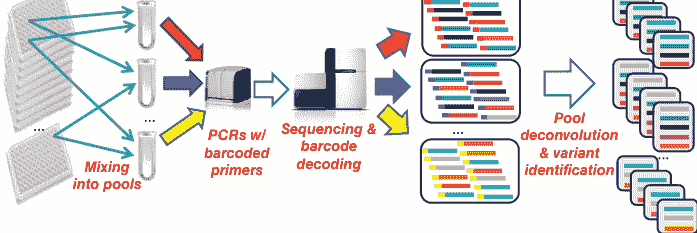

**图 3.1** 病毒样本测序的组合混合策略。来源：Skums 2015 (29)。经牛津大学许可复制。请参阅 www.wiley.com/go/Mandou/NextGenerationSequencing 获取此图的彩色版本。

同一样本可能出现在两个标本组成不同的池中。因此，无法通过池之间简单的集合交集来对样本解卷积，这表明需要一种基于聚类技术的更复杂的方法。为了提高基于聚类的解卷积的有效性并减少可能的聚类错误，尽量减少遗传接近的样本很重要，这在流行病学相关的样本以及从小地理区域收集的样本中是可以预见的。本章其余部分的结构如下：在下一节中，我们将考虑海量病毒数据的池设计问题。我们将池设计问题建模为图上的优化问题，研究了这些及相关池的计算复杂度，并描述了解决它们的启发式算法。随后，我们回顾了基于针对异质病毒样本的最大似然聚类算法，从测序池中对单个样本解卷积的方法。最后，我们报告了使用模拟数据和实验获得的丙肝病毒（`HCV`）超变区 1（`HVR1`）序列进行框架评估的结果。

## 3.2 大量病毒数据的池设计

测序 `n` 个样本的重叠策略的基本思想是生成 `m` 个池（即样本的混合物），其中 `m << n`，使得每个样本通过其所属的池被唯一识别 (23)。然后，在对池进行测序后，获得的意见读数可以通过池的集合交集和差集序列分配给样本。这两个示例表明，可以使用较少的池来识别较数量的样本。

**示例 1。** 考虑三个样本 `S_1, S_2, S_3` 和两个池 `P_1 = S_1 ∪ S_2, P_2 = S_2 ∪ S_3`（见图 3.2）。这些池满足分离要求，因此每个样本都可以恢复，例如，`S_2 = P_1 ∩ P_2, S_1 = P_1 \setminus P_2` 以及 `S_3 = P_2 \setminus P_1`。因此，对三个样本进行池化需要两次测序运行。

**示例 2。** 作为一个更复杂的示例，考虑八个样本 `S_1, …, S_8` 和四个池 `P_1, …, P_4`，定义如下：`P_1 = S_1 ∪ S_2 ∪ S_3 ∪ S_4, P_2 = S_2 ∪ S_6 ∪ S_7, P_3 = S_1 ∪ S_5 ∪ S_6 ∪ S_7`。这些池满足分离要求，因此每个样本都可以通过池的交集和差集序列恢复。例如，`S_1 = P_1 ∩ P_3 ∩ P_4, S_2 = (P_1 ∩ P_3) \setminus P_4, …, S_8 = (P_2 \setminus P_3) \setminus P_4`。因此，对所有八个样本进行测序可能需要四次测序运行。当且仅当任意两个样本都有一个分离它们的池（即该池恰好包含其中一个样本）时，唯一识别才是可能的。事实上，如果任何

## 大量病毒测序的池化策略

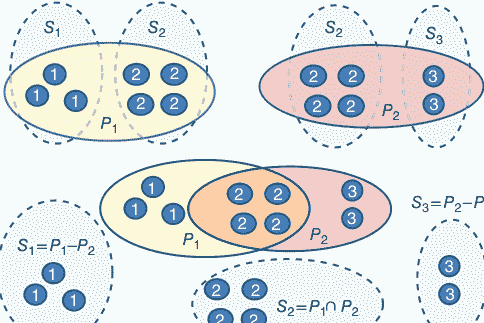

**图 3.2** 三个样本的两个池：`S_1` 有三个，`S_2` 有四个，`S_3` 有两个。所有三个样本都可以通过池的交集和减法从这些池中重构。来源：Skums 2015 (29)。经牛津大学出版社许可转载。

如果两个样本被一个池分离，那么包含样本 `S` 的所有池的交集减去包含 `C` 的所有池的并集等于 `S`。相反，如果两个样本 `S_1` 和 `S_2` 不被任何池分离，则无法通过集合运算将它们区分。这一事实导致了所述高效池设计方法。

**定理 [23, 32]。** 如果样本的任意子集都可以形成单个池，则可以使用 `m = [log(n)] + 1` 个池重构 `n` 个样本。

**证明。** 为了简单起见，假设 `n` 是 2 的幂，即 `n = 2^k`（对于任何 `n`，证明是类似的）。然后应用归纳法：如果 `k=1`，则 `P={ {S_1}, {S_2} }` 显然是一个有效的池设计，`m=2`。假设 `P' = {S'_1, …, S'_{m' }}` 是关于样本 `S'` 的有效池设计；`n'=n/2=2^{k-1}, m' = log(n') + 1`。构造如下族 `P={P_1, …, P_{k+1}}`：

`P_i = {S_{2j-1}, S_{2j} : S'_j ∈ P'}, i=1, …, k`;

`P_{k+1} = {S_1, S_3, …, S_{n-1}}`。

该族 `P` 是一个有效的池设计。事实上，显然 `∪_{i=1}^{k+1} P_i = S`。由于 `P'` 是 `n'=n/2` 的可行池设计，对于每个 `i, j ∈ {1, n/2}, i ≠ j`，存在 `l ∈ {1, …, k}` 使得 `P'_l` 分离 `S'_i` 和 `S'_j`。

## NGS 数据分析的计算方法

启发式算法的基本方案在算法 `GPDA` 中描述。在每次迭代中，算法 `GPDA` 找到并将解添加到局部最优池中，即该池由相互兼容的顶点组成，并分离尽可能数量的非分离样本。

```
**Algorithm GPDA:** 贪心池设计算法
1: H ← 在 n 个顶点上的完全图
2: P ← ∅
3: while E(H) ≠ ∅ do
4: 找到一个子集 A ⊆ V，使得满足以下条件：
(C1) A 是图 G 的一个团；
(C2) |A| ≤ T；
(C3) 图 H 中割集 (A, V \setminus A) 的大小是最大的。
5: P ← P ∪ {A}
6: 从 H 中移除所有满足 u ∈ A 且 v ∈ V \setminus A 的边 uv。
7: end while
8: return P
```

算法 `GPDA` 的关键步骤是寻找局部最优池（步骤 4）。它解决解决了以下问题：

**最优团割二图 (OCBG) 问题。** 给定一个图 `G=(V, E)` 和常数 `T`，在 `G` 中找到一个顶点集合为 `A` 的团，使得 `|A| ≤ T` 且割集 `(A, V)` 的大小是最大的。

`OCBG` 问题是一个之前未解决的优化问题。很容易看出该问题是 `NP-hard` 的，并且在线性因子内难以近似 (29)。

**定理** 对于任意 `ε > 0`，`OCBG` 问题在 `O(n^{1-ε})` 内不可近似，除非 `P=NP`。

**证明。** 令一个具有 `n` 个顶点的图 `G'` 为最大团问题 `G=G' ∪ O'` 的输入。在不失一般性的情况下，假设 `G` 是连通的。考虑 `G` 和 `H=K_{2n}` 作为输入的 LOP 问题实例。对于 LOP 最优解的值，我们有

```
f_opt = max[f(ω)] = ω(2n-ω) : ω = |A|, A 是 G 的一个团。
```

我们先说 `G'` 的最大团大小为 `ω_opt`且 `f_opt = ω(2n-ω_opt)`。事实上，根据构造，对于 `G` 的每个团 `A`，都有 `ω = |A| ≤ n`。函数 `ω(2n-ω)` 在区间 `[1, n]` 上单调递增，因此 `f` 在 `ω_opt = |A_opt|` 处达到最大值，其中 `A_opt` 是 `G`（以及 `G'`）的最大团。

令 `(A, V(G) \setminus A)` 为 LOP 的一个划分，其中 `ω = |A|`，`f = ω(2n-w)`。假设

```
f / f_opt ≤ 1/4 |V(G)|^{1-ε} = 1/4 (2n)^{1-ε}
```

对于某些 `ε > 0`。那么

```
1/2 ω_opt ≤ ω_opt(2n-ω_opt) / ω(2n-ω) ≤ f_opt / f (2n)^{1-ε}
```

因此

```
ω_opt / ω ≤ n^{1-ε}
```

所以，如果 LOP 在 `|V(G)|^{1-ε}` 内可近似（对于某个 `ε > 0`），那么团在 `|V(G')|^{1-ε}` 内可近似。后者是不可能的，除非 `P=NP` (34)。在 3.2.3 节中，我们提出了一种解决 `OCBG` 问题的高效启发式算法。

### OCG 问题的禁忌搜索算法

在本节中，我们提出禁忌搜索来解决 `OCBG` 问题。令 `M = |E(H)|+1`。`OCBG` 可以表述为二次规划问题：

```
最大 f(x) = 1/2 Σ_{ij∈E(H)} (1-x_j) - 1/2 Σ_{ij∈E(G)} (x_i+x_j)(x_i+x_j+2) (3.5)
```

受限于

```
1/2 Σ_{i∈V} (x_i+1) ≤ T; (3.6)
x_i ∈ {-1, 1}, i ∈ V. (3.7)
```

问题 (3.5)-(3.7) 的解 `x` 与集合 `(A_x, B_x)` 之间存在一一对应，其中 `A_x={i:x_i=1}` `B_x={i:x_i=-1}`。项 `1/2 Σ_{ij∈E(H)} (1-x_j)` 等于 `H` 中割集 `(A_x, B_x)` 的大小。项 `1/2 Σ_{ij∈E(G)} (x_i+x_j)(x_i+x_j+2)` 等于诱导图 `G(A_x)` 中不相邻顶点对的数量；特别是当 `A_x` 是一个团时它等于 0。因此，对于问题 (3.5)-(3.7) 的任何最优解，`A_x` 都是一个团。约束 (3.6) 确保 `|A_x| ≤ T`。


我们松弛约束 (3.6)。假设 $(A_x, B_x)$ 是 (3.5)-(3.7) 的可行解。对于顶点 $u \in A_x$，考虑解 $(A_{u'}, B_{u'})$，其中 $A_{u'} = A_x \setminus \{v\}$，$B_{u'} = B_x \cup \{u\}$

```
$\Delta_1 = deg_{A_x}^H(v) - deg_{B_x}^H(v) + deg_{A_x}^G,$ (3.8)
```

其中 $deg_U^H(v)$ 表示图 $H$ 中集合 $U \subseteq V$ 中与顶点 $v$ 相邻的顶点数量，$G$ 是 $G$ 的补图。如果 $v$ 与 $u \in A_s$ 不相邻，则 $\Delta_1 > 0$。同地，对于 $v \in B_s$，解 $(A'_s, B'_s)$ 满足 $A'_s = A_s \cup \{v\}$，$B'_s = B_s \setminus \{v\}$且 $\Delta_2 = f(A'_s, B'_s) - f(A_s, B_s)$，有

```
$\Delta_2 = deg_{B_s}^H(v) - deg_{A_s}^H(v) - deg_{B_s}^G.$ (3.9)
```

因此，根据关系 (3.8) 和 (3.9)，任何初始解 $(A, B)$ 通过从划分的一部分移动顶点进行改进，直到达到局部最优且得到的解无法进一步改进。根据 (3.8)，局部最优是一个团。

这种搜索策略的主要缺点是局部最优处的目标函数值可能离全局最优解很远。另一个针对我们情况的问题是，$H$ 中局部最优割的大小可能为 0。在这种情况下，算法 GPDA 第 (4) 阶段找到的解不会减少 $E(H)$，因此算法 GPDA 将陷入循环。为了解决这些问题，我们使用了禁忌策略 (3.5) 的变体。基本思想是，在移动顶点 $v$ 到局部最优后，采取以下操作：将局部最优值与当前最佳解进行比较，将 $v$ 放回，并在后续 $k_i$ 次迭代中禁止移动 $v$。在下面的算法 OCGBP 中实现，有更详细描述。令 $tabu^i = \{tabu_1^i, \dots, tabu_j^i\}$ 为迭代 $i$ 时的禁忌状态，即整数序列，其中 $tabu_j$ 是不允许移动顶点 $v$ 的迭代次数。令 $optStates^i$ 为最优状态集合，即元对 $((A, B), t_{A,B})$ 的集合，其中 $(A, B)$ 是算法在某次迭代 $j < i$ 找到局部最优，$t_{A,B}$ 是该迭代时的禁忌状态，即 $t_{A,B}=tabu'$。令 $(A^*, B^*)$ 为当前记录割，即找到的最优大小 $c(A^*, B^*)$ 的割。

### Algorithm OCGBP: 最优割二图

```
1: 应用 0.5-近似算法到图 H。
2: $(A^0, B^0) = (X, Y)$ 和 $(A^0, B^0) = (Y, X)$
3: $i \leftarrow 0$; tabu \leftarrow (0, \dots, 0)$; optStates \leftarrow \emptyset$; moveList \leftarrow \emptyset$
4: while true
5: for $u \in V$ 计算 $\delta_u$ 使用关系 (3.8),(3.9):
   $\delta_u = 1$, if $u \in A$ and $tabu_u = 0$;
   $\delta_u = 2$, if $u \in B$ and $tabu_u = 0$;
   0, if $tabu_u > 0$;
6: end for
7: $\delta^* = \max\{\delta_i\}$; $u^* \leftarrow \arg \max_{i=1,\dots,n} \{\delta_i\}$
8: 更新禁忌状态，即
   $tabu \leftarrow tabu-1$, if $tabu>0$;
   0, otherwise;
9: 如果 $\delta^* > 0$ 将顶点 $u^*$ 移动到割 $(A^*, B^*)$ 的另一部分
10: 将 $u^*$ 推入栈 moveList
11: end if
12: if $\delta^* = 0$
13: 如果 $c(A^*, B^*) > c(A^*, B^*)$ 则 $(A^*, B^*) \leftarrow (A^*, B^*)$
14: end if
15: if moveList $\neq \emptyset$ 则从 moveList 弹出 $v$ 并将 $v$ 放回
16: 在后续 $k$ 次迭代中禁止移动 $v$:$tabu^{i+1} \leftarrow k_r$;
17: end if
18: $s \leftarrow ((A^{i+1}, B^{i+1}), tabu^{i+1})$
19: 如果 $s \in optStates$ 则 optStates $U[s]$; $i \leftarrow i+1$ 继续
20: else
21: while $|A^*| > T$ do $a \leftarrow \argmin[deg_{B^}^*(a) - deg_{A^}^*(a), | a \in A^*]$
22: $(A^*, B^*) \leftarrow (A^* \setminus \{a\}, B^* \cup \{a\})$
23: end while
24: return $(A^*, B^*)$
25: end if
26: end while
```

否则得到解（第 18 步），并禁止对顶点进行 $k_i$ 步的移动，这将导致回到上一个局部最优解（第 19 步）。如果当前算法状态之前没有出现过，算法将将其添加到 `optStates` 中并进入下一次迭代（第 21–24 步）。否则，算法将当前记录 $(A^*, B^*)$ 归约为满足 $|A^*| \le T$ 的解并停止（第 25–30 步）。

$k_i$ 的默认值为 1。对于算法 2 找到的解 $(A^*, B^*)$，仍然存在 $c(A^*, B^*) = 0$ 的。如果发生这种情况，我们将 $k_i$ 增加 1 并重复算法 2。

### 3.3 从混合池中对病毒样本进行解卷积

根据示例 1 和示例 2，解卷积需要计算混合池 之间的交集和差集。在第 3.3.1 节中，我们正式定义了混合池的广义交集和差集，并展示了如何将它们用于混合池解卷积。广义交集和差集的实现挑战将在第 3.3.2 节中解决。

#### 3.3.1 使用混合池的广义交集和差集进行解卷积

设 $P$ 为一组集合，该集合是通过算法 GOPDA 找到 VPD 问题的解并通过 NGS 进行测序设计的。如所述，得到的读取序列（reads）在理论上应被分配给混合池集合论交集和差集中的样本（参见示例 1 和示例 2）。然而，由于病毒种群的高度异质性和采样偏差，从特定样本中测序的单个病毒变异体（甚至是病毒变异体的亚群）在不同混合池中混合时可能是不同的（见图 3.3 示例）。这

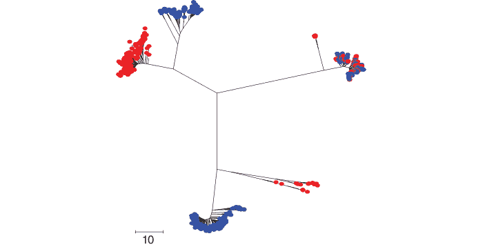

**图 3.3** 代表两个池并集的系统发育树：$P_1$ 包含样本 $S_1, S_2, S_3$（用浅灰色表示），$P_2$ 包含样本 $S_4, S_5$（用深灰色表示）。两个池的交集包含样本 $S_1$（树中的右上簇）；然而，从混合池 $P_1$ 和 $P_2$ 中的样本 $S_1$ 采样的序列是不同的。来源：Skums 2015 (29)。经牛津大学出版社许可转载。

阻碍了直接使用集合论交集和差集的应用，因此，应该使用“广义”交集和差集。对于一个混合池 $P_i$，设 $S(P_i)$ 为混合其中的样本集合。特别地，为了符号简单，我们可以假设每个单个样本 $R_j$ 都是一种特殊的池类型，且 $|S(R_j)| = 1$。

我们将混合池 $P_1$ 和 $P_2$ 的广义交集定义为池 $P_1 \cap P_2 = S(P_1) \cap S(P_2)$，它由来自 $P_1 \cup P_2$ 且属于样本 $S(P_1) \cap S(P_2)$ 的序列组成。广义差集 $P_1 \setminus P_2$ 可以定义如下：$P_1 \setminus P_2$ 是满足 $S(P_1 \setminus P_2) = S(P_1) \setminus S(P_2)$ 的池，其中包含集合 $P_1 \setminus (P_1' \cap P_2)$ 的序列。

可以使用算法 IS 通过广义交集和差集的混合池来推断单个样本。根据定义，广义差集可以还原为广义交集。对于广义交集的计算，我们提出了算法 GI 中描述的方案，该方案基于聚类技术。

### 算法 PD：解卷积算法

需要：混合池集合 $P = \{P_1, \dots, P_m\}$

确保：单个样本集合 $R = \{R_1, \dots, R_n\}$

```
1: procedure IS($P$)
2: 按照如下方式定义两个队列 $Q$ 和 $R'$：$Q$ 包含所有池，$R' = \emptyset$。
3: while $Q \neq \emptyset$ do
4: $P' \leftarrow$ $Q$ 的第一个元素
5: if $|S(P')| = 1$ then
6: $R' \leftarrow R' \cup \{P'\}$
7: end
8: $Q \leftarrow Q \setminus P'$
9: for $P'' \in Q$ do
10: if $S(P') \cap S(P'') \neq \emptyset$ then
11: $Q \leftarrow Q \cup \{P' \cap P''\}$
12: if $S(P') \setminus S(P'') \neq \emptyset$ then
13: $Q \leftarrow Q \cup \{P' \setminus P''\}$
14: end
15: if $S(P'') \setminus S(P') \neq \emptyset$ then
16: $Q \leftarrow Q \cup \{P'' \setminus P'\}$
17: end
18: break
19: end if
20: end for
21: end while
22: return $R'$ 的 $n$ 个元素
23: end procedure
```

### 算法 GI：广义交集

**需要**：$P_1, P_2$，参数 $W \ge 1$

**确保**：广义交集 $P_1 \cap P_2$

```
1: procedure GI(P_1, P_2)
2: $k \leftarrow |S(P_1) \cup S(P_2)|$
3: 使用极大似然法将并集 $P_1 \cup P_2$ 分为 $k$ 个聚类
4: return 属于样本 $S(P_1) \cap S(P_2)$ 的序列的集
5: end procedure
```

### kGEEM 算法：最大似然 k-聚类算法

- 1: 对于每个基因型 $g_i \in G^{(0)}, i = 1, \dots, k$，初始化第 $m$ 个位置 $(m = 1, \dots, L)$ 的等位基因频率如下：

$$f_{i,m}(e) \leftarrow \begin{cases} 1 - \frac{4\varepsilon}{\varepsilon} & \text{如果 } r_{i,m} = e \\ \text{否则}\end{cases}$$

- 2: 使用公式 (3.10) 根据 $g_i$ 发射读取序列 $r$ 的概率初始化 $h_{i,r}$：$h_{i,r} \leftarrow Pr(r|g=g_i)$

- 3: 重复

- 4: 对于所有 $i = 1, \dots, k$，$f_i^{(0)} \leftarrow \frac{1}{k}$

- 5: 重复

- 6: 计算第 $i$ 个基因型 $g_i$ 发出的匹配读取序列 $r$ 的期望读取次数如下：

```
$$e_{i,r} \leftarrow o_r \cdot p_{i,r}$$
$$p_{i,r} \leftarrow \frac{f_i^{(f^{(r)}} \cdot h_{i,r}}{\sum_{t=1}^k f_t^{(f^{(r)}} \cdot h_{t,r}}}$$
```

$f_i$ 是 $g_i$ 的频率，$o_r$ 是 $r$ 的观测频率。

如下所示估计每个 $G_i^{(t)}$ 的频率 $f_i^{(r+1)}$，其为 $g_i^{(t)}$ 发射的所有读取序列的比例：

```
$$f_i^{(r+1)} \leftarrow \frac{\sum_{r \in R} e_{i,r}}{\sum_{t=1}^k \sum_{r \in R} e_{t,r}}$$
```

- 8: 直到 $\sum_{i=1}^k (f_i^{(r)} - f_i^{(r+1)}) \geq 0$

- 9: 如下更新 $g_i^{(t+1)}$ 第 $m$ 个位置上每个等位基因 $e \in \{a, c, t, g, d\}$ 的等位基因频率 $f_{i,m}(e)$：

```
$$f_{i,m}(e) \leftarrow \begin{cases} 1 - \varepsilon & \text{如果 } e = \arg_{et \in\{a,c,t,g,d\}} \sum_{r \in R:r_m=e} p_{i,r} \\ \text{否则}\end{cases}$$
```

- 10: 使用 (3.10) 更新 $h_{i,r}$：$h_{i,r} \leftarrow Pr(r|g=g_i)$

- 11: 直到存在 $g_i^{(t)} \neq g_i^{(t+1)}$

- 12: 对于每个读取序列 $r \in R$ 执行

- 13: $i' \leftarrow \arg \max_i p_{i,r}$

- 14: 将读取序列 $r$ 分配给第 $i'$ 类

- 15: 结束

### 大规模病毒测序的合并策略

2. 随机图，其中每个顶点 $v$ 接收随机滴度 $w_v \in \{1, L\}$，且当仅当 $|w_u - w_v| \le R$ 时，两个顶点 $u$ 和 $v$ 相邻。这一系列测试代表了滴度兼容模型，即只有当两个池的滴度差异不大时，它们才能合并到一个池中。

生成了二万五个测试实例，$n = 10, \dots, 1000$，参数 $L = 20, R = 4$，以及池大小阈值 $T = n$（即）、$T = 55$ 和 $T = 25$。对于每个 $n$，计算 VSPD 算法构建的池的平均大小和缩减系数（即池数除以样本数）。结果如图 3.4 所示。


**图 3.4** VSPD 算法生成的池的测序缩减系数，(a)随机滴度兼容模型和(b)随机图。来源：Skums 2015 (29)。经牛津大学出版社许可。

对于 VSPD 算法生成的 1000 个池，实现了测序次数的缩减：$T = n$ 为 15 倍，$T = 55$ 为 11 倍，$T = 25$ 为 9 倍，$T = 15$ 为 6 倍。在所有这些情况下，缩减系数都是 $n$ 的减函数，表明 $n$ 越大缩减越高。

3. 随机图，其中每条边以概率 $p = 0.25, 0.5, 0.75$ 选择，池大小限制为 $T = 35$。

生成并处理了二万个 $n = 10, \dots, 1000$ 的测试实例使用 VSPD 算法。如上所述，对于每个 $n$，计算了平均测序缩减。结果如图 3.4b 所示。在这种情况下，与上一个一样，合并提供了测序次数的大幅缩减，尽管通常低于测试实例（$p=1$ 的完全图为超过 13 倍，$p=0.25$ 为超过 3 倍）。缩减系数也是 $n$ 的减函数。

### 3.4.2 池解卷积算法的性能

生成了四百五十个 $n = 10, \dots, 150$ 且池大小 $T = 15, 25, 35$ 的测试实例。使用先前在流行病学与生物信息学实验室、肝炎科、疾病控制与预防中心测序的 155 HCV 池构建模拟池。每个池通过 NGS 纠错算法 KEC 和 ET 清洗。测试实例生成如下：

- 1. 随机选择 $n$ 个样本。
- 2. 基于滴度模型生成 $n$ 个顶点的随机样本兼容图，并使用 VSPD 算法生成池。
- 3. 通过从样本中随机选择 $D$ 个读取创建池，每个池的 $D$ 设置为 10,000，这近似于获取模拟数据的测序设置（每次运行 8–110 个 MID）。

对于所有测试实例，所有样本都被释放，即算法产生所有 $n$ 数据集是不可能的。某些读取未归类为样本，因此被算法丢失。然而，这种数量极低（图 3.5a）；$T = 15$ 平均为 99.96%，$T = 25$ 为 99.93%，$T = 35$ 为 99.98%。绝大多数读取被正确分类（图 3.5b）；$T = 15$ 平均有 99.98%，$T = 35$ 为 99.95% 分配到正确的样本。应该注意的是，如果样本数量很大，分类读取的准确性通常不依赖于样本数量。


**图 3.5** (a)无软件污染样本的比例。(b)分类读取的比例。条形代表标准误差。来源：Skums 2015 (29)。经牛津大学出版社许可。

我们允许在*计算机中*将读取错误分配给样本。无软件污染样本的比例对于 $T = 15$ 为 100%，$T = 25$ 为 96.13%，$T = 35$ 为 93.8%（图 3.6a）；软件污染在样本内占少数：$T = 15$ 平均为 0.163%，$T = 25$ 为 0.5545%，$T = 35$ 为 0.892%（图 3.6b）。

解卷积单倍型频率估计的方根误差在 $T = 15$ 时为 0.031–0.107%，$T = 25$ 时为 0.025–0.139%，$T = 35$ 时为 0.028–0.174%（图 3.7）。


根据所考虑的所有指标，样本解卷积的准确性受每个池允许样本数量的影响。对于较小的池算法更高，尽管对于较大的池仍然保持在高水平。

# 3.5 合并策略的实验验证

## 3.5.1 实验池与测序

从 HCV 性病例收集的血清样本（6）用于测序 HCV HVR1。血清样本 `S_1, …, S_7` 使用参数 `T=7` 的 VPD 方法混合四个池 `P_1, …, P_4`，如下：`P_1` 通过混合 `S_1, S_2, S_3` 创建，`P_2` 通过混合 `S_4, S_5, S_6, S_7` 创建，`P_3` 通过混合 `S_1, S_4, S_5` 创建，`P_4` 通过混合 `S_2, S_4, S_6` 创建。这七个样本和池均进行了测序

使用了 454 GS Junior System (454 Life Sciences, Branford, CT)。使用 MagNa Pure Nucleic Acid Isolation Kit (Roche Diagnostics, Mannheim, Germany) 提取总核酸，并使用 SuperScript cDNA 合合成盒 (Invitrogen, Carlsbad, CA) 进行反转录。

HVR1 的扩增通过两轮 PCR 完成。在第一轮扩增中使用了常用的区域特异性引物。在 HVR1 特异性引物中添加了由引物接头和多个标识符（MID – 454A 和 454B）组成的正向和反向标签。为了高通量分析，将混合池作为单个样本进行处理，并标记单个 MID 以进行深度测序。PCR 产物汇总并使用 GS FLX Torrent Series Amplicon kit 通过乳液相 PCR 进行扩增，并进行双向测序。使用样本特定的 MID 标签识别并分离测序得到的序列。使用 GS Run Processor v2.3 (Roche, 2010) 移除了低质量序列。

## 3.5.2 结果

使用第 3.3 节描述的算法方法，根据第 3.5.1 节描述的实验数据重建样本。在应用算法进行样本恢复之前，对数据进行了预处理，以消除测序错误和 PCR 嵌体。

每个池的序列使用 `IGEM` 算法分离成聚簇，每个簇使用 NGS 错误纠正算法 `KEC` 和 `ET` (41) 处理，并合并纠正后的序列。然后使用 `IS` 算法对序列进行解构。得到的样本将称为 *混合样本* (pooling samples)。

为了验证混合样本，我们将其与单独进行测序的样本进行了比较。对序列进行了两两比对；忽略了插入和缺失（因为 indels 在 HVR1 中很罕见，因此更多是测序伪影；此外，单样本测序和混合样本序列中的某些 indel 可能是由于对单碱基聚合物错误的纠正不准确而引入的）。对于每个样本，从单样本测序变异集集中选取了 10 条参考序列，并通过混合样本中序列与这些参考序列的比对，评估了样本重建的正确性。比对使用了 `Muscle`。

平均而言，每个混合池获得了 259 个独特的单倍型（从样本 `S_3` 中的 23 个单倍型到样本 `S_4` 中的 548 个单倍型），在 99.634% 的所有分析序列被正确分类到样本后，这一数量超过了其他研究 (43–45) 中的 HCV 单倍型数量。分配样本 `S_7` 的两条 reads 显示出与参考序列更高的相似性，但随后的分析显示，这些 reads 彼此之间、且与属于样本 `S_6` 和 `S_7` 的其他序列之间高度不同。因此，这些 reads 可能是测序伪影，未被错误纠正算法移除。

总体而言，单测序样本中的单倍型在混合样本中发现比例并不高（图 3.8a），平均为 14.66%。

# 78 NGS 数据分析的计算方法

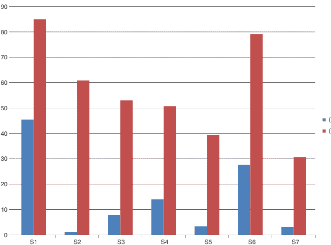

**图 3.8** (a) 在混合实验中发现的单测序样本单倍型百分比。(b) 在混合实验中发现的单测序样本单倍型总频率：Skums 2015 (29)。经牛津大学出版社许可复制。

当考虑这些单倍型的频率时，样本之间的一致性水平高得多，平均总单倍型频率为 56.94%（图 3.8）。特别是，所有频率大于 10% 的单测序单倍型，以及 72.73% 频率大于 5% 的单倍型均在混合样本中被发现。

单测序样本和混合样本单倍型频率分布之间的差异使用 Jensen-Shannon 散度 (`JSD`) (46) 和相关系数进行测量（表 3.1）。`JSD` 从样本 `S_1` 的 0.15% 到样本 `S_7` 的 0.65% 不等。样本 `S_1-S_6` 的频率分布之间存在统计学显著的相关性。唯一的例外是样本 `S_7`，在该样本的单测序标本中未检测到大的病毒变异簇，但在混合实验中发现了（图 3.9）。

通过单测序和混合测序获得的样本 `S_1-S_7` 病毒群体进化树如图 3.9 所示。尽管从两个不同测序实验获得的单倍型并不完全匹配，但它们覆盖了序列空间的相同区域。某些树分支由在一个实验中测序但在另一个实验中未测序的变异组成。例如，单样本 `S_1` 和 `S_2` 的测序产生了分支，当考虑来自混合实验 `S_6` 和 `S_7` 的序列时无法发现这些分支。相反的情况出现在：

# 大规模病毒测序的混合策略

### 表 3.1 单测序样本与混合样本频率分布的比较

| | JSD | 相关性 (p值) |
|---|---|---|
| `S_1` | 0.15 | 0.95 ($1.7 \times 10^{-77}$) |
| `S_2` | 0.57 | 0.30 (0.0023) |
| `S_3` | 0.32 | 0.89 ($2.7 \times 10^{-73}$) |
| `S_4` | 0.37 | 0.66 ($4.14 \times 10^{-9}$) |
| `S_5` | 0.50 | 0.25 ($8.6 \times 10^{-7}$) |
| `S_6` | 0.17 | 0.99 (0) |
| `S_7` | 0.65 | -0.07 (0.16) |


**图 3.9** 样本 `S_1-S_7` 的病毒群体进化树。通过单测序获得的单倍型用红色表示，混合测序获得的单倍型用蓝色表示。来源：Skums 2015 (29)。经牛津大学出版社许可复制。请参阅 www.wiley.com/go/Mandoiu/NextGenerationSequencing 获取图的彩色版本。

## 3.6 结论

在该研究中，我们提出了一种用于高度突变病毒（如 HCV 和 HIV）的大规模 NGS 新型框架。据我们所知，这是首次将混合策略应用于异质性病毒样本。所开发的框架考虑了病毒测序的特定方面，例如样本的广泛异质性、测序变异的大量级以及 PCR 偏差。

总之，基于池的病毒群体测序的成功很大取决于序列分配的效率以及由于 PCR 以及某些患者变异代表不足的风险。

# 大规模病毒测序的建库策略

样本偏差。文中提出的建库设计和聚类算法显著减少了这些偏差对大规模测序质量的负面影响。然而，通过纠错码的推广和实验条件的优化进一步减少偏差，应该进一步改进该策略，促进其在分子监测和传染病研究中的应用。

# 参考文献

- 1. Zagori A, Bhattacharya A, Eriksson S, Beerenwikel N. ShoRAJ: 基于代测序数据估计混合样本的遗传多样性。BMC Bioinformatics 2011;12:1199.
- 2. Astrovskaya I, Tok B, Mangul S, Westbrooks K, Mandou II, Balfe P, Zelikovsky A. 从454焦序测序读图中推断病毒准物种。BMC Bioinformatics 2011;12:S6
- 3. Prosperi MC, Salemi M. QuRe: 用于从代测序数据重构病毒准物种的软件。Bioinformatics 2012;28:132–133.
- 4. Mancuso N, Tok B, Skums P, Ganova-Raeva L, Mandou II, Zelikovsky A. 从 NGS读图中重构病毒准物种。In Silico Bio 2012;11(5):237–249.
- 5. Skums P, Mancuso N, Artomenko A, Tok B, Mandou I, Khudyakov Y, Zelikovsky A. 利用商品流模型从代测序数据重构病毒种群结构。BMC Bioinformatics 2013;4:S9
- 6. Holody M, Oda G, Schirmer P, Lucero CA, Khudyakov YE, Xia G, Lin Y, Valdiseri R, Duncan WE, Forbi JC, Purdy MA, Spradling NJ. 关于不当引内内镜感染的大规模流行病学回溯调查。Infect Hosp Epidemi 2012;33(7):649–656.
- 7. Vaghan G, Xia G, Purdy MA, Rossi LM, Khudyakov YE. 与食物源性爆发相关的肝炎病毒遗传相关性。PLoS ONE 2013;8(11):e7456.
- 8. Werethij J, Leigh Brown A, Hepler N, Mehta S, Richardman E. HIV-1的全球传播。J Infect 2014;209(2):304–313.
- 9. Campos DS, Skums P, Dimitrov Z, Khudyakov G, Forbi J, Teo C-G, Khudyakov Y, Lau DT-DY. 过去48年治疗期间病毒种群及其个体宿内变异株。Clin Pharmacol 2014;95(6):627–635.
- 10. Wang W, Zhang X, Xu Y, Wentworth GM, Di Biscagle AM et al. 肝炎病毒基因突变负载的高分辨率定量以及干扰素-alpha2b联合利巴韦林治疗的应用。PLoS ONE 2014;9(6):e100131.
- 11. Dierenck I, Thy K, Ghys A, Sullivan IC, Kieffer TL, Aersens J, Picchio G, De Meyer S. HCV ns3-4a区域的深度测序分析：REALIZE研究基线和结束时替瑞韦抗变异株低流行率。J Infect 2014;12(2):1871–1880.
- 12. Ramachandran S, Dimitrov Z, Xia GL, Purdy MA, Khudyakov YE. 慢性感染期间肝炎病毒种群的变化。J Virol 2011;85(13):6369–6380.

# NGS数据分析的计算方法

- 13. Palmer BA, Moreau I, Levis J, Harty C, Crosbie N, Kenny-Walsh E, Fanning LJ. 肝炎病毒感染9.6年间高变异区1的插入和重组事件。J Gen Viral 2012;93:2614–2624.
- 14. Culassa ACA, Bare P, Aloisi N, Nonzani MC, Corti M, Campos RH. 一名HIV慢性感染患者在13年随访期内肝炎病毒多基因型的宿内进化。Viology 2014;449:317–327.
- 15. Lonardi S, Duma D, Albert M, Coderofo F, Buccetti M at. 遗失基因的组合测序。PLoS Comb Biol 2013;9(4):e103010.
- 16. Duma D, Wootters M, Gilbert AC, Nqo HQ, Rudra A, Albert M, Clost TJ, Ciardo G, Lorenz Stefano. 使用压缩测序对建库序列解码。Lect Notes Comput Sci 2013;8:70–84.
- 17. Alon S, Vigneault F, Eminaga S et al. miRNA高通量多路复测序中的条码技术。Genome Res 2011;21(9):1506–1511.
- 18. Dorfman R. 大种群中缺陷成员的检测。Ann Math Stat 1943;14(4):436–440.
- 19. Du-Z, Hwang FK. 建库设计与非自适应分组检测：DNA测序的重要工具。容错DNA测序。第18卷，应用数学系列丛。新加坡：World Scientific Publishing: 2006.
- 20. Wei WU, Huang Y, Huang X, Hu D-C. 分子生物学与建库设计。In: 信息学中的数据挖掘。第7卷，Springer优化及其应用。新纽约：Springer Business Media LLC; 2007, p. 133–139.
- 21. Berman P, DasGupta B, Kao M-Y. 生物信息学中测试集的可近似性结果。In:算法理论 - SWAT 2004。第3111卷，计算机科学讲义系列。海德堡：Berlin Springer; p. 39–50.
- 22. Prabhu S, Pr E I. 高通量靶向测序的重叠库。Genome Res 2009;19:1254–1261.
- 23. He D, Zaitlen N, Pananusik B. 建库设计与非自适应分组检测：DNA测序的重要工具。容错DNA测序。第18卷，应用数学系列丛。新加坡：World Scientific Publishing: 2006。
- 24. Wei WU, Huang Y, Huang X, Hu D-C. 分子生物学与建库设计。In: 信息学中的数据挖掘。第7卷，Springer优化及其应用。新纽约：Springer Business Media LLC; 2007, p. 133–139.
- 25. Berman P, DasGupta B, Kao M-Y. 生物信息学中测试集的可近似性结果。In:算法理论 - SWAT 2004。第3111卷，计算机科学讲义系列。海德堡：Berlin Springer; p. 39–50.
- 26. Prabhu S, Pr E I. 高通量靶向测序的重叠库。Genome Res 2009;19:1254–1261.


# 大规模病毒测序的建库策略

样本偏差。文中提出的建库设计和聚类算法显著减少了这些偏差对大规模测序质量的负面影响。然而，通过纠错码的推广和实验条件的优化进一步减少偏差，应该进一步改进该策略，促进其在分子监测和传染病研究中的应用。

# 参考文献

- 1. Zagori A, Bhattacharya A, Eriksson S, Beerenwikel N. ShoRAJ: 基于代测序数据估计混合样本的遗传多样性。BMC Bioinformatics 2011;12:1199.

- 2. Astrovskaya I, Tok B, Mangul S, Westbrooks K, Mandou II, Balfe P, Zelikovsky A. 从454焦序测序读图中推断病毒准物种。BMC Bioinformatics 2011;12:S6

- 3. Prosperi MC, Salemi M. QuRe: 用于从代测序数据重构病毒准物种的软件。Bioinformatics 2012;28:132–133.

- 4. Mancuso N, Tok B, Skums P, Ganova-Raeva L, Mandou II, Zelikovsky A. 从 NGS读图中重构病毒准物种。In Silico Bio 2012;11(5):237–249.

- 5. Skums P, Mancuso N, Artomenko A, Tok B, Mandou I, Khudyakov Y, Zelikovsky A. 利用商品流模型从代测序数据重构病毒种群结构。BMC Bioinformatics 2013;4:S9

- 6. Holody M, Oda G, Schirmer P, Lucero CA, Khudyakov YE, Xia G, Lin Y, Valdiseri R, Duncan WE, Forbi JC, Purdy MA, Spradling NJ. 关于不当引内内镜感染的大规模流行病学回溯调查。Infect Hosp Epidemi 2012;33(7):649–656.

- 7. Vaghan G, Xia G, Purdy MA, Rossi LM, Khudyakov YE. 与食物源性爆发相关的肝炎病毒遗传相关性。PLoS ONE 2013;8(11):e7456.

- 8. Werethij J, Leigh Brown A, Hepler N, Mehta S, Richardman E. HIV-1的全球传播。J Infect 2014;209(2):304–313.

- 9. Campos DS, Skums P, Dimitrov Z, Khudyakov G, Forbi J, Teo C-G, Khudyakov Y, Lau DT-DY. 过去48年治疗期间病毒种群及其个体宿内变异株。Clin Pharmacol 2014;95(6):627–635.

- 10. Wang W, Zhang X, Xu Y, Wentworth GM, Di Biscagle AM et al. 肝炎病毒基因突变负载的高分辨率定量以及干扰素-alpha2b联合利巴韦林治疗的应用。PLoS ONE 2014;9(6):e100131.

- 11. Dierenck I, Thy K, Ghys A, Sullivan IC, Kieffer TL, Aersens J, Picchio G, De Meyer S. HCV ns3-4a区域的深度测序分析：REALIZE研究基线和结束时替瑞抗变异株低流行率。J Infect 2014;12(2):1871–1880.

- 12. Ramachandran S, Dimitrov Z, Xia GL, Purdy MA, Khudyakov YE. 慢性感染期间肝炎病毒种群的变化。J Virol 2011;85(13):6369–6380.

# NGS数据分析的计算方法

- 13. Palmer BA, Moreau I, Levis J, Harty C, Crosbie N, Kenny-Walsh E, Fanning LJ. 肝炎病毒感染9.6年间高变异区1的插入和重组事件。J Gen Viral 2012;93:2614–2624.

- 14. Culassa ACA, Bare P, Aloisi N, Nonzani MC, Corti M, Campos RH. 一名HIV慢性感染患者在13年随访期内肝炎病毒多基因型的宿内进化。Virology 2014;449:317–327.

- 15. Lonardi S, Duma D, Albert M, Coderofo F, Buccetti M at. 遗失基因的组合测序。PLoS Comb Biol 2013;9(4):e103010.

- 16. Duma D, Wootters M, Gilbert AC, Nqo HQ, Rudra A, Albert M, Clost TJ, Ciardo G, Lorenz Stefano. 使用压缩测序对建库序列解码。Lect Notes Comput Sci 2013;8:70–84.

- 17. Alon S, Vigneault F, Eminaga S et al. miRNA高通量多路复测序中的条码技术。Genome Res 2011;21(9):1506–1511.

- 18. Dorfman R. 大种群中缺陷成员的检测。Ann Math Stat 1943;14(4):436–440.

- 19. Du-Z, Hwang FK. 建库设计与非自适应分组检测：DNA测序的重要工具。容错DNA测序。第18卷，应用数学系列丛。新加坡：World Scientific Publishing: 2006.

- 20. Wei WU, Huang Y, Huang X, Hu D-C. 分子生物学与建库设计。In: 信息学中的数据挖掘。第7卷，Springer优化及其应用。新纽约：Springer Business Media LLC; 2007, p. 133–139.

- 21. Berman P, DasGupta B, Kao M-Y. 生物信息学中测试集的可近似性结果。In:算法理论 - SWAT 2004。第3111卷，计算机科学讲义系列。海德堡：Berlin Springer; p. 39–50.

- 22. Prabhu S, Pr E I. 高通量靶向测序的重叠库。Genome Res 2009;19:1254–1261.

- 23. He D, Zaitlen N, Pananusik B. 建库设计与非自适应分组检测：DNA测序的重要工具。容错DNA测序。第18卷，应用数学系列丛。新加坡：World Scientific Publishing: 2006.

- 24. Wei WU, Huang Y, Huang X, Hu D-C. 分子生物学与建库设计。In: 信息学中的数据挖掘。第7卷，Springer优化及其应用。新纽约：Springer Business Media LLC; 2007, p. 133–139.

- 25. Berman P, DasGupta B, Kao M-Y. 生物信息学中测试集的可近似性结果。In:算法理论 - SWAT 2004。第3111卷，计算机科学讲义系列。海德堡：Berlin Springer; p. 39–50.

- 26. Prabhu S, Pr E I. 高通量靶向测序的重叠库。Genome Res 2009;19:1254–1261.

# 高保真测序方案在 RNA 病毒中的 4 大应用

SERGHEI MANGUL

加州大学洛杉矶分校计算机科学系，美国加州洛杉矶

NICHOLAS C. WU

整合结构与计算生物学系，斯里普斯研究所中心，美国加利福尼亚州拉霍亚

EKATERINA NENASTYEEVA, NICHOLAS MANCUSO AND ALEXANDER ZIKOVSKY

佐治亚州立大学计算机科学系，美国佐治亚州亚特兰大

REN SUN AND ELEAZAR ESKIN

分子与医学药理学系，加州大学洛杉矶分校，美国加州洛杉矶

## 4.1 引言

RNA 病毒在感染宿主内具有高度的遗传多样性。这影响了具有临床意义的表型性，如逃逸疫苗诱导的免疫、毒力以及对抗病毒治疗的反应 (1)。测序技术必须足够敏感才能描述宿体内 RNA 病毒种群 (2, 3)。下一代测序 `NGS` 技术以数百万次测序读取的形式提供基因组数据的深度覆盖，从而能够捕获稀有变异 (4)。但由于测序平台产生的错误，种群中病毒多样性的全景仍未被完全发现。测序的存在使得区分病毒变异体和测序错误变得困难。此外，低病毒种群变异（即遗传距离较小的病毒基因组对）以及低丰度个体变异的存在也增加了组装全长病毒变异的复杂性 (5)。

目前的测序技术在整个过程中使用不同的化学方法，并在读取长度和成本之间进行权衡 (4)。测序平台能够检测点突变，但错误率可能导致假阳性的单核苷酸变异 `SNV` 检测或错误的基因组变异。目前的组装方法 (6–10) 无法从测序伪迹中检测真实的生物突变，这大大限制了组装病毒种群的可能性。仅通过计算纠错可以部分修正测序错误，但它们并不适用于混合病毒样本，并可能过滤掉真实的生物突变。结果是，低丰度变异无法被发现。额外的困难是病毒的基因组结构。病毒种群共有的长保守区域在组装过程中引入了歧义，因为它们可能存在多个交叉。与基因组组装中的重复序列不同，保守区域可以根据病毒变异体的相对丰度进行分型（phased）。

在参考文献 11 中提出了一种高保真测序方案。它克服了上述局限性并消除了测序错误。我们建议将该方案与一种准确的方法结合，称为病毒基因组组装器 `VGA` (5)。该方法的优势在于它不需要参考基因组。这一特征使得我们的方法适用于具有未知基因组序列的新出现病毒 (5)。发现稀有病毒变异的能力使得我们的工具适用于监测和定量 RNA 种群结构，以检测其进化图谱并研究基因组。特别是，我们的方法允许发现对 `HIV` 特别关注的突变和变异，因为它们对耐药性和治疗失败具有潜在影响 (12–14)。该方案的另一个应用是评估 `NGS` 读取的纠错方法。该方案产生的结果是错误读取，这些读取可以作为任何纠错方法的真值（ground truth）。

本章其余部分的结构如下：第 4.2 节描述了所使用的的高保真测序方案。第 4.3 节介绍了基于高保真测序数据的病毒基因组组装方法。第 4.4 节和 4.5 节展示了 `VGA` 和其他病毒组装器在模拟数据上的性能结果，而第 4.6 节描述了 `VGA` 在真实 `HIV` 数据上的性能。在第 4.7 节中，我们比较了不同的比对器，以调查它们的比对对映射统计的影响。最后，在第 4.8 节中，我们讨论了高保真方案在评估纠错方法方面的应用。

## 4.2 高保真测序方案

为了消除数据数据中的错误，我们采用了高保真测序方案（图 4.1a-d）。该方案被称为 `Safe-Sequencing`

(a) 病毒种群

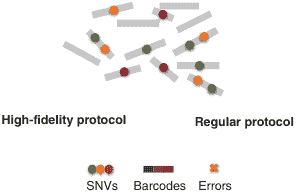

(b) 附加条形码并扩增片段

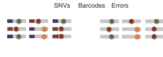

(c) 测序

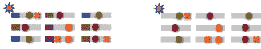

(d) 纠错

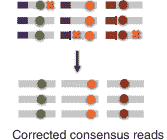

(e) 映射的读取

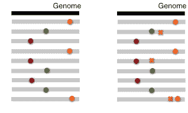

(f) 组装的病毒基因组

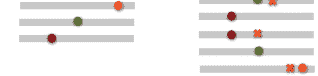

**图 4.1** 工作流程，见参考文献 5。(a) 来自病毒种群的 DNA 材料使用合适的限制酶被切成片段。(b) 为片段连接个体条形码。每个被标记的片段通过聚合酶链反应 `PCR` 进行扩增。(c) 对扩增后的片段进行测序。(d) 根据个体条形码对读取进行聚类。纠错方案应用于每个读取组，纠正测序错误并产生纠正后的读取。(e) 将纠正后的读取映射到种群共识。(f) 检测 `SNV` 并将其组装成个体基因组。来源：Mangul 2014。经牛津大学许可转载。

`Safe-SeqS`在参考文献 11 中提出并用于检测体细胞突变，但其在检测病毒突变方面的应用被忽视了。该方案涉及两个步骤：第一步为待分析的 DNA 模板分配唯一的条形码；第二步是扩增每个标记标记模板，以产生许多该分子的拷贝。聚合酶链反应 `PCR` 片段只有在比例≥90% 时才被认为是突变体。在扩增过程中发生的错误或碱基识别错误不应导致突变体。

## 4.3 高保真测序数据的组装

### 4.3.1 共识构建

在组装之前，我们应用从头构建共识的工具 `Vicuna` (15) 从序列数据产生线性共识。由于我们的测序方法不包含任何特别的低覆盖区域，我们可以重建用于病毒的种群共识。`Vicuna` 产生多个重叠而非完整的共识，因此我们使用 `BLAST` 来合并重叠。具体而言，我们要求配对之间有 50nt 的重叠。这种方法对于没有“接近”参考序列的样本提供了更大的灵活性。传统的组装方法 (16–18) 旨在重建线性共识序列，不适用于组装大量差异巨大的病毒基因组。我们借鉴了单倍型组装方法 (19, 20) 的思想，这些方法旨在重建相关的单倍型。然而，这些方法不适用于组装大量（先先未知）的个体基因组。

# 高保真测序方案在 RNA 病毒中的应用

使用实际测序数据而非注释基因组生成的基因组可以为我们提供真实的独特的映射。

### 4.3.2 序列比对 (Reads Mapping)

与许多病毒种群分析一样，第一步是将 reads 比对到图谱（图 4.1e）。我们使用 `InDelFixer` (21) 配合默认参数将 reads 比对到 `novo` 的共识序列上。通过比对数据中的片段长度分布过滤掉错误的序列比对。假设片段长度服从正态分布 (22)，我们只保留片段长度在均值三个标准差以内的 reads。根据三西格准则，共有 1.2% 的 reads 被过滤掉，而预期比例为 0.3%。

## 4.3.3 病毒基因组组装 (VGA)

在文献5 中，我们引入了一种病毒种群组装方法（图 4.2），该方法基于高精度测序数据，用于检测稀有变异并容忍种群中的保守区域。该方法包括一个组装后程序，利用表达谱检测并解决长保守区域带来的歧义。在直接从序列数据重构共识序列后（图 4.2a），我们的方法从比对的测序 reads 中检测 `SNVs`。利用 reads 之间的重叠来连接单个 `SNVs` 并区分种群中的基因组变异。病毒种群被压缩在由比对的测序数据构建的冲突图中（图 4.2b）。如果两个 reads 在重叠区域共享相同的 `SNVs`，则它们源自不同的基因组。病毒变异被识别为互不冲突的 reads 独立点集。稀有变异的非连续覆盖可能会限制组装能力，这表明需要增加覆盖度来提高组装准确性。识别出的变异频率使用期望最大化算法 `EM` 算法进行估计。与现有方法相比，我们能够在实现高准确性的同时检测出稀有的种群变异。

病毒种群分析始于确定在重叠区域相互冲突的比对 reads 对。深度覆盖与高精度的结合为估计病毒种群的基因组多样性提供了前所未有的机会。遵循 (23)，我们构建了冲突图 `G=(V, E)`，其中顶点代表双端 reads，即 `V=R`，边连接成对的双端序列。

显然，任何真实的病毒基因组对应于冲突图中的一个极大独立集（一对互不相邻的极大顶点），尽管并非每一个极大独立集都一定对应于真实的基因组。在文献 5 中，我们采用了一种简便的方法，要求用最少数量的独立集覆盖冲突图。这个问题等价于最小图染色问题 `MIN-GRAPH-COLORING`，这是一个 NP hard 问题。存在许多解决此问题的启发式算法（例如文献24, 25），它们基于极大独立集的贪心选择。遗憾的是，我们尝试构建单个病毒基因组失败了，因为很难将双端 reads 排成一条连接的单路径。事实上，贪心算法在从左到右拼接双端 reads 时，仅几步之后就会耗尽所有可能的扩展。

相反，在文献 5 中，我们采用了另一种“自上而下”的方法，即沿最大切 `Max Cut` 进行递归图划分，该方法已成功应用于人类单倍体分析 (26)。给定一个图 `G=(V, E)`，最大切问题要求将顶点划分为两个组件 `V1` 和 `V2`，使得一个端点在 `V1` 而另一个在 `V2` 的边总数最大化。虽然最大切问题是 NP 的，但可以通过一个 0.5 近似算法良好近似，该算法随机将顶点分配到两个组件之一 (27)。我们的最大切启发式算法从将从到右排序的 reads 分配到两个组件开始，并反复一次从另一个组件移动一个顶点，在每一步中改进解，直到无法再进行此类改进为止。

我们的启发式算法递归地划分图，直到每个组件都变得独立（图 4.2c）。如果图中的 reads 完全覆盖了基因组，则生成的序列被接受为下一个病毒基因组。否则，如果组装的基因组包含空隙，我们按照从左到右的顺序使用其他颜 reads 来填充空隙（图 4.2d）。如果所有 `SNV` 位置都被覆盖，则将新重构的病毒基因组加入集合 `VGA`。最后，得到那些无法通过上述程序填充空隙的基因组。

## 4.3.4 病毒种群定量化

在工作流的最后一步（图 4.2e 和 f）中，使用期望最大化算法来推断病毒准种的相对丰度。

> **图 4.2** `VGA` 概述（参见文献 5），(a) 算法输入输入已比对到种群共识序列的双端 reads。(b) 组装的第一步是确定在重叠区域具有不同 `SNVs` 的冲突 reads 对。冲突 reads 对连接在“冲突图”中。每个 read 在图中都有一个节点，在每对冲突的 reads 之间放置一条边。(c) 图被涂成最少数量的颜色，以区分种群中的基因组变异。图的颜色代表组装成基因组的互不冲突 reads 的独立集。例如，冲突图最少被四种颜色（红色、绿色、紫色和青色）染色，代表单个病毒基因组。(d) 随后将相同颜色的 reads 组装成单个病毒基因组。报告被完全覆盖的病毒基因组。(e) 将 reads 分配给病毒基因组。`VGA` 使用期望最大化算法推断相对丰度。(f) 根据表达谱检测长保守区域。来源：牛津大学出版社。


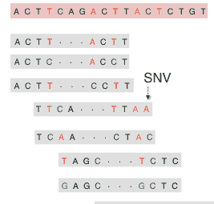


# NGS 数据的计算方法

```
算法 VGA 组装 (5)
**输入:** 比对到共识的 reads
从 R 构建冲突图 G (V, E)
递归划分 G 为颜色类 C
初始化基因组集 VGA $\leftarrow \emptyset$
**对于** 每个颜色类 $c_i \in C$ **执行**
  找到包含 $c_i$ 的 (V, E) 极大独立集
  将 $c_i$ 组装成基因组 $g_i$
  **如果** $g_i$ 覆盖所有位置 **则**
    $\mathcal{VGA} \leftarrow \mathcal{VGA} \cup \{g_i\}$
  **结束**
**结束**
**输出:** 完整的基因组集
```

类似于文献 28 中描述。在文献 5 中，我们扩展了之前的 EM 公式以包含种群的先验概率并计算后验估计。令 $H$ 为基因组集的随机变量 $H = \mathcal{VGA}$，$R$ 为 reads 的随机变量。令 $p[H] \sim \text{Dir}(\alpha_1, \dots, \alpha_{|H|})$ 为变异的先验概率，并定义 $p_h = \text{Pr}[H=h]$ 为变异的概率。观测读 $r \in R$ 的概率通过对所有变异边缘化给出：

> $\text{Pr}[R] = \sum_{h \in H} \text{Pr}[R=r|H=h] \cdot p_h$

其中

> $\text{Pr}[R=r|H=h] = \begin{cases} 1/K_h & \text{如果 } r \text{ 与 } h 一致 \\0 & \text{否则}\end{cases}$

且 $K_h$ 是与 $h$ 一致的 reads 数量。现在我们可以定义对数后验为：

> $\log \text{Pr}[H|R] = \sum_{r \in R} n_r \cdot \log \text{Pr}[R=r] + \sum_{h \in H} (\alpha_h-1) \log p_h - C_R$

其中 $C_R$ 是常数，$n_r$ 是 $r$ 的数量。由于该函数是非凸且难以优化，我们解决更容易的极大下界问题：

> $\sum_{r \in R, h \in H} n_{rh} \cdot \log (\text{Pr}[R=r|H=h] \cdot p_h) + \sum_{h \in H} (\alpha_h-1) \log p_h$

其中 $n_{rh}$ 是由变异 $h$ 产生的 reads 期望数量。

# 高保真测序协议在 RNA 病毒中的应用

随后，通过给定的 MAP 估计值使对数后验概率最大化

```
$$\hat{p}_h = \left(a_h - 1 + \sum_{r \in \mathcal{R}} n_{rh}\right)/\left(|\mathcal{R}| + \sum_{h \in \mathcal{H}} a_h - |\mathcal{H}|\right)
```

我们看到，通过设置均匀先验（即对于所有 $h \in \mathcal{H}$，$a_h=1$），我们获得了原始的极大似然估计（MLE）公式。

## 4.4 VGA 在模拟数据上的性能

由于被测序病毒种群的地面真值（ground truth）未知，在参考文献 5 中，我们使用模拟作为评估病毒组装工具性能的标准方法。高保真协议允许纠正测序错误，从而获得高质量的测序数据。对于常规协议获取的 reads，存在测序后错误纠正技术，提供了部分纠正测序错误的可能性，但是以牺牲真实的生物变异为代价的。使用 `Grinder` (29) 分别从高保真和常规测序协议生成 reads。reads 来自具有不同测序参数和病毒表达谱的真实及合成病毒变异。`Grinder` 是一种先进的测序 reads 模拟器，用于模拟病毒种群的鸟枪式测序数据。我们使用 `Mosaik` (30) 将模拟的双端 reads 比对到共识序列（consensus）。共识序列使用 `Vicuna` 构建（一种从头组装工具，用于从深度双端测序数据中产生无错误的线性共识序列。详见第 4.3 节）。

在参考文献 5 中，我们使用敏感度和正预测值（PPV）来评估 `VGA` 组装的病毒基因组的质量。我们考虑完全组装且与真实准物种匹配的病毒准物种，即 *敏感度 (Sensitivity) = TP/(TP + FN)*，也就是说，PPV 定义为组装准物种中真实序列的比例，即 PPV = TP/(TP + FP)。此外，我们还评估了该方法估算种群大小（即种群中病毒基因组的数量）的能力。种群大小预测的准确性定义为估计值与真实种群大小之间的比值。最后，我们使用 Jensen-Shannon 散度（JSD）来衡量它们之间的“距离”，换句话说，即一个概率分布近似另一个的质量。它被定义为分布 $P$ 和 $Q$ 到其混合分布的 Kullback-Leibler 散度。形式上，真实分布 $P$ 与近似分布 $Q$ 之间的 JSD 由公式给出：

```
$JSD(P||Q) = \frac{1}{2}D_{KL}(P||M) + \frac{1}{2}D_{KL}(Q||M)$
```

其中 Kullback–Leibler 散度 $D_{KL}$ 为

```
$D_{KL}(P||Q) = \sum_{i=1}^n P(i) \log \frac{P(i)}{Q(i)}$
```

且 $M=\frac{1}{2}(P+Q)$。JSD 的动机是因为组装方法无法重构某些变异 $i$ 时，导致 $Q(i)$ 为 0，使得 KL 散度未定义。JSD 通过测量到包含所有真实和检出变异（TP 和 FP）的混合物的距离来解决这一点。

我们的第一项研究比较了不同物种之间的组装准确性。在参考文献 5 中，我们关注了读 长度和吞吐量对不同类型病毒组装质量的影响。从 HIV 和 HCV 种群假设均匀分布和幂律分布，模拟了对应于高保真和常规测序协议的各种长度的双端 reads。幂律分布（即单个病毒基因组的频率是前一个的幂次）对应于具有几个主导变异和许多稀有变异的种群。均匀分布则所有病毒基因组具有相同的频率。HCV 种群由来自 44 条真实 HCV 序列 E1E2 基因组的 1739-bp 长片段组成。HIV 种群由来自 1.3 kb 长 HIV-I 区域的 10 个真实病毒内变异组成，其中包括 pol 和部分 pol 反转录酶。

研究了跨病毒物种的基因组结构，并研究了其对组装质量的影响。与 HIV 相比，HCV 显示出更复杂的基因组结构、更低的种群密度和更多的保守区域（图 4.3）。两种病毒中都存在保守区域，尽管 HCV 包含长于 450bp 的保守区域。大于平均片段长度（450 bp）的保守区域可能会由于缺乏亚基因组通过保守区域的直接证据而引入歧义。我们进行了测序实验，其中平均扩增率为 5，由于高保真测序协议执行的共识错误纠正，导致吞吐量下降了五倍。此外，模拟实验被用于模拟非均匀扩增率。非均匀扩增率导致丢弃扩增率不足（小于 3）的片段。从真实研究已知，约 10% 的片段被扩增了三次。常规协议产生的测序错误限制了 `VGA` 准确组装病毒种群的能力。所有组装的变异都包含大量的错配，此外 `VGA` 显著高估了种群大小。

正如预期的那样，短读长度剧地抑制了重构，这从在给定 22x36 bp reads 时 `VGA` 无法产生全长基因组可以显而易见（图 4.6）。由于 HCV 病毒基因组的复杂区域远长于 HIV，因此 `VGA` 在 HCV 数据上的性能较差并不意外——从 44 条 1739-bp 长基因组模拟出 3M x 150 bp reads，敏感度为 50%，PPV 为 80%。对 HCV 的结果证实，较低的突变率和保守区域的存在限制了 `VGA` 准确组装病毒种群的能力。所有组装的变异都包含大量的错配，此外 `VGA` 显著高估了种群大小。

正如预期的那样，短读长度剧地抑制了重构，这从在给定 22x36 bp reads 时 `VGA` 无法产生全长基因组可以显而易见（图 4.6）。由于 HCV 病毒基因组的复杂区域远长于 HIV，因此 `VGA` 在 HCV 数据上的性能较差并不意外——从 44 条 1739-bp 长基因组模拟出 3M x 150 bp reads，敏感度为 50%，PPV 为 80%。对 HCV 的结果证实，较低的突变率和保守区域的存在对重构能力有负面影响。意外的是，将读长度从 100 bp 增加到 150 bp 对于 HCV 没有产生益处，表明 100 bp 的读长度足以区分病毒变异。虽然还需要进一步实验来确定最佳读长度，但我们的模拟表明 2 x 100 bp 是足够的。


图 4.3 来自 44 条真实 HCV 序列 E1E2 基因组的 1739-bp 长片段（见参考文献 5）。两个病毒基因组之间的共同区域由颜色表示。来源：Mangul 2014 (5)。150 bp 适用于中等 HCV 种群。

在参考文献 5 中，我们分别分析了该方法估算种群大小（即种群中病毒基因组的数量）的能力。非连续覆盖对重构高变率变异能力有负面影响。稀有变异可以通过增加测序深度来减少非连续基因组；虽然完全组装所有此类基因组是不现实的，但仍然可以估算其数量。`VGA` 报告的独立集为我们提供了


## NGS 数据分析的计算方法

reads 数 50k 100k 500k 1M 2M


图 4.4 种群大小预测的准确性（见参考文献 5）。从 Gag/Pol 3.4 kb HIV 区域生成的 200 个病毒基因组。种群多样性为 5–10。变异丰度遵循幂律分布 (a) 和均匀分布 (b)。高对比 100 × 2 bp 双端 reads 模拟自 HIV 种群。来源：Mangul 2014 (5)。经 Oxford Press许可。

图 4.5 组装准确性估计（见参考文献 5）。从 Gag/Pol 3.4 kb HIV 区域生成的 200 个病毒基因组。种群多样性为 3–20。变异丰度遵循幂律分布 (a) 和均匀分布 (b)。共识错误纠正 2 × 100 bp 双端 reads 模拟自 HIV 种群。来源：Mangul 2014 (5)。经 Oxford Press 许可。

直观地说，预测具有许多稀有变异的大型病毒种群的大小与预测均匀分布或小规模种群完全不同（图 4.4）。预测的种群大小可以作为覆盖不足以检测到样本中存在的全部病毒多样性的指标。

## 高保真测序方案在RNA病毒中的应用

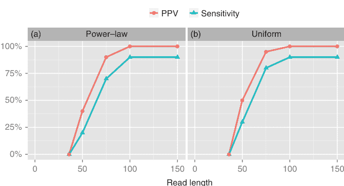

**图 4.6** 装组准确性估计（参见参考文献 5）。共识错误纠正

深度覆盖是准确估计底层病毒多样性的要求。`Illumina HiSeq` 是一种能够提供数百万次测序 reads 的平台。产生的 reads 长度较短，通过从两端对同一片段进行测序来补偿；因此产生了由“间隙”分隔的配对 reads，即双端读取（paired-end read）。据我们所知，`VGA` 是第一个可以扩展到数百万短双端测序 reads 方法，能够产生跨整个基因组的全长度病毒变异。我们探索了测序深度对不同种群结构和群体内病毒基因组幂律分布下重建准确性的影响 (5)。已知 HIV-1 比任何其他已知病毒具有更大的遗传变异性 (32)。基因组之间的多样性取决于区域，从 3% 到 20% 不等 (33, 34)。我们通过生成遵循均匀分布或幂律分布的病毒群体准备了异质病毒样本。惊讶的是，我们的模拟表明测序深度对总体准确性有直接的正向影响。图 4.5 显示了覆盖度和种群大小对多达 100 bp reads 装组的影响。在所有实验中，`VGA` 保持了 100% 的 PPV 值。

除了点突变外，遗传重组促进了快速进化和多种 HIV 基因组的产生。事实上，在患者体内共感染细胞产生重组病毒后代的水平可能低于突变率 (35)。因此，在确定装组质量时，模拟数据集必须考虑到这两种可能的现象。在参考文献 5 中，我们利用模拟模型根据多样性的程度，在生成的病毒群体中整合了点突变和重组。来自 1.3-kb HIV-1 的 10 种宿主病毒变异体混合成了该种群。除了点突变外，我们的模拟模型通过首先构建种群的基因型（即 SNVs 序列）来产生重组基因组。在该基因型上执行指定次数的随机游走。发生的任何交叉都代表“左”和“右”原始基因组之间新的重组。重组是独立产生的，对重组的数量和长度没有限制。该模型平均产生高度重组的数据，构成了挑战并可用于评估装组准确性。模拟模型通过随机选择种群和核苷酸交换将突变整合到过程中。模拟结果（图 4,7）表明，我们的方法在存在重组体和点突变的情况下可以准确评估病毒群体，保持 100% 的 PPV。

最后，我们评估了种群量化准确性，即我们的方法在预测装组变异体丰方面的准确性。根据 `VGA` 对 10 个真实 HIV 克隆（50,000 条 reads 和 2 x 100 bp）的结果，幂律分布的 JSD 为 2.93e-05，基于均匀分布的种群为 0.001。这一很小的数值仅随着输入量的增加而减小。

## 4.5 现有病毒装组器在模拟共识错误纠正 reads 上的性能

我们评估了 `ShoRAH` (7) 和 `QuasiRecomb` (9) 对模拟共识错误纠正读取数据 (5) 的性能。

`ShoRAH` 忽略了 reads 的配对信息，但其扩展性足以处理 1M reads。`ShoRAH` 无法产生全长度基因组，但能可靠地产生 98% 的共识基因组。它合理地估计了不同病毒基因组的数量，但即使是最准确的 `ShoRAH` 装组病毒基因组与最真实的 1.3 kb 长病毒基因组相比也有五个碱基差异。

`QuasiRecomb` 设计用于处理双端 reads 数据，并成功产生了全长度病毒基因组。遗憾的是，它最多只能处理 100K reads。此外，装组的不同病毒基因组数量是真实病毒基因组数量的 10-200 倍。最准确的 `QuasiRecomb` 装组病毒基因组与真实的 1.3 kb 长病毒基因组相比仍有四个碱基差异。

遗憾的是，我们无法将我们的方法与 `QColors` (23) 装组算法比较，该算法采用类似的冲突图来表示病毒群体。`QColors` 使用 CSP 求解器对图染色，这可能会限制其对包含数百万测序 reads 的高吞吐量数据集的扩展性。目前，`QColors` 尚未公开¹。

## 4.6 VGA 在真实 HIV 数据上的性能

为了测试 `VGA` 准确装组多样化自然群体并预测变异体丰度水平的能力（参见参考文献 5），我们使用了 `Illumina HiSeq` HIV 数据集，该数据集由 15M 2 × 100 bp reads 组成。

| reads 数量 | 50k | 100k | 500k | 1M | 2M |

| :--- | :--- | :--- | :--- | :--- | :--- |

| | | | | | |

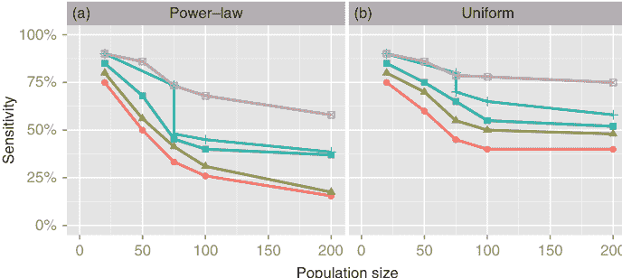

**图 4.7** 装组准确性估计（参见参考文献 5）。从 1.3-kb HIV-1 区域产生了大量的重组病毒基因组。变异体丰度遵循幂律 (a) 和均匀分布 (b)。从 HIV 群体模拟共识错误纠正的 2 x 100 bp 双端读取。来源：Mangul (2015)。经牛津大学出版社许可复制。

# 高保真测序协议在 RNA 病毒中的应用

## 4.8 基于高保真测序读段的纠错工具评估

高保真测序协议的另一个应用是针对二代测序（NGS）读段的纠错方法评估。该协议为基因组的每个片段连接一个单独条形码。测序后，属于原始片段的reads通过条形码进行聚类。只有当任何位置上最常见的碱基酸超过簇内reads数的 90%时，该簇的一致read才被认为是错误read。否则，整个条形码簇将被忽略。因此，在测序步骤之后，我们获得了带有测序误差的原始reads。在去复用步骤之后，我们获得了属于基因组片段的错误reads。我们建议使用某些纠错工具修正原始reads，并将结果与条形码纠正后获得的原始reads进行比较。具体而言，我们将属于某个簇的每个错误reads与分配到同一簇并经过修正的reads进行比较。

在我们的工作中，评估了 `BLESS` (39) 和 `Fiona` (40) 纠错工具。我们将它们应用于 15M 双端reads。在纠错之前，我们删除了部分中的所有条形码，使reads的长度变为 87bps。纠错后，两种方法改变的reads均不超过所有reads的 5%。为了简单起见，我们忽略了这些reads。我们将每个修正后的 87bps reads 分配到其之前识别出的错误一致read所在的条形码簇中。我们统计了原始reads和纠错后reads与错误reads相同的百分比。结果显示，两种方法都导致了原始reads过度修正；因此，在纠错前，约 90% 的簇中，所有分配的原始reads实际上等同于对应的错误一致read。在经过 `BLESS` 纠错后，只有在 78% 的簇中所有reads才对应对应的read。`Fiona` 对正向和反向端的处理方式不同。在 78.5% 的簇中，所有修正reads的正向端与对应的错误reads的正向端相等。尽管在 99.1% 的簇中，反向端与对应的一致read的反向端不同。

## 致谢

作者感谢 UCLA 临床微阵核心实验室执行高通量测序实验。


# 高保真测序协议在 RNA 病毒中的应用

## 4.8 基于高保真测序读段的纠错工具评估

高保真测序协议的另一个应用是针对二代测序（`NGS`）读段的纠错方法评估。该协议为基因组的每个片段连接一个单独的条形码。测序后，属于原始片段的`reads`通过条形码进行聚类。只有当任何位置上最常见的碱基超过簇内`reads`数的 `90%`时，该簇的一致`read`才被认为是错误`read`。否则，整个条形码簇将被忽略。因此，在测序步骤之后，我们获得了带有测序误差的原始`reads`。在去复用步骤之后，我们获得了属于基因组片段的错误`reads`。我们建议使用某些纠错工具修正原始`reads`，并将结果与条形码纠正后获得的原始`reads`进行比较。具体而言，我们将属于某个簇的每个错误`reads`与分配到同一簇并经过修正的`reads`进行比较。

在我们的工作中，评估了 `BLESS` (39) 和 `Fiona` (40) 纠错工具。我们将它们应用于 `15M` 双端`reads`。纠错之前，我们删除了部分中的所有条形码，使`reads`的长度变为 `87bps`。纠错后，两种方法改变的`reads`均不超过所有`reads`的 `5%`。为了简单起见，我们忽略了这些`reads`。我们将每个修正后的 `87bps` `reads` 分配到其之前识别出的错误一致`read`所在的条形码簇中。我们统计了原始`reads`和纠错后`reads`与错误`reads`相同的百分比。结果显示，两种方法都导致了原始`reads`过度修正；因此，在纠错前，约 `90%` 的簇中，所有分配的原始`reads`实际上等同于对应的错误一致`read`。在经过 `BLESS` 纠错后，只有在 `78%` 的簇中所有`reads`才对应对应的`read`。`Fiona` 对正向和反向端的处理方式不同。在 `78.5%` 的簇中，所有修正`reads`的正向端与对应的错误`reads`的正向端相等。尽管在 `99.1%` 的簇中，反向端与对应的一致`read`的反向端不同。

## 致谢

作者感谢 `UCLA` 临床微阵核心实验室执行高通量测序实验。

`S.M.` 和 `E.E.` 的资金来自美国科学基金会项目 `0513612`, `0731455`, `0729049`, `0916676`, `1065276`, `1302448` 和 `1320589`，以及美国国立卫生基金会项目 `K25-HL08007`, `U01-DA02417`, `P01-HL30568`, `P01-HL28481`, `R01-GM083198`, `R01-MH101782` 和 `R01-ES022282`。`S.M.` 部分获得 `UCLA` 定量与定量生物科学研究奖学金支持。`N.C.W.` 获得 `UCLA` 分子生物学博士读前奖学金支持。`A.Z.` 部分获得美国农业部食品与农业研究倡议竞争性资助（项目号 `201167016-30331`）以及美国科学基金会奖励 `IIS-0916401`。`N.M.` 部分获得佐治亚州立大学第二世纪计划支持。

利益冲突：未声明。

## 参考文献

- 1. Lauring AS, Andino R. 准物种类型和 RNA 病毒的行为。PLoS Pathog 2010;6(7):e101005.
- 2. Tbisris AM, Korber B, Armonaut R, Russ C, Lo C-C, Leitner T, Gaschen B, Theiler J, Paresdes R, Su Z et al. 定量深测序揭示了体内 CCR5 拮抗剂导致的 HIV-1 逃逸和群体转变。PLoS ONE 2009;4(5):e5683.
- 3. Henn MR, Boutwell CL Charlebois P, Lennon NJ, Power KA, Macalalad AR, Berlin AM, Malboef CM, Ryan S et al. HIV-1 基因组深测序揭示了急性感染免疫识别期间微变异株的早期重要性。PLoS Pathog 2012;8(3):e100259.
- 4. Metzker ML. 测序技术——下一代。Nat Gen 2009;11(1):31–46.
- 5. Mangul S, Wu Mancuso N, Zelikosky A, Sun R, Eskin E. 来自超深测序数据的准确病毒种群估计。Bioinformatics 2014;30(12):i1329–i337.
- 6. Astroskaya I, Tok B, Mangul S, Westbooks C, Mandoiu I, Balfe P, Zelikosky A. 从 454 焦序测序读段中推断病毒准物种谱。BMC bioinformatics 2012;11:Suppl6.
- 7. Zagordi O, Bhattacharya A, Eriksson N, Beerwinkel N, ShoRAH: 从下一代测序数据估算混合样本的遗传多样性。BMC Bioinformatics 2012;11(1):119.


- 8. Prosperi MCF, Salemi M. QuRe: 用于从二代测序数据进行病毒重构的软件。Bioinformatics 2012;28(1):132–133.
- 9. Zagordi O, Tölfer, Prabhakaran S, Roth V, Halperin E, Beerwinkel N. 受重组影响的病毒准物种概率推断。In: Chor, B., Editor. 第 16 届计算分子生物学研究国际会议 (RECOMB'12), Berlin, Springer-Verlag; 2012. p. 342–354.
- 10. Mancuso N, Tok B, Skurns P, Ganova-Reava L, Mandoiu I, Zelikosky A. 从 NGS 扩增子重构病毒准物种。In Biol 2011;5):237–249.
- 11. Kunde I, Wu J, Papadopoulos N, Kinzer W, Vogelstein B. 大规模并行测序检测和量化突变。Natl Sci U S A 2011;108(23):9530–9535.
- 12. Wang C, Mitsuya Y, Gharizadeh B, Ronaghi M, Shafer RW. 利用超深焦测序表征突变谱：药物耐性的应用。Genome Res 2007;7(8):195–201.
- 13. Liu J, Miller MD, Danovich RM, Vandergrift N, Cai F, Hazuda, Gao F. 与替葛类耐药相关的低频突变分析。Antimicrobial Agents 2011;55(3):1114–1119.
- 14. Palmer S, Maldarelli F, Kearney M, Rock D, Dewar J, Metcalf JA. 非核苷类反转录抑制剂的选择。AIDS 2006;
- 15. 修正后的 87bps reads 分配到其之前识别出的错误一致read所在的条形码簇中。
- 16. 所有的修正reads的正向端都与对应的错误reads的正向端相等。


- 1. Lauring AS, Andino R. Quasispecies types and the behavior of RNA viruses. PLoS Pathog 2010;6(7):e101005.
- 2. Tbisris AM, Korber B, Armonaut R, Russ C, Lo C-C, Leitner T, Gaschen B, Theiler J, Paresdes R, Su Z et al. Quantitative deep sequencing reveals动态 HIV-1 escape and population shifts using CCR5 antagonism in vivo. PLoS ONE 2009;4(5):e5683.
- 3. Henn MR, Boutwell CL Charlebois P... et al. Genome deep sequencing of HIV-1 reveals the early importance of minor variants upon immune recognition during acute infection. PLoS Pathog 2012;8(3):e100259.
- 4. Metzker ML. Sequencing technologies-the next generation. Nat Gen 2009;11(1):31–46.
- 5. Mangul S, Wu Mancuso N, Zelikosky A, Sun R, Eskin E. Accurate viral population estimates from ultra-deep sequencing data. Bioinformatics 2014;30(12):i1329–i337.
- 6. Astroskaya I, Tok B, Mangul S, Westbooks C, Mandoiu I, Balfe P, Zelikosky A. Inferring viral quasispecies spectra from 454 pyrosequencing reads. BMC bioinformatics 2012;11:Suppl6.
- 7. Zagordi O, Bhattacharya A, Eriksson N, Beerwinkel N, ShoRAH: estimating the genetic diversity of a mixed sample from next-generation sequencing data. BMC Bioinformatics 2012;11(1):119.
- 8. Prosperi MCF, Salemi M. QuRe: software for viral reconstruction from next-generation sequencing data. Bioinformatics 2012;28(1):132–133.
- 9. Zagordi O, Tölfer, Prabhakaran S, Roth V, Halperin E, Beerwinkel N. Probabilistic inference of viral quasispecies subject to recombination. In: Chor, B., Editor. Proceedings of the 16th Annual international conference on Research in Computational Molecular Biology (RECOMB'12), Berlin, Springer-Verlag; 2012. p. 342–354.
- 10. Mancuso N, Tok B, Skurns P, Ganova-Reava L, Mandoiu I, Zelikosky A. Reconstructing viral quasispecies from NGS amplicons. In Biol 2011;5):237–249.
- 11. Kunde I, Wu J, Papadopoulos N, Kinzer W, Vogelstein B. Detection and quantification of mutations with massively parallel sequencing. Natl Sci U S A 2011;108(23):9530–9535.
- 12. Wang C, Mitsuya Y, Gharizadeh B, Ronaghi M, Shafer RW. Characterization of mutation spectra with ultra-deep pyrosequencing: application to drug resistance. Genome Res 2007;7(8):195–201.
- 13. Liu J, Miller MD, Danovich RM, Vandergrift N, Cai F, Hazuda, Gao F. Analysis of low-frequency mutations associated with raltegravir resistance. Antimicrobial Agents 2011;55(3):1114–1119.
- 14. Palmer S, Maldarelli F, Kearney M, Rock D, Dewar J, Metcalf JA. Selection of nonnucleoside reverse transcriptase inhibitors. AIDS 2006;
- 15. 修正后的 87bps reads 分配到其之前识别出的错误一致read所在的条形码簇中。
- 16. 所有的修正reads的正向端都与对应的错误reads的正向端相等。

34. Yoshimura FK, Diem K, Learn GH, Riddell S, Corey L. Intrapatient sequence variation of the gene of human immunodeficiency virus type 1 plasma virions. J Virol 1996;70(12):8879–8887.

35. Neher RA, Leitner T. Recombination rate and selection strength in HIV intra-patient evolution. PLoS Comput Biol 2010;6(1):e1000660.

36. Li H, Durbin R. Fast and accurate short read alignment with burrows- wheeler transform. Bioinformatics 2009;25(14):1754–1760.

37. Langmead B, Salzberg SL. Fast gapped-read alignment with Bowtie 2. Nat Methods 2012;9(4):357–359.

38. Ferragina P, Manzini G. Opportunistic data structures with applications. Proceedings of the 41st Annual Symposium on Foundations of Computer Science (FOCS '00). Washington (DC): IEEE Computer Society; 2000. p 390.

39. Heo Y, Wu X-L, Chen D, Ma J, Hwu W-M. BLESS: bloom filter-based error correction solution for high-throughput sequencing reads. Bioinformatics 2014;30(10):1354–1362. DOI: 10.1093/bioinformatics/btu03

40. Schulz MH, Weese D, Holtgrewe M, Dimitrova V, Niu S, Reinert K, Richard H. Fiona: a parallel and automatic strategy for read error correction. Bioinformatics 2014;30(17):i356–i363.

# 第二部分

# 基因组学与表基因组学

## 5 脚骨架算法 (SCAFFOLDING ALGORITHMS)

IGOR MANDRIC

乔治亚州立大学计算机科学系，亚特兰大，美国乔治亚州

JAMES LINDSAY AND ION I. MĀNDOI

康涅狄格大学计算机科学与工程系，斯托斯，美国康涅狄格州

ALEXANDER ZELIKOVSKY

乔治亚州立大学计算机科学系，亚特兰大，美国乔治亚州

### 5.1 脚骨架 (SCAFFOLD)

由于高通量测序（HTS）技术的快速发展，人们对从头基因组组装问题的兴趣回归。这些技术也被称为二代测序（NGS），可以产生数百万覆盖全基因组的短双端序列；因此，其吞吐量比经典的 Sanger 测序高出一个数量级。注意的是，生产成本持续下降趋势，使得 NGS 成为广泛应用领域非常有吸引力的工具。例如，Illumina HiSeq 平台可以在单次运行中产生数十亿 reads，每兆碱基成本仅需几分钱。由于 reads（枪法测序序列）长度很短，基因组组装仍然是一个具有挑战性的问题。

现有的组装器（Velvet (1), ALLPATHS-LG (2)）输出一组连续的 DNA 片段，通常称为 contigs（重叠群）。contig 的长度从数百到数十万个碱基对不等。由于基因组通常由数百万碱基对组成，生成的组装结果是高度碎片化的。

> 下代基因测序数据分析的计算方法，第一版。

由 Ion I. Mandoiu 和 Alexander Zelikovsky 编辑。

© 2016 John Wiley & Sons, Inc. 2016 由 John Wiley & Sons, Inc. 出版

辅助网站：www.wiley.com/go/Mandoiu/NextGenerationSequencing

NGS read pairs 的优势在于可以使用它们将 contigs 连接成一些更大的 DNA 片段。来自同一 read pair 的两个 reads 映射到两个不同的 contigs 上，它们具有恒定的文库插入长度（如果被认为是恒定的，尽管通常使用平均插入长度及其标准差），这推断出 contigs 之间的某种连接性。因此，这样的 read pair 暗示了两个 contigs 之间特定的相对顺序、相对方向以及间隙长度的估计。将一组 contigs 连接成一条链，并提供相对顺序、方向以及相邻 contigs 之间间隙长度的估计，这就称为 scaffold（脚骨架）。

软件程序（通常称为 scaffolders 构建器）根据组装器输出的 contigs 和 NGS read pairs 提供的连接信息来构建 scaffolds。由于 contigs 中的组装错误、重复序列和嵌合序列（chimeric reads），通过一组 read pairs 连接的两个 contigs 之间的相对顺序和方向信息可能是矛盾的，也可能是正确的。因此，选择一部分 read pairs 作为两个 contigs 之间连接的证据可能会推断出错误的相对顺序/或方向以及它们之间的间隙估计。符合 contigs 真实方向及其之间距离的边通常称为

通常情况下，脚骨架问题被表述为图 `G=(V,E)` 上的优化问题，其中顶点 `V` 通常是 contigs 集合，边 `E` 通常对应于连接 contigs 的 read pair。不同的工具对脚骨架问题使用不同的标准。例如，`OPERA` (3) 最大化不一致边（discordant edges）的数量；`SCARPA` (4) 最小化不一致边的数量；`SILP2` (5) 使用了基于整数线性规划的方法。

在参考文献 3 中，证明了脚骨架问题是一个 NP-hard 问题。因此，最先进的脚骨架工具使用不同的启发式方法。`OPERA` 使用优雅的动态规划算法解决该问题，`SCARPA`、`MIP` (6) 和 `SILP2` 分别解决方向和排序问题，后两者通过将脚骨架图分解为双连通分量。`SSPACE` (7) 使用简单但强大的启发式方法。

在下一节中，我们将简要描述一些最先进的脚骨架工具：`SSPACE`、`OPERA`、`SOPRA`、`MIP` 和 `SCARPA`。第 1.4 节深入探讨了了脚骨架工具：`SILP2` 和 `ScaffoldMatch`。在第 1.5 节中，我们介绍了性能指标并根据这些指标评估脚骨架工具。

### 5.2 最先进的脚骨架工具

#### 5.2.1 SSPACE

基于预组装 contigs 的 `SSPACE` 脚骨架构建（扩展）是预组装 contigs 的独立脚骨架工具 (7)。`SSPACE` 基于短读组装器 `SSAKE` (8)。

算法的第一步是读取和过滤输入数据。reads 被映射到 contigs 上，如果两个 contigs 之间的连接支持 reads 数量少于用户指定的阈值，则过滤掉这些 reads。未映射的 reads 被切碎（默认 5 bp）并存储在哈希表中。

随后是最佳的 contig 扩展步骤。使用哈希表中未映射的 reads 片段，逐碱基对贪婪地扩展 contigs。

预处理完成后，将单端 reads 映射到 contig 边（contig 边的长度由插入长度和插入偏差决定），如果满足间隙限制则进行配对。

在最后一步，`SPACE` 贪婪地使用 contigs 作为种子构建。它从最大的 contig 开始，根据支持的 reads 数量迭代扩展 scaffold。如果一个 contig 有多个方案，则计算两个最佳方案之间的比例。如果比例小于 0.7（默认值），则用最佳方案扩展 scaffold，否则停止扩展。重复此过程直到无法向无法扩展。一旦构建完成后，`SPACE` 使用相同的程序从剩余 contigs 构建新的 scaffold。因此，贪婪地构建 scaffolds 直到可能。

`SPACE` 支持使用多个文库构建脚骨架。在这种情况下，它按照插入长度最小的文库分层构建 scaffolds。

#### 5.2.2 OPERA

`OPERA` 实现了一种优雅的动态规划建模算法，用于解决最大化 scaffold 中一致边的脚骨架问题。

在脚骨架图 `G = (V, E)` 中，顶点集 `V` 对应于 contigs 集合，边集 `E` 对应于 contigs 之间的连接，权重等于簇大小（见捆绑）。

算法的思想依赖于一些重要的定义。部分 scaffold `S'` 是一个 scaffold，悬挂集 `D(S')` 是 `G` 中从 `S'` 到 `\S'` 的边集，活跃区域 `A(S')` 是部分 scaffold `S'` 的最短后缀，使得所有边连接到 `A(S')` 中的 contig。如果导出图中所有的边都是一致的，则部分 scaffold `S'` 被称为有效的。根据引理 1 (3)，如果两个部分 scaffold 的悬挂集和活跃区域相等，则它们相等。

对于“最优” scaffold（即不包含不一致边的 scaffold），`OPERA` 引入了以下算法。它从空 scaffold `S = Ø` 开始，每次扩展到一个 contig。在每次迭代中，对于每个部分 scaffold 的等价类。

由于将 `p` 视为常数，算法早期的微调可以在多项式时间内交付包含最多 `p` 个不一致边的 scaffold。

110 NGS 数据分析的计算方法

为了提高运行速度，`OPERA` 将由“边界”（即长度大于库片段长度的 contig）组成的集合与其相邻的 contig 合并为脚架图 `$G$` 中的一个节点。。此过程减小了 `$G$` 的规模。

`OPERA` 使用极大似然法解决间隙大小估计问题。重复序列通过过滤读段覆盖率是基因组平均水平 1.5 倍的 contig 来处理。

该算法和软件的详细描述可参见参考文献 3。

#### 5.2.3 SOPRA

`SOPRA`（通过统计优化进行双端测序脚架构建算法）(9) 利用受统计物理启发的方法解决了脚架构建问题。

`SOPRA` 算法由几个阶段组成。在第一阶段，解决了 contig 的取向问题。对于一对 contig `i` 和 `j`，引入了一个值 `J_{ij}`，它等于支持某种特定相对方向（根据 (10)，考虑包大小）的 contig 的带符号数量。`J_{ij}` 的正负取决于 contig `i` 和 `j` 的取向；如果它们的取向相同，则 `J_{ij}` 为正；否则为负。`SOPRA` 寻找一种使总和最小的 contig 配置：

```
$$\sum_{(i,j)\in E(G)} J_{ij}S_iS_j,$$
```

其中 `S_i \in \{-1, +1\}` 代表 contig 的取向。

在确定相对取向后，下一阶段是解决 contig 的相对定位问题。这是通过最大化与相邻 contig 相关的联合概率分布来实现。`SOPRA` 为其在该阶段解决的统计优化问题提供了一个极佳的物理解释。

一旦获得了相对取向和定位，`SOPRA` 会根据所谓的“密度分布”（density profiles，即 contig 覆盖脚架（scaffold）区域的次数）过滤掉可疑的（错误的）contig。它会进一步决定一对 contig 是应该连接还是通过间隙分开。

#### 5.2.4 MIP

`MIP` 是一种基于混合整数规划的独立脚架工具。`MIP` 的主要特征是将脚架图划分成较小的二连通分量，并为每个分量单独求解脚架问题。每个独立二连通分量的解与其他分量独立。与 `SOPRA` 不同，`MIP` 建立了一个涉及 contig 相对取向和排序的优化问题。

最终解决方案通过组合脚架图中所有二连通分量的解得到。

# 脚架构建算法

#### 5.2.5 SCARPA


SCARPA 将 contig 取向问题建模为在脚架图 $G = (V,E)$ 中寻找最小奇环横集，该图构建方式如下：每个 contig $c$ 由 $V$ 中的两个节点 $c^+$ 和 $c^-$ 表示（contig 的 5' 和 3' 端），每条边由两种类型的边组成，即连接 contig 两个节点的边，以及不同 contig 节点之间对应映射到相应链上的读段对的边。

除了移除 contig 使 $G$ 中不再剩余奇环外，SCARPA 还允许丢弃不一致的边。对于 $E$ 中的每条边，都会引入两个辅助节点，在移除 $V$ 中的节点和移除辅助节点之间出现平局时，优先选择后者，从而丢弃 contig 之间可疑的链接，而不是从节点集 $V$ 中移除 contig。

尽管取向阶段消除了奇长度的环，但有向图可能仍存在环。在通过求解反馈弧集消除所有有向环后，获得 contig 排序。

在最后阶段，SCARRA 通过线性规划确定拓扑排序，使得 contig 之间的距离与间隙大小最为匹配。

## 5.3 近期脚架构建工具

在本节中，我们详细描述了两种近期的脚架构建算法，即 SILP2 和 ScaffoldMatch。

### 5.3.1 SILP2

给定一组 contig 集合 $C$ 和一组读段对集合 $R$，脚架构建问题要求在 contig 划分为由 $R$ 中的读段对连接的有序集合时，寻找 contig 最可能的取向。SILP2 算法的主要步骤如下（高层流程图见图 5.1）。我们首先使用 `bowtie2` 将读段（read）映射（map）到 contig 上，在映射过程中忽略配对信息。对比对进行处理，提取出两个读段都具有唯一比对结果且比对位于不同 contig 上的读段对。然后构建一个脚架图，节点代表 contig，边代表提取的读段对。使用 OGDF (13) 中实现的 SPQR 数据结构 (11, 12) 将脚架图划分为 3-连通分量。极大似然取向被建模为一个整数线性规划（ILP），通过基于 SPQR 树结构的非线性动态规划进行高效求解。接下来，通过二分匹配（bipartite matching）和打破剩余的环，从 ILP 解中提取出脚架链。最后，使用二次规划获得间隙长度的极大似然估计。在接下来，我们将详细介绍算法的关键步骤，包括脚架图的构建、用于 contig 取向的极大似然模型以及映射读段概率估计，然后简要概述取向、ILP 公式化以及用于高效求解 ILP 的改进 NSDP 算法。


**图 5.1** SILP2 算法。

(a) (b) (c) (d) (e) (f) (g)

**图 5.2** 四种状态 A, B, C 和 D。

#### 5.3.1.1 脚架图
脚架问题通过脚架图 $G=(V,E)$ 建模，其中每个节点 $i \in V$ 代表一个顶点，每个边 $(i,j) \in E$ 代表分别映射到 contig $i$ 和 $j$ 的对。对中的每个读段都比对到 contig 的正链或反向链，并产生四种可能的配置（见 5.2）（3）。contig 的取向和边的双向取向应该相互一致（concord）且不会产生任何有向环（例如真核生物基因组）。

#### 5.3.1.2 极大似然取向
作为解决脚架问题的中间步骤，我们考虑确定脚架图取向的问题，这为每个读段（contig）$i \in V$ 选择两种可能的取向之一，以及为每个 $(i,j) \in E$ 选择与 $i$ 和 $j$ 取向一致的四种方向之一。将推理问题还原为优化问题的常用方法是寻找极大似然的可行解。假设每个观测值（比对读段对 $r \in R$）正确的概率为 $p_r$。任何可行取向 $O=O(C)$ 都要么与读段对 $r$ 一致要么不同。令 $R_O$ 为与 $O$ 一致的读段对集合。假设观测值独立，取向 $O$ 的似然可以写为：

```
\prod_{r \in R_O} \prod_{r \in R-O}(1-p_r)=\prod_{r \in R}(1-p_k) \prod_{r \in R_O} \left(\frac{p_r}{1-p_r}\right)$
```

其对数似然为 $\sum_{r \in R} \ln(1-p_r) + \sum_{r \in R_O} \ln(\frac{p_r}{1-p_r})$，极大对数似然等价于极大化

```
\sum_{r \in R_O} \ln \left(\frac{p_r}{1-p_r}\right) (5.1)
```

在所有取向 $O$ 上进行。

#### 5.3.1.3 映射概率估计
如果假设所有读序对的 $p_r$ 相同，则目标 (5.1) 简化为最大化与重叠（contig）方向 $O$ 一致的读序对数量。我们考虑以下降低读序对 $r$ 正确映射概率 $p_r$ 的因素：

- 1. *与重复序列的重叠。* 如前所述，对于脚架构建（scaffolding），两条读序必须唯一地映射到 contig 集合。完全或部分重叠基因组重复序列的读序，在重复序列被合并的情况下，可能会唯一地映射到错误的位置。对 contig 进行预处理，根据已知的重复家族注释重复序列，并记录重映射读序的位置。基于重复的映射概率 $p_r^{rep}$ 的估计值通过计算读序 $r$ 比对 contig 非重复部分的碱基百分比获得。

- 2. *contig 差异性。* 虽然由于文库制备和测序引入的偏差，测序覆盖度可能会显著偏离均匀，但相邻 contig 的平均覆盖度预计也会受到此类偏差的影响（所有读序比对，包括随机分配的非唯一比对，都用于计算 contig 的平均覆盖度）。如果 $r$ 的两条读序分别映射到 contig $i$ 和 $j$，则 $r$ 的基于覆盖度的映射概率 $p_r^{cov}$ 定义如下：

```
$p_r^{cov} = 1 - \frac{|coverage_i - coverage_j|}{coverage_i + coverage_j}$
```

注意，测序基因组的此类重复内容和测序深度将决定基于重复和基于覆盖度的映射概率的有效信息量。根据这些因素，$p_r^{rep}$、$p_r^{cov}$ 或它们的乘积可能为 $p_r$ 提供最准确的估计。读序比对中的错配和插入缺失（indels）可能由测序错误或测序样本中的多态性引起，可以纳入映射概率的估计中。

#### 5.3.1.4 整数线性规划
我们的整数线性规划使用以下布尔变量使脚架方向的对数似然最大化：

- 二进制变量 $S_i$，对于每个 contig $i$，如果 contig 方向保持相同则 $S_i = 0$，如果 contig 方向相对于最终脚架中的默认方向翻转则 $S_i = 1$。

- 对于每个边 $(i, j) \in E$ 的二进制变量 $S_{ij}$，如果 $i$ 和 $j$两个 contig 均未翻转或都翻转，则等于 0；如果其中只有一个翻转，则等于 1。

- 二进制变量 $A_{ij}$（分别为 $B_{ij}$、$C_{ij}$ 和 $D_{ij}$），当且仅当状态 $A$（分别为 $B$、$C$ 或 $D$）的边用于连接 contig $i$ 和 $j$ 时，设置为 1（见图 5.2）。对于任意 contig 对 $i$ 和 $j$，这些变量中最多有一个可以为 1。

脚架算法

令 $A_{ij}^w$（分别为 $B_{ij}^w$ 或 $D_{ij}^w$）表示第 $i$ 个和第 $j$ 个 contig 之间支持状态 A（分别为 B、C 或 D）的读序对集。通过以下公式定义常量 $A_{ij}^w$：

```
$A_{ij}^w = \sum_{r \in A_{ij}^w} \ln \left( \frac{P_r}{1-P_r} \right)$
```

$B_{ij}^w$、$C_{ij}^w$ 和 $D_{ij}^w$ 的定义类似。现在建立 ILP 以使脚架方向的对数似然最大化：

```
$(i,j) \in E \ (A_{ij}^w \cdot A_{ij} + B_{ij}^w \cdot B_{ij} + C_{ij}^w \cdot C_{ij} + D_{ij}^w \cdot D_{ij}) \quad (5.2)$
```

其中：

```
$S_{ij} \le S_i + S_j \quad S_{ij} \le 2 - S_i - S_j \quad (5.3)$
$S_{ij} \ge S_i - S_j \quad S_{ij} \ge S_j - S_i \quad (5.4)$
$A_{ij} + D_{ij} \le 1 - S_{ij} \quad B_{ij} + C_{ij} \le S_{ij}. \quad (5.5)$
```

在此 ILP 中，约束 ((5.3)–(5.5)) 强制了 contig 变量 $S_{ij}$ 与方向变量 $A_{ij}$、$B_{ij}$、$C_{ij}$ 和 $D_{ij}$ 保持一致。

由于真核基因组是线性的，有效的脚架方向不应包含环。约束 (5.5) 允许 2 环，3 环通过图 5.3所示所示约束被禁止。ILP 解中生成的较大环通过启发式方法打破，因为使用显式约束禁止所有环是不可能的。

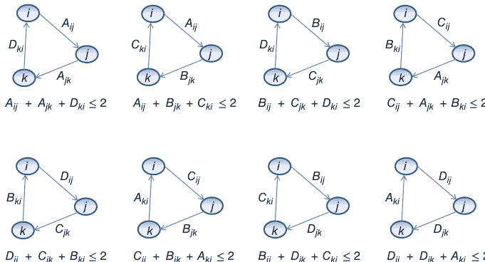

图 5.3 在 ILP 中禁止 3 环。

### 数据分析的计算方法

#### 5.3.1. 动态规划
对于大型基因组，变量数量太大，不适用于动态规划。我们使用动态规划 (DP) 通过将图分解为组件树来解决问题。该树是使用 SPQR 树构建的。对于树中的每个节点，我们局部求解 ILP。然后组合这些解以找到全局脚架方向。这种方法比直接求解 ILP 要高效得多。

# 118 用于 NGS 数据分析的 ILP 计算方法

结合两个解决方案来求解组件 B。组件 B 的 ILP 目标应通过添加项 $sol_{00} + (sol_{01} - sol_{00})$ 来更新。$S_{ij}$ 或者等价地，应该将值 $sol_{00}$ 添加到 $A_{ij}^w$ 和 $D_{ij}^w$，并将值 $sol_{01}$ 添加到 $B_{ij}^w$ 和 $C_{ij}^w$ 中。整体解决方案通过识别组件的公共节点获得。在图 5.4ab 的示例中，当 2-割的方向相反时，会出现最优解。组件 A 对应的 ILP 解决方案应整合到整体解决方案中。当骨架图也有需要处理的 3-连通分量时，可以使用 3-割进行分解。

下面给出处理 3-连通分量的 SILP2 NSDP 算法伪代码。SILP2 与 SILP1 的区别在于，在 `else` 部分，它不再像 SILP1 那样对 $S_i$ 和 $S_j$ 的四种可能组合分别求解 ILP，而是仅对组合 $S_i = 0$ & $S_j = 0$ 以及 $\bar{S}_i = 0$ & $\bar{S}_j = 1$ 求解两次 ILP。

# 处理 3-连通分量的 SILP2 NSDP 算法伪代码

```
1: STACK ← root of SPQR-tree
2: VISITED ← $\emptyset$
3: while STACK is not empty
4:   p ← STACK.pop(p)
5:   for each q of p
6:     if p not in VISITED
7:       STACK.push(p)
8:     end if
9:   end for
10: if p is root then
11:   $sol_{final}$ = SOLVE(p.skeleton())
12: else
13:   (i,j) ← getcut(p,parent(p))
14:   $sol_{00}$ = SOLVE(p.skeleton()), $S_i = 0, S_j = 0$
15:   $sol_{01}$ = SOLVE(p.skeleton()), $S_i = 0, S_j = 1$
16:   in parent(p), increase weights $A_{ij}^w$ and $D_{ij}^w$ by $sol_{00}$ and weights $B_{ij}^w, C_{ij}^w$ by $sol_{01}$.
17:   end if
18: end while
```

#### 5.3.1.6 稀疏启发式算法

遗憾的是，最大的三连通分量可能仍然会产生一个大到让 CPLEX 无法在合理时间内求解的 ILP。为了解决这个问题，对骨架图应用了稀疏启发式算法。这种情况。

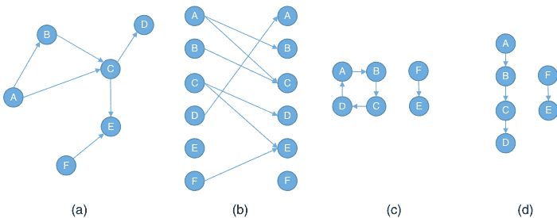

**图 5.5** (a) 从 ILP 输出中获得的成对排序。(b) 对应的二分图。(c) 二分匹配中的路径和循环集合。(d) 通过删除循环中权重最小的边得到的由路径集合表示的骨架。

这种情况可以通过对三连通分量中允许的最大 contig 数设置阈值来检测。当分量超过阈值时，产生边所需的 read 对数量增加一，并重复分解，直到没有高于阈值的分量为止。

#### 5.3.1.7 通过二分匹配进行 Contig 排序

ILP 的解并不产生骨架，而是给出 contig 的成对顺序和方向（见图 5.5a）。在寻找骨架时，我们需要删除边，使得剩余图成为路径集合。自然地，我们想要删除概率最低的边，即权重最小的边。这个问题可以通过在以下二分图 $B = (V^1 \cup V^2, E)$ 中寻找匹配来高效解决，其中 $V^1$ 中的每个顶点对应一个 contig 的 $3'$ 端，$V^2$ 中的每个顶点对应一个 contig 的 $5'$ 端，且每条边对应于 ILP 解决方案中一条连接其 $5'$ 端到其 $3'$端的边（见图 5.5b）。$B$ 中的每条边的权重与 ILP 解决方案的起点相同。显然，$B$ 中的任何匹配都对应于路径和简单循环的集合（见图 5.5c）。然后从每个循环中删除权重最小的（见图 5.5d），我们输出路径集。

### 5.3.2 ScaffMatch

下面我们描述 ScaffMatch——其问题表述和算法细节在接下来的骨架步骤中解释：

- read 对的预处理，包括每个 read 对的 read 映射、重复处理和间隙估计。

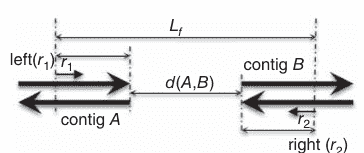

**图 5.6** 间隙估计 $d$ 按照公式计算：$d = L_f - (L_A - left(r_1)) - (L_B - right(r_2))$，其中 $L_f$ 是片段长度，$L_A, L_B$ 是 contig 的长度，$left(r_1)$ 是 read $r_1$ 的左侧映射位置，$right(r_2)$ 是 read $r_2$ 的右侧映射位置。

- 构建骨架图，顶点对应 contig 链，边对应 read 对。

- 匹配骨架查找——在骨架图中寻找最大权重路径，并对 contig 进行相应的方向和排序。

- 将跳过的 contig 插入到匹配的骨架中。

#### 5.3.2 Read 预处理

每个 contig 都有两条互补链，每对中的每个 read 都映射到其中一条链上。我们丢弃对齐的 reads。我们首先过滤掉至少一个 read 具有多个匹配的比 read 对。然后对于每个 contig 计算其 read 覆盖率，并过滤掉覆盖率大于阈值的 contig。连接同一对 contig 的多个 read 根据其间隙估计进行打包。由于我们只想保留相互一致的 reads，因此最大包之外的 reads 将被丢弃。该过程如图 5.6 所示。

构建骨架图 $G=(V,E)$ 的下一步是所谓的边打包（第 10 步）。支持相同距离、相对顺序和方向的多个边被打包成一体。

考虑两个 contig $A, B \in V(G)$，令 $E_{AB} = \{e_i\}_{i=1}^n$ 为支持 $A$ 和 $B$ 相同相对顺序和方向的边（成对 reads）集合。执行以下步骤直到 $E_{AB}$ 中不再剩余边为止：

1. 选择 $e_k \in E_{AB}$，其中位间隙估计 $L_{e_k} = L_{median}(E_{AB})$。

2. 确定 $e_i \in E_{AB}$，其间隙估计 $L_{e_i}$ 在 $3\sigma(L_{median}(E_{AB}))$ 范围内的，将它们打包成单个边 $e'$。

3. 对于打包边 $e'$，设置间隙估计及其标准差 $L_{e'} = a/b$ 和 $\sigma(e') = \sqrt{b}$，其中：

$a = \sum_{e_i \in e'} \frac{L_{e_i}}{\sigma(e_i)^2}, b = \sum_{e_i \in e'} \frac{1}{\sigma(e_i)^2},$

4. 将打包边 $e'$ 的权重设置为 $|e'|$。

5. $E_{AB} := E_{AB} \setminus e'$。


**图 5.7** Contig A、B 和 C 带有连接的 read 包以及对应的骨架图。每个 contig 被分为两个节点并用虚拟边连接。每个 read 包对应于一条连接相应链的跨组件边。

#### 5.3.2.2 骨架图


ScaffMatch 按照以下方式构建骨架图。骨架图 `$G = (V, E)$` 的每个顶点对应 contig 链之一（`SILP2` 将每个 contig 表示为四种状态之一的图节点，见图 5.2），*跨组件*边对应于连接不同 contig 链的 read 包（见图 5.7）。跨组件边的权重等于对应包的大小。此外，对于每个 contig，我们都有一个连接其两条链的虚拟边。

### 5.3.2.3 匹配骨架

理想情况下，我们期望骨架图由一组对应于不同染色体的路径组成（见图 5.8a）。遗憾的是，重复会引入连接不同染色体无关 contig 的噪声边。此外，对应染色体的路径可能会跳过短 contig（特别是长度短于插入长度的 contig）。因此，穿过骨架图 `$G$` 中虚拟边的任意路径集都对应于一个可能的骨架（见图 5.8b）。最可能的骨架将由大量的 read 对的支持。

## 122 NGS 数据分析的计算方法

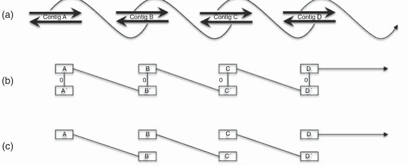

**图 5.8** (a) 一个骨架 A–B–C–D：相邻重叠（contigs）对之间的连接由读序对（read pairs）簇支持。(b) 骨架图中的一条路径 A′–A'–B′–B'–C′–C'–D′–D'，对应于骨架 A–B–C–D。(c) 对应于支持相邻 contig 的读序对簇的骨架图匹配情况。

### 5.3.2.4 骨架问题 (Scaffolding Problem)

给定一个骨架图 `$G$`，一组通过了所有虚拟边（dummy edges）的路径，且所有跨 contig 边的权重最大。通过将每个虚拟边的权重设置为一个很大的数（例如，所有读序的总数），我们将骨架问题简化为以下问题：

### 5.3.2.5 最大权重无环 2-匹配 (MWA2M) 问题

给定一个加权图 `$G = (V, E, w)$`，找到一个最大权重边子集 `$M \subseteq E$`，使得每个顶点 `$v \in V$` 与 `$M$` 中的最多两条边相连。

对于一个所有边权重均为 1 的 `$n$` 顶点图 `$G$`，其 MWA2M (17) 的权重为 `$n-1$`，当且仅当 `$G$` 有一条哈密顿路径。因此，由于包含了哈密顿路径问题，MWA2M 问题是 NP 完全的。一个著名的问题最大权重二匹配（MW2M），允许边形成环。与 MWA2M 问题不同，MW2M 问题可以高效求解 (23)。

在参考文献 17 中，提出了解决 MWA2M 问题的启发式算法。下面我们将描述这些启发式算法。

### 5.3.2.6 MWA2M 问题的最大权重匹配启发式算法

我们提议通过以下迭代启发式算法来（次）优地解决 MWA2M 问题。首先在跨 contig 边中寻找最大权重匹配 `$M$`。所有的虚拟边也形成一个匹配 `$D$`。如果这两个匹配的并集 `$MUD$` 不包含环，则该启发式算法达到了最优路径集合。否则，为每个环中权重最小的跨 contig 边分配一个负权重 `$-1$`。重复寻找中间匹配 `$M$` 和破坏 `$MUD$` 中环的步骤，直到并集 `$MUD$` 变成一组路径。该启发式算法的输出将被称为匹配骨架（Matching Scaffold）。

## 骨架算法

通常情况下，删除最小权重的边可以显著减少路径集合的总权重（在最坏情况下可达两倍）。幸运的是，在真实数据中的错误高权重跨 contig 边非常稀少。我们的实验表明，对于每个骨架示例，最大权重匹配 `$M$` 的初始 `$MUD$` 中最多只有一个环，且第二次迭代后的虚拟解 `$MUD$` 不再包含任何环。

### 5.3.2.7 WA2M 问题的贪心启发式算法

即使对于较大的基因组，最大权重匹配也可以高效计算（例如著名的花朵匹配算法 (24)），但使用贪心启发式算法可以大幅缩短运行时间。我们提供了一个选项，允许 ScaffMatch 使用贪心启发式算法运行，将运行复杂度从 `$O(n^3)$` 降低到 `$O(n \log n)$`，我们在实现中使用最大顶堆。我们的实验表明，贪心算法在实践中表现良好，但在质量上相比最大权重匹配启发式算法损失较大。

### 5.3.2.8 Contig 的排序与方向确定

匹配骨架由一组不相交的 contig 链表示。序列由 contig 链链组成。相同链的链之间通过虚拟边连接，不同链之间通过跨 contig 边连接。在遍历骨架时，链的顺序决定了方向，跨 contig 边决定了 contig 的顺序。

### 5.3.2.9 跳过 Contig 的插入

匹配骨架可以跳过长度小于插入大小（insert size）的 contig。例如，在 `$AB$` 连续的骨架中，跳过 contig 的权重小于 `$AC$` 的跨 contig 边权重。因此，在最终骨架中，`$B$` 必须跟随 `$A$` 且跳过 `$C$`。在下文中，我们描述了如何将跳过的 contig 插入匹配骨架。对于每个跳过的 contig，我们识别匹配骨架中的槽。它们的相对顺序和方向根据间隙估计决定（见图 5.9）。

### 5.3.2.10 实现

该算法作为一个名为 ScaffMatch 的独立工具实现。提供了 UNIX 脚本用于映射 contig。保留了一部分强制参数：平均插入大小、标准差和方向。程序使用 python 库进行计算。

## NGS 数据分析的计算方法

### 跳过 Contig 的插入

```
1: SLOT ← {}
2: SKIPPED ← 跳过的 contig
3: M ← {m_1, m_2, ..., m_n} ← 匹配骨架
4: G ← (V, E, w) 骨架图
5: l ← 插入大小
6: 对于所有 X ∈ SKIPPED 执行
7: 对于所有 m ∈ M 执行
8: 如果 (A', X) ∈ E 且
9: gap(A', X) ≤ l(X) 则
10: 对于 m 中的每个 C_{i+1} 执行
11: 如果 gap(A', X) + gap(X, C_{i+1}) ≤ l(X) 则
12: SLOT[e, X'] += w(A', B') + w(X)
13: 结束如果
14: 结束对于
15: 结束对于
16: 结束对于
17: 结束对于
18: 结束对于
19: 结束对于
20: SLOT[e, X'] += w(A', B')
21: 插入 X' 到
22: 结束对于
```

---

# 5.4 骨架软件评估

### 5.4.1 数据集

我们在一组数据集上比较骨架工具，包括 GAGE (27) 金黄色葡萄球菌、红单杆菌和人类（chr14，）以及额外的间间疟虫遵循 (26)。

表 5.1 给出了所有使用数据集的参数。

### 5.4.2 质量指标

用于评估架工具的主要指标是 N50 (28)。然而，正如 26 所述，该指标可能没有足够的代表性，因为对骨架进行了全面的评估。最先进的工具根据多个标准进行了比较，例如：相邻 contig 之间正确连接的数量、相对顺序错误、方向错误、间隙估计错误的数量以及它们的组合（例如错误的相对顺序 + 间隙估计）。然而，分配给骨架工具的评分尽管事实没有连接任何 contig，也可能是误导性的。因此，我们引入了基于 F 分数的指标，以比较独立骨架工具的性能。我们根据工具预测的连接与参考基因组 contig 之间真实连接的匹配程度来评估骨架。

## NGS 数据分析的计算方法

`$TPR = \frac{TP}{P}$`

`PPV = \frac{TP}{TP + FP}$`

`$F_{score} = \frac{2 \cdot TPR \cdot PPV}{TPR + PPV}$`

我们将 `TPR`（灵敏度）和 `PPV`（正预测值）进行比较。

## 5.4.3 评估与比较

我们将 ScaffoldMatch 和 `SILP2` 与成熟的支架 SSPACE、OPERA、SOPRA、MIP、SCARPA 进行比较，以及最近发表的支架 BESST (22)。几乎所有的支架都是使用默认设置并通过 Bowtie2 reader align 运行的。OPERA、SSPACE 和 BESST 则是使用 Bowtie 运行的。

为了计算 `TPR`、`PPV` 和 `F-score`，我们使用了参考文献 26 中证明的脚本。请注意，BESST 在最后三天内由于软件异常未能产生结果。

表 5.1 中所有支架化测试用例的结果列于表 5.2–5.9。在这些表格中，我们使用了以下符号：`$C$`，正确连接；`$E$`，错误连接；以及 `$S$`

# 表 5.1 支架数据集 (29, 30)

| 数据集 | 插入大小 | 相对长度 | 重组数量 (# contigs) | 序列数量 (# reads) |
|---|---|---|---|---|
| *金黄色葡萄球菌 (S. aureus)* | 3,600 | 37 | 170 | 3,394,070 |
| *嗜热产碱菌 (R. phaeirooides)* | 3,700 | 101 | 577 | 2,050,868 |
| *间疟虫 (P. falcicum)* | | | | |
| (短尺寸) | 645 | 76 | 9,318 | 52,542,302 |
| (长尺寸) | 2,705 | 75 | 9,318 | 12,010,344 |
| *人类 (H. sapiens)* (chr14) | 2,700 | 101 | 19,936 | 22,669,408 |
| (长尺寸) | 35,000 | 80 | 19,936 | 240,506,544 |

# 表 5.2 不同算法在 *金黄色葡萄球菌* 数据上的性能

| ScaffoldMatch | C | E | S | N50 | Corr | TPR | PPV | F-score |
|---|---|---|---|---|---|---|---|---|
| ScaffoldMatch | 139 | 14 | 23 | 1,476,925 | 351,546 | 0.832 | 0.908 | 0.869 |
| SSPACE | 105 | 13 | 3 | 332,784 | 261,710 | 0.629 | 0.890 | 0.737 |
| OPERA | 112 | 11 | 2 | 1,084,108 | **686,577** | 0.671 | 0.911 | 0.845 |
| SOPRA | 40 | 2 | 7 | 112,278 | 112,083 | 0.240 | 0.952 | 0.383 |
| MIP | 0 | 0 | 0 | 46,221 | 46,221 | 0 | 0 | 0 |
| SCARPA | 77 | 10 | 6 | 112,264 | 112,083 | 0.461 | 0.828 | 0.592 |
| SILP2 | 121 | 2 | 3 | 345,780 | 284,990 | 0.725 | 0.976 | 0.832 |
| BESST | 112 | 11 | 2 | **171,631** | 335,064 | 0.671 | 0.911 | 0.772 |
| SGA | 83 | 1 | 10 | 309,286 | 309,153 | 0.497 | **0.988** | 0.661 |
| SOAPdenovo | 131 | 12 | 13 | 643,384 | 621,109 | 0.784 | 0.916 | 0.845 |

# 支架化算法

# 表 5.3 不同算法在 R. sphaeros 数据集上的性能

| 支架工具 | C | E | S | N50 | Corr. N50 | TPR | PPV | F-score |
|---|---|---|---|---|---|---|---|---|
| SaffMatch | 482 | 18 | 40 | 2,547,706 | 2,528,248 | 0.845 | 0.964 | 0.901 |
| SSPACE | 357 | 7 | 49 | 109,776 | 108,110 | 0.626 | 0.981 | 0.764 |
| OPERA | 316 | 1 | 23 | 108,172 | 108,112 | 0.554 | 0.997 | 0.713 |
| SOPRA | 242 | 15 | 24 | 32,232 | 30,492 | 0.425 | 0.942 | 0.855 |
| MIP | 419 | 37 | 16 | 488,095 | 487,941 | 0.735 | 0.919 | 0.817 |
| SCARPA | 209 | 5 | 23 | 36,760 | 37,581 | 0.367 | 0.977 | 0.533 |
| SILP2 | 425 | 24 | 87 | 471,077 | 422,445 | 0.746 | 0.947 | 0.834 |
| BESST | 367 | 2 | 15 | 1,021,151 | 1,020,921 | 0.644 | 0.995 | 0.782 |
| SGA | 232 | 1 | 26 | 42,825 | 42,722 | 0.407 | 0.996 | 0.578 |
| SOAPdenovo | 468 | 8 | 26 | 2,522,483 | 2,522,482 | 0.821 | 0.983 | 0.895 |

# 表 5.4 不同算法在 P. palciparum 数据集（短）上的性能

| 支架工具 | C | E | S | N50 | Corr. N50 | TPR | PPV | F-score |
|---|---|---|---|---|---|---|---|---|
| SaffMatch | 564 | 287 | 37 | 8,626 | 5,872 | 0.607 | 0.952 | 0.741 |
| SSPACE | 5746 | 127 | 12 | 6,011 | 5,845 | 0.612 | 0.978 | 0.757 |
| OPERA | 3706 | 116 | 371 | 5,035 | 4,824 | 0.398 | 0.967 | 0.565 |
| SOPRA | 1897 | 134 | 34 | 4,954 | 4,632 | 0.526 | 0.926 | 0.681 |
| MIP | 5544 | 359 | 15 | 6,158 | 5,485 | 0.596 | 0.939 | 0.730 |
| SCARPA | 4830 | 221 | 38 | 4,912 | 4,628 | 0.519 | 0.956 | 0.673 |
| SILP2 | 5496 | 498 | 38 | 3,209 | 3,201 | 0.591 | 0.917 | 0.719 |
| BESST | 2632 | 462 | 84 | 7,471 | 7,391 | 0.283 | 0.851 | 0.425 |
| SGA | 4940 | 46 | 100 | 5,324 | 5,104 | 0.532 | 0.991 | 0.691 |
| SOAPdenovo | 5540 | 84 | 67 | 6,234 | 5,981 | 0.596 | 0.985 | 0.742 |

# 表 5.5 不同算法在 P. palciparum 数据（长）上的性能

| 支架工具 | C | E | S | N50 | Corr. N50 | TPR | PPV | F-score |
|---|---|---|---|---|---|---|---|---|
| SaffMatch | 6970 | 2660 | 171 | 41,564 | 25,380 | 0.749 | 0.964 | 0.843 |
| SSPACE | 4610 | 21 | 1235 | 17,796 | 15,553 | 0.496 | 0.995 | 0.662 |
| OPERA | 6257 | 97 | 139 | 34,667 | 40,170 | 0.673 | 0.985 | 0.799 |
| SOPRA | 7241 | 181 | 656 | 49,661 | 44,158 | 0.779 | 0.976 | **0.866** |
| MIP | 7754 | 707 | 731 | 88,297 | 78,672 | **0.834** | 0.916 | 0.873 |
| SCARPA | 4882 | 117 | 714 | 14,307 | 9,708 | 0.525 | 0.957 | 0.683 |
| SILP2 | 5996 | 266 | 2839 | 45,407 | 29,399 | 0.645 | 0.957 | 0.771 |
| BESST | 1307 | 46 | 327 | 4,133 | 2,813 | 0.141 | 0.946 | 0.245 |
| SGA | 2902 | 2 | 652 | 4,438 | 4,096 | 0.032 | **0.999** | 0.476 |
| SOAPdenovo | 7659 | 351 | 803 | **167,570** | **83,851** | 0.635 | 0.869 | 0.734 |

# 表 5.6 不同算法在合并 P. falciparum 数据集（短+长）上的性能

| 支架工具 | C | E | S | N50 | Corr | TPR | PPV | F-score |
|---|---|---|---|---|---|---|---|---|
| SaffMatch | 8223 | 425 | 654 | 78,627 | 47,662 | 0.884 | 0.951 | 0.916 |
| SSPACE | 5589 | 123 | 7 | 6,383 | 5,982 | 0.633 | 0.980 | 0.769 |
| OPERA | 6434 | 177 | 1171 | 42,450 | 38,409 | 0.692 | 0.973 | 0.809 |
| SOPRA | 7018 | 60 | 171 | 16,366 | 15,511 | 0.754 | 0.992 | 0.857 |
| MIP | 8082 | 513 | 75 | 56,672 | 37,804 | 0.869 | 0.940 | 0.903 |


| SCAR | 7336 | 370 | 251 | 36,945 | 23,951 | 0.789 | 0.952 | 0.863 |

| BESST | 3929 | 541 | 384 | 25,300 | 7,621 | 0.422 | 0.879 | 0.571 |

| SGA | 4910 | 44 | 419 | 6,606 | 6,134 | 0.528 | 0.991 | 0.689 |

| SOAPdenovo | 5977 | 228 | 254 | 12,076 | 10,629 | 0.643 | 0.963 | 0.771 |

# 表 5.7 不同算法在 H. sapiens (14 chr) 数据集（短）上的性能

| 支架工具 | C | E | S | N50 | Corr | TPR | PPV | F-score |
|---|---|---|---|---|---|---|---|---|
| SaffMatch | 12,411 | 252 | 348 | 131,135 | 80,329 | 0.622 | 0.980 | 0.761 |
| SSPACE | 9,566 | 43 | 275 | 78,552 | 77,361 | 0.487 | 0.986 | 0.652 |
| OPERA | 12,291 | 112 | 2299 | 291,214 | 207,047 | 0.616 | 0.991 | 0.770 |
| SOPRA | 14,761 | 381 | 1441 | 100,768 | 96,436 | 0.740 | 0.975 | 0.841 |
| MIP | 13,899 | 254 | 2735 | 234,064 | 235,631 | 0.947 | 0.936 | 0.779 |
| SCAR | 9,638 | 162 | 1829 | 58,330 | 55,760 | 0.498 | 0.984 | 0.661 |
| SILP2 | 10,548 | 124 | 4918 | 126,689 | 77,421 | 0.529 | 0.988 | 0.689 |
| BESST | 7,970 | 355 | 2165 | 146,749 | 80,218 | 0.400 | 0.957 | 0.564 |
| SGA | 9,761 | 6 | 3214 | 134,574 | 133,192 | 0.490 | 0.999 | 0.657 |
| SOAPdenovo | 15,490 | 370 | 2380 | 282,437 | 234,561 | 0.770 | 0.976 | 0.873 |

# 表 5.8 不同算法在 H. sapiens (14 chr) 数据（长）上的性能

| 支架工具 | C | E | S | N50 | Corr | TPR | PPV | F-score |
|---|---|---|---|---|---|---|---|---|
| SaffMatch | 5,938 | 443 | 5198 | 148,412 | 42,523 | 0.298 | 0.933 | 0.452 |
| SSPACE | 2,750 | 23 | 2539 | 78,732 | 30,449 | 0.138 | 0.992 | 0.242 |
| OPERA | 3,688 | 677 | 3226 | 74,437 | 20,667 | 0.185 | 0.845 | 0.303 |
| SOPRA | 2,938 | 266 | 1622 | 79,517 | 34,750 | 0.147 | 0.947 | 0.255 |
| MIP | 5,898 | 1,092 | 4,861 | 272,440 | 49,800 | 0.296 | 0.844 | 0.438 |
| SCAR | 1,603 | 31 | 1,446 | 43,969 | 17,786 | 0.080 | 0.981 | 0.149 |
| SILP2 | 3,899 | 65 | 3,732 | 74,094 | 38,810 | 0.196 | 0.984 | 0.326 |
| BESST | 123 | 13 | 98 | 13,815 | 8,828 | 0.006 | 0.904 | 0.012 |
| SGA | 0 | 0 | 12,211 | 12,211 | 0 | 0 |
| SOAPdenovo | 15,465 | 294 | 3,301 | 220,644 | 86,679 | 0.227 | 0.939 | 0.365 |

# 表 5.9 不同算法在 H. sapiens (chr 14) 数据（短+长）上的性能

| 支架工具 | C | E | S | N50 | Corr. N50 | TPR | PPV | F-score |
|---|---|---|---|---|---|---|---|---|
| ScaffoldMatch | 12,658 | 348 | 3,874 | 802,755 | 195,239 | 0.635 | 0.973 | 0.769 |
| SSPACE | 9,249 | 36 | 2,677 | 62,271 | 65,222 | 0.464 | 0.996 | 0.633 |
| OPERA | 6,257 | 97 | 139 | 34,667 | 40,170 | 0.673 | 0.985 | 0.799 |
| SOPRA | 7,241 | 181 | 656 | 49,661 | 44,158 | 0.779 | 0.976 | **0.866** |
| MIP | 7,754 | 707 | 731 | 88,297 | 78,672 | **0.834** | 0.916 | 0.873 |
| SCARPA | 4,882 | 117 | 714 | 14,307 | 9,708 | 0.525 | 0.957 | 0.683 |
| SILP2 | 5,996 | 266 | 2,839 | 45,407 | 29,399 | 0.645 | 0.957 | 0.771 |
| BESST | 1,307 | 46 | 327 | 4,133 | 2,813 | 0.141 | 0.946 | 0.245 |
| SGA | 2,902 | 2 | 652 | 4,438 | 4,096 | 0.032 | **0.999** | 0.476 |
| SOAPdenovo | 7,659 | 351 | 803 | **167,570** | **83,851** | 0.635 | 0.869 | 0.734

contigs。连接中的实体在相应指标方面都是所有支架中的顶尖。ScaffoldMatch 在 N50 和 F-score 的前两个测试用例中表现最佳。它还拥有 F. falciparum 的 N50 以及 H. sapiens 的最佳 F 值。MIP 在剩余数据集中拥有 N50，而 SSPACE 和 SOPRA 分别在剩余的一个数据集拥有 F-score。

# 参考文献

+ 1. Zerbino DR, Binney E, Velvet: 使用 de Bruijn 图进行从头排序的算法。Genome Res 2018;18(5):821–829.

# 130 NGS数据分析的计算方法

8. Warren RL, Sutton GG, Jones SJ, Holt RA. 使用 SSAKE组装短 DNA 序列。Bioinformatics 2007:23(4):500–501.

9. Dayarian A, Michael T, Sengupta A. SOPRA: 通过统计优化对对读段进行骨架构建。BMC Bioinformatics 2010;11(1):345-.

10. Dixon H, Reinhardt K, Myers EW. 用于 contig 骨架构建的贪婪路径合并算法。J ACM 2002;49(5):603–65.

11. Hopcroft JE, Tarjan RE. 将图分为连通分量。SIAM Comput 1973;2(3):135–158.

12. Di Battista G, Tamassia R. 保证与编程。Berlin: Springer-Verlag; 1990. p. 590–611.

13. Chimani W, Guttinger C, Jung M, Klau GW, Klein M, Putri. 开源图框架 (OGDF)。In: Tamassia R. 图形绘制与可视化手册。CRC Press; 2011, p. 543–569.

14. Lindsay J, Saoloi C, Mändoufal A. 使用整数线性规划进行扩展性骨架构建。ACM生物信息学、计算生物学和生物信息学会议论文，BCB 12。New York: ACM; 2012, p. 377–383.

15. CPLEX II, V. 1: CPLEX 用户手册。In Bus March Corporation 2009;46(53):157.

16. Shchberina O. 离散优化中的非序列动态骨架构建和树分解。In: Waldmann K-H, Stocker UM, editors. 运筹学进展2006。Berlin Heidelberg: Springer-Verlag; 2006. p. 155–160.

17. Mandric I. 使用 Bowtie 2 对短测序读段比对。Nat Proc Bioinformatics 2010; Chapter 11:11-7–11-7-14.

19. Li H, Durbin R. 使用 Burrows-Wheeler 变换快速准确的短比对。Bioinformatics 2009;25(14):175–176.

20. Salin K, Street N, Lundeberg J, Arvest L. 改进骨架算法的间隙大小估计。Bioinformatics 2012;28(17):2215–2222.

21. Salin K, Vezzi F, Nystedt B, Lundeberg J, Arvest L. BESST-大型碎片组装的高效骨架构建。BMC Bioinformatics 2014;15:2481.

22. Pulleyblank W. B-匹配问题中的双重完整性。Heidelberg: Springer-Verlag; 1980.

23. Edmonds J. 树、树与花。In Jan Math 1965;17(3):449–467.

24. Hagberg A, Schult D, Swart P. 网络: 用于网络分析的 Python 。技术报告，数学建模与分析。洛斯阿拉莫国立实验室；2005。访问地址：http://network.lanl.gov。

25. Hunt M, Newbold C, Brimmer M, Otto TD. 组装骨架工具的全面评估。Genome Biol 2014;15(3):R42.

# 骨架构建算法

- 27. Salzberg SL, Phillippy AM, Zimin A, Puiu D, Magoc T, Koren S, Treangen TJ, Schatz MC, Delcher AL, Roberts M. 组装骨架工具的评估。Genome Res 2012;22(3):557–567。
- 28. Vezzi F. 特征评估。PLoS ONE 2012;7:e310
- 29. Simpson JT, Durbin B. 压缩数据的重复序列组装。Genome Res 2012;22(3):549。
- 30. Luo R, Xie Y, Huang W, Yuan J, Chen Y. 基因组组装。GigaScience 2012;1:18。

# 变异检测与基因型确定

## 基因变异检测与基因型确定

### 6.1 引言

高通量测序（HTS）技术的发展和普及在测序和基因型确定方面取得了重大突破，从孤立基因测序和少数预定义标记的基因型确定到几乎全基因组测序和数百万 SNP 的全面基因型确定。由于基因组学研究发现，DNA 分子由腺嘌呤（A）、胞嘧啶（C）、鸟嘌呤（G）和胸腺啶（T）组成。基因变异中最常见的类型是单核苷酸多态性（SNP），正如其名称所示，两个序列之间仅在一个碱基对上的差异。SNP 在进化中非常重要，由于它们在基因组中广泛分布，且可以通过实验室技术进行基因型确定，并已证明它们可能是导致某些疾病的因素。此外，通过全基因组关联分析（GWAS）进行表型与状的关联是可行的。由于连锁不平衡（LD），这些 SNP 变异在表型关联中是正常的。因此，完全理解基因组变异需要识别其他类型的变异。这些变异类型包括插入和缺失（indels）、拷贝数变异（CNVs）、倒位和易位。图 6.1 显示了两个染色体之间的变异示意图。

indels 可定义为仅存在于样本中的 DNA 序列。插入或缺失的确定取决于选择特定的序列作为参考。indels 在基因组中也分布良好，但频率不如 SNP。大型 indels 可能会跨越整个基因，因此可能导致显著的表型变异。小型 indels 可能是中性的，除非跨越了调控或编码区域。CNVs 是（通常是）重复 DNA 序列，位于

img/46aec008551cecb3bf3aac2ee69b926_152_0.png

图 6.1 样本间的变异类型。结构变异包括 indels、拷贝数变异（CNVs）、倒位和易位。(a) 单核苷酸多态性（SNP）和 (b) 重复序列的示例显示在放大区域，在这些区域中序列的拷贝在样本之间发生变化。CNV 的拷贝有时呈相邻排列，但也可以散布在基因组中。最近的一些研究揭示了 CNV 对人类遗传学（10）和医学研究（3, 11）的重要性。重复 DNA 序列较小且以相邻方式重复的情况通常被称为 CNV 或重复序列。重复序列在生物技术历史中非常重要，因为它们相对于 SNP 具有高度多态性，可以使用实验室技术进行基因型确定，并且已经证明它们可能导致主要疾病（13）。最后，根据名称索引，倒位和易位分别是区域。与 indels 情况类似，确定变异 DNA 链的正确位置需要将特定的序列作为参考。注意，翻译意味着两个 indels，而 CNV 通常意味着多次事件。

# 134 NGS数据分析的计算方法

### 6.2 SNP 和小型 indels 的检测与基因型确定方法

#### 6.2.1 问题描述

一旦读段比对到参考基因组并对比对按照参考坐标进行排序，将遍历参考基因组的碱基位点，以观察支持不同参考等位基因的碱基调用。

分析。在没有测序错误的情况下，这些位点的每个基因型将是这些位置碱基调用支持的不同等位基因集合。然而，每种测序技术都会产生一定比例的错误碱基调用，如果使用这种简单的方法，可能会产生虚假的基因型。识别和对 SNP 进行基因型的主要挑战是将碱基调用与支持不同于基因组真实真实的调用区分开来。

对于每个基因组位置，该问题可以的形式化如下：给定一个跨越基因组位置 $i$ 的大小为 $d$ 的集合 $R_i$，对于 $r \in R_i$，令 $r(i)$ 为比对基因组位置 $i$ 的碱基调用，令 $p_{r(i)}$ 为测序 $r(i)$ 的错误概率。$d$ 的值通常称为覆盖深度、读取深度 (RD) 或简称为覆盖度。在没有等位基因的情况下，令 $A = \{A', C', G', T'\}$ 为四种可能的等位基因的集合。等位基因 $a \in A$ 的覆盖度可以计算为 $d_a = |\{r \in R_i : r(i) = a\}|$。假设测序样本来自二倍体个体，通过有放回选择四种核苷酸中的两种，可以产生10种可能的基因型。那么问题是寻找最可能的基因型 $G_i = H_iH'_i$，其中 $H_i$ 和 $H'_i$ 属于 $A$。

## 6.2.2 贝斯模型

寻找 SNP 的简单算法忽略了碱基错误概率，并对等位基因覆盖度 $d_a$ 设置最小阈值（固定数值或总覆盖度 $d$ 的固定百分比）。考虑错误概率包含信息的最广泛使用的策略基于贝叶斯定理，该问题可以写为：

> $P(G_i|R_i) = \frac{P(R_i|G_i)P(G_i)}{P(R_i)}$

SNP 检测的贝斯算法之间的主要区别在于条件概率计算方法 (18)。在这里，我们将描述文献 19 中引入的一种简单且准确的模型。假设读取（reads）之间是独立的，$G_i$ 的条件概率可以表示为读取贡献的乘积如下：

> $P(R_i|G_i) = \prod_{r\in R_i} P(r(i)|G_i)$

对于比对过的读取 $r \in R_i$，令 $r(i)$ 为跨越位点 $i$，$p_{r(i)}$ 为测序碱基 $r(i)$ 的错误概率，我们从初步分析计算的质量评分 $q_{r(i)}$ 中估计该值 $p_{r(i)} = 10^{-q_{r(i)}/10}$ (20)。令 $H_i$ 和 $H'_i$ 为位点 $i$ 中的两个等位基因，或者说令 $G_i = H_iH'_i$。观察到的碱基 $r(i)$ 可能来自 $H_i$ 或 $H'_i$。如果该读取中存在错误，我们假设该错误可以产生任何其他可能的碱基且观测概率相同，即在真实碱基不同的情况下观测到碱基 $r(i)$ 的概率为 $p_{r(i)}/3$，而在无错误情况下观测到 $r(i)$ 的概率为 $1-p_{r(i)}$。

# 基因组变异检测与基因型分型

假设观察到的等位基因 $r(i)$ 等于 $H_i$ ($H'_i$)，则杂合基因型 $G_i = H_iH'_i \neq H_i'$ 可能由于两种可能事件引起：来自单倍体 $H$ ($H'$) 无错误，或者 $r(i)$ 是从单倍体 $H'$ ($H$) 采样的，但一个错误恰好等于 $H_i$。

## 140 NGS 数据分析的计算方法


模型 (28) 假设位点、误差和样本之间是独立的。它还假设变异是双等位基因的，这在真核细胞群体的大多数 SNP 中都是如此。在这种情况下，基因型被编码为表示基因型参考等位基因数量的整数。对于二倍体个体，纯合参考基因型编码为 $g=2$，杂合非参考基因型编码为 $g=0$。给定具有倍性 $m_1, m_2, \dots, m_n$ 的 $n$ 个个体的测序数据，令 $\bar{G}=\langle G_1, G_2, \dots, G_n\rangle$ 为这 $n$ 个个体的基因型向量。那么，随机变量 $K=\sum_{i=1}^n G_i$ 是群体中存在的参考等位基因的数量。假设群体平衡（HWE），在参考等位基因数量固定的情况下，基因型配置的概率为

$$P(\bar{G}|K=k)=e\left(k, \sum_{i=1}^n G_i\right)\prod_{i=1}^n \left(\frac{m_i}{G_i}\right)^{G_i}$$

其中 $e$ 是指示函数，当两个参数相等时取值为 1，否则为 0。在 $K=k$ 条件下，数据 $\tilde{d}=\langle d_1, d_2, \dots, d_n\rangle$ 的条件概率为

$$P(\tilde{d}|K=k)=\frac{1}{\binom{M}{k}}\sum_{g_1=0}^{m_1}\dots\sum_{g_n=0}^{m_n} e\left(k, \sum_{i=1}^n g_i\right)\prod_{i=1}^n \left(\frac{m_i}{g_i}\right)^{g_i} P(d_i|g_i)$$

可以通过动态规划定义以下求和来对该似然进行高效计算：

$$z_{jl}=\sum_{g_1=0}^{m_1}\dots\sum_{g_j=0}^{m_j} e\left(l, \sum_{i=1}^j g_i\right)\prod_{i=1}^j \left(\frac{m_i}{g_i}\right)^{g_i} P(d_i|g_i)$$

对于 $0 \le l \le \sum_{i=1}^j m_i$ ($l > m_j$ 时 $z_{j'l}=0$)。从 $z_{00}=1$ 开始，部分和以及 $P(\tilde{d}|K=k)$ 的最终值计算如下：

$$z_{jl}=\sum_{g_j=0}^{m_j} z_{j-1,l-g_j} P(d_j|g_j)\binom{m_j}{g_j}$$

$$P(\tilde{d}|K=k)=\frac{z_{n,k}}{\binom{M}{k}}$$

后验概率 $P(K=k|\tilde{d})$ 可以使用贝叶斯规则计算：

$$P(K=k|\tilde{d})=\frac{P(K=k)P(\tilde{d}|K=k)}{\sum_{l=1}^k P(K=l)P(\tilde{d}|K=l)}$$

## 基因组变异检测与基因型分析

拥有非参考等位基因的概率为 $1 - P(K=M|\vec{d})$，其中 $M = \sum_{i=1}^L m_i$。参考文献 28 描述了两种基于不同位点数据估计分布的 $K$ 先验分布的替代方法。第一种是期望最大化（EM）算法，其迭代方程如下：

$$P(K=k)^{(t+1)} = \frac{1}{L} \sum_{l=1}^L P(K_l=k|P(K=M)^f)$$

第二种算法基于跨位点似然值 $P(\vec{d}|K=k)$ 的估计值计算直方图。

### 6.3 CNV 的检测与分型

CNV 的发现方法通常根据输入信息的类型分为两类策略。基于读取深度（RD）的方法通过将基因组划分为不重叠的箱（bins）并计算每个箱内的读取数开始。假设在文库制备过程中片段抽样不存在偏差，每个箱的读取深度遵循以整个基因组平均读取深度为中心的正态分布。当观察到一组总读取深度显著于平均值的连续箱时，则称为样本内 CNV。两个样本之间的 CNV 也可以被发现为连续箱，其中每个样本产生的读取数归一化后的差异显著于零。

另一方面，双端（RP）算法利用属于同一片段但比对到不同染色体、异常方向或长度的读取对。由于此类事件是由 PCR 伪影或意外的读取比对引起的，RP 算法对支持相同事件的读取进行聚类，并根据其支持簇的大小计算每个预测事件存在的概率。与 RD 方法相比，RP 算法还能识别更多类型的基因组变异（例如插入、倒位和易位）。然而，它们无法检测大多数事件，除了某些串联。已证明 RD 和 RP 方法在识别结构变异方面是互补的（29）。由于下一章将详细介绍 RP 方法，本章剩余部分将详细讨论两种最有效的 RD 方法，分别是样本内和样本间。

#### 6.3.1 样本内 CNV 的均值偏移方法

第一种名为 `CNVator` 的算法使用均值偏移（mean-shift）来识别拷贝数变异区域产生的平均读取深度离散变化（30）。

算法的第一步是修正 GC 含量偏差。给定箱 $i$，其 GC 含量定义为箱内 G 或 C 碱基对的数量除以箱长度，乘以 100 并四舍五入为整数。对于每个 GC 含量 $gc \in \{0 \dots 100\}$，在具有相同 GC 的箱上计算平均读取深度 $RD_{gc}$。

（注：第 160 页包含大量重复的 OCR 错误，已提取唯一的技术句子。）

## NGS 数据分析的计算方法

它们在拷贝数上有所不同。已开发出不同的算法用于在这种特定设定下寻找拷贝数变异（CNVs）。例如，我们将在本节解释一种名为 `CNV-seq` 的算法，该算法由 Xie 和 Tammi (31) 开发。

`CNV-Seq` 同样将基因组划分为长度为 $l_w$ 的不重叠窗口。窗口内的 reads 深度可以用泊松分布来近似，其参数为 $\lambda = n_x/l_w$ $，其中 $n_x$ 是 reads 的总数，$l_w$ 是去重复基因组的长度。给定两个样本 $x$ 和 $y$，其测序得到的 reads 总数分别为 $n_x$ 和 $n_y$，以及一个任意窗口 $w$，令 $N_x$ 和 $N_y$ 为落入 $w$ 的 reads 数量随机变量。原始深度比例 $R$ 和归一化深度比例 $R'$ 标记如下：

```
$R = \frac{N_x}{N_y}$
nR' = R \frac{n_y}{n_x}$
```

$N_x$ 和 $N_y$ 均为泊松分布，如果每个窗口的平均 reads 数大于 10，则可以近似为高斯分布，从而使得 $Z$ 可以近似为两个高斯分布的比率。假设 $N_x$ 和 $N_y$ 是独立的，并使用 Gear–Hinkley 变换，由下定义的变量 $Z$

```
$Z = \frac{\mu_x R - \mu_x}{\sqrt{\mu_x R^2 + \mu_x}}$
```

将具有标准正态分布。对于具有归一化 reads 深度比例 $r'$ 的特定窗口两个样本拷贝数无差异假设的 $p$ 值为：

```
$p = \begin{cases} 2(1 - \Phi(Z)) & : r' \ge 1 \\ 2\Phi(Z) & : r' < 1 \end{cases}$
```

其中 $\Phi(Z)$ 是标准正态累积分布。

## 6.4 系统整合

在实践中，科学家在分析高量测序（HTS）数据时面临的最大困难之一是，用于发现变异和基因型的不同算法被实现在不同的软件中，这些软件在编程语言、输入输出格式甚至代码质量上都存在巨大的异质性。此外，大多数软件包仅提供命令行界面，这使得没有计算机科学训练的人员进行分析更加困难。在本章结束时，我们将提到两种现有的替代方案，允许研究人员在集成环境中运行不同的算法。

## 基因组变异检测与基因型鉴定

生物信息学软件最为人知的整合平台是 Galaxy Web 门户 (32)。`Galaxy` 允许配置不同的异构工具、构建流水线，并在用户友好的 Web 界面中运行所有内容。`Galaxy` 的主要优势是可以灵活修改流水线，包括随时添加或替换软件工具。`Galaxy` 还允许在远程基因区域的合作者之间共享数据和流水线。这种方法的主要缺点是它需要具备网络服务器管理技能的人安装 `Galaxy` 的本地实例，并配置包含在流水线中的工具。

针对该问题的一种可用替代方案是 `NGSEP`（下一代测序 Eclipse 插件）(24)。`NGSEP` 是一个使用 Eclipse 框架开发的桌面应用程序，能够对 SNP、插入缺失（小和小片段）和 CNV 进行集成检测和基因型鉴定，结合了本章解释的某些算法。`NGSEP` 的主要优势之一是将其实现产生的算法紧密集成到单一框架中。这允许用户在单个 `VCF` 文件中获取变异性、拷贝数和功能信息，而无需任何自定义脚本编写或编程工作。由于 `NGSEP` 可以像普通桌面应用程序一样安装和维护，因此操作它不需要专门的技术技能。此外，硬件速度和海量数据存储能力的当前进展，使得用户现在可以使用普通桌面计算机提供的计算资源分析相对大量的测序数据。与 Web 门户相比，`NGSEP` 的主要局限性是，`NGSEP` 的所有新功能都可以从命令行界面调用，并且还可以集成到 `Galaxy` 中，允许熟悉该门户的用户将 `NGSEP` 包含在他们的流水线中。为 HTS 数据开发准确、高效且用户友好的生物信息学解决方案，与开发测序技术本身一样重要，这可以让不同领域的更广泛研究人员能够将测序作为其研究项目的基础组件。

## 参考文献

- 1. The 1000 Genomes Project Consortium. An integrated map of genetic variation from 1,092 human genomes. Nature 2012;491(7422):56–65.

- 2. Xu X et. Resequencing 50 accesses of cultivated and wild rice markers for identifying important genes. Nat Biotechnol 2012;30(1):105–111.

- 3. Zhang J et al. Whole-genome sequencing identifies genetic alterations in pediatric low-grade gliomas. Nat Gen 2013;45(6):602–612.

- 4. Huang X et. Genome-wide association studies of 14 agronomic traits in rice. Nat Gen 2010;42:961–997.

- 5. Hubmann G. Quantitative analysis of yeast biodiversity yields novel tools for metabolic engineering. Met Eng 2013;4:17.

- 6. Bentley DR et. Accurate human genome sequencing using reversible chemistry. Nature 2008;456(7218):53–59.

- 7. McNally KL et. SNP variation between landraces and modern varieties of rice. Proc Nat Acad Sci U 2009;106(30):1297–1303.

- 8. Dalca C, Aggarwal R. A statistical method for the detection of variants from next-generation sequencing of DNA pools. Bioinformatics 2012;28:2839.

- 9. DePristo MA. A framework for variation discovery and genotyping using next-generation DNA sequencing. Nature Gen 2011;43(5):491–498.

- 10. Abceov A. Somatic mosaicism in human induced by pluripotent cells. Nature 2012;491(7422):56–65.

- 11. Li H et al. Fast gapped-read alignment with Bowrows-Wheeler transform. Genomics 2014;13(10):1217–1233.

- 12. Liu B, Morrison CS, Leroy J, Wang J. An integrated framework for discovery and genotyping of genomic variants from high-throughput sequencing. Oncot 2013;4(4):388–481.

- 13. Gemayel R, Verstrepen A, Legendre M. Amplification-free Illumina sequencing-library preparation improved mapping and assembly of (G + C)-biased genes. Nat Methods 2009;6(4):291–295.

- 14. Bansal V. A statistical method for the detection of variants from next-generation sequencing of DNA pools. Bioinformatics (Oxford, England) 2010;26(12):i318–i324.

- 15. Kawahara Y et al. Integration of the Oryza sativa reference genome using next generation sequencing and optical map. Rice 2013;6(1):4.

- 16. Wang M et. The genome sequencing of African rice (Oryza glaberr) and evidence for independent domestication. Nat Gen 2014;46(7):707–713.

- 17. Langmead B, Salzberg SL. Fast gapped-read alignment with Bowtie 2. Nat Methods 2009;6(5):353–359.

- 18. Dutima J, Sitrivasa PK, Mando II. Accurate detection and genotyping of expressed variants from whole transcriptome sequencing. Bioinformatics Bioinfo 2010;11(1):3–14.

- 19. Kozarewe I et al. Variable tandem repeat. Annual Rev Gen 2013;4:17.

- 20. Ewing B, Green P. Base-calling of automated sequencer traces using phred II. Error probabilities. Genomics Res 1998;8(3):186–194.

- 21. McKenna A et al. The genome analysis toolkit: a MapReduce framework for next-generation DNA sequencing. Genome Res 2020;20(9):1297–1303.

- 28. Li H. A statistical framework for SNP calling, mutation discovery, association mapping and population genet parameter estimation from sequencing data. Bioinformatics (Oxford, England) 2011;27(21):2987-2993.

- 29. Mills RE et al. Mapping copy number variation by population-scale genome sequencing. Nature 2011;470(7332):59-65.

- 30. Abyzov A, Urban AE, Snyder M, Gerstein M. CNVator: an approach to discover, genotype, and characterize typical and atypical CNVs from family and population genome sequencing. Genome Res 2011;21(6):974-984.

- 31. Xie C, Tammi MT. CNV-seq, a new method to detect copy number variation using high-throughput sequencing. BMC Bioinformatics 2009;10:80.

- 32. Goecks J, Nekrutenko A, Taylor J. Galaxy: a comprehensive approach for supporting accessible, reproducible, and transparent computational research in the life sciences. Genome Biol 2010;11(8):R86.

## 7

## 发现与基因型分析“暮光地带”缺失

TOBIAS MARSCHALL AND ALEXANDER SCHÖNHUTH

*荷兰阿姆斯特丹，Centrum Wiskunde & Informatica*

### 7.1 引言


尽管二代测序（`NGS`）实验已成为标准，但对数据的探索仍然面临挑战。`NGS` 实验通常旨在提供遗传变异目录，用于后续感兴趣的分析。在群体研究中，例如“荷兰基因组”或“1000 人类基因组”等倡议（1, 2），此类目录能够反映群体遗传多样性的全貌。在癌症基因组研究中（全球倡议请参见参考文献 3），需要寻求体变异的全面列表，以帮助理解癌症（亚）类型和疾病进展，并选择合适的治疗方案。

在本章中，我们关注用于二代测序研究的技术，这些技术可以展示*供体基因组*（待研究基因组）与参考基因组之间的差异。重测序研究的通用工作流按以下步骤进行：

- (1) 将目标基因组的 DNA 断裂成片段。
- (2) 对片段进行二代测序，产生*reads*（reads）。一种非常流行且有用的技术是生成*双端序列*（paired-end reads），其片段的两端都与一个内部部分（即*内部段*）一起测序，而该内部段未测序。

二代测序数据分析计算方法，第一版。

Ion I. Mandoiu 和 Alexander Zelikovovsky 编。

© 2016 John Wiley & Sons, Inc. 2016 年由 John Wiley & Sons, Inc 出版。

辅助网站：www.wiley.com/go/Mandoiu/NextGenerationSequencing

# NGS 数据分析的计算方法

(3) 将 reads 比对到参考基因组，其序列是完全已知的。比对需要读取比齐器（read aligners），即允许 reads 与参考序列对齐的算法。

- (4) 尝试从比对的 reads 中推断研究基因组与参考基因组之间的差异，即影响目标基因组的遗传变异。

关于将双端 reads 比对到参考基因组后可能产生的场景的示意图，请参见图 7.1、7.2 和 7.4。

对遗传变异类别（如单核苷酸多态性 SNPs 和小片段插入和缺失 indels）的计算探索已成为标准。例如，请参考 GATK (4) 的最佳实践工作流。然而，处理其他类别的变异（如许多、倒位或较简单变异的嵌套组合）通常是非标准的，或者需要先进的计算技术。关于结构变异发现的综述，请参见参考文献 5, 6。

尽管总体上很困难且仍然缺乏最佳实践工作流，但某些类结构变异的分析已变得常规化。一个主要的例子是

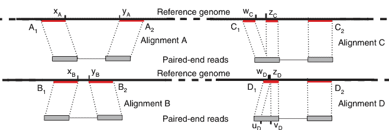

**图 7.1** (A) 间距长度指示缺失的比对，(B) 间距长度指示插入的比对，(C) 分裂（在左端）指示缺失的比对，(D) 分裂（在右端）指示插入的比对。

参考基因组：

CCCAGCACTTTGGAGGCCAGGTGGGGGGAGGAATTAGCTTAAGCCAGGAGT

GGAGCTTTTGGG I(A)

供体基因组：

CCCAGACTTTGGAGGCCCAAAAAAATTAGCTTAAGCCAGGAGT

GGAGCTTTTGGG I(R) TTAAGCCCGAG

**图 7.2** 基于基因组大小的缺失内部证据：“GTGGGGGGAGG”存在于参考序列中，但在供体基因组中缺失。测序片段（绿色）的长度 $I(R)$ 在文库准备过程中确定。当比对回参考基因组时，由于缺失，内部段 $I(A)$ 比 $I(R)$ 长。

## 发现与基因型分析“暮光地带”缺失

对于超过 200 碱基对（bp）的缺失的发现，已经采用了多种方法处理：例如 BreakDancer (7)、VariationHunter (8)、MATECLEVER (9, 10)、DELLY (11)、GASV-Pro (12, 13)，这些也是相关文献中的参考文献。

### 7.1.1 暮光缺失

在本章中，我们关注由于长度原因难以发现的缺失。如前所述，短缺失以及长缺失不再是主要困难，甚至已成为最佳实践工作流的一部分。中等缺失（我们称之为“NGS 暮光缺失”）在 2009 年后变成了巨大的计算挑战。最近的进展使得它们的发现成为可能。这一证据是，来自群体规模项目（9, 10）的缺失目录包含了大量的暮光缺失，且具有极好的验证率。这与相关项目（特别是 1000 基因组计划）形成了鲜明对比。

本章的组织如下：

- 第 7.2 节提供必要的符号。
- 第 7.3 节给出“暮光地带”缺失的正式定义。简要回顾重测序研究中发现缺失的不同方法，并概述发现中等缺失时遇到的陷阱。
- 第 7.5 节我们提出了一种新的极大似然法，用于基因型分析，该方法在暮光地带 indel 上取得了良好的性能。
- 第 7.6 节我们评估了针对 NGS reads 的最先进工具选择，这些工具包含稀有变异（16），通过 Illumina HiSeq 和 MiSeq 技术模拟。
- 第 7.7 节我们讨论了所有结果并指出尚未解决的挑战。

## 7.2 符号

我们主要关注重测序研究中最广泛使用的双端序列。令 `Σ = {A, C, G, T}` 为碱基酸集合。双端序列由两个序列 `r_1` 和 `r_2` 组成，已知它们在参考基因组上的距离为 `L`。当 `r_1` 和 `r_2` 比对到参考基因组的位置 `x_1` 和 `x_2` 时，它们之间的距离为 `|x_1 - x_2|`。预期距离为 `L`，但由于文库准备的性质，观测到的距离 `|x_1 - x_2|` 会围绕 `L` 变化。`r_1` 和 `r_2` 之间未测序的基因组片段被称为内部段，其长度为 `I(A)`。如果 `x_1 < x_2`，且 `r_1` 从 `x_1` 开始且长度为 `length(r_1)`，则内部段跨越从 `x_1 + length(r_1)` 到 `x_2` 的区域。如果 `x_2 < x_1`，则其长度为 `I(A) = x_1 - (x_2 + length(r_2))`。

### 7.2.1 比对

比对 `A=(A_1,A_2)` 可以被比对，其中间隙表示插入或缺失。为了简单起见，我们假设每个比对最多显示一个间隙。用 `u_g` 表示间隙之前的参考位置，用 `z_g` 表示紧随间隙的参考位置。相应，我们将 reads 中间隙之前的位置称为 `u_A`，间隙之后的位置称为 `v_A`；因此，参考序列 `𝒢[u_g]` 比对 `R[u_A]`，而 `𝒢[z_g]` 比对 `R[v_A]`。取决于 `z_g = u_A+1`（参见 7.1 中的比对 D）还是 `u_g = v_A+1`（参见比对 C），间隙表示供体基因组中的插入（插入序列为 `R[u_A+1, v_A-1]`）或供体基因组中的缺失（缺失序列为 `𝒢[u_A+1, z_g-1]`）。

### 7.2.3 缺失

令 `D_L` 和 `D_R` 为缺失 `D` 的左边界和右边界的参考坐标。也就是说，从位置 `D_L`（包括）到所有位置 `D_R`（包括）的碱基共同构成了序列 `𝒢[D_L, D_R]` 在供体基因组中缺失。我们定义 `C(D) := (D_L+D_R)/2` 为 `D` 的中心（不需要是整数），并定义 `L(D) := D_R-D_L+1` 为缺失的长度。我们通过其中心 `C(D)` 和长度 `L(D)` 对缺失 `D=(C(D), L(D))` 进行参数化。

## 7.3 非暮光基因缺失

### 7.3 从 NGS reads 数据中发现缺失的方法分为四类：基于片段大小的、基于分裂读取的、基于覆盖度的以及基于组装的方法（详情请参见参考文献 5）。

# 发现与基因型鉴定“暮光带”缺失

（综述）。我们仅关注前两类方法及其混合方法。基于覆盖的方法只能发现长度通常至少为 1000 bp 的缺失。基于组装的方法面临着尚未被完全克服的挑战。再次注意，长度短至 20 bp 的短缺失在初始映射比对阶段就可以被发现，而虽然基于内部片段大小的方法对于长度大于约 150 bp 的缺失效果良好，但拆分读比对器（split-read aligners）能够发现长于 20 bp 的缺失，并在 30-40 bp 处达到极限。超过 40 bp 后，拆分读比对器的缺失的召回率通常会大幅下降。

## 7.3.1 基于内部片段大小的方法

基于内部片段大小的方法的基本原理是：比对长度 `I(A)` 偏离了 `I(R)`（分配给 `A` 的读段内部片段长度）。也就是说，对于 `R` 内部片段中的缺失 `D`，有 `I(A) = I(R) + L(D)`，插图见图 7.2。虽然 `I(A)` 是已知的，但 `I(R)` 并未知。因此，使用稳健估计器 (18, 19) 从唯一可比对片段估计 `I(R)` 经验分布的均值和标准差。对于现代 DNA 测序方案，片段长度分布近似于低标准差的高斯分布。我们在此已经指出，良好的（高斯）分布对于发现中等大小的缺失至关重要。

此类分布见图 7.3，来源于 GoNL 项目中一个个体的 NGS 读 (1)，所有序列均由华大基因于2010年测序。

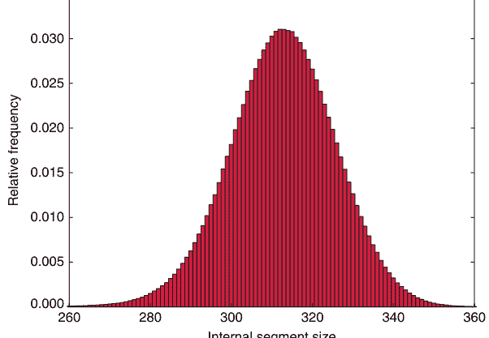

**图 7.3** GoNL 个体的内部片段大小分布。

## NGS 数据分析的计算方法

在确定内部片段大小分布后，广泛使用了以下发现 NGS 数据缺失的通用流程：

- 1. 收集所有比对间隔长度在统计学上偏离的读，即不一致读（discordant reads）。
- 2. 将此类所有读聚类为支持缺失的组。
- 3. 从生成的不一致读组中进行预测。

大多数方法都遵循这一流程（例如参考文献 7, 8, 12, 13, 20, 21）。它们可以通过对不一致读的定义、聚类/分组技术以及从不一致读组中导出预测的细节来区分。注意，处理映射到重复序列中变为突变映射的读通常起着主要作用 (22)，例如参见参考文献 8 中的一种基于组合原理的方法。

关键因素是不一致读的定义，因为它们应该代表其内部片段受缺失序列影响的片段。再次，其核心思想是不一致读的比对间隔长度 `l(R)` 显著偏离了 `l(R)` 的分布。因此，不一致读的定义取决于 `l(R)` 分布的标准差，在目前的方案中，该值约为 15。需要该标准差的六倍才能获得足够低的发现率。这意味着短于 100 bp 的缺失仍然无法被发现。

## 7.3.2 拆分读映射方法

## 拆分读映射方法旨在直接利用比对信息。按照通常流程，拆分读比对器仅处理标准读比对无法正确比对的读。这通常由于影响读段的插入和缺失引起。标准读比对器通常在正确比对此类读段时会遇到困难，因为放置较大的空隙在计算上可能（太）昂贵。

因此，通过长度比对读段引入了扩展技术：“拆分读比对（split-read alignments）”。许多拆分读比对器通用的通用流程如下：

- 1. 收集所有一端未比对或另一端仅部分比对（软剪裁 soft-clipped）的读。
- 2. 对于完全未比的读，将端拆分成部分或“种子”（seeds），并尝试比对这些部分或“种子”（见图 7.4）。
- 3. 对于此类已比对或软剪裁的读，尝试在“附近”比对剩余部分。
- 4. 对于每个读段，收集所有可能的部分比对，并使用带状比对（banded alignment）技术将它们连接。输出最可能的此类比对作为读段的比对。

# 发现与基因型鉴定“暮光带”缺失

CCCAGCACTTTAGAGGTGGGGAGGAATTCTAAGCCAGT TTTTG GGGGGCCCAGGAGT

**图 7.4** 缺失的拆分读证据。

迄为止，常见的拆分读比对器可以成功比对长达 40–50 bp 的不可忽略缺失。虽然比对更大的缺失是不可能的，但拆分读比对器的发现率随缺失大小的增加而显著下降。因此，当达到 30 bp 标记时，发现率下降到 60–70%，这使得如果遵循上述流程，无法发现足够数量的“暮光带”缺失。拆分读比对器的瓶颈是上述流程中的步骤 2 和 3。未比对的读部分可能很小，这会极大增加可以比对的位置。基因组通常高度重复的这一事实会加剧这些困难——解决映射歧义是另一个涉及的步骤。

因此，必须限制搜索读部分的区域。由于这些限制，尽管大幅提高了标准比对器的极限，但拆分读比对器也能很快达到其极限——每一个细节都有意义。注意内部片段大小分布在这里也起着决定性作用，因为它在步骤 3 中被用于量化“附近”，并在步骤 2 比对读部分时作为引导。

## 7.3.3 混合方法

拆分读比对方法相对于内部片段大小方法的决定性优势是缺失位点的碱基分辨率：如果内部片段大小方法和拆分读比对器都调用了缺失，拆分读比对器预测的位点通常比内部片段大小方法准确。如前所述，拆分读比对器通常无法检测大于 30–40 bp 的缺失。所谓混合方法的动机也是在碱基分辨率上调用位点。常见的通用流程如下：

- 1. 运行内部片段大小方法并收集所有缺失调用。
- 2. 收集步骤 1 中收集的所有缺失调用。
- 3. 在这些区域拆分比对所有未比对和部分比对的读端。因此，在确定较短读部分的正确位置时，拆分比对器受到内部片段大小方法的缺失调用“引导”。
- 4. 根据步骤 3 确定的拆分比对，输出所有位点已修正（或如果无法确定拆分部分则移除）的变异调用。

## NGS 数据分析的计算方法

结果通常是碱基分辨率的大缺失调用（见最流行的方法的参考文献 10, 11, 26, 27）。本质上，混合方法的主要瓶颈是步骤 1，它们在大小限制方面继承了内部片段大小方法的计算瓶颈。

## 7.3.4 “暮光带”定义

我们得出结论，内部片段大小方法和混合方法只能在100 bp（约标准差的六到七倍）及以上的范围内以功率发现缺失。另一方面，读者只能发现30 bp（约标准差的两倍）大小的缺失。因此，我们建议 NGS 缺失的标准差为 2 到 6–7 倍。

## 7.4 发现“暮光带”缺失：新解决方案

自2012以来，已经提出了发现 30–100 bp 缺失的新解决方案，具有足够的功率和精确度 (9, 10)。最早解决中等大小发现的方法是 MoDil (15)。虽然在原理上是成功的，但 MoDil 在实践中太慢了：在30x标准覆盖率测序的单个基因组在大型集群上需要超过3天，这在人口规模的项目中不是选项。相比之下，CLEVER (9) 在单个CPU 上仅需6–8小时。CLEVER 在发现的召回率和精确度方面均优于 MoDil。因此，我们在后续关注 CLEVER 及其相关。我们还将提到 PINEL (14)，作为最理想的当代拆分读比对器，它可以在暮光带中做出巨大贡献。

## 7.4.1 CLEVER

`CLEVER` (9) 的核心见解是，在第7.3.1节概述的流程中交换步骤1和步骤2，在目标发现小于100 bp的插入和缺失时取得成功。`CLEVER`在丢弃不一致读之前会读取比对。之前方法的明显优势是，第7.3.1节的流程允许丢弃所有一致读，这极大减少了需要处理的读的数量。因此，步骤2转化为一个规模明显更小的聚类问题：而不是

## 发现与“暮光带”缺失的基因型分析

在对数十亿级 reads 进行聚类时，只有极小部分的不一致 reads（discordant reads）——其数量比其他小几个数量级——需要被分组并进一步处理。`CLEVER` 对所有的读取比对进行聚类。为了在实践中实现足够低的运行时间，`CLEVER` 使用了高度工程化的最大团（max-clique）技术实现作为底层聚类算法。

`CLEVER` 通过将所有读取比对收集到一个读取比对图中来解决这个问题，图中每个节点代表一个读取比对，边则表示重叠的比对可能反映相同的等位基因。最大团代表了读取比对的最大组，它们都反映相同的等位基因（见图 1 右侧，参考文献 9）。如果供体基因组中存在插入/缺失（indel）等位基因，反映此类基因的最大团将偏离内部的尺寸统计数据。如果有足够数量的 reads 参与最大团，当它们反映较小的 indels 时，会产生显著信号，正如常用的多样本 Z 检验所示。`CLEVER` 的统计模型进一步允许处理由于重复序列导致的读取比对歧义，并对多重假设检验进行校正，从而控制假发现率。

枚举所有最大团的关键在于最大团枚举算法的位实现，该算法利用了读取比对图的特殊结构。详情及相应的运行时间分析见参考文献 9 和 28。

### 7.4.2 MATE-CLEVER

虽然 `CLEVER` 可以发现中等尺寸的缺失，但其预测断点在高召回率和精确率（见第 7.6 节）方面的准确性受到基于片段大小方法的常见默认设置的影响。`MATE-CLEVER` 作为一种混合方法，旨在解决这个问题，不仅能在高召回率和精确率下发现缺失，而且具有高精度的断点准确性（见图 7.5 对 `MATE-CLEVER` 的说明）。

`MATE-CLEVER` (10) 的工作流是常见的混合方法，其中步骤 2 利用了第一步中的 `CLEVER`。随后，在步骤 3 中，它使用了一种新型拆分读取比对器 `LASER` (29)，该工具经过专门精简，用以计算反映较大间隙的高精度拆分读取比对。`MATE-CLEVER` 的输出是由 `CLEVER` 发现的中等尺寸（以及长尺寸）缺失，其断点经过了修正，因此非常准确。

### 7.4.3 PINEL

`PINEL` (14) 是一种拆分读取比对器，专门用于发现长度大于 20bp 的缺失且具有极高的精确度，在所有尺寸范围内，超过 90% 的检测结果都是真阳性，且在断点注释中也是准确的。通过这种方式，它显然在所有基于（拆分读取）比对的方法中实现了最高的召回率。注意，`GSNAP` (30, 31) 在 30–50 bp 缺失检测上实现了更高的召回率，但这是是以精确率下降和（许多）不准确的断点注释为代价的。

总体而言，`PINDEL` 遵循结合拆分读取比对器的工作流。它的成就归于对细节改进的累积，这些改进结合产生了卓越的方法。我们建议读者参考原始文献 (14) 获取详情。

## 7.5 “暮光带”缺失的基因型分析

### 7.5.1 读取比对不确定性下的极大似然法

令 `G_i` (`i = 0, 1, 2`) 代表 indel 的基因型，其中 `G_0` 表示不存在 indel，`G_1` 表示等位基因是杂合的，`G_2` 表示 indel 是纯合的。令 `A` 为一个读取比对。`R` 为所有 reads。对于 `R ∈ R`，`A(R)` 为 `R` 与我们希望进行基因型分析区域的比对。我们用 `A^+` 表示 `A` 是正确比对的事件，用 `A^-` 表示其错误。注意 `P(A^-) = 1 - P(A^+)`。我们正式地将 `A^+` 写为 `A` 是正确比对的事件，`A^-` 写为其错误。令 `S ⊂ R` 是 `A^+` 和 `A^-` 的不并集。因此，

$$P(S) = \prod_{R \in S} P(A^+) \quad (7.1)$$


是对应的概率。在下文中，我们考虑一种基础的极大似然（ML）设置，特别是 $S$ 考虑到：

$$P(G_0) = P(G_1) = P(G_2) = \frac{1}{3} \quad (7.2)$$

利用 ML 方法可以获得高效的计算。我们指出，在完全贝叶斯框架下，这种计算是不可能的，因为 (7.2) 的先验假设是不成立的。这使得此类工作无法进行。从 (7.4) 可以得出：

$$P(G_i \mid R) \propto \sum_{S \subseteq R} P(S) \cdot P(G_i \mid S) \quad (7.3)$$

通过考虑概率 $P(S)$，我们希望适当处理比对不确定性，这可能源于多种因素。令 `|R|` 为比对到目标区域的 reads 数量。根据贝斯公式，公式 (7.2) 意味着：

$$P(G_i \mid S) \propto \prod_{R \in S} P(A^+(R) \mid G_i) \cdot \prod_{R \notin S} P(A^-(R) \mid G_i)$$

其中，由于该等式由 reads 是独立生成的假设成立。注意 (7.4)：

$$P(G_i \mid R) \propto \sum_{S \subseteq R} P(S) \cdot P(G_i \mid R) \quad (7.5)$$

其中第二行由第一行得出。

## NGS 数据分析的计算方法

| 步骤 | 方法 |
| :--- | :--- |
| 步骤 1 | `CLEVER` |
| 步骤 2 | 对感兴趣区域 (ROI) 使用 `LASER` |
| 步骤 3 | 合并结果并基因型 |

**图 7.5 MATE-CLEVER。** 首先，基于内部片段的工具 `CLEVER` 发现缺失（红色）。拆分读取比对器 `LAS` 然后在相应区域寻找对应的拆分读取比对（蓝色）。最终的预测（红蓝）是 `LASER` 的结果，因为拆分读取比对器以更高的准确性发现断点。请访问 `www.wiley.com/go/Mandoiu/NextGenerationSequencing` 获取此图的彩色版本。

# 7.5 “暮光带”缺失的基因型分析

## 7.5.1 读取比对不确定性下的极大似然法

必须区分两种情况（见图 7.6）：

- **拆分读取证据**：A 比对到目标区域，使得一个读取跨越了（潜在的）变异
- **基于片段的证据**：A 比对到目标区域，使得其读取的内部片段跨越了（潜在的）变异

然而，实际上，不存在比对不确定性的假设。事实上，拆分读取比对可能会受到多种错误源的影响，这些

# 发现与基因型确定“暮光带”缺失

其中最明显的可能是重复区域，这些区域的比对对齐拆分的位置和长度与树结构变异的位置和长度不一致——尽管如此，这种拆分确实是由于变异引起的。因此，我们宣布 `C(A) := (w_A + z_A)/2` 为中心点，在发生缺失时，`L(A) := z_A - w_A`（见图 7.1）为 A 中拆分的长度，用以支持缺失 `D = (C(D), L(D))`，当满足以下条件时具有中心点 `C` 和长度 `L(D)`：

```
$|C(D) - C(A)| \le 50$ 和 $|L(D) - L(A)| \le 20$.
```

虽然这些值看起来很大，但它们得到了对（拆分）对齐不确定性统计数据的充分支持。

### 7.5.1.2 基于内部片段的证据

基于内部片段的证据是通过评估文库读取片段源（read stems）固有的片段长度经验统计数据提供的。我们考虑到片段长度统计近似为高斯分布，因此开发了这部分。然而，这很容易推广到任意统计分布。设 `D` 为待基因型的缺失，`C(D)` 为其中心点。设 `R` 为对齐到 A 且满足 `x_A < C(D) < y_A` 的读取，即 `A` 的对齐区间包含 `D` 断裂点的中心点。注意，以中心点为导向的选择正如参考文献 10 所述的那样，在选择等量的读取来提供支持或反对缺失的证据时是平衡的。设 `μ` 和 `σ` 为该文库 `R` 源的内部片段大小分布的平均值和标准差。因此，内部片段长度作为随机变量 `X`，对于所考虑的文库遵循正态分布 `X ~ N_{\mu, \sigma}`。有两种情况：首先，对齐 `A` 的读取源自不受 `D` 影响的染色体拷贝；其次，对齐 `B` 的读取源自受 `D` 影响的染色体拷贝。我们得到：

```
$I(A) \sim N_{\mu, \sigma}^A$ 和 $I(B) \sim N_{\mu+L, \sigma}^B$，
```

其中该情况反映了对齐包含了长度为 `L` 的缺失。请参考图 7.7 的说明。我们计算 `P(A^+ | G_0) ~ N_{\mu, \sigma}^A(I(A))` 和 `P(A^+ | G_2) ~ N_{\mu+L, \sigma}^B(I(A))`，作为无变异和纯合子变异情况的相应密度。

设 `Z := N_{\mu, \sigma}^A(I(A)) + N_{\mu+L, \sigma}^B(I(A))`。比拆分读取的情况类似，我们得到：

```
$P(G_i | A^+) := \frac{1}{2} \cdot N_{\mu, \sigma}^A(I(A)) \quad i = 1 \\
\frac{1}{2} \cdot N_{\mu+L, \sigma}^B(I(A)) \quad i = 0$
```

作为对于其内部片段跨越缺失断裂点的读取的合适概率分布。

## NGS 数据分析的计算方法

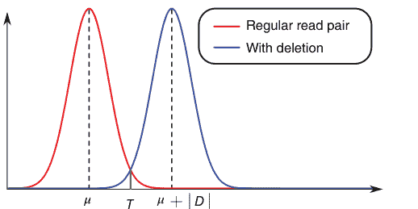

**图 7.7** 正常读取（read）和指示长度为 [D] 缺失的读取在区间上的高斯分布。区间长度为 T 的对齐不提供任何证据，因为缺失的存在和不存在概率是相等的。

之前描述的程序实现在 `MATE-CLEVER (10)` 中，它可以利用孟德尔定律形式的先验信息，如果包含多个相关的基因。为了确定基因型，`MATE-CLEVER` 获取通用混合工作流的第 3 步产生的所有（拆分读取）对齐，通过将方程 (7.7) 和 (10) 代入方程 (7.5) 执行基因型确定计算。

# 7.6 结果

## 7.6.1 数据集

我们从数据库 (16) 下载了 Craig Venter 基因组的所有变异注释。使用这些注释，按照参考文献 10 中描述的程序生成二倍体基因组，这产生了一个在变异和纯合状态方面都是真实的基因组。注意，直接使用注释会导致杂合缺失与纯合缺失的比例不真实（这是由于原始组装阶段确定插入和缺失状态的困难）。随后，我们使用 `Simseq (17)` 在 15x 覆盖下模拟每个拷贝，根据两种流行的 Illumina 协议：HiSeq 和 MiSeq，内部片段的平均值和标准差分别为 112 (HiSeq) 和 250 (MiSeq)。

# 发现与基因型确定“暮光带”缺失

# 表 7.1 使用的软件列表

读取映射器：列出的程序是标准读取映射器。内部片段：使用内部片段大小 SV 检测方法。拆分读取：基于拆分读取的 SV 检测方法。基因型确定：确定 SV 的方法。我们在实验中使用的版本。

## 7.6.2 工具

表 7.1 给出了所用工具的概述。从内部片段大小的方法中，我们选择了 `Breakdancer`、`CLEVER` 和 `VariationHunter`。`Pindel` 和 `Socrates` 代表拆分读取方法，而 `MATE-CLEVER` 和 `DELLY` 是具有内部片段大小和拆分读取的混合方法。此外，我们包含了四个标准读取映射器：`Bowtie2`、`BWA (MEM)`、`GSNAP` 和 `Stampy`。尽管这些工具没有显式针对缺失发现，但它们具有跨缺失映射的能力。对于这些工具，我们提取了所有包含两个或多个读取对齐的缺失以汇总预测。

## 7.6.3 发现

我们看到表 7.2 和 7.3。我们运行了 7.6.1 节描述的所有数据 (HiSeq 和 MiSeq)。在表 7.2 和 7.3 中，工具根据其所属类别分组。第一组是基于内部片段的，第二组是基于拆分读取的，第三组是混合，第四组是基于对齐的方法。我们从四个类别评估所有工具：

- 严格精确度：断裂点偏移小于 20bp 且长度小于 10bp 的调用比例。
- 宽松精确度允许中心点放置和长度偏移 100bp。注意此类调用仍然具有统计学意义，只需进一步精炼。
- 我们还根据宽松精确度标准评估纯合（hom.）和杂合（het.）召回，即正确发现的真纯合和杂合缺失的比例。

# 表 7.2 30× HiSeq/MiSeq 10 到 69 缺失的 SV 预测结果

| 缺失长度 | 工具 | 精准度 (严格) | 精准度 (召回) | 召回 (hom.) | 召回 (het.) |
|---|---|---|---|---|---|
| 10–29 | BreakCancer | 0.0/0.0 | 83.7/32.8 | 0.6/0.2 | 0.3/0.0 |
| | CLEVER | 38.4/30.3 | 80.3/76.9 | 25.1/17.7 | 6.9/0.7 |
| | VariationHunter | 3.3/0.4 | 89.1/53.7 | 0.7/0.4 | 0.5/0.0 |
| | PINDEL | 91.2/91.3 | 93.0/93.4 | 89.0/92.4 | 80.7/83.8 |
| | SOCRATES | 8.0/4.5 | 11.5/7.1 | 1.4/0.3 | 1.2/0.3 |
| | DELLY | - | - | 0.0/0.0 | 0.0/0.0 |
| | MATE-CLEVER | 87.3/89.6 | 93.2/94.1 | 23.1/15.3 | 58.8/38.4 |
| | Bowie | 90.5/33.2 | 92.2/35.1 | 61.4/82.2 | 51.5/73.2 |
| | GSNAP | 88.8/81.1 | 85.5/81.6 | 79.6/83.5 |
| | Stampy | 69.6/84.4 | 90.0/90.9 | 83.6/85.5 |
| 30–49 | BreakCancer | 7.5/3.0 | 81.4/73.3 | 18.6/16.2 |
| | CLEVER | 26.2/19.6 | 71.2/80.7 | 20.5/31.4 |
| | VariationHunter | 17.1/5.6 | 88.1/60.8 | 34.6/51.2 |
| | PINDEL | 77.0/83.3 | 94.4/99.2 | 65.7/72.3 |
| | SOCRATES | 44.7/32.7 | 49.1/53.6 | 9.9/5.7 |
| | DELLY | - | - | 1.3/0.0 | 1.0/0.0 |
| | MATE-CLEVER | 73.2/85.4 | 84.0/92.4 | 66.0/64.0 | 51.4/41.8 |
| | Bowie | -74.0 | -74.0 | 10.7/1.3 | 0.2/0.4 |
| | BWA MEM | -79.9 | - | 52.6/54.0 | 3.2/46.2 |
| | GSNAP | 36.7/46.2 | 65.1/74.4 | 20.0/25.0 | 17.6/9.2 |
| | Stampy | 60.7/40.4 | 78.5/73.8 | 24.7/67.7 | 18.2/19.8 |
| 50–69 | BreakCancer | 8.4/1.3 | 82.0/73.5 | 40.7/39.6 |
| | CLEVER | 12.3/5.2 | 75.3/75.3 | 86.0/82.7 |
| | VariationHunter | 21.2/8.9 | 79.7/61.2 | 86.7/75.0 |
| | PINDEL | 64.0/76.2 | 72.8/83.9 | 48.0/72.3 | 35.4/53.6 |
| | SOCRATES | 29.3/27.0 | 40.4/33.3 | 8.3/6.3 | 6.2/4.6 |
| | DELLY | - | - | 1.3/0.0 | 1.0/0.0 |

# 发现与基因型定暮昏区缺失

表 7.3 SV 预测工具在 30x HiSeq/MeSeq 数据上对 70 到 199 bp 缺失的预测

| 缺失长度 | 工具 | 精确率（严格） | 精确率（发布） | 召回率（纯合子） | 召回率（杂合子） |
|---|---|---|---|---|---|
| 70–99 | BreakDancer | 5.8/19 | 85.2/25.8 | 59.6/12.3 | 50.7/0.6 |
| | CLEVER | 38.0/23.4 | 88.8/79.1 | 81.3/77.9 | 60.2/16.9 |
| | VariationHunter | 15.7/12.0 | 83.1/67.4 | 83.0/77.0 | 79.1/11.5 |
| | PINDEL | 56.1/72.1 | 64.6/80.9 | 38.3/65.5 | 48.6/14.7 |
| | SOCRATES | 49.1/55.8 | 54.7/60.5 | 7.2/8.5 | 10.9/8.9 |
| | DELLY | 66.- | 66.- | 0.4/2.1 | 0.0 |
| | MATE-COWER | 80.9/89.6 | 90.1/94.6 | 57.4/63.4 | 41.5/42.1 |
| | Bowtie | - | - | 0.9/3.0 | 0.0/9.0 |
| | MEM | -81.4 | -86.4 | - | 2.6/22.3 |
| | GSNAP | - | - | 13.2/72.3 | - |
| | Tammy | 87.5/34.9 | 100.0/67.4 | 20.0/54.0 | 12.3/2.0 |
| 100–149 | BreakDancer | 3.1/0.2 | 78.2/21.8 | 48.7/19.3 | 48.6/0.4 |
| | CLEVER | 31.4/21.6 | 83.6/70.8 | 69.0/64.0 | - |
| | VariationHunter | 5.2/5.5 | 65.3/60.3 | 76.6/72.6 | 66.9/8.0 |
| | PINDEL | 61.1/77.6 | 65.5/85.3 | 20.9/34.1 | 11.2/18.4 |
| | SOCRATES | 36.0/41.9 | 44.0/48.4 | 5.6/5.6 | 5.6/4.8 |
| | DELLY | 40.7/50.0 | 69.5/80.4 | 6.1/6.1 | 8.0/5.2 |
| | MATE-COWER | 75.5/77.9 | 85.4/87.5 | 44.2/47.7 | 30.3/32.3 |
| | Bowtie | - | - | 0.0/1.8 | 0.0/8.0 |
| | BWA MEM | -100.0 | -100.0 | 1.5/2.7 | 2.8/0.0 |
| | GSNAP | - | - | 8.6/5.1 | 5.6/0.0 |
| | Tammy | - | - | 6.2/20.8 | 5.6/0.0 |
| 150–199 | BreakDancer | 1.9/0.3 | 41.5/18.3 | 40.7/19.8 | 30.9/0.7 |
| | CLEVER | 32.0/16.3 | 86.4/67.0 | 61.5/63.7 | 36.2/13.8 |
| | VariationHunter | 4.3/3.8 | 35.8/31.4 | 70.3/67.0 | 63.8/8.6 |
| | PINDEL | 55.4/69.0 | 58.5/81.0 | 20.9/34.1 | 2.0/2.6 |
| | SOCRATES | 20.0/31.0 | 22.9/34.5 | 6.6/7.7 | 7.2/9.9 |
| | DELLY | 25.0/56.4 | 45.0/74.4 | 9.9/12.1 | - |
| | MATE-COWER | 74.7/83.5 | 86.1/91.3 | 37.4/46.2 | 19.7/30.9 |
| | Bowtie | - | - | 0.0/0.0 | 0.0/0.0 |
| | BWA MEM | - | - | 0.0/0.0 | 0.0/0.0 |
| | GSNAP | - | - | 0.0/0.0 | 0.0/0.0 |
| | Tammy | - | - | 0.0/0.0 | 0.0/0.0 |

正如显著提高的精确率所示，基于尺寸的方法在断点注释的准确性方面更优。显而易见，在暮昏区的下部区域（见表 7.2），分段读取对齐方法具有某些优势，我们注意到基于对齐的方法在精确率方面 `PINDEL` 表现出色，而 `GSNAP` 在召回率方面表现。`BWA-MEM` 具有明显优势。`CLEVER` 和 `MATE-COWER` 是唯一针对暮昏区缺失发现定制的方法。

# 166 NGS 数据分析方法

在暮昏区的上部区域（见表 7.3），基于内部片段尺寸的混合方法比分段读取（split-read）对齐方法具有明显优势，因为后者的召回率下降到了零。在基于对齐的方法中，`PINDEL` 在长缺失方面具有最佳召回率，且具有足够高的精确率，因此提供了价值贡献。注意在基于内部片段尺寸的方法中，`VariationHunter` 强调召回率，这是以牺牲准确注释为代价的。在所有暮昏区范围内实现高召回率的方法只有 `CLEVER` 和 `MATE-COWER`。然而对于 30–50bp 的异质缺失，没有其他工具在 HiSeq 数据上获得更好的召回率。将 HiSeq 与 MiSeq 数据比较时，一个观察结果是基于对齐的方法在 MiSeq 数据上往往具有更高的召回率，但是以较低的精确率为代价。基于内部片段尺寸的方法在 MiSeq 数据上经常会产生损失。

## 7.4 基因型确定


参见表 7.4 和 7.5 以了解后续内容。我们评估了 `UnifiedGenoty` (`UG`) 和 `HaplotypeCaller` (`HC`) 在 `BWA-MEM` 和 `GSNAP` 算法上的基因型确定性能。显而易见，`MATE-CLEVER` 是长于 30bp 缺失最有利的方法，且具有足够高的召回率（见表 7.4）和良好的精确率（见表 7.5）。通常，`MATE-CLEVER` 预测了约 90% 的纯合子和 80% 的杂合子。虽然 `MATE-CLEVER` 总体上是最有利的，但其他方法也有部分优势。注意的是，`BWA-HC` 和 `GSNAP-HC` 在 30–49bp 的纯合缺失方面的召回率和精确率优于 `MATE-CLEVER`。在与 `UG` 比较时，发现 `HC` 在长于 50bp 的缺失上召回率有显著提高，而 `UG` 通常是较保守的方法。

# 发现与基因型鉴定暮昏区缺失

表 7.4 纯合子呼叫性能

| 缺失长度 | 工具 | 真实呼叫数 | 缺失呼叫 | 杂合子错误类型 | 纯合子正确 |
|---|---|---|---|---|---|
| 10–29 | BWA/UG | 6109/7365 | 7.4/9.3 | 2.9/3 | 92.2/9.0 |
| | BWA/HC | 6327/6750 | 9.2/10.0 | 2.7/4 | 90.2/8.9 |
| | GSNAP/UG | 6392/6943 | 6.8/7.1 | 2.7/3 | 92.8/9.4 |
| | GSNAP/HC | 6380/6721 | 9.3/9.9 | 2.7/2.4 | 91.8/9.0 |
| | MATE-CLEVER | 1546/1222 | 6.7/6.7 | 7.0/8.6 |  |
| 30–49 | BWA/UG | 147/794 | 8.2/9.9 | 2.0/4.3 | 91.2/8.8 |
| | BWA/HC | 567/700 | 10.9/10.4 | 2.6/2.6 | 88.2/8.9 |
| | GSNAP/UG | 633/7785 | 13.4/11.0 | 2.5/1.7 | 101.0/99.8 |
| | GSNAP/HC | 579/686 | 10.7/10.5 | 3.1/2.6 | 88.1/89.1 |
| | MATE-CLEVER | 758/743 | 9.8/7.9 | 7.4/10.4 | 86.5/85.3 |
| 50–69 | BWA/UG | 0/172 | -12.8 | -4.1 | -86.6 |
| | BWA/HC | 127/207 | 18.9/15.9 | 2.5/1.7 | 79.5/83.1 |
| | GSNAP/UG | 31/443 | 6.5/9.3 | 3.2/0.0 | 90.3/90.7 |
| | GSNAP/HC | 128/180 | 18.0/13.9 | 1.6/2.8 | 102.0/100.0 |
| | MATE-CLEVER | 236/525 | 14.0/9.3 | 11.0/8.9 | 78.8/86.2 |
| 100–149 | BWA/UG | 0/55 | -14.5 | -5.5 | -83.6 |
| | BWA/HC | 81/117 | 14.8/13.9 | 2.5/1.7 | 85.2/86.3 |
| | GSNAP/UG | 0/0 | - | -/- | - |
| | GSNAP/HC | 33/743 | 18.2/15.1 | 0.0/0.0 | 81.8/84.9 |
| | MATE-CLEVER | 100/107 | 15.1/12.9 | 2.0//.9 | 84.0/86.9 |
| 150–199 | BWA/UG | 0/0 | - | - | - |
| | BWA// | | /11 | |000/9.1 | 90.9 |
| | GSNAP/UG | 0/0 | - | - | - |
| | GSNAP/HC | 2/11 | 100.0/18.2 | 0.0/9.1 | 72.7 |
| | MATE-CLEVER | 39/511 | 7.7/7.8 | 7.7/9.8 | 92.3/84.3 |

## 讨论

在本章中，我们回顾了 30–150bp 范围内的缺失现状，这些缺失被称为“暮昏区缺失”。此外，指出在具有高精确率的情况下，`MATE-CLEVER` 是可用管线中唯一可靠的选择。

表 7.5 杂合子呼叫性能

| 缺失长度 | 工具 | 真实呼叫数 | 缺失呼叫 | 杂合子正确 | 纯合子错误类型 |
|---|---|---|---|---|---|
| 10–29 | BWA/UG | 6188/8856 | 8.4/10.8 | 85.5/84.9 | 5/1 |
| | BWA/HC | 10182/12464 | 11.6/10.7 | 80.5/80.6 | 10.1/11.3 |
| | GSNAP/UG | 7747/9848 | 7.9/7.7 | | 7.5/7.1 |
| | GSNAP/HC | 10619/12506 | 11.6/11.3 | 80.3/80.0 | 10.4/11.2 |
| | MATE-CLEVER | 1022/333 | 7.0/3.0 | 61.7/86.2 | 37.1/12.9 |
| 30–49 | BWA/UG | 119/971 | 7.6/9.6 | 87.4/86.2 | 9.2/6.5 |
| | BWA/HC | 961/1456 | 10.9/12.4 | 72.3/87.4 | 11.1/15.0 |
| | GSNAP/UG | 728/1024 | 22.9/12.3 | 81.2/83.4 | |
| | GSNAP/HC | 1122/1454 | 22.1/11.2 | 69.5/77.8 | 11.1/14.9 |
| | MATE-CLEVER | 877/597 | 10.6/5.9 | 80.8/81.0 | 10.9/5.4 |
| 50–69 | BWA/UG | 0/177 | -79.7 | -5/1 |
| | BWA/HC | 262/438 | 32.8/14.4 | 53.4/69.4 | 15.6/18.9 |
| | GSNAP/UG | 43/443 | 32.6/15.9 | 67.4/77.8 | 0.0/6.3 |
| | GSNAP/HC | 315/410 | 32.1/18.3 | 54.6/66.6 | 15.6/18.5 |
| | MATE-CLEVER | 313/233 | 17.6/6.0 | 75.4/91.4 | 7.3/3.9 |
| 70–99 | BWA/UG | 0/331 | -16.1 | -6/5 |
| | BWA/HC | 148/390 | 38.5/16.3 | 52.0/68.9 | 13.5/20.5 |
| | GSNAP/UG | 0/0 | - | - | -0 |
| | GSNAP/HC | 182/222 | 39.0/20.7 | 51.1/65.3 | 12.1/18.5 |
| | MATE-CLEVER | 169/163 | 8.3/4.9 | 85.2/92.0 | 8.3/4.3 |
| 100–149 | BWA/UG | 0/0 | - | - | -0 |
| | BWA/HC | 78/90 | 56.4/15.6 | 25.6/56.7 | 19.2/35.6 |
| | GSNAP/UG | 0/0 | - | - | -0 |
| | GSNAP/HC | 100/117 | 59.0/17.1 | 31.0/59.8 | 11.0/28.2 |
| | MATE-CLEVER | 92/101 | 14.1/12.9 | 80.4/86.1 | 5.4/2.0 |
| 150–199 | BWA/UG | 0/0 | - | - | -0 |
| | BWA/HC | 0/11 | -0.0/9.1 | 90.9 |
| | GSNAP/UG | 0/0 | - | - | - |
| | GSNAP/HC | 2/11 | 100.0/18.2 | 0.0/9.1 | 72.7 |
| | MATE-CLEVER | 39/511 | 7.7/7.8 | 7.7/9.8 | 92.3/84.3 |

## 发现与基因型鉴定暮昏地带缺失

NGS 缺失的暮昏地带。简而言之，虽然一些先进的基于片段大小的方法从“上方”处理这一暮昏地带（其中包括 7–9），但基于比对的方法（无论是常规的还是针对拆分读取（split-read）的，见参考文献 14, 18, 34）都是从“下方”处理这一暮昏地带。基于内部片段大小的方法的一个通用缺点是预测的断裂点相当不准确（参见松弛和严格精确率统计的差异）。混合方法解决了这一问题，因此兼顾了基于片段大小的方法在检测更大缺失方面的优势，以及基于比对的方法在高度准确的断裂点预测方面的优势。

### 7.7.1 HiSeq

在所有评估的方法中，只有 `CLEVER` (10) 及其混合版本 `MATE-CLEVER` 提供了跨越暮昏地带范围（30–150 bp）的完整缺失集。在基于内部片段大小的检测中，`VariationHunter` 对至少 50 bp 的缺失提供了良好的检测集，`Breakander` 对至少 70 bp 的缺失提供了检测集。然而，召回率是以牺牲断裂点准确性为代价的，这在两种情况下都可以显著提高。在这种情况下，`CLEVER` 在基于内部片段大小的方法中领先，因为它的严格精确率明显优于其他方法。

在混合方法中，只有 `MATE-CLEVER` 对暮昏地带做出了贡献。`DELLY` 专注于缺失，并对大于 200 bp 的缺失实现了非常理想的性能率（数据未显示）。

在基于拆分比对（split-alignment-based）的方法中，`PINDEL` 在综合评估方面表现最好，对 50 bp 以内的检测实现了卓越的性能率，并在 50 bp 之外发现了不可忽视的缺失。`GSNAP` 和 `Stampy` 提供了大量的优秀预测，然而，这两种工具对于 40–50 bp 及更长缺失的召回率仍需改进。

### 7.7.11 30–50 bp 杂合缺失

处理 HiSeq 数据时一直存在的一个挑战是长度为 30–50 bp 的杂合缺失。在这种情况下，`CLEVER` 的召回率最高（61%）。尽管如此，基于 HiSeq 的此类检测尚未开发出新的解决方案。杂合性与尺寸范围的结合似乎（部分）仍然是所有类发现方法的弱点，在仅使用 HiSeq 实验时无法（完全）克服。

总结来说，可以为 30 bp 以内的缺失推荐 `GSNAP-(UG/HC)`，为所有大于 30 bp 的缺失推荐 `MATE-CLEVER`，基于 `GSNAP` 的基因型鉴定流水线在 30–50 bp 的纯合缺失方面也达到了具有竞争力的性能率。由于通常对杂合和纯合缺失的相对比例信息很少，`MATE-CLEVER` 是大于 30 bp 缺失的优越整体选择，它是支持 30+ 缺失的唯一工具，其整体基因型精确率超过 90%。

### 7.7.2 MiSeq

`MiSeq` 是一种最近测序技术，允许长度为 250 bp 及更长的读取。因此，它在基于拆分比对的方法检测更长缺失方面具有巨大潜力。事实上，`MiSeq` 实验不受 30–50 bp 杂合缺失“盲点”的影响，而这仍然适用于 HiSeq 实验。部分 `BWA-MEM` (18) 和部分 `GSNAP` (30) 都受益于测序技术的进步，在可靠的精确率实现了超过 80% 的召回率（`BWA-MEM` 为 85.7%，`BWA-MEM`：86.2/279.1% 松弛/严格精确率）。如果 `MiSeq` 技术可用且吞吐量满足当前应用，显然这些是首选方法。

对于 50bp 及以上的缺失，`CLEVER` 和 `MATE-CLEVER` 再次是首选方法，在范围内实现了最高性能率，而 `VariationHunter` 的检测非常不准确（`Variation` 严格精确率 <10%）。

使用 `MiSeq` 数据会导致基于片段的方法以及混合方法的损失，这很可能是由于片段长度的增加。对于基于拆分比对的方法，这通常会导致召回率的大幅增加。

总结，在考虑 30–50 bp 长度的杂合缺失时，使用 `MiSeq` 数据具有明显优势。在所有其他类型的检测中，当与拆分比对方法结合时，它会导致更“激进”的暮昏地带检测，而基于 HiSeq 数据的检测往往包含更少的假阳性。

#### 7.7.2.1 基因型鉴定

在基因型鉴定方法中，`MiSeq` 通常会导致召回率，但提高了 `MATE-CLEVER` 的精确率。解释是 `MATE-CLEVER` 是一种混合方法。虽然 `MATE-CLEVER` 通常具有最佳的基因型精确率，但对于大于 30 bp 的缺失，基于 `HC` 的工具会导致更“激进”的基因型，其精确率较低，并且对于 30-50 bp 的缺失，“可鉴定型”检测明显增加。

总结来说，在 `MiSeq` 数据上，`MATE-CLEVER` 是唯一在所有范围内可靠鉴定暮昏地带缺失的方法。对于暮昏地带较低范围的缺失，基于比对的方法结合 `UG` 或或 `HC` 有助于生成“更高敏感性”的检测集。

### 7.7.3 结论

#### 7.7.3.1 HiSeq

对于 HiSeq 数据，可以将 `PINDEL` 作为检测 10-30 bp 缺失的最强方法。对于中间范围的检测，推荐结合 `PINDEL`、`CLEVER` 和/或 `MATE-CLEVER`，它们应该共同为纯合缺失产生完整的检测集，但为杂合缺失留下了改进空间。从 50 bp 开始，当关注单一工具时，`MATE-/CLEVER` 是首选方法。

对于基因型鉴定，可以推荐使用基于比对的方法（如 `BWA-MEM` 或 `GSNAP`）结合 `UG` 和或 `HC` 来检测 10–30 bp（以及更短的，未显示），而 `MATE-CLEVER` 是大于 30 bp 缺失的首选方法。

顺带一提，这些见解导致了荷兰基因组计划（Genome of the Netherlands Project (1)）中这些工具的选择，它提供了该尺寸范围内缺失检测集，比其他项目（如 1000 基因组计划 (2)）全面得多。

#### 7.7.3 MiSeq

对于 `MiSeq` 数据的通用建议是，当与拆分比对方法结合时，使用更“激进”的暮昏地带检测。对于基因型鉴定，再次 `BWA-MEM` 和/或 `GSNAP`（经 `UG` 和或 `HC` 后处理）是大于 30 bp 缺失的首选方法，而 `MATE-CLEVER` 是 30+ bp 缺失的首选方法。对于 10–50 bp 的缺失，将 `GSNAP` 与 `MATE-CLEVER` 结合可以做出价值贡献。

## 7.8 可用性

访问 `http://homepages.cern.ch/twilightzone/`

## 7.9 致谢

A. Schonuth 感谢荷兰科学组织（NWO）的资助 639。

## 7.10 参考文献

- 1. The Genome of the Netherlands Consortium. 人口结构和人口历史。Nature 2009;460：623–635.
- 2. The 1000 Genomes Project. 人类变异图。Science 2009;326(5955)：773–778.
- 3. The International Cancer Genome Project. 从头测序数据。Nature 2010;467(7291)：993–998.
- 4. The Cancer Genome Project. 人口规模测序。Bioinformatics 2011;27(12)：1297–1303.
- 5. The Cancer Genome Project. 人口变异。Nature Rev. Genet 2012;13(5)：363–376.
- 6. The Cancer Genome Project. 从测序数据中识别变异。Nat Methods 2009;6(7)：473–474.
- 7. The Cancer Genome Project. 基于人口的发现。Nat Methods 2009;9(6)：677–681.
- 8. The Cancer Genome Project. 从双端测序检测结构变异。Genome Res 2009;19(11)：1270–1278.
- 9. The Cancer Genome Project. 从头组装方法。Bioinformatics 2009;25(14)：1754–1760.
- 10. The Cancer Genome Project. 变异发现与基因型鉴定。Bioinformatics 2013;28(13)：2828–2839.
- 11. The Cancer Genome Project. 结构变异分类。Bioinformatics 2009;25(12)：i222–i230.
- 12. The Cancer Genome Project. 识别基因变异的整合模型。Genome Biol 2012;13(2)：R23.
- 13. The Cancer Genome Project. 检测缺失和中等尺寸插入。Bioinformatics 2009;25(21)：2865–2871.
- 14. The Cancer Genome Project. 使用 Burrows-Wheeler 变换映射短 DNA 读取。Bioinformatics 2009;25(14)：1754–1760.
- 15. The Cancer Genome Project. 使用质量评分映射测序读取并检测变异。Genome Res 2008;18(11)：1851–1858.
- 16. The Cancer Genome Project. 组装人类基因组序列。PLoS Biol 2007;5(e120).
- 17. The Cancer Genome Project. 对从头短读取组装方法的竞争评估。Genome Res 2011;21：2224–2224.
- 18. The Cancer Genome Project. 使用 Burrows-Wheeler 变换映射短 DNA 读取并检测变异。Bioinformatics 2009;25(14)：1754–1760.
- 19. The Cancer Genome Project. 使用质量评分映射测序读取并检测变异。Genome Res 2008;18(11)：1851–1858.


- 20. The Cancer Genome Project. 一种基于模拟误差从双端测序数据识别基因变异的计算框架。Genome Biol 2009;10(2):R23.

- 21. The Cancer Genome Project. 小鼠基因组中结构断裂点的映射和分析。Genome Res 2010;20(5):623–635.

# 发现与基因组学暮光带的缺失

22. Treangen TJ, Salzberg SL. 重复DNA与下一代计算的挑战与解决方案。Nat Rev Genet 2012;13:557–567.

23. Emde A-K, Schulz MH, Weese D, Sun R, Vringron M, Kalscheuer VM, Haas SA, Reinert K. 使用PlayerS在单端和双端测序中检测具有精确断点的插入变异。Bioinformatics 2012;28(5):619–627.

24. Schroeder J, Hsu A, Boyle SE, Macintyre G, Cmero M, Tothill RW, Johnston RW, Shackleton M, Papenfuss AT. Socrates: 通过重新对齐剪切序列识别肿瘤基因组中的重排。2014. DOI: 10.1093/bioinformatics/ct067.

25. Zhang Z, Du J, Ham L, Abyzov A, Urban AE, Snyder Gerstein M. 使用分选序列识别基因组插入缺失和结构变异。BMC Genomics 2011;12:375.

26. Jiang Y, Wang Y, Brudo M. Prism: 用于双对读输入分选序列映射，以准确高效地检测碱基对水平的插入和结构变异。Bioinformatics 2012;28(20):2578–2583.

27. Zhang J, Wang J, Wu Y. 一种利用低覆盖序列数据准确高效地检测结构变异的改进方法。BMC Bioinf 2012;13: Suppl 6:S6.

28. Toepfer A, Marschall T, Bull RA, Luciani F, Schönhuth A, Beerenwikel N. 通过最大团枚举进行病毒准物种组装。PLoS Comput Biol 2014;10(3):e1003515.

29. Marschall T, Schönhuth A. 敏感的长插入缺失感知型测序序列比对。技术报告，2013. arXiv:1303.3520.

30. Wu TD, Nacu S. 短读中复杂变异和剪接的快速且容忍SNP的比对。Bioinformatics 2010;26:873–881.

31. Wu TD, Watanabe CK. GMAP: 用于mRNA和EST序列的基因组制图和比对程序。Bioinformatics 2005;21:1859–1875.

32. Langmead B, Salzberg SL. 使用Bowtie 2进行快速的获得序列比对。Nat Methods 2012;9(4):357–359.

33. Lunter G, Goodman M. Stampy: 一种用于Illumina序列读取敏感且快速映射的统计算法。Genome Res 2011;21(6):936–939.

34. Langmead B, Trapnell C, Pop M, Salzberg SL. 短DNA序列到人类基因组的超快速且内存高效比对。Genome Biol 2009;10(3):R25.

# 使用NGS数据寻找长插入和缺失的8种计算方法

张锦 (JIN ZHANG)

密苏里圣路易斯大学麦唐纳基因组研究所，美国MO州

翁楚 (ONG CHU) 和 吴玉峰 (YUFENG WU)

康涅狄格大学计算机科学与工程系，美国CT州托克斯

## 8.1 背景

结构变异（SV），或基因组结构变异，是生物体基因组结构的变异。当一个物种有参考基因组时，变异通常相对于参考基因组定义。在同一个物种的不同基因组之间，可能存在许多类型的SV，例如缺失、插入、重复、拷贝数变异、倒位和易位。虽然许多结构变异会影响疾病易感性（例如癌症），科学家已经在大规模项目中对SV进行制图和分类付出了巨大努力，例如1000基因组计划 (1) 和癌症基因组图谱 (2)。已经开发了许多检测SV的计算工具并应用到这些项目中。

在本章中，我们将介绍使用下一代测序（NGS）检测某些类型SV（即长插入和缺失）的计算方法的某些方面。众周知，插入和缺失是基因组中最常见的SV之一。此外，长插入缺失可能对某些表型产生重大影响。NGS已成为近期发现SV的标准技术。

《下一代测序数据分析的计算方法，第一版》。

由Ion I. Mandoiou 和 Alexander Zelikovsky 编。

© 2016 John Wiley & Sons, Inc. 2016由John Wiley & Sons, Inc.出版。

伙伴网站：www.wiley.com/go/Mandoiou/NextGenerationSequencing

# NGS数据分析的计算方法

参考

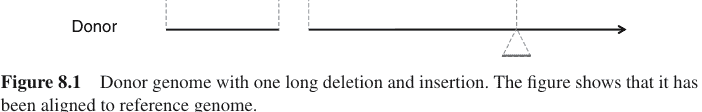

近以来，高通量、低成本的NGS技术使得从数千个样本中发现SV成为可能。另一方面，使用NGS检测SV也面临挑战。首先，NGS序列读取很短，并且可能包含测序错误和伪影。其次，这些序列读取的生成并非完全均匀，基因组许多区域的覆盖度可能会不同。第三，序列读取的量通常很大。

一种方法是组装序列读取以获得完整的供体（或替代）基因组。如果供体基因组是为人知的，可以将供体基因组与参考基因组（许多物种都有）进行比较以发现SV。图8.1显示了一个模拟供体基因组的示例，包含一个长缺失和一个长插入。模拟参考基因组长度为100万碱基对（bp）。供体基因组缺少25001到251000之间的序列（浅灰色标记部分），以及参考基因组中不存在的片段（深灰色标记部分）。与参考基因组相比，供体基因组有一个长缺失和一个长插入。但在实践中，使用NGS读取组装完美的供体基因组通常是很困难。组装NGS读取的主要问题是读取长度短、读取分布通常不均匀，这可能导致基因组某些区域的覆盖度较低。读取中包含的噪声也为组装带来了严峻挑战。此外，供体基因组本身可能是重复的。

从序列读取寻找SV的另一种策略是在不进行组装的情况下直接从读取中检测SV。有很多使用NGS数据检测SV的计算工具。这些工具中的大多数通过从读取中检测SV来实现。这些检测SV的方法分为四类，即：(i) 组装 (AS)、(ii) 读取深度 (RD)、(iii) 成对读取 (RP) 和 (iv) 分选读取 (SP)。在下文中，我们将介绍这些方法的主要思想。其中某些方法可能适用于其他类型的SV。每一类方法在检测不同SV时都有其优缺点。某类方法可能本质上无法发现某些SV。与其使用单一工具，将不同类别工具的结果结合可能是明智的，正如1000基因组计划所做的 (3)。有多种方法可以在相同数据上运行多个工具，然后取交集、并集

这些工具输出的其他子集作为最终结果。整体准确率是最终列表中真阳性（TP）的比例，整体灵敏度是所有TP中TP的比例。例如，使用相对严格的参数运行每个工具并取并集可能会获得良好的整体准确率。注意，由于不同工具共享某些SV，整体准确率可能低于使用单一工具。通过使用多个工具，整体灵敏度远高于使用单一工具，因为许多TP可以被少数工具捕捉到。因此，结合方法可能具有更高的准确灵敏度。此外注意，如果设计得当，结合方法可以带来更高效的算法。我们将在8.2.4节介绍此类结合方法。

# 使用NGS数据寻找长插入和缺失的计算方法

张锦 (JIN ZHANG)

密苏里圣路易斯大学麦唐纳基因组研究所，美国MO州

翁楚 (ONG CHU) 和 吴玉峰 (YUFENG WU)

康涅狄格大学计算机科学与工程系，美国CT州托克斯

## 8.1 背景

结构变异（SV），或基因组结构变异，是生物体基因组结构的变异。当一个物种有参考基因组时，变异通常相对于参考基因组定义。在同一个物种的不同基因组之间，可能存在许多类型的SV，例如缺失、插入、重复、拷贝数变异、倒位和易位。虽然许多结构变异会影响疾病易感性（例如癌症），科学家已经在大规模项目中对SV进行制图和分类付出了巨大努力，例如1000基因组计划 (1) 和癌症基因组图谱 (2)。已经开发了许多检测SV的计算工具并应用到这些项目中。

在本章中，我们将介绍使用下一代测序（NGS）检测某些类型SV（即长插入和缺失）的计算方法的某些方面。众周知，插入和缺失是基因组中最常见的SV之一。此外，长插入缺失可能对某些表型产生重大影响。NGS已成为近期发现SV的标准技术。

《下一代测序数据分析的计算方法，第一版》。

由Ion I. Mandoiou 和 Alexander Zelikovsky 编。

© 2016 John Wiley & Sons, Inc. 2016由John Wiley & Sons, Inc.出版。

伙伴网站：www.wiley.com/go/Mandoiou/NextGenerationSequencing

# NGS数据分析的计算方法

参考


近以来，高通量、低成本的NGS技术使得从数千个样本中发现SV成为可能。另一方面，使用NGS检测SV也面临挑战。首先，NGS序列读取很短，并且可能包含测序错误和伪影。其次，这些序列读取的生成并非完全均匀，基因组许多区域的覆盖度可能会不同。第三，序列读取的量通常很大。

一种方法是组装序列读取以获得完整的供体（或替代）基因组。如果供体基因组是为人知的，可以将供体基因组与参考基因组（许多物种都有）进行比较以发现SV。图8.1显示了一个模拟供体基因组的示例，包含一个长缺失和一个长插入。模拟参考基因组长度为100万碱基对（bp）。供体基因组缺少25001到251000之间的序列（浅灰色标记部分），以及参考基因组中不存在的片段（深灰色标记部分）。与参考基因组相比，供体基因组有一个长缺失和一个长插入。但在实践中，使用NGS读取组装完美的供体基因组通常是很困难。组装NGS读取的主要问题是读取长度短、读取分布通常不均匀，这可能导致基因组某些区域的覆盖度较低。读取中包含的噪声也为组装带来了严峻挑战。此外，供体基因组本身可能是重复的。

从序列读取寻找SV的另一种策略是在不进行组装的情况下直接从读取中检测SV。有很多使用NGS数据检测SV的计算工具。这些工具中的大多数通过从读取中检测SV来实现。这些检测SV的方法分为四类，即：(i) 组装 (AS)、(ii) 读取深度 (RD)、(iii) 成对读取 (RP) 和 (iv) 分选读取 (SP)。在下文中，我们将介绍这些方法的主要思想。其中某些方法可能适用于其他类型的SV。每一类方法在检测不同SV时都有其优缺点。某类方法可能本质上无法发现某些SV。与其使用单一工具，将不同类别工具的结果结合可能是明智的，正如1000基因组计划所做的 (3)。有多种方法可以在相同数据上运行多个工具，然后取交集、并集

这些工具输出的其他子集作为最终结果。整体准确率是最终列表中真阳性（TP）的比例，整体灵敏度是所有TP中TP的比例。例如，使用相对严格的参数运行每个工具并取并集可能会获得良好的整体准确率。注意，由于不同工具共享某些SV，整体准确率可能低于使用单一工具。通过使用多个工具，整体灵敏度远高于使用单一工具，因为许多TP可以被少数工具捕捉到。因此，结合方法可能具有更高的准确灵敏度。此外注意，如果设计得当，结合方法可以带来更高效的算法。我们将在8.2.4节介绍此类结合方法。

在本章中，我们首先介绍不同类别的主要方法，包括结合方法。然后介绍已应用SV检测方法的项目。最后，对未来的研究方向提供结论和讨论。

## 8.2 方法

我们现在描述各种方法的技术思想。每种方法都依赖读取中包含的指示SV发生的信号。我们称这些信号为SV特征。

### 8.2.1 序列读取中长插入缺失的特征

在SV检测问题中，我们更关心供体基因组是否存在SV以及真实SV的坐标。坐标是根据参考基因组碱基的位置测量的。例如，图8.1中长缺失的坐标是参考：250001–251000，长插入位于参考：750000和参考：750001之间。注意，NGS读取是

## NGS 数据分析计算方法


生成自包含结构变异（SVs）的供体基因组，来自 SV 区域的 reads 带有有关 SV 的信息。当比对参考基因组时，这些 reads 的比对结果可能具有与无 SV 区域的 reads 不同的特征。我们将这些特征称为特征（signatures）。我们提到的方法类别都利用了这些特征。在本节中，我们重点关注长缺失和长插入的特征。关于其他类型 SV 的更多特征，读者可以参考综述，例如参考文献 4。

为了说明特征的概念，我们生成了一些小规模模拟数据。我们只生成了一种类型的 NGS reads。在图 8.2 中，从供体基因组片段生成了一个具有两条链的双端 read（paired-end read）。长度被称为插入大小（insert size）。由于我们没有整个供体基因组的序列，因此不知道双端测序的插入大小。当 read 被正确比对时，我们使用参考基因组上两个末端之间的距离作为插入大小。基本假设是供体基因组在该区域内的结构与参考基因组相似。对于测序，对于大多数双端 reads，从 read 计算出的插入大小是准确的。通常，插入大小的标准差并不大。在我们的模拟中，参考基因组是 A、C、G 的随机序列。供体基因组通过从参考基因组删除 250,000 到 251,000 之间的碱基，并在 750,000 到 750,001 之间插入长度为 100 的随机序列生成。该设置如图 8.1 所示。

我们从供体基因组生成 30x 的双端 reads（覆盖度是 reads 的平均数量）。同时也从参考基因组生成了 30x 覆盖的数据。将这些 reads 组合在一起，模拟样本是杂合的，一份基因组拷贝含有 SV，另一份与参考基因组相同。随后数据集具有 60x 覆盖。请注意，在实际操作中，两条序列可能会有不同的覆盖度。我们使用这种简化的模拟来说明基本概念。数据集的 reads 使用模拟工具（https://github.com/lh/wgsim）生成，插入大小、标准差和 read 长度分别为 500 和 100。每个 reads 都采用默认值。与真实情况相比，该数据集非常理想，但足以显示特征。reads 使用 BWA 的默认参数进行比对。我们可以使用 IGV (6) 查看比对结果。

## 寻找插入和缺失的计算方法

图 8.3 显示了长缺失区域，图 8.4 显示了长插入区域。从图 8.3 我们可以看到，reference:250,001–251,000（缺失区域）的覆盖度只有其他坐标（无 SV 区域）的一半。这是因为样本的基因组只有一份拷贝具有 250,001–251,000 的序列，而我们以 30x 的深度进行测序。无 SV 区域以 60x 覆盖度进行测序，每个拷贝为 30x。因此，利用 NGS 结果识别长缺失的一个特征是缺失区域的覆盖度比无 SV 区域小。理想情况下，对于具有两个基因组拷贝的生物，如果缺失是杂合的（在两个基因组拷贝中），则覆盖度约为 0。这是读段深度（RD）特征。对于真实数据，RD 特征可能会受到几个方面的影响。reads 的生成可能不像模拟数据那样均匀。同一基因组拷贝不同位置的覆盖度可能会波动。两个基因组拷贝相同位置的覆盖度可能不同。测序和比对错误可能会向该区域添加假阳性 reads 并移除真阳性 reads。此外，并不是每个组都有高覆盖度。因此，可能会出现缺失位置覆盖度下降无法从背景波动中可靠地检测出来。此外，基因组的拷贝数不一定是两个。某些生物具有更多。

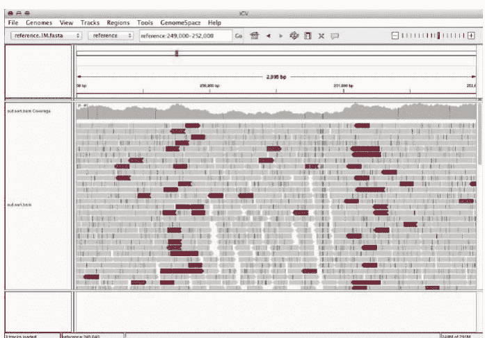

**图 8.3** 长缺失示例的 IGV 视图。缺失范围从 250,001 到 251,000。我们可以看到缺失区域的 read 覆盖度较低，并且有许多插入大小巨大的不一致双端 reads（discordant paired-end reads）。请参阅 www.wiley.com/go/wgsim/NextGenerationSequencing 查看此图的彩色。

## NGS 数据分析计算方法

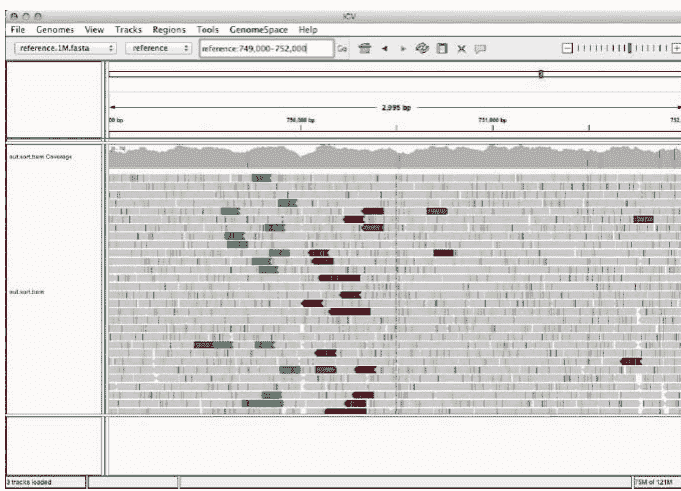

**图 8.4** 长插入示例的 IGV 视图。插入位于 750,000 和 750,001 之间。请参阅 www.wiley.com/wgsim/NextGenerationSequencing 查看此图的彩色。

组织具有两个基因组拷贝，但某些样本（例如肿瘤细胞）的基因组可能高度变异，拷贝数可能不是两个。当我们看到某些区域覆盖度较低时，不能立即将其判定为缺失，还需要过滤掉假阳性。我们将在下一节给出使用该特征的 SV 检测工具示例。

在8.3 中，某些 reads 被标记了颜色。红色的对于检测缺失非常重要。它们被标记为红色是因为这些 reads 的插入大小明显大于预期。如前所述，我们期望双端 read 的插入大小与库插入大小相似。模拟数据集使用的平均插入大小为 500，但标记为红色的 reads 显然具有长得插入大小。这些值大于 1000，因为它们位于 250,001-251,000 区域。记住这些 reads 的插入大小约为 1500，即缺失大小加上平均插入大小。插入大小变大的原因如图 8.5 所示。供体基因组同时以分裂和连续序列的形式显示。从供体基因组生成了一个双端 read，位于图中底部。该 read 来自一个跨越断裂点的序列片段。片段的长度遵循假设的正态分布，均值为库插入大小。但在模拟中，我们只知道片段的真实长度。在实践中，我们拥有 reads 的序列。因此我们需要比对参考基因组以获得估计。

## 寻找插入和缺失的计算方法

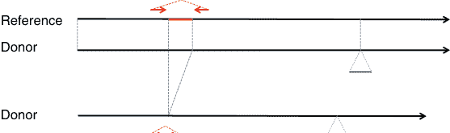

**图 8.5** 双端 read 的插入增大。因为它跨越了一个缺失，当比对到参考基因组时，插入大小会增大（底部）。供体基因组有一个片段（红色部分）是参考基因组没有的。比对结果在顶部。双端 read 的插入大小显著大于均值。缺失的

# 参考文献

供体 (Donor)


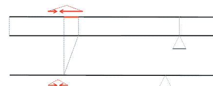

供体 (Donor)

**图 8.6** 长缺失配对拆分读（split read）特征。读段的一端跨越了供体基因组上长缺失的断裂点（底部）。该末端的序列与参考基因组中的连续序列不匹配。它必须被分成两个独立的段，每个段映射到参考基因组上缺失区域的侧翼区域。

配对的另一端作为完整读段映射到参考基因组上，这被称为锚点（anchor）。跨越末端无法作为完整读段映射到参考基因组。它由两个被参考基因组分离的侧翼段组成。常用的 NGS 序列读段比对工具，如 `BWA` (5) 和 `Bowtie` (7)，如果读段质量不是太大且序列不重复，就能够映射锚点。跨越读段无法作为完整读段映射。拆分读结构变异（Split-read SV）检测工具首先会将这些读段映射为拆分读，对于无法映射为完整读段的读段，其中一些可能包含更多错误，另一些可能是伪影。偶然地，某些末端可能被映射为拆分读。这可能导致许多假阳性。注意，像人类基因组这样的基因组可能是重复的，将短 NGS 读段拆分成更短的段可能会导致多次命中。此外，拆分读段的不同方法会导致多次命中。对于真实的拆分读，很难选出正确的拆分映射。

检测长缺失和长插入之间的区别在于插入序列是未知的。插入序列可能来自基因组的另一个位置，因此存在于参考基因组中。它也可能是参考基因组不存在的新序列。无论何种情况，从插入序列生成的读段都不会映射到插入位置。因此，插入断裂点周围没有覆盖度变化，例如图 8.4所示。对于大插入，不太可能存在涵盖读段，因为文库插入片段大小可能远小于插入的大小。一端位于插入序列外的配对读段可能位于插入断裂点附近。另一端可能包含在插入序列中，或者跨越插入的一个断裂点。这两种情况在图 8.7 中所示，每种情况仅显示了一个读段。在覆盖度相当高的情况下，两种类型的读段都可能出现在长插入断裂点的两侧。插入序列可以使用拆分末端和未映射读段进行组装。并不是因为测序错误和伪影，而是偶然地，会有许多映射的读段具有与长插入特征相同的特征。

# 寻找长插入和缺失的计算方法 183


**图 8.7** 长插入的配对读段特征。底部显示了两个特征读段序列的来源。顶部显示了它们映射到参考基因组时所具有的特征。

接下来，我们将描述几种仅使用单一特征的工具，然后展示一些具有组合特征的工具示例。

## 8.2.2 发现无断裂点长插入/缺失（Indels）的方法

从本节开始，我们将给出几个实现了上一节所讨论的某些特征的 SV（结构变异）检测工具示例。在本节中，我们将涵盖一种 RD 方法 `CNVator` (8)，它用于检测拷贝数变异（CNV）。长缺失是拷贝的丢失，长插入是拷贝的增加。我们将涵盖 `BreakDancer` (9)，一种 RP 方法。还有更多的 RD 方法，例如参考文献 10–12，以及更多的 RP 方法，例如参考文献 13–15。

### 8.2.2. CNVator

`CNVator` 是利用 RD 从家族和群体基因组测序中发现 CNV 的工具之一。这种方法的核心思想基于以下观测：CNV 的 RD 与正常区域的 不同，这也是所有基于 RD 方法的主要观察结果。`CNVator` 使用的技术之一称为均值偏移法（mean-shift approach）。这种方法借用自图像处理技术，提供了一种无需直接估计密度即可定位密度极大值的优雅方法，这是一种迭代过程，沿着均值偏移向量将每个数据点移动到密度极大值。`CNVator` 将均值偏移法与额外的改进相结合以扩展发现的 CNV 范围，这些是从初始 RD 获取的。`CNVator` 的详细实现包括三个步骤：

首先，`CNVator` 计算每个箱（bin）的 RD 并修正 GC 偏性。将其映射到基因组（被划分为连续不重叠的箱），如果一个读段（或具有一致映射距离的读段对）可以映射到多个具有相同映射得分的位置，它会随机选择一个（或一对）以获得唯一的 RD。然后修正 GC 偏性以消除 RD 与 GC 含量的相关性。

第二步是基于均值偏移的段划分和合并，这是关键步骤。如前所述，均值偏移技术借用自图像处理，用于检测基因组中的边缘。每个箱被视为一个点，计算每个点的均值偏移向量，指向具有相似 RD 信号的箱。如果相邻段的 RD 差异小于四分之一，则对其进行合并。

最后一步是 CNV 的检测。首先，选择 p 值小于 0.05 偏离基因组 RD 四分之一的段。然后通过单侧检验检测额外的，段内的所有 RD 信号小于最大 RD。

对 1000 Genomes 项目数据（读段长度 36）的实验结果表明，`CNator` 能够实现高灵敏度（86%-96%）、假发现率（3%-20%），并在断裂点发现方面具有高分辨率（在 90% 的情况下 < 200 bp）。然而，`CNator` 对读段长度敏感，在恒覆盖范围内，随着读段长度增加，生成的读段会减少，这将降低灵敏度。此外，更长的读段在周围更难以完全映射。因此，基于 RD 方法对于发现 CNV 有用，但仍有局限性。

### 8.2.2.2 BreakDancer

`BreakDancer` 是最早基于 RP 的计算方法之一。它旨在全范围内检测五类结构变异，包括缺失、插入、反位以及染色内和染色间的易位。它接受配对读段作为输入。如果同时给出单端和配对读段，则只使用配对读段进行进一步分析。

首先，`BreakDancer` 统计异常读对。如前所述，结构变异类型在配对读上具有不同的异常模式。根据这些不同模式，算法尝试定位一组异常区域并识别连接簇。考虑了不同的 SV 类型。每个区域拥有的异常读对比意外多。这使得 `BreakDancer` 能够过滤掉由于测序和映射错误导致的一些假变异。

然后认为一个结构变异源自一组区域，每个区域通过另一个异常读对连接。例如，`BreakDancer` 使用至少两个异常读对的预设阈值。与平均覆盖度相比，支持区域越多，获得的统计信号越强。`BreakDancer` 应用了一种统计检验，称为置信评分估计，以量化每个潜在结构变异的底层概率。该检验假设每个类型结构变异的基因组位置遵循均匀分布。对于每对相邻位点，结构变异的概率遵循二项分布，每个分量代表一种插入类型。在全基因组尺度上，特定位置出现多个结构变异的概率遵循泊松分布混合。

在实践中，`BreakDancer` 建议根据预设阈值定义三种插入：长、中、短。识别过程是通过泊松检验找到包含显著更多插入的区域，以及相对于包含显著短插入区域的插入。

# 寻找插入和缺失的计算方法 185

注意，原始的 `BreakDancer` 包含两个包：`BreakDancer-Max` 专注于长插入缺失（indels），而 `BreakDancerMini` 主要用于短长度插入缺失。然而，`BreakDancerMini` 已不再更新。因此，`BreakDancer` 被认为是一种针对长插入缺失的方法。

## 8.2.3 具有精确断裂点的长插入缺失发现方法

要调用具有精确断裂点的结构变异（SVs），可以使用组对（AS）和拆分读取（SR）方法。从头组装（De novo assembly）方法可能比 SR 方法需要更高的读取覆盖率，尽管二代测序（NGS）技术不断进步。在使用 AS 方法调用时，长插入的序列已经已知。AS 方法通常需要计算资源（尤其是内存）。另一方面，如果实现得，SR 方法可能会更快且所需的内存更少。我们不会描述特定的读段，从头组装本身就是一个很有趣的问题。我们将详细介绍一种使用拆分读取映射算法的 SV 调用工具，称为 `Pindel` (16)。

### 8.2.3.1 Pindel

`Pindel` 首次引入于参考文献 16，它是一种调用长缺失和中等长度插入的 SR 方法。`Pindel` 的 SR 方法被实现为模式增长子方法，用于在参考序列 S 中找到模式 P 的最小和最大唯一子串。假设参考序列为 "ATCAATGATGTACT"，模式为 "ATGCA"。首先，搜索并记录所有 "A" 的位置。在这种情况下，它们的位置是 1, 4, 5, 8, 14。然后在这些位置的碱基处搜索 T，此时 T 是模式的第二个字符。继续这样搜索，“ATGC" 在位置 8 处是唯一的，但 "ATGCA" 不是子串，“ATG" 是最小唯一子串，“ATGC" 是最大唯一子串。

为了调用插入缺失，`Pindel` 使用了配对读取（paired-reads），这些读取只有一端映射为完整读段，而未映射的一端通过上述方法作为拆分读取（split reads）。`Pindel` 并不是将拆分读取映射到整个基因组，而是使用一个最大事件大小阈值，即将拆分读取的 5' 端映射在已映射的 3' 端的阈值范围内。较小的阈值使得处理速度更快且占用内存内存。更重要的是，使用阈值使得 SV 调用更准确，在较小区域内预期的假阳性（FP）命中减少。然而，可能会出现极大的 SV 丢失的情况，尽管这些 SV 可能罕见。此外，`Pindel` 还使用了支持同一 SV 的读取数截断值，以使最终列表更精炼。

SV 的特征可以通过应用基于模式增长的拆分读取映射程序来发现。我们已经展示了长缺失的 SR 特征。对于中等长度插入，序列读取的中间部分未被映射，但 5' 和 3' 段被映射并拼接在一起。自首次发布以来，`Pindel` 已经不断更新：新功能包括允许测序误差的映射、调用更多类型的 SV（如易位）等。

还有其他专门用于寻找精确断裂点的方法。`SRIC` (17) 是一种拆分读取方法，主要用于处理长度较长的读段，如 Sanger 和 454 读取。`AGE` (18) 将组装的重叠群（contig）映射到参考基因组，以检测多个 SV 的精确断裂点。还有一些方法（例如 `CREST` (19)）本身不检测断裂点，而是依赖于其他工具通过局部比对所提供的精确断裂点。

## 8.2.4 结合方法

我们之前提到过 SV 用的两种结合方法。一种是结合使用单一特征的不同工具的结果，另一种是针对所有 SV 结合特征。在本节中，我们重点关注描述使用结合特征的计算工具。我们将使用 `SVseq` (20, 21) 工具作为示例，它是结合了两种特征（即拆分读取和读取配对）的 SV 调用工具。本节仅详细涵盖了长缺失的方法。长缺失的两种特征（signatures）已在 8.2.1 节中讨论过。

直觉上，使用拆分读取方法调用长缺失（例如 1 Mbps）比调用较短的缺失更困难，因为拆分读取的片段可能会命中参考基因组的更多位置，且我们需要搜索更大的区域（例如 1 Mbps）。同时，有更多的假阳性读取需要映射到此处。拆分读取的信号相对较弱。此外，在较大区域内映射拆分读取可能会较慢。然而，如果有一些支持 TP 拆分比对的包含读段（encompassing reads），情况可能会改善。另一方面，使用读取配对特征调用较短缺失更困难，特别是当读取覆盖率较低时。例如，如果一个长度为 60bp 的包含读段的插入大小比平均文库大小大 70bp，这种偏差为 50bp；库中很大一部分读取可能偶然插入大小大于平均文库大小。然而，如果有一些支持缺失的跨越读段（spanning reads），我们对该缺失更有信心。

`SVseq` 包含了上述思想。`SVseq` 有两个版本：`SVseq(1)` 和 `SVseq2` (21)。两个版本都结合了拆分读取和读取配对特征，但结合方式不同。注意，由于 `SVseq` 使用了拆分读取特征，它能够找到 SV 的精确断裂点。

### 8.2.4.1 SVseq1

它使用基于 Burroughs-Wheeler 变换 (`BWT`) 的读取映射算法将读段的两个拆分段都映射到参考基因组。回想我们在 8.2.3 节中介绍的模式增长方法。

## NGS 数据分析计算方法

## 8.4.2 SVseq2 在一个步骤中同时使用这些特征。

通过仅对到较小的区域（称为焦点区域，focal regions）进行 Read 对特征的拆裂读比对（split-read mapping）。与 `SVseq1` 相同，由于使用了组合策略，包含读段的插入尺寸不需要显著大于文库大小，且拆裂读比对允许更多的错误。我们将详细讨论焦点区域如何减少错误。注意，当测序覆盖率非常低时，`SVseq2` 能够仅通过一个跨越读段（spanning read）检测到缺失，而 `SVseq1` 和其他方法通常需要更高的覆盖率来覆盖精确的断点。

`SVseq2` 依赖于由拆裂读形成的两种模式来检测缺失：

- Type I 模式：面向锚点的片段被比对（例如图 8.8 中的 Read 1）。

- Type II 模式：远离锚点的片段被比对（例如图 8.9 中的 Read 4）。

对于 I 型模式，基于软剪切（soft-clip）的拆裂读的比对的片段面向锚点。我们将比对片段的位置标记为 `[a, b]`（其中 `a < b`）。为了发现缺失，软剪切片段需要被比对到某些区域 `[c, d]`（其中 `c < d`）。我们将软剪切片段的长度标记为 `l = d - c`。因为真实缺失的长度未知，现有的某些拆裂读比对方法（例如 [1]）有一个关于最大距离的参数。`SVseq2` 不在大区域内搜索，而是在包含读段（encompassing reads）的引导下仅搜索焦点区域。这里的目标是推断软剪切片段可能从何处开始（包含对的范围）。

img/46008551ce3baac2ee69b204.png

图 8.8 缺失检测的 Type I 模式。Read 1 是一个拆裂读。Read 2 是一个包含对。Read 3 是缺失另一侧的配对。

## 寻找插入和缺失的计算方法

img/46008551ce3baac2ee69b205.png

图 8.9 缺失检测的 Type II 模式。Read 4 是一个包含对。左端被拆裂。有一对 Read，其两端分别比对到参考基因组上的 `[s_1, e_1]` 和 `[s_2, e_2]`（`s_1 < e_1 < s_2 < e_2`）。该对是该拆裂读的包含对，其位置由该拆裂读软剪切片段的比对确定。令 `l` 为期望插入尺寸，`σ` 为插入长度的标准差。注意，`l` 测量的是两个读段最远点之间的距离。我们将包含对的长度分别标记为 `l_1` 和 `l_2`。假设 `SVseq2` 检测的最小缺失为 `m_d`。`SVseq2` 将 `m_d` 设置为 0。

**引理 1.** 对于 I 型模式，`s_2 ≥ a`，且在高概率下有 `s_2 ≤ a - l_1 - l_2 + 3σ`。

*证明。* 如果 `s_2 < a`，则 `a` 不是断点。这与我们的基础假设不符，即比对片段 `[a, b]` 对应于缺失。为了给 `s_2` 一个上限，注意 `a` 是参考序列上的位置 `a = l_{del}`，其中 `l_{del}` 是缺失的长度。现在高概率下，参考序列上 `s_2` 与 `e_1` 之间的距离最多为 `l_1 - l_2 + 3σ + l_{del}`。根据如此概率，`s_2 ≤ (a - l_{del}) + l_1 - l_2 + 3σ + l_{del} = a - l_1 - l_2 + 3σ`。

引理 1 表明包含对极有可能被检测到。对于拆裂读，`SVseq2` 在该区域的反向链上搜索包含对的 Read。现在假设我们为拆裂读 `[s_1, e_1]` 和 `[s_2, e_2]` 找到了一个包含对。以下引理规定了 `c` 的范围（即软剪切片段的起始点）。

**引理 2.** 对于 I 型模式，`e_1 - l_i ≤ a - m_d - l_c`。此外，在高概率下有 `c ≤ e_1 + l_i - s_1 - l_1 + 3σ`。

*证明。* 缺失的最右位置可以是参考序列上 `a` 左侧 `m_d` 处，因为最小缺失大小为 `m_d`。因此 `c ≤ a - m_d - l_c`。

由于包含对 `([s_1, e_1], [s_2, e_2])` 包含了缺失，我们知道缺失必须发生在 `[s_1, e_1]` 区域内。缺失的最左侧位置至少是 `e_1`。由于长度为 `l_i` 的片段需要从缺失的左端向左进行比对，我们有 `c + l_i ≥ e_1`。

我们现在估算 `c` 可以有多大。在另一染色体（带有缺失的染色体）上，缺失的左右断点变得相同，且缺失的左断点必须位于包含对右端起始位置的左侧。因此，在参考染色体上，高概率下，左断点不会大于 `e_1 - l_i + 3σ`。

引理 2 表明，我们只需要在 `[e_1 - l_i + 3σ, a - m_d - l_c]` 区域内搜索软剪切片段。该区域仍然很小。例如，假设 `l_i = 50`（取自长度为 100 的 Read），`l_1 = 100`，`l_2 = 200`，且 `σ = 50`。焦点区域的宽度为 200。这远小于原始拆裂读比对将搜索的焦点区域（后者可达 1 Mb）。此外，根据引理 1，包含对的宽度最大为 150。

结合了 RP（成对读取）和 SP（拆分读取），被称为 `PRISM` (23)。`PRISM` 首先使用 RP 方法 `CNVer` (24) 来识别 RP reads 的不一致簇，然后使用一种允许在目标区域之间进行长跳转的动态规划算法，将 reads 比对到这些簇识别出的目标区域。`LUMPY` (25) 使用概率框架，通过结合 RP、SP 和 RD（读取差异）的信号来发现结构变异（SVs）。

## 8.3 应用

### 8.3.1 人群 SV 识别

1000 基因组计划（1, 3）是首个对大量人类进行测序的大规模项目，为人类遗传变异提供了全面的资源。1000 基因组计划的目标是发现在所研究的人群中频率至少为 1% 的大多数遗传变异。这些遗传变异包括单核苷酸多态性（SNV）和结构变异。为了实现该项目的目标，研究人员采用了 NGS 技术，因为 NGS 数据的成本较低。使用 NGS 以高覆盖度对数千个个体进行测序的成本太高。相反，该目标是通过对许多个体进行低覆盖度测序实现的。1000 基因组计划的试点项目包括对 2 组“父母子”三位体进行低覆盖（2–4x）全基因组测序，以及对 900 个样本中的 1000 个基因区域进行高覆盖（50x）测序。试点研究发现了 22,025 个缺失和 6000 个额外的 SV（包括插入和串联），SV 的 53% 被映射到了核苷酸分辨率。几十种 SV 识别方法（包括本章讨论的一些方法）被用于这些发现。许多方法使用单一特征来识别 SV。这些工具为分析框架和 SV 图做出了贡献，为基于测序的关联研究提供了资源。整个项目的计划是以 4x 覆盖度测序约 2500 个样本。在参考文献中，来自 14 个个人群的 1092 个基因组中有超过 14,000 个较大的缺失。


在这里，我们通过模拟证明了 `SVseq` 可用于人群 `SV` 识别。模拟数据集由几个子数据集组成。所有数据均为长度为 100、插入大小为 500 的双端 reads。数据集是从人类基因组 36 的 5 号染色体（长度为 100,338,915 bp）模拟的。1000 基因组计划拷贝数变发布项目的结果基于此版本的基因组。Mills 等人 (3) 报告的 CEU 人群 45 个个体的 132 个缺失被引入模拟数据。由于我们使用的缺失单倍型未推断，对于异质性缺失，我们任意将一个缺失放置在个体两个单倍型中的一个。由于缺失之间通常很远，这对模拟的准确性没有很大影响。使用 `wsgsim` (`https://github.com/lh3/wsgsim`) 从个体的两个基因组拷贝生成配对读取。使用默认参数生成每个基因组中的单核苷酸多态性和小型插入/缺失（indels）。碱基错误率为 2%。使用了覆盖度为 3.2x、4.2x 和 6.4x 的数据集。使用带有软剪切（soft-clips）的 `BWA` 以默认参数将这些模拟的双端 reads 比对到整个基因组版本 36。

来自同一人群的低覆盖度数据集的汇总是一种可能比使用个体数据集发现更多 `SV` 的策略。我们在数据集上运行了 `SVseq1` 和 `SVseq2`。由于模拟数据的正确答案是知的，可以精确计算应用于不同集合的方法的灵敏度和准确性。结果所示表 8.1。我们可以看到，虽然 `SVseq1` 在所有数据上都有令人满意的准确性和灵敏度，但 `SVseq2` 的表现更好。覆盖度影响灵敏度。当覆盖度较高（6.4x）时，`SVseq2` 和 `SVseq1` 的灵敏度相同。当覆盖度较低时，`SVseq2` 的灵敏度比 `SVseq1` 高。当覆盖度或缺失频率非常低时，`SVseq2` 有更大的机会，因为 `SVseq2` 能够通过单个拆分读取（singleton split reads）识别缺失而不丢失准确性。注意，`SVseq2` 在所有数据集上都更准确，这是因为拆分读取比对是针对焦点区域的，因此假阳性率（FPS）更低。

## 表 8.1 `SVseq1` 和 `SVseq2` 在汇总人群数据集上的模拟精度和灵敏度

| 覆盖度 | 工具 | 发现 | 真阳性 | 精度 (%) | 灵敏度 (%) |
|---|---|---|---|---|---|
| 3.2x | `SVseq2` | 114 | 112 | 98 | 85 |
| | `SVseq1` | 111 | 108 | 97 | 82 |
| 4.2x | `SVseq2` | 113 | 112 | 99 | 85 |
| | `SVseq1` | 117 | 109 | 93 | 83 |
| 6.4x | `SVseq2` | 123 | 120 | 98 | 91 |
| | `SVseq1` | 128 | 120 | 94 | 91 |

### 8.3.2 癌症基因组学

这是 `SV` 识别非常有用的另一个领域。阐明遗传变异对复杂性状（或疾病易感性）的贡献是人类遗传学中的一个基础性问题。多项研究表明，结构变异在癌症演化中具有重要作用。原则上，本章提到的许多方法可以用于从癌症样本中发现 `SV`。然而，`SV` 在基因组中显示出复杂的模式。例如，我们不能总是假设细胞是二倍体 (27)。在这些项目中，每个病例生成两个独立的测序样本，一个是肿瘤组织，另一个是正常组织作为对照。

在肿瘤样本中识别 `SV` 面临许多挑战。可能需要开发针对癌症的工具。

## 8.4 结论与未来方向

从高通量测序读取发现插入、缺失以及其他类型的结构变异在可预见的未来可能是很有用的。由于测序读取固有的噪声和基因组结构的复杂性，准确检测插入和缺失仍然是一个挑战性问题。我们注意到，最新的插入缺失发现方法倾向于使用多种信息而非单一信息 (20, 21, 23)。结合多种信息可能对忍测序错误并更准确地识别结构变异。

展望未来，有几个问题需要未来的计算方法。然而，对于某些结构变异类型已有现有方法。虽然计算识别缺失性能良好，但识别插入往往更困难。即使可以识别插入的大小，可靠地识别插入的新序列可能更为困难 (28)。目前的插入缺失检测方法对较短 indels（例如 50 bp 或更短）通常性能不佳。主要原因是不一致的插入大小对于短 indels 变得不可靠。还有其他较少研究和分析的结构变异（例如倒位、易位）。其次，人们可能希望在更复杂的环境下寻找结构变异。例如，可以使用全基因测序和转录组测序来识别功能相关的 `SV`。此外，可能需要针对特定应用领域（例如癌症基因组学）的更多 `SV` 识别工具来解决特定挑战。此外，随着正在的人群测序项目，可能需要更多结构变异的人群规模应用。见参考文献 29 关于插入缺失基因型的最新工作。我们预计未来会有此类工作。最后，技术发展（例如新型测序技术读取长度更长但错误率更高 (30)）可能会带来更多的计算挑战。

## 致谢

本工作部分由美国科学基金会 `IIS-0953563` 和 `IIS-1447711` 支持。测试在由美国科学基金会 `IIS-0916948` 支持的工作站上运行。

## 参考文献

- 1. The 1000 Genomes Project Consortium. A map of human genome variation from population-scale sequencing. Nature 2010;467(7315):1061.
- 2. `<cancergenome.nih.gov`. 访问于2016年3月17日。
- 3. Mills R 等。通过群体规模基因组测序绘制拷贝异图。Nature 2011;470:59.
- 4. Medvedev P, Stanciu M, Budno C. 利用下一代测序发现结构变异的计算方法。Nat Methods 2009;6:S13.
- 5. Li H, Durbin R. 基于 Burrows-Wheeler 变换的快速准确的读取比对。Bioinformatics 2009;25:1754.
- 6. Thorvaldsottir A, Robinson J, Mesirov J. 集成基因组查看器 (IGV)：高性能基因组学数据可视化与探索。Brief Bioinformatics 2013;14(2):178.
- 7. Langmead B, Trapnell C, Pop M, Salzberg S. 短 DNA 序列到人类基因组的超快速且内存高效的比对。Genome Bio 2009;10:R25.
- 8. Abyzov A, Urban A, Snyder M, Gerstein M. CNvator：一种从家族和群体测序中发现、分型和表征典型及非典型 CNV 的方法。Genome Res 2011;21(6):94.
- 9. Chen K 等。BreakDans：一种基因组变异高分辨率映射的算法。Nat Methods 2009;6:667.
- 10. Chiang D 等。大规模等位基因测序拷贝数改变的高分辨率映射。Nat Methods 2009;6:99.
- 11. Alkan C 等。利用下一代测序的个性化拷贝数和片段图。Nat Gen 2009,41(10):1061.
- 12. Sudment 等。人类拷贝数和多性的多样性。Science 2013;340(6064):6041.
- 13. Korbel J 等。PEM：基于框架的双端测序数据推断结构变异的计算框架。Genome Bio 2009;10(2):R23.
- 14. Sindi S, Helman E, Bashir A, Raphael B.结构变异分类和比较的几何方法。Bioinformatics 2009;25(12):1222.
- 15. Quinlan A 等。小鼠基因组结构变异断点的全基因组映射和组装。Genome Res 2010;20(5):623.
- 16. Ke K, Schulz M, Long Q, Apwelter R. Pindel：一种双端读取检测大缺失和中等大小插入的模式。Bioinformatics 2009;25:2865.
- 17. Zhang Z, Du J, Lam H, Abyzov A, Urban A, Snyder M, Gerstein M. 利用分裂读取识别基因索引和结构变异。BMC Genomics 2011;12:375.
- 18. Abyzov A, Gerstein M. AGE：通过优化比对定义单核苷酸分辨率的基因变异断点。Bioinformatics 2011;27(5):595.
- 19. Wang J 等。CREST 在碱基对分辨率下映射癌症基因组中的结构变异。Nat Methods 2011;8:652.
- 20. Zhang J, Wang J, Wu Y. 用于低覆盖序列数据检测缺失精确断点的改进方法。Bioinformatics 2011;27(23):3228.
- 21. Zhang J, Wang J, Wu Y. 用于低覆盖序列数据对结构变异进行准确检测的改进方法。BMC Bioinformatics 2012;13:S6.
- 22. Ferragina P, Manzini M. 具有应用的机会数据结构。第41 届计算机科学基础年度会议；2000;p. 390.
- 23. Jiang Y, Wang Y, Brudno M. PRISM：基于双端读取信息的分裂读取映射用于碱基对水平检测插入、缺失和结构变异。Bioinformatics 2012;28(20):2576.
- 24. Medvedev P, Fiume M, Dzamba M, Smith T, Brudno M. 利用配对读取检测拷贝变异。Genome Res 2010;20(11):1613.
- 25. Layer R, Hall I, Quinlan A. PLUMPY：一种结构变异发现的概率框架。Genome Biol 2014;15:R84.
- 26. 1000 Genomes Project Consortium。来自 1,092 个人类基因组的遗传变异集成图。Nature 2012;491:56.
- 27. `http://http://iccg.org`. 访问于2016年3月17日。
- 28. Hajirasulha I 等。利用双端下一代测序检测和表征新序列插入。Bioinformatics 2010;26(10):1277.
- 29. Chu C, Zhang J, Wu Y. GINDEL：低覆盖群体序列读取中插入和缺失的准确基因型判定。PLoS ONE 2014;9:e11324.
- 30. `http://www.pacificbiosciences.com`. 访问于2016年3月17日。

# 全基因组 DNA 甲基化研究中下一代测序数据分析的计算方法

JEONG-HYEON CHOI

乔治亚大学乔治亚学院医学中心生物统计学与流行病学系，乔治亚州奥斯汀市

HUIDONG SHI

乔治亚大学乔治亚学院医学中心生物化学系，乔治亚州奥斯汀市

## 9.1 引言

DNA 甲基化是最重要的表观遗传机制之一，确保了哺乳动物细胞中基因表达程序的维持和遗传 (1)。DNA 甲基化主要涉及 CpG 二核苷酸中残基第 5 位碳原子的甲基化 (`5-mC`)。三种高度保守的 DNA 甲基转移酶（`DNMT1`、`DNMT3A` 和 `DNMT3B`）在体内形成复合体，建立了维持了人类基因组内的 DNA 甲基化格局 (2)。`DNMT1` 对半甲基化 DNA 具有高亲和力，是哺乳动物的关键维持甲基转移酶。`DNMT3A` 和 `3B` 是从新甲基转移酶，设定了早期胚胎发育中的甲基化模式。全基因组甲基化研究显示，DNA 甲基化存在于

> 下一代代测序数据分析计算方法，第一版。

> 由 Ion I. Mandoiu 和 Alexander Zelovsky 编辑。

> 2016 John Wiley & Sons, Inc. John Wiley & Sons, Inc. 出版。

> 网站：`www.wiley.com/go/Mandoiu/NextGenerationSequencing`

## NGS 数据分析的计算方法

富 `CpG` 区域称为 `CpG` 岛 (`CGIs`)，位于转录起始位点 (`TSS`) 附近，与基因表达负相关，而基因体内的甲基化与基因表达正相关 (3)。表观遗传改变可能导致正常的 `CGIs` 关闭，从而引起癌症，癌症细胞在重复元件和着丝粒区域呈现全局低甲基化，同时在 `CGIs` 处呈现高甲基化。异常的 DNA 甲基化还可以导致多种人类疾病，如 `ICF` 综合征、普拉德-威尔利综合征和安格综合征、年龄相关疾病以及复杂性状疾病 (7–11)。因此，理解甲基化模式在发育过程中是如何建立是非常重要的。

最近发现羟基甲基胞啶 (`5-hmC`) 是在人类和小鼠大脑以及胚胎细胞中丰富的中间体 (12, 13)。十碱易位（Tet）家族 DNA 羟化酶包括 `Tet1`、`2` 和 `3` 可催化 `5-mC` 氧化为 `5-hmC` (12, 13)。随后，`5-hmC` 可被 Tet 酶进一步氧化为甲酰基胞啶 (`5-IC`) 和羧基胞啶 (`5-caC`) (14, 15)。从 `5-mC` 到 `5-hmC` 和 `5-caC` 的氧化通路被认为是 DNA 糖糖酶 (`TDG`) 的可能机制 (14)。证明 `TET1` 表达于胚胎细胞，`T2` 通过调节自我维持与分化的平衡来调节命运 (17)。而 `TET3` 对于调节合合子的全局 DNA 甲基化至关重要。尽管 `5-hmC` 的生物学功能尚未完全清楚，但已涉及转录调控 (19, 20)。`5-hmC` 的丢失被报道为黑色瘤的表观遗传特征，具有诊断和预后意义 (21)。此外，`TET` 蛋白在人类白血病中经常发生基因突变或基因易位改变。

有多种方法可以分析基因特异性以及全基因组的甲基化模式（图 9.1）。几乎所有方法都利用三种基本策略：(i) 使用甲基敏感限制酶消化未甲基化的 DNA；(ii) 使用抗甲基胞啶抗体或甲基结合结构域 (`MBD`) 蛋白富集甲基化的 DNA；(iii) 亚硫酸盐处理可以将未甲基化的胞啶转化为尿嘧啶，而保持甲基化的胞啶不变。在二十年来，全基因组甲基化分析已取得了许多卓越成果，从使用低通量 PCR 和凝胶平台发展到目前的高通量微阵和下一代测序 (`NGS`) 技术。

研究全基因组 DNA 甲基化的常用方法之一是甲基化 DNA 免疫沉淀测序 (`MeDIP-seq`)，它利用抗 5-甲基胞啶抗体针对基因组 DNA 中的 5-甲基胞啶 (26)。`MeDIP-seq` 方案涉及对 DNA 进行测序和变性在

## 基于 NGS 的 DNA 甲基化研究

# 199


**图 9.1** 基于富集和亚硫酸盐处理的甲基化研究测序方法。基因组通过声波处理或限制酶进行片段化。在通过连接子接连接修复片段末端后，被 `MBD` 或 `MeDIP`（左侧）或亚硫酸盐处理（右侧）捕获的片段被扩增并测序。

为了对单链 DNA（ssDNA）片段进行排序，并使用指定的抗5-mC 抗体从 ssDNA 库中免疫淀甲基化的 DNA 片段。随后将富集的 DNA 片段与测序接头连接，用于后续的 `NGS` 文库制备。该方法也可以通过简单替换针对 5-hmC 的抗体（`hMeDIP-seq`）来分析 5-hmC。`hMeDIP-seq` 已成功用于在人类和小鼠基因组中进行全基因组 5-hmC 图谱分析（27, 28）。`MBD-seq` 结合了 `MeDIP-seq` 中相同的基于亲和力的概念，但使用 `MBD` 蛋白富集甲基化的 DNA。利用 `GST` 或 `his` 标记的 `MBD2` 蛋白捕获甲基化的 DNA（29, 30）。可以使用磁珠提取蛋白-DNA 复合物。在富集并从蛋白-DNA 异复体分离后，可以将富集的甲基化 DNA 制成基因组文库并测序，以确定 DNA 甲基化区域。通过这些基于亲和力的方法，可以以约100-300 个碱基的分辨率确定全球 5-mc 和 5-hmC 分布。

亚硫酸盐测序是 DNA 甲基化的金标准，它提供单碱基分辨率的分析。结合亚硫酸盐转化与 `NGS` 全基因组亚硫酸盐测序（`WGBS-seq`）已成功用于单碱基分辨率分析多种人类细胞类型的全甲基化组（3, 31–36）。要进行 `WGBS-seq`，首先将剪切的基因组 DNA（平均大小 200 bp）通过连接到含有 5-mCs 的接头转换为测序文库。然后对接头连接的 DNA 进行亚硫酸盐处理，将未甲基化的胞嘧啶转化为尿嘧啶。在对亚硫酸盐处理的 DNA 进行 `PCR` 扩增后，通过 `NGS` 对文库进行测序。`WGBS-seq` 方法能够测量人类基因组中超过90%胞嘧啶的甲基化状态（3）。`WGBS` 对于识别人类 ES 细胞中的 CpG 甲基化以及癌症基因组中大型部分甲基化区域（长度可达百万碱基）具有性。然而，`WGBS` 方法的成本仍然非常贵。在这方面，`RRBS`（简化代表亚硫酸盐测序）是一种亚基因组规模 DNA 甲基化分析的高成本效益方法。对于 `RRBS`，首先使用甲基化不敏感限制酶（`MspI`）消化高分子基因组 DNA。然后提取一小部分 DNA（40–220 bp）。在连接到甲基化接头后，对文库进行亚硫酸盐处理、通过 `PCR` 扩增并通过 `NGS` 测序（37）。总体而言，`RRBS` 可以分析人类和小鼠基因组中 8–14% 的 `CpG` 位点。然而，`MspI` 限制位点的分布偏向 `CpG` 区域（`CpG` 岛）；因此，`RRBS` 可以调查人类和小鼠基因组中超过80% 的 `CpG` 岛和一半的启动子。局限性之一是 `RRBS` 分析的 `CpG` 位点高度依赖于人类基因组中的 `MspI` 限制位点（`CCGG`）。`MspI` 片段外的 `CpG` 位点无法通过此方法分析。各种针对性的亚硫酸盐测序方法，如亚硫酸盐锁（38, 39）、混合溶液捕获（40）、多重 `PCR`（41）已用于分析特定感兴趣基因的 DNA 甲基化模式。然而，这些方法大部分涉及复杂的实验方案，且合成探针和引物的前期成本较高，因此阻碍了这些方法的采用（42）。


亚硫酸盐处理无法区分 `5-mC` 和 `5hmC`，因为它会将 `5hmC` 转化为胞嘧啶-5-甲基磺酸盐（`CMS`）。`CMS` 在测序过程中被读取为“C”。Booth 等人开发了一种名为“`OxBS-seq`”的新方法，利用高锰酸钾��（`Kru04`）选择性地将 `5hmC` 氧化为 `5-fC`。随后的亚硫酸盐处理会将 `5-fc` 转化为尿嘧啶，而未甲基化的胞嘧啶不同。通过从常规亚硫酸盐结果减去 `OxBS-seq` 数据，`Ox-seq` 可以生成样本中高分辨率的 `5-hmC` 图谱（45）。`TAB-seq` 是另一种近期开发的方法，采用不同的方法进行单核苷酸水平的 `5-hmC` 定位（46）。`TAB-seq` 基于 `Tet` 蛋白可以将 `5-mC` 转换为 `5-hmC`（12, 13），也可以将 `5-hmC` 转换为 `5-cAC`，后者在亚硫酸盐处理期间表现类似于未甲基化的胞嘧啶。`TAB-seq` 使用 `β-GT` 将 `5-hmC` 转换为 `5-gC`，以防止 `5-hmC` 被 `Tet` 重组酶氧化。在 DNA 样本用重组小鼠 `Tet1` 酶修饰期间，所有的 `5-hmC` 都会转换为 `5-cAC`。随后的亚硫酸盐处理将甲基化的胞嘧啶和 `5-cAC` 转化为尿嘧啶和 `5-caU`，而保持 `5-ghmC` 不变。一旦完成测序，修饰后的 `5-hmC` (`5-gC`) 将以胞嘧啶的形式呈现。通过将 `TAB-seq` 数据与标准亚硫酸盐结果进行比较，可以实现对 `5-hmC` 和 `5-mC` 修饰的精确定位。当前，`hmC`

## 202 NGS 数据分析的计算方法

## 203 基于 NGS 的 DNA 甲基化研究


**图 9.2** `$p$` 和 `$q$` 处的比对读段（reads）相同，但由于捕获片段内 CpG 的数量不同，它们的甲基化水平也不同，即 `$p$` 周围区域的甲基化程度是 `$q$` 周围的两倍。

甲基化的 CpG 数量，导致在考虑测序和亲和力效率的情况下，`$p$` 处的甲基化水平是 `$q$` 的一半。

### 9.2.1.3 差异甲基化

两个样本之间的差异甲基化可以定义为给定窗口或基因组特征读深度的 `log2` 倍数变化。另一种方法是使用富集区域（峰），即两个样本中互斥的位对存在差异甲基化。然而，这些方法分别在统计评估和灵敏度方面存在局限性。最佳解决方案是应用统计模型分析甲基化变化，并根据 `$p$` 值衡量差异甲基化区域的显著性：`SICER` (54)、`ChIPDiff` (60)、`DiffBind` (61)、`BChIP` (63)、`edgeR` (63)、`DESSeq` (64)，专门用于 `MedIP-seq` 的程序 `MEDIPS` 使用 `$t$` 检验和 `Wilcoxon` ，最新版本使用了 `edgeR` (58, 65)。

### 9.2.1.4 流程

目前已开发了两种从序列比对到甲基化谱图以及差异甲基化的分析流程，包括对测序和亲和力效率的质量评估。`MEDUSA`（用于序列分析的甲基化 DNA 工具）(66) 是一个用于 `MedIP-seq` 和序列比对的完整流程，使用 `BWA` 进行序列比对，使用 `SAMTools` 进行基线过滤，使用 `FastQ` 进行测序质量评估，使用 `MEDIPS` 绘制覆盖度和饱和度图，使用 `USeq` 和旧版本中的 `R Bioconductor DESSeq` 以及新版本中的 `MEDIPS` 识别差异甲基化区域（`DMR`），并使用 `BEDTools` 进行注释。`MedUSA` 的输出可以在 `UCSC` 基因组浏览器上可视化。`MeQA`（`MedIP-seq` 质量评估）(67) 使用 `FastQ` 进行测序质量；使用 `BWA` 进行序列比对；使用 `SAMTools` 进行排序和过滤；使用 `Samstat` 进行比对汇总检查；使用 `MEDIPS` 进行饱和度、度和 CpG 富集估计；使用 `CEAS` 进行 `DMR` 注释（图 9.3）。

### 9.2.1.5 标签密度图

大多数程序生成的 `wiggle` 和 `BED` 格式的序列比对结果可以显示在 `UCSC` 基因组浏览器 (68)、`gbrowser` (69)、`IGV` (70) 和 `IGB` (71) 上。可视化对于直观解释结果和总结整体甲基化趋势非常有帮助。标签密度图是一种扩展的 `wiggle` 图，通过绘制一组感兴趣区域（例如上调基因和所有基因）的平均读段覆盖度形成。

## 204 基于 NGS 的 DNA 甲基化研究


图 9.3 `MedDIP-seq` 的 `MeQA` 分析流程流程图。来源：Huang 等，2012 (67)。经牛津大学出版社许可转载。

图 9.4 显示了八个样本在 `RefSeq` 基因 (a) 和 `CpG` 島 (b) 周边的密度图。

### 9.2.1.6 饱和度测试

基于捕获的测序（如 `ChIP-seq`、`MedDIP-seq` 和 `MBD-seq`）中最重要的问题之一是测序是否充分，如果不充分，还需要多少测序。`MEDIPS` 开发了一个观点：如果测序充分，那么测序中的一组读段应该与另一组独立的读段高度相关。因此，将读段随机分配到等大小的 `$2n$` 个数据集 `$S_1, \dots, S_n, S_{n+1}, \dots, S_{2n}$` 中。令 `$A$` 为 `$(S_1, \dots, S_n)$`，`$B$` 为 `$(S_{n+1}, \dots, S_{2n})$`。在每次迭代 `$i$` 中，测试分别从 `$A$` 和 `$B$` 中添加数据集 `$S_i$` 和 `$S_{n+j}$` 到当前数据集 `$A_i$` 和 `$B_j$` 中，计算 50 bp 窗口内的计数，

## 205 NGS 数据分析的计算方法（第 204 页）

计算 `$A_i$` 和 `$B_j$` 窗口内读段计数之间的皮尔逊相关系数。在添加子集时，预计相关系数会增加。由于该方法只能确定一半读段的饱和度，`MEDIPS` 通过人工将读段翻倍来执行饱和度分析，以估算真实的饱和度。然而，这会导致高估。真实的相关性是半读段结果与人工双倍读段结果之间的相关性。

## 205 基于 NGS 的 DNA 甲基化研究（第 205 页）


**图 9.4** `RefSeq` 基因 (a) 和 `CpG` 島 (b) 周边的密度图。

甲基化的 CpG 数量，导致在考虑测序和亲和力效率的情况下，`$p$` 处的甲基化水平是 `$q$` 的一半。

## 9.2.2 可方法

### 9.2.2.1 甲基化分析贝叶斯工具 (Batman)

`Batman` (57) 开发是为了解决由于寡核苷酸免疫沉淀（`MeIP`）或 `NGS`（`MeIP-seq`）导致的绝对甲基化水平估计困难。为了解决这个问题，`Batman` 在基因组 `$w$` 中定义了亲和力因子 `Cpw`，使得局部 `CpG` 密度与亲和力因子成正比。如图 9.6 所示，窗口与甲基化 `CpG` 密度之间存在近似线性关系。这种观测导致了一个定义甲基化观测值的模型，对于一组独立的观测值，其概率分布 `$S$` 定义为 `$f(m|S) = \Pi G(sw|Cpw,mp)^{-1}$`，其中 `$G(\mu, \sigma^2)$` 是修正后的高斯概率密度函数，`$mp$` 代表 `$p$` 处的甲基化水平，`$Cpw$` 代表 `$w$` 与 `CpG` 之间的亲和力。为了计算 `$f(m|S)$`，甲基化状态参数的后验分布提供了 `MB-seq` 数据。也就是说，对于基因组的每个窗口，该方法从 `$f(m|S)$` 中生成 100 个最可能的样本，对这些样本拟合分布，在 100 bp 窗口中选择最可能的甲基化状态，然后选择最可能分布的模式作为最终甲基化结果。

要运行 `Batman`，我们需要：

(i) 从 `BAM` 文件过滤掉低置信度比对；

(ii) 生成 `GFF2` 格式的比对读段；

(iii) 在 `MySQL` 上创建数据库；

(iv) 使用 `EstimateCouplingProfileApplication` 和 `LoadCouplingProfileApplication` 生成并加载亲和力；

(v) 使用 `ReadsToSeqArrayProbes` 和 `LoadRatesGFF` 从 `GFF2` 文件生成 `Batman` 数组；

(vii) 使用亲和力校准读计数 (viii) 使用 `SampleMethStatesApplication` 生成甲基化状态。`Batman` 不提供友好的界面，并且需要数据库管理知识。它运行相当慢，建议针对每个染色体运行作业。

不产生偏性，且亲和力仅取决于经甲基化的 `CpG`。它无法分析非 `CpG` 位点的甲基化（即胚干细胞中的 `Cphs` 和 `CpHGs`），并且没有考虑拷贝数，而这些在癌症中特别重要。源文件位于 `https://github.com/dasmoth/batman`。

# 基于 NGS 的 DNA 甲基化研究

207


(a)

- 基因组窗口内的 `MeDIP` 读取

- 用于耦合水平的 `MeDIP` 读取密度

- `MeDIP` 集合的估计线性拟合

- 用于耦合水平的输入读取密度


(b)

- 基因组窗口内的 `MeDIP` 读取

- 用于耦合水平的 `MeDIP` 读取密度

- `MeDIP` 集合的估计线性拟合

- 用于耦合水平的输入读取密度

**图 9.6** X 轴所示的 `CpG` 耦合因子与 `RPKM`（读取深度）散点图。深灰色和中灰色线分别代表用于耦合水平的 `MeDIP-seq` 和输入读取密度。浅灰色线代表所提方法的估计线性拟合。

# 208 NGS 数据分析的计算方法

9.2.2.2 `MEDIPS` 与 `Batan` 类似，`MEDIPS` (65, 72) 通过计算给定位置的 `CpG` 数量将耦合因子定义为局部 `CpG` 密度。设 `$p$` 为给定位置，`$d$` 为测序选择的文库（片段）大小（图 9.6）。目标是计算 `[$p-d, p+d]$` 中的 `CpG` 数量。目前已提出了几种方法：计数 (`count`)、线性 (`linear`)、指数 (`exp`)、对数 (`log`) 和自定义 (`custom`)。`count` 方法统计 `CpG` 的数量，而其他方法使用线性、指数或对数函数根据与 `$p$` 的距离对 `CpG` 进行加权。`Custom` 允许用户定义权重，例如 `Batan` 的耦合因子。耦合因子是针对基因组预先计算的。由于哺乳动物基因组很大，为了效率，使用了固定大小（例如 50 bp），其中 `$p$` 是分箱（bin）的中心。`MEDIPS` 的作者通过亚亚硫酸盐测序 (73) 测量甲基化与局部 `CpG` 密度的相关性，测试了不同的权重函数和 50 bp 的文库大小。对于亚亚硫酸盐测序中约 300 个长度为 50-500 bp 的基因组位点，他们计算了平均得分和平均因子，并测量了 Pearson 相关系数。最佳的参数设置是使用 `$l=700$` 并使用 `count`；这产生了在哺乳动物细胞中预期的最佳负相关：低 `CpG` 密度区域高度甲基化，而高 `CpG` 密度区域则主要为未甲基化状态。

为了使样本间的读取计数具有可比性，将其标准化为 `RPM`（每百万读取数），即当位置 `$i$` 和 `$n$` 的读取计数代表比对的总读取数时的读取计数。现在有 `$rpm = c * 10^6/n$`，其中 `$c$` 代表读取计数。目标是通过耦合因子（即 `CpG` 密度）调整 `RPM` 值。为此，`MEDIPS` 可视化检查了校准图，其中 `$x$`-轴和 `$y$`-轴分别代表耦合因子和读取计数。如图 9.6 所示，虽然 M 轴未显示依赖性，但称为校准曲线的灰线在耦合因子的低范围内显示出线性关系。高范围耦合因子的读取计数较低，因为哺乳动物细胞中高 `CpG` 密度的区域主要未甲基化。`Pelluzzo` 等人 (75) 在一个全甲基化样本的实验中利用 `MedIP-ChIP` 数据证实了高范围耦合因子的密度。基于这一观察，`MEDIPS` 拟合线性回归模型以根据 `CpG` 密度计算甲基化得分。对于具有 `$n$` 个基因组分箱的耦合因子 `$cf = (cf_1, ..., cf_n)$`，算法寻找耦合因子的第一个局部极大值，记 `$cf^m$`，并使用最小二乘法对 `$cf^m = (cf_1^m, ..., cf_n^m)$` 和 `$rpm^m = (rpm_1, ..., rpm_n)$` 执行线性回归：`$rpm = \alpha * cf + \beta$`，其中 `$\alpha$` 和 `$\beta$` 是理论斜率和截距，`$\epsilon$` 是误差项。调整参数后，使用 `$rms = \log(2rpm/(\alpha+\beta))$` 计算 `RPM` 值。图 9.7 显示了两个样本之间 `RPM` 和 `RMS` 之间的巨大变化。为了比较任何感兴趣的区域 (`ROI`)，特别是不同长度的区域，`MEDIPS` 通过 `rms` 值的平均值除以耦合因子的平均值来计算 `ROI` 的甲基化得分。


**图 9.7** `RPM`（每百万读取）与 `RMS`（相对甲基化得分）散点图。

# 210

## NGS 数据分析的计算方法

为了识别输入样本中处理组和对照组之间的 `DMRs`（差异甲基化区域），`MEDIPS` 的初始版本使用 `Student` 检验和 `Wilcoxon` 检验对任意长度且至少包含 5 个分箱的每个 `ROI` 或基因组窗口。首先，它计算了对照组和处理组所有样本的平均 `rpm` 和 `rms` 值、`rpm` 与对照组的比率以及 `rpm` 与对照组和处理组的比率。设 `$rpm^S$` 和 `$rms^S$` 分别为样本 `$S$` 在分箱 `$i$` 处的 `rms` 值，则 `$Mrpm^S = (\sum rpm^i)/n_i$` 和 `$Mrms^S = (\sum rms^i)/n_i$`，其中 `$n_i$` 是 `ROI` 中的分箱数量。对照组与处理组的 `rms` 值比率为 `$Rms = Mrms^C/Mrms^T$`；对照组与处理组的 `rpm` 值比率为 `$Rpm = Mrpm^C/Mrpm^T$`。其次，对于 `ROI` 或基因组窗口，使用 `{$rpm^i$}` 和 `{$rms^i$}` 执行 `Student` 检验和 `Wilcoxon` 检验，并计算 `$p$` 值：`$t.val$` 和 `$w.val$`。最后，对于 `DMR` 候选区域，对 `ROI` 应用了几种过滤方案：`$Mrms^C = 0$`；`$t.val > p$` 且 `$w.val > p$`；`$Rms < h$`；`$Mrms^C < t$` 或 `$Mrms^T < t$`；`$Rpm^C < h$` 或 `$Rpm^T < h$` 分别是 `$p$` 阈值、上下比例，`$t$` 是由输入估计的全局排名权重值。

`MEDIPS` 的最新版本 1.2.0 使用 `edgeR` 包改进了 `DMR` 检测，该包允许少数量的重复，并对对照数据使用线性模型，类似于使用二项分布的 `R-seq`。该版本还通过 `DNAcopy` 考虑了拷贝数变异（例如异质细胞），方法是计算固定长度窗口内组中所有样本的平均 `rpm` 与输入 `rpm` 之间的对数比。

# 9.2.2.3 双非对称拉拉斯模型 (BALM)

`BALM` (59) 的开发用于通过双非对称拉拉斯模型精确估计 `MBD-seq` 中每个 `CpG` 的甲基化水平，该模型曾用于重现 `ChIP-seq` 实验中目标位点上的“标签”二项分布 (53)。作者观察到从峰到边缘的标签密度呈指数级下降，并发现 `BALM` 比高斯和 `Student t` 分布拟合更好。9.8 显示了这些模型在四个样本中的拟合优度。`BALM` 使用 `W-ChiPeaks` (77) 标签偏移模型测量跨基因组 50 bp 滑动窗口的富集情况，通过输入数据和预定义阈值决定。对于每个由连续富集窗口组成的区域，目标位点定义为偏移标签的平均值。`BALM` 对后续分析执行固定次数的迭代。它使用极大似然估计测量双非对称拉拉斯模型的参数。由于富集区域可能有多个目标位点，它构建了混合模型并使用期望极大算法估计参数，同时使用贝叶斯信息准确定目标位点的数量（图 9.9）。

# 基于 NGS 的 DNA 甲基化研究

(a)


标签分布

`Student's t (v = 4)`

正态

非对称拉拉斯

(b)

| 数据 | 正态 | `Student's t (v = 4)` | 非对称拉拉斯 |

|---|---|---|---|

| `MCF-7` | 28.8456 | 14.6907 | 9.34437

| `H1` | 39.0678 | 36.9021 | 26.0337 |

| `T细胞` | 27.9426 | 9.70278 | 6.76366 |

| `HCT116` | 15.5607 | 8.23942 | 3.36324 |

> 图 9 通过拟合优度测量的几种拟合模型。来源：Lan 等人 2011 (59)。CC BY。请访问 `www.wiley.com/go/Mandoiu/NextGeneration_Sequencing` 访问此图的彩色版本。

# 9.3 基于亚亚硫酸盐处理的方法

# 9.3.1 数据分析流程

9.3.1.1 比对 与基于捕集的测序相比，`BS-seq` 分析比常规测序数据更复杂，因为亚亚硫酸盐处理会将未甲基化的胞嘧啶转化为尿嘧啶，随后的 PCR 扩增会产生两条链——沃特森和克里克链的反向链。这使得将序列读取比对到参考基因组变得困难，因为胸腺嘧中的

## NGS 数据分析的计算方法

使用标签移位法扫描富集区域

设置 `$t > 0, s = 1$`


9.9 `BALM` 的流程图。来源：Lan 等人，2011 (59)。CC BY。请访问 `www.wiley.com/go/Mandoo/NextGenerationSequencing` 查看此图的彩色版本。

`reads` 同时读取了经亚硫酸盐处理转换的胸腺啶和胞嘧啶，导致 `reads` 序列与参考序列之间产生不对称错配。为了解决这个问题，研究人员开发了 `BSMAP` (78)、`BS-Seeker` (79)、`Bismark` (80)、`BRAT` (81, 82)、`RMAP-BS` (83)、`MethylCoder` (84)、`SOCS-B` (85) 和 `B-SOLANA` (86)。详情请见前章节。


### 9.3.1 甲基化定量
CpG 位点的甲基化水平被定义为 `beta` 分（`beta score`）。对于具有 `$m$` 个甲基化（CpG）reads 和 `$u$` 个甲基化（TpG 或 CpA）reads 的 CpG 位点，`beta` 分为 `$m/(m+u)$`。为了获得高质量的甲基化图谱，会对胞嘧啶碱基质量较低的 reads 应用多种过滤方案，例如质量低于 10；如果 reads 的比对质量较低（例如低于 10）；或者 CpG 的 reads 深度较低（例如低于 6）。在图 9.10 中，由于第三个 CpG 在所有 reads 中都是 Ts，因此其 `beta` 值为 0，而第四个 `beta` 值为 `3/3 = 1`。

#### 窗口 (Window)

| 参考序列: | CG | CG | CG | CG | | CG | |
|---|---|---|---|---|---|---|---|

| Read1: | CG | CG | TG | CG | | | |
| Read2: | | | CG | TG | CG | TG | | |
| Read3: | | | | TG | 0/3 | 3/3 | CG | 1/2 |

平均值(2/2, 0/3, 3/3, 1/2) = 0.63

6/10 = 0.6

**图 9.10** 显示如何计算 CpG 和窗口的甲基化分数的示例。

有趣的是，最后一个 CpG 的值为 0.5，这是由于细胞群体或等位基因的差异性甲基化导致的。

由于相邻的 CpG 具有相似的甲基化水平，能够共同调节细胞活动，因此滑动窗口法经常用于甲基化图谱分析。大多数研究使用 100 或 200 bp 的窗口来寻找甲基化变化的热点，并通常使用 1000 或 5000 bp 进行全局甲基化分析。计算滑动窗口的 `beta` 分有两种方法。在图 9.10 中，一个窗口包含 4 个 CpG。其 `beta` 分被定义为这些 CpG `beta` 分的平均值，或者是 reads 中甲基化 CpG 数量占 CpG 总数的比例：0.63 或 0.6。

#### 9.3.1.3 差异性甲基化
DNA 甲基化研究中最重要的目标之一是识别组间的差异甲基化区域（DMRs）。差异性甲基化通过样本间 `beta` 分的差异或倍数变化进行定量。由于 `beta` 值在 0-1 范围内，因此优使用差异（下称 `delta` 分）。因此，高甲基化和低甲基化分别产生正、负的 `delta` 分。对于差异性甲基化，统计检验比描述性分析更具相关性。如果每个样本没有重复，或每组只有一个样本，则对每个 CpG 根据两个样本的甲基化和未甲基化 reads 数量建立 2x2 表进行 `Fisher` 精确检验。如果每个样本都有重复或每组有两个或更多样本，则可以使用 `Student t` 检验、`Wilcoxon` 检验、`Rao-Scott` 检验和 `Kolmogorov-Smirnov` 检验等统计检验识别每个 CpG 的 DMRs。统计检验会产生每个 CpG 的 p 值，由于基因组包含许多 CpG，应使用 `Bonferroni` 方法或假发现率（FDR）对 p 值进行多重比较调整。方差分析（`ANOVA`）可同时比较三个或更多组样本。已开发了多种算法以更好地或替代识别 DMR。`DMEAS` (87) 使用信息内容测量甲基化熵，代表该区域甲基化模式的复杂性，并检查异质甲基化模式是等位基因特异性的还是细胞特异性的。`CpG_MPs` (88) 使用扩展搜索差异甲基化热点。`BSmooth` (89) 采用平滑技术，通过生物学变异总结差异。

#### 9.3.1.4 使用亚硫酸盐处理的技术
尽管测序成本大幅下降，但全基因组测序仍然昂贵，`RRBS` 和 `TBS-seq` 是亚基因组测序方案。`RRBS` 使用限制酶，因此 reads 从切位点开始。`TBS-seq` 定义捕获区域，因此 reads 需要比对到目标区域。

亚硫酸盐转换未甲基化的胞嘧啶（5-mC），但不转换其他碱。换句话说，它不将羟甲基化的胞嘧啶转换为胸腺啶。`OxBS-seq` 和 `TAB-seq` 将羟甲基化转换为胸腺啶，而 `TAB-seq` 将未甲基化和甲基化的胞嘧啶（见表 9.1）。为了分析羟甲基化，`OxBS-seq` 需要 `BS-seq` 状态。

#### 9.3.1.5 端到端分析流程线
`Kit` 和 `BSpipe` 开发。`MAP` 使用 `Bismark` 比对 `RRBS` 和 `ERRBS` reads 并计算碱基甲基化评分 (90)，`methylKit` 在预定义区域或覆盖窗口上汇总甲基化，并衡量样本间的相似性、主成分分析（PCA）、无监督聚类以及 DMR 检测和注释。作为一种综合流程，`BSpipe` 具有与 `AMP` 和 `methylKit` 的功能，并支持不同的比对工具、多种可视化方法以及 `QDMR` 和 `BSmooth` 等外部程序。`BSpipe` 通过 `GenePattern` 提供基于网页的工作流系统，用于微列和 NGS 数据分析。

### 9.3.2 可用方法

#### 9.3.2.1 DNA 甲基化熵分析软件 (DMEAS)
`ME`（甲基化熵）（93）被提出区分甲基化模式的分布。如图 9.1 所示，reads A 和 B 的甲基化情况相同。

**表 9.1 基于甲基化的胞嘧啶**

| 碱基 | 序列 | BS-seq | OxBS-seq | TAB-seq |
|---|---|---|---|---|
| 5-mC | C | T | | |
| 5-hmC | C | C | | |

#### NGS 数据分析的计算方法


**图 9.12** `QDMR` 熵等高线示例，其中红色和绿色点分别代表样本的原始和处理后的甲基化评分，`$H_q$`、`$H_p$` 和 `$H_o$` 分别代表原始、处理后的 `QDMR` 指标熵。来源：Zhang 等人 (2014)。经牛津大学出版社许可复制。请访问 http://www.wiley.com/go/Mandou/NextSequencingGeneration 查看此图的彩色版本。

结果符合预期，因为它们与 0.5 的差异相同。同样，图 f 和 g 显示甲基化值范围的差异并不重要。

然而，图 H 中的 `$H_p$` 足够高，使其成为 DMR（差异甲基化区域）。在图 9.13 中，图中的 `$H_o$` 和 `$H_p$` 虽较高但低于 DMR 的阈值，只有图 a 是真正的 DMR。为了解决这个问题，`QDMR` 提出了一种新的熵 `$H_o$`，该熵通过甲基化权重 `$w$` 进行调整，即 `$H_o = H_p \times w$`，且 `$w = |log_2(max(m_s) - min(m_s))/(MAX - MIN) + \epsilon|$`，其中 `MAX` 和 `MIN` 分别是最高和最低甲基化值（即 1 和 0），`$\epsilon$` 是一个为了避免对数中出现零值的小值（例如 0.0001）。在 9.13 中，

基于 NGS 的 DNA 甲基化研究

217


**图 9.13** 具有相同 `$H_o`、`$H_p$` 但不同 `$H_q$` 的示例。来源：Zhang 等人 2011 (94)。经牛津大学出版社许可复制。

每个图的 `$H_o$` 都不同，且图 9.12h 的 DMR 具有较低的 `$H_q$`。选择一个合适的 `$H_Q$` 阈值来识别 DMR 至关重要。为了模拟实验变异，`QDMR` 假设区域内甲基化值的分布遵循均值接近零且标准差（SD）未的正态分布。首先，它选择 0.07 作为标准差，这使得 68% 的样本甲基化变异在 43 到 57 之间，95% 的样本在 36 到 64 之间，99% 的样本在 29 到 71 之间。其次，跨样本模拟了 5000 个均匀甲基化的区域，并计算每个区域的熵 `$H_Q$`。第三，它确定 5000 个熵分布中 p 值 0.05（单侧）对应的熵值作为阈值。它重复此过程 10 次，并使用这 10 个样本的平均值作为 DMR识别的最终阈值。

#### 9.3.2 基因组区域 CpG 甲基化模式的识别 (CpG_MPs)
`*CpG_MPs*` 工具利用热点扩展和 Shannon 熵搜索差异甲基化的热点。它测量具有 5 或更多读取数的 CpG 的 `beta` 值，并根据其评分将 CpG 分为四类：[0.0,0.3] 为*未甲基化*，(0.3,0.5] 为*部分未甲基化*，(0.5,0.7) 为*部分甲基化*，[0.7,1) 为*已甲基化*。接下来，它分别搜索未甲基化和甲基化的热点。然后，它向两端扩展未甲基化热点，直到达到部分甲基化或甲基化的 CpG。同样，它也扩展甲基化热点。如果两个扩展热点之间的差异小于 200 bp，它会将它们合并，并计算每个甲基化或未甲基化区域（最终合并的热点）的 CpG `beta` 平均值和标准差，如图 9.14 所示。

为了识别多个样本中的 DMR、CMR（保守甲基化区域）和 CUMR（保守未甲基化区域），`*CpG_MPs*` 为甲基化或未甲基化区域（重叠区域 OR）定义了两个指标：`$u = (n_m - n_u)/(n_m + n_u)$` 和 `$v = (n_m + n_u)/n_m$`，其中 `$n_m$` 和 `$n_u$` 分别代表甲基化和未甲基化区域的样本数，`$N$` 代表样本总数。

(a) 未甲基化区域

- 甲基化区域


(b) U

V

1

0.5

0

-0.5

-1


(c) 热点扩展 热点扩展 热点扩展 DMR CUMR DMR


(d) 通过 Shannon 熵对识别区域的一致性或差异进行定量评估

图 9.14 用于识别样本中 DMR 和 CMR 的算法。来源：Su 等人 2013 (88)。经牛津大学出版社许可。请访问 www.wiley.com/go/Mandou/NextSequencing 查看此图的彩色版本。指标 `$u$` 决定 OR 的甲基化状态：`$u=1$` 为 CMR，`$-1<u<1$` 为 DMR，`$u=-1$` 为 CUMR。指标 `$v$` 代表 OR 中的样本比例或甲基化模式的可靠性。为了合并相同甲基化模式的相邻 OR，算法选择 `$v$` 最大，如果距离大于 200 bp 或相邻 OR 的 `$v$` 值大于 0.5，则进行合并。合并区域的甲基化状态由 `$u_1$` 和 `$u_2$` 决定，它们是相邻 OR 的 `$u$` 值：`$u_1=1$` 且 `$u_2=1$` 为 CMR，`$u_1=-1$` 且 `$u_2=-1$` 为 CUMR，以及 DMR。根据 `$u_1, u_2>0$` 或 `$u_1, u_2<0$` 将 DMR 分为低甲基化区域。

为了量化识别区域的甲基化差异，`CpG_MPs` 使用改进的 Shannon 熵结合 `QDMR` (94) 中识别区域的 CpG 平均甲基化。如 `QDMR` 所述，DMR 的熵越低代表样本间的甲基化变化越大。然而，CMR 和 CUMR 的熵解释不同，熵越高代表甲基化越频繁。`CpG_MPs` 用于确定显著 DMR、CMR 或 CMR 的熵阈值。

#### 9.3.2.4 BSmooth
`BSmooth` 了一种使用平滑技术的区域检测方法，通过平均窗口内 CpG 的甲基化来平滑单个 CpG 的甲基化。`BSmooth` 使用局部似然平滑器 (96) 估计宽度为 2 kbp 包含 70 个 CpG 窗口的甲基化谱，该方法适用于具有非加性高斯模型的二进制数据，并在 R 包“`locfit`”中实现。

局部似然平滑器

img/46aec008551cecb3bbf3aac2ee69b926_234_0.png)

**图 9.15** 显示如何平滑甲基化评分的示例。来源：Hansen 等人 2011 (36)。开放获取。

通过三立方核（tricube kernel）和二项分布利用二次多项式近似加权逻辑函数，拟合给定窗口内 CpG 的甲基化。9.15a 显示了 CpG（粗灰圆圈）在窗口内 CpG（粗黑点）的平滑结果（粗灰实线），9.15b 显示了 CpG 实际权重的内核曲线和数据点。平滑技术考虑了读取覆盖范围：读取越多，权重越大。9.15a 中的黑线代表为所有 CpG 估计的最终甲基化方法。

`BSmooth` 应用信噪比统计量 (`SNS`) 来识别样本组之间的 DMR 并考虑生物学变异。对于窗口，`SNS` 定义为 `($\mu_T - \mu_C)/(\sigma_T + \sigma_C)$`，其中 `$\mu_T$` 和 `$\sigma_T$` 分别代表处理组（对照组）的均值和标准差。此外，分母近似为 `$\sigma \times \sqrt{1/n_1 + 1/n_2}$`，其中 `$n_1$` 和 `$n_2$` 分别代表处理组和对照组的样本数。`$\sigma$` 是一个依赖位置的标准差，代表窗口内样本的生物学变异，通过滑动平均平滑估计，跨组计算并以 75% 分位数为底。如果 `SNS` 大于 `$c$` 或小于 `$-c$`，则确定为 DMR，`$c$` 是基于边缘经验分布的截断值。建议仅使用所有样本中都有覆盖的 CpG 来检测平均甲基化差异为 0.1 且每 300 bp 至少有一个 CpG 的 DMR。

#### NGS 数据分析的计算方法
`SNS`，即 `SNS₁`，+ `SNS₂`，它们分别代表小规模和大规模 DMR 的 `SNS`。

#### 9.3.2.5 BSpipe
`BSpipe` 是一个综合软件包，用于对 `BS-seq` 进行分析，包括序列比对、基于滑动窗口或基因组特征的甲基化定量、DMR 识别与注释、基于 PCA 和无监督聚类的甲基化概谱分析，以及在 `UCSC` 基因组浏览器和 `IGV` 上进行可视化。

##### 序列比对
`BSpipe` 使用计算机转化（in silico conversion）将亚硫酸盐转化处理过的 reads 比对到参考序列上。简而言，通过内部脚本和索引程序对 Watson 和 Crick 链的每条参考序列进行转换和索引。同样，`BS-seq` reads 根据测序协议进行一次或两次转换，并映射到两个参考索引上。在这里，每个 read 可以比对一次或四次。`BestSam` 通过将原始 reads 重新比对到原始参考序列并重新计算错（mismatches）和插入缺失（indels）（排除由于亚硫酸盐转化导致的错），从而在所有比对中识别最佳比对。如果在不同位置存在两个或多个比对，则该 read 被报告为多重比对。`BestSam` 最后生成一个扩展的 `SAM` (`MSAM`) 文件，包含甲基化和未甲基化胞嘧啶的位置。比对模式指定了 read 中的 C 或 G 是否经过亚硫酸盐处理转化，并用于测量甲基化。该流程线将比对结果汇总为 reads 数量、错误数量、比对位置数量以及每个参考序列中的比对数量。`BSpipe` 可以通过配置指定索引程序、比对程序、序列长度和 indels、SAM 输出格式以及比对链（如果可用）来使用任何比对程序。目前，程序默认支持 `Bowie` (51)、`BWA` (50) 和 `SOAP2` (52)。

##### 甲基化定量
生成一个排序的二进制 `MSAM` (`MBAM`) 文件，并统计基因组两条链中每个胞嘧啶的甲基化和未甲基化的 reads 数量。该模块生成一个 `GFF` 文件，其中每行指定具有以下碱基的胞嘧啶的甲基化情况、reads 数量以及甲基化和未甲基化胞嘧啶的碱基质量评分和。最后，该模块为胞嘧啶模式（例如 CpG）生成一个 `BED` 文件，其中行指定 reads 数量（覆盖度）和甲基化比例（reads 数量除以 reads 覆盖度）。用户可以指定感兴趣的模式，例如 `CpH`、`CpHg` 和 `CpHH`。`BSpipe` 支持滑动窗口方法来合并相邻 CpG 的甲基化情况，这些 CpG 在生物学调控中共同作用。它输出固定长度步长窗口的 CpG 数量以及甲基化的平均值和标准差。它还可以对整个区域或固定窗口的启动子、外子、内内子、CpG 岛 (`CGIs`) 和重复等基因组特征进行甲基化定量。

##### 样本比较
在对不同类型的区域进行甲基化概谱后，最重要的任务是发现离群值或观察样本间的全局甲基化变化。`BSpipe` 有几个模块用于此目的。首先，它计算每对样本的 Pearson 或 Spearman 相关系数，并根据相关系数矩阵生成热图对样本进行聚类。其次，使用第一、二分量进行 PCA 并绘图。最后，`BSpipe` 通过层次聚类和 k-means 聚类，以无监督的方式识别差异甲基化。

##### 组间的差异甲基化
`BSpipe` 通过两个样本或两组之间的甲基化以描述性方式识别 DMR。它还使用统计检验（如 `Student t`、`Wilcoxon` 和 `Kolmogorov–Smirnov` 检验）评估组间 DMR 的显著性，并使用 `ANOVA` 评估三个或更多组。`BSpipe` 为多次比较生成调整后的 p 值，以及诊断图，如 p 值和调整后 p值的直方图、两个样本之间的散点图以及 DMR 的火山图热图。

##### 外部程序与并行执行
`BSpipe` 准备输入并运行 `QDM` 和 `BSmooth` 等程序，以实现用户的补充分析。为了利用多计算机或集群计算机，`BSpipe` 通过配置文件与网格引擎（例如 `sun grid engine`）结合。它将 `FASTQ` 格式的输入文件分成许多小文件，然后为每个拆分文件提交作业以执行从序列比对到甲基化定量的过程。合并 CpG 的 CpG。`BSpipe` 还支持后续节所示的 DMR 注释和可视化。

基于 NGS 的 DNA 甲基化研究

#### 9.4
本章描述的基于富集和基于亚硫酸盐的方法成功地对 DNA 甲基化进行了概谱分析，并识别了全基因甲基化，例如参考文献 18，97–99。作为分析结果，序列比对、甲基化概谱以及 CpG、覆盖窗口或基因组特征的差异甲基化以 `BAM`、`Wiggle`、`GFF` 和 `BED` 等各种格式存储，可以在 `UCSC` 基因组浏览器 (68)、`gbrowser` (69)、`IGV` (70) 或 `IG` (71) 上进行可视化。


识别出的 DMR 在 NCBI 和 UCSC 数据库中被注释为基因、CGIs（CpG 岛）、非编码 RNA 和重复序列。具体而言，基因被认为具有上游、外子、内含子和下游组成。用户可以设置基因上游和下游部分的长度。编码外子进一步分为 5' UTR、5' CDS、中间 CDS、3' CDS 和 3' UTR。此外，注释区分了链，以及每条链的类别，然后将它们合并为双上游、上游、双下游、下游和基因体体类别。在与 CpG 岛 (CGIs) 的比较中，DMR 被分为北 CpG 岸架和岸边、CGIs 内部以及南岸。对于重复序列和非编码 RNA 等其他特征，DMR 被分为北 CpG 岸架和岸边、CGIs 内部以及南岸。

# 基于 NGS 的 DNA 甲基化研究

19. Pastor WA, Aravind L, Rao A. 构造性转变：TET 蛋白在 DNA 去甲基化和转录中的生物学作用。Nat Rev Mol Cell Biol 2013;14(6):341–356。

20. Hu H, Zhang Z. TET 蛋白介导的 5-甲基胞啶氧化的机制与功能。Genes Dev 2021;25(3):2436–2452。

21. Lian CG 等. 5-甲基胞啶的丢失是黑色瘤的表观遗传标记。Cell 2012;150(6):1135–1146。

22. Callinan P, Feinberg A. 新兴表观基因组学。Hum Mol Gen 2006;15 Suppl:R95–R101。

23. Laird PW. 全基因组 DNA 甲基化分析的原理与挑战。Nat Rev Gen 2010;11(3):191–203。

24. Lister, R, Ether JR. 寻找第五种碱基：全基因组甲基化测序。Genome Res 2009;19(6):959–996。

25. Zilberman D, Henikov S. DNA 甲基化模式的全基因组分析。Development 2007;134(22):3955–3966。

26. Taiwo O 等. 低 DNA 浓度下使用 MeD-seq 进行甲基组分析。Protoc 2012;7(4):617–636。

27. Ficz G 等. 小鼠 ES 细胞在分化过程中 5-羟基甲基胞啶的动态调节。Nature 2011;473(7347):398–402。

28. Wu H 等. 5-羟基甲基胞啶的全基因组分析揭示了其在小鼠胚胎细胞转录调节中的双重功能。Genes Dev 2011;27(5):679–684。

29. Ser D, Lee BH, Ting AG. MBD 分离基因组测序提供了人类基因组 DNA 甲基化的高通量和全面调查。Nucleic Acids 2010;38(2):391–399。

30. Rauch T, Pfeiffer GP. 用于 DNA 甲基化分析的 MIRA 方法。Methods Mol Biol 2009;507:65–75。

31. Laurent L 等. 人血单核细胞的甲基组。Genome Res 2010;20(3):320–331。

32. Li Y 等. 人血单核细胞的 DNA 甲基化。PLoS Biol 2010;8(11):e100533.**

33. Hodges E 等. 成人造血系统中 DNA 甲基化变化和复杂相互作用占据了谱系特异性。Mol Cell 2011;44(1):17–28。

34. Berman BP 等. 具有核苷酸 Lamina 相关结构的结直肠癌中局部 DNA 高甲基化区域和远距离低甲基化。Nat Gen 2012;44(1):40–62。

35. Hon GC 等. 乳腺癌中与性 DNA 甲基化与抑制性染色质形成及基因沉默相关。Genome Res 2012;22(2):246–258。

36. Hansen K 等. 各癌症类型表观遗传区域甲基化变异增加。Nat Genet 2011;43(8):768–775。

37. Meissner A 等. 用于高分辨率 DNA 甲基化分析的减少亚硫酸盐测序。Nucleic Acids 2005;33(18):5868–5877。

38. Ball MP 等. 靶向亚亚硫酸盐测序揭示了与核重编程相关的 DNA 甲基化变化。Nat Biotechnol 2009;27(4):361–368。

39. Deng J 等. 靶向亚亚硫酸盐测序揭示了人类细胞中基因组规模的基因体甲基化特征。Nat Biotechnol 2009;27(4):361–368。

## NGS 数据分析计算方法

40. Hodge E 等. 通过芯片捕获和单分子亚亚硫酸盐测序对母体 DNA 甲基化进行高定义分析。Genome Res 2009;9(1):1593–1605。

41. Komori HK 等. 微滴 PCR 在大规模靶向亚亚硫酸盐测序中的应用。Genome Res 2021;21(1):1738–1745。

42. Lee EJ 等. 通过亚亚硫酸盐测序分析癌症甲基组。Cancer Lett 2013;340(2):171–178。

43. Huang Y 等. 5-羟基甲基胞啶在亚亚硫酸盐测序中的行为。PLoS ONE 2015;10(5):e08888。

44. Booth MJ 等. 单碱基分辨率上 5-甲基胞啶和 5-羟基甲基胞啶的定量测序。Science 2012;336(6083):934–937。

45. Booth MJ 等. 5-甲基胞啶和 5-羟基甲基胞啶的氧化亚亚硫酸盐测序。Nat Acids 2013;3(10):1841–1851。

46. Yu M 等. 哺乳动物基因组 5-羟基甲基胞啶的碱基级分析。Cell 2012;151:1368–1380。

47. Lusberg BA 等. 单分子实时测序期间 DNA 甲基化的直接检测。Nat Methods 2010;7(6):461–465。

48. Laszlo AH 等. 使用纳米孔 MspA 检测和制图 5-甲基胞啶和 5-羟基甲基胞啶。Proc Natl Acad Sci U S A 2013;110(47):18904–18999。

49. Schneider J 等. 单条 DNA 链上胞嘧啶、甲基胞啶和羟基甲基胞啶之间纳米孔区分的错误率。Proc Natl Acad U S A 2013;110(47):18910–18918。

50. Li H, Durbin F, 和使用 Burrows-Wheeler 变换的精确短读比对。Bioinformatics 2009;25(14):1754–1760。

51. Langmead B. 超快速且更高效的人基因组比对。Genome Biol 2009;10(3):R25。

52. Li R 等. SOAP：针对基因组的片段制图。Bioinformatics 2008;24(5):713–714。

53. Zhang Y 等. 基于模型的 ChIP-Seq 富集区域分析。Genome Biol 2008;9(9):137。

54. Zang C 等. 用于识别富集修饰区域的全基因组分析方法。Bioinformatics 2009;25(15):1952–1958。

55. Boyle AP 等. 用于高通量数据的聚类方法。Bioinformatics 2008;24(21):2537。

56. Nix D, Courdy S, Boucher K. 控制假阳性的经验方法。Bioinformatics 2012;2(1):523。

57. Down T 等. 基于微芯片的 DNA 甲基化估计。Nat Biotech 2008;26(7):779–785。

58. Chavez L, Dietrich J. MeD-Seq 版本 2.0。

59. Lan X 等. 用于 DNA 甲基化的全基因组甲基化分析。PLoS ONE 2011;6(7):e226。

60. Xu H 等. 使用 HMM 进行全基因组差异甲基化分析。Bioinformatics 2008;24(20):2344–2349。

61. Ross 等. 与乳腺癌相关的甲基组甲基化。Nature 2012;481(7381)。

# 基于 NGS 的 DNA 甲基化研究

62. Liang K 等. 用于差异甲基化的 R 语言。Bioinformatics 2012;28(1):121–122。

63. Robinson JW, McCarthy GK. 用于差异分析的 Bioconductor 包。Bioinformatics 2010;26(4):39。

64. Anders S, Huber W. 用于计数数据的差异分析工具。Genome Biol 2010;11(10):R206。

65. Wilson G 等. 用于甲基化分析的管道。Bioinformatics 2012;28(4):587–588。

66. Kent W 等. 人基因组制图。Genome Res 2002;12(6):996。

67. Thorvalsdottir H, Robinson JT, Mesirov JP. 集成基因组查看器 (IGV)：基因组学可视化。Brief Bio 2013;14(2):178–192。

68. Stein LD 等. 用于差异甲基化的全基因组比对。Bioinformatics 2009;25(11):1751–1752。

69. Chavez L 等. 胚胎细胞分化过程中全基因组 DNA 甲基化分析。Genome Res 2010;20(10):1441–1450。

70. Eckardt F 等. 染色体 6 和 22 的 DNA 甲基化分析。Nat Gen 2006;38(12):1378–1385。

71. Weber M 等. 正常和转化细胞中启动子差异甲基化分析。Nat Gen 2005;37(8):853–862。

72. Pelizola M 等. 基于芯片的 DNA 甲基化水平估计方法ME。Genome Res 2008;18(10):1652–1659。

73. Venkatraman E, Olshen AB. 分析 CG 数据的快速二分段算法。Bioinformatics 2007;23(6):657–663。

74. Lan X 等. 用于处理 ChIP-chip 和 ChIP-seq数据的综合 Web 应用工具。Bioinformatics 2011;27(3):428–430。

75. Xi Y, Li W. BSMAP：全基因组亚亚硫酸盐制图程序。BMC Bioinformatics 2009;10(1):232。

76. Chen P-Y, Cokus S, Pellerini M. B Seeker：用于亚硫酸盐测序应用的灵活比对器和甲基化调用程序。BMC Bioinformatics 2010;11(1):203。

77. Krueger F, Andrews SR. 亚硫酸盐测序的应用。Bioinformatics 2011;27(11):1571–1572。

78. Harris EY 等. 亚硫酸盐处理读段的高效且准确比对。Bioinformatics 2012;28(13):1795–1796。

79. Smith AD 等. RMAP读段映射软件的更新。Bioinformatics 2009;25(25):2841–2842。

# 226 NGS 数据分析的计算方法

84. Pedersen B 等. MethylCoder: 一种用于亚硫酸盐处理序列的软件流水线。Bioinformatics 2011:27(17):2435–2436.

85. Ondv B 等. 一种基于 Applied Biosystems SolID ROKU 的亚硫酸盐测序对齐算法。Bioinformatics 2010:26(15):1900–1902.

86. Keck B 等. B-SOLANA: 一种分析双碱亚硫酸盐测序数据的方法。Bioinformatics 2012;28(3):428–429.

87. He J 等. DEA: DNA 甲基化分析软件。Bioinformatics 2013;29(16):2044–2045.

88. Su J 等. CpG_MPs: 从高通量亚硫酸盐测序数据识别基因组区域的 CpG 甲基化模式。Nucleic Acids Res 2013;41(1):6.

89. Hansen K, Langmay R, Irizarry B. Bsmooth: 从全基因组测序到甲基化区域。Genome Biol 2012;13(10):R83.

90. Aklin A 用于扩增 ERBS 和 RRBS 基因的 AMP。可用 http://code.google.com/p-ampr-erbs。访问于 2017 年 3 月 16 日。

91. Aklin A 等. MethylKit: 用于全基因组 DNA 甲基化方法的综合 R 软件包。Genome Biol 2012;13(10):R87.

92. Darby AC 等. 纳逊蜂的杀手蜂——Arsenophon nasciaella 的特征。Insect Mol 2010;19:75–89.

93. Xie H 等. DNA 甲基化模式的基因组定量评估。Nucleic Acids Res 2011;39(1):4099–4108.

94. Zhang J 等. QDMR: 一种基于条入的差异甲基化区域的综合方法。Nucleic Acids Res 2011;39(9):e58.

95. Kadota K 等 一种将 DNA 甲基转移酶 (DNMTs) 与表遗传标记及人类细胞全基因组结构连接起来的新方法。BMC Bioinformatics 2007;6(1):294.

96. Coader L. 回归与似然。纽约：Springer-Verlag; 1999。

97. Jin B 等. 人类肿瘤细胞中全谱甲基化的关联。Cell Rep 2012;2(5):1411–1424.

98. Pei L 等. 全基因组 DNA 甲基化分析揭示慢性淋巴细胞白血病中的表遗传变化。Epigenomics 2012;7(6):567–578.

99. Wang X 等. 果蝇 (Nostrina vitripennis) DNA 甲基化的功能与评估。PLoS 2013;9(10):e100372.

100. Mi H 等. 蛋白质家族、功能和通路的 Panther 数据库。Nucleic Acids Res 2005:33 Suppl 1:D284–D288.

101. Huang DW, Sherman BT, Lempicki A. 利用生物信息学资源对大型基因列表进行系统和整合分析。Nat Protoc 2008;4(1):44–57.

102. Rho M 等. 真核生物基因组中 LTR 转转座子的从头识别。BMC Genomics 2007;8:16.

103. ENCODE 项目联盟。人类基因组 DNA 元素的整合百科全书。Nature 2012;489(7414):57–74.

104. Bernstein BE 等. NIH 路线图表遗传学制图联盟。Nat Biotechnol 2010;28(10):1045–1048.

105. 癌症基因组研究网络。定义胶母细胞瘤基因和核心通路的综合基因组表征。Nature 2008;455(7216):1061–1068.

106. Quinlan AR, Hall IM. BEDTools: 用于比较基因组特征的灵活工具集。Bioinformatics 2010;26(6):841–842.

107. Liao Y, Smith GK, Hi FeatureCounts: 一种用于测序读段到基因组特征的高效通用程序。Bioinformatics 2013;30(7):923–930。

# 10. 基于亚硫酸盐转化的 DNA 甲基化测序数据分析

ELENA HARRIS

加州州立大学奇科分校计算机科学系，美国加州奇科

STEFANO LONARDI

加州大学河滨分校计算机科学与工程系，美国加州河滨

## 10.1 引言

DNA 甲基化是在 DNA 胞嘧啶第 5 位碳上添加甲基基。在哺乳动物中，DNA 甲基化主要发生在 CpG 双核苷酸（CpG 岛）。在干细胞和植物中，也广泛存在于 CpHpG 背景中，其中 H 为 A、T 或 C。

在哺乳动物中，甲基化首先在发育早期和配殖子形成期间通过甲基转移转移酶 Dnmt3a 和 Dnmt3b 从头建立（de novo）。在复制过程中，它[由 Dnmt1 维持]。

DNA 甲基化与基因表达、基因印记、沉默、胚胎发育和癌症有关。有多种技术可用于甲基化谱分析，无论是全基因组还是针对特定区域。通常，这些技术分为两类：(i) 基于富集的和 (ii) 基于亚硫酸盐的。第一类通过抗体或甲基化状态敏感核酸酶进行选择，富集高甲基化区域；然后通过微芯片或测序对富集区域进行分析。该类的典型方法包括 MeD-Seq、MBD-Seq 和 CHARM。读者可参考综述介绍这些方法。第二类亚硫酸盐转化方法对于甲基化组分析特别有吸引力，因为这些方法使科学家能够产生碱基分辨率的甲基化图。亚硫酸盐转化方法涉及以下步骤：

- 使用亚硫酸钠处理 DNA 将非甲基化的胞啶转化为尿啶
- PCR 扩增（将尿啶变为胸嘧啶），
- 测序经过大小筛选的 DNA 片段

最初，亚硫酸盐处理 DNA 片段的测序是通过 Sanger 方法进行的，但该程序的成本限制了亚硫酸盐转化方法用于小规模分析。近期，二代测序技术的进步使得确定全基因组甲基化状态（BS-seq）成为可能。在真生物中，它首次被用于较小的基因组，例如拟南芥（5, 6）以及大型基因组的简化表征（7, 8）。现在对人类和哺乳动物基因组进行谱分析是可行的（9, 10）。

基于亚硫酸盐转换的 DNA 甲基化测序方法 229

对 BS-seq 在人类细胞中的应用首次揭示了非-CpG 位点的广泛甲基化现象 (9)。BS-seq 的另一个优势是它能够对 DNA 甲基化频率进行定量测量，这使得能够研究特定的连续甲基化模式，例如部分甲基化区域、低甲基化区域或等位基因特异性甲基化区域 (11–13)。最后，与其它方法相比，基因组 BS-seq 实现了最全面的基因组覆盖 (14)。

## 10.2 亚硫酸盐处理后 reads 的比对问题


使用 BS-seq 进行甲基化分析的第一步是将经过亚硫酸盐处理的测序读取（以下称为 `reads`）比对回参考基因组。在 BS-reads 比对中，在常规的 `reads` 中的 C 与参考基因组中的 C 进行比对时，必须允许 `reads` 中的 T 与参考基因组中的 C 进行潜在匹配。此外，BS 比对还必须考虑不同类型的亚硫酸盐文库：第一类是*方向性的*（directional），产生的序列是两个原始基因组链的亚硫酸盐转换版本 (9)；第二类是*非方向性的*（nirectional），其结果对应于 PCR 步骤产生的四种可能的链 (5)。图 10.1 显示了亚硫酸盐转换及后续 PCR 扩大的影响。PCR 有四种链：`PCR⁺`、`PCR⁻`、`PCR*` 和 `PCRᶜ`。在方向性亚硫酸盐文库中，在亚硫酸盐处理之前添加特殊的接头，确保只有与原始基因组链对应的 `PCR⁺` 和 `PCR⁻` 被测序。非方向性文库会导致对 PCR 扩大的所有四链进行测序。

回想测序是从 5′-端向 3′-端进行的。对于双端 `reads`，为了使用 Illumina 测序仪产生某链的 3′-端，测序的是该链的反补链的 5′ 端。图 10.1 显示了所有 PCR 链产生的双端测序 `reads`。在单端测序中，只有图 10.1 所示的 5′ mates 是准确的。双端 `reads` 中 mates 的顺序对于正确的 BS 比对至关重要。我们通过讨论比对方法来阐述，其中测序 `reads` 直接比对到基因组的正链 `DS⁺` 上。在方向性亚硫酸盐文库中，当 5′ mate 比对到 `DS⁺` 时，只有 T-C 错配是合法的（即允许 `reads` 中的 T 比对到基因组中的 C）。对于双端 `reads`，其对应的 3′ mate 的反补链以 T-C 比对比对到 `DS⁺`，这表示该胞嘧啶处于未甲基化状态。当 5′ mate 的反补链比对到 `DS⁺` 时，则必须允许 A-G 错配，这表示 `DS⁺` 上存在未甲基化的胞嘧啶；`DS⁺` 上对应于 G 的碱基对，双端 `reads` 中对应的 3′ mate 在存在 A-G 错配的情况下直接比对到 `DS⁺`。重要的一点是，对于每个 `reads` 到参考基因组的单次比对，必须允许一种 BS 错配（要么是 T-C 或者是 A-G，但不能两者兼有）；此外，在双端比对中，mates 必须具有相同类型的错配。

使用非方向性文库并采用将 `reads` 直接比对到 `DS⁺` 的相同方法，除了列出的比对外，还必须考虑以下情况。

## 230 NGS 数据分析计算方法

### A 原始 DNA 链

```
DS^+
5' --- A A C G T C G --- C G T A C G A --- 3'
      | | | | | | | | | | | | | | |
3' --- T T G C = A G C --- G C T A T C T --- 5'
```

亚硫酸盐处理，

```
PCR^+
5' --- A A C G T T G --- C G T A T G A --- 3'
3' --- T T G C A G T --- G C A T G T T --- 5'
PCR^-
5' --- T T G C A A C --- G C A T A C T --- 5'
3' --- A A C G T C A A --- C G T A C A A --- 3'
```

### B 测序 reads

```
5'-Mate 3'-Mate
PCR^+ A A C G T T G T C A T A C G
PCR^+ T T G T A C G A A C G T C A
PCR^- T A C A T C G A A C G T T G
PCR^- A A C G T C A T T G T A C G
```

### C 比对

```
PCR^+ A A C G T T G C G T A T G A
PCR^+ A A C G T T G C G T A T G A
5' DS^- --- A A C G T C --- C G T A C G --- 3'
```

**图 10.1** (a) DNA 经亚硫酸氢钠处理后进行 PCR 扩增，导致未甲基化的胞嘧啶转换为胸腺啶，而甲基化的胞嘧啶保持不变。(b) 亚硫酸盐文库从对应于原始正、负基因组链的 `PCR⁺` 和 `PCR⁻` 链产生 `reads`；非方向性亚硫酸盐文库也从 `PCR⁺` 和 `PCR⁻` 链产生 `reads`。(c) 显示了测序的 BS-reads 到基因组正链的比对。来自 `PCR⁺` 和 `PCR⁻` 链的 `reads` 有助于估计基因组正链上胞嘧啶的甲基化状态，而来自 `PCR⁺` 和 `PCR⁻` 链的 `reads` 有助于估计基因组负链上胞嘧啶的甲基化状态。

以及以下情况。当 5′ mate 在允许 A–G 错配的情况下比对到 `DS⁺` 时，完美比对表示该 `reads` 来自 `PCR⁺` 链，且对应 3′ mate 的反补链以 A–G 错配比对到 `DS⁺`。

基于亚硫酸盐转换的 DNA 甲基化测序方法 231

为了准确估计胞嘧啶的甲基化状态和水平，确定 `reads` 来自哪链至关重要。来自 `PCR⁺` 和 `PCR⁻` 的 `reads` 指向正链的甲基化，而来自 `PCR⁺` 和 `PCR⁻` 的 `reads`（如图 10.1 所示）指向负链。测序错误、接头污染和单核苷酸多态性（SNP）可能会影响甲基化检测。为了避免这些问题，使用了预处理程序检查 `reads` 质量并修剪低质量序列。后处理也是必要的；程序通常去除比对到相同碱基的 `reads` 副本。

## 10.3 亚硫酸盐处理后 reads 比对的算法方法

比对短 `reads` 的最有效率的方法是使用哈希（Hashing）或基于 Burrows-Wheeler 变换或 `BWT` (16) 的数据结构来减少搜索空间。如前，由于胞嘧啶转换为胸腺啶，BS 比对引入了额外的挑战。为了允许 `reads` 中的 T 匹配基因组中的 C（下文称为 BS 错配），引入了不同的方法，这些可以总结为两类：(i) 考虑 T 转 C 的所有组合；(ii) 应用参考/`reads` 转换。首先，我们讨论这些方法如何与哈希结合。

在哈希和 `BWT` 中，字母 A、C、G 和 T 分别转换为相应的表示 00、01、10 和。为了减少搜索空间，首先识别 `reads` 所在的基因组区域是行的。将 `reads` 中长度为 k 的种子（也称为 `k-mer` 或 `q-gram`）从参考序列哈希到表中：种子的二进制表示用作哈希索引，种子的基因位置存储在相应的桶中。对于每个 `reads`，将其一组种子哈希到表中，并将 `reads` 比对到仅与其共享种子的基因组位置。为了允许 BS 错配，某些工具使用 T 转 C 的所有组合并使用两条基因组链；例如 `Verjinker` (17)、`BMAP` (18)、`Pash` (19) 和 `BISS` (20)。这种方法保留了基因组的复杂性，但引入了大量候选影响时间效率。为了减少搜索空间，某些工具（例如 `Pash`）使用启发式方法验证 `reads` 不同种子对应的基因位置之间的距离，并仅保留彼此距离适当的候选位置。

其他工具采用了各种参考序列到 `reads` 的转换以允许 BS 错配，例如 `RMAP-bs` (21) 和 `BRAT` (22)。例如，`RMAP-bs` 使用

## 232 NGS 数据分析计算方法

通配符（wildcards）允许读段（`reads`）和基因组中的某些碱基相互匹配。另一种方法是将参考序列或读段转换以允许 BS 错配（BS-mismatches）。`BRAT` 引入了基因组和读段的不同位表示；它维护了两个独立的位，即 `ta` 表示和 `cg` 表示，每个字母对应一个位。在 `ta` 表示中，所有的 C 都被转换为 T，所有的 G 都转换为 A，并给 T 分配位 1，给 A 分配位 0。在 `cg` 表示中，C 和 G 被转换为 1，而 A 被转换为 0。基因组/`reads` 的表示法允许将 `reads` 及其反向互补序列比对到正向基因组链上，并区分 BS 错配和非 BS 错配（文中将讨论使用这种表示法进行比对）。

使用 `BWT`（伯恩·穆瑞勒变换）的方法受限于使用参考序列/`reads`，且据我们所知，它们没有使用那种将 `reads` 中所有 T 的组合转换为 C 的方法：`BS-Seeker` (23)；`Bismark` (24)；`BRAT-bw` (25)。除了参考序列/`reads` 转换外，某些工具还基于这种方法提高由于测序误差导致的比对准确性。这些方法更有效，在某些情况下（对于大基因组，在参考序列上进行哈希处理时），使用于索引的种子（seeds）长度保持固定，且由于空间限制通常保持较短：这导致每个 `reads` 及其反向互补序列比对到的基因组位置数量增加。而使用 `BWT`，种子长度不是固定的：与 `BWT` 匹配的种子越长，需要检查的基因组位置就越少。

`BWT` 工具使用了不同的基因组读段。在这里，我们将提供一个由 `BRAT-bw` 使用的示例。基于参考序列正向链有两个不同的 `BWT` 索引：在第一种中，所有的 C 都转换为 T；在第二种中，所有的 G 都转换为 A。`reads` 及其反向互补序列也会被转换，导致单个 `reads` 产生四个版本：在 `reads` 及其反向互补序列中将 C 转换为 T，在 `reads` 及其反向互补序列中将 G 转换为 A。将 C 转换为 T 的原始 `reads` 及其相同转换的反向互补序列比对到 AG 还原基因组，而将 G 转换为 A 的原始 `reads` 版本及其反向互补序列比对到 ACT 还原基因组。

无论使用哈希还是 `BWT`，一旦确定了潜在的基因组位置，就会进行全长比对，以估计每次比对的准确性。不同的工具选择不同的比对策略。某些工具采用 `Smith-Waterman` 算法 (24) 的版本，允许 `reads` 中核碱酸的插入和删除（Mash, `BISS`）；另一些使用汉明距离来计算非 BS 错配（`RMAP-bs`, `BRAT-bw`, `BMap`）；使用 `Bowtie` (25) 作为底层比对工具的工具利用 `Bowtie` 的输出对比对进行评分（`Bismark`, `BS-Seeker`）。如果一个 `reads` 以相同的得分比对到两个或多个基因组位置，则认为其是歧义的，通常不被纳入进一步的甲基化分析估计。

为了说明 `reads` 到参考序列的全长比对，我们将描述 `BRAT` 的策略（也用于 `BRAT-bw`）。`reads` 及其反向互补序列仅比对到正向基因组链 `DS+`。如前所述，`BRAT` 对基因组和 `reads` 使用了 `ta-` 和 `cg` 位表示。

## 基于亚硫酸盐转换的 DNA 甲基化测序方法

在这里，我们给出一个 `reads` 和基因组 `k-mer` 的示例，展示字母到基因组中字母的可能映射。假设 `AAAACCCCCGGGGTTTT` 是一个测序 `reads`，`ACGTACGTACTACGT` 是基因组中的一个 16-mer。`reads` 的 `ta` 表示（`ta-read`）为 `0000111011100111`，`reads` 的 `cg` 表示（`cg-read`）为 `00001111110000`。同样，基因组的 16-mer（`ta-gen`）为 `01010101010101`，其 `cg` 表示（`cg-gen`）为 `0110011100110`。将 C 转换为 T 的原始 `reads` 及其相同转换的反向互补序列比对到 AG 还原基因组，将 G 转换为 A 的原始 `reads` 版本及其反向互补序列比对到 ACT 还原基因组。

无论使用哈希还是 `BWT`，一旦确定了潜在的基因组位置，就会进行全长比对以估计每次比对的准确性。不同的工具选择不同的比对策略。某些工具采用允许 `reads` 中核碱酸插入和删除的 `Smith-Waterman` 算法（24）（Mash, `BISS`）；另一些使用汉明距离计算非 BS 错配（`RMAP-bs`, `BRAT-bw`）；使用 `Bowtie` (25) 作为底层比对工具的工具使用 `Bowtie` 的输出对比对评分（`Bismark`, `BS-Seeker`）。如果一个 `reads` 以相同的得分比对到两个更多位置，则认为是歧义的，通常不用于甲基化估计。

为了说明 `reads` 到参考序列的全长比对，我们将描述 `BRAT` 的策略（也用于 `BRAT-bw`）。`reads` 及其反向互补序列仅比对到正向基因组链 `DS+`。如前，`BRAT` 对基因组和 `reads` 使用了 `ta` 和 `cg` 位表示。在这里，我们给出 `reads` 和基因组 `k-mer` 的示例，展示字母到基因组中字母的可能映射。假设 `AAAACCCCCGGGGTTTT` 是测序 `reads`，`ACGTACGTACTACGT` 是基因组中的一个 16-mer。`reads` 的 `ta` 表示（`ta-read`）为 `0000111011100111`，`reads` 的 `cg` 表示（`cg-read`）为 `00001111110000`。同样，基因组的 16-mer（`ta-gen`）为 `01010101010101`，其 `cg` 表示（`cg-gen`）为 `01100111001110`。

### 10.4 甲基化估计

在亚硫酸盐处理后的 `reads` 比对到参考序列、去除拷贝重复并丢弃歧义比对 `reads` 后，就可以估计每个胞嘧啶的甲基化状态。每个比对到胞嘧啶的 `reads` 代表细胞中的 DNA 甲基化。

不同的工具选择不同的比对策略。某些工具采用允许 `reads` 中核碱酸插入和删除的 `Smith-Waterman` 算法（24）（Mash, `BISS`）；另一些使用汉明距离计算非 BS 错配（`RMAP-bs`, `BRAT-bw`, `BMap`）；使用 `Bowtie` (25) 作为底层比对工具的工具使用 `Bowtie` 的输出对比对评分（`Bismark`, `BS-Seeker`）。如果一个 `reads` 以相同的得分比对到两个或多个基因组位置，则认为其是歧义的，通常不纳入进一步的甲基化估计。

### 10.5 甲基化估计中的偏差

在科学文献中，有人认为允许 T–C 错配但不允许 C–T 错配的比对可能会引入甲基化水平正确估计的偏差，因为不含 C 的 `reads` 更有机会比对到不同的基因组位置 (15)。为了避免这种情况，如果使用还原三字母比对，`Bism` 将 `reads` 视为歧义的。`BS-Seeker` 使用类似的方法；它忽略某些 `reads`，而对于其余 `reads`，它重新计算非 BS 错配的数量并仅保留得分最高的唯一比对 `reads`。

另一种反方观点认为，允许 C–T 匹配也会导致高估比对到参考序列的 `reads` 中未甲基化胞嘧啶的数量。可以通过甲基化比对（仅允许 C–C 和 T–T 匹配）无歧地比对的含 C `reads` 在允许 T–C 和 C–T 映射时可能会变得歧义并从进一步分析中排除；该 `reads` 中 C 对基因组胞嘧啶总数的贡献丢失了，从而影响了甲基化水平的估计。`BRAT-bow` 提供了在两种方法之间选择的选择：允许或不允许 C–T 错配。在使用方向性亚硫酸盐文库时，甲基化水平估计的另一种偏差如下。考虑图 10.1 中 `PCR+` 链上的 5' 伙伴 `AACGTCA`。当允许 A–G 映射时，它无歧地比对到 `DS+` 且零错配，而当允许 T–C 时，它比对到 `DS+` 且有一个错配。

# 基于亚硫酸盐转换的 DNA 甲基化测序方法 235

允许映射。因此，最佳比对被认为是零错配的比对，且 A–G 映射正确地贡献了负基因组链上胞嘧啶的甲基化状态。现在考虑 5' 端的 `AACGTC`（最后一个 A 是）。在允许 T–C 匹配和 A–G 匹配的情况下，该 `read` 与 `DS*` 零错配比对，因此该 `read` 被认为是歧义的并从后续分析中忽略。通过忽略此 `read`，我们会影响甲基化水平的估计：(i) 如果该 `read` 来自 `PCR*` 链，则映射到 G 的数量将受到影响，导致负基因组链上胞嘧啶的甲基化水平被低估；(ii) 如果该 `read` 源于 `PCR*` 链，映射到 C 的总数将受到影响，也就是说正基因组链上胞嘧啶的甲基化水平也会被低估。或者，如果我们不忽略此类 `read`，那么甲基化水平可能会被高估，这在 DNA 大多未甲基化的情况下是更糟糕的情况。

## 10.6 亚硫酸盐转化率

在估计胞嘧啶的甲基化水平或推断其甲基化状态时，意识到亚硫酸盐转化率并非 100%。理想情况下，亚硫酸盐处理应将所有未甲基化的胞嘧啶转化为尿嘧啶；但在现实中，某些未甲基化的胞嘧啶不会转化。估计亚硫酸盐转化率有两种常用方法。如果已知胞嘧啶在非 CpG 上文中是未甲基化的，可以通过计算非 CpG 上文中映射到 C 的 C 数量来估计亚硫酸盐转化率。另一种方法是使用已知甲基化状态物种的 DNA 对（spike-ins），但不同 DNA 的转化特性可能不同，也应予以考虑。

## 10.7 还原性亚硫酸盐测序


还原性亚硫酸盐测序（`RRBS`）已被开发，用于多个样本之间的比较甲基化分析 (7, 8)。首先，用甲基化不敏感的 `MspI` 酶消化 DNA，然后用亚硫酸钠选择特定大小（40–220bp）的 DNA 片段，通过 PCR 扩增并测序。测序得到的 reads 覆盖了 `CpG` 位富集的 DNA 区域。为了提高 `RRBS` 测序 reads 的映射准确性，开发了如 `RRB-SMAP` (28) 和 `BS-Seeker2` (29) 等比对工具。这两个工具都利用限制酶位点知识和 DNA 片段大小来选择相应的基因组区域构建 `RRBS` reads 比对索引。这节省了计算资源并提高了映射准确性。

## 10.8 作为性能衡量的准确性

对于 `BS-reads` 比对器的两种常用主要性能衡量是映射准确性和甲基化检测准确性。映射准确性通常定义为正确映射的 reads 数与比对器唯一映射 reads 总数之比。甲基化准确性有多种衡量方法，但最简单的是计算被正确识别为甲基化或正确未甲基化的胞嘧啶数量与胞嘧啶总数的比例。

首先，我们将详细讨论映射准确性，然后是甲基化准确性。为了测量比对器的映射准确性，会生成一组人工 reads 并记录它们的起始位置。然后通过比对器对 reads 进行比对，仅将唯一映射 reads（具有唯一最佳比对分的 reads）用于映射准确性的估计。如果一个 read 被比对到相同的参考序列和同一链上，且位于距离原始位置固定碱基对数范围内，则认为其映射正确。因此，使用映射 reads 的不同比对器允许同一参考序列和链内的位置具有一定的灵活性。例如，某些比对器允许局部比对，即 read的高分部分比对到基因组，但 read 的末端未比对。在这种情况下，未比对的末端通常会被修剪，映射位置相应调整，因此通过局部比对的 reads 映射位置存在差异。另一个导致映射位置与原始位置不同的原因是存在插入缺失（`indels`），不同比对器对其处理方式不同。为了映射带有测序错误、接头污染和 `indels` 的 reads，需要局部比对和带 `indels` 比对。

在分析 BS 之前，建议选择具有高映射效率（映射 reads 总数）和高映射准确性的合适比对器。强制 reads 比对到错误位置以尽可能增加映射并不是最佳策略，这会影响分析的有效性。重要的是仔细研究每个比对器的选项，并运行不同的选项设置，以确定在不牺牲准确性的情况下最佳选项组合。为了演示不同参数与映射准确性之间的权衡，我们测量了三种不同 BS 映射工具的映射准确性：`BRAT-bw`、`BS-Seek2` 和 `Bismark`，使用了几组参数以及从人类基因组 `GRCh38` 生成的 120,000 条 80-bp reads（每个染色体 5000 条）。引入了 2% 的测序错误、1% 的 `SNPs`、最大长度 10 bp 的 reads，以及 reads 末端最大长度 10 bp 的接头序列，并将亚硫酸盐转化率设置为 97%。错误沿 reads 长度分布：前 2/3 的 reads 错误稍多，接下来 1/6 多 2.5 倍，最后 1/6 的错误最少。这反映了原始位置 50bp 以内的测序错误模式。这些数字对应图 10.2 中的符号。

# 基于亚硫酸盐转换的 DNA 甲基化测序方法

表 10.1 三种工具使用的命令行选项以及图 10.2 映射 reads 总数（y轴）对应的准确性（x轴），120,000 条从人类基因组 `GRCh38` 生成的合成 80-bp reads

| 比对器 | 选项 | 标签 | %唯一比对 | %映射准确性 |
| :--- | :--- | :---: | :---: | :---: |
| `BRAT-bw` | `K 2, m 10` | 1 | 79.27 | 97.06 |
| `BRAT-bw` | `K 6, m 10` | 2 | 83.26 | 97.84 |
| `BRAT-bw` | `K 4, m 10` | 3 | 87.20 | 98.10 |
| `BRAT-bw` | `K 6, m 10, F` | 4 | 89.11 | 98.49 |
| `BRAT-bw` | `K 6, m 10, C` | 5 | 88.87 | 98.44 |
| `Bism` | `L, 20, -1; D30` | 1 | 85.68 | 93.37 |
| `Bism` | `Default` | 2 | 71.90 | 98.88 |
| `Bism` | `L, 0, -1; D30` | 3 | 90.23 | 98.01 |
| `Bism` | `L, 20, -1; D` | 4 | 89.79 | 97.73 |
| `BS-Seeker` | `sensitive; m 1; mp 3; m 20; G,6,3` | 1 | 91.02 | 80.17 |
| `BS-Seeker` | `Default` | 2 | 85.24 | 88.36 |
| `BS-Seeker` | `G,6,10; m 1; mp 3; m 10` | 3 | 91.26 | 92.81 |
| `BS-Seeker` | `very-fast; m 1; mp 3; m 10; G,6,10` | 4 | 90.04 | 93.10 |

单词，如果一个 read 在相同染色体和链的原始位置 50bp 以内唯一映射，则被视为已映射。表 10.1 显示了每个工具使用的参数，图 10.2 显示了对应参数集计算的映射 reads 总数（y 轴）与准确性（x 轴）。`BRAT-bw` 只有四个用户定义的选项 `K`、`m`、`C` 和 `F` 来调节映射准确性和映射 reads 数量：选项 `K` 设置每个 read 使用的种子数量，`K` 值越大，映射的 reads 越多，映射越准确。选项 `m` 设置了 reads 中允许的最大非 BS 错配（BS 错配以外的错配）。`m` 越大，映射的 reads 越多，但映射质量可能会下降。当选项 `F` 设置为 1 时，`BRAT-bw` 保证完全映射，其由于该工具使用 1 时可以发现稍多错配的 reads，且准确性略有提高。最后，选项 `C` 允许 read 映射到基因组中的 T；通过此选项，映射的 reads 更多，但是否允许这些匹配（read 中的 C 到基因组的 T）尚存疑。

`BS-Seeker` 是在讨论的工具中控制灵活性方面最强大的工具，因为它支持所有 Bowtie2 可用的选项，而 Bowtie2 有许多不同方法来控制比对质量和映射 reads 数量。如图 10.2 所示，对于任何数据使用默认参数都不是最佳选择：`BS-Seeker` 在默认参数下的映射效率最小，准确性最低。我们观察到设置一致的最小比对分（使用选项

## NGS 数据分析的计算方法


**图 10.2** 使用模拟 reads 进行比对的效率和准确性。展示了三种工具比对准确率作为函数的唯一比对的 reads 总数。根据以下条件从人类基因组 `GRCh38` 中生成了 120,000 条长度为 80-bp 的 reads：(1) 引入了 2% 的总碱基的测序错误；(2) 随机生成了 1% 的总碱基的 `SNP`；(3) 在 1% 的总 reads 中引入了最大长度为 10bp 的随机长度插入缺失（`indels`）；以及 (4) 在 10% 的 reads 3' 端插入了最大长度为 10bp 的随机长度接头序列。数字符号对应于这三个工具使用的选项数量，如表 10.1 所示。

`score-min` 和允许的最大错配数值（*option m*）提高了 `BS-Seeker2` 的比对准确性。此外，允许较少（*option m*）的错配可以提高比对准确性。

`Bismark` 未允许用户控制 Bowtie2 的所有选项（未来可能会如此）。我们观察到，将选项 *N* 设置为允许种子有一个错配会减慢 `Bismark` 的速度，且不会提高比对准确性。为了控制比对质量，可以使用选项 `score-min` 以及 *D* 和 *R* 来比对具有更好准确率的 reads（*D* 和 *R* 的值越大），这会稍微降低工具速度，但能提高其在比对准确性和比对数数量方面的性能。现在我们将考虑甲基化检测准确性。与比对准确性一样，起点是生成人工 reads，根据选定的概率分布设置每个胞嘧啶的甲基化状态。然后向 reads 中引入测序错误和/插入缺失，并使用比对工具将 reads 比对回参考序列。一旦 reads 比对完成，使用从比对的 reads 计算每个胞嘧啶甲基化水平的程序来统计比对到胞嘧啶的 C 数量以及 T 和 C 的总数。检测胞嘧啶甲基化状态的最简单方法是使用固定截断阈值。例如，使用阈值为 0.5，如果胞嘧啶的甲基化水平小于 0.5，则为未甲基化，否则。在计算甲基化检测准确性之前，通常会使用覆盖胞嘧啶的最小 reads 数阈值，以避免由于覆盖范围导致的错误甲基化检测。仅对具有足够 reads 覆盖的胞嘧啶计算正确识别的甲基化状态数量。

分析比对工具在甲基化检测准确性性能的更复杂方法是确定不同的胞嘧啶甲基化检测截断阈值的召回率（Recall）和假发现率（FDR），其中 Recall 是真阳性与真阳性和假阳性之和的比，而 FDR 是假阳性与真阳性和假阳性之和的比。例如，图 10.3 显示了三种工具在五种不同截断值（0.2、0.4、0.5、0.6 和 0.8）下计算出的 Recall 和 FDR，这些值被用于定义每个胞嘧啶的甲基化状态。在实验中，我们使用了人类基因组 `GRCh38` 的 Y 染色体并生成了长度为 80 bp 的人工 reads。首先，我们随机


**图 10.3** 甲基化检测准确性性能。展示了三种工具在五种不同胞嘧啶甲基化状态确定截断阈值下随 FDR 变化的 Recall，适用于来自人类 `GRCh38` Y 染色体生成的人工 80-bp 长 reads 数据集。总共生成了 1000 条 reads，随机引入了 2% 的测序错误和 1% 的 `SNP`。分析中仅考虑了至少被 10 条 reads 覆盖的胞嘧啶。Y 染色体的胞嘧啶总数为 9,262,721，在 `BRAT-bw` 上双链上被至少 10 条 reads 覆盖的胞嘧啶数为 4,860,740，`Bismark` 为 4,900,224，`BS-Seeker2` 为 4,656,122。使用四个值即 0.2、0.4、0.6 和 0.8 为每个胞嘧啶分配甲基化水平。在生成 reads 期间，如果 reads 覆盖了位置 i 的胞嘧啶，我们随机设置该 reads 中该胞嘧啶的甲基化状态。为了说明，假设一个 reads 覆盖了位置 100 的胞嘧啶，且该胞嘧啶的甲基化水平为 0.4，则以 0.6 的概率将其设为甲基化。对于参考序列中的每个胞嘧啶，我们存储了覆盖它的 reads 中甲基化胞嘧啶的数量。我们使用这些值来计算每个胞嘧啶的真实甲基化水平和覆盖它的 reads 总数。一旦设置了 reads 中每个胞嘧啶的甲基化状态并计算了 Y 染色体中每个胞嘧啶的真实甲基化水平，按照前面的描述向 reads 中引入了 2% 的测序错误和 1% 的 `SNP`。使用每种比对工具对 reads 进行比对，然后将 reads 的甲基化提取进行比对，每个工具计算的甲基化水平都有其自己的甲基化提取程序。对于所述分析，我们仅使用被 10 条 reads 覆盖的胞嘧啶来估计比对工具计算的甲基化水平。最后，我们计算了五种不同截断阈值（0.2、0.4、0.5、0.6、0.8）的 Recall 和 FDR并将结果绘制在图 10.3 上。例如，使用 0.2 的阈值，如果胞嘧啶的真实甲基化水平大于或等于 0.2，则认为已甲基化，否则。如果比对工具产生的胞嘧啶甲基化水平大于或等于 0.2，则检测为真；同样，如果真实甲基化水平小于 0.2 但比对工具得到的水平大于或等于 0.2，则检测为假。在实验中，我们对每种工具使用了以下选项：`BRAT-bw` (`K 6, m 10`)，`Bismark` (`D 30; L 0, m6`)  **图 10.4** 显示了每种工具 325,000 个随机样本的绝对误差分布。绝对误差测量为至少被 10 条 reads 覆盖的每个胞嘧啶的真实甲基化水平与比对工具计算的甲基化水平之间的绝对值，`BS-Seeker2` (`G,10; mp,3`)。`BRAT-bw` 的准确率为 97.27%，`Bismark` 为 96.58%，`BS-Seeker2` 为 90.1%。图 10.3 显示三种工具的性能相当，`BS-Seeker2` 的结果略低。此外，为了使甲基化检测更全面，可以在图 10.4 中可视化显示真实甲基化水平与比对工具计算水平的绝对误差分布，这是在相同的 Y 染色体和 80-bp reads 实验中得到的。每种工具被至少 10 条 reads 覆盖的胞嘧啶总数为：`BRAT-bw` 为 4,860,740，`Bismark` 为 4,900,224，`BS-Seeker2` 为 4,656,122。我们从每组中随机选取了 325,000 个误差并绘制在图 10.4 上。三种工具的性能非常相似。

# 参考文献

- 1. Okano M, Bell DW, Haber DA, Li E. DNA甲基转移酶 Dmt3a 和 Dmt3b 对新甲基化和动物发育至关重要。Cell 1999;99(3):247–257.

- 2. Baxter T, Laudano A, Mattalian R, Ingram V. 克隆鼠细胞DNA甲基转移酶的 cDNA：动物酶的 C 端域与限制甲基转移酶相关。J Biol 1998;203(4):971–983.

- 3. Baxter T. 锌结合调节域激活动物DNA甲基转移酶。EMBO J 1992;11(7):2661–2617.

- 4. Laird PW. 基因组DNA甲基化的原理与挑战。Nat Rev Gen 2010;11(3):191–203.

- 5. Coker SJ, Feng S, Zhang X, Merriman B, Hausenschchild CD, Pradhan S, Pellegrini M, Jacobsen SE. 拟芥草基因组鸟枪双亚盐测序揭示甲基化模式。Nature 2004;452(7184):215–219.

- 6. Lister R, O’Malley RC, Tonti-Filippini J, Gregory BD, Berry CC, Millar AH, Ecker Jr 拟芥草表观组的高整合单碱分辨率图。Cell 2008;133(3):523–536.

- 7. Meissner A, Merkel, Tu G, Wernig M, Hanna J, Sivachenko A, Zhang X. 用于高分辨率DNA甲基化分析的表征简化双亚盐测序。Nucleic Acids Res 2005;33(18):5868–5877. DOI: 1.1093/nar/gki9901.

- 8. Meissner A, Michelsen, Tu G, Wernig M, Hanna J, Sivachenko A, Zhang X, Neubbaum C, Chase DB, Jenkins, Jaenrich R. 多能细胞和分化细胞的基因组级DNA甲基化图。Nature 2004;454(7205):766–770. DOI: 10.1038/nature03710.

- 9. Lister R, Pellizzosa M, Down RH, Hawkins RD, Gonti-Filippini J, Rey RY, Lee J, Ye Z, Ngo QAM, Edsas L, Antoniou-Bourguet J, Stuart R, Ruotti V, Millar AH, Homson JA, Ren B, Ecker Jr. 碱人类DNA甲基组揭示广泛的表观遗传差异。Nature 2009;462(7271):315–322. DOI: 10.1038/nature08514.

- 10. Molaro A, Hodges E, Fong F, Song Q, McMorris WR, Hanna GJ, Smith AD. 甲基化谱揭示了灵长类表观遗传继承和进化的特征。Cell 2011;146(6):1029–1041.

242

NGS 数据分析的计算方法

- 11. Hogdes, E, Molaro A, Dos Santos CO, Thekat P, Song Q, Uren PJ, Park J, Butler J, Rafii S, McCombie WR, Smith AD, Hannon G. Directional DNA methylation changes and complex intermediate states lineage specificity in the adult hematopoietic compartment. Mol Cell 2011;44(1):1–12.

- 12. Fang F, Edges E, Molaro A, Dean MD, Hannon G, Smith AD. The genetic landscape of human-epigenetic DNA methylation. Nat Acad Sci U S A 2012;109(9):7332–7337.

- 13. Li Y, Zhi J, Jian G, Li N, Qi Y, Meng Z, Hu J, Wu H, Sun J, Zhang Q, Chen R et al. The DNA methylation of human fetal blood mononuclear cells. PLoS Biol 2010;8(11):e100053.


- 14. Wang RR, Taouf C, Nagarajan RP, Hong D, Downey SL, Johnson BE, Fuse Delaney D, Ahmed Y, Olshehen A, Ballinger T, Zhou X, Forsberg KJ, Gu Echaire, O'Green H, Lister R, Pizzola M Y, Epstein CB, Bernstein BE, Hawkins RD, Farm PJ, Gu Y, Bu C, Garker A, Smith MQ, Decker ER, Li, Farm M, Milosavlvic J. Comparison of sequencing-based methods for profile DNA methylation and identification of monoallelic modifications. Nat Biotechnol 2010;28(10):1097–1150.

- 15. Kruger F, Buerke F, Andrews SR. DNA methylation analysis using short bisulfite data. Nat Methods 2019(2):145–151.

- 16. Burrows M, Wheeler D. A block sortless dictionary data compression algorithm. Technical Report #14. Palo Alto (CA): Digital Equipment Corporation;1994.

- 17. Zeschnik M, Martin M, Betz G, Kalbe A, Srisch C, Biting S, Gross F, Fritz, Elias F, Rahmann A, Rosshmann S. Massive parallel bisulfite sequencing of CG-rich DNA fragments reveals methylation of X-chromosomal CpG sites in female DNA is incomplete. Hum Mol Gen 2009;18(8):1439–1448.

- 18. Xi Y, Li W, BSMAP: whole genome bisulfite sequencing mapping. BMC Bioinformatics 2009;10(1):232–240.

- 19. Coarca C, Yu F, Miller CA, Chen Z, Harris RA, Milosavlvic A. Pash 3.0: A versatile software for read mapping and integrative analysis of genomic and epigenomic variation using massively parallel DNA sequencing. BMC Bioinformatics 2010;11(1):572.

- 20. Din QH, Dublin M, Sedbrack J, Lettner N, Mittelteidcheid O, van Haesler A. Advanced methylation analysis after bisulfite sequencing: an example in Arabidopsis. PLOS ONE 2012;7(7):e41528.

- 21. Smith AD, Chung WY, Hodges E, Kendall J, Hannon G, Hicks J, Xuan Z, Zhang MQ. Methods using the RMAP short-read methylation sequencing. Bioinformatics 2009;25(2):2841–2842.

- 22. Harris EY, Ponts N, Lechuk A, Lech R, Lonardi S. BRAT: bisulfite-treated reads analysis tool. Bioinformatics 2010;26(4):572–573.

- 23. Chen PY, Soks J, Pleijberg M B Seeker: precise mapping for bisulfite sequencing. BMC Bioinformatics 2010;11(1):203.

- 24. Kruger F, Andrews S. Bismark: a flexible linker and methylation springer for Bisulfite-Seq applications. Bioinformatics 2011;27(11):1571–1572.

- 25. Harris EY, Ponts N, Lech KG, Lonardi S. BRAT-BW: efficient and accurate methylation of bisulfite-treated reads. Bioinformatics 2012;28(13):1795–1796.

- 26. Smith TF, Waterman MS. Identification of molecular sequences. J Mol Biol 1981;147:195–197.

- 27. Langmead B, Trapnell C, Pop M, Salz S. Ultrafast and memory-efficient alignment of short DNA sequences to the human genome. Genome Biol 2009;10(3):R25.

# 基于亚硫酸盐转化的 DNA 甲基化测序方法

- 28. Xi Y, Bock C, Müller F, Sun D, Meissner A, Li W. RRBSMAP: a fast, accurate and user-friendly alignment tool for reduced representation bisulfite sequencing. Bioinformatics 2012;28(3):430–432.

- 29. Guo W, Fiziev P, Yan W, Cokus S, Sun X, Zhang MQ, Chen PY, Pellegrini M. BS-Seeker2: a versatile aligning pipeline for bisulfite sequencing data. BMC Genomics 2013;14(1):774.

## 引言

转录组分析的主要目标是鉴定和表征基因，因为 RNA-seq 已证明能够捕捉跨越五个数量级的表达范围。然而，由于文库制和测序的偏差，即使在同一转录本内的覆盖度也不均匀。此外，每个读可能会被分配给具有相似序列的多个家族基因，或者同一个基因的多个异构体。重叠基因、嵌套基因以及反剪接等生物现象增加了组装的难度。最后，RNA-seq 实验产生的海量数据需要具有扩展性和高效性的工具。

转录本组装分为两类：从头 `de novo`，仅基于序列重叠进行组装；以及基于基因组，先将读比对到参考基因组，然后对重叠的比对结果进行组装。基于基因的方法通常更准确。然而，在缺乏基因组或基因组高度碎片化的情况下，从头组装可以有效地确定代表性转录本集，尽管组装过程更为复杂且容易出错。我们将在接下来的章节中介绍这两种方法、具体方法及其设计原则。

## 11.2 从头组装

这类方法根据序列的重叠进行组装。直观地说，如果一个读的末端序列与另一个读的开头相似，这种关系就确定了这两个读在原始序列中的顺序。

# 基于 RNA-seq Reads 的转录本组装计算方法 249


(a) *De novo*（从头）转录本组装

(b) 比对

AGCTG -> CTGAGTCACTACCT -> CCTT CTGCCT

v1:

v2:

转录本组装与选择

**图 11.1** 转录本重建方法的分类。(a) 基于序列重叠的 *De novo* 组装方法，表现为重叠图（overlap graph）或 de Bruijn 图。(b) 基于基因组的方法首先比对到参考基因组并允许内含子，将 reads 比对结果合并成图（重叠、连通性、剪接图）。从图中列出转录本并使用各种方法选择最终子集。

# **表 11.1** *De Novo* 转录组组方法及其属性

| 工具 | 方法 | 重叠群 (Contig) | 全覆盖 |
| :--- | :--- | :--- | :--- |
| Multiple-K (10) | DBG, *k*=19, ..., 29 | 合并并还原 |否 |
| Rnottator (11) | DBG, *k*=19, ..., 41 | Minimus 组装 |否 |
| Oases (12) | DBG, *k*=19, ..., 35 | Velvet 组装 |否 |
| Trans-Abyss (13) | DBG, *k*=26, ..., 50 | 分级合并还原 | 否 |
| Trinity (14) | DBG, *k*=25 | 是 | 是 |
| EBARdenovo (15) | 扩展与桥接 | 桥接 | 是 |

DBG = de Bruijn 图。

作为重叠图 (OG) 中的边连接顶点，顶点代表 reads（详见第 11.3.1.1 节）。考虑到典型的 RNA-seq 实验中 reads 的数量远大于，这种方法不再可行。相反，de Bruijn 图被用于紧凑地表示所有 reads 序列信息。一旦构建图，即可对其进行分析以提取代表全长或部分转录本序列的重叠群 (transfrags)。最后，对重叠群集合进行过滤以消除冗余和伪影，有时会将 reads 分配给 transfrags 以进行 *de novo* RNA-seq reads 组装来估计它们的表达水平。出现了许多程序（表 11.1），它们共享三阶段结构，但在计算技术上存在显著差异。

## 11.2.1 Reads 的预处理

由于即使是微小的错误也会显著影响组装重叠群的质量，reads 序列在组装前会进行评估并过滤以去除低质量序列和可能的伪影。接头和接头序列，以及 reads 末端的聚腺苷化区域（这些可能会聚集来自无关基因的序列），可以使用 `cutadapt` (16) 等工具检测并移除。测序错误通常影响 reads 的最后几个位置，产生防止组装的序列差异；可以通过剪掉 reads 的最后几个碱基来消除。此外，*de novo* 组装器利用 De Bruijn 图的拓扑结构来检测并纠正随机发生的测序错误。最后，已经开发了错误纠正方法，并在组装前纠正 DNA reads 方面非常成功 (17)，提高了组装序列的质量。这些方法通过检测数据集中出现次数低于预期的标识性序列词来实现。然而，这些方法很少被应用于 RNA-seq 数据，这是一个活跃的开发领域。

## 11.2.2 用于 RNA-seq 组装的 De Bruijn 图

### 11.2.2.1 序列组装中的 De Bruijn 图

De Bruijn 图由 Iury 和 Waterman (18) 以及 Pevner 等人 (19) 引入生物信息学，他们将其应用于基因组装问题。这种数据结构基于固定长度 `k`（通常 `k >= 19`）的短序列段，称为 `k`-mers。给定一个序列或一组输入序列，相应的 De Bruijn 图为输入中每个不同的 `k`-mer 具有一个节点，如果两个 `k`-mer 在输入序列中相邻，则两个节点之间有一条边（图 11.2）。因此，对于每条边，起始节点 (`k`) 的长度为 (`k-1`) 的后缀与目标节点的 (`k-1`) 前缀相一致。通常，节点用 `k`-mer 的出现次数标记。

```
$V_1$ = AGCTAGTCACCTT $quad r_{1,1}$ AGCTAGAGT $quad k = 4$
$V_2$ = AGCTGCCTT $quad r_{1,2}$ GTACACCT
$r_{1,3}$ AGCTGCCTT
$r_{2,1}$ GCTGCCTT
```

AGCT -> GCTG -> CTGA -> GAG -> GAGT -> AGTC -> GTCA -> TCAC -> CACC -> ACCT -> CCTT

CTGC -> TGCC -> GCCT

AGCTG -> CTGAGTCACCTT -> CCTT

"bubble": `(2k - 2) = 6`

**图 11.2** 采样的两个变体 `v1` 和 `v2` 的 De Bruijn 图。顶部显示了扩展图，底部显示了长度为 `(2k-2)` 的备选路径“泡泡 (bubble)”。img/46aec008551cecb3bbf3aac2ee69b926_263_0.png)

# 基于 RNA-seq Reads 的转录本组装计算方法 251

尽管概念上与重叠图相似，但 de Bruijn 图具有几个显著不同的属性。首先，图并不仅仅编码一个序列，而是有多个异构体在图中共享相同的路径，而选择性剪接区域除外。其次，基因及其异构体的表达情况各异，不同的参数集可能对每种组装都是最优的。最常见的解决方案涉及沿图列出无歧的路径（重叠群），这发生在大量的 reads 中。

图中恰好访问每个节点的欧拉遍历在理论上可以代表基因组或转录本的解决方案。然而在实践中，图中可能包含循环，每序列在原始图中重复时就会引入循环，这在尽可能利用双端测序 reads 的信息来决定顺序和方向时引入了歧义。

## 11.2.2 应用于转录组组装

虽然使用 Bruijn 图进行转录组组装是基因组组装的自然扩展，但这两个问题之间存在显著差异。首先，图并不仅仅编码一个序列，而是有多个异构体在图中共享相同的路径，而选择性剪接区域除外。其次，基因及其异构体的表达情况各异，不同的参数集可能对每种组装都是最优的。

在 Bruijn 图中，`k`-mer 的大小显著影响敏感性和准确性之间的平衡。较低的 `k` 值通过允许断定低表达异构体增加敏感性，但可能会引入伪影。较大的 `k` 值在重建高读取深度转录本时更准确，但可能会漏掉异构体。基于单一 `k` 值无法提供通用解决方案的假设，开发了多个程序，并行使用多个 `k` 值产生独立的组装。然后将数百万重叠群在组装之间进行合并并过滤，以消除冗余和虚假结构。

组装器在算法的所有阶段都会执行错误检测和过滤，有时还会进行错误修正。伪迹的主要类型包括由于读取（reads）和重叠（contigs）合并不完全、碎片化转录、嵌合构建以及旁源基因合并导致的冗余。这些伪迹是由测序错误、重复或复制序列、嵌合文库以及矢量接头污染共同引起的。重叠基因模型进一步增加了复杂性。

## 基于 RNA-seq 读取的转录本组装的计算方法 253

第一步检查和修正发生在组装之前，如第 11.2.1 节所述。随后，测序错误、等位基因差异和带有变异的重复序列会在 De Bruijn 图形成具有特征长度的“泡”。可以通过移除覆盖度较低的变异而保留其他变异来“泡破”这些泡。随后，低覆盖度或与其他 contigs 不叠的 contigs 被视为伪迹并移除，而完全包含在其他 contigs 中的则被视为冗余并移除 (13)。在另一种变体中，在 `Oases` 中实现的 `TourBus` 算法会检测 De Bruijn 图中两个节点之间的替代路径，如果两条路径序列高度相似，则移除覆盖度较低的路径。此外，如果低图中的 contig 边占当前节点所有出边的比例小于 10%，则将其移除；其原理是在高覆盖度区域可能会发生伪迹错误。在 `Rannotator` 中，组装共识序列中的单碱基通过将读取比对回 contig 来解决。最后，如果基因组序列可用，可以使用剪接对齐算法（如 `BLAT` (23) 或 `sim4`(24)）将 contigs 映射到基因组，以检测无法端到端对齐的基因和伪 contig。

## 11.2.5 变体

上述算法有几种明显的变体和例外。`Trinity` (14) 是一个用于 RNA-seq 读取转录组组组装的软件包，它结合了传统的基于重叠的组装和基于 De Bruijn 图的组装的概念与技术。它的三个阶段作为独立程序实现。第一阶段 `Chrysalis` 从一组 contigs 开始，这些 contigs 最小地代表了读取集中所有的 k-mer。在每次迭代中，它从频率最高的 k-mer 开始，通过与兼容的 k-mer 贪婪地扩展当前 contig 以构建一条权重路径。第二阶段构建对应于剪接异构体或基因唯一旁源基因的 contig 簇，且任意两条序列之间至少共享 `(k-1)`-mer。对于每组，它构建一个 De Bruijn 图，并将读取映射回共享最多 k-mer 的簇。第三阶段 `Butterfly` 遍历 De Bruijn 图中的路径并根据读取覆盖度进行评分，最后使用编程算法选择一组完全由读取和读取对支持的路径子集。`Trinity` 的设计目标是使用单一 k-mer 大小和对选取转录本的严格标准，高精度地检测高表达转录本。

早早，`EBDenovo` (15) 引入了一种扩展桥接重复检测算法，结合了用于检测和修正重复以及嵌合构建的测试。它从一个读取种子（read seed）开始，如果候选读取的配对（mate）可以在当前或相邻的 contig 中找到，则在两个方向上保守地扩展它。如果发现两个或多个扩展，则对它们进行回溯并对 contig 进行分割，标记为重复。通过将读取与 contig 共识序列进行比较，可以检测假设的嵌合 contig。


作为一个类别，当物种基因组可用时，可以灵活使用从头组装方法，也可补充基于基因组的注释。在实践中，主要困难在于区分同一基因家族内的旁源基因、正确重构基因的全长异构体以及检测低表达的剪接变体。从形式上，它们试图解决的组装问题是复杂的，因为重复和复制序列会在底层图表示中引入循环。因此，开发了一系列启发式技术并成功应用。在下文中，我们介绍了基于基因组的方法及其更易处理的数学基础。

## 11.3 基于基因组的组装

针对可用高质量参考基因组的情况开发的方法大多遵循以下通用方案。首先，识别一组候选异构体，它们被认为包含了表达的（真实的）转录本。为了这一目的，读取比对被编译成一个紧凑的图表示，其中表达的异构体对应于图中的路径。我们在 `11.3.1` 节描述了不同类型的图以及它们编码的候选异构体集。

一旦构建了图，可能的路径数量通常超过真实异构体的数量。因此，转录本重构方法必须选择一小部分能够解释观测读取的异构体集。这些原则在本文的其余部分称为*最小性*（minimality）和*准确性*（accuracy），被整合到一个优化问题中；我们在 `11.3.2` 和 `11.3.3` 节讨论了这些相互并发的目标。第三个目标是*完整性*（completeness）；算法预测能够解释所有观测结果（即读取映射，见 `11.3.4` 节）。表 `11.2` 总结了本文包含的方法的候选异构体、最小性、准确性和完整性。在接下来的章节中，我们描述了当前基于基因组转录组组方法的通用原理。

### 11.3.1 候选异构体

比对读取中包含的转录信息可以通过图结构紧凑地表示；表达的（真实的）异构体是图中路径的一部分。因此，异构体重构的通用方法采用了成熟的图论框架，例如在最小路径覆盖或最小代价流的背景下 `(25)`。

已使用两种图来表示……与*从头（de novo）*不同，基因组允许……因此，重叠图和剪接图都是有向无环图，对于这类图已经开发了有效的解决方案。我们在后续章节中介绍不同的图。

#### 基于 RNA-seq 读取的转录本组装的方法 255

##### 表 11.2 11.3.1–11.3.4 节描述的概念概述

| 工具 | 候选 | 最小性 | 准确性 | 完整性 |
| :--- | :--- | :--- | :--- | :--- |
| TRAPH | SG | $L^0$ | 最小二乘 | 无 |
| TRAPH 2 | SG | $L^0$ | 最小二乘 | 无 |
| Scripture | CG | 无 | 未明确说明 | 无 |
| CLIQ | SG | $L^0$ | 接头错误 | 剪接覆盖 |
| MITIE | SG | $L^0$ | 新颖函数 | 无 |
| iReck | SG | (11) | 似然 | 无 |
| SLIDE | SG | 修改的 $L^1$ | 最小 | 无 |
| Isofer | SG | $L^0$ | 最小二乘 | 集合集覆盖 |
| IsoLasso | CG | $L^1$ | 最小二乘 | 片段覆盖 |
| Cufflinks | OG | $L^0$ | 似然 | 路径覆盖 |
| CLASS | SG | $L^0$ | 无 | 集合集覆盖 |
| TRIP | SG | $L^0$ | 片段长度 | 接头覆盖 |
| Monte Carlo | SG | $L^0$ | 似然 | 无 |
| NSMAP | SG | $L^f$ | 似然 | |

### 11.3.1.1 重叠间隙

历史上，重叠图是基因组组装中读取兼容性的首选表示模型 `(19)`。它表示了源自同一待重构序列的读取之间的关系。重叠图为每个输入读取都有一个节点，如果两个读取可以在原始序列中重叠，则它们之间连接一条边，即如果一个读取的前缀与另一个读取的后缀相似。边的方向随后定义了这两个读取在原始序列中的顺序。

在从 RNA-seq 数据构建异构体的背景下，`Cufflinks` `(6)` 中实现的重叠图捕捉了可能源自同一转录本的读取之间的关系。顶点对应读取，如果它们的身份兼容，则连接一条边。然而，与 DNA 测序不同，读取比对兼容性的定义必须扩展到包含内子的剪接比对。此外，当使用双端读取时，由于 cDNA 片段上读取之间的未知插入序列变得更加复杂。

具体来说，如果两个读取比对如前所述地重叠，并且它们在重叠区域共享相同的剪接位点（可能为空），则是兼容的。这种定义扩展到了双端读取。例如，读取

## NGS 数据分析计算方法

图 `11.3a` 中的对 `p1` 和 `p2` 是兼容的，而 `p1` 和 `p3` 具有不一致的剪接位点且不。与单端测（single-end reads）不同，在这种情况下，片段的未知区域可能与两个具有不同且不兼容的剪接位点集的片段重叠。例如，如图 `11.3a`所示，`p2` 与 `p1` 和 `p3` 都兼容，但 `p1` 和 `p3` 彼此是不兼容的。在这种情况下，在不引入冲突的情况下，无法为这三对片段分配兼容或不兼容属性。

为了避免冲突，`Cufflinks` 在构建重叠图之前会移除这些“不确定”的读取，使得图中的路径编码了可能形成完整异构体（isoforms）的两两兼容的片段。图 `11.4` 显示了一个编码了三个异构体的重叠图。

### 11.3.1.2. 连接性图与剪接图的重叠

重叠图在读取层面上捕捉了连接性。最近，另外两种结构——即连接性图（connectivity graphs）和剪接图——被用于转录组装以捕捉基因组或转录碱基之间的关系。

`Scripture` `(27)` 和 `Isoasso` `(26)` 中连接性图将每个基因位置表示为一个顶点。如果两个顶点在基因组上是连续的或者通过剪接比对（spliced alignment）连接，则通过边连接。因此，该图表示沿转录的碱基连接性，其在基因组上的投影被内含子中断。

相比之下，剪接图 `(28)` 只保留被读取覆盖的基因组部分。图中的无歧义路径可以在不丢失任何结构信息的情况下合并为单个顶点。剪接图中的顶点


**图 11.3** 双端读取中出现的不一致性。来源：Li 等人 `(2021)`。经 Mary Ann Lieber 许可改编。`(a)` 读取对 `p1, p2` 以及 `p2` 和 `p3` 是兼容的，而 `p1` 和 `p3` 不能源于同一个异构体。读取对 `p2` 是不定的。`(b)` 剪接图包含五个外显子和四条路径（异构体）。外显子组合 ACE 和 B 是不可行的，因为支持剪接位点 AC 的读取对包含了外显子 D，而支持节点 BC 的读取对额外包含了外显子 E。


**图 11.4** 剪接图和重叠图示例。`(a)` 读取采样三个不同的异构体。异构体 `t1` 在中间外显子使用不同的剪接位点，而异构体 `t3` 完全跳过了该外显子。`(b)` 重叠图连接了兼容的读取，从最左节点（源 `s`）到最右侧节点（汇 `t`）的三条可能路径类似于三个原始异构体。读取对用虚线表示，剪接比对用黑色虚线表示。`(c)` 剪接图包含四个代表四个不同外显子的节点，并如有向边所示将它们连接起来。

因此顶点对应于由剪接位点边界的外显子片段，后者源自剪接比对或提取自一组基因注释。两个顶点之间的边被设置为指示转录本中连续的外显子或外显子片段。由于外显子沿基因组轴排列，方向与基因指示相同，因此没有循环。因此，剪接图是无环的。图 `11.4` 显示了从三个不同异构体中采样的读取构建构建的剪接图。

转录本表示为图中的极大路径（maximal paths），即从没有入边的节点（源）开始并结束于没有出边的节点（汇）的路径。限制为极大路径不允许由于替代启动子和多聚腺酸位点产生的起始或终止于内部外显子的路径。然而，通过向图中添加两个额外的起始和终止节点，这些子路径可以包含在模型中。

将异构体识别为剪接接图中（极大）路径的方法包括 `TRAPH` `(29)`、`CLIQ` `(30)`、`MITIE` `(31)`、`iReck` `(33)`、`SLIDE` `(33)`、`IsoFer` `(34)`、`CLASS` `(35)`、`NSMAP` `(36)` 和 `TRIP` `(37)`。

在实践中，寻找读取的正确剪接比对在计算上具有挑战性且容易出错，这会显著影响转录预测过程的敏感性和性。错误的剪接比对（假阳性）可以通过要求支持剪接位点的最小读取数来过滤，正如 `Scripture` 和 `CLIQ` 中实现的。或者，可以使用剪接比对构建剪接图，但在 `MITIE` 中，优化过程可能会选择一组并不满足所有输入比对的转录本。在合并比对的相反情况下（假阴性），转录本可能被部分采样且未被读取支持，某些方法使用外部基因注释来增强图（`iReck`），此时异构体模型（在`11.3.3`节中讨论）必须考虑上下文，以区分仅仅被读取比对漏掉的剪接位点和当前样本中不存在的。

图中极大路径的数量可能远大于样本中真实转录本的数量，即使所有边（即剪接比对）都是正确的；参见示例 `(31)`。长程连接性信息（如来自双端读取）通常用于限制转录本的数量。在所有路径中选择一小部分转录本的策略在 `11.3.2` 节的最小化背景下进行了讨论。

## 260 NGS 数据分析的计算方法

整数线性规划（ILP）的最优解被用作异构体数量的上限，以最小化第二阶段的总误差。

与 `Cufflinks` `CLIQ` 相比最小化后续用于拟合数据的异构体数量，`TRAPH` `(29, 39)` 在将估计的读取数分解为异构体之前，首先尝试最小化预测误差。在它的原始版本 `(29)` 中，`TRAPH` 将异构体重构问题简化为最小网络流问题。网络中的流可以分解为指向汇点的部分，或者等价地，外显子和接点的预测读取数可以以一致的方式归于各个异构体。然而，寻找最小路径数量的分解对于有向无环图（DAGs）也是 NP 硬的 `(29)`，流是通过反复移除从源到汇点的路径来分解的。

将正则化引入重构模型的一种相当直接的方法是通过枚举。通用的想法是为固定的异构体数量 `k` 制定重构问题，为定义的异构体集合 `k` 求解模型并选择最佳的一个。在后续工作中 `(39)`，`TRAPH` 将最小网络流问题和分解转化为请求从源到汇的路径集的问题，以最小化总成本。`Isofer` `(34)` 为所有可能的异构体组合固定基数 `k` 拟合二次规划，直到预测足够准确。这种策略在文献中被称为“子集选择” `(40)`。

### 11.3.2 同时选择与拟合

与前一节讨论的方法不同，基于正则化的方法同时解决异构体发现和丰度估计问题。

与上一节描述的使用预设异构体子集拟合数据的“子集选择”策略不同，基于正则化的方法拟合包含所有异构体丰度的模型，并通过惩罚项强制产生少数的异构体。这种正则化惩罚防止了预测的复杂度。最直接的复杂度衡量标准是非零变量的数量，然而，包含异构体丰度的 L0 范数的目标函数是非凸的，导致优化问题是不可计算的。例如，`MITIE` `(31)` 报告逐步回归策略，一次贪婪地添加一个变量（异构体）。`TRIP` 和蒙特卡洛 `(41)` 分别通过整数规划和蒙特卡洛模拟处理 L0 范数的计算复杂度。

在计算生物学中，凸 L1 范数已被证明是 L0 范数的替代品。在线性回归背景下（见第 `11.3.3` 节），这种 Lasso 不仅将异构体的表达压缩零，还选择了变量。`SLIDE` `(33)` 和 `IsoLasso` `(36)` 都采用 Lasso 策略来预测稀疏的异构体集。`SLIDE` 稍微修改惩罚项以有利于包含更多外显子的异构体。为了确定平衡预测准确性的正则化参数 `λ`，`SLIDE` 和 `IsoLasso` 为多个 `λ` 值拟合模型并根据某些稳定性标准选择最佳的一个。

另一方面，`NSMAP` `(36)` 应用非凸 LP 正则化，`iReckon` `(32)` 利用更复杂的正则化项

$$-\lambda \cdot e^{\sum \sqrt{a_i}}$$ (11.1)

对低表达的惩罚大于高表达。参数 `λ` 通过逐渐增加来确定，直到无法分配到已表达异构体的读取比例超过给定阈值。

注意，`iReckon` 和 `SLIDE` 等几种方法通过在仅使用预测转录的情况下重新运行优化步骤来处理由正则化惩罚引起的丰度收缩。

### 11.3.3 准确性

在本节中，我们讨论预测的准确性方面，即预测的异构体及其分配对观测读取读取的解释程度如何。大多数方法属于后续节中描述的两类之一。

#### 11.3.3.1 线性回归

许多方法用于估计源自基因组片段的读取数，基于读取从已表达的转录中均匀采样的假设。

在一般形式下，源自特定片段（片段对）的估计读取数（或读取对）与包含该片段的转录表达水平之和成比例，并根据相应片段所在的基因组位置数量加权。添加随机噪声 `ε` 以完全解释分配 `b_j`：

$$b_j = \sum_{p \in P(G)} f_{pj}\theta_p + \varepsilon_j$$ (11.2)

`b_j` 捕捉片段 `j` 中的读取数，`P(G)` 是剪接图 `G` 中的最大路径集，`θ_p` 是路径 `p` 所代表的异构体的丰度（待定），`f_{pj}` 是将读取分布到路径 `p` 沿途片段权重系数，如果 `p` 不包含片段 `j`，则 `f_{pj}=0`。转录本沿读取的非均匀采样可以通过片段级别的系数 `f` 来捕捉。在下文中，我们抽象化了 `(11.2)` 中具有许多方法的精确定义、观测单位和变量。

通常，基于连通性或剪接图的方法将单个读取总结为每个片段的读取计数。片段通常对应于剪接图的节点和末端。虽然 `(11.2)` 中的 `b_j` 是 `IsoLasso`、`MITIE` 和 `TRAPH` 通过落入片段 `j` 的读取数得到的，但 `CLIQ` 只计算片段 `j` 中点的读取。`SLIDE` 进一步了一步，引入了双端分箱计数。左配端落入片段 `i` 且右配端映射到片段 `j` 的配对读取编辑不贡献于两个独立的观测 `b_i` 和 `b_j`，而是贡献于计算显示此映射的读取数的观测 `b_{ij}`。

系数 `f_{pj}` 必须反映观测的性质。`TRAPH`、`MITIE`、`Isofer` 统计落入片段 `j` 的起始位置。尽管这个数量也取决于读取长度，`TRAPH` 和 `MITIE` 的最小网络流框架没有将转录本视为对象，因此无法解释转录相关的系数 `f`。双端分箱计数允许 `SLIDE` 应用更复杂的设计，建模为指数分布的不确定片段长度，在确定 `f_{pj}` 时，如果 `p` 意味着根据长度分布不可能是片段 `j` 距离，则 `f_{pj}` 将较小。

估计线性模型 `(11.2)` 中未知参数的常用方法（其中异构体 `p` 的表达水平为 `θ_p`）是通过最小二乘法。最优解最小化函数 `L`，它是误差平方之和，其中 `ε_j` 是观测读取数 `b_j` 与模型 `(11.2)` 预期读取数之间的差异：

$$L(b, \theta) = \sum_j \epsilon_j^2 \quad (11.3)$$

## 262

基于上述 `(11.3)` 损失函数的异构体重构方法包括 `TRAPH`、`SLIDE`、`Isofer` 和 `IsoLasso`。相比之下，`CLIQ` 通过最小化绝对误差之和 `∑|ε_j|` 的线性模型捕捉丰度估计问题。

对于损失，最小二乘和绝对误差分别产生 `θ_s` 的极大似然（ML）估计，前提是读取必须服从高斯分布且误差必须服从普拉斯分布。遵循之前的观察 `(42)`，即负二项分布在方差和均值关联的情况下为读取计数提供了更合适的模型，`MITIE` 引入了一种基于对数似然的损失函数，采用了此类分布并额外通过泊松分布进行建模。为了使生成的损失函数适用于 `(31)` 中的优化方案，作者用两个二次函数来近似该损失函数：一个用于负误差，另一个用于非负结果。

#### 11.3.3.2 基于似然的方法

如果读取计数服从正态分布，最小二乘估计等同于极大似然（ML）估计。更通用地，`Cufflinks` 和 `iReck` 等方法计算测序片段到候选异构体的最大极大似然分配。它们采用了一种统计模型

# 基于 RNA-seq 段的转录本组装计算方法 263

RNA-seq 实验的参数为转录丰度 `θ`，它定义了从转录本获取 RNA-seq 片段的概率。

`Cufflinks` 将 `Jiang` 和 `Wang` `(43)` 的异构体表达估计模型扩展到双端测序，并结合了长度分布。由于它通过转录丰度的线性函数来指定获取片段的概率，因此相应的对数似然函数是凸的，可以通过爬山法确定其唯一最大值。`Cufflinks` 通过*期望极大* `(EM)` 算法分配的接近零的 ML 估计在 `Cufflinks` 中通过额外的正则化步骤进行处理。*最大后验*估计通过从后验分布中采样确定，使用以 MLE（极大似然估计）为均值的提议分布的多元高斯分布。

`iReck` 基于 `(44)` 中引入的类似似然函数，该函数通过 RNA-seq 比对准确性来估计基因表达。`EM` 算法通过迭代方法处理读段到异构体的分配任务与其丰度估计之间的相互依赖关系。基于模型参数（转录丰度）的当前估计值，计算（预期的）片段分配（E 步），反过来允许重新评估转录丰度的估计（M 步）。与 `Cufflinks` 不同，`iReck` 模型不仅包含选定的（最小）异构体集，还包含所有的候选转录本。为了防止过拟合，`iReck` 通过一个正则化惩罚项增强了目标函数（见第 `11.3.22` 节），这要求在数值优化方案中增加 M 步，并要求在损失凸性时进行重启。

`Monteello` 使用蒙特卡洛模拟来寻找一组丰度根据 `L^0` 惩罚似然函数得分较高的异构体；另一方面，`NSMAP` `(36)` 采用先验拉普拉斯分布（Laplace distribution）并推导出转录丰度的最大后验估计。它并没有通过 `L^1` 正则化项来增强 `(43)` 的统计模型，而是施加了非凸 `L^p` 正则化（`0 < p < 1`）。

## 11.3.4 完整性


从最广义的意义上说，完整性指的是所有观测值（或读段）都能被至少一个预测转录本解释的属性。特别是，如果在缺乏*准确性*衡量的情况下确定异构体的集甚至数量，如 Cufflinks、CLASS 和 CLIQ 等两阶段优化方法通过*完整性*的概念来对抗*最小性*目标问题：异构体重建问题是一个*覆盖*问题实例，要求每个片段（Cufflinks）或约束（CLASS）都由一个重构的转录本来解释。

由于 CLIQ 在第一阶段并没有尝试最小化损失函数来减少限制估计误差所需的异构体数量，它引入了覆盖约束，要求估计的读段数至少等于在任何一个外显子接头处观察到的读段最小数。TRIP 通过要求每个接头至少出现在一个预测转录本中，考虑到相对粗糙的准确性衡量。

相比之下，IsoInfer 解决的集合覆盖实例合并了针对原始异构体重建问题子问题获得的解。为了应对问题的组合复杂性，IsoInfer 将实例分解为子问题并独立求解。集合覆盖实例的解将子问题的解组合在一起，使得一小部分高频转录本就能够解释（覆盖）所有的读段以及所有提供的转录起始位点和聚腺尾化位点。

当通过最小化估计读段数与观测数据之间偏差的损失函数来获得异构体及其表达水平时（见 11.3 节的示例），通过在所有观测值 $b_j$ 上同时使用 (11.2) 中 $\epsilon$ 的正负值，在全局范围内尝试平衡两个方向的偏差，惩罚不完整性（低估）。尽管最小化了 (11.3)，Isolasso 通过引入约束为完整性设置了额外的下限，要求每个观测片段上的估计读段数高于某一阈值。

## 11.3.5 扩展

在之前的章节中，我们描述了方法的通用原理。由于 CLIQ 在第一阶段并没有尝试最小化损失函数来减少限制估计误差所需的异构体数量，它引入了覆盖约束，要求估计的读段数至少等于在任何一个外显子接头处观察到的读段最小数。TRIP 通过要求每个接头至少出现在一个预测转录本中，考虑到相对粗糙的准确性衡量。

相比之下，IsoInfer 解决的集合覆盖实例合并了针对原始异构体重建问题子问题获得的解。为了应对问题的组合复杂性，IsoInfer 将实例分解为子问题并独立求解。集合覆盖实例的解将子问题的解组合在一起，使得一小部分高频转录本就能够解释（覆盖）所有的读段以及所有提供的转录起始位点和聚腺尾化位点。

当通过最小化估计读段数与观测数据之间偏差的损失函数来获得异构体及其表达水平时（见 11.3 节的示例），通过在所有观测值 $b_j$ 上同时使用 (11.2) 中 $\epsilon$ 的正负值，在全局范围内尝试平衡两个方向的偏差，惩罚不完整性（低估）。尽管最小化了 (11.3)，Isolasso 通过引入约束为完整性设置了额外的下限，要求每个观测片段上的估计读段数高于某一阈值。

## 11.4 结论

当高质量参考基因组可用，将读段比对到基因组并组装外显子结构的基因组方法通常优于从头组装方法，后者在捕捉低覆盖度转录本方面具有更高的优势。其缺点是，它们依赖于读段比对的准确性，这是一项挑战性任务，需要考虑错误、多态性和剪接，并可能受到基因组质量的影响。相反，当没有基因组或基因组质量较低时，从头组装方法更受青睐。特定场景如未包含在参考基因组的多态区域、基因融合或重组事件也可以通过从头方法得到解决。其缺点是，从头组装在计算上更具挑战性，且对测序错误更敏感。它更容易导致同源基因过度聚类并产生嵌结构。考虑到基因组和转录组分析项目采用的混合策略，两种方法在未来可能被需要并广泛使用。转录本重建方法及其数学基础需要不断适应以提供更准确的解决方案，并适应不断演变的测序技术的特征。

## 致谢

这项工作由美国健康研究所 R01-HG00667 资助 Steven L. 以及美国科学基金会 ABI159078 资助 Liliana Flores。

5. Wang ET, Sandberg R, Luo S, Khrebtukova I, Mayr C, Kingsmore SF, Burke C. 人组织中的替代异构体调节。2008;456(7):470–476.

6. Trapnell C, Williams BA, Pearte G, Mortazavi A, Kwan G, Buren MJ, Salzberg SL, Pachter L. RNA-Seq揭示未注释的转录和异构体切换。2010;28(5):511–515.

7. Weber JL, Myers EW. 人类基因组鸟枪测序。1997;5(4):401–409.

8. Hansen KD, Brenner SE, Dudoit S. 随机引引引发的Illumina测序偏差。2013;38(12):e131.

9. Li J, Jiang H, Wang W. RNA-Seq短读段速率的非均匀性。2010;11(5):R50.

10. Surget-Groba Y, Montoya-Burgos LI. 下一代测序从头转录组组装优化。2020;10:1432–1440.

11. Martin J, Bruno V, Fang J, Meng X, Zhang T, Sherlock G, Snyder M, Wang R. 链链RNA-Seq读取的未注释转录组组装流程。2011;11(1):663.

12. Schulz MH, Zerbin DR, Virgin M, Binney E. Oasees：跨越表达水平动态范围的从头RNA-seq组装。2012;28(8):1086–1092.

13. Robertson G, Stein J, Chiu R, Corbett F, Jackson M, Mungall K, Lee S, Okaede, Han Q, Raymond A, Thompson N, Cenzard T, Butterfield Y, Newsome R, Chan SK, Sher R, Varhol K, Kamoh B, Prabhu A, Zhao Y, Moore R, Hirst M, Sims J, Hoedman. RNA-seq数据的从头分析。2010;7:909–912.

14. Grabber MH, Haas JY, Yasson LV, Jetson DA, Adiconis X, Fan L, Raychowury R, Chen Z, Nusbaum C, Lindblad K, Friedman N. 参考基因组的全长转录组组装。2011;29:644–652.

15. Martin JA, Wang Z. Sense读取。2013;29(8):1004–1010.

16. Martin M, Zerbin DR, Binney E. 去除高通量测序中的接头。2011;27(5):S6–S12.

17. Yang X, Chokalingam SP, Aluru S. 下一代测序纠错方法综述。2012;14:56–66.

18. Rudy, Waterman MS. DNA序列分析的新算法。1995;2:291–306.

19. Pevner PA, Tang H, Waterman MS. DNA片段组装的欧拉路径。2001;98(17):9748–9753.

20. Ficker P, Binney E. 比对和组装方法。2009;6:S56–S62.

21. Zerbin DR, Binney E. Velvet：使用Bruijn图的从头短读组装。2008;18(5):821–829.

22. Sommer DD, Delcher AL, Salzberg SL, Pop M. Minimum：快速、轻量级的组装器。2007;8(1):4.

23. Kent JW. BLAT - BLAST比对工具。2002;6:656–664.

## 基于RNA-SEQ读取的转录组组装计算方法

24. Flore L, Hartzell G, Zhang Z, Rubin GM, Miller W. 将 cDNA序列与数据库比对的计算机程序。1998;8(9):967–974.

25. Ahuja R, Magnanti TL, Orlin JB. 网络流：理论、算法与应用。Upper Saddle (NJ): Prentice-Hall, 1993.

26. Li W, Feng J, Jiang T. Iso: RNA-Seq转录组组装的LASSO回归方法。2011;18(11):1693–1707.

27. Guttman M, Garber M, Levin IZ, Robinson J, Adiconis X, Fan L, Koziol MG, Gjike A, Nuscha C, Linn JL, Lander LS, Ever Ra. 小鼠细胞类型转录组的从头重建揭示了lncRNA的多外子结构。2010;28(5):503–510.

28. Heber S, Alekseyev M, Sze-H, Pezner P. 剪接图和AST组装问题。2002;18:501–58.

29. Tomescu A, Kuosman A, Rizi R, Mäkinen V. 用于估计RNA-seq转录组表达的新型最小流方法。2013;4:S15.

30. Lin Y-Y, Dao P, Bakshiu M, Mo F, Lapuk A, Collins C, Sahinmlp. CLIQ：异构体的准确比较检测与定量。In: Raphael B, Tang J, editors. Algorithms in Bioinformatics. Volume 7534 of Notes in Computer Science. Berlin Heidelberg: Springer-Verlag; 2012; p. 218–279.

31. Behr J, Kahles A, Zhong Y, Sreedharan VT, Pero P, Ratsch G M. MITIE：基于RNA-Seq的多样本同时转录组鉴定与定量。2023;29(20):2529–2538.

32. Mezlini A, Fiume J, Buske O, Salzberg SL, Shaw S, Aparicio C, Zhao Y, Moore R, Hirst M, Sims J, Hoedman. 跨越表达水平动态范围的从头RNA-seq组装。2010;7:909–912.

33. Robertson G, Stein J, Chiu R, Corbett F, Jackson M, Mungall K, Lee S, Okaede, Raymond A, Thompson N, Cenzard T, Butterfield Y, Newsome R, Chan SK, Sher R, Varhol K, Kamoh B, Prabhu A, Zhao Y, Moore R, Hirst M, Sims J, Hoedman. RNA-seq数据的从头分析。2010;7:909–912. (注：此处原文与第13条重复，已按要求翻译)

34. Feng J, Jiang T, Chen Z, Nusbaum C, Lindblad K, Friedman N. Sense读取从头转录组组装。2011;29(8):1004–1010.

35. Martin M, Zerbin DR, Binney E. 去除高通量测序中的接头。2011;27(5):S6–S12.

36. Xia W, Zen J, Chang C. MAP：稳健的从头RNA-seq组装。2021;12:621.

37. (此处原文内容似乎为重复异构体检测的内容) 异构体的准确比较检测与定量。In: Raphael B, Tang J, editors. Algorithms in Bioinformatics. ...: Springer-Verlag; 2012; p. 218–279.

38. Tomescu A, Kuosman A, Rizi R, Mäkinen V. 用于估计RNA-seq转录组表达的新型最小流方法。2013;4:S15.

39. Hocking RR, Leslie RE. 回归分析中的子集选择。1967;9(4):531–540.

40. Hiller D, Wong WH. 基于RNA-seq的同步异构体发现与定量。2013;5(1):100–118.

41. Anders S, Huber W. 计数数据的差异表达分析。2010;11(10):R106.

42. Jiang H, Wong WH. 异构体表达的统计推断。2009;25(8):1026–1032.

43. Li B, Ruotti V, Stewart RM, Thomson JA, Dewey CN. 基于读取比对的RNA-Seq基因估计。2010;26(4):493–500.

RNA-seq技术使得能够在mRNA水平对基因的功能和调控进行全基因组研究，包括表达分析、替代剪接的识别与定量以及基因融合事件的识别。RNA-seq产生的数据允许对单细胞的转录组进行分析，达到了前所未有的分辨率。对于表达分析，RNA-seq也被视为传统微阵技术的替代方案。

## NGS 数据分析的计算方法

将所有 Sanger 测序之后的技术统称为“下一代”测序是常见的做法。但将这些技术中更成熟的（如 Illumina、SOLiD、454 以及其他生成短读数的平台）视为二代测序会变得更加准确。这在某种程度上是为了它们与较新的技术区分开来，例如 PacBio，它进行单分子实时（SMRT）测序，并产生较量的超长序列，具有不同的错误特征，且通常具有互补的应用（5)。二代测序技术（如 Illumina，它将是本研究的唯一重点）产生大量的短序列读取。请参考 (6) 概述各种可用技术及其能力。这些平台（包括 Illumina 在内的许多）可以产生不同长度的单端或双端（也称为配对端；图 12.1a）读取序列。测序项目的实验设计应该决定其中哪种方法最合适。对于 RNA-seq 而言，双端读取的价值在于它们既包含了位置信息，也包含了链信息，可以用于更准确地组装转录本并识别新元件。二代测序技术正在不断发展并增加容量。因此，分析这些数据集的算法开发也在持续进行，尚未出现真正定义的标准化方法。因此，比较和对比已使用的各种方法很有意义。在 RNA-seq 的情况下，有两种常见的分析类型：基于定义参考序列的转录组学（到参考序列组装）和转录组。

```
F(@SEQ_ID_1/1)
```


```
@SEQ_ID_1/1
GATTTGGGGCAAAGCAGATCGATCAAATAGTAAAATCATTTGTCACTACGTT
+\!*'(((***))####$)) (%%%%).1***-*****)55CCF>>>>CCCCCC65
```

```
@SEQ_ID_1/2
GATTTGGGGCAAAGCAGATCGATCAAATAGTAAAATCATTTGTCACTACGTT
!*/(((***))####$)) (%%%%).1***-*****)55CCF>>>>CCCCCC65
```

**图 12.1** 双端读取。(a) 一组双端读取：箭头代表长度，以及箭头所在链的位置（顶端或底部）。外层括号代表正在测序的片段长度，而内层括号代表配对端距离。(b) 正向读取（F，顶端链）；读取的头部以读取编号结束，随后跟上 1 或 2，分别表示正向和反向读取。(C) 反向读取（R，底端链）；例如，反向读取第 3 个位置的质量分由 `:` 编码；这代表 phred 分为 25（ASCII_value(":")-33 = 58 - 33 = 25）。

## 用于 RNA-seq 组装工具的概述与比较

对于这两种类型的分析，人员已经开发了多种算法。本研究的主要目标是比较每种类型分析中一些广泛使用的算法。RNA-seq 分析的典型工作流如图 12.2 所示，强调了我们目前使用的工具。

### 12.1 质量评估

在任何分析之前，根据序列生成的方式，这些读取可能需要进行各种类型的预处理。至少，需要考虑碱基识别（base calls）的质量，并应用用户定义的阈值来修剪两端的的碱基读取。此外，可能需要移除库构建过程中使用的接头。如果样本是多路复用的，单个样本必须通过其条码进行标记。在通过条码分离样本读取后，需要对其进行修剪。FastQC (7)、FastX (8) 和 NGS Toolkit (9) 等许多工具用于读取质量。FastQC 的发行是独立的，由于其 Java 实现，可以在命令行以及 Windows 或 MacOS 的 GUI 上使用。我们倾向于使用它，因为它易于使用，并且对广泛的质量相关特征提供简洁的图形化表示，包括碱基质量、每个碱基序列内容和 kmer 内容。FastQC 还允许输入 SAM/BAM 格式的 fastq 序列，并分析来自 PacBio 等其他测序平台的读取。为了说明起，请考虑图 12.3 中 FastQC 生成的图表。

在从位置 1 到 16 的读取中看到的 kmer 内容变异在样本中很常见，但结合接头内容图的结果可能显示出伪影，并且最可能代表接头，因此在组装之前必须剪掉前缘。我们开发了一个 python 脚本来修剪或剪切读取。该脚本读取 fastq 输入，具有可选参数，并将处理后的输出写入新文件。原始序列的分析不仅是质量的良好指标。假设一个与参考基因组对齐，对该基因组进行测试对齐也有助于通过 bowtie (Bowtie1) 和 Tophat2 (10) 比较每个 RNA-seq 数据，另一个文件称为 unmapped.bam。在 samtools (11) 中，可以使用 "view" 计数这些文件中的读取。高比例的序列比对到参考基因组是理想的；如果比例在至少 75-80% 的范围内，则说明你的序列质量合理。如果你的数据大部分无法比对到参考基因组，那么人们可能希望重新测序特定样本，或从下游分析中删除该数据集，因为它可能会干扰结果。简单比较上述 BAM 文件的大小也是对这种评估的良好指标。从头组装分析的一个困难是上述类型的评估对于新序列并不可用。

### 12.2 实验考虑


除了序列质量外，RNA-seq 最重要的问题之一（正如微列分析一样）是实验设计。两个主要问题是重复（生物和技术）和测序深度。生物重复（例如，具有相同遗传背景和处理的不同小鼠的 mRNA 以及其后续独立的库制备和测序反应）长期以来被认为是准确性和重复性的至关重要的（3）。由于成本考虑，这在 RNA-seq 中并不常见，但测序平台的容量已经达到了足够的深度，因此投资样本变得越来越常见。当主要兴趣是发现差异表达（DE）基因时，这显然最重要的。这已深入讨论（12），人们意识到重复对分析非常重要，而深度存在收益递减点，增加重复可以提高发现差异基因的能力（36）。

`RNA > cdna > library prep > sequence >`


**图 12.2** 本研究中用于从头组装的 RNA-seq 工具大纲。


所有碱基的质量分（Illumina 1.5 编码）


读取中的位置 (bp) (a)

所有碱基的序列内容


读取中的位置 (bp) (b)

**图 12.3** FastQC 的输出。(a) 读取的每个碱基序列质量分清楚表明读取是高质量的，平均碱基错误率优于 1/1000（phred 分大于 30）。(b) 每个碱基的序列内容。(c) 读取中的 kmer 内容。请访问 www.wiley.com/go/Mandoito/NextGenerationSequencing 查看此图的彩色版本。

随读取长度的相对富集


图 12.3（续）

# RNA-seq 组装工具概述与比较

类似于 RefSeq 这样常见的、相对保守的集合。如果试图量化低丰度转录本，或者对测量和/发现新的或替代异构体感兴趣，则需要增加深度。似乎存在这样一个临界点，由于对转录本进行重复测序，收益会递减，此时通过包含重复样本而非增加深度来提高实验质量会更有效。估计 20 亿条 reads 足够覆盖人类基因组（15），这在 HighSeq 2500 的单通道中是可以实现的（每个细胞 3 亿条 reads，于 2014 年 5 月 6 日组装（16））。查看此问题的另一种方法是检查在公开数据集中已使用的数据。Sims 等人（17）研究了存储在欧洲核苷酸归档（ENA）的 Illumina 数据集，显示自 2013 年 6 月以来来自所有物种的 RNA-seq 数据集包含超过 10 亿个碱基，这对应于 500 万条 100 bp 的双端 reads。

RNA-seq 转录本/异构体丰度的早期使用指标之一是 `RPKM` 计数（单端 reads；每百万碱基 reads 数）和 `FPKM`（双端 reads；每百万碱基的片段数；（18））。显然，比对 10 kb 基因体区域（5' UTR+）的数千条 reads 与比对 1 kb 基因体区域相同数量的 reads 并不代表相同的丰度水平。归一化方法试图考虑所比较样本之间基因长度和文库大小的差异。`RPKM` 和 `FPKM` 是表达的相对测量，而非绝对测量。一些人发现 `FPKM` 存在缺陷，特别是在低水平表达的基因中引入了偏性（19），还有其他测量丰度的方法（20）。这是一个非常灵活且不断发展的领域，`FPKM` 常见的一个原因是由于软件软件包的流行（我们这里的许多人都在使用这些软件包），它们输出的值是另一个日益被接受的相关值——`TPM`（每百万 reads 的转录本数）。这也是生物学家正开始习惯并期望看到的一个术语。鉴于此，我们在下方使用的 `RSEM` 可以输出一个相关值。在量化方面，另一个重要问题是确定可信的最小接受丰度值。原因包括，当基于极少数 reads 或随机转录噪声时，难以可靠地量化丰度测量。RNA-seq 量化中对这一问题的公认惯例是仅接受小于或等于 1.0 的 `FPKM` 值。对该转录组数据进行综合分析表明，`FPKM=0.3` 的较低截断值通常是合理的（21）。或者，可以使用内标物样品（spike-in samples）来为低表达基因提供信心。`ERCC`（外部 RNA 控制联盟）已经开发了一套（22）可售产品（23）。

## 12.3 组装

将测序 reads 组装成转录本可以大致分为两类：基于参考的（reference-based）或从头开始（de novo）。在基于参考的组装中，reads 与参考基因组比对；会出现两类 reads：一类比对到严格阈值以上的（比对到连续位置，仅允许少量错配/空隙），另一类是无法通过这些标准比对的 reads。后者代表可能跨越接点比对的 reads 或仅是质量较差的 reads。比对后的 reads 用于生成所有可能的外显子集合，从而生成在距离内相邻外显子之间所有可能的剪接接点，这取决于感兴趣的基因组，然后将之前无法比对的 reads 比对到该集合中。转录本、异构体及其表达水平可以从这两组比对中得出。

另一方面，在从头组装中，reads 在不对注释或剪接接点有任何先验假设的情况下被组装成连续片段（contigs），这些 contigs 本身代表转录本。给定数据集的表达值可以通过这些 contigs 的覆盖范围获得。从头组装对于具有良好注释参考基因组的生物非常有价值，而对于既没有参考基因组基因组质量很差的生物，从头组装是至关重要的。

根据比对方法，基于参考的组装工具分为两大类，即哈希表（hash-table）或前缀/后缀映射算法。在基于哈希表的方法中，我们使用一些工具如 `MAQ`（24）、`Bowtie`（25）、`TopHat`（26）、`Genom`（27）、`RNAmap`（28）、`Stringtie`（29）、`HISAT`（30）、`Kallisto`（31）、`Salmon`（32）和 `Bowtie2`（33）。`STAR`（34）、`HISC`（35）、`Scall`（36）、`SOAP`（37）、`Trinity`（38）和 `DESMAN`（39）。

## 12.4 实验

本研究的目的是比较基于参考和从头的组装工具。为此，我们模拟了人类（`hg19`）的 RNA-seq 数据。我们使用单通道 Illumina 生成了约 1.5 亿条双端 reads，这对于识别新事件足够。模拟 reads 的细节见表 12.1。

### 表 12.1 模拟人类双端 reads

| 数据集 | 双端 reads 数 | 修剪后 reads 长度 (bp) |
|---|---|---|
| Set 1 | 112,322,914 | 85 |
| Set 2 | 112,332,180 | 85 |
| Set 3 | 149,814,146 | 85 |
| Set 4 | 149,844,384 | 85 |
| Set 5 | 149,835,654 | 85 |

## NGS 数据分析的计算方法

## 12.5 比较

对修剪后的模拟 RNA-seq 数据集通过两种基于参考的组装软件 `Tophat2`（10）和 `SpliceMap`（36）以及两种从头组装软件 `SOAPdenovo-Trans`（37）和 `Trinity`（38）进行组装。使用 `Bowtie2`，将每个数据集中前 500,000 条 reads 映射到从 `Ensembl.org`（`ftp://ftp.ensembl.org/pub/release-73`）下载的 `hg19` refSeq 转录本上，以确定每个数据集的主要配对索引参考。此项计算是为了适当调优参考算法，并且针对每个分析是特定的，因为生成的值取决于用于准备测序文库的 cDNA 片段以及序列 reads 的长度（见图 12.1a）。输出是一个比对后的 BAM 文件，它通过 `SamTools`（41）的 `SortSam` 模块进行排序。与 fastq 序列一样，SAM/BAM 格式专门用于用于描述使用二代测序（11）的 fastq reads 到参考序列的比对。SAM（序列比对/映射）是对参考序列比对的文本描述，而 BAM 是 SAM 文件的压缩版本，通常比比对产生的海量数据集更易于管理。用于处理和分析这些序列数据的大多数工具都能识别这两种格式中的一种。使用 `picard` 包（42）中的 `CollectInsertSizeMetrics` 工具来寻找每个数据集的主要配对内部间距（inner distance）和偏差。对于每个模拟数据集，`Tophat2` 以默认设置运行，以下参数除外（配对距离、偏差、来自 `hg19` 的 GTF 文件），这些参数根据每个数据集设置了适当的值。reads 被映射到参考序列并进行组装，同时确定相邻区域之间可能的拆分。然后将未映射的 reads 进行片段化并比对到参考序列和拆分接处。有一份详细描述如何使用 `Tophat` 和 `Cufflinks` 进行 RNA-seq 分析的极佳教程（43）。对于检测新型融合转录本的特定情况，开发了一个名为 `Top-fusion` 的 `Tophat` 版本（43）。

`SpliceMap` 使用拆分读取（split-read）算法。小于 50 bp 的 reads 被拆分为重叠的 25 bp 半部分，而 reads 则被拆分为重叠的 50 bp reads。这些半部分使用 `Bowtie` 或 `BWA`（44）比对到参考基因。这些比对被组合以确定外显子或拆分接点。`SpliceMap` 使用的算法与 `Tophat` 某相似，但它在不使用描述转录本的 GTF 文件的情况下生成分析。五个数据集分别在具有超过 18 个并行线程的集群计算机上通过 `Tophat2` 和 `SpliceMap` 完成组装。线程创建一个比对后的 BAM 文件，而 `SpliceMap` 创建一个比对后的 SAM 文件。`Cufflinks` 提供从组装或比对后的 BAM 文件对 RNA-seq 进行定量，我们将我们两个 `Tophat` 和 `SpliceMap` 输出的 BAM/SAM 文件输入 `Cufflinks` 以生成 `FPKM` 追踪文件（每百万 reads 中外显子的片段数），该值是归一化 RNA-seq 分析中相对转录本丰度的几种方法之一，并考虑了许多生物中转录本大小差异巨大的。我们使用了 `Cufflinks` 带有以下选项（`-G hg19_ref_canonical.gtf -b hg19canonical.fa -u -compatible-hits-norm`）来使用给定的 gtf 文件估计异构体（`-G` 选项），提高转录本丰度的估计（`-b` 选项）和多次 reads 校正（`-u` 选项），以及适当的兼容性。`Cufflinks` 的相同参数最初设计为用于 `Tophat` 组装器输出的下游组装工具，也可以与其他算法的输出配合。

`Trinity`（38）和 `SOAPdenovo-Trans`（37）用于从我们的模拟数据生成从头 RNA-seq 转录组。两者都是基于 de Bruijn 图的从头转录本组装算法（45）。`SOAPdenovo-Trans` 允许测试 k-mer 值，固定值为 25。两者的设计目标都是组装转录本并对其丰度进行定量。它们都尝试通过通过解析可能包含多个异构体的 de Bruijn 子图来解析转录本。`SOAPdenovo-Trans` 将转录本定量作为一个选项，其输出可以用于转转录本定量算法，例如 `RSEM`（46）、`edgeR`（47）或 `DESeq`（48）。

模拟和修剪后的双端 reads 集使用具有默认值的程序进行分析，但 `SOAPdenovo-Trans` 分析中计算 `FPKM` 值的选项除外。随后使用 `RSEM` 分析 `Trinity` 的组装结果，以确定组装的 `FPKM` 值。两个程序产生的组装结果随后都使用 `cmap`（49）注释到 `hg19`。`Trinity` 是一个非常消耗内存的程序，在本研究中运行了 6 小时或 1 小时。为了在使用数据集加速 `Trinity`，通常通过使用多个处理器运行分析来增加分配给程序（或运行由 `Trinity`、`inch`、`chrysalis` 和 `butterfly` 组成的一个或多个运行程序）的内存，所有这些都可以使用命令行标记进行控制。对于大型数据集，进行计算机内模拟（in silico）归一化步骤以缩短运行时间也十分常见。有一个非常活跃的邮件列表讨论 `Trinity` 组装中的当前问题（50），并有一份非常详细的教程可用（51）。

对于所有从头组装的转录组输出，当 contig 的比对长度跨越已知转录本的长度时，我们认为是完美匹配；否则，将被视为部分匹配。在将 contigs 注释到 refSeq 转录本时，我们考虑了 10%、50% 和 90% 的部分匹配。

## 12.6 结果

使用 `Flux simulator` 以人类（`hg19`）refSeq 转录本为引导生成了不同的双端 RNA-seq 数据。具体细节和总结在“实验”部分提供。每个数据集在修剪后，分别通过基于参考的 `Tophat2`、`SpliceMap` 以及从头组装器 `Trinity` 和 `SOAPdenovo-Trans` 进行组装。对于评估，真阳性被认为是覆盖率超过某些指定阈值的转录本。

### 表 12.2 转录本覆盖率两倍时组装器的真阳性率平均值

| FPKM 完全覆盖 | Soapdenovo 部分覆盖 | Trinity 部分覆盖 |
| :--- | :--- | :--- |
| | Tophat | SpliceMap | 90% | 50% | 10% | 90% | 50% | 10% |
| 0.5 | 0.8318 | 0.8166 | 0.0096 | 0.0314 | 0.2194 | 0.0086 | 0.0276 |
| 1 | 0.7438 | 0.7254 | 0.0095 | 0.0350 | 0.2078 | 0.0086 | 0.0306 |
| 2 | 0.6413 | 0.6231 | 0.0089 | 0.0276 | 0.1854 | 0.0081 | 0.0246 |
| 5 | 0.4900 | 0.4746 | 0.0073 | 0.0219 | 0.1462 | 0.0066 | 0.0200 |
| 10 | 0.3663 | 0.3551 | 0.0056 | 0.0167 | 0.1119 | 0.0052 | 0.0158 |
| 15 | 0.2912 | 0.2826 | 0.0044 | 0.0135 | 0.0912 | 0.0043 | 0.0132 |

`Trinity` 和 `Soapdenovo-Trans` 对转录本的识别基于部分匹配。

### 表 12.3 转录本覆盖五倍时组装器的真阳性率平均值

| FPKM 完全覆盖 | Soapdenovo 部分覆盖 | Trinity 部分覆盖 |
| :--- | :--- | :--- |
| | Tophat | SpliceMap | 90% | 50% | 10% | 90% | 50% | 10% |
| 0.5 | 0.9318 | 0.9100 | 0.0109 | 0.0356 | 0.2466 | 0.0098 | 0.0313 |
| 1 | 0.7290 | 0.8222 | 0.0101 | 0.0343 | 0.2358 | 0.0097 | 0.0306 |
| 2 | 0.7295 | 0.7084 | 0.0110 | 0.0314 | 0.2106 | 0.0092 | 0.0279 |
| 5 | 0.5576 | 0.5402 | 0.0083 | 0.0250 | 0.2160 | 0.0072 | 0.0227 |
| 10 | 0.4170 | 0.4064 | 0.0160 | 0.0190 | 0.1271 | 0.0060 | 0.0179 |
| 15 | 0.3316 | 0.3219 | 0.0050 | 0.0154 | 0.1036 | 0.0049 | 0.0150 |

# RNA-seq 组装工具概述与比较


图 12.4 展示了表 12.2 中的性能关系。基于参考基因的组装器灵敏度（Sens）均优于从头构建（de novo）组装器。缩写：soap (`SOAPdenovo-Trans`)，trin (`Trinity`)。请访问 www.wiley.com/go/Mandoiu/NextGenerationSequencing 查看此图的彩色版本。


图 12.5 展示了表 12.3 中的性能关系。随着覆盖度的增加，所有组装器的性能都略有提高。缩写：soap (`SOAPdenovo-Trans`)，trin (`Trinity`)。请访问 www.wiley.com/go/Mandoiu/NextGenerationSequencing 查看此图的彩色版本。

## 表 12.4 在不同 FPKM 阈值范围内不同组装器之间共同转录的百分比

| FPKM | Tophat 和 SliceMap 的共同百分比 (%) | Trinity 和 SOAPdenovo-Trans 的共同百分比 (%) | > 90% | > 50% | > 10% |
|---|---|---|---|---|---|
| 0.5 | 92.77 | 67.82 | 71.00 | 67.67 | |
| 1 | 92.26 | 67.51 | 71.18 | 67.47 | |
| 2 | 91.70 | 68.65 | 71.41 | 67.61 | |
| 5 | 90.52 | 72.14 | 72.03 | 67.12 | |
| 10 | 89.36 | 70.90 | 70.42 | 65.78 | |
| 15 | 88.13 | 70.63 | 68.99 | 63.58 | |

此数据针对两倍覆盖度的转录本。

## 表 12.5 在不同 FPKM 阈值范围内不同组装器之间共同转录的百分比

| FPKM | Tophat 和 SliceMap 的共同百分比 (%) | Trinity 和 SOAPdenovo-Trans 的共同百分比 (%) | > 90% | > 50% | > 10% | |


|---|---|---|---|---|---|

| 0.5 | 94.20 | 67.76 | 71.23 | 68.42 | | |

| 1 | 92.72 | 67.45 | 71.36 | 67.88 | | |

| 2 | 91.96 | 68.58 | 71.60 | 67.91 | | |

| 5 | 90.74 | 72.08 | 72.17 | 67.35 | | |

| 10 | 89.54 | 70.82 | 70.56 | 65.96 | | |

| 15 | 88.29 | 70.78 | 69.28 | 63.81 | | |

此数据针对五倍覆盖度的转录本。

在实验中，我们比较了广泛使用且免费的基于参考的 RNA-seq 组装器与从头构建组装器，评估它们在重建哺乳动物转录组方面的效能和准确性。基于参考基因组的组装程序在所有指标上的灵敏度均一致高于从头构建组装器，从头构建组装器在重建转录本方面的匮乏让我们感到有些意外。在转录本识别比例最低（10% 或更好）的情况下，真阳性率仅为约 20%，而基于参考的组装器实现了约 90% 的预测准确率。覆盖深度从两倍增加到五倍并没有提高这一性能。这种现象在之前的从头 RNA-seq 组装比较中已被观察到 (52)。两个从头组装器从五个数据集中识别共同转录本的能力明显接近参考算法的性能，因为在所有 FPKM 和覆盖度水平下，它们的对比比例都下降到了 20% 以上。因此，尽管识别出的转录本显著较少，但人们应该有信心认为由 *de novo* 程序独立识别出的转录本很很有价值。


**图 12.6** 两倍覆盖度组装器中的共同转录本。Tophat 和 SpliceMap 共享了约 90% 的唯一转录本。SOAPdenovo-Trans 和 Trinity 在分数覆盖优于 50% 和 90% 的情况下共享了 70% 的唯一转录本。缩写：th (Tophat), sm (SpliceMap), soap (SOAPdenovo-Trans), trin (Trinity)。


**图 12.7** 五倍覆盖度组装器中的共同转录本。Tophat 和 SpliceMap 共享了超过 90% 的唯一转录本。SOAPdenovo-Trans 和 Trinity 在分数覆盖优于 50% 和 90% 的情况下共享了超过 70% 的唯一转录本。缩写：th (Tophat), sm (SpliceMap), soap (SOAPdenovo-Trans), trin (Trinity)。

RNA-seq 是一个相对新的领域，方法不断变化，尽管它在表达分析中的应用已趋成熟，但这些挑战表明 *de novo* RNA-seq 组装领域还有很大的改进空间。从头基因组组装存在类似的现状，这并不令人意外。这强调了拥有良好注释基因组以指导任何组装的优势。*de novo* 组装方法目前的价值仍在于其驱动发现的潜力。在算法或数据得到进一步改进之前，这种方法尚无法与参考基因组的组装相比。

## 致谢

本文由 Thomas A 以个人身份共同撰写。未获得 NIH（美国国立卫生研究院）官方支持或背书。

## 参考文献

1. Saliba AE, Westermann AJ, Gorski Sa, Vowel J. Single-cell RNA-seq: advances and future challenges. Nucleic Acids Res 2042(14):8845–8860.

2. Guo Y, Sheng Q, Li J, Ye F, Shyr Y. Large scale comparison of gene expression by microarrays. PLoS ONE 2013;8(8):e1462.

3. Wang C, Bong B, Bushel PR, Thierry J, Xu J, Hong H, Shen J et al. The concordance between RNA-seq and microarray data depends on chemical treatment and transcript abundance. Nat Biotechnol 2014;32(9):926–932.

4. Fatica A, Bottazzi I. Long-coding RNAs: new players in cell differentiation and development. Nat Rev Gen 2014;15(7).

5. Eid J, Fahr A, Luong K, Lyle J, Otto G, Peluso P, Rank D, Bettman B et al. Real-time DNA sequencing using multiple polymerases. Science 2009;329(5990):1330–1338.

6. Liu L, Li Y, Li H, Yong R, Lin D, Law M. Comparison of next-generation sequencing systems. J Bio Biotechnol 2012;25:1236.

7. http://www.bioinformatics.ac.uk/fastq/. Available at 2016 Mar 17.

8. http://hannohaj.csh.edu/fastq/

9. Patel RK. NGS QC: a toolkit for quality control of next generation data. PLoS ONE 2017;12(3):e0369.

10. Kim D, Pertea G, Trapnell C, Pimentel H, Kelly R, Salzberg SL. TopHat: accurate alignment of transcripts in the presence of insertions, deletions. Genome Biol 2013;14(4):R36.

11. Li H, Handers B, Wysoker A, Fennell T, Ruan J, Homer N, Abecasis G, Durbin R. Genome project: the sequence alignment/map format and SAMtools. Bioinformatics 2009;25(16):2078–2079.

12. Williams AG. RNA-seq data: challenges in and recommendations for experimental design and analysis. Protoc Hum Genet 2014;83:113–120.

13. Liu Y, Zhou J, White KP. RNA-seq differential expression studies: more or less? Bioinformatics 2014;30(3):301–304.

14. Wang Z, Gerstein M, Snyder R. RNA-seq: a revolutionary tool for transcriptomics. Nat Rev Gen 2009;10(1):57–63.

15. Tarazona S et al. Differential expression in RNA-seq: a matter of depth. Genome Res 2013;21(2):2213–2223.

16. www.illumina.com/systems.html Available at 2016 Mar 17.

17. Sims D et al. Sequencing depth and coverage: considerations in genomic analyses. Nat Rev Gen 2014;15(2):121–132.

18. Ortavai A et al. Mapping and quantifying transcriptomes by RNA-seq. Nat Methods 2008;5(7):621–628.

19. Oshlak A, Wakefield MJ. Transcript length bias in RNA-seq data confounds biology. Biol Direct 2009;4:1.

20. Dillies MA et. A comprehensive evaluation of normalization methods for Illumina high-throughput sequencing data analysis. Brief Bioinformatics 2013;14(6):671–683.

21. Ranskmold D et al. An abundance of expressed genes revealed by tissue-transcriptome sequence data. PLoS Biol 2009;5(12):e10598.

22. Liang J et al. Statistical spike-ins in RNA-seq experiments. Genome Res 2011;1(9):1543–1551.

23. www.liftechologies.com. Available at 2016 Mar 17.

24. Li H, Hamer N. A survey of sequence alignment algorithms for next-generation sequencing. Brief Bioinformatics 2010;11(5):473–483.

25. Li H, Durbin R. Mapping short DNA reads and calling variants using mapping quality scores. Genome Res 2008;18(11):1851–1858.

26. Wese D, Emke AK, Rusch T, Doring A, Reinert K. RazerS-fast mapping with sensitivity control. Genome Res 2009;19(9):1646–1654.

27. Smith AD, Xuan Z, Zhang MQ. Using quality scores and lengths improves accuracy of Solexa read mapping. BMC Bioinformatics 2008;9:12.

28. Homer N, Merriman B, Nelson SF. BFAST: an alignment tool for large scale genome resequencing. PLoS ONE 2014;9(3):e90581.

29. Schneider K, Hagmann J, Ossowki S, Warthmann N, Gising K, Kohlbacher O, Geiger D. Simultaneous alignment of reads against multiple genomes. Genome Bio 2009;10(9):R9.

30. Lee WP, Stromberg MP, Ward A, Stewart C, Garrison EP, Mart GT. MOSAIK: a hash-based algorithm for accurate next-generation short-read mapping. PLoS ONE 2014;9(3):e90581.

31. http.novocraft.com.

32. Lindner R, Friedel CC. A comprehensive evaluation of alignment algorithms in the context of RNA-seq. PLoS ONE 2012;7(12):e52403.

33. Langmead B, Trapnell C, Pop M, Salzberg SL. Ultrafast and more-efficient alignment of short DNA sequences to the human genome. Genome Bio 2009;10(13):R25.

34. Langmead B, Salzberg SL. Fast-paced mapping with Bowtie2 2012;9(4):357–359.

### NGS 数据分析的计算方法

35. Trapnell, C, Pachter L, Salzberg L. TopHat: 通过 RNA-Seq 发现剪接位点。Bioinformatics 2009:25(9):1105–1111.

36. Au KF, Jiang H, Lin L, Xing Y, Wang WH. 通过 SpliceMap 从双端序 RNA-seq 数据中检测剪接位点。Nucleic Acids 2010;38(14):4570–4578.

37. Xie Y, Wu G, Tang J, Luo R, Patterson J, Liu S, Huang W, He G, Gu S, Li S et al. SOAPadenvo: 基于短 RNA-seq 数据的从转录组组装。Bioinformatics 2014;30(1):1660–1666.

38. Grabrier H, Haas JG, Vassour M, Levin JV, Jonathan DA, Amit I, Adiconis X, Fan L, Raychowdry R, Zeng Q et al. 无需参考基因组的 RNA-Seq 数据全转录本组装。Nature 2011;21(9):644–652.

39. Grant GR, Farkas MH, Piazardo AD, Lahens NF, Schur J, Jung B, Stoeckert CT, Hogenesh JB, Pierce EA. RNA-seq 比对算法的全面分析以及 RNA-Seq 统一映射器 (RUM)。Bioinformatics 2008;21(17):2518–2528.

40. Griebel T, Zacher B, Raineri R, Lacroix V, Guiro R, Sammeth M. 使用通量模拟器对通用 RNA-seq 实验进行建模。Nucleic Acids 2012;40(20):10073–10083.

- 41. http://fantools.sourceforge.net/. 访问时间：2016 年 3 月 17 日。

- 42. http://picard.sourceforge.net/. 访问时间：2016 年 3 月 17 日。

43. Trapnell C, Roberts A, Goff L, Perterra Kim D, Kelley DR, Pimentel H, Salzberg SL, Linn R, Pachter L. 使用 TopHat 和 Cufflinks 对 RNA-seq 实验进行差异基因和表达分析。Nat Prot 2012;37(7):562–579.

44. Li Durbin. 使用 Burrows-Wheeler 变换进行快速短短读比对。Bioinformatics 2009;25(9):1754–1760.

45. Compeau PE, Pevner PA, Steller G. 如何将 de Bruijn 图应用于基因组装。Nat Biotechnol 2011;29(9):987–991.

46. Li B, Dewey CN. RSEM: 来自 RNA-Seq 数据或无参考基因组的精确转录本量化。BMC Bioinformatics 2011;12:323.

47. Robinson MD, McCarthy JD, Smyth GK. edgeR: 一个用于数字基因数据差异表达分析的 Bioconductor 软件包。Bioinformatics 2010;26(1):139–140.

48. Anders S, Huber W. 序列计数数据的差异表达分析。Genome Bio 2010;11(10):R10.

49. Wu TD, Watanabe KC. GMAP: 用于 mRNA 和 EST 序列的基因组映射和比对程序。Bioinformatics 2005;21(9):1859–1887.

- 50. https://lists.sourceforge.net/list/trinityseq-users. 访问时间：2016 年 3 月 17 日。

51. Haas BJ, Picanicolau A, Yassour M, Grabrier H, Blood PD, ... 使用 Trinity 进行转录本的从头组装。Nat Prot 2013;8(8):1494.

52. Schulz MH, Zerb DR, ... Oases: RNA-seq 的 de novo 组装。Bioinformatics 2012;28(8):1086.

# 13 从 RNA 数据中研究非模型生物替代剪接的计算方法

计算科学与工程系

德克萨斯州立大学，大学斯汀，德州

## 13.1 引言

随着高通量测序技术的发展，替代剪接已成为研究生物学功能的一种重要机制。在真菌中，估计有 70% 的基因存在替代剪接。

### 13.1.1 替代剪接

在高通量测序中，替代剪接通常会产生多种变异体 (5)。在真生物中，这种方式可以产生多种 mRNA。

### 13.1.2 非模型生物

在高通量测序中，由于没有参考基因组，一种流行的策略是使用 `Bowtie` (9)、`BWA` (10) 和 `Cufflinks` (11) 等工具进行从头组装 (12)。


### 13.1.3 RNA-seq 数据

高通量测序的进步使得包含数百万条 `reads` 的 `RNA-seq` 库成为可能。`reads` 的质量往往较差，通常需要进行修剪。近期，双端测序已成为标准，每对 `reads` 关联到具有已知距离的序列。


**图 13.1** 替代剪接的说明。在真核生物中，基因由外子和内子组成。内子被切除并连接成 `mRNA`，然后翻译成蛋白质。通常有多种定义这些外子和内子的方法，导致了替代剪接。

## 13.2 替代剪接的表示

替代剪接信息可以表示为每个基因的预测集，或者是保留分支关系的剪接图。在高通量测序中，非模型生物转录组组装的一种流行策略是首先构建包含所有 `reads` 这里的 `de Bruijn` 图。随后通过识别 `de Bruijn` 图中的可能路径来获取转录本，这些路径也可以表示为剪接图。然后针对最接近的模型应用 `BLAST (30)` 等相似性搜索算法，以获取这些转录本可能的功能（见图 13.2）。

## 表 13.1 非模型生物的可用 RNA-seq 库示例

| 生物 | 最接近的模型 | 库 | 参考文献 |
|---|---|---|---|
| 云南果蝇 (`Tomic yunnanensis`) | 黑果蝇 | 1 | 25 |
| 圆光蝇 (`Lucilia sericata`) | 黑果蝇 | 9 | 26 |
| 鹰豆 (`Cicer aertinum`) | 拟南芥 | 3 | 27 |
| 社会毛鼠 (`Ctenomys sociabilis`) | 人 | 10 | 28 |
| 裸鼠 (`Heterocephalus glaber`) | 人 | 13 | 29 |


**图 13.2** 非模式生物 RNA-Seq 数据转录组组装策略示意图。


**图 13.3** 从给定的 `reads` 集合构建 `k = 3` 的 `de Bruijn` 图示例。通过在 `read` 上滑动大小为 `k` 的窗口，可以从 `de Bruijn` 图中的某条路径中重新获得每条 `read`。图中还展示了相应的 `FASTA` 格式转录本组集和剪接图。

## 研究可变剪接的计算方法

在构建 `de Bruijn` 图的过程中，最困难的步骤是执行 `k-mer` 计数以获取其顶点。由于 `reads` 中存在大量不同的 `k-mer`，这一步对内存有很高要求。用于解决此问题的各种技术包括使用哈希技术 (19, 33)、后缀数组 (34)、基于熵的压缩 (35) 以及 `k-mer` 空间基于磁盘的划分 (36, 37)。在初始构建 `de Bruijn` 图后，通过将每个非分支路径合并为单个节点，可以获得紧凑表示。这种转换不会影响 `de Bruijn` 图中路径的结构。

由于重复和测序错误引起的歧义，`de Bruijn` 图可能具有复杂的结构。重复序列可以包含数千个核苷酸，比 `read` 的长度长。基因组中也存在重复区域，且每个区域并不完全相同。由于这些区域无法被 `de Bruijn` 图方法轻松处理，因此可以在组装之前对其进行掩盖。在构建 `de Bruijn` 图之前，还可以对 `reads` 应用纠错程序以修正任何测序错误。纠正 `read` 中测序错误的方法是对与其重叠的其他 `reads` 进行比对，并使用频率最高（共识）核苷酸进行修正 (8)。

必须应用各种技术来简化图，以将真实的备选路径与噪声分开。丢弃出现次数极少的低覆盖区域，这些区域可能对应于测序错误。从图中移除短末端（tips）和凸起（bulges），它们可能代表序列或 `SNP`。虽然在这些步骤之后，`de Bruijn` 图中的不同路径可能指示可变剪接，但一个连通组件可能包含复杂的循环或来自多个基因的序列，而一个基因的序列可能被碎片成多个连通组件。

### 13.2.2 转录本集

基因组组装算法通常返回大量的无序 `contigs`，其中每个 `contig` 代表 `de Bruijn` 图内的一条连续组装序列，而忽略了接头信息。`Velvet (19)` 和 `ABy (20)` 等算法采用了这种策略。对于转录组组装，额外的步骤是从 `de Bruijn` 图中获取预测的转录本，分别对应于 `Oases` 和 `Trans-ABYS` 算法。为了应对高度可变的表达水平，这些算法采用了序列覆盖率大致均匀的假设，并利用双端 `reads` 获取 `de Bruijn` 图中一组与转录本对应的可能路径，并按覆盖率降序排列入高评分路径。

组装结束时，大多数转录组组装算法返回一组位点（locus），每个位点有多个转录本，且同一位点内的每个转录本对应一个基因异构体 (22, 24)（示例见图 13.3）。虽然同一位点应包含同一基因的序列，但由于在组装过程中无法将它们连接起来，不同的预测位点可能包含同一基因的片段。在不知道转录本在基因组上位置的情况下，这种表示法的一个缺点是缺乏可变剪接接头的显式位置，这可以通过比较转录本之间的序列重叠来识别共享序列块的边界并进行近似。

与基因组组装不同，`RNA-Seq` 数据包含对应于不同实验条件或发育阶段的多个文库。获取每个文库中每个转录本的表达估计对于研究这些条件下的差异表达至关重要。一种常用的衡量标准是每百万片段（per million fragments）每千碱基转录本（per kilobase） `reads` 数 (`RPKM`) (38, 39)，或者专门用于双端 `reads` 的每百万片段每千碱基转录本片段数 (`FPKM`)，以考虑双端 `reads` 中可能只有一条被利用的情况。在这些测量中，`reads` 中的序列频率被用于获取表达估计。

由于对应不同异构体的转录本存在大量序列重叠，基于转录本长度的 `RPKM` 或 `FPKM` 可能并不准确。为了更好地获得每个单个异构体的表达估计，开发了基于期望最大化（`EM`）算法的改进算法。在存在参考基因组或密切相关基因组的情况下，可以使用 `IsoEM (40)` 等算法。或者，在存在参考转录组或转录组本身的情况下，可以使用 `RSEM (41)` 等算法。

### 13.2.3 剪接图

剪接图是一种表示可变剪接的数据结构，图中每条路径代表一种可变剪接变体，相邻节点之间没有重叠片段，这与 `de Bruijn` 图 (8) 不同（示例见图 13.3）。通过在 `de Bruijn` 图中定位预测转录本的路径，大多数转录组算法也会返回 `de Bruijn` 图。

通过后处理也可以从 `de Bruijn` 图获取剪接图。参考文献 26 描述了此类算法，它通过忽略边信息来解析 `de Bruijn` 图。然后在 `de Bruijn` 图中进行接头调整以使其精确。当仅给定已知转录本集（例如来自注释）时，也可以构建剪接图，通过将每个显子表示为节点来表示分支关系。可能仍需要标记剪接图中对应转录本的路径，以免丢失任何信息。

---

## 13.3 与模式生物比较

研究可变剪接并获取非模式生物预测转录本功能的一种可能策略是通过 `BLAST` 搜索与模式生物进行比较。由于此步骤只需要所比较生物的转录组序列而不需要全基因组，因此也可以与已组装转录组的其他相关模式生物进行比较，这些可以通过传统测序、`EST` 测序或高通量测序获得。

### 13.3.1 转录本集

由于大多数组装算法返回转录本集作为主要结果，可以对这些转录本相对于所有已知转录本进行翻译 `BLAST` 搜索。通过识别对应的异构体，可以研究同一位点内的可变剪接。

### 13.3.2 剪接图

或者，由于大多数算法返回简化的 `de Bruijn` 图或剪接图作为组装的一部分，可以对这些图中映射到显子序列的节点进行翻译 `BLAST` 搜索。然后可以沿着包含特定异构体 `BLAST` 结果的路径重建可变剪接变体。

## 13.4 算法准确性

为了比较最流行的从头转录组组装工具 `Oases`、`Trans-Abyss` 和 `Trinity` 的性能，我们从已知转录本的模式生物中提取 `RNA-Seq` 文库，并将组装结果与模式生物自身的注释进行比较。我们从参考文献 42 的黑果蝇 `RNA-Seq` 文库中获取在 (43) 之后对应三个发育阶段的 `reads`，包括 6–16 胚胎 (`SRR058885`)、三龄幼虫 (`SRR059066`) 和混合蛹 (`SRR042298`)。我们通过移除第一个质量评分小于 15 的后续位置对每个 `read` 进行修剪，最终文库大小为 1.8 G。

### 13.4.1 组装结果

我们在变化覆盖阈值 `c` 的同时，将 `de Bruijn` 图的 `k-mer` 固定为 25。注意由于结构不同，结果并非完全可比。表 13.2 显示，随着覆盖阈值 `c` 的增加，组装条件变得更加严格，所有算法返回的结果都变少了。

## 表 13.2 在不同覆盖率截阈值 c 下，Oases、Trans-ABYSS 和 Trinity 在三个组 *D. melanogaster* 库上的转录组组装对比

| | max | | | | total | unique | >1-hit | max |
| :--- | :--- | :--- | :--- | :--- | :--- | :--- | :--- | :--- |
| `c` | locus | N50 | branched locus | branched trans | avg trans | hits | hits | hits |
| 3 | 32277 | 14818 | 748 | 4438 | 10 | 3 | 30790 | 10297 | 382 | 8 |
| 5 | 21246 | 11165 | 880 | 2674 | 10 | 3 | 20589 | 8979 | 227 | 8 |
| 10 | 10509 | 6517 | 842 | 1248 | 10 | 4 | 11726 | 6216 | 127 | 7 |
| | | | | | | | | | |
| `c` | max locus | N50 | branched locus | branched trans | avg trans | total hits | unique hits |
| :--- | :--- | :--- | :--- | :--- | :--- | :--- | :--- |
| 3 | 45360 | 7355 | 543 | 15824 | 85 | 5 | 42617 | 10020 |
| 5 | 28505 | 7753 | 617 | 8366 | 66 | 4 | 27235 | 8590 |
| 10 | 14304 | 8347 | 589 | 3678 | 34 | 4 | 13869 | 5757 |
| | | | | | | | | | | |
| `c` | max locus | N50 | branched locus | branched trans | avg trans | total hits | unique hits | >1-hit hits |
| :--- | :--- | :--- | :--- | :--- | :--- | :--- | :--- | :--- | :--- |
| 3 | 50656 | 6165 | 264 | 1114 | 17 | 2 | 48079 | 9987 | 139 | 3 |
| 5 | 35797 | 5577 | 254 | 603 | 10 | 2 | 34487 | 8412 | 88 | 3 |
| 10 | 20281 | 4660 | 245 | 279 | 19 | 2 | 19759 | 5946 | 49 | 3 |

对于 `Oases` 和 `Trinity`，预测的单元由一组预测的转录本组成。对于 `Trans-ABYSS`，预测的单元是转录本的线性连接（trans)）。`*k*-mer` 长度固定为 25，预测转录本的最大密度长度 `N50` 表示在保留长度至少为 100 的预测转录本时，预测单元中最长转录本的 `N50` 值；`branched locus/trans` 表示具有分支位点/转换的预测单元数量；`max trans/trans` 表示预测单元内组成转录本的平均数量；`avg locus/trans`、`total hits` 表示来自每个预测单元的核苷酸 `BLAST` 命中总数，`D` 表示经注释的、仅考虑 `E` 值低于 `$10^{-7}$` 的最高命中结果的 *D. melanogaster* 转录本（异构体被视为同一基因，同一预测单元内转录本对同一基因的命中计一次），`unique hits` 表示指向不同基因的唯一命中数，`>1-hit locus` 表示具有超过一个基因的预测单元数量，而命中最大数量预测基因的命中具有预测的转录本数和恢复的 *D. melanogaster* 基因数。

`Oases` 的组装最长，具有最高的最大和中位数（`N50`）转录本，并恢复了最多的 *D. melanogaster* 基因，其次是 `Trans-ABYSS` 和 `Trinity`。这些算法返回了不同比例的分支转录本，这可能代表可剪剪接。`BLAST` 总命中数与唯一 `BLAST` 命中数并不高，表明存在某种程度的序列碎片。对于 `Oases`，`Trinity` 的比例并不高，表明每个位点代表一个基因的可剪剪接变体。

## 研究可剪剪接的计算方法


**图 13.4** `Oases`、`Trans-AByss` 和 `Trinity` 在三个 *D. melanogaster* 库上针对不同截阈值 `c` 的 `mRNA BLAST` 结果的敏感度和特异性比较，`*k*-mer` 长度固定为 25。敏感度定义为 *D. melanogaster* 转录组中通过组装中每个预测转录本的最高 `BLAST` 比对恢复的核苷酸位置百分比，仅考虑在 `BLAST` 命中中找到 *D. melanogaster* 基因转录本。特异性定义为组装中包含在最高 `BLAST` 比对中的预测转录本位置百分比，仅考虑具有 `BLAST` 命中的位置。

### 13.4.2 mRNA BLAST 结果

图 13.4 显示，`Oases` 在 *D. melanogaster* 转录本恢复方面的准确性最低（见表 13.2）。`Trans-AByss` 具有最高的敏感度，而 `Trinity` 具有最高的特异性，但代价是敏感度较低。虽然由于库的大小，总体敏感度较低，但所有算法都具有高特异性，以避免过多的假阳性。

### 13.4.3 可剪剪接接点

图 13.4 显示，在敏感度和特异性方面，恢复可剪剪接接点更为困难（见图 13.4）。`Oases` 的特异性高于 `Trans-ABYSS` 和 `Trinity`。

## NGS 数据的计算方法


**图 13.5** `Oases`、`Trans-ABYSS` 和 `Trinity` 在三个 *D. melanogaster* 库上针对不同截阈值 `c` 的 `mRNA BLAST` 结果的敏感度和特异性比较，`*k*-mer` 长度固定为 25。敏感度定义为 *D. melanogaster* 转录组中通过组装中每个预测转录本的最高 `BLAST` 比对恢复的核苷酸位置百分比，仅考虑在 `BLAST` 命中中找到 *D. melanogaster* 基因转录本。特异性定义为组装中包含在最高 `BLAST` 比对中的预测转录本位置百分比，仅考虑具有 `BLAST` 命中的位置。

对于 `Oases` 和 `Trinity`，预测单元由一组预测转录本。对于 `Trans-ABYSS`，预测单元是转录本的线性连接（trans）。`*k*-mer` 长度固定为 25，预测转录本的最大密度长度，`N50` 表示在保留长度至少为 100 的预测转录本时，预测单元中最长转录本的 `N50` 值；`branched locus/trans` 表示具有分支位点/转换的预测单元数量；`max trans/trans` 表示预测单元内组成转录本的平均数量；`avg locus/trans` 表示来自每个预测单元的核苷酸 `BLAST` 命中总数，`D` 表示经注释的、仅考虑 `E` 值低于 `$10^{-7}$` 的最高命中结果的 *D. melanogaster* 转录本（异构体被视为同一基因，同一预测单元内转录本对同一基因的命中计一次），`unique hits` 表示指向不同基因的唯一命中数，`>1-hit locus` 表示具有超过一个基因的预测单元数量，而命中最大数量预测基因的命中具有预测的转录本数和恢复的 *D. melanogaster* 基因。

`Oases` 的组装最长，具有最高的最大和中位数（`N50`）转录本，并恢复了最多的 *D. melanogaster* 基因，其次是 `Trans-ABYSS` 和 `Trinity`。这些算法返回了不同比例的分支转录本，这可能代表可剪剪接。`BLAST` 总命中数与唯一 `BLAST` 命中数并不高，表明存在某种程度的序列碎片。对于 `Oases`，`Trinity`并不高，表明每个位点代表一个基因的可剪剪接变体。

## 研究可剪剪接的计算方法


**图 13.4** `Oases`、`Trans-AByss` 和 `Trinity` 在三个 *D. melanogaster* 库上针对不同截阈值 `c` 的 `mRNA BLAST` 结果的敏感度和特异性比较，`*k*-mer` 长度固定为 25。敏感度定义为 *D. melanogaster* 转录组中通过组装中每个预测转录本的最高 `BLAST` 比对恢复的核苷酸位置百分比，仅考虑在 `BLAST` 命中中找到 *D. melanogaster* 基因转录本。特异性定义为组装中包含在最高 `BLAST` 比对中的预测转录本位置百分比，仅考虑具有 `BLAST` 命中的位置。

### 13.4.2 mRNA BLAST 结果

图 13.4 显示，`Oases` 在 *D. melanogaster* 转录本恢复方面的准确性最低，尽管其转录本长度较长（见表 13.2）。`Trans-AByss` 具有最高的敏感度，而 `Trinity` 具有最高的特异性，但代价是敏感度较低。虽然由于库的大小，总体敏感度较低，但所有算法都具有高特异性以避免过多的假阳性。

### 13.4.3 可剪剪接接点

图 13.4 显示，在敏感度和特异性方面，恢复可剪剪接接点更为困难（见图 13.4）。`Oases` 的特异性高于 `Trans-ABYSS` 和 `Trinity`。


## NGS 数据的计算方法


`图 13.5` Oases、`Trans-ABYSS` 和 `Trinity` 在三个 *D. melanogaster* 库上针对不同截阈值 `c` 的 mRNA BLAST 结果的敏感度和特异性比较，*k*-mer 长度固定为 25。敏感度定义为 *D. melanogaster* 转录组中通过组装中每个预测转录本的最高 BLAST 比对恢复的核苷酸位置百分比，仅考虑在 BLAST 命中中找到 *D. melanogaster* 基因转录本。特异性定义为组装中包含在最高 BLAST 比对中的预测转录本位置百分比，仅考虑具有 BLAST 命中的位置。

对于 Oases 和 Trinity，预测单元由一组预测转录本组成。对于 Trans-ABYSS，预测单元是转录本的线性连接（trans）。*k*-mer 长度固定为 25，预测转录本的最大密度长度，`N50` 表示在保留长度至少为 100 的预测转录本时，预测单元中最长转录本的 `N50` 值；branched locus/trans 表示具有分支位点/转换的预测单元数量；max trans/trans 表示预测单元内组成转录本的平均数量；avg locus/trans 表示来自每个预测单元的核苷酸 BLAST 命中总数，`D` 表示经注释的、仅考虑 E 值低于 `$10^{-7}$` 的最高命中结果的 *D. melanogaster* 转录本（异构体被视为同一基因，同一预测单元内转录本对同一基因的命中计一次），unique hits 表示指向不同基因的唯一命中数，>1-hit locus 表示具有超过一个基因的预测单元数量，而命中最大数量预测基因的命中具有预测的转录本数和恢复的 *D. melanogaster* 基因。

### NGS 分析的计算方法

13. Wang K, Singh D, Zeng Z, Coleman SJ, Huang Y, Savich GL, He X, Mieczkowski P, Grimm SA, Perou CM, MacLeod JN, Chiang DY, Prins JF, Liu J. MapSlice: 用于剪接位点发现的 RNA-seq Reads准确映射。Nucleic Acids Res 2010;38:e178.

14. Au KF, Jinh H, Lin L, Zeng Y, Wong WH, 通过 SpliceMap 从配对 RNA-seq 数据中检测剪接位点。Nucleic Acids Res 2010;38:4570–4578.

15. Holm JC, Lottz C, Borodina T, Himmelbauer H, SHARCS, 一种用于基因组组测序的快速且高精度的短读组装算法。Genome Res 2007;17:169–1706.

16. Butler J, MacCallum I, Kleber M, Shlyakter IA, Belmonte MK, Lander ES, Nashbaum C, J DB. PATHALLS: 基因组全长短趋因子 Reads 的从头组装。Genome Res 2018;18:810–820.

17. Chaismon MV, Perez PA. 细菌基因组的短读组装。Genome Res 2018;18:324–330.

18. Hernandez D, François P, Farinelli L, Österås M, Schrenzel Z. Mendel J. 从头细菌基因组测序：在台式电脑上组装的数百万条短读。Genome Res 2005;18:802–809.

19. Zerbin DR, Binney E. Velvet: 使用 Bruijn 图进行从头短读组装。Genome Res 2008;18:821–829.

20. Birol L, Jackson SD, Nielsen CB, Qian JQ, Vard VR, Stazky G, Morin RD, Yao Y, Hist M, Schein JS, Holmesman E, Connors JM, Gascone RD, Serra MA, Sim JM. 通过 AByss 进行从头转录组组装。Bioinformatics 2009;25:2872–2877.

21. Li R, Zhu H, Juan J, Wang X, Shang Z, Li Y, Li S, Khan G, Kristiansen K, Li S, Wang Y, Wang J. 使用被动配对短读测序对人类基因组进行从头组装。Genome Res 2010;20:265–275.

22. Schulz MH, Berlin DR, Vinrong M, Burney E. 跨实验水平动态范围的稳健 RNA-seq组装。Bioinformatics 2012;38:1086–1092.

23. Robertson G, Scheim J, Chiu R, Corbet F, Jackman SD, Mundall K, Lee S, Okada M, Qian JQ, Griffith M, Raymond A, Thiesenen N, Cezard T, Butterfield Y, Newsome R, Chan SK, Sh R, Ravol K, Kamoh B, Prabhu A-L, Tam A, Yao Y, Moore RA, Hist M, Maria JS, Sim J, Hoodless PA, Birol I. RNA-seq 数据的从头组装与分析。Nat Methods 2010;709–912.

24. Grabberg MH, Haas JY, Massour JM, Thornton DA, Amit I, Adicons X, Fan L, Raychowdry R, Zeng Q, Chen Z, Macauci E, Hacoen N, Girke A, Rhind N, B, Nusbaum C, Lindblad-Tok K, Friedman K, Regev A. 无参考基因组的 RNA-seq 数据获取全长转录组。Nat Biotechnol 2011;29:644–652.

25. Zhu-Y, Nano J, Humphrey CP, Chang PL, Li F, Edman EM, Fjelsted C, Scott MJ, Nuzhin SV, Romero A. 东方光蝇（双目：丽蝇科）具有预测适应性 SNP、单核苷酸多态性和转录本表达估计的从头转录组组装。In Mol Biol 2012;21:205–221.

26. Garg R, Patel RK, Tyagi AK, Jain M. 使用短读序列用于基因发现和标记识别的羊从头转录组组装。DNA Res 2011;58–63.

27. MacJones MD, Lacey EA. 社会大脑：来自地下啮齿动物柱须鼠（*Cenicientomys sociabilis*）的海马体转录组组装与表征。PloS ONE 2012;7:e45524.

### 研究可剪接的计算方法

29. Kim EB, Fang X, Fushan AA, Huang Z, Lobanov AV, Han L, Marino SM, Sun X, Turanov AA, Yang P, Yim SH, Zhao X, Kasikawa MV, Stoleletzki N, Peng C, Polak P, Xiong Z, Kiezun A, Zhu Y, Chen Y, Krykov V, Zhang Q, Peshkin L, Yang L, Bronson RT, Buffenstein R, Wang B, Han C, Li Q, Chen L, Zhao W, Surya Park TJ, Zhang G, Wang J, Gladyshev VN. 基因组测序揭示了裸鼠生理学和长寿的见解。Nature 2011;479:223–227.

30. Au KF, Jinh H, Lin L, Zeng Y, Wong WH, 通过 SpliceMap 从配对 RNA-seq 数据中检测剪接位点。Nucleic Acids Res 2010;38:4570–4578.

31. Holm JC, Lottz C, Borodina T, Himmelbauer H, SHARCS, 一种用于基因组组测序的快速且高精度的短读组装算法。Genome Res 2007;17:169–1706.

32. Butler J, MacCallum I, Kleber M, Shlyakter IA, Belmonte MK, Lander ES, Nashbaum C, J DB. PATHALLS: 基因组全长短趋因子 Reads 的从头组装。Genome Res 2018;18:810–820.

33. Chaismon MV, Perez PA. 细菌基因组的短读组装。Genome Res 2018;18:324–330.

34. Hernandez D, François P, Farinelli L, Österås M, Schrenzel Z. Mendel J. 从头细菌基因组测序：在台式电脑上组装的数百万条短读。Genome Res 2005;18:802–809.

35. Zerbin DR, Binney E. Velvet: 使用 Bruijn 图进行从头短读组装。Genome Res 2008;18:821–829.

36. Birol L, Jackson SD, Nielsen CB, Qian JQ, Vard VR, Stazky G, Morin RD, Yao Y, Hist M, Schein JS, Holmesman E, Connors JM, Gascone RD, Serra MA, Sim JM. 通过 AByss 进行从头转录组组装。Bioinformatics 2009;25:2872–2877.

37. Li R, Zhu H, Juan J, Wang X, Shang Z, Li Y, Li S, Khan G, Kristiansen K, Li S, Wang Y, Wang J. 使用被动配对短读测序对人类基因组进行从头组装。Genome Res 2010;20:265–275.

38. Schulz MH, Berlin DR, Vinrong M, Burney E. 跨实验水平动态范围的稳健 RNA-seq组装。Bioinformatics 2012;38:1086–1092.

39. Robertson G, Scheim J, Chiu R, Corbet F, Jackman SD, Mundall K, Lee S, Okada M, Qian JQ, Griffith M, Raymond A, Thiesenen N, Cezard T, Butterfield Y, Newsome R, Chan SK, Sh R, Ravol K, Kamoh B, Prabhu A-L, Tam A, Yao Y, Moore RA, Hist M, Maria JS, Sim J, Hoodless PA, Birol I. RNA-seq 数据的从头组装与分析。Nat Methods 2010;709–912.

40. Grabberg MH, Haas JY, Massour JM, Thornton DA, Amit I, Adicons X, Fan L, Raychowdry R, Zeng Q, Chen Z, Macauci E, Hacoen N, Girke A, Rhind N, B, Nusbaum C, Lindblad-Tok K, Friedman K, Regev A. 无参考基因组的 RNA-seq 数据获取全长转录组。Nat Biotechnol 2011;29:644–652.

41. Zhu-Y, Nano J, Humphrey CP, Chang PL, Li F, Edman EM, Fjelsted C, Scott MJ, Nuzhin SV, Romero A. 东方光蝇（双目：丽蝇科）具有预测适应性 SNP、单核苷酸多态性和转录本表达估计的从头转录组组装。In Mol Biol 2012;21:205–221.

42. Garg R, Patel RK, Tyagi AK, Jain M. 使用短读序列用于基因发现和标记识别的羊从头转录组组装。DNA Res 2011;58–63.

43. MacJones MD, Lacey EA. 社会大脑：来自地下啮齿动物柱须鼠（*Cenicientomys sociabilis*）的海马体转录组组装与表征。PloS ONE 2012;7:e45524.

44. Kim EB, Fang X, Fushan AA, Huang Z, Lobanov AV, Han L, Marino SM, Sun X, Turanov AA, Yang P, Yim SH, Zhao X, Kasikawa MV, Stoleletzki N, Peng C, Polak P, Xiong Z, Kiezun A, Zhu Y, Chen Y, Krykov V, Zhang Q, Peshkin L, Yang L, Bronson RT, Buffenstein R, Wang B, Han C, Li Q, Chen L, Zhao W, Surya Park TJ, Zhang G, Wang J, Gladyshev VN. 基因组测序揭示了裸鼠生理学和长寿的见解。Nature 2011;479:223–227.

45. Au KF, Jinh H, Lin L, Zeng Y, Wong WH, 通过 SpliceMap 从配对 RNA-seq 数据中检测剪接位点。Nucleic Acids Res 2010;38:4570–4578.

46. Holm JC, Lottz C, Borodina T, Himmelbauer H, SHARCS, 一种用于基因组组测序的快速且高精度的短读组装算法。Genome Res 2007;17:169–1706.

47. Butler J, MacCallum I, Kleber M, Shlyakter IA, Belmonte MK, Lander ES, Nashbaum C, J DB. PATHALLS: 基因组全长短趋因子 Reads 的从头组装。Genome Res 2018;18:810–820.

48. Chaismon MV, Perez PA. 细菌基因组的短读组装。Genome Res 2018;18:324–330.

49. Hernandez D, François P, Farinelli L, Österås M, Schrenzel Z. Mendel J. 从头细菌基因组测序：在台式电脑上组装的数百万条短读。Genome Res 2005;18:802–809.

50. Zerbin DR, Binney E. Velvet: 使用 Bruijn 图进行从头短读组装。Genome Res 2008;18:821–829.

51. Birol L, Jackson SD, Nielsen CB, Qian JQ, Vard VR, Stazky G, Morin RD, Yao Y, Hist M, Schein JS, Holmesman E, Connors JM, Gascone RD, Serra MA, Sim JM. 通过 AByss 进行从头转录组组装。Bioinformatics 2009;25:2872–2877.

52. Li R, Zhu H, Juan J, Wang X, Shang Z, Li Y, Li S, Khan G, Kristiansen K, Li S, Wang Y, Wang J. 使用被动配对短读测序对人类基因组进行从头组装。Genome Res 2010;20:265–275.

53. Schulz MH, Berlin DR, Vinrong M, Burney E. 跨实验水平动态范围的稳健 RNA-seq组装。Bioinformatics 2012;38:1086–1092.

54. Robertson G, Scheim J, Chiu R, Corbet F, Jackman SD, Mundall K, Lee S, Okada M, Qian JQ, Griffith M, Raymond A, Thiesenen N, Cezard T, Butterfield Y, Newsome R, Chan SK, Sh R, Ravol K, Kamoh B, Prabhu A-L, Tam A, Yao Y, Moore RA, Hist M, Maria JS, Sim J, Hoodless PA, Birol I. RNA-seq 数据的从头组装与分析。Nat Methods 2010;709–912.

## 转录组定量化与差异表达

### 14.2 RNA-Seq 实验

RNA-Seq 是一种日益流行的转录组谱图分析方法，它利用二代测序（NGS）技术的能力，并能更好地测量转录本及其异构体的水平。RNA-Seq 实验具有可重复性，这是生物信息学中的一个核心问题。对 RNA-seq 过程进行基准测试 (9) 并不容易，而且分析方法的根本性差异（组装、特征计数等）使其变得更加困难。尽管如此，RNA-Seq 与微阵相比具有巨大的优势，因为它对调查的基因数量没有限制，不需要选择目标基因，不需要探针或引物，而且它是宏基因组研究的工具。此外，RNA-seq 具有量化广泛表达水平的能力，这导致了转录组学和宏转录组学的发展。


NGS 的快速进展使得从复杂微生物群中提取的总 DNA 和 RNA 测序成为可能，开启了宏基因组和宏转录组学的新领域。根据周围的环境（例如食物可用性、压力或物理参数），生物体的基因表达可能会有很大差异。基因组学的目的是捕捉基因活动。转录组学有助于进行基因谱分析以揭示功能基因。它可以告诉我们在相应条件下哪些代谢途径是激活的，以及生物体是如何与环境相互作用的。因此，它可以用于监测和关键基因鉴定。转录组学在临床诊断以及药物靶或生物技术相关基因、酶和代谢物的筛选也起着作用 (14–16)。

尽管转录组学处理单物种的基因表达，但宏基因组涵盖了整个微生物群的基因活动谱。宏转录组学研究复杂微生物群在适应海洋和海水等环境时的功能和结构。遗憾的是，与所有的“宏”方法一样，在大量的生态重要基因中，只有一小部分被正确注释 (17)。

在这里，我们使用 `RNA-Seq` 方案和转录组定量来估计基因表达并进行差异表达分析。

`RNA-Seq`（或 RNA 深度测序）是一种用于转录组分析的高成本效益、高覆盖技术。针对不同的计算挑战，开发了各种 `RNA-Seq` 数据分析工具和算法，其中包括转录组定量和重构。我们关注转录组定量问题，即估计每个转录本的表达水平。

最近对 `RNA-Seq` 数据转录组定量计算方法的综述报告了当前转录组定量的若干问题，由于转录组重构和定量过程中表达水平存在显著差异 (18)。来自 `RNA-Seq` 的定量高度依赖读取深度。由于某些位点的读取支持稀疏，许多工具无法报告所有的外子或外子-内含子连接。

# NGS 数据计算方法

| | | 2 kb | hg10 |
|---|---|---|---|

| n chr1 | 442400 | 442500 | 442600 | 442700 |

**图 14.1** 基因浏览器的截图。来源：Kent 2002。经许可自 Cold Spring Harbor Laboratory Press。

改进异构体频率估计率对于检测相似转录本或揭示基因转录调节机制至关重要，特别是当一个异构体是另一个的子集时。图 14.1 显示了人类基因组 (`hg19`) 的基因。

## 14.2 方法概述

### 14.2.1 定量方法

从优化的角度来看，转录组定量方法非常广泛。最流行的方法是通过期望最大化 (`EM`) 的不同变体 (20–22)、基于线性规划 (`LP`) 的方法 (23)、最小代价流 (25) 以及回归 (26)。

基于期望最大化的 `RNA-Seq` (`RSEM`) 是一种工作在异构体水平的期望最大化 (`EM`) 算法。`RSEM` 的初始版本仅处理单端读取；然而，最新版本 (21) 已扩展支持双端读取、变长读取，并在建模中结合了片段长度和质量评分。除了异构体表达的最大似然估计外，`RSEM` 还计算了 95% 置信区间和后验均值。因此我们在评估部分比较了 `SimReg` 和 `RSEM`。

统计良好的 `EM` 的主要局限性是它不包含转录本覆盖的均匀性，即不清楚如何获得更均匀的转录覆盖。`LP` 和基于 `LP` 的方法克服了这一局限，但无法同时处理多个异构体。

最近，(22) 的作者提出了一种单参数准多项式模型来捕获位置、测序和映射偏性。`Tomescu` 等人 (27) 提出了一种基于网络流的方法用于 `RNA-Seq` 的多组装识别和定量。这种方法有利于保持整体均匀覆盖，但不适用于似然极大化。

基于回归的方法与所提方法最相关。其中最具代表的是 `IsoLasso` 方法 (26)。`IsoLasso` 在数学上将基因分为片段（片段是连续的外子，而子外子是非剪接区域）。

`IsoLasso` 还假设读取是从转录本中均匀采样的。然后使用泊松分布 (28) 来近似落在每个片段外子的读取数的二项分布。以下二次规划 (26) 被广认为 `LASSO` 方法：

```
minimize: \sum_{i=1}^{M} r_i - \sum_{j=1}^{N} a_{ji}x_j^2
subject to: $x_j \ge 0, 1 \le j \le N, \sum_{j=1}^{N} x_j \cdot t = 1 |T|$
```

并在 `IsoLasso` 程序中还添加了两个“完整性”约束（即每个映射的片段或连接处至少被一个异构体覆盖；且包含该片段的所有异构体的表达水平之和必须严格大于零）。许多简化假设每个片段从转录本接收的读取数量与其长度成正比。例如，还不清楚如何处理非常短的子外子并考虑子外子的位置。片段长度分布也会区分不同的子外子。准确估计从每个子外子发射的双端读取特别困难，事实上此类读取通常由多个子外子共同发射。此外，读取映射到转录本经常具有模糊性，这在参考文献 26 中被忽略。

在本章，我们建议应用更准确的读取计数。我们的新算法属于基于回归的方法：即 `SimReg` 是一种基于蒙特卡洛的方法。

通常，差异表达 (`DE`) 分析的主要目标之一是识别两个或更多条件之间的差异基因。这些基因通过表达水平阈值和表达评分截止值筛选，通常基于统计建模生成的 p 值。`RNA` 单位的表达水平通过映射到转录本的测序片段数量来测量，预计与其丰度水平相关。`DE` 分析的结果受到初步分析（映射、映射参数、计数）的影响 (30)。此外，整体文库制备方案和质量也是偏重要的因素 (31–33)。正如后续章节所述，`DE` 分析方法在处理这些预分析阶段方面有所不同。此外，`RNA Seq` 实验往往统计效能不足（重复次数太少），我们需要在这些情况下执行 `DE` 的方法。

### 14.2.2 差异表达方法

在本节中，我们简要描述竞争性的差异表达方法，即 `GFOLD` (12)、`Scaffold` (9)、`edgeR` (7) 和 `DESeq` (8)。

`GFOLD` 是一种广义倍数变化算法，能够从 `RNA-Seq` 数据中产生具有生物学意义的差异基因排名。

# 306 NGS 数据分析计算方法

基于对数倍数变化（log-fold change）的后验分布为变化分配可靠的统计数据。作者表明，当用于单重复数据集时，`GFOLD` 的性能优于其他常用方法。

`Cuffdiff` 使用二项二项分布来测试样本变化的显著性。该模型考虑了由 read 比对歧义和重复间变异引起的所有不确定性。`Cuffdiff` 报告基因表达水平的倍数变化以及统计显著性。

`Cufflinks` 了一个独立程序 `Cuffdiff`，它可以计算两个或多个样本的表达量，并测试它们之间观察到的每次表达变化的统计学显著性。用于评估变化的统计模型假设每个转录产生的 read 数与其丰度成正比，但在文库制备和测序过程中会因技术波动而发生波动。`Cufflinks` 转录本水平计数使用算法对基因 `G` 的表达进行建模。遵循该算法，它能够获得零假设下基因 `G` 表达对数倍数变化的分布；`Cuffdiff` 计算这些分布的平均值并取其比值。该过程在两种条件之间重复数千次。为了计算观察到真实对数倍数变化的 p 值，他们统计了所有样本以及这些样本中比实际数据中看到的对数倍变化更极的数量。该数字除以总抽取次数即为 p 值的估计值 (9)。

`edgeR` 是一种差异基因表达分析的统计方法，基于负二项分布。尽管 `edgeR` 主要设计用于具有重复实验的数据，但它也可以在没有重复的数据上运行。正如参考文献 34 所建议的，我们在唯一比对的 reads 上使用了 `edgeR`。

`edgeR` 以及 `DESeq` 都是基于计数的下游分析工具，均作为 `R/Bioconductor` 包提供。`edgeR` 可用于分析重复数据集（高重复）和非重复数据集。

`edgeR` 功能的一个特殊特性是经验贝叶斯方法（empirical Bayes method），它允许估计基因特异性的生物学变异，可应用于生物学重复水平极低实验的差异表达，涵盖外显子、转录本或 tag 水平。事实上，read 计数可以通过任何基因组特征进行汇总。`edgeR` 在外显子水平的分析很容易扩展到检测差异剪接或异构体特异性表达。

`DESeq` 和 `edgeR` 是两种用于量化高通量实验（如 `RNA-seq`）读取结果（计数形式）的方法和 `R` 包。在比对后，reads 被分配给一个特征，在 `RNA-Seq` 的情况下，每个特征代表一个目标转录本。一个重要的统计计数是某个特征中的 reads 数量（对于 `RNA-seq`），该 read 是转录本丰度的良好近似。

用于分析芯片数据的方法假设响应变量是连续的正态分布的。然而，`RNA-seq` 和 `ChIP-seq` 等数字方法的响应变量是离散计数。因此，`DESeq` 和 `edgeR` 方法均基于负二项分布。

# 转录组量化与差异表达 307

`edgeR` 和 `Deseq` 使用一种模型，将由于数据计数性质产生的颗粒噪声（又称计数噪声、采样噪声、泊松噪声）与其他类型噪声（技术变异和生物学变异）引入的方差分开。然后，方差被建模为均匀（对于 `edgeR`——例如，所有转录本的所有生物/技术变异均被设置为相同的泊松离散度）或对于 `Deseq` 为与 read 深度呈准相关。`Deseq` 假设 read 深度与额外泊松噪声之间存在相关性，而 `edgeR` 则假设没有相关性。

# 14.3 近期算法

## 14.3.1 SimReg: 用于转录组量化的模拟回归方法

所提出的用于估计转录本频率的方法基于一种估计精确频率的新方法。首先，我们描述了我们方法的本质，并将其与 `Isoasso` 进行对比。

正如之前讨论的，要准确估计子外显子配对编辑（pair-read edits）部分是非常的（如果可能的话）。相反，我们不是根据基因位置区分 reads，而是将 reads 分类，每种类包含具有特定转录本子集中元素的 reads。换句话说，如果两个 reads 符合完全相同的转录本，则它们被分配到同一类。我们的第二个创新是使用蒙特卡洛模拟，而不是尝试计算每个转录本到每个 read 类。对于任何特定类别 `R`，期望频率是基于贡献转录本的频率以及落入类别 `R` 的 reads 位置估计的。最后，使用标准回归方法，通过最小化期望与观测的 read 类频率之间的偏差来估计转录本频率。

以下是所提回归算法（`SimReg`）的通用描述，由四个步骤组成并附有详细描述。

### 14.3.1.1 将转录本和 reads 拆分为独立组件

我们假设，如果片段长度偏离平均小于 4 个标准差，则 read 到转录本的比对是有效的。我们的模拟表明，只有当模拟覆盖率足够高（即接近 1000x）时，蒙特洛估计变得足够准确。高覆盖是非常耗时的，因为每个模拟 read 都与每个可能的转录本进行比对。为了节省运行时间，我们将转录本分成对应重叠基因集合的小子集。首先，我们构建匹配图 `M=(T ∪ R, E)`，其中 `T` 和 `R` 是所有转录本和 reads 的集合，每条边 `e=(r, T) ∈ E` 对应于 read `r` 到转录本 `T ∈ T` 的有效比对。`M` 中每个连通分中的转录本频率不依赖于其他连通分中的转录本频率，可以分别估计。很大一部分

# 算法 SimReg

- 将转录本和 reads 拆分为独立的连通分：

- 估计 read 片段分布的均值 `μ` 和标准差 `σ`

- 找到所有观测 reads 的有效比对

- 构建匹配图 `M = (T ∪ R, E)`，边对应于有效比对

- 找到 `M` 的连通分量

- 找到观测的 read 类 `R`

- 在每个连通分量内部估计转录本频率：

- 对于 `M` 的每个分量 `C`

- 对于 `C` 中的每个转录本 `T` 执行

- 从 `T` 模拟 1000x 覆盖率的 reads

- 将模拟 reads 比对到 `C` 中的所有其他转录本

- 从比对到 `C` 中相同转录本子集的 reads 中找到模拟 read 类

- 找到 `D_{R,T} = {d_{R,T}}`，从 `T` 模拟的 reads 在 read 类 `R` 中的分布

- 结束

- 结合观测 read 类和模拟频率 `F'_T`，通过最小化观测 read 类频率 `O_R = {O_R}` 和期望 read 类频率 `F'_T`：`F'_T ← arg min(D_{R,T} × F'_T - O_R)^2`

- 更新初始转录本频率：

- 对于 `M` 的每个分量 `C` 执行

- 初始化目标 read 类频率 `A = {a_R}`，使用观测频率 `a_R ← a_R`

- 重复

- 对于 `i = 0, ...`

- 根据粗转录本频率 `F'_T` 模拟 100x 覆盖率的 reads

- `s_R ←` read 类 `R` 的频率

- 计算观测与模拟 read 类频率之间的偏差

- `Δ ← S - O`

- 更新目标 read 类频率 `a_R`

- `A ← A_R - Δ/2`

- 根据修正的 read 类频率 `{c_R}` 计算粗转录本频率 `F'_T`，即

`F'_T ← arg min(D_{R,T} × F'_T - A_R)^2`

- 直到 `Δ^2 < ε`

- 从粗转录本频率获取转录本频率

- 结束

- 合并所有连通分量的转录本频率估计

# 转录组定量化与差异表达

| 基因 | S1 | S2 | S3 | S4 | S5 |
|---|---|---|---|---|---|

| 转录本 | (子)外显子 | | 模拟双端测序 | 内含子 | | |

| T1 | S1 | S2 | S3 | S4 | S5 | polyA |

| | | | 双端测序的收缩比对 | 模拟双端测序 | | |

| T2 | S1 | S2 | S4 | S5 | polyA | Read r 属于 71_73 读段类 |

| T3 | | S3 | S4 | S5 | polyA | Read r 属于 71_T3_74 读段类 |

| | | | 双端测序的有效比对 | | | |

| T4 | S1 | | S4 | S5 | polyA | | |

| | | | 双端测序的有效比对 | | | |

**图14.2** 从转录本 `T1` 中模拟出配对 `r` 和 `r'`。每个读段都比对到所有转录本（`T2`, `T3`, `T4`）。读段 `r` 比对到转录本 `T2` 是无效的，因为片段长度距离平均值4个标准差。然后，每个读段被分配给对应的读段类——读段 `r` 被放在 `T1.T3` 读段类中，读段 `r'` 被放在 `T1.T3.T4` 读段类中。

连通分量仅单个转录本，下一步是简单的。最后，将观测到的读段分为不同的读段类，每个类由比对到相同转录本的读段组成（图14.2）。

### 14.3.1.2 估计每个连通分量内的转录本频率

如前所述，在每个连通分量 `C` 中，我们为每个转录本模拟1000倍覆盖的读段（见图14.2）。因此，对于长度为 `|T|` 的转录本 `T`，我们生成 `N_T=1000l_T`，其中 `l_T` 是 `T` 的调整长度。同样，我们只允许片段长度距离 `μ` 小于 `4σ` 的比对。属于相同转录本的读段被合并为一个单一读段类。令 `R={R}` 为连通分量 `C` 中找到的所有读段类，`R_T` 为从转录本 `T` 模拟并落入读段类 `R` 的读段数。第一个内部循环输出系数集合 `{D_{R,T}}`，其中 `d_{R,T}` 是从 `T` 生成的属于 `R` 的读段的比例：

$$D_{R,T} = \left\{ \frac{|R_T|}{N_T} \right\}$$

`F'_T={f'_T}` 是粗略转录本频率，即由连通分量 `C` 中的转录本发射的读段比例。那么，预期的读段类频率 `E_R` 可以估计为：

$$E_R = D_{R}$$

# NGS数据分析的计算方法

基于回归的 `f'_T` 估计使均方偏差最小化：

$$(D_{R,T} × F'_T - O_R)^2 = \sum_{R ∈ \mathcal{R}} (e_R - o_R)^2 \quad (14.3)$$

在预期类频率 `e_R` 与观测读段类频率 `o_R` 之间。最小化 (14.3) 等价于以下二次规划问题，可以使用任何约束二次规划求解器求解。

$$minimize: \sum_{R ∈ \mathcal{R}} \left( \sum_{T ∈ \mathcal{T}} d_{R,T} f'_T f_T - o_R \right)^2$$

约束：`∑_{T ∈ \mathcal{T}} f'_T = 1` 且 `f'_T ≥ 0, ∀ T ∈ C` `(14.4)`

### 14.3.1.3 更新转录本频率的初始估计

得到的转录本频率估计 `f'_T` 可能与真实的类频率不同，因为偏差的最小化是均匀进行的。事实上，频率偏差在每个读段类上以相同的尺度被最小化，尽管不同的读段类大小不同，并且对不同的转录本子集有贡献。与其估计未知系数，我们建议直接获取 `f'_T`，使得模拟读段频率 `S_R = {s_R}` 足够准确地匹配观测频率 `O_R`，如下：

在模拟与观测读段类频率之间的偏差足够小之前，重复：

- 根据 `F'_R` 模拟读段，

- 找到模拟与观测读段之间的偏差，`Δ_R = S_R - O_R`，

- 获取读段频率 `C_R = O_R - Δ_R/2`，在偏差相反的方向上修正了一半，

- 根据修正后的读段类频率 `{C_R}` 更新估计的转录本频率 `f'_T`。

最后，可以从类频率 `f_T` 获取转录本频率 `f'_T`：

$$f_T = \frac{f'_T/l_T}{\sum_{T' ∈ C} f'_{T'}/l_{T'}} \quad (14.5)$$

### 14.3.1.4合并所有连通分量的转录本频率估计

最后，我们合并每个连通分量的单独解。令 `f_T^{glob}` 和 `f_T^{loc}` 为转录本 `T` 的全局频率和转录本 `T` 在其连通分量 `C` 中的局部频率。全局频率可以计算为：

$$f_T^{glob} = f_T^{loc} × \frac{|R_C|}{\sum_{T' ∈ C} f_{T'}^{loc}/l_{T'}} \quad (14.6)$$

其中 `C` 是图中所有连通分量的集合，`|R_C|` 是连通分量 `C` 中的转录本所发射的读段数。

# 14.3.2 差异基因表达分析：IsoDE


作为差异表达分析，IsoDE 从每个条件的 RNA-Seq 比对集合 `$A$` 开始。自助法可以与任何从 RNA-Seq 数据中估计基因表达水平的方法结合，通常表示为每百万读段中基因长度的片段数（`FPKM`）。在 IsoDE 中，我们使用 `IsoEM` 算法，这是一种考虑了异构体的期望极大（`EM`）算法，以确保准确归一化。与某些现有方法不同，`IsoEM` 唯一地比对读段，依赖插入大小的分布和质量评分来概率性地推断它们的来源。

在模拟与观测读段类频率之间的偏差足够小之前，重复：

- 根据 `$F'_R$` 模拟读段，
- 找到模拟与观测读段之间的偏差，`$\Delta_R = S_R - O_R$`，
- 获取读段频率 `$C_R = O_R - \Delta_R/2$`，在偏差相反的方向上修正了一半，
- 根据修正后的读段类频率 `{$C_R$}` 更新估计的转录本频率 `$f'_T$`。

（注：原文后续部分存在大量重复和逻辑混乱，译文已根据指令尽可能保持原文结构并翻译内容）

# 转录组组定量化与差异表达

313

# 倍数变化 1


# 倍数变化 1.5


**图 14.3** `IsoDE-Match` 在 Illumina MAQC 数据上的敏感性、正预测值（PPV）和 F 分数（每个条件 `M=200` 个自助样本），具有不同的自助支持。

对于多于两个条件，`IsoDE` 每个条件仅需 `M` 个独立生成的自助样本。由于计算成对自助支持值的时间可以忽略不计，总运行时间将随条件数量线性增长。

## 14.4 实验设置

### 14.4.1 定量方法

### 14.4.2 差异表达方法

我们对来自两个商用参考 RNA 样本和一个乳腺癌细胞系的公开 RNA-Seq 数据集进行了实验。

为了比较不同方法的准确性，我们使用了通过定量实时 PCR (`qRT-PCR`) 良好表征的 RNA-Seq 样本，它们是微阵列质量联盟（MAQC）（36）的一部分；即 Ambion 人脑参考 RNA（目录号 #6050，以下简称 HBRR）和 Stratene 通用人类参考 RNA（目录号 #740000，以下简称 UHRR）。为了评估准确性，将 RNA-Seq 数据中的差异表达（DE）细节与 MAQC 项目（GEO 登录号 GPL4097）收集的 Taq-Man qRT-PCR 测量方法部分中的描述进行了比较。

我们使用三种不同的技术（Illumina、ION-Torrent 和 454）为 HBRR 和 UHRR 生成了 RNA-Seq 数据。

MCF-7 RNA-Seq 数据（来自 MCF-7 ATCC 人类乳腺癌细胞系）由 Liu 等人 (34) 使用读取长度为 50 bp 的 Illumina 单端测序生成。从两个条件中共测序了 14 个生物学重复：对照组 7 个重复，E2 处理的 MCF-7 细胞 7 个重复。每个重复的测序产生了 2500 万至 6500 万比对 reads。

#### 14.4.2.1 比对 RNA-Seq Reads

将 Illumina reads 比对到 h19 Ensembl 63 转录库；所有其他数据集比对到 h19 Ensembl 64 转录库。Illumina 数据集（MAQC 和 MCF-7）使用 `Bowie v0.12.8` (37) 进行比对。ION Torrent reads 使用 `TMAP v2.3.2` 比对，454 reads 使用 `MOSAIK v2.1.33` (38) 进行比对。对于 `edgeR`，过滤掉了非唯一比对，并使用 `coverage v2.12.0` 生成每个基因的读取计数。Fisher 检验计算中每千碱基基因长度的 reads 数基于 `IsoEM` `FPKM`。

#### 14.4.2.2 IsoDE：评估指标

对于每个受评估的方法，根据表 14.1 中详细的差异表达混淆矩阵对基因进行分类。使用敏感性、正预测值（PPV）、F 分数和准确性对方法进行评估，定义如下：

```
$Sensitivity = \frac{(TPOE + TPUE)}{(TOE + TUE)}$$
$$PPV = \frac{(TPOE + TPUE)}{(POE + PUE)}$$
$$Accuracy = \frac{(TPOE + TPND + TPUE)}{(TOE + TND + TUE)}$$
$$F - score = 2 \times \frac{Sensitivity \times PPV}{Sensitivity + PPV}$$
```

#### 14.4.2.3 比较方法

简要描述与 `IsoDE` 比较的以下四个方法。

# 表 14.1 差异基因表达混淆矩阵

| | 真实值 (Ground truth) | | | |
|---|---|---|---|---|
| 预测 (Predicted) | 过表达 (TOE) | 无差异 (TND) | 低表达 (TUE) |
| 过表达 (POE) | TPOE | | | |
| 无差异 (PND) | | TPND | | |
| 低表达 (PUE) | | | TPUE | |

# 转录组定量化与差异表达

Fisher 精确检验：Fisher 精确检验是一种用于分类数据的统计显著性检验，用于衡量两个变量之间的关联。数据根据感兴趣的两个变量组织在 2x2 联联表中。我们使用 Fisher 精确检验来测量条件 A 和 B 之间基因表达变化的统计学显著性，通过将表格第一行的两个值分别设置为条件 A 和 B 中每千碱基基因的估计比对 reads 数（根据 IsoEM 估计的 FPK 值 计算）。第二行的值取决于所使用的归一化方法。我们比较了三种归一化方法，第一个是实际归一化，第二行使用条件 A 和 B 中的总比对 reads 数。管家基因归一化。在这种情况下，使用了每个条件下每千碱基基因长度的估计比对 reads 数。我们还测试了通过 ERCC RNA 内标对照 (39) 进行归一化。ERCC 的 FMs 聚合在一起（类似于聚合基因的不同转录本的 FPKMs），每千碱基基因的估计比对 reads 数计算自

| State | 15,000 | 15,000 | 11kb | 16,000 | 16,500 | 17,200 | 17,500 | 18,000 |
| :--- | :--- | :--- | :--- | :--- | :--- | :--- | :--- | :--- |
| chr1 | | | UCSC Genes (RefSeq, GenBank, CCSS, Refam, IPNAS & 比较基因组学) | | | | | | |
| na-3 | | | | | | | | | | |
| na-2 | | | | | | | | | | |
| na-1 | | | | | | | | | | |
| aa-4 | | | | | | | | | | |
| aa-3 | | | | | | | | | | |
| aa-2 | | | | | | | | | | |
| aa-1 | | | | | | | | | | |
| na-4 | | | | | | | | | | |
| na-3 | | | | | | | | | | |
| na-2 | | | | | | | | | | |
| na-1 | | | | | | | | | | |
| na-4 | | | | | | | | | | |
| na-3 | | | | | | | | | | |
| na-2 | | | | | | | | | | |
| na-1 | | | | | | | | | | |
| na-4 | | | | | | | | | | |
| na-3 | | | | | | | | | | |
| na-2 | | | | | | | | | | |
| na-1 | | | | | | | | | | |
| na-4 | | | | | | | | | | |
| na-3 | | | | | | | | | | |
| na-2 | | | | | | | | | | |

**图 14.4** 基因组浏览器中具有 21 个亚转录本的基因截图。来源：Kent 2002 19。经冷泉港实验室出版社许可复制。

# 318 NGS 数据分析的计算方法

## 14.5.1.2 真实数据上的结果

对于真实数据集，我们使用 MAQC、人类大脑参考 (HBR) 样本 (36) 以及 NanoString nCounter 放大检测系统 (18) 对一组人类基因进行了分析。

对于 MAQC，我们对比了 (1) 使用 Taqman qRT-PCR 值的相关性结果；对于 NanoString，我们使用了参考文献 18 中提供的探针计数。由于 Taqman qRT-PCR 和 NanoString 计数分别测量基因和探针的表达水平，因此我们只比较基因（探针）的丰度估计。基因（探针）的表达水平通过相加基因（探针）中所有计数的频率获得。对于这两个数据集，我们都使用了 Illumina 提供的 Ensembl 人类基因组索引 (GRCH37)。

MAQC 数据中 SRA 中的人类数据有 2 组 50 bp 双端序列。平均插入大小为 200 bp，标准差约为 30 bp。在 NanoString 数据集中，我们拥有长度为 75 bp 的双端读取，特征与 MAQC 相似（更多细节可参见参考文献 18, 42）。

为了计算 95% 置信区间 (CI)，我们通过从给定集合中随机选择读取并将样本返回池中执行了自助法。结果是，我们选择的子样本可能包含多份相同的读取，而某些读取从未被选中。我们重复了重采样过程 200 次。对于每个样本，我们计算了 `Cufflinks (v2.2.0)`、`RSEM (v1.2.19)` 以及 SimReg 的 MPE 和 r²，并发现我们的估计优于 RSEM 的次数（因为与其他工具相比，RSEM 表现得最好）。

表 14.3 (1) 显示的结果显示，SimReg 在 MAQC 数据集上的准确性与 RSEM 相当，但在 NanoString 数据集的 MPE 和 r² 方面均优于 RSEM。SimReg 的平均百分比误差在 90.5% 的情况下小于 RSEM。

所有实验均在 Dell PowerEdge R815 服务器上运行，该服务器配备 2.5 GHz、16 核心 AMD Opteron 6380 处理器和 256 Gb RAM，运行环境为 Ubuntu 12.04 LTS。

SimReg 可在 `http://alan.cs.gsu.edu/NGS/?q=adrian/simreg` 免费获取

### 表 14.3 MAQC 和 NanoString 数据集上转录组定量的中位数百分比误差 (MPE)、r² 以及 95% CI (1)

| 算法 | MPE (%) | [95% CI] | r² (%) | [95% CI] |
| :--- | :--- | :--- | :--- | :--- |
| | | **数据集: MAQC (36)** | | | |
| SimReg | **77.2** | 76.0–79.7 | 85.5 | 80.2–89.0 |
| RSEM | 78.0 | 77.4–80.1 | 86.4 | 81.1–89.3 |
| Cufflinks | 81.3 | 79.5–85.2 | 82.5 | 78.9–85.1 |
| | | **数据集: NanoString (42)** | | | |
| SimReg | **57.0** | 55.2–59.7 | 82.0 | 80.2–89.0 |
| RSEM | 65.8 | 61.3–68.2 | 82.6 | 78.7–85.4 |
| Cufflinks | 67.9 | 62.5–70.1 | 79.9 | 75.3–82.4 |

# 转录组定量分析与差异表达

## 14.5.2 差异表达方法的评估

我们将 `IsoDE` 与 `GFold`、`Cuffdiff`、`edgeR` 以及用于 Fisher 检验的各种归一化方法进行了比较；即总数归一化、管家基因 (`POLR2A`) 归一化以及使用外部 RNA 控制联盟 (`ERCC`) RNA 刺针控制的归一化 (39)。与其他方法相比，`Cuffdiff` 在 Illumina MAQC 数据集上的表现差得多。因此，`Cuffdiff` 未包含在其他比较中。由于对 ION-Torrent 和 454 数据集的唯一比对读取缺乏清晰定义（这些数据使用本地比对工具进行比对），`edgeR` 也未纳入进一步的比较。ERCC 刺针仅适用于 ION Torrent 样本；因此，仅对 ION Torrent 集进行了 Fisher 作用的 ERCC 归一化。

表 14 显示了在 MAQC Illumina 数据集上使用最小倍数阈值 f 为 1、1.5 和 2 时获得的结果。

### 表 14.4 MAQC Illumina 数据集在倍数阈值为 1、1.5 和 2 下的准确率、敏感性、PPV 和 F-Score (%) (%)

| 倍数变化 | 方法 | 准确率 (%) | 敏感性 (%) | PPV (%) | F-Score (%) |
| :--- | :--- | :--- | :--- | :--- | :--- |
| 1 | FishesTotal | 70.41 | 70.79 | 91.24 | 79.72 |
| | FishesHousekeeping | 65.60 | 65.22 | 95.05 | 77.36 |
| | GFold | 78.13 | 80.00 | 92.67 | 85.90 |
| | Cuffdiff | 11.37 | 6.96 | 100.00 | 13.01 |
| | edgeR | 73.03 | 73.26 | 95.56 | 82.94 |
| | IsoDE-Match | **82.63** | **87.46** | 83.70 | 85.54 |
| | IsoDE-All | 82.22 | 87.17 | 84.85 | 84.94 |
| 1.5 | FishesTotal | 74.05 | 78.20 | 84.82 | 81.39 |
| | FishesHousekeeping | 76.68 | 73.61 | 93.67 | 82.44 |
| | GFold | 79.15 | 79.35 | 90.41 | 85.42 |
| | Cuffdiff | 28.43 | 8.60 | 100.00 | 15.85 |
| | edgeR | **80.01** | 79.22 | 92.07 | **85.57** |
| | IsoDE-Match | 78.98 | 86.23 | 84.62 | 85.42 |
| | IsoDE-All | 79.01 | **86.42** | 84.49 | 84.44 |
| 2 | FishesTotal | 78.43 | 81.86 | 82.44 | 82.15 |
| | FishesHousekeeping | 81.20 | 80.00 | 88.21 | 83.90 |
| | GFold | 82.94 | 78.84 | 92.37 | 85.07 |
| | Cuffdiff | 40.96 | 10.47 | 100.00 | 18.95 |
| | edgeR | **83.67** | 81.17 | **86.13** | 86.17 |
| | IsoDE-Match | **81.75** | 85.81 | 84.63 | **85.22** |
| | IsoDE-All | 81.61 | **86.28** | 84.13 | 85.19 |

自助样本数量 `IsoDE-Match` 为 `M = 200`，`IsoDE-All` 为 `M = 200`，通过二项模型确定 alpha = 0.05。相应类别中的最佳值加粗。

# 320 NGS 数据分析计算方法

表 14.5 显示了每个 MAQC 集的 Torrent 运行结果。表 14.6 显示了 454 数据集的结果。对于每个阈值，最佳方法已突出显示。

### 表 14.5 Torrent 数据集在倍数阈值为 1、5 和 2 下的准确率、敏感性、PPV 和 F-Score (%)

| 倍数变化 | 方法 | 准确率 (%) | 敏感性 (%) | PPV (%) | F-Score (%) |
| :--- | :--- | :--- | :--- | :--- | :--- |
| 1 | FishesTotal | 71.68 | 72.76 | 90.56 | 80.69 |
| | FishesHousekeeping | 67.15 | 66.87 | **94.74** | 78.40 |
| | FisherERCC | 71.39 | 72.45 | 88.97 | 79.86 |
| | GFOLD | 75.57 | 77.55 | 90.43 | 83.51 |
| | IsoDE-Match | **81.75** | **86.38** | 82.18 | **84.05** |
| | IsoDE-All | 81.46 | 80.67 | 82.13 | **84.05** |
| 1.5 | FishesTotal | 74.16 | 78.39 | 85.06 | 81.59 |
| | FishesHousekeeping | 76.06 | 73.23 | **92.96** | 81.93 |
| | FisherERCC | 74.31 | 78.59 | 85.45 | 81.87 |
| | GFOLD | 75.47 | 77.63 | 87.88 | 82.44 |
| | Iso-Match | 77.66 | 83.94 | 84.75 | **84.34** |
| | IsoDE-All | **77.81** | 84.13 | 84.45 | 84.29 |


| 2 | FishesTotal | 79.71 | 80.32 | 84.00 | 83.51 |

| | FishesHousekeeping | **81.75** | 80.88 | 84.77 | 84.53 |

| | FisherERCC | 79.42 | 82.56 | 81.12 | 83.33 |

| | GFOLD | 80.58 | 76.74 | **90.66** | 83.12 |

| | IsoDE-Match | **81.75** | 85.81 | 84.63 | **85.22** |

| | IsoDE-All | 81.61 | **86.28** | 84.13 | 85.19 |

### 表 14.6 454 数据集在倍数阈值为 1、5 和 2 下的准确率、敏感性、PPV 和 F-Score (%)

| 倍数变化 | 方法 | 准确率 (%) | 敏感性 (%) | PPV (%) | F-Score (%) |

| :--- | :--- | :--- | :--- | :--- | :--- |

| 1 | FisherTotal | 34.01 | 30.50 | 95.63 | 46.24 |

| | FisherHousekeeping | 24.52 | 20.12 | 94.74 | 33.38 |

| | GFOLD | 55.62 | 54.18 | 92.11 | 68.23 |

| | Iso-Match | 75.33 | 79.57 | 77.41 | 78.47 |

| | Iso-All | **78.85** | **84.67** | 81.04 | **82.82** |

| 1.5 | FisherTotal | 48.18 | 35.37 | 89.81 | 50.75 |

| | FisherHousekeeping | 42.48 | 24.86 | **97.74** | 39.63 |

| | GFOLD | 62.19 | 58.13 | 85.39 | 69.17 |

| | Iso-Match | 64.09 | 74.19 | 72.52 | 73.35 |

| | Iso-All | **72.85** | **79.54** | 80.62 | **80.08** |

# 转录组定量化与差异表达 321

### 表 14.6（续）

| 差异倍倍数 | 方法 | 准确率 (%) | 敏感度 (%) | PPV (%) | F-Score (%) |

|---|---|---|---|---|---|

| 2 | FisherTotal | 57.96 | 39.53 | 85.43 | 54.05 |

| | FisherHousekeeping | 55.33 | 29.30 | 97.67 | 45.08 |

| | GFOLD | 69.05 | 61.16 | 83.49 | 70.60 |

| | IsoDE-Match | 67.15 | 76.51 | 70.30 | 73.27 |

| | IsoDE-All | 75.18 | 80.93 | 78.03 | 79.45 |

`IsoDE-Match` 的自助采样数量为 `M=200`，`IsoDE-All` 为 `M=20`，并使用显著性水平 `α = 0.05` 的二项模型支持自助法。相应类别中的最佳值已**加粗**显示。

`IsoDE` 性能非常稳健，在差异基因表达方面与其他方法相比相当甚至更优。事实上，`IsoDE` 在许多情况、多个数据集和差异倍数阈值下表现均优于其他方法。重要的是，与 `GFOLD` 和 `Fisher` 精确检验相比，`IsoDE` 在比对读数较少的数据集（例如两个 454 数据集）上保持了高准确率（敏感度和 PPV 都在 80 左右）。这一观察在表 14.7 和 14.8 所示的结果得到了证实。这使得 `IsoDE` 对于低覆盖度的 RNA-Seq 数据集特别具有吸引力。

### 表 14.7 ION Torrent Pair HBRR: UCO-140_265 和 UHRR: POZ-126_269 的准确率、敏感度、PPV 和 F-Score（百分比 %），差异倍数为 1、5 和 2

| 差异倍倍数 | 方法 | 准确率 (%) | 敏感度 (%) | PPV (%) | F-Score (%) |

|---|---|---|---|---|---|

| 1 | FisherTotal | 49.05 | 46.64 | 97.09 | 62.83 |

| | FisherHousekeeping | 40.88 | 37.62 | 98.38 | 54.42 |

| | FisherERC | 52.25 | 51.70 | 88.83 | 65.36 |

| | GFOLD | 59.27 | 59.29 | 91.41 | 71.92 |

| | IsoDE-All | 79.12 | 83.75 | 79.91 | 81.78 |

| 1.5 | FisherTotal | 60.29 | 53.35 | 90.29 | 67.07 |

| | FisherHousekeeping | 57.08 | 45.31 | 96.34 | 61.64 |

| | FisherERC | 57.96 | 56.02 | 82.07 | 66.59 |

| | GFOLD | 67.01 | 65.58 | 87.72 | 75.05 |

| | IsoDE-All | 72.55 | 80.50 | 80.34 | 80.42 |

| 2 | FisherTotal | 69.05 | 59.53 | 94.26 | 70.62 |

| | FisherHousekeeping | 68.90 | 53.49 | 94.26 | 68.25 |

| | FisherERC | 66.42 | 60.23 | 80.93 | 69.07 |

| | GFOLD | 72.85 | 66.51 | 86.93 | 75.36 |

| | IsoDE-All | 76.64 | 81.40 | 81.02 | 81.21 |

`IsoDE-All` 的自助采样数量为 `M=20`，并使用显著性水平 `α = 0.05` 的二项模型确定自助支持。每项指标的最佳结果已**加粗**显示。

## 322 NGS 数据分析的计算方法

表 14.8 ION Torrent Pair HBRR: GOG-139_281 和 UHRR: POZ-127_270 的准确率、敏感度、PPV 和 F-Score（百分比 %），差异倍数阈值 `f` 为 1、1.5 和 2。

| | 方法 | 准确率 (%) | 敏感度 (%) | PPV (%) | F-Score (%) |

|---|---|---|---|---|---|

| 1 | FishersTotal | 51.09 | 48.76 | 96.04 | 64.68 |

| | FisherHousekeeping | 46.42 | 43.65 | 97.58 | 60.32 |

| | FisherERCC | 55.04 | 54.33 | 88.86 | 67.43 |

| | GFOLD | 60.44 | 60.84 | 83.09 | 70.24 |

| | IsoDE-All | **79.56** | 84.37 | 80.50 | **82.39** |

| 1.5 | FisherTotal | 62.34 | 56.02 | 90.43 | 69.19 |

| | FisherHousekeeping | 61.61 | 52.20 | **94.46** | 67.24 |

| | FisherERCC | 60.44 | 57.17 | 85.92 | 68.66 |

| | GFOLD | 64.09 | 62.91 | 82.87 | 71.52 |

| | IsoDE-All | **74.60** | **80.69** | 82.10 | 81.39 |

| 2 | FisherTotal | 69.05 | 60.47 | 85.81 | 70.94 |

| | FisherHousekeeping | 70.36 | 58.84 | **90.03** | 71.17 |

| | FisherERCC | 67.30 | 60.00 | 62.96 | 69.64 |

| | GFOLD | 72.55 | 65.12 | 86.96 | 74.45 |

| | IsoDE-All | **76.50** | **79.77** | 81.28 | 80.52 |

`IsoDE-All` 的自助采样数量为 `M = 20`，并使用 `α = 0.05` 的二项模型确定真值。每项指标的最佳结果已**加粗**显示。

### 1.5.2.1 带重复的 DE 预测

我们还使用 MCF-7 数据集研究了生物重复对预测准确率的影响。我们通过增加重复次数进行 DE 预测。`IsoDE` 每个条件下运行总共 20 个自助采样，如表 14.9 所示在重复之间均匀分配（或尽可能平均）。`GFOLD` 和 `edgeR` 对 1 到 6 个重复进行了评估，其真值是在所有 7 个重复上运行每个方法得到的（见“差异方法”部分）。对于 `IsoDE`，我们还包含了来自 7 个重复的 `M=20` 个自助采样结果，因为其真值是由大量的自助采样（`M=70`）生成的。图 14.5 显示差异倍数阈值为 1 时三种比较方法的结果，差异倍数 1.5 和 2 的结果见图 14.6 和 14.7。

由于该实验的真值是针对每种方法独立定义的，因此直接比较不同方法的准确率没有意义。相反，应关注随着增加重复，每个方法准确率的变化率。当重复次数增加时，所有方法的表现都更好。然而，`IsoDE` 的准确率变化平滑，且对重复次数的小变化不敏感。惊讶的是，`GFOLD` 和 `edgeR` 的敏感度并非如此，它们在从 1 个到 2 个重复过渡时大幅下降，这很可能是由于使用了带重复和不带重复的统计模型。

表 14.9 带重复实验的 `IsoDE` 设置。

| 重复次数 | Rep1 | Rep2 | Rep3 | Rep4 | Rep5 | Rep6 | Rep7 | 每个条件的自助采样数 |

|---|---|---|---|---|---|---|---|---|

| 1 | | 20 | | | | | | 20 |

| 2 | | 10 | | | | | | 20 |

| 3 | | 7 | | 5 | | | | 20 |

| 4 | | 5 | | 5 | 5 | | | 20 |

| 5 | | 4 | | 4 | 4 | | | 20 |

| 6 | | 4 | | 3 | 3 | 3 | | 20 |

| 7 | | 3 | | 3 | 3 | 3 | | 20 |

在 MCF-7 数据集上的 `IsoDE` 实验执行如下：首先，对每个条件的 7 个重复分别生成了 20、10、6、5、3、2 个自助采样。我们使用这些自助采样的子集作为 `IsoDE` 的输入，在不同重复次数下进行每个条件下固定总数 `M=20` 的 DE 分析。在实验 1 中，我们使用了每个条件第一个重复的 20 个自助采样；在实验 2 中，我们对每个条件的前 2 个重复各使用 10 个自助采样，以此此类推。


# 转录组定量化与差异表达

图 14.5 显示差异倍数阈值为 1 时三种比较方法的结果，差异倍数 1.5 和 2 的结果见图 14.6 和 14.7。

由于该实验的真值是针对每种方法独立定义的，因此直接比较不同方法的准确率没有意义。相反，应关注随着增加重复，每个方法准确率的变化率。当重复次数增加时，所有方法的表现都更好。然而，`IsoDE` 的准确率变化平滑，且对重复次数的小变化不敏感。惊讶的是，`GFOLD` 和 `edgeR` 的敏感度并非如此，它们在从 1 个到 2 个重复过渡时大幅下降，这很可能是由于使用了带重复和不带重复的统计模型。尽管我们改变了 34 中提出的成本效益指标来指导 RNA-Seq 设计，但应考虑分析方法。

## 324 NGS 数据分析的计算方法

图 14.6 在 Illumina-MC7 数据上 `IsoDE`（每个条件运行 20 次自助）、`edgeR` 和 `GFOLD` 的敏感度、PPV 和 F-score。计算是针对表达基因，并在 `IsoDE` 和 `GFOLD` 中按平均 FPKM 非升序排序，对 `edgeR` 则按平均唯一比对读数排序后计算。根据真值，`edgeR` 的第一分位数对应的差异表达基因（使用所有 7 个重复获得）。*本研究中不存在基因，当基因表达水平非常低时，`edgeR` 无法检测基因。*


# 转录组定量化与差异表达

325


**图 14.7** `IsoDE-All`（每个条件运行 20 次自助采样法）、`edgeR` 和 `GFOLD` 在 Illumina MCF-7 数据上的表现，涉及不同重复次数和最小倍数变化 1.5 时的敏感性、PPV（阳性预测值）、F 分和准确率。


**图 14.8** `IsoDE-All`（每个条件运行 20 次自助采样法）、`edgeR` 和 `GFOLD` 在 Illumina MCF-7 数据上的表现，涉及不同重复次数和最小倍数变化 2时的敏感性、PPV（阳性预测值）、F 分和准确率。

## NGS 数据分析的计算方法

与高表达基因相比（在中间重复次数和更高的倍数阈值下也获得了相似的结果）。相比之下，`GFOLD` 在低位数基因与高位数基因之间，在所有准确率指标上均显示出显著差异。`edgeR` 对低表达水平基因的敏感性也较低；但其 PPV 在不同表达水平上保持相对稳定。

# 致谢

这项工作部分来自 Life Technologies 的两项合作研究资助、美国科学基金会（NSF）的 `IIS-0916401` 和 `IIS-0916948` 奖，以及美国农业部 USDA 国家食品与农业倡议的竞争性资助（号 201176016-30331）。

# 参考文献

- 1. Caciula A, Glebova O, Artyomenko A, Mangul S, Lindsay J, Mändoiu II, Zelikosky A. 用于转录组定量的模拟回归算法。Bioinformatics Research and Applications: 10th International Symposium, ISBRA 2014, p. 406; (b) Caciula A, Glebova O, Artyomenko A, Mangul S, Lindsay J, Mändoiu II, Zelikosky A 用于转录组频率估计的确定性回归算法。2014 IEEE 4th International Conference on Computational Advances in Bio and Medical Sciences (ICABS), IEEE; 2014, p. 1–1.

- 2. Fujujita A, Semairo P, Kojima K, Sato JR, Patriota AG, Miyano S. 通过 Granger 因果关系时间基因表达数据的功能聚类。BMC Syst Biol 2012(6):137.

- 3. Mortazavi A, Williams BA, McCue K, Schaeffer L, Wolf B. 通过 RNA-Seq 映射和定量化动物转录本。Nat Methods 2008;5):621–628.

- 4. Morozov O, Hirsch M, Snyder MA. 新测序技术在转录分析中的应用。Annu Rev Genet 2009;10:135–151.

- 5. Wang Z, Ferguson D. RNA-Seq：转录组学的革命性工具。Nat Genet 2009;10(1):57–63.

- 6. Bullard J, Purdom E, Hansen K, Dudoit S. mRNA-Seq 实验中归一化和差异表达统计方法的评估。BMC Bioinformatics 2010;11(1):94.

- 7. Robinson MD, McCarthy DY, Smith GY. `edgeR`: 用于数字基因表达数据差异分析的工具。Bioinformatics 2010;26(1):139–140.

- 8. Anders S, Huber W. 序列计数数据的差异表达分析。Genome Biol 2010;11(10):106.

- 9. Trainpell C, Hernandez DG, Sauvageau M, Goff L, Rinn J, Pachter L. 基于 RNA-Seq 的转录本分辨率的基因表达差异分析。Nat Biotechnol 2012;31(1):46–53.

- 10. Bi Y, Davavluri RV. NPEBseq: 基于非参数贝叶斯的 RNA-Seq 数据差异表达分析方法。BMC Bioinformatics 2013;14(1):262.

- 11. Barrett, T, Troup D, Wilhite S, Ledoux P, Evangelista C, Kim IF, Tomashesky M, Marshall KA, Phillippi KH, Sherman PM et al. NCBI GEO: 功能基因组学数据集存档 - 10 年。Nucleic Acids Res 2011:39 Suppl 1:1005–1010.

- 12. Feng J, Meyer CA, Wang Q, Li JS, LS X, Zhang Y. `GFOLD`: 用于 RNA-Seq 数据中快速表达基因的通用折叠数。Bioinformatics 2012(28):2782–2788.


- 13. Scholtz D, von Heydeck A. 差异基因表达研究分析。In: Tleman R, Carey V, Hubert W, Irizary R, Dudoit S, Using R and Bioconductor 的生物信息学与计算生物。纽约:Springer-Verlag; 2005, p. 229–248.

- 14. Alwine JC, Kemp DJ, Stark GR. 琼脂凝胶转移到重苯甲甲基聚合物杂交并使用 DNA 探针检测 RNA 方法。Proc Natl Acad Sci U 1977;74(12):5350–5354.

- 15. Schema M, Shalon D, Brown BW. 微阵列基因表达模式的定量分析。Science 1995;270(52):467–470.

- 16. Wang AM, Doyle MV, Mark DF. 通过聚合酶链反应定量化 mRNA。Proc Natl Sci U 1989;86(4):9717–9721.

- 18. Steiger A, Prit JF, Engel PG, Kokocinski F, RGASP TJ. Guig R, Bertone P. 用于 RNA-Seq 转录本重构方法的分析。Nat Methods 2013;10:777–184.

- 19. Kent JW, Puget C, Fure TF, Roskin KM, Zahler AM. UCSC 的人类基因组。Genome Res 2002;12(6):996–1000.

- 20. Nicolae M, Mangolii II, Zeliskovsky A. 来自 RNA-Seq 数据的剪接异构体分析。Algorithms Mol Biol 2011;6(9).

- 21. Li B, Dewey C. RMSE: 无参考基因组的 RNA-Seq 数据准确定量化。Bioinformatics 2011;12(1):323.

- 22. Li W, Jiang T. 来自偏偏 RNA-seq 数据的转录组组装和异构体水平估计。Bioinformatics 2012;28(22):2914–2921.

- 23. Lin YY, Dao P, Hach F, Bachvili M, Mo F, Lapuk A, Collins C, Sahinal SC. CLIQ: 群群中表达异构体的准确定量和检测。第 12 次生物信息学算法工作会议；2012.

- 24. Mangul S, Cacic A, Seii S, Brinza D, Kanadia R. 从成对 RNA-Seq Reads 中重构新转录本的整数方法。ACM 计算生物学与生物学会议论文集。2012;纽约:ACM. p. 369–376.

- 25. Tomescu AI, Kuosmen A, Rizzi R, Mäkinen V. 一种用于 RNA-Seq 的新型最小折叠法方法。

- 26. Li W, Feng J, Liang Y, Isolasso A. 基于 LASSO 的转录组组装。Genome Biol 2011;10:1693–1770.

- 27. Tomescu AI, Kuosmen A, Mäkinen V. 用于 RNA-Seq 的新型最小折叠法方法。Bioinformatics 2013;14:5.

- 28. Anders S, Huber W. 序列计数数据的差异表达分析。Genome Biol 2010;11(10):106.

- 29. 29 328

# NGS 数据分析的计算方法

- 30. Benjamini Y, Hochberg T, Willner D, Hugenholtz P, Tyson GW. 控制错误发现率：多重检验的实用且强大的方法。J R Stat Soc, Ser B 1995;57(1):289–300.

- 31. Li J, Jiang H, Wong W, Pop M, Salzberg A. 人类基因组短序列的不均匀性建模。Genome Biol 2010;11(5):25.

- 32. Hansen KD, Dudoit S, Saitais B. 通过随机引物进行全对量转录组测序。Nucleic Acids Res 2010;38(12):e131.

- 33. Roberts A, Tran C, Donaghey J, Rinna J, Pacchter L. 修正片段偏好的 RNA-Seq 估计。Genome Biol 2011;12:3.

- 34. Liu Y, Zhou J, White KP. RNA-Seq 差异研究：更多是重复？Bioinformatics 2014;30(3):301–304.

- 35. Li B, Dewey CN. RSEM: 无参考基因组的 RNA-Seq 数据准确定量化。Bioinformatics 2011;12(1):323.

- 36. MAQC Consortium. 微阵列质量控制 (MAQC) 项目及平台间的测量重复性。Nat Biotechnol 2006;24(9):1151–1161. DOI: 10.1038/nb1239.

- 37. Langneed W-P, Stromberg C, Pop M, Salzberg A, Stewart C, Garrison EP, Marth G. MOSAIK: 短序列到人类基因组的高速内存内存对。Genome Biol 2009;10(3):25. DOI:10.1186/gb-2009-10-25.

- 38. Lee W-P, Stromberg MP, Ward A, Packer SE. 用于精确下一代测序映射的哈希算法。PLoS 2014;9(3):90581.

- 39. Reid LH. 测试和选择 ercc 外部 RNA 质的建议方法。BMC Genomics 2005;6(1):1–18.

- 41. Angly FE, Willner D, Rohwer F, Hugenholtz P, Tyson GW. Nucleic Acids Res 2012;40(12):94. DOI: 10.1093/gks251.

- 42. Kulkarni MM, Willner D, Rohwer F, Hugenholtz P, Tyson GW. 使用 NanoString nCounter 系统进行数字多路基因表达分析。Curr Prot Mol Biol 2011;94:25B:10.1-25B.10.17.

# 第四部分

# 微生物组学

# 15

# 病毒群 NGS 测序读取纠正

PAVEL SKUMS

病毒肝炎科，疾病控制预防中心，亚特兰大，乔治亚州美国

ALEXANDER ARTYOMENKO AND OLGA GLEBOVA

乔治亚州大学计算机科学系，亚特兰亚，乔治亚州美国

DAVID S. CAMPO AND ZOYA DIMITROVA

病毒肝炎科，疾病控制预防中心，亚特兰亚，乔治亚州美国

ALEXANDER ZELIKOVSKY

乔治亚州大学计算机科学系，亚特兰亚，乔治亚州美国

YURY KHUDYAKOV

病毒肝炎科，疾病控制预防中心，亚特兰亚，乔治亚州美国

## 15.1 异质病毒群的二代测序与序列误差

高变异 RNA 病毒，如人类免疫缺陷病毒（HIV）和丙肝病毒（HCV），是全球范围内发病和死亡率的主要原因。HCV 感染了全球约 1.3 亿至 1.7 亿人，是全球肝疾病的主要原因 (1)，而目前有约 3300 万人感染了 HIV (2)。RNA 病毒的 RNA 依赖性聚合酶极易出错，导致了高突变率 (3)。由于突变的积累，RNA 病毒在受感染宿主中以遗传接近的变异株的高度异质种群的形式存在，被称为**准种** (4, 5)。

《下一代测序数据分析的计算方法，第一版》。

Ion I. Mandoiu 和 Alexander Zelikovsky 编选。

© 2016 John Wiley & Sons, Inc. 2016 年由 John Wiley & Sons, Inc. 出。

辅助网站：www.wiley.com/go/Mandoiu/NextGenerationSequencing

### 表 15.1 不同 NGS 平台的误差率

| 平台 | 估计误差率 | 正确或比对率的百分比 |
|---|---|---|
| 454 | 0.1% 不匹配，0.3% 插入，0.2% 缺失；0.02% 不匹配，0.27% 插入，0.23% 缺失；0.09% 不匹配，0.54% 插入，0.36% 缺失；1.09 (9) | 91.7% 比对 (6)；82% 正确 (7)；10.09% 正确 (8)；85.4% 比对 (10)；95% 比对 (11) |
| Ion Torrent | 1.78% (12) | 15.92% 正确 (12)；93% 比对 (13) |
| Illumina | 0.12% 不匹配，0.004% 插入，0.006% 缺失；0.4% (12)；0.38% (9) | 74% 比对 (6)；94.7-97.5% 比对 (10)；76.45% 正确 (12)；43% 比对 (11) |
| PacBio | 13% (12) | 0% 正确 (12) |

二代测序（NGS）技术允许分析受感染个体样本中携带的前所未有的病毒序列，为研究病毒群以及理解病理流行病学、进化、耐药性和免疫逃逸提供了新机会。目前有许多 NGS 平台，包括 454 Junior 和 454 GS-FLX Titanium (Roche)、Ion PGM 和 Ion Proton (Life Technologies)、MiSeq 和 HiSeq (Illumina)、PacBio RS (Pacific Biosystems) 以及 SOLID (Life Technologies)。

然而，数据质量对结果有不利影响。NGS 容易出现误差，不同技术的误差率在多项研究中得到了估计。估计值通常不同，其中一些总结在表 15.1 中。

不同 NGS 平台的测序误差类型和性质各异。例如，454 平台的荧光测序会在同聚聚酸聚物区域的新生 DNA 链中一次引入多个碱基酸。掺入碱基酸的数量是使用信号校准估计的 (6, 14)。然而，信号强度可能会被误读，导致对插入碱基酸数量的低估或高估。因此，来自 454 平台的序列在同聚物物区域经常出现插入和缺失，这种现象也出现在 Ion Torrent 平台（该平台基于检测碱基整合过程中释放的电离子），但 Ion Torrent 平台的误差特征与 454 平台相似。与 454 和 Ion Torrent 平台不同，Illumina 技术通过每次迭代仅添加单个碱基酸来延伸 DNA 分子 (6, 14)，导致碱基酸替换的发生率高于缺失或插入。

尽管如此，没有任何一个 NGS 平台只产生一种类型的误差。NGS 平台的误差特征相当异质。例如，图 15.1 展示了从 14 个 HCV 高变异区 1 (HVR1) 样本获得的读取误差特征，每个样本包含单个质粒克隆，并使用 454/Roche GS FLX 平台测序 (15)。


- ■ 碱基酸替换 ■ 非同聚物物插入缺失 ■ 同聚物中的插入缺失

**图 15.1** 单克隆样本的误差特征。图中显示了类型的误差：碱基酸替换、非同聚物插入缺失以及同聚物中的插入缺失。

在这些样本中观察到的大多数测序误差是插入和缺失，54.99% 的误差位于同聚物中；然而，替换也非常丰富。

大多数早期的 NGS 误差纠正算法假设测序误差是随机分布的，这导致得出一个结论，即错误的读取频率较低，因此可以使用适当的频率阈值进行过滤。阈值过滤仍然是 NGS 误差纠正中最广泛使用的方法。然而，随后的研究表明，随机误差分布的假设并不总是正确的。特别是，误差率受到序列中位置（在读取末端概率增加）、同聚物长度以及空间定位的强影响 (8, 15, 16)。结果是错误读取的频率可能与此类单型相当（图 15.2），这显著影响了阈值的使用。

不同 NGS 技术之间的误差率和类型差异，所有研究一致认为测序误差是一个严重问题，对于异质样本变得尤为挑战性。NGS 读取中识别和保留低频率自然变异的需求，使得病毒读取的检测和纠正问题变得特别具有挑战性，因为方法必须区分真实的人为遗传异质性。例如，考虑来自数据集 (15) 的读取距离图 (15.3）。在这里，最高的单型（红色所示）对应真实的变异，而所有其他顶点代表伪影。注意的是，源自单源的类似异质模式也会出现在多次复制后的真实种群中。


**图 15.2** 单克隆样本中真实单型的频率 15。在每对读取中，左柱显示所有单型的百分比，右柱显示最常见假型的频率。单克隆样本中无错误读取（真实序列）的平均比例为54.0%。最常见的假型平均频率为 4.96%，但可能高达 25.85%（样本 S4）。

来源：Skums 2012 15。经 Springer Science+Business Media 许可复制。

变异而非共性序列。目前，有许多用于 NGS 数据的误差纠正算法。这些算法基于不同的方法，包括读取聚类 (23–29)、多序列对齐 (15, 30) 和 $k$-mer (15, 31–34)。在这里，我们将回顾适用于异质病毒样本的一些算法。

## 15.2 病毒数据 NGS 误差纠正的方法与算法

### 15.2.1 基于聚类的算法

最大的 NGS 误差纠正方法基于聚类技术 (23–29)。该家族的算法通过聚类读取或流图来纠正测序读取，并在必要时估计单型的合理性。它是

# 病毒种群 NGS Reads 的纠错

## 335


**图 15.3** 来自单克隆样本的 NGS 数据集的距离图 $G_{dist}$ 的最小生成树。每个节点代表一个唯一的单倍型。节点的大小与其频率成正比。真实的单倍型用红色表示，带有插入/缺失（indel）错误的单倍型用黄色表示，核苷酸替换用蓝色表示，而同时具有两种类型错误的单倍型用绿色表示。在这里，$G_{dist}$ 是一个完全权图，顶点对应于唯一的 reads，每条边的权重等于对应 reads 距离。请访问 www.wiley.com/go/Mandou/NextGenerationSequencing 查看此图的彩色版本。

簇内变异是由由聚类共识或质心代表的单个单倍型的错误测序产生的。该方法的主要挑战是需要对大量的 NGS reads 进行高效聚类，并且缺乏关于实际簇数量（即真实单倍型数量）的信息。不同的算法以不同的方式处理这些挑战。

用于病毒样本 NGS 纠错的第一种基于聚类的方法在参考文献 28 中提出，其基本方案总结在使用 k-means 聚类进行病毒数据 NGS 纠错的算法中。该算法估计单倍型数量如下：给定 reads 的多序列比对，使用单单倍型的零假设对每个比对列中的突变显著性进行测试，这暗示在 particular列中观察到至少 $l$ 个突变的概率服从二项分布，并等于：

```
$P(X \ge l) = \sum_{i=l}^{d} \binom{d}{i} \epsilon^i(1-\epsilon)^{d-i}, \quad (15.1)$
```

其中，$d$ 是覆盖所考虑列的对应位置的 reads 数量，$\epsilon$ 是测序错误率。在零假设下，突变对的测试是在两个不同的比对列 $i$ 和 $j$ 中出现 $l$ 次共现的概率，其由公式给出：

```
$P(Y = l) = \frac{\binom{n_i}{l} \binom{d-n_i}{n-l}}{\binom{d}{n}} (15.2)$
```

其中，$n_i$ 和 $n_j$ 是所考虑突变在列 $i$ 和 $j$ 中被观察到的次数。最初，单倍型的预期数量定义为显著突变和突变对之和；然而，这个数字可能是真实单倍型数量的过估，并提出了几种减少这种过估的方法 (28)。

- **算法：使用 k-Means 聚类进行病毒数据的 NGS 纠错 (28)**

输入：reads 的比对结果，例如可以使用与参考基因组的成对比对来构建。

1: 将 reads 划分为比对上的多个窗口（window）。

2: 对于每个窗口：

3: 使用统计检验估计窗口内 $k$ 个单倍型的数量，以识别与单独单倍型相关的显著突变和突变对。分别使用二项检验和费舍精确检验（Fisher's exact tests）寻找显著突变和突变对。

4: 使用 k-means 聚类将 reads 划分为簇，用汉明距离（Hamming distance）定义簇成员，并将 reads 修正到它们所属簇的中心。

5: 结束

聚类纠错方法在 SHOR (23–25) 中得到了进一步发展。该方法通过狄利克雷过程混合（DPM）将 reads 分配到现有簇或引入新簇，解决了与簇数量未知的问题。

SORAH 基于以下概率模型。它假设所有 $N$ 个 reads 都是通过错误参数 $\theta$ 调节的随机测序错误从单倍型产生，而所有单倍型通过通过突变参数 $\gamma$ 调节的随机突变过程来自参考基因组。那么，read $r_i$ 错误从单倍型 $h_k$ 发出的概率可以估计为：

```
$Pr(r_i|h_k, \theta) = (1-\theta)^{d(r_i,h_k)} (15.3)$
```

以及在给定单倍型集 $\mathcal{H} = \{h_1, \dots, h_K\}$ 和簇集 $\mathcal{C} = \{C_1, \dots, C_K\}$ 的情况下，观察 reads 集 $\mathcal{R} = \{r_1, \dots, r_N\}$ 的概率（其中单倍型 $h_k$ 代表簇 $C_k$ 的中心）：

```
$Pr(R|C,\theta)=\prod_{k=1}^K\prod_{r_i\in C_k}Pr(r_i|h_k),
```

其中，$L$ 是研究区域的长度，$d(r_i, h_k)$ 是序列 $r_i$ 和 $h_k$ 之间的汉明距离（在文献 23 中使用了该符号）。类似于，与其关联的单倍型 $h_k = (h_{k,1},\dots,h_{k,L})$ 的概率可以估计为：


```
$Pr(h_k|C_k,\theta)=\prod_{j=1}^LPr(h_{k,j}|C_k).
```

其中，`$h_k$` 的第 `$j$` 个碱基的概率 `$Pr(h_{k,j}|C_k)$` 计算为：

```
$Pr(h_{k,j}|C_k,\theta)=\frac{(1-\theta)^{m_{h_j}(h_k)}}{3^{n-m_{h_j}(h_k)}}\sum_{i=1}^4(1-\theta)^{m_{b_i}(b_u)}}{3^{n-m_{b_i}(b_u)}}
```

其中，`$(b_1,b_2,b_3,b_4)=(a,c,t,g)$` 是碱基，`$m_{h_k}(b_u)$` 是簇 `$C_k$` 中具有位置碱基 `$b_u$` 的 reads 数量。

最后，SHORAH 需要计算来自基因组单倍型发射 `$r_i$` 的似然 `$Pr(r_i|ref,\theta,\gamma)$`，其估计为：

```
$Pr(r_i|ref,\theta,\gamma)=\sum_{k=1}^KPr(r_i|h_k)Pr(h_k|ref)
```

SHORAH 使用公式 `(15.3)` 和 `(15.7)` 迭代地将 reads 重新分配到簇或引入新簇，使用公式 `(15.6)` 从构建的簇中逐碱基采样单倍型，并重新估计 `$\theta$` 和 `$\gamma$`。reads 根据 DPM 概率分配到现有簇或新簇，估计如下：

```
$Pr(r_i|C_k\setminus\{r_i\},\theta,\gamma)=\frac{|C_k\setminus\{r_i\}|}{|C_k|-1+\alpha}Pr(r_i|h_k,\theta) \text{若 } |C_k\setminus\{r_i\}|>0;\frac{\alpha}{|C_k|-1+\alpha}Pr(r_i|ref,\theta,\gamma), 否则。
```

在这里，`$\alpha$` 是控制现有簇利用的参数。聚类纠错方法在 kGEM 中进一步发展。kGEM 不是最小化簇内距离（如 k-means），而是最大化观测种群的似然。

# 338 NGS 分析计算方法

## SHORAH 纠错算法

```
1: 通过随机分配 reads 到簇初始化算法
2: 直到所有 reads 都被分配
3: $K \leftarrow |C|$
4: 对于 $r_i \in R$：
5: 如果 $r_i$ 被分配到相同单倍型的次数超过 80%：
6: 将 $r_i$ 分配给 $h_k$
7: 结束
8: 结束循环
9: 如下估计参数 $\theta$ 和 $\gamma$：
$\theta \leftarrow \frac{\sum_{i=1}^N d(r_i, h_k)}{NL}$
$\gamma \leftarrow \frac{\sum_{k=1}^K d(h_k, ref)}{K}$
10: 使用 (15.8) 重新计算簇
11: 
```

确保单倍型集。形式上，给定唯一 reads `R = {r_1, ..., r_N}` 以及复数 `[o_1, ..., o_N]` 的比对可以用 `N × L` 矩阵 `A` 表示，其中行对应 reads，列对应比对位置。对于给定的 reads 集 `C' ⊆ R`，具有复数 `m_j = sum_{i in C'} o_i` 的广义单倍型 `G = g(C')` 是一个 `5 × L` 矩阵，列代表比对位置，行代表碱基 `{a, c, t, g, d}`；值 `G'_{em}` 是 `C'` 中所有序列第 `m` 个位置碱基 `e` 的频率。read `r_i = (r_i^1, ..., r_i^f)` 被广义单倍型 `G` 发出的概率可以估计为：

```
$Pr(r_i|G) = \prod_{j=1}^L G_{ij}^l (15.9)$
```

以及在给定 `k` 个广义单倍型集 `𝒢 = {G^1, ..., G^k}` 的情况下，观察 `r_i` 的概率为 `Pr(r_i|𝒢) = sum_{j=1}^k Pr(r_i|G^j)`。

kGEM 的目标是找到最可能的 `R` 的 `k` 个广义单倍型最优集 `G* = {G^1, ..., G^k}`：

```
$G^* = \arg \max_{|G|=k} \prod_{i=1}^N Pr(r_i|G)^{o_i} (15.10)$
```

# NGS 单倍型型错误纠正

等同于最大化数似然函数。

```
$$\ell(G) = \sum_{i=1}^{N} o_i \log Pr(r_i|G). \quad (15.11)$$
```

kGEM 将 15.11 中的最大化问题替换为更简单的隐模型数似然最大化问题（见式 15.12）：

```
$$\ell_{hid}(G) = \sum_{i=1}^{N} \sum_{j=1}^{k} P_{i,j} \log(f_j Pr(r_j|G)). \quad (15.12)$$
```

其中 `p_{i,j}` 是由泛单倍型 `𝒢` 生成的匹配 `r_j` 的读取比例。通过期望最大化（EM）方法迭代估计泛单倍型 `𝒢` 以及缺失数据 `f_j` 和 `p_{i,j}`。在算法的每次迭代中，EM 之后估计每个估计单倍型 `𝒢'` 的错误概率 `P_{err}`：

```
$$\ell_{err}' = 1 - (1 - \sum_{u=m_j/2}^{m_j} \binom{m_j}{u} \varepsilon^u (1-\varepsilon)^{m_j-u})^L. \quad (15.13)$$
```

丢弃 `P_{err} > 0.05` 的单倍型。以下是 kGEM 纠错算法的工作流。

## 15.2.2 基于 k-mer 的算法

目前可用的基于 k-mer 的算法分为独立应用（如 Reptile, MEGA, KEC）或作为基因组组装框架的一部分（如 EULER-DB, EASER, ALLPATH）。该系列算法的核心思想是将全长读取转换为给定长度 `k` 的读取子串（k-mers）。对于每个 k-mer，计算其频率。每个长度为 `l` 的读取包含 `l=k+1` 个连续的 k-mer，其分布提供了有关测序错误的信息。高计数的 k-mer 通常是正确的，而低计数的 k-mer 则可能包含错误（图 15.4）。基于 k-mer 算法的基本方案描述如下：

1. 计算 k-mer `s` 及其计数。由于 NGS 数据集庞大，这可能效率低下。可以通过在哈希图中存储 k-mer 来解决，其中每个键是一个 k-mer `s`，对应值为数组 `v(s) = ((r, i) : s 是从位置 i 开始的读取 r 的 k-mer)`（15）。根据 GC 含量进行调整（34）。
2. 确定区分强 k-mer 和弱 k-mer 的阈值计数 `t_e`。

### kGEM 纠错算法 (29, 35)

1. 使用以下步骤找到初始泛单倍型。首先，迭代识别读取 `s^1, ..., s^k`：在每次迭代中，选取频率最高且未被选取且与已选读取之间最小汉明距离最大的读取。然后定义泛单倍型的初始集合 `𝒢^l = {G^1, ..., G^k}`；

$$G_{e,j}^l \leftarrow \begin{cases} 1-4\epsilon, & \text{if } s_e^j = e; \\ \epsilon, & \text{否则}. \end{cases}$$

2. 使用 `(15.9)` 计算 `h_{j,i} = Pr(r|𝒢^l)`；设置迭代计数 `t ← 1`；`𝒢^0 = ∅`；
3. 当 `𝒢^t ≠ 𝒢^{t-1}` 时：
4. 如下所示估计频率 `f_{ij}` 和划分 `p_{1,1}, ..., p_{k,N}`。从初始解 `(p^{(0)}_i ← j`（对于 `i=1, ..., k`）开始，迭代执行以下步骤：
5. 当当前解与上一个解之间的欧式距离大于预定义的精度 `δ` 时：
6. 对于每个读取 `r_i` 和泛单倍型 `G^l ∈ 𝒢^t`，计算 `p_{j,i}`：

$$p_{j,i} \leftarrow \frac{f_{i,j}}{\sum_{u=1}^N h_{u,j}}$$

7. 计算由 `G^l` 生成匹配 `r_i` 的预期读取数；

$$e_{j,i} \leftarrow e_j \cdot p_{j,i}$$

8. 更新每个泛单倍型 `G^l` 的倍数和频率：

$$m_j \leftarrow \sum_{i=1}^N e_{i,j}, \quad f_j \leftarrow \frac{m_j}{\sum_{u=1}^N m_u}$$

9. 如果 `e = arg`，则结束 `1-4ε`；
10. 更新泛单倍型集合并重新计算概率：`𝒢^{t+1} = {G^1, ..., G^k}`；

$$G_{e,l}^l \leftarrow \begin{cases} \max_{i \in\{1,\dots,N\}} \sum p_{j,i} e'(e \in\{a,c,t,g\}); \\ \epsilon. \end{cases}$$

11. 合并单倍型并丢弃高错误概率 `P_{err}` 的单倍型（见 15.13）。
12. `h_{j,i} ← Pr(r|𝒢^t)`；`t ← t+1`；
13. 结束
14. 处理得到的泛单倍型找到序列集合 `ℋ = {hp^1, ..., hp^k}`，其中单倍型 `hp^l` 在每个位置 `v` 的碱基在泛单倍型 `G^l` 的列 `u` 中具有最高频率。

# 病毒种群 NGS 序列的纠错

错误。利用这些和类似的观察结果，EDAR 估计一组错误基 `& B` 如下：

```
\mathcal{E}B \leftarrow \begin{cases} \{i_e + k - 1\}, & \text{if } j_e - i_e + 1 \leq k \text{ and } j_e = l - k + 1; \ \{i_j\}, & \text{if } j_e - i_e + 1 \leq k \text{ and } j_e < l - k + 1; \ \{i_e + k - 1, \dots, j_e\}, & \text{if } k < j_e - i_e + 1 < 2k; \ \{i_e + 1, \dots, j_e\}, & \text{if } j_e - i_e + 1 \geq 2k; \end{cases} (15.14)
```

然后移除碱基并进行相应的错误纠正。

`EULER-SR` (37) 通过求解以下优化问题来纠正长度为 `|r|` 的读取 `r` 中弱 `k`-mer 的错误：找到一个序列 `r*`，它仅包含可靠的 `k`-mer（*可靠序列*），使得编辑距离 `d(r, r*)` 最小。这可以通过以下动态规划来解决：令 `S_k` 为所有可靠 `k`-mer 的集合。对于任何整数 `i ≤ |r|` 和 `a ∈ S_k`，评分函数 `score(i, a)` 定义为 `r` 的长度为 `i` 的前缀与所有以 `a` 为后缀的可靠字符串之间的最小编辑距离。该函数可以通过此关系递归计算：

```
$score(i, a) = \min_{X \in\{A,C,T,G\}} \begin{cases} score(i-1, X \sqcup a_{k-1}) + 1, & \text{if } s_i \neq a_k; \ 0, & \text{if } s_i = a_k; \end{cases}\nscore(i-1, a) + score(i, X \sqcup a_{k-1}) + 1, (15.15)
```

其中 `X ⊔ a_{k-1}` 连接到字符 `X` 和 `a` 的长度为 `k-1` 的前缀，初始条件为对于所有 `a ∈ S_0`，`score(0,a) = 0`。错误纠正问题的解对应最优评分 `min_{a ∈ S_r} score(|r|, a)`。最优及相应的可靠字符串可以通过在关系 `G_{rel}` 中寻找入度为 0 的顶点与出度为 0 的顶点之间的最短路径来计算，关系中的顶点连接到对 `(i, a)`（`i ∈{0, ..., |r|}`，`a ∈ S_i`），并且如果 `(i_1, a)` 和 `(i_2, a)` 属于同一个以 `(i_2, a_2)` 为左侧的递归关系，则它们之间由一条弧连接。

这种方法产生的是精确解，但它非常消耗时间和内存。在参考文献 37 中，使用了几种启发式方法来提高算法性能；然而，没有一种方法适用于更长的读取。

`KEC` (15) 使用了不同的启发式方法进行错误纠正，它考虑了错误的可能性质（例如单碱基区域错误的高发生率），并利用了从之前检测到的区域获得的信息。纠正基于对不同因素的分析，包括错误区域的长度、其末端的核苷酸序列以及相似可靠 `k`-mer 的频率。错误纠正过程迭代重复，在丢弃包含未纠正的弱 `k`-mer 的读取后进行。

令 `h_i(X)` 为由相同碱基 `X ∈{A,C,T,G}` 组成的同聚聚物（`i ≥ 0`，方便假设单个碱基也是长度为 1 的同聚聚物）。KEC 的错误纠正基于以下引理：

# NGS 数据计算方法

**引理 1。(15)。** *假设读取 `r` 包含一个错误区域 `[i_e, j_e]`，其长度为 `l = j_e - i_e + 1`，碱基 `X` 不是 `r` 的前缀或后缀，且由单个错误 `E` 引起。*那么*

- 如果 `E` 是核苷酸替换，则 `l = k`。
- 如果 `E` 是插入长度为 `p` 的同聚聚物（`1 ≤ p ≤ k`），则 `l = k - p + 1`，且错误区域后是同聚聚物 `h_{p-1}(X)`。
- 如果 `E` 是删除长度为 `p` 的同聚聚物（`0 ≤ p ≤ k`），则 `l = k - p - 1`，且错误区域后是同聚聚物 `h_p(Y)`，其中 `Y ≠ X`。

对于长度不超过 `k` 的错误区域，引理 1 允许快速可靠地检测并纠正错误。然而，它不适用于大于 `k` 的错误区域。如果读取中两个或多个错误间隔小于 `k`，可能会出现“长”错误区域，且这些区域的发生取决于参数 `k`。`k` 的值应仔细选择，因为太小的值会阻弱 `k`-mer 的可靠分离。在不同的研究中，`k=5` 和 `k=3` 取得了最佳结果。例如，在参考文献 15 研究的样本中，与长度不超过 `k` 的错误区域相比，`k=5` 时长读取的数量非常少。

 图15.5 研究样本的错误区域长度分布。来源：经 Springer Science+Business 许可转载。

# 病毒种群 NGS 序列的纠错

KEC 实现的基于 k-mer 的纠正的基本方案总结在“KEC 实现的基于 k-Mer 的纠正”。注意到在该算法的某些阶段，可能存在多次错误纠正（算法选择计数最高的 k-mer 纠正），但在绝大多数情况下（平均 95.9%），产生可靠 `k`-mer 的纠正是唯一的。这减少了该算法启发式部分的影响并使结果更加可靠。

# KEC 实现的基于 k-Mer 的纠正

```
重复
  对于每个包含错误区域的 $r = (r_1, ..., r_l)$
    对于 $r$ 的每个错误区域 $l_i, l_j$，满足 $l = l_j - l_i + 1 \leq k$
      如果 $i_i \neq 1$ 且 $l_j \neq |r| - k + 1$
        如果 $l < k$
          使用引理 1 识别错误 $E$ 的类型和位置。在这种情况下识别是唯一的。对于插入，移除碱基 $r_j$；对于删除 $r_i$，引入一个可靠的 $k$-mer。
        结束如果
      如果 $l \in \{k-1, k\}$
        使用引理 1 识别错误 $E$ 的类型和位置。在这种情况下，错误区域可能由不同的错误产生。如果 $l = k-1$ 且 $r_i = r_{i+1}$，$E$ 可以是插入 $r_i$ 或在 $r_i$ 和 $r_{i+1}$ 之间删除碱基 $X \neq r_i$。如果 $l = k$E$ 可以是一个可能碱基的替换或插入。在歧义的情况下，选择产生最高计数 $k$-mer 的纠正。
        结束如果
    否则
      移除 $r$ 中对应错误区域的前缀或后缀。
    结束如果
结束对于
重新计算 $k$-mer 和错误区域。
直到所有 $k$-mer 均可靠或达到预定义的迭代次数
丢弃所有包含错误区域的读取。
```

# 15.2.3 基于比对的算法

在本节，我们将考虑几种基于序列比对的病毒扩增 NGS 纠错方法。将基于比对的算法应用于病毒扩增的主要挑战是，高质量序列比对计算成本，且由于病毒种群的极端异质性，独特的 NGS 读取数量通常很高。此外，病毒异质性还导致缺乏良好的参考，比对质量可能受到测序错误的极大影响。然而，除了可能使用纠错算法外，此类方法在基于聚类或基于 k-mer 的算法流水线中极其有用，可对这些这些算法清理过的数据进行后处理，此时独特读取的数量和测序错误已大幅减少，但仍存在大量错误。

参考文献 15 提出了两种基于比对的方法。其中一种描述在“使用比对的 KEC 后处理”算法中。在参考文献 15 中，它被用作前节 KEC 算法的后处理步骤。它纠正错误并执行局部单型重构，以识别单型及其相对频率。


第二种算法 (15) 使用了基于已知单克隆序列的实验测序而获得的插入和单型的经验频率。插入定义为单克隆数据中插入的最大频率，单型频率阈值估计为单型的加权平均加上 9 个标准差。例如，对于 454/Roche GS 平台和 HCV 区域，插入和单型阈值分别为 5.9% 和 0.4%。该工作包括以下步骤：

- (1) 外部“参考”比对和长度过滤。每个独特读取与基因组区域的外部参考集比对。对于每个读取，选择长度为 `$L$` 的最佳参考集，删除长度小于 `0.9L` 的读取，并裁剪大于 `$L$` 的读取。
- (2) 内部参考比对。通过选择相对于外部参考插入最少的 20 个频率读取来构建内部参考集。每个读取与内部参考集比对，并选择最近的内部参考。
- (3) 同聚体错误纠正。利用与内部参考的比对，长度至少 3 的同聚体是错误的，并纠正同聚体中的插入。重新计算读取的重复次数。
- (4) PCR 或测序伪迹移除。利用内部参考计算每个读取的插入数量，丢弃包含至少 `$T$` 个插入的读取，其中 `$T$` 是数据中插入数量的加权平均加上 4 个标准差。
- (5) 插入阈值和 NS 过滤。频率低于插入阈值的读取被丢弃。之后也丢弃包含 NS 的读取。后者在算法的最后阶段之一执行，以利用非 N 位置的核苷酸频率。
- (6) 单型频率过滤。移除频率低于单型频率阈值的单型。

# 病毒群体 NGS 测序读取纠正

## 使用比对的 KEC 算法后处理 (15)

**要求：** 唯一序列集 `$\mathcal{R} = \{r_1, \dots, r_n\}$`，其倍数分别为 `m_1, \dots, m_n`。

- 1: 设置迭代计数器 `nlter \leftarrow 1`
- 2: **重复**
- 3: 计算最大序列集 `$\mathcal{R}_{max} \subseteq \mathcal{R}$`，即不包含其他序列作为子序列的序列。

```
$a_{ij} \leftarrow \begin{cases} 1, & \text{如果 } i=j \text{ 或序列 } r_j \text{ 是序列 } r_i \text{ 的子序列; \ 0, & \text{否则}; \end{cases}$
```

```
$d_j \leftarrow \sum_{i=1}^n a_{ij}$.
```

- 4: 对于每一个序列 `$r_i \in \mathcal{R}$`，计算其频率 `$f_i = m_i / \sum_{k=1}^{|\mathcal{R}|} m_k$`。重新计算最大序列 `$\mathcal{R}_{max}$` 的频率：`$f_j - \sum_{k=1}^{|\mathcal{R}|} \frac{R_{jk}}{a_{jk} d_k}$`。
- 5: **如果** `nlter` **为奇数则**
- 6: 计算最大序列 `$\mathcal{R}_{max}$` 的倍数并识别比对中的同聚基区域。如果同聚基区域中的位置包含空缺，计算该位置无空缺序列的总频率，如果其中一个频率显著大于另一个，则相应地纠正该位置。
- 7: **否则**
- 8: 使用上一次迭代的成对比对分计算集合 `$\mathcal{R}_{max}$` 的邻接树 `$\mathcal{T}$`。让它们在树 `$\mathcal{T}$` 中有一个共同父节点。对于每一对 `$(r_i, r_j) \in \mathcal{P}$`，计算成对比对，识别包含空缺的同聚基区域，如果 `$r_i$` 和 `$r_j$` 之间的编辑距离为 1 或其中一个序列的频率显著大于另一个，则将这些空缺纠正为变异较大的者。
- 9: **结束**
- 10: `$\mathcal{R} \leftarrow \mathcal{R}_{max}, nlter \leftarrow nlter + 1$`。
- 11: 直到不再进行纠正或迭代次数 `nlter` 不超过最大允许值

**确保：** 单倍型 `$\mathcal{R}$` 及其频率 `$f_1, \dots, f_{|\mathcal{R}|}$`

## 15.3 算法比较

### 15.3.1 基准测试数据

使用参考文献 15 中的数据进行算法比较¹。对于数据生成，获得了一组 10 个质粒 `$C_1-C_{10}$`，其序列包含 HCV 基因组 E1/E2 接接处的 309 nt 片段（GenBank 登录号 AB047639.1），并创建了 24 个样本，其中样本 `$S_1-S_{14}$` 包含单个克隆，样本 `$M_1-M_{10}$` 包含不同比例的克隆混合物。

> ¹可用于 http://alan.cls.edu.gov/NGS/?q=content/pysequencing-error-correction-algorithm

### NGS 数据分析计算方法

表 15.2 454/Roche GS FLX 实验中 24 个样本中 10 个克隆的频率

| | C1 | C2 | C3 | C4 | C5 | C6 | C7 | C8 | C9 | C10 |
|---|---|---|---|---|---|---|---|---|---|

| S1 | 100 | 0 | 0 | 0 | 0 | 0 | 0 | 0 | 0 | 0 |
| S2 | 0 | 100 | 0 | 0 | 0 | 0 | 0 | 0 | 0 | 0 |
| S3 | 0 | 0 | 100 | 0 | 0 | 0 | 0 | 0 | 0 | 0 |
| S4 | 0 | 0 | 0 | 100 | 0 | 0 | 0 | 0 | 0 | 0 |
| S5 | 0 | 0 | 0 | 0 | 100 | 0 | 0 | 0 | 0 | 0 |
| S6 | 0 | 0 | 0 | 0 | 0 | 100 | 0 | 0 | 0 | 0 |
| S7 | 0 | 0 | 0 | 0 | 0 | 0 | 100 | 0 | 0 | 0 |
| S8 | 0 | 0 | 0 | 0 | 0 | 0 | 0 | 100 | 0 | 0 |
| S9 | 0 | 0 | 0 | 0 | 0 | 0 | 0 | 0 | 100 | 0 |
| S10 | 0 | 0 | 0 | 0 | 0 | 0 | 0 | 0 | 0 | 100 |
| S11 | 0 | 0 | 0 | 0 | 0 | 0 | 0 | 100 | 0 | 0 |
| S12 | 0 | 0 | 0 | 0 | 0 | 0 | 0 | 100 | 0 | 0 |
| M1 | 2.9 | 2.9 | 2.9 | 2.9 | 2.9 | 2.9 | 809 | 0 | 0 | 0 |
| M2 | 12.5 | 12.5 | 12.5 | 12.5 | 12.5 | 12.5 | 12.0 | 0 | 0 | 0 |
| M3 | 10.0 | 10.0 | 10.0 | 10.0 | 10.0 | 10.0 | 00.0 | 0 | 0 | 0 |
| M0 | 10.0 | 10.0 | 10.0 | 10.0 | 10.0 | 10.0 | 20.0 | 0 | 0 | 0 |
| M5 | 1.0 | 1.0 | 1.0 | 1.0 | 0.0 | 93.0 | 0 | 0 | 0 | 0 |
| M6 | 0 | 8.7 | 8.7 | 21.7 | 21.7 | 21.7 | 0 | 0 | 0 | 0 |
| M7 | 5.0 | 5.0 | 5.0 | 5.0 | 20.0 | 50.0 | 0 | 0 | 0 | 0 |
| M8 | 3.1 | 3.1 | 3.1 | 0.0 | 42.3 | 42.3 | 0 | 0 | 0 | 0 |
| M9 | 8.0 | 2.9 | 2.9 | 2.9 | | 2.9 | 2.9 | 0 | 0 | 0 |
| M10 | 2.0 | 2.0 | 2.0 | 0 | 30.6 | 30.6 | 0 | 0 | 0 |

样本使用 454/Roche GS FLX 平台进行测序。整个区域作为单个扩增子测序，这允许使用单倍型重构和频率估计指标来比较算法性能。

### 15.3.2 结果与讨论

我们比较了基于聚类的算法 SHORAH `kGEM`，以及带有“使用比对的 KEC 后处理”步骤的基于比对的算法 KEC。测试了 SHORAH 聚类超参数 `$\alpha$` 的多种修改，并选择了产生最佳结果的值 `$\alpha=0.1$`。对于 `kGEM`，使用了初始值 `k=1000`。对于 KEC，使用了 k-mer 尺寸 `k=25`，并将误差阈值估计为 k-计数分布中第一个 `k` 个连续零段的末尾。算法性能通过四个参数进行衡量：缺失的真实单倍型（敏感性）、错误的单倍型（特异性）、单倍型频率估计的均方根误差，以及平均汉明距离

表 15.3 单个克隆 (S) 和混合物 (M) 样本的算法比较

| | MT FS RMSE | KEC MT FS RMSE | SHORAH MT FS RMSE | kGEM MT FS RMSE |
|---|---|---|---|---|

| S1 | 0 | 0.000 0.00 | 2 | 1.64 2.50 | 0 | 351.92 4.83 | 0 | 17.66 1.00 |
| S2 | 0 | 0.000 0.00 | 2 | 0.000 0.00 | 0 | 269.30 4.42 | 0 | 17.83 1.00 |
| S3 | 0 | 1.140 0.00 | 0 | 0.000 0.00 | 0 | 229.34 5.31 | 0 | 25.15 1.50 |
| S4 | 1 | 0.960 2.00 | 0 | 0.000 0.00 | 0 | 271.44 5.37 | 0 | 0.000 0.00 |
| S5 | 0 | 0.000 0.00 | 0 | 0.000 0.00 | 0 | 319.96 4.37 | 0 | 0.000 0.00 |
| S6 | 0 | 0.190 0.00 | 0 | 0.000 0.00 | 0 | 198.25 3.90 | 0 | 21.58 1.00 |
| S7 | 0 | 0.000 0.00 | 0 | 0.000 0.00 | 0 | 496.21 5.72 | 0 | 0.000 0.00 |
| S8 | 0 | 0.000 0.00 | 0 | 0.000 0.00 | 0 | 262.14 4.57 | 0 | 4.10 1.00 |
| S9 | 0 | 0.000 0.00 | 0 | 0.000 0.00 | 0 | 183.23 6.97 | 0 | 1.50 2.00 |
| S10 | 0 | 0.000 0.00 | 0 | 0.000 0.00 | 0 | 288.77 7.11 | 0 | 0.000 0.00 |
| S11 | 0 | 0.000 0.00 | 0 | 0.000 0.00 | 0 | 717.24 5.03 | 0 | 5.71 1.00 |
| S12 | 0 | 1.065 2.00 | 0 | 0.000 0.00 | 0 | 611.59 5.52 | 0 | 5.82 2.00 |
| S13 | 0 | 0.000 0.00 | 0 | 0.000 0.00 | 0 | 155.56 5.93 | 0 | 0.000 0.00 |
| S14 | 0 | 0.000 0.00 | 0 | 0.000 0.00 | 0 | 161.68 6.60 | 0 | 4.57 2.50 |
| M1 | 0 | 1.260 0.00 | 0 | 0.788 0.00 | 0 | 329.23 4.51 | 0 | 8.83 1.00 |
| M2 | 0 | 1.550 0.00 | 0 | 1.95 0.00 | 0 | 738.30 4.44 | 0 | 2.25 1.00 |
| M3 | 0 | 2.337 0.00 | 0 | 0.420 0.00 | 0 | 638.16 6.25 | 0 | 4.35 1.00 |
| M4 | 0 | 2.112 0.00 | 0 | 3.000 0.00 | 0 | 577.28 5.20 | 0 | 3.61 1.00 |
| M5 | 0 | 0.229 0.00 | 0 | 7.000 0.00 | 0 | 214.91 7.37 | 4 | 6.70 1.75 |
| M6 | 0 | 2.450 0.00 | 0 | 1.881 0.00 | 0 | 392.35 4.50 | 0 | 4.88 1.00 |
| M7 | 0 | 1.004 0.00 | 0 | 2.22 0.00 | 0 | 499.20 5.04 | 0 | 2.03 1.00 |
| M8 | 0 | 0.440 0.00 | 0 | 2.25 0.00 | 0 | 336.30 5.48 | 0 | 1.68 1.00 |
| M9 | 0 | 2.400 0.00 | 0 | 1.53 0.00 | 0 | 643.65 4.49 | 0 | 3.87 2.33 |
| M10 | 0 | 3.700 0.00 | 0 | 4.16 0.00 | 0 | 637.63 5.30 | 0 | 5.23 1.00 |

> MT，缺失的真实单倍型；FS，错误的单倍型；RMSE，单倍型频率估计的均方根误差；HD，最近真实单倍型的汉明距离，对所有计算出的错误单倍型和类真实单倍型取平均值。算法在所有24个数据集上的结果如表15.3 所示，单个克隆样本和混合物的平均结果如表15.4 所示。

# 表 15.4 算法的平均性能

| | MT | FS | RMSE | HD |
|---|---|---|---|--|

| 单克隆样本 | | | | |
| ET | 0 | 0.29 | 0.24 | 0.5 |
| KEC | 0 | 0.14 | 0.12 | 0.178571 |
| SHORAH | 0 | 326.43 | 19.18 | 5.267445 |
| kGEM | 0 | 0.86 | 5.9 | 0.928571 |
| 混合样本 | | | | |
| ET | 0 | 0.00 | 0 | |
| KEC | 0.7 | 0.00 | 2.92 | 0 |
| SHORAH | 0.1 | 499.60 | 3.37 | 5.053398 |
| kGEM | 0 | 1.60 | 5.29 | 1.208333 |

MT, 缺失真实单倍型；FS, 错误单倍型；RMSE, 单倍型频率估计的均方误差；HD, 到最近真单倍型的距离，对所有错误单倍型取平均值。

分别为。在单克隆样本的频率估计上，ET 和 KEC 的准确性高于 kGEM。然而，kGEM 的准确性高于 SHORAH。对错误单倍型与其最近真邻居之间的汉明距离分析表明，KEC、ET 和 kGEM 保留的单倍型在遗传上比 SHORAH 获取的更接近单倍型。

因此，所有算法在敏感性上具有可比性，但在特异性和频率估计准确性方面表现出显著差异。需要强调的是，ET 是基于针对特定区域的实验校准参数，而 KEC、SHORAH 和 kGEM 则不依赖于此类估计，更具通用性。然而，ET 的稳健性能表明，对计划在许多研究中使用的扩增子进行误差谱的实证评估是有益的。

# 参考文献

- 1. Hajarizadeh B, Grebly J, Dore GJ. HCV 感染的流行病学和自然史。World J Gastroenterol Nat Rev Gastroenterol Hepatol 2013;10(9):553–562.
- 2. Kilmarx PH. HIV 的全球流行病学。Curr Opin HIV AIDS 2009;4(4):240–246.

# 病毒群体 NGS 测序读取纠错

- 3. Sanjuan R, Nebot MR, Chirico N, Mansky LM, Belshaw R 病毒突变率。J Virol 2010;84(19):9733–9748.
- 4. Domingo E. 病毒准物种的生物学意义。Viral Hepatitis Rep 1996;2:247–261.
- 5. Duarte EA, Novella IS, Weaver SC, Domingo E, Holland JJ. Raina-Hobson S, Clarke DW, Moya A, Elena SF, de la Torre IC. 病毒准物种：对病毒疾病和流行病学的意义。Infect Agents D 1994;3(4):201–214.
- 6. Archer J et al. 病毒多样性高深度序列数据分析：使用 Segmentator II 的下一代测序平台比较。BMC Bioinformatics 2012;13:47.
- 7. Huse M, Huber JA, Morrison HG, Soglin ML, Welch DM. 大规模 DNA 纳米测序的准确性和质量。Genome Biol 2007;8(7):R143.
- 8. Gilles A, Megglez E, Pen N, Ferreira S, Malausa T, Martin J. 45 GS-FL Titanium 纳米测序的准确性和质量评估。BMC Genomics 2011;19(12):245.
- 9. Zagordi O, Daumer M, Beisel C. 病毒准物种的读取长度与覆盖深度的关系。PLoS ONE 2012;7(10):e4746.
- 10. McElroy KC, Luciano F, Thomas T. GenSim: 通用的基于误差的下一代测序数据模拟器。BMC Genomics 2012;13:74.
- 11. Harisendy O et al. 用于靶向测序的下一代测序平台评估。Genome Biol 2009;10(3):R332.
- 12. Quaim M et al. 下一代测序平台：Ion Torrent、Pacific Biosciences 和 Illumina MiSeq 测序器的比较。BMC Genomics 2012;13:341.


- 13. Bragg LM, Stone G, Butter M, Hugholtz P, Tyson GW. 黑暗测序之光：ion torrent PGA 数据中的误差特征。PLoS Comput Biol 2013;9(4):e100301.

- 14. Mardis E. 下一代测序方法的纠错。Rev Hum Human Gen 2008;9:387–402.

- 15. Skums P, Pimitrova D, Vaughan G, Ross L, Forbi J, Yokosawa J, Zelikovsky A, Khudakov Y. 病毒扩增子下一代测序的纠错。BMC Genomics 2012;13:S106.

- 16. Dohm J, Locat C, Bordina T, Himmelbauer. 高通量 DNA 测序超短读取数据中的显著偏差。Nucleic Acids 2008;36(16):e105.

- 17. Campo C, Suks, Pimitrova D, Vaughan G, Forbi J, Theo C-G, Khudakov Y., Lau D. 治疗 48 小时内病毒基因组及其个体细胞内变异性。Clin Pharm Thor 2014;95(6):627–635.

- 19. Luciani F, Alizon S. 快速突变病毒与宿主间的进化动力学：丙肝病毒的案例。PLoS Comput Biol 2009;5(11):e1000565.

- 20. Tazi L, Imamachi H, Hirshield S, Metcalf JA, Orsega S, Perez-Losa M, Posada D, Lane HC, Crandall KA. 分别被 HIV-1 感染。

- 21. Westby M, Lewis M, Whitcomb J, Jenkins M, Shafer R. 感染 HIV-1 的下一代测序。

## NGS 读取数据的计算方法

- 22. Campo C, Suks, Pimitrova D, Vaughan G, Forbi J, Theo C-G, Khudakov Y., Lau D. 混合样本的显著偏差。Nature 2011;18(5).

- 23. Zagori O, Daumer M, Beisel C. 用于混合样本的重构。Bioinformatics 2002;24:609.

- 24. Zagori O, Daumer M, Beisel C. 基于 EM 算法的误差检测。J Comput Biol 2010;17(3).

- 25. Zagori O, Daumer M, Beisel C. 消除比对消除噪声。Bioinformatics 28.

- 26. Quince C, Lanzen A, Davenport R, Hall N, Sloan W. 通过多重比对消除噪声。Nature Methods 2009;6(9).

- 27. Quince C, Lanzen A, Davenport R, Hall N, Sloan W. 消除噪声。Bioinformatics 2011;27.

- 28. Eriksson N, Pachter L, Mitsuya Y, Shafer R, Wang C. 病毒群体的估计。PLoS Comput Biol 2008;4(4).

- 29. Artyomenko A, Gleb O, Ramachander S, Mando I, Campo D, Dimitrova Z, Zelikovsky A. 组合池化的下一代测序计算框架。Bioinformatics 2014.

- 30. Salmera L, Schröder J. 短读取的纠错。Bioinformatics 2011;27(11).

- 31. Pevner T, Tang H, Waterman M. DNA 组装的欧拉路径。Proc Natl Acad Sci U 2001;98(17).

- 32. Chaisson M, Binza D, Pevner P. 使用短双对进行从头组装：长度重要吗？Genome Res 2009;19(2).

- 33. Zhao X, Palmer L, Bonanos R, Micrean C, Fasulo D, Wittenberg ED. 误差检测和模型。J Comput Biol 2010;17(11).

- 35. Yang X, Dorm K, Alurn S. Reptile: 用于短读取纠错的代表性平铺。Bioinformatics 2010;26(20).

- 36. Chaisson M, Pevner PA, Tang H. 短片段组装。Bioinformatics 2004;20(13).

- 37. Butler J, Maccalum I, Kleber M et al. ALLPATHS: 全基因组鸟枪法微读取的从头组装。Genome Res 2008;18(5).

- 39. Comaniciu D, Ramesh V, Meer P. 变带宽均值偏移和数据驱动尺度选择。Proceedings of the 8th International Conference on Computer Vision: 2001. p 438–445.

- 40. Comaniciu D, Meer P. 均值偏移：特征空间分析的稳健方法。IEEE Trans Pattern Anal Mach Intell 2002;24:603–619.

- 42. Mathworks: Matlab. Natick, MA; 2010.

# 16

# 概率性病毒准种组装

ARMIN TOPÖFER AND NIKO BEERWINKEL

瑞士黎世联邦理工学院生物系统科学与工程系，瑞士巴塞尔

## 16.1 宿主内病毒种

病毒是引起感染性病原体（1）。单个病毒颗粒称为病毒粒子（virion），其遗传物质以单链或双链线性或环状 DNA 或 RNA 分子的单拷贝或多拷贝存在。病毒本身无法复制。为了复制，病毒依赖于感染生物体的细胞。RNA 病毒特别受到关注，因为它们的病毒复制酶保真性低，会产生易错的基因组拷贝，包括单碱基点突变和重组。这种高错误率将基因组大小限制在 10³–10⁸ 碱基对（bp）范围内，这远小于细菌或真核生物基因组。超过特定的错误率阈值后，突变崩溃（mutational meltdown）会导致病毒种群无法保留具有最高适应度的基因型，其中适应度速率与基因组大小呈负相关（2）。基因组受蛋白质外壳保护，许多病毒还受到额外的包膜保护。外面的受体用于附着并融合宿主细胞。病毒的生命周期从感染细胞到释放新病毒粒子非常短，在几天内即可完成。这导致每个感染宿主中都存在大量的病毒粒子。病毒种群通过突变和自然选择进行进化。它们受到宿主免疫压力以及可能的抗病毒治疗。病毒可能通过获得以下一种或多个基因组改变逃逃这种选择压力并获得优势：(i) 单核苷酸变异（SNVs），(ii) 一个或多个氨基酸的丢失或获得，(iii) 大片段缺失（例如由于剪接），或 (iv) 不同毒株的重组。

### 16.1.1 病毒准种

单个感染宿主含有数百万病毒粒子。这些海量的病毒粒子可以总结为一组独特的遗传异性变体，称为单倍型（haplotypes），以及各自的频率。每个单倍型通过其基因组、SNVs 模式和结构变异来鉴定。这种单倍型的分布被称为准种（quasispecies）（图 16.1）。

曼弗雷德·艾根（Manfred Eigen）将准种方程定义为在突变-选择过程中进化的 RNA 病毒种群的数学模型（3）。在这个模型中，突变可以在复制完成时导致一种病毒单倍型转换为另一种。突变决定了毒株的复制速率，从而产生选择。突变过程被认为由点突变组成。然而，许多临床相关的病毒，包括人类免疫缺陷病毒1 型（HIV-1）和丙肝病毒病毒（HCV），会频繁发生重组。因此，准种模型被扩展以同时考虑突变和重组（4）。假设在平衡状态，受突变和重组影响的低频单倍型群由少数具有适应度的主序列（master sequences）维持（5, 6）。主序列可以被视为一个突变云的中心，或高维序列空间中单倍型分布的模式。


**图 16.1** 准种的示意图。单倍型用点表示，相应的频率由大小表示。准种通过重组（中间环）和突变（外环）从一小组主序列（内圈）产生。点之间的边缘代表单倍型之间的最近距离。请访问 www.wiley.com/go/Mandoiu/NextGenerationSequencing 查看此图的彩色版本。


**图 16.2** 对于不同的场景，可视化了示意性的适应度景观（fitness landscapes）。对于每种场景，繁殖能力显示为离散序列空间的函数。假设只有一个单倍型具有高适应度（a），突变变体的繁殖能力微乎其微或完全不繁殖。在最平坦的场景中，例如具有 (b) 或两个主序列 (c) 的场景，突变变体的适应度略有下降。

### 16.1.2 适应度

如果病毒具有高错误率，它会遵循进化稳定策略（7），产生一个适应度大致相同的单倍型种群，而不是让一个单倍型成为最强（图 16.2）。占据这种宽泛的适应度景观被称为“最平坦生存”（survival of the flattest）（8）。这是一种生存策略。病毒感染的进化轨迹不仅取决于最者的特征，还取决于整个种群。

自然选择也改善了在变化环境中的生存机会。例如，携带适当抗性突变的低频单倍型在治疗下可能会获得优势。然后，准种的质量中心转向新的主序列，并产生新的单倍型分布。这种生存策略提高了适应环境变化（如治疗方案切换）的能力。

### 16.1.3 作为模型的 HIV-1

正如在许多研究领域一样，基础研究是在模型系统上进行的，例如用于植物的拟南芥或用于细菌的大杆菌。

在病毒准种研究中，HIV-1 是一个代表性模型。HIV-1 是导致致命流行病——获得性免疫缺陷综合征（AIDS）的原因，因此是研究的重点。全球范围内有 3400 万人感染 HIV-1。HIV-1 由一个约 9.7 千碱基（kb）的小单链 RNA（ssRNA）基因组组成，通过突变和重组进化，导致高度的多样性（9）。基因组分为三个部分：gag、pol 和 env 区域（图 16.3）。gag 区域包含蛋白酶、反转录酶、RNase 和整合酶的基因。env 区域包含受体蛋白的基因。在包膜中，蛋白 env 突出表面。Env 由糖蛋白 (gp)120 帽和 gp41 基因组成。这些蛋白质表面使病毒能够附着并融合宿主细胞以启动感染。

HIV-1 维持高多样性归于其两个特性：高繁殖能力和低保真性反转录酶（每个碱基和 RT 产生 2.5 x 10⁻⁵ 次替换）（10）。每个宿主至少有 10⁷–10⁸ 个感染细胞（12）。有效种群大小难以估计，且已有综述（13）。HIV-1 能够产生基因组上每可能的突变。这些突变中的大多数没有被维持，因为许多导致了功能丧失或无产性的病毒。过去 30 年的研究确定了遗传序列以及突变所在。虽然开发了非常有效的抗逆病毒药物，但多样性很高。每个患者可能表现出不同的抗性突变模式；因此治疗必须是个性化的。在这种情况下，基因分型（鉴定抗性突变）对于为个体患者定制最佳可能的方案（即药物组合）是必要的（14, 15）。

### 16.1.4 重组

HIV-1 的高突变率是增加多样性的因素之一。在 RNA 的反转录过程中，已知反转录酶会切换链（图 16.4）。在感染患者中，这会导致产生新的重组 DNA 分子，即现有单倍型的随机产物。假设 HIV-1 的重组事件率高出 10 倍，每个碱基和 RT 约为 3 x 10⁻⁴，计数在塑造序列方面起着重要作用（16, 17）。


> 图 16.3 HIV-1 蛋白质编码区，标注了 HXB2 毒株的参考位置。三个功能区域 gag、pol 和 env 显示在各自的阅读框中。

# 概率性病毒准物种组装


**图 16.4** 两个不同亚型的杂合病毒感染同一个宿主细胞，随后产生了带有重组基因的病毒粒。

但可能不会导致疾病进展 (18)。在假设的重组率下，病毒每次感染宿主细胞时，有95%的概率至少发生一次重组。

在大多数链切换事件中，这没有影响，因为基因组是纯合的，显示出两个 ssRNA 分子。相反，对于感染了多种单倍型的患者，重组可能会导致更大的遗传多样性。在这种情况下，可能会出现单个细胞被两个来自不同 HIV-1 亚型的病毒共同感染或超感染。这些类型（病毒）被反转录并整合到宿主 DNA 中。作为病毒生命周期中的后续事件，可以产生包含两个亚型 RNA 分子的新杂合病毒粒。物理证据表明病毒粒含有不同的株，这已通过同时标记 RNA 分子得到证明 (19)。当这种重组病毒感染另一个宿主时，可能需要逆转录酶来产生重组 DNA 分子（图 16.4）。有效重组率低得多，因为需要共感染才能产生多样性 (20)，被发现每个碱基和 RT 为 1.4 × 10⁻⁴ (21)。通过这一过程，病毒可以产生重组单倍型，产生新的 SNP，这些 SNP 会影响耐药性的演化 (22) 和细胞内病毒多样性 (23)。特别是在 HIV-1 感染早期，重组加速了获得细胞毒性 T 淋巴细胞免疫逃逸突变 (24)。

## 16.1.5 临床意义

准物种结构具有临床意义；因此，必须识别病毒单倍型序列和频率分布。研究表明这会影响毒力 (25)，因为低频率遗传变异可能携带耐药突变，这些突变能够逃避宿主免疫反应的选择性压力 (26) 以及医学干预（如抗病毒药物治疗 (27) 的演化。此外，它还会影响发病机制 (28)；例如，发病机制的一个关键要素是逃避免疫系统的共受体切换 (29)。了解其组成结构，可以阐明关键的传播者-受者病例 (30)。为了确定准物种结构，需要进行基因分型。

## 16.1.6 基因分型

基因型抗逆转录药物耐性检测通过测序进行。它改变了 HIV-1 感染患者的护理，因为治疗可以针对已存在的耐药突变进行个性化。用于耐药性检测的序列主要由传统的 Sanger 测序产生。与单细胞基因组学相比，基因组尚无法对个体进行测序。目前从混合样本中评估准物种结构是通过 SNV 检测完成的。这种事实标准程序忽略了突变之间的共发生模式。尽管 RNA 病毒中存在大量的表型相互作用 (31)，但无法仅根据 SNV 预测这些作用。单倍型的分相（Phasing），即识别单个单倍型序列，在实践中通过 Sanger 测序的谱图是不可能的。如果不知道基础单倍型的混合情况，就无法进行病毒表型预测。

尽管如此，通过 Sanger 测序进行单单倍型测序是可能的，但这是一种耗力且耗时的方法。可以通过限制来分离单个克隆，因此平均溶液中只存在单个分子。这种方法非常辛苦，尚未以高通量的方式被采用。尽管如此，它已被用于从患者样本中寻找不同的单倍型，现在也用于验证较新技术的结果。

## 16.2 用于病毒基因组学的二代测序

二代测序 (NGS) 技术从实验上彻底改变了对病毒遗传多样性的评估。在单次实验中，病毒群以高度并行的方式作为短片段进行采样。通过采用模型，可以在计算机上重构单个单倍型，并将每个 read（一个测序的 DNA 片段）分配给单个单倍型。NGS 能够对病毒群进行超深层测序，基因组的每个位置都被数万个片段覆盖。尽管 NGS 的优势大过缺点，但这种实验方法和测序技术有几个陷阱，导致数据统计分析出现困难 (27)。

### 16.2.1 文库准备

在测序之前，必须准备感染个体的血浆样本。样本的质量及其制备至关重要，因为积累的错误会反映在 reads 中。如果目标是组装准物种，通常选择扩增子法。制备包括 (i) 设计 RT-PCR 和 PCR 扩增引物 (ii) 消除来自其他细胞的污染 DNA 或 RNA (iii) 提取病毒 DNA 或 RNA (iv) RNA 反转录为 cDNA (v) 通过聚合酶链反应 (PCR) 扩增 (vi) 连接片段特异性引物。扩增子长度很重要，因为扩增引物的选择对单倍型组装和频率估计有重大影响。在实践中，这些引物设计为结合到更均匀的区域。如果单倍型在引物结合区域表现出多样性，引物倾向于结合匹配更好的 DNA 片段。这种偏性会被 PCR 放大，影响频率估计并可能导致真实单倍型频率产生巨大偏差。随机引物 PCR 对特定毒株没有偏性，但会导致非特异性 cDNA 的扩增。这些数据集只能用于生成准物种的共性序列，因为样本不包含足够的材料来重构单倍型。RT-PCR 步骤至关重要，因为它可能引入伪 cDNA。这种效应需要通过使用优化方案来降至最低。

### 16.2.2 测序方法

自 2004 年第一种 NGS 系统引入以来，454/Roche 引入了焦序测序，测序技术的格局和性能发生了变化（表 16.1）。它是过去 10 年的标准平台。在这种方法中，以迭代方式产生单链模板的互补链。每轮整合四种碱基中的一种：腺嘌呤、鸟嘌呤、胞嘧啶或胸嘧啶。如果整合了标记碱基，系统会检测发射的光。现在 454/Roche 的 FLX 系统可以产生 1 kb，但样本制备非常辛苦。单聚区域的系统性错误非常丰富，对于大小为 6、8 和 10 个碱基的单聚，错误率分别为 10%、30% 和 50%。另一种测序平台是 Ion Torrent 半导体测序，它检测互补链聚合时释放的氢离子。它的优点是速度和成本，但长度仅为 400 bp，最大吞吐量为 550 万次 reads，其单聚错误与 454/Roche 相似。SOLiD 测序产生 1.2 到 1.4 亿条 50 bp 的短 reads，它们没有单聚问题，但在回文序列上有问题。单次运行需要 1 到 2 周。近年来，大多数序列是用 Illumina 测序仪产生的，因为文库准备简单得多

#### 表 16.1 二代与三代测序技术的对比 (33, 34)

| 技术 | 读长 (bp) | 吞吐量 (reads) | 运行时间 | 最丰富的错误 |
| --- | --- | --- | --- | --- |
| 454/Roche | 1000 | 100 万 | 1 天 | 单聚错误 |
| Ion Torrent | 400 | 800 万 | 2 小时 | 单聚错误 |


| SOLiD | 50 | 12 亿-14 亿 | 1-2 周 | 回文序列 |
| Illumina MiSeq | 2×300 | 4400 万-5000 万 | 3 天 | 碱基替换 |
| PacBio | 20,000 | 55,000 | 3 小时 | 较高的插入缺失率 |

# 362 NGS 数据分析计算方法

操作更简单且通量高得多。Illumina 通过合成测序进行双端测测序，并提供了两个主要平台：MiSeq 和 HiSeq。后者可在约 11 天内产生 60 亿条 2 × 100 bp 的序列，用于人类基因组测序。MiSeq 平台更可能用于病毒测序，它可以在 3 天内产生 45–50 条 2 × 300 bp 的序列。最新的技术被归类第三代测序，是 Pacific Biosciences (PacBio) 的单分子实时测序。单分子的测序平均读长可达 20 kb，但通量仅为 55,000 条，且碱基替换、插入和缺失的错误率分别约为 ~0.3%、~8% 和 ~5%。

在病毒测序中，有两个主要目标：(i) 低频变异的识别和 (ii) 全基因组规模的单倍型组装。Illumina MiSeq 和 Pacific Biosciences 这两个测序平台具有解决这些问题的潜力。尽管 454/Roche 可用于病毒样本的测序，但将不再进一步讨论，因为其开发和销售已停止。下文将详细讨论这两种方法及其性能。

对于 Illumina 平台，扩增在测序前被随机碎片成较小的分子。连接 Illumina 接头和链特异性接头是为了实现簇测序。簇的产生（即在芯片上通过 PCR 对每个 DNA 分子进行扩增）是为了增加测序过程中产生的信号。每条链都从其 3’-端读进行测序，这些读源于此过程；Illumina 生成的双端读（reads）源于同一个 DNA 片段。根据片段大小，正向读和反向读可能会重叠，或包含一个无结构的插入片段。尽管单读只有 300 bp，且通常短到无法跨越同源区域，但额外的双端信息有所帮助。如果插入足够大，双端读将形成同源区域，并允许远距离变异的连接。在实践中，认为片段大小分布在 500 到 1500 bp 之间的可用于后续分析。通过 1500 bp 的更长片段大小，可以将远处的共现 SNV 连接起来。Illumina 的另一个主要优势是较低的累积替换率（约 0.3%）和每个碱基 10⁻⁶ 的低插入缺失率。这些速率可以通过测序单个菌株、将其与已知基因组进行两对对齐并计数来测量。

PacBio 执行单分子测序。它是首种能够在无需扩增的情况下测序单分子的商业化平台。尽管测序读的通量至少是 454/Roche 的 20 倍，但 PacBio 目前仍有几个局限性。PacBio RS 机器测序需要更多的原始 cDNA。实验室制备需要进行多次 PCR 运行和纯化。这是至关重要的，因为每个 PCR 循环都可能引入替换、插入缺失和人工重组。另一方面，Illumina 在仪器上执行这一步，用户无法控制或优化该步骤。此外，由于芯片设计的限制，通量为 55,000 条。PacBio 的主要缺点是插入缺失率较高。为了克服这一局限并减少误差，PacBio 引入了环形共识测序（ccs）（图 16.5）。短 DNA 分子被环化并测序多次。长读包含了单分子序列，这些序列与同一分子的区别仅在于测序错误。通过识别和切割接头，可以提取出单分子序列。在后处理步骤中，算法对所有单分子序列的对齐进行迭代，并生成环形共识序列。通过这种方法，与所有其他技术相比，PacBio 产生的读准确度更高，因为它们的误差是真正的随机误差。

# 概率病毒准物种组装

# RNA 基因组

- 反转录 + cDNA 扩增
- 片段化 + 接头连接
- 环形接头连接
- 簇产生
- 测序第一端
- 环形共识测序
- 测序第二端
- 单分子序列
- 共识序列生成
- Illumina 双端
- PacBio 单分子

**图 16.5** 从纯化的 RNA 基因组到最终读的测序工作流。可视化了 Illumina 双端和 PacBio 单分子测序的工作流。

# 16.2.3 病毒测序方法

已经开发了专门的实验室方法作为计算方法的补充，以进行错误纠正、频率估计和低频变异检测（35–39）。每个 cDNA 模板在 RT 反应中都标记有唯一的引物-ID（也称为条码）。在 PCR 扩增后，每个片段应该在相同的数量级上对齐。测序的模板可以通过引物-ID 进行聚类，簇共识序列对应于纠错序列。在实践中，可以观察到少量模板的高重采样 NGS 数据分析计算方法，这会影响频率估计并导致错误的频率估计。其原因目前尚不确定。

另一种正交方法是将 ssDNA 模板环化，并通过滚状环扩增产生包含多个相同模板拷贝的长片段。每条读中相同模板的个体拷贝之间仅存在 PCR 和测序错误差异，这些错误可以通过调用共识序列来纠正。这种方法可以将低频变异检测的阈值降低几个数量级（40）。

# 16.2.4 数据预处理和读对齐

在单倍型重构之前，必须对读进行过滤和对齐。数据处理的第一步是修剪依赖于平台的接头和扩增引物。对于 PacBio 读，这并非易事，因为大多数引物由于错误率而降解并被共识序列生成部分裁剪。下一步涉及对读的两端进行质，因为质量在读末端会下降。下文的准物种重构方法基于读的高质量对齐。这种对齐可以使用标准对齐方法（如针对已知参考序列的 `BWA-mem`）产生。对齐伪影（例如长软剪读和由于距离参考序列过远导致的未对齐碱基）可以通过渐进重对齐策略来减少。在迭代过程中，读与参考基因组对齐，生成共识序列，然后读与共识序列重新对齐；软件软件包 `ConsensusFixer` (42) 能够执行这一步。通过读与参考基因组的两对敏感型 Smith-Waterman 对齐可以提高对齐质量。该过程可以通过读与参考序列的 k-mer 匹配来加速，以便首先找到对齐区域（43）。根据测序平台，需要不同的仿空隙罚值。这种针对含有模糊碱基的参考序列的敏感 Smith-Waterman 对齐（测试多组仿空隙罚值以寻找最佳对齐）在 `InDelFixer` (44) 中实现。通常，更高质量的基础线对齐会导致更好的重构结果。

# 16.2.5 病毒单倍型重构的空间尺度

在给定读的对齐后，可以在不同的空间尺度上进行频率估计（图 16.6）。在最小尺度上，即仅考虑基因组的单个位置，位置级频率估计检测 SNV；SNP 调用假设检测到共现的 SNV。局部重构关注单读可覆盖的基因组区域。对于某些应用，局部重构就足够，例如长度为 297 bp 的 HIV-1 蛋白酶基因可以用 Illumina 读覆盖。如果感兴趣的区域大于平均读长，问题在于

# 概率性病毒准种组装

H : ACCTGAACGGTACGGTGACTTAGGAATAGATATATCGTAGCTAGCCATGCATCCGTAGCAGTGATTA 50

H : ACCTGAACGGTACGGTGACTTAGGAATAGATATATCGTAGCTAGCCATGCATCCATGTGCAGTAGCAGTGATTA 30

H : ACCTGAACGGTACGGTGACTTAGGAATAGATATATCGTAGCTAGCCATGCATCCATGTGCAGTAGCAGTGATTA 20

Cons: ACGTGAACGGTACGGTGACTTAGGAATAGATATATCGTAGCTAGCCATGCATCCATGTGCAGCAGTGATTA

| | | | | | TAGTAGGTACACC |
| :--- | :--- | :--- | :--- | :--- | :--- |
| ACGTACGTTTTG | | | | | |
| CCGGTACGTTTTTG | | | | TCTAGGTGTACACC | |
| | | | | | AGCTAGGTGTACACC |
| GTTCAGCGTTTTG | | | CTGTGATGTACACC |
| | | | | | GCTAGGTGTACACC |
| CCGTCGTACGA-TAGT | | | GTATAGGTACACC |
| | GTTCGTTACTAGACA | | | GGCGTTACTGACA |
| | | | | CCGGTTACTGACA |
| | | TTTGGTACTAGACA | | CTGTGTTACTGACA |
| | | TTTGGTACTAGACA | | CTGTGTTACTGACA |
| | | FFACGTTACTAGACA | | CCATGTTACTGACA |
| | | FFACGTTACTAGACA | | CCATGTTACTGACA |
| | | | CCTGGGTTACTGACT | | GTGCAGTTACTGACA |
| | | CCTGGGTTACTGACT | | GTGCAGTTACTGACA |
| | | GACGACTTACTGACT | | GTGCAGTTACTGACA |
| | | GACGACTTACTGACT | | GTGCAGTTACTGACA |
| | | TAGAGATATTACTAC | | ACGTGTTACTGACA |
| | | | TAGAGATATTACTAC | | ACGTGTTACTGACA |
| | | | | | ACGTGTTACTGACA |

- 长程
- SNV

图 16.6 显示了三条不同的单倍型序列，其中加粗部分为 SNV 及其真实频率；图中展示了 reads 与其带有歧性的共识序列之间的双端比对情况。测序错误用粉色方块表示。重构可以在不同尺度上进行：基于位点的 SNV 检测（实线框）、最大读取长度（点线框）以及长程（虚线框）。请访问 www.wiley.com 了解被称为长程单倍型重构的二代测序。由于至少左读和右 reads 不重叠，因此 reads 的拼图问题必须通过重叠和非重叠 reads 来解决。

## 16.2.6 准种组装性能

准种组装的性能取决于许多因素：输入样本和测序数据布局需要针对底层的组装进行设计。扩增子之间足够的重叠对于实现跨扩增子的 reads 组装至关重要。种群的异质性（包括沿基因组的单倍型分布）、reads 长度以及测序技术的错误率与单倍型重构密切相关。即使有足够的多样性来区分单倍型，如果同质区域大于平均 reads 长度，分型（phasing）就会受到限制（图 16.7）。克服同质区域的解决方案是 PacBio（图 16.7d）或双端 reads（图 16.7c），它们包含足够大的插入片段以跨越区域。另一种策略是固定相邻区域的单倍型频率。事实上，短 reads 无法通过高覆盖度来补偿 (45)。低频单倍型的重构需要具有均匀覆盖的超深测序方法。

沿沿一条染色体的序列被称为单倍型，被定义为 `[A, C, G, T]^L` 中的一个元素，其中 `L` 为染色体的长度。基因型是个体两个单倍型的匹配。由于许多位置是保守的，单倍型可以简化为变异位点。由于变异是二等位的，测序错误可以很容易被纠正，变异以 50% 的频率发生。低频变异被识别为测序错误并用显性核苷酸纠正。变异位点是二等位的，它们只能取两个可能值之一，单倍型可以表示为 `[0, 1]^{L'}` 中的一个元素，其中 `L'` 为异质位置的数量。

# 概率性病毒准种组装

(a) AGCGACTGCGCAGCTATAGGATAGCGACGCCTATAAGGATAGT

(b) A-----T-----G------------C G-----A-----C-------A-----T

(c) 0 1 1 0 1 1 0 1 0

(d) 1000010001000010001

图 16.8 (a) 长度为 L=26 的人类 DNA 序列，(b) L’=5 的变异集，(c) 主等位子的二进制表示，(d) 基因型。

## 16.3.1.1 高效人类分型算法

除了概率模型，人类单倍型推断的方法针对单倍型集的演化历史提出的，即群体遗传学中的汇合（coalescent）概念 (47)。给定一个个体的单倍型位点，其历史可以在无环图中追溯回父母单倍型位点。这意味着一个位点的两个单倍型历史会在它们的最近祖先合并。在无限位点假设和无重组的情况下，汇合模型认为 2n 个个体的 2n 单倍型可以显示为具有 2n 个叶子的 m 条边的树。如果单倍型是二进制的且根节点标记为二进制序列，则显示单倍型演化的树被称为完美系统系。完美系统系问题是寻找解释一组基因型的单倍型集。

人类单倍型的早期概率模型属于“基因切割”模型 (52–56)。这些模型通过期望极大（EM）算法从多位点未分型基因计数数据计算单倍型频率的最大似然估计。这种方法提供的单倍型频率可用于计算给定基因型最可能的配对。

极大似然法可以看作是贝叶斯推理的一种特例，即对单倍型频率使用平直先验，这意味着所有单倍型的概率相等。对于引导推断过程，使用信息先验具有解决符合底层谱系的因素的潜力，并在软件 PHASE (57) 中估计单倍型频率，该软件提供的结果优于其前辈；全基因组数据的收敛速度缓慢。为了实现文献 58 中的运行改进，采用了分区-连接策略 (54)。基因组被分成多个较小的区域。对相邻区域单独进行单倍型推断。使用当前的参数估计，将相邻的单倍型合并为更大的单倍型。这种方法不沿基因组生长。

# 概率性病毒准物种组装 369

错误而非单倍型的相位划分（phasing）。这种方法与病毒群体事实上的标准单核苷酸变异（SNV）检测非常相似。

## 16.3.2 病毒单倍型推断方法概述

病毒单倍型重构是一个相当新的研究领域。最早的想法发表于 2007 年 (72)。Wildenberg 等人提出了一种方法，用于从用 Sanger 技术测序的混合 DNA 样本中解卷积序列变异。该方法在模拟研究中通过了测试，但在实践中并未被采用，因为单个插入或缺失（indels）使得该问题变成了 NP 完全型问题，在计算上是不可行的。利用高通量测序（NGS）辅助估计病毒群体结构的早期方法由 Eriksson 等人 (73) 和 Westbrooks 等人 (74) 于 2008 年提出。为了解决病毒单倍型重构问题，来自不同领域提出了许多不同的计算方法；每种方法都针对不同的 NGS 技术、实验设计和准种结构。对于局部重构，已经开发了概率聚类方法 (73, 75–77) 和 k-mer 统计 (78)。对于更复杂的准种问题，则开发了马尔可夫模型（HMMs，79, 80）、概率混合模型 (81)、采样方案 (82)、基于分析重叠图的组合方法 (73, 74, 83–85)、通过约束规划对重叠图和冲突图进行染色 (86) 以及最大团枚举 (87) 方法。接下来将讨论用于病毒单倍型推断的概率方法。

## 16.3.3 局部病毒单倍型推断方法

局部单倍型推断方法采用概率聚类方法 (73, 77)。它们的主要假设是，来自同一单倍型的错误读段比不同单倍型更可能聚类在一起。因此，每个簇的共识序列代表了纠正错误后的局部单倍型。

在 Eriksson 等人 (73) 中，重构被分为固定簇和一种确定簇数量的方法。对于聚类，采用了 k-means 算法。当簇的数量未知时，使用统计检验来确定单倍型的数量 `k`。这种方法的局限性是假设检验中使用了一个固定的错误率。

Zagordiro 等人 (77) 提出了一种统一的聚类方法，并在 ShoRAH 软件中实现。他们开发了一种基于狄利克特过程模型（DPM）的读段聚类概率模型。DPM 以贝叶斯方式定义了先验分布，以捕捉单倍型数量的不确定性。该模型假设读段是从贝叶斯多项混合模型中采样的，每个组件代表一个单倍型。混合比例是单倍型频率的估计。模型参数包括单倍型的 DNA 序列、读段到单倍型的分配以及测序过程的错误率。通常情况下，如果从分布中采样太困难或不可，但从条件分布中采样是可行的，则执行 Gibbs 采样。在这里，使用 Gibbs 采样采样后验分布。创建新簇的概率由单个超参数控制。这允许微调 Gibbs 采样器的性能。

## 16.3.4 准种组装

准种组装问题指的是重构比原始读段更长的单倍型。为此，必须解决短读段的拼图问题。类似于人类单倍型的划分-连接策略 (54)，ShoRAH 覆盖了重叠的局部病毒单倍型，并解决了最小路径覆盖问题，该问题通过读段重叠图寻找能够解释所有单倍型的最小远距离单倍型集合。

由 Prabhakaran 等人开发的软件 PredictHaplo (88) 可以看作是 ShoRAH DPM 的全局扩展。PredictHaplo 将局部和远程单倍型重构整合到一个概率模型中。

在第一步中进行局部重构。在第二步中，将局部重构的参数估计作为扩展局部窗口的先验。随着窗口逐渐增大，结果用于更新后续窗口簇概率的先验信息。该程序能够从完全重叠的读段实现远程单倍型重构。为了加速计算，读段被压缩到特定熵阈值以上的变异位置。这可能会导致信息丢失，但 PredictHaplo 已证明在覆盖深度高于 10,000x 时，它可以重构频率低于 1% 的低频变异。

## 16.3.5 重组准种组装

在病毒准种中，假设存在几个主序列（master sequences），每个主序列都被一个低频变异簇包围。这些低频变异与其主序列相似，仅在单个碱基突变上不同。此外，还有通过主序列重组产生的单倍型。QuasiRecomb (80) 是一种生成模型，结合了单倍型与其主序列之间的突变和重组关系。与目标是通过数据列举所有单倍型不同，QuasiRecomb 估计底层准种的参数化单倍型分布。它类似于单倍型重构方法 FastPhase (65)。这些模型是 HMM，它们具有固定数量的簇，并估计簇之间 DNA 组成之间的重组。QuasiRecomb 将主序列建模为序列谱，称为生成器（generators）。生成器由位置概率表 `A = {A, C, G, T-}` 表示，以解释每个位置的低频突变。推导出额外的位置错误率表示测序错误。为了学习单倍型的重组关系，每个单倍型可能源自不同的生成器。

# 372 NGS数据分析的计算方法


**图 16.10** *QuasiRecomb* 隐马尔夫模型（HMM）的图形化表示。仅展示了观测 `i`；对于完整模型，通过板状符号（plate notation）所示 `i=1,...,N` 的复制图。变量 `Z` 代表状态序列，`H` 代表发射单倍型基因的核苷酸，`R_j` 代表位置 `j` 处观测到的读取（read）的核苷酸。

*参数推断* 对于参数推断，定义参数的先验分布，并通过最大化后验概率来计算参数的最大后验（MAP）估计。

```
P(θ | R) ∝ P(R | θ)P(θ)
```


当 Dirichlet 超参数趋近于 0 时，使用 Dirichlet 先验分布会导致产生稀疏的 MAP 解决方案。正则化模型也是一种符合生物学合理的假设。RNA 病毒种群中的大多数基因组区域是保守或近乎保守的。病毒由于某些区域受到选择压力，以确保繁殖能力。病毒由这些区域定义。在这些区域中，当不存在或存在极少多样性时，不同的生成序列无法被区分。

尽管对转移概率进行了正则化，生成器之间的相同区域仍然是一个问题（图 16.7）。由于保守区域的读取无法唯一地分配给某一个生成器，且没有关于侧翼区域连接的信息，因此会估计出一个重组结构。这可以通过要求重组概率小于 0.5 来避免。

*模型选择* 所述模型使用一组未知的序列概谱生成器来解释底层的准物种。为了确定未知的生成器数量 $K$，使用贝叶斯信息准则（BIC）进行模型选择。实证研究表明，在实践中，模型选择至少对于 $K=5$ 是有效的 (80)。这对于实际目的已经足够，因为假设准物种模型中的主序列数量是较小的。

## 373 概率性病毒准物种组装

预测 给定参数的 MAP 估计，有三个关注对象。可以计算 SNV 后验概率。该方法可以检测低频率突变，因为它考虑了共存突变，并且具有更强的统计功效来区分测序错误和低频率 SNV。其次，识别出的重组步骤产生了相对于主序列的底层准物种。关注的要要目标是推导出病毒准物种结构。计算每个单倍型的概率会产生单倍型分布 $P(H)$，但由于有 $4^L$ 种可能的单倍型，枚举在计算上是不可行的。然而，由于大多数发射和转移概率表都集中在一个条目上（即所有其他概率精确为或接近于零），其质量集中在少数单倍型周围。考虑到这一点，使用参数的 MAP 估计从 $P(H)$ 中进行采样。

### 16.3.5 QuasiComb 的扩展
前述描述的 QuasiComb 模型可用于局部单倍型重构（图 16.11）。在这种情况下，感兴趣基因组区域的长度必须等于读取长度。单次读取可以从一组序列谱生成器中产生。

#### 准物种组装
局部重构可以扩展为支持远距离单倍型的重构。在这种情况下，读取单倍型更短，因此缩短了谱生成器（图 16.12a）。引入了静默弯曲（B）和结束（E）状态，它们不产生单倍型字符，但允许任意的读取放置（图 16.12）。

读取可能以概率 $\pi_k$ 开始于一个序列谱生成器 $P_k$ 的第一个位置，或位于 B 状态。如果它从 B 开始，马尔可夫链可能继续留在 B，或以概率 $\pi_k$ 跳到 $P_k$。一旦链进入状态 $P_k$，由于没有多样性或极少多样性，不同的生成序列无法被区分（此处对应前文逻辑，原文此处表述略有重复，按意翻译）。[注：原文此处逻辑与前文重合，此处译为：]读取可能开始于一个序列谱生成器 $P_k$ 的第一个位置，概率为 $\pi_k$，或位于 B 状态。如果从 B 开始，马尔可夫链可能继续留在 B 或以概率 $\pi_k$ 跳到 $P_k$。一旦链处于状态 $P_k$，在没有多样性或极少多样性时，不同的生成序列无法被区分。

（注：原文该段落存在逻辑重复，以下翻译严格遵循原文句式）

读取可能开始于一个序列谱生成器 $P_k$ 的第一个位置，概率为 $\pi_k$，或位于 B 状态。如果从 B 开始，马尔可夫链可能继续留在 B 或以概率 $\pi_k$ 跳到 $P_k$。一旦链处于状态 $P_k$，在没有多样性或极少多样性时，不同的生成序列无法被区分。

引入静默弯曲（B）和结束（E）状态，它们不产生单倍型字符，但允许任意的读取放置（图 16.12）。

读取可能开始于一个序列谱生成器 $P_k$ 的第一个位置，概率为 $\pi_k$，或位于 B 状态。如果从 B 开始，马尔可夫链可能继续留在 B 或以概率 $\pi_k$ 跳到 $P_k$。一旦链处于状态 $P_k$，在没有多样性或极少多样性时，不同的生成序列无法被区分。

（注：由于原文文本在某些处存在明显的重复和断句，以上翻译已根据原文字面意思进行确保不漏译且不重复输出原文的处理。）

# 376

## NGS 数据分析的计算方法

为患者体内病毒种群的动力学以及可能的进化轨迹提供更深入的见解。随着库制备进展、测序平台敏感性的提高以及更复杂的模型，可能可以在单个个体中检测到所有的病毒株。这些宝贵信息可以通过调整方案来改善治疗效果。

## 参考文献

- 1. Harper D. Online Etymology Dictionary; 2001. Etymology Online www.etymon.com.

- 2. Sago G, Elena SF, Flores R, Sanjuán R. 锤头核病毒的极高突变率。Science 2009;323(5919):1308–1308.

- 3. Eigen M, McCaskill J, Schuster P. 分子准种群。Adv Chem Phys 1989;75:149–263.

- 4. Boerlijst MC, Bonhoeffer S, Nowak MA. 病毒准种群与重组。Proc R Soc London, Ser B 1996;263:1577–1584.

- 5. Domingo E, Escarmis C, Sevilla N, Moya A, Elena SF, Queer J, Novella IS, Holland J. RNA 病毒进化的基本概念。FASEB J 1996;10(8):859–864.

- 6. Domingo E, Sheldon J, Perales C. 病毒准种化。Microbi Biol Rev 2012;76(2):159–262.

- 7. Cisina A, Durrado. 无限适应动力学中的小突变率和进化稳定策略。J Math Biol 2000;48(2):135–159.

- 8. Sárandés J, Elena SF, Solé RV. 用于“最平者生存”效应的简单准种群模型：其作用。J Biol 2008;250(3):560–568.

- 9. Rouzine IM, Coff JM, Weinerberg LS. 十年后：硬选择和软选择扫过 HIV 大大种群。PLoS Genet 2014;10(2):1004179.

- 10. Olson S, Fraser C. 主主与宿主间的进化速率获取 HIV-1 基因组。Retrovrology 2013;10(1):4–19.

- 11. Lansky LM. 人免疫缺陷病毒 1 型速率受 VPR 基因影响。Virology 1996;222(2):391–400.

- 12. Atase H, Henry K, Kupanic M, Sedgewick G, Faust RA, Melroe H, Cavert W, Gebhard D, Staskus K, Zhang Q, Daley P, Balfeugh HR, Jr. 淋巴组织 HIV-1 感染的定量分析。Science 1996;274(5289):985–998.

- 13. Koyous RD, Atlas CL, Bonhoeffer S. 确定性还是随机：HIV-1 的种群大小是多少？Trends Microbiol 2006;14(12):507–511.

- 14. Thompson MA, Agair JA, Cohn P, Montaner JS, Rizzardini G, Telenti A, Gattell JM, Gündür H, Hammer SM, Hirs RS, Jacobsen M, Reiss P, Richmond DD, Volkerding PA, Yeni J, Schooley RT, 国际艾滋病学会美国。成人 HIV 抗逆病毒治疗：美国国际艾滋病学会2010年建议。JAMA 2010;304(3):321–333.

- 15. Beerenwinkel N, Montazeri J, Schuchmacher H, Knupfer P, von Wil V, Furler H, Batetag M, Hischel B, Cavasini M, Vernazza P 等. 个体遗传屏障阻止了大 HIV-1 感染患者队列的治疗。PLoS Comput 2013;9(8)

- 16. Zhuang J, Jett AE, Sun Y H, Klarmann G, Ron Y, Preston BD, Dougherty JP. 人免疫缺陷病毒 1 型重组：速率、保真度和热点。J Virol 2002;76(22):11273–11282.

## 概率性病毒准种群组装

- 17. Jeet AE, Yu H, Klmann G, Ron Y, Preston BD, Dougherty JP. 人免疫缺陷病毒 1 基因组全处的高重组率。J Virol 2000;7(3):1234–1240.

- 18. Bretcher MT, Althaus CL, Müller V, Bonhoeffer S. HIV 中的重组与耐药性的进化：是好是坏？Bioscience 2004;26(2):180–188.

- 19. Chen J, Kolnaitchik O, Singh J, Wright A, Bencises CE, Coffin JM, Mi N, Lockett S, Pavlov, Vu W-S. 单病毒插入揭示了 HIV-1 RNA 包装和杂合子形成的高效率。Proc Natl Acad Sci U S A 2009;106(32):1353–1350.

- 20. Levy DN, Alrovandi GM, Kutch O, Shaw GM. 天然细胞中 HIV-1 的重组动力学。Proc Natl Acad Sci U S A 2004;101(12):4204–4209.

- 21. Weher HA, Weiner T. 重组率与选择。PLoS Comput 2010;6:e1000.

- 22. Althaus CL, Bonhoeffer S. 重组与耐药突变获得之间的随机相互作用。J Virol 2005;79(21):1372–1378.

- 23. Chanthropier C, Nora T, Tenalla O, Havel F. 人免疫缺陷病毒 1 型的广泛重组对病毒多样性做出了重要贡献。J Virol 2006;80(5):2472–2482.

- 24. Mostowy K, Rous RD, Fchet, Bonhoeffer S. 重组在协同进化动力学中的作用。PLoS 2011;6:e1602.

- 25. Topfer A, Höper D, Beer M, Weerenwijk K, Rigli N, Leifert J. 分析准种群作用的测序方法。Virology 2013;43(8):14–19.

- 26. Henn MR, Boutwell CL, Charleau P, Lennon NJ, Power KA, Berlin M, Albout CM, Ryan S 等. HIV-1 基因组深度测序揭示了感染期间的主要变异。PLoS 2012;8(3):e10259.

- 27. Weerenwijk N, Ginhard HF, Roth V, Metzner KJ. 下代测序估计遗传多样性的挑战与机会。Front Microbiol 2012;3:329.

- 28. Vinnuzzi M, Stone JK, Arnold JJ, Cameron CE, Andino R. 病毒种群中通过相互作用产生的准种群多样性。Nature 2006;439(7074):344–348.

- 29. Berger ER, Murphy PT, Farmer JM, Goudmsmi J. 趋因子受体作为 HIV-1 辅助体：病毒入侵、嗜性和多样性。Annu Rev Immunol 1999;17(1):657–700.

- 30. Wolfs TW, Zwart G, Bakker M, Goudmsmi J. 性传播后的 HIV-1 基因组 RNA 多化。Virology 1992;189(1):103–110.

- 31. Hinley T, Martins J, Haddad M, Stawiak W, Petropoulos CJ, Bonhoeffer S. HIV-1 蛋白酶和反转录酶的突变效应分析。Nat Genet 2011;43(9):487–489.

- 32. Di Gallanardo F, Zagorli O, Duport Y, Lehmann C, Joos B, Guntzi-Kortanczyk M, Brugmann R, Weerenwijk N, Ginhard HF, Metzner KJ. HIV-1 RNA 基因组的下一代测序：错误率检测与重组最小化。PLoS 2013;8(9):e74249.

- 33. Qual MA, Smith M, Coupland P, Otto TD, Harris SR, Connor TR, Bertoni A, Swerdlow HP, Guy Y. 下代测序平台的故事：ion torrent、pacific biosci 和 illumina 测序仪的比较。BMC Genomics 2012;13(1):341.

- 34. Liu L, Li Y, Si, Hu N, He Y, Pong R, Lin D, Du L, Law M. 下代测序系统的比较。J Biomed Biotechnol 2012;201:2561.

- 35. Jabara CB, Jones CD, Roach J, Anderson JA, Swansom R. 使用引物对 HIV-1 蛋白基因进行急性采样和测序。Proc Natl Acad Sci U S A 2011;108(50):20166–20171.

- 36. Kinde I, Wu J, Papadopoulos N, Kinzer KW, Vogelstein B. 平行测序对稀有突变的检测和量化。Proc Natl Acad Sci U S A 2011;108(23):9530–9535.

- 37. Schmitt MW, Kennedy SR, Salt JJ, Fox EJ, Hait JB, Loeb LA. 下代测序检测极稀有突变。Proc Natl Acad Sci U S A 2012;109(36):14508–14513.

- 38. Acedvedo A, Brodsky L, Andino R. 通过种群测序揭示 RNA 病毒的相互作用和适应性景观。Nature 2014;505(7485):686–690.

- 39. Wu, De La Cruz J, Al-Huan J, Olson CA, Nguyen N, Du Y, Su S 等. 利用超深度测序开发 HIV-CXCR4 突变。PLoS 2015;6:e9750.

# 概率性病毒准种种组装

52. Excoeff L, Slatkin M. Maximum-likelihood estimation of molecular frequencies in a diploid population. Mol Biol Evol 1995;12(5):921–927.

53. Hawley ME, Kidd KK. HapLO: a program using the EM algorithm to estimate the frequencies of multi-site nucleotides. J Hereded 1995;86(5):409–411.

54. Niu, Qin Z, Xu X, Liu JS. Bayesian haplotype estimation for linked single-nucleotide polymorphisms. Am Hum Genet 2002;70(1):157–169.

55. Zhao JH, Curt D, Sham PC. Model-free analysis and permutation tests for allelic associations. Hum Hered 1999;50(2):133–139.

56. Zhao JH, Lissarre S, Eissouss L, Sham PC. Genounting: haplotype analysis with missing genotypes. Bioinformatics 2002;18(12):1694–1695.

57. Stephen M, Smith NJ, Donnelly P. A statistical method for haplotype reconstruction from population data. Am Hum Genet 2001;68(4):978–989.

58. Stephen M, Donnelly P. A comparison of haplotypes for haplotype reconstruction from population genotype data. Am Hum Genet 2003;73(5):1162–1169.

59. Li SS, Hanbail N, Carlton C, Zhao LP. Estimating haplotype frequencies and standard errors for multiple single nucleotide polymorphisms. Biostatistics 2003;4(4):513–522.

60. Zheng P, Ho R, Moriass A, Gillian TC. Optimal step length for gene counting (OSLEM) for the estimation of haplotype frequency and its application in lipoprotein lipase. BMC Bioinformatics 2003(4):3.

61. Thomas A, GCap: fast MLEs for haplotype frequencies by gene counting. Bioinformatics 2003;19(15):2002–2003.


62. Qin Z, Liu J. Partition-expectation-maximization algorithm for haplotype inference with single-nucleotide polymorphisms. Am Hum Genet 2002;71(5):524.

63. Eronen L, Geerts F, Toivonen H. A Markov chain approach to reconstruction of long haplotypes. In: Altman RB, Duncan AK, Hunter L, Jung TA, Klein TE, editors. Pacific Symposium on Biological Computing. Scientific; 2004, p. 104–115.

64. Excoeff L, Laval G, Balding D et al. Gametic estimation over large genomic regions using adaptive window approach. Genomics 2003;1(1):7–19.

65. Steen P, Stephens M. A fast and flexible model for scale-large population data: applications to inferring genotypes and haplotype phase. Am Hum Genet 2006;78(4):629–644.

66. Browning BL, Browning SR. A unified approach for genotype imputation and haplotype-phase inference for large sets of trios and unrelated individuals. Am Hum Genet 2009;84(2):210–233.

67. Johnson NA, London SJ, Roman I, Wong WG, Tang H. Accurate construction of long haplotype variants in untiled regions. Stat Gen 2013;23:1441–1461.

68. Kroller P, Pandey RV, Schöltzter C. Population:identifying differentiation between populations using pooled DNA samples (Pool-Seq). Bioinformatics 2011;27(24):3435–3436.

69. Ferretti L, Ramos-Oninsis SE, Pérez-Encoíz M. Population of genotypes from pool sequencing. Mol Ecol 2013;22(22):5561–5576.

70. Catchen J, Hohenlohe PA, Bassham S, Amores A, Czekád T, Gal M, Loiseau A, Thomson M, Pudlo P, Kerdelhuée C, Estoup A. Estimation of population allele frequencies from next-generation sequencing data: pool-vs individual-based genotyping. Mol Ecol 2013;22(14):3766–3779.

72. Wildenberg A, Skiena S, Sumazin D. Devolving sequence variation in mixed DNA populations. J Comput Biol 2003;10(3-4):635–652.

73. Eriksson N, Pachter L, Mitsuya Y, Shee S S, Wang C, Gharizabhed B, Bonaghi M, Shafer R, Beerenwinkel N. Viral population estimation using pyrosequencing. PLoS Biol 2008;4(4):e100074.

74. Westbooks K, Astrovskaya A, Campo D, Khudyakov Y, Berman P, Zelikovsky A. HCV quasispecies assembly using network flows. In: Bioinformatics Research and Applications, 4th International Symposium, JSRA 2008, Atlanta (GA), USA, May 6-9, 2008. Proceedings. Volume 4983 of Lecture Notes in Computer Science. Springer.

75. Excoeff L, Laval G, Balding D et al. Gametic estimation over large genomic regions using adaptive window approach. Genomics 2003;1(1):7–19.

76. Steen P, Stephens M. A fast and flexible model for scale-large population data: applications to inferring genotypes and haplotype phase. Am Hum Genet 2006;78(4):629–644.

77. Browning BL, Browning SR. A unified approach for genotype imputation and haplotype-phase inference for large sets of trios and unrelated individuals. Am Hum Genet 2009;84(2):210–233.

78. Johnson NA, London SJ, Roman I, Wong WG, Tang H. Accurate construction of long haplotype variants in untiled regions. Stat Gen 2013;23:1441–1461.

79. Kroller P, Pandey RV, Schöltzter C. Population:identifying differentiation between populations using pooled DNA samples (Pool-Seq). Bioinformatics 2011;27(24):3435–3436.

80. Ferretti L, Ramos-Oninsis SE, Pérez-Encoíz M. Population of genotypes from pool sequencing. Mol Ecol 2013;22(22):5561–5576.

81. Catchen J, Hohenlohe PA, Bassham S, Amores A, Czekád T, Gal M, Loiseau A, Thomson M, Pudlo P, Kerdelhuée C, Estoup A. Estimation of population allele frequencies from next-generation sequencing data: pool-vs individual-based genotyping. Mol Ecol 2013;22(14):3766–3779.

82. Wildenberg A, Skiena S, Sumazin D. Devolving sequence variation in mixed DNA populations. J Comput Biol 2003;10(3-4):635–652.

83. Eriksson N, Pachter L, Mitsuya Y, Shee S S, Wang C, Gharizabhed B, Bonaghi M, Shafer R, Beerenwinkel N. Viral population estimation using pyrosequencing. PLoS Biol 2008;4(4):e100074.

84. Westbooks K, Astrovskaya A, Campo D, Khudyakov Y, Berman P, Zelikovsky A. HCV quasispecies assembly using network flows. In: Bioinformatics Research and Applications, 4th International Symposium, JSRA 2008, Atlanta (GA), USA, May 6-9, 2008. Proceedings. Volume 4983 of Lecture Notes in Computer Science. Springer.

85. Excoeff L, Laval G, Balding D et al. Gametic estimation over large genomic regions using adaptive window approach. Genomics 2003;1(1):7–19.

86. Steen P, Stephens M. A fast and flexible model for scale-large population data: applications to inferring genotypes and haplotype phase. Am Hum Genet 2006;78(4):629–644.

87. Browning BL, Browning SR. A unified approach for genotype imputation and haplotype-phase inference for large sets of trios and unrelated individuals. Am Hum Genet 2009;84(2):210–233.

88. Johnson NA, London SJ, Roman I, Wong WG, Tang H. Accurate construction of long haplotype variants in untiled regions. Stat Gen 2013;23:1441–1461.

89. Kroller P, Pandey RV, Schöltzter C. Population:identifying differentiation between populations using pooled DNA samples (Pool-Seq). Bioinformatics 2011;27(24):3435–3436.

90. Ferretti L, Ramos-Oninsis SE, Pérez-Encoíz M. Population of genotypes from pool sequencing. Mol Ecol 2013;22(22):5561–5576.

91. Catchen J, Hohenlohe PA, Bassham S, Amores A, Czekád T, Gal M, Loiseau A, Thomson M, Pudlo P, Kerdelhuée C, Estoup A. Estimation of population allele frequencies from next-generation sequencing data: pool-vs individual-based genotyping. Mol Ecol 2013;22(14):3766–3779.

92. Wildenberg A, Skiena S, Sumazin D. Devolving sequence variation in mixed DNA populations. J Comput Biol 2003;10(3-4):635–652.

93. Eriksson N, Pachter L, Mitsuya Y, Shee S S, Wang C, Gharizabhed B, Bonaghi M, Shafer R, Beerenwinkel N. Viral population estimation using pyrosequencing. PLoS Biol 2008;4(4):e100074.

94. Westbooks K, Astrovskaya A, Campo D, Khudyakov Y, Berman P, Zelikovsky A. HCV quasispecies assembly using network flows. In: Bioinformatics Research and Applications, 4th International Symposium, JSRA 2008, Atlanta (GA), USA, May 6-9, 2008. Proceedings. Volume 4983 of Lecture Notes in Computer Science. Springer.

95. Excoeff L, Laval G, Balding D et al. Gametic estimation over large genomic regions using adaptive window approach. Genomics 2003;1(1):7–19.

96. Steen P, Stephens M. A fast and flexible model for scale-large population data: applications to inferring genotypes and haplotype phase. Am Hum Genet 2006;78(4):629–644.

97. Browning BL, Browning SR. A unified approach for genotype imputation and haplotype-phase inference for large sets of trios and unrelated individuals. Am Hum Genet 2009;84(2):210–233.

98. Johnson NA, London SJ, Roman I, Wong WG, Tang H. Accurate construction of long haplotype variants in untiled regions. Stat Gen 2013;23:1441–1461.

99. Kroller P, Pandey RV, Schöltzter C. Population:identifying differentiation between populations using pooled DNA samples (Pool-Seq). Bioinformatics 2011;27(24):3435–3436.

100. Ferretti L, Ramos-Oninsis SE, Pérez-Encoíz M. Population of genotypes from pool sequencing. Mol Ecol 2013;22(22):5561–5576.

101. Catchen J, Hohenlohe PA, Bassham S, Amores A, Czekád T, Gal M, Loiseau A, Thomson M, Pudlo P, Kerdelhuée C, Estoup A. Estimation of population allele frequencies from next-generation sequencing data: pool-vs individual-based genotyping. Mol Ecol 2013;22(14):3766–3779.

# 17
## 从 NGS 数据重构传染性支气管病毒准种群

### 17.1 引言

家禽养殖场易受到病毒感染，这在全球范围内造成了巨大的经济损失，表现为生长受阻、产蛋下降甚至死亡。在美国，由于强毒性新感病毒毒株和高致病性禽流病毒并不常见，传染性支气管炎病毒（IBV）是导致经济损失的主要原因。通过分析高通量测序（HTS）数据进行病毒准种群序列重建，有助于理解宿主动物与病毒基因组的作用及其相互作用。这种理解对于提高动物健康、福利和生产效率至关重要，这也是《美国农业部农业基因组学工作努力蓝图》（2008-2017）包含的目标之一。

### 17.2 背景

#### 17.2.1 支气管炎病毒

RNA 病毒对具有重要文化意义的动物的健康和生产构成了巨大负担，因为在这种情况下，RNA 病毒在感染宿主内的快速进化，伴随着生产环境中通常的高密度密度导致动物间的频繁传播。家禽养场特别容易受到病毒感染，导致全球范围内巨大的经济损失，表现为生长受阻、产蛋量和质量下降，甚至导致死亡。

在美国，由于新城病病毒和高致病性流感病毒株的感染，IBV 被认为是经济损失的主要原因。它会感染家禽（1）。除了引起呼吸道疾病外，它还可以在许多非呼吸道表面复制。IBV 最初于 1930 年发现于美国，经历了指数级的种群增长（2），现在分布于全球，拥有数十种循环的血清型，这些血型在刺突糖蛋白可变区的氨基酸序列上的差异可能多达 25%。

384

NGS 数据分析的计算方法


由于血型之间存在交叉保护，鸡在寿命期间可能会被多次感染。肉鸡的 IBV 感染会延缓生长，而对产蛋鸡则会导致产蛋量下降。幼鸡可能直接死于 IBV 感染，但更多是死于继发性细菌感染。接种疫苗（常用的是减毒疫苗）的效果持续很短，在生命周期内必须针对不同的血清型进行多次接种。

多种 IBV 毒株可以在一个地区共同循环，为毒株之间的重组创造了条件，导致复杂的演化和流行病学结果（3）。克隆和测序已证明，感染的家禽中存在 IBV 变异体（4），广泛使用的商业减毒疫苗中也是如此（5）。此外，McKinley 等人（5）已经，体内减毒疫苗在接种后会经历选择，并可以感染接触暴露的鸡。由于阿肯萨斯型疫苗病毒在野外具有显著的持续性（6），这进一步证明了：传染性 IBV 毒株可以从商业鸡群中减毒疫苗的进化中产生（7）。

### 17.2.2 高通量测序

HTS 技术的最新进展，如 Roche 454 FLX Titanium、Illumina Genome Analyzer 和 ABI SOLiD，使得其吞吐量与 Sanger 测序相比高出几个数量级（8）。事实上，在全负荷运转下，这些每台 HTS 测序仪每天都能产生数百万/数十亿条序列。结合不断下降的价格，HTS 深刻地改变了基因组学，使一系列新的 HTS 应用成为可能，从转录分析（9, 10）和非编码 RNA（11）到表观遗传变化的检测，如 DNA 甲基化（12）和组蛋白修饰（13），从基因组测序（14, 15）到宏基因组学（16, 17）以及古基因组学（18, 19）。HTS 也正在成为准种群分析的关键技术，因为它消除了克隆步骤，并允许对更大比例的准种群进行采样（20）。最初的研究侧重于使用 HTS 识别感染 HIV 患者中的低频率耐药变异体（21–25）。最近，HTS 已用于监测 siRNA 治疗治疗 HIV 感染的效果（26），并表征大流行 H1N1 流感病毒的准种群（27）。正如 PCR 和自动化 Sanger 测序彻底改变了分子生物学一样，HTS 预计将改变 RNA 病毒系统动力学的研究（28）。

然而，要充分发挥 HTS 技术的潜力需要开发新的分析方法。由于一方面是 HTS 技术产生的海量数据，另一方面是读长较短且错误率高，分析工作变得极具挑战性。因此，许多为 Sanger 读段开发的工具在应用于 HTS 数据时完全不起作用，或者耗时不实际。即使是新开发的用于 HTS 数据 *de novo*（从头）基因组组装的算法（29–32），也是针对单倍体基因组重建调优的，当测序样本包含大量密切相关的序列时，其效果很差，因为用于从鸟枪法测序重建单倍型的方法（33–39）无法扩展到重建样本中全谱系的准种群。

## 17.3 方法

许多为 Sanger 读段开发的工具在应用于 HTS 数据时完全不起作用，或者耗时不实际。即使是新开发的用于 HTS 数据 *de novo*（从头）基因组组装的算法，也是针对单倍体基因组重建调优的，当测序样本包含大量密切相关的序列时，其效果很差。为了解决这些缺陷，我们引入了用于准确重建准种群并从 HTS 数据中估计其频率的重建流程，在这些流程中整合了不同的纠错方法、比对工具和组装器（`ViSPA (40)` 和 `ShoRAH (41)`），使用了不同的参数。应该注意其他近期基因组工具，如 `Quasicomb`（43）（来自 ShoRAH 开发团队的另一个程序）、`BIOA:VirA`（44）、`QuRe`（45）和 `PredictHaplo`（46）。在当前工作中，我们只考虑了 `ShoRAH ViSPA`。我们将实验应用于从商业鸡场收集的 IBV 454 鸟枪法读段。为了验证方法，我们使用了病毒克隆（真值）。建议的重建流程包括以下阶段（见图 17.1）：

- 1. 读段纠错。这一步是必要的，因为二代测序系统产生的读段容易出错，区分读取错误和病毒变异体至关重要。其他方法如 Life Sciences 每 1000 bp 可能会错误测序 1 bp（47）。错误率与单碱基的存在和大小密切相关（48），即由单个碱基连续重复的基因组区域（例如 `TTTTT`）。我们使用 `KEC`、`SAET` 和 `ShoRAH` 在组装前纠错。这些纠错算法涉及读段的聚类。虽然 `ShoRAH` 使用狄利雷过程混合（41）以贝叶斯方法聚类读段，`KEC` 根据 k-mer 聚类读段（49），而 `SAET` 使用质量评分读段进行纠错（50）。

| 纠错 | | 比对 |
| --- | --- | --- |
| `KEC` | `ShoRAH` | `SAFT` | `ShoRAH-Align` |
| 比对 | | 纠错 |
| `MOSAIK` | | `ShoRAH` |
| 准种群重建 | | 准种群重建 |
| `ViSPA` | | `ShoRAH` |

**图 17.1 评估的重建流程。评估的重建包含三个步骤：(i) 读段纠错 (ii) 读段比对，以及 (iii) 病毒准种群重建。**

# 感染性支气管病毒准种群的重构

- 2. 序列比对。在这一步中，我们使用独立的比对程序将读取序列（reads）映射到参考病毒序列 (51)，该比对器可以轻松替换为其他。

- 3. 病毒准种群重构。在这一步中，我们使用两种组装程序 `ViSPA (40)` 和 `ShoRAH (41)` 从比对后的序列中重构变异并估计它们的相对频率。

`ViSPA (40)` 执行以下步骤并输出准种群谱图（即变异序列及其相对频率）：

- 预处理序列。`ViSPA` 使用占位符 `I` 和 `D` 表示包含插入（insertions）和缺失（deletions）的比对后序列；在此过程中，它进行了简单的错误纠正。单个序列引起的缺失将被替换为相同位置其他所有序列中存在的等位基因（如果相同），或者替换为 `N`（未知碱基对），并移除单个序列支持的插入。

- 构建读取图。在读取图中，每个顶点对应一个序列，每条有向边连接重叠的序列。`ViSPA` 区分两种类型的序列：超读（super-read）和子读（sub-read），后者是超读的子串。读取图仅包含超读。

- 组装准种群序列。每个候选变异对应读取图中的一条路径。`ViSPA` 使用所谓的最大带宽路径（max-bandwidth paths）进行组装。

- 估计单倍型序列频率。在这一步中，`ViSPA` 使用极大化算法结合超读和子读来估计每个重构序列的频率。

`ShoRAH (41, 42)` 执行以下步骤并输出准种群谱图：

- 比对序列。`ShoRAH` 的第一步是产生多序列比对（MSA）。我们使用了 `ShoRAH` 的 0.5 版本。该版本带有研究中使用的自带比对器。它将所有序列比对到参考序列，并从成对比对集中构建 MSA。

- 纠正基因型错误引起的序列（局部单倍型重构）。`ViSPA` 使用独立的错误纠正程序，而 `ShoRAH` 使用自己的错误纠正方法。测序错误通过贝叶斯推断算法进行纠正，该算法估计重构的质量，尽管只有极大似然估计被传递给后续步骤。`ShoRAH` 实现了一种基于狄利克雷过程混合（Dirichlet process mixture）的特定概率聚方法，用于纠正深度测序序列中的技术错误，并突出遗传异质样本中的生物学变异。

## NGS 数据分析计算方法

- 重构全局单倍型。这一步与 `ViSPA` 中组装候选准种群序列相似。

- 估计频率。在这一步中，`ShoRAH` 估计每个候选序列的频率。

## 17.3.1 方法

我们改变了不同的参数值，用于 `ViSPA` 准种群重构的调优：

- `n`：超读和子读之间的不匹配数

- `m`：两个超读之间的不匹配数

- `t`: 突变率

对于 `ShoRAH`，我们使用了默认参数进行准种群重构。

# 17.4 结果与讨论

## 17.4.1 数据集

序列样本收集自感染 IBV 的鸡，并使用 454 散枪法测序对准种群变异进行测序，随后对变异进行 Sanger 测序。序列覆盖谱如图 17.2 所示。初始序列数为 21040。在 `SAET` 错误纠正后，序列数没有变化。`ShoRAH` 纠正后减少到 19439，`K` 纠正后减少到 17122。使用了十个 Sanger 克隆进行验证。这些克隆被视为参数校准和方法比较的金标准（见图 17.3）。


**图 17.2** 序列覆盖。S1 基因中每个位置的序列数。

# 感染性支气管病毒准种群重构

389

# 10 克隆池

| C1 20% |
| C2 20% |
| C3 15% |
| C4 15% |
| C5 10% |
| C6 10% |
| C7 4% |
| C8 4% |
| C9 1% |
| C10 1% |

M42 样本

454 序列


组装序列

| PV1 |
| PV2 |
| PV3 |
| ... |
| PVk |


**图 17.3** 基于 Sanger 克隆的校准实验示意图

## 17.4.2 错误纠正方法的验证

**实验 1.**

我们使用 `Mosaik Aligner` 将 454 IBV 序列比对到 10 个 Sanger 克隆的每一个，并计算每个 454 序列的编辑距离，对于每个 Sanger 克隆，我们将不匹配数分为 0, 1, 2,...,15 类。我们通过累加克隆中每个位置的覆盖率并除以其长度，计算了序列/类别到 Sanger 克隆的平均覆盖率。

在上述步骤之后，我们计算了未纠正序列、`SAET` 纠正序列、`K` 纠正序列和 `ShoRAH` 纠正序列的平均覆盖率。当未纠正和 `SAET` 序列的不匹配小于 5，`K` 和 `ShoRAH` 少于 4 时，Sanger 克隆获得了最高覆盖率。

399 NGS 数据分析计算方法

纠正方法验证


图 17.4 不同纠正方法的 454 IBV 序列分布（到最近克隆的编辑距离）意味着该 Sanger 克隆（5%）在所有不匹配值上的平均覆盖率较低，我们将其视为离群值。

**实验 2.** 我们使用 `Aligner` 将每个 454 IBV 序列比对到所有 Sanger 克隆，并考虑编辑距离。图 17.4 显示了每个类别（即最小编辑距离）的序列数。从图 17.4 可以看出，对于 0 和 1 个不匹配，`ShoRAH` 输出的序列比 `K` 多（`K` 位居第二）。然后 `SAET` 位居第三，我们注意到 `SAET` 太保守了，它覆盖的数量与未纠正序列几乎相同。

## 17.4.3 准种群重构方法的调优、比较与验证

我们如下测量了 10 个 Sanger 克隆的成对编辑距离。我们使用 `ClustW` 对 Sanger 克隆运行成对比对，然后去除末端，并计算重叠区域所有克隆的成对编辑距离（Levenshtein 距离）（见表 17.1）。为了验证不同方法重构准种群，我们计算了 Sanger 克隆与重构变异之间的距离。我们如下测量距离：使用 `Clustal` 计算 Sanger 克隆与重构变异之间的成对比对，然后去除末端，得到每个克隆与每个变异之间的重叠区域，其目的是避免未覆盖片段的编辑距离恰好超过 500 bp，这接近 Sanger 克隆的平均长度（550 碱基）。作为一步的结果，我们得到了几组相同的重构变异重叠区域，并对其进行了合并并累加了它们的...

400 表 17.1 10 个 Sanger 克隆之间的成对编辑距离

| | 42E9_A08_20 | 42V1H_C02_20 | 42E3_C07_15 | 42A6_F04_15 | 42E9_A08_10 | 41H_E11_10 | 42V1B_B04_04 | 42V1H_G01_04 | 42H5_A12_01 | 42V1C_B08_01 |
|---|---|---|---|---|---|---|---|---|---|
| 重构变异的频率 | | | | | | | | | |
| 0.6647 | 1 | 0 | 2 | 2 | 3 | 2 | 3 | 3 | |
| 42E9_A08_20 | 0 | 1 | 1 | 1 | 3 | 3 | 2 | 0 | |
| 42V1H_C02_20 | 1 | 1 | 1 | 3 | 3 | 2 | 0 | 4 | |
| 42E3_C07_15 | 2 | 2 | 2 | 1 | 0 | 4 | 3 | 0 | |

克隆的后缀是克隆频率，例如，`42E9_A08_20` 表示 `42E9_A08_00` 的频率为 20%（变异序列的后缀代表丰度，例如，`42E9_A08_40` 为 40%）。相同的 Sanger 克隆也进行了合并（例如，最频率克隆 `42E9_A08_20` 和 `42V1H_C02_20` 合并为 `42E9_A08_40`）。然后我们计算了重叠区域的编辑距离。表 17.2 显示了使用 `ViSPA` 方法的不同 Sanger 克隆与重构变异之间的编辑距离值。

# 表 17.2 使用参数 1, 2, 5（超读和子读之间的不匹配数、两个超读之间的不匹配数、突变率），阈值 0.005 在 K 纠正序列上的折叠 Sanger 克隆的编辑距离

| | 42E9_A08_40 | 42A6_F04_25 | 42E3_C07_15 | 41H_E11_10 | 42V1B_B04_04 | 42V1H_G01_04 | 42H5_A12_01 | 42V1C_B08_01 |
|---|---|---|---|---|---|---|---|---|
| 0.6647 | 1 | 0 | 2 | 2 | 3 | 2 | 3 | 3 |
| 0.1212 | 1 | 0 | 2 | 2 | 3 | 2 | 3 | 3 |
| 0.0399 | 2 | 2 | 0 | 2 | 2 | 4 | 3 | 4 |
| 0.1054 | 2 | 3 | 3 | 5 | 3 | 4 | 4 | 5 |
| 0.0461 | 2 | 1 | 3 | 3 | 3 | 3 | 4 | 4 |
| 0.0228 | 1 | 2 | 2 | 4 | 4 | 4 | 3 | 4 |

# 392 NGS 数据分析计算方法


**图 17.5** 使用 `ViSPA` 在 `KEC` 修正后的读取上，通过参数为 1_2_5 的方法对合并的 Sanger 克隆和重构变异进行构建的系统发育树。

超读取序列（super-reads）与子读取（sub-reads）之间的差异数（`$n$`）为 1，两个重叠区域之间的差异数以及突变率（`$t$`）为 5。我们只考虑频率大于 0.005 的重构变异（阈值=0.005）。读取使用 `KEC` 程序进行纠正。

如表 17.2 所示，该方法正确地重建了三个最频繁的变异。在重叠区域，ID 为 `42E9_A08_40` 且频率为 0.40 的最频繁 Sanger 克隆与频率为 0.6647 的重构变异之间的距离为 0。此外，`42A6_F04_25` 克隆与频率为 0.1212 的变异相同，`42E3_C07_15` 克隆与频率为 0.0399 的变异相同。对于最流行的变异，该方法高估了其频率，将其赋值为 0.6647 而非真实的 0.40。另一方面，它低估了第二和第三流行的变异——0.1212 的距离为 0.25，0.0399 的距离为 0.15。总的来说，通过与不同的 Sanger 克隆进行验证表明，现有的重构方法可以提供 IBV 变异群体的信息。

为了比较之前方法重构的变异序列与 Sanger 克隆的对比程度，我们重新构建了系统发育树，见图 17.5（它仅显示了重构变异的频率，而 Sanger 克隆以数字 42 开头）。从系统发育树可以看出，`ViSPA` 重构的变异与 Sanger 克隆非常接近。

为了比较不同方法（具有不同的参数设置），我们使用以下两个指标：

- 到克隆的平均距离 `ADC = $\sum d(c_i) \cdot f(c_i)$`

- 平均预测误差 `APE = $\sum d(q_j) \cdot f(q_j)$`

其中 `c_1, ..., c_{10}` 是 Sanger 克隆，`q_1, ..., q_j` 是重构变异，`f(c_i)` 和 `f(q_j)` 是第 `i` 个和第 `j` 个变异的频率，`d(c_i)` 和 `d(q_j)` 是从第 `i` 个克隆到最近重构变异的编辑距离，以及从第 `j` 个重构变异到最近克隆的编辑距离。

# 支气管炎病毒准种的重构

到克隆的平均距离 (ADC) 和平均预测误差 (APE) 类似于敏感度和 pvy。区别在于，ADC 和 APE 越接近 0 表示质量越好，而敏感度和 pvy 越接近 1 则表示质量越好。

除了前面的方法外，我们使用其他方法进行了其他实验（见表 17.3–17.5 和 17.6–17.8），并分别如表 17.6 和表 17.7 所示了每个方法的 ADC 和 APE 值。

# 表 17.3 使用参数 2, 2, 10 时，合并克隆与 ViSpA 重构变异之间的编辑距离（分别为：子读取与超读取之间的差异数、两个重叠读取之间的差异数以及突变率），在 KEC 修正读取上阈值设为 0.005，其中 85% 的重构变异与 65% 的 Sanger 克隆达到完美匹配

| | 42E9_A08_40 | 42AQ_F04_25 | 42E3_C07_15 | 42H1_E11_10 | 42V1B10_B04_04 | 42V1H3_G01_04 | 42H5_A12_01 | 42VIC6_B08_01 |
|---|---|---|---|---|---|---|---|---|
| Sanger 克隆 | | | | | | | | |
| 重构变异的频率 | | | | | | | | |
| 0.6703 | 0 | 1 | 1 | 1 | 3 | 3 | 2 | 3 |
| 0.1845 | 1 | 0 | 2 | 2 | 2 | 2 | 3 | 2 |
| 0.0054 | 4 | 3 | 5 | 5 | 5 | 5 | 6 | 5 |

# 表 17.4 使用参数 1, 2, 0 时，合并克隆与 ViSpA 重构变异之间的编辑距离（分别为：子读取与超读取之间的差异数、重叠读取数以及突变率），在 SAET 修正读取上阈值设为 0.005


| | 42E9_A08_40 | 42AQ_F04_25 | 42E3_C07_15 | 42H1_E11_10 | 42V1B10_B04_04 | 42V1H3_G01_04 | 42H5_A12_01 | 42VIC6_B08_01 |

|---|---|---|---|---|---|---|---|

| Sanger 克隆 | | | | | | | | |

| 重构变异的频率 | | | | | | | | |

| 0.1448 | 0 | 1 | 1 | 1 | 3 | 3 | 2 | 3 |

| 0.0714 | 1 | 0 | 2 | 2 | 2 | 2 | 3 | 2 |

| 0.0067 | 4 | 3 | 5 | 5 | 5 | 5 | 6 | 5 |

| 0.1923 | 1 | 1 | 2 | 2 | 2 | 4 | 5 | |

| 0.0469 | 2 | 3 | 3 | 3 | 5 | 5 | 4 | |

| 0.0061 | 4 | 5 | 5 | 5 | 7 | 7 | 6 | | NGS 数据分析方法

# 表 17.5 使用默认参数、阈值=0.005 时，合并 Sanger 克隆与 ShoRA 重构变异之间的编辑距离，在修正读取上

| 重构变异的频率 | 42E9_A08_40 | 42A_F04_25 | 42E3_C07_15 | 42H1_E11_00 | 42V1B10_B04_04 | 42V1H3_G01_04 | 42E_A12_01 | 42V1C_B08_01 |

|---|---|---|---|---|---|---|---|---|

| 0.1277 | 0 | 1 | 1 | 1 | 3 | 3 | 2 | 3 |

| 0.0663 | 1 | 0 | 2 | 2 | 2 | 2 | 3 | 2 |

| 0.0386 | 1 | 2 | 0 | 2 | 4 | 4 | 3 | 4 |

| 0.0535 | 4 | 5 | 5 | 5 | 5 | 7 | 6 | 7 |

| 0.0526 | 2 | 3 | 3 | 3 | 5 | 5 | 4 | 5 |

| 0.0434 | 8 | 9 | 9 | 9 | 11 | 11 | 10 | 11 |

| 0.0289 | 3 | 4 | 4 | 4 | 6 | 6 | 5 | 6 |

| 0.0268 | 9 | 10 | 10 | 10 | 12 | 12 | 11 | 12 |

| 0.0263 | 5 | 6 | 6 | 6 | 8 | 8 | 7 | 8 |

| 0.0259 | 4 | 5 | 5 | 5 | 7 | 7 | 6 | 7 |

| 0.0243 | 3 | 2 | 4 | 4 | 4 | 4 | 5 | 5 |

| 0.0191 | 6 | 7 | 5 | 7 | 9 | 9 | 8 | 8 |

| 0.0189 | 5 | 6 | 4 | 4 | 6 | 6 | 8 | 8 |

| 0.0172 | 3 | 4 | 4 | 4 | 6 | 6 | 5 | 6 |

| 0.0171 | 1 | 2 | 2 | 2 | 4 | 4 | 3 | 4 |

| 0.0167 | 9 | 10 | 8 | 10 | 12 | 12 | 11 | 12 |

| 0.0159 | 2 | 3 | 1 | 3 | 5 | 5 | 4 | 5 |

| 0.0156 | 3 | 2 | 4 | 4 | 4 | 4 | 5 | 5 |

| 0.0127 | 10 | 9 | 11 | 11 | 11 | 11 | 12 | 11 |

| 0.0110 | 4 | 5 | 5 | 5 | 7 | 7 | 6 | 7 |

| 0.0097 | 1 | 2 | 2 | 2 | 4 | 4 | 3 | 4 |

| 0.0089 | 12 | 13 | 13 | 13 | 15 | 15 | 14 | 15 |

| 0.0088 | 1 | 2 | 2 | 2 | 4 | 4 | 3 | 4 |

| 0.0084 | 5 | 4 | 6 | 6 | 6 | 6 | 7 | 6 |

`ViSPA 1_2_5` 意味着变异是通过 `ViSPA n=1, m=2, t=5` 重构的。表 17.5 显示，该方法能够召回或重构最频繁 Sanger 克隆（40%）中距离为 0 的 12.7% 变异、25% 频率 Sanger 克隆中距离为 0 的 6.6% 变异以及15% 频率克隆中距离为 0 的 3.8% 变异；因此，所用方法能够重构或召回 80% (`0.40 + 0.25 + 0.15`) Sanger 克隆中 23% (`0.127 + 0.066 + 0.038`) 距离为 0 的变异，但精确率较小，因为它重构了更多的假阴性。如果方法 B 的 `ADC` 和 `APE` 值均优于方法 A，我们说方法 A 优于方法 B。支气管炎病毒准种的重构系统发育树，见图 17.5（它仅显示了重构变异的频率，而 Sanger 克隆以数字 42 开头）。从系统发育树可以看出，`ViSPA` 重构的变异与 Sanger 克隆非常接近。

## 评估图


图 17.9 不同方法的平均预测误差 (`APE`) 和到克隆平均距离 (`ADC`) 评估图。每个点代表一种方法，主导解对应红色点。

## 致谢

这项工作部分感谢 NSF 资助 `IIS-0916401`、`NSF` 资助 `IIS-0916948`、美国农业部农业与食品研究倡议竞争性资助基金 `201167016-30331` 以及 `GSU` 疾病分子基础奖学金的支持。

## 参考文献

- 1. Cavanagh D. 冠状病毒传染性气管炎病毒。Vet Res 2007;38(2):281–297.

- 2. Vijayakrishnana D, Smith G, Zhang J, Peiris J, Chen H, Guan Y. 冠状病毒生态学的进化洞解。J Virol 2007;81(8):4012–4020.

- 3. Liu S, Zhang X, Wang Y, Li C, Han Z, Shao Y, Li H, Kong Y. 传染性气管炎病毒的分子表征与致病性：多种类型传染性气管炎冠状病毒共同循环引起的复杂评估与流行病学。Virology 2009;52(4):223–234.

- 4. Jackson M, Hilt D, Callison S. 通过实时反转录酶-聚合酶链反应检测传染性气管炎病毒并鉴定 beauenfant 株系中的准物种。Av Dian 2003;47(3):718–724.

- 5. McKinley ET, Hilt DA, Chadwick MW. 禽类冠状病毒传染性气管炎减毒株在接种后经历了亚群的基因组选择和突变。Vaccine 2008;26(10):1274–1284.

- 6. Jackwood MW, Hilt DA, McCall AW, Polizzi CN, McKinley ET, Williams SM. 传染性气管炎病毒野外接种覆盖率及阿肯萨斯病毒在商业肉鸡中的持续性 [cocobertura de una vacunación de nivel contra virus de la bronquitis infecciosa y persistencia del virus tipo arkansas en pollos de comerciales]。Avian Dian 2009;53(2):175–183. 引用次数自 (1996) 1.

- 7. Nix W, Troeber D, Kingham B, Keeler C Jr., Gelb JR. Delmarca 商业肉鸡中阿肯萨斯传染性气管炎病毒亚型株的出现。Avian Dian 2000;44(3):568–581.

- 8. Holt RA, Jones SI. 流式测序的新范式。Genome Res 2008;18(6):839–846. DOI: 10.1011/gr73262.107.

- 9. Marioni JA, Mason, Mace SM, Stephens M, Gilad Y. RNA-seq；基因表达分析中技术重复性和性能的评估。Genome Res 2008;15:1509–1517. DOI: 10.1011/gr09558.108.

- 10. Mortazavi A, Williams BAA, McCall E, Schaeffer L, Mold B. 通过 RNA-Seq 结合和定量哺乳动物转录。Nat Methods 2008;5(7):621–628. DOI: 10.1038/neth1226.

- 11. Sitka A, Lucchini S, Papenhorst K, Sharma CM, Rolle R, Binneweis TW, Hinton J, Goel Y. 全球转录后调节的小非编码 RNA 和 mRNA 靶点的深度测序。PLoS Gen 2008;4(8):1000163. DOI: 10.1371/journal.pone.1000163.

- 12. Pomrang KR, Smith KM, Reey MG. 真核生物 DNA 甲基全基因组高通量分析。Methods 2007;39(4):142–150.

- 13. Barski A, Ducharad S, Cut K, Roth TH, Shones DE, Wang Z, Wei G, Chepelev I, Zhao K. 人基因组组蛋白甲基化的高分辨率谱图。Cell 2007;129(4):823–837. DOI: 10.1016/j.cell.2007.05.009.

- 14. Bentley DR 等人. 使用可逆终止剂化学进行精确全基因组测序。Nature 2008;456(7218):53–59. DOI: 10.1038/nature07517.

- 15. Wang J 等人. 一个亚洲人的二倍体序列。Avian 2008;456(7218):60–65. DOI: 10.1038/nature07484.

- 16. Co-Foster DL, Chanson S, Holmes MC, Palacios G, Evans JD 等人. 蜜蜂崩溃综合征中微生物的宏基因组视角。Science 2007;318(5848):283–287. DOI: 10.1126/science.114698.

- 17. Dinsale E, Edwards R, Hall D, Dally F, Breitbart M, Burle J. 松骨的宏基因组谱图。Nature 2008;452(7187):629–632. DOI: 10.1038.

- 18. Briggs AW, Stenzel U, Johnson P, Kelso J, Meyer M, Lachmann M. 尼德特人基因序列中的损伤模式。Natl Acad Sci 2007;104(37):1461–1462. DOI: 10.1073/nas.

- 19. Gilbert M, Tomsho P, Redulic S, Dautritz JI, Sher A. 古代人类线粒体全基因组测序。Science 2007;317(5884):1927–1930. DOI: 10.1126/science.

- 20. Erikson N, Parker L, Mitsuya Y, Wang C, Ganjhar B, Shafer RW, Beeren N. 使用焦测序进行病毒群体估计。PLoS Comput 2008;4(4):e10074. DOI: 10.1371/journal.pcbi.

- 21. Archer J, Braverman MS, Taillon B, Harrison PR, Lewis M. 使用焦测序检测低频率趋因子受体 (CXCR4)。AIDS 2009;23(10):1209–1218.

- 22. Hoffmann C, Minkah N, Leipzig J, Arens M, Bushman FD. DNA 条形编码和焦测序鉴定耐药突变。Nucleic Acids Res 2007;35(13):910–91.

- 23. Simons JF, Egholm M, Lanza J, Turen G. 耐药患者的 HIV 深度测序。Antivir Ther 2005;10:157.

- 24. AMN N, Russ C, Lee W, Paredes R. 超深度测序识别少数 HIV-1 环。Antivir Ther 2006;11:174.

- 25. Wang C, Mitsuya Y, Ghorizadeh B, Bonaghi M, Shafer R. 超深度焦测序的突变谱。Genome Res 2007;17(8):1195–1210.

- 26. Sanford RE, Hildebrandt ES, Petri A, Persson R, Munk ME, Kauinnen S, Rum H. 慢性肝炎感染灵长类动物中 microRNA-122 的治疗性沉默。Science 2010;327(5962):198–201.

- 27. Kurado K, Hakajima N, Toboue M, Amai A, Sekizuka T, Tashiro M, Arakawa Y, Hata S, Watanabe M. 使用下一代测序对 2009 年大流感病毒 (A/H1N1/2009) 进行表征。PLoS One 2010;5(4):e0256. DOI: 10.1371/journal.pone.

- 28. Holmes EC, Greenfield BT. 发现 RNA 病毒的变异。PLoS Science 2009;4:e10005.

- 29. Butler J, MacCallum I, Klemer M, Shakhyater IA, Bomlete ML, Nussbaum C, Jaffe FF. ALPATHS：微基因组全基因组从头组装。Genome Res 2018;28:8180–820.

- 30. Chaisson MJ, Peverna PA. 细菌基因组短读片段组装。Genome Res 2018(29):324–330. doi: 10.1093/

- 31. Medvedev V, Prudno M. 使用配对短读段进行从头全基因组组装。Proceedings of RECOMB 2008;5, 50–64.

- 32. Zerbino DR, Binney E. Velvet：使用 De Bruijn 图进行从头短读组装的算法。Genome Res 2008;18:821–829.

- 33. Bansal V, Vafna B. HapCUT：用于单倍型问题的高效且准确的算法。Bioinformatics 2008;24:153–159.

- 34. Chen Z, Fu F, Buckley R, Yang B, Zhao Z, Zhu B. 从 SNP 片段重建单位点单倍型的线性时间概率算法。J Comput Biol 2008;15(5):535–546. DOI: 10.1089/jcb.

- 35. Genovese LM, Garci F, Pellegrini M. 针对多空隙、高读取错误率和低覆盖率的个体 SNP 单倍型问题的快速准确启发式算法。In: Algorithms in Bioinformatics. Berlin: 2007; p 49–60.

- 36. Li LM, Kim JH, Waterman MS. 基于 SNP 的单倍型重建。Bio Info 2004;11(2):305–15. [注：原文缺失]

- 37. Lippert R, Schwartz R, Lancia G. 单倍型问题的策略算法。Bio Info 2002;3(1):23–31.

- 38. Pancones A. 焦测序。Lect Notes Comput Sci 2004;324:266–27.

- 39. Astrovskaya I, West B, Skums P, West P, Mandooi I, Zelikovsky A. 454 焦测序的纠错。BMC Bioinformatics 2011;12:6.

- 40. Zagordi O, Geyhof R, Beerenw N. 测序系统中的质量评分和 SNP 检测。J Comp Bio 2010;17(3):417–428. DOI: 10.1089/

- 41. Zagordi O, Bhattacharya A, Eriksson N. 从下一代测序样本估计遗传多样性。BMC Bioinformatics 2011;12 Suppl 6.

- 42. Töpfer A, Zagordi O, Prabhakaran S, Roth V, Halperin L. 使用过程混合模型进行病毒单倍型推断。IEEE/ACM Trans Comput Biol 2014;14(1):182–191. DOI: 10.1109/

- 43. Mancuso N, Turk B, Skums P, Ganova-Raeva L, Mandooi I. 从 NGS 扩增子重建病毒准种。In Silico Bio 2011;11(5):237–249.

- 44. Prosperi MC, Salemi M. Qure: 用于从下一代测序重建病毒准种的软件。Bioinformatics 2012;28(1):132–133.

- 45. Prabhakaran S, Rey M, Zagordi O, Beerenw N, Roth V. 使用过程混合模型进行 HIV 单倍型推断。IEEE/ACM Trans Comput Biol 2014;14(1):182–191. DOI: 10.1109/

- 46. 454 Life Sciences. 可访问 http://www.454.com. 访问于 2016年3月19日。

## 398 NGS 数据分析的计算方法

## 传染性气管炎病毒的重建

# 微生物组分析：现状与未来趋势


MITCH FERNANDEZ, VANESSA AGUIAR-PULIDO, JUAN RIVEROS, WENRUI HUANG

生物信息学研究小组 (BioRG)，佛罗里达国际大学计算与信息科学学院，迈阿密，佛罗里达州，美国

JONATHAN SEGAL

佛罗里达国际大学赫尔特·韦特海医学学院，迈阿密，佛罗里达州，美国

曾二良

圣母大学计算机科学与工程系，圣丹，印第纳州，美国

MICHAEL CAMPOS

迈阿密大学Miller医学院，迈阿密，佛罗里达州，美国

KALAI MATHEE

佛罗里达国际大学赫尔特·韦特海医学学院，迈阿密，佛罗里达州，美国

GIRI NARASIMHAN

生物信息学研究小组 (BioRG)，佛罗里达国际大学计算与信息科学学院，迈阿密，美国美国

## 18.1 引言

微生物形成了复杂的异质性相互作用群落，无论是在环境中还是在人类和其他生物的特定生态位中 (1)。宏基因组学方法已用于研究此类微生物群落的组成和动力学。人体的不同部位存在不同的细菌群落。

可以采用传统的微生物学方法对微生物组进行分析，这些方法可以培养单个分类单元并使用特定方案来识别它们。然而，传统方法将受到以下限制：(i) 培养能力——人们普遍认为大多数细菌分类无法通过传统技术易于培养（尽管如 M. Sarette 等同事的工作所示，更广泛的培养方法已获得了相当比例的培养分类单元 (8)）；(ii) 培养所需时间——培养物的生长可能需要几周时间；以及 (iii) 样本中微生物分类单元可能惊人的数量和多样性。

分子方法涉及从样本中提取微生物 DNA，然后通过一个过程确定存在的微生物群落。一种合理的方法是对标记基因进行 PCR 扩增（如 16S rRNA），然后使用多种方法之一研究微生物基因组变异区域的长度异质性 (9)。在这里，局限性源于：细菌界标记基因特定区域的长度异质性远小于分类单元的数量。

利用测序技术显然比利用长度异质性更具信息量。首先提取 DNA，并用适当的 PCR 引物扩增基因组的一部分。然后，二代测序技术从扩增子产生大量的读取片段（reads）。最后使用生物信息学工具根据这些读取片段所自的的分类单元对其进行分类。

尽管对此进行了详细讨论，但这些方法的局限性如下：(i) 我们数据库的范围以及其中收录的序列；(ii) 二代测序技术产生的短读段可能来自、也可能不来自单个分类单元的区域；以及 (iii) 用于分类单个读段的软件分类器可能会产生不准确的结果，部分原因在于，现有分类器中固有的独立性假设在生物学上可能是有效的。

微生物组研究很大程度上依赖于系统发育标记基因，最常见的是 16S rRNA（见参考文献 10–15），还包括 23S rRNA、recA、gyrA 等许多 (16–19)。对于理想的标记基因尚未达成共识，16S rRNA 的流行仅仅是因为被用于标准参考手册中 (19)。然而，最近的研究通过采用全基因组测序 (7, 20, 21) 采取了不同的方法。其优势在于可以使用大型数据库 (22–24) 来辅助读取片段的分类。全基因组方法的优势在于，通过研究读取片段所比对的功能注释，可以可能获得微生物群落的功能概谱。我们稍后将讨论为什么这可能比标记基因方法更有意义。

无论识别细菌分类单元或所存在的功能元素的方法是什么，下一步都是利用这些信息来理解样本之间的差异。此类测量包括 α 和 β 多样性指数，它们已被证明有助于区分样本 (25, 26)。计算这些类型多样性的特定指数包括：香农多样性指数，用于通过样本间共享聚类或物种的比例来衡量样本间的相似性 (28)；以及流行的反辛普森指数（inverse-Simpson index），它通过考虑从样本中随机选择的个体已被观察过的概率来估算多样性 (27)。需要注意的是，在某些情况下，成熟的多样性指数不足以区分样本组。在最近的研究中观察到吸烟者和非吸烟者的气道多样性指数是无法区分的，尽管它们具有易于识别的细菌属，这些属倾向于出现在非吸烟者或曾吸烟者的气道中 (30, 31)。

已经研究了用于理解和区分微生物群落特征的更先进技术。显然，宏基因组研究必须更进一步、挖掘得深，以发现微生物群落有趣的特征。下一组有前景的调查必须关注理解微生物群落的结构及其在任何环境生态位中的相互作用。理解人类健康的最大挑战之一是微生物群落内部以及群落与人类宿主之间发生的复杂相互作用。非常需要以对研究科学家和临床医生都有用的方式解释结果。研究微生物群落的结构将揭示其本质。

## 18.2 宏基因组工作流程

没有单一方法能够完全表征任何样本。这从数据预处理开始，包括过滤质量、去除污染物、去除嵌合序列以及为分析准备数据。工作流程中的每一步都具有引入错误和偏差的可能，因此仔细选择参数至关重要。

标记基因法由于其解析分类的能力有限，无法提供有关功能元素的信息。16S rRNA 存在于细菌基因组中。该基因包含高度保守区域和超变异区域的混合，前者有利于扩增，后者有利于将读取片段比对到分类单元 (32)。然而，对于短读段通常无法使用 16S 来区分菌株或物种，因此身份识别通常限于属水平或更高水平 (33)。这可能为我们的目的带来问题，因为同一属的成员行为迥异。例如，*Campylobacter hominis* 被认为是肠道正常菌群的成员，而 *Campylobacter jejuni* 已知具有致病性 (34)。此外，亲缘关系近的物种和菌株竞争相同的生态位 (35)。

标记基因方法的解析有限并不意味着读取片段不能被智能地分配到组，而是指这些组无法比对到相同的分类单元。一种常用方法是根据相似性对读取片段进行聚类形成操作分类单元（OTU），然后为每个 OTU 分配最好的分类身份。这通常会导致 OTU 比对到相同的分类单元，其中每个 OTU 在指定的相似性以上大致相当于菌株或物种。16S 基因常用的阈值是 97% 的相似性。有时近似较高的分类水平是有用的，例如在门水平上进行分析。这可以通过调整相似性阈值来实现。参考分类单元对每个 OTU 进行标记是一个关注点，但必须谨慎进行。有实验证据表明即使是 16S 分类器也会表现出某些分类单元特有的偏差 (36)。使用 OTU 可能会减少这些偏差的影响。

PCR 还有其他引物选择，会对扩增效率和最终覆盖范围产生显著影响 (37)。引物是扩增过程必需的，被 DNA 聚合酶用于开始复制互补链，并作为构建新链的支架。引物的另一个优势是，它们可以通过匹配基因组序列的起始来扩增我们选择的特定标记基因，随着序列分化，DNA 会不可避免地产生差异，即使在标记基因的高度保守区域中也是如此。理想情况下，引物必须结合到最大数量的不同目标物种，同时捕捉能够最大化其区分度的基因组区域。

### 微生物组分析：现状与未来趋势

最常用的引物开发于多年前，当时 16S rRNA 数据库仍然相对稀疏 (17, 38, 39)。较近设计的包含“通配符”碱基的引物已被证明是对这些引物的极大改进，并且能够捕获更多的分类单元 (40)。然而，人们永远不知道这种方法遗漏了哪些内容。标记基因的另一个干扰问题是拷贝数问题。所有细菌通常都有多个 16S rRNA 基因拷贝。拷贝数的差异可能会导致对分类单元相对丰度的估计偏高 (41)。更令人困扰的是噪声问题，存在大量形成低成员数量 OTU 的读取序列（reads），导致产生最少只有单个读取序列的 OTU。很难确定这些 OTU 应该正确地与某些其他大 OTU 合并（通过调整相似性阈值），它们是否代表扩增或测序伪迹，还是它们指示了样本中存在的低丰度 OTU (42)。所有这些局限性都需要智能的方法来过滤和归一化数据，而目前尚未出现处理测序效率、拷贝数和噪声的标准。目前，重要的是承认每项研究都是基于对微生物群的模糊快照，而这个快照可能充满了巨大的漏洞。这对于在描述微生物社交网络时推断细菌之间的相互作用显然是一个挑战，但并非不可逾越。

近年来，涌现大量用于宏基因组学的开源分析工具。这些工具包括 MG-AST、MOTHUR、QIIME、ClVoR、VAMPS 等 (43–48)。这些工具可以自动完成宏基因组学的基础分析流程。然而，这只是确定这些聚类如何相互作用以及其对宿主健康影响的起点。是否存在倾向于共同工作的细菌群？它们是否在健康组织和患病组织中出现？如果这些群体存在，它们是否会在环境生态位中主动与其他群体竞争营养，这种竞争到底有多激烈？特定群体对人类宿主的健康状况有什么影响？我们是否能根据其群体成员将某些细菌归类为隐性致病菌？我们是否能推断这些群体与疾病状态或受试者预后之间的因果关系？更有趣且具挑战性的问题需要思考，并且并不总是可以使用工具来回答。

## 18.3 数据局限性与误差来源

如前所述，宏基因组流程中的每一步都会引入新的误差和偏差，这些偏差将带入后续分析中。以下是列出的分析中的误差来源：

- 1. 污染是一个普遍问题，特别是在样品采集和 DNA 提取过程中。然而，通过引入适当的对照并在下游分析中将其剔除，可以减轻污染问题的扩散。
- 2. 尽管在 DNA 提取过程中尝试去除，样品中存在的不同化合物或化学物质仍部分或完全抑制扩增。
- 3. 细菌基因组某些区域的 PCR 扩增可能效率不高，原因包括：不合适的 PCR 扩增子大小（超出理想范围）、低拷贝数、不利的核苷酸组成（AT 丰富区或重复序列）、通用引物、未经过充分优化的 PCR 条件（温度、试剂浓度或循环参数）或与 DNA 浓度相关的随机效应。
- 4. 测序阶段存在多个误差来源，导致许多“噪声”读取序列。消除这些序列的一种方法是为纳入分析的 OTU 设置截止值或阈值。然而，选择不当阈值可能是另一个误差来源。
- 5. 读取序列的聚类和分类是主要的误差来源。如果对读取进行聚类，那么将根据读取集的证据来决定分类，从而减少了对单个读取序列分类的依赖。另一方面，如果分类错误，可能会误分类整个聚类。
- 6. 在处理基因组测序数据时，通常会有多个聚类被映射到同一个分类单元，这通常被推断由于该分类单元存在亚类（例如同一细菌族的菌株或物种）。取决于用于分类的区域，这种推断可能是错误的。细菌群成员可能通过水平基因转移 (HGT) 获得关键基因并最终被误分类。
- 7. 归一化是必要的，但由于所做的假设可能会充满错误。归一化方法的选择仍存在争议 (49, 50)。
- 8. 如果需要，数据插补可能是另一个误差来源。
- 9. 仔细选择参数，并意识到数据采集、扩增和测序方式的局限性至关重要。
- 10. 任何多步推理过程都可能因为误差的潜在复合而产生错误。
- 11. 存在许多外部因素，它们可能会影响微生物群的结构和活性，但扩增子测序或全基因组测序并未考虑到这些因素。这些因素可能是高度动态的，包括环境暴露导致入侵分类的暂时流入、非微生物生物体的存在、由于宿主行为或周期模式导致的营养可用性变化或毒素积累（即不规律睡眠模式、饮食变化、激素波动），以及可能深刻影响任何分析的未知因素。

### 微生物组分析：现状与未来趋势

#### 18.3.1 为微生物工作设计退化引物

宏基因组研究需要对 DNA 进行高效的 PCR 扩增。目前通过使用“通用”正向和反向引物从目标微生物中扩增 DNA 区域来实现。Jaric 等人 (40) 认为，目前使用的 16S rRNA 基因引物设计于多年前，效率不高，且无法与已记录的序列结合。该方法是自动的，引物可以针对目标物种进行设计，或随着数据库添加或删除序列进行更新。

Jaric 等人 (40) 专注于退化引物对的设计，以便：(i) 引物对几乎扩增的 16S 序列数量最大化，(ii) 可区分的扩增子数量最大化。设计的引物（在虚拟 PCR 实验中）被证明实现了上述目标。他们更进一步，设计了一组引物对，扩展了数据库中 16S 序列的可区分扩增子数量。

## 18.4 多样性与丰富度测量

分析流程的早期步骤会产生一个嘈杂的快照；然而，若干初步措施随后可以采用，以对所研究的环境获得一些见解，并对群体的丰富性和多样性做出估计 (51)。丰富度仅指示样本中不同 OTU 的数量（因为无法进行精确计数）。它并不假设每个 OTU 都被直接观察到。多样性类似于熵，衡量的是 OTU 丰度分布的均匀性。如果每个 OTU 具有相似数量的成员，则该群落的多样性较高；而较少数 OTU 占据了所有存在的细胞，则多样性被认为非常低。

当然，这并不能告诉我们这些群落成员是如何相互作用的。丰富度和多样性测量在比较不同群落之间最有用，例如不同体部位的群落，或同一个体不同体部位的群落。这是粗略模式可能开始出现的地方。考虑从两组采集的样本，一组是健康对照，另一组患有某种疾病。观察到两组存在的不同 OTU 数量相似，但健康受试者的多样性要高得多。这表明在患病组中，少数 OTU 受试者发现了有利于它们的环境，并正在利用大部分可用资源，而以牺牲存在的 OTUs 为代价。这将是一个漂亮且简单的模式，你可以声称发现了这种疾病的生物标志物。遗憾的是，在迄今的大多数研究中，这种模式未能出现。人类之间存在太多的变异，通常发现丰富度和多样性对个体的健康状况没有提供任何信息（见图 18.1，其中丰富度和多样性对所比较的三组提供的有用信息微乎其微）。此外，相对多样性水平在不同身体部位往往保持不变 (7)。换句话说，在身体部位 A 具有高多样性的人可能在部位 B 也有高多样性。目前尚不清楚个体发生变化（例如从健康变为疾病）时，多样性水平是否会发生变化。尽管这些广泛的标准测量值得追踪，但它们可能仅作为研究社区复杂性的指示剂。通常更有趣的是了解存在哪些特定的 OTU，以及它们的丰度水平在疾病进展的不同阶段是如何变化的。这才是构建相互作用网络的真正起点。


**图 18.1** 一组样本丰富度和多样性标准测量值的图表。每个柱状代表丰富度（即样本中存在的 OTU 估计数量），折线图样本的多样性。柱状根据临床类别（灰色色调）进行颜色编码，并按降序排列。然而，在所比较的类别之间，无论是在丰富度还是多样性方面，都没有看出明显的模式（未发表数据）。请访问 www.wiley.com/go/Mandoiu/NextGenerationSequencing 查看此图的彩色版本。

# 微生物分析：现状与未来趋势

## 18.5 相关性与关联规则

了解哪些 OTU 倾向于共同出现，哪些不倾向，是非常重要的。更准确地说，识别一个 OTU 的相对丰度水平倾向于与第二个 OTU 的高丰度水平重合的情况是有有趣的。或者，识别一个 OTU 的高相对丰度水平与第二个 OTU 的低丰度水平重合也很有趣。此外，可能还有其他与其他 OTU 丰度水平共同考虑的因素。对于生物医学研究，可以包含样本来源受试的人口统计数据或其他已知的环境条件（如生态位的酸度或需氧性）。

发现这类相关性可能是推断社区中 OTU 之间相互作用的第一步。如果两个 OTU 正相关，这可能表明它们正在竞争社区中相同的资源或生态位，甚至指示它们之间存在某种依赖关系。例如，其中一个体的代谢产物可能会改变环境中的 pH 值，使其更适合第二个 OTU。同样，如果 pH 值的变化对另一个 OTU 产生毒性，我们将观察到它们之间存在负相关性。然而，对于 OTU 丰度的相关性有许多其他解释。考虑三个 OTU 竞争同一种有限资源的情况。如果一个 OTU 在利用这种资源方面特别高效，它的数量可能会增加，而其竞争对手的丰度将下降。这种极具竞争力的 OTU 与其对手之间应该存在负相关性。然而，竞争对手的丰度倾向于发生相同的变化，假设它们具有相同的适应能力。高效 OTU 的存在和成功会导致两个低效率 OTU 的数量减少，导致尽管它们是相同有限资源的竞争者，但仍呈正相关。虽然理解相关性存在的原因并不易事，但建立联系有助于构建社区中发生情况的蓝图。我们将很快探索可视化相关性网络的各种方法。

比简单的 OTU 对更有趣的是确定倾向于共同出现的 OTU 集合，以及一个 OTU 的存在是否能预测受试者子集中另一个 OTU 的存在。为此，我们可以转向统计数据挖掘工具来生成关联规则，例如用于篮子数据的 Apriori 算法 (52)。这种工作原理是通过识别在大量受试者中经常观察到的细菌分类单元或其他项目的特定集合（组合），并为与集合中其他项目共同观察到的每个项目生成规则。可以通过计算支持度（support）、置信度（confidence）和提升度（lift）等定量 (53) 来验证给定数据的规则有效性。Apriori 质上可以根据 OTU 出现的频率对它们进行聚类，并根据“关联定罪”（guilt-by-association）建议我们可能会看到哪些 OTU。尽管关联规则很有意义，但 Apriori 也可以作为分类器来预测疾病状态。如果某些项目集在患病组中被频繁发现，但在其他情况下健康的个体中是缺的，则这些项目集可以作为疾病的标记。

### 410 NGS 数据分析的计算方法

几个限制限制了 Apriori 算法的使用。基本上，它需要离散值作为输入，而宏基因组学流程在标准化后产生的数据是每个 OTU 的相对丰度值，这些是连续值。可以使用数值离散化方法对丰度进行分类。可以将值离散化为“存在”或“不存在”，或者“高”、“中”、“低”，甚至更细的类别，但这些方法往往会平滑数据，且为每个类别寻找合适的切点可能是任意的。目前已尝试了一些不依赖离散化寻找项目集和关联规则的方法，而是依赖相关性 (54)。此外，生成的项目集和关联规则数量通常非常多，许多项目之间存在交集和相似之处。规则的有效凑可视化可能困难（见图 18.2），尽管基于图的可视化非常有前景（见第 18.7 节）。此外，确定统计显著性仍然是一个开放问题 (55)。尽管如此，如果使用得当，Apriori 可以发现细菌分类单元之间有趣的关联和相互作用，并帮助识别人类健康关键变化的指标。

## 18.6 微生物功能图谱

最近的一项研究显示细菌社区的基因内容比发育内容更稳定 (56)。因此，有强迫性的动力超越以物种为中心的微生物社区研究，转向功能组成分析，通过对居住在其中的微生物进行分类并理解其多样性来解释给定生态位的微生物社区结构。在微生物社区的背景下，“物种”指的是分类层级中一个基础且独特的等级。分类学分析能告诉我们关于社区的信息是有限的。尽管有趣，但社区成员对于描述分类单元所起的作用作用有限。因此，研究微生物社区的功能图谱更为重要。样本的功能图谱可以定义为社区中表达基因和活跃代谢途径的集合。


考虑这种情况：两个物种具有非常相似的特征和功能，例如合成维生素 B12 都非常高效。这些物种在同一生态位中是竞争关系，它们的存在可能是互斥的。想象比较两个社区，一个中存在高丰度的物种 A，另一个中存在物种 B。根据分类图谱，这两个社区似乎是不同的，但事实上，在其他条件相同的情况下，物种的角色相同，社区实际上是相似的。有证据支持描述的情况。人类微生物组计划观察到，尽管在特定身体部位的分类成员具有高度变异，但这些部位的功能图谱提供的信息极少 (7)。Knights 等人 (57) 回顾了利用

图 18.2 用于可视化关联规则的气泡图示例。列由重叠的前因（项目集）组成，导致行中的结果（规则）。气泡的大小表示支持度，颜色表示相关性度量的强强度。请访问 `www.wideo.com/Manduo/NextGenerationSequencing` 查看该图的彩色版本。

# 412 NGS 数据分析计算方法

这一事实。因此，理解不同位点微生物群落的功能图谱及其动力学至关重要。图谱变化的动态学揭示了宿主的健康状况，并将为我们研究病因、进展和预后提供启发。

如前讨论的，已经采用了两种方法来表征宏基因组的多样性。第一种方法关注标记基因的测序，例如 `16S RNA` 基因（10–15）。第二种方法基于全基因组测序。基因组测序之所以优于 `16S rRNA` 方法，主要因为它可以直接表征群落的功能图谱。通常，通过同源性将序列与公共数据库和基因进行比较。分类学鉴定有所帮助，但并非必不可。这里主要的局限性是功能注释远未完成，要准确描述预测基因序列的功能将需要多年时间。本体论数据库在短期内无法赶上现有的数据。

如所提到的，最流行的方法继续基于 `16S rRNA`（10–15）。`16S rRNA` 宏基因组数据的功能分析可以集中于存在哪些“物种”。在细菌物种的角色被充分理解的情况下，分类身份可以作为群落中更活跃功能的指标。这些方法还允许基于 `16S` 数据推断功能图谱。这涉及重构祖先状态以预测后代中的基因家族（58）。尽管这些方法已通过测试并获得良好结果，但问题依然。`16S` 方法无法解决属水平以下的分类问题，且众知同属的不同物种或菌株表现可能不同。此外，分类学鉴定受限于标记基因数据库的完整性。在某些研究中，无法分类到属水平的序列数量非常多（M. Fernandez and G. Narasimhan. 未发表的结果）。此外，在分析基因组测序数据时，需要考虑水平基因转移（`HGT`）问题。有迹象表明，在某些细菌群落中，`HGT` 速率可能高达 8%（59）。尽管基于分类学创建功能图谱的尝试具有价值，但这些方法可能适用于识别环境，而环境将从全基因组测序中极大受益。

Zhang 等人（60–63）开发了一种分析微生物基因数据的新方法。他们的策略是计算一个矩阵，其中行对应基因、基因家族、功能组甚至通路等特征，列对应 `OTU`。矩阵不是将 `OTU` 映射到细菌分类单元，而是将其映射到功能实体，使我们能够赋予功能特征。该矩阵可以被看作列（具有功能图谱的 `OTU`）的集合，也可以看作行（同源基因簇 `COGs` 以及与每个 `OTU` 相关性的衡量）的集合。`COG` 被用作功能实体创建一个边权 `COG` 网络，其中边权重是行向量之间的相关性。可以为每个样本或一组样本构建单个 `COG` 相关性网络。如果该网络中的密子图被识别为类，那么此类就对应于在所有 `OTU` 中具有相似丰度分布的 `COG`。作者推断这些 `COG` 具有相似的功能并涉及相同的通路。利用这些 `COG` 的 `GO` 注释对功能富集进行了分析。给定两个网络（每个对应两个样本或一组），差异分析可以突出它们之间的功能差异。另一种可能性是研究哪些网络在样本之间是保守或变化的。差异模块可以使用 `path`（一种交互式通路探索器，64）映射到 `KEGG` 通路。此类模块的示例如图 18.3 所示。我们可以看到，该模块中基因的通路包括功能类别，例如能量代谢：糖类生物与代谢；萜类和聚酮类代谢；以及辅因子和维生素代谢。使用功能实体的额外优势是维度减少了近 10 倍。基于 `BLAST` 的方法 `OrthoMCL`（65）也可用于识别假设的 `COG`。

# 18.7 微生物相互作用与可视化

细菌群落是细菌物种的复杂集合，提供了有助于群落稳定的功能。在大多数环境中，微生物并非孤立存在，而是形成复杂的生态相互作用。最近的研究表明，复杂的社会行为不仅出现在动物中，也出现在细菌物种中（67, 68）。这些社会行为涉及复杂的合作、通信和同步系统。因此，群落是微生物种群的动态联盟。

由于相互作用的复杂性以及群落的巨大规模，高效的分析方法和可视化的总结方法对于此是合适的。使用节点代表每个 `OTU`，用边连接那些具有某种关系的节点。节点之间可以有一条、多个或没有边。复杂网络图的示例如图 18.4 所示。

在这里我们看到活跃吸烟者连接中发现较丰富的 `OTU`（M. Campos, M. Fernandez, A. Wanner, G. Holt, D. Emma, E. Mendes, M. Jaric, E. Silva-Herz, K. Schnegerper, J. Segal, D. Morgan, J. D. Riveros, V. Aguiar-Pulido, M. Salathe, K. Matthee 和 G. Narasimhan. 未发表数据）。当多个 `OTU` 映射到相同分类单元时，标签后附加一个任意数字以区分它们。节点之间的边表示种群之间的相关性。节点的大小经过调整以表示种群数量。相关性是主体共现的衡量。绿色边表示正相关，红色边表示负相关。边的厚度随强度而增加。> 注意在这项工作中，`COG` 指通过计算工具目标基因组基因结果得到的同源基因组。需要注意的是，这些 `COG` 与 `NCBI COG` 数据库（66）不同，后者包含来自66 单细胞生物的簇。

图 18.3 从基因网络中识别出的模块的代谢图。节点代表化合物，连接节点的线是酶。对应于单个 `KEGG` 图的所有酶（线）具有相同的颜色。对应于单个模块的所有酶（线）被突出显示并涂上模块颜色。请访问 `www.wiley.com/go/Mandoai/NextGenerationSequencing` 查看该图的彩色版本

414

# 微生物组分析：现状与未来趋势


每个节点的大小经过调整以表示 `OTU` 的相对丰度。节点根据热度量进行染色。丰度差异越不显著，颜色越冷（蓝色）。差异越显著，颜色越热（红色）。最后，根据 `Frucherman–Reingold` 算法（69）将每个 `OTU` 放置在空间中，该算法原理如下：每对节点之间都存在一个弹簧；弹簧的强度取决于节点的大小和它们之间相关性的强度。最初，每个节点放置在空间中的任意位置，并计算弹簧拉力产生的系统总能量。

两个强烈

## 416 NGS数据分析计算方法

（正相关或负相关）的节点倾向于相互吸引，但可能存在许多其他相互作用将它们拉开。被“拉伸”的弹簧会储存能量。节点的位置根据作用力的组合进行迭代调整，其最终目标是最小化系统的总能量。当系统的总能量保持不变时（即达到局部最小值时），这种迭代过程就会停止。

上述图表以非常紧凑的方式包含了大量信息。然而，这类图表的密集性要求人们进行仔细研究，以便对其进行正确的解释。某些关系可以很容易识别出来，而另一些则要模糊得多。正如预期的那样，两个强正相关（或强负相关）的 `OTU` 倾向于位于邻近的位置。然而，反之则不然。两个位置邻近的 `OTU` 在正相关和负相关 `OTU` 组之间没有可检测的分界。

前文的网络图详尽描述了类似于社交网络 (70) 中发现的关系。细菌之间的合作与竞争在细菌生态学领域已得到充分研究。此时人们去询问网络图是否揭示了细菌组织之间的相互作用是自然的。在这种背景下，询问网络图中是否存在“聚类”以及这些簇对于不同的受试者组是否不同是有意义的。

在网络图中发现的一个明显更有趣的结构证明是细菌分类单元的“竞争性群体”。我们非正式地定义“竞争小组”（rival clubs）为一对俱乐部，其中俱乐部的每个成员与“竞争”组的某些或所有成员都呈负相关。通过对“俱乐部”的定义，这一概念可以形式化并以多种不同的方式进行计算。竞争小组可能指示了在生态位中需要同一种稀缺资源的“竞争性”群体。在图 18.5 所示的示例中，Club-A、Club-B 和 Club-C 构成了一个竞争小组三元 (72)。

解释这种聚类引发了尚未解决的问题。关于一个 `OTU` 簇可以推断出什么？这些 `OTU` 是否在环境环境中竞争不同的营养分？


**图 18.5** 一旦识别，竞争簇的特征是它们之间存在许多负向边。请访问 `www.wiley.com/go/Mandoiu/NextGeneration Sequencing` 查看此图的彩色版本。

它们彼此至关重要吗？一个成员的存在有助于招募其他成员进入同一环境吗？消除簇中的一个成员的影响是什么？关于它们的致病性可以说明什么？它们是都是致病性的还是都是非致病性的？抑或存在混合情况？它们代表了哪些功能基因？它们共同代表了一个有助于它们繁衍的有用功能图谱吗？基因表达是否存在差异？它们共同代表了一个有用的基因表达图谱吗？它们是如何通信的，生态位中存在哪些化学物质和代谢产物？关于簇成员之间的水平基因转移（`HGT`）水平可以说明什么？簇内是否表达了群体感应基因或其他通讯基因？这对于对环境刺激或压力（如抗生素）做出反应有意义吗？

本文中的这些网络图存在一些局限性。我们显然是根据共发生信息推断相互作用的。虽然正向作用确实暗示了共发生，但反之则未必成立。

## 418 NGS数据分析计算方法

### 18.8 贝叶斯推断

尽管前述的相关网络可以产生有意义的见解，但还有其他从数据中学习的网络结构，这些可能有助于回答关于所研究社区的问题。使用概率图模型（`PGMs`）分析微生物群落仍然不常见，但它们可以作为补充，帮助推断 `OTU` 之间的依赖关系，并可能识别疾病状态的因果原因。`PGM` 是一个有向无环图，其中每个节点代表一个感兴趣的变量，每个有向弧表示节点之间的依赖关系 (73)。每个节点都关联一个概率分布，通过应用贝叶斯规则，可以根据其他节点的信息对节点的存在做出预测。作为一个简单的例子，考虑如图所示的网络（此处原文缺失图号）。

它们彼此至关重要吗？一个成员的存在有助于招募其他成员进入同一环境吗？消除簇中的一个成员的影响是什么？关于它们的致病性可以说明什么？它们是都是致病性的还是都是非致病性的？抑或存在混合情况？它们代表了哪些功能基因？它们共同代表了一个有助于它们繁衍的有用功能图谱吗？基因表达是否存在差异？它们共同代表了一个有用的基因表达图谱吗？它们是如何通信的，生态位中存在哪些化学物质和代谢产物？关于簇成员之间的水平基因转移（`HGT`）水平可以说明什么？簇内是否表达了群体感应基因或其他通讯基因？这对于对环境刺激或压力（如抗生素）做出反应有意义吗？

在这里我们看到草坪潮湿仅取决于降雨的概率。反之，邻居草坪潮湿取决于降雨的概率以及邻居开启喷水器的概率。在下雨的情况下，草坪潮湿的概率会发生变化，但对于草坪是否潮湿没有提供额外信息。本质上，要确定草坪的状态，相关的节点是 R，因为 M 不依赖于任何其他节点。在大型网络中，这种结构极大地减少了确定感兴趣节点状态所需的计算。

图 18.7 给了一个从宏基因组数据构建的更复杂的 `PGM` 。在这种情况下，大多数节点代表 `OTU`，还包含了代表疾病状态、人口统计学和宿主其他方面的节点。一旦构建了模型，就可以根据观察到的依赖节点组合预测疾病的发生。根据贝叶斯理论，这些网络中的某些子结构还可以用于推断因果关系。

使用力导向布局构建图形表示所提供的见解与前述的相关网络相似。然而，竞争簇的特征是它们之间存在许多负向边。请访问 `www.wiley.com/go/Mandoiu/NextGeneration Sequencing` 查看其彩色版本。


## 428 微生物组分析：现状与趋势


**图 18.6** 从宏基因组数据构建的复杂 `PGM`。请访问 `www.wiley.com/go/Mandoiu/NextGeneration Sequencing` 查看此图的彩色版本。

### 18.9 结论

当我们谈论微生物组时，指的是环境中存在的所有元素。很少有研究尝试分析网络结构而不顾考虑个体间的相互作用。在人类身上研究这些具有特别挑战性。我们都有有不同的经历、不同的食物、住在不同的地方，并参与不同的社交网络。所有这些差异都导致了细菌定植的高度变异性。我们的直觉告诉我们，健康组织与疾病组织之间的群应该存在差异。发现这些高度异质性的子网络将具有挑战性，但它们对于快速评估健康状况、预测疾病进展和开发干预策略的价值不言而喻。

# 微生物组分析：现状与未来趋势

6. Qin J 等人。一种通过宏基因组测序建立的人类基因目录。*Nature* 2010:464(7285):59–65。

7. Huttenbower C 等人。健康人类微生物组的结构、功能与多样性。*Nature* 2012:486(7402):207–214。

8. Sidney CD, Greenwin ME, Field TR, Eghashurshan CS, Faria MM, Dow SE, Parks MD, Rahin HR, Sutter MG. 囊纤维化微生物组的结构化分析。*PLOS ONE* 2011;6(7):e22702.

9. Dow S, Light M, Gonzalez Z, Naristhan G, Gathree K. `16S rRNA` 区域的组合为囊纤维化患者肺部细菌群动力学提供了详细分析。*Hum Genomics* 2010;4(3):147–69。

10. Chaffon S, Rehrauer H, Penthaler J, von Mering C. 来自环境和基因组序列数据的共存微生物组全球网络。*Genome Res* 2010;20(7):947–959。

11. Gonzalez A, Knight R. 针对数十亿微生物序列的分析算法和流水线。*Curr Biotechnol* 2012;23(1):64–71。

12. Barber A, Bates ST, Casmayor EO, Fier N. 使用网络分析探索土壤微生物组中的共模式。*ISME J* 2011;6:343–351.

13. Frelich S, Kreimer A, Meijson J, Gophna U, Shankar R, Rupp E. 细菌网络和生态共发生作用的大规模分析。*Nucleic Acids* 2010;38(12):3857–3868。

14. Kuczynski J, Liu Z, Lozupone C, McDonald D, Trier N. 微生物群落评估方法在检测相关模式的能力存在差异。*Methods* 2010;7(10):813–819。

15. Faust K, Saikthipurajanasuti IF, Jagat S, Gevers D, Raes R J, Huttenbower C. 人类微生物组中的共发生关系。*PLoS Comput Biol* 2012;8(7):e10206.

16. Sjin Sjin ML, Moose CR. 通过结构表征进行原生物的系统发育评估。*J Mol Evol* 1972;1(2):173–184。

17. Lane DJ. ssRNA 测序。见：Stackbrand E, Goodfellow M, 编辑。细菌系统中的酸技术。纽约：John Wiley and Sons, Inc.;1991. 页 125。

18. Ziegler DR. 用于预测细菌基因亲缘关系的基因序列。*Int J Syst Biol* 2003;53(6):1893–1900。

19. Konstantinidis KT, Tiedje JM. 向基于基因组的原生物分类分类法发展。*J Bacteria* 2005;187(8):6258–6264。

20. Nelson KE 等人。人类微生物组参考基因组目录。*Science* 2010;328(5981):994–999。

21. Chain PS 等人。测序新时代的基因组标准。*Science* 2009;326(5950):236–236。

22. Cole JR, Wang Q, Fish JA, Chai B, McGarnell DM, Sun Y, Brown CT, Porras-Alvaro A, Kuske KR. 糖体数据库项目：高通量 `rRNA` 分析的数据和工具。*Nucleic Acids* 2014;42(Database issue6):D633–D642.

23. Praesse E, Quast C, Kittel F, Ludwig W, Pelpies J, Jockler FO. `SILVA`：用于质量检查和对齐核糖酸序列数据的综合在线资源。*Nucleic Acids Res* 2007;35(21):7188–7199.

24. Deansit TZ, Holzholt P, Larsen N, Rojas M, Brodie E, Keller K, Dalevi D, Hu P, Andersen G. `Greengenes`，与 `ARB` 兼容的嵌合`16S rRNA` 基因数据库和工作站。*App Environ Microbiol* 2006;72(7):5069–5077.

# NGS 数据计算方法

25. Eckberg PB, Bik EM, Bernstein CN, Purdom E, Dethles L, Sargent M, Gill SR, Relman DA. 肠道微生物群的多样性。*Nat Microbiol* 2010;8(1):15–25.

26. McKenna P, Hoffman C, Minkah N, Aye PP, Lackner A, Liu Z, Lozupone CA. 炎症性结肠炎。*PLoS Path* 2008;4(2):e20.

27. Shanon CE, Shannon CE. 通信的数学理论。1997;14(4):306–317.

28. Jaccard P. 高山地区植物的分布。*Nature* 2012;11(2):37–50.

29. Simpson EH. 多样性测量。1949;16(4):688.


30. Erb-Downward JR. “健康”与吸烟者的肺部微生物组分析。*PLOS ONE* 2011;6(7):e634.

31. Morris A. 比较非吸烟者和吸烟者的呼吸道微生物组。*Aj Respir Care* 2013;187(10):1067.

32. Woese CR, Gutell R, Gupta R, Holler NF. 16S 核糖酸的高级结构。*Microbi Rev* 1983;47(4):621–699.

33. Fox GE, Witsotkey J, Jursuk P. 多么：16S 相似性可能不足以区分物种。*J Syst Biol* 1992;42(5):166–170.

34. Zanev JR, Lozupone C, Gordon R. RNA 防止细菌及其亲属的基因组身份。*Nucleic Acids Res* 2010;38(12):3869–393.

35. Hibbing M, Parsek MR, Petersen SB. 细菌组成：在微生物组中生存和繁衍。*Nat Microbiol* 2010;8(1):15–25.

36. Fernandez M. 宏基因组数据分析工作流及其阻塞性肺疾病的研究。佛罗里达国际大学论文；2013.

37. Wei X, Kuhn DN, Narasimhan G. 退化引物设计。*CSB* 2003;5:75–83.

38. Weissberg BG, Hans SM, Pelletier DA, Lane DJ. 16S 核糖体 DNA 扩增。1991;173(2):697–703.

39. Turner S, Pryer KM, Miao P, Palmer JD. 通过 rRNA 分析研究蓝藻和细菌之间的系统发育关系。*Eukaryot* 1999;46(4):327–338.

40. Jaric M, Silva, Silva-Herz E, Schneider L, Mathee K, Narasimhan G. 通过增加分类区分性来改进宏基因组应用。*BMC Proc* 2013;7:4.

41. Crosby LD, Criddle CS. 由于操纵子异质性导致的微生物群落分析技术偏差。*BioTechniques* 2003;34(4):790–794.

42. McHardy AC, Rigoutsos I. 宏基因组序列样本的系统分析有什么。*Curr Open* 2007;10(5):499–503.

43. Meyer F 等人。宏基因组服务器：功能和遗传分析资源。*BMC Bioinformatics* 2008;9(1):386.

44. Scholz PD 等人。引入 motur：用于描述和比较微生物群落的开源、独立平台、社区支持软件。*Appl Environ Microbiol* 2009;75(23):7537–7541.

45. Caporoso JGregory 等人。QHIME 允许高通量社区测序。*Data Methods* 2010;7(5):335–336.

46. Arumugam M, Harrington ED, Forstner KU, Raes J, Bork P SmashCommunity：一种宏基因组注释和分析工具。*Bioinformatics* 2010;26(23):2977–2998.

47. Angitiolu SV, Matalka M, Gussman A, Galens K, Vangal M, Riley DR, Arze C, White JR, White O, Fricke WM. ClVR：利用云计算从桌面进行自动化和移动序列分析的虚拟机。*BMC Bioinformatics* 2011;12(1):356.

48. Huse SM, Welch DBM, Voorhuis A, Shipunova A, Morgan HR, Egan AM, SM. Vamps：用于微生物群结构可视化和分析的网站。*BMC Bioinformatics* 2014;15(14):11.

49. Paulson JN, Stone OC, Bravo HC. 微生物标记基因调查的差异性分析。*Nat Methods* 2013;10(12):1200–1220.

50. Costea PI, Zeller G, Sunagawa S, Bork P. 公平比较。*Nat Methods* 2014;11(4):359.

51. Doud M, Zeng E, Schneider L, Narasimhan G, Matthe K. 分析如囊纤维化等动态群落的方法。*Hum Genomics* 2009;9(3):246–250.

52. Agrawal R, Rikant S. 大数据库中关联规则的功能算法。VLDB '94，金山；1994. 页 487–499.

53. Lenca P, Meyer P, Vaillant B, Lalich S. 关联规则有趣性。*J Oper Res* 2008;184(2):610–626.

54. Bin S, Motwani R, Silverstein C. 边界市场篮：关联规则的相关性推广。1997 年 ACM SIGMOD 数据库管理会议。纽约：ACM；1997. 页 265–276.

# 424 NGS 数据分析的计算方法

- 63. Zhang W, Zeng E, Emery SJ, Livermore J, Liu D, Jones SE. 使用随机森林从基因组预测细菌功能性状。Computational Advances in Bio and Medical Sciences (ICCABS), 2013 IEEE 3rd National Conference on; 2013. p 1-2.

- 64. Yamada T, Letunic I, Okuda S, Kanehisa M, Bork P. iPath2.0: 交互式通路探索器。Nucleic Acid Res 2011;39(Web Server issue):W412-W415.

- 65. Li L, Stockert CJ Jr, Roos SD. OrthoCL: 真核基因组同源基因的鉴定。Genome Res 2003;13(2):2178–2189.

- 66. Ratusov RL, Banfield JF. Lipman DJ. 蛋白质家族的基因组视角。Science 1997;278(5338):631–637.

- 67. Allen EE, Banfield JF. 微生物生态学与进化的社区基因组学。Nat Rev Microbiol 2005;3(6):489–498.

- 68. West SA, Diggle SP, Buckling A, Gardner A, Griffin AS. 微生物的社会生活。Annu Rev Ecol Evol Syst 2007;38(1):53–77.

- 69. Fruchterman TMJ, Reingold EM. 力导布局的社交网络分析。Softw Pract Exp 1991;21(11):129–1164.

- 70. Haythornwaite C. 数据挖掘与分析：研究信息交换的方法与技术。Lib Inf Sci Res 1996;18(4):323–342.

- 71. Zaki MJ, Meira W Jr. 数据挖掘与分析：基本概念与算法。纽约：Cambridge University Press; 2014.

- 72. Fernandez M, Riveros JD, Campos M, Matthee K, Narasimhan G. “社交网络”。BMC Genomics 2015;16 Suppl 11:S6.

- 73. Koller D, Friedman N. 概率图模型：原理与技术 - 自适应计算与机器学习。Cambridge (MA): The MIT Press; 2009.

# 索引

- 1000 基因组计划 (1000 Genomes Project), 175, 176

- 454 生命科学 (454 Life Sciences), 386

- 5-羟甲基胞嘧啶, 5-hmC, 198

- 5-甲基胞嘧啶, 5-mC, 198, 200, 454, 270, 384

- ABI SOLiD, 384

- GPDA 算法, 66, 68, 74

- GPDA 算法, 64

- IS 算法, 69, 70, 74, 77

- 比对 (alignment), 150, 152, 334–336, 338, 345, 346, 348, 384

- 比对区间 (alignment interval), 153, 154

- 比对耗尽 (Alignment Exertion), 158

- 等位基因型 (allele), 134–135, 139–141

- 可变剪接 (alternative splicing), 287

- 亚马逊弹性计算云 (EC2), 8

- 亚马逊云服务 (AWS), 15

- AMP-methylKit, 214

- 抗体 (antibody), 228

- Apriori 算法, 409, 410

- 拟南芥 (Arabidopsis thaliana), 222

- 关联规则 (association rules), 409

- 平均预测误差 (APE), 392–394, 396, 397

- 禽流流感 (avian influenza), 383, 384

- AzureBlast, 16

- B-SOLANA, 212

- 细菌 (bacteria), 402, 405, 410, 412, 413, 416, 420

- 细菌分类群 (bacterial taxa), 402, 403, 409, 410

- BALM, 201

- 带状比对 (banded alignment), 154

- 条形码 (barcode), 88

- 条形码技术 (barcoding), 58

- 碱基质量评分 (base quality score), 136–139

- Batman, 201

- 贝叶斯推断算法 (Bayesian inference algorithm), 387

- 贝叶斯模型 (Bayesian Model), 136, 137, 139

- BEER, 277

- BESST, 126

- BFAST, 276

- 二项概率模型 (binomial probabilistic model), 234

- 二分图匹配 (bipartite matching), 111

- Bismark, 212, 232, 234

- BISS, 231, 232

- 亚硫酸氢盐转化 (bisulfite conversion), 228

- 亚硫酸氢盐转化率 (bisulfite conversion rate), 235

- 亚硫酸氢盐库 (bisulfite libraries), 229, 230, 233

- 亚硫酸氢盐测序 (BS-seq), 199, 220

- 亚硫酸氢盐处理过的序序列 (bisulfite-treated sequenced reads), 229

- BLAST, 16, 99

- Bowtie, 232, 276

- Bowtie2 比对器, 100

- BRAT, 212, 231–233

- BRAT-bw, 232, 234

- BS-reads, 229, 230

- BS-Seeker, 212, 232, 234, 235

- BS-seq, 228, 229

- BMAP, 212

- BSmap, 232

- BPIPE, 214

- 鲍特定律 (Butter's law), 4

- BWA 比对器, 100

- BWT, 231, 232

- 癌症基因组谱 (Cancer Genome Atlas), 175

- 细胞分化 (cell differentiation), 228

- CLASS, 255

- CLIQ, 206

- 云计算 (cloud computing), 4, 7

- CloudAligner, 18

- CloudBurst, 14

- club (俱乐部), 416

- ClustalW, 390

- 聚类 (clustering), 334–347, 342, 350

- 聚类 (clusters), 403, 406, 412

- 非典型聚类 (clusters of unorthodox (COG)), 35, 412

- 同源读段 (concordant read), 156

- 冲突图 (conflict graph), 89

- 联合集 (Conjoint), 309, 310

- 连通性图 (connectivity graph), 255, 256

- 人口统计 (census), 88, 89, 98

- 保守区域 (conserved region), 86, 89, 94

- 重叠群组 (Contig Assembly), 252

- 拷贝数 (copy number), 405, 406

- 拷贝数变异 (Copy Number Variant), 134, 135, 139, 143

- 缺失 (deletion), 175

- 相关性 (correlation), 409, 410

- 覆盖度 (coverage), 135–137, 307, 318

- CpG_MPs, 231

- Crossbow (十字弩), 216

- Cuff, 305, 316, 318

- Cufflinks, 255

- 培养 (culturing), 402

- 截止值 (cutoff), 250

- 从头组装 (EAD novo), 249

- 生态基因组学 (ecological genomics), 226

- edgeR, 302, 306–314, 319, 322, 335

- 编辑距离 (edit distance), Levenshtein, 390

- 环境条件 (environmental conditions), 409

- 环境基因组的 (environmental genomic), 26

- 环境信息序列 (environmental sequence), 25

- 纠错 (error correction), 250, 252

- 纠错算法 (error algorithms), 333–337, 339, 342, 345, 346

- 错误谱 (error profile), 322, 333, 350

- 易错基因 (error-prone genes), 392

- ET 算法, 348–350

- 精确断点 (exact breakpoints), 181, 185

- 外显子接头 (exon–junctions), 303

- 期望极大化 (expectation maximization), 263

- 期望极大化方法, 304

- 期望极大化 (EM) 算法, 89, 91

- 假发现 (false discovery), 234

- Fastq 格式, 271

- FastQC, 272

- FastX, 272

- 适应度 (fitness), 355, 357, 358

- 通量模拟器 (Flux simulator), 277, 279, 280

- FPKM, 275

- Fruchman–Reingold 算法, 415

- 成分分析 (functional composition analysis), 410

- 功能谱 (functional profile), 403, 410, 412, 417

- 数据即服务 (Dias (Data as a Service)), 8

- 数据转换并行 (data transformation parallel), 21

- 德布因图 (De Bruijn graph), 249, 250, 251, 289–291

- 从头序列组装 (de novo sequence assembly), 288

- 解卷积 (deconvolution), 58–60, 68, 74, 80

- 退性引物 (degenerate primers), 405, 407

- 缺失 (deletions), 151, 155–158

- GC/Pol, 97

- Galaxy, 145

- 配子形成 (gamogenesis), 227

- 空隙估计 (gap estimation), 108, 119, 120, 123, 124

- 空隙 (gaps), 157

- GC 内容 (GC-content), 142

- 基因表达 (Gene Expression), 311

- 基因表达 (gene expression), 228, 302, 303, 306, 311, 312, 315, 318, 323, 325

- 遗传多样性 (genetic diversity), 350

- 基因组变异 (genomic variation), 133, 144, 151

- 插入缺失 (indel), 134, 145, 150

- 跳过重叠群的插入 (insertion of skipped contigs), 120

- 插入 (insertions), 175

- 正向链 (generic strand), 229, 232

- 分型分析 (genotyping), 141

- 整数线性规划 (integer linear program), 114

- 内部片段 (Internal segment), 152

- 内含子内留 (intron retention), 204

- 倒位 (inversion), 134, 135, 141, 150, 323, 335

- 逆辛普森指数 (Inverse-Simpson index), 403

- 基础设施服务 (IaaS (Infrastructure as a Service)), 13

- IsoDe, 311, 312, 318, 323, 325


# 索引

- 全局单倍型重构 (`global haplotype reconstruction`), 388
- `gmap` 注释 (`gmap annotation`), 279
- 异构体 (`isoforms`), 248
- `IsoInfer`, 255
- `Isoasso`, 255, 304, 307
- Google App 引擎 (`GAE`), 8
- 图形表达语法 (`Grammar of Graphics`), 48
- 迭代并行 (`iterative parallel`), 21
- `Grinder`, 937
- `Jaccard`, 403
- `GTF` 文件, 277
- 詹森-香农散度 (`JSD`), 93
- 硬件服务 (`HaaS (Hardware as a Service)`), 8
- `Hadoop`, 8
- `k-mer`, 334, 339, 345, 348
- 基于 `k-mer` 的算法 (`k-mer-Based Algorithms`), 379
- 汉明距离 (`Hamming distance`), 232
- 纠错算法 (`KEC algorithm`), 392, 342, 343, 345, 346, 358
- 单倍型 (`haplotype`), 333–337, 342, 346, 350
- `Kryver's l`, 4
- `HCV`, 385, 94
- `KL`度 (`Kullback–Leibler divergence`), 93
- `HCV` 病毒, 94
- 基于似然的方法 (`Likelihood-Based Methods`), 262
- 隐藏马尔可夫模型 (`hidden Markov Model (HMM)`), 368, 369
- 局部单倍型重构 (`local haplotype reconstruction`), 387
- 层次聚类 (`hierarchical clustering`), 477
- 对数似然函数 (`log-likelihood function`), 339
- 高性能计算 (`high performance computing`), 27
- 共同祖先 (`lowest common ancestor`), 27
- 高通量测序 (`HTS`), 386
- 映射器 (`mapper`), 9
- 高保真测序方案 (`high-fidelity sequencing protocol`), 86, 93
- 映射 (`mapping`), 89
- 组蛋白修饰 (`histone modifications`), 228, 385
- `MapReduce`, 9
- `HIV`, 385, 86
- `MAQ`, 276
- 标记基因 (`marker genes`), 402–405
- `HIV-1`, 357–370
- 马尔可夫链支架 (`Markov chain scaffolding`), 121
- `hMedIP-seq`, 199
- 最大宽度路径 (`max-width path`), 387
- 同源性搜索 (`homology search`), 41
- 最大团 (`max-clique`), 157
- 同聚单倍型 (`homopolorph`), 332, 333, 343, 344, 346
- 最大缩进集 (`maximal indent set`), 89
- 水平基因转移 (`horizontal gene transfer`), 406, 417
- 最大切 (`maximum cut`), 91
- 人类单倍型重构 (`human haplotype reconstruction`), 370
- 最大似然估计 (`maximum likelihood`), 158
- 428
- `MBD-seq`, 199, 201
- 均值偏移算法 (`Mean-Shift Algorithm`),141
- `MDIP-seq`, 198, 199
- `MEDIPS`, 201
- `MedUSA`, 202
- `MeQua`, 202
- 代谢通路, 410
- `MetaCyc`, 29
- 宏基因组学, 286, 383, 403, 410
- 甲基化接头, 229
- 甲基化区域, 229
- 甲基化, 227–229
- 非甲基敏感 `MspI` 限制酶, 235
- `MethylCoder`, 212
- 甲基化组谱分析, 228
- 甲基转移, 227
- 微阵列, 228
- 微生物, 410, 413
- 微生物群, 402
- 微生物群概谱, 402, 403
- 微生物组, 402
- 中等长度缺失, 151
- 最小颜色染色, 89
- `MIP`, 108, 126
- `MisSeq`, 162
- 错配, 393
- 错配 (`mismatch`), 388–392
- `MITIIE`, 255
- 蒙特卡洛方法, 305, 307
- `Montebello`, 255
- 摩尔定律, 4
- `Mosaik`, 389
- `Mosaik` 比对器, 93, 100
- `Mosaik`, 276
- 突变率, 388, 391–393
- `MWA2M` 问题, 122, 123
- `NCBI` 分类数据库, 27
- 网络图, 413, 415–417
- 纽卡斯尔城堡 (`Newcastle castle`), 383, 384
- 下代测序 (`NGS`), 55–59, 68, 70, 74, 77, 85, 175, 386
- `NGS QC Toolkit`, 272
- `NGSEP`, 145
- 尼尔森定律 (`nielsen's law`), 4
- 非度多维缩放, 49
- 非模型组织, 287–290, 293
- 非序列辩证法, 111, 116
- `Novoalignic`, 276
- `NSMAP`, 255
- 开放阅读框 (`ORF`), 27
- `OPERA`, 126
- 操作性分类单元 (`OTUs`), 404, 405, 407–410, 412, 413, 415
- 重叠图, 248, 251
- `PaaS (平台即服务)`, 8
- `PacBio`, 270
- 双端测序读取, 89, 93
- 古基因组学, 385
- `H1N1` 甲流病毒大流行, 38
- 简约法, 89
- `Pash`, 231
- 致病性, 417
- `Pathway Tools` 软件, 247
- `PCR`, 228, 321, 385–402, 404, 406
- `PCR` 错误, 88
- 表型, 302
- `Phred` 质量, 270, 271, 273
- 进化发育内容, 410
- 多次测序, 26
- 点突变, 86
- 汇`Pooled (POOLING)`, 71, 75
- 汇`Pooled (pooling)`, 58–60, 77–80
- 群体研究, 149
- 种变异性, 139
- 阳性预测值 (`PPV`), 93
- 主成分分析, 47
- 概率图模型 (`PG`), 418
- 启动子, 228
- `q-gram`, 231
- `QClust` 组装器, 99
- `QDMR`, 214
- 质量指标 (`Quality Metrics`),124
- 质量指标 (`quality metrics`), 125
- 质量分, 270, 271, 273
- `QuasiRecomb`, 370
- `QuasiRecomb` 组装器, 98
- 类准种, 88, 356, 357
- 类准种组装, 365, 368–370, 373
- `R` 语言, 43
- `RazerS`, 276
- 读取比对, 137, 141
- 读取比对图, 157
- 读取深度, 303, 307
- 读取深度分析, 136, 141–144
- 双端读取分析, 141
- 读取预处理, 120
- 互惠最小距离算法 (`RSD`), 149–249
- 重组, 355–359, 367
- 递归图, 91
- 归约器 (`reducer`), 9
- 参考基因组, 88
- `RefSeq`, 29
- `RefSeq` 注释, 275
- 回归, 302, 304, 305
- 重复序列区域, 11
- 核糖体 `RNA`, 27
- 丰富度, 404, 407
- 竞争性, 417
- `RMAP`, 276
- `RMAP-BS`, 212
- `RNA`, 85, 86
- `RNA-seq`, 228, 290, 293
- `RNA-seq (技术)`, 247
- `RNA-seq (测序)`, 301–303
- `R` 组装, 269
- `R` 组装, 34
- `RRBS`, 199
- `RRBS-MAP`, 235
- `RSEM`, 304, 317
- 单核苷酸多态性 (`SNP`), 133, 139
- 单核苷酸多态性 (`SNV`), 86
- 剪切点, 232
- 剪接位, 256, 258
- 剪接图, 289, 290, 293
- 剪接图, 249, 255
- 拆分读取比对, 154
- 拆分比对规则, 185
- 软件即服务 (`SaaS`), 8
- 纠错算法, 386
- 安全测序 (`Safe-Seq`), 88
- `SAM/BAM` 格式, 272
- 组装, 388–394
- 组装, 108, 111, 114, 115, 119, 122, 125
- 组装图, 108, 111, 113
- 组装问题, 108, 111, 123
- `SCARPA`, 106
- 脚本, 255
- 敏感性, 93
- 序列读取存档 (`SRA`), 4
- 测序 (`DNA`), 133, 137
- 测序错误, 345
- 测序错误, 331, 332, 333, 342, 346, 350
- 测序技术, 361
- 测序技术, 361
- 测序工作流, 363
- 血清型, 384
- 香农多样性指数, 403
- `ShoRAH`, 386, 394
- `ShoRAH` 算法, 336, 347–350
- `ShoRAH` 组装器, 98
- `ShoRAH` 纠错算法, 386
- `SILP2`, 126
- `SimReg`, 302, 304, 305, 307, 313, 318
- 单细胞测序, 26
- `TAB-seq`, 200
- 串联读取, 134, 135
- 任务编程模型, 9
- 分类注释, 33
- 分类层级, 410
- 分类鉴定, 412
- 分类概谱分析, 410
- `TET`, 198
- 洁洁数据, 47
- `Tophat`, 276
- 转移, 248
- 转座子, 255
- 转录组学, 247
- 转录组定量定量分析, 302, 304, 305, 310
- 天绒 (`Velvet`), 151
- 通用引物, 406
