# 计算物理：Python 问题求解 第三版


## 作者

Rubin H. Landau
Oregon State University
97331 Corvallis OR
United States

Manuel J. Páez
Universidad de Antioquia
Departamento Física
Medellin
Colombia

Cristian C. Bordeianu
National Military College "Ștefan cel Mare"
Câmpulung Moldovenesc
Romania

To the memory of Jon Maestri

## 前言

自 Wiley 首次出版 Landau 和 Páez 的《计算物理》以来已过去十七年，自 Cristian Bordeianu 加入合作出版第二版以来已过去十二年。本第三版坚持最初的理念，即学习计算物理（CP）最好的方式是通过使用文本和计算机作为伙伴来完成一系列项目。大多数项目仍采用计算、科学问题解决范式构建：

问题 → 理论/模型 → 算法 ↔ 可视化 ↺    （0.1）

我们的指导性假设仍然是 CP 是一门计算科学，这意味着要理解 CP，你需要理解一些物理、一些应用数学和一些计算机科学。本版不同之处在于样本代码选择了 Python，以及涵盖主题数量的增加。我们现在拥有超过一年课程所需的计算物理概览。

使用 Python 不仅仅是语言的改变，它是利用 Python 生态系统——基础语言加上多个专业化库来提供所有计算需求。 此外，我们发现 Python 是初学者最容易、最易访问的语言，同时仍非常适合科学研究中流行的交互式和探索性计算。 此外，由 Visual 包（VPython）补充的 Python 已在低年级物理教学中获得关注，这可能成为进入基于 Python 的计算物理课程的绝佳过渡。 尽管如此，计算建模和思维的重要方面超越了任何特定计算机语言，因此我们之前使用 Fortran、C 和 Java 的 Python 替代方案可能有助于推广这一观点（所有语言的代码均可获得）。

与之前一样，我们主张在学习 CP 时使用编译或解释型编程语言，而非像 Mathematica 或 Maple 这样的更高层问题求解环境，我们在日常工作中使用它们。这源于我们的经验：如果想*理解*如何科学计算，就必须打开程序的黑箱并亲自动手。否则，算法、逻辑和解的有效性无法确定，这不是好的物理。毫不奇怪，我们认为所有物理学家都应该知道如何阅读程序，也应该知道如何编写它们。

尽管我们对编程有这些信念，但我们也明白调试程序往往耗时且令人沮丧，尤其对初学者而言。因此，而不是让学习者从零开始编写所有代码，我们在文本中放置了大量代码，并经常只要求学习者运行、修改和扩展它们。这不仅为探索和分析留出时间，也提供了在现代工作环境中必须将新发展融入他人既有代码中的经验。话虽如此，本版中我们增加了相关代码未在文本中出现的问题（但可提供给教师）。这应允许教师决定学生应使用多少新代码和二手代码。

除了纸质版文本外，还有一本电子书，融入了现代技术可能实现的多种多模增强：视频讲座模块、主动模拟、可编辑代码、动画和声音。电子书作为适用于 PC 或移动设备的 Web（HTML5）文档提供。讲座模块可单独从电子书观看，涵盖文本中的大多数主题，列于附录 B，并可在网上获得。它们可能为替代理解文本提供途径（作为预习或复习），用于在线课程，或用于混合课程，用实验室时间替代部分讲座时间。我们推荐后一种方法，这为教师提供了更多时间更个人化地帮助学生完成项目和学习问题。工作室制作的讲座确实是“模块”，具有主动幻灯片、动态上下文表、优秀音效（也许除了布朗克斯口音），并偶尔用演示代替谈话头。

导言章节包含文本中所有问题和练习的列表、它们在文本中的位置，以及这些问题可作为计算示例使用的物理课程。虽然我们认为最好开设完整的计算物理课程而非仅在传统课程中举例，但包含示例可能作为现代化的宝贵第一步。

整本书已重新编辑以提高清晰度和可用性。还添加了新材料，这导致了额外和重新组织的章节。第二版中未找到的具体新增内容包括：Python 语言及其包的描述、若干可视化包的演示、代数工具的讨论、蛋白质折叠的示例、高斯求积规则的推导、搜索以获得磁化率的温度依赖性、混沌天气模式、行星运动、Numerical Python 的矩阵计算、扩展和更新的并行计算讨论包括可扩展性和域组合、NumPy 的优化矩阵计算、GPU 计算、CUDA 编程、主成分分析、数字滤波、快速傅里叶变换（FFT）、一整章关于小波分析和数据压缩、多种捕食者–猎物模型、混沌信号、双摆的非线性行为、元胞自动机、Perlin 噪声、光线追踪、用于热力学模拟的 Wang–Landau 采样、fi-


nite *元素*（除 *差分* 外）对 1D 和 2D PDE 的解，悬链线上的波，E&M 波的有限差分时域解，流体中的平流和激波，以及流体动力学的新章节。我们希望你能喜欢全部内容！

俄勒冈州雷德蒙德，2014 年 6 月

*RHL, rubin@science.oregonstate.edu*

## Acknowledgments

> 不成熟的诗人模仿；
> 成熟的诗人窃取。
> 
> T.S. Elliot.

如果没有国家科学基金会 CCLI、EPIC 和 NPACI 项目的持续资金支持，以及俄勒冈州立大学的支持，本书及其所基于的课程就不可能创建。感谢大家，我们希望我们让你们感到自豪。

我们的 CP 发展遵循了 Thompson、Gould 和 Tobochnik、Koonin 以及 Press 等人书籍所铺设的开创性道路；毫无疑问，我们借用了他们的材料并将其据为己有，未作进一步思考。

我们希望感谢 Hans Kowallik、Sally Haerer（视频讲座模块）、Paul Fink、Michel Vallières、Joel Wetzel、Oscar A. Restrepo、Jaime Zuluaga、Pavel Snopok 和 Henri Jansen 的宝贵贡献。我们很高兴承认多年来与许多同事和学生一起获得的宝贵友谊、鼓励、富有成效的讨论和经历。

我们特别感激 Guillermo Avendaño-Franco、Saturo S. Kano、Melanie Johnson、Jon Maestri（已故）、David McIntyre、Shashikant Phatak、Viktor Podolskiy、C.E. Yaguna、Zlatco Dimcovic 和 Al Stetz。1997 年与 Jon Wright 和 Roy Schult 的精彩合作产生了关于主成分分析的新工作。我们还要感谢审阅者提出的深思熟虑且宝贵的建议，以及 Bruce Sherwood，他帮助我们使 Python 代码运行更快、看起来更好。最后，Martin Preuss、Nina Stadthaus、Ann Seidel 和 Vera Palmer 在 Wiley-VCH 的工作令人愉快。

尽管大家都尽了最大努力，但书中和代码中仍存在错误和令人困惑的陈述，我们对此负责。

最后，我们向 Jan 和 Lucia 两位妻子致以谢意，她们可靠的支持和鼓励一如既往地被我们深情接受。

## 1
Introduction

> 开始是困难的。
> Chaim Potok

> 没有什么比开始更昂贵的。
> Friedrich Nietzsche

这本书实际上是两本书。有传统的纸质版以及相关的网站，还有包含多种数字功能的电子书版本，最好在电脑上体验。即使你是从纸质版阅读，你仍然可以通过本书的网站使用许多数字功能，包括基于视频的讲座模块：http://physics.oregonstate.edu/~rubin/Books/CPbook/eBook/Lectures/ 和 www.wiley.com/WileyCDA。

我们从描述计算物理学（CP）如何融入物理学以及更广泛的计算科学领域开始本章。然后我们描述要涵盖的主题，并列出文本中所有问题的列表以及它们可以在物理学的哪个领域用作计算示例。本章最后进入正题，讨论 Python 语言、为 Python 提供的众多包中的一些，以及可视化和符号操作包使用的一些详细示例。

### 1.1
Computational Physics and Computational Science

本书将计算物理学（CP）作为计算科学的一个子领域来呈现。这意味着 CP 是一个跨学科的学科，结合了物理学、应用数学和计算机科学（CS）的各个方面（图 1.1a），旨在解决现实且不断变化的物理问题。其他计算科学用其学科取代物理学，例如生物学、化学、工程学等。尽管相关，计算科学并不是计算机科学的一部分。CS 研究计算本身的内在兴趣，并开发计算科学家使用的硬件和软件工具。同样，应用数学开发并研究计算科学家使用的算法。尽管我们也发现数学和 CS 本身很有趣，

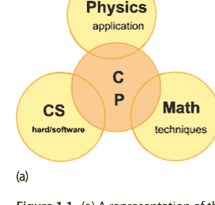

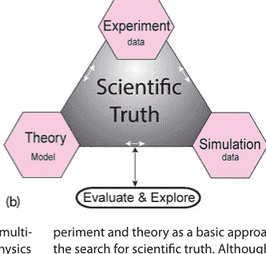

图 1.1 (a) 计算物理学作为物理学、应用数学和计算机科学的重叠以及作为它们之间的桥梁的多学科性质的表示，(b) 模拟已作为寻找科学真理的基本方法被添加到实验和理论中。尽管本书侧重于模拟，但我们将其作为科学过程的一部分来呈现。

我们的重点是帮助读者做更好的物理学，为此你需要足够理解 CS 和数学来正确解决你的问题，但不必成为专家程序员。

随着 CP 的成熟，我们认识到它不仅仅是物理学、计算机科学和数学的重叠。它也是它们之间的桥梁（图 1.1a 中的中心区域），包含其自身核心元素，例如计算工具和方法。对我们来说，CP 工具的共同性和其问题解决思维使其更接近其他计算科学，而远离物理学中大量存在的子专业化。为了强调我们的计算科学重点，在可能的情况下，我们以问题求解的形式呈现本书中的主题，解决方案的组成部分根据科学问题求解范式（图 1.1b）分开。在最近的时代，这种可以追溯到二战后在美国国家实验室开发的研究技术的问题求解方法，已被应用于科学教育，其中被称为类似计算科学思维。这显然与计算机科学家最近所称的计算思维有关，但前者较少学科特定。我们的计算科学思维是一种动手、基于探究的项目方法，其中包括问题分析、考虑可计算性和适当建模的理论基础、算法思维和开发、调试，以及导致回到原始问题的评估。

传统上，物理学利用实验和理论方法来发现科学真理。将理论转化为算法需要重大的理论洞察、详细的物理和数学理解，以及编程艺术的掌握。科学程序的实际调试、测试和组织类似于实验，数值模拟自然是虚拟实验。将数字综合成概括、预测和结论需要实验和理论科学共有的洞察力和直觉。事实上，计算和模拟的使用已变得如此普遍和必不可少的科学过程的一部分，以至于许多人认为科学范式已扩展到包括模拟作为额外的支柱（图 1.1b）。尽管如此，作为一门科学，CP 必须将实验置于至高无上地位，无论数学多么优美。

### 1.2
This Book's Subjects

本书首先讨论 Python 作为计算环境，然后讨论一些基本的计算主题。对计算硬件的简单回顾推迟到第 10 章，尽管它在课程开始时在逻辑上也合适。我们在本书的前三分之一中包含了部分物理应用，但将大部分 CP 推迟到本书的后三分之二。

本文写成可供高年级本科生使用，尽管许多没有 CP 背景的研究生也可能受益，甚至来自更基础的主题。我们涵盖了常微分方程和偏微分方程（PDE）应用，以及使用线性代数的问题，对于这些问题我们推荐已建立的子程序库。一些中级分析工具，如离散傅里叶变换、小波分析以及奇异值/主成分分解，物理学生通常理解不佳，也被涵盖（并推荐）。我们还介绍了流体动力学中的各种主题，包括激波和孤子物理学，据我们的经验，物理学生通常不会看到这些。一些更高级的主题包括量子力学中束缚态和（奇异）散射问题的积分方程，以及费曼路径积分。

查看本文材料的一种传统方式是根据其在课程中的使用。在我们的课程中（CPUG，2009），我们使用了文本的大约前三分之一，其重点是计算工具，用于一门名为科学计算的课程，该课程在学生熟悉某种编译语言后修读。在这个一季度课程中涵盖的典型主题在表 1.1 中给出，尽管我们也使用过其他主题。文本的后三分之二，其重点更多在物理学，通常用于计算物理学的两季度（20 周）课程。每季度涵盖的典型主题在表 1.2 中给出。由于许多主题属于研究水平，这些材料很容易用于一整年的课程或扩展的研究项目。

本文还使用各种符号和字体来帮助澄清所处理的材料类型。这些包括：

|  |  |
|---|---|
| ⊙ | 可选材料 |
| Monospace font | 单词在计算机屏幕上显示的方式 |
| Vertical gray line | 章节开头对读者的提示 |


| 周 | 主题 | 章节 | 周 | 主题 | 章节 |
|------|--------|---------|------|--------|---------|
| 1 | 操作系统工具, 限制 | 1, (10) | 6 | 矩阵, N-D 搜索 | 6 |
| 2 | 可视化, 错误 | 1, 3 | 7 | 数据拟合 | 7 |
| 3 | 蒙特卡洛, | 4, 4 | 8 | ODE 振荡 | 8 |
| 4 | 积分, 可视化 | 5, (1) | 9 | ODE 特征值 | 8 |
| 5 | 导数, 搜索 | 5, 7 | 10 | 硬件基础 | 10 |

## 计算物理 I

| 周 | 主题 | 章节 |
|------|--------|---------|
| 1 | 非线性常微分方程 | 8, 9 |
| 2 | 混沌散射 | 9 |
| 3 | 傅里叶分析, 滤波器 | 12 |
| 4 | 小波分析 | 13 |
| 5 | 非线性映射 | 14 |
| 6 | 混沌/双摆 | 15 |
| 7 | 项目完成 | 15 |
| 8 | 分形, 生长 | 16 |
| 9 | 并行计算, MPI | 10, 11 |
| 10 | 更多并行计算 | 10, 11 |

## 计算物理 II

| 周 | 主题 | 章节 |
|------|--------|---------|
| 1 | 伊辛模型, Metropolis | 17 |
| 2 | 分子动力学 | 18 |
| 3 | 项目完成 | — |
| 4 | 拉普拉斯和泊松偏微分方程 | 19 |
| 5 | 热偏微分方程 | 19 |
| 6 | 波动, 悬链线, 摩擦 | 21 |
| 7 | 激波和孤子 | 24 |
| 8 | 流体动力学 | 25 |
| 9 | 量子积分方程 | 26 |
| 10 | 费曼路径积分 | 17 |

为了使本书有助于成功的学习体验，我们假设读者会完成我们在每个讨论开始时所称的练习。这包括学习文本、编写、调试和运行程序、可视化结果，然后用文字表达已执行的内容以及可以得出的结论。作为这种方法的一部分，我们建议学习者为每个练习写一份迷你实验报告，包含以下部分：

- 方程求解
- 数值方法
- 代码清单
- 可视化
- 讨论
- 批判

虽然我们认识到编程是科学家的一项宝贵技能，但我们也知道它极其精确且耗时。为了减轻工作量，我们提供了“骨架”程序。我们建议使用这些程序

## 电磁学中的问题和练习

| 主题 | 章节 | 主题 | 章节 | 主题 | 章节 |
|---|---|---|---|---|---|
| EM, MM | 19.6 | EM, MM | 19.7 | EM, MM | 19.8 |
| EM, MM | 19.9 | EM, MM | 23.2 | EM, MM | 23.5 |
| EM, MM | 23.5.1 | EM, MM | 23.6.6 | EM, MM | 22.7.2 |
| EM, MM | 22.10 | EM, MM | 19.2 |  |  |

## 量子力学中的问题和练习

| 主题 | 章节 | 主题 | 章节 | 主题 | 章节 |
|---|---|---|---|---|---|
| QM, SP | 4.6 | QM, MM | 7.1 | QM, MM | 7.2.1 |
| QM, MM | 7.3.2 | QM, MM | 9.1 | QM, MM | 9.2 |
| QM, MM | 9.2.1 | QM, MM | 9.3 | QM | 13.6.3 |
| QM, MM | 17.7 | QM, MM | 26.1 | QM, MM | 26.3 |
| QM, MM | 22.1 |  |  |  |  |

## 经典力学和非线性动力学中的问题和练习

| 主题 | 章节 | 主题 | 章节 | 主题 | 章节 |
|---|---|---|---|---|---|
| CM, NL | 5.16 | CM | 6.1 | CM, NL | 8.1 |
| CM, NL | 8.7.1 | CM, NL | 8.8 | CM, NL | 8.9 |
| CM, NL | 8.10 | CM, NL | 9.4 | CM, NL | 9.4.3 |
| CM | 9.5 | CM | 9.7 | CM | 9.7 |
| NL, FD | 9.7 | CM | 9.7 | CM, MM | 6.6.2 |
| CM, MM | 6.6.1 | CM, NL | 12.1 | BI, NL | 14.3 |
| CM, MM | 6.6.1 | BI, NL | 14.4 | BI, NL | 14.5.2 |
| BI, NL | 14.5.3 | BI, NL | 14.10 | BI, NL | 14.11.1 |
| BI, NL | 14.11.4 | BI, NL | 14.11.5 | CM, NL | 15.1.3 |
| CM, NL | 15.1 | NL, BI | 14.1 | NL, BI | 14.9 |
| CM, NL | 15.2.2 | CM, NL | 15.3 | CM, NL | 15.4 |
| CM, NL | 15.5 | CM, NL | 15.6 | CM, NL | 15.7 |
| CM, NL | 15.7 | NL, MM | 16.2.1 | NL, MM | 16.3.3 |
| NL, MM | 16.4.1 | NL, MM | 16.5.3 | NL, MM | 16.7.1 |
| NL, MM | 16.7.1 | NL, MM | 16.8 | NL, MM | 16.11 |
| CM, MM | 21.2.4 | CM, MM | 21.3 | CM, MM | 21.4.3 |
| CM, MM | 24.6 | CM, MM | 21.1 | CM, MM | 21.5 |

## 流体动力学中的问题和练习

| 主题 | 章节 | 主题 | 章节 | 主题 | 章节 |
|---|---|---|---|---|---|
| NL, FD | 9.7 | FD, MM | 24.3.2 | FD, MM | 24.5.3 |
| FD, MM | 24.5.4 | FD, MM | 25.1 | FD, MM | 25.2.3 |
| FD, MM | 25.4.4 | FD, MM | 25.4.5 |  |  |

## 数学方法与计算工具中的问题和练习

| 主题 | 章节 | 主题 | 章节 | 主题 | 章节 |
|---|---|---|---|---|---|
| MM, CS | 1.6 | MM, SP | 4.3 | SP, MM | 4.3.2 |
| BI, MM | 4.4 | MM, SP | 4.5 | MM | 5.12.3 |
| MM | 5.16 | MM | 5.17.2 | MM | 5.5 |
| MM | 5.5 | QM, MM | 7.1 | QM, MM | 7.2.1 |
| QM, MM | 7.3.2 | MM, QM | 9.1 | QM, MM | 9.2 |
| QM, MM | 9.2.1 | QM, MM | 9.3 | CM, NL | 9.4 |
| MM, CS | 6.6 | CM, MM | 6.6.2 | CM, MM | 6.6.1 |
| MM | 7.5.1 | MM | 7.5.2.1 | MM | 7.8 |
| MM | 7.8.1 | MM | 7.8.2 | MM | 12.3 |
| MM | 12.5.3 | MM | 12.7.1 | MM | 12.11 |
| MM | 13.3.1 | MM | 13.5.2 | MM | 13.6.3 |
| CM, MM | 15.5 | NL, MM | 16.2.1 | NL, MM | 16.3.3 |
| NL, MM | 16.4.1 | NL, MM | 16.5.3 | NL, MM | 16.7.1 |
| NL, MM | 16.7.1 | NL, MM | 16.8 | NL, MM | 16.11 |
| Th, MM | 20.2.4 | Th, MM | 20.3 | TH, MM | 20.4.2 |
| EM, MM | 19.6 | EM, MM | 19.7 | EM, MM | 19.8 |
| EM, MM | 19.9 | EM, MM | 23.5 | EM, MM | 23.5.1 |
| EM, MM | 23.6.6 | CM, MM | 21.2.4 | CM, MM | 21.3 |
| CM, MM | 21.4.3 | QM, MM | 22.2.2 | QM, MM | 22.2.2 |
| QM, MM | 22.2.3 | EM, MM | 22.7.2 | EM, MM | 22.10 |
| FD, MM | 24.3.2 | FD, MM | 24.5.3 | FD, MM | 24.5.4 |
| FD, MM | 25.2.3 | FD, MM | 25.4.4 | FD, MM | 25.4.5 |
| QM, MM | 26.2.3 | QM, MM | 26.2.4 | QM, MM | 26.4.5 |
| QM, MM | 26.4.6 | MM, NL | 13.1 | MM, CM | 12.1 |
| MM | 12.6 | MM | 12.8.1 | MM | 7.5 |
| MM | 7.5.2.1 | MM | 7.6 | MM | 7.8.2 |
| MM | 13.7.2 |  |  |  |  |

| 分子动力学和生物应用中的问题和练习 |
| 主题 | 章节 | 主题 | 章节 | 主题 | 章节 |
|---|---|---|---|---|---|
| BI, MM | 4.4 | BI, NL | 14.3 | BI, NL | 14.4 |
| BI, NL | 14.5.2 | BI, NL | 14.5.3 | BI, NL | 14.10 |
| BI, NL | 14.11.1 | BI, NL | 14.11.4 | BI, NL | 14.11.5 |
| SP, BI | 16.3 | BI, NL | 14.1 | BI, NL | 14.9 |
| MD, QM | 18.3 | MD, QM | 18.4 | MD | 18.4 |
| MM, SP | 18 |  |  |  |  |

## 1.4

## 本书的语言：Python 生态系统

本版《计算物理》中的代码采用计算机语言 Python。之前的版本示例使用的是 Java、Fortran 和 C，并使用后处理工具进行可视化。虽然计算科学界对科学计算的最佳语言没有达成普遍共识，但这并没有阻止每个语言的用户宣称它是最佳的。即使如此，我们在此宣布，我们发现 Python 是迄今为止教授计算物理的最佳语言。Python 是免费的、健壮的（不易损坏）、可移植的（程序可在各种设备上无需修改即可运行）、通用的（适用于几乎所有计算机系统），具有简洁的语法，让学生能快速学习语言，具有动态类型和高层次的内置数据类型，可在无需声明数据类型或数组、计数匹配大括号或使用单独的可视化程序的情况下快速使程序工作。由于 Python 是解释型的，学生可以通过在交互式 shell 中执行和分析单个命令，或一次性运行整个程序来学习语言。此外，Python 为科学计算带来了大量免费软件包的可用性，支持数值算法、最新或简单的可视化以及可与 Matlab 和 Mathematica/Maple 相媲美的专业工具包。并且，我们是否提到过，所有这些都是免费的？

Python 软件包 literally 有数千个，但不用担心，我们仅为数值和可视化目的使用了其中几个。由于能够运行和修改本书中的示例代码至关重要，我们建议您花费必要的时间让 Python 在您的计算机上正常运行（然后记下您所做的工作）。对于学习 Python，我们推荐在线教程（Ptut, 2014; Pguide, 2014; Plearn, 2014）、Langtangen 的书籍 Langtangen (2008) 和 Langtangen (2009)，以及 Python Essential Reference（Beazley, 2009）。对于一般的数值方法，Press 等人（1994）的书籍是标准之作，也是最有趣的读物，而 NIST 数学函数数字图书馆（NIST, 2014）可能是最方便的。

Python 自 1989 年 12 月首次实现以来发展迅速（History, 2009）。Python 的语言加软件包组合现在已成为 stan-


## 1.4 本书的语言：Python 生态系统

这是典型的探索式和交互式计算标准，体现了当今科学研究的特色。Python 的快速发展也导致了一系列新版本的问世，以及不可避免的不兼容问题。本书中的大部分代码使用 2000 年发布的 Python 2 编写，具体来说是带有 Visual 包（也称为 “VPython”）的 Python 2.6。然而，Python 的开发过程和特性都发生了重大变化，这促成了 2008 年 12 月 Python 3.0 的发布。遗憾的是，Python 3 中的某些更改并不向后兼容 Python 2.6 和 2.7，因此 Python 2 和 3 及其相关包的发展一直在并行推进。（就我们的代码而言，主要区别在于 Python 3 中 print 语句需要使用括号，这并不难修正。）此外，操作系统和处理器也出现了新版本，CPU 从 32 位发展到 64 位，这也导致了 Python 版本及相关包的多样化。

说实话，我们有时会对这些变化及其带来的不兼容问题感到沮丧；但我们并不打算把这情绪传递给你！虽然我们会简要介绍各种包和发行版，但在此我们要说明，我们已经通过让 Python 2 和 Python 3 的独立实现同时存在于我们的计算机中，来适应现实世界。具体来说，我们的 Visual 包程序使用 Python 3.2，而其他程序使用 Enthought Canopy 发行版 1.3.0，该版本目前使用 Python 2.7.3。（Visual 包不包含在 Enthought 中。）

### 1.4.1 Python 包（库）

Python 语言及其包家族构成了一个名副其实的计算生态系统。包或模块是一组相关方法或方法类的集合，它们被组装成一个子程序库。¹ 加入适当的包可以扩展语言，以满足各种科学和工程学科的专业需求，并让人免费获得最先进的计算能力。事实上，《计算科学与工程》（Computing in Science and Engineering）2007 年 5/6 月刊和 2011 年 3/4 月刊（Perez 等人，2010）都聚焦于使用 Python 进行科学计算，我们推荐这两期。

¹ Python 包索引（PyPI, 2014）是一个免费 Python 包的仓库，目前包含超过 40,000 个包！

```
>>> from visual.graph import * # Import from visual package
>>> y1 = visual.graph.gcurve(color = blue, delta = 3) # Use of graph
```

这里 `>>>` 代表 Python 外壳的提示符。可以通过为包名指定一个符号来避免一些输入：

```
>>> import visual.graph as p
>>> y1 = p.gcurve(color = blue, delta = 3)
```

还有一个带星号的 `from` 版本，它会复制一个包的所有方法（这里是名为 pylab 的 Matplotlib），这样你就可以省略前缀：

```
>>> from pylab import * # Import all pylab methods
>>> plot(x, y, '-.', lw=2) # A pylab method without prefix
```

### 1.4.2 本书使用的包

我们即将介绍一些让 Python 如此丰富的包。如果你急于现在就开始，或者担心被 Python 包搞得不知所措，你或许可以现在就加载 VPython，然后继续阅读下一章。你还需要一些其他东西来做可视化和矩阵运算，但当你对 Python 更熟悉时，你随时可以升级你的知识。

因为很多时候你并不知道自己不知道什么，或者需要知道什么，所以我们在这里列出几个基本的 Python 包及其各自的作用。文中使用的包带有下划线，稍后会详细描述。

- **Boost.Python** 一个 C++ 库，能够在 C++ 和 Python 之间实现无缝互操作，从而延长遗留代码的生命周期，并利用 C 的速度，www.boost.org/doc/libs/1_55_0/libs/python/doc/。

- **Cython：用于 Python 的 C 扩展** Python 语言的一个超集，支持调用 C 函数，并将 Python 和 C 混合用于遗留目的和高性能计算，http://cython.org/。

- **f2py：Fortran 到 Python 的接口生成器** 提供 Python 与 Fortran 语言之间的连接；非常适合控制遗留代码，http://cens.ioc.ee/projects/f2py2e/。

- **IPython：交互式 Python** 一个高级外壳（命令行解释器），扩展了 Python 的基本解释器 IDLE。IPython 具有增强的交互性和交互式可视化能力，鼓励探索式计算。IPython 还有一个类似 Mathematica 的基于浏览器的笔记本，支持嵌入式代码执行，并具备并行计算能力，http://ipython.org/。

- **Matplotlib：数学绘图库** 一个使用 NumPy（Numerical Python）的 2D 和 3D 图形库，能够生成各种硬拷贝格式的出版级质量图形，并支持交互式图形。类似于 MATLAB 的绘图功能（只不过 Matplotlib 是免费的，而且不需要它的 li……

- 符号域、多项式空间和自由度，作为易于操作的符号表达式，https://pypi.python.org/pypi/SyFi/。

- **SymPy：符号 Python** 一个使用纯 Python（无外部库）进行符号数学计算的系统，提供一个简单的计算机代数系统，还包括微积分、微分方程等。类似于 Maple 或 Mathematica，而 Sage 包则更为完整。示例见第 1.7 节。另请参阅 mpmath，http://sympy.org/。

- **VisIt** 分布式、并行的可视化工具，用于可视化定义在 2D 和 3D 结构化及非结构化网格上的数据，https://wci.llnl.gov/codes/visit/。

- **Visual (VPython)** Python 编程语言加上可视化 3D 图形模块，使用 VIDLE 交互式外壳取代 Python 的标准 IDLE。即使在创建用于教育的 3D 演示和动画方面，对新手也特别有帮助。我们经常使用 Visual 进行数值数据的 2D 绘图和动画制作。可以从 Canopy 单独安装，http://vpython.org/。

### 1.4.3 简便方法：Python 发行版（包集合）

虽然大多数 Python 包都是免费的，但对于用户和供应商来说，发布一个经过工程设计和调优、能够良好协同工作并可一次性安装的包集合，具有真正的价值。（这与 Red Hat 和 Debian 对 Linux 所做的类似。）这些发行版可以被视为为特定目的而组装的完整 Python 生态系统，强烈推荐。这里我们提到四个我们熟悉的发行版：

- **Anaconda** 一个免费的 Python 发行版，包含超过 125 个用于科学、数学、工程和数据分析的包，包括 Python、NumPy、SciPy、Pandas、IPython、Matplotlib、Numba、Blaze 和 Bokeh。Anaconda 自称是企业级的大规模数据处理、预测分析和科学计算解决方案，并且允许在 Python 2.6、2.7 和 3.3 之间轻松切换。与 Canopy 一样，Anaconda 安装在自己的目录中，因此独立于你计算机上的其他 Python 安装运行，https://store.continuum.io/cshop/anaconda/。

- **Enthought Canopy** 一个全面而完整的 Python 分析环境，安装和更新都很简便。商业发行版包含超过 150 个包，但对学术用户免费。无论如何，还有一个包含超过 50 个包的 Express 版本，对所有人免费。这些包包括 IPython、NumPy、SciPy、Matplotlib、Mayavi、scikit、SymPy、Chaco、Envisage 和 Pandas。https://www.enthought.com/products/canopy/。

- **Python(x,y)** 一个免费的科学与工程开发包集合，用于数值计算、数据分析和数据可视化，采用 Qt 图形库进行 GUI 开发，并使用 Spyder 交互式科学开发环境，https://code.google.com/p/pythonxy/。


Sage：一个异常完整的开源数学计算包集合，既支持数值计算也支持符号计算，可通过 IPython 界面和笔记本使用。Sage 的既定使命是创建一个可行、免费、开源的替代品，以取代 Magma、Maple、Mathematica 和 Matlab，www.sagemath.org。

## 1.5 Python 的可视化工具

> 如果我无法描绘它，我就无法理解它。
>
> 阿尔伯特·爱因斯坦

在接下来的章节中，我们将讨论用于可视化模拟和测量数据的工具。其他书籍可能会选择将这一讨论放在附录中，或者根本不包含它，但我们认为可视化是 CP 不可或缺的一部分，并且对你阅读本书其余部分的工作非常有用，因此我们将其放在这里，就在最前面。我们描述了 Matplotlib、Visual（VPython）和 Mayavi 的用法。VPython 可以轻松制作二维图、立体几何图形和动画。Matplotlib 能制作非常精美的三维（曲面）图，而 Mayavi 则可以创建最先进的视觉效果。

### 概述

计算中最有价值的方面之一是将计算结果可视化。过去这是通过二维图完成的，而在现代，使用三维（曲面）图、体绘制（切块与切片）、动画和虚拟现实（游戏）工具已成为常规做法。这类可视化通常美得令人惊叹，并且通过让我们看到并“操控”正在使用的函数，可能对问题提供深刻的洞见。可视化还有助于调试过程、培养物理和数学直觉，以及全面提升工作的乐趣。

在考虑查看结果的方式时，请记住可视化的目的是让科学更清晰，并将你的工作传达给他人。因此，你应该尽可能让所有图表清晰、信息丰富且不言自明，尤其是当你要在无标题的演示中使用它们时。这意味着要为曲线和数据点添加标签、标题以及坐标轴标签。² 之后，你应该审视你的可视化，并询问是否有更好的单位选择、坐标轴范围、颜色、样式等，从而可能更好地传达信息并提供更深刻的洞见。还要记住，那些在显示器上看起来很棒的颜色，在打印时可能会变成毫无信息量的灰色。考虑到人类感知和认知的复杂性，对于特定数据集可能不存在唯一的最佳可视化方式，因此可能需要进行一些试错才能“看到”哪种方式最有效。

² 尽管这可能不言而喻，但应将自变量 x 放在横坐标（水平方向）上，将因变量 y = f(x) 放在纵坐标上。

**清单 1.1** *EasyVisual.py* 使用 Visual 包生成两个不同的二维图。

```python
# EasyVisual.py:      Simple graph object using Visual
from visual.graph import *                # Import Visual
Plot1 = gcurve(color = color.white)       # gcurve method
for x in arange(0., 8.1, 0.1):            # x range
    Plot1.plot( pos = (x, 5.*cos(2.*x)*exp(-0.4*x)) ) # Plot pts
graph1 = gdisplay(width=600, height=450,\
    title='Visual 2D Plot', xtitle='x', ytitle='f(x)',\
    foreground = color.black, background = color.white)
Plot2 = gdots(color = color.black)       # Dots
for x in arange(-5., +5, 0.1):
    Plot2.plot(pos = (x, cos(x)))
```

### 1.5.1 Visual（VPython）的二维图

正如包描述中所指出的，VPython（Python 加上 Visual 包）是开始使用 Python 和可视化的简单方式。³ Visual 包对于创建三维实体、二维图和动画非常有用。例如，在图 1.2 中，我们展示了清单 1.1 中 EasyVisual.py 程序生成的两个图。请注意，这种绘图技术是先创建一个绘图对象，然后逐个将点添加到对象中。（相比之下，Matplotlib 会创建一个点的向量，然后绘制整个向量。）

³ 由于 Visual 不是 Canopy 的包之一，要运行我们的 Visual 程序，你需要安装 Visual 包以及能与之兼容的 Python 版本，即使你已经安装了 Canopy 也是如此。这样做没有问题，因为 VPython 和 Canopy 会安装到不同的文件夹/目录中。

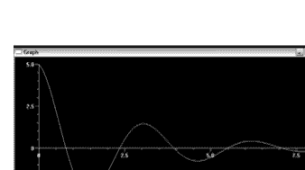

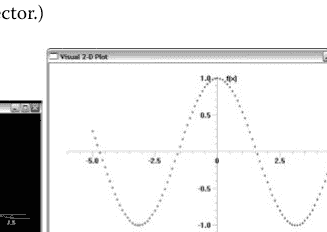

(a)

(b)

图 1.2 由 EasyVisual.py 使用 Visual 包生成的两个 x-y 图的屏幕截图。图 (a) 使用默认参数，而图 (b) 使用用户提供的选项。

可以看出，EasyVisual.py 创建了两个绘图对象 Plot1 和 Plot2，并使用 plot 方法绘制每个对象。Plot1 使用 gcurve 方法，除了曲线的颜色（白色）外未指定任何选项。我们默认得到一条连通的曲线（图 1.2a），但没有标签。相比之下，Plot2 使用 gdisplay 方法来设置后续绘图的显示特性，然后用 gdots 将数据绘制为点（图 1.2b）。在创建 gcurve 图形对象之前，你要先使用 gdisplay 绘图对象，以设置图形窗口的大小、位置和标题，指定 x 轴和 y 轴的标题，并指定每个轴的最大值。gdisplay 的参数不言自明，宽度和高度以像素为单位。由于我们设置了 Plot2 = gdots()，因此只绘制了点。

**清单 1.2** *3GraphVisual.py* 使用 Visual 包生成一个二维 x-y 图。

```python
# 3GraphVisual.py: 3 plots in the same figure, with bars, dots and curve
from visual import *
from visual.graph import *
string = "blue: sin^2(x), white: cos^2(x), red: sin(x)*cos(x)"
graph1 = gdisplay(title=string, xtitle='x', ytitle='y')
y1 = gcurve(color=color.yellow, delta=3)      # curve
y2 = gvbars(color=color.white)                # vertical bars
y3 = gdots(color=color.red, delta=3)          # dots
for x in arange(-5, 5, 0.1):                   # arange for floats
    y1.plot( pos=(x, sin(x)*sin(x)) )
    y2.plot( pos=(x, cos(x)*cos(x)/3.) )
    y3.plot( pos=(x, sin(x)*cos(x)) )
```

请注意，Python 代码以带阴影的方框形式列出，并带有一些格式以提高可读性。例如，参见清单 1.2。请注意，我们对代码进行了结构化处理，在函数等主要元素之前会跳过一行，并且缩进表示 Python 中的结构（而在 Java 和 C 中可能使用花括号）。

将多个图放在同一个图中通常是一个好主意。清单 1.2 中的程序 3GraphVisual.py 就是这样做的，并生成了图 1.3a 中的图形。其中有使用 gvbars 创建的白色垂直条、使用 gdots 创建的红色点，以及使用 gcurve 创建的黄色曲线（在印刷文本中颜色仅显示为灰色阴影）。另外请注意，在 3GraphVisual.py 中，我们通过以 `from visual.graph import *` 开头，避免了在命令前添加包名作为前缀。这既导入了 Visual 的绘图包，也直接访问了其所有函数。

#### 1.5.1.1 VPython 的三维对象

**清单 1.3** *3Dshapes.py* 生成 VPython 三维形状的示例。

```python
# 3Dshapes.py: Some 3D Shapes of VPython
from visual import *
graph1 = display(width=500, height=500, title='VPython 3D Shapes',
    range=10)
sphere(pos=(0,0,0), radius=1, color=color.green)
sphere(pos=(0,1,-3), radius=1.5, color=color.red)
arrow(pos=(3,2,2), axis=(3,1,1), color=color.cyan)
cylinder(pos=(-3,-2,3), axis=(6,-1,5), color=color.yellow)
cone(pos=(-6,-6,0), axis=(-2,1,-0.5), radius=2, color=color.magenta)
helix(pos=(-5,5,-2), axis=(5,0,0), radius=2, thickness=0.4,
color=color.orange)
ring(pos=(-6,1,0), axis=(1,1,1), radius=2, thickness=0.3,
color=(0.3,0.4,0.6))
box(pos=(5,-2,2), length=5, width=5, height=0.4, color=(0.4,0.8,0.2))
pyramid(pos=(2,5,2), size=(4,3,2), color=(0.7,0.7,0.2))
ellipsoid(pos=(-1,-7,1), axis=(2,1,3), length=4, height=2, width=5,
color=(0.1,0.9,0.8))
```

使模拟看起来更逼真的一种方法是使用三维实体形状，例如，用球体表示弹跳的球，而不仅仅是点。VPython 可以通过单行命令生成各种三维形状，如图 1.4 所示，并由清单 1.3 中的代码生成。要让球弹跳，你需要根据一些运动学方程来改变位置变量。

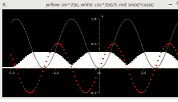

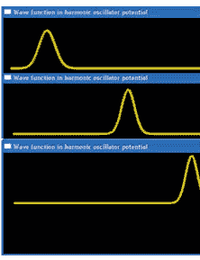

(a)

(b)

图 1.3 (a) 程序 3GraphVisual.py 的输出，该程序使用 Visual 将一个图形上放置三种不同类型的二维图。(b) 由 HarmosAnimate.py 生成的量子力学波包的 Visual 动画中的三帧。


图 1.4 使用 VPython 中的单命令创建的一些三维形状。


### 1.5.2 VPython 的动画

使用 Visual 创建动画本质上就是一遍又一遍地绘制相同的 2D 图，每次都在略有不同的时间点上，然后将这些图叠加在一起。操作得当的话，这会给人以运动的印象。我们的大多数示例代码都生成了动画，例如 HarmosAnimate.py 和 3DAnimate.py。图 1.3b 显示了由 HarmosAnimate.py 产生的三个帧。这些代码的主要部分处理的是 PDE 的求解，这暂时与我们无关。使动画生效的部分很简单：

```python
PlotObj= curve(x=xs, color=color.yellow, radius=0.1)
...
while True:
    rate(500)                # Runs forever
    psr[1:-1] = ...
    psi[1:-1] = ...
    PlotObj.y = 4*(psr**2 + psi**2)
```

这里 PlotObj 是一个曲线，它不断地在 while 循环内部构建，因此看起来在移动。注意，能够在不将所有时间点都存储在数组中的情况下逐个绘制点，可以使程序的内存需求保持很小，从而实现快速的程序。

### Listing 1.4 EasyMatPlot.py 使用 Matplotlib 包生成 2D x–y 绘图（该包包含 NumPy 包）。

```python
# EasyMatPlot.py: Simple use of matplotlib's plot command
from pylab import *                     # Load Matplotlib
Xmin = -5.;  Xmax = +5.;  Npoints= 500
DelX = (Xmax - Xmin) / Npoints
x = arange(Xmin, Xmax, DelX)
y = sin(x) * sin(x*x)                   # function of x array
print ('arange => x[0], x[1],x[499]=%8.2f %8.2f %8.2f' %(x[0],x[1],x[499]))
print ('arange => y[0], y[1],y[499]=%8.2f %8.2f %8.2f' %(y[0],y[1],y[499]))
print ('\n Now doing the plotting thing, look for Figure 1 on desktop' )
xlabel('x'); ylabel('f(x)'); title(' f(x) vs x')
text(-1.75, 0.75, 'MatPlotLib \n Example')     # Text on plot
plot(x, y, '-', lw=2)
grid(True)                              # Form grid
show()
```

## 1.5.3 Matplotlib 的 2D 绘图

Matplotlib 是一个功能强大的绘图包，可让你直接在 Python 程序中制作 2D 和 3D 图形、直方图、功率谱、条形图、误差图、散点图等。Matplotlib 是免费的，使用了 NumPy 和 LAPACK 的复杂数值计算（Anderson et al., 2013），而且，令人难以置信的是，易于使用。具体来说，Matplotlib 使用 NumPy 数组（向量）对象来存储要绘制的数据。在第 6 章中，我们将更详细地讨论 NumPy 数组，因此你可能想尽快去那里更好地理解数组。

Matplotlib 命令的设计与 MATLAB 的绘图命令相似，MATLAB 是一个在工程领域特别流行的商业问题求解环境。与 MATLAB 一样，Matplotlib 假设你已将要绘制的 x 和 y 值放入 1D 数组（向量）中，然后一次性绘制这些向量。这与 Visual 不同，Visual 首先创建一个绘图对象，然后逐点向对象添加点。因为 Matplotlib 不是 Python 的标准部分，所以你必须将整个 Matplotlib 包或你使用的单个方法导入到你的程序中。例如，在 Listing 1.4 的 EasyMatPlot.py 的第 2 行（行号在右侧的深色阴影中），我们将 Matplotlib 导入为 pylab 库：

```python
from pylab import *        # Load Matplotlib
```

然后，在第 6 行和第 7 行我们计算并输入 x 和 y 值的数组

```python
x = arange(Xmin, Xmax, DelX)    # Form x array in range with increment
y = -sin(x)*cos(x)               # Form y array as function of x array
```

正如你所见，NumPy 的 arange 方法构造了一个从 Xmax 到 Xmin 以 DelX 为步长的数组。因为限制是浮点数，所以 x_i 也将是浮点数。因为 x 是一个数组，所以 y = -sin(x)*cos(x) 也会自动成为一个数组！实际的绘图在第 14 行执行，使用破折号 "-" 表示线条，lw = 2 设置其宽度。结果如图 1.5a 所示，并带有所需的标签和标题。show() 命令在你的桌面上生成图形。更多命令在表 1.3 中给出。我们建议你尝试一些选项和可能的绘图类型。

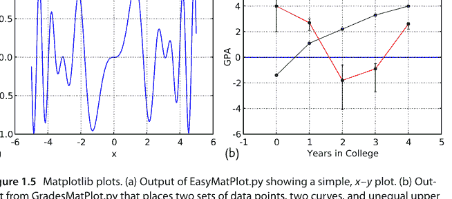

图 1.5 Matplotlib 绘图。 (a) EasyMatPlot.py 的输出，显示一个简单的 x–y 绘图。 (b) GradesMatPlot.py 的输出，将两组数据点、两条曲线和不相等的上下误差条全部放在一个绘图上。

### 表 1.3 一些常见的 Matplotlib 命令。

| Command | Effect | Command | Effect |
|---|---|---|---|
| plot(x, y, '-', lw=2) | x−y curve, line width 2 | myPlot.setYRange(-8., 8.) | Set y range |
| show() | Show output graph | myPlot.setSize(500, 400) | Size in pixels |
| xlabel('x') | x-axis label | pyplot.semilogx | Semilog x plot |
| ylabel('f(x)') | y-axis label | pyplot.semilogy | Semilog y plot |
| title('f vs x') | Add title | grid(True) | Draw grid |
| text(x, y, 's') | Add text s at (x, y) | myPlot.setColor(false) | Black and White |
| myPlot.addPoint(0,x,y,true) | Add (x, y) to set 0 connect | myPlot.setButtons(true) | For zoom button |
| myPlot.addPoint(1,x,y, false) | Add (x, y) to 1, no connect | myPlot.fillPlot() | Fit ranges to data |
| pyplot.errorbar | Point + error bar | myPlot.setImpulses(true,0) | Vertical lines, set 0 |
| pyplot.clf() | Clear current figure | pyplot.contour | Contour lines |
| pyplot.scatter | Scatter plot | pyplot.bar | Bar charts |
| pyplot.polar | Polar plot | pyplot.gca | For current axis |
| myPlot.setXRange(-1., 1.) | Set x range | pyplot.acorr | Autocorrelation |

### Listing 1.5 GradesMatPlot.py 使用 Matplotlib 包生成 2D x–y 绘图。

```python
# Grade.py: Using Matplotlib's plot command with multi data sets & curves
import pylab as p                     # Matplotlib
from numpy import *

p.title('Grade Inflation')            # Title and labels
p.xlabel('Years in College')
p.ylabel('GPA')

xa = array([-1, 5])                   # For horizontal line
ya = array([0, 0])                    # "   "
p.plot(xa, ya)                        # Draw horizontal line

x0 = array([0, 1, 2, 3, 4])
y0 = array([-1.4, +1.1, 2.2, 3.3, 4.0]) # Data set 0 points
p.plot(x0, y0, 'bo')                  # Data set 0 = blue circles
p.plot(x0, y0, 'g')                   # Data set 0 = line

x1 = arange(0, 5, 1)                  # Data set 1 points
y1 = array([4.0, 2.7, -1.8, -0.9, 2.6])
p.plot(x1, y1, 'r')

errTop = array([1.0, 0.3, 1.2, 0.4, 0.1])   # Asymmetric error bars
errBot = array([2.0, 0.6, 2.3, 1.8, 0.4])
p.errorbar(x1, y1, [errBot, errTop], fmt = 'o')  # Plot error bars

p.grid(True)                          # Grid line
p.show()                              # Create plot on screen
```

在 Listing 1.5 中，我们给出了代码 GradesMatPlot.py，并在图 1.5b 中展示了其输出。这不是一个简单的绘图。这里我们多次重复 plot 命令，以便在同一张图上绘制多组数据集，并绘制数据

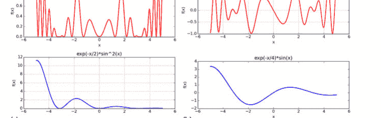

(a) (b)

图 1.6 (a,b) 列显示了由 MatPlot2figs.py 产生的两个单独的输出，每个输出包含两个图形。 （我们使用滑块按钮在绘图之间添加了一些空间。）

放置了两条曲线在一个绘图上，然后输出两个不同的图形，每个图形包含两个绘图。关键在于 subplot 命令的重复：

```python
figure(1)               # The 1st figure
subplot(2,1,1)          # 2 rows, 1 column, 1st subplot
subplot(2,1,2)          # 2 rows, 1 column, 2nd subplot
```

该列表是自解释的，其中包含设置绘图限制的部分、创建每个图形的部分，然后创建网格。

### Listing 1.7 PondMatPlot.py 生成图 5.5 中第 5 章所示的散点图和曲线。

```python
# PondMatPlot.py: Monte-Carlo integration via vonNeumann rejection
import numpy as np
import matplotlib.pyplot as plt

N = 100
x1 = np.arange(0, 2*np.pi+2*np.pi/N,2*np.pi/N)
fig,ax = plt.subplots()
y1 = x1 * np.sin(x1)**2                # Integrand
ax.plot(x1, y1, 'c-', linewidth=4)
ax.set_xlim((0, 2*np.pi))
ax.set_ylim((0, 5))
ax.set_xticks([0, np.pi, 2*np.pi])
ax.set_xticklabels(['0', '$\uppi$', '2$\uppi$'])
ax.set_ylabel('$f(x) = x\sin^2 x$', fontsize=20)
ax.set_xlabel('x', fontsize=20)
fig.patch.set_visible(False)
xi=[]; yi=[]; xo=[]; yo=[]

def fx(x):                             # Integrand
    return x*np.sin(x)**2

j = 0                                  # Inside curve counter
Npts = 3000
analyt = np.pi**2
xx = 2.* np.pi * np.random.rand(Npts)  # 0 <= x <= 2pi
yy = 5*np.random.rand(Npts)           # 0 <= y <= 5
for i in range(1,Npts):
```


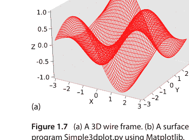

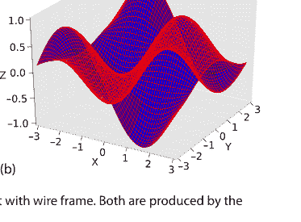

图 1.7 (a) 一个 3D 线框图。(b) 带线框的曲面图。两者均由程序 Simple3dplot.py 使用 Matplotlib 生成。

在图 1.7a 中，我们展示了一个线框图，在图 1.7b 中，展示了一个曲面加线框图。这些图来自列表 1.8 中的程序 Simple3Dplot.py。注意，为了进行 3D 绘图，需要从 Matplotlib 工具包中额外导入 Axes3D。第 8 行和第 9 行是使用 arange 创建 x 和 y 浮点数组的常规方法。第 11 行使用 meshgrid 方法通过向量调用从 x 和 y 坐标向量设置整个坐标矩阵网格，第 12 行用另一个向量运算构造整个 Z 曲面。程序的其余部分不言自明，其中 fig 为绘图对象，ax 为 3D 坐标轴对象，plot_wireframe 和 plot_surface 分别创建线框图和曲面图。

另一种特别有用的 3D 图是在检查形如 (x_i, y_j, z_k) 的数据时，将其散点绘制到 3D (x, y, z) 体积中。在列表 1.9 中，我们给出了程序 Scatter3dPlot.py，它生成了图 1.8 中的绘图。该程序取自 Matplotlib 文档，使用 NumPy 随机数生成器，其中 111 记法是从 MATLAB 继承而来，表示 1 × 1 × 1 网格。

## 列表 1.9 Scatter3dPlot.py 使用 Matplotlib 3D 工具生成 3D 散点图。

```
" Scatter3dPlot.py   from matplotlib examples"

import numpy as np
from mpl_toolkits.mplot3d import Axes3D
import matplotlib.pyplot as plt

def randrange(n, vmin, vmax):
    return (vmax-vmin)*np.random.rand(n) + vmin

fig = plt.figure()
ax = fig.add_subplot(111, projection='3d')
n = 100
for c, m, zl, zh in [('r', 'o', -50, -25), ('b', '^', -30, -5)]:
    xs = randrange(n, 23, 32)
    ys = randrange(n, 0, 100)
    zs = randrange(n, zl, zh)
    ax.scatter(xs, ys, zs, c=c, marker=m)
```

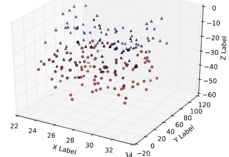

图 1.8 由程序 Scatter3dPlot.py 使用 Matplotlib 生成的 3D 散点图。

```
ax.set_xlabel('X Label')
ax.set_ylabel('Y Label')
ax.set_zlabel('Z Label')

plt.show()
```

最后，由 Oscar Restrepo 编写的程序 FourierMatplot.py 对锯齿波进行傅里叶重建，所包含的波数由查看者通过滑块控制，如图 1.9 所示。 （我们在第 12 章讨论傅里叶变换的数学。）滑块方法通过以下额外行包含：

```
from matplotlib.widgets import Slider
...
numwaves = Slider(axnumwaves , '# Waves' , 1 , 20 , valinit=T)
...
snumwaves.on_changed(update)
```

## 1.5.5

## Matplotlib's Animations

Matplotlib 也能做动画，只是没有 VPython 那么简单。Matplotlib 示例页面展示了许多动画。我们在 PythonCodes/Visualizations 目录中包含了部分 Matplotlib 动画代码，并在列表 1.10 中展示了一个关于热方程的示例代码。这里同样大部分代码处理的是求解偏微分方程，这目前可能还不感兴趣。我们在代码底部进行了动画处理。

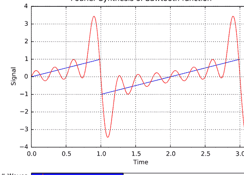

# Waves 9.00

图 1.9 将锯齿函数与其傅里叶分量的和进行比较，所包含的波数可通过 Matplotlib 滑块交互式变化。FourierMatplot.py 生成了此输出，由 Oscar Restrepo 编写。

## 列表 1.10 EqHeatAnimateMatPlot.py 使用 Matplotlib 生成冷却棒的动画。

```
# EqHeat.py Animated heat equation soltn via fine differences
from numpy import *
import numpy as np
import matplotlib.pyplot as plt
import matplotlib.animation as animation

Nx = 101
Dx = 0.01414
Dt = 0.6
KAPPA = 210.                # Thermal conductivity
SPH = 900.                  # Specific heat
RHO = 2700.                 # Density
cons = KAPPA/(SPH*RHO)*Dt/(Dx*Dx);
T = np.zeros( (Nx, 2), float)       # Temp @ first 2 times
def init():
    for ix in range (1, Nx - 1):    # Initial temperature
        T[ix, 0] = 100.0;

    T[0, 0] = 0.0                    # Bar ends T = 0
    T[0, 1] = 0.
    T[Nx - 1, 0] = 0.
    T[Nx - 1, 1] = 0.0
init()
k=range(0,Nx)
fig=plt.figure()                    # Figure to plot
# select add; 111: only one plot, x,y, scales given
ax = fig.add_subplot(111, autoscale_on=False, xlim=(-5, 105), ylim=(-5, 110.0))
ax.grid()                           # Plot grid
plt.ylabel("Temperature")
plt.title("Cooling of a bar")
```

```
```python
line, = ax.plot(k, T[k,0], "r", lw=2)
plt.plot([1,99],[0,0],"r",lw=10)
plt.text(45,5,'bar',fontsize=20)

def animate(dum):
    for ix in range (1, Nx - 1):
        T[ix, 1] = T[ix, 0] + cons*(T[ix + 1, 0] + T[ix - 1, 0] - 2.0*T[ix, 0])
        line.set_data(k,T[k,1])
    for ix in range (1, Nx - 1):
        T[ix, 0] = T[ix, 1]                         # Row of 100 positions at
        t = m
    return line,
ani = animation.FuncAnimation(fig, animate,1)       # Animation
plt.show()
```
```

## 1.5.6

**Mayavi’s Visualizations Beyond Plotting***

> > 本节关于 Mayavi 的内容被标记为可选，因为我们在示例程序中并未使用它。然而，我们建议读者至少浏览一下，以便获得有关 Python 可视化下一层次的一些思路。

虽然 Matplotlib 非常适合绘制一个或两个变量的函数，但它并非设计用于显示超级计算机中心经常展示的、具有三个或更多变量的函数雕塑式 3D 可视化。Mayavi（梵语意为“魔术师”）正是为这一层级的可视化而设计的。Mayavi 是开源的，与 Python 紧密集成，并包含在 Canopy 发行版中。

Mayavi 由两个不同的包和两个不同的接口组成。我们在此举例说明的包是一组类似于 Matlab 或 Mathematica 的命令，它们在相当高的抽象层面上运行，并且能自然地与 NumPy 数组配合使用。另一个包是一组 VTK（Visual Tool Kit）原语，可能更适合开发您自己的、研究特定的可视化模块。即使使用高层包，您也可以选择通过 Python 程序中的脚本与 Mayavi 交互（我们演示的就是这种方式），或通过独立于程序运行的独立应用程序进行交互。

我们现在将展示一些源自 Enthought 教程的示例。我们首先让 Mayavi 生成一个标准的曲面图 $z(x,y)=x^4+y^4$。

```
```python
import numpy; import Matplotlib; import matplotlib.pyplot
import mayavi; import mayavi.mlab

X, Y = numpy.mgrid[-2:2: 0.1, -2:2: 0.1];        Z = X**4 + Y**4

mayavi.mlab.surf(Z);                              mayavi.mlab.axes()
mayavi.mlab.outline();                            mlab.show()
```
```

这里我们使用 NumPy 的 numpy.mgrid 方法设置 X 和 Y 数组，然后通过向量化计算 $X^4+Y^4$ 设置 Z 数组。然后我们使用 Mayavi 创建 Z 曲面、绘制坐标轴并用

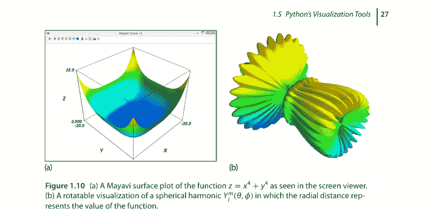

一个框勾勒出曲面。最后，有一个重要的调用 mlab.show() 用于在图 1.10a 所示的显示框中显示可视化。该显示框中包含若干（太小）按钮，可让您产生不同的视图和大小、插入方向箭头、以各种格式将文件保存到磁盘、编辑可视化的属性并打开管道窗口。管道窗口显示并允许用户控制可视化的各个阶段：加载数据到数据源对象、通过模块转换数据、并通过模块将其可视化。

现在我们超越了直接绘制函数值的可视化，转向对定义在球面表面的球谐函数 $Y_l^m(θ, φ)$ 的可视化创建（图 1.10b）：

```
```python
from numpy import pi, sin, cos, mgrid
from mayavi import mlab
dphi, dtheta = pi/250.0, pi/250.0
[phi, theta] = mgrid[0:pi+dphi*1.5:dphi,0:2*pi+dtheta*1.5:dtheta]
m0 = 4; m1 = 3; m2 = 2; m3 = 3; m4 = 6; m5 = 2; m6 = 6; m7 = 4;
r = sin(m0*phi)**m1 + cos(m2*phi)**m3 + sin(m4*theta)**m5 +
cos(m6*theta)**m7
x = r*sin(phi)*cos(theta); y = r*cos(phi)
z = r*sin(phi)*sin(theta)
# Function
# View data
s = mlab.mesh(x, y, z)
mlab.show()
```
```

由于我们没有四个维度可用，我们取 $Y_l^m(θ, φ)$ 在各个网格点的值，并将这些值作为每个 θ 和 φ 值的径向距离进行绘制。这里的新元素是语句 s = mlab.mesh(x, y, z) 它在 3D 空间中产生一个网格，然后将半径投影到其 (x, y, z) 分量。

在下一个示例中，我们从形如 (x_i, y_j, z_k) 值的数据集开始，并用各种颜色的管线连接点：


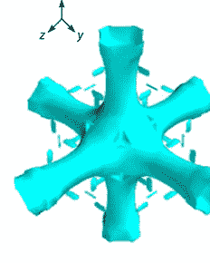

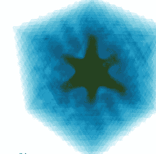

(a)

(b)

图 1.12 (a) 标量场 φ(x, y, z) = sin(xyz)/xyz 等值面的 Mayavi 可视化。 (b) 同一标量场的体渲染。

将向量场的分量作为其他数组的函数。 这里的新命令是 quiver3d，它提供了一组箭头（可爱的名字）。

如果我们希望可视化的场是标量场，例如 φ(x, y, z) = sin(xyz)/xyz，则适当的视觉化将是在三维空间中贯穿的等值面（3D 等值线图）。 我们用 contour3d 命令来完成：

```
import numpy as np
from mayavi import mlab
x, y, z = np.ogrid[-10:10:20j, -10:10:20j, -10:10:20j]
scalar = np.sin(x*y*z)/(x*y*z)
mlab.contour3d(scalar)
mlab.show()
```

图 1.12a 显示了输出，它是周期性的，但并不明显是三角函数。

我们现在对同一标量场的视觉化进行取样，并展示其他 Mayavi 方法如何产生该场的不同视图。 首先，进行体渲染以产生图 1.12b 中的朦胧视图：

```
import numpy as np
from mayavi import mlab
x, y, z = np.ogrid[-10:10:20j, -10:10:20j, -10:10:20j]
s = np.sin(x*y*z)/(x*y*z)
mlab.pipeline.volume(mlab.pipeline.scalar_field(s))
mlab.show()
```

接下来，我们取相同的场并用 pipeline 命令替换 mlab.contour3d(s) 命令：

```
mlab.pipeline.volume(mlab.pipeline.scalar_field(s))
```

这会产生图 1.12b 中的朦胧视觉化。 接下来，我们通过让一些平面穿过标量场来产生图 1.13a 中的视觉化：

## 1.7 Python 的代数工具

虽然本书的重点是 Python 在数值模拟中的使用，但这并不意味着计算符号操作的<|message|>重要性被忽视（即使我们可能就是这样感觉的）。 Python 实际上有（至少）两个可用于符号操作的包，它们非常不同。 如第 1.4.3 节所述，Sage 包与 Maple 和 Mathematica 属于同一类，具有笔记本图形界面，让用户可以在其中创建出版质量的文本，在其中可以运行 Python 程序，或符号地操作方程。 然而 Sage 是一个庞大而强大的包，通过包含多个计算机代数系统以及可视化工具等超越了纯 Python。 使用 Sage 的多项功能可能会变得相当复杂，事实上，已经写了书籍并举办了研讨会来讲解 Sage 的使用。 我们将感兴趣的读者引向在线 Sage 文档页面 www.sagemath.org/help.html。

SymPy 符号操作包与任何其他 Python 包一样，可以从您常规的 Python shell 中运行。 它可以从 https://github.com/sympy/sympy/releases 下载，或您可以使用包含 SymPy 的 Canopy 分发版。 现在我们给出一些 SymPy 使用的简单示例，但如果您想使用 SymPy，您真的需要从 SymPy 教程 http://docs.sympy.org/latest/tutorial/ 开始。 （注意，尽管我们正在 Python shell 中工作，SymPy 已自动找到一个 LATEX 应用程序并用它来格式化输出。） 首先，我们将求一些导数以显示 SymPy 知道微积分：

```
>>> from sympy import *
>>> x, y = symbols('x y')
>>> y = diff(tan(x),x); y tan²(x) + 1
>>> y = diff(5*x**4 + 7*x**2, x, 1); y
>>> y = diff(5*x**4 + 7*x**2, x, 2); y
```

我们在这里看到，我们必须首先从 SymPy 导入方法，然后使用 symbols 命令声明变量 x 和 y 为代数。 其余部分相当明显，diff 是导数算子，diff 中的 x 参数表示我们相对于 x 求导。 现在让我们尝试展开：

```
>>> from sympy import *
>>> x, y = symbols('x y')
>>> z = (x + y)**8; z
>>> expand(z) x^8 + 8x^7 y + 28x^6 y^2 + 56x^5 y^3 + 70x^4 y^4 + 56x^3 y^5 + 28x^2 y^6 + 8x y^7 + y^8
```

SymPy 知道无穷级数和不同的展开点：

```
>>> sin(x).series(x, 0)
# 关于 0 的通常 sin x 级数
x - x^3/6 + x^5/120 + O(x^7)
>>> sin(x).series(x,10)
# 关于 x = 10 的 sin x
sin(10) + x cos(10) - x^2 sin(10)/2 - x^3 cos(10)/6 + x^4 sin(10)/24 + x^5 cos(10)/120 + O(x^6)
```

```
>>> z = 1/cos(x); z
1/cos(x)
>>> z.series(x, 0)
1 + x**2/2 + 5*x**4/24 + O(x**6)
# 一个除法，而不是逆运算
# 关于 x = 0 展开 1/cos x
```

计算机代数系统的一个经典困难是，即使答案正确，如果它不简单，那么它可能没有用。 因此，SymPy 也有 simplify 函数以及 factor 函数（以及我们不会举例说明的 collect、cancel 和 apart）：

```
>>> factor(x**2 -1)
(x - 1)(x + 1)
# 一个不错的答案
>>> factor(x**3 - x**2 + x - 1)
(x - 1)(x**2 + 1)
>>> simplify((x**3 + x**2 - x - 1)/(x**2 + 2*x + 1))
x - 1
# 好多了！
>>> simplify(x**3+3*x**2*y+3*x*y**2+y**3)
x**3 + 3*x**2*y + 3*x*y**2 + y**3
# 没有帮助！
>>> factor(x**3+3*x**2*y+3*x*y**2+y**3)
(x + y)**3
# 好多了！
>>> simplify(1 + tan(x)**2)
cos(x)**(-2)
>>> simplify(2*tan(x)/(1+tan(x)**2))
sin(2*x)
```

## 2

## 计算软件基础

本章讨论了一些计算基础，从计算语言、数字表示和编程工具开始。 探讨了使用浮点数的限制和后果。 与硬件基础相关的主题在第 10 章中。

### 2.1

### 让计算机服从

> 最好的程序是编写得使计算机器能够快速执行，人类能够清晰理解的。 程序员理想上是与传统美学和文学形式以及数学概念一起工作的散文家，以传达算法的工作方式并说服读者结果将是正确的。
> 
> Donald E. Knuth

无论你对计算机的拟人化程度如何，请记住计算机总是完全按照指示执行。 这意味着你必须告诉它们要做的一切。 当然，你运行的程序可能有如此复杂的逻辑，以至于你可能没有耐心得出你告诉计算机要做的事情的细节，但原则上总是可能的。 所以你的第一个问题是获得足够的理解，以便你感觉足够掌控，无论这种掌控多么虚幻，都能弄清楚计算机在做什么。

在你告诉计算机服从你的命令之前，你需要明白对计算机来说生活并不简单。 它们理解的指令是用基本机器语言¹) 编写的，它告诉硬件执行诸如将存储在一个内存位置的数字移动到另一个位置或执行一些简单的二进制算术之类的操作。 很少有计算科学家用计算机能理解的语言与计算机对话。 在编写和运行程序时，我们通常通过 shell、在高级语言（Python、Java、Fortran、C）中，或通过问题求解环境（Maple、Mathematica 和 Matlab）与计算机通信。 最终，这些命令或程序被翻译成硬件理解的基本机器语言。

1) 原始个人电脑的 Beginner's All-Purpose Symbolic Instruction Code（BASIC）编程语言不应与基本机器语言混淆。

一个 shell 是命令行解释器，即计算机运行的一组小型程序，它们响应你键入的命令（程序的名称）。 通常你打开一个特殊窗口来访问 shell，这个窗口也被称为 shell。 有助于将这些 shell 视为计算机操作系统（OS）的外层（图 2.1），其内部包含基本操作的内核。 （用户很少直接与内核交互，除非可能在安装程序或从头构建操作系统时。） shell 的工作是运行程序、编译器和执行诸如复制文件等操作的实用程序。 单台计算机上可以有不同类型的 shell，或同时运行多个相同 shell 的副本。

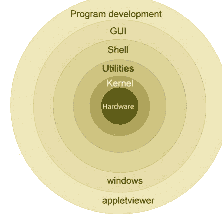

图 2.1 计算机内核和 shell 的示意视图。 硬件位于中心，被越来越高层的软件包围。

操作系统有 Unix、Linux、DOS、MacOS 和 MS Windows 等名称。 操作系统是一组由计算机用来与用户和设备通信、存储和读取数据以及执行程序的程序。 操作系统以基本方式告诉计算机做什么。 操作系统将你、其他设备和程序视为其处理的输入数据；在许多方面，它是不可或缺的办公室经理。 虽然所有这些看起来可能很复杂，但操作系统的目的是让计算机做繁琐的工作，以便你可以思考更高层次的想法并以更接近你正常日常语言的方式与计算机通信。


当你以高级语言将程序提交给计算机时，计算机会使用编译器来处理它。编译器是另一个程序，它把你的程序视为外语，并使用内置词典和一组规则将其翻译成基本的机器语言。可以想象，最终的指令集相当详细且冗长，编译器可能需要对你程序进行多遍扫描，以解读你的逻辑并将其翻译成可快速运行的代码。翻译后的语句构成目标代码或编译代码，当与其他所需子程序链接在一起时，形成加载模块。加载模块是一套完整的机器语言指令，可以被加载到计算机内存中，由计算机读取、理解并执行。

Fortran 和 C 等语言使用编译器读取你的整个程序，然后将其翻译成基本机器指令。BASIC 和 Maple 等语言则在每条程序语句输入时逐行翻译。编译型语言通常能带来更高效的程序，并允许使用庞大的子程序库。解释型语言能给用户更即时的响应，因此显得更“友好”。Python 和 Java 语言是两者的混合体。当你首次编译程序时，Python 会将其解释为一种中间的、通用的字节码，并以 PYC（或 PYO）文件形式存储。该文件可以传输到其他计算机上使用，但不能用于不同版本的 Python。然后，当你运行程序时，Python 会把字节码重新编译为特定于机器的编译代码，这比逐行解释源代码更快。

## 2.2 编程热身

在进入正式工作之前，我们要确认你的本地计算机能正常为你工作。假设计算器尚未发明，而你需要一个程序来计算圆的面积。先不要使用任何特定语言，而是用伪代码编写该程序，以后再转换为你喜欢的语言。第一个程序告诉计算机：

```
Calculate area of circle          # Do this computer!
```

这个程序实际上无法工作，因为它没有告诉计算机要考虑哪个圆，以及如何处理面积。更好的程序是

```
read radius                     # Input
calculate area of circle        # Numerics
print area                      # Output
```

在大多数计算机语言中，calculate area of circle 这条指令没有意义，因此我们需要指定一种算法，即计算机要遵循的一组规则：

2) 右侧字段中的注释仅供你参考，计算机不会对其执行操作。

```
read radius
PI = 3.141593
area = PI * r * r
print area
# Input
# Set constant
# Algorithm
# Output
```

这是一个更好的程序，那么让我们看看如何用 Python 实现它（其他语言版本可在线获取）。在清单 2.1 中，我们给出了 Area 程序的 Python 版本。这是一个简单程序，输出到屏幕，输入内置于程序中。

### 清单 2.1 Area.py 输出到屏幕，输入内置于程序。

```
# Area.py: Area of a circle, simple program
from math import pi

N = 1
r = 1.
C = 2.* pi* r
A = pi * r**2

print ('Program number =', N, '\n r, C, A = ', r, C, A)

""" Expected OUTPUT
Program number = 1
r, C, A = 1.0 6.283185307179586 3.141592653589793"""
```

### 2.2.1 结构化且可复现的程序设计

编程是一种书面艺术，它将科学、数学和计算机科学的元素融合为一组指令，使计算机能够完成所需任务。如今，已发表的科学成果日益依赖计算这一基本要素，你的程序源代码本身能够被他人获取，以便他们复现和扩展你的结果，这一点变得越来越重要。可复现性也许不如新发现那样令人兴奋，但它是科学中必不可少的要素（Hinsen, 2013）。除了计算机语言的语法之外，科学程序还应包含若干基本要素，以确保程序的有效性和可用性。与其他技艺一样，我们建议在你掌握更好的方法之前，先遵循一些简单的规则。一个好的程序应该

- 给出正确答案。
- 清晰易读，各部分的作用易于分析。
- 自我文档化，方便读者和程序员。
- 易于使用。
- 由可独立验证的小程序构建而成。
- 易于修改，并且足够健壮，在修改和简单调试后仍能持续给出正确答案。
- 记录所使用的数据格式。
- 使用可信赖的库。
- 公开发布或传给他人，供其使用并进一步开发。

面向对象编程的一个吸引力在于，它会自动强制实施这些规则。让程序更清晰的一种基本方法，是用缩进、空行和策略性放置的括号来构建程序结构。这样做是为不同程序部分的功能提供视觉线索（即结构化编程中的“结构”）。事实上，Python 既将缩进用作结构元素，也用它来提高清晰度。尽管印刷页面的空间限制使我们无法插入像希望中那么多的空行，但我们仍建议你照我们说的做，而不是照我们做的做！

在图 2.2 中，我们给出了基本流程图和详细流程图，它们演示了一个可能用于计算抛体运动的程序。流程图的目的不是对程序进行详细描述，而是作为一种图形辅助工具，帮助可视化程序的逻辑流程。因此，它独立于特定计算机语言，有助于开发和理解程序的基本结构。我们建议你在编写程序之前先画流程图，或者（次优选择）编写伪代码。伪代码就像流程图的文本版本，省略细节，而专注于逻辑和结构：

```
Store g, Vo, and theta
Calculate R and T
Begin time loop
Print out "not yet fired" if t < 0
Print out "grounded" if t > T
Calculate , print x(t) and y(t)
Print out error message if x > R, y > H
End time loop   End program
```

### 2.2.2 Shell、编辑器和执行

- 1. 为了获得一些使用计算机系统的经验，请使用编辑器录入程序 Area.py（是的，我们知道你可以复制粘贴，但开工前你可能需要一些练习）。然后，将文件保存到你的主（个人）目录中，从而写入磁盘（我们建议每个章节使用单独的子目录）。注意：熟悉 Python 的读者可以改为输入 AreaFormatted.py，它使用了能产生格式化输出的命令。
- 2. 编译并执行 Area.py 的相应版本。
- 3. 对程序进行实验。例如，观察如果在给 r 的赋值语句中省略小数点、把 r 赋值为空白，或者把 r 赋值为字母，会发生什么。请记住，犯错不太可能“弄坏”计算机上的任何东西；看看计算机在压力下如何响应也是有好处的。
- 4. 修改程序，使其计算球体的体积 4/3 πr³，并以正确名称打印出来。将修改后的程序保存到个人目录中的一个文件中，并命名为 Vol.py。
- 5. 打开并执行 Vol.py，通过运行多个测试用例来检查你的修改是否正确。好的输入数据是 r = 1 和 r = 10。

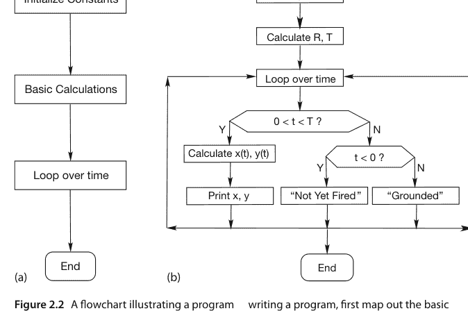

### 图 2.2

演示计算抛体运动程序的流程图。图(a) 显示程序的基本组成部分，图(b) 显示其中的一些细节。编写程序时，先规划基本组成部分，然后确定结构，最后填充细节。这称为自顶向下编程。

- 6. 修改 Area.py，使其从你自定的文件名读取输入，然后以不同格式写入你创建的另一文件，再读取后一个文件。
- 7. 观察输出所用的数据类型与文件中的数据类型不匹配时会发生什么（例如，浮点数被读取为整数）。
- 8. 修改 AreaMod，使其使用 main 方法（负责输入和输出）和一个独立的函数或方法进行计算。检查所得答案是否与之前相同。

### 清单 2.2

AreaFormatted.py 实现与键盘及文件的输入/输出。它通过在 raw_input 和 input 之间切换，可兼容 Python 2 或 Python 3。注意：使用 Canopy 从文件读取时，必须在 Python 运行窗口中右键单击，并选择“Change to Editor Directory”。

```
# AreaFormatted: Python 2 or 3 formated output, keyboard input, file input
from numpy import *
from sys import version
if int(version[0]) >2:               # Python 3 uses input, not
    raw_input
    raw_input=input
name = raw_input('Key in your name: ')          # raw_input strings
print("Hi",name)
radius = eval(raw_input('Enter a radius: '))    # For numerical values
print('you entered radius= %8.5f'%radius)       # formatted output
print('Enter new name and r in file Name.dat')  # raw_input strings
infile = open('Name.dat','r')                   # Read from file Name.dat
```


```
for line in infile:
    line = line.split()                # Splits components of line
    name = line[0]                     # First entry in the list
    print(" Hi %10s "%(name))         # print Hi + first entry
    r = float(line[1])                 # convert string to float
    print("r = %13.5f "%(r))           # convert to float & print
infile.close()
A = math.pi*r**2
print("Done, look in A.dat\n")
outfile = open('A.dat','w')
outfile.write('r= %13.5f\n'%(r))
outfile.write('A =  %13.5f\n'%(A))
outfile.close()
print('r = %13.5f'%(r), ', A = %13.5f'%(A))          # Screen output
print('\n Now example of integer input ')
age=int(eval(raw_input('Now key in your age as an integer: ')))
print("age: %4d years old, you don't look it!\n"%(age))
print("Enter and return a character to finish")
s = raw_input()
```

## 2.3
### Python I/O

Python 最简单的 I/O 是使用 print 命令向屏幕输出（见 Area.py，列表 2.1），以及使用 input 命令从键盘输入（见 AreaFormatted.py，列表 2.2）。我们也在 AreaFormatted.py 中看到，可以通过将字符串用引号（单引号或双引号）括起来，或使用 raw_input（Python2）或 input（Python 3）命令不加引号的方式来输入字符串（字面上的数字和字母）。要使用 print 打印字符串，请将字符串放在引号中。AreaFormatted.py 还展示了如何从文件中输入字符串和数字。（但请注意，如果你使用 Canopy：你必须在 Python 运行窗口中右键单击并选择 Change to Editor Directory，以便将 Canopy 的 Python shell 的工作目录切换到你的工作目录。）

最简单的输出只是通过给出其名称来打印浮点值：

```
print 'eps = ', eps                # Output float in default format
```

这使用了 Python 的默认格式，其倾向于根据所打印数字的精度而变化。作为替代方案，你可以控制输出的格式。对于浮点数，你需要指定两件事。首先，期望小数点后有多少位数字，其次，数字整体应使用多少个空格：

```
print("x=%6.3f ,  Pi=%9.6f , Age=%d \n") % (x, math.pi, age)
print "x=%6.3f ," %(x), "Pi=%9.6f," %(math.pi), "Age=%d "%(age), "\n"
x = 12.345,   Pi = 3.141593, Age=39                # Output from either
```

这里的 %6.3f 将浮点数（在 Python 中是 double）格式化为以定点记法（f）打印，小数点后有三位，且整体占六位（小数点占一位，符号占一位，小数点前一位）

长串的 0 和 1 对计算机来说没问题，但对人类来说很笨拙。因此，在将结果传达给人们之前，二进制字符串会被转换为八进制、十进制或十六进制数。八进制和十六进制数之所以好，是因为转换保持了精度，但不算太好，因为我们十进制的算术规则不适用于八进制和十六进制。将数字转换为十进制数使我们更容易处理，但除非原始数字是 2 的幂，否则转换会降低精度。

对特定计算机系统或语言的描述通常会说明字长，即存储一个数字所用的位数。长度通常以字节表示，（一口位的位），其中

1 byte ≡ 1 B ≜ 8 bits .

内存和存储大小以字节、千字节、兆字节、千兆字节、太字节和拍字节（10¹⁵）来衡量。这里需要格外注意的是，对于那些详细计算大小的人来说，K 并不是总意味着 1000：

1 K ≜ 1 kB = 2¹⁰ bytes = 1024 bytes . (2.1)

这在内存大小以 K 表示时经常（且令人困惑地）得到补偿，例如，

512 K = 2⁹ bytes = 524 288 bytes × 1 K / 1024 bytes .

方便的是，1 字节也是存储单个字母如“a”所需的内存量，这累积起来相当于一页印刷文本需要约 3 kB。

某些较旧的个人计算机中的内存芯片使用 8 位字，而现代 PC 使用 64 位。这意味着最大整数相当小，为 2⁷ = 128（7 是因为 1 位用于符号）。使用 64 位允许整数范围为 1–2⁶³ ≈ 10¹⁹。虽然乍一看这个范围似乎很大，但与物理世界中遇到的尺寸范围相比，实际上并不大。举例来说，宇宙的大小与质子的大小相比，跨度为 10⁴¹。尝试存储超出硬件或软件设计范围的数字（溢出）在旧机器上很常见，但现在较少见。溢出有时会伴随信息性错误消息，有时不会。

## 2.4.1
### IEEE 浮点数

计算机上实数的表示方式为定点或浮点记法。定点记法可用于小数点（基数）后位数固定的数字或整数。它具有能够使用二进制补码运算和能够精确存储整数的优点。³ 在具有 N 位且采用二进制补码格式的定点表示中，一个数表示为

```
N_fix = sign × (α_n 2^n + α_{n-1} 2^{n-1} + ⋯ + α_0 2^0 + ⋯ + α_{-m} 2^{-m}) ,   (2.2)
```

其中 n + m = N − 2。也就是说，1 位用于存储符号，其余（N − 1）位用于存储 α_i 值（2 的幂是已知的）。N、m 和 n 的具体值取决于机器。整数通常为 4 字节（32 位）长，范围在

```
−2 147 483 648 ≤ 4-B integer ≤ 2 147 483 647 .   (2.3)
```

表示式（2.2）的一个优点是你可确保所有定点数具有相同的绝对误差 2^{−m−1}（从（2.2）右端省略的项）。相应的缺点是，小数（α 值的前串为零的数）具有较大的相对误差。因为现实世界中相对误差往往比绝对误差更重要，所以整数主要用于计数目的和特殊应用（如银行）。

大多数科学计算使用 64 位 = 8 B 的双精度浮点数。计算机上浮点数的表示是二进制版本的通常所知的科学记数法或工程记数法。例如，光速 c = +2.997 924 58 × 10^8 m/s 在科学记数法中，以及 +0.299 792 458 × 10^9 或 0.299 795 498 E09 m/s 在工程记数法中。在每种情况下，前面的数字称为尾数，包含九位有效数字。10 的幂称为指数，前面的加号提醒这些数字可能为负。

浮点数在计算机上存储为符号位、指数和尾数的拼接（并置）。由于只能存储有限数量的位，计算机能精确存储的浮点数集合，即机器数（图 2.3 中的哈希标记），并不覆盖整个实数集合。特别是，机器数有最大值和最小值（图 2.3 中的阴影）。如果超过最大值，会发生称为溢出的错误条件；如果低于最小值，会发生称为下溢的错误条件。在后一种情况下，软件和硬件可能设置成在不通知你的情况下将下溢设为零。相比之下，溢出通常会停止程序的执行。

内存中存储的内容与浮点数值之间的实际关系有些间接，多年来使用了许多特殊情况和关系。事实上，在过去，每个计算机操作系统和每种计算机语言都有自己的浮点数标准。不同的标准意味着同一程序在不同机器上正确运行

> 3) 二进制数的二进制补码是通过从 N 位表示的 2^N 中减去该数得到的数值。因为该系统通过绝对值的二进制补码来表示负数，所以加法和减法可以在无需处理数字符号的情况下进行。


IEEE标准实际上包含许多组成部分，不同的计算机或芯片制造商可能只遵循其中一部分。此外，Python在开发过程中可能不会遵循所有标准，但未来很可能会。通常，浮点数x存储为

x_float = (-1)^s × 1.f × 2^{e-bias} , (2.4)

也就是说，分别用符号s、尾数的小数部分f和指数域e来存储。所有部分都以二进制形式存储，对于单精度数，它们占据一个32位字的相邻段；对于双精度数，则占据两个相邻的32位字。符号s存储为单个位，s = 0表示正号，s = 1表示负号。指数e使用8位存储，这意味着e的取值范围为0 < e ≤ 255。端点值e = 0和e = 255是特殊情况（表2.2）。正常数的取值范围为0 < e < 255，按照约定，尾数的首位假设为1，因此只存储二进制小数点后的小数部分f。次正规数和特殊情况的表示形式见表2.2。

请注意，±INF和NaN在数学意义上并不是数，也就是说，它们不是可以被操作或在计算中用来求极限等用途的对象。相反，它们是向计算机和你发出的信号，表示出现了问题，计算可能应该停止，直到你理清状况。相比之下，−0可以在计算中使用而不会造成任何损害。有些语言可能会将未赋值变量设为−0，以此提示它们尚未被赋值，尽管最好不要依赖这一点！

由于不确定性（误差）只存在于尾数而非指数中，IEEE表示确保所有正常浮点数具有相同的相对精度。由于浮点数的首位被假定为1，因此无需存储它，计算机设计者只需记住那里有一个幻数位1，就能获得额外一位精度。在计算过程中处理数字时，中间结果的首位可能变为0，但在最终数字存储之前会被改回。重申一下，对于正常情况，实际尾数（二进制记法中的1.f）在二进制小数点前包含一个隐含的1。

## 表2.2 正常与异常IEEE单精度的表示方案

| 数字名称 | s、e和f的值 | 单精度值 |
|---|---|---|
| 正常数 | 0 < e < 255 | (-1)^s × 2^{e-127} × 1.f |
| 次正规数 | e = 0, f ≠ 0 | (-1)^s × 2^{-126} × 0.f |
| 有符号零（±0） | e = 0, f = 0 | (-1)^s × 0.0 |
| +∞ | s = 0, e = 255, f = 0 | +INF |
| −∞ | s = 1, e = 255, f = 0 | −INF |
| 非数 | s = u, e = 255, f ≠ 0 | NaN |

## 2.4 计算机数字表示（理论）

最后，为了保证存储的有偏指数e始终为正，在实际指数p存储为有偏指数e之前，会加上一个称为偏移量的固定数。实际指数可能为负，即p = e − bias . (2.5)

IEEE浮点格式有两种基本类型：单精度和双精度。单精度是单精度浮点数的简称，双精度是双精度浮点数的简称。（但在Python中，所有浮点数都是双精度的。）单精度总共占用32位，其中1位为符号，8位为指数，23位为尾数的小数部分（加上幻数位后达到24位精度）。双精度总共占用64位，其中1位为符号，10位为指数，53位为尾数的小数部分（达到54位精度）。这意味着双精度的指数和尾数并不是简单地翻倍，如表2.1所示。（此外，IEEE标准还允许超出双精度的扩展精度，但这已经够复杂了，现在先不深入讨论。）

为了查看该方案的实际应用，考虑32位表示（2.4）：

| 位位置 | s | e | f |
|--------------|---|---|---|
| 31 30 23     | 22 0 |

符号位s位于第31位，有偏指数e位于第30–23位，尾数的小数部分f位于第22–0位。由于使用8位存储指数e，且2^8 = 256，因此e的取值范围为0 ≤ e ≤ 255 . (2.6)

e = 0和255是特殊情况。对于偏移量127₁₀，完整指数p = e₁₀ − 127 , (2.7)

如表2.1所示，单精度的指数范围为−126 ≤ p ≤ 127 . (2.8)

单精度的尾数f存储在位置22–0的23位中。对于正常数，即满足0 < e < 255的数，f是尾数的小数部分，因此这32位表示的实际数字为 正常浮点数 = (−1)^s × 1.f × 2^{e−127} . (2.9)

次正规数满足e = 0, f ≠ 0。对于这些数，f是完整的尾数，因此这32位表示的实际数字为 次正规数 = (−1)^s × 0.f × 2^{e−126} . (2.10)

用于存储正常单精度尾数的23位m22 − m0对应于表示

尾数 = 1.f = 1 + m22 × 2−1 + m21 × 2−2 + ⋯ + m0 × 2−23 , (2.11)

其中次正规数使用0.f。用于存储±0和±∞的特殊e = 0表示见表2.2。

为了看看这在实践中如何运作（图2.3），32位机器上最大的正常正浮点数具有指数e = 254（值255被保留）和f的最大值：

Xmax = 01111 1110 1111 1111 1111 1111 1111 111
= (0)(1111 1110)(1111 1111 1111 1111 1111 111) , (2.12)

为了清晰起见，我们对位进行了分组。将所有部分组合在一起后，我们得到表2.1中所示的值：

s = 0 , e = 1111 1110 = 254 , p = e − 127 = 127 ,
f = 1.1111 1111 1111 1111 1111 111 = 1 + 0.5 + 0.25 + ⋯ ≈ 2 ,
⇒ (−1)s × 1.f × 2p=e−127 ≈ 2 × 2127 ≈ 3.4 × 1038 . (2.13)

同样，最小的正浮点数是次正规数（e = 0），尾数中只有一个有效位：

0 0000 0000 0000 0000 0000 0000 0000 001 . (2.14)

这对应于

s = 0 , e = 0 , = e − 126 = −126
f = 0.0000 0000 0000 0000 0000 001 = 2−23
⇒ (−1)s × 0.f × 2p=e−126 = 2−149 ≈ 1.4 × 10−45 . (2.15)

总而言之，单精度（32位或4字节）数具有六到七位十进制有效数字，数量级范围为

1.4 × 10−45 ≤ 单精度 ≤ 3.4 × 1038 . (2.16)

双精度数存储为两个32位字，总共64位（8字节）。符号占1位，指数e占11位，尾数的小数部分占52位：

|   | s | e | f | f（续） |
| 位位置 | 63 | 62 52 | 51 32 | 31 0 |

正如我们在这里看到的，这些字段是连续存储的，尾数f的一部分存储在单独的32位字中。这些字的顺序，以及包含f的第二个字是尾数的最高有效部分还是最低有效部分，取决于机器。对于双精度，偏移量比单精度大得多，

偏移量 = 1111111112 = 102310 , (2.17)

因此实际指数p = e − 1023。

## 表2.3 IEEE双精度的表示方案

| 数字名称 | s、e和f的值 | 双精度值 |
|---|---|---|
| 正常数 | 0 < e < 2047 | (−1)^s × 2^(e−1023) × 1.f |
| 次正规数 | e = 0, f ≠ 0 | (−1)^s × 2^(−1022) × 0.f |
| 有符号零 | e = 0, f = 0 | (−1)^s × 0.0 |
| +∞ | s = 0, e = 2047, f = 0 | +INF |
| −∞ | s = 1, e = 2047, f = 0 | −INF |
| 非数 | s = u, e = 2047, f ≠ 0 | NaN |

双精度的位模式见表2.3，范围和精度见表2.1。重申一下，如果你用双精度编写程序，那么将使用64位（8字节）来存储浮点数。双精度大约有16位十进制精度（2^52分之一）和如下数量级范围：

4.9 × 10^−324 ≤ 双精度 ≤ 1.8 × 10^308 . (2.18)

如果单精度数x大于2^128，会发生称为溢出的故障条件（图2.3）。如果x小于2^−128，则会发生下溢。对于溢出，结果数x_c最终可能是与机器相关的模式、非数（NAN）或不可预测的值。对于下溢，结果数x_c通常设置为零，尽管这通常可以通过编译器选项更改。（让计算机自动将下溢转换为零通常是一条好路径；将溢出转换为零可能是灾难之路。）由于计算机上正数和负数表示的唯一区别是负数的符号位为1，因此同样的考虑也适用于负数。

根据我们的经验，严肃的科学计算几乎总是至少需要64位（双精度）浮点数。如果你的计算有一部分需要双精度，你可能处处都需要，这意味着需要使用双精度的库例程来实现方法和函数。

### 2.4.2

### Python与IEEE 754标准

Python是一种相对较新的语言，随着其使用范围的扩大和功能的成熟，它不断发生变化和扩展。因此，Python目前并不完全遵循IEEE 754标准的所有方面，尤其是特殊情况，也就不足为奇了。对我们来说，最相关的差异可能是Python不支持单精度（32位）浮点数。因此，当我们在Python中处理称为float的数据类型时，它相当于IEEE标准中的双精度。由于单精度对于大多数科学计算来说是不够的，因此这不是损失。但要注意，如果你改用Java或C，你应该声明你的


variables as doubles and not as floats. While Python eliminates single-precision floats, it adds a new data type complex for dealing with complex numbers. Complex numbers are stored as pairs of doubles and are quite useful in science.

The details of how closely Python adheres to the IEEE 754 standard depend upon the details of Python’s use of the C or Java language to power the Python interpreter. In particular, with the recent 64 bits architectures for CPUs, the range may even be greater than the IEEE standard, and the abnormal numbers (±INF, NaN) may differ. Likewise, the exact conditions for overflows and underflows may also differ. That being the case, the exploratory exercises to follow become all that more interesting because we cannot say that we know what results you should obtain!

## 2.4.3

## Over and Underflow Exercises

- 1. Consider the 32-bit single-precision floating-point number A:

|  | s | e | f |
|---|---|---|---|
| Bit position | 31 | 30 23 | 22 0 |
| Value | 0 | 0000 1110 | 1010 0000 0000 0000 0000 000 |

- a) What are the (binary) values for the sign s, the exponent e, and the fractional mantissa f? (Hint: e10 = 14.)
- b) Determine decimal values for the biased exponent e and the true exponent p.
- c) Show that the mantissa of A equals 1.625 000.
- d) Determine the full value of A.

- 2. Write a program that determines the underflow and overflow limits (within a factor of 2) for Python on your computer. Here is a sample pseudocode

```
under = 1.
over = 1.
begin do N times
    under = under/2.
    over = over * 2.
    write out: loop number, under, over
end do
```

You may need to increase N if your initial choice does not lead to underflow and overflow. (Notice that if you want to be more precise regarding the limits of your computer, you may want to multiply and divide by a number smaller than 2.)

- a) Check where under- and overflow occur for double-precision floating-point numbers (floats). Give your answer in decimal.
- b) Check where under- and overflow occur for double-precision floating-point numbers.
- c) Check where under- and overflow occur for integers. Note: There is no exponent stored for integers, so the smallest integer corresponds to the most

negative one. To determine the largest and smallest integers, you must observe your program's output as you explicitly pass through the limits. You accomplish this by continually adding and subtracting 1. (Because integer arithmetic uses two's complement arithmetic, you should expect some surprises.)

## 2.4.4

## Machine Precision (Model)

A major concern of computational scientists is that the floating-point representation used to store numbers is of limited precision. As we have shown for a 32-bit-word machine, single-precision numbers are good to 6–7 decimal places, while doubles are good to 15–16 places. To see how limited precision affects calculations, consider the simple computer addition of two single-precision numbers:

7 + 1.0 × 10⁻⁷ = ?
(2.19)

The computer fetches these numbers from memory and stores the bit patterns

7 = 0 1000 0010 1110 0000 0000 0000 0000 000 ,
(2.20)

10⁻⁷ = 0 0110 0000 1101 0110 1011 1111 1001 010 ,
(2.21)

in working registers (pieces of fast-responding memory). Because the exponents are different, it would be incorrect to add the mantissas, and so the exponent of the smaller number is made larger while progressively decreasing the mantissa by shifting bits to the right (inserting zeros) until both numbers have the same exponent:

10⁻⁷ = 0 01100001 0110 1011 0101 1111 1100 101 (0)
= 0 0110 0010 0011 0101 1010 1111 1110 010 (10)
...
(2.22)
= 0 1000 0010 0000 0000 0000 0000 0000 000 (0001 101 ... 0)
⇒ 7 + 1.0 × 10⁻⁷ = 7 .
(2.23)

Because there is no room left to store the last digits, they are lost, and after all this hard work the addition just gives 7 as the answer (truncation error in Figure 2.3). In other words, because a 32-bit computer stores only 6 or 7 decimal places, it effectively ignores any changes beyond the sixth decimal place.

The preceding loss of precision is categorized by defining the machine precision εₘ as the maximum positive number that, on the computer, can be added to the number stored as 1 without changing that stored 1:

1_c + ε_m ≜ 1_c ,
(2.24)

where the subscript c is a reminder that this is a computer representation of 1. Consequently, an arbitrary number x can be thought of as related to its floating-point representation x_c by

x_c = x(1 ± ε),   |ε| ≤ ε_m , (2.25)

where the actual value for ε is not known. In other words, except for powers of 2 that are represented exactly, we should assume that all single-precision numbers contain an error in the sixth decimal place and that all doubles have an error in the 15th place. And as is always the case with errors, we must assume that we really do not know what the error is, for if we knew, then we would eliminate it! Consequently, the arguments we are about to put forth regarding errors should be considered approximate, but that is to be expected for unknown errors.

## 2.4.5

## Experiment: Your Machine's Precision

Write a program to determine the machine precision ε_m of your computer system within a factor of 2. A sample pseudocode is

```
eps = 1.
begin do N times
    eps = eps/2.                # Make smaller
    one = 1. + eps              # Write loop number, one, eps
end do
```

A Python implementation is given in Listing 2.4, while a more precise one is ByteLimit.py on the instructor's guide.

## Listing 2.4 Limits.py determines machine precision within a factor of 2.

```
# Limits.py: determines approximate machine precision

N = 10
eps = 1.0

for i in range(N):
    eps = eps/2
    one_Plus_eps = 1.0 + eps
    print('eps = ', eps, ', one + eps = ', one_Plus_eps)
```

- 1. Determine experimentally the precision of double-precision floats.
- 2. Determine experimentally the precision of complex numbers.

To print out a number in the decimal format, the computer must convert from its internal binary representation. This not only takes time, but unless the number is an exact power of 2, leads to a loss of precision. So if you want a truly precise indication of the stored numbers, you should avoid conversion to decimals and instead print them out in octal or hexadecimal format (\0NNN).

## 2.5 Problem: Summing Series

A classic numerical problem is the summation of a series to evaluate a function. As an example, consider the infinite series for sin x:

```
sin x = x - x^3/3! + x^5/5! - x^7/7! + ⋯ (exact).
```

Your problem is to use just this series to calculate sin x for x < 2π and x > 2π, with an absolute error in each case of less than 1 part in 10^8. While an infinite series is exact in a mathematical sense, it is not a good algorithm because errors tend to accumulate and because we must stop summing at some point. An algorithm would be the finite sum sin x ≈ ∑_{n=1}^N (-1)^{n-1} x^{2n-1} / (2n-1)! (algorithm).

But how do we decide when to stop summing? (Do not even think of saying, "When the answer agrees with a table or with the built-in library function.") One approach would be to stop summing when the next term is smaller than the precision desired. Clearly then, if x is large, this would require large N as well. In fact, for really large x, one would have to go far out in the series before the terms start decreasing.

Never mind that the algorithm (2.27) indicates that we should calculate (-1)^{n-1}x^{2n-1} and then divide it by (2n-1)! This is not a good way to compute. On the one hand, both (2n-1)! and x^{2n-1} can get very large and cause overflows, despite the fact that their quotient may not be large. On the other hand, powers and factorials are very expensive (time-consuming) to evaluate on the computer. Consequently, a better approach is to use a single multiplication to relate the next term in the series to the previous one:

```
(-1)^{n-1} x^{2n-1} / (2n-1)! = -x^2 / ((2n-1)(2n-2)) * (-1)^{n-2} x^{2n-3} / (2n-3)! 
⇒ nth term = -x^2 / ((2n-1)(2n-2)) × (n-1)th term. (2.28)
```

While we want to establish absolute accuracy for sin x, that is not so easy to do. What is easy to do is to assume that the error in the summation is approximately the last term summed (this assumes no round-off error, a subject we talk about in Chapter 3). To obtain a relative error of 1 part in 10^8, we then stop the calculation when |nth term / sum| < 10^{-8}, (2.29)


### 2.5.2 实现与评估

其中，“term”是级数 (2.27) 中保留的最后一项，“sum”是所有项的累计和。一般来说，你可以随意选择所需的任何容差水平，但如果该容差过于接近机器精度，或者小于机器精度，你的计算可能无法达到该容差。执行求和的伪代码如下：

```text
term = x, sum = x, eps = 10^(-8)   # Initialize
do
    term = -term*x*x/(2n+1)/(2n)   # New term from old
    sum = sum + term               # Add term
while abs(term/sum) > eps          # Break iteration
end do
```

- **1.** 编写一个程序，对指定的 \(x\) 值实现该伪代码。将结果以表格形式呈现，表头为 \(x\)、sum、\(|sum - \sin(x)|/\sin(x)\)，其中 \(\sin(x)\) 是由内置函数获得的值。这里的最后一列是计算中的相对误差。将原本以“好方式”（不使用阶乘）对级数求和的代码修改为以“坏方式”（显式阶乘）计算和的代码。
- **2.** 生成如上表格。
- **3.** 如 (2.29) 所示，从 \(10^{-8}\) 的容差开始。
- **4.** 证明对于足够小的 \(x\) 值，你的算法收敛（其变化小于你的容差水平），并且收敛到正确的结果。
- **5.** 将所得精度的小数位数与 (2.29) 所预期的小数位数进行比较。
- **6.** 在不使用恒等式 \(\sin(x + 2n\pi) = \sin(x)\) 的情况下，证明存在一个稍大的 \(x\) 值范围，使算法收敛，但收敛到错误的结果。
- **7.** 证明随着 \(x\) 不断增大，你将到达一个算法甚至不收敛的区域。
- **8.** 现在利用恒等式 \(\sin(x + 2n\pi) = \sin(x)\) 来计算那些原本会使级数发散的大 \(x\) 值处的 \(\sin x\)。
- **9.** 使用“坏”版本算法（即计算阶乘的版本）重复上述计算，并比较答案。
- **10.** 将容差水平设置为小于机器精度的数，观察这对你的结论有何影响。

## 3 计算中的误差与不确定度

> *犯错乃人之常情，宽恕乃神圣之举。*
>
> —— 亚历山大·蒲柏

无论你是否小心，误差和不确定度都是计算的一部分。有些误差是人类不可避免的，有些则是计算机引入的。计算机误差之所以产生，是因为计算机存储数字的精度有限，或者因为算法或模型可能失效。虽然在进行计算时一直想着“误差”会抑制创造力，但若因为误差而得到毫无意义的“垃圾”结果，并在此基础上继续工作，无疑是在浪费时间，甚至可能是有害的。在本章中，我们考察计算中可能出现的一些误差和不确定度。虽然我们不会反复把“注意误差”当作口头禅来念叨，但本章的教训适用于所有其他章节。

### 3.1 误差类型（理论）

假设你有一个高度复杂的程序。为了理解为什么需要关注误差，设想程序具有如下逻辑流程：

\[
\text{开始} \to U_1 \to U_2 \to \cdots \to U_n \to \text{结束}, \qquad (3.1)
\]

其中每个单元 \(U\) 可能是一个语句或一步操作。如果每个单元正确的概率为 \(p\)，那么整个程序正确的联合概率为 \(P = p^n\)。假设我们有一个中等规模的程序，\(n = 1000\) 步，且每一步正确的概率几乎为 1，\(p \simeq 0.9993\)。这意味着最终 \(P \simeq 1/2\)，即最终答案错误和正确的可能性一样大（这不是建桥的好方法）。问题在于，作为一名科学家，你希望得到正确的结果——或者至少是不确定度小且大小已知的结果，即使代码执行了数百万步。

有四类普遍存在的误差困扰着你的计算：

- **1. *失误或错误的理论*：** 程序或数据中出现的打字错误、运行了错误的程序、推理（理论）中存在缺陷、使用了错误的数据文件，等等。（如果你的失误次数开始增加，也许是时候回家或休息一下了。）
- **2. *随机误差*：** 由电子设备波动、宇宙射线或有人拔掉插头等事件引起的不精确性。这些误差可能很少见，但你无法控制它们，而且其发生概率随运行时间增加而增大；你可能对 20 秒的计算有信心，但为期一周的计算可能需要运行多次以检验可重复性。
- **3. *近似误差*：** 这种不精确性源于为在计算机上求解问题而对数学进行简化，包括用有限和代替无穷级数、用有限区间代替无穷小间隔、用常数代替可变函数。例如，

\[
\sin(x) = \sum_{n=1}^{\infty} \frac{(-1)^{n-1} x^{2n-1}}{(2n-1)!} \qquad \text{(精确)}
\]
\[
\simeq \sum_{n=1}^{N} \frac{(-1)^{n-1} x^{2n-1}}{(2n-1)!} + \mathcal{E}(x,N) \qquad \text{(算法)}, \tag{3.2}
\]

其中 \(\mathcal{E}(x,N)\) 是近似误差，即从 \(N+1\) 到 \(\infty\) 的级数余项。因为近似误差来自我们用于近似数学问题的算法，所以它也被称为*算法误差*。对于任何合理的近似，随着 \(N\) 增大，近似误差应当减小，并在 \(N \to \infty\) 时趋于零。具体到 (3.2)，由于 \(N\) 的尺度由 \(x\) 的值决定，要获得小的近似误差需要 \(N \gg x\)。因此，如果 \(x\) 与 \(N\) 的数值接近，近似误差就会很大。

- **4. *舍入误差*：** 这种不精确性源于存储浮点数所用的有限位数。这些“误差”类似于基础物理实验室中测量物理量时遇到的不确定度。随着计算机处理更多数字，即随着计算步骤的增加，整体舍入误差不断累积。这可能使某些算法变得*不稳定*，误差迅速增大。在某些情况下，舍入误差可能成为答案的主要组成部分，导致计算机专家所称的*垃圾*。

  例如，如果你的计算机只保留四位小数，那么它会将 1/3 存为 0.3333，将 2/3 存为 0.6667，其中计算机对 2/3 的最后一位进行了“舍入”。因此，如果让计算机做一个像 \(2(1/3) - 2/3\) 这么简单的计算，它会得到

  \[
  2\left(\frac{1}{3}\right) - \frac{2}{3} = 0.6666 - 0.6667 = -0.0001 \neq 0. \tag{3.3}
  \]

  因此，尽管结果很小，但它不是 0；如果我们将这类计算重复数百万次，最终答案甚至可能不再很小（小的垃圾会生出大的垃圾）。

在考虑计算的精度时，不妨回顾一下我们在第 2 章讨论过的有效数字和科学记数法，这些内容是在早期的物理或工程课程中给出的。为了计算的需要，我们来看看计算机如何存储浮点数

\[
a = 11\,223\,344\,556\,677\,889\,900 = 1.122\,334\,455\,667\,788\,99 \times 10^{19}. \tag{3.4}
\]

由于指数是单独存储的，而且数值较小，我们可以假定它会以完整精度存储。相反，尾数的某些数字可能会被截断。在双精度下，\(a\) 的尾数将存储在两个机器字中，最高有效部分表示十进制数 1.12233，最低有效部分表示 44 556 677。超过 7 位的数字会丢失。我们很快就会看到，当使用固定长度的字进行计算时，误差必然会被引入（至少）到字的最低有效部分。

#### 3.1.1 灾难模型：减法相消

使用仅在计算机上近似存储的数字进行计算，只能期望得到近似答案。为了说明这种不确定性的影响，我们将精确数 \(x\) 的计算机表示 \(x_c\) 建模为

\[
x_c \approx x(1 + \varepsilon_x). \tag{3.5}
\]

其中 \(\varepsilon_x\) 是 \(x_c\) 的相对误差，我们预期其大小与机器精度 \(\varepsilon_m\) 相当。如果我们将此记号应用于简单减法 \(a = b - c\)，则有

\[
a = b - c \Rightarrow a_c \approx b_c - c_c \approx b(1 + \varepsilon_b) - c(1 + \varepsilon_c)
\]
\[
\Rightarrow \frac{a_c}{a} \approx 1 + \varepsilon_b \frac{b}{a} - \frac{c}{a} \varepsilon_c. \tag{3.6}
\]

我们从 (3.6) 中看到，\(a\) 中产生的误差本质上是 \(b\) 和 \(c\) 中误差的加权平均值，且无法保证最后两项会相互抵消。这里特别重要的是，当我们减去两个几乎相等的数（\(b \approx c\)）时，答案 \(a_c\) 中的误差会增大，因为此时我们减去了这两个数的最高有效部分，留下容易出错的最低有效部分：

\[
\frac{a_c}{a} \triangleq 1 + \varepsilon_a \approx 1 + \frac{b}{a}(\varepsilon_b - \varepsilon_c) \approx 1 + \frac{b}{a} \max(|\varepsilon_b|, |\varepsilon_c|). \tag{3.7}
\]

这表明，即使 \(b\) 和 \(c\) 的相对误差在一定程度上相互抵消，它们也会乘以大数 \(b/a\)，从而显著放大误差。由于我们无法假设误差的符号，我们必须假设最坏的情况（即 (3.7) 中的“max”）。


# 定理 如果用两个大数相减得到一个小数，那么这个小数的有效位数比大数少。

我们已经在大 $x$ 的 $\sin x \approx x - x^3/3! + \cdots$ 的幂级数求和中看到了减法相消的一个例子。类似的效果也出现在大 $x$ 的 $e^{-x} \approx 1 - x + x^2/2! - x^3/3! + \cdots$ 中，前几项数值很大但符号交替，导致几乎完全相消，最终得到很小的结果。（利用恒等式 $e^{-x} = 1/e^x$ 可以消除减法相消，但舍入误差仍然存在。）

### 3.1.2

## 减法相消练习

- 1. 还记得高中时你学过二次方程

$$a x^{2} + b x + c = 0 \tag{3.8}$$

的解析解可以写成

$$x_{1,2} = \frac{-b \pm \sqrt{b^{2} - 4 a c}}{2 a} \quad \text{or} \quad x'_{1,2} = \frac{-2 c}{b \pm \sqrt{b^{2} - 4 a c}}. \tag{3.9}$$

检查 (3.9) 可知，当 $b^{2} \gg 4 a c$ 时会出现减法相消（因而误差增大），因为此时平方根与其前面的项在其中一个根的附近几乎完全相消。
a) 编写一个程序，计算任意 $a$、$b$、$c$ 值下的四个解。
b) 研究随着减法相消增大，计算答案中的误差如何变大，并将其与已知的机器精度联系起来。（提示：一个好的测试用例是 $a = 1$，$b = 1$，$c = 10^{-n}$，$n = 1, 2, 3, ...$。）
c) 扩展你的程序，使其指出最精确的解。

- 2. 正如我们所看到的，在对带有交替符号的级数求和时会出现减法相消。另一个例子是考虑有限和

$$S_{N}^{(1)} = \sum_{n=1}^{2N} (-1)^{n} \frac{n}{n+1}. \tag{3.10}$$

如果你分别对 $n$ 的偶数和奇数项求和，会得到两个和：

$$S_{N}^{(2)} = - \sum_{n=1}^{N} \frac{2n - 1}{2n} + \sum_{n=1}^{N} \frac{2n}{2n + 1}. \tag{3.11}$$

在这种形式下所有项均为正，只在计算最后有一个减法。然而，即便这一个减法及其导致的相消也可以通过解析合并级数来避免，从而得到

$$S_{N}^{(3)} = \sum_{n=1}^{N} \frac{1}{2n(2n + 1)}. \tag{3.12}$$

虽然这三个和 $S^{(1)}$、$S^{(2)}$ 和 $S^{(3)}$ 在数学上相等，但它们可能给出不同的数值结果。

a) 编写一个双精度程序，计算 $S^{(1)}$、$S^{(2)}$ 和 $S^{(3)}$。

b) 假设 $S^{(3)}$ 是精确答案。以 $\log_{10}(N)$ 为横轴，绘制相对误差 $|S_N^{(1)}-S_N^{(3)}|/S_N^{(3)}$ 的 log–log 图。从 $N=1$ 开始，一直到 $N=1\,000\,000$。（回想 $\log_{10}x=\ln x/\ln 10$。）图中纵坐标的负值给出了有效数字位数的近似值。

c) 检查在你的图中某个区域内误差是否出现直线行为。这表明误差与 $N$ 的某个幂成正比。

- 3. 尽管你信赖的计算机功能强大，但计算即使是简单级数的和也可能需要一些思考和细心。考虑两个级数

$$S^{(\mathrm{up})}=\sum_{n=1}^{N}\frac{1}{n},\qquad S^{(\mathrm{down})}=\sum_{n=N}^{1}\frac{1}{n}. \tag{3.13}$$

只要 $N$ 有限，两个级数都是有限的，并且解析求和时两者给出相同的答案。然而，由于舍入误差，$S^{(\mathrm{up})}$ 的数值不会与 $S^{(\mathrm{down})}$ 完全一致。

a) 编写一个程序，计算 $S^{(\mathrm{up})}$ 和 $S^{(\mathrm{down})}$ 作为 $N$ 的函数。

b) 绘制 $(S^{(\mathrm{up})}-S^{(\mathrm{down})})/(|S^{(\mathrm{up})}|+|S^{(\mathrm{down})}|)$ 对 $N$ 的 log–log 图。

c) 观察图中的线性区域，并解释为什么向下求和通常更精确。

## 3.1.3

### 舍入误差

让我们首先看看误差是如何从两个数的计算机表示的一次除法中产生的：

$$a=\frac{b}{c}\Rightarrow a_c=\frac{b_c}{c_c}=\frac{b(1+\epsilon_b)}{c(1+\epsilon_c)},$$
$$\Rightarrow\frac{a_c}{a}=\frac{1+\epsilon_b}{1+\epsilon_c}\simeq(1+\epsilon_b)(1-\epsilon_c)\simeq1+\epsilon_b-\epsilon_c,$$
$$\Rightarrow\frac{a_c}{a}\simeq1+|\epsilon_b|+|\epsilon_c|. \tag{3.14}$$

这里我们忽略非常小的 $\epsilon^2$ 项，并按绝对值累加误差，因为我们不能假设自己足够幸运地让未知误差相互抵消。由于我们按绝对值累加误差，同样的规则也适用于乘法。式 (3.14) 正是基础实验课中的误差传播基本规则：将分析中涉及的每个量的不确定度相加，即可得到总不确定度。

我们甚至可以推广这一模型，来估计一般函数 $f(x)$ 求值时的误差，即函数求值之差

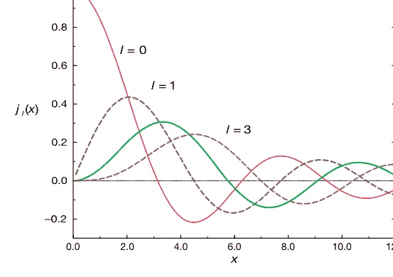

图 3.2 前四个球贝塞尔函数 $j_l(x)$ 随 $x$ 变化的函数图像。注意对于小的 $x$，随着 $l$ 增大，其值逐渐变小。

```
j_{l-1}(x) = \frac{2l + 1}{x} j_l(x) - j_{l+1}(x), \quad \text{(down)}. \tag{3.25}
```

方程 (3.24) 和 (3.25) 是同一个关系，一个写为从小到大的 $l$ 值向上递推，另一个写为从大到小的 $l$ 值向下递推。只需几次加法和乘法，递推关系就能对固定的 $x$ 和所有 $l$ 快速、简单地计算出整组 $j_l$ 值。

对于固定的 $x$ 向上递推 $l$ 时，我们从已知的 $j_0$ 和 $j_1$ 的形式 (3.22) 出发，并使用 (3.24)。正如你将自行证明的那样，这种向上递推最初通常似乎有效，但随后就会失败。失败的原因可以从 $j_l(x)$ 和 $n_l(x)$ 随 $x$ 变化的曲线图（图 3.2）中看出。如果我们从 $x \approx 2$ 和 $l = 0$ 开始，我们会发现，当用 (3.24) 将 $j_l$ 向上递推到更大的 $l$ 值时，本质上是在对两个“大”函数取差，以产生一个“小”的 $j_l$ 值。这个过程存在减法相消，总是会降低精度。随着我们继续递推，我们对两个带有大误差的小函数取差，产生一个更小但误差更大的函数。过不了多久，我们就只剩下舍入误差（垃圾）。

```
j_l^{(c)} = j_l(x) + \epsilon n_l(x). \tag{3.26}
```

这是不可避免的，因为 $j_l$ 和 $n_l$ 都满足同一个微分方程，因此也满足同一个递推关系。当 $n_l(x)$ 的数值远大于 $j_l(x)$ 时，$n_l$ 的混入就会成为问题，因为即使是一个非常庞大的数的极小一部分也可能很大。

## 3.2 贝塞尔函数中的误差（问题） | 61

解决这个问题的简单方法（Miller 装置）是使用 (3.25) 从较大的 $l = L$ 值开始对 $j_l$ 值进行向下递推。这样通过取较小的 $j_{l+1}(x)$ 和 $j_l(x)$ 值，并用加法产生较大的 $j_{l-1}(x)$，避免了减法相消。虽然误差仍可能表现为诺依曼函数的行为，但当我们向下递推到更小的 $l$ 值时，误差的实际大小会迅速减小。事实上，如果我们用任意的 $j_{l+1}^{(c)}$ 和 $j_l^{(c)}$ 值开始向下迭代，不久之后我们就能得到对于这个 $x$ 值的正确的 $l$ 依赖关系。虽然这样得到的 $j_0^{(c)}$ 的精确值不会正确，因为它取决于所假定的任意 $j_{l+1}^{(c)}$ 和 $j_l^{(c)}$ 值，但相对值将是准确的。绝对值由已知值 (3.22) $j_0(x) = \sin x /x$ 确定。由于递推关系是线性关系，我们只需将所有计算值归一化：

$$j_l^N(x) = j_l^{(c)}(x) \times \frac{j_0^{anal}(x)}{j_0^{(c)}(x)} .$$

(3.27)

因此，完成向下递推后，你基于已知的 $j_0$ 值对 $j_l^{(c)}$ 值进行归一化，即可得到最终答案。

实现递推关系的程序最易于使用下标编写。如果你需要磨练下标的使用技巧，在编写自己的程序之前，不妨学习我们在 Listing 3.1 中的程序 Bessel.py。

- 1. 编写一个程序，对 $x = 0.1$、$1$ 和 $10$，使用向上和向下递推计算前 25 个 $l$ 值的 $j_l(x)$。

- 2. 调整你的程序，使至少一种方法给出“好”的值（即相对误差 $\simeq 10^{-10}$。参见表 3.1 中的一些示例值。

- 3. 展示结果的收敛性和稳定性。

- 4. 比较向上和向下递推方法，打印 $l$、$j_l^{(up)}$、$j_l^{(down)}$ 以及相对差 $|j_l^{(up)} - j_l^{(down)}| / (|j_l^{(up)}| + |j_l^{(down)}|)$。

- 5. 计算的误差取决于 $x$，并且对某些 $x$ 值，向上和向下递推给出相似的答案。解释其原因。

```
# Bessel.py
from visual import *
from visual.graph import *

Xmax = 40.
Xmin = 0.25
step = 0.1
order = 10; start = 50   # Plot j_order
graph1 = gdisplay(width = 500, height = 500, title = 'Sperical Bessel , \ 
Xmax = 40., Xmin = 0.25, step = 0.1, order = 10, start = 50)
```


```python
L = 1 (red), 10', xtitle = 'x', ytitle = 'j(x)', \
 xmin = Xmin, xmax=Xmax, ymin=-0.2,ymax=0.5)
func1 = gcurve(color=color.red)
func2 = gcurve(color=color.green)
def down (x, n, m):
    j = zeros( (start + 2), float)
    j[m + 1] = 1.
    for k in range(m, 0, -1):
        j[k - 1] = ( (2.*k + 1.)*x )*j[k] - j[k + 1]
    scale = (sin(x)/x)/j[0]
    return j[n] * scale
for x in arange(Xmin, Xmax, step):
    func1.plot(pos = (x, down(x,1, start)))
    func2.plot(pos = (x, down(x,1,start)))
```

## 3.3 实验误差研究

数值算法在计算物理学中起着至关重要的作用。你的任务是取一个通用算法并判断：

- 1. 它是否收敛？
- 2. 收敛结果的精度有多高？
- 3. 它的代价（耗时）有多大？

乍一想，你可能会觉得：“这是什么蠢问题！只要使用的项数足够多，所有算法都会收敛；如果想要更高精度，那就多用一些项。”然而，有些算法可能是渐近展开，它们只是在参数空间的某些区域内近似某个函数，并且只收敛到一定程度。即便如此，即使采用一致收敛的幂级数作为算法，增加项数也会减小算法误差，但同时会增加舍入误差。而且，由于舍入误差最终会发散到无穷大，我们至多只能期望得到一个“最佳”近似。好的算法之所以好，不仅因为它们速度快，还因为它们所需步数少，因此引入的舍入误差也更小。

假设一个算法需要 N 步才能找到好的答案。按经验法则，近似（算法）误差会迅速减小，通常与所用项数的某个反幂成正比：

```
ε_app ≈ α / N^β .   (3.28)
```

这里的 α 和 β 是经验常数，随算法不同而变化，而且可能只是近似为常数，甚至只在 N → ∞ 时才是如此。误差在 N 很大时必须下降，这只不过是在说明算法收敛。

与算法误差相反，舍入误差随 N 增长缓慢，而且带有一定随机性。如果算法每一步中的舍入误差互不相关，那么我们可以将误差的累积建模为步长等于机器精度 ε_m 的随机游走：

```
ε_ro ≈ √N ε_m .   (3.29)
```

这就是我们预期的舍入误差随 N 的缓慢增长。计算中的总误差是这两种误差之和：

```
ε_tot = ε_app + ε_ro   (3.30)

ε_tot ≈ α / N^β + √N ε_m .   (3.31)
```

对于较小的 N，我们预期第一项是两者中较大的；但随着 N 增大，它会被不断增长的舍入误差所超越。

作为示例，我们在图 3.3 中给出了使用辛普森积分法则（第 5 章）进行数值积分时相对误差的双对数图。我们使用相对误差的 log10，因为它的相反数告诉我们所得精度的十进制位数¹。设 A 为精确答案，A(N) 为计算答案。如果

```
(A - A(N)) / A ≈ 10^{-9}, then log10 |(A - A(N)) / A| ≈ -9 .   (3.32)
```

我们在图 3.3 中看到，对于较小的 N，误差确实快速下降，这与反幂律 (3.28) 一致。在这个区域内，算法正在收敛。随着 N 不断增大，误差开始显得有些不规律，平均而言缓慢增加。根据 (3.30)，在这个区域内，舍入误差已经大于算法误差，并且会随着 N 的增大继续增长。因此显然，如果我们能在接近 10^{-14} 的最小值处停止计算，也就是当 ε_app ≈ ε_ro 时，就能得到最小的总误差。

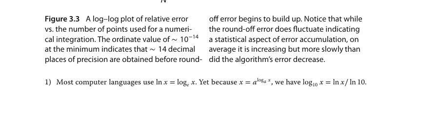

> ¹ 大多数计算机语言使用 ln x = log_e x。又因为 x = a^{log_a x}，所以 log10 x = ln x / ln 10。

在实际计算中，你不会知道精确答案；毕竟，如果知道的话，何必还要费心计算呢？不过，你可能知道某个类似计算的精确答案，因而可以利用那个类似计算来完善你的数值技巧。另外，既然你已理解计算总误差的行为方式，就应该能够通过查看答案的表格，或者更好的方式——类似图 3.3 的答案图，推断出你的算法正在以何种方式收敛。具体来说，在某个阶段你应当看到，答案的尾数只在较不重要的数字上发生变化，而且随着计算执行更多步，变化位置会进一步移向小数点右侧。然而，当步数变得更大时，舍入误差会导致较低有效位发生波动，并平均而言逐渐向左移动。最好在发生这种情况之前就停止计算。

基于这种理解，获得最佳近似的一种方法是推断你的答案何时表现为 (3.30) 的形式。为此，我们称 A 为精确答案，A(N) 为经过 N 步后的计算答案。我们假设，对于足够大的 N，近似按如下方式收敛：

```
A(N) ≈ A + α / N^β ,
```

也就是说，(3.30) 中的舍入误差项仍然很小。然后我们用 2N 步运行计算机程序，这应当会给出更好的答案，并利用该答案消去未知的 A：

```
A(N) - A(2N) ≈ α / N^β .
```

为了检验这些假设是否正确，并确定在最佳 N 选择下可能达到的精度水平，可以绘制 log10(|A(N) - A(2N)| / |A(2N)|) 对 log10 N 的图，类似于我们在图 3.3 中所做的那样。如果你得到一条快速直线下降的曲线，那么你就知道自己处于收敛区域内，并可以从斜率推断 β 的值。随着 N 变大，你应当看到图形从直线下降转变为缓慢上升，因为舍入误差开始占主导。一个好的停止点是在这之前。无论如何，现在你理解了计算中的误差，因此有机会控制它。

作为不同类型误差如何进入计算的一个例子，我们假设已知近似误差和舍入误差的解析形式：

```
ε_app ≈ 1 / N² ,

ε_ro ≈ √N ε_m ,

⇒ ε_tot = ε_app + ε_ro

≈ 1 / N² + √N ε_m .
```

于是，总误差在以下条件下达到最小：

```
dε_tot/dN = -2/N³ + (1/2) ε_m / √N = 0 ,   (3.39)

⇒ N^{5/2} = 4/ε_m .   (3.40)
```

对于双精度计算（ε_m ≃ 10^{-15}），最小总误差出现在：

```
N^{5/2} ≃ 4/10^{-15} ⇒ N ≃ 1099 , ⇒ ε_tot ≃ 4 × 10^{-6} .   (3.41)
```

在这种情况下，大部分误差来自舍入误差，而不是算法误差。

既然总误差主要是舍入误差 ∝ √N，一种明显的减小误差的方法是使用更少的步数 N。让我们假设我们通过寻找另一个随 N 收敛更快的算法来做到这一点，例如，一个算法误差表现为如下形式的算法：

```
ε_app ≃ 2/N⁴ .   (3.42)
```

总误差现在变为：

```
ε_tot = ε_ro + ε_app ≃ 2/N⁴ + √N ε_m .   (3.43)
```

与之前一样，求出使误差最小的点数：

```
dε_tot/dN = 0 ⇒ N^{9/2} ⇒ N ≃ 67 ⇒ ε_tot ≃ 9 × 10^{-7} .   (3.44)
```

现在误差减小为原来的 1/4，而所需步数只有原来的 1/16。计算机的行事方式真可谓微妙。在这种情况下，更好的算法更快，并且由于步数更少，产生的舍入误差也更小。

**练习：** 现在估计采用双精度计算时的误差。

### 3.3.1 误差评估

在第 2.5 节中，我们已经讨论过 sin x 的泰勒展开：

```
sin(x) = x - x³/3! + x⁵/5! - x⁷/7! + ⋯ = Σ_{n=1}^{∞} (-1)^{n-1} x^{2n-1}/(2n-1)! .   (3.45)
```

现在我们带着误差这一着眼点来扩展这一讨论。级数 (3.45) 在数学意义上对所有 x 值都收敛。因此，计算 sin(x) 的一个合理算法可以是：

```
sin(x) ≃ Σ_{n=1}^{N} (-1)^{n-1} x^{2n-1}/(2n-1)! .   (3.46)
```

- 1. 编写一个程序，将 sin(x) 按有限和 (3.46) 计算。（如果你已经在第 2 章中做过这一步，可以在这里复用该程序及其结果。但请记住，算法中不应使用阶乘。）
- 2. 计算你的级数在 x ≤ 1 时的值，并将其与内置函数 Math.sin(x) 进行比较（你可以假设内置函数是精确的）。当级数的下一项不超过此前总和的 10^{-7} 时，在该 N 值处停止求和：

$$
\frac{|(-1)^N x^{2N+1}|}{(2N+1)!} \le 10^{-7} \left|\sum_{n=1}^{N} \frac{(-1)^{n-1} x^{2n-1}}{(2n-1)!}\right|. \quad (3.47)
$$

- 3. 考察 x ≈ 3π 时级数中的各项，观察当大项相加得到很小结果时出现的显著相消性减法。（不要使用恒等式 sin(x + 2π) = sin x 来减小级数中的 x 值。）特别地，打印出 n ≈ x/2 附近近乎完美的相消情况。
- 4. 看看通过使用三角恒等式将 x 保持在 0 ≤ x ≤ π 范围内，是否能获得更好的精度。
- 5. 通过将 x 从 1 逐步增大到 10，再从 10 增大到 100，用你的程序通过实验确定级数何时开始失去精度，以及何时不再收敛。
- 6. 针对不同的 x 值，绘制一系列误差随 N 变化的图。你应该会得到与图 3.4 相似的曲线。

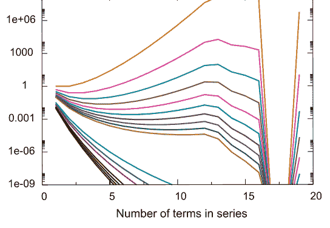

图 3.4 不同 x 值下 e^{-x} 级数求和的误差随 N 的变化。每条曲线的 x 值沿纵向递增。注意，初始斜率为负对应于误差随 N 减小；曲线下凹处对应于快速收敛之后误差的快速增大。（承蒙 J. Wiren 提供。）


因为这个级数求和是一个如此简单、相互关联的过程，舍入误差不会像更复杂的计算那样随机累积，因此我们得不到 (3.33) 的误差行为。我们将在第 5 章讨论积分规则时看到预期的误差行为。

# 4

# 蒙特卡罗：随机性、行走与衰变

> 本章首先讨论计算机如何生成看起来随机但实际上并不随机的数字，以及我们如何测试这一点。在讨论了计算机如何生成伪随机数之后，我们探讨如何使用这些数字将随机性元素融入模拟中。我们首先通过模拟随机行走来实现这一点，然后模拟原子或原子核的自发衰变。在第 5 章中，我们展示如何使用这些随机数来评估积分；在第 17 章中，我们研究如何使用随机数模拟热过程和量子系统的涨落。

# 4.1

## 确定性随机性

有些人被计算吸引是因为它的确定性本质；在生活中有这样一个地方，什么都不靠运气，是件好事。除非发生机器错误或存在未定义的变量，否则每次向程序输入相同的输入，都会得到相同的输出。然而，许多计算机周期被用于*蒙特卡罗*计算，其核心就包含随机性元素。在这些计算中，计算机生成的类随机数被用来模拟自然随机过程，如热运动或放射性衰变，或用于在平均意义下求解方程。事实上，计算物理学之所以广受认可，很大程度上正是因为计算机能够使用蒙特卡罗技术解决以前难以处理的问题。

# 4.2

## 随机序列（理论）

我们将序列 $r_1, r_2, \ldots$ 定义为*随机*的，如果这些数之间没有相关性。然而，随机并不意味序列中的所有数出现的机会相等。如果序列中所有数出现的机会相等，则称该序列为*均匀*的，但这并不说明它是随机的。举例来说，1, 2, 3, 4, … 是均匀的，但可能不是随机的。此外，可能存在某种意义上随机但彼此之间具有很短程相关性的数列，例如，

$$r_1,(1-r_1),r_2,(1-r_2),r_3,(1-r_3),\ldots$$

具有短程相关性，但没有长程相关性。

数学上，一个数出现的可能性由分布函数 $P(r)$ 描述，其中 $P(r)\,dr$ 是在区间 $[r,r+dr]$ 内找到 $r$ 的概率。*均匀分布*意味着 $P(r)$ 为常数。计算机上的标准随机数生成器在 0 到 1 之间生成均匀分布。换句话说，标准随机数生成器输出该区间内的数，每个数概率相等，且每个数独立于前一个数。我们将会看到，某些区域中的数也可能比别处更可能出现，但仍然可以是随机的。

就其本质而言，计算机是确定性设备，因此无法创建随机序列。计算出的随机数序列必然包含相关性，因此不可能是真正随机的。虽然可能需要一点功夫，但如果我们知道一个计算出的随机数 $r_m$ 及其前面的元素，那么总能算出 $r_{m+1}$。因此，人们说计算机生成的是*伪随机数*（但我们懒得一直说“伪”字）。虽然更复杂的生成器能更好地隐藏相关性，但经验表明，如果你足够仔细地查找，或者足够长时间地使用伪随机数，你终究会注意到相关性。生成随机数的原始替代方法是从由自然随机过程（如放射性衰变）决定的真随机数表中读取，或者将计算机连接到测量随机事件的实验设备上。这些替代方法不适合生产性工作，但在存疑时确实被用作检查手段。

# 4.2.1

**随机数生成（算法）**

*线性同余*或*幂剩余*方法是在区间 $[0,M-1]$ 上生成伪随机序列 $0 \le r_i \le M-1$ 的常用方法。要获得下一个随机数 $r_{i+1}$，将当前随机数 $r_i$ 乘以常量 $a$，加上另一个常量 $c$，对 $M$ 取*模*，然后只保留小数部分（余数）$^1$。

$$r_{i+1} \overset{\mathrm{def}}{=} (ar_i+c)\operatorname{mod}M$$

$$=\operatorname{remainder}\left(\frac{ar_i+c}{M}\right).$$

> 1) 你可以通过不断减去 $M$ 直到进一步减法会得到负数来获得相同的模运算结果；剩下的就是*余数*。

r₁ 的值（种子）通常由用户提供，mod 是计算机内置的求余函数。在 Python 中，百分号 % 是模运算符。这本质上是一种移位操作，最终得到输入数的最低有效部分，因此依赖舍入误差的随机性来生成随机序列。

例如，如果 c = 1, a = 4, M = 9，并提供 r₁ = 3，则得到序列

r₁ = 3 ,  (4.4)

r₂ = (4 × 3 + 1) mod 9 = 13 mod 9 = rem 13/9 = 4 ,  (4.5)

r₃ = (4 × 4 + 1) mod 9 = 17 mod 9 = rem 17/9 = 8 ,  (4.6)

r₄ = (4 × 8 + 1) mod 9 = 33 mod 9 = rem 33/9 = 6 ,  (4.7)

r₅₋₁₀ = 7, 2, 0, 1, 5, 3 .  (4.8)

我们得到长度为 M = 9 的序列，之后整个序列重复。如果我们想要 [0, 1] 范围内的数，则将 r 除以 M = 9 得到

0.333, 0.444, 0.889, 0.667, 0.778, 0.222, 0.000, 0.111, 0.555, 0.333 .  (4.9)

这仍然是长度为 9 的序列，但不再是整数序列。如果需要 [A, B] 范围内的随机数，只需进行缩放：

xᵢ = A + (B − A)rᵢ ,   0 ≤ rᵢ ≤ 1 ,   ⇒ A ≤ xᵢ ≤ B .  (4.10)

经验法则：在程序中使用随机数生成器之前，应检查其范围，并确认它产生的数“看起来”是随机的。

虽然不是数学证明，但你应该始终对随机数进行图形显示。你的视觉皮层在识别模式方面非常精细，如果随机数中有模式，它会立即告诉你。例如，图 4.1 展示了“好”和“坏”生成器生成的序列，很明显哪个不是随机的。（尽管如果你足够仔细地观察那些随机点，你的大脑也很可能在那里挑出模式。）

线性同余方法 (4.2) 产生 [0, M − 1] 范围内的整数，因此如果某个特定整数第二次出现，序列就会完全相关（整个周期随后重复）。为了获得更长的序列，a 和 M 应该是大数，但不能大到使 a rᵢ₋₁ 溢出。在使用 48 位整数运算的计算机上，内置随机数生成器可能使用高达 2⁴⁸ ≈ 3 × 10¹⁴ 的 M 值。32 位生成器可能使用 M = 2³¹ ≈ 2 × 10⁹。如果你的程序使用了大约这么多的随机数，你可能需要在中间步骤重新播种（用不同的初始值重新开始序列）以避免周期重复。

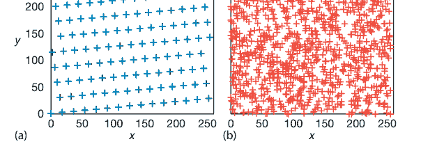

图 4.1 (a) 使用刻意“差”的生成器生成的连续随机数 (x, y) = (r_i, r_{i+1}) 的绘图。(b) 使用内置随机数生成器生成的绘图。虽然 (b) 图不能证明分布是随机的，但 (a) 图足以证明分布不是随机的。

你的计算机可能拥有比用幂剩余法计算的生成器更好的随机数生成器。在 Python 中，我们使用 random.random()，即梅森旋转（Mersenne Twister）生成器。我们建议你使用能找到的最好的生成器，而不是自己编写。要初始化随机序列，需要在其中埋入种子。在 Python 中，语句 random.seed(None) 使用系统时间对生成器播种（参见清单 4.1 中的 Walk.py）。我们旧的标准 drand48 使用：

```
M = 2^48 ,    c = B(base16) = 13 (base8) ,    (4.11)
a = 5DEECE66D(base16) = 273673163155(base8) .    (4.12)
```

# 4.2.2

# 实现：随机序列

对于科学工作，我们建议使用工业强度的随机数生成器。为了说明原因，这里我们评估一下粗心应用幂剩余法可能有多糟糕。

- 1. 编写一个简单程序，使用线性同余方法 (4.2) 生成随机数。
- 2. 出于教学目的，尝试这个不明智的选择：(a, c, M, r₁) = (57, 1, 256, 10)。确定周期，即序列重复之前生成了多少个数。
- 3. 取该教学随机序列，通过观察连续对 (x_i, y_i) = (r_{2i-1}, r_{2i}), i = 1, 2, ... 的绘图中的聚集来寻找相关性。（不要用线连接这些点。）你可能会“看到”相关性（图 4.1），这意味着你不应该将此序列用于严肃的工作。
- 4. 制作你自己的图 4.2 版本；即绘制 r_i 与 i 的关系图。
- 5. 通过绘制与上面相同的对，测试你计算机上的内置随机数生成器的相关性。（这应该适用于严肃的工作。）


## 4.2 随机序列（理论）

6. 再次使用像 (4.11) 和 (4.12) 中那样的合理常数测试线性同余法。将你得到的散点图与内置随机数生成器得到的散点图进行比较。（这同样适用于严肃的工作。）

由于计算机的随机数是按照确定的规则生成的，因此序列中的数字必须相关。因此，在你将科学声誉押在上面之前，明智的做法是测试随机数生成器，以获得其均匀性和随机性的数值度量。事实上，有些测试简单到足以让你养成在运行模拟的同时进行测试的习惯。在下面给出的示例中，我们测试随机性和均匀性。

- 1. 可能最明显，但经常被忽视的随机性和均匀性测试就是直接查看生成的数字。例如，表 4.1 给出了 Python 随机方法的一些输出。仅凭肉眼观察这些数字，你就会立即知道它们都介于 0 和 1 之间，它们似乎彼此不同，并且没有明显的模式（如 0.3333）。
- 2. 正如我们所见，一个快速的视觉测试（图 4.2）是将同一列表取出来，以 r_i 为纵坐标，i 为横坐标进行绘图。观察到似乎在 0 到 1 之间存在均匀分布，并且没有特定的相关性。

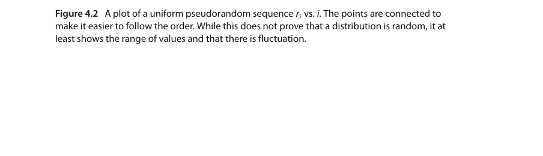

如果你的随机数满足 (4.16)，那么你就知道它们是均匀且独立的。如果与 (4.16) 的偏差按 1/√N 变化，那么你也知道分布是随机的。

5. 正如我们所见，对随机性进行有效测试的方法是绘制 (xi, yi = ri+1) 的散点图，对许多 i 值进行绘制。如果你的点有明显的规律性，则序列不是随机的。如果点是随机的，它们应该均匀地填充一个正方形，没有可辨别的模式（云状），（如图 4.1b 所示）。

6. 用 (4.14) 测试你的随机数生成器，取 k = 1,3,7 且 N = 100, 10000, 100000。在每种情况下打印出 √N |1/N ∑_{i=1}^N x_i^k - 1/(k+1)| 以检查其数量级为 1。

## 4.3 随机游走（问题）

考虑在教室前部释放的一种香水分子。它随机地与空气中的其他分子碰撞，最终到达你的鼻子，尽管你隐藏在最后一排。你的问题是确定香水分子在行进距离 R 的过程中平均碰撞次数。已知分子在两次碰撞之间的平均（均方根）距离为 r_rms。

Listing 4.1 Walk.py 调用 random 包中的随机数生成器。请注意，需要不同的种子才能获得不同的序列。

```
# Walk.py Random walk with graph
from visual import *
from visual.graph import *
import random
random.seed(None)  # Seed generator, None => system clock
jmax = 20
x = 0.; y = 0.  # Start at origin
graph1 = gdisplay(width=500, height=500, title='Random Walk', xtitle='x', ytitle='y')
pts = gcurve(color = color.yellow)
for i in range(0, jmax + 1):
    pts.plot(pos = (x, y) )
    x += (random.random() - 0.5)*2  # -1 <= x <= 1
    y += (random.random() - 0.5)*2  # -1 <= y <= 1
    pts.plot(pos = (x, y))
rate(100)
```

### 4.3.1
随机游走模拟

有许多方法可以模拟随机游走（惊喜，惊喜）不同的假设会产生不同的物理。我们将介绍二维游走的最简单方法，理论最少，最终得到 *正常扩散* 的模型。研究文献充满了对该问题各种版本的讨论。例如，布朗运动对应于单个步长趋于零且步间无时间延迟的极限。额外的改进包括在运动介质中的碰撞（*异常扩散*）、包含粒子的速度，甚至步间暂停。这些模型在第 16 章中讨论，并由在线提供的相应小程序演示。

在我们的随机游走模拟（图 4.3）中，一个人工 *行走者* 按顺序迈出步伐，每一步的 *方向* 与前一步的方向 *独立*。对于我们的模型，我们从原点开始，在 xy 平面内迈出 $N$ 步，其 *长度*（而非坐标）为

$(\Delta x_1, \Delta y_1),\quad (\Delta x_2, \Delta y_2),\quad (\Delta x_3, \Delta y_3),\dots,\quad (\Delta x_N, \Delta y_N).\qquad (4.18)$

尽管每一步可能朝不同方向，但沿每个笛卡尔轴的距离只是代数相加。因此，从起点出发经过 N 步后的径向距离 R 为

$R^2 = (\Delta x_1 + \Delta x_2 + \cdots + \Delta x_N)^2 + (\Delta y_1 + \Delta y_2 + \cdots + \Delta y_N)^2$
$= \Delta x_1^2 + \Delta x_2^2 + \cdots + \Delta x_N^2 + 2\Delta x_1\Delta x_2 + 2\Delta x_1\Delta x_3 + 2\Delta x_2\Delta x_1 + \cdots$
$+ (x \to y).\qquad (4.19)$

如果游走是随机的，粒子在每一步都同等可能地朝任何方向移动。如果我们对大量此类随机步进行平均，(4.19) 中的所有交叉项都会消失，我们将剩下

$R_{\mathrm{rms}}^2 \simeq \langle \Delta x_1^2 + \Delta x_2^2 + \cdots + \Delta x_N^2 + \Delta y_1^2 + \Delta y_2^2 + \cdots + \Delta y_N^2 \rangle$
$= \langle \Delta x_1^2 + \Delta y_1^2 \rangle + \langle \Delta x_2^2 + \Delta y_2^2 \rangle + \cdots$
$= N \langle r^2 \rangle = N r_{\mathrm{rms}}^2,$
$\Rightarrow \boxed{R_{\mathrm{rms}} \simeq \sqrt{N} r_{\mathrm{rms}}},\qquad (4.20)$
其中 $r_{\mathrm{rms}} = \sqrt{\langle r^2 \rangle}$ 是 *均方根* 步长。

总结一下，如果游走是随机的，那么经过大量步数后，行走者从原点出发的平均 *矢量* 距离将趋于零：

$\langle \boldsymbol{R} \rangle = \langle x \rangle \boldsymbol{i} + \langle y \rangle \boldsymbol{j} \simeq 0.\qquad (4.21)$
然而 $R_{\mathrm{rms}} = \sqrt{\langle R^2 \rangle}$ 并不会消失。方程 4.20 表明，从原点出发的平均 *标量* 距离为 $\sqrt{N} r_{\mathrm{rms}}$，其中每一步的平均长度为 $r_{\mathrm{rms}}$。在

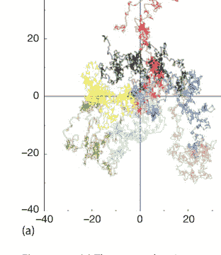

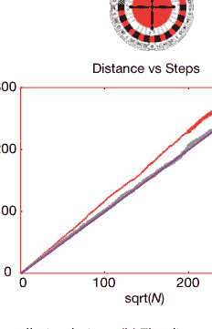


图 4.4 (a) 七次二维随机游走模拟中采取的步伐。(b) 使用不同随机性方案的两次 N 步游走中覆盖的距离。理论预测 (4.20) 为直线。

- 3. 如果你的行走者在单次试验中迈出 N 步，则进行总共 K ≈ √N 次试验。每次试验应有 N 步并以不同的种子开始。
- 4. 计算每次试验的均方距离 R²，然后对所有 K 次试验的 R² 取平均值：
⟨R²(N)⟩ = 1/K Σ_{k=1}^K R²_k(N) . (4.23)
- 5. 通过检查 ⟨Δx_i Δx_{j≠i}⟩/R² ≈ ⟨Δx_i Δy_j⟩/R² ≈ 0 来检验推导理论结果 (4.20) 时所做的假设。 (4.24)
对单次（长）运行和试验平均值都进行检查。
- 6. 绘制均方根距离 R_rms = √⟨R²(N)⟩ 随 √N 的变化图。N 的取值应从 R ≈ √N 不预期准确的小数值开始，到平均而言应预期两到三位准确度的相当大值结束。
- 7. 对三维游走也重复上述及以下分析。

## 4.4

## 扩展：蛋白质折叠与自回避随机游走

蛋白质是一种由分子链（氨基酸残基）组成的大型生物分子。这些链由单体形成，即化学上与其他分子结合的分子。更具体地说，这些链由疏水性（H）单体组成，它们被水排斥，以及亲水性（P）单体，它们被水吸引。蛋白质的实际结构源于折叠过程，其中链的随机线圈重新排列成最小能量构型。我们希望在计算机上模拟该过程。

尽管分子动力学（第 18 章）可用于模拟蛋白质折叠，但其速度远慢于蒙特卡洛技术，而且即使如此，找到最低能量态也很困难。在这里，我们创建一个简单的蒙特卡洛模拟，在二维正方形晶格中进行随机游走（Yue et al., 2004）。每一步结束时，你随机选择一个 H 或 P 单体并将其放置在晶格上，选择的权重使得 H 单体比 P 单体更有可能被选中。游走受到限制，使得每一步后可用的唯一位置是三个相邻位点，已占据的位点被排除（这就是为什么这种技术被称为自回避随机游走）。

模拟的目标是找到各种长度的 HP 序列的最低能量态。这些可以与自然界中的进行比较。如何最好地找到这种状态是一个活跃的研究课题（Yue et al., 2004）。链的能量定义为

```
E = −ε f ,
```

其中 ε 是正常数，f 是直接相连的 H–H 邻居数（P–P 和 H–P 键不计入降低能量）。因此，如果 H 旁边是另一个 H，则会降低能量，但如果是 P 则不会降低能量。我们在图 4.5 中展示了一个典型的模拟结果，其中一个浅色点放置在两个 H（深色点）邻居之间。因此，对于给定的链长，我们期望 H–P 序列的自然态（态）是那些具有最大可能 H–H 接触数 f 的态。这就是我们要寻找的。

- 1. 修改我们已经开发的随机游走程序，使其模拟自回避随机游走。关键在于游走在拐角处停止，或当没有空闲相邻位点可用时停止。
- 2. 随机选择单体是 H 还是 P，选择权重使得 H 比 P 更多。
- 3. 制作一个可视化，显示单体占据的位置，H 和 P 单体用不同颜色的点表示。（我们的可视化，如图 4.5 所示，由可在教师网站上获得的程序 ProteinFold.py 生成。）
- 4. 游走结束后，记录链的能量和长度。


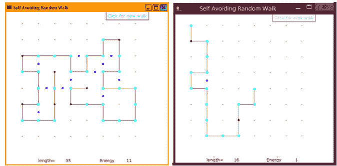

图 4.5 两个自回避随机行走模拟蛋白质链，其中疏水性 H 单体用浅灰色表示，极性 P 单体用黑色表示。暗点表示两个 H 单体未直接连接的区域。

- 5. 运行多次折叠模拟并保存输出，按长度和能量分类。
- 6. 检查各种链长最低能量状态，并将结果与分子动力学模拟和实际蛋白质结构（可在网上获得）的结果进行比较。
- 7. 你认为这种简单的模型是否具有一定的价值？
- 8. ⊙ 将折叠扩展到 3D。

## 4.5

## 自发衰变（问题）

你的问题是模拟少量 N 个放射性粒子衰变的过程。2) 具体来说，你要确定何时放射性衰变看起来像指数衰变，何时看起来像随机过程（包含偶然性）。由于指数衰变定律是对自然过程的大数近似，而该过程总是导致仅剩下少量原子核，因此我们的模拟应比指数衰变定律更接近自然（图 4.6）。事实上，如果你“聆听”衰变模拟代码的输出，你会听到非常类似于盖革计数器的声音，这直观地证明了模拟的真实性。

自发衰变是自然界中一种无需外部刺激，粒子就会衰变为其他粒子的过程。尽管在任何时间间隔内任一粒子的衰变概率是恒定的，但它何时衰变是一个随机事件。

2) 自发衰变也在第 7 章中讨论，我们在那里将指数函数拟合到衰变谱。

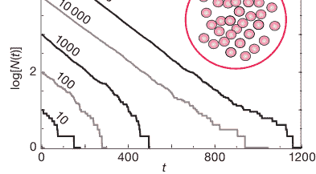

图 4.6 圆圈：含有 N 个原子核的样品，每个原子核在单位时间内衰变的概率相同。图表：五个具有不同初始原子核数目的模拟的原子核数目随时间变化的半对数图。指数衰变将是一条直线，伴有波动，类似于 N = 100 000 时的初始行为。

由于任一粒子衰变的确切时刻总是随机的，并且一个原子核不会影响另一个原子核，因此衰变概率不受粒子存在时间的长短或是否其他粒子已衰变的影响。换句话说，任一粒子在单位时间间隔内衰变的概率 P 为常数，但当该粒子衰变时，它将永远消失。当然，随着粒子总数 N 随时间减少，单位时间内衰变的粒子数也会减少，但只要该粒子存在，它在某时间间隔内衰变的概率保持不变。

### 4.5.1

### 离散衰变（模型）

想象在时间 t 时含有 N(t) 个放射性原子核的样品（图 4.6 圆圈）。设 ΔN 为在某个小时间间隔 Δt 内衰变的粒子数。我们将“任一粒子在单位时间内衰变的概率 P 为常数”这一陈述转化为方程

```
P = ΔN(t)/N(t) / Δt = -λ ,
```

(4.26)

```
⇒ ΔN(t)/Δt = -λ N(t) ,
```

(4.27)

其中常数 λ 称为衰变率，负号表示数目减少。因为 N(t) 随时间减少，活性 ΔN(t)/Δt（有时也称为衰变率）也随时间减少。此外，由于总活性与存在粒子总数成正比，它在指数型衰变随时间变化时过于随机。（实际上，由于衰变数 ΔN(t) 与随机数的差值成正比，其往往表现出比 N(t) 更大的统计波动。）

方程 4.27 是一个有限差分方程，关联了实验上可测量的量 N(t)、ΔN(t) 和 Δt。尽管差分方程不能像微分方程那样积分，但可以数值模拟。因为该过程是随机的，我们无法预测 ΔN(t) 的单一值，尽管我们可以预测对许多相同 N 个衰变粒子的系统进行多次观测时衰变的平均数目。

### 4.5.2

### 连续衰变（模型）

当粒子数 N → ∞ 且观测时间间隔 Δt → 0 时，我们的差分方程变为微分方程，我们得到熟悉的指数衰变定律（4.27）：

```
ΔN(t)/Δt → dN(t)/dt = −λ N(t) . (4.28)
```

这可以积分得到粒子总数和总活性的时间依赖性：

```
N(t) = N(0) e^{−λt} = N(0) e^{−t/τ} , (4.29)
```

```
dN(t)/dt = −λ N(0) e^{−λt} = dN/dt (0) e^{−λt} . (4.30)
```

在此极限下，我们可以将衰变率 λ 与寿命的倒数等同：

```
λ = 1/τ . (4.31)
```

从其推导可知，指数衰变是对大量粒子的一种良好描述，其中 ΔN/N ≈ 0。然而，在自然界中 N(t) 可以是一个很小的数，在这种情况下我们有一个统计过程而不是连续过程。自然的基本定律（4.26）始终有效，但正如我们将在模拟中看到的那样，随着粒子数越来越小，指数衰变（4.30）变得越来越不准确。

### 4.5.3

### 具有盖革计数器声音的衰变模拟

模拟放射性衰变的程序出人意料地简单，但并非没有其微妙之处。我们以 Δt 的离散步长增加时间，并对每个时间间隔计算在该 Δt 内衰变的原子核数。模拟在没有原子核可衰变时结束。既然如此，我们有一个关于时间步长 Δt 的外层循环，以及每个时间步长剩余原子核的内层循环。伪代码很简单（代码也是）：

## 4.6

## 衰变实现和可视化

编写一个程序来模拟放射性衰变，使用第 4.2 节中的简单程序作为指南。你应该得到与图 4.6 类似的结果。

- 1. 绘制剩余数目对数 ln N(t) 和衰变率对数 ln ΔN(t)/Δt(= 1) 随时间的变化图。注意模拟以 Δt 步长（世代数）测量时间。
- 2. 检查当你以较大的 N(0) 开始时是否得到看起来像指数衰变的结果，但当 N(0) 很小时衰变表现出其随机性。（较大的 N(0) 值也是随机的；它们只是看起来不像。）
- 3. 创建两个图，一个显示 N(t) 对 t 的斜率与 N(0) 无关，另一个显示斜率与所选 λ 值成正比。
- 4. 创建一个图显示在预期的统计变化范围内，ln N(t) 和 ln ΔN(t) 成正比。
- 5. 用你自己的话解释一个本质上自发且随机的过程如何导致指数衰变。
- 6. 你的模拟如何显示衰变是类指数的而不是幂律，例如 N = β t^{-α}？

## 5 微分和积分

本章首先简要讨论数值微分，这是一个重要但相当简单的话题。我们推导了微分的向前差分、中心差分和外推差分方法。它们将在全书中被使用。本章的大部分内容涉及数值积分，这是科学计算的基本工具。我们推导了辛普森法则、梯形法则和高斯求积法则。我们以各种形式讨论高斯求积（我们个人的主力工具），并说明如何将标准高斯点映射到各种区间。我们以蒙特卡洛积分技术的讨论结束，该技术与所有其他法则从根本上不同。

图 5.1 显示了存在空气阻力时的抛射物轨迹。点表示测量并制表的时间 t。你的问题是确定速度 dy/dt 随时间的变化。注意由于存在真实的空气阻力，没有解析函数可微分，只有此图或从图中读出的数值表。

你可能在第一门微积分课上做得相当不错，并且觉得自己有能力求导。然而，你可能从未使用初等定义对数值表求导

```
dy(t)/dt = lim h->0 [y(t + h) - y(t)] / h
```

事实上，即使是计算机在处理这种极限时也会遇到错误，因为它充满了相消抵消；随着 h 变小，计算机的有限字长导致分子在 0 和机器精度 ε_m 之间波动，而分母趋近于零时则发生溢出。

> Computational Physics, 3rd edition. Rubin H. Landau, Manuel J. Páez, Cristian C. Bordeianu. ©2015 WILEY-VCH Verlag GmbH & Co. KGaA. Published 2015 by WILEY-VCH Verlag GmbH & Co. KGaA.


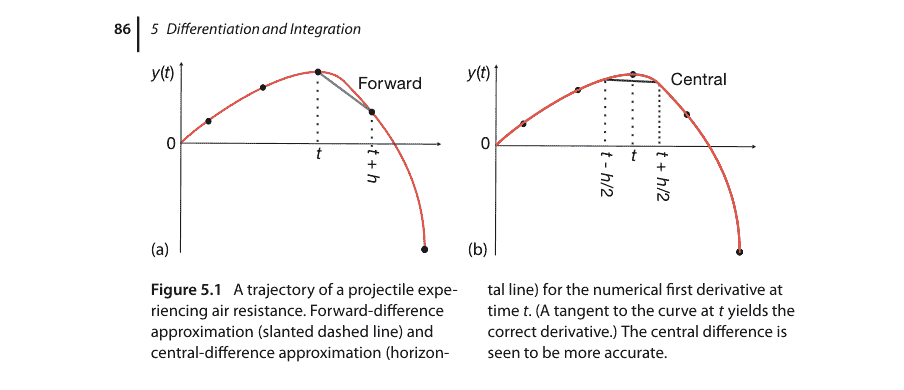

## 5.2 前向差分（算法）

数值微分的直接方法首先通过泰勒级数展开函数，以获得在小步长 h 远处的取值：

```
y(t + h) = y(t) + h dy(t)/dt + (h²/2!) d²y(t)/dt² + (h³/3!) dy³(t)/dt³ + ⋯ ,
```

⇒ y(t + h) - y(t) / h = dy(t)/dt + (h/2!) d²y(t)/dt² + (h²/3!) dy³(t)/dt³ + ⋯ .

如果我们忽略 (5.3) 中的 h² 项，则可得到导数 (5.2) 的前向差分导数算法：

```
dy(t)/dt |_{fd} = [y(t + h) - y(t)] / h .
```

误差的估计可通过代入泰勒级数得到：

```
dy(t)/dt |_{fd} ≃ dy(t)/dt - (h/2) d²y(t)/dt² + ⋯ .
```

你可以将此近似理解为用两点在从 x 到 x + h 的区间内用一条直线表示函数（图 5.1a）。近似值 (5.4) 的误差与 h 成正比（除非天堂怜悯你并使 y'' 为零）。我们可以通过使 h 变小来减小近似误差，然而当 h 过小时，(5.4) 左边会因相减抵消而导致精度损失。

为了了解前向差分算法的工作原理，设 y(t) = a + bt²。精确导数为 y' = 2bt，而计算导数为

```
dy(t)/dt |_{fd} ≃ [y(t + h) - y(t)] / h = 2bt + bh .
```

这显然只有在 h 很小时（h << 1/b）才是一个好的近似。

## 5.3 中心差分（算法）

对导数的改进近似以基本定义 (5.1) 开始，或几何上如图所示 5.1b。现在，我们不是向前迈出一步 h，而是通过向前迈半步并向后迈半步形成中心差分：

```
\frac{dy(t)}{dt}\bigg|_{cd} \equiv D_{cd} y(t) \def \frac{y(t + h/2) - y(t - h/2)}{h} .
```

我们通过将 y(t + h/2) 和 y(t - h/2) 的泰勒级数代入 (5.7) 来估计中心差分算法的误差：

```
y \left( t + \frac{h}{2} \right) - y \left( t - \frac{h}{2} \right) \simeq \left[ y(t) + \frac{h}{2} y'(t) + \frac{h^2}{8} y''(t) + \frac{h^3}{48} y'''(t) + \mathcal{O}(h^4) \right] - \left[ y(t) - \frac{h}{2} y'(t) + \frac{h^2}{8} y''(t) - \frac{h^3}{48} y'''(t) + \mathcal{O}(h^4) \right] = h y'(t) + \frac{h^3}{24} y'''(t) + \mathcal{O}(h^5) , \Rightarrow \frac{dy(t)}{dt}\bigg|_{cd} \simeq y'(t) + \frac{1}{24} h^2 y'''(t) + \mathcal{O}(h^4) .
```

此中心差分算法与前向差分之间的重要区别在于，当 y(t - h/2) 从 y(t + h/2) 中减去时，两个泰勒级数中包含 h 的偶次幂的所有项都会抵消。这使得中心差分算法的精度达到 h² 阶（除以 h 前为 h³），而前向差分仅达到 h 阶。如果 y(t) 是光滑的，即 y'''h²/24 << y'''h/2，则可以预期中心差分误差小于中心差分算法的误差。

如果我们现在回到抛物线示例 (5.6)，我们会看到中心差分与 h 无关地给出精确导数：

```
\frac{dy(t)}{dt}\bigg|_{cd} = \frac{y(t + h/2) - y(t - h/2)}{h} = 2 b t .
```

这是可以预期的，因为二阶多项式的更高阶导数等于零。

## 5.4 外推差分（算法）

由于基于在泰勒级数中保留一定数量项的微分规则也提供了误差的表达式（未包含的项），我们可以通过形成误差之和外推为零的近似组合来进一步降低理论误差。一种这样的算法是

中心差分算法 (5.7) 使用半步后退和半步前进。另一种算法是另一个中心差分近似，但这次使用四分之一步：

```
dy(t, h/2)/dt |_cd ≜ [y(t + h/4) − y(t − h/4)] / (h/2) ≃ y′(t) + (h²/96) d³y(t)/dt³ + ⋯ . (5.10)
```

两种的组合称为扩展差分算法，消除了二次和线性项：

```
dy(t)/dt |_ed ≜ [4 D_cd y(t, h/2) − D_cd y(t, h)] / 3 (5.11)
```

```
≃ dy/dt − [h⁴ y⁽⁵⁾(t)] / [4 × 16 × 120] + ⋯ . (5.12)
```

这里 (5.11) 是扩展差分算法，(5.12) 给出了其误差，D_cd 表示中心差分算法。如果 h = 0.4 且 y⁽⁵⁾ ≃ 1，则只有舍入误差的一位，且截断误差将大约为机器精度 ε_m；这是你能期望的最好的结果。

在使用这些和类似的高阶方法时，重要的是要记住，虽然它们对于行为良好的函数可能按设计工作，但对于包含噪声的函数，它们可能会严重失败，就像计算或测量得到的数据一样。如果噪声明显存在，最好先平滑数据或使用第 7 章的技术用某些解析函数拟合它们，然后再进行微分。

## 5.5 误差评估

数值微分的近似误差随着步长 h 的减小而减小。反过来，舍入误差随着步长 h 的减小而增加，因为你需要进行更多步并做更多计算。回顾我们在第 3 章中的讨论，最佳近似出现在使总误差 ε_app + ε_ro 最小的 h 处，而作为粗略指导，这发生在 ε_ro ≃ ε_app 时。

我们已经通过对 y(x + h) 进行泰勒级数展开来估计数值微分规则的近似误差。前向差分算法 (5.4) 的近似误差为 O(h)，而中心差分算法 (5.8) 的近似误差为 O(h²)：

```
ε_app^fd ≃ y'' h / 2 ,   ε_app^cd ≃ y''' h² / 24 . (5.13)
```

为了粗略估计舍入误差，我们观察到微分本质上是减去函数在自变量 x 处的取值与函数在自变量 x + h 处的取值，然后除以 h：y′ ≃ [y(t + h) − y(t)]/h。随着 h 不断变小，我们最终会达到舍入误差极限，此时 y(t + h) 和 y(t) 仅相差机器精度 εₘ：

ε_ro ≃ ε_m / h. (5.14)

因此，当

ε_ro ≃ ε_app , (5.15)

ε_m / h ≃ ε_fd^app = y^(2) h / 2 ,   ε_m / h ≃ ε_cd^app = y^(3) h² / 24 , (5.16)

⇒ h_fd² = 2 ε_m / y^(2) ,      ⇒ h_cd³ = 24 ε_m / y^(3) . (5.17)

我们取 y′ ≃ y^(2) ≃ y^(3)（在一般情况下可能很粗糙，但对于 e^t 或 cos t 并不差）并假设双精度，ε_m ≃ 10⁻¹⁵：

h_fd ≃ 4 × 10⁻⁸ ,          h_cd ≃ 3 × 10⁻⁵ , (5.18)

⇒ ε_fd ≃ ε_m / h_fd ≃ 3 × 10⁻⁸ ,   ⇒ ε_cd ≃ ε_m / h_cd ≃ 3 × 10⁻¹¹ . (5.19)

这似乎很矛盾，因为更好的算法导致了更大的 h 值。它不是。能够使用更大的 h 意味着中心差分方法的误差比前向差分方法的误差小约 1000 倍。

数值微分的编程很简单：

```
FD = (y(t+h) - y(t)) /h;          // forward diff
CD = (y(t+h/2) - y(t-h/2)) /h;    // central diff
ED = (8*(y(t+h/4)-y(t-h/4)) - (y(t+h/2)-y(t-h/2)))/3/h; // extrap
```

- 1. 使用前向、中心和外推差分算法对 t = 0.1、1 和 100 处的函数 cos t 和 e^t 进行微分。
- a) 打印导数及其相对误差 ℰ 随 h 的变化。减小步长 h 直到其等于机器精度 h ≃ ε_m。
- b) 绘制 log₁₀ |ℰ| 与 log₁₀ h 的关系图，并检查获得的小数位数是否与文本中的估计一致。
- c) 看看你是否能在图中识别出算法（级数截断）误差在较大 h 时占主导以及舍入误差在较小 h 时占主导的区域。斜率是否与我们模型的预测一致？

## 5.6 二阶导数（问题）

假设你已经测量了粒子位置 $y(t)$ 随时间的变化（图 5.1）。你的*问题*现在是确定粒子上的力。牛顿第二定律告诉我们力与加速度呈线性关系：

```
$$F = ma = m \frac{\mathrm{d}^2 y}{\mathrm{d} t^2}, \tag{5.20}$$
```

其中 $F$ 是力，$m$ 是粒子的质量，$a$ 是加速度。因此，通过从 $y(t)$ 值确定导数 $\mathrm{d}^2 y/\mathrm{d} t^2$，我们就确定了力。

我们对一阶导数误差的担忧对于二阶导数更为有效，其中额外的减法可能导致额外的抵消。让我们再次看中心差分方法：

```
$$\left.\frac{\mathrm{d}y(t)}{\mathrm{d}t}\right|_{\mathrm{cd}} \simeq \frac{y(t+h/2)-y(t-h/2)}{h}. \tag{5.21}$$
```

该算法通过从 t 前后移动 h/2 来给出 t 处的导数。我们取二阶导数 $\mathrm{d}^2 y/\mathrm{d} t^2$ 为一阶导数的中心差分：

```
$$\left.\frac{\mathrm{d}^2 y(t)}{\mathrm{d} t^2}\right|_{\mathrm{cd}} \simeq \frac{y'(t+h/2)-y'(t-h/2)}{h}$$
```

```
$$\simeq \frac{[y(t+h)-y(t)]-[y(t)-y(t-h)]}{h^2} \tag{5.22}$$
```

```
$$= \frac{y(t+h)+y(t-h)-2y(t)}{h^2}. \tag{5.23}$$
```

与一阶导数一样，我们通过在 t 周围的区域评估函数来确定 t 处的二阶导数。虽然形式 (5.23) 更紧凑且需要的步骤比 (5.22) 少，但它可能通过先存储“大”数 $y(t+h)+y(t-h)$ 然后从中减去另一个大数 $2y(t)$ 来增加相减抵消。我们要求你将此差异作为练习来探索。

### 5.6.1 二阶导数评估

编写一个程序使用中心差分算法 (5.22) 和 (5.23) 计算 $\cos t$ 的二阶导数。在四个周期内对其进行测试。从 $h \simeq \pi/10$ 开始并不断减小 h 直到达到机器精度。 (5.22) 和 (5.23) 之间有任何明显差异吗？


## 5.7 积分

问题：积分一个谱 实验测量了 dN(t)/dt，即单位时间内进入计数器的粒子数。你的问题是积分该谱以得到在第一秒内进入计数器的粒子数 N(1)：

N(1) = \int_{0}^{1} \frac{dN(t)}{dt} dt . (5.24)

## 5.8 作为盒计数法的求积（数学）

函数的积分在解析上可能需要一些技巧，但在计算机上相对直接。手工进行数值积分的传统方法是取一张坐标纸并数出位于被积函数曲线下方盒子或四边形的数量。因此，即使数值积分变得比简单的盒计数更复杂，也被称为数值求积。

积分的黎曼定义是当盒子的宽度 h 趋近于零时盒子之和的极限（图 5.2）：

\int_{a}^{b} f(x) \, dx = \lim_{h \to 0} \left[ h \sum_{i=1}^{(b-a)/h} f(x_i) \right] . (5.25)

函数 f(x) 的数值积分近似为高度为 f(x) 且宽度为 w_i 的有限盒子之和的等价形式：

\int_{a}^{b} f(x) \, dx \approx \sum_{i=1}^{N} f(x_i) w_i , (5.26)

这与黎曼定义 (5.25) 相似，只是没有趋向无穷小盒子尺寸的极限。式 5.26 是所有积分算法的标准形式；函数 f(x) 在区间 [a, b] 内取 N 个点求值，并将函数值 f_i ≡ f(x_i) 与每个项的权重 w_i 相加求和。虽然一般情况下，只有当 N → ∞ 时，式 (5.26) 中的和才给出精确积分，但如果被积函数是多项式，则在有限的 N 下可能精确。不同的积分算法相当于选择点 x_i 和权重 w_i 的不同方式。一般来说，随着 N 的增大，精度会提高，直到舍入误差最终限制其提高。因为“最佳”积分规则取决于 f(x) 的具体行为，所以没有通用的最佳近似。事实上，子程序库中发现的一些自动积分方案会从一种方法切换到另一种方法，并在不同区间改变方法，直到找到对每个区间都有效的方法。

一般来说，你不应尝试对包含奇点的被积函数进行数值积分，而不先手工消除奇点。¹) 你可以通过将区间分解为几个子区间，使奇点位于端点处而不放置积分点，或通过变量替换非常简单地做到这一点：

∫₋₁¹ |x| f(x) dx = ∫₋₁⁰ f(-x) dx + ∫₀¹ f(x) dx ,  (5.27)

∫₀¹ x¹/³ dx = ∫₀¹ 3 y³ dy ,  (y ≜ x¹/³) ,  (5.28)

∫₀¹ f(x) dx / √(1 - x²) = 2 ∫₀¹ f(1 - y²) dy / √(2 - y²) ,  (y² ≜ 1 - x) .  (5.29)

同样，如果你的被积函数在某个区域变化非常缓慢，你可以通过改变变量压缩该区域并在那里放置较少的点，或将区间分割并执行多次积分来加快积分。相反，如果你的被积函数在某个区域变化非常迅速，你可能希望改变变量来扩展该区域，以确保不会遗漏任何振荡。

列表 5.1 TrapMethods.py 使用梯形法则积分函数 f(y)。请注意，此处的步长 h 取决于区间的大小，并且区间两端和中间的权重不同。

```
# TrapMethods.py: trapezoid integration, a<x<b, N pts, N-1 intervals
from numpy import *
```

1) 在第 26 章中，我们展示了如何在被积函数未知时消除此类奇点。

```
def func(x):
    return 5*(sin(8*x))**2*exp(-x*x)-13*cos(3*x)
def trapezoid(A,B,N):
    h = (B - A)/(N - 1)  # step size
    sum = (func(A)+func(B))/2  # (1st + last)/2
    for i in range(1, N-1):
        sum += func(A+i*h)
    return h*sum
A = 0.5
B = 2.3
N = 1200
print(trapezoid(A,B,N-1))
```

## 5.9 算法：梯形法则

梯形和辛普森积分法则使用均匀间隔的 x 值（图 5.3）。它们使用 N 个点 x_i(i = 1,N) 在积分区域 [a, b] 内均匀间隔距离 h，并且包含积分区域的端点。这意味着有 (N − 1) 个长度为 h 的区间：

h = (b - a)/(N - 1) , x_i = a + (i - 1)h , i = 1, N , (5.30)

我们从 i = 1 开始计数。梯形法则取每个积分区间 i 并在其中构造一个宽度为 h 的梯形（图 5.3）。这用每个区间 i 内的直线近似 f(x)，并使用平均高度 (f_i + f_{i+1})/2 作为 f 的值。每个梯形的面积为

∫_{x_i}^{x_i+h} f(x) dx ≈ h(f_i + f_{i+1})/2 = 1/2 h f_i + 1/2 h f_{i+1} . (5.31)


**表 5.1** 均匀步长积分法则的初等权重。

| Name | Degree | Elementary weights |
|---|---:|---|
| Trapezoid | 1 | \((1,1)\frac{h}{2}\) |
| Simpson’s | 2 | \((1,4,1)\frac{h}{3}\) |
| \(\frac{3}{8}\) | 3 | \((1,3,3,1)\frac{3}{8}h\) |
| Milne | 4 | \((14,64,24,64,14)\frac{h}{45}\) |

就我们的标准积分公式 (5.26) 而言，式 (5.31) 中的“法则”是针对 \(N=2\) 个点，权重 \(w_i=\frac{1}{2}\) 的情况（表 5.1）。

为了将梯形法则应用于整个区域 \([a,b]\)，我们将每个子区间的贡献相加：

\[
\int_a^b f(x)\,dx \simeq \frac{h}{2}f_1+hf_2+hf_3+\cdots+hf_{N-1}+\frac{h}{2}f_N .\tag{5.32}
\]

你会注意到，因为内部点被计算了两次（作为一个区间的末端和下一个区间的开头），它们的权重为 \(h/2+h/2=h\)，而端点只计算一次，因此权重仅为 \(h/2\)。就我们的标准积分法则 (5.57) 而言，我们有

\[
w_i=\left\{\frac{h}{2},h,\ldots,h,\frac{h}{2}\right\}\quad\text{(Trapezoid rule)}.\tag{5.33}
\]

在列表 5.1 中，我们提供了梯形法则的简单实现。

## 5.10

**算法：辛普森法则**

辛普森法则用每个区间的抛物线近似被积函数 \(f(x)\)（图 5.3b）：

\[
f(x)\simeq \alpha x^2+\beta x+\gamma .\tag{5.34}
\]

同样，所有区间等间距。每个区间上抛物线下的面积为

\[
\int_{x_i}^{x_i+h}(\alpha x^2+\beta x+\gamma)\,dx=\frac{\alpha x^3}{3}+\frac{\beta x^2}{2}+\gamma x\Big|_{x_i}^{x_i+h}.\tag{5.35}
\]

为了将参数 \(\alpha\)、\(\beta\) 和 \(\gamma\) 与函数联系起来，我们考虑从 −1 到 +1 的区间，在这种情况下

\[
\int_{-1}^{1}(\alpha x^2+\beta x+\gamma)\,dx=\frac{2\alpha}{3}+2\gamma .\tag{5.36}
\]

## 5.11

**积分误差（评估）**

一般来说，你应选择使用最少积分点即可给出准确答案的积分法则。我们通过在积分区间中点附近对 *f(x)* 进行泰勒展开，对等间距法则的 *近似* 或 *算法误差* ε 及其相对误差进行粗略估计。然后我们将该误差乘以区间数 *N* 来估计整个区域 [*a*, *b*] 的误差。对于梯形和辛普森法则，这给出

$$\epsilon_t=O\left(\frac{[b-a]^3}{N^2}\right)f^{(2)},\qquad \epsilon_s=O\left(\frac{[b-a]^5}{N^4}\right)f^{(4)},\qquad \epsilon_{t,s}=\frac{\epsilon_{t,s}}{f}. \tag{5.44}$$

其中 ε 是相对误差的度量。我们看到辛普森法则中的三阶导数项被抵消了（类似于微分中的中心差分方法）。式 5.44 阐明了提高积分法则的复杂性如何导致误差以 *N* 的更高逆幂减小，但它也与 *f* 的更高阶导数成正比。因此，对于小区间和具有良好行为导数的函数 *f(x)*，辛普森法则应比梯形法则收敛更快。

为了模拟积分中的舍入误差，我们假设经过 *N* 步后，*相对舍入* 误差是随机的，形式为

$$\epsilon_{ro}\simeq\sqrt{N}\epsilon_m, \tag{5.45}$$

其中 εₘ 是机器精度，εₘ ∼ 10⁻⁷ 对于单精度，εₘ ∼ 10⁻¹⁵ 对于双精度（科学计算的标准）。由于大多数科学计算都使用双精度，我们将假设双精度。我们希望确定使总误差最小的 *N*，即近似误差和舍入误差之和：

$$\epsilon_{tot}\simeq\epsilon_{ro}+\epsilon_{app}. \tag{5.46}$$

这大约发生在两个误差大小相等时，我们进一步近似假设两个误差相等：

$$\epsilon_{ro}=\epsilon_{app}=\frac{\epsilon_{trap,simp}}{f}. \tag{5.47}$$

为了继续寻找一般函数 *f* 的最佳 *N*，我们通过假设

$$\frac{f^{(n)}}{f}\simeq 1,\qquad b-a=1\quad\Rightarrow\quad h=\frac{1}{N}. \tag{5.48}$$

将函数大小和长度的尺度设定。将估计值 (5.47) 应用于 *梯形* 法则，得到

$$\sqrt{N}\epsilon_m\simeq\frac{f^{(2)}(b-a)^3}{fN^2}=\frac{1}{N^2}. \tag{5.49}$$


⇒ \(N \simeq \frac{1}{(\epsilon_m)^{2/5}}=\left(\frac{1}{10^{-15}}\right)^{2/5}=10^6\),

⇒ \(\epsilon_{ro}\simeq\sqrt{N\epsilon_m}=10^{-12}\).

将估计式(5.47)应用于*辛普森法则*，得到

\[\sqrt{N\epsilon_m}=\frac{f^{(4)}(b-a)^5}{fN^4}=\frac{1}{N^4},\]

⇒ \(N=\frac{1}{(\epsilon_m)^{2/9}}=\left(\frac{1}{10^{-15}}\right)^{2/9}=2154\),

⇒ \(\epsilon_{ro}\simeq\sqrt{N\epsilon_m}=5\times10^{-14}\).

这些结果很有启发性，它们说明了：

- 辛普森法则比梯形法则需要的点数更少，误差也更小。
- 使用辛普森法则（以及其他高阶积分算法）可以获得接近机器精度的误差。
- 获得积分的*最佳*数值近似不是通过令 \(N\to\infty\) 实现的，而是通过相对较小的 \(N\le 1000\)。更大的 \(N\) 只会使舍入误差占主导。

## 5.12

### 算法：高斯求积

将基本积分公式(5.26)中的权重函数\(W(x)\)与被积函数分开来重写，往往是很有用的：

\[\int_a^b f(x)\,dx\equiv\int_a^b W(x)g(x)\,dx\simeq\sum_{i=1}^{N}w_i g(x_i).\]

在高斯求积方法中，(5.55)中的\(N\)个点和权重的选取使得当\(g(x)\)为\((2N-1)\)次多项式时积分能够精确成立。为了实现这一非凡的优化，点\(x_i\)最终在\([a,b]\)上具有特定的分布。一般来说，如果\(g(x)\)是光滑的，或者可以通过分解出\(W(x)\)的某一部分而变得光滑（表5.2），那么高斯求积在相同点数下会比梯形法则和辛普森法则产生更高的精度。有时被积函数可能不光滑，因为它在不同区域有不同的行为。在这些情况下，分别对每个区域进行积分然后将结果相加是合理的。事实上，一些“智能”积分子程序会自行决定使用多少个区间以及每个区间使用哪种规则。

表5.2中列出的所有规则都是具有一般形式(5.55)的高斯规则。我们可以看到，在一种情况下权重函数是指数函数，在另一种情况下是

## 表5.2 高斯积分规则的类型

| 积分 | 名称 | 积分 | 名称 |
|---|---|---|---|
| ∫₋₁¹ f(y) dy | 高斯 | ∫₋₁¹ F(y)/√(1−y²) dy | 高斯–切比雪夫 |
| ∫₋∞^∞ e⁻y² F(y) dy | 高斯–埃尔米特 | ∫₀^∞ e⁻y F(y) dy | 高斯–拉盖尔 |
| ∫₀^∞ e⁻y/√y F(y) dy | 关联高斯–拉盖尔 |  |  |

## 表5.3 4点高斯求积的点和权重（用于检查计算）

| ± yᵢ | wᵢ |
|---|---|
| 0.339 981 043 584 856 | 0.652 145 154 862 546 |
| 0.861 136 311 594 053 | 0.347 854 845 137 454 |

高斯函数，而在几种情况下则是可积奇点。与等间距规则相比，区间端点处从未有积分点，然而点和权重的值会随着点数N的变化而变化，并且各点并非等间距分布。

高斯点的推导将在下面概述，但我们在此指出，对于普通高斯（高斯–勒让德）积分，点yᵢ恰好是勒让德多项式的N个零点，权重与导数相关

```
P_N(y_i) = 0 ,    w_i = 2 / ([1 − y_i²] [P'_N(y_i)]²) .    (5.56)
```

生成这些点和权重的程序是数学函数库中的标准程序，可以在（Abramowitz和Stegun，1972）等表中找到，也可以通过计算得到。我们提供的gauss程序还会缩放这些点以覆盖指定区域。作为对程序点的正确性检查，您可以将它们与表5.3中给出的四点集进行比较。

### 5.12.1

#### 映射积分点

我们对一般区间[a, b]的标准约定(5.26)是：

```
∫_a^b f(x) dx ≈ Σ_{i=1}^N f(x_i) w_i .    (5.57)
```

利用高斯点和权重，y区间−1 < y_i ≤ 1必须映射到x区间a ≤ x ≤ b。以下是一些我们在工作中发现有用的映射。在所有情况下，$(y_i, w_i')$ 是区间$[-1, 1]$上的基本高斯点和权重，我们希望将其缩放到具有各种范围的$x$。

- 1. $[-1,1] \to [a,b]$ 均匀缩放，$(a+b)/2 = 中点$：
  
  $$x_i=\frac{b+a}{2}+\frac{b-a}{2}y_i,\qquad w_i=\frac{b-a}{2}w_i',$$
  
  $$\Rightarrow \int_a^b f(x)\,dx=\frac{b-a}{2}\int_{-1}^{1}f[x(y)]\,dy.$$

- 2. $[0\to\infty]$，$a=中点$：
  
  $$x_i=a\frac{1+y_i}{1-y_i},\qquad w_i=\frac{2a}{(1-y_i)^2}w_i'.$$

- 3. $[-\infty\to\infty]$，缩放由$a$设定：
  
  $$x_i=a\frac{y_i}{1-y_i^2},\qquad w_i=\frac{a(1+y_i^2)}{(1-y_i^2)^2}w_i'.$$

- 4. $[a\to\infty]$，$a+2b=中点$：
  
  $$x_i=\frac{a+2b+ay_i}{1-y_i},\qquad w_i=\frac{2(b+a)}{(1-y_i)^2}w_i'.$$

- 5. $[0\to b]$，$ab/(b+a)=中点$：
  
  $$x_i=\frac{ab(1+y_i)}{b+a-(b-a)y_i},\qquad w_i=\frac{2ab^2}{(b+a-(b-a)y_i)^2}w_i'.$$

正如你所看到的，即使你的积分范围延伸到无穷大，也会有一些点位于很大但并非无穷大的$x$处。随着你不断增加网格点数$N$，最后一个$x_i$会变大，但始终保持有限。

### 5.12.2

**高斯点的推导**

我们希望用$N$个积分点进行数值积分：

$$\int_{-1}^{+1} f(x)\,dx=\sum_{i=1}^{N}w_i f(x_i),$$

其中$f(x)$是一个次数不超过$2N-1$的多项式。高斯求积的独特性质在于，只要我们忽略舍入误差的影响，(5.64)将是精确的。确定$x_i$和$w_i$需要一些特殊函数的知识和一点巧妙技巧（Hildebrand，1956）。所需的知识是$N$阶勒让德多项式$P_N(x)$的两个性质：

## 5 微分与积分

- 1. P_N(x) 与所有次数低于N的多项式正交。
- 2. P_N(x) 在区间−1 ≤ x ≤ 1内具有N个实根。

我们现在定义一个新的次数不超过N的多项式，通过将被积函数f(x)除以勒让德多项式P_N(x)得到：

```
q(x) ≜ f(x)/P_N(x) , (5.65)
```

```
⇒ f(x) = q(x)P_N(x) + r(x) . (5.66)
```

这里的余项r(x)是一个次数不超过N的（未知）多项式，我们不需要确定它。如果我们现在将(5.66)代入(5.64)，并利用P_N与所有次数小于或等于N的多项式正交这一事实，那么只剩下第二项r(x)：

```
∫_{-1}^{+1} f(x) dx = ∫_{-1}^{+1} q(x)P_N(x) dx + ∫_{-1}^{+1} r(x) dx = ∫_{-1}^{+1} r(x) dx . (5.67)
```

然而，由于r(x)是次数不超过N的多项式，我们可以使用标准的N点规则来精确计算该积分（即我们在辛普森法则中所做的那种求积）。

既然我们知道仅用N个点就可以对2N–1次或更低次的多项式进行积分，现在我们发挥一点巧妙技巧来确定这些点究竟是什么。我们将(5.66)代入(5.64)并注意到：

```
∫_{-1}^{+1} f(x) dx = ∑_{i=1}^N w_i q(x_i)P_N(x_i) + ∑_{i=1}^N w_i r(x_i) = ∑_{i=1}^N w_i r(x_i) . (5.68)
```

巧妙之处在于认识到，如果我们选择N个积分点为勒让德多项式P_N(x)的零点或根，那么(5.68)右边第一项将消失，因为对于每个x_i都有P_N(x_i) = 0：

```
∫_{-1}^{+1} f(x) dx = ∑_{i=1}^N w_i r(x_i) . (5.69)
```

这就是我们的推导：区间(−1, 1)上的N个积分点是勒让德多项式P_N(x)的N个零点。如(5.56)所示，权重与勒让德多项式在多项式根处的导数有关。权重的实际推导我们留给Hildebrand（1956）。

### 5.12.3 积分误差评估

1. 编写一个双精度程序，使用梯形法则、辛普森法则和高斯求积对任意函数进行数值积分。对于我们设定的问题，有一个解析答案可以进行比较：

dN(t)/dt = e^{-t}  ⇒  N(1) = ∫₀¹ e^{-t} dt = 1 − e^{-1} .  (5.70)

2. 计算每种情况下的相对误差 ε = |(数值−精确)/精确|。以表格形式呈现你的数据：

| N | ε_T | ε_S | ε_G |
|---|---|---|---|
| 2 | ... | ... | ... |
| 10 | ... | ... | ... |

字段之间用空格或制表符分隔。尝试N值为2、10、20、40、80、160、...（提示：并非每个规则都假定点数为偶数。）

3. 绘制相对误差与N的log−log图（图5.4）。你应该观察到：

ε ≈ C N^α  ⇒  log ε = α log N + constant .  (5.71)

这意味着幂律依赖关系在log−log图上表现为一条直线，并且如果你使用log₁₀，那么log−log图上的纵坐标将是你计算中十进制精度的位数的负值。

4. 使用你的图表或表格来估计误差ε对点数N的幂律依赖关系，并确定计算中十进制精度的位数。对梯形法则和辛普森法则都要进行此操作，并且对算法误差区间和舍入误差区间都要进行。（注意：对于梯形法则，可能很难使N足够大以到达舍入误差区间，因为近似误差太大。）

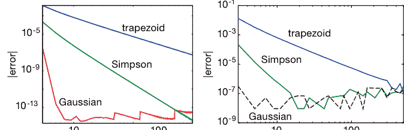

图5.4 使用梯形法则、辛普森法则和高斯求积对指数衰减进行积分时，误差与积分点数N的log–log图。双精度可获得约15位十进制精度(a)，单精度可获得7位(b)。可以看出，当舍入误差（底部附近波动上升的部分）开始占主导时，算法停止收敛。


在清单 5.2 中，我们给出了一个使用高斯点进行积分的示例程序。`gauss` 方法生成这些点和权重，在其他应用中也可能有用。

清单 5.2 `IntegGauss.py` 通过高斯求积对函数 f(x) 进行积分。点和权重在 `gauss` 方法中生成，该方法在其他应用中也是相同的。请注意，所需精度级别由参数 `eps` 设置，该参数应由用户设置；同样，`job` 的值也应由用户设置，它控制将点映射到任意区间（这些点在 (−1, 1) 中生成）。

```
# IntegGauss.py: Gaussian quadrature generator of pts & wts
from numpy import *
from sys import version

max_in = 11                     # Numb intervals
vmin = 0.; vmax = 1.            # Int ranges
ME = 2.7182818284590452354 E0   # Euler's const
w = zeros( (2001), float)
x = zeros( (2001), float)

def f(x):                       # The integrand
    return (exp(- x) )

def gauss(npts, job, a, b, x, w):
    m = i = j = t = t1 = pp = p1 = p2 = p3 = 0.
    eps = 3.E-14                # Accuracy: ******ADJUST THIS******!
    m = int((npts + 1)/2 )
    for i in range(1, m + 1):
        t = cos(math.pi*(float(i) - 0.25)/(float(npts) + 0.5) )
        t1 = 1
        while( (abs(t - t1) ) >= eps):
            p1 = 1. ; p2 = 0.
            for j in range(1, npts + 1):
                p3 = p2; p2 = p1
                p1 = ((2.*float(j)-1)*t*p2 - (float(j)-1.)*p3)/(float(j))
                pp = npts*(t*p1 - p2)/(t*t - 1.)
                t1 = t; t = t1 - p1/pp
            x[i - 1] = - t; x[npts - i] = t
            w[i - 1] = 2./( (1. - t*t)*pp*pp)
            w[npts - i] = w[i - 1]
    if (job == 0):
        for i in range(0, npts):
            x[i] = x[i]*(b - a)/2. + (b + a)/2.
            w[i] = w[i]*(b - a)/2.
    if (job == 1):
        for i in range(0, npts):
            xi = x[i]
            x[i] = a*b*(1. + xi) / (b + a - (b - a)*xi)
            w[i] = w[i]*2.*a*b*b / ( (b + a - (b-a)*xi)*(b + a - (b-a)*xi))
    if (job == 2):
        for i in range(0, npts):
            xi = x[i]
            x[i] = (b*xi + b + a + a) / (1. - xi)
            w[i] = w[i]*2.*(a + b)/((1. - xi)*(1. - xi) )

def gaussint (no, min, max):
    quadra = 0.
    gauss (no, 0, min, max, x, w)          # Returns pts & wts
    for n in range(0, no):
        quadra += f(x[n]) * w[n]            # Calculate integral
    return (quadra)

for i in range(3, max_in + 1, 2):
```

## 5.13 高阶规则（算法）

与数值微分一样，我们可以利用误差对区间大小 h 的已知函数依赖关系来减小积分误差。对于像梯形法则和辛普森法则这样的简单规则，我们有解析估计式 (5.47)；而对于其他规则，你可能需要通过实验来确定 h 的依赖关系。为了说明这一点，如果 A(h) 和 A(h/2) 分别是针对区间 h 和 h/2 计算得到的积分值，我们知道这些积分具有展开式，其首项误差与 h² 成正比，

$$A(h) \simeq \int_{a}^{b} f(x)\,dx + \alpha h^{2} + \beta h^{4} + \cdots , \tag{5.72}$$

$$A\left(\frac{h}{2}\right) \simeq \int_{a}^{b} f(x)\,dx + \frac{\alpha h^{2}}{4} + \frac{\beta h^{4}}{16} + \cdots . \tag{5.73}$$

因此，我们通过计算下面的组合来使 h² 项消失：

$$\frac{4}{3}A\left(\frac{h}{2}\right) - \frac{1}{3}A(h) \simeq \int_{a}^{b} f(x)\,dx - \frac{\beta h^{4}}{4} + \cdots . \tag{5.74}$$

显然，这种特殊技巧（龙贝格外推）仅在 h² 项在误差中占主导地位时才有效，而且只有在函数的导数性质良好时才有效。对其他算法也可以进行类似的外推。

在表 5.1 中，我们给出了几个等区间规则的权重。辛普森法则使用两个区间，八分之三法则使用三个区间，米尔恩²)法则使用四个区间。（这些是单区间规则，必须串联起来才能得到覆盖整个积分范围的规则。这意味着结束一个区间并开始下一个区间的点会被加权两次。）你可以很容易地确定所积分的初等区间数量，并通过将任何规则的权重相加来检查你和我方写的权重是否正确。该和就是 f(x)=1 的积分，必须等于 h 乘以区间数量（这又等于 b − a）：

$$\sum_{i=1}^{N} w_{i} = h \times N_{\text{intervals}} = b - a . \tag{5.75}$$

2) 并非巧合的是，俄勒冈州立大学确实有一个米尔恩计算机中心，尽管那里不再有中央计算机。

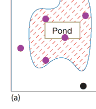

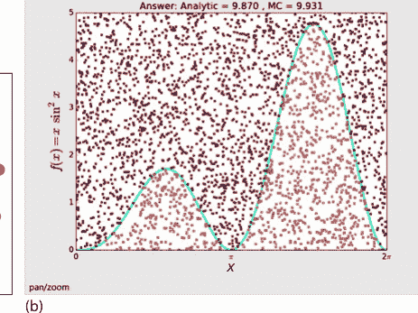

图 5.5 (a) 向池塘投掷石子作为测量池塘面积的一种技术。“命中”次数与投掷石子总数之比等于池塘面积与盒子面积之比。(b) 通过蒙特卡罗（扔石子）技术根据面积比来评估积分。

## 5.15 中值积分（理论与数学）

标准的蒙特卡罗积分技术基于中值定理（想必大家从基础微积分中已经熟悉）：

```
I = ∫ₐᵇ dx f(x) = (b − a)⟨f⟩ .  (5.77)
```

如果你把积分看作面积，这个定理就非常明显。某个函数 f(x) 在 a 和 b 之间的积分值等于区间长度 (b − a) 乘以函数在该区间上的平均值 ⟨f⟩（图 5.6）。蒙特卡罗积分算法使用随机点来评估 (5.77) 中的平均值。对于 N 个均匀随机数构成的序列 a ≤ xᵢ ≤ b，我们希望在这些点上对函数 f(x) 进行采样来确定样本均值：

```
⟨f⟩ ≈ (1/N) Σᵢ₌₁ᴺ f(xᵢ) .  (5.78)
```

于是我们得到非常简单的积分规则：

```
∫ₐᵇ dx f(x) ≈ (b − a) (1/N) Σᵢ₌₁ᴺ f(xᵢ) = (b − a)⟨f⟩ .  (5.79)
```

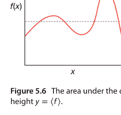

图 5.6 曲线 f(x) 下方的面积与高度为 y = ⟨f⟩ 的水平线下方的面积相同。

式 (5.79) 看起来很像我们标准的积分算法 (5.26)，只是点 xᵢ 是随机选取的，权重是均匀的 wᵢ = (b − a)/N。由于并没有试图在给定 N 值下获得最优答案，这似乎不是一种高效的积分求值方法；但你得承认它很简单。如果我们让 f(x) 的样本数趋于无穷大 N → ∞，或者保持样本数有限并取无限多次运行的平均值，统计学规律确保 (5.79) 将趋近于正确答案，至少在没有舍入误差的情况下是这样。

对于熟悉统计学的读者，我们提醒您，在 N 次 f(x) 采样后得到的积分 I 值的不确定性由标准差 σ_I 来衡量。如果 σ_f 是采样中被积函数 f 的标准差，那么对于正态分布，我们有

```
σ_I ≈ 1/√N σ_f .
```

(5.80)

因此，对于大的 N，积分值的误差随 1/√N 减小。

## 5.16 积分练习

- 1. 下面是两个求积可能具有挑战性的积分：

  F₁ = ∫₀^{2π} sin(100x) dx,   F₂ = ∫₀^{2π} sin²(100x) dx .   (5.81)

  - a) 使用两种不同的积分规则来评估这些积分并比较答案。
  - b) 解释为什么计算机在处理这些积分时可能会遇到困难。

- 2. 接下来的三个问题是椭圆积分如何进入实际物理问题的例子。使用本章的技术对任何积分进行数值求值都很直接，但你可能很难知道自己得到的答案是否正确。磨练积分求值技巧的一种方法是将求积得到的答案与幂级数表达式或已知精度的多项式近似进行比较。为帮助你做到这一点，我们在这里给出一个椭圆积分的多项式近似（Abramowitz 和 Stegun，1972）：

  ```
  K(m) = ∫₀^{π/2} (1 - m sin²θ)^{-1/2} dθ
  ≈ a₀ + a₁ m₁ + a₂ m₁² - [b₀ + b₁ m₁ + b₂ m₁²] ln m₁ + ε(m) ,
   m₁ = 1 - m ,   0 ≤ m ≤ 1 ,   |ε(m)| ≤ 3 × 10⁻⁵ ,
   a₀ = 1.386 2944   a₁ = 0.111 972 3   a₂ = 0.072 529 6
   b₀ = 0.5         b₁ = 0.121 347 8   b₂ = 0.028 872 9 .
  (5.82)
  ```

- 3. 通过数值计算 (5.82) 中的积分来计算 K(m)。调整你的积分求值，直到你在 ≤ 3 × 10⁻⁵ 量级上与多项式近似达到一致。

- 4. 在 15.1.2 节中，我们将推导一个真实摆的周期 T 的表达式，其中最大位移角 θₘ 不一定很小：

  ```
  T = T₀/π ∫₀^{θₘ} dθ / [sin²(θₘ/2) - sin²(θ/2)]^{1/2}   (5.83)
  ≈ T₀ [1 + (1/2)² sin²(θₘ/2) + (1·3 / 2·4)² sin⁴(θₘ/2) + …] ,   (5.84)
  ```

  其中 T₀ 是小角度振荡的周期。(5.83) 中的积分可以用第一类椭圆积分来表示。如果你把椭圆积分看作一种广义三角函数，那么这就是一个闭式解；否则，它是一个需要数值求值的积分。

  - a) 使用数值求积确定 θₘ 在 0 到 π 之间的五个值下的 T / T₀ 比值。通过逐步增加积分点数，直到变化仅出现在第五位或更后，证明你已达到至少四位精度。
  - b) 使用幂级数 (5.84) 确定 T / T₀ 比值。继续累加项，直到和的变化仅出现在第五位或更后。
  - c) 将积分解和幂级数解得到的 T / T₀ 随 θₘ 的变化绘图。注意，任何偏离 1 的情况都表明熟悉的摆的小角度近似失效。

- 5. 在经典电磁学教材（Jackson，1988）中，有一个问题是：一块无限大、接地的薄导电平面板上切有一个半径为 a 的孔


在其中。孔中包含一个略小半径的导电圆盘，保持在电位 V，并通过一个薄的绝缘环与薄片分离。求解盘边缘上方垂直距离 z 处的电位，用椭圆积分表示：

```
Φ(z) = V/2 ( 1 - (k z)/(π a) ∫₀^{π/2} dφ / √(1 - k² sin² φ) ) , (5.85)
```

其中 k = 2a / (z² + 4a²)^{1/2}。使用数值积分计算并绘制 V = 1，a = 1 且 z 在区间 (0.05, 10) 内的电位。与 1/r 的衰减进行比较。

6. 图 5.7 显示了一个半径为 a、载流 I 的电流环。点 P 距环中心的距离为 r，球坐标为 (r, θ, φ)。Jackson (1988) 用椭圆积分求解点 P 处的矢量势的 φ 分量：

```
A_φ(r, θ) = μ₀/(4π) * 4 I a / √(a² + r² + 2 a r sin θ) [ (2 - k²)K(k) - 2E(k) ] / k² , (5.86)
```

```
K(k) = ∫₀^{π/2} dφ / √(1 - k² sin² φ) ,   E(k) = ∫₀^{π/2} √(1 - k² sin² φ) dφ , (5.87)
```

```
k² = 4 a r sin θ / (a² + r² + 2 a r sin θ) . (5.88)
```

这里 K(k) 是第一类完全椭圆积分，E(k) 是第二类完全椭圆积分。对于 a = 1，I = 3，且 μ₀/4π = 1，计算并绘制

+   a) A_φ(r = 1.1, θ) vs. θ。
+   b) A_φ(r, θ = π/3) vs. r。

## 5.17

## 多维蒙特卡洛积分（问题）

假设我们想要计算镁等小原子的一些性质，该原子有 12 个电子。为此，我们需要对每个电子的三个坐标进行原子波函数的积分。这相当于 3 × 12 = 36 维积分。如果我们对每个积分使用 64 个点，这需要大约 64³⁶ ≈ 10⁶⁵ 次被积函数的求值。如果计算机很快，每秒能求值一百万次，这大约需要 10⁵⁹ s，这明显长于宇宙的年龄（~ 10¹⁷ s）。

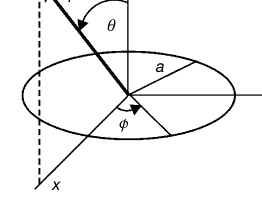

图 5.7 一个半径为 a 的环携带电流 I。求点 P 处的矢量势。

你的问题是找到一种方法来执行多维积分，以便你仍然活着来品味结果。具体而言，计算 10 维积分

```
I = ∫₀¹ dx₁ ∫₀¹ dx₂ ⋯ ∫₀¹ dx₁₀ (x₁ + x₂ + ⋯ + x₁₀)² . (5.89)
```

将你的数值答案与解析值 155/6 进行比较。

将平均值积分推广到多维很容易，只需在多维空间中选取随机点即可。例如，在 2D 中：

```
∫ₐᵇ dx ∫ᶜᵈ dy f(x, y) ≈ (b−a)(d−c) 1/N Σᵢᴺ f(xᵢ) = (b−a)(d−c)⟨f⟩ . (5.90)
```

### 5.17.1

### 多维积分误差评估

当我们执行多维积分时，蒙特卡洛技术的相对误差在统计上按 1/√N 减小。这即使在 N 个点分布在 D 维时也成立。相比之下，当我们使用相同的 N 个点以 D 个独立的 1D 积分来执行 D 维积分时，使用 Simpson 等规则，我们对每个积分使用 N/D 个点。对于固定的 N，这意味着随着维数 D 的增加，用于每个积分的点数减少，因此每个积分的误差随 D 增加。此外，总误差大约为 N 倍每个积分的误差。如果你把这些趋势结合起来并对特定积分规则进行分析，你会发现，在 D ≈ 3−4 的值处，蒙特卡洛积分的误差大约等于常规方案的误差。对于更大的 D 值，蒙特卡洛方法总是更准确！

### 5.17.2

### 实现：10D 蒙特卡洛积分

使用内置随机数生成器执行 (5.89) 中的 10D 蒙特卡洛积分。

+   1. 进行 16 次试验并取平均值作为你的答案。
+   2. 尝试样本大小 N = 2, 4, 8, ..., 8192。
+   3. 绘制相对误差 vs. 1/√N 并查看是否出现线性行为。
+   4. 你对积分精度的估计是多少？
+   5. 证明对于维数 D ≈ 3–4，多维蒙特卡洛积分的误差大约等于常规方案的误差，并且对于更大的维数，蒙特卡洛方法更准确。

## 5.18

## 积分快速变化函数（问题）

在许多物理应用中，积分一个对 x 呈近似高斯依赖的函数是很常见的。被积函数的快速衰减意味着我们的蒙特卡洛积分技术需要极大数量的点才能有足够多的点使被积函数较大。你的问题是使蒙特卡洛积分对快速变化的被积函数更高效。

## 5.19

## 方差缩减（方法）

如果被积函数从其平均值几乎不偏离，那么标准蒙特卡洛平均值方法 (5.79) 应该在大量但可管理的点数下工作良好。然而对于方差很大的函数（即不是“平坦”的函数），函数求值的许多次可能发生在函数值非常小、因此对积分贡献不大的 x 值处；这基本上是时间的浪费。该方法可以通过将函数 f 映射到方差在区间上更小的不同函数 g 来改进。我们在此指出两种方法，并请你参考 Press et al. (1994) 和 Koonin (1986) 了解更多细节。

第一种方法是方差缩减或减法技术，其中我们设计一个更平坦的函数来应用蒙特卡洛技术。假设我们在 [a, b] 上构造一个具有以下性质的函数 g(x)：

```
|f(x) − g(x)| ≤ ε ,    ∫ₐᵇ dx g(x) = J .    (5.91)
```

我们现在求差值 $f(x)-g(x)$ 的积分并将结果加到 $J$ 上以得到所需的积分

$$\int_a^b dx\,f(x)=\int_a^b dx\,[f(x)-g(x)]+J.$$  \tag{5.92}

如果我们足够聪明地找到一个使 $f(x)-g(x)$ 的方差小于 $f(x)$ 的方差且可解析积分的简单 $g(x)$，我们可以在更短的时间内获得更精确的答案。

## 5.20  
**重要性采样（方法）**

改进蒙特卡洛积分的第二种方法称为 *重要性采样*，因为它对被积函数在最重要的区域进行采样。它源于恒等式

$$I=\int_a^b dx\,f(x)=\int_a^b dx\,w(x)\frac{f(x)}{w(x)}.$$  \tag{5.93}

如果我们现在使用包含 $x(x)$ 的随机数的 *概率分布*，积分可以近似为

$$I=\left\langle\frac{f}{w}\right\rangle\simeq\frac{1}{N}\sum_{i=1}^{N}\frac{f(x_i)}{w(x_i)}.$$  \tag{5.94}

由 (5.94) 带来的改进是，通过明智地选择权重函数 $w(x)\propto f(x)$，我们可以使 $f(x)/w(x)$ 更恒定，从而更容易准确积分。

## 5.21  
**von Neumann 拒绝（方法）**

von Neumann 提出了一种生成具有概率分布 $w(x)$ 的随机点的简单而巧妙的方法，并在列表 5.3 中实现。该方法本质上与用于猜测池塘面积的拒绝或采样方法相同，只是现在池塘被权重函数 $w(x)$ 取代，而围绕湖泊的任意盒子被任意常数 $W_0$ 取代。想象 $w(x)$ vs. $x$ 的图像（图 5.8）。通过放置线 $W=W_0$ 在图像上走出你的盒子，唯一条件是 $W_0\geq w(x)$。我们接下来“向此图像投掷石头”并只计算落在 $w(x)$ 池塘中的溅射。那就是，我们在 $x$ 和 $y\equiv W$ 中生成均匀分布，其中

```
incr = 2.0*pi/N
for i in range(0,N):
    xx = i*incr
    xsinx.x[i] = ((80.0/pi)*xx-80)
    xsinx.y[i] = 20.0*fx(xx)-50
    box = curve(pos=[(-80,-50), (-80,50), (80,50), (80,-50), (-80,-50)], color=color.white)      # box

plotfunc()                                                                 # Box area = h x w =5*2pi
j = 0
Npts = 3001                                                                 # Pts inside box
analyt = (pi)* *2                                                          # Analytical integral
areanal.text = 'analytical=%8.5f '%analyt
genpts = points(size=2)
for i in range(1,Npts):                                                     # points inside box
    rate(500)                                                               # slow process
    x = 2.0*pi*random.random()
    y = 5*random.random()
    xp = x*80.0/pi-80
    yp = 20.0*y-50
    pts2.text = '%4s ' %i
    if y <= fx(x):
        j += 1
        genpts.append(pos=(xp,yp), color=color.cyan)
        inside2.text='%4s %'
    else: genpts.append(pos=(xp,yp), color=color.green)
boxarea = 2.0*pi*5.0
area = boxarea*j/(Npts-1)
arealb2.text = '%8.5f '%area
```

### 5.21.1

### 简单随机高斯分布

中心极限定理可用于通过简单的求和推导出高斯分布。该定理指出，在相当一般的条件下，如果 {r_i} 是相互独立的随机数序列，则和

x_N = Σ_{i=1}^N r_i  (5.97)

呈正态分布。这意味着生成的 x 值具有分布

P_N(x) = exp[ - (x-μ)^2 / (2σ^2) ] / sqrt(2πσ^2) ,   μ = N⟨r⟩ ,   σ^2 = N(⟨r^2⟩ - ⟨r⟩^2).   (5.98)

## 5.22

## 非均匀评估 ⊙

使用 von Neumann 拒绝技术生成标准差为 1 的正态分布并将其与简单高斯方法进行比较。


## 5.22.1

## 实现 ⊙

为了使 w(x) 成为 [a, b] 上随机数的权重函数，我们希望它具有以下性质

```
∫ₐᵇ dx w(x) = 1 ,   [w(x) > 0] ,   d𝒫(x → x + dx) = w(x) dx ,   (5.99)
```

其中 d𝒫 是获得 x 在范围 x → x + dx 内的概率。对于 [a, b] 上的均匀分布，w(x) = 1/(b − a)。

## 逆变换/变量替换方法 ⊙

让我们考虑一个变量变换，将我们的原始积分 I (5.93) 变为形式

```
I = ∫ₐᵇ dx f(x) = ∫₀¹ dW f[x(W)] / w[x(W)] .   (5.100)
```

我们的目标是使这种变换使得 W 范围内的所有部分都有相同的贡献；也就是说，我们希望使用 W 的均匀随机数序列。为了确定新的变量，我们从 u(r) 开始，即 [0, 1] 上的均匀分布，

```
u(r) = { 1,  for 0 ≤ r ≤ 1,  0,  otherwise. }   (5.101)
```

我们希望找到一个映射 r ↔ x 或概率函数 w(x)，使得概率守恒：

```
w(x) dx = u(r) dr,  ⇒  w(x) = |dr/dx| u(r) .   (5.102)
```

这意味着即使 x 和 r 通过某种（可能）复杂的映射相关，x 也是随机的，x 位于 x → x + dx 中的概率等于 r 位于 r → r + dr 中的概率。

为了找到 x 和 r 之间的映射（棘手的部分），我们将变量改变为由积分定义的 W(x)

```
W(x) = ∫₋∞ˣ dx' w(x') .   (5.103)
```

我们认识到 W(x) 是概率密度 u(r) 积分到某一点 x 的（不完全）积分。它是另一种类型的分布函数，即找到随机数小于值 x 的积分概率。W(x) 因此被称为累积分布函数，也可以被视为

u(r) 对 r 的图像上 r = x 左侧的面积。直接从定义 (5.103) 可知 W(x) 具有以下性质

W(−∞) = 0 ;   W(∞) = 1 ,  (5.104)
 dW(x)/dx = w(x) ,   dW(x) = w(x) dx = u(r) dr .  (5.105)

因此，Wi = {ri} 是均匀的随机数序列，我们只需要反转 (5.103) 即可得到具有概率 w(x) 分布的 x 值。

这种技术的关键在于能够反转 (5.103) 得到 x = W−1(r)。让我们看一些解析示例来感受这些步骤（数值反演在实际情况下是可能且常见的）。

## 均匀权重函数 w   我们从熟悉的均匀分布开始

w(x) = { 1/(b−a), if a ≤ x ≤ b,  0, otherwise.  (5.106)

遵循规则后，这导致

W(x) = ∫_a^x dx' 1/(b−a) = (x−a)/(b−a)  (5.107)
⇒  x = a + (b−a)W   ⇒   W−1(r) = a + (b−a)r ,  (5.108)

其中 W(x) 总是取为均匀的。这样，我们生成均匀随机 0 ≤ r ≤ 1 和均匀随机 a ≤ x ≤ b。

## 指数权重   我们希望随机点具有指数分布：

w(x) = { 1/λ e^{−x/λ}, for x > 0,  0, for x < 0,  W(x) = ∫_0^x dx' 1/λ e^{−x'/λ} = 1 − e^{−x/λ} ,  (5.109)
⇒  x = −λ ln(1−W) ≡ −λ ln(1−r) .  (5.110)

这样，我们生成均匀随机 r: [0,1] 并得到 x = −λ ln(1−r) 具有指数概率分布，x > 0。注意我们的处方 (5.93) 和 (5.94) 告诉我们使用 w(x) = e^{−x/λ}/λ 来从被积函数中消除指数行为并将其置于权重和缩放点 (0 ≤ xi ≤ ∞) 中。因为 resulting 被积函数变化较小，它可以更好地近似为多项式：

∫_0^∞ dx e^{−x/λ} f(x) ≃ λ/N ∑_{i=1}^N f(xi) ,   xi = −λ ln(1−ri) .  (5.111)

## 高斯（正态）分布

我们希望生成具有正态分布的点：

$$w(x') = \frac{1}{\sqrt{2\pi}\sigma} e^{-(x' - \bar{x})^2 / 2\sigma^2}.$$ (5.112)

这本身相当困难，但通过生成角度的均匀分布然后使用三角关系将其转换为高斯分布，可以变得更容易。但在这样做之前，我们保持简单，认识到我们可以通过缩放和对更简单的 w(x) 进行平移来获得具有均值 \bar{x} 和标准差 \sigma 的 (5.112)：

$$w(x) = \frac{1}{\sqrt{2\pi}} e^{-x^2/2}, \quad x' = \sigma x + \bar{x}.$$ (5.113)

我们首先将概率守恒的陈述从两个不同分布 (5.102) 推广到二维 (Press et al., 1994)：

$$p(x, y)\,dx\,dy = u(r_1, r_2)\,dr_1\,dr_2$$ (5.114)

$$\Rightarrow \quad p(x, y) = u(r_1, r_2) \left| \frac{\partial(r_1, r_2)}{\partial(x, y)} \right|.$$ (5.115)

我们认识到竖线中的项为雅可比行列式：

$$J = \left| \frac{\partial(r_1, r_2)}{\partial(x, y)} \right| \stackrel{\text{def}}{=} \frac{\partial r_1}{\partial x}\frac{\partial r_2}{\partial y} - \frac{\partial r_2}{\partial x}\frac{\partial r_1}{\partial y}.$$ (5.116)

为了专门化为高斯分布，我们考虑 2\pi r 为从均匀随机分布 r 获得的角度，x 和 y 为将具有高斯分布的笛卡尔坐标。两者之间的关系为

$$x = \sqrt{-2\ln r_1}\cos 2\pi r_2, \quad y = \sqrt{-2\ln r_1}\sin 2\pi r_2.$$ (5.117)

该映射的反演产生高斯分布

$$r_1 = e^{-(x^2 + y^2)/2}, \quad r_2 = \frac{1}{2\pi}\tan^{-1}\frac{y}{x}, \quad J = -\frac{e^{-(x^2 + y^2)/2}}{2\pi}.$$ (5.118)

我们的问题的解决方案就在眼前。我们使用 (5.117) 并使 r1 和 r2 为均匀随机分布，则 x 和 y 于是为以 x = 0 为中心的 Gaussian 随机分布。

# 6
矩阵计算

本章考察了使用矩阵进行计算的各个方面，特别是 Python 包的应用。因为这些包经过优化且稳健，我们强烈建议即使在所有小型程序中也使用它们（小型程序往往会变得很大）。两质量一绳问题被表述为矩阵问题，并扩展了将在第 7 章讨论的 Newton–Raphson 搜索技术。虽然将本章放在第 7 章之后在逻辑上更合理，但它被放在这里是为了提供可视化所需的矩阵工具（这就是为什么问题 3 在问题 1 之前）。

## 6.1
问题 3：N–D Newton–Raphson；绳上两质量

问题 两个重量 (W1, W2) = (10, 20) 悬挂在三段绳子上，长度为 (L1, L2, L3) = (3, 4, 4) 以及长度为 L = 8 的水平杆（图 6.1）。求绳子所成的角度以及绳子所受的张力。

尽管这是一个简单的仅需一年级物理即可表述的问题，但由此产生的耦合超越方程

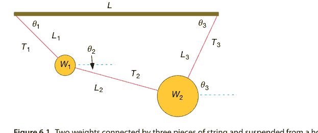

图 6.1 两个重量由三段绳子连接并悬挂在长度为 L 的水平杆上。长度都是已知的，但角度和绳子的张力需要确定。

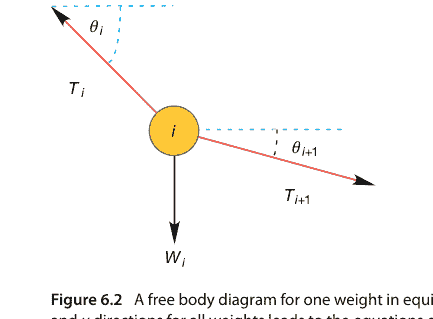

图 6.2 一个重量在平衡时的受力图。对所有重量在 x 和 y 方向上平衡力会导致静力平衡方程。

几乎是解析求解时难以忍受的痛苦。1) 然而，我们将向你展示计算机如何解决这个问题，但即使如此也只能通过试错技术，且没有成功保证。你的问题是测试该解决方案对各种重量和长度，然后将其扩展到三重量问题（并不像看起来那么容易）。在任何情况下都要检查解的物理合理性；推导出的张力应为正且大小与球体的重量相似，推导出的角度应对应于物理上可实现的几何形状，如图 6.2 所示的草图所证实。你应该做的一些探索是查看初始猜测变得多么糟糕，以至于计算机无法找到物理解。

## 6.1.1

## 理论：静力学

我们从结构的水平长度为 L 且绳子在同一高度开始和结束的几何约束开始（图 6.1）：

```
L₁ cos θ₁ + L₂ cos θ₂ + L₃ cos θ₃ = L ,  (6.1)
L₁ sin θ₁ + L₂ sin θ₂ − L₃ sin θ₃ = 0 ,  (6.2)
sin² θ₁ + cos² θ₁ = 1 ,  (6.3)
sin² θ₂ + cos² θ₂ = 1 ,  (6.4)
sin² θ₃ + cos² θ₃ = 1 .  (6.5)
```

请注意，最后三个方程将三角恒等式作为独立方程包含在内，因为我们将 sin θ 和 cos θ 视为独立变量；这使得搜索过程更容易实现。基本物理学说由于没有加速度，水平和

> 1) 几乎不可能，L. Molnar 已经为我提供了解析解。


垂直方向上的合力必须为零（图6.2）：

T₁ sin θ₁ − T₂ sin θ₂ − W₁ = 0 ,  (6.6)

T₁ cos θ₁ − T₂ cos θ₂ = 0 ,  (6.7)

T₂ sin θ₂ + T₃ sin θ₃ − W₂ = 0 ,  (6.8)

T₂ cos θ₂ − T₃ cos θ₃ = 0 .  (6.9)

这里Wᵢ是质量i的重量，Tᵢ是绳i中的张力。注意，由于我们没有一个刚性结构，我们不能假设力矩平衡。

## 6.1.2
### 算法：多维搜索

方程(6.1)–(6.9)是九个联立的非线性方程。线性方程可以直接求解，但非线性方程不能（Press等，1994）。你可以用计算机通过猜测来搜索解，但不能保证一定能找到。

遗憾的是，生活中并非一切都是逻辑的，因为我们现在需要使用一种搜索技术，而这种技术要到第7章才会介绍。虽然我们接下来要做的事情不言自明，但如果你对搜索完全不熟悉，现在不妨看一下第7章。

我们将与求解单个方程相同的牛顿–拉弗森算法应用于我们的方程组，方法是将九个未知角度和张力重命名为带下标变量yᵢ，并将这些变量放在一起构成一个向量：

y = [x₁ x₂ x₃ x₄ x₅ x₆ x₇ x₈ x₉]ᵀ = [sin θ₁ sin θ₂ sin θ₃ cos θ₁ cos θ₂ cos θ₃ T₁ T₂ T₃]ᵀ .  (6.10)

待求解的九个方程写成一般形式，右边为零，并放入一个向量：

fᵢ(x₁, x₂, …, x_N) = 0 ， i = 1, N ,  (6.11)

f(y) = ( f1(y) f2(y) f3(y) f4(y) f5(y) f6(y) f7(y) f8(y) f9(y) ) = ( 3x4 + 4x5 + 4x6 - 8  3x1 + 4x2 - 4x3  x7x1 - x8x2 - 10  x7x4 - x8x5  x8x2 + x9x3 - 20  x8x5 - x9x6  x1^2 + x4^2 - 1  x2^2 + x5^2 - 1  x3^2 + x6^2 - 1 ) = 0 . (6.12)

这些方程的解需要一组九个x_i值，使所有九个f_i同时为零。虽然这些方程并不十分复杂（物理毕竟是最基本的），但x的二次项使它们成为非线性方程，这使得找到解析解变得困难甚至不可能。搜索算法先猜测一个解，将非线性方程展开为线性形式，求解所得的线性方程组，然后根据前一次猜测与f = 0的接近程度不断改进猜测。（我们将在第7章讨论使用该过程的搜索算法。）

具体地说，令任一阶段的近似解为集合{x_i}，并假设存在一组（未知的）修正量Δx_i，使得 f_i(x1 + Δx1, x2 + Δx2, ..., x9 + Δx9) = 0 ， i = 1, 9 . (6.13)

我们通过假设先前的解足够接近真实解，使得泰勒级数展开的前两项足够精确，来求解近似的Δx_i：

f_i(x1 + Δx1, ..., x9 + Δx9) ≈ f_i(x1, ..., x9) + Σ_{j=1}^9 ∂f_i/∂x_j Δx_j = 0 ， i = 1, ..., 9 . (6.14)

现在我们有了一组关于九个未知量Δx_i的可解线性方程组，将其表示为矩阵方程：

f1 + ∂f1/∂x1 Δx1 + ∂f1/∂x2 Δx2 + ... + ∂f1/∂x9 Δx9 = 0 ,
f2 + ∂f2/∂x1 Δx1 + ∂f2/∂x2 Δx2 + ... + ∂f2/∂x9 Δx9 = 0 ,
...
f9 + ∂f9/∂x1 Δx1 + ∂f9/∂x2 Δx2 + ... + ∂f9/∂x9 Δx9 = 0 ,

( f1  f2  ...  f9 ) + ( ∂f1/∂x1  ∂f1/∂x2  ...  ∂f1/∂x9
                        ∂f2/∂x1  ∂f2/∂x2  ...  ∂f2/∂x9
                        ...
                        ∂f9/∂x1  ∂f9/∂x2  ...  ∂f9/∂x9 ) ( Δx1  Δx2  ...  Δx9 ) = 0 .  (6.15)

注意，现在导数与$f$都是在已知的$x_i$值处求值的，因此只有$\Delta x_i$的向量是未知的。我们将此方程写成矩阵记号：

$$\boldsymbol{f} + F' \Delta \boldsymbol{x} = 0\;,\quad \Rightarrow\quad F' \Delta \boldsymbol{x} = -\boldsymbol{f}\;,\tag{6.16}$$
$$\Delta \boldsymbol{x} = \begin{pmatrix} \Delta x_1 \\ \Delta x_2 \\ \vdots \\ \Delta x_9 \end{pmatrix}\;,\quad \boldsymbol{f} = \begin{pmatrix} f_1 \\ f_2 \\ \vdots \\ f_9 \end{pmatrix}\;,\quad F' = \begin{pmatrix} \partial f_1/\partial x_1 & \cdots & \partial f_1/\partial x_9 \\ \partial f_2/\partial x_1 & \cdots & \partial f_2/\partial x_9 \\ \vdots & & \\ \partial f_9/\partial x_1 & \cdots & \partial f_9/\partial x_9 \end{pmatrix}.$$

这里我们使用粗斜体字母以强调$f_i$和$\Delta x_i$值的列是向量性质的，并记导数矩阵为$F'$（有时也记为$J$，因为它是雅可比矩阵）。

方程$F' \Delta \boldsymbol{x} = -\boldsymbol{f}$是线性方程求解的标准形式（通常写作$A\boldsymbol{x} = \boldsymbol{b}$），其中$\Delta \boldsymbol{x}$为未知向量，$\boldsymbol{b} = -\boldsymbol{f}$。矩阵方程用线性代数的技术求解，在接下来的章节中我们将展示如何做到这一点。在形式意义上，(6.16)的解通过将方程两边同时乘以$F'$矩阵的逆得到：

$$\Delta \boldsymbol{x} = -F'^{-1} \boldsymbol{f}\;,\tag{6.17}$$

若要存在唯一解，逆矩阵必须存在。虽然我们现在处理的是矩阵，但该解在形式上与一维问题$\Delta x = -(1/f')f$的解完全相同。事实上，我们对矩阵使用形式化或抽象记号的原因之一，正是为了揭示其中蕴含的简洁性。

正如我们在第7.3节中对单方程牛顿–拉弗森方法所指出的，即使在此类我们可以推导出导数$\partial f_i/\partial x_j$的解析表达式的情况下，对于这个（很小的）问题也有$9 \times 9 = 81$个导数，全部输入既费时又容易出错。相比之下，尤其是对于更复杂的问题，用前向差分近似来编程计算导数是很直接的，

$$\frac{\partial f_i}{\partial x_j} \simeq \frac{f_i(x_j + \delta x_j) - f_i(x_j)}{\delta x_j}\;,\tag{6.18}$$

其中每个单独的$x_j$都是独立变动的，因为这是偏导数，而$\delta x_j$是你输入的任意微小变化量。虽然中心差分近似求导会更精确，但它需要更多次计算$f$的值，而且一旦我们找到了解，导数算法的精度就不再重要。

正如一维牛顿–拉弗森方法（第7.3.1节）中讨论的那样，如果初始猜测不够接近$f$的零点（此处是指全部$N$个零点），以致$f$无法被近似为线性，该方法可能会失败。回溯技术在这里同样适用，在当前情形下，逐步减小修正量$\Delta x_i$，直到$\|f\|^2 = |f_1|^2 + |f_2|^2 + \cdots + |f_N|^2$减小为止。

## 6.2
### 为什么使用矩阵计算？

物理系统通常用矩阵形式的联立方程组来建模。随着模型变得更加接近现实，矩阵也会相应变大，使用一个良好的线性代数库就变得更加重要。计算机特别擅长矩阵运算，因为这些运算通常涉及少量简单指令的不断重复，并且存在一些算法可以非常高效地完成这些操作。如第11章所讨论的，还可以通过对代码进行针对计算机体系结构的*调优*来获得进一步加速。

用于矩阵计算的工业级子程序可以在成熟的科学库中找到。这些子程序通常比线性代数教材中的基本方法快一个数量级甚至更多，² 通常设计为将舍入误差降至最低，而且往往是“健壮的”，即对广泛类别的问题都有很高的成功概率。基于这些原因，我们建议*不要自己编写矩阵方法*，而是从库中获取。库例程的另一个价值在于，你通常可以在台式机或并行超级计算机上运行同一程序，矩阵例程会自动适应当地架构。细心的读者可能会想，矩阵多大才算“大”到需要使用库例程？一条经验法则是“如果你需要等待答案”，另一条规则是：如果你使用的矩阵占用了计算机随机存取存储器（RAM）的相当大一部分。

## 6.3
### 矩阵问题的类别（数学）

记住这一点是有帮助的：即使对于世界上最强大的计算机，数学规则同样适用。例如，如果你的未知数多于方程数，或者方程不是线性独立的，你*应该会*在求解方程时遇到问题。但不必担心。虽然方程不足时你无法得到唯一解，但你仍然可能描绘出一个允许解的空間。在另一个极端，如果方程数多于未知数，你就面临一个*超定*问题，它可能没有唯一解。超定问题有时使用数据拟合技术来处理，即先对一组足够的方程求出解，然后在未使用的方程上进行检验，如有必要再加以改进。毫不奇怪，这项技术

2) 尽管我们珍视Press等人（1994）所著的《数值方法》一书及其成就，但我们不建议从其中提取子程序。它们既未针对易于独立使用进行优化，也未提供相应文档，而本章推荐的子程序库则做到了这一点。


求解特征值问题（6.21）中特征值和特征向量的传统方法是对角化。这等价于连续变换基向量，每次变换都保持特征值不变，同时不断减小 A 的非对角元素的值。该变换序列等价于不断用变换矩阵 U 作用于原始方程，直到找到一个 U 使得 UAU⁻¹ 为对角矩阵：

```
U A (U⁻¹ U) x = λ U x ,  (6.25)
```

```
(U A U⁻¹)(U x) = λ U x ,  (6.26)
```

```
U A U⁻¹ = ⎛ λ₁'   ...   0 ⎞
            ⎜ 0   λ₂'   ... 0 ⎟
            ⎜ 0    0   λ₃' ... ⎟
            ⎝ 0   ...     λ_N'⎠ .  (6.27)
```

UAU⁻¹ 的对角元素即为特征值，其特征向量为

```
x_i = U⁻¹ ê_i ,  (6.28)
```

也就是说，特征向量是矩阵 U⁻¹ 的列。在子程序库中可以找到许多此类例程。

## 6.3.1

## 实用矩阵计算

许多科学编程错误源于数组的不当使用。³) 这可能是由于科学计算中广泛使用矩阵，或者是由于跟踪索引和维度的复杂性。无论如何，这里有一些经验法则需要遵循。

**计算机是有限的** 除非你小心谨慎，否则你的矩阵可能会占用太多内存，导致计算速度显著下降，尤其是当它开始使用虚拟内存时。举个例子，假设你将数据存储在一个每个索引的物理维度都为 100 的四维数组中：A[100][100][100][100]。这个包含 (100)⁴ 个 64 字节字的数组大约占用 1 GB 的内存。

**处理时间** 矩阵运算（如求逆）对于维度为 N 的方阵需要 N³ 数量级的步骤。因此，将二维方阵的维度加倍（就像积分步数加倍时发生的情况）会导致处理时间增加八倍。

**分页** 许多操作系统具有虚拟内存，当程序耗尽 RAM 时，会使用磁盘空间（有关计算机如何安排内存的讨论，请参见第 10 章）。这是一个缓慢的过程，需要将整页

3) 即使向量 V(N) 也称为数组，尽管是一维的。

字写入磁盘。如果你的程序接近发生分页的内存限制，即使矩阵维度略有增加，也可能导致执行时间增加一个数量级。

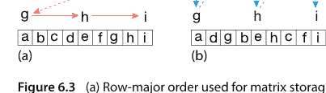

图 6.3 (a) Python、C 和 Java 中用于矩阵存储的行主序。(b) Fortran 中用于矩阵存储的列主序。底部的表格显示了连续的矩阵元素如何以线性方式实际存储在内存中。

## 矩阵存储

虽然我们将矩阵视为存储数字的多维块，但计算机将它们存储为线性字符串。例如，Python 中的矩阵 a[3,3] 按行主序存储（图 6.3a）：

a₀,₀   a₀,₁   a₀,₂   a₁,₀   a₁,₁   a₁,₂   a₂,₀   a₂,₁   a₂,₂   ... ,    (6.29)

而在 Fortran 中，从下标 0 开始，按列主序存储（图 6.3b）：

a₀,₁   a₁,₀   a₂,₀   a₀,₁   a₁,₁   a₂,₁   a₀,₂   a₁,₂   a₂,₂   ...    (6.30)

为了编写正确的代码并允许 Python 和 Fortran 程序混合使用，记住这种线性存储方案非常重要。

在处理矩阵时，你必须在所执行操作的清晰度和计算机执行这些操作的效率之间取得平衡。例如，有一个具有许多索引的矩阵，如 V[L,Nre,Nspin,k,kp,Z,A]，可能打包得很整齐，但随着 k、kp 和 Nre 的变化，它可能需要计算机跳过大的内存块来获取所需的特定值（大步长）。解决方案是使用几个矩阵，例如 V1[Nre,Nspin,k,kp,Z,A]、V2[Nre,Nspin,k,kp,Z,A] 和 V3[Nre,Nspin,k,kp,Z,A]。

## 下标 0

在 Python、C 和 Java 中，数组索引通常从值 0 开始。虽然现在 Fortran 也允许这样，但 Fortran 和大多数数学方程中的标准是索引从 1 开始。因此，除了由于行主序和列主序导致的内存位置不同之外，同一矩阵元素在不同语言中可能以不同方式被引用：

| 位置 | Python/C 元素 | Fortran 元素 |
|---|---|---|
| 最低 | a [0,0] | a (1,1) |
|  | a [0,1] | a (2,1) |
|  | a [1,0] | a (3,1) |
|  | a [1,1] | a (1,2) |
|  | a [2,0] | a (2,2) |
| 最高 | a [2,1] | a (3,2) |

**测试** 始终在一个你知道答案的小问题上测试库例程（例如第 6.6 节中的练习）。这样你就能知道提供的参数是否正确，以及所有链接是否都正常工作。

## 6.4

## Python 列表作为数组

列表是 Python 内置的数字或对象序列。虽然称为“列表”，但它类似于其他计算机语言所称的“数组”。你可以将 Python 列表视为一个容器，按特定顺序保存一组项目。（稍后我们将介绍 NumPy 包提供的更高级的数组数据类型。）在本节中，我们回顾 Python 的一些原生列表特性。

Python 将有序项的序列 L = l₀, l₁, …, lₙ₋₁ 解释为列表，并用单个符号 L 表示：

```
>>> L = [1, 2, 3]              # 创建列表
>>> L[0]                      # 打印元素 0（第一个）
1                               # Python 输出
>>> L                         # 打印整个列表
[1, 2, 3]                        # 输出
>>> L[0] = 5                   # 更改元素 0
>>> L
[5, 2, 3]
>>> len(L)                    # 列表长度
3
>>> for items in L: print items   # 对项目进行 for 循环
5
2
3
```

我们注意到，方括号和逗号分隔符 [1, 2, 3] 用于列表，方括号也用于表示列表项的索引，如第 2 行（L[0]）所示。列表包含可变或可更改的任意对象序列。正如我们在第 7 行的 L 命令中看到的，整个列表可以作为单个对象引用，在这里是为了获取其打印输出。

Python 还有一种内置的列表类型，称为元组，其元素不可变。元组用圆括号 (..., ...) 表示，单个元素仍用方括号引用：

```
>>> T = (1, 2, 3, 4)          # 创建元组
>>> T[3]                     # 打印元素 3
4
>>> T
(1, 2, 3, 4)                # 打印整个元组
>>> T[0] = 5                 # 尝试更改元素 0
Traceback (most recent call last):
T[0] = 5
TypeError: 'tuple' object does not support item assignment
```

请注意，当我们尝试更改元组的元素时会出现错误消息。

大多数语言要求你在开始向数组中存储对象之前指定数组的大小。相比之下，Python 列表是动态的，这意味着它们的大小会根据需要调整。此外，虽然列表本质上是是一维的，因为它是序列，但可以通过将各个元素本身作为列表来在 Python 中创建复合列表：

```
>>> L = [[1,2], [3,4], [5,6]]   # 列表的列表
>>> L
[[1, 2], [3, 4], [5, 6]]
>>> L[0]                        # 第一个元素
[1, 2]
```

Python 可以对列表执行大量操作，例如：

| 操作 | 效果 | 操作 | 效果 |
|---|---|---|---|
| L = [1, 2, 3, 4] | 形成列表 | L1 + L2 | 连接列表 |
| L[i] | 第 i 个元素 | len(L) | 列表 L 的长度 |
| i in L | 如果 i 在 L 中则为真 | L[i:j] | 从 i 到 j 的切片 |
| for i in L | 迭代索引 | L.append(x) | 将 x 追加到 L 末尾 |
| L.count(x) | L 中 x 的数量 | L.index(x) | L 中第一个 x 的位置 |
| L.remove(x) | 删除 L 中第一个 x | L.reverse() | 反转 L 中的元素 |
| L.sort() | 对 L 中的元素排序 | | |

## 6.5

## 数值 Python（NumPy）数组

虽然基本 Python 确实有一种数组数据类型，但它相当有限，我们建议使用 NumPy 数组，它会将 Python 列表转换为数组。由于我们经常使用 NumPy 的 array 命令来形成向量和矩阵的计算机表示，因此你必须在程序（或包含 NumPy 的 Visual）中导入 NumPy 才能使用这些示例。例如，下面我们在 shell 中运行我们的程序 Matrix.py 的结果：

```
>>> from visual import *      # 加载 Visual 包
>>> vector1 = array([1, 2, 3, 4, 5])  # 填充一维数组
>>> print('vector1 =',vector1)  # 打印数组（Python 3 中带括号）
```


```
vector1 = [1 2 3 4 5]                     # Output
>>> vector2 = vector1 + vector1          # Add 2 vectors
>>> print('vector2=',vector2)            # Print vector2
vector2= [ 2 4 6 8 10]                   # Output
>>> vector2 = 3 * vector1                # Mult array by scalar
>>> print ('3 * vector1 = ', vector2)    # Print vector
3 * vector1 = [ 3 6 9 12 15]             # Output
>>> matrix1 = array([[0,1],[1,3]])       # An array of arrays
>>> print(matrix1)                       # Print matrix1
[[0 1]
 [1 3]]
>>> print ('vector1.shape=',vector1.shape)
vector1.shape = (5)
>>> print (matrix1 * matrix1)           # Matrix multiply
[[0 1]
 [1 9]]
```

我们在这里看到，我们已经初始化了一个数组对象，将两个一维数组对象相加，并打印出结果。同样我们看到，将数组乘以一个常数确实会将每个元素乘以该常数（第8行）。我们随后构造一个“矩阵”作为两个一维数组的一维数组，当我们打印它时，注意到它确实看起来像一个矩阵。然而，当我们将此矩阵自乘时，结果不是通常期望的矩阵乘法结果 [1 3; 3 10]。因此，如果你需要真正的数学矩阵，那么你需要使用 NumPy！

现在我们给出一些 NumPy 用法的示例，但请读者参考 NumPy 教程（NumPyTut, 2012）以及《Computing in Science and Engineering》中的文章（Perez et al., 2010）以获取更多信息。首先，我们注意到 NumPy 数组可以保存多达 32 个维度（32 个索引），但每个元素必须是相同类型（统一数组）。元素不限于仅浮点数或整数，可以是任何对象，只要所有元素都是这种相同类型即可。（复合对象可能很有用，例如用于存储数据集的各个部分。）创建数组有多种方法，在所有情况下都使用方括号 [...] 进行索引。首先我们从一个 Python 列表开始（元组也适用）并从中创建一个数组：

```
>>> from numpy import *                 # Array from a list
>>> a = array([1, 2, 3, 4])              # Array from a list
>>> a                                   # Check with print
array([1, 2, 3, 4])
```

请注意，必须在圆括号内使用方括号，因为方括号产生列表对象，而圆括号表示函数参数。还要注意，因为我们原始列表中的数据都是整数，所以创建的数组是 32 位整数数据类型，我们可以通过附加 dtype 方法来检查：

```
>>> a.dtype
dtype('int32')
```

如果我们从浮点数开始，或混合了浮点数和整数，我们就会得到浮点数组：

```
>>> b = array([1.2, 2.3, 3.4])
>>> b
array([ 1.2, 2.3, 3.4])
>>> b.dtype
dtype('float64')
```

在描述 NumPy 数组时，“维度”数 ndim 表示索引数，如我们所说，可以高达 32。数学中可能被称为矩阵的“大小”或“维度”的东西在 NumPy 数组中称为 shape。此外，NumPy 还有一个 size 方法，返回元素的总数。因为 Python 的列表和元组都是一维的，如果我们想要特定形状的数组，我们可以在创建数组时附加 reshape 方法。Python 有 range 函数来生成数字序列，NumPy 有 arange 函数来创建数组而不是列表。这里我们使用它，然后将一维数组重塑为 3 × 4 数组：

```
>>> import numpy as np
>>> np.arange(12)                # List of 12 ints in 1D array
array([ 0, 1, 2, 3, 4, 5, 6, 7, 8, 9, 10, 11])
>>> np.arange(12).reshape((3,4))  # Create, shape to 3x4 array
array([[ 0, 1, 2, 3],
       [ 4, 5, 6, 7],
       [ 8, 9, 10, 11]])
>>> a = np.arange(12).reshape((3,4))  # Give array a name
>>> a
array([[ 0, 1, 2, 3],
       [ 4, 5, 6, 7],
       [ 8, 9, 10, 11]])
>>> a.shape                       # Shape = ?
(3L, 4L)
>>> a.ndim                        # Dimension?
2
>>> a.size                        # Size of a (number of elements)?
12
```

请注意，这里我们将 NumPy 导入为对象 np，然后将 arange 和 reshape 方法附加到该对象。我们随后检查了 a 的形状，发现它有三行四列的长整数（Python 3 可能只显示 ints）。还要注意，如第 9 行所示，NumPy 使用圆括号 () 来表示数组的形状，因此 (3L,4L) 表示一个具有三行四列长整型元素的数组。

现在我们有了形状的概念，我们应该注意 NumPy 提供了多种改变形状的方法。例如，我们可以使用 .T 方法转置数组，或重塑为向量：

```
>>> from numpy import *
>>> a = arange(12).reshape((3,4))  # Give array a name
>>> a
array([[ 0, 1, 2, 3],
       [ 4, 5, 6, 7],
       [ 8, 9, 10, 11]])
>>> a.T                           # Transpose
array([[ 0, 4, 8],
[ 1, 5, 9],
[ 2, 6, 10],
[ 3, 7, 11]])
>>> b = a.reshape((1,12))      # Form vector length 12
>>> b
array([[ 0, 1, 2, 3, 4, 5, 6, 7, 8, 9, 10, 11]])
```

同样，(1,12) 表示一个具有 1 行 12 列的数组。另一种从矩阵中提取所需内容的手动方法是用 Python 的切片运算符 start:stop:step: 从数组中取出切片：

```
>>> a
array([[ 0, 1, 2, 3],
       [ 4, 5, 6, 7],
       [ 8, 9, 10, 11]])
>>> a[2:, :]                  # First 2 rows
array([[ 0, 1, 2, 3],
       [ 4, 5, 6, 7]])
>>> a[:,1:3]                  # Columns 1-3
array([[ 1, 2],
       [ 5, 6],
       [ 9, 10]])
```

我们在这里注意到 Python 索引从 0 开始计数，因此 1:3 表示索引 0、1、2（不包括 3）。正如我们在第 11 章中讨论的，切片在加速程序方面非常有用，通过只挑选出并放入内存中需要处理的大型数据集中的特定数据元素。这避免了在大型内存段中耗时跳转以及过度的磁盘读取。

最后，我们提醒你，虽然 NumPy 数组中的所有元素必须具有相同的数据类型，但该数据类型可以是复合的，例如数组的数组：

```
>>> from numpy import *
>>> M = array([ (10, 20), (30,40), (50, 60) ])   # Array of 3 arrays
>>> M
array([[10, 20],
       [30, 40],
       [50, 60]])
>>> M.shape
(3L, 2L)
>>> M.size
6
>>> M.dtype
dtype('int32')
```

此外，数组可以由复数组成，通过在 array 命令上指定 complex 数据类型作为选项。NumPy 然后使用 j 符号表示虚数 i：

```
>>> c = array([ [1,complex(2,2)], [complex(3,2),4] ], dtype=complex)
>>> c
array([[ 1.+0.j,  2.+2.j],
       [ 3.+2.j,  4.+0.j]])
```

在下一节中，我们讨论使用 NumPy 进行真正的数学矩阵运算，这是数组对象的一种用途。这里我们注意到，如果你想要两个数组的熟悉矩阵乘积，你将使用 dot 函数，而 * 用于逐元素乘积：

```
>>> matrix1= array([[0,1], [1,3]])
>>> matrix1
array([[0, 1],
       [1, 3]])
>>> print (dot(matrix1 ,matrix1))      # Matrix or dot product
[[ 1  3]
 [ 3 10]]
>>> print (matrix1 * matrix1)           # Element-by-element product
[[0 1]
 [1 9]]
```

NumPy 实际上针对数组进行了优化，部分原因是数组的处理和处理方式与简单标量变量类似。⁴) 例如，这里是另一个切片示例，该技术也在普通 Python 中与列表和元组一起使用，其中两个用冒号分隔的索引表示一个范围：

```
from visual import *
stuff = zeros(10, float)
t = arange(4)
stuff[3:7] = sqrt(t+1)
```

这里我们首先创建 NumPy 数组 stuff 的浮点数，其全部 10 个元素初始化为零。然后我们创建数组 t 包含四个元素 [0, 1, 2, 3]，通过在 0–4 范围内均匀分配四个变量来赋值（arange 中的“a”创建浮点变量，range 创建整数）。接下来我们使用切片将 [sqrt(0+1), sqrt(1+1), sqrt(2+1), sqrt(3+1)] = [1, 1.414, 1.732, 2] 分配给 stuff 数组的中间元素。请注意，NumPy 版本的 sqrt 函数，是 NumPy 支持的众多通用函数（ufunctions）之一⁵)，具有令人惊叹的自动输出长度与其参数相同的数组的属性，在本例中为数组 t。一般来说，NumPy 的强大之处主要来自其广播操作，即通过单个赋值语句将值分配给多个元素的操作。广播允许 Python 向量化数组操作，这意味着相同的操作可以并行（或近似并行）对不同的数组元素执行。广播还加快了处理速度，因为数组操作在 C 中发生，而不是在 Python 中，并且数组复制最少。以下是广播的一个简单示例：

```
w = zeros(100, float)
w = 23.7
```

第一行创建 NumPy 数组 w，第二行将值 23.7 “广播”到数组的所有元素中。有许多可能的数组操作

4) 我们感谢 Bruce Sherwood 对这些点的宝贵评论。

5) ufunc 是一个以逐元素方式在 N-D 数组上操作的功能，支持数组广播、类型转换和其他几个标准特性。换句话说，ufunc 是对一个接受固定数量的标量输入并产生固定数量的标量输出的函数的向量化包装器。


in NumPy 和各种相关规则；我们建议认真使用的用户探索 NumPy 的广泛文档以获取更多信息。

### 6.5.1 NumPy 的 linalg 包

NumPy 和 Visual 的数组对象与数学矩阵并不相同，尽管数组可用于表示矩阵。幸运的是，有 LinearAlgebra 包，它将 2D 数组（1D 数组的 1D 数组）视为数学矩阵，并且还提供了对强大的 LAPACK 线性代数库（Anderson et al., 2013）的简单接口。正如我们一直所说，与编写自己的矩阵例程相比，使用这些库在速度和可靠性方面可以获得很多好处。

我们从线性代数中的第一个例子是标准矩阵方程

**A** **x** = **b** , (6.31)

其中我们使用大写粗体字符表示矩阵，使用小写粗体斜体字符表示 1D 矩阵（向量）。方程 6.31 描述了一组线性方程，其中 x 是未知向量，A 是已知矩阵。现在我们取 A 为 3 × 3，b 为 3 × 1，并让程序推断出 x 必须为 3 × 1 向量。⁶ 我们首先导入所有包，通过输入矩阵和向量，然后打印出 A 和 x：

```
>>> from numpy import *
>>> from numpy.linalg import *
>>> A = array([ [1,2,3], [22,32,42], [55,66,100] ]) # Array of arrays
>>> print ('A =', A)
A = [[ 1  2  3]
     [ 22 32 42]
     [ 55 66 100]]
>>> b = array([1,2,3])
>>> print ('b =', b)
b = [1 2 3]
```

由于我们有矩阵 A 和 b，我们可以继续使用 NumPy 的 solve 命令求解 A x = b，然后测试 A x − b 与零向量有多接近：

```
>>> from numpy.linalg import solve
>>> x = solve(A, b)                # Finds solution
>>> print ('x =', x)
x = [ -1.4057971 -0.1884058 0.92753623]   # The solution
>>> print ('Residual =', dot(A, x) - b)   # LHS-RHS
Residual = [4.44089210e-16 0.00000000e+00 -3.55271368e-15]
```

这真的令人印象深刻。我们已用单个命令 solve 求解了整个线性方程组（通过消元），用单个命令 dot 执行了矩阵乘法，用通常的运算符执行了矩阵减法，得到的残差本质上等于机器精度。

⁶ 不要为虽然我们认为这些向量是 3 × 1，但它们有时会被打印为 1 × 3 而困扰；想想能节省多少树木！

尽管有更高效的数值方法，直接求解

**A** **x** = **b** (6.32)

的方法是计算逆 **A**⁻¹，然后将等式两边乘以逆，得到

**x** = **A**⁻¹ **b** (6.33)

```
>>> from numpy.linalg import inv      # Test inverse
>>> dot(inv(A), A)
array([[ 1.00000000e+00, -1.33226763e-15, -1.77635684e-15],
       [ 8.88178420e-16,  1.00000000e+00,  0.00000000e+00],
       [ -4.44089210e-16,  4.44089210e-16,  1.00000000e+00]])
>>> print ('x =', dot(inv(A), b))
x = [-1.4057971 -0.1884058 0.92753623]      # Solution
>>> print ('Residual =', dot(A, x) - b)
Residual = [ 4.44089210e-16  0.00000000e+00 -3.55271368e-15]
```

这里我们首先通过查看 A 乘以 inv(A) 是否等于单位矩阵来测试 inv(A) 是否确实是 A 的逆。然后我们使用逆直接求解矩阵方程，得到了与之前相同的结果（在机器精度水平上的一些误差是可以的）。

我们的第二个例子出现在立方体主轴系统的求解中，要求我们找到使惯性张量对角化的坐标系。这需要求解特征值问题

**I** **ω** = λ **ω** , (6.34)

其中 **I** 是惯性矩阵（张量），**ω** 是未知特征向量，λ 是未知特征值。程序 Eigen.py 求解特征值和向量，并展示了处理矩阵是多么容易。这里以简化的解释模式给出：

```
>>> from numpy import *
>>> from numpy.linalg import eig
>>> I = array([[2./3, -1./4], [-1./4,2./3]])
>>> print('I =\n', I)
I =
[[ 0.66666667 -0.25 ]
 [-0.25  0.66666667 ]]
>>> Es, evectors = eig(I)                 # Solves eigenvalue problem
>>> print('Eigenvalues =', Es, '\n Eigenvector Matrix =\n', evectors)
Eigenvalues = [ 0.91666667  0.41666667 ]
Eigenvector Matrix =
[[ 0.70710678  0.70710678 ]
 [-0.70710678  0.70710678 ]]
>>> Vec = array([ evectors[0, 0], evectors[1, 0] ])
>>> LHS = dot(I, Vec)                     # Matrix x vector
>>> RHS = Es[0]*Vec                       # Scalar mult
>>> print('LHS - RHS =', LHS-RHS)         # Test for zero
LHS - RHS = [ 1.11022302e-16 -1.11022302e-16]
```

我们在这里看到，在第 3 行设置数组 I 之后，我们然后用第 8 行的单个语句 Es, evectors = eig(I) 求解其特征值和特征向量。然后我们在第 14 行提取第一个特征向量，并连同第一个特征值一起检查 (6.34) 是否确实在机器精度内得到满足。

好吧，我们认为到现在你已经对 NumPy 的使用有了一些概念。在表 6.1 中我们指出了更多可用的内容。

**表 6.1 NumPy 的运算符及其效果。**

| Operator | Effect | Operator | Effect |
|---|---|---|---|
| dot(a, b[,out]) | Dot product arrays | vdot(a, b) | Dot product |
| inner(a, b) | Inner product arrays | outer(a, b) | Outer product |
| tensordot(a, b) | Tensor dot product | einsum() | Einstein sum |
| linalg.matrix_power(M, n) | Matrix to power n | kron(a, b) | Kronecker product |
| linalg.cholesky(a) | Cholesky decomp | linalg.qr(a) | QR factorization |
| linalg.svd(a) | Singular val decomp | linalg.eig(a) | Eigenproblem |
| linalg.eigh(a) | Hermitian eigen | linalg.eigvals(a) | General eigenvalues |
| linalg.eigvalsh(a) | Hermitian eigenvals | linalg.norm(x) | Matrix norm |
| linalg.cond(x) | Condition number | linalg.det(a) | Determinant |
| linalg.slogdet(a) | Sign and log(det) | trace(a) | Diagonal sum |
| linalg.solve(a, b) | Solve equation | linalg.tensorsolve(a, b) | Solve ax = b |
| linalg.lstsq(a, b) | Least-squares solve | linalg.inv(a) | Inverse |
| linalg.pinv(a) | Penrose inverse | linalg.tensorinv(a) | Inverse N–D array |

## 6.6 练习：测试矩阵程序

在你指示计算机对某个矩阵的数百万个元素进行繁重的计算之前，最好先在小型矩阵上测试你的程序，尤其是你知道正确答案的矩阵。这样，你只需很短的时间就能意识到让调用程序完美有多困难。以下是一些练习。

- 1. 求

  A = ⎛ +4  −2  +1 ⎞
      ⎜ +3  +6  −4 ⎟
      ⎝ +2  +1  +8 ⎠.

  的数值逆。

  - a) 作为一般性检查，即使你不知道解析答案，也检查你的逆在两个方向上；即检查 A A⁻¹ = A⁻¹ A = I，并注意这是成立的小数位数。这也让你对计算的精度有所了解。
  - b) 确定你的数值逆与解析结果之间的一致小数位数：

    A⁻¹ = 1/263 ⎛ +52  +17  +2 ⎞
                ⎜ -32  +30  +19 ⎟
                ⎝  -9   -8  +30 ⎠

    这与 A A⁻¹ 中的误差相似吗？

- 2. 考虑与之前相同的矩阵 A，现在用于描述三个同时线性方程，A x = b，或显式地，

  ⎛ a00 a01 a02 ⎞ ⎛ x0 ⎞   ⎛ b0 ⎞
  ⎜ a10 a11 a12 ⎟ ⎜ x1 ⎟ = ⎜ b1 ⎟ .   (6.35)
  ⎝ a20 a21 a22 ⎠ ⎝ x2 ⎠   ⎝ b2 ⎠

  现在 RHS 上的向量 b 假定已知，问题是求解向量 x。使用适当的子程序求解这些方程，对这三个不同的 b 值求解三个不同的 x 向量：

  b₁ = ⎛ +12 ⎞ ,  b₂ = ⎛ +4 ⎞ ,  b₃ = ⎛ +20 ⎞
       ⎜ -25 ⎟       ⎜ -10 ⎟       ⎜ -30 ⎟
       ⎝ +32 ⎠       ⎝ +22 ⎠       ⎝ +40 ⎠

  解应为

  x₁ = ⎛ +1 ⎞ ,  x₂ = ⎛ +0.312 ⎞ ,  x₃ = ⎛ +2.319 ⎞
       ⎜ -2 ⎟       ⎜ -0.038 ⎟       ⎜ -2.965 ⎟ .   (6.36)
       ⎝ +4 ⎠       ⎝ +2.677 ⎠       ⎝ +4.790 ⎠

- 3. 考虑矩阵

  A = ⎛  α   β ⎞
      ⎝ -β   α ⎠

  其中你可以自由使用你想要的 α 和 β 值。使用数值特征值问题求解器证明特征值和特征向量是共轭复数：

  x₁,₂ = ⎛ +1 ⎞ ,  λ₁,₂ = α ∓ iβ .   (6.37)
          ⎝ ∓ i ⎠

- 4. 使用你的特征值问题求解器求矩阵的特征值

  A = ⎛ -2  +2  -3 ⎞
      ⎜ +2  +1  -6 ⎟ .   (6.38)
      ⎝ -1  -2  +0 ⎠

  - a) 验证你得到特征值 λ₁ = 5, λ₂ = λ₃ = -3。注意重根可能导致问题。特别是，它们的特征向量存在唯一性问题，因为这些特征向量的任意组合也是特征向量。


b) 验证对应于 λ₁ = 5 的特征向量与下式成比例

x₁ = 1/√6 ⎛ -1 ⎞
                ⎜ -2 ⎟
                ⎝ +1 ⎠ .  (6.39)

c) 特征值 −3 对应一个二重根。这意味着相应的特征向量是简并的，也就意味着它们不唯一。两个线性无关的特征向量为

x₂ = 1/√5 ⎛ -2 ⎞ ,  x₃ = 1/√10 ⎛ 3 ⎞
                ⎜ +1 ⎟           ⎜ 0 ⎟
                ⎝ +0 ⎠           ⎝ 1 ⎠ .  (6.40)

在这种情况下，你的特征值问题求解器会给出什么样的特征向量并不明确。试着找出你用特征值 −3 计算得到的特征向量与这两个线性无关特征向量之间的关系。

5. 设想你的某个物理系统模型产生了 N = 100 个耦合线性方程，其中有 N 个未知量：

a₀₀ y₀ + a₀₁ y₁ + ⋯ + a₀(N−1) y_{N−1} = b₀ ,
 a₁₀ y₀ + a₁₁ y₁ + ⋯ + a₁(N−1) y_{N−1} = b₁ ,
 ⋮
 a_{(N−1)0} y₀ + a_{(N−1)1} y₁ + ⋯ + a_{(N−1)(N−1)} y_{N−1} = b_{N−1} .

在许多情况下，a 和 b 的值是已知的，因此你的练习是求解所有未知量的值，其中 a 取希尔伯特矩阵，b 取其第一列：

[a_{ij}] = a = [ 1/(i + j − 1) ] = ⎛ 1   1/2  1/3  1/4  …  1/100 ⎞
                                   ⎜ 1/2 1/3  1/4  1/5  …  1/101 ⎟
                                   ⎜ ⋮   ⋮    ⋮    ⋮      ⋮   ⎟
                                   ⎝ 1/100 1/101 …   …   1/199 ⎠ ,

[b_i] = b = [1/i] = ⎛ 1 ⎞
                     ⎜ 1/2 ⎟
                     ⎜ 1/3 ⎟
                     ⎜ ⋮   ⎟
                     ⎝ 1/100 ⎠ .

与解析解比较

⎛ y₁ ⎞   ⎛ 1 ⎞
⎜ y₂ ⎟ = ⎜ 0 ⎟
⎜ ⋮  ⎟   ⎜ ⋮ ⎟
⎝ y_N⎠   ⎝ 0 ⎠ .  (6.41)

6. 狄拉克 γ 矩阵：狄拉克方程将量子力学扩展到包含相对论和自旋 1/2。电子哈密顿算符的推广要求它包含矩阵，而这些矩阵可以用 4 × 4 的 γ 矩阵表示，γ 矩阵又可以用熟悉的 2 × 2 泡利矩阵 σ_i 表示：

γ_i = ( 0   σ_i ; -σ_i  0 ),   i = 1,2,3 ,  (6.42)

σ_1 = ( 0 1 ; 1 0 ),   σ_2 = ( 0 -i ; i 0 ),   σ_3 = ( 1 0 ; 0 -1 ).  (6.43)

验证 γ 矩阵的下列性质：

γ_2^† = γ_2^{-1} = -γ_2 ,  (6.44)

γ_1 γ_2 = -i ( σ_3 0 ; 0 σ_3 ).  (6.45)

## 6.6.1
## 弦问题的矩阵解法

在第 6.1 节中，我们建立了弦上两个质量问题的求解方案。现在我们已经具备了求解所需的矩阵工具。你的任务是检验在各种重量和长度下解的物理合理性。你应该检查推得的张力为正，并且推得的角度对应一个物理几何构型（例如，画一张草图）。由于这是一个基于物理的问题，我们知道正弦和余弦函数的绝对值必须小于 1，而且张力的大小应与球体的重量相近。我们的解在 NewtonNDanimate.py（清单 6.1）中给出，它以图形方式展示了逐步求解搜索过程。

清单 6.1 代码 NewtonNDanimate.py，它通过牛顿–拉弗森搜索逐步展示两质量弦问题的求解过程。

```
# NewtonNDanimate.py:              MultiDimension Newton Search
from visual import *
from numpy.linalg import solve
from visual.graph import *

scene = display(x=0,y=0,width=500,height=500,
                title='String and masses configuration')
tempe = curve(x=range(0,500),color=color.black)

n = 9
eps = 1e-3
deriv = zeros( (n, n), float)
f = zeros( (n), float)

x = array([0.5, 0.5, 0.5, 0.5, 0.5, 0.5, 0.5, 1., 1., 1.])

def plotconfig():
    for obj in scene.objects:
        obj.visible=0                     # Erase previous configuration
    L1 = 3.0
    L2 = 4.0
    L3 = 4.0
    xa = L1*x[3]                         # L1*cos(th1)
    ya = L1*x[0]                         # L1 sin(th1)
    xb = xa+L2*x[4]                      # L1*cos(th1)+L2*cos(th2)
    yb = ya+L2*x[1]                      # L1*sin(th1)+L2*sen(th2)
    xc = xb+L3*x[5]                      # L1*cos(th1)+L2*cos(th2)+L3*cos(th3)
    yc = yb-L3*x[2]                      # L1*sin(th1)+L2*sen(th2)-L3*sin(th3)
    mx = 100.0                           # for linear coordinate transformation
    bx = -500.0                          # from 0<= x <=10
    my = -100.0                          # to    -500 <=x_window>=500
    by = 400.0                           # same transformation for y
    xap = mx*xa+bx                       # to keep aspect ratio
    yap = my*ya+by
    ball1 = sphere(pos=(xap,yap), color=color.cyan,radius=15)
    xbp = mx*xb+bx
    ybp = my*yb+by
    ball2 = sphere(pos=(xbp,ybp), color=color.cyan,radius=25)
    xcp = mx*xc+bx
    ycp = my*yc+by
    x0 = mx*0+bx
    y0 = my*0+by
    line1 = curve(pos=[(x0,y0),(xap,yap)], color=color.yellow,radius=4)
    line2 = curve(pos=[(xap,yap),(xbp,ybp)], color=color.yellow,radius=4)
    line3 = curve(pos=[(xbp,ybp),(xcp,ycp)], color=color.yellow,radius=4)
    topline = curve(pos=[(x0,y0),(xcp,ycp)], color=color.red,radius=4)

def F(x, f):                              # F function
    f[0] = 3*x[3] + 4*x[4] + 4*x[5] - 8.0
    f[1] = 3*x[0] + 4*x[1] - 4*x[2]
    f[2] = x[6]*x[0] - x[7]*x[1] - 10.0
    f[3] = x[6]*x[3] - x[7]*x[4]
    f[4] = x[7]*x[1] + x[8]*x[2] - 20.0
    f[5] = x[7]*x[4] - x[8]*x[5]
    f[6] = pow(x[0], 2) + pow(x[3], 2) - 1.0
    f[7] = pow(x[1], 2) + pow(x[4], 2) - 1.0
    f[8] = pow(x[2], 2) + pow(x[5], 2) - 1.0

def dFi_dXi(x, deriv, n):                # Derivatives
    h = 1e-4
    for j in range(0, n):
        temp = x[j]
        x[j] = x[j] + h/2.
        F(x, f)
        for i in range(0, n): deriv[i, j] = f[i]
        x[j] = temp
    for j in range(0, n):
        temp = x[j]
        x[j] = x[j] - h/2.
        F(x, f)
        for i in range(0, n): deriv[i, j] = (deriv[i, j] - f[i])/h
        x[j] = temp

for it in range(1, 100):
    rate(1)                              # 1 second between graphs
    F(x, f)
    dFi_dXi(x, deriv, n)
    B = array([[-f[0]], [-f[1]], [-f[2]], [-f[3]], [-f[4]], [-f[5]],\
               [-f[6]], [-f[7]], [-f[8]]])
    sol = solve(deriv, B)
    dx = take(sol, (0, ), 1)             # First column of sol

for i in range(0, n):
    x[i] = x[i] + dx[i]
plotconfig()
errX = errF = errXi = 0.0
for i in range(0, n):
    if ( x[i] != 0.): errXi = abs(dx[i]/x[i])
    else: errXi = abs(dx[i])
    if ( errXi > errX ): errX = errXi
    if ( abs(f[i]) > errF ): errF = abs(f[i])
if ( (errX <= eps) and (errF <= eps) ): break
print('Number of iterations = ', it, "\n Final Solution:")
for i in range(0, n):
    print('x[', i, '] = ', x[i])
```

## 6.6.2
## 探索

- 1. 观察你对弦角的初始猜测糟糕到什么程度时，计算机将无法找到物理上合理的解。
- 2. 我们刚刚建立的体系可能有一个问题：将恒等式 sin² θᵢ + cos² θᵢ = 1 纳入方程后，我们可能丢失了关于 sin θ 或 cos θ 符号的一些信息。如果查看图 6.1，你会发现对于某些重量和长度，θ₂ 可能为负，但 cos θ 应保持为正。我们可以通过将 f₇–f₉ 替换为基于以下形式的 f 来将此条件构建到方程中：
- 
- f₇ = x₄ − √(1 − x₁²),   f₈ = x₅ − √(1 − x₂²),   f₉ = x₆ − √(1 − x₃²). (6.46)
- 
- 看看这是否会使得到的解有所不同。
- 3. ⊙ 求解类似的三质量问题。方法相同，但方程数量更多。

# 7
# 试错搜索与数据拟合

在本章中，我们为计算工具箱增加更多工具。首先，我们设计一些方法，通过试错搜索来求方程的解，有时会用到新掌握的数值微分工具。虽然试错搜索听起来可能不太精确，但它实际上广泛用于求解不存在解析解或解析解不实用的问题。在第 6 章中我们已经看过一个这样的例子：弦上两个重物的问题如何导出矩阵方程。在第 8 章中，我们将试错搜索与常微分方程的求解结合起来，以解决一般的量子本征值问题。本章的第二部分介绍数据拟合的一些方面。我们研究如何在数值表中进行插值，以及如何对函数进行最小二乘拟合以匹配数据，后者通常需要搜索。

## 7.1
## 问题1：盒子中量子态的搜索

许多计算机技术都是定义明确的过程集合，能产生确定的结果。相比之下，有些计算技术则是试错算法，它们根据变量的当前值来决定下一步的路径，并且只有在程序认为问题已解决时才会停止。（我们在对幂级数求和直到项变得很小时，已经做过类似的事情。）编写这类程序通常很有趣，因为我们必须预见如何让计算机在所有可能的情况下表现得智能；而运行这类程序非常像做实验，很难预测计算机会得出什么结果。


## 问题

量子力学中最标准的¹问题之一是求解质量为 \(m\) 的粒子被限制在 1D 方形阱半径为 \(a\) 时的能量：

\[
V(x)=\begin{cases}
-V_0, & |x|\le a,\\
0, & |x|\ge a.
\end{cases} \tag{7.1}
\]

如量子力学教材所示（Gottfried, 1966），该阱中束缚态 \(E=-E_B<0\) 的能量是超越方程的解

\[
\sqrt{10-E_B}\,\tan\left(\sqrt{10-E_B}\right)=\sqrt{E_B} \quad (\text{even}), \tag{7.2}
\]

\[
\sqrt{10-E_B}\,\cot\left(\sqrt{10-E_B}\right)=\sqrt{E_B} \quad (\text{odd}), \tag{7.3}
\]

其中 even 和 odd 分别指波函数的对称性。这里我们选择单位使得 \(\hbar=1\)，\(2m=1\)，\(a=1\)，且 \(V_0=10\)。

你的问题是

1. 求出偶波函数对应的几个束缚态能量 \(E_B\)，即方程 (7.2) 的解。
2. 看看使势阱加深，例如将 10 改为 20 或 30，是否会产生更多或更深的束缚态。

¹ 我们在第 9.1 节用同样的方法求解此问题，该方法适用于几乎任何势，并且也能给出波函数。本节的方法仅适用于方形阱的本征能量。

## 7.2 算法：通过二分法进行试错求根

试错求根寻找使

\[
f(x)\simeq 0, \tag{7.4}
\]

成立的 \(x\) 值，其中右边的 0 是惯例的（例如方程 \(10\sin x=3x^3\) 可以很容易写成 \(10\sin x-3x^3=0\)）。搜索过程从对 \(x\) 的猜测值开始，将该猜测代入 \(f(x)\)（“试”），然后看左端与零相差多远（“错”）。程序随后根据误差改变 \(x\) 并在 \(f(x)\) 中尝试新的猜测。该过程继续进行，直到 \(f(x)\simeq 0\) 达到所需精度，或 \(x\) 的变化变得不显著，或搜索似乎无止境。

最基本的试错技术是二分算法。它可靠但缓慢。如果你知道 \(f(x)\) 在其中变号的区间，则二分算法总能通过找到零点所在越来越小的区间而收敛到根。其他技术，例如我们接下来描述的牛顿-拉夫逊方法，可能收敛更快，但如果初始猜测不够接近，可能变得不稳定并完全失败。


二分算法的基础如图 7.1 所示。我们从已知零点出现的两个 \(x\) 值开始。（你可以通过作图或逐步遍历不同的 \(x\) 值并寻找符号变化来确定这些值。）具体来说，假设 \(f(x)\) 在 \(x_-\) 处为负，在 \(x_+\) 处为正：

\[
f(x_-)<0,\qquad f(x_+)>0. \tag{7.5}
\]

（注意，如果函数随 \(x\) 增大而从正变负，可能有 \(x_- > x_+\)。）因此，我们从已知零点出现的区间 \(x_+ \le x \le x_-\) 开始。算法（以 7.1 节清单实现）然后将新的 \(x\) 选为区间的二分点，并将符号变化发生的半区间选为其新的区间：

```
x = ( xPlus + xMinus ) / 2
if ( f(x) * f(xPlus) > 0 ) xPlus = x
else xMinus = x
```

该过程继续进行，直到 \(f(x)\) 的值小于预定义的精度水平，或达到预定义的（较大）细分次数。

**Listing 7.1** `Bisection.py` 是二分算法的简单实现，用于寻找函数的零点，在此例中为 \(2\cos x - x\)。

```python
# Bisection.py                     Find zero via Bisection algorithm

from visual.graph import *

def f(x):                         # Function = 0?
    return 2*cos(x) - x

def bisection(xminus, xplus, Nmax, eps):   # x+, x-, Nmax, error
    for it in range(0, Nmax):
        x = (xplus + xminus)/2.          # Mid point
        print(" it ", it, " x ", x, " f(x) ", f(x))
        if (f(xplus)*f(x) > 0.):         # Root in other half
            xplus = x                    # Change x+ to x
        else:
            xminus = x                   # Change x- to x
        if (abs(f(x)) < eps):            # Converged?
            print("\n Root found with precision eps = ", eps)
            break
        if it == Nmax-1:
            print("\n Root NOT found after Nmax iterations\n")
    return x

eps = 1e-6                         # Precision of zero
a = 0.0;        b = 7.0              # Root in [a,b]
imax = 100                         # Max no. iterations
root = bisection(a ,b, imax, eps)
print(" Root =", root)
```

图 7.1 中的示例显示第一个区间从 \(x_- = x_-^{(1)}\) 延伸到 \(x_+ = x_+^{(1)}\)。我们在 \(x\) 处二分该区间，由于中点处 \(f(x)<0\)，我们设 \(x_- \equiv x_-^{(2)} = x\) 并将其标记为 \(x_-^{(2)}\) 以表示第二步。然后我们使用 \(x_+^{(2)} \equiv x_+^{(1)}\) 和 \(x_-^{(2)}\) 作为下一个区间并继续该过程。我们看到在此示例中前三步只有 \(x_-\) 发生变化，但在第四步 \(x_+\) 最终发生变化。随后变化变得太小而无法显示。

### 7.2.1 实现：二分算法

1. 实现任何搜索算法的第一步是了解你的函数是什么样子的。对于当前问题，你通过绘制 \(f(E)=\sqrt{10-E_B}\,\tan\left(\sqrt{10-E_B}\right)-\sqrt{E_B}\) 对 \(E_B\) 的图来做到这一点。从你的图中注意 \(f(E_B)=0\) 的近似值。你的程序应该能够找到这些零点的更精确值。

2. 编写一个实现二分算法的程序，并用它来寻找 (7.2) 的一些解。

3. 警告：由于 tan 函数有奇点，你必须小心。事实上，你的图形程序（或 Maple）可能在这些奇点附近不能准确工作。一个补救措施是使用不同但等价的形式来表示方程。证明 (7.2) 的等价形式是

\[
\sqrt{E}\,\cot\left(\sqrt{10-E}\right)-\sqrt{10-E}=0. \tag{7.6}
\]

4. 绘制 (7.6) 的第二张图，它也有奇点但在不同位置。从该图中选择零点的近似位置。

5. 评估 \(f(E_B)\)，从而直接确定解的精度。

6. 将你找到的根与 Maple 或 Mathematica 给出的结果进行比较。

## 7.3 改进算法：牛顿-拉夫逊搜索

牛顿-拉夫逊算法比二分法更快地找到方程 \(f(x)=0\) 的近似根。如图 7.2 所示，该算法等价于在 \(f(x)\simeq 0\) 的 \(x\) 值处画一条与曲线相切的直线 \(f(x)\simeq mx+b\)，然后使用该直线与 \(x\) 轴的交点 \(x=-b/m\) 作为根的改进猜测。如果“曲线”是一条直线，答案就是精确的；否则，如果猜测足够接近根使得 \(f(x)\) 近似线性，则是很好的近似。该过程继续进行直到达到设定的精度水平。如果猜测位于 \(f(x)\) 近似线性的区域（图 7.2），则收敛速度比二分算法快得多。

牛顿-拉夫逊算法的解析表述从旧猜测 \(x_0\) 开始，将新猜测 \(x\) 表示为对旧猜测的修正 \(\Delta x\)：

\[
x_0 = \text{old guess}, \qquad \Delta x = \text{unknown correction}
\]

\[
\Rightarrow \quad x = x_0 + \Delta x = \text{(unknown) new guess}.
\]


我们接下来在 \(x_0\) 附近对已知函数 \(f(x)\) 进行泰勒展开并只保留线性项：

\[
f(x=x_0+\Delta x)\approx f(x_0)+\left.\frac{df}{dx}\right|_{x_0}\Delta x. \tag{7.10}
\]

我们然后通过计算该线性近似与 \(x\) 轴相交的点来确定修正 \(\Delta x\)：

\[
f(x_0)+\left.\frac{df}{dx}\right|_{x_0}\Delta x=0, \tag{7.11}
\]

\[
\Rightarrow \quad \Delta x = -\frac{f(x_0)}{\left.\frac{df}{dx}\right|_{x_0}}. \tag{7.12}
\]

该过程重复进行，从改进的 \(x\) 开始，直到获得设定的精度。

牛顿-拉夫逊算法 (7.12) 要求在每个 \(x_0\) 值处求值导数 \(df/dx\)。在许多情况下，你可能有导数的解析表达式并可将其构建到算法中。然而，尤其对于更复杂的问题，使用数值前向差分近似导数更简单且不易出错²：

\[
\frac{df}{dx}\approx \frac{f(x+\delta x)-f(x)}{\delta x}, \tag{7.13}
\]

其中 \(\delta x\) 是你选择的 \(x\) 的微小变化（与 (7.12) 中用于搜索的 \(\Delta\) 不同）。虽然中心差分近似对导数更准确，但它需要额外求值 \(f\)，一旦找到零点，你得到零点的方式并不重要。在清单 7.2 中，我们给出了程序 `NewtonCD.py`，它使用中心差分导数实现搜索。

**Listing 7.2** `NewtonCD.py` 使用牛顿-拉夫逊方法搜索函数 \(f(x)\) 的零点。中心差分近似用于确定 \(df/dx\)。

```python
# NewtonCD.py   Newton Search with central difference

from math import cos

x = 4.;        dx = 3.e-1;        eps = 0.2;                # Parameters
imax = 100;                                      # Max no of iterations

def f(x):                                         # Function
    return 2*cos(x) - x

for it in range(0, imax + 1):
    F = f(x)
    if ( abs(F) <= eps ):
        # Check for convergence
        print("\n Root found, F =", F, ", tolerance eps = ", eps)
```

² 我们在第 5 章讨论数值微分。


```
break
print("Iteration # = ", it, " x = ", x, " f(x) = ", F)
df = ( f(x + dx/2) - f(x - dx/2) )/dx      # Central diff
dx = - F/df
x += dx                                   # New guess
```

### 7.3.1
### 带回溯的牛顿-拉夫森法

图 7.3 显示了牛顿-拉夫森算法可能出现问题的两个示例。在图 7.3a 中，我们看到搜索将我们带到函数具有局部最小值或最大值的 x 值，即 d f / d x = 0 的地方。因为 Δx = −f / f′，这会导致水平切线（除以零），因此下一个猜测是 x = ∞，从那里很难返回。当这种情况发生时，你需要用不同的猜测开始搜索并祈祷不会再次落入这个陷阱。在校正非常大但可能不是无限的情况下，你可能想尝试回溯（下面描述）并希望通过采取更小的步长不会陷入太多麻烦。

在图 7.3b 中，我们看到搜索陷入围绕零的无限循环而从未到达那里。解决这个问题的方案称为回溯。顾名思义，在新猜测 x₀ + Δx 导致函数幅度增加的情况下，|f(x₀ + Δx)|² > |f(x₀)|²，你可以部分回溯并尝试较小的猜测，例如 x₀ + Δx/2。如果 f 的幅度仍然增加，那么你只需要进一步回溯，例如尝试 x₀ + Δx/4 作为下一个猜测，依此类推。因为你知道切线会导致 |f| 的局部减小，最终应该能找到一个足够小的可接受步长。

这两个问题的共同点是初始猜测离 f(x) 近似线性的区域不够近。因此，一个好的图可能有助于产生一个好的初始猜测。或者，你可能想先用二分法开始搜索，然后在接近零时切换到更快的牛顿-拉夫森算法。

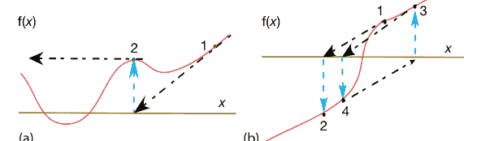

图 7.3 如果初始猜测不在 f(x) 可用直线近似的区域，牛顿-拉夫森算法可能失败的两个示例。(a) 猜测落在局部最小值/最大值，即导数消失的地方，因此下一个猜测最终为 x = ∞。(b) 搜索陷入无限循环。称为“回溯”的技术可以消除这个问题。

## 7.3.2
### 实现：牛顿-拉夫森算法

- 1. 使用牛顿-拉夫森算法找到满足 (7.2) 的一些能量 $E_B$。将这些解与二分法找到的解进行比较。
- 2. 再次注意，(7.2) 中的 10 与导致束缚的势的强度成正比。看看使势更深，例如将 10 改为 20 或 30，是否会产生更多或更深的束缚态。（请注意，与二分法不同，你的初始猜测必须更接近答案，牛顿-拉夫森算法才能工作。）
- 3. 修改你的算法以包含回溯，然后在一些困难的情况下尝试它。
- 4. 评估 $f(E_B)$，从而直接确定解的精度。

## 7.4
### 问题 2：磁化的温度依赖性

**问题** 确定简单磁性材料磁化强度 $M(T)$ 随温度的变化。

$N$ 个自旋为 1/2 的粒子，每个具有磁矩 $\mu$，处于温度 $T$。该集合施加外部磁场 $B$ 并达到平衡，其中 $N_L$ 个粒子处于较低能量态（自旋与磁场对齐），$N_U$ 个粒子处于较高能量态（自旋与磁场相反）。玻尔兹曼分布定律告诉我们，能量为 $E$ 的态的相对概率与 $\exp(-E/(k_B T))$ 成正比，其中 $k_B$ 是玻尔兹曼常数。对于磁矩为 $\mu$ 的偶极子，其在磁场中的能量由点积 $E = -\mu \cdot B$ 给出。因此，在磁场中自旋向上粒子具有较低能量，比自旋向下粒子更可能。

将玻尔兹曼分布应用于我们的自旋问题，我们有较低能级（自旋向上）粒子数

$N_L = N \frac{e^{\mu B/(k_B T)}}{e^{\mu B/(k_B T)} + e^{-\mu B/(k_B T)}}$ , (7.14)

而较高能级（自旋向下）粒子数为

$N_U = N \frac{e^{-\mu B/(k_B T)}}{e^{\mu B/(k_B T)} + e^{-\mu B/(k_B T)}}$ . (7.15)

如 (Kittel, 2005) 所讨论，我们现在假设分子磁场 $B = \lambda M$ 远大于外加磁场，因此用分子场代替 $B$。这使我们能够从前述方程中消除 $B$。磁化强度 $M(T)$ 由单个磁矩 $\mu$ 乘以

指向磁场方向的净粒子数：

$$M(T) = \mu \times (N_{L} - N_{U}) \tag{7.16}$$

$$= N\mu \tanh\left(\frac{\lambda \mu M(T)}{k_{B} T}\right). \tag{7.17}$$

请注意，这个表达式似乎是有意义的，因为当温度接近零时，所有自旋都将沿 $B$ 方向排列，因此 $M(T = 0) = N\mu.$

**通过搜索求解** 方程 7.17 关联了磁化强度和温度。然而，它并不是我们问题的真正解，因为 $M$ 既出现在方程的 LHS，也出现在 RHS 的双曲函数中。一般来说，这种 *超越方程* 没有解析解来简单地给出 $M$ 作为温度 $T$ 的函数。但通过逆向工作，我们可以找到数值解。为此，我们首先用约化磁化强度 $m$、约化温度 $t$ 和居里温度 $T_{c}$ 表示 (7.17)：

$$m(t) = \tanh\left(\frac{m(t)}{t}\right), \tag{7.18}$$

$$m(T) = \frac{M(T)}{N\mu}, \quad t = \frac{T}{T_{c}}, \quad T_{c} = \frac{N\mu^{2}\lambda}{k_{B}}. \tag{7.19}$$

虽然找到 (7.18) 的解析解并不比找到 (7.17) 更容易，但 (7.18) 的更简单形式使我们在搜索满足 (7.18) 的 $t$ 和 $m$ 值时编程更容易。

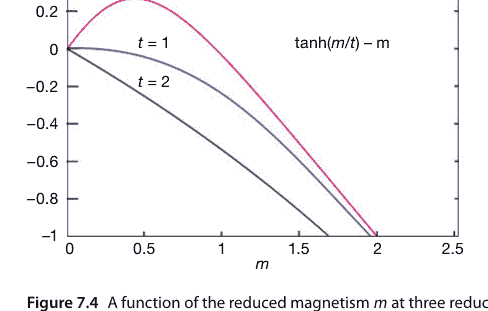

**图 7.4** 约化磁性 $m$ 在三个约化温度 $t$ 下的函数。该函数的零点决定了特定 $t$ 值下的磁性值。

一种试错解法是定义一个函数

f(m, t) = m - tanh\left(\frac{m(t)}{t}\right), \quad (7.20)

然后，对于一系列固定的 t = t_i 值，搜索使 f(m, t_i) = 0 的 m 值。（你也可以同样固定 m 的值为 m_j 并搜索使 f(m_j, t) = 0 的 t 值；一旦你得到一个解，你就得到一个解。）每个找到的零点都给我们一个 m(t_i) 的单一值。这些值在一系列 t_i 值上的图或表然后提供了我们作为所需解 m(t) 的最佳结果。

图 7.4 显示了 f(m, t) 作为约化磁化强度 m 的函数在三个不同约化温度下的三个图。如你所见，除了 m = 0 这个不有趣的解之外，对于 t = 0.5，在 m ≈ 1 附近只有一个解（零），而在其他温度下没有解。

## 7.4.1
### 搜索练习

- 1. 使用二分法找到 (7.20) 在 t = 0.5 时的根，精确到六位有效数字。
- 2. 使用牛顿-拉夫森法找到 (7.20) 在 t = 0.5 时的根，精确到六位有效数字。
- 3. 比较二分法和牛顿-拉夫森法找到解所需的时间。
- 4. 构造约化磁化强度 m(t) 作为约化温度 t 的函数的图。

## 7.5
### 问题 3：拟合实验光谱

> 数据拟合是所有科学家都值得认真研究的艺术（Bevington and Robinson, 2002）。在下面的各节中，我们只是通过检查如何在数字表中进行插值以及如何对数据进行最小二乘拟合来触及表面。我们还展示了如何使用我们已经讨论过的一些搜索技术和子程序库对非线性函数进行最小二乘拟合。

问题 中子从原子核共振散射的截面测量值如表 7.1 所示。你的问题是确定表中的能量值之间的截面值。

你可以用多种方法解决这个问题。最简单的方法是在表 7.1 中给出的实验 f(E_i) 值之间进行数值插值。这直接且容易，但没有考虑到数据中存在实验噪声。更合适的解决方案（在第 7.7 节中讨论）是找到最佳


## 表7.1 散射截面（理论中的 f(E)）的实验值，每个值带有绝对误差 ±σ_i，作为能量（理论中的 x_i）的函数。

| i = | 1 | 2 | 3 | 4 | 5 | 6 | 7 | 8 | 9 |
|---|---|---|---|---|---|---|---|---|---|
| E_i (MeV) | 0 | 25 | 50 | 75 | 100 | 125 | 150 | 175 | 200 |
| g(E_i) (mb) | 10.6 | 16.0 | 45.0 | 83.5 | 52.8 | 19.9 | 10.8 | 8.25 | 4.7 |
| 误差 (mb) | 9.34 | 17.9 | 41.5 | 85.5 | 51.5 | 21.5 | 10.8 | 6.29 | 4.14 |

对数据拟合理论函数。我们从我们认为是对数据的“正确”理论描述开始，

```
f(E) = f_r / [(E - E_r)^2 + Γ^2/4] ,  (7.21)
```

其中 f_r、E_r 和 Γ 是未知参数。然后我们调整参数以获得最佳拟合。这是统计意义上的最佳拟合，但事实上可能不会穿过所有（甚至任何一个）数据点。关于统计分析数据的简单而有效的介绍，我们推荐 (Bevington and Robinson, 2002)。

插值和最小二乘拟合这两种技术是强大的工具，它们让你可以把数值表当作解析函数来处理，有时还能让你从测量中推导出具有统计意义的常量或结论。一般来说，你可以将数据拟合视为全局拟合或局部拟合。在全局拟合中，使用一个关于 x 的单一函数来表示像表7.1这样的整组数字。虽然找到一个穿过所有数据点的单一函数在精神上可能令人满足，但如果该函数并不是描述数据的正确函数，那么拟合可能会在数据点之间表现出非物理行为（例如大的振荡）。经验法则是：如果必须插值，请保持局部性，并以批判的眼光看待全局插值。

将表7.1视为我们希望插值的有序数据。我们称自变量为 x，其列出的值为 x_i (i = 1, 2, ...)，并假设因变量是函数 g(x)，其列出的值为 g_i = g(x_i)。我们假设 g(x) 在每个区间 i 内可以近似为一个 (n − 1) 次多项式：

```
g_i(x) ≈ a_0 + a_1 x + a_2 x^2 + ⋯ + a_{n−1} x^{n−1} ,   (x ≈ x_i) .  (7.22)
```

由于我们的拟合是局部的，我们并不假设一个 g(x) 能拟合表中的所有数据，而是对每个区间使用不同的多项式，即不同的 a_i 值组。虽然每个多项式都是低次的，但需要多个多项式来覆盖整个表。如果稍加注意，这样得到的多项式集合将表现得足够好，可用于进一步的计算，而不会引入太多不需要的噪声或不连续性。

经典的插值公式由拉格朗日提出。他得出一个闭式表达式，将 (n − 1) 阶多项式 (7.22) 直接拟合到函数 g(x) 在点 x_i 处取值的 n 个值上。每个区间的公式写成多项式的和：

```
g(x) ≃ g₁λ₁(x) + g₂λ₂(x) + ⋯ + gₙλₙ(x) ,    (7.23)
```

```
λᵢ(x) = ∏_{j≠i}^{n} (x − xⱼ)/(xᵢ − xⱼ) = (x − x₁)/(xᵢ − x₁) (x − x₂)/(xᵢ − x₂) … (x − xₙ)/(xᵢ − xₙ) .    (7.24)
```

对于三个点，(7.23) 给出一个二次多项式，而对于八个点，它给出一个七次多项式。例如，假设我们给定点和函数值

```
x₁₋₄ = (0, 1, 2, 4)    g₁₋₄ = (−12, −12, −24, −60) .    (7.25)
```

对于四个点，拉格朗日公式确定一个三阶多项式，它能重现每个列表值：

```
g(x) = [(x−1)(x−2)(x−4)/(0−1)(0−2)(0−4)](−12) + [x(x−2)(x−4)/(1−0)(1−2)(1−4)](−12) + [x(x−1)(x−4)/(2−0)(2−1)(2−4)](−24) + [x(x−1)(x−2)/(4−0)(4−1)(4−2)](−60), ⇒ g(x) = x³ − 9x² + 8x − 12 .    (7.26)
```

作为验证，我们看到

```
g(4) = 4³ − 9(4²) + 32 − 12 = −60 ,    g(0.5) = −10.125 .    (7.27)
```

如果数据包含的噪声很小，这个多项式可以在数据范围内有一定把握地使用，但超出数据范围就有风险。

注意，拉格朗日插值不要求点 xᵢ 等间距。通常，拉格朗日拟合只针对表格的一小部分区域，使用较小的 n 值，尽管该公式对于将高次多项式拟合到整个表格也完全适用。多项式在某个 x 处的值与实际函数值之差可以表示为余项

```
Rₙ ≃ [(x−x₁)(x−x₂)⋯(x−xₙ)/n!] g⁽ⁿ⁾(ζ) ,    (7.28)
```

其中 ζ 位于插值区间内的某处。这里重要的是，我们看到如果 g(x) 中存在显著的高阶导数，那么它就不能被多项式很好地近似。例如，一张带有噪声的数据表就会具有显著的高阶导数。

## 7.5.1

## 拉格朗日实现、评估

考虑表7.1中的实验中子散射数据。描述这些数据的预期理论函数形式为 (7.21)，我们对这些数据的经验拟合如图7.5所示。

- 1. 编写一个子程序，使用 (7.23) 执行 n 点拉格朗日插值。将 n 视为任意输入参数。（你也可以使用第7.5.2节中讨论的样条拟合来完成此练习。）
- 2. 使用拉格朗日插值公式用一个多项式拟合整个实验谱。（这意味着你必须用八次多项式拟合所有九个数据点。）然后用此拟合以 5 MeV 的步长绘制截面。
- 3. 使用你的图形推导共振能量 E_r（你的峰位）和 Γ（半高全宽）。将你的结果与一位理论家朋友预测的结果 (E_r, Γ) = (78, 55) MeV 进行比较。
- 4. 拉格朗日插值更实际的应用是用于少量点（例如三个点）的局部插值。使用三点拉格朗日插值对每个区间的上述截面数据以 5-MeV 步长进行插值。（注意端点区间可能是特殊情况。）
- 5. 我们刻意没有讨论数据外推，因为它可能导致严重的系统误差；你得到的答案很可能更多地取决于你假定的函数，而不是你输入的数据。给你的生活增添一些冒险精神，使用你编写的程序外推到表7.1之外的值。将你的结果与理论的 Breit–Wigner（布莱特-维格纳）线型 (7.21) 进行比较。

这个例子表明，用高次多项式拟合带有误差的数据是多么容易出错。虽然多项式保证穿过所有数据点，但在这些点之外的函数表示可能相当不真实。在每个区间使用低阶插值公式，例如 n = 2 或 3，通常可以消除剧烈的振荡，但可能没有任何理论依据。如果将这些局部拟合拼接在一起，如我们在下一节所讨论的，会得到一条相当连续的曲线。然而，必须记住，如果数据包含误差，一条实际穿过这些数据的曲线可能会误导你。我们将在第7.7节讨论如何使用最小二乘拟合正确地做到这一点。

## 7.5.2

## 三次样条插值（方法）

如果你尝试用拉格朗日插值对共振截面进行插值，那么你会看到，在表内拟合抛物线（三点插值）可以避免高阶公式的错误甚至可能是灾难性的偏差。（两点插值用直线连接各点，可能不会让你太偏离正轨，但很难让人赏心悦目或精确。）一种精心改进的 n = 4 插值变体，称为三次样条，通常能产生令人惊讶的悦目拟合。在这种方法中（图7.5），每个区间都用三次多项式拟合函数，并附加约束：多项式的一阶和二阶导数在从一个区间到下一个区间时连续。这种斜率和曲率的连续性正是使样条拟合特别赏心悦目的原因。这类似于当你使用柔性样条时发生的情况


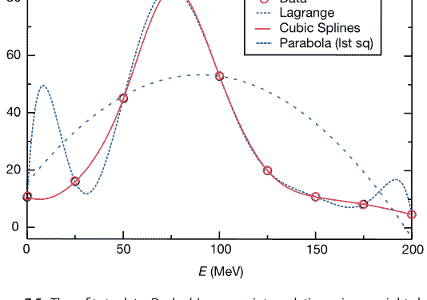

图 7.5 对数据的三种拟合。虚线：使用八次多项式的拉格朗日插值；短虚线：三次样条拟合；长虚线：最小二乘抛物线拟合。

绘图工具（橡胶套内的铅线）即该方法名称的由来。

通过样条拟合数据表得到的三次多项式序列可以进行积分和微分，并且保证具有良好的导数。存在有意义的导数是一个重要的考虑因素。举例来说，如果插值函数是一个势能，你可以对其求导得到力。使多项式及其导数在所有插值点上同时匹配的复杂性导致需要求解许多同时线性方程。这使得样条对于手工计算来说不具吸引力，但对计算机来说很容易，并且不出所料，在计算和计算机绘图程序中都很流行。为了说明这一点，图 7.5 中的光滑实曲线是一个样条拟合。

样条的基本近似是在子区间 [x_i, x_{i+1}] 中用三次多项式表示函数 g(x)：

```
g(x) ≈ g_i(x) ,  for  x_i ≤ x ≤ x_{i+1} ,  (7.29)
```

```
g_i(x) = g_i + g'_i (x - x_i) + 1/2 g''_i (x - x_i)^2 + 1/6 g'''_i (x - x_i)^3 .  (7.30)
```

这种表示法清楚地表明，多项式中的系数等于在表格点 x_i 处 g(x) 及其一阶、二阶和三阶导数的值。对三次多项式而言，三阶以上的导数为零。计算任务是根据 N 个表格值 g_i 确定这些导数。在连接一个区间到下一个区间的节点处匹配 g_i 提供了方程

```
g_i(x_{i+1}) = g_{i+1}(x_{i+1}) ,  i = 1, N - 1 .  (7.31)
```

在每个区间边界处匹配一阶和二阶导数提供了方程

```
g'_{i-1}(x_i) = g'_i(x_i),    g''_{i-1}(x_i) = g''_i(x_i).    (7.32)
```

确定所有常数所需的额外方程是通过匹配相邻节点处的三阶导数获得的。三阶导数的值是通过用二阶导数近似它们来找到的：

```
g'''_i ≈ [g''_{i+1} - g''_i] / [x_{i+1} - x_i].    (7.33)
```

如第 5 章所述，中心差分近似比前向差分近似更准确，但 (7.33) 使方程更简单。

求解 (7.30) 中的所有参数是直接的但复杂。我们将其留给参考文献（Thompson, 1992; Press et al., 1994）。我们可以看到，在区间的边界处匹配只产生 N 个未知数的 (N − 2) 个线性方程。需要进一步的输入。通常取为端点 a = x₁ 和 b = x_N 处的边界条件，具体为二阶导数 g''(a) 和 g''(b)。确定这些二阶导数有几种方法：

- 自然样条：设 g''(a) = g''(b) = 0；即允许函数在端点处有斜率但没有曲率。这很“自然”，因为柔性样条绘图工具的导数在端点自由时消失。

- 边界处 g' 的输入值：计算机使用 g'(a) 来近似 g''(a)。如果你不知道一阶导数，可以从 g_i 值表中数值计算它们。

- 边界处 g'' 的输入值：知道值当然比近似值好，但需要用户输入信息。如果 g'' 的值未知，可以通过对表格值应用前向差分近似来近似：

```
g''(x) ≈ [ [g(x₃) - g(x₂)]/[x₃ - x₂] - [g(x₂) - g(x₁)]/[x₂ - x₁] ] / [ |x₃ - x₁|/2 ].    (7.34)
```

## 7.5.2.1 三次样条求积（探索）

一种强大的积分方案是用样条拟合被积函数，然后解析地积分三次多项式。如果被积函数 g(x) 仅在表格值处已知，那么这是可能的最佳积分方案；如果你有能力直接计算任意 x 的函数，高斯求积可能更可取。我们知道，在每个区间内对 g 的样条拟合是三次式 (7.30)

```
g(x) ≈ g_i + g'_i (x - x_i) + ½ g''_i (x - x_i)² + ⅙ g'''_i (x - x_i)³.    (7.35)
```

很容易将其积分以得到该区间的积分，然后对所有区间求和：

∫_{x_i}^{x_{i+1}} g(x) dx ≈ ( g_i x + 1/2 g_i' x^2 + 1/6 g_i'' x^3 + 1/24 g_i''' x^4 )|_{x_i}^{x_{i+1}} , (7.36)

∫_{x_j}^{x_k} g(x) dx = Σ_{i=j}^{k} ( g_i x + 1/2 g_i' x^2 + 1/6 g_i'' x^3 + 1/24 g_i''' x^4 )|_{x_i}^{x_{i+1}} . (7.37)

使区间变小并不一定会提高精度，因为 (7.36) 中的相减抵消可能变得很大。

## 截面样条拟合（实现）

将一系列三次曲线拟合到数据上自己编程有点复杂，因此我们建议使用库例程。虽然我们在互联网上找到了相当多的基于 Java 的样条应用程序，但没有一个适合解释简单的数字集合。为此，我们改编了 (Press et al., 1994) 中的 spline.c 和 spline.c 函数，生成了第 7.3 节清单中所示的 SplineInteract.py 程序（还有一个小程序）。本节的任务是使用三次样条插值而不是拉格朗日插值，对第 7.5.1 节中的评估进行。

## 7.6

## 问题 4：拟合指数衰减

问题图 7.6 展示了 π 介子衰变数 ΔN 随时间变化的实际实验数据（Stetz et al., 1973）。请注意，时间已“分箱”为 Δt = 10 ns 的间隔，并且光滑曲线是理论上对大量介子（实际上没有）预期的指数衰减曲线。你的任务是从这些数据中推断出 π 介子的寿命 τ（π 介子的表格寿命为 2.6 × 10⁻⁸ s）。

### 理论

假设我们在时间 t = 0 时有 N₀ 个粒子可以衰变为其他粒子。³) 如果我们等待很短的时间 Δt，那么一小部分粒子 ΔN 将自发衰变，即在没有外部影响的情况下。这种衰变是一个随机过程，这意味着衰变发生的确切时间存在偶然性，因此没有两次实验会得到完全相同的结果。自发衰变的自然基本定律是，在时间间隔 Δt 内衰变的粒子数 ΔN 与该时间存在的粒子数 N(t) 成正比，并且与时间间隔成正比

ΔN(t) = -1/τ N(t) Δt ⇒ ΔN(t)/Δt = -λ N(t) . (7.38)

3) 自发衰变在第 4.5 节中进一步讨论并模拟。

## 清单 7.3 SplineInteract.py 对数据进行三次样条拟合并允许交互控制点数。数组 x[] 和 y[] 是拟合的数据，拟合在 Nfit 个点处的值输出。

```
# SplineInteract.py Spline fit with slide to control number of points
from visual import *;                 from visual.graph import *;
from visual.graph import gdisplay, gcurve
from visual.controls import slider, controls, toggle

x = array([0., 0.12, 0.25, 0.37, 0.5, 0.62, 0.75, 0.87, 0.99])      # input
y = array([10.6, 16.0, 45.0, 83.5, 52.8, 19.9, 10.8, 8.25, 4.7])
n = 9;  np = 15

# Initialize
y2 = zeros( (n), float); u = zeros( (n), float)
graph1 = gdisplay(x=0,y=0,width=500, height=500,
                  title='Spline Fit', xtitle='x', ytitle='y')
funct1 = gdots(color = color.yellow)
funct2 = gdots(color = color.red)
graph1.visible = 0

def update():
                        # Nfit = 30 = output
    Nfit = int(control.value)
    for i in range(0, n):                         # Spread out points
        funct1.plot(pos = (x[i], y[i]) )
        funct1.plot(pos = (1.01*x[i], 1.01*y[i]) )
        funct1.plot(pos = (.99*x[i], .99*y[i]) )
    yp1 = (y[1]-y[0]) / (x[1]-x[0]) - (y[2]-y[1]) / \
          (x[2]-x[1])+(y[2]-y[0])/(x[2]-x[0])
    ypn = (y[n-1] - y[n-2])/(x[n-1] - x[n-2]) -
          (y[n-2]-y[n-3])/(x[n-2]-x[n-3]) + (y[n-1]-y[n-3])/(x[n-1]-x[n-3])
    if (yp1 > 0.99e30): y2[0] = 0.; u[0] = 0.
    else:
        y2[0] = - 0.5
        u[0] = (3./(x[1] - x[0]) )*( (y[1] - y[0])/(x[1] - x[0]) - yp1)
    for i in range(1, n - 1):                     # Decomp loop
        sig = (x[i] - x[i - 1])/(x[i + 1] - x[i - 1])
        p = sig*y2[i - 1] + 2.
        y2[i] = (sig - 1.)/p
        u[i] = ((y[i+1]-y[i])/(x[i+1]-x[i]) - (y[i]-y[i-1])/(x[i]-x[i-1])
                (6.*u[i-1]/(x[i + 1] - x[i - 1]) - sig*u[i - 1])/p
    if (ypn > 0.99e30): qn = un = 0.            # Test for natural
    else:
        qn = 0.5;
        un = (3/(x[n-1]-x[n-2]))*(ypn - (y[n-1]-y[n-2])/(x[n-1]-x[n-2]))
    y2[n - 1] = (un - qn*u[n - 2])/(qn*y2[n - 2] + 1.)
    for k in range(n - 2, 1, -1):
        y2[k] = y2[k]*y2[k + 1] + u[k]
    for i in range(1, Nfit + 2):                # Begin fit
        xout = x[0] + (x[n - 1] - x[0])*(i - 1)/(Nfit)
        klo = 0;  khi = n - 1                  # Bisection algor
        while (khi - klo >1):
            k = (khi + klo) >> 1
            if (x[k] > xout): khi = k
            else: klo = k
        h = x[khi] - x[klo]
        if (x[k] > xout): khi = k
        else: klo = k
        h = x[khi] - x[klo]
        a = (x[khi] - xout)/h
        b = (xout - x[klo])/h
        yout = a*y[klo] + b*y[khi] +
               ((a*a*a-a)*y2[klo]+(b*b*b-b)*y2[khi])*h*h/6
        funct2.plot(pos = (xout, yout) )
 c = controls(x=500,y=0,width=200,height=200)      # Control via slider
```


```
control = slider(pos=(-50,50,0), min = 2, max = 100, action = update)
toggle(pos = (0, 35, -5), text1 = "Number of points", height = 0)
control.value = 2
update()

while 1:
    c.interact()
    rate(50)                # update < 10/sec
    funct2.visible = 0
```

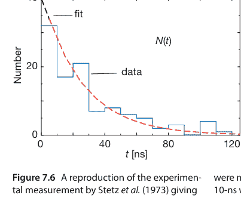

图 7.6 Stetz 等人（1973）实验测量的再现，给出了 π介子自产生以来随时间衰变的数目。测量是在宽度为 10 ns 的时间间隔（方框大小）内进行的。虚线是 log N(t) 的线性最小二乘拟合结果。

这里 τ = 1/λ 是粒子的寿命，λ 为速率参数。实际衰变率由式（7.38）中的第二个方程给出。如果衰变数目 ΔN 与粒子数目 N 相比非常小，并且我们考察趋于零的时间间隔，则差分方程（7.38）变为微分方程

```
dN(t)/dt ≃ -λ N(t) = (1/τ) N(t).    (7.39)
```

该微分方程对数目以及衰变率都有指数解：

```
N(t) = N₀ e^(-t/τ),    dN(t)/dt = - N₀/τ e^(-t/τ) = dN(0)/dt e^(-t/τ).    (7.40)
```

式 7.40 是我们希望“拟合”到图 7.6 中数据的理论公式。此类拟合的输出是寿命 τ 的“最佳值”。

## 7.7
最小二乘拟合（理论）

人们写过书籍，耗费职业生涯来讨论什么才算对实验数据的“良好拟合”。我们在此无法对该主题做充分说明，并参考 Bevington and Robinson（2002）；Press et al.（1994）；Thompson（1992）。然而，我们将强调三点：

- 1. 如果拟合的数据包含误差，则在统计意义上“最佳拟合”不应经过所有数据点。
- 2. 如果理论不适合数据（例如图 7.5 中的抛物线），则其对数据的最佳拟合可能根本不是一个好的拟合。这很好，因为这正是我们知道理论不正确的方式。
- 3. 只有在最简单的线性最小二乘拟合情况下，我们才能写出闭式解来求解并获得拟合。更现实的问题通常通过试错搜索程序求解，有时使用复杂的子程序库。然而，在第 7.8.2 节中，我们展示了如何使用熟悉的工具进行这种非线性搜索。

假设你测量了独立变量 y 的 N_D 个数据值，作为从属变量 x 的函数：

```
(x_i, y_i ± σ_i) ,    i = 1, N_D ,    (7.41)
```

其中 ±σ_i 是第 i 个 y 值实验不确定度。 （为简单起见，我们假设所有误差 σ_i 都出现在从属变量中，尽管这几乎从不成立（Thompson, 1992））。对于我们的问题，y 是随时间变化的衰变数目，x_i 是时间。我们的目标是确定数学函数 y = g(x)（也称为理论或模型）能够描述这些数据的程度。此外，如果理论包含一些参数或常数，我们的目标可以视为确定这些参数的最佳值。我们假设理论函数 g(x) 除了对 x 的函数依赖性外，还对 M_p 个参数 {a_1, a_2, ..., a_Mp} 有额外依赖。注意参数 {a_m} 不是变量，即从仪表读出的数字，而是理论模型的一部分，例如盒子的大小、粒子的质量或势阱的深度。对于指数衰减函数（7.40），参数是寿命 τ 和初始衰变率 dN(0)/dt。我们将参数包含为

```
g(x) = g(x; {a_1, a_2, ..., a_Mp}) = g(x; {a_m}) ,    (7.42)
```

其中 a_i 为参数，x 为独立变量。我们使用卡方 χ² 测度（Bevington and Robinson, 2002）作为理论函数 g 再现数据的程度：

```
χ² ≡ Σ_{i=1}^{N_D} ( (y_i - g(x_i; {a_m})) / σ_i )² ,    (7.43)
```

其中求和是对 N_D 个实验点 (x_i, y_i ± σ_i) 进行的。定义（7.43）使得 χ² 值越小拟合越好，当理论曲线经过每个数据点的中心时 χ² = 0。还要注意

1/σ_i² 加权意味着误差⁴) 较大的测量对 χ² 的贡献较小。

最小二乘拟合是指调整理论中的参数直到 χ² 达到最小，即找到一条曲线使数据与函数 g(x) 的偏差平方和最小。一般来说，这是可能的最佳拟合，也是确定理论中参数的最佳方法。使 χ² 成为极值的 M_p 个参数 {a_m, m = 1, M_p} 通过求解 M_p 个方程得到：

```
∂χ²/∂a_m = 0 ,  ⇒  Σ_{i=1}^{N_D} [y_i − g(x_i)]/σ_i² ∂g(x_i)/∂a_m = 0 ,  (m = 1, M_p) .  (7.44)
```

通常，函数 g(x; {a_m}) 对 a_m 值的依赖性足够复杂，使得（7.44）产生 M_p 个关于 a_m 值的同时非线性方程。在这些情况下，解是通过在 M_p 维参数空间中进行试错搜索找到的，如我们在第 7.8.2 节中所做的。为了安全起见，完成此类搜索后，你需要检查找到的最小 χ² 是全局最小而非局部最小。一种方法是为一组起始值网格重复搜索，如果找到不同的最小值，则选择 χ² 最低的那个。

### 7.7.1
最小二乘拟合：理论与实现

当偏差源于随机误差并且这些误差服从高斯分布时，有一些经验法则需要记住（Bevington and Robinson, 2002）。你知道拟合是好的，如果通过定义（7.43）计算的 χ² 值大约等于自由度数 χ² ≈ N_D − M_p，其中 N_D 是数据点数，M_p 是理论函数中的参数数。如果你的 χ² 远小于 N_D − M_p，这并不意味着你有“很棒”的理论或非常精确的测量；相反，你可能参数太多或分配的误差（σ_i 值）过大。事实上，过小的 χ² 可能表明你是在拟合数据的随机散射，而不是如随机误差所期望的那样缺少大约三分之一的误差条。如果你的 χ² 显著大于 N_D − M_p，理论可能不好，你可能显著低估了误差，或者误差不是随机的。

M_p 个同时方程（7.44）如果函数 g(x; {a_m}) 对参数值 a_i 线性依赖，则可以大大简化，例如，

```
g(x; {a₁, a₂}) = a₁ + a₂ x .  (7.45)
```

4) 如果你没有给出误差，你可以根据数据与光滑曲线的明显偏差来猜测它们，或者通过设置 σ_i ≡ 1 使所有点权重相等然后继续拟合。

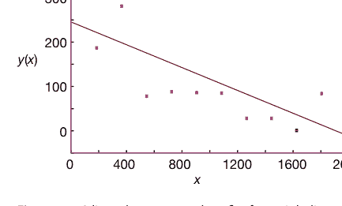

图 7.7 对数据进行直线线性最小二乘最佳拟合。理论与实验的偏差大于统计预期，这意味着直线不是描述这些数据的良好理论。

在这种情况下（也称为线性回归或直线拟合），如图 7.7 所示，有 M_p = 2 个参数，斜率 a_2 和 y 截距 a_1。注意虽然只有两个参数需要确定，但仍可能有任意数量 N_D 的数据点需要拟合。记住，除非数据点数大于或等于参数数，否则不可能得到唯一解。对于这种线性情况，只有两个导数，

∂g(x_i)/∂a_1 = 1,    ∂g(x_i)/∂a_2 = x_i,    (7.46)

并且在代入后，χ² 最小化方程（7.44）可以求解（Press et al., 1994）：

a_1 = (S_xx S_y - S_x S_xy)/Δ,    a_2 = (S S_xy - S_x S_y)/Δ,    (7.47)

S = Σ_{i=1}^{N_D} 1/σ_i²,    S_x = Σ_{i=1}^{N_D} x_i/σ_i²,    S_y = Σ_{i=1}^{N_D} y_i/σ_i²,    (7.48)

S_xx = Σ_{i=1}^{N_D} x_i²/σ_i²,    S_xy = Σ_{i=1}^{N_D} x_i y_i/σ_i²,    Δ = S S_xx - S_x².    (7.49)

统计学还给出了推导参数的方差或不确定度的表达式：

σ_{a1}² = S_xx/Δ,    σ_{a2}² = S/Δ.    (7.50)

这是由于测量 y_i 值的不确定度 σ_i 引起的拟合参数值不确定度的度量。依赖性度量


参数之间的相互关系由相关系数给出：

\[ \rho(a_1, a_2) = \frac{\text{cov}(a_1, a_2)}{\sigma_{a_1} \sigma_{a_2}}, \quad \text{cov}(a_1, a_2) = \frac{-S_x}{\Delta}. \tag{7.51} \]

这里 cov(a₁, a₂) 是 a₁ 和 a₂ 的协方差，当 a₁ 和 a₂ 相互独立时其值为零。相关系数 ρ(a₁, a₂) 的取值范围为 −1 ≤ ρ ≤ 1；ρ 为正表示 a₁ 和 a₂ 的误差很可能同号，ρ 为负则表示异号。

上述参数的解析解是统计学教材中常见的形式，但并非数值计算的最优选择，因为减法相消可能使结果不稳定。如第 3 章所述，对方程组进行重新整理可以减少这类误差。例如，Thompson（1992）给出了改进的表达式，用数据相对于其平均值来衡量：

\[ a_1 = \bar{y} - a_2 \bar{x}, \quad a_2 = \frac{S_{xy}}{S_{xx}}, \quad \bar{x} = \frac{1}{N} \sum_{i=1}^{N_d} x_i, \quad \bar{y} = \frac{1}{N} \sum_{i=1}^{N_d} y_i, \]
\[ S_{xy} = \sum_{i=1}^{N_d} \frac{(x_i - \bar{x})(y_i - \bar{y})}{\sigma_i^2}, \quad S_{xx} = \sum_{i=1}^{N_d} \frac{(x_i - \bar{x})^2}{\sigma_i^2}. \tag{7.52} \]

在清单 7.4 的 Fit.py 中，我们给出了一个将抛物线拟合到某些数据的程序。你可以将其作为将直线拟合到数据的模板，尽管你也可以使用我们给出的直线拟合闭式表达式。在教师网站上的 Fit.py 中，我们提供了一个用于拟合衰变数据的程序。

## 7.8
练习：拟合指数衰减、热流与哈勃定律

+   1. 将指数衰变定律 (7.40) 拟合到图 7.6 中的数据。这意味着要找到能最佳拟合数据的 τ 和 ΔN(0)/Δt 值，然后判断拟合的质量。
+   a) 根据从图 7.6 读取的数据，为 (ΔN/Δtᵢ, tᵢ)（i = 1, ..., N_D）构建一个近似值表。由于时间是按区间（bin）记录的，tᵢ 应对应于某个区间的中点。
+   b) 加入对误差 σᵢ 的估计，得到一个形如 (ΔN/Δtᵢ ± σᵢ, tᵢ) 的表。你可以通过目测来估计误差，例如估计直方图数值围绕一条光滑曲线的波动幅度；也可以取 σᵢ ≃ √(事件数)。（最后这种近似对大量事件是合理的，而此处并非如此。）
+   c) 在数量非常大的极限下，我们预期 ln |dN/dt| 对 t 的图是一条直线：
+   \[ \ln\left| \frac{\Delta N(t)}{\Delta t} \right| \simeq \ln\left| \frac{\Delta N_0}{\Delta t} \right| - \frac{1}{\tau} \Delta t. \tag{7.53} \]

这意味着，如果我们将 ln |ΔN(t)/Δt| 视为因变量，将时间 Δt 视为自变量，就可以使用我们的线性拟合结果。绘制 ln |ΔN/Δt| 对 Δt 的图。

+   d) 对数据做一条直线的最小二乘拟合，并用它来确定 π 介子的寿命 τ。将你的推断与表中列出的寿命 2.6 × 10⁻⁸ s 进行比较，并评论差异。
+   e) 将你的最佳拟合与数据画在同一张图上，并评论符合程度。
+   f) 推断你的直线的拟合优度以及你的推断寿命的近似误差。这些与你“目测”得到的结果一致吗？
+   g) 既然已经有了拟合结果，再重新审视数据，估计纵坐标误差更合适的值可能是多少。

2. 表 7.2 给出了沿一根金属杆的温度 T，该杆的两端保持固定的恒定温度。温度是沿杆距离 x 的函数。

+   a) 绘制表 7.3 中的数据，验证线性关系 T(x) ≃ a + b x 是否适当。（7.54）
+   b) 由于没有给出每次测量的误差，假设最低有效数字已经过四舍五入，因此 σ ≥ 0.05。
+   c) 利用这一点，对这些数据进行最小二乘直线拟合。
+   d) 将你的最佳 a + b x 与数据绘制在同一图中。
+   e) 拟合数据后，计算方差，并将其与你的拟合相对数据的偏差进行比较。验证大约有三分之一的点落在 σ 误差带之外（这正是误差服从正态分布时所预期的）。
+   f) 用计算得到的方差来确定拟合的 χ²，并评论所得到的值。
+   g) 确定方差 σₐ 和 σ_b，并检验将它们用作 a 和 b 推断值的误差是否合理。

3. 1929 年，埃德温·哈勃（Edwin Hubble）研究了将 24 个河外星云的径向速度 v 与其到我们银河系的距离 r 联系起来的数据（Hubble, 1929）。尽管数据存在相当大的离散性，他还是用一条直线来拟合它们：v = H r，（7.55）其中 H 现在被称为哈勃常数。表 7.3 包含了哈勃所使用的距离和速度。

+   a) 绘制数据，验证线性关系 v(r) ≃ a + H r 是否适当。（7.56）
+   b) 由于没有给出每次测量的误差，你可以假设最低有效数字已经过四舍五入，因此 σ ≥ 1；或者，你可以假设天文测量难以进行，数据至少有 10% 的误差。
+   c) 对这些数据进行最小二乘直线拟合。
+   d) 将你的最佳 a + Hr 与数据绘制在同一图中。
+   e) 拟合数据后，计算方差，并将其与你的拟合相对数据的偏差进行比较。验证大约有三分之一的点落在 σ 误差带之外（这正是误差服从正态分布时所预期的）。
+   f) 用计算得到的方差来确定拟合的 χ²，并评论所得到的值。
+   g) 确定方差 σ_a 和 σ_b，并检验将它们用作 a 和 b 推断值的误差是否合理。
+   h) 既然已经有了拟合结果，再重新审视数据，估计纵坐标误差更合适的值可能是多少。

### 表 7.2 温度与距离的关系（沿金属杆测量）

| x_i (cm) | 1.0 | 2.0 | 3.0 | 4.0 | 5.0 | 6.0 | 7.0 | 8.0 | 9.0 |
|---|---|---|---|---|---|---|---|---|---|
| T_i (°C) | 14.6 | 18.5 | 36.6 | 30.8 | 59.2 | 60.1 | 62.2 | 79.4 | 99.9 |

### 表 7.3 24 个河外星云的距离与径向速度

| 天体 | r (Mpc) | v (km/s) | 天体 | r (Mpc) | v (km/s) |
|---|---|---|---|---|---|
|  | 0.032 | 170 | 3627 | 0.9 | 650 |
|  | 0.034 | 290 | 4826 | 0.9 | 150 |
| 6822 | 0.214 | -130 | 5236 | 0.9 | 500 |
| 598 | 0.263 | -70 | 1068 | 1.0 | 920 |
| 221 | 0.275 | -185 | 5055 | 1.1 | 450 |
| 224 | 0.275 | -220 | 7331 | 1.1 | 500 |
| 5457 | 0.45 | 200 | 4258 | 1.4 | 500 |
| 4736 | 0.5 | 290 | 4141 | 1.7 | 960 |
| 5194 | 0.5 | 270 | 4382 | 2.0 | 500 |
| 4449 | 0.63 | 200 | 4472 | 2.0 | 850 |
| 4214 | 0.8 | 300 | 4486 | 2.0 | 800 |
| 3031 | 0.9 | -30 | 4649 | 2.0 | 1090 |

## 7.8.1

### 线性二次拟合

如前所述，只要被拟合的函数对未知参数 a_i 是线性依赖的，最小 χ² 条件就会导出一组关于 a 的联立线性方程，这些方程可以手工求解，也可以用计算机通过矩阵技术求解。为了说明，假设我们要将二次多项式

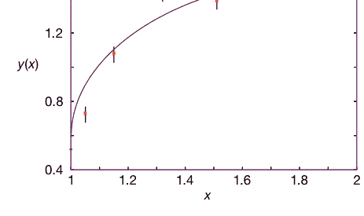

图 7.8 抛物线对数据的最小二乘线性最佳拟合。这里我们看到，拟合线大约错过了三分之一的点，这与良好拟合的统计预期相符。

```
g(x) = a₁ + a₂ x + a₃ x²
(7.57)
```

拟合到实验测量数据 (xᵢ, yᵢ, i = 1, ..., N_D)（图 7.8）。由于这个 g(x) 对所有参数 aᵢ 都是线性的，尽管 x 被提升到二次幂，我们仍然可以进行线性拟合。（然而，如果试图将形如 g(x) = (a₁ + a₂ x) exp(−a₃ x) 的函数拟合到数据，则无法进行线性拟合，因为对 a₃ 不存在线性依赖。）

该二次函数对数据的最佳拟合，是通过对 M_p = 3 个参数和 N_D 个（仍然任意的）数据点应用最小 χ² 条件 (7.44) 得到的。该解表示，所推断的参数以最大似然使理论函数 g(x) 正确描述数据。方程 7.44 导出了关于 a₁、a₂ 和 a₃ 的三个联立方程：

```
∑_{i=1}^{N_D} [y_i − g(x_i)] / σ_i² ∂g(x_i)/∂a₁ = 0 ,   ∂g/∂a₁ = 1 ,   (7.58)
∑_{i=1}^{N_D} [y_i − g(x_i)] / σ_i² ∂g(x_i)/∂a₂ = 0 ,   ∂g/∂a₂ = x ,   (7.59)
∑_{i=1}^{N_D} [y_i − g(x_i)] / σ_i² ∂g(x_i)/∂a₃ = 0 ,   ∂g/∂a₃ = x² .   (7.60)
```

注意：由于导数与参数（即 a）无关，a 的依赖关系仅来自求和中方括号内的项；又因为该项对 a 只有线性依赖，所以这些方程关于 a 是线性的。


## 练习 证明经过适当重新排列后，(7.58)–(7.60) 可以写成

S a₁ + Sₓ a₂ + Sₓₓ a₃ = Sᵧ , Sₓ a₁ + Sₓₓ a₂ + Sₓₓₓ a₃ = Sₓᵧ , Sₓₓ a₁ + Sₓₓₓ a₂ + Sₓₓₓₓ a₃ = Sₓₓᵧ . (7.61)

这里 S 的定义是对 (7.47)–(7.49) 中使用过的定义的简单扩展，并在第 7.4 节清单中 Fit.py 程序中实现。将三个未知参数放入向量 a 中，并将 (7.61) 中的三个已知右端项放入向量 b 中，这些方程具有矩阵形式

A x = b , A = [ S Sₓ Sₓₓ ; Sₓ Sₓₓ Sₓₓₓ ; Sₓₓ Sₓₓₓ Sₓₓₓₓ ] , x = [ a₁ ; a₂ ; a₃ ] , b = [ Sᵧ ; Sₓᵧ ; Sₓₓᵧ ] . (7.62)

参数向量 a 的解通过求解矩阵方程得到。虽然对于 3 × 3 矩阵，我们可以写出闭式解，但对于更大规模的问题，数值解需要矩阵方法。

### 清单 7.4 Fit.py 使用 NumPy linalg 包对一组线性方程 S a = s 进行最小二乘拟合抛物线到数据。

```
# Fit.py Linear least-squares fit; e.g. of matrix computation arrays
import pylab as p
from numpy import *
from numpy.linalg import inv
from numpy.linalg import solve

t = arange(1.0, 2.0, 0.1) # x range curve
x = array([1., 1.1, 1.24, 1.35, 1.451, 1.5, 1.92]) # Given x values
y = array([0.52, 0.8, 0.7, 1.8, 2.9, 2.9, 3.6]) # Given y values
p.plot(x, y, 'bo') # Plot data in blue
sig = array([0.1, 0.1, 0.2, 0.3, 0.2, 0.1, 0.1]) # error bar lengths
p.errorbar(x,y,sig) # Plot error bars
p.title('Linear Least Square Fit') # Plot figure
p.xlabel('x') # Label axes
p.ylabel('y')
p.grid(True) # plot grid
Nd = 7
A = zeros( (3,3), float ) # Initialize
bvec = zeros( (3,1), float )
ss = sx = sxx = sy = sxxx = sxy = sxxy = 0.

for i in range(0, Nd):
    sig2 = sig[i] * sig[i]
    ss += 1. / sig2; sx += x[i]/sig2; sy += y[i]/sig2
    rhl = x[i] * x[i]; sxx += rhl/sig2; sxxy += rhl * y[i]/sig2
    sxy += x[i]*y[i]/sig2; sxxx +=rhl*x[i]/sig2; sxxxx +=rhl*rhl/sig2

A = array([ [ss,sx,sxx], [sx,sxx,sxxx], [sxx,sxxx,sxxxx] ])
bvec = array([sy, sxy, sxxy])

xvec = multiply(inv(A), bvec) # Invert matrix
Itest = multiply(A, inv(A)) # Matrix multiply
```

```
print('\n x vector via inverse')
print(xvec, '\n')
print('A=inverse(A)')
print(Itest, '\n')

xvec = solve(A, bvec)                # Solve via elimination
print('x Matrix via direct')
print(xvec, 'end= ')
print('FitParabola Final Results\n')
print('y(x) = a0 + a1 x + a2 x^2')      # Desired fit
print('a0 = ', x[0])
print('a1 = ', x[1])
print('a2 = ', x[2], '\n')
print(' i   xi      yi      yfit   ')
for i in range(0, Nd):
    s = xvec[0] + xvec[1]*x[i] + xvec[2]*x[i]*x[i]
    print(' %d %5.3f   %5.3f   %8.7f \n' %(i, x[i], y[i], s))
# red line is the fit, red dots the fits at y[i]
curve = xvec[0] + xvec[1]*t + xvec[2]*t**2
points = xvec[0] + xvec[1]*x + xvec[2]*x**2
p.plot(t, curve,'r', x, points, 'ro')
p.show()
```

## 线性二次拟合评估

- 1. 将二次式 (7.57) 拟合到以下数据集 [给出为 (x₁, y₁), (x₂, y₂), ...]。在每种情况下，指出找到的 a 的值、自由度数以及 χ² 的值。
  - a) (0, 1)
  - b) (0, 1), (1, 3)
  - c) (0, 1), (1, 3), (2, 7)
  - d) (0, 1), (1, 3), (2, 7), (3, 15)
- 2. 找到对最后一个数据集的函数拟合
  - y = A e^{-b x²}.  (7.63)

提示：一个恰当的变量变换将使你能够将其转换为线性拟合。这里最小 χ² 仍有意义吗？

### 7.8.2

## 问题 5：对 Breit–Wigner 的非线性拟合

问题  回想一下本章前面我们如何插值表 7.1 中的值以获得截面 Σ 随能量变化的实验值。虽然我们没有使用它，但我们也给出了描述这些数据的理论，即 Breit–Wigner 共振公式 (7.21)：

f(E) = f_r / [(E - E_r)² + Γ²/4].  (7.64)

你的问题是确定参数 E_r、f_r 和 Γ 在 (7.64) 中的哪些值能最好地拟合表 7.1 中的数据。

由于 (7.64) 不是参数 ($E_r$, $\Sigma_0$, $\Gamma$) 的线性函数，最小化 $\chi^2$ 所得到的三个方程不是线性方程，因此不能用线性代数（矩阵方法）求解。然而，在我们研究弦上质量问题时，我们展示了如何使用 Newton–Raphson 算法来寻找同时非线性方程的解。该技术涉及在前一次猜测附近展开方程以得到一组线性方程，然后用矩阵库求解线性方程。我们现在使用相同的拟合、试错搜索和矩阵代数的组合来对 (7.64) 进行非线性最小二乘拟合到表 7.1 中的数据。

回想一下，最佳拟合的条件是找到理论 $g(x, a_m)$ 中 $M_p$ 个参数 $a_m$ 的值，使 $\chi^2 = \sum_i [(y_i - g_i)/\sigma_i]^2$ 最小化。这导致要求解的 $M_p$ 个方程 (7.44)

\[ \sum_{i=1}^{N_D} \frac{[y_i - g(x_i)]}{\sigma_i^2} \frac{\partial g(x_i)}{\partial a_m} = 0 \;, \quad (m = 1, M_p) \. \tag{7.65} \]

为了找到适用于我们问题的这些方程的形式，我们将理论函数 (7.64) 用 (7.65) 的记号重写：

\[ a_1 = f_r \;, \quad a_2 = E_R \;, \quad a_3 = \Gamma^2 / 4 \;, \quad x = E \;, \tag{7.66} \]

\[ \Rightarrow \quad g(x) = \frac{a_1}{(x - a_2)^2 + a_3} \. \tag{7.67} \]

(7.65) 中所需的三个导数则为

\[ \frac{\partial g}{\partial a_1} = \frac{1}{(x - a_2)^2 + a_3} \;, \quad \frac{\partial g}{\partial a_2} = \frac{-2 a_1 (x - a_2)}{[(x - a_2)^2 + a_3]^2} \;, \quad \frac{\partial g}{\partial a_3} = \frac{-a_1}{[(x - a_2)^2 + a_3]^2} \. \tag{7.68} \]

将这些导数代入最佳拟合条件 (7.65) 得到三个关于 $a_1$、$a_2$ 和 $a_3$ 的同时方程，我们需要求解以拟合 $N_D = 9$ 个数据点 $(x_i, y_i)$ 在表 7.1 中：

\[ \sum_{i=1}^{9} \frac{y_i - g(x_i, a)}{(x_i - a_2)^2 + a_3} = 0 \;, \]
\[ \sum_{i=1}^{9} \frac{y_i - g(x_i, a)}{[(x_i - a_2)^2 + a_3]^2} = 0 \;, \]
\[ \sum_{i=1}^{9} \frac{\{y_i - g(x_i, a)\}(x_i - a_2)}{[(x_i - a_2)^2 + a_3]^2} = 0 \. \tag{7.69} \]

即使没有 (7.64) 对 $g(x, a)$ 的代入，很明显这三个方程以非线性方式依赖于 $a$。这没问题，因为在第 6.1.2 节我们推导了 $N$ 维 Newton–Raphson 搜索以求解

\[ f_i(a_1, a_2, \dots, a_N) = 0 \;, \quad i = 1, N \;, \tag{7.70} \]

其中我们对当前问题做了变量替换 $y_i \to a_i$。我们在此对 $N = 3$ 的方程 7.69 使用相同的形式，将其写为

```
$f_1(a_1, a_2, a_3) = \sum_{i=1}^{9} \frac{y_i - g(x_i, a)}{(x_i - a_2)^2 + a_3} = 0 , \qquad (7.71)$
```

```
$f_2(a_1, a_2, a_3) = \sum_{i=1}^{9} \frac{\{y_i - g(x_i, a)\}(x_i - a_2)}{[(x_i - a_2)^2 + a_3]^2} = 0 , \qquad (7.72)$
```

```
$f_3(a_1, a_2, a_3) = \sum_{i=1}^{9} \frac{y_i - g(x_i, a)}{[(x_i - a_2)^2 + a_3]^2} = 0 . \qquad (7.73)$
```

由于 $f_r \equiv a_1$ 是截面的峰值，$E_R \equiv a_2$ 是峰值发生的能量，而 $\Gamma = 2\sqrt{a_3}$ 是半高全宽，对 $a$ 的良好猜测可以从数据的图形中提取。为了获得三个 $f$ 关于三个未知 $a$ 的九个导数，我们使用对 $i$ 和 $j$ 的两个嵌套循环，并使用前向差分近似导数

```
$\frac{\partial f_i}{\partial a_j} \simeq \frac{f_i(a_j + \Delta a_j) - f_i(a_j)}{\Delta a_j} , \qquad (7.74)$
```

其中 $\Delta a_j$ 对应于参数值的小变化，例如 $\le 1\%$。

## 非线性拟合实现

使用第 7.8.2 节概述的 Newton–Raphson 算法，对表 7.1 中的数据进行 Breit–Wigner 理论 (7.64) 的最佳拟合参数的非线性搜索。将推导出的 $(f_r, E_R, \Gamma)$ 值与从图形检查得到的值进行比较。


# 8

# 求解微分方程：非线性振荡

拥有计算工具的一大乐趣在于，几乎任何微分方程都能轻松求解。因此，尽管大多数传统的（即“解析的”）振荡处理方法仅限于平衡位置附近的小位移，其中恢复力是线性的，但我们在本章消除了这些限制，探索一些有趣的非线性物理。首先，我们研究那些在某些参数值下可能是谐振的，但随后变为非谐振的振子。我们从具有解析解的简单系统开始，用它们来测试各种微分方程求解器，然后加入含时外力，以研究非线性共振和拍频。

## 8.1

# 自由非线性振荡

问题 图8.1中展示了一个质量m附着在一根弹簧上，弹簧施加指向原点的恢复力，同时一只手对质量施加了一个随时间变化的外力。我们已知弹簧施加的恢复力是非谐的，即并不简单地正比于相对平衡位置的位移，但我们没有得到关于它是如何非谐的细节。你的问题是求解质量作为时间函数的运动。你可以假设运动被限制在一维。

## 8.2

# 非线性振子（模型）

这是一个经典力学问题，牛顿第二定律为我们提供了运动方程

```
F_k(x) + F_ext(x, t) = m d²x/dt² ,
```

1) 在第15章中，我们对真实摆及其混沌行为进行了相关研究。第24章还讨论了非线性方程的一些特殊性质。

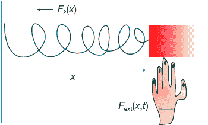

**图8.1** 一个质量*m*（方块）附着在弹簧上，弹簧的恢复力为*F*ₖ(*x*)，并受外部含时驱动力（手）驱动。

其中*F*ₖ(*x*)是弹簧施加的恢复力，*F*ₑₓₜ(*x*, *t*)是外力。方程8.1是我们必须对任意力求解的微分方程。由于我们没有被告知弹簧究竟如何偏离线性，因此可以自由尝试一些不同的模型。作为第一个模型，我们想尝试一个势能，它在小位移*x*下是谐振子，同时也包含一个微扰项，对大*x*值的力引入非线性项：

$$V(x) \simeq \frac{1}{2}kx^2\left(1-\frac{2}{3}\alpha x\right),$$  
(8.2)

$$\Rightarrow\quad F_k(x)=-\frac{dV(x)}{dx}=-kx(1-\alpha x)$$  
(8.3)

$$\Rightarrow\quad m\frac{d^2x}{dt^2}=-kx(1-\alpha x),$$  
(8.4)

其中我们省略了含时外力。方程8.4是我们需要求解的二阶常微分方程。如果α*x* ≪ 1，则运动本质上应是谐和的，但当*x* → 1/α时，非谐效应将变得很大。

我们可以通过查看图8.2a中的曲线来理解这个模型的基本物理。只要*x* < 1/α，就会出现*恢复力*，运动将是周期性的（在时间上精确且无限地重复），尽管只有在振幅较小的振荡中才是谐和的。然而，如果振荡幅度很大，则平衡位置左右两侧的运动将出现不对称。如果*x* > 1/α，力将变为排斥力，质量将被推离原点。

作为非线性振子的第二个模型，我们假设弹簧的势能函数正比于位移*x*相对平衡位置的某个任意*偶*次幂*p*：

$$V(x)=\frac{1}{p}kx^p,\qquad (p\ \text{even}).$$  
(8.5)

我们需要偶数*p*以确保力

$$F_k(x)=-\frac{dV(x)}{dx}=-kx^{p-1},$$  
(8.6)

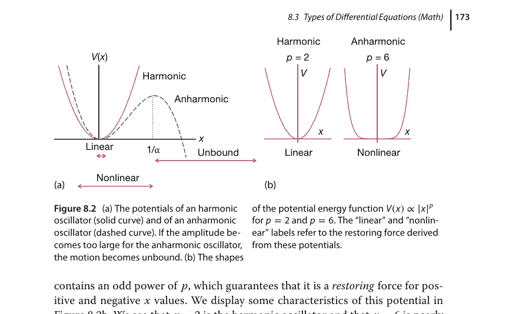

我们在图8.2b中展示了这个势能的一些特征。我们看到p = 2是谐振子，而p = 6近似于方阱，质量在撞到x ≈ ±1处的阱壁之前几乎自由运动。无论p值如何，运动都是周期性的，但只有p = 2时才是谐和的。牛顿定律(8.1)给出了我们需要求解的二阶常微分方程

```
m \frac{d^2 x}{dt^2} = F_{ext}(x, t) - k x^{p-1} .
```

## 8.3 微分方程的类型（数学）

本节介绍背景材料，以避免语义上的混淆。精通的读者可以略读或跳过。

一阶微分方程的一般形式为

```
\frac{dy}{dt} = f(t, y) ,
```

其中“阶”指的是左侧导数的阶数。右侧的导数或力函数f(t, y)是任意的。例如，即使f(t, y)是y和t的一个复杂函数，如

```
\frac{dy}{dt} = -3t^2 y + t^9 + y^7 ,
```

在(8.13)中的解是

y(t) = \frac{a}{1 + b e^{-\lambda t}} \quad (8.15)

（你可以通过代入验证），如果我们试图将两个这样的解相加来得到更一般的解，那就会出错：

y_1(t) = \frac{a}{1 + b e^{-\lambda t}} + \frac{a'}{1 + b' e^{-\lambda t}} \quad (8.16)

（你可以通过代入验证）。

# 初始条件和边界条件

一阶微分方程的通解总是包含一个任意常数。二阶微分方程的通解包含两个这样的常数，依此类推。对于任何具体问题，这些常数由初始条件确定。对于一阶方程，唯一的初始条件可以是某个时刻的位置y(t)。对于二阶方程，两个初始条件可以是某个时刻的位置和速度。无论你使用的硬件和软件有多强大，数学仍然是有效的，因此你必须知道初始条件才能唯一地求解问题。

除了初始条件之外，还可以进一步限制微分方程的解。一种方法是边界条件，它约束解在解空间的边界上取固定值。这类问题称为本征值问题，它们要求很高，解并不总是存在，即使存在，也可能需要反复试错才能找到。在第9章中，我们将讨论如何将本单元的技术推广到边值问题。

## 8.4

# 常微分方程的动态形式（理论）

常微分方程的一种标准形式，已被证明在数值分析（Press et al., 1994）和经典动力学（Scheck, 1994; Tabor, 1989; José and Salatan, 1998）中都很有用，是将任意阶的常微分方程表示为关于N个未知量y^{(0)}–y^{(N-1)}的N个联立一阶常微分方程：

\frac{dy^{(0)}}{dt} = f^{(0)}(t, y^{(i)}) , \quad (8.17)

\frac{dy^{(1)}}{dt} = f^{(1)}(t, y^{(i)}) ,

\ddots \quad (8.18)

\frac{dy^{(N-1)}}{dt} = f^{(N-1)}(t, y^{(i)}) , \quad (8.19)

其中允许$f$依赖于$y^{(i)}$，但不允许依赖于导数$\mathrm{d}y^{(i)}/\mathrm{d}t$。利用$N$维向量（此处用粗斜体表示）$\boldsymbol{y}$和$\boldsymbol{f}$，这些方程可以更简洁地表示为：

$$\frac{\mathrm{d}\,\boldsymbol{y}(t)}{\mathrm{d}t}=\boldsymbol{f}(t,\boldsymbol{y}),$$

$$\boldsymbol{y}=\begin{pmatrix} y^{(0)}(t) \\ y^{(1)}(t) \\ \ddots \\ y^{(N-1)}(t) \end{pmatrix},\quad \boldsymbol{f}=\begin{pmatrix} f^{(0)}(t,\boldsymbol{y}) \\ f^{(1)}(t,\boldsymbol{y}) \\ \ddots \\ f^{(N-1)}(t,\boldsymbol{y}) \end{pmatrix}.\tag{8.20}$$

这种紧凑记法的用处在于，我们可以通过处理单一的方程(8.20)来研究常微分方程的性质，并开发求解它们的算法，而不必担心各个分量。为了了解这一点，让我们将牛顿定律

$$\frac{\mathrm{d}^2 x}{\mathrm{d}t^2}=\frac{1}{m}F\left(t,x,\frac{\mathrm{d}x}{\mathrm{d}t}\right)\tag{8.21}$$

转换为这种标准形式。规则是右侧不能包含任何显式导数，尽管$y^{(i)}$的各个分量可以表示导数。为此，我们将位置$x$定义为第一个因变量$y^{(0)}$，将速度$\mathrm{d}x/\mathrm{d}t$定义为第二个因变量$y^{(1)}$：

$$y^{(0)}(t)\stackrel{\mathrm{def}}{=}x(t),\quad y^{(1)}(t)\stackrel{\mathrm{def}}{=}\frac{\mathrm{d}x}{\mathrm{d}t}=\frac{\mathrm{d}y^{(0)}(t)}{\mathrm{d}t}.\tag{8.22}$$

二阶常微分方程(8.21)现在变成两个联立的一阶常微分方程：

$$\frac{\mathrm{d}y^{(0)}}{\mathrm{d}t}=y^{(1)}(t),\quad \frac{\mathrm{d}y^{(1)}}{\mathrm{d}t}=\frac{1}{m}F(t,y^{(0)},y^{(1)}).\tag{8.23}$$

这表示加速度（(8.21)中的二阶导数）为速度[$y^{(1)}$]的一阶导数。这些方程现在具有标准形式(8.20)，其中导数或力函数$\boldsymbol{f}$包含两个分量

$$f^{(0)}=y^{(1)}(t),\quad f^{(1)}=\frac{1}{m}F(t,y^{(0)},y^{(1)}),\tag{8.24}$$

其中$F$可以显式地依赖于时间，以及位置和速度。

更具体地说，将这些定义应用于我们的弹簧问题(8.7)，我们得到耦合的一阶方程组

$$\frac{\mathrm{d}y^{(0)}}{\mathrm{d}t}=y^{(1)}(t),\quad \frac{\mathrm{d}y^{(1)}}{\mathrm{d}t}=\frac{1}{m}\left[F_{\mathrm{ext}}(x,t)-k y^{(0)}(t)^{p-1}\right],\tag{8.25}$$

其中$y^{(0)}(t)$是质量在时刻$t$的位置，$y^{(1)}(t)$是其速度。在标准形式中，力函数的分量和初始条件为

$$f^{(0)}(t,\boldsymbol{y})=y^{(1)}(t),\quad f^{(1)}(t,\boldsymbol{y})=\frac{1}{m}\left[F_{\mathrm{ext}}(x,t)-k\left(y^{(0)}\right)^{p-1}\right],$$

$$y^{(0)}(0)=x_0,\quad\quad y^{(1)}(0)=v_0.\tag{8.26}$$


## 8.5 常微分方程算法

求解常微分方程的经典方法是：从因变量的已知初值 $y_0 \equiv y(t = 0)$ 出发，利用导数函数 $f(t, y)$ 将初值向前推进一个微小步长 $h$，得到 $y(t = h) \equiv y_1$。一旦能做到这一点，就可以通过不断向前步进（每次一个微小 $h$）来求解所有 $t$ 值下的常微分方程（图 8.3）。[^2] 在积分微分方程时，误差始终是一个需要考虑的问题，因为导数需要小的差分，而小的差分容易受到减法相消和舍入误差累积的影响。此外，由于我们求解微分方程的步进过程是对初始条件的连续外推，每一步都建立在前一步外推的基础上，这有点类似于建在沙上的城堡；与插值不同，没有任何表格化的数值可以作为你解的锚点。

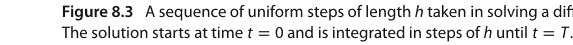

图 8.3 求解微分方程时采用的一系列等长步长 $h$。解从 $t = 0$ 时刻开始，以步长 $h$ 积分，直到 $t = T$。

如果在整个积分过程中时间步长保持恒定不变，那是最简单的情况，我们也将主要这么做。工业级算法（例如我们在 8.6 节中讨论的那种）会调整步长：在 $y$ 变化缓慢的区域增大 $h$（这能加快积分速度并减少舍入误差），而在 $y$ 变化迅速的区域减小 $h$。

### 8.5.1 欧拉法则

欧拉法则（图 8.4）是对微分方程 (8.8) 进行单步积分的简单算法，其实就是导数的前向差分算法：

$$
\frac{dy(t)}{dt} \simeq \frac{y(t_{n+1}) - y(t_n)}{h} = f(t, y), \tag{8.27}
\qquad
y_{n+1} \simeq y_n + h f(t_n, y_n), \tag{8.28}
$$

其中 $y_n \overset{\text{def}}{=} y(t_n)$ 是 $y$ 在时刻 $t_n$ 的值。根据我们对微分的讨论可知，前向差分算法的误差为 $\mathcal{O}(h^2)$，因此欧拉法则的误差也是 $\mathcal{O}(h^2)$。

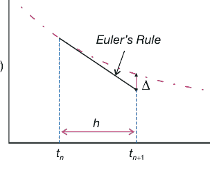

图 8.4 欧拉算法对微分方程在时间上前向积分一步。可以看到，这种在初始点取斜率的线性外推会导致误差 $\Delta$。

为了说明该算法的简洁性，我们将其应用于振荡器问题 (8.4) 的第一个时间步：

$$
\begin{aligned}
y_1^{(0)} &= x_0 + v_0 h, \\
y_1^{(1)} &= v_0 + \frac{h}{m}\left[F_{\text{ext}}(t = 0) + F_k(t = 0)\right],
\end{aligned} \tag{8.29}
$$

将这些方程与大学一年级物理中熟悉的抛体运动方程进行比较，

$$
x = x_0 + v_0 h + \tfrac{1}{2}a h^2, \qquad v = v_0 + a h, \tag{8.30}
$$

我们看到，使用欧拉法则时，加速度对距离的贡献没有体现出来（没有 $h^2$ 项），但它确实对速度有贡献（因此会在下一个时间步中延迟地对距离作出贡献）。这显然是一种简单的算法，需要非常小的 $h$ 值才能获得精度。然而使用较小的 $h$ 值会增加步数和舍入误差的累积，这可能导致不稳定性。[^3] 虽然我们不推荐将欧拉算法用于一般用途，但它常被用来启动更精确的算法。

## 8.6 龙格–库塔法则

虽然没有任何单一算法能很好地求解所有常微分方程，但四阶龙格–库塔算法 rk4，或其带自适应步长的扩展版 rk45，已被证明是稳健且能够胜任工业级工作的。尽管 rk4 是我们推荐的标准方法，我们在这里推导更简单的 rk2，而对 rk4 只给出结果。

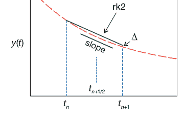

图 8.5 rk2 算法对微分方程的积分使用在区间中点处计算的斜率（粗线段），可以看到它比图 8.4 中的欧拉算法产生的误差更小。

用于积分微分方程的龙格–库塔算法基于我们微分方程的形式（精确）积分：

$$
\frac{dy}{dt} = f(t, y) \quad\Rightarrow\quad y(t) = \int f(t, y)\,dt, \tag{8.31}
$$

$$
y_{n+1} = y_n + \int_{t_n}^{t_{n+1}} f(t, y)\,dt. \tag{8.32}
$$

为了推导二阶龙格–库塔算法 rk2（图 8.5 和 rk2.py），我们将 $f(t, y)$ 在积分区间的中点附近展开为泰勒级数，并保留两项：

$$
f(t, y) \simeq f(t_{n+1/2}, y_{n+1/2}) + (t - t_{n+1/2})\frac{df}{dt}\Big|_{t_{n+1/2}} + \mathcal{O}(h^2). \tag{8.33}
$$

由于 $(t - t_{n+1/2})$ 的任何奇数次幂在区间 $t_n \le t \le t_{n+1}$ 上正负相等，因此 (8.32) 中 $(t - t_{n+1/2})$ 项的积分为零，我们得到算法：

$$
\int_{t_n}^{t_{n+1}} f(t, y)\,dt \simeq f(t_{n+1/2}, y_{n+1/2})h + \mathcal{O}(h^3), \tag{8.34}
$$

$$
y_{n+1} \simeq y_n + h f(t_{n+1/2}, y_{n+1/2}) + \mathcal{O}(h^3) \quad \text{(rk2)}. \tag{8.35}
$$

我们看到，虽然 rk2 包含的项数与欧拉法则相同，但它利用 $\mathcal{O}(h)$ 项的相互抵消获得了更高的精度。然而，提高精度的代价是必须在时间区间中点 $t = t_n + h/2$ 处计算导数函数和解 $y$。问题就在这里，因为我们不知道 $y_{n+1/2}$ 的值，也无法用这个算法来确定它。解决这一困境的办法是使用欧拉算法来近似 $y_{n+1/2}$：

$$
y_{n+1/2} \simeq y_n + \frac{1}{2}h\frac{dy}{dt} = y_n + \frac{1}{2}h f(t_n, y_n). \tag{8.36}
$$

将这些部分组合在一起，就得到了完整的 rk2 算法：

$$
\boldsymbol{y}_{n+1} \simeq \boldsymbol{y}_n + \boldsymbol{k}_2, \quad \text{(rk2)} \tag{8.37}
$$

$$
\boldsymbol{k}_2 = h\boldsymbol{f}\left(t_n + \frac{h}{2}, \boldsymbol{y}_n + \frac{\boldsymbol{k}_1}{2}\right), \qquad
\boldsymbol{k}_1 = h\boldsymbol{f}(t_n, \boldsymbol{y}_n), \tag{8.38}
$$

这里我们用粗体斜体表示 $y$ 和 $f$ 的矢量性质。我们看到，已知的导数函数 $f$ 在区间的两端和中点都被求值，但只需要因变量 $y$ 的（已知）初值。这使得算法可以自启动。

作为使用 rk2 的一个例子，我们将其应用于弹簧问题：

$$
\begin{aligned}
y_1^{(0)} &= y_0^{(0)} + h f^{(0)}\left(\frac{h}{2}, y_0^{(0)} + \frac{k_1}{2}\right)
\simeq x_0 + h\left[v_0 + \frac{h}{2}F_k(0)\right], \\
y_1^{(1)} &= y_0^{(1)} + h f^{(1)}\left[\frac{h}{2}, y_0 + \frac{h}{2}f(0, y_0)\right]
\simeq v_0 + \frac{h}{m}\left[F_{\text{ext}}\left(\frac{h}{2}\right) + F_k\left(y_0^{(0)} + \frac{k_1}{2}\right)\right].
\end{aligned}
$$

这些方程表明，位置 $y^{(0)}$ 因初始速度和力而改变，而速度 $y^{(1)}$ 因 $t = h/2$ 时的外力和两个中间位置处的内力而改变。我们看到位置 $y^{(0)}$ 现在具有 $h^2$ 的时间依赖性，这终于使我们达到了大学一年级物理的水平。

四阶龙格–库塔方法 rk4（清单 8.1）通过在区间中点将 $y$ 近似为直至 $h^2$ 的泰勒级数（抛物线）来获得 $\mathcal{O}(h^4)$ 的精度，这同样会导致低阶误差的相互抵消。rk4 在能力、精度和编程简单性之间提供了极佳的平衡。现在需要计算四个梯度（$k$）项，即四次子程序调用。这提供了对 $f(t, y)$ 在中点附近的改进近似。虽然 rk4 在计算上比欧拉方法更昂贵，但其精度要好得多，而且可以通过使用更大的步长 $h$ 来节省一些时间。具体而言，rk4 需要计算四个中间斜率，这些斜率使用欧拉算法近似，如 (Press et al., 1994) 中所述：

$$
\boldsymbol{y}_{n+1} = \boldsymbol{y}_n + \frac{1}{6}(\boldsymbol{k}_1 + 2\boldsymbol{k}_2 + 2\boldsymbol{k}_3 + \boldsymbol{k}_4), \tag{8.39}
$$

$$
\boldsymbol{k}_1 = h\boldsymbol{f}(t_n, \boldsymbol{y}_n), \qquad
\boldsymbol{k}_2 = h\boldsymbol{f}\left(t_n + \frac{h}{2}, \boldsymbol{y}_n + \frac{\boldsymbol{k}_1}{2}\right),
$$

$$
\boldsymbol{k}_3 = h\boldsymbol{f}\left(t_n + \frac{h}{2}, \boldsymbol{y}_n + \frac{\boldsymbol{k}_2}{2}\right), \qquad
\boldsymbol{k}_4 = h\boldsymbol{f}(t_n + h, \boldsymbol{y}_n + \boldsymbol{k}_3).
$$

[^2]: 为避免混淆，请注意 $y^{(n)}$ 是 $y$ 向量的第 $n$ 个分量，而 $y_n$ 是经过 $n$ 个时间步后 $y$ 的值。是的，优雅的记号是要付出代价的。

[^3]: 当你在积分过程中积分一个递减的 $y(t)$ 时，不稳定性常常是一个问题，类似于球贝塞尔函数的上行递推。在这种情况下，如果你有一个线性常微分方程，最好的做法是从大时间向内积分到小时间，然后缩放结果以符合初始条件。


## Listing 8.1 rk4.py 使用四阶 Runge–Kutta 算法求解右端由方法 f() 给出的常微分方程。注意为避免引入错误，方法 f() 与算法分开保存，你需要为每个问题更改 f()。

```
# rk4.py 4th order Runge Kutta

from visual.graph import *

#   Initialization
a = 0.
b = 10.
n = 100
ydumb = zeros((2), float);   y = zeros((2), float)
fReturn = zeros((2), float);  k1 = zeros((2), float)
k2 = zeros((2), float);      k3 = zeros((2), float)
k4 = zeros((2), float)
y[0] = 3.;   y[1] = -5.
t = a;      h = (b-a)/n;

def f(t, y):                                   # Force function
    fReturn[0] = y[1]
    fReturn[1] = -100.*y[0]-2.*y[1] + 10.*sin(3.*t)
    return fReturn

graph1 = gdisplay(x=0,y=0, width = 400, height = 400, title = 'RK4',
                  xtitle = 't', ytitle = 
                  'Y[0]',xmin=0,xmax=10,ymin=-2,ymax=3)
funct1 = gcurve(color = color.yellow)
graph2 = gdisplay(x=400,y=0, width = 400, height = 400, title = 'RK4',
                  xtitle = 't', ytitle = 
                  'Y[1]',xmin=0,xmax=10,ymin=-25,ymax=18)
funct2 = gcurve(color = color.red)

def rk4(t,h,n):
    k1 = [0]*(n)
    k2 = [0]*(n)
    k3 = [0]*(n)
    k4 = [0]*(n)
    fR = [0]*(n)
    ydumb = [0]*(n)
    fR = f(t, y)                               # Returns RHS's
    for i in range(0, n):
        k1[i] = h*fR[i]
    for i in range(0, n):
        ydumb[i] = y[i] + k1[i]/2.
    k2 = h*f(t+h/2., ydumb)
    for i in range(0, n):
        ydumb[i] = y[i] + k2[i]/2.
    k3 = h*f(t+h/2., ydumb)
    for i in range(0, n):
        ydumb[i] = y[i] + k3[i]
    k4 = h*f(t+h, ydumb)
    for i in range(0, n, 2):
        y[i] = y[i] + (k1[i] + 2.*(k2[i] + k3[i]) + k4[i])/6.
    return y

while (t < b):                                 # Time loop
    if ((t + h) > b):
        h = b - t                              # Last step
    y = rk4(t,h,2)
    t = t + h
    rate(30)
    funct1.plot(pos = (t, y[0]) )
    funct2.plot(pos = (t, y[1]) )
```

rk4 的一种变体，被称为 Runge–Kutta–Fehlberg 方法（Mathews, 2002），或 rk45，在积分过程中改变步长，希望获得更好的精度和可能更好的速度。我们的实现 rk45.py 给出在 Listing 8.2 中。它会自动加倍步长并测试误差估计的变化情况。如果误差仍在可接受范围内，算法将继续使用更大的步长，从而加快计算；如果误差过大，算法将减小步长直到找到可接受的误差。由于测试中获得的额外信息，算法确实获得了 O(h^5) 精度，但有时以额外的计算时间为代价。是否能通过使用更大的步长来收回这额外的时间取决于具体应用。

**Listing 8.2** **rk45.py** 使用自适应步长的四阶 Runge–Kutta 算法求解右端由方法 *f()* 给出的常微分方程。

```
# rk45.py                 Adaptive step size Runge Kutta

from visual.graph import *

a = 0.; b = 10.                         # Error tolerance, endpoints
Tol = 1.0E-8
vdum = zeros((2), float)                 # Initialize
y = zeros((2), float)
fReturn = zeros((2), float)
err = zeros((2), float)
k1 = zeros((2), float)
k2 = zeros((2), float)
k3 = zeros((2), float)
k4 = zeros((2), float)
k5 = zeros((2), float)
k6 = zeros((2), float)
n = 20
y[0] = 1.;  y[1] = 0.

h = (b - a)/n;  t = a;  j = 0
hmin = h/64;  hmax = h*64                  # Min and max step sizes
flops = 0;  Eexact = 0.;  error = 0.
sum = 0.

def f(t, y, fReturn ):                    # Force function
    fReturn[0] = y[1]
    fReturn[1] = - 6.*pow(y[0], 5.)

graph1 = gdisplay(width = 600, height = 600, title = 'RK 45',
                  xtitle = 't', ytitle = 'Y[0]')
funct1 = gcurve(color = color.blue)
graph2 = gdisplay(width = 500, height = 500, title = 'RK45',
                  xtitle = 't', ytitle = 'Y[1]')
funct2 = gcurve(color = color.red)
funct1.plot(pos = (t, y[0]))
funct2.plot(pos = (t, y[1]))

while (t < b):                         # Loop over time
    funct1.plot(pos = (t, y[0]))
    funct2.plot(pos = (t, y[1]))
    if ((t + h) > b):
        h = b - t                         # Last step
    f(t, y, fReturn)                       # Evaluate f, return in fReturn
    k1[0] = h*fReturn[0];      k1[1] = h*fReturn[1]
    for i in range(0, 2):
```

```
ydumb[i] = y[i] + k1[i]/4
f(t + h/4, ydumb, fReturn)
k2[0] = h*fReturn[0];    k2[1] = h*fReturn[1]
for i in range(0, 2):
    ydumb[i] = y[i] + 3*k1[i]/32 + 9*k2[i]/32
f(t + 3*h/8, ydumb, fReturn)
k3[0] = h*fReturn[0];    k3[1] = h*fReturn[1]
for i in range(0, 2):
    ydumb[i] = y[i] + 1932*k1[i]/2197 - 7200*k2[i]/2197. + 7296*k3[i]/2197
f(t + 12*h/13, ydumb, fReturn)
k4[0] = h*fReturn[0]; k4[1] = h*fReturn[1]
for i in range(0, 2):
    ydumb[i] = y[i] + 439*k1[i]/216 - 8*k2[i] + 3680*k3[i]/513 - 845*k4[i]/4104
f(t + h, ydumb, fReturn)
k5[0] = h*fReturn[0]; k5[1] = h*fReturn[1]
for i in range(0, 2):
    ydumb[i] = y[i] - 8*k1[i]/27 + 2*k2[i] - 3544*k3[i]/2565 + 1859*k4[i]/4104 - 11*k5[i]/40
f(t + h/2, ydumb, fReturn)
k6[0] = h*fReturn[0]; k6[1] = h*fReturn[1];
for i in range(0, 2):
    err[i] = abs( k1[i]/360 - 128*k3[i]/4275 - 2197*k4[i]/75240 + k5[i]/50. + 2*k6[i]/55)
if ( err[0] < Tol or err[1] < Tol or h <= 2*hmin ):  # Accept step
    for i in range(0, 2):
        y[i] = y[i] + 25*k1[i]/216. + 1408*k3[i]/2565. + 2197*k4[i]/4104. - k5[i]/5.
    t = t + h
    j = j + 1
if ( err[0] == 0 or err[1] == 0 ):
    s = 0                                   # Trap division by 0
else:
    s = 0.84*pow(Tol*h/err[0], 0.25)        # Reduce step
if ( s < 0.75 and h > 2*hmin ):
    h /= 2.                                 # Increase step
else:
    if ( s > 1.5 and 2*h < hmax ):
        h *= 2.
flops = flops + 1
E = pow(y[0], 6.) + 0.5*y[1]*y[1]
Eexact = 1.
error = abs( (E - Eexact)/Eexact )
sum += error
print(" <error>= ", sum/flops , ", flops = ", flops)
```

## 8.7

## Adams–Bashforth–Moulton Predictor–Corrector Rule

获得常微分方程算法高精度的另一种方法使用来自前几步的解 y_{n-2} 和 y_{n-1}，除 y_n 外，来预测 y_{n+1}。（Euler 和 rk 方法仅使用一步之前的解。）这些类型的许多方法往往类似于牛顿搜索方法；我们先对下一步进行猜测或预测，然后使用诸如 rk4 之类的算法来检查预测，从而获得修正。与 rk45 一样，可以使用修正作为误差的度量，然后调整步长以获得改进的精度（Press et al., 1994）。对于可能想探索此类方法的读者，ABM.py 在 List-

```
p = y[k] + h2*(-9.*F0 + 37.*F1 - 59.*F2 + 55.*F3)
    t[k + 1] = a + h*(k+1)                     # Next abscissa
    F4 = f(t[k+1], p)
    y[k+1] = y[k] + h2*(F1-5.*F2 + 19.*F3 + 9.*F4)   # Corrector
    F0 = F1
    F1 = F2
    F2 = F3
    F3 = f(t[k + 1], y[k + 1])
    return t,y

print(" k          t          Y numerical      Y exact")
t, y = ABM(A,B,n)
for k in range(0, n+1):
    print(" %3d %5.3f %12.11f %12.11f "
          % (k,t[k],y[k],(3.*exp(-t[k]/2.)-2.+t[k])))
    numsol.plot(pos = (t[k], y[k]))
    exsol.plot(pos = (t[k], 3.*exp(-t[k]/2.) -2. + t[k]))
```

### 8.7.1

## Assessment: rk2 vs. rk4 vs. rk45

虽然你可以随意行事，但除非你非常小心，我们建议你不要自己编写 rk4 或 rk45 方法。你将使用此代码进行一些高精度工作，除非你把每个分数和每次方法调用都做对，你的代码可能看起来工作良好，但仍然无法获得应有的全部精度，因此我们为你提供了 rk4 和 rk45 代码以供使用。然而，我们确实建议你自己编写 rk2，因为这样做会使 Runge–Kutta 方法的工作原理更清晰，但没有那么多痛苦和危险。

- 1. 编写你自己的 rk2 方法。为一般的常微分方程设计你的方法，这意味着将导数函数 f(t,x) 作为单独的方法。
- 2. 使用你的 rk2 求解器在一个程序中求解运动方程（8.7）或（8.25）。绘制位置 x(t) 和速度 dx/dt 随时间的变化。
- 3. 一旦你的常微分方程求解器运行起来，做一些事情来检查它是否工作良好，以及你应该使用什么 h 值。
  - a) 调整势能中的参数，使其对应于纯谐振子（设 p = 2 或 a = 0）。对于初始静止的振子，我们有一个可用于比较的解析结果：
    x(t) = A sin(ω₀ t),    v = ω₀ A cos(ω₀ t),    ω₀ = √(k/m).    (8.40)
  - b) 选择 k 和 m 的值，使得周期 T = 2π/ω 是一个便于工作的数值（比如 T = 1）。
  - c) 从步长 h ≈ T/5 开始，使 h 变小，直到解看起来光滑、周期在大量周期内保持恒定，并且与解析结果一致。作为一般经验法则，我们建议你从 h ≈ T/100 开始，其中 T 是问题的特征时间。你应该从较大的 h 开始，以便可以看到坏解变好的过程。


## 8 求解微分方程：非线性振荡

- d) 确保解析解和数值解的初始条件完全相同（零位移，非零速度），然后将两者一起绘制。能够分辨不出它们是件好事，但这仅能保证大约有两个吻合点。
- 
- e) 尝试不同的初始速度并验证谐振子是等时性的，即其周期不随振幅变化。

4. 现在你已经知道可以用 rk2 得到常微分方程的良好解，比较用 rk2、rk4 和 rk45 求解器得到的解。

5. 制作类似表 8.1 的比较表。在那里我们比较了 rk4 和 rk45 对两个方程的求解

2y'' + y^2 - y'^2 = 0, (8.41)
y'' + 6y^5 = 0, (8.42)

初始条件 [y(0), y'(0)] = (1, 1)。尽管是非线性的，(8.41) 仍有解析解 y(t) = 1 + sin t^4。方程 8.42 对应于我们的标准势能 (8.5)，其中 p = 6。尽管我们尚未调优 rk45，表 8.2 显示通过将其容差参数设为足够小的值，rk45 可以获得比 rk4 更好的精度（图 8.6），但它需要约 10 倍的浮点运算并花费约 5 倍的时间。然而对于 (8.41)，我们在更短的时间内获得了更高的精度。

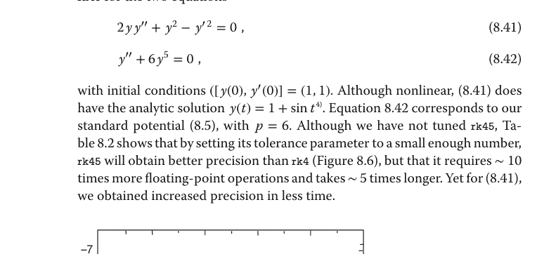

警告，对于此方程，如果积分恰好经过点 y(t) = 0，则 rk 程序可能不准确，因为此时方程中与 y 成比例的项会消失，只剩下 y'^2 = 0，这是有问题的。那里可能需要不同的算法。

## 表 8.1 不同方程的常微分方程求解器比较。

| Eq. No. | Method | Initial h | No. of flops | Time (ms) | Relative error |
|---|---|---|---|---|---|
| (8.41) | rk4 | 0.01 | 1000 | 5.2 | 2.2 × 10⁻⁸ |
|  | rk45 | 1.00 | 72 | 1.5 | 1.8 × 10⁻⁸ |
| (8.42) | rk4 | 0.01 | 227 | 8.9 | 1.8 × 10⁻⁸ |
|  | rk45 | 0.1 | 3143 | 36.7 | 5.7 × 10⁻¹¹ |

## 8.8
非线性振荡的解法（评估）

使用你的 rk4 程序通过尝试 p = 2–12 范围内的幂，或 0 ≤ αx ≤ 2 范围内的非线性强度来研究非谐振荡。暂时不要包含任何显式的时间相关力。对于较大的 p 值，力与加速度在转折点附近会变得很大，因此你可能需要比谐振子使用的更小的步长 h。

- 1. 检查对于给定的初始条件，无论使力变得多么非线性，解是否保持周期性、振幅和周期恒定。特别检查最大速度是否出现在 x = 0，且在最大 x 处速度 v = 0，后者是能量守恒的结果。
- 2. 验证非谐振子是非等时性的，即不同振幅的振动具有不同的周期（图 8.7）。
- 3. 解释为什么对于不同的 p 或 α，振荡的形状会发生变化。
- 4. 设计一个算法来通过记录质量穿过原点的时间来确定振荡周期 T。注意由于运动可能是不对称的，你必须记录至少三个时间点才能推导出周期。

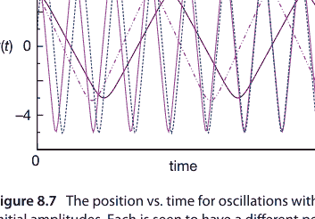

图 8.7 势能 V ∝ x⁷ 内振荡的位置-时间图，四个不同的初始振幅。每个都显示出不同的周期。

- 5. 构造推导出的周期随初始振幅变化的图。
- 6. 验证当能量接近 k/6α² 或 p > 6 时，运动是振荡的，但不是谐振的。
- 7. 验证对于能量 E = k/6α² 的非谐振子，运动从振荡变为平移。看看你能多接近分离线，在那里一次振荡需要无限长的时间。（幂律势能没有分离线。）

### 8.8.1
精度评估：能量守恒

我们没有显式地将能量守恒构建到我们的常微分方程求解器中。尽管如此，除非你显式地加入了摩擦力，从运动方程的形式在数学上可以得出能量对于所有 p 或 α 值都必须是常数。既然如此，能量的恒定性是对数值计算的严格检验。

- 1. 绘制 50 个周期的势能 PE(t) = V[x(t)]、动能 KE(t) = mv²(t)/2 以及总能量 E(t) = KE(t) + PE(t)。评论 PE(t) 与 KE(t) 之间的相关性以及它如何依赖于势能的参数。
- 2. 通过绘制

-log₁₀| [E(t) - E(t = 0)] / E(t = 0) | ≈ 精确位数 (8.43)

来检查解的长期稳定性，绘制大量周期的情况（图 8.6）。由于 E(t) 应该与时间无关，分母是解的绝对误差，除以 E(0) 后变为相对误差（大约 10⁻¹¹）。如果你无法达到 11 位或更多，则需要减小 h 的值或进行调试。
- 3. 由于大 p 振子束缚的粒子在大部分时间里本质上是“自由”的，你应该观察到其动能的时间平均值超过其势能的时间平均值。这实际上是幂律势能的 virial 定理的物理基础（Marion and Thornton, 2003）：

⟨KE⟩ = p/2 ⟨PE⟩. (8.44)

验证你的解是否满足 virial 定理。（那些做过受扰振子问题的读者可以利用这个关系推导出有效 p 值，它应该在 2 到 3 之间。）

## 8.9

## 扩展：非线性共振、拍频、摩擦

**问题** 迄今为止我们的振荡相当简单。我们忽略了摩擦，并假设没有外部力（手）影响系统的自然振荡。确定

- 1. 加入摩擦时振荡如何变化？
- 2. 非线性振子的共振和拍频与线性振子的有何不同？
- 3. 引入摩擦如何影响共振？

### 8.9.1
摩擦（模型）

世界充满了摩擦，而且并非全部都是坏事。因为虽然摩擦使你在风中骑自行车更困难，但它也让你能在冰上行走，并且通常为动力系统增加稳定性。摩擦力的最简单模型被称为 *静摩擦、动摩擦* 和 *粘性摩擦*：

$F_f^{(\mathrm{static})} \leq -\mu_s N, \qquad F_f^{(\mathrm{kinetic})}=-\mu_k N\frac{v}{|v|}, \qquad F_f^{(\mathrm{viscous})}=-bv. \tag{8.45}$

这里 $N$ 是所考虑物体的 *法向力*，$\mu$ 和 $b$ 是参数，$v$ 是速度。静摩擦的此模型适用于静止物体，而动摩擦的模型适用于在干燥表面滑动的物体。如果表面被润滑，或物体在粘性介质中运动，则依赖于速度的摩擦力是更好的模型。

- 1. 将你的谐振子代码扩展以包含 (8.45) 中的三种摩擦类型，并观察每种情况下的运动有何不同。
- 2. *提示：* 对于静摩擦加动摩擦的模拟，每当振子有 $v=0$ 时，你需要检查恢复力是否超过静摩擦力。如果没有，振荡必须在那一瞬间结束。检查你的模拟是否在非零 x 值处终止。
- 3. 对于粘性摩擦的模拟，研究随着 b 值增大出现的定性变化：

| Regime | Condition | Behavior |
|---|---|---|
| Underdamped | $b < 2m\omega_0$ | Oscillate within decaying envelope |
| Critically: | $b = 2m\omega_0$ | Nonoscillatory, finite decay time |
| Overdamped: | $b > 2m\omega_0$ | Nonoscillatory, infinite decay time |

5) 空气阻力对抛体运动的影响在第 9.6 节中研究。

## 8 求解微分方程：非线性振荡

稳定的物理系统如果从其平衡位置稍有位移就会振荡。系统在其平衡位置附近执行的小振荡的频率 ω₀ 称为其自然频率。如果对该系统施加外部正弦力，并且外部力的频率等于自然频率 ω₀，则可能发生共振，振子从外部力吸收能量，振荡幅度随时间增加。如果振子和驱动力在时间上保持同相，振荡幅度将持续增加，除非有摩擦或非线性等机制限制其增长。

如果驱动力的频率接近但不完全等于振子的自然频率，则会出现一种相关的现象，称为拍频。在这种情况下，自然振荡与由外部力产生的振荡之间存在干涉。如果外部驱动力的频率非常接近自然频率，则 resulting motion

```
x ≃ x₀ sin ωt + x₀ sin ω₀ t = (2x₀ cos (ω−ω₀)t /2 ) sin (ω+ω₀)t /2 , (8.46)
```

类似于系统在平均频率 (ω + ω₀)/2 处的自然振荡，但振幅为 2x₀ cos((ω − ω₀)/2)t 缓慢地随拍频 (ω − ω₀)/2 变化。

为了将我们的模拟扩展以包含外部力，

```
F_ext(t) = F₀ sin ωt , (8.47)
```

- 1. 将正弦时变外部力 (8.47) 添加到你的程序中与空间相关的恢复力中（暂时不要包含摩擦）。
- 2. 从驱动力幅度 F₀ 的非常大的值开始。这应该导致模式锁定（500 磅大猩猩效应），系统被驱动力压倒，在瞬态消失后，系统与驱动器同相振荡，无论驱动器的频率如何。
- 3. 现在降低 F₀ 直到它接近系统自然恢复力的幅度。你需要这种近似相等才能发生拍频。
- 4. 验证对于谐振子，拍频，即每单位时间的强度变化次数，等于频率差 (ω − ω₀)/2π，单位为每秒周期数，其中 ω ≃ ω₀。


+   5. 一旦你得到了一个与你的系统匹配良好的 \(F_0\) 值，就进行一系列运行，在 \(\omega_0/10 \le \omega \le 10\omega_0\) 范围内逐渐增大驱动力的频率。
+   6. 绘制振荡最大振幅随驱动力 \(\omega\) 变化的图。
+   7. 探究当你让非线性系统共振时会发生什么。如果非线性系统接近简谐，你应该会看到拍（beating），而不是线性系统中出现的发散。拍的产生是因为固有频率随振幅增大而变化，从而使固有振荡与受迫振荡失去同相。然而一旦失相，外力就不再向系统输入能量，于是振幅减小；随着振幅减小，振荡器的频率恢复到固有频率，驱动力和振荡器重新同相，整个循环就此重复。
+   8. 现在研究加入粘性摩擦会如何改变振幅-驱动频率曲线。你应该会发现，摩擦使曲线变宽。
+   9. 解释当势 \(V(x)=k|x|^p/p\) 中的指数 \(p\) 越来越大时，共振的特性如何变化。当 \(p\) 很大时，质点实际上会“撞”到壁上，并与驱动力失去同相，因此驱动力向系统输入能量的效果变差。

## 常微分方程应用：本征值、散射与抛体运动

既然我们已经知道如何数值求解常微分方程，下面就以几种不同的方式运用这些新掌握的技巧。首先，我们将常微分方程求解器与搜索算法结合起来，求解量子本征值问题。然后，我们求解散射问题中出现的一些联立常微分方程，并探索经典混沌散射。最后，我们仰望天空，看看从天上掉落的球体，以及那些并不会掉落的行星。

### 问题：任意势场中的量子本征值

量子力学描述发生在原子尺度或亚原子尺度上的现象（基本粒子属于亚原子尺度）。它是一种统计理论：一个粒子位于点 \(x\) 附近 \(dx\) 区域内的概率为 \(P = |\psi(x)|^2 dx\)，其中 \(\psi(x)\) 称为波函数。如果一个具有确定能量 \(E\) 的粒子在一维空间中运动，并受到势 \(V(x)\) 的作用，其波函数由常微分方程（多于一维时则是偏微分方程）——即定态薛定谔方程¹——决定：

\[
-\frac{\hbar^2}{2m}\frac{d^2\psi(x)}{dx^2}+V(x)\psi(x)=E\psi(x). \tag{9.1}
\]

虽然我们说求解的是能量 \(E\)，但实际上我们求的是波矢 \(\kappa\)。对于束缚态，两者通过下式联系：

\[
\kappa^2 = -\frac{2m}{\hbar^2}E = \frac{2m}{\hbar^2}|E|. \tag{9.2}
\]

薛定谔方程现在变为

\[
\frac{d^2\psi(x)}{dx^2}-\frac{2m}{\hbar^2}V(x)\psi(x)=\kappa^2\psi(x). \tag{9.3}
\]

1) 含时方程需要求解偏微分方程，如第22章所讨论的。

当问题告诉我们粒子是束缚的时，这意味着它被限制在空间的某个有限区域内，从而 \(\psi(x)\) 是可归一化的。要做到这一点，唯一的方式是 \(\psi(x)\) 在 \(x \to \pm\infty\)（势场为零处）按指数衰减：

```
ψ(x) → { e^{-κx}, for x → +∞ , e^{±κx}, for x → −∞ . } (9.4)
```

总之，虽然利用我们迄今所学的方法求解常微分方程 (9.1) 是直接了当的，但我们还必须要求解 \(\psi(x)\) 同时满足边界条件 (9.4)。这一附加条件把常微分方程问题转变为本征值问题：只有在某些特定的能量 \(E\)（等价地，\(\kappa\)）值下才有解（本征值）。基态能量对应于最小（最负）的本征值。为了求得能量，我们必须确定基态波函数（本征函数）；它必须无节点，并且关于 \(x = 0\) 为偶函数（对称）。激发态具有更高（负得更少）的能量，其波函数可能是奇函数（反对称）。

### 模型：盒中核子

我们描述的数值方法能够处理最真实的势场形状。不过，为了与标准教科书中的情形建立联系，并允许进行一些解析检验，我们将使用一个简单模型：把 (9.1) 中的势 \(V(x)\) 取为有限深方势阱（图9.1）：

```
V(x) = { -V₀ = -83 MeV, for |x| ≤ a = 2 fm , 0, for |x| > a = 2 fm , } (9.5)
```

其中深度 83 MeV、半径 2 fm 是原子核的典型值（我们就在这些单位下求解问题）。采用这个势后，薛定谔方程 (9.3) 变为

```
d²ψ(x)/dx² + (2m/ħ² V₀ - κ²) ψ(x) = 0 , for |x| ≤ a , (9.6)
```

```
d²ψ(x)/dx² - κ² ψ(x) = 0 , for |x| > a . (9.7)
```

为了计算这里的常数比，我们把光速的平方 \(c^2\) 同时插入分子和分母，然后代入这些常见数值（Landau, 1996）：

```
2m/ħ² = 2mc²/(ħc)² ≈ (2 × 940 MeV)/(197.32 MeV fm)² = 0.0483 MeV⁻¹ fm⁻² . (9.8)
```

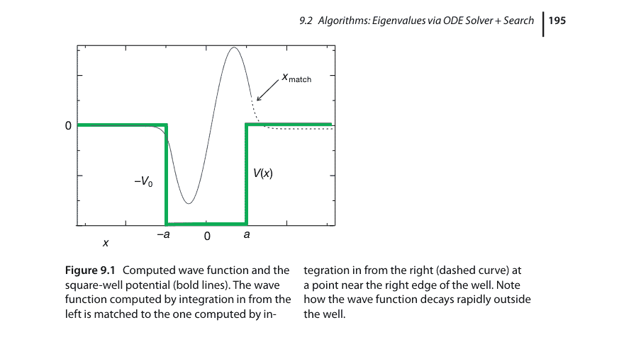

### 双算法：用常微分方程求解器 + 搜索求本征值

本征值问题的求解将常微分方程 (9.3) 的数值解与试错搜索结合起来，以寻找满足边界条件 (9.4) 的波函数。这一过程分几个步骤进行：

+   1. 从最左端 \(x = -X_{\max} \simeq -\infty\) 开始，其中 \(X_{\max} \gg a\)。由于该区域内势场 \(V = 0\)，此处的解析解为 \(e^{\pm\kappa x}\)。因此，假设这里的波函数满足左边界条件：
+   \[\psi_L(x = -X_{\max}) = e^{+\kappa x} = e^{-\kappa X_{\max}} . (9.9)\]
+
+   2. 使用你喜欢的常微分方程求解器，将 \(\psi_L(x)\) 从 \(x = -X_{\max}\) 向原点（向右）推进，直到到达匹配半径 \(x_{\mathrm{match}}\)。匹配半径的具体值并不重要，最终解应当与它无关。在图9.1中，我们展示了一个 \(x_{\mathrm{match}} = +a\) 的示例解；也就是说，我们在势阱右边缘进行匹配。在图9.2中，我们看到一些不匹配的猜测。
+
+   3. 从最右端，即 \(x = +X_{\max} \simeq +\infty\) 处开始，取一个满足右边界条件的波函数：
+   \[\psi_R(x = +X_{\max}) = e^{-\kappa x} = e^{-\kappa X_{\max}} . (9.10)\]

> 2) 这里概述的步骤适用于逐渐衰减到零的一般势场。对于具有陡峭截断的方势阱，解析解直到阱壁处都有效；在这种特殊情况下，我们可以直接从阱壁开始向内积分。相反，如果处理库仑势，其非常缓慢的衰减即使在无穷远处也无法匹配到简单的指数形式（Landau, 1996）。

+   4. 使用你的 rk4 常微分方程求解器，将 \(\psi_R(x)\) 从 \(x=+X_{\max}\) 向原点（向左）推进，直到到达*匹配半径* \(x_{\mathrm{match}}\)。
+
+   5. 为了使 \(x=x_{\mathrm{match}}\) 处的概率和概率流连续，\(\psi(x)\) 和 \(\psi'(x)\) 必须在该处连续。要求比值 \(\psi'(x)/\psi(x)\)（称为*对数导数*）在该处连续，就把两个连续性条件合并为一个条件，并且与 \(\psi\) 的归一化无关。
+
+   6. 虽然我们事先不知道哪些 \(E\) 或 \(\kappa\) 值是本征值，但为了使用常微分方程求解器，我们仍然需要一个能量的起始值。既然如此，我们从一个猜测的能量开始求解。基态能量的一个好猜测是比势阱底部略高一些的值，即 \(E>-V_0\)。
+
+   7. 由于任何猜测都不太可能恰好正确，左、右波函数在 \(x=x_{\mathrm{match}}\) 处不会完全匹配（图9.2）。这没关系，因为我们可以利用不匹配的程度来改进下一次猜测。我们通过计算对数导数之差来度量左、右波函数匹配得有多好：

\[\Delta(E,x)=\left.\frac{\psi'_L(x)/\psi_L(x)-\psi'_R(x)/\psi_R(x)}{\psi'_L(x)/\psi_L(x)+\psi'_R(x)/\psi_R(x)}\right|_{x=x_{\mathrm{match}}},\tag{9.11}\]

其中分母用于避免出现过大或过小的数值。接下来，我们尝试一个不同的能量，注意 \(\Delta(E)\) 变化了多少，并据此推断下一个能量的合理猜测。搜索持续进行，直到左侧和右侧的 \(\psi'/\psi\) 在某个设定容差范围内匹配；该容差取决于所需的能量精度。

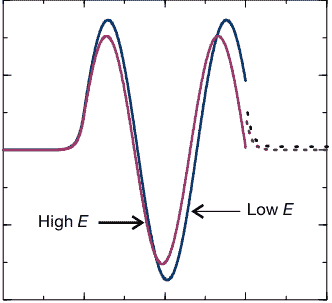

**图9.2** 两种对能量的猜测，它们要么太低，要么太高，不能成为本征值。我们可以看到，低 \(E\) 的猜测振荡不够，无法与衰减的指数函数匹配；而高 \(E\) 的猜测振荡过多。


# 9.2.1

# 薛定谔常微分方程的 Numerov 算法

我们通常推荐使用四阶 Runge–Kutta 方法求解常微分方程，并将其与搜索例程结合求解特征值问题。在本节中，我们介绍 Numerov 方法，这是一种专门针对不包含一阶导数的常微分方程的算法，例如我们的薛定谔方程。虽然该算法不如 rk4 通用，但其为 O(h⁶)，因此通过提供额外的精度来加快计算速度。

我们首先将薛定谔方程 (9.3) 重写为通用形式

```
d²ψ/dx² + k²(x)ψ = 0 ,   k²(x) = 2m/ħ² { E + V₀,  for |x| < a ,  E,  for |x| > a ,  (9.12)
```

其中 k² = −κ² 对应束缚态。请注意，尽管 (9.12) 专门针对方势阱，但对于其他势能，−V₀ 将被函数 V(x) 取代。Numerov 方法的技巧在于利用 (9.12) 中没有一阶导数 dψ/dx 这一事实来获得二阶导数的额外精度。我们从波函数的泰勒展开开始

```
ψ(x + h) ≈ ψ(x) + h ψ⁽¹⁾(x) + h²/2 ψ⁽²⁾(x) + h³/3! ψ⁽³⁾(x) + h⁴/4! ψ⁽⁴⁾(x) + ⋯  (9.13)
```

```
ψ(x − h) ≈ ψ(x) − h ψ⁽¹⁾(x) + h²/2 ψ⁽²⁾(x) − h³/3! ψ⁽³⁾(x) + h⁴/4! ψ⁽⁴⁾(x) + ⋯ ,  (9.14)
```

其中 ψ⁽ⁿ⁾ 表示第 n 阶导数 dⁿψ/dxⁿ。由于 ψ(x − h) 的展开式中奇次幂的 h 带有负号，将 ψ(x + h) 和 ψ(x − h) 相加时所有奇次幂都会相互抵消：

```
ψ(x + h) + ψ(x − h) ≈ 2ψ(x) + h² ψ⁽²⁾(x) + h⁴/12 ψ⁽⁴⁾(x) + O(h⁶) ,  (9.15)
```

```
⇒  ψ⁽²⁾(x) ≈ [ψ(x + h) + ψ(x − h) − 2ψ(x)]/h² − h²/12 ψ⁽⁴⁾(x) + O(h⁴) .  (9.16)
```

为了获得二阶导数的算法，我们通过将算符 1 + (h²/12)(d²/dx²) 应用于薛定谔方程 (9.12) 来消除四阶导数项：

```
ψ⁽²⁾(x) + h²/12 ψ⁽⁴⁾(x) + k²(x)ψ + h²/12 d²/dx² [k²(x)ψ⁽⁴⁾(x)] = 0 .  (9.17)
```

我们通过代入 ψ⁽²⁾ 的推导表达式来消除 ψ⁽⁴⁾ 项：

ψ(x + h) + ψ(x − h) − 2ψ(x) / h² + k²(x)ψ(x) + h²/12 d²/dx² [k²(x)ψ(x)] ≃ 0 . (9.18)

现在我们使用中心差分近似来近似 k²(x)ψ(x) 的二阶导数：

h² d²[k²(x)ψ(x)]/dx² ≃ [(k²ψ)_{x+h} − (k²ψ)_x] + [(k²ψ)_{x−h} − (k²ψ)_x] . (9.19)

经过此代入后，我们得到 Numerov 算法：

ψ(x + h) ≃ { 2[1 − 5/12 h²k²(x)] ψ(x) − [1 + h²/12 k²(x − h)] ψ(x − h) } / { 1 + h²k²(x + h)/12 } . (9.20)

我们可以看到，Numerov 算法使用 x 和 x − h 两个前一步的 ψ 值将 ψ 向前推进到 x + h。要向后推进 x，只需将 h 的符号反转即可。我们的该算法实现 Numerov.py 给出在 9.1 节清单中。

## 清单 9.1 QuantumNumerov.py 使用 Numerov 方法求解一维定态薛定谔方程的束缚态能量 + 搜索（rk4 也可工作，如 9.2 节清单所示）。

```
# QuantumNumerov: Quantum BS via Numerov ODE solver + search
from visual import *
from visual.graph import *
psigr = display(x=0, y=0, width=600,height=300,title='R & L Wave Funcs')
psi = curve(x=list(range(0,1000)), display=psigr, color=color.yellow)
psi2gr = display(x=0,y=300,width=600,height=200,title='Wave func')
psio = curve(x=list(range(0,1000)),color=color.magenta, display=psi2gr)
energr = display(x=0, y=500, width=600,height=200,title='Potential & E')
poten = curve(x=list(range(0,1000)), color=color.cyan, display=energr)
autoen = curve(x=list(range(0,1000)), display=energr)

dl = 1e-6 # very small interval to stop bisection
ul = zeros([1501], float)
ur = zeros([1501], float)
k2l = zeros([1501], float) # k**2 left wavefunc
k2r = zeros([1501], float)
n = 1501
m = 5 # plot every 5 points
imax = 100
xl0 = -1000; xr0 = 1000 # leftmost, rightmost x
h = 1.0*(xr0-xl0)/(n-1)
amin = -0.001; amax = -0.00085 # root limits
e = amin # Initial E guess
de = 0.01
ul[0] = 0.0; ul[1] = 0.00001; ur[0] = 0.0; ur[1] = 0.00001
im = 500
nl = im+2; nr = n-im+1 # left, right wv
istep = 0
```

### 9.2 算法：通过常微分方程求解器 + 搜索求特征值

```
def V(x):
    if (abs(x)<=500): v = -0.001
    else: v = 0
    return v

# Square well

def setk2():
    # k2
    for i in range(0,n):
        xl = xl0+i*h
        xr = xr0-i*h
        k2l[i] = e-V(xl)
        k2r[i] = e-V(xr)

# Numerov algorithm
b=(h**2)/12.0
for i in range(1, n-1):
    u[i+1] = (2*u[i]*(1-5*b*k2[i]) - (1+b*k2[i])*u[i-1])/(1+b*k2[i+1])
setk2()
# Left psi
numerov (nl, h, k2l, ul)
# Right psi
numerov (nr, h, k2r, ur)
fact= ur[nr-2]/ul[im]
# Scale
for i in range (0,nl):
    ul[i] = fact*ul[i]
f0 = (ur[nr-1]+ul[nl-1]-ur[nr-3]-ul[nl-3])/(2*h*ur[nr-2])  # Log deriv

def normalize():
    asum = 0
    for i in range (0,n):
        if i > im :
            ul[i] = ur[n-i-1]
            asum = asum+ul[i]
            asum = sqrt(asum);
elabel = label(pos=(700, 500), text='e=', box=0,display=psigr)
elabel.text = '%10.8f' % e
ilabel = label(pos=(700,400),text='istep=',box=0,display=psigr)
ilabel.text = '%4d' %istep
poten.pos = [(-1500,200),(-1000,200),(-1000,-200),(0,-200),(0,200),(1000,200)]
autoen.pos = [(-1000,e*400000.0+200),(0,e*400000.0+200)]
label(pos=(-1150,-240), text='0.001', box=0, display=energr)
label(pos=(-1000,300), text='0', box=0, display=energr)
label(pos=(-900,180), text='0', box=0, display=energr)
label(pos=(-100,180), text='500', box=0, display=energr)
label(pos=(-500,180), text='0', box=0, display=energr)
label(pos=(900,120), text='r', box=0, display=energr)
j=0
for i in range(0,n,m):
    xl = xl0 + i*h
    ul[i] = ul[i]/asum
    psi.x[j] = xl - 500  # plot psi
    psio.y[j] = 10000.0*ul[i]  # vertical line for match of wvfs
    line = curve(pos=[(-830,0),(-830,500)], color=color.red,display=psigr)
    psio.y[j] = 1.0e5*ul[i]**2  # plot psi
    j +=1
while abs(de) > dl and istep < imax :
    # bisection algorithm
    rate = 2
    e = (amin+amax)/2
    for i in range(0,n):
        k2l[i] = k2l[i] + e-el
        k2r[i] = k2r[i] + e-el
    im = 500;
    nl = im+2;
    nr = n-im+1;
    numerov (nl,h,k2l,ul)
    # New wavefunctions
```

## 清单 9.2 QuantumEigen.py 使用 rk4 算法求解一维定态薛定谔方程的束缚态能量。

```
# QuantumNumerov: Quantum BS via Numerov ODE solver + search

# QuantumEigen.py:               Finds E and psi via rk4 + bisection

# mass/((hbar*c)**2)= 940MeV/(197.33MeV-fm)**2 =0.4829, well width=20.0 fm
# well depth 10 MeV, Wave function not normalized.

from visual import *

psigr = display(x=0,y=0,width=600,height=300, title='R & L Wavefunc')
Lwf = curve(x=list(range(502)),color=color.red)
Rwf = curve(x=list(range(997)),color=color.yellow)
eps = 1E-3                                 # Precision
n_steps = 501
E = -17.0                                  # E guess
h = 0.04
count_max = 100
Emax = 1.1*E                               # E limits
Emin = E/1.1

def f(x, y, F,E):
    F[0] = y[1]
    F[1] = -(0.4829)*(E-V(x))*y[0]

def V(x):
    if (abs(x) < 10.):  return (-16.0)      # Well depth
    else:               return (0.)

def rk4(t, y,h,Neqs,E):
    F = zeros((Neqs),float)
    ydumb = zeros((Neqs),float)
    k1 = zeros((Neqs),float)
    k2 = zeros((Neqs),float)
    k3 = zeros((Neqs),float)
    k4 = zeros((Neqs),float)
    f(t, y, F,E)
    for i in range(0,Neqs):
        k1[i] = h*F[i]
        ydumb[i] = y[i] + k1[i]/2.
    f(t + h/2., ydumb, F,E)
    for i in range(0,Neqs):
        k2[i] = h*F[i]
        ydumb[i] = y[i] + k2[i]/2.
    f(t + h/2., ydumb, F,E)
    for i in range(0,Neqs):
        k3[i]= h*F[i]
        ydumb[i] = y[i] + k3[i]
    f(t + h, ydumb, F,E);
    for i in range(0,Neqs):
        k4[i]=h*F[i]
        y[i]=y[i]+(k1[i]+2*(k2[i]+k3[i])+k4[i])/6.0

def diff(E, h):
    y = zeros((2),float)
    i_match = n_steps//3                    # Matching radius
    nL = i_match + 1
    y[0] = 1.E-15;                          # Initial left wf
    y[1] = y[0]*sqrt(-E*0.4829)
    for ix in range(0,nL + 1):
        x = h * (ix - n_steps/2)
        rk4(x, y, h, 2, E)
    left = y[1]/y[0]                        # Log derivative
```


```
y[1] = -y[0]*sqrt(-E*0.4829)                     # Initialize R wf
for ix in range( n_steps ,nL+1,-1):
    x = h*(ix+1-n_steps/2)
    rk4(x, y, -h, 2, E)
    right = y[1]/y[0]                               # Log derivative
return( (left - right)/(left + right) )

def plot(E, h):                                     # Repeat integrations for plot
    x = 0.
    n_steps = 1501                                 # # integration steps
    y = zeros((2),float)
    yL = zeros((2,505),float)
    i_match = 500                                   # Matching point
    nL = i_match + 1;
    y[0] = 1.E-40                                   # Initial left wf
    y[1] = -sqrt(-E*0.4829) *y[0]
    for ix in range(0,nL+1):
        yL[0][ix] = y[0]
        yL[1][ix] = y[1]
        x = h * (ix -n_steps/2)
        rk4(x, y, h, 2, E)
    y[0] = -1.E-15                                  # - slope: even;  reverse for odd
    y[1] = -sqrt(-E*0.4829)*y[0]
    j=0
    for ix in range(n_steps -1,nL + 2,-1):          # right wave function
        x = h * (ix + 1 -n_steps/2)                 # Integrate in
        rk4(x, y, -h, 2, E)
        Rwf.x[j] = 2.*(ix + 1 -n_steps/2)-500.0
        Rwf.y[j] = y[0]*3e-9 +200
        j +=1
    x = x-h
    normL = y[0]/yL[0][nL]
    j=0
    # Renormalize L wf & derivative
    for ix in range(0,nL+1):
        x = h * (ix-n_steps/2 + 1)
        y[0] = yL[0][ix]*normL
        y[1] = yL[1][ix]*normL
        Lwf.x[j] = 2.*(ix -n_steps/2+1)-500.0
        Lwf.y[j] = y[0]*3e-9+200                     # Factor for scale
        j +=1
for count in range(0,count_max+1):
    rate(1)                                         # Slow rate to show changes
    # Iteration loop
    E = (Emax + Emin)/2.                            # Divide E range
    Diff = diff(E, h)
    if ( diff(Emax, h)*Diff > 0):   Emax = E        # Bisection algorithm
    else:                           Emin = E
    if ( abs(Diff) < eps ):         break
    if count >3:                                    # First iterates too irregular
        rate(4)
        plot(E, h)
        elabel = label(pos=(700, 400), text='E=', box=0)
        elabel.text = 'E=%13.10f' %E
        ilabel = label(pos=(700, 600), text='istep=', box=0)
        ilabel.text = 'istep=%4s' %count
elabel = label(pos=(700, 400), text='E=', box=0)    # Last iteration
elabel.text = 'E=%13.10f' %E
ilabel = label(pos=(700, 600), text='istep=', box=0)
ilabel.text = 'istep=%4s' %count

print("Final eigenvalue E = ",E)
print("iterations , max = ",count)
```

## 9.3
探索

- 1. 通过使用起始能量的任意值，检查你的搜索程序的工作效果。例如，由于没有束缚态能量可以低于势阱底部，尝试 $E \geq -V_0$，以及 $V_0$ 的一些任意分数。在每种情况下，检查所得的波函数并验证其既对称又连续。
- 2. 逐步增加势阱的深度，直到你找到几个束缚态。在每种情况下观察波函数，并将波函数中的节点数与束缚态在势阱中的位置相关联。
- 3. 探索束缚态能量如何随势阱深度 $V_0$ 的变化而变化。特别是，随着你不断减小深度，观察本征能量如何更接近 $E = 0$，并看是否能找到束缚态具有 $E \simeq 0$ 的势阱深度。
- 4. 对于固定的势阱深度 $V_0$，探索束缚态能量如何随势阱半径 $a$ 的变化而变化。更大的半径应带来更大的束缚。
- 5. ⊙ 进行一些探索，发现使基态能量相同的 $(V_0, a)$ 的不同组合（离散歧义）。存在几种不同组合的存在意味着，仅知道基态能量不足以确定势阱深度的唯一值。
- 6. 修改程序以求解奇波函数的本征值和本征函数。
- 7. 求解线性势的波函数：
  
  $V(x) = -V_0 \begin{cases} |x|, & \text{for } |x| < a , \\ 0, & \text{for } |x| > a . \end{cases}$ (9.21)
  
  这里的势能比方势阱小，因此你可能会预期束缚能更小且波函数受限程度更低。（对于该势，没有可供比较的解析结果。）
- 8. 比较使用 Numerov 和 rk4 方法获得的结果，以及计算机获得这些结果所需的时间。
- 9. *牛顿-拉夫森扩展：* 使用牛顿-拉夫森方法代替二分算法来扩展本征值搜索。确定其速度快多少。

## 9.4
问题：经典混沌散射

**问题** 人们期望弹丸从势垒的经典散射是一个连续的过程。然而，在弹子机上进行的实验中观察到（图 9.3），对于某些条件，弹丸会发生多次内部散射，最终轨迹似乎与初始轨迹无关。你的问题是确定该过程是否可以建模为来自静态势的散射，还是弹子机中必须存在主动机制导致混沌散射。

尽管这个问题在计算机上很容易解决，但结果具有一些令人惊讶的混沌特征（混沌将在第 14 章进一步讨论）。事实上，由 Jaime Zuluaga 创建的模拟此问题的 applet Disper2e.html 仍然是读者和作者的惊奇之源。


图 9.3 一个弹子机的照片，其中发生了来自挡块的多次散射。

### 9.4.1

### 模型和理论

我们对弹子机中电激活挡块上弹球的反弹的模型是点粒子从静止的二维势散射（Blehel et al., 1990）

```
V(x, y) = ±x² y² e^{-(x²+y²)} . (9.22)
```

如图 9.4 所示，该势在 x y 平面上有四个圆形对称的峰。两个符号分别对应排斥势和吸引势（弹子机仅包含排斥相互作用）。由于该势中有四个峰，我们怀疑可能发生多次散射，弹丸在峰之间来回弹跳，类似于弹子机中的情况。

该问题的理论是经典动力学。设想一个散射实验，其中一个弹丸从目标无限远处以确定的速度 v 和冲击参数 b（图 9.4）入射到目标上。与目标相互作用并远离目标移动后，散射粒子在散射角 θ 处被观测到。由于势不能反冲从而带走能量，弹丸的速度不会改变，


**图 9.4** 来自势 $V(x,y)=x^2y^2e^{-(x^2+y^2)}$ 的散射，该势在某些方面模拟了弹子机。入射速度为 $y$ 方向的 $v$，冲击参数（x 值）为 $b$。散射粒子的速度为 $v'$，其散射角为 $\theta$。

但其方向会改变。实验通常测量散射的粒子数，然后将其转换为微分截面 $\sigma(\theta)$，该截面与实验装置的细节无关：

$$\sigma(\theta)=\lim_{\Delta\Omega,\,\Delta A\to 0}\frac{N_{\mathrm{scatt}}(\theta)/\Delta\Omega}{N_{\mathrm{in}}/\Delta A_{\mathrm{in}}}.$$

这里 $N_{\mathrm{scatt}}(\theta)$ 是每单位时间散射到在角度 $\theta$ 处张开立体角 $\Delta\Omega$ 的探测器中的粒子数，$N_{\mathrm{in}}$ 是每单位时间入射到截面积为 $\Delta A_{\mathrm{in}}$ 的靶上的粒子数，且式 (9.23) 中的极限是对探测器和面积尺寸趋于无穷小。

截面定义 (9.23) 是实验者用来将其测量值转换为可由理论计算的函数的方法。我们作为理论家，求解粒子从势 (9.22) 散射的轨迹，并由此推导出散射角 $\theta$。一旦我们得到散射角，我们就根据散射角对经典冲击参数 $b$ 的依赖关系预测微分截面（Marion and Thornton, 2003）：

$$\sigma(\theta)=\left|\frac{d\theta}{db}\right|\frac{b}{\sin\theta(b)}.$$

模拟中你应发现的惊讶是，对于某些势参数，$d\theta/db$ 会变得非常大或不连续，这 accordingly 导致截面很大且不连续。


需要求解的动力学方程只是牛顿定律在势能 (9.22) 下同时进行 x 和 y 方向运动的矢量形式：

F = m a

-∂V/∂x î - ∂V/∂y ĵ = m d²x/dt²,

∓2 x y e^{-(x²+y²)} [ y(1 - x²) î + x(1 - y²) ĵ ] = m d²x/dt² î + m d²y/dt² ĵ . (9.25)

x 和 y 方向的运动方程是联立的二阶常微分方程（ODE）：

m d²x/dt² = ∓2 y² x(1 - x²) e^{-(x²+y²)} ， (9.26)

m d²y/dt² = ∓2 x² y(1 - y²) e^{-(x²+y²)} 。 (9.27)

由于力在图 9.4 的峰处为零，这些方程告诉我们峰位于 x = ±1 和 y = ±1。将这些值代入势能 (9.22) 可得 V_max = ± e^{-2}，这设定了该问题的能量标度。

## 9.4.2

### 实现

虽然 (9.26) 和 (9.27) 是联立的二阶常微分方程，但我们仍然可以在将其表示为标准形式后使用标准的 rk4 常微分方程求解器，只不过现在的数组是 4 维的，而不是之前的 2 维：

d y(t)/d t = f(t, y) ， (9.28)

y^{(0)} ≜ x(t) ，    y^{(1)} ≜ y(t) ， (9.29)

y^{(2)} ≜ d x / d t ，    y^{(3)} ≜ d y / d t ， (9.30)

其中 y^{(i)} 的分配顺序是任意的。利用这些定义以及方程 (9.26) 和 (9.27)，我们可以为力函数赋值：

f^{(0)} = y^{(2)} ，    f^{(1)} = y^{(3)} ， (9.31)

f^{(2)} = ±1/m 2 y² x(1 - x²) e^{-(x²+y²)} (9.32)

= ±1/m 2 y^{(1)²} y^{(0)} (1 - y^{(0)²}) e^{-(y^{(0)²}+y^{(1)²)} ， (9.33)

f^{(3)} = ±1/m 2 x² y(1 - y²) e^{-(x²+y²)} (9.34)

= ±1/m 2 y^{(0)²} y^{(1)} (1 - y^{(1)²}) e^{-(y^{(0)²}+y^{(1)²)} 。 (9.35)

要从模拟中推导出散射角，我们需要在散射粒子与目标相距非常远时检查其轨迹。为了近似这一点，我们一直等到散射粒子不再感受到势能（例如 |PE|/KE ≤ 10⁻¹⁰），并将这个状态称为无穷远。然后由速度分量推导出散射角，

```
θ = tan⁻¹( v_y / v_x ) = math.atan2(y, x) . (9.36)
```

这里的 atan2 是一个函数，它能在不进行显式除法（可能溢出）的情况下，在正确的象限内计算反正切值。

## 9.4.3

### 评估

- 1. 应用 rk4 方法，使用 4 维力函数求解联立的二阶常微分方程 (9.26) 和 (9.27)。
- 2. 初始条件为：(a) 入射粒子只有 y 方向的速度分量； (b) 一个碰撞参数 b（初始 x 值）。不需要改变初始 y，但它应足够大，使得 PE/KE ≤ 10⁻¹⁰，这意味着 KE ≈ E。
- 3. 好的参数可以是 m = 0.5， v_y(0) = 0.5， v_x(0) = 0.0， Δb = 0.05， −1 ≤ b ≤ 1。一旦发现截面中有快速变化的区域，可能需要降低能量并使用更小的步长。
- 4. 绘制若干显示通常和异常行为的轨迹 [x(t), y(t)]。特别地，绘制那些发生后向散射的轨迹，以及因此存在大量多重散射的轨迹。
- 5. 绘制若干相空间轨迹 [x(t), ẋ(t)] 和 [y(t), ẏ(t)]。这些轨迹与束缚态的相空间轨迹有何不同？
- 6. 通过在粒子离开相互作用区域后（即 PE/KE ≤ 10⁻¹⁰）确定散射粒子的速度，来确定散射角 θ = atan2(Vx,Vy)。
- 7. 识别轨迹的哪些特征会导致 dθ / db 以及 σ(θ) 中的不连续性。
- 8. 对吸引势和排斥势，以及对低于和高于 V_max = exp(−2) 的一系列能量运行模拟。
- 9. 时间延迟：另一种发现散射中异常行为的方法是计算时间延迟 T(b) 作为碰撞参数 b 的函数。时间延迟是粒子穿过相互作用区域所需时间的增加。在 T(b) 的半对数图中寻找高度振荡的区域，一旦找到，通过设定 b ≈ b/10 在更精细的尺度上重复模拟（这些结构是分形，参见第 16 章）。


图 9.5 以初始速度 V₀ 在 θ 方向发射的抛射体轨迹。下方的曲线包含了空气阻力。

## 9.5

### 问题：从天空落下的球

高尔夫球和棒球运动员声称，球在轨迹末端似乎从天空竖直落下（图 9.5 中的实线曲线）。你的问题是确定这一效应是否有简单的物理解释，或者它是否只是“心理作用”。当你在疑惑物体为何会从天空落下时，看看能否利用你新学到的数值工具来解释为什么行星不会从天空坠落。

## 9.6

### 理论：含阻力的抛体运动

图 9.5 显示了从原点发射的抛射体的初始速度 V₀ 和倾角 θ。如果我们忽略空气阻力，抛射体只受到重力的作用，因此在负 y 方向具有恒定的加速度 g = 9.8 m/s²。运动方程的解析解为

x(t) = V₀ₓ t ，    y(t) = V₀ᵧ t − ½ g t² ，    (9.37)
vₓ(t) = V₀ₓ ，    vᵧ(t) = V₀ᵧ − g t ，    (9.38)

其中 (V₀ₓ, V₀ᵧ) = V₀(cos θ, sin θ)。将 t 表示为 x 的函数，并代入 y(t) 方程，可以证明轨迹是抛物线：

y = (V₀ᵧ / V₀ₓ) x − (g / (2 V₀ₓ²)) x² 。    (9.39)

同样，不难证明（图 9.5 中的实线曲线），在没有摩擦力的情况下，射程 R = 2 V₀² sin θ cos θ / g，最大高度 H = ½ V₀² sin² θ / g。

无摩擦运动的抛物线关于其对称轴对称，因此不能描述球从天空掉落。也许空气阻力会改变这一点？基本的物理内容是二维情况下的牛顿第二定律，其中包含阻碍运动的摩擦力 F⁽ᶠ⁾ 和竖直向下的重力 − m g ê_y：

F⁽ᶠ⁾ − m g ê_y = m d²x(t)/dt² ，    (9.40)

## 9.6.2

### 评估

- 1. 修改你的 rk4 程序，使其求解带摩擦（n = 1）的抛体运动 (9.43) 的联立常微分方程。
- 2. 检查你得到的图形是否与图 9.5 类似。
- 3. 对于低速，模型 (9.42) 中 n = 1 是可以的。现在修改你的程序以处理 n = 3/2（中速摩擦）和 n = 2（高速摩擦）的情况。调整后两种情况下的 k 值，使所有三种情况下的初始摩擦力 k v0^n 相同。
- 4. 关于“从天空落下的球”，你得出了什么结论？

## 9.7

### 练习：2 体和 3 体行星轨道及混沌天气

行星与牛顿的两条定律 牛顿用万有引力定律解释行星的运动，这是科学史上最伟大的成就之一。他能够证明行星沿着以太阳为焦点的椭圆轨道运行，并进一步预测了运动的周期。牛顿只需假设质量为 m 的行星与质量为 M 的太阳之间的力为

```
$$F^{(g)} = -\frac{GmM}{r^2},\tag{9.49}$$
```

其中 r 是行星到质心的距离，G 是万有引力常数，吸引力沿行星与太阳的连线方向（图 9.6a）。牛顿发现他必须发明微积分才能做到这一点，对他来说困难的部分在于求解所得的微分方程。相比之下，数值求解是直接了当的，因为即使对于行星，运动方程仍然是

```
$$\boldsymbol{F} = m\boldsymbol{a} = m\frac{\mathrm{d}^2\boldsymbol{x}}{\mathrm{d}t^2},\tag{9.50}$$
```

其中力 (9.49) 具有笛卡尔分量（图 9.6）

```
$$F_x = F^{(g)}\cos\theta = F^{(g)}\frac{x}{r} = F^{(g)}\frac{x}{\sqrt{x^2 + y^2}},\tag{9.51}$$
```

```
$$F_y = F^{(g)}\sin\theta = F^{(g)}\frac{y}{r} = F^{(g)}\frac{y}{\sqrt{x^2 + y^2}}.\tag{9.52}$$
```

运动方程 (9.50) 变成两个联立的二阶常微分方程：

```
$$\frac{\mathrm{d}^2x}{\mathrm{d}t^2} = -GM\frac{x}{(x^2 + y^2)^{3/2}},\quad \frac{\mathrm{d}^2y}{\mathrm{d}t^2} = -GM\frac{y}{(x^2 + y^2)^{3/2}}.\tag{9.53}$$
```

- 1. 假设单位使 GM = 1，并取初始条件
- 
- $$x(0) = 0.5\ ,\quad y(0) = 0\ ,\quad v_x(0) = 0.0\ ,\quad v_y(0) = 1.63.\tag{9.54}$$
- 2. 修改你的常微分方程求解器程序来求解 (9.53)。
- 3. 确认你使用了足够小的时间步长，使轨道闭合且落到自身之上。
- 4. 尝试不同的初始条件，直到找到能产生圆形轨道（椭圆的一个特例）的条件。
- 5. 一旦获得良好的精度，注意逐渐增大初始速度的影响，直到轨道打开，行星变成抛射体。
- 6. 使用生成椭圆时的相同初始条件，研究 (9.49) 中幂次变为 1/r^{2+α}（α ≠ 0）的影响。即使是很小的 α，你也应该发现椭圆现在会旋转或进动（图 9.6）。（广义相对论预言了一个小的 α 值。）

# 清单 9.3 ProjectileAir.py 求解含空气阻力的抛体运动，同时也对无摩擦情况进行解析求解。

```
# ProjectileAir.py: Numerical solution for projectile with drag
from visual import *
from visual.graph import *
v0 = 22.; angle = 34.; g = 9.8; kf = 0.8; N = 5
v0x = v0*cos(angle*pi/180.) v0y = v0*sin(angle*pi/180.)
T = 2.*v0y/g; H = v0y*v0y/2./g; R = 2.*v0x*v0y/g
graph1 = gdisplay(title='Projectile with & without Drag',
xtitle='x', ytitle='y', xmax=R, xmin=-R/20.,ymax=8,ymin=-6.0)
funct = gcurve(color=color.red)
funct1 = gcurve(color=color.yellow)
print(' No Drag T =',T,' H =',H,' R =',R)
def plotNumeric(k):
vx = v0*cos(angle*pi/180.)
vy = v0*sin(angle*pi/180.)
x = 0.0
y = 0.0
dt = vy/g/N/2.
print("\n    With Friction  ")
print("        x            y")
for i in range(N):
rate (30)
vx = vx - k*vx*dt
vy = vy - g*dt - k*vy*dt
x = x + vx*dt
y = y + vy*dt
funct.plot(pos=(x,y))
print(" %13.10f %13.10f"%(x,y))
def plotAnalytic():
v0x = v0*cos(angle*pi/180.)
v0y = v0*sin(angle*pi/180.)
dt = 2.*v0y/g/N
print("\n    No Friction  ")
print("        x            y")
for i in range(N):
rate (30)
t = i*dt
x = v0x*t
y = v0y*t -g*t*t/2.
funct1.plot(pos=(x,y))
print(" %13.10f %13.10f"%(x,y))
plotNumeric(kf)
plotAnalytic()
```


图 9.6 (a) 行星距太阳 r 处所受的引力。力的 x 和 y 分量已标出。(b) 小程序 Planet 的输出，显示当引力 ∝ 1 / r⁴ 时行星轨道的进动（相继的轨道并不重合）。

## 三体问题：海王星的发现

天王星于 1781 年由威廉·赫歇尔发现，其轨道周期约为 84 年。到 1846 年，天王星自发现以来几乎完成了一整圈绕太阳的公转，但似乎并未完全遵循牛顿万有引力定律所预测的位置。然而，理论计算表明，如果存在一颗尚未被发现的行星，其距离太阳比天王星远约 50%，那么它对天王星轨道的摄动就可以解释与牛顿定律的不一致。因此，海王星在理论上被发现并在实验上得到证实。（如果把冥王星排除为仅仅是矮行星，那么海王星就是太阳系中最遥远的行星。）

假设海王星和天王星的轨道是圆形的且共面（如图 9.7 所示），并且相对于 x 轴的初始角位置如下：

| 质量 (×10⁻⁵ 太阳质量) | 距离 (AU) | 轨道周期 (年) | 角位置 (1690 年) |
|---|---|---|---|
| 天王星 4.366 244 | 19.1914 | 84.0110 | ~ 205.640 |
| 海王星 5.151 389 | 30.0611 | 164.7901 | ~ 288.380 |

利用这些数据和 rk4，求出在海王星一个完整轨道期间，海王星对天王星的影响导致天王星相对于太阳的角位置变化。仅考虑太阳和海王星对天王星的作用力。在天文单位中，M_s = 1 且 G = 4π²。

你可以按照上面概述的程序进行此计算，其中问题被简化为 x 和 y 笛卡尔坐标的联立常微分方程，并计算沿 x 和 y 的力的分量。另一种方法，你可能想尝试，显式计算 rk4 方法中使用的导数值：


图 9.7 来自代码 UranusNeptune.py（在教师光盘上）动画输出的快照，显示：(a) 天王星（内圆）和海王星（外圆）的轨道，太阳位于中心。箭头表示导致轨道摄动的乌拉诺-海王星力。(b) 由于海王星的存在，天王星角位置的摄动。

rk4 方法（http://spiff.rit.edu/richmond/nbody/OrbitRungeKutta4_fixed.pdf）中使用的导数值：

$$k_{1v} = \frac{F_T(r_{su}, r_{nu})}{m_u}, \quad k_{1r} = v_u, \tag{9.55}$$ $$k_{2v} = \frac{F_T(r_{su} + k_{1r} \frac{dt}{2}, r_{nu})}{m_u}, \quad k_{2r} = v_u + k_{2v} \frac{dt}{2}, \tag{9.56}$$ $$k_{3v} = \frac{F_T(r_{su} + k_{2r} \frac{dt}{2}, r_{nu})}{m_u}, \quad k_{3r} = v_u + k_{3v} \frac{dt}{2}, \tag{9.57}$$ $$k_{4v} = \frac{F_T(r_{su} + k_{3r} dt, r_{nu})}{m_u}, \quad k_{4r} = v_u + k_{4v} dt, \tag{9.58}$$ $$v_u = v_u + (k_{1v} + 2k_{2v} + 2k_{3v} + k_{4v}) \frac{dt}{6}, \tag{9.59}$$ $$r = r + (k_{1r} + 2k_{2r} + 2k_{3r} + k_{4r}) \frac{dt}{6}, \tag{9.60}$$

由于力大小相等方向相反，对海王星也有类似的一组 k。

为了帮助你入门，这里列出了我们在程序中使用的一些常数：

```
G = 4*pi*pi                # AU, Msun=1
mu = 4.366244e-5           # Uranus mass
M = 1.0                    # Sun mass
mn = 5.151389e-5           # Neptune mass
d u = 19.1914              # Uranus Sun distance
dn = 30.0611               # Neptune sun distance
Tur = 84.0110              # Uranus Period
Tnp = 164.7901             # Neptune Period
omeur = 2*pi/Tur           # Uranus angular velocity
omenp = 2*pi/Tnp           # Neptune angular velocity
omreal = omeur
urvel = 2*pi*du/Tur        # Uranus orbital velocity UA/yr
npvel = 2*pi*dn/Tnp        # Neptune orbital velocity UA/yr
radur = (205.64)*pi/180.   # in radians
urx = du*cos(radur)        # init x uranus in 1690
ury = du*sin(radur)        # init y uranus in 1690
urvelx = urvel*sin(radur)
urvely = -urvel*cos(radur)
radnp = (288.38)*pi/180.   # Neptune angular pos.
```

# 10

## 高性能硬件和并行计算机

本章讨论了与高性能计算（HPC）和并行计算相关的若干主题。虽然这听起来像是只有专家才应该阅读的内容，但以历史为指导，当前的 HPC 硬件和软件在不到十年内将成为桌面机器，因此你现在最好学习这些东西。我们首先讨论高性能计算机的内存和中央处理器设计，然后检查并行计算的各种一般方面。第 11 章将继续讨论 HPC 和并行计算的一些实际编程方面。HPC 是一个宽泛的主题，我们的介绍简短且从实践者的角度出发。文献（Quinn, 2004）从计算机科学的角度综述了并行计算和消息传递接口。关于并行计算的其他参考资料包括 van de Velde（1994）；Fox（1994），以及 Pancake（1996）。

### 10.1

### 高性能计算机

根据定义，超级计算机是最快、最强大的计算机，目前该术语指的是拥有数十万个处理器的机器。它们是高性能计算机类别的超级明星。个人计算机（PC）体积和成本小到足以供个人使用，同时又足够强大以用于先进的科学和工程应用，也可以是高性能计算机。我们将高性能计算机定义为在以下主要要素之间具有良好平衡的机器：

- 多级（流水线）功能单元，
- 多个中央处理单元（CPU），
- 多个核心，
- 快速中央寄存器，
- 非常大、快速的内存，
- 功能单元之间非常快的通信，
- 向量、视频或阵列处理器，
- 有效高效地整合上述要素的软件。

最简单的例子是，将速度极高的 CPU 与无法跟上其速度的内存系统和软件耦合起来是没有意义的。

### 10.2

### 内存层次结构

计算机架构的理想化模型是 CPU 顺序执行指令流并从连续的内存块中读取。为了说明这一点，在图 10.1 中，我们有一个向量 A[ ] 和一个数组 M[., . ] 加载在内存中，准备处理。现实世界比这更复杂。首先，数组不是以 2D 块存储，而是以线性顺序存储。例如，在 Python、Java 和 C 中，它是按行优先顺序：

```
M(0, 0) M(0, 1) M(0, 2) M(1, 0) M(1, 1) M(1, 2) M(2, 0) M(2, 1) M(2, 2) .
```

(10.1)

在 Fortran 中，它是按列优先顺序：

```
M(1, 1) M(2, 1) M(3, 1) M(1, 2) M(2, 2) M(3, 2) M(1, 3) M(2, 3) M(3, 3) .
```

(10.2)

其次，如图 10.2 和 10.3 所示，矩阵元素的数值甚至可能不在同一个物理位置。有些可能在 RAM 中，有些在磁盘上，有些在缓存中，有些在 CPU 中。为了让这些词更有意义，在图 10.3 和 10.2 中我们展示了高性能计算机的内存架构的简单模型。这种分层安排源于在速度和成本之间取得平衡的努力，即用快速、昂贵的内存补充慢速、便宜的内存。内存架构可能包括以下元素：

CPU 中央处理单元，计算机最快的部分。CPU 由多个非常高速的内存单元即寄存器组成，包含发送到硬件以执行诸如获取、存储和操作数据等任务的指令。通常指令、地址和操作数（当前数据）有单独的寄存器。在许多情况下，CPU 还包含一些专门用于加速浮点数处理的部件。

Cache 一个小而非常快的内存位，保存指令、地址和数据在非常快的 CPU 寄存器与较慢的 RAM 之间传递时的数据（也称为高速缓冲）。这在图 10.2 的金字塔下一级可见。主内存也称为动态 RAM（DRAM），而缓存称为静态 RAM（SRAM）。如果缓存使用得当，它可以大大减少 CPU 等待从内存获取数据的等待时间。

Cache lines 传输到和从缓存或 CPU 的数据被分组为缓存或数据线。从内存将数据带入缓存所需的时间称为延迟。


图 10.1 显示 CPU 和内存的逻辑排列，其中 Fortran 数组 A(N) 和矩阵 M(N,N) 已载入内存。


图 10.2 单处理器高性能计算机的典型内存层次结构（B = 字节，k, M, G, T = 千、兆、吉、太）。

RAM 随机存取或中央内存位于图 10.2 的内存层次结构中间。RAM 速度快，因为其地址可以直接按随机顺序访问，并且读取时不需要机械装置。

页面 中央内存按页面组织，页面是固定长度的内存块。操作系统对内存页面的标记和组织方式与我们对书籍页面的处理类似；它们被编号并通过目录表进行跟踪。典型的页面大小范围为 4 至 16 kB，但在超级计算机上可能达到 MB 级。

硬盘 最后，内存金字塔底部是磁盘或光学设备上的永久存储。虽然与 RAM 相比磁盘非常慢，但它们可以存储海量数据，有时还可以通过使用自己的缓存，即分页存储控制器，来弥补其较慢的速度。

虚拟内存 顾名思义，你在我们的图中找不到它，因为它是虚拟的。它像 RAM 一样工作，但驻留在磁盘上。


图 10.3 计算机内存架构的各要素在处理矩阵存储过程中的情况。

当我们谈论“快”和“慢”内存时，我们使用的是 CPU 中的时钟设定的时间尺度。具体来说，如果你的计算机时钟速度或周期时间为 1 ns，这意味着如果它能足够快地获取所需数据，它每秒可以执行十亿次操作，通常执行一条指令需要超过 10 个周期。虽然通常从缓存向 CPU 传输数据只需 1 个周期，但其他类型的内存要慢得多。因此，你可以通过在 CPU 尝试执行指令时使所有所需数据都可用，从而加快程序速度；否则 CPU 可能在你的数据从较低内存传输时放弃你的计算并转去处理其他任务（我们将在流水线或缓存重用的讨论中很快谈到这一点）。编译器会尝试为你做到这一点，但其成功程度受你的编程风格影响。

如 图 10.3 所示，虚拟内存允许你的程序使用比一次能物理装入 RAM 更多的内存页。操作系统和硬件的组合将此虚拟内存映射为长度通常为 4–16 kB 的页面。当前未使用的页面存储在硬盘上的较慢内存中，仅在需要时才调入快速内存。此切换的单独内存位置称为交换空间（图 10.4a）。

请注意，当应用程序访问 M[i,j] 的内存位置时，计算机确定保存此地址的内存页的编号，并且 M[i,j] 在该页内的位置也确定。如果所需页面位于磁盘而非 RAM 中，则会发生页面错误。在这种情况下，必须将整个页面读入内存，同时 RAM 中最近最少使用的页面被交换到磁盘上。得益于虚拟内存，可以在小型计算机上运行原本需要更大机器（或大量重编程）的程序。为虚拟内存付出的代价是，当虚拟内存实际被调用时，程序速度会下降一个数量级。但


图 10.4 （a）一次在内存中多任务处理四个程序。在 SISD 计算机上，程序按轮转顺序执行。（b）四个程序在 MIMD 计算机的四个独立内存中。

这可能比你为使程序适应 RAM 而重写程序所需的时间，或为你的问题购买足够 RAM 所需的金钱要便宜。

虚拟内存还允许多任务处理，即同时将比一次能物理装入 RAM 更多的程序载入内存（图 10.4b）。尽管应用程序之间的切换会使用计算周期，但通过避免在应用程序载入内存时长时间等待，多任务处理提高了总吞吐量，并为用户提供了更好的计算环境。例如，正是多任务处理使诸如 Linux、Apple OS 或 Windows 之类的窗口系统能够为我们提供多个窗口。虽然每个窗口应用程序使用相当多的内存，但只有当前接收输入的单个应用程序必须实际驻留在内存中；其余的都被分页到磁盘。这解释了为什么在切换到空闲窗口时你可能会注意到轻微延迟；现在活动的程序的页面正在被放入 RAM，同时内存中仍在使用的最少使用的应用程序正在被同时分页出。

## 10.3
中央处理器

CPU 如何变得如此之快？通常，它利用预取和流水线；也就是说，它有能力在当前指令尚未完成之前为下一条指令做准备。它就像一条装配线或一支水桶接力队，其中在一端装桶的人不会等到每个桶到达另一端后再装下一个桶。同样，处理器在一条指令执行的同时获取、读取和解码另一条指令。因此，尽管执行某些操作可能需要一个以上的周期，但数据仍有可能在每个周期进入和离开 CPU。为了说明这一点，表 10.1 表明了操作 c = (a + b)/(d × f) 的处理方式。这里流水线算术单元 A1 和 A2 同时执行获取和操作操作数的工作，但算术单元 A3 必须等待前两个单元完成任务后才有工作可做（在此期间其他两个处于空闲状态）。

### 表 10.1 计算 c = (a + b)/(d × f)。

| 算术单元 | 步骤 1 | 步骤 2 | 步骤 3 | 步骤 4 |
|---|---|---|---|---|
| A1 | 获取 a | 获取 b | 加法 | — |
| A2 | 获取 d | 获取 f | 乘法 | — |
| A3 | — | — | — | 除法 |

## 10.4

### CPU 设计：精简指令集处理器

精简指令集计算机（RISC）架构（也称为超标量）是一种为高性能计算机开发的 CPU 设计理念，现在被广泛使用。它通过减少 CPU 必须遵循的指令数量来提高 CPU 的算术速度。为了理解 RISC，我们将其与 CISC（复杂指令集计算机）架构进行对比。在 20 世纪 70 年代后期，处理器设计师开始利用超大规模集成（VLSI），这使得可以在单个 CPU 芯片上放置数十万个元件。这些早期芯片上的大部分空间都用于芯片设计师编写的微码程序，其中包含设置计算机运行特性的机器语言指令。可用的指令超过 1000 条，其中许多与 Pascal 和 Forth 等高级编程语言相似。付出的代价是速度慢，典型指令需要超过 10 个时钟周期。此外，Alexander 和 Wortman 对 IBM System/360 的 XLP 编译器的 1975 年研究表明，大约 30 条低级指令占了 99% 的使用量，其中只有 10 条指令占了 80% 的使用量。

RISC 的理念是在芯片级别只提供少量指令，但让普通程序员的高级语言，如 Fortran 或 C，将其翻译成特定计算机架构的高效机器指令。这种更简单的方案设计和生产成本更低，让处理器运行更快，并利用减少微码后在芯片上节省的空间来增加算术能力。具体来说，RISC 增加了内部 CPU 寄存器的数量，从而使数据流的流水线（缓存）更长，内存冲突的概率显著降低，并具有一定的指令级并行性。

RISC 设计理念背后的理论是描述程序执行时间的简单方程：

CPU 时间 = 指令数 × 每个指令的周期数 × 周期时间 。

（10.3）

这里“CPU 时间”是程序所需的时间，“指令数”是程序所需的机器级指令总数（有时称为路径长度），“每个指令的周期数”是 CPU 时钟周期


每个指令所需的，以及“周期时间”是执行一个 CPU 周期实际所需的时间。思考过 (10.3) 后，我们可以理解 CISC 哲学，它试图通过减少指令数量来减少 CPU 时间，以及 RISC 哲学，它试图通过减少每条指令的周期数（最好减少到 1）来减少 CPU 时间。要使 RISC 实现性能提升，每条指令的周期数和周期时间的减少幅度必须大于指令数量的增加幅度。

总之，RISC 的要素如下：

- **单周期执行，** 对于大多数机器级指令。
- **小型指令集，** 少于 100 条指令。
- **基于寄存器的指令，** 在寄存器中的值上操作，内存访问仅限于从寄存器加载和存储到寄存器。
- **大量寄存器，** 通常多于 32 个。
- **流水线，** 并发准备多条指令，然后依次执行。
- **高级编译器，** 以提高性能。

## 10.5 CPU 设计：多核处理器

当前正迅速增加多核（最高达 128 核）芯片作为计算机计算引擎的使用，我们预计这一数量会继续上升。如图 10.5 所示，双核芯片在一个集成电路中包含两个 CPU，具有共享互连和共享二级缓存。这种配置有两个或多个相同的处理器连接到单个共享主内存，称为对称多处理，或 SMP。

尽管多核芯片最初是为游戏和单精度设计的，它们正随着新工具、算法和编程方法的使用而在科学计算中得到应用。这些芯片比单核芯片具有更高的集成速度、更少的热量和更高的能源效率，而单核芯片的热量产生限制了其时钟速度低于 4 GHz。与多个单核芯片相比，多核芯片每个 CPU 使用的晶体管更少，因此制造更简单、运行更凉爽。

多核芯片内置了并行性，因为每个核心可以运行不同的任务。然而，由于核心通常共享相同的通信通道和二级缓存，如果两个 CPU 同时使用总线，则可能出现通信瓶颈。通常用户不必担心这个问题，但编译器和软件的编写者必须担心。现代编译器会自动利用多个核心，MPI 甚至将每个核心视为单独的处理器。

## 双 CPU 核心芯片


(a)


(b)

图 10.5 (a) 英特尔 Core-2 双核处理器的通用视图，具有 CPU 本地的 一级缓存和共享的片上二级缓存（D. Schmitz 授权）。(b) AMD Athlon 64 X2 3600 双核 CPU（Wikimedia Commons）。

## 10.6 CPU 设计：向量处理器

通常科学计算中最苛刻的部分涉及矩阵运算。在经典的（冯·诺依曼）标量计算机上，将物理长度为 99 的两个向量相加形成第三个向量，最终需要 99 次顺序加法（表 10.2）。这里实际上有许多幕后工作。对于每个元素 i，需要从其在内存中的位置获取 a(i)，从其在内存中的位置获取 b(i)，在 CPU 寄存器中对这两个元素的数值进行相加，并将和存储到内存中的 c(i)。这种获取占用时间，并且在计算机一遍又一遍地被告知做同样的事情方面是浪费的。

当我们说计算机进行向量处理时，我们指的是有硬件组件对矩阵的整行或整列进行数学运算，而不是单个元素。（该硬件也可以处理单下标矩阵，即数学向量。）在向量处理 [A] + [B] = [C] 中，对元素 A 和 B 的连续获取和相加被分组并重叠，Z ≅ 64–256 个元素（段大小）用一条命令处理，如表 10.3 所示。根据数组大小，这种方法可以将向量的处理速度提高大约 10 倍。如果所有 Z 个元素真正同时处理，则加速比为 ~ 64–256。

向量处理可能在计算机制造商生产面向科学和军事社区的大型主机计算机的时代达到顶峰。这些计算机具有专有硬件和软件，并且通常昂贵到只有企业或军事实验室才能负担得起。虽然 Unix 然后是 PC 的革命几乎消除了这些大型向量机，但一些仍然存在，以及使用向量处理在其显卡中的 PC。谁能说未来会怎样？

### 表 10.2 矩阵 [C] = [A] + [B] 的计算

| Step 1 | Step 2 | ... | Step 99 |
|---|---|---|---|
| c(1) = a(1) + b(1) | c(2) = a(2) + b(2) | ... | c(99) = a(99) + b(99) |

### 表 10.3 矩阵 [A] + [B] = [C] 的向量处理

| Step 1 | Step 2 | ... | Step Z |
|---|---|---|---|
| c(1) = a(1) + b(1) |  |  |  |
|  | c(2) = a(2) + b(2) |  |  |
|  |  | ... |  |
|  |  |  | c(Z) = a(Z) + b(Z) |

## 10.7 并行计算简介

硬件上并行计算的进步令人印象深刻，这几乎没有疑问。不幸的是，伴随硬件的软件似乎停留在 1960 年代。在我们看来，消息传递和 GPU 编程对应用科学家来说细节太多（不幸的是）需要以类似于计算早期时代的初级水平进行编码。然而，节点为对称多处理器的集群的出现越来越多，导致开发了遵循更简单编程模型的复杂编译器；例如，像 CoArray Fortran、Unified Parallel C 和 Titanium 这样的分区全局地址空间编译器。在这些方法中，程序员查看一个全局数据数组，然后像它们是连续的一样操作这些数据。当然，数据实际上是分布式的，但软件在程序员视野之外处理了这个问题。虽然这样的程序可能不如手工编码的程序那样高效地使用处理器，但重新设计程序要容易得多。是否值得花费时间使程序更高效，取决于所面临的问题、程序将运行的次数以及任务可用的资源。无论如何，如果计算机的每个节点都有若干个共享内存的处理器，并且有若干个节点，则需要某种类型的混合编程模型。

## 10.8 并行语义（理论）

我们之前看到，高性能计算机执行的许多任务通过利用流水线和分段 CPU、分层内存和单独的 I/O 处理器等内部结构并行运行。虽然这些任务是“并行”运行的，但现代使用的 *并行计算* 或 *并行性* 表示将多个处理器应用于单个问题（Quinn, 2004）。它是一个计算环境，其中若干个 CPU 异步运行并相互通信以交换中间结果并协调其活动。

例如，考虑矩阵乘法：

$$[B] = [A][B]. \tag{10.4}$$

在数学上，除非 [A] 等于单位矩阵 [I]，否则该方程没有意义。然而，它作为一种算法是有意义的，该算法根据 RHS 上的旧值产生 LHS 上的 B 的新值：

$$[B^{\mathrm{new}}] = [A][B^{\mathrm{old}}]. \tag{10.5}$$

$$\Rightarrow\quad B_{i,j}^{\mathrm{new}} = \sum_{k=1}^{N} A_{i,k}B_{k,j}^{\mathrm{old}}. \tag{10.6}$$

由于特定 i 和 j 值的 $B_{i,j}^{\mathrm{new}}$ 的计算与所有其他 $B_{i,j}^{\mathrm{new}}$ 值的计算无关，每个 $B_{i,j}^{\mathrm{new}}$ 可以并行计算，或者 $[B^{\mathrm{new}}]$ 的每一行或每一列可以并行计算。如果 B 不是矩阵，那么我们就可以直接计算 $B = AB$。然而，如果我们尝试仅使用 $[B]$ 的矩阵元素执行计算，用计算时替换旧值的新值，那么我们必须以某种方式确定 (10.6) RHS 上的 $B_{k,j}$ 是矩阵乘法之前存在的 $[B]$ 的值。

这是一个 *数据依赖* 的例子，其中计算中使用的数据元素取决于它们被使用的顺序。一种考虑这种依赖的方法是使用临时矩阵用于 $[B^{\mathrm{new}}]$，然后在所有乘法完成后将 $[B]$ 分配给临时矩阵：

$$[\mathrm{Temp}] = [A][B], \tag{10.7}$$

$$[B] = [\mathrm{Temp}]. \tag{10.8}$$

相比之下，矩阵乘法 $[C] = [A][B]$ 是一个 *数据并行* 操作，其中数据可以按任何顺序使用。因此我们已经看到了通信、同步以及对并行计算算法背后的数学理解的重要性。

并行计算机中的处理器放置在通信网络的 *节点* 上。每个节点可能包含一个 CPU 或少量 CPU，并且


通信网络可能位于计算机内部，也可能位于计算机外部。一种对并行计算机进行分类的方法是根据它们处理指令和数据所采用的方法。从这一角度来看，机器有三种类型：

**单指令，单数据（SISD）** 这些是经典的（冯·诺依曼）串行计算机，在遇到下一条指令和下一个数据流之前，先对单个数据流执行一条指令。

**单指令，多数据（SIMD）** 这里指令是从单一流中处理的，但指令会并发地作用于多个数据元素。通常，节点简单且相对较慢，但数量众多。

**多指令，多数据（MIMD）** 在此类机器中，每个处理器独立运行，具有独立的指令和数据。这些是利用 *消息传递* 包（如 MPI）在处理器之间进行通信的机器类型。它们可能是一组通过网络连接的 PC，也可能是更集成的机器，内部板上拥有数千个处理器，例如第 10.15 节中描述的 Blue Gene 计算机。这些计算机没有共享内存空间，也被称为 *多计算机*。尽管这类计算机是最难编程的，但其低成本和对某些问题类别的有效性使其成为目前最主要的并行计算机类型。

在并行计算机上运行独立程序与 Unix 和 PC 使用的多任务功能类似。在多任务处理（图 10.4a）中，多个独立程序同时驻留在计算机的内存中，并以轮询或优先级顺序共享处理时间。在 SISD 计算机上，一次只有一个程序运行，但如果其他程序在内存中，则切换到它们所需的时间并不长。在多处理（图 10.4b）中，这些作业可以同时运行，无论是在内存的不同部分还是在不同计算机的内存中。显然，如果不同的处理器在同一程序的不同部分上运行，多处理就会变得复杂，因为此时同步和负载平衡（保持所有处理器同样繁忙）就成为关注点。

除了指令和数据流之外，对并行计算进行分类的另一种方法是按 *粒度*。*粒* 定义为待执行计算工作的度量，更具体地说，是计算工作与通信工作之比。

**粗粒度并行** 在单独的计算机系统上运行的单独程序，系统通过常规通信网络耦合。其例证是六台 Linux PC 通过网络共享相同的文件，但每个 PC 都有不同的中央内存系统。每个计算机可以同时处理一个问题的不同、独立的部分。

**中粒度并行** 若干处理器同时执行（可能不同）程序，同时访问公共内存。处理器通常放置在公共总线（通信通道）上，并通过内存系统相互通信。中粒度程序在不同处理器上运行不同的、独立的并行子程序。因为编译器很少聪明到能判断程序的哪些部分在何处运行，所以用户必须在程序中包含多任务例程。¹

1) 一些专家将我们的中粒度定义为粗粒度，但这种区别会随时间而改变。

**细粒度并行** 随着粒度的减小和节点数量的增加，节点之间需要更快的通信。因此，细粒度系统往往是定制设计的机器。通信可能通过中央总线或通过少量节点的共享内存进行，或通过大规模并行机器的某种高速网络进行。在后一种情况下，用户通常通过某些编码结构划分工作，编译器只需编译程序。然后程序在用户指定的节点数上并发运行。例如，程序的不同 for 循环可以在不同节点上运行。

## 10.9 分布式内存编程

一种因由商品化 PC 构建而在粗粒度和中粒度系统上获得主导接受的并发处理方法就是分布式内存。在这种方法中，每个处理器都有自己的内存，处理器通过高速交换机和网络相互交换数据。处理器之间交换或传递的数据具有编码的到/从地址，被称为消息。构成 Beowulf² 的 PC 或工作站集群是分布式内存计算机的例子（图 10.6）。集群的统一特征是将高度复制的计算和通信组件集成到单一系统中，同时每个节点仍能独立运行。在 Beowulf 集群中，组件是为通用市场设计的商品化组件，通信网络及其高速交换机也是如此（主要商业制造商使用专用互连，但价格不菲）。注意：通过网络连接的一组计算机也可能被称为集群，但除非它们是为并行处理而设计的，使用重复的相同类型处理器，并且只有有限数量的处理器（前端）供用户登录，否则通常不会被称为 Beowulf。

2)  presumably there is an analogy between the heroic exploits of the son of Ecgtheow and the nephew of Hygelac in the 1000 C.E. poem Beowulf and the adventures of us common folk assembling parallel computers from common elements that have surpassed the performance of major corporations and their proprietary, multimillion-dollar supercomputers.

### 并行处理的价值


图 10.6 并行计算的两种视图（Yuefan Deng 友情提供）。

文献中经常出现关于集群、商品集群、Beowulfs、星座、大规模并行系统等之间差异的争论（Dongarra et al., 2005）。虽然我们承认，排名前 500 的计算机上的集群与大学研究人员在其实验室中搭建的集群之间存在主要差异，但在我们在此介绍的入门材料中，我们不会区分这些细微差别。

要使消息传递程序成功，数据必须在节点之间划分，以便至少在一段时间内，每个节点都有其运行独立子任务所需的所有数据。当程序开始执行时，数据会被发送到所有节点。当所有节点完成其子任务后，它们再次交换数据，以便每个节点拥有完整的新数据集来执行下一个子任务。这种数据交换后跟处理的重复循环会持续进行，直到整个任务完成。消息传递 MIMD 程序也是单程序、多数据程序，这意味着程序员编写一个程序在所有节点上执行。通常有一个单独的主机程序，启动节点上的程序，读取输入文件并组织输出。

## 10.10 并行性能

想象一个自助餐厅队伍，所有服务员似乎都在努力快速工作，但番茄酱分配器却有一些泡菜部分地阻塞了其输出，因此队伍中的每个人都必须等待前面的番茄酱爱好者弄坏他们的食物后才能继续前进。这是一个复杂过程中最慢的步骤决定整体速率的例子。并行处理中存在类似的情况，其中番茄酱分配器可能只是程序中相对较小的部分，只能作为一系列串行步骤执行。因为计算无法在这些串行步骤完成之前推进，所以程序的这一小部分最终可能成为程序的瓶颈。

正如我们很快将证明的那样，除非你能让程序的约 ~90% 以并行方式运行，否则程序的加速将不会显著，即使如此，大部分加速


可能只需要很少数量的处理器就能获得。这意味着你需要一个计算密集型问题才能使并行化变得值得，而这也是为什么一些主张使用数千个处理器的并行计算机的倡导者建议你不应将新机器应用于旧问题，而应寻找既足够大又适合大规模并行处理以使努力值得的新问题。

描述串行部分与并行部分平衡对加速效果影响的方程被称为阿姆达尔定律（Amdahl, 1967; Quinn, 2004）。令

p = 处理器数量，   T₁ = 在 1 个 CPU 上运行的时间，
Tₚ = 在 p 个 CPU 上运行的时间。  (10.9)

因此，通过并行处理可达到的最大加速比 Sₚ 为

Sₚ = T₁ / Tₚ → p 。  (10.10)

实际上，由于以下原因，这一极限永远无法达到：程序的一部分是串行的，会发生数据和内存冲突，处理器的通信和同步需要时间，而且很难在所有处理器之间实现完美的负载平衡。暂时忽略这些复杂性，集中讨论代码的串行部分如何影响加速。设 f 为程序中可能在多个处理器上运行的部分所占的比例。代码中无法并行运行的比例 1 − f 必须通过串行处理运行，因此花费的时间为：

Tₛ = (1 − f) T₁   （串行时间）。  (10.11)

在 p 个并行处理器上花费的时间 Tₚ 与 Tₛ 的关系为

Tₚ = f T₁ / p 。  (10.12)

因此，最大加速比作为 f 和处理器数量的函数为

Sₚ = T₁ / (Tₛ + Tₚ) = 1 / (1 − f + f / p)   （阿姆达尔定律）。  (10.13)

图 10.7 显示了不同处理器数量 p 下的一些理论加速比。很明显，除非大部分代码都在并行运行，否则加速比不会显著到值得费心（这就是“90% 并行”这一说法的由来）。即使有无限多个处理器，也无法提高运行代码串行部分的速度，因此其运行速度仍为单处理器速度。实际上，这意味着许多问题仅限于少量处理器，对于实际应用，往往只能获得计算机峰值性能的 10–20%。


**图 10.7** 程序的理论最大加速比作为程序中可能并行运行的部分所占比例的函数。不同的曲线对应不同的处理器数量。

## 10.10.1
**通信开销**

阿姆达尔定律听起来令人沮丧，但它实际上 *高估了* 加速比，因为它忽略了并行计算的 *开销*。这里我们来看通信开销。假设一个完全并行的代码，其加速比为

$$S_p = \frac{T_1}{T_p} = \frac{T_1}{T_1/p} = p.$$  (10.14)

分母基于这样的假设：处理器之间通信不需要时间。然而，实际上从内存中取出数据并将其放入缓存或 *通信* 网络中需要有限的时间，称为 *延迟*。此外，通信通道也有有限的 *带宽*，即数据传输的最大速率，这也会随着大量数据传输而增加 *通信时间*。当我们加入通信时间 $T_c$ 时，加速比下降为

$$S_p \simeq \frac{T_1}{T_1/p + T_c} < p \quad \text{(with communication time)}.$$  (10.15)

要使加速比不受通信时间影响，我们需要

$$\frac{T_1}{p} \gg T_c \quad \Rightarrow \quad p \ll \frac{T_1}{T_c}.$$  (10.16)

这意味着，随着你不断增加处理器数量 p，计算时间 $T_1/p$ 在某一点必须等于通信所需的时间 $T_c$，再增加处理器会导致执行时间增加，因为处理器在等待通信时空闲。这就是对可用于任何一个问题的最大处理器数量以及提高处理器速度而通信速度没有相应提高的有效性的另一个限制。

用于计算的处理器数量持续且急剧增加，导致对如何判断算法速度的看法发生了变化。具体来说，过程中的最慢步骤通常是速率决定步骤，但随着 CPU 能力的不断增加，最慢的步骤更常是处理器之间的访问或通信。既然如此，虽然计算步骤的数量对于确定算法速度仍然很重要，但内存访问的数量和量以及处理器间通信也必须纳入公式。这目前是算法开发中的一个活跃研究领域。

## 10.11
## 并行化策略

包含串行和并行任务的程序的典型组织结构如表 10.4 所示。用户将工作组织成称为任务的单元，每个任务将工作（线程）分配给处理器。主任务控制整体执行以及运行程序独立部分的子任务（称为并行子程序、从属进程、客体或子任务）。这些并行子程序可以是不同的子程序、同一子程序的多个副本，甚至是 Python 的 for 循环。

程序员有责任确保代码分解为并行子程序在数学和科学上是有效且等价于原始程序的。例如，如果程序中最密集的部分是大型哈密顿矩阵的求值，你可能希望在不同处理器上求值每一行。因此，并行编程的关键是识别程序中可能从并行执行中受益的部分。为此，程序员应了解程序的数据结构（后面会讨论），知道计算步骤必须执行的顺序，以及如何协调不同处理器生成的结果。

程序员通过让许多处理器同时保持忙碌并避免不同并行子程序之间的存储冲突来帮助加速执行。你通过将程序划分为数值强度大致相等且将同时在不同处理器上运行的子任务来实现负载平衡。经验法则是使粒度最大（工作量最大）的任务占主导地位，强制其先执行，并通过使任务数量为处理器数量的整数倍来保持所有处理器忙碌。这并不总是可能的。

## 10.12.1
## 消息传递的高层视图

虽然并行计算程序可能变得非常复杂，但基本思想相当简单。你只需要一种常规的编程语言，如 Python、C 或 Fortran，外加四个通信语句。³

- send: 一个处理器向网络发送消息。
- receive: 一个处理器从网络接收消息。
- myid: 唯一标识每个处理器的整数。
- numnodes: 给出系统中节点总数的整数。

一旦你决定在计算机集群上运行程序，就必须学习诸如 MPI 之类的消息传递系统的具体细节。这里我们给出一个更广阔的视角。当你编写消息传递程序时，你会在常规的 Python、Fortran 或 C 程序中穿插消息传递库的调用。基本步骤如下：

- 1. 从命令行或作业控制系统提交你的作业。
- 2. 让你的作业启动额外的进程。
- 3. 让这些进程交换数据并协调其活动。
- 4. 收集这些数据并让进程自行停止。


图 10.8 一个主进程和两个从进程传递消息。请注意，在这个设计不佳的程序中，发送次数多于接收次数，因此结果可能取决于执行顺序，甚至程序可能死锁。

3) 个人通信，Yuefan Deng。


我们将在图 10.8 中以图形方式展示这一点，在顶部可以看到一个主进程创建了两个从进程，然后为它们分配工作（箭头）。随后进程通过消息传递相互通信，将数据输出到文件，最后终止。

## 可能出现的问题

图 10.8 还说明了一些困难：

- 程序员负责使进程协同工作并正确划分工作。
- 程序员负责确保进程拥有正确的数据进行处理，并且数据分布均衡。
- 命令的级别低于编译语言的命令，这会引入更多需要你担心的细节。
- 由于涉及多台计算机和多个操作系统，用户可能无法接收或理解产生的错误信息。
- 消息可能并非按计划顺序发送或接收。
- 可能发生竞争条件，即程序结果取决于消息的特定顺序。即使从进程 1 可能更早开始工作，也不能保证从进程 1 会在从进程 2 之前完成其工作（图 10.8）。
- 在图 10.8 中注意，不同处理器必须等待来自其他处理器的信号；这显然是时间的浪费，并且存在死锁的潜在风险。
- 进程可能发生死锁，即等待永远不会到达的消息。

## 10.12.2

## 消息传递示例和练习

从你已经编写的、适合并行化的简单串行程序开始。具体来说，按参数空间顺序逐步生成结果的程序是很好的候选程序，因为你可以让并行任务处理参数空间的不同区域。或者，重复相同步骤多次的蒙特卡洛计算也是很好的候选程序，因为你可以让程序的副本在不同的处理器上运行，然后在最后汇总结果。例如，列表 10.1 是用 C 语言通过蒙特卡洛积分串行计算 π：

### 列表 10.1 通过蒙特卡洛积分串行计算 π。

// pi.c: *Monte-Carlo integration to determine pi

#include <stdio.h>
#include <stdlib.h>

// if you don't have drand48 uncomment the following two lines
// #define drand48 1.0/RAND_MAX*rand
// #define srand48 srand

#define max 1000                    // number of stones to be thrown
#define seed 68111                  // seed for number generator

```
main() {
    int i, pi = 0;
    double x, y, area;
    FILE *output;
    output = fopen("pond.dat","w");                // save data in pond.dat
    srand48(seed);                                  // seed the number generator
    for (i = 1; i<= max; i++) {
        x = drand48()*2-1;                          // creates floats between
        y = drand48()*2-1;                          // 1 and -1
        if ((x*x + y*y)<1) pi++;
        area = 4*(double)pi/i;                      // stone hit the pond
        fprintf(output, "%i\t%f\n", i, area);      // calculate area
    }
    printf("data stored in pond.dat\n");
    fclose(output);
}
```

修改你的串行程序，使不同的处理器被使用并独立执行，然后将所有结果合并。例如，列表 10.2 是 pi.c 的并行版本，使用消息传递接口（MPI）。你可能希望此时集中于算术命令，而不是 MPI 命令。

### 列表 10.2 MPI.c：使用 MPI 通过蒙特卡洛积分并行计算 π。

```
/* MPI.c uses a monte carlo method to compute PI by Stone Throwing */
/* Based on http://www.dartmouth.edu/~rc/classes/soft_dev/mpi.html */
/* Note: if the sprng library is not available, you may use rnd */

#include <stdlib.h>
#include <stdio.h>
#include <math.h>
#include <string.h>
#include <stdio.h>
#include <sprng.h>
#include <mpi.h>
#define USE_MPI
#define SEED 35791246

main(int argc, char *argv[])
{
    int niter=0;
    double x,y;
    int i,j,count=0,mycount; /* # of points in the 1st quadrant of unit circle */
    double z;
    double pi;
    int myid,numprocs,proc;
    MPI_Status status;
    int master = 0;
    int tag = 123;
    int *stream_id;          /* stream id generated by SPRNGS */

    MPI_Init(&argc,&argv);
    MPI_Comm_size(MPI_COMM_WORLD,&numprocs);
    MPI_Comm_rank(MPI_COMM_WORLD,&myid);

    if (argc <=1) {
        fprintf(stderr,"Usage: monte_pi_mpi number_of_iterations\n");
        MPI_Finalize();
        exit(-1);
    }
}
```

```
sscanf(argv[1], "%d", &niter); /* 1st argument is the number of iterations */

/* initialize random numbers */
stream_id = init_sprng(myid, numprocs, SEED, SPRNG_DEFAULT);
mycount=0;
for ( i=0; i<niter; i++ ) {
    x = (double)sprng(stream_id);
    y = (double)sprng(stream_id);
    z = x*x+y*y;
    if (z<=1) mycount++;
}
if (myid ==0) { /* if I am the master process gather results from others */
    count = mycount;
    for (proc=1; proc<numprocs; proc++) {
        MPI_Recv(&mycount,1,MPI_REAL,proc,tag,MPI_COMM_WORLD,&status);
        count +=mycount;
    }
    pi=(double)count/(niter*numprocs)*4;
    printf("\n # of trials= %d , estimate of pi is %g\n",niter*numprocs,pi);
}
else { /* for all the slave processes send results to the master */
    printf("Processor %d sending results= %d to master process\n",myid,mycount);
    MPI_Send(&mycount,1,MPI_REAL,master,tag,MPI_COMM_WORLD);
}

MPI_Finalize();          /* let MPI finish up */
}
```

尽管如此小的规模问题不值得你为获得更短的运行时间而付出努力，但投入时间来获得并行计算的经验是值得的。

## 10.13

## 可扩展性

在过去的 HPC 和超级计算会议上常见的讨论是，应用科学家在听完关于最新机器拥有看似难以置信数量的处理器后，会站起来问“但是我如何能在我的问题上使用这样一台机器呢？我的问题运行需要数小时，但并不像你的例子那样可以轻易并行化？” 计算机科学家的回应通常是“你只需要想出一些更适合正在建造的机器的新问题。为什么要用超级计算机解决你可以用现代笔记本电脑解决的问题呢？” 似乎这些轶事交流现在已被纳入并行计算的框架中，标题为可扩展性。最一般地说，可扩展性被定义为随着计算机或应用程序规模的增长而处理更多工作的能力。

正如我们已经指出的那样，并行计算的主要挑战是决定如何最好地将问题分解成可以分别计算的各个部分。在理想的世界中，问题会以线性方式扩展，即程序在具有 N 个节点的机器上运行时会加速 N 倍。（当然，随着 N → ∞，比例关系不可能成立，因为通信时间最终必须占主导）。在当今的术语中，这种类型的扩展称为强扩展，指的是问题规模保持固定而节点数（机器规模）增加的情况。很明显，在解决强扩展问题时，目标是通过使用更强大的计算机来减少解决问题所需的时间。这些通常是 CPU 限制的问题，也是最难以获得接近线性加速的问题。

与问题规模保持固定的强扩展相反，在弱扩展中，我们有应用科学同事之前提到的那种类型；即我们随着处理器数量的增加而使问题越来越大。因此，在这里，如果我们能够以与节点数 N 成比例地增加所解决问题的规模，我们就会实现线性或完美的扩展。

为了说明强扩展和弱扩展之间的区别，请考虑图 10.9（基于 Thomas Sterling 的讲座）。我们看到，对于完美强扩展的应用，每个节点上执行的工作随着机器规模的增加而减少，这当然意味着完成问题所需的时间线性减少。相比之下，我们看到，对于完美弱扩展的应用，每个节点执行的工作随着机器规模的增加保持不变，这意味着我们以解决较小机器上较小问题所需的时间来解决越来越大的问题。

弱扩展和强扩展的概念是理想的，实践中往往无法实现，现实世界的应用是两者的混合。此外，是应用程序和计算机架构的组合决定了发生的扩展类型。例如，共享内存系统和分布式-


## 第10章 高性能硬件与并行计算机

内存、消息传递系统的扩展方式各不相同。此外，数据并行应用程序（即每个节点可以处理自己独立数据集的应用程序）本质上就会弱扩展。

在我们继续让你动手做一些扩展示例之前，应该先提醒一句。实际应用往往具有不同层次的复杂性，因此如何度量问题“规模”的增加可能并不那么显而易见。例如，众所周知，用高斯消元法求解 N 个线性方程组需要 O(N^3) 次浮点运算（flops）。这意味着方程数量翻倍并不会使“问题”变成原来的两倍，而是八倍！类似地，如果我们在三维空间网格和一维时间网格上求解偏微分方程，那么问题规模将按 N^4 增长。在这种情况下，要将问题规模翻倍，只需把 N 增加到原来的 2^{1/4} ≈ 1.19 倍。

上面我们已经给出了一个串行代码 pi.c（包含在 Codes 目录中），它通过对单位圆的四分之一进行蒙特卡洛积分来计算 π。我们还给出了 MPIpi.c，它使用相同的算法，但利用 MPI 并行计算 π。你的练习是观察这个应用的扩展表现。你可以修改我们给出的代码，也可以自己编写。

- 1. 使用串行计算，以 1000 次迭代（掷石次数）计算 π，确定所需的 CPU 时间。确保这是实际运行时间，不包含任何系统时间。（根据操作系统的不同，你可以通过在程序中插入计时器调用来获得这类信息。）
- 2. 让 MPI 代码以相同的迭代次数（1000）运行。
- 3. 首先进行一些构成强扩展测试的运行。这意味着保持问题规模不变，即保持 Niter = 1000。先用只有一个处理器执行数值计算的 MPI 代码运行。将它与串行计算进行比较，可以让你对 MPI 带来的开销有所了解。
- 4. 同样保持 Niter = 1000，在 2、4、8 和 16 个计算节点上运行 MPI 代码。在任何情况下，都要确保节点数增加到足以使系统不再扩展为止。
- 5. 根据收集到的数据，绘制运行时间与节点数的关系图。
- 6. 这里的强扩展性如果理想，会得到一条直线图。请评论你的结果。
- 7. 现在进行一些构成弱扩展测试的运行。这意味着在增加所用节点数的同时，也增加问题规模。在本例中，就是增加迭代次数 Niter。

## 10.14 数据并行与域分解

- 8. 在 2、4、8 和 16 个计算节点上运行 MPI 代码，并在每种情况下按比例增大 N_iter 的值（2000、4000、8000、16000 等）。在任何情况下，都要确保节点数增加到足以使系统不再扩展为止。
- 9. 记录每种节点数下的运行时间，并绘制运行时间与计算节点数的关系图。
- 10. 弱扩展意味着当问题规模和计算节点数按比例增加时，运行时间保持不变。请评论你的结果。
- 11. 这个问题更适合做弱扩展还是强扩展？

到这里你可能已经意识到，创建并行程序有两种基本但截然不同的方法。在任务并行中，你按任务来分解程序，将不同的任务分配给不同的处理器，并格外小心地保持负载均衡，也就是让所有处理器都同样繁忙。显然，要做到这一点，你必须理解程序的内部工作原理，还必须对程序进行准确的性能剖析，以便知道程序的各个部分分别花费了多少时间。在数据并行中，基于正在生成或处理的数据，将不同的数据空间（域）分配给不同的处理器；而且通常必须在数据空间的边界共享数据，因此需要在数据空间之间进行同步。数据并行是最常见的方法，非常适合每个节点都有自己私有数据空间的消息传递机器，尽管这有时可能导致大量的数据传输。

在规划如何将全局数据分解为适合并行处理的子空间时，重要的是将数据划分为连续的数据块，以尽量减少数据在内存各个阶段之间移动所花费的时间（缺页）。一些编译器和操作系统会利用空间局部性来帮助你做到这一点，即：如果你使用了数据空间中某个位置的一个数据元素，那么你很可能也会使用附近的一些数据元素，因此这些附近的数据也会被预先准备好。一些编译器和操作系统还会利用时间局部性，即：如果你在某个时刻使用了一个数据元素，那么你在不久的将来再次使用它的概率就会增加，因此它也会被保留在方便取用的位置。在编程时，你可以利用这些局部性来帮助优化程序。

作为域分解的一个例子，考虑用有限差分法求解偏微分方程。根据经典电动力学可知，二维空间中无电荷区域内的电势 U(x)

满足拉普拉斯方程（第 19.4 节将全面讨论）：

∂²U(x, y)/∂x² + ∂²U(x, y)/∂y² = 0 . (10.17)

我们看到，电势同时依赖于 x 和 y，这正是它成为偏微分方程的原因。作为场的源，电荷是通过在某个边界或带电物体上指定电势值而间接引入的。

如图 10.10 所示，我们在一个 (x, y) 值的格点上寻找解，这些值在每个维度上以有限差分 Δ 分隔，并由格点上的离散位置确定：

x = x₀ + iΔ ,   y = y₀ + jΔ ,   i, j = 0, ..., N_max−1 . (10.18)

将导数的有限差分表达式代入 (10.17) 并重新整理方程后，就得到求解拉普拉斯方程的有限差分算法：

U_{i,j} = 1/4 [U_{i+1,j} + U_{i−1,j} + U_{i,j+1} + U_{i,j−1}] . (10.19)

这个方程说明，当我们得到正确解时，它将是四个最近邻点电势的平均值（图 10.10）。作为一种算法，(10.19) 并不能直接给出拉普拉斯方程的解，而必须反复迭代才能收敛到解。我们先给出一个电势的初始猜测，然后扫描整个空间，在每个节点处取最近邻点的平均值来改进它，并不断重复这个过程，直到解达到某个精度水平不再变化，或者直到明显失败为止。当收敛时，我们就说初始猜测已“松弛”到解上。

在代码清单 10.3 中，我们有一个串行代码 laplace.c，它使用松弛算法 (10.19) 求解二维拉普拉斯方程，场景是一根位于接地盒中的直导线保持 100 V 电势。该代码有五个基本要素：

- 1. 初始化格点上的电势值。
- 2. 提供电势的初始猜测，本例中除导线为 100 V 外，其余 U = 0。
- 3. 始终保持边界值和电势的源项值不变。
- 4. 迭代求解直到收敛（即 (10.19) 达到某个精度水平）。
- 5. 以适合三维绘图的格式输出电势。

如你所见，这段代码是一个简单的教学示例，其核心结构是表示（小型）规则格点的数组 p[40][40]。工业级应用可能会使用大得多的格点，以及自适应网格和分层多重网格技术。


**图 10.10** 在二维矩形空间中格点的表示，在该格点上使用有限差分方法求解拉普拉斯方程。中心为白色的格点对应于物理系统的边界，需要在其上施加边界条件以获得唯一解。格点中间的大圆表示用于求解拉普拉斯方程的算法，其中点 $(x,y)=(i,j)\Delta$ 处的电位被设为四个最近邻点电位值的平均值。

当思考如何并行化此程序时，我们注意到一个应用于数据点空间的算法，在这种情况下我们可以将域划分为子域并将每个子域分配给不同的处理器。这是域分解或数据并行。实质上，我们将一个大的边值问题分解为一组等效的较小边值问题，最终再将其组合起来。通常在每个处理器上额外分配存储空间来保存从相邻处理器通信得到的数据值。这些存储位置被称为 *幽灵单元、幽灵行、幽灵列、光晕单元* 或 *重叠区域*。

域分解中有两点至关重要：(i) 负载平衡至关重要，这里通过使每个域包含相同数量的格点来实现。(ii) 处理器之间的通信应最小化，因为这是一个缓慢的过程。显然，处理器必须通信以就域边界处的电位值达成一致，除了位于盒子边缘并保持接地在 0 V 的那些边界。但由于需要计算的格点远多于边界，通信不应严重拖慢大格点的计算。

为了举例说明如何进行操作，串行代码 `poisson__1d.c` 求解一维拉普拉斯方程，而 `poisson__parallel__1d.c` 并行求解相同的 1D 方程（代码由 Michel Vallieres 提供）。该代码使用参数 $\Omega$ 的迭代算法的加速版本，使用单独的域分解方法，以及幽灵单元来通信边界。

## 列表 10.3 laplace.c 使用有限差分技术串行求解拉普拉斯方程。

```
/* laplace.c: Solve Laplace equation with finite differences */

#include <stdio.h>
#define max 40                 /* number of grid points */
main()
{
    double x, p[max][max];
    int i, j, iter, y;
    FILE *output;               /* save data in laplace.dat */
    output = fopen("laplace.dat","w");
    for (i=0; i<max; i++)       /* clear the array */
    { for (j=0; j<max; j++) p[i][j] = 0;}
    for(i=0; i<max; i++) p[i][0] = 100.0;   /* p[i][0] = 100 V */
    for (iter=0; iter<1000; iter++)         /* iterations */
    { for(i=1; i<(max-1); i++)               /* x-direction */
      { for (j=1; j<(max-1); j++)            /* y-direction */
        { p[i][j] = 0.25*(p[i+1][j]+p[i-1][j]+p[i][j+1]+p[i][j-1]); }
      }
    }
    for (i=0; i<max ; i++)          /* write data gnuplot 3D format */
    { for (j=0; j<max; j++)
      { fprintf(output,"%f\n",p[i][j]); }
      fprintf(output,"\n");       /* empty line for gnuplot */
    }
    printf("data stored in laplace.dat\n");
    fclose(output);
}
```

## 10.14.1

## 域分解练习

- 1. 运行 laplace.c 或 laplace.f 的串行版本。
- 2. 将格点尺寸增加到 1000 并确定收敛到小数点后六位所需的 CPU 时间。确保这是实际运行时间，不包括任何系统时间。 （您可以根据操作系统，通过在程序中插入计时调用来获得此类信息。）
- 3. 将域分解为四个子域，并在四个计算节点上运行代码的 MPI 版本。 [请注意，我们在代码目录中给出了一个示例，其中使用串行代码 poisson_1d.c 及其 MPI 实现 poisson_parallel_1d.c（由 Michel Vallieres 提供）。]
- 4. 将串行代码转换为三维。这使应用程序更逼真，但也更复杂。描述你必须做出的更改。
- 5. 将 3D 域分解为四个子域，并在四个计算节点上运行代码的 MPI 版本。这可能比 2D 问题复杂得多。
- 6. 对 2D 或 3D 代码进行弱扩展测试。
- 7. 对 2D 或 3D 代码进行强扩展测试。


在时间和金钱成本方面都是如此（对于 Windows 来说成本会很高！）并且利用硬件通过运行分布式内存 MPI 并使用 C、C++ 和 Fortran90 编译器。Blue Gene 有三个独立的通信网络（图 10.13）。网络的核心是一个 3D 环面，它连接所有节点，例如，图 10.13 a 显示了一个 2 × 2 × 2 节点的示例环面。链接由特殊的链接芯片实现，这些芯片也进行计算；它们提供直接的邻居-邻居通信和网络中的直通通信。这一复杂的通信网络的结果是，所有节点之间的有效带宽和延迟（响应时间）大致相同。然而，带宽可能会受到消息之间干扰的影响，实际延迟也取决于从一个节点到另一个节点所需经过的跳数。4) 节点到节点通信的速率为 1.4 Gb/s。图 10.13b 中的集合网络用于处理器之间的集合通信，例如广播。最后，控制和千兆以太网网络（图 10.13c）用于 I/O 以与交换机（硬件通信中心）和以太网设备通信。

Blue Gene 的计算核心是其集成电路和相关的存储系统（图 10.12）。这本质上是一个芯片上的完整计算机系统，其确切规格取决于型号，并随时间变化。

> 4) 跳数是指给定数据包经过的设备数量。


图 10.14 一个超算的示意图，其中除了每个芯片具有多个核心外，每个芯片还连接有一个图形处理单元（改编自 Dongarra (2011)）。

以及在浮点运算和内存方面达到 exascale 的超级计算机，可能包含数百万个节点。

再次查看图 10.14 的示意图。与 Blue Gene 一样，确实存在大量的芯片板和大量的机柜。这里我们只显示一个节点和一个机柜，而不是全部核心的数量。图 10.14 中的虚线代表通信，可以看出它渗透到计算机的所有组件中。事实上，通信已成为现代超级计算机的重要组成部分，这些计算机可能包含数以百计的数千个 CPU，以至于网络接口“卡”可能直接位于芯片板上。由于此类计算机在节点级别具有共享内存，在机柜或更高级别具有分布式内存，因此为多个元素之间所需的数据传输编程是一个根本性的挑战，很可能需要进行大量新的投资（Dongarra et al., 2014）。

# 11

## 应用 HPC：优化、调优和 GPU 编程

> 在效率的名义下犯下的计算错误（而未必实现效率）比任何其他单一原因——包括盲目的愚蠢——都要多。
> 
> *W.A. Wulf*

> 我们应该忘记小效率，大约 97% 的时间：过早优化是一切邪恶的根源。
> 
> *Donald Knuth*

> 好事的敌人是更好。
> 
> *Voltaire*

本章继续讨论上一章开始的高性能计算（HPC）。在这里，我们引导读者通过练习，演示为 HPC 硬件编写优化程序的一些技术，以及优化效果在不同计算机语言中的不同方式。然后我们转向多核计算机编程的技巧。我们以在图形处理卡上使用计算统一设备架构（CUDA）编程的示例作为结尾，该主题超出了本文的一般范围，但目前引起了高度关注。

## 11.1

## 通用程序优化

- **规则 1** 不要做。
- **规则 2** （仅限专家）：暂时不要做。
- **规则 3** 不要边写边优化：在编写程序时不要考虑可能的优化，而是专注于确保代码干净、正确且易于理解。如果完成后它太大或太慢，那么你可以考虑对其进行优化。


Rule 4 记住 80/20 法则：在许多领域，你可以用 20% 的努力获得 80% 的结果（也称为 90/10 法则——取决于你与谁交谈）。每当你即将优化代码时，使用分析工具找出那 80% 的执行时间花在了哪里，这样你就知道该把精力集中在何处。

Rule 5 始终运行“之前”和“之后”的基准测试：否则你怎么知道你的优化真的起作用了？如果你的优化代码与原始版本相比只快一点或小一点，就撤销你的更改并回到原始的、清晰的代码。

Rule 6 使用合适的算法和数据结构：不要用 O(n²) 的 DFT 算法对 1000 个元素的傅里叶变换，而此时已有 O(n log n) 的 FFT 可用。同样，不要将一千个项目存储在需要 O(n) 搜索的数组中，而你本可以使用 O(log n) 的二叉树或 O(1) 的哈希表（Hardwich, 1996）。

与高性能或数值密集型计算相关联的优化类型通常是指重写和重新组织程序的某些部分以提高程序速度。随着计算机变得如此快速且易于获取，是否这样做总体价值如何，尤其是在计算机科学家和计算科学家之间常常存在争议。两方都同意使用编译器的优化选项是个好主意。然而，一方面，CS 倾向于认为优化最好留给编译器，而另一方面，计算科学家倾向于运行使用大量数据的庞大代码来解决现实世界问题，他们往往认为不能完全依赖编译器进行所有优化。

## 11.1.1
### 为虚拟内存编程（方法）

虽然内存分页让小内存显得很大，但你需要付出代价，因为每次页面错误都会增加程序的运行时间。如果你的程序一次无法全部装入 RAM，它将被显著减慢。如果虚拟内存被多个同时运行的程序共享，它们不能同时拥有全部 RAM，因此会出现内存访问冲突，从而降低性能。为虚拟内存编程的基本规则是：

- 1. 不要浪费时间担心减少内存使用量（工作集大小），除非你的程序很大。在这种情况下，对整个程序进行全局查看，并优化包含最大数组的部分。
- 2. 通过组织程序按顺序对完全装入 RAM 的数据子集进行计算来避免页面错误。
- 3. 避免在同一程序中同时进行计算以避免争夺内存和由此产生的页面错误。在开始另一项计算之前完成每个主要计算。
- 4. 如果数据元素要在计算中一起使用，则将它们在内存块中紧密地分组在一起。

## 11.1.2
### 优化练习

为 Fortran 和 C 开发的许多优化技术也与 Python 应用相关。然而，虽然 Python 是一种用于科学编程的好语言，并且像 Java 一样通用且可移植，但目前 Python 代码运行速度比 Fortran、C 甚至 Java 代码慢，部分原因是 Fortran 和 C 编译器存在时间更长，因此在充分利用计算机硬件方面得到更好的完善，部分原因也是 Python 并未为速度而设计。由于现代计算机如此快速，程序花费 1 秒还是 3 秒通常并不重要，尤其与你可能花费数小时或数天修改程序以提高速度相比。然而，如果你运行一个需要数小时或数天完成的计算并且会多次执行，你可能希望将代码转换为 C（其命令结构与 Python 相似）。

特别是在被要求时，编译器可能会将你的整个代码视为一个整体并重写它以尝试使其运行更快。特别是，Fortran 和 C 编译器通常通过谨慎地加载数组到内存的方式来加速程序。它们也注意保持缓存行满载，以免 CPU 等待或转而处理其他任务。话虽如此，在我们的经验中，编译器仍然无法像一位了解代码顺序和结构的熟练且细心的程序员那样优化程序。

从根本上说，用 Java 或 Python 编写的程序没有理由不能被编译成高度高效的代码，事实上此类编译器正在开发并变得可用。然而，此类代码针对特定计算机架构进行了优化，因此不可移植。相比之下，编译器产生的字节码（Java 中的 .class 文件和 Python 中的 .pyc 文件）旨在由 Java 或 Python 虚拟机（只是另一个程序）解释或重新编译。例如，当你从 Unix 切换到 Windows 时，虚拟机程序会发生变化，但字节码保持不变。这就是可移植性的本质。

为了提高 Java 和 Python 的性能，许多计算机和浏览器运行即时（JIT）编译器。如果存在 JIT，虚拟机就会将你的字节码 Prog.class 或 Prog.pyc 馈送给 JIT，以便将其重新编译为专门针对你所使用机器的本地代码。虽然这里涉及额外步骤，但与逐行解释相比，使用 JIT 运行程序的总时间通常快 10–30 倍。由于 JIT 是每个操作系统上虚拟机的组成部分，这通常会自动发生。

在下面的实验中，你将研究优化 Fortran 和 Java 或 Python 程序的技术，并比较两种语言对同一计算的速度。如果你在各种机器上运行程序，你还应该能够比较一台计算机与另一台计算机的速度。请注意，这些练习不需要 Fortran 或 C 的知识；如果你保持开放的心态，你应该能够查看代码并弄清楚可能需要哪些更改。

### 11.1.2.1 良好与不良的虚拟内存使用（实验）

为了了解使用虚拟内存的效果，将这些简单的伪代码示例（列表 11.1 和 11.2）转换为你喜欢的语言中的实际代码，然后在你的计算机上运行它们。使用 time、time.clock() 或 timeit 等命令来测量每个示例所用的时间。这些示例调用函数 force12 和 force21。你应该编写这些函数并使其具有显著的内存需求。

# Listing 11.1 BAD program, too simultaneous.

```
for j = 1, n; { for i = 1, n; {
  f12(i,j) = force12(pion(i), pion(j))    // Fill f12
  f21(i,j) = force21(pion(i), pion(j))    // Fill f21
  ftot = f12(i,j) + f21(i,j) }}          // Fill ftot
```

你可以看到（列表 11.1），每次 for 循环的迭代都需要所有函数的数据和代码以及对矩阵和数组所有元素的访问。此计算的工作集大小是数组 f12(N,N)、f21(N,N) 和 pion(N) 的大小之和加上函数 force12 和 force21 的大小之和。

执行相同计算的更好方法是将其分解为独立的组件（列表 11.2）：

# Listing 11.2 GOOD program, separate loops.

```
for j = 1, n;
  { for i = 1, n;  f12(i,j) = force12(pion(i), pion(j)) }
for j = 1, n;
  { for i = 1, n;  f21(i,j) = force21(pion(i), pion(j)) }
for j = 1, n;
  { for i = 1, n;  ftot = f12(i,j) + f21(i,j) }
```

在这里，独立的计算是相互独立的，工作集大小，即使用的内存量，被减少了。然而，你需要为创建额外的 for 循环支付额外的开销成本。因为第一个 for 循环的工作集大小是数组 f12(N, N) 和 pion(N) 以及函数 force12 的大小之和，我们大约只有之前大小的一半。最后一个 for 循环的大小是两个数组大小之和。整个程序的工作集大小大于不同 for 循环的工作集大小。

作为需要在计算中一起使用时将数据元素分组到内存或公共块中靠近一起的需要示例，考虑以下代码（列表 11.3）：


## 清单 11.3 糟糕的程序，内存不连续。

```
Common zed, ylt(9), part(9), zpart1(50000), zpart2(50000), med2(9)
    for j = 1, n;
        ylt(j) = zed * part(j)/med2(9)        // Discontinuous variables
```

在这里，变量 zed、ylt 和 part 在同一计算中使用，并且在内存中相邻，因为程序员将它们组合在 Common（全局变量）中。后来，当程序员意识到需要数组 med2 时，就把它附加到 Common 的末尾。包含变量 zed、ylt 和 part 的所有数据适合放在一个页面中，但变量 med2 位于不同的页面，因为大型数组 zpart2(50000) 将其与其他变量隔开。实际上，系统可能不得不将整个 4-kB 页面置为可用状态，以获取 med2 中的 72 B 数据。虽然 Fortran 或 C 程序员很难确定变量在页面边界内的位置，但通过将数据元素分组在一起（清单 11.4），可以提高成功率：

## 清单 11.4 良好的程序，内存连续

```
Common zed, ylt(9), part(9), med2(9), zpart1(50000), zpart2(50000)
    for j = 1, n;
        ylt(j) = zed * part(j)/med2(j)        // Continuous
```

## 11.2

### 使用 NumPy 优化矩阵编程

在第 6 章中，我们演示了用 Python 处理矩阵的几种方法。特别地，我们推荐使用数组结构和 NumPy 包。在本节中，我们将稍微扩展该讨论，演示 NumPy 加速程序的两种方式。第一种是使用 NumPy 数组而不是 Python 数组，第二种是使用 Python 切片来减少跨步。

清单 11.5 **TuneNumPy.py** 比较了使用 for 循环以及使用 NumPy 向量化调用计算数组每个元素函数所需的时间。为了观察波动的影响，该比较重复了三次。

```
# TuneNumpy.py: Comparison of NumPy op versus for loop

from datetime import datetime
import numpy as np

def f(x):                 # A function requiring some computation
    return x**2-3*x + 4
x = np.arange(1e5)        # An array of 100,000 integers

for i in range(0, 3):     # Repeat comparison three times
    t1 = datetime.now()
    y = [f(i) for i in x]        # The for loop
    t2 = datetime.now()
    print('For for loop,       t2-t1 =', t2-t1)
```

```
t1 = datetime.now()
y = f(x)                # Vectorized evaluation
t2 = datetime.now()
print('For vector function, t2-t1 =', t2-t1)
```

NumPy 的一个强大特性是其高级向量化。在这个过程中，函数的单个调用不是作用于变量，而是作用于整个数组对象。在后一种情况下，NumPy 会自动将操作广播到数组的所有元素，并高效地使用内存。正如我们将看到的，由此产生的加速可能超过一个数量级！虽然这听起来可能很复杂，但实际上非常简单，因为 NumPy 会自动为您完成。

例如，在清单 11.5 中，我们展示了代码 TuneNumPy.py。它比较了使用 for 循环对数组中 100 000 个元素逐个计算函数的速度，与使用 NumPy 对数组对象进行向量化函数求值的速度（Perez 等，2010）。为了观察由后台进程等因素引起的波动影响，我们重复了三次比较。我们得到以下结果：

For for loop,      t2-t1 = 0:00:00.384000
For vector function, t2-t1 = 0:00:00.009000
For for loop,      t2-t1 = 0:00:00.383000
For vector function, t2-t1 = 0:00:00.009000
For for loop,      t2-t1 = 0:00:00.387000
For vector function, t2-t1 = 0:00:00.008000

虽然这是一个简单的计算，但这些结果表明向量化将计算速度提高了近 50 倍；真的！

现在，回想我们在第 10 章中关于跨步（为获取计算中下一个所需元素而跳过的内存量）的讨论。让程序最小化跨步非常重要，以免浪费时间在内存中跳转，同时避免将不需要的数据加载到内存中。例如，对于一个 (1000, 1000) 数组，到达下一列需要经过 1 个字，而到达下一行需要经过 1000 个字。显然，逐列访问开销更小。

我们通过使用 NumPy 的 arange 创建一个一维数组，设置一个 3 × 3 的整数数组来开始示例。然后将其重塑为 3 × 3 数组，并确定矩阵在行和列方向上的跨步：

```
>>> from numpy import *
>>> A = arange(0,90,10)
>>> A
array([ 0, 10, 20, 30, 40, 50, 60, 70, 80])
>>> A = A.reshape((3,3))
>>> A
array([[ 0, 10, 20],
       [30, 40, 50],
       [60, 70, 80]])
>>> A.strides
(12, 4)
```

第 11 行告诉我们，到达下一行相同位置需要 12 字节（三个值），而到达下一列相同位置只需要 4 字节（一个值）。显然，逐列进行更便宜。现在，我们向您展示一种简单的方法。

回想一下 Python 的切片运算符，它只提取列表中所需的部分（就像从果冻甜甜圈中心切下一“片”）：

```
ListName[StartIndex:StopBeforeIndex:Step]
```

这里的约定是，如果不给参数，切片从 0 开始，到列表末尾结束。例如：

```
>>> A = arange(0,90,10).reshape((3,3))
>>> A
array([[  0,  10,  20],
       [ 30,  40,  50],
       [ 60,  70,  80]])
>>> A[2:,:]        # First two rows (start at 2, go to end)
array([[  0,  10,  20],
       [ 30,  40,  50]])
>>> A[:,1:3]       # Columns 1-3 (start at 1, end at 4)
array([[10,  20],
       [40,  50],
       [70,  80]])
>>> A[::2,:]       # Every second row
array([[  0,  10,  20],
       [ 60,  70,  80]])
```

一旦切片，Python 就不必在内存中跳转来处理这些元素，甚至不必为它们设置单独的数组。这称为基于视图的索引，索引符号返回一个新的数组对象，该对象指向原始数据的地址，而不是存储新数组的值（想想 C 语言中的“指针”）。这确实会提高速度，但您必须记住，如果修改新数组，也就修改了它所指向的原始数组（想想 C 语言中的“指针”）。

例如，您可以非常优雅地优化前向差分和中心差分导数的有限差分计算（Perez 等，2010）：

```
>>> x = arange(0,20,2)
>>> x
array([  0,   2,   4,   6,   8,  10,  12,  14,  16,  18])
>>> y = x**2
>>> y
array([  0,   4,  16,  36,  64, 100, 144, 196, 256, 324], dtype=int32)
>>> dy_dx = ((y[1:]-y[:1])/(x[1:]-x[:-1]))    # Forward difference
>>> dy_dx
array([  2.,   8.,  18.,  32.,  50.,  72.,  98., 128., 162.])
>>> dy_dx_c = ((y[2:]-y[:-2])/(x[2:]-x[:-2]))  # Central difference
>>> dy_dx_c
array([  4.,  12.,  16.,  20.,  24.,  28.,  32.])
```

（我们注意到导数的值看起来差别很大，但前向差分是在区间起点处计算的，而中心差分是在区间中点处计算的。）

## 11.2.1

### NumPy 优化练习

- 1. 我们刚刚演示了 NumPy 的向量化函数求值如何通过将操作广播到整个数组，而不是对数组中的每个单独元素执行该操作，从而将计算速度提高 50 倍。请确定矩阵乘法 [A][B] 的加速比，其中矩阵大小至少为 10⁵，并且包含浮点数。将直接乘法与对每个元素应用基本规则进行比较：

[AB]ᵢⱼ = Σₖ aᵢₖ bₖⱼ .  (11.1)

- 2. 我们刚刚演示了如何使用 Python 的切片运算符来减少导数计算中的跨步。请确定在至少包含 10⁵ 个浮点数的数组上，使用切片减少跨步来计算前向差分和中心差分导数所获得的加速。与没有任何切片的相同计算进行比较。

## 11.3

### 硬件的实测性能

> 在本节中，您将进行一个实验，用几种语言运行一个完整的程序，并在尽可能多的可用计算机上运行。通过这种方式，您将探索计算机的体系结构和软件如何影响程序的性能。

优化的第一步是尝试让编译器优化您的程序。您可以通过在编译命令中添加优化选项来控制编译器尝试优化到什么程度。例如，在 Fortran 中（这比在 Python 中效果更好）：

```
> f90 -O tune.f90
```

这里 -O 开启优化（O 是大写字母“欧”，不是零）。实际开启的优化因编译器而异。Fortran 和 C 编译器有大量这样的选项和指令，让您可以真正定制生成的编译代码。有时优化选项会使代码运行得更快，有时不会，有时运行更快的代码会给出错误的答案（但速度很快）。

由于计算科学家可能会花费大量时间运行编译后的代码，因此编译器选项往往会变得非常专门化。一个典型的例子是，大多数编译器都提供了多个优化级别供编译器尝试（这些优化没有任何保证）。尽管


获得的加速取决于程序的细节，更高的优化级别可能带来更大的加速。然而，我们曾有过更高优化级别有时会给出错误答案的经验（很可能与我们的程序没有完全遵循语法规则有关）。

一些典型的 Fortran 编译器选项包括以下内容：

- -O 使用默认优化级别（-O3）
- -O1 提供最小的语句级优化
- -O2 启用基本块级优化
- -O3 添加循环展开和全局优化
- -O4 添加从同一源文件自动内联例程
- -O5 尝试激进优化（带配置文件反馈）。

gnu 编译器 gcc、g77 和 g90 接受 -O 选项以及

- -malign-double 将 double 对齐到 64 位边界
- -ffloat-store 用于使用 IEEE-854 扩展精度的代码
- -fforce-mem, -fforce-addr 改进循环优化
- -fno-inline 不将语句函数内联编译
- -ffast-math 尝试对浮点数的非 IEEE 处理
- -funsafe-math-optimizations 加快浮点运算；可能结果不正确
- -fno-trapping-math 假设不产生浮点陷阱
- -fstrength-reduce 使某些循环更快
- -frerun-cse-after-loop
- -fexpensive-optimizations
- -fdelayed-branch
- -fschedule-insns
- -fschedule-insns2
- -fcaller-saves
- -funroll-loops 展开迭代 DO 循环
- -funroll-all-loops 展开 DO WHILE 循环

## 11.3.1

### 竞速 Python vs. Fortran/C

Codes/HPC 目录中给出的各种版本的程序 tune 求解矩阵特征值问题

Hc = Ec
(11.2)

求哈密顿矩阵 H 的特征值 E 和特征向量 c。这里各个哈密顿矩阵元素被赋值为

H_{i,j} = { i, for i = j, 0.3^{|i-j|}, for i ≠ j, }
(11.3)

= \begin{bmatrix} 1 & 0.3 & 0.14 & 0.027 & \dots \\ 0.3 & 2 & 0.3 & 0.9 & \dots \\ 0.14 & 0.3 & 3 & 0.3 & \dots \\ \vdots & & & & \end{bmatrix}. \quad (11.4)

Listing 11.6 tune.f90 在数值上足够密集，可以显示各种优化类型的结果，但你可能需要增大其中的尺寸以使其

更密集。该程序使用幂方法的变体迭代求解近对角哈密顿矩阵的特征值问题。

```
!     tune.f90: matrix algebra program to be tuned for performance

Program tune

parameter (ldim = 2050)
Implicit Double precision (a - h, o - z)
dimension ham(ldim, ldim), coef(ldim), sigma(ldim)

Do i = 1, ldim                     ! set up H and starting vector
  Do j = 1, ldim
    If ( abs(j - i) > 10) then
      ham(j, i) = 0.
    else
      ham(j, i) = 0.3**Abs(j - i)
    EndIf
  End Do
  ham(i, i) = i
  coef(i) = 0.
End Do
coef(1) = 1.

err = 1.                                   ! start iterating
iter = 0
20  If (iter< 15 .and. err >1.e-6) then
iter = iter + 1

ener = 0.                                 ! compute current energy & normalize
ovlp = 0.
Do  i = 1, ldim
  ovlp = ovlp + coef(i)*coef(i)
  sigma(i) = 0.
  Do  j = 1, ldim
    sigma(i) = sigma(i) + coef(j)*ham(j, i)
  End Do
  ener = ener + coef(i)*sigma(i)
End Do
ener = ener/ovlp
Do  I = 1, ldim
  coef(i) = coef(i)/Sqrt(ovlp)
  sigma(i) = sigma(i)/Sqrt(ovlp)
End Do

err = 0.                                  ! compute update and error norm
Do  i = 1, ldim
  If (i == 1) goto 22
  step = (sigma(i) - ener*coef(i))/(ener - ham(i, i))
  coef(i) = coef(i) + step
  err = err + step**2
22 Continue
End Do
err = sqrt(err)
  write(*, '(1x, i2, 7F10.5)') iter, ener, err, coef(1)
```

```
goto 20
  Endif
Stop
End Program tune
```

由于哈密顿量几乎是对角的，特征值应接近对角元素的值，特征向量应接近一组 $N$ 维单位向量。例如，假设 **H** 的维度为 $N \times N$，其中 $N = 2000$。矩阵的次数为 $2000 \times 2000 = 4\,000\,000$，因此存储这么多双精度数需要 4 百万 × 8 B = 32 MB。由于现代 PC 具有 4 GB 或更多的 RAM，这个小矩阵不应有内存问题。因此，*确定你计算机的 RAM 大小并增加 H 矩阵的维度，直到它超过该大小。*（在 Windows 上，这将在“计算机”的“属性”之一中显示，或在控制面板的“系统”信息中显示。）

我们通过幂方法或 Davidson 方法的变体求解 (11.2)。我们从特征向量 **c** 的任意初始猜测开始，并用它计算该特征向量对应的能量，¹

$$
\mathbf{c}_0 \simeq \begin{pmatrix}1\\0\\\vdots\\0\end{pmatrix},\qquad E \simeq \frac{\mathbf{c}_0^{\dagger}\mathbf{H}\mathbf{c}_0}{\mathbf{c}_0^{\dagger}\mathbf{c}_0},
\tag{11.5}
$$

其中 $\mathbf{c}_0^{\dagger}$ 是 $\mathbf{c}_0$ 的行向量伴随。因为 **H** 几乎是对角的，且对角元素随着沿对角线的移动而增加，这个猜测应接近具有最小特征值的特征向量。算法的核心是猜测改进后的特征向量具有第 $k$ 个分量

$$
c_{1,k} \simeq c_{0,k}+\frac{[\mathbf{H}-E\mathbf{I}]c_0|_k}{E-H_{k,k}},
\tag{11.6}
$$

其中 $k$ 在特征向量的长度上变化。如果重复，该方法会收敛到具有最小特征值的特征向量。它将是最小特征值，因为它在每次 (11.6) 中获得最大的权重（最小的分母）。对于本例，6 位精度的特征值通常在 11 次迭代后获得。以下是应遵循的步骤：

- 1. 改变 `tune` 中控制精度的 `err` 值并注意它如何影响所需的迭代次数。
- 2. 对特征向量 (11.6) 的初始猜测进行一些变化，看看你是否能使算法收敛到其他特征值。
- 3. 保留你的执行时间与技术对照表。
- 4. 编译并执行 `tune.f90` 并记录运行时间（Listing 11.6）。在 Unix 系统上，编译后的程序将放在文件 `a.out` 中。从 Unix

¹ 请注意，代码将特征向量 $c_0$ 称为 `coef`。

shell，编译、计时和执行都可以用以下命令完成

```
> F90 tune.f90    # Fortran compilation
> cc --lm tune.c   # C compilation, (or gcc instead of cc)
> time a.out       # Execution
```

这里编译后的 Fortran 程序被赋予（默认）名称 a.out，time 命令会给出执行 a.out 的执行（用户）时间和系统时间（秒）。

- 5. 如第 11.3 节所述，你可以要求编译器通过包含适当的编译器选项来生成针对速度优化的程序版本：

```
> f90 -O tune.f90
```

执行并计时优化后的代码，检查它是否仍给出相同的结果，并在你的日志中记录任何加速。

- 6. 尝试最高级别的优化选项并记录获得的运行时间和准确性。通常 -O3 已经相当不错，尤其是对于像 tune 这样只有 main 方法的简单程序一样简单。只有一个程序单元，我们不会期望 -O4 或 -O5 比 -O3 有改进。然而，我们确实期望具有循环展开的 -O3 比 -O2 有改进。

- 7. 程序 tune4 执行了一些循环展开（我们很快会探索这一点）。为了看看 Fortran 能做到的最好，记录 tune4.f95 的最优化版本的运行时间。

- 8. Listing 11.7 中的程序 Tune.py 是 Fortran 程序 tune.f90 的 Python 等价物。

- 9. 为了了解 Tune.py 在做什么（并让你感受到计算机的艰辛），假设 idim =2 并手工完成 Tune 的一次迭代。假设迭代循环已收敛，遵循代码完成，并写下分配给变量的值。

- 10. 编译并执行 Tune.py。你不必发出 time 命令，因为我们已在 Python 程序中内置了计时器。检查你是否仍得到与 Fortran 相同的结果，并注意 Python 花费的时间更长。你可能会惊讶于 Python 比 Fortran 慢多少。

- 11. 我们现在想做一个小实验，看看当我们填满计算机的内存时会发生什么。为了使该实验可靠，最好你不要与其他用户共享计算机。在 Unix 系统上，who -a 命令会显示其他用户（我们把如何与他们协商留给你）。

- 12. 为了了解我们的小程序如此缓慢的原因是什么，编译并运行 Tune.py 进行一系列矩阵大小 idim = 10、100、250、500、750、1025、2500 和 3000。你可能会在 3000 时收到 Python 内存不足的错误消息。这是因为你没有打开虚拟内存的使用。


Listing 11.7 Tune.py 旨在具有足够的数值密集度以显示各种类型优化的结果，但你可能需要增加规模使其更具密集性。该程序使用幂法的一种变体迭代求解近对角哈密顿矩阵的特征值问题。

```
# Tune.py Basic tuning program showing memory allocation
import datetime; from numpy import zeros; from math import (sqrt, pow)
Ldim = 251;     iter = 0;       step = 0.
diag = zeros((Ldim, Ldim), float);   coef = zeros( (Ldim), float)
sigma = zeros((Ldim), float);        ham = zeros( (Ldim, Ldim), float)
t0 = datetime.datetime.now()                # Initialize
time
for i in range(1, Ldim):                    # Set up
    Hamiltonian
    for j in range(1, Ldim):
        if (abs(j - i) )>10: ham[j, i] = 0.
        else : ham[j, i] = pow(0.3, abs(j - i) )
    ham[i,i] = i ;
coef[1] = 1.;        err = 1.;      iter = 0 ;
print("iter   ener      err ")
while (iter < 15 and err > 1.e-6):      # Compute current E &
    normalize
    iter = iter + 1; ener = 0.; ovlp = 0.;
    for i in range(1, Ldim):
        ovlp = ovlp + coef[i]*coef[i]
        sigma[i] = 0.
        for j in range(1, Ldim): sigma[i] = sigma[i] +
            coef[j]*ham[j][i]
        ener = ener + coef[i]*sigma[i]
    ener = ener/ovlp
    for i in range(1, Ldim):
        coef[i] = coef[i]/sqrt(ovlp)
        sigma[i] = sigma[i]/sqrt(ovlp)
    err = 0.;
    for i in range(2, Ldim):
        Update
        step = (sigma[i] - ener*coef[i])/(ener - ham[i, i])
        coef[i] = coef[i] + step
        err = err + step*step
    err = sqrt(err)
    print "%2d  %9.7f  %9.7f"%(iter, ener, err)
delta_t = datetime.datetime.now() - t0      # Elapsed
time
print "time = ", delta_t
```

13. 绘制运行时间与矩阵尺寸的图表。它应类似于图 11.1，尽管如果在你运行期间计算机上有多个用户，你可能会得到不稳定的结果。请注意，当我们的矩阵尺寸大于 ~ 1000 × 1000 时，曲线在执行时间上的斜率急剧增加，在我们的例子中按维度的三次方增长。因为要计算的元素数量随维度平方增长，这里还有其他事情在发生。可以合理猜测，额外的减速是由于访问内存时的页错误造成的。特别是，访问其元素散布在整个内存中的 2D 数组会非常慢。

## Execution Time vs Matrix Size


**Figure 11.1** Running time vs. dimension for an eigenvalue search using Tune.java and tune.f90.

**Listing 11.8** **Tune4.py** 通过显式写出 for 循环的两个步骤（步长为 2）进行了一定的循环展开。这导致了更好的内存访问和更快的执行。

```
# Tune4.py  Model tuning program

import datetime
from numpy import zeros
from math import (sqrt,pow,pi)
from sys import version
if int(version[0])>2: #raw_input deprecated in Python 3
    raw_input=input
Ldim = 200;        iter1 = 0;        step = 0.
ham = zeros((Ldim, Ldim), float);        diag = zeros((Ldim), float)
coef = zeros((Ldim), float);             sigma = zeros((Ldim), float)
t0 = datetime.datetime.now()                         # Initialize time

for i in range(1, Ldim):                              # Set up Hamiltonian
    for j in range(1, Ldim):
        if abs(j - i) >10: ham[j, i] = 0.
        else : ham[j, i] = pow(0.3, abs(j - i))
for i in range(1, Ldim):
    ham[i, i] = 1.
    coef[i] = 0.
    diag[i] = ham[i, i]
coef[1] = 1.;        err = 1.;        iter = 0;
print("iter       err ")

while (iter1 < 15 and err > 1.e-6):              # Compute E & normalize
    iter1 = iter1 + 1
    err = 0.
    ovlp1 = 0.
    ovlp2 = 0.
    for i in range(1, Ldim - 1, 2):
        ovlp1 = ovlp1 + coef[i]*coef[i]
        ovlp2 = ovlp2 + coef[i + 1]*coef[i + 1]
        t1 = 0.
        t2 = 0.
        for j in range(1, Ldim):
            t1 = t1 + coef[j]*ham[j, i]
            t2 = t2 + coef[j]*ham[j, i + 1]
```

```
sigma[i] = t1
sigma[i + 1] = t2
ener = ener + coef[i]*t1 + coef[i + 1]*t2
ovlp = ovlp1 + ovlp2
ener = ener/ovlp
fact = 1./sqrt(ovlp)
coef[1] = fact*coef[1]
err = 0.                                      # Update & error norm
for i in range(2, ldim):
    t = fact*coef[i]
    u = fact*sigma[i] - ener*t
    step = u/(ener - diag[i])
    coef[i] = t + step
    err = err + step*step
err = sqrt(err)
print ("%2d %15.13f  %15.13f" %(iter1, ener, err))
delta_t = datetime.datetime.now() - t0             # Elapsed time
print (" time = ", delta_t)
```

**Listing 11.9** `tune4.f95` 通过显式写出 Do 循环的两个步骤（步长为 2）进行了一定的循环展开。这导致了更好的内存访问和更快的执行。

```
!   tune4.f95: matrix algebra with RISC tuning                 !

    Program tune4
    PARAMETER (ldim = 2050)
    Implicit Double Precision (a-h,o-z)
    Dimension ham(ldim,ldim),coef(ldim),sigma(ldim),diag(ldim)
!      set up Hamiltonian and starting vector
    Do i = 1,ldim
       Do j = 1,ldim
          If( Abs(j-i) > 10) Then
             ham(j,i) = 0.0
          Else
             ham(j,i) = 0.3**Abs(j-i)
          EndIf
       End Do
    End Do

!      start iterating towards the solution
    Do i = 1,ldim
       ham(i,i) = i
       coef(i) = 0.0
       diag(i) = ham(i,i)
    End Do
    coef(1) = 1.0
    err = 1.0
    iter = 0
20  If(iter < 15 .and. err > 1.0e-6) Then
       iter = iter+1
       ener = 0.0
       ovlp1 = 0.0
       ovlp2 = 0.0
       Do i = 1,ldim-1,2
          ovlp1 = ovlp1+coef(i)*coef(i)
          ovlp2 = ovlp2+coef(i+1)*coef(i+1)
          t1    = 0.0
          t2    = 0.0
          Do j = 1,ldim
             t1 = t1 + coef(j)*ham(j,i)
             t2 = t2 + coef(j)*ham(j,i+1)
          End Do
          sigma(i)   = t1
          sigma(i+1) = t2
```

```
ener      = ener + coef(i)*t1 + coef(i)*t2
End Do
ovlp = ovlp1 + ovlp2
ener = ener/ovlp
fact = 1.0/Sqrt(ovlp)
coef(1) = fact*coef(1)
err  = 0.0
Do  i = 2,ldim
    t    = fact*coef(i)
    u    = fact*sigma(i) - ener*t
    step = u/(ener - diag(i))
    coef(i) = t + step
    err  = err + step*step
End Do
err = Sqrt(err)
Write(*,'(1x,i2,7f10.5)') iter,ener,err,coef(1)
GoTo 20
EndIf
Stop
End Program tune4
```

14. 使用 tune.f90 重复之前的实验，该实验衡量 ham 矩阵尺寸增加的影响，只是现在对 ldim = 10, 100, 250, 500, 1025, 3000, 4000, 6000, ... 进行。你应该得到类似我们的图表。虽然我们的 Fortran 实现具有自动虚拟内存，但其使用会非常缓慢，尤其对于此问题（可能时间增加 50 倍！）。因此，如果你提交程序且屏幕上没有输出（尽管你可以听到磁盘旋转或看到它忙碌），那么你可能处于虚拟内存状态。如果可以，让程序运行一两个迭代，杀掉它，然后将运行时间按比例缩放到完整计算所需的时间。

15. 为了测试我们关于 2D 数组 ham[i,j] 元素访问减慢程序的假设，我们已将 Tune.py 修改为 Listing 11.8 中的 Tune4.py（以及 Fortran 版本的类似修改）。

16. 查看 Tune4 并注意嵌套的 for 循环现在对 i 和 j 的步长为 Δi = 2 而非 Tune.py 中的单位步长。如果一切按预期工作，Tune4.py 的更好内存访问应将运行时间几乎减半。编译并执行 Tune4.py。记录结果到你的表格中。

17. 为了将对 2D 数组的调用次数减半，我们采用了称为循环展开的技术，其中我们显式写出了一些本应作为 for 循环隐式执行的代码行。这不是之前那么清晰的代码，但显然允许编译器生成更快的可执行文件。为了检查 Tune 和 Tune4 是否实际做相同的事情，假设 ldim = 4 并手工运行 Tune4 的一个迭代。提交你的手工试验。

## 11.4
Programming for the Data Cache (Method)

数据缓存是用于在超快的 CPU 寄存器和快速主内存之间作为临时存储的小型、非常快的内存库。它们已增长在 impor-


**图 11.2** 缓存管理器的内存视图。每个 128-B 缓存行被读入缓存中的四行之一。

对于使用数据缓存的系统而言，这可能是最重要的编程考虑因素之一；持续引用不在缓存中的数据（*缓存未命中*）可能导致 CPU 时间增加一个数量级。

如图 10.3 和 11.2 所示，数据缓存保存了内存中部分数据的副本。所有缓存的基本原理都相同，但大小取决于制造商。当 CPU 尝试寻址内存位置时，*缓存管理器*会检查数据是否在缓存中。如果不在，管理器会将数据从内存读入缓存，然后 CPU 直接在缓存中处理数据。缓存管理器对 RAM 的视图如图 11.2 所示。

在考虑矩阵运算如何使用内存时，重要的是要考虑该运算的*步长*，即运算重复时所遍历的数组元素的数量。例如，求迹

$$\operatorname{Tr} A = \sum_{i=1}^{N} a(i,i) \tag{11.7}$$

涉及的步长很大，因为当 $N$ 很大时，对角元素在存储上相距很远。然而，求和

$$c(i) = x(i) + x(i+1) \tag{11.8}$$

的步长为 1，因为涉及 $x$ 的相邻元素。以下是缓存编程的基本规则：

- 保持步长较低，最好为 1，这在实践中意味着：
  - 对 Fortran 数组，先遍历最左边的下标。
  - 对 Python 和 C 数组，先遍历最右边的下标。

## 11.4.1

### 练习 1：缓存未命中

我们多次提到，如果程序所需的数据在虚拟内存中而不在 RAM 中，程序会变慢。同样，如果 CPU 所需的数据不在缓存中，程序也会变慢。对于高性能计算，你应该编写尽可能将正在处理的数据保留在缓存中的程序。为此，你应该记住 Fortran 矩阵以行下标变化最快的方式存储在连续的内存位置中（列主序），而 Python 和 C 矩阵以列下标变化最快的方式存储在连续的内存位置中（行主序）。虽然很难将缓存的影响与其他计算机架构元素隔离开来，但你现在可以通过比较按行遍历矩阵元素所需的时间与按列遍历矩阵元素所需的时间来估计其重要性。

在你可用的机器上运行第 11.10 和 11.11 节中给出的两个简单代码的版本。检查尽管两者具有相同的算术运算次数，但其中一个执行时间明显更长，因为它在内存中进行大跳跃，部分被寻址的内存位置尚未读入缓存：

### 代码 11.10 顺序列和行引用。

```
for j = 1, 999999;
    x(j) = m(1,j)          // Sequential column reference
```

### 代码 11.11 顺序列和行引用。

```
for j = 1, 999999;
    x(j) = m(j,1)          // Sequential row reference
```

## 11.4.2

### 练习 2：缓存流

下面在代码 11.12 和 11.13 中，我们给出了两个简单的代码片段，你应该将它们放入你正在使用的任何计算机语言的完整程序中。通过比较运行这两个程序所需的时间来测试你机器上缓存流的重要性。对不断增大的列大小 idim 运行并比较循环 A 与循环 B 的时间。具有非常小缓存的计算机可能对步长最敏感。

## 11.4 编程数据缓存（方法）

### 代码 11.12 循环 A：GOOD f90（最小步长），BAD Python/C（最大步长）。

```
Dimension Vec(idim, jdim)
for j = 1, jdim; { for i=1, idim; Ans = Ans + Vec(i,j)*Vec(i,j)}
```

### 代码 11.13 循环 B：BAD f90（最大步长），GOOD Python/C（最小步长）。

```
Dimension Vec(idim, jdim)
for i = 1, idim; {for j=1, jdim; Ans = Ans + Vec(i,j)*Vec(i,j)}
```

循环 A 按列顺序遍历矩阵 Vec。循环 B 按行顺序遍历。通过改变列的大小（最左边的 Python 下标），我们改变了在内存中步进的大小（步长）。两个循环都遍历了矩阵的所有元素，但步长不同。通过在任何语言中增加步长，我们使用更少的已存在于缓存中的元素，需要额外的缓存交换和加载，从而减慢整个过程。

## 11.4.3 练习 3：大矩阵乘法

随着程序中数组维度的增加，内存使用量呈几何增长，在某个时刻你应该关注内存使用的效率。内存使用量的倒数第二个例子是大矩阵乘法：

[C] = [A] × [B] ,

c_ij = ∑_{k=1}^N a_ik × b_kj .

### 代码 11.14 BAD f90（最大步长），GOOD Python/C（最小步长）。

```
for i = 1, N; { for j = 1, N; { c(i,j) = 0.0 for k = 1, N; { c(i,j) = c(i,j) + a(i,k)*b(k,j) } } }
```

这涉及不同类型内存的所有问题。编码（11.9）的自然方式遵循矩阵乘法（11.10）的定义，即对 A 的一行乘以 B 的一列求和。在你的计算机上尝试代码 11.14 和 11.15。在 Fortran 中，第一个代码使用步长为 1 的矩阵 B，但步长为 N 的矩阵 C。这在第二个代码中通过在另一个循环中执行初始化得到纠正。在 Python 和 C 中，问题是相反的。在我们的其中一台机器上，我们发现 CPU 时间相差 100 倍，尽管运算次数相同！

### 代码 11.15 GOOD f90（最小步长），BAD Python/C（最大步长）。

```
for j = 1, N; {
for i = 1, N; {
c(i,j) = 0.0
}
for k = 1, N; {
for i = 1, N; {c(i,j) = c(i,j) + a(i,k)*b(k,j) }}
}
```

在第 10.16 节中，我们讨论了向 exascale 计算发展的趋势似乎是使用多节点-多核-GPU 计算机，如图 10.14 所示。图中的 GPU 组件将超级计算机的架构扩展到 IBM Blue Gene 等计算机之外。这些未来超级计算机中的 GPU 是为加速视觉图像的创建而设计的电子设备。GPU 的效率源于其能够并行创建图像的许多不同部分的能力，这一点很重要，因为同时需要显示数百万个像素。事实上，这些单元每秒可以处理数亿个多边形。因为 GPU 是为帮助个人电脑、游戏机和手机等商品设备上的视频处理而设计的，所以它们已成为价格低廉、高性能的并行计算机本身。然而，因为 GPU 是为协助视频处理而设计的，它们的架构和编程与通常用于科学应用的通用 CPU 不同，要将其用于科学计算需要做一些工作。

GPU 编程需要特定于所用 GPU 架构的专用工具，虽然我们在第 11.6.2 节中讨论了它们，但其底层细节超出了本书的正常水平。常被称为“计算统一设备架构（CUDA）编程”指的是为 Nvidia 公司开发的架构编程，迄今为止可能是最流行的 GPU 编程方法（Zeller, 2008）。然而，一些复杂性正在通过为 C、Fortran、Python、Java 和 Perl 等流行编程语言开发的扩展和包装器而减少。然而，所涉及的一般原则只是对已讨论原则的扩展，在我们让你通过一些一般原则的例子后，在第 11.6 节中我们提供了一些编程多节点-多核-GPU 计算机的实用技巧。

在本节中，我们讨论多核、GPU 编程的一些实用技巧。在下一节中，我们提供了使用 Nvidia 的 CUDA 语言进行 GPU 编程的实际示例，并通过使用 PyCUDA（Klöckner, 2014）从 Python 程序中访问它。但不要认为这只是向 Python 中添加另一个包。该部分被标记为可选，因为使用 CUDA 超出了本教材的通常水平，而且根据我们的经验...


experience, it can be difficult for a regular scientist to get CUDA running on their personal computer without help. As is too often the case with parallel computing, one does have to get one’s hands dirty with lower level commands. Our presentation should give the reader some general understanding of CUDA. To read more on the subject, we recommend the CUDA tutorial (Zeller, 2008), as well as (Kirk and Wen-Mei, 2013; Sanders and Kandrot, 2011; Farber, 2010).

### 11.5.1 The GPU Card

GPUs are hardware components that are designed to accelerate the storage, manipulation, and display of visual images. GPUs tend to have more core chips and more arithmetic data processing units than do multicore central processing units (CPUs), and so are essentially fast, but limited, parallel computers. Because GPUs have become commodity items on most PCs (think gaming), they hold the promise of being a high powered, yet inexpensive, parallel computing environment. At present an increasing number of scientific applications are being adapted to GPUs, with the CPU being used for the sequential part of a program and the GPU for the parallel part.

The most popular GPU programming language is CUDA. CUDA is both a platform and a programming model created by Nvidia for parallel computing on their GPU. The model defines:

- threads, blocks, and grids,
- a memory system with registers, local, shared and global memories, and
- an execution environment with scheduling of threads and blocks of threads.

Figure 11.3 shows a schematic of a typical Nvidia card containing four streaming multiprocessors (SMs), each with eight streaming processors (SPs), two special function units (SFUs), and 16 kB of shared memory. The SFUs are used for the evaluation of the, otherwise, time-consuming transcendental functions such as sin, cosine, reciprocal, and square root. Each group of dual SMs forms a texture processing cluster (TPC) that is used for pixel shading or general-purpose graphical processing. Also represented in the figure is the transfer of data among the three types of memory structures on the GPU and those on the host (Figure 11.3a). Having memory on the chip is much faster than accessing remote memory structures.


Figure 11.3 A schematic of a GPU (b) and its interactions with a CPU (a). The GPU is seen to have streaming multiprocessors, special function units and several levels of memory. Also shown is the communication between memory levels and with the host CPU.

## 11.6 Practical Tips for Multicore and GPU Programming

We have already described some basic elements of exascale computing in Section 10.16. Some practical tips for programming multinode-multicore-GPU computers follow along the same lines as we have been discussing, but with an even greater emphasis on minimizing communication costs.[^2] Contrary to the traditional view on optimization, this means that the “faster” of two algorithms may be the one that takes more steps, but requires less communications. Because the effort in programming the GPU directly can be quite high, many application programmers prefer to let compiler extensions and wrappers deal with the GPU. But if you must, here is how.

[^2]: Much of the material in this section comes from talks by John Dongarra (Dongarra, 2011).

Exascale computers and computing are expected to be “disruptive technologies” in that they lead to drastic changes from previous models for computers and computing. This is in contrast to the more evolving technology of continually increasing the clock speed of the CPU, which was the practice until the power consumption and associated heat production imposed a roadblock. Accordingly, we should expect that software and algorithms will be changing (and we will have to rewrite our applications), much as it did when supercomputers changed from large vector machines with proprietary CPUs to cluster computers using commodity CPUs and message passing. Here are some of the major points to consider:

- **Exascale data movement is expensive**  The time for a floating-point operation and for a data transfer can be similar, although if the transfer is not local, as Figures 10.13 and 10.14 show, happens quite often, then communication will be the rate-limiting step.
- **Exascale flops are cheap and abundant**  GPUs and local multicore chips provide many, very fast flops for us to use, and we can expect even more of these elements to be included in future computers. So do not worry about flops as much as communication.
- **Synchronization-reducing algorithms are essential**  Having many processors stop in order to synchronize with each other, while essential in ensuring that the proper calculation is being performed, can slow down processing to a halt (literally). It is better to find or derive an algorithm that reduces the need for synchronization.
- **Break the fork-join model**  This model for parallel computing takes a queue of incoming jobs, divides them into subjobs for service on a variety of servers, and then combines them to produce the final result. Clearly, this type of model can lead to completed subjobs on various parts of the computer that must wait for other subjobs to complete before recombination. A big waste of resources.
- **Communication-reducing algorithms**  As already discussed, it is best to use methods that lessen the need for communication among processors, even if more flops are needed.
- **Use mixed precision methods**  Most GPUs do not have native double precision floating-point numbers (or even full single precision) and correspondingly slow down by a factor-of-two or more when made to perform double precision calculation, or when made to move double-precision data. The preferred approach then is to use single precision. One way to do this is to utilize the perturbation theory in which the calculation focuses on the small (single precision) correction to a known, or separately calculated, large (double precision) basic solution. The rule-of-thumb then is to use the lowest precision required to achieve the required accuracy.
- **Push for and use autotuning**  The computer manufacturers have advanced the hardware to incredible speeds, but have not produced concordant advances in the software that scientists need to utilize in order to make good use of these machines. It often takes years for people to rewrite a large program for these new machines, and that is a tremendous investment that not many scientists can afford. We need smarter software to deal with such complicated machines, and tools that permit us to optimize experimentally our programs for these machines.
- **Fault resilient algorithms**  Computers containing millions or billions of components do make mistakes at times. It does not make sense to have to start a calculation over, or hold a calculation up, when some minor failure such as a bit flip occurs. The algorithms should be able to recover from these types of failures.
- **Reproducibility of results**  Science is at its heart the search for scientific truth, and there should be only one answer when solving a problem whose solution is mathematically unique. However, approximations in the name of speed are sometimes made and this can lead to results whose exact reproducibility cannot be guaranteed. (Of course exact reproducibility is not to be expected for Monte Carlo calculations involving chance.)
- **Data layout is critical**  As we discussed with Figures 10.3, 11.2, and 11.4, much of HPC deals with matrices and their arrangements in memory. With parallel computing, we must arrange the data into tiles such that each data tile is contiguous in memory. Then, the tiles can be processed in a fine-grained computation. As we have seen in the exercises, the best size for the tiles depends upon the size of the caches being used, and these are generally small.


Figure 11.4 A schematic of how the contiguous elements of a matrix must be tiled for parallel processing (from Dongarra, 2011).

### 11.6.1 CUDA Memory Usage

CUDA commands are extensions of the C programming language and are used to control the interaction between the GPU's components. CUDA supports several data types such as dim2, dim3, and 2D textures, for 2D, 3D, and 2D shaded objects, respectively. PyCUDA (Klöckner, 2014), in turn, provides access to CUDA from Python programs as well as providing some additional extensions of C. Key concepts when programming with CUDA are the following:

- **Kernel:** A part or parts of a program that are executed in parallel by the GPU using threads. The kernel is called from the host and executed on the device (another term for the GPU).
- **Thread:** The basic element of data to be processed on the GPU. Sometimes defined as an execution of a kernel with a given index, or the abstraction of a function call acting on data. The number of threads that are able to run concurrently on a GPU depends upon the specific hardware being used.
- **Index:** All threads see the same kernel, but each thread is executed with a different parameter or subscript, called an index.

As a working example, consider the summation of the arrays a and b by a kernel with the result assigned to the array c:

c_i = a_i + b_i. (11.11)

If these were calculated using a sequential programming model, then we might use a for loop to sum over the index i. However, this is not necessary in CUDA where each thread sees the same kernel, but there is a different ID assigned to each thread. Accordingly, one thread associated with an ID would see

c_0 = a_0 + b_0. (11.12)


而分配给不同 ID 的另一个线程可能会看到

$$c_1 = a_1 + b_1,$$  \hfill (11.13)

等等。在这种方式下，求和由 GPU 并行执行。你可以将此模型想象成类似于一个管弦乐队，所有小提琴都演奏同一部分，而指挥设定节奏（计算机中的时钟周期）。每位小提琴手都有相同的乐谱（内核），但演奏自己的小提琴（线程）。

正如我们在图 11.3 中已经看到的那样，CUDA 的 GPU 架构包含可扩展的多线程 SM 数组。每个 SM 包含八个 SP，也称为 CUDA 核心，它们是运行内核的 GPU 部分。SP 是像 CPU 一样的执行核心，但更简单。它们通常可以在一个时钟周期内执行比 CPU 更多操作，并且由于专门用于数据处理，构成了 GPU 的算术逻辑单元。专用 SM 的速度以及它们并行工作，导致 GPU 具有显著的处理能力，即使与多核 CPU 计算机相比也是如此。

在 CUDA 方法中，线程被分配为 *块*，可以容纳从一个到数千个线程。例如，CUDA GeForce GT 540M 可以处理每个块 1024 个线程，并具有 96 个核心。正如我们所说，每个线程运行相同的程序，这使其成为单程序多数据计算机。块的线程被划分为 warps（织造中的经纱组），每个 warp 包含 32 个线程。块可以是 1D、2D 或 3D，并被组织成网格。网格本身可以是 1D 或 2D。

当网格被创建或 *启动* 时，块以任意顺序分配给 SM，每个块划分为 warps，每个线程进入不同的流处理器。如果分配给 SM 的块多于其一次能处理的块，则多余的块将被安排在稍后时间处理。例如，GT200 架构可以处理每个 SM 8 个块或 1024 个线程，并包含 30 个 SM。这意味着 $8 \times 30 = 240$ 个 CUDA 核心（SP）可以并行处理 $30 \times 1024 = 30\,720$ 个线程。相比之下，一个 16 核 CPU！

## 11.6.2 CUDA 编程

CUDA 开发工具的安装遵循以下步骤：

- 1. 确定系统上的显卡是否具有 Nvidia CUDA GPU。仅仅拥有 Nvidia 显卡可能不够，因为并非所有 Nvidia 显卡都有 CUDA 架构。
- 2. 验证你的操作系统是否可以支持 CUDA 和 PyCuda（Linux 似乎是首选系统）。
- 3. 在 Linux 上，验证系统是否已安装 gcc。在 Windows 上，你需要 Microsoft Visual Studio 编译器。
- 4. 下载 Nvidia CUDA Toolkit。
- 5. 安装 Nvidia CUDA Toolkit。
- 6. 测试已安装的软件是否运行并且可以与 CPU 通信。
- 7. 确定你的 Python 环境是否包含 PyCuda。如果没有，请安装它。

现在让我们回到我们求和两个数组并存储结果的问题，a[i]+b[i]=c[i]。使用主机（CPU）和设备（GPU）解决此问题所需的步骤如下：

- 1. 在主机中声明单精度数组并初始化数组。
- 2. 在设备内存中为数组预留空间。
- 3. 将数组从主机传输到设备。
- 4. 在主机上定义一个内核来求和数组，内核的执行在设备上进行。
- 5. 在设备上执行求和，将结果传输回主机并打印出来。
- 6. 最后，释放设备上的内存空间。

## Listing 11.16 PyCUDA 程序 SumArraysCuda.py 使用 GPU 执行数组求和 a + b = c。

```
# SumArraysCuda.py: sums arrays a + b = c

import pycuda.autoinit
import pycuda.driver as drv
import numpy
from pycuda.compiler import SourceModule

mod = SourceModule("""
__global__ void sum_ab(float *c, float *a, float *b)
{ const int i = threadIdx.x;
  c[i] = a[i] + b[i]; }
""")
sum_ab = mod.get_function("sum_ab")
N = 32
a = numpy.array(range(N)).astype(numpy.float32)
b = numpy.array(range(N)).astype(numpy.float32)
for i in range(0, N):
  a[i] = 2.0*i
  b[i] = 1.0*i
c = numpy.zeros_like(a)          # initialize c
a_dev = drv.mem_alloc(a.nbytes)  # reserve memory in device
b_dev = drv.mem_alloc(b.nbytes)
c_dev = drv.mem_alloc(c.nbytes)
drv.memcpy_htod(a_dev, a)        # copy a to device
drv.memcpy_htod(b_dev, b)        # copy b to device
sum_ab(c_dev, a_dev, b_dev, block=(32,1,1), grid=(1,1))
print("a" + "\n" + a + "\n" + "b" + "\n" + b)
drv.memcpy_dtoh(c, c_dev)        # copy c from device
print("c" +"\n" + c)
```

Listing 11.16 展示了 PyCUDA 程序 SumArraysCuda.py，它在 GPU 上执行我们的数组求和。程序从第 3 行的 import pycuda.autoinit 命令开始，该命令初始化 CUDA 以接受内核。第 4 行，import pycuda.driver as drv，用于使 Pycuda 能够找到可用的 GPU。第 7 行，from pycuda.compiler import SourceModule 准备 Nvidia 内核编译器 nvcc。SourceModule，由 nvcc 编译，给出在第 10–14 行的 CUDA C。

正如之前所指出的，即使我们正在求和索引数组，也没有显式的 for 循环遍历索引 i。这是因为 CUDA 和硬件了解数组，因此会自动处理索引。这是通过让所有线程看到相同的内核，并且让每个线程处理不同的 i 值来实现的。具体来说，注意源模块第 11 行的命令 const int i = threadIdx.x。后缀 .x 表示我们有一个一维线程集合。如果我们有一个 2D 或 3D 集合，你还需要包含 threadIdx.y 和 threadIdx.z 命令。还请注意此 SourceModule 中第 11 行的前缀 __global__。这表示以下求和的执行要分布在设备上的处理器之间。

与 Python 不同，Python 中的数组是双精度浮点数，而在 CUDA 中数组是单精度。因此，在 Listing 11.16 的第 17 行和 18 行，我们使用命令指定数组的类型

```
a = numpy.array(range(N)).astype(numpy.float32) .
```

前缀 numpy 表示数组数据类型定义的位置，而后缀表示数组是单精度（32 位）。接下来在第 22–24 行是 drv.mem_alloc(a.nbytes) 语句，用于在设备上为数组预留内存。a 已定义后，a.nbytes 转换为数组中的字节数。之后，使用 drv.memcpy_htod() 命令将 a 和 b 复制到设备。求和通过 sum_ab() 命令执行，然后结果发送回主机打印。

这些步骤中的几个可以通过使用一些 PyCUDA 特定命令来压缩。具体来说，第 22–28 行的内存分配、求和的执行以及结果的传输可以用语句替换

```
sum_ab(
    drv.Out(c), drv.In(a), drv.In(b),
    block=(N,1,1), grid=(1,1))    # a, b sent to device, c to host
```

其余程序保持不变。语句 grid=(1,1) 描述了网格在块中的维度为 x 方向 1，y 方向 1，这等同于说网格由一个块组成。block(N,1,1) 命令表示有 N (= 32) 个线程，1,1 表示线程仅在 x 方向。

## Listing 11.17 PyCUDA 程序 SumArraysCuda2.py 使用 GPU 执行数组求和 a + b = c，使用四个块和一个 (4,1) 网格。

```
# SumArraysCuda2.py: sums arrays a + b = c using a different block structure
import pycuda.autoinit
import pycuda.driver as drv
import numpy
from pycuda.compiler import SourceModule

    # kernel in C language
mod = SourceModule("""
__global__ void sum_ab(float *c, float *a, float *b)
```

# 12

## Fourier Analysis: Signals and Filters

我们从傅里叶级数和傅里叶变换的讨论开始，这分别是分解周期性和非周期性运动的标准工具。我们发现，作为数值计算的实现，级数和变换都变成了相同的离散傅里叶变换（DFT）算法，该算法在作为程序实现时具有优美的简洁性。然后我们展示如何使用傅里叶工具来减少测量或模拟信号中的噪声。我们以快速傅里叶变换（FFT）的讨论结束本章，该技术如此高效，以至于可以在各种设备上几乎瞬时地评估 DFT。

## 12.1

## Fourier Analysis of Nonlinear Oscillations

考虑一个粒子在非谐势 (8.5) 中振荡：

```
$$V(x) = \frac{1}{p} k |x|^p \ , \quad p \neq 2 \tag{12.1}$$
```

或在受扰谐振子势 (8.2) 中振荡，

```
$$V(x) = \frac{1}{2} k x^2 \left(1 - \frac{2}{3} a x\right) \ . \tag{12.2}$$
```

在这些势中的自由振荡总是周期性的，但不是正弦的。你的问题是取其中一个非线性振子的解并将其在傅里叶基中展开：

```
$$x(t) = A_0 \sin(\omega t + \phi_0) \ . \tag{12.3}$$
```

例如，如果你的振子足够非线性以表现得像锯齿函数（图 12.1a），那么你得到的傅里叶谱应该类似于图 12.1b 所示。

通常，当我们进行这种谱分析时，我们希望分析系统的稳态行为。这意味着我们已经等待了初始


图 12.1 (a) 一个在时间上无限重复的锯齿函数。 (b) 该函数包含的频率的傅里叶谱（自然单位）。另见图 1.9，其中我们展示了该级数有限项求和的结果。

瞬态行为衰减消失。对于线性系统，很容易识别出初始瞬态，但对于非线性系统则可能没那么容易，在非线性系统中“稳态”会在多个构型之间跳跃。在后一种情况下，我们会在不同时间得到不同的傅里叶谱。

## 12.2 傅里叶级数（数学）

我们对非线性振荡感兴趣的部分原因在于它们在传统物理课程中研究不足，在传统物理课程中，尽管线性振荡只是第一近似，但最常被研究。如果粒子上的力始终指向其平衡位置（恢复力），则 resulting motion 将是周期性的，但不一定是谐动的。一个很好的例子是在具有 p ≈ 10 的高度非谐势中的运动，如 (12.1) 所示，其产生的 x(t) 看起来像是一系列金字塔；这种运动是周期性的但不是谐动的。

从某种意义上说，我们的方法是传统方法的逆过程，在传统方法中，基本振荡通过解析确定，而较高频率的泛音则通过微扰理论确定（Landau and Lifshitz, 1976）。我们从完整的（数值）周期解开始，然后将其分解为可称为谐波的部分。当我们谈论基频、泛音和谐波时，我们谈论的是线性边值问题的解，例如拨动的提琴弦上的波。在后一种情况下，并且在给定正确条件（足够的音乐技巧）的情况下，可以激发单个谐波或其级数的和

y(t) = b₀ sin ω₀ t + b₁ sin 2 ω₀ t + ⋯ . (12.4)

非谐振子以单一频率振动（该频率可能随振幅变化），但波形不是正弦波。虽然从数学上讲，将非线性振荡展开为傅里叶级数是恰当的，但这并不意味着可以激发（演奏）单个谐波。

你可能还记得从经典力学中，振动系统的一般解可以表示为该系统正则模的和。这些展开只有在我们具有线性算子和随后叠加原理时才可能：如果 y₁(t) 和 y₂(t) 是某个线性方程的解，则 α₁ y₁(t) + α₂ y₂(t) 也是解。线性叠加原理在求解非线性问题时不成立。尽管如此，任何非线性问题的周期解都可以展开为频率为非线性振荡器真实频率整数倍的三角函数。¹) 这是傅里叶定理适用于任何单值周期函数且仅具有有限个不连续点的结果的后果。我们假设我们知道周期 T，即

y(t + T) = y(t). (12.5)

这告诉我们真实频率 ω：

ω ≡ ω₁ = 2π / T . (12.6)

周期函数（通常指定为信号）可以展开为频率为真实频率倍数的谐波函数级数：

y(t) = a₀/2 + Σₙ₌₁^∞ (aₙ cos nωt + bₙ sin nωt) . (12.7)

该方程将信号 y(t) 表示为频率为 nω 的纯音同时之和。系数 aₙ 和 bₙ 分别衡量 y(t) 中存在多少 cos nωt 和 sin nωt。每个频率的强度或功率与 aₙ² + bₙ² 成正比。

傅里叶级数 (12.7) 是第 7 章最小二乘意义上的“最佳拟合”，因为它最小化 Σᵢ [y(tᵢ) − yᵢ]²，其中 i 表示信号的不同测量值。这意味着级数收敛于函数的平均行为，但在不连续点处遗漏函数（在这些点处收敛于均值）或在尖角处出现超调。一般函数 y(t) 可能包含无限多个傅里叶分量，尽管通常用少量谐波即可实现低精度再现。

(12.7) 中的系数 aₙ 和 bₙ 由正交函数展开的标准技术确定。要找到系数，将 (12.7) 的两边乘以 cos nωt 或 sin nωt，对一个周期积分，并投影单个 aₙ 或 bₙ：

aₙ = 2/T ∫₀^T dt (cos nωt) y(t) , ω ≡ 2π / T . (12.8)
bₙ = 2/T ∫₀^T dt (sin nωt) y(t)

> ¹) 我们提醒读者，每个周期系统按定义都有周期 T，因而有真实频率 ω。尽管如此，这并不意味着系统表现得像 sin ωt。只有谐振子才那样做。

如 bₙ 系数所示（图 12.1b），这些系数通常随着频率的增加而减小幅度，并且可以带负号，负号表示相对相位。

了解函数 y(t) 的对称性可能会消除评估所有展开系数的需要。例如，

- a₀ 是 y 的平均值的两倍：

  a₀ = 2 ⟨y(t)⟩ . (12.9)

- 对于奇函数，即满足 y(−t) = −y(t) 的函数，所有 aₙ 系数 ≡ 0，并且只需一半的积分范围即可确定 bₙ：

  bₙ = 4/T ∫₀^{T/2} dt y(t) sin nωt . (12.10)

然而，如果 t < 0 时没有输入信号，我们就没有真正的奇函数，因此可能出现 aₙ 的小值。

- 对于偶函数，即满足 y(−t) = y(t) 的函数，所有 bₙ 系数 ≡ 0，并且只需一半的积分范围即可确定 aₙ：

  aₙ = 4/T ∫₀^{T/2} dt y(t) cos nωt . (12.11)

### 12.2.1 示例：锯齿和半波函数

锯齿函数（图 12.1）数学上描述为

y(t) = { t/(T/2), for 0 ≤ t ≤ T/2 , (t − T)/(T/2), for T/2 ≤ t ≤ T . } (12.12)

它显然是周期性的、非谐动的且不连续的。然而它也是奇函数，因此可以通过将信号向左平移来更简单地表示：

y(t) = t/(T/2) , −T/2 ≤ t ≤ T/2 . (12.13)

尽管该函数的一般形状可以用傅里叶分量的少数几项再现，但再现尖角需要许多分量。因为函数是奇的，傅里叶级数是正弦级数，且 (12.8) 确定 bₙ 值：

bₙ = 2/T ∫_{−T/2}^{+T/2} dt sin nωt t/(T/2) = 2/(nπ) (−1)^{n+1} , (12.14)

⇒ y(t) = 2/π [ sin ωt − 1/2 sin 2ωt + 1/3 sin 3ωt − … ] . (12.15)

半波函数

y(t) = { sin ωt, for 0 < t < T/2 , 0, for T/2 < t < T , } (12.16)

是周期性的、非谐动的（正弦波的上半部分），且连续，但导数不连续。因为它不像锯齿函数那样具有尖角，所以用有限傅里叶级数更容易再现。方程 12.8 确定

aₙ = { −2/[π(n²−1)], n even or 0 ; 0, n odd }
bₙ = { 1/2, n = 1 ; 0, n ≠ 1 }

⇒ y(t) = 1/2 sin ωt + 1/π − 2/(3π) cos 2ωt − 2/(15π) cos 4ωt + … (12.17)

## 12.3 练习：傅里叶级数的求和

提示：Oscar Restrepo 编写的程序 FourierMatplot.py 对锯齿函数进行傅里叶分析并生成图 1.9b 所示的可视化。你可能希望使用该程序来帮助完成此练习。

- 1. 锯齿函数：将锯齿函数的傅里叶级数求和到阶数 n = 2, 4, 10, 20，并绘制结果在两个周期上。
  - a) 检查在每种情况下，级数在不连续点处给出函数的平均值。
  - b) 检查在每种情况下，级数在不连续点两侧对函数值的超调约为 9%（吉布斯现象）。
- 2. 半波函数：将半波函数的傅里叶级数求和到阶数 n = 2, 4, 10, 50 并绘制结果在两个周期上。（级数收敛得相当好，不是吗？）

## 12.4 傅里叶变换（理论）

尽管傅里叶级数是近似或分析周期函数的正确工具，但傅里叶变换或积分是非周期函数的正确工具。我们通过想象一个由“基本”频率的连续体描述的系统，将级数转换为变换。我们由此处理包含连续而非离散频率的波包。² 虽然差异

> ²) 我们遵循惯例，认为时间 t 是函数的变量而频率 ω 是变换的变量。尽管如此，这些可以互换或也可以使用其他变量如位置 x 和波矢 k。


between series and transform methods may appear clear mathematically, when we approximate the Fourier integral as a finite sum, the two become equivalent.

By analogy with (12.7), we now imagine our function or signal $y(t)$ expressed in terms of a continuous series of harmonics (*inverse Fourier transform*):

$$y(t)=\int_{-\infty}^{+\infty}d\omega\,Y(\omega)\frac{e^{i\omega t}}{\sqrt{2\pi}},$$

(12.18)

where for compactness we use a complex exponential function.³ The expansion amplitude $Y(\omega)$ is analogous to the Fourier coefficients $(a_n,b_n)$, and is called the *Fourier transform* of $y(t)$. The integral (12.18) is the inverse transform because it converts the transform to the signal. The *Fourier transform* converts the signal $y(t)$ to its transform $Y(\omega)$:

$$Y(\omega)=\int_{-\infty}^{+\infty}dt\,\frac{e^{-i\omega t}}{\sqrt{2\pi}}y(t).$$

(12.19)

The $1/\sqrt{2\pi}$ factor in both these integrals is a common normalization in quantum mechanics, but maybe not in engineering where only a single $1/2\pi$ factor is used. Likewise, the signs in the exponents are also conventions that do not matter as long as you maintain consistency.

If $y(t)$ is the measured response of a system (signal) as a function of time, then $Y(\omega)$ is the *spectral function* that measures the amount of frequency $\omega$ present in the signal. In many cases, it turns out that $Y(\omega)$ is a complex function with both positive and negative values, and with powers-of-ten variation in magnitude. Accordingly, it is customary to eliminate some of the complexity of $Y(\omega)$ by making a semilog plot of the squared modulus $|Y(\omega)|^2$ vs. $\omega$. This is called a *power spectrum* and provides an immediate view of the amount of power or strength in each component.

If the Fourier transform and its inverse are consistent with each other, we should be able to substitute (12.18) into (12.19) and obtain an identity:

$$Y(\omega)=\int_{-\infty}^{+\infty}dt\frac{e^{-i\omega t}}{\sqrt{2\pi}}\int_{-\infty}^{+\infty}d\omega'\frac{e^{i\omega't}}{\sqrt{2\pi}}Y(\omega').$$

(12.20)

$$=\int_{-\infty}^{+\infty}d\omega'\left\{\int_{-\infty}^{+\infty}dt\frac{e^{i(\omega'-\omega)t}}{2\pi}\right\}Y(\omega').$$

(12.21)

> ³ Recall that $\exp(i\omega t)=\cos\omega t+i\sin\omega t$, and with the law of linear superposition this means that the real part of $y$ gives the cosine series, and the imaginary part the sine series.

For this to be an identity, the term in braces must be the *Dirac delta function*:

$$\int_{-\infty}^{+\infty} dt\,e^{i(\omega'-\omega)t}=2\pi\delta(\omega'-\omega).$$  \tag{12.22}

While the delta function is one of the most common and useful functions in theoretical physics, it is not well behaved in a mathematical sense and misbehaves terribly in a computational sense. While it is possible to create numerical approximations to $\delta(\omega'-\omega)$, they may well be borderline pathological. It is certainly better for you to do the delta function part of an integration analytically and leave the nonsingular leftovers to the computer.

## 12.5

**The Discrete Fourier Transform**

If $y(t)$ or $Y(\omega)$ is known analytically or numerically, integrals (12.18) and (12.19) can be evaluated using the integration techniques studied earlier. In practice, the signal $y(t)$ is measured at just a finite number $N$ of times $t$, and these are all we have as input to approximate the transform. The resultant *discrete Fourier transform* is an approximation both because the signal is not known for all times, and because we must integrate numerically (Briggs and Henson, 1995). Once we have a discrete set of (approximate) transform values, they can be used to reconstruct the signal for any value of the time. In this way, the DFT can be thought of as a technique for interpolating, compressing, and extrapolating the signal.

We assume that the signal $y(t)$ is sampled at $(N+1)$ discrete times ($N$ time intervals), with a constant spacing $\Delta t=h$ between times:

$$y_k\overset{\mathrm{def}}{=}y(t_k),\qquad k=0,1,2,\ldots,N,$$  \tag{12.23}

$$t_k\overset{\mathrm{def}}{=}kh,\qquad h=\Delta t.$$  \tag{12.24}

In other words, we measure the signal $y(t)$ once every $h$th of a second for a total time of $T$. This correspondingly defines the signal’s period $T$ and the *sampling rate* $s$:

$$T\overset{\mathrm{def}}{=}Nh,\qquad s=\frac{N}{T}=\frac{1}{h}.$$  \tag{12.25}

Regardless of the true periodicity of the signal, when we choose a period $T$ over which to sample the signal, the mathematics will inevitably produce a $y(t)$ that is periodic with period $T$,

$$y(t+T)=y(t).$$  \tag{12.26}

We recognize this periodicity, and ensure that there are only $N$ independent measurements used in the transform, by defining the first and last $y$’s to be equal:

$$y_0=y_N.$$  \tag{12.27}

If we are analyzing a truly periodic function, then the N points should span one complete period, but not more. This guarantees their independence. Unless we make further assumptions, the N independent data y(t_k) can determine no more than N independent transform values Y(ω_k), k = 0, …, N.

The time interval T (which should be the period for periodic functions) is the largest time over which we measure the variation of y(t). Consequently, it determines the lowest frequency contained in our Fourier representation of y(t),

```
ω₁ = 2π / T .
```

The full range of frequencies in the spectrum ω_n are determined by the number of samples taken, and by the total sampling time T = N h as

```
ω_n = n ω₁ = n 2π / (N h) ,    n = 0, 1, …, N .
```

Here ω₀ = 0 corresponds to the zero-frequency or DC component of the transform, that is, the part of the signal that does not oscillate.

The discrete Fourier transform (DFT) algorithm follows from two approximations. First we evaluate the integral in (12.19) from time 0 to time T, over which the signal is measured, and not from −∞ to +∞. Second, the trapezoid rule is used for the integration⁴):

```
Y(ω_n) ≡ ∫_{-∞}^{+∞} dt e^{-i ω_n t} / √{2π} y(t) ≃ ∫_{0}^{T} dt e^{-i ω_n t} / √{2π} y(t) ,
```

```
≃ Σ_{k=1}^{N} h y(t_k) e^{-i ω_n t_k} / √{2π} = h Σ_{k=1}^{N} y_k e^{-2π i k n / N} / √{2π} .
```

To keep the final notation more symmetric, the step size h is factored from the transform Y and a discrete function Y_n is defined as

```
Y_n ≡ 1/h Y(ω_n) = Σ_{k=1}^{N} y_k e^{-2π i k n / N} / √{2π} ,    n = 0, 1 …, N .
```

With this same care in accounting, and with dω → 2π / N h, we invert the Y_n’s:

```
y(t) ≡ ∫_{-∞}^{+\infty} dω e^{i ω t} / √{2π} Y(ω)
```

```
⇒ y(t) ≃ Σ_{n=1}^{N} 2π / (N h) e^{i ω_n t} / √{2π} Y(ω_n) .
```

4) The alert reader may be wondering what has happened to the h/2 with which the trapezoid rule weights the initial and final points. Actually, they are there, but because we have set y₀ ≡ y_N, two h/2 terms have been added to produce one h term.

```
def f(signal):
    step = twopi/N;        x = 0.                # Signal
    for i in range(0, N+1):
        signal[i] = 30*cos(x*x*x*x)
        sigfig.plot(pos = (x, signal[i]))
        x += step

def fourier(dftz):
    for n in range(0, Np):
        zsum = complex(0.0, 0.0)
        for k in range(0, N):
            zexpo = complex(0, twopi*k*n/N)        # Complex exponent
            zsum += signal[k]*exp(-zexpo)
        dftz[n] = zsum * sq2pi
        if dftz[n].imag != 0:
            impart.plot(pos = (n, dftz[n].imag))    # Plot

f(signal);    fourier(dftz)    # Call signal, transform
```

### 12.5.1

# Aliasing (Assessment)

The sampling of a signal by DFT for only a finite number of times (large Δt) limits the accuracy of the deduced high-frequency components present in the signal. Clearly, good information about very high frequencies requires sampling the signal with small time steps so that all the wiggles can be included. While a poor deduction of the high-frequency components may be tolerable if all we care about are the low-frequency components, the inaccurate high-frequency components remain present in the signal and may contaminate the low-frequency components that we deduce. This effect is called aliasing and is the cause of the Moiré pattern distortion in digital images.

As an example, consider Figure 12.2 showing the two functions sin(πt/2) and sin(2πt) for 0 ≤ t ≤ 8, with their points of overlap in bold. If we were unfortunate enough to sample a signal containing these functions at the times t = 0, 2, 4, 6, 8, then we would measure y ≡ 0 and assume that there was no signal at all. However, if we were unfortunate enough to measure the signal at the filled dots in Figure 12.2 where sin(πt/2) = sin(2πt), specifically, t = 0, 12/10, 4/3, ..., then our Fourier analysis would completely miss the high-frequency component. In DFT jargon, we would say that the high-frequency component has been aliased by the low-frequency component. In other cases, some high-frequency values may be included in our sampling of the signal, but our sampling rate may not be high enough to include enough of them to separate the high-frequency component properly. In this case some high-frequency signals would be included spuriously as part of the low-frequency spectrum, and this would lead to spurious low-frequency oscillations when the signal is synthesized from its Fourier components.

More precisely, aliasing occurs when a signal containing frequency f is sampled at a rate of s = N/T measurements per unit time, with s ≤ f/2. In this case, the frequencies f and f − 2s yield the same DFT, and we would not be able to


确定存在两个频率。在这种情况下，为了避免混叠，我们希望输入信号中不存在频率 $f>s/2$。这称为奈奎斯特准则（Nyquist criterion）。在实际应用中，一些应用通过滤除高频成分，然后只分析剩余的低频部分，来避免混叠的影响。（第 12.8.1 节讨论的低频 sinc 滤波器通常用于此目的。）虽然滤波会消除一些高频信息，但它会减小低频成分的失真，因此可能改善信号的重现效果。

如果需要高频的准确值，那么就需要通过增加在固定采样时间 $T=Nh$ 内采集的样本数量 $N$ 来提高采样率 $s$。保持采样时间不变并增加采样数量，可以使时间步长 $h$ 变小，并捕获更高的频率。增加 $N$，即增加频率数量并进行计算，会使之前较高的频率成分更靠近频谱中部，从而远离容易产生误差的两端。

如果增加总采样时间 $T=Nh$ 而保持 $h$ 不变，那么采样率 $s=N/T=1/h$ 保持不变。由于 $\omega_1=2\pi/T$，这会使 $\omega_1$ 变小，从而记录更多低频，并得到更平滑的频谱。正如我们所说的，这通常是在事后通过在数据集末尾补零来实现的。

**Listing 12.2** `DFTreal.py` 使用实数计算方法 `f(signal)` 的离散傅里叶变换。

```python
# DFTreal.py: Discrete Fourier Transform using real numbers

from visual.graph import *

signgr = gdisplay(x=0,y=0,width=600,height=250, \
                  title='Signal y(t)=3 cos(wt)+2 cos(3wt)+ cos(5wt) ', \
                  xtitle='x', ytitle='signal', xmax=2.*math.pi,xmin=0,ymax=7,ymin=-7)
signfig = gcurve(color=color.yellow,display=signgr)
imagr = gdisplay(x=0,y=250,width=600,height=250,\
        title='Fourier transform imaginary part',xtitle='x',\
        ytitle='Transf.Imag',xmax=10.0,xmin=-1,ymax=20,ymin=-25)
impart = gvbars(delta=0.05,color=color.red,display=imagr)

N = 200
Np = N
signal = zeros((N+1),float)
twopi = 2.*pi
sq2pi = 1./sqrt(twopi)
h = twopi/N
dftimag = zeros((Np),float)                         # Im. transform

def f(signal):
    step = twopi/N
    t = 0.
    for i in range(0,N+1):
        signal[i] = 3*sin(t*t*t)
        signfig.plot(pos=(t,signal[i]))
        t += step

def fourier(dftimag):                                      # DFT
    for n in range(0,Np):
        imag = 0.
        for k in range(0, N):
            imag += signal[k]*sin((twopi*k*n)/N)
        dftimag[n] = -imag*sq2pi                         # Im transform
        if dftimag[n] != 0:
            impart.plot(pos=(n,dftimag[n]))

f(signal)
fourier(dftimag)
```

### 12.5.2 Fourier Series DFT (Example)

为简化起见，让我们考虑傅里叶余弦级数：

$$y(t)=\sum_{n=0}^{\infty}a_n\cos(n\omega t),\qquad a_k=\frac{2}{T}\int_0^T dt\,\cos(k\omega t)y(t). \tag{12.42}$$

这里 $T\overset{\mathrm{def}}{=}2\pi/\omega$ 是系统的实际周期（不一定是小振幅下简谐运动的周期）。我们假设函数 $y(t)$ 在离散时间集合上采样

$$y(t=t_k)\equiv y_k,\qquad k=0,1,\ldots,N. \tag{12.43}$$

由于我们分析的是周期函数，我们保留 DFT 中使用的约定，要求函数以周期 $T=N h$ 重复自身；也就是说，我们假设第一个和最后一个点的振幅相同：

$$y_0=y_N. \tag{12.44}$$

这意味着作为输入使用的 $y$ 的独立值只有 $N$ 个。对于这 $N$ 个独立的 $y_k$ 值，我们只能唯一确定 $N$ 个展开系数 $a_k$。如果我们使用梯形法则近似 (12.42) 中的积分，我们确定 $N$ 个独立的傅里叶分量为

$$a_n \approx \frac{2h}{T}\sum_{k=1}^N \cos(n\omega t_k)\, y(t_k) = \frac{2}{N}\sum_{k=1}^N \cos\left(\frac{2\pi n k}{N}\right) y_k, \qquad n=0,\ldots,N.$$

由于我们只能从 $N$ 个独立的 $y(t)$ 值确定 $N$ 个傅里叶分量，我们对 $y(t)$ 的傅里叶级数必须仅以这些分量表示：

$$y(t) \approx \sum_{n=0}^N a_n \cos(n\omega t) = \sum_{n=0}^N a_n \cos\left(\frac{2\pi n t}{N h}\right).$$

总之，我们在 $N$ 个时间 $t_1,\ldots,t_N$ 上采样函数 $y(t)$。我们看到所有采样的 $y$ 值都对每个 $a_k$ 有贡献。因此，如果我们增加 $N$ 以确定更多系数，我们必须重新计算所有 $a_n$ 值。在第 13 章的波分析中，理论被重新表述，使得额外的采样可以确定更高的谱分量而不影响较低的分量。

### 12.5.3 Assessments

**简单解析输入**

在研究更复杂的问题之前，即使你使用的是软件包的傅里叶工具，做一些简单的检查总是好的。

- 1. 采样偶信号

  $$y(t) = 3\cos(\omega t) + 2\cos(3\omega t) + \cos(5\omega t).$$

  - a) 将其分解为其分量。
  - b) 检查分量基本上是实数且比例为 3 : 2 : 1（或功率谱为 9 : 4 : 1）。
  - c) 验证频率具有预期值（不仅仅是比例）。
  - d) 验证分量重新求和后得到输入信号。
  - e) 实验不同步长 $h$ 值以及扩大测量周期 $T = N h$ 的单独影响。

- 2. 采样奇信号

  $$y(t) = \sin(\omega t) + 2\sin(3\omega t) + 3\sin(5\omega t).$$

  将其分解为分量；然后检查它们基本上是虚数且比例为 1 : 2 : 3（或若绘制功率谱则为 1 : 4 : 9），并且它们重新求和后得到输入信号。

- 3. 采样混合对称信号

  $$y(t) = 5\sin(\omega t) + 2\cos(3\omega t) + \sin(5\omega t).$$

  将其分解为分量；然后检查有三个分量比例为 5 : 2 : 1（或若绘制功率谱则为 25 : 4 : 1），并且它们重新求和后得到输入信号。

- 4. 采样信号

  $$y(t) = 5 + 10\sin(t + 2).$$

  比较并解释通过采样 (a) 不含 5 的情况，(b) 按给定但不含 2 的情况，以及 (c) 不含 5 且不含 2 的情况所得到的结果。

- 5. 在我们讨论混叠时，我们检查了图 12.2 中显示的函数 $\sin(\pi t/2)$ 和 $\sin(2\pi t)$。采样函数

  $$y(t) = \sin(\pi t/2) + \sin(2\pi t) \tag{12.50}$$

  并探索混叠如何发生。具体来说，我们知道真实变换在 $\omega = \pi/2$ 和 $\omega = 2\pi$ 处包含峰值。以导致混叠的采样率以及更高且无混叠的采样率采样信号。比较每种情况下得到的 DFT 并检查你的结论是否与奈奎斯特准则一致。

**高度非线性振子**

回顾弹簧幂 $p = 12$ 的振荡数值解（见 (12.1)）。将解分解为傅里叶级数并确定至少贡献 10% 的高次谐波数量；例如，确定 $|b_n/b_1| < 0.1$ 的 $n$。检查重新求和分量后是否能再现信号。

**非线性扰动振子**

记住具有非线性扰动的谐振子 (8.2)：

$$V(x) = \frac{1}{2} k x^2 \left(1 - \frac{2}{3} a x\right), \qquad F(x) = -k x (1 - a x). \tag{12.51}$$

对于非常小的振荡幅度（$x \ll 1/a$），解 $x(t)$ 本质上应仅为傅里叶级数的第一项。

- 1. 我们希望信号包含“大约 10% 的非线性”。在此情况下，固定你的 $a$ 值使得 $a x_{\max} \approx 10\%$，其中 $x_{\max}$ 是振荡的最大振幅。对于剩余问题，保持 $a$ 值固定。

- 2. 将你的数值解分解为离散傅里叶谱。

- 3. 绘制前两个 $\omega$（非直流）傅里叶分量重要性百分比随初始位移 $0 < x_0 < 1/2a$ 的变化图。你会发现高次谐波随着振幅增大而变得更重要。由于同时存在偶分量和奇分量，$Y_n$ 应为复数。由于 10% 的幅度效应变为 1% 的功率效应，请确保对功率谱做半对数图。

- 4. 像往常一样，检查你的变换的重新求和是否能再现信号。

> （警告：你在级数中使用的 $\omega$ 必须对应系统的真实频率，而不是小振荡的 $\omega_0$。）

### 12.5.4 Nonperiodic Function DFT (Exploration)

考虑一个简单的模型（波包）来描述在空间和时间中运动的“局域化”电子。初始在 $x = 5$ 附近局域化的电子的一个良好模型是高斯乘以平面波：

$$\psi(x, t=0) = \exp\left[-\frac{1}{2}\left(\frac{x - 5.0}{\sigma_0}\right)^2\right] e^{i k_0 x}. \tag{12.52}$$

该波包不是动量算符⁶ $p = -i\,d/dx$ 的本征态，事实上包含动量分布。你的问题是求傅里叶变换

$$\psi(p) = \frac{1}{\sqrt{2\pi}} \int_{-\infty}^{+\infty} dx\, e^{i p x} \psi(x), \tag{12.53}$$

以确定 (12.52) 中的动量分量。

## 12.6 Filtering Noisy Signals

你测量的信号 $y(t)$ 显然包含噪声。你的问题是确定如果信号不含噪声，其谱中会存在哪些频率。当然，一旦你得到去除了噪声的傅里叶变换，你就可以将其变换以得到无噪声的信号 $s(t)$。

> 在解决此问题的过程中，我们考察了两种简单方法：自相关函数的使用和滤波器的使用。这两种方法在科学中都有广泛应用，我们的讨论并未做到公正。我们将在第 13 章波分析的讨论中再次看到滤波器。

## 12.7 Noise Reduction via Autocorrelation (Theory)

我们假设测量的信号是真实信号 $s(t)$ 与一些不受欢迎的噪声 $n(t)$ 之和，我们希望确定它：

$$y(t) = s(t) + n(t). \tag{12.54}$$

我们去除噪声的第一种方法依赖于噪声是随机过程这一事实，因此不应与信号相关。但我们

6) 我们使用自然单位，其中 ℏ = 1。


我们说两个函数不相关是什么意思？好吧，如果这两个函数在节点和峰值的位置大致相同处振荡，那么这两个函数显然是相关的。两个任意函数 \(y(t)\) 和 \(x(t)\) 的相关性的解析度量是相关函数

\[
c(\tau)=\int_{-\infty}^{+\infty}dt\,y^*(t)x(t+\tau)\equiv\int_{-\infty}^{+\infty}dt\,y^*(t-\tau)x(t),\qquad(12.55)
\]

其中 \(\tau\)，滞后时间，是一个变量。即使两个信号的幅度不同，如果它们的时间依赖性相似，只是其中一个滞后或超前另一个，那么对于某些 \(\tau\) 值，式 (12.55) 中的被积函数对所有 \(t\) 值都为正。对于这些 \(\tau\) 值，两个信号相长干涉并产生较大的相关函数值。相比之下，如果两个函数无论 \(\tau\) 的取值如何都独立振荡，那么被积函数为正的可能性与为负的可能性一样大，在这种情况下两个信号相消干涉并产生较小的积分值。

在我们将相关函数应用于问题之前，让我们研究一下它的一些性质。我们使用 (12.18) 用它们的傅里叶变换表示 \(c\)、\(y^*\) 和 \(x\)：

\[
c(\tau)=\int_{-\infty}^{+\infty}d\omega''\,C(\omega'')\frac{e^{i\omega''\tau}}{\sqrt{2\pi}},\qquad
y^*(t)=\int_{-\infty}^{+\infty}d\omega\,Y^*(\omega)\frac{e^{-i\omega t}}{\sqrt{2\pi}},
\]
\[
x(t+\tau)=\int_{-\infty}^{+\infty}d\omega'\,X(\omega')\frac{e^{i\omega'(t+\tau)}}{\sqrt{2\pi}}.\qquad(12.56)
\]

由于 \(\omega\)、\(\omega'\) 和 \(\omega''\) 都是哑变量，可以用其他名称代替这些变量而不改变任何结果。当我们把这些表示式代入相关函数定义 (12.55) 并假设由此产生的积分收敛得足够好以便重新排列时，我们得到

\[
\int_{-\infty}^{+\infty}d\omega\,C(\omega)\frac{e^{i\omega\tau}}{\sqrt{2\pi}}
=\int_{-\infty}^{+\infty}\frac{d\omega}{2\pi}\int_{-\infty}^{+\infty}d\omega'\,Y^*(\omega)X(\omega')\,e^{i\omega\tau}\,2\pi\delta(\omega'-\omega)
\]
\[
=\int_{-\infty}^{+\infty}d\omega\,Y^*(\omega)X(\omega)\,e^{i\omega\tau},
\]
\[
\Rightarrow\quad C(\omega)=\sqrt{2\pi}\,Y^*(\omega)X(\omega),\qquad(12.57)
\]

其中最后一行是因为 \(\omega''\) 和 \(\omega\) 是等价的哑变量。方程 12.57 说，两个信号之间的相关函数的傅里叶变换与其中一个信号的变换和另一个信号的变换的复共轭的乘积成正比。（我们将看到滤波器的相关卷积定理。）


相关函数 \(c(\tau)\) 的一个特例是自相关函数 \(A(\tau)\)。它衡量时间信号与其自身的关联：

\[
A(\tau)\stackrel{\rm def}{=}\int_{-\infty}^{+\infty}dt\,y^*(t)y(t+\tau)\equiv\int_{-\infty}^{+\infty}dt\,y(t)y^*(t-\tau).\qquad(12.58)
\]

该函数是通过取在某个时间段内测量的信号 \(y(t)\) 然后使用 \(y(t+\tau)\) 作为加权函数对其进行时间平均来计算的。该过程也称为将函数折叠到自身上（如对面团所做的那样）或卷积。为了了解这种折叠如何从信号中去除噪声，我们回到测量的信号 (12.54)，它是纯信号加噪声 \(s(t)+n(t)\) 的和。例如，在图 12.3a 中，我们展示了一个通过向平滑信号添加随机噪声而构造的信号。当我们计算该信号的自相关函数时，我们得到一个函数（图 12.3b），它看起来像是信号 \(y(t)\) 的展宽、平滑版本。

我们可以通过对 \(s(t)+n(t)\) 取傅里叶变换得到变换的简单和来理解噪声如何被去除：

\[
Y(\omega)=S(\omega)+N(\omega),
\]

\[
\begin{bmatrix} S(\omega) \\ N(\omega) \end{bmatrix}
=\int_{-\infty}^{+\infty}dt\,
\begin{bmatrix} s(t) \\ n(t) \end{bmatrix}
\frac{e^{-i\omega t}}{\sqrt{2\pi}}.
\]

由于自相关函数 (12.58) 对于 \(y(t)=s(t)+n(t)\) 涉及 \(y\) 的二次幂，而不是线性函数，即 \(A_y\neq A_s+A_n\)，而是

\[
A_y(\tau)=\int_{-\infty}^{+\infty}dt\,[s(t)s(t+\tau)+s(t)n(t+\tau)+n(t)s(t+\tau)+n(t)n(t+\tau)].
\]

如果我们假设测量信号中的噪声 \(n(t)\) 真的是随机的，那么它应该在长时间内平均为零，并且在时间 \(t\) 和 \(t+\tau\) 处不相关。如果是这种情况，则涉及噪声的两个积分都消失，并且

\[
A_y(\tau)\simeq\int_{-\infty}^{+\infty}dt\,s(t)s(t+\tau)=A_s(\tau).\qquad(12.62)
\]

因此，随机噪声的部分倾向于从自相关函数中平均掉，我们剩下纯信号自相关函数的近似值。

那么这对我们有什么帮助呢？应用 \(Y(\omega)=X(\omega)=S(\omega)\) 的 (12.57) 告诉我们，自相关函数的傅里叶变换 \(A(\omega)\) 与 \(|S(\omega)|^2\) 成正比：

\[
A(\omega)=\sqrt{2\pi}\,|S(\omega)|^2.\qquad(12.63)
\]

函数 \(|S(\omega)|^2\) 是纯信号的功率谱。因此，对噪声信号的自相关函数的评估给出了我们纯信号的功率谱，这通常是我们需要知道的全部。例如，在图 12.3a 中我们看到一个噪声信号，自相关函数（图 12.3b），它明显比信号更平滑，最后是推导出的功率谱（图 12.3c）。请注意，噪声特有的宽带高频分量在功率谱中不存在。

你可以轻松修改第 12.1 节清单中的示例程序 `DFTcomplex.py` 来计算自相关函数，然后从 \(A(\tau)\) 计算功率谱。我们在讲师网站上提供了一个程序 `NoiseSincFilter.py` 来执行此操作。

### 12.7.1 自相关函数练习

- **1.** 想象你已经采样了纯信号

\[
s(t)=\frac{1}{1-0.9\sin t}.\qquad(12.64)
\]

尽管分母中只有一个正弦函数，但根据展开式存在无限多个泛音

\[
s(t)\simeq 1+0.9\sin t+(0.9\sin t)^2+(0.9\sin t)^3+\cdots.\qquad(12.65)
\]

  - a) 计算 DFT \(S(\omega)\)。确保只采样一个周期但覆盖整个周期。确保以足够的采样次数（精细尺度）采样以获得对高频分量的良好灵敏度。
  - b) 绘制功率谱 \(|S(\omega)|^2\) 的半对数图。
  - c) 取你的输入信号 \(s(t)\) 并计算其自相关函数 \(A(\tau)\)，用于完整的 \(\tau\) 值范围（解析解也可以）。
  - d) 通过对自相关函数执行 DFT 间接计算功率谱。将你的结果与直接计算 \(|S(\omega)|^2\) 所得的光谱进行比较。

- **2.** 使用随机数生成器向信号添加一些随机噪声：

\[
y(t_i)=s(t_i)+\alpha(2r_i-1),\qquad 0\le r_i\le1,\qquad(12.66)
\]

其中 \(\alpha\) 是一个可调参数。尝试 \(\alpha\) 的几个值，从仅给信号添加一些模糊的小值到几乎隐藏信号的大值。

  - a) 绘制你的噪声数据、它们的傅里叶变换，以及直接从带噪声的变换得到的功率谱。
  - b) 计算自相关函数 \(A(\tau)\) 及其傅里叶变换 \(A(\omega)\)。
  - c) 将 \(A(\tau)\) 的 DFT 与真实功率谱进行比较，并评论使用自相关函数降低噪声的有效性。
  - d) 对于 \(\alpha\) 的什么值，你基本上丢失了输入中的所有信息？

## 12.8 用变换进行滤波（理论）

滤波器（图 12.4）是一种将输入信号 \(f(t)\) 转换为具有特定属性的输出信号 \(g(t)\) 的装置。更具体地说，模拟滤波器被定义为（Hartmann, 1998）对输入函数的积分：

\[
g(t)=\int_{-\infty}^{+\infty}d\tau\,f(\tau)h(t-\tau)\stackrel{\mathrm{def}}{=}f(t)*h(t).\qquad(12.67)
\]

式 (12.67) 中表示的操作发生得足够频繁，以至于它被命名为卷积并用星号 \(*\) 表示。函数 \(h(t)\) 被称为滤波器的响应或传递函数，因为它是滤波器对单位脉冲的响应：

\[
h(t)=\int_{-\infty}^{+\infty}d\tau\,\delta(\tau)h(t-\tau).\qquad(12.68)
\]

方程 12.67 指出，滤波器的输出 \(g(t)\) 等于输入 \(f(t)\) 与传递函数 \(h(t-\tau)\) 的卷积。由于响应函数的自变量相对于积分 (12.67) 中的信号滞后了时间 \(\tau\)，\(\tau\) 被称为滞后时间。虽然积分是针对所有时间进行的，但良好探测器的响应通常在零时间附近达到峰值。在任何情况下，响应必须对 \(\tau>t\) 为零，因为未来的事件不能影响现在（因果性）。

卷积定理指出，卷积 \(g(t)\) 的傅里叶变换与 \(f(t)\) 和 \(h(t)\) 的变换的乘积成正比：

\[
G(\omega)=\sqrt{2\pi}\,F(\omega)H(\omega).\qquad(12.69)
\]


图 12.4 一个输入信号 f(t) 通过滤波器 h 输出函数 g(t) 的示意图。

该定理源于用其变换来表示式 (12.67) 中的函数，并利用由此产生的狄拉克δ函数来求积分（这本质上是我们讨论相关函数时所做的工作）。

无论使用何种域，按我们所定义的滤波都是一个线性过程，仅涉及 f 的一次幂。这意味着在某一频率的输出与该频率的输入成正比。两者之间的比例常数可能随频率而变化，从而相对抑制特定频率，但该常数在时间上保持固定。由于线性叠加定律对滤波器有效，如果滤波器的输入表示为各种函数的和，则输出的变换将是这些函数傅里叶变换的和。

那些对高频分量的抑制或衰减程度大于低频分量的滤波器称为低通滤波器。滤除低频的称为高通滤波器。图 12.5a 所示的 RC 电路是一个简单的低通滤波器。它产生的传递函数为

```
H(ω) = 1 / (1 + i ω τ) = (1 - i ω τ) / (1 + ω² τ²) , (12.70)
```

其中 τ = RC 为时间常数。分母中的 ω² 导致高频响应下降，因此这是一个低通滤波器（i ω 仅影响相位）。图 12.5b 所示的 RC 电路是一个简单的<|message|>高通滤波器。它产生的传递函数为

```
H(ω) = i ω τ / (1 + i ω τ) = (i ω τ + ω² τ²) / (1 + ω² τ²) . (12.71)
```

H 在大 ω 时为 1，而当 ω → 0 时 H 趋于零，这与高通滤波器的预期一致。

由电阻和电容组成的滤波器适用于模拟信号处理。对于数字处理，我们希望数字滤波器对每个频率范围都有特定的响应函数。数字滤波器的物理模型可以由沿线不同间距处带有抽头的延迟线构成（图 12.6）


图 12.5 (a) 布置为低通滤波器的 RC 电路。(b) 布置为高通滤波器的 RC 电路。


图 12.6 延迟线滤波器，其中不同时刻的信号按不同的量 c_i 进行缩放。

(Hartmann, 1998)。从第 n 个抽头读取的信号只是输入信号延迟了时间 nτ 的信号，其中延迟时间 τ 是特定滤波器的特征。每个抽头的输出由传递函数 δ(t − nτ) 描述，可能带有缩放因子 c_n。如图 12.6b 中的三角形所示，所有抽头的信号最终被相加形成总响应函数：

```
h(t) = Σ_{n=0}^{N} c_n δ(t − nτ) .  (12.72)
```

在频域中，δ函数的傅里叶变换是指数函数，因此 (12.72) 得到传递函数

```
H(ω) = Σ_{n=0}^{N} c_n e^{-inωτ} ,  (12.73)
```

其中指数表示每个抽头的相位偏移。

如果数字滤波器以连续时间信号 f(t) 作为输入，其输出将是离散和

```
g(t) = ∫_{-∞}^{+∞} dt' f(t') Σ_{n=0}^{N} c_n δ(t − t' − nτ) = Σ_{n=0}^{N} c_n f(t − nτ) .  (12.74)
```

当然，如果信号的输入是离散和，其输出也将保持为离散和。在任何情况下，我们都看到滤波器系数 c_i 的知识为我们提供了了解数字滤波器所需的一切。如果我们回顾第 12.5 节中关于 DFT 的工作，我们可以将数字滤波器 (12.74) 视为傅里叶变换，其中我们使用 N 点近似来代替傅里叶积分。c_n,s 然后同时包含积分权重和响应函数在积分点处的值。变换本身可以被视为将信号滤波到特定频率。

## 12.8.1

### 数字滤波器：窗函数 sinc 滤波器（探索）⊙

问题 构造数字高通和低通滤波器的版本，并确定哪种滤波器在去除信号噪声方面效果更好。


图 12.7 矩形函数 rect(ω)，在有限频率区间内为常数。该函数的傅里叶变换为 sinc(t)。

分离信号中频率带的一种流行方法是使用窗函数 sinc 滤波器（Smith, 1999）。该滤波器基于这样的观察：理想低通滤波器通过截止频率 ωc 以下的所有频率，并阻挡该频率以上的所有频率。由于高频噪声往往比低频噪声更多，因此去除高频往往会去除更多噪声而不是信号，尽管不可避免地会丢失一些信号。窗函数 sinc 滤波器的一个用途是在确定其傅里叶分量之前，通过去除信号的高频分量来减少 DFT 中的混叠。图 12.1b 中的图形是通过将我们的噪声信号通过 sinc 滤波器获得的（使用程序 NoiseSincFilter.py）。

如果同时包含正负频率，理想低频滤波器看起来像频率空间中的矩形脉冲（图 12.7）：

```
H(ω, ωc) = rect( ω / (2 ωc) ),   rect(ω) = { 1,   if |ω| ≤ 1/2,  0,   otherwise .   (12.75)
```

这里 rect(ω) 是矩形函数。虽然可能并不明显，但频率域中的矩形脉冲具有与时域中的 sinc 函数成比例的傅里叶变换（Smith, 1991）

```
∫_{-∞}^{+∞} dω e^{-i ω t} rect(ω) = sinc( t/2 ) ≜ sin(π t/2) / (π t/2) ,   (12.76)
```

其中 π 有时会被省略。因此，我们可以通过将其与 sin(ωc t)/(ωc t) 卷积来滤除信号的高频分量，该技术也称为奈奎斯特-香农插值公式。用离散变换表示，sinc 滤波器的时域表示 simply 为

```
h[i] = sin(ωc i) / (i π) .   (12.77)
```

由于截止频率 ω_c 以下的所有频率都以单位幅度通过，而所有更高频率都被阻挡，我们可以看到 sinc 滤波器的重要性。

在实践中，使用 sinc 函数作为滤波器存在若干问题。首先，按此公式，滤波器是非因果的；即存在负时间的系数，这在物理上是不合理的，因为我们不会在 t = 0 之前开始测量信号。其次，为了产生完美的矩形响应，我们必须在无限多个时刻对信号进行采样。实际上，我们在 sin(πt)/πt 的主瓣周围对称地放置 (M + 1) 个采样点（M 为偶数），然后通过

```
h[i] = sin[2π ω_c (i − M/2)] / (i − M/2) ,   0 ≤ t ≤ M .    (12.78)
```

将时间平移到纯正值。如预期那样，对滤波器进行离散化会带来代价；与理想矩形响应相比，我们得到一些吉布斯过冲，拐角变圆且拐角外出现振荡。

有两种方法可以减少与理想滤波器的偏差。第一种是增加滤波器采样的时间长度，这不可避免地导致计算时间更长。另一种方法是平滑 sinc 函数的截断，将其与汉明窗函数等平滑渐变的曲线相乘：

```
w[i] = 0.54 − 0.46 cos(2π i / M) .    (12.79)
```

这样，滤波器的核变为

```
h[i] = sin[2π ω_c (i − M/2)] / (i − M/2) [0.54 − 0.46 cos( 2π i / M )] .    (12.80)
```

截止频率 ω_c 应为采样率的一部分。时间长度 M 决定了滤波器从 1 变到 0 的带宽。

练习 重复添加随机噪声到已知信号的练习，这次使用 sinc 滤波器来降低噪声。看看信号可以小到什么程度你仍然能够将其与噪声分离。


## 12.9
快速傅里叶变换算法

我们在 (12.37) 中看到，离散傅里叶变换可以写成紧凑形式为

$$Y_n = \frac{1}{\sqrt{2\pi}} \sum_{k=1}^{N} Z^{nk} y_k \;,\quad Z = e^{-2\pi i / N} \;,\quad n = 0,1,\dots,N-1.\tag{12.81}$$

即使待变换的信号元素 $y_k$ 为实数，$Z$ 也是复数，因此在计算变换时我们必须处理实部和虚部。由于 $n$ 和 $k$ 都在 $N$ 个整数值上取值，(12.81) 中 $(Z^n)^k y_k$ 的乘法需要大约 $N^2$ 次复数乘法和加法。随着 $N$ 变大，如在实际应用中那样，这种步骤数的几何增长会导致计算时间变长。

1965 年，Cooley 和 Tukey 发现了一种算法⁷，该算法将执行 DFT 所需的操作数从 $N^2$ 减少到大约 $N \log_2 N$（Cooley, 1965; Donnelly and Rust, 2005）。虽然这看起来可能不是很大的差异，但对于 1000 个数据点而言，这代表了 100 倍的加速，将整整一天的处理时间变为 15 分钟的工作。由于其广泛使用（包括手机），快速傅里叶变换算法被认为是有史以来 10 个最重要的算法之一。

FFT 背后的思想是利用 DFT 定义 (12.81) 中固有的周期性来减少总的计算步骤数。本质上，该算法将输入数据分为两组相等的数据并仅变换其中一组，这需要 $\sim (N/2)^2$ 次乘法。然后将剩余的（未变换的）数据组再分成两半并对其进行变换，继续该过程，直到所有数据都被变换。采用这种方法所需的总乘法次数大约为 $N \log_2 N$。

具体而言，FFT 的时间经济性源于计算成本高昂的复因子 $Z^{nk} [= (Z^n)^k]$ 随着整数 $n$ 和 $k$ 依次变化而具有重复的值。例如，对于 $N = 8$，

$Y_0 = Z^0 y_0 + Z^0 y_1 + Z^0 y_2 + Z^0 y_3 + Z^0 y_4 + Z^0 y_5 + Z^0 y_6 + Z^0 y_7$, 
$Y_1 = Z^0 y_0 + Z^1 y_1 + Z^2 y_2 + Z^3 y_3 + Z^4 y_4 + Z^5 y_5 + Z^6 y_6 + Z^7 y_7$, 
$Y_2 = Z^0 y_0 + Z^2 y_1 + Z^4 y_2 + Z^6 y_3 + Z^8 y_4 + Z^{10} y_5 + Z^{12} y_6 + Z^{14} y_7$, 
$Y_3 = Z^0 y_0 + Z^3 y_1 + Z^6 y_2 + Z^9 y_3 + Z^{12} y_4 + Z^{15} y_5 + Z^{18} y_6 + Z^{21} y_7$, 
$Y_4 = Z^0 y_0 + Z^4 y_1 + Z^8 y_2 + Z^{12} y_3 + Z^{16} y_4 + Z^{20} y_5 + Z^{24} y_6 + Z^{28} y_7$, 
$Y_5 = Z^0 y_0 + Z^5 y_1 + Z^{10} y_2 + Z^{15} y_3 + Z^{20} y_4 + Z^{25} y_5 + Z^{30} y_6 + Z^{35} y_7$, 
$Y_6 = Z^0 y_0 + Z^6 y_1 + Z^{12} y_2 + Z^{18} y_3 + Z^{24} y_4 + Z^{30} y_5 + Z^{36} y_6 + Z^{42} y_7$, 
$Y_7 = Z^0 y_0 + Z^7 y_1 + Z^{14} y_2 + Z^{21} y_3 + Z^{28} y_4 + Z^{35} y_5 + Z^{42} y_6 + Z^{49} y_7$,

> 7) 实际上，该算法已被多次发现，例如 1942 年由 Danielson 和 Lanczos 发现（Danielson and Lanczos, 1942），以及更早由 Gauss 发现。

其中我们为清晰起见包含了 Z⁰（≡ 1）。当我们实际计算这些 Z 的幂时，我们发现只有四个独立值：

Z⁰ = exp(0) = +1 ,          Z¹ = exp(-2π/8) = + √2/2 - i √2/2 ,
Z² = exp(-2·2iπ/8) = -i ,      Z³ = exp(-2π·3i/8) = - √2/2 - i √2/2 ,
Z⁴ = exp(-2π·4i/8) = -Z⁰ ,      Z⁵ = exp(-2π·5i/8) = -Z¹ ,
Z⁶ = exp(-2·6iπ/8) = -Z² ,      Z⁷ = exp(-2·7iπ/8) = -Z³ ,
Z⁸ = exp(-2π·8i/8) = +Z⁰ ,      Z⁹ = exp(-2π·9i/8) = +Z¹ ,
Z¹⁰ = exp(-2π·10i/8) = +Z² ,    Z¹¹ = exp(-2π·11i/8) = +Z³ ,
Z¹² = exp(-2π·11i/8) = -Z⁰ ,    ...    (12.82)

将其代入变换的定义，我们得到

Y₀ = Z⁰ y₀ + Z⁰ y₁ + Z⁰ y₂ + Z⁰ y₃ + Z⁰ y₄ + Z⁰ y₅ + Z⁰ y₆ + Z⁰ y₇ ,    (12.83)
Y₁ = Z⁰ y₀ + Z¹ y₁ + Z² y₂ + Z³ y₃ - Z⁰ y₄ - Z¹ y₅ - Z² y₆ - Z³ y₇ ,    (12.84)
Y₂ = Z⁰ y₀ + Z² y₁ - Z⁰ y₂ - Z² y₃ + Z⁰ y₄ + Z² y₅ - Z⁰ y₆ - Z² y₇ ,    (12.85)
Y₃ = Z⁰ y₀ + Z³ y₁ - Z² y₂ + Z¹ y₃ - Z⁰ y₄ - Z³ y₅ + Z² y₆ - Z¹ y₇ ,    (12.86)
Y₄ = Z⁰ y₀ - Z⁰ y₁ + Z⁰ y₂ - Z⁰ y₃ + Z⁰ y₄ - Z⁰ y₅ + Z⁰ y₆ - Z⁰ y₇ ,    (12.87)
Y₅ = Z⁰ y₀ - Z¹ y₁ + Z² y₂ - Z³ y₃ - Z⁰ y₄ + Z¹ y₅ - Z² y₆ + Z³ y₇ ,    (12.88)
Y₆ = Z⁰ y₀ - Z² y₁ - Z⁰ y₂ + Z² y₃ + Z⁰ y₄ - Z² y₅ - Z⁰ y₆ + Z² y₇ ,    (12.89)
Y₇ = Z⁰ y₀ - Z³ y₁ - Z² y₂ - Z¹ y₃ - Z⁰ y₄ + Z³ y₅ + Z² y₆ + Z¹ y₇ ,    (12.90)
Y₈ = Y₀ .    (12.91)

我们看到这些变换现在需要 8 × 8 = 64 次复数乘法，外加一些耗时较少的加法。我们将这些方程以便于计算的形式重新排列，将项重新组合为 y 的和与差：

Y₀ = Z⁰(y₀ + y₄) + Z⁰(y₁ + y₅) + Z⁰(y₂ + y₆) + Z⁰(y₃ + y₇) ,    (12.92)
Y₁ = Z⁰(y₀ - y₄) + Z¹(y₁ - y₅) + Z²(y₂ - y₆) + Z³(y₃ - y₇) ,    (12.93)
Y₂ = Z⁰(y₀ + y₄) + Z²(y₁ + y₅) - Z⁰(y₂ + y₆) - Z²(y₃ + y₇) ,    (12.94)
Y₃ = Z⁰(y₀ − y₄) + Z³(y₁ − y₅) − Z²(y₂ − y₆) + Z¹(y₃ − y₇),  (12.95)
Y₄ = Z⁰(y₀ + y₄) − Z⁰(y₁ + y₅) + Z⁰(y₂ + y₆) − Z⁰(y₃ + y₇),  (12.96)
Y₅ = Z⁰(y₀ − y₄) − Z¹(y₁ − y₅) + Z²(y₂ − y₆) − Z³(y₃ − y₇),  (12.97)
Y₆ = Z⁰(y₀ + y₄) − Z²(y₁ + y₅) − Z⁰(y₂ + y₆) + Z²(y₃ + y₇),  (12.98)
Y₇ = Z⁰(y₀ − y₄) − Z³(y₁ − y₅) − Z²(y₂ − y₆) − Z¹(y₃ − y₇),  (12.99)
Y₈ = Y₀ .  (12.100)

注意括号内重复出现的因子，其中组合形式为 yₚ ± y_q。这些对称性通过引入蝶形运算（图 12.8）来系统化。该运算取左侧的 yₚ 和 y_q 数据元素并将其转换为右侧的 yₚ + Zy_q 元素。在图 12.9 中，我们展示了将蝶形运算应用于整个 FFT 过程时会发生什么，具体针对配对 (y₀, y₄)、(y₁, y₅)、(y₂, y₆) 和 (y₃, y₇)。注意复数乘法的次数已被减少：对于第一次蝶形运算有 8 次乘以 Z⁰ 的乘法；对于第二次蝶形运算有 8 次乘法，等等，直到在四次蝶形运算中总共进行 24 次乘法。相比之下，原来的 DFT (12.91) 需要 64 次乘法。


图 12.8 基本蝶形运算，其中左侧的元素 y_p 和 y_q 被变换为右侧的 y_p + Zy_q 和 y_p − Zy_q。

### 12.9.1
位反转

读者可能在图 12.9 中注意到，我们从 0–7 顺序的八个数据元素开始，经过三次蝶形算子后得到变换的顺序为 0, 4, 2, 6, 1, 5, 3, 7。细心的读者可能进一步注意到这些数字对应于 0–7 的位反转顺序。让我们进一步探究这一点。我们需要 3 位来给出 8 个输入数据元素（数字 0–7）的顺序。明确地，在左边的表 10.1 中我们给出了十进制数字 0–7 的二进制表示、它们的位反转以及相应的

## 表 12.1 16 个数据复点的重排序。

| Order | Input data | New order | Order | Input data | New order |
|---|---|---|---|---|---|
| 0 | 0.0 + 0.0i | 0.0 + 0.0i | 8 | 8.0 + 8.0i | 1.0 + 1.0i |
| 1 | 1.0 + 1.0i | 8.0 + 8.0i | 9 | 9.0 + 9.0i | 9.0 + 9.0i |
| 2 | 2.0 + 2.0i | 4.0 + 4.0i | 10 | 10.0 + 10.0i | 5.0 + 5.0i |
| 3 | 3.0 + 3.0i | 12.0 + 12.0i | 11 | 11.0 + 11.0i | 13.0 + 13.0i |
| 4 | 4.0 + 4.0i | 2.0 + 2.0i | 12 | 12.0 + 12.0i | 3.0 + 3.0i |
| 5 | 5.0 + 5.0i | 10.0 + 10.0i | 13 | 13.0 + 13.0i | 11.0 + 11.0i |
| 6 | 6.0 + 6.0i | 6.0 + 6.0i | 14 | 14.0 + 14.0i | 7.0 + 7.0i |
| 7 | 7.0 + 7.0i | 14.0 + 14.0i | 15 | 15.0 + 15.0i | 15.0 + 15.0i |

| Dec | Bin | Rev | Dec Rev | Binary-Reversed 0–7 | Binary-Reversed 0–16 |
|---|---|---|---|---|---|
|  |  |  |  | Rev | Dec Rev |
| 0 | 000 | 000 | 0 | 0000 | 0 |
| 1 | 001 | 100 | 4 | 1000 | 8 |
| 2 | 010 | 010 | 2 | 0100 | 4 |
| 3 | 011 | 110 | 6 | 1100 | 12 |
| 4 | 100 | 001 | 1 | 0010 | 2 |
| 5 | 101 | 101 | 5 | 1010 | 10 |
| 6 | 110 | 011 | 3 | 0110 | 6 |
| 7 | 111 | 111 | 7 | 1110 | 14 |
| 8 | 1000 | — | — | 0001 | 1 |
| 9 | 1001 | — | — | 1001 | 9 |
| 10 | 1010 | — | — | 0101 | 5 |
| 11 | 1011 | — | — | 1101 | 13 |
| 12 | 1100 | — | — | 0011 | 3 |
| 13 | 1101 | — | — | 1011 | 11 |
| 14 | 1110 | — | — | 0111 | 7 |
| 15 | 1111 | — | — | 1111 | 15 |

## 12.10
FFT 实现

我们所知的第一个 FFT 程序是由 MIT 林肯实验室的 Norman Brenner 用 Fortran IV 编写的（Higgins, 1976），对我们来说很难跟随。我们的（更易于跟随的）Python 版本在列表 12.3 中。其输入为 N = 2^n 个待变换的数据（FFT 总是要求输入数据的数量为 2 的幂）。如果你的输入数据数量不是 2 的幂，那么你可以通过将部分初始数据连接到输入的末尾直到达到 2 的幂来使其成为 2 的幂


Figure 12.10 A modified FFT in which the eight input data on the left are transformed into eight transforms on the right. The results are the same as in the previous figure, but now the output transforms are in numerical order whereas in the previous figure the input signals were in numerical order.

2 is obtained; because a DFT is always periodic, this just starts the period a little earlier. Our program assigns complex numbers at the 16 data points

```
y_m = m + m i ,   m = 0, ..., 15 ,   (12.101)
```

reorders the data via bit reversal, and then makes four butterfly operations. The data are stored in the array dtr[max,2], with the second subscript denoting real and imaginary parts. We increase the speed further by using the 1D array data to make memory access more direct:

```
data[1] = dtr[0,0],   data[2] = dtr[0,1],   data[3] = dtr[1,0], ... ,   (12.102)
```

which also provides storage for the output. The FFT transforms data using the butterfly operation and stores the results back in dtr[,], where the input data were originally.

### 12.11 FFT Assessment

- 1. Compile and execute FFT.py. Make sure you understand the output.
- 2. Take the output from FFT.py, inverse-transform it back to signal space, and compare it to your input. (Checking that the double transform is proportional to itself is adequate, although the normalization factors in (12.37) should make the two equal.)
- 3. Compare the transforms obtained with a FFT to those obtained with a DFT (you may choose any of the functions studied before). Make sure to compare both precision and execution times.

### Listing 12.3 FFT.py computes the FFT or inverse transform depending upon the sign of isign.

```
# FFT.py: FFT for complex numbers in dtr[][2], returned in dtr
from numpy import *
from sys import version
max = 2100
points = 1026                         # Can be increased
data = zeros((max), float)
dtr = zeros((points,2), float)

def fft(nn,isign):                    # FFT of dtr[n,2]
    n = 2*nn
    for i in range(0,nn+1):           # Original data in dtr to data
        j = 2*i+1
        data[j] = dtr[i,0]            # Real dtr, odd data[j]
        data[j+1] = dtr[i,1]          # Imag dtr, even data[j+1]
    j = 1
    for i in range(1,n+2, 2):         # Place data in bit reverse order
        if (i-j) < 0 :                # Reorder equivalent to bit reverse
            tempr = data[j]
            tempi = data[j+1]
            data[j] = data[i]
            data[j+1] = data[i+1]
            data[i] = tempr
            data[i+1] = tempi
        m = n/2;
        while (m-2 > 0):
            if (j-m) <= 0 :
                break
            j = j-m
            m = m/2
        j = j+m;

print(" Bit-reversed data ")

for i in range(1, n+1, 2):
    print("%2d  data[%2d]  %9.5f  "%(i,i,data[i]))   # To see reorder
mmax = 2
while (mmax-n) < 0 :                  # Begin transform
    istep = 2**mmax
    theta = 6.2831853/(1.0*isign *mmax)
    sinth = math.sin(theta/2.0)
    wstpr = -2.0*sinth**2
    wstpi = math.sin(theta)
    wr = 1.0
    wi = 0.0
    for m in range(1,mmax +1,2):
        for i in range(m,n+1,istep):
            j = i+mmax
            tempr = wr*data[j]  -wi *data[j+1]
            tempi = wr*data[j+1] +wi *data[j]
            data[j] = data[i] -tempr
            data[j+1] = data[i+1] -tempi
            data[i] = data[i] +tempr
            data[i+1] = data[i+1] +tempi
        tempr = wr
```

## 13 Wavelet and Principal Components Analyses: Nonstationary Signals and Data Compression

There are a number of techniques that extend Fourier analysis to signals whose forms change in time. This chapter introduces *wavelet analysis*, a field that has seen extensive development and application in areas as diverse as brain waves, stock-market trends, gravitational waves, and compression of photographic images. The first part of the chapter deals with wavelet basics, and covers the essential materials. The second part of the chapter explores the discrete wavelet transform, and is marked as optional as a result of its technical nature. However, it is a beautiful bit of analysis and the basis of much of the digital revolution. The chapter ends with a discussion of principal component analysis, another powerful technique for analyzing signals with space and time correlations.

### 13.1 Problem: Spectral Analysis of Nonstationary Signals

**Problem**  You have sampled the signal in Figure 13.1 that seems to contain an increasing number of frequencies as time increases. Your *problem* is to undertake a spectral analysis of this signal that tells you, in the most compact way possible, the amount of each frequency present at each instant of time. *Hint:* Although we want the method to be general enough to work with numerical data, for pedagogical purposes it is useful to know that the signal is

$$
y(t)=
\begin{cases}
\sin 2\pi t, & \text{for } 0\le t\le 2,\\
5\sin 2\pi t+10\sin 4\pi t, & \text{for } 2\le t\le 8,\\
2.5\sin 2\pi t+6\sin 4\pi t+10\sin 6\pi t, & \text{for } 8\le t\le 12.
\end{cases}
\tag{13.1}
$$

### 13.2 Wavelet Basics


Figure 13.1 The input time signal (13.1) we wish to analyze. The signal is seen to contain additional frequencies as time increases. The boxes are possible placements of windows for short-time Fourier transforms.

The Fourier analysis we used in Chapter 12 reveals the amount of the harmonic functions $\sin(\omega t)$ and $\cos(\omega t)$, and their overtones, that are present in a signal. An expansion in periodic functions is fine for stationary signals (those whose forms do not change in time) but has shortcomings for the variable form of our problem signal (13.1). One such problem is that the Fourier reconstruction has all constituent frequencies occurring simultaneously and so does not contain time resolution information indicating when each frequency occurs. Another shortcoming is that all the Fourier components are correlated, which results in more information being stored than may be needed to reconstruct the measured signal.

There are a number of techniques that extend simple Fourier analysis to non-stationary signals. The idea behind wavelet analysis is to expand a signal in a complete set of functions (wavelets), each of which oscillates for a finite period of time, and each of which is centered at a different time. To give you a preview before we get into the details, we show four sample wavelets in Figure 13.2. Because each wavelet is local in time, it is a wave packet,¹ with its time localization leading to a spectrum with a range of frequencies. These wave packets are called “wavelets” because they exist for only short periods of time (Polikar, 2001).

Although wavelets are required to oscillate in time, they are not restricted to a particular functional form (Addison, 2002; Goswami and Chan, 1999; Graps, 1995). As a case in point, they may be oscillating Gaussians (Morlet: in Figure 13.2a),
Ψ(t) = e^{2π i t} e^{-t²/2σ²} = (cos 2πt + i sin 2πt) e^{-t²/2σ²} (Morlet), (13.2)
the second derivative of a Gaussian (Mexican hat, Figure 13.2b),
Ψ(t) = -σ² d²/dt² e^{-t²/2σ²} = (1 - t²/σ²) e^{-t²/2σ²}, (13.3)
an up-and-down step function (Figure 13.2c), or a fractal shape (Figure 13.2d). All of these wavelets are localized in both time and frequency, that is, they are large for just a limited time and contain a limited range of frequencies. As we shall see, translating and scaling a mother wavelet generates an entire set of daughter wavelets or basis functions, with the daughters covering different frequency ranges at different times.

1) We discuss wave packets further in Section 13.3.


Figure 13.2 Four possible mother wavelets that can be used to generate entire sets of daughter wavelets. (a–d) Morlet (real part), Mexican hat, Daub4 e6 (explained later), and Haar. The daughter wavelets are generated by scaling and translating these mother wavelets.

### 13.3 Wave Packets and Uncertainty Principle (Theory)

A wave packet or wave train is a collection of waves of differing frequencies added together in such a way as to produce a pulse of width Δt. As we shall see, the Fourier transform of a wave packet is a pulse in the frequency domain of width Δω. We will first study such wave packets analytically, and then use others numerically. An example of a simple wave packet is just a sine wave that oscillates at frequency ω₀ for N periods (Figure 13.3a) (Arfken and Weber, 2001)

```
y(t) = { sin ω₀ t , for |t| < N π/ω₀ ≡ N T/2 , 0 , for |t| > N π/ω₀ ≡ N T/2 , } (13.4)
```

where we relate the frequency to the period via the usual ω₀ = 2π/T. In terms of these parameters, the width of the wave packet is

```
Δt = N T = N 2π/ω₀ . (13.5)
```

The Fourier transform of the wave packet (13.4) is calculated via a straightforward application of the transform formula (12.19):

```
Y(ω) = ∫_{-∞}^{+∞} dt e^{-iωt}/√(2π) y(t) = -i/√(2π) ∫₀^{Nπ/ω₀} dt sin ω₀ t sin ω t = [(ω₀ + ω) sin[(ω₀ - ω) Nπ/ω₀] - (ω₀ - ω) sin[(ω₀ + ω) Nπ/ω₀]] / [√(2π)(ω₀² - ω²)] , (13.6)
```


# 13 小波分析和主成分分析：非平稳信号与数据压缩


其中我们省略了一个只影响相位的 −i 因子。乍一看 (13.6) 在 ω = ω₀ 处似乎是奇异的，但它实际上只是在此处达到峰值（图 13.3b），反映了频率 ω₀ 的占优。注意，尽管信号 y(t) 看起来只有一种频率，但它在时间上急剧衰减（图 13.3a），而这些拐角使 Y(ω) 具有宽度 Δω。

波包的宽度 Δt 和 Δω 之间存在基本关系。虽然我们使用特定示例来确定该关系，但它在一般情况下都是成立的。虽然对于所有函数可能没有“宽度”的精确定义，但通常可以推导出宽度的良好度量（例如，在 25% 以内）。为了说明，如果我们查看图 13.3b，使用变换 Y(ω) (13.6) 的第一个零点之间的距离作为频率宽度 Δω 是有意义的。零点出现在

其中 N 是我们原始波包中的周期数。因为时间上的波包每周期 T 振荡 N 次，所以信号 y(t) 的时间宽度 Δt 的合理度量是

当频率宽度 (13.7) 和时间宽度 (13.8) 的乘积结合时，我们得到

大于号用于表示这是最小值，即 y(t) 和 Y(ω) 分别超出 Δt 和 Δω。尽管如此，大多数信号和变换应位于界限 (13.9) 之内。

形式为 (13.9) 的关系也出现在量子力学中，其中它被称为海森堡不确定性原理，Δt 和 Δω 被称为 t 和 ω 的不确定性。它对一般变换都是成立的，并指出信号在时间上越局部化（Δt 越小），变换在时间上就越不局部化（Δω 越大）。相反，正弦波 y(t) = sin ω₀ t 在频率上完全局部化，因此在时间上具有无限延伸，Δt ≈ ∞。

## 13.5
### 小波变换

时间信号 $y(t)$ 的小波变换定义为

$$Y(s,\tau)=\int_{-\infty}^{+\infty}dt\,\psi^*_{s,\tau}(t)y(t)\quad\text{(wavelet transform)},$$  (13.14)

其概念和记号与短时傅里叶变换相似。不同之处在于，使用 $\exp(i\omega t)$ 作为基函数时，这里我们使用的是局部化在时间上的波包或小波 $\psi_{s,\tau}(t)$，例如图 13.2 所示。因为每个小波在时间上都是局部化的，每个小波都充当自己的窗函数。因为每个小波都是振荡的，每个小波都包含自己的一小段频率范围。

方程 13.14 表明，小波变换 $Y(s,\tau)$ 是信号 $y(t)$ 中存在基函数 $\psi_{s,\tau}(t)$ 的量的度量。$\tau$ 变量表示正在分解的信号的时间部分，而 $s$ 变量相当于该时间段存在的频率：

$$\omega=\frac{2\pi}{s},\qquad s=\frac{2\pi}{\omega}\quad\text{(scale-frequency relation)}.$$  (13.15)

由于它对接下来要讨论的内容至关重要，花点时间思考 (13.15) 是个好主意。如果我们对信号的时间 *细节* 感兴趣，那么这就是说我们对 *尺度* $s$ 的小值处发生的事情感兴趣。方程 13.15 表明，$s$ 的小值对应于信号的高频分量。既然如此，信号的时间细节就存在于高频或低尺度分量中。

### 13.5.1
**生成小波基函数**

小波的概念性讨论已经结束，现在是时候开始工作了。我们首先需要一种生成小波基函数的技术，然后需要对该技术进行离散化。正如经常出现的情况一样，最终的公式最终会变得简单而简短，但我们需要一段时间才能到达那里。

正如任意函数在完备正交函数集上的展开并不局限于任何特定集合一样，小波变换也不局限于任何特定小波基，尽管对于给定的信号有些可能比其他更好。生成一组小波基函数的标准方法是从 $\Psi(t)$ 开始，即实变量 $t$ 的 *母* 或 *分析* 函数，然后用它来生成 *子* 小波。举例来说，我们从母小波开始

$$\Psi(t)=\sin(8t)e^{-t^2/2}.$$  (13.16)

## 13.6 离散小波变换，多分辨率分析


d) 半波函数
y(t) = \begin{cases} \sin \omega t , & \text{for } 0 < t < \frac{T}{2}, \\ 0 , & \text{for } \frac{T}{2} < t < T . \end{cases} (13.24)

- 3. ○ 使用 (13.19) 反演你的小波变换并将重建的信号与输入信号进行比较（你可以将两者归一化）。在图 13.6 中我们展示了我们的重建。

在 Listing 11.1 中，我们给出了我们的连续小波变换 CWT.py (Lang and Forinash, 1998)。由于小波及其在两个变量上的变换起初有些难以把握，我们建议你编写自己的代码并包含一个进行逆变换的部分作为检查。在下一节中，我们将描述使尺度和时间平移参数 s 和 t 具有最优离散选择的离散小波变换。图 13.7 显示了对图 13.1 中输入信号 (13.1) 产生的谱的曲面图。在实现我们的目标时，我们看到在短时间内主要有一个频率，在中等时间内有两个频率，在更长的时间内有三个频率。

## 13.6 离散小波变换，多分辨率分析

正如 DFT 的情况一样，如果时间信号仅在 N 个离散时间测量，
y(t_m) ≡ y_m , m = 1, …, N , (13.25)

那么我们只能确定变换 Y 的 N 个独立分量。小波的技巧是保持与不确定性原理一致，因为我们

这种反演将在 N 个输入点处精确地再现输入信号，但只有在我们对无限多个项求和时才成立（Addison, 2002）。实际计算会不那么精确。

Listing 13.1 CWT.py 计算输入信号数据（此处指定为正弦函数之和）使用 Morlet 小波的归一化连续小波变换（由 Z. Dimcovic 提供）。离散小波变换 (DWT) 更快并产生压缩的变换，但透明度较低。

```
# CWT.py Continuous Wavelet TF. Based on program by Zlatko Dimcovic
import matplotlib.pylab as p;
from mpl_toolkits.mplot3d import Axes3D ;
from visual.graph import *;
originalsignal=gdisplay(x=0, y=0, width=600, height=200, \
    title='Input Signal',xmin=0,xmax=12,ymin=-20,ymax=20)
orsigraph=gcurve(color=color.yellow)
invtrgr = gdisplay(x=0, y=200, width=600, height=200,
    title='Inverted Transform',xmin=0,xmax=12,ymin=-20,ymax=20)
invtr   = gcurve(x = list(range(0,240)), display= invtrgr, color= color.green)
iT = 0.0;          fT = 12.0;          W = fT - iT;
N = 240;           h = W/N
noPtsSig = N;      noS = 20;          noTau = 90;
iTau = 0.;         iS = 0.1;           tau = iTau;          s = iS
# Need *very* small s steps for high frequency;
dTau = W/noTau;    dS = (W/iS)**(1./noS);
maxY = 0.001;      sig = zeros((noPtsSig), float)      # Signal
def signal(noPtsSig, y):                         # Signal function
    t = 0.0;     hs = W/noPtsSig;    t1 = W/6.;    t2 = 4.*W/6.
    for i in range(0, noPtsSig):
        if t >= iT and t <= t1:  y[i] = sin(2*pi*t)
        elif t >= t1 and t <= t2: y[i] = 5.*sin(2*pi*t) + 10.*sin(4*pi*t);
        elif t >= t2 and t <= fT:
            y[i] = 2.5*sin(2*pi*t) + 6.*sin(4*pi*t) + 10.*sin(6*pi*t)
        else:
            print("In signal(...) : t out of range.")
            sys.exit(1)
        yy=y[1]
        orsigraph.plot(pos=(t,yy))
        t += hs
signal(noPtsSig, sig)                           # Form signal
Yn = zeros( (noS+1, noTau+1), float)            # Transform
def morlet(t, s, tau):                          # Mother
    T = (t - tau)/s
    return sin(8*T) * exp( - T*T/2. )
def transform(s, tau, sig):                    # Find wavelet TF
    integral = 0.
    t = iT;
    for i in range(0, len(sig) ):
        t += h
        integral += sig[i]*morlet(t, s, tau)*h
    return integral / sqrt(s)
def invTransform(t, Yn):                       # Compute inverse
                                            # Transform
    s = iS
    tau = iTau
    recSig_t = 0
```


```python
for i in range(0, noS):
    s *= dS                                    # Scale graph
    tau = iTau
    for j in range(0, noTau):
        tau += dTau
        recSig_t += dTau*dS * (s**(-1.5)) * Yn[i,j] * morlet(t,s,tau)
return recSig_t

print("working, finding transform, count 20")
for i in range(0, noS):
    s *= dS                                    # Scaling
    tau = iTau
    print(i)
    for j in range(0, noTau):
        tau += dTau                            # Translate
        Yn[i, j] = transform(s, tau, sig)
print("transform found")
for i in range(0, noS):
    for j in range(0, noTau):
        if Yn[i, j] > maxY or Yn[i, j] < -1 *maxY :
            maxY = abs(Yn[i, j])               # Find max Y
tau = iTau
s = iS
print("normalize")
for i in range(0, noS):
    s *= dS
    for j in range(0, noTau):
        tau += dTau                            # Transform
        Yn[i, j] = Yn[i, j]/maxY
tau = iTau
print("finding inverse transform")           # Inverse TF
recSigData = "recSig.dat"
recSig = zeros(len(sig))
t = 0.0
print("count to 10")
kco = 0;          j = 0;                     Yinv = Yn
for rs in range(0, len(recSig)):
    recSig[rs] = invTransform(t, Yinv)        # Find input signal
    xx=rs/20
    yy=4.6*recSig[rs]
    invtr.plot(pos=(xx,yy))
    t += h
    if kco %24 == 0:
        j += 1
        print(j)
    kco += 1
x = list(range(1, noS + 1))
y = list(range(1, noTau + 1))
X,Y = p.meshgrid(x, y)

def functz(Yn):                              # Transform function
    z = Yn[X, Y]
    return z

Z = functz(Yn)
fig = p.figure()
ax = Axes3D(fig)
ax.plot_wireframe(X, Y, Z, color = 'r')
ax.set_xlabel('s: scale')
ax.set_ylabel('Tau')
ax.set_zlabel('Transform')
p.show()

print("Done")
```


图 13.9 用于离散小波变换的多频率二进滤波器树。L 框表示低通滤波器，H 框表示高通滤波器。每个滤波器执行一次卷积（变换）。包含“↓ 2”的圆圈会滤除进入其中的一半信号，这称为抽取或因子为 2 的抽减。左侧的信号产生一个变换，其中包含一个低分量和两个高分量（为了忠实再现，低分量所需的信息更少）。

需要获得该再现。如果我们对以某 τ 为中心的宽度为 Δτ 的区间内的信号进行采样（图 13.8），然后在覆盖高度为 Δω 的范围的若干尺度 s 或频率 ω = 2π/s 上计算变换，则高度与宽度之间的关系受不确定性关系限制，这意味着图 13.8 中的每个矩形面积相同 Δω Δt = 2π。矩形在较高频率处高度增加意味着应随着频率增加而采样更大范围的频率。此处的假设是，低频分量提供了信号的粗略或平滑轮廓，由于其平滑，不需要太多细节，而高频分量在短时间间隔内给出信号的细节，因此需要许多分量才能以高分辨率记录这些细节。

工业级的小波分析并不计算显式积分，而是采用一种称为多分辨率分析（MRA）[Mallat, 1989] 的技术。我们在图 13.9 中给出了该技术的示例，并在代码 DWT.py 的列表 13.2 中给出。它基于一种金字塔算法，该算法以有限次数对信号进行采样，然后依次将其通过多个滤波器，每个滤波器代表小波的数字版本。

滤波器在第 12.8 节中讨论过，其中在 (12.67) 中我们将线性滤波器的作用定义为滤波器响应函数与信号的卷积。将滤波器的定义与小波变换的定义（13.14）进行比较可知，两者本质上是相同的。既然如此，变换操作的结果就是输入信号值的加权和，每个权重都是积分权重与积分点处小波函数值的乘积。因此，与其列出显式的小波函数，不如仅用一组滤波器系数即可进行 DWT。

由于图 13.9 中的每个滤波器都会改变不同频率分量的相对强度，因此将信号通过一系列滤波器相当于在小波语言中以不同尺度分析信号。这就是“多分辨率分析”名称的由来。图 13.9 显示了金字塔算法如何将信号通过一系列高通滤波器（H）然后通过一系列低通滤波器（L）。每个滤波器将尺度更改为下一级的尺度。

还请注意图 13.9 中包含 ↓ 2 的圆圈。该操作会滤除一半信号，因此称为 *抽取* 或 *因子为 2 的抽减*。这是我们在改变尺度和平移时间时保持图 13.8 中每个方框面积恒定的方法。我们在讨论金字塔算法时进一步考虑抽取。

总之，DWT 过程将信号分解为存储在低频分量中的 *平滑* 信息和存储在高频分量中的 *详细* 信息。由于 *高分辨率* 的信号再现需要比粗略形状更多的细节信息，因此金字塔算法是压缩数据同时保持高分辨率的有效方法。此外，由于不同分辨率的分量彼此独立，因此可以通过系统地消除更高分辨率的分量来降低存储的数据量。最后，小波滤波器的使用内置了渐进缩放，这对于类分形再现特别合适。

### 13.6.1 金字塔方案实现

我们现在实现图 13.9 中概述的金字塔方案。$H$ 和 $L$ 滤波器将由矩阵表示，这是一种近似执行积分或卷积的方法。然后输出减半抽取，最后对输出进行交错以进行进一步滤波。此过程同时减少了数据集中点的数量并改变了尺度和分辨率。抽取将剩余信号的值数量减少一半，低频部分被丢弃，因为细节在高频部分中。如图 13.10 所示，金字塔 DWT 算法遵循五个步骤：

1.  依次将（即将推导的）$c$ 矩阵（13.41）应用于整个 $N$ 长度向量
2.  将其应用于 $N/2$ 长度的平滑向量。
3.  重复应用直到只剩下两个平滑分量。
4.  每次滤波后，元素按顺序排列，最新的两个平滑元素在顶部，最新的详细元素在其下方，更旧的详细元素在其下方。
5.  该过程继续进行，直到只剩下两个平滑元素。


将变换向量离散反演回信号向量的做法是使用每个阶段的传递矩阵的转置（逆）。例如，

$$
\begin{pmatrix}
\gamma_0\\
\gamma_1\\
\gamma_2\\
\gamma_3
\end{pmatrix}
=
\begin{pmatrix}
c_0 & c_3 & c_2 & c_1\\
c_1 & -c_2 & c_3 & -c_0\\
c_2 & c_1 & c_0 & c_3\\
c_3 & -c_0 & c_1 & -c_2
\end{pmatrix}
\begin{pmatrix}
Y_0\\
Y_1\\
Y_2\\
Y_3
\end{pmatrix}.
\tag{13.33}
$$

作为更现实的例子，假设我们对啁啾信号 $y(t)=\sin(60t^2)$ 进行了 1024 次采样。我们将此信号置于其中的滤波过程如图 13.10 中从上到下的通道所示。首先将原始 1024 个样本通过单个低带和单个高带（在数学上等价于执行一系列卷积）。如向下箭头所示，第一阶段的输出随后被下采样，即数量减少了 2 倍。这导致来自高带滤波器的 512 个点以及来自低带滤波器的 512 个点。这产生第一级输出。来自高带滤波器的输出系数称为 $\{d_i^{(1)}\}$ 以表示它们显示细节，而 $\{s_i^{(1)}\}$ 表示它们显示平滑特征。上标表示这是第一级处理。细节系数 $\{d^{(1)}\}$ 被存储以成为最终输出的一部分。

在下一级，512 个平滑数据 $\{s_i^{(1)}\}$ 通过新的低带和高带滤波器，使用更宽的小波进行传递。每个的 512 个输出被下采样以形成大小为 256 的平滑序列 $\{s_i^{(2)}\}$ 和大小为 256 的详细序列 $\{d_i^{(2)}\}$。再次将细节系数 $\{d^{(2)}\}$ 存储以成为最终输出的一部分。（请注意，这只是之前存储细节的一半大小。）该过程继续进行，直到只剩下两个数字作为细节系数，只剩下两个数字作为平滑系数。由于最后一次滤波使用最宽的小波进行，因此其分辨率最低，因此所需的信息最少。

在图 13.11 中，我们展示了金字塔滤波对啁啾信号在处理的不同阶段的实际效果。（处理使用四系数 Daub4 小波进行，我们稍后会讨论。）在最上层，小波较窄，因此将此小波与信号的连续部分进行卷积会产生仍包含许多较大高频部分的平滑分量。相比之下，细节分量的幅度要小得多。在下一阶段，小波被扩张到较低频率，并且仅对平滑（低带）部分重复分析。所得输出相似，但平滑系数的特征更粗糙，细节的值更大。请注意，在上部图中我们已连接点以使输出看起来连续，而在点更少的下部图中，我们将输出绘制为直方图以使点更明显。最终，下采样导致每个滤波器输出仅两个系数，此时滤波结束。


## 13 小波与主成分分析：非平稳信号与数据压缩

> 图 13.11 在连续的几次传递中，顶部原始信号的滤波经过金字塔算法并产生所示的输出。采样在每一步中减少了 2 倍。请注意，在上方的图中，我们连接了点以强调其连续性，而在下方的图中我们将单个输出点作为直方图绘制。

要重建原始信号（称为合成或变换），遵循逆过程：从最后四个系数的序列开始，对其进行上采样，通过低通和高通滤波器得到新的系数层级，并重复直到恢复原始信号的所有 N 个值。逆方案与处理方案相同（图 13.10），只是现在所有箭头的方向都反转了。

### 13.6.2 通过滤波的 Daubechies 小波

我们现在应该能够理解，数字小波分析已经标准化到这样的程度：小波基函数类不是由其解析形式指定的，而是由其小波滤波器系数指定的。1988 年，比利时数学家 Ingrid Daubechies 发现了这样一类滤波器系数的重要类（Daubechies, 1995; Rowe and Abbott, 1995）。我们将只研究包含四个系数 c0、c1、c2 和 c3 的 Daub4 类。

设想我们的输入包含四个元素 { y1, y2, y3, y4 }，对应于在四个时刻对信号的测量。我们用四个滤波器系数表示低通滤波器 L 和高通滤波器 H 为

\[
L = (c_0\ c_1\ c_2\ c_3), \tag{13.34}
\]
\[
H = (c_3\ {-}c_2\ c_1\ {-}c_0). \tag{13.35}
\]

为了了解其工作原理，我们通过将四个信号元素放在一列中形成输入向量，然后将输入乘以 L 和 H：

\[
L \begin{pmatrix} y_0 \\ y_1 \\ y_2 \\ y_3 \end{pmatrix}
= (c_0\ c_1\ c_2\ c_3) \begin{pmatrix} y_0 \\ y_1 \\ y_2 \\ y_3 \end{pmatrix}
= c_0 y_0 + c_1 y_1 + c_2 y_2 + c_3 y_3,
\]
\[
H \begin{pmatrix} y_0 \\ y_1 \\ y_2 \\ y_3 \end{pmatrix}
= (c_3\ {-}c_2\ c_1\ {-}c_0) \begin{pmatrix} y_0 \\ y_1 \\ y_2 \\ y_3 \end{pmatrix}
= c_3 y_0 - c_2 y_1 + c_1 y_2 - c_0 y_3.
\]

我们看到，如果我们仔细选择 ci 的值，L 作用于信号向量得到的结果是一个单一数字，可以视为四个输入信号元素的加权平均。因为平均过程倾向于平滑数据，低通滤波器可以被视为平滑滤波器，输出信号的总体形状。

同样，我们看到如果我们仔细选择 ci 值，H 作用于信号向量得到的结果是一个单一数字，可以视为输入信号的加权差。因为差分过程倾向于强调数据的变化，高通滤波器可以被视为细节滤波器，当信号变化很大时产生大的输出，当信号平滑时产生小的输出。

我们刚刚看到了如何使单个 L 和 H 滤波器，每个由滤波器矩阵的一行表示，在作用于包含四个元素列的输入信号时输出一个数字。如果我们希望滤波过程 Y 的输出包含与输入相同数量的元素（本例中为四个 y），我们只需将 L 和 H 滤波器堆叠在一起：

\[
\begin{pmatrix} Y_0 \\ Y_1 \\ Y_2 \\ Y_3 \end{pmatrix}
= \begin{pmatrix} L \\ H \\ L \\ H \end{pmatrix}
\begin{pmatrix} y_0 \\ y_1 \\ y_2 \\ y_3 \end{pmatrix}
= \begin{pmatrix} c_0 & c_1 & c_2 & c_3 \\ c_3 & -c_2 & c_1 & -c_0 \\ c_2 & c_3 & c_0 & c_1 \\ c_1 & -c_0 & c_3 & -c_2 \end{pmatrix}
\begin{pmatrix} y_0 \\ y_1 \\ y_2 \\ y_3 \end{pmatrix}. \tag{13.36}
\]

当然，Y 向量的第一行和第三行是相同的，第二行和第四行也是相同的，但我们很快会处理这个问题。

现在我们通过对滤波器输出施加特定要求来确定滤波器系数 c_i 的值。我们首先回忆起在讨论离散傅里叶变换时，我们观察到变换等价于从时域到频域的旋转。然而我们从线性代数的学习中知道，旋转由正交矩阵描述，即其逆等于其转置的矩阵。为了使逆变换返回输入信号，传递矩阵必须是正交的。为了使我们的小波变换正交，我们必须使 4 × 4 滤波器矩阵与其转置的乘积等于单位矩阵：

\[
\begin{pmatrix} c_0 & c_1 & c_2 & c_3 \\ c_3 & -c_2 & c_1 & -c_0 \\ c_2 & c_3 & c_0 & c_1 \\ c_1 & -c_0 & c_3 & -c_2 \end{pmatrix}
\begin{pmatrix} c_0 & c_3 & c_2 & c_1 \\ c_1 & -c_2 & c_3 & -c_0 \\ c_2 & c_1 & c_0 & c_3 \\ c_3 & -c_0 & c_1 & -c_2 \end{pmatrix}
= \begin{pmatrix} 1 & 0 & 0 & 0 \\ 0 & 1 & 0 & 0 \\ 0 & 0 & 1 & 0 \\ 0 & 0 & 0 & 1 \end{pmatrix}, \quad \implies c_0^2 + c_1^2 + c_2^2 + c_3^2 = 1, \quad c_2 c_0 + c_3 c_1 = 0. \tag{13.37}
\]

两个方程四个未知数不足以得到唯一解，因此我们现在加入进一步的要求，即细节滤波器 H = (c_3, -c_2, c_1, -c_0) 必须在输入平滑时输出零。我们定义“平滑”意味着输入是常数或线性增加：

\[
(y_0\ y_1\ y_2\ y_3) = (1\ 1\ 1\ 1) \quad \text{or} \quad (0\ 1\ 2\ 3). \tag{13.38}
\]

这等价于要求阶数 p 的矩为零，即我们有“阶 p 的逼近”。明确地，

\[
H \begin{pmatrix} 1 \\ 1 \\ 1 \\ 1 \end{pmatrix} = 0, \quad H \begin{pmatrix} 0 \\ 1 \\ 2 \\ 3 \end{pmatrix} = 0, \quad \implies c_3 - c_2 + c_1 - c_0 = 0, \quad 0 \cdot c_3 - 1 \cdot c_2 + 2 \cdot c_1 - 3 \cdot c_0 = 0,
\]

\[
\Rightarrow c_0 = \frac{1+\sqrt{3}}{4\sqrt{2}} \approx 0.483, \quad c_1 = \frac{3+\sqrt{3}}{4\sqrt{2}} \approx 0.836, \tag{13.39}
\]
\[
c_2 = \frac{3-\sqrt{3}}{4\sqrt{2}} \approx 0.224, \quad c_3 = \frac{1-\sqrt{3}}{4\sqrt{2}} \approx -0.129. \tag{13.40}
\]

这些是基本 Daub4 滤波器系数。它们通过将 L 和 H 的行版本沿对角线放置，并将连续的对向右移动两列来创建更大的滤波器矩阵。例如，对于八个元素

\[
\begin{pmatrix} Y_0 \\ Y_1 \\ Y_2 \\ Y_3 \\ Y_4 \\ Y_5 \\ Y_6 \\ Y_7 \end{pmatrix}
= \begin{pmatrix}
c_0 & c_1 & c_2 & c_3 & 0 & 0 & 0 & 0 \\
c_3 & -c_2 & c_1 & -c_0 & 0 & 0 & 0 & 0 \\
0 & 0 & c_0 & c_1 & c_2 & c_3 & 0 & 0 \\
0 & 0 & c_3 & -c_2 & c_1 & -c_0 & 0 & 0 \\
0 & 0 & 0 & 0 & c_0 & c_1 & c_2 & c_3 \\
0 & 0 & 0 & 0 & c_3 & -c_2 & c_1 & -c_0 \\
c_2 & c_3 & 0 & 0 & 0 & 0 & c_0 & c_1 \\
c_1 & -c_0 & 0 & 0 & 0 & 0 & c_3 & -c_2
\end{pmatrix}
\begin{pmatrix} y_0 \\ y_1 \\ y_2 \\ y_3 \\ y_4 \\ y_5 \\ y_6 \\ y_7 \end{pmatrix}. \tag{13.41}
\]

请注意，为了不丢失任何信息，底部两行的最后一对被包回左侧。如果你执行 (13.41) 中指示的实际乘法，你会注意到输出具有连续的平滑和详细信息。输出用金字塔方案处理。

两个 Daub4 小波的时间依赖性显示在图 13.12 中。为了从我们的滤波器系数得到这些，首先设想一个基本小波 y1,1(t) ≡ ψ1,1(t) 输入到滤波器中。这应导致变换 Y1,1 = 1。反之，我们通过将逆变换应用于 Y 向量，其第一个位置为 1，其余位置为零来得到 y1,1(t)。同样，Daubechies 类的第 i 个成员是通过将逆变换应用于 Y 向量，其第 i 个位置为 1，其余位置为零得到的。


图 13.12 (a) 通过小波系数的逆变换构造的 Daub4 e6 小波。该小波已被发现对小波分析特别有效。(b) 不同尺度和时间位移的 Daub4 e10 和 Daub4 e58 小波之和。

系数 6 的小波（因此 e6 记号）显示在图 13.12a 中，图 13.12b 中显示了对应于系数 10 和 58 的两个小波之和。我们看到这两个小波具有不同的尺度水平以及不同的时间位置。因此，尽管当使用小波（滤波器）系数时小波的时间依赖性并不明显，但它确实存在。

### 13.6.3 DWT 实现与练习

列表 13.2 给出了我们用于对啁啾信号 y(t) = sin(60t²) 执行 DWT 的程序。方法 `pyram` 调用 `daube4` 方法来执行 DWT 或逆 DWT，这取决于 `sign` 的值。

1. 修改程序以便将代码读取的输入信号值输出到文件中。检查输入始终很重要。
2. 尝试通过使用控制滤波结束的变量 `nend` 的各种值来重现图 13.11。`nend=1024` 的值应仅产生下采样中的第一步（图 13.11 中的顶部行）。选择 `nend=512` 应产生下一行，而 `nend=4` 应仅输出两个平滑和详细系数。
3. 重现图 13.11 右侧显示的尺度-时间图。该图显示不同尺度下的输出，并用于解释信号的主要成分及其出现的时间。图底部的时间线对应于长度为 1 的信号，其中记录了 256 个样本。低频带（平滑）分量显示在左侧，高频带分量显示在右侧。
    a) 最底部的图在 `nend = 256` 时得到。
    b) 第二行的图由 `nend = 128` 得到，我们有两次滤波的输出。输出包含 256 个系数但将时间分为四个区间，并更详细地显示了原始信号的频率成分。
    c) 继续对 `nend = 64, 32, 16, 8, 和 4` 进行细分。
4. 对于这些选择中的每一个，除了最上面的一个之外，将时间除以 2 并用垂直线分隔区间。
5. 最上面的频谱是你的最终输出。你能看到它与啁啾信号之间的任何关系吗？
6. 改变 `sign` 的符号并检查逆 DWT 是否重现原始信号。
7. 使用代码可视化不同尺度下 Daubechies 母函数的时变。
    a) 首先对八分量信号 [0,0,0,0,1,0,0,0] 执行逆变换。这应产生宽度约为 5 个单位的函数。


## 13.6 离散小波变换，多分辨率分析

b) 接下来对一个单位向量进行逆变换，N = 32 但除第五个分量外所有分量都等于零。宽度现在应约为 25 个单位，尺度更大但仍覆盖相同的时间区间。

c) 继续此过程直到获得 800 个单位的小波。

d) 最后，当 N = 1024 时，选择母小波中水平区间 [590,800] 内的数据部分。这应显示出某种自相似性。

Listing 13.2 DWT.py 使用金字塔算法计算存储在 f1 中的 2^n 个信号值的 DWT。这里赋值为啁啾信号 sin 60t²。Daub4 数字小波是基函数，sign = ±1 用于变换/逆变换。

```
# DWT.py: Discrete Wavelet Transform, Daubechies type, global variables
from visual import *
from visual.graph import *
sq3 = sqrt(3); fsq2 = 4.0*sqrt(2); N = 1024 # N = 2^n
c0 = (1+sq3)/fsq2; c1 = (3+sq3)/fsq2 # Daubechies 4 coeff
c2 = (3-sq3)/fsq2; c3 = (1-sq3)/fsq2
transfgr1 = None
transfgr2 = None
def chirp(x):
    y = sin(60.0*x**2);
    return y;
def daube4(f, n, sign): # DWT if sign >= 0, inverse if sign < 0
    global transfgr1, transfgr2, transfgr2
    tr = zeros( (n + 1), float) # Temporary
    if n < 4 : return
    mp = n/2
    mpl = mp + 1
    if sign >= 0:
        j = 1
        i = 1
        maxx = n/2
        if n > 128:
            maxy = 3.0
            miny = - 3.0
            Maxy = 0.2
            Miny = - 0.2
            speed = 50 # Fast rate
        else:
            maxy = 10.0
            miny = - 5.0
            Maxy = 7.5
            Miny = - 7.5
            speed = 8 # Lower rate
        if transfgr1:
            transfgr1.display.visible = False
            transfgr2.display.visible = False
            del transfgr1
            del transfgr2
        transfgr1 = gdisplay(x=0, y=0, width=600, height=400,\
            title='Wavelet TF, down sample + low pass', xmax=maxx,\
            xmin=0, yamin=miny, ymax=maxy)
        transf2 = gdisplay(x=0, y=400, width=600, height=400,\
            title='Wavelet TF, down sample + high pass', \
            xmax=2*maxx, xmin=0, yamin=Miny, ymax=Maxy)
        transf2 = gvbar(delta=2.*n/N, color=color.cyan, display=transfgr2)
    while j <= n - 3:
rate(speed)
tr[i] = c0*f[j] + c1*f[j+1] + c2*f[j+2] + c3*f[j+3] # low-pass
transf.plot(pos = (i, tr[i]) )          # c coefficients
tr[i+mp] = c3*f[j] - c2*f[j+1] + c1*f[j+2] - c0*f[j+3] # high
transf2.plot(pos = (i + mp, tr[i + mp]) )      # d coefficents
i += 1
j += 2                                   # downsampling
tr[1] = c0*f[n-1] + c1*f[n] + c2*f[1] + c3*f[2]      # low-pass
transf.plot(pos = (i, tr[i]) )                 # c coefficients
tr[i+mp] = c3*f[n-1] - c2*f[n] + c1*f[1] - c0*f[2]   # high-pass
transf2.plot(pos = (i+mp, tr[i+mp]) )
else:                                          # inverse DWT
tr[1] = c2*f[mp] + c1*f[n] + c0*f[1] + c3*f[mp1]      # low-pass
tr[2] = c3*f[mp] - c0*f[n] + c1*f[1] - c2*f[mp1]      # high-pass
j = 3
for i in range(1, mp):
tr[j] = c2*f[i] + c1*f[i+mp] + c0*f[i+1] + c3*f[i+mp1]   # low
j += 1                                   # upsample
tr[j] = c3*f[i] - c0*f[i+mp] + c1*f[i+1] - c2*f[i+mp1]   # high
j += 1;                                  # upsampling
for i in range(1, n+1):
f[i] = tr[i]                             # copy TF to array

def pyram(f, n, sign):                   # DWT, replaces f by TF
if (n < 4): return                       # too few data
nend = 4                                 # indicates when to stop
if sign >= 0 :                           # Transform
nd = n
while nd >= nend:                        # Downsample filtering
daube4(f, nd, sign)
nd //= 2
else:                                    # Inverse TF
while nd <= n:      # Upsampling, fix thanks to Pavel Snopok
daube4(f, nd, sign)
nd *= 2

f = zeros( (N + 1), float)               # data vector
inxi = 1.0/N                             # for chirp signal
xi = 0.0
for i in range(1, N + 1):
f[i] = chirp(xi)                         # Function to TF
xi += inxi;
n = N                                    # must be 2^m
pyram(f, n, 1)                           # TF
# pyram(f, n, -1)                        # Inverse TF
```

## 13.7
主成分分析

我们已经看到傅里叶分析有一个缺点，即其所有分量都是相关的。这减慢了变换的计算速度，并使数据的压缩和重构变得棘手。另一方面，小波在数据压缩方面表现出色，但不适用于高维数据集或所有物理情况。主成分分析 PCA 在数据变量之间存在相关性时表现出色，尤其是对于脑波、面部模式和洋流中可能发现的时空相关性类型。相同的 PCA 基本方法在许多领域中使用，名称各不相同，例如 Karhunen–Loève 变换、Hotelling 变换、恰当正交分解、奇异值分解、因子分析、经验正交函数、经验分量分析、经验模态分析等等（Wikipedia, 2014）。

PCA 中的一个关键要素是将一组数据视为定义多维数据空间，然后在这些数据中找到包含大部分“能量”的少数基本分量。例如，想象 32 个磁脑波探测器的输出，每 0.1 秒记录一次，持续一小时。在这种情况下，数据将有 33 个时空维度，10 × 60 × 60 × 32 = 1 152 000 个数据元素。因此，我们现在有动机从探测器-时间区间基变换到一组新的基函数，即主成分，它们几乎可以保证将大部分信号强度集中到少数几个分量中（Jackson, 1991; Jolliffe, 1991; Smith, 2002）。这类似于力学中的主轴定理，其中如果使用相对于主轴的惯性矩来描述刚体物体的旋转，描述会大大简化。

正如我们很快要处理的例子所示，图 13.13 左侧，我们看到一堆数据点以及这些数据的两个主成分特征向量。该图显示了第一分量解释了数据的大部分变异性（具有最大可能的方差），而下一个分量是正交的，因此与第一分量不相关。第二分量解释了数据中较少的部分，即在与第一分量正交的约束下数据中可能的最大方差。


图 13.13 (a) 协方差矩阵的归一化数据和特征向量。(b) 使用 PCA 特征向量作为基的归一化数据。

### 表 13.1 PCA 数据。

| Data |  | Adjusted data |  | In PCA basis |  |
|---|---|---|---|---|---|
| x | y | x | y | x₁ | x₂ |
| 2.5 | 2.4 | 0.69 | 0.49 | −0.828 | −0.175 |
| 0.5 | 0.7 | −1.31 | −1.21 | 1.78 | 0.143 |
| 2.2 | 2.9 | 0.39 | 0.99 | −0.992 | 0.484 |
| 1.9 | 2.2 | 0.09 | 0.29 | −0.274 | 0.130 |
| 3.1 | 3.0 | 1.29 | 1.09 | −1.68 | −0.209 |
| 2.3 | 2.7 | 0.49 | 0.79 | 0.913 | 0.175 |
| 2 | 1.6 | 0.19 | −0.31 | 0.0991 | −0.350 |
| 1.0 | 1.1 | −0.81 | −0.81 | 1.14 | 0.464 |
| 1.6 | 1.6 | −0.31 | −0.31 | 0.438 | 0.0178 |
| 1.1 | 0.9 | −0.71 | −1.01 | 1.22 | −0.163 |

### 13.7.1
主成分分析演示

PCA 的推导及其定理的证明可能相当复杂。相反，作为对该主题的介绍，我们采取纯粹的操作方法，并按照 (Smith, 2002) 的示例逐步进行简单的 PCA 分析。我们假设数据具有两个维度，我们称之为 x 和 y，但它们不一定与空间位置相关。

- 输入数据 我们从表 13.1 的前两列开始的数据集。

- 减去均值 PCA 分析假设每个维度的数据均值为零。因此，如表 13.1 中第二列和第三列所示，我们计算每列的均值，(x̄, ȳ)，然后从每列的数据中减去它们。得到的调整后数据给出在表的第三列和第四列，并放置在此处的数据矩阵中：

```
X = ⎛ 0.69   0.49 ⎞
    ⎜ −1.31 −1.21 ⎟
    ⎜ 0.39   0.99 ⎟
    ⎜ 0.09   0.29 ⎟
    ⎜ 1.29   1.09 ⎟
    ⎜ 0.49   0.79 ⎟
    ⎜ 0.19  −0.31 ⎟
    ⎜ −0.81 −0.81 ⎟
    ⎜ −0.31 −0.31 ⎟
    ⎝ −0.71 −1.01 ⎠ .   (13.42)
```


### 3. 计算协方差矩阵

回顾一下，对于包含$N$个成员的数据集，方差衡量的是数据相对于其均值的偏差程度：

$$\operatorname{var}(x)=\frac{1}{N-1}\sum_{i=1}^{N}(x_i-\bar{x})^2=\frac{1}{N-1}\sum_{i=1}^{N}(x_i-\bar{x})(x_i-\bar{x}). \tag{13.43}$$

当数据集包含多个维度（变量）时，一个变量的数据很可能与另一个变量的数据存在依赖关系。协方差衡量的是一个变量偏离均值的程度如何随另一个变量偏离均值的程度而变化：

$$\operatorname{cov}(x,y)=\frac{1}{N-1}\sum_{i=1}^{N}(x_i-\bar{x})(y_i-\bar{y}), \tag{13.44}$$

因此，正的协方差表示$x$和$y$这两个变量倾向于沿相同方向一同变化。同时，我们可以看到方差（13.43）可以视为协方差的一个特例，$\operatorname{var}(x)=\operatorname{cov}(x,x)$，并且这里存在对称性：$\operatorname{cov}(x,y)=\operatorname{cov}(y,x)$。所有这些可能的协方差值组合成一个对称的协方差矩阵，对于我们的$2\times2$情形，它正好是

$$\mathbf{C}=\begin{pmatrix}\operatorname{cov}(x,x)&\operatorname{cov}(x,y)\\\operatorname{cov}(y,x)&\operatorname{cov}(y,y)\end{pmatrix}. \tag{13.45}$$

PCA 的下一步是计算所有数据的协方差矩阵，在我们的例子中，它结果是

$$\mathbf{C}=\begin{pmatrix}0.6166&0.6154\\0.6154&0.7166\end{pmatrix}. \tag{13.46}$$

### 4. 计算 C 的单位特征向量和特征值

用 NumPy 很容易实现：

$$\lambda_1=1.284,\quad \lambda_2=0.4908, \tag{13.47}$$

$$e_1=\begin{pmatrix}-0.6779\\-0.7352\end{pmatrix},\quad e_2=\begin{pmatrix}-0.7352\\0.6789\end{pmatrix}, \tag{13.48}$$

在这里，我们对特征值和特征向量进行了排序，使得最大的特征值排在第一位。我们将看到，对应于这个最大特征值的特征向量实际上就是数据中的主成分，它通常承载了约 80% 的能量。

在图 13.13 中，我们展示了归一化后的数据以及协方差矩阵的两个单位特征向量（已缩放以填满整个图框）。注意，$e_1$ 特征向量看起来非常像对数据的最佳直线拟合。这就是数据的主要趋势。另一个特征向量 $e_2$ 明显与 $e_1$ 正交，并且包含的信号强度远少于 $e_1$。它指向偏离直线拟合的方向，显然包含的数据信息较少。这些就是 PCA 背后的核心思想。

使用特征向量 **e₁** 和 **e₂** 作为基来绘制数据。该图显示了每个数据点相对于数据趋势的位置。如果我们只使用主成分，那么所有数据都将落在一条直线上（我们把这留作练习）。当然，我们的数据非常简单，这个例子并不能展示这种技术的强大之处。但如果我们有数百万个数据点，能够用少数几个成分对它们进行分类将是非常有价值的。

### 13.7.2 PCA 练习

- 1. 仅使用主特征向量来执行刚才用两个特征向量完成的 PCA 分析。
- 2. 存储第 15 章研究的混沌摆十个周期的数据，但不要包含瞬态部分。对这些数据进行 PCA，并使用主成分轴绘制结果。

# 14 非线性种群动力学

非线性动力学是计算物理学中成功的典范之一。科学家和工程师们以计算机为基本工具对其进行了探索，数学家们往往随后跟进（Motter 和 Campbell, 2013）。这些计算导致了孤子、混沌和分形等新现象的发现，你将在自己的探索中体会到这一点。此外，由于生物系统通常具有复杂的相互作用，可能不处于热力学平衡状态，因此它们的模型往往是非线性的，其性质与其他复杂系统类似。在本章中，我们研究种群动力学的离散模型，这些模型虽然简单，却能产生令人惊讶的复杂行为。在下一章中，我们探讨连续系统的混沌。

### 14.1 昆虫种群动力学

**问题** 昆虫的种群和天气的规律似乎不遵循任何简单的法则。¹) 有时，种群模式看起来稳定；有时它们周期性变化；还有的时候它们看起来混沌无序，没有可辨别的规律性，随后又归于某种简单状态。你的*问题*是推断出，是否一个简单的法则就能产生如此复杂的行为。

> ¹) 也许俄勒冈州除外，那里是暴风云度周末的地方。

### 14.2 逻辑斯蒂映射（模型）

想象一群昆虫一代又一代地繁殖。我们从 *N₀* 只虫子开始，下一代我们就要面对 *N₁* 只，经过 *i* 代之后就有 *Nᵢ* 只虫子来烦扰我们。我们想要定义一个模型，描述 *Nₙ* 如何随离散的世代编号 *n* 变化。显然，如果繁殖率和死亡率相同，那么种群应该保持稳定。然而，虫子不能只靠爱情活着，它们还必须吃东西，而虫子不是农民，必须竞争有限的食物供应。这往往会将其数量限制在某个最大种群之下。我们想把观察到的这些现象纳入模型中。

作为指导，我们回顾第 4 章中的放射性衰变模拟，其中离散衰变定律 $\Delta N/\Delta t = -\lambda N$ 导致了类似指数的衰变。同样，如果我们反转 $\lambda$ 的符号，就应该得到指数式的增长，这是我们建模的一个很好的起点。我们假设虫子的繁殖率与虫子数量成正比：

$$\frac{\Delta N_i}{\Delta t} = \lambda N_i. \tag{14.1}$$

由于我们知道指数增长通常会趋于平缓这一经验事实，我们扩展模型，纳入这样的观察：对于给定的环境，必须存在一个最大种群量 $N_*$，称为环境容纳量。因此，我们修改指数增长模型（14.1），通过修改增长率，使其随着种群数量 $N_i$ 接近 $N_*$ 而减小：

$$\lambda \rightarrow \lambda'(N_* - N_i) \tag{14.2}$$

$$\Rightarrow \frac{\Delta N_i}{\Delta t} = \lambda'(N_* - N_i) N_i. \tag{14.3}$$

我们预期，当 $N_i$ 相对于 $N_*$ 较小时，种群将呈指数增长。我们还预期，当 $N_i$ 接近 $N_*$ 时，增长率会下降，如果 $N_i$ 超过环境容纳量 $N_*$，增长率最终会变为负值。

方程 14.3 是逻辑斯蒂映射的一种形式。它通常写成未来世代与当前世代虫子数量之间的关系：

$$N_{i+1} = N_i + \lambda' \Delta t (N_* - N_i) N_i \tag{14.4}$$

$$= N_i \left(1 + \lambda' \Delta t N_*\right) \left[ 1 - \frac{\lambda' \Delta t}{1 + \lambda' \Delta t N_*} N_i \right]. \tag{14.5}$$

当用无量纲变量表示时，这个关系看起来更简洁：

$$x_{i+1} = \mu x_i (1 - x_i), \tag{14.6}$$

$$\mu \stackrel{\text{def}}{=} 1 + \lambda' \Delta t N_*, \tag{14.7}$$

$$x_i \stackrel{\text{def}}{=} \frac{\lambda' \Delta t}{1 + \lambda' \Delta t N_*} N_i \simeq \frac{N_i}{N_*}. \tag{14.8}$$

这里 $\mu$ 是无量纲的增长参数，$x_i$ 是无量纲的种群变量。从（14.7）可以看出，当繁殖率 $\lambda'$ 等于 0 时，增长率 $\mu = 1$，在其他情况下预期会大于 1。如果每代出生的虫子数 $\lambda' \Delta t$ 很大，那么 $\mu \approx \lambda' \Delta t N_*$，且 $x_i \approx N_i / N_*$，也就是说，$x_i$ 本质上就是最大种群量 $N_*$ 的比例。因此，实际的 $x$ 值范围从 0 到 1。


图 14.2 两种不同增长率下昆虫种群 $x_n$ 随世代数 $n$ 的变化：(a) $\mu = 3.5$，四周期吸引子；(b) $\mu = 3.8$，混沌区域。

- 3. 你的结果应对增长率 $\mu$ 的值高度敏感。过大可能导致不稳定性，而过小可能导致灭绝。为了确保模型行为合理，尝试一些我们相当确定结果应该是什么的案例。通过对 $\mu$ 取一些负值和零值（例如，−1、−0.75、−0.5、−0.25、0），我们应该会得到衰减的种群。
- 4. 现在你对模型有了一些信心，看看能否将种群增加到某个稳定值。使用与之前相同的初始种群，尝试 $\mu = 0, 0.5, 1.0, 1.5, 2$。对每种情况绘制 $x_i$ 随 $i$ 变化的图。
- 5. 注意这些图中早期世代出现的瞬态行为，之后才会进入稳态或更规则的行为。一般来说，这些瞬态并不是我们所关心的长期动力学行为。
- 6. 对于固定的 $\mu$ 值，尝试不同的初始种群 $x_0$。验证不同的 $x_0$ 值确实会影响瞬态，但不会影响稳定种群的值。

你应该会发现在正的增长率 $\mu$ 下，该模型产生稳定种群，并且随着 $\mu$ 增大，虫子更快地接近最大种群量。这是对模型的一个很好的验证。一些典型行为如图 14.1 和图 14.2 所示。在图 14.1a 中，我们看到平衡到单一种群；在图 14.1b 中，我们看到在两个种群水平之间振荡；在图 14.2a 中，我们看到在四个水平之间振荡；在图 14.2b 中，我们看到的是一个混沌系统。

### 14.3.1 不动点

映射（14.6）的一个重要性质是，序列 $x_i$ 可能达到不动点 $x_s$，即系统保持不变的种群值。在一周期不动点处，种群从一代到下一代没有变化。


从第 $i$ 代到第 $i+1$ 代，即

$$x_{i+1}=x_i=x_*.$$  (14.10)

将 Logistic 映射 (14.6) 代入该方程，会得到一个我们可以求解的代数方程：

$$\mu x_* (1 - x_*) = x_* ,$$  (14.11)

$$\Rightarrow \quad x_* = 0, \quad \frac{\mu - 1}{\mu}.$$  (14.12)

非零不动点 $x_* = (\mu - 1)/\mu$ 对应于一种稳定的种群状态，其中出生与死亡达到平衡，且无论初始种群如何都会达到该状态（图 14.1a）。相反，$x_* = 0$ 这个点是不稳定的；只要不存在任何虫子，种群就会保持静止；哪怕引入少量虫子，也会发生指数增长。进一步分析（第 14.8 节）告诉我们，种群的稳定性由映射函数 $f(x_i)$ 在不动点处的导数大小决定（Rasband, 1990）：

$$\left|\frac{\mathrm{d}f}{\mathrm{d}x}\right|_{x_*} < 1 \quad \text{（稳定）}.$$  (14.13)

对于 Logistic 映射 (14.6) 的单周期，导数为

$$\left.\frac{\mathrm{d}f}{\mathrm{d}x}\right|_{x_*} = \mu - 2\mu x_* = \begin{cases} \mu, & \text{在 } x_* = 0 \text{ 处稳定，若 } \mu < 1, \\ 2 - \mu, & \text{在 } x_* = \frac{\mu - 1}{\mu} \text{ 处稳定，若 } \mu < 3. \end{cases}$$  (14.14)

### 14.3.2 倍周期、吸引子

方程 (14.14) 告诉我们，尽管不动点方程 (14.12) 对所有 $\mu$ 值都可能被满足，但当 $\mu > 3$ 时，种群并不稳定。在后一种情况下，系统的长期种群会分岔为两个种群，即所谓的二周期。这种效应称为倍周期，在图 14.1b 中显而易见。由于系统此时表现得仿佛被两个种群吸引，这些种群被称为吸引子或周期点。我们可以通过要求第 $i+2$ 代与第 $i$ 代具有相同的种群数量，轻松预测这些二周期吸引子的 $x$ 值：

$$x_i = x_{i+2} = \mu x_{i+1}(1 - x_{i+1})$$  (14.15)

$$\Rightarrow \quad x_* = \frac{1 + \mu \pm \sqrt{\mu^2 - 2\mu - 3}}{2\mu}.$$  (14.16)

我们看到，只要 $\mu > 3$，平方根就会产生实数，因此存在物理上可行的解（复数或负的 $x_*$ 值是非物理的）。我们留待你在计算机探索中发现，随着 $\mu$ 进一步增大，系统如何持续发生倍周期。在所有情况下，这一模式都会重复：一个种群分岔为两个。

## 14.4 映射实现

现在，是时候沿着费根鲍姆 (1979) 的原始路径，对 Logistic 映射进行更仔细的研究了：

1. 验证费根鲍姆对图 14.1 和图 14.2 中所示不同模式的观测结果，这些模式出现在 $\mu = (0.4, 2.4, 3.2, 3.6, 3.8304)$ 和初值 $x_0 = 0.75$ 时。

2. 在你的图中识别以下内容：
   - **a) 暂态：** 达到稳态之前的不规则行为，这些行为因初值不同而不同。
   - **b) 渐近状态：** 在某些情况下，仅经过 20 代即可达到稳态；而对于较大的 $\mu$ 值，可能需要数百代。这些稳态种群与初值无关。
   - **c) 灭绝：** 如果增长率过低，$\mu \le 1$，种群就会消亡。
   - **d) 稳定状态：** $\mu < 3$ 时达到的稳定单种群状态应与 (14.12) 的预测一致。
   - **e) 多周期：** 考察增长参数 $\mu$ 连续增大并穿过 3 时映射的轨道。观察系统如何随着 $\mu$ 增大而持续发生倍周期。举例来说，在图 14.2a 中，当 $\mu = 3.5$ 时，我们注意到一种稳态：种群在四个吸引子之间交替（四周期）。
   - **f) 间歇性：** 观察 $3.8264 < \mu < 3.8304$ 范围内的模拟。在这里，系统在有限的代数内看似稳定，然后会四处跳变，之后才重新变得稳定。
   - **g) 混沌：** 我们将混沌定义为系统表现出无可辨识规律性的确定性行为。这看起来可能有些矛盾；如果系统是确定性的，它必然具有逐步的关联性（这些关联累加起来就是长程关联）；但如果它是混沌的，行为的复杂性可能掩盖其中蕴含的简单性。在操作意义上，混沌系统是对参数或初始条件具有极高敏感性的系统。这种对极致微小变化的敏感性如此之高，以致除非参数能以无限精度已知（这在物理上是不可能的），否则无法预测长期行为。

3. 系统在混沌区域的行为关键取决于 $\mu$ 和 $x_0$ 的精确值。以几乎相同的 $\mu$ 和 $x_0$ 值开始的系统，最终可能会有相当不同的行为。在某些情况下，非线性系统的复杂行为将是混沌的，但这并不等同于随机。^2^
   - **a) 比较** 从两个本质上相同的初值 $x_0 = 0.75$ 与 $x_0' = 0.75(1 + \epsilon)$ 出发的长期行为，其中 $\epsilon \simeq 2 \times 10^{-14}$。
   - **b) 重复** 使用 $x_0 = 0.75$ 和两个本质上相同的存活参数 $\mu = 4.0$ 与 $\mu' = 4.0(1 - \epsilon)$ 进行模拟，其中 $\epsilon \simeq 2 \times 10^{-14}$。两次模拟应从相同的起点开始，但最终会分道扬镳。

> 2) 你或许还记得第 4 章的内容：真正随机的事件序列甚至连下一步的可预测性都没有，而这些混沌系统却有。

## 14.5 分岔图（评估）

观察种群随代数变化的方式，可以很好地了解基本动力学，至少在该变化变得过于复杂而难以辨别模式之前是如此。特别是当分岔次数不断增加、系统变得混沌时，可能很难在复杂行为中看出简单的底层结构。将正在发生的事情可视化的一种方法是专注于吸引子，即那些似乎吸引解、并且解不断返回的种群（长期迭代结果）。将 Logistic 映射的这些吸引子绘制为增长参数 $\mu$ 的函数，是总结大量计算机模拟结果的一种优雅方式。

图 14.3 显示了 Logistic 映射的*分岔图*，图 14.4 则给出了高斯映射的分岔图。要生成这样一张图，你需要按步长遍历所有 $\mu$ 值。对于每个 $\mu$ 值，先让系统经历数百次迭代，以确保暂态已经消失；然后在此后的数百次迭代中，将 $(\mu, x_*)$ 值写入文件。如果系统在该值下落入 $n$ 周期，那么写入文件的值应该主要就是 $n$ 个不同的值。接下来，稍微改变初始种群 $x_0$ 的值，并重复整个过程，以确保没有遗漏任何不动点。完成后，你的程序将遍历所有 $\mu$ 和 $x_0$ 的值。我们的示例程序 Bugs.py 如代码清单 14.1 所示。


**图 14.3** Logistic 映射的吸引子种群 $x^*$ 随增长率 $\mu$ 变化的分岔图。插图示出了三周期窗口的某些细节。（颜色或灰度表示并行运行时我们在不同 CPU 上分配工作的区域。）


**图 14.4** 高斯映射 $f(x) = \exp(-b x^2) + \mu$ 的分岔图（承蒙 W. Hager 提供）。

**代码清单 14.1** Bugs.py 生成 Logistic 映射的分岔图。一个完善的程序需要更精细的网格、对初值的扫描以及去除重复点。

```python
# Logistic map

from visual.graph import *

m_min = 1.0;      m_max = 4.0;      step = 0.01

graph1 = gdisplay(width=600, height=400, title='Logistic Map',\
    xtitle='m', ytitle='x', xmax=4.0, xmin=1., ymax=1., ymin=0.)
pts = gdots(shape = 'round', size = 1.5, color = color.green)
lasty = int(1000 * 0.5)                # Eliminates some points
count = 0                               # Plot every 2 iterations
for m in arange(m_min, m_max, step):
    y = 0.5
    for i in range(1,201,1):            # Avoid transients
        y = m*y*(1-y)
    for i in range(201,402,1):
        y = m*y*(1 - y)
        oldy = int(1000*y)
        y = m*y*(1 - y)
        inty = int(1000 * y)
        if inty != lasty and count%2 == 0:
            pts.plot(pos=(m,y))        # Avoid repeats
        lasty = inty
        count += 1
```

### 14.5.1 分岔图的实现

本问题的最后一部分要求你在不同细节层次上重现图 14.3。虽然实现这类可视化的最佳方式是使用允许你调节屏幕上每个点强度的可视化软件，但我们只是绘制单个点，并让每个区域的密度由绘制在该处的点的数量决定。在考虑绘制大量单个点来生成图形时，务必记住，你的

显示器每英寸大约有 100 个像素，而激光打印机每英寸有 300 个点。这意味着，如果你在每个像素处绘制一个点，你将绘制约 3000 × 3000 ≈ 1000 万个元素。注意：这可能需要一些时间，并且可能让打印机卡住。无论如何，以更高的分辨率打印是浪费时间。

## 14.5.2 可视化算法：分箱

1.  将范围 1 ≤ μ ≤ 4 分成 1000 步。这些就是我们放置 x_* 值的“分箱”。
2.  为了不错过分岔图中的任何结构，也要遍历一系列初始 x0 值。
3.  至少等待 200 代让瞬态衰减殆尽，然后将接下来的几百个 (μ, x_*) 值输出到文件。
4.  将 x_* 值输出到不超过三或四位小数。你在图上无法分辨出更多的小数位，而且这一限制以及删除重复项将使输出文件更小。你可以使用格式化输出来控制小数位数，也可以通过一个简单的转换来完成：将 x_i 的值乘以 1000，然后丢弃小数点右侧的部分：

```
Ix[i]= int(1000*x[i]) .
```

如果你需要浮点数，可以再除以 1000。

5.  绘制 x_* 对 μ 的图形。使用小符号表示数据点，且不要连接它们。
6.  放大图中的某些部分，并注意在每个放大的部分中往往都包含一个类似的分岔图（这称为自相似性）。
7.  观察发生在以下位置的系列分岔：

```
μ_k ≃ 3, 3.449, 3.544, 3.5644, 3.5688, 3.569 692, 3.569 89, ...  (14.17)
```

这个序列的末端是一个混沌行为区域。

8.  研究这个序列以及其他序列如何开始并以混沌结束。变化有时发生得很快，因此你可能需要在很小的 μ 值范围内绘图才能看到这些结构。
9.  仔细检查图 14.3 会发现一些区域，在这些区域中，μ 的稍微增加会使非常大数量的总体突然变为非常少的总体。虽然这些现象看起来可能像是视频显示器的伪影，但这是一个真实效应，这些区域被称为窗口。请验证在 μ = 3.828 427 处，混沌进入一个三周期总体。

## 14.5.3 费根鲍姆常数（探索）

费根鲍姆发现，发生分岔的 μ_k 值序列 (14.17) 遵循一个有规律的模式（Feigenbaum，1979）。具体地说，当用分岔之间的距离 δ 来表达时，μ 值呈几何收敛：

```
μ_k → μ_∞ − c / δ^k ,

δ = lim_{k→∞} (μ_k − μ_{k−1}) / (μ_{k+1} − μ_k) .
```

用你的 μ_k 值序列来确定 (14.18) 中的常数，并将它们与费根鲍姆发现的常数进行比较：

```
μ_∞ ≈ 3.569 95 ,   c ≈ 2.637 ,   δ ≈ 4.6692 .
```

令人惊奇的是，费根鲍姆常数 δ 的值对所有二阶映射都是普适的。

## 14.6 逻辑斯蒂映射随机数（探索）⊙

尽管我们强调过，混沌具有短期可预测性，因此与毫无可预测性的随机不同，但逻辑斯蒂映射在混沌区域（μ ≥ 4）仍然可以用来生成伪随机数（Phatak 和 Rao，1995）。这分两步完成：

```
x_{i+1} ≈ 4 x_i (1 − x_i) ,

y_i = (1/π) cos^{−1} (1 − 2 x_i) .
```

虽然相继的 x_i 是相关的，但如果每隔大约第六代检查一次总体，相关性实际上就消失了，从而产生伪随机数。为了使序列更均匀，还使用了三角变换。

# 练习 使用第 4 章讨论的随机数检验方法，或进行一次实际的蒙特卡罗模拟，来检验这一说法。

## 14.7 其他映射（探索）

分岔和混沌是非线性系统的特征性质。然而，系统可以以多种方式是非线性的。下表列出了四种生成包含分岔的 x_i 序列的映射。

| 名称 | f(x) | 名称 | f(x) |
|---|---|---|---|
| 逻辑斯蒂 | μx(1 − x) | 帐篷 | μ(1 − 2|x − 1/2|) |
| 生态 | x e^{a(1−x)} | 四次 | μ[1 − (2x − 1)^4] |
| 高斯 | e^{−b x²} + μ |  |  |

帐篷映射的非线性依赖来自绝对值算子，而逻辑斯蒂映射是生态映射的一个子类。探索这些其他映射的性质，并注意它们的相似之处和不同之处。

## 14.8 混沌的信号：李雅普诺夫系数与香农熵 ⊙

李雅普诺夫系数或指数 λ_i 为系统是否混沌提供了解析度量（Wolf 等，1985；Ramasubramanian 和 Sriram，2000；Williams，1997）。本质上，该系数是吸引子附近解呈指数增长的速率的度量。如果系数为正，则解远离吸引子，这是混沌的迹象；如果系数为负，则解回到吸引子，这是稳定性的迹象。对于一维问题，只有一个这样的系数，而一般来说，每个自由度都有一个系数。基本假设是，吸引子附近相邻路径 x_n 之间的距离 L 对 n（代数或时间）的依赖关系为 L ∝ exp(λt)。因此，λ > 0 的轨道发散并呈混沌；λ = 0 的轨道保持临界稳定，而 λ < 0 的轨道是周期性的且稳定。数学上，李雅普诺夫系数定义为

```
λ = lim_{t→∞} (1/t) log [ L(t) / L(t₀) ] .  (14.23)
```

作为示例，我们计算一般一维映射的李雅普诺夫指数：

```
x_{n+1} = f(x_n) ,  (14.24)
```

然后将结果应用于逻辑斯蒂映射。为了确定稳定性，我们通过在参考轨迹 x₀ 上添加一个小扰动并迭代一次来考察其周围的扰动（Manneville，1990；Ramasubramanian 和 Sriram，2000）：

```
x̂₀ = x₀ + δx₀ ,   x̂₁ = x₁ + δx₁ .  (14.25)
```

我们将其代入 (14.24)，并在 x₀ 附近对 f 进行泰勒展开：

```
x₁ + δx₁ = f(x₀ + δx₀) ≈ f(x₀) + ∂f/∂x|_{x₀} δx₀ = x₁ + ∂f/∂x|_{x₀} δx₀ ,  ⇒  δx₁ ≈ (∂f/∂x)_{x₀} δx₀ .  (14.26)
```

这是我们早先所说的“负导数表示稳定性”的证明。为了推导一般结果，我们考察一次迭代：

```
δx₂ ≃ (∂f/∂x)_{x₁},   δx₁ = (∂f/∂x)_{x₀} (∂f/∂x)_{x₁} δx₀,   (14.27)

⇒   δxₙ = ∏_{i=0}^{n-1} (∂f/∂x)_{xᵢ} δx₀.   (14.28)
```

最后一个关系告诉我们，经过 n 步之后，轨迹平均相差多少：

```
|δxₙ| = Lⁿ |δx₀|,   Lⁿ = ∏_{i=0}^{n-1} |(∂f/∂x)_{xᵢ}|.   (14.29)
```

现在求解李雅普诺夫数 L，并取其对数得到李雅普诺夫系数：

```
λ = ln(L) = lim_{n→∞} (1/n) Σ_{i=0}^{n-1} ln |(∂f/∂x)_{xᵢ}|.   (14.30)
```

对于逻辑斯蒂映射，我们得到

```
λ = (1/n) Σ_{i=0}^{n-1} ln |μ − 2μxᵢ|,   (14.31)
```

其中求和遍历各次迭代。

清单 14.2 中的代码 LyapLog.py 计算逻辑斯蒂映射分岔图的李雅普诺夫指数。在图 14.5 和图 14.6 中，我们展示了它的输出，并注意系统变得混沌时 λ 的符号变化，以及


图 14.5 逻辑斯蒂映射的李雅普诺夫系数（底部）和分岔值（顶部）随增长率 μ 的变化。请注意，作为混沌度量的李雅普诺夫系数如何在分岔处突然变化。

```
suma = suma + log(abs(m*(1. - 2.^y)))    # Lyapunov
funct2.plot(pos = (m, suma/401))            # Normalize
```

如果 p_i ≡ 0，则没有不确定性，且 S_Shannon = 0，正如你所预料的那样。如果所有 N 个结果具有相等的概率，即 p_i ≡ 1/N，我们就得到统计力学中熟悉的形式：S_Shannon = ln N。

清单 14.3 中的代码 Entropy.py 计算逻辑斯蒂映射的香农熵，它是增长参数 μ 的函数。结果（图 14.6，顶部）与李雅普诺夫指数相当相似，同样在分岔处出现不连续性。

# 清单 14.3 Entropy.py 计算逻辑斯蒂映射的香农熵与增长参数 μ 的函数关系。

```
# Entropy.py Shannon Entropy with Logistic map using Tkinter

try:
    from tkinter import *
except:
    from Tkinter import *
import math
from numpy import zeros, arange

global Xwidth, Yheight
root = Tk()
root.title('Entropy versus mu')
mumin = 3.5; mumax = 4.0; dmu = 0.005; nbin = 1000; nmax = 100000
prob = zeros(1000, float)
minx = mumin; maxx = mumax; miny=0; maxy=2.5; Xwidth=500; Yheight=500

c = Canvas(root, width = Xwidth, height = Yheight)
c.pack()

Button(root, text = 'Quit', command = root.quit).pack()  # to begin quit

def world2sc(xl, yt, xr, yb: # x - left, y - top, x - right, y - bottom
    maxx = Xwidth  # canvas width
    maxy = Yheight  # canvas height
    lm = 0.10*maxx  # left margin
    rm = 0.90*maxx  # right margin
    bm = 0.85*maxy  # bottom margin
    tm = 0.10*maxy  # top margin
    mx = (lm - rm)/(xl - xr) #
    bx = (xl*rm - xr*lm)/(xl - xr) #
    my = (tm - bm)/(yt - yb) #
    by = (yb*tm - yt*bm)/(yb - yt) #
    linearTr = [mx, bx, my, by]                # (maxx, maxy)
    return linearTr    # returns 4 element list

def xyaxis(mx, bx, my, by):                # to be called after call workd2sc
    x1 = (int)(mx*minx + bx)               # minima and maxima converted to
    x2 = (int)(mx*maxx + bx)               # canvas coordenadas
    y1 = (int)(my*maxy + by)
    y2 = (int)(my*miny + by)
    yc = (int)(my*0.0 + by)
    c.create_line(x1, yc, x2, yc, fill = "red")        # plots x axis
    c.create_line(x1, y1, x1, y2, fill = 'red')         # plots y - axis

    for i in range (7):                    # to plot x tics
        x = minx + (i - 1)*0.1             # world coordinates
        x1 = (int)(mx*x + bx)              # convert to canvas coord
        x2 = (int)(mx*minx + bx)
```


```
y = miny + i*0.5                                          # real coordinates
 y2 = (int)(my*y + by)                                    # convert to canvas coords
 c.create_line(x1, yc - 4, x1, yc + 4, fill = 'red')      # tics x
 c.create_line(x2 - 4, y2, x2 + 4, y2, fill = 'red')      # tics y
 c.create_text(x1 + 10, yc + 10, text = '%5.2f'%(x), \
     fill = 'red', anchor = E)                           # x axis
 c.create_text(x2 + 30, y2, text = '%5.2f'%(y),\
     fill = 'red', anchor = E)                          # y axis
 c.create_text(70, 30, text = 'Entropy', fill = 'red', anchor = E) # y
 c.create_text(420, yc - 10, text = 'mu', fill = 'red', anchor = E)# x

 mx, bx, my, by = world2sc(minx, maxy, maxx, miny)         # return a list
 xyaxis(mx, bx, my, by)                                    # give values to axis
 mu0 = mumin*mx + bx                                       # for the beginning
 entr0 = my*0.0 + by                                       # first coord. mu0, entr0

 for mu in arange(mumin, mumax, dmu):                     # mu loop
     print(mu)
     for j in range(1, nbin):
         prob[j] = 0
     y = 0.5
     for n in range(1, nmax + 1):
         y = mu*y*(1.0 - y) # Logistic map, Skip transients
         if (n > 30000):
             ibin = int(y*nbin) + 1
             prob[ibin] += 1
     entropy = 0.
     for ibin in range(1, nbin):
         if (prob[ibin]>0):
             entropy = entropy -
                 (prob[ibin]/nmax)*math.log10(prob[ibin]/nmax)
     entrpc = my*entropy + by
     muc = mx*mu + bx
     c.create_line(mu0, entr0, muc, entrpc, width = 1, fill = 'blue')
     mu0 = muc
     entr0 = entrpc
 root.mainloop()
```

## 14.9

## 耦合捕食者-猎物模型

在本章开头，我们看到在对害虫种群动态施加最大种群限制的模型中出现了复杂的行为。我们用离散的 logistic 映射描述了该系统。现在我们研究由美国物理化学家 Lotka（Lotka, 1925）和意大利数学家 Volterra（Volterra, 1926; Gurney and Nisbet, 1998）提出的描述捕食者-猎物种群动态的模型。尽管简单，这些方程的版本被用来模拟生物系统和神经网络。

问题 是否可能使用少量捕食者来控制害虫种群，使害虫数量基本保持恒定？在你的考虑中包括种群之间的相互作用以及对食物的竞争和捕食时间。

新对话

+   - 数据标注
+   - 数据处理
+   - 历史对话

等等，我发现了一些东西

你好，我是Kimi。关于数据处理的问题，我们可以从以下几个方面来考虑：首先需要明确数据集的规模和标注规范，然后制定质量检查流程，最后进行数据清洗和格式转换。

给 Kimi 发送消息

其中 ε 是一个衡量捕食者将猎物相互作用转化为食物的效率的常数。

方程 14.39 和 14.41 是两个同时的常微分方程，是我们的第一个模型。将它们置于标准动态形式后，我们用 rk4 算法求解：

dy/dt = f(y, t),
y0 = P,
f0 = a y0 - b y0 y1,
y1 = P,
f1 = e b y0 y1 - m y1 .

求解这些方程的示例代码是 Listing 14.4 中的 PredatorPrey.py。

```
# PredatorPrey.py: Lotka-Volterra models
from visual import *
from visual.graph import *

Tmin = 0.0
Tmax = 500.0
y = zeros( (2), float)
Ntimes = 1000
y[0] = 2.0
y[1] = 1.3
h = (Tmax - Tmin)/Ntimes
 t = Tmin

def f ( t , y , F):  # Modify this function for your problem
 F[0] = 0.2*y[0]*(1 - (y[0]/(20.0) )) - 0.1*y[0]*y[1]
 F[1] = - 0.1*y[1] + 0.1*y[0]*y[1];

def rk4(t, y, h, Neqs):  # rk4 method, DO NOT modify
 F = zeros((Neqs), float)
 ydummy = zeros((Neqs), float)
 k1 = zeros((Neqs), float)
 k2 = zeros((Neqs), float)
 k3 = zeros((Neqs), float)
 k4 = zeros((Neqs), float)
 for i in range(0, Neqs):
  k1[i] = h*F[i]
  ydummy[i] = y[i] + k1[i]/2.
  f(t + h/2., ydummy, F)
  for i in range(0, Neqs):
   k2[i] = h*F[i]
  ydummy[i] = y[i] + k2[i]/2.
  f(t + h/2., ydummy, F)
  for i in range(0, Neqs):
   k3[i] = h*F[i]
  ydummy[i] = y[i] + k3[i]
  f(t + h, ydummy, F)
  for i in range(0, Neqs):
   k4[i] = h*F[i]
 y[i] = y[i] + (k1[i] + 2.*(k2[i] + k3[i]) + k4[i])/6.
graph1 = gdisplay(x= 0,y= 0, width = 500, height = 400, 
 title = 'Prey p(green) and predator P(yellow) vs time',xtitle = 
 't', 
 ytitle = 'P, p',xmin=0,xmax=500,ymin=0,ymax=3.5)
```

```
funct1 = gcurve(color = color.yellow)
funct2 = gcurve(color = color.green)
graph2 = gdisplay(x= 0,y= 400, width = 500, height = 400,
    title = 'Predator P vs prey p',
    xtitle = 'P', ytitle = 'p',xmin=0,xmax=2.5,ymin=0,ymax=3.5)
funct3 = gcurve(color = color.red)

for t in arange(Tmin, Tmax + 1, h):
    funct1.plot(pos = (t, y[0]) )
    funct2.plot(pos = (t, y[1]) )
    funct3.plot(pos = (y[0], y[1]) )
    rate(60)
    rk4(t, y, h, 2)
```

## 14.10.1

## Lotka–Volterra 评估

代码 PredatorPrey.py 的结果如图 14.7 所示。在图 14.7a 中，我们看到两个种群在时间上相位相反地振荡；当猎物很多时，捕食者种群会吃掉它们并增长；然而随后捕食者面临食物供应减少，因此其种群减少；这反过来又使猎物种群得以增长，如此循环。在图 14.7b 中，我们绘制了 P(t) 与 p(t) 的“相空间”图。这里的闭合轨道表示无限重复的极限环。尽管增加初始捕食者数量会降低害虫的最大数量，但这并不是我们问题的令人满意的解决方案，因为害虫数量的大幅变化不能称为“控制”。

- 1. 用文字解释为什么猎物和捕食者种群的极值之间存在相关性？
- 2. 由于捕食者吃猎物，人们可能会期望大量捕食者的存在会导致大量猎物被吃掉。解释为什么捕食者种群的最大值和猎物种群的最小值不同时出现。
- 3. 为什么种群的极值只是重复且其值没有变化？
- 4. 解释捕食者-猎物相空间图中的螺旋的含义。
- 5. 解释为什么相空间轨道是闭合的？
- 6. 什么不同的初始条件会导致不同的相空间轨道？
- 7. 讨论相空间轨道的对称性和不对称性。

## 14.11

## 捕食者-猎物混沌

数学分析告诉我们，除了非线性之外，系统必须包含最小数量的自由度才会出现混沌。例如，要使捕食者-猎物模型出现混沌，必须存在三个或更多物种。因此为了产生真正的混沌，我们必须扩展之前的处理。因此，我们现在将捕食者-猎物模型扩展到包括四个物种，每个物种种群 p_i 竞争同一有限资源集。模型（Vano et al., 2006; Cencini et al., 2010）的微分方程形式扩展了 Lotka–Volterra 模型（14.41）为：

```
d p_i / d t = a_i p_i ( 1 - sum_{j=1}^{4} b_{ij} p_j ) ,    i = 1,4 .    (14.43)
```

这里 a_i 是物种 i 的增长率的度量，b_{ij} 是物种 j 在多大程度上消耗物种 i 否则使用的资源的度量。如果我们要求 a_i ≥ 0 且 b_{ij} ≥ 0，则所有种群都应保持在 0 ≤ p_i ≤ 1 的范围内。

由于四个物种涵盖了非常大的参数空间，我们建议你使用 (Vano et al., 2006) 发现产生混沌的相同参数开始你的探索：

```
a_i = ( 1 \ 0.72 \ 1.53 \ 1.27 ),    b_{ij} = ( 1 1.09 1.52 0 \ 0 1 0.44 1.36 \ 2.33 0 1 0.47 \ 1.21 0.51 0.35 1 ).    (14.44)
```

但由于混沌系统对精确参数值高度敏感，你可能需要稍作修改。

注意自相互作用项 a_{ii} = 1，这是用每个物种的个体环境容纳量为单位衡量每个物种种群的结果。我们用对应于平衡点的初始条件求解（14.43）


(a)

(b)

图 14.7 (a) 来自 Lotka–Volterra 模型的猎物 p(t)（实曲线）和捕食者 P(t)（虚曲线）种群的时间依赖性。(b) 捕食者种群 P 相对猎物种群 p 的相空间图。不同的轨道对应于不同的初始条件。


Figure 14.8 A chaotic attractor for the 4D Lotka–Volterra model projected onto three axes.

所有物种共存的情况：

$$
p_i(t = 0) = \begin{pmatrix} 0.3013 \\ 0.4586 \\ 0.1307 \\ 0.3557 \end{pmatrix}. \tag{14.45}
$$

一种可视化 (14.43) 解的方法是绘制 \(p_1(t)\)、\(p_2(t)\)、\(p_3(t)\) 和 \(p_4(t)\) 随时间变化的四个图。结果相当有趣，我们将其作为练习留给读者。更具启发性的可视化方法是创建 \([p_1(t_i), p_2(t_i), p_3(t_i), p_4(t_i)]\) 的 4D 相空间图，其中 \(i = 1, \ldots, N\)，\(N\) 为数值解中使用的步数。即使存在混沌，由此创建的几何结构也可能具有光滑且定义良好的形状。不幸的是，我们无法展示此类图，因此我们必须将其投影到 2D 和 3D 轴上。我们在图 14.8 中展示了其中一个 3D 图。这是一种典型的混沌吸引子类型，其 3D 结构折叠成近乎 2D 的结构（Rössler 方程以产生此类结构而闻名）。

## 14.11.1 Exercises

- 1. 求解在建议参数和初始条件下 (14.43)，并绘制 \(p_{1-4}(t)\) 随时间变化的图。评论这些图所表现的行为类型。
- 2. 通过将值 \([p_1(t_i), p_2(t_i), p_3(t_i), p_4(t_i)]\) 写入文件来构建由 (14.43) 的解形成的 4D 相空间混沌吸引子，其中 \(i\) 表示时间步。为了避免文件过长，您可能希望在每次文件输出前跳过若干个时间步。
  - a) 绘制所有可能的 2D 相空间图，即 \(p_i\) vs \(p_j\)，\(i \neq j = 1\)–\(4\) 的图。
  - b) 绘制所有可能的 3D 相空间图，即 \(p_i\) vs \(p_j\) vs \(p_k\) 的图。

*Note: you have to adjust the parameters or initial conditions slightly to obtain truly chaotic behavior.*

*注：您必须稍微调整参数或初始条件才能获得真正的混沌行为。*

## 14.11.2 LVM with Prey Limit

LVM 中猎物在没有捕食者的情况下无限制增长的初始假设显然是不现实的。与 logistic map 一样，我们引入对猎物数量的限制，以考虑猎物种群增长时食物供应的耗竭。因此，我们将恒定增长率从 \(a\) 修改为 \(a(1 - p/K)\)，使得种群达到极限 \(K\)、即环境容纳量时增长消失：

$$
\frac{\mathrm{d}p}{\mathrm{d}t} = a p \left(1 - \frac{p}{K}\right) - b p P, \tag{14.46}
$$

$$
\frac{\mathrm{d}P}{\mathrm{d}t} = \epsilon b p P - m P \quad \text{(LVM-II)}. \tag{14.47}
$$

该模型在存在猎物限制时的行为如图 14.9 所示。我们看到两个种群都表现出阻尼振荡，随着它们接近平衡值而衰减，并且如所希望的那样，平衡种群与初始条件无关。


Figure 14.9 (a) The Lotka–Volterra model of prey population \(p(t)\) (solid curve) and predator population \(P(t)\) (dashed curve) vs. time when a prey population limit is included. (b) Prey population \(p\) as a function of predator population \(P\).

图 14.9 (a) 包含猎物种群限制时猎物种群 \(p(t)\)（实线）和捕食者种群 \(P(t)\)（虚线）随时间变化的 Lotka–Volterra 模型。(b) 猎物种群 \(p\) 随捕食者种群 \(P\) 的变化。

注意相空间图如何向内螺旋收敛到单一闭合极限环，并在其上保持，猎物数量变化很小。这就是“控制”，我们可以用它来开办一家无化学品的害虫控制业务。

## 14.11.3 LVM with Predation Efficiency

原始 LVM 中的另一个不现实的假设是捕食者立即吃掉它们接触到的所有猎物。正如任何观察过猫捕老鼠的人都知道，捕食者花费一些时间寻找猎物，还要追逐、杀死、吃掉和消化它（统称为处理）。这额外的时间降低了猎物被消除的速率 \(b p P\)。我们定义功能反应 \(p_a\) 为一个捕食者找到一个猎物的概率。如果单个捕食者花费时间 \(t_{\mathrm{search}}\) 寻找猎物，则

$$
p_a = b t_{\mathrm{search}} p \quad \Rightarrow \quad t_{\mathrm{search}} = \frac{p_a}{b p}. \tag{14.48}
$$

如果我们称捕食者处理单个猎物花费的时间为 \(t_h\)，则捕食者有效处理猎物花费的时间为 \(p_a t_h\)。因此，捕食者寻找和处理单个猎物花费的总时间 \(T\) 为

$$
T = t_{\mathrm{search}} + t_{\mathrm{handling}} = \frac{p_a}{b p} + p_a t_h \tag{14.49}
$$

$$
\Rightarrow \quad \frac{p_a}{T} = \frac{b p}{1 + b p t_h}, \tag{14.50}
$$

其中 \(p_a / T\) 是吃掉猎物的有效速率。我们看到当猎物数量 \(p \to \infty\) 时，吃掉它们的效率 \(\to 1\)。我们在 (14.46) 中包含此效率，通过将捕食者消除猎物的速率 \(b\) 修改为 \(b / (1 + b p t_h)\)：

$$
\frac{\mathrm{d}p}{\mathrm{d}t} = a p \left(1 - \frac{p}{K}\right) - \frac{b p P}{1 + b p t_h}, \quad \text{(LVM-III)}. \tag{14.51}
$$

为了更真实地描述捕食者增长，我们还对捕食者环境容纳量设置限制，但使其与猎物数量成正比：

$$
\frac{\mathrm{d}P}{\mathrm{d}t} = m P \left(1 - \frac{P}{k p}\right), \quad \text{(LVM-III)}. \tag{14.52}
$$

扩展模型 (14.51) 和 (14.52) 的解如图 14.10 所示。观察到 \(b\) 作为函数存在三种动态状态：

- small \(b\): no oscillations, overdamping,
- medium \(b\): damped oscillations that converge to a stable equilibrium,
- large \(b\): limit cycle.

小 \(b\)：无振荡，过阻尼，
中等 \(b\)：阻尼振荡收敛到稳定平衡，
大 \(b\)：极限环。

从平衡到极限环的转变称为相变。


Figure 14.10 Lotka–Volterra model with predation efficiency and prey limitations. From left to right: overdamping, \(b = 0.01\); damped oscillations, \(b = 0.1\), and limit cycle, \(b = 0.3\).

图 14.10 具有捕食效率和猎物限制的 Lotka–Volterra 模型。从左到右：过阻尼，\(b = 0.01\)；阻尼振荡，\(b = 0.1\)，和极限环，\(b = 0.3\)。

我们终于对问题有了令人满意的解决方案。虽然猎物种群不会被消除，但可以防止其变得过大并大幅波动。尽管如此，参数的变化可能导致大幅波动或捕食者几乎消失。

## 14.11.4 LVM Implementation and Assessment

- 1. 编写程序使用 rk4 算法求解 (14.51) 和 (14.52)，并使用以下参数值。
- 2. 对于每三个模型，构造
  - a) 猎物和捕食者种群的时间序列，
  - b) 捕食者 vs 猎物种群的相空间图。
- 3. LVM-I：计算猎物和捕食者种群的平衡值。你认为循环振幅取决于初始条件的模型可以是现实的吗？解释。
- 4. LVM-II：计算猎物和捕食者种群平衡值的数值。针对不同的猎物环境容纳量 \(K\) 进行一系列运行。你能推断平衡种群如何随猎物环境容纳量变化吗？
- 5. 针对捕食者和猎物种群的不同初始条件进行一系列运行。循环振幅是否取决于初始条件？
- 6. LVM-III：针对不同的 \(b\) 值进行一系列运行并重现图 14.10 中存在的三种状态。
- 7. 计算对应于稳定平衡与极限环之间相变的 \(b\) 的临界值。

| Model | a | b | ε | m | K | k |
|---|---|---|---|---|---|---|
| LVM-I | 0.2 | 0.1 | 1 | 0.1 | 0 | — |
| LVM-II | 0.2 | 0.1 | 1 | 0.1 | 20 | — |
| LVM-III | 0.2 | 0.1 | — | 0.1 | 500 | 0.2 |

## 14.11.5 Two Predators, One Prey (Exploration)

- 1. LVM 的另一个版本包括两个捕食者种群 \(P_1\) 和 \(P_2\) 可能“共享”同一猎物种群 \(p\) 的可能性。研究一个系统中猎物种群在没有捕食者的情况下按 logistic 增长的行为：

$$
\frac{\mathrm{d}p}{\mathrm{d}t} = a p \left(1 - \frac{p}{K}\right) - (b_1 P_1 + b_2 P_2) p \tag{14.53}
$$

$$
\frac{\mathrm{d}P_1}{\mathrm{d}t} = \epsilon_1 b_1 p P_1 - m_1 P_1, \qquad \frac{\mathrm{d}P_2}{\mathrm{d}t} = \epsilon_2 b_2 p P_2 - m_2 P_2 \tag{14.54}
$$

  - a) 使用以下模型参数和初始条件值：\(a = 0.2\)，\(K = 1.7\)，\(b_1 = 0.1\)，\(b_2 = 0.2\)，\(m_1 = m_2 = 0.1\)，\(\epsilon_1 = 1.0\)，\(\epsilon_2 = 2.0\)，\(p(0) = P_2(0) = 1.7\)，且 \(P_1(0) = 1.0\)。
  - b) 确定每个种群的时间依赖性。
  - c) 改变第二捕食者的特征并计算三个组分的平衡种群。
  - d) 对问题“两个共享同一猎物的捕食者能否共存？”你的回答是什么？

- 2. Lotka–Volterra 模型的非线性性质可能导致混沌和分形行为。通过改变增长率来寻找复杂行为。


# 15

# 连续非线性动力学

在第 14 章中，我们发展了 logistic 映射和捕食者-猎物模型作为理解生物种群如何实现动态平衡的手段。在本章中，我们探索受驱动的真实摆，一个可以支持混沌行为的连续系统混沌。在第 8 章中，我们已经看到我们的工具在求解非线性方程方面有多么有用。我们现在强调的是探索混沌以及相空间在显示复杂行为背后简单性方面的有用性。

## 15.1

## 混沌摆

问题 平面摆是物理学的经典课题。然而，它最常是在假设小角度位移的情况下研究的，这仅对非常大的座钟来说是一个很好的近似。然而，当摆被驱动且位移变大时，运动变得过于复杂而无法解析求解。你的问题是计算大位移下受驱动摆的运动，确保你的计算是可靠且敏感的，然后寻找可能存在于复杂性之下的简单性。

我们所称的混沌摆只是一个带有摩擦和驱动力矩的摆（图 15.1a），但没有小偏转角的假设。旋转运动的牛顿定律告诉我们，重力力矩 −mgl sin θ、摩擦力矩 −β θ̇ 和外力矩 τ₀ cos ωt 之和等于摆的转动惯量乘以其角加速度（Rasband, 1990）：

```
I d²θ/dt² = −mgl sin θ − β dθ/dt + τ₀ cos ωt   (15.1)
```

```
⇒ d²θ/dt² = −ω₀² sin θ − α dθ/dt + f cos ωt ,   (15.2)
```

```
ω₀ = mgl/I ,   α = β/I ,   f = τ₀/I .   (15.3)
```


图 15.1 (a) 一个长度为 l 的摆通过阻力空气（虚线弧）被外部正弦力矩（半圆）驱动。外部力矩的强度由 f 给出，空气阻力的强度由 α 给出。(b) 一个没有空气阻力也没有驱动力的双摆。在这两种情况下都存在重力力矩。

方程 15.2 是一个二阶时变非线性微分方程。它的非线性来源于重力力矩对 sin θ 而不是 θ 的依赖。参数 ω₀ 是由恢复力矩产生的系统的固有频率，α 是摩擦强度的量度，f 是驱动力矩强度的量度。在我们的标准 ODE 形式 d y / d t = f (第 8 章) 中，我们有两个同时的一阶方程：

```
d y^(0) / d t = y^(1),  (15.4)
```

```
d y^(1) / d t = - ω₀² sin y^(0) - α y^(1) + f cos ω t ,
```

```
y^(0) = θ(t),    y^(1) = d θ(t) / d t .  (15.5)
```

### 15.1.1

### 自由摆振荡

如果我们忽略摩擦和外力矩，牛顿定律 (15.2) 取简单的、但仍然非线性的形式

```
d² θ / d t² = - ω₀² sin θ .  (15.6)
```

如果位移很小，我们可以用 θ 近似 sin θ 并得到简谐运动的线性方程，其频率为 ω₀：

```
d² θ / d t² ≈ - ω₀² θ  ⇒  θ(t) = θ₀ sin(ω₀ t + φ) .  (15.7)
```

在第 8 章中，我们研究了非线性如何产生非谐振荡，事实上 (15.6) 是此类研究的另一个良好候选对象。如前所述，我们期望 (15.6) 的自由真实摆的解是周期性的，但其频率 ω ≈ ω₀ 仅在小振荡时成立。此外，由于恢复力矩 mgl sin θ ≈ mgl(θ − θ³/3) 小于谐振子中假设的 mglθ，真实摆摆动得更慢（周期更长），其角位移越大。

### 15.1.2

### 作为椭圆积分的解

真实摆的解析解是一个教科书问题（Landau and Lifshitz, 1976; Marion and Thornton, 2003; Scheck, 1994），除了它几乎不是解，也几乎不是解析的。“解”基于能量是运动的不变量。为了简单起见，我们让摆从最大位移 θₘ 静止开始。因为初始能量全部是势能，我们知道系统的总能量等于其初始势能（图 15.1），

E = PE(0) = mgl − mgl cos θₘ = 2mgl sin²(θₘ/2).  (15.8)

然而由于 E = KE + PE 是常数，我们可以对任意 θ 值写出

2mgl sin²(θₘ/2) = ½ I (dθ/dt)² + 2mgl sin²(θ/2), ⇒ dθ/dt = 2ω₀ [sin²(θₘ/2) − sin²(θ/2)]¹/² ⇒ dt/dθ = (T₀/π) / [sin²(θₘ/2) − sin²(θ/2)]¹/², ⇒ T/4 = T₀/(4π) ∫₀^{θₘ} dθ / [sin²(θₘ/2) − sin²(θ/2)]¹/²,  (15.9) ⇒ T ≈ T₀ [1 + (1/2)² sin²(θₘ/2) + (1·3/2·4)² sin⁴(θₘ/2) + …].  (15.10)

由于运动仍然是周期性的，我们假设摆从 θ = 0 移动到 θ = θₘ 需要 T/4 时间。 (15.9) 中的积分可以表示为第一类椭圆积分（在第 5.16 节中研究）。如果你把椭圆积分看作三角函数的推广，那么这就是封闭形式的解；否则，它就是需要计算的积分。周期 (15.10) 的级数展开是通过展开分母并逐项积分得到的。它告诉我们，例如，80° 的振幅会导致摆相对于小 θ 结果减慢约 10%。相比之下，我们将在计算上确定周期而无需任何展开。

## 15.2

## 可视化：相空间轨道

运动方程的常规解是位置 x(t) 和速度 v(t) 作为时间的函数。经常表现为时间函数的复杂行为在称为相空间的抽象空间中看起来更简单，其中纵坐标是速度 v(t)，横坐标是位置 x(t)（图 15.3）。正如我们从相空间图中所见，解形成易于识别的几何对象。（我们提供了两个小程序 Pend1 和 Pend2 来帮助读者建立相空间形状与相应物理运动之间的联系。）

自由谐振子的位置和速度由三角函数给出

```
x(t) = A sin(ωt) ,    v(t) = dx/dt = ωA cos(ωt) .    (15.11)
```

代入总能量，我们得到两个重要结果：

```
E = KE + PE = (1/2 m) v² + (1/2 ω² m²) x²    (15.12)
```

```
= m ω² A² / 2 cos²(ωt) + m ω² A² / 2 sin²(ωt) = 1/2 m ω² A² .    (15.13)
```

第一个方程是椭圆方程，证明谐振子在相空间中遵循闭合椭圆轨道，椭圆的大小随系统能量增加而增大。第二个方程证明总能量是运动的常数。具有相同能量的不同初始条件从同一椭圆上的不同位置开始并横穿相同的轨道。


图 15.3 三个势能及其在相空间中的行为。势能下方的不同轨道对应于不同的能量，如势能内最大位移的限制所示（虚线）。(a) 排斥势能导致非周期运动的开放轨道。轨迹在中间的双曲点相交，这是一个不稳定平衡点。

(b) 谐振子导致对称椭圆；闭合轨道表示周期性行为，对称轨迹表示对称势能。(c) 非谐振子。注意底部椭圆状轨迹既不是椭圆也不是对称的。


图 15.5 (a) 两个初始条件的混沌摆随时间的位置变化，最终具有相同的极限环。(b) 位置相对于速度的相空间图，显示 (a) 中所示的极限环（由 W. Hager 提供）。

如此丰富复杂。解在相空间中更容易理解，特别是如果你学会在那里识别一些特征结构。实际上，有许多“工具”可用于判断系统是混沌还是只是复杂。相空间中的几何结构是其中之一，确定 Lyapunov 系数（在第 14.8 节讨论）是另一个。两者都标志着复杂性之内的简单性。

可能令人惊讶的是，即使相空间中的椭圆状图形最初是在没有摩擦和没有驱动力矩的自由系统中观察到的，类似的结构在带摩擦的受驱动系统中仍然存在。实际轨迹可能不会在所有时间都保持在单一结构上，但它们会被吸引到它们并经常返回。在产生相空间中闭合图形的周期性运动的对比下，随机运动表现为弥散云，填满整个能量可及区域。复杂或混沌运动落在两者之间（图 15.6b）。如果长时间观察且对许多初始条件进行观察，相空间中的混沌轨迹虽然类似于熟悉的几何图形，但可能包含暗带或弥散带而不是单线。带内轨迹的连续性意味着连续解是可能的，并且系统在形成带的不同的轨迹之间连续流动。不同相空间轨道之间的转换在正常空间中表现为混沌。带的存在使得解对初始条件极其敏感，因为初始条件的最小变化会导致系统流向相空间中附近的轨迹。

在你的模拟中找出以下相空间结构：

极限环 当混沌摆被不太大的驱动力矩驱动时，可以选择该力矩的大小，使得在初始瞬态衰减后，系统在一个周期内获得的平均能量恰好平衡该周期内摩擦耗散的平均能量（图 15.5）：

```
<f cos ωt> = <α dθ/dt> = <α dθ(0)/dt cos ωt> ⇒ f = α dθ(0)/dt . (15.14)
```


图 15.6 混沌摆的位移-时间图、相空间图和傅里叶谱，其中 ω₀ = 1, a = 0.2, f = 0.52, 且 ω = 0.666，并采用三种不同的初始条件。列 (a) 显示三个主导周期，列 (b) 仅显示一个，而列 (c) 具有多个周期。混沌行为的例子可参见图 15.7。

这导致极限环呈现为闭合的椭圆状图形。尽管不稳定解可能会在极限环之间出现间歇性跳跃。

## 可预测的吸引子
存在系统会趋向或经常返回到的轨道，例如不动点和极限环，它们对初始条件并不特别敏感。如果你在相空间中的位置靠近一个可预测的吸引子，随后的时间会将你带向它。

## 奇异吸引子
定义明确但复杂、半周期的行为，似乎与早期时间的运动无关。它们与可预测吸引子的区别在于其具有分形（第 16 章）混沌特性，并且对初始条件高度敏感（José and Saletan, 1998）。即使经过数百万次振荡，运动仍会被吸引于其上。

## 混沌路径
在相空间中呈现为填满的带状而非线条的区域。带内的连续性意味着复杂的行为，但仍具有简单的底层结构。

# 图 15.7


现实摆的复杂行为的一些例子。从图中的每一列自上而下，前三行显示 θ(t) 行为、宽带傅里叶谱、包含规则图案和暗带的相空间图，以及宽傅里叶谱。这些特征是混沌的特征。在底部两行中，我们可以看到行为在驱动力大小发生轻微变化后会突然改变，并且当 f = 0.54 时会出现混沌的特征宽带。

**模式锁定** 当驱动力矩 *f* 的大小大于极限环（15.14）时的大小时，驱动力矩可以压倒自然振荡，导致以驱动器频率为频率的稳态运动。这称为 *模式锁定*。虽然模式锁定可发生在线性或非线性系统中，但对于

非线性系统，驱动力矩可能通过激发泛音而锁定到系统，导致驱动频率与自然频率之间存在有理关系：

```
ω/ω₀ = n/m ,   n, m = integers .  (15.15)
```

# 蝴蝶效应

关于混沌系统对初始条件超敏感性的经典戏言之一是，美洲的天气模式难以很好预测，因为它对南美洲蝴蝶翅膀的拍动很敏感。虽然这似乎违反直觉，因为我们知道具有本质上相同初始条件的系统应该表现相同，但最终系统会发散。Applet Pend2（图 15.8c 和 d）可让你比较两个几乎相同初始条件的模拟。如图 15.8b 和 d 所见，两个摆的初始条件仅相差 917 分之一，因此相空间中的初始路径相同。尽管如此，在这里显示的恰当时刻，摆都平衡在垂直位置，然后一个先于另一个下落，导致此后振荡不同，相空间图也不同。

# 15.2.2

# 相空间中的评估

理解混沌摆模拟（15.4）的挑战在于，4D 参数空间（ω₀, α, f, ω）如此庞大，以至于只能系统地研究其部分。我们期望扫描驱动频率 ω 应该显示共振和拍频；扫描摩擦力 α 应该显示欠阻尼、临界阻尼和过阻尼；扫描驱动力矩 f 应该显示模式锁定（对于正确的 ω 值）。所有这些行为都可以在微分方程的解中找到，但它们以复杂的方式混合在一起。

在此评估中，你应尝试重现图 15.6 中相空间图以及图 15.8 中 applet 所显示的行为。注意：由于系统是混沌的，你应预期结果对初始条件的精确值以及积分程序的细节很敏感。我们建议你进行实验；从我们用于生成绘图的参数值开始，然后观察对参数进行极小变化的效果，直到获得不同的行为模式。

- 1. 对现实摆的解加入摩擦。运行多种初始条件，包括越顶的情况。由于系统没有能量输入，你应该在相空间中看到螺旋。注意，如果你在均匀时间步长下绘制点而不连接它们，则点之间的间距可指示摆的速度。
- 2. 接下来，验证在无摩擦但有很小驱动力矩的情况下，你得到相空间中的扰动椭圆。


(a)

(b)

(c)

(d)

图 15.8 (a,b) Applet Pend1 的输出，产生混沌摆的动画，以及相应的位移-时间图和相空间图。(b) Pend1 产生的傅里叶谱。(c,d) Applet Pend2 的两次运行输出，产生两个混沌摆的动画以及相应的相空间图，以及最终的极限环（暗带）输出。

3. 将驱动力矩的频率设为接近摆的自然频率 ω₀ 并寻找拍频（图 15.2b）。注意，除了频率之外，你可能需要调整驱动力矩的大小和相位以避免摆与驱动器之间的“阻抗失配”。

# 15 连续非线性动力学

4. 最后，扫描驱动力矩的频率 ω 并寻找非线性共振（看起来像拍频）。

5. 探索混沌：从我们在图 15,6 中使用的初始条件开始，

```
(x_0, v_0) = (-0.0885, 0.8), (-0.0883, 0.8), (-0.0888, 0.8). (15.16)
```

为节省时间和存储空间，你可能希望使用比求解微分方程时更大的时间步长进行绘图。

6. 识别相空间图中哪些部分对应瞬态。（Applet 可能对你有所帮助，特别是如果你观察相空间特征随时间建立的过程。）

7. 确保你已找到：

- a) 一个周期-3 极限环，其中摆在相空间中在三个主要轨道之间跳跃，
- b) 一个运行解，其中摆不断越过顶部，
- c) 混沌运动，其中相空间中的某些路径呈现为带状。

8. 寻找“蝴蝶效应”（图 15.8c 和 d）。从相同位置但速度相差 1000 分之一的两个摆开始。注意初始运动本质上相同但最终会发散。

# 15.3 探索：混沌摆的分岔

我们看到混沌系统包含若干主导频率，并且系统倾向于“跳跃”到另一个频率。这意味着主导频率是依次出现的，而与线性系统中的同时出现不同。我们现在想将这种跳跃作为计算机实验来探索。如果我们在不同时刻对混沌摆的瞬时角速度 θ̇ = dθ/dt 进行采样，我们应该得到频率的一系列值，其中主要的傅里叶分量出现的频率更高。1) 这些是系统被吸引到的频率。鉴于此，如果我们对一个特定驱动力值下多次时间的采样 θ̇ 进行散点图，然后稍微改变驱动力的大小并再次采样频率， resulting plot 可能显示出频率的独特模式。分岔图类似于害虫种群的分岔图，这也是生命的奥秘之一。

在图 15.9 的散点图中，我们对具有振动支点的混沌摆的运动采样 θ̇（与我们通常的振动外部力矩相反）。该摆与我们的混沌摆（15.2）相似，但驱动

> 1) 我们将此角速度称为 θ̇，因为我们已使用 ω 表示驱动器的频率，ω0 表示自然频率。


图 15.9 具有振动支点的阻尼摆的分岔图（参见双摆的类似图，图 15.11）。纵坐标为 | dθ/dt |，即驱动器周期开始时瞬时角速度的绝对值，横坐标为驱动力 f 的大小。注意，重线是点重叠的结果，而不是连接点（见插图中的放大）。

力随 sin θ 变化：

```
d²θ/dt² = -α dθ/dt - (ω₀² + f cos ωt) sin θ .    (15.17)
```

本质上，支点的加速度等效于 g 或 ω₀² 的正弦变化。该系统的解析和数值研究见文献（Landau and Lifshitz, 1976; DeJong, 1992; Gould et al., 2006）。要获得图 15.9 中的分岔图：

- 1. 使用初始条件 θ(0) = 1 和 \dot{θ}(0) = 1。
- 2. 设 α = 0.1，ω₀ = 1，且 ω = 2，并改变 0 ≤ f ≤ 2.25。
- 3. 对 f 的每个值，在采样前等待驱动器的 150 个周期以使瞬态衰减。 在驱动力通过零的瞬间对 \dot{θ} 采样 150 次。
- 4. 绘制 150 个 |\dot{θ}| 值 vs. f 的图。

## 15.4
另类问题：双摆

对于那些已经研究过混沌摆的人来说，一个替代方案是研究双摆而不做任何小角度近似（图 15.1b 和 15.10，以及动画 DoublePend.mp4）。双摆有一个连接到第一个的第二个摆，并且由于每个摆对另一个起驱动作用，我们无需包含外部驱动力矩即可产生混沌系统（无需它就已足够自由度）。

双摆的运动方程最直接地由力学中的拉格朗日表述推导出来。拉格朗日量相当简单


图 15.10 由俄亥俄州立大学物理系学生建造的双摆照片。上摆由两个分离的轴组成，以便下摆可以完全旋转。两个摆都可以越过顶部。前两帧显示了摆从静止释放然后快速运动。 使用更快的快门速度拍摄的照片在各个阶段停止运动（R. Landau 拍摄）。

但其内在耦合了 θ₁ 和 θ₂ 运动：

```
L = KE − PE = ½(m₁ + m₂)l₁²θ̇₁² + ½ m₂ l₂² θ̇₂²
+ m₂ l₁ l₂ θ̇₁ θ̇₂ cos(θ₁ − θ₂) + (m₁ + m₂) g l₁ cos θ₁ + m₂ g l₂ cos θ₂ .
(15.18)
```

通常，教科书对这些方程进行小振荡近似，这会减弱非线性效应，并产生看起来像规则谐波运动的“慢”和“快”模式。更有趣的是在没有任何小角度限制的情况下产生的运动，特别是当摆具有足够的初始能量越过顶部时（图 15.10）。在图 15.11a 中，我们看到下摆的几个相空间图，其中 m₁ = 10m₂。 当给予足够的初始动能越过顶部时，轨迹被看到在两个主要吸引子之间流动，因为能量在摆之间来回转移。

图 15.11b 是双摆的分岔图。 这是通过在摆通过其平衡位置时采样并绘制下摆的瞬时角速度 θ̇₂ 70 次而创建的。


图 15.11 (a) 质量 m1 = 10m2 的双摆的相空间轨迹，具有两个主导吸引子。 (b) 双摆的分岔图，显示下摆的瞬时速度作为上摆质量的函数（两幅图均由 J. Danielson 提供）。

然后改变上摆的质量（一个方便的参数），并重复该过程。 所得结构是分形的，并表明运动中主导频率数量的分岔。 傅里叶或小波谱作为质量的函数预计会显示出类似的特征频率。

## 15.5
评估：混沌的傅里叶/小波分析

我们看到，现实的摆经历一个恢复力矩，τg ∝ sin θ ≈ θ − θ³/3! + θ⁵/5! + …，它包含导致非谐波行为的非线性项。 此外，当现实的摆由外部正弦力矩驱动时，摆可能与驱动器模式锁定，从而以与驱动器有理相关的频率振荡。 因此，现实摆的行为预计是各种周期性行为的组合，并在模式之间出现离散跳跃。

在本评估中，你应确定摆的复杂和混沌行为中存在的傅里叶分量。 你应表明，例如，三周期结构包含三个主要的傅里叶分量，而五周期结构有五个。 你还应注意到当摆越过顶部时，其谱包含稳态（DC）分量。

- 1. 打扫你的用于将 y(t) 分解为傅里叶分量的程序。
- 2. 将你的分析器应用于混沌摆的解，对于相空间中存在一、三和五周期结构的情况。 推断这些结构中包含的主要频率。 在进行分析前等待瞬态衰减。
- 3. 将你的结果与 Pend1 小程序的输出进行比较（图 15.8a 和 b）。
- 4. 尝试推断傅里叶分量、固有频率 \(\omega_0\) 和驱动频率 \(\omega\) 之间的关系。
- 5. 混沌的经典信号是宽带，尽管不一定是平坦的傅里叶谱。 检查你的系统在产生混沌行为的参数下，并通过绘制线性和小半对数图中的功率谱来验证这一说法。 （功率谱通常变化几个数量级。）

**小波探索**  我们在第 13 章看到，对于包含仅在有限时间内出现的分量的信号，小波展开比傅里叶展开更合适。 由于混沌振荡正是此类信号，因此使用小波而不是正弦和余弦重复本节的傅里叶分析。 你能辨别出各种分量的时间序列吗？

## 15.6

探索：另类相空间图

想象你已测量出某个系统随时间变化的位移。 你的测量似乎表明存在特征非线性行为，你希望通过制作相空间图来检查这一点，但不想费力测量共轭动量以对位移作图。 令人惊讶的是，人们反而可以绘制 \(x(t+\tau)\) vs. \(x(t)\) 随时间的变化来获得相空间图（Abarbanel *et al.*, 1993）。 这里 \(\tau\) 是滞后时间，应选择为所研究系统特征时间的某个分数。 虽然这可能看起来不是制作相空间图的有效方法，但请回想导数的向前差分近似，

\[v(t)=\frac{dx(t)}{dt}\simeq\frac{x(t+\tau)-x(t)}{\tau}.\tag{15.19}\]

我们看到绘制 \(x(t+\tau)\) vs. \(x(t)\) 因此类似于绘制 \(v(t)\) vs. \(x(t)\)。

**练习**  通过绘制 \(\theta(t+\tau)\) vs. \(\theta(t)\) 对你的混沌摆输出的大范围 t 值创建一个相空间图。 探索不同滞后时间 \(\tau\) 值时图形的变化。 将你的结果与之前获得的常规相空间图进行比较。

## 15.7  
**进一步探索**

- 1. 一次性常见物体如真空管和节拍器中的非线性行为由 *van der Pool 方程* 描述，

```
$$\frac{d^2x}{dt^2}+\mu\left(x^2-x_0^2\right)\frac{dx}{dt}+\omega_0^2x=0. \tag{15.20}$$
```

验证这些系统预测的行为是 *自限制的*，因为方程包含一个也是可预测吸引子的极限环。 你可以将 (15.20) 视为描述具有 *x* 相关阻尼（μ 项）的振荡器。 如果 *x* > *x*₀，摩擦会减慢系统； 如果 *x* < *x*₀，摩擦会加速系统。 极限环内部的轨道向外螺旋直到达到极限环； 外部的轨道向内螺旋。

- 2. *Duffing 振子*：另一个阻尼驱动非线性振子是

```
$$\frac{d^2\theta}{dt^2}-\frac{1}{2}\theta(1-\theta^2)=-\alpha\frac{d\theta}{dt}+f\cos\omega t. \tag{15.21}$$
```

虽然与混沌摆相似，但更容易为该振子找到多个吸引子。 对该方程进行相空间分析。 （Moon and Li, 1985）。

- 3. *Lorenz 吸引子*：1961 年，Edward Lorenz 在使用简化大气对流模型预测天气模式时，作为捷径，他输入了参数 0.506 而不是完整的 0.506 127（Peitgen *et al.*, 1994; Motter and Campbell, 2013）。 两个数字的结果如此不同，以至于他起初以为是数值错误，但后来他意识到这是一个具有混沌行为的非线性系统。 现在我们希望你重复这一发现。  
+ 使用简化变量，Lorenz 使用的方程为

```
$$\dot{x}=\sigma(y-x), \tag{15.22}$$

$$\dot{y}=\rho x-y-xz, \tag{15.23}$$

$$\dot{z}=-\beta z+xy, \tag{15.24}$$
```

其中 *x(t)* 是流体速度随时间 *t* 的度量，*y(t)* 和 *z(t)* 是两个方向上温度分布的度量，σ、ρ 和 β 是参数。 注意 *xz* 和 *xy* 项使这些方程非线性。

- a) 修改你的 ODE 求解器以处理这三个同时的 Lorenz 方程。  
- b) 首先使用参数值 σ = 10，β = 8/3，且 ρ = 28。  
- c) 确保使用足够小的步长以获得良好的精度。 你必须确信自己看到的是混沌而不是数值误差。


- d) 绘制 x 对 t、y 对 t 和 z 对 t 的图。
- e) 这些图中的初始行为称为“暂态”，在动力学上并不被认为是有趣的。在后续的图中应略去这些暂态。
- f) 绘制 z(t) 对 x(t) 的“相空间”图（在此类图中不出现自变量 t）。你所得到的扭曲的、类似数字 8 的图形（图 15.12）称为洛伦兹吸引子，之所以称为“吸引子”，是因为即使是混沌解也倾向于被吸引到它们之上。
- g) 绘制 y(t) 对 x(t) 以及 z(t) 对 y(t) 的相空间图。
- h) 绘制 x(t)、y(t) 和 z(t) 的三维图。
- i) 给定给你的参数应当产生混沌解。检验这一论断的方法是：看看你能对参数值做多小的改动，却仍然最终得到不同的答案。

4. 三维计算机飞行：对以下方程绘制 x(t) 对 y(t)、x(t) 对 z(t) 以及 y(t) 对 z(t) 的相空间图

```
x = sin a y − z cos b x ,   y = z sin c x − cos d y ,   z = e sin x . (15.25)
```

这里，参数 e 控制表观随机性的程度。

5. 埃农–海尔斯势：势能与哈密顿量

```
V(x, y) = 1/2 x² + 1/2 y² + x² y − 1/3 y³ ,   H = 1/2 p_x² + 1/2 p_y² + V(x, y) , (15.26)
```

用于描述三个相互作用的宇宙天体。该势能将天体束缚在原点附近，但如果它们运动到很远的地方，则会释放它们。运动方程由哈密顿方程给出：

$$\frac{dp_x}{dt}=-x-2xy,\qquad \frac{dp_y}{dt}=-y-x^2+y^2,\qquad \frac{dx}{dt}=p_x,\qquad \frac{dy}{dt}=p_y.$$

(15.27)


图 15.12 由程序 LorentzAtract.py（在教师磁盘上）输出的洛伦兹吸引子的三维图。

- a) 对埃农–海尔斯势中的粒子，数值求解其位置 $[x(t), y(t)]$。
- b) 对若干初始条件绘制 $[x(t), y(t)]$ 的图。验证初始条件 $E < 1/6$ 会产生有界轨道。
- c) 每当轨道穿过 $x = 0$ 时，绘制 $(y, p_y)$，从而在 $(y, p_y)$ 平面内生成庞加莱截面。

# 16 分形与统计生长模型

我们常常会注意到一些规则且赏心悦目的自然物体，例如植物和贝壳，它们并不具有明确的几何形状。当用一种通常产生整数的数学方法对其进行分析时，人们发现其中一些物体的维数是分数，因此它们被称为“分形”。在本章中，我们将实现一些简单的、能够生长出分形的统计模型。就这些模型生成的结构与自然界中的结构相似而言，我们有理由认为，自然过程必定遵循着由产生这些物体的基本物理学或生物学所衍生的类似规则。分形的详细应用可见于文献（Mandelbrot, 1982; Armin and Shlomo, 1991; Sander et al., 1994; Peitgen et al., 1994）。

### 16.1 分数维（数学）

伯努瓦·芒德布罗（Benoit Mandelbrot）最早在 IBM 研究中心用超级计算机研究分数维图形，并给它们取名为分形（Mandelbrot, 1982）。某些几何物体，如科赫曲线，是精确的分形，其所有部分都具有相同的维数。另一些物体，如分岔曲线，则是统计分形，其中会出现混沌成分，其维数只能针对物体的每一部分或按平均意义来定义。

考虑一个抽象物体，例如原子内的电荷密度。测量这个物体“大小”的方式有无限多种。例如，每一个矩 ⟨rⁿ⟩ 都是大小的一种度量，而这样的矩有无限多个。同样地，当我们处理复杂物体时，维数也有不同的定义，每一种定义给出的值都可能略有不同。

我们对维数 d_H 的第一个定义，即豪斯多夫–贝西科维奇维数，基于我们已有的知识：直线维数为 1，三角形维数为 2，立方体维数为 3。因此，问一问是否存在某个数学公式既能与我们处理规则物体时的经验相符，又能用于确定分数维，似乎是完全合理的。为简单起见，我们考虑各边具有相同长度 L 且密度均匀的物体，如等边三角形和正方形。我们假设物体的维数由其总质量对长度的依赖关系决定：

$M(L) \propto L^{d_t}$ ,  (16.1)

其中幂指数 $d_t$ 就是*分形维数*。正如你可以验证的那样，这一规则适用于我们经验中的一维、二维和三维规则图形，因此在其他场合尝试它也是合理的。当我们将 (16.1) 应用于分形物体时，$d_t$ 会得到分数值。实际上，我们会发现，确定分形维数更容易的方式不是根据物体的质量，而是根据其密度，因为质量是*广延量*（依赖于大小），而密度是*强度量*。密度的定义是：线状物体为质量/长度，平面物体为质量/面积，立体物体为质量/体积。既然如此，对于平面物体，我们假设

$\rho = \frac{M(L)}{\text{area}} \propto \frac{L^{d_t}}{L^2} \propto L^{d_t-2}$ .  (16.2)

### 16.2 谢尔宾斯基垫片（问题 1）

为了生成我们的第一个分形（图 16.1），我们玩一个机会游戏：在三角形内随机选取的点处放置点（Bunde and Havlin, 1991）。规则如下（你现在就可以在页边空白处试一试）。

1. 画一个等边三角形，其顶点和坐标如下：

   顶点 1：$(a_1, b_1)$；顶点 2：$(a_2, b_2)$；顶点 3：$(a_3, b_3)$。（16.3）

2. 在该三角形内任意一点 $P = (x_0, y_0)$ 处放置一个点。
3. 随机选择整数 1、2 或 3 来确定下一点：
   a) 如果选 1，则在 $P$ 与顶点 1 的中点处放置一个点。
   b) 如果选 2，则在 $P$ 与顶点 2 的中点处放置一个点。
   c) 如果选 3，则在 $P$ 与顶点 3 的中点处放置一个点。
4. 以最后一个点作为新的 $P$，重复上述过程。

在数学上，相继各点的坐标由以下公式给出

$(x_{k+1}, y_{k+1}) = \frac{(x_k, y_k) + (a_n, b_n)}{2}$ ,  $n = \text{integer} \left(1 + 3 r_i\right)$ ,  (16.4)

其中 $r_i$ 是 0 到 1 之间的随机数，*integer* 函数输出小于或等于自变量的最大整数。在画了 15 000 个点之后，你应该会得到像图 16.1a 那样的点集。

### 16.2.1 谢尔宾斯基垫片的实现

编写一个程序来生成谢尔宾斯基垫片。通过实验确定你的图形的分形维数。假设每个点的质量为 1，并且 $\rho = C L^{\alpha}$。（你


图 16.1 (a) 包含 10 000 个点的统计分形谢尔宾斯基垫片。注意不同尺度下的自相似性。(b) 通过依次连接每个等边三角形各边中点而构造出的几何谢尔宾斯基垫片。该过程中的前三步被标记为 A、B、C。

### 16.2.2 评估分形维数

图 16.1 中的拓扑结构最早由波兰数学家谢尔宾斯基分析过。可以观察到，在一个小的区域内存在着与整个图形相同的结构。换句话说，如果该图形具有无限分辨率，那么图形的任何部分都可以放大尺寸，并且会与整体相似。这一性质称为*自相似性*。

我们通过从所有已填充的等边三角形的中心移除一个倒置的等边三角形来构造谢尔宾斯基垫片的一种非统计形式，从而得到下一个图形（图 16.1b）。然后我们将这一过程无限重复，并按比例放大三角形，使得每一步之后每个三角形的边长 *r* = 1。为了解这类物体的不寻常之处，我们考察其密度（质量/面积）如何随尺寸变化，然后运用 (16.2) 来确定其分形维数。假设每个三角形的质量为 *m*，并赋予单个三角形单位密度：

$$\rho(L=r)\propto\frac{M}{r^2}=\frac{m}{r^2}\mathrel{\mathop:^{\rm def}}\rho_0 \qquad \text{(图 16.1b-A).} \tag{16.5}$$

接下来，对于边长 $L=2$ 的等边三角形，密度为

$$\rho(L=2r)\propto\frac{M}{(2r)^2}=\frac{3m}{4r^2}=\frac{3}{4}\rho_0 \qquad \text{(图 16.1b-B).} \tag{16.6}$$


我们看到图 16.1b 中的额外空白导致密度为前一阶段的 3/4。对于图 16.1c 中的结构，我们得到

ρ(L = 4r) ∝ (M = 9m)/(4r)² = 9/16 m/r² = (3/4)² ρ₀  (图 16.1b-C)。  (16.7)

我们看到随着构造过程的继续，每个新结构的密度都是前一个结构的 3/4。有趣。然而在 (16.2) 中我们推导出

ρ ∝ C L^{d_f - 2}.  (16.8)

方程 16.8 意味着对连续结构密度 ρ 的对数与长度 L 的对数作图会得到一条斜率为

d_f - 2 = Δ log ρ / Δ log L.  (16.9)

应用于我们的问题，

d_f = 2 + Δ log ρ(L) / Δ log L = 2 + [log 1 - log 3/4] / [log 1 - log 2] ≈ 1.58496.  (16.10)

如图 16.1 所示可见，随着垫片变大（从而更具质量），它包含更多的开放空间。因此尽管其质量随着 L → ∞ 而趋于无穷大，其密度却趋于零！而且因为二维图形如实心三角形在长度增加时具有恒定密度，二维图形的斜率等于 0。因为 Sierpiński 垫片的斜率 d_f - 2 ≈ -0.41504，它填充空间的程度小于二维物体但大于一维物体；它是一个分形，其维数为 1.6。

## 16.3
生长的植物（问题 2）

自然过程受制于偶然性却能产生高度规则和对称的物体似乎是悖论。例如，很难相信像蕨类植物（图 16.2a）那样美丽而优雅的东西其中包含随机元素。尽管如此，这里有一个线索，即蕨类植物的大部分美感来自于每一部分与整体的相似性（自相似），不同蕨类植物彼此相似但不完全相同。这些都是分形的特征。你的问题是发现一个包含一定随机性的简单算法能否绘制出规则的蕨类植物。如果算法产生的物体与蕨类植物相似，那么很可能你已经揭示了与蕨类植物形状相关的数学。

### 16.3.1
自仿射连接（理论）

在 (16.4) 中，该式在数学上定义了 Sierpiński 垫片的构造方式，一个缩放因子 1/2 是点与点之间关系的一部分。更一般的


(a)

(b)

图 16.2 (a) 由算法 (16.14) 的 30 000 次迭代生成的分形蕨类植物。放大此蕨类植物可显示每个羽片具有相似的结构。(b) 用简单算法 (16.17) 创建的分形树。

将点 P = (x, y) 变换为另一点 P′ = (x′, y′) 的缩放变换为

(x′, y′) = s(x, y) = (sx, sy)   (缩放)。   (16.11)

如果比例因子 s > 0，则发生放大，而如果 s < 0，则发生缩小。在我们对 Sierpiński 垫片的定义 (16.4) 中，我们还加入了一个常数 a_n。这是一个平移操作，其一般形式为

(x′, y′) = (x, y) + (a_x, a_y)   (平移)。   (16.12)

另一种未在 Sierpiński 垫片中使用的操作是按角度 θ 旋转：

x′ = x cos θ − y sin θ ,    y′ = x sin θ + y cos θ   (旋转)。   (16.13)

整个变换集合，缩放、旋转和平移，定义了一个仿射变换（仿射表示连续点之间存在密切关系）。即使它是更一般的线性变换且系数并非全部由单一 θ 关联，变换仍被视为仿射（在这种情况下，我们可以有收缩和反射）。重要的是，用这些规则创建的物体最终是自相似的；每一步都会产生物体的新部分，这些新部分与祖先部分的关系与祖先与其祖先的关系相同。这使得物体在所有尺度上看起来相似。

### 16.3.2

Barnsley 蕨类植物实现

我们通过将点游戏扩展到使用仿射连接以某种方式选择新点的游戏来获得 Barnsley 蕨类植物（Barnsley and Hurd, 1992）。

## 16.4

弹道沉积（问题 3）

在许多物理和制造过程中，颗粒沉积在表面并形成薄膜。因为颗粒是从热丝蒸发出来的，发射过程存在随机性，但产生的薄膜却具有明确、规则的结构。我们再次怀疑是分形。你的问题是开发一个模拟该生长过程的模型并将你产生的结构与观察到的结构进行比较。

### 16.4.1

随机沉积算法

模拟随机沉积的想法最早由 Vold（1959）报道，其中包括用于模拟烃类中湿球沉降的随机数表。我们将研究一种导致图 16.3 所示沉积的模拟方法（Family and Vicsek, 1985）。考虑颗粒落到并粘附在由 200 个沉积位点组成的水平线上，长度为 L。所有颗粒都从同一高度开始，但为了模拟它们不同的速度，我们假设它们从线的左侧开始的距离是随机的。模拟包括在 0 和 L 之间生成均匀随机位点，并使颗粒粘附在其着陆的位点上。因为现实情况可能有不同高度的聚集体柱，颗粒可能在到达线之前就被停止，或者它可能在孔中弹跳。我们因此假设如果颗粒着陆处的柱高度大于其两个邻居的高度，它将增加该高度。如果颗粒落在孔中，或如果有相邻孔，它将填满孔。我们通过将孔的高度设为其邻居的最大值来加速模拟：


图 16.3 对 20 000 个颗粒沉积到长度为 200 的基底上的弹道沉积的模拟。垂直高度与沉积时间长度成比例增加，顶部为最终表面。

- 1. 选择一个随机位点 r。
- 2. 令数组 h_r 为位点 r 处柱的高度。
- 3. 作出决定：

h_r = { h_r + 1, if h_r ≥ h_{r-1}, h_r > h_{r+1}, max[h_{r-1}, h_{r+1}], if h_r < h_{r-1}, h_r < h_{r+1}. (16.18)

我们的模拟是 Fractals/Film.py，其核心循环为：

```
spot = int(random)
if (spot == 0)
    if ( coast[spot] < coast[spot+1] )
        coast[spot] = coast[spot+1];
    else coast[spot]++;
else if (spot == coast.length - 1)
    if (coast[spot] < coast[spot-1]) coast[spot] = coast[spot-1];
    else coast[spot]++;
else if ( coast[spot]<coast[spot-1] && coast[spot]<coast[spot+1] )
    if ( coast[spot-1] > coast[spot+1] ) coast[spot] = coast[spot-1];
    else coast[spot] = coast[spot+1];
else coast[spot]++;
```

这种类型的模拟结果显示线上散布着若干空区域（图 16.3），这是过程统计性质的体现，同时薄膜正在生长。Fereydoon 的模拟再现了实验观察，即平均高度随时间线性增加，并产生了分形表面。（你将被要求作为练习确定类似表面的分形维数。）

练习 将随机沉积的模拟扩展到二维，这样我们不再制作颗粒线，而是沉积整个表面。

## 16.5
英国海岸线的长度（问题 4）

1967 年，Mandelbrot（Mandelbrot, 1967）提出了一个经典问题，“英国海岸有多长？”如果英国的形状像科罗拉多州或怀俄明州那样，两者都有直线边界，其周长将是维数为 1 且长度有限的曲线。然而海岸线是地理而非几何曲线，海岸的每一部分有时看起来与整个海岸自相似。如果海岸的周长确实是一个分形，那么其长度是无限的或毫无意义的。Mandelbrot 推断英国西海岸的维数为 d_f = 1.25，这意味着长度无限。在你的问题中，我们要求你确定我们其中一个分形模拟的周长的维数。


## 16.5.1 海岸线作为分形（模型）

岛屿海岸线的长度就是该岛屿的周长。虽然对于规则几何图形来说，周长的概念是清晰的，但对于一个可能无限自相似的物体，我们需要一些思考才能赋予其意义。假设一位制图员有一把长度为 r 的尺子。如果她沿着海岸线行走，并记录下为了覆盖海岸线必须放下尺子的次数 N，她将得到海岸长度 L 的值为 Nr。现在想象这位制图员用越来越小的尺子重复行走。如果海岸是一个几何图形或一条可求长曲线，那么在某个时刻，长度 L 将基本上与 r 无关，并趋近于一个常数。然而，正如 Richardson（1961 年）对南非和英国等自然海岸线的经验发现一样，周长似乎是 r 的一个不寻常的函数：

```
L(r) = M r^{1 - d_f} ,
```

（16.19）

其中 M 和 d_f 是经验常数。对于几何图形或科罗拉多州而言，d_f = 1，且当 r → 0 时长度趋近于常数。然而对于 d_f > 1 的分形，周长 L → ∞（当 r → 0 时）。这意味着，作为自相似性的结果，分形可能具有有限的大小，但具有无限大的周长。在物理上，在某些尺度下可能没有更多细节可辨（例如在量子或康普顿大小极限下），因此该极限可能没有意义。

## 16.5.2 计盒算法

考虑一条长度为 L 的线段，将其分割成长度为 r 的小段（图 16.4a）。覆盖该线段所需的段数或“盒子”数与盒子的大小 r 有关，其关系为：

```
N(r) = L / r = C / r ,
```

（16.20）

其中 C 是常数。分数维的一个拟议定义是当 r → 0 时此表达式中 r 的幂。在我们的例子中，它告诉我们该线段的维数为 d_f = 1。如果我们现在问需要多少个半径为 r 的小圆来覆盖或填充一个面积为 A 的圆（图 16.4 中间），我们会发现：

```
N(r) = lim_{r→0} A / (π r^2)  ⇒  d_f = 2 ,
```

（16.21）

正如预期的那样。同样，计算可装入大球内的小球或小立方体的数量，告诉我们球的维数为 d_f = 3。一般来说，如果要用 N 个边长为 r → 0 的小球或小立方体覆盖某个物体，则可推导出分形维数 d_f 为：

```
N(r) = C (1 / r)^{d_f} = C' s^{d_f}  (as r → 0) ,
```

（16.22）


**图 16.5** 通过计盒确定的线段、盒子和海岸线的分形维数。在极小尺度上的斜率决定了维数。

- 1. 以相同的物理尺度（纵横比）打印你的海岸线图，使垂直轴和水平轴的比例一致。这是必需的，因为你用于计盒的方格纸具有正方形小格，因此你希望你的图形也具有相同的垂直和水平比例。将一张方格纸覆盖在打印图上，透过方格纸观察你的海岸线。如果你没有方格纸，或者无法获得水平和垂直轴具有相同纵横比的打印图，请在海岸线打印图上添加一系列紧密间隔的水平和垂直直线，并将这些线用作你的方格纸。（如果你的海岸线和方格纸具有相同的纵横比，计盒法仍然应该准确。）

- 2. 我们打印图的垂直高度为 17 厘米，方格纸上的最大刻度为 1 厘米。这将图形的比例设为 1 : 17，即最大刻度（最低尺度）的 s = 17。测量你的分形的垂直高度，将其与你的“张”方格纸上最大的盒子大小进行比较，从而确定你的最低尺度。

- 3. 在我们的最大盒子为 1 厘米 × 1 厘米时，我们发现海岸线穿过了 N = 24 个大盒子，也就是说，在 s = 17 时，24 个大盒子覆盖了海岸线。请确定覆盖你的海岸线所需的最大盒子（最低尺度）的数量。

- 4. 在我们的下一个更小的盒子为 0.5 厘米 × 0.5 厘米时，我们发现，在 s = 34 的尺度下，51 个盒子覆盖了海岸线。请确定覆盖你的海岸线所需的中等盒子（中等尺度）的数量。

- 5. 在我们的最小盒子为 1 毫米 × 1 毫米时，我们发现，在 s = 170 的尺度下，406 个盒子覆盖了海岸线。请确定覆盖你的海岸线所需的最小盒子（最高尺度）的数量。

- 6. 方程 16.24 告诉我们，随着盒子尺寸逐渐变小，我们有：

  ```
  log N ≅ log A + d_f log s ,

  ⇒  d_f ≅ Δ log N / Δ log s = (log N2 − log N1)/(log s2 − log s1) = log(N2/N1)/log(s2/s1).
  ```

  显然，只有相对尺度才是重要的，因为比例常数在比值中相互抵消。绘制 log N 对 log s 的图应该会得到一条直线。


**图 16.6** (a) 可能在森林灌木丛中或相关弹道沉积后看到的情景。(b) 粒子 \(i+1\) 粘附在一列中的概率取决于先前沉积的粒子 \(i\) 的距离 \(d\)。

与我们在非相关沉积中的研究一样，区间 \([0,L]\) 内的一个均匀随机数决定了粒子将被沉积在哪一列。我们使用与之前相同的高度规则，但现在使用第二个随机数与 (16.27) 结合来决定粒子是否粘附。例如，如果计算出的概率为 0.6，且 \(r < 0.6\)，则粒子被接受（粘附）；如果 \(r > 0.6\)，则粒子被拒绝。

## 16.7 球状星团（问题 6）

考虑藤蔓上方的一串葡萄。你的*问题*是确定其诱人形状是如何产生的。在灵光一闪中，你意识到这些形状，以及其他诸如树枝晶体、胶体和薄膜结构的形状，似乎源于一种受扩散限制的聚集过程。

### 16.7.1 扩散限制聚集算法

扩散限制聚集（DLA）模型已成功解释了团簇周长与质量之间的关系（Witten 和 Sander，1983）。我们从一个包含中间种子粒子的二维晶格开始，在粒子周围画一个圆，并在圆周上的某个随机角度放置另一个粒子。然后释放第二个粒子，让它执行随机游走，类似于我们在第 4 章中研究的随机游走，但仅限于晶格点之间的垂直或水平跳跃。这是对一种与扩散相关的*布朗运动*的模拟。

为了使模型更真实，我们让每一步的长度根据随机高斯分布变化。如果在随机游走的某个时刻，粒子在一个晶格间距内遇到另一个粒子，它们就会粘附在一起，游走终止。如果粒子从其释放的圆外经过，它将永远丢失。该过程可根据需要重复多次，并产生团簇（图 16.7 和 dla 小程序）。


**图 16.7** (a) 可能出现在胶体中的粒子球状团簇。(b) 小程序 Dla2en.html 让你观察这些团簇的生长。这里团簇位于圆心，随机游走者从圆周围的随机点开始。

**清单 16.2** Column.py 模拟矿物在基板上的相关弹道沉积，基板上会形成树枝晶体。

```
# Column.py

from visual import *;
import random

maxi = 100000;  npoints = 200          # Number iterations, spaces
i = 0;   dist = 0;  r = 0;  x = 0;  y = 0
oldx = 0;   oldy = 0;  pp = 0.0;   prob = 0.0
hit = zeros( (200), int)

graph1 = display(width = 500, height = 500, range=250,
                 title = 'Correlated Ballistic Deposition')
pts = points(color=color.green, size=2)

for i in range(0, npoints):  hit[i] = 0          # Clear array
oldx = 100;          oldy = 0

for i in range(1, maxi + 1):
r = int(npoints*random.random() )
x = r - oldx
y = hit[r] - oldy
dist = x*x + y*y
if (dist == 0): prob = 1.0          # Sticking prob depends on last x
else: prob = 9.0/dist
pp = random.random()
```


```
if (pp < prob):
    if (r>0 and r<(npoints - 1)):
        if ((hit[r] >= hit[r - 1]) and (hit[r] >= hit[r + 1])):
            hit[r] = hit[r] + 1
        else:
            if (hit[r - 1] > hit[r + 1]):
                hit[r] = hit[r - 1]
            else: hit[r] = hit[r + 1]
    oldx = r
    oldy = hit[r]
    olc = oldx*2 - 200                 # TF for plot
    olyc = oldy*4 - 200
    pts.append((pos=(olc, olyc)))
```

- 1. 编写一个生成高斯分布随机数的子程序。³)
- 2. 定义一个由数组 `grid[400,400]` 表示的二维点阵，所有元素初始为零。
- 3. 将种子置于点阵中心；即设 `grid[199,199]=1`。
- 4. 想象一个以 `grid[199,199]` 为中心、半径为 180 个点阵间距的圆。这是我们释放粒子的圆。
- 5. 通过生成 0 到 2π 之间的均匀随机角度来确定新粒子在圆周上的角度位置。
- 6. 计算新粒子在圆上的 *x* 和 *y* 位置。
- 7. 通过生成均匀随机数 `0 < r_xy < 1` 并应用以下规则来确定粒子是水平移动还是垂直移动：

if  \(\begin{cases} r_{xy}<0.5, & \text{motion is vertical},\\ r_{xy}>0.5, & \text{motion is horizontal}.\end{cases}\)  (16.28)

- 8. 生成区间 [−∞, ∞] 内的高斯加权随机数。这是步长的大小，正负号表示方向。
- 9. 我们现在知道了粒子将移动的总距离和方向。它每次跳跃一个点阵间距，直到覆盖该总距离。
- 10. 在跳跃前，检查最近邻位点是否被占据：
    - a) 如果被占据，粒子停留在当前位置且行走结束。
    - b) 如果未被占据，粒子跳跃一个点阵间距。
    - c) 继续检查和跳跃，直到总距离被覆盖、粒子粘住或它离开圆为止。
- 11. 一次随机行走结束后，可以释放另一个粒子并重复该过程。这就是簇的生长方式。

由于许多粒子丢失，你可能需要生成数十万个粒子才能形成包含数百个粒子的簇。

³) 我们在第 5.22.1 节中说明了如何做到这一点。

## 16.7.2

## DLA 或波洛克画作的分形分析

使用 DLA 技术生成的簇如图 16.7 所示。我们希望分析它以查看结构是否为分形，如果是，则确定其维数。 （作为替代，你可以分析图 16.8 中波洛克画作的分形性质，这是一种用于确定此类艺术品真实性的技术。）作为对照，*同时* 分析一个几何图形，例如正方形或圆，其维数已知。分析是用于确定英国海岸线长度的方法的一种变体。

- 1. 如果尚未进行，请使用盒计数法确定简单正方形的分形维数。
- 2. 在种子粒子周围画一个长度为 *L* 的正方形，相对于簇的大小很小。 （小可能是指边长为七个点阵间距。）
- 3. 统计正方形内的粒子数。
- 4. 通过将粒子数除以盒中可用的位点数来计算密度 ρ （在我们的例子中为 49）。
- 5. 使用越来越大的正方形重复该过程。
- 6. 直到簇被覆盖时停止。
- 7. （盒计数）分形维数 *d_f* 可从密度 ρ 与 *L* 的对数-对数图估计得出。如果簇是分形，则 (16.2) 告诉我们 ρ ∝ *L*^{*d_f*−2}，图应为斜率为 *d_f* − 2 的直线。

我们生成的图斜率为 −0.36，这对应于 1.66 的分形维数。由于涉及随机数，你生成的图会不同，但分形维数应相似。 （实际上，该结构是多重分形，因此维数也随位置变化。）


**图 16.8** 美国画家杰克逊·波洛克的《数字 8》。 （经许可使用，纽约州立大学 Neuberg 博物馆。）一些研究者声称波洛克的画作表现出特征性的分形结构，而另一些研究者对此提出质疑（Kennedy, 2006）。 看看你能否确定这幅画中的分形维数。

## 16.8

## 分岔图中的分形（问题 7）

回想一下涉及 logistic 映射的项目，我们在其中绘制了稳定人口数与生长参数 μ 的值。 取你制作的分岔图之一，并使用与英国海岸线所应用的相同技术确定图中不同部分的分形维数。

## 16.9

## 细胞自动机产生的分形

我们已经在多处指出统计模型可能导致分形。 有一类称为细胞自动机的统计模型，它们能从非常简单的系统中产生复杂的行为。这里我们研究其中的一些。

细胞自动机由 von Neumann 和 Ulam 于 1940 年代初期开发（von Neumann 当时也在从事现代计算机背后的理论）。 尽管非常简单，细胞自动机已在科学的许多分支中找到应用（Peitgen et al., 1994; Sipper, 1996）。 它们的经典定义是（Barnsley and Hurd, 1992）：

> 细胞自动机是一种离散动力系统，其中空间、时间和系统的状态都是离散的。 规则空间格子中的每个点，称为细胞，可以具有有限数量的状态中的任意一个，并且格子中细胞的状态根据局部规则更新。 也就是说，给定时间下细胞的状态仅取决于其上一时间步的状态，以及上一时间步附近邻居的状态。 格子上的所有细胞同步更新，因此整个格子的状态以离散时间步推进。

二维细胞自动机由多个彼此生长的方形细胞组成。 一个著名的是康威的生命游戏，我们在列表 16.3 中实现。 在其中，值为 1 的细胞为活细胞，而值为 0 的细胞为死细胞。 细胞按以下规则生长：

- 1. 如果一个细胞存活并且其八个邻居中有两个或三个存活，则该细胞保持存活。
- 2. 如果一个细胞存活并且其八个邻居中有超过三个存活，则该细胞因过度拥挤而死亡。
- 3. 如果一个细胞存活并且只有其八个邻居中的一个存活，则该细胞因孤独而死亡。
- 4. 如果一个细胞死亡并且其邻居中有超过三个存活，则该细胞复活。

生命游戏的一个变体是加入“八分之一规则”，即如果恰好有一个邻居存活，则细胞将存活，否则细胞保持不变。

**列表 16.3  Gameoflife.py** 是康威生命游戏的扩展，其中如果八分之一的邻居存活，细胞总是复活。

```python
# Gameoflife.py:        Cellular automata in 2 dimensions

'''* Rules: a cell can be either dead (0) or alive (1)
   * If a cell is alive:
   * On next step will remain alive if
   * 2 or 3 of its closer 8 neighbors are alive.
   * If > 3 of 8 neighbors are alive, cell dies of overcrowdedness
   * If less than 2 neighbors are alive the cell dies of loneliness
   * A dead cell will be alive if 3 of its 8 neighbors are alive,'''

from visual import *
from visual.graph import * ; import random

scene = display(width=500,height=500, title='Game of Life')
cell  = zeros((50,50));        cellu = zeros((50,50))
curve(pos=[(-49,-49),(-49,49),(49,49),(49,-49),(-49,-49)],color=color.white)
boxes = points(shape='square', size=8, color=color.cyan)

def drawcells(ce):
    boxes.pos = []                              # Erase previous cells
    for j in range(0,50):
        for i in range(0,50):
            if ce[i,j] == 1:
                xx = 2*i-50
                yy = 2*j-50
                boxes.append(pos=(xx,yy))

def initial():
    for j in range (20,28):
        for i in range(20, 28):
            r = int(random.random()*2)
            cell[j,i] = r
    return cell

def gameoflife(cell):
    for i in range(1,49):
        for j in range(1,49):
            sum1 = cell[i-1,j-1] + cell[i,j-1] + cell[i+1,j-1] # neighb
            sum2 = cell[i-1,j] + cell[i+1,j] + cell[i-1,j+1] \
                   + cell[i,j+1] + cell[i+1,j+1]
            alive = sum1+sum2
            if cell[i,j] == 1:
                if alive == 2 or alive == 3:                  # Alive
                    cellu[i,j] = 1                              # Lives
                if alive > 3 or alive < 2:        # Overcrowded or solitude
                    cellu[i,j] = 0                              # dies
            if cell[i,j] == 0:
                if alive == 3:
                    cellu[i,j] = 1                              # Revives
                else:
                    cellu[i,j] = 0                              # Remains dead
    alive = 0
    return cellu
temp = initial()
drawcells(temp)
while True:
```


图16.11 添加Perlin噪声时使用的映射。(a) 数字 s、t、u 和 v 用四条垂直于四个顶点的线段表示，其长度与它们的值成比例。(b) 函数 3p² − 2p³ 用于将 (x, y) 这样的点处的噪声映射到附近的其他点。

接下来，计算 p′ 和 g′ 的标量积：

```
s = p₀ · g₀ ,   t = p₁ · g₁ ,   v = p₂ · g₂ ,   u = p₃ · g₃ .   (16.32)
```

如图16.11a所示，数字 s、t、u 和 v 被分配给正方形的四个顶点，并用垂直于正方形的线段表示，其长度与 s、t、u、v 的值（可为正或负）成比例。

实际映射通过多个步骤进行（图16.12）：

- 1. 将点 (x, y) 变换为 (sₓ, s_y)，
  sₓ = 3x² − 2x³ ， s_y = 3y² − 2y³ 。 (16.33)
- 2. 将长度 s、t、u、v 分配给映射后正方形中的顶点。
- 3. 通过在 s 和 t 之间进行线性插值，获得高度 a（图16.12）。
- 4. 通过在 u 和 v 之间进行线性插值，获得高度 b。
- 5. 通过 a 和 b 之间的线性插值获得 s_j。
- 6. 这样得到的向量 c 就是 (x, y) 处噪声的两个分量。

## 16.10.1
### 光线追踪算法

光线追踪是一种通过模拟光线传播方式来渲染场景图像的技术（Pov-Ray，2013）。为了避免追踪那些对最终图像没有贡献的光线，光线追踪程序从观察者出发，将光线反向追踪到场景中，然后再回到光源。你可以改变观察者和光源的位置、所观察物体的属性，以及雾、霾、火等大气条件。

作为可以实现的示例，图16.14a展示了程序清单16.4中的光线追踪程序 Islands.pov 的输出，其输入为


如图16.13b所示的相干随机噪声。我们使用的程序选项见程序清单16.4，可以看到其中包含给岛屿着色、加入波浪以及为天空和海洋赋予纹理的命令。Pov-Ray 还允许使用 Perlin 噪声为要创建的对象赋予纹理。例如，图16.14右侧的石杯具有由 Perlin 噪声生成的大理石状纹理。

**程序清单16.4 Islands.pov**（位于 Codes/Animations/Fractals 目录）给出了将图16.13中的相干噪声随机图转换为图16.14a所示的山峦状图像所需的 Pov-Ray 光线追踪命令。

```
// Islands.pov  Pov-Ray program to create Islands, by Manuel J Paez
plane {
  <0, 1, 0>, 0                         // Sky
  pigment { color rgb <0, 0, 1> }
  scale 1
  rotate <0, 0, 0>
  translate y*0.2
}
global_settings {
```

```
Islands
texture {
  Island_texture
  scale 2
}
box {
  <-50, 0, -50>, <50, 0.3, 50>          // Upper face of the box is the sea
  translate <-25, 0, -25>              // Location of 2 opposite vertices
  texture {                            // Simulate waves
    normal {
      spotted
      0.4
      scale <0.1, 1, 0.1>
    }
    pigment { color rgb <0.164706, 0.556863, 0.901961> }
  }
}
fog {                                 // A constant fog is defined
  fog_type 1
  distance 30
  rgb <0.984314, 1, 0.964706>
}
```

## 16.11
### 练习

- 1. 图16.9给出了生命游戏两个版本的游戏规则（顶部）和结果（下方）。这些结果由小程序 JCellAut 生成。编写一个 Python 程序来运行同样的游戏。检查在相同初始条件下是否得到相同的结果。
- 2. 回忆一下如何使用盒计数法确定物体的分形维数。假设某个实验或模拟的结果是一个有趣的几何图形。
  a) 确定该物体是分形在物理/理论上有何重要意义？
  b) 确定其分形维数有何重要意义？
  c) 为什么使用*多于*两种尺寸的盒子很重要？

## 17.2
### 伊辛链（模型）

作为我们的模型，我们考虑 N 个磁偶极子固定在线性链的链节上（图17.1）。（将其推广到二维和三维晶格是直接了当的。）因为粒子是固定的，它们的位置和动量不是动力学变量，我们只需要关心它们的自旋。我们假设位置 i 处的粒子具有自旋 s_i，它要么向上，要么向下：

s_i ≡ s_{z,i} = ± 1/2 . (17.1)

N 个粒子的每种构型由量子态矢量描述

|α_j⟩ = |s_1, s_2, ..., s_N⟩ = {±1/2, ±1/2, ...} , j = 1, ..., 2^N . (17.2)

由于每个粒子的自旋可以取两个值中的任意一个，系统中 N 个粒子共有 2^N 种可能状态。由于固定的粒子不能互换，我们不需要考虑波函数的对称性。

系统的能量来源于自旋之间以及自旋与外磁场 B 的相互作用。我们从量子力学中知道，电子的自旋和磁矩成正比，因此磁偶极子-偶极子相互作用等价于自旋-自旋相互作用。我们假设每个偶极子与外部磁场及其最近邻通过如下势能相互作用：

V_i = -J s_i · s_{i+1} - g μ_b s_i · B . (17.3)

这里常数 J 称为交换能，是自旋-自旋相互作用强度的量度。常数 g 是旋磁比，即粒子角动量与磁矩之间的比例常数。常数 μ_b = eħ/(2 m_e c) 是玻尔磁子，是磁矩的基本量度。


图17.1 伊辛磁性模型中使用的 N 个自旋的一维晶格。对于平行和反平行自旋，最近邻对的相互作用能 E = ±J 已标出。

### 伊辛链（模型）

即使对于少量粒子，2^N 种可能的自旋构型也会变得非常大（2^20 > 10^6），计算机要检查所有构型代价高昂。具有约10^23个粒子的实际样本超出了想象。因此，即使 N 值中等，通常也采用统计方法。N 必须大到什么程度才能使这种处理准确，正是我们希望你们通过模拟来探索的问题之一。

该系统在状态 α_k 下的能量是势能 V 对粒子自旋求和的期望值：

E_{α_k} = (α_k | ∑_i V_i | α_k) = -J ∑_{i=1}^{N-1} s_i s_{i+1} - B μ_b ∑_{i=1}^N s_i .

伊辛模型中出现一个明显的悖论：当我们关闭外部磁场，从而消除了空间中的优势方向时，这意味着平均磁化强度应该消失，尽管最低能量状态会让所有自旋对齐。这个悖论的答案是，B = 0 的系统是不稳定的；即使所有自旋都对齐，也无法阻止它们自发反转。这种不稳定性是一种 Bloch 壁跃迁，其中不同自旋取向的区域会改变大小。实际上，天然磁性材料具有多个磁畴，每个磁畴内所有自旋都对齐，但不同磁畴指向不同方向。

为简单起见，我们假设 B = 0，这意味着只存在自旋-自旋相互作用。然而，请注意，这意味着空间中没有优势方向，因此在磁畴上平均时你可能需要小心计算可观测量的方式。例如，在计算磁化强度时，你可能需要对总自旋取绝对值，即计算 (|∑_i s_i|) 而不是 <∑_i s_i>。

自旋的平衡排列关键取决于交换能 J 的符号。如果 J > 0，最低能量状态倾向于让相邻自旋对齐。如果温度足够低，基态将是所有自旋都对齐的铁磁体。然而，如果 J < 0，最低能量状态倾向于让相邻自旋相反。如果温度足够低，基态将是自旋交替排列的反铁磁体。

简单的一维伊辛模型有其局限性。尽管该模型在描述处于热平衡的系统时是准确的，但在描述趋向热平衡的过程时并不准确。此外，我们假设一次只翻转一个自旋，而真实磁性材料往往一次翻转多个自旋。其他局限性很容易改进，例如加入超越最近邻的更长程相互作用、中心的运动、更高多重性的自旋态，以及扩展到二维和三维。

磁性材料一个引人入胜的方面是存在临界温度，即居里温度，高于该温度时总体磁化强度基本消失。低于居里温度时，系统处于具有宏观有序性的量子态；高于居里温度时，只存在延伸到原子尺度的短程序。尽管一维伊辛模型预测了现实的


## 17.3 统计力学（理论）

统计力学从系统的粒子间基本相互作用出发，构建出比热等宏观热力学性质。其基本假设是，与约束条件相符的系统的所有构型都是可能的。在某些模拟中，例如第18章中的分子动力学模拟，问题被设定为系统的能量是固定的。这类系统的状态由所谓的微正则系综来描述。相比之下，本章研究的热力学模拟中，温度、体积和粒子数保持固定，因此我们得到的是所谓的正则系综。

当我们说一个物体处于温度 \(T\) 时，我们的意思是该物体的原子与平均动能与 \(T\) 成正比的热力学平衡状态。虽然这可能是一个平衡态，但它也是一个动态的态，在此态中物体在与环境交换能量的过程中能量会发生波动（毕竟这是热力学）。事实上，模拟最发人深省的方面之一就是跟随其可视化，观察在平衡时发生的持续且随机的能量交换。

正则系综中状态 \(a_j\) 的能量 \(E_{a_j}\) 并不是常数，而是按玻尔兹曼分布的概率 \(P(a_j)\) 分布：

\[
P(E_{a_j}, T) = \frac{e^{-E_{a_j}/k_B T}}{Z(T)}, \qquad Z(T) = \sum_{a_j} e^{-E_{a_j}/k_B T}. \tag{17.5}
\]

这里 \(k_B\) 是玻尔兹曼常数，\(T\) 为温度，\(Z(T)\) 为配分函数，是对系统各个状态或构型的加权求和。另一种表述方式，例如第17.5节讨论的Wang–Landau算法，对系统的状态能量求和，并包含密度态因子 \(g(E_i)\) 以考虑具有相同能量的简并态。虽然目前对状态的求和是表达该问题更简单的方式（少一个函数），但我们将看到，对能量的求和在数值上更有效。事实上，我们甚至可以忽略配分函数 \(Z(T)\)，因为它在我们形成概率比时会被抵消。

### 17.3.1 解析解

对于粒子数非常多的情况，1D Ising模型的热力学性质可以解析求解并得到（Plischke and Bergersen, 1994）

\[
U = \langle E \rangle, \tag{17.6}
\]

\[
U/J = -N \tanh(J/(k_B T)) = -N \frac{e^{J/k_B T} - e^{-J/k_B T}}{e^{J/k_B T} + e^{-J/k_B T}}
= \begin{cases}
N, & k_B T \to 0,\\
0, & k_B T \to \infty.
\end{cases} \tag{17.7}
\]

比热每粒子和磁化强度的解析结果为

\[
C(k_B T) = \frac{1}{N} \frac{dU}{dT} = \frac{(J/k_B T)^2}{\cosh^2(J/k_B T)}, \tag{17.8}
\]

\[
M(k_B T) = N \frac{e^{J/k_B T} \sinh(B/k_B T)}{\sqrt{e^{2J/k_B T} \sinh^2(B/k_B T) + e^{-2J/k_B T}}}. \tag{17.9}
\]

2D Ising模型有解析解，但推导并不容易（Yang, 1952; Huang, 1987）。而内部能量和热容用椭圆积分表示，自发磁化强度每粒子具有简单的形式

\[
\mathcal{M}(T) = 
\begin{cases}
0, & T > T_c,\\
\frac{(1+z^2)^{1/4}(1-6z^2+z^4)^{1/8}}{\sqrt{1-z^2}}, & T < T_c,
\end{cases} \tag{17.10}
\]

\[
k_B T_c \simeq 2.269185 J, \qquad z = e^{-2J/k_B T}, \tag{17.11}
\]

其中温度以居里温度 \(T_c\) 为单位测量。

## 17.4 Metropolis算法

在试图设计模拟热平衡的算法时，重要的是要理解玻尔兹曼分布（17.5）并不要求系统始终保持在最低能量状态，而是说系统处于较高能量状态的可能性小于处于较低能量状态的可能性。当然，当 \(T \to 0\) 时，只有最低能量状态会被占据。对于有限温度，我们期望能量在平衡值附近以大约 \(k_B T\) 的幅度波动。

在模拟中子穿过物质的传输时，Metropolis、Rosenbluth、Teller和Teller（Metropolis et al., 1953）发明了一种算法来改进

该算法的核心是其以概率生成随机自旋构型 \(\alpha_j\)（17.2）

\[
\mathcal{P}(E_{\alpha_j}, T) \propto e^{-E_{\alpha_j}/k_B T}. \tag{17.12}
\]

该技术是von Neumann拒绝法（石头投掷）的变体，其中随机试验构型根据玻尔兹曼因子是被接受还是被拒绝。具体来说，试验构型能量为 \(E_t\) 与初始构型能量为 \(E_i\) 的概率之比为

\[
\mathcal{R} = \frac{\mathcal{P}_{tr}}{\mathcal{P}_i} = e^{-\Delta E/k_B T}, \quad \Delta E = E_{\alpha_{tr}} - E_{\alpha_i}. \tag{17.13}
\]

如果试验构型具有更低的能量（\(\Delta E \le 0\)），相对概率将大于1，我们将毫不犹豫地接受试验构型作为新的初始构型。然而，如果试验构型具有更高的能量（\(\Delta E > 0\)），我们不会立即拒绝它，而是以相对概率 \(\mathcal{R} = \exp(-\Delta E/k_B T) < 1\) 接受它。为了以一定概率接受构型，我们选取0到1之间的均匀随机数，如果该概率大于此数，则接受试验构型；如果该概率小于所选随机数，则拒绝它。（你可以通过令 \(E_{\alpha_{tr}} \to \infty\) 来记住这一点，此时 \(\mathcal{P} \to 0\) 且没有任何东西被接受。）当试验构型被拒绝时，下一个构型与前一个构型相同。

如何开始？一种可能是以自旋的随机值开始（“热”启动）。另一种可能性（图17.2）是“冷”启动，即以所有自旋平行（\(J > 0\)）或反平行（\(J < 0\)）开始。一般来说，人们通过让计算运行一段时间（\(\approx 10N\) 次重排）后再计算平衡热力学量，从而去除初始构型的重要性。你应该对热启动、冷启动或任意启动得到相似的结果，并且通过取其平均值可以消除部分统计涨落。


图17.2 在1D晶格上对100个初始排列自旋的Ising模型模拟（左侧）。上自旋用圆圈表示，下自旋用空白表示。虽然系统以全部上自旋开始（“冷”启动），但随着时间的推移，系统被看到形成了上自旋和下自旋的畴。

### 17.4.1 Metropolis算法实现

1. 编写一个实现Metropolis算法的程序，即从当前构型 \(\alpha_k\) 产生新的构型 \(\alpha_{k+1}\)。（或者使用第17.1节清单中所示的程序IsingViz.py。）
2. 在你的程序中，将关键数据结构设为一个数组 \(s[N]\)，包含自旋值 \(s_i\)。为调试目的，打印出 \(+\) 和 \(-\) 以给出每个晶格点的自旋并检查不同试验次数的模式。
3. 交换能量 \(J\) 的值固定了能量尺度。将其固定在 \(J = 1\)。（你也可能希望研究 \(J = -1\) 的反铁磁体，但首先检查畴更容易理解的铁磁体。）
4. 热能 \(k_B T\) 以焦耳为单位，是独立变量。调试时使用 \(k_B T = 1\)。
5. 对你的链使用周期性边界条件以最小化端点效应。这意味着链是一个圆圈，第一和最后一个自旋彼此相邻。
6. 调试时尝试 \(N \approx 20\)，生产运行使用更大的值。
7. 使用打印输出检查系统是否在以下情况下达到平衡
   a) 完全有序的初始构型（冷启动）；你的模拟应类似于图17.2。
   b) 随机初始构型（热启动）。

清单17.1 IsingViz.py实现了1D Ising链的Metropolis算法。

```
# IsingViz.py: Ising model

from visual import *
import random
from visual.graph import *

# Display for the arrows
scene = display(x=0,y=0,width=700,height=200, range=40,title='Spins')
engraph = gdisplay(y=200,width=700,height=300, title='E of Spin System',\
xtitle='iteration', ytitle='E',xmax=500, xmin=0, ymax=5, ymin=-5)
enplot = gcurve(color=color.yellow)
N = 30
B = 1.
mu = .33                                   # g mu
J = .20
k = 1.                                    # Boltzmann
T = 100.
state = zeros((N))                        # spins up(1), down (0)
S = zeros((N),float)
test = state
random.seed()                             # Seed generator

def energy ( S ):
```


FirstTerm = 0.
SecondTerm = 0.
for i in range(0,N-2):  FirstTerm += S[i]*S[i + 1]
FirstTerm *= -J
for i in range(0,N-1):  SecondTerm += S[i]
SecondTerm *= -B*mu;
return (FirstTerm + SecondTerm);

ES = energy(state)

def spstate(state):                     # Plots spins
    for obj in scene.objects: obj.visible=0      # Erase old arrows
    j=0
    for i in range(-N,N,2):
        if state[j]==-1:  ypos = 5                 # Spin down
        else:             ypos = 0
        if 5*state[j]<0: arrowcol = (1,1,1)      # White arrow if down
        else:            arrowcol =(0.7,0.8,0)
        arrow(pos=(i,ypos,0),axis=(0,5*state[j],0),color=arrowcol)
        j +=1

for i in range(0 ,N):  state[i] = -1          # Initial spins all down

for obj in scene.objects:   obj.visible=0
spstate(state)
ES = energy(state)

for j in range(1,500):
    rate(3)
    test = state
    r = int(N*random.random());   # Flip spin randomly
    test[r] *= -1
    ET = energy(test)
    p = math.exp((ES-ET)/(k*T))      # Boltzmann test
    enplot.plot(pos=(j,ES))          # Adds segment to curve
    if p >= random.random():
        state = test
        spstate(state)
        ES = ET

## 17.4.2

### Equilibration, Thermodynamic Properties (Assessment)

- 1. 观察一串 N 个原子在与热库接触时达到热平衡。在高温下，或原子数量较少时，你应该会看到较大的涨落，而在较低温度下，涨落应该较小。
- 2. 寻找自发翻转大量自旋的不稳定性证据。这在更大的 k_B T 值下更有可能发生。
- 3. 注意到在热平衡时，系统仍然相当动态，自旋一直在翻转。正是这种能量交换决定了热力学性质。
- 4. 你可能会发现，在较小的 k_B T 下的模拟（例如，N = 200 时 k_B T ≈ 0.1）难以达到平衡。较高的 k_B T 值达到平衡更快，但涨落更大。
- 5. 观察畴的形成及其对总能量的影响。无论畴内自旋的方向如何，原子-原子相互作用都是有吸引力的，因此当自旋排列时，它们对系统能量有负贡献。然而，畴之间的 ↑↓ 或 ↓↑ 相互作用会贡献正能量。因此，你应该期望在较低温度下能量更负，在那里畴更大且更少。
- 6. 绘制平均畴尺寸与温度的关系图。

## Thermodynamic Properties

对于给定的自旋构型 $a_j$，能量和磁化强度由下式给出

```
$E_{a_j} = -J \sum_{i=1}^{N-1} s_i s_{i+1}, \quad \mathcal{M}_j = \sum_{i=1}^{N} s_i. \tag{17.14}$
```

内能 $U(T)$ 只是能量的平均值，

```
$U(T) = \langle E \rangle, \tag{17.15}$
```

其中平均是在平衡系统上取的。在高温下，我们期望自旋的随机排列，因此磁化强度消失。在低温下当所有自旋都排列时，我们期望 $\mathcal{M}$ 接近 $N/2$。尽管比热可以从基本定义计算，

```
$C = \frac{1}{N} \frac{\mathrm{d}U}{\mathrm{d}T}, \tag{17.16}$
```

数值微分可能不准确，因为 $U$ 有统计涨落。计算比热的更好方法是先计算在 $M$ 次试验中发生的能量涨落，然后从涨落确定比热：

```
$U_2 = \frac{1}{M} \sum_{t=1}^{M} (E_t)^2, \tag{17.17}$
```

```
$C = \frac{1}{N^2} \frac{U_2 - \langle U \rangle^2}{k_B T^2} = \frac{1}{N^2} \frac{\langle E^2 \rangle - \langle E \rangle^2}{k_B T^2}. \tag{17.18}$
```

- 1. 扩展你的程序以计算链的内能 $U$ 和磁化强度 $\mathcal{M}$。当只有一个自旋改变时，不要重新计算整个求和。
- 2. 确保在计算热力学量之前让系统达到平衡。（你可以检查 $U$ 是否在其平均值附近涨落。）你的结果应类似于图 17.3。
- 3. 通过使用不同种子运行多次模拟并取结果的平均值来减少统计涨落。
- 4. 你为小 *N* 运行的模拟可能是现实的，但可能与假设 *N* → ∞ 的统计力学不一致（你可以假设 *N* ≈ 2000 接近无穷大）。检查与热力学极限的解析结果的一致性是否对大 *N* 比小 *N* 更好。
- 5. 检查模拟的热力学量是否与初始条件无关（在统计不确定性范围内）。实际上，你的冷启动和热启动结果应该一致。
- 6. 绘制内能 *U* 作为 *k*<sub>B</sub>*T* 的函数并与解析结果 (17.7) 进行比较。
- 7. 绘制磁化强度 ℳ 作为 *k*<sub>B</sub>*T* 的函数并与解析结果进行比较。这是否与你对加热磁体的预期行为一致？
- 8. 计算能量涨落 *U*<sub>2</sub> (17.17) 和比热 *C* (17.18)。将模拟的比热与解析结果 (17.8) 进行比较。


**Figure 17.3** Simulation results from a 1D Ising model of 100 spins. (a) Energy and specific heat as functions of temperature; (b) magnetization as a function of temperature.

## 17.4.3

### Beyond Nearest Neighbors, 1D (Exploration)

- • 扩展模型，使自旋-自旋相互作用 (17.3) 延伸到最近邻和次近邻。对于铁磁情况，这应该导致更多的结合和更少的涨落，因为我们增加了自旋之间的耦合，从而增加了热惯性。
- • 扩展模型，使铁磁自旋-自旋相互作用 (17.3) 延伸到二维中的最近邻，以及对于真正雄心勃勃的人，三维。继续使用周期性边界条件并保持粒子数量较小，至少在开始时（Gould *et al.*, 2006）。
- 1. 形成一个正方形晶格，并在每边放置 √*N* 个自旋。
- 2. 观察系统达到平衡时平均能量和磁化强度。
- 3. 平均能量的温度依赖性是否与 1D 模型有质的不同？
- 4. 对小 N 的自旋构型进行打印输出，并识别畴。
- 5. 一旦你的系统似乎表现正常，使用与 1D 模型相同的技术计算二维 Ising 模型的热容和磁化强度。使用总粒子数 100 ≤ N ≤ 2000。
- 6. 通过检查热容和磁化强度作为温度的函数，寻找从有序到无序构型的相变。前者应该发散，而后者在相变时应该消失（图 17.4）。


Figure 17.4 The energy, specific heat, and magnetization as a function of temperature from a 2D Ising model simulation with 40 000 spins. Evidence of a phase transition at the Curie temperature kT ≈ 2.5 is seen in all three functions. The values of C and E have been scaled to fit on the same plot as M (courtesy of J. Wetzel).

Exercise Three fixed spin-1/2 particles interact with each other at temperature T = 1/k_b such that the energy of the system is

```
E = −(s₁s₂ + s₂s₃).
```

(17.19)
The system starts in the configuration ↑↑↓. Do a simulation by hand that uses the Metropolis algorithm and the series of random numbers 0.5, 0.1, 0.9, 0.3 to determine the results of just two thermal fluctuations of these three spins.

## 17.5
Magnets via Wang–Landau Sampling ⊙

We have used a Boltzmann distribution to simulate the thermal properties of an Ising model. We described the probabilities for explicit spin states α with energy E_α for a system at temperature T, and summed over various configurations. An equivalent formulation describes the probability that the system will have the


温度 T 下的显式能量 E：

$$
P(E_i, T) = \frac{g(E_i) e^{-E_i/k_B T}}{Z(T)}, \quad Z(T) = \sum_{E_i} g(E_i) e^{-E_i/k_B T}. \tag{17.20}
$$

这里 k_B 是玻尔兹曼常数，T 是温度，g(E_i) 是能量 E_i 的状态数（i = 1, ..., M），Z(T) 是配分函数，求和仍然遍历系统的所有 M 个状态，但由于 g(E_i) 考虑了状态的简并性，相同能量的状态只计入一次。因为我们再次将该理论应用于具有离散自旋态的伊辛模型，能量只能取离散值。如果物理系统的能量是连续变化的，那么区间 E → E + dE 内的状态数将由 g(E) dE 给出，此时 g(E) 被称为态密度。为方便起见，即使处理离散系统，我们也称 g(E_i) 为态密度，尽管“简并因子”这一术语可能更为精确。

尽管 Metropolis 算法已经提供了 60 多年的优质服务，但近期文献显示 Wang–Landau 采样（WLS）² 的使用日益增多（Landau and Wang, 2001; STP, 2011）。由于 WLS 能够确定态密度及相应的配分函数，它并不能直接替代 Metropolis 算法及其对热涨落的模拟。然而，我们将看到 WLS 能为伊辛模型提供等价的模拟。

WLS 的优点是它所需的模拟时间比 Metropolis 算法短得多，并且能够直接确定 g(E_i)。因此，它已被证明特别适用于一级相变（系统会长时间陷入亚稳态）以及自旋系统、流体、液晶、聚合物和蛋白质等各个领域。当模拟大型系统时，所需的模拟时间变得至关重要。即使是一个 8 × 8 的自旋晶格也有 2⁶⁴ ≃ 1.84 × 10¹⁹ 种组态，遍历所有这些组态的代价过高。

在之前讨论伊辛模型时，我们在应用 Metropolis 算法时忽略了配分函数。现在我们关注配分函数 Z(T) 和态密度函数 g(E)。由于 g(E) 是能量的函数而非温度的函数，一旦求得 g(E)，就可以由此计算出 Z(T) 和所有热力学量，而无需针对每个温度重复模拟。例如，内能和熵可以直接计算为

$$
U(T) \equiv \langle E \rangle = \frac{\sum_{E_i} E_i g(E_i) e^{-E_i/k_B T}}{\sum_{E_i} g(E_i) e^{-E_i/k_B T}}. \tag{17.21}
$$

$$
S = k_B \ln g(E_i). \tag{17.22}
$$

态密度 g(E_i) 将通过等价于在能量空间中进行随机游走的方式来确定。我们随机翻转一个自旋，记录新组态的能量，然后继续翻转更多自旋以改变能量。记录每个能量 E_i 被到达次数的表格 H(E_i) 称为能量直方图（图 17.5b）。如果随机游走持续非常长的时间，直方图 H(E_i) 将收敛于态密度 g(E_i)。然而，即使对于小系统也需要 10¹⁹–10³⁰ 步，这种直接方法低效得不切实际，因为随机游走很少能离开最概然能量附近。


**图 17.5.** 在 8 × 8 晶格上的二维伊辛模型中使用的 Wang–Landau 采样。(a) 态密度的对数 log g(E) ∝ S 与每粒子能量的关系。(b) 直方图 H(E)，显示所访问的状态数随每粒子能量的变化。WLS 的目标是使该函数平坦。

Wang–Landau 算法背后的巧妙构想之一是增加走入不太可能组态的可能性，从而探索更多的能量空间。这通过提高对不太可能组态的接受率，同时降低对更可能组态的接受率来实现。换句话说，我们希望接受更多 g(E_i) 较小的状态，拒绝更多 g(E_i) 较大的状态（不必为这些表述烦恼，方程很简单）。为了实现这一技巧，我们以与（最初未知的）态密度成反比的概率接受新的能量 E_i，

$$
\mathcal{P}(E_i) = \frac{1}{g(E_i)}. \tag{17.23}
$$

然后通过随机游走构建所访问状态的直方图。

巧妙构想 1 的问题在于 g(E_i) 是未知的。WLS 的巧妙构想 2 是在构建随机游走的同时确定未知的 g(E_i)。这是通过乘法 g(E_i) → f g(E_i) 来改进 g(E_i) 的值实现的，其中 f > 1 是一个经验因子。当这种方法奏效时，产生的直方图 H(E_i) 会变得“更平坦”，因为将较小的 g(E_i) 值变大，使得到达小 g(E_i) 状态的可能性增加。随着直方图逐渐平坦，我们不断减小乘法因子 f，直到它令人满意地接近 1。此时，我们就得到了一个平坦的直方图，并确定了 g(E_i)。

此时你可能会问自己：“为什么平坦的直方图就意味着我们已经确定了 g(E_i)？”平坦意味着所有能量被访问的次数相等，这不同于在没有 1/g(E_i) 加权因子时通常得到的尖峰直方图。因此，如果加入这个加权因子后我们得到了平坦的直方图，那就说明我们完美地抵消了 g(E_i) 中实际的尖峰，这意味着我们已经得到了正确的 g(E_i)。

## 17.6 Wang–Landau 算法

WLS 的步骤与 Metropolis 算法类似，但现在使用的是态密度函数 g(E_i)，而不是玻尔兹曼因子：

1. 从任意自旋组态 α_k = {s_1, s_2, …, s_N} 出发，并对态密度取任意初值 g(E_i) = 1, i = 1, …, M，其中 M = 2^N 是系统的状态数。
2. 通过以下方式生成试探组态 α_{k+1}：
   a. 随机选取一个粒子 i，并
   b. 翻转 i 的自旋。
3. 计算试探组态的能量 E_{α_tr}。
4. 如果 g(E_{α_tr}) ≤ g(E_{α_k})，则接受试探，即令 α_{k+1} = α_tr。
5. 如果 g(E_{α_tr}) > g(E_{α_k})，则以概率 P = g(E_{α_k})/g(E_{α_tr}) 接受试探：
   a. 选择一个均匀随机数 0 ≤ r_i ≤ 1；
   b. 若 P ≥ r_i，则设 α_{k+1} = α_tr（接受），若 P < r_i，则设 α_{k+1} = α_k（拒绝）。

这一接受规则可以简洁地表示为

$$
\mathcal{P}(E_{\alpha_k} \to E_{\alpha_{tr}}) = \min\left[1, \frac{g(E_{\alpha_k})}{g(E_{\alpha_{tr}})}\right], \tag{17.24}
$$

它显然总是接受低密度（不可能）的状态。

6. 一旦获得新状态，我们通过乘法因子 f 修改当前的态密度 g(E_i)：

$$
g(E_{\alpha_{k+1}}) \to f g(E_{\alpha_{k+1}}), \tag{17.25}
$$

并在直方图中对应于新能量的计数桶上加 1：

$$
H(E_{\alpha_{k+1}}) \to H(E_{\alpha_{k+1}}) + 1. \tag{17.26}
$$

7. 乘法因子 f 的值是经验性的。我们从欧拉数 f = e = 2.71828 开始，它似乎能在大量小步长（较小的 f）和过快穿越能量空间的跳跃（较大的 f）之间取得良好平衡。由于熵 S = k_B ln g(E_i) → k_B[ln g(E_i) + ln f]，（17.25）对应于熵均匀增加 k_B。

8. 即使 f 取值合理，（17.25）中的重复乘法也会导致 g 的幅值呈指数增长。这可能会引起浮点溢出，从而导致信息丢失（最终，幅值

在任何情况下，最好用一个条件对 g(E_i) 进行归一化，然后用另一个条件作为检验。

### 17.6.1 WLS 伊辛模型实现

我们考虑一个位于 L × L 晶格上的伊辛模型，其中最近邻之间存在自旋-自旋相互作用（图 17.6）。为简化符号，我们令 J = 1，于是

$$
E = -\sum_{i \leftrightarrow j}^N \sigma_i \sigma_j, \tag{17.32}
$$

其中 ↔ 表示最近邻。每次翻转自旋时，并不重新计算能量，而只计算能量的差值。例如，对于一维排列中的 8 个自旋，

$$
-E_k = \sigma_0 \sigma_1 + \sigma_1 \sigma_2 + \sigma_2 \sigma_3 + \sigma_3 \sigma_4 + \sigma_4 \sigma_5 + \sigma_5 \sigma_6 + \sigma_6 \sigma_7 + \sigma_7 \sigma_0, \tag{17.33}
$$

其中 0–7 相互作用源于我们采用了周期边界条件。如果翻转自旋 5，新的能量为

$$
-E_{k+1} = \sigma_0 \sigma_1 + \sigma_1 \sigma_2 + \sigma_2 \sigma_3 + \sigma_3 \sigma_4 - \sigma_4 \sigma_5 - \sigma_5 \sigma_6 + \sigma_6 \sigma_7 + \sigma_7 \sigma_0, \tag{17.34}
$$

能量差为

$$
\Delta E = E_{k+1} - E_k = 2(\sigma_4 + \sigma_6)\sigma_5. \tag{17.35}
$$

这比先计算两个能量再相减的代价更低。

当我们推进到二维情况，采用图 17.6 中的 8 × 8 晶格时，位于 (i, j) 的自旋 σ_{i,j} 翻转时能量的变化为

$$
\Delta E = 2\sigma_{i,j}(\sigma_{i+1,j} + \sigma_{i-1,j} + \sigma_{i,j+1} + \sigma_{i,j-1}), \tag{17.36}
$$

它可以取 −8、−4、0、4 和 8 这些值。对于具有 N 个自旋的二维系统，最小能量 E = −2N 有两个状态，它们是所有自旋指向同一方向（全向上或全向下）的状态。最大能量为 2N，对应于相邻格点上自旋方向交替排列。晶格上每次自旋翻转都会使能量在这些界限之间变化四个单位，因此能量的取值为

$$
E_i = -2N,\ -2N + 4,\ -2N + 8,\ \ldots,\ 2N - 8,\ 2N - 4,\ 2N. \tag{17.37}
$$

这些能量可以通过简单的映射存储在一个均匀的一维数组中

$$
E' = \frac{E + 2N}{4} \quad \Rightarrow \quad E' = 0, 1, 2, \ldots, N. \tag{17.38}
$$

清单 17.2 展示了我们用 Wang–Landau 采样计算态密度和内能 U(T)（17.21）的实现。我们用其获得了


图17.6 我们在二维Ising模型的WLS实现中使用的编号方案，自旋格点为8 × 8。

熵S(T)和能量直方图H(E_i)如图17.5所示。其他热力学函数可以通过将(17.21)中的E替换为相应变量来获得。结果类似于图17.4中的结果。

计算这些变量时可能遇到的一个问题是，(17.21)中的求和可能变得足够大而导致溢出，尽管比值不会溢出。你可以通过提出一个公共大因子来解决这个问题，例如：

```
∑_{E_i} X(E_i) g(E_i) e^{-E_i / k_B T} = e^{λ} ∑_{E_i} X(E_i) e^{ln g(E_i) - E_i / k_B T - λ} , (17.39)
```

其中λ是每个温度下ln g(E_i) − E_i / k_B T的最大值。实际上，在计算变量时不需要包括因子e^{λ}，因为它同时出现在分子和分母中，最终会抵消。

## 清单17.2 WangLandau.py 使用Wang–Landau采样模拟二维Ising模型，计算态密度，并由此得到内能。

```
# WangLandau.py: Wang Landau algorithm for 2D spin system
""" Author in Java: Oscar A. Restrepo,
Universidad de Antioquia, Medellin, Colombia
Each time fac changes, a new histogram is generated.
Only the first Histogram plotted to reduce computational time"""
from visual import *
import random;
from visual.graph import *

L = 8; N = (L*L)

# Set up graphics
entgr = gdisplay(x=0,y=0,width=500,height=250,title='Density of States',\
    xtitle='E/N', ytitle='log g(E)', xmax=2., xmin=-2.,ymax=45,ymin=0)
```

```
entrp  = gcurve(color = color.yellow, display = entgr)
energygr = gdisplay(x=0, y=250, width=500, height=250, title='E vs T',\
           xtitle = 'T', ytitle='U(T)/N', xmax=8.,xmin=0, ymax =0.,ymin=-2.)
energ  = gcurve(color = color.cyan, display = energygr)
histogr = display(x = 0, y = 500, width = 500, height = 300,\
           title = '1st histogram: H(E) vs. E/N, corresponds to log(f) = 1')
histo  = curve(x = list(range(0, N+1)), color=color.red, display=histogr)
xaxis = curve(pos = [( - N, -10), (N, -10)])
minE  = label(text = '-2', pos = ( - N + 3, -15), box = 0)
maxE  = label(text = '2', pos = (N - 3, -15), box = 0)
zeroE = label(text = '0', pos = (0, -15), box = 0)
ticm  = curve(pos = [( - N, -10), ( - N, -13)])
tic0  = curve(pos = [(0, -10), (0, -13)])
ticM  = curve(pos = [(N, -10), (N, -13)])
enr   = label(text = 'E/N', pos = (N/2, -15), box = 0)

sp    = zeros( (L, L) )                     # Grid size, spins
hist  = zeros( (N + 1) )
prhist = zeros( (N + 1) )                   # Histograms
S     = zeros( (N + 1), float)             # Entropy = log g(E)

def iE(e):  return int((e + 2**N)/4)

def intEnergy():
    exponent = 0.0
    for T in arange(0.2, 8.2, 0.2):         # Select lambda max
        Ener = -2**N
        maxL = 0.0                          # Initialize
        for i in range(0, N + 1):
            if S[i]!= 0 and (S[i] - Ener/T)>maxL:
                maxL = S[i] - Ener/T
                Ener = Ener + 4
        sumdeno = 0
        summume = 0
        Ener = -2**N
        for i in range(0, N):
            if S[i] != 0:
                exponent = S[i] - Ener/T - maxL
                summume += Ener*exp(exponent)
                sumdeno += exp(exponent)
                Ener = Ener + 4.0
        U = summume/sumdeno/N                 # internal energy U(T)/N
        energ.plot(pos = (T, U) )

def WL():
    Hinf  = 1.e10                           # Wang - Landau sampling
    Hsup  = 0.                              # initial values for Histogram
    tol   = 1.e-3                           # tolerance, stops the algorithm
    ip    = zeros(L)
    im    = zeros(L)                        # BC R or down, L or up
    height = abs(Hsup - Hinf)/2.            # Initialize histogram
    ave = (Hsup + Hinf)/2.                  # about average of histogram
    percent = height / ave
    for i in range(0, L):
        for j in range(0, L): sp[i, j] = 1  # Initial spins
    for i in range(0, L):
        ip[i] = i + 1
        im[i] = i - 1                       # Case plus, minus
    ip[L - 1] = 0
    im[0]    = L - 1                        # Borders
    Eold = -2**N                            # Initialize energy
    for j in range(0, N + 1): S[j] = 0      # Entropy initialized
    iter = 0
    fac  = 1
    while fac > tol:
        i = int(N*random,random())          # Select random spin
```

```
xg = i%L
# Must be i//L, not i/L for Python 3:
yg = i//L                # Localize x, y, grid point
Enew = Eold + 2*(sp[ip[xg],yg] + sp[im[xg],yg] + sp[xg,ip[yg]]
        + sp[xg, im[yg]] ) * sp[xg, yg]      # Change energy
deltaS = S[iE(Enew)] - S[iE(Eold)]
if deltaS <= 0 or random.random() < exp( - deltaS):
    Eold = Enew;
    sp[xg, yg] *= -1      # Flip spin
    S[iE(Eold)] += fac;   # Change entropy
if iter%10000 == 0:       # Check flatness every 10000 sweeps
    for j in range(0, N + 1):
        if j == 0:
            Hsup = 0
            Hinf = 1e10      # Initialize new histogram
        if hist[j] == 0 : continue      # Energies never visited
        if hist[j] > Hsup: Hsup = hist[j]
        if hist[j] < Hinf: Hinf = hist[j]
    height = Hsup - Hinf
    ave = Hsup + Hinf
    percent = 1.0* height/ave      # 1.0 to make it float number
    if percent < 0.3 :      # Histogram flat?
        print(" iter ", iter, " log(f) ", fac)
        for j in range(0, N + 1):
            prhist[j] = hist[j]          # to plot
            hist[j] = 0                 # Save hist
        fac *= 0.5                      # Equivalent to log(sqrt(f))
iter += 1
hist[iE(Eold)] += 1      # Change histogram, add 1, update
if fac >= 0.5:           # just show the first histogram
    # Speed up by using array calculations:
    histo.x = 2.0*arange(0,N+1) - N
    histo.y = 0.025*hist-10
deltaS = 0.0
print("wait because iter > 13 000 000")      # not always the same
WL()
deltaS = 0.0
for j in range(0, N + 1):
    rate(150)
    order = j*4 - 2*N + log(2)
    deltaS = S[j] - S[0] + log(2)
    if S[j] != 0 : entrp.plot(pos = (1.*order/N, deltaS))   # plot entropy
IntEnergy();
print("Done")
```

## 17.6.2

## WLS Ising模型评估

重复第17.4.2节中对Ising模型热力学性质进行的评估，但使用WLS代替Metropolis算法。

## 17.7

## 费曼路径积分量子力学 ⊙

问题 众所周知，连接在线性弹簧上的经典粒子做简谐运动，其位置作为时间的函数为x(t) = A sin(ω₀ t + φ)。你的问题是取这条经典的时空轨迹x(t)，并用它来生成束缚在谐振子势中的粒子的量子波函数ψ(x, t)。

## 17.8

## 费曼的时空传播（理论）

费曼在寻找一种量子力学的表述，使其比薛定谔理论更直接地联系到经典力学，并且从一开始就让量子力学的统计性质变得明显。他遵循狄拉克的建议，即哈密顿的最小作用量原理（可用于推导经典动力学）也可能是量子最小作用量原理的ℏ → 0极限。看到哈密顿原理处理的是粒子在时空中的路径，费曼假设描述自由粒子从时空点a = (xₐ, tₐ)传播到点b = (x_b, t_b)的量子力学波函数可以表示为（Feynman和Hibbs，1965；Mannheim，1983）

ψ(x_b, t_b) = ∫ dx_a G(x_b, t_b; x_a, t_a) ψ(x_a, t_a) , (17.40)

其中G是格林函数或传播子

G(x_b, t_b; x_a, t_a) ≡ G(b, a) = √[m / (2πi (t_b − t_a))] exp[ i m (x_b − x_a)² / (2 (t_b − t_a)) ] . (17.41)

方程17.40是惠更斯子波原理的一种形式，其中波前ψ(x_a, t_a)上的每个点都发出一个球面子波G(b; a)，该子波在空间和时间中向前传播。它表明新的波前ψ(x_b, t_b)是由所有其他子波求和并干涉而产生的。

费曼设想，(17.40)的另一种解释方式是作为一种哈密顿原理的形式，其中粒子处于B点的概率幅度，即波函数ψ，等于从时间A出发并在B点结束的所有时空路径之和（图17.7）。这种观点通过赋予不同路径不同的传播概率，体现了量子力学的统计性质。所有路径都是可能的，但有些路径比其他路径更可能。（当你意识到薛定谔理论是求解波函数，并把路径视为经典概念时，你就能体会到它与费曼的观点有多么不同。）路径概率的值来自哈密顿的经典最小作用量原理：

> 一个物理粒子沿经典轨迹x̄(t)从时间t_a运动到t_b的最一般运动，是沿着一条使得作用量S[x̄(t)]是一个


图 17.7 在量子力学的费曼路径积分表述中，一组路径连接初始时空点 A 到终点 B。实线是经典粒子遵循的轨迹，而虚线是量子粒子采样的额外路径。经典粒子似乎“事先知道”沿经典轨迹旅行使作用量 S 最小化。

极值：

$$\delta S[\tilde{x}(t)] = S[\tilde{x}(t) + \delta x(t)] - S[\tilde{x}(t)] = 0, \tag{17.42}$$

路径受约束通过端点：

$$\delta x_a = \delta x_b = 0.$$

这种基于变分法的经典力学表述，如果作用量 S 取为沿路径拉格朗日量的线积分，则等价于牛顿微分方程：

$$S[x(t)] = \int_{t_a}^{t_b} dt \, L[x(t), \dot{x}(t)], \quad L = T[x, \dot{x}] - V[x]. \tag{17.43}$$

这里 T 是动能，V 是势能，$\dot{x} = dx/dt$，方括号表示函数 x(t) 和 $\dot{x}(t)$ 的泛函³。

费曼观察到自由粒子 V = 0 的经典作用量，

$$S[b, a] = \frac{m}{2}(\dot{x})^2(t_b - t_a) = \frac{m}{2} \frac{(x_b - x_a)^2}{t_b - t_a}, \tag{17.44}$$

与自由粒子传播子 17.41 相关，

$$G(b, a) = \sqrt{\frac{m}{2\pi i (t_b - t_a)}} e^{iS[b,a]/\hbar}. \tag{17.45}$$

> ³ 泛函是一个数值，其值取决于某个函数的完整行为，而不仅仅是其在某一点的行为。例如，导数 $f'(x)$ 依赖于 x 处 f 的值，而积分 $I[f] = \int_a^b dx \, f(x)$ 依赖于整个函数，因此是 f 的泛函。


图 17.8 （a）通过路径积分计算得到的谐振子基态的概率分布（经典结果在两个转折点处有最大值）。（b）应用 Metropolis 算法得到的时空量子路径。

这是量子力学与哈密顿原理之间久 sought-after 的联系。费曼进一步 postulated 量子力学的重构，将其统计方面纳入其中，通过将 G(b, a) 表示为连接 a 到 b 的所有路径的加权和来表达，

$$G(b, a) = \sum_{\text{paths}} e^{i S[b,a]/\hbar} \quad \text{(path integral)}. \tag{17.46}$$

这里经典作用量 S 17.43 沿不同路径求值，作用量的指数在路径上求和。和 17.46 被称为路径积分，因为它对作用量 S[b, a] 求和，每个作用量都是一个积分（在计算机上积分和求和本质上是相同的）。

经典力学与量子力学之间的基本联系在于认识到以 $\hbar \simeq 10^{-34}$ J s 为单位，作用量是一个非常大的数，$S/\hbar \geq 10^{20}$，因此尽管所有路径都进入和 17.46，但主要贡献来自邻近经典轨迹 $\bar{x}$ 的那些路径。事实上，因为 S 对经典轨迹是极值，它在路径变化的一阶是常数，因此附近路径的相位变化平滑且相对缓慢。相比之下，远离经典轨迹的路径由快速振荡的 $\exp(iS/\hbar)$ 加权，当包含许多时它们倾向于相互抵消。在经典极限 $\hbar \to 0$ 中，只有单一经典轨迹贡献，17.46 变成哈密顿最小作用原理。在图 17.8 中，我们展示了路径积分计算中实际使用的一个轨迹示例。

## 17.8.1 基态波函数 理论

尽管你可能认为你已经见过足够多的格林函数的表达式，但我们仍需要另一个用于计算的表达式。假设哈密顿算符 $\hat{H}$ 支持本征函数谱，

$$\hat{H} \psi_n = E_n \psi_n, \tag{17.47}$$

每个都由指标 n 标记。因为 $\hat{H}$ 是厄米的，其波函数形成一个完备正交集，我们可以在其中展开一般解：

$$\psi(x, t) = \sum_{n=0}^{\infty} c_n e^{-iE_n t} \psi_n(x), \quad c_n = \int_{-\infty}^{+\infty} dx \, \psi_n^*(x) \psi(x, t = 0), \tag{17.48}$$

其中展开系数 $c_n$ 的值由 $\psi_n$ 的正交归一性得出。如果我们将此 $c_n$ 代回波函数展开 17.48，我们得到恒等式

$$\psi(x, t) = \int_{-\infty}^{+\infty} dx_0 \sum_n \psi_n^*(x_0) \psi_n(x) e^{-iE_n t} \psi(x_0, t = 0). \tag{17.49}$$

与 17.40 比较得到 G 的本征函数展开：

$$G(x, t; x_0, t_0 = 0) = \sum_n \psi_n^*(x_0) \psi_n(x) e^{-iE_n t}. \tag{17.50}$$

我们将其与基态波函数联系起来（回想一下，我们的问题是计算它）：

- （1）要求所有路径在空间位置 $x_0 = x$ 开始和结束；
- （2）取 $t_0 = 0$；并且
- （3）将 17.50 解析延拓到负虚时间（对解析函数是允许的）：

$$G(x, -i\tau; x, 0) = \sum_n |\psi_n(x)|^2 e^{-E_n \tau} = |\psi_0|^2 e^{-E_0 \tau} + |\psi_1|^2 e^{-E_1 \tau} + \cdots, \tag{17.51}$$

$$\Rightarrow |\psi_0(x)|^2 = \lim_{\tau \to \infty} e^{E_0 \tau} G(x, -i\tau; x, 0). \tag{17.52}$$

这里的极限对应于长虚时间 τ，在此之后具有更高能量的 ψ 部分衰减得更快，只剩下基态 ψ₀。

方程 17.52 直接以传播子 G 为函数提供了基态波函数的闭式解。尽管我们很快将描述如何计算该方程，现在看图 17.8 显示的一些计算结果。尽管我们从在势阱边缘的经典转折点附近峰值的概率分布开始，经过大量迭代后我们最终得到一个类似于预期高斯分布的分布，这表明该表述似乎是有效的。在右侧，我们看到一个通过关于经典轨迹 $x(t) = A \sin(\omega_0 t + \phi)$ 的统计变化生成的轨迹。

## 17.8.2 格点路径积分 算法

由于在求值路径积分时需要对时间和空间进行积分，我们的模拟从离散时空点的格点开始。我们将粒子的轨迹可视化为连接下一个时间的直线序列（图 17.9）。我们将点 A 和 B 之间的时间分为 N 个大小为 ε 的相等步长，并用指标 j 标记它们：


$$\varepsilon \equiv \frac{t_b - t_a}{N} \quad \Rightarrow \quad t_j = t_a + j\varepsilon, \qquad (j = 0, N). \tag{17.53}$$

虽然使用轨迹在时间 $t_j$ 处的实际位置 $x(t_j)$ 来确定 $x_j$ 更精确，如图 17.9 所示，但在实践中我们均匀离散化空间，并使链路终止于最近的规则点。一旦我们有了格点，就很容易在链路上求值导数或积分⁴：

$$\frac{dx_j}{dt} \simeq \frac{x_j - x_{j-1}}{t_j - t_{j-1}} = \frac{x_j - x_{j-1}}{\varepsilon}, \tag{17.54}$$

$$S_j \simeq L_j \Delta t \simeq \frac{1}{2} m \frac{(x_j - x_{j-1})^2}{\varepsilon} - V(x_j) \varepsilon, \tag{17.55}$$

其中我们假设拉格朗日在每个链路上是常数。

格点路径积分基于传播子的合成定理：

$$G(b, a) = \int dx_j \, G(x_b, t_b; x_j, t_j) G(x_j, t_j; x_a, t_a), \qquad (t_a < t_j,\ t_j < t_b). \tag{17.56}$$

> ⁴ 尽管欧拉法有很大的误差，但由于其简单性，它经常在格点计算中使用。然而，如果拉格朗日包含二阶导数，你应该使用更精确的中心差分法以避免奇点。

对于自由粒子，这给出

$$G(b, a) = \sqrt{\frac{m}{2\pi i (t_b - t_j)}} \sqrt{\frac{m}{2\pi i (t_j - t_a)}} \int dx_j \, e^{i(S[b, j] + S[j, a])}$$

$$= \sqrt{\frac{m}{2\pi i (t_b - t_a)}} \int dx_j \, e^{i S[b, a]}, \tag{17.57}$$

其中我们因为线积分组合为 $S[b, j] + S[j, a] = S[b, a]$ 而相加作用量。对于图 17.9 中的 N 链路路径，17.56 变成

$$G(b, a) = \int dx_1 \cdots dx_{N-1} \, e^{i S[b, a]}, \quad S[b, a] = \sum_{j=1}^{N} S_j, \tag{17.58}$$

其中 $S_j$ 是链路 j 的作用量值。此时图 17.9 中所示的单条路径上的积分已变成 N 项和，当时间步长 ε 趋于零时该和变成无穷和。

总之，费曼的路径积分假设 17.46 意味着我们对连接 A 到 B 的所有路径求和以得到格林函数 G(b, a)。这意味着我们不仅要对一条路径中的链路求和，还要对所有不同的路径求和，以产生哈密顿原理所需的路径变化。求和受约束，使得路径必须通过 A 和 B 并且不能在自身上回溯（因果性要求粒子只能向前移动）。这是路径积分的本质。因为我们在沿路径积分的同时也在对函数积分，所以该技术也被称为泛函积分。

传播子 17.46 是连接 A 到 B 的所有路径的和，每条路径按该路径上作用量的指数加权，明确地：

$$G(x, t; x_0, t_0) = \int dx_1 \, dx_2 \cdots dx_{N-1} \, e^{i S[x, x_0]}, \tag{17.59}$$

$$S[x, x_0] = \sum_{j=1}^{N-1} S[x_{j+1}, x_j] \simeq \sum_{j=1}^{N-1} L(x_j, \dot{x}_j) \varepsilon, \tag{17.60}$$

其中 $L(x_j, \dot{x}_j)$ 是在时间 $t = j\varepsilon$ 时链路 j 上的拉格朗日平均值。通过假设势 V(x) 与速度无关并且不依赖于其他 x 值（局部势），计算变得更简单。接下来我们观察到 G 在基态波函数表达式 17.52 中以负虚时间求值。因此我们用 $t = -i\tau$ 求值拉格朗日量：

$$L(x, \dot{x}) = T - V(x) = \tfrac{1}{2} m \left(\frac{dx}{dt}\right)^2 - V(x) \tag{17.61}$$

$$\Rightarrow \quad L\left(x, \frac{dx}{-i d\tau}\right) = -\tfrac{1}{2} m \left(\frac{dx}{d\tau}\right)^2 - V(x). \tag{17.62}$$


我们看到，\(L\)中动能符号的反转意味着\(L\)现在等于在实正时间\(t = \tau\)处计算的哈密顿量的负值：

$$
H\left(x,\frac{dx}{d\tau}\right)=\frac{1}{2}m\left(\frac{dx}{d\tau}\right)^{2}+V(x)=E \tag{17.63}
$$

$$
\Rightarrow L\left(x,\frac{dx}{-i d\tau}\right)=-H\left(x,\frac{dx}{d\tau}\right). \tag{17.64}
$$

这样，我们将\(L\)的\(t\)路径积分改写为\(H\)的\(\tau\)路径积分，从而用哈密顿量来表示作用量和格林函数：

$$
S[j+1,j]=\int_{t_j}^{t_{j+1}} L(x,t)\,dt = -i \int_{\tau_j}^{\tau_{j+1}} H(x,\tau)\,d\tau \tag{17.65}
$$

$$
\Rightarrow G(x,-i\tau;x_0,0)=\int dx_1\cdots dx_{N-1}\, e^{-\int_0^\tau H(\tau')\,d\tau'}, \tag{17.66}
$$

其中\(H\)的线积分遍及整个轨迹。接下来，我们用粒子在每段链路上的平均能量\(E_j = T_j + V_j\)来表达路径积分，然后对所有链路求和，得到总能量\(\mathcal{E}^5\)：

$$
\int H(\tau)\,d\tau \simeq \sum_j \varepsilon E_j = \varepsilon \mathcal{E}(\{x_j\}), \tag{17.67}
$$

$$
\mathcal{E}(\{x_j\}) := \sum_{j=1}^N \left[ \frac{m}{2} \left( \frac{x_j - x_{j-1}}{\varepsilon} \right)^2 + V\left( \frac{x_j + x_{j-1}}{2} \right) \right]. \tag{17.68}
$$

> 5) 在某些情况下，例如无限深方势阱，如果试探链路导致能量无穷大，这可能会引起问题。在这种情况下，可以修改算法，使用链路起始处的势能。

在(17.68)中，我们将每条路径链路近似为直线，使用欧拉导数规则求速度，并在每条链路的中点处计算势能。现在，我们将该\(G\)代入基态波函数的解(17.52)中，其中空间的初始点和最终点是相同的：

$$
\lim_{\tau\to\infty} \frac{G(x,-i\tau,x_0=x,0)}{\int dx\, G(x,-i\tau,x_0=x,0)} = \frac{\int dx_1\cdots dx_{N-1} \exp\left[-\int_0^\tau H\,d\tau'\right]}{\int dx\, dx_1\cdots dx_{N-1} \exp\left[-\int_0^\tau H\,d\tau'\right]}
$$

$$
\Rightarrow |\psi_0(x)|^2 = \frac{1}{Z} \lim_{\tau\to\infty} \int dx_1\cdots dx_{N-1}\, e^{-\varepsilon \mathcal{E}}, \tag{17.69}
$$

$$
Z = \lim_{\tau\to\infty} \int dx\, dx_1\cdots dx_{N-1}\, e^{-\varepsilon \mathcal{E}}. \tag{17.70}
$$

这些表达式与热力学之间的相似性（甚至包括配分函数\(Z\)）并非偶然；通过将量子力学的时间参数变为虚数，我们将含时薛定谔方程转换为热扩散方程

$$
i \frac{\partial \psi}{\partial (-i\tau)} = -\frac{\nabla^2}{2m}\psi \quad\Rightarrow\quad \frac{\partial \psi}{\partial \tau} = \frac{\nabla^2}{2m}\psi. \tag{17.71}
$$

因此，格林函数中的路径求和每条路径都由通常与热力学相关的玻尔兹曼因子\(\mathcal{P} = e^{-\varepsilon\mathcal{E}}\)加权，这并不奇怪。我们通过将温度与时间步长的倒数等同起来，使这一联系变得完整：

$$
\mathcal{P} = e^{-\varepsilon\mathcal{E}} = e^{-\mathcal{E}/k_B T} \quad\Rightarrow\quad k_B T = \frac{1}{\varepsilon} \equiv \frac{\hbar}{\varepsilon}. \tag{17.72}
$$

因此，使时间连续的\(\varepsilon \to 0\)极限是“高温”极限。投影基态波函数所需的\(\tau \to \infty\)极限意味着我们必须对虚时间中很长的路径进行积分，即比典型时间\(\hbar/\Delta E\)长得多的路径。正如我们模拟伊辛模型时需要等待很长时间让系统达到平衡，当前的模拟也需要我们等待很长时间，以便除基态波函数之外的所有态都已衰减。唉，这正是我们寻找基态波函数问题的解法。

总而言之，我们已经将格林函数表示为路径积分，这需要沿路径对哈密顿量积分，并对所有路径求和(17.69)。我们将该路径积分计算为时空格点上所有轨迹的和。每条试探路径出现的概率取决于其作用量，并且我们使用Metropolis算法在链路中引入统计涨落，如同它们处于热平衡一样。这与我们对伊辛模型的处理类似，但不同之处在于，现在不是根据能量变化来拒绝或接受自旋翻转，而是根据能量变化来拒绝或接受链路的改变。我们让算法运行的迭代次数越多，推导出的波函数就有越多时间弛豫到基态。

一般来说，蒙特卡洛格林函数技术在我们的初始猜测接近正确答案时效果最好，然后让算法基于我们的猜测计算变体。对于当前问题，这意味着如果我们从一条在时空中接近经典轨迹的路径开始，算法有望很好地模拟经典轨迹附近的量子涨落。然而，它似乎不擅长从时空中的任意位置找到经典轨迹。我们怀疑后者是因为\(\delta S/\hbar\)太大，导致权重因子\(\exp(\delta S/\hbar)\)剧烈涨落（本质上平均为零），从而失去了灵敏度。

### 17.8.2.1 一种节省时间的技巧

按照我们的计算表述，我们选取一个\(x\)值，并在所有空间和时间上进行昂贵的线积分计算，以获得单个\(x\)处的\(|\psi_0(x)|^2\)。要在另一个\(x\)处获得波函数，必须从头重复整个模拟。与其一次又一次地经历这些麻烦，我们将一举计算出波函数对\(x\)的全部依赖。诀窍是在概率积分(17.69)中插入一个δ函数，从而将初始位置固定为\(x_0\)，然后对所有\(x_0\)的值积分：

$$
|\psi_0(x)|^2 = \int dx_1 \cdots dx_N\, e^{-\varepsilon\mathcal{E}(x,x_1,\ldots)} \tag{17.73}
$$

$$
= \int dx_0 \cdots dx_N\, \delta(x-x_0)\, e^{-\varepsilon\mathcal{E}(x,x_1,\ldots)}. \tag{17.74}
$$

这个方程将波函数表示为δ函数在所有路径上的平均值，这一过程在数值计算中可能显得完全不合适，因为在有限字长的计算机上表示奇异函数会带来巨大误差。然而，当我们用(17.74)模拟对所有路径的求和时，总会有某些\(x\)值使积分非零，而我们只需累加各种（离散）\(x\)值的解，即可确定所有\(x\)处的\(|\psi_0(x)|^2\)。

为了理解这在实践中如何运作，考虑图17.9中的路径\(AB\)，我们刚刚计算了它的总能量。我们通过让链上的一个点跳到\(C\)点（这会改变两条链路）来形成新路径。如果复制\(AC\)段并用它作为延伸\(AD\)来形成顶部路径，我们就会看到路径\(CBD\)与路径\(ACB\)具有相同的总能量（作用量），因此可以用它来确定\(|\psi(x'_j)|^2\)。既然如此，一旦系统达到平衡，我们就可以通过将链路翻转到新值并计算新作用量，来确定新位置\(x'_j\)处的波函数新值。某个\(x_j\)被接受的频率越高，该点处的波函数就越大。

### 17.8.3 格点实现

清单17.3中的程序QMC.py通过求被积函数\(\delta(x_0 - x)\)的平均值来计算积分(17.46)，其中路径按权重函数\(\exp[-\varepsilon\mathcal{E}(x_0, x_1, \ldots, x_N)]\)分布。物理内容通过总能量\(\mathcal{E}(x_0, x_1, \ldots, x_N)\)的计算(17.76)进入。我们针对谐振子势

$$
V(x) = \frac{1}{2}x^2, \tag{17.75}
$$

并且对于质量\(m = 1\)的粒子。使用一组方便的自然单位，我们用\(\sqrt{1/m\omega} \equiv \sqrt{\hbar/m\omega} = 1\)来测量长度，用\(1/\omega = 1\)来测量时间。相应地，振子的周期为\(T = 2\pi\)。图17.8显示了应用Metropolis算法的结果。在这个计算中，我们从一条接近经典轨迹的初始路径开始，然后检验了该路径周围的五十万个变体。所有路径都被约束为在\(x = 1\)处开始和结束（事实证明，这略小于经典振荡的最大振幅）。当时间差\(t_b - t_a\)等于像\(2T\)这样的短时间时，系统没有足够的时间弛豫到其基态，波函数看起来像激发态的概率分布（接近经典分布，粒子在速度消失的转向点附近概率最高）。然而，当\(t_b - t_a\)等于更长的\(20T\)时，系统有足够的时间衰变到基态，波函数看起来是预期的高斯分布。在任一情况下（图17.8a），穿越时空的轨迹都在经典轨迹附近涨落。这种涨落是Metropolis算法在搜索中偶尔“上山”的结果；如果你修改程序使搜索只“下山”，那么时空轨迹将是一个非常光滑的三角函数（经典轨迹），但波函数——它衡量的是经典轨迹周围的涨落——将会消失！计算的具体步骤为（MacKeown，1985；MacKeown和Newman，1987）：

- 1. 构建一个由\(N\)个长度为\(\varepsilon\)的时间步组成的网格（图17.9）。从\(t = 0\)开始延伸到时间\(\tau = N\varepsilon\) [这意味着\(N\)个时间间隔和\((N + 1)\)个时间格点]。注意时间沿路径总是单调递增。
- 2. 构建一个由\(M\)个空间点组成的网格，间隔大小为\(\delta\)。使用的\(x\)值范围比所用势的特征尺寸或范围大几倍，并令\(M \simeq N\)。
- 3. 计算波函数时，任何落在格点之间的\(x\)或\(t\)值都应分配给最近的格点。
- 4. 将位置\(x_j\)与每个时间\(\tau_j\)关联起来，边界条件为初始位置和最终位置始终保持不变：\(x_N = x_0 = x\)。
- 5. 选择一条由直线链路组成的路径，这些链路连接与经典轨迹对应的格点。注意路径链路的\(x\)值可以增大、减小或保持不变（与始终增大的时间相反）。
- 6. 从\(j = 1\)开始，对路径每条链路的动能和势能求和，计算能量\(\mathcal{E}\)：

$$
\mathcal{E}(x_0, x_1, \ldots, x_N) \simeq \sum_{j=1}^{N} \left[ \frac{m}{2} \left( \frac{x_j - x_{j-1}}{\varepsilon} \right)^2 + V\left( \frac{x_j + x_{j-1}}{2} \right) \right]. \tag{17.76}
$$

- 7. 开始一系列重复步骤，其中与时间\(t_j\)关联的随机位置\(x_j\)被更改为位置\(x'_j\)（图17.9中的点\(C\)）。这改变了路径中的两条链路。
- 8. 对于被更改的坐标，使用Metropolis算法以玻尔兹曼因子对该更改进行加权。
- 9. 对于每个格点，建立一个累加和，表示该点处波函数的平方值。
- 10. 在每次单链路更改（或决定不更改）后，将新\(x\)值的累加和增加1。在足够长的运行时间之后，该和


## 17 热力学模拟与费曼路径积分

```
path[element] += change   # Change path
newE = energy(path)
if newE > oldE and math.exp( -newE + oldE)<= random.random():
    path[element] -= change   # Reject
    plotpath(path)
    elem = int(path[element]*16 + 50)   # if path = 0, elem = 50
    # elem = m *path[element] + b is the linear transformation
    # if path=-3, elem=2 if path=3., elem=98 => b=50, m=16 linear TF.
    # this way x = 0 correspond to prob[50]
    if elem < 0: elem = 0
    if elem > 100: elem = 100
    prob[elem] += 1   # increase probability
    plotwf(prob)
oldE = newE
```

- 1. 绘制模拟中使用的部分实际时空路径以及经典轨迹。
- 2. 为了获得波函数的更连续图像，使 x 晶格间距变小；为了更精确地获得波函数在特定晶格点的值，增加采样点数（运行更长时间）并使用更小的时间步长 ε。
- 3. 由于基态波函数中没有符号变化，可以忽略相位，假设 ψ(x) = √ψ²(x)，然后通过以下方式估计能量
  E = ⟨ψ|H|ψ⟩ / ⟨ψ|ψ⟩ = ω/2 ∫_{-∞}^{+∞} ψ*(x) (-d²/dx² + x²) ψ(x) dx , (17.77)
  其中空间导数数值求解。
- 4. 探索使 ħ 增大从而允许围绕经典轨迹产生更大涨落的效果。可以通过减小玻尔兹曼因子中指数的值来实现。确定这是否使计算在找到经典轨迹的能力方面更稳健还是更不稳健。
- 5. 测试你的 ψ 在引力势下的情况（见下文量子弹跳）：
  V(x) = mg|x| , x(t) = x₀ + v₀t + ½gt² . (17.78)

另一个经典轨迹众所周知的例子是量子弹跳问题。这里我们有一个粒子在均匀引力场中下落，撞击坚硬的地板，然后反弹。当用量子力学处理时，

> 6. Oscar A. Restrepo 协助准备了本节。

粒子的量子化能级会产生（Gibbs, 1975; Goodings and Szeredi, 1992; Whineray, 1992; Banacloche, 1999; Vallée, 2000）。2002 年，Nesvizhevsky 等人（2002）进行了探测量子水平引力效应的实验，并由 Shaw（1992）描述。它包括将超冷中子从 14 μm 高度降落到中子镜上并观察其反弹。它发现中子基态为 1.4 peV。

我们首先确定该问题的解析解以获得定态，然后将其推广以包含时间依赖性。粒子在均匀引力势中的定态薛定谔方程为

```
- ħ²/(2m) d²ψ(x)/dx² + m x g ψ(x) = E ψ(x) ,  (17.79)
ψ(x ≤ 0) = 0  (boundary condition) .  (17.80)
```

边界条件（17.80）是由于 x = 0 处的硬地板造成的。变量变换将（17.79）转换为无量纲形式

```
d²ψ/dz² - (z - z_E) ψ = 0 ,  (17.81)
z = x (2 g m² / ħ²)^{1/3} ,   z_E = E (2 / ħ² m g²)^{1/3} .  (17.82)
```

该方程可以用 Airy 函数 Ai(z) 解析求解：

```
ψ(z) = N_n Ai(z - z_E) ,  (17.83)
```

其中 N_n 是归一化常数，z_E 是能量的缩放值。边界条件 ψ(0) = 0 意味着

```
ψ(0) = N_E Ai(-z_E) = 0 ,  (17.84)
```

这意味着系统的允许能量是离散的，对应于 Airy 函数在负参数下的零点 z_n（Press et al., 1994）。为了简化计算，我们取 ħ = 1，g = 2，m = 1/2，这导致 z = x 且 z_E = E。

量子弹跳的时间相关解是通过对所有离散本征态进行无限求和构造的，每个本征态都具有与其能量相应的时间依赖性：

```
ψ(z, t) = Σ_{n=1}^{∞} C_n N_n Ai(z - z_n) e^{-i E_n t / ħ} ,  (17.85)
```

其中 C_n 为常数。

图 17.10 显示了使用费曼路径积分求解量子弹跳基态概率 |ψ_0(z)|² 的结果。时间增量 dt 和总时间 t 通过反复试验选择，使得


图 17.10 量子弹跳的解析解和量子蒙特卡洛解。连续线为 Airy 函数平方，虚线为一百万条轨迹后的 |ψ₀(z)|²。

|ψ(0)|² ≈ 0（边界条件）。为了说明负 x 值处的势能为无穷大，我们选择了在所有链路上 x 值都为正的轨迹。这体现了粒子永远无法穿透地板的事实。我们的程序在 17.4 节列表中给出，使用 10⁶ 条轨迹和时间步长 ε = dτ = 0.05 后得到图 17.10 的结果。两个结果均通过梯形积分归一化。可以看出，解析结果与路径积分之间的吻合是令人满意的。

## 列表 17.4 QMCbouncer.py 使用费曼路径积分计算引力场中量子粒子的路径。

```
# QMCbouncer.py:        g.s. wavefunction via path integration
from visual import *
import random
from visual.graph import *
# Parameters
N = 100;  dt = 0.05;          g = 2.0;        h = 0.00;        maxel = 0
path = zeros([101], float);   arr = path; prob = zeros([201],float)
trajec = display(width = 300, height=500,title = 'Spacetime Trajectory')
trplot = curve(y = range(0, 100), color=color.magenta, display = trajec)
def trjaxs():                # plot axis for trajectories
    trax=curve(pos=[(-97,-100),(100,-100)],color=color.cyan,display=trajec)
    curve(pos = [(-65, -100),(-65, 100)], color=color.cyan,display=trajec)
    label(pos = (-65,110), text = 't', box = 0, display = trajec)
    label(pos = (-85, -110), text = '0', box = 0, display = trajec)
    label(pos = (60, -110), text = 'x', box = 0, display = trajec)
    wvgraph = display(x=350, y=80, width=500, height=300, title = 'GS Prob')
    wvplot  = curve(x = range(0, 50), display = wvgraph)  # wave function plot
    wvfax   = curve(color = color.cyan)
def wvfaxs():                # plot axis for wavefunction
    wvfax = curve(pos
    =[(-200,-155),(800,-155)],display=wvgraph,color=color.cyan)
    curve(pos = [(-200,-150),(-200,400)],display=wvgraph,color=color.cyan)
    label(pos = (-70, 420),text = 'Probability', box = 0, display=wvgraph)
    label(pos = (600, -220),text = 'x', box = 0, display = wvgraph)
    label(pos = (-200, -220),text = '0', box = 0, display = wvgraph)
```

## 18 分子动力学模拟

你可能在入门化学或物理课程中看到过，当忽略分子之间的相互作用，仅考虑周围盒子壁的反射时，理想气体定律可以从第一性原理推导出来。我们扩展该模型，以便求解盒子中每个分子在与盒子中每个其他分子相互作用（但不与壁相互作用）时的运动。虽然我们的例子很简单，但分子动力学在许多领域中都至关重要，包括材料科学和生物学。

你的问题是确定放置在盒子中的氩分子集合在低温下是否会形成有序结构。

分子动力学（MD）是研究固体、液体、无定形材料和生物分子的物理和化学性质的一种强大的模拟技术。虽然我们知道量子力学是分子相互作用的正确理论，但 MD 使用牛顿定律作为技术的基础，并侧重于不依赖于小 r 行为的整体性质。1985 年，Car 和 Parrinello 展示了如何通过应用密度泛函理论来计算力，从而将 MD 扩展以包含量子力学（Car and Parrinello, 1985）。这种被称为量子 MD 的技术是研究活跃领域，但超出了本章的范围。对于对该主题更感兴趣的人，有完整的专著（Allan and Tildesley, 1987; Rapaport, 1995; Hockney, 1988）介绍 MD，以及良好的讨论（Gould et al., 2006; Thijssen, 1999; Fosdick et al., 1996），还有入门读物（Ercolelli, 1997）和在线可用的代码，（Nelson et al., 1996; Refson, 2000; Anderson et al., 2008）。

> 1) 我们感谢 Satoru S. Kano 指出这一点给我们。


$10^{23}$–$10^{25}$ 个描述真实样品的运动方程，但我们转而将问题限制为蛋白质模拟中的 ∼ $10^6$ 个粒子，以及材料模拟中的 ∼ $10^8$ 个粒子。如果我们取得一定成功，那么可以合理预期，只要加入更多粒子或更多量子力学，模型就会改进，而随着计算能力的持续提升，这变得更容易。

在许多方面，MD 模拟与我们在第 17 章研究的热 Monte Carlo 模拟相似。两者通常都涉及大量 $N$ 个相互作用的粒子，它们从某种设定构型开始，然后在计算机上弛豫到某种动态状态。然而，在 MD 中，我们具有统计力学所称的 *微正则系综*，其中 $N$ 个粒子的能量 $E$ 和体积 $V$ 固定。我们随后使用牛顿定律来产生系统的动力学。相比之下，Monte Carlo 模拟并非从第一性原理开始，而是引入随机性元素，并使系统与恒定温度的热库接触，而不是保持能量 $E$ 固定。这称为 *正则系综*。

由于 MD 模拟中的分子系统是动态的，分子的速度和位置会持续变化。模拟运行足够长以达到稳定后，我们将计算动态量的时间平均值以推断热力学性质。我们应用牛顿定律，并假设每个分子上的净力是与所有其他 $(N-1)$ 个分子的两体力之和：

```
$$m\frac{d^2 r_i}{dt^2}=F_i(r_0,\ldots,r_{N-1}), \tag{18.1}$$

$$m\frac{d^2 r_i}{dt^2}=\sum_{\substack{j=0\\j\ne i}}^{N-1}f_{ij},\quad i=0,\ldots,(N-1). \tag{18.2}$$
```

在写出这些方程时，我们忽略了氩原子之间的力实际上源于构成每个原子的 18 个电子和原子核的粒子-粒子相互作用的事实（图 18.1）。尽管在推导惰性元素的长程性质时可能忽略这种内部结构，但对于随着温度升高表现出旋转、振动和电子自由度的多原子分子系统而言，它很重要。

分子 $i$ 上的力源于分子-分子势能之和：

```
$$F_i(r_0,r_1,\ldots,r_{N-1})=-\nabla_{r_i}U(r_0,r_1,\ldots,r_{N-1}), \tag{18.3}$$

$$U(r_0,r_1,\ldots,r_{N-1})=\sum_{i<j}u(r_{ij})=\sum_{i=0}^{N-2}\sum_{j=i+1}^{N-1}u(r_{ij}) \tag{18.4}$$

$$\Rightarrow\quad f_{ij}=-\frac{du(r_{ij})}{dr_{ij}}\left(\frac{x_i-x_j}{r_{ij}}\hat e_x+\frac{y_i-y_j}{r_{ij}}\hat e_y+\frac{z_i-z_j}{r_{ij}}\hat e_z\right). \tag{18.5}$$
```

## 18.1.1 与热力学变量的联系

我们假设粒子数足够大，可以使用统计力学将模拟结果与热力学量联系起来。模拟对任意数量的粒子都有效，但使用统计需要大量粒子。能量均分定理告诉我们，在热平衡温度为 T 的分子中，平均而言，每个自由度具有 $k_B T / 2$ 的能量，其中 $k_B = 1.38 × 10^-23$ J/K 为玻尔兹曼常数。模拟提供了平动动能³：

KE = 1/2 ⟨ Σ_{i=0}^{N-1} v_i² ⟩ . (18.9)

KE 的时间平均值（三个自由度）与温度的关系为

⟨KE⟩ = N 3/2 k_B T ⇒ T = 2⟨KE⟩ / 3 k_B N . (18.10)

系统的压力 P 由 Virial 定理的一个版本决定，

P V = N k_B T + w / 3 , w = ⟨ Σ_{i<j}^{N-1} r_ij · f_ij ⟩ , (18.11)

其中 Virial w 是力的加权平均值。注意，由于理想气体没有分子间力，其 Virial 为零，我们得到理想气体定律。压力因此为

P = ρ / 3N (2⟨KE⟩ + w) , (18.12)

其中 ρ = N / V 为粒子的密度。

## 18.1.2 设定初始速度

尽管我们以对应于确定温度的速度分布开始系统，这并不是系统的真实温度，因为系统初始时尚未达到平衡，能量会在 KE 和 PE 之间重新分配（Thijssen, 1999）。请注意，这种初始随机化是我们 MD 模拟中随机性进入的唯一地方，其目的是加速模拟。事实上，在图 18.3 中，我们展示了分子初始静止且等间距排列的模拟结果。一旦开始，时间演化由牛顿定律决定，这与本质上是随机的 Monte Carlo 模拟形成对比。我们使用第 4 章讨论的方法产生高斯（麦克斯韦）速度分布。在我们的示例代码中，我们取均匀随机数 0 ≤ r_i ≤ 1 的平均值 1/12 Σ_{i=1}^{12} r_i 来产生均值 ⟨r⟩ = 0.5 的高斯分布。然后我们减去该均值以得到关于 0 的分布。

> 3) 除非温度非常高，氩原子作为惰性球体，没有旋转能量。


图 18.3 (a) 来自动画的两个帧，显示了从均匀间隔原子开始的 1D MD 模拟结果。注意由于来自左侧的镜像原子进入而右侧原子离开后产生的间距不均。 (b) 来自 2D MD 模拟动画的两个帧，显示初始和平衡状态。注意原子起初排列成简单立方结构，然后弛豫到面心立方晶格。在这两种情况下，原子都因原子间力而保持束缚。

## 18.1.3 周期性边界条件和势截断

很容易相信 10^23 个分子的模拟应能很好地预测体性质，但对于仅使用 10^3–10^6 个粒子的典型 MD 模拟，必须巧妙地使少量看起来像大量。此外，由于计算机是有限的，模拟中的分子被限制在有限的盒子内，这不可避免地引入了源于壁的人为表面效应。当粒子数较小时，表面效应尤其显著，因为此时很大一部分分子位于壁附近。例如，如果 1000 个粒子排列成 10 × 10 × 10 × 10 立方体，则有 10^3 − 8^3 = 488 个粒子距离表面一个单位，即 49% 的分子，而对于 10^6 个粒子，该比例降至 6%。

周期性边界条件（PBC）的引入旨在尽量减少粒子数过少和人为边界带来的不足。尽管我们将模拟限制在 L_x × L_y × L_z 盒子中，但我们想象该盒子在所有方向上无限复制（图 18.4）。因此，在每次时间积分步后，我们检查每个粒子的位置，查看其是否已离开模拟区域。如果离开，则我们通过相反边界将粒子的镜像带回（图 18.4）：

```
x ⇒ { x + L_x , if x ≤ 0 , x − L_x , if x > L_x . } (18.13)
```

因此，每个盒子看起来相同，并在边缘具有连续性质。如图 18.4 中单向箭头所示，如果粒子离开模拟体积，其镜像将从另一侧进入，从而保持平衡。

原则上，一个分子与所有其他分子及其镜像相互作用，因此尽管相互作用体积中原子数量有限，但存在有效无限数量的相互作用（Ercolessi, 1997）。然而，由于 Lennard-Jones 势在较大 r 时下降非常快，V(r = 3σ) ≃


**图 18.4** 对模拟体积（阴影盒）内的粒子施加周期性边界条件所产生的无限空间。双向箭头表示粒子如何与另一个粒子的最近版本相互作用，无论该版本在模拟体积内还是镜像。垂直箭头表示当实际粒子 4 离开时，粒子 4 的镜像如何进入。

$V(1.13\sigma)/200$，远处的分子对分子的运动贡献不大，我们选择 $r_{\mathrm{cut}}\simeq 2.5\sigma$ 的值，在此之外忽略势能的影响。

$$u(r)=\begin{cases}4(r^{-12}-r^{-6}), & \text{for } r<r_{\mathrm{cut}},\\0, & \text{for } r>r_{\mathrm{cut}}.\end{cases}\tag{18.14}$$

因此，如果模拟区域足够大使得 $u(r>L_i/2)\simeq 0$，一个原子仅与另一个原子的 *最近镜像* 相互作用。

如前所述，截断势（18.14）的一个缺点是由于在 $r=r_{\mathrm{cut}}$ 处导数 $du/dr$ 为奇异，势能不再保守，因此能量守恒不再得到保证。然而，由于在 $r_{\mathrm{cut}}$ 处力已经非常小，违反也将非常小。

## 18.2
### Verlet 和 Velocity-Verlet 算法

真实的 MD 模拟可能需要对每个 $10^3$–$10^6$ 个粒子的 3D 运动方程进行 $10^{10}$ 个时间步的积分。尽管我们可以使用标准的 rk4 ODE 求解器来完成此操作，但通过程序中嵌入的简单规则可以节省时间。Verlet 算法使用中心差分近似（第 5 章）对二阶导数进行近似，以单时间步 $h$推进解

所有N个粒子同时满足：

```
$$\boldsymbol{F}_i[\boldsymbol{r}(t), t] = \frac{\mathrm{d}^2\boldsymbol{r}_i}{\mathrm{d}t^2} \simeq \frac{\boldsymbol{r}_i(t+h)+\boldsymbol{r}_i(t-h)-2\boldsymbol{r}_i(t)}{h^2}\tag{18.15}$$
```

```
$$\Rightarrow\quad \boldsymbol{r}_i(t+h) \simeq 2\boldsymbol{r}_i(t)-\boldsymbol{r}_i(t-h)+h^2\boldsymbol{F}_i(t)+O(h^4)\tag{18.16}$$
```

这里我们已令 m = 1。（改进的算法可能会根据粒子的速度来改变时间步长。）注意，尽管原子间作用力不显式依赖时间，我们还是在其表示中加入对 t 的依赖，以此表明它依赖于原子在特定时刻的位置。由于这实际上是隐式的时间依赖，能量仍然守恒。

Verlet算法(18.16)的部分效率在于，它求解每个粒子的位置时，无需单独求解粒子的速度。然而，一旦我们得到了不同时刻的位置，就可以利用 r_i 一阶导数的中心差分近似来得到速度：

```
$$\boldsymbol{v}_i(t)=\frac{\mathrm{d}\boldsymbol{r}_i}{\mathrm{d}t}\simeq\frac{\boldsymbol{r}_i(t+h)-\boldsymbol{r}_i(t-h)}{2h}+O(h^2)\tag{18.17}$$
```

最后请注意，由于Verlet算法需要来自前两个时刻的 r，它不是自启动的，因此我们使用前向差分来启动它：

```
$$\boldsymbol{r}(t=-h)\simeq\boldsymbol{r}(0)-h\boldsymbol{v}(0)+\frac{h^2}{2}\boldsymbol{F}(0)\tag{18.18}$$
```

## 速度-Verlet算法

Verlet算法的另一个版本——我们推荐它，因为它的稳定性更高——使用导数的前向差分近似，同时推进位置和速度：

```
$$\boldsymbol{r}_i(t+h)\simeq\boldsymbol{r}_i(t)+h\boldsymbol{v}_i(t)+\frac{h^2}{2}\boldsymbol{F}_i(t)+O(h^3)\tag{18.19}$$
```

```
$$\boldsymbol{v}_i(t+h)\simeq\boldsymbol{v}_i(t)+h\overline{\boldsymbol{a}(t)}+O(h^2)\tag{18.20}$$
```

```
$$\simeq\boldsymbol{v}_i(t)+h\left[\frac{\boldsymbol{F}_i(t+h)+\boldsymbol{F}_i(t)}{2}\right]+O(h^2)\tag{18.21}$$
```

尽管这个算法看起来比(18.16)的阶数低，但在计算速度时使用更新后的位置，以及随后使用这些速度，使得两种算法具有相似的精度。

有趣的是，(18.21) 将一个时间步内的平均力近似为 [F_i(t+h)+F_i(t)]/2。更新速度有点棘手，因为我们需要 t+h 时刻的力，而它依赖于 t+h 时刻的粒子位置。因此，我们必须先将所有粒子的位置和力更新到 t+h，然后再更新任何速度，同时保存较早时刻的力以供(18.21)使用。一旦位置更新完毕，我们就施加周期性边界条件，以确认没有丢失任何粒子，然后计算力。

```
xc = 2*x[j] - 4
 yc = 2*y[j] - 4
 atoms.append(sphere(pos=(xc,yc), radius=0.5,color=color.red))

def sign(a, b):
    if (b >= 0.0):
        return abs(a)
    else:
        return - abs(a)

def Forces(t, w, PE, PEorW):                     # Forces
    # invr2 = 0.
    r2cut = 9.                                   # Switch: PEorW = 1 for PE
    PE = 0.
    for i in range(0, Natom):
        fx[i][t] = fy[i][t] = 0.0
    for i in range(0, Natom-1):
        for j in range(i + 1, Natom):
            dx = x[i] - x[j]
            dy = y[i] - y[j]
            if (abs(dx) > 0.50*L):
                dx = dx - sign(L, dx)            # Interact with closer image
            if (abs(dy) > 0.50*L):
                dy = dy - sign(L, dy)
            r2 = dx*dx + dy*dy
            if (r2 < r2cut):
                if (r2 == 0.):                   # To avoid 0 denominator
                    r2 = 0.0001
                invr2 = 1.0/r2
                wij = 48.*(invr2**3 - 0.5) *invr2**3
                fijx = wij*invr2*dx
                fijy = wij*invr2*dy
                fx[i][t] = fx[i][t] + fijx
                fy[i][t] = fy[i][t] + fijy
                fx[j][t] = fx[j][t] - fijx
                fy[j][t] = fy[j][t] - fijy
                PE = PE + 4.*(invr2**3)*((invr2**3) - 1.)
                w = w + wij
    if (PEorW == 1):
        return PE
    else:
        return w

def timeevolution():
    avT = 0.0
    avP = 0.0
    Pavg = 0.0
    avKE = 0.0
    avPE = 0.0
    t1 = 0
    PE = 0.0
    h = 0.031                                   # step
    hover2 = h/2.0
    # initial KE & PE via Forces
    KE = 0.0
    w = 0.0
    initialposvel()
    for i in range(0, Natom):
        KE = KE+(vx[i]*vx[i]+vy[i]*vy[i])/2.0
    # System.out.println(""+t+" PE = "+PE+" KE = "+KE+" PE+KE = "+(PE+KE));
    PE = Forces(t1,w,PE,1)
    time =1
    while 1:
        rate(100)
        for i in range(0, Natom):
            PE = Forces(t1,w,PE,1)
            x[i] = x[i] + h*(vx[i] + hover2*fx[i][t1])
```

```
```python
y[i] = y[i] + h*(vy[i] + hover2*fy[i][t1]);
    if x[i] <= 0.:
        x[i] = x[i] + L              # Periodic boundary conditions
    if x[i] >= L:
        x[i] = x[i] - L
    if y[i] <= 0.:
        y[i] = y[i] + L
    if y[i] >= L:
        y[i] = y[i] - L
    xc = 2*x[i] - 4
    yc = 2*y[i] - 4
    atoms[i].pos=(xc,yc)
PE = 0.
t2=1
PE = Forces(t2, w, PE, 1)
KE = 0.
w = 0.
for i in range(0 , Natom):
    vx[i] = vx[i] + hover2*(fx[i][t1] + fx[i][t2])
    vy[i] = vy[i] + hover2*(fy[i][t1] + fy[i][t2])
    KE = KE + (vx[i]*vx[i] + vy[i]*vy[i])/2
w = Forces(t2, w, PE, 2)
P=dens*(KE+w)
T=KE/(Natom)
# increment averages
avT = avT + T
avP = avP + P
avKE = avKE + KE
avPE = avPE + PE
time += 1
t=time
if (t == 0):
    t=1
Pavg = avP / t
eKavg = avKE / t
ePavg = avPE / t
Tavg = avT / t
pre = (int)(Pavg*1000)
Pavg = pre/1000.0
kener = (int)(eKavg*1000)
eKavg = kener/1000.0
Kavegraph.plot(pos=(t,eKavg))
pener = (int)(ePavg*1000)
ePavg = pener/1000.0
tempe = (int)(Tavg*1000000)
Tavg = tempe/1000000.0
Tcurve.plot(pos=(t,ePavg),display=sceneT)

timevolution()
```
```

程序清单18.1中的程序 MD.py 使用速度-Verlet算法实现了一维分子动力学模拟。以此为模型，完成下列操作：

- 1. 确保你能运行并可视化一维模拟。
- 2. 将粒子初始放置在简单立方晶格的格点上。Lennard-Jones 体系在低温下的平衡构型是面心立方（FCC）；如果你的模拟运行正确，粒子应从简单立方（SC）迁移到 FCC。FCC 晶格每个晶胞包含四个四分之一的粒子，因此晶格常数为 $L/N$ 的 $L^3$ 盒子包含（部分）$4N^3 = 32, 108, 256, \ldots$ 个粒子。

## 18 分子动力学模拟

- 3. 为节省计算时间，请赋予粒子初始速度，使其符合固定温度的麦克斯韦分布。
- 4. 打印代码，并在其上标明使用了哪种积分算法、在何处施加周期性边界条件、在何处计算最近镜像相互作用、以及在何处截断势能。
- 5. 典型的时间步长为 Δt = 10^{-14} s，在我们的自然单位中等于 0.004。你可能需要执行 10^4–10^5 步才能达到平衡，这对应的总时间仅为 10^{-9} s（一个快速运动的分子在 10^{-9} s 内可能发生很多事情）。选择能保持稳定性并与图18.5结果相似的最大时间步长。
- 6. 随着系统达到平衡，势能和动能会随时间变化。即使达到平衡后，由于这是一个动态系统，也会存在涨落。评估平衡系统的时间平均能量。
- 7. 将系统的最终温度与初始温度进行比较。改变初始温度，寻找初始温度与最终温度之间的简单关系（图18.6）。

1. 修改程序，使其在模拟过程中输出几个粒子的坐标和速度。注意，跟踪轨迹所需的时间步数不如计算轨迹所需的多，因此你可能需要使用取模运算符 %100 来控制输出。

- a) 从零温度的一维模拟开始评估。粒子应保持原位而不振动。升高温度，观察粒子如何开始移动和相互作用。
- b) 尝试将所有粒子从 Lennard-Jones 势能的极小值处启动。在升高温度之前，粒子应保持束缚在势阱内。
- c) 对二维系统重复模拟。轨迹应类似于二维台球式碰撞的模拟。
- d) 制作几个粒子随时间变化位置的动画。
- e) 计算并绘制分子均方根位移随温度变化的函数：

R_rms = \sqrt{\langle |r(t + \Delta t) - r(t)|^2 \rangle} ,

其中平均值对盒子中的所有粒子求取。确定 R_rms 的近似时间依赖关系。

- f) 测试系统的时间反演不变性。在某一固定时刻停止它，反转所有速度，然后观察系统是否在相同时间后沿轨迹回溯到初始构型。


**36 个粒子在二维盒子中的能量随时间变化，初始温度为 150 K**


**300 个粒子在二维盒子中的能量随时间变化，初始温度为 150 K**


图 18.5 2D MD 模拟中 36 个粒子 (a) 和 300 个粒子 (b) 的动能、势能和总能量随时间或步数变化的函数关系，两者初始温度均为 150 K。势能为负，动能为正，总能量被观察到是守恒的（平坦）。

2. **手工计算** 我们希望通过手工对位于边长为 8 的 1D 盒子中的粒子 1 和粒子 2 的位置进行 MD 模拟。对于原点位于盒子中心的情况，粒子初始静止且位于 loca-

3. **扩散**众所周知，轻分子比重分子扩散得更快。能否使用 Lennard-Jones 势和周期性边界条件用你的 MD 模拟来模拟扩散（Satoh, 2011）。

   - a) 将 velocity-Verlet 算法推广，使其可用于不同质量的分子。
   - b) 修改模拟代码，使其可用于五个重分子，质量为 \(M = 10\)，和五个轻分子，质量为 \(m = 1\)。
   - c) 将分子随机放置在正方形模拟区域中心附近。
   - d) 为分子分配随机的初始速度。
   - e) 多次运行模拟并目视验证较轻的分子是否倾向于比较重的分子扩散得更快。
   - f) 对每个分子系综计算在规则时间间隔的均方根速度，然后绘制 RMS 速度随时间的变化曲线。较轻的粒子是否具有更大的 RMS 速度？

4. 如图 18.7 所示，模拟弹丸对材料块的冲击。

# 19 PDE 综述与有限差分法中的电动力学

本章是关于偏微分方程（PDEs）的数章中的第一章；之所以有数章，是因为 PDEs 比 ODEs 更复杂，并且每种类型的 PDE 都需要其自己的算法。我们首先从对 PDEs 的一般性讨论开始，以及每种类型存在唯一解所需的条件。然后我们开始具体工作，考察求解空间格点上泊松方程和拉普拉斯方程的简单但强大的有限差分法。第 23 章将介绍求解相同方程的更复杂但最终更高效的有限元法。

诸如温度和压力之类的物理量在空间和时间上都连续变化。正因如此，用于描述这些量的函数或场 \(U(x, y, z, t)\) 必须包含独立的空间和时间变化。随着时间的演化，\(U(x, y, z, t)\) 在任意一个位置的变化会影响邻近点的场。这意味着描述 \(U\) 依赖于四个独立时空变量的动力学方程必须用偏导数表示，因此方程必须是偏微分方程（PDEs），与常微分方程（ODEs）不同。两个独立变量 PDE 的最一般形式为

\[
A \frac{\partial^2 U}{\partial x^2} + 2B \frac{\partial^2 U}{\partial x \partial y} + C \frac{\partial^2 U}{\partial y^2} + D \frac{\partial U}{\partial x} + E \frac{\partial U}{\partial y} = F,
\tag{19.1}
\]

其中 \(A\)、\(B\)、\(C\)、\(D\)、\(E\) 和 \(F\) 是变量 \(x\) 和 \(y\) 的任意函数。在表 19.1 中，我们通过判别式 \(d = AC - B^2\) 的值在第二行定义 PDE 的类别（Arfken and Weber, 2001），并在第三、四行给出示例。

**表 19.1** 基于判别式 \(d\) 值划分的三种 PDE 类别。

| 椭圆型 | 抛物型 | 双曲型 |
|---|---|---|
| \(d=AC-B^2>0\)<br>\(\nabla^2U(x)=-4\pi\rho(x)\)<br>泊松 | \(d=AC-B^2=0\)<br>\(\nabla^2U(x,t)=a\,\partial U/\partial t\)<br>热 | \(d=AC-B^2<0\)<br>\(\nabla^2U(x,t)=c^{-2}\partial^2U/\partial t^2\)<br>波 |

PDEs 被归类为包含所有变量的二阶导数，且在等号同一侧放置时符号相反。

在解决足够多的题目后，人们通常会发展出一些物理直觉来判断是否具有足够的 *边界条件* 以使给定物理情况下存在唯一解（当然这是在必要的 *初始条件* 之外）。表 19.2 给出了每种类型 PDE 存在唯一解所需的边界条件。例如，两端固定的弦和置于无限浴中的加热棒是边界条件充分的物理情况。如果边界条件是包围闭合表面上的解的值，我们就有一个 *狄利克雷边界条件*。如果边界条件是包围表面上的法向导数值，我们就有一个 *诺伊曼边界条件*。如果在闭合边界上同时指定了解及其导数值，我们就有一个 *柯西边界条件*。尽管有足够的边界条件是唯一解的必要条件，但过多的边界条件，例如同时给出诺伊曼和狄利克雷条件，可能是过度指定的情况而不存在解。

数值求解 PDEs 与求解 ODEs 有许多不同之处。首先，因为我们能够将所有 ODE 写成标准形式

\[
\frac{dy(t)}{dt}=f(y,t), \tag{19.2}
\]

其中 \(t\) 是唯一的独立变量，我们能够使用诸如 rk4 之类的标准算法求解所有此类方程。然而由于 PDEs 具有多个独立变量，例如 \(\rho(x,y,z,t)\)，我们必须同时且独立地对每个变量应用 (19.2)，这将非常复杂。其次，因为 PDEs 比 ODEs 有更多的方程要解，我们需要的不仅仅是两个 *初始条件* \([x(0),\dot{x}(0)]\)。此外，因为每个 PDE 通常都有其特定的边界条件集合，我们必须为每个特定问题开发专门的算法。

> 1) 虽然对精确 PDE 得出的结论可能与我们用于算法的有限差分方程得出的结论不同，但它们通常是相同的。事实上，Morse 和 Feshbach (Morse and Feshbach, 1953) 使用有限差分形式推导出表 19.2 中所示每种类型方程的边界条件与唯一性之间的关系（Jackson, 1988）。

### 19.2 静电势

你的 *问题* 是求出如图 19.1 所示无电荷正方形内部所有点的电势。该区域的底部和侧面由“接地”（保持在 0 V）的导线构成。顶部导线连接到电压源，使其保持恒定 100 V。

#### 19.2.1 拉普拉斯椭圆型 PDE（理论）

我们将图 19.1 中的整个正方形视为我们的边界，其上电压已给定。如果我们想象在盒子顶部角落放置无穷小的绝缘体，那么我们将有一个闭合边界。因为势的值在所有侧面都给出，我们在边界上有狄利克雷条件，根据表 19.2，存在唯一且稳定的解。

**表 19.2** 边界条件与 PDE 唯一性之间的关系。

| 边界条件 | 椭圆型（泊松方程） | 双曲型（波动方程） | 抛物型（热方程） |
|---|---|---|---|
| 狄利克雷 开放表面 | 未充分指定 | 未充分指定 | *唯一且稳定（1D）* |
| 狄利克雷 闭合表面 | *唯一且稳定* | 过度指定 | 过度指定 |
| 诺伊曼 开放表面 | 未充分指定 | 未充分指定 | *唯一且稳定（1D）* |
| 诺伊曼 闭合表面 | *唯一且稳定* | 过度指定 | 过度指定 |
| 柯西 开放表面 | 非物理 | *唯一且稳定* | 过度指定 |
| 柯西 闭合表面 | 过度指定 | 过度指定 | 过度指定 |


图 19.1 (a) 我们在其中通过求解拉普拉斯方程确定电势的正方形空间阴影区域。顶部有一根保持恒定 100 V 的导线，侧面和底部为接地导线（虚线）。(b) 计算得到的电势作为 x 和 y 的函数。投影到阴影 xy 平面上的为等势（轮廓）线。


根据经典电动力学可知，由静电荷产生的电势 $U(x)$ 满足泊松偏微分方程（Jackson, 1988）：

$$\nabla^2 U(x)=-4\pi\rho(x),\tag{19.3}$$

其中 $\rho(x)$ 为电荷密度。在无电荷的空间区域，即 $\rho(x)=0$ 的区域，势满足 *拉普拉斯方程*：

$$\nabla^2 U(x)=0.\tag{19.4}$$

这两个方程都是在各种应用中出现的椭圆型偏微分方程。我们在二维直角坐标中求解它们：

$$\frac{\partial^2U(x,y)}{\partial x^2}+\frac{\partial^2U(x,y)}{\partial y^2}=0,\qquad \text{Laplace’s equation},\tag{19.5}$$

$$\frac{\partial^2U(x,y)}{\partial x^2}+\frac{\partial^2U(x,y)}{\partial y^2}=-4\pi\rho(x),\qquad \text{Poisson’s equation}.\tag{19.6}$$

在这两种情况下，我们看到势同时依赖于 $x$ 和 $y$。对于拉普拉斯方程，电荷作为场的源，通过指定空间某区域的势值而间接进入；对于泊松方程则直接进入。

## 19.3 偏微分方程的傅里叶级数解

对于图 19.1 的简单几何形状，拉普拉斯方程 (19.5) 的解析解以无穷级数的形式存在。如果我们假设解是 $x$ 和 $y$ 的独立函数的乘积，并将该乘积代入 (19.5)，我们得到

$$U(x,y)=X(x)Y(y)\quad\Rightarrow\quad \frac{d^2X(x)/dx^2}{X(x)}+\frac{d^2Y(y)/dy^2}{Y(y)}=0.\tag{19.7}$$

由于 $X(x)$ 仅是 $x$ 的函数，而 $Y(y)$ 仅是 $y$ 的函数，(19.7) 中的导数是 *常微分* 而非 *偏微分*。由于假设 $X(x)$ 和 $Y(y)$ 是独立的，(19.7) 只有当 (19.7) 中的每一项都等于一个常数时才对所有 $x$ 和 $y$ 值成立：

$$\frac{d^2Y(y)/dy^2}{Y(y)}=-\frac{d^2X(x)/dx^2}{X(x)}=k^2\tag{19.8}$$

$$\Rightarrow\quad \frac{d^2X(x)}{dx^2}+k^2X(x)=0,\qquad \frac{d^2Y(y)}{dy^2}-k^2Y(y)=0.\tag{19.9}$$

我们将看到，常数的符号选择与边界条件相匹配，并在 $x$ 方向给出周期性行为。另一种符号选择会在 $y$ 方向给出周期性行为，而这与这些边界条件不相容。

### 19.3.1 作为算法的傅里叶展开

如果我们尝试将 (19.18) 作为算法使用，我们必须在某处截断求和。然而在实践中，级数的收敛非常缓慢，需要许多项才能获得良好的精度，因此舍入误差可能成为问题。此外，(19.18) 中的 sinh 函数在 n 很大时会溢出，这可以通过将两个 sinh 函数的商用指数表示，然后取大 n 极限来部分避免：

$$\frac{\sinh(n\pi y/L)}{\sinh(n\pi)} = \frac{e^{n\pi(y/L-1)} - e^{-n\pi(y/L+1)}}{1 - e^{-2n\pi}} \to e^{n\pi(y/L-1)} \quad n\to\infty .$$

“解析”解的第三个问题是傅里叶级数仅在均方意义下收敛（图 19.2）。这意味着在解不连续的区域，它收敛于左右极限的平均值（Kreyszig, 1998），例如在盒子的角落。明确地说，图 19.2 中看到的现象被称为吉布斯过冲，当用有限项的傅里叶级数表示不连续函数时就会发生。级数不会突然下降，而是产生大的振荡，在角落处趋向于超过函数值。为了获得光滑解，我们不得不求和 40 000 项，而相比之下，数值解仅需要数百步。


## 19.4 有限差分算法

为数值求解二维偏微分方程，我们将空间划分为晶格（图 19.3），并求解晶格上每个节点的 $U$。由于我们将导数表示为晶格点上 $U$ 值的有限差分，因此称为有限差分法。一种数值上更有效但设置更复杂的方法是有限元法（FEM），它对小几何单元求解偏微分方程，然后在单元之间匹配解。我们在第 23 章讨论 FEM。

为了推导 (19.5) 数值解的有限差分算法，我们遵循第 5.1 节中推导前向差分微分算法时所采用的相同路径。我们从 $(x, y)$ 右侧和左侧的势的两个泰勒展开以及 $(x, y)$ 上方和下方的两个展开开始相加：

$$U(x + \Delta x, y) = U(x, y) + \frac{\partial U}{\partial x}\Delta x + \frac{1}{2}\frac{\partial^2 U}{\partial x^2}(\Delta x)^2 + \cdots,\tag{19.20}$$

$$U(x - \Delta x, y) = U(x, y) - \frac{\partial U}{\partial x}\Delta x + \frac{1}{2}\frac{\partial^2 U}{\partial x^2}(\Delta x)^2 - \cdots,\tag{19.21}$$

$$U(x, y + \Delta y) = U(x, y) + \frac{\partial U}{\partial y}\Delta y + \frac{1}{2}\frac{\partial^2 U}{\partial y^2}(\Delta y)^2 + \cdots,\tag{19.22}$$

$$U(x, y - \Delta y) = U(x, y) - \frac{\partial U}{\partial y}\Delta y + \frac{1}{2}\frac{\partial^2 U}{\partial y^2}(\Delta y)^2 - \cdots.\tag{19.23}$$


图 19.3 拉普拉斯方程的算法，其中点 $(x, y) = (i, j)\Delta$ 处的势等于四个最近邻点势值的平均值。中心为白色的节点对应于边界上势的固定值。

将这些方程两两相加后，所有奇次项相互抵消，我们得到二阶偏导数的中心差分近似，精度为 $\Delta^2$ 阶：

$$\frac{\partial^2 U(x, y)}{\partial x^2} \simeq \frac{U(x + \Delta x, y) + U(x - \Delta x, y) - 2U(x, y)}{(\Delta x)^2}$$

$$\frac{\partial^2 U(x, y)}{\partial y^2} \simeq \frac{U(x, y + \Delta y) + U(x, y - \Delta y) - 2U(x, y)}{(\Delta y)^2}$$

将这两个近似代入泊松方程 (19.6) 得到偏微分方程的有限差分形式：

$$\frac{U(x + \Delta x, y) + U(x - \Delta x, y) - 2U(x, y)}{(\Delta x)^2} + \frac{U(x, y + \Delta y) + U(x, y - \Delta y) - 2U(x, y)}{(\Delta y)^2} = -4\pi \rho .$$

我们取 $x$ 和 $y$ 网格的间距相等 $\Delta x = \Delta y = \Delta$，从而得到方程的简洁形式

$$U(x + \Delta, y) + U(x - \Delta, y) + U(x, y + \Delta) + U(x, y - \Delta) - 4U(x, y) = -4\pi \rho .$$

读者会注意到该方程显示了空间中五个点解之间的关系。当 $U(x, y)$ 对晶格上 $N_x$ 个 $x$ 值和 $N_y$ 个 $y$ 值求值时，我们得到 $N_x \times N_y$ 个关于 $U[i,j]$ 的同时线性代数方程组。一个方法是将其显式求解为（大）矩阵问题。这很有吸引力，因为它是直接解，但需要大量的内存和计算。 我们使用的方法源于对 (19.28) 的代数求解 $U(x, y)$：

$$4U(x, y) \simeq U(x + \Delta, y) + U(x - \Delta, y) + U(x, y + \Delta) + U(x, y - \Delta) + 4\pi \rho(x, y)\Delta^2 ,$$

其中对于拉普拉斯方程我们会省略 $\rho(x)$ 项。用晶格上的离散位置表示，$x$ 和 $y$ 变量为

$$x = x_0 + i\Delta, \ y = y_0 + j\Delta, \ i, j = 0, \dots, N_{\max}-1 ,$$

其中我们将晶格置于边长为 $L$ 的正方形中。有限差分算法 (19.29) 变为

$$U_{i,j} = \frac{1}{4} [U_{i+1,j} + U_{i-1,j} + U_{i,j+1} + U_{i,j-1}] + \pi \rho(i\Delta, j\Delta)\Delta^2 .$$

该方程表明，当我们有正确解时，它将是四个最近邻势的平均值（图 19.3）加上来自局部电荷密度的贡献。

作为算法，(19.31) 并未直接给出泊松方程的解，而是必须重复多次以收敛到解。我们从势的初始猜测开始，通过遍历整个空间在每个节点上取最近邻平均值来改进它，并不断重复该过程，直到解不再以某种精度发生变化或出现失败迹象。当收敛时，初始猜测被认为已弛豫到解。

对于如此简单的方法，一个合理的问题是：“它是否总是收敛，如果收敛，收敛速度是否足够快而有用？” 从某种意义上说，第一个问题的答案不是问题；如果方法不收敛，我们会知道；否则我们已经得到解，我们到达那里的路径与任何人无关！关于速度的问题答案是，弛豫方法可能收敛缓慢（尽管仍比傅里叶级数快），但我们将展示两种巧妙的技巧来加速收敛。

在此，我们必须记住，我们的算法源于将拉普拉斯算子 $\nabla^2$ 表示为直角坐标。 这并不限制我们求解具有圆对称性的问题，但在某些几何形状中，基于将拉普拉斯算子表示为柱坐标或球坐标来开发算法可能更好，以便网格更贴合几何形状。

### 19.4.1 弛豫与超弛豫

算法 (19.31) 可以以多种方式迭代以将边界条件转化为解。其最基本形式是雅可比方法，即在对每个点应用 (19.31) 的整个扫描完成后，势值才会被更改。这保持了初始猜测和边界条件的对称性。对雅可比方法的一个相当明显的改进是，一旦可用就立即利用势的更新猜测。例如，如果扫描从图 19.3 的左上角开始，则所使用的最左侧 $U[i -1, j]$ 和最上方的 $U[i,j -1]$ 势值来自当前一代的猜测，而另外两个势值来自上一代：（高斯-塞德尔方法）

$$U_{i,j}^{(\mathrm{new})} = \frac{1}{4} \left[ U_{i+1,j}^{(\mathrm{old})} + U_{i-1,j}^{(\mathrm{new})} + U_{i,j+1}^{(\mathrm{old})} + U_{i,j-1}^{(\mathrm{new})} \right] . \tag{19.32}$$

这种技术被称为高斯-塞德尔方法，通常会导致加速收敛，进而导致更少的舍入误差。它也使用更少的内存，因为无需存储两代猜测。然而，它确实扭曲了边界条件的对称性，我们希望在收敛时这种影响可以忽略不计。

弛豫技术中一个不太明显的改进是逐次超松弛（SOR），它首先将算法 (19.31) 写成确定新势值 $U^{(new)}$ 为旧值 $U^{(old)}$ 加上校正的形式-


# 19 偏微分方程回顾与有限差分电动力学

> U_{i,j}^{(new)} = U_{i,j}^{(old)} + r_{i,j} . (19.33)

虽然高斯–赛德尔技术仍可用于将U(0)中的更新值合并以确定r，但这里我们以一般形式重写该算法：

> r_{i,j} ≡ U_{i,j}^{(new)} - U_{i,j}^{(old)} 
>  = 1/4 [U_{i+1,j}^{(old)} + U_{i-1,j}^{(new)} + U_{i,j+1}^{(old)} + U_{i,j-1}^{(new)} ] - U_{i,j}^{(old)} . (19.34)

逐次超松弛技术（Press et al., 1994; Garcia, 2000）提出：如果将r加到U上能够收敛，那么通过增加或减少r的量，可能会获得更快的收敛：

> U_{i,j}^{(new)} = U_{i,j}^{(old)} + ω r_{i,j} (SOR) , (19.35)

其中ω是一个放大或缩小残差的参数。非加速松弛算法（19.32）在ω = 1时获得，加速收敛（超松弛）在ω ≥ 1时获得，而低松弛在ω < 1时获得。1 ≤ ω ≤ 2的值通常效果良好，但ω > 2可能导致数值不稳定。尽管需要详细分析算法来预测ω的最优值，但我们建议您尝试不同的ω值，看看哪种最适合您的特定问题。

在清单19.1中，我们给出了代码LaplaceLine.py，它求解方线问题（图19.1）。这里我们通过设置盒子长度L = Nmax = 100并取Δ = 1来保持代码简单：

> U(i, Nmax) = 99 (顶部) , U(1, j) = 0 (左侧) , 
>  U(Nmax, j) = 0 (右侧) , U(i, 1) = 0 (底部) . (19.36)

我们运行算法（10.19）进行固定的1000次迭代。更好的代码会改变Δ和尺寸，并在解收敛到某个容差后停止迭代。研究、编译并执行基本代码。

清单19.1 LaplaceLine.py 通过松弛法求解拉普拉斯方程。应调整各种参数以获得精确解。

```
# LaplaceLine.py: Solve Laplace's eqn, 3D matplotlib, close shell to quit
import matplotlib.pyplot as p
from mpl_toolkits.mplot3d import Axes3D
from numpy import *;
import numpy;
```

```
print("Initializing")
Nmax = 100; Niter = 70; V = zeros((Nmax, Nmax), float)

print("Working hard, wait for the figure while I count to 60")
for k in range(0, Nmax-1): V[k,0] = 100.0          # Line at 100V

for iter in range(Niter):
    if iter%10 == 0: print(iter)
    for i in range(1, Nmax-2):
        for j in range(1, Nmax-2):
            V[i,j] = 0.25*(V[i+1,j]+V[i-1,j]+V[i,j+1]+V[i,j-1])
x = range(0, Nmax-1, 2);  y = range(0, 50, 2)
X, Y = p.meshgrid(x,y)

def functz(V):                                   # V(x, y)
    z = V[X,Y]
    return z

Z = functz(V)
fig = p.figure()                                 # Create figure
ax = Axes3D(fig)                                 # Plot axes
ax.plot_wireframe(X, Y, Z, color = 'r')          # Red wireframe
ax.set_xlabel('X')
ax.set_ylabel('Y')
ax.set_zlabel('Potential')
p.show()                                         # Show fig
```

## 19.5
通过曲面图进行评估

执行LaplaceLine.py后，您应该会看到一个类似图19.1的曲面图。研究此文件以理解如何在Python中使用Matplotlib绘制曲面图。将输出可视化为曲面图对于确认解的合理性非常重要。

## 19.6
其他电容器问题

> 现在让您（或您的导师）做一个选择。您可以使用我们的导线加接地盒问题来进行评估，或者用更引人入胜的现实电容器或非平面电容器问题替换该问题。我们现在描述电容器问题，然后进入评估和探索。

基础教科书对两个无限平板之间的均匀场求解电容器问题。有限电容器的场在边缘附近会发生变化（边缘效应），并延伸到电容器边缘之外（边缘场/杂散场）。我们将接地盒中的现实电容器（图19.4）建模为两段有限长度的平板（导线）。编写您的模拟程序，使其便于改变网格间距Δ以及盒子和平板的几何形状。我们提出该问题的三个版本：


图19.7 (a) 由两个彼此嵌套的长方形柱体构成的电容器几何形状。(b) 由两个彼此嵌套的圆形柱体构成的电容器几何形状。柱体侧面有裂缝，以便导线能够进入该区域。

将它们连接到电池上，使内柱体保持−100 V，外柱体保持100 V。确定这个小裂缝如何影响场分布。为了使该问题存在唯一解，请将两个柱体都放在一个大型接地盒内。注意，由于我们的算法基于直角坐标下拉普拉斯算子的展开，您不能仅将其转换为径向和角度网格。

## 19.7
实现与评估

- 1. 编写或修改程序，以求解接地盒内电容器的电势。使用如图19.4a所示的标记方案。
- 2. 开始时，让程序执行1000次迭代然后退出。在调试过程中，检查在迭代求解时某些关键位置的电势如何变化。
- 3. 对不同步长Δ重复该过程，并就解的稳定性和准确性得出结论。
- 4. 一旦程序产生合理的解，修改它使其在达到收敛后停止迭代，或者当迭代次数过大时停止。不要试图在高度压缩的曲面图中辨别微小变化，而应使用数值精度度量，例如，
  
  trace = Σ_i |U[i,i]| , (19.38)
  
  它沿对角线对解进行采样。请记住，这是一个简单算法，因此可能需要许多迭代才能达到高精度。您应该能够使trace的变化小于10^4分之一。（对于此类测试，break命令或while循环很有用。）
- 5. 方程19.35表达了逐次超松弛技术，其中通过明智选择ω来加速收敛。通过试错确定最佳ω值。这应使算法速度翻倍。
- 6. 现在您的代码已经准确，修改它以模拟更真实的电容器，其中平板间距约为平板长度的1/10。您会发现平板之间的场更集中、更均匀。
- 7. 如果您在处理导线置于盒内问题，请将数值解与解析解（19.18）进行比较。如果需要对数千项求和才能让解析解收敛，请不要感到惊讶！

## 19.8

# 电场可视化（探索）

在单独的二维图上绘制等势面。先从粗糙的手绘电场草图开始，绘制与等势线正交的曲线，曲线始于并止于边界（电荷所在位置）。高密度区域是高电场区域。物理学告诉我们，电场E是电势的负梯度：

```
E = −∇U(x, y) = − ∂U(x, y)/∂x êₓ − ∂U(x, y)/∂y êᵧ , (19.39)
```

其中êᵢ是i方向的单位矢量。乍一看，求这些导数似乎需要一些工作，但一旦您有了网格上U(x, y)的解，就可以使用中心差分近似来简单地求导数以确定场，例如：

```
Eₓ ≈ [U(x + Δ, y) − U(x − Δ, y)] / 2Δ = [Uᵢ₊₁,ⱼ − Uᵢ₋₁,ⱼ] / 2Δ . (19.40)
```

一旦有了表示该矢量场的数据文件，就可以通过绘制不同长度和方向的箭头，或仅用线条来可视化它（图19.8）。在1.5.6节中，我们展示了如何使用Mayavi实现这一点。


图19.8 (a) 实际电容器的计算等势面和电场线。(b) 由两个环面构建的3D电容器表面映射的等势面和电场线。


## 19.9 复习练习

你被给出一个简单的拉普拉斯型方程

$$
\frac{\partial^2 u}{\partial x^2}+\frac{\partial^2 u}{\partial y^2}=-\rho(x,y),
$$

其中 \(x\) 和 \(y\) 是笛卡尔空间坐标，\(\rho(x,y)\) 是空间中的电荷密度。

1.  发展一个简单的算法，使你能够求解两个保持在固定 \(u\) 的正方形导体之间的电势 \(u\)，它们之间存在电荷密度 \(\rho\)。
2.  画一个简单的草图，用箭头展示你的算法如何工作。
3.  确保指定算法的开始和终止方式。
4.  **跳出思维定式：** 求出图 19.1 所示无电荷正方形外部所有点的电势。你的解唯一吗？

# 20 热流通过时间步进

> 现在的现在
> 将来会成为过去
> 顺序是
> 迅速消退
>
> 现在的第一位
> 将来会是最后一位
> 因为时光在流逝
>
> 鲍勃·迪伦

本章研究热方程并发展了求解空间-时间格点上热方程的蛙跳法。我们还发展了一种改进的 Crank–Nicolson 方法，该方法可以在单一步骤中确定整个空间的解。时间步进简单却重要，当我们处理各种波动方程时我们会再次看到它。

### 20.1 热流通过时间步进（Leapfrog）

**问题。** 你有一个沿 \(x\) 轴对齐的长度 \(L=1\) m、宽度 \(w\) 的铝棒（图 20.1）。它沿长度方向绝缘但两端不绝缘。初始时棒的温度均匀为 \(100^\circ\)C，然后两端都与 \(0^\circ\)C 的冰水接触。热量仅从非绝缘端流出。你的问题是确定温度如何随时间推移沿棒长度变化。


图 20.1 沿长度方向绝缘且两端与冰接触的金属棒。棒显示为深灰色，绝缘层为浅灰色。

### 20.2 抛物型热方程（理论）

自然的一个基本事实是热量从热流向冷，即从高温区流向低温区。我们用数学语言表达这一点，即通过材料的热流 \(H\) 与温度 \(T\) 在材料中的梯度成正比：

$$
H=-K\nabla T(x,t). \tag{20.1}
$$

其中 \(K\) 是材料的热导率。材料在任意时刻的热量总量 \(Q(t)\) 与温度在材料体积上的积分成正比：

$$
Q(t)=\int d^3x\,C\rho(\mathbf{x})T(\mathbf{x},t). \tag{20.2}
$$

其中 \(C\) 是材料的比热，\(\rho\) 是其密度。由于能量守恒，\(Q\) 随时间减少的速率必须等于流出材料的热量。在进行此能量平衡并应用散度定理后，得出热方程

$$
\frac{\partial T(\mathbf{x},t)}{\partial t}=\frac{K}{C\rho}\nabla^2T(\mathbf{x},t). \tag{20.3}
$$

热方程 (20.3) 是一个以空间和时间为独立变量的抛物型 PDE。问题的设定意味着棒垂直方向（\(y\) 和 \(z\)）没有温度变化，因此拉普拉斯算子中只有一个空间坐标：

$$
\frac{\partial T(x,t)}{\partial t}=\frac{K}{C\rho}\frac{\partial^2T(x,t)}{\partial x^2}. \tag{20.4}
$$

如给定，棒的初始温度和边界条件为

$$
T(x,t=0)=100^\circ\mathrm{C},\qquad T(x=0,t)=T(x=L,t)=0^\circ\mathrm{C}. \tag{20.5}
$$

#### 20.2.1 解：解析展开

类似于拉普拉斯方程，解析解从假设解可分离为空间函数和时间函数的乘积开始：

$$
T(x,t)=X(x)\mathcal{T}(t). \tag{20.6}
$$

将 (20.6) 代入热方程 (20.4) 并将结果方程除以 \(X(x)\mathcal{T}(t)\)，得到两个解耦的 ODE：

$$
\frac{d^2X(x)}{dx^2}+k^2X(x)=0,\qquad
\frac{d\mathcal{T}(t)}{dt}+k^2\frac{K}{C\rho}\mathcal{T}(t)=0. \tag{20.7}
$$


图 20.2 热方程的算法，其中位置 \(x=i\Delta x\) 且时间 \(t=(j+1)\Delta t\) 处的温度由更早时间三个点的温度值计算得出。白色中心的节点对应已知的初始和边界条件（边界为说明目的而人为放置得很近）。

正如求解 PDE 时经常出现的情况，算法是为所求解的方程以及特定初始和边界条件集所施加的约束量身定制的。仅有一行时间可供开始，我们使用温度时间导数的向前差分近似：

$$
\frac{\partial T(x,t)}{\partial t}\approx\frac{T(x,t+\Delta t)-T(x,t)}{\Delta t}. \tag{20.14}
$$

由于我们知道整个顶部行以及左右两侧的温度空间变化，我们对空间导数的约束比对时间导数的约束更少。因此，正如我们在拉普拉斯方程中所做的那样，我们使用更精确的中心差分近似来近似空间导数：

$$
\frac{\partial^2T(x,t)}{\partial x^2}\approx\frac{T(x+\Delta x,t)+T(x-\Delta x,t)-2T(x,t)}{(\Delta x)^2}. \tag{20.15}
$$

将这些近似代入 (20.4) 得到热差分方程

$$
\frac{T(x,t+\Delta t)-T(x,t)}{\Delta t}
=
\frac{K}{C\rho}
\frac{T(x+\Delta x,t)+T(x-\Delta x,t)-2T(x,t)}{\Delta x^2}. \tag{20.16}
$$

我们将 (20.16) 重排为可向前推进 \(t\) 的形式：

$$
T_{i,j+1}=T_{i,j}+\eta\left[T_{i+1,j}+T_{i-1,j}-2T_{i,j}\right],\qquad
\eta=\frac{K\Delta t}{C\rho\Delta x^2}. \tag{20.17}
$$

其中 \(x=i\Delta x\) 且 \(t=j\Delta t\)。该算法是显式的，因为它提供了解以温度的已知值表示。如果我们试图同时求解图 20.2 中所有格点处的温度，则我们将得到一个隐式算法，需要我们求解涉及温度未知值的方程。我们看到空间-时间点 \((i,j+1)\) 处的温度由更早时间 \(j\) 且相邻空间值 \(i\pm1\)、\(i\) 的三个温度值计算得出。我们从顶部行开始解，将其向前推进所需的时间，同时保持两端温度固定在 \(0^\circ\mathrm{C}\)（图 20.2）。

#### 20.2.3 von Neumann 稳定性评估

当我们通过将其转换为差分方程来求解 PDE 时，我们希望后者的解是前者的良好近似。如果差分方程解发散，则我们知道近似不好，但如果它收敛，则我们可以确信我们对 PDE 有一个良好的近似。von Neumann 稳定性分析基于差分方程本征模可表示为

$$
T_{m,j}=\xi(k)^j e^{ikm\Delta x}. \tag{20.18}
$$

其中 \(x=m\Delta x\) 且 \(t=j\Delta t\)，且 \(i=\sqrt{-1}\) 为虚数。常数 \(k\) 在 (20.18) 中是未知波矢 \((2\pi/\lambda)\)，\(\xi(k)\) 是未知复函数。把 (20.18) 视为在空间中振荡（指数部分）的基函数，其振幅或放大因子 \(\xi(k)^j\) 随每个时间步按 \(\xi\) 的幂增长。如果差分方程的一般解可以展开为这些本征模，则一般解将在本征模稳定时稳定。显然，对于本征模要稳定，振幅 \(\xi\) 不能随时间 \(j\) 增长，这意味着 \(|\xi(k)|<1\) 对参数 \(k\) 的所有值都成立（Press et al., 1994; Ancona, 2002）。

应用稳定性分析比看起来更直接。我们只需将表达式 (20.18) 代入差分方程 (20.17)：

$$
\xi^{j+1}e^{ikm\Delta x}
=
\xi^j e^{ikm\Delta x}
+\eta\left[\xi^j e^{ik(m+1)\Delta x}+\xi^j e^{ik(m-1)\Delta x}-2\xi^j e^{ikm\Delta x}\right]. \tag{20.19}
$$

在消去一些共同因子后，很容易求解 \(\xi\)：

$$
\xi(k)=1+2\eta[\cos(k\Delta x)-1]. \tag{20.20}
$$

为了使 \(|\xi(k)|<1\) 对所有可能的 \(k\) 值成立，我们必须有

$$
\eta=\frac{K\Delta t}{C\rho\Delta x^2}<\frac{1}{2}. \tag{20.21}
$$

该方程告诉我们，如果我们使时间步 \(\Delta t\) 更小，我们将始终改善稳定性，正如我们所期望的那样。但如果我们在没有同时按二次比例减小时间步的情况下减小空间步 \(\Delta x\)，我们将恶化稳定性。空间-时间不对称性源于我们对时间进行步进但不对空间进行步进。


一般来说，对于你需要求解的每个偏微分方程，都应进行稳定性分析，尽管这可能会变得复杂（Press et al., 1994）。然而即使不进行分析，这里得到的教训是，你可能需要尝试不同的 Δx 和 Δt 组合，直到获得稳定、合理的解。你可以预期，存在某些 Δx 和 Δt 的选择会导致数值解失败，并且仅仅减小单个 Δx 或 Δt，以期提高精度，可能并不会改善解。

Listing 20.1 EqHeat.py 通过蛙跳法（时间步进）将初始条件向前推进求解一维空间热方程上的格点。你需要调整参数以获得与图中类似的解。

```
# EqHeat.py: solves heat equation via finite differences, 3D plot
from numpy import *
import matplotlib.pyplot as p
from mpl_toolkits.mplot3d import Axes3D

Nx = 101;          Nt = 3000;      Dx = 0.03;      Dt = 0.9
KAPPA = 210.; SPH = 900.; RHO = 2700. # Conductivity, specf heat, density
T = zeros( (Nx, 2), float);  Tpl = zeros( (Nx, 31), float)

print("Working, wait for figure after count to 10")

for ix in range (1, Nx - 1):  T[ix, 0] = 100.0;                # Initial T
T[0,0] = 0.0 ;    T[0,1] = 0.                        # 1st & last T = 0
T[Nx-1,0] = 0. ;  T[Nx-1,1] = 0.0
cons = KAPPA/(SPH*RHO)*Dt/(Dx*Dx);                      # constant
m = 1                                                   # counter

for t in range (1, Nt):
    for ix in range (1, Nx - 1):
        T[ix, 1] = T[ix, 0] +  cons*(T[ix+1, 0] + T[ix-1, 0] - 2.*T[ix,0])
    if t%300 == 0 or t == 1:                            # Every 300 steps
        for ix in range (1, Nx - 1, 2): Tpl[ix, m] = T[ix, 1]
        print(m)
        m = m + 1
    for ix in range (1, Nx - 1): T[ix, 0] = T[ix, 1]
x = list(range(1, Nx - 1, 2))                          # Plot alternate pts
y = list(range(1, 30))
X, Y = p.meshgrid(x, y)

def functz (Tpl):
    z = Tpl[X, Y]
    return z

Z = functz (Tpl)
fig = p.figure()                                        # Create figure
ax = Axes3D(fig)
ax.plot_wireframe(X, Y, Z, color = 'r')
ax.set_xlabel('Position')
ax.set_ylabel('time')
ax.set_zlabel('Temperature')
p.show()
print("finished")
```

## 20.2.4
### 热方程实现

回想一下，我们要求解的是长度为 L = 1 m 的铝棒内的温度分布，受边界和初始条件约束

T(x = 0, t) = T(x = L, t) = 0 K,    T(x, t = 0) = 100 K.    (20.22)

Al 的热导率、比热和密度为

K = 237 W/(mK),    C = 900 J/(kg K),    ρ = 2700 kg/m³.    (20.23)

- 1. 编写或修改 Listing 20.1 中的 EqHeat.py 以求解热方程。
- 2. 定义一个二维数组 T[101,2] 表示温度随空间和时间的变化。第一个索引为棒的 100 个空间分段，第二个索引为当前时间和过去时间（因为你可能需要进行数千个时间步，通过只保存两个时间来节省内存）。
- 3. 对于时间 t = 0（j = 1），初始化 T 使棒上除两端外的所有点均为 100 K。将两端的温度设为 0 K。
- 4. 应用 (20.14) 得到下一个时间步的温度。
- 5. 将温度的当前时间值赋给过去值：T[i,1] = T[i,2], i = 1,...,101。
- 6. 从 50 个时间步开始。一旦你确信程序运行正常，使用数千个步来观察棒随时间平滑冷却。对于大约每 500 个时间步，打印时间和棒上的温度。

## 20.3
### 评估与可视化

- 1. 检查你的程序是否给出沿棒平滑变化且符合边界条件的温度分布，如图 20.3 所示。


图 20.3 温度随位置和随时间变化的数值计算，等温线等高线投影到水平面上。

- 2. 检查你的程序是否给出随时间平滑变化并达到平衡的温度分布。你可能需要改变时间和空间步长以获得稳定解。
- 3. 比较解析解和数值解（以及计算它们所需的墙钟时间）。如果解不同，怀疑那个不平滑且不连续的解。
- 4. 绘制温度随位置随时间的曲面图。
- 5. 绘制等温线（恒定温度的等高线）。
- 6. 稳定性测试：通过观察温度分布在 η > 1/4 时如何发散来验证稳定性条件 (20.21)。
- 7. 材料依赖性：对铁重复计算。注意稳定性条件要求你改变时间步长大小。
- 8. 初始正弦分布 sin(πx/L)：与解析解比较，
  
  T(x, t) = sin( πx / L ) e^{-π² K t / (L² Cρ)} .  (20.24)
  
- 9. 接触的两根棒：两根长度为 0.25 m 的相同棒沿一端接触放置，其另一端保持在 0 K。一根保持在 100 K 的恒温槽中，另一根保持在 50 K。确定温度如何随时间和位置变化（图 20.4）。
- 10. 辐射棒（牛顿冷却）：现在想象棒沿长度方向不是绝缘的，而是与环境温度为 Tₑ 的环境接触。牛顿冷却定律（辐射）指出，由于辐射引起的温度变化率为
  
  ∂T/∂t = -h(T - Tₑ) ,  (20.25)
  
  其中 h 为正常数。这导致修正的热方程
  
  ∂T(x, t)/∂t = K/(Cρ) ∂²T/∂x² - h T(x, t) .  (20.26)
  
  修改算法以包含牛顿冷却，并比较辐射棒与绝缘棒的冷却情况。

## 20.4
### 改进的热流：Crank–Nicolson 方法

Crank–Nicolson 方法（Crank and Nicolson, 1946）为热方程 (20.3) 提供了比我们刚刚讨论的简单蛙跳法更高的精度。该方法用中心差分近似计算时间导数，而之前使用的是向前差分近似。为了避免在初始时间步引入误差，在该步中


**图 20.4** 当两根温度不同的棒在 $t=0$ 时接触时，温度随位置和时间的变化。投影的等高线显示等温线。

只有单个时间值已知，该方法使用 *分裂时间步*¹)，使得时间从 $t$ 前进到 $t+\Delta t/2$：

$$\frac{\partial T}{\partial t}\left(x,t+\frac{\Delta t}{2}\right)\simeq \frac{T(x,t+\Delta t)-T(x,t)}{\Delta t}+O(\Delta t^2). \tag{20.27}$$

是的，我们知道这看起来就像导数在时间 $t+\Delta t$ 处的向前差分近似，对于该点来说这是一个糟糕的近似；无论如何，它是对时间 $t+\Delta t/2$ 处导数的更好近似，尽管它使计算更复杂。同样，在 (20.14) 中我们给出了时间 $t$ 的二阶空间导数的中心差分近似。对于 $t=t+\Delta t/2$，它变为

$$2(\Delta x)^2\frac{\partial^2T}{\partial x^2}\left(x,t+\frac{\Delta t}{2}\right)\simeq [T(x-\Delta x,t)-2T(x,t)+T(x+\Delta x,t)]\\+[T(x-\Delta x,t+\Delta t)-2T(x,t+\Delta t)+T(x+\Delta x,t+\Delta t)]+O(\Delta x^2). \tag{20.28}$$

用这些表达式表示，热差分方程为

$$T_{i,j+1}=\frac{\eta}{2}\left[T_{i-1,j+1}-2T_{i,j+1}+T_{i+1,j+1}+T_{i-1,j}-2T_{i,j}+T_{i+1,j}\right],\\x=i\Delta x,\qquad t=j\Delta t,\qquad \eta=\frac{K\Delta t}{C\rho\Delta x^2}. \tag{20.29}$$

我们把涉及相同温度的项归在一起，得到一个方程，将未来时间放在 LHS，当前时间放在 RHS：

$$-T_{i-1,j+1}+\left(\frac{2}{\eta}+2\right)T_{i,j+1}-T_{i+1,j+1}=T_{i-1,j}+\left(\frac{2}{\eta}-2\right)T_{i,j}+T_{i+1,j}. \tag{20.30}$$

> ¹) 在第 22.2.1 节中，我们为求解薛定谔方程发展了另一种分裂时间算法。在那里，波函数的实部和虚部在相差 $\Delta t/2$ 的时间计算。


这个方程表示了温度$T_{i,j}$的隐式格式，其中“隐式”意味着我们必须求解联立方程以获得整个空间的完整解。相反，显式格式需要迭代才能得出解。可以同时求解(20.30)中在时间$j$和$j+1$的所有未知温度（$1 \le i \le N$）。我们从整个空间的初始温度分布、杆两端在所有时间的边界条件以及一阶导数的近似值开始：

$T_{i,0},\quad\text{已知},\quad T_{0,j},\quad\text{已知},\quad T_{N,j},\quad\text{已知},$ $T_{0,j+1}=T_{0,j}=0,\quad T_{N,j+1}=0,\quad T_{N,j}=0.\qquad(20.31)$

我们重新整理(20.30)，以便利用这些已知的$T$值，通过将(20.30)表示为一组联立线性方程（矩阵形式），将$j=0$的解向前推进：

$\begin{pmatrix} \left(\frac{2}{\eta}+2\right) & -1 & & & \\ -1 & \left(\frac{2}{\eta}+2\right) & -1 & & \\ & -1 & \left(\frac{2}{\eta}+2\right) & -1 & \\ & & \ddots & \ddots & \ddots \\ & & & -1 & \left(\frac{2}{\eta}+2\right) & -1 \\ & & & & -1 & \left(\frac{2}{\eta}+2\right) \end{pmatrix} \begin{pmatrix} T_{1,j+1} \\ T_{2,j+1} \\ T_{3,j+1} \\ \vdots \\ T_{n-2,j+1} \\ T_{n-1,j+1} \end{pmatrix} = \begin{pmatrix} T_{0,j+1}+T_{0,j}+\left(\frac{2}{\eta}-2\right)T_{1,j}+T_{2,j} \\ T_{1,j}+\left(\frac{2}{\eta}-2\right)T_{2,j}+T_{3,j} \\ T_{2,j}+\left(\frac{2}{\eta}-2\right)T_{3,j}+T_{4,j} \\ \vdots \\ T_{n-3,j}+\left(\frac{2}{\eta}-2\right)T_{n-2,j}+T_{n-1,j} \\ T_{n-2,j}+\left(\frac{2}{\eta}-2\right)T_{n-1,j}+T_{n,j}+T_{n,j+1} \end{pmatrix}.\qquad(20.32)$

注意，等式右边的$T$在各自位置均处于当前时间$j$，而在两端则处于未来时间$j+1$（通过边界条件已知所有时间的$T$）。我们从初始条件的$T_{i,j=0}$值开始该算法，然后求解矩阵方程以获得$T_{i,j=1}$。至此，我们知道方程右边所有项（杆内为$j=1$，两端为$j=2$），因此可以重复求解矩阵方程以获得杆内时间$j=2$的温度。这样，我们再次向前步进，只是现在每一步都需要求解矩阵方程。这直接给出了所有位置的空间解。

Crank–Nicolson方法不仅比低阶时间步进方法更精确，而且对于所有$\Delta t$和$\Delta x$的值都是稳定的。为了证明这一点，我们将第20.2.3节中讨论的冯·诺依曼稳定性分析应用于

## 20.4 改进的热流：Crank–Nicolson方法

Crank–Nicolson算法通过将(20.17)代入(20.30)，确定了一个放大因子

```
\xi(k) = \dfrac{1 - 2\eta \sin^2(k\Delta x/2)}{1 + 2\eta \sin^2(k\Delta x/2)}
```

因为sin²()是正定的，这证明了对于所有Δt、Δx和k，都有|ξ| ≤ 1。

Crank–Nicolson方程(20.32)是线性方程的标准[A]x = b形式，因此我们可以使用之前的方法来求解它们。然而，由于系数矩阵[A]是三对角的（除主对角线及其两侧的两条对角线外，其余元素为零），

```
\begin{pmatrix} d_1 & c_1 & 0 & 0 & \dots & & & 0 \\ a_2 & d_2 & c_2 & 0 \\ 0 & a_3 & d_3 & c_3 \\ \vdots & \vdots & \vdots & \ddots \\ 0 & 0 & 0 & 0 & a_N \\ 0 & 0 & 0 & 0 & d_N \end{pmatrix} \begin{pmatrix} x_1 \\ x_2 \\ x_3 \\ \vdots \\ x_{N-1} \\ x_N \end{pmatrix} = \begin{pmatrix} b_1 \\ b_2 \\ b_3 \\ \vdots \\ b_{N-1} \\ b_N \end{pmatrix}
```

存在一种更稳健且更快的求解方法，使这种隐式方法与显式方法一样快。由于三对角系统经常出现，我们现在概述求解它们的专用技术（Press等，1994）。如果我们用双下标存储矩阵元素a_{i,j}，那么需要N²个元素位置和N²次操作来访问它们。然而，对于三对角矩阵，我们只需要存储向量{d_i}_{i=1,N}、{c_i}_{i=1,N-1}和{a_i}_{i=1,N-1}，分别对应主对角线、上方对角线和下方对角线。a_i、d_i和c_i的单下标将处理量从N²减少到(3N - 2)个元素。

我们通过逐个操作方程来求解矩阵方程，直到系数矩阵变为上三角矩阵且主对角线所有元素等于1。首先将第一个方程除以d_1，然后减去第一个方程的a_2倍，

```
\begin{pmatrix} 1 & c_1/d_1 & 0 & 0 & \dots & & & 0 \\ 0 & d_2 - a_2 c_1 / d_1 & c_2 & 0 \\ 0 & a_3 & d_3 & c_3 \\ \vdots & \vdots & \vdots & \ddots \\ 0 & 0 & 0 & 0 & a_N \\ 0 & 0 & 0 & 0 & d_N \end{pmatrix} \begin{pmatrix} x_1 \\ x_2 \\ x_3 \\ \vdots \\ x_{N-1} \\ x_N \end{pmatrix} = \begin{pmatrix} b_1/d_1 \\ b_2 - a_2 b_1 / d_1 \\ b_3 \\ \vdots \\ b_{N-1} \\ b_N \end{pmatrix}
```

然后将第二个方程除以第二个对角线元素，


假设我们可以重复这些步骤而不除以零，方程组将被化为上三角形式，


其中$h_1=c_1/d_1$，$p_1=b_1/d_1$。然后我们对其他元素进行递推：

$$h_i=\frac{c_i}{d_i-a_i h_{i-1}},\qquad p_i=\frac{b_i-a_i p_{i-1}}{d_i-a_i h_{i-1}}.$$

最后，回代得出未知数的显式解：

$$x_i=p_i-h_i x_{i-1},\qquad i=n-1,n-2,\ldots,1,\qquad x_N=p_N.$$

在清单20.2中，我们给出了使用Crank–Nicolson算法通过三对角化简求解热方程的HeatCNTridiag.py程序。

**清单20.2  HeatCNTridiag.py** 是通过Crank–Nicolson方法在一维空间和时间上求解热方程的完整程序。生成的矩阵方程通过专门针对三对角矩阵的技术求解。

```python
# HeatCNTridiag.py: solution of heat eqtn via CN method

import matplotlib.pylab as p;
from mpl_toolkits.mplot3d import Axes3D;
from numpy import *;
import numpy;

Max = 51; n = 50; m = 50
Ta = zeros((Max),float); Tb = zeros((Max),float); Tc = zeros((Max),float)
Td = zeros((Max),float); a = zeros((Max),float); b = zeros((Max),float)
c  = zeros((Max),float); d = zeros((Max),float); x = zeros((Max),float)
```

```
t = zeros( (Max, Max),float)

def Tridiag(a, d, c, b, Ta, Td, Tc, Tb, x, n):
    Max = 51
    h = zeros( (Max), float )
    p = zeros( (Max), float )
    for i in range(1,n+1):
        a[i] = Ta[i]
        b[i] = Tb[i]
        c[i] = Tc[i]
        d[i] = Td[i]
    h[1] = c[1]/d[1]
    p[1] = b[1]/d[1]
    for i in range(2,n+1):
        h[i] = c[i] / (d[i]-a[i]*h[i-1])
        p[i] = (b[i] - a[i]*p[i-1]) / (d[i]-a[i]*h[i-1])
    x[n] = p[n]
    for i in range( n - 1, 1,-1 ): x[i] = p[i] - h[i]*x[i+1]

width = 1.0; height = 0.1; ct = 1.0
for i in range(0, n):  t[i,0] = 0.0
for i in range(1, m):  t[0][i] = 0.0
h = width / ( n - 1 )
k = height / ( m - 1 )
r = ct * ct / ( h * h )

for j in range(1,m+1):
    t[1,j] = 0.0
    t[n,j] = 0.0
for i in range(2, n):  t[i][1] = sin( pi * h *i)          # BCs
for i in range(1, n+1): Td[i] = 2. + 2./r
Td[1] = 1.; Td[n] = 1.
for i in range(1,n): Ta[i] = -1.0;      Tc[i] = -1.0;    # Off diagonal
Ta[n-1] = 0.0;  Tc[1] = 0.0; Tb[1] = 0.0; Tb[n] = 0.0
print("I'm working hard, wait for fig while I count to 50")

for j in range(2,m+1):
    print(j)
    for i in range(2,n): Tb[i] = t[i-1][j-1] + t[i+1][j-1] \
      + (2/r-2) * t[i][j-1]
    Tridiag(a, d, c, b, Ta, Td, Tc, Tb, x, n)          # Solve system
    for i in range(1, n+1):  t[i][j] = x[i]
print("Finished")
x = list(range(1, m+1))                               # Plot every other x
y = list(range(1, n+1))                               # every other y
X, Y = p.meshgrid(x,y)

def functz(t):
    z = t[X, Y]                                       # Potential
    return z

Z = functz(t)
fig = p.figure()
ax = Axes3D(fig)
ax.plot_wireframe(X, Y, Z, color='r')
ax.set_xlabel('t')
ax.set_ylabel('x')
ax.set_zlabel('T')
p.show()                                              # Display figure
```


## 20.4.2
## Crank–Nicolson 实现与评估

- 1. 编写一个使用 Crank–Nicolson 方法的程序，求解第 20.1 节中金属棒的热流，时间步数至少为 100 步。
- 2. 使用 Matplotlib 或特殊的三对角算法求解线性方程组 (20.32)。
- 3. 通过选择不同的时间和空间步长来检验解的稳定性。
- 4. 构造温度随位置和随时间变化的等高面图。
- 5. 比较本章中使用的隐式和显式算法的相对精度和速度。你可以假设使用非常小的时间步长的稳定解是准确的。

# 21
## 波方程 I：弦与膜

在本章和下一章中，我们探讨了产生波作为解的若干偏微分方程的数值解法。如果你跳过了第 20 章中关于热方程的讨论，那么本章将是关于如何利用时间推进或蛙跳算法将初始条件向前推进时间的第一个例子。本章的一个重要方面是它展示了，一旦你拥有求解波方程的工作算法，就可以在解析处理无法实现的情况下包含更多物理。首先，我们处理一维弦上的波的若干方面，然后处理二维膜上的波。在下一章中，我们将研究量子波包和电磁波。在第 24 章中，我们将研究激波和孤立波。

## 21.1
## 振动弦

问题 回顾初等物理中的演示，其中一根两端固定的弦在某一位置被“轻轻”拨动，观察到脉冲沿弦传播。同样，如果弦的一端是自由的，并且你恰当地摇动它，就会形成驻波模式，其中节点保持不动而反节点仅上下移动。你的问题是为弦上的波传播开发一个精确的模型，并看看是否能建立行波和驻波模式。

## 21.2
## 双曲波方程（理论）

考虑一根长度为 L 的两端固定的弦（图 21.1a）。该弦单位长度的质量密度为 ρ，常数，拉力为 T，没有摩擦力作用在其上，并且拉力足够高以至于我们可以忽略由于

1) 也有一些类似但独立的研究可以在 Rawitscher et al. (1996) 中找到。


图 21.1 (a) 一根长度为 L 的拉紧弦，两端固定，拉力足够高以至于我们可以忽略重力。弦相对于其平衡位置的垂直扰动为 y(x, t)。(b) 弦的一个微分单元，显示弦的位移如何导致恢复力。

重力引起的下垂。我们假设弦相对于其静止位置的位移 y(x, t) 仅在垂直方向上，并且是沿弦的水平位置 x 和时间 t 的函数。

为了得到一个简单的线性运动方程（非线性波方程在第 24 章和第 25 章中讨论），我们假设弦的相对位移 y(x, t)/L 和斜率 ∂y/∂x 很小。我们分离出弦的一个无穷小段 Δx（图 21.1b），可以看到弦段两端张力垂直分量的差异产生了使该段弦在垂直方向加速的恢复力。通过对该段应用牛顿定律，我们得到熟悉的波动方程：

∑F_y = ρ Δx ∂²y/∂t² ,  (21.1)
    = T sin θ(x + Δx) − T sin θ(x)  (21.2)
    = T ∂y/∂x|_{x+Δx} − T ∂y/∂x|_{x} ≈ T ∂²y/∂x²  (21.3)
⇒ ∂²y(x,t)/∂x² = 1/c² ∂²y(x,t)/∂t² ,  c = √(T/ρ) ,  (21.4)

其中我们假设 θ 足够小以使 sin θ ≈ tan θ = ∂y/∂x。存在两个独立变量 x 和 t 使这成为一个偏微分方程。常数 c 是扰动沿波传播的速度，可以看出对于更密的弦会减小，对于更紧的弦会增大。注意这个信号速度 c 与弦元的速度 ∂y/∂t 不同。

我们问题的初始条件是弦被轻轻拨动后释放。我们假设“拨动”使弦呈三角形形状，三角形的中心在弦的 8/10 处，高度为 1：

y(x, t = 0) = { 1.25x/L ,   x ≤ 0.8L ,  (初始条件 1).  (21.5)
                 { 5 − 5x/L ,  x > 0.8L ,

由于 (21.4) 在时间上是二阶的，除了初始位移之外，还需要第二个初始条件来确定解。我们将拨动的“轻柔”解释为弦从静止释放：

∂y/∂t (x, t = 0) = 0   (初始条件 2).   (21.6)

边界条件要求弦的两端在所有时间都被固定：

y(0, t) ≡ 0 ,    y(L, t) ≡ 0   (边界条件).   (21.7)

### 21.2.1
### 通过正规模展开求解

(21.4) 的解析解是通过熟悉的分离变量技术得到的。我们假设解是空间函数和时间函数的乘积：

y(x, t) = X(x)T(t) .   (21.8)

我们将 (21.8) 代入 (21.4)，除以 y(x, t)，得到只有在存在两个常微分方程的解时才有解的方程：

d²T(t)/dt² + ω² T(t) = 0 ,   d²X(x)/dx² + k² X(x) = 0 ,   k ≜ ω/c .   (21.9)

角频率 ω 和波矢 k 是通过要求解满足边界条件来确定的。具体来说，弦两端固定要求

X(x = 0, t) = X(x = l, t) = 0   (21.10)

⇒   Xₙ(x) = Aₙ sin kₙ x ,   kₙ = π(n + 1)/L ,   n = 0, 1, …   (21.11)

时间解为

Tₙ(t) = Cₙ sin ωₙ t + Dₙ cos ωₙ t ,   ωₙ = n c k₀ = n 2πc/L ,   (21.12)

其中该第 n 个正规模的频率也被固定。事实上，它是定义正规模的单一振荡频率。将各部分组合起来，正规模解为

yₙ(x, t) = sin kₙ x cos ωₙ t ,   n = 0, 1, …   (21.13)

由于波动方程 (21.4) 在 y 中是线性的，线性叠加原理成立，固定端弦上波的一般解可以写成正规模之和：

y(x, t) = Σₙ=0^∞ Bₙ sin kₙ x cos ωₙ t .   (21.14)

（然而一旦我们在波动方程中加入非线性项，我们将失去线性叠加。）傅里叶系数 $B_n$ 由第二个初始条件 (21.5) 决定，该条件描述了波如何被拨动：

$$y(x, t = 0) = \sum_{n}^{\infty} B_n \sin n k_0 x \tag{21.15}$$

我们将两边乘以 $\sin m k_0 x$，代入 (21.5) 中的 $y(x,0)$ 值，并从 0 到 $l$ 积分得到

$$B_m = 6.25 \frac{\sin(0.8 m \pi)}{m^2 \pi^2} \tag{21.16}$$

你将被要求将傅里叶级数 (21.14) 与我们的数值解进行比较。虽然近似的本质决定了数值解的精度取决于步长的选择，但认识到所谓的解析解的精度取决于求和无穷多项，这只能近似地进行，也是很有启发性的。

### 21.2.2
### 算法：时间推进

与拉普拉斯方程和热方程一样，我们仅对独立变量 x 和 t 在网格上的离散值寻找解 y(x,t)（图 21.2）：

$$x = i \Delta x, \quad i = 1, \dots, N_x, \quad t = j \Delta t, \quad j = 1, \dots, N_t, \tag{21.17}$$ 

$$y(x,t) = y(i\Delta x, i\Delta t) \stackrel{\text{def}}{=} y_{i,j}. \tag{21.18}$$

与网格在两个空间维度中的拉普拉斯方程不同，图 21.2 中的网格同时在空间和时间中。因此，沿一行移动对应于在固定时间下沿弦的 x 值增加，而沿一列向下移动对应于在固定位置下时间步的增加。尽管图 21.2 中的网格可能是正方形的，但我们不能使用像我们为拉普拉斯方程求解所做的那样松弛技术，因为我们不知道所有四条边上的解。边界条件决定了右侧和左侧的解，而初始时间条件决定了顶部的解。

与拉普拉斯方程一样，我们使用中心差分近似将波动方程离散化为差分方程。首先，我们用有限差分表示二阶导数：

$$\frac{\partial^2 y}{\partial t^2} \simeq \frac{y_{i,j+1} + y_{i,j-1} - 2 y_{i,j}}{(\Delta t)^2}, \quad \frac{\partial^2 y}{\partial x^2} \simeq \frac{y_{i+1,j} + y_{i-1,j} - 2 y_{i,j}}{(\Delta x)^2}. \tag{21.19}$$

将 (21.19) 代入波动方程 (21.4) 得到差分方程

$$\frac{y_{i,j+1} + y_{i,j-1} - 2 y_{i,j}}{c^2 (\Delta t)^2} = \frac{y_{i+1,j} + y_{i-1,j} - 2 y_{i,j}}{(\Delta x)^2}. \tag{21.20}$$


```
ball2.pos
vibst.radius = 1.0

# Parameters
rho = 0.01
ten = 40.
c = sqrt(ten/rho)
cl = c
ratio = c*c/(cl*cl)                     # CFL criterium

# Initialization
xi = zeros((101,3), float)
for i in range(0, 81):
    xi[i, 0] = 0.00125*i;
for i in range(81, 101): xi[i, 0] = 0.1 - 0.005*(i - 80)
for i in range(0, 100):                 # 1st t step
    vibst.x[i] = 2.0*i - 100.0
    vibst.y[i] = 300.*xi[i, 0]
vibst.pos

# Draw string

# Later time steps
for i in range(1, 100): xi[i,1] = xi[i,0] +
    0.5*ratio*(xi[i+1,0]+xi[i-1,0]-2*xi[i,0])
while 1:
    rate(50)                            # Plotting delay
    for i in range(1, 100):
        xi[i,2] = 2.*xi[i,1] - xi[i,0] + ratio *
            (xi[i+1,1]+xi[i-1,1]-2*xi[i, 1])
    for i in range(1, 100):
        vibst.x[i] = 2.*i - 100.0        # Scale for plot
        vibst.y[i] = 300.*xi[i, 2]
    vibst.pos
    for i in range(0, 101):
        xi[i, 0] = xi[i, 1]
        xi[i, 1] = xi[i, 2]

print("Done!")
```

## 21.2.4 评估、探索

- 1. 求解波动方程并绘制位移随时间和位置变化的曲面图。
- 2. 探索多种空间步长和时间步长组合。特别是，尝试满足和不满足 Courant 条件（21.24）的步长。你的探索是否证实了稳定性条件？
- 3. 比较解析解和数值解，在解析解中至少求和 200 项。
- 4. 利用绘制的时间依赖性估计峰值的传播速度 c。将推导出的 c 与（21.4）进行比较。
- 5. 我们对拨动弦的波动方程的求解导致形成了一个对应于弦多个正模态之和的波包。在图 21.3 右侧我们展示了弦初始置于单一正模态（驻波）时的运动，

  y(x, t = 0) = 0.001 sin 2πx ,      ∂y/∂t(x, t = 0) = 0 ,      (21.25)

  

  图 21.3 弦初始置于驻模态时，考虑摩擦时垂直位移随位置 x 和时间 t 的函数。注意波如何随时间上下移动（由 J. Wiren 提供）。

  但已包含摩擦（稍后讨论）。
  修改你的程序以纳入此初始条件并查看是否会产生正模态。

- 6. 观察对应于两个相邻正模态之和的初始条件的波的运动。是否发生拍频？
- 7. 当弦靠近其末端被拨动时，脉冲会在末端反射并来回弹跳。更改模型程序的初始条件，使其对应于弦恰好在中间被拨动，看看是产生行波还是驻波。
- 8. 图 21.4 显示了对应于双拨动初始条件的波包随时间的变化。验证初始条件形式为

  ```
  \frac{y(x, t = 0)}{0.005} = \begin{cases} 0, & 0.0 \le x \le 0.1, \\ 10x - 1, & 0.1 \le x \le 0.2, \\ -10x + 3, & 0.2 \le x \le 0.3, \\ 0, & 0.3 \le x \le 0.7, \\ 10x - 7, & 0.7 \le x \le 0.8, \\ -10x + 9, & 0.8 \le x \le 0.9, \\ 0, & 0.9 \le x \le 1.0 \end{cases} \tag{21.26}
  ```

  是否会导致这种类型的重复模式。特别是，观察脉冲是否移动还是只是上下振荡。

以上是顺序栈的部分运算。

由于栈的插入和删除操作具有它的特殊性，所以用顺序存储结构表示的栈并不存在插入删除移动元素的问题，但栈容量难以扩充的弱点仍旧没有摆脱。

由于上述原因，似乎栈也可以用链式结构来表示。

那么怎样用链式结构表示栈呢？


栈的链式存储结构称为链栈，它是运算受限的单链表，插入和删除操作仅在表头位置进行。

由于单链表有头结点，因此链栈的头结点指针就是栈顶指针，如图所示。

```c
typedef struct StackNode {
    ElemType data;
    struct StackNode *next;
} StackNode, *LinkStack;
```

In Figure 21.3, we show the resulting motion of a string plucked in the middle when friction is included. Observe how the initial pluck breaks up into waves traveling to the right and to the left that are reflected and inverted by the fixed ends. Because those parts of the wave with the higher velocity experience greater friction, the peak tends to be smoothed out the most as time progresses.

Exercise Generalize the algorithm used to solve the wave equation now to include friction and check if the wave's behavior seems physical (damps in time). Start with T = 40 N and ρ = 10 kg/m, and pick a value of κ large enough to cause a noticeable effect but not so large as to stop the oscillations. As a check, reverse the sign of κ and see if the wave grows in time (which would eventually violate our assumption of small oscillations).

## 21.4 张力和密度可变的弦

我们已推导出弦上波的传播速度为 c = √T/ρ。这表明波在高密度区域移动较慢，在高张力区域移动较快。如果弦的密度变化，例如通过使两端更厚以支撑中间的重量，则 c 将不再是常数，我们的波动方程需要扩展。此外，如果密度增加，张力也会增加，因为需要更大的张力来加速更大的质量。如果重力作用，我们还期望弦两端的张力高于中间，因为两端必须支撑整个弦的重量。

为了推导密度和张力可变的波运动方程，再次考虑我们在推导波动方程时使用的弦元（图 21.1b）。如果我们不假设张力 T 是常数，则牛顿第二定律给出

```
F = ma  (21.29)
⇒ ∂/∂x [ T(x) ∂y(x,t)/∂x ] Δx = ρ(x)Δx ∂²y(x,t)/∂t²  (21.30)
⇒ ∂T(x)/∂x ∂y(x,t)/∂x + T(x) ∂²y(x,t)/∂x² = ρ(x) ∂²y(x,t)/∂t² .  (21.31)
```

如果 ρ(x) 和 T(x) 是已知函数，则这些方程可以用我们算法的少量修改来求解。

在第 21.4.1 节中，我们将求解弦在重力作用下的张力。对更易的替代问题感兴趣的读者仍可假设密度和张力成正比：

ρ(x) = ρ₀ e^{α x} ,   T(x) = T₀ e^{α x} .  (21.32)

虽然我们期望张力在更高密度区域更大（更多质量需要移动和支撑），但成正比显然只是近似。将这些关系代入（21.31）得到新的波动方程：

∂²y(x,t)/∂x² + α ∂y(x,t)/∂x = (1/c²) ∂²y(x,t)/∂t² ,    c² = T₀/ρ₀ .    (21.33)

这里 c 是 α = 0 时波速度的常数。该方程与带摩擦的波动方程相似；只是现在一阶导数是对 x 而不是 t。相应的差分方程由对导数使用中心差分近似得出：

y_{i,j+1} = 2 y_{i,j} - y_{i,j-1} + (α c² (Δt)²)/(2 Δx) [y_{i+1,j} - y_{i,j}] + (c²/c'²) [y_{i+1,j} + y_{i-1,j} - 2 y_{i,j}] , y_{i,2} = y_{i,1} + (c²/c'²) [y_{i+1,1} + y_{i-1,1} - 2 y_{i,1}] + (α c² (Δt)²)/(2 Δx) [y_{i+1,1} - y_{i,1}] .    (21.34)

### 21.4.1 悬链线上的波

到目前为止，我们一直忽略重力对弦形状和张力的影响。如果弦的下垂很小，例如张力很高且弦很轻时，这是一个很好的近似。即使有一些下垂，我们对 y(x,t) 的解仍可作为关于平衡形状的扰动使用。然而，如果弦质量很大，例如链条或重缆，则重力引起的中间下垂可能很大（图 21.5），由此产生的形状和张力变化需要纳入波动方程。因为张力不再均匀，波在弦两端传播更快，那里张力更大，因为它们必须支撑整个弦的重量。

### 21.4.2 悬链线形状的推导

考虑在重力作用下均匀密度 ρ 的弦。为了避免与我们使用 y(x) 描述弦上扰动混淆，我们称 u(x) 为弦的平衡形状（图 21.5）。我们需要求解的静力学问题是确定形状 u(x) 和张力 T(x)。图 21.5 中的插图是弦中点的自由体图，显示该弧长 s 部分的重量 W 由张力 T 的垂直分量平衡。水平张力 T₀ 由 T 的水平分量平衡：

T(x) sin θ = W = ρ g s ,    T(x) cos θ = T₀ ,    (21.35)


图21.5 （a）一根均匀弦在重力场中从两端悬挂时会呈现悬链线形状。（b）悬链线最低点处一段的受力图。由于弦的两端必须支撑整根弦的重量，因此张力沿弦变化。

```
⇒ tan θ = ρg s / T₀ . (21.36)
```

诀窍在于将（21.36）转化为一个我们可以求解的微分方程。我们的做法是用导数 du/dx 替换斜率 tan θ，然后对 x 求导：

```
du/dx = ρg/T₀ s , ⇒ d²u/dx² = ρg/T₀ ds/dx . (21.37)
```

又因为 ds = √(dx² + du²)，我们就得到了微分方程

```
d²u/dx² = 1/D √(dx² + du²)/dx = 1/D √[1 + (du/dx)²] , (21.38)
```

```
D = T₀ / ρg , (21.39)
```

其中 D 是由若干常数组合成的量，具有长度量纲。方程21.38就是悬链线方程，其解为（Becker, 1954）

```
u(x) = D cosh x/D . (21.40)
```

在这里，我们选择 x 轴位于悬链线最低点下方距离 D 处（图21.5），因此 x = 0 位于弦的中心，此时 y = D、T = T₀。方程21.37告诉我们弧长 s = D du/dx，因此我们可以通过（21.35）解出 s(x) 和张力 T(x)：

```
s(x) = D sinh x/D ⇒ T(x) = T₀ ds/dx = ρg u(x) = T₀ cosh x/D . (21.41)
```

正是这种张力的变化导致波速在弦的不同位置发生变化。

## 21.4.3

## 悬链线与摩擦波练习

我们已经为你提供了求解波动方程的程序 EqStringAnimate.py（清单21.1）。请修改它，使其产生包含摩擦的悬链线上的波，或使用由（21.32）给出的假定密度和张力，其中 α = 0.5, T₀ = 40 N, ρ₀ = 0.01 kg/m。（教师网站包含完成此操作的程序 CatFriction.py 和 CatString.py。）

- 1. 寻找一些有趣的案例，并创建结果的曲面图。
- 2. 用文字描述波如何衰减，以及波速看起来如何变化。
- 3. 简正模式：寻找变张力波动方程的简正模式解，即具有如下变化形式的解：
  u(x, t) = A cos(ωt) sin(γx) .    (21.42)
  尝试用这种形式初始化你的程序，看看能否找到驻波。使用较大的 ω 值。
- 4. 在物理演示中，我们通过周期性驱动弦的一端来建立驻波图形。尝试在你的程序中也这样做；也就是说，在代码中加入对所有时刻都成立的边界条件：
  y(x = 0, t) = A sin ωt .    (21.43)
  尝试改变 A 和 ω，直到获得一个简正模式（驻波）。
- 5. （针对指数密度情形。）如果你能找到驻波，那么请验证这根弦的作用类似于高通滤波器，即存在某个频率，低于该频率时没有波产生。
- 6. 对于悬链线问题，绘制结果，同时显示相对悬链线的扰动 u(x, t) 和拨弦初始条件下高于水平线的实际高度 y(x, t)。
- 7. 尝试将均匀弦的前两个简正模式作为悬链线的初始条件。它们应该接近、但并不完全是悬链线的简正模式。
- 8. 我们在假设 k(x) = ω/c(x) 是常数后，推导了均匀弦的简正模式。对于张力在 x 方向变化不大的悬链线，我们应该可以作出近似
  c(x)² ≈ T(x)/ρ = T₀ cosh(x/d) / ρ .    (21.44)
  如果在 k 中包含一些对 x 的依赖，看看你能否得到前两个简正模式的更好表示。

## 21.5

### 振动膜（二维波）

问题：一个弹性膜被拉伸覆盖在边长为 π 的方形盒子顶部，并牢固地固定。膜的单位长度张力为 T。初始时，膜被置于非对称形状

u(x, y, t = 0) = sin 2x sin y ,    0 ≤ x ≤ π ,    0 ≤ y ≤ π ,    (21.45)

其中 u 是偏离平衡的垂直位移。你的问题是描述膜从静止释放后的运动（Kreyssig, 1998）。

膜上波动的描述与21.2节中讨论的弦上的一维波基本相同，只是现在波在二维方向上传播。考虑图21.6，它显示了张力 T 作用下膜的方形截面。膜只在 z 方向垂直运动，但由于膜中张力产生的恢复力在 x 和 y 两个方向上都变化，因此沿膜表面存在波动。

尽管在图21.6的小面积上张力是恒定的，但如果膜的倾斜角随空间位置变化，则该膜段上将存在净垂直力。因此，由 y 方向变化引起的膜在 z 方向的净力为

∑ F_z(x) = T Δx sin θ − T Δx sin φ ,    (21.46)

其中 θ 是 y + Δy 处的倾斜角，φ 是 y 处的倾斜角。但如果假设位移和角度都很小，则我们可以作如下近似：

sin θ ≈ tan θ = ∂u/∂y |_{y+Δy} ,    sin φ ≈ tan φ = ∂u/∂y |_{y} ,    (21.47)

⇒ ∑ F_z(x_fixed) = T Δx ( ∂u/∂y |_{y+Δy} − ∂u/∂y |_{y} ) ≈ T Δx ∂²u/∂y² Δy .    (21.48)


图21.6 振荡膜的一小部分及其所受的力。

类似地，由于 x 方向变化在 z 方向产生的净力为

```
∑ F_z(y_fixed) = T Δy ( ∂u/∂x |_{x+Δx} - ∂u/∂x |_{x} ) ≈ T Δy ∂²u/∂x² Δx .    (21.49)
```

膜微元的质量为 ρ Δx Δy，其中 ρ 是膜的单位面积质量。我们现在应用牛顿第二定律，根据 x 和 y 两个方向净力之和来确定膜微元在 z 方向的加速度：

```
ρ Δx Δy ∂²u/∂t² = T Δx ∂²u/∂y² Δy + T Δy ∂²u/∂x² Δx ,    (21.50)
```

```
⇒  1/c² ∂²u/∂t² = ∂²u/∂x² + ∂²u/∂y² ,    c = √T/ρ .    (21.51)
```

这就是我们之前在一维情形下研究的波动方程（21.4）的二维版本。这里 c 是传播速度，仍然等于张力除以密度的平方根；只是现在分别是单位长度张力和单位面积质量。

## 21.6

## 解析解

要求解偏微分方程（21.51）的解析解或数值解，我们需要同时知道边界条件和初始条件。边界条件在所有时刻都成立，并且在我们已知膜被牢固地固定在边长为 π 的方形盒子上时已经给出：

```
u(x = 0, y, t) = u(x = π, y, t) = 0 ,    (21.52)
```

```
u(x, y = 0, t) = u(x, y = π, t) = 0 .    (21.53)
```

正如二阶方程所要求的，初始条件包含两部分：膜在 t = 0 时刻的形状，以及膜上每一点的速度。初始构型为

```
u(x, y, t = 0) = sin 2x sin y ,    0 ≤ x ≤ π ,    0 ≤ y ≤ π .    (21.54)
```

其次，我们知道膜从静止释放，这意味着

```
∂u/∂t |_{t=0} = 0 ,    (21.55)
```

这里写成偏导数，因为同时还存在空间变化。

解析解基于如下猜测：由于波动方程（21.51）对每个坐标和时间都有分离的导数项，完整解 u(x, y, t) 是 x、y、t 各自独立函数的乘积：

```
u(x, y, t) = X(x) Y(y) T(t) .    (21.56)
```

将其代入（21.51）并除以 X(x)Y(y)T(t)，我们得到

1/c² 1/T(t) d²T(t)/dt² = 1/X(x) d²X(x)/dx² + 1/Y(y) d²Y(y)/dy² . (21.57)

要让（21.57）的左边对所有时间成立，而右边对所有坐标也成立，唯一的方法就是两边都等于常数：

1/c² 1/T(t) d²T(t)/dt² = -ξ² = 1/X(x) d²X(x)/dx² + 1/Y(y) d²Y(y)/dy² (21.58)

⇒ 1/X(x) d²X(x)/dx² = -k² , (21.59)

1/Y(y) d²Y(y)/dy² = -q² , (q² = ξ² - k²) . (21.60)

在（21.59）和（21.60）中，我们还做了进一步推导：由于（21.58）右边的每一项只依赖于 x 或 y，因此要让它们的和为常数，唯一的方法是每一项都为常数，这里取为 -k²。这些方程的解是 x 和 y 方向的驻波，它们当然都是正弦函数：

X(x) = A sin kx + B cos kx , (21.61)

Y(y) = C sin q y + D cos q y , (21.62)

T(t) = E sin c ξ t + F cos c ξ t . (21.63)

现在我们应用边界条件：

u(x = 0, y, t) = u(x = π, y, z) = 0 ⇒ B = 0, k = 1, 2, ... , u(x, y = 0, t) = u(x, y = π, t) = 0 ⇒ D = 0, q = 1, 2, ... , ⇒ X(x) = A sin kx, Y(y) = C sin q y . (21.64)

描述 x 和 y 方向驻波模式的特征值 m 和 n 的固定值，等价于常数 q² 和 k² 的固定值。又因为 q² + k² = ξ²，所以 ξ² 也必须有固定值：

ξ² = q² + k² ⇒ ξ_{kq} = π√(k² + q²) . (21.65)

完整的时空解现在具有如下形式

u_{kq} = [G_{kq} cos c ξ t + H_{kq} sin c ξ t] sin kx sin q y , (21.66)

其中 k 和 q 是整数。因为波动方程关于 u 是线性的，其最一般的解是各本征模（21.66）的线性组合：

u(x, y, t) = Σ_{k=1}^{∞} Σ_{q=1}^{∞} [G_{kq} cos c ξ t + H_{kq} sin c ξ t] sin kx sin q y . (21.67)


虽然无穷级数不是一个好的算法，但初始和边界条件意味着只有 k = 2, q = 1 项有贡献，我们得到一个闭式解：

u(x, y, t) = cos c√5 sin 2x sin y , (21.68)

其中 c 是波速。你应该验证初始和边界条件确实得到满足。

## Listing 21.2 Waves2D.py 求解振动膜的波动方程的数值解。

```
# Waves2D.py: Solve Helmholtz equation for rectangular vibrating membrane
import matplotlib.pylab as p; from numpy import *
from mpl_toolkits.mplot3d import Axes3D

#
tim = 15;    N = 71
c = sqrt(180./390)                     # Speed = sqrt(ten[?]/den[kg/m2;])
u = zeros((N,N),float);    v = zeros((N,N),float)
incrx = pi/N;           incry = pi/N
cprime = c;
covercp = c/cprime;     ratio = 0.5*covercp*covercp  # c/c' 0.5 for stable

def vibration(tim):
    y = 0.0
    for j in range(0,N):                         # Initial position
        x = 0.0
        for i in range(0,N):
            u[i][j][0] = 3*sin(2.0*x)*sin(y)     # Initial shape
            x += incrx
        y += incry

    for j in range(1,N-1):                       # First time step
        for i in range(1,N-1):
            u[i][j][1] = u[i][j][0] + 0.5*ratio*(u[i+1][j][0]+u[i-1][j][0]
                + u[i][j+1][0]+u[i][j-1][0]-4.*u[i][j][0])

    for k in range(1,tim):                       # Later time steps
        for j in range(1,N-1):
            for i in range(1,N-1):
                u[i][j][2] = 2.*u[i][j][1] - u[i][j][0] + ratio*(u[i+1][j][1]
                    + u[i-1][j][1]+u[i][j+1][1]+u[i][j-1][1] - 4.*u[i][j][1])
        u[:][:][0] = u[:][:][1]                   # Reset past
        u[:][:][1] = u[:][:][2]                   # Reset present
        for j in range(0,N):
            for i in range(0,N):
                v[i][j] = u[i][j][2]             # Convert to 2D for matplotlib
    return v

v = vibration(tim)
x1 = range(0, N)
y1 = range(0,N)
X, Y = p.meshgrid(x1,y1)

def functz(v):
    z = v[X,Y]; return z

Z = functz(v)
fig = p.figure()
ax = Axes3D(fig)
ax.plot_wireframe(X, Y, Z, color = 'r')
ax.set_xlabel('x')
ax.set_ylabel('y')
ax.set_zlabel('u(x,y)')
p.show()
```

## 21.7

## 2D 波动的数值解

2D 波动方程 (21.51) 求解算法的开发遵循第 21.2.2 节中 1D 方程的开发。我们首先用中心差分表示二阶导数：

∂²u(x, y, t)/∂t² = [u(x, y, t + Δt) + u(x, y, t − Δt) − 2u(x, y, t)] / (Δt)² , (21.69)
∂²u(x, y, t)/∂x² = [u(x + Δx, y, t) + u(x − Δx, y, t) − 2u(x, y, t)] / (Δx)² , (21.70)
∂²u(x, y, t)/∂y² = [u(x, y + Δy, t) + u(x, y − Δy, t) − 2u(x, y, t)] / (Δy)² . (21.71)

对变量离散化后，u(x = iΔx, y = iΔy, t = kΔt) ≡ uᵏᵢ,ⱼ，我们通过用现在和过去的解表示未来解来得到时间推进算法：

uᵏ⁺¹ᵢ,ⱼ = 2uᵏᵢ,ⱼ − uᵏ⁻¹ᵢ,ⱼ (c'² / c'²) [uᵏᵢ₊₁,ⱼ + uᵏᵢ₋₁,ⱼ − 4uᵏᵢ,ⱼ + uᵏᵢ,ⱼ₊₁ + uᵏᵢ,ⱼ₋₁] , (21.72)

其中如前所述 c' ≡ Δx/Δt。第一步之后，现在 (k) 和过去 (k−1) 的解是已知的，为了启动算法，我们需要知道 t = −Δt 时的解，即初始时间之前。为了找到它，我们利用膜从静止释放的事实：

0 = ∂u(t = 0)/∂t ≈ (u¹ᵢ,ⱼ − u⁻¹ᵢ,ⱼ)/(2Δt) ⇒ u⁻¹ᵢ,ⱼ = u¹ᵢ,ⱼ . (21.73)


图 21.7 方形盒子顶部在三个不同时间的驻波模式。

将 (21.73) 代入 (21.72) 并求解 $u^1$ 后，我们得到第一步的算法：

$$u_{i,j}^1 = u_{i,j}^0 + \frac{c^2}{2c r^2} \left[ u_{i+1,j}^0 + u_{i-1,j}^0 - 4u_{i,j}^0 + u_{i,j+1}^0 + u_{i,j-1}^0 \right]. \tag{21.74}$$

由于在时间 t = 0 ($k = 0$) 时的位移 $u_{i,j}^0$ 已知，我们用 (21.74) 计算第一时间步的解，并用 (21.72) 计算后续步的解。

Listing 21.2 中的程序 Wave2D.py 使用时间推进 (leapfrog) 算法求解 2D 波动方程。程序 Waves2Danal.py 计算解析解。膜在三个不同时间的形状如图 21.7 所示。

# 22

## 波动方程 II：量子波包和电磁波

本章继续第 21 章开始的波动方程数值解的讨论，现在针对需要更复杂算法的方程。首先，我们探索量子波包，其实部和虚部在略有不同的 (分裂) 时间求解。然后，我们探索电磁波，其额外复杂性在于它们是具有相互关联的 E 和 H 场的矢量波，这些场也分时间求解。

## 22.1

## 量子波包

问题 一个实验将一个具有确定动量和位置的电子放置在原子大小的 1D 空间区域中。它被某种吸引势限制在该区域内。你的问题是确定电子随时间和空间的行为。

## 22.2

## 时间依赖薛定谔方程 (理论)

由于限制区域的大小为原子大小，我们必须量子力学地求解此问题。由于粒子同时具有确定的动量和位置，它最好被描述为波包，这意味着我们现在必须求解波包空间和时间依赖性的时间依赖薛定谔方程。因此，这与第 7 章和第 9 章中考虑的粒子限制在盒子中的束缚态问题不同，在那里我们求解了时间无关薛定谔方程的本征值问题以得到定态。

我们通过一个波函数来模拟在 x = 5 处空间局域、动量为 k₀ 的电子 (ℏ = 1 在我们的单位中)，该波函数是一个由高斯-


图 22.1 局域电子在方形阱中随时间的位置 (用可在教师网站获得的代码 SqWell.py 计算)。电子初始时在左侧具有高斯波包。随着时间推移，波包扩散并与壁碰撞。


图 22.2 电子在 1D 简谐振子势阱中随时间的概率密度。(a) 常规表面图，(b) 彩色可视化。

乘以平面波的波包：

ψ(x, t = 0) = exp[ −1/2 ((x − 5)/σ₀)² ] e^{i k₀ x}. (22.1)

为了解决问题，我们必须确定所有后续时间的波函数。如果 (22.1) 是哈密顿量的本征态，其 exp(−iωt) 时间依赖性可以从薛定谔方程中分解出来 (正如教科书中通常做的那样)。然而，Ĥψ ≠ Eψ 对于此 ψ 成立，因此我们必须求解完整的时间依赖薛定谔方程。为展示我们将要走的方向，结果的波包行为如图 22.1 和 22.2 所示。

量子粒子的时空演化由 1D 时间依赖薛定谔方程描述，

```
i ∂ψ(x, t)/∂t = Ĥ ψ(x, t) ,
```

```
i ∂ψ(x, t)/∂t = - 1/(2m) ∂²ψ(x, t)/∂x² + V(x) ψ(x, t) ,
```

其中我们设 2m = 1 以使方程更简单。由于初始波函数是复数 (为了具有与之关联的确定动量)，波函数在所有时间都将是复数。因此，我们将波函数分解为其实部和虚部：

```
ψ(x, t) = R(x, t) + i I(x, t) ,
```

```
ψ(x, t) = R(x, t) + i I(x, t) ,
```

```
⇒ ∂R(x, t)/∂t = - 1/(2m) ∂²I(x, t)/∂x² + V(x) I(x, t) ,
```

```
∂I(x, t)/∂t = + 1/(2m) ∂²R(x, t)/∂x² - V(x) R(x, t) ,
```

其中 V(x) 是作用于粒子的势。

### 22.2.1

### 有限差分算法

时间依赖薛定谔方程可以用隐式 (大矩阵) 和显式 (leapfrog) 方法求解。薛定谔方程的额外挑战是建立概率密度积分 ∫_{-∞}^{+∞} dx ρ(x, t) 保持恒定 (守恒) 的精度在所有时间都很高。对于我们的项目，我们使用一种显式方法，通过在略有不同或“交错”的时间求解波函数的实部和虚部来改善概率的数值守恒 (Askar and Cakmak, 1977; Visscher, 1991; Maestri et al., 2000)。明确地说，实部 R 在时间 0, Δt, … 确定，而虚部 I 在 1/2Δt, 3/2Δt, … 确定。该算法基于 R 和 I 的泰勒展开：

```
R(x, t + 1/2 Δt) = R(x, t - 1/2 Δt) + [4a + V(x) Δt] I(x, t) - 2a [I(x + Δx, t) + I(x - Δx, t)] ,
```


其中 α = Δt/2(Δx)²。在离散形式中，Rₓ=iΔxᵗ=nΔt，我们有

```
Rᵢⁿ⁺¹ = Rᵢⁿ − 2 { α [ Iᵢ₊₁ⁿ + Iᵢ₋₁ⁿ ] − 2 [ α + VᵢΔt ] Iᵢⁿ } , (22.9)
Iᵢⁿ⁺¹ = Iᵢⁿ + 2 { α [ Rᵢ₊₁ⁿ + Rᵢ₋₁ⁿ ] − 2 [ α + VᵢΔt ] Rᵢⁿ } , (22.10)
```

其中上标 n 表示时间，下标 i 表示位置。

概率密度 ρ 根据在三个不同时刻评估的波函数来定义：

```
ρ(t) = { R²(t) + I(t + Δt/2) I(t − Δt/2) , for integer t , I²(t) + R(t + Δt/2) R(t − Δt/2) , for half-integer t . } (22.11)
```

虽然该算法不能精确地守恒概率，但其误差比波函数中的误差高两个数量级，这通常已经相当令人满意。若非如此，我们就需要使用更小的步长。虽然这种 ρ 的定义可能看起来有些奇怪，但在 Δt → 0 时它会化为通常的定义，因此可以视为数值分析艺术的一部分。我们将要求你们探究概率到底守恒得有多好。关于算法稳定性的细节，我们建议读者参阅 Koonin (1986) 和 Visscher (1991)。

## 22.2.2
### 波包实现与动画

在清单 22.1 中，你将找到程序 `HarmosAnimate.py`，它求解谐振子势内波包（22.1）的运动。教师网站上的程序 `Slit.py` 求解高斯波包穿过狭缝时的运动（图 22.3）。你应该求解一个被限制在方势阱中的波包：

```
V(x) = { ∞ , x < 0 , or x > 15 , 0 , 0 ≤ x ≤ 15 . }
```

- 1. 为 ψ 的实部和虚部定义数组 psr[751,2] 和 psi[751,2]，并为概率定义 Rho[751]。第一个下标指网格上的 x 位置，第二个下标指当前和未来时间。
- 2. 使用 σ₀ = 0.5、Δx = 0.02、k₀ = 17π 和 Δt = 1/2Δx² 的值。


图 22.3 电子入射并穿过狭缝时概率密度随位置和时间的变化。可以观察到明显的反射。


图 22.4 电子被限制在二维抛物线管（沿 y 方向无限延伸）中时，在三个不同时刻概率密度随 x 和 y 的变化。电子最初在 x 和 y 两个方向上都处于高斯波包中，可以注意到波包在 y 方向上有扩展，但在 x 方向上没有。

## 22.2.3
### 其他势阱中的波包（探究）

一维势阱。现在将电子限制在谐振子势中：

```
V(x) = 1/2 x^2    (-∞ ≤ x ≤ ∞) .    (22.12)
```

取动量 k0 = 3π，空间步长 Δx = 0.02，时间步长 Δt = 1/4 Δx²。请注意，波包会变宽，但会恢复到初始形状！

二维势阱。现在将电子限制在二维抛物线管中（图 22.4）：

```
V(x, y) = 0.9 x² ,    -9.0 ≤ x ≤ 9.0 ,    0 ≤ y ≤ 18.0 .    (22.13)
```

额外的自由度意味着我们必须求解二维偏微分方程：

```
i ∂ψ(x, y, t)/∂t = - ( ∂²ψ/∂x² + ∂²ψ/∂y² ) + V(x, y) ψ .    (22.14)
```

假设电子的初始局域化由二维高斯波包描述：

```
ψ(x, y, t = 0) = e^{i k0x x} e^{i k0y y} exp[ -(x - x0)² / (2 σ0²) ] exp[ -(y - y0)² / (2 σ0²) ] .    (22.15)
```

请注意，你可以通过扩展我们刚刚在一维中使用的方法来求解二维方程，或者可以查看下一节中我们介绍的特殊算法。

## 22.3
### 二维薛定谔方程的算法

开发二维含时薛定谔方程算法的一种方法是把一维算法扩展到另一个维度。与其如此，我们直接应用量子理论来获得一个更强大的算法（Maestri 等，2000）。首先，我们注意到，方程 22.14 可以在形式意义上积分（Landau 和 Lifshitz，1976），从而得到算子解：

```
ψ(x, y, t) = U(t) ψ(x, y, t = 0) ,  (22.16)
U(t) = e^{-iĤt} ,  (22.17)
Ĥ = - (∂²/∂x² + ∂²/∂y²) + V(x, y) ,
```

其中 U(t) 是将波函数平移时间 t 的算子，Ĥ 是哈密顿算子。由这个形式解，我们推知波包可以通过以下方式向前平移时间 Δt：

```
ψ^{n+1}_{i,j} = U(Δt) ψ^n_{i,j} ,  (22.18)
```

其中上标表示时间 t = nΔt，下标表示两个空间变量 x = iΔx 和 y = jΔy。类似地，时间演化算子的逆运算将解向后移动一个时间步：

```
ψ^{n-1} = U^{-1}(Δt) ψ^n = e^{+iĤΔt} ψ^n .  (22.19)
```

虽然基于直接应用（22.19）的算法会很理想，但参考文献表明，由此产生的算法并不稳定。因此，我们将算法建立在间接应用（Askar 和 Cakmak，1977）的基础上，即 ψ^{n+1} 与 ψ^{n-1} 之差的关系：

```
ψ^{n+1} = ψ^{n-1} + [e^{-iĤΔt} - e^{+iĤΔt}] ψ^n ,  (22.20)
```

这里需要注意指数符号的差异。该算法源于将泰勒展开得到的二阶导数的 O(Δx²) 表达式

```
∂²ψ/∂x² ≃ -1/2 [ ψ^n_{i+1,j} + ψ^n_{i-1,j} - 2 ψ^n_{i,j} ] ,  (22.21)
```

与演化方程（22.20）的相应阶展开相结合。将所得二阶导数表达式代入二维含时薛定谔方程，得到¹）

```
ψ_{i,j}^{n+1} = ψ_{i,j}^{n-1} - 2i[ (4α + ½ Δt V_{i,j}) ψ_{i,j}^{n} - α( ψ_{i+1,j}^{n} + ψ_{i-1,j}^{n} + ψ_{i,j+1}^{n} + ψ_{i,j-1}^{n} ) ] , (22.22)
```

其中 α = Δt / 2(Δx)²。我们将 ψ = R + iI 代入这些复方程，将其转化为耦合的实方程，

```
R_{i,j}^{n+1} = R_{i,j}^{n-1} + 2[ (4α + ½ Δt V_{i,j}) I_{i,j}^{n} - α( I_{i+1,j}^{n} + I_{i-1,j}^{n} + I_{i,j+1}^{n} + I_{i,j-1}^{n} ) ] , (22.23)
```

```
I_{i,j}^{n+1} = I_{i,j}^{n-1} - 2[ (4α + ½ Δt V_{i,j}) R_{i,j}^{n} + α( R_{i+1,j}^{n} + R_{i-1,j}^{n} + R_{i,j+1}^{n} + R_{i,j-1}^{n} ) ] . (22.24)
```

这就是我们用来对二维薛定谔方程进行积分的算法。为了确定概率，我们使用与一维情形相同的表达式（22.11）。

## 22.3.1
### 探究：束缚与衍射的二维波包

- 1. 确定二维高斯波包在二维谐振子势中的运动：
- V(x, y) = 0.3(x² + y²) ,  -9.0 ≤ x ≤ 9.0 ,  -9.0 ≤ y ≤ 9.0 . (22.25)

- 2. 将初始波包中心置于 (x, y) = (3.0, -3)，并赋予其动量 (k₀ₓ, k₀y) = (3.0, 1.5)。

- 3. 杨氏单缝实验中，波通过一个小狭缝，透射波显示出干涉效应。在量子力学中，我们用波包来表示粒子，这意味着当粒子通过小狭缝时应该形成干涉图样。让一个宽度为 3 的高斯波包通过宽度为 5 的狭缝（图 22.3），并观察由此产生的量子干涉。

## 22.4
### 波包–波包散射²)

我们刚刚看到了如何将量子粒子表示为波包，以及如何计算该波包/粒子与外部势的相互作用。

> 1) 为便于参考，请注意，方程中的常数会随方程维数的变化而变化；也就是说，三维方程会有不同的常数，因此我们的常数与参考文献中的不同！

> 2) 本节基于 Jon Maestri 的理学硕士论文。谨以此纪念他。

尽管自然界中确实存在外部势，但真实的散射往往涉及一个粒子与另一个粒子的相互作用，而这反过来又可以表示为波包与另一个波包的相互作用。在波包–势散射的实现中，即使是在二维情形下，我们也已经完成了计算波包–波包散射所必需的艰巨工作。现在我们只需稍作推广即可。

两个相互作用的粒子由两个粒子坐标下的含时薛定谔方程描述：

```
i ∂ψ(x₁, x₂, t)/∂t = - 1/(2m₁) ∂²ψ(x₁, x₂, t)/∂x₁² - 1/(2m₂) ∂²ψ(x₁, x₂, t)/∂x₂² + V(x₁, x₂)ψ(x₁, x₂, t) . (22.26)
```

其中，为简单起见，我们假设一维空间，并再次令 ℏ = 1。这里 mᵢ 和 xᵢ 分别是粒子 i = 1, 2 的质量和位置。若已知时刻 t 的两粒子波函数 ψ(x₁, x₂, t)，便可计算粒子 1 位于 x₁ 且粒子 2 位于 x₂ 的概率密度：

```
ρ(x₁, x₂, t) = |ψ(x₁, x₂, t)|² . (22.27)
```

由于粒子 1 和 2 必须位于空间中某一位置，因此波函数需满足归一化约束：

```
∫_{-∞}^{+∞} ∫_{-∞}^{+∞} dx₁ dx₂ ρ(x₁, x₂, t) = 1 . (22.28)
```

在多粒子系统中，用单粒子波函数来描述某个粒子是一种近似，除非系统是无关联的，在这种情况下，总波函数可以写成乘积形式。然而，我们可以通过对另一个粒子积分，从两粒子密度中推导出有意义的单粒子概率（也用 ρ 表示）：

```
ρ(xᵢ, t) = ∫_{-∞}^{+∞} dxⱼ ρ(x₁, x₂, t) , (i ≠ j = 1, 2) . (22.29)
```

当然，薛定谔方程的真实解是 ψ(x₁, x₂, t)，但我们发现很难从三元复函数中理清物理含义，因此通常将 ρ(x₁, t) 和 ρ(x₂, t) 视为两个相互碰撞的独立波包。

如果粒子 1 和 2 是全同粒子，那么它们的总波函数在粒子交换下必须是对称（s）或反对称（a）的。我们通过构造组合式，将这个条件施加到数值解 ψ(x₁, x₂) 上：

```
ψ^{s,a}(x₁, x₂) = 1/√2 [ψ(x₁, x₂) ± ψ(x₂, x₁)] ⇒ (22.30)

2ρ(x₁, x₂) = |ψ(x₁, x₂)|² + |ψ(x₂, x₁)|² ± 2 Re [ψ*(x₁, x₂)ψ(x₂, x₁)] . (22.31)
```

（22.31）中的交叉项为波包引入了额外的关联。


## 22.4.1 算法

求解一维 x 中两粒子薛定谔方程 (22.26) 的算法与我们之前概述的求解单粒子在二维 x 和 y 中的解法相似，只是现在 x → x₁ 且 y → x₂。如常，我们假设空间和时间是离散的

x₁ = l Δx₁ ,   x₂ = m Δx₂ ,   t = n Δt . (22.32)

我们采用 Askar 和 Cakmak (1977) 引入的改进时间导数算法，该算法对形式解 (22.16) 应用中心差分算法

ψₗ,ₘⁿ⁺¹ − ψₗ,ₘⁿ⁻¹ = (e⁻ⁱΔtH − eⁱΔtH) ψₗ,ₘⁿ ≃ −2i Δt H ψₗ,ₘⁿ , (22.33)

⇒ ψₗ,ₘⁿ⁺¹ ≃ ψₗ,ₘⁿ⁻¹ − 2i [ { (1/m₁ + 1/m₂) 4λ + Δt Vₗ,ₘ } ψₗ,ₘⁿ − λ { 1/m₁ (ψₗ₊₁,ₘⁿ + ψₗ₋₁,ₘⁿ) + 1/m₂ (ψₗ,ₘ₊₁ⁿ + ψₗ,ₘ₋₁ⁿ) } ] , (22.34)

其中我们假设 Δx₁ = Δx₂ = Δx 并形成比值 λ = Δt / Δx²。再次我们将利用波函数复数特性提供的额外自由度

ψₗ,ₘⁿ⁺¹ = Rₗ,ₘⁿ⁺¹ + i Iₗ,ₘⁿ⁺¹ , (22.35)

以及交错时间以更好地保持概率 (Visscher, 1991)。算法 (22.34) 然后分离为成对的耦合方程

Rₗ,ₘⁿ⁺¹ = Rₗ,ₘⁿ⁻¹ + 2 [ { (1/m₁ + 1/m₂) 4λ + Δt Vₗ,ₘ } Iₗ,ₘⁿ − λ { 1/m₁ (Iₗ₊₁,ₘⁿ + Iₗ₋₁,ₘⁿ) + 1/m₂ (Iₗ,ₘ₊₁ⁿ + Iₗ,ₘ₋₁ⁿ) } ] , (22.36)

Iₗ,ₘⁿ⁺¹ = Iₗ,ₘⁿ⁻¹ − 2 [ { (1/m₁ + 1/m₂) 4λ + Δt Vₗ,ₘ } Rₗ,ₘⁿ − λ { 1/m₁ (Rₗ₊₁,ₘⁿ + Rₗ₋₁,ₘⁿ) + 1/m₂ (Rₗ,ₘ₊₁ⁿ + Rₗ,ₘ₋₁ⁿ) } ] . (22.37)

## 22.4.2 实现

我们假设粒子-粒子势是中心势，仅依赖于粒子 1 和 2 之间相对距离 (该方法如果需要可以处理任意 x₁ 和 x₂ 的函数依赖关系)。例如，我们同时使用了具有高斯依赖的“软”势和具有方阱依赖的“硬”势：

```
V(x₁, x₂) = { V₀ exp[ -|x₁ - x₂|² / (2a²) ]   (Gaussian)
               { V₀ θ(α - |x₁ - x₂|)      (Square) ,   (22.38)
```

其中 α 是范围参数，V₀ 是深度参数。

由于我们求解的是偏微分方程，必须指定初始和边界条件。对于散射，我们假设粒子 1 最初位于 x₁⁰ 且动量为 k₁，而粒子 2 最初远离在 x₂⁰ ≃ ∞ 且动量为 k₂。由于粒子最初相距太远而不会相互作用，我们假设初始波包是粒子 1 和 2 独立波包的乘积

```
ψ(x₁, x₂, t = 0) = e^{i k₁ x₁} e^{-(x₁ - x₁⁰)² / (4σ²)} × e^{i k₂ x₂} e^{-(x₂ - x₂⁰)² / (4σ²)} .   (22.39)
```

由于这里的高斯因子，ψ 对粒子 1 或 2 的动量算符 −i∂/∂xᵢ 都不是本征态，而是包含围绕平均初始动量 k₁ 和 k₂ 的动量展布。如果波包变得非常宽 (σ → ∞)，我们将得到动量本征态，但此时实际上消除了波包。注意，虽然薛定谔方程可以分离为相对坐标 x = x₁ − x₂ 的一个方程和质心坐标 X = (m₁x₁ + m₂x₂)/(m₁ + m₂) 的另一个方程，但初始条件 (22.39)，或更一般的条件，不能写成 x 和 X 的分离函数的乘积，因此需要求解两个变量的偏微分方程 (Landau, 1996)。

我们用交错时间算法开始，波函数 (22.39) 在 t = 0 时的实部，以及在 t = Δt/2 时的虚部。初始虚部通过假设 Δt/2 足够小且 σ 足够大，使得波包的初始时间依赖性为平面波部分：

```
I(x₁, x₂, t = Δt/2) ≃ sin[ k₁x₁ + k₂x₂ − (k₁²/(2m₁) + k₂²/(2m₂)) (Δt/2) ]
                     × exp[ -[ (x₁ - x₁⁰)² + (x₂ - x₂⁰)² ] / (2σ²) ] .   (22.40)
```

在实际散射实验中，投射物从无穷远开始，散射粒子也在无穷远处被观测。我们通过在边长为 L 的盒子内求解偏微分方程来模拟这一点，在理想世界中该盒子远大于势的范围和初始波包的宽度。这导致边界条件

```
ψ(0, x₂, t) = ψ(x₁, 0, t) = ψ(L, x₂, t) = ψ(x₁, L, t) = 0 .   (22.41)
```

盒子的足够大使得在波包碰撞期间边界条件的影响最小化，尽管在长时间后会出现与盒子的非物理碰撞，这与实际实验条件不对应。

我们使用的一些典型参数为 (Δx, Δt) = (0.001, 2.5 × 10⁻⁷), (k₁, k₂) = (157, −157), σ = 0.05, (x₁⁰, x₂⁰) = (467, 934), N₁ = N₂ = 1399, (L, T) = (1.401, 0.005)，以及 (V₀, α) = (−100 000, 0.062)。原始 C 代码可在网上获得 (Maestri et al., 2000)。注意我们的空间步长是盒子大小 L 的 1/1400，且是波包大小的 1/70。我们的时间步长是总时间 T 的 1/20 000，且是波包典型时间的 1/2000。在所有情况下，势和波包参数都选择为与 Goldberg 等人 (1967) 在单粒子研究中使用的相似。时间和空间步长是通过反复试验确定的，直到找到提供稳定性和精度的值。重要的是，早期研究中在相互作用期间发现的涟漪在采用 (更精确的) 更小 Δx 值时基本消失。一般来说，通过使 Δt 足够小来获得稳定性，同时对 Δt 和 Δx 进行同时改变以保持 λ = Δt/Δx² 不变。总概率由 (22.28) 的双 Simpson 规则积分确定，通常保持到 13 位小数，令人印象深刻地接近机器精度。相比之下，我们不使用优化算法的平均能量仅保持到 3 位。

## 22.4.3 结果和可视化

我们通过取 k₂ = −k₁ 在质心系中求解问题 (粒子 1 向更大的 x 值运动，粒子 2 向更小的 x)。由于结果随时间变化，我们制作了它们的动画，并且由于动画比静态图像更好地展示物理，我们建议读者查看它们 (Maestri et al., 2000)。我们首先通过模拟 Goldberg 等人 (1967) 研究并由 Schiff 提出的具有势垒和势阱的单粒子碰撞来测试该程序。我们使粒子 2 的质量是粒子 1 的十倍，这意味着粒子 2 的初始波包以粒子 1 的 1/10 速度运动，因此类似于势垒。在图 22.5 的左侧，我们看到两个粒子密度 ρ(x₁, x₂, t) 作为粒子位置 x₁ 和 x₂ 的同时函数的动画的六帧。在图 22.5 的右侧，我们显示了对此相同碰撞的从 ρ(x₁, x₂, t) 通过 (22.29) 积分掉对另一粒子的依赖而提取的单粒子密度 ρ₁(x₁, t) 和 ρ₂(x₂, t)。由于平均动能等于势垒最大高度的两倍，我们期望波包完全穿透，事实上，在时间 18 时右侧可以看到波包有很大重叠，排斥相互作用“挤压”粒子 2 (它变得更窄更高)。在时间 22–40 期间，我们看到波包 1 的一部分反射到波包 2 并向更小的 x (左侧) 移动。从时间 26–55，我们还看到波包 1 的主要部分被“捕获”在波包 2 内部，然后缓慢泄漏出来。

当查看图 22.5 左侧的双粒子密度 ρ(x₁, x₂, t) 时，我们看到在时间 1-26 期间，峰值的 x₂ 位置随时间变化非常小，这正如预期的那样，因为粒子 2 很重。相比之下，ρ(x₁, x₂, t) 中的 x₁ 依赖性随时间变宽，在时间 26 发展为两个峰，在时间 36 分离为两个不同的部分，然后在时间 86 反射到墙壁后，

(a)

m – 10m, Attractive Vsquare
KE = – V/2

(b)

图 22.5 (a) 双粒子密度 ρ(x₁, x₂, t) 作为质量为 m 的粒子 1 的位置和质量为 10m 的粒子 2 的位置的函数的动画的六帧。 (b) 此相同碰撞以单粒子密度 ρ(x₁, t) 和 ρ(x₂, t) 所见。左下角的数字是 100Δt 单位的时间。注意每个图都在包含盒子的墙壁处结束，并且粒子 1 在时间 36 和 86 之间“反弹”到墙壁。


## 对称化 m–m，吸引 V_square

KE = -V/4


图 22.6 两个单粒子波包相互散射的时间序列。粒子质量相等，均值动能等于势阱深度的四分之一，且波函数已被对称化。

返回到粒子 2 的位置。我们还在这两个图中注意到，在时间 40 及以后，粒子 2（我们的“势垒”）分裂为反射波和透射波。正如图 22.5 右侧和左侧可视化比较所示，似乎通过叠加两个单粒子密度（从而丢弃相关性信息）来理解物理比检查双粒子密度更容易。

在图 22.6 中，我们看到吸引 m−m 碰撞的电影中的九帧，均值能量等于势阱深度的四分之一。初始波包在相互接近时加速，并在时间 60 时中心已经相互穿过。之后，可看到每个波包的透射波和反射波开始形成（时间 66–78）。尽管这可能只是两个粒子质量相等的人为产物，但从时间 110–180，我们看到每个波包似乎捕获或“拾取”了另一部分波包并随之移动。

请注意图 22.6 中，在时间 180 时，波包被看到正在与墙壁（帧的边缘）相互作用，如入射波和反射波之间的干涉条纹所示。还请注意，在时间 46 及以后，可看到两个额外的较小波包以与较大的初始波包相反的方向传播。这些小波包是数值假象，并且由于出射波满足与入射波相同的微分方程而产生。


图 22.7 沿 z 轴传播的单个 EM 脉冲。耦合的 E 和 H 脉冲分别用实线和虚线曲线表示，不同 z 值处的脉冲对应于不同的时间。

如图所示 22.7 所示，我们选择电场 E(z, t) 在 x 方向振荡（极化），磁场 H(z, t) 极化在 y 方向。如图 22.7 中粗箭头所示，假设横电磁波（TEM）波的功率流方向由右手定则应用于 E × H 给出。请注意，尽管我们设置初始条件使得 EM 波仅在一维（z）传播，其电场在垂直方向（x）振荡，磁场在第三个方向（y）振荡；因此，虽然有人可能称之为 1D 波，但场的矢量性质意味着波占据所有三个维度。

## 22.7 FDTD 算法

我们需要求解适用于我们问题的两个耦合偏微分方程（22.46）和（22.47）。与偏微分方程的常规做法一样，我们通过中心差分近似来近似导数，这里在时间和空间上都使用。例如，

```
∂E(z, t)/∂t ≃ [E(z, t + Δt/2) − E(z, t − Δt/2)] / Δt ,  (22.48)
∂E(z, t)/∂z ≃ [E(z + Δz/2, t) − E(z − Δz/2, t)] / Δz .  (22.49)
```

我们接下来将近似值代入麦克斯韦方程组并重新排列方程，形成通过时间推进解的算法。因为麦克斯韦方程组中只出现一阶导数，方程很简单，尽管电场和磁场相互混合。

如 Yee 所引入（Yee, 1966），我们建立一个时空格点（图 22.8），其中存在半整数时间步长以及半整数空间步长。磁场将在整数时间位点和半整数空间位点（空心圆）确定，而电场将在半整数时间位点和整数空间位点（实心圆）确定。


图 22.8 用于利用三个更早时间以及三个不同空间位置的已知 E_x 和 H_y 值来获得当前时间解的算法。请注意，E_x 的值是在实心圆的格点上确定的，对应于整数空间指标和半整数时间指标。相比之下，H_y 的值是在空心圆的格点上确定的，对应于半整数空间指标和整数时间指标。

虽然这是一个额外的复杂程度，但转置的格点确实导致了准确且稳健的算法。因为场本身已有下标表示其矢量性质，我们将格点位置表示为上标，例如，

```
E_x(z, t) → E_x(kΔz, nΔt) → E_x^{k,n}. (22.50)
```

麦克斯韦方程组（22.46）和（22.47）现在变为离散方程

```
(E_x^{k,n+1/2} - E_x^{k,n-1/2})/Δt = - (H_y^{k+1/2,n} - H_y^{k-1/2,n})/(ε₀Δz),
(H_y^{k+1/2,n+1} - H_y^{k+1/2,n})/Δt = - (E_x^{k+1,n+1/2} - E_x^{k,n+1/2})/(μ₀Δz).
```

重申一下，此公式求解整数空间步长（k）但半整数时间步长（n）的电场，而磁场求解半整数空间步长但整数时间步长。

我们通过求解时间 n + 1/2 的 E_x 和时间 n 的 H_y 将这些方程转化为两个同时算法：

```
E_x^{k,n+1/2} = E_x^{k,n-1/2} - (Δt)/(ε₀Δz) (H_y^{k+1/2,n} - H_y^{k-1/2,n}) , (22.51)
```

```
H_y^{k+1/2,n+1} = H_y^{k+1/2,n} - (Δt)/(μ₀Δz) (E_x^{k+1,n+1/2} - E_x^{k,n+1/2}) . (22.52)
```

算法必须同时应用，因为 H_y 的空间变化决定了 E_x 的时间导数，而 E_x 的空间变化决定了 H_y 的时间导数（图 22.8）。这些算法比我们通常的时间步进方法更复杂，因为图 22.8 中实心圆的电场在未来时间 t = n + 1/2 时是从时间 t = n − 1/2 的一个时间步之前的电场以及半个时间步之前的磁场确定的。同样，图 22.8 中空心圆的磁场在未来时间 t = n + 1 时是从时间 t = n 的一个时间步之前的磁场以及半个时间步之后的电场 t = n + 1/2 确定的。换句话说，就好像我们有两个交错的格点，电场在格点 1 上以半整数时间确定，磁场在格点 2 上以整数时间确定。

尽管这些半整数时间似乎是 FDTD 方法的常态（Taflove and Hagness, 1989; Sullivan, 2000），但对于一些读者来说，通过加倍指标值并引用偶数和奇数时间来理解算法可能更容易：

```
E_x^{k,n} = E_x^{k,n-2} - (Δt / (ε₀ Δz)) ( H_y^{k+1,n-1} - H_y^{k-1,n-1} ) ,    k even, n odd ,    (22.53)
H_y^{k,n} = H_y^{k,n-2} - (Δt / (μ₀ Δz)) ( E_x^{k+1,n-1} - E_x^{k-1,n-1} ) ,    k odd, n even .    (22.54)
```

这使得 E 对于偶数空间指标和奇数时间确定，而 H 对于奇数空间指标和偶数时间确定。

我们通过将电场重新归一化使其具有与磁场相同的量纲来简化算法并使其稳定性分析更简单，

```
Ẽ = sqrt(ε₀ / μ₀) E .    (22.55)
```

算法（22.51）和（22.52）现在变为

```
Ẽ_x^{k,n+1/2} = Ẽ_x^{k,n-1/2} + β ( H_y^{k-1/2,n} - H_y^{k+1/2,n} ) ,    (22.56)
H_y^{k+1/2,n+1} = H_y^{k+1/2,n} + β ( Ẽ_x^{k,n+1/2} - Ẽ_x^{k+1,n+1/2} ) ,    (22.57)
β = c / (Δz/Δt) ,    c = 1 / sqrt(ε₀ μ₀) .    (22.58)
```

这里，c 是真空中的光速，β 是光速与网格速度 Δz/Δt 的比值。

空间步长 Δz 和时间步长 Δt 必须选择使得算法稳定。空间和时间维度的尺度分别由传播波的波长和频率设定。作为最小值，我们希望至少有 10 个网格点落在波长内：

```
Δz ≤ λ / 10 .    (22.59)
```

时间步长随后由 Courant 稳定条件确定（Taflove and Hagness, 1989; Sullivan, 2000）为

```
β = c / (Δz/Δt) ≤ 1/2 .    (22.60)
```


我们在前面已经看到，(22.60) 式表明，减小时间步长可以提高精度并保持稳定性；但减小空间步长则必须同时减小时间步长，才能维持稳定性（你应该自行验证这一点）。

### 清单 22.2 FDTD.py 通过 FDTD 时间步进（时域有限差分）求解自由空间中沿 z 方向传播的线偏振波的麦克斯韦方程组。

```
# FDTD.py  FDTD solution of Maxwell's equations in 1D

from visual import *
xmax=201
ymax=100
zmax=100
scene = display(x=0,y=0,width= 800, height= 500, \
    title='E: cyan, H: red. Periodic BC',forward=(-0.6,-0.5,-1))
Efield = curve(x=list(range(0,xmax)),color=color.cyan,radius=1.5,display=scene)
Hfield = curve(x=list(range(0,xmax)),color=color.red,
    radius=1.5,display=scene)
vplane= curve(pos=[(-xmax,ymax),(xmax,ymax),(xmax,-ymax),(-xmax,-ymax),
    (-xmax,ymax)],color=color.cyan)
zaxis=curve(pos=[(-xmax,0),(xmax,0)],color=color.magenta)
hplane=curve(pos=[(-xmax,0,zmax),(xmax,0,zmax),(xmax,0,-zmax),
    (-xmax,0,-zmax),(-xmax,0,zmax)],color=color.magenta)
ball1 = sphere(pos = (xmax+30, 0,0), color = color.black, radius = 2)
ts = 2
# time switch
beta = 0.01
Ex = zeros((xmax,ts),float)      # init E
Hy = zeros((xmax,ts),float)      # init H
Exlabel1 = label( text = 'Ex', pos = (-xmax-10, 50), box = 0 )
Exlabel2 = label( text = 'Ex', pos = (xmax+10, 50), box = 0 )
Hylabel  = label( text = 'Hy', pos = (-xmax-10, 0,50), box = 0 )
zlabel  = label( text = 'Z',  pos = (xmax+10, 0), box = 0 )
ti=0

def inifields():
    k = arange(xmax)
    Ex[:xmax,0] = 0.1*sin(2*pi*k/100.0)
    Hy[:xmax,0] = 0.1*sin(2*pi*k/100.0)

def plotfields(ti):
    # screen coordinates
    k = arange(xmax)
    Efield.x = 2*k-xmax
    # world to screen coords
    Efield.y = 800*Ex[k,ti]
    Hfield.x = 2*k-xmax
    Hfield.z = 800*Hy[k,ti]

inifields()
plotfields(ti)
# initial field
while True:
    rate(600)
    Ex[1:xmax-1,1] = Ex[1:xmax-1,0] + beta*(Hy[0:xmax-2,0]-Hy[2:xmax,0])
    Hy[1:xmax-1,1] = Hy[1:xmax-1,0] + beta*(Ex[0:xmax-2,0]-Ex[2:xmax,0])
    Ex[0,1] = Ex[0,0] + beta*(Hy[xmax-2,0] -Hy[1,0]) # BC
    Ex[xmax-1,1] = Ex[xmax-1,0] + beta*(Hy[xmax-2,0] -Hy[1,0])
    Hy[0,1] = Hy[0,0] + beta*(Ex[xmax-2,0] -Ex[1,0]) # BC
    Hy[xmax-1,1] = Hy[xmax-1,0] + beta*(Ex[xmax-2,0] - Ex[1,0])
    plotfields(ti)
    Ex[:xmax,0] = Ex[:xmax,1]               # New->old
    Hy[:xmax,0] = Hy[:xmax,1]
```


(a)

(b)

图 22.9  E 场（亮）与 H 场（暗）在初始时刻 (a) 和稍后时刻 (b) 的分布。空间区域两端采用周期性边界条件，这意味着大 z 处的波会继续进入 z = 0 处的波。

### 22.7.1 实现

在清单 22.2 中，我们给出了一个简单的 FDTD 算法实现，用于包含 200 个格点的 z 方向网格；图 22.9 展示了一些结果。初始条件对应于 E 场和 H 场在 0 ≤ z ≤ 200 范围内所有 z 值上的正弦变化：

$$E_x(z, t = 0) = 0.1 \sin \frac{2\pi z}{100}, \quad H_y(z, t = 0) = 0.1 \sin \frac{2\pi z}{100}. \quad (22.61)$$

随后，该算法按照用户需要的时间步数逐步向前推进。所使用的麦克斯韦方程组离散形式为：

```
Ex[k, 1] = Ex[k, 0] + beta * (Hy[k-1, 0] - Hy[k+1, 0])
Hy[k, 1] = Hy[k, 0] + beta * (Ex[k-1, 0] - Ex[k+1, 0])
```

其中 1 ≤ k ≤ 200，beta 为常数。第二个索引取值为 0 和 1，0 代表旧时刻，1 代表新时刻。每次迭代结束时，整个空间中的新场变为旧场，然后计算新的场。在该算法中，空间端点 k=0 和 k=xmax-1 未被定义。我们通过假设周期性边界条件来定义它们：

```
Ex[0, 1] = Ex[0, 0] + beta* (Hy[xmax-2, 0] - Hy[1,0])
Ex[xmax-1, 1] = Ex[xmax-1, 0] + beta* (Hy[xmax-2, 0] - Hy[1,0])
Hy[0, 1] = Hy[0, 0] + beta* (Ex[xmax-2, 0] - Ex[1,0])
Hy[xmax-1, 1] = Hy[xmax-1, 0] + beta* (Ex[xmax-2, 0] - Ex[1,0])
```

### 22.7.2 评估

- 1. 施加边界条件，使所有场在边界处为零。将这样得到的解与没有显式边界条件的解进行比较，分别在脉冲到达边界之前和之后的时间进行。
- 2. 考察不同 Δz 和 Δt 取值下解的稳定性，并据此检验 Courant 条件 (22.60)。
- 3. 扩展算法，使其包含电磁波进入、穿过并离开置于 z 积分区域内的介电材料的效果。
- 4. 确保你在边界处同时观察到透射和反射。
- 5. 研究改变介质折射率带来的影响。
- 6. 脉冲的传播方向为 E × H 的方向，这取决于 E 场和 H 场之间的相对相位。（若没有初始 H 场，我们会得到向左和向右两个方向的脉冲。）
- 7. 修改程序，使初始时刻同时存在 H 脉冲和 E 脉冲，两者都具有高斯函数乘以正弦函数的形状。
- 8. 验证当 E 场和 H 场的相对相位为 0 或 π 时，传播方向是否会改变。
- 9. 通过选取边界处具有节点的平面波作为初始条件，研究波导的谐振模式。
- 10. 研究波长比积分区域尺寸更长的驻波。
- 11. 通过在算法中内置周期性边界条件，模拟无界传播。
- 12. 在积分体积内放置具有周期性介电常数的介质。这应起到频率相关滤波器的作用，某些频率完全无法传播。

### 22.7.3 扩展：圆偏振波

我们现在将处理方法扩展到 E 场和 H 场仍然横向且沿 z 方向传播，但不限于仅沿一个轴线性偏振的电磁波。为此，我们在 (22.46) 和 (22.47) 的基础上增加：

$$\frac{\partial H_x}{\partial t} = \frac{1}{\mu_0} \frac{\partial E_y}{\partial z}, \quad (22.62)$$

$$\frac{\partial E_y}{\partial t} = \frac{1}{\varepsilon_0} \frac{\partial H_x}{\partial z}. \quad (22.63)$$

按照与 (22.51) 和 (22.52) 相同的方式进行离散化后，我们得到

$$H_x^{k+1/2,n+1} = H_x^{k+1/2,n} + \frac{\Delta t}{\mu_0 \Delta z} \left(E_y^{k+1,n+1/2} - E_y^{k,n+1/2}\right), \quad (22.64)$$

$$E_y^{k,n+1/2} = E_y^{k,n-1/2} + \frac{\Delta t}{\varepsilon_0 \Delta z} \left(H_x^{k+1/2,n} - H_x^{k-1/2,n}\right). \quad (22.65)$$

为了产生圆偏振行波，我们设置如下初始条件：

$$E_x = \cos\left(t - \frac{z}{c} + \phi_y\right), \quad H_y = \sqrt{\frac{\varepsilon_0}{\mu_0}} \cos\left(t - \frac{z}{c} + \phi_y\right), \quad (22.66)$$

$$E_y = \cos\left(t - \frac{z}{c} + \phi_x\right), \quad H_x = \sqrt{\frac{\varepsilon_0}{\mu_0}} \cos\left(t - \frac{z}{c} + \phi_x + \pi\right). \quad (22.67)$$

我们取相位 φ_x = π/2，φ_y = 0，因此它们的差 φ_x − φ_y = π/2，这导致圆偏振。我们用与高斯脉冲相同的方式加入初始条件，只不过现在使用这些余弦函数。

清单 22.3 给出了我们的实现 EMcirc.py，用于具有横向双分量 E 场和 H 场的波。图 22.10 展示了模拟的部分结果，其中你可以注意到 E 和 H 之间的相位差。


图 22.10  自由空间中圆偏振波在 t = 100 时的 E 场和 H 场。

### 清单 22.3 CircPolarztn.py 通过 FDTD 时间步进求解自由空间中沿 z 方向传播的圆偏振波的麦克斯韦方程组。

```
# CircPolarztn.py: solves Maxwell eqs. using FDTD
from visual import *
scene = display(x=0, y=0, width=600, height=400,range=200,
    title="Circular polarization, E field in white, H field in yellow")
global phx, phy
max = 201
c = 0.01                         # Courant stable if c < 0.1
Ex = zeros((max+2,2),float)
Hy = zeros((max+2,2),float)
Ey = zeros((max+2,2),float)
Hx = zeros((max+2,2),float)
arrowcol= color.white
Earrows = []
Harrows = []
for i in range(0,max,10):
    Earrows.append(arrow(pos=(0,i-100,0), axis=(0,0,0), color=arrowcol))
    Harrows.append(arrow(pos=(0,i-100,0), axis=(0,0,0), color=color.yellow))
def plotfields(Ex,Ey,Hx,Hy):
    for n, arr in enumerate(Earrows):
        arr.axis = (35*Ey[10*n,1],0,35*Ex[10*n,1])
    for n, arr in enumerate(Harrows):
        arr.axis = (35*Hy[10*n,1],0,35*Hx[10*n,1])
def inifields():
    phx = 0.5*pi
    phy = 0.0
    k = arange(0,max)
```


```python
Ex[:-2,0] = cos(-2*pi*k/200 + phx)
Ey[:-2,0] = cos(-2*pi*k/200 + phy)
Hx[:-2,0] = cos(-2*pi*k/200 + phy + pi)
Hy[:-2,0] = cos(-2*pi*k/200 + phx)

def newfields():
    while True:                                    # Time stepping
        rate(1000)
        Ex[1:max-1,1] = Ex[1:max-1,0] + c*(Hy[:max-2,0]-Hy[2:max,0])
        Ey[1:max-1,1] = Ey[1:max-1,0] + c*(Hx[2:max,0]-Hx[:max-2,0])
        Hx[1:max-1,1] = Hx[1:max-1,0] + c*(Ey[2:max,0]-Ey[:max-2,0])
        Hy[1:max-1,1] = Hy[1:max-1,0] + c*(Ex[:max-2,0]-Ex[2:max,0])
        Ex[0,1] = Ex[0,0] + c*(Hy[200-1,0]-Hy[1,0])      # Periodic BC
        Ex[200,1] = Ex[200,0] + c*(Hy[200-1,0]-Hy[1,0])
        Ey[0,1] = Ey[0,0] + c*(Hx[1,0] - Hx[200-1,0])
        Ey[200,1] = Ey[200,0] + c*(Hx[1,0] - Hx[200-1,0])
        Hx[0,1] = Hx[0,0] + c*(Ey[1,0] - Ey[200-1,0])
        Hx[200,1] = Hx[200,0] + c*(Ey[1,0] - Ey[200-1,0])
        Hy[0,1] = Hy[0,0] + c*(Ex[200-1,0]-Ex[1,0])
        Hy[200,1] = Hy[200,0] + c*(Ex[200-1,0]-Ex[1,0])
        plotfields(Ex,Ey,Hx,Hy)

        Ex[:max,0] = Ex[:max,1]                         # Update fields
        Ey[:max,0] = Ey[:max,1]
        Hx[:max,0] = Hx[:max,1]
        Hy[:max,0] = Hy[:max,1]

inifields()                                         # Initial field
newfields()                                         # Subsequent field
```

## 22.8 应用：波片

**问题。** 为一种能将线偏振电磁波转换为圆偏振电磁波的波片开发数值模型。

如图 22.11 所示，波片是一种光学器件，它通过改变偏振矢量各分量的相对相位来改变穿过它的光的偏振态。四分之一波片引入 λ/4 的相对相位，其中 λ 是光的波长。在物理上，波片通常是一种双折射晶体，其中波在两个正交方向上的不同传播速度导致了相位变化。相位变化量通过改变波片的厚度来调节。


*图 22.11 程序 quarterwave.py（位于教师网站上）中的一帧，显示一束线偏振电磁波从左侧进入四分之一波片，并从右侧以圆偏振波离开（左侧的箭头以 45° 来回振荡，而右侧的箭头则旋转）。*

为了解决这个问题，我们采用 FDTD 方法来求解麦克斯韦方程组。我们从一束同时具有 E_x 和 E_y 分量、沿 z 方向传播的线偏振波开始。该波进入波片并从中出射时仍沿 z 方向传播，但此时这些场的相对相位已发生偏移。当然，由于这是一束电磁波，还会存在耦合的磁场分量，在本例中即 H_x 和 H_y，它们也需要进行计算。

### 理论

沿 z 轴传播的波的麦克斯韦方程组为：

∂H_x/∂t = + 1/μ₀ ∂E_y/∂z ,    ∂H_y/∂t = - 1/μ₀ ∂E_x/∂z ,    (22.68)

∂E_x/∂t = - 1/ε₀ ∂H_y/∂z ,    ∂E_y/∂t = + 1/ε₀ ∂H_x/∂z .    (22.69)

我们取如下初始条件：一束从左侧沿 z 轴入射的线偏振波（电场方向为 45°），并带有相应的、与之垂直的 H 分量：

E_x(t = 0) = 0.1 cos(2πz/λ) ,    E_y(t = 0) = 0.1 cos(2πz/λ) ,    (22.70)

H_x(t = 0) = -0.1 cos(2πz/λ) ,    H_y(t = 0) = 0.1 cos(2πz/λ) .    (22.71)

由于只有相对相位才是重要的，我们简化计算，假设 E_y 和 H_x 分量的相位不发生改变，而 E_x 和 H_y 分量的相位发生改变（在本例中，当它们离开波片时相位改变 λ/4）。当然，离开波片并在自由空间中传播之后，相对相位不再有任何变化。

## 22.9 算法

如第 22.7 节和图 22.8 所示，我们采用 FDTD 方法，利用 E_x 和 H_y 在三个较早时刻和三个不同空间位置处的已知值来获得当前时刻的解。结合（22.55）式中的重归一化电场，我们得到了优美对称的方程组：

E_x^{k,n+1} = E_x^{k,n} + β ( H_y^{k+1,n} - H_y^{k,n} ) ,    (22.72)

E_y^{k,n+1} = E_y^{k,n} + β ( H_x^{k+1,n} - H_x^{k,n} ) ,    (22.73)

H_x^{k,n+1} = H_x^{k,n} + β ( E_y^{k+1,n} - E_y^{k,n} ) ,    (22.74)

H_y^{k,n+1} = H_y^{k,n} + β ( E_x^{k+1,n} - E_x^{k,n} ) .    (22.75)

## 22.10 FDTD 练习与评估

- 1. 修改清单 22.2 中的 FDTD 程序，使其求解算法（22.72）–（22.75）。令 β = 0.01。
- 2. 在每个时间步之后，逐步增加相位，使总的相位变化为波长的四分之一。我们为此编写的程序 quarterplat.py 位于教师网页上。
- 3. 验证波片能将初始的线偏振波转换为圆偏振波。
- 4. 验证波片能将初始的圆偏振波转换为线偏振波。
- 5. 如果叠放两个波片会发生什么？三个呢？四个呢？（请验证！）

# 23 用有限元方法求解静电学问题

在第 19 章中，我们讨论了简单而强大的*有限差分*方法，用于在空间网格上求解泊松方程和拉普拉斯方程。在本章中，我们将概述用于求解偏微分方程的*有限元*方法（FEM）。我们通常求解偏微分方程的做法是使用*有限差分*方法，即利用在固定网格上求值的函数的有限差分来近似各种导数。相比之下，有限元方法将空间划分为多个几何对象（单元），确定适合每个单元的近似解形式，然后在单元的边界处将解匹配起来。有限元方法最终比有限差分方法更高效、更强大；然而，推导其算法需要更多的工作。在实践中，很少有人会针对特定问题从头推导有限元方法来求解偏微分方程。相反，出于充分的理由，许多有限元应用使用高度成熟的有限元软件包，并根据具体问题进行定制。（Python 的有限元库是 *FiPy*。）我们的目标是让读者对有限元方法有基本的了解，而不是培养一位实践者。因此，我们将较为详细地研究一个一维问题，然后概述将同一方程扩展到二维时所遵循的类似步骤。

### 23.1 有限元方法

有限元方法作为求解偏微分方程的一种数值方法，其理论和实践在过去 30 年中得到了发展，并且至今仍是一个活跃的研究领域。有限元方法的理论优势之一在于，其数学基础能够对其解的收敛性给出优雅的证明。有限元方法的实用优势之一在于，它为不规则区域上的问题，或条件变化剧烈甚至存在奇异性的问题提供了极大的灵活性。虽然有限差分方法比有限元方法更容易实现，但它们在数学上不够稳健，对于大型问题，在计算机时间方面也不够高效。而有限元方法实现起来更复杂，但对于复杂的方程和复杂的几何形状，它更适用、更精确。此外，相同的基本有限元技术只需稍加修改即可应用于许多问题，并且所得的解可以在整个空间中求值，而不仅仅是在网格上。事实上，有限元方法与各种预编程的多重网格软件包一起，已在很大程度上成为大规模工程应用的标准。我们的讨论基于 Shaw（1992）；Li（2014）；Otto（2011）。

### 23.2 由电荷密度计算电场（问题）

如图 23.1 所示，两块导体板相距 b − a，下板电势保持为 U_a，上板电势保持为 U_b，两板之间放置有均匀电荷密度 ρ(x)。你的任务是计算两板之间的电势。

### 23.3 解析解

电荷密度 ρ(x) 与电势 U(x) 之间的关系由泊松方程（19.6）给出。对于我们的问题，电势 U 仅沿 x 方向变化，因此偏微分方程退化为常微分方程：

d²U(x)/dx² = −4πρ(x) = −1 ,  0 < x < 1 ,  (23.1)

其中，为了简化编程，我们令 ρ(x) = 1/4π。我们要求的解满足狄利克雷边界条件：

U(x = a = 0) = 0 ,  U(x = b = 1) = 1 ,  (23.2)

⇒  U(x) = −x/2 (x − 3) .  (23.3)

尽管我们知道解析解（23.3），但我们仍将推导求解该常微分方程的有限元方法，就好像它是一个偏微分方程一样（在二维情形下也确实如此），并且好像我们并不知道其解。虽然我们不会对此进行证明，但该方法对任意电荷密度 ρ(x) 同样适用。


*图 23.1 两块金属板之间存在电荷密度时，泊松方程的有限元解。圆点是节点 x_i，连接节点的线就是有限元单元。*


## 23.4 有限元（而非差分）方法，一维

在有限元方法（FEM）中，求解偏微分方程（PDE）的域被划分为有限个子域，称为*单元*，并假设在每个子域中存在一个PDE的*试探解*。然后调整试探解的参数，以获得与精确解的*最佳拟合*（按第7章的意义）。本质上，这种方法将给定的PDE转化为一个称为*弱*或*变分*形式的积分方程（之所以称为“弱”，是因为不再要求解的二阶导数存在）。随后在每个单元上假设一个试探解，这就导致了数值计算量较大的工作：寻找试探解参数的最佳值，并将来自不同子域的各个试探解匹配起来。

一般说来，有限元求解遵循六个步骤（Li, 2014）：

- 1. 推导PDE的*弱形式*。这等价于对近似解与精确解之差的积分进行最小二乘最小化。
- 2. 计算域的离散化。
- 3. 生成插值函数或试探函数。
- 4. 将“弱形式”积分方程转化为一组线性方程。
- 5. 施加边界条件。
- 6. 求解所得的线性方程组。

### 23.4.1 偏微分方程的弱形式

有限差分法得到的是近似PDE的近似解。有限元方法则给出近似解与精确解之间尽可能好的全局一致性。我们从要求解的微分方程开始建立FEM：

\[
-\frac{d^2U(x)}{dx^2}=4\pi\rho(x). \tag{23.4}
\]

我们在求解域上构建精确解 \(U(x)\) 与近似解或*试探解* \(\Phi(x)\) 的乘积的积分。这将被用作两种解之间总体一致性的度量。我们假设试探解在端点处为零，\(\Phi(a)=\Phi(b)=0\)（更一般的边界条件稍后处理）。接下来，我们将微分方程(23.4)的两端乘以 \(\Phi\)，并从 \(a\) 到 \(b\) 进行分部积分：

\[
-\frac{d^2U(x)}{dx^2}\Phi(x)=4\pi\rho(x)\Phi(x), \tag{23.5}
\]

\[
-\int_a^b dx\,\frac{d^2U(x)}{dx^2}\Phi(x)=\int_a^b dx\,4\pi\rho(x)\Phi(x). \tag{23.6}
\]

分部积分得到

\[
-\frac{dU(x)}{dx}\Phi(x)\Big|_a^b+\int_a^b dx\,\frac{dU(x)}{dx}\Phi'(x)=\int_a^b dx\,4\pi\rho(x)\Phi(x). \tag{23.7}
\]

\[
\Rightarrow\quad \int_a^b dx\,\frac{dU(x)}{dx}\Phi'(x)=\int_a^b dx\,4\pi\rho(x)\Phi(x). \tag{23.8}
\]

方程(23.8)是PDE的弱形式，称其为“弱”是因为它不要求 \(U\) 的二阶导数存在，也不要求 \(\rho\) 连续。由于近似解与精确解通过它们在整个定义域上的差的积分相联系，该算法为两者提供了全局最佳一致性。

### 23.4.2 伽辽金谱分解

弱PDE的近似求解分三步进行。首先，我们将PDE的整个定义域划分为称为单元的若干子域；然后，在每个单元内求近似解；最后，将各个单元的解相互匹配。对于我们的1D问题，子域单元是等长的直线段；而对于稍后将要考虑的2D问题，单元是三角形（图23.4）。

有限元方法中的关键步骤是将解 \(U\) 按一组基函数 \(\phi_i\) 展开：

\[
U(x)\simeq\sum_{j=0}^{N-1}\alpha_j\phi_j(x). \tag{23.9}
\]

即使基函数不是正弦或余弦，这种展开仍被称为谱分解。我们将选择便于计算的 \(\phi_i\)，于是求解问题就归结为确定未知展开系数 \(\alpha_j\)。稍后，为了满足边界条件，我们将在此展开中增加额外的一项。

人们已经进行了大量研究，以确定用于在有限单元上表示解的不同基函数 \(\phi_i\) 的有效性。如果有限单元的尺寸足够小，那么简单的分段连续基函数 \(\phi_i\) 就能获得良好的精度。对于我们的1D问题，我们使用 \(x_i\) 和 \(x_{i+1}\) 之间的线段作为有限单元，并采用在 \(x_{i-1}\) 和 \(x_{i+1}\) 之间呈三角形或“帽状”的基函数来表示每个线段上的解（图23.2）。我们还要求每个基函数在 \(x_i\) 顶点处等于1，即 \(\phi_i(x_i)=1\)：

\[
\phi_i(x)=
\begin{cases}
0, & x<x_{i-1}\ \text{or}\ x>x_{i+1},\\[2pt]
\dfrac{x-x_{i-1}}{h_{i-1}}, & x_{i-1}\le x\le x_i,\\[4pt]
\dfrac{x_{i+1}-x}{h_i}, & x_i\le x\le x_{i+1},
\end{cases}
\qquad (h_i=x_{i+1}-x_i). \tag{23.10}
\]


由于这一选择意味着每个基函数在节点处等于0或1，

\[
\phi_i(x_j)=\delta_{ij}, \tag{23.11}
\]

因此展开系数 \(\alpha_i\) 的值必须等于（仍然未知的）解在节点处的值：

\[
U(x_i)\simeq\sum_{j=0}^{N-1}\alpha_j\phi_j(x_i)=\alpha_i\phi_i(x_i)=\alpha_i, \tag{23.12}
\]

\[
\Rightarrow\quad U(x)\simeq\sum_{j=0}^{N-1}U(x_j)\phi_j(x). \tag{23.13}
\]

方程(23.13)清楚地表明，按基函数展开本质上是在节点处的真实解之间进行插值。

#### 23.4.2.1 通过线性方程组求解

由于(23.9)中的基函数 \(\phi_i\) 是已知的，求解 \(U(x)\) 便归结为确定系数 \(\alpha_j\)，正如我们刚才所说，这些系数就是真实解 \(U(x)\) 在节点处的未知值。我们将 \(U(x)\) 和 \(\Phi(x)\) 的展开式代入PDE的弱形式(23.8)来确定这些值。这将积分方程转化为一组联立线性方程。如第6章所讨论的，一组线性方程有标准的矩阵形式，

\[
A\,y=b. \tag{23.14}
\]

我们的方程符合这种形式，其中 \(y\) 是未知向量，我们还需要指定已知的刚度矩阵 \(A\) 和已知的载荷向量 \(b\)。为此，我们将展开式 \(U(x)\simeq\sum_{j=0}^{N-1}\alpha_j\phi_j(x)\) 代入弱形式(23.8)，得到：

\[
\int_a^b dx\,\frac{d}{dx}\left(\sum_{j=0}^{N-1}\alpha_j\phi_j(x)\right)\frac{d\Phi}{dx}
=
\int_a^b dx\,4\pi\rho(x)\Phi(x).
\]

通过依次选取 \(\Phi(x)=\phi_0,\phi_1,\ldots,\phi_{N-1}\)，我们得到关于未知量 \(\alpha_j\) 的 \(N\) 个联立线性方程：

\[
\int_a^b dx\,\frac{d}{dx}\left(\sum_{j=0}^{N-1}\alpha_j\phi_j(x)\right)\frac{d\phi_i}{dx}
=
\int_a^b dx\,4\pi\rho(x)\phi_i(x),
\qquad i=0,\ldots,N-1. \tag{23.15}
\]

我们将未知量 \(\alpha_j\) 提出来，并把方程组显式写出：

\[
\begin{aligned}
\alpha_0\int_a^b \phi_0'\phi_0'\,dx
+\alpha_1\int_a^b \phi_0'\phi_1'\,dx
+\cdots
+\alpha_{N-1}\int_a^b \phi_0'\phi_{N-1}'\,dx
&=\int_a^b 4\pi\rho\,\phi_0\,dx,\\
\alpha_0\int_a^b \phi_1'\phi_0'\,dx
+\alpha_1\int_a^b \phi_1'\phi_1'\,dx
+\cdots
+\alpha_{N-1}\int_a^b \phi_1'\phi_{N-1}'\,dx
&=\int_a^b 4\pi\rho\,\phi_1\,dx,\\
&\vdots\\
\alpha_0\int_a^b \phi_{N-1}'\phi_0'\,dx
+\alpha_1\int_a^b \phi_{N-1}'\phi_1'\,dx
+\cdots
+\alpha_{N-1}\int_a^b \phi_{N-1}'\phi_{N-1}'\,dx
&=\int_a^b 4\pi\rho\,\phi_{N-1}\,dx.
\end{aligned}
\]

由于我们选择了简单的帽函数作为 \(\phi_i\)，这些导数很容易解析计算（对于其他基函数，则可用数值方法计算）：

\[
\frac{d\phi_i}{dx}=
\begin{cases}
0, & x<x_{i-1}\ \text{or}\ x>x_{i+1},\\[2pt]
\dfrac{1}{h_{i-1}}, & x_{i-1}\le x\le x_i,\\[4pt]
-\dfrac{1}{h_i}, & x_i\le x\le x_{i+1},
\end{cases}
\qquad
\frac{d\phi_{i+1}}{dx}=
\begin{cases}
0, & x<x_i\ \text{or}\ x>x_{i+2},\\[2pt]
\dfrac{1}{h_i}, & x_i\le x\le x_{i+1},\\[4pt]
-\dfrac{1}{h_{i+1}}, & x_{i+1}\le x\le x_{i+2}.
\end{cases}
\tag{23.16}
\]

现在积分变得相当简单：

\[
\int_{x_{i-1}}^{x_{i+1}} dx\,(\phi_i')^2
=\int_{x_{i-1}}^{x_i} dx\,\frac{1}{h_{i-1}^2}
+\int_{x_i}^{x_{i+1}} dx\,\frac{1}{h_i^2}
=\frac{1}{h_{i-1}}+\frac{1}{h_i}, \tag{23.17}
\]

\[
\int_{x_{i-1}}^{x_{i+1}} dx\,\phi_i'\phi_{i+1}'
=\int_{x_{i-1}}^{x_{i+1}} dx\,\phi_{i+1}'\phi_i'
=\int_{x_i}^{x_{i+1}} dx\left(-\frac{1}{h_i^2}\right)
=-\frac{1}{h_i}, \tag{23.18}
\]

\[
\int_{x_{i-1}}^{x_{i+2}} dx\,(\phi_{i+1}')^2
=\int_{x_i}^{x_{i+1}} dx\,\frac{1}{h_i^2}
+\int_{x_{i+1}}^{x_{i+2}} dx\,\frac{1}{h_{i+1}^2}
=\frac{1}{h_i}+\frac{1}{h_{i+1}}. \tag{23.19}
\]

我们将这些方程改写为标准矩阵形式(23.14)，其中 \(y\) 由未知量 \(\alpha_j\) 构成，三对角刚度矩阵 \(A\) 由对导数的积分构成：

\[
y=
\begin{bmatrix}
\alpha_0\\[2pt]
\alpha_1\\[2pt]
\vdots\\[2pt]
\alpha_{N-1}
\end{bmatrix},\qquad
b=
\begin{bmatrix}
\int_{x_0}^{x_1} dx\,4\pi\rho(x)\phi_0(x)\\[2pt]
\int_{x_1}^{x_2} dx\,4\pi\rho(x)\phi_1(x)\\[2pt]
\vdots\\[2pt]
\int_{x_{N-1}}^{x_N} dx\,4\pi\rho(x)\phi_{N-1}(x)
\end{bmatrix}
\tag{23.20}
\]

\[
A=
\begin{bmatrix}
\dfrac{1}{h_0}+\dfrac{1}{h_1} & -\dfrac{1}{h_1} & 0 & \cdots & 0\\[6pt]
-\dfrac{1}{h_1} & \dfrac{1}{h_1}+\dfrac{1}{h_2} & -\dfrac{1}{h_2} & \cdots & 0\\[6pt]
0 & -\dfrac{1}{h_2} & \dfrac{1}{h_2}+\dfrac{1}{h_3} & \cdots & 0\\[6pt]
\vdots & \vdots & \ddots & \ddots & \vdots\\[4pt]
0 & 0 & \cdots & -\dfrac{1}{h_{N-2}} & \dfrac{1}{h_{N-2}}+\dfrac{1}{h_{N-1}}
\end{bmatrix}.
\tag{23.21}
\]

矩阵 \(A\) 中的元素只是步长倒数的组合，因此对于不同的电荷密度 \(\rho(x)\) 并不改变。这正是有限元方法一旦建立便如此高效的部分原因。矩阵 \(b\) 中的元素确实会随不同的 \(\rho\) 而改变，但所需的积分可以用解析方法或高斯求积（第5章）来计算。一旦计算出 \(A\) 和 \(b\)，就可以使用线性代数程序包中的高效方法求解矩阵方程得到 \(y\)，从而得到展开系数 \(\alpha_j\)。

#### 23.4.2.2 狄利克雷边界条件

由于基函数在端点处为零，按它们展开的解也必须在端点处为零。这在一般情况下是不行的，所以我们必须向通解 \(U(x)\) 添加一个满足边界条件的特解 \(U_a\phi_0(x)\)（Li, 2014）：

\[
U(x)=\sum_{j=0}^{N-1}\alpha_j\phi_j(x)+U_a\phi_0(x)
\quad \text{(satisfies boundary conditions)}, \tag{23.22}
\]

其中 \(U_a=U(x_a)\)。我们将 \(U(x)-U_a\phi_0(x)\) 代入PDE的弱形式，得到 \((N+1)\) 个联立方程，仍具有 \(Ay=b\) 的形式，但此时

\[
A=
\begin{bmatrix}
A_{0,0} & \cdots & A_{0,N-1} & 0\\[2pt]
\vdots & & \vdots & \vdots\\[2pt]
A_{N-1,0} & \cdots & A_{N-1,N-1} & 0\\[2pt]
0 & \cdots & 0 & 1
\end{bmatrix},\qquad
b'=
\begin{bmatrix}
b_0-A_{0,0}U_a\\[2pt]
\vdots\\[2pt]
b_{N-1}-A_{N-1,0}U_a\\[2pt]
U_a
\end{bmatrix}.
\tag{23.23}
\]

这等价于向 \(A\) 添加一个单位元素，并向载荷向量添加一个新元素：

\[
b_i'=b_i-A_{i,0}U_a,\quad i=0,\ldots,N-1,\qquad b_N'=U_a. \tag{23.24}
\]


为了在 $x = b$ 处施加边界条件，我们再次添加一个特解 $U_b \phi_{N-1}(x)$，并将其代入弱形式，得到

```
$b'_i = b_i - A_{i,N-1} U_b \ , \quad i = 1, ..., N-1 \ , \quad b'_N = U_b \ . \qquad (23.25)$
```

因此，现在我们需要求解线性方程组 $\mathbf{A} \mathbf{y} = \mathbf{b}'$。对于一维问题，通常有 100–1000 个方程，而对于三维问题，可能有数百万个。由于计算量大致随 $N^2$ 变化，采用高效且精确的算法非常重要，否则舍入误差很容易主导解。

## 23.5

### 一维有限元实现与练习

在清单 23.1 中，我们给出了程序 LaplaceFEM_1D.py，它用于求解一维有限元解；图 23.3 展示了该解。我们在图的左侧看到，三个单元甚至无法在视觉上与分析结果一致，而 $N = 11$ 个单元则可以。

- 1. 检查以下参数选择下的有限元解

```
$a = 0 \ , \quad b = 1 \ , \quad U_a = 0 \ , \quad U_b = 1 \ . \qquad (23.26)$
```

- 2. 通过在区间 $[0, 1]$ 内的节点上指定显式 $x$ 值来生成自己的三角剖分。
- 3. 从 $N = 3$ 开始，对直到 1000 的 $N$ 值求解方程组。
- 4. 检查刚度矩阵 $\mathbf{A}$，并确保它是三角形的。
- 5. 验证用于计算载荷向量 $\mathbf{b}$ 的积分是否准确。
- 6. 验证线性方程 $\mathbf{A} \mathbf{y} = \mathbf{b}$ 的解是否正确。
- 7. 绘制 $N = 10, 100$ 和 $1000$ 时 $U(x)$ 的数值解，并与解析解进行比较。


图 23.3 两板问题在 $N = 3$ 和 $N = 11$ 个有限元下的精确解（线）与有限元解（点）对比（为清晰起见，$N = 3$ 的解向上平移）。在此尺度上，$N = 11$ 的解与精确解确实完全相同。

8. 相对全局误差的对数（有效数字位数）为

ℰ = log₁₀ | (1/(b − a)) ∫ₐᵇ dx (U_FEM(x) − U_exact(x))/U_exact(x) | . (23.27)

绘制 $N = 10, 100$ 和 $1000$ 时全局误差随 x 的变化图。

### 清单 23.1 LaplaceFEM_1D.py 通过 Galerkin 谱分解提供一维拉普拉斯方程的有限元解。得到的矩阵方程使用 Matplotlib 求解。

```
# LaplaceFEM_1D.py: Solutn 1D Laplace Eq via finite elements; utf8 coding
from visual import *
from visual.graph import *
from numpy import *
from numpy.linalg import solve

N = 11
h = 1. / (N - 1)
u = zeros(N, float)
A = zeros((N, N), float)
b = zeros((N, N), float)
x2 = zeros(21, float)
u_fem = zeros(21, float)
u_exact = zeros(21, float)
error = zeros(21, float)
x = zeros(N, float)

graph1 = gdisplay(width=500,height=500,title='Analytic (Blue) vs FEM',\ xtitle='x',ytitle='U',xmax=1, ymax=1, xmin=0, ymin=0)
funct1 = gcurve(color=color.blue)
funct2 = gdots(color=color.red)
funct3 = gcurve(color=color.cyan)

for i in range(0, N):
    x[i] = i * h
for i in range(0, N):                # Initialize
    b[i, 0] = 0.
    for j in range(0, N):
        A[i][j] = 0.

def lin1(x, x1, x2):                 # Hat func
    return (x-x1)/(x2-x1)

def lin2(x, x1, x2):
    return (x2-x)/(x2-x1)

def f(x):
    return 1.

def int1(min, max):                  # Simpson
    no = 1000
    sum = 0.
    interval = (max - min) / (no - 1)
    for n in range(2, no, 2):        # Loop odd points
        x = interval * (n - 1)
        sum += 4 * f(x) * lin1(x, min, max)
    for n in range(3, no, 2):        # Loop even points
        x = interval * (n - 1)
        sum += 2 * f(x) * lin1(x, min, max)
    sum += f(min)*lin1(min, min, max) + f(max)*lin1(max, min, max)
    sum *= interval/6.
    return sum

def int2(min, max):                     # Simpson
    no = 1000
    sum = 0.
    interval = (max - min) / (no - 1)
    for n in range(2, no, 2):           # Loop odd points
        x = interval * (n - 1)
        sum += 4 * f(x) * lin2(x, min, max)
    for n in range(3, no, 2):           # Loop even points
        x = interval * (n - 1)
        sum += 2 * f(x) * lin2(x, min, max)
    sum += f(min) * lin2(min, min, max) + f(max) * lin2(max, min, max)
    sum *= interval / 6.
    return sum

def numerical(x, u, xp):
    N = 11
    y = 0.
    for i in range(0, N - 1):           # Interpolate solution
        if xp >= x[i] and xp <= x[i + 1]:
            y = lin2(xp,x[i],x[i+1])*u[i] + lin1(xp,x[i],x[i+1])*u[i+1]
    return y

def exact(x):                          # Analytic solution
    u = -x ^ (x - 3.) / 2.
    return u

for i in range(1, N):
    A[i - 1, i - 1] = A[i - 1, i - 1] + 1. / h
    A[i - 1, i] = A[i - 1, i] - 1. / h
    A[i, i - 1] = A[i, i - 1] - 1. / h
    A[i, i] = A[i, i] + 1. / h
    b[i - 1, 0] = b[i - 1, 0] + int2(x[i - 1], x[i])
    b[i, 0] = b[i, 0] + int1(x[i - 1], x[i])

for i in range(1, N):                   # Dirichlet BC left end
    b[i, 0] = b[i, 0] - 0. * A[i, 0]
    A[i, 0] = 0.
    A[0, i] = 0.
    A[0, 0] = 1.
    b[0, 0] = 0.

for i in range(1, N):                   # Dirichlet BC right end
    b[i, 0] = b[i, 0] - 1. * A[i, N - 1]
    A[i, N - 1] = 0.
    A[N - 1, i] = 0.
    A[N - 1, N - 1] = 1.
    b[N - 1, 0] = 1.
    sol = solve(A, b)

for i in range(0, N):
    u[i] = sol[i, 0]

for i in range(0, 21):
    x2[i] = 0.05 * i

for i in range(0, 21):
    u_fem[i] = numerical(x, u, x2[i])
    u_exact[i] = exact(x2[i])
    funct1.plot(pos=(0.05 * i, u_exact[i]))
    funct2.plot(pos=(0.05 * i, u_fem[i]))
    error[i] = u_fem[i] - u_exact[i]    # Global error
```

## 23.5.1

### 一维探索

- 1. 修改你的程序，使用分段二次函数进行插值，并将得到的结果与使用线性函数得到的结果进行比较。
- 2. 探索所得电势，并检查板间电荷分布是否具有显式的 x 依赖关系

ρ(x) = 1/(4π) { 1/2 − x, sin x, 1 at x = 0, −1 at x = 1 (a capacitor). } (23.28)

## 23.6

### 二维有限元扩展

推导二维有限元方法的步骤与一维方法类似，主要区别在于有限元现在是二维三角形，而不是一维线段。图 23.4 展示了如何将任意形状的区域分解为三角形。虽然如果所有有限元都具有相同的大小和形状，事情会更简单，但这并非必需；事实上，如图所示，通过在已知解变化剧烈的区域选择较小的单元，在变化缓慢的区域选择较大的单元，可以获得更高的精度和更快的运行时间。可以想象，二维


图 23.4 (a) 将区域分解为三角形单元。在变化剧烈的区域使用较小的三角形，在变化缓慢的区域使用较大的三角形。

离散化误差发生在边界处。(b) 在具有 25 个节点的网格上，将矩形区域分解为 32 个直角三角形。

和三维有限元会变得相当复杂，但别担心，我们将只概述二维方法，并将感兴趣的读者引向 Polycarpou (2006) 和 Reddy (1993) 以获得更完整的讨论。

我们将之前的一维方法扩展到求解拉普拉斯方程的二维形式（19.4）。

$$\frac{\partial^2 U}{\partial x^2}+\frac{\partial^2 U}{\partial y^2}=0. \tag{23.29}$$

现在有二维 Dirichlet 边界条件：

$$U(x,0)=0,\quad U(x,h)=U_0,\quad U(0,y)=0,\quad U(w,y)=0. \tag{23.30}$$

这里，$h$ 是我们希望求解解的矩形域的高度，$w$ 是其宽度。由于我们的问题区域现在是矩形，因此很容易将其划分为直角三角形，如图 23.4b 所示。

## 23.6.1

### 偏微分方程的弱形式

对于二维问题，偏微分方程的弱形式再次通过将 PDE 两边乘以试探解 $\Phi$，然后积分得到（Polycarpou, 2006）：

$$\iint_{\Omega}\left(\frac{\partial\Phi}{\partial x}\frac{\partial U}{\partial x}+\frac{\partial\Phi}{\partial y}\frac{\partial U}{\partial y}\right)\,dx\,dy=\oint_{\Gamma}\left(\frac{\partial U}{\partial x}n_x+\frac{\partial U}{\partial y}n_y\right)\,dl. \tag{23.31}$$

这里，$\Omega$ 是我们寻求解的区域的面边界，$\Gamma$ 是围绕该面的周长，$U$ 是 PDE 的解，$n_x$ 和 $n_y$ 是 $\Gamma$ 的外向单位法线。对于 Dirichlet 边界条件，右端线积分的贡献为零。

## 23.6.2

### Galerkin 谱分解

与一维方法一样，近似解 $U(x,y)$ 展开为一组基函数 $\phi_i(x,y)$，此处是二维函数：

$$U(x,y)=\sum_{j=0}^{N-1}\alpha_j\phi_j(x,y). \tag{23.32}$$

在令 $U=\phi_j$（$j=1,2,\ldots,N-1$）之后，PDE 的弱形式变为一组线性方程：

$$\iint_{\Omega}\left[\left(\frac{\partial\phi_i}{\partial x}\right)\left(\sum_{j=0}^{N-1}\alpha_j\frac{\partial\phi_j}{\partial x}\right)+\left(\frac{\partial\phi_i}{\partial y}\right)\left(\sum_{j=0}^{N-1}\alpha_j\frac{\partial\phi_j}{\partial y}\right)\right]dx\,dy=\oint_{\Gamma}\left(\frac{\partial U}{\partial x}n_x+\frac{\partial U}{\partial y}n_y\right)\,dl. \tag{23.33}$$


φ₁(0, 1) = 1 + c = 0 ⇒ c = −1 ,  (23.38)
⇒ φ₁(ξ, η) = 1 − ξ − η .  (23.39)

在其他节点处进行类似的求值可得（Polycarpou, 2006）：

φ₂ = ξ ,   φ₃ = η .  (23.40)

有了这些插值函数，就可以用主坐标来表示单元内任意一点的 x 和 y 坐标：

x = x₁ + x̄₂₁ ξ + x̄₃₁ η ,  (23.41)
y = y₁ + ȳ₂₁ ξ + ȳ₃₁ η ,  (23.42)
x̄ᵢⱼ ≜ xᵢ − xⱼ ,   ȳᵢⱼ ≜ yᵢ − yⱼ .  (23.43)

接下来，我们取插值函数的这些离散形式，回到伽辽金谱分解，并使用 (23.35) 计算 A 矩阵。所需的导数使用链式法则计算：

∂φ/∂ξ = ∂φ/∂x ∂x/∂ξ + ∂φ/∂y ∂y/∂ξ ,  (23.44)
∂φ/∂η = ∂φ/∂x ∂x/∂η + ∂φ/∂y ∂y/∂η .  (23.45)

我们将这些方程写成矩阵形式：

[ ∂φ/∂ξ ]   [ ∂x/∂ξ  ∂y/∂ξ ] [ ∂φ/∂x ]
[ ∂φ/∂η ] = [ ∂x/∂η  ∂y/∂η ] [ ∂φ/∂y ] ,  (23.46)

其中，定义 (x, y) 与 (ξ, η) 导数之间坐标变换的 2 × 2 矩阵称为雅可比矩阵 J。代入 φ 的显式形式后，雅可比矩阵变为如下简单形式：

J = [ x̄₂₁  ȳ₂₁ ]
    [ x̄₃₁  ȳ₃₁ ] .  (23.47)

同样地，A 矩阵中的导数可以通过使用雅可比矩阵的逆矩阵，用 x 和 y 的导数来表示：

[ ∂φ/∂x ]   [ ∂φ/∂ξ ]
[ ∂φ/∂y ] = J⁻¹ [ ∂φ/∂η ] ,  (23.48)

J⁻¹ = 1/|J| [  ȳ₃₁  −ȳ₂₁ ] ,   |J| ≡ det(J) = x̄₂₁ ȳ₃₁ − x̄₃₁ ȳ₂₁ .
               [ −x̄₃₁   x̄₂₁ ]  (23.49)

继续计算伽辽金矩阵元素可得：

\begin{bmatrix} \frac{\partial \phi_1}{\partial x} \\ \frac{\partial \phi_1}{\partial y} \end{bmatrix} = \frac{1}{|J|} \begin{bmatrix} \bar{y}_{31} & -\bar{y}_{21} \\ -\bar{x}_{31} & \bar{x}_{21} \end{bmatrix} \begin{bmatrix} \frac{\partial \phi_1}{\partial \xi} \\ \frac{\partial \phi_1}{\partial \eta} \end{bmatrix} = \frac{1}{|J|} \begin{bmatrix} \bar{y}_{31} & -\bar{y}_{21} \\ -\bar{x}_{31} & \bar{x}_{21} \end{bmatrix} \begin{bmatrix} -1 \\ -1 \end{bmatrix} \tag{23.50}

= \frac{1}{|J|} \begin{bmatrix} \bar{y}_{21} & -\bar{y}_{31} \\ \bar{x}_{31} & -\bar{x}_{21} \end{bmatrix} = \frac{1}{|J|} \begin{bmatrix} \bar{y}_{23} \\ \bar{x}_{32} \end{bmatrix}. \tag{23.51}

对 $\phi_2$ 和 $\phi_3$ 进行类似求值后，我们得到所需的六个偏导数：

\frac{\partial \phi_1}{\partial x} = \frac{\bar{y}_{23}}{|J|}, \quad \frac{\partial \phi_1}{\partial y} = \frac{\bar{x}_{32}}{|J|}, \tag{23.52}

\frac{\partial \phi_2}{\partial x} = \frac{\bar{y}_{31}}{|J|}, \quad \frac{\partial \phi_2}{\partial y} = \frac{\bar{x}_{13}}{|J|}, \tag{23.53}

\frac{\partial \phi_3}{\partial x} = \frac{\bar{y}_{12}}{|J|}, \quad \frac{\partial \phi_3}{\partial y} = \frac{\bar{x}_{21}}{|J|}. \tag{23.54}

## 23.6.4

### 解为线性方程组

刚度矩阵元素的最终计算使用 ξ 和 η 坐标进行，例如：

$A_{11} = -\int_{0}^{1} \int_{0}^{1-\eta} \left[ \frac{\bar{y}_{23}^2 + \bar{x}_{32}^2}{|J|^2} \right] |J| \, d\xi \, d\eta.$ \tag{23.55}

这些元素构成一个对称矩阵，其值为：

$A_{12} = A_{21} = -\frac{\bar{y}_{23}\bar{y}_{31} + \bar{x}_{32}\bar{x}_{13}}{2|J|}, \quad A_{11} = -\frac{\bar{y}_{23}^2 + \bar{x}_{32}^2}{2|J|},$ \tag{23.56}

$A_{13} = A_{31} = -\frac{\bar{y}_{23}\bar{y}_{12} + \bar{x}_{32}\bar{x}_{21}}{2|J|}, \quad A_{22} = -\frac{\bar{y}_{31}^2 + \bar{x}_{13}^2}{2J},$ \tag{23.57}

$A_{23} = A_{32} = -\frac{\bar{y}_{31}\bar{y}_{12} + \bar{x}_{13}\bar{x}_{21}}{2|J|}, \quad A_{33} = -\frac{\bar{y}_{12}^2 + \bar{x}_{21}^2}{2J}.$ \tag{23.58}

接下来，我们计算坐标变换：

\begin{bmatrix} x - x_1 \\ y - y_1 \end{bmatrix} = \begin{bmatrix} \bar{x}_{21} & \bar{x}_{31} \\ \bar{y}_{21} & \bar{y}_{31} \end{bmatrix} \begin{bmatrix} \xi \\ \eta \end{bmatrix}, \tag{23.59}

\begin{bmatrix} \xi \\ \eta \end{bmatrix} = \frac{1}{\bar{x}_{21}\bar{y}_{31} - \bar{x}_{31}\bar{y}_{21}} \begin{bmatrix} \bar{y}_{31} & -\bar{x}_{31} \\ -\bar{y}_{21} & \bar{x}_{21} \end{bmatrix} \begin{bmatrix} x - x_1 \\ y - y_1 \end{bmatrix}. \tag{23.60}

代入 ξ 和 η 后，我们最终得到仅用 x 和 y 表示的所需插值函数。

## 23.6.5

### 施加边界条件

对于二维情况，施加狄利克雷边界条件的过程与一维情况（第 23.4.2.2 节）基本相同，只不过现在将其应用于位于边界 Γ 上的所有节点。

清单 23.2 代码 LaplaceFEM_2D.py 使用有限元方法求解二维拉普拉斯方程。

```
# LaplaceFEM_2D.py solve 2D Laplace Eq via Finite elements method;
    utf-8coding

from numpy import *
from numpy.linalg import solve
import pylab as p
from mpl_toolkits.mplot3d import Axes3D

# Num squares, nodes, triangles, mesh coords, Initialization

Width = 1.;    Height = 1.; Nx = 20;  Ny = 20; U0 = 100
Xurc = Width;  Yurc = Height;  Yllc = 0;   Xllc = 0
Ns = Nx * Ny;  Nn = (Nx + 1)*(Ny + 1)
Dx = (Xurc-Xllc)/Nx;   Dy = (Yurc-Yllc)/Ny;   Ne = 2 * Ns
ge = zeros(Ne, float)
x = zeros(Ne, float);      y = zeros(Ne, float)
Ebcnod = zeros(Ne, int);   Ebcval = zeros(Ne, int)
node = zeros((Ne + 1, Ne + 1), int)

for i in range(1, Nn + 1):
    x[i] = (i - 1) % (Nx + 1) * Dx
    y[i] = floor((i - 1) / (Nx + 1)) * Dy

# Connectivity Information
for i in range(1, Ns + 1):
    node[2 * i - 1, 1] = i + floor((i - 1) / Nx)
    node[2 * i - 1, 2] = node[2 * i - 1, 1] + 1 + Nx + 1
    node[2 * i - 1, 3] = node[2 * i - 1, 1] + 1 + Nx + 1 - 1
    node[2 * i, 1] = i + floor((i - 1) / Nx)
    node[2 * i, 2] = node[2 * i, 1] + 1
    node[2 * i, 3] = node[2 * i, 1] + 1 + Nx + 1

# Dirichlet Boundary Conditions
Tnebc = 0
for i in range(0, Nn):
    if x[i] == Xllc or x[i] == Xurc or y[i] == Yllc:
        Tnebc = Tnebc + 1
        Ebcnod[Tnebc] = i
        Ebcval[Tnebc] = 0
    elif y[i] == Yurc:
        Tnebc = Tnebc + 1
        Ebcnod[Tnebc] = i
        Ebcval[Tnebc] = U0

# Initialize A matrix, b vector, form matrix
A = zeros((Nn + 1, Nn + 1), float)
b = zeros((Nn + 1, Nn + 1), float)
for e in range(1, Ne):
    x21 = x[node[e, 2]] - x[node[e, 1]]
    x31 = x[node[e, 3]] - x[node[e, 1]]
    x32 = x[node[e, 3]] - x[node[e, 2]]
    x13 = x[node[e, 1]] - x[node[e, 3]]
    y12 = y[node[e, 1]] - y[node[e, 2]]
```

```
y21 = y[node[e, 2]] - y[node[e, 1]]
y31 = y[node[e, 3]] - y[node[e, 1]]
y23 = y[node[e, 2]] - y[node[e, 3]]
J = x21 * y31 - x31 * y21

# Evaluate A matrix, element vector ge
A[1, 1] = -(y23 * y23 + x32 * x32) / (2 * J)
A[1, 2] = -(y23 * y31 + x32 * x13) / (2 * J)
A[2, 1] = A[1, 2]
A[1, 3] = -(y23 * y12 + x32 * x21) / (2 * J)
A[3, 1] = A[1, 3]
A[2, 2] = -(y31 * y31 + x13 * x13) / (2 * J)
A[2, 3] = -(y31 * y12 + x13 * x21) / (2 * J)
A[3, 2] = A[2, 3]
A[3, 3] = -(y12 * y12 + x21 * x21) / (2 * J)
ge[1] = 0
ge[2] = 0
ge[3] = 0

# Evaluate element pe & update A matrix
for i in range(1, 4):
    for j in range(1, 4):
        A[node[e, i], node[e, j]] = A[node[e, i], node[e, j]] \
            + A[i, j]
    b[node[e, i]] = b[node[e, i]] + ge[i]

# Imposition of Dirichlet boundary conditions
for i in range(1, Tnebc):
    for j in range(1, Nn + 1):
        if j != Ebcnod[i]:
            b[j] = b[j] - A[j, Ebcnod[i]] * Ebcval[i]
A[Ebcnod[i], :] = 0
A[:, Ebcnod[i]] = 0
A[Ebcnod[i], Ebcnod[i]] = 1
b[Ebcnod[i]] = Ebcval[i]

# Solution, place on grid, plot
V = linalg.solve(A, b)
(X, Y) = p.meshgrid(arange(Xllc, Xurc + 0.1, 0.1 * (Xurc - Xllc)),
                    arange(Yllc, Yurc + 0.1, 0.1 * (Yurc - Yllc)))
Vgrid = zeros((11, 11), float)
for i in arange(1, 11):
    for j in arange(1, 11):
        for e in range(0, Ne):
            x2p = x[node[e, 2]] - X[i, j]
            x3p = x[node[e, 3]] - X[i, j]
            y2p = y[node[e, 2]] - Y[i, j]
            y3p = y[node[e, 3]] - Y[i, j]
            A1 = 0.5 * abs(x2p * y3p - x3p * y2p)
            x2p = x[node[e, 2]] - X[i, j]
            x1p = x[node[e, 1]] - X[i, j]
            y2p = y[node[e, 2]] - Y[i, j]
            y1p = y[node[e, 1]] - Y[i, j]
            A2 = 0.5 * abs(x2p * y1p - x1p * y2p)
            x1p = x[node[e, 1]] - X[i, j]
            y21 = y[node[e, 2]] - y[node[e, 1]]
            y1p = y[node[e, 1]] - Y[i, j]
            x21 = x[node[e, 2]] - x[node[e, 1]]
            A3 = 0.5 * abs(x1p * y3p - x3p * y1p)
            y3p = y[node[e, 3]] - Y[i, j]
            x31 = x[node[e, 3]] - x[node[e, 1]]
            x3p = x[node[e, 3]] - X[i, j]
            y31 = y[node[e, 3]] - y[node[e, 1]]
            J = x21 * y31 - x31 * y21
            if abs(1 / 2 - (A1 + A2 + A3)) < 0.00001 * J / 2:
                ksi = (y31 * (X[i, j] - x[node[e, 1]]) - x31 * (Y[i, j] - y[node[e, 1]])) / J
```


```
eta = (-y21 * (X[i, j] - x[node[e, 1]]) + x21 * (Y[i, j] - y[node[e, 1]])) / J
N1 = 1 - ksi - eta
N2 = ksi
N3 = eta
Vgrid[i, j] = N1 * V[node[e, 1]] + N2 * V[node[e, 2]] \
    + N3 * V[node[e, 3]]
# Plot the finite element solution of V using a contour plot
fig = p.figure()
ax = Axes3D(fig)
ax.plot_wireframe(X, Y, Vgrid, color='r')
ax.set_xlabel('X')
ax.set_ylabel('Y')
ax.set_zlabel('Potential')
p.show()
```

## 23.6.6

### FEM 2D 实现与练习

如图 23.4b 所示，我们对二维 FEM 的应用使求解域被一组三角形单元覆盖。网格中的每个三角形都从 1 到 32 编号。此外，每个三角形的三个顶点按逆时针方向从 1 到 3 编号。接下来，网格中的每个节点（图 23.4 中线条相交处的黑点）从 1 到 25 编号。因此，(23.34) 中的刚度矩阵 A 的维度为 25 × 25，而载荷向量 b 的维度为 25 × 1。

代码清单 23.2 展示了我们基于 Polycarpou (2006) 的 Matlab 代码对二维 Laplace 方程的二维 FEM 求解实现。它使用了 800 个单元和 441 个节点。该代码的输出与我们使用有限差分法对同一问题的求解结果基本相同。

## 23.6.7

### FEM 2D 练习

- 1. 研究改变求解域高度和宽度以及单元数量的影响。
- 2. 将此数值解与解析解（第 19.3 节中的傅里叶级数）进行比较，并确定精度如何随单元数量的变化而变化。
- 3. 修改程序，使其求解平行板电容器问题，并与有限差分解进行比较。

# 24

### 激波、波动与孤子

在本章的第一部分，我们通过逐步引入非线性、色散和流体动力学效应，扩展了第 21 章和第 22 章对波的讨论。我们最终得到 Korteweg–de Vries 方程和浅水孤子。在本章的第二部分，我们探讨了为摆链引入相关非线性物理的内容，并最终得到 Sine–Gordon 方程和固体中的孤子。

## 24.1

### 浅水中的激波与孤子

1834 年，J. Scott Russell（Russell，1944）在爱丁堡-格拉斯哥运河上观察到（最近在图 24.1a 中重现）：

> 我正观察一艘由两匹马沿着狭窄河道快速牵引的船，当船突然停下时——河道中被它激起的水却并未停止；水在船首周围剧烈翻腾聚集，然后突然脱离船体，以极大的速度向前翻滚，形成一个巨大的孤立隆起，一个浑圆、光滑且轮廓分明的水堆，它沿着河道继续前行，显然既不变形也不减速。我骑马追赶，赶上它时它仍在以每小时八九英里的速度翻滚，保持着约三十英尺长、一英尺到一英尺半高的原始形状。它的高度逐渐减小，追赶了一两英里后，我在河道的弯道处失去了它的踪迹。就这样，在 1834 年 8 月，我第一次偶然遇见了那个奇异而美丽的现象……

Russell 还注意到，在河道中启动的任意初始波形会演变成两个或多个以不同速度运动的波，并逐渐分开，直到形成各自的孤立波。在图 24.2b 中，我们看到一个单独的阶梯状波分裂成大约八个这样的孤立波（现在称为孤子）。这八个孤子出现得如此频繁，以至于有些人认为它们相当于非线性系统中的简正模式。Russell 继续


图 24.1 (a) 在爱丁堡附近的联合运河上重现 Russel 孤子 (www.ma.hw.ac.uk/solitons/press.html, Nature v. 376, 1995年8月3日, p. 373)。(b) 使用代码 Soliton.py 计算的两个浅水孤立波交叉。左侧较高的孤子在 t ≈ 5 时追上并超越较矮的孤子。碰撞后波动恢复其原始形状。

在实验室中产生这些孤立波，并凭经验推断出它们的速度 c 与运河中水的深度 h 以及波的振幅 A 的关系为

```
c² = g(h + A) ,
```

其中 g 是重力加速度。方程 24.1 暗示了一种在线性系统中不存在的效应，即振幅 A 较大的波比振幅较小的波传播得更快。注意，这类似于激波的形成，但不同于色散——在色散中，不同波长的波具有不同的速度。c 对振幅 A 的依赖性如图 24.2 所示，我们看到一个较高的孤子追上并穿过一个较矮的孤子。

问题 解释 Russell 的观测结果，并看看它们是否与海啸的形成有关。海啸是由海底平面突然变化而形成的海洋波浪，然后它们会传播很长的距离而不会发生色散或衰减，可能对遥远的海岸造成严重破坏。

## 24.2

### 理论：连续性方程与平流方程

流体的运动由连续性方程和 Navier–Stokes 方程描述（Landau 和 Lifshitz，1976）。我们将在本节讨论前者，在第 25.2 节讨论后者。连续性方程描述质量守恒：

```
∂ρ(x,t)/∂t + ∇·j = 0 ,   j ≡ ρv(x,t) .
```


图 24.2 海啸的形成。一个单一的双层波形在零时刻随着时间增加逐渐分裂成八个孤子（已标记）。最高的孤子 (1) 更窄，并且向右运动得更快。你可以使用程序 SolitonAnimate.py 生成这个过程的动画。

这里，ρ(x, t) 是质量密度，v(x, t) 是流体的速度，乘积 j = ρv 是质量流。顾名思义，散度 ∇ · j 描述了流在空间区域中的扩散，就像该区域存在流源时可能发生的那样。从物理上讲，连续性方程 (24.2) 表明，某个空间区域内流体密度的变化是由流入和流出该区域的流引起的。

对于 x 方向上的一维流动，并且对于以恒定速度 v = c 运动的流体，连续性方程 (24.2) 取如下简单形式：

```
∂ρ/∂t + c ∂ρ/∂x = 0 .  (24.3)
```

该方程被称为平流方程，其中术语“平流”用于描述由于流速场而导致的量从空间的一个区域到另一个区域的水平输运。例如，平流描述了溶解在水中的盐的输运。

平流方程看起来像波动方程的一阶导数形式，事实上，两者是相关的。简单的代入即可证明任何具有行波形式的函数

```
u(x, t) = f(x - ct) ,  (24.4)
```

都将是平流方程的解。如果我们考虑一个冲浪者沿着行波的波峰行进，即随着时间变化而保持在相对于波浪形状的同一位置，那么冲浪者不会看到波浪形状随时间变化，这意味着

```
x - ct = constant  ⇒  x = ct + constant .  (24.5)
```

因此，冲浪者的速度是 dx/dt = c，这是一个常数。任何函数 f(x - ct) 显然都是一个行波解，其中任意脉冲以速度 c 被流体携带而不会改变形状。

## 24.2.1

**平流实现**

尽管平流方程很简单，但尝试用简单的差分格式（蛙跳法）来求解它可能会导致不稳定的数值解。正如我们在查看该方程的非线性版本时会看到的那样，有更好的方法可以求解它。代码清单 24.1 给出了我们使用 Lax–Wendroff 方法（一种更好的方法）求解平流方程的代码 AdvecLax.py。

代码清单 24.1  AdvecLax.py 通过 Lax–Wendroff 格式求解平流方程。

```python
# AdvecLax.py:       Solve advection eqnt via Lax—Wendroff scheme
# du/dt+ c*d(u**2/2)/dx=0;  u(x,t=0)=exp(−300(x−0.12)**2)

from visual.graph import *
m = 100                                      # No steps in x
c = 1.;    dx = 1./m;    beta = 0.8          # beta = c*dt/dx
u = [0]*(m+1);                            # Initial Numeric
u0 = [0]*(m+1)
uf = [0]*(m+1)
dt = beta*dx/c
T_final = 0.5
n = int(T_final/dt)                        # N time steps

graph1 = gdisplay(width=600, height=500, xtitle = 'x', xmin=0, xmax=1,
                  ymin=0, ymax=1, ytitle = 'u(x)', Cyan=exact, Yellow=Numerical',
                  title='Advection Eqn: Initial (red), Exact (cyan),\n'
                  'Numerical Lax—Wendroff (yellow)')
initfn = gcurve(color = color.red)
exactfn = gcurve(color = color.cyan)
numfn = gcurve(color = color.yellow)          # Numerical solution

def plotIniExac():                            # Plot initial & exact solution
    for i in range(0, m):
        x = i*dx
        u0[i] = exp(−300.* (x − 0.12)**2)     # Gaussian initial
        initfn.plot(pos = (0.01*i, u0[i]))    # Initial function
        uf[i] = exp(−300.*(x − 0.12 − c*T_final)**2)  # Exact in cyan
        exactfn.plot(pos = (0.01*i, uf[i]))
        rate(50)
plotIniExac()

def numerical():                             # Finds Lax—Wendroff solution
    for j in range(0, n+1):                  # Time loop
        for i in range(0, m − 1):            # x loop
            u[i + 1] = (1.−beta)*beta*u0[i+1]−(0.5*beta)*(1.−beta)*u0[i+2] \
                       +(0.5*beta)*(1. + beta)*u0[i]  # Algorithm
        u[0] = 0.;        u[m−1] = 0.;    u0[i] = u[i]
numerical()
for j in range(0, m−1):
    rate(50)
    numfn.plot(pos = (0.01*j, u[j]))         # Plot numerical Solution
```


## 24.3
理论：通过 Burgers 方程的激波

在后面的章节中，我们将研究 Korteweg–de Vries 方程对孤立波的描述。为了理解该方程所包含的物理，我们逐一研究其中的某些项。首先考虑 Burgers 方程（Burgers, 1974）：

```
∂u/∂t + εu ∂u/∂x = 0 ,  (24.6)
```

```
∂u/∂t + ε ∂(u²/2)/∂x = 0 ,  (24.7)
```

其中第二个方程是守恒形式。该方程可以看作是对平流方程（24.3）的一种变体，其中波速 c = εu 与波的振幅成正比，正如 Russell 对其波的发现。Burgers 方程中的第二个非线性项导致了一些不寻常的行为。事实上，von Neumann 研究了该方程作为湍流的简单模型（Falkovich and Sreenivasan, 2006）。

在平流方程（24.3）中，波上的所有点都以相同的速度 c 运动，因此波的形状随时间保持不变。在 Burgers 方程（24.6）中，波上的点自身“平流”，使得局部速度取决于局部波的振幅，高部分比低部分移动得更快。这会随时间改变波的形状；如果我们从高度平滑变化的波包开始，高部分会加速并推到波包的前部，从而形成被称为激波的尖锐前沿（Tabor, 1989）。ε = 1 时 Burgers 方程的激波解如图 24.3 所示。


图 24.3 一个可视化，显示波高随位置的变化，随着时间的推移显示出从初始正弦波形成的激波（尖锐边缘）。

### 24.3.1
### Burgers 方程的 Lax–Wendroff 算法

我们首先通过通常的方法求解 Burgers 方程（24.3），即用中心差分表示导数。这导致了关于未来解的蛙跳格式，以现在和过去的解表示：

u(x, t + Δt) = u(x, t − Δt) − β [ (u²(x + Δx, t) − u²(x − Δx, t)) / 2 ] ,  u_{i,j+1} = u_{i,j−1} − β [ (u_{i+1,j}² − u_{i−1,j}²) / 2 ] ,   β = ε / (Δx/Δt) .  (24.8)

这里，u² 是 u 的平方，而不是其二阶导数，β 是比率常数，称为 Courant–Friedrichs–Lewy（CFL）数。正如你应自行证明，β < 1 是稳定所必需的。

虽然我们过去曾成功使用过蛙跳法，但其对导数的低阶近似在梯度可能变大时变得不准确，而激波就会发生这种情况，因此蛙跳算法可能变得不稳定（Press et al., 1994）。Lax–Wendroff 方法通过保留时间导数的二阶差分而获得更好的稳定性和准确性：

u(x, t + Δt) ≈ u(x, t) + (∂u/∂t) Δt + (1/2) (∂²u/∂t²) Δt² .  (24.9)

为了将（24.9）转换为算法，我们使用 Burgers 方程 ∂u/∂t = −ε ∂(u²/2)/∂x 来表示一阶时间导数。同样，我们使用 Burgers 方程将二阶时间导数表示为空间导数：

∂²u/∂t² = ∂/∂t [ −ε ∂/∂x (u²/2) ] = −ε ∂/∂x ∂/∂t (u²/2)  (24.10) = −ε ∂/∂x (u ∂u/∂t) = ε² ∂/∂x [ u ∂/∂x (u²/2) ] .  (24.11)

我们接下来将这些导数代入泰勒展开式（24.9）得到

u(x, t + Δt) = u(x, t) − Δt ε ∂/∂x (u²/2) + (Δt)² ε² /2 ∂/∂x [ u ∂/∂x (u²/2) ] .  (24.12)

我们现在用间距为 Δx/2 的中心差分替换外层的 x 导数：

u(x, t + Δt) = u(x, t) − (Δt ε /2) [u²(x + Δx, t) − u²(x − Δx, t)]/(2Δx) + (Δt)² ε² /2 × (1/(2Δx)) [ u(x + Δx/2, t) ∂/∂x u²(x + Δx/2, t) − u(x − Δx/2, t) ∂/∂x u²(x − Δx/2, t) ] .  (24.13)

## 24.4
### 包含色散

我们刚刚看到 Burgers 方程可以将初始光滑的波转变为方形边缘的激波。一种逆向波现象是色散，即波形在介质中传播时分散或变宽。色散不会导致波能量损失和衰减，而是导致信息随时间丢失。物理上，色散可能在传播介质具有空间规律性结构时产生，其空间规律性等于波长的某个分数。数学上，色散可能源于波动方程中包含的高阶空间导数项。例如，考虑波形

u(x, t) = e^{±i(kx - ωt)}  (24.17)

对应于向右传播的平面波（“传播”是因为相位 kx − ωt 在随时间增加 x 时保持不变）。当此 u(x, t) 代入平流方程（24.3）时，我们得到

ω = c k .  (24.18)

该方程是色散关系的例子，即频率 ω 与波矢 k 之间的关系。因为波的群速度

v_g = ∂ω/∂k ,  (24.19)

线性色散关系（24.18）导致所有频率具有相同的群速度 c，从而无色散传播。

现在让我们想象一个波以少量色散传播，即频率随波数 k 增加而略小于线性：

ω ≈ c k − β k³ .  (24.20)

注意我们在（24.20）中跳过了偶次幂，因此群速度，

v_g = dω/dk ≈ c − 3β k² ,  (24.21)

对于向左或向右传播的波是相同的。现在我们倒推。如果像（24.17）那样的平面波解要由波动方程产生，那么（经代入验证）色散关系（24.20）的 ω 项将来自一阶时间导数，c k 项来自一阶空间导数，k³ 项来自三阶空间导数：

∂u(x, t)/∂t + c ∂u(x, t)/∂x + β ∂³u(x, t)/∂x³ = 0 .  (24.22)

我们留作练习来证明该方程的解确实具有随时间色散的波形。

## 24.5
### 浅水孤子：KdeV 方程

在本节中，我们将所有生成浅水孤立波所需的要素结合起来。这是一个计算机对于发现和理解绝对至关重要的课题。此外，我们建议你查看我们在线提供的一些孤子动画。

我们想要理解在浅窄水道如运河中发生的异常水波（Abarbanel et al., 1993; Tabor, 1989）。这种“水堆”的解析描述由 Korteweg 和 de Vries（1895）给出（KdeV），其偏微分方程为

```
∂u(x,t)/∂t + ε u(x,t) ∂u(x,t)/∂x + μ ∂³u(x,t)/∂x³ = 0 . (24.23)
```

正如我们在研究 Burgers 方程的第 24.1 节中所讨论的，非线性项 ε u ∂u/∂x 导致波的尖锐化并最终形成激波。相比之下，正如我们在研究色散时所讨论的，∂³u/∂x³ 项产生展宽，而 ∂u/∂t 项产生行进波。对于适当的参数和初始条件，色散展宽恰好平衡非线性变窄，从而形成稳定的行进波。

Korteweg 和 de Vries 解析求解了（24.23）并证明了 Russell 给出的速度（24.1）确实是正确的。在其发现七十年后，KdeV 方程被 Zabusky 和 Kruskal（1965）重新发现，他们数值求解了它并发现 cos(x/L) 初始条件分解为八个孤立波（图 24.2）。他们还发现振幅较大的波部分比振幅较小的波部分移动得更快，这就是为什么图 24.2 中较高的峰值往往位于右侧的原因。令人惊讶的是，Zabusky 和 Kruskal 创造了孤子这一名称用于这些孤立波，还观察到一个较快的峰值穿过较慢的峰值而不受损害（图 24.1）。

### 24.5.1
### 解析孤子解

在这些类型的非线性方程的解析方法中，技巧在于代入具有行进波形式的猜测解

```
u(x,t) = u(ξ = x − c t) . (24.24)
```

这种形式意味着如果我们以恒定速度 c 移动，我们将看到恒定的波形（但现在速度将取决于 u 的大小）。这种解形式的存在并无保证，但它是一个幸运的猜测，因为将其代入 KdeV 方程会产生可解的常微分方程：

```
−c ∂u/∂ξ + ε u ∂u/∂ξ + μ d³u/dξ³ = 0 , (24.25)
```


⇒ u(x, t) = -c/2 sech²[ 1/2 √c (x - c t - ξ₀) ] , (24.26)

其中 ξ₀ 是初始相位。我们在 (24.26) 中看到振幅与波速 c 成正比，且 sech² 函数给出一个单峰状波。这是一个孤子的解析形式。

### 24.5.2 KdV 孤子的算法

KdV 方程采用有限差分格式进行数值求解，时间与空间导数由中心差分近似给出：

∂u/∂t ≃ (u_{i,j+1} - u_{i,j-1})/(2Δt) , ∂u/∂x ≃ (u_{i+1,j} - u_{i-1,j})/(2Δx) . (24.27)

为近似 ∂³u(x,t)/∂x³，我们将 u(x,t) 在四个点 u(x ± 2Δx, t) 和 u(x ± Δx, t) 处展开至 O(Δx)³，

u(x ± Δx, t) ≃ u(x, t) ± (Δx) ∂u/∂x + (Δx)²/2! ∂²u/∂x² ± (Δx)³/3! ∂³u/∂x³ , (24.28)

由此求解 ∂³u(x,t)/∂x³。最后，式 (24.23) 第二项中的因子 u(x,t) 取为同一 t 下三个 x 值的平均值：

u(x,t) ≃ (u_{i+1,j} + u_{i,j} + u_{i-1,j})/3 . (24.29)

将这些近似代入可得到 KdV 方程的算法：

u_{i,j+1} ≃ u_{i,j-1} - ε/3 Δt/Δx [u_{i+1,j} + u_{i,j} + u_{i-1,j}] [u_{i+1,j} - u_{i-1,j}] - μ Δt/(Δx)³ [u_{i+2,j} + 2u_{i-1,j} - 2u_{i+1,j} - u_{i-2,j}] . (24.30)

为应用该算法预测未来时刻，需要知道 u(x,t) 在当前和过去时刻的值。初始时刻解 u_{i,1} 通过初始条件已知，对所有位置 i 均已知。为求 u_{i,2}，我们使用前向差分格式，其中对时间导数展开仅保留两项：

u_{i,2} ≃ u_{i,1} - εΔt/(6Δx) [u_{i+1,1} + u_{i,1} + u_{i-1,1}] [u_{i+1,1} - u_{i-1,1}] - μ/2 Δt/(Δx)³ [u_{i+2,1} + 2u_{i-1,1} - 2u_{i+1,1} - u_{i-2,1}] . (24.31)

细心的观察者会注意到仍有一些未定义的点列，即 u_{1,j}、u_{2,j}、u_{Nmax-1,j} 和 u_{Nmax,j}，其中 Nmax 为网格点总数。确定其值的一个简单技巧是假设 u_{1,2} = 1 且 u_{Nmax,2} = 0。为得到 u_{2,2} 和 u_{Nmax-1,2}，假设 u_{i+2,2} = u_{i+1,2} 且 u_{i-2,2} = u_{i-1,2}（对 i = N_max − 1 时避免 u_{i+2,2}，对 i = 2 时避免 u_{i-2,2}）。为执行这些步骤，对 (24.31) 作近似使得

u_{i+2,2} + 2u_{i-1,2} − 2u_{i+1,2} − u_{i-2,2} → u_{i-1,2} − u_{i+1,2}. (24.32)

我们的算法的截断误差与稳定性条件相关：

ℰ(u) = 𝒪[(Δt)^3] + 𝒪[Δt(Δx)^2], (24.33)

1/(Δx/Δt) [ ε|u| + 4 μ/(Δx)^2 ] ≤ 1. (24.34)

第一个式子表明，较小的时空步长会导致更小的近似误差，然而由于舍入误差随步数增加而增大，总误差不一定减小（第 3 章）。此外，我们能使步长多小也受稳定性条件 (24.34) 的限制，该条件表明使 Δx 过小总是会导致不稳定。需要谨慎并进行实验。

### 24.5.3 实现：KdV 孤子

修改或运行程序 Soliton.py，如第 24.2 节所示，该程序求解 KdV 方程 (24.23) 对初始条件

u(x, t = 0) = 1/2 [ 1 − tanh( (x − 25)/5 ) ], (24.35)

参数 ε = 0.2 和 μ = 0.1。取 Δx = 0.4 且 Δt = 0.1。这些常数被选为满足 (24.33) 且 |u| = 1。

- 1. 定义一个二维数组 u[131,3]，第一维对应位置 x，第二维对应时间 t。按我们选择的参量，x 的最大值为 130 × 0.4 = 52。
- 2. 将时间初始化为 t = 0 并为 u[i,1] 赋予值。
- 3. 为 u[i,2] 赋予值，i = 3,4,...,129，对应下一个时间间隔。使用 (24.31) 推进时间，但注意不能从 i = 1 开始或在 i = 131 结束，因为 (24.31) 会包含 u[132,2] 和 u[-1,1]，它们超出数组限制。
- 4. 增加时间并假设 u[1,2] = 1 且 u[131,2] = 0。为得到 u[2,2] 和 u[130,2]，假设 u[i+2,2] = u[i+1,2] 且 u[i-2,2] = u[i-1,2]。避免 i = 130 时的 u[i+2,2]，以及 i = 2 时的 u[i-2,2]。为此，对 (24.31) 作近似使得 (24.33) 成立。
- 5. 增加时间并计算 j = 3 且 i = 3,4,...,129 时的 u[i,j]，使用 (24.30)。同样遵循相同程序得到缺失的数组元素 u[2,j] 和 u[130,j]（设 u[1,j] = 1. 且 u[131,j] = 0）。在迭代过程中打印数字，你会确信这是个不错的选择。
- 6. 令 u[i,1] = u[i,2] 且 u[i,2] = u[i,3] 对所有 i 成立。这样，你就可以用前两行求出下一个 u[i,j]。
- 7. 重复前两步约 2000 次。约每 250 次迭代后将解写入文件。
- 8. 使用你喜欢的图形工具将结果绘制为扰动 u 随位置和时间变化的三维图。
- 9. 观察波形随时间的变化，并尝试证实 Russell 的观察，即较高的孤子比较小的孤子传播得更快。

第 24.2 节的程序 Soliton.py 求解对应于“涌浪”初始条件的 1D 孤子的 KdV 方程。

```python
# Soliton.py:      Korteweg de Vries equation for a soliton
from visual import *
import matplotlib.pylab as p;
from mpl_toolkits.mplot3d import Axes3D ;
import numpy

ds = 0.4;   dt = 0.1;   max = 2000; mu = 0.1; eps = 0.2;   mx = 131
u   = zeros( (mx, 3), float); spl = zeros( (mx, 21), float); m = 1

for i in range(0, 131):                # Initial wave
    u[i, 0] = 0.5*(1 - ((math.exp(2*(0.2*ds*i-5.))-1)/(math.exp(2*(0.2*ds*i-5.))+1)))
u[0,1] = 1.; u[0,2] = 1.; u[130,1] = 0.; u[130,2] = 0.   # End points

for i in range(0, 131, 2): spl[i, 0] = u[i, 0]
fac = mu*dt/(ds**3)
print("Working. Please hold breath and wait while I count to 20")
for i in range(1, mx-1):               # First time step
    a1 = eps*dt*(u[i + 1, 0] + u[i, 0] + u[i - 1, 0])/(ds*6.)
    if i > 1 and i < 129:
        a2 = u[i+2,0]+2.*u[i-1,0]-2.*u[i+1,0]-u[i-2,0]
    else:
        a2 = u[i-1, 0] - u[i+1, 0]
    a3 = u[i+1, 0] - u[i-1, 0]
    u[i, 1] = u[i, 0] - a1*a3 - fac*a2/3.

for j in range(1, max+1):              # Next time steps
    for i in range(1, mx-2):
        a1 = eps*dt*(u[i + 1, 1] + u[i, 1] + u[i - 1, 1])/(3.*ds)
        if i > 1 and i < mx-2:
            a2 = u[i+2,1] + 2.*u[i-1,1] - 2.*u[i+1,1] - u[i-2,1]
        else:
            a2 = u[i-1, 1] - u[i+1, 1]
        a3 = u[i+1, 1] - u[i-1, 1]
        u[i, 2] = u[i,0] - a1*a3 - 2.*fac*a2/3.
    if j%100 == 0:                     # Plot every 100 time steps
        for i in range(1, mx - 2): spl[i, m] = u[i, 2]
        print(m)
        m = m + 1
    for k in range(0, mx):             # Recycle array saves memory
        u[k, 0] = u[k, 1]
        u[k, 1] = u[k, 2]

x = list(range(0, mx, 2))              # Plot every other point
y = list(range(0, 21))                 # Plot 21 lines every 100 t steps
X, Y = p.meshgrid(x, y)

def functz(spl):
    z = spl[X, Y]
    return z

fig  = p.figure()                      # create figure
ax = Axes3D(fig)                       # plot axes
ax.plot_wireframe(X, Y, spl[X, Y], color = 'r')   # red wireframe
ax.set_xlabel('Position')               # label axes
ax.set_ylabel('Time')
ax.set_zlabel('Disturbance')
p.show()                     # Show figure, close Python shell
print("That's all folks!")
```

代码 SolitonAnimate.py 产生动画。

### 24.5.4 探索：相空间中的孤子、碰撞

- 1. 探索高孤子与低孤子碰撞时会发生什么。
    - a) 首先在 x = 12 处放置高度为 0.8 的高孤子，在其前方 x = 26 处放置一个较小的孤子：

    $$u(x, t = 0) = 0.8\left[1 - \tanh^2\left(\frac{3x}{12} - 3\right)\right] + 0.3\left[1 - \tanh^2\left(\frac{4.5x}{26} - 4.5\right)\right].$$ (24.36)

    - b) 它们会相互反射吗？会相互穿过吗？会相互干涉吗？碰撞后高孤子是否仍比短孤子移动得更快（图 24.1）？
- 2. 构造 KdV 方程在不同参数值下的相空间图（\dot{u}(t) vs. u(t)）。注意只有非常特定的参数集合才会产生孤子。特别地，通过将解的行为与相空间图关联起来，证明孤子解对应于 KdV 方程的分隔线解。换句话说，孤子的时间稳定性类似于倒立平衡的摆的无限周期。

## 24.6 摆链上的孤子

1955 年，Fermi、Ulam 和 Pasta 在研究一维耦合振子链如何分散波时，发现由于不同频率的波以不同速度通过链传播，脉冲由于固有地包含一系列频率而随时间展宽。令人惊讶的是，当振子通过在胡克定律中引入非线性项变得更真实时

$$F(x) \simeq -k(x + \alpha x^2),$$ (24.37)

Fermi、Ulam 和 Pasta 发现即使在色散存在的情况下，链中的尖锐脉冲也会无限期地存活。你的问题是解释色散与非线性如何结合产生稳定的脉冲。

在第 14 章中，我们研究了单个摆在大振幅下产生的非线性效应。现在我们进一步耦合多个这样的摆


**Figure 24.4** 一个由扭转杆在上方耦合的摆的 1D 链。摆在垂直于杆长度的平面内摆动。

together. 如图 24.4 所示，我们以 1D 链的模型为基础，该链由扭转杆连接的相同且等间距的摆组成，当摆摆动时杆会扭转。角度 θᵢ 衡量摆 i 相对于其平衡位置的位移，a 为支点之间的距离。如果所有摆一起摆动，θᵢ ≡ θⱼ，耦合力矩将消失，我们将得到我们老朋友的方程，即真实摆的方程。我们假设每个摆作用着三个力矩，一个是重力力矩，试图将摆返回其平衡位置，以及来自摆左右两侧杆扭转的两个力矩。根据旋转运动的牛顿定律，摆 j 的运动方程为：

$$
\sum \tau_j = I \frac{d^2\theta_j(t)}{dt^2}, \tag{24.38}
$$

$$
-\kappa(\theta_j - \theta_{j-1}) - \kappa(\theta_j - \theta_{j+1}) - mgL \sin\theta_j = I \frac{d^2\theta_j(t)}{dt^2}, \tag{24.39}
$$

$$
\Rightarrow \kappa(\theta_{j+1} - 2\theta_j + \theta_{j-1}) - mgL \sin\theta_j = I \frac{d^2\theta_j(t)}{dt^2}, \tag{24.40}
$$

其中 I 是每个摆的转动惯量，L 是摆的长度，κ 是杆的力矩常数。式 (24.40) 中的非线性来源于重力力矩的 sin θ ≈ θ − θ³/6 + ... 依赖关系。按现状，(24.40) 是一组耦合非线性方程，方程的数量等于振子数量，对于真实的固体而言该数量会很大。

### 24.6.1 包含色散

考虑一个骑手保持在波峰上。由于他/她没有看到波形随时间变化，他/她的位移由形式为 f(kx − ωt) 的函数给出。因此，对他/她而言，波具有恒定的相位

$$
kx - \omega t = \text{constant} \quad \Rightarrow \quad x = \frac{\omega t}{k} = \text{constant}. \tag{24.41}
$$

骑手（相位）速度是 x 随时间的变化率，

$$
v_p = \frac{dx}{dt} = \frac{\omega}{k}, \tag{24.42}
$$

它是恒定的。一般来说，频率 ω 可能是 k 的非线性函数，在这种情况下相位速度随频率变化，我们就有了色散。如果波只包含一个频率，那么你就不会观察到色散，但如果波是由一系列傅里叶分量组成的脉冲，那么它会随时间展宽并改变形状，因为每个频率都以不同的相位速度移动。因此，虽然色散不会导致能量损失，但它可能会导致信息含量的损失，因为脉冲会展宽并重叠。

频率 ω 与波矢 k 之间的函数关系称为色散关系。如果波包中的傅里叶分量集中在平均频率 ω₀ 附近，则脉冲的信息不是以相位速度传播，而是以群速度传播

$$
v_g = \left.\frac{\partial\omega}{\partial k}\right|_{\omega_0}. \tag{24.43}
$$

比较式 (24.42) 和 (24.43) 清楚地表明，当存在色散时，群速度和相位速度可能大不相同。

为了分离式 (24.40) 的色散方面，我们检查其线性版本

$$
\frac{d^2\theta_j(t)}{dt^2} + \omega_0^2 \theta_j(t) = \frac{\kappa}{I} (\theta_{j+1} - 2\theta_j + \theta_{j-1}), \tag{24.44}
$$

其中 ω₀ = √(mgL/I) 是任一摆的固有频率。因为我们想确定单频波是否能在该链上传播，所以我们从具有频率 ω 和波长 λ 的行波开始，

$$
\theta_j(t) = A e^{i(\omega t - k x_j)}, \quad k = \frac{2\pi}{\lambda}, \tag{24.45}
$$

然后测试它是否是解。将式 (24.45) 代入波动方程 (24.44) 得到色散关系（图 24.5）：

$$
\omega^2 = \omega_0^2 - \frac{2\kappa}{I} (1 - \cos ka) \quad \text{(dispersion relation)}. \tag{24.46}
$$

要使传播无色散（所有频率以相同速度传播），我们需要在 ω 和 k 之间具有线性关系：

$$
\lambda = c \frac{2\pi}{\omega} \quad \Rightarrow \quad \omega = ck \quad \text{(dispersionless propagation)}. \tag{24.47}
$$

这只有在链上 ka 很小时才成立，因为此时 cos ka ≈ 1 且 ω ≈ ω₀。

不仅色散关系 (24.46) 会改变波的速度，而且它还限制了哪些频率可以在链上传播。为了具有实数 k 解，ω 必须位于范围

$$
\omega_0 \le \omega \le \omega^* \quad \text{(wave propagation)}. \tag{24.48}
$$

最低频率 ω₀ 和最高频率 ω* 通过式 (24.46) 中 cos ka 的极限相关，

$$
(\omega^*)^2 = \omega_0^2 + \frac{4\kappa}{I}. \tag{24.49}
$$

频率 ω < ω₀ 的波不会传播，而频率 ω > ω* 的波是非物理的，因为它们对应于波长 λ < 2a，即没有粒子的振荡。这些高低 ω 截止会改变传播脉冲的形状，即引起色散。


**Figure 24.5** 线性化摆链的色散关系。

### 24.6.2 连续极限，正弦-戈登方程

如果脉冲中的波长远大于摆-摆重复距离 a，即 ka ≪ 1，则链可近似为连续介质。在此极限下，a 成为连续变量 x，耦合常微分方程组变为单一偏微分方程：

$$
\theta_{j+1} \simeq \theta_j + \left(\frac{\partial\theta}{\partial x}\right)\Delta x \tag{24.50}
$$

$$
\Rightarrow (\theta_{j+1} - 2\theta_j + \theta_{j-1}) \simeq \left(\frac{\partial^2\theta}{\partial x^2}\right)\Delta x^2 \to \left(\frac{\partial^2\theta}{\partial x^2}\right)a^2 \tag{24.51}
$$

$$
\Rightarrow \frac{\partial^2\theta}{\partial t^2} - \frac{\kappa a^2}{I}\frac{\partial^2\theta}{\partial x^2} = \frac{mgL}{I}\sin\theta . \tag{24.52}
$$

如果我们以 √(I/mgL) 为时间单位，以 √(κa²/(mgL)) 为距离单位，我们得到正弦-戈登方程 (SGE)¹ 的标准形式：

$$
\frac{1}{c^2}\frac{\partial^2\theta}{\partial t^2} - \frac{\partial^2\theta}{\partial x^2} = \sin\theta \quad \text{(SGE)}, \tag{24.53}
$$

其中 RHS 上的 sin θ 引入了非线性效应。

> 1) “正弦-戈登”一名要么提醒我们 SGE 类似于相对论量子力学中的克莱因-戈登方程，只是在 RHS 加上了 sin u，要么提醒我们想出名字可以多么巧妙。

### 24.6.3 解析 SGE 解

SGE (24.53) 的非线性使其难以解析求解。然而，有一个技巧。猜测行波的函数形式，将其代入 (24.53)，从而将 PDE 转化为可解的 ODE：

$$
\theta(x,t) \stackrel{?}{=} \theta(\xi = t \pm x/v) \quad \Rightarrow \quad \frac{d^2\theta}{d\xi^2} = \frac{v^2}{v^2 - 1}\sin\theta . \tag{24.54}
$$

你应该认识到式 (24.54)，它是在没有驱动力和没有摩擦的情况下真实摆的运动方程，是我们老朋友。常数 v 是自然单位下的速度，并分隔了运动的不同区域：

$$
\begin{cases}
v < 1 : \ \text{pendulums initially down} \ \downarrow\downarrow\downarrow\downarrow \ \text{(stable)},\\[4pt]
v > 1 : \ \text{pendulums initially up} \ \uparrow\uparrow\uparrow\uparrow \ \text{(unstable)}.
\end{cases} \tag{24.55}
$$

尽管方程很熟悉，但这并不意味着存在解析解。然而，对于能量 E = ±1，我们有沿分隔线的运动，并具有特征孤子形式解，

$$
\theta(x - vt) = \begin{cases}
4\tan^{-1}\left(\exp\left[\displaystyle\frac{+(x-vt)}{\sqrt{1-v^2}}\right]\right), & \text{for } E = 1,\\[6pt]
4\tan^{-1}\left(\exp\left[\displaystyle\frac{-(x-vt)}{\sqrt{1-v^2}}\right]\right) + \pi, & \text{for } E = -1.
\end{cases} \tag{24.56}
$$

该孤子对应于以速度 \(v\) 传播的孤立 kink，当它沿链移动时将摆翻转 2π。还存在反 kink，其中初始 θ = π 的值被翻转为最终 θ = −π。

### 24.6.4 数值解：2D SGE 孤子

我们已经求解了由 KdeV 方程产生的 1D 孤子。由 SGE 产生的弹性波孤子可以很容易地推广到二维，我们在这里用 2D SGE 方程 (24.53) 的推广来做：

$$
\frac{1}{c^2}\frac{\partial^2 u}{\partial t^2} - \frac{\partial^2 u}{\partial x^2} - \frac{\partial^2 u}{\partial y^2} = \sin u \quad \text{(2D SGE)}. \tag{24.57}
$$

而 1D SGE 描述了沿连接摆链的波传播，2D 形式可能描述非线性弹性介质中的波传播。有趣的是，相同的 2D SGE 也出现在量子场论中，其中孤子解已被建议作为基本粒子模型（Christiansen and Lomdahl, 1981; Christiansen and Olsen, 1978; Argyris, 1991）。想法是，像基本粒子一样，解被限制在空间的一个区域内很长时间，由非线性力约束，并且不辐射。


耗散其能量。我们在二维空间的有限区域内，对正时间求解 (24.57)：

-x₀ < x < x₀ ,   -y₀ < y < y₀ ,   t ≥ 0 .  (24.58)

我们取 x₀ = y₀ = 7，并施加边界条件：位移的导数在区域边界处为零：

∂u/∂x(-x₀, y, t) = ∂u/∂x(x₀, y, t) = ∂u/∂y(x, -y₀, t) = ∂u/∂y(x, y₀, t) = 0 .  (24.59)

我们还施加初始条件：在 t = 0 时，波形是一个波面静止的脉冲（图 24.6）：

u(x, y, t = 0) = 4 tan⁻¹(e^{3-√(x²+y²)}),   ∂u/∂t(x, y, t = 0) = 0 .  (24.60)

我们首先在时空格点上寻找解，从而对方程进行离散化：

x = mΔx ,   y = lΔx ,   t = nΔt ,  (24.61)

uₘ,ₗⁿ  def = u(mΔx, lΔx, nΔt) .  (24.62)

接下来，我们用有限差分近似替换 (24.57) 中的导数：

uₘ,ₗⁿ⁺¹ ≈ -uₘ,ₗⁿ⁻¹ + 2[1 - 2(Δt/Δx)²]uₘ,ₗⁿ + (Δt/Δx)²(uₘ₊₁,ₗⁿ + uₘ₋₁,ₗⁿ + uₘ,ₗ₊₁ⁿ + uₘ,ₗ₋₁ⁿ) - Δt² sin[1/4(uₘ₊₁,ₗⁿ + uₘ₋₁,ₗⁿ + uₘ,ₗ₊₁ⁿ + uₘ,ₗ₋₁ⁿ)] .  (24.63)

为了使算法更简单并建立稳定性，我们令时间步长与空间步长成比例，Δt = Δx/√2。这样所有 uₘ,ₗⁿ 项都会消去：

uₘ,ₗ² ≈ ½(uₘ₊₁,ₗ¹ + uₘ₋₁,ₗ¹ + uₘ,ₗ₊₁¹ + uₘ,ₗ₋₁¹) - (Δt²/2) sin[1/4(uₘ₊₁,ₗ¹ + uₘ₋₁,ₗ¹ + uₘ,ₗ₊₁¹ + uₘ,ₗ₋₁¹)] .  (24.64)

同样，初始速度为零 (24.60) 的离散形式变为

∂u(x, y, 0)/∂t = 0  ⇒  uₘ,ₗ² = uₘ,ₗ⁰ .  (24.65)

这对于设定初始条件很有用。边界和角点上的格点不能由这些关系得到，而必须通过

施加边界条件 (24.59) 得到：

```
∂u/∂z (x₀, y, t) = [u(x + Δx, y, t) - u(x, y, t)] / Δx = 0    (24.66)
⇒ u₁,ₗⁿ = u₂,ₗⁿ .    (24.67)
```

类似地，(24.59) 中的其他导数给出

```
uₙₘₐₓ,ₗⁿ = uₙₘₐₓ₋₁,ₗⁿ ,   uₘ,₂ⁿ = uₘ,₁ⁿ ,   uₘ,ₙₘₐₓⁿ = uₘ,ₙₘₐₓ₋₁ⁿ ,    (24.68)
```

其中 Nₘₐₓ 是一个空间维度上使用的网格点数。


图 24.6 在时间 8、20、40、60、80 和 120 时的环形孤子。该孤子已被提出作为基本粒子的模型。

## 24.6.5

### 二维孤子实现

- 1. 定义一个数组 u[Nₘₐₓ, Nₘₐₓ, 3]，其中 Nₘₐₓ = 201 表示空间槽位，3 表示时间槽位。
- 2. 将初始时刻 t = 0 的解 (24.60) 放入 u[m, l, 1]。
- 3. 将第二个时刻 Δt 的解放入 u(m, l, 2)，将下一个时刻 2Δt 的解放入 u[m, l, 3]。
- 4. 指定常量：Δx = Δy = 7/100，Δt = Δx / √2，y₀ = x₀ = 7。
- 5. 从 t = 0 的初始条件开始，并将边界条件施加到该初始解上。这是第一个时间步的解，定义在整个 201 × 201 的网格上。
- 6. 对于第二个时间步，将时间增加 Δt，并对平面内所有点使用 (24.64)。不包括边界点。
- 7. 在边界处，对于 i = 1, 2, ..., 200，令

      u[i, 1, 2] = u[i, 2, 2] ,      u[i, N_max, 2] = u[i, N_max−1, 2]
      u[1, i, 2] = u[2, i, 2] ,      u[N_max, i, 2] = u[N_max−1, i, 2] .
- 8. 要求第二个时间步四个角点的值，再次使用初始条件 (24.64)：

      u[1, 1, 2] = u[2, 1, 2] ,      u[N_max, N_max, 2] = u[N_max−1, N_max−1, 2]
      u[1, 1, N_max] = u[2, N_max, 2] ,      u[N_max, 1, 2] = u[N_max−1, 1, 2] .
- 9. 对于第三个时间步（未来），使用 (24.64)。
- 10. 继续向前传播，将未来重新赋给当前，依此类推。这样，我们只需要存储三个时间步的解。

## 24.6.6

### SGE 孤子可视化

我们在图 24.6 中看到了在给定初始条件下产生的环形孤子的时间演化。我们注意到，环首先缩小，然后膨胀，再收缩回另一个（但不完全相同）环形孤子。有一小部分粒子确实辐射出去了，在最后一帧中，我们可以注意到辐射与边界条件之间存在一些干涉。该序列的动画可以在网上找到。

# 25

流体动力学

> 在前一章讨论浅水孤子时，我们已经介绍了一些流体动力学知识。本章将面对计算流体动力学（CFD）中更一般的方程及其解。¹ 虽然流体运动的数学描述并非新课题，但仍然具有挑战性。方程复杂且非线性，自由度众多，非线性可能导致不稳定性，解析解很少，而且真实几何形状（如飞机）的边界条件并不直观。这些困难或许可以解释为什么流体动力学常常缺席本科甚至研究生物理课程。尽管如此，作为物理世界中不可或缺的组成部分，流体动力学也具有巨大的实际重要性，我们鼓励学习它。对于感兴趣的读者，我们推荐 Fetter 和 Walecka（1980）、Landau 和 Lifshitz（1987）了解推导过程，以及 Shaw（1992）了解更详细的计算内容。

### 25.1

河流流体动力学

**问题** 为了让洄游的鲑鱼在艰辛的上溯途中有一处休息的地方，俄勒冈州环境部门正在几条又深又宽、流速很快的河流中放置一些物体。其中一种物体是矩形截面的长梁（图 25.1a），另一种是一组平板（图 19.4b）。这些物体需要放置在水面以下足够深的位置，以免扰动表面流动，同时也要离河底足够远，以免扰动那里的流动。你的*问题*是确定放入这些物体后河流速度的空间分布，具体来说，就是物体的尾流是否足够大，能为一条一米长的鲑鱼提供休息之处。


**图 25.1** 水流绕过水下梁体（a）和两块平行平板（b）的侧视图。梁和平板在流动方向上的长度均为 *L*。可以看到流动关于中心线对称，并且水底和水面处的流动不受水下物体的影响。

### 25.2

### 纳维-斯托克斯方程（理论）

与我们对浅水波的研究一样，我们假设水是*不可压缩*的，因此其密度 ρ 为常数。我们还通过只考虑稳态情形（即速度不随时间变化的情形）来简化理论。然而，要理解水如何绕物体（如我们的梁）流动，必须引入摩擦力（*黏性*）这一复杂因素。

为了完整起见，我们在此重复流体动力学的第一个方程，即连续性方程 (24.2)：

$$\frac{\partial \rho(\mathbf{x},t)}{\partial t}+\nabla\cdot\mathbf{j}=0,\qquad \mathbf{j}\mathrel{\mathop{=}^{\mathrm{def}}}\rho\mathbf{v}(\mathbf{x},t).$$ \tag{25.1}

在讨论第二个方程之前，我们引入一个特殊的时间导数，即*流体动力学导数* $D\mathbf{v}/Dt$，它适用于运动流体中所含的物理量（Fetter 和 Walecka，1980）：

$$\frac{D\mathbf{v}}{Dt}\mathrel{\mathop{=}^{\mathrm{def}}}(\mathbf{v}\cdot\nabla)\mathbf{v}+\frac{\partial\mathbf{v}}{\partial t}.$$ \tag{25.2}

这个导数表示从静止坐标系观察到的*流动流体元*中物质速度的变化率，因此既包含流体运动引起的改变（第一项），也包含速度的任何显式时间依赖性。特别值得注意的是，$D\mathbf{v}/Dt$ 在速度上是二阶的，因此它的出现给理论引入了非线性。你可以把这些非线性想象成与我们在流体静止系（对我们来说是一个加速系）中描述运动时出现的虚拟（惯性）力有关。


物质导数是纳维–斯托克斯方程中的主导项，

```
\frac{Dv}{Dt} = v \nabla^2 v - \frac{1}{\rho} \nabla P(\rho, T, x) , (25.3)
```

这里，v 是运动粘度，P 是压力，且 (25.4) 给出了由于力和流动而导致空间某区域内流体动量的导数（可视为 d p / d t = F）。对于三个速度分量中的每一个都有一个同时方程。Dv/Dt 中的 v · ∇v 项描述了由流体流动在空间某区域内产生的动量输运，通常称为对流或平流项。²) ∇P 项描述了由于压力变化导致的速率变化，而 v²v 项描述了由粘性力导致的速率变化（这些力倾向于阻尼流动）。

压力对流体密度和温度的显式函数依赖性 P(ρ, T, x) 被称为流体的状态方程，在尝试求解纳维–斯托克斯方程之前必须已知。为了使我们的问题保持简单，假设压力与密度和温度无关。这就剩下四个同时偏微分方程需要求解，(25.1) 和 (25.3)。由于我们对物体周围的稳态流动感兴趣，假设速度的所有时间导数都消失。由于我们假设流体不可压缩，密度的时变导数也消失，且 (25.1) 和 (25.3) 变为

```
\nabla \cdot v \equiv \sum_i \frac{\partial v_i}{\partial x_i} = 0 , (25.5)
```

```
(v \cdot \nabla)v = v^2 v - \frac{1}{\rho} \nabla P . (25.6)
```

第一个方程表达了流入与流出的相等，并被称为不可压缩条件。鉴于我们问题中的主流远宽于光束在 z 方向的宽度，并且因为我们远离岸边，

> 我们在第 24.1 节讨论纯平流。在海洋学或气象学中，对流意味着在垂直方向上克服重力的质量转移，而平流则指水平方向的转移。

我们将忽略速度的 z 依赖性。我们需要求解的显式偏微分方程随后简化为

```
∂vₓ/∂x + ∂vᵧ/∂y = 0 ,  (25.7)
```

```
ν ( ∂²vₓ/∂x² + ∂²vₓ/∂y² ) = vₓ ∂vₓ/∂x + vᵧ ∂vₓ/∂y + 1/ρ ∂P/∂x ,  (25.8)
```

```
ν ( ∂²vᵧ/∂x² + ∂²vᵧ/∂y² ) = vₓ ∂vᵧ/∂x + vᵧ ∂vᵧ/∂y + 1/ρ ∂P/∂y .  (25.9)
```

## 25.2.1 平行板边界条件

平板问题相对容易解析求解，因此我们将求解！这将使我们熟悉方程并为数值解提供检验。为了得到偏微分方程 (25.7)–(25.9) 的唯一解，我们需要指定边界条件。据我们所知，选择边界条件在某种程度上是一种后天习得的技能。

我们假设浸没的平行板置于水平方向以恒定速度 V₀ 流动的河流中（图 25.1b）。如果速度 V₀ 不太高或运动粘度 ν 足够大，则流动应平滑且无湍流。我们称这种流动为层流。通常，层流流体沿着不闭合的平滑路径运动，如水龙头中水的平滑流动。如果我们想象在流体的每个单元上附着一个矢量，则该矢量扫过的路径称为流线或流体的运动线。这些流线可通过向河流中加入有色染料在实验中可视化。我们假设板足够薄，使得流体在绕过并穿过它们时仍保持层流。

如果板很薄，则它们上游的流动不受影响，我们可以将解空间限制为图 25.2 中的矩形区域。我们假设板的长 L 和间距 H 与河流尺寸相比很小，因此在板下游很远处流动会恢复均匀。如图 25.2 所示，在流体进入解空间的入口处、在其离开的出口处以及在静止板处存在边界条件。此外，由于板远离河流的底部和表面，我们假设点划线中心线是一个对称平面，上、下流动相同。因此，我们需要在解上施加四种不同类型的边界条件：

固体板 由于流体与板表面之间存在摩擦（粘度），要实现层流的唯一方式是使流体的速度等于板的速度，这意味着两者均为零：

```
vₓ = vᵧ = 0 .  (25.10)
```

如此一来，我们得到平滑流动，其中可忽略的薄板沿着流体的流线（像“流线型”车辆一样）。

### 入口

流体以水平速度 V₀ 进入积分域的入口。由于入口远在板上游，我们假设入口处的流体速度不受板存在的影响：

vₓ = V₀ ,   vᵧ = 0 .  (25.11)

### 出口

流体在出口处离开积分域。虽然完全合理地假设流体在那里恢复到未受扰动状态，但我们并不知道那是什么。因此，我们假设在末端有一个物理出口，水只是从中喷出。因此，我们假设出口处的压力为零（如花园软管末端），并且速度在法线方向上不发生变化：

P = 0 ,   ∂vₓ/∂x = ∂vᵧ/∂x = 0 .  (25.12)

### 对称平面

如果流动关于 y = 0 平面对称，则平面上不能有流动，并且速度分量法线方向的空间导数必须消失：

vᵧ = 0 ,   ∂vᵧ/∂y = 0 .  (25.13)

该条件源于板沿流线且厚度可忽略不计的假设。这意味着所有流线都平行于板以及水面，因此必须有 vᵧ = 0 处处成立。流体以水平方向进入，板不会改变速度的垂直 y 分量，流动保持关于中心线的对称。由于流动的粘性本质以及在板上形成的 v = 0 边界层，流动在板周围会减速，但没有实际的 vᵧ 分量。


图 25.2 两个薄浸没板的边界条件。包围的盒子是我们求解偏微分方程的积分体积，以及我们在其表面上施加边界条件。在实践中，该盒子远大于 L 和 H。

## 25.2.2 有限差分算法与超松弛

现在我们开发一种用于求解纳维–斯托克斯和连续性偏微分方程的算法，使用逐次超松弛法。这是第 19 章中用于求解泊松方程的方法的变体。我们将空间划分为矩形网格，x 和 y 方向的间距均为 h：

x = i h ,   i = 0, ..., N_x ;   y = j h ,   j = 0, ..., N_y .

我们接下来用 (25.7)–(25.9) 中导数的有限差分表示，用中心差分近似在网格点处的速度值。对于 ν = 1 m²/s 和 ρ = 1 kg/m³，这给出

v^x_{i+1,j} - v^x_{i-1,j} + v^y_{i,j+1} - v^y_{i,j-1} = 0 ,  (25.14)

v^x_{i+1,j} + v^x_{i-1,j} + v^x_{i,j+1} + v^x_{i,j-1} - 4 v^x_{i,j} = (h/2) v^x_{i,j} [v^x_{i+1,j} - v^x_{i-1,j}] + (h/2) v^y_{i,j} [v^x_{i,j+1} - v^x_{i,j-1}] + (h/2) [P_{i+1,j} - P_{i-1,j}] ,  (25.15)

v^y_{i+1,j} + v^y_{i-1,j} + v^y_{i,j+1} + v^y_{i,j-1} - 4 v^y_{i,j} = (h/2) v^x_{i,j} [v^y_{i+1,j} - v^y_{i-1,j}] + (h/2) v^y_{i,j} [v^y_{i,j+1} - v^y_{i,j-1}] + (h/2) [P_{i,j+1} - P_{i,j-1}] .  (25.16)

由于 v^y ≡ 0 对于此问题，我们重新排列项得到 v^x：

4 v^x_{i,j} = v^x_{i+1,j} + v^x_{i-1,j} + v^x_{i,j+1} + v^x_{i,j-1} - (h/2) v^x_{i,j} [v^x_{i+1,j} - v^x_{i-1,j}] - (h/2) v^y_{i,j} [v^x_{i,j+1} - v^x_{i,j-1}] - (h/2) [P_{i+1,j} - P_{i-1,j}] .  (25.17)

我们认识到 (25.17) 中的算法与我们用松弛法求解拉普拉斯方程时使用的算法相似。确实，正如我们当时所做的那样，我们可以通过将算法写成新值等于旧值加上修正（残差）来加速收敛：

v^x_{i,j} = v^x_{i,j} + r_{i,j} ,   r ≡ v^x_{i,j}^{(new)} - v^x_{i,j}^{(old)}  (25.18)

⇒  r = (1/4) { v^x_{i+1,j} + v^x_{i-1,j} + v^x_{i,j+1} + v^x_{i,j-1} - (h/2) v^x_{i,j} [v^x_{i+1,j} - v^x_{i-1,j}] - (h/2) v^y_{i,j} [v^x_{i,j+1} - v^x_{i,j-1}] - (h/2) [P_{i+1,j} - P_{i-1,j}] } - v^x_{i,j} .  (25.19)

正如用泊松方程算法所做的那样，逐次迭代扫描网格内部，不断加入残差 (25.18)，直到变化小于设定的容差水平，|r_{i,j}| < ε。


这种方法的变体——*连续超松弛法*，通过放大因子 \(\omega\) 来提高残差趋零的速度：

\[
v^x_{i,j} = v^*_{i,j} + \omega r_{i,j} \quad \text{(SOR)} . \tag{25.20}
\]

当 \(\omega = 1\) 时，得到标准松弛算法 (25.18)；当 \(\omega > 1\) 时，得到加速收敛（*超松弛*）；而当 \(\omega < 1\) 时，则发生*低松弛*。人们发现，取值 \(\omega > 2\) 会导致数值不稳定。虽然需要对算法进行详细分析才能预测 \(\omega\) 的最优值，但我们建议你测试不同的 \(\omega\) 取值，看看哪一个能为你的问题提供最快的收敛速度。

### 25.2.3 连续超松弛实现

1. 修改程序 `Beam.py`，或自行编写程序，求解二维流动中流体速度的 Navier–Stokes 方程。用数组 `vx[Nx,Ny]` 和 `vy[Nx,Ny]` 表示速度的 \(x\) 和 \(y\) 分量。

2. 将你的解专门应用于图 25.2 所示的矩形区域和边界条件。

3. 使用以下参数值，
   \[
   \nu = 1\ \mathrm{m^2/s}, \quad \rho = 10^3\ \mathrm{kg/m^3}, \quad \text{(流动参数)},
   \]
   \[
   N_x = 400, \quad N_y = 40, \quad h = 1, \quad \text{(网格参数)},
   \]
   可得到解析解
   \[
   \partial P/\partial x = -12, \quad \partial P/\partial y = 0, \quad v^x = \frac{3j}{20}\left(1 - \frac{j}{40}\right), \quad v^y = 0. \tag{25.21}
   \]

4. 对于松弛法，输出迭代次数和计算得到的 \(v^x\)，然后比较解析结果与数值结果。

5. 重复计算，看看 SOR 是否能加快收敛速度。

## 25.3 梁上的二维流动

既然与解析解的比较表明我们的 CFD 模拟是有效的，我们便回到确定图 25.1 中的梁是否能为鲑鱼提供良好栖息地的问题上。虽然我们没有任何解析解可作为比较，但我们的独木舟和垂钓经历告诉我们，溪流中岩石后方常常会形成含有鱼类的*驻波*，因此我们预期在梁的后方也会形成驻波。

## 25.4 理论：Navier–Stokes 方程的涡量形式

我们已经看到了如何数值求解流体动力学方程

\[
\nabla\cdot\mathbf{v}=0,\tag{25.22}
\]

\[
(\mathbf{v}\cdot\nabla)\mathbf{v}=-\frac{1}{\rho}\nabla P+\nu\nabla^2\mathbf{v}.\tag{25.23}
\]

这些方程确定了流体的速度、压力和密度分量随位置变化的函数。类比静电学中人们通常先求解较简单的标量势，然后取其梯度来确定更复杂的矢量场，我们现在将流体动力学方程改写成便于我们求解两个关于更简单函数的更简单方程的形式，速度则通过梯度运算从这些函数中得到。

我们引入*流函数* \(u(\mathbf{x})\)，速度通过旋度算子由它确定：

\[
\mathbf{v}\equiv\nabla\times u(\mathbf{x})=\hat{\mathbf{e}}_x\left(\frac{\partial u_z}{\partial y}-\frac{\partial u_y}{\partial z}\right)+\hat{\mathbf{e}}_y\left(\frac{\partial u_x}{\partial z}-\frac{\partial u_z}{\partial x}\right).\tag{25.24}
\]

注意在我们的问题中不存在速度 \(\mathbf{v}\) 的 \(z\) 分量。由于 \(\nabla\cdot(\nabla\times\mathbf{u})=0\)，我们看到任何可以写成 \(\mathbf{u}\) 的旋度的 \(\mathbf{v}\) 都自动满足连续性方程 \(\nabla\cdot\mathbf{v}=0\)。此外，由于我们问题中的 \(\mathbf{v}\) 只有 \(x\) 和 \(y\) 分量，\(u(\mathbf{x})\) 只需有一个 \(z\) 分量：

\[
u_z\equiv u\quad\Rightarrow\quad v_x=\frac{\partial u}{\partial y},\qquad v_y=-\frac{\partial u}{\partial x}.\tag{25.25}
\]

值得指出，在二维流动中，等值线 \(u=\text{常数}\) 即为*流线*。

第二个简化函数是*涡量*场 \(\mathbf{w}(\mathbf{x})\)，它在物理上和字母上都与流体的角速度 \(\boldsymbol{\omega}\) 相关。涡量定义为速度的旋度（有时前面带负号）：

\[
\mathbf{w}\equiv\nabla\times\mathbf{v}(\mathbf{x}).\tag{25.26}
\]

由于我们问题中的速度在 \(z\) 方向不发生变化，我们有

\[
w_z=\left(\frac{\partial v_y}{\partial x}-\frac{\partial v_x}{\partial y}\right).\tag{25.27}
\]

从物理上看，涡量度量了流体速度卷曲或旋转的程度，其方向由旋转的右手³定则确定。事实上，如果我们能将流体的一个小单元提取到空间中（这样它就不会感受到流体的内应变），我们会发现它像刚体一样旋转，角速度 \(\omega \propto w\) (Lamb, 1993)。既然如此，将涡量视为流体局部角速度矢量的值是很有用的。如果 \(w = 0\)，则流动是无旋的。

³ 如果我们只需要求解较简单的*无旋流动*（无湍流）问题，那么就可以使用标量速度势，与静电学非常类似 (Lamb, 1993)。对于更一般的*有旋流动*，则需要两个矢量势。

\(w\) 的场线是连续的，并且移动时仿佛附着在流体粒子上。均匀流动的流体旋度为零，而非零涡量则表示电流（译者注：此处应为水流）卷曲回自身或发生旋转。由流函数的定义 (25.24) 可知，涡量 \(w\) 与它的关系为

\[
w = \nabla \times v = \nabla \times (\nabla \times u) = \nabla(\nabla \cdot u) - \nabla^2 u ,    \tag{25.28}
\]

这里我们对 \(\nabla \times (\nabla \times u)\) 使用了矢量恒等式。然而散度 \(\nabla \cdot u = 0\)，因为 \(u\) 只有一个 \(z\) 方向分量，且该分量与 \(z\) 无关（或者因为 \(u\) 没有源）。现在我们得到了流函数 \(u\) 与涡量 \(w\) 之间的基本关系：

\[
\nabla^2 u = -w .    \tag{25.29}
\]

方程 25.29 类似于静电学中的泊松方程 \(\nabla^2\phi = -4\pi\rho\)，只不过现在涡量 \(w\) 的每个分量都是流函数 \(u\) 相应分量的源。如果流动是无旋的，即 \(w = 0\)，那么我们只需对 \(u\) 的每个分量求解拉普拉斯方程。有旋流动具有耦合的非线性，会导致更有趣的行为。

正如从 \(w\) 的定义中所预期的，Navier–Stokes 方程的涡量形式是通过取速度形式的旋度得到的，即对两边进行 \(\nabla\times\) 运算。经过大量推导后，得到

\[
\nu\nabla^2 w = [(\nabla \times u) \cdot \nabla] w .    \tag{25.30}
\]

这个方程和 (25.29) 是我们需要求解的两个联立偏微分方程。在二维情形下，由于 \(u\) 和 \(w\) 只有 \(z\) 分量，它们是

\[
\frac{\partial^2 u}{\partial x^2} + \frac{\partial^2 u}{\partial y^2} = -w ,    \tag{25.31}
\]

\[
\nu\left(\frac{\partial^2 w}{\partial x^2} + \frac{\partial^2 w}{\partial y^2}\right) = \frac{\partial u}{\partial y}\frac{\partial w}{\partial x} - \frac{\partial u}{\partial x}\frac{\partial w}{\partial y} .    \tag{25.32}
\]

所以经过所有这些推导后，我们最终得到两个联立的、非线性的椭圆型偏微分方程，看起来像是泊松方程与波动方程的混合体。关于 \(u\) 的方程是以 \(w\) 为源的泊松方程，必须与第二个方程同时求解。正是第二个方程包含 \(u\) 和 \(w\) 导数的混合乘积，从而引入了非线性。

### 25.4.1 有限差分与 SOR 算法

我们在间距均匀为 \(h\) 的 \(N_x \times N_y\) 网格上求解 (25.31) 和 (25.32)，其中

\[
x = i\Delta x = i h , \quad i = 0, \dots, N_x , \quad y = j\Delta y = j h , \quad j = 0, \dots, N_y . \quad (25.33)
\]

由于梁关于其中心线对称（图 25.1a），我们只需要上半平面内的解。我们对 \(u\) 和 \(w\) 的拉普拉斯算子应用现在已经很熟悉的中心差分近似，得到差分方程

\[
\frac{\partial^2 u}{\partial x^2} + \frac{\partial^2 u}{\partial y^2} \simeq \frac{u_{i+1,j} + u_{i-1,j} + u_{i,j+1} + u_{i,j-1} - 4u_{i,j}}{h^2} . \quad (25.34)
\]

同样，对于一阶导数的乘积，

\[
\frac{\partial u}{\partial y} \frac{\partial w}{\partial x} \simeq \frac{u_{i,j+1} - u_{i,j-1}}{2h} \frac{w_{i+1,j} - w_{i-1,j}}{2h} . \quad (25.35)
\]

泊松方程 (25.31) 和 Navier–Stokes 方程涡量形式 (25.32) 的有限差分形式变为

\[
u_{i,j} = \frac{1}{4} \left( u_{i+1,j} + u_{i-1,j} + u_{i,j+1} + u_{i,j-1} + h^2 w_{i,j} \right) , \quad (25.36)
\]

\[
w_{i,j} = \frac{1}{4}(w_{i+1,j} + w_{i-1,j} + w_{i,j+1} + w_{i,j-1}) - \frac{R}{16} \left\{ [u_{i,j+1} - u_{i,j-1}] \times [w_{i+1,j} - w_{i-1,j}] - [u_{i+1,j} - u_{i-1,j}] [w_{i,j+1} - w_{i,j-1}] \right\} , \quad (25.37)
\]

\[
R = \frac{1}{\nu} = \frac{V_0 h}{\nu} \text{(按普通单位)} . \quad (25.38)
\]

注意我们将 \(u_{i,j}\) 和 \(w_{i,j}\) 放在方程的左边，以便得到适用于松弛法求解的算法。

(25.38) 中的参数 \(R\) 与雷诺数相关。当我们以自然单位求解问题时，距离以网格间距 \(h\) 为单位，速度以初始速度 \(V_0\) 为单位，流函数以 \(V_0 h\) 为单位，涡量以 \(V_0/h\) 为单位。第二种形式是普通单位，且无量纲。这个 \(R\) 称为网格雷诺数，它与物理 \(R\) 不同，后者以管道直径代替网格间距 \(h\)。

网格雷诺数度量了方程中非线性项耦合的强度。当物理 \(R\) 较小时，粘性起到摩擦力的作用，抑制涨落并保持流动平滑。当 \(R\) 较大（\(R \simeq 2000\)）时，物理流体会经历从层流到湍流的相变，其中湍流发生在越来越小的级联空间尺度上 (Reynolds, 1883)。然而，自 1883 年 Reynolds 首次实验以来，产生湍流起始的模拟一直是一个研究问题 (Falkovich and Sreenivasan, 2006)，这可能是因为层流对小扰动是稳定的，可能需要某种大尺度的“踢”来改变


层流到湍流的流动。沿着这些方向的最新研究已经能够找到 Navier–Stokes 方程的不稳定、行波解，并且希望这些解可能导致湍流转变（Fitzgerald, 2004）。

如第 25.2.2 节所述，有限差分算法的收敛可以通过使用逐次超松弛 25.36 来加速：

u_{i,j} = u_{i,j} + ω r^{(1)}_{i,j} ,    w_{i,j} = w_{i,j} + ω r^{(2)}_{i,j}   (SOR).   (25.39)

这里，ω 是超松弛参数，且应位于 0 < ω < 2 范围内以保证稳定。残差只是单步的变化，r^{(1)} = u^{new} − u^{old} 和 r^{(2)} = w^{new} − w^{old}。

r^{(1)}_{i,j} = 1/4 (u_{i+1,j} + u_{i-1,j} + u_{i,j+1} + u_{i,j-1} + w_{i,j}) − u_{i,j}, r^{(2)}_{i,j} = 1/4 (w_{i+1,j} + w_{i-1,j} + w_{i,j+1} + w_{i,j-1} − R/4 {[u_{i,j+1} − u_{i,j-1}] × [w_{i+1,j} − w_{i-1,j}] − [u_{i+1,j} − u_{i-1,j}] [w_{i,j+1} − w_{i,j-1}]}) − w_{i,j}. (25.40)

## 25.4.2

### 梁的边界条件

这些椭圆型偏微分方程的明确解需要对 u 和 w 采用组合的（不太明显）边界条件。考虑基于 Koonin（1986）分析的图 25.3。我们假设入口、出口和表面远离梁，这可能从非按比例的图中并不明显。

### 自由流

如果流中没有梁，则我们将有自由流，整个流体都具有入口速度：

v_x ≡ V_0 ,   v_y = 0 ,   ⇒   u = V_0 y ,   w = 0 .   (25.41)


图 25.3 图 25.1 中梁周围流动的边界条件。流动关于中心线对称，且梁在 x 方向（沿流）长度为 L。

（回想一下，我们可以认为 w = 0 表示无流体旋转。）中心线沿对称平面将系统分为上下两部分，上下流动相同。如果速度关于中心线对称，则其 y 分量必须在那里消失：

v_y = 0 ,  ⇒  ∂u/∂x = 0  (中心线 AE).  (25.42)

### 中心线

中心线是 u = 常数的流线，因为没有垂直于它的速度分量。我们根据 25.41 设 u = 0。因为不能有流体流入或流出梁，所以法向速度分量必须沿梁表面消失。因此，流线 u = 0 是图 25.3 的整个下部，即中心线和梁表面。同样，问题的对称性允许我们在中心线上设涡度 w = 0。

### 入口

在入口处，流体流动水平，具有在所有高度上均匀的 x 分量 V0 且无旋转：

v_y = -∂u/∂x = 0 ,  w = 0  (入口 F) ,  v_x = ∂u/∂y = V0 .  (25.43)

### 表面

我们被告知梁浸没得足够深，以至于不会扰动流在流道表面的流动。因此，我们在表面上有自由流条件：

v_x = ∂u/∂y = V0 ,  w = 0  (表面 G).  (25.44)

### 出口

除非发生真正剧烈的事情，否则远下游出口的条件对远上游流动的影响很小。一个方便的选择是要求流函数和涡度为常数：

∂u/∂x = ∂w/∂x = 0  (出口 H).  (25.45)

### 梁侧

我们已经注意到法向速度分量 v_x 和流函数 u 沿梁表面消失。此外，由于流动是粘性的，流体“粘”在梁上，因此切向速度也沿梁表面消失。虽然这些都可能是关于流动的正确结论，但将其作为边界条件指定会过度限制解（参见表 19.2 中椭圆方程），以至于可能不存在解。因此，我们简单地对涡度 w 施加无滑移边界条件。考虑梁上表面上的网格点 (x, y)。在它上方一点 (x, y + h) 处的流函数 u 可以通过 y 的泰勒级数与之关联：

u(x, y + h) = u(x, y) + ∂u/∂y (x, y)h + ∂²u/∂y² (x, y) h²/2 + ⋯  (25.46)

因为 w 只有 z 分量，它与 ∇ × v 有简单的关系：

w ≡ w_z = ∂v_y/∂x - ∂v_x/∂y .  (25.47)

由于流体的粘性，速度沿梁顶部静止：

v_x = ∂u/∂y = 0  (梁顶部).  (25.48)

因为电流沿梁顶部平滑流动，v_y 也必须消失。此外，因为没有 x 变化，我们有

∂v_y/∂x = 0  ⇒  w = -∂v_x/∂y = -∂²u/∂y².  (25.49)

将这些关系代入泰勒级数 25.46 后，我们可以求解 w 并得到顶部边界条件的有限差分版本：

w ≈ -2 [u(x, y + h) - u(x, y)] / h²  ⇒  w_{i,j} = -2 [u_{i,j+1} - u_{i,j}] / h²  (顶部).  (25.50)

对其他表面进行类似处理可得到边界条件。

|  |  |  |
|---|---|---|
| u = 0 | w = 0 | 中心线 EA |
| u = 0 | w_{i,j} = -2(u_{i+1,j} - u_{i,j})/h² | 梁后 B |
| u = 0 | w_{i,j} = -2(u_{i,j+1} - u_{i,j})/h² | 梁顶 C |
| u = 0 | w_{i,j} = -2(u_{i-1,j} - u_{i,j})/h² | 梁前 D |
| ∂u/∂x = 0 | w = 0 | 入口 F |
| ∂u/∂y = V₀ | w = 0 | 表面 G |
| ∂u/∂x = 0 | ∂w/∂x = 0 | 出口 H  (25.51) |

## 25.4.3

### 网格上的 SOR

Listing 25.1 中的 Beam.py 是我们求解 Navier–Stokes 方程涡度形式的程序。你会注意到虽然松弛算法相当简单，但在实现许多边界条件时仍需谨慎。流函数和涡度的松弛由单独的函数执行。

### Listing 25.1 Beam.py 求解平板上流动的 Navier–Stokes 方程。

```
# Beam.py: solves Navier—Stokes equation for flow around beam
import matplotlib.pylab as p;
from mpl_toolkits.mplot3d import Axes3D;
from numpy import *;

print("Working, wait for the figure after 100 iterations")

Nxmax = 70;  Nymax = 20;  IL = 10;  H = 8;  T = 8;  h = 1.
u = zeros((Nxmax+1, Nymax+1), float)          # Stream
w = zeros((Nxmax+1, Nymax+1), float)          # Vorticity
V0 = 1.0;  omega = 0.1;  nu = 1.;  iter = 0;  R = V0 * h/nu
```

```
```python
def borders():
    for i in range(0, Nxmax+1):                         # Init stream
        for j in range(0, Nymax+1):                     # Init vorticity
            w[i,j] = 0.
            u[i,j] = j * V0
    for i in range(0, Nxmax+1):                         # Fluid surface
        u[i, Nymax] = u[i, Nymax-1] + V0*h
        w[i, Nymax-1] = 0.
    for j in range(0, Nymax+1):
        u[1, j] = u[0, j]
        w[0, j] = 0.                                      # Inlet
    for i in range(0, Nxmax+1):                           # Centerline
        if i <= (L0 and i >= L1+T):
            u[i, 0] = 0.
            w[i, 0] = 0.
    for j in range(1, Nymax):                             # Outlet
        w[Nxmax, j] = w[Nxmax-1, j]
        u[Nxmax, j] = u[Nxmax-1, j]

def beam():                                               # BC for beam
    for j in range(0, H+1):                               # Sides
        w[L1, j] = -2 * u[L1-1, j]/(h*h)                  # Front
        w[L1+T, j] = -2 * u[L1+T+1, j]/(h*h)              # Back
    for i in range(L1, L1+T+1):
        w[i, H-1] = -2 * u[i, H]/(h*h)
    for i in range(L1, L1+T+1):
        for j in range(0, H+1):
            u[L1, j] = 0.                                  # Front
            u[L1+T, j] = 0.                                 # Back
            u[i, H] = 0.                                    # Top

def relax():                                             # Relax stream
    beam()                                                # Reset conditions
    for i in range(1, Nxmax):                            # Relax stream
        for j in range(1, Nymax):
            r1 = omega*(u[i+1,j]+u[i-1,j]+u[i,j+1]+u[i,j-1] + h*h*w[i,j])/4-u[i,j]
            u[i,j] += r1
    for i in range(1, Nxmax):                            # Relax vorticity
        for j in range(1, Nymax):
            a1 = w[i+1,j] + w[i-1,j] + w[i,j+1] + w[i,j-1]
            a2 = (u[i,j+1] - u[i,j-1])*(w[i+1,j] - w[i-1,j])
            a3 = (u[i+1,j] - u[i-1,j])*(w[i,j+1] - w[i,j-1])
            r2 = omega*( (a1 - (R/4.)*(a2 - a3))/4. - w[i,j])
            w[i,j] += r2

borders()
while (iter <= 100):
    iter += 1
    if iter%10 == 0: print(iter)
    relax()
for i in range(0, Nxmax+1):
    for j in range(0, Nymax+1): u[i,j] = u[i,j]/V0/h    # V0h units
x = range(0, Nxmax-1)          y = range(0, Nymax-1)
X, Y = p.meshgrid(x, y)

def funczt(u):                                      # Stream flow
    z = u[X, Y]
    return z

Z = funczt(u)
fig = p.figure()
ax = Axes3D(fig)
ax.plot_wireframe(X, Y, Z, color='r')
ax.set_xlabel('X')
ax.set_ylabel('Y')
ax.set_zlabel('Stream Function')
p.show()
```


## 25.4.4
## 流评估

- 1. 以 Beam.py 为基础，使用有限差分算法 (25.36) 求解流函数 u 和涡度 w。
- 2. 一个良好的模拟起点是尺寸为 L = 8h、H = h、雷诺数 R = 0.1、入口速度 V₀ = 1 的梁。调试时保持网格较小，例如 Nₓ = 24 和 Nᵧ = 70。
- 3. 探索算法的收敛性。
  a) 打印出迭代次数以及梁上游、上方和下游的 u 值。
  b) 确定成功继替 (ω = 0) 达到三位收敛所需的迭代次数。
  c) 确定成功超松弛 (ω ≈ 0.3) 达到三位收敛所需的迭代次数。以后计算中使用该数值。
- 4. 改变梁的水平位置，以便可以看到左侧进入的未扰动流，然后发展成驻波。请注意，你可能需要增大模拟体积的大小以观察所有边界条件的影响。
- 5. 制作包括流函数 u 和涡度 w 等值线的表面图。解释所见行为。
- 6. 是否存在梁后鱼能停留的大区域？
- 7. 模拟结果 (图 25.4) 是针对单分量流函数 u 的。制作若干可视化图显示整个模拟区域内的流体速度。


图 25.4 雷诺数 R = 5 时流函数 u 的两种可视化。左侧使用等值线，右侧使用颜色。

## 25 流体动力学


模拟区域。注意速度是一个具有两个分量的矢量 (或大小和方向)，两个自由度都很有趣可视化。矢量图在这里效果很好。

- 8. 探索增大雷诺数 R 如何改变流动模式。从 R = 0 开始，逐渐增大 R，同时注意数值不稳定性。为了克服不稳定性，降低松弛参数 ω 的大小并继续增大 R 值。
- 9. 验证梁周围的流动在小 R 值时是光滑的，但在大 R 时从后缘分离，此时会形成一个小涡，如图 25.5 所示。

## 25.4.5 探索

- 1. 确定溪流中圆形岩石后面的流动。
- 2. 远下游的出口边界条件不应对模拟产生太大影响。探索在那里使用其他边界条件。
- 3. 确定梁周围的压力变化。


图 26.1 在与其中所有粒子相互作用的稠密介质中运动的暗粒子。暗粒子在 r 处感受到的势的非局域性源于所有 r′ 处的相互作用。

这种类型的相互作用导致一个薛定谔方程，它是一个积分和微分 ("integro-differential") 方程：

```
- 1/(2μ) d²ψ(r)/dr² + ∫ dr′ V(r, r′) ψ(r′) = E ψ(r) .  (26.2)
```

你的问题是弄清楚如何求解 (26.2) 中的束缚态能量 Eₙ 和波函数 ψₙ。¹

## 26.2
## 动量空间薛定谔方程 (理论)

处理 (26.2) 的一种方法是进入动量空间，其中它变为积分方程 (Landau, 1996)

```
k²/(2μ) ψₙ(k) + 2/π ∫₀^∞ dp p² V(k, p) ψₙ(p) = Eₙ ψₙ(k) .  (26.3)
```

我们将解限制为角动量 l = 0 偏波，但为记号简便起见不包含指示该的下标。在 (26.3) 中，V(k, p) 是坐标空间势的动量空间表示 (双傅里叶变换)，

```
V(k, p) = 1/(k p) ∫₀^∞ dr sin(k r) V(r) sin(p r) .  (26.4)
```

ψₙ(k) 是动量空间波函数 (找到粒子具有动量 k 的概率幅)，是 ψₙ(r) 的傅里叶变换：

```
ψₙ(k) = ∫₀^∞ dr k r ψₙ(r) sin(k r) .  (26.5)
```

1) 我们使用自然单位，其中 ℏ ≡ 1。

方程 26.3 是 ψₙ(k) 的积分方程。它与 ψₙ(k) 的积分表示不同，因为其中的积分在 ψₙ(p) 未知之前无法求值。虽然这似乎是一个不可逾越的障碍，但我们将把该方程变换为可以用第 6 章讨论的矩阵技术求解的矩阵方程。

## 26.2.1
## 从积分到矩阵方程

我们将势的积分近似为 N 个积分点 (通常是高斯求积点²) 上的加权和 p = kⱼ, j = 1, N：

```
∫₀^∞ d p p² V(k, p) ψₙ(p) ≈ Σⱼ=1^N wⱼ kⱼ² V(k, kⱼ) ψₙ(kⱼ) .    (26.6)
```

这将积分方程 (26.3) 转换为代数方程

```
k²/(2μ) ψₙ(k) + 2/π Σⱼ=1^N wⱼ kⱼ² V(k, kⱼ) ψₙ(kⱼ) = Eₙ .    (26.7)
```

方程 26.7 包含 N 个未知函数值 ψₙ(kⱼ)、未知 Eₙ 以及 ψₙ(k) 未知的函数依赖性。我们通过将解限制为用于积分近似的相同 k = kᵢ 值来消除 ψₙ(k) 的函数依赖性，这意味着我们求解的是图 26.2 中动量网格上的波函数。这导致 (N + 1) 个未知数中的 N 个耦合线性方程：

```
kᵢ²/(2μ) ψₙ(kᵢ) + 2/π Σⱼ=1^N wⱼ kⱼ² V(kᵢ, kⱼ) ψₙ(kⱼ) = Eₙ ψₙ(kᵢ) ,   i = 1, N .    (26.8)
```

作为具体例子，对于 N = 2 我们有两个同时线性方程

```
k₁²/(2μ) ψₙ(k₁) + 2/π w₁ k₁² V(k₁, k₁) ψₙ(k₁) + w₂ k₂² V(k₁, k₂) ψₙ(k₂) = Eₙ ψₙ(k₁) ,
```

```
k₂²/(2μ) ψₙ(k₂) + 2/π w₁ k₁² V(k₂, k₁) ψₙ(k₁) + w₂ k₂² V(k₂, k₂) ψₙ(k₂) = Eₙ ψₙ(k₂) .
```


图 26.2 求解积分方程的动量值网格。

2) 见第 5 章，关于数值积分的讨论。

当然，现实的例子为了精度需要超过两个积分点。

我们将耦合方程 (26.8) 写成矩阵形式为

```
[H][ψₙ] = Eₙ[ψₙ]  (26.9)
```

或作为显式矩阵

```
⎛ k₁²/(2μ) + 2/π V(k₁,k₁)k₁²w₁   2/π V(k₁,k₂)k₂²w₂   …   2/π V(k₁,k_N)k_N²w_N ⎞
⎜ 2/π V(k₂,k₁)k₁²w₁   2/π V(k₂,k₂)k₂²w₂ + k₂²/(2μ)   …   … ⎟
⎜   ⋱                ⋱                ⋱                ⋱ ⎟
⎝ …                …                …   k_N²/(2μ) + 2/π V(k_N,k_N)k_N²w_N ⎠ × ⎛ ψₙ(k₁) ⎞ = Eₙ ⎛ ψₙ(k₁) ⎞
                                   ⎜ ψₙ(k₂) ⎟           ⎜ ψₙ(k₂) ⎟
                                   ⎜  ⋮    ⎟           ⎜  ⋮    ⎟
                                   ⎝ ψₙ(k_N)⎠           ⎝ ψₙ(k_N)⎠ .  (26.10)
```

方程 26.9 是薛定谔方程 (26.3) 的矩阵表示。网格上的波函数 ψₙ(k) 是 N × 1 矢量

```
[ψₙ(kᵢ)] = ⎛ ψₙ(k₁) ⎞
           ⎜ ψₙ(k₂) ⎟
           ⎜  ⋮    ⎟
           ⎝ ψₙ(k_N)⎠ .  (26.11)
```

敏锐的读者可能会质疑求解 N 个方程求 (N + 1) 个未知数 ψₙ(kᵢ) 和 Eₙ 的可能性。只有有时，并且只有对于某些 Eₙ 值 (特征值)，计算机才能找到解。要了解其原因，我们尝试应用矩阵求逆技术 (我们将在第 26.3 节散射中成功使用)。我们重写 (26.9) 为

```
[H − Eₙ I][ψₙ] = [0]  (26.12)
```

并将两边乘以 [H − Eₙ I] 的逆得到形式解

```
[ψₙ] = [H − Eₙ I]⁻¹[0] .  (26.13)
```

该方程告诉我们，(1) 如果逆存在，则我们有平凡解 ψₙ ≡ 0，这没有启发性，(2) 要存在非平凡解，我们假设逆存在必须是不正确的。然而我们从线性方程理论知道逆在行列式为零时失效：

```
det[H − Eₙ I] = 0  (束缚态条件) .  (26.14)
```

方程 26.14 是找到特征值问题唯一解所需的第 N + 1 个方程。虽然，不能保证 (26.14) 的解总能找到，但如果找到，它们就是 (26.9) 的期望特征值。


## 26.2.2 Delta-Shell Potential (Model)

为了保持简单并拥有可用于比较的解析解，我们考虑局域的 delta-shell 势：

$$V(r) = \frac{\lambda}{2\mu}\,\delta(r - b)\ .$$ (26.15)

这可能是当两个粒子主要相距固定距离 $b$ 时相互作用的一个良好模型。我们使用 (26.4) 来确定其动量空间表示：

$$V(k', k) = \int_{0}^{\infty} \frac{\sin(k' r)}{k' k}\,\frac{\lambda}{2\mu}\,\delta(r - b)\,\sin(k r)\,dr = \frac{\lambda}{2\mu}\,\frac{\sin(k' b)\sin(k b)}{k' k}\ .$$ (26.16)

*注意：* 我们选择该势是因为它很容易计算势的动量空间矩阵元。然而，其在 $r$ 空间中的奇异性导致 (26.16) 在 $k$ 空间中衰减非常缓慢，这使得积分收敛极慢，数值结果不如我们所希望的精确。

如果能量以波矢 $\kappa$ 参数化为 $E_n = -\kappa^2 / 2\mu$，则对于该势，最多存在一个束缚态，且它满足超越方程 (Gottfried, 1966)

$$\mathrm{e}^{-2\kappa b} - 1 = \frac{2\kappa}{\lambda}\ .$$ (26.17)

注意束缚态仅在吸引势下出现。对于本情况，这要求 $\lambda < 0$。

**练习** 选择一些 $b$ 和 $\lambda$ 的值并验证 (26.17) 可以求解 $\kappa$。

## 26.2.3 Binding Energies Solution

实际计算可能沿两条路径进行。第一条调用子程序计算 (26.14) 中 $[\mathbf{H} - E_n I]$ 矩阵的行列式，然后*搜索*使计算行列式为零的能量值。这提供了 $E_n$，但不提供波函数。另一种方法调用本征问题求解器，可能给出部分或全部本征值和本征函数。在这两种情况下，解都是迭代得到的，你可能需要猜测本征值和本征向量的起始值。在 Listing 26.1 中，我们使用 NumPy 矩阵库和 *gauss* 方法用于高斯求积点和权重，展示了我们对 delta-shell 势束缚态的 Lippmann–Schwinger 积分方程的求解。

### Listing 26.1 Bound.py solves the Lippmann–Schwinger integral equation for bound states within a delta-shell potential. The integral equations are converted to matrix equations using Gaussian grid points, and they are solved with linalg.

```
# Bound.py: Bound state solutn of Lippmann—Schwinger equation in p space
from visual import *
from numpy import*
from numpy.linalg import*

min1 =0.;   max1 =200.;  u =0.5;   b =10.

def gauss(npts,a,b,x,w):
    pp = 0.;  m = (npts + 1)//2;   eps = 3.E-10        # Accuracy: ADJUST!
    for i in range(1,m+1):
        t = cos(math.pi*(float(i)-0.25)/(float(npts) + 0.5))
        t1 = 1
        while((abs(t-t1)) >= eps):
            p1 = 1.;  p2 = 0.;
            for j in range(1,npts+1):
                p3 = p2
                p2 = p1
                p1=((2*j-1)*t*p2-(j-1)*p3)/j
            pp = npts*(t*p1-p2)/(t*t-1.)
            t1 = t;  t = t1 - p1/pp
        x[i-1] = -t
        x[npts-i] = t
        w[i-1] = 2./((1.-t*t)*pp*pp)
        w[npts-i] = w[i-1]
    for i in range(0,npts):
        x[i] = x[i]*(b-a)/2. + (b + a)/2.
        w[i] = w[i]*(b-a)/2.

for M in range(16, 32, 8):
    z=[-1024, -512, -256, -128, -64, -32, -16, -8, -4, -2]
    for lambd in z:
        A = zeros((M,M), float)                # Hamiltonian
        WR = zeros((M), float)                 # Eigenvalues , potential
        k = zeros((M), float); w = zeros((M),float);   # Pts & wts
        gauss(M, min1, max1, k, w)             # Call gauss points
        for i in range(0,M):                   # Set Hamiltonian
            for j in range(0,M):
                VR = lambd/2/u*sin(k[i]*b)/k[i]*sin(k[j]*b)/k[j]
                A[i,j] = 2./math.pi*VR*k[j]*k[i]*w[j]
                if (i == j):
                    A[i,j] += k[i]*k[i]/2/u
        Es, evectors = eig(A)
        realev = Es.real                        # Real eigenvalues
        for j in range(0,M):
            if (realev[j])>0:
                print(" M ",size, lambd, ReE = ",M,",lambd,",",realev[j])
                break
```

- 1. 编写一个程序，或修改我们的程序，求解 delta-shell 势 (26.16) 的积分方程 (26.9)。要么找到使行列式为零的 $E_n$，要么求出该 H 的本征值和本征向量。
- 2. 通过设定 $2\mu = 1$ 且 $b = 10$ 来设定尺度。
- 3. 为高斯求积积分建立势和哈密顿量矩阵 $V(i, j)$ 和 $H(i, j)$，网格点至少为 $N = 16$。
- 4. 调整 $\lambda$ 的值和符号以获得束缚态。一个好的方法是先取一个很大的负值 $\lambda$，然后使其变不那么负。你会发现本征值在能量上向上移动。
- 5. *注意：* 你的本征能量求解器可能返回多个本征能量。真正的束缚态能量为负，且随网格点数变化很小。其他的是数值假象。
- 6. 尝试以 8 为步长增加网格点数，例如 16、24、32、64、...，观察能量如何变化。
- 7. 提取束缚态能量的最佳值，并通过观察其随网格点数变化的情况来估计其精度。
- 8. 如果你在求解本征值问题，通过比较矩阵乘法中的 RHS 和 LHS [H][ψ_n] = E_n[ψ_n] 来检验你的解。
- 9. 验证无论势的强度如何，只存在一个束缚态，并且随着 $|\lambda|$ 的增大而变得更深。与 (26.17) 比较。

## 26.2.4 Wave Function (Exploration)

- 1. 使用本征问题求解器确定动量空间波函数 ψ_n(k)。ψ_n(k) 在 $k \to \infty$ 时是否衰减？是否振荡？在原点处是否表现良好？
- 2. 使用用于求解积分方程中积分的相同点和权重，通过贝塞尔变换确定坐标空间波函数

ψ_n(r) = ∫_0^∞ dk ψ_n(k) \frac{\sin(kr)}{kr} k^2 .

ψ_n(r) 是否按束缚态预期的方式衰减？是否振荡？在原点处是否表现良好？
- 3. 将此 ψ_n(r) 的 $r$ 依赖性与解析波函数进行比较：

ψ_n(r) ∝ \begin{cases} e^{-\kappa r} - e^{\kappa r} , & \text{for } r < b , \\ e^{\kappa r} , & \text{for } r > b . \end{cases}

## 26.3 Scattering States of Nonlocal Potentials

问题 再次我们有一个粒子与束缚态讨论的非局域势相互作用（图 26.3a），只是现在粒子能量足够高以至于从介质散射而不是束缚。你的问题是确定从非局域势散射的散射截面。


图 26.3 (a) 一个投射物（位于 r 处的暗粒子）从致密介质散射。(b) 在质心系中观察到的同一过程，其中投射物和靶始终具有相等且相反的动量。

## 26.4 Lippmann–Schwinger Equation (Theory)

由于实验测量的是散射振幅而不是波函数，因此直接处理振幅而非波函数的理论更为直接。³) 处理散射振幅 R 的薛定谔方程的积分形式是 Lippmann–Schwinger 方程：

```
R(k′, k) = V(k′, k) + (2/π) P ∫₀^∞ dp [p² V(k′, p) R(p, k) / ((k₀² − p²)/2μ)] , (26.20)
```

其中符号 P 在 (26.20) 中表示用于避免分母零点引起的奇异性的柯西主值处方（我们接下来讨论如何做到这一点）。与束缚态问题一样，该方程对应于分波 $l = 0$ 且 $\hbar = 1$。在 (26.20) 中，动量 $k_0$ 与能量 $E$ 和约化质量 $\mu$ 的关系为

```
E = k₀² / (2μ) , μ = (m₁ m₂)/(m₁ + m₂) . (26.21)
```

初始和末态质心动量 $k$ 和 $k'$ 是动量空间变量。由 (26.20) 的解得到的实验可观测量是对角矩阵元 $R(k_0, k_0)$，它与散射相移 $\delta_0$ 相关，从而与截面相关：

```
R(k₀, k₀) = − tan δₗ / ρ , ρ = 2μ k₀ . (26.22)
```

注意 (26.20) 不仅是积分的求值，它是关于 $R(p, k)$ 的积分方程，其中 $R(p, k)$ 对所有 $p$ 积分。然而由于 $R(p, k)$ 未知，在求解方程之前无法求值积分！

> 3) 为了使表述更简单，但仍然完全有效，我们求解反应矩阵 R，但称其为散射振幅。


## 26.4.1 奇异积分（数学）

奇异积分

$$
\mathcal{G}=\int_{a}^{b} g(k)\,\mathrm{d}k,
\tag{26.23}
$$

是指被积函数 \(g(k)\) 在积分区间 \([a,b]\) 内的某一点 \(k_0\) 处存在奇异性，但积分 \(\mathcal{G}\) 仍然有限。（如果积分本身是无穷大的，我们就无法计算它。）遗憾的是，计算机在处理无穷大数方面出了名的糟糕，如果积分点过于接近奇点，可能会发生灾难性的相消或溢出。因此，在数值计算奇异积分之前，我们会应用复分析中的一些结论。⁴

4) Singh 和 Thompson (1993) 描述了另一种使用 Maple 和 Mathematica 的方法。

在图 26.4 中，我们展示了避免被积函数奇异性的三种方法。图 26.4a 和 b 中的路径通过给奇点一个小的虚部 \(\pm i\epsilon\)，将奇点稍微移离实数 \(k\) 轴。图 26.4c 中的柯西主值 prescription \(\mathcal{P}\) 可以看出遵循一条“夹住” \(k_0\) 处奇点两侧但未穿过它的路径：

$$
\mathcal{P}\int_{-\infty}^{+\infty} f(k)\,\mathrm{d}k = \lim_{\epsilon\to 0}\left[\int_{-\infty}^{k_0-\epsilon} f(k)\,\mathrm{d}k + \int_{k_0+\epsilon}^{+\infty} f(k)\,\mathrm{d}k\right].
\tag{26.24}
$$

上述三种 prescription 通过恒等式相互关联

$$
\int_{-\infty}^{+\infty} \frac{f(k)\,\mathrm{d}k}{k - k_0 \pm i\epsilon} = \mathcal{P}\int_{-\infty}^{+\infty} \frac{f(k)\,\mathrm{d}k}{k - k_0} \mp i\pi f(k_0),
\tag{26.25}
$$

该恒等式由柯西留数定理得出。


*图 26.4* 在存在奇点时用于计算线积分的复 \(k'\) 平面中的三条不同路径。这里的奇点位于 \(k\) 和 \(-k\)，积分变量为 \(k'\)。

## 26.4.2 数值主值

对主值极限 (26.24) 的直接数值计算很麻烦，因为在奇点附近会发生大量的相消。一个更好的算法来自数学定理

$$
\mathcal{P}\int_{-\infty}^{+\infty} \frac{dk}{k - k_0} = 0.
\tag{26.26}
$$

该方程表明，作为 \(k\) 的函数的 \(1/(k - k_0)\) 曲线在奇点 \(k_0\) 两侧具有大小相等、符号相反的面积。如果我们将积分分成对正 \(k\) 的积分和对负 \(k\) 的积分，通过变量替换 \(k \to -k\)，我们可以将 (26.26) 重写为

$$
\mathcal{P}\int_{0}^{+\infty} \frac{dk}{k^2 - k_0^2} = 0.
\tag{26.27}
$$

我们注意到，排除奇点对积分贡献的主值 prescription 等价于简单地减去零积分 (26.27)：

$$
\mathcal{P}\int_{0}^{+\infty} \frac{f(k)\,dk}{k^2 - k_0^2} = \int_{0}^{+\infty} [f(k) - f(k_0)]\frac{dk}{k^2 - k_0^2}.
\tag{26.28}
$$

注意，(26.28) 的右侧没有 \(\mathcal{P}\)，因为被积函数在 \(k = k_0\) 处不再奇异（它正比于 \(df/dk\)），因此可以使用通常的规则进行数值计算。积分 (26.28) 被称为 \(f\) 的希尔伯特变换，也出现在逆问题等主题中。

## 26.4.3 将积分方程化为矩阵方程（方法）

既然我们已经能够处理奇异积分，我们回到将积分方程 (26.20) 化为一组可以用矩阵方法求解的线性方程。我们首先将主值 prescription 重写为一个定积分（Haftel 和 Tabakin，1970）：

$$
R(k', k) = V(k', k) + \frac{2}{\pi}\int_{0}^{+\infty} \frac{dp\,p^2\, V(p, k)\, R(p, k)}{(k_0^2 - p^2)/(2\mu)} .
$$

我们通过将积分近似为对 \(N\) 个积分点（通常是高斯点）\(k_j\) 及其权重 \(w_j\) 的求和，将此积分方程 \(R\) 转换为线性方程：

$$
R(k, k_0) \approx V(k, k_0) + \frac{2}{\pi}\sum_{j=1}^N \frac{k_j^2\, V(k, k_j)\, R(k_j, k_0)\, w_j}{(k_0^2 - k_j^2)/(2\mu)}
- \frac{2}{\pi}\, k_0^2\, V(k, k_0)\, R(k_0, k_0)\sum_{m=1}^N \frac{w_m}{(k_0^2 - k_m^2)/(2\mu)}.
\tag{26.30}
$$

我们注意到，(26.30) 中的最后一项实现了主值 prescription，并抵消了前一项的奇异行为。方程 (26.30) 包含 \((N + 1)\) 个未知数 \(R(k_j, k_0)\)，其中 \(j = 0, \ldots, N\)。我们通过在网格（图 26.2）上的 \((N + 1)\) 个 \(k\) 值处计算它，将其转化为 \((N + 1)\) 个联立方程。该网格由可观测量动量 \(k_0\) 和积分点组成：

$$
k = k_i = \begin{cases}
k_j, & j = 1, \ldots, N \quad (\text{求积点}),\\
k_0, & i = 0 \quad (\text{可观测点}).
\end{cases}
\tag{26.31}
$$

现在有 \((N + 1)\) 个关于 \((N + 1)\) 个未知数 \(R_i \equiv R(k_i, k_0)\) 的线性方程：

$$
R_i = V_i + \frac{2}{\pi}\sum_{j=1}^N \frac{k_j^2\, V_{ij}\, R_j\, w_j}{(k_0^2 - k_j^2)/(2\mu)}
- \frac{2}{\pi}\, k_0^2\, V_{i0}\, R_0\sum_{m=1}^N \frac{w_m}{(k_0^2 - k_m^2)/(2\mu)}.
\tag{26.32}
$$

我们将这些方程表示为矩阵形式，方法是将分母和权重组合成单个分母向量 \(D\)：

$$
D_i = \begin{cases}
+\frac{2}{\pi}\frac{w_i k_i^2}{(k_0^2 - k_i^2)/(2\mu)}, & i = 1, \ldots, N,\\[2mm]
-\frac{2}{\pi}\sum_{j=1}^N \frac{w_j k_0^2}{(k_0^2 - k_j^2)/(2\mu)}, & i = 0.
\end{cases}
\tag{26.33}
$$

线性方程 (26.32) 现在采用矩阵形式

$$
\mathbf R - \mathbf D \mathbf V \mathbf R = [\mathbf 1 - \mathbf D \mathbf V]\mathbf R = \mathbf V,
\tag{26.34}
$$

其中 \(\mathbf R\) 和 \(\mathbf V\) 是长度为 \(N + 1\) 的列向量：

$$
[\mathbf R] = \begin{pmatrix} R_{0,0} \\ R_{1,0} \\ \vdots \\ R_{N,0} \end{pmatrix}, \qquad
[\mathbf V] = \begin{pmatrix} V_{0,0} \\ V_{1,0} \\ \vdots \\ V_{N,0} \end{pmatrix}.
\tag{26.35}
$$

我们将 (26.34) 中的矩阵 \([\mathbf 1 - \mathbf D \mathbf V]\) 称为波矩阵 \(\mathbf F\)，并将积分方程写成矩阵方程

$$
[\mathbf F][\mathbf R] = [\mathbf V], \qquad F_{ij} = \delta_{ij} - D_j V_{ij}.
\tag{26.36}
$$

其中 \(\mathbf R\) 是未知向量，(26.36) 是标准形式 \(\mathbf A\mathbf X = \mathbf B\)，可以使用第 6 章讨论的数学子程序库求解。

## 26.4.4 通过求逆、消元法求解

(26.36) 的一个优雅（但遗憾地不是最有效）的解法是矩阵求逆：

$$
[\mathbf R] = [\mathbf F]^{-1}[\mathbf V].
\tag{26.37}
$$

由于即使是对复矩阵求逆也是数学库中的标准例程，因此 (26.37) 是 \(\mathbf R\) 振幅的直接解。除非您出于其他目的（例如计算波函数）需要逆矩阵，否则更有效的方法是使用高斯消元法来求解满足 \([\mathbf F][\mathbf R] = [\mathbf V]\) 的 \(\mathbf R\)，而无需计算逆矩阵。

**清单 26.2** *Scatt.py 求解 delta 壳势散射的 Lippmann–Schwinger 积分方程。奇异积分方程通过减法进行正则化，使用高斯网格点转换为矩阵方程，然后使用矩阵库例程求解。*

```python
# Scatt.py: Soln p space Lippmann Schwinger for scattering

from visual import *
from visual.graph import *
import numpy.linalg as lina    # Numpy's LinearAlgebra

def gauss(npts, job, a, b, x, w):
    m = i = j = t = t1 = pp = p1 = p2 = p3 = 0.
    eps = 3.E-14                # Accuracy: ******ADJUST THIS******!
    m = (npts + 1)/2
    for i in arange(1, m + 1):
        t = cos(math.pi*(float(i) - 0.25)/(float(npts) + 0.5))
        t1 = 1
        while( (abs(t - t1)) >= eps):
            p1 = 1. ;  p2 = 0.
            for j in range(1, npts + 1):
                p3 = p2;  p2 = p1
                p1 = ((2.*float(j)-1)*t*p2 - (float(j)-1.)*p3)/(float(j))
                pp = npts*((t*p1 - p2)/(t*t - 1.))
                t1 = t;  t = t1 - p1/pp
            x[i - 1] = - t;  x[npts - i] = t
            w[i - 1] = 2./( (1. - t*t)*pp*pp)
            w[npts - i] = w[i - 1]
    if (job == 0):
        for i in range(0, npts):
            x[i] = x[i]*(b - a)/2. + (b + a)/2.
            w[i] = w[i]*(b - a)/2.
    if (job == 1):
        for i in range(0, npts):
            xi = x[i]
            x[i] = a*b*(1. + xi) / (b + a - (b - a)*xi)
            w[i] = w[i]*2.*a*b*b / ( (b + a - (b-a)*xi)*(b + a - (b-a)*xi) )
    if (job == 2):
        for i in range(0, npts):
            xi = x[i]
            x[i] = (b*xi + b + a + a) / (1. - xi)
            w[i] = w[i]*2.*(a + b)/((1. - xi)*(1. - xi))

graphscatt = gdisplay(x=0, y=0, xmin=0, xmax=6, ymin=0, ymax=1, width=600, height=400,
                      title='S Wave Cross Section vs E', xtitle='kb', ytitle='[sin(delta)]**2')
sin2plot = gcurve(color=color.yellow)
M = 27;      b = 10.0;      n = 26
k = zeros((M),float);      x = zeros((M),float);      w = zeros((M),float)
Finv = zeros((M,M),float);  F = zeros((M,M),float);  D = zeros((M),float)
V = zeros((M),float);      Vvec = zeros((n+1,1),float)
scale = n/2;               lambd = 1.5

gauss(n, 2, 0., scale, k, w)                     # Set up points & wts
ko = 0.02
for m in range(1,901):
    k[n] = ko
    for i in range(0, n):  D[i]=2/pi*w[i]*k[i]*k[i]/(k[i]*k[i]-ko*ko) #D
    D[n] = 0.
    for j in range(0,n):  D[n]=D[n]+w[j]*ko*ko/(k[j]*k[j]-ko*ko)
    D[n] = D[n]*(-2./pi)
    for i in range(0,n+1):
        for j in range(0,n+1):
            pot = -b*b * lambd * sin(b*k[i])*sin(b*k[j])/(k[i]*b*k[j]*b)
            F[i][j] = pot*D[j]
            if i==j: F[i][j] = F[i][j] + 1.
            V[i] = pot
    for i in range(0,n+1):  Vvec[i][0]= V[i]
    Finv = lina.inv(F)
    R = dot(Finv, Vvec)
    RN1 = R[n][0]
    shift = atan(-RN1*ko)
    sin2 = (sin(shift))**2
    sin2plot.plot(pos = (ko*b,sin2))               # Plot sin**2(delta)
    ko = ko + 0.2*pi/1000.
print("Done")
```

## 26.4.5 散射实现

对于散射问题，我们使用与 26.2.2 节中讨论束缚态时相同的 delta 壳势 (26.16)：

$$
V(k',k)=\frac{-|\lambda|}{2\mu k' k}\sin(k' b)\sin(k b).
\tag{26.38}
$$

这是少数几个 Lippmann–Schwinger 方程 (26.20) 具有解析解（Gottfried，1966）可以用来检验的势之一：

$$
\tan\delta_0 = \frac{\lambda b\sin^2(kb)}{k b - \lambda b\sin(kb)\cos(kb)}.
\tag{26.39}
$$

我们的结果是在 \(2\mu = 1\)、\(\lambda b = 15\) 和 \(b = 10\) 的条件下获得的，与 (Gottfried, 1966) 中的条件相同。在图 26.5 中，我们给出了 \(\sin^2\delta_0\) 对 \(k b\) 的图，它正比于由角动量 \(l = 0\) 相移产生的散射截面。可以看到它在与共振对应的能量处达到最大值。在清单 26.2 中，我们展示了使用 NumPy 线性代数矩阵库和 gauss 方法求解散射积分方程的程序。


这实际上非常有用。在散射理论中，它被称为*波矩阵*，因为它用于波函数的展开：

$$u(r)=N_0\sum_{i=1}^{N}\frac{\sin(k_i r)}{k_i r}F(k_i,k_0)^{-1}.$$  (26.42)

这里$N_0$是归一化常数，$R$振幅适用于驻波边界条件。因此，一旦我们知道了$F$，也就知道了波函数。

+   1. 绘制$u(r)$并将其与自由波进行比较。

# 代码、小程序和动画

表A.1 Python代码，第1–26章。

| 名称 | 列表编号 | 描述 | 名称 | 列表编号 | 描述 |
|---|---|---|---|---|---|
| EasyVisual | 1.1 | 可视化简易绘图 | 3GraphVisual | 1.2 | 可视化多图 |
| 3Dshapes | 1.3 | 可视化3D形状 | EasyMatPlot | 1.4 | Matplot 2D |
| GradesMatPlot | 1.5 | Matplot多图 | MatPlot2figs | 1.6 | Matplot多图 |
| PondMatPlot | 1.7 | Matplot散点图 | Simple3Dplot | 1.8 | Matplot曲面 |
| Scatter3dPlot | 1.9 | Matplot 3D散点图 | EqHeatAnimate | 1.10 | Matplot动画 |
| MayaLines | 1.12 | Mayavi流线 | MayaYlm | 1.10 | Mayavi曲面 |
| Area | 2.1 | 简单屏幕输入/输出 | AreaFormatted | 2.2 | 格式化输入/输出 |
| Directives | 2.3 | 输入/输出指令、转义 | Limits | 2.4 | 机器精度 |
| Bessel | 3.1 | 向下递推 | Walk | 4.1 | 随机游走 |
| Walk3D | 4.1 | 3D随机游走 | DecaySound | 4.2 | 自发衰变 |
| TrapMethods | 5.1 | 梯形法则 | IntegGauss | 5.2 | 高斯求积 |
| vonNeuman | 5.3 | 冯·诺依曼舍选法 | Eigen | 6.34 | 矩阵特征值 |
| Matrix | 6.5 | 矩阵数组乘法 | NewtonNDanimate | 6.1 | N维牛顿–拉弗森法 |
| Bisection | 7.1 | 二分算法 | NewtonCD | 7.2 | 牛顿–拉弗森搜索 |
| Lagrange | 7.5 | 拉格朗日插值 | Spline | 7.3 | 样条拟合 |
| SplineInteract | 7.3 | 交互式样条 | Fit | 7.4 | 最小二乘拟合 |
| rk4 | 8.1 | rk4常微分方程求解器 | rk45 | 8.2 | 自适应步长rk4 |
| ABM | 8.3 | ABM常微分方程求解器 | QuantumNumerov | 9.1 | 薛定谔方程 |
| QuantumEigen | 9.2 | 量子本征rk4 | ProjectileAir | 9.3 | 考虑阻力的抛体运动 |
| TuneNumPy | 11.5 | NumPy向量 | Tune.f90 | 11.6 | Fortran调优 |
| Tune | 11.7 | Python调优 | Tune4 | 11.8 | Python循环展开 |
| tune4.f95 | 11.9 | Fortran循环展开 | SumArraysCuda | 11.16 | CUDA GPU程序 |
| SumArraysCuda2 | 11.17 | GPU块 | DFTcomplex | 12.1 | 复数离散傅里叶变换 |
| DFTreal | 12.2 | 实数离散傅里叶变换 | FourierMatplot | 12.2 | 交互式离散傅里叶变换 |
| NoiseSincFilter | 12.4 | 傅里叶滤波 | FFT.py | 12.3 | 快速傅里叶变换 |
| FFTappl | 12.3 | 快速傅里叶变换+图形 | CWT | 13.1 | 连续小波 |
| DWT | 13.2 | 离散小波 | Bugs | 14.1 | 逻辑斯蒂分岔 |

# 表A.1（续）.

| 名称 | 列表编号 | 描述 | 名称 | 列表编号 | 描述 |
|------|-------------|-------------|------|-------------|-------------|
| LyapLog | 14.2 | 李雅普诺夫系数 | Entropy | 14.3 | 香农熵 |
| PredatorPrey | 14.4 | 种群动力学 | Fern3D | 16.1 | 3D蕨叶 |
| Column | 16.2 | 柱状生长 | Gameoflife | 16.3 | 生命游戏 |
| Islands.pov | 16.4 | 光线追踪 | Film | online | 薄膜沉积 |
| Coastline | online | 盒计数 | DLA | 16.7 | 凝聚 |
| Fern | 16.1 | 1D蕨叶 | Sierpin | 16.2 | 谢尔宾斯基垫片 |
| IsingViz | 17.1 | 伊辛模型 | WangLandau | 17.2 | 王–兰道蒙特卡洛 |
| QMC | 17.3 | 量子蒙特卡洛 | QMCbouncer | 17.4 | 量子蒙特卡洛弹跳粒子 |
| MD | 18.1 | 1D分子动力学 | MD2D | 18.1 | 2D分子动力学 |
| LaplaceLine | 19.1 | 拉普拉斯方程 | EqHeat | 20.1 | 热方程解 |
| EqHeat | 20.1 | 热方程 | HeatCNTridiag | 20.2 | 改进的热方程求解 |
| EqStringAnimate | 21.1 | 波动方程 | EqStringMatPlot.py | online | 使用Matplot的波动 |
| Waves2D | 21.2 | 2D波动方程 | Waves2Danal | online | 解析薄膜 |
| HarmosAnimate | 22.1 | 量子波包 | FDTD | 22.2 | 时域有限差分 |
| CircPolarztn | 22.3 | 时域有限差分圆偏振 | LaplaceFEM_1D | 23.1 | 一维有限元 |
| LaplaceFEM_1D | 23.1 | 一维有限元 | LaplaceFEM_2D | 23.2 | 二维有限元 |
| AdvecLax | 24.1 | 平流方程 | Soliton | 24.2 | KdV孤子 |
| SolitonAnimate | online | 孤子动画 | Beam | 25.1 | 纳维–斯托克斯方程 |
| BeamContour | 25.4 | 流场等值线 | Bound | 26.1 | 积分方程本征 |
| Scatt | 26.2 | 积分方程散射 |

# 表A.2 动画（mpeg和avi格式需要VLC或QuickTime等播放器，gif格式需要Web浏览器）。

| 目录 | 章节 | 目录 | 章节 |
|----------|---------|----------|---------|
| DoublePendulum（另见小程序） | 15 | Fractals（另见小程序） | 16 |
| MapleWaveMovie（需要Maple） | 21 | Laplace（DX动画） | 19 |
| MD | 18 | TwoSlits | 22 |
| 2D solitons | 21,25 | Utilities（脚本、颜色映射） |  |
| Waves（动画gif需要浏览器） | 21 |  |  |

# 参考文献

Abarbanel, H.D.I., Rabinovich, M.I., and Sushchik, M.M. (1993) 《物理学家非线性动力学导论》, World Scientific, Singapore.
Abramowitz, M. and Stegun, I.A. (1972) 《数学函数手册》, 第10版, US Govt. Printing Office, Washington.
Addison, P.S. (2002) 《图解小波变换手册》, Institute of Physics Publishing, Bristol and Philadelphia.
Allan, M.P. and Tildesley, J.P. (1987) 《液体计算机模拟》, Oxford Science Publications, Oxford.
Amdahl, G. (1967) 《单处理器方法实现大规模计算能力的有效性》, Proc. AFIPS, 第483页.
Ancona, M.G. (2002) 《应用科学与工程计算方法》, Rinton Press, Princeton.
Anderson, E., Bai, Z., Bischof, C., Demmel, J., Dongarra, J., Du Croz, J., Greenbaum, A., Hammarling, S., McKenney, A., Ostrouchov, S., and Sorensen, D. (2013) 《LAPACK用户指南》, 第3版, SIAM, Philadelphia, www.netlib.org (访问日期：2015年3月22日).
Anderson, J.A., Lorenz, C.D., and Traveset, A. (2008) HOOMD-blue, 通用分子动力学模拟. J. Comput. Phys., 227 (10), 5342, codeblue.umich.edu/hoomd-blue (访问日期：2015年3月22日).
Arfken, G.B. and Weber, H.J. (2001) 《物理学家数学方法》, Harcourt/Academic Press, San Diego.
Argyris, J., Haase, M., and Heinrich, J.C. (1991) Comput. Methods Appl. Mech. Eng., 86, 1.
Armin, B. and Shlomo, H. (eds) (1991) 《分形与无序系统》, Springer, Berlin.
Askar, A. and Cakmak, A.S. (1977) J. Chem. Phys., 68, 2794.
Banacloche, J.G. (1999) 《量子弹跳球》. Am. J. Phys., 67, 776.
Barnsley, M.F. and Hurd, L.P. (1992) 《分形图像压缩》, A.K. Peters, Wellesley.
Beazley, D.M. (2009) 《Python必备参考》, 第4版, Addison-Wesley, Reading, MA, USA.
Becker, R.A. (1954) 《理论力学导论》, McGraw-Hill, New York.
Bevington, P.R. and Robinson, D.K. (2002) 《物理科学数据简化和误差分析》, 第3版, McGraw-Hill, New York.
Bleher, S., Grebogi, C., and Ott, E. (1990) 《混沌散射中的分岔》. Physica D, 46, 87.
Briggs, W.L. and Henson, V.E. (1995) 《离散傅里叶变换：用户手册》, SIAM, Philadelphia.
Bunde, A. and Havlin, S. (eds) (1991) 《分形与无序系统》, Springer, Berlin.
Burgers, J.M. (1974) 《非线性扩散方程；渐近解与统计问题》, Reidel, Boston.
Car, R. and Parrinello, M. (1985) Phys. Rev. Lett., 55, 2471.
Cencini, M., Cecconi, F. and Vulpiani, A. (2010) 《从简单模型到复杂系统的混沌》, World Scientific, Singapore.
Christiansen, P.L. and Lomdahl, P.S. (1981) Physica D, 2, 482.
Christiansen, P.L. and Olsen, O.H. (1978) Phys. Lett. A, 68, 185; Christiansen, P.L. and Olsen, O.H. (1979) Phys. Scr., 20, 531.

Goodings, D.A. and Szeredi, T. (1992) 《用路径积分法的量子弹跳器》. Am. J. Phys., 59, 924.
Goswani, J.C. and Chan, A.K. (1999) 《小波基础》, John Wiley & Sons, New York.
Gottfried, K. (1966) 《量子力学》, Benjamin, New York.
Gould, H., Tobochnik, J., and Christian, W. (2006) 《计算机模拟方法导论》, 第3版, Addison-Wesley, Reading, USA.
Graps, A. (1995) 《小波导论》. Comput. Sci. Eng., 2, 50.
Gurney, W.S.C. and Nisbet, R.M. (1998) 《生态动力学》, Oxford University Press, Oxford.
Haftel, M.I. and Tabakin, F. (1970) Nucl. Phys., 158, 1.
Hardwich, J. (1996) 《优化规则》, www.cs.cmu.edu/~jch/java (访问日期：2015年3月22日).
Hartmann, W.M. (1998) 《信号、声音与感觉》, AIP Press, Springer, New York.
Higgins, R.J. (1976) 《快速傅里叶变换：介绍及一些小型计算机实验》. Am. J. Phys., 44, 766.
Hildebrand, F.B. (1956) 《数值分析导论》, McGraw-Hill, New York.
Hinsen, K. (2013) 《可重复研究的软件开发》. Comput. Sci. Eng, 4 (15), 60–63, www.computer.org/portal/web/cise/home (访问日期：2015年3月22日).
History of Python (2009) 《Python历史》 python-history.blogspot.com/2009/01/brief-timeline-of-python.html (访问日期：2015年3月22日).
Hockney, R.W. and J.W. Eastwood (1988) 《粒子计算机模拟》, Adam Hilger, Bristol.
Hubble, E. (1929) 《河外星云距离与径向速度之间的关系》. Proc. Natl. Acad. Sci. USA, 15 (3), 168.
Hunag, K. (1987) 《统计力学》, John Wiley & Sons, New York.
Jackson, J.D. (1988) 《经典电动力学》, 第3版, John Wiley & Sons, New York.
Jackson, J.E. (1988) 《主成分用户指南》, John Wiley & Sons, New York.
Jolliffe, I.Y. (2001) 《主成分分析》, 第2版, Springer, New York.
José, J.V. and Salatan, E.J. (1988) 《经典动力学》, Cambridge University Press, Cambridge.
Kennedy, R. (2006) 《波洛克分形案例聚焦物理学》, New York Times, 2, 5 December 2006.
Kirk, D. and Wen-Mei, W.H. (2013) 《大规模并行处理器编程》, 第2版, Morgan Kauffman, Waltham.
Kittel, C. (2005) 《固体物理学导论》, 第8版, John Wiley & Sons, Inc., Hoboken.
Klöckner, A. (2014) PyCUDA, mathematician.de/software/pycuda (访问日期：2015年3月22日).
Koonin, S.E. (1986) 《计算物理学》, Benjamin, Menlo Park, CA.
Korteweg, D.J. and deVries, G. (1895) Philos. Mag., 39, 4.
Kreyszig, E. (1998) 《高等工程数学》, 第8版, John Wiley & Sons, New York.
Lamb, H. (1993) 《流体动力学》, 第6版, Cambridge University Press, Cambridge.
Landau, D.P. and Wang, F. (2001) 《确定经典统计模型的态密度：产生平坦直方图的随机游走算法》. Phys. Rev. E, 64, 056101; Landau, D.P., Tsai, S.-H., and Exler, M. (2004) 《统计物理中蒙特卡洛模拟的新方法：王–兰道采样》. Am. J. Phys., 72, 1294.
Landau, L.D. and Lifshitz, E.M. (1987) 《流体力学》, 第2版, Butterworth-Heinemann, Oxford.
Landau, L.D. and Lifshitz, E.M. (1976) 《量子力学》, Pergamon, Oxford.
Landau, L.D. and Lifshitz, E.M. (1976) 《力学》, 第3版, Butterworth-Heinemann, Oxford.
Landau, R.H. (2008) 《资源信函CP-2：计算物理学》. Am. J. Phys., 76, 296.
Landau, R.H. (2005) 《科学计算入门教程》, Princeton University Press, Princeton.
Landau, R.H. (1996) 《量子力学II：量子理论第二教程》, 第2版, John Wiley & Sons, New York.


- Lang, W.C. and Forinash, K. (1998) 用连续小波变换进行时频分析. Am. J. Phys., 66, 794.
- Langtangen, H.P. (2008) Python Scripting for Computational Science, Springer, Heidelberg.
- Langtangen, H.P. (2009) A Primer on Scientific Programming with Python, Springer, Heidelberg.
- Li, Z. (2014) Numerical Methods for Partial Differential Equations – Finite Element Method, www4.ncsu.edu/~zhilin/ (accessed 22 March 2015).
- Lorenz, E.N. (1963) Deterministic nonperiodic flow. J. Atmos. Sci., 20, 130.
- Lotka, A.J. (1925) Elements of Physical Biology, Williams and Wilkins, Baltimore.
- MacKeown, P.K. (1985) Am. J. Phys., 53, 880.
- MacKeown, P.K. and Newman, D.J. (1987) Computational Techniques in Physics, Adam Hilger, Bristol.
- Maestri, J.J.V., Landau, R.H., and Páez, M.J. (2000) Two-particle Schrödinger equation animations of wave packet-wave packet scattering. Am. J. Phys., 68, 1113; http://physics.oregonstate.edu/~rubin/nacphy/ComPhys/PACKETS/.
- Mallat, S.G. (1989) A theory for multiresolution signal decomposition: The wavelet representation. IEEE Trans. Pattern Anal. Mach. Intell., 11 (7), 674.
- Mandelbrot, B. (1967) How long is the coast of Britain? Science, 156, 638.
- Mandelbrot, B. (1982) The Fractal Geometry of Nature, Freeman, San Francisco.
- Manneville, P. (1990) Dissipative Structures and Weak Turbulence, Academic Press, San Diego.
- Mannheim, P.D. (1983) The physics behind path integrals in quantum mechanics. Am. J. Phys., 51, 328.
- Marion, J.B. and Thornton, S.T. (2003) Classical Dynamics of Particles and Systems, 5th edn, Harcourt Brace Jovanovich, Orlando.
- Mathews, J. (2002) Numerical Methods for Mathematics, Science and Engineering, Prentice-Hall, Upper Saddle River.
- Metropolis, N., Rosenbluth, A.W., Rosenbluth, M.N., Teller, A.H., and Teller, E. (1953) J. Chem. Phys., 21, 1087.
- Moon, F.C. and Li, G.-X. (1985) Phys. Rev. Lett., 55, 1439.
- Morse, P.M. and Feshbach, H. (1953) Methods of Theoretical Physics, McGraw-Hill, New York.
- Motter, A. and Campbell, D. (2013) Chaos at fifty. Phys. Today, 66 (5), 27.
- Nelson, M., Humphrey, W., Gursoy, A., Dalke, A., Kalé, L., Skeel, R.D., and Schulten, K. (1996) NAMD – Scalable Molecular Dynamics. J. Supercomput. Apps. High Perform. Comput., 10, 251–268, www.ks.uiuc.edu/Research/namd (accessed 22 March 2015).
- Nesvizhevsky, V.V., Börner, H.G., Petukhov, A.K., Abele, H., Baessler, S., Ruess, E.J., Stöferle, T., Westphal, A., Gagarski, A.M., Petrov, G.A., and Strelkov, A.V. (2002) Quantum states of neutrons in the Earth’s gravitational field. Nature, 415, 297.
- NIST Digital Library of Mathematical Functions (2014) dlmf.nist.gov/ (accessed 22 March 2015).
- Numerical Python (2013) NumPy, numpy.scipy.org (accessed 22 March 2015).
- NumPy Tutorial, Tentative (2015) Tentative NumPy Tutorial, wiki.scipy.org/Tentative_NumPy_Tutorial (accessed 22 March 2015).
- Oliphant, T.E. (2006) Guide to NumPy, csc.ucdavis.edu/~chaos/courses/nlp/Software/NumPyBook.pdf (accessed 22 March 2015).
- Ott, E. (2002) Chaos in Dynamical Systems, Cambridge University Press, Cambridge.
- Otto, A. (2011) Numerical Simulations of Fluids and Plasmas, how.gl.alaska.edu/ao/sim (accessed 22 March 2015).
- Pancake, C.M. (1996) Is parallelism for you? Comput. Sci. Eng., 3, 18.
- Peitgen, H.-O., Jürgens, H., and Saupe, D. (1992) Chaos and Fractals, Springer, New York.
- Penna, T.J.P. (1994) Comput. Phys., 9, 341.
- Perez, F., Granger, B.E. and Hunter, J.D. (2010) Python: An Ecosystem for Scientific Computing. Comput. Sci. Eng., 13 (2), www.computer.org/web/computingnow/cise (accessed 22 March 2015).
- Perlin, K. (1985) An Image Synthesizer, Computer Graphics (Proceedings of ACM SIGGRAPH 85), 19, 3.
- Phatak, S.C. and Rao, S.S. (1995) Logistic map: A possible random-number generator. Phys. Rev. E, 51, 3670.
- Plischke, M. and Bergersen, B. (1994) Equilibrium Statistical Physics, 2nd edn, World Scientific, Singapore.
- Polikar, R. (2001) The Wavelet Tutorial, users.rowan.edu/~polikar/WAVELETS/WTtutorial.html (accessed 22 March 2015).
- Polycarpou, A.C. (2006) Introduction to the Finite Element Method in Electromagnetics, Morgan and Claypool, San Rafael.
- Potvin, J. (1993) Comput. Phys., 7, 149.
- (2013) POV-Ray, Persistence of Vision Raytracer, www.povray.org (accessed 22 March 2015).
- Press, W.H., Flannery, B.P., Teukolsky, S.A., and Vetterling, W.T. (1994) Numerical Recipes, Cambridge University Press, Cambridge.
- Python (2014) Python for Programmers, https://wiki.python.org/moin/BeginnersGuide/Programmers (accessed 22 March 2015).
- LearnPython.org (2014) Interactive Python Tutorial, http://www.learnpython.org/ (accessed 22 March 2015).
- (2014) The Python Tutorial, docs.python.org/2/tutorial/ (accessed 22 March 2015).
- (2014) Python Index of Packages, pypi.python.org/pypi (accessed 22 March 2015).
- (2014) Python Documentation, www.python.org/doc (accessed 22 March 2015).
- Quinn, M.J. (2004) Parallel Programming in C with MPI and OpenMP, McGraw-Hill, New York.
- Ramasubramanian, K. and Sriram, M.S. (2000) A comparative study of computation of Lyapunov spectra with different algorithms. Physica D, 139, 72.
- Rapaport, D.C. (1995) The Art of Molecular Dynamics Simulation, Cambridge University Press, Cambridge.
- Rasband, S.N. (1990) Chaotic Dynamics of Nonlinear Systems, John Wiley & Sons, New York.
- Rawitscher, G., Koltracht, I., Dai, H., and Ribetti, C. (1996) Comput. Phys., 10, 335.
- Reddy, J.N. (1993) An Introduction to the Finite Element Method, 2nd edn, McGraw-Hill, New York.
- Refson, K. (2000) Moldy, A General-Purpose Molecular Dynamics Simulation Program, cc-ipc.icp.ac.ru/Moldy_2_16.html (accessed 22 March 2015).
- Reynolds, O. (1883) Proc. R. Soc. Lond., 35, 84.
- Richardson, L.F. (1961) Problem of contiguity: an appendix of statistics of deadly quarrels. General Syst. Yearbook, 6, 139.
- Rowe, A.C.H. and Abbott, P.C. (1995) Daubechies wavelets and Mathematica. Comput. Phys., 9, 635.
- Russell, J.S. (1844) Report of the 14th Meeting of the British Association for the Advancement of Science, John Murray, London.
- Sander, E., Sander, L.M., and Ziff, R.M. (1994) Comput. Phys., 8, 420.
- Sanders, J. and Kandrot, E. (2011) CUDA by Example, Addison Wesley, Upper Saddle River.
- Scheck, F. (1994) Mechanics, from Newton's Laws to Deterministic Chaos, 2nd edn, Springer, New York.
- Shannon, C.E. (1948) A mathematical theory of communication. Bell Syst. Tech. J., 27, 379.
- (2014) SciPy, a Python-based ecosystem, www.scipy.org (accessed 22 March 2015).
- Shaw, C.T. (1992) Using Computational Fluid Dynamics, Prentice-Hall, Englewood Cliffs, NJ.
- Singh, P.P. and Thompson, W.J. (1993) Comput. Phys., 7, 388.
- Sipper, M. (1997) Evolution of Parallel Cellular Machines, Springer, Heidelberg, cell-auto.com (accessed 22 March 2015).
- Smith, D.N. (1991) Concepts of Object-Oriented Programming, McGraw-Hill, New York.
- Smith, L.I. (2002) A Tutorial on Principal Components Analysis, www.cs.otago.ac.nz/cosc453/student_tutorials/principal_components.pdf (accessed 22 March 2015).
- Smith, S.W. (1999) The Scientist and Engineer's Guide to Digital Signal Processing, California Technical Publishing, San Diego.
- Stetz, A., Carroll, J., Chirapatpimol, N., Dixit, M., Igo, G., Nasser, M., Ortendahl, D., and Perez-Mendez, V. (1973) Determination of the Axial Vector Form Factor in the Radiative Decay of the Pion, LBL 1707.
- Sullivan, D. (2000) Electromagnetic Simulation Using the FDTD Method, IEEE Press, New York.
- Tabor, M. (1989) *Chaos and Integrability in Nonlinear Dynamics*, John Wiley & Sons, New York.
- Taflove, A. and Hagness, S. (2000) *Computational Electrodynamics: The Finite Difference Time Domain Method*, 2nd edn, Artech House, Boston.
- Tait, R.N., Smy, T., and Brett, M.J. (1990) *Thin Solid Films*, **187**, 375.
- Thijssen, J.M. (1999) *Computational Physics*, Cambridge University Press, Cambridge.
- Thompson, W.J. (1992) *Computing for Scientists and Engineers*, John Wiley & Sons, New York.
- Tickner, J. (2004) Simulating nuclear particle transport in stochastic media using Perlin noise functions. *Nucl. Instrum. Methods B*, **203**, 124.
- Vallée, O. (2000) Comment on a quantum bouncing ball. *Am. J. Phys.*, **68**, 672.
- van de Velde, E.F. (1994) *Concurrent Scientific Computing*, Springer, New York.
- van den Berg, J.C. (ed.) (1999) *Wavelets in Physics*, Cambridge University Press, Cambridge.
- Vano, J.A., Wildenberg, J.C., Anderson, M.B., Noel, J.K., and Sprott, J.C. (2006) Chaos in low-dimensional Lotka–Volterra models of competition. *Nonlinearity*, **19**, 2391–2404.
- Visscher, P.B. (1991) *Comput. Phys.*, **5**, 596.
- Vold, M.J. (1959) *J. Colloid Sci.*, **14**, 168.
- Volterra, V. (1926) Variazioni e fluttuazioni del numero d’individui in specie animali conviventi. *Mem. R. Accad. Naz. Lincei. Ser. VI*, **2**.
- Warburton, R.D.H. and Wang, J. (2004) Analysis of asymptotic projectile motion with air resistance using the Lambert W function. *Am. J. Phys.*, **72**, 1404.
- Ward, D.W. and Nelson, K.A. (2005) Finite difference time domain, FDTD, simulations of electromagnetic wave propagation using a spreadsheet. *Comput. Appl. Eng. Educat.*, **13** (3), 213–221.
- Whineray, J. (1992) An energy representation approach to the quantum bouncer. *Am. J. Phys.*, **60**, 948.
- (2014) *Principal component analysis*, en.wikipedia.org/wiki/Principal_component_analysis (accessed 22 March 2015).
- Williams, G.P. (1997) *Chaos Theory Tamed*, Joseph Henry Press, Washington.
- Witten, T.A. and Sander, L.M. (1981) *Phys. Rev. Lett.*, **47**, 1400; Witten, T.A. and Sander, L.M. (1983) *Phys. Rev. B*, **27**, 5686.
- Wolf, A., Swift, J.B., Swinney, H.L., and Vastano, J.A. (1985) Determining Lyapunov exponents from a time series. *Physica D*, **16**, 285.
- Wolfram, S. (1983) Statistical mechanics of cellular automata. *Rev. Mod. Phys.*, **55**, 601.
- Yang, C.N. (1952) The spontaneous magnetization of a two-dimensional Ising model. *Phys. Rev.*, **85**, 809.
- Yee, K. (1966) *IEEE Trans. Ant. Propagat.*, **AP-14**, 302.
- Yue, K., Fiebig, K.M., Thomas, P.D., Chan, H.S., Shakhnovich, E.I., and Dill, K.A. (1995) *Proc. Natl. Acad. Sci. USA*, **92**, 325.
- Zabusky, N.J. and Kruskal, M.D. (1965) *Phys. Rev. Lett.*, **15**, 240.
- Zeller, C. (2008) High Performance Computing with CUDA, www.nvidia.com/object/sc10_cuda_tutorial.html (accessed 22 March 2015).


## 索引

a
Accuracy 41
Adams–Bashforth–Moulton 184
Advection 555–558
Airy function 441
Algorithm 35, 40
Alias 285
Amdahl’s law 228
Analog filter 294
Animation 374, 375, 450, 453, 514, 515, 563
Antiferromagnet 411
Applet 204, 210, 211
Architecture 122, 215, 216, 220, 226, 232, 244, 249, 254, see also Memory
Arithmetic unit 219, 223
Asymptote 344
Attractor 343–345, 374
– predictable 368, 370
– strange 370
Autocorrelation function 290–294

b
Backtracking 121, 147
Ballistic deposition 390, 390, 391, 395, 395, 396
– correlated 395, 396
Bandwidth 229
Base 41
Basic machine language 34, 35
Beating 189, 190
Beowulf 226
Bessel function 58, 59, 61, 597
Bias 45
Bifurcation 343–349, 351, 352, 374, 375, 377
– diagram 345
– dimension of 400
Binary number 40
Binary point 44
Binning 347
Bisection algorithm 142–145, 195
Bit 40, 41
– reversal 301
Blue Gene 244, see also IBM Blue Gene
Boltzmann distribution 148, 412
Boolean 43
Bound state 141, 145, 193, 194, 200, 201, 207, 429, 431–440, 456, 591, 592, 595, 596
Boundary condition 175, 450, 461
Box counting 392–395, 399
Box-Muller method 113–116
Break command 474
Broadcasting 244, 252
Buffer 216
Burgers’ equation 559–561
Bus 226
Butterfly operation 301
Byte 41
– code 35, 249

c
C language 35
Cache 216, 262, 264
– data 262, 263
– misses 263, 264
– programming 262, 264, 265
Canonical ensemble 412, 446
Capacitor 471–474
Catenary 501–503
Cauchy principal value 600
Cellular automata 400–402
Central
– difference 87
– processing unit 216, 219, see also CPU
– storage 216, 217
Chaos 349, 351, 363, 368–375
– Fourier analysis of 377
– of pendulum 363
– phase space 368–374
Chi-squared measure 160
CISC 220, 221
Column-major order 125, 216
Command-line interpreter 34
Communication 231
– time 229
Compiler 35
– just-in-time 249
Complex number 130, 284
Compression 307
– lossless 311, 333
– PCA 333
– wavelets 307
Computational
– physics 1
– science 1–3
– thinking 2
Computer language 33
Control structure 36
Convolution 292, 294
Conway’s Game of Life 400
Correlation 291, 292, 395, 396
– auto 290, 291
– coefficient 162
– growth 395
– PCA 333
Courant stability condition 528, 531, 560, 561
Course grain parallel 225
Covariance 162, 335
CPU 215–223, 230, 243, 247, 249, 263
– design 220
– RISC 220
– time 221
Crank–Nicolson method 484, 485, 487, 490
Cubic spline 153, 154, see also Spline
Cumulative distribution 115
Curie temperature 149, 409, 412
Curve fitting see Data fitting; Data fitting
Cycle time 221

d
Data
– cache see Cache
– compression 307
– dependency 224
– fitting 141, 150, 151
– parallel 224
– shared 230
– stream 225
– type 41
Data parallelism 239
Deadlock 234
Decay
– exponential 82, 156
– simulation 82
– spontaneous 156
Density of states 421
Dependency 224
Deposition 390
– ballistic 391
– correlated ballistic 395
Derivative 85–88, 90, 174
– central difference 433, 452
– forward difference 177
– second 155, 176, 197, 452
DFT 281, 293
Differential equation 171, 193–214
– algorithm 177
– boundary condition 175
– dynamical form 175
– Euler’s rule 177
– initial condition 175
– order 174, 175
– partial 174, 461, see also PDE
– Runge–Kutta algorithm 179
– type 173, 461
Differential equations
– type 461
Differentiation 85, 86
Diffusion-limited aggregation 396
Digital 41
Dimension
– array 124
– fractional 383–386, 392–394, 399
– Hausdorff–Besicovitch 383, 384
– physical 124
– scheme 125
Discrete Fourier transform 281, 287, 293
Dispersion 448, 556, 562, 563, 568, 569
– relation 556, 562
Distributed memory 226
Domain decomposition 239
Double 44
– precision 44, 49
Drag 208, 210, see also friction
DRAM 216
Driving force 190
Duffing oscillator 379

e
Eigenvalue 123, 133, 135, 175, 193, 194, 197, 201, 290, 431, 511, 591
Electrostatic potential 463
Elliptic integral 365, 366
Entropy 351
Equation
– Burgers’ 559
– differential 171, 193
– discrete 81, 340
– integral 591–593, see also Integral
– Korteweg–de Vries 563
– motion 206, 209–211
– Schrödinger 512
– Van der Pool 379
Ergodic 414
Error 53–67, 88, 89
– algorithmic 54, 62, 63, 96
– approximation 54, 62, see also algorithmic
– empirical 62, 100, 101
– integration 96, 101
– minimum 65
– multiplicative 57
– N-D integration 109
– random 54
– roundoff 51, 54, 57, 58, 62–65, 67, 71, 92, 96, 101, 106, 177, 178, 565
– total 62, 63
– type 54
Euler’s rule 177, 178, 180, 433, 435
Exchange energy 410
Executive
– system 34
– unit 216
Exponential decay 80, 156
Extinction 344
Extrapolated difference 88
Fast Fourier transform see FFT
Feigenbaum constants 348
Ferromagnet 411
Fetch 222
Feynman
– path integrals 429–443
– postulates 431
– propagator 429
FFT 284, 299–304
Filters 294, 295
– analog 294
– digital 296, 327
– sinc 297
– windowed 296, 297
Fine grain parallel 225, 226
Finite
– 2D element 547–554
– difference 82, 467, 513, 580, 584
– difference equation 82
– difference time domain 525–533
– element 537–554
Fitting 150
– best 151
– global 160
– goodness 160
– least squares 158–160
– linear 165
– linear least square 160–167
– local 160
– Newton–Raphson 169
– nonlinear 167
Fixed points in maps 343, 368
Fixed-point number 41
Fixed-point numbers 42
Float see Floating-point; Floating
Floating-point number 41
Floating-point numbers 42, 54
FLOPS 186, 243
Fluid Dynamics 555, 556, 558–560, 562–565, 575–590
Fortran 35
– vs Python 255
Fourier
– analysis 276
– autocorrelation relation 293
– chaos 377
– decomposition 276
– discrete transform 281, see also Discrete
– fast transform see FFT
– integral 275, 279, 280
– PDE solution 464
– sawtooth 279
– series 275, 276, 279
– short-time transform 311
– theorem 277
– transform 275, 279, 280
Fractal 383–407
– coastline 392
– dimension 383, see also Dimension
– plant 386, 387
– Pollock painting 399
– tree 389
Friction 188, 189, 368, 372, 379, 576, 585
– in oscillation 191
– in oscillations 189
– in waves 498–500
– in pendulum 363–370
– in projectile motion 208–210
Functional integration 430–443

g
Galerkin decomposition 540–543
Game of Life 400
Garbage 53
Gaussian
– distribution 113, 116
– elimination 602
– quadrature 92, 97, 98
–– derivation 99
Gibbs overshoot 279, 298
Global array language 223
Global optimization 219
GPU see Graphical processing unit
Granularity 225
Graphical processing unit 266
– programming 266–274
Green’s function 294, 429
Grid point 99, 528, 561, 565, 596, 602
Growth model 348, 353, 383–402
Guest 230

h
Half-wave function 278
Hamilton’s principle 429
Hardware 215, 247–264
Harmonics 276
Heat bath 446
Heat equation 477–490
Hénon-Heiles potential 380
High performance computing 221, 247, 264
Hilbert transform 600
HPC see High performance computing
Huygens’s principle 429
Hyperbolic point 368

i
IBM Blue Gene 243, 244
IEEE floating-point 41–44
Importance sampling 111
Initial condition 175
Input/Output (I/O) 37
Instruction
– stack 216
– stream 225
Integral equation 592–605
Integration 85, 91–116
– error 96, 101
– from splines 155
– Gaussian quadrature 97
– mapping point 98
– mean value 105
– Monte Carlo 104–116
– multi-dimensional 108
– rejection techniques for 104
– scaling 99
– Simpson’s rule 94–97
– spline 155
– trapezoid rule 92–97
– variance reduction 110
– von Neumann rejection 112
Integro-differential equation 592
Intermittency 344
Interpolation
– Lagrange 151–153
– spline 154
Interpreter 35
Inverse matrix 123, 133, 134, 328
Ising model 409–428
– 2D 413, 420

j
Jacobi method 469
Jacobian matrix 121
Just-in-time compiler 249

k
Kernel 34, 429
Korteweg–de Vries equation 563

l
Lag time 291
Lagrange interpolation 151–153
Language
– compiled 35
– computer 33
– high-level 34
– interpreted 35
– Python 8
Languages
– BASIC 35
– compiled 35
Laplace’s equation 463–554, 583
Latency 216, 229, 244
Lattice computation 409, 432, 433, 440
Lattice point see Grid point
Lax–Wendroff algorithm 560, 561, 561
Leap frog see Time stepping
Least-squares fitting 159, 160
Length of coastline 391
Lifetime 156
Limit cycle 368, 369
Linear
– algebra 122, 132, 162
– congruent method 70
– least square fitting 160
– regression 160, 161
– superposition 174
Linux 34
Lippmann–Schwinger equation 598


## 索引
- Optimization 61, 122, 186, 247–249, 255, 258, 262, 264
- Oscillation
  - anharmonic 172, 187, 276, 277
  - damped 189
  - double pendulum 376
  - driven 190
  - electromagnetic 526
  - Fourier analysis of 275
  - from error 151, 153, 298, 466
  - harmonic 186, 187, 276, 277
  - in phase space 368
  - isochronous 186, 187
  - nonlinear 171–214, 275
  - of pendulum 381
  - population 342, 360
  - quantum 431, 437
- Over relaxation see Relaxation
- Overdetermined 123
- Overflow 41, 42, 47, 48
- Overhead 229, 231, 250

### p
- Padding of signal 286
- Page 125, 217
  - fault 219
- Parallel computing 215, 223, 236, 244
  - granularity 225
  - master, slave 234
  - message passing 231
  - perfect 232
  - performance 227
  - pipeline 232
  - programming 232
  - strategy 230
  - subroutines 226, 230
  - synchronous 232
  - type 224
- Partial differential equation 461, see also PDE
- Path integration 409, 429–443
- PDE 174, 461–463, 477, 491, 511, 525, 537, 578–590
  - elliptic 463
  - explicit solution 513
  - hyperbolic 491
  - implicit solution 513
  - nonlinear 563
  - parabolic 462, 477, 478
  - type 461
  - weak form of 539
- Pendulum 375, 377
  - analytic solution 364, 365
  - bifurcation diagram 374
  - chaotic 363, 372, 375
  - coupled 567
- Performance see Tuning
- Period doubling 343, see also Bifurcation
- Periodic boundary condition 450
- Perlin noise 402–407
- Phantom bit 44
- Phase space 355, 367–374, 377, 378, 567
- Phase transition 409
- Phase-space 368
- Pipelined CPU 219, 222
- Planetary motion 211–214
- Plot 13
  - surface 471
- Poisson’s equation 463, 464, 467–469, 538
- Population dynamics 340–343, 345, 347, 348, 353–362
- Potential
  - delta shell 595
  - Lennard–Jones 446
  - momentum space 595
- Pov-Ray 404
- Power
  - PCA 333
  - residue method 70
  - spectrum 280, 292, 293, 378
- Precision 53
  - empirical 50
  - machine 49, 50
  - test 188
- Predator–prey model 353–362
- Predictor–corrector method 184
- Principal
  - components analysis 332–337
  - value 600
  - value integral 600
- Problem
  - by subject 4–8
  - solving paradigm 3
- Programming 35, 37
  - design 36
  - for virtual memory 219
  - parallel 232
  - reproducible 36
  - structured 36, 37
- Projectile motion 203, 208–210
- Propagator 434
- Protein folding 79
- Pseudocode 35, 37, 52
- Pseudorandom see Random numbers
- Pulsons 572
- Pyramid scheme 323

### Python
- algebraic tools 31
- arrays 126–134
- Canopy 12
- distribution 12
- I/O 39
- language 8
- library 9–13
- linear algebra 132
- list 126
- package 9–13
- reference 8
- virtual machine 249
- Visual package 14
- vs Fortran 255

### q
- Quadrature 91
- Quantum 142
  - bouncer 441
  - mechanics 197
  - scattering 597

### r
- Race condition 234
- Radioactive decay 80
- Radix 42
- RAM 125, 216, 217, 219, 248, 263, 264
- Random 69
  - generator 70, 113, 348
  - linear congruent 70
  - nonuniform 111, 114
  - number 63, 69–75, 348, 386
  - pseudo 70
  - self-avoiding walk 79
  - sequence 69, 70, 72
  - test 73–75
  - walk 75–79, 396, 397
- Ray tracing 404
- Recursion 58–61
- Register 49, 216, 264
  - working 49
- Rejection technique 104, 111, 113, 415
- Relaxation 469, 469, 470, 470, 474, 580–590
- Resonance 150, 167, 189, 190, 372
  - nonlinear 189
- Reynolds number 585
- RISC 220, 221, 244
- rkN 178–182, 185, 206
- Romberg extrapolation 103
- Root mean square 75–77, 459
- Roundoff errors 54
- Row-major order 125
- Runge–Kutta 178–182, 186

### s
- Sampling 104, 281, 414
  - importance 111
- Sawtooth function 278
- Scalability 236–239
- Scattering 597, 604
- Schrödinger equation 197, 203, 512, 517, 591–605
  - time dependent 511
- Searching 141–148, 169, 195, 196, see also Trial and error
- Section size 222
- Secular equation 123
- Seed 71
- Seeds 342, 344
- Self
  - affine connection 386, 387
  - affinity 389
  - limiting 379
  - similar 347, 385, 386
- Separatrix 188, 366, 567
- Serial computing 225, 228, 230, 231
- Series summation 51
- Shannon Entropy 351
- Shell 34
- Shock wave 555, 556, 559–563
- Sierpiński gasket 383–386, 402
- Sign bit 46, 47
- Signal processing 290
- Significant figure (part) 55
- SIMD 225
- Simpson's rule 94, 95
- Simulation 69
- Sinc filter 286, 296
- Sine-Gordon equation 570, 571
- Single precision 44, 49
- Singular integral 599
- SISD 225
- Slave 234
- SMP 221, 223
- Soliton 555–574
  - crossing 567
  - KdeV 564
  - ring 572
  - sine-Gordon 571
  - water wave 563
- Spline 154
  - cubic 153
  - natural 155
- Spontaneous decay 80–84, 156, 158, 159, 162, 340
- SRAM 216
- Stable state 344
- Statistical mechanics 412, 413, 445–449
- Stochastic 80
- Storage 222
- Strange attractor 370
- Stride 252, 263, 265
- Subnormal number 44
- Subroutine 35
  - library/package 122, 132–134
- Subscript 125, see also Dimension
  - scheme 125
- Subtask 230
- Subtractive cancelation 55–57, 60, 66, 85, 86, 156, 162, 177, 186, 599
- Successive over-relaxation see Relaxation
- Supercomputer 215, 244
- Swap space 216, 218, 219
- Symmetric processor see SMP

### t
- Task 224, 230, 231
- Texture 402
- Thermodynamics 409–428, 436, 446, 449
- Three body problem 211
- Time delay 207
- Time stepping 477, 479–481, 491, 494–496, 513–515, 558, 560, 560, 561, 561
- Top-down programming 38
- Transient 190, 344, 347, 374, 375
- Trapezoid rule 92–94
- Trial and error 120, 121, 141–143, 159, 160, 167, 168, 175, 195, 196, 198–203, 414, 415, 436, 442, 474, 539
- Trivial solution 123, 594
- Tuning see Optimization
- Two cycle 343
- Two’s complement 42, 49

### u
- Uncertainty principle 309, 310
- Underflow 42, 47, 48
- Uniform
  - distribution 70, 72–75, 99, 115, 348
  - sequence 70, 73
  - sequences 70
  - test 73–75
  - weight 115
- Unix 34

### v
- Van der Pool equation 379
- Variance 110, 161, 335
  - reduction 110, 414
- Vector 132, 222, 475
  - field 525
- Vector processor 222
- Vectorization 252
- Velocity-Verlet algorithm 452
- Verlet algorithm 452
- Virtual machine 249
- Virtual memory 125, 217–219, 222, 248, 250, 251
- Viscosity 576, 585
- Visualization 13–30, 347
  - of vector 475
- Volume rendering 13
- von Neumann
  - rejection 111, 112, 415
  - stability assessment 456, 474, 481, 482, 484, 487, 490, 495–497, 528, 529
- Vorticity 582–589
- VPython 14–17

### w
- Wang–Landau Sampling (WLS) 420–428
- Wave
  - electromagnetic 491, 511, 525–533
  - equation 491–503
  - function 431, 437, 597, 604
  - on catenary 501–503
  - on string 491–503
  - packet 279, 280, 491, 511–518
  - shallow water 563
- Wavelet 307–332
  - basis 313
  - continuous 316
  - Daubechies 327
  - discrete transform (DWT) 318, 330
  - multiresolution analysis 322, 323
  - pyramid scheme 323
  - transform 313
- Weak form of PDE 539
- Windows 34
- Word length 41
- Working set size 248

