# 计算科学及其应用

## 献词

本书献给 K. R. Sreenivasan 教授


本论文集共包含26章。第1章由维也纳大学的Hans G. Feichtinger教授撰写，他以在数值调和分析领域的贡献而闻名于世。他的研究合作者遍布欧洲，甚至远至印度和北美。他是Springer期刊《傅里叶分析与应用》的主编。他撰写了一篇有趣的文章，题为“应用傅里叶分析的要素”。

在第2章中，德国埃朗根-纽伦堡弗里德里希-亚历山大大学的Guenter Leugering教授展示了他在网络上偏微分方程最优控制的工业应用方面的研究：应用于复杂管道系统中气体离散连续控制的降阶和分解方法。

第3章由D. Provitolo和R. Lozi教授撰写，关注一种相对较新型的问题，即评估恐怖袭击期间城市空间布局对人群疏散动力学作用的模型。

Lozi教授是一位知名研究者，曾与Leon Chua教授（蔡氏电路和忆阻器的发明者）以及提出“沙尔科夫斯基序”的Alexander Sharkovsky合作。Lozi发现了一种简单的奇异吸引子的特殊映射，现称为“洛齐映射”。

孟菲斯大学M. Shah Jahan教授建立了声誉卓著的物理与材料科学系，他在第4章中介绍了关于医用级超高分子量聚乙烯中自由基过程的研究。

第5章介绍了美国克莱姆森大学Taufiquar Khan教授关于不适定反问题计算算法的研究。

伊朗的Kazemi和Gulshan在第6章中提出了高效Steffensen类方法族用于求解非线性方程。

在第7章中，Siddiqi、Singh和Kumar讨论了适型分数阶微分方程的计算方法。

Tarlok Singh和Manchanda在第8章中介绍了在NSCT域中使用改进的非局部均值引导图像滤波器的全色锐化工作。

Bhatnagar奖获得者、印度班加罗尔TIFR-CAM中心的Kunnath Sandeep教授在第9章中介绍了Moser–Trudinger和Adams不等式的研究。

第10章中，印度科学研究所班加罗尔的Ganesan教授等人（计算科学与数据分析领域的领先专家）介绍了他们在计算船舶水动力学方面的工作：建模与仿真。

Upadhyaya、Nath和Sanjay Kumar（Banaras印度大学，该领域知名专家）在第11章中介绍了DNA-药物相互作用的计算机模拟。

在第12章中，Khokhar和Singh介绍了一个用于掌纹识别的图形用户界面。

在第13章中，Noor Zahra（目前位于沙特阿拉伯利雅得的诺拉公主大学）等人研究了用于自闭症谱系障碍分类的小波方法。

第14章由Tripathi等人撰写，介绍了使用全变分和迭代裁剪算法对拉曼光谱进行去噪。

第15章由Kumar和Ahmad撰写，专门讨论云计算。

Bhatla等人在第16章中研究了利用天气变量为北方邦东部戈勒克布尔地区水稻开发统计产量预测模型。

在第17章中，Chandok等人研究了认知计算代理系统。

Lizzy和Balachandran（分数阶微积分与分析专家）在第18章中研究了Hilbert空间中拟线性随机分数阶动力系统的可控性。

第19章中，Pandey和Singh研究了非均匀介质中带零级生产项和不同渗流速度模式的对流-弥散方程。

第20章由Gupta和Ahmad撰写，专门讨论遗传算法和支持向量机在脑肿瘤MRI图像分类中的应用。

Sangeeta和T. D. Narang在第21章中介绍了抽象空间中的逼近与远离性。

第22章由Dixit和Ujlayan撰写，专门讨论适型分数阶Laguerre和Chebyshev微分方程。

第23章由Ansari和Alam撰写，主要涉及数学在计算语言学中的作用。

Pooja等人在第24章中研究了求解第一类Volterra问题的Legendre小波方法。

在第25章中，Bhardwaj和Bangia使用词云对零售电子商务进行了计算语言分析。

第26章探讨了使用ARW建模系统模拟印度季风强降雨事件中数据同化的影响。

我们借此机会感谢Taylor & Francis的Aastha Sharma女士提供了持续的指导与帮助。如果不对大诺伊达市Sharda大学校长P. K. Gupta先生和驻沙特阿拉伯的AMU校友Nadeem Tarin博士表示感谢，我们将有失职责，因为他们为组织学术活动、产出这本有价值的著作提供了宝贵的财务支持。

已故的A. H. Siddiqi教授

印度大诺伊达Sharda大学

R. C. Singh教授

印度大诺伊达Sharda大学

G. D. Veerappa Gowda教授

印度班加罗尔TIFR-CAM适用数学中心

## K. R. Sreenivasan教授


此书《计算科学及其应用》献给Katepalli R. Sreenivasan教授，以庆祝他的70岁生日。他是其领域内最知名的科学家之一，在湍流、间歇性、低温氦和非线性动力学方面做出了杰出的跨学科贡献。Sreenivasan教授是纽约大学坦登工程学院院长，并担任Eugene Kleiner创新讲席教授。他还是物理系和Courant数学科学研究所的教授。2003年至2009年期间，他担任意大利的里雅斯特的阿卜杜斯·萨拉姆国际理论物理中心（ICTP）主任。

因其科学贡献，他获得了众多奖项，包括古根海姆研究学者奖、Otto Laporte纪念奖、美国物理学会的Dwight Nicholson奖章、世界遗产中心颁发的促进国际科学合作与世界和平的联合国教科文组织奖章，以及美国科学促进会的科学合作奖。他当选为许多著名院士，包括美国国家科学院、美国国家工程学院、美国艺术与科学院、印度科学院、印度国家科学院、印度国家工程院、发展中国家科学院（TWAS）、罗马的林琴科学院以及非洲科学院。

G. D. Veerappa Gowda

TIFR-CAM，班加罗尔

## 编者

已故的A. H. Siddiqi教授是印度数学家和应用数学教授。他曾任印度大诺伊达Sharda大学基础科学与研究学院荣誉教授。他还曾任阿里格尔穆斯林大学前副校长。Siddiqi曾担任印度工业与应用数学学会（ISIAM）主席。他撰写了12本书，编辑了12本书，并发表了100多篇研究论文。他还在AMU及其他知名机构担任过重要的行政职务。

R. C. Singh博士拥有30年的研究经验，其中超过10年担任物理学教授。Singh博士是Sharda大学物理学教授兼考试主控官。Singh博士在瓦拉纳西的贝拿勒斯印度教大学（BHU）获得理论凝聚态物理博士学位。他还在贝拿勒斯印度教大学获得物理学理学士（荣誉）和硕士学位。Singh博士已在同行评审的国际期刊和会议论文集中发表了30多篇研究论文。他撰写了一本书，并共同编辑了七本会议论文集。他的研究兴趣包括：使用密度泛函理论研究分子液体中的相变；使用小波进行时间序列分析；生物识别和太阳能电池。

G. D. Veerappa Gowda博士是班加罗尔TIFR适用数学中心的教授。他在双曲守恒律、控制理论和守恒律数值逼近领域做出了基础性工作。Gowda博士于1978年在印度迈索尔获得物理学硕士学位。他于1988年在法国巴黎第九大学获得博士学位。Gowda博士获得了带边界条件的凸守恒律熵弱解的显式公式，扩展了Hopf和Lax关于初值问题的早期工作。Gowda博士开发了数值方案，用于解决石油采收和垂直源沙堆问题中出现的问题。

## 贡献者名单

- **Musheer Ahmad**：应用科学与人文系，贾米亚·米利亚·伊斯兰大学，新德里，印度
- **Masood Alam**：苏丹卡布斯大学，马斯喀特，阿曼
- **Hussah N. Al-Eisa**：公主诺拉·本特·阿卜杜勒拉赫曼大学，利雅得，沙特阿拉伯
- **Thivin Anandh**：计算与数据科学系，科学学院，班加罗尔，印度
- **Sana A. Ansari**：阿里格尔穆斯林大学，阿里格尔，印度
- **K. Balachandran**：数学系，巴拉蒂亚大学，金奈，印度
- **Aashima Bangia**：古鲁·戈宾德·辛格·因德拉普拉斯塔大学，德里，印度
- **Rashmi Bhardwaj**：古鲁·戈宾德·辛格·因德拉普拉斯塔大学，德里，印度
- **R. Bhatla**：地球物理系，贝拿勒斯印度教大学，瓦拉纳西，印度
- **A. Chandio k**：巴纳斯塔利大学，瓦纳斯塔利，印度
- **D. K. Chaturvedi**：戴亚尔巴格教育学院，阿格拉，印度
- **Babita Dani**：地质系，贝拿勒斯印度教大学，瓦拉纳西，印度
- **Ajay Dixit**：KIET 集团院校，加济阿巴德，印度
- **Sahar A. El-Rahman**：公主诺拉·本特·阿卜杜勒拉赫曼大学，利雅得，沙特阿拉伯；工程学院，舒布拉·本哈大学，开罗，埃及
- **Hans G. Feichtinger**：数学系，维也纳大学，维也纳，奥地利
- **Sashikumaar Ganesan**：计算与数据科学系，科学学院，班加罗尔，印度
- **Saghar Gomrok**：物理与材料科学系，孟菲斯大学，田纳西州孟菲斯
- **D. Gupta**：数学系，贾米亚·米利亚·伊斯兰大学，新德里，印度
- **M. Shah Jahan**：物理与材料科学系，孟菲斯大学，田纳西州孟菲斯
- **Mona Jamjoom**：公主诺拉·本特·阿卜杜勒拉赫曼大学，利雅得，沙特阿拉伯
- **Shilpi Kalra**：高塔姆·布达大学，大诺伊达，印度
- **Manochehr Kazemi**：数学与统计系，北卡罗来纳大学夏洛特分校，北卡罗来纳州夏洛特
- **Taufiquar Khan**：数学与统计系，北卡罗来纳大学夏洛特分校，北卡罗来纳州夏洛特
- **Rohit Khokher**：Vidya Prakashan Mandir (P) Ltd.，Meerut，印度
- **J. Kumar**：古鲁·纳纳克·德夫大学，阿姆利则，印度
- **Nitendra Kumar**：沙尔达大学，大诺伊达，印度
- **Sanjay Kumar**：贝拿勒斯印度教大学，瓦拉纳西，印度
- **Santosh Kumar**：应用数学与物理高级研究中心，沙尔达大学，大诺伊达，印度
- **Sushil Kumar**：高塔姆·布达大学，大诺伊达，印度
- **Vinod Kumar**：应用科学与人文系，贾米亚·米利亚·伊斯兰大学，新德里，印度
- **Günter Leugering**：应用数学讲席，埃尔朗根-纽伦堡大学，埃尔朗根，德国
- **R. Mabel Lizzy**：数学系，巴拉蒂亚大学，金奈，印度
- **R. Lozi**：J.A. Dieudonné 实验室，蔚蓝海岸大学，尼斯，法国
- **Pammy Manchanda**：数学系，古鲁·纳纳克·德夫大学，阿姆利则，印度
- **T. D. Narang**：古鲁·纳纳克·德夫大学，阿姆利则，印度
- **Shesh Nath**：贝拿勒斯印度教大学，瓦拉纳西，印度
- **Amit Kumar Pandey**：应用科学系，克里希纳教育集团，加济阿巴德，印度
- **Pooja**：古鲁·纳纳克·德夫大学，阿姆利则，印度
- **A. Prakash**：戴亚尔巴格教育学院，阿格拉，印度
- **D. Provitolo**：Géoazur 实验室，蔚蓝海岸大学，尼斯，法国
- **A. Routray**：中程天气预报国家中心，高塔姆·布达大学，诺伊达，印度
- **Kunnath Sandeep**：TIFR 应用数学中心，班加罗尔，印度
- **Sangeeta**：阿马尔迪普·辛格·谢尔吉尔纪念学院，穆坎德普尔，印度
- **Afsana Sharmin**：物理与材料科学系，孟菲斯大学，田纳西州孟菲斯
- **A. H. Siddiqi**：数学系，沙尔达大学，大诺伊达，印度
- **Mritunjay Kumar Singh**：应用数学系，印度理工学院（印度矿业学院），丹巴德，印度
- **R. C. Singh**：物理系，沙尔达大学，大诺伊达，印度
- **Tarlok Singh**：数学系，古鲁·纳纳克·德夫大学，阿姆利则，印度
- **Kahkashan Tabassum**：公主诺拉·本特·阿卜杜勒拉赫曼大学，利雅得，沙特阿拉伯
- **Bhanu Teja**：计算与数据科学系，科学学院，班加罗尔，印度
- **Vali Torkashvand**：基础科学学院，伊斯兰阿扎德大学，哈马丹，伊朗
- **E. Tric**：Géoazur 实验室，蔚蓝海岸大学，尼斯，法国
- **A. Tripathi**：阿米蒂海洋-大气科学与技术中心（ACOAST），阿米蒂大学，斋浦尔，印度
- **Padmesh Tripathi**：IIMT 工程学院，大诺伊达，印度
- **Rachita Tulshyan**：环境科学系，普尔万查尔大学，琼普尔，印度
- **Amit Ujlayan**：高塔姆·布达大学，大诺伊达，印度
- **Anurag Upadhyaya**：贝拿勒斯印度教大学，瓦拉纳西，印度
- **Benjamin Walters**：物理与材料科学系，孟菲斯大学，田纳西州孟菲斯
- **Noore Zahra**：公主诺拉·本特·阿卜杜勒拉赫曼大学，利雅得，沙特阿拉伯

## 1 应用傅里叶分析的要素

Hans G. Feichtinger

### 目录

- 1.1 引言.........................................................1
- 1.2 现状.........................................................2
- 1.3 简短的历史回顾.............................................2
- 1.4 应用傅里叶分析的要素.......................................3
- 1.4.1 预设条件..................................................4
- 1.5 系统理论与傅里叶变换.......................................5
- 1.6 计算方面.....................................................6
- 1.7 傅里叶分析的目标...........................................6
- 1.7.1 频谱分析与合成...........................................8
- 1.8 经典傅里叶分析的不足.......................................9
- 1.9 文献指南...................................................10
- 1.9.1 我们对傅里叶分析方法的更新.............................10
- 1.9.2 主题阅读清单.............................................11
- 1.10 解释的层次................................................14
- 1.10.1 方法的局限性...........................................14
- 1.11 有限分布理论的论据.......................................15
- 1.12 可以使用 `S₀'(ℝᵈ)` 完成的事情...............................16
- 1.13 总结........................................................18
- 致谢...........................................................19
- 参考文献........................................................20

### 1.1 引言

本章概述了应用导向的傅里叶分析课程应涵盖的一些材料。它还评论了被视为理解傅里叶分析的关键主题，超越了该学科的技术处理。在某种意义上，本文试图进一步发展已在 [1] 中描述的想法。

困难在于在纯理论（可能需要大量的数学背景和准备）和工程或物理书籍中对数学符号的相当形式化使用之间找到平衡。显然，这种情况要求对这两个世界进行调和。

我们认为认为好的理论不需要证明其对应用的用处是一种错误的态度，但认为应用科学家在构建设备时不必担心概念背景同样具有误导性。当然，可以在一段时间内使用已建立的配方继续进行，但如果技术发生变化，或者出现新的可能性或现有可能性的组合，那么没有底层概念的简单实验利用往往证明是繁琐和低效的。确实，工程师或物理学家有时会基于直觉或实验找到克服现有问题的有趣新方法，但从长远来看，这些经验事实必须通过数学模型来补充，以便捕捉细节并找到最佳运行状态。

### 1.2 现状

当前的情况在纯数学提供了远离应用的完整理论结构，而应用科学家使用基于傅里叶分析方法的公式和算法，这些公式和算法通常被视为一种神秘，或使用“不存在”的对象（更准确地说：未定义符号），如狄拉克δ，以示意性方式描述为 `δ(t)`，以“推导”具有实际相关性的结果。

进一步沿着这一观点，可以说分布理论，尤其是由 Laurent Schwartz 约 70 年前引入的缓增分布的形式（[2]）已成为偏微分方程数学处理的基石，简称为 PDEs，特别是通过 Lars Hörmander 的工作（始于 [3]），但在工程界却很少受到关注，尽管它是处理连续和离散、周期和非周期信号的理想框架，使其在同等基础上进行处理。抽象调和分析，如 Andre Weil 提出的那样（[4]）允许基于群论考虑来理解不同设置之间的类比（参见 [5] 了解这一视角的应用变体），但它没有给出任何关于为实数线上的可积函数定义的傅里叶变换（即 `f ∈ L¹(ℝ)`）与其使用 `DFT`（离散傅里叶变换）进行数值实现的联系的提示，通常现在以 `FFT` 的形式（由 Cooley/Tuckey [6] 引入）以及 `FFTW` 的形式（[7]）。

这种联系有时以相当模糊的方式描述，从傅里叶变换的黎曼和开始，该变换通过通常的积分定义：

```
f̂(s) = ∫_ℝ f(t) e^{-2π i s t} dt,  t, s ∈ ℝ. (1.1)
```


### 1.3 简短的历史回顾

傅里叶分析即将庆祝 J. B. Fourier 原始出版物（1822 年）200 周年，声称每个周期函数 `f` 都允许表示为纯频率的叠加，即以 `k ∈ ℕ` 振荡每周期，或使用欧拉规则和复值指数函数作为函数形式 `exp(2π i n / α)` 的级数，`n ∈ ℤ`，其中 `α` 是 `f` 的周期。

理解这种“级数表示”何时有效（例如逐点意义，或在二次平均值意义下，对于 `f ∈ L²(𝕋)`）花了一些时间。当谈到数值计算时，使用`FFT`（快速傅里叶变换）作为`DFT`（离散傅里叶变换）的实现。但关于如何正确采样连续函数以便近似得到连续傅里叶变换的明确规定却很少。在抽象调和分析中这个问题甚至不会出现，因为从数学观点来看，将生活在不同群中的对象进行比较是没有意义的，即其傅里叶变换由上述积分定义的连续且希望可积的函数 `f`，以及`FFT`可以应用于其上得到等长向量的有限长度复向量。但事情比仅仅天真地希望可以通过对原始函数 `f` 的采样序列应用`FFT`来得到`\hat{f}(s)`的样本要复杂一些，`\hat{f}(s)`是一个在频率域 `s ∈ ℝ` 上定义的函数。并且在何种意义上可以保证，取越来越多的样本并对它们应用越来越长的`FFT`可以导出关于傅里叶域中合适格点上 `\hat{f}` 的采样值的更精确信息？Kaiblinger [8] 基于 Feichtinger [9] 的结果，利用`S0(ℝ^d)`给出了一个良好的定性答案。

### 1.4 应用傅里叶分析的要素

本节的目的是概述一个课程序列（或关于现有材料或正在准备中的材料的阅读清单），该序列将涵盖傅里叶分析中与应用相关的大多数主题，同时在数学上仍然是合理的。相应的材料将逐步在`NuHAG`网页（`www.nuhag.eu`）上提供。

我们坚信，应用科学家也应该了解广义函数概念。我们并不认为这比点电荷的概念或质量在给定点（物体重心）的集中，或甚至力作用于给定物质片的概念更抽象。我们习惯于重力定律的模型（将地球上的物体吸引向地球质量中心），但有时狄拉克测度被当作魔术般的对象或数学家的发明（受保罗·狄拉克“粗糙”但巧妙想法的启发！）来对待。

相比之下，除了技术细节之外，分布（按本节所述方式）是自然的对象，它们只能通过大量测量间接描述，这些测量最好满足叠加原理，或者换句话说通过线性测量。

作为数学家，我们被训练将信号概念与“函数”概念等同起来，这意味着根据既定的数学传统，对域中任意点 `x` 唯一地指定函数值`f(x)`。当我们想要描述傅里叶变换时，我们写下积分并要求函数可积等等。但这种建模在现实中（撇开其数学优雅性不谈）有多现实。

让我举几个例子。事实上，分布理论文献中出现了一些类似的想法。

给定房间的室温是否是一个函数，在三维坐标系中任何（极小）点以及在毫秒时间尺度上任何时刻都定义良好？如果我们认为热方程的解是一个无限可微函数，那么它应该具有这种性质，但即使通过放置在房间中细网格上的非常精细的温度计来识别这个“函数”，我们也无法真正以确定性的方式描述这个四变量函数。当然，研究相应的微分方程是有意义的。

或者让我们考虑一个声学信号。听听你周围的噪音。你能以逐点的方式描述底层函数吗？但你可以记录它，你甚至可以从记录中生成频谱图，从而通过听扬声器输出来识别一段音乐（即使其中涉及基于 `MP3` 的数据压缩）。但你所记录的只是给定物理信号的有限集合（近似）线性测量。这些可以解释为 `STFT` 的样本。

同样适用于博物馆里的一幅漂亮画作，但它真的只是某个矩形域上的逐点函数，即使在亚显微水平也是如此吗？用高质量数码相机拍摄的图像的记录数字版本不再是图像本身，只是测量集合，还是我们可以甚至以海报形式高分辨率地重现它，向人类观察者提供所有相关信息，直至我们感官无法再区分细节的尺度。

本章试图概述为可能的一门课程准备的相关构建模块，以更好地理解信号处理数学基础，特别是强调泛函分析方面。它主要基于 2017 年春季和 2018 年春季在慕尼黑工业大学 `TUM` 向工程受众讲授的课程，以及在撰写时在查尔斯大学数学研究所向数学受众讲授的课程。

#### 1.4.1 预备假设

对于任何科学文本或专业课程，都必须做出假设，即读者熟悉某些数学概念。

1. 首先必须知道实数（`ℝ`）和复数（`ℂ`）；

2. 线性代数：我们必须假设读者熟悉线性代数的基本概念，例如线性组合，向量线性相关，或向量的生成系统（所有向量都是该系统的线性组合），以及基或坐标系的想法，这意味着：每个向量都可以唯一地表示为该基元素的线性组合。当然我们感兴趣的不仅是列向量的具体向量空间，而是任何有限维向量空间；

3. 分析学概念，如连续性，黎曼积分，以及关于勒贝格积分的一些想法（但这不是必需的！）；

4. （基本线性）泛函分析概念，赋范向量空间，完备性；有界和可逆线性算子，希尔伯特空间，正交基；空间（`L^p(ℝ^d)`，`||·||_p`），至少对 `p = 1, 2, ∞`；当然必须接受巴拿赫空间对偶的使用，有时配备 `w*`-收敛，但这可以在应用背景下临时轻松解释；只需回忆算子序列 `T_n`（`n ≥ 1`）强收敛于极限算子 `T_0` 当且仅当对任意可能输入都有 `lim_{n→∞} T_n f = T_0 f`。类似地，对偶空间中线性泛函序列 `(σ_n)_{n≥1}` `w*`-收敛于 `σ_0` 当且仅当对底层巴拿赫空间的所有元素 `f` 都有 `lim_{n→∞} σ_n(f) = σ_0(f)`；

5. 当然知道对于任何有界（正则 Borel）测度，积分 `μ(h) := ∫_{ℝ^d} h(x) dμ(x)` 对任何有界连续复值函数 `h ∈ C_b(ℝ^d)` 都定义良好，且有估计 `|μ(h)| ≤ ||μ|| ||h||_∞`，其中测度 `μ` 的全变差范数由 `∫_{ℝ^d} d|μ|` 给出，但我们将通过将其引入为 `(C_0(ℝ^d),||·||_∞)` 的对偶空间来简单地处理有界测度空间。

### 1.5 系统理论与傅里叶变换

傅里叶分析的核心主题之一显然是“卷积”概念和所谓的“卷积定理”，本质上说明傅里叶变换将卷积转化为逐点乘法（反之亦然），这用于表征平移不变线性系统（`TILS`）作为一种移动平均或卷积。因此我们本质上必须处理以下问题：

1. 对于哪些对象对可以定义卷积？

2. 对于哪些对象可以定义傅里叶变换？

3. 在什么条件下可以证明卷积被转化为逐点乘法，反之亦然？

我们故意避免“卷积是否存在”或“给定函数（或分布）是否有傅里叶变换”的问题，因为此类陈述很容易变得模糊不清。因此答案可能取决于背景的技术工具，而这些工具必须被明确指定。在某些情况下，一个函数可能在分布意义下具有傅里叶变换，甚至是函数，而不允许变换被实现为逐点勒贝格积分（甚至几乎处处逐点）。我们将在这里尽量避免此类问题。

正如我们将看到的，这些问题的答案对于“好函数”来说是简单清晰的，但在更一般的设定中可能更微妙，即使涉及的对象是相当合理的函数。

我们也没有在上述表述中称“对象”为函数或广义函数，因为使这些术语精确化是此类课程的任务之一，需要一些准备。

乍一看，所有这些问题的答案都由巴拿赫空间`(L^1(ℝ^d),||·||_1)`的使用提供，其范数为

```
$$\|f\|_1=\int_{\mathbb{R}}|f(x)|\,dx,\qquad f\in L^1(\mathbb{R}). \tag{1.2}$$
```

它似乎是卷积的正确定义域，因为首先可以证明逐点定义的卷积积分

```
$$[g*f](x)=\int_{\mathbb{R}} f(x-y)g(y)\,dy,\qquad x,y\in\mathbb{R}, \tag{1.3}$$
```

当`f,g∈L^1(ℝ)`时几乎处处定义，并且以这种方式定义的类（直到零函数，我们称之为`g*f`）再次是一个可积函数，具有重要估计

```
$$\|g*f\|_1\leq\|g\|_1\cdot\|f\|_1,\qquad f,g\in L^1(\mathbb{R}). \tag{1.4}$$
```

它同样自然地定义傅里叶变换（如上所述），然后（利用富比尼定理）验证此情况下的卷积定理

`\widehat{f * g} = \hat{f} \cdot \hat{g},\quad f, g \in L^1(\mathbb{R}).`

从这一情况出发，可以将其视为一个非平凡的推广来验证是否甚至可以将傅里叶变换（有时称为傅里叶-斯蒂尔切斯变换）扩展到有界（正则 Borel）测度，然后验证该扩展（仍可交换）运算的卷积定理，该运算称为卷积。

然后甚至可以利用其分布函数（在`x ∈ ℝ`处具有单位跳变的平移 Heaviside 函数）定义点测度`δ_x`，并证明`f`与此类点测度的卷积与平移函数相同，或者在更工程的语境中：与`x`处的 Dirac 卷积实现`x`的平移：

`∫_{ℝ} δ(y - x) f(y) dy = f(y - x) = [T_x f](y).\quad (1.5)`

### 1.6 计算方面

现代数字信号处理的重要部分基于计算机的使用。显而易见的是，计算机——至少如果将其视为数值计算机器——只能处理有限长度的有限向量集（并在有限精度水平上处理时间）。因此，每当需要用`FFT`近似计算傅里叶变换时，就必须用样本序列代替连续函数。回想一下，离散傅里叶变换`DFT`的数学描述基于规则`x ↦ y`，其中`x, y ∈ ℂ^n`：

`y_k = \sum_{j=1}^{n} x_j \omega_N^{(k-1)(j-1)},\quad k = 1,2,..,n.\quad (1.6)`

有时该公式会通过某种黎曼和论证得到证明，但大多数时候（隐含地）认为对规则样本序列应用`FFT`对应于傅里叶变换（按积分变换定义）样本序列的序列。但这仅近似成立，并且我们对偏差有定量控制，当然主要取决于信号长度`n`和所涉及函数`f`的某些性质（如光滑性或衰减）。但即使`n`和`f`已给定，采样策略也可能强烈影响结果。文献 [10] 在相当一般的设定下提供了定性控制，但仍应进行进一步的定量研究。

### 1.7 傅里叶分析的目标

傅里叶变换的关键性质当然是处理卷积，这反过来允许通过傅里叶变换理解平移不变算子的行为。

回顾矩阵分析或线性算子（例如在希尔伯特空间上）的基本思想，可以相当地说，对于任意给定的算子，我们希望知道其值域、其零空间，弄清它是否可逆，以及如何计算逆线性映射以求解标准方程`A * x = b`。

如果`A`是对角矩阵，其对角元形式为`[d1,...,dn]`，则该任务很容易解决，因为此时`A * x = (d_k x_k)_{k=1}^n`，所有问题都很容易回答。可逆性等价于条件`d_k ≠ 0`对所有`k`成立。对于某些零的情况，（伪）逆是通过对非零坐标进行求逆得到的。

我们都知道，如果能对给定矩阵进行对角化，那将是一个巨大的机会，因为此时我们主要的问题被简化为对角情形，利用特征向量基，而对角矩阵中的元素只是给定矩阵`A`的特征值。

当然，计算一组特征向量可能很繁琐，甚至比直接求解方程更复杂。但在某些（幸运的）情况下，对于我们而言最重要的是，矩阵的结构（实际上是矩阵的交换代数）已经可以保证存在一个不依赖于给定矩阵细节的公共特征向量集。如果再加上存在快速算法来计算每个此类矩阵`A`的特征值，我们就极大地减少了计算工作量。

这正是所谓的“循环矩阵”的情况，其坐标沿副对角线恒定（按循环意义理解）。因此如果`j − k = max(s, s + n)`（副对角线的编号，其中`s ∈ [0, n − 1]`，对于`n × n`矩阵`A`）蕴含`a_{j,k} = b_s`。此类矩阵称为“循环矩阵”，并且不难验证这些恰好是与循环移位矩阵`S`可交换的矩阵，`S`将`e_k`映射到`e_{k+1}`（`k < n`时）并将`e_n`映射到`e_1`。这样的矩阵显然也可以写成`A = ∑_{k=0}^{n-1} b_k S^k`（反之，任何此类矩阵，作为`S`的多项式，都与`S`可交换）。

这表明`DFT`矩阵的列是（离散）纯频率，即单项式`z^k`，`k ∈ [0,..., n − 1]`，在阶为`n`的单位根上求值（按顺时针方向取值，以遵循既定惯例）。

有趣的是，通过这种方式我们可以论证`DFT`为何发挥如此重要作用；我们甚至可以解释（此处不展开）为何当`n = 2^k`（或任何具有相对较多因子的自然数，因为这意味着阶为`n`的循环群具有丰富的子群结构，这反过来允许深度递归方案，从而提供`FFT`算法的效率）时`FFT`如此高效。对于这些（显然非常重要）类矩阵，没有其他选择。另一方面，`DFT`矩阵的具体形式意味着我们可以将`DFT`，通常仅被视为（除以归一化因子`√n`外）从`ℂ^n`到`ℂ^n`的酉映射，也解释为求值映射，该映射将给定向量`b = (b_k)_{k=0}^{n-1}`映射到相关联多项式`q_b(z) = ∑_{k=0}^{n-1} b_k z^k`在阶为`n`的单位根`(ω_n^k)`上的取值，从`ω^0 = 1`开始，按顺时针方向。

因此逆`DFT`计算多项式在其在恰好这些单位根上的取值下的系数，从而在次数至多为`n − 1`（或阶，即系数个数至多为`n`）时唯一确定多项式。

在此解释下，两个此类多项式`p(x)`和`q(x)`的取值点乘积给出了乘积多项式`r(x) = p(x)q(x)`的取值，该乘积多项式通过多项式通常的乘法过程（也称为对应系数的柯西积），其中

`c_m = \sum_{j+k=m} a_j b_k, \quad m \ge 0`

正是卷积定理的离散版本。

#### 1.7.1 谱分析与谱合成

在阅读傅里叶分析的论文或书籍时，并不总是立即清楚为何要考虑卷积或傅里叶变换等事物。过于频繁地，（经典）傅里叶变换在经典空间上的优良性质，特别是关于`(L^2(ℝ^d),||·||_2)`（以普朗歇尔定理形式）或其在其他`L^p`空间上的行为（如仅适用于`1 ≤ p ≤ 2`的豪斯多夫-杨定理）是介绍的中心，但非常遗憾的是，应用科学家可能会提到的目标却没有得到太多关注。

让我们尝试表述其中一些目标，特别是与谱分析与谱合成问题相关的问题。我们首先以非正式风格表述一些问题：

1. 给定信号中的频率分别是什么，可以在合适的意义下从信号中滤除，以及作为对应物，哪些频率对给定信号不起作用？

2. 如何从信号中包含的频率信息恢复信号？换句话说，恢复函数或分布与其傅里叶变换的最重要或最有用的方法是什么？

3. 我们能否以平移不变的方式（即通过所谓的滤波过程，或移动平均）将信号彼此分离？如果不同信号集中在不相交的频带中，则该问题的答案当然是明确的“是”：此类考虑是现代数字无线电技术的基石，其依赖于特定无线电台被分配特定频带的想法。

4. 谱分析还应帮助我们解释香农采样定理对带限函数，并描述带限信号在至少以奈奎斯特速率采样时的一种良好局部化级数表示，结合在信号未严格带限于假设频率区间时估计混叠误差的可能性。

5. 卷积的概念在经典傅里叶级数展开的工作中并不突出，因此在 A. Zygmund 的经典著作 [11] 中尚未发挥突出作用。然而它在 Norbert Wiener 1930 年发表的关于广义调和分析的具有影响力的著作 [12] 及其著作 [13] 中变得更相关（仅比 A. Weil 的著作 [4] 早 7 年）。在这里，特别是对于陶伯型定理的证明，傅里叶变换的逐点反演起着重要作用，因此大量使用了卷积。他还明确指出，卷积可以用平移算子的线性组合很好地逼近（在强算子拓扑中）。

6. 采样定理对于理解数字信号处理的数学原理同样重要，也为数字图像处理奠定了坚实的基础。

7. 基于傅里叶的方法也与（现代移动）通信系统的设计密切相关（这就是为什么傅里叶分析是现代数字信号处理如此重要的组成部分！）。

8. 傅里叶切片定理与医学成像高度相关，特别是在断层扫描和核磁共振成像（`MRI`）中。

### 1.8 经典傅里叶分析的缺陷

J. B. 傅里叶最初处理的问题，即求解热方程，其本身并非自然地出现在闭合圆环上，而是针对一根细长的导热杆。然而，采用周期信号进行处理是一种物理上现实的近似（同时便于数学处理）。事实上，如果我们假设仅在某个有限区间上存在对常量（例如零）的偏离，考虑到热量在这种均匀杆中（实际上）有限的传播速度，傅里叶级数描述就能给出非常好的近似。只有经过长时间后，有限长度才会起作用；此时最初施加的总热量只是均匀分布在杆上，而在真正无限的情形下，热量会向无穷远处扩散。可以说，我们在处处都得到了温度的无穷小增量。

仅在傅里叶之后约 100 年，从周期信号到非周期信号的极限才被正式采用（即使在今天，为了引出傅里叶正变换和逆变换的公式，这种做法也常常是以粗略的方式进行的）。在黎曼之后，勒贝格积分的引入使得我们能够通过众所周知的积分变换，对`L¹(ℝᵈ)`中相当一般的函数定义傅里叶变换，其频率分布`f̂`是连续的。

相关书籍中出现的公式可能如下：

```
∫₋∞^∞ ∫₋∞^∞ e^{i2πν(t−τ)} f(τ) dτ dν = f(t)  (1.7)
```

有时改写为

```
∫₋∞^∞ e^{i2πν(t−τ)} dν = δ(τ − t)  (1.8)
```

因为该公式结合所谓的 Dirac delta 的筛选性质，即公式

```
∫₋∞^∞ f(s) δ(s − t) ds = ∫₋∞^∞ f(s) δ(t − s) ds = f(t)  (1.9)
```

给出了傅里叶反演的“形式化证明”

```
\int_{-\infty}^{\infty}\int_{-\infty}^{\infty} e^{i2πv(t−τ)} f(\tau) d\tau dv = \int_{-\infty}^{\infty}\int_{-\infty}^{\infty} e^{i2πv(t−τ)} dv f(\tau) d\tau = \int_{-\infty}^{\infty} \delta(\tau - t) f(\tau) = f(t).
```

实际上，真实情况恰恰相反。首先需要证明，至少对于某个合适的测试函数空间，可以建立傅里叶反演公式，即通过下式从傅里叶变换恢复`f`的可能性（理想情况下是在逐点意义下）：


```
f(t) = \int_{\mathbb{R}} \hat{f}(s) e^{2\pi i s t} ds, \quad t \in \mathbb{R}. \tag{1.10}
```

我们没有足够篇幅在这一综述中解释在何种意义下（即在 Banach Gelfand 三元组的背景下考虑分布极限），这些“晦涩的公式”才能获得意义。相反，我想提醒读者，在实数和复数域中，我们已经在使用诸如

```
e^{2\pi i} = 1, \tag{1.11}
```

这样的“神秘等式”：这里我们取复数指数，实际上是一个纯虚数指数，其中包含无理数因子 `π` 和无理（实数）欧拉数 `e`，然后声称它精确等于 1。这里所有人都明白，这种指数规则的使用是在表达描述指数函数作为多项式极限的部分和的某种极限关系，而不是像人们从符号 `x^k`（`k ∈ ℕ`）所习惯的那样，真正地将 `e` “自乘 `2πi` 次”。

### 1.9 文献指南

#### 1.9.1 我们傅里叶分析方法的更新

近年来，作者在多项出版物中提倡重新审视傅里叶分析的想法。部分写作是且一直是教育性的或相当非正式的（如本章），部分则更接近通常的陈述风格，提供数学结果（或至少描述这样的结果），而不是提供视角和提出建议。

必须认识到，我们所设想的这种更新过程将需要相当长的时间，特别是因为傅里叶分析在数学和工程文献中都是一个成熟的领域，几代科学家和工程师已经以传统方式接受了教育。

这需要强有力的论证，同时也需要倾听应用科学领域需求的意愿（有时或许还需要一点想象力和基于自身直觉探索新问题的意愿），以便推动事物朝那个方向发展，并提供（正如我们所期望的）越来越多的见解，表明所提议的方法不仅是作者的个人爱好，而且在细节上，是重新统一傅里叶分析不同方向及其在各门应用科学中的最佳方式。

#### 1.9.2 关于该主题的阅读清单

文献 [14] 使用了“后现代”一词。显然，“现代分析”（在上世纪下半叶很流行）之后的一步就是“后现代”。

我们这样说的意思是：在“现代分析”时期，在布尔巴基运动之后，如何讲授（傅里叶）分析是明确的，即基于勒贝格积分理论，或许还使用缓增分布。细节需要补充，理论需要从欧几里得情形推广到 LCA 群的设置，等等。当时的问题不在于如何以及在哪里应用它（至少对该领域的多数数学家而言不是这样），而在于澄清其基础。勒贝格、维纳、韦伊以及其他许多人为 LCA 群背景下傅里叶分析的通用方法铺平了道路，如今 Reiter（[15, 16]）、Loomis（[17]）和 Hewitt（[18, 19]）一代人则需要填补缺失的部分，以得到完整的图景，包括所有必要的（技术性）细节和结果。

在后现代时期，出现的问题是：我们能用该领域积累的所有知识做些什么？还有：既然工具已经明确，我们能否将它们用于现实世界的应用？即使这种可能性常常被声称存在，并且确实在模糊意义上存在，人们仍希望能够论证具体如何实现；而且，工程师们常常会觉得数学课程过于抽象，即使这些课程提供了例子并在更广泛的意义上建立了与应用的联系。毫无疑问，由于 L. Schwartz（[2]）的理论以及 Hörmander（[3]）工作之后的努力所提供的工具，PDE 的数学理论取得了巨大的进展，但在那里，傅里叶分析只是作为一个仆从，一种将问题转化为更方便形式并加以解决的方法。整个伪微分算子演算都建立在这种精细的数学工具之上，但显然，傅里叶分析的这些方面并没有真正进入工程教育的现实，即使用它们来描述移动通信中出现的慢变信道是非常合适的。我们这里指的是一个在局部表现得像一个（随时间或位置变化的）滑动平均的线性算子，并将其描述为一种欠扩散算子，即其扩散分布高度集中，从而使得（例如）系统能够被 Gabor 乘子很好地近似（参见 [20] 或 [21, 22]）。

鉴于工具的多样性，我们需要一些标准来选择正确的工具，例如合适的函数空间族。这个问题在 [23] 中得到了讨论，或多或少地建议人们思考可以称之为现实生活中的“消费者报告”的东西。应该使用哪个函数空间或哪种算法来处理特定类型的问题？利用这些现有工具的最佳实践是什么？

显然，对解决具体数学问题的算法性能进行比较在工程师或数值分析人员中非常流行，但我们很少讨论特定函数空间在给定上下文中的有用性。我们使用传统上一直在使用的东西；有时数学家认为工程师只是不想使用它们，但有时也确实如此，传统空间（如 `Lp` 空间）可能无法对工程师处理的问题提供任何类型的洞见。

目前在广泛被称为“抽象调和分析”的经典方法的缺陷，在文献 [24] 中得到了讨论，该文提出了“概念调和分析”这一术语。它主要指出这样一个事实：不同群上傅里叶分析之间的纯粹类比并不能真正让人理解如何利用 FFT 来计算某个连续傅里叶变换的良好近似。毕竟，FFT 处理的是有限阿贝尔群上的函数，而有限阿贝尔群先验地与实数轴上的连续可积函数毫无关系。这一点并不是

可以说，这种观点对工程师来说并不实用，恰如Ciarolo的著作[5]《统一信号处理》所示。

针对这一问题的出路在于：将周期函数视为实轴上的周期函数，而不是自动将其等同于环面上的函数。我们从概周期函数理论中已知此类观点，这类函数具有某种非调和傅里叶级数展开，但更好的做法是将其视为（缓增）分布，这样的分布具有傅里叶变换，并且当伸缩参数收敛时，可以同时观察给定周期函数的伸缩版本并考察其收敛性。在这种设定下，傅里叶分析的各个不同模式（周期连续情形、非周期连续情形、周期离散情形等）可以相互比较，并且可以（在分布意义下）相互逼近。

这自然就引入了检验函数、对偶空间、核Fréchet空间等概念，以便理解（例如）由L. Schwartz引入的缓增分布理论。

J. Fischer的论文[25, 26, 27]试图利用拓扑向量空间理论中的重型工具，将[2, 28, 29]中关于缓增分布的工作，重新连接到那些关心周期或（规则）采样信号、且常常不得不判断该使用哪种傅里叶变换的工程师的关注点上。

他并没有按照抽象调和分析的精神（或许[5]也是如此）回答：“你必须选择适合你数据的群！”，而是提出对所有这些对象只考虑一种傅里叶变换，并且它们在缓增分布的全体中各有其位，即位于Schwartz空间`𝒮′(ℝᵈ)`之中。

在某种意义上，这也符合概念调和分析（[24]）的精神，但我们希望更进一步：用（对偶）Banach空间的更方便性质来替代检验函数空间复杂的拓扑结构，即 `(S₀′(ℝᵈ),‖·‖ₛ₀)`（同时也自然赋予 `w*` 拓扑，我们能用初等方式描述它）；此外还加入这样的想法：由于离散信号或周期信号、甚至检验函数（光滑且衰减）、以及纯粹离散和周期信号（可用著名的FFT算法变换）在 `w*` 拓扑下的稠密性，人们总可以用其中一类对象去逼近另一类，并能仅通过取某一类对象中适当极限来构建整个信号宇宙（在`S₀′(ℝᵈ)`中）。

我们希望在未来出版物和演讲中回到这个（目前仍有些模糊的）想法，因此如果你对这些理论方面感兴趣（可能在本章出版多年之后），不妨联系作者（或他在NuHAG的网页）。

我们可以报告说，基于时频分析的方法，<sup>*</sup>有可能利用一个具体设定，称为Banach Gelfand三元组，即一个具体的检验函数Banach空间 `(S₀(ℝᵈ),‖·‖ₛ₀)`、其对偶空间 `(S₀′(ℝᵈ),‖·‖ₛ₀)`，以及介于两者之间的Hilbert空间 `(L²(ℝᵈ),‖·‖₂)`（甚至处于复插值的中间位置！），从而构成一个“装备Hilbert空间”设定，避开拓扑向量空间的世界，有望让应用科学家更容易使用这种简化形式的分布理论。我们开始将`S₀′(ℝᵈ)`的元素称为“温和分布”（mild distributions），因为它们比普通测度甚至伪测度（即`L∞(ℝᵈ)`元素的傅里叶变换所产生的缓增分布）更一般，但又比通常的分布更受限制。<sup>*</sup>

<sup>*</sup> 在此意义上，我们必须提醒读者：有些作者，如Zemanian [30]，将“分布”一词仅限于光滑函数（即无穷可微函数）空间的对偶空间元素，而将其他情形称为“广义函数”。因此他可能会说我们只是在描述一个广义函数的Banach空间，而不是分布空间。然而，“温和”这个形容词清楚地表明我们只是在处理一种特殊形式的分布，并且它们表现出温和的行为，即不会太粗糙。特别是Dirac分布的导数被排除在我们的考虑之外。

关于这种方法的细节目前见[31]，但随着时间推移，我们会获得越来越多使用这一设定的材料（如课程笔记）。

Gabor分析乃至一般时频分析中出现的许多问题（例如算子 spreading 表示的存在性、时频位移的使用）也可以用线性代数语境来描述。对于像“过完备Gabor族”这样的冗余系统，我们可以问如何用最小范数表示来代表给定向量，这可通过矩形矩阵的（Moore–Penrose）伪逆（即对偶框架）来实现。这一背景有助于理解如何处理过完备系统（后来称为“框架”），在[32]中有详细描述。显然，至少在原则上，同样的论证可用于任何有限阿贝尔群`G`上的Gabor分析。这需要一些群论概念。关于这一情境的基本结果（仍然避免使用可能发散的无穷和或连续变量，因此即使在这种一般性下也可以使用“单位向量”而非Dirac测度）由论文[33]提供。

论文[34]（回到连续域）提出了“平移不变线性系统理论的一种新数学方法”。它展示了如何从给定的局部紧阿贝尔群（如带有向量加法的`ℝᵈ`）出发，开始描述 `(C₀(ℝᵈ), ‖·‖∞)` 上的平移不变线性系统，即从`C₀(ℝᵈ)`（在无穷远处消失的连续复值函数空间，赋予最大范数`‖f‖∞ := max_{x∈ℝᵈ} |f(x)|`）到自身的、与所有平移算子交换的线性算子，将其表示为“移动平均”，或等价地表示为卷积算子，对应一个唯一确定的有界线性泛函，即`ℝᵈ`上的有界测度`μ`。这种方法也已成为近期相关课程的教学起点。

当然，在我们看来，函数空间的选择对于恰当处理数学信号处理中的问题起着重要作用。除了通常的空间如`L¹(ℝᵈ)`、`L²(ℝᵈ)`、`L∞(ℝᵈ)`之外，还应考虑Wiener代数`W(C₀, ℓ¹)(ℝᵈ)`以及当然`S₀(ℝᵈ)`作为重要例子。它们就其自然范数而言都是Banach空间。为了更好地在这个“函数空间景观”中定位，可以推荐题为“选择函数空间”的文章[23]。

当然，关于空间 `(S₀(ℝᵈ), ‖·‖ₛ₀)` 及其对偶的相关性质，可以在许多关于调制空间或仅关于Gabor分析的论文中找到，从[35]开始，当然还有原始论文[36]和M. Jakobsen最近的论文[37, 38]，以及K. Gröchenig的著作[39]。Gabor框架也作为重要例子出现在O. Christensen的著作[40]中。

“群论方法与小波理论（coorbit理论及应用）”的作用在[41]中得到强调。它有助于建立Gabor分析与抽象coorbit理论之间的联系。这方面的重要参考文献无疑是[42]和[43]，后者指出了群论观点（如在coorbit空间语境中所采用的）与时频解释（这导致相空间的射影表示，与约化Heisenberg群的酉平方可积群表示（有时称为Schrödinger表示）形成对比）之间的联系。

### 1.10 解释的层次

在提出一种带有简化方法的替代方法时，必须解决若干问题。

首先，在某些情况下，使用简化的定义是必要的，但幸运的是也是可能的。例如，定义检验函数空间时不应要求使用Lebesgue积分（因此它不会先验地被定义为`L²(ℝᵈ)`或`L¹(ℝᵈ)`的子空间，而是使用连续且Riemann可积的函数空间）。在此基础上，可以引入一个适当的分布空间，这些分布被描述为普通函数的弱极限，或检验函数（赋范的、实际上是Banach的）空间的对偶空间的元素，而检验函数可以通过自然方式（利用`ℝᵈ`上的Haar测度，即Riemann积分）嵌入到这个对偶空间中。

在进一步步骤中，必须将新方法与成熟方法联系起来。例如，可以通过有界可积函数序列（例如在分布意义下）由检验函数逼近的分布集合，可以等同于Lebesgue空间 `(L¹(ℝᵈ), ‖·‖₁)`，这是因为赋范空间（此处为检验函数空间，或仅仅是`C_c(ℝᵈ)`）在范数 `k ↦ ‖k‖₁`（使用Riemann积分定义）下的完备化唯一性。

显然，在某些情况下，某些简化的合理性证明本身无法使用初等方法。相反，必须将抽象结果（涉及拓扑向量空间的论证，例如具有弱或`w*`收敛的对偶空间）与描述收敛的等价方式（例如仅使用序列）联系起来。当然，这种讨论必须在后台进行，而且只需进行一次，直到明确使用简化方法的教学者并不是在定义简化的对象，而是对（数学上）正确的对象提供了一种简化的描述。

#### 1.10.1 方法的局限性

首先，让我们提及，例如A. Papoulis（见其1962年出版的著作[44]的前言）已经认识到分布理论对于那些对信号处理或通信理论感兴趣的工程师具有潜在重要性，但Laurent Schwartz提出的理论被认为过于繁琐，因此他在附录中给出了一个简短的总结，对于受过数学教育的工程师来说多少更容易理解。

当然，还有其他简化分布理论方法的尝试，例如使用序列方法（如Lighthill所提倡的，见[45]），但在这种设定下，一些重要结果又难以证明，而且定义广义函数的代表序列的独立性是一个乏味且重复的任务，应该避免。当然，有时拓扑设置与使用正则化序列的操作实现相结合是最好的组合。

关于同一（从抽象、数学观点来看的）对象的两种不同描述。*

当然，应当提及所提出方法的一些局限性（以及如何克服它们）。显然，选定一个固定的测试函数 Banach 空间及其对偶（Hilbert 空间位于二者之间），就不能指望能够获得实际上是（无论何种意义上的）无界算子的有界性。

如果需要对诸如微分与 Fourier 变换相结合的算子进行处理，人们就不得不或多或少地采用与 Schwartz 空间 `\mathcal{S}(\mathbb{R}^d)` 非常相似的构造，即带有一族可数半范数的构造（希望通过这种方式至少得到一个完备度量空间，即 Frechet 拓扑），即使该度量仅用于提供分析性论断，而非用于对算子进行具体估计。简而言之，我们不能仅用单一的 Banach Gelfand 三元组 `(S_0,L^2,S_0')(\mathbb{R}^d)` 来描述 `\mathcal{S}(\mathbb{R}^d)` 的性质，或满足 PDE 研究者的需求。

### 1.11 支持受限分布理论的论据

在与同事讨论时，有时会出现这样一个问题：“如果一种分布理论无法处理微分算子，那它有什么用呢？”这个问题当然完全合理，因为大多数时候，分布的概念都与无穷可微且具有紧支撑的测试函数空间 `\mathcal{D}(\mathbb{R}^d)` 联系在一起。这个空间显然在微分下封闭，而且在这样的空间上，微分甚至是连续线性过程。Schwartz 空间 `\mathcal{S}(\mathbb{R}^d)` 也是如此。

通过转置（transposition），微分可以作用于对偶空间 `\mathcal{D}'(\mathbb{R}^d)` 和 `\mathcal{S}'(\mathbb{R}^d)`，从而使这样的对偶空间成为一簇在不离开该向量空间的情况下允许微分的对象。事实上，在某种意义上，这种新的（扩展的）运算正是将已知的从光滑函数到更一般对象的微分进行扩展的唯一合理方式。由于这是通常分布空间（经典分布、缓增分布等）的大多数变体的一个特征，而这些变体对于 PDE 的分布处理很重要，因此大多数熟悉分布理论的数学家将此视为分布理论的一个关键性质，这是有道理的。

相比之下，我们不妨将一个向量空间称为“分布”空间，只要它只是一个测试函数空间的自然扩展，即测试函数空间足够丰富，并且可以借助（Riemann）积分自然地嵌入其对偶空间：

```
k \mapsto \sigma_k:\quad \sigma_k(f)=\int_{\mathbb{R}^d}f(x)k(x)\,dx.
```

由于我们将注意力限制在连续、有界且 Riemann 可积的函数空间上，我们可以确信任何可积函数，实际上任何有界函数，都定义了一个广义函数，并且所有的测试函数在通常意义下都有 Fourier 变换。实际而言，我们将注意力限制在 Wiener 代数 `W(C0, ℓ1)(ℝd)` 内部的测试函数空间上，但此处我们不讨论这一方面。

回到我们的论证：我们更倾向于使用 `S0(ℝd)`，这是一个连续且 Riemann 可积的函数空间，并具有 Fourier 不变性这一额外性质；这反过来又意味着对偶空间在（扩展的）Fourier 变换下也不变，该变换简单地由如下关系定义

```
σ̂(f) = σ̂(f),  f ∈ S0(ℝd), σ ∈ S0'(ℝd).
```

`S0(ℝd)` 的元素并不光滑，即它们可能没有导数。最简单的例子是“三角形函数”，即某个矩形函数（某个区间 `[a,b] ⊂ ℝ` 的指示函数）与自身的卷积，因为这个函数显然属于 Fourier 代数（其 Fourier 变换具有 `sin(πt)² / (πt)² ∈ L1(ℝ)` 的形式），并且具有紧支撑。

测试函数层面的这种不光滑性不应仅被视为缺点。它在对偶空间层面也有优势。其中之一是，它使得我们可以证明任何具有有限支撑的分布都只是一个有限离散测度，即具有形式 `μ(f) = Σk=1n ckδxk`，是 Dirac 测度的有限线性组合。

其 Fourier 变换（在 `S0'(ℝd)` 意义上）是这种有限离散测度的分布（实际上是有界连续函数）被称为“三角多项式”。事实上，这种三角多项式的一致极限在经典文献中被称为“几乎周期函数”。确定此类几乎周期函数所含频率的公式也可以通过这种广义 Fourier 变换得到很好的解释。Fourier 侧的单个离散贡献由集中在这样的 Dirac 测度附近并基本上忽略邻近贡献的函数滤出。在时间侧，这些滤波器可以被刻画为与大幅拉伸的包络窗的卷积，这些包络窗由需要滤除的相应频率调制，这一过程类似于接收机中选择无线电信道的“调谐过程”。

对于支撑在离散格 `Λ` 上的分布 `σ ∈ S0'(ℝd)`，也有类似的陈述成立。这是 [46] 中给出的 Gabor 框架算子所谓“Janssen 表示”证明的基础（该论证在 `s'(ℝd)` 的背景下不成立，因为在这种情况下，Dirac 测度的偏导数也属于集中在单点的分布之列）。

### 1.12 使用 `S0'(ℝd)` 可以完成的事情

让我们尝试列出一些借助空间 `(S0(ℝd), ‖·‖S0)` 和 `(S0'(ℝd), ‖·‖S0')` 可以实现的事情（尽管有上述评论，我们仍然称 `σ ∈ S0'(ℝd)` 为分布），有时完全不使用经典函数空间，有时只为特定目的使用特定构造。


### 1. 概述

- 1. 首先，`Lp(ℝd)`（`1 ≤ p ≤ ∞`）连续嵌入 `S0'(ℝd)`；因此，对于这些函数空间中的任何一个（实际上，对于任何在平移和调制下等距不变的分布 Banach 空间），Fourier 变换都是良定义的，因为 `S0'(ℝᵈ)` 是该族中的最大空间。非常遗憾的是，众所周知的 `Lₚ` 空间在 Fourier 变换下表现不佳。这尤其是 Fourier 分析被视为分析学中一个非常深奥分支的原因之一；

- 2. 测试函数空间 `S0(ℝ)` 也与许多经典问题相关。它提供了理想的可和性核（summability kernels）储备库，所有已知的（好的）可和性核（Dirichlet 核除外）都属于 `S0(ℝ)`（参见 F. Weisz 的工作，例如 [47, 48]）；

- 3. 空间 `S0(ℝᵈ)` 也是 Poisson 公式成立的合适定义域，这一点已在 [49] 中得到证明；Y. Katznelson 的著作（[50]）以及后来在 [51] 中更全面地描述的唯一反例出现在 `S0(ℝᵈ)` “之外”，即在 `f` 和 `ˆf` 上的组合（弱）衰减条件不足以保证 `f ∈ S0(ℝᵈ)` 的情形，另见 [39]；

- 4. 从分布的观点来看，Poisson 公式等价于如下事实：作为 `S0'(ℝᵈ)` 的元素，Dirac 梳状函数 `Ш_Λ` 在（广义）Fourier 变换下映射到 `Ш_Λ⊥*`。因此，与 `Ш_Λ` 的点态乘法转化为与 `Ш_Λ⊥` 的卷积，而这等同于周期化。这是 Shannon 采样定理在 `Lᵖ` 空间背景下数学上严格证明的基础，而该定理又是数字信号处理的基石之一。它可用于解释为什么 CD 每秒存储 44100 个采样点，并且对（平滑）图像的子采样也有用；

- 5. 对于任意一对 `Lᵖ` 空间，平移不变算子空间可以用来自 `S0(ℝᵈ)` 的某些元素通过卷积来刻画，至少在它们作用于测试函数 `k ∈ S0(ℝᵈ)` 时是这样；

- 6. 这些卷积核或冲激响应分布显然具有 Fourier 变换，因此任何这样的算子都与一个传递函数唯一对应；

- 7. 核定理允许通过某个分布核 `σ ∈ S0'(ℝ²ᵈ)` 来描述从 `S0(ℝᵈ)` 到 `S0'(ℝᵈ)` 的任何算子（例如参见 [52, 38]）；

- 8. 还有进一步的表示，例如给定线性算子的扩展函数（spreading functions）或 Kohn–Nirenberg 符号，它们是分析给定算子（例如伪微分算子）性质的非常有用的方式。缓变算子理论可以用欠扩展算子（underspread operators）的概念很好地描述。这些算子可以粗略地描述为局部行为非常类似于卷积算子的线性算子，但其卷积核（或滑动平均剖面）在待平滑信号上移动时是缓慢变化的；

- 9. Banach Gelfand 三元组 `(S0, L², S0')(ℝᵈ)` 的分布框架对 Gabor 分析和时频分析非常有用，这些空间正是最先展现其有用性的领域。即使对于一般 `L²(ℝᵈ)` 函数的 Gabor 框架算子的描述，也只能给出一个从 `S0(ℝᵈ)` 到 `S0'(ℝᵈ)` 的有界算子，而要拥有所谓的“Bessel 族”，还需要对所使用窗函数提出额外性质，参见 [53, 46]；

- 10. 有许多充分的理由说明为什么应该只使用来自 `S0(ℝᵈ)` 的 Gabor 窗口（或 Gabor 原子）（在[39]中描述为调制空间 `M¹(ℝᵈ)`），其中之一是，对于一般格点，这保证了具有此类窗口的 Gabor 系统具有 Bessel 性质。这也是讨论抖动误差尤其是格点变化（[54, 55]）的基础；

- 11. Larsen 关于乘子的著作 [56] 使用由 Gaudry [57, 58, 59] 引入的准测度，描述了从 `Lᵖ(ℝᵈ)` 到 `Lᵠ(ℝᵈ)`（`1 ≤ p, q < ∞`）的卷积算子（以及相应的传递函数）。但准测度的（不受限的）全局结构（也可以等价地视该空间为 `ℱLₗₒc^∞(ℝᵈ)`）。空间 `S0(ℝᵈ)` 的引入帮助我们回到预期的表述：传递函数是冲激响应的傅里叶变换（反之亦然）；

- 12. L. Argabright 和 J. Gil de Lamadrid 提出了可变换测度理论，例如在他们的论文 [60, 61, 62] 中。这也可以在我们的背景下得到很好的处理。

- 13. 多维空间上测度的另一种推广是所谓的双测度（bimeasures），它们出现在以下论文 [63, 64, 65, 66, 67, 68, 69, 70, 71] 中。它们也能在我们的背景下找到自然的解释；

- 14. 除了确定性的函数与信号世界之外，随机信号处理中产生的问题也可以在 Banach Gelfand 三元组的背景下得到很好的处理。广义函数可以描述时间上的平均值，而随机过程则定义统计性质随时间的变化。因此，广义随机过程以统一的方式结合了这两个特征。下表概括了这一观点的要点。

| Toward Generalized Stochastic Processes |
|---|---|
| Ordinary Functions on `ℝᵈ` | Stochastic Processes on `ℝᵈ` |
| `ℝᵈ ↦ ℂ` | `ℝᵈ ↦ 𝔛` |
| `t ↦ f(t)` | `t ↦ X(t, ω) ∈ L²(Ω, Σ, P)` |
| Generalized Functions | Generalized Stochastic Processes |
| `C_c(ℝᵈ) ↦ ℂ` | `ρ : S0(ℝᵈ) ↦ 𝔛 : f ↦ ρ(f)` |
| `k ↦ σ(f) := ∫_{ℝᵈ} k(x)f(x)dx` | 例如，`f ↦ ∫_{ℝᵈ} X(t, ω)k(t)dt` |

让我们给出这方面的一些参考文献：[72]、[73]，最近的一篇综述见[74]，或[75]、[76]，特别是 P. Wahlberg 的论文：[77]、[78, 79, 80] 和 [81]。

### 1.13 总结

我们确信分布理论是信号处理任何数学基础的核心部分。毕竟，在几乎所有具体情况下，信号都是可测量的事物。物理过程并不太是数学意义上逐点（几乎处处）定义的函数，即使使用像 `$(L^2(\mathbb{R}^d),\|\cdot\|_2)$` 这样的函数空间建模能提供数学上令人满意的答案。但它是否真的能很好地描述例如用高质量麦克风录制的一段长音乐的实际物理现实呢？

在技术层面上，信号向量空间显然不仅仅是有限维的，因此不可能通过普通的线性代数（使用（有限）矩阵或所涉及函数空间的基）来描述例如线性系统。这再次表明需要使用（线性）泛函分析的方法，正如我们所看到的那样。我们重复提示：具体材料可以在 NuHAG 网页（`www.nuhag.eu`）上找到，进一步的材料也可以通过发送电子邮件至 `hans.feichtinger@univie.ac.at` 直接向作者索取。

基于这一认识，我们试图以近乎实用的方式勾勒出设计一门课程所需的要素，这门课程将为信号处理中出现的数学问题的进一步研究提供良好基础。

本着概念调和分析的精神，这种方法并不将考虑限制在通常使用“离散或连续”、“周期或非周期”* 等类别描述的一系列情境中，而是要求利用分布收敛对不同情境之间的转换进行数学上正确的描述。最有趣的方面与这样一个问题有关：如何基于 FFT，以数值方式近似计算光滑函数的普通（称为积分变换的）傅里叶变换。

我们预计，在未来几年中，利用各种函数空间范数（参见[82, 23]）来关注许多不同算子或过程的构造性实现的定量估计将变得重要。本章应鼓励读者思考总体背景，并找到一些建议，希望能帮助他们使用一套合适的工具，并为他们的学生为今后的此类任务做好准备。

在这个意义上，我们想向读者传达，调和分析不应被视为纯数学中一个抽象的、无生气的、也许是深奥的学科，在这个学科中很难找到有趣的数学问题，或者只能找到那些由早期数学家遗留下来的问题，或者需要重型工具的问题。相反，在线性代数方法、以 MATLAB® 等数值软件为支撑的系统性重新组合，加上良好的泛函分析基础（包括某些函数空间集合，主要是巴拿赫空间（根据我们的愿景）），很快就会引出许多有趣的问题，这些问题不仅具有数学挑战性，而且对应用科学家也很重要。

## 致谢

在撰写本章期间，作者先后在慕尼黑工业大学理论信息科学研究所（2018年春季）和捷克共和国布拉格查理大学数学研究所（2018年秋季）任职。

## 参考文献

- 1. H. G. Feichtinger. Banach Gelfand triples for applications in physics and engineering. Volume 1146 of AIP Conf. Proc., pages 189–228. Am. Inst. Phys., 2009.

- 2. L. Schwartz. Théorie des Distributions. (Distribution Theory). Nouveau Tirage. 1. Hermann, Paris, xii, 420p., 1957.

- 3. L. Hörmander. Linear Partial Differential Operators. 4th Printing. Springer, Berlin, Heidelberg, New York, 1976.

- 4. A. Weil. L'intégration dans les Groupes Topologiques et ses Applications. Hermann and Cie, Paris, 1940.

- 5. G. Cariolaro. Unified Signal Theory. Springer, London, 2011.

- 6. J. Cooley and J. W. Tukey. An algorithm for the machine calculation of complex Fourier series. Math. Comp., 19:297–301, 1965.

- 7. M. Frigo and S. Johnson. FFTW User's Manual. Massachusetts Institute of Technology, 1999.

- 8. N. Kaiblinger. Approximation of the Fourier transform and the dual Gabor window. J. Fourier Anal. Appl., 11(1):25–42, 2005.

- 9. H. G. Feichtinger and N. Kaiblinger. Quasi-interpolation in the Fourier algebra. J. Approx. Theory, 144(1):103–118, 2007.

- 10. R. P. Kanwal. Generalized Functions. Theory and Applications, 3rd Revised ed. Birkhäuser, MA, 2004.

- 11. A. Zygmund. Trigonometrical Series, 2nd ed. Dover Publications Inc., New York. 1955.

- 12. N. Wiener. Generalized harmonic analysis. Acta Math., 55(1):117–258, 1930.

- 13. N. Wiener. The Fourier Integral and Certain of Its Applications. Cambridge University Press, Cambridge, 1933.

- 14. Gröchenig, K., Y. Lyubarskii, and K. Seip, eds. Operator-Related Function Theory and Time-Frequency Analysis: The Abel Symposium 2012. Vol. 9. Springer, 2014.

- 15. H. Reiter. Classical Harmonic Analysis and Locally Compact Groups. Clarendon Press, Oxford, 1968.

- 16. H. Reiter and J. D. Stegeman. Classical Harmonic Analysis and Locally Compact Groups, 2nd ed. Clarendon Press, Oxford, 2000.

- 17. L. Loomis. The spectral characterization of a class of almost periodic functions. Ann. of Math. 72:362–368, 1960.

- 18. E. Hewitt and K. A. Ross. Abstract Harmonic Analysis I. Number 115 in Grundlehren Math. Wiss. Springer, Berlin, 1963.

- 19. E. Hewitt and K. A. Ross. Abstract Harmonic Analysis. Vol. II: Structure and Analysis for Compact Groups. Analysis on Locally Compact Abelian Groups. Springer, Berlin, Heidelberg, New York, 1970.

- 20. W. Kozek. On the transfer function calculus for underspread LTV channels. IEEE Trans. Signal Process., 45(1):219–223, January 1997.

- 21. M. Dörfler and B. Torresani. Representation of operators in the time-frequency domain and generalized Gabor multipliers. J. Fourier Anal. Appl., 16(2):261–293, 2010.

- 22. M. Dörfler and B. Torrésani. Representation of operators by sampling in the time-frequency domain. Sampl. Theory Signal Image Process., 10(1–2):171–190, 2011.

- 23. H. G. Feichtinger. Choosing Function Spaces in Harmonic Analysis. Volume 4 of The February Fourier Talks at the Norbert Wiener Center, Appl. Numer. Harmon. Anal., pages 65–101. Birkhäuser/ Springer, Cham, 2015.

- 24. H. G. Feichtinger. Thoughts on numerical and conceptual harmonic analysis. In A. Aldroubi, C. Cabrelli, S. Jaffard, and U. Molter, editors, New Trends in Applied Harmonic Analysis. Sparse Representations, Compressed Sensing, and Multifractal Analysis, Applied and Numerical Harmonic Analysis, pages 301–329. Birkhäuser, Cham, 301–329, 2016.

- 25. J. V. Fischer. On the duality of discrete and periodic functions. Mathematics, 3(2):299–318, 2015.

- 26. J. V. Fischer. On the duality of regular and local functions. Mathematics, 5(41), 2017.

- 27. J. Fischer. 傅里叶变换的四个特例。*Mathematics*, 12(6):335, 2018.

- 28. J. Horvath. *拓扑向量空间与分布*. 卷 I. Addison-Wesley, Reading, 1966.

- 29. F. Treves. *拓扑向量空间、分布与核*. 纯粹与应用数学第 25 号. Academic Press, New York, 1967.

- 30. A. H. Zemanian. *分布理论与变换分析. 广义函数导论及其应用. 重印，略有修正*. Dover Publications, Inc., New York, 1987.

- 31. E. Cordero, H. G. Feichtinger, and F. Luef. Banach Gelfand 三元组用于 Gabor 分析. In *伪微分算子*, volume 1949 of *数学讲义*, pages 1–33. Springer, Berlin, 2008.

- 32. H. G. Feichtinger, F. Luef, and T. Werther. 从线性代数到 Gabor 分析基础的引导之旅. In *Gabor 与小波框架*, volume 10 of *Lect. Notes Ser. Inst. Math. Sci. Natl. Univ. Singap.*, pages 1–49. World Sci. Publ., Hackensack, NJ, 2007.

- 33. H. G. Feichtinger, W. Kozek, and F. Luef. 有限阿贝尔群上的 Gabor 分析. *Appl. Comput. Harmon. Anal.*, 26(2):230–248, 2009.


- 34. H. G. Feichtinger. 平移不变线性系统理论的一种新数学方法. In Peter J. Bentley and I. Pesenson, editors, *谐波分析的新方法及其在数值分析与数据处理中的应用*, Birkhäuser, Cham, 2017. 483–516.
- 35. H. G. Feichtinger. 局部紧阿贝尔群的调制空间. In R. Radha, M. Krishna, and S. Thangavelu, editors, *Proc. Internat. Conf. on Wavelets and Applications*, pages 1–56, Chennai, January 2002. Allied Publishers, New Delhi, 2003.
- 36. H. G. Feichtinger. 一个新的 Segal 代数. *Monatsh. Math.*, 92:269–289, 1981.
- 37. S. Jahan. *Banach 空间中的近似 `K`-原子分解与框架*. 2018.
- 38. H. G. Feichtinger and M. S. Jakobsen. 用 Riemann 积分的分布理论. In Pammy Machanda et al., editors, *ISIAM Proceedings*, pages 1–42. 2019.
- 39. K. Gröchenig. *时频分析基础*. Appl. Numer. Harmon. Anal. Birkhäuser, Boston, MA, 2001.
- 40. O. Christensen. *框架与 Riesz 基引论*. Applied and Numerical Harmonic Analysis. Birkhäuser, Basel, Second edition, 2016.
- 41. H. G. Feichtinger. 群论方法与小波理论（coorbit 理论及应用）. In *SPIE Defense, Security, and Sensing. International Society for Optics and Photonics (Baltimore)*, pages 1–10. SPIE, 2013.
- 42. H. G. Feichtinger and K. Gröchenig. 与可积群表示相关的 Banach 空间及其原子分解，I. *J. Funct. Anal.*, 86(2):307–340, 1989.
- 43. H. G. Feichtinger and K. Gröchenig. Gabor 小波与 Heisenberg 群：从群论观点看 Gabor 展开与短时傅里叶变换. In C. K. Chui, editor, *Wavelets: A Tutorial in Theory and Applications*, volume 2 of *Wavelet Anal. Appl.*, pages 359–397. Academic Press, Boston, MA, 1992.
- 44. A. Papoulis. *傅里叶积分及其应用*. McGraw-Hill Book Co., Inc., New York, pp. ix, 318, 1962.
- 45. M. J. Lighthill. *傅里叶分析与广义函数导论*. Cambridge Monographs on Mechanics and Applied Mathematics. Cambridge University Press, New York, 1958.
- 46. H. G. Feichtinger and W. Kozek. 初等 LCA 群上 TF 格不变算子的量子化. In H. G. Feichtinger and T. Strohmer, editors, *Gabor Analysis and Algorithms*, Appl. Numer. Harmon. Anal., pages 233–266. Birkhäuser, Boston, MA, 1998.
- 47. H. G. Feichtinger and F. Weisz. Wiener 叠加与傅里叶变换及傅里叶级数的逐点可和性. *Math. Proc. Cambridge Philos. Soc.*, 140(3):509–536, 2006.
- 48. H. G. Feichtinger and F. Weisz. Segal 代数 `S₀(Rᵈ)` 与傅里叶级数及傅里叶变换的范数可和性. *Monatsh. Math.*, 148:333–349, 2006.
- 49. K. Gröchenig. 与 Poisson 求和公式相关的不确定性原理. *Studia Math.*, 121(1):87–104, 1996.
- 50. Y. Katznelson. *调和分析引论*. New York/London/Sydney/Toronto: John Wiley and Sons, Inc, 1968.
- 51. J.-P. Kahane and P. G. Lemarié-Rieusset. 关于 Poisson 求和公式的注记. (Remarques sur la formule sommatoire de Poisson.). *Studia Math.*, 109:303–316, 1994.
- 52. H. G. Feichtinger and M. S. Jakobsen. 用 Riemann 积分的分布理论. Mathematical Modelling, Optimization, Analytic and Numerical Solutions. Springer, Singapore, 2020. 33–76.
- 53. H. G. Feichtinger and G. Zimmermann. Gabor 分析的测试函数 Banach 空间. In H. G. Feichtinger and T. Strohmer, editors, *Gabor Analysis and Algorithms: Theory and Applications*, Applied and Numerical Harmonic Analysis, pages 123–170. Birkhäuser, Boston, MA, 1998.
- 54. H. G. Feichtinger and N. Kaiblinger. 改变 Gabor 框架的时间-频率格. *Trans. Am. Math. Soc.*, 356(5):2001–2023, 2004.
- 55. G. Ascensi, H. G. Feichtinger, and N. Kaiblinger. Weyl 符号的扩张与 Balian-Low 定理. *Trans. Am. Math. Soc.*, 366(7):3865–3880, 2014.
- 56. R. Larsen. *乘子理论引论*. Springer-Verlag, New York/Heidelberg, 1971.
- 57. G. I. Gaudry. 拟测度与卷积可交换算子. *Pacific J. Math.*, 18:461–476, 1966.
- 58. G. I. Gaudry. 类型为 `(p, q)` 的乘子. *Pacific J. Math.*, 18:477–488, 1966.
- 59. G. I. Gaudry. 乘子类型 `(p,q)` 的不良行为与包含结果. *Pacific J. Math.*, 35:83–94, 1970.
- 60. L. N. Argabright and J. Gil de Lamadrid. 无界测度的傅里叶变换. *Bull. Am. Math. Soc.*, 77:355–359, 1971.
- 61. L. N. Argabright and J. Gil de Lamadrid. 局部紧阿贝尔群上无界测度的调和分析. In *Conf. Harmonic Analysis, College Park, Maryland 1971*, volume 266 of *Lect. Notes Math.*, pages 1–16. Springer, New York, 1972.
- 62. L. N. Argabright, P. Eymard, H. G. Feichtinger, and J. Gil de Lamadrid. Winterschule 1979 Internationale Arbeitstagung über Topologische Gruppen und Gruppenalgebren Tagungsbericht, 1979.
- 63. D. Dehay and R. Moché. 正定双测度的迹测度. *J. Multi. Anal.*, 40(1):115–131, 1992.
- 64. C. C. Graham and B. M. Schreiber. 双测度空间中的投影. *Canad. Math. Bull.*, 31:19–25, 1988.
- 65. C. C. Graham and B. M. Schreiber. 双测度傅里叶变换的插值集. *Colloq. Math.*, 51:149–154, 1987.
- 66. J. E. Gilbert, T. Ito, and B. M. Schreiber. 局部紧群上的双测度代数. *J. Funct. Anal.*, 64:40, 1985.
- 67. C. C. Graham and B. M. Schreiber. LCA 群上的双测度代数. *Pacific J. Math.*, 115:91–127, 1984.
- 68. H. Niemi. 正定双测度的对角测度. In Kölzow, D., and Maharram-Stone, D. (eds.), *Measure Theory Oberwolfach 1981. Lecture Notes in Mathematics, vol 945*. Springer, Berlin, Heidelberg, 1982.
- 69. I. Kluvanek. 关于双测度的注记. *Proc. Am. Math. Soc.*, 81:233–239, 1981.
- 70. H. Niemi. 双测度的支集与正交散射向量测度. *Ann. Acad. Sci. Fenn. Ser. A I Math.*, 1:249–275, 1975.
- 71. M. Morse and W. Transue. 一般矩形上 `c`-双测度的表示. *Proc. Natl. Acad. Sci. USA*, 42:89–95, 1956.
- 72. W. Hörmann. *随机过程与向量拟测度*. Master's thesis, University of Vienna, July 1987.
- 73. W. Hörmann. *广义随机过程与 Wigner 分布*. PhD thesis, University of Vienna, (AUSTRIA), 1989.
- 74. H. G. Feichtinger and W. Hörmann. 局部紧阿贝尔群上广义随机过程的分布方法. In G. Schmeisser and R. Stens, editors, *New Perspectives on Approximation and Sampling Theory. Festschrift in Honor of Paul Butzer's 85th Birthday*, pages 423–446. Birkhäuser/Springer, Cham, 2014.
- 75. T. Steger. *广义随机过程的逼近*. Master's thesis, University of Vienna, 2009.
- 76. B. Keville. *局部紧阿贝尔群上的多维二阶广义随机过程.* 都柏林圣三一学院博士论文, 2003.
- 77. P. Wahlberg. 协方差在`S₀(R²ᵈ)`中的高斯随机过程的随机Wigner分布. *函数空间与应用杂志*, 3(2):163–181, 2005.
- 78. P. Wahlberg 和 P. Schreier. 多维复非正常平稳与（几乎）循环平稳过程的谱关系. *IEEE信息论汇刊*, 54(4):1670–1682, 2008.
- 79. P. Wahlberg 和 P. Schreier. 调制空间上Weyl乘积的Gabor离散化与非平稳随机过程的滤波. *应用与计算调和分析*, 26:97–120, 2009年1月.
- 80. P. Wahlberg 和 P. Schreier. 关于某些局部平稳随机过程的维纳滤波. *信号处理*, 90(3):885–890, 2010.
- 81. P. Wahlberg. 高斯随机过程Wigner谱估计中核的正则化. *概率与数理统计*, 30(2):369–381, 2010.
- 82. H. G. Feichtinger 和 D. Onchis. 多窗样条型空间生成元对偶系统的构造性实现. *计算与应用数学杂志*, 234(12):3467–3479, 2010.

## 2 网络上一类偏微分方程最优控制的工业应用：约简与分解方法在复杂管道系统燃气流离散–连续控制中的应用

Günter Leugering

## 目录

| 章节 | 标题 | 页码 |
| --- | --- | ---: |
| 2.1 | 引言 | 25 |
| 2.1.1 | 单管道内燃气流建模 | 25 |
| 2.1.2 | 网络建模 | 26 |
| 2.2 | 最优控制问题与大纲 | 28 |
| 2.2.1 | 时间离散化 | 29 |
| 2.3 | 区域分解 | 32 |
| 2.4 | 最优控制问题的区域分解 | 34 |
| 2.4.1 | 分解系统上的最优控制：雅可比型过程 | 34 |
| 2.4.2 | 具有固定切换结构 `s` 的连续控制最优性系统的分解 | 35 |
| 2.4.3 | 虚拟控制 | 36 |
|  | 参考文献 | 38 |

### 2.1 引言

#### 2.1.1 单管道内燃气流建模

本文的目标是以简明扼要的方式提供一个示例性路线图：从给定的工业应用（此处为燃气网络的控制）出发，该应用因过于复杂而无法直接处理，最终转化为可以利用控制理论中众所周知的方法实际求解的问题。该路线图涉及模型的分层结构、时间离散化，以及通过瞬时控制将时空最优控制问题约简为静态问题。第二个目标是引入一种在网络建模中似乎变得越来越重要的工具。最后，由于工业或民用应用中的网络通常非常复杂，分解技术对于数值处理至关重要。这里的约简通过一种迭代的非重叠区域分解方法对网络及相应最优控制问题进行。类似的技术也适用于污水系统、淡水网络、灌溉系统以及交通网络等问题。

我们从一个同时包含离散和连续控制的完整时空问题公式出发。之后，为了简洁起见，我们使用简单的隐式Euler步对问题进行时间离散化。相应的最优控制问题（仍然包含所有时间步）随后被约简为所谓瞬时控制问题，该问题定义在单个时间步上，从而使时间历史解耦。由此产生的最优控制问题可以被视为网络上的一个非线性（半线性甚至线性）椭圆最优控制问题。然后，网络又被分解为小的子网络，甚至分解为单个管道。因此，在该方法的核心部分，基本问题可以被非常高效地求解。

显然，在本章中，我们只能指出这一过程，并尽可能且可行时引用文献中数学上严谨的结果。

为此，我们考虑由连续性方程、动量平衡方程和能量方程组成的Euler方程组（参见[1,2,3,4]）。我们用`ρ`表示密度，`v`表示燃气速度，`p`表示压力。我们定义`λ`为管道摩擦系数，`D`为直径，`a`为横截面积。系统的未知量由`ρ`和流量`q = aρv`给出。我们还用`c`表示声速，其中`c² = ∂p/∂ρ`（对于恒定熵）。对于水平管道：

```
∂ρ/∂t + ∂/∂x (ρv) = 0
∂/∂t (ρv) + ∂/∂x (p + ρv²) = - λ/(2D) ρv|v|.
(2.1)
```

在声速恒定为 `c = √(p/ρ)` 的特殊情形下，对于小速度 `|v| ≪ c`，我们得到半线性模型：

```
∂ρ/∂t + ∂/∂x (ρv) = 0
∂/∂t (ρv) + ∂p/∂x = - λ/(2D) ρv|v|.
(2.2)
```

#### 2.1.2 网络建模

设 `G = (V, E)` 表示燃气网络的图，其中顶点（节点）为 `V = {n_j : j ∈ 𝒥, |𝒥| = |V|}`，边为 `E = {e_i : i ∈ ℐ, |ℐ| = |E|}`。我们为每条边指定一个方向。为此，我们引入边-节点关联矩阵：

```
d_ij = { -1, if node n_j is the left node of the edge e_i,
          +1, if node n_j is the right node of the edge e_i,
          0,  else. }
```

与经典离散图的概念不同，这里考虑的图被称为度量图（metric graphs），即边是连续曲线。实际上，我们在这里考虑直边，沿这些边微分方程成立。所有与节点`n_j`关联的边的索引集合为`ℐ_j := {i ∈ {1,…,E} | d_ij ≠ 0}`。我们引入边度`d_j := |ℐ_j|`，并区分多节点`{n_j : d_j > 1} = {j ∈ 𝒥^M}`和简单节点`{n_j : d_j = 1} = {j ∈ 𝒥^S}`。我们将简单节点集分解为Dirichlet节点`𝒥_D^S`和Neumann节点`𝒥_N^S`。在多节点处，我们假定连续性条件：


```
$p_i(n_j,t)=p_k(n_j,t),\ \forall i,k \in \mathcal{I}_j,\ j \in \mathcal{J}^M,\ t \in (0,T).\qquad (2.3)$
```

流量的节点平衡可以写为：

```
$\sum_{i \in \mathcal{I}_j} d_{ij} q_i(n_j,t)=0,\ j \in \mathcal{J}^M,\ t \in (0,T).\qquad (2.4)$
```

我们假设阀门和压缩机是串行节点 `n_j`，即 `j \in \mathcal{J}^M` 且 `d_j=2`。在这样的节点处，有一条入边，其唯一索引为 `i \in \mathcal{I}_j^+`，其中 `\mathcal{I}_j^+ := \{i \in \mathcal{I}_j : d_{ij}=1\}`；还有一条出边，其唯一索引为 `k \in \mathcal{I}_j^- := \{i \in \mathcal{I}_j : d_{ij}=-1\}`。我们分别用 `\mathcal{J}_c,\mathcal{J}_v` 标记压缩机和阀门节点。

由此，我们现在给出方程(2.2)的网络模型。

```
$\partial_t p_i(x,t)+\frac{c_i^2}{a_i}\partial_x q_i(x,t)=0,\quad i \in \mathcal{I}$

$\partial_t q_i(x,t)+\partial_x p_i(x,t)=-\frac{\lambda c_i^2}{2D_i a_i^2}\frac{q_i(x,t)|q_i(x,t)|}{p_i(x,t)}\quad i \in \mathcal{I}$

$p_i(n_j,t)=p_k(n_j,t),\quad j \in \mathcal{J}^M\setminus(\mathcal{J}_c \cup \mathcal{J}_v),\ i,k \in \mathcal{I}_j$

$g_j(p_i(n_j,t),q_i(n_j,t))=u_j(t),\quad j \in \mathcal{J}^S,\ i \in \mathcal{I}_j$

$\sum_{i \in \mathcal{I}_j} d_{ij} q_i(n_j,t)=0,\quad j \in \mathcal{J}^M\qquad (2.5)$

$s_j^v(t)\big(p_i(n_j,t)-p_k(n_j,t)\big)+(1-s_j^v(t))q_i(n_j,t)=0,\quad j \in \mathcal{J}_v,\ i \in \mathcal{I}_j^-,\ k \in \mathcal{I}_j^+$

$s_j^c(t)\left(u_j - C\left(\left(\frac{p_k(n_j,t)}{p_i(n_j,t)}\right)^{\operatorname{sign}(q_k(n_j,t))\kappa} -1\right)\right)+(1-s_j^c(t))\big(p_i(n_j,t)-p_k(n_j,t)\big)=0,\quad j \in \mathcal{J}_c,\ i \in \mathcal{I}_j^-,\ k \in \mathcal{I}_j^+$

$p_i(x,0)=p_{i,0}(x),\ q_i(x,0)=q_{i,0}(x),\quad i \in \mathcal{I}$
```

从方程(2.5)可以明显看出，当 `s_j^v(t)=1` 时（即节点 `n_j` 处的阀门打开），经典传输条件成立；而当 `s_j^v(t)=0` 时，出流以及——根据仍然成立的基尔霍夫条件——入流均为零。类似地，当 `s_j^c(t)=1` 时，压缩机处于激活状态，从而实现压力控制，使得出流管道中的压力相对于入流管道的压力有所增加。方程(2.5)是一个在度量图上根据离散和连续控制演化的动力系统的例子。据作者所知，具有切换函数 `s_j^v(t),s_j^c(t)\in\{0,1\}` 的方程(2.5)，即使对于简单但非平凡的网络，迄今尚未针对半线性问题被考虑过。即使是离散控制变量 `s_j^v(\cdot)` 和 `s_j^c(\cdot)` 的光滑松弛，似乎也没有针对该系统进行过研究。更详细的讨论参见[5]。

请注意，我们可以在压缩机节点处将传输条件替换为如下双线性传输条件：

\[
u_j - C\left(\left(\frac{p_k(n_j,t)}{p_i(n_j,t)}\right)^{\operatorname{sign}(q_k(n_j,t))\kappa} -1\right)=0
\]

\[
\Leftrightarrow \left(\frac{u_j + C}{C}\right)^{\frac{1}{\kappa}\operatorname{sign}(q_k(n_j,t))}=\frac{p_k(n_j,t)}{p_i(n_j,t)}.
\]

若我们用下式替换`u_j`：

\[
u_j := \left(\frac{u_j + C}{C}\right)^{\frac{1}{\kappa}\operatorname{sign}(q_k(n_j,t))}
\]

并确保`u_j \ge 1`，则当压缩机处于开启状态时，原压缩机节点处的传输条件可替换为

\[
p_i(n_j,t)u_j(t) - p_k(n_j,t)=0
\]

否则，压力的经典连续性条件仍然成立。这就是一个双线性边界控制。即便在这个简化版本中，此类问题迄今也没有得到严格的研究。这已经表明，从应用背景中可以衍生出大量有趣的数学问题。

### 2.2 最优控制问题与概述

我们现在提出最优控制问题。在实际工业燃气管网应用中，需要考虑两类控制：一类是优化决策变量，例如阀门和压缩机的开关状态、入口节点和出口节点的零供应、满供应和需求变量；另一类是连续分布的节点控制。而阀门和压缩机又可以在串联节点处建模为传输条件，如前所述（见文献[5,6,7]）。下面我们描述与半线性模型方程相关的最优控制问题的一般形式。

\[
\min_{(p,q,u,s)\in\Xi} I(p,q,u,s) := \sum_{i\in\mathcal{I}} \int_0^{T} \int_0^{\ell_i} I_i(p_i,q_i,u_i,s_i) \, dx \, dt + \frac{\nu}{2} \sum_{j\in\mathcal{J}^S} \int_0^{T} |u_j(t)|^2 \, dt + \frac{\mu}{2} \sum_{j\in\mathcal{J}_v\cup\mathcal{J}_c} \int_0^{T} s_j(t)^2 \, dt
\]

约束条件：

\[
(p,q,u,s) \text{满足 } (2.5), \qquad (p,q,u,s)\in\Xi,
\]

其中

\[
\Xi := \{(p,q,u,s) : \underline{p}_i \le p_i \le \overline{p}_i, \underline{q}_i \le q_i \le \overline{q}_i, \underline{u}_i \le u_i \le \overline{u}_i, i \in \mathcal{I}, s_j(t)\in\{0,1\}, j \in \mathcal{J}_v \cup \mathcal{J}_c\}. \tag{2.7}
\]

这里，`\nu, \mu > 0` 是惩罚参数，`I_i(\cdot,\cdot,\cdot,\cdot)` 是定义在 `(p,q,u,s)` 上的连续函数。可行状态与控制集 `\Xi` 包含箱式约束：`\underline{p}_i, \overline{p}_i, \underline{q}_i, \overline{q}_i` 是给定常数，决定了管道 `i` 中可行的压力与流量，而 `\underline{u}_i, \overline{u}_i` 描述控制约束。在连续时间情形下，这些不等式要求在所有时刻并沿管道处处成立。最优控制问题式(2.6)是一个完全非线性（实际上是半线性）的离散–连续问题。同样地，文献中似乎没有任何相关结果。该问题的核心在于度量图上整数控制、连续控制与非线性动力学的内在耦合。处理此类问题的思路是将其分解为一个整数最优控制问题，其中连续控制变量保持在可行集 `\Xi(p,q,u,s) = \Xi(p,q,u^*,s)` 内不变，而优化仅针对离散（整数）控制变量进行。由此得到最优切换结构 `s^*`，在下一步中固定该结构，再针对连续控制进行优化。这样就得到一对 `(s^*,u^*)`，并重复该过程，直到观察到足够的下降。显然，尽管该过程中的离散部分可能得到全局最优 `s^*`（当然取决于底层控制问题的非线性结构），但连续控制部分通常只会得到局部最小值，因为在某些合理假设下问题并非凸问题。因此，不能期望整个过程收敛到全局最优。事实上，对于所提出的交替方向方法，甚至无法保证其本身的收敛性。在极端情况下，如果问题可以化为单条边上具有线性动力学的问题，那么我们显然有唯一的全局最优。这一讨论凸显了在网络上的偏微分方程问题中进一步研究混合整数非线性规划的重要性。我们参考文献[5]以及由德国科学基金会DFG资助的整个合作研究集群：TR154。

#### 2.2.1 时间离散化

根据上述概述，我们现在考虑方程(2.5)的时间离散化，即将`[0,T]`分解为断点`t_0 = 0 < t_1 < \dots < t_N = T`，其宽度为`\Delta t_n := t_{n+1} - t_n`，`n = 0, \dots, N - 1`。相应地，我们记`p_i(x,t_n) := p_{i,n}(x)`，`q_i(x,t_n) := q_{i,n}(x)`，`n = 0, \dots, N - 1`。我们考虑一种混合隐式–显式欧拉格式，其中摩擦项中的`p_i`以显式方式处理。

\[
\frac{1}{\Delta t} p_{i,n+1}(x) + \frac{c_i^2}{a_i} \partial_x q_{i,n+1}(x) = \frac{1}{\Delta t} p_{i,n}(x), \quad x \in (0,\ell_i), i \in \mathcal{I}
\]

\[
\frac{1}{\Delta t} q_{i,n+1}(x) + \partial_x p_{i,n+1}(x) = -\frac{\lambda c_i^2}{2D_i a_i^2} \frac{q_{i,n+1}(x)|q_{i,n+1}(x)|}{p_{i,n}(x)} + \frac{1}{\Delta t} q_{i,n}(x), \quad x \in (0,\ell_i), i \in \mathcal{I}
\]

\[
g_j(p_{i,n+1}(n_j), q_{i,n+1}(n_j)) = u_{j,n+1}, \quad i \in \mathcal{I}_j, j \in \mathcal{J}^S
\]

\[
p_{i,n+1}(n_j) = p_{k,n+1}(n_j), \quad \forall i,k \in \mathcal{I}_j, j \in \mathcal{J}^M \setminus (\mathcal{J}_c \cup \mathcal{J}_v)
\]

\[
\sum_{i \in \mathcal{I}_j} d_{ij} q_{i,n+1}(n_j) = 0, \quad j \in \mathcal{J}^M
\]

\[
s^v_{j,n+1}(p_{i,n+1}(n_j) - p_{k,n+1}(n_j)) + (1 - s^v_{j,n+1}) q_{i,n+1}(n_j) = 0, \quad j \in \mathcal{J}_v, i \in \mathcal{I}_j^-, k \in \mathcal{I}_j^+
\]

\[
s^c_{j,n+1} \left( u_{j,n+1} - C \left( \left( \frac{p_{k,n+1}(n_j)}{p_{i,n+1}(n_j)} \right)^{\operatorname{sign}(q_{k,n+1}(n_j))\kappa} - 1 \right) \right) + (1 - s^c_{j,n+1})(p_{i,n+1}(n_j) - p_{k,n+1}(n_j)) = 0, \quad j \in \mathcal{J}_c, i \in \mathcal{I}_j^-, k \in \mathcal{I}_j^+
\]

\[
p_i(x,0) = p_{i,0}(x), \quad q_i(x,0) = q_{i,0}(x), \quad i \in \mathcal{I}, x \in (0,\ell_i). \tag{2.8}
\]

于是我们在时间离散层上得到最优控制问题：

\[
\min_{(p,q,u,s)} I(p,q,u,s) := \sum_{i\in\mathcal{I}} \sum_{n=1}^{N} \int_{0}^{\ell_i} I_i(p_{i,n},q_{i,n}) \, dx + \frac{\nu}{2} \sum_{j\in\mathcal{J}^S} \sum_{n=1}^{N} |u_{j,n}|^2 + \frac{\mu}{2} \sum_{j\in\mathcal{J}_v\cup\mathcal{J}_c} \sum_{n=1}^{N} s_{j,n}^2
\]

约束条件：

\[
(p,q,u,s) \text{满足 } (2.8). \tag{2.9}
\]

在方程(2.9)中，我们考虑逐边给定的费用函数，例如

\[
I_i(p_{i,n},q_{i,n})(x) := \frac{\kappa_i}{2} \left\{ |p_{i,n}(x)-p_{i,n}^d(x)|^2 + |q_{i,n}(x)-q_{i,n}^d(x)|^2 \right\}, \quad x\in(0,\ell_i), i\in\mathcal{I}.
\]

显然，(2.9) 的费用泛函涉及所有时间步。我们希望进一步降低问题的复杂度。为此，我们考虑所谓的“瞬时控制”。这相当于将方程(2.9)费用函数中的求和缩减到时间层`t_{n+1}`。该策略被称为“滚动时域方法”，是“移动时域”范式的最简单情形，参见例如文献[8,9]。因此，对于每个`n = 0, \dots, N - 1`，在给定`p_{i,n}`、`q_{i,n}`的情况下，我们考虑以下问题：

\[
\min_{(p,q,u,s)} I(p,q,u,s) := \sum_{i\in\mathcal{I}} \int_{0}^{\ell_i} I_i(p_i,q_i) \, dx + \frac{\nu}{2} \sum_{j\in\mathcal{J}^S} |u_j|^2 + \frac{\mu}{2} \sum_{j\in\mathcal{J}_v\cup\mathcal{J}_c} s_j^2
\]

约束条件：

\[
(p,q,u,s) \text{满足 } (2.8) \text{在时间层 } n + 1. \tag{2.10}
\]

为方便起见，我们现在去掉实际时间层`n + 1`，并将前一时间层的状态重新定义为输入数据。为此，我们引入

\[
\alpha_i := \frac{1}{\Delta t}, \quad f_i^1 := \frac{1}{\Delta t} p_{i,n}(x), \quad f_i^2 := \frac{1}{\Delta t} q_{i,n}(x), \quad \gamma_i(x) := \frac{\lambda c_i^2}{2D_i a_i^2} \frac{1}{p_{i,n}(x)}
\]

并将方程(2.8)重写为

\[
\alpha_i p_i(x) + \frac{c_i^2}{a_i} \partial_x q_i(x) = f_i^1, \quad x\in(0,\ell_i), i\in\mathcal{I}
\]

\[
\alpha_i q_i(x) + \partial_x p_i(x) + \gamma_i(x) q_i(x) |q_i(x)| = f_i^2, \quad x\in(0,\ell_i), i\in\mathcal{I}
\]

\[
g_j(p_i(n_j), q_i(n_j)) = u_j, \quad i\in\mathcal{I}_j, j\in\mathcal{J}^S
\]

\[
p_i(n_j) = p_k(n_j), \quad \forall i,k\in\mathcal{I}_j, j\in\mathcal{J}^M \setminus (\mathcal{J}_c \cup \mathcal{J}_v)
\]

\[
\sum_{i\in\mathcal{I}_j} d_{ij} q_i(n_j) = 0, \quad j\in\mathcal{J}^M
\]

\[
s_j^v \left( p_i(n_j) - p_k(n_j) \right) + (1 - s_j^v) q_i(n_j) = 0, \quad j\in\mathcal{J}_v, i\in\mathcal{I}_j^-, k\in\mathcal{I}_j^+
\]

\[
s_j^c \left( u_j - C \left( \left( \frac{p_k(n_j)}{p_i(n_j)} \right)^{\operatorname{sign}(q_k(n_j))\kappa} - 1 \right) \right) + (1 - s_j^c) \left( p_i(n_j) - p_k(n_j) \right) = 0, \quad j\in\mathcal{J}_c, i\in\mathcal{I}_j^-, k\in\mathcal{I}_j^+. \tag{2.11}
\]


我们现在对式 (11) 中的第一个方程关于 `$x$` 求微分，并将结果代入第二个方程。经过重命名 `f_i := f_i^2 - \frac{1}{\alpha_i}\partial_x f_i^1`，`\mathcal{I} = \{i=1,\dots,m\}` 并引入 `\beta_i = \frac{c_i^2}{a_i\alpha_i}`，我们有 `p_i = -\beta_i\partial_x q_i + p_i`。我们在图 `G` 上考虑具有简单节点处 Neumann 控制的半线性椭圆问题。

$$\begin{aligned}
\alpha_i q_i(x) - \beta_i\partial_{xx} q_i(x) + g_i(x;q_i(x)) &= f_i(x),\ x\in(0,\ell_i), i\in\mathcal{I}\\
\beta_j\partial_x q_j(n_k) &= \beta_i\partial_x q_i(n_k),\ i\neq j\in\mathcal{I}_k,\ k\in\mathcal{J}^M\setminus(\mathcal{J}_c\cup\mathcal{J}_v)\\
q_i(n_k) &= 0,\ i\in\mathcal{I}_k,\ n_k\in\mathcal{J}_D^\delta\\
\partial_x q_i(n_k) &= u_k,\ i\in\mathcal{I}_k,\ n_k\in\mathcal{J}_N^\delta\\
\sum_{i\in\mathcal{I}_k} d_{ik} q_i(n_k) &= 0,\ k\in\mathcal{J}^M,
\end{aligned}$$

$$s_j^v\big(-\beta_i\partial_x q_i(n_j)+\beta_k\partial_x q_k(n_j)\big)+(1-s_j^v)q_i(n_j)=-s_j^v\big(\bar p_i(n_j)-\bar p_k(n_j)\big),\ j\in\mathcal{J}_v,\ i\in\mathcal{I}_j^-,\ k\in\mathcal{I}_j^+$$

$$s_j^c\left(u_j - C\left(\frac{\left(-\beta_k\partial_x q_k(n_j)+\bar p_k(n_j)\right)^{\operatorname{sign}(q_k(n_j))\kappa}}{\left(-\beta_i\partial_x q_i(n_j)+\bar p_i(n_j)\right)}-1\right)\right)$$

$$+(1-s_j^c)\big(-\beta_i\partial_x q_i(n_j)+\beta_k\partial_x q_k(n_j)\big)=(1-s_j^c)\big(\bar p_i(n_j)-\bar p_k(n_j)\big)\quad j\in\mathcal{J}_c,\ i\in\mathcal{I}_j^-,\ k\in\mathcal{I}_j^+$$

其中我们设 `g_i(x;s):=\gamma_i(x)s|s|`。我们随后考虑如下最优控制问题：

$$\min_{(p,q,u,s)} I(p,q,u,s):=\sum_{i\in\mathcal{I}}\int_0^{\ell_i} I_i(p_i,q_i)dx + \frac{\nu}{2}\sum_{j\in\mathcal{J}^\delta}|u_j|^2 + \frac{\mu}{2}\sum_{j\in\mathcal{J}_v\cup\mathcal{J}_c}s_j^2$$

s.t.

$$(p,q,u,s)\text{ satisfies }(2.12).$$

在式 (2.8) 中，我们得到了一系列关于度量图上椭圆半线性系统的混合整数最优控制问题。我们有意对非线性部分关于时间进行离散化，使得表达式的分母包含前一时间层的 `p_i`。这种选择导致了单调非线性。因此，对于给定的控制 `(u,s)`，我们可以应用著名的 Brezis 定理关于非线性算子的满射性 [10]。在此精神下，我们可以将 [7, 11] 中的适定性结果推广到此情形。

设 `(u,s)\in\mathbb{R}^{|\mathcal{J}_N^\delta|}\times\{0,1\}^{|\mathcal{J}_v\cup\mathcal{J}_c|}` 为给定的控制且 `f\in\Pi_{i=1}^N L^2(0,\ell_i)` 为给定的右端项。则存在唯一的解 `q\in\Pi_{i=1}^N H^1(0,\ell_i)` 满足式 (2.12)。此外，式 (2.8) 中的最优控制问题存在唯一的优化解 `(u,s)`。

我们认识到，即使在瞬时控制范式下，最优控制问题式 (2.13) 对于现实网络中的计算来说也过于复杂。我们因此现在求助于域分解技术以将图简化为合适的子图。特别地，我们选择子图 `G_{sub}` 使得整数控制——按构造在给定的串联节点 `\mathcal{J}_v\cup\mathcal{J}_c` 处操作——在子图的内部节点处执行。也就是说，我们在多节点 `\mathcal{J}^M\setminus(\mathcal{J}_c\cup\mathcal{J}_v)` 处进行分解。该方法可以写成

使得整个图 `G` 被不相交地分解为子图 `G_{i_k}` 即 `G = \dot{\cup}_k G_{k}`。在子图之间的界面节点处——这些节点可以具有二重或更多重数——不假设离散控制。非常精确地说，该方法需要更多的记号，由于篇幅限制我们在此省略。完整的图景将在他处发表。

### 2.3 域分解

我们提供一种迭代的非重叠域分解，可解释为 Uzawa 方法（Alg3，按 Glowinski 的意义）。细节见专著 [12]。该算法的思想源于传输条件的解耦。为此，我们定义通量向量 `q^k := (d_{ik} q_i(n_k), i \in \mathcal{I}_k)^T` 和压力向量 `\partial q^k := (\beta_i \partial_x q_i(n_k), i \in \mathcal{I}_k)^T` 在给定节点 `n_k, k \in \mathcal{J}^M \setminus (\mathcal{J}_c \cup \mathcal{J}_v)` 处。给定向量 `z := (z_i, i \in \mathcal{I}_k)`，我们定义

`$(S^k(z))_i := \frac{2}{d_k} \sum_{j \in \mathcal{I}_k} z_j - z_i.$`  (2.14)

则 `$(S^k)^2 = I$` 且 `S^k(1) = 1` 对 `1 := (1, \dots, 1) \in \mathbb{R}^{d_k}`。在此记号下，一般概念很容易建立。我们对任意 `\sigma > 0` 设：

`q^{k} + \sigma \partial q^{k} = \sigma S^{k}(\partial q^{k}) - S^{k}(q^{k}).`  (2.15)

对式 (2.15) 两边应用 `S^k`，我们得到

`\sum_{i \in \mathcal{I}_k} d_{ik} q_i(n_k) = 0.`  (2.16)

但此时式 (2.15) 化简为

`\partial q_i(n_k) = \frac{1}{d_k} \sum_{k \in \mathcal{I}_k} \partial q_j(n_k), \ i \in \mathcal{I}_k,`

进而推出

`\beta_i \partial_x q_i(n_k) = \beta_j \partial_x q_j(n_k), \ i \neq j \in \mathcal{I}_k, \ k \in \mathcal{J}^M \setminus (\mathcal{J}_c \cup \mathcal{J}_v).`  (2.17)

显然，如果在多节点 `n_k` 处满足式 (2.16) 和 (2.17) 的传输条件，则式 (2.15) 也成立。因此，式 (2.15) 等价于式 (2.16) 和 (2.17) 的传输条件。这些新的式 (2.15) 条件现在在迭代格式中被松弛如下。我们用 `l` 表示迭代次数。

`$(p^k)^{l+1} + \sigma \partial (q^k)^{l+1} = \sigma S^k((\partial q^k)^l) - S^k((q^k)^l) := (g^k)^{l+1}.$`  (2.18)

我们有如下关系：

`$(g^k)^{l+1} = S^k (2\sigma\partial(q^k)^l - (g^k)^l).$`  (2.19)

这导致了不动点映射的定义。为此，我们需要研究界面关于 `g^k`，`k \in \mathcal{J}^M \setminus (\mathcal{J}_c \cup \mathcal{J}_v)` 的行为，即

`g \in X := \Pi_{k \in \mathcal{J}^M \setminus (\mathcal{J}_c \cup \mathcal{J}_v)} \Pi_{i \in \mathcal{I}_k} , \|g\|_X^2 := \sum_{k \in \mathcal{J}^M \setminus (\mathcal{J}_c \cup \mathcal{J}_v)} \sum_{i \in \mathcal{I}_k} (1/\sigma) |g_{i,k}|^2,`  (2.20)

`T : X \to X,`  (2.21)

`$(Tg)_{i,k} := S^k (2\sigma\partial(q^k) - g^k)_{i,k}, k \in \mathcal{J}^M \setminus (\mathcal{J}_c \cup \mathcal{J}_v), i \in \mathcal{I}_k,$`

`$(Tg)_k = \{(Tg)_{i,k}, i \in \mathcal{I}_k\},`

`Tg = \{(Tg)_k, k \in \mathcal{J}^M \setminus (\mathcal{J}_c \cup \mathcal{J}_v)\}.`

松弛的固定点迭代如下：对 `\varepsilon \in [0,1]`

`g^{l+1} = (1 - \varepsilon) T(g^l) + \varepsilon g^l.`  (2.22)

为了分析迭代的收敛性，我们需要具体说明方程。为了证明收敛，需要处理式 (2.12) 问题解与

`\alpha_i q_i^{l+1}(x) - \beta_i \partial_{xx} q_i^{l+1}(x) + g_i(q_i^{l+1}) = f_i(x), x \in (0,\ell_i), i \in \mathcal{I}`

`q_i(n_k)^{l+1} = 0, i \in \mathcal{I}_k, n_k \in \mathcal{J}_D^S`

`\partial_x q_i(n_k)^{l+1} = u_k, i \in \mathcal{I}_k, n_k \in \mathcal{J}_N^S`

`d_{ik} q_i^{l+1}(n_k) + \sigma\partial q_i^{l+1}(n_k) = \sigma\left( \frac{2}{d_k} \sum_{j \in \mathcal{I}_k} \beta_j \partial q_j^l(n_k) - \beta_i \partial_x q_i(n_k) \right) - \left( \frac{2}{d_k} \sum_{j \in \mathcal{I}_k} d_{ik} q_j^l(n_k) - d_k q_i(n_k) \right) = g_{ik}^{l+1}, k \in \mathcal{J}^M \setminus (\mathcal{J}_c \cup \mathcal{J}_v)`  (2.23)

`\sum_{i \in \mathcal{I}_j} \beta_i q_i^{l+1}(n_j) = 0, j \in \mathcal{J}_c \cup \mathcal{J}_v`

`s_j^v (-\beta_i \partial_x q_i(n_j)^{l+1} + \beta_k \partial_x q_k(n_j)^{l+1}) + (1 - s_j^v) q_i(n_j)^{l+1} = -s_j^v (\bar p_i(n_j) - \bar p_k(n_j)), j \in \mathcal{J}_v, i \in \mathcal{I}_j^-, k \in \mathcal{I}_j^+`

`s_j^c \{ u_j - C\left( \frac{(-\beta_i \partial_x q_k(n_j)^{l+1} + \bar p_k(n_j))}{(-\beta_i \partial_x q_i(n_j)^{l+1} + \bar p_i(n_j))} \right)^{\operatorname{sign}(q_k(n_j)^{l+1})_k} -1 \} + (1 - s_j^c)(-\beta_i \partial_x q_i(n_j)^{l+1} + \beta_k \partial_x q_k(n_j)^{l+1}) = (1 - s_j^c)(\bar p_i(n_j) - \bar p_k(n_j)) j \in \mathcal{J}_c, i \in \mathcal{I}_j^-, k \in \mathcal{I}_j^+.`

之间的误差。重要的是要理解式 (2.23) 是子图上的椭圆问题，其中在受控串联节点处保持原始传输条件。式 (2.23) 中边之间的唯一耦合是在节点 `\mathcal{J}_c \cup \mathcal{J}_v` 处！因此，我们引入 `e^{l+1} := q^{l+1} - q`。则 `e^{l+1}` 求解具有非线性

`g_i(e_i^{l+1}+q_i)-g_i(q_i)`，零右端项且在简单节点处齐次边界条件的非线性微分方程。我们假设

`$(g_i(x;s)-g_i(x;t))(s-t) \ge 0, \forall x \in (0,\ell_i), i \in \mathcal{I}.$`  (2.24)

则我们可以证明（见式 [13]），在式 (2.24) 假设下，对每个 `\varepsilon \in [0,1)`，式 (2.22) 与式 (2.23) 以及式 (2.20) 和 (2.21) 的迭代当 `l \to \infty` 时收敛。

### 2.4 最优控制问题的域分解

处理原始最优控制问题在域分解背景下有多种方式。我们概述两种策略。第一种可视为 Jacobi 型方法。这里我们将域分解关于控制问题的迭代置于外部，仅最小化与包含在子图 `G_k` 中的边相关的成本部分。在第二种方法中，我们固定整数控制 `s` 并将整个图的相应最优性系统分解为子图 `G_k`，采用另一种但非常相似的非重叠域分解，如 [13] 中所述。这是 [12] 中给出的虚拟控制范式的精髓。

#### 2.4.1 分解系统上的最优控制：Jacobi 型过程

这里，我们在子图 `G_r = (V_r, E_r)` 上引入如下混合整数控制问题，对应指标集 `\mathcal{I}^r, \mathcal{J}^r`。我们引入 `G_r` 内多节点和简单节点的指标集为 `\mathcal{J}^{r,M}, \mathcal{J}^{r,S}` 以及其他集合相应地。然后我们考察子图 `G_r` 上的如下问题：

`\alpha_i q_i^{l+1}(x) - \beta_i \partial_{xx} q_i^{l+1}(x) + g_i(q_i^{l+1}) = f_i(x), x \in (0,\ell_i), i \in \mathcal{I}^r`

`q_i(n_k)^{l+1} = 0, i \in \mathcal{I}^r, n_k \in \mathcal{J}_D^{r,S}`

`\partial_x q_i(n_k)^{l+1} = u_{k,i}, i \in \mathcal{I}^r, n_k \in \mathcal{J}_N^{r,S}`

`d_{ik} q_i^{l+1}(n_k) + \sigma\partial_x q_i^{l+1}(n_k)`

`= \sigma\left( \frac{2}{d_k} \sum_{j\in I_k} \beta_j \partial_x q_j^{l}(n_k) - \beta_i \partial_x q_i^{l}(n_k) \right)`

`- \left( \frac{2}{d_k} \sum_{j\in I_k} d_{jk} q_j^{l}(n_k) - d_{ik} q_i^{l}(n_k) \right) = g_{ik}^{l+1}, k \in \mathcal{I}^M \setminus (\mathcal{J}_c^r \cup \mathcal{J}_v^r)^r`  (2.25)

`\sum_{i\in T_j} \beta_i q_i^{l+1}(n_j) = 0, j \in \mathcal{J}_c^r \cup \mathcal{J}_v^r`

`s_j^v (-\beta_i \partial_x q_i(n_j)^{l+1} + \beta_k \partial_x q_k(n_j)^{l+1}) + (1 - s_j^v) q_i(n_j)^{l+1} = -s_j^v (\bar p_i(n_j) - \bar p_k(n_j)), j \in \mathcal{J}_v^r, i \in \mathcal{T}_j^{r,-}, k \in \mathcal{T}_j^{r,+}`


$s_j^c \left( u_j - C\left( \frac{(-\beta_k \partial_x q_k(n_j)^{l+1} + \bar p_k(n_j))}{(-\beta_i \partial_x q_i(n_j)^{l+1} + \bar p_i(n_j))} \right)^{\operatorname{sign}(q_k(n_j)^{l+1})\kappa} - 1 \right) + (1 - s_j^c)(-\beta_i \partial_x q_i(n_j)^{l+1} + \beta_k \partial_x q_k(n_j)^{l+1}) = (1 - s_j^c)(\bar p_i(n_j) - \bar p_k(n_j)) j \in \mathcal{J}_c^r, i \in \mathcal{T}_j^{r,-}, k \in \mathcal{T}_j^{r,+}$.

and pose the mixed-integer optimal control problem on the subgraph $G_r$

$$\min_{(p^r,q^r,u^r)} I(p^r,q^r,u^r) := \sum_{i\in T^r}\int_0^{\ell_i} I_i(p_i^r,q_i^r)dx + \frac{\nu}{2}\sum_{j\in \mathcal{J}^{r,S}} |u_j|^2$$

s.t.

$(p^r,q^r,u^r)$ satisfies (25) at iteration level $l+1.$

(2.26)

We refer to [7, 11] and [14] for partial results. It is clear that this procedure has to be applied to all subgraphs at the same iteration level. In the next step, after updating the nodal conditions, the iteration level is raised by 1. The full picture including convergence is subject to current research.

#### 2.4.2 Decomposition of the Optimality System for Continuous Controls with Fixed Switching Structure

In order not to obscure the procedure and the presentation, we neglect the discrete control entirely. It is clear that the subgraph decomposition, where discrete controls are present, can be handled by the method outlined below. One needs to keep in mind only that the switching structure provided by the discrete controls $s$ is fixed in this approach. Therefore, in contrast to the mixed-integer problem above, we can focus on optimality systems. We follow the article [13] of the author. We pose the following optimal control problem with Neumann boundary controls:

$$\min_{(q,u)} I(q,u) := \frac{\kappa}{2}\sum_{i\in \mathcal{I}} \|q_i - q_i^0\|^2 + \frac{\nu}{2}\sum_{k\in \mathcal{J}_N^S} |u_k|^2$$

subject to

$\alpha_i q_i(x) - \beta_i \partial_{xx} q_i(x) + g_i(x; q_i(x)) = f_i(x),\ x \in (0,\ell_i), i \in \mathcal{I}$

$q_i(n_k)=0,\ i \in \mathcal{I}_k,\ n_k \in \mathcal{J}_D^S$

$\partial_x q_i(n_k)=u_k,\ i \in \mathcal{I}_k,\ n_k \in \mathcal{J}_N^S$

$\beta_i \partial_x q_i(n_k)=\beta_j \partial_x q_j(n_k),\ i \ne j \in \mathcal{I}_k,\ k \in \mathcal{J}^M,$

$\sum_{i\in \mathcal{I}_k} d_{ik} q_i(n_k)=0,\ k \in \mathcal{J}^M.$

The corresponding optimality system then reads as follows:

$$\alpha_i q_i - \beta_i \partial_{xx} q_i + g_i(q_i) = f_i\ \text{in}(0,\ell_i),\ i \in \mathcal{I}$$

$$\alpha_i \rho_i - \beta_i \partial_{xx} \rho_i + g_i'(q_i)\rho_i = -\kappa(q_i - q_i^0)\ \text{in}(0,\ell_i),\ i \in \mathcal{I}$$

$$q_i(n_k)=0,\ \rho_i(n_k)=0,\ i \in \mathcal{I}_k,\ n_k \in \mathcal{J}_D^S$$

$$\partial_x q_i(n_k)=\frac{1}{\nu}\rho_i(n_k),\ \partial_x \rho_i(n_k)=0,\ i \in \mathcal{I}_k,\ n_k \in \mathcal{J}_N^S$$

$$\beta_i \partial_x q_i(n_k)=\beta_j \partial_x q_j(n_k),\ \beta_i \partial_x \rho_i(n_k)=\beta_j \partial_x \rho_j(n_k),\ i \ne j \in \mathcal{I}_k,\ k \in \mathcal{J}^M$$

$$\sum_{i\in \mathcal{I}_k} d_{ik} q_i(n_k)=0 = \sum_{i\in \mathcal{I}_k} d_{ik} \rho_i(n_k),\ k \in \mathcal{J}^M.$$

(2.27)

The idea now is to use a domain decomposition similar to the original system on the network. The method allows the interpretation of the decomposed optimality system in Equation (28) as an edge-wise optimality system of an optimal control problem formulated on an individual edge. Therefore, it is then possible to parallelize the optimization problems rather than the forward and backward solves. To this end, we introduce the following local system:

$\alpha_i q_i^{l+1} - \beta_i \partial_{xx} q_i^{l+1} = f_i\ \text{in}(0,\ell_i), i \in \mathcal{I}$

$\alpha_i \rho_i^{l+1} - \beta_i \partial_{xx} \rho_i^{l+1} = -\kappa(q_i^{l+1} - q_i^0)\ \text{in}(0,\ell_i), i \in \mathcal{I}$

$q_i^{l+1}(n_k) = 0, \rho_i^{l+1}(n_k) = 0, i \in \mathcal{I}_k, n_k \in \mathcal{J}_D^S$

$\partial_x q_i^{l+1}(n_k) = 1/\nu \rho_i^{l+1}(n_k), \partial_x \rho_i^{l+1}(n_k) = 0, i \in \mathcal{I}_k, n_k \in \mathcal{J}_N^S$

$d_{ik} q_i^{l+1}(n_k) + \lambda_k \partial_x q_i^{l+1}(n_k) + \mu_k \partial_x \rho_i^{l+1}(n_k)$

$= \lambda( 2/d_k \sum_{j\in\mathcal{I}_k} \beta_j \partial_x q_j^l(n_k) - \beta_i \partial_x q_i^l(n_k) ) + \mu_k( 2/d_k \sum_{j\in\mathcal{I}_k} \beta_j \partial_x \rho_k^l(n_k) - \beta_i \partial_x \rho_i^l(n_k) )$

$- ( 2/d_k \sum_{j\in\mathcal{I}_k} d_{jk} q_j^l(n_k) - d_{ik} q_i^l(n_k) ) = g_{ik}^{l+1},$

$d_{ik} \rho_i^{l+1}(n_k) + \lambda_k \partial_x \rho_i^{l+1}(n_k) - \mu_k \partial_x q_i^{l+1}(n_k)$

$= \lambda( 2/d_k \sum_{j\in\mathcal{I}_k} \beta_j \partial_x \rho_j^l(n_k) - \beta_i \partial_x \rho_i^l(n_k) ) - \mu_k( 2/d_k \sum_{j\in\mathcal{I}_k} \beta_j \partial_x q_j^l(n_k) - \beta_i \partial_x q_i^l(n_k) )$

$- ( 2/d_k \sum_{j\in\mathcal{I}_k} d_{ik} \rho_k^l(n_k) - d_{ik} \rho_i^l(n_k) ) = h_{ik}^{l+1}, k \in \mathcal{J}^M.$ (2.28)

It is important to remark that the decomposition involves the original state variables as well as adjoint variables. The same arguments that led from Equations (2.15) and (2.14) to (2.16) and (2.17) apply to show that, upon convergence as $l \to \infty$, Equation (2.28) tends to Equation (2.27). Now, Equation (2.28) decomposes the fully connected problem in Equation (2.27) to a problem on a single edge $i \in \mathcal{I}$ with inhomogeneous Robin-type boundary conditions.

#### 2.4.3 Virtual Controls

Let us now consider the following optimization problems on a single edge. The idea is to introduce a virtual control that aims at controlling classical inhomogeneous Neumann condition including the iteration history at the interface as inhomogeneity to the Robin-type condition that appears in the decomposition. To this end, it is sufficient to consider three cases: (a) the edge $i$ connects a controlled Neumann $j \in \mathcal{J}_N^S$ node with a multiple node $k \in \mathcal{J}^M$ at which the domain decomposition is active, (b) the edge $i$ connects a controlled Neumann node $j \in \mathcal{J}_N^S$ with multiple node $k \in \mathcal{J}^M$ at which the domain decomposition is active, and (c) the edge $i$ connects two multiple nodes $j, k \in \mathcal{J}^M$.

Case (a):

$\min_{u_j, v_{ik}} I(q_i, u_j, v_{ik}) := \kappa/2 \|q_i - q_i^0\|^2 + \nu/2 u_j^2 + 1/(2 \mu_k) v_{ik}^2 + 1/(2 \mu_k) (\mu_k \partial_x q_i(n_k) + h_{ik}^l)^2$

subject to

$\alpha_i q_i - \beta_i \partial_{xx} q_i + g_i(q_i) = f_i,\ x \in (0,\ell_i)$

$d_{ik} q_i(n_j)=u_j,\ d_{ik} q_i(n_k)= -\lambda_k \beta_i \partial_x q_i(n_k)+ g_{ik}^l + v_{ik}.$

Case (b):

$\min_{u_j,v_{ik}} I(q_i,u_i,v_i) := \frac{\kappa}{2} \|q_i - q_i^0\|^2 + \frac{\nu}{2} u_i^2 + \frac{1}{2\mu_k} v_{ik}^2 + \frac{1}{2\mu_k} (\mu_k \beta_i \partial_x q_i(n_k)+h_{ik}^l)^2$

subject to

$\alpha_i q_i - \beta_i \partial_{xx} q_i + g_i(q_i) = f_i,\ x \in (0,\ell_i)$

$d_{ij} \beta_i \partial_x q_i(n_j)=u_j,\ d_{ik} q_i(n_k)= -\lambda_k \partial_x q_i(n_k)+ g_{ik}^l + v_{ik}.$

Case (c):

$\min_{v_{ij},v_{ik}} I(q_i,v_{ij},v_{ik}) := \frac{\kappa}{2} \|q_i - q_i^0\|^2 + \frac{1}{2\mu_j} v_{ij}^2 + \frac{1}{2\mu_k} v_{ik}^2$

$+ \frac{1}{2\mu_k} (\mu_k \beta_i \partial_x q_i(n_k)+h_{ik}^l)^2 + \frac{1}{2\mu_j} (\mu_j \beta_i \partial_x q_i(n_j)+h_{ij}^l)^2$

subject to

$\alpha_i q_i - \beta_i \partial_{xx} q_i + g_i(q_i) = f_i,\ x \in (0,\ell_i)$

$d_{ij} q_i(n_j)= -\lambda_j \beta_i \partial_x q_i(n_j)+ g_{ij}^l + v_{ij},\ d_{ik} q_i(n_k)= -\lambda_k \beta_i \partial_x q_i(n_k)+ g_{ik}^l + v_{ik}.$

#### Remark 2.1

- If we write down the optimality systems for Equations (2.29), (2.30), and (2.31), respectively, and combine the results, we arrive at Equation (2.28).

- This shows that within the loop of iterations that restore the transmission conditions at the multiple nodes, we can reformulate Equation (2.28) as the optimality system of an optimal control problem formulated on a single edge, with input data coming from the iteration history that involves all nodes adjacent at the ends of the given edge.


- By the same procedure, we can consider the decomposition into subgraphs $G_k$, where the decomposition takes place at multiple nodes with uncontrolled transmission conditions. The virtual control problems then involve the subgraph rather than a single edge.

- This means that we can actually decompose the optimization problem given on the graph into a sequence of local optimization problems given on an individual edge.

- The resulting optimization problem on the individual edges are strictly convex, thus, admitting a unique global solution.

We end the section with a result that is taken again from [13]. The convergence problem differs from [12] in that the nonlinear term $g_i$ has to be taken care of. The stiffness $g_i'(q_i)$ influences the choice of the parameters $\lambda$, $\mu$. In particular, if $\alpha = \frac{1}{\Delta t}$ is large, which means small time-steps, $\kappa_i$ is small and $\mu$ is large compared to $\lambda$, then in the case $\mu, \lambda > 0$, we have convergence. We refer to [13] for the precise statement.

Under the assumptions above, for $\lambda > 0$, $\mu > 0$, the iterations converge and the solutions $q'^l = (q_i^l)_{i \in T}$ of the iterative process (28), describing the local optimality systems on the individual edges, converge to the solution of the optimality system in Equation (2.27). $q_i^l$, $\rho_i^l$ converge to $q_i$, $\rho_i$ in the energy sense.

As for the general development of the project, we refer to the website of the collaborative research cluster DFG-TRR 154 Modeling, Simulation and Optimization Using the Example of Gas Networks (`https://trr154.fau.de/index.php/en/`).

## References

- 1. J. Smoller. *Shock Waves and Reaction-Diffusion Equations*, volume 258 of *Grundlehren der mathematischen Wissenschaften*. Springer Verlag, 1983.

- 2. Jens Brouwer, Ingenuin Gasser, and Michael Herty. Gas pipeline models revisited: Model hierarchies, nonisothermal models, and simulations of networks. *Multiscale Modeling & Simulation*, 9(2):601–623, 2011.

- 3. R. J. Le Veque. *Numerical Methods for Conservation Laws*. Birkhäuser, 1992.

- 4. R. J. Le Veque. *Finite Volume Methods for Hyperbolic Problems*. Cambridge University Press, 2002.

- 5. Falk M. Hante, Günter Leugering, Alexander Martin, Lars Schewe, and Martin Schmidt. Challenges in optimal control problems for gas and fluid flow in networks of pipes and canals: From modeling to industrial applications. In Pammy Manchanda, René Lozi, and Abul Hasan Siddiqi, editors, *Industrial Mathematics and Complex Systems: Emerging Mathematical Models, Methods and Algorithms*, pages 77–122. Springer, Singapore, 2017.

- 6. Martin Gugat, Günter Leugering, Alexander Martin, Martin Schmidt, Mathias Sirvent, and David Wintergerst. Towards simulation based mixed-integer optimization with differential equations. *Technical Report*, 2016.

- 7. Martin Gugat, Günter Leugering, Alexander Martin, Martin Schmidt, Sirvent , and David Wintergerst. Mip-based instantaneous control of mixed-integer pde-constrained gas transport problems. *Computational Optimization and Applications*, 2017.

- 8. M. Hinze and S. Volkwein. Analysis of instantaneous control for the burgers equation. *Nonlinear Anal.*, 50(1):1–26, 2002.

- 9. Ralf Hundhammer and Günter Leugering. Instantaneous control of vibrating string networks. In Martin Grötschel, Sven O. Krumke, and Jörg Rambau, editors, *Online Optimization of Large Scale Systems*, pages 229–249. Springer Berlin Heidelberg, 2001.

- 10. T. Roubíček. *Nonlinear Partial Differential Equations with Applications*, volume 153 of *International Series of Numerical Mathematics*. Birkhäuser/Springer Basel AG, Basel, second edition, 2013.

- 11. Martin Gugat, Günter Leugering, Alexander Martin, Martin Schmidt, Mathias Sirvent, and David Wintergerst. Towards simulation based mixed-integer optimization with differential equations. *Networks*, 2018.

- 12. J. E. Lagnese and G. Leugering. *Domain Decomposition Methods in Optimal Control of Partial Differential Equations*, volume 148 of *International Series of Numerical Mathematics*. Birkhäuser Verlag, 2004.

- 13. G. Leugering. 关于度量图上半线性椭圆方程的最优控制问题的域分解及其在气体网络中的应用。*Applied Mathematics*，8:1074–1099，2017。

- 14. Günter Leugering, Alexander Martin, Martin Schmidt, and Mathias Sirvent. 用于气体网络中半线性气体流动模型的非重叠域分解最优控制问题。*Control and Cybernetics*，46(3):191–225，2017。

Taylor & Francis

Taylor & Francis Group

`http://taylorandfrancis.com`

## 3

## 评估空间城市布局对恐怖袭击期间人群疏散动态作用的模型

D. Provitolo, R. Lozi, and E. Tric

## CONTENTS

### 3.1 引言：现代恐怖袭击........................................................................41

### 3.2 加权 PCR 系统：分析灾难期间人类行为动态的模型........................................................................44

#### 3.2.1 网络的广场和街道建模空间城市布局 ........44

#### 3.2.2 每个节点上的 WPCR 系统方程 ......................................................45

#### 3.2.3 过渡动态..............................................................................................47

### 3.3 网络上的耦合 WPCR 系统.............................................................................48

#### 3.3.1 流动和瓶颈耦合...............................................................................48

#### 3.3.2 三节点系统的不动点 ...............................................................51

### 3.4 空间布局对疏散速度的影响 ..............................56

#### 3.4.1 参数缩放............................................................................................56

#### 3.4.2 中间场所容量对疏散动态的影响......56

### 3.5 结论 ......................................................................................................................58

致谢 ...............................................................................................................58

参考文献............................................................................................................................59

### 3.1 引言：现代恐怖袭击

恐怖主义在历史上一直存在，并呈现出不同的形式：无政府主义袭击、政治袭击，或殖民国家的袭击，例如1919年4月13日在旁遮普省阿姆利则发生的恐怖的贾利安瓦拉 باغ大屠杀，当时一群非暴力抗议者被英属印度军队开枪射击。

本文专门关注人口面对新型恐怖主义时的行为，例如由教派、团体或“独狼”实施的袭击，这些袭击正变得越来越普遍。可以区分三种类型的行为：

- 枪击和爆炸袭击，例如在公交车站和地铁站发生的袭击（西班牙马德里，2004年；法国巴黎，1995年，2015年；尼日利亚，2014年；比利时，2016年；克什米尔，2019年），在机场（布鲁塞尔机场，2016年；阿塔图尔克机场，2016年），在城市地区同时发生恐怖行为（印度孟买，2008年，持续四天的12起协调枪击和爆炸袭击）。

- 使用 CBRN（化学、生物、放射性和核武器）的袭击，例如奥姆真理教对东京地铁实施的沙林毒气袭击（1995年3月20日）（Dauphiné and Provitolo 2013）。

- 现在正在使用临时武器，例如飞入世贸中心的自杀飞机（2001年），卡车或汽车直接驶入为文化活动聚集的人群或平静散步的人群中。这是针对旨在减少爆炸袭击的加强警察控制的回应。这些袭击最常由“独狼”领导，他们事先难以侦测，也难以定位，因为他们“隐藏”在平民之中。2016年7月14日，86名参加法国尼斯“英格兰大道”巴士底日烟火的人被杀；另有458人受伤。

这些在人群中、在人流密集场所或在高峰时段的公共交通上实施的袭击，会引发多样化的人类反应。可以观察到僵直（麻痹性恐慌）、逃跑恐慌、向各个方向的躁动、理性的逃跑、躲避，或相互提供帮助（Crocq 2013）等行为。

除了僵直、躲避和逃生行为外，无论是在恐慌影响下（逃跑恐慌）还是在理性影响下（理性逃生），都会产生位移轨迹。当袭击发生时，区域的地形也非常重要。人类反应的动态及其相关的位移确实受空间及其提供的选择所引导，如图3.1所示，尤其是在疏散、逃跑和可达避难区域（如安全场所和广场）方面。

几乎没有数据可用于识别与这些行为相关的位移动态。当然，人为重现灾难是困难的，否则我们就可以观察可能发生的各种人类反应，追踪时空动态，并分析空间布局对这些动态的影响。为了克服这些限制，可以从中开发数学模型，通过人类行为计算机模拟模型来检验假设。

Com2SiCa 研究团队*提出了恐慌-控制-反射（PCR）模型（Provitolo et al. 2015），如图3.2所示，该模型模拟了在突发且不可预测的灾难期间可能出现的人类行为，例如

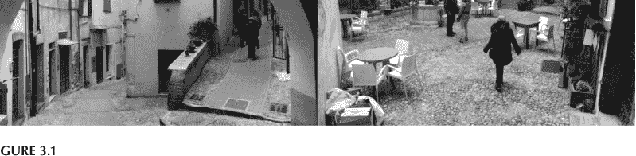

图 3.1

意大利地中海城市的街道和场所。（© D. Provitolo，2019年3月。经许可。）

* `https://geoazur.oca.eu/en/research-geoazur/2158-com2sica-how-to-comprehend-and-simulate-human-behaviors-in-areas-facing-natural-disasters`

## 图 3.2

灾难特殊情况下恐慌-控制-反射行为模型（PCR）的图形表示。（D. Provitolo et al. 2015. 经许可。）

恐怖袭击。该模型由常微分方程系统构成，用于描述行为随时间的变化（Verdière et al. 2014, 2015, Cantin et al. 2016）。

神经科学研究解释说，在灾难期间，人类很少停留在一种行为类型中。人口在不同的行为状态之间切换，其中一些是本能的反应结果，另一些是理性的反应。

随着大脑从一种行为状态切换到另一种行为状态，在恐怖袭击的背景下，即在突发且不可预见的威胁情况下，整个受影响的人口首先采用行为反应，反射 r(t)，在惊讶和事件的突然性影响下，然后过渡到恐慌反射行为 p(t)，或受控行为 c(t)（Provitolo et al. 2015）。反射 r(t) 和恐慌 p(t) 行为由爬行动物脑管理：它们是本能的、自动的反应，使人能够极快地对威胁做出反应，要么被惊呆并瘫痪 r(t)，要么因恐慌恐惧而尽可能快地逃离 p(t)。受控行为 c(t) 由前额叶皮层管理，涉及理性和自我控制的反应。在灾难期间，这些反应可以采取不同的形式，例如疏散、逃跑、遏制、躲避、寻求帮助、互助，或相反的抢劫等。尽管种类繁多，PCR 模型将所有这些受控行为归为一类。

在本文中，我们提出对 PCR 模型的扩展，以考虑到空间布局对创伤性情况（如恐怖袭击）下人类反应动态的数学建模中的影响。我们称此扩展模型为耦合加权 PCR（CWPCR）。

在第 3.2 节中，我们将以图形和数学形式介绍 Com2SiCa 研究团队发表的加权恐慌控制反射模型。该模型在 PCR 模型的基础上改进，以考虑到空间布局对行为动态的作用。在第 3.3 节中我们介绍 CWPCR 模型，该模型


incorporates the pressure and counterpressure of the crowd in each place via a bottleneck effect, which takes into account the narrowness and the length of the streets and the size of places. We will consider an oriented network with three nodes representing three places or public squares of different sizes, linked by narrow streets. In this network, we compute the equilibrium points that show the motion of the crowd after a terrorist attack. Section 3.4 is therefore devoted to the analysis of the impact of the size of the intermediate place of this network on the evacuation of the population in the face of a terrorist attack, by means of numerical simulations. The numerical results highlight that, depending on their respective size, intermediate places modulate the dynamics and the speed of flow of the crowd. In this sense, they become strategic places, both for the planners who must think about the organization of the area to host public events and festivals, and also for the terrorists who can use these strategic places to multiply the effect of their harmful actions by trapping the escape movements between two areas of action. Finally, in Section 3.5, a brief conclusion will be drawn.

### 3.2 Weighted PCR System: A Model for Analyzing the Dynamics of Human Behavior During a Disaster

#### 3.2.1 Network of Squares and Streets Modelling Spatial Urban Configurations

Just before a dramatic event like a terror attack in a city, the crowd is generally spread across several places, public squares and streets. In the aftermath of the initial shock, people rush through the streets to reach what they think will be more secure places, as one can see in Figure 3.3.

In this chapter, we define a city by a mathematical graph, where the places and public squares are called vertices or nodes and are denoted `N₁`, `N₂`, …, `Nₚ`, and the streets, escalators, doors, and stairs are the oriented edges (`Nᵢ → Nⱼ`) linking these nodes. They are oriented, because the flow from one place toward another is not symmetric during terrorist attacks. Our aim is to model the motion of the crowd through such edges. To achieve this, we must introduce some “geographical” particularities of the city, like the size of places, the narrowness of streets, and the number of people initially present in each place. This is why we need to upgrade the standard PCR model, into the Weighted PCR `WPCR` model, by introducing new data, with Weight standing for the relative sizes of crowd, places, and streets.

First, on each node `Nₖ`, `k=1, p` we call `rₖ(t)`, `cₖ(t)`, `pₖ(t)`, `qₖ(t)`, `bₖ(t)` the number of people being in reflex, control, panic, daily usual behavior, and return to normal life and `Vₖ(t)` the total number of people present at this node

`Vₖ(t) = rₖ(t) + cₖ(t) + pₖ(t) + qₖ(t) + bₖ(t)`  (3.1)

Second, in order to more precisely model the characteristics of the city, we introduce `Wₖ` the maximum capacity of the number of people who can be present in each node `Nₖ` (i.e. due to the size of the corresponding place). Each maximum capacity is a constant. Each time one must have

`Vₖ(t) ≤ Wₖ`  (3.2)

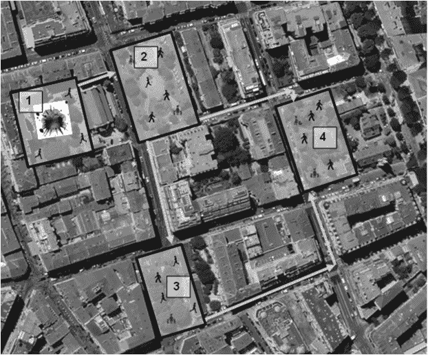

#### 3.2.2 Equations of the WPCR System on Each Node

The `WPCR` simulates human behavior, in one specific place, during a catastrophic event. As explained in the introduction, it is based on neuroscience studies. During the event, the switches from one behavioral state to another are caused by transitional dynamics, as schematized in Figure 3.2 due to:

- i. **Causal relationships** (`$B_1$`, `$B_2$`, `$C_1$`, `$C_2$`). Once the population is in the reflex behavior state, a part of it can evolve toward controlled behaviors at the rate `B₁`, while another part transitions towards panic behaviors at the rate `B₂`. Likewise, a part of the panicked population may switch to controlled behavior at the rate `C₁`. According to the evolution of the situation, individuals who have adopted a controlled behavior may switch back to panic behavior at the rate `C₂`. This process can be iterated many times.
- ii. **Processes of imitation and contagion**, which are well known in crowd psychology and have been termed “emotional contagion” (Hatfield et al. 1994). The imitation processes are modelled identically to epidemiological propagation (Provitolo 2005). The imitation is valid in both directions and is modelled by the function `F(r,c)` (see Equation (3.5)) for emotional contagion between reflex and controlled behavior (using the damping coefficients `α₁` and `α₂`), by the function `G(r,p)` (see Equation (3.6)) for emotional contagion between reflex and panic behavior (`δ₁` and `δ₂`), and by the function `H(c,p)` (see Equation (3.7)) for emotional contagion between controlled and panicked behavior (`μ₁` and `μ₂`).
- iii. **Domino effects**, which illustrate a succession of events (`s₁` and `s₂`) correspond, for example, to a new attack in an urban area or to a closed door during an evacuation. In the PCR model, the parameters `s₁` and `s₂` are either constant or built in a periodic form.

The `WPCR` model is defined on each node k by

```
Ẋ = Φ(t, X)  (3.3)
```

with `Ẋ = dX/dt`, `X = (r, c, p, q, b)^T ∈ ℝ^5` and `Φ` given by `Φ(t, X) = (Φ_i(t, X))^T`, `i = 1, ..., 5`, where the functions `Φ_i` are defined by

```
{ Φ₁(t, X_k) = ṙ_k(t) = γ(t) q_k(t)(W_k − r_k(t)) − (B₁ + B₂) r_k(t) + s₁(t) c_k(t) + s₂(t) p_k(t) + F(r_k(t), c_k(t)) r_k(t) c_k(t) + G(r_k(t), p_k(t)) r_k(t) p_k(t) Φ₂(t, X_k) = ċ_k(t) = −φ(t) c_k(t)(W_k − b_k(t)) + B₁ r_k(t) + C₁ p_k(t) − C₂ c_k(t) − s₁(t) c_k(t) − F(r_k(t), c_k(t)) r_k(t) c_k(t) + H(c_k(t), p_k(t)) c_k(t) p_k(t) Φ₃(t, X_k) = ṗ_k(t) = B₂ r_k(t) − C₁ p_k(t) + C₂ c_k(t) − s₂(t) p_k(t) − G(r_k(t), p_k(t)) r_k(t) p_k(t) − H(c_k(t), p_k(t)) c_k(t) p_k(t) Φ₄(t, X_k) = q̇_k(t) = −γ(t) q_k(t)(W_k − r_k(t)) Φ₅(t, X_k) = ḃ_k(t) = φ(t) c_k(t)(W_k − b_k(t)) } (3.4)
```

The parameters involved in Equation (3.4) are real positive coefficients:

```
B_i ≥ 0, C_i ≥ 0, i = 1, 2; α_i ≥ 0, δ_i ≥ 0, μ_i ≥ 0, i = 1, 2; s_i ≥ 0, i = 1, 2.
```

The imitation functions `F`, `G`, and `H` are real valued functions defined on ℝ × ℝ by

```
F(r(t), c(t)) = −α₁ f₁( r(t) / (c(t) + ε) ) + α₂ f₂( c(t) / (r(t) + ε) ) (3.5)
```

```
G(r(t), p(t)) = −δ₁ g₁( r(t) / (p(t) + ε) ) + δ₂ g₂( p(t) / (r(t) + ε) ) (3.6)
```

```
H(c(t), p(t)) = μ₁ h₁( c(t) / (p(t) + ε) ) − μ₂ h₂( p(t) / (c(t) + ε) ), (3.7)
```

where `ε` is a positive number and `f_i`, `g_i`, `h_i` for `i = 1, 2` are real valued functions defined on ℝ. They have a decreasing shape indicating that the behavior imitation is symmetric. Moreover they are normalized,

```
0 ≤ f_i(u) ≤ 1, 0 ≤ g_i(u) ≤ 1, 0 ≤ h_i(u) ≤ 1, ∀ u ∈ ℝ, i = 1, 2 (3.8)
```

Because this model does not take the mortality rate into account, the population remains constant. Therefore Equation (3.4) is considered when time is proceeding from an initial time `t₀ ≥ 0`, with initial condition

```
r_k(t₀) + c_k(t₀) + p_k(t₀) + q_k(t₀) + b_k(t₀) = V_k(t₀) = r_{k,0} + c_{k,0} + p_{k,0} + q_{k,0} + b_{k,0} = V_{k,0} ≤ W_k (3.9)
```

that satisfies the following properties

```
r(t₀) > 0, c(t₀) > 0, p(t₀) > 0, q(t₀) > 0, b(t₀) > 0  (3.10)
```

We suppose that the characteristic parameters `B₁`, `B₂`, `C₁`, `C₂`, of each node have the same value, because they depend on cultural and psychological factors specific to each individual rather than to spatial configurations and crowd context. It is why we use function `Φᵢ` instead of function `Φₖ,ᵢ`.

#### 3.2.3 Transitional Dynamics


Both forcing functions, `γ` and `φ` respectively, model the beginning of the disaster and the return to a quiescent daily behavior. Their shape can be adapted to various scenarios. When `t` is sufficiently large, they satisfy `γ(t)=φ(t)=1`. In catastrophic situations it is considered that `γ` is a stiff function, ranging from 0 to 1 in a very brief interval of time (Verdière et al. 2014, 2015, Cantin et al. 2016) because if we consider a bomb attack, the entire crowd that is near the explosion passes from daily to reflex behavior in an instant, and it takes a very long time for people to return to their normal state.

Therefore, one can suppose that a terror attack is shaped by two characteristic times: `tₛ` (for start) and `tₑ` (for end) with `t₀ < tₛ < tₑ` for which

```
γ(t) = 1,    ∀t ≥ tₛ
φ(t) = 0,    ∀t < tₑ  (3.11)
```

As an example for `I_trans = [3.2, 43.2]`, these functions can be defined by

```
φ(t) = { 0, if 0 ≤ x < 43.2
cos²(2π (x-3.2)/160), if 43.2 ≤ x ≤ 83.2,
1, if x > 83.2 }  (3.12)
```

```
γ(t) = { cos²(2π (x-3.2)/12.8), if 0 ≤ x ≤ 3.2,
1, if x > 3.2 }  (3.13)
```

There are displayed in Figure 3.4.

Following Cantin et al. (2016) we keep the term transitional dynamics for the dynamics of the PCR model (likewise for both improved WPCR and the CWPCR model presented in Section 3.3) in the interval of time `I_trans = [tₛ, tₑ]` (in terror attacks this interval of time can last from several minutes up to hours, as observed during the 2016 terrorist attack in Nice). Therefore in `∀t ∈ I_trans` functions `φ` and `γ` verify

```
γ(t) = 1
φ(t) = 0  (3.14)
```

Hence, during the transitional dynamics, the population with daily behavior collapses and there is not yet a population that is back to daily behavior (i.e. `q(t)=b(t)=0`).

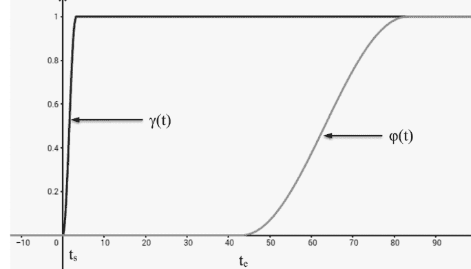

**图 3.4** 强迫函数 `γ(t)` 和 `φ(t)`，`I_trans = [3.2, 43.2]`。

系统 (3.4) 化简为

```
⎧ ṙ(t) = −(B₁ + B₂)r(t) + s₁(t)c(t) + s₂(t)p(t) + 
    F(r(t),c(t))r(t)c(t) + G(r(t),p(t))r(t)p(t) 
  ċ(t) = B₁r(t) + C₁p(t) − C₂c(t) − s₁(t)c(t) − 
    F(r(t),c(t))r(t)c(t) + H(c(t),p(t))c(t)p(t) 
  ṗ(t) = B₂r(t) − C₁p(t) + C₂c(t) − s₂(t)p(t) − 
    G(r(t),p(t))r(t)p(t) − H(c(t),p(t))c(t)p(t).
```

### 3.3 网络上的耦合 WPCR 系统

#### 3.3.1 流动与瓶颈耦合

如前所述，节点由边连接。我们现在旨在建模人群通过此类边（即街道、楼梯、手扶电梯、门等）的运动。

我们还试图通过分析城市街道和场所网络的拓扑结构，识别在初始冲击之后减缓人群逃离的障碍。这种信息有可能用于改进城市设计，以便人群能够更顺利地逃向更安全的地方。

为简单起见，如图 3.5 所示，我们首先考虑一个仅有三个节点 (`N₁`, `W₁`)、(`N₂`, `W₂`)、(`N₃`, `W₃`) 和两条边 (`N₁→N₂`)、(`N₂→N₃`) 的简化有向网络。这种简化网络可以通过添加所需数量的节点和边而直接复杂化，没有任何困难。然而，最好首先将注意力集中在该简化网络中障碍的本质上。

**图 3.5** 三节点网络：每个状态下的人群都从节点 1 冲向节点 2，从节点 2 冲向节点 3，保持相同的行为类别。

我们假设在人们在一条边内部行进的短暂时间内，他们保持如图 3.5 所示的相同行为类别。在该图中，“地理”边 (`N₁ → N₂`)、(`N₂ → N₃`)（即连接节点 1 到节点 2、节点 2 到节点 3 的街道）被划分为三条“行为边”，意味着在同一条街道上，反射、恐慌或受控行为的人群都从节点 1 逃向节点 2（以及从节点 2 逃向节点 3），因此节点 1 中特定行为的人会遇到节点 2 中相同行为的人（节点 2 到节点 3 的情况亦然）。

为了继续关注我们在此引入的特殊耦合，我们假设模仿机制未被激活（即 `F ≡ H ≡ G ≡ 0`，这等价于 `αᵢ = δᵢ = μᵢ = 0`，`i = 1, 2`），并且此外没有多米诺效应（`sᵢ = 0`，`i = 1, 2`），我们还假设我们处于区间 `I_trans = [t_s, t_e]`，其中仅考虑过渡动力学。当然，很容易放宽此类限制，这些限制与耦合无关，只需在方程中不消除相应的项即可。

在每个节点 `N_k`，`k = 1, 2, 3` 中，此类过渡动力学是系统

```
⎧ ṙ_k(t) = −(B₁ + B₂) r_k(t)
⎨ ċ_k(t) = B₁ r_k(t) + C₁ p_k(t) − C₂ c_k(t)
⎩ ṗ_k(t) = B₂ r_k(t) − C₁ p_k(t) + C₂ c_k(t)   (3.16)
```

的解，它是过渡区间内系统 (3.4) 的简化形式（也是方程 (3.15) 的特例）。

**注 3.1** 在 WPCR 模型中，项 `ṙ_k(t)`、`ċ_k(t)`、`ṗ_k(t)`、`q̇_k(t)`、`ḃ_k(t)` 可以被视为流，因为流是某物数量除以单位时间。存在两种流。在方程 (3.4)、(3.15) 和 (3.16) 中，流是“行为”流，因为它们表示单位时间内人群改变行为的数量。现在我们还考虑“运动”流，即单位时间内每个行为类别的人群从一个节点移动到另一个节点的数量。当然，这两种流都结合起来在以下方程中产生全局等价。

已发表了许多关于行人流的研究（Daamen et al. 2005, Dias et al. 2013, Kretz et al. 2006, Liao et al. 2014, Seyfried et al. 2005, Zhang et al. 2013, Zhou et al. 2014）。我们特别考虑 Daamen et al. (2005) 的综述，其中展示了六个不同实验的图表，显示行人流与其密度之间的关系。所有这些图表都清楚地显示了密度与流之间存在对数 logistic 类型的非线性关系。

此外，Daamen 等人开发了一种一阶交通流理论，用于描述在超饱和瓶颈前形成大面积高密度区域的情况下二维行人流作业。这种数学模型也突出了任何瓶颈宽度下的对数关系，如图 3.6 所示。

我们现在基于这种对数关系引入耦合 WPCR (CWPCR) 的假设。同样，为简单起见，我们仅考虑人群的单向运动（即在有向图上的运动），如图所示 3.5，因为假设恐怖袭击发生在节点 1，人群试图从该节点逃向节点 2 和 3。

当人群从一个节点移动到另一个节点时，其速度和相应的运动流取决于三个因素。第一个因素反映了街道的狭窄程度和长度。如果街道宽阔而不是狭窄，则可以有更多的人从一个地方前往下一个地方。这种拓扑特征将通过“粗糙度”系数 `η1,2`、`η2,3` 来建模。事实上，在所考虑的耦合中，我们假设人们在从一个节点移动到另一个节点时不能改变其行为（例如，受控的人保持受控，恐慌的人保持恐慌，等等），因此我们使用三种粗糙度系数 `ηᵣ,1,2`、`ηp,1,2`、`ηc,1,2`、`ηᵣ,2,3`、`ηp,2,3`、`ηc,2,3` 来指代反射、恐慌或受控情况的人口。当然，它们可以具有相同的值。第二个因素与逃离人群所在节点的在场人数成正比。这相当于这些地方人群的压力。第三个因素反映了人们逃往的场所的最大容量的反压力，结合已在那里的人数。压力与反压力的结合产生了瓶颈效应。

我们提议通过对数 logistic 类型的非线性来建模这种瓶颈效应，以保持与 Daamen et al. (2005) 相同的哲学。

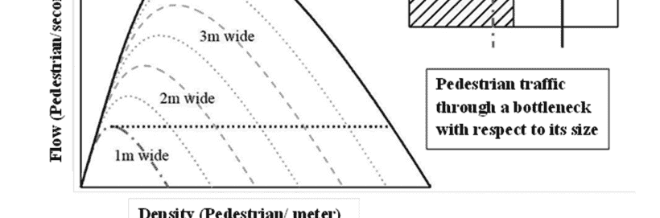

**图 3.6** 穿过超饱和瓶颈的行人流与密度的关系。（改编自 Daamen et al. 2005。）

因此，对应于图 3.5 的瓶颈耦合由系统给出

```
ṙ₁(t) = −(B₁ + B₂)r₁(t) − ηᵣ,1,2 r₁(t)(W₂ − c₂(t) − p₂(t) − r₂(t))
ċ₁(t) = B₁r₁(t) + C₁p₁(t) − C₂c₁(t) − ηc,1,2 c₁(t)(W₂ − c₂(t) − p₂(t) − r₂(t))
ṗ₁(t) = B₂r₁(t) − C₁p₁(t) + C₂c₁(t) − ηp,1,2 p₁(t)(W₂ − c₂(t) − p₂(t) − r₂(t))
ṙ₂(t) = −(B₁ + B₂)r₂(t) + ηᵣ,1,2 r₁(t)(W₂ − c₂(t) − p₂(t) − r₂(t)) − ηᵣ,2,3 r₂(t)(W₃ − c₃(t) − p₃(t) − r₃(t))
ċ₂(t) = B₁r₂(t) + C₁p₂(t) − C₂c₂(t) + ηc,1,2 c₁(t)(W₂ − c₂(t) − p₂(t) − r₂(t)) − ηc,2,3 c₂(t)(W₃ − c₃(t) − p₃(t) − r₃(t))
ṗ₂(t) = B₂r₂(t) − C₁p₂(t) + C₂c₂(t) + ηp,1,2 p₁(t)(W₂ − c₂(t) − p₂(t) − r₂(t)) − ηp,2,3 p₂(t)(W₃ − c₃(t) − p₃(t) − r₃(t))
ṙ₃(t) = −(B₁ + B₂)r₃(t) + ηᵣ,2,3 r₂(t)(W₃ − c₃(t) − p₃(t) − r₃(t))
ċ₃(t) = B₁r₃(t) + C₁p₃(t) − C₂c₃(t) + ηc,2,3 c₂(t)(W₃ − c₃(t) − p₃(t) − r₃(t))
ṗ₃(t) = B₂r₃(t) − C₁p₃(t) + C₂c₃(t) + ηp,2,3 p₂(t)(W₃ − c₃(t) − p₃(t) − r₃(t))   (3.17)
```

初始条件满足

```
r₁,₀ + c₁,₀ + p₁,₀ = V₁,₀ ≤ W₁; r₂,₀ + c₂,₀ + p₂,₀ = V₂,₀ ≤ W₂; r₃,₀ + c₃,₀ + p₃,₀ = V₃,₀ ≤ W₃   (3.18)
```

在此系统中，瓶颈耦合，例如从节点 1 移动到节点 2 的受控人口，由项给出：

```
ηc,1,2 c₁(t)(W₂ − c₂(t) − p₂(t) − r₂(t))   (3.19)
```

在 (3.17) 的第二个方程中

```
ċ₁(t) = B₁r₁(t) + C₁p₁(t) − C₂c₁(t) − ηc,1,2 c₁(t)(W₂ − c₂(t) − p₂(t) − r₂(t))
```

在此瓶颈耦合中，方程 (3.19)，`ηc,1,2` 是建模连接节点 1 到节点 2 的街道拓扑特征的参数。方程 (3.19) 的第二个因子 `c₁(t)` 反映了节点 1 中希望逃向节点 2 的受控人群的压力，也反映了相对于留在节点 1 的人群逃离人群的比例性。最后，因子 `(W₂ − c₂(t) − p₂(t) − r₂(t))` 显示了反压力，其最大值为（即项消失）当 `W₂ = c₂(t) + p₂(t) + r₂(t)` 时，因为在这种情况下，已没有空间容纳来自节点 1 的人群。这种瓶颈耦合是非线性的，如图 3.7 所示。

由于我们仅考虑过渡动力学，其中 `q_k(t) = b_k(t) = 0`，方程 (3.19) 可以写成

```
ηc,1,2 c₁(t)(W₂ − V₂(t))   (3.20)
```

#### 3.3.2 三节点系统的不动点

不动点研究使我们能够识别系统在过渡期间趋向的平衡点。该平衡点突出了节点 2 和 3 的大小在疏散动力学背景下的主要作用。需要注意的是，数学计算的平衡点并不

**图 3.7.** 瓶颈耦合函数的图。

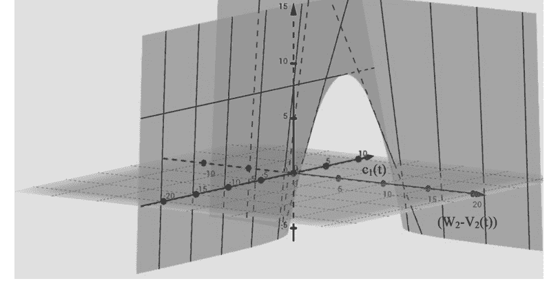

并不一定对应危机管理人员所寻求的平衡情况。滞留在初始地点（节点 1）的民众仍然非常容易受到恐怖威胁。

为了更贴近现实，我们进一步假设人们在反射性情境下会感到震惊和麻痹。他们不能像图 3.8 所示那样从一个节点冲向另一个节点。因此，$r_1, r_2, r_3$ 之间的转换被禁止。处于这种震惊状态的人只能改变其行为（从 $r_k$ 到 $p_k$ 或 $c_k$）。

为实现这一目标，方程 (3.17) 仅作简单修改，使参数 $\eta_{r,i,j}$，$i=1,2$，$j=i+1$ 消失。

系统趋向的固定点 $(r_1^*, c_1^*, p_1^*, r_2^*, c_2^*, p_2^*, r_3^*, c_3^*, p_3^*)$ 可直接计算得出方程 (3.17) 的解收敛到的固定点。

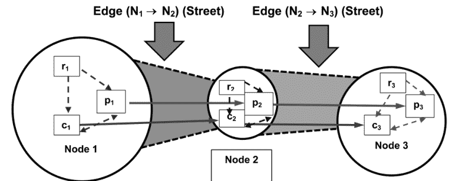

**图 3.8.** 三节点网络：处于反射行为状态的人滞留在其原始节点。

该固定点的数值意味着：

- **情况 1：** 如果最初滞留在三个节点中的人数少于节点 3 的容量（即 $V_{1,0} + V_{2,0} + V_{3,0} \le W_3$），一段时间后，节点 1 和节点 2 均变为空，所有人群都已寻求庇护于节点 3。

反之，如果该人数大于容量（即 $V_{1,0} + V_{2,0} + V_{3,0} > W_3$），则可能出现两种情况：

- **情况 2：** 节点 3 变为满员，剩余人员仍滞留在节点 2 中，如果 $V_{1,0} + V_{2,0} + V_{3,0} \le W_2 + W_3$。

- **情况 3：** 滞留在节点 1 和节点 2 两者中，如果 $V_{1,0} + V_{2,0} + V_{3,0} > W_2 + W_3$。

由方程 (3.21)、(3.22) 和 (3.23) 可明显看出，只有比值 $C_1/C_2$ 对方程 (3.17) 解的极限才有意义，因为 $c_1^* / p_1^* = c_2^* / p_2^* = c_3^* / p_3^* = C_1/C_2$（当有定义时）。相反，参数 $B_1$ 和 $B_2$ 对“反射行为人群”这一“储备”被清空的速度变得重要。

当然，世界各地存在不同的文化，这导致不同的行为。这些行为可通过改变参数来建模。

例如，如果民众未被告知重大风险且未为其做好准备，就会引发恐慌反应（$B_1 < B_2$）；这种行为随后由比值 $C_1/C_2$ 调节。

该比值越高，民众在受控状态下停留或转入受控状态的比例就越大。

在模拟情况下，我们选择一组参数以突出风险文化薄弱，同时有利于恢复受控行为：取值 $B_1=0.15$、$B_2=0.45$ 意味着风险文化薄弱，而 $C_1=0.21$、$C_2=0.07$ 意味着人群中的恐慌被部分人口的受控反应所抵消，这些人口保持自控，主要是因为没有新的威胁或突发袭击。

因此，在情况 1 中，当 $V_{1,0}=18\,000$、$V_{2,0}=0$、$V_{3,0}=0$、$W_2=1000$、$W_3=18\,500$ 且 $\eta_{c,1,2}=\eta_{c,2,3}=\eta_{p,1,2}=\eta_{p,2,3}=0.004$ 时，可得到向固定点的以下收敛：

$r_1^*=0,\,c_1^*=0,\,p_1^*=0,\,r_2^*=0,\,c_2^*=0,\,p_2^*=0,$

$r_3^*=0,\,c_3^*=\frac{C_1(V_{1,0}+V_{2,0}+V_{3,0})}{C_1+C_2}=\frac{0.21(18\,000)}{0.21+0.07}=13\,500,\,p_3^*=\frac{C_2(V_{1,0}+V_{2,0}+V_{3,0})}{C_1+C_2}=4\,500.$

该值意味着，最初所有人员都在节点 1 中，节点 2 和节点 3 均为空，但经过一段时间后，节点 1 和节点 2 均为空，每个人都已到达节点 3。可以看到人群通过两条边 $(N_1 \to N_2)$ 和 $(N_2 \to N_3)$ 的流动，见图 3.9。

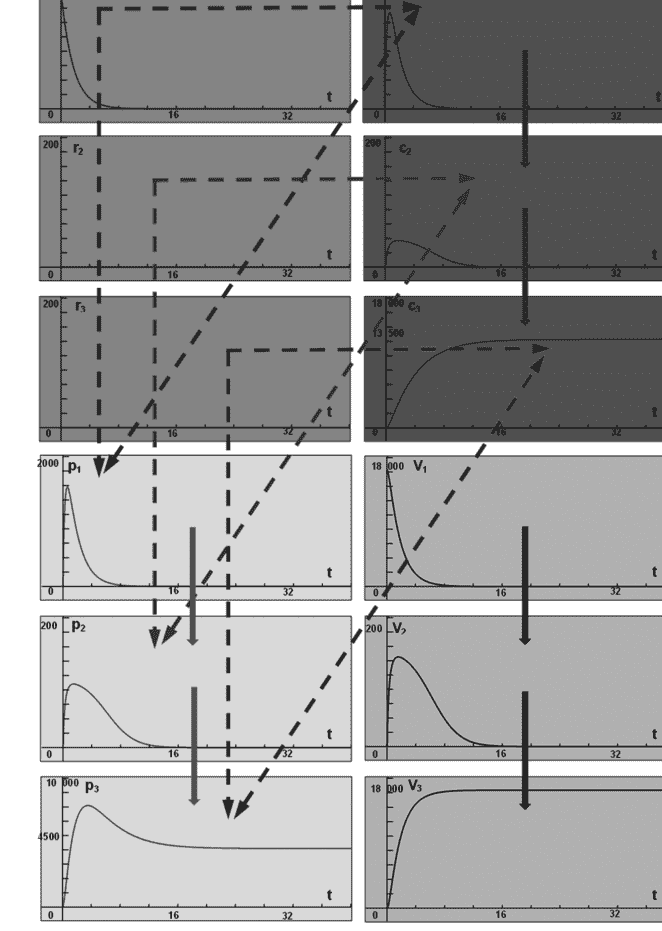


图 3.9. 情况 1：向固定点 $(0, 0, 0, 0, 0, 0, 13\,500, 4\,500)$ 的收敛。在此图中，行为状态的变化由虚线箭头表示，节点间的运动由实线箭头表示，如图 3.8 所示。

### 3.4 空间配置对疏散速度的影响

我们现在通过分析城市街道和场所网络的拓扑结构，试图确定在初始冲击之后减缓人群逃离的障碍。此信息有可能用于改进城市设计，以促进人群向更安全的地方逃离。

#### 3.4.1 参数缩放

固定 `PCR`、`WPCR` 或 `CWPCR` 中所有参数的值是一项非常复杂的任务，迄今尚未在实验基础上完成。在 `Com2SiCa` 项目框架内，正在审议一项实验方案，以便在不久的将来实现这些结果。然而，需要注意的是，只有参数之间的相对值才重要，因为时间单位与参数使用的单位之间存在关系。换句话说，考虑无量纲方程 (3.17) 的所有参数（即 $B_i \ge 0$、$C_i \ge 0$、$\eta_{c,i,j}$、$\eta_{p,i,j}$、$\eta_{r,i,j}$，$i=1,2$，$j=i+1$）关于时间变量 $t$ 的积分，几乎等同于考虑这些参数乘以同一常数 $\kappa$ 并使用时间变量 $\tau = t/\kappa$ 进行积分（例如，$t$ 可视为秒、分钟或小时）。严格来说并不等价，因为这些参数在线性使用的 `WPCR` 模型中是线性使用的；然而在 `CWPCR` 模型中耦合是非线性的，在某些变量的短暂瞬态期间会产生轻微的失真。

#### 3.4.2 中间场所容量对疏散动态的影响

中间场所对危险场所与避难场所之间移动的流畅性或相反的拥堵起着核心作用。这可以通过以下数值实验来证明：在相同参数值下，除节点 2 的大小外，我们分析人们清空恐怖分子所在场所（节点 1）的速度。

如前所述（第 3.3.2 节），我们考虑参数值 $B_1 = 0.15$、$B_2 = 0.45$、$C_1 = 0.21$、$C_2 = 0.07$，并选择 $\eta_{c,1,2} = \eta_{c,2,3} = \eta_{p,1,2} = \eta_{p,2,3} = 0.004$。

我们考虑 $W_2$ 的以下取值：50、100、200、1000，并将动态显示在图 3.10 中。

在 $W_2 = 1000$ 的情况下（黑色曲线），整个人口从场所 1 到场所 2（可以是一个小广场）再到场所 3 的逃离非常快；持续时间不到 10 分钟（图 3.10c、f、i），因为场所 3 可以容纳整个人口。大量恐慌人群（图 3.10d）涌入场所 2，其数量大于受控人群（图 3.10e），场所 2 迅速清空，因为大多数受控人群已到达安全避难所（图 3.10h）。然而，可以注意到仍有相当数量的恐慌人口滞留在避难场所，且该数量仅缓慢减少（见图 3.10g 中的凸起）。

这是因为逃离动态不受障碍或瓶颈的阻碍，逃离的人群没有足够的时间改变其行为状态。

另一方面，如果 $W_2 = 50$（红色曲线），整个人口从场所 1 到场所 2 再到场所 3 的疏散要慢得多（约 35 分钟，而非不到 10 分钟，图 3.10c、f、i）。恐慌人口有时间在场所 1 中冷静下来，因为没有新的袭击（假设没有多米诺效应，$s_i = 0$，$i=1,2$）。因此，到达场所 3 的主要是理性行为状态的人群（图 3.10g、h）。

可以从这一初步分析中突出指出，位置变化的速度越快（从而降低人口的脆弱性），这种速度就越会导致场所 2 和场所 3 出现大量难以管理的集体恐慌。这里存在一个悖论：人口快速的自我安全移动会导致更难以管理的集体恐慌情况。这一事实必须由应急服务和急诊医生予以考虑。

尽管本版 `CWPCR` 模型中未包含发生的死亡人数，但可以想象，恐慌人口的逃离会造成更多伤亡。

如前所述，模拟结果揭示了中间场所大小的重要性及其在危险场所与避难场所之间移动的流畅性或相反的拥堵方面的作用。

根据各自的大小，中间场所将调节人群的动态和流动速度。在这方面，它们既成为规划者必须考虑的战略场所，以便组织举办公共活动的区域，也成为恐怖分子可以利用的战略场所，通过困住两个行动区域之间的逃离运动来放大其有害行为的效果。

### 3.5 结论

在本文中，我们在城市恐怖袭击的背景下，开发了一种新的加权人类行为与街道和场所网络耦合的模型，从而改进了具有瓶颈耦合的 `PCR` 模型，并考虑了每个场所的容量和滞留在这些场所中的人数。简单网络（三个节点即场所或公共广场和两条边即街道）的模拟结果证明了中间场所容量在从危险场所向安全场所疏散动态中的关键作用。

## 致谢

本工作得到了法国政府的支持，通过 (i) 国家研究署（`ANR`）在社会挑战 9“欧洲、其公民和居民的自由与安全”下的资助，参考编号 `ANR-17-CE39-0008`，由法国国防采购局（`DGA`）和国防与国家安全总秘书处（`SGDSN`）共同资助，以及 (ii) 由国家研究署（`ANR`）管理的 `UCAJEDI` 未来投资项目，参考编号 `ANR-15-IDEX-01`。

## References

Cantin, G., Verdière, N., Lanza, V., et al. 2016. Mathematical modeling of human behaviours during catastrophic events: Stability and bifurcations. International Journal of Bifurcation and Chaos 26(10):1630025.

Crocq, L. 2013. Les paniques collectives. Paris: Odile Jacob.

Daamen, W., Hoogendoorn, S. P., Bovy, P. H. L. 2005. First-order pedestrian traffic flow theory. Transportation Research Record: Journal of the Transportation Research Board 1934(1):43–52.

Dauphiné, A., Provitolo, D. 2013. Risques et catastrophes-Observer, spatialiser, comprendre, gérer. Paris: A. Colin (2nd edition), Collection U.

Dias, C., Sarvi, M., Shiwakoti, N., Ejtemai, O., Burd, M. 2013. Investigating collective escape behaviours in complex situations. Safety Science 60:87–94.

Hatfield, E., Cacioppo, J. T., Rapson, R. L. 1994. Emotional Contagion. Cambridge: Cambridge University Press.

Kretz, T., Grüneboom, A., Schreckenberg, M. 2006. Experimental study of pedestrian flow through a bottleneck. Journal of Statistical Mechanics: Theory and Experiment 2006(10):10014.

Liao, W, Seyfried, A., Zhang, J., Boltes, M, Zheng, X., Zhao, Y. 2014. Experimental study on pedestrian flow through wide bottleneck. The conference on pedestrian and evacuation dynamics 2014 (PED2014). Transportation Research Procedia 2:26–33.

Provitolo, D. 2005. Un exemple d’effets de dominos: La panique dans les catastrophes urbaines. Cybergéo: Revue européenne de géographie 328:19.

Provitolo, D., Dubos-Paillard, E., Verdière, N., et al. 2015. Les comportements humains en situation de catastrophe: De l’observation à la modélisation conceptuelle et mathématique. Cybergéo: European Journal of Geography 735:23.

Seyfried, A., Steffen, B., Klingsch, W., Boltes, M. 2005. The fundamental diagram of pedestrian movement revisited. Journal of Statistical Mechanics: Theory and Experiment 10:(10).

Verdière, N., Lanza, V., Charrier, R., et al. 2014. Mathematical modeling of human behaviours during catastrophic events. Paper presented at ICCSA14, 23–26 June, Le Havre, 8.

Verdière, N., Cantin, G., Provitolo, D., et al. 2015. Understanding and simulation of human behaviours in areas affected by disasters: From the observation to the conception of a mathematical model. Global Journal of Human Social Science: H, Interdisciplinary 15(10):10.

Zhang, X. L., Weng, W. G., Yuan, H. Y., Chen, J. G. 2013. Empirical study of a unidirectional dense crowd during a real mass event. Physica. Part A 392(12):2781–2791.

Zhou, J.-B., Chen, H., Yang, J., Yan, J. 2014. Pedestrian evacuation time model for urban metro hubs based on multiple video sequences data. Mathematical Problems in Engineering 2014:11. Article ID 843096.

Taylor & Francis

Taylor & Francis Group

http://taylorandfrancis.com

## 4

## Free Radical Processes in Medical Grade UHMWPE

M. Shah Jahan, Benjamin Walters, Afsana Sharmin, and Saghar Gomrok

## CONTENTS

- 4.1 Introduction................................................................................................................... 61
- 4.2 Polymeric Free Radicals................................................................................................................... 64
- 4.3 Electron Spin Resonance................................................................................................................... 65
- 4.4 Free Radicals in Irradiated UHMWPE................................................................................................... 66
- 4.5 Decay of UHMWPE Radicals as a Function of Time........................................................................... 67
- 4.6 Free Radicals In Vivo................................................................................................................... 70
- 4.7 Improvement of UHMWPE: Stabilization of Free Radical with Vitamin E................... 70
- 4.8 Summary................................................................................................................... 74
- References................................................................................................................... 74

### 4.1 Introduction


In arthroplasty, medical-grade biomaterials need an optimal combination of mechanical properties with appropriate design and manufacturability according to the application area. When complex forms and flexibility are required, polymeric biomaterials are used, although metals and ceramics occupy a significant segment of implant science and technology.1 2 Of course, being biocompatible, interactions between implants and host biological cell tissues should not induce any inflammatory response or formation of unusual tissues.3 In total hip- and knee-joint replacement parts, for example, ultra-high-molecular-weight polyethylene (UHMWPE) is extensively used.4 5 It is a non-biodegradable polymer which is formed from ethylene gas with the generic chemical formula –(C2H4)n–, where n is the degree of polymerization. With nearly 200,000 ethylene repeat units and average molecular weight up to 6 million g/mol, and density of 0.94–0.97 g/ml, UHMWPE is significantly more abrasion-resistant and wear-resistant than HDPE (high-density polyethylene).6 The crystallinity of UHMWPE is around 30 to 40%, and crystalline regions are randomly oriented with respect to each other.7 The UHMWPE molecules are made of very long hydrocarbon polymeric chains, which all align in the same direction. Although the intermolecular bonds are relatively weak due to Van der Waals interactions, overlaps can exist between the long molecular chains, which allow transfer of the large shear forces from molecule to molecule.6 Approximately one million UHMWPE components are implanted yearly worldwide. The commercial production of UHMWPE started in the 1950s, and since then over 90% of UHMWPE has been used in industry.3 The medical industry has been one of the major areas of application for UHMWPE since its first use as the bearing material in total joint replacement by Sir John Charnley in 1962.1 Although in the recent past, the joint replacement had a life of about 15 to 20 years and was prescribed to patients above 60 years of age, now the reliability of UHMWPE in cases of orthopedic surgery has increased. Currently, many research studies are being carried out to improve the mechanical properties of medical-grade UHMWPE which can potentially increase the longevity of the joint components.7 8 The global market size of UHMWPE was estimated at USD 1.33 billion in 2016, and Grand View Research Inc. reported that the market is expected to reach at USD 2.60 billion by 2022.9 10

In medical applications, however, UHMWPE is subject to ionizing radiation, in the form of electron beam (e-beam) or gamma rays, for two basic reasons: One is to crosslink the long-chain molecules, and the other is to sterilize the finished products. Although the gamma sterilization technique has several advantages over other sterilization techniques, its strong penetrating radiation breaks the bonds of polymer chains and produces highly reactive free-radical species—in the core, as well as in/at the surface—of a UHMWPE component.11-13 Some free radicals may also get trapped for long periods of time in the crystalline region of the polyethylene matrix, and then initiate long-term oxidation reactions with oxygen as it diffuses into the polyethylene. These free radical reactions ultimately lead to increased material degradation/wear and, ultimately, joint failure.14-17 Free-radical induced degradation may also continue when the sterilization process (of the finalized products) involves gamma-radiation that is then stored in packages containing air (oxygen).17, 18 To mitigate the oxidation and its subsequent adverse effects on the mechanical properties and wear of UHMWPE, gamma-sterilization of the joint components can be performed in vacuum-packaging or inert-gas packaging.19 However, when implanted, in vivo oxidation is still possible in a body-fluid environment.20 As for crosslinking via gamma-irradiation, to reduce in vivo oxidation, thermal annealing or melting of UHMWPE joint components in vacuum or in an inert gas can be used to stabilize the free radicals.21 Nonetheless, questions remain about the optimum temperature and annealing time and their effect on material properties. Figure 4.1 outlines the impact of gamma sterilization of medical-device components in the presence or absence of oxygen.

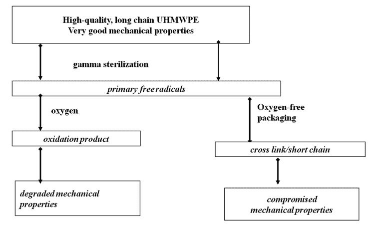

**FIGURE 4.1** Effects of gamma sterilization on mechanical properties of UHMWPE.

维生素E（α-生育酚（α-T），其分子结构见图4.2）是一种生物相容且亲脂的抗氧化剂，已被证明可以稳定UHMWPE，同时提高疲劳强度，并增加UHMWPE的氧化稳定性和自由基衰减。FTIR（傅里叶变换红外）光谱可用于测量UHMWPE中的氧化；按照ASTM F2102，该光谱未检测到氧化指数大幅增加，因此，经辐射的UHMWPE被认为已通过维生素E得以稳定。因此，掺入像维生素E这样的抗氧化剂，可以减少交联过程后熔融处理的需求，或允许采用更低的退火温度。²² 另一方面，如果在交联前存在于UHMWPE中，维生素E可能通过淬灭原本作为交联催化剂的自由基来抑制交联。维生素E对辐照后初级自由基的衰变以及随后残余自由基的产生也没有可测量的影响。尽管如此，也已发现维生素E在辐射交联时仅部分淬灭自由基，因此允许交联发生，然后UHMWPE中保留一部分原始维生素E含量，以保护免受交联后可能由其他来源产生的后续自由基的影响。¹², ²³–²⁵

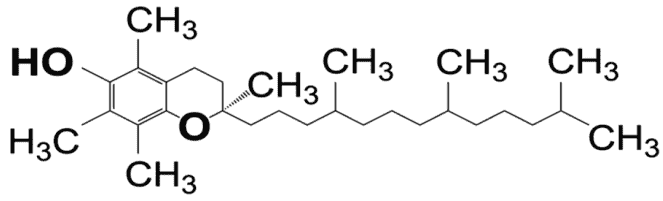

**图 4.2** 维生素E（α-生育酚（α-T））的分子结构。

本章呈现了关于骨科UHMWPE的研究综述，从遥远的过去一直到现在；这些研究包括许多针对不同类型、处理方法、添加剂、储存环境和其他因素的调查，所有研究都共同关注自由基。毕竟，自由基可以被视为几乎所有与聚乙烯相关的植入物失效的根本原因（也是成功的原因）。骨溶解（骨吸收）通常被确定为由聚乙烯颗粒/磨损诱导。颗粒的大小、颗粒的数量，或者颗粒是否为特定类型的聚乙烯或是否含有维生素E，这些因素都引发了争论：哪一种才是身体最难承受、最可能导致骨溶解和植入物失效的“最坏”情况。当然，所有这些因素都与磨损有关。虽然磨损可能有其他原因——例如植入物位置不在最抗磨损的位置、部件尺寸可能更容易磨损——但最常见的因素是氧化脆化。也就是说，一块聚乙烯越氧化、越脆，它就越可能磨损——无论植入物尺寸、位置等条件如何。于是，我们有了这条因果链：骨溶解由颗粒引起，颗粒由磨损引起，磨损由脆化引起，脆化由氧化引起。然后，我们问：是什么导致氧化？氧气？嗯，是的，没有氧气，氧化过程不会发生，正如我们将在本章后面讨论的那样。然而，我们的身体和我们生活的环境并非无氧，而且永远不会无氧。植入物将始终暴露于氧气和氧化条件下。如果植入物周围正好有一个理想的无氧环境就好了，这样就不会因那个特定原因而降解。然而，有一个几乎等同于那个梦想、但更容易实现的目标，就是去除自由基。也就是说，没有氧气，氧化发生的可能性会大大降低；但没有自由基，氧化发生的可能性也会大大降低。但是，就像暴露于氧气是生活的一部分一样，医疗器械中的聚乙烯组件在制造过程中产生自由基也是不可避免的。从20世纪60年代首次应用开始，UHMWPE经历了多个改进阶段，本章重点强调自由基研究如何在骨科应用领域每个改进阶段中发挥并继续发挥关键作用。该研究的一个主要方面是一项长期（约20年）定向研究，该研究在生物表面中心（美国国家科学基金会支持的产业-大学生物表面中心（IUCBC））的资助下，在孟菲斯大学物理与材料科学系的M Shah Jahan博士指导下，并与纽约州立大学布法罗分校（SUNY Buffalo）合作进行。

## 4.2 聚合物自由基

图4.3显示了碳氢聚合物（PH）在受到能量hν（h为普朗克常数，ν为辐射频率）辐射时，自由基（例如以P•或H•表示）的引发、增长和终止步骤。自由基物种（以（•）表示）可以通过称为电子自旋共振（ESR）或电子顺磁共振（EPR）的自由基测量技术检测到。非自由基或中性物种无法通过ESR/EPR检测。对于聚合物的氧化或氧化降解而言，特别重要的一个物种是羰基（−C=O_H）。

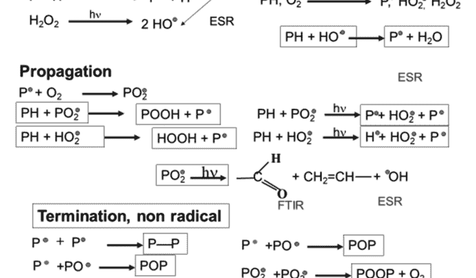

**图4.3** 聚合物自由基的形成、增长和终止。

羰基的傅里叶变换红外（FTIR）吸收带（约1720 cm⁻¹）用于根据ASTM F2102测量UHMWPE的氧化指数（OI）。

## 4.3 电子自旋共振

电子自旋共振（ESR），也称为电子顺磁共振（EPR），是唯一能够直接检测给定材料中自由基和顺磁物种的技术。ESR背后的理论基于原子或分子结构中未配对电子的磁矩。当暴露于外部磁场时，这些磁矩要么与磁场平行排列，要么与磁场反平行排列，平行态和反平行态之间的能量间隔称为塞曼效应。当吸收能量——恰好等于一定量的微波能量（E = hν，其中h是普朗克常数，ν是微波频率）——时，这些状态之间会发生跃迁。这被称为共振条件，它由一个简单的基础公式（经典）hν = gβH 控制，其中g是光谱分裂因子，β是玻尔磁子，H是外部磁场。在ESR/EPR光谱中，吸收信号（ESR谱）被检测并显示为吸收的一阶导数，其强度（Y轴）通常作为外部磁场（X轴）的函数绘制。一个典型的吸收信号，称为ESR谱，如图4.4所示。峰对峰高度（`h_pp`）与测试样本中存在的自由基数量成正比。对于复合谱，使用双积分法确定自由基浓度（见后文）。关于UHMWPE中ESR的简要概述可在UHMWPE手册中找到。²⁴

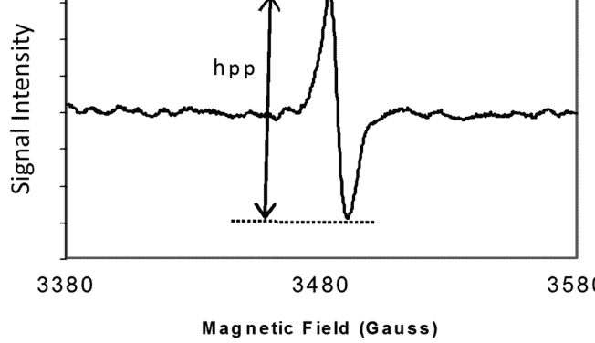

**图4.4** 一阶导数吸收信号。

## 4.4 辐照UHMWPE中的自由基

主要地，当PE暴露于电离辐射（在无氧情况下）时，会形成三类自由基。每类的名称和化学式如下。

烷基： – CH₂ – • CH – CH₂  (4.1)

烯丙基： – CH₂ – CH=CH – • CH – CH₂ –  或 (4.2)

– CH₂ – CH – • CH=CH – CH₂ –  (4.3)

多烯基： – CH• – H(CH=CH)ₙ –  (4.4)

图4.5显示了每种自由基类型的特征ESR谱；共振时吸收的一阶导数作为共振磁场（以高斯为单位）的函数绘制。如前所述，每条谱线的相对强度（`h_pp`）和谱线数量取决于未配对电子（在断裂分子链处）与同一链上邻近质子（氢原子）之间的耦合（磁相互作用）。

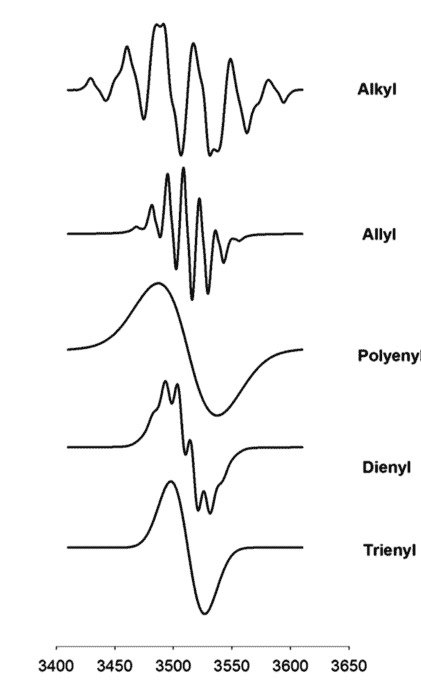

磁场（高斯）

**图 4.5** UHMWPE 中主要自由基的 ESR 谱图。

随时间变化，给定的自由基在与另一个自由基结合和/或捕获质子（氢原子）时，会衰变为非自由基物种（中性，ESR不可检测）。在空气（存在氧气）中，初级自由基与氧反应形成次级或三级自由基（氧中心物种）；因此，它启动了氧化过程 [ATD10]。氧中心自由基及每种自由基的分子结构如下：

过氧基： – CHO₂• –  (4.5)

烷氧基： – CHO• –  (4.6)

乙烯基： >CH=•CH₂ –  (4.7)

因此，ESR谱可能代表任意数量和类型的自由基物种的组合，具体取决于辐射环境、辐射类型和剂量以及温度等因素。例如，当UHMWPE在真空或惰性环境（例如N₂气）中接受伽马射线辐照时，会检测到宽泛的7线谱（见图4.6）。另一方面，在相似条件下用X射线辐照时，会得到6线谱（见图4.7）。测量在室温、空气中、辐照后立即（X射线）或在将样品从其惰性密封包装中取出后（伽马辐照后）进行。在这些测试中，需注意确保测量期间发生最少或没有氧化（即有限暴露于空气）。这种方法特别重要，因为它允许人们主要检测和分析烯丙基（七线谱）或烷基（六线谱）自由基，然后它们已经衰减为其他类型的自由基，并使谱图变得复杂。此外，通过使用模拟程序，可以生成每种组成自由基的谱图，以最佳方式拟合实验谱图（见图 4.3 和图 4.4）。

为了确定给定测试样品中的自由基浓度（相对标度），使用吸收线的峰对峰高度（`hpp`）（如图 4.4 所示）。对于多线谱或复合谱的情况，则使用整个吸收谱的二次积分。然而，对于绝对测量（每克自由基数量），需要将测试样品的吸收谱二次积分与已知自由基浓度的标准材料的二次积分进行比较。我们的实验室一直使用 NIST（美国国家标准与技术研究院）的标准参考物质（电子顺磁共振强度标准 SRM 2601）。

## 4.5 UHMWPE 自由基随时间的变化


如前所述，UHMWPE 中的主要自由基可以随时间衰减，其途径是在无氧环境（如真空或惰性气体）中通过结合-再结合过程，和/或在开放空气环境中与氧气反应。图 4.8 显示了在室温、有氧（空气）条件下，经 X 射线辐照的 UHMWPE 的 ESR 谱图随时间发生的结构变化。显然，由于氧诱导的多烯基自由基的形成，主要的烷基自由基的六线谱减少为单线谱。从图中可以明显看出，由于自由基浓度降低，信号强度在六天内显著减弱。因此，为了记录剩余的谱图，Y 轴的增益被放大了 10 倍。

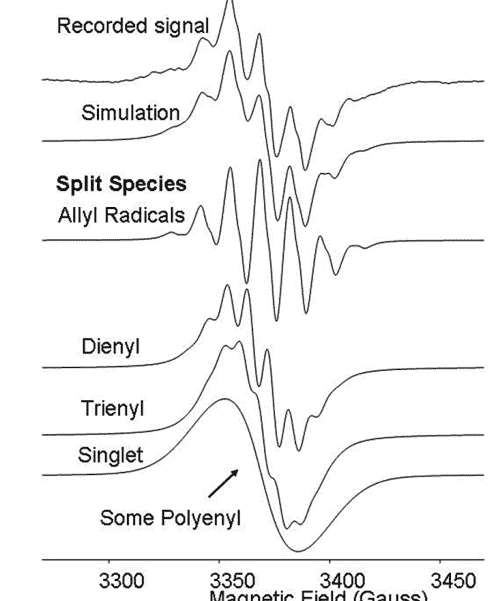

**图 4.6**

模拟 ESR 谱图与记录的（实验）谱图的比较，该谱图包含伽马射线辐照 UHMWPE 中的主要自由基。

图 4.9 显示了一项为期一年的对照研究结果。ESR 样品密封在充氮气或真空管（石英）中，并在室温下用伽马射线辐照。辐照后，在记录样品的初始谱图后，一组放置在 75°C 的烘箱中，第二组置于室温下。初始的七线谱清楚地表明主要存在烯丙基自由基。在室温或 75°C 下放置一年后，自由基浓度显著下降，但自由基类型（烯丙基）没有改变；烯丙基自由基衍生物信号宽泛轮廓中的微弱肩峰表明氧化反应极少或没有发生。该结果表明，通过在 75°C 下加热无法完全消除或淬灭自由基；因此，当随后暴露于氧气时，密封样品中残留的自由基可能发生氧化，并产生氧诱导的次级或叔级自由基。

**图 4.7**

模拟 ESR 谱图与记录的（实验）谱图的比较，该谱图包含 X 射线辐照 UHMWPE 中的主要自由基。

**图 4.8**

在室温下空气中 X 射线辐照后，在氧气（空气）存在下，记录的 UHMWPE 自由基 ESR 谱图随时间（84 天）的变化。

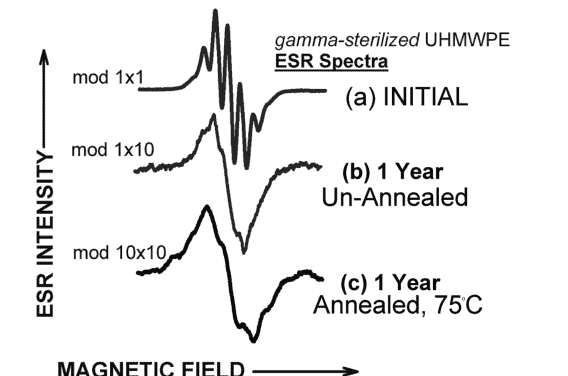

**图 4.9**

在真空密封环境中伽马射线辐照后记录的 ESR 谱图。(a) 初始运行，调制振幅（`MA`）1.0 G，微波功率（`mp`）1.0 mW；(b) 在相同密封环境中室温储存一年后，`MA = 1.0 G`，`mp = 10.0 mW`；(c) 在相同密封环境中于 75°C 退火一年；`MA = 10 G`，`mp = 10 mW`。

## 4.6 体内自由基

还对经过伽马灭菌后取出的膝关节和髋关节部件进行了自由基测量。图 4.10(b) 中所示的成品胫骨平台衬垫（TPI）是由棒料（a）制成的。ESR 样品是从对照（货架老化）(c) 和取出（d）的 TPI 上冲压出来的，如样品上的孔洞所示。取出的 TPI 在货架储存 86 个月后，在体内使用了 7 个月。图中还显示了一个代表性的 ESR 信号。该信号不仅显示了氧诱导自由基的存在（显示为单线谱——谱图中间附近较大的特征），还显示了残留的主要自由基。该结果表明，由主要自由基引起的氧化反应在体内持续了很长时间。

体内存在长寿命自由基的另一个例子如图 4.11 所示。图 4.11(a) 中显示了一个髋臼杯以及一个示意图，展示了 ESR 样品。测试样品是从一个使用了六年多后取出的髋臼杯中切割下来的。样品在 13 年后再次进行了测试。图 4.11(c) 显示了 ESR 信号强度（`Log`（自由基浓度/克））随样品位置的变化。这项研究的结果表明，在体内和体外均存在长期自由基反应。

在货架上放置 86 个月，在体内放置 7 个月

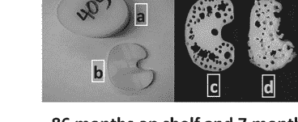

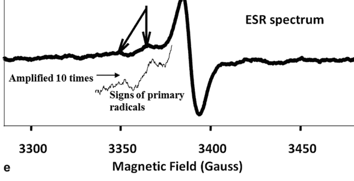

**图 4.10**

为通过 ESR 进行自由基测量而准备的胫骨平台衬垫（TPI）。(a) 用于制造成品胫骨平台衬垫 (b) 的棒料。样品是从对照（货架老化）(c) 和取出 (d) 的样品上冲压下来的，如孔洞所示，(e) 还显示了一个取出样品的 ESR 谱图。

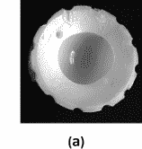

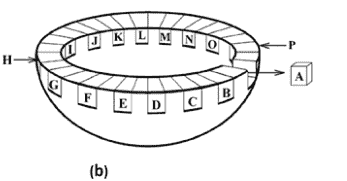

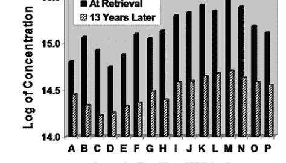

**图 4.11**

(a) 髋臼杯；(b) 从取出杯中切割出的样品示例；(c) 汇总自由基测量结果的条形图（`Log`（自由基/克））。

## 4.7 UHMWPE 的改进：用维生素 E 稳定自由基

前文呈现的结果和讨论清楚地表明，全髋关节和膝关节的 UHMWPE 部件的氧化降解主要是由自由基与氧气的反应引起的，无论是在体内还是在储存环境中。因此，作为一种补救措施，引入使用维生素 E 作为抗氧化剂。25 它具有生物相容性，并且为聚合物增加的抗氧化性很高。然而，将维生素 E 与 UHMWPE 混合作为抗氧化剂的做法并不新鲜。首先，Luigi Costa 回顾了如何用合适的抗氧化剂有效阻止氧化过程，并推荐了维生素 E，该物质已被证明可以提高辐照 UHMWPE 的抗氧化性和疲劳强度。25 维生素 E 向 UHMWPE 的自由基提供氢原子以使其稳定。在此过程中，维生素 E 本身变成一个自由基（生育酚氧自由基），尽管相对于 UHMWPE 的自由基，它是一种更稳定的类型。图 4.12 显示了维生素 E（α-生育酚）自由基分子的结构及其自由基的代表性 ESR 谱图。

图 4.13 显示了在伽马射线辐照后以及在室温下暴露于氧气 71 天后，在维生素 E 混合的 UHMWPE（按重量计含 20% α-生育酚）中记录的 ESR 谱图。高浓度的 α-生育酚使得能够在 UHMWPE 自由基相对较强的 ESR 谱图存在下监测维生素 E 自由基，这有助于比较自由基-自由基反应。为了证明 E-UHMWPE 的 ESR 信号是复合信号，维生素 E 和

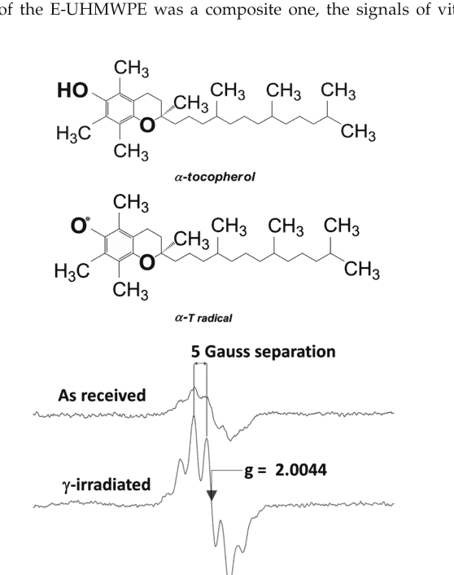

**图 4.12**

维生素 E（α-生育酚）分子及其标记的自由基的分子结构。还显示了 α-生育酚自由基在伽马射线辐照前后的两个代表性一阶导数 ESR 谱图；这些谱图仅涉及维生素 E，为原始状态/刚从瓶中取出（纯度 95%，Sigma-Aldrich），以及经过伽马射线辐照后的状态。

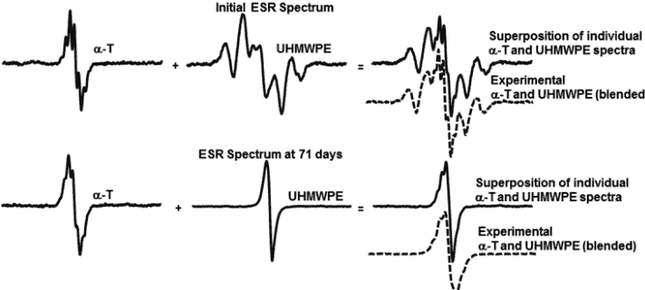

**图 4.13**  

维生素 E 和 UHMWPE 单独及组合的 ESR 谱，辐照后立即记录（初始）和在空气中储存 71 天后记录。强调了实验谱与维生素 E 和 UHMWPE 树脂自由基之和的比较。

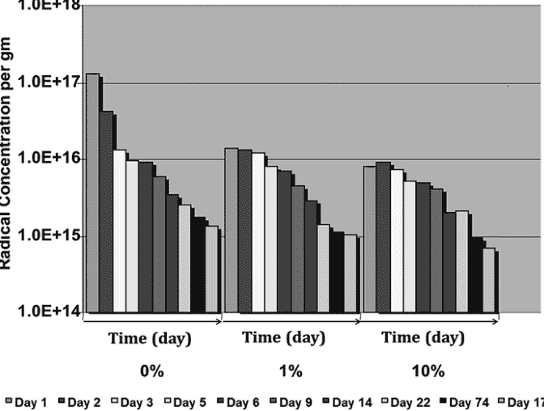

**图 4.14**  

伽马辐照压缩成型 UHMWPE 中不含维生素 E（0%）、含 1% 维生素 E 和含 10% 维生素 E 的自由基浓度；打开至空气后测量。

UHMWPE 单独记录后相加，并以虚线显示在主谱下方。在另一项 ESR 实验中，确定了自由基浓度随 % α-生育酚的函数关系（见图 4.14）。这些测量的结果清楚地表明 α-生育酚显著减少或猝灭自由基。然而，仍有可测量的自由基被困住，最可能是在聚合物的结晶区内。随着氧气向结晶环境中扩散，这些自由基有可能发生氧化。

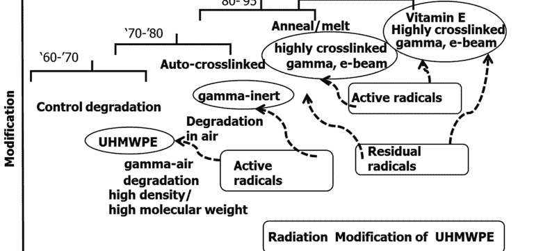

**图 4.15**  

医疗级 UHMWPE 随时间推移的改善情况。

## 4.8 总结

为了在骨科应用中保留所需的原始机械性能，UHMWPE 经历了多个改进阶段。图 4.15 中的流程图显示了 UHMWPE 自 1960 年首次应用以来所经历的改进阶段。在每个改进期间，实验工作的重点是“如何控制”自由基。综上所述，发现骨科 UHMWPE 因辐射诱导的自由基与扩散或受困氧气的反应而发生氧化降解。虽然在惰性环境中热猝灭自由基被发现可减少材料降解，但残留的自由基被发现会发生氧化反应，时间非常长（在我们的实验室中 >25 年）。为对抗自由基，维生素 E 已作为抗氧化剂添加到 UHMWPE 中。虽然实验以及临床结果显示自由基诱导降解显著改善，但 ESR 数据显示在任何 α-生育酚浓度下仍存在剩余自由基。

## 参考文献

- 1. A. Sáenz, E. Rivera-Muñoz, W. Brostow, V. M. Castaño, Ceramic biomaterials: An introductory overview, Journal of Materials Education, 21(5–6): 297–306 (1999).

- 2. W. Khan, E. Muntimadugu, M. Jaffe, A. J. Domb, Implantable medical devices, Advances in Delivery Science and Technology, 1: 33–59 (2014).

- 3. F. Rodriguez-González, Introduction to Biomaterials in Orthopaedic Surgery, Biomaterials in Orthopaedic Surgery (05233G), ASM International (2009).

- 4. E. M. Brach del Prever, A. Bistolfi, P. Bracco, L. Costa, UHMWPE for arthroplasty: Past or future?, Journal of Orthopaedics and Traumatology, 10(1): 1–8 (2009).

- 5. G. L. Blunn, E. M. Brach del Prever, L. Costa, J. Fisher, M. A. Freeman, Ultra high molecular-weight polyethylene (UHMWPE) in total knee replacement: Fabrication, sterilization and wear, The Journal of Bone and Joint Surgery, 84(7): 946 (2002).

- 6. S. M. Kurtz, The UHMWPE Handbook, Elsevier, Burlington, MA (2014).

- 7. S. Affatato, B. Bordini, C. Fagnano, P. Taddei, A. Tinti, A. Toni, Effects of the sterilisation method on the wear of UHMWPE acetabular cups tested in a hip joint simulator, Biomaterials, 23(6): 1439–1446 (2002).

- 8. D. Clancy, J. Birdsall, Flies, worms and the free radical theory of ageing, Ageing Research Reviews, 12(1): 404–412 (2013).

- 9. S. H. Naidu, B. L. Bixler, M. J. R. Moulton, Radiation induced physical changes in UHMWPE implant components, Orthopedics, 20(2): 137–142 (1997).

- 10. N. Tomita, T. Kitakura, N. Onmori, Y. Ikada, E. Aoyama, Prevention of fatigue cracks in ultra-high molecular weight polyethylene joint components by the addition of vitamin E, Journal of Biomedical Material Research: Applied Biomaterials, 48(4): 474–478 (1999).

- 11. J. R. Joshi, R. P. Patel, Role of biodegradable polymers in drug delivery, International Journal of Current Pharmaceutical Research, 4(4): 74–81 (2012).

- 12. M. S. Jahan, M. Fuzail, Examination of the long-lived oxygen-induced radicals in irradiated ultra-high molecular weight polyethylene, Nuclear Instruments and Methods in Physics Research Part B, 265: 67–71 (2007).

- 13. M. D. Ridley, M. S. Jahan, Effects of packaging environments on free radicals in γ-irradiated UHMWPE resin powder blend with vitamin E, Journal of Biomedical Materials Research – Part A, 88A(4): 1097–1103 (2009).

- 14. E. Oral, B. W. Ghali, O. K. Muratoglu, The elimination of free radicals in irradiated UHMWPEs with and without vitamin E stabilization by annealing under pressure, Journal of Biomedical Materials Research, Part B, 97B(1): 167–174 (2011).

- 15. H. Wang, L. Xu, R. Li, J. Hu, M. Wang, G. Wu, Improving the creep resistance and tensile property of UHMWPE sheet by radiation cross-linking and annealing, Radiation Physics and Chemistry, 125: 41–49 (2016).

- 16. T. Liu, A. Eyler, W. H. Zhong, Simultaneous improvements in wear resistance and mechanical properties of UHMWPE nanocomposite fabricated via a facile approach, Materials Letters, 177: 17–20 (2016).

- 17. S. Kurtz, M. Manley, A. Wang, S. J. Taylor, J. H. Dumbleton, Comparison of the properties of annealed crosslinked (crossfire) and conventional polyethylene as hip bearing materials, Bulletin of the Hospital for Joint Disease, 61(1-2): 17–26 (2002).

- 18. A. Wang, H. Zeng, S. S. Yau, A. Essner, M. Manley, J. Dumbleton, Wear, oxidation and mechanical properties of a sequentially irradiated and annealed UHMWPE in total joint replacement, Journal of Physics. Part D, 39(15): 3213–3219 (2006).

- 19. S. M. Kurtz, O. K. Muratoglu, M. Evans, A. A. Edidin, Advances in the processing, sterilization, and crosslinking of ultra-high molecular weight polyethylene for total joint arthroplasty, Biomaterials, 20(18): 1659–1688 (September 1999).

- 20. S. M. Kurtz, W. Hozack, J. Turner, J. Purtill, D. MacDonald, P. Sharkey, J. Parvizi, M. Manley, R. Rothman, Mechanical properties of retrieved highly cross-linked crossfire liners after short-term implantation, The Journal of Arthroplasty, 20(7): 840–849 (October 2005).

- 21. S. Kurtz, D. MacDonald, et al., In vivo oxidation and oxidation potential for polyethylene in total disc replacement following gamma sterilization in air and first-generation barrier packaging, 54th Annual Meeting of the Orthopedic Research Society; Poster 1324, San Francisco, CA, 2008.


- 22. E. Oral, K. K. Wannomae, N. Hawkins, W. H. Harris, O. K. Muratoglu, α-Tocopherol-doped irradiated UHMWPE for high fatigue resistance and low wear, Biomaterials, 25(24): 5515–5522 (2004).

- 23. M. S. Mehmood, Hafeez Ullah, M. S. Jahan, S. Mishra, B. M. Walters, M. Ikram, The effect of high dose of gamma-irradiation on residual radicals concentration in ultra-high molecular weight polyethylene (UHMWPE) in the presence of vitamin E, *Polymer Science, Series A*, 54(5): 343–348 (2012).

- 24. M. S. Jahan, ESR insights into macroradicals in UHMWPE, *UHMWPE Biomaterials Handbook*, Elsevier (2009).

- 25. M. S. Jahan, M. Fuzail, Examination of the long-lived, oxygen-induced radicals in irradiated ultra-high molecular weight polyethylene, *Nuclear Instruments and Methods in Physics Research, Section B (NIMB)*, 265: 67–71 (2007).

# 5 涉及偏微分方程的反问题及其在成像中的应用

Taufiquar Khan

## 目录

| 章节 | 标题 | 页码 |
|---|---|---:|
| 5.1 | 引言 | 77 |
| 5.2 | 电阻抗断层成像 | 78 |
| 5.2.1 | EIT 模型的分析设定 | 79 |
| 5.2.2 | EIT 中的反问题 | 81 |
| 5.2.2.1 | 为什么反问题是不适定的？ | 81 |
| 5.2.2.2 | 与 DOT 的联系 | 82 |
| 5.3 | 弥散光学断层成像 | 82 |
| 5.3.1 | 辐射传输方程 | 82 |
| 5.3.2 | DOT 模型 | 83 |
| 5.4 | 计算方面及不适定问题的正则化 | 84 |
| 5.4.1 | 迭代正则化高斯-牛顿法 | 86 |
| 5.4.2 | 统计反问题 | 86 |
| 5.4.2.1 | 后验密度 | 87 |
| 5.4.3 | 正则化函数 | 87 |
| 5.4.3.1 | ℓ_p 正则化 | 87 |
| 5.4.3.2 | 全变差正则化 | 87 |
| 5.4.4 | 马尔可夫链蒙特卡洛方法 | 88 |
| 5.5 | 结论 | 88 |
|  | 参考文献 | 89 |

### 5.1 引言

反问题领域是一个相当成熟的研究领域，最初由工业问题驱动 [1]。该研究领域的增长在过去二十年中十分巨大。预计由于工业部门的显著需求，发展中国家对反问题的应用将会增长。因此，与发展中国家相关的反问题应得到更多关注。例如，反问题在生物医学成像中的应用与发展中国家相关。乳腺癌是美国除皮肤相关癌症外最常见的癌症。2012 年，美国有 232,714 名女性被诊断为乳腺癌，43,909 名女性死于乳腺癌，而印度在 2012 年期间有 144,937 名女性被诊断为乳腺癌，70,218 名女性死于乳腺癌——死亡人数显著比美国 [2] 高。 这在一定程度上是由于未能及早检测乳腺癌。 X 射线乳腺摄影仍是检测的主要方法。 然而 X 射线在有害辐射暴露和年轻女性中较高的假阳性率方面存在缺点。 另一方面，弥散光学断层扫描（DOT）有可能成为一种更便宜的替代方案，尤其适用于发展中国家。 然而，这种高度非线性病态反问题的数学和计算挑战仍然使其无法在临床应用中使用。

让我们描述一下正问题和反问题的区别。 正问题由一个过程给出，其中已知/已知的模型参数 `q`，我们需要预测解或输出/数据 `u(q)`。 例如，`q` 可能是涉及偏微分方程（PDE）的参数，而 `u` 将是 PDE 的解。 涉及 PDE 的正问题已有数百年的历史，其中数学家和科学家在已知参数 `q` 的情况下寻找适当的解。 许多在生物学、医学、生态学、地球物理学、柔性结构以及工业等领域的实际应用，包括生物医学成像，涉及分布参数系统，即偏微分方程（PDEs） [1]，其中解 `u` 被测量但模型参数 `q` 未知。 为了验证这些系统的模型和/或控制理论问题，通常有必要确定这些模型参数 `q`，例如系数、边界项、初始条件和控制输入，给定源或强迫函数 `f` 和系统的观测值 `z`，从而寻求定量模型。 一般而言，反参数估计问题需要最小化误差或代价泛函 `J(q; z, f)`。 在大多数情况下，还需要正则化过程来生成一个适定的最小化问题（反问题相对于数据的存在性、唯一性和稳定性）。 如果反问题存在存在性、唯一性或稳定性问题，则称为病态问题。 因此，病态反参数估计问题的典型重构需要优化 `J(q; z, f) + ψ(q)`，其中 `ψ` 是正则化泛函。 因此，对于病态反问题，必须研究几个数学问题：(i) 适当误差或代价泛函 `J` 的选择；(ii) 在适当的抽象函数空间中给定初始参数猜测 `q0` 找到参数 `q` 的算法；(iii) 用于反稳定性的最佳正则化算子 `ψ` 的选择。

本章的大纲如下。 在第 5.2 节，我们以涉及 PDE 的病态反问题为例描述了电阻抗断层成像（EIT），在第 5.3 节，我们以病态反问题的另一个例子描述了弥散光学断层扫描（DOT）。 在第 5.4 节，我们提供了包括正则化在内的计算挑战的细节。 在第 5.5 节，我们总结了求解病态反问题的未来趋势。

### 5.2 电阻抗断层成像

电阻抗断层成像（EIT）问题涉及在光滑边界 `∂Ω` 上测量电电压，以确定有界区域 `Ω ⊆ R^d` (`d = 2,3`) 内空间变化的电导率 `q`。 我们假设 `q` 是严格正的、各向同性的且有界的电导率，且 `Ω` 内部没有电流源。 EIT 正问题通常由以下椭圆偏微分方程给出，

```
− div (q∇u) = 0  in Ω,   (5.1)
```

其中 `$u \in H^1(\Omega)$` 是电势，`$q$` 已知。

在 EIT 实验中，在 `∂Ω` 上施加电电流（Neumann 数据） `$f$`，然后在 `∂Ω` 上测量由此产生的电势（Dirichlet 数据） `$g$`。 收集的数据随后提供信息并用于从一组使用不同输入电流的 EIT 实验中近似 `$q$` [3, 4, 5]。 EIT 可应用于地球物理应用中地下水入侵的检测 [6]、油气管道中油气混合物的监测 [7]，以及非侵入性医学成像 [8, 9]。

#### 5.2.1 EIT 模型的分析设定

我们定义以下 Neumann 和 Dirichlet 边界值问题

`$-\operatorname{div}\,(q\nabla u)=0 \quad \text{in }\Omega,$`

`$q\frac{\partial u}{\partial n}=f \quad \text{on }\partial\Omega,$`

(5.2)

和

`$-\operatorname{div}\,(q\nabla u)=0 \quad \text{in }\Omega,$`

`$u=g \quad \text{on }\partial\Omega.$`

(5.3)

设电导率 `$q \in Q$`，为适当的度量空间。 `$q$` 假设有下界和上界，即 `$0 < c_1 \le q \le c_2 < \infty$`。 此外，用 `$\Gamma_D u$` 表示 Dirichlet 迹算子，即 `$u$` 在边界上的限制

`$\Gamma_D : X \to Z$`

`$u \mapsto \Gamma_D u.$`

与 EIT 一样，我们通过要求 Dirichlet 迹 `$\Gamma_D u$` 满足以下条件来恢复 Neumann 问题 (2) 解 `$u$` 的唯一性

`$\int_{\partial\Omega} \Gamma_D u(s) ds = 0.$`

(5.4)

请注意，为确保方程 (5.2) 中 Neumann 问题的可解性，电流 `$f$` 必须满足可积性条件，在没有源项的情况下，该条件为 `$\int_{\partial\Omega} f(s) ds = 0$`。 Neumann 问题关联的线性正算子，将输入电流 `$f$` 映射到解 `$u$`，记为

`$F_N^q : W \to X$`

(5.5)

`$f \mapsto u \text{ solves (2)}.$`

(5.6)

方程 (5.3) 中 Dirichlet 问题的线性算子 `$F_D^q$` 可以类似地定义。 NtD 映射可以写成 `$\Gamma_D F_N^q$`。 Neumann 问题在方程 (5.2) 中的弱形式变为

`∫_Ω q ∇Γ_N^q(f)·∇v dx = ∫_{∂Ω} f Γ_D v ds` (5.7)

对于一组合适的测试函数 `v`。 边界上的积分应以对偶配对的意义理解，即 `f ∈ H^{-1/2}(∂Ω)` 且 `Γ_D v ∈ H^{1/2}(∂Ω)` 时 `∫_{∂Ω} f Γ_D v ds = ⟨f, Γ_D v⟩_{H^{-1/2}×H^{1/2}}`。

存在几种自然的空间 X、Y 和 W 的选择。 为此，我们引入

`X = 	ilde{H}^1(Ω) = { u ∈ L_2(Ω) | ∫_Ω q(x) |∇u(x)|^2 dx < ∞, ∫_{∂Ω} Γ_D u(s) ds = 0 }.` (5.8)

由于方程 (5.4)，以下双线性形式在此空间上定义了一个标量积

`⟨u, v⟩_{	ilde{H}^1} = ∫_Ω q ∇u·∇v dx.` (5.9)

我们使用 Dirichlet 正算子 `$F_D^q$` 作为延拓算子并定义边界 `∂Ω` 上的以下函数空间

`Z = 	ilde{H}^{1/2}(∂Ω) = { g ∈ L_2(∂Ω) | ∫_Ω q(x) |∇F_D^q(g)(x)|^2 dx < ∞, ∫_{∂Ω} g(s) ds = 0 }` (5.10)

连同其标量积

`⟨g, φ⟩_{	ilde{H}^{1/2}} = ∫_Ω q(x) ∇F_D^q(g)(x)·∇F_D^q(φ)(x) dx.` (5.11)

Dirichlet-to-Neumann (DtN) 算子 `$q ∂/∂n F_D^q$` 在 `	ilde{H}^{1/2}(∂Ω)` 上是良定义的，我们引入

`W = 	ilde{H}^{-1/2}(∂Ω) = { f | f = q ∂/∂n F_D^q(g), g ∈ 	ilde{H}^{1/2}(∂Ω) }` (5.12)

连同其标量积

`⟨f, ψ⟩_{	ilde{H}^{-1/2}} = ∫_Ω q ∇F_N^q(g)·∇F_N^q(ψ) dx.` (5.13)

我们观察到 `f ∈ 	ilde{H}^{-1/2}(∂Ω)` 是 `u = F_D^q(g)` 的 Neumann 迹。 这意味着 `−div(q∇u) = 0` 且 Neumann 问题的可积性条件给出

`∫_{∂Ω} f ds = 0` 和 `	ilde{H}^{-1/2}(∂Ω) = { f ∈ H^{-1/2}(∂Ω) | ∫_{∂Ω} f ds = 0 }.` (5.14)

此外，度量空间 `Q` 的自然选择如下：

#### 5.2.2 EIT 中的反问题

正问题使用电导率参数 `$q$` 的知识来寻找给定源相关的边界数据。 反问题则使用源和边界数据的知识并找到物体内部的电导率。 目标是从所有电流和电压测量对中估计电导率分布 `$q$`。 参数 `$q$` 的识别可以表述为代价泛函的以下最小化问题

`$$J(q)=\|\mathscr{F}(q)-g_{\delta}\|_{L_2(\partial\Omega)}^2 \tag{5.16}$$`

其中 `$g_{\delta}$` 以精度 `$\delta$` 近似精确数据 `$g=\mathscr{F}(q)$`，即

`$$\|g-g_{\delta}\|<\delta \tag{5.17}$$`

然而，由于问题的病态性，需要正则化，其中一种众所周知的正则化是 Tikhonov 正则化，主要是，

`$$J_{\alpha}(q)=\|\mathscr{F}(q)-g_{\delta}(q)-g_{\delta}\|_{L_2(\partial\Omega)}^2+\alpha\|q-q^*\|_{L_2(\Omega)}^2 \tag{5.18}$$`

其中 `$\lambda$` 是正则化参数，`$q^*$` 是先验或背景参数。

还有其他几种正则化方法（见第 5.4 节），例如对于特定的 EIT 应用，全变分（TV）正则化泛函可能最合适，

`$$J_{\alpha}(q)=\|\mathscr{F}(q)-g^{\delta}\|_{L_2(\partial\Omega)}^2+\alpha\|\nabla q\|_{L_1(\Omega)} \tag{5.19}$$`

其中 `$\alpha$` 是 TV 正则化参数。 正则化参数 `$\alpha$` 通常通过试错法确定。

##### 5.2.2.1 为什么反问题是病态的？

这里的反问题是病态的，因为 EIT 模型是椭圆 PDE，而椭圆正算子是一个高度光滑的算子，这意味着关于参数 `$q$` 的信息在传播到边界时会扩散，即边界测量没有足够的信息来了解远离边界的不均匀性。 事实上，边界数据关于不均匀性的信息会随远离边界而指数衰减 [10]。 这意味着如果不均匀性更靠近边界，则边界数据为不均匀性的重建提供更好的信息。 如果不均匀性远离边界，则边界数据由于指数衰减 [10] 而无法提供足够的信息。 所以椭圆方程能够处理粗糙参数 `$q$` 并且仍然求解正问题得到 `$u$` 的非常光滑解这一事实，反过来使反问题病态。 因此，EIT 是一个极具挑战性的反问题。

我们将在下面讨论 DOT 时进一步讨论反问题的非线性和不适定性。

##### 5.2.2.2 与 DOT 的联系

EIT 是 DOT 的近亲，因为两者的正问题都是椭圆型的，而 DOT 更困难，因为 DOT 需要估计两个函数，主要是 `q = (D, μ_a)`，而不是 EIT 中的一个参数。然而，DOT 在实践中是一种重要的模态，因为 DOT 可以作为 X 射线的替代方案来检测乳腺和脑部癌症。

### 5.3 扩散光学断层成像

在光学成像中，使用低能量可见光照射生物组织。组织的光照被建模为光子输运现象。该过程由光学成像中应用最广泛的方程——辐射传输方程（RTE）[11, 12] 描述。RTE 是光子密度的积分微分方程，其系数为随空间变化的扩散参数和吸收参数。对于正在接受癌症检查的个体，这些系数对特定组织样本是先验未知的。因此，问题在于根据边界上光子密度的测量值推断组织中吸收和扩散的系数。该估计有助于确定组织中异常的位置和大小。

#### 5.3.1 辐射传输方程

设 `Ω ⊂ R^n`，其中 `n = 2, 3`，边界为 `∂Ω`，设 `ν(x)` 表示 `∂Ω` 在点 `x ∈ ∂Ω` 处的单位外法向量，并且 `Γ±` 定义为：

`Γ± := { (x,s,t) ∈ ∂Ω × S^{n-1} × [0,T], ±ν(x)·s > 0 }.`

例如，可以假设一个如图 5.1 所示的几何结构。

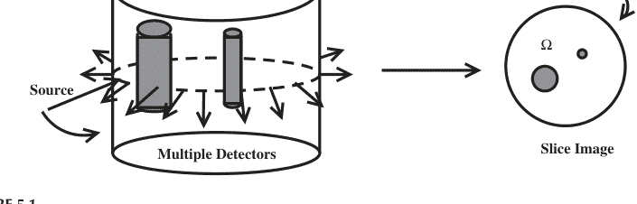

**图 5.1** 断层成像。

于是 RTE 由下式给出：

`$$1/c ∂u/∂t (x,s,t) + s·∇u(x,s,t) + a(x)u(x,s,t) - b(x) ∫_{S^{n-1}} Θ(s·s') u(x,s',t) ds' = f(x,s,t) (5.20)$$`

连同初始条件和边界条件：

`$$u(x,s,0) = 0 \quad \text{in } Ω × S^{n-1} (5.21)$$`

`$$u(x,s,t) = 0 \quad \text{on } Γ_- (5.22)$$`

其中 `u(x,s,t)` 描述在时间 `t` 时，在 `Ω` 中沿方向 `s ∈ S^{n-1}`（`R^n` 中的单位球面）通过点 `x` 的粒子（光子）的密度函数。参数 `a` 是总截面或衰减，`b` 是散射截面。差值 `μ := a − b` 具有吸收截面的物理意义。假设参数 `a`、`b` 和 `μ` 是位置的实值、非负且有界函数。参数 `a` 和 `b` 是待求的组织参数，`c` 是光速。函数 `Θ` 是散射相函数，表征沿方向 `s′` 入射的波在方向 `s` 上散射的强度。假设它是实值非负函数，并归一化为 1。反问题是从边界 `∂Ω` 上出射密度 `u_j|_{Γ₊}` 的某些给定泛函的测量值中恢复 `a` 和 `b`，对应 `m_s` 个不同的源分布 `f_j`，`j = 1, …, m_s`。

#### 5.3.2 DOT 模型

通过将密度 `u` 和源 `f` 按球谐函数展开并保留有限项，可以从 RTE 推导出更简单的确定性模型 [13, 14, 15, 16]。由于散射的普遍性，在距源很小距离处，通量基本上是各向同性的；即它仅线性地依赖于 `s`。因此，我们可以用 `u` 的前二阶矩充分描述该过程。我们得到扩散近似 `P₀`。频域扩散近似可以通过对时域方程进行傅里叶变换容易地获得。此外，辐射传输模型的扩散近似在时间无关（dc）情况下可以写成 [16] 中的形式：

`$$-∇·(D∇u) + μ_a u = 0. (5.23)$$`

相应的边界条件为

`$$u + 2D ∂u/∂ν = f, x ∈ ∂Ω. (5.24)$$`

设 `Ω` 为所考虑的域，其表面为 `∂Ω`，则对应于方程 (5.23) 的弱正问题是寻找 `u ∈ H¹(Ω)`，使得对所有 `v ∈ H¹(Ω)`，满足如下变分方程：

`$$∫_Ω D∇v·∇u dx + ∫_Ω μ_a v u dx + ∫_{∂Ω} 1/2 v u ds = ∫_{∂Ω} v f ds. (5.25)$$`

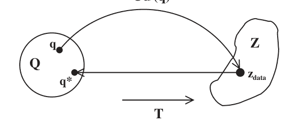

**图 5.2** 非线性映射。


现在，我们可以将正问题定义为：给定 `∂Ω` 上的源 `f_j` 和 `Q` 中的 `q`（模型参数向量，例如扩散系数 `D` 和吸收系数 `μ_a`，即 `q = (D, μ_a)^T`，属于参数集 `Q`），求 `∂Ω` 上的数据 `u`；反问题定义为：给定 `∂Ω` 上的数据 `z`，求 `q`。我们可以在抽象框架中重新表述正问题，令 `u` 位于适当的抽象空间 `H` 中，`f` 表示源或强迫分布。一般来说，可能无法直接测量 `u`；只有实际状态 `u(q)` 的某个可观测量 `z = 𝒞 u(q)` 可以被测量。在这个抽象框架中，反问题或参数估计问题的目标是选择 `Q` 中的参数 `q^*`，使得在 `u(q)` 满足扩散近似的前提下，误差准则或代价泛函 `J(u(q), 𝒞 u(q), q)` 在 `Q` 中所有可能的 `q` 上最小化。一个典型的观测算子为：

$$𝒞^f u(q) = \{ -D ∂u/∂ν (x_i ; q, f) \}_{i=1}^m  (5.26)$$

其中 `x_i` 在 `∂Ω` 上，`m` 是测量数，第二个等号来自边界条件 `(5.24)`。典型的 Tikhonov 代价泛函 `J_λ` 给出为：

$$J_λ(q) = 1/2 Σ_{j=1}^{m_s} Σ_{i=1}^{m} w_{ij} | 𝒞_i^{f_j} u(q) - z_i^{f_j} |^2 + λ || q - q_0 ||^2  (5.27)$$

其中 `z_i^{f_j}` 是给定源 `f_j` 时在边界上的测量数据，`w_{ij}` 是第 `ij` 个数据的权重，`λ` 是 Tikhonov 正则化参数。如图 5.2 所示，复合 `u(q)` 和 `𝒞 u(q)`，我们得到参数到输出的映射：

$$T : Q → Z$$

使得 `T q = 𝒞 u(q)`，其中 `Z` 是测量空间。这是 DOT 在抽象框架中的非线性映射。从 `Q` 到 `Z` 的映射是非线性的，因为偏微分方程的解是其系数 `q = (D, μ_a)` 的非线性函数。

### 5.4 计算方面与不适定问题的正则化

解决这个非线性不适定问题有多种方法；本节我们概述几种方法。通常对于复杂几何，解析解难以处理。因此，需要数值解。有限元方法 `FEM` 由于在复杂几何和边界效应建模方面的便利性而更为通用。`FEM` 是一种变分方法，用一族有限维基函数来逼近解。然后正问题被简化为线性代数问题，并使用 `FEM` 代码计算近似解。`FEM` 是通过将方程 `(5.25)` 的弱形式投影到有限维函数空间上导出的。例如，有限维函数空间可以是连续且二次可微的分段三次多项式集合。

更精确地说，例如在 EIT 中，我们可以将无限维解空间 `X` 投影到有限维子空间 `X_K ⊂ X`，这意味着将上述 `u` 和 `v` 限制在 `X_K` 中而不是 `X` 中。假设存在 `X_K` 的一组基函数 `φ_m(x)`，`m = 1,⋯,K`。然后令 `u_K = Σ_{m=1}^K c_m φ_m(x)` 作为 `u` 的近似，我们希望对于 `K` 个检验函数 `φ_k = v`（`k = 1,⋯,K`）满足弱形式。现在将其代入弱形式，得到关于 `c_m` 的方程组：

$$\sum_{m=1}^K (∫_Ω q ∇φ_m · ∇φ_k dx) c_m = ∫_{∂Ω} f Γ_D φ_k ds (5.28)$$

其中 `k = 1,⋯,K`。如果我们记

$$A_{mk} = ∫_Ω q ∇φ_m · ∇φ_k dx$$

$$F_k = ∫_{∂Ω} f Γ_D φ_k ds$$

则可以利用线性系统 `Ac = F` 求解解 `c = (c_m)_{m=1}^K`，该解非线性地依赖于 `q`，其中 `A` 是 `K × K` 矩阵，`F` 是长度为 `K` 的向量。我们也可以将无限维参数空间 `Q` 用有限维子空间 `Q_M ⊂ Q` 来近似。有限维问题的解是 `Q_M` 中与无限维优化问题（例如 `J_α(q)`）最接近的解 `q_M`。因此，我们假设存在 `Q_M` 的一组基函数 `ψ_k(x)`，`k = 1,⋯,M`。然后令 `q_M = Σ_{k=1}^M q_k ψ_k(x)` 作为 `q` 的近似，得到关于 `q_M = (q_k)_{k=1}^M` 的有限维非线性优化问题：

$$\Ĵ_{α1,α2}(q_M) = Σ_{k=1}^{K̂} |ĝ_k(f) - ĝ_k^δ|^2 + α1 Σ_{i=1}^M δ_i |q_i - q_i^*|^p + α2 Σ_{j=1}^Z d_j |Δ_j q_M|. (5.29)$$

其中 `1 ≤ p ≤ 2`，`δ_i` 是权重，`ĝ_k(f) = Γ_D u_K^{q_M}(f)[x̂_k]` 是在 `K̂` 个边界点 `x̂_k` 处计算的解的迹，`ĝ_k^δ` 是在边界点 `x̂_k` 处采集的含噪电压数据，第二项是使用最近邻近似的 TV 项近似，其中 `Z` 是最近邻数量，`d_j` 是两个相邻点之间的距离 `[18, 17, 19]`。

众所周知，EIT 具有高度非线性和严重不适定性 `[20, 21]`。因此，需要正则化才能生成合理的电阻抗图像。大多数重建方法是确定性的，例如分解法。

`[23]`，d-bar 方法 `[24]`，以及用于最小二乘拟合的变分型方法。变分型方法使用线性化模型或完全非线性模型的迭代型方法，例如稀疏约束 `[20, 21]`、迭代正则化 Gauss–Newton 方法 `[22]`。这些解析方法在确定特定电导率方面可能有效，但统计反演方法 `[25]` 可以提供另一种方法。在 `[26]` 中，Kaipio 等人基于后验协方差矩阵泛函的标准优化电流模式。贝叶斯方法也已用于研究模型简化误差和部分未知几何形状 `[27, 28]`。统计反演的稀疏正则化对展开系数施加 `ℓ_p` 先验，类似于 EIT 的确定性方法 `[20, 21, 29]`。

由于我们有一个非线性正向和反向算子，任何迭代算法都需要计算正向算子的雅可比矩阵。在区域和系数满足正则性假设下，可以证明正向算子是可微的。

**定理 5.1：** 算子 `𝒻` 将 `q` 映射到正向问题在电流 `f` 下的解 `u(q) ∈ H` 是 Fréchet 可微的。若 `η ∈ L^∞(Ω)` 满足 `q + η ∈ Q`，则导数 `𝒻(q)η = w` 满足以下变分问题

$$b(w, v) = -∫_Ω η ∇u ∇v dx  (5.30)$$

对所有 `v ∈ H` 成立，其中 `u = 𝒻(q)`。

利用上述定理，计算雅可比矩阵在 `[21]` 中有说明。

#### 5.4.1 迭代正则化 Gauss–Newton 方法

设 `λ_k` 为正则化参数序列 `[30]`。Smirnova `[30]` 给出了一种一般算法，使用线搜索过程和可变步长 `α_k`，使得

$$0 < α_k ≤ 1  (5.31)$$

得到以下迭代正则化 Gauss–Newton `IRGN` 算法

$$q_{k+1} = q_k - α_k {𝒻(q_k)^T 𝒻(q_k) + λ_k W_2}^{-1} {𝒻(q_k)^T (𝒻(q_k) - g_δ) + λ_k W_2 (q_k - q^*)}  (5.32)$$

其中 `W_2` 为预条件矩阵。由于 `g_δ` 的不精确性，我们采用 `[31]` 中提出的一种停止准则，在第一个指标 `ℵ = ℵ(δ)` 处终止迭代，使得

$$‖𝒻(q_ℵ) - g_δ‖^2 ≤ ρδ < ‖𝒻(q_k) - g_δ‖^2,  0 ≤ k < ℵ,  ρ > 1  (5.33)$$

线搜索参数 `α_k` 使用回溯策略与搜索方向一起适当选择，直到满足强或弱 Wolfe 条件 `[32]`，或已进行最大次数的回溯步骤。

#### 5.4.2 统计反问题

反问题通常以最小化问题形式书写。然而，在这里，我们也可以在离散化后将有限维反问题写成电导率 `q_M` 在测量 `g_K` 上 `∂Ω` 的后验密度形式。换句话说，如果我们知道在测量 `g_K` 下电导率 `q_M` 的密度，我们就可以得到在测量下电导率的期望值。该估计是病态反问题解的一个合理的点估计。在统计设定中，人们推导出有限维电导率版本 `q_M` 在有限维测量 `g_K` 上 `∂Ω` 的后验密度 `[19, 17, 18]`。

##### 5.4.2.1 后验密度

`q_M^*` 的密度通常称为先验密度。这是因为它包含了我们认为为真关于 `q_M^*` 的所有信息。这里我们假设

$$π_{q_M}^* (q_M) ∝ χ_A(q_M) exp[-α R(q_M)],  (5.34)$$

其中 `R(·)` 为正则化函数，`α > 0` 为常数，且 `χ_A(q_M)` 为指示函数，其中 `A = [0,∞)^n`。在下一节中我们讨论正则化函数 `R(·)` 的几种常见选择。

#### 5.4.3 正则化函数

在本节中我们讨论正则化函数 `R(·)` 的几种选择。我们有几种用于解析和统计设定中的正则化函数 `R(·)` 的选择。

### 5.4.3.1 `ℓ_p` 正则化

`ℓ_p` 正则化的思想是使参数 `q_M` 与背景 `q_M^b` 的差，即 `q_M - q_M^b`，相对于某个基稀疏。例如，使用 EIT 重建主要由混凝土制成的物体时，我们会选择 `q_M^b` 为混凝土的典型电导率。`ℓ_p` 正则化 `R_{ℓ_p}(q_M)` 定义为

$$R_{ℓ_p}(q_M) := Σ_{i=1}^n c_i |q_M(i) - q_M^b(i)|^p,  (5.35)$$

其中 `c_i` 表示权重且 `0 < p ≤ 2` 为常数 `[25]`。理论上，权重的良好选择是在边界处取较大值并向 `Ω` 中心指数递减。这是因为方差在边界上比在中心小 `[10]`。当 `0 < p ≤ 1` 时，`ℓ_p` 正则化强制稀疏，当 `p ≥ 2` 时强制光滑。

##### 5.4.3.2 全变差正则化

全变差正则化的思想是获得光滑图像。这在大多数实际应用中是有意义的。全变差正则化定义为

$$R_{TV_c}(q) := ∫_Ω |∇q| dx,  (5.36)$$

其中 `q` 为感兴趣参数 `q_M` 的连续版本。关于全变差正则化 `R_{TV_c}` 的二维物体的离散类比 `[25]` 为

$$R_{TV}(q_M) := Σ_{i=1}^h l_i |Δ_i q_M|,  (5.37)$$

其中 `l_i` 定义为对应于第 `i` 个相邻像素的边的长度，且

$$Δ_i = (0,0,…,0,1_{a(1,i)},0,…,0,-1_{a(2,i)},0,…,0),  (5.38)$$

其中 `a = (a_{i,j})_{i,j=1,i∈{1,2}}^h` 为包含所有相邻像素对 `(a_{1,i}, a_{2,i})` 的集合。

#### 5.4.4 马尔可夫链蒙特卡洛方法

在前几节中我们讨论了具有几种有意义先验密度（正则化）的后验密度，从而基于测量 `g_K` 获得 `q_M^*` 的良好估计。即，算法寻求找到贝叶斯估计 `E(q_M^* | g_K) = ∫_{ℝ^n} q_M π_{q_M}^* (q_M | g_K) dq_M`。

由于后验密度 `π_{q_M}^* (q_M | g_K)` 没有闭式解，因此没有直接求贝叶斯估计 `E(q_M^* | g_K)` 的方法。因此，人们使用马尔可夫链蒙特卡洛方法 `MCMC` 从后验密度 `π_{q_M}^* (q_M | g_K)` 生成大量随机样本 `{q_M^{(i)}}_{i=1}^N`，然后用其样本均值近似贝叶斯估计，

$$E(q_M^* | g_K) = ∫_{ℝ^n} q_M π_{q_M}^* (q_M | g_K) dq_M ≈ 1/N Σ_{i=1}^N q_M^{(i)}.  (5.39)$$

生成此类后验密度随机样本的典型算法是 Gibbs 采样器或 Metropolis–Hastings 算法 `[33, 19, 34]`。

### 5.5 结论

在本章中，我们介绍了用于成像应用的涉及偏微分方程的反问题。我们描述了解决病态反问题的挑战和困难。我们提供了两个非常著名的例子即 EIT 和 DOT 的详细情况。本章中已展示并总结了多种确定性和统计正则化方法。计算方法已在没有收敛速率严格分析的情况下进行了讨论。该领域未来的挑战可以通过重新表述反问题来克服，例如使用正则化方法，如光滑性和稀疏性的结合或统计方法，或削弱反问题本身。成像反问题领域的进展预计将在计算、统计和分析方法相交处，以理解反向算子的输入-输出行为。最新提出的一种方法涉及机器学习和反问题的训练方法。最新文献中对此方向已有显著兴趣，然而关于机器学习和自适应训练方法的许多问题仍然开放，是未来研究的课题。

作者感谢 I SIAM 的组织者，特别是 Pammy Manchanda 教授和 A. H. Siddiqi 教授，为编辑本章并提供参加在 Amritsar 举行的会议的机会，该会议汇集了纯数学和应用数学家，帮助提供了讨论应用数学研究各种想法的平台。

## 参考文献

- 1. Banks, H.T., & Kunisch, K. (2001). *Estimation Techniques for Distributed Parameter Systems.* Birkhäuser.

- 2. Goodarzi, E., Moayed, L., Sohrabivafa, M., Adineh, H.A., & Khazei, Z. (2019). Epidemiology incidence and mortality of breast cancer and its association with the body mass index and human development index in the asian population. *World Cancer Research Journal, WCRJ* 6, e1323.

- 3. Cheney, M., Isaacson, D., & Newell, J. C. (1999). Electrical impedance tomography. *SIAM Review*, 41(1), 85–101.

- 4. Borcea, L. (2002). Electrical impedance tomography. *Inverse Problems*, 18(6), R99–R136.

- 5. Hanke, M., & Brühl, M. (2003). Recent progress in electrical impedance tomography. *Inverse Problems*, 19(6), S65–S90.

- 6. Daily, W., Ramirez, A., LaBrecque, D., & Nitao, J. (1992). Electrical resistivity tomography of vadose water movement. *Water Resources Research*, 28(5), 1429–1442.

- 7. Isaksen, O., Dico, A.S., & Hammer, E.A. A capacitance-based tomography system for interface measurement in separation vessels. *Measurement Science and Technology*, 5(10), 1262.

- 8. Holder, D.S. (ed.). (2005). *Electrical Impedance Tomography: Methods, History and Applications.* Institute of Physics Publishing, Bristol.

- 9. Bayford, R.H. (2006). Bioimpedance tomography (electrical impedance tomography). *Annual Review of Biomedical Engineering*, 8, 63–91.

- 10. Palamodov, V.P. (2002). Gabor analysis of the continuum model for impedance tomography. *Arkiv för Matematik*, 40(1), 169–187.

- 11. Chandrasekhar, S. (1950). *Radiation Transfer.* Oxford, Clarendon.

- 12. Ishimaru, A. (1978). *Single Scattering and Transport Theory (Wave Propagation and Scattering in Random Media I).* Academic, New York.

- 13. Lewis, H.W. (1950). Multiple scattering in an infinite medium. *Physical Review*, 78, 526–529.

- 14. Bremmer, H. (1964). Random volume scattering. *Radiation Science Journal of Research*, 680, 967–981.


- 15. Arridge, S.R., & Hebden, J.C. (1997). Optical imaging in medicine: 2. Modelling and reconstruction. *Physics in Medicine and Biology*, 42, 841–853.

- 16. Arridge, S.R. (1999). Optical tomography in medical imaging: Topical review. *Inverse Problems*, 15, R41–R93.

- 17. Strauss, T. (2015). *Statistical Inverse Problems in Electrical Impedance and Diffuse Optical Tomography.* Doctoral dissertation, Clemson University.

- 18. Strauss, T., & Khan, T. (2015). Statistical inversion in electrical impedance tomography using mixed total variation and non-convex $\ell_p$ regularization prior. *Journal of Inverse and Ill-Posed Problems*, 23(5), 529–542.

+ 19. Strauss, T., Fan, X., Sun, S., & Khan, T. (2015). 单相达西流中绝对渗透率的统计反演. *Procedia Computer Science*, 51, 1188–1197.

+ 20. Jin, B., & Maass, P. (2012). 电阻抗层析成像的分析及其在 Tikhonov 正则化中的应用. *ESAIM: Control, Optimisation and Calculus of Variations*, 18(04), 1027–1048.

+ 21. Jin, B., Khan, T., & Maass, P. (2012). 基于稀疏正则化的电阻抗层析成像重建算法. *International Journal for Numerical Methods in Engineering*, 89(3), 337–353.

+ 22. Khan, T., & Smirnova, A. (2005). 利用迭代正则化 Gauss-Newton 算法进行基于扩散的光学层析成像中的 1D 反问题. *Applied Mathematics and Computation*, 161(1), 149–170.

+ 23. Kirsh, A., & Grinberg, N. (2008). *逆问题的因子化方法*. Oxford University Press.

+ 24. Isaacson, D., Mueller, J. L., Newell, J. C., & Siltanen, S. (2004). 电阻抗层析成像 D-bar 方法的胸部体模重建. *IEEE Transactions on Medical Imaging*, 23(7), 821–828.

+ 25. Kaipio, J.P., Kolehmainen, V., Somersalo, E., & Vauhkonen, M. (2000). 电阻抗层析成像中的统计反演和蒙特卡洛采样方法. *Inverse Problems*, 16(5), 1487.

+ 26. Kaipio, J.P., Seppänen, A., Somersalo, E., & Haario, H. (2004). 与电阻抗层析成像中后验协方差相关的最优电流模式. *Inverse Problems*, 20(3), 919.

+ 27. Nissinen, A., Heikkinen, L.M., & Kaipio, J.P. (2008). 电阻抗层析成像实验结果的贝叶斯近似误差方法. *Measurement Science and Technology*, 19(1), 015501.

+ 28. Nissinen, A., Heikkinen, L.M., Kolehmainen, V., & Kaipio, J.P. (2009). 电阻抗层析成像中因离散化、域截断和未知接触阻抗引起的误差补偿. *Measurement Science and Technology*, 20(10), 105504.

+ 29. Jin, B., & Maass, P. (2012). 参数识别问题的稀疏正则化. *Inverse Problems*, 28(12), 123001.

+ 30. Smirnova, Alexandra, Renaud, Rosemary A., & Khan, Taufiquar. (2007). 修改的迭代正则化 Gauss-Newton 算法的收敛性及应用. *Inverse Problems*, 23, 1547–1563.

+ 31. Bakushinsky, A.B., & Smirnova, A. (2005). 广义误差原理在非线性不适定问题迭代方法中的应用, *Numer. Func. Anal. Optim.*, 26, 35–48.

+ 32. Nocedal, J., & Wright, S.J. (1999). *数值优化*, Springer, NY.

+ 33. Chib, S., & Greenberg, E. (1995). 理解 Metropolis-Hastings 算法. *The American Statistician*, 49(4), 327–335.

+ 34. Bardsley, J.M. (2012). 基于 MCMC 的不确定性量化的图像重建. *SIAM Journal on Scientific Computing*, 34(3), A1316–A1332.

## 6

## 求解非线性方程的一个高效的 Steffensen 类方法族

Vali Torkashvand 和 Manochehr Kazemi

## 目录

- 6.1 引言................................................................................................................ 91
- 6.2 一类无记忆方法................................................................................................ 92
- 6.3 具有记忆的新方法 ....................................................................................................... 94
- 6.4 数值算例 ........................................................................................................................... 96
- 6.5 结论 .......................................................................................................................................... 98
- 参考文献............................................................................................................................................... 101

### 6.1 引言

非线性方程在应用数学的许多领域中无处不在，并在科学和工程等众多应用中发挥着重要作用。非线性方程通常难以解析求解，因此需要数值方法。构造迭代方法以逼近求解非线性方程 `f(x)=0` 的解是应用数学中最重要的任务之一。确定该问题解的最著名迭代方法是牛顿法 `NM` 给出 `x_{k+1}=x_k - f(x_k)/f'(x_k)`，该方法在初始近似 `x_0` 足够接近简单根 `α` 且 `f'` 在 `α` 附近存在时，产生的序列 `{x_n}` 以二次收敛到简单根 `α`。Traub [16] 提供的阶加速的关键思想在于误差关系的一种特殊形式和一个自由参数的方便选择。我们定义一个自加速参数，该参数在迭代过程中使用牛顿插值多项式计算。加速技术依赖于当前迭代步和前一迭代步的信息，从而定义了具有记忆的两点方法。本章的其余部分组织如下：第 6.2 节致力于 Guo 和 Qian 方法 [11] 的两步修改。第 6.3 节涉及开发新的有记忆方法。第 6.4 节包括一些数值性能，结论在第 6.5 节中给出。

### 6.2 一类无记忆方法

2015 年 Guo 和 Qian 遵循了无记忆的两点方法 `GQM` [11]：

```
w_k = x_k + f(x_k), y_k = x_k - f(x_k)/f[x_k, w_k], k = 0,1,2,...
x_{k+1} = y_k - (x_k - y_k)(x_k - w_k)(y_k - w_k)f(y_k)/((y_k - w_k)^2 f(x_k) + (x_k - w_k)(x_k - 2y_k + w_k)f(y_k) - (x_k - y_k)^2 f(w_k)).
```
(6.1)

下一个定理给出了方程 (6.1) 中方法的误差方程。

# 定理 6.1 设 I ⊆ ℝ 为开区间，f : I → ℝ 为标量函数，在开区间 I 内具有简单根 α，并且初始近似 x₀ 足够接近简单零点，则由 (1) 定义的迭代方法是四阶收敛的并且满足下面的误差方程：

`e_{k+1} = (1 + f'(α))^2 c_2 (c_2^2 - c_3) e_k^4 + O(e_k^5).` (6.2)

# 证明 6.1 证明见 Guo 和 Qian [11]。

通过在方程 (6.1) 描述的方法中引入两个参数，得到以下四阶结果的两参数无记忆方法族 `TKM4`：

```
w_k = x_k + γ f(x_k), y_k = x_k - f(x_k)/(f[x_k, w_k] + λ f(w_k)), k = 0,1,2,...
x_{k+1} = y_k - (x_k - y_k)(x_k - w_k)(y_k - w_k)f(y_k)/((y_k - w_k)^2 f(x_k) + (x_k - w_k)(x_k - 2y_k + w_k)f(y_k) - (x_k - y_k)^2 f(w_k)).
```
(6.3)

其中 `γ ∈ ℝ`。下一个定理给出了方程 (6.3) 中方法的误差方程。

# 定理 6.2 设 I ⊆ ℝ 为开区间，f : I → ℝ 为标量函数，在开区间 I 内具有简单根 α，并且初始近似 x₀ 足够接近简单零点，则迭代方法 (3) 具有四阶收敛性并满足以下误差方程：

`e_{k+1} = (1 + f'(α)γ)^2 (λ + c_2)(c_2(λ + c_2) - c_3) e_k^4 + O(e_k^5).` (6.4)

其中 `c_k = f^k(α)/k!`, ∀k ∈ {2,3,4,⋯}, `e_k = x_k - α` 且 `λ, γ` 为两个实值自由参数。

# 证明 6.2 使用泰勒级数和符号计算；我们可以确定两步无记忆方法族 (3) 的渐近误差常数。现在我们将 `f(x_k)` 在简单零点 α 附近展开。因此，我们有

`f(x_k) = f'(α)[e_k + c_2 e_k^2 + c_3 e_k^3 + c_4 e_k^4 + O(e_k^5)],` (6.5)

和

`w_k-α=x_k-α-e_k f'(α)γ(1+e_k(c_2+c_3 e_k^3+c_4 e_k^4)),` (6.6)

使用函数 `f[x,w]= (f(x)-f(w))/(x-w)` 的一阶分差，我们有：

`f[x_k,w_k]=...`

此外，很容易求得：

`f(x_k)/f[x_k,w_k]+λ f(w_k)=...`

使用方程 (6.7) 和一些化简，我们得到：

`y_k-α=x_k-α-f(x_k)/f[x_k,w_k]+λ f(w_k)=...`

我们使用以下关系：

`(x_k - y_k)(x_k - w_k)(y_k - w_k)f(y_k)/((y_k - w_k)^2 f(x_k) + (x_k - w_k)(x_k - 2y_k + w_k)f(y_k) - (x_k - y_k)^2 f(w_k))`


= -((-1 + f'(\alpha)\gamma)(\lambda + c_2))e_k^2 + \left(\lambda^2(-1 + f'(\alpha)\gamma)^2 + 2f'(\alpha)\gamma(-2 + \gamma f'(\alpha))c_2 + (\lambda + c_2) + 2c_3 + f'(\alpha)\gamma(-3 + f'(\alpha)\gamma c_3)\right)e_k^3 + \left(-\lambda^3(-1 + f'(\alpha)\gamma)^3 + \lambda(3 - f'(\alpha)\gamma(3 + f'(\alpha)\gamma(-2 - f'(\alpha)\gamma)))c_2^2 + (3 - \gamma f'(\alpha)(3 + f'(\alpha)\gamma(-2 + f'(\alpha)\gamma)))c_3^3 + \lambda(-3 + f'(\alpha)\gamma(5 + f'(\alpha)\gamma(-4 + f'(\alpha)\gamma)))c_3 + c_2(-\lambda^2(-1 + f'(\alpha)\gamma(2 + f'(\alpha)\gamma(-1 + f'(\alpha)\gamma) + 2(-3 + f'(\alpha)\gamma(4 + f'(\alpha)\gamma(-3 + f'(\alpha)\gamma)))c_3)(3 + f'(\alpha)\gamma(-3 + f'(\alpha)\gamma))c_4)\right)e_k^4 + O(e_k^5)

$$

最后通过考虑方程 (6.10)，

$$

x_{k+1} - \alpha = y_k - \alpha - \frac{(x_k - y_k)(x_k - w_k)(y_k - w_k)f(y_k)}{(y_k - w_k)^2 f(x_k) + (x_k - w_k)(x_k - 2y_k + w_k)f(y_k) - (x_k - y_k)^2 f(w_k)} = (1 + f'(\alpha)\gamma)^2(\lambda + c_2)(c_2(\lambda + c_2) - c_3)e_k^4 + O(e_k^5)

$$

这表明方程 (6.3) 是一种收敛阶最优为四的二步迭代方法，消耗三次函数求值。

有关最优方法的更多信息，请注意以下猜想：Kung 和 Traub 猜想 [16]：基于 n 次求值的无记忆多点迭代方法可以达到最优收敛阶 \(2^{n-1}\)（作为一个简单零点求解器）。

### 6.3 具有记忆的新方法

在本节中，我们将通过在每次完整迭代中改变参数 \(\gamma\) 和 \(\lambda\) 来提高族方程 (6.3) 的收敛速率。我们从方程 (6.11) 观察到，当 \(\gamma \neq -1/f'(\alpha)\) 且 \(\lambda \neq c_2\) 时，族方程 (6.3) 的收敛阶为四。选择 \(\gamma = -1/f'(\alpha)\) 且 \(\lambda = c_2\) 时可以证明族方程 (6.3) 的阶为 7。为此，首先令 \(\gamma = \gamma_k\) 且 \(\lambda = \lambda_k\)；然后这些参数的近似值由下式给出：

$$

\begin{cases}

\gamma_k = -\dfrac{1}{f'(\alpha)} \approx -\dfrac{1}{\tilde{c}_1} = -\dfrac{1}{N'_3(x_k)}, \\[2mm]

\lambda_k = -c_2 \approx -\tilde{c}_2 = -\dfrac{N''_4(w_k)}{N'_4(w_k)}.

\end{cases} \tag{6.7}

$$

其中 \(N_3(t), N_4(t)\) 是三阶和四阶的 Newton 插值多项式。因此，我们已经考虑了节点点的最佳可能选择以获得最大阶。因此，修正的族由 (TKM7) 给出：

$$

\begin{cases}

\gamma_k = -\dfrac{1}{N'_3(x_k)}, \quad \lambda_k = -\dfrac{N''_4(w_k)}{N'_4(w_k)}, \quad k=1,2,\dots, \\[2mm]

w_k = x_k + \gamma_k f(x_k), \quad y_k = x_k - \dfrac{f(x_k)}{f[x_k, w_k] + \lambda_k f(w_k)}, \quad k=0,1,2,\dots, \\[2mm]

x_{k+1} = y_k - \dfrac{(x_k - y_k)(x_k - w_k)(y_k - w_k)f(y_k)}{(y_k - w_k)^2 f(x_k) + (x_k - w_k)(x_k - 2y_k + w_k)f(y_k) - (x_k - y_k)^2 f(w_k)}.

\end{cases} \tag{6.8}

$$

回想一下，具有记忆的多点方法会重用旧信息，例如来自前一次迭代的一些条目。在本节中，我们将使用一个旧思想来提高方程 (6.8) 中族的收敛速率，该思想包括随着迭代的进行改变参数 \(\gamma = \gamma_k\) 和 \(\lambda = \lambda_k\)。我们的目标是在不每周期施加额外函数求值的情况下加速收敛。这意味着使用两次函数求值，我们必须将 R-收敛阶提高到超过 4。这里，我们试图证明方程 (6.8) 中具有记忆的新无导数方法的 R-收敛阶为 7。为此，我们陈述以下引理。

#### 引理 6.1

设 \(\gamma_k = -\dfrac{1}{N'_3(x_k)}\) 且 \(\lambda_k = -\dfrac{N''_4(w_k)}{N'_4(w_k)}\)，其中 \(e_k = x_k - \alpha\)，\(e_{k,y} = y_k - \alpha\)，\(e_{k,w} = w_k - \alpha\)。则以下渐近关系成立：

$$

\begin{cases}

1 + \gamma_k f'(\alpha) \sim \Psi_1 e_{k-1} e_{k-1,w} e_{k-1,y}, \\[2mm]

c_2 + \lambda_k \sim \Psi_2 e_{k-1} e_{k-1,w} e_{k-1,y},

\end{cases} \tag{6.9}

$$

其中 \(\Psi_1\) 和 \(\Psi_2\) 是某些渐近常数。

#### 定理 6.3

如果初始猜测 \(x_0\) 足够接近 \(f(x)\) 的零点 \(\alpha\) 并且迭代格式中方程 (6.8) 的参数 \(\gamma = \gamma_k\) 和 \(\lambda = \lambda_k\) 由方程 (6.9) 给出的形式递归计算，则方程 (6.8) 中具有记忆的方法的 R-收敛阶至少为 7。

#### 证明 6.3

首先我们假设序列 \(x_k, w_k, y_k\) 的 R-收敛阶至少为 \(r, p,\) 和 \(q\)，分别。故：

$$

e_{k+1} \sim e_k^r \sim e_{k-1}^{r^2}, \tag{6.10}

$$

$$

e_{k,w} \sim e_k^p \sim e_{k-1}^{p^2}, \tag{6.11}

$$

$$

e_{k,y} \sim e_k^q \sim e_{k-1}^{q^2}. \tag{6.12}

$$

由方程 (6.10)、(6.11)、(6.12) 和引理 (6.1)，我们得到

$$

1 + \gamma_k f'(\alpha) \sim e_{k-1}^{p+q+1}, \quad \lambda_k + c_2 \sim e_{k-1}^{p+q+1} \tag{6.13}

$$

另一方面，我们得到

$$

e_{k,w} \sim (1 + \gamma_k f'(\alpha)) e_k, \tag{6.14}

$$

$$

e_{k,y} \sim (1 + \gamma_k f'(\alpha))(\lambda_k + c_2) e_k^2, \tag{6.15}

$$

$$

e_{k+1} \sim (1 + f'(\alpha)\gamma_k)^2 (\lambda_k + c_2)(c_2(\lambda_k + c_2) - c_3) e_k^4. \tag{6.16}

$$

结合方程 (6.10)–(6.16)、(6.11)–(6.14) 和 (6.12)–(6.15)，我们得出结论

$$

e_{k,w} \sim e_{k-1}^{(1+p+q)+r}, \tag{6.17}

$$

$$

e_{k,y} \sim e_{k-1}^{2(1+p+q)+2r}, \tag{6.18}

$$

和

$$

e_{k+1} \sim e_{k-1}^{3(1+p+q)+4r}. \tag{6.19}

$$

将方程 (6.14)–(6.17)、(6.15)–(6.18) 和 (6.16)–(6.19) 中 \(e_{k-1}\) 的误差指数幂配对相等，我们有

$$

rp - r - (p + q + 1) = 0, \quad rq - 2r - 2(p + q + 1) = 0, \quad r^2 - 4r - 3(p + q + 1) = 0. \tag{6.20}

$$

该系统有解 \(p=2\)，\(q=4\)，且 \(r=7\)，这指定了方程 (6.8) 中具有记忆的无导数格式的 R-收敛阶。

#### 备注 6.1

方程 (6.8) 中的新二步无导数方法需要三次函数求值且收敛阶为 7。因此，所提出的方法是最优阶，并支持 Kung–Traub 猜想 [16]。因此，所提出方法的效率指数为 \(7^{1/3} = 1.91293\)。

### 6.4 数值示例

在本节中，我们展示了具有记忆的方法 (8) 的收敛行为，其中 \(\gamma_k\) 和 \(\lambda_k\) 由方程 (6.7) 中的一个公式计算。这里报告的数值计算已在 Mathematica 10 环境中进行。计算收敛阶 (即 COC) [32] 可以定义为

$$

\mathrm{COC} \approx \frac{\log |f(x_n)/f(x_{n-1})|}{\log |f(x_{n-1})/f(x_{n-2})|} \tag{6.21}

$$

测试函数、其简单根和起始近似值列于表 6.1。表 6.2 显示了所提出方法与其他方法的效率指数。见表 6.3 以了解记忆方法的收敛百分比改善。表 6.4 显示了所提出方法与其他方法在给定函数上的计算收敛效率和阶。Iter、EI、EF 和 EFD 分别代表迭代次数、效率指数、函数求值总次数和导数求值总次数。

我们研究以下方法与所提出的方法：

- 1. 一步迭代方法有无记忆：Abbasbandy (AM) [1]、Newton (NM) [20]、Steffensen (SM) [29] 和 Zheng et al. (ZLHM) [35]。

- 2. 二步迭代方法有无记忆：Cordero et al. (CHMTM) [4]、Cordero et al. (CLBTM) [5]、Cordero et al. (CLKTM) [6]、Cordero et al. (CLTAMM) [7]、Dzunic et al. (DPPM) [9]、Dehghan-Hajarian (DH)

#### 表 6.1：测试函数

| 非线性函数 | 根 | 初始猜测 |
|---|---|---|
| \(f_1(x) = x \log(1 + x \sin(x)) + e^{1+x^2} \cos(x) \sin(\pi x)\) | \(\alpha = 0\) | \(x_0 = 0.3\) |
| \(f_2(x) = \sin(5x) e^{x} - 2\) | \(\alpha = 1.36\) | \(x_0 = 1\) |
| \(f_3(x) = 1 + 1/x^4 - 1/x - x^2\) | \(\alpha = 1\) | \(x_0 = 1.4\) |
| \(f_4(x) = (x - 2)(x^{10} + x + 2) e^{5x}\) | \(\alpha = 2\) | \(x_0 = 2.3\) |
| \(f_5(x) = e^{x^3 - x} - \cos(x^2 - 1) + x^5 + 1\) | \(\alpha = -1\) | \(x_0 = -1.3\) |

#### 表 6.2：所提出方法与其他方案的函数求值和效率指数比较

| 无记忆方法 | EF | EFD | COC | EI | 有记忆方法 | EF | EFD | COC | EI |
|---|---|---|---|---|---|---|---|---|---|
| AM [1] | 1 | 2 | 3.000 | 1.4423 | SecM [23] | 1 | 0 | 1.680 | 1.6800 |
| HPM [12] | 1 | 2 | 4.000 | 1.5874 | TrM [33] | 2 | 0 | 2.410 | 1.5524 |
| NM [20] | 1 | 1 | 2.000 | 1.4142 | CLBTM [5] | 3 | 0 | 7.000 | 1.9129 |
| OM [21] | 2 | 1 | 4.000 | 1.5874 | KKBM [14] | 3 | 0 | 7.000 | 1.9129 |
| CNM [3] | 3 | 1 | 8.000 | 1.6818 | DPPM [9] | 4 | 0 | 11.000 | 1.8212 |
| RWBM [25] | 3 | 0 | 4.000 | 1.5874 | LMNKSM [18] | 4 | 0 | 12.000 | 1.8612 |
| KLM [15] | 2 | 1 | 4.000 | 1.5874 | WM [34] | 3 | 0 | 4.230 | 1.6173 |
| ZLHM [35] | 3 | 1 | 4.000 | 1.5874 | SSSM [26] | 4 | 0 | 12.000 | 1.8612 |
| MM [19] | 2 | 1 | 4.000 | 1.5874 | PIDM [24] | 3 | 0 | 4.562 | 1.6585 |
| TM [30] | 5 | 0 | 16.000 | 1.7411 | CLKTM [6] | 3 | 0 | 6.000 | 1.8171 |
| DHM [8] | 1 | 2 | 4.000 | 1.5874 | PDNM [22] | 3 | 0 | 4.562 | 1.6585 |
| GQM [11] | 5 | 0 | 16.000 | 1.7411 | TKM [8] | 3 | 0 | 7.000 | 1.9129 |

#### 表 6.3

带记忆方法的收敛阶百分比改进

| 带记忆方法 | 步数 | 最优阶 | COC | 百分比增加 |
|---|---|---|---|---|
| TrM[33] | 1 | 2.000 | 2.410 | 20.5% |
| CLKTM[5] | 2 | 4.000 | 6.000 | 50% |
| KKBM[14] | 2 | 4.000 | 7.000 | 75% |
| DPPM[9] | 3 | 8.000 | 8.470 | 5.875% |
| DPPM[9] | 3 | 8.000 | 9.000 | 12.5% |
| DPPM[9] | 3 | 8.000 | 10.000 | 25% |
| DPPM[9] | 3 | 8.000 | 11.000 | 37.5% |
| LMNKSM[18] | 3 | 8.000 | 12.000 | 50% |
| PIDM[24] | 2 | 4.000 | 4.449 | 11.225% |
| PDNM[22] | 2 | 4.000 | 4.562 | 14.05% |
| SSSM[26] | 3 | 8.000 | 12.000 | 50% |
| SGGM[27] | 3 | 8.000 | 11.352 | 41.9% |
| SGGM[27] | 3 | 8.000 | 11.657 | 45.713% |
| SGGM[27] | 3 | 8.000 | 12.000 | 50% |
| TLFM[31] | 2 | 4.000 | 6.000 | 50% |
| WM[34] | 2 | 4.000 | 4.230 | 5.75% |
| TKM[8] | 2 | 4.000 | 7.000 | 75% |

[8]，Guo-Qian(GQM)[11]，Hansen-Patrick(HPM)[12]，Jarratt(JM)[13]，Kansal et al.(KKBM)[14]，Kou-Li(KLM)[15]，Petkocic et al.(PDNM)[22]，Petkocic et al.(PIDM)[24]，Ostrowski(OM)[21]，Ren et al.(RWBM)[25]，Torkashvand et al.(TLFM)[31]，Truab(TM)[33]，Wang(WM)[34]，和 Zheng et al.(ZLHM)[35]。

- 3. 迭代方法三步带记忆和不带记忆：

- Chun-Neta(CNM)[3]，Dzunic et al.(DPPM)[9]，Guo-Qian(GQM)[11]，Lotfi et al.(LMNKSM)[18]，Kung-Traub(KTM)[16]，Sharifi et al. (SSSM)[26]，Sharma et al.(SGGM)[27]，Soleymani (SM)[28]，和 Zheng et al.(ZLHM)[35]。

- 4. 迭代方法四步不带记忆：

- Geum-Kim(GKM)[10]，Guo-Qian(GQM)[11]，Li et al.(LMMWM)[17]，Thukral(TM)[30]，和 Zheng et al.(ZLHM)[35]。

### 6.5 结论


在本章中，我们提出了一种求解非线性方程的带记忆的两步迭代方法族。由于我们的目标是在不增加额外计算的情况下构造更高阶收敛的方法，我们使用了由四阶方法中牛顿插值多项式设计的自校正参数的两种近似，以在不进行任何额外计算的情况下实现更高阶的收敛。新带记忆迭代方法的 R-阶收敛从 4 提高到 6 和 7。数值结果已给出以证实理论结果的有效性。

#### 表 6.4

所提方法与其他方案的评估函数和效率指数比较

$f_1(x)=x\log(1+x\sin(x))+e^{-1+x^2\cos(x)}\sin(x)$，$\alpha=0, x_0=0.3$

| 无记忆方法 | EF | Iter | COC | EI | 带记忆方法 | EF | Iter | COC | EI |
|---|---|---|---|---|---|---|---|---|---|
| AM | 3 | 5 | 3.0000 | 1.44225 | TrM, $\lambda_0=0.1$ | 2 | 4 | 2.4282 | 1.55827 |
| NM | 2 | 7 | 2.0000 | 1.41421 | SecM, $x_1=0.6$ | 2 | 15 | 1.6181 | 1.61808 |
| MM | 3 | 5 | 4.0000 | 1.58740 | WM, $\lambda_0=1$ | 3 | 5 | 4.2361 | 1.61803 |
| CNM, $\alpha_0=\gamma_0=A_0=1$ | 4 | 3 | 8.0000 | 1.68179 | PIDM $\beta_0=0.1$ | 3 | 5 | 4.4513 | 1.64499 |
| GKM | 5 | 3 | 16.0000 | 1.74110 | DPPM, $\gamma_0=-0.1$ | 4 | 3 | 1.0000 | 1.00000 |
| RWBM, $\beta_0=1$ | 3 | 4 | 4.0000 | 1.58740 | TKM, $\gamma_0=\lambda_0=0.1$ | 3 | 5 | 7.0000 | 1.91293 |

$f_2(x)=\sin(5x)^x-2,$ $\alpha=1.36, x_1=1$

| 无记忆方法 | EF | Iter | COC | EI | 带记忆方法 | EF | Iter | COC | EI |
|---|---|---|---|---|---|---|---|---|---|
| AM | 3 | 1000 | 1.0000 | 1.00000 | TrM, $\lambda_0=0.1$ | 2 | 5 | 0.0000 | 0.00000 |
| NM | 2 | 15 | 2.0000 | 1.41421 | SecM, $x_1=1.2$ | 2 | 17 | 1.6181 | 1.61808 |
| MM | 3 | 4 | 4.0000 | 1.58740 | WM, $\lambda_0=0.1$ | 3 | 5 | 4.2361 | 1.61803 |
| CNM, $\alpha_0=\gamma_0=A_0=1$ | 4 | 6 | 8.0000 | 1.68179 | PIDM $\beta_0=0.1$ | 3 | 5 | 4.4314 | 1.64253 |
| GKM | 5 | 3 | 0.000 | 0.00000 | DPPM, $\gamma_0=-0.1$ | 4 | 3 | 1.0000 | 1.00000 |
| RWBM, $\beta_0=1$ | 3 | 4 | 0.0000 | 0.00000 | TKM, $\gamma_0=\lambda_0=0.1$ | 3 | 4 | 7.0000 | 1.91293 |

$f_3(x)=1+\dfrac{1}{x^4}-\dfrac{1}{x}-x^2,$ $\alpha=1, x_0=1.4$

| 无记忆方法 | EF | Iter | COC | EI | 带记忆方法 | EF | Iter | COC | EI |
|---|---|---|---|---|---|---|---|---|---|
| AM | 3 | 6 | 3.0000 | 1.44225 | TrM, $\lambda_0=0.1$ | 2 | 4 | 2.4062 | 1.55120 |
| NM | 2 | 5 | 2.0000 | 1.41421 | SecM, $x_1=1.5$ | 2 | 16 | 1.6181 | 1.61808 |
| MM | 3 | 4 | 4.0000 | 1.58740 | WM, $\lambda_0=1$ | 3 | 5 | 4.2361 | 1.61804 |
| CNM, $\alpha_0=\gamma_0=A_0=1$ | 4 | 3 | 8.0000 | 1.68179 | PIDM $\beta_0=0.1$ | 3 | 5 | 4.4661 | 1.64681 |
| GKM | 5 | 3 | 16.0000 | 1.74110 | DPPM, $\gamma_0=-0.1$ | 4 | 3 | 10.0000 | 1.77828 |
| RWBM, $\beta_0=1$ | 3 | 4 | 4.0000 | 1.58740 | TKM, $\gamma_0=\lambda_0=0.1$ | 3 | 3 | 7.0000 | 1.91293 |

(续)

#### 表 6.4 （续）

所提方法与其他方案的评估函数和效率指数比较

$f_4(x) = (x-2)(2+x^{10}) + x + 2e^{-5x}$,  $\alpha=2, \gamma_0=2.3$

| 无记忆方法 | EF | Iter | COC | EI | 带记忆方法 | EF | Iter | COC | EI |
|---|---|---|---|---|---|---|---|---|---|
| AM | 3 | 1500 | 3.0000 | 1.44225 | TrM, $\lambda_0=0.1$ | 2 | 4 | 2.4681 | 1.57100 |
| NM | 2 | 5 | 2.0000 | 1.41421 | SecM, $x_i=1.8$ | 2 | 17 | 1.6181 | 1.61808 |
| MM | 3 | 4 | 4.0000 | 1.58740 | WM, $\gamma_0=1$ | 3 | 6 | 4.2361 | 1.61803 |
| CNM, $\alpha_0=\gamma_0=A_0=1$ | 4 | 5 | 8.0000 | 1.68179 | PIDM $\beta_0=0.1$ | 3 | 4 | 4.3019 | 1.62637 |
| GKM | 5 | 3 | 16.0000 | 1.74110 | DPPM, $\gamma_0=-0.1$ | 4 | 3 | 1.0000 | 1.00000 |
| RWBM, $\beta_0=1$ | 3 | 4 | 4.0000 | 1.58740 | TKM, $\gamma_0=0.1$ | 3 | 4 | 7.0000 | 1.91293 |

$f_5(x)=e^{-x^3-x} - \cos(x^2-1)+x^3+1$, $\alpha=-1, x_0=-1.3$

| 无记忆方法 | EF | Iter | COC | EI | 带记忆方法 | EF | Iter | COC | EI |
|---|---|---|---|---|---|---|---|---|---|
| AM | 3 | 5 | 3.0000 | 1.44225 | TrM, $\lambda_0=0.1$ | 2 | 4 | 2.4520 | 1.56549 |
| NM | 2 | 5 | 2.0000 | 1.41421 | SecM, $x_i=-1.6$ | 2 | 18 | 1.6181 | 1.61808 |
| MM | 3 | 4 | 4.0000 | 1.58740 | WM, $\gamma_0=1$ | 3 | 5 | 4.2361 | 1.61803 |
| CNM, $\alpha_0=\gamma_0=A_0=1$ | 4 | 3 | 8.0000 | 1.68179 | PIDM $\beta_0=-0.1$ | 3 | 4 | 4.4517 | 1.64504 |
| GKM | 5 | 3 | 16.0000 | 1.74110 | DPPM, $\gamma_0=-0.1$ | 4 | 4 | 1.0000 | 1.00000 |
| RWBM, $\beta_0=1$ | 3 | 4 | 4.0000 | 1.58740 | TKM, $\gamma_0=0.1$ | 3 | 4 | 7.0000 | 1.91293 |

## 参考文献

- Abbasbandy, S. 2006. Modified homotopy perturbation method for nonlinear equations and comparison with Adomian decomposition method. Applied Mathematics and Computation 172:431–438.
- Chun, C., and Neta, B. 2014. An analysis of a new family of eighth-order optimal methods. Applied Mathematics and Computation 245:86–107.
- Cordero, A., Hueso, J.L., Martinez, E., and Torregrosa, J.R. 2013. A new technique to obtain derivative-free optimal iterative methods for solving nonlinear equations. Journal of Computational and Applied Mathematics 252:95–102.
- Cordero, A., Lotfi, T., Bakhtiari, P., and Torregrosa, J.R. 2014. An efficient two-parametric family with memory for nonlinear equations. Numerical Algorithms 68(2):323–335.
- Cordero, A., Lotfi, T., Khoshandi, A., and Torregrosa, J.R. 2015. An efficient Steffensen-like iterative method with memory. Bulletin mathematique de la Societe des Sciences Mathematiques de Roumanie Nouvelle Serie 58(106):49–58.
- Cordero, A., Lotfi, T., Torregrosa, J.R., Assari, P., and Mahdiani, K. 2016. Some new bi-accelarator two-point methods for solving nonlinear equations. Computational and Applied Mathematics 35(1):251–267.
- Dehghan, M., and Hajarian, M. 2010. New iterative method for solving non-linear equations with fourth-order convergence. International Journal of Computer Mathematics 87(4):834–839.
- Dzunic, J., Petkovic, M.S., and Petkovic, L.D. 2012. Three-point methods with and without memory for solving nonlinear equations. Applied Mathematics and Computation 218:4917–4927.
- Geum, Y.H., and Kim, Y.I. 2011. A biparametric family optimally convergent sixteenth-order multipoint methods with their fourth-step weighting function as a sum of a rational and a generic two-variable function. Journal of Computational and Applied Mathematics 235:3178–3188.
- Guo, Q.W., and Qian, Y.H. 2015. New efficient optimal derivative-free method for solving nonlinear equations. International Journal of Mathematics and Computational Science 1(3):102–110.
- Hansen, E., and Patrick, M. 1977. A family of root finding methods. Numerische Mathematik 27:257–269.
- Jarratt, P. 1966. Some fourth order multipoint methods for solving equations. Mathematics of Computation 20:434–437.
- Kansal, M., Kanwar, V., and Bhatia, S. 2016. Efficient derivative-free variants of Hansen-Patrick's family with memory for solving nonlinear equations. Numerical Algorithms 73:1017–1036.
- Kou, J., and Li, Y. 2007. The improvements of Chebyshev-Halley methods with fifth-order convergence. Applied Mathematics and Computation 188:143–147.
- Kung, H.T., and Traub, J.F. 1974. Optimal order of one-point and multipoint iteration. Journal of the ACM (JACM) 21:634–651.
- Li, X., Mu, C., Ma, J., and Wang, C. 2010. Sixteenth-order method for nonlinear equations. Applied Mathematics and Computation 215(10):3754–3758.
- Lotfi, T., Mahdiani, K., Noori, Z., Khaksar Haghani, F., and Shateyi, S. 2014. On a new three-step class of methods and its acceleration for nonlinear equations. The Scientific World Journal 2014:134673.
- Maheshwari, A.K. 2009. A fourth order iterative method for solving nonlinear equations. Applied Mathematics and Computation 211:383–391.
- Ortega, J.M., and Rheinboldt, W.C. 1970. Iterative solutions of nonlinear equations in several variables, Academic Press, New York.
- Ostrowski, A.M. 1960. Solution of equations and systems of equations, Academic Press, New York.
- Petkovic, M.S., Dzunic, J., and Neta, B. 2011. Interpolatory multipoint methods with memory for solving nonlinear equations. Applied Mathematics and Computation 218:2533–2541.
- Petkovic, M.S., Neta, B., Petkovic, L.D., and Dzunic, J. 2013. Multipoint methods for solving nonlinear equations, Elsevier, Amsterdam.
- Petkovic, M.S., Ilic, S., and Dzunic, J. 2010. Derivative free two-point methods with and without memory for solving nonlinear equations. Applied Mathematics and Computation 217:1887–1895.
- Ren, H., Wu, Q., and Bi, W. 2009. A class of two-step Steffensen type methods with fourth-order convergence. Applied Mathematics and Computation 209:206–210.


Sharifi, S., Siegmund, S., and Salimi, M. 2015. Solving nonlinear equations by a derivative-free form of the King’s family with memory. Calcolo 53(2):201–215.

Sharma, J.R., Guha, R.K., and Gupta, P. 2012. Some efficient derivative free methods with memory for solving nonlinear equations. Applied Mathematics and Computation 219:699–707.

Soleymani, F. 2013. Some optimal iterative methods and their with memory variants. Journal of the Egyptian Mathematical Society 2(2):1–9.

Steffensen, J.F. 1933. Remarks on iteration. Scandinavian Aktuarietidskr 16:64–72.

Thukral, R. 2012. New sixteenth-order derivative-free methods for solving nonlinear equations. American Journal of Computational and Applied Mathematics 2(3):112–118.

Torkashvand, V., Lotfi, T., and Fariborzi Araghi, M.A. 2018. Efficient iterative methods with memory for solving nonlinear equations. 49th Annual Iranian Mathematics Conference, August 2018, Tehran, Iran.

Torkashvand, V., Lotfi, T., and Fariborzi Araghi, M.A. 2019. A new family of adaptive methods with memory for solving nonlinear equations. Mathematical Sciences 13:1–20.

Traub, J.F. 1964. Iterative methods for the solution of equations, Prentice Hall, New York, NJ.

Wang, X. 2017. An Ostrowski-type method with memory using a novel self-accelerating parameter. Journal of Computational and Applied Mathematics 330:710–720.

Zheng, Q., Li, J., and Huang, F. 2011. An optimal Steffensen-type family for solving nonlinear equations. Applied Mathematics and Computation 217:9592–9597.

# 7

## 符合分数阶微分方程的计算方法

A. H. Siddiqi, R. C. Singh, and Santosh Kumar

## 目录

- 7.1 引言...............................................................................103
- 7.2 符合分数阶导数...................................................................105
- 7.3 符合分数阶热方程的模拟...................................................106
- 7.4 谐振子符合分数阶导数的模拟...............................................108
- 7.5 Shannon 小波和尺度函数的符合分数阶导数的模拟...................................110
- 7.6 正弦-余弦小波的符合分数阶导数的模拟.......................................112
- 7.7 未来研究工作的路线图...........................................................113
- 参考文献................................................................................................................113

### 7.1 引言

微分方程，即关联函数与其导数的方程，是建模现实世界问题的有力工具。它在所有科学以及工程和技术的不同分支中经常使用。众所周知，第一和第二经典导数表示物理学中的基本概念，如速度和加速度。处理正整数阶导数的微积分是由牛顿、莱布尼茨和高斯等人发展的。自整数导数发明以来，分数阶导数如半阶导数 `d^{1/2}y/dx^{1/2}` 的概念早在1695年就为洛必达所知。那些分数阶导数和包括分数阶微分方程在内的分数阶微积分已有超过300年的历史。许多杰出的数学家如刘维尔、黎曼、魏尔、傅里叶、阿贝尔、莱布尼茨、格伦瓦尔德和列特尼科夫都曾积极从事这一领域的研究。数学家和科学家好奇于分数阶导数如半阶导数、π阶和虚数阶导数的物理意义。这个问题自洛必达时代就被提出，但几个世纪以来都未能给出令人满意的答案。在过去的几十年里，这一主题迅速发展。如今，分数阶微积分包括分数阶微分方程吸引了许多科学家和工程师。这种数学现象在力学、物理学、化学、控制理论等方面有许多应用。自然地，许多作者尝试在 `MATLAB`® 中解决与分数阶导数、分数阶积分和分数阶微分方程相关的问题。

一些有趣且有用的 `MATLAB` 函数已提交给 Math Works, Inc。直到最近，分数阶微积分被认为相当深奥且无应用。但在过去的几十年里，分数阶微积分在极其多样化的科学领域的应用出现了巨大的研究活动，从物理扩散和对流现象，到控制系统，到金融和经济学。事实上，目前，与分数阶微积分相关的应用和活动已出现在至少以下领域：工程系统的分数阶控制；变分法和最优控制向分数阶动力系统的推进；分析和数值工具与技术；各种工程材料如粘弹性聚合物、泡沫、凝胶等的力学、电学和热学本构关系及其他性质的基础探索及其工程和科学应用；波和扩散现象的基础理解、其测量和验证，包括等离子体物理学中的应用（如托卡马克中的扩散）；生物工程和生物医学应用；工程系统如刹车和机床的热建模；图像和信号处理。

分数阶微积分应用兴趣的增加推动了专门用于求解分数阶微分方程（FDEs）的数值方法的发展和研究。在参考文献中，Garrappa [25, 26] 解释了 FDEs 某些方法背后的基本原理。他已为求解广泛的 FDEs 开发了一些 `MATLAB` 程序。在这些参考文献中，他讨论了经典分数阶导数如 Caputo 和 Riemann 的 `MATLAB` 程序。在本章中，我们打算研究数值工具和 `MATLAB` 程序，用于相对较新的分数阶导数，即符合导数。对于符合分数阶导数及其相关的微分方程，我们参考 [21, 28, 31]。包含符合导数的微分方程称为符合微分方程。

在 Petras [46] 的一篇优美文章中，他给出了求解偏微分方程的 `MATLAB` 代码，其中导数按 Caputo、Riemann、Liouville 和 Riesz 意义取。一般而言，他描述了分数阶导数和分数阶积分的计算方法以及在 `MATLAB` 中求解分数阶微分方程的方法。本文提供了许多有用的信息。Chi 和 Gao [18] 观察到分数阶导数的数值计算是一项任务。然而，他们通过结合傅里叶级数和泰勒级数与 `MATLAB` 高效地计算了 Riemann–Liouville 分数阶导数和积分。Garrappa [25, 26] 提供了分数阶微分方程求解的数值方法和 `MATLAB` 代码的最新综述。Avct [9] 观察到符合热方程的计算结果在展示热过程的亚行为方面相当成功。分数阶微积分被视为特殊函数和积分变换的实验室。本章中介绍了乘积积分规则的高效实现。所呈现的 `MATLAB` 代码可在 [25, 26] 的网站上获得。

分数阶导数和分数阶积分的应用在 [5, 6, 7, 10, 11, 14, 17, 19, 20, 21, 22, 31, 33, 34, 36, 38, 39, 40, 42, 43, 44, 45, 48, 53, 57, 58, 60, 62, 64, 65] 中讨论。逆问题的概念在经典微积分、微分方程和偏微分方程中相当流行，例如见 [23, 24, 27, 35, 49, 51, 52, 55, 66]。然而，关于分数阶微积分和微分方程中逆问题的论文很少，例如 [19, 35, 40, 56, 59, 60, 63, 64] 以及最近提交给印度大诺伊达 Sharda 大学的 Masood Alam 先生的一篇博士论文。[12, 13, 14, 15] 致力于 Shannon 小波，它们对分数阶可微方程的数值模拟很有用。分数阶微分方程求解的数值方法在 [3, 31, 67, 68] 中进行了研究。

在接下来的六个小节中，我们将介绍相容分数阶导数的基本性质（第7.2节）、相容分数阶热方程的模拟（第7.3节）、相容分数阶谐振子的模拟（第7.4节）、香农小波的相容分数阶导数模拟（第7.5节）、正弦-余弦小波的相容分数阶导数模拟（第7.6节），以及未来研究工作的路线图（第7.7节）。

### 7.2 相容分数阶导数

相容分数阶导数的概念已被Khalil等人[32]、Abdeljawad[2]、Abdelhakim等人[1]研究。相容分数阶微分方程已被Hammed和Khalil[28,30]、Çenesiz和Kurt[16]、Avcı[9]以及Nurudeen等人[43]研究。下面我们给出相容分数阶导数的一些有用性质[2,32]。相容分数阶导数用`T_alpha f`表示，对于`0<alpha<1`，函数`f:[0,infty)to R`的相容分数阶导数定义为：

$$T_\alpha f(x)=\lim_{\epsilon\to0}\frac{f(x+\epsilon\,x^{1-\alpha})-f(x)}{\epsilon},\quad x>0,\tag{7.1}$$

如果该极限存在，则称`f`在`(0,a)`上是`alpha`-可微的，其中`a>0`。此外

$$T_\alpha f(0)=\lim_{x\to0^+}T_\alpha f(x).\tag{7.2}$$

Abdelhakim和Machado[1]指出，如果`f`在`x>0`处按相容意义是`alpha`-可微的，那么它在`x`处必按经典意义可微，并且

$$T_\alpha f(x)=x^{1-\alpha}f'(x).\tag{7.3}$$

上述参考文献研究了经典导数的各种类似性质，包括罗尔定理、链式定理、Gronwall不等式、分部积分公式。Khalil等人[32]还引入了与相容分数阶导数相关的分数阶积分。以下包含各种性质的定理已被证明非常有用。

**定理 7.1** 设`alpha in (0,1)`，且`f,g`在`t>0`处`alpha`-可微。则

- (a) `T_alpha(lambda f+mu g)=lambda T_alpha(f)+mu T_alpha(g), forall lambda,mu in R`
- (b) `T_alpha(fg)=f T_alpha(g)+g T_alpha(f)`
- (c) `T_alpha(f/g)=(g T_alpha(f)-f T_alpha(g))/g^2`
- (d) `T_alpha(t^p)=p t^{p-alpha} forall p in R`
- (e) 对所有常数函数`f(t)=lambda`，`T_alpha(lambda)=0`
- (f) `T_alpha(e^{c t})=c t^{1-alpha} e^{c t}, c in R`
- (g) `T_alpha(sin b t)=b t^{1-alpha} cos b t, b in R`
- (h) `T_alpha(cos b t)=-b t^{1-alpha} sin b t, b in R`
- (i) `T_alpha(1/alpha t^{alpha})=1`
- (j) `T_alpha(sin 1/alpha t^{alpha})=cos 1/alpha t^{alpha}`
- (k) `T_alpha(cos 1/alpha t^{alpha})=-sin 1/alpha t^{alpha}`
- (l) `T_alpha(e^{1/alpha t^{alpha}})=e^{1/alpha t^{alpha}}`。

**定理 7.2** 设`f(t)`是`alpha`-可微函数，`g(t)`在`f'(t)`的值域上也是`alpha`-可微的，其中`alpha in (0,1)`，则

$$T_\alpha(f\circ g)(t)=t^{1-\alpha}g'(t)f'(g(t)).$$

### 7.3 相容分数阶热方程的模拟

一维热方程的一般形式为

$$\frac{\partial u}{\partial t}=k\frac{\partial^2 u}{\partial x^2}.$$

热方程有许多分数阶形式，例如参见Hammed和Khalil[28,29]以及Avcı等人[9]。在本节中，我们研究时间分数阶热微分方程的解：

$$\frac{\partial^{\alpha}u}{\partial t^{\alpha}}=k\frac{\partial^2 u}{\partial x^2},\quad 0<x<L,\ t>0.\tag{7.4}$$

其条件为

$$u(0,t)=0,\ t\ge 0\tag{7.5}$$

$$u(L,t)=0,\ t\ge 0\tag{7.6}$$

$$u(x,0)=f(x),\ 0\le x\le L,\tag{7.7}$$

其中导数为相容分数阶导数，且`0<alpha<1`。

常系数相容分数阶线性微分方程

$$\frac{\partial^{\alpha}y}{\partial t^{\alpha}}\pm \mu^2 y=0.\tag{7.8}$$

由方程(7.3)，我们可得

$$\frac{\partial^{\alpha}y}{\partial t^{\alpha}}=t^{1-\alpha}\frac{dy}{dt}.\tag{7.9}$$

将方程(7.9)代入方程(7.8)，得到

$$t^{1-\alpha}\frac{dy}{dt}\pm \mu^2 y=0.$$

我们得到方程(7.10)的解

$$y = c e^{\frac{\pm \mu^2}{\alpha} t^{\alpha}}.$$

现在我们可以对时间分数阶热方程使用分离变量法。设`u = p(x)q(t)`。将其代入时间分数阶热方程，我们有

$$\frac{d^{\alpha}q(t)}{dt^{\alpha}}p(x)=k\frac{d^2p(x)}{dx^2}q(t)$$

我们得到

$$\frac{d^{\alpha}q(t)}{dt^{\alpha}} / k q(t)=\frac{d^2p(x)}{dx^2}/p(x)=\omega$$

因此：

$$\frac{d^{\alpha}q(t)}{dt^{\alpha}}-\omega k q(t)=0$$

且

$$\frac{d^2p(x)}{dx^2}-\omega p(x)=0.$$

对于需要评估的`omega`值，有三种情形：`omega = 0`、`-mu^2`和`mu^2`。结合边界条件，我们得到

$$\mu = \frac{n\pi}{L}\quad \text{and}\quad p_n(x)=a_n\sin\frac{n\pi x}{L}.$$

由方程(7.8)和(7.11)可得，

$$q_n(t)=b_n e^{-\left(\frac{n\pi}{L}\right)^2\frac{k}{\alpha}t^{\alpha}}$$

由方程(7.12)和(7.13)，得到满足两个边界条件的柯西问题的解为

$$u(x,t)=\sum_{n=1}^{\infty}c_n\sin\frac{n\pi x}{L}e^{-\left(\frac{n\pi}{L}\right)^2\frac{k}{\alpha}t^{\alpha}}.$$

借助初始条件，我们得到

$$c_n=\frac{2}{L}\int_{0}^{L}f(x)\sin\left(\frac{n\pi x}{L}\right)dx.$$

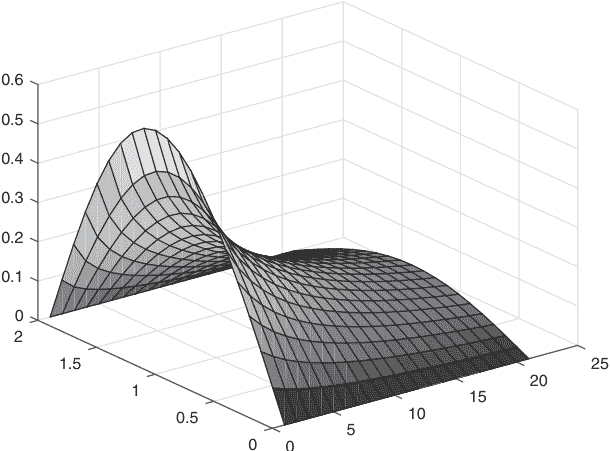

**图 7.1**  

`alpha = 0.5`时的相容分数阶热方程。

将方程(7.15)代入方程(7.14)，我们得到解

$$u(x,t)=\sum_{n=1}^{\infty}\sin\left(\frac{n\pi x}{L}\right)e^{-\left(\frac{n\pi}{L}\right)^2\frac{k t^{\alpha}}{\alpha}}\left[\frac{2}{L}\int_{0}^{L}f(x)\sin\left(\frac{n\pi x}{L}\right)dx\right].$$

分数阶热方程的`MATLAB`®仿真如图7.1所示。


```matlab
[X, T] = meshgrid(0:0.1:2, 1:21);
alpha = 0.5;
k = 0.1;
L = 2;
f = @(x) sin(x);
u = 0;
for n = 1:20
    fun = @(X) (sin(X).*sin((n.*pi.*X)./(L)));
    format long
    q = integral(fun, 0, L);
    u = u + sin((n.*pi.*X)./(L)).*exp(-(((n.*pi)./(L)).^2).*(k./alpha).*T.^(alpha)).*(2./L).*q;
end
surf(T, X, u)
```

### 7.4 谐振子的相容分数阶导数的模拟

分数阶谐振子由下式建模[30]：

$$\left(m\frac{d^{\alpha}}{dt^{\alpha}}+k\right)f(t)=0,\tag{7.16}$$

其中$\frac{d^{\alpha}f}{dt^{\alpha}}$表示$\alpha$阶经典分数阶导数。在本节中，我们用相容分数阶导数替换经典分数阶导数。因此谐振子方程的形式为：

$$m t^{1-\alpha}\frac{df}{dt}+k f(t)=0.\tag{7.17}$$

该方程的解为

$$f = c e^{-\frac{k}{m\alpha}t^{\alpha}}$$

相容分数阶谐振子的MATLAB仿真如图7.2所示。MATLAB代码如下：

```matlab
t = linspace(0, 5);
alpha1 = 0.3;
c = 0.5;
m = 0.3;
k = 0.2;
f = c.*(exp(-(k.*t.^alpha1)/(m.*alpha1)));
plot(t, f, 'r')
hold on
alpha2 = 0.5;
f1 = c.*(exp(-(k.*t.^alpha2)/(m.*alpha2)));
plot(t, f1, 'k')
hold on
alpha3 = 0.7;
f2 = c.*(exp(-(k.*t.^alpha3)/(m.*alpha3)));
plot(t, f2, 'b')
hold off
```

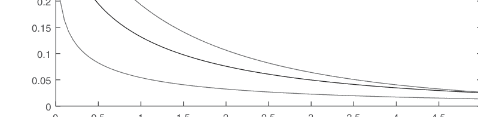

**图 7.2**

α=0.3、0.5和0.7时谐振子的相容分数阶导数。

### 7.5 香农小波与尺度函数的相容分数阶导数的模拟

香农小波理论[12,13,14]基于尺度函数$\phi(x)$（也称为`sinc`函数）和小波函数$\psi(x)$，它们的定义分别为

$$\phi(x) = \operatorname{sinc} x = \frac{\sin \pi x}{\pi x}$$

和

$$\psi(x) = \frac{\sin 2\pi (x - 1/2) - \sin \pi (x - 1/2)}{\pi (x - 1/2)}$$

尺度函数$\phi(x)$的相容分数阶导数为

$$\frac{d^\alpha \phi}{dx^\alpha} = x^{1-\alpha} \phi'(x)$$

这意味着

$$\frac{d^\alpha \phi}{dx^\alpha} = x^{1-\alpha} \frac{\pi x\cos \pi x - \sin \pi x}{\pi x^2}$$

小波函数$\psi(x)$的相容分数阶导数为

$$\frac{d^\alpha \psi}{dx^\alpha} = x^{1-\alpha} \psi'(x)$$

$$\frac{d^\alpha \psi}{dx^\alpha} = x^{1-\alpha} \frac{\pi (x - 1/2) [2\cos 2\pi(x-1/2) - \cos\pi(x-1/2)] + \sin\pi(x-1/2) - \sin2\pi(x-1/2)}{\pi (x - 1/2)^2}$$

尺度函数和小波函数的相容分数阶导数的MATLAB仿真如图7.3和图7.4所示。

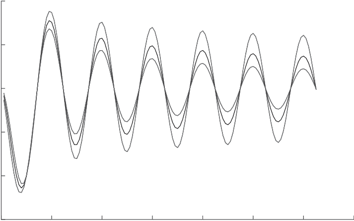

**FIGURE 7.3**

缩放函数的符合分数阶导数，α=0.2, 0.4 和 0.6。

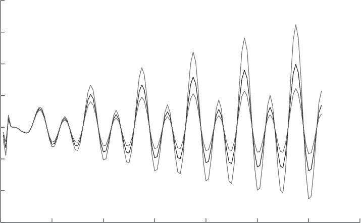

**FIGURE 7.4**

小波函数的符合分数阶导数，α=0.3, 0.5 和 0.7。

### 7.6 正弦-余弦小波符合分数阶导数的仿真

正弦-余弦小波 $\psi_{n,m}(t)=\psi(k,n,m,t)$ 涉及四个参数，$k=0,1,2,\ldots,n=0,\ldots,2^k-1$，值 $m$ 给出于式 (7.19) 且 $t$ 为归一化时间。它们定义在区间 $[0,1]$ 上，如 [41, 47, 54, 61]

$$\psi_{n,m}(t)=\begin{cases}2^{\frac{k+1}{2}}f_m(2^kt-n),&\frac{n}{2^k}\le t\le\frac{n+1}{2^k}\\0,&\text{otherwise.}\end{cases} \tag{7.18}$$

其中

$$f_m(t)=\begin{cases}\frac{1}{\sqrt{2}},&m=0\\\cos(2m\pi t),&m=1,2,\ldots,L\\\sin 2(m-L)\pi t,&m=L+1,L+2,\ldots,2L.\end{cases} \tag{7.19}$$

我们使用式 (7.3) 对符合分数阶导数

$$\frac{d^\alpha f_m}{dt^\alpha}=t^{1-\alpha}f'_m(t),$$

其中

$$f'_m(t)=\begin{cases}0,&m=0\\-2m\pi\sin 2m\pi t,&m=1,2,\ldots,L\\2(m-L)\pi\cos 2(m-L)\pi t,&m=L+1,L+2,\ldots,2L.\end{cases}$$

正弦小波符合分数阶导数的 MATLAB 程序：

```matlab
t=linspace(0,1,20);
L=20;
[T, m]=meshgrid (t, 1: L);
alpha=0.5;
Y=(T.^(1-alpha)).* (cos(2.*(m - L).*pi.*T)) .*(2.*(m - L).*pi);
surf(T,m,Y)
```

MATLAB program for conformable fractional derivative of cosine wavelet:

```matlab
t=linspace(0,1,20);
L=20;
[T, m]=meshgrid (t, 1: L);
alpha=0.5;
Y=(T.^(1-alpha)).*(-sin(2.*m.*pi.*T)).*2.*m.*pi;
surf(T,m,Y)
```

图 7.5 表示正弦-余弦小波的符合分数阶导数。

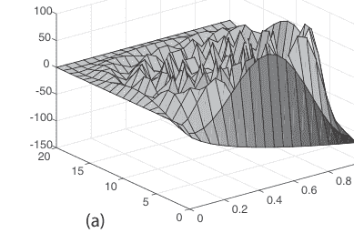

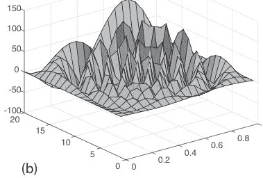

FIGURE 7.5

(a) 正弦小波的符合分数阶导数；(b) 余弦小波的符合分数阶导数。

### 7.7 未来研究工作的路线图

Adzievski 和 Siddiqi [4] 已使用 Mathematica 研究了偏微分方程的仿真。类似的方法可用于分数阶偏导数，特别是符合分数阶偏微分方程。我们中心（沙尔达大学应用数学与物理学高级研究中心）将在 [50] 第 3–15 页给出的分数阶偏微分方程的曲线数值方法方面开展此项研究。Harmann [30] 提出了经典分数阶导数如 Riemann、Caputo、Liouville 在物理学多个新兴领域应用的精美综述。符合导数于 2014 年引入，其在多个领域的应用最近已被研究。我们可研究符合分数阶导数在 Hermann 所考虑问题中的作用。第 7.5 节和 7.6 节已研究了 Shannon 小波和正弦-余弦小波的符合分数阶导数。未来工作我们计划研究分数阶微分方程的解并应用这些结果。

## References

- 1. Ahmad A. Abdelhakim, José A. Tenreiro Machado, A critical analysis of the conformable derivative, Nonlinear Dynamics, 95(4) (2019), pp. 3063–3073.
- 2. T. Abdeljawad, On conformable fractional calculus, Journal of Computational and Applied Mathematics, 279 (2015), pp. 57–66.
- 3. O. Acan, D. Baleanu, A new numerical technique for solving fractional partial differential equations, Miskole Mathematical Notes, 19(1) (2018), pp. 3–18.
- 4. K. Adzievski, A. H. Siddiqi, Introduction to Partial Differential Equations for Scientists and Engineers Using Mathematica, Chapman and Hall/CRC Press Taylor and Francis Group, 23 October 2013.
- 5. M. H. Akrami, G. H. Erjaee, Numerical solutions for fractional. Black scholes option pricing equation, Global Analysis and Discrete Mathematics, 1 (2016), pp. 9–14.
- 6. R. Almeida, What is the best fractional derivative to fit data?, arXiv:1704.00609 v1 [stat. OT] 31 March 2017.
- 7. Saeed Amir, Saeed Umer, Sine-cosine wavelet method for fractional oscillator equations, *Mathematical Methods in the Applied Sciences*, **42**(18) (July 2019), pp. 6960–6971.
- 8. D. R. Anderson, D. J. Ulness, Properties of the Katugampola fractional derivative with potential applications in quantum mechanics, *Journal of Mathematical Physics*, **56**(6) (2015), pp. 063502.
- 9. D. Avcı, B. R. I. Eroğlu, N. Özdemir, Conformable heat equation on a radial symmetric plate, *Thermal Science*, **21**(2) (2017), pp. 819–826.
- 10. S. Butera, M. D. Paola, A physically based connection between fractional calculus and fractal geometry, *Annals of Physics*, **350** (2014), pp. 146–158.
- 11. E. Camrud, A novel approach to fractional calculus: Utilizing fractional integrals and derivatives of the Dirac delta function, *Progress in Fractional Differentiation and Applications*, **4**(4) (2018), pp. 463–478.
- 12. C. Cattani, Shannon wavelets theory, *Mathematical Problems in Engineering*, **2008**, Article ID 164808 (2008), 24 pages.
- 13. C. Cattani, Connection coefficients of Shannon wavelets, *Mathematical Modeling and Analysis*, **11**(2) (2006), pp. 117–132.
- 14. C. Cattani, Fractional calculus and Shannon wavelet, **2012**, Article ID 502812, 26 pages, doi:10.1155/2012/502812.
- 15. C. Cattani, J. J. Rushchitsky, *Wavelet and Wave Analysis as Applied to Materials with Micro or Nanostructure*, volume 74 of Series Advances in Mathematics for Applied Sciences, World Scientific Publishing, Singapore, 2007.
- 16. Y. Çenesiz, A. Kurt, The solutions of time and space conformable fractional heat equations with conformable Fourier transform, *Acta Universitatis Sapientiae, Mathematica*, **7**(2) (2015), pp. 130–140.
- 17. J. Cheng, J. Nakagawa, M. Yamamoto, T. Yamazaki, Uniqueness in an inverse problem for one-dimensional fractional diffusion equation, *Inverse problem*, **25**(11) (2009) 115002.
- 18. Chunmei Chi, Feng Gao, Simulating fractional derivatives using MATLAB, *Journal of Software*, **8**(3) (March 2013), pp. 572–578.
- 19. A. O. Contreras, J. Rosales, L. M. Jimenez, J. M. Cruz-Duarte, Analysis of projectile motion in view of conformable derivative, *Open Physics*, **16**(1) (2018), pp. 581–587.
- 20. J. Cresson, Inverse problem of fractional calculus of variations for partial differential equations, *Communication in Nonlinear Sciences and Numerical Simulation*, **15**(4) (2010), pp. 987–996.
- 21. Z. L. Deng, X. M. Yang, X. L. Feng, A modification regularization method for a fractional diffusion inverse heat conduction problem, *Mathematical Problem in Engineering*, **2013**, Article ID 109340, 9 pages.
- 22. A. Dixit, A. Ujlayan, Analytical solution to linear conformable fractional partial differential equations, *World Scientific News* (WSN-3), **113** (2018), pp. 49–56.
- 23. Amita Garg, *Inverse Problems Related to Partial Differential Equations*, Ph.D. Thesis, Sharda University, Greater Noida, India, June 2017.
- 24. A. Garg, A. H. Siddiqi, Inverse estimation of 1-D heat problem with Neumann Boundary Condition by Morozov discrepancy principle, *Indian Journal of Industrial and Applied Mathematics*, **7**(1) (2016), pp. 58–64.
- 25. R. Garrappa, Numerical solution of fractional differential equations: A survey and a software tutorial, *Mathematics*, **6**(2), 16, (2018), pp. 1–23.


# NSCT 域中基于改进非局部均值引导图像滤波的 Pan-Sharpening

Tarlok Singh and Pammy Manchanda

## 目录

| 章节 | 页码 |
|---|---|
| 8.1 引言 | 117 |
| 8.2 提出的方法 | 119 |
| 8.2.1 非下采样轮廓波变换 | 119 |
| 8.2.1.1 非下采样金字塔 | 120 |
| 8.2.1.2 非下采样方向滤波器组 | 122 |
| 8.2.1.3 结合 NSP 和 NSDFB | 123 |
| 8.2.2 加权图 | 123 |
| 8.2.3 多尺度上的 Pan-Sharpening | 124 |
| 8.2.4 基于改进非局部均值的引导图像滤波器 | 125 |
| 8.2.4.1 引导图像滤波器 | 125 |
| 8.2.4.2 非线性核权重 | 126 |
| 8.2.4.3 引导图像构建 | 127 |
| 8.3 实验结果 | 128 |
| 8.3.1 视觉分析 | 129 |
| 8.3.2 定量分析 | 131 |
| 8.4 结论 | 132 |
| 参考文献 | 132 |

### 8.1 引言

遥感图像被广泛用于从矿物勘探到农业应用等不同领域 [1]，但高光谱图像质量低下会直接对这些应用产生不利影响 [2]。遥感图像 Pan-Sharpening 技术将高空间-低光谱分辨率图像与低空间-高光谱分辨率图像结合，以获得高质量图像 [3]。

卫星图像基本上分为两种类型：(a) 多光谱图像 (MS)，具有低空间和高光谱分辨率；以及 (b) 如表 8.1 所示的高空间和低光谱分辨率的宽波段图像。

图像 Pan-Sharpening 方法的需求源于卫星传感器在捕捉高空间分辨率 MS 图像时面临的技术困难。这是因为通过 Pan 图像计算的详细地图被注入以锐化 MS 图像。计算详细地图是 Pan-Sharpening 程序的主要目标。

#### 表8.1

多光谱图像与全色图像对比

| 图像 | 空间分辨率 | 光谱分辨率 |
|---|---|---|
| 多光谱 | 低 | 高 |
| 全色 | 高 | 低 |

图8.1显示了全色图像和多光谱图像融合为全色锐化图像的效果。

强度-色相-饱和度（IHS）方法首先将RGB（红、绿、蓝）转换为IHS空间，然后用全色图像替换强度波段。最后，该新图像从IHS逆映射回RGB空间。这种基于IHS的传统方法执行起来高效且简单，但无法增强基于RGB的多光谱图像，并且由于融合后的多光谱图像之间的颜色变化以及重采样波段的组合，通常在光谱方面存在较大失真。因此，它忽略了近红外波段（NIR），而该波段是RGB之后的第四个波段。[4]研究了一种针对IKONOS影像的带光谱调整的快速全色锐化技术。IKONOS是一颗商业对地观测卫星，可采集多光谱和全色图像。

在[5]中，两种方法被合并形成一种混合全色锐化方案：（a）结合轮廓波变换（CT）的局部变化；（b）自适应PCA和CT。与APCA+CT、APCA、PCA+CT和PCA相比，其性能更好。因此，对于多光谱卫星图像，通过引入全色图像并提取更高空间细节来增强空间细节。[6]讨论了一种基于深度神经网络的全色锐化方法，通过组合多个非线性层来建模自变量之间的复杂关系。在完整深度神经网络的预训练阶段之后，还使用反向传播作为第二个训练阶段来改进训练。在[7]中，研究了一种基于自适应技术的图像稀疏全色锐化方法。它不假设全色图像的光谱结构，并继承了稀疏信号重建超

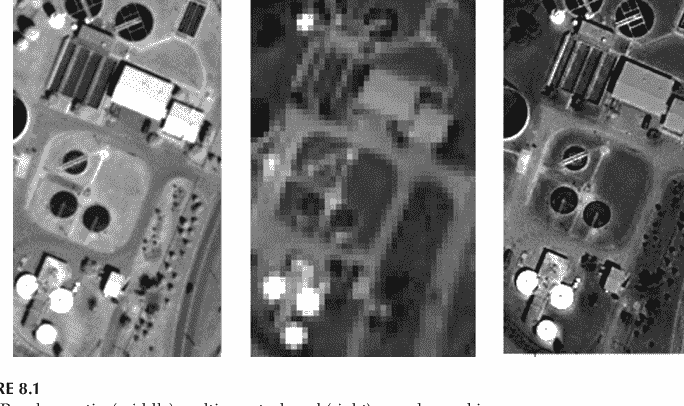

#### 图8.1

（左）全色，（中）多光谱，（右）全色锐化图像。

分辨率能力；它产生较少的光谱失真和更高的空间分辨率。[8]讨论了一种使用广义引导滤波和贝叶斯非局部均值去除散斑噪声的方法。它计算非线性权重核，并通过考虑最大似然准则和局部区域的均匀性分析来生成引导图像。

由于其鲁棒性和有效性，基于拉普拉斯金字塔分解的多尺度全色锐化方法被广泛使用，例如可平移复方向金字塔[9]、对比度金字塔变换[10]、图像分解[11]、多特征拉普拉斯金字塔（LPMF）[12]等。这些技术已成为一种流行的方法，在许多基于全色锐化的应用中显示出实用性。然而，金字塔层数随图像尺寸增加而增加，这意味着复杂的数据管理和内存访问，以及额外的计算[13]。由于系数依赖性的丢失，大多数传统的基于多尺度分解的图像全色锐化方法都存在图像表示不准确的问题。为了克服这些问题，使用了非下采样剪切波变换（NSST）。NSST系数的依赖性由上下文隐马尔可夫模型[14]捕获。将显式亮度和对比度掩蔽模型相结合，以给出由双树复小波变换生成的源图像每个系数的感知重要性。这种感知重要性的组合模型用于选择保留哪些系数，并进一步确定如何以最有效的方式呈现保留的信息，如[15]所述。在本章中，我们提出了一种新颖的图像全色锐化方法来解决这些局限性。所提出的方法评估输入图像的权重值，然后使用相应的全色锐化图来生成最终的融合图像。为了进一步减少光晕和梯度反转伪影，提出了一种改进的基于非局部均值的引导图像滤波器（MNLMGIF），并将其作为后处理技术应用于融合图像。因此，该方法保留了来自两幅图像的所有信息，这是大多数现有全色锐化方法没有做到的。此外，所提出的技术可以使用MNLMGIF减少梯度和光晕伪影问题。为了定量验证所提出方法的效率，已经在遥感图像[16]、QUICKBIRD[17]、IKONOS[18]和MODIS[19]传感器上进行了实验。

本章其余部分组织如下：8.2节讨论了一种基于滤波的图像全色锐化技术。为了验证所提出技术的有效性，8.3节在遥感图像上进行了视觉和定量结果验证。8.4节给出了结论和未来方向。

### 8.2 提出的方法

## 参考文献

- 26. R. Garrappa, *Short Tutorial: Solving Fractional Differential Equations by MATLAB Codes*, 30 June 2014, https://www.scribd.com/document/350991589.
- 27. C. W. Groetsch, *Inverse Problems Activities for Undergraduate*, Washington, DC: Mathematical Association of America, 1999.
- 28. A. Hammad, R. Khalil, Fractional Fourier series with applications, *American Journal of Computational and Applied Mathematics*, **4**(6) (2014), pp. 187–191.
- 29. A. Hammad, R. Khalil, Conformable fractional heat differential equation, *International Journal of Pure and Applied Mathematics*, **94**(3) (2014), pp. 215–221.
- 30. R. Hermann, *分数阶微积分：物理学家的入门*, 第2版, World Scientific Publishing Co. Pvt. Ltd., 2014
- 31. Mesut Karabacak, Muhammed Yiğider, Shannon 小波变换求解分数阶微分代数方程的数值方法, *International Journal of Engineering and Applied Sciences*, **3(12)** (2016), pp. 56–61.
- 32. R. Khalil, M. A. Horani, A. Yousef, M. Sabehah, 分数阶导数的新定义, *Journal of Computational and Applied Mathematics*, **264** (2014), pp. 65–70.
- 33. Yasir Khan, Naeem Faraz, 具有关于 $d^{\alpha}$ 的积分的修正分数阶分解方法, *Journal of King Saud University-Science*, **23(2)** (2011), pp. 157–161.
- 34. Anatoly A. Kilbas, Hari M. Srivastava, Juan J. Trujillo, 分数阶微分方程理论与应用, *North-Holland Mathematics Studies*, **204** (2006), pp. 1–523.
- 35. M. Kirane, S. A. Malik, 确定线性热方程中涉及时间分数阶导数的未知源项和温度分布, *Applied Mathematics and Computation*, **218(1)** (2011), pp. 163–170.
- 36. V. Lakshmikantham, A. S. Vatsala, 分数阶微分方程的基本理论, *Nonlinear Analysis: Theory, Methods and Applications*, **69(8)** (2008), pp. 2677–2682.
- 37. J. T. Machado, V. Kiryakova, F. Mainardi, 分数阶微积分的近期历史, *Communications in Nonlinear Science and Numerical Simulation*, **16(3)** (2011), pp. 1140–1153.
- 38. P. Manchanda, R. Lozi, A. H. Siddiqi, 数学建模、优化、解析与数值解法, Springer Nature (2019), pp. 1–426.
- 39. Shuman Meng, Yujun Cui, 涉及积分边界条件的可形分数阶微分方程的极值解, *Mathematics*, **186** (2019), pp. 1–9.
- 40. L. Miller, M. Yamamoto, 分数阶扩散方程的系数反问题, *Inverse Problems*, **29(7)** (2013), p. 075013 (8pp.).
- 41. I. Nagma, A. H. Siddiqi, 震 seismology 中 Hankel 变换数值求值的正弦-余弦小波方法, *Applied Mathematical Modelling*, **40(7–8)** (2016), pp. 4900–4907.
- 42. A. Neamaty, B. Agheli, R. Darzi, 利用小波运算方法求解分数阶偏微分方程, *Journal of Mathematics and Computer Science*, **7(4)** (2013), pp. 230–240.
- 43. R. I. Nurudeen, F. D. Zaman, Y. F. Zakariya, 通过分解方法比较分数阶热扩散方程解与新的分数阶导数, *Malaya Journal of Matematik*, **7(2)** (2019), pp. 213–222.
- 44. E. C. Oliveira, J. A. T. Machado, 分数阶导数和积分定义的综述, *Mathematical Problems in Engineering*, **2014**, Article ID 238459, 6 pages.
- 45. M. D. Ortigueira, J. A. T. Machado, 什么是分数阶导数？, *Journal of Computational Physics*, **293(15)** (2015), pp. 4–13.
- 46. Ivo Petras, MATLAB 中的分数阶导数、分数阶积分和分数阶微分方程, 2011. www.intechopen.com.
- 47. M. Razzaghi, S. Yousefi, 积分的正弦-余弦小波运算矩阵及其在变分学中的应用, *International Journal of Systems Science*, **33(10)** (2002), pp. 805–810.
- 48. K. Sakamoto, M. Yamamoto, 分数阶扩散-波动方程的初值/边值问题及其在某些反问题中的应用, *Journal of Mathematical Analysis and Applications*, **382(1)** (2011), pp. 426–447.
- 49. J. Shen, G. Strang, 关于热方程的小波基本解——热小波, *Journal of Differential Equations*, **161(2)** (2000), pp. 403–421.
- 50. A. H. Siddiqi, 小波方法的新兴应用导言, *AIP Conference Proceedings*, **1463** (2012), p. 1.
- 51. A. H. Siddiqi, M. A. Lawati, M. Boulbrachene, *现代工程数学*, New York: CRC Press Taylor and Francis Group, 2017.
- 52. A. H. Siddiqi, R. C. Singh, G. D. V. Gowda, *应用计算科学*, New York: CRC Press, Taylor and Francis Group (in the press), 2019.
- 53. H. Sun, Y. Zhang, D. Baleanu, W. Chen, Y. Chen, 分数阶微积分在科学与工程中的现实世界应用新集合, *Communications in Nonlinear Science and Numerical Simulation*, **64** (2018), pp. 213–231.
- 54. M. Tavassoli Kajani, M. Ghasemi, E. Babolian, 利用正弦-余弦小波求解线性积分微分方程的数值解, *Applied Mathematics and Computation*, **180(2)** (2006), pp. 569–574.
- 55. S. L. Brunton, J. N. Kutz, 数据驱动的科学与工程：机器学习、动力系统与控制, 2019, pp. 1–472.
- 56. A. Judith, L. Wan, L. R. White, Fourier 卷积型反问题的数值解法, *Applied Mathematical Modelling*, **15(7)** (1991), pp. 359–366.
- 57. Fuat Usta, 采用配点法求解分数阶椭圆偏微分方程的数值解, *Applications and Applied Mathematics: An International Journal*, **12(1)** (June 2017), pp. 470–478.
- 58. Wu Xiao-Er, Liang Yang-Shun, 分形维数与分数阶微积分的关系, *Nonlinear Science Letter*, **1** (2017), pp. 1–10.
- 59. X. Xiong, H. Guo, X. Liu, 分数阶扩散方程的一个反问题, *Journal of Computational and Applied Mathematics*, **236(17)** (2012), pp. 4474–4484.
- 60. S. Yang, L. Wang, S. Zhang, 可形导数在低渗透多孔介质非达西流中的应用, *Applied Mathematics Letters*, **79** (2018), pp. 105–110.
- 61. Yanxin Wang, Tianhe Yin, Li Zhu, 分数阶积分的正弦-余弦小波运算矩阵及其在求解分数阶 Riccati 微分方程中的应用, *Advances in Difference Equations*, **222** (2017).
- 62. Monika Zecova, Jan Terpak, 利用分数阶导数建模热传导, *Applied Mathematics and Computation*, **257** (2015), pp. 365–373.
- 63. Y. Zhang, X. Xu, 分数阶扩散方程的反问题, *Inverse Problems*, **27(3)** (2011), pp. 1–12.
- 64. Dazhi Zhao, Maokang Luo, 一般可形分数阶导数及其物理解释, *Calcolo*, **54(3)** (2017), pp. 903–917.
- 65. H. W. Zhou, S. Yang, S. Q. Zhang, 可形导数方法在反常扩散中的应用, *Physica A*, **491** (2018), pp. 1001–1013.
- 66. Z. Zhao, O. Xie, Z. Meng, L. You, Hilbert 尺度中 Tikhonov 正则化方法确定热方程中的未知源, *Journal of Applied Mathematics and Physics*, **2** (2014), pp. 10–17.
- 67. Z. Zhou, X. Gao, 用时间分数阶 PDE 模型对美式期权定价的数值方法, *Mathematical Problems in Engineering*, **2016**, Article ID 5614950.
- 68. M. S. Zurigat, A. A. Momani, A. Alawneh, 采用同伦分析法求解分数阶代数-微分方程组的解析近似解, *Computers and Mathematics with Applications*, **59(3)** (2010), pp. 1227–1235.


# 8.2 所提出的方法

本节讨论所提出的方法。采用系统化流程来评估权重图、多尺度图像全色锐化、用于滤波的引导图像生成，最后使用MNLMGIF进行全色锐化。图8.2展示了说明该技术的图形流程概述。

#### 图8.2

所提出的全色锐化技术的图形摘要。

## 8.2.1 非下采样轮廓波变换

非下采样轮廓波变换（NSCT）是著名的轮廓波变换（CT）[20]的扩展。CT的多尺度分解特性通过使用拉普拉斯金字塔（LP）实现。方向滤波器组（DFB）用于生成CT的方向分解。LP和DFB分别使用下采样器和上采样器[21]。NSCT使用非下采样金字塔（NSP）和非下采样DFB设计，以实现平移不变特性（见图8.3）[22]。

#### 图8.3

（a）实现NSCT的NSFB结构；（b）通过NSFB结构获得的理想化频率划分（Yang等人，2015）。

### 8.2.1.1 非下采样金字塔（NSP）

非下采样金字塔保证了NSCT的多尺度特性。NSP依赖于两通道非下采样二维滤波器组。NSP的三级分解如图8.4(a)所示。如果滤波器满足Bezout恒等式，则可实现高效重构，该恒等式定义为[22]：

```
H₀(z)G₀(z) + H₁(z)G₁(z) = 1
```

这里，`G₀(z)`和`G₁(z)`分别表示低通和高通重构滤波器。`H₀(z)`和`H₁(z)`分别表示低通和高通分解滤波器。

第`j`级低通滤波器的通带频率支持区域为`[−π/2ʲ, π/2ʲ]²`。同样，高通滤波器的支持区域是低通支持区域的补集。

#### 图8.4

非下采样金字塔：（a）三级金字塔分解；（b）非下采样金字塔的频率划分（Yang等人，2015）。

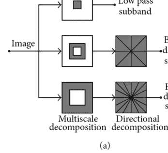

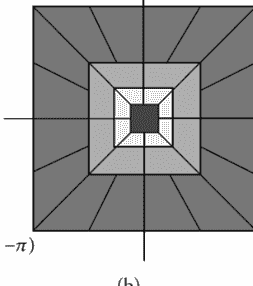

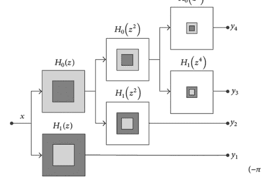

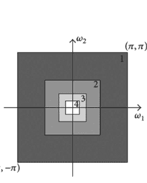

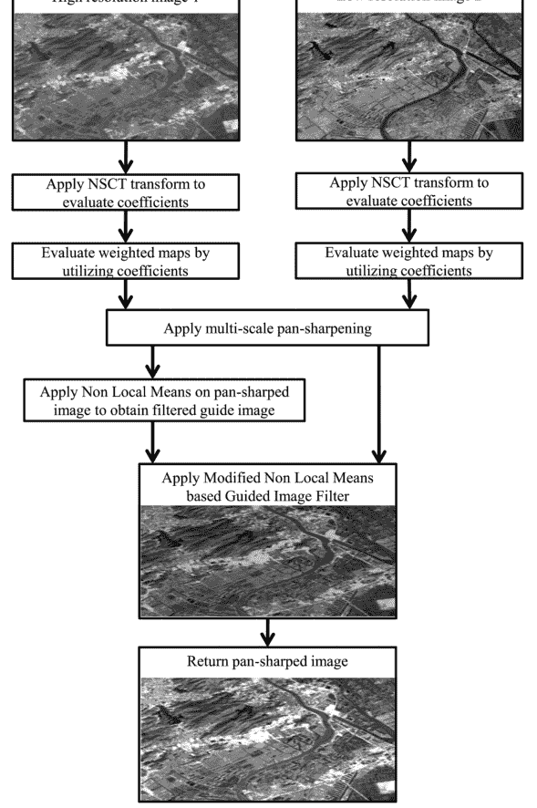

## 8.2.2 权重图评估

输出结果中更好地描绘了饱和区域。显著性权重图计算相对于邻域区域的可见程度。它基本上基于系数方向和值，衡量NSDFB中一个区域或片段相对于其周围环境的相对系数。如[25]所讨论的，权重定义如下：

```
$$W_n^S = ||\text{NSDFB}_n^f - \text{NSDFB}_n^{\text{avg}}||$$
```

这里，`NSDFB_n^avg`是NSDFB的平均系数值，并且来自需要去除高频噪声的低分辨率图像。它通过将截止频率的高频值（`f = π/2.75`）代入可分离二项式核获得。因此，这三种度量在不同方面的影响都很重要，但第一个度量，即亮度权重图，总体上具有更大的可见性影响。聚合权重图通过乘法表达式获得：

```
$$W_n = W_n^L \times W_C^n \times W_n^S$$
```

聚合权重的归一化形式保证了每个像素的权重之和为1：

```
$$\overline{W_n} = \frac{W_n}{\sum W_n}$$
```

## 8.2.3 多尺度全色锐化

在图像全色锐化过程中，计算加权输入以更显著地检测每个像素的特征：

```
$$F = \sum_n \overline{W_n} I_n \text{s.t.} \sum_n \overline{W_n} = 1$$
```

上述计算中使用了归一化权重图，因此保持了结果图像的强度尺度。但该方程在权重图过渡较强的地方可能导致光晕伪影。因此，采用一种称为金字塔细化的方法[26]来消除这种退化。在所提出的方法中，`I_n`实际上使用拉普拉斯算子分解为不同尺度的金字塔。与此同时，`\overline{W_n}`也通过高斯金字塔为其每个加权归一化图推导得到。现在，在每个相应的金字塔级别`i`（默认值`i=5`）上，按如下方式进行混合：

```
$$F_i = \sum_n G_i(\overline{W_n}) L_i(I_n)$$
```

其中，`L_i`是输入`I`的拉普拉斯运算，`G_i(\overline{W_n})`是对加权归一化图`\overline{W_n}`的高斯算子。对各个金字塔层采用自底向上的方向，并使用上采样算子`U(x)`（`x=2^{i-1}`）累加所有金字塔层后，计算`I`的最终恢复版本。

```
$$G(x) = \sum_i F_i(x) U(x)$$
```

在所提出的方法中，这三个权重对最终的全色锐化结果具有相同的加权贡献。

## 8.2.4 改进的基于非局部均值的引导图像滤波（MNLMGIF）

后续章节将围绕引导滤波、非线性权重核的计算以及引导图像的形成展开讨论。

### 8.2.4.1 引导图像滤波

引导滤波用于在引导图像`I`与滤波输出`λ`之间依赖关系的假设下保留边缘，如文献[27]所研究。设`wₙ`为以像素`n`为中心的窗口，通过滤波输入`p`得到`(αₙ, βₙ)`，则

```
$$\lambda_i = \alpha_n\gamma_i + \beta_n,\ \forall i \in w_n$$  (8.13)
```

然而，像素`i`会出现在覆盖`i`的所有重叠窗口`wₙ`中，因此`λᵢ`在式(13)中不同窗口计算得到的值并不相同。一种简单的策略是对`λᵢ`所有可能的值取平均。因此，在计算图像中所有窗口`wₙ`的`(αₙ, βₙ)`之后，滤波输出由下式得到：

```
$$\lambda_i = \frac{1}{|w|}\sum_{n}(\alpha_n\gamma_i+\beta_n)$$  (8.14)
```

利用文献[28]中的最小均方思想，并令`Aₙ,ⱼ`和`βₙ,ⱼ`依赖于引导图像`g`，可以得到：

```
$$\alpha_n = \sum_n A_{n,j}(g)p_j$$  (8.15)
$$\beta_n = \sum_n \beta_{n,j}(g)p_j$$  (8.16)
```

因此，`λᵢ`可以重新表示为：

```
$$\lambda_i = \frac{1}{|w|}\sum_i\sum_j[A_{n,j}(\gamma_i)\gamma_i + \beta_{n,j}(g)]p_j$$  (8.17)
```

令`W_{n,j}(g)=\frac{1}{|w|}\sum_n[g\cdot A_{n,j}(\gamma_i)+\beta_{n,j}(\gamma_i)]`为核权重，则

```
$$\lambda_i = \sum_j W_{n,j}(\gamma_i)p_j,\ \forall i \in w_n$$  (8.18)
```

进一步可以推导出

```
$$\lambda_i = \sum_j W_{i,j}(\gamma_i)p_j$$  (8.19)
```

其中`k`满足`(i, j) ∈ wₙ`。为了解决滤波问题，将线性引导滤波推广为其非线性版本，该版本考虑滤波输入`f`（即斑点图像），称为GGF滤波。滤波图像（`d_i`）可以利用斑点图像（`f`）和引导图像（`f^g`）计算得到。设`{i,j}`为像素位置，`f`已知，因此需要计算核的非线性权重`W_{i,j}`，以及引导图像`f^g`的构造。

```
$$d_i=\sum_j W_{i,j}(f,f^g)f_j$$  (8.20)
```

权重可以使用BNLM（贝叶斯非局部均值）计算，引导图像则可以通过局部区域和最大似然准则获得。

### 8.2.4.2 非线性核权重

根据文献[29]，BNLM可表示如下。设`f_j`为第`j`个像素处的斑点数据，`v_i`、`v_j`是中心位于`(i,j)`、大小为`N×N`的块向量。`p(v_i|v_j)`是`v_i`与`v_j`块之间相似性的度量。

```
$$d_i=\frac{\sum_j p(v_i|v_j)p(v_j)f_j}{\sum_j p(v_i|v_j)p(v_j)}$$  (8.21)
```

设`r_i`、`r_j`为斑点块`v_i`、`v_j`的雷达反射率，用于处理具有相似反射率或外观几乎相同的块。将引导图像考虑在内后，更新后的方程为：

```
$$d_i=\frac{\sum_j p(v_i|v_j,r_i=r_j,f^g)p(v_j,r_i=r_j,f^g)v_j}{\sum_j p(v_i|v_j,r_i=r_j,f^g)p(v_j,r_i=r_j,f^g)}$$  (8.22)
```

对于独立的斑点，条件概率`p(.)`现在可以定义为：

```
$$p(v_i,v_j,r_i=r_j,f^g)=\prod_n p(v_{i,n}|v_{j,n},r_{i,n}=r_{j,n},f_n^g)$$  (8.23)
```

假设`f_g^m`独立于事件集`{v_{i,m}|v_{j,m},r_{i,m}=r_{j,m}}`，并且没有关于`p(v_{i,m}|v_{j,m})`的先验知识，则有

```
$$p(v_{j,m},r_{i,m}=r_{j,m},f_g^m)p(v_{i,m}|v_{j,m},r_{i,m}=r_{j,m},f_g^m)$$
$$=p(v_{i,m},v_{j,m},r_{i,m}=r_{j,m},f_g^m)$$
$$=p(r_{i,m}=r_{j,m},f_g^m)p(v_{i,m},v_{j,m}|r_{i,m}=r_{j,m},f_g^m)$$
$$\propto p(f_g^m)p(r_{i,m}=r_{j,m}|f_g^m)p(v_{i,m},v_{j,m}|r_{i,m}=r_{j,m},f_g^m)$$  (8.24)
```

设`p_llhd`、`p_pr`分别为似然概率和先验概率，则可以假设

```
$$p_{\mathrm{llhd}}=p(v_{i,m},v_{j,m}|r_{i,m}=r_{j,m})$$  (8.25)
$$p_{\mathrm{pr}}=p(r_{i,m}=r_{j,m}|f_g^m)$$  (8.26)
```

似然项对应于数据的保真度，先验项在给定`f_g^m`（即引导图像值）时估计`r_{i,m}=r_{j,m}`的有效性。假设`p(f_g^m)`的分布是均匀的。因此可以得出结论：

```
p_{llhd} ∝ Θ^{2N-1}，其中 Θ = [ v_{i,m} v_{j,m} / (v_{i,m}^2 + v_{j,m}^2) ]  (8.27)
p_{pr} ∝ exp(-A·Φ)，其中 Φ = ( | (f_{i,m}^g)^2 - (f_{j,m}^g)^2 | / [ (f_{i,m}^g)^2 (f_{j,m}^g)^2 ] )  (8.28)
```

利用Nakagami分布和Rayleigh分布的思想，对于`N`视图像[30]，用幅度`A`表示图像`i`：

```
$$p(i | f) = 2 (N / r)^N 1 / \Gamma(N) exp( - N i^2 / r ) i^{2N-1}$$  (8.29)
```

设`i`和`f`分别为斑点图像和引导图像。`C`、`D`是用于归一化以相对计算这些图像的常数。因此，非线性系统的GGF核权重变为

```
$$W_{i,j}(i, f^g) = exp( -1/C \sum_m 1/\Theta + N/D \sum_m \Phi )$$  (8.30)
```

在非线性引导滤波中，恰当选择引导图像对于去除斑点噪声至关重要。分析方程(8.30)可以观察到，通过调节`N`、`C`、`D`，可以使用不同范围的核权重值来决定`i`或`f^g`对最终滤波输出的比例影响。

### 8.2.4.3 引导图像构建

文献中已知，引导图像在图像滤波中起着至关重要的作用，实际上被视为`f`的先验值估计。本文提出了一种从原始图像构建引导图像的思想，该引导图像尽可能接近原始图像。基于局部区域均匀性的分析，像素强度方差可用作均匀性度量[8]。按照文献[31]和[32]所述，将原始图像划分为不同区域。计算三个方差如下：

```
ζ₁ = √[ (4/π -1) / N ]  (8.31)
ζ₂ = √3·ζ₁  (8.32)
ζ₃ = √var(c_i) / M[ζ_i]  (8.33)
```

使用五幅基准遥感图像进行性能评估。然而，所提出的技术并不局限于这五幅图像。基准图像来自QUICKBIRD [17]、IKONOS [18]和MODIS [19]传感器。后续章节将包含视觉分析和定量分析的细节。

# 8.3 实验结果

## 8.3.1 视觉分析

图8.7(a)、8.8(a)和图8.7(b)、8.8(b)分别显示了IKONOS [18]和MODIS [19]传感器的高空间分辨率全色图像和较低空间分辨率图像。表8.2和表8.3描绘了由以下方法获得的全色锐化图像：

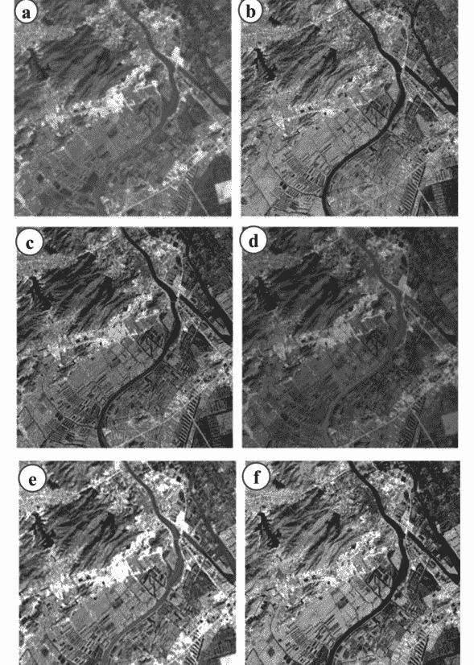

#### 图8.7

遥感图像1的实验结果：（a）高空间分辨率全色图像，（b）较低空间分辨率图像，（c）CT，（d）LPMF，（e）NSST，（f）所提出的方法。

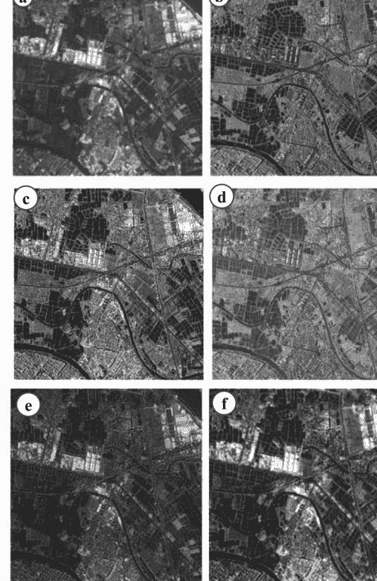

#### 图8.8

遥感图像2的实验结果：（a）高空间分辨率全色图像，（b）较低空间分辨率图像，（c）CT，（d）LPMF，（e）NSST，（f）所提出的方法。

#### 表8.2

熵分析

| 方法 | 图像1 | 图像2 | 图像3 | 图像4 | 图像5 |
|---|---|---|---|---|---|
| CT | 7.012 | 7.132 | 7.102 | 7.272 | 7.376 |
| LPMF | 7.481 | 7.450 | 7.581 | 7.651 | 7.427 |
| NSST | 7.794 | 7.816 | 7.768 | 7.678 | 7.656 |
| 所提方法 | 7.951 | 7.894 | 7.871 | 7.928 | 7.981 |

#### 表8.3

融合因子分析

| 方法 | 图像1 | 图像2 | 图像3 | 图像4 | 图像5 |
|---|---:|---:|---:|---:|---:|
| CT | 5.671 | 5.358 | 5.053 | 5.981 | 5.355 |
| LPMF | 5.956 | 5.378 | 5.133 | 5.555 | 5.335 |
| NSST | 6.531 | 6.351 | 5.891 | 5.998 | 6.355 |
| **所提方法** | **6.831** | **6.953** | **6.396** | **6.689** | **6.953** |

CT、LPMF、NSST和所提出的技术分别。已经观察到，与现有技术相比，所提出的技术能够保留良好的空间、光谱和纹理信息。与现有的全色锐化技术相比，所提出的技术还显示出更少的边缘和更轻的颜色失真。

## 8.3.2 定量分析

这些比较是基于各种性能指标在现有技术与所提出的全色锐化技术之间进行的，如熵、融合因子、峰值信噪比（PSNR）和结构相似性指数（SSIM）。

表8.2至表8.5描绘了现有技术（即CT、LPMF、NSST）和所提出技术的性能分析。

表8.2给出了需要最大化的熵值。从表8.2可以看出，与CT、LPMF和NSST相比，所提出的技术具有显著更高的熵值。

表8.3描绘了全色锐化技术的融合因子分析。该指标需要最大化。因此，表8.3表明，与现有技术相比，所提出的技术提供了显著更高的融合因子值。

表8.3显示了融合因子分析，该指标需要最大化。因此，表8.3清楚地表明，所提出的技术具有更好的融合因子，优于现有技术。

#### 表8.4

峰值信噪比评估

| 方法 | 图像1 | 图像2 | 图像3 | 图像4 | 图像5 |
|---|---:|---:|---:|---:|---:|
| CT | 39.91 | 36.81 | 34.19 | 38.92 | 39.88 |
| LPMF | 36.41 | 36.94 | 36.48 | 38.84 | 38.19 |
| NSST | 40.23 | 39.46 | 34.49 | 39.18 | 39.93 |
| **所提方法** | **42.91** | **39.81** | **39.19** | **40.32** | **42.88** |

#### 表8.5

结构相似性指数度量评估

| 方法 | 图像1 | 图像2 | 图像3 | 图像4 | 图像5 |
|---|---:|---:|---:|---:|---:|
| CT | 0.891 | 0.912 | 0.919 | 0.971 | 0.897 |
| LPMF | 0.981 | 0.899 | 0.923 | 0.924 | 0.948 |
| NSST | 0.985 | 0.948 | 0.915 | 0.949 | 0.948 |
| **所提方法** | **0.987** | **0.962** | **0.957** | **0.964** | **0.967** |

# 参考文献

9. Qiang Zhang, Long Wang, Huijuan Li, and Zhaokun Ma. Similarity-based multimodality image fusion with shiftable complex directional pyramid. *Pattern Recognition Letters*, 32(13):1544–1553, 2011.

10. Hua Xu, Yan Wang, Yujing Wu, and Yunsheng Qian. Infrared and multi-type images fusion algorithm based on contrast pyramid transform. *Infrared Physics and Technology*, 78:133–146, 2016.

11. Zhaodong Liu, Yi Chai, Hongpeng Yin, Jiayi Zhou, and Zhiqin Zhu. A novel multi-focus image fusion approach based on image decomposition. *Information Fusion*, 35:102–116, 2017.


- 12. Jiao Du, Weisheng Li, Bin Xiao, and Qamar Nawaz. Union laplacian pyramid with multiple features for medical image fusion. *Neurocomputing*, 194:326–339, 2016.

- 13. C. O. Ancuti, C. Ancuti, C. De Vleeschouwer, and A. D. C. Kik. Single-scale fusion: An effective approach to merging images. *IEEE Transactions on Image Processing*, 26(1):65–78, 2017.

- 14. X. Luo, Z. Zhang, B. Zhang, and X. Wu. Image fusion with contextual statistical similarity and nonsampled shearlet transform. *IEEE Sensors Journal*, 17(6):1760–1771, 2017.

- 15. P. Hill, M. E. Al-Mualla, and D. Bull. Perceptual image fusion using wavelets. *IEEE Transactions on Image Processing*, 26(3):1076–1088, 2017.

- 16. Landsat images. `http://gisgeography.com/landsat-program-satellite-imagery-bands/`, accessed in 2015.

- 17. QUICKBIRD. *Global Land Cover Facility*, July 2016.

- 18. IKONOS. *Ikonos Satellites*, July 2016.

- 19. MODIS. *Global Land Cover Facility*, July 2016.

- 20. G. Bhatnagar, Q. M. J. Wu, and Z. Liu. Directive contrast based multimodal medical image fusion in NSCT domain. *IEEE Transactions on Multimedia*, 15(5):1014–1024, 2013.

- 21. W. Xie, L. Jiao, and J. Zhao. PolSAR image classification *via* D-KSVD and NSCT-domain features extraction. *IEEE Geoscience and Remote Sensing Letters*, 13(2):227–231, 2016.

- 22. Y. Yang, S. Tong, S. Huang, and P. Lin. Multifocus image fusion based on NSCT and focused area detection. *IEEE Sensors Journal*, 15(5):2824–2838, 2015.

- 23. Arthur L. Da Cunha, Jianping Zhou, and Minh N. Do. The nonsubsampled contourlet transform: Theory, design, and applications. *IEEE Transactions on Image Processing*, 15(10):3089–3101, 2006.

- 24. Raanan Fattal. Single image dehazing. *ACM Transactions on Graphics (TOG)*, 27(3):72, 2008.

- 25. Radhakrishnan Achanta, Sheila Hemami, Francisco Estrada, and Sabine Susstrunk. Frequency-tuned salient region detection. In: *IEEE Conference on Computer Vision and Pattern Recognition, 2009 (CVPR 2009)*, pages 1597–1604. IEEE, 2009.

- 26. Peter Burt and Edward Adelson. The laplacian pyramid as a compact image code. *IEEE Transactions on Communications*, 31(4):532–540, 1983.

- 27. Kaiming He, Jian Sun, and Xiaoou Tang. Guided image filtering. *IEEE Transactions on Pattern Analysis and Machine Intelligence*, 35(6):1397–1409, 2013.

- 28. A. Buades, B. Coll, and J.-M. Morel. A non-local algorithm for image denoising. In: *IEEE Computer Society Conference on Computer Vision and Pattern Recognition, 2005 (CVPR 2005)*, volume 2, pages 60–65. IEEE, 2005.

- 29. Pierrick Coupe, Pierre Hellier, Charles Kervrann, and Christian Barillot. Bayesian non local means-based speckle filtering. In: *5th IEEE International Symposium on Biomedical Imaging: From Nano to Macro, 2008. ISBI 2008*, pages 1291–1294. IEEE, 2008.

- 30. H. Zhong, Y. Li, and L. C. Jiao. Sar image despeckling using bayesian nonlocal means filter with sigma preselection. *IEEE Geoscience and Remote Sensing Letters*, 8(4):809–813, 2011.

- 31. A. Lopes, R. Touzi, and E. Nezry. Adaptive speckle filters and scene heterogeneity. *IEEE Transactions on Geoscience and Remote Sensing*, 28(6):992–1000, 1990.

- 32. Guang-Ting Li, Chun-Le Wang, Ping-Ping Huang, and Wei-Dong Yu. Sar image despeckling using a space-domain filter with alterable window. *IEEE Geoscience and Remote Sensing Letters*, 10(2):263–267, 2013.

Taylor & Francis

Taylor & Francis Group

`http://taylorandfrancis.com`

# 9 Moser-Trudinger and Adams Inequalities

Kunnath Sandeep

## CONTENTS

- 9.1 Introduction...............................................................................135
- 9.2 Preliminaries.............................................................................137
- 9.3 Moser–Trudinger...........................................................................139
- 9.4 Adams Inequality..........................................................................142
- References......................................................................................147

### 9.1 Introduction

In this chapter we will focus on the sharp Sobolev inequalities known as the Moser–Trudinger and Adams inequalities.

Recall the well-known classical Sobolev inequality which states there exists an optimal constant $S_n>0$ such that the inequality

$S_n\left[\int_{\mathbb{R}^n}|u|^{2^*}dx\right]^{\frac{2}{2^*}} \le \int_{\mathbb{R}^n}|\nabla u|^2 dx \quad (9.1)$

holds for all $u \in C_c^1(\mathbb{R}^n)$, $n\ge 3$, where $2^* = \frac{2n}{n-2}$. It immediately follows from this inequality that if $\Omega$ is a bounded domain in $\mathbb{R}^n$ and $1\le p\le 2^*$, then there exists an optimal constant $C_{n,p,\Omega}>0$ such that

$C_{n,p,\Omega}\left[\int_{\Omega}|u|^p dx\right]^{\frac{2}{p}} \le \int_{\Omega}|\nabla u|^2 dx \quad (9.2)$

holds for all $u \in C_c^1(\Omega)$. The inequalities of Equation (9.1) and Equation (9.2) hold for all $u$ in $D^{1,2}(\mathbb{R}^n)$ and $H_0^1(\Omega)$ respectively where $D^{1,2}(\mathbb{R}^n)$ and $H_0^1(\Omega)$ are respectively the completion of $C_c^1(\mathbb{R}^n)$ and $C_c^1(\Omega)$ with respect to the norm $\left(\int |\nabla u|^2 dx\right)^{\frac12}$.

Note that Equation (9.2) is in bounded domains in ℝ³, and when n=2 the number 2* formally becomes ∞ but Equation (9.2) does not hold with p=∞ in this case. However one can show that:

Let Ω be a bounded domain in ℝ², then for any 1 ≤ p < ∞, there exists an optimal constant C_{p,Ω} > 0 such that

C_{p,Ω} [∫_Ω |u|^p dx]^{2/p} ≤ ∫_Ω |∇u|² dx  (9.3)

holds for all u ∈ C_c¹(Ω). Moreover C_{p,Ω} → 0 as p → ∞.

These inequalities play an important role in the analysis of partial differential equations, especially the ones in variational form. First recall if (X,‖·‖_X) and (Y,‖·‖_Y) are normed linear spaces and f : U → Y for an open subset U of X then f is said to be Fréchet differentiable at x₀ ∈ U if there exists an L ∈ BL(X,Y), satisfying

lim_{h→0} ‖f(x₀+h)−f(x₀)−L(h)‖_Y / ‖h‖_X = 0

The bounded linear map L if it exists is unique and is called the Fréchet derivative of f at x₀ and is denoted by Df(x₀). Also we say that x₀ is a critical of f if Df(x₀)=0.

Solutions of certain PDEs appear as the critical points of some functions defined on appropriate function spaces. For example one can easily see that solutions of the boundary value problem

−Δu = f(u)  in Ω

 u = 0      on ∂Ω  }  (9.4)

where f is sufficiently regular, appear as the critical points in the suitable function space of the corresponding energy

E(u)= 1/2 ∫_Ω |∇u|² dx − ∫_Ω F(u) dx  (9.5)

where F is the primitive of f given by F(t)=∫₀ᵗ f(s) ds. A natural space where one would define this energy is where ∫_Ω |∇u|² dx < ∞. In this space if the energy has to be well defined then ∫_Ω F(u) dx has to be finite which follows if we can control ∫_Ω F(u) by ∫_Ω |∇u|² and the latter is finite. Note that if f has polynomial growth of appropriate order then Equation (9.2) assures that E is well defined in H₀¹(Ω).

In the two-dimensional case if f has polynomial growth of any order, Equation (9.3) makes the energy well-defined in H₀¹(Ω). However, there are semilinear PDEs coming from geometry, physics,etc. where we have to deal with nonlinearities which are of the exponential type. Let us see two examples.

First let us consider the problem of prescribing the Gaussian curvature on a two-dimensional manifold in a conformal way. Let (M,g) be a two-dimensional Riemannian Manifold, and \tilde{g}=e^{2u}g be a metric conformal to g. Suppose the Gaussian curvatures of g and \tilde{g} are denoted by k_g and k_{\tilde{g}} respectively. Then the Gaussian curvatures are related by the relation

-Δ_g u + k_g = k_g e^{2u} on M

因此如果我们想知道给定的函数 k : M → ℝ 是否为共形度量的高斯曲率，等价于证明 PDE

-Δ_g u + k_g = k e^{2u} on M

是否有解。该 PDE 的解是能量泛函的临界点：

J(u) = 1/2 ∫_M |∇_g u|^2 dV_g + ∫_M k_g u dV_g - 1/2 ∫_M k e^{2u} dV_g  (9.6)

定义在适当的函数空间上。另一个出现类似非线性类型的方程是平均场方程：设 (M, g) 为二维紧致黎曼流形，则在一定假设下平均场方程化为

-Δ_g u = λ ( k e^{u} / ∫_M k e^{u} dV_g - 1 / Vol(M) ) on M


其中 `k : M → ℝ` 为给定。相应的能量为：

`J(u) = 1/2 ∫_M |∇_g u|^2 dV_g + λ/Vol(M) ∫_M u dV_g - λ/2 log( ∫_M k e^{2u} dV_g )`

上述例子表明，如果我们需要能量在自然空间中定义，则需要利用 `∫_M |∇_g u|^2 dV_g` 来估计形如 `∫_M e^{2u} dV_g` 的项。事实上这类估计是可用的，其最优版本被称为 Moser–Trudinger 不等式。该不等式的高阶版本被称为 Adams 不等式。我们将在下一节详细讨论这些不等式。

## 9.2 预备知识

在本节中我们将回顾一些基本定义和标准结果。

我们用 `D^α` 表示微分算子

`D^α = ∂^{|α|} / ∂x_1^{α_1} ... ∂x_n^{α_n}`

对应于多指标 `α = (α_1, ..., α_n)`，其中 `|α| = α_1 + ... + α_n`。

我们用 `C_c^k(Ω)` 表示在 `Ω` 中具有紧支集且所有阶数不超过 `k` 的偏导数均存在且连续的函数集合。我们还记 `C_c^∞(Ω) = ∩_{k=1}^∞ C_c^k(Ω)`。

### 定义 9.1
设 `Ω` 为 `ℝ^n` 中的开集，我们对 `1 ≤ p ≤ ∞` 和 `k ∈ ℕ` 定义 Sobolev 空间 `W^{k,p}(Ω)` 和 `W_0^{k,p}(Ω)` 为

`W^{k,p}(Ω) = { u ∈ L^p(Ω) : D^α u ∈ L^p(Ω), ∀ α with |α| ≤ k }`

以及

`W_0^{k,p}(Ω) = closure of C_c^∞(Ω) in W^{k,p}(Ω)`

其中 `W^{k,p}(Ω)` 配备范数 `||·||_{k,p}` 给出为

`|| u ||_{k,p} = Σ_{|α| ≤ k} || D^α u ||_{L^p}`

当 `p = 2` 时我们记

`W^{k,2}(Ω) = H^k(Ω), W_0^{k,2}(Ω) = H_0^k(Ω)`

有了这些定义我们可以陈述 Sobolev 嵌入定理：

### 引理 9.1
设 `Ω` 为 `ℝ^n` 中的有界域且 `kp < n`，则

`W^{k,p}(Ω) ↪ L^q(Ω), 1 ≤ q ≤ np / (n - kp)`

当 `kp = n` 时

`W^{k,p}(Ω) ↪ L^q(Ω), 1 ≤ q < ∞`

但 `W^{k,p}(Ω) ↪̸ L^∞(Ω)`

我们也回顾众所周知的 Poincaré 引理：

### 引理 9.2
设 `Ω` 为 `ℝ^n` 中的有界域，则存在仅依赖于 `Ω` 的常数 `C` 使得

`C ∫_Ω |u|^p dx ≤ ∫_Ω |∇u|^p dx, ∀ u ∈ W_0^{1,p}(Ω).`

作为推论我们得到

### 推论 9.1
设 `Ω` 为 `ℝ^n` 中的有界域，则 `(∫_Ω |∇u|^p dx)^{1/p}` 是 `W_0^{1,p}(Ω)` 中的等价范数。

## 9.3 Moser–Trudinger

Moser–Trudinger 不等式处理的是 `$W_0^{1,n}(\Omega)$` 嵌入的情况。我们知道

`$W_0^{1,n}(\Omega)\hookrightarrow L^q(\Omega),\ 1\le q<\infty$`

且该结果对 `q=\infty` 不成立。现在问题是是否可以将该空间嵌入到更好的空间。为解释此点，首先注意 `$W_0^{1,n}(\Omega)\hookrightarrow L^q(\Omega)$` 当且仅当存在 `C>0` 使得

`[∫_Ω |u|^p dx]^{n/p} ≤ C ∫_Ω |∇u|^n dx, u ∈ C_c^∞(Ω)`

等价地

`sup_{u∈C_c^∞(Ω), ∫_Ω |∇u|^n ≤1} ∫_Ω |u|^q dx ≤ C, \tag{9.7}`

现在可以问是否可以将函数 `|u|^q` 替换为增长高于多项式幂的某个 `f(u)`。Pohožaev ([1]) 和 Trudinger([2]) 对此问题给出了答案。他们建立了 Sobolev 空间 `W_0^{1,n}(Ω)` 到 Orlicz 空间的嵌入，建立了这些函数的指数可积性。

1971 年 J. Moser ([3]) 在试图研究在球面上规定高斯曲率的问题时，认识到需要建立 Pohožaev 和 Trudinger 所得嵌入的尖锐形式。他证明了：

### 定理 9.1 *(Moser, [3])*
存在仅依赖于 `n` 的正常数 `C_0` 使得

`sup_{u∈C_c^∞(Ω), ∫_Ω |∇u|^n ≤1} ∫_Ω e^{α|u|^{n/(n-1)}} dx ≤ C_0 |Ω|. \tag{9.8}`

对所有 `α ≤ α_n = n[ω_{n-1}]^{1/(n-1)}` 成立，其中 `Ω` 是 `ℝ^n` 中的有界域，`|Ω|` 表示 `Ω` 的体积，`ω_{n-1}` 表示球面 `S^{n-1}` 的 `n-1` 维面积。而且当 `α > α_n` 时，上述上确界为无穷。

上述不等式对 `α ≤ α_n` 的证明使用了对称化并将问题化为一维不等式。`α < α_n` 的情形比 `α = α_n` 的情形更容易。`α > α_n` 的情形使用以下我们称为 Moser 函数的试验函数证明：对 `0 < l < R < ∞`，定义

`u_{R,l}(r) = 1/√(2π) [ √(log(R/l)) χ_{(0,l)} + (log(R/l))^{-1/2} log(r/R) χ_{[l,R]} ]`

`Ω` 不应包含任意大半径的球，即

```
IR_Ω := sup{r > 0 : B(x, r) ⊂ Ω, for some x ∈ Ω} < ∞
```

作为上述定理的推论，我们证明了当 `Ω` 为单连通时这些条件是等价的。

### 定理 9.4 (G. Mancini, K. Sandeep [16])
设 `Ω` 为 `ℝ²` 中的单连通开集，则以下条件等价：

- Moser–Trudinger 不等式 (式 (9.12)) 在 `Ω` 中成立。
- `λ₁(Ω) > 0`
- `IR_Ω < ∞.`

去掉单连通性时定理不成立

容易证明 (i) ⇒ (ii) ⇒ (iii)。因此只需证明 (iii) ⇒ (i)。由于 `Ω` 是单连通的，它与单位圆盘共形等价，因此可以将不等式拉回到单位圆盘，拉回后的不等式类似于式 (9.11)，然后前述定理适用，因为可以证明利用 Kobe 的四分之一定理，(iii) 意味着拉回度量被 Poincaré 度量从上方控制（详见 [16]）。

尽管该定理对非单连通域不成立，但人们可以问在一般情形下 (i) 和 (ii) 是否等价。该问题在 [17] 中被肯定地回答。

## 9.4 Adams 不等式

Adams 不等式是 Moser–Trudinger 型不等式在高阶 Sobolev 空间 `W₀^{k,p}(Ω)` 中的推广，其中 `kp = n`。尽管人们期望类似的不等式对高阶 Sobolev 空间成立，但如何将 `k = 1` 的情形的证明推广到 `k > 1` 并不明显，这是由于高阶梯度 `∇ᵏ` 定义的 Polya–Szego 型不等式失效

```
∇ᵏ := { Δ^{k/2}, if k is even,
∇Δ^{(k-1)/2}, if k is odd. } (9.13)
```

在重要工作中，D.R. Adams ([22]) 建立了当 `kp = n` 时高阶 Sobolev 空间 `W₀^{k,p}(Ω)` 的尖锐嵌入。

### 定理 9.5 (Adams [22])
对所有 `β ≤ β₀(k, n)` 成立，其中 `p = n/k, p′ = p/(p − 1), β₀(k, n) = { n/ωₙ₋₁ [π^(n/2) 2^k Γ((k+1)/2)]^p′ / Γ((n−k+1)/2) , if k is odd, n/ωₙ₋₁ [π^(n/2) 2^k Γ(k/2)]^p′ / Γ((n−k)/2) , if k is even, } (9.15)`

此外，若 `β > β₀`，则式 (9.14) 中的上确界为无穷。

上述形式的等式称为 Adams 不等式。如前所述，尽管 Adams 的陈述看起来与 Moser–Trudinger 相似，但证明截然不同。Adams 使用 Riesz 变换将其转化为卷积型估计，然后使用 O’Neil 关于函数非增重排的卷积算子的引理来证明结果。随后 Fontana 在 [15] 中得到了紧致黎曼流形上式 (9.14) 的以下尖锐版本：

### 定理 9.6 (Fontana [15])
设 `(M, g)` 为无边界的 `n` 维紧致黎曼流形，`k` 为小于 `n` 的正整数，则存在常数 `c₀ = c₀(k, M)` 使得

`sup_{u∈C^k(M), ∫_M u=0, ∫_Ω |∇_g^k u|^p′ ≤1} ∫_M e^{β|u(x)|^{p′}} dx ≤ c₀ (9.16)`

若 `β ≤ β₀(k, n)`，其中 `p, p′, ∇_g^k` 如上，其中 `∇_g` 和 `Δ_g` 分别为关于度量 `g` 的梯度和 Laplace Beltrami 算子。此外，若 `β > β₀`，则式 (9.16) 中的上确界为无穷。

由于 Moser–Trudinger 不等式在双曲空间中成立，一个自然的问题是双曲空间中是否具有 Adams 不等式。Fontana 和 Morpurgo 给出了答案：

### 定理 9.7 (Fontana and Morpurgo,[23])
设 `1 ≤ k < n` 则 Adams 不等式

`sup_{u∈C^k_c(H^n), ∫_{H^n} |∇_g^k u|^p′ ≤1} ∫_{H^n} Exp_{[p−1]}(β |u(x)|^{p′}) dx < ∞, (9.17)`

在 `n` 维双曲空间 `H^n` 中成立当且仅当 `β ≤ β₀(k, n)`，其中 `[p − 1]` 表示 `p − 1` 的整数部分且 `Exp_m(x) = e^x − Σ_{i=1}^m x^i / i!`

我们也在 [24] 中对双曲空间中的 Adams 不等式采取了另一种方法。回顾 Moser 证明式 (9.8) 中尖锐版本的原始动机

关于 Sobolev 嵌入的一个问题是指定高斯曲率。我们的方法正是从这一观点出发。为了解释背景，让我们回顾几何中的一些概念。

设 `(M, g)` 是一个 `n` 维黎曼流形，`P_{1,g}` 为共形拉普拉斯算子，其定义为

`P_{1,g} = -Δ_g + (n-2)/(4(n-1)) R_g,`

其中 `R_g` 是度量的标量曲率。我们知道，如果 `~g = e^{2u} g` 是一个与 `g` 共形的度量，则对所有光滑函数 `v`，有

`P_{1,~g}(v) = e^{-(n+2)/2 u} P_{1,g}( e^{(n-2)/2 u} v ),`

Paneitz 引入了如下形式的四阶算子 `P_{2,g}`：

`P_{2,g} = Δ_g^2 + 低阶项`

Branson 发现了如下形式的六阶算子 `P_{3,g}`：

`P_{3,g} = Δ_g^3 + 低阶项`

它们具有共形不变性质。Graham、Jenne、Mason 和 Sparling（通常称为 GJMS 算子）获得了高阶一般共形算子的存在性。他们证明了

### 定理 9.8
设 `(M, g)` 是一个偶数维 `n` 的黎曼流形。对于 `k ∈ {1,2,…,n/2}`，存在一个形式为

`P_{k,g} = Δ_g^k + 低阶项`

的共形不变微分算子 `P_{k,g}`，满足

`P_{k,~g}(v) = e^{-(n+2k)/2 u} P_{k,g}( e^{(n-2k)/2 u} v )`

其中共形度量 `~g = e^{2u} g`。

当 `n` 为偶数且 `k > n/2` 时，具有上述性质的共形不变算子 `P_{k,g}` 在一般情况下可能不存在。因此，`P_{n/2,g}` 被称为临界 GJMS 算子。

注意到，将 `P_{1,g}` 作用于常数函数即可恢复度量的标量曲率。类似地，我们为偶数维 `n` 的黎曼流形 `(M, g)` 定义称为 `Q_k` 曲率的高阶曲率。设 `k` 为满足 `k < n/2` 的整数，则 `Q_k` 曲率定义为

`Q_k = 2(-1)^k/(n-2k) P_k(1)`

而 `Q_{n/2}` 曲率通过上述公式中的解析延拓来定义。

与高斯曲率类似，`Q_{n/2}` 曲率在度量的共形变换下的变化由 GJMS 算子控制。设 `~g = e^{2u} g` 是 `(M,g)` 上的共形度量，则 `Q_{n/2,g}` 与 `Q_{n/2,~g}` 通过如下关系相联系

`$P_{n/2,g}(u)+Q_{n/2,g}=Q_{n/2,~g}\,e^{nu}\tag{9.18}$`

容易看出，上述方程的解正是能量 `J` 的临界点，其中 `J` 由下式给出

`$J(u)=\frac{1}{2}\int_{M}P_{k}(u)u\,dV_{g}+\int_{M}Q_{k,g}u\,dV_{g}-\frac{1}{N}\int_{M}Q_{k,~g}e^{nu}\,dV_{g}\tag{9.19}$`

其中 `k = n/2`。

我们希望构造该泛函的一个自然空间是满足 `∫_M P_k(u) u dV_g < ∞` 的空间。然后我们需要知道能否用 `∫_M P_k(u) u dV_g` 来控制 `∫_M e^{nu} dV_g`。我们在文献[24]中肯定地回答了这些问题。下面简要讨论主要结果。

首先回顾 Sobolev 空间 `H^{k}(ℍ^{n})` 的定义。我们将 `H^{k}(ℍ^{n})` 定义为 `C_c^∞(ℍ^{n})` 关于范数

`||u||_{H^{k}(ℍ^{n})}:=[∑_{m=0}^{k}∫_{ℍ^{n}}|∇_{g}^{m}u|_{g}^{2} dv_{g}]^{1/2},`

的完备化。

众所周知，Poincaré 不等式

`( (n-1)/2 )^{2} ∫_{ℍ^{n}} u_g^{2} dv_g ≤ ∫_{ℍ^{n}} |∇_{g}u|_{g}^{2} dv_g`

对所有 `u ∈ H^{1}(ℍ^{n})` 成立。我们还有

`∫_{ℍ^{n}} |∇_{g}u|_{g}^{2} dv_g = ∫_{ℍ^{n}} - (Δ_{g}u)u dv_g ≤ (∫_{ℍ^{n}} |Δ_{g}u|^{2} dv_g)^{1/2} (∫_{ℍ^{n}} u^{2} dv_g)^{1/2}`

将上述两个不等式与归纳论证相结合，我们得到如下高阶 Poincaré 型不等式：

设 `k,l` 为非负整数且 `l < k`，则

`((N-1)/2)^{2(k-l)} ∫_{ℍ^{n}} |∇_{g}^{l}u|_{g}^{2} dv_g ≤ ∫_{ℍ^{n}} |∇_{g}^{k}u|_{g}^{2} dv_g`

对所有 `u ∈ H^{k}(ℍ^{n})` 成立。

因此我们看出，由下式定义的范数 `||u||_{H^k(ℍ^n)}`

`||u||_{H^k(ℍ^n)} := [∫_{ℍ^n} |∇_g^k u|^2 dv_g]^{1/2}, u ∈ H^k(ℍ^n)`

在 `H^k(ℍ^n)` 中定义了一个等价范数。

接下来，我们定义 `||·||_{k,g}` 为

`||u||_{k,g} := [∫_{ℍ^n} (P_k u) u dv_g]^{1/2}, u ∈ C_0^∞(ℍ^n),`

于是我们得到：

### 引理 9.2
*(Karmakar, Sandeep [24])*

设 `||·||_{k,g}` 如上所述，则当 `2k ≤ n` 时，它在 `C_0^∞(ℍ^n)` 上定义了一个范数。此外，当 `n = 2k` 时，存在正常数 `Θ` 使得

`1/Θ ||u||_{k,g} ≤ ||u||_{H^k(ℍ^n)} ≤ Θ ||u||_{k,g},`

对所有 `u ∈ C_0^∞(ℍ^n)` 成立。


利用该范数 `$\|\cdot\|_{k,g}$`，我们在 `$\mathbb{H}^n$` 上建立了 Adams 型不等式。

### 定理 9.9

*(Karmakar, Sandeep [24])*

设 `$\mathbb{H}^n$` 是 `n` 维双曲空间，其中 `n` 为偶数且 `k=\frac n2`，则

$$\sup_{u\in C_0^\infty(\mathbb{H}^n),\ \|u\|_{k,g}\le1}\int_{\mathbb{H}^n}(e^{\beta u^2}-1)\,dv_g<+\infty$$

当且仅当 `$\beta\le\beta_0(k,n)$`，其中 `$\beta_0(k,n)$` 如前所述。

回顾一下，Fontana 和 Morpurgo 在文献[23]中得到了 `$\mathbb{H}^n$` 上 Adams 不等式的一个版本。一个自然的问题是，定理 9.8 与文献[23]中的不等式相比如何。对于 `n=4,\ 6,\ 8`，我们可以验证 `$\|u\|_{k,g}<\int_{\mathbb{H}^n}|\nabla^k u|^2$`。因此，我们的不等式蕴含了 Fontana 和 Morpurgo 所得到的结果。

为实现我们的目标，我们利用方程(9.18)中的 Adams 不等式研究了形如方程(9.18)的偏微分方程的存在性。我们可以证明，作为 `$Q_{k,g}$` 的 `$L^2$` 扰动的负 `$Q_{k,\hat g}$` 曲率可以被指定。更一般地，我们证明了

### 定理 9.10

*(Karmakar, Sandeep [24])*

假设 `$Q_1-Q_2\in L^2(\mathbb{H}^n)$` 且 `$Q_2\le0$`，则方程

$$P_k(u)+Q_1=Q_2e^{nu}$$

在 `$H^k(\mathbb{H}^n)$` 中存在解。

Moser–Trudinger 和 Adams 不等式的研究仍然是一个活跃的研究领域，在上述结果建立之后涌现出许多有趣的结果。例如，文献[25]中建立了其他一些版本，文献[26]中在具夹挤性质的 Hadamard 流形情形下建立了 Adams 不等式等。

## 参考文献

- 1. Pohozhaev, S.I. The Sobolev imbedding in the case p l = n, In: Proc. Tech. Sci. Conf. on Adv. Sci. Research 1964–1965, Mathematics Section, pp. 158–170. Moskov. Energet. Inst., Moscow, 1965.
- 2. Trudinger, Neil S. On imbeddings into Orlicz spaces and some applications, J. Math. Mech. 17, 473–483, 1967.
- 3. Moser, J. A sharp form of an inequality by N. Trudinger, Indiana Univ. Math. J. 20, 1077–1092, 1970/71.
- 4. Carleson, Lennart, and Chang, Sun-Yung A. On the existence of an extremal function for an inequality of J. Moser, Bull. Sci. Math. 110(2), 113–127, 1986.
- 5. Flucher, M. Extremal functions for the Trudinger-Moser inequality in 2 dimensions, Comment. Math. Helv. 67, 471–497, 1992.
- 6. Adimurthi , and Druet, O.. Blow-up analysis in dimension 2 and a sharp form of Trudinger-Moser inequality, Comm. Partial Diff. Equat. 29(1–2), 295–322, 2004.
- 7. Cao, D. Nontrivial solution of semilinear elliptic equations with critical exponent in R², Commun. Partial Diff. Equat. 17, 407–435, 1992.
- 8. Panda, R. Nontrivial solution of a quasilinear elliptic equation with critical growth in Rⁿ, Proc. Indian Acad. Sci. 105, 425–444, 1995.
- 9. do Ó, J.M. N-Laplacian equations in Rᴺ with critical growth, Abstr. Appl. Anal. 2, 301–315, 1997.
- 10. Ruf, B. A sharp Trudinger-Moser type inequality for unbounded domains in R², J. Funct. Anal. 219(2), 340–367, 2005.
- 11. Li, Y., and Ruf, B. A sharp Trudinger-Moser type inequality for unbounded domains in Rᴺ, Indiana Univ. Math. J. 57(1), 451–480, 2008.
- 12. Onofri, E. On the positivity of the effective action in a theory of random surfaces, Comm. Math. Phys. 86(3), 321–326, 1982.
- 13. Beckner, William. Sharp Sobolev inequalities on the sphere and the Moser-Trudinger inequality, Ann. of Math. 138(1), 213–242, 1993.
- 14. Cherrier, Pascal. Une inégalité de Sobolev sur les variétés riemanniennes, Bull. Sci. Math. 103(4), 353–374, 1979.
- 15. Fontana, Luigi. Sharp borderline Sobolev inequalities on compact Riemannian manifolds, Comment. Math. Helv. 68(3), 415–454, 1993.
- 16. Mancini, G., and Sandeep, K. Moser-Trudinger inequality on conformal discs, Commun. Contemp. Math. 12(6), 1055–1068, 2010.
- 17. Battaglia, Luca, and Mancini, Gabriele. Remarks on the Moser-Trudinger inequality, Adv. Nonlinear Anal. 2(4), 389–425, 2013.
- 18. Lu, G., and Tang, H. Best constants for Moser-Trudinger inequalities on high dimensional hyperbolic spaces, Adv. Nonlinear Stud. 13(4), 1035–1052, 2013.
- 19. Mancini, G., Sandeep, K., and Tintarev, C. Trudinger-Moser inequality in the hyperbolic space Hⁿ, Adv. Nonlinear Anal. 2(3), 309–324, 2013.
- 20. Adimurthi , and Tinterev, K. On a version of Trudinger-Moser inequality with Möbius shift invariance, Calc. Var. Part. Diff. Equat. 39(1–2), 203–212, 2010.
- 21. Yang, Qiaohua, Su, Dan, and Kong, Yinying. Sharp Moser-Trudinger inequalities on Riemannian manifolds with negative curvature. Ann. Mat. Pura Appl. 195(2), 459–471, 2016.
- 22. Adams, D.R. A sharp inequality of J. Moser for higher order derivatives, Ann. Math. 128, 385–398, 1988.
- 23. 丰塔纳，L.；莫尔普戈，C. A. Riesz次临界势的不等式。*非线性分析* 192 (2020), 111662, 32页。
- 24. 卡尔马卡尔，德巴布拉塔，和桑迪普，库纳特。双曲空间上的Adams不等式，*泛函分析杂志* 270(5), 1792–1817, 2016。
- 25. 李，俊刚；陆，国珍；杨，巧华。任意偶数维双曲空间上的傅里叶分析与最优Hardy-Adams不等式，*数学进展* 333, 350–385, 2018。
- 26. 贝特朗，杰罗姆，和库纳特，桑迪普。夹紧的Hadamard流形上的Adams不等式，预印本2019，arXiv:1809.00879v2。

## 10

## 计算船舶水动力学：建模与仿真

萨希库马尔·加内桑、巴努·泰贾和蒂文·阿南德

## 目录

+ 10.1 引言........................................................................149
+ 10.2 船舶水动力学模型................................................................150
+ 10.2.1 刚体运动方程.......................................................150
+ 10.2.2 流体流动的控制方程 ................................................154
+ 10.2.3 耦合边界和初始条件 ..............................................154
+ 10.2.3.1 无量纲形式...................................................................155
+ 10.3 界面跟踪方法 ...............................................................156
+ 10.3.1 欧拉方法...................................................................156
+ 10.3.1.1 流体体积法...........................................................156
+ 10.3.1.2 水平集方法...................................................................158
+ 10.3.1.3 前端跟踪法 ............................................................158
+ 10.3.2 拉格朗日方法...............................................................160
+ 10.3.2.1 任意拉格朗日-欧拉方法 .......................................160
+ 10.4 有限元方案 ..................................................................161
+ 10.4.1 纳维-斯托克斯方程的弱形式 .......................................161
+ 10.4.2 有限元离散化.......................................................163
+ 10.4.3 时间离散化和线性化...........................................163
+ 10.4.4 线性化和求解过程..................................................164
+ 10.5 数值结果.....................................................................166
+ 致谢...........................................................................169
+ 参考文献...............................................................................169

### 10.1 引言

计算流体动力学（CFD）在船舶水动力学中的应用在过去几十年里一直是科学界和工业界深入研究的热点。计算船舶水动力学的最终目标是计算船舶周围的流动行为、船舶的运动等，并研究全尺寸船舶在实际运行条件下的性能。全尺寸仿真将减少对耗时水池试验及其相关成本的依赖。此外，关于缩比模型的船池试验不一定能反映新设计全尺寸船舶的行为。而且，全尺寸模型上的实验非常困难且不经济，因此计算建模才是前进的方向。由于计算机内存、核心数和速度的持续增长，以及数值格式和并行算法的改进，计算成本不断降低。此外，增强的流动可视化和力分解提供了更丰富的信息，可能有助于更好地理解流动现象。

弗劳德和克雷洛夫[1,2]在19世纪末提出的关于船舶水动力学最早的重要理论结果是关于船舶运动的第一个一般理论。作者们为理解前进船舶动力学中的不同物理方面奠定了基础。特别是，弗劳德研究了阻力中波浪分量的作用，并将他的名字赋予表征自由表面流的无量纲数——弗劳德数。1898年，[3]中提出了一种细船理论来描述前进船舶产生的波浪，并基于所谓的“米切尔积分”推导了波浪阻力的解析估计。此外，基于势流方程求解的数值格式已在空气动力学领域得到发展（例如，参见赫斯和史密斯的开创性工作[4]），后来扩展到船舶水动力学问题的求解[5,6]。然而，这些研究只考虑了简单的无旋无粘流动模型。

在过去二十年中，针对纳维-斯托克斯方程求解的几种数值格式已成功开发用于船舶工程问题[7,8]。此外，计算能力的提高拓宽了可求解的船舶问题类别，包括处理粘性、湍流和分离流的可能性。

用于自由表面和多相流问题的CFD方法可以根据计算流体流动的运动学方法分为两大类：（i）欧拉方法和（ii）拉格朗日方法。在诸如前端跟踪、水平集、流体体积、浸入边界等欧拉方法中，模型方程在固定计算网格上求解，而移动界面则单独跟踪。在其各自相中准确定义材料属性、合并界面力以及准确跟踪两种流体之间的界面是欧拉方法的主要挑战。相反，在诸如任意拉格朗日-欧拉（ALE）方法等拉格朗日方法中，由于界面由计算网格解析，因此可以准确合并材料属性和界面力。然而，在ALE方法中，处理大变形几何和合并拓扑变化非常具有挑战性。尽管CFD领域取得了多项进展，但跟踪界面、合并界面力以及将现有流场求解器与结构模型准确耦合仍然具有挑战性。

在本章中，介绍了船舶水动力学模型、基于ALE方法的数值格式、求解方法和一些结果。

### 10.2 船舶水动力学模型

#### 10.2.1 刚体运动方程

刚体动力学处理刚体在空间中的任意运动。我们将漂浮结构（船舶）视为刚体，并忽略其结构中的所有变形。在给定时间区间`[0,I]`内，考虑一个任意平移和旋转的刚体`Ωₛ(t) ⊂ ℝ³`，其中`I`是给定的最终时间，且`t ∈ [0,I]`。将一组轴固定在该物体上，其原点位于刚体的质心，并将其称为旋转坐标系（随刚体一起旋转）。接下来，考虑另一组轴也固定在该物体上，其原点同样位于质心，并将其称为惯性坐标系或非旋转坐标系（随物体平移）。还将一组轴固定在地面上（惯性参考系）作为地面固定轴。这三个参考系如图10.1所示。旋转坐标系`xyz`是物体固定的并随物体旋转，惯性坐标系`XYZ`是物体固定的但随物体平移，而参考坐标系`X′Y′Z′`则固定在地面上。

接下来，刚体的运动由六自由度（6-DOF）方程描述，这些方程包括线动量和角动量的变化。令角向量`bX_b(x_b, y_b, z_b)`为物体在旋转坐标系`xyz`中的质心（位置矢量）。进一步，令`u_b = (u_b, v_b, w_b)`

```
u_b = dx_b/dt ,   v_b = dy_b/dt ,   w_b = dz_b/dt ,
```

为物体的平移速度。那么线动量方程给出：

```
m du_b/dt = F ,      in (0, I),      (10.1)
```

其中`m`是物体质量，`F`是作用在物体上的总力。进一步，总力包括：

```
F = F_flow + F_ext + m g e ,      in (0, I]
```

其中`F_flow`是来自周围流体的力，通过对固体边界上的流体应力积分得到（见方程(10.7)），`F_ext`是其他施加的力，如拖曳力或帆力，`g`是重力常数，`e`是重力方向的单位矢量。此外，在本研究中我们使用`F_ext = 0`。

接下来我们推导刚体的动量方程。考虑在`Ω_s(t)`中定义的任意矢量`b`，它可以分解为：


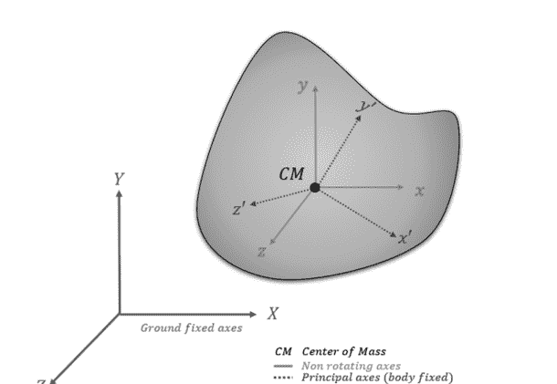

图10.1 任意运动和旋转刚体`Ω_s(t)`中的参考系。

`b = bₓ x̂ + bᵧ ŷ + b_z ẑ`

相对于固连体轴系`xyz`。这里，`(x̂, ŷ, ẑ)`是旋转坐标系`xyz`中的单位向量。此外，向量`b`也可以分解为：

`b = b_X X̂ + b_Y Ŷ + b_Z Ẑ`

相对于非旋转轴系`XYZ`。这里，`(X̂, Ŷ, Ẑ)`是惯性坐标系`XYZ`中的单位向量。我们现在对在固定坐标系中定义的`b`关于时间`t`求微分得到：

`db/dt = [ dbₓ/dt x̂ + dbᵧ/dt ŷ + db_z/dt ẑ ] + [ bₓ d x̂/dt + bᵧ d ŷ/dt + b_z d ẑ/dt ]   (10.2)`

等式 (10.2) 右边第一部分可以解释为从固连体坐标系`xyz`观察到的`b`的瞬时变化，因为单位向量`(x̂, ŷ, ẑ)`在固连体坐标系中是固定的（不发生变化）。等式 (10.2) 右边第二部分指的是从惯性坐标系（非旋转坐标系）`XYZ`观察到的单位向量的变化率。由于惯性坐标系原点与固连体坐标系具有相同的瞬时速度，这些单位向量随时间变化的唯一方式是通过经过共同原点某轴的旋转。我们将此旋转速度记为`ω`且有：

`dx̂/dt = ω × x̂,   dŷ/dt = ω × ŷ,   dẑ/dt = ω × ẑ.`

因此，等式 (10.2) 中的第二部分变为`(ω × b)`，且等式 (10.2) 化简为：

`db/dt = (db/dt)_b + ω × b   (10.3)`

等式 (10.3) 关联了向量`b`在平移轴系`(XYZ)`与固连体旋转轴系`(xyz)`之间的变化率。下标`b`表示导数相对于固连体旋转坐标系`xyz`。左边是`b`在非旋转坐标系`XYZ`中的变化率，等于`b`相对于固连体坐标系`xyz`的变化率加上`ω`叉乘`b`。物理上，这意味着向量`b`可以在保持方向固定的同时增大其大小，并且还可以改变其方向。

现在我们考虑角动量`L`（也称为旋转动量）。角动量定义为转动惯量张量`I_m`与角速度`ω`的乘积，即：

`L = I_m ω,   I_m = [ I_xx  -I_xy  -I_xz ; -I_yx  I_yy  -I_yz ; -I_zx  -I_zy  I_zz ]`

这里，`I_xx`是刚体绕`x`轴的转动惯量，定义为：

`I_xx = ∫_{Ω_S(t)} ρ_s (y² + z²) dx dy dz`

其中$\rho_s$是固体的密度。类似地，$I_{yy}$和$I_{zz}$分别是刚体绕$y$-轴和$z$-轴的转动惯量，定义方式类似。此外，$I_{xy}$、$I_{xz}$和$I_{yz}$是惯性积，例如：

$$I_{xy}=\int_{\Omega_s(t)}\rho_s\,xy\,dx\,dy\,dz.$$

注意$I_{xy}=I_{yx}$，$I_{xz}=I_{zx}$且$I_{yz}=I_{zy}$。如果我们相对于固连体轴系$xyz$计算这些量，并且该轴系也与刚体的主轴对齐，则这些项可以进一步简化。采用这种参考轴系（主轴），惯性积$I_{xy}$、$I_{yz}$和$I_{zx}$变为零，而$I_{xx}$、$I_{yy}$和$I_{zz}$变为主转动惯量。因此，我们有：

$$\mathbf{L}=\mathbf{I}_G\boldsymbol{\omega}_G=I_{xx}\omega_x\hat{x}+I_{yy}\omega_y\hat{y}+I_{zz}\omega_z\hat{z}$$

其中，

$$\mathbf{I}_G=\begin{bmatrix}I_{xx}&0&0\\0&I_{yy}&0\\0&0&I_{zz}\end{bmatrix}\qquad\text{and}\qquad \boldsymbol{\omega}_G=\begin{bmatrix}\omega_x\\\omega_y\\\omega_z\end{bmatrix}$$

与等式 (10.3) 类似，角动量$\mathbf{L}$的时间导数变为：

$$\frac{d\mathbf{L}}{dt}=\left(\frac{d\mathbf{L}}{dt}\right)_b+\boldsymbol{\omega}\times\mathbf{L}.$$

我们现在将等式 (10.3) 写成分量形式并在固连体坐标系$xyz$中表示。对于第一项，我们得到：

$$\left(\frac{d\mathbf{L}}{dt}\right)_b=I_{xx}\frac{d\omega_x}{dt}\hat{x}+I_{yy}\frac{d\omega_y}{dt}\hat{y}+I_{zz}\frac{d\omega_z}{dt}\hat{z}.$$

这是成立的，因为$I_{xx}$、$I_{yy}$和$I_{zz}$是主转动惯量且不随时间变化。此外：

$$\boldsymbol{\omega}\times\mathbf{L}=[(\omega_y\omega_z(I_{zz}-I_{yy}))\hat{x}]+[(\omega_z\omega_x(I_{xx}-I_{zz}))\hat{y}]+[(\omega_x\omega_y(I_{yy}-I_{xx}))\hat{z}].$$

因此，分量形式的角动量方程可以写为：

$$I_{xx}\frac{d\omega_x}{dt}+(I_{zz}-I_{yy})\omega_y\omega_z=M_x,$$

$$I_{yy}\frac{d\omega_y}{dt}+(I_{xx}-I_{zz})\omega_z\omega_x=M_y,$$

$$I_{zz}\frac{d\omega_z}{dt}+(I_{yy}-I_{xx})\omega_x\omega_y=M_z,$$

其中$\mathbf{M}=(M_x,M_y,M_z)$是关于质心的总外力矩。由于这些方程是在固连体坐标系$xyz$中定义的，$\frac{d\mathbf{L}}{dt}$首先计算然后沿主轴投影。相反，我们不能先将`L`投影到主轴上再计算时间导数，因为这些方程仅在瞬时时刻有效，且在下一个时间瞬间，$\boldsymbol{\omega}$和`M`相对于该轴系会发生变化。

#### 10.2.2 流体流动的控制方程

设$\Omega(t)\subset\mathbb{R}^3$为船舶（浮体）周围流体的时变域。我们考虑拖曳水池中部分浸没船舶的自由表面流动，如图 10.2 所示。

此外，时变边界定义为$\partial\Omega(t):=\Gamma_{in}\cup\Gamma_{out}\cup\Gamma_{wall}\cup\Gamma_s\cup\Gamma_{fs}$，其中$\Gamma_{in}$为入口边界，$\Gamma_{out}$为出口边界，$\Gamma_{wall}$为容器/水池壁，$\Gamma_s$为船体-流体界面，$\Gamma_{fs}$为自由表面，如图 10.2 所示。船舶周围的流体流动由时变不可压缩 Navier–Stokes 方程 [9] 描述：

```
$$\frac{\partial\mathbf{u}}{\partial t}+(\mathbf{u}\cdot\nabla)\mathbf{u}-\frac{1}{\rho}\nabla\cdot\mathbf{T}(\mathbf{u},p)=\mathbf{g}e \quad \text{in }\Omega(t)\times[0,I],$$
$$\nabla\cdot\mathbf{u}=0 \quad \text{in }\Omega(t)\times[0,I].$$
```

其中$\mathbf{u}$、$p$和$\rho$分别表示流体速度、流体压力和流体密度。这里，应力张量$\mathbf{T}(\mathbf{u},p)$和速度变形张量$\mathbf{D}(\mathbf{u})$由下式给出：

```
$$\mathbf{T}(\mathbf{u},p)=-p\mathbf{I}+2\mu\mathbf{D}(\mathbf{u}),\qquad \mathbf{D}(\mathbf{u})=\frac{1}{2}(\nabla\mathbf{u}+\nabla\mathbf{u}^{T}),$$
```

其中$\mathbf{I}$和$\mu$分别表示单位张量和流体的粘度，上标$T$用于表示转置。

#### 10.2.3 耦合边界和初始条件

6-DOF 方程 (10.1) 和 (10.4)，以及 Navier–Stokes 方程 (10.5) 由边界和初始条件封闭。我们考虑自由表面$\Gamma_{fs}(t)$上的力平衡边界条件：

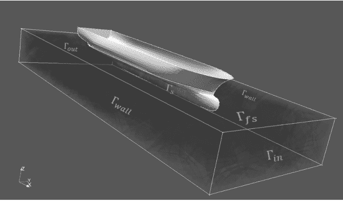

此外，还可以考虑牵引力（单位面积表面力）条件，其中牵引力可由风引起，实际上海洋波浪主要由潮汐力引起。接下来，我们在流体-固体界面$\Gamma_s(t)$处施加带摩擦的滑移边界条件，在侧壁和底壁$\Gamma_w$上施加无穿透自由滑移条件，在出口边界$\Gamma_{out}$上施加零应力，在入口边界$\Gamma_{in}$上施加给定速度。条件可表述如下：

$$\begin{aligned}
-\boldsymbol{\Pi}(\mathbf{u},p)\cdot\boldsymbol{\nu} &= \sigma\,\mathcal{K}\,\boldsymbol{\nu} && \text{on }\Gamma_{fs}(t)\times[0,T]\\
\mathbf{u}\cdot\boldsymbol{\nu} &= \mathbf{u}_s\cdot\boldsymbol{\nu};\quad \mathbf{u}\cdot\boldsymbol{\tau}=-\varepsilon_\mu(\boldsymbol{\tau}\cdot\mathbf{T}\cdot\boldsymbol{\nu})+\eta\mathbf{u}_s\cdot\boldsymbol{\tau} && \text{on }\Gamma_s(t)\times[0,T]\\
\mathbf{u}\cdot\boldsymbol{\nu} &= 0;\quad \boldsymbol{\tau}\cdot\mathbf{T}\cdot\boldsymbol{\nu}=0 && \text{on }\Gamma_w\times[0,T]\\
-\boldsymbol{\Pi}(\mathbf{u},p)\cdot\boldsymbol{\nu} &= 0 && \text{on }\Gamma_{out}\times[0,T]\\
\mathbf{u} &= \mathbf{u}_{in} && \text{on }\Gamma_{in}\times[0,T].
\end{aligned}$$

接下来，初始条件由下式给出：

$$\mathbf{u}(x,0)=\mathbf{u}_0,\quad \mathbf{u}_b(x,0)=\mathbf{u}_{b,0},\quad \boldsymbol{\omega}(x,0)=\boldsymbol{\omega}_0;\quad \mathbf{u}_s( s,0)=\mathbf{u}_{b,0}+(\boldsymbol{\omega}_0\times\mathbf{r}).$$

这里，$\sigma$、$\mathcal{K}$、$\mathbf{u}_s$、$\varepsilon_\mu$、$\eta$、$\mathbf{u}_0$、$\mathbf{u}_{b,0}$、$\boldsymbol{\omega}_0$、$\mathbf{r}$、$\boldsymbol{\tau}=(\tau_1,\tau_2)$和$\boldsymbol{\nu}$分别为表面张力、曲率、刚体的总速度（平移和旋转的组合）、滑移系数、流体-固体界面的摩擦系数、初始流体速度、初始平移速度、初始旋转速度、质心处的位移向量、单位切向和相对于流体相的外法向。此外，来自流体的总作用力$\mathbf{F}_{flow}$和总外力矩$\mathbf{M}$由下式给出：

$$\mathbf{F}_{flow}=-\int_{\Gamma_s}\mathbf{T}\cdot\boldsymbol{\nu}\,d\Gamma_s,\qquad \mathbf{M}'=-\int_{\Gamma_s}\mathbf{r}\times(\mathbf{T}\cdot\boldsymbol{\nu})\,d\Gamma_s,\tag{10.7}$$

这里，$\mathbf{M}$上的撇号表示计算得到的力矩需要投影回主轴$xyz$，因为我们考虑的是相对于主轴的旋转方程。

##### 10.2.3.1 无量纲形式

为了将 6-DOF 方程 (10.1) 和 (10.4) 以及 Navier–Stokes 方程 (10.5) 改写为无量纲形式，我们引入特征长度`L`和特征速度`U`作为缩放因子。此外，我们定义无量纲变量：

$$\tilde{x}=\frac{x}{L},\quad \tilde{\mathbf{u}}=\frac{\mathbf{u}}{U},\quad \tilde{\mathbf{u}}_b=\frac{\mathbf{u}_b}{U},\quad \tilde{\mathbf{w}}=\frac{\mathbf{w}}{U},\quad \tilde{t}=\frac{tU}{L},\quad \tilde{p}=\frac{p}{\rho U^2},\quad \tilde{\mathbf{I}}=\frac{I U}{L}$$

和无量纲数（雷诺数、韦伯数、弗劳德数和滑移数，分别）：

$$\mathrm{Re}=\frac{\rho UL}{\mu_0},\qquad \mathrm{We}=\frac{\rho U^2L}{\sigma},\qquad \mathrm{Fr}=\frac{U^2}{Lg},\qquad \beta=\frac{1}{\varepsilon_\mu\rho U}.$$

利用这些无量纲参数在控制方程中并随后省略波浪线，我们得到耦合 6-DOF 和 Navier–Stokes 模型在 ALE 形式下的无量纲形式为：

```
d\mathbf{u}_b / dt = (\rho L^3 / m) \mathbf{F}_{flow} + 1/Fr \mathbf{e}, \quad in (0,I]
I_{xx} d\omega_x / dt + (I_{zz} - I_{yy}) \omega_y \omega_z = \rho / \rho_s M_x, \quad in (0,I]
I_{yy} d\omega_y / dt + (I_{xx} - I_{zz}) \omega_z \omega_x = \rho / \rho_s M_y, \quad in (0,I]
I_{zz} d\omega_z / dt + (I_{yy} - I_{xx}) \omega_x \omega_y = \rho / \rho_s M_z, \quad in (0,I]
\partial \mathbf{u} / \partial t + (\mathbf{u} - \mathbf{w}) \cdot \nabla \mathbf{u} - \nabla \cdot \mathbb{T}(\mathbf{u},p) = 1/Fr \mathbf{e} \quad in \Omega(t) \times (0,I],
\nabla \cdot \mathbf{u} = 0 \quad in \Omega(t) \times (0,I] \quad (10.8)
-\mathbb{T}(\mathbf{u},p) \cdot \nu = \mathscr{K} / We, \quad in \Gamma_{fs}(t) \times [0,T]
\mathbf{u} \cdot \nu = \mathbf{u}_s \cdot \nu; \quad \mathbf{u} \cdot \tau - \eta \mathbf{u}_s \cdot \tau = -1/\beta (\tau \cdot \mathbb{T} \cdot \nu), \quad in \Gamma_s(t) \times [0,T]
\mathbf{u} \cdot \nu = 0; \quad \tau \cdot \mathbb{T} \cdot \nu = 0, \quad in \Gamma_w \times [0,T]
-\mathbb{T}(\mathbf{u},p) \cdot \nu = 0, \quad in \Gamma_{out} \times [0,T]
\mathbf{u} = \mathbf{u}_{in} / U, \quad in \Gamma_{in} \times [0,T]
\mathbf{u}(\mathbf{x},0) = \mathbf{u}_0 / U; \quad \omega_s(\mathbf{x},0) = U / L \omega_{s,0}.
```

这里，无量纲应力张量、来自流体的总体积力`F_flow`以及总外力矩`M`由下式给出：

```
\mathbb{T}(\mathbf{u},p) = 2/Re \mathbb{D}(\mathbf{u}) - p \mathbb{I}; \quad \mathbf{F}_{flow} = -\int_{\Gamma_s} \mathbb{T} \cdot \eta d\Gamma_s; \quad M' = -\int_{\Gamma_s} \mathbf{r} \times (\mathbb{T} \cdot \eta) d\Gamma_s.
```

注意，若已知牵引力，则可以用其代替自由表面上的表面力。

### 10.3 界面追踪方法


追踪/捕捉移动或变形的界面与边界是移动边值问题中的主要挑战之一。人们已经提出了多种数值方法来追踪或捕捉移动边界。下面简要回顾几种欧拉方法和拉格朗日方法。

## 10.3.1 欧拉方法

### 10.3.1.1 流体体积法

在流体体积法（VOF）中，使用“流体体积函数”（也称为“标记函数”）来识别每个流体相。“流体体积函数”给出

主要挑战在于根据体积分数计算界面的局部曲率。此外，在该方法中，分别保证“液体 A”和“液体 B”的质量守恒也非常具有挑战性，参见文献[11]。近期的一些进展，包括利用高阶格式提高界面分辨率的技术[10]和局部质量保持格式[11]，提高了该方法的适用性。

### 10.3.1.2 水平集方法

在水平集方法中，连续零水平集函数表示界面。水平集函数`φ(x,t)`被构造为符号距离函数，使得界面一侧有`φ(x,t)>0`，界面另一侧有`φ(x,t)<0`。类似地，多个界面可以用同一个水平集函数`φ(x,t)`表示。

作为示例，考虑在`t=0`时刻一个中心位于原点的单位圆界面。我们假设界面位于方形区域`[-2,2]`内，该区域由正方形网格划分（图 10.4）。在`t=0`时刻，符号距离水平集函数（圆内为正值、圆外为负值）定义为

```
φ(x,0)=1−√(x²+y²).
```

这里，零水平集函数`φ(x,0)=0`表示界面。给定背景网格上的流体速度`u`，通过求解输运方程来推进界面

```
∂φ(x,t)/∂t + u·∇φ(x,t) = 0,
```

得到`t≥0`时刻新的水平集函数。对输运方程离散所得到的数值误差会给每个流体相的质量守恒带来问题。特别是，在粗网格上质量损失最为显著[10]。文献中已经提出了更精确、更稳健的数值格式（例如高阶 ENO/WENO）来求解此类输运方程。在有限元背景下，使用更细的网格可以减小质量损失，但计算成本会急剧增加。另外，文献[12]采用了质量校正格式。此外，输运方程必须使用诸如流线扩散（SDFEM）之类的稳定化技术才能获得稳定系统[12, 13]。

此外，为了保证质量守恒，`φ(x,t)`必须始终保持为符号距离函数。一般来说，这一性质在输运过程中无法保持，因此文献中提出了重新初始化技术来克服这一困难。水平集方法的最新进展使其具有处理界面拓扑变化的自然能力，这让该方法颇具吸引力。

### 10.3.1.3 锋面追踪法

锋面追踪法的基本思想是在固定网格上使用独立的锋面标记来表示界面，并修改锋面附近的网格以适应界面。这里讨论的方法是锋面追踪法与锋面捕捉法的混合方法[14]。其主要思想是：流体流动使用固定网格，同时使用一个独立的一维低维移动网格来追踪界面。锋面点（界面网格点）由计算出的速度推进，每个锋面处的速度通过对固定背景网格插值得到。

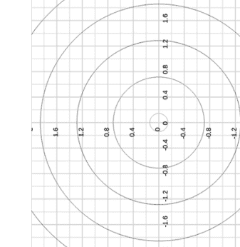

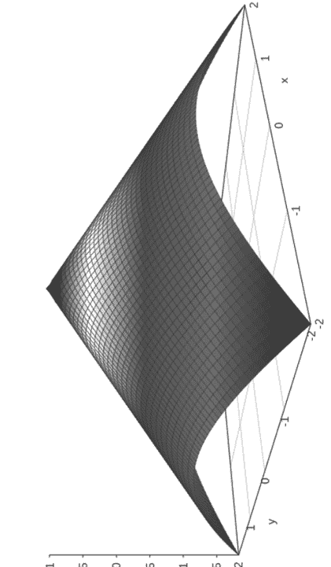

图 10.4 水平集函数 `φ(x,0)`（左）及其等值线（右）。

例如，在二维空间中，界面由一维移动“锋面”表示，该锋面由相互连接的锋面点`χ_F`组成。通常，利用锋面点构造光滑函数（例如勒让德多项式或插值三次样条）来计算曲率[14, 15]。一旦计算出固定背景网格上的流体速度`u`，就在锋面点处插值得到速度。然后，通过以下方程获得界面的新位置。

```
∂χ_F/∂t = ℐ_XF u(χ_F, t),
```

其中，`ℐ_XF`是从背景网格插值到锋面点`χ_F`的速度。由于锋面点以拉格朗日方式移动，这些点可能会聚集，或者解在界面的某些部分会变得不合适。可以通过增加、删除或重新分布锋面点来解决这一问题。在锋面追踪法中，不需要求解任何附加方程来推进界面。但是，必须求解一些代数方程来构造参数化曲线、计算曲率并重新分布锋面点。

由于界面是显式追踪的，界面的断裂和合并等拓扑变化必须手动处理。此外，界面不是由插值速度推进的，而且这种插值速度在锋面点处通常不是无散度的。因此，在锋面追踪法中，保证每个相的质量守恒是一个挑战。

## 10.3.2 拉格朗日方法

尽管使用欧拉方法在计算上有若干优势，但对于含有刚体的流动，拉格朗日方法更受青睐。由于界面不变形，拉格朗日方法中解析界面的网格可以用来开发高效而精确的数值格式。

### 10.3.2.1 任意拉格朗日-欧拉方法

文献[16]中给出了 ALE 方法的早期描述。ALE 方法在流固耦合和自由表面/两相问题中非常流行。关于有限元背景下自由表面流动的应用，参见文献[17, 18, 19, 20, 21, 22, 23]。这里，我们回顾基于文献[23]描述的 ALE 方法。

用`χ_F`表示所有界面的边界点。在 ALE 方法中，边界点`χ_F`以各自对应的速度推进，即

```
dχ_F/dt = u(χ_F, t)
```

内部点可以任意移动，以保持网格质量。

定义一个映射族`𝒳_t`，它在每个时刻`t ∈ [0,1)`将参考域`Ω̂`中的点（即 ALE 坐标）`Ŷ ∈ Ω̂`映射到当前域`Ω_t`中的点（即欧拉坐标）`X`。即

```
𝒳_t : Ω̂ → Ω(t),    𝒳_t(Y) = X(Y, t)
```

对于每个`t∈[0,I)`。我们假设映射`𝒜_t`是一个同胚函数，即`𝒜_t∈C^0(Ω̂)`可逆，且其逆映射`𝒜_t⁻¹∈C^0(Ω(t)̄)`连续。此外，我们假设映射

```
t→X(Y,t),   Y∈Ω̂
```

在`t∈[0,I)`上几乎处处可微。让我们考虑欧拉坐标系中的标量函数`v`。于是，我们有

```
v̂ := v∘𝒜_t,   v̂ : Ω̂×(0,I)→ℝ,   v̂(Y,t)=v(𝒜_t(Y,t)),
```

它是 ALE 坐标系上对应的函数。进一步，从 ALE 坐标系观察`v`的时间导数（但用欧拉坐标表示）定义为

```
∂v/∂t |_Ω̂ : Ω(t)×(0,I)→ℝ,   ∂v/∂t |_Ω̂ (X,t)=∂v̂/∂t (Y,t),   Y=𝒜_t⁻¹(X)
```

这里，`|_Ω̂`用于表示该时间导数是从 ALE 坐标系观察的。进一步，从欧拉坐标系观察的时间导数用`|_X`表示。域速度`w`定义为

```
w(X,t)=∂X/∂t |_Ω̂.
```

现在，我们对 ALE 坐标系中`v∘𝒜_t`的时间导数应用链式法则，得到

```
∂v/∂t |_Ω̂ = ∂v/∂t |_X + ∂X/∂t |_Ω̂ · ∇_X v = ∂v/∂t |_X + w · ∇_X v,   (10.9)
```

其中`∇_X`表示关于欧拉坐标的梯度。将上述关系（式(10.9)）代入式(10.5)的动量方程中，我们得到

```
∂u/∂t |_X + w·∇u + (u·∇)u − ∇·T(u,p) = (1/Fr)e.   (10.10)
```

注意，域速度项是方程 (10.5) 和 (10.10) 之间唯一的区别。

## 10.4 有限元格式

### 10.4.1 Navier–Stokes 方程的弱形式

设`L²(Ω̂)`和`H¹(Ω̂)`为标准 Sobolev 空间，`(.,.)`分别为`L²(Ω(t))`中的内积及其向量/张量值版本。进一步定义

```
H₀¹(Ω̂)³ := { v ∈ H¹(Ω̂)³ : v·v = 0 on Γ_wall(t) ∪ Γ_s(t) }.
```

现在我们定义`Ω(t)`中速度和压力的函数空间为

```
V(Ω(t)) := { v ∈ H¹(Ω(t))³ : v = v̂ ∘ 𝒜ₜ⁻¹ , v̂ ∈ H₀¹(Ω̂)³ },
Q(Ω(t)) := { q ∈ L²(Ω(t)) : q = q̂ ∘ 𝒜ₜ⁻¹ , q̂ ∈ L²(Ω̂) }.
```

为了推导 Navier–Stokes 方程的变分形式，我们将方程 (10.8) 中的 ALE 形式动量方程乘以一个测试函数`v ∈ V`，并在计算域`Ω(t)`上积分，得到

```
∫_{Ω(t)} ∂u/∂t · v dx + ∫_{Ω(t)} ((u − w)·∇)u · v dx − ∫_{Ω(t)} ∇·𝕋(u,p)·v dx = 1/Fr ∫_{Ω(t)} e·v dx.
```

对第三项应用分部积分，得到

```
∫_{Ω(t)} ∇·𝕋(u,p)·v dx = ∫_{∂Ω(t)} v·𝕋·v ds − ∫_{Ω(t)} 𝕋(u,p):∇v dx = ∫_{∂Ω(t)} v·𝕋·v ds − ∫_{Ω(t)} 1/2 𝕔(u):∇v dx − ∫_{Ω(t)} 1/2 𝕔(u):∇vᵀ dx + ∫_{Ω(t)} p∇·v dx = ∫_{Γ_fs} v·𝕋·v ds + ∫_{Γ_wall} v·𝕋·v ds + ∫_{Γ_s} v·𝕋·v ds − ∫_{Ω(t)} 𝕔(u):𝕔(v) dx + ∫_{Ω(t)} p∇·v dx.
```

利用向量分解`v = (v·ν)ν + (v·τ)τ`，并结合边界条件，可得

```
∫_{Ω(t)} ∇·𝕋(u,p)·v dx = 1/We ∫_{Γ_fs} ℛ v·v ds − 1/β ∫_{Γ_s} ((u − η u_s)·τ)(v·τ) ds − ∫_{Ω(t)} 𝕔(u):𝕔(v) dx + ∫_{Ω(t)} p∇·v dx.
```

因此，方程 (10.8) 中 Navier–Stokes 方程的弱形式为：

求`u ∈ V`和`p ∈ Q`，使得对所有`v ∈ V`和`q ∈ Q`有

```
(∂u/∂t , v) + a(u − w : u, v) − b(p, v) + b(q, u) = f(v),   (10.11)
```

其中

```
a(w:u,v) = ∫_{Ω(t)} 𝔻(u) : 𝔻(v) dx + ∫_{Ω(t)} (w · ∇)u · v dx + (1/β) ∫_{Γ_s} ((u − η u_s) · τ)(v · τ) ds,
b(q,v) = ∫_{Ω(t)} q ∇ · v dx,
f(v) = (1/Fr) ∫_{Ω(t)} e · v dx + (1/We) ∫_{Γ_fs} 𝒦 v · v ds.
```

### 10.4.2 有限元离散

有许多开源网格生成工具，如 Gmsh [24] 和 Tetgen [25]，可用于生成非结构化网格。然而，计算中最重要的任务是将这些包生成的网格数据及其连接关系导入求解器包的现有数据结构中。在我们的计算中，我们使用 Gmsh 生成`.mesh`文件格式的网格，然后将其导入我们自研的并行有限元求解器包 ParMooN [26]，该包具有将`.mesh`中的网格数据结构导入 ParMooN 的网格数据结构的内置模块。

设`{𝒯_h}`是将域`Ω(t)`划分为四面体或六面体单元的剖分。单元`K ∈ 𝒯_h`的直径记为`h_K`。网格参数`h`定义为`h = max{h_K | K ∈ 𝒯_h}`，且`Ω_h(t) := ⋃_{K ∈ 𝒯_h} K`。进一步，设`V_h ⊂ V`和`Q_h ⊂ Q`是`𝒯_h`上协调的有限维子空间。变分问题 (10.11) 的标准 Galerkin 有限元逼近为：

对于给定的`Ω(0)`、`w`、`u_in`和`u_0v`，求`(u_h, p_h) ∈ V_h × Q_h`，使得

```
(∂u_h/∂t , v)_h + a_h(u_h − w:u_h, v) − b_h(p_h, v) + b_h(q, u_h) = f_h(v)   (10.12)
```

对所有`(v, q) ∈ V_h × Q_h`成立。这里，`(·, ·)_h`以及双/三线性形式中的下标`h`分别表示`L²(Ω_h(t))`中的内积及其向量值版本。接下来，速度和压力的有限元空间的选择需满足如下的 inf–sup 条件，

```
inf_{q_h ∈ Q_h} sup_{v_h ∈ V_h} (q_h, ∇ · v_h) / (‖q_h‖_{0_h} ‖v_h‖_{V_h}) ≥ β_1 > 0.
```

我们可以对速度和压力使用等阶插值空间，但这不满足上述 inf–sup 条件，因此需要使用稳定化方法。因此，在所提出的数值方案中，我们对速度和压力使用满足 inf–sup 条件的有限元对（更多细节参见 [9]）。

### 10.4.3 时间离散与线性化

设`0 = t⁰ < t¹ < ... < t^N = I`是给定时间区间`[0,I]`的剖分，`δt = t^{n+1} − t^n`，`n = 0, ..., N−1`，为均匀时间步长。记`Ω_h^n = Ω_h(t^n)`。为简洁起见，我们

考虑使用向后 Euler 方法进行时间离散，而在有限元背景下其他时间离散格式的概述，读者可参考文献 [9]。

我们首先将二阶微分方程转化为一阶微分方程组。于是，线性动量方程变为

```
dX_b/dt = u_b;   du_b/dt = (ρL³/m)F_flow + (1/Fr)e.
```

类似地，角动量方程也转化为一阶微分方程组。设`α = α(α₁, α₂, α₃)`为体轴上的旋转角度，`ω = (ω₁, ω₂, ω₃)`为其旋转向量，则有

```
dα/dt = ω;   𝕀_m · dω/dt = M − ω × (𝕀_m ω).
```

应用向后 Euler 方法，我们得到

```
X_b^{n+1} = X_b^n + δt u_b^{n+1}
u_b^{n+1} = u_b^n + δt((ρL³/m)F_flow^{n+1} + (1/Fr)e)
α^{n+1} = α^n + δt ω^{n+1}
ω^{n+1} = ω^n + δt (𝕀_m^{n+1})⁻¹ (M^{n+1} − ω^{n+1} × (𝕀_m^{n+1} ω^{n+1})).   (10.13)
```


接下来，我们记 $\mathbf{u}^n=\mathbf{u}_h(\mathbf{x},t^n)$、$p^n=p_h(\mathbf{x},t^n)$ 和 $\mathbf{w}_h^n=\mathbf{w}(\mathbf{x},t^n)$ 分别为速度、压力和网格速度在 $t=t^n$ 时的近似，其中 $\mathbf{x}\in\Omega_h^n$。对方程 (10.12) 中的 Navier–Stokes 系统以及方程 (10.8) 中的 6-DOF 方程应用时间离散，我们得到一系列定常方程：

对于给定的 $\hat{\Omega}_{h}$、$\mathbf{u}_0$、$\mathbf{u}^n$、$\mathbf{w}^n$，求 $(\mathbf{u}^{n+1},p^{n+1})\in V_h\times Q_h$ 和 $\mathbf{w}^{n+1}\in H^1\left(\Omega_h(t^{n+1})\right)^3$，使得对所有 $(\mathbf{v},q)\in V_h\times Q_h$

$$\left(\frac{\mathbf{u}^{n+1}-\mathbf{u}^n}{\delta t},\mathbf{v}\right)_h + a_h(\mathbf{u}^{n+1}-\mathbf{w}^{n+1};\mathbf{u}^{n+1},\mathbf{v}) + b(p^{n+1},\mathbf{v}) = f^{n+1}(\mathbf{v})$$

$$b(q,\mathbf{u}^{n+1})=0.$$
(10.14)

### 10.4.4 线性化与求解过程

可以采用整体式或分区式方法来求解方程 (10.13) 和 (10.14) 中的强耦合离散系统。在整体式方法中，流体与固体在交界面上的相互作用同时发生并同步 [27, 28]。进一步，方程 (10.13) 和 (10.14) 中的离散系统将被视为一个单一系统，并使用非线性求解器来求解该非线性系统。此外，守恒性质可以得到保持 [29]，并且该格式将变得无条件稳定。因此，可允许的时间步长仅受所需精度的限制。

在分区方法中，离散固体（公式 (10.13)）和流体（公式 (10.14)）系统交替地在时间上积分，并且界面条件是异步强制执行的 [30, 31]。这种顺序过程允许软件模块化，即可以使用不同的求解器求解公式 (10.13) 和公式 (10.14) 系统。分区格式每个时间步仅需要一次流体和结构求解，可以认为是单次流固迭代。另一方面，由于流体和结构时间积分之间存在时间滞后，连续流固系统的守恒特性会丢失。分区格式通常是能量增加的，因此数值不稳定 [31]。在实践中，这对可允许的时间步长引入了限制。

在所提出的数值格式中，我们将非线性和耦合项半隐式处理，并对解耦的线性化整体系统应用固定点类型的迭代。它缓解了时间步长限制，但保留了守恒特性并允许软件模块化。在一个时间区间 $(t^n, t^{n+1})$ 中，我们采用以下策略：

令 `F^{n+1,0}_{flow}=F^n_{flow}`, `M^{n+1,0}=M^n`, `𝕀^{n+1,0}_m=𝕀^n_m`, `u^{n+1}_0=u^n`, `w^{n+1}_0=w^n`, 然后求解

```
X_b^{n+1}=X_b^n+δt u_b^{n+1}

u_b^{n+1}=u_b^n+δt( (ρ L^3 / m) F^{n+1,k}_{flow}+ (1/Fr) e )

alpha^{n+1}=alpha^n+δt ω^{n+1}

ω^{n+1}=ω^n+δt(𝕀^{n+1,k}_m)^{-1}(M^{n+1,k}-ω^{n+1}×(𝕀^{n+1,k}·ω^{n+1}))
```

```
( (u^{n+1}_{k+1}-u^n)/δt , v )_h + a_h(u^{n+1}_k - w^{n+1}_k , u^{n+1}_{k+1} , v) + -b(p^{n+1}, v)=f^{n+1}(v)

b(q, u^{n+1}_{k+1})=0.
```

对于 k = 0,1,..., 直到上述系统的残差降低到阈值或达到预设的最大步数。在此求解过程中，一个迭代步涉及以下步骤：

- 在 `Ω_s(t^n)` 中求解 6DOF 方程 (10.15) 并计算结构边界的运动
- 使用线性弹性方法移动 `Ω(t^n)`，见下文，以计算的结构边界运动
- 计算网格速度并将域恢复到 `Ω(t^n)`
- 求解 NSE (10.16) 并用更新的速度和压力计算结构载荷 `F_flow` 和 `𝕀_m`。

在迭代过程中，我们求解线性弹性问题以计算网格速度。在线性弹性网格更新中，我们首先计算固体结构上边界顶点的位移，即

```
d = Z_b^{n+1} - Z_b^n,    where Z_b = X_b |_{Γ_S}
```

即，`Z_h` 是边界 `Γ_s` 上的顶点。然后通过求解线性弹性方程得到内部网格点的位移，即

求 $\boldsymbol{\Psi} \in H^1(\Omega(t^n))^3$，使得

$\nabla \cdot S(\boldsymbol{\Psi}) = 0$ 在 $\Omega(t^n)$ 中，

$\boldsymbol{\Psi} = \boldsymbol{d}$ 在 $\Gamma_s$ 上，

$\boldsymbol{\Psi} = 0$ 在 $\partial\Omega(t^n) \\ \Gamma_s$ 上，

其中 $S(\boldsymbol{\Psi}) = \lambda_{L_1}(\nabla \cdot \boldsymbol{\Psi})I + 2\lambda_{L_2}D(\boldsymbol{\Psi})$。这里，$\lambda_{L_1}$ 和 $\lambda_{L_2}$ 是拉梅常数，在计算中我们使用 $\lambda_{L_1}=\lambda_{L_2}=1$。一旦位移向量 $\boldsymbol{\Psi}$ 计算完成，网格速度随后计算为 $\boldsymbol{w}_k^{n+1}=\boldsymbol{\Psi}/\delta t$。

所提出的算法已在我们内部有限元程序包 `ParMooN` [26, 32] 中实现。

## 10.5 数值结果

在本节中，我们为绕 KVLCC2（KRISO 非常大的集装箱船，其中 KRISO 代表韩国船舶与海洋工程研究所）船体流动的流动展示了一些计算结果。这里，我们仅考虑船体周围的流体流动，保持固体结构固定。在所考虑的模型中，KVLCC2 船体在长度 500 m、宽度 185 m、深度 58 m 的流体水箱中浸没 30 m。KVLCC2 船体的基本尺寸如下：(i) 垂线间长度 ($L_{pp}$) 320 m，(ii) 水线长度 ($L_{wl}$) 325.5 m，(iii) 宽 ($B$) 58 m，详见 [33]。此外，计算分别使用 146739 和 6888 个自由度进行速度和压力。

图 10.5 中的图显示了不同时刻船体周围流动的演变。此外，速度图以对数刻度绘制，以便有效地可视化流动速度的微小变化。

接下来，流线最常用于可视化流体流动，因为它可以很容易地表示流体流动中存在的涡旋等特征。流线是沿线任意点与速度矢量相切绘制的虚线。当流速较高时，流线趋于聚集，而在低速流动中，流线通常是分离的。图 10.6 至 10.8 中的图显示了从船体周围各个点观察到的沿流动轴的速度流线。

我们可以看到，流线在船体艉部下方向上移动；这是由于船体艉部底部的底部向水面倾斜向上。这种设计类似于机翼上表面的设计，其目的是防止物体经过时流体流动分离。流体流动从表面分离可能导致表面后端的逆压梯度，这显著有助于压力阻力，这可以在垂直于流动方向放置的平板周围的流动中观察到。

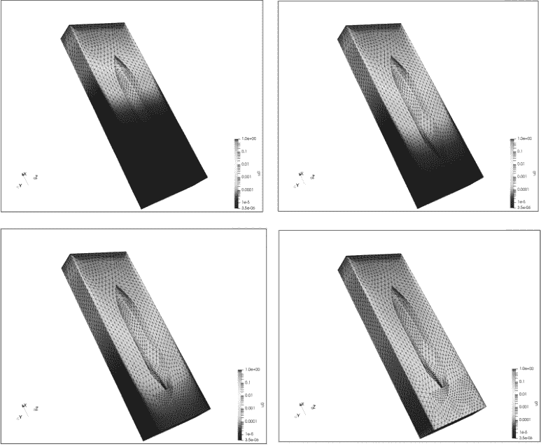

**FIGURE 10.5**

船舶水动力学中的计算模型。

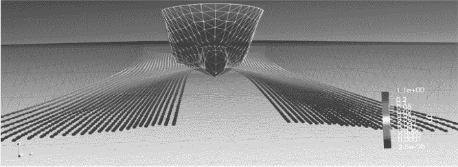

**FIGURE 10.6**

船体底部部分的速度流线。

从图 10.9 可以看出，船体尖端的应力值相对较高。这可以从公式 (10.6) 中的本构关系进一步解释，流体速度与应力之间的关系，该关系指出应力张量与速度的变形成正比。在船体尖端部分，该区域的速度梯度将很高，因为流动被阻碍，这反过来会导致较高的应力值。

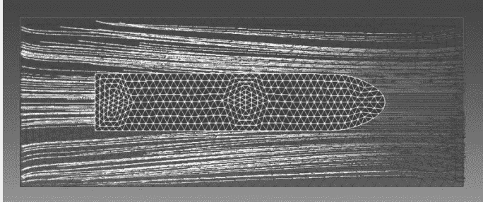

#### FIGURE 10.7

船体周围的速度流线——俯视图。

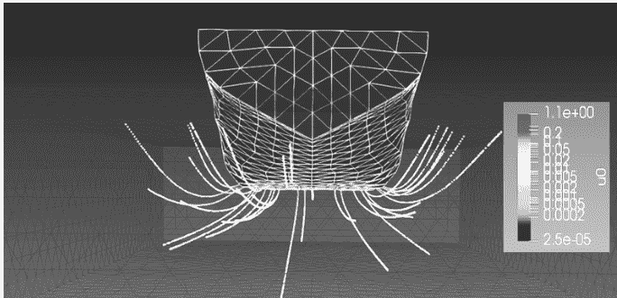

#### FIGURE 10.8

在船体艉部可视化的流线。

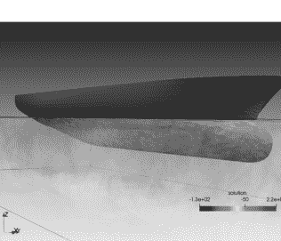

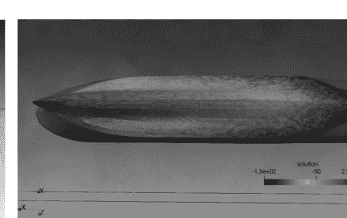

#### FIGURE 10.9

船体浸没部分应力分布的可视化。

## 致谢

本工作得到了印度国防研究与发展组织海军研究委员会通过拨款 `NRB/4003/PG/368` 的支持。

## 参考文献

- 1. William Froude. On the rolling of ships. *Institute of Naval Architects*, 2:180–227, 1861.
- 2. A Krylov. A general theory of oscillation of ships. *Institute of Naval Architects*, 49, 1898.
- 3. John Henry Michell. Xi. The wave-resistance of a ship. *The London, Edinburgh, and Dublin Philosophical Magazine and Journal of Science*, 45(272):106–123, 1898.
- 4. John L Hess and AMO Smith. Calculation of potential flow about arbitrary bodies. *Progress in Aerospace Sciences*, 8:1–138, 1967.
- 5. CW Dawson. Method for solving ship wave problems. In *Proceedings of the 2nd International Conference on Numerical Ship Hydrodynamics*, 305–318, 1977.
- 6. S Ohring and J Telste. Numerical solutions of transient three-dimensional ship-wave problems. In *Proceedings of the Second International Conference on Numerical Ship Hydrodynamics*, University of California, Berkeley, September, 1977.
- 7. T Hino. Computation of viscous flows with free surface around an advancing ship. In *Proceedings of the Second Osaka International Colloquium on Viscous Fluid Dynamics in Ship and Ocean Technology*, Osaka, 1992.
- 8. J Farmer, Luigi Martinelli, and A Jameson. Fast multigrid method for solving incompressible hydrodynamic problems with free surfaces. *AIAA Journal*, 32(6):1175–1182, 1994.
- 9. S Ganesan and L Tobiska. *Finite Elements: Theory and Algorithms*. Cambridge II Sc Series. Cambridge University Press, Cambridge, United Kingdom, 2017.
- 10. James Edward Pilliod Jr and Elbridge Gerry Puckett. Second-order accurate volume-of-fluid algorithms for tracking material interfaces. *Journal of Computational Physics*, 199(2):465–502, 2004.
- 11. Michael Renardy, Yuriko Renardy, and Jie Li. Numerical simulation of moving contact line problems using a volume-of-fluid method. *Journal of Computational Physics*, 171(1):243–263, 2001.
- 12. Sven Groß, Volker Reichelt, and Arnold Reusken. A finite element based level set method for two-phase incompressible flows. *Computing and Visualization in Science*, 9(4):239–257, 2006.
- 13. Anna-Karin Tornberg. *Interface Tracking Methods with Application to Multiphase Flows*. PhD thesis, Royal Institute of Technology, Department of Numerical Analysis and Computing Science, 2000.
- 14. Grétar Tryggvason, Bernard Bunner, Asghar Esmaeeli, Damir Juric, N Al-Rawahi, W Tauber, J Han, S Nas, and Y-J Jan. A front-tracking method for the computations of multiphase flow. *Journal of Computational Physics*, 169(2):708–759, 2001.
- 15. Yuriko Renardy, Stéphane Popinet, Laurent Duchemin, Michael Renardy, Stéphane Zaleski, Christophe Josserand, MA Drumright-Clarke, D Richard, Christophe Clanet, and David Quéré. Pyramidal and toroidal water drops after impact on a solid surface. *Journal of Fluid Mechanics*, 484:69–83, 2003.
- 16. Jean Donea. Arbitrary Lagrangian-Eulerian finite elements methods. *Computational Methods in Transient Analysis*, 33(1–3), 689–723, 1983.
- 17. Sashikumar Ganesan and Lutz Tobiska. A coupled arbitrary Lagrangian–Eulerian and Lagrangian method for computation of free surface flows with insoluble surfactants. *Journal of Computational Physics*, 228(8):2859–2873, 2009.
- 18. Sashikumaar Ganesan 和 Lutz Tobiska. 具有可溶性表面活性剂的两相流计算的任意拉格朗日-欧拉有限元方法。*Journal of Computational Physics*，231(9):3685–3702，2012。
- 19. Sashikumaar Ganesan 和 Shweta Srivastava. 时变域中对流-扩散问题的 ALE-SUPG 有限元方法：守恒形式。*Applied Mathematics and Computation*，303:128–145，2017。
- 20. Eberhard Bänsch. *Numerical Methods for the Instationary Navier-Stokes Equations with a Free Capillary Surface*。博士论文，Verlag nicht ermittelbar，1998。
- 21. S Ganesan 和 L.Tobiska. 液滴撞击水平表面的有限元模拟。载于 *Proceedings of Algorithm*，第 2005 卷，第 1–11 页。斯洛伐克技术大学，布拉迪斯拉发，2005。
- 22. Gunar Matthies. *Finite Element Methods for Free Boundary Value Problems with Capillary Surfaces*。Shaker，德国亚琛 2002。
- 23. F Nobile. *Numerical Approximation of Fluid Structure Interaction Problems with Application to Haemodynamics*。博士论文，洛桑联邦理工学院，2001。


24. Christophe Geuzaine 和 Jean-François Remacle. Gmsh：内置预处理和后处理功能的 3D 有限元网格生成器。*International Journal for Numerical Methods in Engineering*，79(11):1309–1331，2009。
25. Hang Si. Tetgen，一个基于 Delaunay 的高质量四面体网格生成器。*ACM Transactions on Mathematical Software (TOMS)*，41(2):11，2015。
26. Ulrich Wilbrandt, Clemens Bartsch, Naveed Ahmed, Najib Alia, Felix Anker, Laura Blank, Alfonso Ciaazzo, Sashikumaar Ganesan, Swetlana Giere, Gunar Matthies, 等。ParMooN—基于映射有限元的现代化程序包。*Computers & Mathematics with Applications*，74(1):74–88，2017。
27. Patrick Le Tallec 和 Jean Mauro. 大结构位移下的流固耦合。*Computer Methods in Applied Mechanics and Engineering*，190(24–25):3039–3067，2001。
28. Frederic J Blom. 应用于活塞问题的整体流固耦合算法。*Computer Methods in Applied Mechanics and Engineering*，167(3–4):369–391，1998。
29. EH Van Brummelen, SJ Hulshoff, 和 R De Borst. 流固耦合问题的不相容性下的能量守恒。*Computer Methods in Applied Mechanics and Engineering*，192(25):2727–2748，2003。
30. Carlos A Felippa, KC Park, 和 Charbel Farhat. 耦合机械系统的分区分析。*Computer Methods in Applied Mechanics and Engineering*，190(24–25):3247–3270，2001。
31. Serge Piperno, Charbel Farhat, 和 Bernard Larrouturou. 瞬态耦合气动弹性问题的分区求解程序 第 I 部分：模型问题、理论和二维应用。*Computer Methods in Applied Mechanics and Engineering*，124(1–2):79–112，1995。
32. S Ganesan, V John, G Matthies, R Meesala, S Abdus, 和 U Wilbrandt. 用于偏微分方程计算的面向对象并行有限元方案：设计与实现。载于 *2016 IEEE 23rd International Conference on High Performance Computing Workshops (HiPCW)*，页码 2–11，2016。
33. Bing Jie Guo 和 Sverre Steen. 短波中 KVLCC2 附加阻力的评估。*Journal of Hydrodynamics, Series B*，23(6):709–722，2011。

# 11 DNA—Drug Interaction: Insight from Computer Simulations

Anurag Upadhyaya, Shesh Nath, 和 Sanjay Kumar

## CONTENTS

- 11.1 Introduction......171
- 11.2 A Brief Review of DNA and Its Properties......172
- 11.3 Computer Simulations......175
- 11.4 Atomistic Simulations of DNA Rupture......179
- 11.5 Stability of a DNA Aptamer and Its Use as a Drug Delivery Agent......182
- 11.6 Stability of DNA-ICLs against Force and Its Use as an Anti-Tumor Drug......184

    - 11.6.1 Rupture of DNA and DNA-ICLs......186
    - 11.6.2 Unzipping of DNA and DNA-ICLs......188

- 11.7 Conclusions and Future Perspective......189
- Acknowledgments......190
- References......190

## 11.1 Introduction

核酸在包括细胞分裂（复制）和蛋白质合成（转录和翻译）在内的生物过程中发挥着至关重要的作用。这些过程在正常健康细胞和癌细胞中都会发生。癌细胞的特点是细胞分裂不受控制，这与正常健康细胞分裂不同 [1, 2]。正常细胞表现出受控的细胞分裂，其中与同类细胞的表面接触会停止细胞分裂，这一过程称为接触抑制。癌细胞丧失了这种能力，因此生长迅速。无论细胞分裂是 mitosis 还是 meiosis，DNA 复制的精确拷贝都是必不可少的。DNA 的稳定性很大程度上受其长度、碱基组成、序列以及核苷酸错配的存在影响 [3–8]。它还强烈地受到 pH、温度和溶剂变化以及活细胞中 helicases、polymerases 或 topoisomerases 等蛋白质结合的影响 [7, 9, 10]。

小分子可能与 DNA 发生相互作用或结合 [11]。此类分子的分类取决于其作用机制。广义上讲，DNA 结合分子可分为：(i) 在次要沟槽中组装的沟槽结合剂；(ii) 夹在碱基对之间的嵌入剂；(iii) 与 DNA 反应形成 DNA 烷基化的烷基化剂；以及 (iv) 具有破坏 DNA 链能力的裂解剂。这些类分子具有不同的结构，并以不同的方式与 DNA 相互作用，其主要任务是通过抑制 DNA 复制来阻止癌细胞分裂。然而，它会阻止细胞分裂，而不会区分健康细胞或癌细胞 [12]。因此，它会引起多种其他副作用，例如恶心、腹泻、脱发、血细胞计数低、口腔溃疡等。因此，将药物靶向递送到癌细胞中是提高疗效并通过减少正常细胞的摄取来降低毒性副作用的先决条件。

最近的研究表明，DNA 适配体可作为靶向药物递送的载体 [13–15]。适配体是富含鸟嘌呤(G)的短寡核苷酸（DNA、RNA）分子，可执行特定功能 [16, 17]。这些适配体是通过体外 SELEX（指数富集配体系统进化）过程开发的，以便更好地了解在体内或活细胞中产生的抗体的行为 [16–18]。适配体中最为广泛研究的例子之一存在于真核染色体末端的端粒酶中，在那里它在基因调控中发挥重要作用 [19, 20]。由鸟嘌呤组成的 DNA 环或碱基口袋可以与小分子和蛋白质相互作用，从而增强其稳定性、亲和力和特异性 [21]。例如，腺苷一磷酸（AMP）以八个氢键结合到 DNA 环（称为结合口袋）中，从而增强了适配体的稳定性 [22–24]。它可作为癌症治疗药物的靶点 [25]。它们与靶蛋白的高亲和力和选择性使其成为生物传感器中理想而强大的探针和强效药物 [26–36]。

因此，有必要了解药物-DNA 复合物中涉及的分子间和分子内相互作用的作用。单分子力谱（SMFS）实验提供了研究这些分子力的机会 [2, 6, 37–48]。最初，人们认为 SMFS 实验中检测到的相互作用大多是机械性的，可以通过知道施加力的值来计算。然而，这些实验得出的见解表明，分子相互作用的测量不仅取决于施加力的大小，还取决于力的施加方式和位置 [6, 38–48]。这些实验可用于探索药物-DNA 复合物中相互作用位点产生的局部稳定性。

本章的目的是了解 DNA 在这些分子存在下的构象稳定性，并将其用作药物或药物递送载体。第 11.2 节简要介绍了 DNA 及其性质。第 11.3 节描述了分子动力学（全原子）模拟以及 DNA 所需的力场。第 11.4 节涉及无药物分子存在下 DNA 破裂的原子模拟。第 11.5 节中，我们扩展了我们的方法来研究 DNA 适配体的稳定性和其作为药物递送载体的用途。第 11.6 节重点关注烷基化剂存在下 DNA 的稳定性。如前所述，烷基化剂与 DNA 链形成共价键，被称为交联剂（ICLs）。我们将考虑两种药物，即丝裂霉素 C 和曲贝替定，它们形成 DNA-ICLs，并将其稳定性与无药 DNA 进行比较。本章以第 11.7 节的简要讨论和未来展望结束。

## 11.2 A Brief Review of DNA and Its Properties

细胞内有细胞核，其中含有 DNA（图 11.1）。它是一种被认为是“生命分子”的分子。遗传信息储存在 DNA 中，并用于包括许多病毒在内的生物体的发育和功能 [49–51]。

用于文献中。这些 DNA 螺旋的不同构象负责特定的生物学功能。B-DNA 是典型的右手 DNA，每一螺旋圈有十个碱基 [53]。它宽约 23.7 Å，每十个碱基对序列延伸 34 Å。A-DNA 是右手双螺旋，每一完整螺旋圈有 11 个碱基对。在正常条件下，A-DNA 中相继糖或磷酸之间的距离为 0.6 nm。Z-DNA 是左手双螺旋，其中碱基的排列呈锯齿状。它每一次螺旋扭转有 12 个碱基（图 11.2）。

有两种重要的生物学过程，其中 DNA 解旋发生。这些是 DNA 转录和 DNA 复制过程。转录发生在蛋白质翻译期间。它涉及将 DNA 复制到 RNA 中。编码基因的 DNA 部分被转录或复制成信使 RNA（mRNA）。DNA 复制是在细胞分裂前将 DNA 本身复制成两个拷贝的过程，以便将遗传信息从母细胞转移到子细胞。dsDNA 的分离

- a) A-DNA

- b) B-DNA

- c) Z-DNA

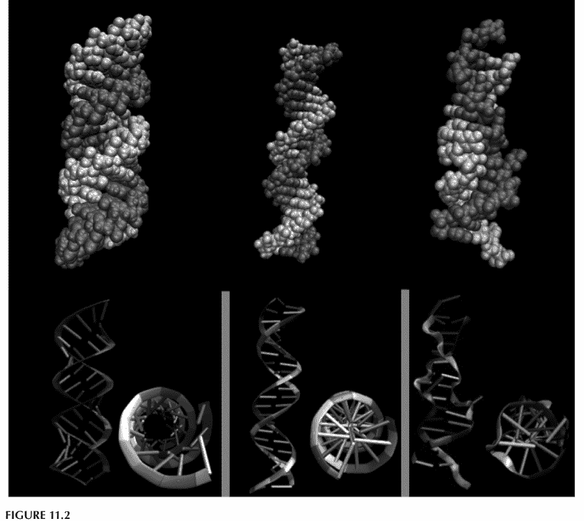

图 11.2

(a) A-DNA、(b) B-DNA 和 (c) Z-DNA 的原子级表示。(d–f) 表示 A、B 和 Z-DNA 的键视图和顶部视图。

可以通过加热（热熔）或改变溶剂的 pH 值（DNA 变性）[54] 来进行。热熔导致氢键断裂，这是由于熵增加所致，其结果是两条链分离。通常，熔解温度（`T_m`）定义为 dsDNA 的一半碱基对解离的温度。在体外，熔解温度取决于序列，在 80°C 和 90°C 范围内被发现，而变性是在 pH 值大于 9.0 时获得的 [54]。在物理上，这两种极端条件在活体内是不可能的。这表明在 dsDNA 的分离中必须涉及某种其他机制。

现在已经认识到这些过程是通过某些酶或蛋白质介导的，它们对 DNA 施加机械力，其结果是它分离 [55]。受此启发，Bockelmann 等人 [39, 40] 施加垂直于螺旋方向的力，即在 5′–3′ 端，并测量分离 dsDNA 的解链力 ~15 pN。序列和碱基配对中涉及的相互作用的强度和本质信息已被揭示。

## 11.3 计算机模拟

近年来，分子动力学（MD）模拟 [56, 57] 已成为理解 SMFS 实验结果的重要工具。这种工具增强了我们对这些分子的理解，并预测了这些分子的结构和功能。事实上，它已成为理论与实验之间的桥梁。它提供了难以量化的大量信息。关于分子动力学的优秀综述在文献中，并且其在生物化学和生物物理中的应用众多（参见例如 [58] 及其中引用的文献）。

在通过模拟研究 DNA 的结构和动力学性质之前，需要注意的是，DNA 在特定过程发生的长度和时间尺度上表现出很宽的范围。例如，涉及原子涨落、侧链运动和环运动的局部运动发生在 0.01 到 5 Å 的长度尺度上，并且此类过程所涉及的时间约为 10⁻¹⁵ 到 10⁻¹² s。螺旋或亚单元的运动属于刚体运动的范畴，其典型长度尺度在 1 到 10 Å 之间，所涉及的时间在 10⁻⁹ 到 10⁻⁶ s 之间。大规模运动包括螺旋-线圈转变，涉及的长度尺度大于 10 Å，时间尺度从 10⁻⁷ 到 10¹ s。根据问题的性质，可以考虑 DNA 的粗粒化描述或详细的原子描述。

然而，在本章中，我们将讨论集中在全原子模拟上 [59–61]。事实上，本章提供了原子水平的最详细描述，包括局部相互作用和非键相互作用。后者包括 (6–12) Lennard–Jones 势、静电相互作用以及与环境的相互作用。CHARMM（Chemistry at HARvard Molecular Mechanics）力场 [59] 的全原子模型首先由 Grubmuller 等人 [62] 采用。NAMD（NAnoscale Molecular Dynamics）软件 [60] 现在广泛用于通过恒定机械力和恒定加载速率的力拉伸生物分子。最近，GROMACS（GROningen MAchine for Chemical Simulations）软件 [61] 已被开发用于在显式水中研究机械展开。在本章中，我们使用了 Assisted Model Building with Energy Refinement（AMBER）软件包 [63]。它是一个通用分子力学和动力学程序，旨在使用解析势能函数对大分子构象进行精炼。

力场描述了生物分子构成物之间所涉及的详细相互作用和分子内相互作用 [64]。力场在 amber 中的参数通常由实验或第一性原理量子力学计算得出。由 `N` 个粒子组成的系统的力场可以写成以下能量项之和：

$$
V(r) = V_{\text{bond}} + V_{\text{angle}} + V_{\text{torsion}} + V_{\text{vdw}} + V_{\text{elec}}, \tag{11.1}
$$

其中`V(r)`（图 11.3）表示总能量，它是`N`个粒子位置（`r`）的函数。`V_bond`、`V_angle`和`V_torsion`分别是键伸长、弯曲和扭转能量项。`V_vdw`（范德华能量）和`V_elec`（静电能量）是非键能量项，如 Lennard-Jones 和库仑势，并在所有原子对（`i`和`j`）之间计算。能量项`V_bond`、`V_angle`和`V_torsion`是键合相互作用，分别是所有键、角度和二面角集合上的总和。最常用的模型由简单的谐振势函数建模：

$$
V_{\text{bond}} = \sum_{\text{bonds}} k_b (b - b_0)^2, \tag{11.2}
$$

其中`k_b`是弹簧（谐振）力常数，`b`是原子间的键长，`b_0`是平衡键长。类似地，三连键原子（`i`, `j`, `k`）之间的键角弯曲和角度形成也可以用简单的谐振势函数建模：

$$
V_{\text{angle}} = \sum_{\text{angles}} k_\theta (\theta - \theta_0)^2, \tag{11.3}
$$

其中`k_θ`是角度弯曲力常数，`θ`是三连键原子（`i`, `j`, `k`）之间的实际键角，`θ_0`是平衡键角（图 11.3）。


图 11.3

对式 (11.1) 有贡献的键伸长、角度弯曲、扭转和非键相互作用项的示意表示。

四个原子（`i`, `j`, `k`, `l`）之间的二面角势能项通常表示为余弦级数展开

$$
V_{\text{torsion}} = \sum_{\text{dihedrals}} \left(\frac{V_n}{2}\right)(1 + \cos[n\phi + \delta]), \tag{11.4}
$$

其中`V_n`指势垒高度，`φ`是原子四元组`i`–`j`–`k`–`l`的扭转角，`n`是给出余弦函数中极小值数量的重数，而`δ`（相位因子）决定了这些极小值对应的二面角值。`V_n`、`n`、`δ`为每种原子四元组设定。

非键相互作用通常分为两组：（i）范德华和（ii）静电相互作用。非键原子之间的范德华相互作用通常由 Lennard–Jones 势函数表示：


$$V_{\text{vdw}} = \sum_{\text{nonbij}} \left(\frac{A_{ij}}{r_{ij}^{12}} - \left(\frac{B_{ij}}{r_{ij}^{6}}\right)\right) \tag{11.5}$$

其中 `$A_{ij}$` 是排斥项系数，`$B_{ij}$` 是吸引项系数，`$r_{ij}$` 是两个原子 `i` 和 `j` 之间的距离。

核酸因其负的骨架电荷和聚电解质的行为而被认为是对模拟的挑战。在模拟中，应特别注意原子电荷。静电相互作用通常由简单的库仑势函数描述：

$$V_{\text{elec}} = \sum_{\text{nonbij}} \left(\frac{q_i q_j}{r_{ij}}\right), \tag{11.6}$$

其中 `$q_i$` 和 `$q_j$` 分别对应相互作用原子 `i` 和 `j` 的原子电荷，`$r_{ij}$` 对应两个原子之间的距离。

在典型的 MD 模拟中，系统的初始构型由实验结构或比较建模数据获得，并且粒子在合适的势下相互作用，例如由公式 `(11.1)` 给出。分子系统的时演是通过求解所有原子的以下牛顿运动方程确定的，

$$\mathbf{F}_i = m_i \frac{d^2 \mathbf{r}_i}{dt^2} = -\frac{dV}{d\mathbf{r}_i}, \tag{11.7}$$

其中 `$\mathbf{F}_i$` 是第 `i` 个粒子由于系统势能 `V` 而经历的力，质量为 `m_i`。如上所述的势能是一个复杂函数，运动方程没有解析解，因此必须数值求解。它们都源于泰勒展开。粒子在某瞬时 `t` 时的位置 `$\mathbf{r}$`、速度 `$\mathbf{v}$` 和加速度 `$\mathbf{a}$` 的展开式为

$$\mathbf{r}(t + \Delta t) = \mathbf{r}(t) + \mathbf{v}(t)\Delta t + \frac{1}{2} \mathbf{a}(t)\Delta t^2 + \cdots \tag{11.8}$$

$$\mathbf{v}(t + \Delta t) = \mathbf{v}(t) + \mathbf{a}(t)\Delta t + \frac{1}{2} b(t)\Delta t^2 + \cdots \tag{11.9}$$

`a(t + Δt) = a(t) + b(t)Δt + ⋯, (11.10)`

其中 `Δt` 是模拟中使用的时间步长。对于牛顿运动方程的积分，有多种算法/数值格式 `[56, 57]`。分子动力学模拟的过程受许多用户自定义变量的影响。然而，在选择这些算法时应考虑某些准则。算法应守恒能量、动量，并且计算高效，以便能够执行长时间步长积分；因为原子位置的评估不是连续进行的，而是以时间步长（`Δt ~ 飞秒（fs）`）为间隔进行的。由于这是拉伸含氢原子键所涉及的时间尺度，因此需要 `2 fs` 的时间步长。允许这种模拟速度提升的算法称为 `SHAKE` `[56]`。对所有键长和键角施加约束将进一步增大允许的时间步长，而不会损失太多信息。

可以注意到，MD 是一种研究体积 `V` 中 `N` 个粒子经典系统时间演化的方案，其中总能量是运动常数。因此，时间平均等价于系综平均，可观测量（例如 `A`）按恒能量模拟演化，因此

`⟨A⟩_{N,V,E} = lim_{τ→∞} ∫₀^τ A(t) dt. (11.11)`

可以运行许多不同能量的 NVE 模拟，其结果可用于玻尔兹曼加权平均，如下所示：

`⟨A⟩_{NVT} = Σ_E ⟨A⟩_{NVE} e^{-βE}. (11.12)`

由于热涨落，模拟过程中保持能量守恒是一项艰巨的任务。因此，人们更倾向于在恒温系综中进行模拟，即 NVT 系综（温度固定）。文献中已有多种恒温器（例如 `Berendsen` 恒温器 `[65]`、`Langevin` 恒温器 `[66]`、`Anderson` 恒温器 `[67]` 等）。在这里，我们使用 `Langevin` 恒温器，其中在每个时间步，系统的所有粒子都会受到来自随机涨落的随机力（白噪声），并且其速度受到摩擦力的影响。这两个因素确保模拟过程中温度恒定。`Langevin` 运动方程描述为：

`m d²r/dt² = -ζ dr/dt + F + Γ (11.13)`

`F` 由方程 `(11.7)` 导出，`ζ` 和 `Γ` 分别是摩擦系数和随机力。这对应于隐式溶剂条件，其中由溶剂分子产生的力的贡献由 `ζ` 和 `Γ` 处理。随机力通过涨落耗散 `[6, 56, 57]` 关系与摩擦系数相关联，该关系由下式给出：

`⟨Γ(t)Γ(t′)⟩ = 2dζTδ(t−t′) (11.14)`

其中，`δ(t−t′)` 表示狄拉克 `δ` 函数，`d` 是空间维度。可以注意到，摩擦项 `ζ` 只影响动力学性质，而不影响热力学性质 `[6]`。

这些计算 `[57]` 有时在真空条件下进行。更现实的方法是显式使用溶剂。这通过将分子浸泡在溶剂分子盒中来实现。人们提出了几种水模型，但 `TIP3P` 水模型 `[68]` 经常被使用。在该水模型中，水分子被定义为具有刚性三角形几何结构的分子，在每个角上带有部分电荷，对应于真实水分子的两个氢原子和中间氧原子。然而，显式描述水分子需要额外的计算开销。通常采用周期性边界条件（PBC）来模拟体相溶剂。在无限 PBC 中，模拟盒在所有方向上无限复制以形成晶格。由于大部分计算时间花费在评估原子间的非键相互作用上，非键原子对的评估时间步长可以略微增加。使用截断距离，超过该距离后原子不再被认为相互作用，可以显著减少非键原子对的数量。在这些截断方案中，每个粒子与其余 `N-1` 个粒子的最近镜像相互作用，或者只与以该粒子为中心、半径为 `R` 截断的球体内包含的那些最小镜像相互作用。通常使用小于盒子一半长度的截断距离。然而，对于长程相互作用（如静电相互作用），其作用范围超过盒子的一半，需要使用诸如 `Particle Mesh Ewald` 求和 `[69]` 或 `Ewald` 求和 `[70]` 等方法。

### 11.4 DNA 断裂的原子级模拟

Lee 等人 `[41]` 通过沿螺旋方向（即 `5′-5′`）施加力，研究了 `dsDNA` 的解离（断裂）。发现断裂力比解链力大一个数量级。Strunz 等人 `[42, 43]` 研究了不同长度 DNA 双链体的解离，发现解离力取决于加载速率和序列长度。还发现，当力施加于 DNA 的 `5′-5′` 和 `3′-3′` 时，解离力是不同的 `[46, 48]`。

Hatch 等人 `[45]` 测量了不同序列长度的 `dsDNA` 的断裂力。发现断裂力在小序列长度下线性增加，在较大序列长度下趋于饱和。这与 de Gennes 基于 DNA 梯子模型 `[71]` 的早期工作一致。在另一项研究中，Chakrabarti 和 Nelson `[72]` 扩展了 de Gennes 模型（梯子模型的非线性推广），并研究了序列异质性的影响。Mishra 等人 `[73]` 考虑了 DNA 的同聚序列，其中共价键和碱基配对相互作用分别用谐振子和 `Lennard-Jones (LJ)` 势建模。利用 `Langevin` 动力学 (`LD`) 模拟 `[73]`，他们获得了低于断裂力的大范围力作用下氢键拉伸和共价键伸长的分布，这些结果与梯子模型一致。

在本节中，我们将使用显式溶剂进行原子级模拟，以研究最近实验 `[45]` 中所用碱基序列的断裂事件。更具体地说，我们关注的是在半微观层面，`dsDNA` 沿链的氢键和共价键伸长分布，这很难通过实验获得。

我们使用 `AMBER10` 软件包 `[63]` 和全原子 (`ff99SB`) 力场 `[74]` 来模拟 DNA 的断裂事件。在 `AMBER10` 中添加了一个力例程，以在恒定力下进行模拟 `[75, 76]`。在本例中，力施加在 `5′-5′` 末端


#### 图 11.4

在 `5′-5′` 末端施加剪切力时 `dsDNA` 的示意图。

如图 `11.4` 所示。静电相互作用采用 `Particle Mesh Ewald (PME)` 方法 `[70, 77]` 计算，使用 `4` 阶三次 B 样条插值，直接空间求和截断设置为 `10−5` 的容差。范德华和静电相互作用的实空间截断均使用 `10 Å`。

DNA 双链序列 `(GTCACCTTAGAC)` 的起始结构使用 `AMBER10` 程序套件中的核酸构建器 (`NAB`) 模块构建。利用 `AMBER` 中的 `LEaP` 模块，我们添加 `Na+`（抗衡离子）以中和 DNA 结构磷酸骨架上的负电荷。然后将中和后的 DNA 结构浸泡在使用 `TIP3P` 水模型 `[68]` 的水盒子中。我们选择的盒子尺寸使得断裂后的 DNA 结构完全位于水盒子内。对于 `12` 个碱基对的序列，我们采用的盒子尺寸为 `55×56×199 ų`，其中包含 `16690` 个水分子和 `22` 个 `Na+`（抗衡离子）。按照参考文献 `[7, 8]` 中描述的方案，在 `F=0` 下对系统进行 `100 ps` 的平衡。我们在等温等压 (`NPT`) 系综中使用 `1 fs` 的时间步长进行了模拟。我们通过各向同性位置标度 `[63]` 维持恒定压力，参考压力为 `1 atm`，弛豫时间为 `2 ps`。使用 `Langevin` 恒温器维持 `320 K` 的恒定温度，碰撞频率为 `1 ps−1`。模拟过程中使用了三维周期性边界条件。

为了模拟氢键的拉伸，我们在恒定力下给予体系足够的时间进行平衡。对于 `12` 个碱基对的序列，所施加的恒定力大小为 `570 pN`，这足以将 `dsDNA` 的两条链分离。为了更深入地理解，我们监测了 DNA 在不同时刻的变形。在图 `11.5` 中，我们展示了在 `320 K` 温度下，于 `5′-5′` 末端施加恒定剪切力时，由视觉分子动力学 (`VMD`) 软件 `[78]` 生成的构象快照。最初，`dsDNA` 保持闭合状态，如图 `11.5(a)` 所示。随着时间的推移，`dsDNA` 获得


(a) `0 ns`

(b) `0.5 ns`

(c) `1 ns`

(d) `1.5 ns`

(e) `2 ns`

**图 11.5**

在 `T=320 K` 条件下，对 `dsDNA`（`N=12`）在 `5′–5′` 端施加恒定剪切力时，使用 `VMD` 软件生成的快照。这些快照在不同时间拍摄：(a) `0 ns`、(b) `0.5 ns`、(c) `1.0 ns`、(d) `1.5 ns` 和 (e) `2.0 ns`。为了清晰起见，我们在快照中未显示水分子和抗衡离子。

构象转变为梯状形式（图 `11.5(b)`），随后发生完全断裂（图 `11.5(e)`）。

图 `11.6(a)` 显示了氢键长度延伸（`Δh`）和共价键长度延伸（`Δc`）（即偏离其平均长度的偏差）沿链随碱基位置的变化。我们监测了 `dsDNA` 中互补碱基的 `C4′` 原子之间的距离，以测量氢键长度的延伸。我们在断裂前对系统进行了研究。模拟结果显示，氢键（图 `11.6(a)`）和共价键（图 `11.6(b)`）的拉伸分布存在不对称性。

为了判断这种不对称性是否由序列的异质性引起，我们对一个设计的同源序列重复了模拟。


**图 11.6**

(a) 显示了对于 `12` 个碱基对的设计序列和实验序列，氢键长度延伸（`Δh`）沿链随碱基位置的变化；(b) 与 (a) 相同，但显示的是共价键延伸（`Δc`）沿链长的变化。这里，空心和实心符号分别对应一条链及其互补链。虚线仅为辅助观察。

**图 11.7**

断裂力随碱基位置的变化 (a) 存在 `AMP` 时；(b) 不存在 `AMP` 时。


**图 11.8**

(a) 插入碱基口袋中的 `AMP` 分子结构；(b) `AMP` 分子在 DNA 中三个不同位置（`D_i = 1`、`4` 和 `7`）结合的快照。


前一节讨论了 DNA 断裂问题，这里我们还在 `AMBER10` 中添加了一个力程序，以在恒定力下进行模拟 `[75, 76]`。在这种情况下，力施加在 `5′–5′` 端。其他细节与前一节描述相同。系统在 `F=0` 下，按照参考文献 `[75, 76]` 中描述的协议平衡了 `100 ps`。已确保 `AMP` 与碱基口袋结合。我们使用 `1 fs` 的时间步长，在等温等压（`NPT`）系综中进行了 `10` 次不同实现的模拟。使用碰撞频率为 `1 ps⁻¹` 的 `Langevin` 恒温器将恒定温度维持在 `300 K`。模拟过程中使用了三维周期边界条件。

由于全原子模拟耗时较长，我们仅研究了三个不同的（极端）碱基口袋位置 `D_i = 1`、`4` 和 `7`（图 `11.8(b)`），并以不同随机数种子进行 `10` 次实现，计算平均断裂力 `[86]`。这些位置所需的断裂力分别为 `840 pN ± 20 pN`、`720 pN ± 20 pN` 和 `830 pN ± 20 pN`，表明完整分布包含两个极小值 `[87]`。在存在 `AMP` 的情况下，`AMP` 与碱基口袋相互作用，我们发现 `f_c = 925 pN ± 20 pN` 保持恒定，与结合口袋位置无关，如前文所见（图 `11.7(a)`）`[84]`。这验证了简单粗粒化模型的发现，该模型捕捉了 DNA 适配体断裂机制中一些重要但尚未探索的方面。

### 11.6 DNA-ICL 对抗力的稳定性及其作为抗肿瘤药物的应用

`ICL` 试剂能与 DNA 形成多种加合物。由于染色质结构的影响，这些加合物并不总能在整个基因组中随机产生 `[88–92]`。`DNA-ICL` 的三维结构是可变的，这可能影响 `ICL` 识别和修复的效率。丝裂霉素 C 是 `ICL` 之一，已被用作天然抗肿瘤抗生素（图 `11.9`）。它在鸟嘌呤的 `N-7` 和 `N-2` 位形成链内交联，并在小沟中 `d(CpG)` 序列的鸟嘌呤 `N-2` 之间形成 `ICL` `[89]`。另一方面，曲贝替定在小沟中形成单加合物（图 `11.9`），提高了所选 DNA 寡核苷酸的熔解温度 `[90–92]`。Juan 等人 `[93]` 研究了不同 `DNA-ICL` 的热稳定性，例如丝裂霉素 C、单官能四氢异喹啉（Yondelis）、Zalypsis 和 `PM01183`。他们使用原子模拟分析了这些 `ICL` 的热变性。然而，由于分子尺寸较大，他们的模拟在 `400 K` 温度下仅限于 `<200 ns`；如此高的温度对于生命系统来说是不现实的。

本节的目的是探索 `DNA-ICL` 在室温下的稳定性。为此，我们首先使用 `AMBER` 程序套件中的 `NAB` 模块构建了一个 `15` 聚体序列 `TAATAACGGATTATT`，不包含任何 `ICL` 试剂 `[63]`。`dsDNA`（`TAATAACGGATTATT`）的初始结构由 `AMBER` 程序套件中的 `NAB`（核酸构建器）模块构建，不含任何 `ICL` 试剂。`ICL`（曲贝替定和丝裂霉素 C）的结构取自蛋白质数据银行（`PDB`）。`ICL` 的数据文件来自参考文献 `[93]` 提供的补充材料。使用 `Xleap`（`AMBER` 工具中的模块），我们构建了 `dsDNA-ICL` 的初始结构（`dsDNA` 的鸟嘌呤与 `ICL` 之间的共价键），并设置了修改后的参数（电荷、原子类型等）。最后，我们构建了初始坐标文件和参数拓扑文件，用于力场计算。这些分子系统使用 `TIP3P` 水模型 `[68]` 浸入水盒中。使用 `AMBER` 中的 `LEaP` 模块，在系统中添加了 `27` 个 `Na⁺`（抗衡离子），以中和 `DNA-ICL` 结构磷酸骨架上的负电荷。我们选择盒子的尺寸，使断裂/解链后的结构始终留在水盒内。在断裂情况下，我们采用 `48 × 55 × 189 ų` 的盒子尺寸，包含 `39918` 个原子；而在解链情况下，盒子尺寸为 `188 × 55 × 78 ų`，包含 `67536` 个原子。其他模拟细节与第 `11.4` 节描述的相同。

**图 11.9**

(a) 用作链内交联的药物（曲贝替定和丝裂霉素 C）的 N-质子化形式的化学结构，用于研究 `DNA-ICL` 中的力诱导转变；(b) 曲贝替定和丝裂霉素 C 与 DNA 中心 `CGG` 三碱基结合模式的示意图。碱基编号对应它们在 `15` 聚体中的位置：带有加合物的链 = `1–15`，而互补链 = `16–30`。这里，两条链之间的实线和虚线分别对应共价键和氢键。

我们研究了在不存在和存在 `ICL` 试剂的情况下，`dsDNA` 的力诱导分离。系统动力学使用全原子（`parmbsc0`）力场 `[74]` 的原子模拟（`AMBER10` 软件包）进行研究。在 `AMBER10` 中添加了一个力程序，用于恒定力条件下的模拟 `[75, 76]`。这使我们能够在计算机中进行单分子实验，并观察生物分子力学的实际过程。我们使用 `1 fs` 的时间步长，在等温等压（`NPT`）系综中进行模拟。通过各向同性位置缩放维持恒定压力，参考压力为 `1 atm`，弛豫时间为 `2 ps`。使用碰撞频率为 `1 ps⁻¹` 的 `Langevin` 恒温器将恒定温度维持在 `300 K` `[56]`。

我们在模拟过程中使用了三维周期边界条件。外力从 `0 pN` 开始，根据加载速率随时间步线性增加，直到 DNA 完全分离。这些研究中使用的加载速率固定在 `0.0001 pN fs⁻¹`。使用计算机图形程序——视觉分子动力学（`VMD`）软件 `[78]` 可视化研究三维结构和轨迹。由于计算限制，我们无法采用比 `0.0001 pN fs⁻¹` 更慢的拉动速率。因此，这里看到的 DNA 断裂力比实验测得的高一个数量级。Sotomayor 和 Schulten 对模拟断裂力和测量断裂力之间的关系进行了广泛讨论 `[94]`。


在下文中我们讨论两种情况：（a）沿螺旋方向在 `5′–5′` 端施加力（图 `11.10(a)`）以研究 DNA 的断裂，（b）在 `5′–3′` 端垂直于螺旋方向施加力（图 `11.10(b)`）以研究 DNA 解链。为了更好地采样力诱导的 DNA 链分离，我们在恒定的加载速率（或拉伸速度）`0.0001 pN ps⁻¹` 下对 DNA、`MMC-DNA` 和 `t-DNA` 进行了五次独立的 MD 模拟。

#### 11.6.1 DNA 和 DNA-ICLs 的断裂


我们首先检查无 ICLs 的 DNA 的力-伸长曲线，并将其与 DNA-ICLs 复合物进行比较。我们描绘了在不同力下无 ICLs 的 DNA、t-DNA 和 MMC-DNA 的五个快照。随着力的增加，DNA 被拉伸并经历一系列构象转变，然后两条链被分离（图 11.11）。在图 11.12 中，我们绘制了 15-mer dsDNA 在无 ICLs 和有 ICLs 存在下的力-伸长（f–x）曲线。在低力（低于 750 pN）下，游离 DNA、t-DNA 和 MMC-DNA 的路径几乎重合。DNA 的拉伸首先解开 DNA 螺旋（200 pN），然后 DNA 获得类似梯形的平面结构（400 pN），在此之前氢键断裂（600 pN）。在约 750 pN 时，游离 DNA 完全分离，而 t-DNA 和 MMC-DNA 保持完整。在 800 pN 时，t-DNA 和 MMC-DNA 的两条链仍与 ICLs 连接的中央 CGG 三联体保持接触。


图 11.10

(a) 在 5′–5′（沿螺旋方向）端施加剪切力时 DNA-ICLs 的示意图表示；(b) 在 5′–3′（垂直于螺旋方向）端施加的解链力。

图 11.11

在无抗肿瘤药物存在下 DNA 的瞬时快照（顶部）以及在抗肿瘤药物 Trabectedin（共价结合到一条链并与互补链形成 H 键）和 MMC（共价结合到两条链）存在下在 5′–5′ 端施加不同剪切力时的情况。为了清晰起见，水分子和离子未显示。这些快照使用 VMD 软件生成。

无药物

Trabectedin

MMC

0 pN

200 pN

400 pN

600 pN

800 pN

图 11.12

(a 和 b) 来自 N 次测量的无药物 DNA 和 t-DNA 的断裂力直方图。分布中的峰值对应于断裂的最可能力；(c) 无抗肿瘤药物（Trabectedin 和 MMC）存在下 15-mer dsDNA 的力 vs. 伸长曲线。断裂力沿螺旋方向施加，拉伸速率为 0.0001 pN fs⁻¹，室温下。

这些图表明 MMC-DNA 相比 t-DNA 更稳定。这也反映在力-伸长曲线中，其中 MMC-DNA 的伸长很大，即使有很大的力，断裂也得不到，而 t-DNA 在 1044 pN 时断裂（图 11.12(b)）。这是因为 t-DNA 与中央 CGG 三联体通过两个氢键和一个共价键结合，而 MMC-DNA 与中央 CGG 三联体通过两个共价键结合。这些图清楚地证明了 DNA-ICLs 复合物的稳定性得到了增强。因此，DNA-ICLs 阻止了复制和转录过程，导致细胞死亡。

### 11.6.2 DNA 和 DNA-ICLs 的解链

为了确定 MMC-DNA 的稳定性是否更大，相比 t-DNA，是因为两个共价键还是不是，我们解开了无 ICLs 的 DNA 和 DNA-ICLs（MMC-DNA 和 t-DNA）。由于解链力仅作用于叉的中心点，所施加的力一次只断裂一个碱基对，解链逐渐进行。我们期望，当中心叉点遇到 ICLs 时，会出现暂停。然而，对于无 ICLs 的 DNA，不应期望出现这种暂停。可以在图 11.13 中看到这一点，并且在 300 pN 时 dsDNA 的两条链完全解链，而对于 DNA-ICLs，只有半条链被解链，DNA 的剩余部分保持完整。这里还可以看到 MMC-DNA 的相对伸长相比 t-DNA 明显更大。


图 11.13

与图 11.11 相同，但为在 5′–3′ 端施加的不同解链力。可以注意到，对于无药物的 DNA，解链在比断裂更低的力下发生，对于 DNA-ICLs 也是如此。

在约 400 pN 时，可以看到 t-DNA 的伸长由于氢键的断裂而增加，在 450 pN 时，两条链分离。由于 MMC 通过两个共价键结合，发现解链力相比 t-DNA 很大。

#### 11.7 结论与未来展望

这里值得提及的是，由相似类型核苷酸组成的 ssDNA（或 RNA）的力-伸长曲线显示出惊人的差异 [95–97]。发现 poly(T) 或 poly(U) 显示熵响应，而 poly(A) 显示由于碱基堆积相互作用而产生的平台。这些研究表明互补链的弹性常数不同。然而，在 de Gennes 提出的分析模型 [71] 和 Mishra 等人进行的粗粒化分子动力学模拟 [73] 中，考虑了两条链相同的弹性常数。后来，Mishra 等人 [86] 使用互补链不同的弹性常数进行了模拟，发现碱基对分布的伸长是不对称的。这也有助于他们用不同的弹性常数修改 dsDNA 的 Ladder 模型，该模型也显示出不对称性（图 11.14）。

观察到 DNA 适配体的稳定性取决于 AMP 的碱基口袋位置。我们发现，在无 AMP 存在时，断裂力曲线包含两个极小值，而在存在与碱基口袋相互作用的 AMP 时，断裂力保持恒定，不受结合口袋位置的影响。这可能具有生物学/制药学意义，因为在药物分子释放后，载体 DNA 的稳定性取决于其释放的位置。

DNA 胶内交联（ICLs）剂在癌症治疗中被广泛使用。ICLs 被认为在同一链（胶内）或互补链（胶间）之间形成连接，从而增加 DNA 的稳定性，这禁止了复制和转录等过程。因此，细胞死亡发生。本文中提出的原子模拟提供了 DNA 在有无 ICLs 存在下分离过程的半微观描述。解链和断裂的力-伸长曲线揭示了无药物 DNA 与 DNA-ICLs 响应之间的明显差异。


图 11.14

(a 和 b) 与图 11.11 相同，但为解链力，该力垂直于螺旋方向施加，拉伸速率为 0.0001 pN fs⁻¹，室温下；(c) 解链的力-伸长曲线。

在断裂中，无药物 DNA 双链体和 t-DNA 被拉伸成拉链状构象，然后链分离。由于 MMC-DNA 与每条链都有共价键，完全分离需要相当高的力（>1500 pN），相比 t-DNA（≈900 pN）。对于 t-DNA，解链在比断裂低得多的力（≈450 pN）下发生。这与之前的研究一致，其中 t-DNA 的熔解温度被发现低于 MMC-DNA [93]。值得提及的是，熔解定义为一半碱基对打开，链可以从两端打开，而断裂需要链的完全分离。此外，在解链模式下，链从施加力的端部打开。另一端保持完整。中间碱基位置的 ICLs 诱导暂停样事件，这在熔解中检测不到。在此时，我们的结果需要进一步的实验研究，以增强我们对支配重要抗肿瘤化合物与 DNA 结合的分子力的理解。通过我们的模拟获得的信息应该有助于未来设计更好的化疗药物。

## 致谢

衷心感谢 SERB、印度、UGC、印度 SPARC、MHRD、印度和 DST、印度的财务支持。SK 感谢 ICTP、的里雅斯特在 Simons 协会计划下对他访问的支持。本文综述是在他访问期间汇编的。

## 参考文献

- 1. O'Connor C., 2010. Essentials of Cell Biology, NPG Education, Cambridge, MA.
- 2. Alberts B., 1994. Molecular Biology of the Cell, 3rd edition, Garland Press, New York.
- 3. Wartell R.M. and Benight A., 1985. Thermal denaturation of DNA molecules: A comparison of theory with experiment, Phys. Rep. 126, 67–107.
- 4. Goddard N.L., et al., 2000. Sequence dependent rigidity of single stranded DNA, Phys. Rev. Lett 85, 2400.
- 5. Kricka L.J., 1992. Nonisotopic DNA Probe Techniques, Academic Press, New York.
- 6. Kumar S. and Li M.S., 2010. Biomolecules under mechanical force, Phys. Rep, 486, 1.
- 7. Maiti P.K., et al., 2004. The stability of Seeman JX DNA topoisomers of paranemic crossover (PX) molecules as a function of crossover number, Nucleic Acids Res, 32, 6047.
- 8. Maiti P.K. and Bagchi B., 2006. Structure and dynamics of DNA– dendrimer complexation: Role of counterions, water and base pair sequence, Nano Lett, 6, 2478.
- 9. Mergny J.L. and Lacroix L., 2003. Analysis of thermal melting curves, Oligonucleotides, 13, 515.
- 10. Stucki M., et al., 2001. A coordinated interplay: proteins with multiple functions in DNA replication, DNA repair, cell cycle/checkpoint control and transcription, Prog. Nucleic Acid Res. Mol. Biol, 66, 261.
- 11. Brown T. and Brown (Jr) T., Nucleic Acid Book, ATDBio Ltd, University of Southampton, UK (https://www.atdbio.com/nucleic-acids-book).
- 12. Brown J.M. and Attardi L.D., 2005. The role of apoptosis in cancer development and treatment response, Nat. Rev. Cancer, 5, 231.
- 13. Ray P. and White R.R., 2010. Aptamers for targeted drug delivery, Pharmaceuticals, 3, 1761.
- 14. Zhou J, et al., 2012. RNA适配体为基础的治疗剂研究进展, Front. Genet., 3, 234.
- 15. Cerchia L., et al., 2009. 人类胶质瘤细胞系中的差异化SELEX, PLOS ONE, 4, 7971.
- 16. Tuerk C. and Gold L., 1990. 通过指数富集系统进化配体：RNA配体与噬菌体T4 DNA聚合酶, Science, 249, 505.
- 17. Ellington A.D. and Szostak J., 1990. 体外筛选结合特定配体的RNA分子, Nature, 346, 818.
- 18. O'Donoghue M.B., et al., 2012. 单分子原子力显微镜在活细胞上比较适配体与抗体断裂力, Anal. Bioanal. Chem. 402, 3205.
- 19. Sarkies P., et al., 2010. 结构化DNA复制缺陷导致的表观遗传不稳定性, Mol. Cell. 40, 703.
- 20. Bejugam M., et al., 2007. 三取代异咯嗪作为G-四链体结合配体新类别：小分子调控c-kit原癌基因表达, J. Am. Chem. Soc. 129, 12926.
- 21. Keefe A.D., Pai S., and Ellington A., 2010. 作为治疗剂的适配体, Nat. Rev. Drug Discov. 9, 537.
- 22. Lin C.H. and Patel D.J., 1997. AMP-DNA适配体复合物中DNA折叠与识别的结构基础：DNA与RNA适配体结合AMP的构象不同但识别基序相同, Chem. Biol. 4, 817.
- 23. Teller C., Shimron S. and Willner I., 2009. 用于放大生物传感的适配体-DNAzyme发夹, Anal. Chem. 81, 9114.
- 24. Nonin-Lecomte S., Lin C.H. and Patel D.J., 2001. 对称AMP-DNA适配体复合物中额外的氢键和碱基对动力学, Biophys. J. 81, 3422.
- 25. Patel D.J., Phan A.T. and Kuryavyi V., 2007. 人类端粒、致癌启动子和5'-UTR G-四链体：癌症治疗的多种高阶DNA和RNA靶点, Nucleic Acids Res. 35, 7429.
- 26. Sullenger B.A. and Gilboa E., 2002. Nature 418, 252.
- 27. Hoppe-Seyler F. and Butz K., 2000. 肽适配体：分子医学的强大新工具, J. Mol. Med. 78, 426.
- 28. Cho E.J., Lee J.W. and Ellington A.D., 2009. 适配体作为传感器的应用, Annu. Rev. Anal. Chem. 2, 241.
- 29. Chen J., et al., 2012. 蛋白质和小分子计算侧向流生物传感器：条带逻辑门新类别, Anal. Chem. 84, 6321.
- 30. Yangyuoru P.M., et al., 2012. 小分子与DNA适配体结合的单分子测量, Anal. Chem. 84, 5298.
- 31. Zayats M., et al., 2006. 无标记无试剂的小分子适配体传感器, J. Am. Chem. Soc. 128, 13666.
- 32. Zuo X., Xiao Y. and Plaxco K.W., 2009. 基于单一适配体序列的高特异性电化学夹心测定，适用于血液及其他复杂基质中小分子靶标的直接检测, J. Am. Chem. Soc. 131, 6944.
- 33. Olcay B., et al., 2013. 用于pH敏感共价连接高容量靶向药物递送的二聚DNA适配体复合物, MTNA. 2, e107.
- 34. Sun H., et al., 2014. 寡核苷酸适配体：靶向癌症治疗的新工具, MTNA. 3, e182.
- 35. Zhu G., et al., 2013. 自组装的适配体连接DNA纳米列车用于癌症诊疗学中分子药物的靶向转运, PNAS. 110, 7998.
- 36. Li L., et al., 2014. 体内适配体光调控, PNAS. 111, 17099.
- 37. Israelachvili J.N., 1992. 分子间力和表面力（应用于胶体和生物系统）, Academic Press, London.
- 38. Bustamante C., et al., 2004. 生物化学中的机械过程, Annu. Rev. Biochem. 73, 705.
- 39. Essevaz-Roulet B., Bockelmann U., and Heslot F., 1997. dsDNA互补链的机械分离, PNAS. 94, 11935.
- 40. Bockelmann U., Essevaz-Roulet B. and Heslot F., 1997. 用皮牛顿力打开DNA揭示的分子粘滑运动, Phys. Rev. Lett. 79, 4489.
- 41. Lee G.U., Chrisey L.A. and Colton R.J., 1994. DNA互补链间作用力的直接测量. Science. 266, 771.
- 42. Strunz T., et al., 1999. 单个DNA分子的动态力谱学, *PNAS*. 96, 11277.
- 43. Schumakovitch I., et al., 2002. 互补DNA链间解离力与温度的关系, *Biophys. J*. 82, 517.
- 44. Danilowicz C., et al., 2004. DNA解链在温度-力平面上的相图测量, *Phys. Rev. Lett*. 93, 078101.
- 45. Hatch K., et al., 2008. 证明短双链DNA分离所需剪切力在序列长度超过25个碱基对后不再显著增加, *Phys. Rev. E*. 78, 011920.
- 46. Danilowicz C., et al., 2009. 从末端拉伸的DNA结构与从侧面拉伸的DNA结构不同, *PNAS*. 106, 13196.
- 47. Kuehner F., et al., 2007. 力诱导的DNA滑移, *Biophys. J*. 92, 2491.
- 48. Naserian-Nik A.M., Tahani M. and Karttunen M., 2013. 原子力显微镜拉伸双链DNA：原子细节模拟, *RSC Advances*. 3, 10516.
- 49. Saenger W., 1984. *核酸结构原理*, Springer-Verlag, New York.
- 50. Butler J.M., 2001. *法医DNA分型：STR标记背后的生物学与技术*, Academic Press, London.
- 51. Alberts B., et al., 2002. *细胞分子生物学*, 第4版, Garland Science, New York/London.
- 52. Wing R., et al., 1980. B-DNA完整转角的晶体结构分析, *Nature*. 287, 755.


- 53. Watson J.D. and Crick F.H.C., 1953. 核酸的分子结构：脱氧核糖核酸的结构, *Nature*. 171, 737.

- 54. Singer M. and Berg P., 1994. *基因与基因组：不断变化的视角*, University Science Books.

- 55. Patel S.S. and Donmez I., 2006. 解旋酶的机制, *J. Biol. Chem*. 281, 18265.

- 56. Frenkel D. and Smit B., 2002. *理解分子模拟*, Academic Press, London.

- 57. Allen M.P. and Tildesley D.J., 1987. *液体计算机模拟*, Oxford Science, Oxford, UK.

- 58. Adcock S.A. and McCammon J.A., 2006. 分子动力学：模拟蛋白质活性的方法综述, *Chem. Rev*. 106, 1589.

- 59. Brooks B.R., et al., 1983. CHARMM：大分子能量最小化和动力学计算程序, *J. Comp. Chem*. 4, 187.

- 60. Phillips J.C., et al., 2005. 使用NAMD的可扩展分子动力学, *J. Comp. Chem*. 26, 1781.

- 61. van Gunsteren W.F., et al., 1996. *生物分子模拟：Gromos96手册与用户指南*, vdf Hochschulverlag AG an der ETH, Zurich.

- 62. Grubmuller H., Heymann B. and Tavan P., 1996. 配体结合：链霉亲和素-生物素断裂力的分子力学计算, *Science*. 271, 997.

- 63. Case D.A., et al., 2008. *AMBER 10*, University of California, San Francisco, CA.

- 64. Cheatham T.E. III and Case D.A., 2013. 核酸模拟的二十五年, *Biopolymers*. 99, 969.

- 65. Berendsen H., 1991. 通过弱耦合到浴的线性响应计算输运性质, NATO Science Series E: Computer Simulations in Materials Science, Editors: Meyer M. and Pontikis V, p. 139, Springer, Switzerland.

- 66. Reichl L.E., 2004. *现代统计物理学教程*, 第2版, Wiley VCH, Weinheim, Germany.

- 67. Andersen H.C., 1980. 常压和/或恒温分子动力学模拟, *J. Chem. Phys*. 72, 2384.

- 68. Jorgensen W.L., 1983. 模拟液态水的简单势函数比较, *J. Chem. Phys*. 79, 926.

- 69. Ewald P.P., 1921. 光学和静电晶格势的计算, *Ann. Phys*. 64, 253.

- 70. Darden T., York D., Pedersen L., 1993. 粒子网格Ewald：大体系Ewald求和的N:log(N)方法, *J. Chem. Phys*. 98, 10089.

- 71. de Gennes P.G., 2001. DNA杂交的最大拉出力：力最大 de tirage sur un ADN hybride, *C. R. Acad. Sci.-Ser. IV- Phys*. 2, 1505.

72. Chakrabarti B. 和 Nelson D., 2009. DNA 的剪切解链, *J. Phys. Chem. B.* 113, 3831.

- 73. Mishra R.K., 等, 2011. *Phys. Rev. E.* 84, 032903

- 74. Duan Y., 等, 2003. 基于凝聚相量子力学计算的蛋白质分子力学模拟点电荷力场. *J. Comput. Chem.* 24, 1999.

- 75. Santosh M. 和 Maiti P.K., 2009. 力诱导 DNA 熔解, *J. Phys.: Condens. Matter.* 21, 034113.

- 76. 我们使用了 P. K. Maiti 及其研究小组开发的恒定力程序。

- 77. Essmann U., 等, 1995. 平滑粒子网格 Ewald 方法. *J. Chem. Phys.* 103, 8577.

- 78. Humphrey W., Dalke A. 和 Schulten K., 1996. VMD: 视觉分子动力学, *J. Mol. Graphics.* 14, 33.

- 79. Nguyen T.H., 等, 2011. 通过分裂适配体的断裂力测量单个小分子结合, *J. Am. Chem. Soc.* 133, 2025.

- 80. Papamichael I.K., Kreuzer P.M 和 Guilbault G., 2007. 使用替代适配体受体和电化学手段检测过敏原 IgE 的可行性 , *Sens. Actuators B.* 121, 178.

- 81. Zlatanova J, Lindsay M.S. 和 Leuba H.S., 2000. 使用原子力显微镜进行生物单分子力谱, *Prog. Biophys. Mol. Biol.* 74, 37.

- 82. Yu J.P., 等, 2007. 通过单分子力谱研究适配体/蛋白复合物的能量景观, *Chem. Asian J.* 2, 284.

- 83. Jiang Y., 等, 2003. 通过原子力显微镜研究特异性适配体-蛋白相互作用, *Anal. Chem.* 75, 2112.

- 84. Mishra R.K., 等, 2015. DNA 适配体断裂：来自模拟的新见解, *J. Chem. Phys.* 143, 164902.

- 85. Shuxiang Li, Wilma K Olson, Xiang-Jun Lu. 2019. Web 3DNA 2.0 用于 3D 核酸结构分析、可视化和建模. *Nucleic Acids Research*, 47, W26–W34. https://doi.org/10.1093/nar/gkz394.

- 86. Nath S., 等, 2013. DNA 断裂的统计力学：理论与模拟, *J. Chem. Phys.* 139, 165101.

- 87. 在这里，模拟时间为约 7 ns，因此断裂力比 AFM 高一个数量级。

- 88. Feuerhahn S., 等, 2011. XPF 依赖的 DNA 断裂和抗肿瘤 DNA 互链交联模拟生物碱诱导的 RNA 聚合酶 II 停滞, *Chem. Biol.* 18, 988.

- 89. Tomasz M., 1995. 丝裂霉素 C：小、快且致命（但非常选择性）, *Chem. Biol.* 2, 575.

- 90. Casado J.A., 等, 2008. Fanconi贫血通路在人类细胞对曲妥珠丁响应中的相关性, *Mol. Cancer Ther.* 7, 1309.

- 91. Marco E., 等, 2006. 来自其去甲基类似物埃克替奈辛 ET729 对三联体 DNA 结合位点 CGA 结合亲和力差异的曲妥珠丁 DNA 识别机制的进一步见解, *J. Med. Chem.* 49, 6925.

- 92. D'Incalci M. 和 Galmarini C.M., 2010. 曲妥珠丁（ET-743）综述：独特的药效机制, *Mol. Cancer Ther.* 9, 2157.

- 93. Bueren-Calabuig J.A., 等, 2011. 有无共价键抗肿瘤药物存在下双链 DNA 的温度诱导熔解：来自分子动力学模拟的见解, *NAR.* 39, 8248.

- 94. Sotomayor M. 和 Schulten K., 2007. 体外和体内单分子实验, *Science.* 316, 1144.

- 95. Ke C., 等, 2007. 通过单分子原子力光谱直接测量 DNA 中的碱基堆积相互作用, *Phys. Rev. Lett.* 99, 018302.

- 96. Seol Y., 等, 2007. 单链 RNA 的拉伸揭示单链螺旋和碱基堆积, *Phys. Rev. Lett.* 98, 158103.

- 97. Mishra G., Giri D. 和 Kumar S., 2009. 单链 DNA 的拉伸：结构转变的证据, *Phys. Rev. E.* 79, 031930.

Taylor & Francis

Taylor & Francis Group

http://taylorandfrancis.com

## 12

# 手掌纹识别的图形用户界面

Rohit Khokher 和 R. C. Singh

## 目录

- 12.1 引言............................................................................... 195
- 12.2 系统开发....................................................................... 197
- 12.2.1 enrollment ................................................................................... 197
- 12.2.2 验证................................................................................. 198
- 12.2.3 手掌纹识别的 GUI ...................................................... 198
- 12.3 拟议系统功能 ............................................................ 199
- 12.3.1 面板 1：基本操作 ............................................................. 199
- 12.3.2 面板 2：直方图 ....................................................................... 199
- 12.3.3 面板 3：Texture_F ....................................................................... 200
- 12.3.4 面板 4：Phase_S_F....................................................................... 200
- 12.3.5 面板 5：Similarity_M ................................................................... 200
- 12.4 结果与讨论 ................................................................... 201
- 12.4.1 纹理特征........................................................................... 201
- 12.4.2 相位和相位对称 .......................................................... 202
- 12.4.3 相似性度量 ..................................................................... 204
- 12.5 结论 ..................................................................................... 205
- 参考文献........................................................................................... 206

### 12.1 引言

用户识别应成为许多应用的要求，例如访问控制、航空、网上银行、电子商务、国家身份证、法医调查等，这些应用应是安全可靠的。维护和管理访问同时保护用户身份和数据已成为挑战。为了解决此类问题，生物识别系统因其稳健性和高准确性而变得越来越受欢迎，这些系统使用人类的独特行为或身体特征。近几十年来，研究人员已广泛研究了多种生物特征，例如，指纹 [1–4]、虹膜 [5–8]、人脸 [9–12]、足迹 [13–15]、手掌纹 [16–20] 等。手掌纹因其难以干扰且数据易于收集而被特别注意。手掌内表面有两种皮肤纹理，即脊线和山谷。作为生物特征的重要组成部分，手掌纹很有趣，具有高表达性、耐久性和用户友好性等多种特征。事实上，手掌纹用于个人识别的首次使用是在十六世纪中国销售契约中发现的 [21, 22]。

在 20 世纪 50 年代初，第一套自动手掌纹识别系统问世 [17]。此后，研究人员做出了大量努力以提高手掌纹识别系统的生产力和效率。在初始阶段，使用墨水手掌进行离线识别 [17]。第一套在线手掌纹识别系统由 Zhang 等人 [18] 提出，其中使用接触模式拍摄的 2D 降维手掌纹图像来识别个人。发现以 75dpi 拍摄的手掌纹图像中主线和皱纹很容易看到。Zhang 等人 [18] 还提出了第一套 3D 手掌纹识别系统，其识别个体的准确性高于 2D 系统。近年来，研究人员更专注于识别高分辨率手掌纹。当手掌纹图像以 400–500dpi 拍摄时，脊线、细节点和孔等特征可从中提取用于匹配目的 [22, 23]。与指纹、虹膜和人脸生物特征相比，手掌纹具有稳定性、易于采集和特征丰富等诸多优势。研究人员提出了多种有效的手掌纹识别方法 [24, 25]，可分为若干类别，如基于纹理 [26]、基于线条 [27]、基于子空间学习 [28]、基于相关滤波器 [29]、基于局部描述符 [30] 和基于方向编码 [31]。在基于纹理的方法中，Gabor 小波 [32]、分形维数 [33]、双树复小波 [34]、离散余弦变换 [35]、区域协方差矩阵 [36]、共生矩阵 [37]、离散正交 S 变换 [38] 以及其他统计方法已被用于从手掌纹中提取纹理特征。基于线条的方法在手掌纹识别中也很重要。Jia 等人 [39] 提出了一种基于改进 Radon 变换（MFRAT）的提取主线的方法来识别手掌纹。Wu 等人 [40] 使用高斯函数的二阶和一阶导数来检测手掌线。Liu 等人 [41] 使用圆形掩模的各向同性响应来开发宽手掌线检测器。主成分分析（PCA）和线性判别分析（LDA）[42, 43] 是用于手掌纹识别的两种子空间学习方法。在这些方法中，2D 图像数据被转换为 1D 向量，这被称为“图像即向量”。在过去十年中，矩阵和张量嵌入 [44, 45]、核 [46]、稀疏学习 [47]、基于低秩表示的方法 [48] 和流形学习 [49] 也已应用于手掌纹识别。最优权衡合成判别函数（OTSDF）滤波器 [50] 和带限相位唯一相关滤波器（BLPOC）[51] 是相关方法，也用于手掌纹识别。编码方法在计算性能指标和匹配速度方面比上述其他方法更准确地识别个体。竞争码 [52–54]、二值方向共现向量（BOCV）[55]、鲁棒线方向码（RLOC）[56] 和序数码 [57, 58] 是代表性编码方法。

手掌纹生物识别系统具有良好的商业发展前景，因为它们已达到 100% 的准确率。图形用户界面（GUI）在计算中发挥着重要作用，无论是网页应用、移动应用还是个人日常生活中使用的任何电子或机械设备。设计良好的 GUI 具有交互式按钮，即使用户未接受特定界面的培训也能使用。比起编写代码或命令，使用具有相同功能按钮更容易使用。开发此 GUI 的动机是帮助学生、年轻研究人员和用户理解手掌纹识别的流程，如直方图绘制、纹理特征提取包括主线、相位对称特征包括能量和卷积，以及相似性度量的计算。

本章其余部分的结构如下：12.2节介绍系统开发。12.3节讨论界面按钮的功能。12.4节报告结果。本章最后在12.5节给出GUI的总体结论和未来展望。本GUI是使用MATLAB®函数开发的。

## 12.2 系统开发

生物特征识别系统是一种模式识别系统，用于将样本图像的特征与存储在集中式数据库中的模板图像进行匹配。每个生物特征识别系统都包含以下模块：

- i) 图像采集模块获取生物特征图像并将其传输到系统中以供后续处理。
- ii) 特征提取模块从捕获的图像中提取关键或判别性特征。
- iii) 匹配模块将样本图像的提取图像特征与数据库进行匹配，以获得匹配分数。
- iv) 嵌入式决策模块根据匹配分数判断用户是真实用户还是冒充者。
- v) 数据库模块包含所捕获图像的模板。

图12.1展示了生物特征识别系统的运行过程。

个体掌纹识别的过程包括以下阶段。

### 12.2.1 注册


在注册阶段，采集个体的掌纹图像以进行特征提取；提取的特征作为模板存储在数据库中。我们利用香港理工大学多光谱掌纹数据库[59]的蓝光波段数据库和IIT-德里非接触式掌纹数据库[60]创建了一个掌纹图像数据库。多光谱掌纹图像来自250名个体（其中男性195人，女性55人），并在两个不同时段采集。每个时段要求个体为每只手掌提供6张图像，因此该数据库包含500只不同手掌的6,000张图像。IIT-德里非接触式掌纹数据库于2006年7月至2007年6月在IIT-德里校园内采集。该数据库使用235名志愿者每只手掌的7张图像构建，因此包含470只不同手掌的3,290张图像。

我们已创建并存储了一个包含9,290幅掌纹图像的纹理特征、相位对称特征和相似性度量的集中式数据库，用于与输入图像进行匹配。


### 12.2.2 验证

在验证阶段，系统通过将掌纹图像与集中式数据库中存储的该个体的掌纹模式模板进行比较，来验证其身份。如果与模板匹配，则该用户有权访问系统；否则，该用户是冒名者。

### 12.2.3 掌纹识别GUI

掌纹识别GUI是使用MATLAB开发的，界面清晰聚焦且直观。它包含一个坐标轴和六个面板，如图12.2所示。坐标轴1用于显示样本输入图像。第一个面板用于执行基本操作，包含“加载图像”和“重置”按钮。“加载图像”按钮用于获取图像作为输入进行处理，“重置”按钮用于重新启动处理过程。面板2是GUI的直方图面板，其中的“直方图”按钮用于绘制图像的直方图，“直方图均衡”按钮用于调整掌纹图像的强度。第三个面板用于提取纹理特征。提取主线作为纹理特征以识别用户的真实性。该面板包含“主线”和“匹配分数_T”按钮。面板4用于提取相位对称特征。可使用该面板计算能量和卷积用于匹配。相似性度量由面板5计算，面板6用于显示各种操作的数值结果。


**图12.2** 掌纹识别GUI。

## 12.3 系统功能

我们已经开发了一个掌纹识别GUI，并在集中式数据库上测试了其性能。掌纹GUI系统的功能如下。

### 12.3.1 面板1：基本操作

此面板包含`加载图像`和`重置`按钮，分别用于通过`imread()`函数从数据库加载输入掌纹图像以及重新启动系统处理过程。

### 12.3.2 面板2：直方图

直方图和直方图均衡技术通过将图像强度改变为所需形状来修改图像。直方图技术使用非线性和非单调的传递函数将输入图像的像素强度值映射到输出图像。图像直方图是不同灰度级的相对频率。在二维图中，x轴表示灰度级，y轴表示每个灰度级的像素数量。通过单调非线性映射，直方图均衡会重新分配输入图像中像素的强度值，使输出图像具有均匀的强度分布。因此，直方图均衡通常用于增强图像对比度[61]。图12.3显示了一幅掌纹图像的直方图和直方图均衡化图像。函数`imhist()`用于生成掌纹图像的直方图，`histeq()`用于对直方图进行均衡化。


**图12.3** 图像的直方图与直方图均衡化。


**图12.5** 相位对称特征的匹配分数。

并不提供数据库中两个模板属于同一人的推断；相反，它是比较两个模板时识别难度的指标[63]。左右手掌的相似性度量可以通过面板5上的“匹配分数”按钮查看。

## 12.4 结果与讨论

为评估所提出的掌纹识别GUI的性能，我们计算了以下参数。

### 12.4.1 纹理特征

特征提取是从图像中提取信息的过程，使得提取特征的独特属性有助于区分输入模式的类别。特征提取还可用于降低特征测量的成本、提高分类器效率，并实现更高的匹配精度以识别个体。手掌图像富含纹理特征，如脊线、谷线、主线、颜色等。因此，采用适当的纹理描述方案有望准确捕获这些信息。为了提取掌纹的主线作为纹理特征，使用函数 `segment_palm(im)` 将图像分割为单独的左右手掌，并使用函数 `palm_features(left_image, left_mask, right_image, right_mask)` 提取两只手掌的主线。此操作通过“主线”按钮完成。该操作的输出图像如图12.6所示。函数 `palm_matching(L_features, L_valid_corners, R_features, R_valid_corners, New_L_features, New_L_valid_corners, New_R_features, New_R_valid_corners)` 用于将模板的纹理特征与输入图像进行匹配。如果找到匹配，则该用户为真实用户，面板上会显示匹配百分比。“匹配分数_T”按钮用于计算匹配百分比。在本研究中，输入掌纹图像与集中式数据库中可用的纹理特征之间达到了100%匹配。

### 12.4.2 相位与相位对称性

在所提出的GUI中，还计算了相位对称特征，这些特征显示在面板4中。本文提出了一种利用散布在所有频率上的图像中所包含的相位信息进行手掌识别的方法[62]。此外，在尺度因子范围内重建信号时，相位信息就足够了。利用方程(12.1)和(12.2)中给出的正变换和逆变换函数，对掌纹图像进行二维傅里叶变换，以将其转换到频域。

$$F(a,b)=\sum_{x=0}^{M-1}\sum_{y=0}^{N-1} f(x,y)\cdot e^{-j2\pi\left(\frac{ax}{M}+\frac{by}{N}\right)}$$  (12.1)

$$f(x,y)=\frac{1}{MN}\sum_{a=0}^{M-1}\sum_{b=0}^{N-1} F(a,b)\cdot e^{j2\pi\left(\frac{ax}{M}+\frac{by}{N}\right)}$$  (12.2)


**图12.6** 纹理特征：主线。

其中`F(a, b)`是以图像的幅度和相位表示的复函数，`f(x, y)`是实际图像。式(12.3)给出的幅度`|F(a,b)|`描述了图像中存在的频率分量的数量，式(12.4)中的相位`φ(F(a,b))`提供了图像中频率分量分布的信息：

```
|F(a,b)| = sqrt({Re(F(a,b))}^2 + {Im(F(a,b))}^2)  (12.3)
```

```
φ(F(a,b)) = tan^{-1} { Im(F(a,b)) / Re(F(a,b)) }  (12.4)
```

图12.7显示了掌纹图像的频率分量。对称性是识别图像中物体的有用特征。这些物体在图像结构中按固定间隔存在，这在傅里叶级数中清晰可见。正弦波中的最大点和最小点（相位0或π）是对称点，可用于检测对称相位信息[64, 65]。使用带通log-Gabor滤波器对频域图像进行滤波，以评估相位对称性。Field [66] 提出，log-Gabor滤波器使用对数频率尺度，而不是线性尺度。log-Gabor滤波器的形式如式(12.5)所示，其中`ω₀`是滤波器的中心频率。

```
G(ω) = e^{ [ -log(ω/ω₀)² ] / [ 2 log(ω/ω₀)² ] }  (12.5)
```

为了在频域中获得带通图像，将带通log-Gabor滤波器应用于频域图像，如式(12.6)所示：

```
IMF = F × G(ω)  (12.6)
```


图12.7

图像的频率分量。

滤波图像转换回空间域后，所得带通图像在空间域的实部用`f`表示，如式(12.7)所示：

```
f = Re{Γ⁻¹(IMF)}  (12.7)
```

为了获得式(12.8)所示的窗口滤波图像`h`，使用基于log-Gabor的自适应窗口图像，其中单演H滤波器通过对图像的水平和垂直维度与带通图像卷积得到：

```
h = Γ⁻¹(IMF × H)}  (12.8)
```

为了获得滤波图像的幅度，使用式(12.9)：

```
A = {Re(h)}² + {Im(h)}²  (12.9)
```

为了计算滤波图像能量，使用带通图像和滤波器输出的累积和，对n个带通版本的计算如式(12.10)所示：

```
E = Σₙ √(f² + A)  (12.10)
```

图像的对称能量由式(12.11)给出：

```
S = Σₙ (f - √A)  (12.11)
```

图像的归一化相位对称性使用式(12.12)计算：

```
P = S / E  (12.12)
```

图12.8显示了掌纹图像的相位对称分量。

实验使用包含485名个体、共9290张掌纹图像的集中数据库进行。利用相位能量、训练对称能量（集中数据库）和测试数据集（掌纹输入图像）计算相关性，以进行精度计算。个体掌纹识别的准确率达到100%。

### 12.4.3 相似性度量

掌纹模板包含关于主线（principal lines）和候选点（putative points）的空间信息，通常有30到100个点。六个到八个候选点的匹配通常足以验证个体的掌纹。生物识别系统必须对相似度过低或过高的模板对进行分类，而中间值则需要匹配器进行更大的计算量才能分类。在匹配极低或极高的情况下，相似性度量能给出良好结果。对于完美匹配，匹配概率应极高；对于不匹配，匹配概率应极低。

本研究中用于计算左手掌相似性度量的MATLAB函数是`showMatchedFeatures(OLeft_Image, Left_image, L_matched_pts1(i), L_matched_pts2(i), ‘montage’)`；用于计算右手掌匹配分数的函数是`showMatchedFeatures(ORight_Image, Right_image, R_matched_pts1(i), R_matched_pts2(i), ‘montage’)`。

通过评估相似性度量分数，发现掌纹识别准确率达到100%。图12.9分别显示了左手掌和右手掌的相似性度量。


##### 图12.8

相位对称分量。


##### 图12.9

(a) 左手掌的候选点；(b) 右手掌的候选点。

## 12.5 结论

本章尝试通过MATLAB中的GUI来探索掌纹识别。GUI在表达基本操作方面要好得多。由于具有排序、形状、颜色等许多附加特性，信息可以更简洁地以图形方式呈现。GUI的主要优点是其用户友好性，从而使系统操作更加直观。

所提出的系统将帮助那些希望了解掌纹识别基本操作（如直方图、直方图均衡化、纹理特征提取、相位对称特征提取和相似性度量计算）的人。这项工作的主要优点是，即使在该领域没有先验知识的人也能理解掌纹识别的过程。此外，GUI的用户友好性使学习更具互动性和吸引力。

本研究中，提取主线作为纹理特征，并计算能量作为相位对称特征。计算了左右输入掌纹图像与模板精确匹配的相似性度量。所提出的GUI在12.2节讨论的两个掌纹数据库上进行了测试。结果表明，使用掌纹图像识别个体的准确率为100%。

未来，可以提出具有更快计算速度、更好判别能力的特征提取及更低复杂度的新算法，用于掌纹识别。

## 参考文献

- 1. Cao, K. and A. K. Jain. 2019. Automated latent fingerprint recognition. IEEE Trans. Pattern Anal. Mach. Intell. 2(4):788–800.

- 2. Jain, A. K., P. J. Flynn and A. Ross. 2007. Handbook of Biometrics. Springer, Boston, MA.

- 3. Maltoni, D., D. Maio, A. K. Jain and S. Prabhakar. 2003. Handbook of Fingerprint Recognition. Springer, London.

- 4. Ratha, N. and B. Bolle. 2004. Automatic Fingerprint Recognition Systems. Springer, New York.

- 5. Daugman, J. G. 1993. High confidence visual recognition of persons by a test of statistical independence. IEEE Trans. Pattern Anal. Mach. Intell. 15(11):1148–1161.

- 6. Daugman, J. 2004. How iris recognition works. IEEE Trans. Circuits Syst. Video Technol. 14(1):21–30.

- 7. Bowyer, K. W., K. Hollingsworth and P. J. Flynn. 2008. Image understanding for iris biometrics: A survey. Comput. Vis. Image Underst. 110(2):281–307.

- 8. Pillai, J. K., V. M. Patel, R. Chellappa and N. K. Ratha. 2011. Secure and robust iris recognition using random projections and sparse representations. IEEE Trans. Pattern Anal. Mach. Intell. 33(9):1877–1893.

- 9. Wechsler, H. 2006. Reliable Face Recognition Methods-System Design, Implementation and Evaluation. Springer.

- 10. Wright, J., A. Y. Yang, A. Ganesh, S. S. Sastry and Y. Ma. 2009. Robust face recognition via sparse representation. IEEE Trans. Pattern Anal. Mach. Intell. 31(2):210–227.

- 11. Taigman, Y., M. Yang, M. A. Ranzato and L. Wolf. 2014. DeepFace: Closing the gap to human-level performance in face verification. Proceedings of the IEEE International Conference on Computer Vision and Pattern Recognition. 23–28 June, Columbus, OH, 1701–1708.

- 12. Sun, Y., X. Wang and X. Tang. 2015. Deeply learned face representations are sparse, selective, and robust. Proceedings of the IEEE International Conference on Computer Vision and Pattern Recognition. 7–12 June, Boston, MA, 2892–2900.

- 13. Khokher, R. and R. C. Singh. 2017. Footprint-based personal recognition using Dactyloscopy technique. In: Manchanda P., Lozi R., Siddiqi A. (eds) Industrial Mathematics and Complex Systems, Industrial and Applied Mathematics. 207–219. Springer, Singapore.

- 14. King, R. R. and W. Xiaopeng. 2013. Study of biometric identification method based on naked footprint. Int. J. Sci. Eng. 5(2):18–24.

- 15. Khokher, R. and R. C. Singh. 2016. Footprint-based personal recognition using scanning technique. Indian J. Sci. Technol. 9(44):1–10.

- 16. Zhang, D. and G. Lu. 2013. *3D Biometrics—Systems and Applications*. Springer, New York.

- 17. Zhang, L. and H. Li. 2012. Encoding local image patterns using Riesz transforms: With applications to palmprint and finger-knuckle-print recognition. *Image Vis. Comput.* 30(12):1043–1051.

- 18. Zhang, D., W. Kong, J. You and M. Wong. 2003. Online palmprint identification. *IEEE Trans. Pattern Anal. Mach. Intell.* 25(9):1041–1050.


- 19. Jain, A. K. and J. Feng. 2009. Latent palmprint matching. *IEEE Trans. Pattern Anal. Mach. Intell.* 31(6):1032–1047.

- 20. Zhang, L., Y. Shen, H. Li and J. Lu. 2015. 3D palmprint identification using block wise features and collaborative representation. *IEEE Trans. Pattern Anal. Mach. Intell.* 37(8):1730–1736.

- 21. Cummins, H. and M. Midlo. 1961. *Fingerprints, Palms and Soles: An Introduction to Dermatoglyphics*. Dover Publications, New York.

- 22. Jain, A. K. and J. J. Feng. 2009. Latent palmprint matching. *IEEE Trans. Pattern Anal. Mach. Intell.* 39(6):1032–1047.

- 23. Dai, J. and J. Zhou. 2011. Multi-feature based high-resolution palmprint recognition. *IEEE Trans. Pattern Anal. Mach. Intell.* 33(5):945–957.

- 24. Kong, A., D. Zhang and M. Kamel. 2009. A survey of palmprint recognition. *Pattern Recognit.* 42(7):1408–1418.

- 25. Zhang, D., W. M. Zuo and F. Yue. 2012. A comparative study of palmprint recognition algorithms. *ACM Comput. Surv.* 44(1):1–37.

- 26. Chen, G. and W. Xie. 2007. Pattern recognition with SVM and dual-tree complex wavelets. *Image Vis. Comput.* 25(6):960–966.

- 27. Yong, X., F. Lunke and D. Zhang. 2015. Combining left and right palmprint images for more accurate personal identification. *IEEE Trans. Image Process.* 24(2):549–559.

- 28. Xu, Y., Z. Fan, M. Qiu, D. Zhang and J.-Y. Yang. 2013. A sparse representation method of bimodal biometric and palmprint recognition experiments. *Neurocomputing* 103:164–171.

- 29. Zhu, Y.-H., W. Jia and L.-F. Liu. 2009. Palmprint recognition using band-limited phase-only correlation and different representations. *Emerg. Intell. Comput. Technol. Appl.* 5754:270–277. Springer.

- 30. Zheng, Q., A. Kumar and G. Pan. 2016. A 3D feature descriptor recovered from a single 2D palmprint image. *IEEE Trans. Pattern Anal. Mach. Intell.* 38(6):1272–1279.

- 31. Fei, L., Y. Xu, W. Tang and D. Zhang. 2016. Double-orientation code and nonlinear matching scheme for palmprint recognition. *Pattern Recognit.* 49:89–101.

- 32. Wang, X., L. Lei and M. Z. Wang. 2012. Palmprint verification based on 2D-Gabor wavelet and pulse-coupled neural network. *Knowl. Based Syst.* 27:451–455.

- 33. Guo, X. M., W. D. Zhou and Y. Wang. 2014. Palmprint recognition algorithm with horizontally expanded blanket dimension. *Neurocomputing* 127:152–160.

- 34. Chen, G. Y. and W. F. Xie. 2007. Pattern recognition with SVM and dual-tree complex wavelets. *Image Vis. Comput.* 25(6):960–966.

- 35. Jing, X. Y. and D. Zhang. 2004. A face and palmprint recognition approach based on discriminant DCT feature extraction. *IEEE Trans. Syst. Man, Cybern.* A 36(6):2405–2415.

- 36. Lu, J., Y. Zhao and J. Hu. 2009. Enhanced Gabor-based region covariance matrices for palmprint recognition. *Electron. Lett.* 45(17):1–2.

- 37. Zhou, J. C. C., Liu Y. Zhang, and G. F. Lu. 2013. Object recognition using Gabor co-occurrence similarity. *Pattern Recognit.* 46(1):434–448.

- 38. Saedi, S. and N. M. Charkari. 2014. Palmprint authentication based on discrete orthonormal S-Transform. *Appl. Soft Comput.* 21:341–351.

- 39. Huang, D. S., W. Jia and D. Zhang. 2008. Palmprint verification based on principal lines. *Pattern Recognit.* 41(4):1316–1328.

- 40. Wu, X. Q., D. Zhang and K. Q. Wang. 2006. Palmline extraction and matching for personal authentication. *IEEE Trans. Syst. Man, Cybern.* A 36(5):978–987.

- 41. Liu, L., D. Zhang and J. You. 2007. Detecting wide lines using isotropic nonlinear filtering. *IEEE Trans. Image Process.* 16(6):1584–1595.

- 42. Lu, G. M., D. Zhang and K. Q. Wang. 2003. Palmprint recognition using eigen palms features. Pattern Recognit. Lett. 24(9-10):1463-1467.

- 43. Wu, X. Q., D. Zhang and K. Q. Wang. 2003. Fisher palms based palmprint recognition. Pattern Recognit. Lett. 24(15):2829-2838.

- 44. Hu, D., G. Feng and Z. Zhou. 2007. Two-dimensional locality preserving projecting (2DLPP) with its application to palmprint recognition. Pattern Recognit. 40(3):339-342.

- 45. Hu, R. X., W. Jia, D. S. Huang and Y. K. Lei. 2010. Maximum margin criterion with tensor representation. Neurocomputing 73(10-12):1541-1549.

- 46. Yang, J., A. Frangi, J. Yang, D. Zhang and J. Zhong. 2005. KPCA plus LDA: A complete kernel fisher discriminant framework for feature extraction and recognition. IEEE Trans. Pattern Anal. Mach. Intell. 27(2):230-244.

- 47. Xu, Y., Z. Z. Fan, M. N. Qiu, D. Zhang and J. Y. Yang. 2013. A sparse representation method of bimodal biometrics and palmprint recognition experiments. Neurocomputing 103:164-171.

- 48. Zhang, N. and J. Yang. 2013. Low-rank representation based discriminative projection for robust feature extraction. Neurocomputing 111:13-20.

- 49. Wu, S. S., M. M. Sun and J. Y. Yang. 2011. Stochastic neighbor projection on manifold for feature extraction. Neurocomputing 74(17):2780-2789.

- 50. Hennings-Yeomans, P., B. Kumar and M. Savvides. 2007. Palmprint classification using multiple advanced correlation filters and palm-specific segmentation. IEEE Trans. Inf. Forensics Secur. 2(3):613-622.

- 51. Ito, K., T. Aoki and H. Nakajima. 2008. A palmprint recognition algorithm using phase- only correlation. IEICE Trans. Fundam. E91-A(4):1023-1030.

- 52. Kong, A. and D. Zhang. 2004. Competitive coding scheme for palmprint verification. Proceedings of the 17th ICPR 1:520-523.

- 53. Yue, F., W. M. Zuo and D. Zhang. 2009. FCM-based orientation selection for competitive code-based palmprint recognition. Pattern Recognit. 42(11):2841-2849.

- 54. Zuo, W. M., F. Yue and D. Zhang. 2011. On accurate orientation extraction and appropriate distance measure for palmprint recognition. Pattern Recognit. 43(4):964-972.

- 55. Guo, Z. H., D. Zhang, L. Zhang and W. M. Zuo. 2009. Palmprint verification using binary orientation co-occurrence vector. Pattern Recognit. Lett. 30(13):1219-1227.

- 56. Jia, W., D. S. Huang and D. Zhang. 2008. Palmprint verification based on robust line orientation code. Pattern Recognit. 41(5):1504-1513.

- 57. Sun, Z. N., T. N. Tan, Y. H. Wang and S. Z. Li. 2005. Ordinal palmprint representation for personal identification. Proceedings of the CVPR 1:279-284.

- 58. Sun, Z. N., L. B. Wang and T. N. Tan. 2014. Ordinal feature selection for iris and palmprint recognition. IEEE Trans. Image Process. 23(9):3922-3934.

- 59. Zhang, D., Z. H. Guo, G. M. Lu, L. Zhang and W. M. Zuo. 2010. An online system of multi-spectral palmprint verification. IEEE Trans. Instrum. Meas. 59(2):480-490.

- 60. Kumar, A. and S. Shekhar. 2011. Personal identification using rank-level fusion. IEEE Trans. Syst. Man. Cybern. C 41(5):743-752.

- 61. Celik, T. 2012. Two-dimensional histogram equalization and contrast enhancement. Pattern Recognit. 45(10):3810-3824.

- 62. Karar, S. and R. Parekh. 2013. Palmprint recognition using phase symmetry. Int. J. Sci. Res. Pub. 3(4):1-6.

- 63. Torres-Sospedra, J., R. Montoliu, S. Trilles, O. Belmonte and J. Huerta. 2015. Comprehensive analysis of distance and similarity measures for wi-fi fingerprint in-door positioning systems. Expert Syst. Appl. 42(23):9263-9278.

- 64. Kovesi, P. 1997. Symmetry and asymmetry from local phase. Tenth Australian Joint Conference on Artificial Intelligence. 30 November - 04 December, Perth, Australia.

- 65. Jun, W., Y. Zhaoxuan and F. Dengchao. 2005. A method of image symmetry detection based on phase information. Trans. Tianjin Univ. 11(6):428-432.

- 66. Field, D. J. 1987. Relation between statistics of natural images and the response properties of cortical cells. J. Opt. Soc. Am. Assoc. 4(12):2379-2394.

# 13 Wavelet Approach for the Classification of Autism Spectrum Disorder

Noore Zahra, Hessa N. Al Eisa, Kahkashan Tabassum, Sahar A. El-Rahman, and Mona Jamjoom

## CONTENTS

- 13.1 Introduction................................................................................................................ 209


- 13.2 Literature Survey and Background Information ....................................................................... 210
- 13.3 Materials and Methods ............................................................................................................... 212
- 13.3.1 Wavelet Entropy ................................................................................................................ 214
- 13.4 Implementation........................................................................................................................... 215
- 13.5 Results and Discussion .............................................................................................................. 215
- 13.5.1 Wavelet Transform and Decomposition at Different Levels ............................................... 215
- 13.5.2 Classification of Frequency Band ......................................................................................... 215
- 13.5.3 Entropy Calculation of the Frequency Bands for Different Age Groups ............................... 217
- 13.6 Conclusions............................................................................................................................... 217
- References........................................................................................................................................... 223

## 13.1 Introduction

Autism spectrum disorder (ASD) is found in approximately 1 in 59 children as determined by the Centers for Disease Control (CDC) in 2018; this leads to anxiety disorder, sleep disorder, ADHD etc. ASD is a disorder that affects communication, interaction with other people, and behaviour. It restricts a person’s ability to function properly in daily life. Autism is known as a “spectrum” disorder because of its large array of variation in types and symptoms. Autism can strike at any age but mostly it is found in children of below two years of age [1].

By using models and analysis of autism spectrum disorder it is expected to get psychometric tools that will further help psychologists and pediatricians to diagnose and evaluate patients suffering with ASD. Non-linear statistical analysis provides the measurements of metabolites that facilitate an understanding of the complexities of disorder. The outcome of the analysis of ASD will help in early diagnosis of the disease, which leads to favorable results in the long run.

This chapter is dedicated to the wavelet analysis of autism that will go through the phase of multi-scale decomposition and entropy calculation of corresponding delta, theta, alpha, beta, and gamma for different age-groups of children. Results of the wavelet analysis algorithm will indicate the classification of Autism.

## 13.2 文献综述与背景信息

为了观察大脑活动，脑电图（EEG）和功能性磁共振成像（fMRI）是广泛使用的方法，其中 EEG 是直接方法，而 fMRI 是间接方法。当应用 EEG 信号时，大脑的电活动被测量并记录为电压。近年来，研究人员已经产生了大量证据，证明自闭症谱系障碍是一种刻板的、异质性神经发育综合征，其特征是儿童社交沟通能力弱和重复性行为，并且有人提出 EEG 可用于量化这种异常且偏离常规的神经连接。自闭症谱系障碍的惊人增长需要基于神经影像的脑磁图、功能性磁共振成像和脑电图方法。这些方法可借助功能连接、分离和信息处理整合的过程来应用。大脑的缺陷/能力不足可以通过功能连接的应用来解决 [2]。这指的是大脑不同区域在静息或执行状态时相关或同步的兼容程度，后者可能基于功能连接；最终结果可以结合起来反映神经和精神综合征。异常的功能连接被用于研究和分类认知障碍 [3, 4, 5, 6]。ASD 是一种以大脑区域典型功能整合为特征的神经发育障碍。大脑连接测量可能识别早期 ASD。早期关于 ASD 症状的研究中，少数包括局部过度连接、全局连接不足的异常功能连接。他们提出了一种核心神经生物学机制，应用已知能揭示不可预测的大脑活动并显示相关异常的 EEG 熵 [7, 8]。研究人员 McDonough 等人、Ghanbari 等人和 Misic 等人能够预测 EEG 复杂度有助于确定大脑功能连接 [9, 10, 11]。Li 等人指出熵可用于监测大脑的功能状态 [12]；Piryatinska 等人、Arton 等人和 Tan 等人预测了神经精神和神经疾病（如帕金森病、癫痫、精神分裂症）的存在 [13–17]。研究人员 Perkins 等人和 Mason 等人经检查针对人脑连接进行的研究后确认，大脑区域内的一组特定连接（取决于人类状况）在脑模式、区域之间的物理连接（有时称为结构连接）或基于脑活动区域时间特征相似性的功能连接方面存在异常 [15, 17]。

Liang 等人将熵测量应用于麻醉 [18]。在感知和认知等其他主动过程发生时，时间活动被观察到，然后与任务相关的功能连接提供证据表明网络中的大脑区域被用来通过对所发生事件做出响应来路由和整合信息 [19]。脑电图测试通常用于检测脑电活动，也用于识别异常脑电活动；它可以预测 ASD 患者的潜在结构障碍 [20]。

许多研究人员已经研究了自闭症儿童的 EEG 信号并进行了分析。Kang 等人（2018 年）提出了四种熵算法，基于静息态 EEG 区分自闭症谱系障碍（ASD）和典型发育（TD）儿童 [21]。这些算法是样本熵、模糊熵、Renyi 排列熵和 Renyi 小波熵。研究人员研究了 ASD 和 TD 中年龄与熵值之间的关系。此外，他们通过比较 43 名自闭症儿童与 43 名 4 至 8 岁正常儿童，探索了大脑中哪些区域被认为可以区分 ASD 儿童和 TD 儿童。在熵特异性和区域特异性方面，研究发现敏感性随年龄增长而增加。

Ibrahim 等人（2018 年）提出了多种 EEG 特征提取和分类算法，以支持 ASD 和癫痫诊断 [22]。研究人员发现，预处理阶段的离散小波变换结合香农熵和 k 近邻分类器总能获得最佳结果。

Askari 等人（2018 年）提出了一种基于 EEG 特征和细胞神经网络的模型，用以展示自闭症儿童的大脑连接。所提出的模型可基于 CNN 和支持向量机以 95.1% 的准确率区分自闭症儿童与对照组。研究结果表明，与对照组儿童相比，自闭症儿童左半球存在显著差异和异常，且大多数异常与自闭症儿童的额叶和顶叶区域有关 [23]。Grossi 等人（2017 年）提出了一种用于计算机化 EEG 特征提取的人工自适应系统，研究人员用以区分 ASD 儿童和对照受试者 [24]。Sharma 等人（2017 年）提出了一种基于正交小波滤波器组的自动化识别系统，用于在时频域中定位 EEG 信号的焦类（FC）和非焦类（NFC）[25]。研究人员从 EEG 信号小波系数中计算不同熵作为判别特征。这些特征用于对 EEG 信号的 FC 和 NFC 进行分类，并根据 Student 的 t 检验排序方法进行排序，然后通过最小二乘支持向量机分类器对信号进行分类。所提出的基于小波的系统实现了高达 94.25% 的准确率、91.95% 的敏感性和 96.56% 的特异性。Faust 等人（2015 年）提出了一种小波算法，用于计算机辅助癫痫诊断和癫痫发作检测。研究人员发现，大量文献综述证实小波变换是基于 EEG 的癫痫发作检测的主要方法，大多数研究人员在科学工作中使用离散小波变换多于连续时间小波分析 [26]。

Duffy 等人（2013 年）利用 EEG 相干性研究探索了阿斯伯格综合征与自闭症之间的关系。研究人员获取相干性数据，并使用主成分分析来衰减频率。他们意识到，通过判别函数分析，这些因素可以显著区分神经典型 ASD 与对照受试者 [27]。Ahmadlou 等人（2012 年）基于 EEG、模糊同步似然和小波-混沌神经网络算法研究了 ASD 的大脑区域连接 [28]。研究人员旨在探索非线性特征空间，以实现更准确的基于 EEG 的自闭症诊断；同时确定自闭症大脑中哪些区域显示连接缺陷，以及哪些缺陷子带更为明显。研究结果表明，所提出的方法可作为自闭症诊断的有效工具，其分类准确率达到 95.5%，可区分自闭症 EEG 与正常 EEG。Adeli 等人提出了一种用于 EEG 分析的小波-混沌神经网络算法，以检测癫痫发作和癫痫。该方法应用于三组 EEG 信号，包括健康组、癫痫发作间期组和癫痫发作期组。研究理念是，非线性特征可能无法揭示神经和精神疾病组与健康组在整个限带 EEG 中的显著差异，但可能检测特定子带中的差异 [29]。

## 13.3 材料与方法

生物医学信号携带生理事件的信息。与特定事件相关的信号部分以及信号分析有助于监测和诊断与特定疾病相关的问题 [10–13]。当识别到事件时，可以根据其幅度、波形、持续时间、能量分布、频率内容等来分析相应的波形。事件检测是生物医学信号分析的重要组成部分。为了揭示心脏电活动模式，医生使用心电图（ECG）；为了检测肌肉异常活动，使用肌电图（EMG）；为了记录大脑电活动，脑电图（EEG）被广泛使用。

EEG 节律或频带如下：

Delta（δ）：0.5 ≤ f < 4 Hz；Theta（θ）：4 ≤ f < 8 Hz；Alpha（α）：8 ≤ f ≤ 13 Hz；以及 Beta（β）：f > 13 Hz。

这些频带在识别大脑异常方面有重要贡献，但如果没有适当的工具，它们不容易阅读或分类。为了正确理解它们，需要计算机辅助数字滤波器设计和隐藏的数学知识。图 13.1 显示了大脑的不同叶。枕叶负责视觉。Alpha 波（8–13 Hz）在该叶中最清晰。额叶负责意识和思维。Beta 波的范围大于 13 Hz，通常在额叶中发现。Delta 波是最慢的波，但具有最高振幅的最强信号，频率高达 4 Hz。这种波常见于一岁以下的儿童。Gamma 波的频率为 26–100 频率。Theta 波的频率在 4–7 Hz 之间。这些波被称为“慢活动”，发生在幼儿睡眠期间 [30]。这里使用的 EEG 数据集基于 10–20 国际系统，如图 13.2 所示。

在本章中，EEG 作为输入，与计算机工具 MATLAB® 一起用于诊断和分类疾病。小波变换将服务于疾病的数学洞察。


图 13.1 显示哺乳动物大脑各叶的解剖区域。


**图 13.2** 数据采集中电极放置的 10–20 国际标准系统。

小波变换是一种广泛用于信号处理的时频分析工具。小波变换非常适合表示脑电（EEG）信号的各个方面，如趋势、不连续性和重复模式，而其他信号处理方法在这些情况下往往失效。小波是分析瞬态信号的有效时频工具。在小波变换（WT）中，采用可变大小窗口的加窗技术。小波是将数据分解为不同频率成分的数学函数，然后以与其尺度相匹配的分辨率研究每个成分。

在连续和离散两种形式的小波分析中，信号都被分解为单一函数 $\psi(t)$ 的缩放和平移版本 $(\psi_{a,b}(t))$，该函数称为母小波：

$$\Psi_{a,b}(t)=\frac{1}{\sqrt{|a|}}\Psi\left(\frac{t-b}{a}\right) \qquad \text{(13.1)}$$

其中 $a$ 和 $b$ 分别是尺度参数和平移参数，$a,b\in\mathbb{R}$ 且 $a\neq0$。

如果信号 $f(t)$ 是一个平方可积的时间函数，即 $f\in L^2(\mathbb{R})$（有限能量信号空间），则该信号的连续小波变换（CWT）定义为

$$W(a,b)=C_{a,b}=\int_{-\infty}^{\infty}f(t)\frac{1}{\sqrt{|a|}}\psi^*\left(\frac{t-b}{a}\right)\,dt=\langle f,\psi_{a,b}\rangle \qquad \text{(13.2)}$$

其中 $\langle\cdot,\cdot\rangle$ 表示内积，符号“*”表示复共轭。因子 $1/\sqrt{|a|}$ 用于归一化能量，使其在不同 $a$ 和 $b$ 取值下保持在同一水平。

离散小波变换（DWT）通过对参数 $a$ 和 $b$ 进行离散化得到。我们可以选择 $a=2^{-j}, b=k2^{-j}$，其中 $j,k\in\mathbb{Z}$。将其代入方程 (13.1)，得到

$$\Psi_{j,k}(t)=2^{j/2}\Psi(2^jt-k). \qquad \text{(13.3)}$$

DWT 可以写为

$$d_{j,k}=\int_{-\infty}^{\infty}f(t)2^{j/2}\psi(2^jt-k)\,dt=\langle f,\Psi_{j,k}\rangle \qquad \text{(13.4)}$$

其中 $d_{j,k}$ 称为尺度 $j$ 和位置 $k$ 处的小波（或细节）系数。小波系数 $d_{j,k}$ 衡量在点 $t=k2^{-j}$ 附近的波动量，其频率由膨胀指数 $j$ 决定。

给定信号 $f(t)$，其在 $H$ 层的多分辨率分解公式定义为

$$f(t)=\sum_{k=-\infty}^{\infty}a_{H,k}2^{-H/2}\phi(2^{-H}t-k)+\sum_{j=0}^{H}\sum_{k=-\infty}^{\infty}d_{j,k}2^{-j/2}\psi(2^{-j}t-k)=A_H(t)+\sum_{j=0}^{H}D_j(t) \qquad \text{(13.5)}$$

$\psi(t)$ 是母小波，而 $\phi$ 是一个伴随函数，称为尺度函数：

$$\phi_{j,k}(t)=2^{-j/2}\phi(2^{-j}t-k)$$

是原始尺度函数 $\phi(t)$ 的缩放和平移版本。$a_{H,k}$ 表示 $H$ 层的近似或尺度系数，定义为 $a_{H,k}=\langle f,\phi_{H,k}\rangle$。

$$f(t)=\sum_{j=-\infty}^{+\infty}\sum_{k=-\infty}^{+\infty}d_{j,k}2^{-j/2}\psi(2^{-j}t-k) \qquad \text{(13.6)}$$

方程 (13.6) 表示从小波系数重建原始信号。通过使用下采样操作以及低通和高通滤波，可以高效地实现方程 (13.4) 中的信号分解。

### 13.3.1 小波熵

小波熵可以从分解后的信号中计算得出 [29]。$L^2(\mathbb{R})$ 中的标准正交基是族 $\{\Psi_{j,k}(t)=2^{j/2}\psi(2^jt-k)\}$。能量序列由下式给出

$$E_{j,k}=|d_{j,k}|^2$$

在分辨率 $j$ 下的总能量为

$$E_j=\sum_{k=0}^{2^{M-j}-1}|d_{j,k}|^2$$

信号的总能量可表示为


$$E_{tot}=|cA_l|^2+\sum_{j=1}^{l}|d_{j,k}|^2$$

每个层的相对小波能量通过以下公式计算

$$P_i=\frac{E_i}{E_{tot}},\ i=1,2,\ldots,l+1$$

根据香农熵理论，熵可以定义为

$$S_p = -\sum_{i=1}^{l+1} P_i \ln P_i \tag{13.12}$$

根据 Rényi 熵理论，Rényi 小波熵定义为

$$\text{RWE} = \frac{S_p^a}{\log N_i} \tag{13.13}$$

## 13.4 实现

数据将从国家自闭症研究数据库和自闭症卓越中心收集。数据集按照图 13.2 所示的 10–20 国际标准系统进行记录，以 256 Hz 的采样率进行数字化，并使用小波变换分解为不同层。这些层将通过试错法确定，并采用`db4`。对 DWT 的详细研究可提供有关频带的信息，最后对自闭症谱系障碍（ASD）进行熵计算。在该方法中，患者的脑电信号作为输入，使用小波变换分解为子层，并进一步区分为不同的频带。每个频带都会进行熵计算，从而我们可以对不同年龄组的自闭症进行分类。整个过程如图 13.3 所示。

## 13.5 结果与讨论

### 13.5.1 小波变换及不同层的分解

第一步是对自闭症的脑电数据集应用 DWT。观察到随着层数的增加，频率分辨率变得更加清晰。从第一层后 0 到 128 Hz 的频率范围开始，近似通道包含 0 到 64 Hz 的频率，细节通道将包含 64–128 Hz 的频率范围。信号按照此过程进行分解。该方法应用于每个数据集，但为方便起见，此处仅显示一个结果，如图 13.4 所示。

### 13.5.2 频带分类

DWT 进一步提供了关于脑电子带 Gamma、Beta、Alpha、Theta 和 Delta 的信息，如图 13.5 和 13.6 所示。


**图 13.3**  

自闭症识别方法。

**图 13.4**  

使用 `db4` 对信号 `S` 进行小波分解。

**图 13.5**  

年龄组 4 的 ASD 频率子带分类。

### 13.5.3 不同年龄组频带的熵计算

图 13.7 至 13.16 所示的结果呈现了特定的脑区域，如额叶、枕叶等，这些区域可以通过小波熵方法区分不同年龄组的儿童。图 13.6 和 13.7 表示不同的频带。在图 13.7 至 13.16 中，条形表示熵，其高度由值 `P` 显示。

可以看出，对于四岁儿童，额叶的熵计算为 (1.2–2)、(1.6–2.5)、(0.7–1.2)、(1.1–2)；左颞叶为 (1.25–1.38)、(0.45–0.85)、(1.25–2.0)、(1.37–1.88)；中央叶为 (1.25–2.2)、(1.68–2.4)、(0.65–0.8)；右颞叶为 (0.75–1.25)、(1.25–1.9)、(0.65–0.99)、(0.03–0.04)；枕叶为 (0.13–0.32)、(1.6–2.4)、(1.7–2.7)、(1.35–2)。

对于五岁儿童，不同脑叶的熵计算如下：额叶为 (0.00–0.00)、(0.00–0.00)、(0.5–0.75)、(0.4–1.2)；左颞叶为 (0.7–1.25)、(0.10–0.12)、(0.05–1)、(1.37–1.88)；中央叶为 (0.10–0.11)、(0.12–0.13)、(0.1–0.2)；右颞叶为 (0.25–0.35)、(0.5–1.09)、(0.65–1.17)、(0.75–1.18)；枕叶为 (0.10–0.11)、(0.7–1.2)、(1.0–1.7)、(1.0–1.6)。

当应用熵方法时，观察到某些特定区域在不同年龄组之间表现出显著差异。对于四岁组，ASD 儿童的显著值集中在中央区域。对于五岁组，额叶和左颞叶的熵之间存在差异。可以进一步揭示哪种熵更有效，以及对于受 ASD 影响的不同年龄组，哪些通道更为重要。

## 13.6 结论

小波已被广泛用于生物医学信号处理。它已被证明是分类和获取信号隐藏信息的有效工具。在此


**图 13.6**  

年龄组 5 的 ASD 频率子带分类。


**图 13.7**

年龄组 4 额叶通道的累积熵。


**图 13.8**

年龄组 4 左颞叶通道的累积熵。


**图 13.9**  

年龄组 4 中央通道的累积熵。


**图 13.10**  

年龄组 4 右颞叶通道的累积熵。


**图 13.11**

年龄组 4 枕叶通道的累积熵。


**图 13.12**

年龄组 5 额叶通道的累积熵。


**图 13.13**  

年龄组 5 左颞叶通道的累积熵。


**图 13.14**  

年龄组 5 中央通道的累积熵。


**图 13.15**

年龄组 5 右颞叶通道的累积熵。


**图 13.16**

年龄组 5 枕叶通道的累积熵。

小波用于不同频段之间的分类，并进一步扩展到小波熵方法，利用 10-20 国际系统通过 EEG 信号计算大脑不同区域的熵。得出结论，大脑区域的差异及其小波熵计算是区分患有 ASD 儿童的有效方法。例如，在四岁儿童中，中央区域存在显著差异，而在五岁儿童中，大脑的额叶和中央区域可以观察到显著差异。结果清楚地提供了证据，表明随着年龄的增长，大脑区域会发生变化。

## 参考文献

1. Touchman Roberto. Autism and cognition within epilepsy: Social matters. *Epilepsy Currents* 2015 Jul–Aug;15(4):202–5.
2. O'Reilly C, JD Lewis, M Elsabbagh. Is functional brain connectivity atypical in autism? A systematic review of EEG and MEG studies. *PLOS ONE* 2017;12(5):e0175870.
3. Han YL, K Wang, J Jia, W Wu. Changes of EEG spectra and functional connectivity during an object-location memory task in Alzheimer’s disease; *Frontiers in Behavioral Neuroscience* 31 May 2017. doi: 10.3389/fnbeh.2017.00107
4. Katarzyna J Blinowska, Franciszek Rakowski, Maciej Kaminski, Fabrizio De Vico Fallani, Claudio Del Percio, Roberta Lizio, Claudio Babiloni et al. Functional and effective brain connectivity for discrimination between Alzheimer’s patients and healthy individuals: A study on resting state EEG rhythms. *Clinical Neurophysiology* 2017;128(4):667–680.
5. Lie OV, P van Mierlo. Seizure-onset mapping based on time-variant multivariate functional connectivity analysis of high-dimensional intracranial EEG: A Kalman filter approach. *Brain Topography* 2017;30(1):46–59.
6. Jun-Sang Sunwoo, Sanghun Lee, Jung-Hoon Kim, Jung-Ah Lim, Tae-Joon Kim, Jung-Ick Byun, Min Hee Jeong, Kwang Su Cha, Jeong Woo Choi, Kyung Hwan Kim, Soon-Tae Lee, Keun-Hwa Jung, Kyung-Il Park, Kon Chu, Manho Kim, Sang Kun Lee, Ki-Young Jung Altered functional connectivity in idiopathic rapid eye movement sleep behavior disorder: A resting-state EEG study. Sleep 2017 Jun 1;40(6).doi: 10.1093/sleep/zsx058.
7. Just MA, VL Cherkassky, TA Keller, NJ Minshew. Cortical activation and synchronization during sentence comprehension in high-functioning autism: Evidence of underconnectivity. *Brain* 2004;127(8):1811–21.
8. Wass S. Distortions and disconnections: Disrupted brain connectivity in autism. *Brain and Cognition* 2011;75(1):18–28.
9. McDonough IM, K Nashiro. Network complexity as a measure of information processing across resting-state networks: Evidence from the Human Connectome Project. *Frontiers in Human Neuroscience* 2014;8:409.
10. Yasser Ghanbari, Luke Bloy, J Christopher Edgar, Lisa Blaskey, Ragini Verma, Timothy PL Roberts. Joint analysis of band-specific functional connectivity and signal complexity in autism. *Journal of Autism and Developmental Disorders* 2015;45(2):444–460.
11. Misic B, VA Vaknorin, T Paus, AR McIntosh. Functional embedding predicts the variability of neural activity. *Frontiers in Systems Neuroscience* 2011;5:90.
12. Li X, S Cui, LJ Voss. Using permutation entropy to measure the electroencephalographic effects of sevoflurane. *Anesthesiology* 2008;109(3):448–56.
13. Tan O, S Aydin, G Sayar, D Gursoy. EEG complexity and frequency in chronic residual schizophrenia. *Anadolu Psikiyatri Dergisi* 2016;17(5):385–92.
14. Artan NS. EEG analysis via multiscale Lempel-Ziv complexity for seizure detection. *38th Annual International Conference of the IEEE Engineering in Medicine and Biology Society (Embc)* 2016;2016:4535–538.
15. Mason RA, DL Williams, RK Kana, N Minshew, M Just. A theory of mind disruption and recruitment of the right hemisphere during narrative comprehension in autism. Neuropsychologia 2008;46(1):269–80.
16. Piryatinska A, B Darkhovsky, A Kaplan. Binary classification of multichannel EEG records based on the is an element of-complexity of continuous vector functions. Compute Methods Programs Biomed 2017;152:131–9.
17. Perkins TJ, MA Stokes, JA McGillivray, AJ Mussap, IA Cox, JJ Maller, et al. Increased left hemisphere impairment in high-functioning autism: A tract based spatial statistics study. Psychiatry Research – Neuroimaging 2014;224(2):119–23.
18. Zhenhu Liang, Yinghua Wang, Xue Sun, Duan Li, Logan J Voss, Jamie W Sleigh, Satoshi Hagihira, Xiaoli Li. EEG entropy measures in anesthesia. Frontiers in Computational Neuroscience 2015;9:16.
19. Vissers ME, MX Cohen, HM Geurts. Brain connectivity and high functioning autism: A promising path of research that needs refined models. Neuroscience and Biobehavioral Reviews 2012;36(1):604–25.
20. Filipek PA, PJ Accardo, S Ashwal, GT Baranek, EH Cook, G Dawson, et al. Practice parameter: Screening and diagnosis of autism report of the quality standards sub-committee of the American Academy of Neurology and the Child Neurology Society. Neurology 2000;55(4):468–79.
21. Kang J, H Chen, X Li, X Li. EEG entropy analysis in autistic children. Journal of Clinical Neuroscience 28 Nov 2018;62:199–206. doi: 10.1016/j.jocn.2018.11.027
22. Ibrahim S, R Djemal, A Alsuwailm. Electroencephalography (EEG) signal processing for epilepsy and autism spectrum disorder diagnosis. Biocybernetics and Biomedical Engineering 2018;38(1):16–26. doi: 10.1016/j.bbe.2017.08.006.
23. Askari E, SK. Setarehdanb, A Sheikhani, MR Mohammadi, M Teshnehlab, et al. Modeling the connections of brain regions in children with autism using cellular neural networks and electroencephalography analysis. Artificial Intelligence in Medicine 2018;89:40–50.


+ 24. Grossi E, C Olivieri, M Buscema. Diagnosis of autism through EEG processed by advanced computational algorithms: A pilot study. Computer Methods and Programs in Biomedicine 2017;142:73–9. doi: 10.1016/j.cmpb.2017.02.002.

+ 25. Sharma M, A Dhere, RB Pachori, UR Acharya. An automatic detection of focal EEG signals using new class of time–frequency localized orthogonal wavelet filter banks. Knowledge-Based Systems 2017;118:217–27.

+ 26. Faust O, UR Acharya, H Adeli, A Adeli. Wavelet-based EEG processing for computer-aided seizure detection and epilepsy diagnosis. Seizure 2015;26:56–64. doi: 10.1016/j.seizure.2015.01.012.

+ 27. Duffy FH, A Shankardass, GB McAnulty, H Als. The relationship of Asperger’s syndrome to autism: A preliminary EEG coherence study. BMC Medicine 2013;11:175. doi:10.1186/1741-7015-11-175.

+ 28. Ahmadiou M, H Adeli, A Adeli. Fuzzy synchronization likelihood-wavelet methodology for diagnosis of autism spectrum disorder. Journal of Neuroscience Methods 2012;211(2):203–9.

+ 29. Adeli H, S Ghosh-Dastidar, N Dadmehr. A wavelet-chaos methodology for analysis of EEGs and EEG subbands to detect seizure and epilepsy. IEEE Transactions on Bio-Medical Engineering 2007;54(2):205–11.

+ 30. www.epilepsysociety.org.uk.

# 14

## 使用迭代裁剪算法的全变差去噪对拉曼光谱进行去噪

Padmesh Tripathi、Nitendra Kumar 和 A. H. Siddiqi

## 目录

- 14.1 引言............................................................................... 225
- 14.2 材料与方法....................................................................... 227
- 14.2.1 材料 ................................................................................... 227
- 14.2.2 全变差（TV）去噪................................................... 227
- 14.2.3 全变差去噪算法....................................................... 227
- 14.2.4 数值实现与性能分析 ................... 228
- 14.3 结果与讨论 .................................................................. 228
- 14.4 结论................................................................................... 230
- 参考文献........................................................................................... 230

### 14.1 引言

拉曼光谱是一种分子散射光谱，其特征是存在频率偏移，可用于获取材料分子结构的信息。它是一种强大的非破坏性工具，用于评估材料的化学和物理性质。它在生物医学、化学、环境和工业领域具有广泛的应用。拉曼散射的微弱特性导致光谱具有非常低的信噪比（SNR），这会极大地影响分析结果。拉曼光谱中可能存在三种形式的噪声：高频噪声，来自数据采集电子电路和其他系统变化源；低频噪声，由进入光谱仪的环境光和样品的荧光发射引起；以及宇宙射线尖峰，它们是伪信号，表现为非常窄的尖峰。

信号去噪是从信号中去除噪声的过程。由于其在许多领域的适用性，它一直是工程师和科学家关注的焦点。近年来，研究人员使用了多种技术和方法。这类去噪技术中有一种基于全变差，由 Rudin 等人（1992）首创。Bredies 等人（2010）、Hu 和 Jacob（2012）以及 Rodrigues 和 Wohlberg（2009）对全变差理论进行了推广和扩展。在使用全变差的正则化中，通过最小化代价函数来获得去噪滤波器。所有能够求解去噪优化问题的算法都可以用于全变差正则化的实现。许多算法已被用来解决该问题。Selesnick 和 Bayram（2014）利用 Chambolle（2000）的方法开发了一种算法，本章采用的正是该算法。目前关于全变差在拉曼光谱去噪中应用的报道很少。Liao 等人（2015）使用全变差对受激拉曼光谱图像进行去噪。Tripathi 和 Siddiqi（2016）在通过求解逆问题进行拉曼光谱去噪时使用了全变差。

拉曼光谱去噪是光谱分析的重要组成部分之一。对拉曼光谱进行去噪已使用了两种类型的方法：滤波和平滑（Clupek 等人，2007）。滤波中使用的主要方法有：有限冲激响应滤波、小波变换和因子分析。在有限冲激响应（FIR）滤波中，光谱形状得以保留，但需要大量计算（Clupek 等人，2007）。小波变换与傅里叶变换一起已被确立为分析领域的一种数据处理方法。小波变换的多种变体（Ehrenreich 和 Summchen，2001；Wang 等人，2006；Kumar 等人，2014；Maury 和 Revilla，2015）已被用于拉曼光谱去噪。在该方法中，光谱数据被分解到小波域，并在阈值处理后重建以去除噪声。在因子分析（该方法不适用于单条光谱的滤波）中，奇异值起着重要作用。奇异值是特征值的正平方根。利用奇异值分解，采集到的光谱被投影到标准正交的子光谱集合中。较小的奇异值被视为白噪声。较大的奇异值在保持原始光谱信息方面起着至关重要的作用（Palacky 等人，2011）。另一方面，经典的 Savitzky–Golay（SG）算法常被用作拉曼光谱去噪的平滑方法（Kwiatkowski 等人，2010）。在该算法中，信噪比在信号无明显失真的情况下得以提高。此处，原始拉曼光谱中小窗口内的每个片段通过最小二乘法拟合到低次多项式来进行平滑。除这些方法外，维纳估计（Chen 等人，2013；Chen 等人，2014）也被用于拉曼光谱去噪。

逆问题涉及在通常存在噪声的情况下，确定产生观测输出的输入，或确定产生期望输出的输入。从数学上讲，设 `A: X →Y` 是表示模型参数 `x` 与数据 `y` 之间关联的算子，其中 `X` 和 `Y` 是两个具有适当结构的空间。对于给定的输入 `x`，判断输出 `y` 被称为正问题。相反，当给定观测输出 `y` 时，判断产生该输出的输入 `x` 被称为逆问题。使

`‖Ax − z‖₂² + λ‖Lx‖₁`

最小化的解被称为全变差正则化解。其中，`L` 是依赖于具体应用的平滑算子，`λ` 是称为正则化参数的参数。`λ` 的选择在求解逆问题中起着重要作用（Wen 和 Chan，2012；Langer，2017）。

本章利用 Selesnick 和 Bayram（2014）提出的全变差和迭代裁剪算法对 Zr 掺杂 BaTiO₃（BZT）的拉曼光谱进行了去噪。使用两个参数——`SNR` 和 `RMSE`——来评估该算法的性能。针对不同的 `λ` 值计算了这两个参数。计算得到的 `SNR` 和 `RMSE` 值表明，基于全变差的迭代裁剪算法是一种有效的拉曼光谱去噪算法。

### 14.2 材料与方法

本章采用基于全变差的方法对锆钛酸钡（Barium Zirconium Titanate）材料的拉曼光谱进行去噪。

#### 14.2.1 材料

在室温下采集了组分为 `(x) = 0.010` 的 Zr 掺杂 BaTiO₃（BZT）的 FT-拉曼光谱。光谱采用背散射几何方式记录，使用 Varian（Digilab）专用 FT-拉曼光谱仪（Nd-YAG 激光器，1064 nm，激光功率 500 mW），波数范围为 100 cm⁻¹–4000 cm⁻¹。

#### 14.2.2 全变差（TV）去噪

对于给定的 `M` 点信号 `s(m)`（0 ≤ m ≤ M−1），`s(m)` 的全变差定义为：

$$TV(s)=\sum_{m=1}^{M-1}|s(m)-s(m-1)|=\|Ds\|_1$$

其中 `D` 是 `M−1 × M` 阶矩阵。

对于包含噪声的给定测量数据 `y(m)`，表示为

$$y(m)=s(m)+\varepsilon(m),\quad m=0,1,2,\ldots,M-1$$

其中 `s(m)` 是分段常数信号，`ε(m)` 是高斯白噪声，则对 `s(m)` 的估计即为逆问题。使用全变差去噪对信号 `s(m)` 的估计，可通过求解以下优化问题获得

$$\underset{s\in\mathbb{R}^{M}}{\operatorname{arg\,min}}\left\{J(s)=\frac{1}{2}\|y-s\|_2^2+\lambda\|Dx\|_1\right\}$$

这里值得注意的是，平滑程度由 `λ` 控制（Santamarina 和 Fratta，2005）。

#### 14.2.3 全变差去噪算法

在方程 (14.2) 中，将 `D` 替换为 `M × N` 阶矩阵 `A`，并利用极小极大性质（Rockafellar，1970；Hiriart-Urruty 和 Lemarechal，1993）和优化-最小化（majorization-minimization）方法（Figueiredo 等人，2007），Selesnick 和 Bayram（2014）提出了如下迭代裁剪算法：

$$x^{(i+1)}=y-\frac{\lambda}{2}A^Tz^{(i)}$$

$$z^{(i+1)}=\operatorname{clip}\left(z^{(i)}+\frac{2}{\alpha\lambda}Ax^{(i+1)},1\right)$$

其中 `i` 是迭代索引。

#### 14.2.4 数值实现与性能分析

基于式(14.3)的全变差去噪由Selesnick和Bayram (2014)描述的`MATLAB®`程序实现。此处设置`α=4`进行去噪。在`MATLAB`程序中，`D`通过`diff`命令实现。在算法中，迭代次数固定为100。

算法的性能通过针对表14.1中不同`λ`值计算得到的`SNR`和`RMSE`进行评价。

图14.1表示原始数据，而图14.2、14.3和14.4表示去噪后的数据。

### 14.3 结果与讨论

在本章中，拉曼光谱去噪被建模为带有全变差项的反问题，并表示为非可微代价函数的最小化问题。非可微代价函数的最小化是一个复杂问题。本文使用迭代截断算法对其进行最小化。该算法已用于BZT（锆钛酸钡）拉曼光谱数据的去噪。`SNR`越大表示去噪越多；相反，`RMSE`越大表示去噪越少。表14.1给出了不同`λ`值下的`SNR`和`RMSE`值。从所得结果中，我们观察到迭代截断算法在拉曼光谱数据去噪方面效果良好。我们还观察到，随着

表14.1

计算的`SNR`和`RMSE`

| λ的值 | SNR | RMSE |
|---|---|---|
| 0.1 | 43.3114 | 0.0129 |
| 0.5 | 35.0754 | 0.0332 |
| 1.0 | 31.6708 | 0.0491 |


`λ`增大，`SNR`减小，`RMSE`增大。图14.1表示原始数据。图14.2表示`λ=0.1`时`SNR=43.3114`、`RMSE=0.0129`的去噪数据，图14.3表示`λ=0.5`时`SNR=35.0754`、`RMSE=0.0332`的去噪数据，图14.4表示`λ=1.0`时`SNR=31.6708`、`RMSE=0.0491`的去噪数据。

通过去噪，光谱质量得到提高。因此，可以更准确地分析材料的物理和化学性质。

#### 图14.2

`λ=0.1`时采用迭代截断算法的全变差去噪。


#### 图14.3

`λ=0.5`时采用迭代截断算法的全变差去噪。


#### 图14.4

`λ=1.0`时采用迭代截断算法的全变差去噪。


### 14.4 结论

在不同正则化参数取值下，信噪比的增大表明迭代截断算法适用于拉曼光谱数据的去噪。随着正则化参数值的增大，`SNR`减小，`RMSE`增大。这表明去噪效果取决于正则化参数的值。噪声水平越高，需要越大的正则化参数`λ`。表14.1反映了这一点。对不同正则化参数值计算得到的`SNR`和`RMSE`显示了令人满意的结果。

## 参考文献

Bredies, K., Kunisch, K., and Pock, T. 2010. 全广义变分. SIAM Journal on Imaging Sciences 3(3): 492–526.

Taylor & Francis

Taylor & Francis Group

http://taylorandfrancis.com

# 15

## 一种用于云计算的高效的基于身份的双向认证协议

Vinod Kumar and Musheer Ahmad

## 目录

+ 15.1 引言................................................................................................................... 233
+ 15.1.1 研究贡献 ................................................................................................... 234
+ 15.1.2 所提出框架的组织结构........................................................... 234
+ 15.2 预备知识 .................................................................................................................. 234
+ 15.2.1 符号说明...................................................................................................................... 234
+ 15.2.2 基于身份的密码系统 ................................................................................... 235
+ 15.2.3 椭圆曲线群背景 ........................................................................... 235
+ 15.3 所提出的协议................................................................................................... 236
+ 15.3.1 设置阶段................................................................................................................ 236
+ 15.3.2 提取阶段........................................................................................................... 236
+ 15.3.2.1 服务器私钥提取............................................................................... 237
+ 15.3.3 双向认证与会话密钥协商阶段....................................... 237
+ 15.4 安全性分析 .................................................................................................... 238


+   15.5 结论 ...................................................................................................................... 240

+   参考文献.............................................................................................................................. 240

### 15.1 引言

云计算是一种基于互联网的技术，为通信系统提供资源利用。在云计算中，终端用户并不清楚数据存储在哪里，以及数据是如何被处理的。他们只输入数据、进行处理，最后将其存储在云数据库中。只要使用互联网通信，他们就可以随时随地使用这些数据。该技术在云环境中非常灵活、可扩展，并且是分布式的。在云计算中，计算资源作为一种服务提供给客户端（Almorsy et al. (2016)）。在所提出的框架中，我们遵循NIST对云计算的定义：一种能够方便地按需网络访问可配置计算资源共享池的模型，这些资源可以快速供给和释放，且只需最少的管理工作或服务提供商交互（Zhang et al. (2010)）。云计算技术分为多种服务，例如：基础设施即服务、平台即服务、集成平台即服务、区块链即服务、软件即服务、移动后端即服务、无服务器计算和功能即服务（Dinesha and Agrawal (2012); Jing and Jian-Jun (2010)）。

在云环境中，外部攻击者在每次使用云设施时，都必须经历服务提供商强制的完整认证过程。通常，客户端通过个人数据进行注册，注册完成后，服务提供商提供客户端获取的标识符和一种验证技术，用于客户端认证。2009年，Yang和Chang（2009）提出了一种基于ECC的移动设备ID辅助认证框架。2011年，Chen等人（2011）提出了一种适用于云环境的ECC辅助认证框架，Chang和Choi（2011）提出了一种云系统的客户端认证工作。此后，用户使用身份和认证技术，在开始使用云设施时完成客户端认证（Nayak et al. (2012)）。Mishra等人（2013）和Khan等人提出了基于身份的云环境认证方案；这些方案使用不同方法展示了云环境中基于身份的认证和安全性。2017年，Luo等人（2017）提出了一种利用ECC和智能卡的基于身份的高效认证框架。2018年，Kumar等人（2019b, 2018）提出了远程医疗信息系统中的云辅助认证协议。

#### 15.1.1 研究贡献

我们在云计算环境中提出了一种双向认证框架。所提出的协议具有许多安全特性和属性。本工作讨论了以下特点：

- 用户与云服务器之间满足双向认证特性，并处理云计算中的安全问题。

- 此外，所提出的框架能够有效抵御已知会话特定攻击、已知密钥攻击、反射攻击和未知密钥共享攻击，并支持匿名性、抗重放攻击、无密钥控制、PKG前向保密、密钥新鲜性、抗中间人攻击、消息认证和抗离线猜测攻击。

- 我们与同领域内其他已有协议对所提出的框架进行了评估，结果表明该框架更加安全。

#### 15.1.2 所提出框架的组织结构

本章其余部分结构如下：第15.2节为预备知识；第15.3节为所提出的协议；第15.4节为安全性评估；第15.5节为结论。

### 15.2 预备知识

#### 15.2.1 符号说明

我们在表15.1中使用以下符号：

##### 表 15.1

符号/记号

| Symbol | Description |
|---|---|
| ECC | 椭圆曲线密码学 |
| IBC | 身份基密码系统 |
| `p` | 一个大素数 |
| `ID_i` | 实体 i 的唯一身份 |
| `ε(F_p)` | 定义在素有限域 `F_p` 上的椭圆曲线 `ε` |
| `ski` | 实体 i 生成的会话密钥 |
| PKG | 私钥生成器 |
| `U` | 用户 |
| `S` | 云服务器 |
| `M` | 主密钥 |
| `G` | 基于 ECC 的加法群 |
| `g` | `G` 的基点 |
| `E` | 对手 |
| `\|\|` | 拼接操作 |
| `Z_p*` | 阶为 `p` 的加法群 |
| `MASK` |  mutual authentication and session key |
| `⊕` | XOR 操作 |

#### 15.2.2 身份基密码系统

`IBC` 的概念由 Shamir 于 1984 年提出，以去除公钥有效性的传输、验证和维护。在 `IBC` 中，用户将其身份提交给一个唯一的受信任机构，称为私钥生成器 `PKG`。之后，`PKG` 向用户提供私钥、部分私钥和公钥，并且 `PKG` 拥有一个秘密系统主密钥 `M`（Shamir (1984)）。

#### 15.2.3 椭圆曲线群的背景

设 `p` 为大素数，`E` 表示定义在素有限域 `F_p` 上的椭圆曲线，由方程 `y² = x³ + cx + d mod q` 限定，其中，`c, d ∈_R F_p`，且 `4c³ + 27d² mod q ≠ 0`。加法椭圆曲线群构造为 `G = {(x,y) : x,y ∈_R F_p ; (x,y) ∈_R E} ∪ {Θ}`，其中点 `Θ` 被识别为无穷远点，作为 `G` 中的单位元。椭圆曲线上的点加法为：`P = (x_P, y_P) ∈_R G` 且 `Q = (x_Q, y_Q) ∈_R G`，其中 `Q ≠ P` 则 `P + Q = (x_i, y_i)`，其中 `x_i = μ² − x_P − x_Q mod q`，`y_i = (μ(x_P − x_Q) − y_P) mod q`，且 `μ = (y_Q − y_P) / (x_Q − x_P)`。群 `G` 上的标量乘法解释为 `nP = P + P + P … + P`（`n` 次）。

- **椭圆曲线离散对数问题 (ECDLP)**：对于给定的 `P, Q ∈_R G` 寻找 `t ∈_R Z_q*` 使得 `P = tQ`，这是一个难题（Kumar et al. (2019a)）。

- **椭圆曲线计算 Diffie–Hellman 问题 (ECC DHP)**：对于 `a, b ∈_R Z_q*` 且 `g` 是 `G` 的基点，给定 `(g, ag, bg)`，则计算 `abg` 对群 `G` 来说是困难的（Khan et al. (2019)）。

有关 `EC`、`G` 及其应用的更多信息见 Darrel et al. (2004) 和 Kumar et al. (2019b, 2018)。

### 15.3 提出的协议

在本节中，我们讨论提出的协议。所提协议的架构如图 15.1 所示。所提出的协议有三个阶段，分别是：

#### 15.3.1 设置阶段

`PKG` 输入安全值 `l`，返回安全值和 `M`，对于给定的 `PKG`，执行以下步骤：

- Step 1. 输入 `G` 的 `g`。

- Step 2. 输入 `M ∈ Z*_p` 并设置公钥 `PK = M g`。

- Step 3. 选择抗碰撞单向哈希函数：

  `H₁: {0, 1}* × G → Z*_p.`

  `H₂: {0, 1}* × {0, 1}* × {0, 1}* × Z*_p × Z*_p → {0, 1}^l.`

  `H₃: {0, 1}* × {0, 1}* × G × G × Z*_p × Z*_p → {0, 1}^l.`

之后，`PKG` 发布系统参数 `F_p, E, G, l, g, PK, H₁, H₂, H₃`，并将 `M` 保持安全。

#### 15.3.2 提取阶段

##### 用户私钥提取

`U` 进行提取如下：

- Step 1. `U` 通过安全信道将其 `ID_U` 上传至 `PKG`。

- Step 2. `PKG` 验证 `ID_U` 的有效性。如果验证成功，则 `PKG` 取一个随机数 `x_U ∈ Z*_p`。


FIGURE 15.1

Architecture of proposed protocol.

Step 3. 计算 `X_U = x_U g` 和 `h_U = H1(ID_U || X_U)`。

Step 4. 在 `M` 的帮助下，`PKG` 计算 `Y_U = x_U + M h_U`。之后，`PKG` 通过安全通信信道将 `< X_U, Y_U >` 交付给 `U`。

Step 5. 在获得 `< X_U, Y_U >` 后，`U` 检查条件 `Y_U g =? X_U + (H1(ID_U || X_U)) PK`。之后，`U` 设置其公钥 `P_U = Y_U g`。

该阶段的流程图显示在图 15.2 中。

##### 15.3.2.1 服务器私钥提取

`S` 进行提取如下：

Step 1. `S` 通过安全信道将其 `ID_S` 提交给 `PKG`。

Step 2. `PKG` 验证 `ID_S` 的有效性。如果验证成功，则 `PKG` 取一个随机值 `x_S ∈ Z_p^*`。

Step 3. 计算 `X_S = x_S g` 和 `h_S = H1(ID_S || X_S)`。

Step 4. 在 `M` 的帮助下，`PKG` 计算 `Y_S = x_S + M h_S`。之后，`PKG` 通过安全信道将 `< X_S, Y_S >` 交付给 `S`。

Step 5. 在接收到 `< X_S, Y_S >` 后，`S` 检查条件 `Y_S g =? X_S + (H1(ID_S || X_S)) PK`。之后，`S` 设置其公钥 `P_U = Y_U g`。

该阶段的流程图显示在图 15.3 中。

#### 15.3.3  mutual authentication and session key agreement phase

在此，`U` 和 `S` 相互通信并同意一个共同的会话密钥。`MAKS` 包含以下步骤：

Step 1. `U` 生成一个随机值 `u ∈ Z_p^*`，计算 `N_U = u g`，`ID_U1 = ID_U ⊕ H1(ID_U || g)`，令牌 `T_U = H3(ID_U || P_U || P_S)` 并通过公共信道向 `S` 发送消息 `M1 = < N_U, ID_U1, T_U, u, T1 >`。

Step 2. 在收到 `M1` 后，`S` 验证 `T2 − T1 ≤ ΔT`。然后，`S` 生成随机值 `s ∈ Z_p^*`，计算 `N_S = s g`，`U` 的 `ID_U^* = ID_U1 ⊕ H1(ID_U || g)` 和 `T_S = H3(ID_U^* || P_U || P_S)`。进一步 `S`

| User U | PKG |
|---|---|
| Sends `< I_U >` | |
| ............ → | |
| (via secure channel) | |
| | Generates `x_U ∈ Z_p^*` |
| | Computes `x_U = x_U g` |
| | Computes `h_U = H1(ID_U || X_U)` |
| | Computes `Y_U = x_U + M·h_U` |
| | Sends `< X_U, Y_U >` |
| | ← ............ |
| | (via secure channel) |
| `Y_U g =? X_U + (H1(ID_U || X_U)) PK` |
| if verified then |
| `P_U = Y_U g` |

FIGURE 15.2

User private key extraction.

验证 `T_S =? T_U`。进一步，`S` 计算 mutual authenticated code `MAC_S = H2(ID*_U || ID_S || T_S || P_S || P_U || N_S)`，会话密钥 `sk_S = H2(ID*_U || ID_S || P_U || P_S || MAC_S || N_S || T3)`，`S` 的 `ID_S1 = ID_S ⊕ H1(ID_S || g)` 并通过公共信道发送消息 `M2 = < N_S, ID_S1, T_S, s, MAC_S, T3 >`。

Step 3. 在获得 `M2` 后，`U` 验证 `T4 – T3 ≤ ΔT`。进一步，`U` 计算 `S` 的 `ID*_S = ID_S1 ⊕ H1(ID_S || g)`，mutual authenticated code `MAC_S = H2(ID_U || ID*_S || T_U || P_S || P_U || N_U)` 并验证 `MAC_U =? MAC_S`。因此，`U` 对 `S` 进行认证并执行会话密钥 `sk_S = H2(ID_U || ID*_S || P_U || P_S || MAC_U || N_U || T3)`。

在此，`U` 和 `S` 确保 `MAC_U = MAC_S` 的有效性。如果成功，则 `U` 和 `S` 两者都管理会话密钥 `sk = sk_U = sk_S`。一旦 `U` 和 `S` 之间建立会话密钥，他们就可以通过公共通信信道安全通信。该阶段的细节如图 15.4 所示。

| User S | PKG |
|---|---|
| Sends `< ID_S >` | |
| ............→ | |
| (via secure channel) | |
| | Generates `x_S ∈ Z*_p` |
| | Computes `x_S = x_S g` |
| | Computes `h_S = H1(ID_S || X_S)` |
| | Computes `Y_S = x_S + M.h_S` |
| | Sends `< X_S, Y_S >` |
| | ← ............ |
| | (via secure channel) |
| `Y_S g =? X_S + (H1(ID_S || X_S)) PK` |
| if verified then |
| `P_S = Y_S g` |

FIGURE 15.3

Server private key extraction.

### 15.4 安全分析

在本节中，我们讨论了验证所提出协议的安全属性和特征：

- **会话密钥安全性：** 在本框架的 `MAKS` 中，`U` 和 `S` 计算会话如下：

  - `S` 计算会话密钥 `sk_S = H2(ID*_U || ID_S || P_U || P_S || MAC_S || N_S || T3)`，而 `U` 执行会话密钥 `sk_S = H2(ID_U || ID*_S || P_U || P_S || MAC_U || N_U || T3)`。`E` 不能执行会话密钥 `sk_S` 或 `sk_U`，其中 `MAC_U = H2(ID_U || ID*_S || T_U || P_S || P_U || N_U)` 且 `MAC_S = H2(ID*_U || ID_S || T_S || P_S || P_U || N_S)`。由于哈希函数的定义是安全的，`E` 无法计算 `MAC_S` 和 `MAC_U`。因此，该框架管理会话密钥。

- **消息认证：** 在 `MAKS` 中，`U` 和 `S` 验证消息认证属性如下：


**FIGURE 15.4**  

Mutual authentication and session key agreement phase.

  - `S` 接收消息 `M_1 = ⟨N_U, ID_U1, T_U, u, T_1⟩` 并检查 `T_2 - T_1 ≤ ΔT` 和哈希函数 `T_S =? T_U`。

  - `U` 接收消息 `M_2 = ⟨N_S, ID_S1, T_S, s, MAC_S, T_3⟩` 并检查 `T_4 - T_3 ≤ ΔT` 和哈希函数 `MAC_U =? MAC_S`。

  如果任何 `E` 试图更改 `U` 和 `S` 之间通信的任何信息，则 `U/S` 将识别它。因此，所提出的协议抵御消息认证。

- **已知密钥保密性：** 在 `MAKS` 中，`U` 计算 `N_U` 且 `S` 计算 `N_S`。在此，`sN_U = uN_S = usg = sug`，其中 `u` 和 `s` 是从 `Z_p^*` 取的随机值。因此，建议的框架管理已知密钥保密性属性。

- **已知会话特定攻击：** 在所提出的协议中，`U` 和 `S` 执行会话密钥 `sk = sk_U = sk_S`。它取决于 `MAC_S`、`MAC_U`、`ID_U`、`ID_S`、`T_S`、`P_S`、`P_U`、`uN_S`、`sN_U` 和 `T_3`。这些值取决于随机值、单向哈希函数和时间戳。这些值是安全的。因此，所提出的工作对这种攻击是安全的。

- **中间人攻击：** 在 `MAKS` 中，`U` 和 `S` 在不通知 `PKG` 的情况下相互认证。如果 `PKG` 是恶意的，他们试图共享错误信息。另一方面，为了相互认证，`U` 和 `S` 交换 `MAC_U/MAC_S`。为了计算 `MAC_U/MAC_S`，需要会话密钥 `sk` 的信息，即使 `sk` 预期是秘密的。

- **重放攻击：** 在重放攻击中，常见的对策是时间戳和随机值方法。在所提出的协议中，使用了随机值和时间戳。因此，重放攻击在所提出的协议中不起作用。

- **PKG 前向保密性：** 如果 `E` 获得 `PKG` 的 `M`，这意味着 `E` 可以计算 `U` 和 `S` 的部分私钥，尽管不可能计算会话密钥 `sk` in `MAKS`。进一步，会话密钥 `sk` 包含 `usg`，其计算难度类似于 ECC 中的 `ECCDHP`。

- **Key freshness:** In this scheme, a key is fresh for every session, so a key freshness condition succeeds for each session.


- **Implicit key authentication:** In this scheme, no unauthorized party should learn the session key `sk`, for find it, attacker computes first $P_S=Y_Sg$, $P_U=Y_Ug$, $uN_S=usg$, $sN_U=sug$, $MAC_S=H_2(ID_U^*||D_S||ID_S||P_S||P_U||uN_S)$ and time-stamp $T_3$. Hence, `usg` or `sug` is ECCDHP on ECC and $P_S=Y_Sg$, $P_U=Y_Ug$ which are similar to ECDLP in ECC.

- **Support anonymity property:** In MAKS, U computed $ID_{S1}=ID_S\oplus H_1(ID_S||ID_U)=ID_U\oplus H_1(ID_U||g)$ and sends to S. On getting $ID_{S1}$, S computes $ID_U^*=ID_{U1}\oplus H_1(ID_U||g)$ and uses this phase. Further, S computes $ID_{S1}=ID_S\oplus H_1(ID_S||g)$ and sends to U. On getting $ID_{S1}$, U computes $ID_S^*=ID_{S1}\oplus H_1(ID_S||g)$ and uses this phase. Hence, the presented protocol supports anonymity property.

### 15.5 Conclusion

This chapter has presented a secure and efficient identity-based mutual authentication protocol for cloud computing. This work has shown that it is secure and has many features and attributes such as key freshness, known session keys impersonation attack, PKG forward secrecy, replay attack, known session-specific attack, perfect forward secrecy, man-in-the-middle attack, mutual authentication, session key establishment, session key security, support anonymity property, and implicit key authentication. Further, this work proved that the framework is secured to launch safe communication channels via the unconfident channel. Future research also includes conserving the secrecy of the users’ information offered to the cloud server.

## References

Almorsy, M., Grundy, J., and Müller, I. (2016). An analysis of the cloud computing security problem. arXiv preprint arXiv:1609.01107.

Chang, H. and Choi, E. (2011). User authentication in cloud computing. In International Conference on Ubiquitous Computing and Multimedia Applications, pages 338–342. Springer.

Chen, T.-H., Yeh, H.-L., and Shih, W.-K. (2011). Advanced ecc dynamic id-based remote mutual authentication scheme for cloud computing. In 5th FTRA International Conference on Multimedia and Ubiquitous Engineering (MUE), 2011, pages 155–159. IEEE.

Dinesha, H. and Agrawal, V. K. (2012). Multi-level authentication technique for accessing cloud services. In International Conference on Computing, Communication and Applications (ICCCA), 2012, pages 1–4. IEEE.

Hankerson, D., Menezes, A. J., and Vanstone, S. (2005). Guide to elliptic curve cryptography. Computing Reviews, 46(1), 13.

Jing, X. and Jian-Jun, Z. (2010). A brief survey on the security model of cloud computing. In Ninth International Symposium on Distributed Computing and Applications to Business Engineering and Science (DCABES), 2010, pages 475–478. IEEE.

Khan, A. A., Kumar, V., and Ahmad, M. (2019). An elliptic curve cryptography based mutual authentication scheme for smart grid communications using biometric approach. *Journal of King Saud University-Computer and Information Sciences*, 2019. doi:10.1016/j.jksuci.2019.04.013.

Khan, N., Kumar, V., and Kumari, A. (2014). An identity-based secure authenticated framework by using ecc in cloud computing. *International Journal of Science and Research (IJSR)*, ISSN (online), pages 2319–7064.

Kumar, V., Ahmad, M., and Kumar, P. (2019a). An identity-based authentication framework for big data security. In Proceedings of 2nd International Conference on Communication, Computing and Networking, pages 63–71. Springer.

Kumar, V., Ahmad, M., and Kumari, A. (2019b). A secure elliptic curve cryptography based mutual authentication protocol for cloud-assisted tmis. *Telematics and Informatics*, doi:10.1016/j.tele.2018.09.001.

Kumar, V., Jangirala, S., and Ahmad, M. (2018). An efficient mutual authentication framework for healthcare system in cloud computing. *Journal of Medical Systems*, 42(8): 142.

Luo, M., Zhang, Y., Khan, M. K., and He, D. (2017). A secure and efficient identity-based mutual authentication scheme with smart card using elliptic curve cryptography. *International Journal of Communication Systems*, 30(16), 1–10.

Mishra, D., Kumar, V., and Mukhopadhyay, S. (2013). A pairing-free identity based authentication framework for cloud computing. In International Conference on Network and System Security, pages 721–727. Springer.

Nayak, S. K., Mohapatra, S., and Majhi, B. (2012). An improved mutual authentication framework for cloud computing. *International Journal of Computer Applications*, 52(5), 36–41.

Shamir, A. (1984). Identity-based cryptosystems and signature schemes. In Workshop on the Theory and Application of Cryptographic Techniques, pages 47–53. Springer.

Yang, J.-H. and Chang, C.-C. (2009). An id-based remote mutual authentication with key agreement scheme for mobile devices on elliptic curve cryptosystem. *Computers & Security*, 28(3–4): 138–143.

Zhang, Q., Cheng, L., and Boutaba, R. (2010). Cloud computing: state-of-the-art and research challenges. *Journal of Internet Services and Applications*, 1(1): 7–18.

Taylor & Francis

Taylor & Francis Group

`http://taylorandfrancis.com`

## 16 Development of a Statistical Yield Forecast Model for Rice Using Weather Variables Over Gorakhpur District of Eastern Uttar Pradesh

R. Bhatla, Rachita Tulshyan, Babita Dani, and A. Tripathi

## CONTENTS

- 16.1 Introduction................................................................................................................ 243
- 16.2 Materials and Method................................................................................................................ 245
- 16.3 Results and Discussion................................................................................................................ 246
- 16.3.1 Model Generated through SPSS................................................................................................................ 248
- 16.3.2 Validation................................................................................................................ 249
- 16.3.3 Crop Yield Forecast................................................................................................................ 250
- 16.4 Conclusions................................................................................................................ 254
- Acknowledgments................................................................................................................ 254
- References................................................................................................................ 254

### 16.1 Introduction

Rice is the staple food of the eastern and the southern parts of the country, particularly in the areas having over 1500 mm annual rainfall. Climate change has created one of the important challenges of the twenty-first century—to supply food for increasing populations, and to sustain the stressed environment, which also threatens global food security. The fourth assessment of the IPCC (Intergovernmental Panel on Climate Change) confirmed that in the last 100 years there has been an increase in atmospheric temperature of 0.74°C due to global warming and an expected increase in records of warmest year, frost, flood, heavy rainfall, etc. These changes have a tendency of posing likely threats to the ecosystem and to agricultural production all over the world. Agricultural productivity is most sensitive to climate change, as climate is the primary determinant of agricultural productivity [1].


Much work has already been done on almost all crops; however, the authors are not aware of any study conducted on rice in the Gorakhpur region of Eastern Uttar Pradesh using the statistical technique. This is the subject of this chapter. The agro- meteorological models can be used successfully for predicting, preharvest, the yield of any crop, and for policy planning to ensure food security under climate change scenarios over the regions of Central Punjab [2]. The influence of rainfall on the yield of London wheat was analyzed and a weekly weather data was developed assuming the effect of climate change and the magnitude of weather variables, composed of the terms of the polynomial function of time [3]. Studies on the impact of projected climate change on rice production in Punjab (India)

有报道称，在变暖的气候情景下，水稻的生产力受到不利影响 [4]。一项关于气候变化对谷物生产力影响的研究显示，在印度旁遮普邦，气温升高 1°C 时，水稻产量下降 3% [5]。基于气象变量和气象指数的三种收获前预报模型已为东部 U.P. 的 Faizabad 区开发 [6]。为 1981–2004 年期间 Coimbatore 的甘蔗产量预报开发了统计模型 [7]。利用修正 Hendrick 和 Scholl 技术回归模型，为古吉拉特邦六个区开发了水稻和甘蔗的作物产量预报模型 [8]。`ORYZA1` 模型用于确定泰米尔纳德邦全境短生育期水稻基因型的相对表现 [9]。为分析气候变量对印度热带和亚热带地区小麦生产力的影响，开发了 `WTGROWS` 模型 [10]。利用气象变量和农业投入按农业气候区为小麦和水稻生成了产量预报模型 [11]。四种不同方法，其中两种基于原始气象变量，两种基于生成的气象变量，用于为古吉拉特邦 Rajkot 区小麦开发收获前预报 [12]。利用实时水稻产量预报在中央旁遮普地区生成了作物气象回归模型 [13]。通过使用序数 logistic 回归，利用序数 logistic 回归获得的概率以及年份作为回归量（序数 logistic 回归方法优于判别函数分析）为北方邦 Kanpur 区开发了小麦作物产量预报方程，并使用随后年份的数据进行了验证 [14]。2016 年，`CERES` 水稻模型用于预报印度不同农业气候区的水稻产量 [15]。尽管太阳辐射对水稻产量有显著影响，但印度用于预测水稻产量的各种作物气象模型中，没有一个模型将太阳辐射用作预测因子之一 [16]。水稻产量直接受降雨、温度和太阳辐射影响的籽粒生产生理过程影响，并间接通过病虫害影响 [17]。

利用过去的气象变量和产量记录估算了克什米尔谷地 Srinagar 区水稻作物的生产力，结果显示，使用农业气象模型预测的 2011 年产量与实际产量吻合良好 [18]。在温带条件下，气温升高 4°C 时，小麦产量下降高达 37.29%，同时小麦作物生育期缩短，而在亚热带条件下，籽粒产量下降 32.18% [19]。在灌溉条件下进行的一项研究评估了天气对 kharif 玉米（`Zea mays L.`）生长和产量的贡献，得出结论，如果 kharif 季节最低气温在 18.9 至 22.5°C 之间，则玉米籽粒产量较高，而玉米作物早期阶段相对湿度较高范围至关重要 [20]。对 Ludhiana（旁遮普邦）小麦生产力的小气候变化分析及其影响表明，作物生产力的变化并非依赖于单一气象参数，而是小麦作物生长期间最低气温、降雨量、降雨天数和早晨相对湿度共同作用的结果 [21]。`DSSAT v4.6` 的 `CERES-Rice` 模型对 Kerala 的水稻品种 Jyothi 和 Kanchan 进行了验证，发现该模型能更准确地预测物候期，但为了提高进一步验证的置信度，需要更多年份的数据 [22]。为 Varanasi 的不同小麦品种校准和验证了小麦作物模拟模型（`CERES-Wheat`），以便进一步应用（例如作物生产、水管理、气候变化影响以及确定限制性生物物理因子）并为 Varanasi 的决策提供依据 [23]。利用农业气象变量生成了预报模型以估算东部 Uttar Pradesh Jaunpur 区的玉米产量，该模型适用于产量提前预报 [24]。对 Navsari 的不同水稻品种进行了 `CERES` 水稻模型的校准和验证，因此谷物产量和生物量生产的最低百分比误差被发现 [25]。已为古吉拉特邦 Rajkot 区 chickpea 生产力开发了统计产量预报模型，利用气象参数的综合效应，该模型显示出非常高的变化，可有效用于收获前预报，提前四周预报作物收获 [26]。已采用气象变量的综合效应为 Assam 的两个农业气候区（中部和上布拉马普特拉河谷）的七个区冬季水稻产量进行了产量预报，除了 Golaghat（2.02%）和 Tinsukia（17.61%）外，几乎所有区均可预报误差小于 1% [27]。

本章的目的是考察气象参数对 Gorakhpur 区东部 U.P. 水稻生产的影响，即最高和最低气温、降雨量以及早晨和傍晚相对湿度，并提前五到十周预报水稻产量。

### 16.2 材料与方法

Gorakhpur 区（位于北纬 26°13′ 至 27°29′、东经 83°05′ 至 83°56′之间，年降雨量约 1200 mm）东部 Uttar Pradesh 水稻作物产量数据，单位为公顷/昆塔尔，时间段为 40 年，即 1971 年至 2010 年，数据收集自 `ICRISAT`（半干旱热带国际作物研究所）。该长期期间的每日气象数据收集自 `IMD` 国家数据中心（印度气象部门）。研究中使用的五个气象变量为最高气温（°C）、最低气温（°C）、降雨量（mm）、早晨和傍晚相对湿度百分比。将该期间收集的每日气象数据按每年周进行整理。根据标准气象周（SMW），水稻生长季节（从播种到收获作物）从一年中的第二十二周到第四十一周，几周按作物季节排列。计算了调整后产量与每个周的气象变量之间的相关性，以获得 Z 指数，即未加权和加权指数列表，并在表 16.1 中显示其符号。未加权指数为简单求和，加权指数为气象变量、其相关性和过去年份观测产量的乘积之和。在 40 年中，36 年用于生成模型，即 1971 年至 2006 年。最佳回归模型通过使用 `SPSS`（社会科学统计软件包）[28] 的多元线性逐步回归程序生成。对变量的统计分析以 0.05 的概率水平进入，0.1 的概率水平剔除变量。总共生成了五个模型，其中第五个模型基于决定系数（`R²`）被选用于进一步分析。因此，在此模型帮助下生成了产量预报方程，随后用于验证（2007 年和 2008 年）和水稻产量收获前预报（2009 年和 2010 年的收获前五周和十周）。此外，还计算了均方根误差（`RMSE`）和平均偏差误差（`MBE`）[29]，如下所示：

```
RMSE = [ Σ_{i=1}^{n} (P_i − O_i)² / n ]^(1/2)  (16.1)
```

#### 表 16.1

模型中使用的未加权和加权气象变量符号

| 指标 | 未加权指数符号（Zij） | 加权指数符号（Zii） |
|---|---|---|
| T_max | Z10 | Z11 |
| T_min | Z20 | Z21 |
| RF | Z30 | Z31 |
| RH I | Z40 | Z41 |
| RH II | Z50 | Z51 |
| T_max-T_min | Z120 | Z121 |
| T_max-RF | Z130 | Z131 |
| T_max-RHI | Z140 | Z141 |
| T_max-RHII | Z150 | Z151 |
| T_min-RF | Z230 | Z231 |
| T_min-RHI | Z240 | Z241 |
| T_min-RHII | Z250 | Z251 |
| RF-RHI | Z340 | Z341 |
| RF-RHII | Z350 | Z351 |
| RH I-RHII | Z450 | Z451 |

```
MBE = Σ_{i=1}^{n} [P_i − O_i] / n  (16.2)
```

`RMSE` 表示平均误差的大小，其中“`P_i`”表示预测产量，“`O_i`”表示观测产量，`MBE` 的值与所研究值的大小相关。此外，对 Gorakhpur 区最高气温、最低气温、早晨和傍晚相对湿度、24 小时降雨量以及水稻实际和预测产量的所有时间序列数据进行了趋势分析。实际和预测产量使用非参数 Mann–Kendall 秩统计 [30] 进行显著性检验。

### 16.3 结果与讨论

利用统计技术，通过使用五个气象变量，即作物生长季节的最高和最低气温、早晨和傍晚相对湿度以及 24 小时降雨量，即从播种到收获作物的时期，以及过去年份的观测产量，为东部 Uttar Pradesh Gorakhpur 地区区级水稻生产开发了作物产量预报模型，并对结果进行了讨论。气象变量（最高和最低气温、早晨和傍晚相对湿度以及降雨量）的变异性通过图表说明。

1971 年至 2010 年作物生长期间平均最高气温的年际变化如图 16.1 所示。气温呈下降趋势，速率为 0.044°C/年，决定系数值为（`R²` 值）0.3102。


**图16.3** 1971–2010年作物生长季总降雨量的变化。


**图16.4** 1971–2010年作物生长季早晨平均相对湿度（RH-I）的变化。

该图显示了整个时期（即1971年至2010年）的大幅波动；最高湿度出现在1995年（88.7%/年），最低湿度出现在1979年（75.1%/年）。这表明相对湿度与水稻产量呈反比关系；如果一方上升，另一方就会下降。因此，该图呈现下降趋势，并预示着水稻高产。图16.5描绘了1971年至2010年作物生长季傍晚相对湿度（RH-II）的变化。其呈下降趋势，但变化很小，即每年0.007%，决定系数（`R²`值）为0.0003。最高湿度出现在1975年（82%/年），最低湿度出现在1972年（62%/年）。

**图16.5** 1971–2010年作物生长季傍晚平均相对湿度（RH-II）的变化。

#### 16.3.1 通过SPSS生成的模型

该模型利用天气变量以及作物生长季两个天气变量的乘积构建。农业气候模型的指数分为两类：第一类是未加权指数，即天气变量的简单总和；第二类是加权指数，即天气变量与天气变量和产量相关值的乘积和。对这两个指数进行多元线性回归，以获得合适的回归模型。共获得五个回归模型，其中第五个模型用于进一步分析。随后，对2007年和2008年的水稻产量预测模型性能进行了验证，并通过预测2009年和2010年的产量进行了测试。因此，通过图16.6中的图形比较了实际产量和预测产量。

**图16.6** 1971–2010年戈勒克布尔地区实际产量与预测产量的比较。

#### 16.3.2 验证

借助`SPSS`获得了回归模型，并随后对2007年和2008年进行了验证。表16.2列出了2007年和2008年的预测产量、实际产量及估计误差。

**表16.2** 2007年和2008年方程的验证

| 年份 | 预测产量 | 实际产量 | 误差（%） |
|------|----------|----------|-----------|
| 2007 | 24.1054 | 20.4486 | 15.1697 |
| 2008 | 22.3211 | 21.4498 | 3.9037 |
| 平均 |  |  | 9.5367 |

该地区的水稻产量预测表现出较好的一致性，误差低于10%。经计算，2007年和2008年验证年份的平均误差为9.54%，处于可接受的误差范围内。验证后，2007年的实际产量和预测产量分别为20.4486公担/公顷和24.1053公担/公顷，误差为15.17%；而2008年验证后的实际产量和预测产量分别为21.4498公担/公顷和22.3211公担/公顷，误差为3.90%。水稻产量预测模型生成后得到的均方根误差（`RMSE`）和平均偏差误差（`MBE`）分别为9.0894%和−0.7587%，如表16.3所示。

**表16.3** 均方根误差和平均偏差误差

| RMSE（%） | MBE（%） |
|-----------|----------|
| 9.0894    | −0.7587  |

#### 16.3.3 作物产量预测

利用每周天气数据，为北方邦东部的戈勒克布尔地区建立了产量预测模型，以获得最高的`R²`值和最低的模型误差。该地区作物产量预测模型的显著相关性（`R²`）为0.926。对2009年和2010年分别提前五周和十周进行了预测。所得预测产量及误差如表16.4所示。

**表16.4** 水稻预测产量和实际产量（收获前五周和十周）及方程误差

| 周数 | 年份 | 预测产量（公担/公顷） | 实际产量（公担/公顷） | 误差（%） | 平均误差（%） |
|------|------|----------------------|----------------------|-----------|---------------|
| 收获前五周 | 2009 | 21.9983 | 21.4544 | 2.4724 | 1.2995 |
|  | 2010 | 21.0498 | 21.0231 | 0.1267 |  |
| 收获前十周 | 2009 | 22.2454 | 21.4544 | 3.5556 | 3.5291 |
|  | 2010 | 21.7862 | 21.0231 | 3.5026 |  |

第五个模型被选用于产量预测，因为它基于更多的变量和相关系数，因此预计能给出更好的结果。产量预测方程中仅使用了非标准化系数。最终产量预测模型方程使用重要的独立天气变量，如下所示：

`Y = (−18.5407) * (Constant) + 0.4118 * T + 0.0339 * Z40 + 0.0003 * Z351 + (−0.00009) * Z130 + (−0.00051) * Z140`

`R² = 0.926`（在5%概率水平下）

其中，"`Y`"表示预测产量，"`T`"表示时间，"`Z40`"是早晨相对湿度，"`Z351`"是降雨量、傍晚相对湿度及其相关值的乘积和，"`Z130`"是最高温度、降雨量及其相关值的乘积和，"`Z140`"是最高温度、傍晚相对湿度及其相关值的乘积和。这些是通过`SPSS`获得产量预测方程的重要参数。对戈勒克布尔地区2009年和2010年的水稻产量提前五周进行了预测。借助生成模型得到的预测产量如表16.4所示，分别为21.9983和21.0498公担/公顷，与2009年和2010年的实际产量21.4544和21.0231公担/公顷几乎一致。2009年和2010年的误差分别为2.47%和0.13%。对2009年和2010年的水稻产量提前十周进行了预测。2009年和2010年的预测产量分别为22.2454和21.7862公担/公顷，实际产量分别为21.4544和21.0231公担/公顷，误差最小，分别为3.56%和3.50%。发现这两年的预测产量和实际产量几乎相等，误差很小。鉴于上述讨论，图16.6以图形方式展示了1971年至2010年戈勒克布尔地区实际产量与预测产量的比较。该图显示了实际产量和预测产量的趋势，两者均呈上升趋势。实际产量和预测产量的趋势线彼此重合。预测产量呈上升趋势，增长率为0.420公担/公顷/年，`R²`值为0.820；实际产量也呈上升趋势，增长率为0.420公担/公顷/年，`R²`值为0.886，与预测产量完全一致。在某些年份，实际产量和预测产量相同，例如1974年（9.3097公担/公顷）、1977年（9.3502公担/公顷）、1988年（17.1621公担/公顷）、1990年（17.4416公担/公顷）、1991年（18.9435公担/公顷）、1996年（22.27公担/公顷）、2000年（22.6331公担/公顷）、2002年（21.2728公担/公顷）、2006年（20.1907公担/公顷）、2009年（21.1690公担/公顷）、2010年（21.008公担/公顷）。实际产量和预测产量的最高值分别出现在2003年（23.9971公担/公顷）和2007年（24.1053公担/公顷），而实际产量和预测产量的最低值出现在同一年，即1979年，分别为5.0494公担/公顷和6.6589公担/公顷。然而，对实际产量和预测产量进行了曼-肯德尔秩统计检验，两者均显著。因此，可以得出结论，后续年份的产量也将遵循类似趋势。从上述结果还可以得出结论，即使在收获前五周和十周，所生成的模型也能对水稻、小麦、甘蔗、谷类等各种其他作物给出更好的产量预测。

水稻产量的变化直接或间接地受到不同天气变量的影响。天气变量（即最高和最低温度、早晚相对湿度以及24小时降雨量）在该时期对水稻产量的影响


1971年至2010年的情况通过一张图予以展示。图16.7(a)描绘了1971年至2010年期间平均最高温度的变化以及实际产量和预测产量。该图显示平均最高温度呈下降趋势，而实际产量和预测产量呈上升趋势。图中温度波动剧烈，产量也随之增减。图中清晰显示，当温度升高时，实际产量和预测产量均较低；而当温度下降时，两种产量均较高。两者互为反比，例如，1971年至1988年间温度波动较大且总体上升，但两种产量均下降；另一方面，1993年至2009年间温度下降，而产量上升。图16.7(b)显示了实际产量和预测产量随平均最低温度的变化。图中实际产量、预测产量和平均最低温度的趋势线均呈上升趋势，这意味着两种产量与最低温度直接相关。图16.7(c)展示了实际产量和预测产量随降雨量的变化；三者均呈上升趋势。产量随降雨量增加而增加。在某些年份，降雨量减少但两种产量仍增加，因为水稻种植者不一定总是利用雨水进行灌溉，他们也可能使用管井、钻井等进行灌溉。图16.7(d)展示了实际产量和预测产量随早晨相对湿度的变化。该图显示相对湿度呈下降趋势，而实际产量和预测产量呈上升趋势，这意味着当早晨相对湿度升高时，水稻产量下降。从1971年到1999年，相对湿度上升，产量下降。另一方面，从2000年到2009年，相对湿度（`RHI`）下降，而实际产量和预测产量均上升。图16.7(e)展示了实际产量和预测产量随傍晚相对湿度的变化；已知傍晚相对湿度高于早晨；该图显示两种产量和`RHII`均呈上升趋势。这说明随着傍晚相对湿度的增加，产量也增加。


**图16.7**

(a) 平均最高温度与实际产量和预测产量的变化关系。(b) 平均最低温度与实际产量和预测产量的变化关系。(c) 降雨量与实际产量和预测产量的变化关系。(d) 实际产量和预测产量随早晨相对湿度的变化关系。(e) 傍晚相对湿度与实际产量和预测产量的变化关系。

**图16.7（续）**

(a) 平均最高温度与实际产量和预测产量的变化关系。(b) 平均最低温度与实际产量和预测产量的变化关系。(c) 降雨量与实际产量和预测产量的变化关系。(e) 傍晚相对湿度与实际产量和预测产量的变化关系。

### 16.4 结论

研究表明，通过多元线性回归，观测到的天气变量，即最高温度和最低温度、早晨和傍晚相对湿度（`RHI`和`RHII`）、24小时降雨量，以及戈勒克布尔地区前几年水稻的历史观测产量，可用于在收获前五周甚至十周建立产量预测模型。所开发的产量预测模型经测试表现令人满意。验证年份2007年和2008年的平均误差为9.54%，在可接受的误差范围内。收获前五周对2009年和2010年的产量预测显示，百分比误差分别为2.47%和0.13%，而收获前十周的误差分别为3.56%和3.50%。因此，观测到的误差均在可接受的范围内。本研究中开发的产量预测模型包含独立的天气变量，这表明水稻产量主要依赖于这些天气变量，它们直接或间接地在作物生长和生产中发挥重要作用。因此，从本章可以得出，这类产量预测模型可以有效地用于地区层面多种作物（如小麦、甘蔗、玉米、谷类等）的未来产量预测。

## 致谢

作者衷心感谢印度气象部门和国际半干旱热带作物研究所（ICRISAT）提供必要的数据。其中一位作者感谢大学拨款委员会以研究奖学金形式提供的经济资助。

## 参考文献

- 1. Watson, R., Zinyowera, M., and Moss, R. 1996. 气候变化的影响、适应与减缓。*政府间气候变化专门委员会第二工作组对第二次评估报告的贡献*，第880页。剑桥：剑桥大学出版社。
- 2. Kingra, P. K. 2016. 旁遮普中部气候变率及其对水稻生产力的影响。*J Agromet* 18(1)：146–148。
- 3. Fisher, R. A. 1924. 降雨对罗桑斯特德伦敦小麦产量的影响。*Phil. Trans. Roy. Soc. B* 213：89–142。
- 4. Mathauda, S. S., Mavi, H. S., Bhangoo, B. S., and Dhaliwal, B. K. 2000. 预计气候变化对旁遮普（印度）水稻生产的影响。*Trop Ecol* 41(1)：95–98。
- 5. Hundal, S. S., and Kaur, P. 2007. 印度气候变率及其对谷物生产力的影响。*Curr Sci* 92(4)：506–512。
- 6. Pandey, K. K., Rai, V. N., Sisodia, B. V. S., Bharti, A. K., and Gairola, K. C. 2013. 基于天气变量和天气指数的东部U.P.收获前预报模型。*Adv. Biores.* 4(2)：118–122。
- 7. Krishna Priya, S. R., and Suresh, K. K. 2009. 利用气候变量进行甘蔗产量收获前预报的研究。*Stat. Appl.* 7&8(1&2)：1–8。
- 8. Kumar, N., Pisal, R. R., Shukla, S. P., and Pandey, K. K. 2016. 通过改进的Hendricks和Scholl技术对南古吉拉特邦水稻和甘蔗进行作物产量预报。*Mausam* 67(2)：405–410。
- 9. Palanisamy, S., Aggarwal, P. K., Thiyagarajan, T. M., and Ranganathan, T. B. R. 1995. 多点试验中水稻基因型的模拟产量与排序。见：P. K. Aggarwal, R. B. Mathews, M. J. Kropff, and H. H. Van Laar（编），*系统方法在植物育种中的应用，SARP研究。论文集*，第91–95页。马尼拉：国际水稻研究所。
- 10. Aggarwal, P. K., and Kalra, N. 1994. 分析气候因素、基因型以及水分和氮素有效性对小麦生产力的限制。II 气候潜在产量和最优管理策略。*Field Crops Res* 38(2)：93–103。
- 11. Aggarwal, P. K., Talukdar, K. K., and Mall, R. K. 2000. 印度印度河-恒河平原水稻-小麦系统的潜在产量。水稻-小麦联盟论文系列10，第16页。新德里：印度河-恒河平原水稻-小麦联盟。
- 12. Khistaria, M. K., Vamora, S. L., Dixit, S. K., Kalola, A. D., and Rathod, D. N. 2004. 古吉拉特邦拉杰科特地区基于天气变量的小麦收获前预测。*J Agromet* 6：197–203。
- 13. Mallick, K., Mukherjee, J., Bal, S. K., Bhalla, S. S., and Hundal, S. S. 2007. 使用作物天气回归模型对旁遮普中部地区进行实时水稻产量预测。*J Agromet* 9(2)：158–166。
- 14. Kumari, V., Agrawal, R., and Kumar, A. 2016. 序数逻辑回归在作物产量预测中的应用。*Mausam* 67(4)：913–918。
- 15. Singh, P. K., Singh, K. K., Rathore, L. S., Baxla, A. K., Bhan, S. C., Gupta, A., Gohain, G. B., Balasubramanian, R., Singh, R. S., and Mall, R. K. 2016. 利用ceres-rice模型分析印度不同农业气候区气候变率造成的水稻（Oryza sativa L.）产量差距。*Curr Sci* 110(3)：405–413。
- 16. Kandiannan, K., Karthikeyan, R., Krishnan, R., Kailasam, C., and Balasubramanian, T. N. 2002. 使用经验统计技术预测水稻（Oryza sativa L.）产量的作物天气模型。*J Agron Crop Sci* 188(1)：59–62。
- 17. Yoshida, S. 1981. 水稻作物科学基础。学位论文。国际水稻研究所，洛斯巴尼奥斯。
- 18. Mahdi, S. S., Lotus, S., Singh, G., Ahmad, L., Singh, K. N., Dar, A. L., and Bhat, A. 2013. 基于气候参数对克什米尔山谷斯利那加地区水稻（Oryza sativa L.）产量的预测。*J Agromet* 15(1)：89–90。
- 19. Kour, M., Singh, K. N., Singh, M., Thakur, N. P., Kachroo, D., and Sharma, R. 2013. 温带和亚热带条件下气候变化评估及其对小麦生长和产量的影响。*J Agromet* 15(2)：142–146。
- 20. Rani, P. L., Sreenivas, G., and Reddy, D. R. 2013. 评估天气对灌溉条件下夏玉米（Zea mays L.）生长和产量的贡献。*J Agromet* 15(2)：156–158。
- 21. Kingra, P. K. 2016. 气候变率对旁遮普中部小麦生产力的影响。*J Agromet* 18(1)：97–99。
- 22. Vysakh, A., Ajithkumar, B., and Subbarao, A. V. M. 2016. 评估ceres-rice模型对喀拉拉邦选定水稻品种的适用性。*J Agromet* 18(1)：120–123。
- 23. Mall, R. K., Singh, N., and Singh, H. 2016. 评估ceres-wheat模型对瓦拉纳西不同小麦品种的适用性。*J Agromet* 18(1)：149–152。
- 24. Tripathi, A., Singh, R. S., Bhatla, R., and Kumar, A. 2016. 玉米产量估算使用农业气象变量在东部 Uttar Pradesh 的 Jaunpur 地区。*J Agromet* 18(1):153–154。
- 25. Mote, B. M., and Kumar, N. 2016. 在 Navsari 不同水稻品种 Ceres-rice 模型的校准和验证。*J Agromet* 18(1):155–156。
- 26. Marviya, P. B., Rankja, N. J., and Chhoddavadiya, S. K. 2015. 古吉拉特邦 Rajkot 地区鹰嘴豆生产力预测的统计模型开发。*J Agromet* 17(1):130–132。
- 27. Devi, M., Hussain, R., Sarma, A., Sarmah, K., and Deka, R. L. 2013. 在阿萨姆邦中部和上布拉马普特拉河谷区利用气象变量预测冬季水稻产量。*J Agromet* 15 (Special Issue-I):162–166。
- 28. Ghosh, K., Balasubramanian, R., Bandopadhyay, S., Chattopadhyay, N., Singh, K. K., and Rathore, L. S. 2014. FASAL 下作物产量预测模型开发——以西孟加拉邦 Kharif 水稻为例。*J Agromet* 16(1):1–8。
- 29. Willmott, Cort J. 1982. 对模型性能评估的一些评论。*American Meteorological Society* 63(11):1309–1313。
- 30. WMO. 1966. WMO 技术文件第 79 号，WMO 编号 195-TP100，第 64–65 页。日内瓦：WMO。

## 17

## 认知计算代理系统：

构建未来

现实世界智能应用的方法

A. ChandioK, A. Prakash, A. H. Siddiqi, and D. K. Chaturvedi

## 目录

- 17.1 引言：基于认知计算的智能系统........................................... 257
- 17.1.1 动机................................................................................................................ 258
- 17.1.2 文献综述....................................................................................................... 258
- 17.1.3 本章写作目的 ..................................................................................... 260
- 17.2 背景................................................................................................................... 260
- 17.2.1 通用智能代理......................................................................................... 260
- 17.2.1.1 智能代理的内部特征.................................................................... 261
- 17.2.1.2 智能代理的外部特征 ................................................................ 261
- 17.2.2 智能代理分类 .................................................................................. 262
- 17.3 智能代理系统 ............................................................................................. 263
- 17.3.1 反应式架构................................................................................................ 265
- 17.4 认知代理系统............................................................................................... 265
- 17.4.1 符号架构.............................................................................................. 267
- 17.4.2 涌现架构............................................................................................. 267
- 17.4.3 混合架构.................................................................................................... 267
- 17.5 认知计算代理系统........................................................................... 267
- 17.6 总结...................................................................................................................... 272
- 参考文献.......................................................................................................................... 273

### 17.1 引言：认知计算为基础的智能系统


人工代理具有类人决策特征的基础在于一个关键要素，即代理架构，这是构建具有推理能力的代理的蓝图。Wooldridge 在 1995 年将代理架构讨论为一种软件设计，预计能提供类人理性决策过程（Wooldridge and Jennings, 1995）。Maes 将代理架构定义为一种设计，纳入方法和程序以在整体系统中包含离散组件并帮助这些元素协同工作（Maes, 1991）。代理架构是制造代理的构建楔子，就像在软件类中构建对象一样。代理架构充当人工代理的管理者，因为它控制代理的知识/信息流和表示。它还根据其独特的根本推理/推断工具决定代理的适当行动。因此，研究人员已根据知识表示方法及其推理机制开发了多种代理架构来解决现实世界问题。研究科学界将人工代理架构分为两大类：基于智能的单/多代理设计和认知架构。代理架构根据其行为包括反射、基于模型、基于目标、基于效用和学习代理架构，而构建显式多代理的传统架构设计包括基于人类信息处理技能概念的反应式、审慎式、BDI 和混合分层架构设计。认知架构根据认知科学的观点分为符号、涌现和混合认知。

#### 17.1.1 动机

互联网和计算机技术的发展增加了对基于人工代理的分布式、动态、协调和异构智能系统的需求。智能代理技能是一种新颖的模型，适用于在不确定和复杂的现实世界场景下动态定位和运行的此类结构演进。因此，本章的目的是准确确定智能代理是什么。人工智能科学家如何创建智能代理？在创建帮助人类的系统方面取得了什么进展？统一架构方法如何运作，其优缺点是什么？目前尚无广泛接受的智能代理定义，也没有关于其研究随时间进展的共识。本章的重点是回答上述问题，并展示研究人员在开发这些系统时必须注意的要点。

#### 17.1.2 文献综述

基于架构的智能代理系统研究目前是通用人工智能领域的一种通用方法论。在 1990 年至 2016 年间，由于多位研究人员在创建人工系统方面的工作，出现了各种智能和认知架构的创建。虽然人工代理的架构模型一直是重要的研究特征，但该主题缺乏合适的最新综述。本综述详细说明了先前关于认知和智能架构调查的关键事实。

Wray 等人对智能和认知代理架构的混合进行了开创性调查。它解释了 12 种架构，如 Subsumption、Homer、Theo、Teton、X Meta-reasoning architecture、RALPH-MEA Prodigy、Atlantis、Entropy Reduction Engine、SOAR 和 ICARUS。该综述侧重于基于架构属性、代理技能、环境情况和条件、心理有效性、效率和通用性的智能代理比较。该基于网站调查的主要缺点是比较仅基于作者在其网站上提供的标准和引用，其关注点仅限于 1991 年之前的年份（Wray et al., 1994）。

Stollberg 和 Rhomberg 阐明了对智能代理架构如 BDI、UPML SOAR、AI 的全面调查，基于受限类型的目标、目标规范语言、目标描述模型和目标解决技术。作者仅关注目标特征，而未考虑其他智能代理标准（Stollberg and Rhomberg, 2006）。

Vernon 等人提供了一份详细的综述，并比较了截至 2007 年开发的 14 种智能与认知架构。作者基于特定特征设计和方法直截了当地比较了这些架构（Vernon et al., 2007）。

Chong 等人针对六种经典智能系统架构——open BDI、ACT-R、SOAR、ICARUS、CLARION 和包容架构——进行了综述。作者通过考虑广泛的智能与认知特征，如感知、学习记忆、计划、目标、推理、问题求解以及与神经生物学的设计关联，进行了详尽的功能比较（Chong et al., 2009）。不过，作者仅回顾了截至 2009 年选定的架构。自 2009 年以来出现的许多新型人工智能体架构以及旧设计都已改版。该综述并未涵盖这些要点。

Samsonovich 综述了截至 2010 年总共 26 种智能与认知架构。该综述仅触及要点，并未对过去的认知架构进行任何比较。综述也未着重描述每种设计背后的理念（Samsonovich, 2011）。仅仅引用并简要描述这些架构存在的具体细节是不够的。综述需要基于设计之间的共同属性和功能进行详细的比较研究。

Kakkasageri 试图在其综述论文中讨论智能体的架构。该工作特别关注 BDI、BOID、Cougar 和 MicroPsi。作者还展示了使用这些设计的智能体与认知智能体在军事、空中交通管制等领域的最新应用概念（Kakkasageri et al., 2012）。该论文未聚焦最新的认知架构，而是对先前综述中已经提及的过往认知架构进行了回顾。

Thagard 研究了智能体架构设计的经典方法：联结主义和基于规则的方法，并讨论了研究人员使用这些方法所作的重要应用。该综述重点介绍了基于符号技术的规则结构和应用，如从前向链接到 `if-then`、语义网络、本体表示。作者还讨论了神经网络等联结主义结构及其类型。然而，它并未突出最新的混合型与情感型人工智能体架构，而这些对于智能系统研究至关重要（Thagard, 2012）。

Kajdocsi 和 Pozna 综述了基于符号方法设计认知智能体架构时关注的问题。作者重点关注 SOAR、ACT-R、ACT-R/E、Icarus、LIDA、ADAPT、Prodigy 等架构（Kajdocsi and Pozna, 2014）。该综述未讨论涌现架构，也没有进行比较，且未关注最新架构。

Helie 和 Sun 在其综述论文中探讨了基于心理学方法的认知架构（如 SOAR、CLARION 和 ACT-R）中的自主性问题。该综述指出，认知智能体显式地包含符号模型的表示，同时隐式地存储子符号知识。文章论述 ACT-R 采用自上而下的知识方法，从显式关联进展到隐式关联，而 CLARION 则包含从隐式到显式的自下而上过程（Helie and Sun, 2014）。然而，该综述讨论的是许多研究者已经综述过的旧架构。它也仅考虑了显式知识和隐式知识这类常见知识，而没有关注当代认知计算技术，如机器学习、自然语言处理、概率分析在智能体设计中的应用。

De Carvalho 等人在其综述论文中提出了一个新视角，重点关注生成（enactive）方法在智能体设计中的建立（De Carvalho et al., 2016）。该文章按顺序回顾了不同的人工系统设计，如控制论、认知主义、联结主义，最后是生成主义。文章强调了生成方法在智能体设计方法中新颖且更好的影响。作者声称研究人员必须基于生成行为来设计现代架构。

Lucentini 和 Gudwin 采纳了多位研究者已综述过的认知智能体架构。作者重点关注三种架构：SOAR、CLARION 和 LIDA。SOAR 主要是一种认知主义设计，而 LIDA 和 CLARION 是混合认知模型，以显式和隐式方式融合了符号和子符号特征（Lucentini and Gudwin, 2015）。在该综述中，作者比较了这些智能体架构的理论机制，以及可利用这些机制来促进不同应用开发的多种方式。

该综述并未旨在深入探讨与统一框架设计相关的智能体和认知智能体的实际问题。不可否认，在人工智能体中提出增强的类人技能是一项研究挑战。

#### 17.1.3 本章写作目的

本章的主要目标是涵盖先前工作尚未考虑的智能体设计进展部分。其次，本章在功能和设计层面比较了智能体与认知智能体架构，并回顾了截至 2016 年的智能体架构进展。

本章将帮助正在基于架构框架开发智能系统的新兴智能体与认知智能体研究人员。本综述有助于对该领域进行全面概述，并将提供该领域最新的理论文献。新研究人员可以从中获得推进智能体发展的新视角。因此，关键目标如下：

1. 基于物理、心理和意识方法，提出一种适用于各种智能体的通用分类法和定义。

2. 基于架构方法，提供关于人工智能体和认知智能体设计的最新综述。该综述根据其架构设计、优点和缺点详细阐述不同类别，并弥补以往探索中的漏洞。本章将智能体架构分为反应式、慎思式 BDI 和混合层；另一方面，将认知智能体架构分为符号式、涌现式和混合模型。

3. 简要回顾 2010 年后基于新架构进展的认知智能体系统。这将推动该主题的发展，因为以往综述没有以此方式聚焦。

4. 关注认知计算在基于设计和应用的人工智能体与认知智能体系统领域中的作用和应用。

5. 最后，包含一些讨论和结论。

### 17.2 背景

#### 17.2.1 通用智能体

研究人员将智能体定义为能够代替人类执行特定复杂任务或智能地给出专家决策的软硬件实体，如图 17.1 所示。智能体包含来自不同软件程序的某些内部和外部特征。作者讨论其特征如下：

##### 17.2.1.1 智能体的内部特征

智能体具有某些内在特征，如自主性、学习、推理、目标导向和反应式动作：

- **自主性：** 智能体可以控制自己的任务。智能体能够自我感知环境，并基于知识专家以规则形式提供的知识生成动作。

- **学习：** 智能体可以学习事实并创建自己的知识，以发展实现目标的行为。

- **推理：** 智能体可以利用其知识提供决策，并为特定不确定情况选择最佳动作。

- **目标导向：** 每个智能体都有各自的目标，它会根据适当的信息和专业知识努力达成这些目标。

- **反应式动作：** 每个智能体都有能力在感知环境信息时立即提供最佳反应。

##### 17.2.1.2 智能体的外部特征

除内部特征外，智能体还具有一些外部特征，如移动性、协作性和通信性。

- **移动性：** 智能体可以通过通信网络进行电子导航。

- **协作性：** 为了执行特定的复合任务，智能体可能具备与其他机构协作并提高自身能力以实现目标的技能。

- **通信性：** 每个智能体都可以与其环境及人类、智能体、系统等其他实体交互，以完成目标。


图 17.1 通用智能体系统。

#### 17.2.2 智能体的分类法

在开发和利用智能体用于智能系统的领域，多位研究人员开展了相关研究。每位研究人员都针对个体智能体模型提出了自己的概念。因此，为了填补研究空白，并为智能系统中的所有工作建立统一基础，有必要提出一种基于前述概念的智能体整体分类法，如图17.2所示。

智能体的分类如下：

- **物理智能体：** 物理智能体是能够进行基于智能决策的个体生物实体、人工实体或两者的结合。物理智能体进一步分类如下：

  1. **自然智能体：** 人类、动物和其他生物实体是自然智能体的例子。

  2. **人工智能体：** 人工实体具有自主性、学习能力、反应能力和推理能力等特征，是人类借助人工技术创造的人工智能体的特例，用于帮助完成特定任务。人工智能体进一步分组如下：

     - **机器人智能体：** 机器人是一种智能体，它们基于硬编码软件指令，在从环境获得感知后执行机械动作。

     - **智能型智能体：** 这些智能体利用存储的记忆知识和理解能力自主运行，基于特定的架构模型以最佳方式完成目标。

     - **认知智能体：** 认知智能体是软件智能体，专门利用认知科学的概念，具有类似人类的心理智能，以提供基于人类心智的决策。

- **意识智能体：** 意识智能体通过内部和通用的知识信息流，利用自然与心智要素，提供基于智慧的决策。

- **混合智能体：** 混合智能体由自然实体和人工实体同时协同参与组成，以完成任务并达成目标。

- **心理智能体：** 心理智能体利用心理学视角进行决策以完成行动。心理智能体的一个例子是人类运用智力、自我、情绪和感受。另一方面，人工软件（即认知智能体）可以是一种受心理启发的实体，利用人工生成的类似人类反思的心理认知。

- **意识智能体：** 意识智能体是基于智慧的智能体，能够进行社会性、文化性和基于真理的决策。意识智能体在更高的智能层面内部处理信息流，并与其他参与者进行社会性交互。意识智能体分类如下：

  - **社会智能体：** 社会智能体能够处理合作性信息，并协调以实现最佳目标。目前，现代基于智能体的系统既包括单一智能体，也包括由合作连接的社会智能体组成的系统。社会系统是由众多相互作用、处理信息的智能体组成的系统。

    社会参与者能够解决那些对于单一智能体或独立庞大的系统而言难以有时甚至不可能解决的复杂问题。每个个体智能体都是智能的，因为它具有推理能力，并能适应环境条件。随着整体方法和分布式方法日益复杂，对社会智能体的需求也随之增加。

  - **文化智能体：** 文化智能体能够处理基于智慧的信息。该智能体能够提供基于真理的结果，并能基于对错做出决策。这种决策由自我意识驱动。这种独特特征主要存在于具有灵性的人身上。


图 17.2 智能体系统的分类法。

### 17.3 智能体系统

创建人工智能体系统是从事分布式人工智能（DAI）研究者的主要目标。DAI是人工智能（AI）的一个分支，专注于并发和分布式的人工智能计算。因此，这在现实中具体体现在DAI的一个分支中，即众所周知的个体与多智能体（IA/MA）系统，该系统处理自治且理性的智能体群体之间的智能知识和行为管理。

在早期工作中，进展主要集中在智能体的关联、问题解决以及个体内部和多智能体之间的管理。分布式智能体的初期工作受限于严格抽象的程序化、自身知识以及无界资源。人工智能体在明确的任务共享或高度结构化的作业环境中运行，在这些环境中，第三方编程消除了智能体之间的冲突。然而，最近DAI的研究人员已开始考虑更现实、结构化程度较低的问题领域，涉及多组受有限资源和能力约束的分布式智能体。这导致了一个复杂、不确定且具有有限理性的环境。在此类条件下，人工智能体被期望通过利用能够产生合理而非理想行为的决策方法，自由地行动以实现其目标。

因此，显然，来自人工智能、分布式人工智能和机器人学领域的众多研究者已开始关注设计和执行人工智能体集成架构的技巧。集成智能体架构是一种理论或模型，研究者可以据此规划、编程和创建人工智能体。因此，智能体典型地被导向在动态、随机且通常是多智能体的世界中运行。智能体可以被看作是传感器、计算机和执行器的结构化组合，如图17.3所示。在该结构中，传感器感知世界中的当前状态，计算机系统处理感知信息，执行器在世界中产生动作以达成目标。

随后，智能体执行器所感知的环境变化将形成一个到智能体传感器的闭环。因此，智能体被称为嵌入其世界之中。最近，研究者提出了各种集成架构，每种设计都旨在为人工智能体提供特定水平的智能和自主性。具体而言，如果人工智能体通过明确的深思熟虑技能，利用抽象符号知识模型，通过搜索其计划域，或通过使用可用执行方法的预期效用，来选择动作，那么这种智能体被称为深思型智能体。

否则，如果智能体的动作选择是根据情况、通过预先编程或硬接线，在已知的特定环境条件下执行特定动作来确定的，则该智能体被定义为非深思型。


图 17.3 人工智能体系统。

此外，个别研究者对这样一些架构表现出兴趣，这些架构中动作的选择由深思型和非深思型技术的组合来实现。这些人工智能体架构被称为混合架构。

#### 17.3.1 反应式架构

反应式智能体架构基于感知状态到动作的直接映射。它不使用深思型架构中所使用的那种基本符号知识模型和推理。这种人工智能体以感知-动作响应方式对现实世界环境中的直接变化做出反应。反应式架构通过结合传感器和执行器来实现理解，其中传感器输入根据环境的变化映射到执行器。

布鲁克斯的包容架构被公认为最精妙、最纯粹的反应式架构。布鲁克斯基于对深思型架构中各种缺陷的多项评估，开发了该架构。感知情境被映射为一种动作，该动作专门响应感知情境。

布鲁克斯包容架构的基本思想是，智能体可以在不依赖显式知识表示和抽象推理的情况下，通过使用符号人工智能技术在行为中产生智能。智能体中的智能是复杂迭代系统的一种涌现特征。包容架构可在有限状态机中通过专属映射层来理解，这些映射层与传感器相连，观察环境变化并映射所要执行的个体动作。

### 17.4 认知智能体系统

如(Langley, 2004)所述，也如前文提出的分类法所示，构建人工智能体有多种方式和类型，包括机器人智能体、基于软件的理性（单智能体和多智能体）方法、认知架构和意识计算智能体方法。“认知架构方法是为开发具有类人智能的人工智能体系统提供的蓝图”（Anderson et al., 2004）。它提出了一个智能体的基本框架，该框架通过提出类似人类的人工计算软件和硬件结构，使其表现得像真正的认知系统，如图17.4所示。

因此，可以毫不夸张地说，认知架构代表了人类心智的蓝图。因此，该模型不仅展示了系统的行为特性，也展示了系统的结构特征。

认知架构，分为符号型、涌现型和混合型，如表17.1所示，其基础是认知科学。认知科学关注人类水平的认知、智能、神经学、人类学和心理学。认知架构始于一种被称为产生式系统的特定设计类别，并随着认知科学家出色的研究工作不断演进。构建认知智能体最早的架构是ACT，用于形成类人行为（Anderson et al., 2004）。使用认知架构构建智能体，重点在于认知部分，即人类行为的模拟和建模。认知架构方法据说在以下几个方面不同于人工智能体架构方法（Langley et al., 2009）。


图 17.4 认知智能体系统。

#### 表 17.1 认知架构分类

- 基于规则的符号架构

- 基于模型的涌现架构

- 混合架构（符号与联结模型的结合）

认知架构是开发认知智能体的布局。它是智能体的基础，并导致创建一个统一的软件程序框架，该框架具有从环境感知信息、学习并编码知识、将其存储在记忆中，并将其与推理和决策相关联以在框架内部完全实现目标的能力。因此，认知架构提供以下成果：

1. 它为认知智能体提供关于模块化知识表示及其处理的稳健约定。

2. 它为认知智能体提供系统级的心理、心理和类人智能行为。因此，它去除了在智能智能体的情况下为完成特定任务而进行的根本层面的功能设计。

3. 它提供统一的认知系统方法，其中智能体可以拥有共同的知识表示基础和方法。因此，它减少了在智能体中构建特定局部和独特特征的需求。

4. 它为人工存储认知智能体的知识、经验、信念和目标提供短期和长期记忆。


- 5. 它帮助认知智能体框架对记忆进行表示和组织，并获取实现目标的知识。因此，在认知架构中，记忆和学习是两个主要组成部分。这两个模块的组合形成了三种广泛的认知智能体架构分类，即明确的符号、涌现和混合模型（Duch et al., 2008）。

#### 17.4.1 符号架构

符号架构追踪了人工智能中广泛的信念，并基于这样一个假设：心智主要存在于操作表示世界特征的符号。众多流行符号架构中的典型例子有 SOAR、ICARUS 和 GLAIR。尽管符号架构包含许多备受赞赏的想法并产生了一些 remarkable 成果，但尚不确定它们是否会促进人类般通用智能所必需的涌现配置和动态的发展。

#### 17.4.2 涌现架构

涌现架构有助于维持认知智能体的自主性，如人类大脑所做的那样。因此，认知智能体能够与环境进行交互。它们旨在模仿神经网络或人类大脑的其他特征。与传统人工智能类似，涌现认知架构已证明在识别高维事实中的模式、联想记忆配置、强化学习方面具有稳健性（Fodor and Pylyshyn, 1988）。然而，也许由于与大脑回路的浅层类比，这些架构尚未导致任何类脑任务的高层次涌现。

#### 17.4.3 混合架构

从研究人员的工作来看，符号方法和涌现方法各有优缺点。因此，研究人员完全致力于并专注于开发基于整合的、混合的认知架构。因此，这将两种设计的优势联系起来，重点关注如上所述的功能。研究科学家建议根据自上而下和自下而上的方法进行各种分组。流行且最新的混合认知架构的例子有 ACT-R、CLARION 和 LIDA。

### 17.5 认知计算智能体系统

认知计算智能体系统的架构是本章整体的主要焦点，如图 17.5 所示。它代表了关于认知计算智能体为基础的类人决策过程的核心思想。

与传统的智能和认知智能体系统相比，认知计算智能体框架是一个以混合认知智能体加认知计算技术为中心的模型（Chandiok and Chaturvedi, 2018）。智能体中心原型重视人类感知、学习、记忆、知识和决策作为设计和开发智能系统的规划视角。另一方面，以技术为中心的设计强调技术对于系统功能而言的价值。认知计算智能体框架包括认知智能体对情境理解、构建知识模型以及相关认知价值的能力。技术能力提供用于知识构建的有效信息收集以及具有情感、认知价值的人机交互（HCI）。

认知计算技术包括深度学习（DL）、机器学习（ML）和自然语言处理（NLP）、知识推理、语音识别、机器和计算机视觉，以及为 HCI 开发的所有硬件和软件，集成在一个系统内（Chandiok and Chaturvedi, 2015）。基于计算科学方法，这些技术提供新的认知计算标准、编程模型、架构、处理器设计以及可靠且快速的接口。利用上述认知计算智能体混合模型开发的应用关注于不确定情境下的决策。因此，认知计算智能体框架中智能体和技术中心设计的混合体通过帮助用户做出更好的决策并在现实世界过程中实现认知决策来体现（Chandiok and Chaturvedi, 2017）。该架构在认知决策支持中执行以下任务以达成决策。

- 1. **描述经验和查询决策情境：** 基于认知计算智能体的系统采用基于自然语言处理（NLP）的技术，为用户提供基于自然语言的交互界面，通过该界面用户可以以人类语言的形式定义知识或提出查询或决策情境。基于 NLP 的技术降低了现代智能系统界面的技术复杂性，并帮助用户更轻松地开发和丰富其态势感知和决策的心理模型。

- 2. **创建查询并开发基于经验的知识：** 认知计算智能体根据用户输入创建经验，并为决策制定开发基于经验的语义知识模型。

- 3. **检索相关知识：** 有效的决策需要系统获得充分的情境信息以及提取相关的领域知识。认知计算智能体框架根据用户情境描述或查询采用语义知识提取技术。

- 4. **推理查询：** 认知计算智能体根据当前情境信息以直观的方式开发基于奖励的知识推理方法。该技术应用人类理解知识的心理模型。因此，这使智能体能够更快地感知和理解决策情境。

让我们考虑在以下步骤中将认知计算智能体应用于临床决策制定的案例研究。

**步骤 1.** 描述经验和查询作为决策情境（`DS`）的一部分：

用户可以用自然语言指定用于知识构建的情境并输入其查询。用自然语言表示查询的适当方式是纯文本。因此，决策情境可以用自然语言问题和句子来描述和查询。

**定义 17.1.** 用户决策情境查询（`Q`）和经验（`E`）输入如方程（17.1–17.3）所示。

```
$$Q := (Q_1, Q_2 \ldots Q_n), \tag{17.1}$$
$$E := (E_1, E_2 \ldots E_n), \tag{17.2}$$
$$DS = \{Q_i, E_i\} \tag{17.3}$$
```

其中，`n` ≥ 0，`Qᵢ` 是自然语言查询，`Eᵢ` 是关于特定情境的自然语言经验。

决策情境（`DS`）表示包含 `n` 个输入的 `n` 元组。每个（`Eᵢ`）和（`Qᵢ`）的输入称为包含经验和查询输入的（`DS`），其形式为自然语言。以下示例是一个临床医生的（`DS`），包含两个输入：

**例 17.1.** 临床医生的查询和经验决策如下：

- 1. `Q₁` = *What is the treatment for the flu?*

- 2. `E₁` = *(Ashish was having symptoms like cold, cough, and mild fever in August 2018. He was suffering from flu. However, AntiViral has taken control of flu.)*

**步骤 2.** 创建查询并开发基于经验的知识：

逻辑上，当人类相互交流时，他们有强调感兴趣领域特定事物的习惯，并从特定观点表达这些实体在情境中的重要信息。考虑以下决策情境（`DS`）句子的例子：

**例 17.2.** 具有经验句子 `E_i` 的决策情境

```
$E_a$ = “Ashish was having symptoms like cold, cough, and mild fever in August 2018.”
$E_b$ = “He was suffering from flu.”
$E_c$ = However, AntiViral has taken control of the flu.
$E_i$ = { $E_a$, $E_b$, $E_c$ }
```


**图 17.5**  
认知计算智能体模型。

在这个经验句子中，*Ashish* 代表一个患者姓名。从 *experience*（`E₁`）中，我们可以推导出专家试图传达的后续信息。在 *patient* 的视角中，专家谈论的是 *Ashish*，这是一个特定的患者姓名。在患者 *symptom* 的上下文中，专家谈论的是，咳嗽、感冒和轻微发烧作为一种疾病。

在疾病日期的上下文中，专家谈论的是 2018 年 8 月，这是一个疾病时间。该经验描述了情境决策的基本信息单元作为知识 *triples*。

为了在知识库中创建知识，认知计算代理创建一个三元组。该三元组由 (`Entity`, `Association`, `Entity`) 或 (`Entity`, `Association`, `Phrase`) 组成。

#### Definition 17.2. A Decision Situation Experience as Triple (`T`) represented as shown in Equation (17.4):

```
$$T := (e, a, e) \mid (e, a, p)$$  (17.4)
```

其中，`e`、`a` 和 `p` 分别表示 *entity, association,* 和 *phrase*。

一个决策情境三元组有三个组成部分：实体（`e`）、关联（`a`）和短语（`p`）。三元组的第三部分表示一个实体（单个词）或一个短语（多个词），它是 `DS` 三元组所指的实际知识信息。对于示例 2 中表示为（`Eₐ`, `Eᵦ`, `E𝒸`）的经验句子，*Ashish*、(cough, cold and mild fever)、August 2018、flu 和 *AntiViral* 分别是五个不同的 `DS` 经验知识三元组的第三部分。

- `(Patient, Patient Name, Ashish)`

- `(Patient, Patient Symptom, cold cough and mild fever)`

- `(Patient, Time Report, August 2018)`

- `(Patient, Patient Disease, Flu)`

- `(Patient, Patient Treatment, AntiViral)`

如果用户输入是一个查询（`Qᵢ`），则需要理解问题类型、主题、谓词和答案类型。

`Q₁` = What is the treatment of the flu?

让我们将（`Q₁`）视为用户给出的查询输入。认知计算代理对查询的理解如下：

- `Question Type = What (Fact)`

- `Subject = Flu`

- `Predicate = treatment`

- `Answer Type = treatment`

一个决策情境经验和查询可能包含一个以上的句子，其中每一个都可能具有与三元组的第一个项相同的实体。单个实体要么相同，要么不同，这取决于单个经验。我们将决策情境的整体经验称为一个完整的知识单元。

令 `E` = (`E₁`, `E₂`, …, `Eₙ`) 为一个 `DS`。决策情境的知识经验（`K(E)`）定义如下。

#### Definition 17.3. Knowledge Experience (`K(E)`) shown by Equation (17.5):

```
K(E) := {K(E_i) | E_i ∈ DS}
```

其中 `E_i` 是关于决策情境 `DS` 的经验集合。

```
E_i := {E_a, E_b, E_c, ...}
```

(`E_i`) 中的每个经验都代表对当前情境的理解。

临床医生（`E_i`）表明他/她对当前决策情境的理解。在认知计算代理知识型经验模型中，经验由若干经验陈述组成，每一个都与一个局部实体三元组相关。经验的局部实体三元组表示经验三元组承载确定事实的整体上下文。因此，局部实体三元组是决策情境的子经验或子信息。

#### Step 3. Retrieving Situation Knowledge

知识检索的目的是获取适当的经验，可用于协助当前决策。因此，基于知识库中存储的决策情境三元组形成知识检索是合理的。以下描述展示了知识需求提取的方法。

#### Definition 17.4. Knowledge (`KR(Q)`) shown in Equation (17.7):

```
KR(Q) := {Q(E_i) | E_i ∈ DS},
```

其中 `Q` 是一个查询，`E_i` 是决策情境（`DS`）的一个经验，`Q(E_i)` 是在根据某些标准搜索最佳经验的过程中检索到的知识经验。

知识表示认知计算代理经验库中存储的临床医生的经验。关于临床实践的概念和经验构成了领域知识库。因此，对临床查询的响应是从通过存储临床医生的经验而创建的知识库中检索的。

#### Example 17.3. Knowledge retrieval according to query (`Q`)

`Q1 = What is the treatment of the flu?`

认知计算代理应用自然语言处理并理解问题的含义。

- `Question Type = What (Fact)`

- `Subject = Flu`

- `Predicate = treatment`

- `Answer Type = treatment`

认知计算代理根据查询输入基于情境决策检索知识。

> `E_a` = "Ashish was having symptoms like cold, cough, and mild fever in August 2018."

> `E_b` = "He was suffering from flu."

> `E_c` = However, AntiViral has taken control of the flu.

> `E_1` = {`E_a`, `E_b`, `E_c`}

认知计算代理从所选经验库中提取经验信息

`Selected Experience = E_e = However, AntiViral has taken control of the flu.`

`Triple T = (Patient, Patient Treatment, AntiViral)`

认知计算代理根据知识库创建答案。

`Answer for Decision Situation = AntiViral`

#### Step 4. The inference of Decision Query

临床医生的决策需求模仿他/她对情境信息输入的信念以及认知计算代理内部的推理。情境信息存储在数据仓库中 (Chandiok and Chaturvedi, 2016)。因此，信息推理是认知计算系统的重要特征之一。我们将推理决策（`I(K(E))`）定义如下：

#### Definition 17.4. Inference for Decision Query `I(K(E))` shown in Eq. (17.8):

```
I(K(E)) := I{Q₁, Q₂, ..., Qₙ} => D, n ≥ 0, (17.8)
```

其中，`Qᵢ` 是一个查询，推理 `I(Q)` 根据排名产生一组决策（`D`）。根据此定义，推理的生成等于相关决策的创建。

### 17.6 Summary

本章介绍了用于构建智能应用的智能代理、认知代理和认知计算代理架构。认知计算代理框架在为未来智能应用开发决策方面表现最佳。认知计算代理框架概述了基于认知的决策开发的两个基本特征：认知代理和认知计算框架。根据该框架，模型提出了四个特征。模型的四个重要特征是知识创建、查询理解、知识检索和推理。

从这个意义上说，认知计算代理决策方法由类人认知决定，以实现最佳决策。尽管认知计算代理模型是自主的，其应用不依赖于特定领域，但本模型的讨论以临床领域为基础，以便于实际理解。我们相信认知计算代理模型可以扩展到其他领域，例如金融、商业和教育。本章体现了该认知决策支持的理论和实践部分，用于开发智能应用。毫无疑问，认知计算代理是构建智能应用的未来。

## References

Anderson, J.R., Bothell, D., Byrne, M.D., Douglass, S., Lebiere, C., and Qin, Y. 2004. An integrated theory of the mind. *Psychological Review*, 111(4), p. 1036.

Chandiok, A. and Chaturvedi, D.K. 2018. CIT: Integrated cognitive computing and cognitive agent technologies based cognitive architecture for human-like functionality in artificial systems. *Biologically Inspired Cognitive Architectures*, 26, pp. 55–79.

Chandiok, A. and Chaturvedi, D.K. 2017. Biologically inspired techniques for cognitive decision-making. In *Proceedings of the International Conference on Data Engineering and Communication Technology* (pp. 353–361). Springer, Singapore.

Chandiok, A. and Chaturvedi, D.K. 2017. Cognitive decision making for object recognition by humanoid system. In *Proceedings of International Conference on Communication and Networks* (pp. 533–541). Springer, Singapore.

Chandiok, A. and Chaturvedi, D.K. 2016, March. Cognitive decision support system for medical diagnosis. In *2016 International Conference on Computational Techniques in Information and Communication Technologies (ICCTICT)* (pp. 337–342). IEEE.

Chandiok, A. and Chaturvedi, D.K. 2015, December. Machine learning techniques for cognitive decision making. In *2015 IEEE Workshop on Computational Intelligence: Theories, Applications and Future Directions (WCI)* (pp. 1–6). IEEE.

Chong, H.Q., Tan, A.H., and Ng, G.-W. 2009. Integrated cognitive architectures: A survey. *Artificial Intelligence Review*, 28(2), pp. 103–130.


De Carvalho, L.L., Pereira, D.J., and Coelho, S.A. 2016. Origins and evolution of enactive cognitive science: Toward an enactive cognitive architecture. *Biologically Inspired Cognitive Architectures*, 16, pp. 169–178.

Duch, W., Oentaryo, R.J., and Pasquier, M. 2008. Cognitive architectures: Where do we go from here? In Wang, P., Goertzel, B., and Franklin, S. (Eds.), *Artificial General Intelligence 2008: Proceedings of the First AGI Conference*, Vol. 171 of Frontiers in Artificial Intelligence and Applications, pp. 122–136. IOS Press.

Fodor, J.A. and Pylyshyn, Z.W. 1988. Connectionism and cognitive architecture: A critical analysis. *Cognition*, 28(1), pp. 3–71.

Helie, S. and Sun, R. 2014. Autonomous learning in psychologically-oriented cognitive architectures: A survey. *New Ideas in Psychology*, 34(1), pp. 37–55.

Kajdocsi, L. and Pozna, C.R. 2014, September. Review of the most successfully used cognitive architectures in robotics and a proposal for a new model of knowledge acquisition. In *2014 IEEE 12th International Symposium on Intelligent Systems and Informatics (SISY)* (pp. 239–244). IEEE.

Kakkasageri, M., Hridya, C., Vibha, N., Manvi, S., and Basarkod, P. 2012. A survey on cognitive agent architectures. *IETE Journal of Education*, 53(1), pp. 21–37.

Langley, P., Choi, D., and Shapiro, D. 2004. A cognitive architecture for physical agents. *Computational Learning Laboratory*, CSLI, Stanford University, CA, Tech. Rep.

Langley, P., Laird, J.E., and Rogers, S. 2009. Cognitive architectures: Research issues and challenges. *Cognitive Systems Research*, 10(2), 141–160.

Lucentini, D.F. and Gudwin, R.R. 2015. A comparison among cognitive architectures: A theoretical analysis. *Procedia Computer Science*, 71, pp. 56–61.

Maes, P. 1991. The agent network architecture (ANA). *Acm Sigart Bulletin*, 2(4), pp. 115–120.

Samsonovich, A.V. 2011, October. Comparative analysis of implemented cognitive architectures. In *BICA* (pp. 469–479).

Stollberg, M. and Rhomberg, F. 2006. Survey on goal-driven architectures. Technical Report DERI-TR-2006-06-04, DERI.

Sun, R. 2001. Artificial intelligence: Connectionist and symbolic approaches. *International Encyclopedia of the Social and Behavioral Sciences*, In: N.J. Smelser and P.B. Baltes (eds.).

International Encyclopedia of the Social and Behavioral Sciences. Elsevier, Oxford, UK, pp. 783–789.

Thagard, P. 2012. Cognitive architectures. *The Cambridge Handbook of Cognitive Science*, In K. Frankish & W. Ramsay (Eds.), The Cambridge handbook of cognitive science, Cambridge University Press, Cambridge, UK, pp. 50–70.

Vernon, D., Metta, G., and Sandini, G. 2007. A survey of artificial cognitive systems: Implications for the autonomous development of mental capabilities in computational agents. *IEEE Transactions on Evolutionary Computation*, 11(2), pp. 151–180.

Wooldridge, M. and Jennings, N.R. 1995. Intelligent agents: Theory and practice. *The Knowledge Engineering Review*, 10(2), pp. 115–152.

Wray, R., Chong, R., Phillips, J., Rogers, S., and Walsh, B. 1994. *A Survey of Cognitive and Agent Architectures*. The University of Michigan.

# 18

# Hilbert 空间中拟线性随机分数阶动力系统的能控性

**R. Mabel Lizzy 和 K. Balachandran**

+ **目录**
+ 
+ 18.1 引言 ........................................................................................................ 275
+ 18.2 预备知识 ......................................................................................................... 276
+ 18.3 随机分数阶动力系统的能控性结果 .................... 278
+ 18.4 随机动力系统 .............................................................................. 282
+ 18.5 能控性结果 ............................................................................................ 284
+ 致谢 ........................................................................................................ 289
+ 参考文献 ................................................................................................................... 289

### 18.1 引言

拟线性偏微分方程，如一阶对称双曲系统、波动方程、Korteweg–de Vries 方程、Navier–Stokes 和 Euler 方程，可压缩流体的方程，磁流体动力学方程，耦合 Maxwell 和 Dirac 方程等，在数学物理中出现。此类拟线性方程的能控性问题对于确定性方程已得到很好建立。参见例如 [1, 2, 3] 及其参考文献。当物理状态被建模时，外部随机噪声可能是一个严重的干扰并影响模型的能控性。与此同时，分数阶导数通过纳入时空的非局部关系有效地用于建模复杂现象 [4, 5]。这促使研究如下形式的随机分数阶拟线性系统的定性性质，即能控性

$${}^{C}D^\alpha x(t)=A(t,x(t))x(t)+Bu(t)+f(t,x(t))+\sigma(t,x(t))\frac{dW(t)}{dt},\quad t\in[0,T],$$

$$x(0)=x_0,$$

(18.1)

其中 $0\leq\alpha<1$。对于有限维系统，随机微分方程 (SDEs) 的能控性概念已被许多作者研究 [6, 7]。当 $A(t,x(t))=A$ 且

A(t,x(t)) = A(t) 为有界线性算子时，无限空间中随机分数阶动力系统的能控性在 [8, 9–11] 中进行了研究。特别当 α = 1 时，系统 (18.1) 取形式

$$dx(t)+A(t,x(t))x(t)dt=f(t,x(t))dt+Bu(t)dt+\Phi dW(t),\quad t\in[0,T],$$

$$x(0)=x_0$$

(18.2)

并且在可分 Hilbert 空间 X 中当 A(t,x(t)) = A 时，方程 (18.2) 的能控性结果在有限和无限维情形下分别在 [6] 和 [7] 中研究。这里 A 生成一个 C₀-半群且 W(t) 是具有有限迹的 Wiener 过程。在本章中，我们讨论上述系统在 A 依赖于 t 且 x(t,ω) ∈ X、生成 C₀-半群（双曲情形）并受圆柱 Wiener 过程扰动的线性算子情形下的能控性。

Kato [12, 13] 基于抽象演化方程理论，对数学物理中出现的各种拟线性方程的 Cauchy 问题（局部时间）给出了统一处理。同一问题的随机对应物在 Hilbert 空间设定 [14] 和可反射 UMD Banach 空间 [15] 中被考虑，其中研究了局部时间 mild 解的存在性。已有许多论文讨论了特定拟线性偏微分方程的能控性 [16]。在本章中，我们在假设算子 A(t,b) 对每个 (t,b) ∈ J × Bₐ 都是有界线性算子时，得到随机分数阶系统 (18.1) 的能控性结果，其中 Bₐ 是 X 中的一个球。对方程 (18.1) 得到等价的积分方程，并使用 Banach 收缩原理得到期望的能控性结果。对于 α = 1 的特殊情形，我们在假设 A(t,b) 对每个 (t,b) ∈ J × Bₐ 生成 C₀ 半群时研究能控性结果。通过证明如 [15] 中的随机演化系统存在性，得到拟线性系统的等价积分方程，并应用 Banach 收缩原理得到能控性结果。

### 18.2 预备知识

设 $(\Omega,\mathcal{J},(\mathcal{F}_t)_{t\geq 0},P)$ 为给定的概率空间。设 X, H, U 为可分 Hilbert 空间。对于任意 Banach 空间 Z，Z 的范数记为 $\|\cdot\|_Z$。从 X 到 Y 的所有有界线性算子空间记为 $\mathcal{L}(X,Y)$ 且 $\mathcal{L}(X)$ 记为 $\mathcal{L}(X)$。

考虑如下形式的拟线性随机分数阶系统

$$^{C}D^{\alpha}x(t)=A(t,x(t))x(t)+Bu(t)+f(t,x(t))+\sigma(t,x(t))\frac{dW(t)}{dt},$$

$$x(0)=x_0,$$

(18.3)

其中 0 < α ≤ 1，状态变量 x(t,ω) 是随机的且取值于可分 Hilbert 空间 X，控制函数 u(t,ω) 来自 Uₐdᵣ，一个容许控制函数的 Hilbert 空间且取值于可分 Hilbert 空间 U。A(t,x) 是对每个 (t,x) ∈ J × X 上的有界线性算子，B: U → X 是有界线性算子，f: J × X → X 是连续函数，W(t) 是 H-值 Wiener 过程，且 σ(t,x) 是对每个 (t,x) ∈ J × X 从 H 到 X 的 Hilbert–Schmidt 算子。对两边取 Iᵅ 得，

$$x(t)=x_0+\frac{1}{\Gamma(\alpha)}\int_0^t(t-s)^{\alpha-1}A(s,x(s))x(s)\,ds$$

$$+\frac{1}{\Gamma(\alpha)}\int_0^t(t-s)^{\alpha-1}Bu(s)\,ds$$

$$+\frac{1}{\Gamma(\alpha)}\int_0^t(t-s)^{\alpha-1}\sigma(s,x(s))\,dW(s).$$

上述积分方程等价于方程 (18.3) 给出的系统。设 $\mathrm{B}a:=\{x\in X:\|x-x_0\|_X^2\le r\}$。由于 $A(t,b)$ 是有界线性算子，存在常数 $C_1>0$ 使得 $\|A(t,b)\|_{\mathcal L(X,X)}^2\le C_1$，对每个 $(t,x)\in J\times\mathrm{B}a$ 成立。假设以下假设：

(H1) 对每个 $(t,b)\in J\times\mathrm{B}a$ 存在常数 $L_1>0$ 使得有界线性算子 $A(t,b)$ 满足

$$\|A(t,b_1)-A(t,b_2)\|_{\mathcal L(X,X)}^2\le L_1\|b_1-b_2\|_X^2$$

对每个 $b_1,b_2\in\mathrm{B}a$。

(H2) 函数 $f:J\times X\to X$ 和 $\sigma:J\times X\to L_2^0$，其中 $L_2^0$ 表示 Hilbert–Schmidt 算子空间（见 [17]）是连续的且存在常数 $L_2,L_3>0$ 使得

$$\|f(t,b_1)-f(t,b_2)\|_X^2\le L_2\|b_1-b_2\|_X^2$$

$$\|\sigma(t,b_1)-\sigma(t,b_2)\|_{L_2^0(H,X)}^2\le L_3\|b_1-b_2\|_X^2$$

对所有 $b_1,b_2\in\mathrm{B}a$。

定义停时序列 $\tau_N$ 为，

$$\tau_N:=\inf_{t\ge 0}\{t:C_1\vee L_1\vee L_2\vee L_3\ge N\}$$

并假设 $\tau_N>0$。由于 $\chi()$ 是随机的，假设中的常数 $C_1,L_1,L_2$ 依赖于 $N$，其中 $N$ 来自停时。我们使用记号 $\widehat{T}=T\wedge\tau_N$ 和 $I$ 表示时间区间 $[0,\widehat{T}]\subset J$。

让我们考虑以下空间设定。记，

- $L_2^\infty(\Omega,C(I,X))$ 是 $(\mathcal F_t)_{t\ge0}$-适应的过程空间，具有 a.s. 连续路径并配备范数，

    $$\|\phi\|_{L_2^\infty(\Omega,C(I,X))}^2=\mathbb E\left(\sup_{t\in I}\|\phi(t)\|_X^2\right),$$

    其中 $\mathbb E$ 表示关于 $\mathbb P$ 的期望。

+   - $U_{ad} := \mathbb{L}_2^{\tilde{\mathcal{F}}}(I,U)$，它是一个希尔伯特空间，包含所有在 $\mathbb{L}_2(I\times\Omega,U)$ 中且关于 $\{\mathcal{F}_t\}_{t\ge0}$-适应的函数，并配备范数，

+   

+   $$\|u\|_{U_{ad}}^2 = E\left(\int_0^{\tilde{T}} \|u(t)\|_U^2 dt\right).$$

+   - $\mathbb{L}_2(\Omega,\mathcal{F}_0,X)$，它是所有 $\mathcal{F}_0$-可测平方可积随机变量的希尔伯特空间，取值于 $X$。

+   - $\mathbb{L}_2(\Omega,\mathcal{F}_T,X)$ 是 $\mathbb{L}_2(\Omega,X)$ 的一个闭子空间，由所有 $\mathcal{F}_T$-可测平方可积随机变量组成，取值于 $X$。

类似于常规的可控性概念，随机分数阶动力系统的可控性定义如下：

从 $x_0$ 在时间 $t>0$ 可达到的所有状态集合由集合给出

$$\mathscr{A}_T(x_0) = \{x(t;x_0,u): u \in U_{ad}\}.$$

定义 18.1. [7] 随机分数阶动力系统在区间 $I$ 上称为完全可控的，如果对于每一个 $x_1 \in \mathbb{L}_2(\Omega,\mathcal{F}_T,X)$，存在控制 $u \in U_{ad}$ 使得解 $x(t)$ 满足 $x(T)=x_1$。

换句话说，


$$\mathscr{A}_T(x_0)=\mathbb{L}_2(\Omega,\mathcal{F}_T,X).$$

### 18.3 随机分数阶动力系统的可控性结果

在本节中，我们得到了方程 (18.3) 中给出的随机分数阶动力系统的可控性结果。进一步假设以下条件成立：

+   (H3) 算子 `B:U → X` 是一个有界线性算子，满足 `‖B‖_{L(U,X)}^2 ≤ K_1`。
+   (H4) 线性算子 `mathscr{V}_T:U_{ad} → X`，
+   $$\mathscr{V}_T u = \frac{1}{\Gamma(\alpha)} \int_0^{\tilde{T}} (\tilde{T}-s)^{\alpha-1} B u(s) ds$$
+   诱导了一个可逆算子 `mathscr{V}_T^{-1}`，定义在 `U_{ad} / ker(mathscr{V}_T)` 上，并且存在正常数 `K` 使得 `‖mathscr{V}_T^{-1}‖^2 ≤ K`。
+   (H5) 存在 `r>0` 使得
+   $$\frac{4\tilde{T}^{2\alpha-1}}{(\Gamma(\alpha))^2(2\alpha-1)}\left(1+5K_1K\frac{T^{2\alpha+1}}{(2\alpha-1)}\right)$$
+   $((6N\tilde{T}+4N)(r+||x_0||^2)+2\tilde{T}sup_{t\in I}||f(t,0)||^2+2sup_{t\in I}||\sigma(t,0)||^2)\le r$
+   (H6) 令
$$\rho_1 = \frac{5\tilde{T}^{2\alpha-1}}{(\Gamma(\alpha))^2(2\alpha-1)}\left(\frac{\tilde{T}^{2\alpha}K K_1}{(\Gamma(\alpha))^2}+1\right)(L_1\tilde{T}r+N\tilde{T}+L_2+L_3),$$
满足 `0 < ρ_1 < 1`。

#### 定理 18.1. 若假设 (H1)–(H6) 成立，则随机分数阶动力系统是完全可控的。

证明. 设 `x_1` 是 `L_2(Ω, F_{\tilde{T}}, X)` 中的任意随机变量。定义算子 `Λ` 在 `L_2^{F}(Ω, C(I,X))` 上为
$$\Lambda x(t)=x_0+\frac{1}{\Gamma(\alpha)}\int_0^t (t-s)^{\alpha-1}A(s,x(s))x(s)ds+\frac{1}{\Gamma(\alpha)}\int_0^t (t-s)^{\alpha-1}Bu(s)ds+\frac{1}{\Gamma(\alpha)}\int_0^t (t-s)^{\alpha-1}f(s,x(s))ds+\frac{1}{\Gamma(\alpha)}\int_0^t (t-s)^{\alpha-1}\sigma(s,x(s))dW(s).$$
(H4) 中 `mathcal{B}_{\tilde{T}}` 的可逆性使我们能够选择控制过程 `u` 为
$$u(t)=\mathcal{B}_{\tilde{T}}^{-1}\left(x_1-x_0-\frac{1}{\Gamma(\alpha)}\int_0^{\tilde{T}}(\tilde{T}-s)^{\alpha-1}A(s,x(s))x(s)ds-\frac{1}{\Gamma(\alpha)}\int_0^{\tilde{T}}(\tilde{T}-s)^{\alpha-1}f(s,x(s))ds-\frac{1}{\Gamma(\alpha)}\int_0^{\tilde{T}}(\tilde{T}-s)^{\alpha-1}\sigma(s,x(s))dW(s)\right).$$
控制 `u` 将非线性系统从初始状态 `x_0` 引导到时间 `\tilde{T}` 时的 `x_1`，前提是我们能得到非线性算子 `Λ` 的不动点。首先我们证明 `Λ` 将取值于 `Ba` 的 `L_2^{F}(Ω,C(I,X))` 中的函数映射到自身。考虑
$$\|\Lambda x(t)-x_0\|^2 \le 4\left(\frac{1}{(\Gamma(\alpha))^2}\left\|\int_0^t (t-s)^{\alpha-1}A(s,x(s))x(s)ds\right\|^2+\frac{1}{(\Gamma(\alpha))^2}\left\|\int_0^t (t-s)^{\alpha-1}Bu(s)ds\right\|^2+\frac{1}{(\Gamma(\alpha))^2}\left\|\int_0^t (t-s)^{\alpha-1}f(s,x(s))ds\right\|^2\right)$$
$$+ \frac{1}{(\Gamma(\alpha))^2}\left\|\int_0^t (t-s)^{\alpha-1} \sigma(s,x(s))\mathrm{d}W(s)\right\|^2\right)$$
$$\le \frac{4}{(\Gamma(\alpha))^2}\left[\left(\sup_{t\in I}\|A(t,x(t))\|_{L(X,X)}^2 \sup_{t\in I}\|x(t)\|_X^2 + \sup_{t\in I}\|f(t,x(t))\|^2 + T^{-1}\int_0^t \|B\|_{L(U,X)}^2 \|u(s)\|_U^2 \mathrm{d}s\right]\frac{\tilde T^{2\alpha}}{(2\alpha-1)} + \left\|\int_0^t (t-s)^{\alpha-1} \sigma(s,x(s))\mathrm{d}W(s)\right\|^2\right).$$
因此利用伊藤等距性和假设 (H1)、(H2) 和 (H3) 我们有
$$\mathbf{E}\sup_{t\in I}\|\Lambda x(t)-x_0\|^2 \le \frac{4}{(\Gamma(\alpha))^2}\left[\left(\mathrm{EC}_1\sup_{t\in I}\|x(t)\|_X^2 + 2\mathrm{EL}_2\sup_{t\in I}\|x(t)\|^2 + 2\sup_{t\in I}\|f(t,0)\|^2 + T^{-1}K_1\mathbf{E}\int_0^{\tilde T}\|u(s)\|_U^2 \mathrm{d}s\right]\frac{\tilde T^{2\alpha}}{(2\alpha-1)} + \frac{\tilde T^{2\alpha-1}}{(2\alpha-1)}\left[2\mathrm{EL}_3\sup_{t\in I}\|x(t)\|_X^2 + 2\sup_{t\in I}\|\sigma(t,0)\|^2\right]\right).$$
利用停时定义、方程 (18.5) 以及事实 `‖x(t)-x_0‖_X^2 ≤ r` 得到
$$\mathbf{E}\sup_{t\in I}\|\Lambda x(t)-x_0\|^2 \le \frac{4}{(\Gamma(\alpha))^2}\left(\frac{\tilde T^{2\alpha}}{(2\alpha-1)}\left[6N\left(r+\|x_0\|^2\right)+2\sup_{t\in I}\|f(t,0)\|^2 + K_1\mathbf{E}\int_0^{\tilde T}\|u(s)\|_U^2 \mathrm{d}s\right]+\frac{\tilde T^{2\alpha-1}}{(2\alpha-1)}\left[4N(r+\|x_0\|^2)+2\sup_{t\in I}\|\sigma(t,0)\|^2\right]\right)(5\tilde T K+1). \tag{18.6}$$
另外我们有
$$\mathbf{E}\int_0^{\tilde T}\|u(t)\|_U^2 \mathrm{d}t \le 5\tilde T K\left(\|x_1\|_X^2+\|x_0\|_X^2+\left[(6N\tilde T+4N)(r+\|x_0\|^2) +2\tilde T\sup_{t\in I}\|f(t,0)\|^2+2\sup_{t\in I}\|\sigma(t,0)\|^2\right]\frac{\tilde T^{2\alpha-1}}{(2\alpha-1)}\right). \tag{18.7}$$
由上述不等式、方程 (18.6) 和 (18.7) 以及 (H5) 可得
$$\mathbf{E}\sup_{t\in I}\|\Lambda x(t)-x_0\|_X^2\leq \frac{4\widetilde T^{2\alpha-1}}{(\Gamma(\alpha))^2(2\alpha-1)}\left(1+5K_1K\frac{T^{2\alpha+1}}{2\alpha-1}\right)\left((6N\widetilde T+4N)(r+\|x_0\|^2)+2\widetilde T\sup_{t\in I}\|f(t,0)\|^2+2\sup_{t\in I}\|\sigma(t,0)\|^2\right)\leq r.$$
于是 `Λ` 将取值于 `mathrm{Ba}` 的 `L_2(Ω,C(I,X))` 中的函数映射到自身。现在对于取值于 `mathrm{Ba}` 的 `x_1,x_2∈L_2(Ω,C(I,X))`，我们有
$$\begin{aligned}
\mathbf{E}\sup_{t\in I}\|\Lambda x_1(t)-\Lambda x_2(t)\|_X^2
&=\mathbf{E}\sup_{t\in I}\Bigg\|\frac{1}{\Gamma(\alpha)}\int_0^t(t-s)^{\alpha-1}[A(s,x_1(s))x_1(s)-A(s,x_2(s))x_1(s)]\,ds\\
&\quad+\frac{1}{\Gamma(\alpha)}\int_0^t(t-s)^{\alpha-1}[A(s,x_2(s))x_1(s)-A(s,x_2(s))x_2(s)]\,ds\\
&\quad+\frac{1}{(\Gamma(\alpha))^2}\int_0^t(t-s)^{\alpha-1}B\widetilde W_{\widetilde T}^{\alpha-1}\left[\int_0^T(T-s)^{\alpha-1}[A(s,x_1(s))x_2(s)-A(s,x_1(s))x_1(s)]\,ds\right.\\
&\qquad+\int_0^T(T-s)^{\alpha-1}[f(s,x_2(s))-f(s,x_1(s))]ds\\
&\qquad+\int_0^T(T-s)^{\alpha-1}[\sigma(s,x_2(s))-\sigma(s,x_1(s))]dW(s)\right]\\
&\quad+\frac{1}{\Gamma(\alpha)}\int_0^t(t-s)^{\alpha-1}[f(s,x_1(s))-f(s,x_2(s))]ds\\
&\quad+\frac{1}{\Gamma(\alpha)}\int_0^t(t-s)^{\alpha-1}[\sigma(s,x_1(s))-\sigma(s,x_2(s))]dW(s)\Bigg\|_X^2\\
&\leq \frac{5\widetilde T^{2\alpha-1}(L_1\widetilde T\|x_1\|_X^2+N\widetilde T+L_2+L_3)}{(\Gamma(\alpha))^2(2\alpha-1)}\left(\frac{\widetilde T^{2\alpha}KK_1}{(\Gamma(\alpha))^2}+1\right)\mathbf{E}\sup_{t\in I}\|x_1(t)-x_2(t)\|_X^2\\
&\leq \rho_1\mathbf{E}\sup_{t\in I}\|x_1(t)-x_2(t)\|_X^2.
\end{aligned}$$
由 (H6) 可知 `Λ` 是压缩映射，因而存在唯一的 `Λ` 的不动点 `x∈L_2(Ω,C(I,X))` 取值于 `mathrm{Ba}`。因此方程 (18.3) 中的系统是完全可控的。

### 18.4 随机动力系统

现在我们考虑 `α=1` 时的随机拟线性演化系统的特殊情形，具有加性圆柱维纳噪声的形式为
$$dx(t)+A(t,x(t))x(t)dt=f(t,x(t))dt+Bu(t)dt+\Phi dW(t),\quad t\in J=[0,T],$$
$$x(0)=x_0,$$
$$\tag{18.8}$$
其中 `A(t,x)` 是 `X` 中 `C_0`-半群的无穷小生成元，`Φ` 是从 `H` 到 `X` 的希尔伯特-施密特算子。设 `Y` 是一个可分希尔伯特空间，稠密且连续地嵌入到 `X` 中，即存在常数 `c>0` 使得 `‖·‖_X≤c‖·‖_Y`。我们回顾 Pazy [18] 中的一些定义和已知事实。

### 定义 18.2. 设 `A` 是 `X` 中的线性算子，`Y` 是 `X` 的子空间。算子 `widetilde A` 定义为 `D(widetilde A)={x∈D(A)∩Y:Ax∈Y}` 且 `widetilde Ax=Ax` 对 `x∈D(widetilde A)` 成立，称为 `Y` 中的 `A` 的部分。

### 定义 18.3. 设 `mathrm{Ba}` 是 `X` 的子集，对于每个 `t∈J` 和 `b∈mathrm{Ba}`，设 `A(t,b)` 是 `X` 上 `C_0`-半群 `S_{t,b}(s),s∈J` 的无穷小生成元。算子族 `A={A(t,b)}_{(t,b)∈J×mathrm{Ba}}` 称为稳定的，如果存在 `M≥1` 和 `β` 使得
$$\left\|\prod_{j=1}^{k}(\lambda+A(t_j,b_j))^{-1}\right\|_{\mathcal L(X)}\le M(\lambda-\beta)^{-k},\quad \lambda>\beta,$$
$$\tag{18.9}$$
对任意有限序列 `0≤t_1≤⋯≤t_k≤T`，`b_j∈mathrm{Ba}`；`1≤j≤k` 成立。在 (18.9) 中，算子乘积是有序的，即如果 `t_i>t_j`，则算子 `A(t_j)` 将位于算子 `A(t_i)` 的左侧。

### 定义 18.4. 设 `S_{t,b}(s),s∈J`，是由 `A(t,b),(t,b)∈J×mathbb B` 生成的 `C_0`-半群。`X` 的子空间 `Y` 称为 `A(t,b)`-可容许的，如果 `Y` 是 `S_{t,b}(s)` 的不变子空间且 `S_{t,b}(s)` 在 `Y` 上的限制是 `Y` 中的 `C_0`-半群。这里我们做出以下假设。

+   (H7) 对于每个 `(t,b)∈J×mathrm{Ba}`，`A(t,b)` 是 `X` 上 `C_0`-半群 `S_{t,b}(s), s∈J` 的无穷小生成元。族 `{A(t,b)}`,(t,b)∈J×mathrm{Ba}` 是稳定的，稳定常数为 `(M,β)`。
+   (H8) `Y` 对 `(t,b)∈J×mathrm{Ba}` 是 `A(t,b)`-可容许的，且部分 `widetilde A(t,b)` 的族 `{widetilde A(t,b)}`,(t,b)∈J×mathrm{Ba}` 在 `Y` 中是稳定的。
+   (H9) 对于 `(t,b)∈J×mathrm{Ba}`，`D(A(t,b))⊃Y`，`A(t,b)` 是从 `Y` 到 `X` 的有界线性算子，存在 `C_2>0` 使得 `‖A(t,b)‖^2_{mathcal L(Y,X)}≤C_2` 且 `t↦A(t,b)` 在 `mathcal L(Y,X)` 范数下对每个 `b∈mathbb B` 连续。存在常数 `L_3>0` 使得
‖A(t, b₁) − A(t, b₂)‖²_{𝕃(Y,X)} ≤ L₃ ‖b₁ − b₂‖²_X
对所有 `t∈J` 和 `b₁,b₂∈Ba` 成立。
-   (H10) 非线性函数 `f: J × X → X` 满足 (H2)，其 Lipschitz 常数为 `L₂`，并且存在常数 `C₃>0` 使得对所有 `b∈Ba`，`‖f(t,b)‖²_Y ≤ C₃`。
-   (H11) 算子 `Φ ∈ 𝕃₂⁰(H, Y)`。

由 (H11) 可得 `‖∫₀^{τ̃} Φ dW(θ)‖²_Y` 几乎必然有界，使用 Markov 不等式并记为 `M₁`。令停时序列 `τ_N` 定义为，
τ_N := inf_{t≥0} {t: M ∨ β ∨ C₂ ∨ C₃ ∨ L₂ ∨ L₃ ∨ M₁ ∨ C ≥ N}, (18.10)
其中常数 `C` 在引理 18.1 中出现之后给出，且我们假设 `τ_N > 0`。由于 `x(·)` 是随机的，假设中的常数 `M, β, C₂, C₃, L₂, L₃, M₁` 不仅依赖于 `𝔹` 的参数，还依赖于来自停时的 `N`。我们用记号 `T̃ = T ∧ τ_N` 和 `I` 表示时间区间 `[0, T̃] ⊂ J`。

我们现在给出随机演化系统的定义并给出其存在性。

#### 定义 18.5. 一个有界线性算子 `U(t,s), 0 ≤ s ≤ t ≤ T̃,` 在 `X` 上的二参数族称为演化系统，如果满足以下两个条件：


-   (i) U(s,s)=I（恒等算子），U(t,r)U(r,s)=U(t,s) 对 0 ≤ s ≤ r ≤ t ≤ T̃。
-   (ii) (t,s) ↦ U(t,s) 对 0 ≤ s ≤ t ≤ T̃ 强连续。

**定理 18.2.** 设 τ_N 为 (18.10) 中定义的停时。设 Ba ⊂ X 且 {A(t,b)}, (t,b) ∈ I × Ba 为满足 (H7)–(H9) 的算子族。若 x ∈ L²_𝔽(Ω, C(I,X)) 则存在唯一的随机演化系统 {U(t,s;x)} := {U(t,s,(x(r,ω))_{r≤t})} 定义在三角形 Δ := {0 ≤ s ≤ t ≤ T̃} 上，满足以下性质在 Ω 上逐点成立。

-   (P1) sup_{t,s∈Δ} ‖U(t,s;x)‖_{𝕃(X,X)} ≤ M e^{β T̃}，其中 M 和 β 为稳定性常数。
-   (P2) ∂/∂t U(t,s;x) y = A(s,x(s)) U(t,s;x) y 对 y ∈ Y，0 ≤ s ≤ t ≤ T̃。
-   (P3) ∂/∂s U(t,s;x) y = −U(t,s;x) A(s,x(s)) y 对 y ∈ Y，0 ≤ s ≤ t ≤ T̃。

上述定理的证明类似于 [15] 中定理 2.13 和 [18] 中定理 5.3.1 的证明，因此省略。

所构造的随机演化算子仅为 ℱ_t-可测的，一般不是 ℱ_s-可测的。因此随机积分 ∫₀^t U(t,s;x) Φ dW(s) 在 Itô 意义下未定义。

为纠正此问题，我们应用分部积分（见 [19]）并得到不涉及非适应被积函数的随机积分的项，如下所示。

∫₀^t U(t,s;x) Φ dW(s) = U(t,0;x) ∫₀^t Φ dW(θ) + ∫₀^t U(t,s;x) A(s,x(s)) (∫_s^t Φ dW(θ)) ds. (18.11)

一个 ℱ_t-可测且连续的函数 x(·) 被称为方程 (18.8) 的温和解，如果 x(0)=x₀ 且以下积分方程

x(t)=U(t,0;x)x₀+∫₀ᵗ U(t,s;x)Bu(s)ds+∫₀ᵗ U(t,s;x)f(s,x(s))ds  
+U(t,0)∫₀ᵗ ΦdW(θ)+∫₀ᵗ U(t,s)A(s,x(s))(∫ₛᵗ ΦdW(θ))ds  
(18.12)

成立。

**引理 18.1.** 设 τ_N 为 (18.10) 中定义的停时。设 Ba⊂X 且 {A(t,b), (t,b)∈I×Ba} 为满足 (H7)–(H9) 的算子族。存在常数 C 使得对任意 x₁,x₂∈L₂^s(Ω,C(I,X)) 取值于 Ba 且任意 y∈Y，我们在 Ω 上逐点有，

‖U_{x₁}(t,s)y−U_{x₂}(t,s)y‖ₓ² ≤ C T‖y‖_Y² ∫ₛᵗ ‖x₁(r)−x₂(r)‖ₓ² dr,

(18.13)

其中 C 仅依赖于 {A(t,b)} 和 {Ã(t,b)} 的稳定性常数。

## 18.5 可控性结果

为研究可控性问题，我们假设以下条件。

-   (H12) 算子 B:U→X 为有界线性算子满足 ‖B‖²_{ℒ(U,Y)} ≤ K₂。
-   (H13) 设

    10 N T²‖x₀‖_Y² (1+5 T N² e^{2 N T} K₂ K) ≤ 1/2,

    25 T N² e^{2 N T} K₂ K(E‖x₁‖ₓ² + a) + 5 a ≤ r/2,

    其中

    a = 2E‖U(t,0;x₀)x₀ − x₀‖ₓ² + N² e^{2 N T}‖Φ‖²_{L₂(H,Y)} + T² N³ e^{2 N T}[1 + ‖Φ‖²_{L₂(H,Y)}]

-   (H14) 设

    ρ₂ = 5b(1 + 2 T⁴ N K₂ K),

    其中 b = N T²‖x₀‖_Y² + T⁴ N² + 2 T² N³ e^{2 N T} + N T³ M₁ + T⁵ N² M₁ + 2 T² N³ e^{2 N T} M₁ 满足 0 < ρ₂ < 1。

**定理 18.3.** 若假设 (H7)–(H14) 成立且 ‖x₀‖_Y²<∞ a.s. 则方程 (18.8) 在 I 上完全可控。

*证明.* 设 x₁∈ L₂(Ω,ℱ_T,X) 为任意点。定义算子 Λ 在取值于 Ba 的 L₂^ℱ(Ω,C(I,X)) 函数上为

```
\[
\Lambda x(t)=U(t,0;x)x_0+\int_0^tU(t,s;x)Bu(s)\,ds+\int_0^tU(t,s;x)f(s,x(s))\,ds
\]
\[
\qquad +U(t,0;x)\int_0^t\Phi\,dW(\theta)+\int_0^tU(t,s;x)A(s,x(s))\left(\int_s^t\Phi\,dW(\theta)\right)ds.
\tag{18.14}
\]
```

其中控制变量 u(·) 使用假设 (H8) 定义为

```
\[
u(t)=\mathcal{W}_{\bar T}^{-1}\left[x_1-U(\bar T,0;x)x_0-\int_0^{\bar T}U(\bar T,s;x)f(s,x(s))\,ds-U(\bar T,0;x)\int_0^{\bar T}\Phi\,dW(\theta)
\right.
\]
\[
\left.\qquad-\int_0^{\bar T}U(\bar T,s;x)A(s,x(s))\left(\int_s^{\bar T}\Phi\,dW(\theta)\right)ds\right].
\tag{18.15}
\]
```

显然 Λ x(t) 是 ℱ_t-适应的，我们现在证明 Λ 将取值于 Ba 的 L₂(Ω,C(I,X)) 中的函数映射到自身。

```
\[
\begin{aligned}
\|\Lambda x(t)-x_0\|_X^2\leq{}&5\left(\|U(t,0;x)x_0-x_0\|_X^2+\left\|\int_0^tU(t,s;x)Bu(s)\,ds\right\|_X^2\\
&+\left\|\int_0^tU(t,s;x)f(s,x(s))\,ds\right\|_X^2+\left\|U(t,0;x)\int_0^t\Phi\,dW(\theta)\right\|_X^2\\
&+\left\|\int_0^tU(t,s;x)A(s,x(s))\left(\int_s^t\Phi\,dW(\theta)\right)ds\right\|_X^2\right)\\
\leq{}&5\left(2\|U(t,0;x)x_0-U(t,0,x_0)x_0\|_X^2+2\|U(t,0,x_0)x_0-x_0\|_X^2\\
&+\|U(t,0;x)\|_{L(X,X)}^2\left\|\int_0^{\bar T}\Phi\,dW(\theta)\right\|_Y^2+\sup_{0\leq s\leq \bar T}\|U(t,s;x)\|_{L(X,X)}^2\|B\|_{\mathcal L(U,X)}^2\\
&\times\int_0^t\|u(s)\|_U^2\,ds+\bar T^2\sup_{0\leq s\leq \bar T}\|U(t,s;x)\|_{L(X,X)}^2\left[\sup_{t\in I}\|f(t,x(t))\|_X^2\\
&+\sup_{t\in I}\|A(t,x(t))\|_{L(Y,X)}^2\left\|\int_0^{\bar T}\Phi\,dW(\theta)\right\|_Y^2\right]\right).
\end{aligned}
\]
```

使用引理 18.1 对第一项以及 (H9)、(H10)、(H12) 和 (P1) 对其他项的界假设，我们得到

$$\le 5\Bigg(2C\tilde T\|x_0\|_Y^2\int_0^{\tilde T}\|x(s)-x_0\|_X^2\,ds+2\|U(t,0;x_0)x_0-x_0\|_X^2$$

$$\qquad +M^2e^{2\beta\tilde T}\left\|\int_0^{\tilde T}\Phi\,dW(\theta)\right\|_Y^2+M^2e^{2\beta\tilde T}K_2\sup_{t\in I}\int_0^t\|u(s)\|_U^2\,ds$$

$$\qquad +\tilde T^2M^2e^{2\beta\tilde T}\left[C_3+C_2\left\|\int_0^{\tilde T}\Phi\,dW(\theta)\right\|_Y^2\right]\Bigg).$$

使用停时定义在方程 (18.10) 中我们看到随机变量 $C$, $M$, $\beta$, $C_2$, $C_3$ 被 $N$ 所界。进一步使用事实 $\tilde T\le T$ 以及假设 $\|x_0\|_Y<\infty$ a.s. 我们有

$$\mathbb E\sup_{t\in I}\|\Lambda x(t)-x_0\|_X^2\le 5\Bigg(2NT^2\|x_0\|_Y^2\,\mathbb E\sup_{t\in I}\|x(t)-x_0\|_X^2$$

$$\qquad +2\mathbb E\|U(t,0;x_0)x_0-x_0\|_X^2$$

$$\qquad +N^2e^{2NT}\mathbb E\left\|\int_0^{\tilde T}\Phi\,dW(\theta)\right\|_Y^2+N^2e^{2NT}K_2\mathbb E\int_0^{\tilde T}\|u(s)\|_U^2\,ds$$

$$\qquad +T^2N^3e^{2NT}\left[1+\mathbb E\left\|\int_0^T\Phi\,dW(\theta)\right\|_Y^2\right]\Bigg).$$

使用 Itô 等距性我们有

$$\mathbb E\sup_{t\in I}\|\Lambda x(t)-x_0\|_X^2\le 5\Bigg(2NT^2\|x_0\|_Y^2\,\mathbb E\sup_{t\in I}\|x(t)-x_0\|_X^2$$

$$\qquad +2\mathbb E\|U(t,0;x_0)x_0-x_0\|_X^2$$

$$\qquad +N^2e^{2NT}\|\Phi\|_{L_2^0(H,Y)}^2+TN^2e^{2NT}K_2\mathbb E\int_0^{\tilde T}\|u(s)\|_U^2\,ds$$

$$\qquad +T^2N^3e^{2NT}\left[1+\|\Phi\|_{L_2^0(H,Y)}^2\right]\Bigg)$$

$$\le 5\Bigg(2NT^2\|x_0\|_Y^2\,\mathbb E\sup_{t\in I}\|x(t)-x_0\|_X^2$$

$$\qquad +TN^2e^{2NT}K_2\mathbb E\int_0^{\tilde T}\|u(s)\|_U^2\,ds+a\Bigg).$$

使用引理 18.1 我们有

≤ 5( C T̃² ‖x₀‖²_Y ∫ₛᵗ ‖x₁(r) − x₂(r)‖²_X dr + 4 T̃² C ‖B‖²_{ℒ(U,Y)} ∫₀ᵗ ∫ₛᵗ ‖x₁(r)−x₂(r)‖² ‖u(s)‖²_{U} dr ds + 2 T̃² C sup_{t∈I} ‖f(t,x(t))‖²_Y ∫₀^{T̃} ∫ₛᵗ ‖x₁(r)−x₂(r)‖²_X dr ds + 2 T̃² L₂ sup_{s,t∈Δ} ‖U(t,s,x₂)‖²_{ℒ(X,X)} sup_{t∈I} ‖x₁(t)−x₂(t)‖²_X + C T̃ ∫ₛᵗ ‖x₁(r)−x₂(r)‖²_X dr ‖∫₀ᵗ Φ dW(θ)‖²_Y + 2 T̃² C sup_{t∈I} ‖A(t,x(t))‖²_{ℒ(Y,X)} sup_{t,s∈Δ} ‖∫ₛᵗ Φ dW(θ)‖²_Y ∫₀^{T̃} ∫ₛᵗ ‖x₁(r)−x₂(r)‖²_X dr ds + 2 T̃² L₃ sup_{s,t∈Δ} ‖U(t,s,x₂)‖²_{ℒ(X,X)} sup_{s,t∈Δ} ‖∫ₛᵗ Φ dW(θ)‖²_Y sup_{t∈I} ‖x₁(t)−x₂(t)‖²_X ).

使用假设 (H9)、(H10)、(H11)、(H12) 和性质 (P1) 我们有

E sup_{t∈I} ‖Λx₁(t)−Λx₂(t)‖²_X ≤ 5 E( C T̃² ‖x₀‖²_Y + 4 T̃² C K₂ ∫₀^{T̃} ‖u(s)‖²_{U} ds + T̃⁴ C C₃ + 2 T̃² L₂ M² e^{2β T̃} + C T̃² ‖∫₀^{T̃} Φ dW(θ)‖²_Y + T̃⁴ C C₂ ‖∫₀^{T̃} Φ dW(θ)‖²_Y + 2 T̃² L₃ M² e^{2β T̃} ‖∫₀^{T̃} Φ dW(θ)‖²_Y ) E sup_{t∈I} ‖x₁(t)−x₂(t)‖²_X ≤ 5b(1+2 T⁴ N K₂ K) E sup_{t∈I} ‖x₁(t)−x₂(t)‖²_X ≤ ρ₂ E sup_{t∈I} ‖x₁(t)−x₂(t)‖²_X.

故由压缩映射原理，Λ 在 L²₂(Ω, C(I, X)) 中取值于 Ba 具有唯一不动点 x，它是拟线性随机微分系统的解

+   16. Kim, J.U.：随机波动方程的近似可控性。*应用数学与优化* **49**(1), 81–98 (2004)。
+   17. Da Prato, G.，Zabczyk, J.：*无穷维随机方程*。剑桥大学出版社，剑桥 (1990)。
+   18. Pazy, A.：*线性算子半群及其在偏微分方程中的应用*。施普林格出版社，纽约 (1983)。
+   19. Pronk, M.，Veraar, M.：具有适应漂移的随机演化方程的一种新方法。*微分方程期刊* **256**(11), 3634–3683 (2014)。

# 19 非均质介质中不同渗流速度模式下的对流-弥散方程

Amit Kumar Pandey 和 Mritunjay Kumar Singh

## 目录

-   19.1 引言............................................................................... 291
-   19.2 带线性等温线的对流-弥散方程....................................... 293
-   19.2.1 数值取值、结果与讨论.................................................... 299
-   19.2.2 正弦速度模式..................................................................... 299
-   19.3 正弦速度模式下的浓度分布 ...................... 299
-   19.4 指数递减速度模式下的浓度分布....... 304
-   19.5 指数递增速度模式下的浓度分布....... 305
-   19.6 结论................................................................................... 307
-   参考文献........................................................................................... 307

## 19.1 引言

就土壤介质中溶质运移相关信息而言，过去四五十年间已涌现出大量文献。重金属、农药、农业废弃物以及因工业持续增长而产生的废料向下游迁移，加上需要开挖地表的工程建设导致地球承载能力下降，都是影响地下水环境的一些主要因素。溶质运移不仅取决于土壤含水层复杂的水文地质结构，还取决于溶质颗粒的异常行为，正是这种行为导致了溶质扩散过程的发生。人们为建立确定性/随机性数学模型以观测天然地质构造中污染物的时空分布付出了巨大努力。输运介质的非均质性会使溶质在空间或时间依赖的弥散和渗流速度作用下发生扩散。渗流速度的变化源于水力传导度的变化。与水力传导度相比，孔隙度的空间变化相对较小；因此，在溶质运移过程中，为便于数值计算，通常假定孔隙度均匀。


作为输运模型的基础框架，基于质量守恒基本概念的对流-弥散/扩散方程已被证明具有重要意义，能够在不同初始条件和边界条件下为溶质运移模型提供确定性/随机性结果。文献中已报道了一系列持续不断的研究尝试。例如，Ebach 和 White（1958）集中研究了周期性变化输入下的纵向弥散，并绘制了修正 Peclet 数随 Reynolds 数变化的曲线。Ogata 和 Banks（1961）获得了非对称的浓度分布曲线，并指出在远离浓度源的区域弥散值趋于零时，曲线呈现对称性。该模型假设多孔介质为均质且各向同性，且未考虑吸附效应。Bruce 和 Street（1967）在固定输入浓度、稳定单向流体流动条件下，讨论了半无限非吸附多孔介质中的纵向和侧向弥散效应。Marino（1974）考虑污染物浓度随时间的变化，讨论了多孔介质中的污染物分布。Marino 得到的解适用于恒定渗流速度和弥散，但在天然地质构造中，流动参数通常是非均匀的，且随空间或时间变化。Crank（1975）阐述了输运机制中扩散过程背后的数学背景，并运用了多种对流-扩散模型及其解析解和数值解。Genuchten 和 Alves（1982）给出了一组一维对流-弥散输运方程的解析解，这些方程在某些情况下包含线性平衡吸附、一阶衰减和零阶产生项。Kumar（1983）就溶质运移与弥散的关系进行了富有启发性的讨论，并引入一个新的时间变量来求解非恒定流问题。Yates（1990）在假设弥散随空间变化的条件下，给出了非均质多孔介质中一维运移的解析解；然而，溶质弥散在某种程度上也受时间变化的影响。Gelher 等人（1992）对含水层构造中场地尺度弥散的数据进行了批判性评述，并得出结论：取值较小的纵向弥散度适用于现场研究。Basha 和 El-Habel（1993）采用格林函数法，得到了时间相关弥散和均匀渗流速度下一维对流-弥散方程的解析解；但在非均质介质中，渗流速度可能随空间或时间变化。Fry 等人（1993）应用特征函数积分法，给出了具有速率限制解吸和衰减的溶质运移方程的解析解，并假定入口边界处的污染物通量为零。Logan 和 Zlotnik（1995）讨论了周期边界条件下存在吸附和衰减时对流扩散对溶质运移的影响，并研究了这些效应与介质非均质性之间的相互作用。Logan（1996）考虑了周期边界条件下尺度相关弥散对溶质运移的影响，并以超几何函数形式给出了解；结论是均质介质中的波幅低于非均质介质中的波幅，但这种关系并非普遍成立。Huang 等人（1996）在弥散渐近饱和的情况下，得到了 ADE 的解析解。Aral 和 Liao（1996）讨论了恒定、线性、渐近和指数时间相关弥散对二维溶质运移的影响。所得解应用受限，或仅适用于特定边界条件。在天然地质构造中，弥散度可能随距离呈非线性增加。Zoppou 和 Knight（1997）给出了空间变化变量下对流方程和对流-扩散方程的解析解；在所考虑的模型中，扩散系数被假设与渗流速度的平方成正比。Neelz（2006）讨论了空间变化流动参数下解析解的局限性，并将解析解与得到的数值解进行了比较。

尽管空间变化的确定性弥散和渗流速度反映了介质非均质性对溶质运移的影响，但溶质推进的随机行为尚未得到充分考虑。因此，在引入用于描述污染物持续供给流动的零阶产生项的情况下，考虑弥散和渗流速度的控制方程如下：

$$
\frac{\partial c}{\partial t}+\frac{1-n}{n}\frac{\partial F}{\partial t}=\frac{\partial}{\partial x}\left(D\frac{\partial c}{\partial x}-uc\right)+\gamma \tag{19.1}
$$

其中，$D\,[L^2T^{-1}]$ 为纵向弥散系数，$C\,[ML^{-3}]$ 为体积平均弥散溶质浓度（液相）。$u\,[LT^{-1}]$ 为非恒定渗流速度，$F\,[ML^{-3}]$ 为固相中的溶质浓度，$\gamma\,[ML^{-3}T^{-1}]$ 为液相中溶质产生的零阶产生速率系数，$n$ 为在整个过程中视为恒定的地质构造孔隙度，$t$ 和 $x$ 分别为时间和空间变量。

为便于数值计算，采用线性等温线 $F=K_dc$，其中 $F$ 为固相溶质浓度，$c$ 为液相溶质浓度，$K_d\left(\frac{mg}{g}\right)\left(\frac{dm^3}{g}\right)^n$ 为与介质吸附能力相关的等温线常数，$b'$ 为与介质非均质性对应的非线性因子。

式（19.1）与以下初始条件和边界条件一起考虑：

$$
c(x,0)=c_i f(ax)+\frac{\gamma x g(ax)}{u} \tag{19.2}
$$

$$
c(0,t)=c_i e^{-\delta t},\ t>0 \tag{19.3}
$$

$$
\frac{\partial c}{\partial x}=0;\ x\to\infty \tag{19.4}
$$

其中，$\alpha[L^{-1}]$ 为非均质性参数，$\delta[t^{-1}]$ 为衰减常数。

将关系式 $F=K_dc$ 代入式（19.1），可得：

$$
\left(1+\frac{1-n}{n}K_d\right)\frac{\partial c}{\partial t}=\frac{\partial}{\partial x}\left(D\frac{\partial c}{\partial x}-uc\right)+\gamma \tag{19.5}
$$

进一步地，式（19.5）变为：

$$
r\frac{\partial c}{\partial t}=\frac{\partial}{\partial x}\left[D_0f(pt)(a+b^*x)^2\frac{\partial c}{\partial x}-u_0(a+b^*x)c\right]+\gamma^* \tag{19.6}
$$

其中

$$
t^*=\int_0^t f(pt)\,dt \tag{19.7}
$$

$$
\frac{\gamma}{f(pt)}=\gamma^* \tag{19.8}
$$

$$
r=1+\frac{1-n}{n}K_d \tag{19.9}
$$

$t^*$、$\gamma^*$ 和 $r$ 分别为新时间变量、新产生常数和介质阻滞因子。

考虑渗流速度随距离和时间线性变化，并假设弥散系数与渗流速度的平方成正比（Kumar et al., 2009），两者经进一步修正后写为

$$
u=u_0f(pt)(a+b^*x) \tag{19.10}
$$

其中，速度由 $x=0$ 处的 $f(pt)au_0$ 增加到 $x=L$ 处的 $f(pt)(a+e)u_0$，使得 $b^*=\frac{e}{L}$ 为介质的不均匀性参数；为保证达西定律的有效性（即介质中速度的变化不应过大），假设当 $x\to\infty$ 时，$b^*x\to M$，其中 $b^*=\frac{M}{x}$。利用式（19.10），弥散系数写为：

$$
D=D_0f^2(pt)(a+b^*x)^2 \tag{19.11}
$$

使用变换

$$
y=\log(a+b^*x)^2 \tag{19.12}
$$

式（19.6）变为

$$
r\frac{\partial c}{\partial t^*}=\left[4(b^*)^2D_0f(pt)\frac{\partial^2c}{\partial y^2}-2u_0g(pt)\frac{\partial c}{\partial y}-b^*u_0c+\gamma^*\right] \tag{19.13}
$$

其中，

$$
g(pt)=\left(1-\frac{D_0f(pt)(b^*)}{u_0}\right) \tag{19.14}
$$

现在，采用变换

$$
z=\frac{1}{2b^*}\int\frac{g(pt)}{f(pt)}\,dy \tag{19.15}
$$

式（19.13）变为

$$
r\frac{f(pt)}{g^2(pt)}\frac{\partial c}{\partial t^*}=\left[D_0\frac{\partial^2c}{\partial z^2}-u_0\frac{\partial c}{\partial z}-b^*u_0c\frac{f(pt)}{(g(pt))^2}+\gamma^*\frac{f(pt)}{(g(pt))^2}\right] \tag{19.16}
$$

进一步，将时间变量改为

$$
t^{**}=\int_0^t\frac{g^2(pt)}{f(pt)}\,dt^* \tag{19.17}
$$

式（19.16）化简为

$$
r\frac{\partial c}{\partial t^{**}}=\left[D_0\frac{\partial^2c}{\partial z^2}-u_0\frac{\partial c}{\partial z}-b^*u_0c\frac{f(pt)}{g(pt)^2}+\gamma^*\frac{f(pt)}{g(pt)^2}\right] \tag{19.18}
$$

此外，初始和边界条件（19.2）至（19.4）变换为

$$
c(z,0)=c_i+\left[\frac{1-a\left(1+\frac{D_0}{u_0}b^*\right)b^*z}{b^*}\right]\frac{\gamma^*}{u_0} \tag{19.19}
$$

$$
c(0,t^{**})=c_i+c_0(1-\delta t^{**}),\quad t^{**}>0 \tag{19.20}
$$

$$
\frac{\partial c}{\partial z}=0,\quad z\to\infty \tag{19.21}
$$

为简化起见，采用如下变换 $k(z,t^{**})$：

$$
c(z,t^{**})=k(z,t^{**})\exp\left[\frac{u_0}{2D_0}z-\frac{1}{r}\left\{\frac{u_0^2}{4D_0}+\frac{f(pt)u_0}{g^2(pt)}b^*\right\}t^{**}\right]+\frac{\gamma^*}{b^*u_0} \tag{19.22}
$$

因此，式（19.18）变换为

$$
r\frac{\partial k}{\partial t^{**}}=D_0\frac{\partial^2k}{\partial z^2}+\frac{\gamma^*f(pt)u_0}{g^2(pt)}(1-b^*)k \tag{19.23}
$$

$$
r\frac{\partial k}{\partial t^{**}}=D_0\frac{\partial^2k}{\partial z^2}+\phi_1k \tag{19.24}
$$

其中

$$
\frac{\gamma^*f(pt)u_0}{g^2(pt)}(1-b^*)=\phi_1 \tag{19.25}
$$

式（19.19）至（19.21）因式（19.22）变换如下

$$
k(z,0)=c_i e^{-\frac{u_0}{2D_0}z}+\left[\frac{1-a\left(1+\frac{D_0}{u_0}b^*\right)b^*z}{b^*}\right]\frac{\gamma^*}{u_0}e^{-\frac{u_0}{2D_0}z}-\frac{\gamma^*}{b^*u_0} \tag{19.26}
$$

$$
k(0,t^{**})=\left[c_i-\frac{\gamma^*}{b^*u_0}+c_0(1-\delta t^{**})\right]\exp(\phi_1t^{**}),\quad t^{**}>0 \tag{19.27}
$$

$$
\frac{\partial k}{\partial z}=-\frac{ku_0}{2D_0},\quad z\to\infty \tag{19.28}
$$

对式（19.24）采用拉普拉斯变换技术，并结合式（19.26）至（19.28），再变换回初始浓度函数 $c(x,t)$，式（19.1）的解析解写为如下：

$$
\begin{aligned}
c(z,t^{**}) &= \left[\left(c_i + c_0 - \frac{\gamma^*}{b^* u_0}\right)A(z,t^{**}) - \delta c_0 B(z,t^{**})\right] \exp\left(\frac{u_0}{2D_0}z - \phi t^{**}\right) \\
&\quad + \left(-c_i + \frac{a\gamma^*}{b^* u_0}\right)C(z,t^{**})\exp\left(\frac{u_0}{2D_0}z - \phi t^{**}\right) \\
&\quad + \frac{a\gamma^*}{r}\left(1 + \frac{D_0 b^*}{u_0}\right)E(z,t^{**})\exp\left(\frac{u_0}{2D_0}z - \phi t^{**}\right) \\
&\quad + \left(c_i - a\frac{\gamma^*}{b^* u_0} + a\frac{\gamma^*}{u_0}\left(1 + \frac{D_0 b^*}{u_0}\right)z - \frac{a\gamma^*}{r}\left(1 + \frac{D_0 b^*}{u_0}\right)t^{**}\right)\exp\left(\left(\frac{u_0^2}{4rD_0} - \frac{\phi_1}{r}\right)t^{**}\right)\exp(-\phi t^{**}) \\
&\quad + \frac{\gamma^*}{b^* u_0} \tag{19.29}
\end{aligned}
$$

$$
\begin{aligned}
A(z,t^{**}) &= \frac{1}{2}\exp\left(\left(\phi_2 - \frac{\phi_1}{r}\right)t^{**} - \sqrt{\frac{r\phi_2}{D_0}}z\right)\operatorname{erfc}\left(\frac{1}{2}\sqrt{\frac{r}{D_0 t^{**}}}z - \sqrt{\phi_2 t^{**}}\right) \\
&\quad + \frac{1}{2}\exp\left(\left(\phi_2 - \frac{\phi_1}{r}\right)t^{**} + \sqrt{\frac{r\phi_2}{D_0}}z\right)\operatorname{erfc}\left(\frac{1}{2}\sqrt{\frac{r}{D_0 t^{**}}}z + \sqrt{\phi_2 t^{**}}\right) \tag{19.30}
\end{aligned}
$$

$$
\begin{aligned}
B(z,t^{**}) &= \frac{1}{2}\left(t^{**} + \sqrt{\frac{r}{D_0\phi_2}}z\right)\exp\left(\left(\phi_2 - \frac{\phi_1}{r}\right)t^{**} + \sqrt{\frac{r\phi_2}{D_0}}z\right)\operatorname{erfc}\left(\frac{1}{2}\sqrt{\frac{r}{D_0 t^{**}}}z + \sqrt{\phi_2 t^{**}}\right) \\
&\quad + \frac{1}{2}\left(t^{**} - \sqrt{\frac{r}{D_0\phi_2}}z\right)\exp\left(\left(\phi_2 - \frac{\phi_1}{r}\right)t^{**} - \sqrt{\frac{r\phi_2}{D_0}}z\right)\operatorname{erfc}\left(\frac{1}{2}\sqrt{\frac{r}{D_0 t^{**}}}z - \sqrt{\phi_2 t^{**}}\right) \tag{19.31}
\end{aligned}
$$

$$
\begin{aligned}
C(z,t^{**}) &= \frac{1}{2}\exp\left(\left(-\frac{\phi_1}{r} + \frac{u_0^2}{4rD_0}\right)t^{**} - \frac{u_0}{2D_0}z\right)\operatorname{erfc}\left(\frac{1}{2}\sqrt{\frac{r}{D_0 t^{**}}}z - \frac{u_0}{2}\sqrt{\frac{t^{**}}{D_0 r}}\right) \\
&\quad + \frac{1}{2}\exp\left(\left(-\frac{\phi_1}{r} + \frac{u_0^2}{4rD_0}\right)t^{**} + \frac{u_0}{2D_0}z\right)\operatorname{erfc}\left(\frac{1}{2}\sqrt{\frac{r}{D_0 t^{**}}}z + \frac{u_0}{2}\sqrt{\frac{t^{**}}{D_0 r}}\right) \tag{19.32}
\end{aligned}
$$

$$
\begin{aligned}
E(z,t^{**}) &= \frac{1}{2}\left(t^{**} + \frac{r z}{u_0}\right)\exp\left(\frac{u_0^2}{4rD_0}t^{**} + \frac{u_0}{2D_0}z - \frac{\phi_1}{r}t^{**}\right)\operatorname{erfc}\left(\frac{1}{2}\sqrt{\frac{r}{D_0 t^{**}}}z + \frac{u_0}{2\sqrt{rD_0}}\sqrt{t^{**}}\right) \\
&\quad + \frac{1}{2}\left(t^{**} - \frac{r z}{u_0}\right)\exp\left(\frac{u_0^2}{4rD_0}t^{**} - \frac{u_0}{2D_0}z - \frac{\phi_1}{r}t^{**}\right)\operatorname{erfc}\left(\frac{1}{2}\sqrt{\frac{r}{D_0 t^{**}}}z - \frac{u_0}{2\sqrt{rD_0}}\sqrt{t^{**}}\right) \tag{19.33}
\end{aligned}
$$

其中，

$$
\phi = \frac{1}{r}\left\{\frac{u_0^2}{4D_0} + \frac{f(pt)u_0}{g^2(pt)}b^*\right\} \tag{19.34}
$$

$$
\phi_2 = \phi + \frac{\phi_1}{r} \tag{19.35}
$$


式 (19.1) 也对柯西型边界条件求解。由于人类对地表/地下表面的干扰不断增加，污染水平持续增长；该情况由第三类或柯西型边界条件适当模拟。在原点，混合型边界条件的数学形式为：

$-D\frac{\partial c}{\partial x} + uc = u\left(c_i + c_0 e^{-\delta t}\right); x=0, t>0$  (19.36)

通过拉普拉斯变换技术求解式 (19.24)，解为

$c(z,t^{**}) = \frac{-2D_0}{qu_0}\left[\begin{array}{c}\left(c_i + c_0 - \frac{\gamma^*}{b^*u_0}\right)A(z,t^{**})\\ -\delta c_0 B(z,t^{**})\end{array}\right] \exp\left(\frac{u_0}{2D_0}z - \phi t^{**}\right) - \frac{2D_0}{qu_0}\left(\frac{qa\gamma^* b^*}{r}\left(1 + \frac{D_0 b^*}{u_0}\right) + \left(-c_i + \frac{a\gamma^*}{b^*u_0}\right)\right) E(z,t^{**})\exp\left(\frac{u_0}{2D_0}z - \phi t^{**}\right) - \frac{4D_0\sqrt{rD_0}}{qu_0^2}\left(\left(c_i + c_0 - \frac{\gamma^*}{b^*u_0}\right)A_1(z,t^{**}) - \delta c_0 B_1(z,t^{**})\right)\exp\left(\frac{u_0}{2D_0}z - \phi t^{**}\right) + \left(-\frac{a\gamma^*}{r}\left(1 + \frac{D_0 b^*}{u_0}\right)t^{**}\right)\exp\left(\frac{u_0^2}{4rD_0} - \frac{\phi_1}{r}\right)t^{**}\exp\left(-\frac{u_0}{2D_0}z\right)\exp\left(\frac{u_0}{2D_0}z - \phi t^{**}\right) + \left(c_i - a\frac{\gamma^*}{b^*u_0} + a\frac{\gamma^*}{u_0}\left(1 + \frac{D_0 b^*}{u_0}\right)z\right)\exp\left(\frac{u_0^2}{4rD_0} - \frac{\phi_1}{r}\right)t^{**}\exp\left(-\frac{u_0}{2D_0}z\right)\exp\left(\frac{u_0}{2D_0}z - \phi t^{**}\right) + \frac{\gamma^*}{b^*u_0}$  (19.37)

$B(z,t^{**}) = \frac{1}{2}\left(t^{**} + \sqrt{\frac{r}{D_0\phi_2}}z\right)\exp\left(\left(\phi_2 - \frac{\phi_1}{r}\right)t^{**} + \sqrt{\frac{r\phi_2}{D_0}}z\right) erfc\left(\frac{1}{2}\sqrt{\frac{r}{D_0 t^{**}}}z + \sqrt{\phi_2 t^{**}}\right) + \frac{1}{2}\left(t^{**} - \sqrt{\frac{r}{D_0\phi_2}}z\right)$

Where

```
$$q = \frac{D_0}{u_0}\left(1 + \frac{D_0 b^*}{u_0}\right)(pt^{**} - 1)\tag{19.39}$$
```

### 19.2.1 数值、结果与讨论

由于土壤结构不规则，含水层介质的流动参数表现出时空变化。考虑了一维对流弥散方程，其弥散度和渗流速度随时间变化。ADE 通过拉普拉斯变换技术求解。非均质参数（`b*`）被考虑在内，对应于含水层系统的空间非均质性。得到的解析解已针对 `c_i = 0.01`；`c_0 = 1.0`；`D_0 = 0.1(km² / year)`；`u_0 = 0.7(km / year)` `δ = 0.02`；`γ = 0.0005(1 / km)`，`K_d = 2.5`；`n = 0.32`；`n = 0.37`；`n = 0.55` `p = 0.01(year)⁻¹` (Singh and Das, 2015) 进行了讨论，针对不同的渗流速度模式。

### 19.2.2 正弦速度模式

在流动的潮汐区域，非量纲渗流速度的正弦形式可能非常重要；因此假设速度模式如下：

```
$$f = A \sin(pt) + L\tag{19.40}$$
```

其中，`p` [s⁻¹] 为流动阻力系数。

## 19.3 正弦速度模式下的浓度分布

图 19.1 至 19.3 表示在五、六、七年期间，砾石介质、砂介质和粘土介质中的溶质浓度。可以观察到，砾石层中每个点的浓度幅度低于砂介质和粘土介质中的浓度。由于砾石介质和砂介质孔隙度低但渗透性活跃，溶质在这些介质中的迁移阻力较小；另一方面，渗透性降低的粘土层使溶质以阻力方式移动，因此在那里观察到污染物颗粒的积累。由于溶质在微孔中通过混合过程移动，在大孔中通过平流移动，因此弥散路径长于平流路径；结果出现了长尾浓度曲线。还注意到，在砾石、砂和粘土层中，每个点的浓度都随着时间变量的增加而增加。砾石介质中的浓度下降比砂介质（图 19.1 和 19.2）或粘土介质（图 19.3）更快。因此溶质对粘土层的敏感性更高。此外，砾石、砂、粘土浓度曲线中的浓度曲线显示出正偏态。

图 19.4 描述了不同 Peclet 数值下的浓度分布。Peclet 数可以关联平流对质量输运的有效性与弥散或扩散对质量输运的有效性。


#### FIGURE 19.1

正弦速度模式下砾石介质中 t=5、6、7 年的浓度剖面。


#### FIGURE 19.2

正弦速度模式下砂介质中 t=5、6、7 年的浓度剖面。

Peclet 数有多种定义；根据控制流动的各种因素，`Pe = u₀x/nDₑ` 很好地适用于给定的情况。可以观察到，随着孔隙度的增加，Peclet 数减小，而渗流速度与 Peclet 数成正比。因此，可能影响 Peclet 数效率的因素是溶质推进的速度和它所行进的距离。

Peclet 数的膨胀值代表平流对弥散的占优，而数值的减小意味着弥散在溶质输运过程中克服了平流的影响。溶质对粘土介质（Aquitar d，一种限制地下水从一个含水层流向另一个含水层的地球区域）的敏感性高于砾石介质或砂介质；


#### FIGURE 19.3

正弦速度模式下粘土介质中 t=5,6,7 年的浓度剖面。


#### FIGURE 19.4

t=5 年时砾石、砂和粘土介质的浓度分布，对应 Peclet 数值。

尽管分散或扩散系数的选择对 Peclet 数在低渗透环境中确定平流重要性的能力没有显著影响（Fetter, 1999）。图 19.5 显示了 t=4 年时砾石、砂和粘土介质中不同 Courant 数值下的浓度分布。从表达式 (`C_r = u_1 t / n x`) 可以清楚地看出，介质的平均孔隙度在很大程度上影响 Courant 数。可以注意到，在域中的每个位置，Courant 数值减小会导致溶质浓度增加。浓度在


#### FIGURE 19.5

t = 4 年时砾石、砂和粘土介质的浓度分布，对应 Courant 数值。


#### FIGURE 19.6

正弦速度模式下 t = 5 年时砾石介质中不同非均质参数值下的浓度分布。

粘土介质中的增加相对大于砾石或砂介质中的增加。溶质在远离污染源一定距离后达到饱和水平，然后进一步降至几乎消失的值。

图 19.6 描述了 t = 5 年时砾石介质中溶质浓度随距离的分布，不同的非均质参数（`b*`）值。可以注意到，随着 `b*` 值减小，浓度在每种介质（砾石、砂、粘土）中都会增加（图 19.6，图 19.7，图 19.8）。在 `b*` 值减小时，粘土层的峰值浓度幅度更高。这是由于固有的


指数递减速度模式下不同非均质参数值和 t=4 年时粘土介质的浓度分布。

粘土介质在域中每个位置的浓度高于砂或粘土介质。可以还观察到，在开始时，浓度随着非均质参数（`b*`）的增加而减小，并在达到浓度峰值后，溶质密度随着 `b*` 的增加而增加，然后进一步降至较低值。

## 19.5 指数递增速度模式下的浓度分布

图 19.12 至 19.14 描述了砾石、砂和粘土介质中的浓度分布。可以观察到，溶质浓度对非均质参数的减小值表现出更高的敏感性。可以注意到，在每个位置，随着时间变量的增加，粘土介质中的浓度密度更大。还注意到，溶质敏感性随着非均质参数（`b*`）的减小而增加。


#### FIGURE 19.12

指数递增速度模式下不同非均质参数值和 t=4 年时砾石介质的浓度分布。


#### FIGURE 19.13

指数递增速度模式下 t=4 年时砂介质的浓度分布，以及不同非均质参数值。


#### FIGURE 19.14

指数递增速度模式下不同非均质参数值和 t=4 年时粘土介质的浓度分布。

## 19.6 结论

本章得出了一些重要观察结果，总结如下：

砾石、砂和粘土层中的溶质密度随着时间变量的增加而增加；此外，粘土介质中浓度的增加相对大于砾石或砂介质中的增加。砾石介质中的浓度下降比砂或粘土介质更快。溶质对粘土层的敏感性更高。此外，砾石、砂、粘土浓度曲线中的浓度曲线对于溶质颗粒的正弦速度模式显示出正偏态。正在输运的溶质对粘土层表现出最高的敏感性，对砾石层表现出最低的敏感性。溶质推进的速度和它所行进的距离会影响 Peclet 数。溶质浓度随着 Courant 数的减小而在域中的每个位置增加。污染物浓度随着非均质参数（`b*`）的减小而在砾石、砂和粘土介质中增加。峰值浓度幅度在粘土层中更高，对于减小的 `b*` 值。在开始时，浓度随着非均质参数（`b*`）的增加而减小，并在达到浓度峰值后，溶质密度随着 `b*` 的增加而增加，对于减小的渗流速度。

## 参考文献

Aral, M. M., Liao, B., 1996. Analytical solutions for two-dimensional transport equation with time-dependent dispersion coefficients. Journal of Hydraulic Engineering 1:20-32.

Basha, H. A., El-Habel, F. S., 1993. 一维时变输运方程的解析解。*Water Resources Research* 29:3209–3214。

Bruce, J. C., Street, R. L., 1967. 多孔介质中自由表面流动和二维弥散的研究。报告编号 63，斯坦福大学土木工程系，斯坦福，CA。

Crank, J., 1975. *The Mathematics of Diffusion*。伦敦：牛津大学出版社。

Ebach, E. H., White, R., 1958. 流经堆积固体床的流体混合。*Transactions of the American Institute of Chemical Engineers* 4:161–169。

Fetter, C. W., 1999. *Contaminant Hydrogeology. Edition, 2, Illustrated*。Prentice Hall，原自密歇根大学，新泽西。数字化，2007年12月4日。

Fry, A., Istok, J. D., Guenther, R. B., 1993. 具有速率限制解吸和衰减的溶质输运方程的解析解。*Water Resources Research* 29:3201–3208。

Gelhar, L. W., Claire, W., Kenneth, R. R., 1992. 含水层中场尺度弥散数据的关键评述。*Water Resources Research* 28:1713–1723。

Guerrero, J. S. P., Skaggs, T. H., 2010. 具有空间相关系数的 一维对流-弥散输运方程的解析解。*Journal of Hydrology* 390:57–65。

Gao, G., Zhan, H., Feng, S., Fu, Boje, Ma, Y., Huang, G., 2010. 具有尺度相关弥散的反应性溶质输运的新型移动-不移动模型。*Water Resources Research* 46:1–16。

Huang, K., Van Genuchten, M. Th., Zhang, R., 1996. 具有渐近尺度相关弥散的一维输运的精确解。*Applied Mathematical Modeling* 20:298–308。

Kumar, A., Jaiswal, D. K., Kumar, N., 2009. 有限域中具有变系数的 一维对流-扩散方程的解析解。*Journal of Earth System Science* 118:539–549。

Kumar, A., Jaiswal, D. K., Kumar, N., 2010. 半无限介质中具有变系数的 一维对流-扩散方程的解析解。*Journal of Hydrology* 380:330–337。

Kumar, N., 1983. 有限多孔介质中流动对抗弥散。*Journal of Hydrology* 63:345–358。

Logan, J. D., 1996. 具有尺度相关弥散和周期边界条件的多孔介质中溶质输运。*Journal of Hydrology* 184:261–276。

Logan, J. D., Zlotnik, V., 1995. 具有周期边界条件的对流扩散方程。*Applied Mathematics Letters* 8:55–61。

Marino, M. A., 1974. 多孔介质流动中污染物的分布。*Water Resources Research* 10:1013–1018。

Neelz, S., 2006. 具有变系数的对流-扩散方程解析解的局限性。*Communications in Numerical Methods in Engineering* 22:387–396。

Ogata, A., Banks, R. B., 1961. 多孔介质中纵向弥散微分方程的解。*US Geological Survey Professional Papers*，美国政府印刷局，华盛顿 25 D.C. 411A。

Pandey, A.K., Kumar, R., Singh, M.K., 2018. 利用杜哈梅原理求解非均质介质的对流-弥散方程。流体动力学应用。机械工程讲义。Springer，新加坡。559–571。

Singh, M. K., Das, P., 2015. 非均质介质中线性等温下的尺度相关溶质弥散。*Journal of Hydrology* 520:289–299。

Singh, M. K., Mahto, N. K., Singh, P., 2011. 有限含水层中非稳定地下水流的恒定源浓度纵向弥散：脉冲型边界条件的解析解。*Natural Science* 3:186–192。

Singh, M. K., Singh, V. P., Singh, P., Shukla, D., 2009. 一维均质多孔地层中时变速度保守性溶质输运的解析解。*Journal of Engineering Mechanics* 135(9), 1015–1021。

Singh, P., Yadav, S. K., Kumar, N., 2012. 线性非均质介质中来自变化脉冲型点源的一维污染物对流-扩散输运。*Journal of Hydraulic Engineering* 17:1047–1052。

Singh, V. P., Deng, Z.-Q., Lima, J.L.M.P.de., Lima, M.I.P.de., 2006. 地表溶质输运的分数量子弥散模型。*Water Resources Research* 42:W034161–14。

Van Genuchten, M. Th., Alves, W. J., 1982. 一维对流-弥散溶质输运方程的解析解。美国农业部，技术公告第 1661 号，151p。

Van Genuchten, M. Th., Leij, F. J., Skaggs, T. H., et al., 2013. 河流中污染物输运的精确解析解 1. 平衡对流-弥散方程。Journal of Hydrology and Hydromechanics 61:146–160。

Yates, S. R., 1990. 非均质多孔介质中一维输运的解析解。Water Resources Research 26:2331–2338。


Zoppou, C., Knight, J. H., 1997. 具有空间变系数的对流和对流-扩散方程的解析解。Journal of Hydraulic Engineering – ASCE 123:144–148。

Taylor & Francis

Taylor & Francis Group

`http://taylorandfrancis.com`

# 20

# 关于遗传算法和支持向量机在脑肿瘤 MRI 图像分类中的应用

D. Gupta and M. Ahmad

# 目录

- 20.1 引言...............................................................................311
- 20.2 文献综述.........................................................................312
- 20.3 提出的方法...................................................................314
- 20.3.1 MRI 及其预处理.......................................................316
- 20.3.2 滤波...............................................................................316
- 20.3.3 颅骨掩膜.........................................................................316
- 20.3.4 形态学操作...........................................................317
- 20.3.5 膨胀..............................................................................319
- 20.3.6 腐蚀..............................................................................319
- 20.3.7 特征提取...................................................................319
- 20.3.8 灰度共生矩阵 GLCM 特征.............................320
- 20.3.9 灰度游程长度矩阵 GLRLM.........................................321
- 20.3.10 短游程强调..............................................................321
- 20.3.11 长游程强调..............................................................321
- 20.3.12 灰度非均匀性......................................................321
- 20.3.13 游程长度非均匀性.....................................................322
- 20.4 核技巧........................................................................322
- 20.5 训练................................................................................322
- 20.6 测试..................................................................................322
- 20.7 结果与讨论..............................................................323
- 参考文献...................................................................................323

### 20.1 引言

在医学领域，许多关键的人类疾病正在出现。CT 扫描、MRI 图像和心电图是用于检测此类人类疾病的知名工具 [1]。MRI 的利用非常重要，鉴于其软组织离散化、对比度和高空间分辨率的主要特征，以及成像时不使用有害电离辐射的事实 [2]。我们的工作涉及脑肿瘤和非肿瘤 MRI 图像的分类。脑肿瘤是导致死亡的主要原因之一。它是由于脑细胞异常生长而引起的。为了发现肿瘤的存在，放射科医生会目视检查 MRI 图片并对其进行解读。如果同时分析大量 MRI 图像，可能会导致误诊，因为分析是通过视觉检测进行的，人眼在长时间连续执行同一任务时敏感度会下降。因此，需要一种经济高效的自动化系统来分析和分类医学图像。我们的工作同时考虑了正常和异常的 MRI 图像，以检验所提技术的有效性。脑肿瘤是脑内异常细胞的集合或团块。包围大脑的颅骨非常坚硬。颅骨内部空间受限，任何生长都可能引起问题。脑肿瘤可以是癌性的（恶性）或非癌性的（良性）[3]。当良性或恶性肿瘤生长时，会导致颅内压力升高。这可能导致脑损伤，并危及生命[4]。脑肿瘤可分为原发性和继发性。原发性脑肿瘤起源于大脑。许多原发性脑肿瘤是良性的。继发性脑肿瘤，也称为转移性脑肿瘤，是癌细胞从肺或乳房等其他器官扩散到大脑时发生的。根据世界卫生组织[5]，脑肿瘤的类型如图 20.1 所示。

### 20.2 文献综述

Bhanumurthy 和 Koteswararao 开发了一个图形用户界面（GUI），并配有自动化人工智能系统，使用神经-模糊分类器来检测和分割脑部 MR 图像中的肿瘤。Padmakant、Dhage 和 Phegade 展示了分水岭分割技术，将异常组织与相邻正常组织分离，以实现相关和非相关部分的实际识别，帮助医生精确确定相关区域。该技术可以准确地定位激活的异常组织，如肿瘤。Lakshmi 等人引入了一种使用曲线波变换和数学形态学的有效去噪技术，以提高脑部 MR 图像的质量。去除噪声后，进行颅骨剥离以准确诊断和分析脑肿瘤。Deepthi Murthy 和 Sadasivappa


**FIGURE 20.1**

Types of brain tumor.

提出了使用 Sobel 滤波进行图像预处理、直方图均衡化进行图像增强、阈值处理以及形态学操作进行图像分割的一种有效方法。肿瘤区域尤其被强化，噪声通过基于高斯方程的算法被降低。混合滤波器与空间域滤波器级联使用，以消除时域噪声[6]。为了提高脑肿瘤检测效率，Charutha 和 Jayashree 提出了一种自动化的图像分割方法，将改进的基于纹理的分割与细胞自动机边缘检测相结合。Swarup Roy 和 Dhruba Bhattacharyya 拥有一个基于 Java 的工具，用于密度聚类技术（DenSeg），以从 MR 图像中分割灰质和白质以及肿瘤。该方法还探索了一种用于从颅骨中提取皮层的预处理方法。Dharshini 和 Hemanandhini 应用了自组织映射（SOM）对体素进行分类，并使用学习向量量化（LVQ）以及高多样性轮廓变形数据，如肿瘤形态。离散小波变换（DWT）系数用于特征提取，并识别组织类型：白质（WM）、灰质（GM）、脑脊液（CSF），有时还有病理组织[7,8,9]。对 T1 加权磁共振（MR）和液体衰减反转恢复（FLAIR）图像进行模糊图像增强，以实现更优的分割[10]。在注重对不同和异质性病变类型的鲁棒性的情况下，实现了 84% 至 93% 的重叠性能。

为了实现更高的准确率，实施了一种基于支持向量机（SVM）和模糊 C 均值组合的新型数据挖掘技术，用于脑肿瘤分类。Heena Hooda 等人比较了三种图像分割技术——K 均值聚类、模糊 C 均值聚类和区域生长——用于脑肿瘤检测，并声称在这些技术中模糊 C 均值是最佳的图像分割技术。为了获得更好的准确率并将处理时间缩短高达 80%，与现有的全局阈值分割技术相比，Khamy 等人使用矩形窗口计算聚类数量，并提出了一种实现 FCM 和自适应阈值的分割方法。对脑部 MR 图像应用基于离散小波变换（DWT）的软阈值技术进行去噪，并通过基于语法群的聚类算法进行图像分割，以区分图像中的肿瘤区域与非病变对象[11,12]。Yehualashet Megersa 和 Getachew Alemu 提出了一种基于模糊 C 均值和霍普菲尔德神经网络的混合方法用于图像分割[13]。

一种融合阈值分割、分水岭分割、边缘检测和形态学算子的混合分割方法，可为脑部 MR 图像分类获得更好的结果[14]。为降低数据维度，使用了主成分分析（PCA）[15]。Martinez 和 KAK 表明当特征维度高于训练集时，其表现良好。线性判别分析（LDA）已应用于通过支持向量机进行训练和测试时减少特征。因此，该技术的计算时间和复杂度会降低[16]。对于手写数字识别、人脸识别、语音、文本分类以及医学图像分类器等各种应用，使用了 SVM、K 近邻（KNN）、人工神经网络（ANN）、隐马尔可夫模型（HMM）、概率神经网络（PNN）等。每种分类方案都有各自的特点以及相关的优缺点。KNN 的巨大限制在于它为距离密集型计算考虑所有特征，特别是随着训练集规模的增大。噪声或无关特征的存在也会降低 K 近邻分类的准确性，对于属性数量较多时，PNN 的性能相比多层感知器网络对新案例的分类有所下降，并且需要额外的内存来存储模型[17]。ANN 在高维特征和矛盾数据的情况下比其他分类策略更快地执行分类。但昂贵的计算、CPU 高消耗以及物理内存使用是 ANN 的主要缺点[18,19]。贝叶斯方法因其简易性和低计算成本而主要应用于不同类别的领域和应用。但该方法不如 SVM 准确[20,21]。

### 20.3 拟议方法

该方法应用于区分人类大脑的 MR 图像，如图 20.3 所示为非肿瘤性，如图 20.4 所示为肿瘤性。所提方法涉及对预处理图像的训练和测试，而图像预处理我们执行了若干步骤，如滤波、颅骨掩膜、特征提取和特征约简，然后进行训练和测试。该技术的流程图如图 20.2 所示，图 20.5 显示了图像的灰度转换。第一，MRI 图片的输入被滤波，然后完成颅骨掩膜；然后输出图片用于计算 GLCM 和 GLLRM 特征，然后对这两个特征进行融合。特征提取及其融合之后，使用遗传算法程序来减小每个样本中特征的大小。遗传算法选择的特征


FIGURE 20.2

Flow chart of proposed methodology.


#### **FIGURE 20.3**

Non-tumor brain image.


#### **FIGURE 20.4**

Tumor brain image.

如图 20.2 所示，图 20.5 显示了图像的灰度转换。首先，MRI 图片的输入被滤波，然后完成颅骨掩膜；然后输出图片用于计算 GLCM 和 GLLRM 特征，然后对这两个特征进行融合。特征提取及其融合之后，使用遗传算法程序来减小每个样本中特征的大小。遗传算法选择的特征


#### **FIGURE 20.5**

Gray-scale image conversion.

接着将遗传算法（GA）提供给SVM分类器进行训练；然后输入新的MRI图像，以测试训练后分类器的性能。其性能优于其他备选分类方法[22,23]。其缺点是计算成本高、物理内存占用大。

#### 20.3.1 MRI及其预处理

MRI凭借其区分不同器官和组织的能力，是一种安全且有用的医学诊断技术。此外，通过使用不同的脉冲序列和改变图像参数，通常可以获得更多生物可变参数、可变图像对比度、横向弛豫时间（T1）、质子密度（PD）和纵向弛豫时间（T2）。生成PD、T1和T2三幅图像，并利用其信号强度来指定组织特征。以下任意一种平面均可用于拍摄：（颈部到头部）轴向、冠状面（从前到后）和矢状面（从左到右）[24]。脑部MRI图像可能是彩色图像。彩色图像首先会转换为灰度图或强度图像。灰度图是像素强度值组的数组，用于指定强度大小。对于单精度和双精度情况，强度范围为（0,1）。对于无符号8位整数，取值范围为[0,255]。对于无符号16位整数，取值范围为[0, 65535]。对于有符号16位整数，取值范围为[−32768, 32767]。图像的强度或亮度可视为二维连续函数`F(x, y)`，其中（x, y）表示空间坐标[25]。

#### 20.3.2 滤波

滤波是从MRI图像中消除噪声的过程。通常，医学图像在采集时会包含多种噪声。在本研究中，采用中值滤波将噪声从MRI图像中分离出来（图20.6）。

#### 20.3.3 颅骨掩蔽

从脑部MRI图像中剔除头皮、颅骨、脂肪、眼睛、颈部等非脑组织的过程称为颅骨掩蔽。它用于提高医学诊断和预测应用中的速度和准确性。为了进行颅骨掩蔽，采用了两种基本的形态学操作：腐蚀和膨胀。


**图20.6**

滤波图像。

如图20.7所示，腐蚀用于移除物体边界上的像素。同时，我们使用中值滤波，并通过膨胀添加边界。图像中增加或移除的像素总数取决于处理图像时所包含的配置部分的大小和形状。为了填充脑内的空洞，使用了区域填充（图20.8）。图像处理任务对于图像增强极为重要，它能够精确地对图像做出更主观的判定。对于图像增强，采用了幂律变换，如图20.9所示。利用R将图像m变换为图像n即为图像增强。p和q分别表示图像m和n中的像素值，构成值p和q之间的关系可表示为

```
q = R(p)
```
(20.1)

其中，R表示将像素值p映射为像素值q的变换。

#### 20.3.4 形态学操作

数学形态学是一种特别适用于图像分析的理论，其目的是根据形状、大小、与相邻元素的关系、纹理和灰度来研究实体。该理论提出了多种可用于图像处理、滤波、分割[26]和纹理分析等不同层面的变换[3]。在本研究中，我们将该理论用作分割后的操作，以清理分割结果并填充一些空洞。形态学操作特别适用于二值图像处理，这正符合我们的研究情况。在常见的形态学操作中，我们提及：膨胀和腐蚀。事实上，膨胀通过向物体边界添加像素来增大微小区域的尺寸，而腐蚀则通过移除物体边界上的像素来减小区域的尺寸。这些形态学操作的一个基本部分是结构元素（SE）。它由0和1组成的矩阵构成。中心像素称为原点，代表结构元素中感兴趣的像素。SE邻域中所有包含1的像素。使用这种几何集合的思想是，输入图像中每个像素的值与SE进行匹配，根据变换（膨胀或腐蚀）的不同，该像素保持不变或发生变化，并成为背景或物体像素的一部分。图2.10展示了一个菱形结构元素。


##### 图20.9

幂律变换和颅骨掩蔽图像。


##### 图20.10

菱形结构元素示意图。


统计计算用于从原始图像值中计算一阶统计的纹理度量，如方差，而不考虑与相邻像素的关系；但二阶度量需要两组之间的关系；另一方面，由于解释困难且计算耗时较长，三阶及更高阶纹理（三个或更多像素之间的关系）无法实现，因此其理论用途是可能的。二阶统计基于灰度共生矩阵（GLCM）将图像作为纹理进行分析。灰度游程长度矩阵（GRLLM）用于高阶统计以分析图像。在此特定阶段，我们检查了应用于感兴趣区域（ROI）的一组33个特征，其中6个来自FO，20个来自GLCM，7个来自GRLLM [28]。

#### 20.3.8 灰度共生矩阵（GLCM）特征

灰度共生矩阵是一种统计方法，也称为灰度空间依赖矩阵，因为它考虑了像素的空间关系。空间关系是在像素与相邻像素之间指定的。本章提取的GLCM特征包括：非相似性能量、对比度、簇显著性、自相关，

#### 20.3.13 游程长度非均匀性

以下函数`F₄`用于衡量游程长度的非均匀性，因此该函数在游程长度均匀分布时取值最小。当游程数量较大时，函数取得最大值[19]。

```
F_4 = \frac{\sum_{j=1}^{N_r}\left(\sum_{i=1}^{N_o} p(i,j)\right)^2}{\sum_{i=1}^{N_o}\sum_{j=1}^{N_r} p(i,j)}
```
(20.5)

### 20.4 核技巧

有时线性分类是不可能的，即使有相当数量的松弛变量也不行。这个问题可以通过所谓的核技巧来应对[15,29]。核技巧基本上是将所有点映射到一个更高维的空间。为此，定义一个核K，使得点x和x′的核值K(x; x′)等于Φ(x)和Φ(x′)的内积。即

```
K(x,x') = (\Phi(x), \Phi(x'))
```
(20.6)

在实践中，这意味着在方程(20.6)中我们将使用Φ(x)而不是x。在本研究中，我们应用了线性核、二次核和径向基函数（RBF）核（有时也称为高斯核）。它可以简单地理解为将x变换到无限维空间，从而实现作为SVM基础的线性分类。

### 20.5 训练

训练和测试是分类过程的两个重要部分。在训练步骤中，将已知的数据集输入到用于分类的算法中。本实验使用96张MRI图像对分类器进行训练。

### 20.6 测试


在测试步骤中，将不同于训练集的数据集输入到分类器中。分类在训练部分之后进行；训练的效率决定了分类的误差率和成功率。对于测试集，取24张未知的MRI图像，分析其中正确检测和错误检测的数量。

#### 表 20.1

SVM 分类器结果

| 序号 | 核函数 | 特异性 | 灵敏度 | 精确度 |
|---|---|---|---|---|
| 1. | 线性 | 95.12% | 30.25% | 90% |
| 2. | RBF | 98.56% | 50% | 95% |
| 3. | 二次 | 96.24% | 32.43% | 92% |

### 20.7 结果与讨论

在生物医学领域，MRI 图像的研究非常广泛，脑肿瘤的自动检测工作也在进行中。在本章中，我们提出了一种结合两种特征提取算法 GLCM 和 GLRLM 的技术，并使用 SVM 作为分类器。我们考虑了三种核函数，即线性、RBF 和二次。RBF 核产生了最大的精确度，如表 20.1 所示。共考虑了 24 张 MRI 图像用于测试，以使用 SVM 分类器识别为肿瘤或非肿瘤图像，训练使用 96 张图像集。在特征提取和训练之前，对 MRI 图像进行了一定的预处理步骤。

## 参考文献

- 1. F. F. Chamasemani and Y. P. Singh, “Multi-class Support Vector Machine (SVM) Classifiers - An Application in Hypothyroid Detection and Classification,” in International Conference on Bio-Inspired Computing: Theories and Applications, 2011, pp. 351–356.
- 2. N. B. Bahadure, A. K. Ray, and H. P. Thethi, “Image Analysis for MRI Based Brain Tumor Detection and Feature Extraction Using Biologically Inspired BWT and SVM,” Int. J. Biomed. Imaging, vol. 1, no. 1, pp. 1–12, 2017.
- 3. K. Machhale, H. B. Nandpuru, V. Kapur and L. Kosta, “MRI Brain Cancer Classification Using Hybrid Classifier (SVM-KNN),” in International Conference on Industrial Instrumentation and Control, 2015, pp. 60–65.
- 4. X. Wang and J. Tian, “A gene selection method for cancer classification,” Mach. Learn., vol. 46, no. 1, pp. 389–422, 2002.
- 5. A. Gooya, G. Biros, and C. Davatzikos, “Automatic Classification and Segmentation of Brain Tumor in {CT} Images Using Optimal Dominant Gray Level Run Length Texture Features,” Int. J. Adv. Comp. Sci. Appl., vol. 2, no. 10, pp. 53–59, 2011.
- 6. O. Chapelle, P. Haffner, and V. N. Vapnik, “Support Vector Machines for Histogram based Image Classification,” IEEE Trans. Neural Networks, vol. 10, no. 5, pp. 1055–1064, 1999.
- 7. P. B. Tamsekar and V. S. Gomase, “Machine Intelligence Approach for Optimization of Cranial Tumor Image,” Int. J. Mach. Intell., vol. 1, no. 2, pp. 50–54, 2009.
- 8. Y. hui Liu, M. Muftah, T. Das, L. Bai, K. Robson, and D. Auer, “Classification of MR Tumor Images Based on Gabor Wavelet Analysis,” J. Med. Biol. Eng., vol. 32, no. 1, pp. 22–28, 2012.
- 9. S. Tong and E. Chang, “Support Vector Machine Active Learning for Image Retrieval,” in Proceedings of the international conference on Multimedia, 2001, pp. 107–118.
- 10. G. Chen and W. Xie, “Multiwavelet support vector machines,” in Proceedings of Image and Vision Computing, 2005, pp. 2–7.
- 11. A. Guillermo, Garcíalos u Maiora and M. D. B. Tapia, “Textural Classification of Abdominal Aortic Aneurysm after Endovascular Repair: Preliminary Results,” Comput. Anal. Images Patterns. Lect. Notes Comput. Sci., vol. 6854, pp. 537–544, 2011.
- 12. H. H. Loh, J. G. Leu, and R. C. Luo, “The Analysis of Natural Textures Using Run Length Features,” IEEE Trans. Ind. Electron., vol. 35, no. 2, pp. 323–328, 1988.
- 13. J. Sjolund, A. E. Jarliden i, M. Andersson, H. Knutsson, and H. Nordstrom, “Skull Segmentation in MRI by a Support Vector Machine Combining Local and Global Features,” Proc. - Int. Conf. Pattern Recognit., 2014, pp. 3274–3279.
- 14. Y. Liu and Y. F. Zheng, “FS_SFS: A Novel Feature Selection Method for Support Vector Machines,” Pattern Recognit., vol. 39, no. 7, pp. 1333–1345, 2006.
- 15. Y. Zhang and L. Wu, “An MR Brain Images Classifier via Principal Component Analysis and Kernel Support Vector Machine,” Prog. Electromagn. Res., vol. 130, no. 2, pp. 369–388, 2012.
- 16. S. A. Arezki, H. B. Djamila, and B. C. Bouziane, “Aquazone: A Spatial Decision Support System for Aquatic Zone Management,” Int. J. Inf. Technol. Comput. Sci., vol. 7, no. 4, pp. 1–13, 2015.
- 17. E. Sivasankar, H. Sridhar, V. Balakrishnan, K. Ashwin, and R. S. Rajesh, “Comparison of Dimensionality Reduction Techniques Using a Backpropagation Neural Network Based Classifier,” Int. J. Inf. Acquis., vol. 8, no. 2, pp. 161–169, 2011.
- 18. Y. Fuqing, Failure Diagnostics Using Support Vector Machine, Lulea University of Technology, pp. 51–57, 2011.
- 19. Mary M.Galloway, “Texture Analysis Using Gray Level Run Lengths,” Comput. Graph. Image Process., vol. 4, no. 2, pp. 172–179, 1975.
- 20. W. Lanlan and W. Youxian, “Application of Support Vector Machine for Identifying Single Corn/Weed Seedling in Fields using Shape Parameters,” in International Conference on Information Science and Engineering, 2010, pp. 1–4.
- 21. D. K. Srivastava and L. Bhambhu, “Data Classification Using Support Vector Machine,” J. Theor. Appl. Inf. Technol., vol. 12, pp. 1–7, 2009.
- 22. D. Boswell, “Introduction to Support Vector Machines,” in IEEE Conference on Computer Vision and Pattern Recognition, 2002, pp. 1–15.
- 23. U. Acharya, “An Integrated Index For The Identification of Diabetic Retinopathy Stages Using Texture Parameters,” J. Med. Syst., vol. 1, no. 1, pp. 1–10, 2011.
- 24. H. B. Nandpuru, “MRI Brain Cancer Classification Using Support Vector Machine,” in IEEE Students’ Conference on Electrical, Electronics and Computer Science, 2014, pp. 25–30.
- 25. N. Abdullah, U. K. Ngah, and S. A. Aziz, “Image Classification of Brain MRI Using Support Vector Machine,” in IEEE International Conference on Imaging Systems and Techniques, 2011, pp. 242–247.
- 26. H. Selvaraj, “Support Vector Machine Based Automatic Classification of Human Brain Using MR Image Features,” Int. J. Comput. Intell. Appl., vol. 2, no. 3, pp. 16–21, 2006.
- 27. M. Sasikala and N. Kumaravel, “Wavelet Based Automatic Segmentation of Brain Tumors Using Optimal Texture Features,” in International Conference on Biomedical Engineering, 2008, pp. 637–640.
- 28. S. L. A. Mohanty, M. Senapati and S. Beberta, “Texture Based Features for Classification of Mammograms Using Decision Tree,” Neural Comput. Appl., vol. 23, no. (3–4), pp. 1011–1017, 2013.
- 29. B. Scholkopf, I. Guyon, and J. Weston, “Statistical learning and kernel methods in bioinformatics,” Artif. Intell. Heuristic Methods Bioinforma., vol. 1, no. 2, pp. 1–21, 2003.

## 21 抽象空间中的邻近性与远离性

Sangeeta and T. D. Narang

### 目录

- 21.1 引言................................................................................................................... 325
- 21.2 符号与定义................................................................................................................... 326
- 21.3 线性度量空间中的邻近性与远离性............................................................................... 329
- 21.4 凸空间中的唯一远离性................................................................................................... 331
- 参考文献........................................................................................................................... 334

### 21.1 引言

逼近理论包括最近点理论（最佳逼近）和最远点理论（最差逼近）。该理论始于最佳逼近的概念，其关注的是描述空间 `X` 的元素，这些元素可以用 `X` 的子集 `M` 的元素来逼近。给定度量空间 `(X, d)` 的非空子集 `M` 和 `x ∈ X`，满足 `d(x, y) = d(x, M) ≡ inf{d(x, m) : m ∈ M}` 的元素 `y ∈ M` 称为 `M` 中 `x` 的最近点或最佳逼近。所有此类最近点的集合记为 `P_M(x)`。集合 `M` 称为邻近的（切比雪夫），如果对每个 `x ∈ X` 都有 `P_M(x) ≠ ∅`（单点）。众所周知，希尔伯特空间的闭凸子集是切比雪夫的（参见例如 [Deutsch 2001]，第 302 页）。希尔伯特空间的每个切比雪夫子集是否都是凸的，仍是逼近理论中一个开放问题。文献中已知有各种部分答案（参见例如 [Deutsch 2001]、[Narang 1977] 和 [Singer 1970]）。与最近点理论类似，最远点理论中的一个基本问题是：

给定度量空间 `(X, d)` 的有界子集 `K` 和 `p ∈ X`，确定 `K` 中离 `p` 最远的点，即找到 `k_o ∈ K` 使得 `d(p, k_o) = sup {d(p, k) : k ∈ K}`。这样的最远点可能存在也可能不存在。如果对每个 `p ∈ X` 这样的 `k_o` 都存在，则称 `K` 为远离的；如果它对每个 `p ∈ X` 都是唯一的，则称 `K` 为唯一远离的。

最远点理论中最有趣且迄今未解决的问题之一，被称为“最远点问题”（f. p. p.），是：如果赋范线性空间 `X` 的每一点在给定的有界子集 `K` 中都有唯一的最远点，那么 `K` 是否必须是单点？该问题存在一些部分肯定答案，并且存在许多特殊情况，其答案是否定的（参见例如 [Baronti and Papini 2001]、[Klee 1961]、[Narang 1990]、[Narang 1991] 及其中引用的文献）。该问题在一般情况下甚至在希尔伯特空间中尚未解决。赋范线性空间中唯一远离集最自然的例子是单点。

当 [Klee 1961] 证明下述命题后，这个问题变得更加重要：在希尔伯特空间中，唯一远达集的单点性等价于切比雪夫集的凸性。

逼近论中的大多数现有文献都是在赋范线性空间中展开的。范数的绝对齐次性、球的凸性以及赋范线性空间存在非平凡对偶空间，这些性质在很大程度上推动了赋范线性空间中相当丰富的逼近理论的发展。另一方面，在更一般的空间中，这些性质通常并不具备。此外，在这些空间中，球面通常不是凸的，并且存在一些线性度量空间，其对偶空间仅由零元构成。


因此，在线性度量空间、凸度量空间和度量空间等抽象空间中考虑逼近问题是相当具有挑战性的。考察赋范线性空间的哪些结果能在更一般的设定下继续成立，这本身就很有趣。此外，人们常常不得不在并非赋范线性空间的空间中考虑逼近问题。基于这一目标，本章考虑比赋范线性空间更一般的抽象空间中的最近点和最远点。我们给出了这些空间的子集成为近迫集、切比雪夫集、远达集和唯一远达集的结果，并讨论了唯一远达集的单点性。本章证明的结果将 [Mousavi et al. 2017]、[Sababheh et al. 2010] 和 [Sain et al. 2017] 中关于赋范线性空间的结果推广到了其他抽象空间。

## 21.2 记号与定义

本节给出一些记号，并回顾后续将用到的一些定义。

### 定义 21.1

设 $(X, d)$ 为度量空间，$x, y, z \in X$。若 $d(x, z) + d(z, y) = d(x, y)$，则称 $z$ 位于 $x$ 与 $y$ 之间。对任意两点 $x, y \in X$，集合

$$\{z \in X : d(x, z) + d(z, y) = d(x, y)\}$$

称为度量线段，记为 $[x, y]$。集合 $[x, y, -[ = \{z \in X : d(x, y) + d(y, z) = d(x, z)\}$ 表示从 $x$ 出发经过 $y$ 的半射线。另外，$(x, y]$ 表示 $[x, y] \setminus \{x\}$。

### 定义 21.2

度量空间 $(X, d)$ 称为外部凸的 [Khalil 1988]，如果对所有不同的点 $x, y \in X$，只要 $d(x, y) = \lambda$ 且 $r > \lambda$，就存在唯一的 $z \in X$ 使得

$$d(x, y) + d(y, z) = d(x, z) = r.$$

### 例 21.1

（Khalil 1988）考虑由笛卡尔平面中直线 $y = 1$ 和 $y = 2$ 上满足 $x \geq 0$ 的点构成的空间 $(X, d)$。定义度量 $d$ 如下：

$$d((x_1, y_1), (x_2, y_2)) = \begin{cases} |x_1| - |x_2|, & \text{若 } y_1 = y_2, \\ 1 + |x_1| + |x_2|, & \text{若 } y_1 \neq y_2. \end{cases} \tag{21.1}$$

则 $(X, d)$ 是外部凸的。$X$ 不是赋范线性空间，因为它不是线性空间。

设 $(X, d)$ 为度量空间，$x \in X$，$r \in \mathbb{R}^+$，令

$$B[x, r] = \{z \in X; d(x, z) \le r\}$$

$$B^c[x, r] = \{z \in X; d(x, z) \ge r\}$$

对于度量空间 $(X, d)$ 的子集 $K$，$K'$ 表示 $K$ 的所有极限点构成的集合，$\overline{K}$ 表示 $K$ 的闭包。

### 定义 21.3

设 $V$ 是度量空间 $(X, d)$ 的子集。若对每个 $x \in X$，存在点 $v_o \in V$ 是 $x$ 的最近点，即

$$d_x = d(x, v_o) = d(x, V) \equiv \inf\{d(x, v) : v \in V\}, \tag{21.2}$$

则称 $V$ 是近迫的（见 [Phelps 1957]）。

满足式 (21.2) 的每个元素 $v_o \in V$ 称为 $V$ 中 $x$ 的最佳逼近、最近点或最接近点。我们用 $P_V(x)$ 表示 $V$ 中 $x$ 的所有最佳逼近元构成的集合，即

$$P_V(x) = \{v_o \in V : d(x, v_o) = d(x, V)\}.$$

若对每个 $x \in X$ 都有 $P_V(x) \neq \emptyset$，则称集合 $V$ 为近迫集或存在集。若对每个 $x \in X \setminus V$ 都有 $P_V(x) = \emptyset$，则称集合 $V$ 为反近迫集。

若对每个 $x \in X$，$P_V(x)$ 恰为单点集（至多为单点集），则有如下定义：

### 定义 21.4

设 $V$ 是度量空间 $(X, d)$ 的子集。若对每个 $x \in X$，$P_V(x)$ 恰为单点集（至多为单点集），即对每个 $x \in X$，在 $V$ 中存在恰好一个（至多一个）点 $v_o$ 使得 $d(x, v_o) = d(x, V)$，则称 $V$ 为切比雪夫集或唯一近迫集（相应地，半切比雪夫集）。

### 定义 21.5

集值映射 $P_V : X \to 2^V$（其中 $2^V$ 表示 $V$ 的所有子集构成的集合）将每个 $x \in X$ 与集合 $P_V(x)$ 对应起来，称为度量投影、最佳逼近映射或最近点映射。

由 $P_V$ 的定义可以清楚地看出，$P_V$ 存在当且仅当 $V$ 是近迫集；$P_V$ 是单值的当且仅当 $V$ 是切比雪夫集。

### 定义 21.6

设 $(X, d)$ 为度量空间，$K$ 为 $X$ 的非空有界子集。若对每个 $x \in X$，存在至少一个（恰好一个）$k \in K$ 使得

$$d(x, k) = \sup\{d(x, y) : y \in K\} \equiv \delta(x, K),$$

则称 $K$ 为远达集（唯一远达集）。这样的点 $k$ 称为 $x$ 在 $K$ 中的最远点。由

$$F_K(x) = \{k \in K : d(x, k) = \delta(x, K)\}$$

定义的集值映射 $F_K : X \to 2^K$（$K$ 的所有子集构成的族）称为最远点映射（f.p.m.）。若对每个 $x \in X$，$F_K(x) = \emptyset$，则称 $K$ 为反远达集。$x$ 到 $K$ 的最远距离可能由 $K$ 中的元素达到，也可能不能达到。若该距离可以达到，则 $K$ 中所有这样的点的集合记为 $F(x, K)$，即

$$F(x, K) = \{k \in K : d(x, k) = \delta(x, K)\}.$$

$K$ 中所有使得某个 $x$ 到 $K$ 的最远距离能够达到的点组成的集合记为 $\mathrm{Far}\,K$，即

$$\mathrm{Far}\,K = \{k \in K : k \in F(x, K) \text{ 对某个 } x \in X\}.$$

### 定义 21.7

度量空间 $(X, d)$ 的子集 $M$ 的中心是满足

$$\delta(c, M) = \inf\{\delta(x, M) : x \in X\}$$

的元素 $c \in X$。若 $X$ 的每个非空有界子集都有中心，则称空间 $X$ 容许中心。

集合的中心在唯一远达集的研究中发挥了重要作用（见 [Astaneh 1983]、[Astaneh 1986] 和 [Baronti 1993]）。一个集合是否有中心是另一个问题。不过，在内积空间中，任何闭有界集确实都有中心（见 [Astaneh 1983]）。

### 定义 21.8

设 $V$ 是度量空间 $(X, d)$ 的子集。若对每个 $x \in X$ 以及 $V$ 中每个满足

$$\lim d(x, v_n) = \delta(x, V) \tag{21.3}$$

的序列 $\langle v_n \rangle$，都存在一个收敛于 $V$ 中某元素的子序列 $\langle v_{n_j} \rangle$，则称 $V$ 为 M-紧集。任何满足式 (21.3) 的序列称为 $x$ 在 $V$ 中的极大化序列。

显然，每个紧集都是 M-紧的。

### 定义 21.9

设 $(X, d)$ 为度量空间。若映射 $W : X \times X \times [0,1] \to X$ 满足：对所有 $x, y \in X$ 和 $\lambda \in [0,1]$，有

$$d(u, W(x, y, \lambda)) \leq \lambda d(u, x) + (1 - \lambda) d(u, y) \tag{21.4}$$

对所有 $u \in X$ 成立，则称 $W$ 为 $X$ 上的凸结构。带有凸结构的度量空间 $(X, d)$ 称为凸度量空间 [Takahashi 1970]，记为 $(X, d, W)$。

下列性质（见 [Takahashi 1970]）是式 (21.4) 的直接推论：

$$W(x, y, 1) = x, \quad W(x, y, 0) = y, \quad d(W(x, y, \lambda), y) = \lambda d(x, y),$$

$$d(W(x, y, \lambda), x) = (1 - \lambda) d(x, y), \quad d(x, y) = d(x, W(x, y, \lambda)) + d(W(x, y, \lambda), y).$$

每个赋范线性空间都是凸度量空间，但也有大量凸度量空间不是赋范线性空间（见 [Takahashi 1970]）。

### 定义 21.10

度量空间 $(X, d)$ 称为线性度量空间，如果 (i) $X$ 是线性空间；(ii) $X$ 中的加法和纯量乘法是连续的；(iii) $d$ 是平移不变的，即对所有 $x, y, z \in X$，$d(x + z, y + z) = d(x, y)$。完备的局部凸线性度量空间称为 Fréchet 空间。

### 例 21.2

设 $X$ 是在通常的向量空间运算下由所有标量序列构成的向量空间。定义 $d : X \times X \to [0,1]$ 为

$$d(x, y) = \sum_n \frac{1}{2^n} \min\{1, |x_n - y_n|\},$$

其中 $x = \langle x_n \rangle$，$y = \langle y_n \rangle$。则 $d$ 是一个不变度量，$(X, d)$ 是 Fréchet 空间，但 $X$ 不可赋范。

### 定义 21.11

若线性度量空间 $(X, d)$ 满足：对所有 $x, y \in X$ 和 $\lambda \in [0, 1]$，有

$$d(u, \lambda x + (1 - \lambda) y) \leq \lambda d(u, x) + (1 - \lambda) d(u, y)$$

对所有 $u \in X$ 成立，则称 $(X, d)$ 是 *凸的*。

每个赋范线性度量空间都是凸线性度量空间，其中 $W(x, y, \lambda) = \lambda x + (1 - \lambda) y$，$d(x, y) = \|x - y\|$。

## 21.3 线性度量空间中的近迫性与远达性

### 定理 21.1

设 $(X, d)$ 为线性度量空间，$A$ 为 $X$ 的闭子集。

1. 集合 $A$ 是近迫的当且仅当对每个 $x \in X$，$x \in H_{d_x}$，其中 $H_{d_x} = A + B[0, d_x]$。

2. 集合 $A$ 是反近迫的当且仅当对每个 $x \in X$，$x \notin H_{d_x}$。

3. 近迫集 $A$ 是切比雪夫集当且仅当对每个 $x \in X$，$x \in H_{d_x}^{\oplus}$（其中 $\oplus$ 表示每个元素 $x \in X$ 的和分解是唯一的）。

**证明.** (a) 假设 $A$ 是近迫的且 $x \in X \setminus A$。取 $d_x = d(x, A)$，则显然 $d_x > 0$，并且存在 $a \in A$ 使得 $d(x, a) = d_x$。于是 $x = a + (x - a) \in H_{d_x}$。另外，若 $x \in A$，则 $d_x = 0$，$B[0, d_x] = \{0\}$，因此 $x = 0 + 0 \in H_{d_x}$。反之，假设对每个 $x \in X$，$x \in H_{d_x}$。则对某个 $a \in A$，$x = a + x - a \in A + B[0, d_x]$，从而 $d(x, a) \le d_x \le d(x, a)$，即 $d(x, a) = d_x$。因此 $a \in P_A(x)$，$A$ 是近迫的。

(b) 假设 $A$ 是反近迫的且 $x \in X \setminus A$，则 $P_A(x) = \emptyset$。若 $x \in H_{d_x}$，则存在 $a \in A$ 使得 $x = a + (x - a) \in A + B[0, d_x]$，且 $d(x, a) = d(x - a, 0) \le d_x \le d(x, a)$。因此 $a \in P_A(x)$，矛盾。从而 $x \notin H_{d_x}$。反之，假设对每个 $x \in X$，$x \notin H_{d_x}$。要证 $A$ 是反近迫的。假设不然，则存在 $x \in X \setminus A$ 及 $a \in P_A(x)$。但此时 $x = a + (x - a) \in H_{d_x}$，矛盾。因此对每个 $x \in X \setminus A$，$P_A(x) = \emptyset$，故 $A$ 是反近迫的。

(c) 假设 $A$ 是切比雪夫集。由于 $A$ 是近迫的，对每个 $x \in X \setminus A$，有 $x \in H_{d_x}$。假设 $x$ 有两个表示，即 $x = a_1 + u_1 = a_2 + u_2$，其中 $a_1, a_2 \in A$，$u_1, u_2 \in B[0, d_x]$。因为对 $i = 1, 2$，$d(x, a_i) \le d_x \le d(x, a_i)$，所以 $a_i \in P_A(x)$。由于 $A$ 是切比雪夫集，可得 $a_1 = a_2$，从而 $u_1 = u_2$。因此 $x \in H_{d_x}^{\oplus}$。

反之，若对某个 $x \in X$，存在 $a_1, a_2 \in P_A(x)$，则 $u_i = x - a_i \in B[0, d_x]$，且 $x = a_1 + u_1 = a_2 + u_2$。由 $x \in H_{d_x}^{\oplus}$，得 $a_1 = a_2$。故 $A$ 是切比雪夫集。

### 定理 21.2

设 $(X, d)$ 为线性度量空间，$A$ 为 $X$ 的非空有界子集。

1. 集合 $A$ 是远达的当且仅当对每个 $x \in X$，$x \in K_{\delta_x}$，其中 $K_{\delta_x} = A + B^c[0, \delta_x]$。

2. 集合 $A$ 是反远达的当且仅当对每个 $x \in X$，$x \notin K_{\delta_x}$。

3. 远达集 $A$ 是唯一远达的当且仅当对每个 $x \in X$，$x \in K_{\delta_x}^{\oplus}$（其中 $\oplus$ 表示每个元素 $x \in X$ 的和分解是唯一的）。

**证明.** (a) 设集合 $A$ 是 remotal 的，则对任意 $x \in X$，存在 $a \in A$ 使得 $d(x, a) = \delta_x$。于是 $x = a + (x - a) \in K_{\delta_x}$。反之，设对每个 $x \in X$，都有 $x \in K_{\delta_x}$。于是对某个 $a \in A$，有 $d(x, a) \geq \delta_x \geq d(x, a)$ 即 $d(x, a) = \delta_x$。因此 $a \in F_A(x)$ 且 $A$ 是 remotal 的。

(b) 设 $A$ 是 antiremotal 的，则对每个 $x \in X$，$F_A(x) = \emptyset$。设对某个 $x \in X$，$x \in K_{\delta_x}$，则存在 $a \in A$ 使得 $x - a \in B^c[0, \delta_x]$。但此时 $a \in F_A(x)$，矛盾。于是对每个 $x \in X$，$x \notin K_{\delta_x}$。反之，设对每个 $x \in X$，$x \notin K_{\delta_x}$。设对某个 $x \in X$ 存在 $a \in F_A(x)$。则 $x = a + (x - a) \in K_{\delta_x}$，矛盾。于是 $F_A(x) = \emptyset$ 对每个 $x \in X$ 成立，即 $A$ 是 antiremotal 的。

(c) 由于 $A$ 是 remotal 的且 $x \in X$，则 $x \in K_{\delta_x}$。若 $x$ 有两种表示，即 $x = a_1 + u_1 = a_2 + u_2$，其中 $a_1, a_2 \in A$ 且 $u_1, u_2 \in B^c[0, d_x]$。但此时 $a_1, a_2 \in F_A(x)$。由于 $A$ 是 uniquely remotal 的，于是 $a_1 = a_2$ 且 $u_1 = u_2$。因此 $x \in K_{\delta_x}^{\oplus}$。设 $A$ 是 remotal 的且对某个 $x \in X$ 存在 $a_1, a_2 \in F_A(x)$。则 $u_i = x - a_i \in B^*[0, d_x]$ 且 $x = a_1 + u_1 = a_2 + u_2$。由于 $x \in K_{\delta_x}^{\oplus}$ 故 $a_1 = a_2$。因此 $A$ 是 uniquely remotal 的。以下众所周知的结果可由上述定理得到。

### 定理 21.3

每个线性度量空间 $(X, d)$ 中非空紧集都是 proximinal 且 remotal 的。

**证明.** 设 $A$ 是 $X$ 中的非空紧集且 $x \in X$。对 $n \in \mathbb{N}$，考虑集合 $H_n(x) = \{ a \in A : d(x, a) \leq d_x + 1/n \}$。由 $d_x$ 的定义，$H_n(x) \neq \emptyset$，$H_{n+1}(x) \subseteq H_n(x)$ 且 $H_n(x) \subseteq A$ 是紧的。所以存在 $a \in A$ 使得对所有 $n \in \mathbb{N}$，$n \geq 1$，$a \in H_n(x)$ 即对所有 $n \geq 1$，$d(x, a) \leq d_x + 1/n$。因此 $d(x, a) \leq d_x$ 且 $x \in H_{d_x}$。于是 $A$ 是 proximinal 的。

对 $n \in \mathbb{N}$，考虑集合 $K_n(x) = \{ a \in A : d(x, a) \geq \delta_x - 1/n \}$。由 $\delta_x$ 的定义，$K_n(x) \neq \emptyset$，$K_{n+1}(x) \subseteq K_n(x)$ 且 $K_n(x) \subseteq A$ 是紧的。所以存在 $a \in A$ 使得对所有 $n \geq 1$，$a \in K_n(x)$ 即对所有 $n \geq 1$，$d(x, a) \geq \delta_x - 1/n$。因此 $d(x, a) \geq \delta_x$ 且 $x \in K_{\delta_x}$。于是 $A$ 是 remotal 的。


#### 定理 21.4

设`(X, d)`为线性度量空间且`A`为`X`的闭`remotal(proximinal)`子集，`0 ∈ A`且`x ∈ X`。若集合`K_{δ_x}` (`H_{d_x}`) 是紧的，则`F_A(x)`(`P_A(x)`) 是紧的。

**证明.** 我们知道集合`K_{δ_x} ≠ ∅`(`H_{d_x} ≠ ∅`)。设集合`K_{δ_x}`(`H_{d_x}`) 是紧的。若`{g_n} ⊆ F_A(x)` (`{g_n} ⊆ P_A(x)`) 则`d(x, g_n) = d(x − g_n, 0) = δ_x` (`d(x, g_n) = d(x − g_n, 0) = d_x`)。由于`0 ∈ A`，我们有`{x − g_n} ⊆ K_{δ_x}` (`{x − g_n} ⊆ H_{d_x}`) 有收敛子列`{x − g_{n_k}}`。因此存在`z_o ∈ K_{δ_x}` (`z_o ∈ H_{d_x}`) 使得`x − g_{n_k} → z_o`，`g_{n_k} → x − z_o` 当`k → ∞`。由于`g_{n_k} ⊆ A`且`A`是闭的，我们有`g_o = x − z_o ∈ A`且`d(x, g_{n_k}) = δ_x` (`d(x, g_{n_k}) = d_x`)。于是`d(x, g_o) = δ_x` (`d(x, g_o) = d_x`) 且`g_o ∈ F_A(x)` (`g_o ∈ P_A(x)`)。因此集合`F_A(x)` (`P_A(x)`) 是紧的。

#### 注 21.1

对赋范线性空间，这些结果已在 Mousavi et al. [2017] 中证明。

### 21.4 凸空间中的唯一Remotal性

#### 定理 21.5

设`(X, d)`为凸线性度量空间且`A`为`X`的闭有界`remotal`子集，承认中心`c`。若`A`不是单点集，则对`F(x, A)`的任意抽取函数`F`，存在`ρ > 0`使得对`(c, F(c)]`上`c`的任意邻域内的所有`x`，都有`d(F(x), F(c)) > ρ`。

**证明.** 设`F`为从`F(., A)`抽取的任意函数且`x ∈ (c, F(c)]`则

`d(x, F(x)) = d(tc + (1 − t)F(c), F(x))`

`≤ t d(c, F(x)) + (1 − t) d(F(c), F(x))`

`≤ t d(c, F(c)) + (1 − t) d(F(c), F(x))`

`≤ t d(x, F(x)) + (1 − t) d(F(c), F(x))`.

这推出

`d(x, F(x)) − t d((x, F(x) ≤ (1 − t) d(F(c), F(x))`

即`(1 − t) d(x, F(x)) ≤ (1 − t) d(F(c), F(x))`

即`d(x, F(x)) ≤ d(F(c), F(x))`

因此

`d(F(x), F(c)) ≥ d(x, F(x)) > d(c, F(c)) ≡ r`.

于是`ρ`可取为`ρ ≤ r`，即`A`的Chebyshev半径。

#### 定理 21.6

设`A`为凸线性度量空间`(X, d)`中承认中心`c`的非单点闭有界子集且`ρ`如定理21.1中所述。若距离`δ(c, A / B(F(c), ρ))`被达到，则`A`不能是 uniquely remotal

**证明.** 设与之相反`A`是 uniquely remotal 的且假设`c = 0`。设`a ∈ (0, F(0))`使得对每个`x ∈ (0, a]`都有`d(F(x), F(0)) > ρ`。设`xₙ ∈ (0, a]`使得`xₙ → 0`。由隔离结果`F(xₙ) ∈ A / B(F(c), ρ)`。考虑

`δ(0, A) = lim δ(xₙ, A)`

`= lim δ(xₙ, A / B(F(0), ρ))`

`= δ(0, A / B(F(0), ρ))`

由于`δ(0, A / B(F(0), ρ))`被达到，存在`a₀ ∈ A / B(F(0), ρ))`使得`δ(0, A) = d(0, a₀)`。由于`a₀ ∈ A / B(F(0), ρ))`，`a₀ ≠ F(0)`，与`A`是 uniquely remotal 的假设矛盾。

#### 推论 21.1

若紧子集`A`在凸线性度量空间`(X, d)`中具有中心`c`且是 uniquely remotal 的，则`A`必须是单点集。

**证明.** 设`A`不是单点集且`ρ`如上所述。由于`A`是紧的，`A / B(F(c), ρ)`是紧的且因此是 remotal 的即`δ(c, A / B(F(c), ρ))`被达到。因此由定理21.2，`A`不是 uniquely remotal 的，与我们的假设矛盾。

#### 注 21.2

对赋范线性空间，这些结果已在 Sababheh et al. [2010] 中证明。

以下命题将在后续使用。

#### 命题 21.1 (Sangeeta and Narang 2014)

设`K`为外部凸度量空间`(X, d)`中非空 uniquely remotal 子集，则`cl(K) ≡ K̄`也是 uniquely remotal 的。

#### 命题 21.2

设`(X, d)`为度量空间。若`K ⊆ X`是 uniquely remotal 且 M-紧的，则`FarK = {k ∈ K : k 是某个 x ∈ X 的最远点}`是 M-紧的。

**证明.** 设`{kₙ}`为`FarK`中的极大化序列。所以存在`x ∈ X`使得`lim d(x, kₙ) = δ(x, FarK) = δ(x, K)`。则`{kₙ}`是`K`中`x`的极大化序列。由于`K`是 M-紧的，`{kₙ}`有收敛子列`{kₙⱼ}`。由于`K`是 uniquely remotal 的，`{kₙⱼ} → kₓ ∈ K`。现在`lim d(x, kₙⱼ) = d(x, kₓ) = δ(x, K) = δ(x, FarK)`且`kₓ ∈ FarK`，所以`{kₙ}`在`FarK`中有收敛子列。因此`FarK`是 M-紧的。

#### 命题 21.3

设`(X, d)`为度量空间。若`K ⊆ X`是 uniquely remotal 且 M-紧的，则`K̄`是 uniquely remotal 的。

**证明.** 由于`δ(x, K) = δ(x, K̄)`，对每个`x ∈ X`且`K`是 uniquely remotal 的，我们得到`K̄`是 remotal 的(见 [Sangeeta and Narang 2014])。设存在`x₀ ∈ X`使得`F(x₀, K̄)`不是单点集。设`k₁, k₂ ∈ K̄`使得`k₁, k₂ ∈ F(x₀, K̄)`。由于`k₁, k₂ ∈ K̄`，存在序列`{xₙ} ⊆ K`和`{yₙ} ⊆ K`使得`{xₙ} → k₁`且`{yₙ} → k₂`。显然`{xₙ}`和`{yₙ}`是`x₀ ∈ K`的极大化序列且`K`是 M-紧的所以`{xₙ}`和`{yₙ}`在`K`中有收敛子列这推出`k₁, k₂ ∈ K`且这与`K`是 uniquely remotal 的事实矛盾。故`K̄`是 uniquely remotal 的。

#### 注 21.3

对赋范线性空间，这些结果已在 Sain et al.[2017] 中证明。

#### 定理 21.7

设`(X, d)`为外部凸 Frechet 空间。若`K ⊆ X`使得`K`是 uniquely remotal 且`K̄`是`X`的全有界子集，则`K`是单点集。

`{x_n}`在`\overline{K}`中有收敛子列`{x_{n_k}}`。设`{x_{n_k}} → w_o`，`w_o ∈ \overline{K} / K`。则`d(x_o, w_o) = lim d(x_o, x_{n_k}) = d(x_o, \overline{K})`。由于`K`是 uniquely remotal 的，存在`k_{x_o} ∈ K`使得`d(x_o, k_{x_o}) = δ(x_o, K)`，所以我们有`d(x_o, k_{x_o}) = δ(x_o, K) = δ(x_o, \overline{K}) = d(x_o, w_o)`这与`K`是 uniquely remotal 的事实矛盾。故`K`是 M-紧的。

#### 定理 21.9

设`(X, d, W)`为凸度量空间。若`K ⊆ X`是 uniquely remotal 且 M-紧集且`FarK ⊆ K'`则`K`是单点集。

**证明.** 由于`FarK ⊆ K'`，存在`k_o ∈ FarK / K'`。由于`K`是 uniquely remotal 的，存在`x ∈ X`使得`d(x, k_o) = sup{d(x, k) : k ∈ K}`。考虑集合`C = {0 ≤ t ≤ 1, k_o`是`y' = W(x, k_o, t)`的最远点使得`d(y', x) = t d(x, k_o)`且`d(y', k_o) = (1−t)d(x, k_o)}`。显然`C ≠ ∅`因为`1 ∈ C`。我们断言`inf C > 0`，否则`k_o`是自身的远点这推出`K`是单点集。设`inf C = t_o > 0`。考虑`x_o ∈ W(x, k_o, t_o)`使得`d(x_o, x) = t_o d(x, k_o))`。我们断言存在`ε_o > 0`使得对每个`k ∈ K / {k_o}`都有`d(x_o, k) < d(x_o, k_o) − ε_o`。若不然，则存在`{k_n} ⊆ K / {k_o}`使得`d(x_o, k_n) → d(x_o, k_o) = δ(x_o, K)`。所以`{k_n}`是`x_o`的极大化序列。由于`K`是 M-紧的，存在`{k_{n_q}} ⊆ {k_n}`使得`k_{n_q} → k'`由于`k_o`不是`K`的极限点，`k' ≠ k_o`。这与`K`是 uniquely remotal 的事实矛盾。现在，取`y'' = W(k_o, x_o, t)`，`0 < t < 1`。对`k ∈ K / {k_o}`，考虑

`d(y'', k) = d(W(x_o, k_o, t), k)`

`≤ (1−t)d(k_o, k) + t d(x_o, k)`

`< (1−t)diam K + t(d(x_o, k_o) − ε_o)`

`= t d(x_o, k_o) − ε_o t + (1−t)diam K`

`= t d(x_o, k_o) − [ε_o t − (1−t)diam K]`

`= d(W(k_o, x_o, t), k_o) − [ε_o t − (1−t)diam K]`.

现在考虑映射`f : R → R`定义为`f(t) = ε_o t − (1−t)diam K`。显然`f`是连续的且`f(1) = ε_o > 0`所以存在`δ > 0`使得对所有`t ∈ (1−δ, 1+δ)`都有`f(t) > 0`。因此存在至少一个`t' ∈ (1−δ, 1)`使得`f(t') > 0`即`ε_o t' − (1−t')diam K > 0`，所以`d(W(k_o, x_o, t'), k) < d(W(k_o, x_o, t'), k_o)`对所有`k ∈ K / {k_o}`。因此，`k_o`是`K`中`W(k_o, x_o, t')`的最远点这与`inf C = t_o > 0`的事实矛盾。所以`inf C = 0`。即`k_o`是自身的远点。故`K`是单点集。

#### 定理 21.10

设`(X, d, W)`为凸度量空间。若`K ⊆ X`是 uniquely remotal 且 M-紧的，则`K'`要么为空要么是 M-紧且 uniquely remotal 的。

**证明.** 若`FarK ⊆ K'`则由定理21.5`K`是单点集。设`FarK ⊆ K'`。我们断言`δ(x, K) = δ(x, K')`。首先我们证明对所有`x ∈ X`，`δ(x, K) ≥ δ(x, K')`。对`x ∈ X`，存在`{k'_n} ⊆ K'`使得`d(x, k'_n) → δ(x, K')`当`n → ∞`。由于`k'_n ∈ K'`，对每个`n ∈ ℕ`存在`k_n ∈ K`使得`d(k_n, k'_n) < 1/n`。现在`d(x, k'_n) ≤ d(x, k_n) + d(k_n, k'_n)`，推出`d(x, k_n) ≥ d(x, k'_n) − d(k_n, k'_n) > d(x, k'_n) − 1/n`。所以`lim d(x, k_n) ≥ δ(x, K')`因此`δ(x, K) ≥ lim d(x, k_n) ≥ δ(x, K')`对所有`x ∈ X`。

我们接下来证明对所有`x ∈ X`，`δ(x, K') ≥ δ(x, K)`。由于`K`是 uniquely remotal 的，存在`k_x ∈ K`使得`d(x, k_x) = δ(x, K)`。则`k_x ∈ K'`，由于`FarK ⊆ K'`。所以`δ(x, K') ≥ d(x, k_x) = δ(x, K)`。故`δ(x, K') = δ(x, K)`。

我们接下来证明`K′`是 M-紧的。设`{xₙ} ⊆ K′`是`K′`中的一个极大化序列。因此存在`x ∈ X̄`使得`lim d(x, xₙ) = δ(x, K′) = δ(x, K)`。因此对于每个`xₙ ∈ K′`存在`kₙ ∈ K`使得`d(xₙ, kₙ) < 1/n`对所有`n ∈ ℕ`成立。现在`d(x, kₙ) ≤ d(x, xₙ) + d(xₙ, kₙ) < d(x, xₙ) + 1/n`推出`lim d(x, kₙ) ≤ lim d(x, xₙ)`。又`d(x, xₙ) ≤ d(x, kₙ) + d(kₙ, xₙ) < d(x, K) + 1/n`，所以`lim d(x, xₙ) ≤ lim d(x, kₙ)`。因此

`lim d(x, kₙ) = lim d(x, xₙ) = δ(x, K′) = δ(x, K)`。

于是`kₙ`是`x ∈ X`在`K`中的一个极大化序列。由于`K`是 M-紧的，`{kₙ}`具有收敛子序列`{kₙⱼ}`收敛到`k₀`（设）在`K`中。由于`d(xₙ, kₙⱼ) < 1/n`对所有`n ∈ ℕ`成立，序列`{xₙ}`的子序列`{xₙⱼ}`收敛到`k₀ ∈ K′`，因为`K′`是闭的。因此`K′`中的每一个极大化序列都有一个收敛子序列。于是`K′`是 M-紧的。

现在我们证明`K′`是唯一远离的。由于`δ(x, K′) = δ(x, K)`且`K`是唯一远离的，`K′`是远离的。假设`K′`不是唯一远离的。那么存在`x₀ ∈ X`使得`F(x₀, K′)`不是单点集。设`k₁, k₂ ∈ K′`，则存在`{aₙ} ∈ K`和`{bₙ} ∈ K`使得`{aₙ} → k₁`且`{bₙ} → k₂`当`n → ∞`时。然后`lim d(x₀, aₙ) = d(x₀, k₁) = d(x₀, k₂) = lim d(x₀, bₙ) = δ(x, K′) = δ(x, K)`并且于是`{aₙ}`和`{bₙ}`是`x₀`在`K`中的极大化序列。由于`K`是 M-紧的`{aₙ}`和`{bₙ}`在`K`中具有收敛子序列，这推出`k₁, k₂ ∈ K`。这与`K`是唯一远离的这一事实矛盾。因此`K′`是唯一远离的。

#### 注 21.4

对于赋范线性空间，这些结果已在 Sain et al. [2017] 中证明。

## 参考文献

Astaneh, A. A. 1983. On uniquely remotal subsets of Hilbert spaces, *Indian J. Pure Appl. Math.*14: 1311–1317.

Astaneh, A. A. 1986. On singletoness of uniquely remotal sets, *Indian J. Pure Appl. Math.*17: 1137–1139.

Baronti, Marco 1993. A note on remotal sets in Banach spaces, *Publ. Inst. Math.*53: 95–98.

Baronti, Marco and Papini, P. L. 2001. Remotal sets revisited, *Taiwan. J. Math.*5(2): 367–373.

Deutsch, Frank 2001. Best Approximation in Inner Product Spaces. Springer-Verlag. New York.

Khalil, Roshdi 1988. Best approximation in metric spaces, *Proc. Amer. Math. Soc.*103(2): 579–586.

Klee, V. 1961. Convexity of Chebyshev sets, *Math. Ann.*142(3): 292–304.

Mousavi, S. M., Abad, S., Mazaheri, H. and Dehghan, M. A. 2017. Proximality and remotality in normed linear spaces, *J. Mahani Math. Res. Cent.*6: 73–80.

Narang, T. D. 1977. Convexity of Chebyshev sets, *Nieuw Arch. Wisk.*25: 377–404.

Narang, T. D. 1990. On singletonness of uniquely remotal sets, *Period. Math. Hung.*21(1): 17–19.

Narang, T. D. 1991. Uniquely remotal sets are singletons, *Nieuw Arch. Wisk.*9: 1–12.

Phelps, R. R. 1957. Convex sets and nearest points I, *Proc. Amer. Math. Soc.*8(4): 790–797.

Sababheh, M., Yousef, A. and Khalil, R. 2010. Uniquely remotal sets in Banach spaces, *J. Comp. Anal.*13: 1233–1239.

Sain, Debamalya, Paul, Kallol and Ray, Anubhab 2017. Farthest point problem and M-compact sets, *J. Nonlinear Convex Anal.*18: 451–457.


Sangeeta and Narang, T. D. 2014. On the farthest points in convex metric spaces and linear metric spaces, Publ. Inst. Math.95(109): 229–238.

Singer, Ivan 1970. Best Approximation in Normed Linear Spaces by Elements of Linear Subspaces. Springer-Verlag. New York.

Takahashi, W. 1970. A convexity in metric space and non-expansive mappings I. Kodai Math. Sem. Rep.22: 142–149.

# 符合型分数阶拉盖尔和切比雪夫微分方程及其对应的分数阶多项式

Ajay Dixit and Amit Ujlayan

**目录**

- 22.1 引言 ........................................................................................................335
- 22.2 符合型分数阶拉盖尔方程及其解 .....................................336
- 22.3 符合型分数阶切比雪夫方程及其解 ...................................340
- 22.3.1 符合型分数阶切比雪夫微分方程的另一种形式 ........................................................................................................341
- 22.3.2 切比雪夫分数阶多项式的罗德里格斯公式 ...................342
- 22.3.3 *Uₙ(xᵝ)* 的生成函数 .................................................................343
- 22.4 结论 ..............................................................................................................343
- 致谢 ...........................................................................................................343
- 参考文献 .....................................................................................................................343

## 22.1 引言

并非每个微分解都存在，即使它是整数阶的，然后我们不得不转向数值解或级数解。分数阶微分方程的情况也是如此，同样地微分方程；级数解也存在于分数阶微分方程中。分数阶微分方程的级数解最初以 Mittag–Leffler 函数 [1,2,3,4] 的形式给出，但当符合型分数阶导数 [5] 的概念出现时，它通过产生许多基本性质 [6,7] 在分数阶微积分领域掀起了革命。现在研究人员对发展该理论很感兴趣，因为该定义解决了计算问题。分数幂级数 [8,9,10] 是符合型分数阶导数的一个应用。这里我们研究使用 Katugampola 导数 [11] 研究拉盖尔和切比雪夫符合型微分方程的分数幂级数解，该导数是符合型导数的广义形式。

线性符合型分数阶微分方程在一点附近的存在唯一性定理已在 [12,9] 中给出，而关于逐次符合型微分方程奇异点的分数幂级数解的存在性已在 [13] 中给出。

### 定义 22.1
对于 `h:[0,\infty)\to R`, 和 `x>0` 阶为 `β` 的符合型分数阶导数定义为

```
D^{\beta}h(x)=\lim_{\epsilon\to0}\frac{h(x+\epsilon\,x^{1-\beta})-h(x)}{\epsilon}\quad\forall x>0,\beta\in(0,1]
```

### 定义 22.2
对于 `h:[0,\infty)\to R`, 和 `x>0` 阶为 `β` 的分数阶导数定义为：

```
D^{\beta}h(x)=\lim_{\epsilon\to0}\frac{h(xe^{\epsilon x^{-\beta}})-h(x)}{\epsilon}\quad\forall x>0,\beta\in(0,1]
```

上述两个分数阶导数的定义分别由 R. Khalil 和 U. N. Katugampola 给出，并且两者都具有以下性质：

如果 `h(x)` 可微，则 `β` 导数为 `D^{\beta}h(x)=\frac{d^{\beta}h(x)}{dx^{\beta}}=x^{1-\beta}\frac{dh(x)}{dx}`。

### 定义 22.3
（分数阶积分）设 `0\le a\le x`, 且 `h` 是定义在 `(a,x]` 上的函数，则 `β`–分数阶积分，`β\in(0,1]` 定义为

```
I_a^{\beta}(x)=\int_a^x\frac{h(t)}{t^{1-\beta}}dt
```

前提积分存在。

### 定义 22.4
（分数幂级数）幂级数称为关于原点的分数幂级数，如果它可以写成 `\sum_{r=0}^{\infty}c_r x^{\beta r}` 的形式 对于所有 `β\in(0,1]`。

## 22.2 符合型分数阶拉盖尔方程及其解

考虑以下逐次符合型拉盖尔方程

```
x^{2\beta}D^{\beta}D^{\beta}y+\beta(1-x^{\beta})+\beta^{2}\lambda y=0
```

其中 `0<\beta\le1` 且 `λ` 是正整数。

显然当 `β=1` 时；该方程变为经典的拉盖尔微分方程。

现在我们有兴趣在 `β` 奇异点 `x=0` 附近寻找级数解，所以考虑求解分数阶微分方程的 Frobenious 方法为

```
y=\sum_{r=0}^{\infty}c_r x^{(m+r)\beta}=x^{m\beta}\sum_{r=0}^{\infty}c_r x^{r\beta}
```

等等。

### 定理 22.2. 拉盖尔分数阶多项式的正交性。

```
\int_{0}^{\infty} e^{-x^{\beta}} x^{\beta-1} L_{n}(x^{\beta}) L_{m}(x^{\beta}) dx = \frac{1}{\beta} \delta_{mn} \begin{cases}0, m \neq n \\ 1, m = n\end{cases}
```

**证明.** 考虑

```
\sum_{n=0}^{\infty} L_{n}(x^{\beta}) t^{n} = \frac{\exp\left(\frac{-x^{\beta} t}{1-t}\right)}{1-t} \quad \text{与} \quad \sum_{m=0}^{\infty} L_{m}(x^{\beta}) s^{m} = \frac{\exp\left(\frac{-x^{\beta} s}{1-s}\right)}{1-s}
```

```
\sum_{n=0}^{\infty} \sum_{m=0}^{\infty} L_{n}(x^{\beta}) L_{m}(x^{\beta}) t^{n} s^{m} = \frac{\exp\left(\frac{-x^{\beta} t}{1-t} + \frac{-x^{\beta} s}{1-s}\right)}{(1-t)(1-s)}
```

两边乘以 `x^{\beta-1} e^{-x^{\beta}}` 并积分

```
\sum_{n=0}^{\infty} \sum_{m=0}^{\infty} \int_{0}^{\infty} e^{-x^{\beta}} x^{\beta-1} L_{n}(x^{\beta}) L_{m}(x^{\beta}) t^{n} s^{m} dx = \frac{1}{(1-t)(1-s)} \int_{0}^{\infty} \exp\left(-x^{\beta} + \frac{-x^{\beta} t}{1-t} + \frac{-x^{\beta} s}{1-s}\right) dx
```

```
= \frac{1}{\beta (1-t)(1-s)} \left[ \frac{e^{-x^{\beta} \{1+t/(1-t)+s/(1-s)\}}}{\{1+t/(1-t)+s/(1-s)\}} \right]_{\infty}^{0}
```

```
= \frac{1}{\beta (1 - s t)}
```

```
= \frac{1}{\beta} \sum_{n=0}^{\infty} t^{n} s^{n}
```

现在比较两边 `t^{n} s^{n}` 的系数，我们得到

```
\int_{0}^{\infty} e^{-x^{\beta}} x^{\beta-1} L_{n}(x^{\beta}) L_{m}(x^{\beta}) dx = 0, \; m \neq n
```

```
\int_{0}^{\infty} e^{-x^{\beta}} x^{\beta-1} L_{n}(x^{\beta}) L_{m}(x^{\beta}) dx = \frac{1}{\beta}, \; m = n
```

### 定理 22.3. `L_{n}(x^{eta})` 具有以下递推关系：

- (a) `(n+1)L_{n+1}(x^{\beta}) = (2n+1 - x^{\beta}) L_{n}(x^{\beta}) - n L_{n-1}(x^{\beta})`
- (b) `L'_{n+1}(x^{\beta}) = L'_{n}(x^{\beta}) - L_{n}(x^{\beta})`
- (c) `x^{\beta} L'_{n}(x^{\beta}) = n L_{n}(x^{\beta}) - n L_{n-1}(x^{\beta})`

**证明.** (a) 我们有

```
\sum_{n=0}^{\infty} L_n(x^{\beta}) t^n = \frac{1}{1-t} e^{-\frac{x^{\beta} t}{1-t}}
```

关于 `t` 求导

```
\sum_{n=0}^{\infty} n L_n(x^{\beta}) t^{n-1} = \frac{1}{(1-t)^2} e^{-\frac{x^{\beta} t}{1-t}} - \frac{x^{\beta}}{(1-t)^3} e^{-\frac{x^{\beta} t}{1-t}}
```

```
= \frac{1}{1-t} \sum_{n=0}^{\infty} L_n(x^{\beta}) t^n - \frac{x^{\beta}}{(1-t)^2} \sum_{n=0}^{\infty} L_n(x^{\beta}) t^n
```

```
(1 - 2t + t^2) \sum_{n=0}^{\infty} n L_n(x^{\beta}) t^{n-1} = (1-t)\sum_{n=0}^{\infty} L_n(x^{\beta}) t^n - x^{\beta} \sum_{n=0}^{\infty} L_n(x^{\beta}) t^n
```

比较两边 `t^n` 的系数

```
(n+1)L_{n+1}(x^{\beta}) = (2n+1 - x^{\beta}) L_n(x^{\beta}) - n L_{n-1}(x^{\beta})
```

(b) 在生成函数的定义中对两边施加 `x^\beta` 导数

```
\sum_{n=0}^{\infty} L'_n(x^{\beta}) t^n = -\frac{t}{(1-t)^2} e^{-\frac{x^{\beta} t}{1-t}},
```

这意味着

```
(1-t) \sum_{n=0}^{\infty} L'_n(x^{\beta}) t^n = -t \sum_{n=0}^{\infty} L_n(x^{\beta}) t^n
```

比较 `t^{n+1}` 的系数

```
L'_{n+1}(x^{\beta}) = L'_n(x^{\beta}) - L_n(x^{\beta})
```

以及

(c) `x^\beta L'_n(x^\beta) = n L_n(x^\beta) - n L_{n-1}(x^\beta)` 由 (a) 和 (b) 得出。

## 22.3 合意分数阶切比雪夫方程及其解

```
(1 - x^{2\beta}) D^{2\beta} y - \beta x^\beta D^\beta y + \beta^2 p^2 y = 0
```

其中 `x > 0`，`p` 是实常数。

我们感兴趣的是在常点 `x = 0` 附近求级数解，因此考虑 `y = \sum_{r=0}^{\infty} c_r x^{r\beta}`

于是根据合意导数的定义，有 `D^{\beta}y=\sum_{r=0}^{\infty}\beta r c_r x^{(r-1)\beta}` 和 `D^{2\beta}y=\sum_{r=0}^{\infty}\beta r(r-1)c_r x^{(r-2)\beta}`。

```
\Rightarrow \sum_{r=2}^{\infty}\beta^2r(r-1)c_rx^{(r-2)\beta}-\sum_{r=2}^{\infty}\beta^2r(r-1)c_rx^{r\beta}-\sum_{r=1}^{\infty}\beta^2rc_rx^{r\beta}+p^2\sum_{r=0}^{\infty}\beta^2c_rx^{r\beta}=0
```

```
\Rightarrow \sum_{r=2}^{\infty}r(r-1)c_rx^{(r-2)\beta}-\sum_{r=2}^{\infty}r(r-1)c_rx^{r\beta}-\sum_{r=1}^{\infty}rc_rx^{r\beta}+p^2\sum_{r=0}^{\infty}c_rx^{r\beta}=0
```

```
\Rightarrow 2c_2+p^2c_0+(6c_3-c_1+p^2c_1)x^\beta+\sum_{r=0}^{\infty}\left[(r+2)(r+1)c_{r+2}-\{r(r-1)+r-p^2\}c_r\right]x^{r\beta}=0
```

将常数项和 `x^{\beta r}` 的系数设为零，我们得到

```
2c_2+p^2c_0=0\Rightarrow c_2=-\frac{p^2}{2}c_0,\ldots,c_{r+2}=\frac{r^2-p^2}{(r+1)(r+2)}c_r
```

令 `r=1,2,3...` 我们得到

```
c_3=\frac{1-p^2}{3!}c_1,\quad c_4=\frac{(2^2-p^2)(-p^2)}{4!}c_0,\quad c_5=\frac{(3^2-p^2)(1-p^2)}{5!}c_1,\quad c_6=\frac{(4^2-p^2)(2^2-p^2)(-p^2)}{6!}c_0
```

一般地

```
c_{2r}=\frac{[(2r-2)^2-p^2][(2r-4)^2-p^2]\cdots[2^2-p^2](-p^2)}{(2r)!}c_0
```

```
c_{2r+1}=\frac{[(2r-1)^2-p^2][(2r-3)^2-p^2]\cdots(3^2-p^2)(1^2-p^2)}{(2r+1)!}c_1
```

因此完整解为

```
y=A\left(1+\sum_{r=1}^{\infty}\frac{[(2r-2)^2-p^2][(2r-4)^2-p^2]\cdots[2^2-p^2](-p^2)}{(2r)!}x^{2r\beta}\right)+B\left(x+\sum_{r=1}^{\infty}\frac{[(2r-1)^2-p^2][(2r-3)^2-p^2]\cdots(3^2-p^2)(1^2-p^2)}{(2r+1)!}x^{(2r+1)\beta}\right)
```

其中 `A,B` 为常数。

### 22.3.1 合意分数阶切比雪夫微分方程的另一种形式

```
(1-x^{2\beta})D^{\beta}D^{\beta}y-\beta x^{\beta}D^{\beta}y+\beta^2p^2y=0
```

利用变换 `x^{\beta}=\cos t`；`D^{\beta} y = \frac{d^{\beta} y}{dx^{\beta}} = \frac{-\beta}{\sqrt{1-x^{2\beta}}} \frac{d^{\beta} y}{dt^{\beta}}` 以及

```
D^{\beta} D^{\beta} y = \frac{d^{\beta}}{dx^{\beta}}\left(\frac{-\beta}{\sqrt{1-x^{2\beta}}}\frac{d^{\beta} y}{dt^{\beta}}\right)=\frac{-\beta^{2}x^{\beta}}{(1-x^{2\beta})^{3/2}}\frac{d^{\beta} y}{dt^{\beta}}-\frac{\beta}{\sqrt{1-x^{2\beta}}}\frac{d^{\beta}}{dt^{\beta}}\frac{d^{\beta} y}{dt^{\beta}}
```

将所有导数的值代入，我们得到

```
\frac{d^{\beta}}{dt^{\beta}}\frac{d^{\beta} y}{dt^{\beta}}+p^{2}y=0
```

其解为 `y = c_{1}\cos\left(\frac{p}{\beta}\cos^{-1}x^{\beta}\right)+c_{2}\sin\left(\frac{p}{\beta}\cos^{-1}x^{\beta}\right)`，或等价地


$$y(x^{\beta}) = c_{1}U_{p}(x^{\beta})+c_{2}V_{p}(x^{\beta})$$

其中 $U_{p}$ 和 $V_{p}$ 分别定义为 $x^{\beta}$ 的第一类和第二类切比雪夫分数阶多项式。

对于 $0 < x^{\beta} < 1$，$U_{p}(x^{\beta}) \pm i V_{p}(x^{\beta}) = (\cos t \pm i \sin t)^{p} = (x^{\beta} \pm i\sqrt{1-x^{2\beta}})^{p}$

因此 $U_{p}(x^{\beta}) = \frac{1}{2}\left[\left(x^{\beta}+i\sqrt{1-x^{2\beta}}\right)^{p}+\left(x^{\beta}-i\sqrt{1-x^{2\beta}}\right)^{p}\right]$ 以及

$$V_{p}(x^{\beta}) = \frac{1}{2i}\left[\left(x^{\beta}+i\sqrt{1-x^{2\beta}}\right)^{p}-\left(x^{\beta}-i\sqrt{1-x^{2\beta}}\right)^{p}\right]$$

### 22.3.2 切比雪夫分数阶多项式的罗德里格斯公式

$$U_{p}(x^{\beta}) = \frac{(-2)^{p}p!}{(2p)!\beta^{p}}\sqrt{1-x^{2\beta}}\frac{d^{\beta}}{dx^{\beta}}\left(1-x^{2\beta}\right)^{p-1/2}$$

将 $p = 0,1,2,3...$ 代入，可以得到第一类切比雪夫分数阶多项式：

$$U_{0}(x^{\beta}) = 1$$

$$U_{1}(x^{\beta}) = x^{\beta}$$

$$U_{2}(x^{\beta}) = 2x^{2\beta} - 1$$

$$U_{3}(x^{\beta}) = 4x^{3\beta} - 3x^{\beta}$$

$$U_{4}(x^{\beta}) = 8x^{4\beta} - 8x^{2\beta} + 1$$

等等。

### 22.3.3 $U_n(x^eta)$ 的生成函数

第一类切比雪夫分数阶多项式可由下式展开：

$$\frac{1 - t x^\beta}{1 - 2 t x^\beta + t^2} = \sum_{n=0}^{\infty} U_n(x^\beta) t^n$$

### 22.4 结论

我们讨论了合意分数阶拉盖尔和切比雪夫微分方程的分数阶幂级数解以及相应的函数。这项工作表明，当 $\beta=1$ 时，所有的解和函数都表现为经典函数。此外，我们还给出了这些特殊分数阶函数的一些性质。整个工作的结果表明，分数阶情形的结果与普通情形的结果是一致的。

## 致谢

作者感谢审稿人对改进稿件所提出的宝贵而富有建设性的建议。同时，我们也要感谢所有在本工作完成过程中直接或间接给予合作的人员。

## 参考文献

- 1. Podlubny, Igor. *Fractional Differential Equations: An Introduction to Fractional Derivatives, Fractional Differential Equations, to Methods of Their Solution and Some of Their Applications.* Vol. 198.
- 2. Kilbas A., Anatolii Aleksandrovich, Hari Mohan Srivastava, and Juan J. Trujillo. *Theory and Applications of Fractional Differential Equations.* Vol. 204, 2006.
- 3. Debnath, Lokenath. “A brief historical introduction to fractional calculus.” *International Journal of Mathematical Education in Science and Technology* 35, no. 4 (2004): 487–501. doi:10.1080/00207390410001686571
- 4. Tomovski, Živorad, Rudolf Hilfer, and H. M. Srivastava. “Fractional and operational calculus with generalized fractional derivative operators and Mittag–Leffler type functions.” *Integral Transforms and Special Functions* 21, no. 11 (2010): 797–814. doi:10.1080/10652461003675737
- 5. Khalil, Roshdi, Mohammed Al Horani, Abdelrahman Yousef, and Mohammad Sababheh. “A new definition of fractional derivative.” *Journal of Computational and Applied Mathematics* 264 (2014): 65–70. doi:10.1016/j.cam.2014.01.002
- 6. Atangana, Abdon, Dumitru Baleanu, and Ahmed Alsaedi. “New properties of conformable derivative.” *Open Mathematics* 13, no. 1 (2015).
- 7. Abdeljawad, Thabet. “论共形分数阶微积分。” *计算与应用数学杂志* 279 (2015): 57–66. doi:10.1016/j.cam.2014.10.016.
- 8. Hammad, Abu M., and Khalil R. “勒让德分数阶微分方程与勒让德分数阶多项式。” *国际应用数学研究杂志* 3, no. 3 (2014): 214–219. doi:10.14419/ijamr.v3i3.2747
- 9. Ünal, Emrah, Ahmet Gökdoğan, and Ercan Çelik. “序列共形分数阶微分方程在常点周围的解与共形分数阶埃尔米特微分方程。” *arXiv预印本 arXiv:1503.05407* (2015)。
- 10. Gökdoğan, Ahmet, Emrah Ünal, and Ercan Çelik. “共形分数阶贝塞尔方程与贝塞尔函数。” *arXiv预印本 arXiv:1506.07382* (2015)。
- 11. Katugampola, Udita N. “一种具有经典性质的新分数阶导数。” *arXiv预印本 arXiv:1410.6535* (2014)。
- 12. Gökdoğan, Ahmet, Emrah Ünal, and Ercan Çelik. “序列线性共形分数阶微分方程解的存在性与唯一性定理。” *arXiv预印本 arXiv:1504.02016* (2015)。
- 13. Ünal, Emrah, Ahmet Gökdoğan, and Ercan Çelik. “序列共形分数阶微分方程在正则 {\alpha} 奇异点周围的解。” *arXiv预印本 arXiv:1505.06245* (2015)。

## 23

## 计算语言学：反问题与新兴数学概念

Sana A. Ansari 和 Masood Alam

## 目录

+ 23.1 引言................................................................................................................ 345
+ 23.2 什么是语言学？ ............................................................................................................... 346
+ 23.2.1 语言学的核心领域 ............................................................................................... 346
+ 23.2.2 语言学的主要分支........................................................................................... 347
+ 23.3 什么是计算语言学？....................................................................................... 348
+ 23.4 计算语言学史...................................................................................... 348
+ 23.4.1 1940年代和1950年代 ............................................................................................................... 348
+ 23.4.2 1960年代................................................................................................................................. 349
+ 23.4.3 1970年代和1980年代............................................................................................................... 349
+ 23.4.4 1990年代至今......................................................................................................... 349
+ 23.5 计算语言学的应用.............................................................................. 350
+ 23.5.1 机器翻译........................................................................................................ 350
+ 23.5.2 信息检索与聚类应用....................................................................................... 350
+ 23.5.3 聊天机器人与陪伴式对话代理..................................................................... 351
+ 23.5.4 虚拟世界、游戏与交互式小说 ............................................................ 351
+ 23.5.5 自然语言用户界面 .................................................................................. 351
+ 23.5.6 知识抽取...................................................................................................... 352
+ 23.5.7 情感分析.......................................................................................................... 352
+ 23.5.8 具备语言能力的机器人............................................................................................... 353
+ 23.6 数学与计算语言学 .......................................................................... 353
+ 23.7 计算语言学的范畴 ....................................................................................... 354
+ 参考文献.................................................................................................................................... 354

### 23.1 引言

计算语言学是一门从计算视角理解书面语和口语的科学学科，并构建在各种环境中有效处理和生成语言的设备。它本质上是语言学的一个分支，涉及将计算机科学技术应用于语言和言语的分析与合成。它也可以被理解为数学、语言学与计算机科学的结合体。众所周知，语言是心灵的一面镜子，而对语言的计算性理解有助于深入了解思维与智能。语言是我们最自然、最多样的交流手段，因此具备语言能力的计算机极大地促进了我们与各种机器和软件的交互。

为了更深入地理解计算语言学，了解什么是语言学是前提。以下对语言学作简要介绍。

### 23.2 什么是语言学？

语言是人类行为的基本方面之一，也是我们生活的重要组成部分。在书面形式中，它作为知识从一代人到下一代人的长期记录；在口语形式中，它作为我们协调日常与他人互动的主要手段。语言学是对语言的科学研究。安德森之所以称语言学为一门科学，是因为语言学学科包含一组可以客观证明的真实事实；它在各种研究过程中使用科学方法；并且利用经验证据来发展语言理论（Anderson 2018）。语言学研究涉及对语言形式、语言意义以及语境中语言的分析。因此，语言学家的方法是描述性的，而非规定性的（Anderson 2018）。他们的工作是理解人类语言为何如此——他们不规定必须遵循的规则，而是描述语言的方方面面。

#### 23.2.1 语言学的核心领域

语言学的核心领域是语音学、音系学、形态学、句法学、语义学和语用学（Crystal 2008）。

- **语音学：** 它是语言学中研究声音物理方面的子领域，涉及人类发音特征的研究，并提供描述、分类和转写这些声音的方法。
- **音系学：** 它研究特定语言的语音系统，重点研究一种语言中区别性声音的模式，并概括世界上各种语言语音系统的性质。

语音学和音系学是在语音层面对语言的研究。

- **形态学：** 它是在词汇层面对语言的研究，研究如何从称为语素的更小单位构成单词。
- **句法学：** 句法学是在句子层面对语言的研究。它是语言学中研究词语组合成句子所遵循规则的分支领域。
- **语义学：** 它是语言学中研究语言意义的子领域。
- **语用学：** 语用学研究语言意义及其在语境中的使用。它从说话者的角度研究语言，包括他们所做的选择、在社交场合使用语言时遇到的问题，以及他们的语言使用对他人的影响（图 23.1）。


**图 23.1**

语言学核心领域。

#### 23.2.2 语言学的主要分支

语言学有许多分支。计算语言学是主要分支之一。其他分支包括社会语言学、心理语言学、历史语言学、应用语言学、文体学、人类语言学、哲学语言学、法医语言学、神经语言学等（Crystal 2008）。语言学的一些分支如下：

- **社会语言学：** 它是研究语言与社会之间关系的语言学分支。
- **人类语言学：** 它是运用人类学理论和方法研究语言与人类文化模式和信仰之间关系的研究语言学分支（图 23.2）。
- **心理语言学：** 它是研究语言行为与这些行为背后的心理过程之间关系的研究语言学分支。
- **应用语言学：** 它是研究将语言学理论、方法和研究成果应用于阐明语言相关领域出现的问题。应用语言学中最成熟的领域是外语的教学与学习。
- **文体学：** Crystal（2008）将文体学定义为“研究情境上具有区别性的语言使用（变体）特征的语言学分支，并试图建立能够解释个人和社会群体在语言使用中做出的特定选择的基本原则。”
- **计算语言学：** 如前所述，计算语言学是研究将数学和计算机科学技术应用于语言和语音的分析和综合的语言学分支。

| 相关领域 | 语言学分支 |
|---|---|
| 社会学 | 社会语言学 |
| 人类学 | 人类语言学 |
| 心理学 | 心理语言学 |
| 语言 | 应用语言学 |
| 文学 | 文体学 |
| 人工智能 | 计算语言学 |

**图 23.2**

语言学的一些分支。

### 23.3 什么是计算语言学？


计算语言学是通过使用计算机模拟语言（Finch 2000）。正如其名称本身所暗示的，它由两个主要组成部分组成——计算机科学和语言学。它涉及一种正式的、严格的、基于计算的调查，该调查介入语言学。根据 Roland Hausser 的说法，计算语言学一词指的是处理语言生成和语言理解的非数值计算机科学的子领域（Hausser 2001）。因此，计算语言学的主要关注点是对语言过程进行计算建模，以支持开发能够对语言进行有用操作的软件应用。

英语、印地语、西班牙语、法语等自然语言是灵活的，并且依赖于言语的显而易见的情况。此类语言的有利条件还包括共同的背景知识和之前对话的内容等。另一方面，编程语言是僵化的，完全依赖于机器的操作。此外，编程语言的表达方式与日常语言不同，而且使用编程语言也需要极高的精确度。计算语言学家不仅弥合了这一差距，而且还致力于构建以创新方式使用语言的设备。

计算语言学是一个高度跨学科的领域。它除了计算机科学和语言学之外，还从其他不同领域获取输入。认知科学、哲学、心理学和数学是计算语言学中获取见解的一些领域。

### 23.4 计算语言学史

#### 23.4.1 1940 年代和 1950 年代

计算语言学领域的研究始于 1940 年代和 1950 年代。计算语言学中开展的第一个项目是机器翻译（MT）（Bates 1995，Jones 2001，Manaris 1998 等）。Jones（2001）认为，对机器翻译的痴迷是由 Weaver（1949）关于翻译的备忘录引发的，尽管当时已经有一些机器翻译项目正在进行。其中一项早期工作是一些精通解密的学者所做的努力。他们旨在将自己的知识基础应用于翻译（Manaris 1998）。那个时代的一个值得注意的事件是 1954 年的 IBM-乔治敦演示。这是从俄语到英语的自动翻译实验（Jones 2001）。尽管 1940 年代和 1950 年代仍是极其原始的处理时代，没有高级编程语言，并且对机器和存储的访问受到限制，但研究人员仍然坚持不懈，特别关注句法。

#### 23.4.2 1960 年代

在 1960 年代，计算语言学研究人员的关注点从机器翻译转向了问答（Bates 1995）。人工智能（AI）的一些味道也渗入其中，因为公司正在寻找一种可以处理一些更基本客户查询的产品，而无需支付实际人工的薪水（Jones 2001，Wahlster 1989）。也许 1960 年代最重要的事件是美国国家科学院赞助的自动语言处理咨询委员会（ALPAC）于 1966 年发布的报告（Manaris 1998）。该报告旨在批判性地调查当时的自然语言处理领域，以了解它是否真正取得有效进展，并且值得政府为其花费资金。然而，事情在 1966 年发生了转折，当时自动语言处理咨询委员会（ALPAC）对自然语言处理领域进行的调查报告谴责了机器翻译领域，这最终导致美国所有机器翻译项目的资金被终止（Manaris 1998）。机器翻译逐渐衰落，取而代之的是其他看起来更有盈利前景的研究课题。

#### 23.4.3 1970 年代和 1980 年代

在 1960 年代开始的寻找可以取代基本客户服务代表的系统的搜索在 1970 年代继续进行（Wahlster 1989）。此外，还开发了额外的工具以允许更先进的随机过程，包括隐马尔可夫模型和维特比算法（Manaris 1998）。

1980 年代带来了重大变化，包括从完全理解程序转向部分理解程序（Bates 1995）。早期的完全理解程序会汇编输入的每个部分的含义。另一方面，部分理解程序只是试图理解输入的整体要点并忽略非必要元素。1980 年代的另一个主要元素是机器翻译的回归。不仅如此，而且在 1940 年代和 1950 年代困难的情况下在机器翻译领域所做的工作也获得了研究人员的赞赏。它还得到了扩展，以便提供更实用和易于访问的工具。然而，大多数自然语言系统研究人员在更广泛的语篇层面上失败了。因此，采取了措施来解决这些不足。

#### 23.4.4 1990 年代至今

1990 年代见证了计算语言学领域的 considerable 扩张。1980 年代机器翻译的回归在 1990 年代变得更受欢迎。除了随机技术之外，还开发了新的评估技术，以便判断每个产品或程序的可行性（Manaris 1998）。然而，自然语言处理领域的工作并不那么顺利。尽管如此，工作仍在继续以克服漏洞，在很大程度上，自然语言处理领域的状况变得更加顺畅。另一方面，学习算法的发展从从词汇和句法到语义和语用学。1990 年代的其他热门主题是结合语音识别与语言理解、语言生成、文本处理以及交互式自然语言界面的口语语言系统。

1990 年代之后，2000 年代关注的是对更易用系统的需求，这些系统不需要学习复杂的编程（Frappaola 2000, Bose 2004）。

### 23.5 计算语言学应用

计算语言学技术的应用多种多样。从依赖语言结构和意义的应用，如文档检索和聚类，到使用理解和交流的应用，如对话代理，计算语言学有许多应用。以下部分简要阐述了一些应用。

#### 23.5.1 机器翻译

机器翻译（MT）是计算语言学的一个子领域，它使用特定软件将一种语言的语音或文本翻译成另一种语言。SYSTRAN 是最古老的 MT 系统之一，于 1960 年代作为基于规则的系统开发出来，直到最近一直流行于美国和欧洲政府机构（Arnold, Balkan, Meijer, Humphreys, and Sadler 2001）。在二十一世纪初，它与统计机器翻译技术进行了混合。Google Translate 目前使用基于短语的机器翻译技术。微软的 Bing Translator 结合统计机器翻译采用依存结构分析。其他综合翻译系统包括 Asia Online 和 WorldLingo。还有许多其他针对小语种群的翻译系统，如 OpenLogos、IdiomaX 和 GramTrans。

尽管通过 MT 技术完成的翻译无法保持无错误，但在仅需要受限理解的情况下就足够了，例如国际网络浏览，读者只需把握源内容的一般大意即可。此外，手持设备上的 MT 应用旨在帮助国际旅行者进行询问，例如询问方向或寻求帮助、与交通人员互动，或进行购买或预订，通常也能成功实现其目的。对于需要高质量翻译的目的，自动方法可以用作人类翻译者的辅助，但有时会很麻烦。

#### 23.5.2 信息检索和聚类应用

信息检索是信息科学的核心主题，涵盖结构化数据和非结构化文本文档的检索（例如 Salton 1989）。检索结构化和非结构化数据都需要内容导向的方法。通过员工的唯一姓名/编号检索员工记录是检索结构化数据的示例。文本文档也可以使用某些唯一标签检索。此外，信息可以根据其与某个查询或主题标题的相关性检索。其背后的想法是文档应包含查询的术语。

当大量数据需要组织以便易于访问时，使用文档聚类。例如，在专利描述、病史或带标题图像的集合中。聚类还间接帮助各种 NLP 应用。聚类在其他领域也被广泛使用，例如生物和医学研究和流行病学，市场研究和购物商品的分组和推荐，教育研究，社交网络分析，地质分析等。

文档检索和聚类是信息抽取或文本挖掘的初步步骤。信息抽取或文本挖掘涉及从文档中提取有用的知识，例如命名实体（类别、与其他实体的关系角色、位置、日期等）或特定类型的事件，或推断关系术语之间的相关性（例如，一种产品的购买与另一种产品的购买相关）等。

#### 23.5.3 聊天机器人和陪伴式对话代理

聊天机器人用于娱乐目的或吸引某些网站访客的兴趣。当前的聊天机器人是 Weizenbaum 的 ELIZA 的后代。它们配备了大型现成脚本，使其能够回答有关相关主题的简单询问。它们还设计用于交换问候和寒暄。它们也可以是交互式游戏网站的一部分，或用于向用户推荐网站或产品。

陪伴式对话代理使用聊天机器人技术进行作者输入模式和相应输出的交互。然而，更高的目标是超越这些技术，并创建具有人格特征并能够表现出情感和同理心的代理。它们需要具有语义和情境记忆，长期了解用户并为用户提供服务。这些服务可能包括在生活某些领域的建议、健康和健身、安排维护、提醒、问答、游戏以及互联网服务（Wilks 2010）。

其他用途包括旨在进行临床上可靠的健康咨询的系统（Bickmore et al. 2011）。这些系统已被证明在很大程度上模拟了人类咨询师，但由于它们由脚本化系统话语与提供给客户的多项选择响应列表配对，因此不能始终高效。

#### 23.5.4 虚拟世界、游戏和交互式小说

基于文本的冒险（任务）游戏通常以文本描述设置和玩家面临的挑战为特色，并允许玩家通过简单的命令行输入来选择可用操作。设置的描述通常伴有图片，可以像冒险小说一样详细。然而，玩家可用的输入选项可能仅限于程序员可以预见并准备手动响应的简单话语。尽管如此，基于文本的游戏已不再流行。同样，能够实现在线对话的交互式小说开发软件也是精心编写的程序，仅允许将输入启发式映射到各种预编程响应之一的输入。许多此类游戏也使用类似聊天机器人的输入-输出响应模式。目前，该领域正在进行大量先进研究。

#### 23.5.5 自然语言用户界面

该主题包括各种自然语言应用，从依赖最小理解的基于文本的系统到在基于文本或语音的交互中具有显著理解和推理能力的系统。讨论了一些传统和当前的应用。

- **基于文本的问答：** 基于文本的问答涉及在问答系统访问的文本语料库中存储针对特定类型问题的现成答案。问题需要是事实性的、直接的，而不是需要推理的问题。基于文本的问答始于问题分类（例如，是-否问题、谁-问题、什么-问题、何时-问题等），随后针对识别的问题类型进行信息检索，然后将搜索范围缩小到可能包含答案的段落和最后句子（Maybury 2004）。

- **推理（知识型）问答：** 推理问答系统依赖于确认候选答案与问题之间蕴含关系的能力。它们利用所涉及术语之间简单类型的语义关系。通过这些系统还可以完成的其他事情是从数据库中对数据集进行排序或分类、计算平均值、创建统计图表等。然而，这些系统依赖于相当有限和专门的推理方法，而非基于符号知识的一般推理。

- **基于语音的网络服务和助手：** 移动设备上的基于语音的服务可以作为组织者（用于杂货清单、会议安排、提醒、联系人列表等），用于车载“信息娱乐”（路由、交通状况、危险警告、iTunes 选择、查找附近餐厅和其他场所等）。其他许多用途包括拨打联系人、金融交易、预订和下订单、维基百科访问、帮助台服务、健康建议和一般问答。其中一些服务（如拨号和 iTunes 选择）属于免提控制范畴，此类控制在交通（包括无人驾驶或无人驾驶车辆）、物流和制造中变得越来越重要。

这些服务中的关键技术是语音识别。高级基于语音助手的示例之一是 iPhone 的 Siri。Siri 增加了个性和改进的对话处理和服务集成，使用户感觉与生动的合成角色互动，而不是一个应用。

#### 23.5.6 知识抽取

从非结构化文本中提取知识或生成摘要是非常重要的应用。知识抽取中常用的一种方法是使用抽取模式。这些模式旨在匹配作者通常用来表达相关信息的常规语言模式。例如，文本语料库或新闻电讯可以被挖掘以获取有关公司的信息，通过关注已知的公司名称和“Corp.”、“ .com ”、“总部位于”等术语。

#### 23.5.7 情感分析

情感分析被理解为检测文章或博客作者对商业产品、电影、组织、人物、意识形态等持有的积极或消极态度的过程。这已成为计算语言学应用的一个非常活跃的领域。

其重要性主要在于产品的营销和排名、社会网络分析、基于写作样本的人格类型或障碍分类，以及其他领域。用于此类分析的技术基于情感词典，该词典对词汇项的情感极性进行分类。此外，还使用应用于文本的监督机器学习，从中提取已被标记为表达对某一主题积极或消极态度的词语和短语特征。

例如，在关于某场足球比赛的博客中，频繁出现诸如 wonderful match 或 great match 或 terrible match 等短语，可能表明 wonderful、great 和 terrible 属于从非常积极到非常消极的极性对比谱系。然而，基于词汇和短语特征的情感分析存在明显的局限性，例如对讽刺和反讽视而不见，以及缺乏对蕴含关系的理解。论文（Zhao, Qin, & Liu 2010）综述了情感分析的最新进展。情感分析主要有三个领域，即抽取、分类和抽取。该论文还介绍了情感分析的评估和语料库。

#### 23.5.8 语言使能机器人

如今的机器人配备了网络服务、问答能力、聊天机器人技术（用于后备和娱乐）、辅导功能等。它们配备了进行基本视觉感知、语音识别、探索性和目标导向导航（对于移动机器人而言）以及物体操作所需的硬件和软件。然而，公众对智能机器人的浓厚兴趣及其巨大的经济潜力（用于家务帮助、老年人护理、医疗、教育、娱乐、农业、工业、搜救、军事任务、太空探索等）无疑有潜力继续推动对更智能机器人和语言能力的追求。

实时交互中的挑战涉及语音识别错误、非流畅且复杂的包含多从句的言语、视角依赖的言语以及指示语。其他问题包括在噪声存在下识别语音、更好更广的语言覆盖、解析和对话处理、对交际者和环境中其他人类的心理建模，以及关于世界的更一般知识和将其用于推理和规划的能力。

### 23.6 数学与计算语言学

Meyer (1993)、Daubechies (1992) 和 Siddiqi (2018) 中讨论了逆问题、小波和分形、分数阶导数等数学工具。Suksiri (2016) 给出了数学工具在语音识别中应用的精美论述。这些人工神经网络工具如小波理论、神经网络，在此背景下得到了很好的阐述。在此背景下，经典小波理论正被 Walsh 函数构造的小波所取代；参见 Farkov, Manch, Siddiqi (2019)。众所周知，许多物理定律由经典导数和微分方程建模。近年来，用分数阶导数替代经典导数的影响已在大量研究问题中得到研究；参见例如 Siddiqi, Alam, and Tripathi (2019)。不知为何，计算语言学中的此类研究一直未引起该领域研究者的关注。

### 23.7 计算语言学的范围

计算语言学的范围包括自动事实检索系统、问答系统、计算机生成摘要、索引和目录的生成，以及通过统计、句法和逻辑方法对文献信息内容进行分析的系统。

尽管这是一个具有挑战性的领域，熟练的计算语言学家需求旺盛且薪资高。计算语言学家需要很好地理解编程和语言学。他们被聘用以开发处理人类语言的计算机系统，构建能够执行诸如语音识别、语音合成、机器翻译、语法检查、文本挖掘等任务的系统。

拥有计算语言学学位的人可以在大学研究组、政府研究实验室和大型企业工作。公共部门对计算语言学家的需求相当高。随着非结构化数据的日益增多，政府正在寻找更好地处理和理解这些信息的方法，因此正在寻找熟练的计算语言学家来聘用。

## References

Anderson, C. (2018). Essentials of Linguistics. Open Educational Resource, McMaster University, Hamilton, ON.

Arnold, D., Balkan, L., Meijer, S., Humphreys, R. L., & Sadler, L. (2001). Machine Translation: An Introductory Guide. London: Blackwell.

Bates, Madeleine. (1995). Models of natural language understanding. Proceedings of the National Academy of Science of the United States of America, 92(22), 9977–9982.

Bickmore, T. W., Schulman, D., & Sidner, C. L. (2011). A reusable framework for health counseling dialogue systems based on a behavioral medicine ontology. Journal of Biomedical Informatics, 44(2), 183–197.

Bose, Ranjit. (2004). Natural language processing: Current state and future directions. International Journal of the Computer, the Internet and Management, 12(1), 1–11.

Crystal, David. (2008). A Dictionary of Linguistics and Phonetics (6th edition). Oxford, MA: Blackwell Publishing.

Daubechies, I. (1992). Ten Lectures on Wavelets. Philadelphia: SIAM.

Farkov, Y. A., Manchanda, P., & Siddiqi, A. H. (2019). Construction of Wavelets Through Walsh Function. Singapore: Springer Nature.

Finch, Geoffrey. (2000). Linguistics - The main branches. In: Linguistic Terms and Concepts. New York: Palgrave. 10.1007/978-1-349-27748-3.

Frappaolo, Carl. (2000). Now it’s personal. Intelligent Enterprise, 3(17).

Hausser, R. (2001). Foundations of Computational Linguistics (2nd edition). New York: Springer.

Jones, Karen Sparck. (2001). Natural language processing: A historical review. Current issues in computational linguistics. In: Honour of Don Walker, Dordrecht, Germany: Springer.

Manaris, Bill. (1998). Natural language processing: A human-computer interaction perspective. Advances in Computers, 47, 1–66.


- Maybury, M. T. (ed.) (2004). New Directions in Question Answering. Cambridge, MA: AAAI and MIT Press.
- Meyer, Y. (1993). Wavelets Algorithms and Applications SIAM, Philadelphia, PA.
- Salton, G. (1989). Automatic Text Processing: The Transformation, Analysis, and Retrieval of Information by Computer. Boston: Addison-Wesley Longman.
- Siddiqi, A. H. (2018). *Functional Analysis with Applications*. Springer Nature.
- Siddiqi, A. H., Alam, M., & Tripathi, P. (2019). Inverse problems for conformable differential equations. *Indian Journal of Industrial and Applied Mathematics*, 2.
- Suksiri, B. Voice recognition using distributed artificial neural network for multiresolution wavelet transform decomposition. Master’s Thesis. Kochi University of Technology, `https://pdfs semantic scholar.org/d7f1`.
- Wahlster, Wolfgang. (1989). Natural language systems: Some research trends. *Logic and Linguistics: Research Directions in Cognitive Science*, (2), 171–183.
- Weaver, W. (1949). Translation. In: Repr. *Machine Translation of Languages: Fourteen Essays*, ed. W. N. Locke and A. D. Booth, 15–23. Cambridge, MA: Technology Press of M.I.T., 1955.
- Wilks, D. S. (2010). Use of stochastic weather generators for precipitation downscaling. *Interdisciplinary Reviews. Climate Change*, 1(6), 898–907.
- Zhao, Yan, Qin, Bin, & Liu, Tin. (2010). Sentiment analysis. *Journal of Software*, 21(8), 1834–1848.
- Taylor & Francis
- Taylor & Francis Group
- `http://taylorandfrancis.com`

# Legendre Wavelets Method for Solution of First-Kind Volterra Problems

Pooja, J. Kumar, and P. Manchanda

## CONTENTS

- 24.1 Introduction ........................................................................................................ 357
- 24.2 Legendre Wavelet ............................................................................................... 358
  - 24.2.1 Approximation of Function ........................................................................ 359
  - 24.2.2 Operational Matrix of Integration ............................................................ 360
- 24.3 Numerical Technique .......................................................................................... 360
- 24.4 Error Analysis ..................................................................................................... 363
- 24.5 Numerical Examples ........................................................................................... 365
- 24.6 Conclusion .......................................................................................................... 369
- Acknowledgment ........................................................................................................ 369
- References ................................................................................................................. 369

## 24.1 Introduction

Volterra 积分方程的第一类在各种问题中自然出现。数学物理、工程和积分几何中的许多问题通常简化为第一类 Volterra 积分方程。第一类 Volterra 积分方程出现在诸如通过透射 X 射线确定球体密度分布、以及小球中钚分布的问题中 [14]。逆热传导问题也可以转化为第一类 Volterra 积分方程 [4]。使用时分辨激光诱导热致发光数据评估气溶胶中颗粒尺寸分布等逆问题也表示为第一类 Volterra 积分方程。

线性 Volterra 积分方程的第一类形式为

```
$$g(x)=\int_{0}^{x}K(x,t)f(t)\,dt,\quad x\in[0,1),$$\tag{24.1}
```

其中 $f(x)\in L^2[0,1)$。非线性 Volterra 积分方程的第一类形式为

```
$$g(x)=\int_{0}^{x}K(x,t)\mathcal{Y}(f(t))\,dt,\quad x\in[0,1),$$\tag{24.2}
```

其中 $\mathcal{Y}(f(x))$ 是 $f(x)$ 中的非线性函数。问题是利用已知函数 $g(x)$ 和核 $K(x,t)$ 的值确定函数 $f(x)$，这是一个逆问题。

这是一个不适定问题，因为解 \(f(x)\) 并不连续依赖于数据 \(g(x)\)。因此，必须使用正则化技术来找到问题的稳定解。正则化方法将不适定问题转化为适定问题，通过求解该适定问题即可得到原问题的近似解。Lamm [4] 对第一类 Volterra 方程的正则化方法进行了综述。

Volterra 问题本质上具有因果性，这意味着任意点的解仅依赖于过去和当前的数据值。Tikhonov、有界变差正则化等经典正则化方法会破坏其因果行为，因为这些方法使用了本质上非因果的伴随算子。因此，这些方法将 Volterra 问题转化为非 Volterra 问题，即求解某一点的解也需要未来数据值的知识。近年来，人们发展了几种不同的局部正则化方法，这些方法能有效处理 Volterra 问题，因为它们保持了 Volterra 问题的因果结构。经典方法需要未知函数的初始猜测来启动算法，这强烈影响方法的性能。然而，局部正则化方法不需要初始猜测。此外，局部正则化的计算成本也低于经典方法。近年来，已有多种局部正则化技术被用于求解第一类 Volterra 积分方程 [5, 6, 7, 8]。

不同类型的正交函数和小波已被用于不适定 Volterra 问题的数值逼近。Babolian 等人 [1] 使用拉普拉斯变换和块脉冲函数求解了卷积型 Volterra 方程和积分微分方程。Babolian 等人 [2] 使用块脉冲函数研究过该问题。Maleknejad 等人 [9] 使用修正块脉冲函数求解第一类 Volterra 积分方程。Maleknejad 等人 [10] 和 Singh 等人 [13] 应用 Haar 小波配点法求解第一类 Volterra 积分方程。Legendre 小波已成功应用于求解 Volterra 积分微分方程组 [12]、Volterra–Fredholm 积分微分方程 [11] 和第一类 Fredholm 积分方程 [3]。在本章中，我们使用 Legendre 小波求解第一类 Volterra 积分方程。

本章的目标是提出一种高效的数值方法，以找到第一类 Volterra 积分方程的稳定解。为此，我们将局部正则化方法与 Legendre 小波相结合。局部正则化方法通过将问题转化为适定问题来获得稳定解，然后应用小波将方程化为代数方程组，求解该方程组即可得到问题的解。

本章的结构如下。在第 24.2 节中，我们介绍 Legendre 小波并使用 Legendre 小波逼近函数。第 24.3 节介绍局部正则化方法，并给出求解给定问题近似解的数值方法。第 24.4 节讨论收敛性和误差分析。第 24.5 节给出一些数值算例以验证数值方法的精度。最后一节给出结论。

## 24.2 Legendre 小波

本节简要介绍 Legendre 小波。设 \(P_m(x)\) 为阶数 \(m \geq 0\) 的 Legendre 多项式，则区间 \([0,1)\) 上的 Legendre 小波 \(\psi_{n,m}(x)\) 定义为

$$\psi_{n,m}(x)=\begin{cases}\sqrt{\left(m+\frac{1}{2}\right)2^{k/2}P_m(2^k x-\hat n)}, & \text{当 }\frac{\hat n-1}{2^k}\le x<\frac{\hat n+1}{2^k},\\0, & \text{其他情况}\end{cases}$$

其中 \(\hat n=2n-1\)，\(n=1,2,\ldots,2^{k-1}\)；\(k\ge 1\)。多项式 \(P_0(x)\) 和 \(P_1(x)\) 为

$$P_0(x)=1$$

$$P_1(x)=x$$

所有更高阶的 Legendre 多项式由如下递推公式得到

$$P_{m+1}(x)=\left(\frac{2m+1}{m+1}\right)xP_m(x)-\left(\frac{m}{m+1}\right)P_{m-1}(x),\quad\text{对于 }m=1,2,3,\ldots$$

Legendre 小波具有紧支撑，并构成 \(L^2[0,1]\) 的标准正交基 [3, 12]。

### 24.2.1 函数的逼近

定义在 \([0,1]\) 上的任意平方可积函数 \(f(x)\) 可以写成 Legendre 小波的级数和：

$$f(x)=\sum_{n=1}^{\infty}\sum_{m=0}^{\infty}c_{n,m}\psi_{n,m}(x),$$

其中 \(\psi_{n,m}(x)\) 是 Legendre 小波，\(c_{n,m}\) 是 Legendre 小波系数，由下式给出：

$$c_{n,m}=\langle f(x),\psi_{n,m}(x)\rangle=\int_0^1 f(x)\psi_{n,m}(x)\,dx.$$

将级数在 \(m=0,1,2,\ldots,M-1\) 和 \(n=1,2,\ldots,2^{k-1}\) 处截断后，方程 (24.4) 可以写成 \(2^{k-1}M\) 项级数之和：

$$f(x)\simeq\sum_{n=1}^{2^{k-1}}\sum_{m=0}^{M-1}c_{n,m}\psi_{n,m}(x),$$

用矩阵记号表示为

$$f(x)=C\psi^T(x),$$

其中 \(C\) 和 \(\psi(x)\) 是 \(1\times 2^{k-1}M\) 矩阵，由下式给出：

$$C=[c_{1,0},c_{1,1},\ldots,c_{1,M-1},c_{2,0},\ldots,c_{2,M-1},\ldots,c_{2^{k-1},0},\ldots,c_{2^{k-1},M-1}],$$

$$\psi(x)=[\psi_{1,0}(x),\psi_{1,1}(x),\ldots,\psi_{1,M-1}(x),\psi_{2,0}(x),\ldots,\psi_{2,M-1}(x),\ldots,\psi_{2^{k-1},0}(x),\ldots,\psi_{2^{k-1},M-1}(x)].$$

### 24.2.2 积分运算矩阵

设 `ψ(x) = {ψ1,0,...,ψ1,m/ψ2,0,...,ψ2,m...ψn,0...ψn,m}` 为 Legendre 小波。则 `ψ(x)` 在区间 `[0,x]` 上的积分为

```
∫₀ˣ ψ(x)dx = P ψ(x)
```

其中 `P` 是 \(2^{k-1}M\) 阶方阵，由下式给出：

```
P = 1/2^k [ L F F ... F ; 0 L F ... F ; 0 0 L ... F ; ⋮ ⋮ ⋮ ⋱ ⋮ ; 0 0 ... 0 L ]
```

矩阵 `P` 称为积分运算矩阵。矩阵 `L` 和 `F` 是 \(M\times M\) 阶矩阵，分别为：

```
L = [ 1 1/√3 0 ... 0 0 0 ; -√3/3 0 √3/(3√5) 0 ... 0 0 ; 0 -√5/(5√3) 0 ... 0 0 0 ; ⋮ ⋮ ⋮ ⋮ ⋮ ⋮ ⋮ ; 0 0 0 ... -√(2M-3)/[(2M-3)√(2M-5)] 0 √(2M-3)/[(2M-3)√(2M-1)] ; 0 0 0 ... 0 -√(2M-1)/[(2M-1)√(2M-3)] 0 ]
```

```
F = [ 2 0 ... 0 ; 0 0 ... 0 ; ⋮ ⋮ ⋮ ⋮ ; 0 0 ... 0 ]
```

## 24.3 数值技术

在 Volterra 问题中，区间 [0,x] 上的解 \(f(x)\)（\(x \in [0,1)\)）仅依赖于 \(g(x)\) 在该区间上的值，但对于非 Volterra 问题，还会用到区间 (x,1] 上的值，即它也会使用未来数据值。经典正则化方法将 Volterra 问题转化为非 Volterra 问题。为了克服经典正则化技术中出现的困难，人们使用了局部正则化方法。我们使用局部正则化方法来求解不适定 Volterra 问题的近似解。本节简要介绍局部正则化方法。

为了应用局部正则化，首先将 \(x\) 的定义域从 \([0,1)\) 扩展到 \([0,1+r)\)，其中 \(r>0\) 是一个小的固定常数。再次假设方程 (24.1) 在扩展域上成立，则解 \(f(x)\) 满足

$$\int_0^{x+p} K(x+p,t)f(t)\,dt=g(x+p),\quad x\in[0,1),\ p\in[0,r).$$

在 \(x\) 处拆分积分：

$$\int_0^x K(x+p,t)f(t)\,dt+\int_x^{x+p}K(x+p,t)f(t)\,dt=g(x+p) \tag{24.9}$$

$$\int_0^x K(x+p,t)f(t)\,dt+\int_0^p K(x+p,x+t)f(t+x)\,dt=g(x+p) \tag{24.10}$$

对 \(p\) 积分并在第一个积分中交换积分次序，我们得到

$$\int_0^x\int_0^r K(x+p,t)\,dp\,f(t)\,dt+\int_0^r\int_0^p K(x+p,x+t)f(t+x)\,dt\,dp=\int_0^r g(x+p)\,dp \tag{24.11}$$

局部正则化的思想是假设函数 \(f(x)\) 在扩展的局部区间 \([x,x+r)\) 上为常数，其中 \(r\) 是局部区间的长度，称为正则化参数。在第二个积分中将 \(f(x+t)\) 替换为 \(f(x)\)，方程 (24.11) 变为

$$\int_0^x\int_0^r K(x+p,t)\,dp\,f(t)\,dt+f(x)\int_0^r\int_0^p K(x+p,x+t)\,dt\,dp=\int_0^r g(x+p)\,dp \tag{24.12}$$

方程 (24.12) 是方程 (24.1) 的正则化形式，它是一个第二类积分方程。与其他正则化方法一样，它也将第一类积分方程转化为第二类积分方程，但它同时保留了原问题的 Volterra 性质。关于此正则化方法及其收敛性的更多细节，参见 [4] 及其参考文献。

现在我们将 Legendre 小波应用于方程 (24.12)。将 \(f(x)\in L^2[0,1)\) 展开为 Legendre 小波级数和，可得

$$f(x)=\sum_{n=1}^{2^{k-1}}\sum_{m=0}^{M-1}c_{n,m}\psi_{n,m}(x). \tag{24.13}$$

将 \(f(x)\) 的这些值代入方程 (24.12)，得到


$$\int_0^x\int_0^r K(x+p,t)\,dp\sum_{n=1}^{2^{k-1}}\sum_{m=0}^{M-1}c_{n,m}\psi_{n,m}(t)\,dt+$$

$$\sum_{n=1}^{2^{k-1}}\sum_{m=0}^{M-1}c_{n,m}\psi_{n,m}(x)\int_0^r\int_0^p K(x+p,x+t)\,dt\,dp=\int_0^r g(x+p)\,dp,$$

$$\sum_{n=1}^{2^{k-1}}\sum_{m=0}^{M-1}c_{n,m}\left\{\int_0^x L(x,t)\psi_{n,m}(t)\,dt+\psi_{n,m}(x)\alpha\right\}=G(x). \tag{24.15}$$

其中 $L(x,t)=\int_0^r K(x+p,t)\,dp$, $G(x)=\int_0^r g(x+p)\,dp$ 且 $\alpha=\int_0^r\int_0^p K(x+p,x+t)\,dt\,dp$。

$$\sum_{n=1}^{2^{k-1}}\sum_{m=0}^{M-1}c_{n,m}\left(H_{n,m}(x)+\psi_{n,m}(x)\alpha\right)=G(x), \tag{24.16}$$

其中 $H_{n,m}(x)=\int_0^x L(x,t)\psi_{n,m}(t)\,dt$。插值点定义为

$$x_i=\frac{2i-1}{2p},\quad i=1,2,\ldots,p,$$

其中 $p=2^{k-1}M$。在插值点 $x_i$ 处满足方程 (24.15)，得到一组线性方程组。以矩阵形式写为

$$C(H+\Psi\alpha)=G,$$

其中 $G=[G(x_0),G(x_1),G(x_2),\ldots,G(x_p)]^T$,

$$\Psi=\begin{bmatrix}

\psi_{1,0}(x_1)&\psi_{1,0}(x_2)&\cdots&\psi_{1,0}(x_p)\\

\psi_{1,1}(x_1)&\psi_{1,1}(x_2)&\cdots&\psi_{1,1}(x_p)\\

\vdots&\vdots&\ddots&\vdots\\

\psi_{1,M-1}(x_1)&\psi_{1,M-1}(x_2)&\cdots&\psi_{1,M-1}(x_p)\\

\psi_{2,0}(x_1)&\psi_{2,0}(x_2)&\cdots&\psi_{2,0}(x_p)\\

\vdots&\vdots&\ddots&\vdots\\

\psi_{2^{k-1},M-1}(x_1)&\psi_{2^{k-1},M-1}(x_2)&\cdots&\psi_{2^{k-1},M-1}(x_p)

\end{bmatrix}$$

且

$$H=\begin{bmatrix}

H_{1,0}(x_1)&H_{1,0}(x_2)&\cdots&H_{1,0}(x_p)\\

H_{1,1}(x_1)&H_{1,1}(x_2)&\cdots&H_{1,1}(x_p)\\

\vdots&\vdots&\ddots&\vdots\\

H_{1,M-1}(x_1)&H_{1,M-1}(x_2)&\cdots&H_{1,M-1}(x_p)\\

H_{2,0}(x_1)&H_{2,0}(x_2)&\cdots&H_{2,0}(x_p)\\

\vdots&\vdots&\ddots&\vdots\\

H_{2^{k-1},M-1}(x_1)&H_{2^{k-1},M-1}(x_2)&\cdots&H_{2^{k-1},M-1}(x_p)

\end{bmatrix}$$

$$C=G(H+\Psi\alpha)^{-1}. \tag{24.17}$$

小波系数 $C=\{c_{n,m}\}$ 通过使用方程 (24.17) 计算。然后利用 $c_{n,m}$ 的值，函数 $f(x)$ 可通过使用方程 (24.13) 得到。

非线性 Volterra 积分方程也可以使用所提出的方法处理。首先，我们将通过代入将非线性方程转化为线性 Volterra 积分方程

Y(f(x)) = v(x).

然后在利用上述方法求解该线性方程后，f(x) 的值可通过

f(x) = Y^{-1}(v(x)).

得到。

为检验所提方法的精度，我们使用均方根误差 RMS 和最大绝对误差 MAE 给出

RMS = ( 1/N sum_{i=1}^{N} | f(x_i) - f_{ex}(x_i) |^2 )^{1/2}, MAE = max_{1 <= i <= N} | f(x_i) - f_{ex}(x_i) |,

其中 f(x_i) 和 f_{ex}(x_i) 分别为数值解和精确解，N 为点数。

现在问题是应选择什么 r 值以获得准确结果。我们从 r=0.1 开始并减小 α 的值，直到数值解收敛到积分方程的精确解。我们选择使均方根误差 RMS 达到最小的 r 值。对于实际问题，我们不知道精确解，因此寻找最优 α 值是困难的。在这种情况下，正则化参数的值根据解的先验信息选择。

### 24.4 误差分析

我们给出 Legendre 小波基的以下收敛定理。

定理 24.1 [11] 设 f(x) 是定义在 [0,1) 上的函数，具有有界二阶导数，设 | f''(x) | ≤ M，且 sum_{n=1}^{∞} sum_{m=0}^{∞} c_{n,m} ψ_{n,m}(x) 为其无穷 Legendre 小波展开，则 |c_{n,m}| ≤ sqrt(12M) / [ (2n)^{5/2} (2M - 3)^2 ]。

这意味着 Legendre 小波级数一致收敛于 f(x) 且 f(x) = sum_{n=1}^{∞} sum_{m=0}^{∞} c_{n,m} ψ_{n,m}(x)。

定理 24.2 [11] 设 f(x) 是定义在 [0,1) 上的连续函数，其二阶导数 f''(x) 由 M 限制，则我们有以下精度估计

‖ f(x) − f_{n,m}(x) ‖ = ‖ e_n ‖_2 ≤ ( 3M²/2 ∑_{n=1}^{∞} ∑_{m=M}^{∞} 1/(n⁵(2m−3)⁴) + 3M²/2 ∑_{n=2^{k−1}+1}^{∞} ∑_{m=0}^{M−1} 1/(n⁵(2m−3)⁴) )^{1/2} (24.18)

我们已将 Legendre 小波应用于方程 (24.12)，它是一个二类 Volterra 积分方程。将方程 (24.12) 写成简化形式得到

∫₀ˣ K(x,t) f(t) dt + α f(x) = g(x) (24.19)

设 f_{n,m}(x) 为通过对 Legendre 小波截断得到函数 f(x) 的近似值，取合适的 M 和 k。若在方程 (24.19) 中使用 f(t) 的近似值，函数 g(x) 也会与其实际值不同（我们用 g_{n,m}(x) 表示），我们有

∫₀ˣ K(x,t) f_{n,m}(t) dt + f_{n,m}(x) α = g_{n,m}(x) (24.20)

将方程 (24.20) 从方程 (24.19) 中减去，得到

g_{n,m}(x) − g(x) = ∫₀ˣ K(x,t)(f_{n,m}(t) − f(t)) dt + (f_{n,m}(x) − f(x)) α

这又是二类积分方程。取 L² 范数，我们有

‖ g(x) − g_{n,m}(x) ‖ = ‖ ∫₀ˣ K(x,t)(f_{n,m}(t) − f(t)) dt + (f_{n,m}(x) − f(x)) α ‖ ≤ ‖ ∫₀ˣ K(x,t)(f_{n,m}(t) − f(t)) dt ‖ + ‖ (f_{n,m}(x) − f(x)) α ‖ ≤ ∫₀ˣ ‖ K(x,t)(f_{n,m}(t) − f(t)) ‖ dt + ‖ (f_{n,m}(x) − f(x)) α ‖ ≤ ∫₀ˣ ‖ K(x,t) ‖ ‖ (f_{n,m}(t) − f(t)) ‖ dt + ‖ (f_{n,m}(x) − f(x)) ‖ |α| = ‖ (f_{n,m}(x) − f(x)) ‖ ( ∫₀ˣ ‖ K(x,t) ‖ dt + |α| )

假设 K(x, t) 在 [0,1] 上被 U 限制，并使用方程 (24.18)，我们有

‖ g(x) − g_{n,m}(x) ‖ ≤ (|α| + U) ( 3M²/2 ∑_{n=1}^{∞} ∑_{m=M}^{∞} 1/(n⁵(2m−3)⁴) + 3M²/2 ∑_{n=2^{k−1}+1}^{∞} ∑_{m=0}^{M−1} 1/(n⁵(2m−3)⁴) )^{1/2} (24.21)

方程 (24.21) 给出了误差的上界。我们可以看到，随着 m 和 n 的值变大，函数 $g_{n,m}(x)$ 收敛于函数 $g(x)$。

### 24.5 数值算例

我们将给出第一类 Volterra 积分方程若干问题的数值解。本章所列数值结果均采用 $k=3$, $M=3$，即 12 个插值点。所有计算均在 Matlab 帮助下完成。

#### 例 5.1 求解下列积分方程

$$\int_{0}^{x} \cos(x-t) f(t) dt = x \sin x, \ 0 \le x < 1.$$

精确解为 $f(x)=2\sin x$。

数值解在 $r=10^{-3}$ 时收敛于精确解。得到的 RMS 和 MAE 分别为 9.90872e-05 和 1.57312e-04。表 24.1 显示了例 1 的数值结果。所获得的误差小于 [2] 中使用 64 和 128 个插值点的方法。Maleknejad [10] 使用 128 个元素的 Haar 小波，得到的 MAE 为 0.01，与我们的方法相比非常大，而我们的方法仅使用了 12 个插值点。与 [2] 和 [10] 中提出的方法相比，所提方法获得的结果更好。

#### 例 5.2 求解下列第一类 Volterra 积分方程：

$$\int_{0}^{x} e^{x+t} f(t) dt = x e^{x}, \ 0 \le x < 1.$$

精确解为 $f(x)=e^{-x}$。

##### 表 24.1

例 1 的数值结果

| x | 精确解 $f_{ex}(x)$ | 近似解 $f(x)$ | 误差 $|f_{ex}(x)-f(x)|$ |
|---|---|---|---|
| 0 | 0 | -0.00007965 | 7.96550793e-05 |
| 0.1 | 0.19966683 | 0.19963722 | 2.96138005e-05 |
| 0.2 | 0.39733866 | 0.3974936 | 1.54965758e-04 |
| 0.3 | 0.59104041 | 0.5908831 | 1.57311985e-04 |
| 0.4 | 0.77883668 | 0.77886882 | 3.21418644e-05 |
| 0.5 | 0.95885107 | 0.95880658 | 4.44903973e-05 |
| 0.6 | 1.12928494 | 1.12925794 | 2.70043350e-05 |
| 0.7 | 1.28843537 | 1.28856879 | 1.33420386e-04 |
| 0.8 | 1.43471218 | 1.43457363 | 1.38551225e-04 |
| 0.9 | 1.56665381 | 1.56669203 | 3.82122340e-05 |

精确解和近似解在表 24.2 中进行比较。对于 r=10⁻⁷，得到的 RMS 值为 4.25832179e-05。在 [2] 中，使用 32 和 64 个插值点求解方程，得到的误差为 10⁻⁴ 量级，比我们仅使用 12 个插值点的方法得到的误差更大。此外，得到的 MAE 为 6.66114205e-04，而 [10] 中使用 128 个元素得到的 MAE 为 0.005。因此，我们可以说本方法比 [2] 和 [10] 中的方法更好。

#### 例 5.3 考虑下列积分方程：

∫₀ˣ cos(x−t) f''(t) dt = 2 sin x, 0 ≤ x < 1,

初始条件 y(0)=0, y'(0)=0。

该方程的精确解为 f(x)=x²。

对于 r=10⁻³，RMS 和 MAE 分别为

RMS = 1.09713545e−18 和 MAE = 3.46944695e−18。

表 24.3 显示了使用所提方法得到的数值结果，与精确解吻合良好。在 [13] 中，该问题使用不同插值点求解，得到的 MAE 为 10⁻¹⁶ 量级，而我们的方法给出的最大绝对误差为 10⁻¹⁸ 量级。我们可以看到，我们的方法比 [13] 中给出的 Haar 小波方法更精确。

#### 例 5.4 考虑下列积分方程：

∫₀ˣ cos(x−t) f''(t) dt = 6(1−cos x), 0 ≤ x < 1,

初始条件 y(0)=0, y'(0)=0 且精确解为 f(x)=x³。

对于 r=10⁻⁵，RMS 值为 4.15754221e-04。所得结果如表 24.4 所示，表明该方法给出了良好结果。Singh 等 [13] 使用 16 个插值点的 Haar 小波求解此例，得到的 MAE 为 2.1e-03，而我们的方法使用 16 个插值点时 MAE 为 7.81250052e-04。

##### 表 24.2

例 2 的数值结果

| x | 精确解 f_ex(x) | 近似解 f(x) | 误差 |f_ex(x)−f(x)| |
|---|---|---|---|---|
| 0 | 1 | 0.99994741 | 5.25849051e-05 |
| 0.1 | 0.90483742 | 0.90482634 | 1.10749066e-05 |
| 0.2 | 0.81873075 | 0.81879610 | 6.53475231e-05 |
| 0.3 | 0.74081822 | 0.74075160 | 6.66114204e-05 |
| 0.4 | 0.67032004 | 0.67033623 | 1.61860716e-05 |
| 0.5 | 0.60653065 | 0.60654908 | 1.84196434e-05 |
| 0.6 | 0.54881163 | 0.54879850 | 1.3130883e-05 |
| 0.7 | 0.49658530 | 0.49663733 | 5.20355253e-05 |
| 0.8 | 0.44932896 | 0.44927604 | 5.29170127e-05 |
| 0.9 | 0.40656965 | 0.40658567 | 1.60138249e-05 |

##### 表 24.3

示例3的数值结果

| x | 精确解 $f_{ex}(x)$ | 近似解 $f(x)$ | 误差 $|f_{ex}(x)-f(x)|$ |
|---|---|---|---|
| 0 | 0.0 | 0.0 | 3.46944695e-18 |
| 0.1 | 0.01 | 0.01 | 0.0 |
| 0.2 | 0.04 | 0.04 | 0.0 |
| 0.3 | 0.09 | 0.09 | 0.0 |
| 0.4 | 0.16 | 0.16 | 0.0 |
| 0.5 | 0.25 | 0.25 | 0.0 |
| 0.6 | 0.36 | 0.36 | 0.0 |
| 0.7 | 0.49 | 0.49 | 0.0 |
| 0.8 | 0.64 | 0.64 | 0.0 |
| 0.9 | 0.81 | 0.81 | 0.0 |

##### 表 24.4

示例4的数值结果

| x | 精确解 $f_{ex}(x)$ | 近似解 $f(x)$ | 误差 $|f_{ex}(x)-f(x)|$ |
|---|---|---|---|
| 0 | 0 | 0.00078125 | 7.81250000e-04 |
| 0.1 | 0.001 | 0.00078125 | 2.18749991e-04 |
| 0.2 | 0.008 | 0.00828125 | 2.81250018e-04 |
| 0.3 | 0.027 | 0.02671875 | 2.81249968e-04 |
| 0.4 | 0.064 | 0.06421875 | 2.18750042e-04 |
| 0.5 | 0.125 | 0.12578125 | 7.81250052e-04 |
| 0.6 | 0.216 | 0.21578125 | 2.18749938e-04 |
| 0.7 | 0.343 | 0.34328125 | 2.81250074e-04 |
| 0.8 | 0.512 | 0.51171875 | 2.81249910e-04 |
| 0.9 | 0.729 | 0.72921875 | 2.18750103e-04 |

#### 示例5.5 求解以下积分方程：

$$\int_{0}^{x} \exp(x-t) f(t) dt = x \quad 0 \le x < 1,$$

其精确解为 $f(x)=1-x$。

当 $r=10^{-6}$ 时，RMS 达到最小值，其值为 3.16342271e-12。文献[13]中使用 Haar 小波和16个配置点得到的 MAE 为 4.5e-04，而我们的方法使用12个配置点得到的 MAE 为 6.89326373e-12。本文方法达到的精度远高于文献[13]中的方法。数值结果列于表24.5中。

#### 示例5.6 求解以下积分方程：

$$\int_{0}^{x} e^{(x-t)} \ln(f(t)) dt = e^{x} - x - 1, \quad 0 \le x < 1.$$

##### 表 24.5

示例5的数值结果

| $x$ | 精确解 $f_{ex}(x)$ | 近似解 $f(x)$ | 误差 $|f_{ex}(x)-f(x)|$ |
|---:|---:|---:|---:|
| 0 | 1.0 | 0.99999999 | 6.09234884e-12 |
| 0.1 | 0.9 | 0.90000000 | 9.84123893e-13 |
| 0.2 | 0.8 | 0.79999999 | 4.49462772e-12 |


| 0.3 | 0.7 | 0.70000000 | 1.80295778e-12 |
| 0.4 | 0.6 | 0.59999999 | 6.74704736e-13 |
| 0.5 | 0.5 | 0.49999999 | 6.89326373e-12 |
| 0.6 | 0.4 | 0.40000000 | 1.08926201e-12 |
| 0.7 | 0.3 | 0.29999999 | 1.66601177e-12 |
| 0.8 | 0.2 | 0.20000000 | 2.01687000e-12 |
| 0.9 | 0.1 | 0.09999999 | 7.95899457e-13 |

精确解为 $f(x)=e^x$。

应用所提方法在 $r=10^{-5}$ 时得到的数值结果如表24.6所示。RMS 和 MAE 的值如下：

$\mathrm{RMS}=4.66296850\mathrm{e}{-10}$，且 $\mathrm{MAE}=1.14091358\mathrm{e}{-09}$。

可以看出，所得结果非常精确。文献[13]中使用1024个点得到的 MAE 在 $10^{-7}$ 量级，而我们的方法使用12个配置点即可获得 $10^{-9}$ 量级的精度。由于与文献[13]相比误差非常小，因此可以说我们的方法更加精确。

**示例5.7** 求解以下积分方程：

$\displaystyle \int_0^x (\sin(x-t)+1)\cos(f(t))\,dt=\frac{x\sin x}{2}+\sin x,\quad 0\le x<1,$

其精确解为 $f(x)=x$。

##### 表 24.6

示例6的数值结果

| $x$ | 精确解 $f_{ex}(x)$ | 近似解 $f(x)$ | 误差 $|f_{ex}(x)-f(x)|$ |
|---:|---:|---:|---:|
| 0 | 1.0 | 1.00000000 | 6.09190697e-10 |
| 0.1 | 1.10517091 | 1.10517091 | 1.08664632e-10 |
| 0.2 | 1.22140275 | 1.22140275 | 1.76841208e-10 |
| 0.3 | 1.34985880 | 1.34985880 | 2.42655007e-10 |
| 0.4 | 1.49182469 | 1.49182469 | 1.00434327e-10 |
| 0.5 | 1.64872127 | 1.64872127 | 1.14091358e-09 |
| 0.6 | 1.82211880 | 1.82211880 | 1.98843386e-10 |
| 0.7 | 2.01375270 | 2.01375270 | 3.34571037e-10 |
| 0.8 | 2.22554092 | 2.22554092 | 4.48094006e-10 |
| 0.9 | 2.45960311 | 2.45960311 | 1.92915461e-10 |

##### 表 24.7

*示例7的数值结果*

| x | 精确解 $f_{ex}(x)$ | 近似解 $f(x)$ | 误差 $|f_{ex}(x)-f(x)|$ |
|---:|---:|---:|---:|
| 0 | 0 | 0.00078202 | 7.82023733e-04 |
| 0.1 | 0.1 | 0.10002678 | 2.67860935e-05 |
| 0.2 | 0.2 | 0.20005707 | 5.70792487e-05 |
| 0.3 | 0.3 | 0.29999642 | 3.57536325e-06 |
| 0.4 | 0.4 | 0.39998663 | 1.33609094e-05 |
| 0.5 | 0.5 | 0.49974519 | 2.54809881e-04 |
| 0.6 | 0.6 | 0.60001056 | 1.05615279e-05 |
| 0.7 | 0.7 | 0.70003245 | 3.24508884e-05 |
| 0.8 | 0.8 | 0.79997837 | 2.16264481e-05 |
| 0.9 | 0.9 | 0.89998556 | 1.44378332e-05 |

精确解与数值解的比较见表24.7。当 $r=0.005$ 时，RMS 和 MAE 分别为 2.61246394e-04 和 7.82023733e-04。然而，若在配置点上计算误差，则 MAE = 1.14e-04，低于文献[13]中讨论的方法，后者的 MAE 为 3.1e-004。

### 24.6 结论

通过将局部正则化方法与 Legendre 小波相结合，得到了第一类 Volterra 积分方程的近似解。使用所提方法对某些 Volterra 问题的数值解进行了逼近，所得结果与精确解吻合良好。此外，将所提方法的数值结果与现有方法进行比较，表明我们的方法优于其他方法。只需少量基函数即可获得令人满意的结果。同时，采用了正则化概念，从而得到稳定的结果。所描述的方法非常简单且可靠。所有计算均使用 $M=3$、$k=3$ 完成，并获得了非常好的结果。然而，可以增大 $k$ 和 $M$ 的值以获得更高的精度。

## 致谢

作者感谢印度大学拨款委员会为本文撰写提供经济援助。

## 参考文献

- 1. E. Babolian, A. S. Shamloo, Numerical solution of Volterra integral and integro-differential equations of convolution type by using operational matrices of piecewise constant orthogonal functions, *J. Comp. Appl. Math.*, **214** (2008), pp. 495–508.
- 2. E. Babolian, Z. Masouri, Direct method to solve Volterra integral equation of the first kind using operational matrix with block-pulse functions, *J. Comp. Appl. Math.*, **220** (1–2) (2008), pp. 51–57.
- 3. J. Kumar, P. Manchanda, Pooja, Numerical solution of Fredholm integral equations of the first kind using Legendre wavelet collocation method, *Int. J. Pure Appl. Math.*, **117** (1) (2017), pp. 33–43.
- 4. P. K. Lamm, A survey of regularization methods for first-kind Volterra equations, in *Surveys on Solution Methods for Inverse Problems*, D. Colton, H. W. Engl, A. Louis, J. R. McLaughlin and W. Rundell, eds., Springer, Vienna, 2000.
- 5. P. K. Lamm, Variable-smoothing local regularization methods for first-kind integral equations, *Inverse Probl.*, **19** (1) (2003), pp. 195–216.
- 6. P. K. Lamm, Full convergence of sequential local regularization methods for Volterra inverse problems, *Inverse Probl.*, **21** (3) (2005), pp. 785–803.
- 7. P. K. Lamm, T. L. Scofield, Local regularization methods for the stabilization of linear ill-posed equations of Volterra type, *Numer. Funct. Anal. Optim.*, **22** (7–8) (2008), pp. 913–940.
- 8. P. K. Lamm, Z. Dai, On local regularization methods for linear Volterra equations and nonlinear equations of Hammerstein type, *Inverse Probl.*, **21** (2005), pp. 1773–1790.
- 9. K. Maleknejad, B. Rahimi, Modification of block pulse functions and their application to solve numerically Volterra integral equation of the first kind, *Commun. Nonlinear Sci. Numer. Simul.*, **6** (6) (2011), pp. 2469–2477.
- 10. K. Maleknejad, R. Mollapourasl, M. Alizadeh, Numerical solution of Volterra type integral equation of the first kind with wavelet basis, *Appl. Math. Comp.*, **61** (2011), pp. 2821–2828.
- 11. F. Mohammadi, A computational wavelet method for numerical solution of stochastic Volterra–Fredholm integral equations, *Wavelets and Linear Algebra.*, **3** (2016), pp. 13–25.
- 12. P. K. Sahu, S. S. Ray, Legendre wavelets operational method for the numerical solutions of nonlinear Volterra integro-differential equations system, *Appl. Math. Comp.*, **256** (2015), pp. 715–723.
- 13. I. Singh, S. Kumar, Haar wavelet method for some nonlinear Volterra integral equations of the first kind, *J. Comp. Appl. Math.*, **292** (2016), pp. 541–552.
- 14. G. M. Wing, J. D. Zahrt, *A Primer on Integral Equations of the First Kind: The Problem of Deconvolution and Unfolding*, Society for Industrial and Applied Mathematics, Philadelphia, 1991.

## 25 零售电子商务的计算语言学分析

Rashmi Bhardwaj 和 Aashima Bangia

### 目录

- 25.1 引言 … 371
- 25.2 方法 … 372
  - 25.2.1 文本数据处理 … 372
  - 25.2.2 词云 … 373
  - 25.2.3 设计文本矩阵 … 374
  - 25.2.4 降低分数 R 的计算 … 374
- 25.3 电子商务市场评论的数学案例研究 … 375
  - 25.3.1 算法 … 375
  - 25.3.2 流程图 … 376
- 25.4 结果与讨论 … 377
- 致谢 … 378
- 参考文献 … 378

### 25.1 引言

计算语言学是科学和工程学科从计算角度理解所有形式的语言并构建可用于处理和生成语言的工具的学科。正如我们所知，语言是表达我们思想的方式；文本的摘要；对书面或口语材料的审视以分析各种情感或心理生理特征；为完成特定任务进行的对话；最终，以类人熟练程度构想计算分类，以习得语言并从手稿中获取知识。

计算语言学非常重要，因为人类知识是用语言和情感表达的。情感是对人、情况、地点或事物表达的观点或意见。社会情感性是关于对人类种族的成功和冲突进行分类，并表明在自然规律内对人类满足感的保证。人类思想在各个世纪中以各种观念表达出来，并始终非常强调生命的基本价值。然而，人类情感的表达主要局限于观念的领域。

语言模拟有助于决定隐藏在词语序列中的情感倾向，这有助于理解所表达的观点、意见和情感。文本的情境化挖掘检测并提取来源中的主观证据，帮助企业在观察在线讨论时把握其品牌、产品或服务的社会脉搏。最明显的文本分类工具是分析传入消息并告知其潜在情感的建设性、破坏性或中性情感研究。用户可以输入任意句子并衡量其隐藏的情感性。

随着深度学习的创新，算法模拟文本的能力变得更加高效。先进的人工智能技术已被证明是开展研究的有效工具。利用商品和服务的重要方面对品牌相关的传入消费者对话进行分类至关重要，以及与特定方面相关的潜在含义和反应。

Anderson 和 Bower [2–4] 详细讨论了联想人类记忆。Anderson [5] 对音系学和形态学进行了详细解释。Angluin [5] 在计算学习理论的研究下综述了精选的文献目录。Antonelli [6] 从一般扩展的观点讨论了可驳斥意义的警惕理论以用于默认推理。Aronoff [7] 描述了生成语法中的构词法。Austin [8] 讨论了可以用词语进行可能的分析。Barzilay 等 [9] 讨论了多文档摘要中句子组装的推测策略。Bird 和 Ellison [10] 讨论了一级音系学。Bloch 和 Trager [11] 提供了语言分析的提纲。Chao [12] 以数学代码研究了语言的图形和语音方面。Charniak [13] 讨论了语言的统计推断。Collins 等 [14] 探索了并行标签云并分析了分面文本语料库。Cui 等 [15] 描述了上下文保持文本的动态词云可视化。Dumais [16] 研究了潜在语义分析。Kornai [17] 详细研究了语言的数学方面。Makkonen 等 [18] 讨论了主题检测与跟踪中的简单语义。White 等 [19] 讨论了多文档摘要的信息抽取。Wu 等 [20] 通过缝合雕刻设计了语义保持云。Xie 等 [21] 研究了用于模式发现的分层混合模型。

根据通过各种来源进行的文献调研，没有文章报道通过电子商务网站记录的零售评论的词云或情感词袋。尚未有作者基于大型文本语料库研究商品评论。

### 25.2 方法

#### 25.2.1 文本数据处理

从共享信息中提取见解的技巧正被世界各地的组织广泛采用。然而，对媒体流的探索通常仅限于基本的情感分析以及基于计数的度量。在本章中，我们通过将文本分离为词云来研究所有客户评论中的情感。

文本数据可能很大，并且可能包含大量噪声，这会对分析产生不良影响。文本数据可能包含以下形式的噪声：

- (a) 大小写变化，即小写和大写
- (b) 词形变化，即动词形式、形容词形式等
- (c) 添加噪声的词，停用词，如“the”、“in”和“of”等
- (d) 标点符号和特殊字符
- (e) HTML 和 XML 标签

以词云形式存在的文本数据是对给定文档中词语出现情况的可视化，即词语的加权列表。近年来，在各种平台上可视化特定问题的内容的实践变得越来越流行。

#### 25.2.2 词云

使用字体大小和颜色（可选）来表示信息的统计或算术综合的数据显示方式称为词云。与标签云类似，它以创新的文本数据可视化形式显示加权词语列表。传统上，它描绘不同网站上的关键词元数据，并可视化手稿数据的自由形式。不同的字体大小或颜色突出显示每个标签在不同顺序中的重要性。此过程用于快速识别最显眼的术语，并为术语分配字母顺序以定义其相对重要性。在网站导航的情况下，表达式会超链接到与该标签相关联的表达式。这些词云说明了对来自各种来源的原始文本数据以及同一文本数据的预处理版本应用的词语频率分析。所有清理后的词袋被转换为矩阵。包含词语所有出现情况的矩阵被生成，词语以行体现，文档数量以列体现。

词云中存在的词语的类型大小是根据其在所考虑文本中的出现次数决定的。各种分类的词云具有词语频率，其类似于为分类分配的词语出现次数。对于较低频率，指定从一到某个最大字体大小的字体大小，而对于较高频率则应做出规定。在恒定的正则化下，描述词的权重 $c_i$ 被映射到从 1 到 $y_{max}$ 的大小尺度，其中 $c_{min}$ 和 $c_{max}$ 定义了可获得权重的范围。此计算通过以下公式进行：

$$F_i=\begin{cases}\dfrac{y_{max}(c_i-c_{min})}{c_{max}-c_{min}}, & \text{for } c_i>c_{min};\\1, & \text{else}\end{cases}$$

其中

$F_i$ = 显示字体大小

$y_{max}$ = 最大字体大小

$c_i$ = 计数

$c_{min}$ = 最小计数

$c_{max}$ = 最大计数

它可以在文档级别或句子级别计算。在第一种类型中，整个转录本被评估以对意见极性进行分类，其中与商品相关的特征主要被突出显示。此外，文档被细分为五个句子数量相等的子集，并分别进行评估以讨论极化。

计算步骤如下：

- 1. 首先确定文档集中总原始词数（T）中的干净词数（C）。
- 2. 然后，求干净词数（C）与总原始词数（T）的比率。
- 3. 给定干净词数（C）与总原始词数（T）的比率（r），计算缩减分数，R = 1 − (C/T) = 1 − r。


现在，`0 < r < 1` ⇒ `1 − 0 > 1 − r > 1 − 1` ⇒ `0 < R < 1`。当 `0<r<0.5` 时，意见的极性倾向于负面视角，而 `0.5<r<1` 时，极性趋向于正面视角。因此，当 `0< r <0.5⇒ 0.5<R<1` 时，对产品或服务的态度是满意的，而如果 `0.5 < r < 1 ⇒ 0 < R < 0.5`，则意味着评论的态度表明对产品或服务的不满意。

### 25.3 电子商务市场评论的数学案例研究

对于本案例研究，文本数据已从亚马逊客户评论的庞大语料库中提取，用于亚马逊产品：Amazon Fire TV stick、Amazon Fire HD 8 英寸平板电脑和 Amazon Kindle Paper white [22]。然后，数据集被聚类为五个大小相等的子集。每个子集都被转换为标记化文档的数组。每个这样的标记化文档都通过删除文档中出现的非归因词来进行敏感化。随后形成词簇。现在，词簇通过删除不频繁的词等进行过滤。生成词云是该过程的最终结果。响应可以通过云或词袋捕获的词轻松看到。如果用户提供的所有评论中都存在肯定的氛围，那么就可以决定购买已纳入考虑的评论的产品。包含原始数据和过滤后数据的两个词袋进行比较，以可视化分析。

#### 25.3.1 算法

生成词云涉及的步骤如下：

- 1. 数据提取：
  - (i) 提取文本数据
  - (ii) 准备用于标记化的字符串数据
  - (iii) 创建标记化文档的数组
- 2. 数据清洗：
  - (i) 删除停用词，如 "to," "the," "in," "and" 等。
  - (ii) 根据词长删除不必要的长词或短词
- 3. **形成词云：**
  - (i) 使用标记化词开发词袋模型
  - (ii) 通过删除不频繁的词和空文档来清理词袋
  - (iii) 在完成上述文本过滤后，可视化生成的词云
  - (iv) 现在，使用原始文本数据作为输入数据开发词袋模型
- 4. **比较两个词云**

将此原始数据词云与干净标记化数据词云进行比较。

#### 25.3.2 流程图


**FIGURE 25.1**

生成词云的工作流程。

### 25.4 结果与讨论

探索表明，可以积累、预处理、模拟和可视化元数据，如图 25.1 所示的逐步程序。它有助于分析客户对品牌或服务的喜好和厌恶。可行的是将数据挖掘和计算语言学审查与电子商务数据相关联，以分析消费者对商品的评论。电子商务网站评论是本研究的文本数据集。各种个人对产品的响应已被用作分析的输入，并研究了产品的整体意见。它捕捉了产品用户的平均情感，并帮助其他潜在买家选择最适合自己的产品。此外，它还提高了市场价值和他们的消费者前景，因此提供的文本是这样的，结果积极地偏向产品。来自零售电子商务的客户反馈是包含大量宝贵商业信息的来源。但，仅知道客户在谈论什么是不够的。还必须了解他们的情感。计算语言学是揭示这些观点的一种方法。表 25.1 显示了缩减分数（R）的重要性。本章计算的缩减分数被证明是有帮助的，因为当 `0.5<R<1` 时，对产品或服务的态度是满意的，而如果 `0<R<0.5`，则意味着评论的态度表明对产品或服务的不满意。对于数据集 1，R 的值为 0.7922，这是一个相当积极的响应。对于数据集 2，R 的值为 0.8383 显示出高度积极的响应。对于数据集 3，R 的值为 0.7805，这是一个相当积极的响应。对于数据集 4，R 的值为 0.8041，这是一个非常积极的响应。对于数据集 5，R 的值为 0.8122，这是一个非常积极的响应。由于 R 的值非常接近 1，这意味着客户对所审查的产品持赞成意见。这证明零售商提供的数据在与其他服务提供商竞争时，描绘了客户或多或少积极的态度。一般来说，讨论的方法适用于虚拟媒体。词云对研究影响深远，因为它有利于看到和理解人们对零售商声称的产品态度的态度。它以字体大小和词频的降序突出显示文本数据中最常出现的词。

通常，零售商利用其从社交媒体跟踪和计算中产生的消费者观念，通过调整营销计划、各种商品和创新。未来工作的一个重要视角可能是完善虚拟媒体

#### TABLE 25.1

显示缩减分数（R）意义的表格

| 数据集 | 干净词数 (C) | 原始词数 (T) | 比率 (r)=(C/T) | 缩减分数 (R)=1-(C/T) | R 的本质 |
|---|---|---|---|---|---|
| Dataset 1 | 305 | 1468 | 0.2078 | 0.7922 | As 0.5<R<1, it shows a fairly positive response |
| Dataset 2 | 178 | 1101 | 0.1617 | 0.8383 | As 0.5<R<1, it shows a highly positive response |
| Dataset 3 | 369 | 1681 | 0.2195 | 0.7805 | As 0.5<R<1, it shows a fairly positive response |
| Dataset 4 | 261 | 1332 | 0.1959 | 0.8041 | As 0.5<R<1, it shows a very positive response |
| Dataset 5 | 243 | 1294 | 0.1878 | 0.8122 | As 0.5<R<1, it shows a very positive response |

跟踪和控制系统，因为思想随着时间的推移而转变。此外，应增加在计算语言学分析和估计中应用无监督技术以丰富企业竞争力和消费者关系的做法。此外，利用这种技术预测销售额可以更加一致和精确。结论是零售商仅记录了产品的肯定评论，作为营销策略的一部分，以提高产品销量，与其他电子商务零售商竞争。

## Acknowledgment

作者感谢 Guru Gobind Singh Indraprastha University 提供财务支持和研究设施。

## References

- 1. Anderson, J.R. and Bower, G.H. 1973. *Human Associative Memory*. Winston, Washington, DC.
- 2. Anderson, S.R. 1982. Where is morphology? *Linguistic Inquiry*. 13:571–612.
- 3. Anderson, S.R. 1985. *Phonology in the Twentieth Century: Theories of Rules and Theories of Representations*. University of Chicago Press, Chicago.
- 4. Anderson, S.R. 1992. *A-Morphous Morphology*. Cambridge University Press, Cambridge.
- 5. Angluin, D. 1992. Computational learning theory: Survey and selected bibliography. *Proceedings of STOC*. 92:351–369.
- 6. Antonelli, G.A. 1999. A directly cautious theory of defeasible consequence for default logic via the notion of general extension. *Artificial Intelligence*. 109(1–2):71–109.
- 7. Aronoff, M. 1976. *Word Formation in Generative Grammar*. MIT Press, Cambridge, Massachusetts.
- 8. Austin, J.L. 1962. *How to Do Things with Words*. Clarendon Press, Oxford.
- 9. Barzilay, R., Elhadad, N., and McKeown, K. 2002. Inferring strategies for sentence ordering in multidocument summarization. *Journal of Artificial Intelligence Research*. 17:35–55.
- 10. Bird, S. and Ellison, T.M. 1994. One-level phonology: Autosegmental representations and rules as finite automata. *Computational Linguistics*. 20(1):55–90.
- 11. Bloch, B. and Trager, G.L. 1942. Outline of linguistic analysis. *Linguistic Society of America*. Waverly Press, Baltimore.
- 12. Chao, Y.R. 1961. Graphic and phonetic aspects of linguistic and mathematical symbols. In: *Structure of Language and Its Mathematical Aspects*, ed. R. Jakobson, 69–82. Linguistic Society of America, Washington, DC.
- 13. Charniak, E. 1993. *Statistical Language Learning*. MIT Press, Cambridge, MA.
- 14. Collins, C., Viegas, F.B., and Wattenberg, M. 2009. Parallel tag clouds to explore and analyze faceted text corpora. *IEEE Symposium on Visual Analytics Science and Technology*, United States, October 2009, 91–98.
- 15. Cui, W., Wu, Y., Liu, S., Wei, F., Zhou, M., and Qu, H. 2010. Context-preserving dynamic word cloud visualization. *IEEE Computer Graphics and Applications*. 30(6):42–53.
- 16. Dumais, S.T. 2004. Latent semantic analysis. *Annual Review of Information Science and Technology*. 38(1):188–230.
- 17. Kornai, A. 2008. *Mathematical Linguistics*. *Advanced Information and Knowledge Processing*. Springer-Verlag, London.
+ 18. Makkonen, J., Myka, H.A., and Salmenkivi, M. 2004. Simple semantics in topic detection and tracking. *Information Retrieval*. 7(3–4):347–368.
+ 19. White, M., Korelsky, T., Cardie, C., Ng, V.D., and Wagstaff, K. 2001. Multidocument summarization via information extraction. *Proceedings of Human Language Technology Conference: (HLT–2001)*, United States, March 2001 1–7.
+ 20. Wu, Y., Provan, T., Wei, F., Liu, S., and Ma, K.L. 2011. Semantic-preserving word clouds by seam carving. *Computer Graphics Forum*. 30(3):741–750.
+ 21. Xie, L., Kennedy, L., Chang, S.F., et al. 2005. Layered dynamic mixture model for pattern discovery in asynchronous multi-modal streams. *IEEE International Conference on Acoustics, Speech, and Signal Processing (ICASSP)*, Massachusetts, December 2005, 1053–1056.
+ 22. Sasikala Alaguwal. 2018. Accessed November 30, 2018. https://www.kaggle.com/sasikala11/amazon-customer-reviews.

Taylor & Francis

Taylor & Francis Group

http://taylorandfrancis.com

## 26

## 使用 ARW 建模系统研究数据同化对印度季风性强降雨事件模拟的影响

Shilpi Kalra, Sushil Kumar, and A. Routray

## 目录

+ 26.1 引言............................................................................... 381
+ 26.2 建模系统 ............................................................................. 382
+ 26.2.1 高级研究 WRF 建模系统 (ARW) ..................................... 382
+ 26.2.2 3DVAR 分析系统 ................................................................... 383
+ 26.3 与强降雨事件相关的天气形势 ........................... 383
+ 26.4 数值试验...................................................................... 384
+ 26.5 结果与讨论 ..................................................................... 384
+ 26.5.1 同化对模型初始场的影响........................................ 384
+ 26.5.1.1 风、温度和比湿对 GTS 观测的验证 ................................................... 385
+ 26.5.1.2 对初始涡度场的影响..................................................... 386
+ 26.5.2 对模型模拟的影响............................................................. 386
+ 26.5.2.1 湿度通量的垂直剖面.......................................... 386
+ 26.5.2.2 强度预测 ................................................................... 387
+ 26.5.2.3 模型模拟降雨............................................................ 389
+ 26.6 结论............................................................................... 389
+ 致谢 ............................................................................... 390
+ 参考文献.................................................................................... 390

### 26.1 引言

数值天气预报 (NWP) 的预报技巧取决于初始条件 (ICs) 的准确性。如果我们知道当前天气状况，即模型的 IC，就可以用地球大气系统的数学模型来预测未来的天气状况。这些数学模型使用基于流体动力学物理原理的基本微分方程。

近几十年来，非静力区域模式已得到发展，能够预测印度季风区极端天气现象相关的强降雨事件 (Routray et al. 2005, 2010; Kalra et al. 2019)。然而，区域模式的预报技巧取决于初始和侧边界条件 (IC 和 BCs)。IC 和 BCs 来自低分辨率全球 NWP 模式的分析或预报。这些 IC 存在一定的局限性，例如分辨率粗糙且对局地中尺度过程的表征不足。因此，同化方法是最有前景的技术之一，通过利用来自不同平台的高空间和时间分辨率观测来提供改进的分析，作为区域模式的 IC (Daley 1991)。数据同化是一种数学技术，通过将观测信息插入模型背景场来创建大气初始状态的最佳估计。


印度 80% 至 90% 的年降雨量发生在西南季风季节 (6 月–9 月)。大部分降雨是由于季风低压 (MDs) 穿过印度而形成。在 MDs 的生命周期中，其路径沿线会发生大到特大暴雨，造成该地区严重破坏 (Sikka and Rao, 2008; Chang et al., 2009)。因此，准确预测与 MDs 相关的特大暴雨事件是印度季风业务和研究界一项需求高且极具挑战性的任务。近年来，具有三/四维变分 (3/4DVAR) 同化技术的精细分辨率中尺度模式因此类天气事件而变得越来越流行 (Routray et al. 2013, 2014, 2016; Mohanty et al. 2013; Kumar et al. 2014; Dutta et al. 2019)。

本章的主要目标是通过 3DVAR 分析技术插入常规和非常规观测来改进高分辨率中尺度模式 Weather Research and Forecasting (WRF) 的预报性能，并对初始条件进行修改。为此，选取了孟加拉湾 (BoB) 上形成的 MD 相关的强降雨事件 (2016 年 8 月 9 日–12 日)。WRF 和 3DVAR 建模系统在第 26.2 节中简要描述。与强降雨事件相关的天气形势在第 26.3 节中给出，而第 26.4 节介绍了本研究中进行的数值试验。第 26.5 节介绍了结果和讨论，随后在第 26.6 节中给出了本章的总体结论。

## 26.2 建模系统

### 26.2.1 高级研究 WRF 建模系统 (ARW)

本研究使用 WRF 模式的高级研究核心 (ARW 版本 3.4)，其来源于完全可压缩的非静力欧拉方程、Arakawa C 网格的水平交错以及 Runge–Kutta 时间积分方案等。ARW 模式使用地形追随静压垂直坐标 (`η`) 制定为

$$\eta = \frac{p_h-p_{ht}}{\mu} \quad \text{Where } \mu=p_{hs}-p_{ht}$$

`p_h` 指静压分量，`p_{hs}` 和 `p_{ht}` 分别为表面和顶部边界的值。如 NCAR 技术说明所述 (Skamarock et al. 2008)，ARW 模式的控制方程表示为：

```
$$\begin{aligned}
\partial_t U &= F_U-(\vec{\nabla}\cdot\vec{V}u)+\partial_x p_\theta \eta-\partial_\eta p\partial_x\varphi \qquad (26.1)\\
\partial_t V &= F_V-(\vec{\nabla}\cdot\vec{V}v)+\partial_y p_\theta \eta-\partial_\eta p\partial_y\varphi \qquad (26.2)
\end{aligned}$$
```


(a)

(b)

**图 26.1** 2016 年 8 月 (a) 9 日和 (b) 10 日 0000 UTC 有效的 INSAT-3D 卫星图像。

在 2016 年 8 月 9 日和 10 日期间。它随后向西-东北移动，直至 8 月 11 日上午仍为深低压。随后于 8 月 11 日 0300 UTC 弱化为低压，并在 8 月 13 日上午继续向西移动进入南比哈尔邦时进一步弱化为明显低压系统 (LPS)。关于强降雨事件的详细信息可在区域专门气象中心 (RSMC-2016; http://www.rsmcnewdelhi.imd.gov.in/) 报告中找到。

## 26.4 数值试验

在本章中，ARW 模式配置为单域，水平网格分辨率为 9 km，垂直方向为 42 个 sigma 层。物理参数化方案和模式配置的详细信息总结在表 26.1 中。本研究进行了两个数值试验以模拟两个强降雨事件。第一个试验命名为对照 (CNTL) 试验，未进行数据同化，使用全球国家环境预报中心 (NCEP) FiNaL 分析 (FNL，分辨率 1°×1°) 作为模式的 IC 和 BCs，间隔为 6 小时。第二个试验命名为 3DV，其中模式 IC 通过 3DVAR 数据同化系统插入全球电报系统 (GTS) 观测进行修改。同化系统中使用的详细观测数据在表 26.2 中提供。同化试验中使用的观测数据具有 ± 3 h 的时间窗口。两种试验的 ARW 模式配置和模式物理过程相同。

## 26.5 结果与讨论

### 26.5.1 同化对模型初始场的影响

本节检验通过 3DVAR 分析系统在模型初始条件下插入观测对模型初始条件和模型模拟气象场的影响。

**表 26.1 WRF 模式配置用于本研究**

| 动力学 | 非静力 |
|---|---|
| 空间覆盖范围 | (16°N-28°N, 78°E-94°E) |
| 网格点数 | (198×165) |
| 地图投影 | 墨卡托 |
| 水平网格分布 | Arakawa C 网格 |
| 积分时间步长 | 54 秒 |
| 初始和边界条件 | 三维实况资料 (FNL:1°×1°) |
| 垂直坐标 | 地形追随 sigma 坐标 |
| 时间积分 | 3 阶 Runge–Kutta |
| 空间差分方案 | 6 阶差分 |
| 表面层参数化 | 热扩散方案 |
| 行星边界层 | Yonsei University 方案 |
| 对流参数化方案 | Betts–Miller–Janjic 方案 |
| 微物理 | WSM 第 6 类方案 |
| 陆面选项 | Noah 陆面选项 |
| 辐射方案 | • RRTM 用于长波<br>• Dudhia 用于短波 |

**表 26.2 用于 3DVAR 同化系统的观测资料集**

| 序号 | 资料集名称 | 描述 |
|---|---|---|
| 1 | SOUND | RS/RW 的高空观测 |
| 2 | SONDE_SFC | 地面探空 |
| 3 | SYNOP | 陆地站点的地面观测 |
| 4 | GEOAMV | 地静止大气运动矢量 |
| 5 | PILOT | 光学经纬仪的风廓线 |
| 6 | METAR | 航站常规气象报告 |
| 7 | SHIPS | 海上站点的地面观测 |
| 8 | BUOY | 漂流和固定浮标观测 |

3DVAR 基础分析作为模式初始条件提供，用于模拟 2016 年 8 月 9 日至 12 日期间的强降雨事件。

#### 26.5.1.1 风、温度和比湿与 GTS 观测的验证

在 2016 年 8 月 9 日 00 UTC 分析时段进行统计验证，以评估 3DVAR 的性能。3DV 试验的风的纬向分量 (`u`)、风的经向分量 (`v`)、温度 (`T`) 和比湿 (`q`) 的均方根误差 (RMSE) 与 3DVAR 同化循环中使用的 GTS 观测进行验证。图 26.2 显示了同化前观测 (`O`) 与背景场 (`B`) 之间差值 (`O−B`) 以及同化 GTS 观测后观测 (`O`) 与分析场 (`A`) 之间差值 (`O−A`) 的平均 RMSE。很明显，对于所有变量而言，(`O−B`) 的平均 RMSE 高于 (`O−A`) 的 RMSE，这表明分析场与观测的吻合度优于背景场。这推断出 GTS 观测被正确同化，并为 ARW 模式系统产生了更好的分析。


**图 26.2** 风 (m/s)、温度 (°K) 和比湿 (g/kg) 的 `O–A` 和 `O–B` 平均均方根。

#### 26.5.1.2 对初始涡度场的影响

涡度是天气和气候模式的重要参数。由于风场的水平切变，涡度在系统周围发展并在流动中提供环流。来自 CNTL 和 3DV 分析在 2016 年 8 月 9 日 00 UTC 有效时的不同气压层 (850 和 500 hPa) 的相对涡度沿流线分别描绘在图 26.3(a–b 和 c–d) 中。从图中可以看出，850 hPa 两个分析都显示出 BoB 上空 MD 周围的强相对涡度。然而，涡度的量级 (10–20 × 10⁻⁵) 在 3DV 分析 (图 26.3(b)) 中高于 CNTL 分析 (图 26.3(a))。类似特征也在 500 hPa 气压层上观察到；3DV 分析 (图 26.3(d)) 中的相对涡度约为 10–15 × 10⁻⁵，高于 CNTL (图 26.3(c))。总体而言，与 CNTL 分析相比，3DV 分析中发现了更强的涡度特征和围绕 MD 的更完善的辐合带。

### 26.5.2 对模式模拟的影响

#### 26.5.2.1 湿度通量的垂直剖面

对流在气象系统的发育中起重要作用。为了诊断观测同化对模式模拟的影响，在 MD 的生命周期期间 (2016 年 8 月 9 日 00 UTC 至 8 月 11 日 12 UTC) 分析水平湿度通量和垂直湿度通量的湿度对流。来自 CNTL 和 3DV 模拟的水平和垂直湿度通量的时间-气压剖面分别描绘在图 26.4(a–b 和 c–d) 中。在低压阶段 (8 月 9 日 09 UTC 至 8 月 10 日 00 UTC)，3DV 试验获得的水平湿度通量 (图 26.4(b)) 显示出较高的正通量 (14×10⁻³ g kg⁻¹s⁻¹) 延伸至 750 hPa，而 CNTL (图 26.4(a); 6×10⁻³ g kg⁻¹s⁻¹) 则较低。还发现 3DV 试验在深低压阶段 (8 月 10 日 03 UTC 至 8 月 11 日 03 UTC) 模拟出最大水平湿度通量 (30–36×10⁻³ g kg⁻¹s⁻¹) 延伸至 500 hPa。此后水平湿度通量逐渐减小。CNTL 试验模拟的水平湿度通量也遵循与 3DV 试验在 MD 不同阶段观察到的相同趋势。然而，CNTL 试验能够在 MD 的深低压阶段模拟出最大水平湿度通量约为 28–30×10⁻³ g kg⁻¹s⁻¹，延伸至 550 hPa。与此同时，在 MD 的深低压阶段，两个模拟中垂直湿度通量均从低层延伸至高层大气 (图 26.4(c) 和 (d))。但最大垂直湿度通量值 (20×10⁻³ g kg⁻¹s⁻¹) 由 3DV 模拟 (图 26.4(c)) 模拟，而 CNTL 模拟 (图 26.4(d); 7×10⁻³ g kg⁻¹s⁻¹) 较低。

#### 26.5.2.2 强度预测

以 10 m 最大持续风速 (MSW) 的时间序列及其绝对误差 (AE) 以及 3DV 相对于 CNTL 模拟的增益技巧 (%) 展示在图 26.5(a) 和 (b) 中。MSW 的 AE 是相对于 IMD 观测计算的。可以从图 26.5(a) 观察到，没有模拟能够捕捉到 MSW 的观测趋势。然而，与 CNTL 模拟相比，3DV 试验在整个预报时段内对 MSW 的量级模拟得相当好。从图 26.5(b) 可知，3DV 模拟中 MSW 的 AE (m/s) 在整个预报期内显著低于 CNTL 模拟。3DV 相对于 CNTL 的平均增益技巧约为 22%。因此，3DV 模拟与 CNTL 模拟相比更好地预测了强度。

#### 26.5.2.3 模式模拟降雨

地点特定 24 小时累积观测来自 IMD 和模式模拟降雨 (cm) 的比较研究分别展示在图 26.6(a) 和 (b) 中，用于 2016 年 8 月 10 日和 11 日 03 UTC 有效的第 1 天和第 2 天。很明显，与 CNTL 相比，3DV 试验在两天内都很好地模拟了最大数量站点上的观测降雨量。在第 1 天预报期间，3DV 试验高估了 Salebhatta 站点的降雨量。同样，在第 2 天，CNTL 试验也高估了 Kalna 站点的降雨量。

## 26.6 结论

高分辨率的先进中尺度模式 WRF 和 3DVAR 分析系统采用单域 (9 km 水平分辨率) 来模拟印度东海岸夏季季风季节期间与 MD 相关的强降雨事件 (2016 年 8 月 9 日至 12 日)。为此，进行了两个数值试验，即 CNTL 无资料同化，其中 FNL 分析作为模式的 IC 和 BCs 提供，以及 3DV 通过 3DVAR 同化 GTS 观测，以评估高分辨率分析的影响。本章的主要结论如下。

3DVAR 分析系统的性能在初始时刻通过各种统计验证进行检验，即背景 (`O–B`) 和分析 (`O–A`) 的创新误差，用于气象变量，即 `u` 风、`v` 风、温度和比分析场的离差的 RMSE 更高。


**图 26.6** 不同站点 24 小时观测和模式模拟降雨 (cm) (a) 第 1 天和 (b) 第 2 天分别在 2016 年 8 月 10 日和 11 日 03 UTC 有效。

在不同气压层上，MD 周围的相对涡度在 3DV 分析中比 CNTL 分析更强。3DVAR 分析系统同化观测后，模型初始时刻 MD 的强度得到明显改善。

在两种模拟中，模型模拟的水平和垂直水汽通量都得到了合理的再现。然而，在 MD 生命期期间，3DV 模拟中的正通量更强并延伸至上层大气。3DV 模拟中还注意到，水平和垂直水汽通量从低压阶段逐渐增加到深低压阶段，之后减小（即 MD 的消散）。这些特征在 CNTL 模拟中并未得到很好的再现。

与 CNTL 实验相比，3DV 实验中与 MD 相关的强度和降雨量的幅度得到了较好的模拟。

本章清楚地表明，通过 3DVAR 分析系统同化观测对模拟季风季节重降雨事件的影响具有优势。然而，通过提高模型分辨率、同化来自多普勒天气雷达（DWR）径向速度和反射率等更高质量的空间和时间观测数据，以及辐射数据，并采用更先进的数据同化技术如 4DVAR、混合、集合方法等，可以获得进一步的改进。

## 致谢

作者衷心感谢 NCEP 提供用于本章 WRF 和 3DVAR 数据同化系统的 FNL 分析数据集和 GTS 观测数据。我们向 IMD 表示衷心感谢，感谢其提供雨量计站数据。

## 参考文献

Barker, D.M., Huang, W., Guo, Y.R., Bourgeois, A.J., Xiao, Q.N. 2004. A three dimensional variational data assimilation system for use with MM5: Implementation and initial results. Mon Weather Rev 132: 897–914. doi:10.1175/1520-0493(2004)132%3C0897%3AAATVDAS%3E2.0.CO%3B2

Chang, H.-I., Niyogi, D., Kumar, A., Kishtawal, C.M., Dudhia, J., Chen, F., Mohanty, U.C., Shepherd, M. 2009. Possible relation between land surface feedback and the post-landfall structure of monsoon depressions. Geophys Res Lett 36: L15826. doi:10.1029/2009GL037781

Daley, R. 1991. Atmospheric Data Analysis, Cambridge Atmospheric and Space Science Series, vol 12, issue 7. Cambridge University Press, New York, pp 763–764. doi:10.1002/joc.337012070

Dutta, Devajyoti, Routray A., Preveen Kumar D., George John P., Singh Vivek 2019. Simulation of a heavy rainfall event during southwest monsoon using high resolution NCUM modeling system: A case study. Meteorol Atmos Phys. doi:10.1007/s00703-018-0619-0

Gu, J., Xiao, Q., Kuo, Y.H., Barker, D.M., Xue, J., Ma, X. 2005. Assimilation and simulation of Typhoon Rusa (2002) using the WRF system. Adv Atmos Sci 22: 415–427. doi:10.1007/BF02918755

Ide, K., Courtier, P., Ghil, M., Lorenc, A.C. 1997. Unified notation for data assimilation: Operational sequential and variational. J Meteor Soc Japan 75: 181–189. doi:10.2151/jmsj1965.75.1B_181

Kalra, S., Kumar, S., Routray, A. 2019. Simulation of heavy rainfall event along east coast of India using WRF modeling system: Impact of 3DVAR data assimilation. Model Earth Syst Environ 5: 245–256. doi:10.1007/s40808-018-0531-0

Kumar, S., Routray, A., Chauhan, R., Panda, J. 2014. Impact of parameterization schemes and 3DVAR data assimilation for simulation of heavy rainfall events along west coast of India with WRF modeling system. Int J Earth Atmos Sci 01: 18–34.


# 参考文献

Lorenc, A.C., Ballard, S.P., Bell, R.S., Ingleby, N.B., Andrews, P.L.F., Barker, D.M., Bray, J.R., Clayton, A.M., Dalby, T., Li, D., Payne, T.J., Saunders, F.W. 2000. The Met. Office global three-dimensional variational data assimilation scheme. Quart J Roy Meteor Soc 126: 2991–3012. doi:10.1002/qj.49712657002

Mohanty, U.C., Routray, A., Osuri, K.K., Prasad, S.K. 2013. A study on simulation of heavy rainfall events over Indian region with ARW-3DVAR modeling system. Pure Appl Geophys 169: 381–399.

Routray, A., Kar, S.C., Mali, P., Sowjanya, K. 2014. Simulation of monsoon depressions using WRF-VAR: Impact of different background error statistics and lateral boundary conditions. Mon Weather Rev 142: 3586–3613. doi:10.1175/MWR-D-13-00285.1

Routray, A., Mohanty, U.C., Das, A.K., Sam N.V. 2005. Study of heavy rainfall event over the west-coast of India using analysis nudging in MM5 during ARMEX-I. Mausam 56(1): 107–120.

Routray, A., Mohanty, U.C., Niyogi, D., Rizvi, S.R.H., Osuri, K.K. 2010. Simulation of heavy rainfall events over indian monsoon region using WRF-3DVAR data assimilation system. Meteorol Atmos Phys 106: 107–125. doi:10.1007/s00703-009-0054-3

Routray, A., Mohanty, U.C., Osuri, K.K., Prasad, S.K. 2013. Improvement of monsoon depressions forecast with assimilation of Indian DWR data using WRF-3DVAR analysis system. Pure Appl Geophys 170: 2329–2350.

Routray, A., Mohanty, U.C., Osuri, K.K., Kar, S.C., Niyogi, D. 2016. Impact of satellite radiance data on simulations of Bay of Bengal tropical cyclones using the WRF-3DVAR modeling system. IEEE Trans Geosci Remote Sens 54: 2285–2303. doi:10.1109/TGRS.2015.2498971

Sikka, D.R., Sanjeeva Rao, P. 2008. The use and performance of mesoscale models over the Indian region for two high impact events. Nat Hazards 44: 353–372. doi:10.1007/s11069-007-9129-y

Skamarock, W.C., Klemp, J.B., Dudhia, J., Gill, D.O., Barker, D.M., Duda, M., Huang, X.-Y., Wang, W., Powers, J.G. 2008. A description of the advanced research WRF Version 3. NCAR technical note. `www.wrfmodel.org`

Taylor & Francis

Taylor & Francis Group

`http://taylorandfrancis.com`

## 索引

- Ahmad, M., 233, 311
- Alam, M., 345, 353
- Al Eisa, H. N., 209

### Algorithm
- genetic, 311, 315, 316
- iterative clipping, 225
- iteratively regularized Gauss–Newton, 86

### Analysis
- error, 363
- Fourier, 1–3, 5, 6, 9–12
- Gabor, 13, 17
- sentiment, 352
- Spectral, 8
- wavelet, 213

- Anandh, T., 149
- Ansari, S. A., 345
- Autism spectrum disorder, 209, 210
- Balachandran, K., 275
- Bangia, A., 371
- Bhardwaj, R., 371
- Bhatla, R., 243
- Chandiok, A., 257
- Chaturvedi, D. K., 257

### Computational
- fluid dynamics, 149
- linguistics, 345–350, 353, 354, 371, 372, 376

- Concentration distribution, 291, 299, 304, 305

### Conformable
- fractional Chebyshev equation, 340
- fractional derivative, 103, 105, 106, 108–110, 112, 336
- fractional heat equation, 103, 105, 106
- fractional Laguerre equation, 336

- Crop yield forecast, 243, 244, 250
- Dani, B., 243
- Distribution theory, 1, 15
- Dixit, A., 335
- DNA rupture, 171, 179
- Domain decomposition, 25, 32, 34
- El-Rahman, S. A., 209
- Electron Spin Resonance, 61, 64, 65
- Elliptic curve group, 233, 235

### Equation
- advection-dispersion, 291, 293
- elliptic partial differential, 78
- partial differential, 25
- radiative transport, 77, 82
- Volterra integral, 357, 363, 365

### Error
- mean bias, 245
- root mean square, 245, 250, 363

- Feichtinger, H. G., 1
- Free radical, 61–66, 70
- Ganesan, S., 149
- Gomrok, S., 61
- Graphical user interface, 195, 196, 312
- Guided image filter, 117, 125
- Gupta, D., 311

### Inequality
- Adams, 142, 143
- Moser–Trudinger, 135, 137, 139–142
- Sobolev, 135

- Iteratively regularized Gauss–Newton, 86
- Jacobi-type approach, 25, 34
- Jahan, M. S., 61
- Jamjoom, M., 209
- Kalra, S., 381
- Kazemi, M., 91
- Khan, T., 77
- Khokher, R., 195
- Kumar, J., 357
- Kumar, N., 225
- Kumar, S., 103
- Kumar, Sanjay, 171
- Kumar, Sushil, 381
- Kumar, V., 233
- Legendre wavelet, 357–361, 363, 364
- Leugering, G., 25
- Lizzy, R. M., 275
- Lozi, R., 41
- Manchanda, P., 117, 357

### Method
- finite element, 85

- 前沿追踪, 149, 158, 160
- 水平集, 149, 158
- 马尔可夫链蒙特卡洛, 88
- 带记忆, 94, 97, 98
- 流体体积, 149, 156, 157
- 无记忆, 92

### 模型
- 耦合加权PCR, 43
- 恐慌–控制–反射, 42
- 船舶水动力学, 149, 150
- 加权恐慌控制反射, 43

- MRI图像, 311, 312
- Narang, T. D., 325
- Nath, S., 171
- 网络建模, 25, 26
- 非线性核权重, 117, 126

### 非下采样
- 轮廓波变换, 117, 119
- 方向滤波器组, 117, 122
- 金字塔, 117, 120

- 最优控制, 25, 26, 28, 34
- 掌纹识别, 195, 198, 199, 201
- Pandey, A. K., 291
- 全色锐化, 117, 119, 124
- 相位对称性, 195, 202
- Pooja, 357
- Prakash, A., 257

### 问题
- 逆问题, 77, 81, 86, 345
- 诺伊曼问题, 79, 80
- 统计逆问题, 77, 86

- Provitolo, D., 41
- 邻近性, 325, 329
- 拉曼光谱, 225, 227, 228
- 远距性, 325, 329, 331
- Routray, A., 381
- Sandeep, K., 135
- Sangeeta, 325
- Sharmin, A., 61
- Siddiqi, A. H., 103, 225, 257
- 相似性度量, 195, 204
- Singh, M. K., 291
- Singh, R. C., 103, 195
- Singh, T., 117

### 空间
- 抽象, 84, 325
- 凸, 325, 331
- 线性度量, 325, 328–331

- 支持向量机, 311, 313

### 系统
- 人工智能体, 263, 265
- 认知体, 257, 262, 265–267
- 随机动态, 275, 282

- Tabassum, K., 209
- Teja, B., 149
- 时间离散化, 25, 29, 164

### 断层成像
- 电阻抗, 77, 78
- 扩散光学, 77, 78, 82

- Torkashvand, V., 91
- 全变分去噪, 225, 228
- Tric, E., 41
- Tripathi, A., 243
- Tripathi, P., 225
- Tulshyan, R., 243
- Ujlayan, A., 335
- Upadhyaya, A., 171
- 速度模式, 291, 299, 304, 305
- Walters, B., 61
- 词云, 371, 373, 374, 376
- Zahra, N., 209
