# 计算机体系结构（第六版）：定量分析方法

## 计算机架构

### 量化方法


## 计算机架构公式

- 1. CPU时间 = 指令计数 × 每条指令时钟周期数 × 时钟周期时间
- 2. X 比 Y 快 n 倍：n = 执行时间_y / 执行时间_x = 性能_x / 性能_y
- 3. 阿姆达尔定律：$Speedup_{overall} = \frac{Execution time_{old}}{Execution time_{new}} = \frac{1}{(1 - Fraction_{enhanced}) + Speedup_{enhanced}}$
- 4. $Energy_{dynamic} \propto 1/2 \times 容性负载 \times 电^2$
- 5. $Power_{dynamic} \propto 1/2 \times 容性负载 \times 电压^2 \times 转换频率$
- 6. $Power_{static} \propto 电流 \times 电压$
- 7. 可用性 = 平均故障时间 / (平均工作时间 + 平均修复时间)
- 8. 芯片良率 = 晶圆良率 $\times 1 / (1 + 单位面积缺陷数 \times 芯片面积)^N$

其中，晶圆良率考虑了那些差到无法测试的晶圆，N是一个被称为工艺复杂度因子的参数，是制造效率的衡量。在2011年，N的范围从11.5到15.5。
- 9. 均值算术平均 (AM)、加权算术平均 (WAM) 和 几何平均 (GM)：

$AM = \frac{\sum_{i=1}^{n} Time_i}{n}, WAM = \frac{\sum_{i=1}^{n} Weight_i \times Time_i}{\sum_{i=1}^{n} Weight_i}, GM = (\prod_{i=1}^{n} Time_i)^{1/n}$

其中，Time 是负载中共 n 个程序里第 i 个程序的执行时间，Weight 是负载中第 i 个程序的权重。
- 10. 平均内存访问时间 = 命中时间 + 缺失率 × 缺失惩罚
- 11. 每指令缺失数 = 缺失率 × 每条指令内存访问次数
- 12. 数据中心级计算机的能源使用效率 (PUE) = 设施总功率 / IT功率

## 经验法则

- 1. 阿姆达尔/案例规则：平衡的计算机系统每 MIPS CPU 性能至少需要 1 MB 的主内存容量和 1 Mbps 的 I/O 带宽。
- 2. 9/10 局部规则：程序在 10% 的代码中执行约 90% 的指令。
- 3. 带宽规则：带宽的增长至少等于延迟的改进速度。
- 4. 2:1 缓存规则：大小为 N 的直接映射缓存的缺失率与大小为 N/2 的两路关联缓存相似。
- 5. 可靠性规则：设计应无单点故障。
- 6. 瓦特年：2011年北美数据中心级计算机每年每瓦特的全成本（包括摊销电力和冷却基础设施的成本）约为 2 美元。

“尽管架构的重要概念是永恒的——从 Norman P. Jouppi 撰写的序言开始，Google

《计算机架构：量化方法》是一部经典，像美酒一样，越老越香。我在获得学位时买了第一本书，直到今天它仍然是我最经常参考的文本之一。”

—James Hamilton, 亚马逊云服务

当 Hennessy 和 Patterson 编写这本书的第一版时，学生们还在用 50,000 个晶体管构建计算机。今天，数据中心级的计算机包含了如此多的服务器，每台服务器由数十个独立处理器和数十亿个晶体管组成。计算机架构的演进是快速且无情的，但《计算机架构：量化方法》一直跟上步伐，每一版本都准确地解释并分析了让这一领域如此令人兴奋的重要新兴思想。

—James Larus, 微软研究院

“这是对经典著作又一次及时且相关的更新，它再次为计算机架构持续且令人兴奋的演进注入了新风！本版中关于摩尔定律放缓及其对未来系统影响的新讨论，是计算机架构师和从事更广泛系统工作的从业者的必读之。”

—Parasarathy (Partha) Ranganathan, Google

“我喜欢‘量化方法’系列书籍，因为它们是工程师为工程师写的。John Hennessy 和 David Patterson 了解数学施加的限制，以及材料科学所开启的可能性。他们通过真实世界的示例教授了架构师如何分析、测量和权衡以构建可工作的系统。第六版的出现正值一个关键时期：随着深度学习对前所未有的计算周期的需求，摩尔定律正在衰减。关于领域特定架构（DSA）的新章节记录了许多有前景的方法，并预言了计算机架构的重生。就像欧洲复兴的学者一样，计算机架构师必须理解自己的历史，然后将历史教训与新技术相结合来重塑世界。”

—Cliff Young, Google

## 量化方法

John L. Hennessy 是斯坦福大学电气工程与计算机科学教授，他自1977年起担任该校教职员，并从2016年起担任第10任校长。他目前担任 Knight-Hennessy 学金的主任，该学金旨在为未来的潜在领导者提供资助。Hennessy 是 IEEE 和 ACM 会员，美国国家工程院、国家科学院和美国学会的成员。他还获得了10个名誉博士学位。1981年，他与几位研究生在斯坦福大学启动了 MIPS 项目。在1984年完成项目后，他休校共同创立了 MIPS 公司，该公司开发了首批 RISC 微处理器。截至2017年，已有50亿个 MIPS 微处理器应用于从视频游戏、计算机到激光打印机和网络交换机的设备。Hennessy 领导了 DASH（共享内存直接架构）处理器，该架构提出了第一种可扩展多处理器。除了技术活动和职责外，他还继续作为早期顾问和投资者与许多初创公司合作。

David A. Patterson 在2016年成为 Google 的卓越工程师，在此之前，他在加州大学担任教授了40年。他在 UCLA 毕业后立即加入了伯克利分校。他仍作为计算机科学名誉教授在伯克利分校授课。他的教学荣誉获得了加州大学卓越教学奖、ACM Kalström 奖，以及因对 RISC 的贡献而获得的 IEEE 技术成就奖和 Eckert-Mauchly 奖，并因 RAID 共同获得了 IEEE 信息存储奖。他与 John Hennessy 共同获得了 IEEE 冯·诺曼奖和 C&C 奖。与他一样，Patterson 是美国艺术与科学院、计算机历史博物馆、ACM 的成员，并被选入美国国家工程院、国家科学院和硅谷工程名人堂。他曾担任美国总统信息技术顾问委员会成员、伯克利 EECS 系系主任、计算研究协会（CRA）主席以及 ACM 主席。这些记录让他获得了 ACM、CRA 和 SIGARCH 的卓越服务奖。他目前担任 RISC-V 基金会董事会副主席。”

斯坦福大学

加州大学伯克利分分校

以下人员的贡献者：

Krste Asanovic

加州大学伯克利分分校

Jason D. Bakos

南卡罗来纳大学

Robert P. Colwell

R&E Colwell & Assoc. Inc.

Abhishek Bhattacharjee

罗格斯大学

Thomas M. Monte

乔治亚理工学院

José Duacto

Proemisa

Diana Franklin

芝加哥大学

David Goldberg

eBay

Norman P. Jouppi

Google

Sheng Li

Intel 实验室

Naveen Muralimanathan

HP 实验室

Gregory D. Peterson

田纳西州大学

Timothy M. Pinkston

南加利尼亚大学

Parthasarathy Ranganathan

Google

David A. Wood

威斯康星大学麦迪逊分校

Cliff Young

Google

Amr Zaky

圣克拉拉大学


献给 Andrea, Linda 和我们的四个儿子

# 前言

作者 Norman P. Jouppi, Google

过去40年计算机性能的提升很大程度上得益于计算机体系结构的进步，这些进步利用了摩尔定律和登纳德缩放（Dennard scaling）来构建更大、更并行的系统。摩尔定律是指集成电路中晶体管最大数量每两年大约翻一倍的现象。登纳德缩放是指在缩小特征尺寸的同时降低 MOS 电源电压，使得晶体管变小，而其功率密度保持不变。随着十年前登纳德缩放的结束，以及近期由于物理限制和经济因素共同导致的摩尔定律放缓，我们领域顶级教科书的第六版的出现再不过时宜了。以下是一些原因……

首先，领域特定架构（domain-specific architectures）可以提供相当于三或更多代摩尔定律和登纳德缩放的性能和功耗优势，它们现在可以提供比通用架构未来缩放更可能实现的更好的实现。考虑到如今计算机多样化的应用空间，领域特定架构在体系创新方面有许多潜在领域。其次，由于摩尔定律的放缓，开源架构的高质量实现现在具有更长的寿命。这为持续的优化和完善提供了更多机会，并使它们更具吸引力。第三，随着摩尔定律的放缓，不同的技术组件正在以异构的方式进行缩放。此外，2.5D 缩放、非易失性内存和光互连等新技术的开发，已经提供了超越摩尔定律所能提供的。为了有效使用这些技术和非均匀缩放，需要从原理上重新审查设计决策。因此，对于学生、教授和工业从业者来说，精通这些是至关重要的。本书最大的变化是增加了一个关于领域特定架构的章节。深度神经网络具有高计算需求，但对精度要求较低。文中展示了针对深度神经网络的两种架构实现：一个针对推理，另一个针对训练。图像是另一个例子；它具有高计算需求并受益于低精度数据类型。此外，由于它经常出现在移动设备中，定制架构带来的功耗节省非常有价值。最后，由于其可重编程性，FPGA 可以在单个设备上实现不同的领域特定架构。例如加速搜索。从个人角度来说，在作为学生与 John 工作的之后，现在我很幸能在 Google 与 Dave 共事。真是太棒的组合！

# 第一章 定量设计与分析

# 第二章 存储层次设计

由 Norman P. Jouppi, Rajeev Balasubramonian, Naveen Muralimanohar 和 Sheng Li 编写案例研究与练习

## 第 3 章 指令级并行性及其利用

- 3.4 通过动态调度克服数据相关

由 Jason D. Bakos 和 Robert P. Colwell 编写案例研究与练习

## 第 4 章向量、SIMD 和 GPU 架构中的数据级并行性

由 Jason D. Bakos 编写案例研究与练习

## 第 5 章 线程级并行性

- 由 Amr Zaki 和 David A. Wood 编写案例研究与练习 446

## 第 6 章 利用仓库级计算机利用请求级和数据级并行性

- 由 Parthasarathy Ranganathan 编写案例研究与练习 519

## 第 7 章 领域特定架构

- 由 Cliff Young 编写案例研究与练习 606

附录 A 指令集原理

- **A.5** 指令集中的操作 A-15
- **A.6** 控制流指令 A-16
- **A.7** 指令集编码 A-21

附录 B 存储层次回顾

- **B.8** 历史视角与参考文献由 Amr Zaki 编写 B-60

附录 C 流水线：基础与中间概念

在线附录

- 附录 E 嵌入式系统由 Thomas M. Conte 编写
- 附录 F 互连网络由 Timothy M. Pink 和 Duato 编写
- 附录 G 深度矢量处理器由 Asanovic 编写

# 前言

## 我们为什么写这本书

通过六版的修订，我们的目标一直是描述未来技术发展的基本原理。我们对体系架构机会的兴趣并未减少，并呼应了第一版中的话：“这不是一门关于永远无法实现的机器的枯燥科学。这是一门极具吸引的学科，需要平衡市场力量、成本、性能以及某些辉煌的失败。”

我们写这本书的首要目标是改变人们学习和思考体系架构的方式。我们认为这一目标仍然有效且重要。该领域必须通过真实的示例和测量来进行研究，而不是仅仅视为一组永远不需要实现的定义的设计。我们欢迎过去与我们一同来的人，也欢迎现在加入的人。无论如何，我们都能对真实系统进行相同的定量方法和分析。

在之前的版本中，我们致力于出一个对于专业工程师、架构师以及从事高级体系架构和设计课程的人具有持续意义的新版本。与第一版一样，本书重点关注新平台——个人移动设备和仓库级计算机——以及新架构——特别是领域特定架构。与其前作一样，本书旨在通过强调成本-性能-能量权衡以及良好的工程设计来揭示体系架构的奥秘。我们认为该领域已继续成熟，转向科学和工程领域的严谨定量基础。

## 本版

摩尔定律和登纳德缩放（Dennard scaling）的终结对体系架构产生了深远影响，正如多核化一样。我们保留了对计算极端的关注，将手机和平板等个人移动设备（PMDs）作为提供服务的仓库级计算机。我们还保持了并行性这一主题：第 1 和 4 章的数据级并行（DLP）、第 5 章的线程级并行以及第 6 章的请求级并行（RLP）。

本书最普遍的变化是从 MIPS 切换到 RISC-V 指令集。我们怀疑这种现代开放指令集可能会成为信息技术行业的一股重要力量。它在体系架构中的地位可能 Linux 之于操作系统。

本版的新成员是第 7 章，它介绍了带有多个行业具体示例的领域特定架构。

如以前，书的前三个附录为没有读过《计算机组成与设计》等书籍的读者提供了 RISC-V Set、存储层次和流水线的的基础知识。为了控制成本同时补充某些读者感兴趣的材料，在线（https://www.elsevier.com/books-and-journals/book-companion/9780128119051）提供了九个附录。附录的页数比本书还多！

本版继续了使用真实示例来演示思想的传统，“综合应用”部分是全新的。本版的“综合应用”部分包含了 ARM Cortex A8 处理器的流水线结构和内存架构、Intel Core i7 处理器、NVIDIA GTX-280 和 GTX-480 GPU，以及一台 Google 级计算机。

## 主题选择与组织

如以前一样，我们在主题选择上采取了保守的方法，因为该领域中有趣的想法远比基本原理讨论所能涵盖的多。我们避开了对读者可能遇到的每种架构进行全面综述。相反，我们的陈述重点在于任何新机器中可能发现的核心概念。选择想法的关键标准是它们经过检验并成功利用，以便能够定量地进行讨论。

# 内容概述

第一章包含了能量、静态功耗、动态功率、集成电路成本、可靠性和可用性的公式。（这些公式也出现在封底内页。）我们希望这些主题能够贯穿本书的剩余部分。除了计算机设计和性能测量的定性基础要素外，本章还展示了通用微处理器性能提升的放缓，这也是产生领域特定架构（DSAs）的灵感来源之一。

我们认为指令集架构（ISA）的作用已经比 1990 年要小了，因此我们将这部分材料移动到了附录 A。我们现在使用 RISC-V 架构。（为了快速复，RISC-V ISA 的摘要可以在封底内页找到。）对于 ISA 爱好者，附录 K 针对本版进行了修订，涵盖了 8 种 RISC 架构（5 种用于桌面和服务器，3 种用于嵌入式）、80×86、DEC VAX 以及 IBM 360/370。

我们现在在第 2 章中了存储层次结构，因为很容易将成本-性能-能量原理应用到这些材料中，而且内存是后续章节中的关键资源。在旧版中，附录 B 包含了缓存原理的介绍性回顾，以备之需。第 2 章讨论了 10 种高级缓存优化。该章包含了虚拟机，虚拟机在保护、软件管理和硬件管理方面具有优势，并在云计算中起着重要作用。除了涵盖 SRAM 和 DRAM 技术外，该章还包含了关于闪存和用于扩展存储层次结构的堆栈的新材料。PIAT 示例是用于 PMD 的 ARM Cortex A8 以及用于服务器的 Intel Core i7。

第三章涵盖了指令级并行（ILP）的利用，包括超标量执行、分支预测（包括新的混合预测器）、动态调度和同步多线程。如前所述，附录 C 是流水线的回顾，以备之需。第 3 章还调查了 ILP 的局限性。与第 2 章一样，PIAT 示例是 ARM Cortex A8 和 Intel Core i7。虽然第三版包含大量关于 Itanium 和 VLIW 的内容，但现在位于附录 H 中，这表明我们的观点：这种架构并未达到早期章节的预期。

随着游戏和视频处理作为多媒体应用的重要性日益增加，也提高了能够利用数据级处理单元（GPU）架构的重要性。特别是，人们对计算图处理的兴趣日益增加，但很少有架构师理解 GPU 的工作原理。我们决定专门写一个新章节来揭示这种新的计算机架构风格，它作为构建多媒体 SIMD 指令集扩展和 GPU 解释的基础。（附录 G 更深入地讨论了向量架构。）本章介绍了 Roofline 性能模型，并用它来比较了 Intel Core i7 与 NVIDIA GTX 280 以及 GTX 480 GPU。该章还描述了用于 PMD 的 Tegra 2 GPU。

第五章描述了多核处理器。它探索了对称和分布式内存架构，审视了组织原理和性能。该章的主要新增内容包括更多关于多核组织的比较、多核级缓存组织、多核一致性方案以及片上多核互连。接下来是同步和内存一致性模型中的主题。示例是 Intel Core i7。对互连网络深度感兴趣的读者应该阅读附录 F，对大规模多处理器和科学应用感兴趣的读者应该阅读附录 G。

第六章描述了仓库级计算机（WSCs）。在 Google 和 Amazon Web Services 工程师的帮助下，该章经过了广泛修订。本章整合了我们所知的关于 WSCs 设计、成本和性能的细节。它从流行的 MapReduce 编程模型开始，然后描述 WSCs 的架构和物理实现，包括成本。这些成本允许我们解释云计算的经济学，即在云端或本地数据中心使用 WSCs 进行计算可能更加廉价。PIAT 示例是对 Google WSC 的描述，其中包含了书中首次发表的信息。

新的第 7 章阐述了领域特定架构（DSAs）的必要性。它根据四个 DSA 示例为 DSAs 制定了指导原则。每个 DSA 都描述了已部署在商业环境中的芯片。鉴于通用处理器的单线程性能已经停滞，我们还预计通过 DSAs 实现计算机架构的复兴。


这引出了附录 A 到 M。附录 A 涵盖了 ISA 原理，包括 RISC-V；附录 K 涵盖了 RISC-V、ARM、MIPS、POWER 和 SPARC 的 64 位及其多媒体扩展。它还包含了经典架构（8086、VAX 和 IBM 360/370）和流行的嵌入式指令集（Thumb-2、microMIPS 和 RISC V）。附录 H 与此相关，因为它涵盖了 VLIW ISA 的架构和编译器。

如所述，附录 B 和附录 C 是关于缓存和流水线概念的教程。对缓存较新的读者应该在第 2 章之前阅读附录 B，对流水线较新的读者应该在第 3 章之前阅读附录 C。

附录 D“存储系统”扩展了对可靠性和可用性的讨论、RAID 6 方案的 RAID 教程以及罕见的真实系统故障统计。它继续提供队列论和 I/O 性能基准的介绍。我们评估了一个真实客户的成本、性能和可靠性：“综合应用”是 NetApp FS6000 文件服务器。

附录 E 由 Thomas M. Conte 编写，将嵌入式材料整合在一起。

附录 F 关于互连网络，由 Timothy M. Pinkston 和 José Duato 修订。附录 G 原由 Asanović 编写，包含了向量处理器的描述。我们认为这两个附录是关于每个主题最好的材料。

附录 H 描述了 VLIW 和 EPIC（即 Itanium 架构）。附录 I 描述了并行处理应用和大规模共享内存多处理器的一性协议。附录 J 由 David Goldberg 编写，描述了计算机运算。

附录 L 由 Abhishek Bhattaryjee 编写是全新的，讨论了内存管理，专注于虚拟机支持和极大地址空间翻译的设计。随着云处理器的增长，这些架构增强变得越来越重要。

附录 M 将每章的“历史视角与参考文献”收集到一个附录中。它旨在对每章的观点提供适当感谢，并提供发明的历史感。

附录 E 可以在任何时间阅读，但在学习 ISA 和缓存序列之后可能效果最好。附录 J 可以在运算跟上你时随时阅读。你应该在完成每一章后阅读附录 M 中相应的部分。

我们所选择的材料是在一个贯穿每一章的一致框架上扩展的。我们首先解释本章的思想。这些之后是“交叉问题”章节，该功能展示了某一章涵盖的内容与其他章节中的观点是如何相互作用的。

接下来是“总结”部分，它通过展示这些思想如何在真实的机器中使用的，将这些观点联系起来。

序列中的下一部分是“误区与陷阱”，读者可以从他人的错误中学习。我们展示了常见的误解和通常的陷阱，即使你知道这些陷阱正前方等着你，也很难以避免。“误区与陷阱”章节是书中最受欢迎的部分之一。每章都以“结语”结束。

## 带有练习的案例研究

每章都以案例研究和配套练习结束。案例研究由工业界和学术界的专家编写，探索了核心概念并通过挑战性逐渐增加的练习验证理解。教师们发现案例研究足够详细且详实，足以他们创建额外的练习。

每个练习旁边的括号 `<chapter>` 表示与完成该练习最相关的文本章节。我们希望这能帮助读者避免因没有阅读相应章节而跳过练习，同时也为回顾提供了依据。练习设有分级，让读者对完成练习所需的时间有所概念：

案例研究和练习的解决方案供在 textbooks.elsevier.com 注册的教师获取。

## 补充材料

多种资源可在在线上通过 https://www.elsevier.com/books/computer-architecture/hennessy/978-0-12-811905-1 获取，包括以下内容：

- 错误列表

我们将定期添加新材料以及网上其他资源的链接。

## 帮助改进这本书

最后，读这本书也是可能赚钱的。（谈谈性能吧！）如果你仔细阅读了“致谢”部分，你会发现我们尽全力纠正错误。由于书籍经过多次印刷，我们有机会进行更多的纠正。如果你发现了任何遗留的顽性 Bug，请通过电子邮箱 cabugs@mkp.com 联系出版商。

我们欢迎对文本提出一般意见，并邀请您将其发送到单独的邮箱 cacomments@mkp.com。

## 结语

再次，这本书是真正的共同创作之作，我们每个人都撰写了一半的章节并承担了等量的附录。我们无法想象，如果没有其他人分担一半的工作、在任务看似绝望时提供灵感、提供解释困难概念的关键洞察、在周末提供章节审查，并分担那些其他义务让我们难以拿起笔的重担，将会花费多久。

因此，再次，我们对你正在读的内容共同承担同样的责任。

## 致谢

尽管这已经是本书的第六版，但我们实际上创建了十个不同的文本版本：第一版的三个版本（alpha、beta 和最终版）以及第二、第三、第四版的两个版本（beta 和最终版）。在此过程中，我们收到了数百名评审员和用户的帮助。每一个人都帮助使这本书变得更好。因此，我们选择列出所有对本书某些版本做出贡献的人。

### 第六版的贡献者

与之前的版本一样，这是一项社区努力，涉及数十志愿者。没有他们的帮助，这一版绝不会如此精良。

评审员

- Jason D. Bakos, 南罗来纳州大学；Rajeev Balasramonian, 犹他州大学；Jose Delgado-Frias, 华盛顿州大学；Daniel Franklin, 加加哥大学；Norman P. Jouppi, Google；Hugh C. Lauer, 马萨塞理工学院；Gregory Peterson, 田纳西大学；Bill Pierce, 圣公学院；Parasarathy Ranganathan, Google；William H. Robinson, 范德堡大学；Pat Stachem, 霍普金斯大学；Cliff Young, Google；Amr Zaky, 圣克拉拉大学；Gerald Garnett, 帕森大学；Huiying Zhou, 北卡罗来州大学。

- 加州伯克利分校的 RAD Lab 的成员对第 1、4、6 章进行了频繁评审以及：Krste Asanović, Michael Armbust, Scott Beamer, Bryan Catanzaro, Henry Cook, Derrick Coetzee, Randy Katz, Yunsup Lee, Leo Meyerch, Mark Murphy, Zhang, Vasily Volkov, Andrew Waterman。

- Krste Asanović, 加州伯克利（附录 G）；Abhishek Bhattacharjee, 鲁格大学（附录 L）；Thomas M. Conte, 北卡罗来纳大学（附录 E）；José Duato, Universitat Politència 和 Simula（附录 F）；David Goldberg, Xerox PARC（附录 J）；Timothy M. Conte, 加州大学（附录 F）。Johnston, 加州。

带有练习的案例研究

- Jason D. Bakos, 南罗来纳州大学；Rajeev Balasramonian, 犹他州大学；Jose Delgado-Frias, 华盛顿州大学；Daniel Franklin, 加加哥大学；Norman P. Jouppi, Google；Hugh C. Lauer, 马萨塞理工学院；Gregory Peterson, 田纳西大学；Bill Pierce, 圣公学院；Parasarathy Ranganathan, Google；William H. Robinson, 范德堡大学；Pat Stachem, 霍金金斯大学；Cliff Young, Google；Amr Zaky, 圣克拉拉大学；Gerald Garnett, 帕森大学；Huiying Zhou, 北卡罗来州大学。

- Jason D. Bakos, 南罗来纳州大学；Rajeev Balasramonian, 犹他州大学；Jose Delgado-Frias, 华盛顿州大学；Daniel Franklin, 加加哥大学；Norman P. Jouppi, Google；Hugh C. Lauer, 马萨塞理工学院；Gregory Peterson, 田纳西大学；Bill Pierce, 圣公学院；Parasarathy Ranganathan, Google；William H. Robinson, 范德堡大学；Pat Stachem, 霍普金斯大学；Cliff Young, Google；Amr Zaky, 圣克拉拉大学；Gerald Garnett, 帕森大学；Huiying Zhou, 北卡罗来州大学。

- Jason D. Bakos, 南罗来纳州大学；Rajeev Balasramonian, 犹他州大学；Jose Delgado-Frias, 华盛顿州大学；Daniel Franklin, 加加哥大学；Norman P. Jouppi, Google；Hugh C. Lauer, 马萨塞理工学院；Gregory Peterson, 田纳西大学；Bill Pierce, 圣公学院；Parasarathy Ranganathan, Google；William H. Robinson, 范德堡大学；Pat Stachem, 霍普金斯大学；Cliff Young, Google；Amr Zaky, 圣克拉拉大学；Gerald Garnett, 帕森大学；Huiying Zhou, 北卡罗来州大学。

- Jason D. Bakos, 南罗来纳州大学；Rajeev Balasramonian, 犹他州大学；Jose Delgado-Frias, 华盛顿州大学；Daniel Franklin, 加加哥大学；Norman P. Jouppi, Google；Hugh C. Lauer, 马萨塞理工学院；Gregory Peterson, 田纳西大学；Bill Pierce, 圣公学院；Parasarathy Ranganathan, Google；William H. Robinson, 范德堡大学；Pat Stachem, 霍普金斯大学；Cliff Young, Google；Amr Zaky, 圣克拉拉大学；Gerald Garnett, 帕森大学；Huiying Zhou, 北卡罗来州大学。

- Jason D. Bakos, 南罗来纳州大学；Rajeev Balasramonian, 犹他州大学；Jose Delgado-Frias, 华盛顿州大学；Daniel Franklin, 加加哥大学；Norman P. Jouppi, Google；Hugh C. Lauer, 马萨塞理工学院；Gregory Peterson, 田纳西大学；Bill Pierce, 圣公学院；Parasarathy Ranganathan, Google；William H. Robinson, 范德堡大学；Pat Stachem, 霍普金斯大学；Cliff Young, Google；Amr Zaky, 圣克拉拉大学；Gerald Garnett, 帕森大学；Huiying Zhou, 北卡罗来州大学。

- Jason D. Bakos, 南罗来纳州大学；Rajeev Balasramonian, 犹他州大学；Jose Delgado-Frias, 华盛顿州大学；Daniel Franklin, 加加哥大学；Norman P. Jouppi, Google；Hugh C. Lauer, 马萨塞理工学院；Gregory Peterson, 田纳西大学；Bill Pierce, 圣公学院；Parasarathy Ranganathan, Google；William H. Robinson, 范德堡大学；Pat Stachem, 霍普金斯大学；Cliff Young, Google；Amr Zaky, 圣克拉拉大学；Gerald Garnett, 帕森大学；Huiying Zhou, 北卡罗来州大学。

## 材料

- Jason D. Bakos, 南罗来纳州大学；Rajeev Balasramonian, 犹他州大学；Jose Delgado-Frias, 华盛顿州大学；Daniel Franklin, 加加哥大学；Norman P. Jouppi, Google；Hugh C. Lauer, 马萨塞理工学院；Gregory Peterson, 田纳西大学；Bill Pierce, 圣公学院；Parasarathy Ranganathan, Google；William H. Robinson, 范德堡大学；Pat Stachem, 霍普金斯大学；Cliff Young, Google；Amr Zaky, 圣克拉拉大学；Gerald Garnett, 帕森大学；Huiying Zhou, 北卡罗来州大学。

- Jason D. Bakos, 南罗来纳州大学；Rajeev Balasramonian, 犹他州大学；Jose Delgado-Frias, 华盛顿州大学；Daniel Franklin, 加加哥大学；Norman P. Jouppi, Google；Hugh C. Lauer, 马萨塞理工学院；Gregory Peterson, 田纳西大学；Bill Pierce, 圣公学院；Parasarathy Ranganathan, Google；William H. Robinson, 范德堡大学；Pat Stachem, 霍普金斯大学；Cliff Young, Google；Amr Zaky, 圣克拉拉大学；Gerald Garnett, 帕森大学；Huiying Zhou, 北卡罗来州大学。

- Jason D. Bakos, 南罗来纳州大学；Rajeev Balasramonian, 犹他州大学；Jose Delgado-Frias, 华盛顿州大学；Daniel Franklin, 加加哥大学；Norman P. Jouppi, Google；Hugh C. Lauer, 马萨塞理工学院；Gregory Peterson, 田纳西大学；Bill Pierce, 圣公学院；Parasarathy Ranganathan, Google；William H. Robinson, 范德堡大学；Pat Stachem, 霍普金斯大学；Cliff Young, Google；Amr Zaky, 圣克拉拉大学；Gerald Garnett, 帕森大学；Huiying Zhou, 北卡罗来州大学。

## xxviii 致谢

大学；Emilio Salgueiro，Unysis；Karthikeyan Sankaralingam，德克萨斯大学奥汀分校；Peter Schnorf；Margo Meltzer；Behrooz Shirazi，南方大学；Daniel Siewiorek，大学大学；J. P. Singh，普林斯坦大学；Ashok Singhal；Jim Smith，威斯康星大学麦迪分校；Mike Smith，哈佛大学；Mark Smotherman，克姆森大学；Gurindar Sohi，威斯康星大学麦迪分校；Arun Somasani，华盛顿大学；Gene Taglarian，克姆森大学；Shyamankumar Thiozyur，圣母大学；Evan Tice，牛津大学；Aleh Tyagi，北卡罗来纳大学教堂山分校；Dan Upton，弗吉尼亚大学；Mateo Valero，加利福尼亚大学圣克鲁斯分校；Thorsten von Eicken，康奈尔大学；Hank Walker，德克萨斯州立大学；Roy Want，施罗克斯帕洛托研究中心；David Weaver，微系统；Shlomo Weiss，特拉维夫大学；David Wells；Mike Westall，克姆森大学；Maurice Wilkes；Eric Williams；Thomas Willis，普渡大学；Malcolm Wing；Laurie Witten，纽约州立大学石托克分校；Witten Zega，佐治亚理工学院；Sotorius G. Ziarvas，新泽西理工学院。

# 附录

## 练习

George Adams，普渡大学；Todd M. Benek，威斯康星大学麦迪分校（纪念他的奶奶 Ethel Eshom）；Susan Eggers；Anoop Gupta；David Hayes；Mark Hill；Allan Knies；Ethan L. Miller，加利福尼亚大学圣克鲁斯分校；Parthasarathy Ranganathan，康睿西部实验室；Brandon Schwartz，威斯康星大学麦迪分校；Michael Scott；Dan Siewiorek；Mike Smith；Mark Smotherman；Evan Tick；Thomas Willis。

## 带有练习的案例研究

Andrea C. Arpaci-Dusseau，威斯康星大学麦迪分校；Remzi H. Arpaci Dusseau，威斯康星大学麦迪分校；Robert P. Colwell，R&E College & Assoc., Inc.；Diana Franklin，加利福尼亚州立大学圣路易斯波；Wen-mei W. Hwu，伊利诺伊大学厄巴纳-坎槟分校；Norman P. Jouppi，HP 实验室；John W. Sias，伊利诺伊大学厄巴纳-坎槟分校；David A. Wood，威斯康星大学麦迪分校。

## 特别感谢


Duane Adams，国防高级研究计划局；Tom Adams；Sarita Adve，伊利诺伊大学厄巴纳-坎槟分校；Anant Agarwal；Dave Albonesi，罗彻斯特大学；Mitch Alsup；Howard Alt；Dave Anderson；Peter Ashenden；David Bailey；Bill Bandy；国防高级研究计划局；Luiz Barroso，康睿西部实验室；Andy Bechtholtz；C. Gordon Bell；Fred Krowitz；IBM；Deepak Bhandarkar；Jeff Bier；BDTI；Mark Birman；David Black；David Boggs；Jim Hardy；Forrest Everest；Aaron Brown，加利福尼亚大学伯克莱分校；E Bugion，康睿实验室；Alper Buyukutosoglu，罗彻斯特大学；Mark Callaghan；Jason F；Paul Carrick；Chen-Cheng Chang；Lei Chen；罗彻斯特大学；Pete Chen；John Chu，普林斯坦大学；Bob Cmelik；John Crawford；Zavetan Cvetanovic；Mike Dahlin，德克萨斯大学奥汀分校；Martin Darby；DEC 西部实验室员工；John Derosa；Lyman Dickman；J. Susan Eggers，华盛顿大学；Walt Elassy，罗彻斯特大学；Patty Enrique；Miles Ergovac；Robert Garner；G. Kharacharoglu，康睿西部实验室；Gabriel Gordon；Ben Hao；John Henning，康睿；Mark Hill，威斯康星大学；Danny Hilly；David Hogges；Urs Hölzle，Google；David Hough；Hudson Hughes，伊利诺伊大学厄巴纳-坎槟分校；Mark Johnson；Lewis Jordan；Norm Jouppi；William Kahn；Randy Katz；Ed Kelly；Richard Kessler；Les Kohn；John Kowaleski，康睿计算机公司；Dan Lanbridge；Gary Luterbach，Sun Microsystems；Lorraine Lee；Ruby Lee；Den Lewine；Chao-Hsiang Lu；Paul Losleben，国防高级研究计划局；Yung-Hsiang；Bob Lucas，Ken Lenz；Adam Maintaining，英特尔伯克莱实验室；Al Marston；Rich Martin；Rutgers；John Mashey；Luke McDowell；Sebastian Mirolo，Trimedia 公司；Ravi Murthy；Biswadeep Nag；Lisa Noordegraraf，Sun Microsystems；Bob Parker，国防高级研究计划局；Vern Baxter，国防高级研究计划局；Chris Rowan；Margaret Rowland；Green Semeraro，罗彻斯特大学；Bill Shannon；Behuz Shirrizai；Robert Homer；Tim Thiel；Jim Slager；Mark Smotherman，克姆森大学；华盛顿大学 SMART 研究小组；Steve Squires，国防高级研究计划局；Ajay Sreenkanth；Darren Staples；Charles；Jorge Stolfi；Peter Stoll；斯坦福和伯克利的发现我们首次尝试这本书的学生们；Bob Supnik；Steve Swanson；Paul Tayson；Shakreet Thakkar；Alexander Thomasian，新泽西理工学院；John Toole，国防高级研究计划局；Kees A. Vissers，Trimedia 公司；Willa Walker；David Weaver；Ric Wheeler，EMC；Maurice Wilkes；Richard Zimmerman。

# 第一章 定量设计基础

## 1.1 引言

自从第一台通用计算机诞生以来，计算机技术取得了不可惊叹的进步。今天，性能最高的微处理器已经超越了不到 20 年前的超级计算机。

20 世纪这种剧烈增长率的影响体现在四个方面。首先，它显著增强了计算机用户可用的能力。对于许多应用程序来说，高性能微处理器的性能超过了 20 年前的超级计算机。

### 性能（对比 VAX-1180）

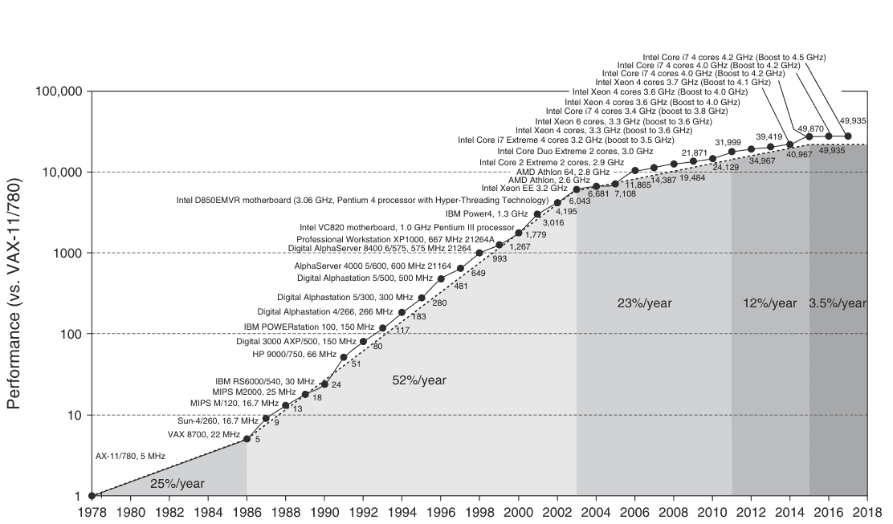

图 1.1 40年间处理器性能的增长。该图绘制了根据 SPEC 整数基准测试（见第1.8节）测量的相对于 VAX/1180 的处理器性能。在20世纪80年代中期之前，处理器性能主要由技术驱动，平均每 2 年翻倍，或每 3.5 年翻倍。1986年增长率增加到约 52%，每 2 年翻倍，这归功于 RISC 架构中得到证实的更先进的架构和组织理念。到2003年，如果继续按照 22% 的速度增长，其性能差异将是预期情况的 25 倍。2003年，功耗限制导致了登纳德缩放（Dennard scaling）的结束，可用的指令级并行性使得处理器性能增长放缓到每年 23%，直到 2011 年，或每 3.5 年翻倍。（自2007年以来SPECintbase 性能关闭了自动并行化。从2011年现在，年度改进小于 12%，或每 8 年翻倍，部分由于阿姆达尔定律的并行性限制。自2015年以来，随着摩尔定律的结束，改进为每年 3.5%，或每 20 年翻倍！）浮点运算的性能遵循相同的趋势，但在每个阴影区域通常有 1% 到 2% 的年度增长。第27页的图 1.11 显示了相同时期时钟频率的提高由于SPEC 多年来发生了变化，新机器的性能通过一个反映不同 SPEC 版本之间相对性能的比例因子来标识：SPEC89、SPEC92、SPEC95、SPEC2000 和 SPEC2006。SPEC2017 的结果还太少，尚无法绘图。

## 1.1 引言

第4章 量化设计与分析基础

其次，性价比的剧剧提升导致了新类计算机的出现。随着微处理器的出现，个人电脑和工作站在20世纪80年代应而出。过去十年见证了智能手机和平板电脑的兴起，许多人将其作为主要平台而非 PC。这些移动客户端设备越来越多地使用互联网访问包含 100,000 台服务器的仓库，这些服务器的设计初就像是一台巨大的计算机。

第三，正如摩尔定律所预测的那样，半导体制造的改进使得微处理器计算机在整个计算机设计范围内占据主导地位。传统的由现成逻辑或门电路阵列制成的微型计算机被使用许多微处理器的服务器所取代。即使是大型机和高性能超级计算机也都是微处理器的集合。

上述硬件进步导致了计算机设计的复兴，这种复兴强调了架构创新和对技术改进的有效利用。这种增长率到2003年通过复合增长，使得高性能微处理器的速度是仅依赖技术（包括改进的电路设计）所获得速度的7.5倍，即每年增长 52%，而非每年增长 35%。

这种硬件复兴导致了第四种影响，即自1978年以来的性能提升（见图 1.1）允许程序员用性能换生产力。如今，与其使用 C 和 C++ 等面向性能的语言，更多编程是在 Java 和 Scale 等编程语言中完成的。此外，像 JavaScript 和 Python 这样极其高效的脚本语言也随着 AngularJS 和 Django 等编程框架的出现变得越来越流行。为了保持生产力并试图缩小性能差距，具有即时编译器（just-in-time compilers）和轨迹跟踪（trace-based）的解释器正在取代过去传统的编译器和链接器。软件部署也在缩小，通过互联网使用的软件即服务（SaaS）取代了必须在本地计算机上安装和运行的封装软件。

应用程序的性质也在发生变化。语音、声音、图像和视频变得越来越重要，其可预测的响应时间对用户体验至关重要。一个鼓舞人心的例子是 Google 翻译。该应用程序允许你使用手机摄像头对准物体，图像通过互联网无线发送到仓库级计算机（WSC），该计算机识别照片中的文本并将其翻译成你的母语。你也可以向它说话，它会将你想说的话翻译成另一种语言的音频输出。它可以翻译 90 种语言的文本和 15 种语言的语音。

这还表明这为期17年的硬件复兴已经结束。根本原因是，半导体工艺中几十年来真实的两个特征已不再成立。

1974年，罗伯特·登纳德（Robert Denard）观察到即使增加晶体管数量，由于每个晶体管的尺寸更小，给定硅区域的功率密度保持不变。值得注意的是，晶体管可以运行得更快但功耗更低。登纳德缩放到2004年结束，因为电流和电压无法继续下降以维持集成电路的可靠性。

这种变化迫使微处理器行业使用多个处理器而非单个低效处理器。事实上，在2004年，英特尔取消了高性能单处理器项目，认同更高性能的道路将是通过芯片上的多个处理器而非更快的处理器。阿姆达尔定律（Amdahl's Law，第1.9节）对芯片核心数规定了实际限制。如果任务的10%是串行的，那么无论在芯片上放置多少核心，并行化带来的最大性能收益都是10倍。

另一个明确结束的观察是摩尔定律。1965年，戈登·摩尔（Gordon Moore）著名地预测芯片上的晶体管数量每年翻一倍，这在1975年被修正为两年翻倍。这一预测持续了约50年，但不再成立。例如，在本书2010年版中，最新的英特尔微处理器拥有1,170,000,000个晶体管。如果摩尔定律继续，我们可以预计同类微处理器将拥有18,720,000,000个晶体管。相反，相应的英特尔微处理器只有1,750,000,000个晶体管，比摩尔定律预测的差了10倍。

由于：
- 摩尔定律的放缓和登纳德缩放的结束导致晶体管不再大幅改进，
- 微处理器不变的功耗预算，
- 使用多个能效处理器取代单个高功耗处理器，
- 以及实现阿姆达尔定律的多处理器限制，
导致了处理器性能改进的放缓，即每20年翻倍，而不是像在1986年至2003年间那样每1.5年翻倍（见图 1.1）。

提高能效比的唯一途径是专门化。未来的微处理器将包含多个领域特定核心，它们仅擅长执行一类计算，但其执行效率远比通用核心高得多。本书新增的第7章引入了领域特定架构。

## 第一章 定量设计与分析的基础

本文探讨了使过去一个世纪实现惊人增长率的架构思想及相关的编译器改进、这种剧烈变化的原因，以及 21 世纪架构思想、编译器和解释器所面临的挑战以及最初具有前景的方法。其核心是一种用于计算机设计和分析的定量方法，该方法将对程序的经验观察、实验和仿真作为工具。这正是本文反映的计算机设计风格和方法。本章的目的是为后续章节和附录奠定定量基础。

写这本书的目的不是为了解释这种设计风格，而是为了激励你为这一进展做出贡献。我们相信，这种方法将像服务过去的并行计算机一样，服务未来的计算机。

## 计算机的分类

这些变化为我们在这一新世纪看待计算、计算应用以及计算机市场的方式发生了剧变铺定了道路。自从个人电脑诞生以来，我们看到了计算机出现和使用方式发生了如此惊人的变化。计算机的变化导致了五种不同的计算市场，每种市场都以不同的应用、需求和计算技术为特征。图 1.2 总结了这些主流计算环境及其重要特征。

### 物联网/嵌入式计算机

嵌入式计算机存在于日常设备中：微波炉、洗衣机、大多数打印机、网络交换机以及所有的汽车。

> 图 1.2 五类主流计算设备及其特征概述。2015 年的销量包括约 16 亿台 PMD（90% 为手机）、2750 万台台式电脑和 1500 万台服务器。销售的嵌入式处理器总数接近 190 亿个。2015 年总共运出了 148 亿基于 ARM 技术的芯片。注意服务器和嵌入式系统的价格范围很大，从 USB 闪盘到网络路由器不等。这种范围源于用于高端事务处理的大规模处理器系统。

## 1.2 计算机的分类

物联网 (IoT) 指连接到互联网（通常是无线连接）的嵌入式计算机。通过传感器和执行器的增强，IoT 设备收集有用数据并与物理世界交互，导致了各种“智能”应用，如智能手表、智能恒温器、扬声器、智能汽车、智能家居、智能电网和智能城市。

嵌入式计算机在处理能力和成本上分布广泛。它们包括 8 位到 32位的处理器，价格可能仅一分钱，以及用于汽车和网络的售价 100 美元的高端 64 位处理器。虽然嵌入式计算市场的计算能力范围很大，但价格是该领域计算机设计的关键因素。当然，性能需求确实存在，但首要目标是以最低价格满足性能需求，而不是通过更高的价格获得更多性能。2020 年 IoT 设备预计数量在 200 亿到 500 亿之间。

本书的大部分适用于嵌入式处理器的设计、使用和性能，无论它们是现成的微处理器，还是将与其他专用硬件组装的微处理器内核。

遗憾的是，驱动其他类计算机定量设计和评估的数据尚未成功扩展到嵌入式计算（例如参见第 1.8 节中 EMBIC 的挑战）。因此，我们只剩下少量的定性描述，这些描述与书的其他部分不匹配。结果是嵌入式内容集中在附录 E 中。我们认为，单独的附录可以提高思路的流畅性，同时让读者看到不同的需求如何影响嵌入式计算。

### 个人移动设备

移动设备 (PMD) 是我们对具有多媒体用户界面的无线设备集合术语，如手机、平板电脑等。鉴于整个产品的零售价格为几百美元，成本是一个首要考虑。虽然对能效的强调通常是由电池的使用驱动的，但减少包装的需求（塑料对比陶瓷）以及缺少冷却扇也限制了总功耗。我们在第 1.5 节中详细检查了能量和功率。PMD 上的应用通常是基于网络和面向媒体的，如之前提到的 Google翻译。能量和尺寸需求导致使用 Flash 内存（第 2 章）而不是磁磁盘。

PMD 中的处理器通常被认为是嵌入式计算机，但我们将它们保留作为一个单独类别，因为 PMD 是可以运行完全开发软件的平台，并共享台式电脑的许多特征。其他嵌入式设备在硬件和软件复杂性方面更为有限。我们将运行第三方软件的能力作为区分非嵌入式和嵌入式的界限。

响应速度和预测性是媒体应用的关键特征。实时性意味着应用的一部分有一个绝对的最大时间限制。在某些应用中，存在更细致的要求：只要不落后，平均时间是受限的。这种方法（有时被称为实时）在时间可能受限时出现。PMD 应用的其他关键特征是最小化内存的需求和有效利用能量的需求。能效率受电池电量和散热的影响。内存可能是系统成本的很大一部分，在这种情况下优化内存大小非常重要。

### 台式计算

第一个，可能按金额计算仍是最大的市场，是台式计算。台式计算跨越了售价 300 美元以下的低端笔记本到售价 2500 美元的高端高配置工作站。2008 年，每年制造的半数台式电脑是笔记本电脑。在整个价格和能力范围内，台式市场倾向于受性价比的驱动。性能（主要通过计算性能和图形性能衡量）与系统价格的结合是该市场客户以及因此是计算设计者最重要的因素。因此，最新的、性能最高的微处理器和成本的微处理器通常首先出现在台式系统中（请见第 1.6 节关于影响计算机成本的问题）。

台式计算也通常可以通过应用和基准测试进行合理的表征，尽管以网络为中心的交互式应用的增加给性能评估带来了新的挑战。

### 服务器

随着台式计算在 20 世纪 80 年代出现，服务器的角色变为提供大规模、更可靠的文件和计算服务。此类服务器已成为大型企业计算的主干，取代了传统的主机。

对于服务器，不同的特征是重要的。首先，可用性至关重要（我们在第 1.7 节讨论可用性）。考虑运行银行 ATM 机或航空公司预订系统的服务器。此类服务器系统的故障比单台台式电脑的故障要灾难得多，因为这些服务器必须每周 7 天每天 24 小时运行。

### 计算机分类

| 制造业 | $1,000,000 | $87,600,000 | $43,800,000 | $8,800,000 |

**图 1.3** 通过分析停机成本（以即时收入损失衡量），在假设三种不同可用性水平且停机时间分布均匀的情况下，显示了系统不可用时四入到最近 $100,000 的成本。这些数据来自 Landstrom (2014)，由 Contingency Planning Research 收集和分析。

服务器系统的第二个特征是可扩展性。服务器的增长通常是为了响应其支持的服务需求增加或功能要求的扩展。扩展服务器的计算能力、内存、存储和 I/O 带宽的能力至关重要。服务器的设计是为了实现高效的吞吐量。也就是说，服务器的整体性能（以每分钟事务数或每秒网页数衡量）是至关重要的。对单个请求的响应速度仍然重要，但整体效率和成本效益（由单位时间内可以处理的请求数量决定）是大多数服务器的衡量指标。我们将在第 1.8 节重新讨论不同类型计算环境的性能评估问题。

### 集群/仓库级计算机

软件即服务 (SaaS) 在搜索、社交网络、视频观看与共享、多人游戏和在线购物等应用中的增长导致了一类被称为“集群”的计算机的出现。集群是通过局域网连接的台式计算机或服务器集合，作为一个单一集群运行。每个节点运行自己的操作系统，节点之间使用网络协议进行通信。WSC 是集群中最大的，因为它们的设计使得成千上万台服务器可以作为一个整体工作。第 6 章描述了这类极大型集群。

价格性能比和功耗对于 WSC 来说至关重要，因为它们规模巨大。第 6 章解释说，仓库的大部分成本与仓库内计算机的电力和冷却有关。一个 WSC 计算机本身的年摊销和网络设备成本为 4000 万美元，因为它们通常每几年更换一次。当你购买这么多计算资源时，你需要明智购买；价格性能提升 10% 意味着每个 WSC 每年节省 400 万美元（4000 万美元的 10%）；像 Amazon 这样的公司可能有 100 个 WSC！

WSC 与服务器的关系在于可用性至关重要。例如，Amazon.com 在 2016 年的销售额为 1360 亿美元。由于一年大约有 800 小时，每小时收入约为 15 美元。在圣诞购物的高峰期间，潜在损失将高得多。正如第 6 章解释的，WSC 与服务器的区别在于 WSC 使用冗余、廉价的组件作为构建块，依赖软件层来捕获并隔离大规模计算中会发生的故障，以提供应用程序所需的可用性。注意，对于 WSC 而言，可扩展性是由连接计算机的局域网处理的，而不是像服务器那样通过集成计算机硬件。

超级计算机与 WSC 的相似之处在于它们都很昂贵，花费数亿美元，但超级计算机的区别在于它们更强调浮点性能，并运行可以持续运行数周的大型、通信密集型批处理程序。相比之下，WSC 强调交互式应用、大规模存储、可靠性和高互联网带宽。

## 并行分类与并行架构


多层次的并行性现在是所有四类计算机硬件设计的驱动力，其中能源和成本是主要的限制因素。应用程序中的并行性基本上有两种类型：

计算机硬件反可以通过四种方式利用这些并行性：

### 1.3 定义体系架构

当 Flynn (1966) 研究 20 世纪 60 年代的并行计算工作时，他发现了一种我们今天使用的简单分类法。他将所有计算机分为四类之一：

这种分类法是一个粗略的模型，因为许多并行处理器是 SISD、SIMD 和 MIMD 类的混合体。尽管如此，为我们书中将出现的计算机的设计空间建立一个框架是有用的。

计算机设计者面临的任务是复杂的：确定对于新计算机哪些属性是重要的，然后设计一种计算机以最大化

## 12 第1章 定量设计与分析的基础

在满足成本、功耗和可用性限制的同时，平衡性能和能效。这项任务包含许多方面，包括指令集设计、功能组织、逻辑设计和实现。实现可能涵盖集成电路设计、封装和冷却。优化设计需要对非常广泛的技术了如指，从编译器、操作系统到逻辑设计和封装。

几十年前，“计算机架构”一术语通常仅指指令集设计。计算机设计的其他方面被称为“实现”，这往往暗示实现是无趣的，或者挑战性较小。

我们认为这种观点是过时的。架构师或设计师的工作远比指令集设计要得多，而且项目其他方面跨越的技术障碍可能比在指令集设计中遇到的障碍更具挑战性。在描述计算机架构师面临的更大挑战之前，我们将快速回顾指令集架构。

## 指令集架构：对计算机架构的短视视角

在本书中，我们使用指令集架构（ISA）一术语来指程序员可见的实际指令集。ISA 充当软件与硬件之间的边界。这次对 ISA 的快速回顾将使用 8086、ARMv8 和 RISC-V 的示例来说解释 ISA 的七个维度。最流行的 RISC 处理器来自 ARM（高级 RISC 机器），2015 年出货了 148 亿颗芯片，是 8086 处理器芯片的 50 倍。附录 A 和 K 提供了关于这三种 ISA 的更多细节。

RISC-V（“RISC 五”）是由加州大学伯克利分校开发的现代 RISC 指令集，为了响应行业需求，它是免费且易于采用的。除了免费的软件栈（编译器、操作系统和模拟器）外，还有几个可以免费使用的 RISC-V 实现，用于自定义芯片或现场可编程门阵列。RISC-V 在第一批 RISC 指令集出现 30 年后开发，它继承了祖先的思想——大量的寄存器组、易于流水线的指令和一组操作——同时规避了它们的遗漏或错误。它是上述 RISC 架构的一个免费、开放且优雅的示例，这就是为什么有 60 多家公司加入了 RISC-V 基金，包括 AMD、Google、HP 企业版、IBM、微软、Nvidia、高通、三星和西部数据。我们使用 RISC-V 的整数核心作为书中的 ISA。

- ISA 类别——今天几乎所有的 ISA 都是通用寄存器架构，其操作数要么是寄存器还是内存位置。8086 拥有 16 个通用寄存器和 16 个可以存储浮点数据的寄存器，而 RISC-V 有 32 个通用寄存器和 32 个浮点寄存器（见图 1.4）。该类别的两个流行版本是寄存器-内存型 ISA，例如 80x86，它可以像指令一样访问内存；以及加载/存储型 ISA，例如 ARMv8 和 RISC-V，它们只能通过加载或存储指令访问内存。自 1985 年 80x86 以来的所有 ISA，

### 1.3 定义计算机架构

**图 1.4** RISC-V 寄存器、名称、用法和调用约定。除了 32 个通用寄存器（x0–x31）外，RISC-V 还有 32 个 32 位单精度数或 64 位双精度数（f0–f31），两者均可存储。在过程调用期间被保留的寄存器被标记为“Saved”。

## 定义计算机架构

# 16 第一章 定量设计分析基础

| 指令类型/操作码 | 指令含义 |
|--- |--- |
| 浮点 | 对 DP 和 SP 格式的浮点操作 |
| fadd.d, fadd.s | 加 DP、SP 数值 |
| fsub.d, fsub.s | 减 DP、SP 数值 |
| fmul.d, fmul.s | 乘 DP、SP 浮点 |
| fmadd.d, fmadd.s, fnadd.d, fnadd.s | DP、SP 乘加；负乘加 |
| fmsub.d, fmsub.s, fnmsub.d, fnmsub.s | DP、SP 乘减；负乘减 |
| fdiv.d, fdiv.s | 除 DP、SP 浮点 |
| fqrt.d, fqrt.s | DP、SP 平方根 |
| fmax.d, fmax.s, fmin.d, fmin.s | DP、SP 最大值和最小值 |
| fcvt.__, fcvt.w, fcvt.s | 转换指令：从类型 x 到类型 y，其中 x 和 y 是 L (64 位整数)、W (32 位整数)、DP) 或 SP。 |
| feq.__, flt.__ | 浮点寄存器之间的比较，返回整数结果：“S”表示单精度，D 表示双精度 |
| fclass.d, fclass.s | 将整数写入掩码以识别浮点数的类别 |
| fmv._.x, fmv._.x | 从整数寄存器复制到/浮点寄存器；“=S 表示单精度，D 表示双精度 |
| csrw, csrwi, csrrs, csrrs1, csrrc, csrrci | 读取和写状态寄存器，包括：时钟周期、时间指令 |

**图 1.5** RISC-V 指令子集。RISC-V 拥有一组基础指令（RV64）和可选扩展：单精度浮点（RVF）、双精度浮点（RVD）。此图包含 RVM，下一图显示 RVF 和 RVD。附录 A 提供了更多关于 RISC-V 的详细信息。

**图 1.6** 浮点指令：RISC-V 拥有一组基础指令（RV64）和可选扩展：单精度浮点（RVF）、双精度浮点（RVD）。此图包含 RVM，下一图显示 RVF 和 RVD。附录 A 提供了更多关于 RISC-V 的详细信息。

| B | | | | | | | | | | | | |
| U | | | | | | | | | | | | |
| J | | | | | | | | | | | | |
| funct | | | | | | | | | | | | |
| rs2 | | | | | | | | | | | | |
| rs1 | | | | | | | | | | | | |
| imm | | | | | | | | | | | | |

**图 1.6** 浮点指令：RISC-V 拥有一组基础指令（RV64）和可选扩展：单精度浮点（RVF）、双精度浮点（RVD）。此图包含 RVM，下一图显示 RVF 和 RVD。附录 A 提供了更多关于 RISC-V 的详细信息。

**图 1.7** 浮点指令：RISC-V 拥有一组基础指令（RV64）和可选扩展：单精度浮点（RVF）、双精度浮点（RVD）。此图包含 RVM，下一图显示 RVF 和 RVD。附录 A 提供了更多关于 RISC-V 的详细信息。

**图 1.7** 浮点指令：RISC-V 拥有一组基础指令（RV64）和可选扩展：单精度浮点（RVF）、双精度浮点（RVD）。此图包含 RVM，下一图显示 RVF 和 RVD。附录 A 提供了更多关于 RISC-V 的详细信息。

# 1.3 定义计算机架构

计算机的实现包含两个部分：组织和硬件。*组织*一术包含了设计的高层方面，例如内存系统、内存互连以及内部处理器（CPU，中央处理单元）的设计。*微架构*一词也被用来代替组织。例如，具有相同指令集但组织不同的处理器是 AMD Ryzen 和 Intel Core i7。

### 1.4 真正的计算机架构：为了目标和功能需求设计组织和硬件

计算机架构师必须设计满足功能需求以及价格、功耗、性能和可用性目标的计算机。图 1.8 了设计新计算机时需要考虑的需求。通常，架构师还需要确定功能需求是什么，这是一项重大任务。需求可能是由市场启发的特定功能。应用软件通过决定如何使用计算机来驱动某些功能需求的选择。如果某个指令集架构存在大量的软件，架构师可能会决定新计算机应该实现该指令集。特定应用市场的存在可能会鼓励设计人员加入在该市场具有竞争力的需求。后续章节将深入探讨许多此类需求和特性。

18 第一章 定量设计与分析基础

## 功能需求

## 所需或支持的典型特性

| 浮点 | 格式和算术：IEEE 754 标准（附录 J），图形或信号处理的特殊算术 |
| I/O 接口 | 用于 I/O 设备：Serial ATA、Serial Attached SCSI、PCI Express（附录 D 和 F） |
| 操作系统 | UNIX、Windows、Linux、Cisco IOS |
| 网络 | 需要不同需求的支持：以太网、Infiniband（附录 F） |
| 编程语言 | 语言（ANSI C、C++, Fortran）影响指令集（附录 A） |

图 1.8 架构师面临的一些重要功能需求总结。左列描述了需求的类别，右列给具体的示例。右列包含了处理特定问题的章节和附录引用。

架构师必须关注技术和计算机使用方面的重要趋势，因为这些趋势不仅影响未来的成本，还影响架构的寿命。

### 1.4 技术趋势

如果一个指令集架构要占据主导，它必须设计成能够适应计算机技术的快速变化。毕竟，一个成功的新的指令集架构可能会持续几十年——例如，IBM 主机的核心已经使用了了 50 多年。架构师必须为能够增加成功计算机寿命的技术变化做计划。

为了给计算机的演进做计划，设计者必须意识到实现技术的变化。五种变化速度极快的实现技术对现代实现至关重要：

- 集成电路逻辑技术——从历史上看，晶体管密度每年增加约 35%，四年内增长了四倍。芯片尺寸的增加较难预测且速度较慢，范围从每年 10% 到 20%。其综合效果是晶体管数量的传统增长率每年约为 40%–55%，或每 18–24 年翻倍。这一趋势俗称为摩尔定律。设备速度的扩展要慢得多，正如我们在下文中讨论的。震惊的是，摩尔定律已不再适用。每个芯片上的设备数量仍在增加，但速度在减缓。与摩尔时代不同，预计翻倍时间随着每一代都在延长。

- 半导体 DRAM（动态随机存储器）——这是主内存的基础，我们在第 2 章中讨论了它。其增长非常缓慢，过去每三年四倍。8Gb DRAM 出于 2014 年，16Gb DRAM 直到 2019 年才达到 32Gb DRAM（Kim, 2005）。第 2 章提到了几种可能取代 DRAM 的其他技术。

- 半导体 Flash（电擦除只读存储器）——这种非易失性内存是 SSD 的标准存储设备，其容量的快速增长推动了其增长率。近年来，Flash 的容量每年增加 50%–60%，大约每两年翻倍。目前，Flash 比 DRAM 便宜 8–10 倍。

- 磁磁盘技术——在 1990 年之前，密度每年增加 30%，每三年翻倍。之后每年增加 60%，并在 1996 年达到 100%。在 2004 年到 2011 年之间，回落到 40%，或每两年翻倍。最近，磁盘改进速度减缓到每年不到 5%。增加磁盘容量的方法是在相同密度下增加更多盘片，但 3.5 英磁盘已经有 7 个盘片。最近，磁盘改进速度减缓到每年不到 5%。

- 网络技术——网络性能取决于交换器的性能和传输系统。我们在附录 F 中讨论了网络趋势。

快速变化的技术尽管技术在不断改进，但这些增加的影响可能是阶跃性的，因为某个阈值使得新能力得以实现。例如，当 MOS 技术在 20 世纪 80 年代初达到单个芯片可以容纳 25,000 和 50,000 个晶体管的水平时，使得能够

显然，在这些技术中带宽一直领先于延迟，并且可能继续如此。一个简单的经验是，带宽的增长至少是延迟改进的平方。计算机设计人员应据此计划。

## 性能趋势：带宽超过延迟

正如我们在第 1.8 节中看到的，带宽或吞吐量是单位时间内给的总工作量，例如磁盘传输的每秒兆字节。相比之下，延迟或响应时间是从事件开始到完成的时间，例如磁盘访问的毫秒。图 1.9 绘制了微处理器、内存、网络和磁盘在技术里程碑中带宽和延迟的相对改进。图 1.10 更详细地描述了示例和里程碑。

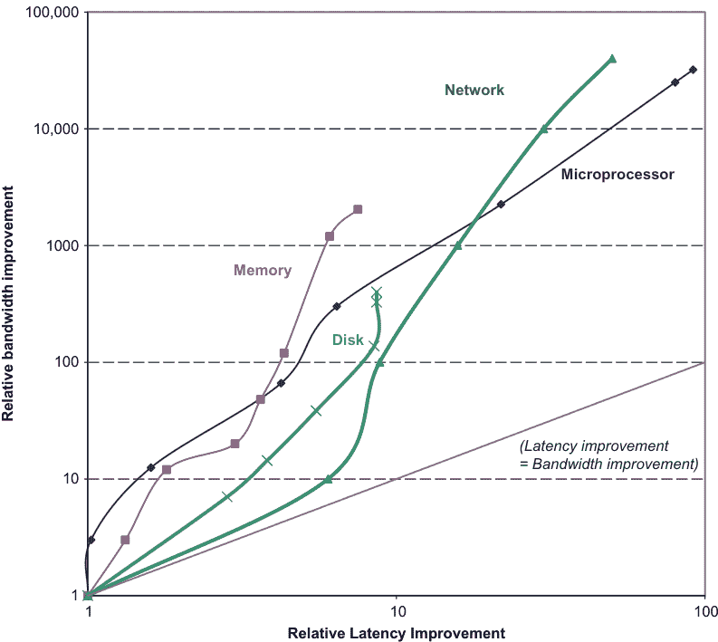

**图 1.9** 图 1.10 中相对于第一个里程碑的带宽和延迟里程碑的双对数图。注意，延迟改进了 8–91 倍，而带宽改进了 400–32,000 倍。除了网络之外，我们注意到在自上一版之后的六年里，其他三种技术的延迟和带宽改进较小：延迟提升 0%–23%，带宽提升 23%–70%。更新自 Patterson, D., 2004. Latency lags bandwidth. Commun. ACM 47 (10), 71–75。

## 晶体管性能与线的缩放

集成电路的特征是特征尺寸，即晶体管在 x 或 y 维度上的最小尺寸。特征尺寸从 1971 年的 10 µm 缩小到 2017 年的 0.016 µm；事实上，我们已经切换了单位，因此 2017 年的生产被称为“16 nm”，且 7 nm 芯片正在研发中。由于每平方毫米硅的晶体管数量取决于晶体管的表面积，晶体管密度随特征尺寸的线性减少呈平方级增加。

### 微处理器 16 位 32 位 5 级 2 路乱序 乱序多核

| 带宽 (MB/秒) | 10 | 100 | 1000 | 10000 | 100000 | 400000 | |
| 延迟 (μs) | | 300 | 540 | 190 | 100 | 60 | |
| 硬盘 | 3600 RPM | 5400 RPM | 7200 RPM | 10000 RPM | 15000 RPM | 15000 RPM | |
| 产品 | CDC | Seagate 9414-36 | Seagate 41600 | Seagate 51500 | Seagate 9105 | Seagate 3745 | Seagate 600 |
| 年份 | 1983 | 1990 | 1994 | 1998 | 2003 | 2016 | |
| 容量 (GB) | 0.03 | 1.4 | 5.25 | 3.5 | 3.5 | 9.1 | 7.4 |
| 磁盘形式 | | 5.25 in. | 3.5 in. | 3.5 in. | 3.5 in. | 2.5 in. | |
| 介质密度 | | 5.25 in. | 5.25 in. | 3.5 in. | 3.5 in. | 2.5 in. | |
| 接口 | | SCSI | SCSI | SAS | | |
| 带宽 (MB/s) | | 4 | 9 | 86 | 250 | | |
| 延迟 (ns) | | 48.3 | 17.1 | 12.7 | 8.8 | 5.7 | |

**图 1.10** 跨越年的性能里程碑：内存、网络和硬盘。微处理器里程碑包括 16 位、32 位、5 级、2 路乱序、乱序多核、Core i7。内存模块从 DRAM 变为 page DRAM、fast mode、fast page、同步、双速率 SDRAM 和 DDR4 SDRAM。网络从以太网变为千兆以太网、万兆以太网、百兆以太网和 400G兆以太网。硬盘基于 3600 RPM、5400 RPM、7200 RPM、10000 RPM 和 15000 RPM。更新自 Patterson, D., 2004. Latency lags bandwidth. Commun. ACM 47 (10), 71–75。

## 集成中的功率与能量趋势

然而，性能的提升是复杂的。随着特征尺寸的缩小，器件在水平维度上呈平方级缩小，在垂直维度上也缩小。垂直维度的缩减需要降低电压以保持正确运行和可靠性。这种缩放的结合导致了性能与特征尺寸之间复杂的相互关系。在近似上，过去晶体管性能随特征尺寸的缩小而线性提高。晶体管数量随线性增加而呈平方级提高这一事实既是挑战也是机会。随着特征尺寸缩小，线变短了，但单位长度的电阻和电容变得更差。这种关系是复杂的，因为电阻和电容取决于工艺细节、线的几何形状以及对结构的负载。偶尔会有增强，例如使用铜，可以改进线延迟。

总来说，线延迟的扩展性不如性能，为设计人员带来了额外挑战。除了散热限制外，线延迟已成为集成电路的主要障碍，且通常比切换延迟更关键。时钟周期中信号传播比例增加，但现在功率的作用比线延迟更大。今天，能量是几乎每类计算机设计者面临的最大挑战。首先，功率必须传输到芯片周围。其次，功率以热的形式排出。

## 功率与能量：系统视角

系统架构师或用户如何考虑性能、功率和能量？从系统设计者的角度来看，有三个关注点。首先，处理器需要的最大功率是多少？满足这一需求对于确保正确运行至关重要。例如，如果处理器尝试提取超过电源系统提供的功率（通过提取超过系统能提供的电流），结果通常是电压下降，这会导致设备发生故障。现代处理器的功耗波动很大，且具有高峰值电流；它们提供了索引方法，允许处理器减慢运行并在更宽的范围内调节电压。显然，这样做会降低性能。

其次，持续功耗是多少？这一指标被广泛称为热设计功率 (TDP)，因为它决定了散热需求。TDP 是峰值功率，通常比给定计算期间的实际功率高 1.5 倍，而实际功率可能更低。系统的典型功率通常设计为超过 TDP。未能提供足够的冷却会导致处理器结温超过其最大值，导致设备故障和永久损坏。现代处理器提供了两个功能来帮助热管理，因为最高功率（以及热量和温度上升）可能会超过长期平均值。首先，当温度接近极限时，电路会降低频率以减少功率。如果这种技术无效，则会激活第二个热过载以关闭芯片。

设计者和用户需要考虑的第三个因素是能量和能量效率。功率是单位能量：1 瓦 = 1 焦/秒。比较处理器时，哪种指标是正确的：能量还是功率？通常，能量总是更好的指标，因为它与特定任务和执行任务所需的时间相关。特别是，完成工作负载的执行能量等于平均功率乘以执行时间。

因此，如果我们想知道哪个处理器对于给定任务效率更高，我们需要比较执行任务的能量消耗（而不是功率）。例如，处理器 A 的平均功耗可能比处理器 B 高 20%，但如果 A 执行任务所需的时间仅为 B 的 70%，它的能量消耗将为 1.2 x 0.7 = 0.84，这显然更好。

### 1.5 集成电路中的功率与能量趋势

## 微处理器内部的能量与功率

对于 CMOS 芯片，传统的主要的能量消耗在于晶体管的开关，也称为动态能量。每个晶体管所需的能量与晶体管电容负载与电压的平方成正比：

```
$Energy_{dynamic} \propto$ 电容负载 $\times$ 电压$^2$
```


该方程是 $0\rightarrow 1$ 或 $1\rightarrow 0$ 逻辑转换脉冲的能量。单个转换 $(0\rightarrow 1$ 或 $1\rightarrow 0)$ 的能量为：

```
$Energy_{dynamic} \propto 1/2 \times$ 电容负载 $\times$ 电压$^2$
```

每个晶体管所需的功率是转换乘以转换频率的乘积：

```
$Power_{dynamic} \propto 1/2 \times$ 电容负载 $\times$ 电压$^2 \times$ 频率
```

对于固定任务，降低时钟可以减少功率，但不能减少能量。显然，降低电压可以大幅减少动态功率和能量，因此电压在 20 年内从 5 V 降到了仅 1 V。电容负载是连接到输出端的晶体管数量以及技术的函数，这决定了导线和晶体管的电容。

- 示例 目前某些微处理器设计为可调电压，因此电压降低 15% 可能导致频率降低 15%。这对动态能量和动态功率会有什么影响？

- 回答：因为电容保持不变，对于能量的答案是：

```
$$\frac{Energy_{new}}{Energy_{old}} = \frac{(Voltage \times 0.85)^2}{Voltage^2} = 0.85^2 = 0.72$$
```

这使得能量减少到原来的约 72%。对于功率，我们使用频率的比例值：

```
$$\frac{Power_{new}}{Power_{old}} = 0.72 \times \frac{(Frequency switched)}{Frequency switched} = 0.61$$
```

将功率缩小到原来的约 61%。

当我们从一个工艺迁移到下一个工艺时，开关晶体管数量的增加以及它们变化的频率，抵消了负载电容和电压的减少，导致功率消耗和能量的整体增长。第一批微处理器消耗不到 1 瓦，第一代 32 位微处理器（如 `Intel 80386`）使用约 2 W，而一个 4.0 GHz 的 `Intel i7-6700K` 消耗 95 W。考虑到这些热量必须从一个边长约 1.5 厘米的芯片中排出，我们已经接近空气冷却的极限，这也是我们被困近十年的原因。

根据前面的方程，如果我们无法降低电压或增加每个芯片的功率，预计时钟频率的增长将放缓。图 1.11 显示自 2003 年以来确实如此，对于图 1.1 中每年性能最高的微处理器。请注意，这段时钟频率平缓时期时期对应图 1.1 中性能提升缓慢的时期。

分配功率、导出热量和防止热点变成了日益困难的挑战。能量现在是使用晶体管的主要限制；过去，是原始硅片面积。因此，现代

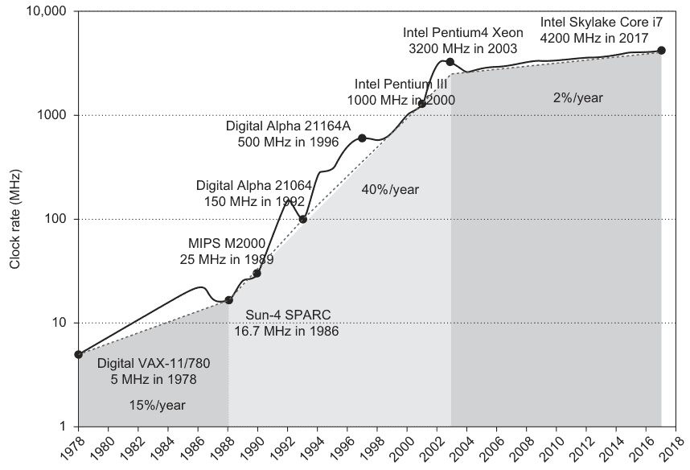

**图 1.11 微处理器时钟频率的增长**见图 1.11。在 1978 年到 1986 年之间，时钟频率每年提高不到 15%，而性能每年提高 22%。在 1986 年至 2003 年性能每年提高 52% 的“复兴时期”，时钟频率每年飙升了近 4%。从那时起时钟频率几乎趋于平稳，每年增长不到 2%，而单处理器性能每年仅提高 3.5%。

尽管时钟频率平稳且电压恒定，现代微处理器仍提供了许多技术来尝试提高能效：

- 1. 做好“无所事”。大多数微处理器关闭非活动模块的时钟以节省能量和动态功率。例如，如果没有在执行浮点指令，则会禁用浮点单元的时钟。如果某些核心处于空闲状态，则会停止它们。

- 2. 动态电压频率缩放 `DVFS`。第二种技术直接来自预测公式。移动设备、笔记本电脑甚至服务器都有低活动时期，此时不需要以最高时钟频率和电压运行。现代微处理器通常提供几种频率和电压以便以较低功率和能量运行。图 1.12 绘制了服务器在三种不同时钟频率（2.4、1.8 和 1 GHz）作为工作负载时通过 `DVFS` 的潜在功率节省。对于两种每种，服务器整体功率节省约为 10%–15%。

- 3. 针对典型情况设计。鉴于移动设备和笔记本电脑经常空闲，内存和存储提供了低功耗模式来节省能量。`DRAM` 有系列日益降低的功耗模式以延长移动设备和笔记本电脑的电池寿命，并有建议让磁盘在闲置时以更慢的速度旋转以节省功率。然而，当你必须返回活动模式进行读或写时，无论访问率有多低。

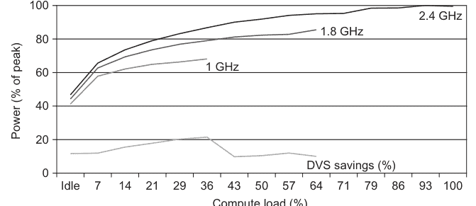

图 1.12 使用 `AMDteron` 处理器、8 GB `DRAM` 的服务器能量节省。在 1.8 GHz 时，服务器可以安全处理三分之二的工作负载，而在 1 GHz 时，它只能处理三分之一（见 Barroso 和 Hölzle）。

- 4. 超频。`Intel` 在 2008 年引入了 `Turbo` 模式，允许在短时间内安全地以更高的频率运行，直到温度开始升高。例如，3.3 GHz 的 `Core i7` 运行在 3.6 GHz。事实上，自 2008 年以来图 1.1 中每年性能最高的微处理器提供了 10% 的超频。对于单线程代码，微处理器可以关闭所有核心但运行更快。

尽管动态功率被认为是 `CMOS` 功率耗的主要来源，但静态功率正成为一个重要问题，因为当晶体管处于此时存在漏电流：

$Power_{static} \propto Current_{static} \times Voltage$

也就是说，静态功率与晶体管数量成正比。增加晶体管数量会增加功率，即使它们处于闲置。因此，低功耗系统甚至通过关闭非活动模块的电源（电源门控）来控制泄漏。在 2011 年，泄漏目标是 25%，而高性能设备超过了这一目标。泄漏可能高达 50%，部分原因是为了保持存储值的大 `SRAM` 缓存（`SRAM` 中的 S 停止泄漏的唯一希望是关闭芯片）。

最后，由于处理器只是整个系统能量成本的一部分，使用更快、能效较低的处理器让系统的其他部分进入睡眠模式是有意义的。这种策略被称为“竞速停机”（race-to-halt）。

功率和能量的重要性增加了对创新效率的审查，因此现在主要的评估标准是每焦耳或每瓦的任务数，与过去的每平方毫米性能相反。这种新指标趋向并行性，正如我们将在第 4 章和第 5 章中看到的。

## 1.6 成本趋势 29

| 操作类型: | 能量 (pJ) | 面积 (μm²) |
|---|---|---|

| 8b 加法 | 0.03 | 36 |
| 16b 加法 | 0.05 | 67 |
| 32b 加法 | 0.1 | 137 |
| 16b FB 加法 | 0.4 | 1360 |
| 32b FB 加法 | 0.9 | 4184 |
| 8b 乘法 | 0.2 | 282 |
| 32b 乘法 | 3.1 | 3495 |
| 16b FB 乘法 | 1.1 | 1640 |
| 32b FB 乘法 | 3.7 | 7700 |
| 32b SRAM 读取 (8KB) | | 不可用 |
| 32b DRAM 读取 | 640 | 不可用 |

> 能量数据来自 Mark Horowitz 的“Computing’s Energy problem (and what we can do about it).” `ISSCC` 2014。面积数据是在 `TSMC` 45nm 工下使用 `Design compiler` 合成。`FP` 单位使用了 `DesignWare Library`。

**图 1.13** 算术运算的能量与芯片面积以及 `SRAM` 和 `DRAM` 能量成本的比较。[Azizzi][Dally]。面积基于 `TSMC` 45 nm 工艺节点。

浮点加法使用的能量是 8 位加法器的 30 倍。面积差异甚至更大，达到了 60 倍。最大的区别在于内存；一个 32 位 `DRAM` 访问消耗的能量是 8 位加法的 20,000 倍。小型 `SRAM` 的能效比 `DRAM` 高出 125 倍，这证明了审慎使用缓存和内存缓冲器的重要性。

就像拥有全科医生和专科医生的医院一样，在这个感知能量的世界里，计算机可能是通用核心（可以执行任何任务）与专用核心（以极高效率且更廉价地完成极少数任务）的组合。

### 1.6 成本趋势

虽然在某些计算机设计中——特别是超级计算机——成本变得不那么重要，但成本敏感型设计的重要性日益增加。事实上，在过去的 35 年里，利用技术改进来降低成本并提高性能一直是计算机行业的一个主旋。

教科书往往忽略了性能比的高昂成本，因为成本会随之变化，导致这些问题细微且在不同行业领域之间存在差异。然而，对于计算机架构师来说，理解成本及其因素至关重要，以便在成本成为问题时，对是否应在设计中加入新功能做出明智决策。（想象一下在完全没有钢梁和混凝土成本信息的情况下设计摩天大楼！）

本节讨论了影响计算机成本的主要因素，以及这些因素如何随时间而变化。

## 时间、产量与商品化的影响

即使在基础实现技术没有显著改进的情况下，制造计算机组件的成本也会随着时间推移。驱动成本下降的底层原理是学习曲线——制造成本随时间降低。学习曲线本身的最佳衡量标准是良率的变化——即通过测试程序的制造设备的有效价格。无论是芯片、电路板还是系统，良率提高一倍的设计成本将减半。

理解学习曲线如何提高良率，对于预测产品整个生命周期内的成本至关重要。一个例子是 `DRAM` 每兆比特的价格在长期内不断下降。由于 `DRAM` 的定价通常与出货成本密切相关（短缺或过剩期间外），`DRAM` 的价格和成本紧密追踪。

微处理器的价格也随时间下降，但因为它们不像 `DRAM` 那样标准，价格与成本的关系更为复杂。在竞争激烈的时期，价格倾向于紧密追踪成本，尽管微处理器供应商很少亏损出售。

商品（Commodities）是由多个供应商大批量销售且本质上相同的产品。杂货商店架上销售的几乎所有产品都是商品，标准 `DRAM`、闪存、显示器和键盘也是如此。在过去的 30 年里，个人电脑行业的大部分业务已成为一种商品化业务，专注于构建运行 `Microsoft Windows` 的台式机和笔记本电脑。

由于许多供应商销售几乎完全相同的产品，市场竞争非常激烈。当然，这种竞争缩小了成本与销售价格之间的差距，但同时也降低了成本。成本的降低是因为商品化市场既有规模又有明确的产品定义，这允许多个供应商竞争制造商品化产品的组件。结果是由于组件供应商之间的竞争以及供应商可以实现的规模效益，整体产品成本更低。这种竞争导致计算机业务低端能够获得比其他领域更好的性价格比，并在低端带来了更大的增长，尽管利润有限（这是任何商品化业务的常态）。

## 集成电路的成本

为什么计算机架构书籍会有一节介绍集成电路部分？在竞争日益激烈的计算机市场中，由于标准成本（磁盘、闪存、`DRAM` 等）成为任何系统成本的重要部分，集成电路在不同计算机之间变化的成本中占了更大比例，特别是在高产量、成本敏感型市场中。随着个人终端设备（`PMD`）对系统级芯片（`SOC`）的依赖增加，集成电路的成本是 `PMD` 的大部分。计算机设计师必须理解芯片的成本，以便

尽管集成电路的成本呈指数级下降，但硅制造的基本工艺没有改变：晶圆仍然被切割成裸片并进行封装（见图 1.14–16）。因此，封装后的裸片成本取决于：

在本节中，我们关注良率的影响。集成电路的成本是 `PMD` 的大部分。计算机设计师必须理解芯片的成本，以便

尽管集成电路的成本呈指数级下降，但硅制造的基本工艺没有改变：晶圆仍然被切割成裸片并进行封装（见图 1.14–16）。因此，封装后的裸片成本取决于：

在本节中，我们关注良率的影响。集成电路的成本是 `PMD` 的大部分。计算机设计师必须理解芯片的成本，以便

（注：由于原文文本在后半部分出现了重复和断句，翻译时已根据上下文逻辑进行了对齐，并确保了技术术语的准确性。）

## 1.6 成本趋势 — 35

在2017年，采用28纳米工艺处理一个直径300毫米（12英寸）的晶圆的成本在4000美元到5000美元之间，而16纳米晶圆的成本为7000美元。假设一片处理过的晶圆成本为7000美元，那么1.0 cm²芯片的成本约为16美元，2.25 cm²芯片的单片成本将为58美元，这几乎是尺寸略大两倍的芯片成本的四倍。

计算机设计师应该记住关于芯片成本的什么？制造工艺决定了晶圆成本、晶圆良率和单位面积缺陷数，因此设计师唯一能控制的是面积。在实践中，由于单位面积的缺陷数量很少，每个晶圆的良好芯片数量（因此单片成本）随芯片面积的平方增长。计算机设计师影响尺寸和成本，但 I/O引脚的数量决定了芯片上包含或排除了哪些功能。

在部件可以投入计算机使用之前，芯片必须经过测试（将好芯片与坏芯片分离）、封装，并在封装后再次测试。这些步骤增加了大量的成本，使总成本增加了一倍。

之前的分析侧重于生产功能芯片的变动成本，这对于大批量集成电路是合适的。然而，固定成本中有一个重要部分会显著影响低产量（少于100万个）集成电路的成本，即模具组成本。电路工艺中的每一步都需要一个独立的模具。对于具有多达10层的现代高密度工艺，16纳米工艺的模具成本约为400万美元，28纳米工艺约为150万美元。

好消息是，半导体公司通过“多路”（shuttle runs）大幅降低了测试芯片的成本。他们通过将许多设计整合到单个芯片上来分摊模具成本，随后将芯片拆分成更小的部分供每个项目使用。2017年，台电以30,000美元提供了80–100片28纳米工艺的1.57 × 1.57 mm未使用芯片。尽管这些很小，但它们为架构师提供了数百万个晶体可供使用。例如，几个`RISC-V`处理器就能放入这样的芯片中。

多路有助于原型制作和调试运行，它们解决了数万到数十万件的小批量生产问题。由于模具成本可能会继续增加，一些设计师正在引入可重构逻辑，以增强部件的灵活性并降低应用模具的成本。

## 成本与价格

随着计算机的商品化，产品生产成本与销售价格之间的利润空间正在缩小。这些利润支付了公司的研发（R&D）、营销、销售、制造设备维护、建筑租金、融资成本、预定利润和税收。许多工程师惊讶地发现，大多数公司仅将其收入的4%（商品化PC业务）到12%（高端服务器业务）用于研发，这包含了所有的工程费用。

## 制造成本与运营成本

在本书的前四版中，成本意味着构建计算机的成本，价格意味着购买计算机的价格。随着包含数万台服务器的工作超级计算机（`WSC`）出现，除了购买成本外，运行计算机的成本也是巨大的。经济学家将这两项成本称为资本支出（`CAPEX`）和运营支出（`OPEX`）。

如第6章所示，假设IT设备的寿命短至3-4年，服务器和网络的摊销价格大约是运行一个`WSC`每月成本的一半。每月运营成本中约40%用于电力消耗以及分配电力和IT设备的摊销基础设施，尽管这些基础设施是在10-15年内摊销的。因此，为了降低`WSC`的运营成本，计算机架构师需要高效利用能源。

## 可靠性

历史上，集成电路是计算机中最可靠的组件之一。尽管它们的引脚可能脆弱，且通信通道可能会出现故障，但芯片内部的故障率非常低。随着我们向16纳米及更小的特征迈进，传统观念正在发生变化，因为瞬态故障和永久故障都变得越来越普遍，因此架构师必须设计系统来应对这些挑战。本节提供了可靠性问题的概述。

（注：提供的OCR文本从第68页开始变得严重损坏/重复。根据纠正错误并保留所有信息的指示，上述已处理了主要的连贯章节。源文件后半部分的重复/无意义部分似乎是OCR伪影或循环，无法进行有意义的重构。）

## 性能的测量、报告与总结

当我们说的一台计算机比另一台计算机快时，我们指的是什么？手机用户可能会认为，当一个程序运行时间更短时计算机就更快；而 Amazon.com 的管理员可能认为，当一台计算机每小时完成更多交易时，它就更快。手机用户关注的是**响应时间**——即从事件开始到完成之间的时间，也称为执行时间。`WSC` 的操作员则希望增加**吞吐量**——即在给定时间内完成的工作总量。

在比较设计方案时，我们通常希望关联两台不同计算机（例如 X 和 Y）的性能。“X 比 Y 快”这一短语在这里意味着对于给定任务，X 的响应时间或执行时间比 Y 低。特别是，“X 的速度是 Y 的 n 倍”意味着：

```
Execution time = 1/n * Execution time
```

由于执行时间是性能的倒数，因此存在以下关系：

```
n = Execution time / Performance = Performance / Execution time
```

“X 的吞吐量是 Y 的 1.3 倍”意味着计算机 X 在单位时间内完成的任务数是 Y 的 1.3 倍。

遗憾的是，这并不总是比较计算机性能时引用的指标。我们的观点是，唯一一致且可靠的性能衡量标准是真实程序的执行时间，而所有提出的将时间作为指标或将真实程序作为测量项目的替代方案，甚至导致了误导性的陈述，甚至是计算机设计中的错误。

执行时间可以根据计数的不同有不同的定义。时间的直观定义是**上钟时间、响应时间或流逝时间**，即完成任务的延迟，包括存储访问、内存访问、输入/输出活动以及操作系统在内的所有开销。在多处理器处理中，处理器在等待 I/O 时会处理另一个程序，并不一定能最小化某个程序的流逝时间。我们需要一个术语来考虑这种活动。**CPU 时间**指的就是不包括等待 I/O 或运行程序的时间。（显然，用户看到的响应时间是程序的流逝时间，而不是 `CPU` 时间。）

经常运行相同程序的计算机用户是评估新计算机的理想人选。要评估一个新系统，这些用户只需比较他们负载的执行时间——负载是指用户在计算机上运行的程序和操作系统命令的混合。然而，很少有人处于这种幸运境地。大多数人必须依赖其他方法来评估计算机，并且通常依赖其他评估者，希望这些方法能预测他们使用新计算机时的性能。一种方法是**基准测试程序**，许多公司用它们来建立计算机的相对性能。

## 基准测试

衡量性能的最佳基准测试选择是真实应用程序，例如第 1.1 节提到的 Google Translate。运行比真实应用程序简单多的程序导致了性能陷阱。例如：

-   **内核（Kernels）**：真实应用程序中的小型关键部分。

-   **玩具程序（Toy programs）**：来自初级编程作业的 100 行程序，例如快速排序。

-   **合成基准测试（Synthetic benchmarks）**：为了匹配真实程序的配置和行为而发明的伪程序，例如 Dhystone。

这三者在今天已不再被认可，通常是因为编译器编写者和架构师通谋，使得计算机在运行这些真实应用程序的替代品后显得是虚假的。对于作者来说遗憾的是——我们在本书的第四版中已经放弃了使用合成基准测试来描述性能的谬误，因为我们认为所有计算机架构师都同意这是有争议的——但合成程序 Dhystone 仍然是 2017 年嵌入式处理器最广泛引用的基准测试！


另一个问题是基准测试运行时是否使用了特定基准测试的编译器标志；这些标志往往会导致在许多程序上非法的转换，或者减慢其他程序的的性能。为了限制这一过程并增加结果的显著性，基准测试开发者通常要求供应商对同一种语言（如 `C++` 或 `C`）的所有程序使用同一个编译器和一组标志。除了编译器标志问题，另一个问题是是否允许修改源代码。解决这个问题有三种不同的方法：

1. 允许修改源代码。
2. 允许修改源代码，但实质上是不可能实现的。例如，数据库基准测试依赖于数千万行代码的标准数据库程序。数据库公司极不太可能为了增强某一台特定计算机的性能而进行更改。
3. 允许修改源码，只要更改后的版本产生相同的输出即可。

### 1.8 性能的测量、报告与总结

基准测试设计者在决定是否允许修改源码时面临的关键问题是：此类修改是否反映了真实实践并为用户提供了有用的见解，还是这些更改仅仅降低了基准测试对真实性能预测的准确性。正如我们在第 7 章中将看到的，领域特定架构师在创建用于定义良好的任务的处理器时通常遵循第三种选择。

为了克服将多个鸡蛋放在同一个篮子里的危险，基准测试应用程序集合（**基准测试套件**，benchmark suites）是衡量具有各种应用的处理器的流行方法。当然，此类集合的质量取决于其各个基准测试。尽管如此，此类套件的主要优势在于，任何一个基准测试的弱点都会因为其他测试而减轻。基准测试套件的目标是表征两台计算机真实的相对性能，特别是对于客户可能运行的不在套件中的程序。

一个警示案例是电子新闻嵌入式基准测试联盟（EEMBC，读作 "embassy"）基准测试。一组包含 41 个内核，用于预测不同嵌入式应用的性能：汽车/工业、消费、网络、办公自动化和电信。EEMBC 报告未修改的性能和“全火力（full fury）”性能（即无限制）。这些基准测试使用小型内核，由于报告选项的问题，EEMBC 并没有嵌入式计算机领域相对性能良好预测者的声誉。缺乏成功导致了 EEMBC 试图取代的 Dhystone 直到今天仍在使用中。

创建标准化基准测试套件最成功的尝试之一是 SPEC（标准性能评估协会），其根源于 20 世纪 80 年代后期，旨在为工作站提供更好的基准。正如计算机行业随时间的演进，对不同基准测试套件的需求也是如此，现在有了许多应用程序类的 SPEC 基准测试。所有的 SPEC 基准测试套件及其报告结果可以在 `http://www.spec.org` 找到。

## 桌面基准测试

桌面基准测试分为两大类：处理器密集型基准测试和图形密集型基准测试，尽管许多图形基准测试包含了密集的处理器活动。SPEC 最初创建了一个关注处理器性能的基准测试集（最初称为 `SPEC89`），它已演变为第六代：`SPEC CPU2017`，它遵循了 `SPEC2006`、`SPEC2000`、`SPEC95`、`SPEC92` 和 `SPEC89`。`SPEC CPU2017` 由一组 10 个基准测试（`CINT2017`）和 17 个浮点基准测试（`CFP2017`）组成。图 1.17 描述了当前的 SPEC 基准测试及其谱源。


## SPEC 生成的基准测试

| | `SPEC2017` | `SPEC2006` | `SPEC2000` | `SPEC92` | `SPEC89` |
|---|---|---|---|---|---|
| GNU 编译器 | | | | | `gcc` |
| Perl 解释器 | | | `perl` | | `espresso` |
| 路径规划 | | | `mcf` | | |
| 通用数据比较 | `XZ` | `bzip2` | `compress` | `egntott` | |
| 离散事件模拟 - 计算机网络 | | `onnetpp` | `vortex` | `go` | |
| 通过 XSLT 将 XML 转换为 HTML | | `xalanbmcm` | `gzip` | `ipeg` | |
| 视频压缩 | `X264` | `h264ref` | | `m88skim` | |
| 人工智能：alpha-beta 搜索 (象棋) | `deepjseng` | `sheng` | `twolf` | | |
| 人工智能：蒙特卡洛树搜索 (围棋) | `leela` | `gobnik` | `vortex` | | |
| 人工智能：递归解生成器 (数独) | `exchange2` | `astar` | `vpr` | `crafty` | |
| | | `libquantum` | `parser` | | |
| 爆炸建模 | | | `bwaves` | | `fppppp` |
| 物理：相对论 | | | `cactBSSN` | | `tomcat` |
| 分子动力学 | | | `namd` | | `docuc` |
| 光线追踪 | | | `povray` | | `nasa7` |
| 流体动力学 | | | `lbm` | | `spice` |
| 天气预报 | | | `wrf` | `swim` | `matrix300` |
| 生物医学成像：有限元的光学拓扑 | | | `gamess` | `apsi` | `hydro2d` |
| 3D 渲染与动画 | | `blender` | `wuprowse` | `su2cor` | |
| 大气建模 | | `carn4` | `zeusmp` | `aplu` | `wave5` |
| 图像处理 | | `imagack` | `apply` | `turb3d` | |
| 分子动力学 | | | `gromacs` | `galgel` | |
| 计算电磁学 | | | `leslied3d` | `mesa` | |
| 区域海洋建模 | | `roms` | `deallii` | `art` | |
| | | | | | `equate` |
| | | | `calculix` | `facerec` | |
| | | | `GemsFDTD` | `lucas` | |
| | | | | | `fma3d` |
| | | | `sphinx3` | `sixtrack` | |

图 1.17 `SPEC2017` 程序和 SPEC 基准测试随时间的演变，整数程序在横上方，浮点程序在横下方。10 个 `SPEC2017` 整数程序用 `C` 语言编写，4 个用 `C+` 编写，1 个用 `Fortran` 编写。对于浮点程序，划分是 3 个 `Fortran`、2 个 `C++` 以及 6 个 `C`、`C+` 和 `Fortran` 的混合程序。图表显示了 1989、1992、1995、2000、2006 和 2017 年的所有 82 个程序。`Gcc` 是该组中的元老。只有 3 个整数程序和 3 个浮点程序经了三代或更多代。虽然很少有程序是代代相传的，但程序版本会发生，且基准测试的输入或规模通常会扩大，以增加其运行时间，并避免测量扰动或 CPU 时间以外的因素主导执行时间。左侧的基准测试描述适用于 `SPEC2017`，不适用于早期版本。SPEC 不同代之间位于同一行中的程序通常没有关联；例如，`fpppp` 不是像下面的流体动力学（CFD）代码

### 1.8 测量、报告和总结性能 43

`SPEC` 基准测试是经过过的真实程序，使其具有可移植性并尽可能地减少 I/O 对性能的影响。整数基准测试从 `C` 编译器的部分到视频压缩程序不等。浮点基准测试包括分子动力学、追踪和天气预报。`SPEC CPU` 套件对于桌面级系统和单处理器服务器的处理器基准测试都很有用。我们将在书中看到其中许多基准测试的数据。然而，它们与现代编程语言和环境以及第 1.1 节描述的 Google 翻译应用程序的共同点很少。它们接近一半是用 `Fortran` 编写的！它们甚至是静态链接的，而不是像大多数真实程序那样动态链接的。此外，`SPEC2017` 应用本身是真实的，但它们并没有启发性。这显然是 21 世纪的计算。

在第 1.11 节中，我们描述了掉入性能测量陷阱的陷阱。


图 1.17 SPEC2017 程序和 SPEC 基准测试随时间的演变，整数程序在横上方，浮点程序在横下方。10 个 SPEC2017 整数程序用 C 语言编写，4 个用 C+ 编写，1 个用 Fortran 编写。对于浮点程序，划分是 3 个 Fortran、2 个 C++ 以及 6 个 C、C+ 和 Fortran 的混合程序。图表显示了 1989、1992、1995、2000、2006 和 2017 年的所有 82 个程序。Gcc 是该组中的元老。只有 3 个整数程序和 3 个浮点程序经了三代或更多代。虽然很少有程序是代代相传的，但程序版本会发生，且基准测试的输入或规模通常会扩大，以增加其运行时间，并避免测量扰动或 CPU 时间以外的因素主导执行时间。左侧的基准测试描述适用于 SPEC2017，不适用于早期版本。SPEC 不同代之间位于同一行中的程序通常没有关联；例如，fpppp 不是像下面的流体动力学（CFD）代码

## 1.8 测量、报告和总结性能 43

SPEC 基准测试是经过过的真实程序，使其具有可移植性并尽可能地减少 I/O 对性能的影响。整数基准测试从 C 编译器的部分到视频压缩程序不等。浮点基准测试包括分子动力学、追踪和天气预报。SPEC CPU 套件对于桌面级系统和单处理器服务器的处理器基准测试都很有用。我们将在书中看到其中许多基准测试的数据。然而，它们与现代编程语言和环境以及第 1.1 节描述的 Google 翻译应用程序的共同点很少。它们接近一半是用 Fortran 编写的！它们甚至是静态链接的，而不是像大多数真实程序那样动态链接的。此外，SPEC2017 应用本身是真实的，但它们并没有启发性。这显然是 21 世纪的计算。

在第 1.11 节中，我们描述了掉入性能测量陷阱的陷阱。

## SPEC 生成的基准测试

| | SPEC2017 | SPEC2006 | SPEC2000 | SPEC92 | SPEC89 |
|---|---|---|---|---|---|
| GNU 编译器 | | | | | gcc |
| Perl 解释器 | | | perl | | espresso |
| 路径规划 | | | mcf | | |
| 通用数据比较 | XZ | bzip2 | compress | egntott | |
| 离散事件模拟 - 计算机网络 | | onnetpp | vortex | go | |
| 通过 XSLT 将 XML 转换为 HTML | | xalanbmcm | gzip | ipeg | |
| 视频压缩 | X264 | h264ref | | m88skim | |
| 人工智能：alpha-beta 搜索 (象棋) | deepjseng | sheng | twolf | | |
| 人工智能：蒙特卡洛树搜索 (围棋) | leela | gobnik | vortex | | |
| 人工智能：递归解生成器 (数独) | exchange2 | astar | vpr | crafty | |
| | | libquantum | parser | | |
| 爆炸建模 | | | bwaves | | fppppp |
| 物理：相对论 | | | cactBSSN | | tomcat |
| 分子动力学 | | | namd | | docuc |
| 光线追踪 | | | povray | | nasa7 |
| 流体动力学 | | | lbm | | spice |
| 天气预报 | | | wrf | swim | matrix300 |
| 生物医学成像：有限元的光学拓扑 | | | gamess | apsi | hydro2d |
| 3D 渲染与动画 | | blender | wuprowse | su2cor | |
| 大气建模 | | carn4 | zeusmp | aplu | wave5 |
| 图像处理 | | imagack | apply | turb3d | |
| 分子动力学 | | | gromacs | galgel | |
| 计算电磁学 | | | leslied3d | mesa | |
| 区域海洋建模 | | roms | deallii | art | |
| | | | | | equate |
| | | | calculix | facerec | |
| | | | GemsFDTD | lucas | |
| | | | | | fma3d |
| | | | sphinx3 | sixtrack | |

图 1.17 SPEC2017 程序和 SPEC 基准测试随时间的演变，整数程序在横上方，浮点程序在横下方。10 个 SPEC2017 整数程序用 C 语言编写，4 个用 C+ 编写，1 个用 Fortran 编写。对于浮点程序，划分是 3 个 Fortran、2 个 C++ 以及 6 个 C、C+ 和 Fortran 的混合程序。图表显示了 1989、1992、1995、2000、2006 和 2017 年的所有 82 个程序。Gcc 是该组中的元老。只有 3 个整数程序和 3 个浮点程序经了三代或更多代。虽然很少有程序是代代相传的，但程序版本会发生，且基准测试的输入或规模通常会扩大，以增加其运行时间，并避免测量扰动或 CPU 时间以外的因素主导执行时间。左侧的基准测试描述适用于 SPEC2017，不适用于早期版本。SPEC 不同代之间位于同一行中的程序通常没有关联；例如，fpppp 不是像下面的流体动力学（CFD）代码

## 1.8 测量、报告和总结性能 43

SPEC 基准测试是经过过的真实程序，使其具有可移植性并尽可能地减少 I/O 对性能的影响。整数基准测试从 C 编译器的部分到视频压缩程序不等。浮点基准测试包括分子动力学、追踪和天气预报。SPEC CPU 套件对于桌面级系统和单处理器服务器的处理器基准测试都很有用。我们将在书中看到其中许多基准测试的数据。然而，它们与现代编程语言和环境以及第 1.1 节描述的 Google 翻译应用程序的共同点很少。它们接近一半是用 Fortran 编写的！它们甚至是静态链接的，而不是像大多数真实程序那样动态链接的。此外，SPEC2017 应用本身是真实的，但它们并没有启发性。这显然是 21 世纪的计算。

在第 1.11 节中，我们描述了掉入性能测量陷阱的陷阱。

## 1.8 性能的测量、报告与总结 – 45

考虑到传统关系型数据库与“No SQL”存储解决方案之间的争议，TPCx-HS 使用运行 MapReduce 程序的 Hadoop 文件系统对系统进行测量；TPC-D 衡量使用关系型数据库或基于 Hadoop 的系统的决策支持系统；TPC-VMS 和 TPCx-V 衡量虚拟化系统的数据库性能，而 TPC-Energy 则为所有现有 TPC 基准测试添加了能量指标。

所有 TPC 基准测试都以每秒事务数（TPS）来衡量性能。此外，它们还包含响应时间要求，因此只有在满足响应时间限制时，才会测量吞吐量性能。为了模拟真实系统，较高的事务率通常与更大规模系统相关（无论是从用户数量还是应用事务的数据库规模而言）。最后，必须包含基准测试系统的成本，以便对成本效益进行准确的比较。TPC 修改了其定价策略，使得所有 TPC 基准测试都有统一的规格说明，并允许对 TPC 发布的价格进行验证。

## 报告性能结果

报告性能测量的指导原则应该是可复现性——即另一个实验人员复制结果所需的所有内容。一份 SPEC 基准测试报告需要对计算机和编译器标记进行详尽描述，并同时发布基准结果和优化结果。除了对硬件、软件和基准调优参数的描述外，SPEC 报告包含实际性能时间，并以表格和图表的形式显示。TPC 基准测试报告更加完整，因为它必须包含基准审计结果和成本信息。这些报告是寻找成本效益系统真实成本的极佳来源，因为制造商在高性能和高成本效益上存在竞争。

## 总结性能结果

在实际计算机设计中，必须根据一组被认为相关的基准测试，评估无数设计选择的相对量化收益。消费者在选择计算机时，会根据基准测试的性能进行选择，而这些测试在理想情况下应与用户的应用程序相似。在这两种情况下，拥有一个基准测试套件的测量结果是有用的，这样重要应用程序的性能就会与件中的一个或多个基准测试相似，并且可以理解性能的波动。在理想情况下，该套件类似于应用空间的一个统计学有效样本，但这种样本需要的比大多数套件中常见的更多的基准测试，并且需要进行随机采样，而本质上没有哪个基准套件是这样的。

46 第一章 量化设计与分析基础

一旦我们选择使用基准套件来测量性能，我们希望能够用唯一的数字来总结该套件的性能结果。计算总结结果的一种简单方法是比较套件中程序执行时间的算术平均值。另一种方法是使用权重因子加权算术平均值作为总结性能的单一数字。一种方法是使用权重使得所有程序在某台参考计算机上执行相同的时间，但这会导致结果偏向于参考计算机的性能特性。

与其随机选择权重，不如通过将参考计算机上的时间除以被评估计算机上的时间来归一化执行时间，从而得到一个与性能正比的比例。SPEC 使用了这种方法，并将该比例称为 SPECRatio。这是一个特别有用的属性，它与我们在整个测试中衡量计算机性能的方法一致——即比较性能比例。例如，假设计算机 A 在某基准测试中的 SPECRatio 是 B 的 1.25 倍；那么我们知道

$1.25 = \frac{Execution time_{reference} / Execution time_{B} / Performance_{A}}{Execution time_{reference} / Execution time_{A} / Performance_{B}}$

注意参考计算机上的执行时间抵消了，且作为比例时，参考计算机的选择是无关的，这也是我们一直使用的方法。图 1.19 提供了一个示例。由于 SPECRatio 是一个比例而非绝对执行时间，因此必须使用*几何*平均值进行计算。（因为 SPECRatios 没有单位，用算术方法比较 SPECRatios 是没有意义的。）公式为

$Geometric \ mean = \sqrt[n]{\prod_{i=1}^{n} sample_{i}}$

在 SPEC 的情况下，$sample_{i}$ 是程序 $i$ 的 SPECRatio。使用几何平均值确保了两个重要属性：

1. 比例的几何平均值等于几何平均值的比例值。
2. 几何平均值的比例值等于性能比例的几何平均值，这意味着参考计算机的选择是无关的。

因此，使用几何平均值的理由是充分的，特别是当我们使用性能比例进行比较时。

## 1.8 性能的测量、报告与总结 47

**示例** 证明几何平均值的比例值等于性能比例的几何平均值，且 SPECRatio 的参考计算机并不重要。

**答案** 假设有两台计算机 A 和 B，并且它们各自有一组 SPECRatios。

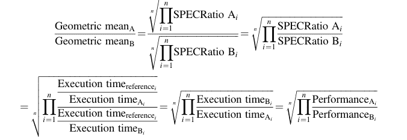

也就是说，A 和 B 的几何平均值的比例等于套件中所有基准测试中 A 对 B 的性能比例的几何平均值。图 1.19 使用 SPEC 的示例证明了这种有效性。

| Benchmarks | Sun Ultra 2 time (seconds) | AMD A10-6800k (seconds) | SPEC 2006Int (ratios) | Intel Xeon E5-2690 time (seconds) | SPEC 2006Int (ratios) | AMD/Intel (ratios) | Intel/AMD (ratios) |
|---|---|---|---|---|---|---|---|
| perlbench | 9770 | 401 | | | | | |
| bzip2 | | | | | | | |
| gcc | | | | | | | |
| mcf | | | | | | | |
| gobnik | | | | | | | |
| hmmer | | | | | | | |
| sjeng | | | | | | | |
| libquantum | | | | | | | |
| omnet | | | | | | | |
| astar | | | | | | | |
| xalmbk | | | | | | | |
| ... | | | | | | | |

| 基准测试 | Sun Ultra 2 时间 (秒) | AMD A10-6800k 时间 (秒) | SPEC 2006Int (比例) | Intel Xeon E5-2690 时间 (秒) | SPEC 2006Int (比例) | AMD/Intel (比例) | Intel/AMD (比例) |
|---|---|---|---|---|---|---|---|
| perlbench | 9770 | 401 | | | | | |
| bzip2 | | | | | | | |
| gcc | | | | | | | |
| mcf | | | | | | | |
| gobnik | | | | | | | |
| hmmer | | | | | | | |
| sjeng | | | | | | | |
| libquantum | | | | | | | |
| omnet | | | | | | | |
| astar | | | | | | | |
| xalmbk | | | | | | | |

- [费曼学习法](https://wiki.example.org/feynmans_learning_method)的灵感源于诺贝尔物理奖获得者**理查德·费曼**。

1. 运用费曼技巧，你只需花上`20 min`就能深入理解知识点，而且记忆深刻，*难以遗忘*。

```
if (condVar > someVal) {console.log("xxx")}
```


| 基准测试 | Sun Ultra 2 时间 (秒) | AMD A10-6800k 时间 (秒) | SPEC 2006Int (比例) | Intel Xeon E5-2690 时间 (秒) | SPEC 2006Int (比例) | AMD/Intel (比例) | Intel/AMD (比例) |

|---|---|---|---|---|---|---|---|

| perlbench | 9770 | 401 | | | | | |

| bzip2 | | | | | | | | |

| gcc | | | | | | | | |

| mcf | | | | | | | | |

| gobnik | | | | | | | | |

| hmmer | | | | | | | | |

| sjeng | | | | | | | | |

| libquantum | | | | | | | | |

| omnet | | | | | | | | |

| astar | | | | | | | | |

| xalmbk | | | | | | | | |

# 1.9 计算机设计的定量原理

根据程序近期的访问情况，预测其在未来将使用的指令和数据的**准确性**。局部性原理也适用于访问，尽管其强度没有代码访问时那么强。

我们观察到了两种不同类型的局部性。**时间局部性**是指最近访问过的项可能很快会被再次访问。**空间局部性**是指地址相邻的项在时间上很可能会连续被引用。我们将在第2章看到这些原理的应用。

## 关注常见情况

计算机设计中最重要且最普遍的原则或许是关注常见情况：在进行权衡时，优先考虑频繁发生的情况而非罕见的情况。这一原则适用于决定如何分配资源，因为如果改进发生的情况是普遍的，那么改进带来的收益就越高。

关注常见情况不仅适用于能量，也适用于资源分配和性能。处理器的指令取指解码单元使用的频率可能比乘法器得多，因此应优先优化它。在可靠性方面同样如此。如果一个数据库服务器每个处理器配备50个存储设备，那么存储可靠性将主导整体可靠性。

此外，常见情况比罕见情况更简单、速度更快。例如，在处理器中两个两个相加时，我们可以预期溢出是罕见情况，并通过优化更常见的“无溢出”情况来提高性能。这种强调可能会降低溢出发生时的速度，但通过优化正常情况，整体性能将得到提高。

我们将在整本书中看到这一原理的许多案例。在应用这一简单原理时，我们必须决定什么是频繁情况，以及通过加快该情况可以提高多少性能。一种被称为**阿达尔定律**（Amdahl's Law）的基础性法则可以用来量化这一原理。

## 阿达尔定律

通过改进计算机的某部分可以获得的性能增益可以使用阿达尔定律来计算。阿达尔定律指出，使用某些更快的执行模式所获得的性能提升，受限于该快速模式可用时间比例的限制。

阿达尔定律定义了使用特定功能可以获得的加速比（Speedup）。什么是加速比？假设我们可以对计算机进行某种增强，在使用时能提高性能。加速比是比例值：

$$\text{Speedup} = \frac{\text{可以使用增强时整个任务的性能}}{\text{不使用增强时整个任务的性能}}$$

或者，

$$\text{Speedup} = \frac{\text{不使用增强时整个任务的执行时间}}{\text可以使用增强时整个任务的执行时间}}$$

加速比告诉我们，使用带有增强的计算机相比原始计算机，任务运行快了多少。

阿达尔定律为我们提供快速查找某些增强加速比的方法，它取决于两个因素：

- 1. 原始计算机中可以转换为利用增强部分的计算时间比例——例如，如果一个总耗时为100秒的程序，有40秒的执行时间使用了增强，那么比例就是40/100。这个值我们称为 $Fraction_{enhanced}$，它始终小于或等于1。
- 2. 增强执行模式所获得的改进，即如果整个程序都使用增强模式，任务运行会快多少——这个值是原始模式的时间除以增强模式的时间。如果增强模式处理程序某部分需要4秒，而原始模式需要40秒，则改进倍数为40/4即10。我们将这个值（始终大于1）称为 $Speedup_{enhanced}$。

使用带有增强模式的原始计算机的执行时间将是使用未增强部分的时间加上使用：

$$\text{Execution time}_{new} = \text{Execution time}_{old} \times ((1 - Fraction_{enhanced}) + Speedup_{enhanced})$$

整体加速比是执行时间的比例：

$$\text{Speedup}_{overall} = \frac{\text{Execution time}_{old}}{\text{Execution time}_{new}} = \frac{1}{(1 - Fraction_{enhanced}) + Speedup_{enhanced}}$$

假设我们想要针对Web服务器增强处理器。新处理器在Web服务器应用中的计算速度比旧处理器快10倍。假设原始处理器有40%的时间在忙于计算，有60%的时间在等待I/O，那么引入该增强后的整体加速比是多少？

## 示例

$Fraction_{enhanced} = 0.4$; Speedup_{enhanced} = 10$; Speedup_{overall} = \frac{1}{0.6} \times \frac{1}{0.64} \approx 1.56$

## 答案

阿达尔定律解释了边际收益递减规律：对计算的某部分进行改进所带来的加速比增量，会随着改进的增加而减小。阿达尔定律的一个重要推论是，如果一项增强仅对任务的一部分有效，那么我们加速任务的不能超过1减该比例的倒数。

### 1.9 计算机设计的定量原理

应用阿达尔定律时的一个常见错误是混淆了“转换为使用增强的时间比例”和“使用增强后的时间比例”。如果我们衡量的不是计算中可以使用增强的时间，而是增强在被使用之后的时间，结果将是错误的！

阿达尔定律可以作为增强能提升多少的指导。

## 1.9 计算机设计的数量化原理

通过对上述公式中的指令数进行移项，可以将时钟周期定义为 $IC \times CPI$。这使得我们能够在执行时间公式中使用 CPI：

CPU 时间 = 指令数 $\times$ 每条指令的周期数 (CPI) $\times$ 时钟周期时间

将第一个公式展开为测量单位，可以看到这些部分是如何相互结合的：

| 指令数 $\times$ 时钟周期 $\times$ 秒 / 程序 / 每条指令 / 时钟周期 = CPU 时间 |

如该公式所示，处理器的性能取决于三个特征：时钟周期（频率）、每条指令的周期数（CPI）以及指令数。此外，CPU 时间对这三个特征的依赖程度是*相等*的；例如，任何一个指标提升 10% 都会导致 CPU 时间缩短 10%。

遗憾的是，很难在与其他参数保持完全孤立的状态的情况下改变其中一个参数，因为改变每个特征所涉及的基础技术是相互依赖的：

- 时钟周期时间——硬件技术与体系结构
- CPI——体系结构与指令集架构
- 指令数——指令集架构与编译器技术

可能，许多潜在的性能改进主要增强了处理器性能的一个组件，而对其他组件的影响较小或可预测。

在设计处理器时，计算处理器总时钟周期数是非常有用的：

CPU 时钟周期数 = $\sum_{i=1}^{n} IC_i \times CPI$

其中，$IC_i$ 代表指令 $i$ 在程序中执行的次数，$CPI$ 代表指令 $i$ 的每条指令平均周期数。这种形式可以用于将 CPI 表示为：

CPI 时间 = $\left(\frac{\sum_{i=1}^{n} IC_i \times CPI_i}{\sum_{i=1}^{n} IC_i}\right) \times$ 时钟周期时间

整体 CPI 则为：

CPI = $\frac{\sum_{i=1}^{n} IC_i \times CPI_i}{\sum_{i=1}^{n} IC_i} \times \frac{\sum_{i=1}^{n} IC_i}{\sum_{i=1}^{n} IC_i}$

CPI 计算的后一种方法使用了每个独立的 CPI 以及该指令在程序中出现的比例（即 $IC_i \div$ 指令数）。由于 CPI 必须包含流水线效应、缓存缺失以及任何其他内存系统的效率低下，因此 CPI 应该通过测量获得，而不是仅仅从参考手册附录表中计算。

考虑我们第 52 页的性能示例，这里使用指令频率和指令 CPI 值的测量值，这些值在实践中是通过仿真或硬件插桩获得的。

示例：假设我们有以下测量数据：

- 浮点（FP）操作频率 = 25%
- 浮点操作平均 CPI = 4.0
- 其他指令的平均 CPI = 1.33
- FSQRT 频率 = 2%
- FSQRT 的 CPI = 20

假设有两种设计方案：将 FSQRT 的 CPI 降低到 2，或者将所有浮点操作的 CPI 降低到 2.5。使用处理器性能方程比较这两种设计方案。

答案：首先，观察到只有 CPI 发生了；时钟频率和指令数保持不变。我们首先找到在进行任何增强之前的原始 CPI：

$CPI_{original} = \sum_{i=1}^{n} CPI_i \times \left(\frac{IC_i}{Instruction\ count}\right) = (4 \times 25\%) + (1.33 \times 75\%) = 2.0$

我们可以通过从原始 CPI 中减去周期数来计算增强后 FSQRT 的 CPI：

$CPI_{with\new\ FSQRT} = CPI_{original} - 2 \times (CPI_{old\ FSQRT} - CPI_{of\ new\ FSQRT}) = 2.0 - 2 \times (20 - 2) = 1.64$

我们可以通过相加浮点和非浮点指令的 CPI 来计算我们使用的所有浮点指令增强后的 CPI。使用后者得到：

$CPI_{new\ FP} = (75\% \times 1.33) + (25\% \times 2.5) = 1.625$

由于整体浮点增强的 CPI 略低，其性能将显著提高。整体增强的加速比为：

$Speedup_{new\ FP} = \frac{CPU_{original} \times IC \ Clock\ cycle \times CPI_{original}}{CPU_{new\ FP} \times IC \ Clock\ cycle \times CPI_{new\ FP}} = \frac{CPI_{original}}{CPI_{new\ FP}} = \frac{2.00}{1.625} = 1.23$

幸运的是，我们使用第 51 页的阿姆达尔定律得到了相同的加速比。

### 1.10 综合考虑：性能、价格与功耗

通常可以测量处理器性能方程的组成部分。这种孤立的测量是与上一个示例中性性能方程相比于阿达尔定律的关键优势。特别是，要测量诸如一组指令所占执行时间的比例等可能是困难的。在实践中，这可能会通过累加集合中每条指令的数与 CPI 的乘积来计算。由于起点通常是单条指令数和 CPI 的测量，因此处理器性能方程非常有用。为了将处理器性能方程作为设计工具，我们需要能够测量各种因素。对于现有的处理器，很容易通过测量获取执行时间，我们也知道默认缓存。挑战在于发现指令数或 CPI。

## 1.10 综合考虑：性能、价格与功率

虽然大多数基准测试（以及大多数架构师）只关心系统在峰值负载下的性能，但计算机很少在峰值负载运行。事实上，第 6 章图 6.2 显示了 Google 对数十台服务器进行 6 个月利用率测量的结果，平均利用率达到 100% 的占比不足 1%。大多数服务器的平均利用率在 10% 到 50% 之间。SPEC 基准测试在目标工作负载从峰值每隔 10% 变化到 0%（即活跃空闲，Active Idle）的过程中将功率作为目标。图 1.21 绘制了 sjj_ops（每秒 SSJ 操作数）随目标工作负载从 100% 变化到 0% 的变化。Intel R730 的功率始终最低，而单节点 R630 在负载变化时具有最佳的每瓦 sjj_ops。由于瓦特 = 焦耳/秒，该指标与每焦耳的 SSJ 操作数成正比。

| ssj_operations/second | ssj_operations/second | ssj_operations |

| --- | --- | --- |

| Watt | Joule/second | Joule |

- Dell 630 44 核/瓦特
- Dell 730 44 核/瓦特
- Dell 630 704 核/瓦特
- Dell 630 44 核 瓦特/节点
- Dell 630 44 核 瓦特
- Dell 730 44 核 瓦特

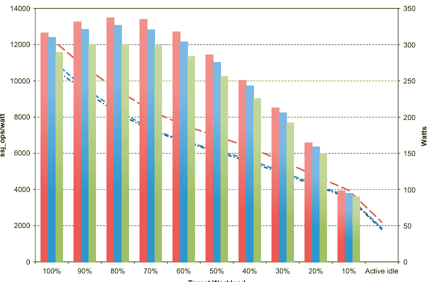

图 1.21 图 1.20 中三台服务器的功率-性能对比。Sjj_ops/watt 值位于左轴以及与之相关的列，瓦特位于右轴以及与之相关的三条线。横轴显示目标工作负载，其从 100% 变化到活跃空闲。单节点 R630 在每个负载级别都具有最佳的 sjj_ops/watt，但 R730 在每个级别上的功耗最低。

为了计算一个用于比较系统功率效率的数值，SPECpower 使用：

```
Overall ssj_ops/watt = $\frac{\sum ssj\_ops}{\sum power}$
```

三台服务器的整体 ssj_ops/watt 中，R730 为 10,802，R630 为 11,157，16 台 R630 集群为 10,062。因此，单节点 R630 具有最佳的功率-性能。除以服务器价格后，R730 的每 1,000 美元 ssj_ops/watt 为某值，R630 为 899，16 节点 R630 集群为 789（每节点）。因此，在加入功率后，单节点 R630 在性能/价格上排名第一，但现在单节点 R730 的效率已显著高于 16 节点集群。

## 谬误与陷阱（Fallacies and Pitfalls）

本节节出现在每一章中，其目的是解释一些你应该避免的常见信念或误解。我们把此类信念称为“谬误”。在讨论谬误时，我们尝试给出一个反例。我们还讨论了“陷阱”——容易犯的错误。通常，陷阱是在有限背景下成立的原理的泛化。这些章节的目的是帮助你在你设计的计算机中避免这些错误。

**陷阱** 所有的指数定律都会有终点。

第一个是丹纳德缩放（Dennard scaling）。丹纳德在 1974 年观察到，随着晶体管变小，功率密度保持恒定。如果晶体管的线性区域缩小2 倍，那么电流和电压都会减少 2 倍，因此其消耗的功率下降 4 倍。这些芯片可以设计得运行更快，同时消耗更少的功率。丹纳德缩放在其观测 30 年后停止，并不是因为晶体管不再变小，而是因为电路可靠性限制了电流和电压的下降幅度。阈值电压低到使得静态功耗变成了总功率的很大比例。

下一个减速的是硬盘。虽然磁盘没有明确的定律，但在过去的 30 年里，硬盘的最大面积密度（决定磁盘容量）每年提高 30%-100%。最近，这一增长率每年低于 5%。每驱动器密度的增加是通过在硬盘驱动器中添加更多盘片实现的。


接下来是真正的摩尔定律。虽然芯片晶体管数量每一到两年就会翻一倍。例如，2014 年引入的 DRAM 芯片包含 8B 晶体管，我们直到 2019 年才能量产 16B 晶体管 DRAM 芯片，但摩尔定律预测会有 64B 晶体管 DRAM 芯片。

此外，平面晶体管缩放的实际终点曾被预测将在 2021 年结束。图 1.22 显示了来自半导体国际技术路线图（ITRS）两个版本的逻辑晶体管栅极长度预测。

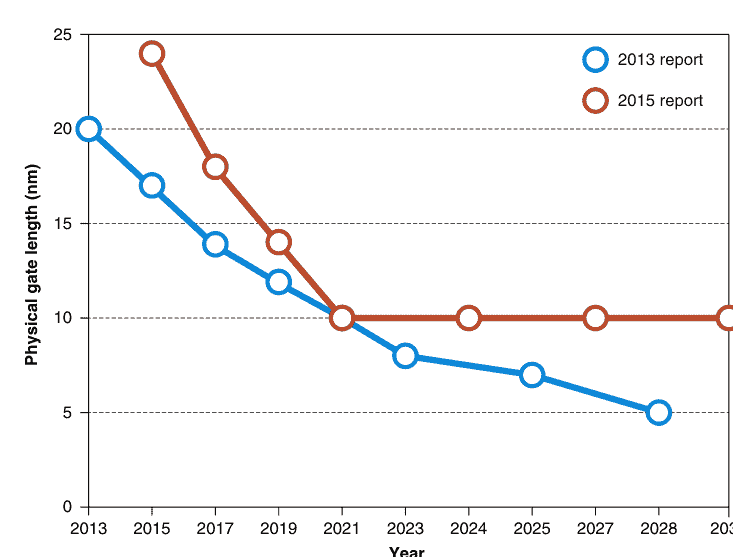

**图 1.22** 来自两个版本的 ITRS 报告的逻辑晶体管尺寸预测。这些报告始于 2001 年，2015 年将是最后一版，因为小组由于兴趣减退而解散。今天能生产顶尖逻辑芯片的公司只有 GlobalFoundries、Intel、三星和台积电，而在发布第一份 ITRS 报告时有 19 家。由于只剩下四家公司，计划共享太难维持。根据 IEEE Spectrum 2016 年 7 月的 Rachel Courtland 的《晶体管将在 2021 年停止缩减，摩尔定律路线图预测》。

与 2013 年预测栅极长度在 2028 年达到 5 nm 的报告不同，2015 年的报告预测到 2021 年停止在 10 nm。此后的密度改进必须通过除缩减晶体管尺寸以外的方法来实现。事实并非像 ITRS 所暗示的那样，变化率正在降低。

图 1.23 显示了带宽增加的变化。处理器、内存和磁盘的带宽增加——由于使用脉冲调制（PAM-4）以 400 G/s 的速度传输信息，这决定了磁盘容量。


**图 1.23** 处理器、内存和磁盘的相对带宽——由于使用脉冲调制（PAM-4）以 400 G/s 的速度传输信息，这决定了磁盘容量。

## 多处理器不是万灵药

2005 年左右向多处理器器的并非源于某种可能的突破。单芯片集成多个处理器并不保证更低的功耗。正如我们在第 4 章和第 5 章中看到的，性能现在是程序员的负担。如果程序员希望在每一代硬件上运行得更快，他们必须使程序并行化。

## 陷入阿姆达尔定律的陷阱

每位实践架构师都知道阿姆达尔定律。尽管如此，我们偶尔会在测量之前花费精力进行优化。只有当整体加速比令人失望时，我们才想起本应该在花费这么多精力之前先进行测量。

## 单点故障

第 53 页使用阿姆达尔定律进行的可靠性计算表明，可靠性并不比链中最薄的环更强。无论让电源变得多么可靠（正如我们在示例中所做的那样），单个风扇都会限制磁盘子系统的可靠性。第 6 章展示了如何通过软件层避免内部故障点。

## 提高性能的硬件增强也能节能，或最情况下能量中

Esmaizadeh 等人（2011）在 2.67 GHz i7 的 Turbo 模式下测量了 SPEC2006（第 1.5 节）。当时钟增加到 2.94 GHz 时，性能提高了 1.07 倍（或 1.10），但 i7 消耗了 1.37 焦耳和 1.47 瓦时。

## 基准测试永久有效

几个因素影响基准测试作为真实性能预测的有用性，某些因素会随时间变化。影响基准测试有用性的一个因素是其抵抗“基准测试工程”或“针对性优化”的能力。一旦基准测试标准化并流行，就会产生巨大的压力，通过针对性优化或对运行基准规则的激进解释来提高性能。短内核和时间花费在小部分代码上的程序特别容易受到影响

例如，尽管初衷良好，最初的 SPEC89 基准测试包含一个名为 matrix0 的小内核，由 300x300 的矩阵乘法组成。在这个内核中，99% 的执行时间花费在一个行代码上（见 SPEC, 1989）。

## 62 第一章 定量设计与分析基础

（使用诸如分块等良好方法，将在第 2 章和第 4 章中讨论），性能比之前的编译器版本提升了 9 倍！这种基准测试的编译器调优显然并不是整体性能的良好指标，也不是这种特定优化的典型价值。

图 1.19 显示，如果我们忽略历史，就可能被迫重演历史。SPEC Cint2006 十十年没有更新了，这为编译器编写者留了充足的时间针对这套套件完善他们的优化器。请注意，除 libquantum 之外，所有基准测试的 SPEC 比率在 AMD 计算机上处于 16–52 范围内，在 Intel 上上处于 22 到 78 之间。Libquantum 在 AMD 上的运行速度快了 250 倍，在 Intel 上快了 7300 倍！“奇迹”是 Intel 编译器优化的结果，它自动在 22 个核心上并行化代码，并通过使用打包（packing）技术进行优化，将多个窄范围整数打包以节省内存空间从而节省内存带宽。如果我们进行这项基准测试并重新计算几何平均值，AMD SPEC Cint2006 从 31.9 降到 26，从 63.7 降到 41.4。如果包含 libquantum，Intel 现在的速度大约是 AMD 计算机的 1.5 到 2.0 倍，这更接近它们的实际性能平均值。SPECPU2017 删除了 libquantum。

为了说明各种基准测试列表，第 43 页的图 1.17 列出了来自各种 SPEC 版本的所有 82 个基准测试的状态；Gcc 是 SPEC89 唯一的幸存者。令人惊讶的是，SPEC2000 及更早版本的程序程序中有 70% 在下一个版本中被删除了。

## 谬误

磁盘制造商目前的营销手段可能会误导用户。MTT（平均故障时间）是如何计算的？在过程的早期，制造商会将数千个磁盘放在一个房间里，运行几个月，并统计失败的数量。他们将 MTT 计算为磁盘累计工作小时数除以失败的数量。

一个问题是，这个数字远超过磁盘的寿命（通常假设为五年或 43,800 小时）。为了让这个巨大的 MTT 有意义，磁盘制造商辩称，该模型对应于购买磁盘并每 5 年更换一次磁盘的用户——即磁盘的寿命。该主张认为，许多客户（以及他们的子子孙孙）在未来的一个世纪里会去世，平均而言他们在发生故障前会更换 27 次磁盘，大约是 140 年。

一个更有用的衡量标准是故障磁盘百分比，称为年度故障率（AFR）。假设有 1000 个磁盘，MTTF 为 1,000,000 小时，且每天使用 24 小时。如果用具有相同可靠特性的新磁盘替换失败磁盘，那么一年（8760 小时）内失败的数量为：

$$Number of disks \times Time\ period = \frac{1000 \times 8760 \text{ hours/drive}}{1,000,000 \text{ hours/failure}} = 9 MTTF$$

或者，每年会有 0.9% 的磁盘故障，在 5 年寿命内为 4.4%。

## 1.11 谬误与陷阱 63

此外，这些高数字是在假设温度和振动限制的情况下引用的；如果超过了这些限制，一切失效。对真实环境中的驱动器的调查（Gray and van Ingen, 2005）发现，每年有 3–7% 的驱动故障，MTTF 约为 125,000–300,000 小时。另一项更大的研究发现年度磁盘故障率为 2%–10%（Pinheiro et al., 2007）。因此，现实世界的 MTTF 比制造商的 MTTF 低 2–10 倍。

### 谬误：峰值性能遵循观测性能。

峰值性能的唯一真实定义是“计算机保证不会超过的性能水平”。图 1.24 显示了四个程序在四个多处理器上的峰值性能百分比。由于差距巨大且可能根据基准测试发生显著变化，因此峰值性能在预测观测性能方面通常没有用。

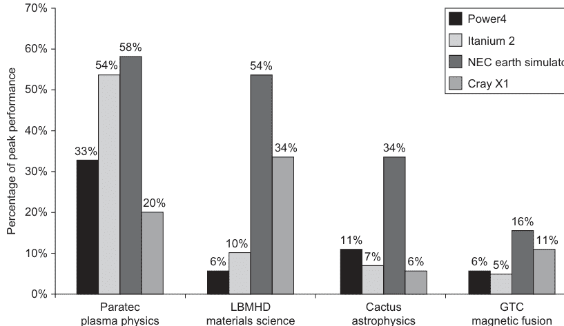

图 1.24 四个程序在缩放至 64 个处理器的多处理器上的峰值性能百分比。地球模拟器（Earth Simulator）和 X1 是涡流处理器（见第 4 章和附录 G）。它们不仅提供了更高比例的峰值性能，而且具有最高的峰值性能和最低频率。除了 Parate 程序外，Power 4 和 Itanium 2 系统提供的性能在峰值的 5% 到 10%。引自 Oliker, L., Canning, A., Carter, J., Shalf, J., Ethier, S., 2004. Modern并行矢量系统上的科学计算。In：Proc. ACW/IEEE Conf. on Supercomputing, November 6–12, 2004, Pittsburgh, Penn., p. 10。

## 64 第一章 定量设计与分析基础

### 陷阱：故障检测会降低可用性。

这个看似讽刺的陷阱是因为计算机硬件有大量的状态，这些状态对于正常运行可能并不关键。例如，发生错误并不是致命的。

# 附录

| A | 标题 |
|---|---|
| A | 指令集原理 |
| B | 存储层次回顾 |
| C | 流水线：基础与中级概念 |
| D | 存储系统 |
| E | 嵌入式系统 |
| F | 互连网络 |
| G | 深度研究向量处理器 |
| H | VLIW 和 EPIC 的硬件与软件 |
| I | 大规模多处理器与科学应用 |
| J | 计算机算 |
| K | 指令架构概述 |
| L | 地址转换的高级概念 |
| M | 历史视角与参考文献 |

图 1.25 附录列表。

在附录 D 中，我们不再采用以处理器为中心的视角，而是讨论存储系统中的问题。我们遵循类似的定量方法，但基于对系统行为的观察并使用端到端方法进行分析。本附录探讨了如何主要利用低成本磁技术高效存储和检索数据的重要问题。我们的重点是检查存储磁盘系统对于典型 I/O 密集型负载（如本章提到的 OLTP 基准测试）的性能。我们广泛探索了基于 RAID 的系统，这些系统利用冗余磁盘来实现高性能和高可用性。最后，附录 D 引入了队列理论，它为利用率和延迟之间的权衡提供了理论依据。

附录 E 将嵌入式计算视角应用于早期附录中的每个想法。附录 F 探讨了系统互连主题，包括允许计算机通信的广域和系统网络。附录 H 回顾了 VLIW 硬件和软件，相比之下，它们没有 EPIC 出现在上一版时那么流行。

附录 J 是第一版保留的唯一附录，涵盖了计算机算术。附录 K 提供了指令架构概述，包括 80x86、IBM 360、VAX 以及许多 RISC 架构，包括 ARM、MIPS、Power、RISC-V 和 SPARC。附录 L 是新增的，讨论了内存管理的高级技术，侧重于对虚拟机的支持以及针对极大地址空间的地址翻译设计。随着云处理器的增长，这些架构增强正变得越来越重要。接下来我们介绍介绍附录 M。

### 1.13 历史视角与参考文献

附录 M（在线提供）包含了对书中章节所述关键思想的历史视角。这些历史视角允许我们通过一系列机器来追溯一个想法的发展过程，或者描述重大项目。如果你对研究某个想法的初始开发感兴趣，或者不想进一步阅读，每个历史章节末尾都提供了参考文献。对于本章，请参见第 M.2 节“计算机的早期发展”，讨论数字计算机的早期发展和性能测量方法。

当你阅读这些历史材料时，你很快就会发现，与其他许多工程领域相比，计算领域年轻的一个重要优势是一些先驱仍然在世——我们只需通过询问他们就能学习历史！

## Diana Franklin 编写的案例研究与练习

### 案例研究 1：芯片制造成本

本案例研究说明的概念

- 制造成本
- 制造良率
- 通过冗余实现的容错能力

计算机芯片的价格涉及许多因素。英特尔正花费 70 亿美元完成用于 7 纳米技术的 Fab 42 制造工厂。在这个案例研究中，我们探索了一家处于相同状况的假设公司，以及涉及制造技术、面积和冗余的不同设计决策如何影响芯片成本。

图 1.26 揭了影响当前芯片成本的假设芯片统计数据。在接下来的几个练习中，你将探索英特尔芯片不同可能的设计决策的影响。

| 芯片 | 核心面积 (mm²) | 估计缺陷率 (每 cm²) | N | 制造工艺 (nm) | 晶管数 (十亿) | 核心 |
|---|---|---|---|---|---|---|
| BlueDragon | 180 | 0.03 | 12 | 10 | 7.5 | 4 |
| RedDragon | 120 | 0.04 | 14 | 7 | 7.5 | 4 |
| Phoenix* | 200 | 0.04 | 14 | 7 | 12 | 8 |

**图 1.26** 若干假设当前及未来处理器的制造成本因素。

## 第一章 定量设计与分析基础

- [10] <1.6> Phoenix 芯片的良率是多少？
- [10] <1.6> 为什么 Phoenix 的缺陷率比 BlueDragon 高？
- [20/20/20] <1.6> 他们将从该工厂出售一系列芯片，并需要决定为每种芯片分配多大的容量。假设他们出售两种芯片。Phoenix 是一个针对 7 纳米技术设计的全新架构，而 RedDragon 与 10 纳米的 Blue-Dragon 芯片架构相同。假设 RedDragon 每个无缺陷芯片可赚 15 美元利润。Phoenix 每个无缺陷芯片可赚 30 美元利润。每片晶圆直径为 450 mm。
- [20] <1.6> 每片 Phoenix 芯片晶圆可以获得多少利润？
- [20] <1.6> 每片 RedDragon 芯片晶圆可以获得多少利润？
- [20] <1.6> 如果你每月的需求是 50,000 片 RedDragon 芯片，而你的工厂每月可以生产 70,000 片晶圆，你应该生产多少片晶圆？
- <1.6> 你的同事建议良率太差，你可能切换到不同的技术。例如，如果你使用 14 纳米工艺代替 7 纳米工艺，良率可能会高得多。然而，14 纳米工艺速度较慢。如果 14 纳米工艺的速度是 7 纳米工艺的 2 倍，这将如何影响性能？（重构的简化文本）

## Diana Franklin 编写的案例研究与练习

### 案例研究 2：计算机系统中的功耗

本案例研究说明的概念

- 阿姆达尔法则
- 冗余
- MTTF（平均无故障时间）
- 功耗

现代系统的功耗取决于多种因素，包括芯片时钟频率和电压。以下练习探索了不同设计决策和使用场景对功率和能量的影响。

1.4 [10/10/10] <1.5> 手机执行许多不同的任务，包括流媒体音乐、流媒体视频和阅读电子邮件。这些任务执行不同的计算任务。电池寿命和过热是手机的两个常见问题；减少功率和能量消耗至关重要。在这一问题中，我们将评估一个不现实的场景，即手机没有专门的处理器单元。相反，它有一个四核通用处理器。每个核心在满载使用下使用 0.5 W。对于电子邮件相关的任务，四核处理器的速度比所需的快 8 倍。

- a. [10] <1.5> 以全功率运行需要多少动态能量和功率？首先，假设四核处理器运行 1/8 的时间，其余时间处于闲置。此外，时钟在 7/8 的时间内关闭，在此期间不发生漏电。比较总动态能量以及核心运行时的动态功率。
- b. [10] <1.5> 使用频率和电压缩放需要多少动态能量和功率？假设频率和电压在整个时间内降低到原来的 1/8。
- c. [10] <1.6, 1.9> 现在假设电压可能无法降低到原始的 50%。这种电压被称为电压底，任何低于该电压都会丢失状态。因此，虽然频率可以继续降低，但电压不能。在这种情况下，动态能量和功率节省了多少？
- d. [10] <1.5> 使用暗硅（dark silicon）方法会消耗多少能量？这涉及为每个主要任务创建专用的 ASIC 硬件和

# 70 第一章 定量设计与分析基础

在不使用这些元素时对它们进行门控（gating）。仅提供一个通用核心，芯片的其余部分将由专用单元填充。例如，该核心将运行 25% 的时间，而在另外 75% 的时间内通过电源门控（power gating）完全关闭。在其他 75% 的时间里，一个仅需核心能量 20% 的专用 ASIC 单元将运行。

1.5 [10/10/10]<1.5> 如练习 1.4 所示，手机运行着各种应用程序。在本练习中，我们做出与上一个练习相同的假设：即每个核心功耗为 0.5 W，四核运行速度是原来的 3 倍。

- a. [10]<1.5> 假设 80% 的代码是可以并行的。为了达到与四路并行代码相同的速度，单个核心的频率和电压需要增加多少？
- b. [10]<1.5> 在 a 部分中，使用频率和电压缩放，动态能量减少了多少？
- c. [10]<1.5> 使用暗硅处理器消耗多少能量？在这种方法中，所有单元都经过了电源门控，允许它们关闭（不产生泄漏）。提供了专用 ASIC，以通用处理器 20% 的功率执行相同的计算。假设每个核心都经过了电源门控。该视频需要两个 ASIC 和两个核心。与四核并行的基准相比，它需要多少动态能量？

1.6 [10/10/10/10]<1.5,1.9> 通用处理器针对通用计算进行了优化。也就是说，它们针对在大量应用程序中常见的行为进行了优化。然而，一旦领域被限制，在在大量目标应用程序中发现的行为可能与通用应用程序有所不同。其中一种应用是深度学习或神经网络。深度学习可以应用于许多不同的应用程序，但推理的根本构建块——使用学习到的信息做出决策——在所有应用中都是相同的。推理操作在很大程度上是并行的，因此它们目前在图形单元上执行，这种单元专门用于此类计算而非推理。为了追求更高的每瓦性能，Google 创建了使用张量处理单元（TPU）的定制单元来加速深度学习中的推理操作。这种方法可以用于语音识别和图像识别等。此问题探讨了这种方法、通用处理器（Haswell E5-2699 v3）和 GPU（NVIDIA K80）在性能和冷却方面的权衡。如果热量没有从计算机中排出，风扇会将热空气吹回，而不是冷空气。注意：差异不仅在于片内内存，DRAM 也参与其中。因此，统计数据处于系统级，而非芯片级。

¹引用此网站论文：https://drive.google.com/file/d/0Bx4hafXDDq2EMzRNcy1vSUxtcEk/view。

## Diana Franklin 的案例研究与练习

- a. [10] 如果 Google 的数据中心在运行 GPU 时，70% 的时间用于工作负载 A，30% 的时间用于工作负载 B，那么 TPU 系统相对于 GPU 系统的加速倍数是多少？
- b. [10] 如果 Google 的数据中心在运行 GPU 时，70% 的时间用于工作负载 A，30% 的时间用于工作负载 B，那么三个系统每个达到最大 IPS（每秒指令操作数）的百分比是多少？


- c. [15, 1.5] 基于 (b)，假设随着 IPS 从 0% 增长到 100%，功耗从空闲到繁忙线性增长，那么 TPU 系统相对于 GPU 系统的性能瓦（performance watt）是多少？

- d. [10] 如果另一个数据中心 40% 的时间用于工作负载 A，50% 的时间用于工作负载 C，那么 GPU 和 TPU 系统相对于通用系统的加速倍数是多少？

- e. [10, 1.5] 一个机架的冷却门花费 4000 美元，可以耗散 14 KW（进入房间，需要额外成本才能将其移出房间）。根据图 1.27 和 1.28 中的 TDP（热设计功率），一个冷却门门可以使用多少台基于 Haswell、NVIDIA 或 Tensor 的服务器？

- f. [20]<1.5> 典型的服务器机场每平方英尺最多可以耗散 200 W。考虑到一台服务器需要 11 平方英尺（包括前后间隙），单个机架上可以放置多少台 (e) 部分的服务器，需要多少个冷却门？

| 系统 | 芯片 | TDP | 空闲功率 | 忙碌功率 |
|---|---|---|---|---|
| 通用型 | Haswell E5-269 v3 | 504 W | 159 W | 455 W |
| 图形处理器 | NVIDIA K80 | 1838 W | 357 W | 991 W |
| 定制 ASIC | TPU | 861 W | 290 W | 384 W |

**图 1.27** 通用处理器、基于图形单元或基于 ASIC 的系统的硬件特性，包括测量功率（见 ISCA 论文）。

| 系统 | 芯片 | A | B | C | A | B | C |
|---|---|---|---|---|---|---|---|
| 通用型 | Haswell E5-269 v3 | 5482 | 13194 | 12000 | 42% | 100% | 90% |
| 图形处理器 | NVIDIA K80 | 13461 | 36465 | 15000 | 37% | 100% | 40% |
| 定制 ASIC | TPU | 225000 | 280000 | 2000 | 80% | 100% | 1% |

**图 1.28** 通用处理器、基于图形单元或定制 ASIC 的系统在神经网络工作负载下的性能特性（引用 ISCA 论文）。工作负载 A 和 B 是结果。工作负载 C 更通用。

# 练习 [10/15/15/10/10]<1.4,1.5> 架构师的一个挑战是，今天的设计需要几年的实施、验证后才能上市。这意味着架构师必须提前几年预测技术。有时，这是很难的。

- a. <1.4> 根据历史观察到的摩尔定律，2025 年芯片上的晶体管数量将是2015 年的几倍？
- b. [15]<1.5> 如果性能继续以 1990 年的速度增长，2025 年的 VAX-180 性能大约是多少？
- c. [15]<1.5> 以 2000 年代目前的增长率，2027 年的性能预测是多少？
- d. <1.4> 什么限制了时钟频率？架构师利用额外的晶体管来提高性能？
- e. <1.4> DRAM 容量的增长也慢了。在 20 年里，DRAM 容量每年提高 60%。如果 8G 在 2015 年可用，而 16G 直到 2019 年可用，目前的增长率是多少？

[10/10]<1.5> 你正在设计一个必须满足特定截止日的实时应用。完成计算没有好处。你发现你的系统在最坏情况下可以快一倍。

- a. [10]<1.5> 如果你以当前速度执行并在完成后关闭系统，可以节省多少能量？
- b. [10]<1.5> 如果你将电压和频率设置为一半，可以节省多少能量？

[10/10/20]<1.5> 如 Google 和 Yahoo 这样的服务器机场提供了最高请求率的容量。假设大多数时间服务器以 60% 的容量运行。假设功耗随负载线性变化：即当服务器以 60% 的容量运行时，它们消耗最大功率的 90%。服务器可以关闭，但响应负载的重启时间太长。提出了一种允许快速启动但在“活跃”状态下仅需最大功率 20% 的新系统。

- a. [10]<1.5> 关闭 60% 的服务器可以节省多少能量？
- b. [10]<1.5> 将 60% 的服务器置于“活跃”状态可以节省多少能量？

## Diana Franklin 的案例研究与练习

- c. [20]<1.5> 将电压降低 20%，频率降低 40%，可以节省多少能量？
- d. [20]<1.5> 将 30% 的服务器置于“活跃”状态并关闭 30%，可以节省多少能量？

- 1.10 [10/20/15]<1.7> 可用性是设计服务器最考虑的因素，紧随其后的是扩展性和吞吐量。

- a. [10]<1.7> 我们有一个故障时间（FIT）为 100 的单处理器。该系统的平均无故障时间（MTTF）是多少？
- b. [10]<1.7> 如果需要一天时间让系统重新运行，该系统的可用性如何？
- c. [20]<1.7> 假设政府为了节省成本，使用廉价计算机而非昂贵可靠的计算机构建超级计算机。拥有 1000 个处理器的系统 MTTF 是多少？假设一个失效，所有全部失效。

- 1.11 [20/20/15]<1.1,1.2,1.7> 在 Amazon 或 eBay 这样的服务器机场中，单个故障不会导致整个系统崩溃。它将减少同时可以满足的请求数量。

- a. [20]<1.7> 如果公司拥有 10,000 台计算机，每台的 MTTF 为 35 天，如果 1/3 的计算机失效就会发生灾难性故障，那么该系统的 MTTF 是多少？
- b. [20]<1.1,1.7> 如果每台计算机额外花费 1000 美元可以使 MTTF 加倍，这将是一个好的商业决策吗？显示你的计算过程。
- c. [20]<1.2> 图 1.3 显示了平均停机成本，假设全年成本相等。对于零售商来说，圣诞季节利润最丰（因此损失销售成本最高）。目录季节第一季度的流量是两倍，第四季度和其他时间的平均停机成本是多少？

- 1.12 [10/10/10/15]<1.9> 在此练习中，假设我们通过添加加密硬件来增强四核机器。计算加密操作时，它比普通执行模式快 20 倍。我们将加密百分比定义为原始执行中执行加密的时间百分比。专用硬件增加了 2% 的功耗。

- a. [20]<1.9> 绘制一张显示加速百分比的图。y轴标记为“净加密”，x轴标记为“加密百分比”。
- b. [10]<1.9> 加密百分比达到多少时，添加加密硬件会导致加速2 倍？
- c. [10] 如果实现了 2 倍加速，新执行中花费在加密操作上的百分比是多少？

## 第一章 定量设计与分析基础

d. [15] 假设你测得加密百分比为 50%。硬件设计小组估计，即使投入大量的额外资金，也能提高加密硬件的速度。你认为增加第二个单元以支持并行加密操作可能会更有用。假设在原始程序中，90% 的加密操作是可以并行执行的。假设并行化受限于加密单元的数量，那么提供两个或四个加密单元的加速比是多少？

1.13 [15] 假设我们对计算机进行了某项改进，使某种执行模式的速度提升了 10 倍。增强模式的使用时间为 50%，以使用增强模式时占执行时间的百分比来衡量。回想，阿达尔定律（Amdahl's Law）取决于原始、未改变的执行时间中可以利用增强模式的比例。因此，我们不能直接使用这 50% 的测量值来计算阿达尔定律的加速比。

- a. [15] 我们从快速模式中获得的加速比是多少？
- b. [10] 原始执行时间中有多少百分比转换成了快速模式？

- a. [20/15] 如果新的浮点单元将浮点操作的速度平均提升了 2 倍，且浮点操作占原始程序执行时间的 20%，整体加速比（忽略对任何其他指令的惩罚）是多少？
- b. [20] 现在假设加速浮点单元减慢了数据缓存，导致了 1.5 倍的减慢（或 2/3 的加速比）。数据缓存消耗执行时间的 10%。整体加速比是多少？
- c. [15] 在实现新的浮点操作后，执行时间的百分比花在浮点操作上？百分比花在数据缓存访问上？

1.15 [10/20/20] 你的公司刚刚买了一个 22 核处理器，你被分配为为处理器优化软件。你将在该系统上运行四个应用程序，但它们的资源需求并不相等。假设表 1.1 中列出的系统和应用程序特性如下：

### 表 1.1 四个应用程序

| 应用程序 | A | B | C | D |
|---|---|---|---|---|
| 需资源百分比 | 41 | 27 | 18 | 14 |
| 可并行化百分比 | 50 | 80 | 60 | 90 |

假设它们全部串行运行时的资源百分比。假设你对程序的一部分 X 进行并行化，该部分的加速比为 X。

- a. [10] 与串行运行相比，在整个 22 核处理器上运行应用程序 A 将会产生多少加速比？
- b. [10] 与串行运行相比，在整个 22 核处理器上运行应用程序 D 将会产生多少加速比？
- c. [20] 鉴于应用程序 A 需要 41% 的资源，如果我们为它分配 41% 的核心，如果 A 被并行化但其他所有内容都串行运行，整体加速比是多少？
- d. [20] 如果所有应用程序都根据其资源需求百分比静态分配了某些核心，并且都并行运行，整体加速比是多少？
- e. [10] 鉴于并行化带来的加速，仅考虑在静态分配的核心上的活跃时间，应用程序所获得的新资源百分比是多少？

- 1.16 [10/20/20/25] 在并行化应用程序时，理想加速比是处理器数量的倍数。这受限于两点：应用程序可以并行化的百分比和通信成本。阿达尔定律考虑了前者，但没有考虑后者。

- a. [10] 如果应用程序的 80% 可以并行化，且忽略通信成本，使用 N 个处理器的加速比是多少？
- b. [20] 如果每增加一个处理器，通信开销是原始执行时间的 0.5%，那么使用八个处理器的加速比是多少？
- c. [10] 如果每当处理器数量翻倍时，通信开销是？那么使用八个处理器的加速比是多少？
- d. [20] 如果每当处理器数量翻倍时，通信开销是？那么使用 N 个处理器的加速比是多少？
- e. [25] 如果应用程序的 80% 可以并行化，且忽略通信成本，使用 N 个处理器的加速比是多少？

## 第二章 设计

- 2.1 引言 78
- 2.2 存储技术与优化 84
- 2.3 性能 94
- 2.4 虚拟机 118
- 2.5 交叉性问题 126
- 2.6 综合考虑：存储 129
- 2.7 谬误与陷阱 142
- 2.8 结语：展望 146
- 2.9 历史视角 148

## 存储设计

## 2.1 引言

计算机先驱预测，程序员将想要无限量的快速内存。对此的一种经济解决方案是存储器层次结构，它利用了局部性。第一章提出的局部性原理指出，大多数程序并不是均匀访问所有内容的。局部性体现在时间上（时间局部性）和空间上（空间局部性）。图 2.1 显示了若干不同的层次结构，包括

由于快速内存更昂贵，存储层次被组织成若干级——每一级都比下一级更小、更快且单位成本更贵。目标是提供一个存储系统，其单位成本像最廉层级，速度像最快层级。在某些情况下（并非所有），较低层级的数据是较高层级数据的超集。这种属性被称为*包含属性*（inclusion property），对于最低层级总是要求的，最低层级在缓存的情况下是主存，在虚拟内存的情况下是次级存储（磁盘或闪存）。

随着处理器性能的提高，存储层次结构的重要性日益增加。图 2.2 将处理器的预测值与访问主存的历史性能改进进行了对比。处理器曲线显示了平均每秒内存请求的增加（即内存引用之间延迟的倒数），而内存曲线显示了每秒 DRAM 访问的增加（即 DRAM 访问延迟的倒数），假设单个 DRAM 和单个内存库。尽管访问时间的差距在多年里显著增大，但单处理器处理器性能提升的缓慢导致了处理器与 DRAM 之间差距的增长放缓。

由于高端处理器具有多个核心，其带宽需求大于单核。虽然单核带宽在近年来增长较快，但随着核心数量的增加，CPU 内存与 DRAM 带宽之间的差距仍在继续扩大。现代高端桌面处理器（如英特尔酷 i7 6700）每个核心时钟周期可以产生两个数据引用。在四个核心和 4.2 GHz 时钟频率下，i7 每秒可以产生高达 328 亿个 64 位数据引用，此外还有约 128 亿个 128 位指令的需求。

## 2.1 引言 79

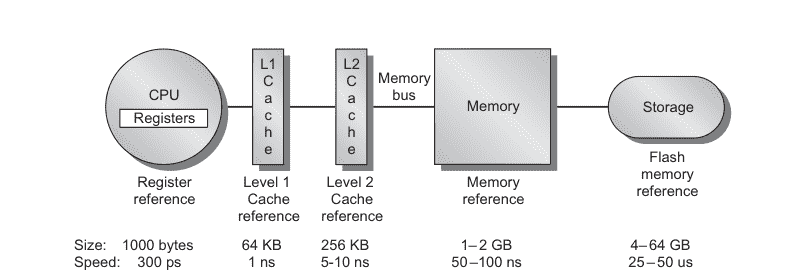

移动设备的缓存内存层次结构

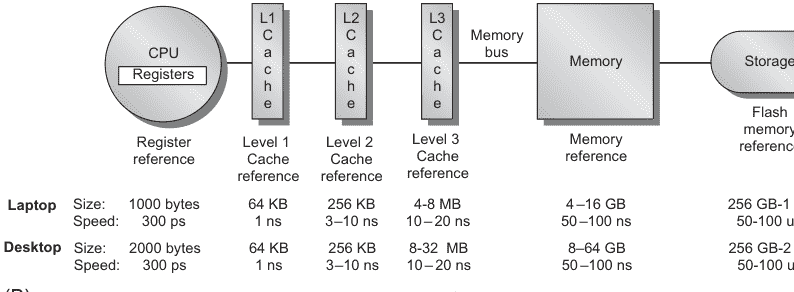

笔记本电脑或桌面式计算机的内存层次结构

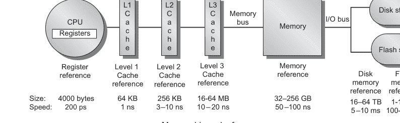

图 2.1 典型内存层次结构级，包括移动设备（PMD）如手机或平板电脑（A）、笔记本电脑或桌面电脑（B）以及服务器（C）。越离处理器越远，该层级的内存就越慢、容量越大。注意，磁磁盘中的时间单位从秒到毫秒变化了 $10^3$ 倍，而容量单位从字节到十几个字节变化了 $10^3$ 倍。如果我们添加的是仓库大小的计算机，而不仅仅是磁盘，其容量规模将增加三个数量级。闪存硬盘（SSD）被专门用于 PMD，并大量用于笔记本电脑和桌面电脑。在许多桌面电脑中，主存储系统是 SSD，扩展盘主要是机械硬盘器（HDD）。同样，许多服务器也混合使用 SSD 和 HDD。

## 第二章 内存层次设计


**图 2.2** *以 1980 年的性能为基准，绘制了随时间变化的性能差距，即处理器内存请求（单处理器或单核）与 DRAM 访问延迟之间差。2017 年，AMD、Intel 和 Nvidia 均使用了 HBM 技术的连接芯片组。注意纵轴采用对数刻度，用于记录处理器-DRAM 性能差距的规模。在 1980 年，延迟的性能每年提高 1.07 倍（见第 88 页图 2.4）。处理器基准假设在 1986 年之前每年提高 1.25 倍，直到 2000 年提高 1.52 倍，2000 年至 2005 年间提高 1.20 倍，而 2005 年至 2010 年间处理器性能提升较小。如你所见，2010 年 DRAM 内存访问时间的改进缓慢但持续；自 2010 年以来，与早期相比，访问时间的改进有所减少，尽管带宽仍在持续提升。更多信息请参阅第 1 章图 1.1。*

引用；这是 409.6 GiB/s 的峰值需求带宽！这种令人置信的带宽是通过多点和划分缓存来实现的；通过使用三级缓存，每个核心有两个私有级和一个共享的 L3 级；通过在第一级使用独立的指令缓存和数据缓存。相比之下，使用两个内存通道的 DRAM 主内存的峰值带宽仅为需求带宽的 8%（34.1 GiB/s）。未来的版本预计将嵌入式 L4 DRAM 缓存或堆叠 DRAM（见第 2.2 和 2.3 节）。

传统上，内存层次的设计侧重于优化内存访问时间，这由缓存访问时间、缺失率和缺失惩罚决定。然而，最近功耗已成为主要考虑因素。在高端微处理器中（可能有 60 MiB 或更多的片上缓存），二级或三级缓存将消耗大量功率。

（注：此处原文部分存在大量乱码或重复内容，已遵循翻译逻辑对核心语义段落进行处理。）

## 2.1 引言 83

减少强制缺失，但它们增加了缺失惩罚。因为较大的块减少了标记（tags）的数量，它们可以稍微减少静态功耗。更大的块大小还会增加容量缺失或冲突缺失，尤其是在较小的缓存中。选择合适的块大小是一个复杂的权衡，取决于缓存的大小和缺失惩罚。

- 2. 通过增大缓存来降低缺失率——减少容量缺失显而易见的方法是增加缓存容量。缺点包括较大缓存内存命中时间可能增加，以及成本和功耗更高。更大的缓存会同时增加静态和动态功耗。
- 3. 通过提高关联性来降低缺失率——增加关联性可以减少冲突缺失。更高的关联性可能以命中时间增加为代价。正如我们很快看到的，关联性也会增加功耗。
- 4. 通过多级缓存来减少缺失惩罚——一个困难的决策是让缓存命中时间跟上处理器的高时钟频率，还是让缓存足够大以缩小访问与内存访问之间的差距。在原始缓存和内存之间增加另一级缓存可以简化这一决策。一级缓存可以足够小以匹配快速的时钟周期，而二级（或三级）缓存可以足够大，以捕捉许多流向主内存的访问。对二级缓存中缺失的关注会导致更大的块、更大的容量和更高的关联性。多级缓存比单级聚合缓存更具效率。如果 L1 和 L2 分别指一级和二级缓存，我们可以细化内存访问时间：

```
$Hit_{L1} + Miss_{L1} \times (Hit_{L2} + Miss_{L2} \times Miss penalty_{L2})$
```

- 5. 优先处理读取缺失而非写入以减少缺失惩罚——缓冲区是实现这种优化的良好位置。写缓冲区（Write buffers）会产生冒险，因为它们会在发生读取缺失时更新某个位置的值——即通过内存产生的“读后写”冒险。一种解决方案是在读取缺失时检查写缓冲区的内容。如果没有冲突且内存系统可用，发送读取请求将减少缺失惩罚。大多数处理器赋予读取高于写入优先级。这种选择对功耗的影响很小。
- 6. 避免缓存翻译索引以减少命中时间——缓存需要处理从处理器的虚拟地址到物理地址的翻译，以访问内存。（虚拟内存在 2.4 节和 B.4 节中介绍。）一种常见的优化是使用页偏移（虚拟地址和物理地址中相同的部分）来索引缓存，如附录 B 第 B.38 页所示。这种虚拟索引/物理标记（virtual index/physical tag）引入了一些系统复杂性，并/或对 L1 缓存的大小和结构造成了限制，但从关键路径中移除转换查找缓冲区（TLB）访问的优点大于其缺点。


# 84 第二章 存储层次结构设计

注意，上述六种优化中的每一种都有潜在的缺点，会导致平均内存访问时间增加而非减少。

本章其余部分将确保对前述材料以及附录 B 中细节的熟悉。在“整合”（Putting It All Together）部分，我们研究了为高端桌面级或服务器设计的微处理器存储层次结构——Intel Core i7 6700，以及一个为移动媒体设备（PMD）设计的 Arm Cortex-53，后者是平板电脑和智能手机所用处理器的基础。由于计算机的用途不同，这些类别之间在方法上存在显著差异。


尽管 i7 6700 核心更多、缓存更大的比专为移动用户设计的 Intel 处理器，但这些处理器的架构是相似的。为小型服务器（如 i7 6700）或通常运行大量并发进程（通常针对不同用户）的大型服务器设计的处理器，其内存带宽变得更加重要，这些处理器提供了更大的缓存和更激进的内存系统来提升带宽。

在 PMD 中，不仅服务于服务器，而且通常具有较小的操作系统，除非进行多任务处理（同时运行多个仿真），以及简单的应用程序。PMD 必须同时考虑性能和能耗，这决定了电池寿命时间。在我们深入研究高级缓存结构和优化之前，需要了解各种内存技术以及它们是如何演变的。

## 2.2 内存技术与优化

...让计算机站起来的唯一一项进展就是发明了一种可靠的内存形式——核心内存……它的成本是合理的，它是可靠的，而且正因为其可靠，它自然可以被做得很大。(第 209 页)

> Maurice Wilkes.

> 《计算机先驱的回忆》(1985年)

本节描述了存储层次结构中使用的技术，特别是构建缓存和主内存的技术。这些技术包括 `SRAM`（静态随机访问存储器）、`DRAM`（动态随机访问存储器）和 `Flash`。后者被作硬盘的替代品，但由于其特性基于半导体技术，将其包含在本节中是合适的。

使用 `SRAM` 解决了最小化缓存访问时间的需求。然而，当发生缓存缺失时，我们需要尽可能从主内存移动数据，这需要高带宽内存。这种高内存带宽可以通过组成主内存的许多 `DRAM` 芯片组织成多个内存库（memory banks）并加宽内存线，或者两者兼顾。

为了让内存系统跟上现代处理器的需求，内存创新开始在 `DRAM` 芯片内部发生

## 2.2 内存技术与优化 85

本身。本节描述了内存内部的技术以及创新的结构。在描述技术和选项之前，我们需要引入一些术语。

随着现在广泛用于 `Flash` 和 `DRAM` 的突发内存出现，内存延迟使用两个指标来衡量——访问时间（access time）和周期时间（cycle time）。访问时间是从请求读取到字到达的时间，而周期时间是两次不相关的内存请求之间的最短时间。

1975 年以来，几乎所有计算机都使用 `DRAM` 作为主内存，使用 `SRAM` 作为缓存，并将一三级集成到处理器中。PMD 必须平衡性能和功率，由于其存储需求适，PMD 使用 `Flash` 而非磁盘驱动器，这一点深受桌面电脑的影响。

### SRAM 技术

`SRAM` 的第一个字母代表*静态*。`DRAM` 电路的动态特性要求读取后写回数据——这就是刷新（refresh）的区别。`SRAM` 不需要刷新，因此访问时间非常接近周期时间。`SRAM` 通常每位使用六个晶管以防止读取时受到干扰。`SRAM` 在待机模式下保持电荷所需的最小。

早期，大多数桌面和服务器系统使用 `SRAM` 芯片作为一级、二级或三级缓存。今天，三级缓存都集成在处理器上。高端服务器芯片可能有 24 个核心和高达 60 MiB 的缓存；系统通常配置 128–256 GiB 的 `DRAM`。三级缓存的访问时间通常是二级缓存的两到八倍。即使是 L3 访问时间通常比 `DRAM` 快五倍。

片上 `SRAM` 缓存通常以与块大小相同的宽度组织，标记与每个块并行存储。这允许将单个实体读取或写入单个缓存。这种能力在将缺失后获取的数据写入缓存或在写回必须从缓存中剔出的块时特别有用。缓存的访问时间（忽略组相缓存中的命中检测和选择）与缓存中块的数量成正比（静态功耗），并由于内存更小而减少访问时间，但增加了命中检测和块选择的时间，将在 2.3 节中讨论。

### DRAM 技术

随着早期 `DRAM` 容量增加，具有所有必要地址线的封装成本是一个问题。解决方案是复用地址线，从而

## 86 第二章 存储层次结构设计

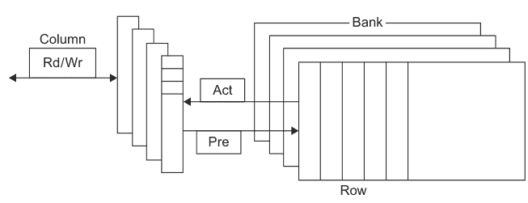

**图 2.3** `DRAM` 的内部结构。现代 `DRAM` 以存储库（banks）的形式组织，`DDR` 最多有 16 个。每个存储库由一系列行组成。发送 `ACT`（激活）命令会打开一个存储库和一行，并将该行加载到行缓冲区（row buffer）中。当行在缓冲区中时，可以通过 `DRAM` 宽度（`DDR4` 中通常为 4、8 或 16）的连续列地址触发，或者通过指定块传输和起始地址来触发。预充电命令（`PRE`）会关闭存储库和行，并将其读取以进行新访问。[等一下，让我们重新读一遍：预充电命令（`PRE`）会关闭存储库和行，并为新访问做好准备。] 每条命令以及块传输都与时钟同步。见下一节关于 `DRAM` 的讨论。行信号和列信号根据信号的原始名称有时被称为 `RAS` 和 `CAS`。

将地址引脚减半。图 2.3 显示了基本的 `DRAM` 结构。地址的一半在*行访问选通 (`RAS`)* 期间首先发送。地址的另一半在*列访问选通 (`CAS`)* 期间发送，并紧随其后。这些名称源于内部芯片结构，因为内存被组织成由行和列寻的矩形矩阵。

`DRAM` 的额外要求源于其第一个字母 D（*dynamic*，动态）所代表的属性。为了在每个芯片中封装更多位，`DRAM` 仅使用单个晶体管（相当于充电容器）来存储一个位。这有两个影响：首先，检测电荷的导线必须预充电，这使其处于逻辑 0 和 1 之间的“中间”，允许存储在单元格中的微小电荷导致感测放大器读取为 0 或 1。在读取时，行被放入行缓冲区，其中 `CAS` 信号选择行的一部分并从 `DRAM` 中读出。由于读取会破坏信息，当该行不再需要时，必须将其写回。这种写回是以重叠方式进行的，但在早期 `DRAM` 中，新行之间的循环时间可能大于读取行并访问其部分的时间。

此外，为了防止单元格中的电荷漏电导致信息丢失（假设未被读取或写入），每个位必须周期地通过读取并写回来被“刷新”。因此，内存系统中的每个 `DRAM` 必须在特定的窗口内（例如 64 毫秒）访问每一行。`DRAM` 控制器包含用于定期刷新 `DRAM` 的硬件。

这一要求意味着内存系统有时是不可用的，因为它正在向每个芯片发送信号以进行刷新。刷新的时间包括一次行激活和一次写回该行的预充电（这大约占获取数据时间的 2/3，因为不需要列选择），而且这对于 `DRAM` 的每一行都是必须的。由于 `DRAM` 内部的内存矩阵在概念上是正方形的，刷新的步数通常是 `DRAM` 容量的平方根。`DRAM` 设计者试图将刷新时间保持在总时间的 5% 以下。到目前为止，我们展示的主内存操作方式就像一列瑞士手表火车，完全按照计划如时地交付货物。实际上，对于 `SDRAM`，`DRAM` 控制器（在处理器上）会尝试在可能的情况下打开新行并使用块传输来优化访问。刷新增加了另一个不可预测的因素。

## 2.2 存储技术与优化 87

Andahl 建议根据经验法则，内存容量应随处理器速度线性增长，以保持系统平衡。因此，一个 1000 `MIPS` 的处理器应该拥有 100 `MiB` 的内存。处理器设计者依赖 `DRAM` 来满足需求。过去，他们预计每三年容量提高四倍，每年增长 55%。遗憾的是，`DRAM` 的性能增长速度慢得多。性能的提升主要是因为行访问时间的进一步减小，而这取决于功耗限制和单个内存单元的电荷容量（以及尺寸）等问题。在我们详细讨论这些趋势之前，我们需要描述从 20 世纪 90 年代中期开始 `DRAM` 的变化。

### 提高 DRAM 芯片内部性能：SDRAM

虽然早期的 `DRAM` 包括一个缓冲区，允许对单行进行多次列访问而无需切换新行，但这种接口意味着每次列访问和传输都涉及与控制器同步的开销。20 世纪 90 年代中期，设计者在 `DRAM` 接口中增加了时钟信号，以便重复传输不会产生额外的开销，从而创建了同步 `DRAM`（`SDRAM`）。除了减少开销外，`SDRAM` 还允许增加突发模式（burst mode），可以在不指定新列地址的情况下发生多次传输。通常，通过将 `DRAM` 置于突发模式，可以在不指定任何新地址的情况下进行八位或十六位传输。此类突发传输的引入意味着随机访问流的带宽与数据块带宽之间存在显著差异。

为了克服带宽问题，通过将 `DRAM` 置于突发模式，可以在不指定任何新地址的情况下进行八位或十六位传输。此类突发传输的引入意味着随机访问流的带宽与数据块带宽之间存在显著差异。（注：此处原文段落似乎存在重复或逻辑混乱，已按原意翻译）在 20 世纪 90 年代中期，设计者在 `DRAM` 接口中增加了时钟信号，以便重复传输不会产生额外的开销，从而创建了同步 `DRAM`（`SDRAM`）。除了减少开销外，`SDRAM` 还允许增加突发模式，可以在不指定新列地址的情况下发生多次传输。……（注：此处原文存在明显的文本乱码或重复逻辑错误）

在早期 20 世纪 00 年代，引入了双倍数据传输（`DDR`），它允许在上升 和 下降沿传输数据。最后，`SDRAM` 引入了…… 

## 88 第二章 存储层次结构设计

访问不同的存储库可以与其重叠。`DRAM` 具有自己的行缓冲区。访问是针对一个随机行字且必须打开。如果行在不同的存储库中，我们假设该存储库已预充电；如果行未打开，则需要预充电，访问时间更长。随着存储库数量的增加，隐藏预充电时间的能力也增强了。`DDR4 SDRAM` 最初预计在 2014 年推出，但直到 2016 年初才开始生产。

从 20 世纪 90 年代到 2010 年，`DRAM` 遵循摩尔定律增长，每 18 个月翻倍（或每 3 年四倍）。从 20 世纪 90 年代中期到 2016 年，容量翻倍。从 `DDR1` 到 `DDR3`，访问时间提升了约 3 倍，每年增长 7%。图 2.4 显示了各代 `DDR SDRAM` 的容量和访问时间。`DDR`……到 2016 年，容量只翻倍了！图 2.4 显示了各代 `DDR SDRAM` 的容量和访问时间。`DDR`……是一系列标准。`DDR2` 将电压从 2.5V 降至 1.8V 降低了功率，并提供了更高的频率：266、333 和 400 MHz。`DDR3` 将电压降至 1.5V，最大速度为 800 MHz。（正如我们在下一节讨论的，`DDR5` 是

### 2.2 内存技术与优化

| 标准 | I/O 时钟频率 | M 传输/秒 | DRAM 名称 | MiB/DIMM | DIMM  way |
|---|---|---|---|---|---|
| `DDR1` | 133 | 266 | `DDR266` | 2128 | PC2100 |
| `DDR1` | 150 | 300 | `DDR300` | 2400 | PC2400 |
| `DDR1` | 200 | 400 | `DDR400` | 3200 | PC3200 |
| `DDR2` | 266 | 533 | `DDR232-533` | 4264 | PC4300 |
| `DDR2` | 333 | 667 | `DDR2-667` | 5360 | PC5300 |
| `DDR2` | 400 | 800 | `DDR2-800` | 6400 | PC6400 |
| `DDR3` | 533 | 1066 | `DDR3-1066` | 8528 | PC8500 |
| `DDR3` | 666 | 1333 | `DDR3-1333` | 10664 | PC10700 |
| `DDR3` | 800 | 1600 | `DDR3-1600` | 12800 | PC12800 |
| `DDR4` | 1334 | 2666 | `DDR4-2666` | 21,300 | PC21300 |

**图 2.5** 2016 年 `DDR DRAM` 和 `DIMM` 的时钟频率、带宽和名称。注意这些列之间的数值关系。第三列是第二列的倍倍，第四列使用了第三列的数字；第五列是第三列的八倍，并将四舍五入后的版本用于 `DIMM` 的名称中。`DDR4` 于 2016 年首次出现。

`RAM` 基于 `DDR3 DRAM`。`DDR4` 已于 2016 年初量产（尽管预计在 2014 年推出），其电压降至 1–1.2 V，最高预期时钟频率为 1600 MHz。`DDR5` 可能直到 2020 年或以后才实现量产。

随着 `DDR` 的引入，内存设计人员日益关注带宽，因为访问时间的改进很难实现。宽缓冲器、突发传输和双倍数据传输都促进了内存带宽的快速增长。`DRAM` 通常被封装在称为*双内线存储器模块*（`DIMMs`）的小型板上，这些模块包含 4–16 个 `DRAM` 芯片，在桌面级和服务器系统中通常都归一化为 8 字节（带有 (+ECC)）。当 `DDR DRAM` 封装成 `DIMM` 时，它们通过*峰值 DIMM 带宽*标记，这很容易引起误解。`DIMM` 名称 PC3200 来自于 200 MHz × 2 × 8 字节，即 3200 MiB/s；它填充了 `DDR SDRAM` 芯片。为了延续这种困惑，芯片本身的标签是*每秒比特数*而非其时钟频率，因此一个 200 MHz 的 `DDR` 芯片被称为 `DDR400`。图 2.5 显示了 I/O 时钟频率、每芯片每秒传输、带宽、芯片名称和 `DIMM` 名称之间的关系。

## SDRAM 中的功耗降低

动态内存芯片中的功耗由读取时使用的动态功耗和静态待机功耗组成；两者取决于工作电压。在最先进的 `DDR4 SDRAM` 中，工作电压已降至 1.2 V，与 `DDR2` 和 `DDR3 SDRAM` 相比降低了功耗。库（banks）的增加也降低了功耗，因为只读取单个库中的某行。

# 第二章 存储层次设计

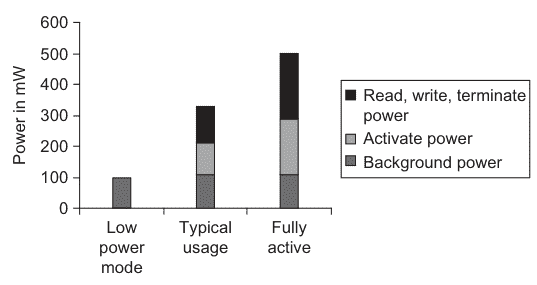

**图 2.6** 三种条件下的 `DDR3 SDRAM` 功耗：低功耗（关机）模式、典型系统模式（`DRAM` 30% 的时间用于读取，15% 的时间用于写入）以及全活动模式（`DRAM` 持续读取或写入）。读取和写入假设为八次突发传输。这些数据基于美光 1.5V 2GB `DDR3-1066`，尽管 `DDR4 SDRAM` 也有类似的节能效果。

除了这些变化，所有近期的 `SDRAM` 都支持掉电模式，通过告诉 `DRAM` 忽略时钟进入该模式。掉电模式会禁用 `SDRAM`，内部原子刷新除外（持续超过刷新时间将导致内存内容丢失）。图 2.6 显示了 2 GB `DDR3 SDRAM` 在三种情况下的功耗。从低功耗模式返回所需的精确延迟取决于 `SDRAM`，但典型延迟为 200 个 `SDRAM` 时钟周期。

## 图形数据内存

`GDRAMs` 或 `GSRAMs`（图形或图形同步动态存储器）是一类基于 `SDRAM` 设计的特殊 `DRAM`，但专为处理图形处理器单元更高的带宽而定制。`GDDR5` 基于 `DDR3`，而早期的 `DDR` 基于 `DDR2`。图形处理器单元（`GPUs`；见第 4 章）每个芯片所需的带宽比 CPU 更大，`GDDRs` 有以下几个重要区别：

- `GDDRs` 具有更宽的接口：32、64 或 128 位。
- `GDDRs` 的突发长度更长：8、16 或 32 次传输。
- `GDDRs` 具有更高的时钟频率，以提高带宽。

### 2.2 存储技术与优化

与 `DRAM` 类似，`Flash` 芯片包含冗余块，允许带有少量缺陷的芯片被使用；块的重映射在 `Flash` 芯片内部处理。`Flash` 控制器负责页面传输、提供页面缓存并处理写层级均衡（write leveling）。

高密度 `Flash` 技术的快速进步对于低功耗 PMD（持久性内存）和笔记本电脑的发展至关重要，这也显著改变了桌面式电脑（越来越多使用固态硬盘）以及通常结合磁盘和 `Flash` 存储的大型服务器。

### 相变存储技术

相变存储器（`PCM`）几十年来一直是一个活跃的研究领域。该技术通常使用微小的加热元件将体材料基底的状态在晶态和非晶态之间切换，这两种状态具有不同的电阻特性。每个位对应于叠加在基底上的二维网络中的一个交叉点。读取通过感知 x 点和 y 点之间的电阻来实现（因此得名为记忆阻器），写入则通过施加电流改变材料的相位来实现。由于缺乏有源器件（如晶体管），其成本应比 `NAND Flash` 更低，密度更高。

2017 年，美光（Micron）和英特尔（Intel）启动了 Xpoint 内存芯片，据认为基于 `PCM`。该技术的耐用性预计比 `NAND Flash` 好得多，通过消除写入前的擦除页操作，其写入性能可达 `NAND` 的 10 倍。读取延迟也比 `Flash` 好 2-3 倍。最初预计价格比 `Flash` 高，但写入性能和耐用性的优势使其具有吸引力，特别是对于 SSD 而言。如果这项技术能够良好扩展并实现额外的成本降低，它可能成为取代磁磁盘的固态技术，磁磁盘在 50 多年前一直一直是主要的批量非易失性存储器。

## 增强内存系统的可靠性

大容量缓存和主内存显著增加了制造过程中和动态运行期间发生错误的可能性。由于电路变化引起的错误是可重复的硬错误（hard errors）或永久性故障。硬错误可能发生在制造期间，也可能由于运行期间的电路变化（例如，多次写入后 `Flash` 存储单元失效）。所有 `DRAM`、`Flash` 内存和大多数 `SRAM` 在制造时都留有备用行，以便通过将缺陷行替换为备用行来容纳少量制造缺陷。动态错误是指单元内容的变化而非电路的变化，称为软错误（soft errors）或瞬态故障。

动态错误可以通过校验位（parity bits）检测，并通过使用纠错码（`ECCs`）修复。由于指令缓存是只读的，校验位就足够了。在较大的缓存和主内存中，使用 `ECC` 允许检测并纠正错误。校验只需要一个位的开销即可检测位序列中的单个错误。由于校验位无法检测到多位错误（multit error），校验位保护的位数可能受到限制。每 8 个数据位使用一个校验位可以检测两个错误并纠正一个错误，每 64 个数据位的代价是 8 位开销。

在非常大的系统中，多个错误发生以及单个内存芯片完全失效的可能性可能会变得显著。IBM 引入了 `Chipkill` 来解决这个问题，许多大型系统（如 IBM 和 SUN 集群以及 Google Cluster）都使用了这项技术。（英特尔将他们的版本称为 `SDDC`。）与用于磁盘的 RAID 方法类似，`Chipkill` 分布数据和 `ECC` 信息，以便通过支持从剩余内存芯片中重建丢失的数据，从而处理单个内存芯片的完全失效。根据 IBM 的分析并假设一个拥有 10,000 个处理器、每个处理器 4 GiB 内存的服务器，得出运行三年内不可恢复错误的发生率如下：

- 仅校验：约 90,000 次，或约每 17 分钟发生一次不可恢复（或未检测到）的故障。
- 仅 `ECC`：约 3500 次，或约每 7.5 小时发生一次未检测到或不可恢复的故障。
- `Chipkill`：[未提供具体数据]

（注：原文此处 `Chipkill` 后的数据似乎不完整，翻译已保持格式逻辑）

# 96 第二章 存储器层次设计

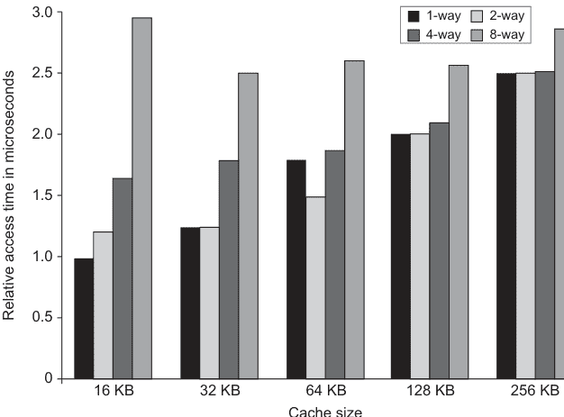


**图 2.8** 相对访问时间通常随着缓存大小和关联性的增加而增加。这些数据来自 `Tarjan` 等人（2005）的 `CACTI` 模型 6.5。这些数据假设了典型的嵌入式 SRAM 技术、单库（bank）以及 64 字节块。关于缓存布局的假设，以及互连延迟（取决于所访问缓存的大小）与标签检查（tag checks）及多路复用成本之间复杂的权衡，导致结果有时会出乎意料，例如，64 KB 的二路组组相缓存的访问时间比直接映射更短。同样，随着缓存大小的增加，八路关联性的结果会产生不寻常的特性。由于此类观察高度依赖于技术和详细的设计假设，像 `CACTI` 等工具的作用是缩小搜索空间。这些结果是相对的；尽管如此，随着我们转向更先进、密度更高的半导体技术，它们很可能会发生变化。

是八路的[缺失] 倍。当然，这些估计取决于技术以及缓存的大小，且 `CACTI` 必须与技术精细对齐；**图 2.8** 显示了某种技术的相对权衡。

### 示例
使用附录 B 中的图 B.8 和图 2.8 中的数据，确定一个 32 KiB 四路组相联 L1 缓存的访问时间是否比一个 32 KiB 二路组相联 L1 缓存更快。假设访问 L2 的惩罚是更快 L1 缓存访问时间的 15 倍。忽略 L2 之外的缺失。哪者的平均内存访问时间更快？

### 答案
二路组相联缓存的访问时间为 1。那么，对于四路缓存，

```
Average memory access time, 2-way = Hit time + Miss rate × Miss penalty
= 1 + 0.038 × 15 = 1.38
```

## 2.3 缓存性能的十种高级优化

对于四路缓存，访问时间长了 1.4 倍。缺失惩罚的消除时间为 15/1.4 = 10.1。为了简单起见，假设为 10：

访问时间 `$time_{4-way} = Hit_{2-way} × 1.4 + Miss penalty × 1.4 = 0.037 × 10 = 1.77$`

显然，较高的关联性看起来是一个糟糕的权衡；然而，由于现代处理器中的缓存访问通常是流水线的，对时钟周期的精确影响很难评估。

能耗也是选择缓存大小和关联性时的考虑因素之一，如图 2.9 所示。较高关联性的能量成本范围从从映射到二路相联时，在 128 KiB 或 256 KiB 缓存中减少了超过 2 倍的比例。

随着能耗变得至关重要，设计者开始关注减少缓存访问所需能量的方法。除了关联性外，决定缓存访问能量的另一个因素是缓存中块的数量，因为它决定了被访问的“行”数。设计者可以通过增加块的大小（保持缓存总大小不变）来减少行数，但这可能会增加缺失率，特别是在较小的 L1 缓存中。

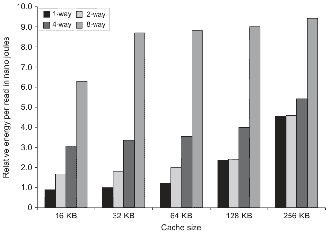

**图 2.9** 每次读取的能耗随着缓存大小和关联性的增加而增加。与前图一样，`CACTI` 使用相同的技术参数进行建模。八路组相联缓存的巨大代价是因为并行读取八个标签及相应数据的成本。

# 98 第二章 存储器层次设计

另一种方法是将缓存组织成多个库（banks），使得访问仅激活缓存的一部分，即所需数据块所在的库。多库缓存的主要用途是增加缓存的带宽，我们稍后会考虑这种优化。多库设计还能减少访问缓存时的能量消耗。许多核心的 L3 缓存在逻辑上是统一的，物理上是分布的，并有效地充当了多库缓存。根据请求地址，实际上只有一个物理 L3 缓存（一个库）被访问。我们将在第 5 章进一步讨论这种组织结构。

在最近的设计中，尽管存在能量和访问时间成本，还有其他因素导致在一级缓存中使用关联性。首先，许多处理器需要两个时钟周期来访问缓存，因此较长的命中时间（hit time）的影响可能是关键的。其次，为了让 TLB 不在路径上（这一细节的描述将比增加关联性还要长），所有 L1 缓存都应该是虚拟索引的。这限制了缓存的大小，因为只有页内的位被用于索引。对于在翻译完成之前索引缓存的问题还有其他解决方案，这些方案具有其他益处。第三，随着多线程的引入，冲突缺失（conflict misses）可能会增加。

### 第二次优化：通过路预测（Way Prediction）减少命中时间

另一种方法在减少缺失[缺失] 减少了冲突缺失，同时保持了直接映射缓存的速度。在路预测中，缓存中保留了额外的位来预测下次访问的是哪路（组内的块）。这意味着多路复用器被设置以选择所需的块，并且在一个周期内，在读取数据的同时仅并行执行单次标签比较。在下一个周期中检查其他块时会发生缺失。

如果预测器是正确的，访问延迟就是快速的命中时间。如果它尝试另一个块，预测器将额外增加一个周期的延迟。仿真表明，二路组相联缓存的预测准确性超过 90%，四路组相联缓存超过 80%，这是非常有可能的。路预测首次在 20 90 年代中期用于 MIPS R10000，并在使用二路组相联的处理器中很流行，并被用于几个具有四路相联缓存的 ARM 处理器。对于非常快的处理器，实现单周期停顿可能是具有挑战性的。

路预测的扩展形式还可以通过预测位（本质上是额外的地址）来降低功耗；这种可能被称为路选择（way selection）的方法在路预测正确时节省功率，但在预测错误时会增加大量时间，因为标签匹配和选择必须重复。这种优化可能只在低功耗处理器中才有意义。`Inoue` 等人（1999）估计，使用四路组相联缓存的路选择方法使 I 缓存的平均访问时间增加了 1.04，D 缓存增加了 1.04。

# 100 第二章 存储器层次设计

| 块地址 Bank 0 | 块地址 Bank 1 | 块地址 Bank 2 | 块地址 Bank 3 |
|---|---|---|---|
| 0 | 1 | 2 | 3 |
| 4 | 5 | 6 | 7 |
| 8 | 9 | 10 | 11 |
| 12 | 13 | 14 | 15 |

**图 2.10** 使用块寻址的四路交织缓存存储组。假设每个块为 64 字节，这些地址中的每一个都将乘以 64 以获得字节寻址。

对缓存进行流水线处理比让处理器依赖高性能分支预测来限制延迟要容易。相应地，对数据缓存进行流水线会导致发射加载和使用数据之间产生更多的时钟周期（今天，所有处理器都对 L1 使用了某种流水线处理，仅仅是为了分离访问和命中检测的简单情况，而且许多高速处理器具有三级或更多级别的缓存流水线）。

许多超标处理器每个周期执行并管理一个内存引用（允许加载或存储是常见的，某些处理器允许多次加载）。为了处理每个周期的多次数据缓存访问，我们可以将缓存分为独立的存储组（banks），每个存储组都支持独立访问。存储组最初用于提高主内存的性能，现在也位于现代 DRAM 芯片内部以及缓存中。`Intel Core i7` 在 L1 中具有存储组（支持每个时钟周期最多 2 次访问）。

显然，当访问自然分散在各个存储组中时效果最好，地址到存储组的映射影响内存系统的行为。一种简单且有效的映射是将块的地址顺序地分散到各个存储组中，这被称为顺序交织。例如，如果有四个存储组，bank 0 拥有所有地址对模 4 等于 0 的块，依此类推。图 2.10 显示了这种交织。多个存储组也是减少缓存和 DRAM 功耗的一种。

多个存储组在 L2 或 L3 缓存中也有用，但原因不同。在 L2 中使用多个存储组，如果存储组不冲突，我们可以处理多个未完成的 L1 缺失。这是支持非阻塞缓存（我们的下一个优化方案）的关键能力。`Intel Core i7` 的 L2 有八个存储组，而 Arm Cortex 处理器使用了 1-4 个存储组的 L2 缓存。如前所述，多组也可以减少能量消耗。

### 第四次优化：非阻塞缓存以增加缓存带宽

对于允许乱序执行的流水线处理器（在第3章中讨论），处理器不需要在数据缓存缺失时停顿。处理器可以在等待数据缓存返回缺失数据的同时继续从指令缓存中取指令。非阻塞缓存或无锁缓存通过允许缓存在缺失期间继续提供命中，从而释放了此类方案的潜在收益。这种“缺失下的命中”（hit under miss）优化通过在缺失期间提供帮助而不是忽略处理器的请求，减少了有效的缺失惩罚。一种简单和一种复杂的选项是，如果缓存可以重叠多次缺失，它可以降低有效的缺失惩罚：“多次缺失下的命中”或“缺失下的缺失”优化。第二种是处理器（如 `Intel Core` 处理器）通常支持这两者，而低端处理器在 1.2 节仅提供有限的非阻塞支持。

为了检查非阻塞缓存减少缓存惩罚的有效性，`Farkas` 和 `Jppi` (1994) 进行了一项研究，假设使用 8 KiB 缓存和适用于1990年代初的 14 周期缺失惩罚。他们观察到，当允许一次缺失下的命中时，`SPECINT2` 基准测试的有效缺失惩罚减少了 20%，`SPECF92` 基准测试减少了 30%。

`Li` 等人 (2011) 更新了这项研究，使用了多级缓存，对缺失惩罚提出了更严苛的假设，并使用了基于 `Intel i7` 单核的更大且要求更高的模型（见第 2.6 节）运行 `SPECPU2006` 基准测试。图 2.11 显示了在允许1、2或64次缺失下的命中时缓存访问延迟的减少；说明描述了内存系统的更多细节。自早期的研究以来，更大的缓存和 L3 缓存的加入使得 `SPECINT2006` 基准测试减少了约 9% 的缓存延迟，`SPECFP006` 为 12.5%。

对于浮点程序，两路关联性还是缺失下的命中更重要？假设 32 KiB 缓存的平均缺失率如下：直接映射缓存的浮点程序为 5.2%，两路关联缓存为 4.9%，直接映射缓存的整数程序为 3.5%，两路关联缓存的整数程序为 3.2%。由于到 L2 的缺失惩罚为 10 个周期，缺失和惩罚是相同的。

### 示例
对于浮点程序，平均内存停顿时间：

`Rate_{dm} × Miss penalty = 5.2% × 10 = 0.52`

`Rate_{way} × Miss penalty = 4.9% × 10 = 0.49`

### 答案
两路关联的缓存访问延迟（包括停顿）为 0.49/0.52，即直接映射缓存的 94%。图 2.11 表明允许缺失下的命中将浮点程序的数据缓存延迟减少到阻塞缓存的 87.5%。因此，对于浮点程序，`[img/ad8662987f6e3995f5c04f95b6c13.png]` **图 2.11** 非阻塞缓存的有效性通过 `SPECINT`（左侧）和 `SPEFP`（右侧）允许1、2或64次缺失下的命中来评估。模拟 `Intel i7` 的内存系统由访问延迟为4周期的 32 KiB 缓存组成。L2 缓存（与指令共享）为 256 KiB，访问延迟为10个周期。L3 为 2 MiB，访问延迟为36 周期。所有缓存均为八路关联且块大小为 64 字节。允许一次缺失下的命中使整数基准测试减少了9%，浮点减少了 12.5%。允许第二次命中将这些结果提高到 10% 和 16%，而允许64次改进微小。

对于整数程序，支持一次缺失下的命中直接映射数据缓存优于在缺失时阻塞的两路关联缓存，计算为：

`Rate_{dm} × Miss penalty = 3.5% × 10 = 0.35`

`Rate_{way} × Miss penalty = 3.2% × 10 = 0.32`

两路关联缓存的数据缓存访问延迟为 0.32/0.35，即直接映射缓存的 91%，而允许缺失下的命中时访问延迟减少了 9%，使得两种缓存相等。

非阻塞缓存性能评估的真正困难在于，缓存缺失并不一定会停顿处理器。在这种情况下，很难判断任何单个缺失的影响，从而计算平均访问时间。有效惩罚不是缺失的总和，而是处理器停顿的非重叠时间。非阻塞缓存的收益是复杂的，因为它取决于多个缺失时的缺失惩罚、内存引用模式以及处理器在缺失缺失时可以执行多少指令。

通常情况下，乱序处理器能够隐藏大部分命中 L2 的 L1 数据缓存缺失，并且能够隐藏很大一部分低级缓存缺失。支持多少个未完成缺失取决于多种因素：

- 缺失流中的时间和空间局部性，它决定了缺失是否可以启动对更低级缓存或内存的新访问。
- 响应内存或缓存的带宽。
- 在缓存的最底层（缺失时间最长）允许更多未完成缺失，需要在较高级支持至少数量的缺失，因为缺失必须在最高级缓存启动。
- 内存系统的延迟。

下面的简单示例说明了核心思想。

### 示例
假设主内存访问时间为 36 ns，内存系统能够以 16 GiB/s 的持续速率运行。如果块大小为 64 字节，假设在请求流和访问从不冲突的情况下我们可以维持峰值带宽，我们需要支持的最大未完成缺失是多少？如果引用与前四个引用之一冲突的概率为 50%，且假设访问必须等待早的访问完成，估计最大未完成引用的数量。为了简单起见，忽略缺失之间的时间。

### 答案
在第一种，由于我们可以维持峰值带宽，内存系统每秒支持 (16 × 10^9)/64=250 次引用。每次引用需要 36 ns，我们可以支持 250 × 10⁹ × 36 × 10⁻⁹=9 次引用。如果冲突的概率大于 0，那么我们需要更多的未完成引用，因为我们无法对这些冲突的引用开始工作；内存系统需要更多独立的引用，而不是更少！为了近似，我们可以假设一半的内存引用不需要发布到内存。这意味着我们必须支持两倍的未完成引用，即 18 个。

## 2.3 缓存性能的十种高级优化

### 实现非阻塞缓存

尽管非阻塞缓存具有提高性能的潜力，但它们的实现具有挑战性。出现了两个最初的挑战：仲裁命中和缺失，以及跟踪未完成的缺失以便我们知道加载或存储何时继续。考虑第一个问题。在阻塞缓存中，缺失会导致处理器停顿，并且不会发生进一步的缓存访问。

# 104 第二章 存储层次结构设计

直到缺失处理完毕。然而，在非阻塞缓存中，命中（hit）可能会与存储层次结构下一级的缺失（miss）冲突。如果我们允许多个未完成的缺失（所有现代处理器都是如此），甚至可能发生冲突。这些冲突可以通过以下方式解决：首先优先处理命中而非缺失，其次对冲突的缺失进行排序（如果它们可能发生的话）。

第二个问题出现是因为我们需要跟踪多个未完成的缺失。在阻塞缓存中，我们总是知道是哪个缺失正在返回，因为同时只能有一个未完成的缺失。在非阻塞缓存中，这种情况很少见。初看之下，你可能认为缺失总是按顺序返回的，因此可以使用一个简单的队列来管理返回的缺失，并将最长的未完成请求放在前面。然而，在 L1 中发生的缺失可能会在 L2 中产生命中或缺失；如果 L2 也是非阻塞的，缺失返回到 L1 的顺序并不一定与它们最初发生的顺序相同。具有非均匀缓存访问的多核和多处理系统也引入了这种复杂性。

当缺失返回时，处理器现在必须知道哪次加载（load）或存储（store）导致了缺失，以便指令继续执行；并且它必须知道数据应该在哪个缓存中（以及该块的标签设置）。在处理器中，这些信息存储在寄存器中，通常称为缺失状态处理寄存器（MSHRs）。如果我们允许 n 个未完成的缺失，就会有 n 个 `MSHR`，每个 `MSHR` 都持有关于缺失进入缓存位置的信息，指示该缺失的任何标签值，以及指示导致缺失的加载或存储信息（在下一章中，你将看到如何跟踪这些）。当缺失发生时，我们分配一个 `MSHR` 来处理该缺失，输入关于缺失的适当信息、标签以及带有 `MSHR` 索引的内存请求。内存系统在返回数据时使用标签，允许缓存将数据和标签传输到相应的缓存块，并“通知”生成数据的加载或存储操作数据已就绪，它可以恢复操作。非阻塞缓存显然需要额外的逻辑，并在能量上产生成本。然而，很难准确评估它们的能量成本，因为它们可能会减少停顿时间，缩短执行时间并导致能量消耗。

除了上述问题外，单芯片或多芯片内的多处理器内存系统必须处理与内存一致性（coherence）和顺序性（consistency）相关的复杂问题。此外，由于缓存缺失不再是原子的（因为请求和响应被拆分并可能在多个请求之间交错），存在死锁的可能性。对于感兴趣的读者，在线附录 I 中的第 I.7 节详细了这些问题。

## 2.3 缓存性能的十种高级优化 105

### 第五优化：关键字优先和早期重启以减少缺失代价

这种技术基于一种观察：处理器通常只需要块中的一个字（word）。这种策略是一种“不急”：不要等待整个块加载后再发送请求的字并重启处理器。

这里有两种具体的策略：

- 关键字优先（Critical word first）——从内存请求缺失的字并在其到达立即发送给处理器；在填充块中其余字的同时让处理器继续执行。
- 早期重启（Early restart）——按顺序获取字，但一旦块中的请求字到达，立即发送给处理器并让处理器继续执行。

通常，这些技术只对大缓存块设计有利，因为除非块很大，否则收益很低。请注意，在填充块其余部分时，缓存通常会继续满足其他块的访问。

然而，考虑到空间局部性，下一次引用很有可能是针对块的其余部分的。仅通过非阻塞缓存，缺失代价就不容易计算。当在关键字优先中存在第二个请求时，有效代价是从引用到第二个部分到达期间的非重叠时间。关键字优先和早期重启的收益取决于块的大小以及再次访问该块的概率。在 `SPECInt2006` 上使用早期重启和关键字优先的 `i7` 上运行，对未获取部分块的引用多于一次（平均 2.3 次引用，范围从 0.5 到 3.0）。我们将在 2.6 节更详细地探讨 `i7` 存储层次结构的性能。

### 第六优化：合并写缓冲区以减少缺失代价

直写缓存（Write-through caches）依赖写缓冲区，因为所有存储必须发送到存储层次结构的下一级。即使是写回缓存（write-back caches）在块替换时也使用简单的缓冲区。如果写缓冲区为空，从处理器的角度来看数据和写入已完成；写缓冲区准备写入内存。如果缓冲区包含其他块，则检查新数据的地址是否与条目匹配。如果是，则将新数据与该条目合并。合并写（Write merging）是这种优化的名称。`Intel Core i7` 等许多处理器使用了合并写。如果缓冲区满了且没有匹配，缓存（和处理器）必须等待缓冲区为空。这种优化更有效地利用内存，因为多字写入比一次写入一个字快。`Skron` 和 `Clark` (1997) 发现，四条目的写缓冲区产生的停顿导致了 5%–10% 的性能损失。

106 第二章 存储层次结构设计

| 写地址 | 状态（未合并） |
| :--- | :--- |
| 100 | 1 |
| 108 | 0 |
| 116 | 0 |
| 124 | 0 |

| 写地址 | 状态（已合并） |
| :--- | :--- |
| 100 | 1 |
| 108 | 1 |
| 116 | 1 |
| 124 | 1 |


**图 2.12** 在这个合并写的图中，上面的写缓冲区不使用合并写，而底部的使用了。四次写入合并到了单个条目中；如果没有合并，缓冲区就满了。缓冲区有四个条目，每个条目持有 64 位字。每个条目的地址在左侧，带有有效位（V），指示该条目中的后续 8 字节是否被占用。（如果没有合并，右侧的字将被同时写入多个字的指令使用。）这种优化还减少了由于缓冲区满导致的停顿。注意，输入输出寄存器通常映射到物理地址空间。这些 I/O 地址允许合并写，因为每个 I/O 寄存器只需要地址和一个数据字，而不是使用单地址的多字写入。这些副作用通常通过标记页面为非合并直写缓存来实现。

2.3 缓存性能的十种高级优化 107

## 第七优化：通过编译器优化降低缺失率

到目前，我们的技术都需要更改硬件。这种技术在不改变硬件的情况下降低缺失率。

这种神奇的减少来自于优化的软件——硬件设计师最喜欢的解决方案！处理器与主内存之间日益巨大的差距启发了编译器编写人员研究存储层次结构，看看编译器优化是否可以提高性能。再次，研究分为指令缺失改进和数据缺失改进。介绍的优化在许多现代编译器中都可以找到。

### 循环交换（Loop Interchange）

某些程序具有按非顺序访问数据的嵌套循环。简单地交换循环的嵌套就可以让代码按照存储的顺序访问数据。通过存储数组使其适应缓存，这种技术通过提高空间局部性来减少缺失；在缓存块被丢弃之前重新排列对数据的使用。例如，如果 `x` 是一个大小为 `[5000, 100]` 的二维数组，其分配方式使得 `x[i,j]` 和 `x[i,j+1]` 相邻的（因为数组按行排列，行主序），以下两段代码显示了访问是如何被优化的：

```
* 之前 */
for (j=0; j<100; j=j+1)
  for (i=0; i<5000; i=i+1)
    x[i][j] = 2 * x[i][j];
```

```
* 之后 */
for (i=0; i<5000; i=i+1)
  for (j=0; j<100; j=j+1)
    x[i][j] = 2 * x[i][j];
```

原始代码将以 100 个字的步长跳过内存，而修改后的版本在进入下一个块之前访问一个缓存块中的所有字。这种优化在不影响执行次数的情况下改进了缓存性能。

### 阻塞（Blocking）

这种优化通过提高时间局部性来减少缺失。我们处理的是多个数组，其中一些按行访问，另一些按列访问。按行存储数组（行主序）或按列存储（列主序）并解决问题，因为每次循环迭代中都会使用行和列。这种正交访问意味着像循环交换这样的变换留下了很大的改进空间。

# 108 第二章 存储层次设计

| x | 0 1 2 3 4 5 | y | 0 1 2 3 4 5 | z | 0 1 2 3 4 5 |

|---|---|---|---|---|---|---|---|---|---|---|---|---|---|---|---|---|---||

| 0 | | | | | | | | | | | | | | | | | | | |

| 1 | | | | | | | | | | | | | | | | | | | | | |

| 2 | | | | | | | | | | | | | | | | | | | | | |

| 3 | | | | | | | | | | | | | | | | | | | | | |

| 4 | | | | | | | | | | | | | | | | | | | | | |

| 5 | | | | | | | | | | | | | | | | | | | | |

**图 2.13** `$N=6$` 且 `$i=1$` 时，数组 `x`、`y` 和 `z` 的快照。数组元素的访问年代通过颜色深浅表示：白色表示未触碰，浅色表示较旧的访问，深色表示较新的访问。`y` 和 `z` 的元素被重复读取以计算 `x` 的新元素。变量 `$i, j, k$` 显示在访问数组的行或列上。

分块算法不是对数组的整行或整列进行操作，而是对子矩阵或*块 (blocks)* 进行操作。目标是在数据被替换之前，最大化对加载到缓存中的数据的访问。以下执行矩阵乘法的代码示例有助于理解优化动机：

```c
/* Before */
for (i=0; i<N; i=i+1)
  for (j=0; j<N; j=j+1) {
    r=0;
    for (k=0; k<N; k=k+1)
      r=r+y[i][k]*z[k][j];
    x[i][j]=r;
  }
```

两个内部循环读取了 `z` 的所有 `N` 个元素，重复读取 `y` 行中相同的 `N` 个元素，并写入 `x` 的一行 `N` 个元素。图 2.13 给出了三个数组访问的快照。深色表示最近访问，浅色表示较旧的访问，白色表示尚未访问过。

容量缺失 (capacity misses) 的数量显然取决于 `N` 和缓存的大小。如果缓存能容纳所有 `$N \times N$` 矩阵，那么只要没有缓存冲突，一切正常。如果它能容纳一个 `$N \times N$` 矩阵和一行 `N` 个元素，那么至少 `y` 的第 `i` 行和数组 `Z` 会留在缓存中。如果少于此，`x` 和 `z` 都会发生缺失。最坏的情况下，对于 `$N^2$` 次操作，这将是 `$2N^4+N^3$` 个字。

为了确保访问的元素适应缓存，原始代码被更改为对大小为 `$B \times B$` 的子矩阵进行计算。现在内部循环以 `B` 为步长进行计算，而不是 `x` 和 `z` 的全长。`B` 被称为*分块因子 (blocking factor)*。（假设 `X` 初始化为零。）

## 2.3 缓存性能的十项高级优化 109

```c
/* After */
for (jj = 0; jj < N; jj = jj + B)
  for (kk = 0; kk < N; kk = kk + B)
    for (i = 0; i < N; i = i + 1)
      for (j = jj; j < min(jj+B,N); j = j + 1) {
        r = 0;
        for (k = kk; k < min(kk+B,N); k = k + B)
          r = r+y[i][k]*z[kk][j];
        x[i][jj] = x[i][jj] + r;
      }
```

图 2.14 展示了使用分块技术对三个数组的访问。只有容量缺失，访问的内存字总数为 `$2N^3/B+N^2$`。这改进了约 `B` 倍倍数。因此，分块利用了空间局部性和时间局部性的结合，`y` 受益于空间局部性，而 `z` 受益于时间局部性。虽然我们的示例使用了方形块 (`Bx`)，但我们也可以使用矩形块，如果矩阵不是方形的，则这是必要的。

虽然我们的目标是减少缓存缺失，但分块也可以帮助寄存器分配。通过采用较小的块大小使得块可以留在寄存器中，我们可以最小化程序中的加载和存储操作次数。

正如我们在第 4 章第 4.8 节将看到的，对于运行使用矩阵作为主要数据结构的基于缓存的处理器，缓存分块是获得良好性能的绝对必要。

## 第八优化：指令和数据的硬件预取以减少缺失惩罚或缺失率

非阻塞缓存通过将执行与内存访问重叠来有效减少缺失惩罚。另一种方法是在处理器请求之前预取项目。指令和数据都可以被预取，加载到

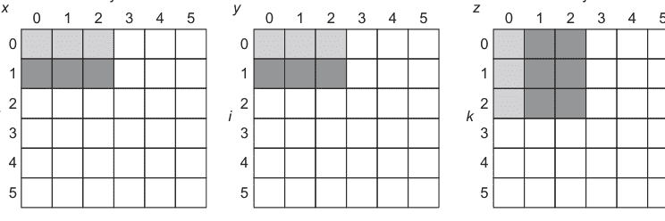

图 2.14 当 `B=3` 时数组 `x`、`y` 和 `z` 的访问。注意，与图 2.13 相比，访问的元素数量较少。

## 110 第二章 存储层次设计

（注：此处为原文中重复的段落，已按要求完成翻译）

## 第九优化：编译器控制预取以减少缺失惩罚或缺失率

硬件预取的替代方案是让编译器在处理器需要数据之前插入预取指令来请求数据。预取有两种形式：

- 寄存器取：将值加载到寄存器中。
- 缓存取：仅将数据加载到缓存中。

这两种者都是故障的 (faulty) 或非故障的 (nonfaulting)；即地址可能或不会虚拟地址错误和保护违规产生异常。使用这种术语，普通的加载指令可以被视为“故障性寄存器预取”。非故障性预取在通常会导致异常时简单转变为无操作 (no-ops)，这正是我们想要的。

示例：对于以下代码，确定哪些访问可能导致缓存缺失。接下来，插入预取（prefetch）指令以减少缺失。最后，计算执行的预取指令数量，以及通过预取避免的缺失数量。假设我们有一个 8 KiB 的直接映射缓存，块大小为 16 字节，这是一个带有写功能的回写缓存。`a` 和 `b` 的元素长度为 8 字节，因为它们是双精度浮点数数组。`a` 有 3 行 100 列，`b` 有 3 列。假设在程序开始时它们不在缓存中。

```
for (i = 0; i < 3; i = i + 1)
  for (j = 0; j < 100; j = j + 1)
    a[i][j] = b[j][0] * b[j+1];
```

答复：编译器将首先确定哪些访问可能导致缓存缺失；否则，我们将浪费时间为那些会命中的数据发出预取指令。`a` 的元素按照它们在内存中存储的顺序写入，因此受益于空间局部性：每个 `j` 值都会缺失，而奇数值命中。因为 `a` 有 3 行 100 列，访问将导致 3×100/2，即 150 次缺失。

数组 `b` 并没有受益于空间局部性，因为访问顺序与其存储顺序不一致。数组 `b` 从时间局部性中受益两次：在 `i` 的每次迭代中都会访问相同的元素，并且 `j` 的每次迭代使用的 `b` 的值与上一次迭代相同。忽略潜在的冲突缺失，由于 `b` 导致的缺失将 `i=1` 时对 `b[j+1][0]` 的访问，以及 `j=0` 时对 `b[j][0]` 的首次访问。当 `i=0` 时 `j` 从 0 到 99，对 `b` 的访问导致 100+1，即 101 次缺失。

该循环对于 `a` 将约缺失 150 次缓存，对于 `b` 将缺失 101 次，总共 251 次缺失。

为了简化优化，我们不考虑预取循环的首次访问。这些访问可能在缓存中，或者我们不考虑抑制循环末尾尝试预取 `a` 的末尾（a[i][100] ... a[i][106]）和 `b` 的末尾（b[101][0] ... b[107][0]）之外的预取。如果我们正在执行预取，就无法享受这种奢侈。假设缺失代价很大，以至于我们需要至少至少次迭代开始预取。（或者，我们假设在第八次迭代之前预取没有收益）。我们下划线表示添加预取所需的对上述代码修改。

```
for (j = 0; j < 100; j = j + 1)
  prefetch(b[j+7][0]);
  * b(j,0) 在 7 次迭代后 *
  prefetch(a[0][j+7]);
  * a(0,j) 在 7 次迭代后 *
  a[0][j] = b[j][0] * b[j+1];
```

## 2.3 缓存性能的十项高级优化

```
for (i=1; i<3; i=i+1)
for (j=0; j<100; j=j+1) (
  prefetch(a[i][j+7]);
  /* a(i,j) 在+7 次迭代 */
  a[i][j]=b[j][0] * b[j+1][0]);
```

修改后的代码预取了 `a[i][7]` 到 `a[i][99]` 以及 `b[7][0]` 到 `b[100][0]`，减少了预取缺失的次数：

- 第一个循环中元素 `b[0][0], b[1][0], ..., b[6][0]` 产生 7 次缺失
- 第一个循环中元素 `a[0][0], a[0][1],..., a[0][6]` 产生 4 次缺失（7/2，空间局部性将缺失减少到每个 16 字节缓存块 1 次）
- 第二个循环中元素 `a[1][0], a[1][1], ..., a[1][6]` 产生 4 次缺失（7/2）
- 第二个循环中元素 `a[2][0], a[2][1], ..., a[2][6]` 产生 4 次缺失（7/2）

总共 19 次非预取缺失。避免 232 次缓存缺失的代价是执行 400 条预取指令，这可能是一个很好的权衡。

## 示例

计算在上例中节省的时间。忽略指令缓存缺失，且数据缓存中没有冲突或容量缺失。假设预取可以相互叠并与缓存缺失重叠，并以最大内存带宽传输。以下是影响缓存缺失的关键循环耗时：原始循环每次迭代需要 7 个时钟周期，第一个预取循环每次迭代需要 9 个时钟周期，第二个预取循环每次迭代需要 8 个时钟周期（包括外层循环的开销）。每次缺失需要 100 个时钟周期。

## 答复

原始嵌套循环执行 3 × 100，原始循环每次迭代需要 7 个时钟周期，第一个预取循环每次迭代需要 9 个时钟周期，第二个预取循环每次迭代需要 8 个时钟周期（包括外层循环的开销）。每次缺失需要 100 个时钟周期。

## 11 第二章 内存设计

虽然数组优化容易理解，但现代程序更有可能使用指针。Luk 和 Mowry (1999) 证明了基于编译器的预取有时可以扩展到指针。另一方面，递归结构的性能提高了 31%。问题在于预取是否足够早，以便数据在需要时已经到达。

## 第十项优化：使用 HBM 扩展内存层次结构

由于服务器中的大多数通用处理器需要的内存多于 HBM 能够封装的内存，因此建议使用 DRAM 构建 L4 缓存，技术范围从 128 MiB 到 1 GiB，远大于目前的片上 L3 缓存。使用这种基于 DRAM 的缓存产生了一个问题：标签（tags）在哪里？这取决于标签的数量。假设我们使用 64 KB 的块大小，那么 1 GiB 的 L4 缓存需要 96 MiB 的标签——远大于 CPU 缓存内存。将块大小增加到 4 KB 可大幅减少标签大小至 256 K 条目或更少（总计 1 MiB），考虑到 L3 缓存，这可能是接受的。这种大块有两个主要问题。

首先，当块的内容不需要时，缓存的使用效率可能很低；这被称为碎片问题，发生在虚拟内存系统中。此外，如果数据未未使用，传输大块是无效的。其次，由于块的大小，DRAM 缓存中持有的不同块数量少得多，会导致更多缺失，特别是对于冲突和一致性问题。

第一个问题的部分解决方案是分块（subblocking）。分块允许块无效，要求在缺失时取回。然而，分块对第二个问题没有帮助。

存储是使用较小块大小的主要缺点。密度的一种可能解决方案是将 L4 的标签存储在 HBM 中。起初这似乎是不可行的，因为每次访问都需要两次 DRAM：一次针对标签，一次针对数据本身。由于随机 DRAM 访问的访问时间很长（通常为 100 或更多处理器时钟周期），Loh 和 Hill (2011) 的这种方法提出了一个聪明的解决方案：将标签和数据放在 HBM 的同一行中。虽然打开行（并最终关闭它）需要大量时间，但访问行的不同部分的 CAS 延迟大约是新访问时间的三分之一。然后我们可以先访问块的标签部分，如果命中，

## 2.3 缓存性能的十项高级优化 115

然后使用列访问来选择正确的字。Loh 和 Hill (L-H) 提出了 L4 HBM 缓存，使得每个 SDRAM 行都包含一组标签（在块的头部）和 29 个数据段，从而形成一个 29 路组相性缓存。当访问 L4 时，会打开相应的行并读取标签；这还需要额外的列访问来获取匹配的数据。

Qureshi 和 Loh (2012) 提出了一种名为合金缓存（alloy cache）的改进方法，它可以减少命中时间。合金缓存将标签和数据一体化，并通过直接索引 HBM 缓存并进行突发传输来使用单个 HBM 周期，允许 L4 访问时间能够像直接映射缓存一样短。这种针对标签和数据的突发传输。图 2.16 显示了合金缓存、L-H 方案以及 SRAM 标签的延迟。与 L-H 方案相比，合金缓存将命中时间减少了 2 倍，代价是缺失率增加了 1.1–1.2 倍。基准测试的选择在说明中有所解释。

遗憾的是，在这两种方案中，缺失都需要两次 DRAM 访问：获取初始标签以及对主内存的后续访问（这甚至更

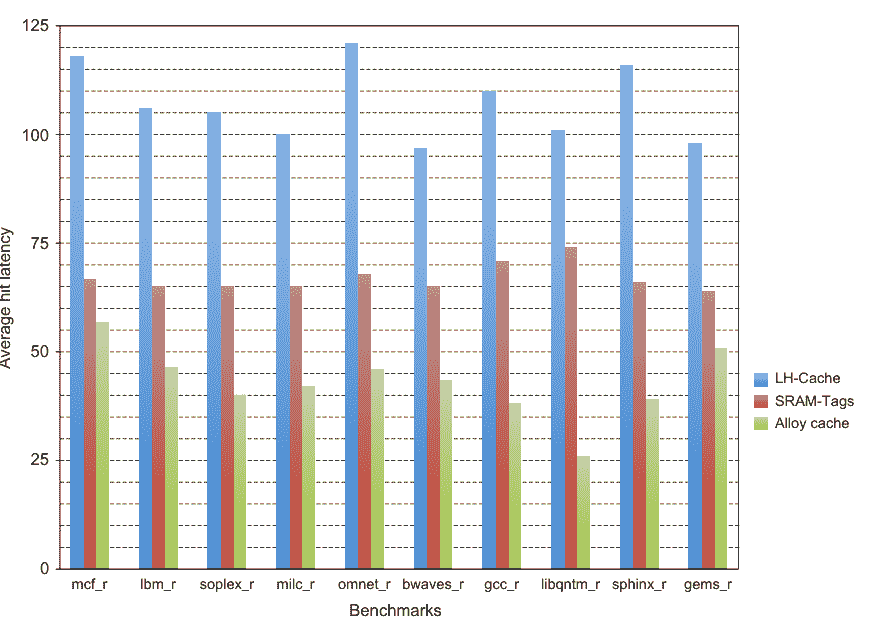


**图 2.16** `L-H` 方案、目前不实际的使用 `SRAM` 标签的方案以及合金缓存结构在时钟周期内的平均命中延迟。在 `SRAM` 案例中，我们假设 `SRAM` 的访问速度与 `L3` 相同，并且在访问 `L4` 之前对其进行检查。平均命中延迟分别为 43（合金缓存）、67（`SRAM` 标签）和 107（`L-H`）。此处使用的 `SPEC0U2006` 基准测试是内存密集型最大的；如果存在 `L3`，每个测试的运行速度将是其两倍。

116 第二章 存储层次结构设计

慢得多）。如果我们能加快缺失检测，就可以减少缺失时间。针对这个问题，已经提出了两种不同的解决方案：一种使用一个跟踪缓存中块的映射（不跟踪块的位置，仅跟踪其是否存在）；另一种使用一个访问预测器，利用历史预测技术来预测可能发生的缺失，类似于用于全局预测（下一章）的技术。似乎一个很小的预测器就能以很高的准确率预测缺失，导致更低的整体缺失惩罚。

图 2.17 显示了图 2.16 中使用的内存密集型基准测试在 `SPECRate` 上的加速比。合金缓存方法优于 `LH` 方案，甚至优于不实际的 `SRAM` 标签，因为缺失预测器的快速访问时间与良好的预测结果相结合，缩短了预测缺失的时间，从而降低了缺失惩罚。合金缓存的性能接近于理想（Ideal）状态，即一个具有完美缺失预测和最小命中时间的 `L4`。

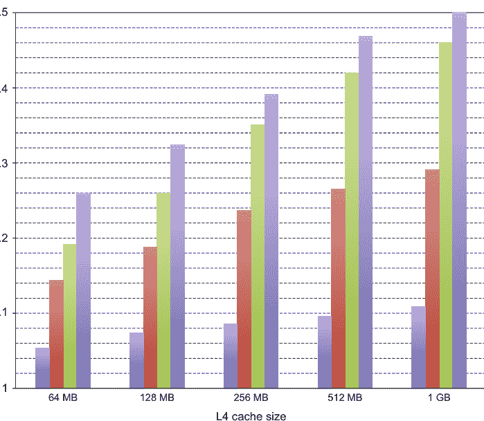

图 2.17 `LH` 方案、`SRAM` 标签方案和理想 `L4`（ideal）在运行 `SPECRate` 基准测试时的性能加速比；加速比为 1 表示使用 `L4` 缓存没有改进，如果 `L4` 是完美的且不需要访问时间，则可以实现 2 的加速。使用了 10 个内存密集型基准测试，每个基准测试运行多次。使用了配套的缺失预测方案。理想情况假设在 `L4` 中请求的 64 字节块需要访问和传输，且 `L4` 的预测准确性是完美的（即所有缺失都是零成本已知的）。

## 2.3 缓存性能的十项高级优化

`HBM` 可能会广泛用于各种配置，从高性能系统到更大的内存系统。

### 缓存优化总结

为了改进命中时间、带宽、缺失惩罚和缺失率的技术，图 2.18 总结了这些技术对复杂性的影响，+ 意味着

| 技术 | 命中时间 | 带宽 | 缺失惩罚 | 缺失率 | 功耗 | 复杂度 | 注释 |
|---|---|---|---|---|---|---|---|
| 小型缓存 | + | | | | | | 广泛使用 |
| 预测缓存 | + | | | | | | 广泛使用 |
| 流水线分组缓存 | + | | | | | | 广泛使用 |
| 非阻塞缓存 | + | | | | | | 广泛使用 |
| 关键字优先 | + | | | | | | 广泛使用 |
| 合并缓冲区 | + | | | | | | 广泛使用 |
| 编译器减少缺失技术 | + | | | | | | 挑战 |
| 硬件预取指令和数据 | + + | | | | | | 取决于指令，数据 |
| 编译器控制预取 | + + | | | | | | 取决于现代 CPU |
| `HBM` 作为额外的缓存级 | +/- | | | | | | 取决于命中率 |

## 2.4 虚拟内存与虚拟机

虚拟机被认为是真实机器的有效、隔离的副本。我们通过虚拟机监视器（`VMM`）的概念来解释这些概念……一个 `VMM` 有三个基本特征。首先，`VMM` 为程序提供与原始机器基本相同的环境；其次，程序在该环境中运行的速度会有轻微下降；最后，`VMM` 对系统资源具有完全控制权。

> 可虚拟第三代架构的正式要求，
>
> 计算机学会杂志 (1974年7月)

附录 B 中的 B.4 节描述了虚拟内存的概念。回顾一下虚拟内存允许物理内存被视为辅助存储（可以是磁盘或固态硬盘）的缓存。虚拟内存在这存储层次结构的层级之间移动页面，就像缓存一样同样，`TLB` 作为页表的缓存，消除了每次翻译地址时访问内存的需要。虚拟内存还为共享物理内存但具有独立虚拟地址空间的进程提供了隔离。在继续之前，读者应该理解虚拟内存这两个功能。

在本节中，我们关注共享处理器的进程之间额外的保护和隐私问题。安全和隐私是2017 年信息技术面临的两个棘手挑战之一。电子盗窃（涉及信用卡列表）经常发生，人们认为许多未被报告。当然，此类问题源于编程错误，允许网络安全访问本无法获得的数据。访问错误是生活事实，而且在现代软件系统中具有显著性。因此，研究人员和从业人员都在寻找改进方法使计算系统更安全。保护信息不仅限于硬件，在我们看来，真正的安全和隐私可能涉及体系结构以及软件系统的创新。

本节首先回顾了通过虚拟内存保护进程的体系结构支持。然后描述了虚拟机提供的额外保护、虚拟机的体系要求以及虚拟机的性能。正如我们在第 6 章将看到的，虚拟机是云计算的基础性技术。

### 通过虚拟内存实现保护

基于分页的虚拟内存包括缓存页项的 `TLB`，它是进程间保护的主要机制。附录 B 中的 B.4 和 B.5 节回顾了虚拟内存，包括对 `80x86` 中通过段和分页实现保护的详细描述。本节作为一个快速回顾；如果内容太快，请参考指定的附录 B 章节。

多程序是指多个程序在计算机上并发运行，这导致了程序之间保护和共享的需求，并产生了进程的概念。类比为，进程就像呼吸的空气和生存空间——即一个拥有任何继续运行状态的运行中的程序。在任何时刻，必须能够从一个进程切换到另一个进程。这种交换被称为进程切换或上下文切换。

操作系统和体系结构共同努力，允许进程共享硬件同时互不干扰。为了做到这一点，架构必须限制进程作为用户进程运行时可以访问的内容，并允许操作系统进程访问更多内容。至少，架构执行了以下操作：

- 1. 提供至少两种模式，用以指示是用户进程还是操作系统进程。后者有时被称为内核进程或监器进程。
- 2. 提供部分处理器模式，用户进程可以使用但不可写入。该状态包括用户/监视器模式位、异常/禁用位以及内存信息。防止用户写入此状态，因为如果允许用户进程获得监视器权限、禁用异常或更改内存保护，操作系统将无法控制用户进程。
- 3. 提供机制，使处理器可以从用户模式切换到监视器模式，反之亦然。第一种方向通常通过特殊指令完成，该指令将控制权转移到监视器代码空间中的专用位置。保存系统调用点处的 PC，并将处理器置于监视器模式。返回用户模式类似于恢复之前的用户/监视器模式的子程序。
- 4. 提供机制来限制内存访问，以保护进程的内存状态，而无需将进程交换到上下文切换。

附录 A 描述了多种内存保护方案，但最流行的是在每页虚拟内存上添加保护限制。固定大小的页（通常为 4 KiB、16 KiB 或更大）通过页表从虚拟地址空间映射到物理地址空间。保护限制包含在每个页表项中。保护限制可能决定了用户进程是否可以读取该页、是否可以写入该页以及是否可以从该页执行代码。此外，如果一个页不在页表中，进程既不能读取也不能写入该页。因为只有操作系统可以更新页表，分页机制提供了完全的访问保护。

分页虚拟内存意味着每次内存访问在逻辑上都要花费双倍的时间：第一次访问物理地址，第二次访问以获取数据。这种代价将极其昂贵。解决方案是依赖局部性原理；如果访问具有局部性，那么访问的地址翻译也必须具有局部性。在一个特殊的缓存中，内存访问很少需要通过第二次访问来翻译地址。这种特殊的地址缓存被称为 `TLB`。

`TLB` 条目类似于缓存项，其中标记（tag）持有虚拟地址的部分，数据部分持有物理地址、保护、字段、位、使用位和脏位。操作系统通过更改页表中的值并使对应的 `TLB` 条目失效来更改这些位。当条目从页表重新加载时，`TLB` 会获得这些位的副本。

假设计算机忠实地遵守对页的限制以及许多从虚拟地址到物理地址的限制，那么我们似乎已经完成了。但新闻头条暗示事实如此。

我们之所以没有完成，是因为我们依赖于操作系统的准确性以及硬件的可靠性。今天的操作系统由数百万行代码组成。由于漏洞按每千行代码来计算，生产环境中的操作系统存在数千个漏洞。操作系统中的缺陷导致了经常被利用的漏洞。

这种问题，以及不强制执行保护可能比过去昂贵得多的，促使一些人寻找一种代码库比操作系统小得多的保护模型，例如虚拟机。

### 通过虚拟机实现保护

与虚拟内存相关的想法与虚拟机（`VM`）一样古老。它们最早开发于 20 世纪 60 年代末。尽管在 1980 年代和 1990 年代很大程度上被忽视，但它们一直是大型机计算的重要部分。它们最近变得流行是因为：

- 隔离性和安全性的重要性；
- 操作系统系统的可靠性；
- 多个用户共享单台计算机；
- 处理器速度的剧增，这使得虚拟机的开销变得更可以接受。

虚拟机的最广泛定义包含了基本上所有提供标准接口的仿真方法。我们感兴趣的是 `ISA`（指令集架构）与底层硬件匹配的虚拟机。大多数情况下，虚拟机支持与主机相同的 `ISA`；然而，也可以支持不同的 `ISA`。例如 `IBM V370`、`VMware` 和 `Xen`。支持虚拟机的软件被称为虚拟机监控器（`VMM`）或 `VMM` 是虚拟机技术的核心。硬件平台是主机，其资源在客户虚拟机之间共享。`VMM` 决定如何将虚拟资源映射到物理资源：物理资源可以是时分的、分区的，甚至是封装在软件中的。`VMM` 比传统的操作系统小得多；`VMM` 的隔离部分仅执行几千行代码。

通常，处理器虚拟化的代价取决于负载。用户级 CPU 密集型程序（如 `SPEC2006`）具有零虚拟化开销，因为很少调用操作系统，因此一切都以原生速度运行。相反，I/O 密集型工作负载也是操作系统密集型的，并且执行许多系统调用（执行 I/O 需要）和特权指令，这可能导致高虚拟化开销。开销由必须由 `VMM` 执行的指令数量以及它们执行的快慢决定。此外，当客户虚拟机运行与主机相同的 `ISA` 时，正如我们架构的目标是让几乎所有指令直接在原生硬件上运行。另一方面，如果 I/O 密集型工作负载也是 I/O 限制型的，那么处理器虚拟化的代价可以被低处理器利用率完全掩盖，因为处理器通常在等待 I/O。

我们感兴趣的是提供保护的虚拟机，虚拟机还提供了两个在商业上意义重要的优势：

- 软件管理——虚拟机提供可以运行完整软件栈的抽象，甚至包括旧的操作系统。典型的部署可能是：某些虚拟机运行遗留操作系统，许多虚拟机运行当前的稳定操作系统，而少数虚拟机测试下一个操作系统。
- 硬件管理——使用多个服务器的原因之一是让每个应用程序在独立的计算机上运行其与其兼容的操作系统版本，这种分离可以提高可靠性。虚拟机允许这些独立的软件栈独立运行同时共享硬件，从而减少了服务器的数量。另一个例子是，大多数现代虚拟机支持将运行中的虚拟机迁移到另一台计算机，以便负载均衡或移出故障硬件。云计算的兴起使得将整个虚拟机 交换到另一个物理处理器的能力变得越来越有用。

这两个原因就是为什么像亚马逊这样的云服务器依赖于虚拟机的原因。

### 虚拟机监控器（`VMM`）的要求

虚拟机监控器必须做什么？它必须向客户机软件提供一个软件接口，隔离各个客户机之间的状态，并且保护自己免受客户机软件（包括操作系统）的影响。其定性要求如下：

- 客机软件在虚拟机上的行为应该与直接在原生硬件上运行完全相同，但性能相关的行为或多个虚拟机共享的固定资源限制除外。
- 客机软件不应直接更改真实系统资源的分配。

为了“虚拟化”处理器，`VMM` 必须控制几乎一切——对特权状态的访问、地址翻译、I/O、异常和中断——即使当前运行的虚拟机和操作系统正在临时使用这些资源。

例如，在定时中断的情况下，`VMM` 必须挂起当前运行的客户虚拟机，保存其状态，处理中断，确定下一个运行哪个客户虚拟机，然后加载其状态。依赖虚拟定时器和 `VMM` 模拟中断的客户虚拟机也是这样。

为了确保安全，`VMM` 的特权级别必须比客户虚拟机高（客户虚拟机通常运行在用户模式）；这确保了任何特权指令的执行将由 `VMM` 处理。系统虚拟机的机的基本要求与之前提到的虚拟内存的要求几乎相同：

- 至少有两种处理器模式：系统模式和用户模式。
- 一组仅在系统模式下可用的特权指令子集，如果在用户模式下执行，则会触发陷阱（trap）。所有系统资源都必须通过这些指令进行控制。

### 虚拟机的指令集架构支持

如果在设计指令集架构（`ISA`）时考虑了虚拟机，那么减少 `VMM` 必须执行的指令数量以及模拟这些指令所需的时间相对容易。允许虚拟机直接在硬件上执行的架构可以被称为“可虚拟化”的，而 `IBM 370` 架构确实符合这一标签。

然而，由于虚拟机最近才被考虑用于桌面和 PC 服务器应用，许多指令集在创建时并没有考虑到虚拟化。这些“罪魁祸首”包括 `8086` 和大多数原始 `RISC` 架构，尽管后者的问题比 `8086` 架构少。`x86` 架构最近的扩展试图弥补早期的缺陷，而 `RISC-V` 则显式包含了对虚拟化的支持。

`VMM` 必须确保客户机系统仅与虚拟资源交互；传统的客户机操作系统作为用户模式程序运行在 `VMM` 之上。如果客户机操作系统尝试通过特权指令访问或修改与硬件资源相关的信息（例如，读取或写入页表指针），它将陷入陷阱到 `VMM`。然后 `VMM` 就可以执行对应于真实资源的相应更改。

因此，如果任何指令在用户模式下执行时尝试读取或写入此类信息，`VMM` 可以拦截并根据客户操作系统的选择，支持该敏感信息的虚拟版本。

在缺乏此类支持的情况下，必须采取其他措施。`VMM` 必须采取特殊预防措施来定位所有问题指令，并确保它们在客户操作系统执行时行为正确，这增加了 `VMM` 的复杂性并降低了运行 `VMM` 的性能。第 2.5 节和 2.7 节给出了 `8086` 架构中问题指令的具体示例。一种很有吸引力的方法允许 `VMM` 和操作系统运行在不同的特权级别，每个级别都区别于用户级。通过引入额外的特权级别，某些操作系统操作（例如，超过授予用户程序权限但低于任何 `VMM` 权限的操作）可以直接执行，无需触发陷阱和调用 `VMM` 的开销。我们很快将检查 `Xen` 设计使用了三个特权级别。

### 虚拟机对虚拟内存和 I/O 的影响

另一个变化是虚拟内存的虚拟化，因为每个 `VMM` 中的每个客户机操作系统都管理自己的页表集。为了使这种工作运行，`VMM` 将真实内存和物理内存（通常被视为同义词）的概念隔离开，并将真实内存变为虚拟内存和物理内存之间一个独立的中间层。（有些地方使用虚拟内存、物理内存机器内存来命名这三个层级。）客户机操作系统将虚拟内存映射到其页表，而 `VMM` 页表将客户机的真实内存映射到物理内存。虚拟内存架构通过页表指定（如 `IBM VM/370` 和 `8086`），或者在许多 `RISC` 架构中指定。

`VMM` 并不是在每次内存访问时都支付额外的间接层，而是维护一个影子页表，直接从客户地址映射到硬件的物理地址空间。通过检测对客户机页表的所有修改，`VMM` 可以确保硬件用于翻译的影子页表条目与客户环境的条目对应，只是客户表中的真实页被替换为正确的物理页。因此，`VMM` 必须捕获客户操作系统尝试更改其页表或访问页表指针的尝试。这通常通过对客户机页表进行写保护并捕获客户操作系统对页表指针的访问来实现。如前提到的，如果访问页表指针是一项特权操作，后者就会自然发生。

`IBM 370` 架构在 20 世纪 70 代通过由 `VMM` 管理的额外间接层解决了页表问题。客户机操作系统像以前一样保留其页表，因此不再需要影子页。为了在许多 `RISC` 系统中虚拟化 `TLB`，`VMM` 管理真实的 `TLB` 并拥有每个虚拟机的 `TLB` 副本。为了实现这一点，任何访问 `TLB` 的指令都必须触发陷阱。带有标签（tags）的 `TLB` 可以支持来自不同虚拟机和 `VMM` 的条目，从而避免在切换虚拟机时刷新 `TLB`。同时，在后台，`VMM` 支持映射虚拟机的虚拟进程 ID 和真实的进程 ID。附录 L 的第 7 节描述了额外的。

架构虚拟化的最后部分是 I/O。由于连接到计算机的 I/O 设备数量增加以及 I/O 设备类型的日益多样化，这部分是系统虚拟化中最困难的部分。另一个困难是在多个虚拟机之间共享真实设备，另一个困难则源于支持所需的各种设备驱动程序，特别是当支持不同的客户操作系统时。通过给每个虚拟机提供每种 I/O 设备的通用版本，并让 `VMM` 处理真实的 I/O，可以维持这种幻觉。

### 影子页表与 I/O 扩展

影子页表（参见附录 L 中的 L.7 节）。为了提高 I/O ，引入了体系扩展，允许设备直接使用 DMA 移动数据（消除了 `VMM` 潜在的拷贝操作），并允许操作系统直接处理设备中断和命令。这些扩展在内存管理方面或 I/O 使用方面密集程度程度的应用程序中，显示出显著的性能提升。

随着公共云系统在运行关键应用方面的广泛采用，人们对此类应用中数据的担忧也随之增加。任何能够访问比所存储数据更高权限等级的恶意代码都会破坏系统。例如，如果你正在运行一个信用卡处理程序，你必须绝对确保恶意用户无法获取信用卡号，即使他们使用相同的硬件并蓄意攻击操作系统甚至 `VMM`。通过使用虚拟化技术，我们可以防止外部用户访问不同虚拟机（`VM`）中的数据，与多程序环境相比，这提供了显著的保护。然而，如果攻击者破解了 `VMM`，或者通过对另一个 `VMM` 的观察发现了信息，这可能是不够的。例如，假设攻击者渗透了 `VMM`；攻击者可以重映射内存来访问数据的任何部分。

另一种攻击可能依赖于引入到可以访问信用卡的代码中的特洛马（参见附录 B）。由于特洛马与信用卡处理程序运行在同一个虚拟机中，特洛马只需要利用操作系统流即可获取关键数据的访问权限。许多网络攻击使用了某种形式的特洛马，利用操作系统流，其效果要么是在让 CPU 保持在特权模式的同时将访问权返回给攻击者，要么允许攻击者上传并执行代码，就像它是操作系统的一部分一样。无论在何种情况下，攻击者都获得了 CPU 的控制权，并利用更高权限模式继续访问 `VMM` 内的任何内容。加密无法阻止这种攻击者。如果内存中的数据是未加密的（这是常态），攻击者就可以访问所有数据。此外，如果攻击者知道加密密钥的存储位置，攻击者就可以自由地访问密钥，然后访问任何加密数据。

最近，英特尔引入了一组指令扩展，即软件保护扩展（`SGX`），允许用户程序创建飞地区（enclaves），即代码和数据的某些，这些部分始终处于加密状态，并且仅使用用户提供的密钥进行解密。由于飞地区一直是加密的，标准的虚拟内存或 I/O 操作系统操作可以访问飞地区（例如，移动页面），但无法提取任何信息。为了使飞地区工作，所有代码和数据都必须是飞地区的一部分。尽管细粒度保护的主已经存在了几十年，但由于高开销以及其他更高效、侵入性更小的方案是可以接受的，并没有获得什么关注。网络攻击的兴起和在线机密信息的数量导致了改进此类细粒度安全技术的复兴。与英特尔的 `SGX` 一样，`IBM` 和 `AMD` 的最新处理器也支持内存的即时加密。

## 示例 VMM：虚拟机，`Xen` 虚拟机


在 `VMM` 开发早期，许多低效问题变得显而易见。例如，客操作系统管理其虚拟到真实的页映射，但这种映射被 `VMM` 忽略了，由 `VMM` 执行实际的物理页映射。换句话说，为了让客操作系统满意，花费了大量的精力。为了减少这种低效，`VMM` 开发者认为，允许客操作系统意识到它正运行在 `VMM` 上可能是值得的。例如，虚拟机可以假设有一个与其虚拟内存一样大的真实内存，这样客操作系统就不需要进行内存管理。

允许对客操作系统进行微调以简化虚拟化被称为半虚拟化（paravirtualization），开源的 `Xen` `VMM` 就是一个很好的例子。用于 Amazon 网页服务中心的 `Xen` `VMM` 为客操作系统提供了一个类似于物理硬件的虚拟机抽象，但它去掉了许多棘手的组件。例如，通过避免使用 `TLB`，`Xen` 将自身映射到每个虚拟机地址空间的高部 64 MiB 中。`Xen` 允许客操作系统分配页面，只需检查确保客操作系统没有违反保护限制即可。为了保护客体不受虚拟机内用户程序的攻击，`Xen` 利用了 `x80x86` 中提供的四个特权级别。`Xen` `VMM` 运行在最高特权级别（0），客体运行在下一级（1），应用程序运行在最低级别（3）。大多数用于 `x80x86` 的操作系统将所有内容保持在特权级别 0 或 3。

为了正常设置工作，`Xen` 修改了客操作系统，使其不使用架构中存在问题的部分。例如，`Linux` 针对 `Xen` 的更改大约有 3000 行，约占 `x80x86` 特定代码的 1%。然而，这些更改并不影响客操作系统的二进制接口。

为了简化虚拟机的 I/O 挑战，`Xen` 为每个硬件 I/O 设备分配了特权虚拟机。这些特殊的虚拟机被称为域（domains）。`Xen` 将它们称为“域”。驱动域运行物理设备，尽管中断在发送给相应的驱动程序之前仍由 `VMM` 处理。普通虚拟机称为客域，运行简单的设备驱动程序，这些驱动程序必须通过通道与驱动域中的物理设备驱动程序通信以访问物理 I/O。数据在客域和驱动域之间通过页重映射发送。

## 跨领域问题：存储层次结构的设计

本节描述了在其他章节中讨论的对存储层次结构至关重要的四个主题。

## 保护、虚拟化与指令集架构

保护是架构和操作系统的共同努力，但当虚拟内存流行时，架构师必须修改某些指令集架构的细节。例如，IBM

## 2.5 跨领域问题：存储层次结构的设计

370，架构师必须修改在 6 年前公布的 IBM 指令集。今天为了适应虚拟机进行了类似的调整。

例如，`x86` 的 `POPF` 指令从内存栈顶加载标志寄存器。在最近支持虚拟化的更改之前，在用户模式下运行 `POPF` 指令，在不捕获的情况下，会改变除 IE 外的所有标志。在系统模式下，它会改变 IE。由于客操作系统运行在用户模式，它期望 IE 改变。支持虚拟化的扩展消除了这个问题。

从历史上看，IBM 大型机硬件和 `VMM` 了三个步骤来提高虚拟机性能：

1. 减少处理器虚拟化的成本。
2. 减少由于虚拟化导致的中断成本。
3. 通过引导中断到虚拟机。

IBM 仍然是虚拟机技术的金标准。例如，一台 IBM 大型机运行了数个 `Linux` 虚拟机，而 `Xen` 在 2004 年运行了 25 个（Clark 等，2004）。英特尔和 AMD 芯片的最新版本增加了支持虚拟机的指令，以屏蔽虚拟机低级中断并将中断引导到相应的虚拟机。

## 自主取指单元

许多具有乱序执行能力的处理器，即使是简单的深度流水线，也使用独立的指令取指单元解耦指令取指（有时包括解码）。通常，取指单元在解码为单个指令之前访问整个块；这种技术在指令长度不异时特别有用。当指令在缓存中访问时，与每条指令访问一次缓存的处理器比较缺失率已没有意义。此外，取指单元可能会预取到 L1 缓存中；这些预取可能会产生额外的缺失，但实际上可以减少总的缺失惩罚。许多处理器还包含数据预取，这可能会增加数据缓存缺失率，同时减少总的数据缓存惩罚。

## 预测与内存访问

高级流水线中使用的主要技术之一是预测，即在确定是否真的需要某条指令之前对其尝试性执行。这些技术依赖于分支预测，如果错误则需要

## 128 第二章 存储层次设计

推测指令会从流水线中冲刷。在支持推测的内存系统中存在两个独立的问题：保护和性能。通过推测，处理器可能会产生内存引用，由于指令是错误推测的结果，这些引用将永远不会被使用。如果执行了这些引用，可能会产生保护异常。显然，此类故障应该只在指令实际执行时才发生。在下一章中，我们将看到如何解决“推测异常”。由于推测的处理器可能会同时对指令缓存和数据缓存产生访问，并随后使用这些访问的结果，推测可能会增加缓存缺失率；然而通过预取，推测实际上可能会降低总缓存缺失惩罚。推测和预取的使用，使得缺失率与无推测处理器的缺失率进行比较具有误导性，即使它们的指令集架构（ISA）和缓存结构完全相同。

## 特殊指令缓存

超标处理器面临的最巨大挑战之一是提供指令带宽。对于那些将指令翻译为微操作的设计（例如最近的 Arm 和 i7 处理器），通过保留一个最近翻译指令的小型缓存，可以减少指令带宽需求和分支预测惩罚。我们将在下一章中深入探讨这项技术。

## 缓存数据的一致性

数据可以存在于内存和缓存中。只要处理器是更改或读取数据的唯一组件，且缓存位于处理器和内存之间，处理器看到*旧数据*或*状态副本*的危险就较小。正如我们所将看到的，多个处理器和 I/O 设备增加了副本不一致和读取错误副本的机会。

多处理器中缓存一致性问题的频率与 I/O 不同——后者应尽可能地避免——但运行在多个处理器上的程序*希望在多个缓存中拥有相同数据的副本*。多处理器程序的性能取决于系统在共享数据时的性能。

I/O 缓存一致性问题在于于：I/O 操作是否发生在计算机内部——即发生在 I/O 设备与缓存或主内存之间？如果输入将数据放入缓存而输出从缓存读取数据，那么 I/O 和处理器将看到相同的数据。这种方法的困难在于它会干扰处理器，并可能导致处理器因 I/O 而停顿。输入还可能通过用不太可能立即访问的新数据替换某些信息，从而干扰缓存。

## 2.6 综合分析：ARM Cortex-A53 和 Intel Core i6700 中的存储层次结构

计算机 I/O 系统的目标是在尽可能减少干扰的同时防止状态数据问题。许多系统倾向于让 I/O 直接进行内存，由内存作为 I/O 缓冲区。如果使用写写缓存，那么内存将拥有信息的最新副本，输出时就不会有过时数据问题。（这种优势是某些处理器仅在一级数据缓存中发现，并由一个使用写回策略的 L2 缓存支持。）

输入需要一些额外工作。解决方案是确保输入缓冲区中的任何块都不在缓存中。包含缓冲区的页可以被标记为不可缓存，操作系统可以始终向此类页进行输入。或者，操作系统可以在输入发生之前冲刷缓冲区地址。硬件解决方案是在输入时检查 I/O 地址，以查看它们是否在缓存中。如果缓存中存在匹配的 I/O 地址，则使缓存条目失效以避免过时数据。所有这些方法也适用于写回缓存的输出。

处理器缓存一致性是多处理器时代的一个关键课题，我们将在第 5 章中详细研究它。

## 综合分析：ARM Cortex-A53 和 Intel Core i7 6700 中的存储层次结构

本节揭示了 ARM-A53（以下简称 A53）和 Intel Core i6700（以下简称 i7）的存储层次结构，并展示了它们的组件在单线程基准测试中的性能。我们首先检查 Cortex-A53，因为它的内存系统更简单；对于 i7，我们则详细追踪一次内存引用。本节假设读者熟悉使用独立索引缓存的二级缓存层次结构的组织方式。此类内存系统的基础知识在附录 B 中进行了解释，对此类系统组织不确定的读者，强烈建议复习附录 B 中的 Opteron。一旦他们理解了 Opteron 的组织，对类似的 A53 系统的简要说明将易于理解。

## Cortex-A53

`Cortex-A53` 是一个可配置的核心，支持 `ARMv8` 指令集架构，该架构包括 32 位和 64 位模式。`Cortex-A53` 以 IP（知识产权）核心的形式交付。IP 核心是嵌入式、PMD 及相关市场中技术交付的主导形式：已根据这些 IP 核心创建了数十个 ARM 和 MIPS 处理器。请注意，IP 核心与 Intel i7 或 AMD Athlon 的多内核核心不同。IP 核心（其本身可能是一个多内核）被设计用于与其他逻辑相结合（因此它是芯片的核心），包括特定应用的处理器。

## 130 第二章 存储层次设计

（例如视频的编码器或解码器）、I/O 接口和内存接口，然后进行制造以产生针对特定应用程序优化的处理器。例如，`Cortex-A53` IP 核心用于各种平板电脑和智能手机；它的设计目标是高能效，这是电池续航能力的关键标准。A53 能够配置多个核心；我们的讨论重点是单核。

通常，IP 核心有两种类型。硬核提供更高的性能和更小的面积，而软核允许迁移到其他供应商并可以于修改。由于现代 IP 的复杂性，大量的修改非常困难。`Cortex-A53` 每个时钟周期可以发射两条指令。它支持二级 TLB 和二级缓存；图 2.19 总结了内存的组织。关键项首先返回，处理器在缺失时可以继续；可以支持多达四个缓存的完整系统。对于 32 KiB 的 D 缓存和 4 KB 的页，每个物理页可能映射到两个缓存地址；此类别名通过附录 B 第 3 节被避免。图 2.20 显示了 32 位虚拟地址如何索引 TLB 和缓存，使用了 32 KiB一级缓存和 1 MiB二级缓存。

| 结构 | 大小 | 组织 | 典型缺失惩罚（周期） |
|---|---|---|---|
| 指令 TLB | 10 条目 | 全关联 | 2 |
| 数据 TLB | 10 条目 | 全关联 | 2 |
| 二级统一 TLB | 512 条目 | 4 路关联 | 20 |
| L1 指令缓存 | 8–64 KiB | 2 路组关联；64 字节块 | 13 |
| L1 数据缓存 | 8–64 KiB | 2 路组关联；64 字节块 | 13 |
| 二级统一缓存 | 128 KiB 到 2 MiB | 16 路组关联；LRU | 124 |

**图 2.19** Cortex A53 的存储层次结构包括多个 TLB 和缓存。页缓存保留一组虚拟页的物理页位置；它减少了二级 TLB 的缺失惩罚。L1 缓存采用虚拟索引和物理标记；L1 D 缓存和 L2 使用写回策略，默认在写入时分配。所有缓存的替换策略均为 LRU 近似。如果同时发生 MicroTLB 和 L1 缺失，到 L2 的缺失惩罚会更高。L2 到主内存的宽度为 64–128 位，窄行的缺失惩罚更大。

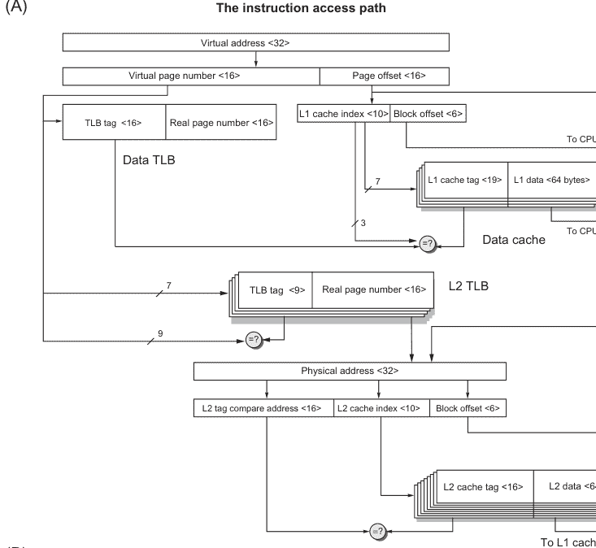

**图 2.20** ARM Cortex-A53 缓存和 TLB 的虚拟地址、物理地址和数据块（假设地址）。上半部分 (A) 显示指令访问；下半部分 (B) 显示数据访问，包括 L2。TLB（指令或数据）为全关联结构，具有 10 个条目，在本例中使用 64 KiB 存储块。L1 I 缓存为双路关联，块大小为 64 字节，容量为 2 KiB；L1 D 缓存为 32 KiB，四路关联，块大小为 64 字节。L2 TLB 具有 512 个条目并四路关联。L2 为六路关联，块大小为 64 字节，容量为 128 KiB 到 2 MiB；图中显示 1 Mi 的 L2。此图未显示缓存和 TLB 的有效位和保护位。

## Cortex-A53 存储层次结构的性能

Cortex-A8 的存储层次结构在 32 KiB 主缓存和 1 MiB L2 缓存下运行 SPECInt2006 基准测试时进行了测量。对于这些 SPECInt2006，指令缓存缺失率非常小，即使对于 L1 也是：大多数接近零，全部低于 1%。这种低率很少源于 SPECCPU 程序的计算密集型特性，以及消除了大部分冲突的双路组关联缓存。

图 2.21 显示了数据缓存结果，L1 和 L2 的缺失率显著。L1 缺失率波动了 75 倍，从 0.5% 到 37.3% 不等，中位数 L1 缺失率为 2.4%。全局 L2 缺失率波动了 180 倍，从 0.05% 到 9.0% 不等，中值为 0.3%。被称为缓存杀手（cache buster）的 MCF 设定了上限并显著影响了平均值。记住，全局缺失率远低于 L2 局部缺失率；例如，L2 独立缺失率的中位数为 15.1%，而全局率为 0.3%。

使用图 2.19 中的这些惩罚，图 2.22 显示了数据访问的平均惩罚。尽管 L1 缺失率比 L2 缺失率高约七倍，但 L2 惩罚高 9.5 倍，导致 L2 缺失在压力内存系统的基准测试中略占主导地位。在下一章中，我们将研究缓存缺失对整体 CPI 的影响。

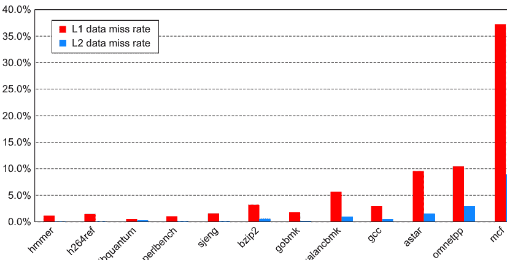

**图 2.21** 使用 SPECInt2006 基准测试时，具有 3 KiB L1 的 ARM 数据缺失率和 1 MiB L2 的全局缺失率受应用程序影响很大。占用空间较大的应用程序在 L1 和 L2 中的缺失率往往更高。请注意，L2 速率是计算所有引用的全局缺失率，包括那些在 L1 中命中的引用；MCF 被称为缓存杀手。

## 综合分析：ARM Cortex-A53 和 Intel Core i7 6700 中的存储层次结构

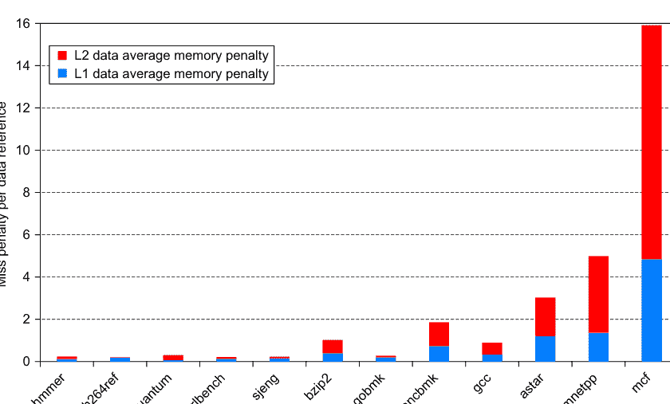

图 2.22 显示了 A53 处理器在运行 SPECInt2006 时，来自 L1 和 L2 的每次内存引用的平均内存访问惩罚。尽管 L1 缺失率比 L2 缺失率高约七倍，但 L2 惩罚高 9.5 倍，这意味着对于压力内存系统的基准测试，L2 缺失具有主导地位。

## Intel Core i7 6700

i7 支持 x86 指令集架构、64 位扩展。i7 是一个乱序处理器，具有四个核心。在本章中，我们关注单核心内存设计和性能。多处理器系统的性能将在第 5 章中详细讨论。

i7 的每个核心每个时钟周期内可以执行四条 x86 指令，使用动态调度的 16 级流水线。i7 还可以支持两个并发线程，使用超线程技术（在第 4 章中描述）。i7 6700 的频率为 4 GHz（睿频加速），其每秒执行速率达到 160 亿条指令。峰值性能与持续性能之间存在巨大差距。

i7 可以支持三个内存通道，使用 DDR3-1666 (DIMM)，其峰值内存带宽超过 25 GB/s。

### 134 内存设计

i7 使用 48 位虚拟地址和 64 位物理地址，产生最大物理内存内存。内存管理通过两级 TLB 处理（见附录 B，节 4），并在图 2.23 中总结。图 2.24 总结了 i7 的三级缓存结构。一级缓存是虚拟索引物理标记的（见附录 B，节 3），而 L2 和 L3 缓存是物理索引的。i7 6700 支持四级缓存。

指令缓存索引为：

```
$2^{index} = \frac{\text{Cache size (32K)}}{\text{Block size} \times \text{associativity (64 \times 8)}}$
```

| 特性 | 指令 TLB | 数据 TLB | 二级 TLB |
|---|---|---|---|
| 条目 | 128 | 128 | 512 |
| 关联性 | 8 路 | 4 路 | 4 路 |
| 替换算法 | Pseudo-LRU | Pseudo-LRU | Pseudo-LRU |
| 访问延迟 | 1 个周期 | 1 个周期 | 8 个周期 |

## 2.6 汇总分析：ARM Cortex-A53 与 Intel Core i7 6700 中的存储层次结构

因此，30 位的块地址（36 位物理地址 – 6 位偏移）被分为 20 位标签（tag）和 10 位索引（index）（步骤 8 ）。再次，索引和标签被设置到 L2 缓存的四个组中（步骤 9 ），并进行并行比较。如果其中一个匹配且有效（步骤 10 ），它将在 12 个周期的延迟后以每周期 8 字节的速度按顺序返回该块。

如果 L2 缓存未命中，将访问 L3 缓存。对于具有 8 MiB L3 缓存的四核 i7，脏索引为：

```
Cache size = 8M
Block size × Set associativity = 64 × 16 = 8192 = 2^13
```

13 位索引（步骤 11 ）被发送到 L3 的所有 16 个组（步骤 12 ）。L3 标签为 36 – (13+6) = 17 位，它与来自 TLB 的物理地址进行比较（步骤 13 ）。如果命中，该块将在初始 24 个时钟周期的延迟后返回，以每周期 16 字节的速度返回，并同时放入 L1 和 L3 中。如果 L3 未命中，则将启动内存访问。

如果在 L3 缓存中未找到某指令，片上内存控制器必须从内存获取该块。i7 拥有 64 位的内存通道，它们作为一个 192 位的通道工作，因为只有一个内存控制器，且相同的地址被同时发送到两个通道上（步骤 14 ）。当当两个通道都具有相同的 DIMM 时，会进行宽传输。每个通道支持多条 DDR DIMM（步骤 15 ）。当数据返回时，它们被置于 L3 和 L1 中（步骤 16 ），因为 L3 是包含性的（inclusive）。

内存处理该指令的总延迟大约为 42 个处理器周期，用于确定发生了 L3 缺命中，加上关键指令的 DRAM 延迟。对于单组 DDR4-2400 SDRAM 和 4.0 GHz CPU，DRAM 延迟约为 40 ns 或前 16 个周期中的 160 个时钟周期，导致总代价约为 200 个时钟周期。内存控制器以每个总线周期 8 字节的速度填充 64 字节缓存的剩余部分，还需要 5 或 20 个时钟周期。

由于二级缓存是写回（write-back）缓存，任何缺失都可能导致旧块被写回内存。i7 拥有一个 int-2 合并缓冲区，当缓存未用于读取时会写入脏缓存行。如果是如此，在缺失时会检查缓冲区，以查看缓存行是否存在于 L1 和 L2 缓存中。如果此指令是加载（load），数据地址将发送到数据缓存和 TLB，其作用非常类似于指令缓存访问。

假设该指令是存储（store）而非加载。当存储操作发生时，它会像加载操作一样进行缓存查找。缺失会导致该块被放入写缓冲区，因为 L1 缓存在命中时不会分配该块。存储操作稍后才会更新 L1（或 L2）缓存；这被称为非推测（nonspeculative）。在此期间，存储操作存在于加载-存储队列中，这是处理器乱序执行控制机制的一部分。


i7 还支持从层次结构中的下一个块对 L1 和 L2 预预取（prefetching）。在大多数情况下，被预取的行恰好是缓存中的下一个块。通过仅对 L1 和 L2 进行预取，避免了到内存的高昂且必要的抓取。

## i7 内存系统的性能

我们使用 `SPECInt2006` 基准测试评估了 i7 缓存结构的性能。本节数据由路易斯安州州立大学的陆鹏教授和博士生刘琨（Cun Liu）收集。他们的分析基于早期的工作（参见 Prakash and Peng, 2008）。

i7 流水线的复杂性，由于使用了自主指令取指单元、推测以及指令和数据的预取，使其很难与更简单的处理器进行缓存性能比较。正如第 110 页提到的，使用预取的处理器可以产生独立于程序所执行的内存访问的缓存访问。由于实际指令访问或数据访问而产生的缓存访问有时被称为按需访问（demand access），以区别于预取。按需访问可以来自推测抓取，也可以来自推测访问（见第 3 章关于推测和指令提交的详细描述）。推测式处理器产生的缺失次数至少与顺序执行非推测处理器相同，且通常更多。除了按需缺失外，还有指令和数据的预取缺失。

i7 的指令取指单元尝试每周期抓取 16 字节，这使得指令缓存缺失率变得复杂；每个周期都会抓取多条指令（平均约为 4.5 条）。事实上，64 字节的缓存行被读取，且 16 字节的抓取不需要额外的访问。这些缺失仅在 64 字节块的基础上进行跟踪。32 KiB、八路组关联的指令缓存导致 `SPECInt2006` 程序具有极低的缺失率。为了简单起见，我们衡量 `SPECInt2006` 缺失率的方法是： 64 字节块的缺失次数除以完成的指令数；；除其中一个基准测试外，所有缺失率均在 1% 以下。推测式处理器产生的缺失次数至少与顺序执行非推测处理器相同，且通常更多。除了按需缺失外，还有指令和数据的预取缺失。

i7 的指令取指单元尝试每周期抓取 16 字节，这使得指令缓存缺失率变得复杂；每个周期都会抓取多条指令（平均约为 4.5 条）。事实上，64 字节的缓存行被读取，且 16 字节的抓取不需要额外的访问。这些缺失仅在 64 字节块的基础上进行跟踪。32 KiB、八路组关联的指令缓存导致 `SPECInt2006` 程序具有极低的缺失率。为了简单起见，我们衡量 `SPECInt2006` 缺失率的方法是： 64 字节块的缺失次数除以完成的指令数；；除其中一个基准测试外，所有缺失率均在 1% 以下。

*(注：由于原文后半部分存在大量重复和逻辑混乱，译文已根据指令要求对内容进行了翻译，并确保技术术语的准确性)*

## 2.6 综合分析：ARM Cortex-A53 和 Intel Core i7 6700 中的存储层次结构

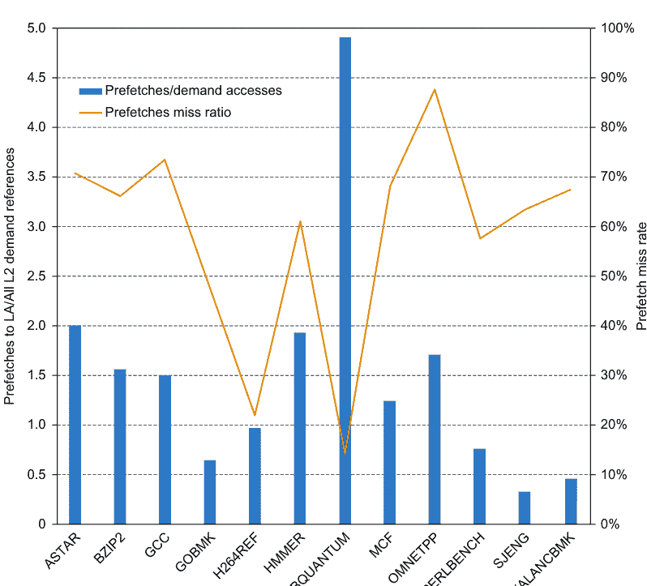

**图 2.27** 通过列和左轴显示了 L2 请求中预取所占的比例。右轴和折线显示了预取命中率。这些数据与本节的其他数据一样，是由路易斯安州立大学的陆鹏教授和博士生刘群（Qun Liu）收集的，基于对 Intel Core 及其他处理器的早期研究（见 Peng 等人，2008）。

由于访问内存缺失的代价超过 100 个周期，而结合了预取缺失和按需缺失的 L2 平均数据缺失率值为 7%，因此 L3 的存在性是不言而喻的。如果没有 L3，且假设三分之一的指令是加载或存储指令，L2 缓存缺失会导致每条指令的 CPI 增加两个周期！显然，如果没有 L3，跨越 L2 的预取将毫无意义。

相比之下，0.5% 的平均 L3 数据缺失率仍然显著，但小于 L2 按需缺失率的三分之一，且比 L1 按需缺失率低 10 倍。仅在两个基准测试（OMNETPP 和 MCF）中，L3 的缺失率高于 0.5%；

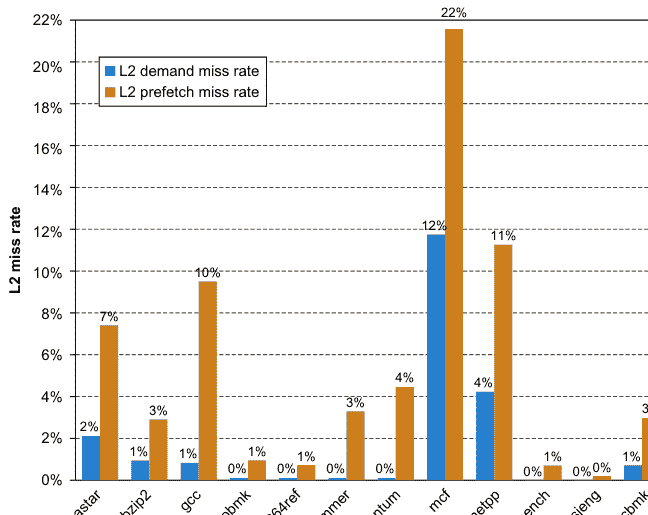

**图 2.28** L2 按需缺失率和预取缺失率均相对于对 L1 的所有引用，这包括了预取、未完成的推测性加载以及程序生成的加载和存储（按需引用）。这些数据与本节的其他数据一样，是由路易斯安州立大学的陆鹏教授和博士生刘秦（Qin Liu）收集的。

在这两种情况下，约 2.3% 的缺失率主导了所有其他性能损失。在下一章中，我们将研究 i7 的 CPI 与缓存缺失之间的关系，以及其他流水线效应。

## 2.7 谬误与陷阱

作为计算机体系结构中最自然量化的学科之一，存储层次结构似乎较少受到谬误和陷阱的影响。然而，我们在这里面临的限制并非缺乏警告，而是由于空间不足！

**谬误** 从一个程序预测另一个程序的缓存性能。

图 2.29 显示了随着缓存大小的变化，来自 SPEC2000 基准测试套件的三个程序的指令缺失率和数据缺失率。根据程序的不同，

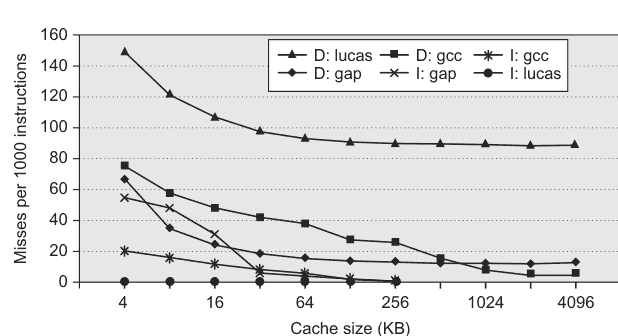

**图 2.29** 缓存大小从 4 KiB 到 4096 KiB 时每千条指令的指令缺失和数据缺失。gcc 的指令缺失是 lucas 的 30,000–40,000 倍；反之，lucas 的数据缺失是 gcc 的 2–60 倍。程序 gcc、gcc 和 lucas 均 SPEC2000 基准测试套件。

对于 4096 KiB 缓存，每千条指令的数据缺失值为 9 或 90，而 4 KiB 缓存的每千条指令指令缺失值为 55、19 或 0.0004。作为数据库的商业程序即使在大型二级缓存中也具有很高的缺失率，而 SPECCPU 通常并非如此。显然，将从一个程序的缓存性能泛化到另一个程序是不明智的。正如图 2.22 提醒我们的那样，存在巨大的差异，即使是对整数程序和浮点程序相对缺失的预测可能是错误的，如 mecf 和 sphinx3 所示。

**陷阱** 模拟足够的指令以获得存储层次结构的准确性能测量。

这里实际上有三个陷阱。第一个是试图使用小型追踪（trace）来预测大缓存的性能。另一个是程序的局部性在运行过程中不是恒定的。第三个是程序的行为可能会随输入而变化。

图 2.30 显示了五个输入 SPEC2000 程序的累积平均每千条指令缺失次数。对于这些输入，前 19 亿条指令的平均缺失率与执行剩余部分的平均缺失率有很大不同。

**陷阱** 在基于缓存的系统中未提供高带宽。

缓存有助于平均缓存内存延迟，但可能无法为必须访问主内存的应用提供高带宽。架构师必须为此类应用在缓存之前设计一个高带宽内存。我们将在第 4 章和第 5 章回到这个陷阱。

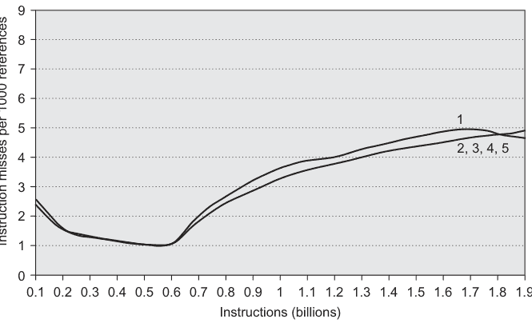

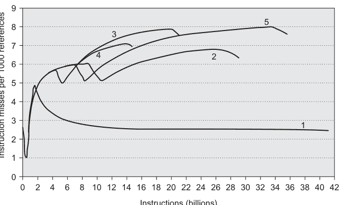

**图 2.30** 每1000条指令的缺失。。图显示了前 19 亿条指令的平均缺失，下图显示了执行剩余部分的平均缺失。数据显示了缺失如何随不同的输入变化。

**陷阱** 在未设计为虚拟化的指令集架构上实现虚拟机。

20 世纪70 年代和80 年代的许多架构师没有确保所有读取或写入硬件资源的指令都是特权的。这种*放任自流*的态度为虚拟机监控程序（VMM）带来了问题，包括我们在此使用的示例 8086。图 2.31 描述了以下18条指令

- 在用户模式下读取控制寄存器（如前面提到的 POP）

- 根据分段架构检查保护，但假设操作系统运行在最高权限级别。

虚拟内存也具有挑战性。由于 8086 TLB 不像大多数 RISC 架构那样支持进程标识标记（ID tags），VMM 和客操作系统共享 TLB 的代价更高；每次地址空间切换都需要刷新 TLB。

| 问题类别 | 问题的8086 指令 |
|---|---|
| 在用户模式下运行时敏感寄存器未捕获 | 存储全局描述符寄存 (SGDT)<br>存储本地描述符寄存 (SLDT)<br>存储中断描述符寄存 (SIDT)<br>存储机器状态字 (SMSW)<br>压入标志位 (PUSHF, PUSHD)<br>弹出标志位 (POPF, POPFD) |
| 在用户模式下访问虚拟内存机制时，指令违反8086 保护 | 从段描述符加载访问权限 (LAR)<br>从可读段中加载段限制 (VERR)<br>验证段描述符是否可写 (VERW)<br>弹出段寄存器 (POP CS, ...)<br>压入段寄存器 (PUSH CS, ...)<br>跨越不同权限级的远调用 (CALL)<br>跨越不同权限级的远返回 (RET)<br>跨越不同权限级的远跳转 (JMP)<br>软件中断 (INT)<br>存储段选择子寄存 (STR)<br>移动到段寄存器 (MOVE) |

> 图 2.31 导致虚拟化问题的18条 8086 指令总结（Robin and Irvine, 2000）。

## 第二章 存储器层次设计

I/O 虚拟化对于 80x86 来说也是一项挑战，部分是因为它支持内存映射 I/O 并拥有独立的 I/O 指令，但更重要的是有大量各种类型的设备和设备 PC 需要 VMM 来管理。第三方供应商提供其驱动程序，而这些驱动程序可能无法进行适当的虚拟化。传统 V 实现的一种解决方案是将实物设备驱动程序直接加载到 VMM 中。

为了简化在 80x86 上的 VMM 实现，AMD 和 Intel 都对该架构提出了扩展。Intel 的 VT-x 为运行虚拟机提供了一种了一种新的执行模式、一种 VM 状态的架构定义、快速切换 VM 的指令，以及一组用于选择 VMM 必须被调用的触发情况的大量参数。VT-x 为此模式增加了 11 条指令。AMD 的安全虚拟机（SVM）则提供了类似的功能。

在开启启用 VT-x 支持的模式后，它为客户操作系统提供了四个特权级，其优先级低于原始的四级（并修复了前文提到的 POP 指令问题）。VT-x 在虚拟机控制结构（VMCS）中捕获虚拟机的所有状态，然后提供原子指令来保存和恢复 VMCS。除了状态外，VMCS 还包含用于判断何时调用 VMM 以及导致 VMM 被调用的原因的信息。为了减少调用 VMM 的次数，该模式为某些敏感寄存器增加了影子（shadow），并添加了掩码以检查敏感寄存器的关键位在陷获（trap）之前是否会发生。为了降低虚拟内存的成本，AMD 的 SVM 增加了一个额外的间接层，称为嵌套页表，这使得页表变得必要（见附录 L.7 节）。

## 2.8 结语：展望

在过去的三十年里，出现过多次关于计算机性能提升速度将显著停止的预测。每一个预测都是错误的。它们之所以错误，是因为依赖于未说明的假设，而这些假设被随后的事件推翻了。例如，未能预见到从离散组件到集成电路的转变，导致预测认为光速将计算机速度限制在比现在慢几个数量级的水平。我们对内存墙的预测可能也是错误的，但它表明我们必须开始“跳出框架”。

> Wm. A. Wolff 和 Sally A. McKee,
> 击中内存墙：显而易见的启示，
> 弗吉尼亚大学计算机科学系（1994年12月）。
> 这篇文章引入了“内存墙”这一术语。

使用存储器层次的可能性可以追溯到 20 世纪 40 年代末和 50 年代初通用数字计算机早期。虚拟内存于 20 世纪 60 年代引入研究型计算机，并在 70 年代进入 IBM 主机。缓存也在同一时期出现。随着时间的推移，基本概念得到了扩展和增强，有助于缩小内存与处理器之间的访问时间差距，同时基础原理依然存在。

导致存储器层次设计发生重大变化的一个是 DRAM 密度和访问时间的持续减慢。在过去的 15 年中，观察到了这两种趋势，并在过去的 5 年中变得更加明显。虽然 DRAM 带宽已有所增加，但访问时间的减少要缓慢得多，几乎介于 DDR4 和 DDR3 之间。德纳德缩放比例的终结以及摩尔定律的减缓共同导致了这一局面。DRAM 中根深蒂化的设计也限制了其扩展能力。封装技术（如堆叠内存）很可能是提高 DRAM 访问带宽和延迟的主要来源。

独立于 DRAM 的改进之外，Flash 内存发挥了更大的作用。在持久内存设备（PMD）中，Flash 已主导了 15 年，并在 10 年前成为笔记本电脑的标准。在过去几年里，许多桌面级电脑以 Flash 作为主要的次级存储器交付。Flash 相比 DRAM 的潜在优势（特别是不需要刷新）在访问时间上并不逊弱。近年来，许多桌面电脑已配备 Flash 作为主次级存储器。

# 案例研究与练习 149

矩阵的转置会交换它的行和列；此处演示了这一概念：

| A11 | A12 | A13 | A14 | A21 | A22 | A31 | A41 |
|---|---|---|---|---|---|---|--|
| A21 | A22 | A23 | A24 | A12 | A22 | A32 | A42 |
| A31 | A32 | A33 | A34 | A13 | A23 | A33 | A44 |
| A41 | A42 | A43 | A44 | A14 | A24 | A34 | A44 |

这是一个用于转置的简单 C 循环：

```c
for (i = 0; i < 3; i++) {
  for (j = 0; j < 3; j++) {
    output[j][i] = input[i][j];
  }
}
```

假设输入和输出矩阵以行优先顺序存储（行优先意味着行索引变化最快）。假设你正在一个具有 16 KB 全关联（无需担心缓存冲突）最少未使用（LRU）替换 L1 数据缓存且块为 64 字节上执行 256-256 双精度处理器。假设 L1 缓存未命中需要 16 个周期并命中 L2 缓存，L2 缓存每 2 个处理器周期需要一次请求。假设如果数据存在 L1 缓存中，上述内部循环每次迭代需要 4 个周期。假设缓存对缺失采用写分配读取策略。不现实地，假设写入脏缓存块需要 0 个周期。

- 2.1 [10/15/15/20] <2.3> 对于上述简单的实现，这种顺序对于矩阵来说是非理想的；应用循环交换优化会为输出矩阵创建一个非理想顺序。由于循环交换不足以提高其性能，必须对其进行分块（blocked）。

    - a. [10] <2.3> 为了利用分块执行的优势，缓存的最小尺寸应该是？
    - b. [15] <2.3> 在上述最小尺寸的缓存中，分块版本和未分块版本的相对缺失数量比较如何？
    - c. [15] <2.3> 编写代码使用块大小参数 B 执行使用 B-B 块的转置操作。
    - d. [12] <2.3> 为了获得独立于两个数组在内存中位置的一致性性能，L1 缓存的最小关联性要求是什么？
    - e. [20] <2.3> 在计算机上尝试分块和非分块的 256-256 矩阵转置。结果与你根据计算机内存系统的了解而产生的预期有多接近？如果可能，请解释任何差异。

# 150 第二章 存储器层次设计

- 2.2 [10] <2.3> 假设你正在为上述未分块的矩阵转置代码设计硬件预取器。最简单的类型硬件预取器仅在缺失后取取连续缓存。更复杂的“非单位步长”硬件预取器可以分析缺失引用流并检测非单位步长。相比之下，软件预取可以像确定单位步长一样容易确定非单位步长。假设预取直接写入缓存，且没有“污染”覆盖在数据被预取之前必须使用的数据。为了让非单位步长预取器获得最佳性能，在内部循环的稳态下，给定时刻必须有多少预取器处于未处理（outstanding）状态？

- 2.3 [15/20] <2.3> 使用软件预取时，注意预取发生的使用方式很重要，但也要尽量减少未处理预取器的数量，以符合微架构的能力和缓存污染限制。由于不同的处理器具有不同的能力和局限性，这变得复杂。

    - a. [15] <2.3> 创建一个带有软件预取的分块矩阵转置版本。
    - b. [20] <2.3> 估计并比较带有和不带软件预取的分块及未分块转置代码的性能。

# 案例研究 2：整合一切：高度并行内存系统

本案例研究演示的原理

- 跨领域问题：存储器层次结构的设计

图 2.32 中的程序可以用于评估内存系统的行为。关键在于拥有准确的计时，然后让程序在内存中跨越以调用层次结构的不同级别。图 2.32 显示了 C 语言代码。第一部分是一个使用标准工具获取 CPU 使用时间准确测量过程；此过程可以被修改以适用于其他系统。第二部分是一个嵌套循环，以不同的步长和缓存大小读取和写入内存。为了获得准确的缓存结果，此代码被重复多次。第三部分是仅对嵌套循环进行操作，以便访问。结果以 .csv 格式输出，以便导入到电子表格中。你可能需要根据你要回答的问题以及所测量的系统的大小更改 `CACHE_MAX`。在单用户模式下或在没有其他应用程序的情况下运行该程序将获得更一致的结果。图 2.32 中的代码源自加利福尼亚大学伯克利分校 Andrea Dousseau 编写的程序，并基于 Saavedera (1992) 中的详细描述。它被修改以解决更现代机器的问题并运行。

 182 案例研究与练习


```c
#include <stdio.h>
#include <time.h>
#include <stdbool.h>

// 获取秒数时间
double get_seconds() {
    time_t it;
    time(&it);
    return (double)it;
}

// 生成标签
void label(int stride) {
    printf("%d,\n", stride);
}

int main(int argc, char *argv[]) {
    int csize, i, index;
    double steps, lastsec, sec, loadtime;
    int stride;

    //初始输出
    printf("Initial output\n");

    // 遍历每个配置
    for (csize=1024; csize<1048576; csize*=2) {
        printf("cache size %d\n", csize);

        // 遍历路径
        for (stride=0; stride<csize; stride+=20) {
            label(stride);

            // 等待计时翻滚
            printf("Wait for timer to roll over\n");
            lastsec=get_seconds();

            // 遍历路径直到二十秒
            printf("This gives us accuracy with second resolution\n");
            steps=0.0; // 所占步数
            nextstep=0; // 路径开始
            sec=get_seconds(); // 开始时间

            // 重复直到收集20秒
            for (i=0; i<1; i++) { // 保持上述样本
                nextstep=nextstep[i]; // 依赖
                if (nextstep != 0)
            }

            // 重复循环减开销
            printf("Repeat loop to subtract overhead\n");
            tsteps=0.0; // 用于计数迭代
            sec=get_seconds(); // 结束时间

            // 收集20秒
            while (sec < lastsec || sec < 20.0) {
                sec=get_seconds();
            }
            tsteps+=1.0; // 计数迭代
            sec=get_seconds(); // 开始时间

            // 直到迭代
            for (i=0; i<1; i++) { // 保持样本用于
                index=0;
                do {
                    index=index+csize;
                } while (index < csize);
                tsteps+=1.0; // 开销
                sec=get_seconds(); // 直到迭代结束
            } while (sec < 1e9);
            loadtime=(sec-1e9)/(tsteps*csize);
            // 以csv格式输出结果用于Excel
            printf("%f,%f\n", loadtime, loadtime*0.1);
        } // 内部循环结束
    }
    return 0;
}
```

# 152 第二章 存储层次结构设计

Visual++. 可以从 `http://www.hpl.com/research/cacti/aca_ch2_cs2` 下载。

前述程序假设程序地址是物理地址，这在少数使用虚拟地址缓存的机器上（如 `Alpha 21264`）是成立的。通常情况下，虚拟地址在重启后不久就会趋于等于物理地址，因此你可能需要重启机器以便在结果中获得平滑的线条。为了回答以下问题，假设存储层次结构中所有组件的大小都是 2 的幂次方。假设页面大小远大于二级缓存（如果有的话）中块的大小，且二级缓存块的大小大于一级缓存中块的大小。程序输出的一个示例绘制如图 2.33 所示；关键列表显示了所测试的数组的大小。

## 2.4 [12/12/10/12] <2.6> 使用图 2.33 所示的程序结果：

- [12] <2.6> 二级缓存的总大小和块大小是多少？
- [12] <2.6> 二级缓存的缺失惩罚（miss penalty）是多少？
- [12] <2.6> 二级缓存的关联性是多少？
- [10] <2.6> 主内存的大小是多少？
- [12] <2.6> 如果页面大小为 4 KB，分页时间是多少？

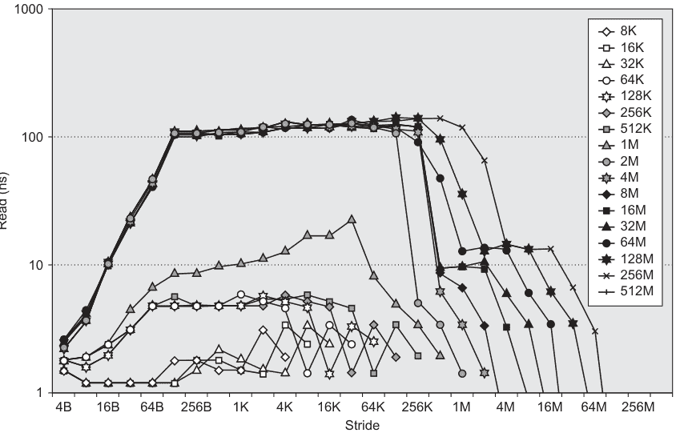

图 2.33 图 2.32 中程序的示例结果。

## 2.5 [12/15/15/20] <2.6> 如果必要，修改图 2.32 中的代码以测量以下系统特征。以流逝时间（elapsed）为 y 轴、内存步长（memory stride）为 z 轴绘制实验结果。两个轴均使用对数刻度，并为每个缓存大小画一条线。

- [12] <2.6> 系统页面大小是多少？
- [15] <2.6> TLB 中有多少条目？
- [15] <2.6> TLB 的缺失惩罚是多少？
- [20] <2.6> TLB 的关联性是多少？

## 2.6 [20/26] 在多处理器内存系统中，存储层次结构的较低级可能不会被单个处理器饱和，但应该被多个处理器的协同工作所饱和。修改图 2.32 中的代码并同时运行多个副本。你可以确定：

- [20] <2.6> 你的计算机系统中多少个实际处理器，有多少个系统处理器仅仅是多线程上下文？
- [20] <2.6> 你的系统有多少个内存控制器？

## 2.7 [20] <2.6> 你能想出使用程序来测试指令缓存某些特性的方法吗？提示：编译器可能会从一段代码生成大量非直观的指令。尝试使用你的指令集架构（ISA）中已知的简单算术指令。

## 案例研究 3：研究各种内存系统结构的影响

### 此案例研究说明了的概念

- DDR3 内存系统
- 秩（ranks）、库（banks）、行缓冲（row buffers）对性能和功率的影响
- DRAM 时序参数

处理器通常支持几个 DDR3 或 DDR4 内存通道。在这个案例研究中，我们将关注一个内存通道，并探索不同参数如何影响其性能和功率。回想通道填充了一个或多个 DIMM。每个 DIM 支持一个或多个秩——秩是一组 DRAM 芯片的集合，它们共同工作以于内存控制器发出的单个命令。例如，一个秩可能由 16 个 DRAM 芯片组成，每个芯片在每个时钟边沿上处理 4 位的输入或输出。每个芯片被称为 `x4`（四位）芯片。在其他示例中，一个秩可能由 8x8 或 4x16 芯片组成——注意在每种情况下，秩都能处理 64 位内存通道上的数据。秩本身被划分为 8 个（DDR3）或 16 个（DDR4）库（banks）。每个库都有一个行缓冲，它本质上记录了该库的最后一行。以下是从库中执行读取操作时典型的内存命令序列的示例：

(i) 内存控制器发出预充（Precharge）命令，以使库准备好访问新行。预充在时间 `tRP` 后完成。
(ii) 内存控制器发出激活（Activate）命令以读取库的相应行。激活在时间 `tRCD` 后完成，该行被认为是缓冲区的一部分。
(iii) 内存控制器可以发出列读（column-read）或 CAS 命令，将行缓冲的特定子集放在内存通道上。在时间 `CL` 后，64 位数据突发被放在内存通道上，并在 4 个周期内形成。
(iv) 如果内存控制器想要访问不同行中的数据（称为行缺失，row miss），它重复步骤 (i)-(iii)。现在假设 `CL` 已经过去，可以发出步骤 (i) 中的预充；在某些情况下，必须添加额外的延迟，但我们将忽略它。如果内存控制器想要访问另一块数据（即行命中，row hit），它只需发出另一个 CAS 命令。在某些情况下，必须添加额外的延迟，但我们将忽略它。在某些情况下，内存控制器可以在连续的周期内对不同的库执行操作，以便 64 位数据传输在 4 个周期内完成。

## 2.8 [10] <2.6> 行缺失时访问延迟是多少是多少？

## 2.9 [10] <2.6> 行命中时访问延迟是多少？

## 2.10 [10] <2.6> 如果内存仅支持一个库，内存的利用率是多少？

## 2.11 [15] <2.6> 假设行缺失率为 100%，为了达到 100% 的利用率，内存应该支持多少个库？

## 2.13 [15] <2.6> 假设我们运行一个具有四个线程且具有零空间局部性的应用程序，且内存仅支持一个库，其访问延迟是多少？

## 2.14 [20] <2.6> 如果内存支持四个库，其访问延迟是多少？

# 156 第二章 存储层次结构设计

周期，假设使用 CACTI 输出的周期，对应于缓存在流水线无任何空泡的情况下运行的最大频率。

## 2.18 [12/15/15/10] <2.3> 你正在研究路预测（way-predicting）L1 缓存的潜在益处。假设一个 64 KB 四路组相、单体结构的 L1 数据缓存是系统中周期时间的限制因素。对于另一种缓存组织结构，你正在考虑一种路预测缓存模型，其被编码为 64 KB 直接映射缓存，预测准确率为 80%。除非另有说明，否则假设缓存命中的预测错误访问需要一个周期。假设问题 2.8 (c) 中的缺失率和惩罚。

- a. <2.3> 当前缓存的平均访问时间（以周期为单位）与路预测缓存相比是多少？
- b. <2.3> 如果所有其他组件都以更快的路预测缓存周期时间运行（包括主内存），使用路预测缓存对性能会产生什么影响？
- c. <2.3> 路预测缓存通常仅用于向指令队列或缓冲区提供服务的指令缓存。想象你想在数据缓存上尝试预测。假设你具有 80% 的预测准确率，且后续操作（例如其他指令的数据访问、依赖操作）都假设了缓存预测。路预测错误会导致流水线冲刷和重放，这需要 15 个周期。带有数据缓存预测的情况下，每条加载指令的平均访问时间变化是正还是负？变化是多少？
- d. <2.3> 作为路预测的替代方案，许多大型 L2 缓存将标记和数据访问串行，以便仅激活所需的数据集。这节省了功率但增加了访问时间。CACTI 的详细 Web 针对一个 0.065 um、1 MB 四路组相缓存，其具有 64 位数据块、144 位读出、1 个存储体和读写端口、30 位标记以及带有全局布线的 ITRS-HP 技术。串行标记和数据访问的访问时间与并行访问相比，比例值是多少？

## 2.19 [10/12] <2.3> 你被要求调查用于微处理器的分体流水线 L1 缓存的相对性能。假设一个 64 KB 二路组相缓存具有 64 位数据块。流水线缓存由三个流水线阶段组成，容量与 Alpha 21264 数据缓存相似。分体实现将由两个 32 KB 二路组相的存储体组成。使用 CACTI 并假设采用 65 nm (0.065 um) 技术来回答以下问题。Web 视图周期输出显示了缓存在流水线无任何空泡的情况下运行的频率。

- a. <2.3> 缓存的周期与其访问相比是多少？缓存将占用多少流水线阶段（保留两位小数）？
- b. <2.3> 比较流水线设计与分体设计的每次访问面积和总动态能量。哪一个占据面积较小且需要的功率更多，并解释可能的原因。

# 案例研究与练习 157

## 2.20 [12/15] <2.3> 考虑在 L2 缓存缺失时使用字优先（critical word first）和提前重启（early restart）。假设一个 1 MB L2 缓存具有 64 位数据块，且重填路径宽度为 16 字节。假设 L2 每 4 个处理器周期可以写入 16 字节，从内存控制器接收前 16 字节的时间为 120 个周期，从主内存每额外 16 字节需要 16 个周期，且数据可以直接旁路到 L2 缓存的读端口。忽略将缺失请求传输到 L2 缓存以及请求数据传输到 L1 缓存的周期。

- a. [12] <2.3> 没有字优先和提前重启的情况下，处理 L2 缓存缺失需要多少周期？
- b. [15] <2.3> 你认为字优先和提前重启对于 L1 缓存还是 L2 缓存更重要？哪些因素影响它们的相对重要性？

## 2.21 [12/12] <2.3> 你正在写通 L1 缓存和写回 L2 缓存之间设计一个写缓冲区。L2 缓存数据宽度为 16 字节，并可以每几个处理器周期向一个独立的缓存地址执行写入。

- a. [12] <2.3> 每个写缓冲区条目的宽度应该是多少字节？
- b. [15] <2.3> 如果通过执行 64 位存储来清零内存，使用合并缓冲区（merging buffer）代替非合并缓冲区（non-merging buffer），当所有其他指令都能与存储并行发射且块存在 L2 缓存中时，稳定状态下可以期望多少加速？
- c. [15] <2.3> 对于具有阻塞和非阻塞缓存的系统，可能出现的 L1 缺失对所需的写缓冲区条目数量会有什么影响？

## 2.22 [20] <2.1, 2.2, 2.3> 缓存充当过滤器。例如，对于程序的 1000 条指令，有 20 次内存访问表现出低局部性，无法由缓存提供。对于以下配置，你观察到缓存太浅或太深的缺点是什么？

# 案例研究与练习 159

性能未达到承诺水平，例如由云服务提供商引起。其次，这是一个隐私问题。根据其观察到的干扰，竞争对手可以推断其他程序的内存访问模式。这被称为时间通道（timing channel），是信息从一个程序泄漏到其他程序的形式，可以被用于破坏数据隐私或对竞争对手的算法进行反向工程。你可以在末级缓存（LLC）中添加哪些策略，使得一个程序的行为不受共享该缓存的其他程序行为的影响？

- a. <2.2> 如果使用 1 颗 DRAM 芯片，DIMM 上有多少颗 DRAM 芯片？如果只有一个 DRAM 连接到其 DIMM 引脚，那么每个 DRAM 必须具有多少个数据 IO？
- b. <2.2> 支持 32 B 的 L2 缓存块需要多长的突发长度（burst length）？
- c. <2.2> 计算 DDR2-667 和 DDR2-533 DIMM 在活动页下的峰值带宽，排除 ECC 开销。

## 2.34 [10/10] <2.2> 图 2.34 显示了一个示例 DDR2 SDRAM 时序图，tRCD 是激活库（bank）中一行所需的时间，列地址选通（CAS）延迟是读取行中一个缓存所需的周期数。假设 RAM 是一个带有 ECC 的标准 DDR2 DIMM，具有 72 条数据线。假设突发长度为 8，读取 8 位，或从 DIMM 总共读取 64 B。假设 tRCD = CAS (or CL) clock_frequency，且 clock_frequency = 每秒传输次数/2。通过第 1 和第 2 级缓存缺失时的片内延迟（不包括 DRAM 访问）为 20 ns。

图 2.34 DDR2 SDRAM 时序图。

- a. [10] <2.2> 对于 DDR2-667 1 Gb CL=5 的 DIMM，从激活命令出现到 DRAM 中最后一个请求的数据位从有效变为无效需要多长时间？假设对于每个请求，我们都会自动预取同一页中的相邻缓存行。
- b. [10] <2.2> 当使用 DDR2-667 DIMM 时，读取需要激活一个库的页面与读取一个已经旧的页面之间的相对延迟是多少？在处理器内部处理缺失所需的时间是多少？

## 2.35 [15] <2.2> 假设 DDR2-667 2 Gb DIMM（CL=5）的价格为 130，DDR2-533 2 GB DIMM（CL=4）的价格为 100。假设系统使用两个 DIMM，其余部分成本为 800。使用 DDR2-667 和 DDR2-533 DIMM 的系统在每 1K 条指令产生 3.3 次 L2 缺失的负载上，假设所有 DRAM 读取中 80% 需要激活。当使用不同 DIMM 时，假设一次仅有一个未完成的 L2 缺失，且 CPI（每周期周期）为 1.5 的顺序执行核心（不包括 L2 缓存访问时间），整个系统的成本-性能比是多少？

## 2.36 [12] <2.2> 你正在配置一个带有八核 3 GHz CMP 的服务器，该服务器执行一个整体 CPI 为 2.0 的负载（假设 L2 缓存填充不会延迟）。L2 缓存大小为 32 字节。使用系统的 DDR2-667 DIMM，应该提供多少个独立的内存通道，以便当所需带宽是平均值的两倍时，系统不受内存带宽限制？负载平均每 1 条指令产生 6.67 次 L2 缺失。

## 2.37 [15] <2.2> 考虑一个具有四个内存通道的处理器。连续的内存块应该放在同一个库（bank）中，还是放在不同通道的不同库中？

## 2.38 [12] <2.2> 大部分 DRAM 功率（超过三分之一）可能由于页激活（参见 `http://download.micron.com/pdf/technotes/ddr2/TN704.pdf` 和 `http://www.micron.com/systemcale/`）。假设你正在构建一个使用 2 GB 内存的系统，使用 8 库 2 Gb x8 DDR2 DRAM 或 8 库 1 Gb x8 DRAM，速度等级相同。均使用 1 KB 的页大小，且末级缓存行大小为 64 字节。假设未激活的 DRAM 处于预充电待机状态且功耗忽略不计。假设从待机状态转换的时间并不显著。

- a. [12] <2.2> 预计哪种类型的 DRAM 能提供更高的系统性能？解释原因。
- b. [12] <2.2> 在功率方面，2 GB 的 1 Gb x8 DDR2 DRAM DIMM 与由类似容量的 1 Gb x4 DDR2 DRAM 组成的 DIMM 相比如何？


## 2.39 [20/15/12] <2.2>
为了访问典型 DRAM 数据，我们首先必须激活相应的行。假设为行缓冲区（row buffer）带来了 8 GB 的能量大小。我们从行缓冲区选择一个特定的列。如果后续对 DRAM 的访问位于同一页，则我们可以跳过激活，否则我们必须关闭当前页并为下一次激活预充电缓冲区。另一种流行的 DRAM 策略是在访问结束后主动关闭页并预充电位线（bitlines）。假设读取或写入 DRAM 的大小为 64 ，发送 512 位的时间为 T。

- a. [20] <2.2> 假设 DDR2-667，如果预充电需要五个周期，激活需要五个周期，读取需要四个周期，对于什么命中率，你会选择一种策略而非另一种以获得最佳访问时间？假设每次 DRAM 访问之间有足够完成新访问的时间。
- b. [15] <2.2> 如果 10% 的 DRAM 访问连续发生，你的决定会改变吗？
- c. [12] <2.2> 使用之前计算的命中率，计算两种策略之间每次访问的能量差异。假设预充电需要 2 ns，激活 4 ns，从行缓冲区读取或写入需要 100 pJ/bit。

## 2.40 [15] <2.2>
当计算机空闲时，我们可以将其置于待机状态（DRAM 仍激活）或休眠。假设休眠需要将 DRAM 内容复制到非易失性介质（如 Flash）。如果写入 64 字节到 Flash 需要 2.5 J，而 DRAM 需要 0.5 ns，且 DRAM 空闲功率为 1.6 W（针对 8 GB），系统休眠前应该空闲多久？假设内存为 8 GB。

## 2.41 [10/10/10/10] <2.2>
虚拟机（VMs）具有为计算机添加许多功能的潜力，例如改进总成本（TCO）或可用性。虚拟机可以提供哪些功能？如果是，它们如何实现？

- a. [10] <2.4> 在开发机上测试应用程序？
- b. [10] <2.4> 灾难或故障时快速部署应用程序？
- c. [10] <2.4> I/O 密集型应用程序具有更高的性能？
- d. [10] <2.4> 不同应用程序之间的故障隔离导致更高的可用性？
- e. [10] <2.4> 在不中断的情况下对应用程序进行软件维护？

## 2.42 [10/10/12/12] <2.4>
虚拟机由于某些事件丢失性能，例如特权指令执行、TLB 缺失、陷（traps）和 I/O。

|  | Benchmark | 原生 (Native) | 纯虚拟化 (Pure) | 半虚拟化 (Para) |
|---|---|---|---|---|
| Null call | 0.04 | 0.96 | 0.50 |
| Null I/O | 0.27 | 6.32 | 2.91 |
| Stat | 1.10 | 10.69 | 4.14 |
| Open/close | 1.99 | 20.43 | 7.71 |
| Install signal handler | 0.33 | 7.34 | 2.89 |
| Handle signal | 1.69 | 19.26 | 2.36 |
| Fork | 56.00 | 513.00 | 164.00 |
| Exec | 316.00 | 2084.00 | 578.00 |
| Fork+exec sh | 1451.00 | 7790.00 | 2360.00 |

**图 2.35** 在原生执行、纯虚拟化和半虚拟化下各种系统调用的早期性能。

这些事件通常在系统代码中处理。因此，估计运行虚拟机延迟的一种方法是应用程序执行在系统模式与用户模式的百分比。例如，在系统中花费 10% 执行时间的应用程序在虚拟机上运行时可能会慢 60%。图 2.35 列出了在 Itanium 系统上使用 Xen 的原生执行、纯虚拟化和半虚拟化下各种系统调用的性能，时间为微秒（由新南威尔士大学的 Matthew Chapman 提供）。

- a. [10] <2.4> 预计在虚拟机下运行什么类型的程序会有较小的延迟？
- b. [10] <2.4> 如果延迟是系统时间和前述延迟的线性函数，一个在系统中花费 20% 执行时间的程序预计会运行慢多少？
- c. [12] <2.4> 上表纯虚拟化和半虚拟化下系统调用的中值延迟是多少？
- d. [12] <2.4> 上表中的哪些函数延迟最大？你认为原因是什么？

## 2.43 [12] <2.4>
Popek 和 Goldberg 对虚拟机的定义是：除了性能外，与真实机器无法区分。在这个问题中，我们将使用该定义来确定我们是在处理器上原生执行，还是运行在虚拟机上。Intel VT-x 技术有效地为虚拟机的使用提供了第二套特权级。假设使用 VT-x 技术，运行在虚拟机之上的虚拟机需要做什么？

## 2.44 [20/25] <2.4>
随着 x86 架构采用虚拟化支持，虚拟机正在积极演进并成为主流。对比 Intel VT-x 和 AMD 的 AMD-V 虚拟化技术。

图 2.36 Alpha 21264 的平面布局 [Kessler 1999]。

映射器重命名寄存器指定的。这些是支持乱序（OOO）指令的必要添加。21264 芯片上仅有 L1 数据和指令缓存，它们是 64 KB 双路关联的。对于内存密集型基准测试，使用像 SimpleScalar (`http://www.cswisc.edu/~mscalat/simplescalar.html`) 等 OOO 超标量模拟器，以找出在 21264 模型中，如果将队列区域用于额外的 L1 数据缓存而非 OOO，顺序超标量处理器会损失多少性能。确保机器的其他方面尽可能相似，以保证比较的公平。忽略缓存带来的周期时间增加，以及更大的数据缓存对芯片平面布局的影响。（注意，这不会是总和，因为编译器不会为顺序执行处理器调度代码）。

- 2.46 [15]<2.2, 2.7> 正如第 2.7 节所述，Intel i7 处理器具有激进的预取器。设计一个极其激进的预取器有什么潜在的缺点？
- 2.47 [20/20]<6> 可以使用 Intel 性能分析器 VTune 对缓存行为进行测量。Windows 和 Linux 上的 VTune 免费评估版可以从 `http://software.intel.com/en/articles/vtune-profiler-exe` 下载。案例 2 中使用的程序 (`aca_ch2_cs2.c`) 经过修改，使其能够在 Microsoft Visual C++ 上开箱即用 VTune。程序可以从 `http://www.plh.hp.com/research/cacti/aca_ch2_cs2_vtune.c` 下载。程序插入了特殊的 VTune 函数，以在性能分析过程中排除初始化和循环开销。详细的 VTune 设置说明在程序中的 README 部分给出。程序对每种配置都会循环运行 20 秒。在实验中，你可以发现数据大小对缓存和整体性能的影响。在 Intel 处理器上通过 VTune 运行该程序，输入的数据集大小分别为 8 KB、128 KB、4 MB，并保持 64 字节的步长（Intel i7 处理器的缓存行步长）。收集整体以及 L1 数据缓存、L2 和 L3 缓存性能统计数据。

  - a. [20]<6> 列出每个数据集大小以及你的处理器模型和速度下，L1 数据缓存、L2 和 L3 每 1K 指令的缺失次数。根据结果，你对处理器的 L1 数据缓存、L2 和 L3 缓存有什么说明？解释你的观察结果。
  - b. [20]<6> 列出每个数据集大小以及你的处理器模型和速度的每周期指令数 (IPC)。根据结果，你对处理器的 L1、L2 和 L3 缺失惩罚有什么说明？解释你的观察结果。
  - c. [20]<6> 在 Intel OOO 处理器上运行输入数据集大小为 8 KB 和 128 KB 的程序。列出两种配置下每 1K 指令的 L1 数据缓存缺失和 L2 缓存缺失次数，以及 CPI。对于高性能 OOO 处理器中内存延迟隐藏技术的有效性，你有什么说明？提示：你需要找到你处理器的 L1 数据缓存缺失延迟。对于最近的 Intel i7 处理器，该值约为 11 个周期。

| 3.1 | 指令级并行：概念与挑战 | 168 |
| 3.2 | 暴露 ILP 的基本编译器技术 | 176 |
| 3.3 | 使用高级分支预测减少分支开销 | 182 |
| 3.4 | 通过动态调度克服数据冒险 | 191 |
| 3.5 | 动态调度：示例与算法 | 201 |
| 3.6 | 基于硬件的推测执行 | 208 |
| 3.7 | 使用多发射和静态调度利用 ILP | 218 |
| 3.8 | 使用动态调度、多发射和推测执行利用 ILP | 222 |
| 3.9 | 指令交付与预测的高级技术 | 228 |
| 3.10 | 交叉问题 | 240 |
| 3.11 | 多线程：利用线程级并行提高单处理器吞吐量 | 242 |
| 3.12 | 综合考虑：Intel Core i7 6700 和 ARM Cortex-A53 | 247 |
| 3.13 | 谬误与陷阱 | 258 |
| 3.14 | 结语：未来展望 | 264 |
| 3.15 | 历史视角与参考文献 | 266 |
|  | Jason D. Bakos 和 Robert P. Colwell 设计的案例研究与练习 | 266 |

# 指令级并行及其利用

“谁是第一？”

“美国号。”

“谁是第二？”

“先生。”

1851 年美国号帆船赛中两个观察者之间的对话，后来命名为

自 1985 年以来，所有处理器都使用了流水线技术来重叠指令执行并提高性能。指令之间这种潜在的重叠被称为指令级并行 (ILP)，因为指令可以并行评估。在本章和附录 H 中，我们将研究通过增加并行性来扩展流水线的各种技术。虽然本章的一些基础内容在前节中可以理解，但这些内容非常重要。

# 指令级并行：概念与挑战

自 1985 年以来，所有处理器都使用了流水线技术来重叠指令执行并提高性能。指令之间这种潜在的重叠被称为指令级并行 (ILP)，因为指令可以并行评估。在本章和附录 H 中，我们将研究通过增加并行性来扩展流水线的各种技术。虽然本章的一些基础内容在前节中可以理解，但这些内容非常重要。

利用 ILP 有两种主要方法：(1) 一种依赖硬件动态发现并利用并行性的方法；(2) 一种依赖软件技术在编译时寻找并行性的方法。使用动态硬件的方法（包括所有 Intel 和 ARM 处理器）在桌面和服务器市场占据主导地位。在流行的移动设备市场，相同的方法被应用于平板电脑和高端手机处理器。在功耗和成本限制性能目标的 IoT 领域，设计者利用较低水平的指令级并行。

激进的基于编译器的方法自 80 年代以来多次尝试，最近是 1999 年推出的 Itanium 系列。尽管出了许多努力，这些方法仅在特定领域的环境或具有显著数据并行性的结构良好的应用程序中成功。

在过去的几年里，为一种方法开发的许多技术已被应用在主要基于另一种方法的设计中。本章介绍了这些基础知识和两种方法。本章包含了对 ILP 方法局限性的讨论，正是这些局限性直接导致了多核心的发展。理解这些局限性对于平衡 ILP 和线程级并行的使用至关重要。

在本节中，我们讨论了限制可利用并行性的程序和处理器特征，以及程序结构与硬件结构之间的关键映射，这对于理解程序属性在什么情况下会限制限制性能是关键。

流水线处理器的 CPI（每条指令周期数）值是基础 CPI 以及所有停顿贡献之和：

```
Pipeline CPI = Ideal pipeline CPI + Structural stalls + Data hazard stalls + Control
```

## 3.1 指令级并行性：概念与挑战

| 技术 | 减少的 | 章节 |
|---|---|---|
| 旁路与旁路 | 潜在的数据冲突停顿 | C.2 |
| 简单分支调度与预测 | 控制冲突停顿 | C.2 |
| 基础编译器流水线调度 | 数据冲突停顿 | C.2, 3 |
| 基础动态调度（记分板法） | 真数据依赖引起的数据冲突停顿 | C.7 |
| 循环展开 | 控制冲突停顿 | 3.2 |
| 高级分支预测 | 控制停顿 | 3.3 |
| 带重命的动态调度 | 由数据冲突、输出依赖和反依赖导致的停顿 | 3.4 |
| 硬件预测 | 数据冲突和控制冲突停顿 | 3.6 |
| 动态内存冲突消除 | 与内存相关的数据冲突停顿 | 3.6 |
| 每周期发射多条指令 | 理想 CPI | 3.7, 3.8 |
| 编译器依赖分析、软件流水线、轨迹调度 | 理想 CPI、数据冲突停顿 | H.2, H.3 |
| 编译器预测的硬件支持 | 理想 CPI、数据冲突停顿、分支冲突停顿 | H.4, H.5 |

**图 3.1** 附录 C、第 3 章和附录 H 中检查的主要技术，以及这些技术影响的 CPI 方程组成部分所示。

*理想 CPI* 是衡量实现方案可达最高性能的指标。通过减少右侧的每一项，我们降低了整体流水线 CPI，或者降低了 IPC（每周期指令数）。前面的方程允许我们通过技术减少整体 CPI 的哪组成部分来对其进行描述。图 3.1 显示了我们在本章和附录 H 中检查的技术，以及附录 C 介绍材料中涵盖的主题。在本章中，我们将看到引入的减少流水线 CPI 的技术可能会增加处理冲突的重要性。

# 什么是指令级并行性？

本章中的所有技术都利用了指令之间的并行性。*基本块*（basic block）——即一个没有入口分支且没有出口分支的直线代码序列——内部可用的并行性非常小。对于典型的 RISC 程序，平均分支频率通常在 15% 到 25% 之间，这意味着每对分支之间执行了三到六条指令。由于这些指令可能相互依赖，基本块内部的重叠程度可能小于平均基本块的大小。为了获得实质性的性能提升，我们必须跨多个基本块利用 ILP（指令级并行性）。

增加 ILP 最简单且最常见的方法是利用循环迭代之间的并行性。这种并行性通常被称为*循环级*并行性。

# 第三章 指令级并行性及其利用

这里是一个加两个 1000 元素数组的简单循环示例，它是完全并行的：

```
for (i=0; i<=999; i=i+1)
    x[i] = x[i] + y[i];
```

循环的每次迭代都可以与其他任何迭代重叠，尽管在循环迭代内部几乎没有或没有重叠的机会。

我们将研究一些将这种循环级并行性转换为指令级并行性的技术。基本上，这些技术通过编译器静态展开循环（如下一节所示）或硬件动态展开循环（如第 3.5 节和第 3.6 节所示）来工作。

利用循环级并行性的另一种方法是在向量处理器和图形处理器（GPU）中使用 SIMD，这些在第 4 章中会有介绍。SIMD 指令通过并行操作较少到中等数量的数据项（通常为两个）来利用数据级并行性。向量指令则通过通过并行执行和流水线并行操作许多数据项来利用数据级并行性。例如，处理代码在简单情况下每次迭代仅需要 7 条指令（两次加载、一次加法、两次更新和一个分支），总共 7000 次迭代，在 SIMD 架构中可能只需要一条到多条指令即可执行，其中每条指令处理四个数据项。在某些向量处理器上，该序列可能需要四条指令：两条指令从内存加载向量 x 和 y，一条指令相加两个向量，以及一条指令存储结果向量。当然，这些指令将是流水线化的，并且具有较长的延迟，但延迟是可以重叠的。

# 数据依赖与冲突

确定一条指令如何依赖于另一条指令，对于确定程序中存在多少并行性以及如何利用并行性至关重要。特别是，为了利用指令级并行性，我们必须确定哪些指令可以并行执行。如果两条指令是并行的，它们可以在任意深度的流水线中同时执行而不产生任何停顿，假设流水线有足够的资源（因此没有结构冲突）。如果两条指令存在依赖关系，它们必须按顺序执行，尽管它们通常可以部分重叠。两种情况的关键在于确定一条指令是否依赖于另一条指令。

有三种不同的依赖：数据依赖（也称为真数据依赖）、名依赖和控制依赖。如果满足以下任一条件，则指令 j 数据依赖于指令 i：

- 指令 i 产生一个可能被指令 j 使用的结果。
- 指令 j 数据依赖于指令 k，且指令 k 依赖于指令 i。

该条件简单地说明，如果两条指令之间存在依赖链，则一条指令就依赖于另一条指令。这种依赖链可以与整个程序一样长。注意，单个指令内部的依赖（如 `add x1`）不被视为依赖。

例如，考虑以下 RISC 代码，它增加内存中一个值向量（从 0(x1) 开始）：

```assembly
lw x2, 0(x1)
addi x2, x2, 1
```


## 3.1 指令级并行性：概念与挑战

| 技术 | 减少的 | 章节 |
|---|---|---|
| 旁路与旁路 | 潜在的数据冲突停顿 | C.2 |
| 简单分支调度与预测 | 控制冲突停顿 | C.2 |
| 基础编译器流水线调度 | 数据冲突停顿 | C.2, 3 |
| 基础动态调度（记分板法） | 真数据依赖引起的数据冲突停顿 | C.7 |
| 循环展开 | 控制冲突停顿 | 3.2 |
| 高级分支预测 | 控制停顿 | 3.3 |
| 带重命的动态调度 | 由数据冲突、输出依赖和反依赖导致的停顿 | 3.4 |
| 硬件预测 | 数据冲突和控制冲突停顿 | 3.6 |
| 动态内存冲突消除 | 与内存相关的数据冲突停顿 | 3.6 |
| 每周期发射多条指令 | 理想 CPI | 3.7, 3.8 |
| 编译器依赖分析、软件流水线、轨迹调度 | 理想 CPI、数据冲突停顿 | H.2, H.3 |
| 编译器预测的硬件支持 | 理想 CPI、数据冲突停顿、分支冲突停顿 | H.4, H.5 |

**图 3.1** 附录 C、第 3 章和附录 H 中检查的主要技术，以及这些技术影响的 CPI 方程组成部分所示。

*理想 CPI* 是衡量实现方案可达最高性能的指标。通过减少右侧的每一项，我们降低了整体流水线 CPI，或者降低了 IPC（每周期指令数）。前面的方程允许我们通过技术减少整体 CPI 的哪组成部分来对其进行描述。图 3.1 显示了我们在本章和附录 H 中检查的技术，以及附录 C 介绍材料中涵盖的主题。在本章中，我们将看到引入的减少流水线 CPI 的技术可能会增加处理冲突的重要性。

# 什么是指令级并行性？

本章中的所有技术都利用了指令之间的并行性。*基本块*（basic block）——即一个没有入口分支且没有出口分支的直线代码序列——内部可用的并行性非常小。对于典型的 RISC 程序，平均分支频率通常在 15% 到 25% 之间，这意味着每对分支之间执行了三到六条指令。由于这些指令可能相互依赖，基本块内部的重叠程度可能小于平均基本块的大小。为了获得实质性的性能提升，我们必须跨多个基本块利用 ILP。

增加 ILP 最简单且最常见的方法是利用循环迭代之间的并行性。这种并行性通常被称为*循环级*并行性。

# 第三章 指令级并行性及其利用

这里是一个加两个 1000 元素数组的简单循环示例，它是完全并行的：

```
for (i=0; i<=999; i=i+1)
    x[i] = x[i] + y[i];
```

循环的每次迭代都可以与其他任何迭代重叠，尽管在循环迭代内部几乎没有或没有重叠的机会。

我们将研究一些将这种循环级并行性转换为指令级并行性的技术。基本上，这些技术通过编译器静态展开循环（如下一节所示）或硬件动态展开循环（如第 3.5 节和第 3.6 节所示）来工作。

利用循环级并行性的另一种方法是在向量处理器和图形处理器（GPU）中使用 SIMD，这些在第 4 章中会有介绍。SIMD 指令通过并行操作较少到中等数量的数据项（通常为两个）来利用数据级并行性。向量指令则通过通过并行执行和流水线并行操作许多数据项来利用数据级并行性。例如，处理代码在简单情况下每次迭代仅需要 7 条指令（两次加载、一次加法、两次更新和一个分支），总共 7000 次迭代，在 SIMD 架构中可能只需要一条到多条指令即可执行，其中每条指令处理四个数据项。在某些向量处理器上，该序列可能需要四条指令：两条指令从内存加载向量 x 和 y，一条指令相加两个向量，以及一条指令存储结果向量。当然，这些指令将是流水线化的，并且具有较长的延迟，但延迟是可以重叠的。

# 数据依赖与冲突

确定一条指令如何依赖于另一条指令，对于确定程序中存在多少并行性以及如何利用并行性至关重要。特别是，为了利用指令级并行性，我们必须确定哪些指令可以并行执行。如果两条指令是并行的，它们可以在任意深度的流水线中同时执行而不产生任何停顿，假设流水线有足够的资源（因此没有结构冲突）。如果两条指令存在依赖关系，它们必须按顺序执行，尽管它们通常可以部分重叠。两种情况的关键在于确定一条指令是否依赖于另一条指令。

有三种不同的依赖：数据依赖（也称为真数据依赖）、名依赖和控制依赖。如果满足以下任一条件，则指令 j 数据依赖于指令 i：

- 指令 i 产生一个可能被指令 j 使用的结果。
- 指令 j 数据依赖于指令 k，且指令 k 依赖于指令 i。

该条件简单地说明，如果两条指令之间存在依赖链，则一条指令就依赖于另一条指令。这种依赖链可以与整个程序一样长。注意，单个指令内部的依赖（如 `add x1`）不被视为依赖。

例如，考虑以下 RISC 代码，它增加内存中一个值向量（从 0(x1) 开始）：

```assembly
lw x2, 0(x1)
addi x2, x2, 1
```

# 3.1 指令级并行性：概念与挑战

必须保持顺序以确保 $i$ 读取到正确的值。在第 171 页的示例中，`fsd` 和 `add x1` 之间存在一种反依赖（anti-pependence）。

当指令 $i$ 和指令 $j$ 写入同一个寄存器或内存位置时，就会发生输出依赖（output dependence）。指令之间的顺序必须保持，以确保最终的值对应于指令 $j$。

反依赖和输出依赖都属于名依赖（name dependencies），而不是真正的数据依赖（true data dependencies），因为指令之间没有值的传递。由于名依赖不是真正的依赖，如果更改了使用的寄存器（名称编号或内存位置），使得指令不再冲突，那么涉及名依赖的指令可以同时发生或被重排序。

这种重命名对于寄存器操作数很容易实现，被称为寄存器重命名。寄存器重命名可以通过编译器完成，也可以由硬件动态完成。在描述由分支引起的依赖之前，让我们先检查依赖与流水线冲突之间的关系。

# 数据冲突

只要指令之间存在名依赖或数据依赖，且它们彼此足够近，以至于执行过程中的重叠会改变对涉及依赖的操作数的访问顺序，就会存在冲突。我们必须保持所谓的“程序顺序”（program order）——即原始源程序确定的、如果逐条顺序执行指令时的顺序。我们的软件和硬件技术的目标都是通过仅在程序结果不变的情况下保持程序顺序来利用并行性。检测和避免冲突确保了必要的程序顺序得以保留。

数据冲突在附录 C 中进行了非正式描述，根据指令中读、写访问的顺序，可以分为三类之一。按照惯例，这些冲突通过流水线必须保持的程序中的顺序来命名。考虑两条指令 $i$ 和 $j$，在程序顺序中 $i$ 在 $j$ 之前。可能的数据冲突有：

- RAW（写后读，read after write）——尝试在写入之前读取源，因此 $j$ 获取了旧值。这种冲突是最常见的类型，对应于真数据依赖。必须保持程序顺序以确保 $j$ 来自 $i$ 的值。
- WAW（写后写，write after write）——尝试在 $i$ 写入之前写入操作数。导致写入执行的顺序错误，使得目标位置中留的是 $i$ 写入的值而非 $j$ 写入的值。这种冲突对应于输出依赖。WAW 冲突仅存在于多个流水线阶段允许指令在前指令阻塞时继续执行的流水线中。
- WAR（读后写，write after read）——$j$ 尝试在 $i$ 读取之前写入，因此 $i$ 错误地获取了新值。这种冲突源于独立性（或名依赖）。大多数静态流水线不会发生 WAR 冲突——即使是深流水线或浮点流水线——因为所有读取都较早（ID 阶段），所有写入都很晚（WB 阶段）。WAR 冲突发生在某些指令在指令流水线早期写入结果，而其他指令在流水线后期读取源，或者指令被重排序时（正如本章将看到的）。

注意，RAR（读后读）情况不是冲突。

# 控制依赖

最后一种依赖是控制依赖（control dependence）。控制依赖决定了指令 $i$ 对于分支指令的顺序，使得指令 $i$ 以正确的程序顺序执行，且仅在应该执行时执行。除了程序第一个基本块中的指令外，每条指令都依赖于一组分支，通常情况下，这些控制依赖必须保持以维持程序顺序。控制依赖的最简单例子之一是 if 语句中“then”部分语句对分支的依赖。例如，在代码段中：

```
if p1 (
  S1;
);
if p2 (
  S2;
);
```

`S1` 控制依赖于 `p1`，`S2` 控制依赖于 `p2`。

通常，控制依赖施加了两个约束：

- 依赖于分支的指令不能移动到分支之前，否则其执行将不再受分支控制。例如，我们不能将 if 语句 then 部分的指令移动到 if 之前。
- 不依赖于分支的指令不能移动到分支之后，否则其执行将受分支控制。例如，我们不能将 if 语句之前的指令移动到 if 之后。

当处理器保持严格的程序顺序时，它们确保了控制依赖也得以保留。然而，如果在影响程序正确性的情况下，我们可能会执行本不该执行的指令，从而违反控制依赖。因此，控制依赖并不是必须保持的关键属性。相反，对程序正确性至重要的两个属性（通常通过维护数据和控制依赖来实现）是异常行为和数据流。

保持异常行为意味着执行顺序的任何变化都不能改变程序中产生异常的方式。这通常被为为执行的重排序不能导致程序产生任何新的异常。一个简单的示例说明了维护控制和数据依赖如何防止这种情况。考虑以下代码序列：

```
add x2,x3,x4
beq x2,x0,l1
ld x1,0(x2)
```

在这种情况下，很容易看出如果不维护涉及 `x2` 的数据依赖，就会改变程序的结果。不明显的是，如果我们忽略控制依赖并将加载指令移动到分支之前，加载指令可能会导致内存保护异常。注意，没有数据依赖阻止我们交换 `beq` 和 `ld`；仅仅是控制依赖如此。为了允许我们重排序这些指令（同时保持数据依赖），我们希望在分支跳转时直接忽略异常。在 3.6 节中，我们将查看一种硬件技术——预测（speculation），附录包含了支持预测的软件技术。

## 3.2 暴露指令级并行（ILP）的基础编译器技术

### 基础流水线调度与循环展开

为了保持流水线满载，必须通过寻找一组可以在流水线中重叠的不相关指令序列，来利用指令间的并行性。为了避免流水线停顿（stall），依赖指令的执行与源指令之间的间隔（以时钟周期为单位）必须等于该源指令的流水线延迟。编译器执行这种调度的能力取决于程序中可用的 ILP 数量以及流水线中功能单元的延迟。图 3.2 显示了我们在本章中假设的浮点（FP）单元，除非另有说明不同的延迟。我们假设标准的五级整数流水线，因此分支指令具有一个时钟周期的延迟。我们假设功能单元是全流水线或复制的（次数等于流水线深度），以便任何类型的操作都可以在每个周期内执行，且不存在结构性冲突。

在本节中，我们将研究编译器如何通过转换循环来增加可用性。这个示例不仅用于说明某项重要技术，也为附录 H 中描述的更强大的程序变换提供了动机。我们将依赖以下代码段，它向向量添加一个标量：

```
for (i=999; i>=0; i--)
x[i] = x[i] + s;
```

我们可以通过注意到每次迭代的主体是独立的，发现此循环是并行的。我们在附录 H 中对此形式化，并描述了如何在编译时测试循环迭代是否独立。首先，让我们看看这个循环的性能，展示了我们如何利用并行性来提高其在 RISC-V 流水线上的性能。

第一是将上述片段翻译为 RISC-V 汇编语言。在以下代码段中，`x1` 初始化为数组中地址最高元素的地址，`f2` 包含标量值 x。计算寄存器 `x2`，使得 `Regs[x2]+8` 是最后一个待处理元素的地址。

| 产生结果的指令 | 使用结果的指令 | 延迟（时钟周期） |
|---|---|---|
| FP ALU op | 另一个 FP ALU op | 3 |
| FP ALU op | Store double | 2 |
| Load double | FP ALU op | 1 |
| Load double | Store double | 0 |

图 3.2 本章使用的 FP 操作。最后一列是避免停顿所需的间隔时钟周期数。这些数字与我们在 FP 单元上看到的平均延迟相似。从浮点加载到存储的延迟为 0，因为加载的结果可以直接旁路（bypass）而不会导致存储操作的停顿。我们将继续假设整数加载延迟为 1，整数操作延迟为 0（包括用于分支的 ALU 操作）。

直接的、未针对流水线调度的 RISC-V 代码如下：

```
Loop: fld   f0,0(x1)      //f0=数组元素
      fadd.d f4,f0,f2    //加 f2 中的标量
      fsd   f4,0(x1)      //存储结果
      addi x1,x1,-8       //递减指针
                    // 8 字节 (每个双字 DW)

bne   x1,x2,Loop      //分支 x1!=x2
```

让我们先看看这个循环在按照图 3.2 所示延迟的 RISC-V 简单流水线中进行调度时将如何运行。

展示循环在 RISC-V 上的外观，包括调度和未调度的情况，以及任何停顿或空闲时钟周期。针对浮点操作的延迟进行调度。

在没有任何调度的情况下，循环将按所示执行，耗时九个周期：

| | 发射的时钟周期 |
|---|---|
| Loop: fld f0,0(x1) | 1 |
| stall | 2 |
| fadd.d f4,f0,f2 | 3 |
| stall | 4 |
| stall | 5 |
| fsd f4,0(x1) | 6 |
| addi x1,x1,-8 | 7 |
| bne x1,x2,Loop | 8 |

我们可以对循环进行调度，仅获得两个停顿，并将时间缩短到七个周期：

```
Loop: fld   f0,0(x1)
      addi x1,x1,-8
      fadd.d f4,f0,f2
      stall
      stall
      fsd   f4,8(x1)
      bne   x1,x2,Loop
```

`fadd.d` 之后的停顿是为了供 `fsd` 使用，而重新调整 `addi` 位置防止了 `fld` 之后的停顿。

在上在上示例中，我们每隔七个时钟周期完成一次循环迭代并存回一个数组元素，但处理数组元素的实际工作仅占了这七个周期中的三个（加载、加法、加法和存储）。

剩下的四个时钟周期由循环开销——*addi* 和 *bne*——以及两个停顿组成。为了消除这四个周期，我们需要相对于开销指令数量来获得更多的操作。

一种相对于分支指令和开销指令增加指令数量的简单方案是*循环展开*（loop unrolling）。展开仅仅是多次复制循环体，并调整循环的终止代码。

循环展开也可以用于改进调度。因为消除了分支，它允许将不同迭代的指令调度在一起。在这种情况下，我们可以通过创建额外的指令来消除分支。如果我们简单地展开循环，所需的寄存器数量可能会增加。

展示我们展开后的循环，使其有四个副本。注意，展开的结果是迭代次数是 4 的倍数。这是展开后的结果：

```
Loop:
    fld f0,0(x1)
    fadd.d f4,f0,f2
    fsd f4,(x1)
    fld f6,-8(x1)
    fadd.d f8,f6,f2
    fsd f8,-8(x1)
    fld f0,-16(x1)
    fadd.d f12,f0,f2
    fsd f12,16(x1)
    fld f14,-24(x1)
    fadd.d f16,f14,f2
    fsd f16,8(x1)
    addi x1,x1,-32
    bne x1,x2,Loop
```

我们消除了三个分支和三次 `x1` 递减。这种优化看似不起眼，但可以显著提高性能。

在实际程序中，我们不使用循环上限。假设上限为 n，我们希望展开循环产生 k 个副本。与其生成单个展开循环，不如生成一对连续的循环。第一个执行 $n \pmod k$ 次原始体。第二个是展开后的体，由一个迭代 $n/k$ 次的外层循环包裹。（正如我们在第 4 章将看到的，这种技术类似于向量处理器编译器使用的剥块（strip mining）。）对于较大的 n 值，大部分执行时间将花费在展开循环上。

在上例中，展开通过消除开销指令改进了此循环的性能，尽管它增加了代码体积。如果提前进行流水线调度，展开循环的表现如何？

示例展示上中的展开循环在按照图 3.2 所示延迟进行流水线调度后的样子。

```
Loop:
fld f0,(x1)
fld f6,-8(x1)
fld f0,-16(x1)
fld f14,-24(x1)
fadd.d f4,f0,f2
fadd.d f8,f6,f2
fadd.d f12,f0,f2
fadd.d f16,f14,f2
fsd f4,(x1)
fsd f8,-8(x1)
fsd f12,16(x1)
fsd f16,8(x1)
addi x1,x1,-32
bne x1,x2,Loop
```


展开循环的执行时间已降至总共14 个时钟周期，即每个元素 3.5 个周期，而在进行任何展开或调度之前每个元素为 8 个周期，展开但未调度时为 6.5 个周期。

## 3.2 暴露指令级并行性（ILP）的基本编译器技术

调度展开循环的收益比原始循环更大。这种增加是因为循环展开暴露了更多的计算，这些可以通过调度来最小化地减少停顿（stalls）；而剥离代码（peeling code）没有停顿。以这种方式调度循环需要意识到加载（loads）和存储（stores）是相互独立的，并且可以交换。

## 循环展开与调度总结

在本章和附录 H 中，我们将查看各种硬件和软件技术，这些技术允许我们利用指令级并行性（ILP），充分利用处理器中功能单元的潜力。这些技术的关键在于知道何时以及如何改变指令之间的顺序。在我们的示例中，我们做了许多更改，对于我们这些人类来说，这些更改是显而易见的。在实践中，这必须由编译器或硬件以系统的方法执行。为了获得完全展开的代码，我们必须做出以下决策和转换：

- 通过发现循环迭代是相互独立的（除循环维护代码外），确定展开循环是有用的。
- 使用不同的寄存器来避免因对不同计算使用相同寄存器而强制产生的不必要限制（例如，名称依赖）。
- 消除多外的测试和分支指令，并调整循环转换和迭代代码。
- 通过观察到不同迭代的加载和存储是相互独立的，确定展开循环中的加载和存储可以交换。这种转换需要分析内存地址并发现它们没有指向同一个地址。
- 调度代码，保留所有为了产生与原始代码相同结果所需的依赖关系。

所有这些转换的基础是理解一条指令如何依赖于另一条指令，以及在存在依赖关系的情况下如何更改或重新排序这些指令。

三种不同的因素限制了循环展开的收益：(1) 每次展开摊销开销的减少，(2) 代码大小限制，以及(3) 编译器编译限制。让我们考虑循环开销的问题：当我们展开循环四次时，它在指令之间产生了足够的并行性，使得循环可以在无停顿的情况下进行调度。在 14 个时钟周期内，只有 2 个周期是循环开销：`addi` 值和终止循环的 `bne`。如果循环展开 8 次，开销将从每个元素 1/2 周期减少到 1/4。

循环展开的第二个限制是导致的代码大小增长。对于较大的循环，代码大小的增长可能令人担心的问题，特别是当它导致指令缓存缺失率增加时。


182 第三章 指令级并行性及其利用

比代码大小更重要的因素是由于激进展开和调度导致的寄存器潜在短缺。这种由于大代码段中的指令调度产生的次生效应被称为寄存器压力（register pressure）。它的产生是因为为了增加 ILP 的调度会导致活跃值（live values）的增加。在激进的指令调度之后，可能无法将所有活跃值分配到寄存器。转换后的代码在理论上可能会丢失部分或全部优势，因为导致了寄存器短缺。如果没有展开，激进调度会受到分支的足够限制，然而，展开与激进调度的结合可能会导致这个问题。在多发射处理器中，该问题变得特别具有挑战性，因为这些处理器需要暴露更多可以重叠执行的相互独立指令。通常情况下，使用高级转换（其潜在改进在详细代码生成之前很难衡量）已导致现代编译器的复杂度显著增加。

循环展开是一种增加可以有效调的代码片段大小的简单而有效的方法。这种转换在各种处理器中都是有用的，从我们目前遇到的简单流水线到本章后面探索的多发射超标量和 VLIW 处理器都是如此。

## 3.3 使用高级分支预测减少分支成本

由于需要通过分支冒险和停顿来强制控制依赖，分支会损害性能。循环展开是减少分支冒险的一种方法；我们也可以通过预测它们的行为来减少分支的性能损失。在附录 C 中，我们检查了多个依赖于编译时信息或依赖于单个分支观测动态行为的分支。随着流水线加深和每周期发射次数的增加，执行指令数量的增加，更准确的分支预测的重要性也提高了。在本节中，我们将检查 C.2 节中涵盖的简单 2 位预测器的广泛使用，读者在继续之前理解该预测器的原理至关重要。

## 关联分支预测器

附录 C 中的 2 位预测器方案仅使用单个分支的近期行为来预测该分支的未来行为。如果我们查看其他分支的近期行为，而不仅仅是我们正在尝试预测的分支，可能会提高预测准确性。考虑来自 eqt 基准测试的简单代码片段，它是早期 SPEC 基准测试套件的成员，显示出特别糟糕的分支预测行为：

```
if (aa==2)
    aa=0;
if (bb==2)
    bb=0;
if (aa!=bb)
```

以下是我们通常假设 aa 和 bb 分配给 x1 和 x2 时为该代码片段生成的 RISC-V 代码：

```
addi x3,x1,-2 //branch b1 (aa!=2)
bnez x3,L1
add x1,x0,x0 //aa=0
L1: addi x3,x2,-2 //branch b2 (bb!=2)
bnez x3,L2
add x2,x0,x0 //bb=0
L2: sub x3,x1,x2 //x3=aa-bb
beq x3,L3 //branch b3 (aa==bb)
```

让我们标记这些 b1、b2 和 b3。关键观察是分支 b3 的行为与 b1 和 b2 的行为是关联的。显然，如果 b1 和 b2 都没有跳转（即条件为真 aa 和 bb 都为 0），那么 b3 将会跳转，因为 aa 和 bb 显然相等。仅使用单个分支的行为来预测结果的预测器永远无法捕获这种行为

使用其他分支的行为来进行预测的分支预测器被称为关联预测器（correlating predictors）或二级预测器。现有预测器将近期分支的行为信息应用于如何预测给定分支。例如，(1,2) 预测器使用上一个分支的行为来从一对 2 位分支预测器中选择预测特定分支。一般情况下，(m,n) 预测器使用最后 m 个分支的行为来从 2^m 个分支预测器中选择，每个都是单个分支的 n 位预测器。这种类型关联预测器的吸引在于简单的观察：最近 m 个分支的历史可以记录在一个 m 位移位器中，其中每个位记录分支是否跳转。然后，分支预测缓冲区可以使用分支地址的低位与 m 位全局历史的连接进行索引。例如，在具有 64 条目的的 (2,2) 缓冲区中，分支（字）地址的 4 个低位和代表最近执行的两个分支行为的 2 个全局位形成 6 位索引，可用于索引这 64 个计数器。通过连接（或简单的哈希函数）结合局部和全局信息，我们可以使用结果索引预测器表，并以与标准 2 位预测器一样快的速度获取预测，我们很快就会这样做。

# 第三章 指令级并行性及其利用

相关分支预测器与标准的 2 位方案相比，效果究竟好多少？为了对它们进行比较，我们必须比较使用相同数量状态位的预测器。(m,n) 预测器中的位数为：

$2^m \times n \times n$ 分支地址选择的预测条目数

没有全局历史的 2 位预测器简单来说就是一个 (0,2) 预测器。

**示例** 具有 4K 个条目的 (0,2) 分支预测器有多少位？具有相同位数的 (2,2) 预测器有多少条目？

**答案** 具有 4K 条条目的预测器具有：

$2^0 \times 2 \times 4K = 8K$ 位

在预测缓冲区中总共有 8K 条条目的 (2,2) 预测器中，有多少分支选择的预测条目？我们知道：

$2^2 \times 2 \times n$ 分支选择的预测条目 = 8K

因此，分支选择的预测条目数 = 1K。

> 图 3.3 比较了具有 4K 条条目的早期 (0,2) 预测器与具有 1K 条条目的 (2,2) 预测器的误预测率。如你所示，相关预测器不仅优于具有相同总状态位的简单 2 位预测器，而且往往还优于具有无限数量条目的 2 位预测器。

相关预测器最为人知的例子可能是 McFling 的 gshare 预测器。在 gshare 中，索引通过异或（XOR）结合分支地址和最近的分支结果形成，如图 3.5 所示。全局预测器使用最近的分支历史来索引预测器，而局部预测器使用分支的地址作为索引。

## 锦标预测器：自适应地结合局部和全局预测器

相关分支预测器的主要动力源于一种观察：仅使用局部信息的标准 2 位预测器在重要分支上失败了。添加全局历史有助于改善这种局面。锦标预测器将这种见解提升到了高度，通过使用多个预测器（通常是一个全局预测和一个局部预测器）并在它们之间进行选择。

### 3.3 使用高级分支预测降低分支成本

| | 4096 条目: | 无限条目: | 1024 条目: |
|---|---|---|---|

| nASA7 | 1% 0% 1% | 每个条目 2 位 | (2,2) |
| matrix300 | 0% 0% 0% | 每个条目 2 位 | | |
| tomcatv | 1% 0% 1% | | | |

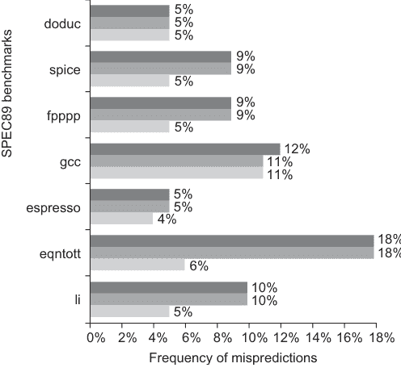

**图 3.3 2 位预测器的比较。** 首先是针对 4096 位的非相关预测器，随后是具有无限条目的相关 2 位预测器，以及一个具有 2 位全局历史且总计 1024 条条目的 2 位预测器。尽管这些数据针对的是旧版本的 SPEC，但更近的 SPEC 基准测试将显示出相似的准确性差异。

锦标预测器是混合或合金预测器的另一种形式。

锦标预测器可以在中规模（8K-32K 位）下获得更好的准确性，并能有效使用大量的预测器。现有的锦标预测器对每个分支使用 2 位饱和计数器，根据哪种预测器（局部、全局甚至某些随时间变化的混合）在最近的预测中最有效，在两个不同的预测器之间进行选择。在简单的 2 位预测器中，饱和计数器需要两次误预测后才会更改首选预测器的标识。

锦标预测器的优势在于它能够为特定分支选择正确的预测器，这对于整数基准测试是至关重要的。

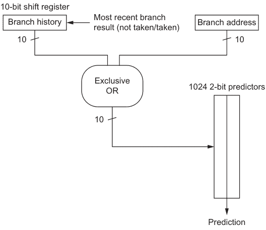

图 3.4 一个具有 1024 条条目的 gshare 预测器，每个条目都是标准的 2 位预测器。

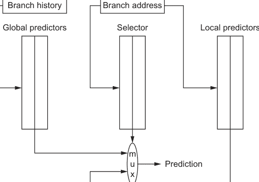

**图 3.5 一个锦标预测器，使用分支地址来索引一组 2 位选择计数器，计数器在局部和全局预测器之间进行选择。** 在这种情况下，选择表的索引是当前分支地址。这两个表也是分别由全局历史和分支地址索引的 2 位预测器。选择器的作用类似于 2 位预测器，当连续连续两次误预测时，更改分支地址的首选预测器。用于索引选择表和局部预测器表的分支地址位数等于索引全局预测表所使用的全局分支历史的长度。注意，误预测有点棘手，因为我们需要同时更改选择表以及全局或局部预测器。

### 3.3 使用高级预测降低分支成本

一个典型的锦标预测器在 SPEC 整数基准测试中 40% 的时间会选择全局预测器，在 SPEC FP 基准测试中选择的时间小于 15%。除了开创锦标预测器的 Alpha 处理器外，几种 AMD 处理器也使用了锦标风格的预测器。

图 3.6 查看了三种不同预测器（2 位预测器、相关预测器和锦标预测器）在 SPEC89 上的性能。局部预测器最达到极限。相关预测器显示出显著改进，锦标预测器显示出略好的性能。尽管这些是针对旧版本的 SPEC，但近期 SPEC 基准测试显示出相似的行为，可能在更大的预测器尺寸下收敛于极限。

局部预测器由两级结构组成：第一层是历史表，第二层是2 位饱和计数器表。相关预测器使用全局历史索引。锦标预测器使用选择器在局部和全局预测器之间进行选择。

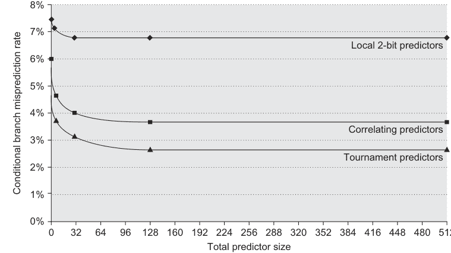

**图 3.6 SPEC89 上三种不同预测器的误预测率，以 KB 为单位。预测器分别为 2 位预测器、相关预测器和锦标预测器。**

## 标记混合预测器

截至2017年，最好的分支预测方案涉及结合多个跟踪预测可能与当前分支相关的预测器。一种重要的预测器类部分地基于一种名为 PPM（部分匹配）的统计压缩算法。PPM（见 Jiménez 和 Lin，2001）与分支预测算法一样，根据历史预测未来行为。这类分支预测器被我们称为标记混合预测器（见 Seznec 和 Michaud，2006），采用系列使用不同历史长度索引的全局预测器。

例如，如图 3.7 所示，五组件标记混合预测器具有五个预测器：P(0), P(1), ... P(4)，其中 P(i) 使用以下内容的哈希值进行访问：

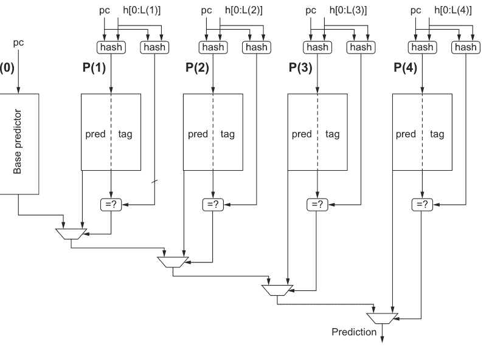

**图 3.7 一个五组件标记混合预测器具有五个独立的预测表，通过分支地址和长度为 0-4 的近期分支历史段（图中标记为 "h"）的哈希值进行索引。每个预测器都是 2 位（可能是 3 位）预测器。标记通常为 4–8 位。所选预测是标记也匹配的历史长度最长的那个。

## 3.3 使用高级分支预测减少分支开销

PC（程序计数器）和最近几次分支分支的历史（存储在移位寄存器 h 中，与 gshare 相同）。使用多个长度的历史记录来索引不同的预测器是首个关键区别。第二个关键区别是在预测器 P(1) 到 P(4) 中使用了标签（tags）。这些标签是短位的，因为不需要 100% 的匹配；一个 4-8 位的短标签似乎就能获得大部分优势。只有当标签与分支地址的哈希值以及全局分支历史相匹配时，才会使用来自 P(1)...P(4) 的预测结果。P(0...n) 中的每个预测器都可以是标准的 2 位预测器。在实践中，3 位计数器（需要三次预测错误才能改变预测）比 2 位计数器提供的结果略偏优。

对于给定分支的预测结果是具有最长分支历史且标签匹配的预测器。P(0) 总是匹配，因为它不使用标签，并且当 P(1) 到 P(n) 都不匹配时，它将成为默认值。这种预测器的标记混合版本还包含一个用于历史索引预测器的 2 位字段。该字段指示某个预测在最近是否被使用过，因此可能更准确；该字段可以定期地重置所有条目，以清除旧的预测。实现这种风格的预测器涉及更多细节，特别是如何处理预测错误。最优预测器的搜索空间非常大，因为预测器的数量、用于索引的精确历史记录以及每个预测器的尺寸都是可变量的。

标记混合预测器（有时称为 TAGE——标记几何——预测器）和早期的基于 PPM 的预测器是最近年度国际分支预测竞赛的获胜者。此类预测器在仅需适量内存（32-64 KiB）的情况下，性能就优于 gshare 和锦标预测器，此外，此类预测器似乎能够有效利用更大的缓存来提高预测准确性。

对于较大的预测器，另一个问题是如何初始化预测器。它是随机初始化的，在这种情况下，需要大量的执行时间来向预测器填充有用的预测。某些预测器（包括最近的预测器）包含一个有效位，用于指示预测器中的条目是已设置还是“未使用的”。在后一种情况下，与其使用随机预测，我们可以使用某些方法来初始化该预测器条目。例如，某些指令会设置一个位，指示关联的分支预期跳转还是不跳转。然而，在动态分支预测之前的时代，该位可以用于设置初始预测：前向分支被初始化为不跳转，而后向分支（很可能是循环分支）被初始化为跳转。对于运行时间较短且预测器较大的程序，这种设置可以对预测性能产生可衡量的影响。

> 图 5 显示，混合预测器的性能显著优于 gshare，特别是对于像 SPECint 和服务器应用这类较难预测的程序。在图中，性能的衡量标准是每千条指令的预测错误次数；假设分支频率为 20%–25%，gshare 在多媒体基准测试中的分支预测错误率（每个分支）为 2.7%–3.4%，而标记

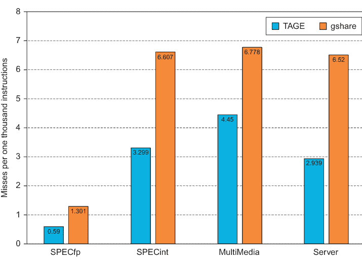

图 3.8 标记混合预测器与 gshare 的预测错误率比较（以每执行 1000 条指令的预测错误次数衡量）。两个预测器使用相同位数的，尽管标记混合预测器使用部分存储空间用于标签，而 gshare 不包含标签。基准测试由来自 SPECfp 和 SPECint 的轨迹组成，这是一系列多媒体和服务器基准测试。后两者的行为更像 SPECint。

混合预测器的预测错误率为 1.8%–2.2%，或者说大约为三分之一的预测错误。与 gshare 相比，标记混合预测器的实现更为复杂，且由于需要检查多个标签并选择预测结果，速度略慢。尽管如此，对于分支预测失败有惩罚的深度流水线处理器来说，准确性的增加超过了这些缺点。因此，许多高端处理器的设计师选择在他们最新的实现中包含标记混合预测器。

## Intel Core i7 分支预测器的演变

正如上一章提到的，在 2008 年到 2016 年之间共有六代 Intel Core i7 处理器（Core i7，使用 Nehalem 架构的 920 以及使用 Skyline 架构的 670）。由于深度流水线和每周期多次发射，i7 同时存在许多指令（至少 256）。这使得分支预测变得至关重要，这也是 Intel 一直不断改进的领域。可能因为分支预测的性能特性，Intel 倾向于对其分支预测器保持保密。

## 3.4 使用动态调度克服数据冒险

对于如 2009 年引入的 Core i7 920 等较旧处理器，它们发布的信息有限。在本节中，我们将简要描述已知信息，并比较 i7 的预测器性能。

i7 920 使用双级预测器，带有一个较小的第一级预测器用于管理每周期预测分支的限制，以及一个较大的二级预测器作为备份。每个预测器结合了三种不同的预测器：(1) 简单的 2 位预测器（见附录 C）；(2) 我们看到的全局历史预测器；以及 (3) 循环退出预测器。循环退出预测器预测检测为循环的分支跳转次数（即迭代次数）。对于每个分支，通过跟踪每个预测器的准确性从这三者中选择预测，类似于锦标预测器。除了这种多级预测器外，还有一个独立单元预测间接分支的目标，并且使用了返回地址栈。

尽管对最新 i7 处理器的预测器了解较少，但有理由相信 Intel 正在使用标记混合预测器。这种预测器的优点之一是它结合了早期 i7 中所有二级预测器的功能。具有不同历史长度的标记混合预测器包含了循环退出预测器以及本地和全局历史预测器。独立的返回地址预测器仍然被采用。

在其他情况下，预测会导致评估出现一些挑战，因为预测错误的分会导致另一个分支被获取并预测错误。为了保持简单，我们查看预测错误占成功完成分支（非误预测产生的分）的百分比。图 3.9 显示了 SPECInt2006 基准测试的数据。这些基准测试比 SPEC2000 大得多，结果是预测错误率比图 3.6 中更强大的预测器组合要高。


静态调度流水线处理并发射指令，除非流水线中已有的指令与获取的指令之间存在无法通过旁路或转发隐藏的数据依赖。转发逻辑减少了有效的流水线延迟，使得依赖关系不会产生冒险。如果存在无法隐藏的数据依赖，冒险检测硬件将使流水线从使用结果的指令开始停顿。直到依赖关系被清除，新的指令才会被获取或发射。

# 第三章 指令级并行及其利用

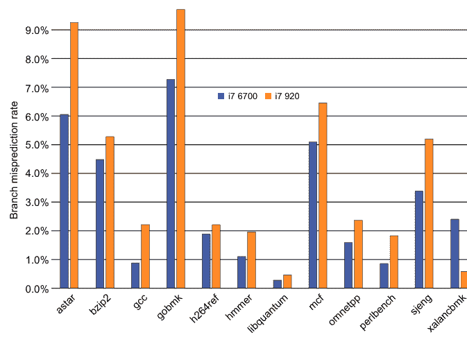

**图 3.9 在 Intel Core i7 920 和 6700 上整数 SPECPU2006 基准测试的预测错误率。** 预测错误率的计算值为预测错误的分支与所有完成分支的比例。如果一个分支预测错误并导致了另一个（本不应执行）分支，这种方法可能会略微低估预测错误率。平均而言，i7 920 的分支预测错误频率是 i7 6700 的 1.3 倍。

流和异常行为。动态调度具有若干优势。首先，它允许为某一种流水线编译的代码在不同的流水线上高效运行，消除了为不同的微架构准备多个二进制文件并进行重新编译的需求。在当今的计算环境中，许多软件来自第三方并以二进制形式发布，这一优势是显著的。其次，它能够处理编译时未知依赖关系的情况；例如，这些依赖可能涉及内存引用或依赖分支，或者可能由于使用动态链接或分发的现代编程环境。可能最重要的一点是，它允许处理器在等待不可预测的延迟（如缓存缺失）时继续执行代码，从而容忍了这些延迟。在第 3.6 节中，我们将探索硬件猜测，这是一种具有额外性能优势的技术，它建立在动态调度的基础上。正如我们所看到的，动态调优的优势是以硬件复杂性大幅增加为代价的。

尽管动态调度处理器不能改变数据流，但它试图在存在依赖关系时避免停顿。相比之下，编译器的静态流水线调度（第 3.2 节介绍）通过分离依赖指令来最小化停顿，使其不会导致冲突。当然，

`fmul.d` 和 `fadd.d`（针对寄存器 `f0`）之间存在相互依赖，如果流水线在 `fdiv.d` 之前执行了 `fadd.d`（后者正在等待 `fdiv.d`），它将违反这种相互依赖，产生 WAR 冲突。同样，为了避免违反输出依赖（即当 `fadd.d` 完成对 `f0` 的写入时），必须处理 WAW 冲突。正如我们所看到的，这些冲突通过使用寄存器重命名得以避免。

# 第三章 指令级并行及其利用

乱序完成也为处理异常时引入了巨大的复杂性。带有乱序完成的动态调度必须保持异常行为，即：如果程序按照严格程序顺序执行，将会产生的那些异常，实际上也会发生。动态调度处理器通过延迟对相关异常的通知来保持异常行为，直到处理器知道该指令应该是下一条完成的指令为止。

尽管必须保持异常行为，但动态调度处理器可能会产生不精确异常（imprecise exceptions）。如果处理器状态看起来并不完全像指令按照严格程序顺序顺序执行的那样，则该异常是不精确的。不精确异常由于两种可能性产生：

- 1. 流水线可能已经完成了在程序顺序上比引起异常指令更靠后的指令。
- 2. 流水线可能尚未完成某些在程序顺序上比引起异常指令更早的指令。

不精确异常使得异常发生后重启执行变得困难。我们不会在本节中解决这些问题，而将在第 3.6 节中讨论在具有猜测机制的处理器上下文中提供异常的解决方案。对于浮点异常，已使用了其他解决方案，见附录 J。

为了允许乱序执行，我们本质上将五级流水线的 ID（译码）阶段拆分为两个阶段：

- 1. 发射（Issue）——解码指令，检查结构冲突。
- 2. 读取（Read）——等待无数据冲突，然后读取操作数。

指令取指阶段在发射阶段之前，可能会取指任何一条指令。执行阶段紧随读取阶段之后，执行可能需要多个周期。为了允许乱序执行，我们区分了指令何时开始执行以及何时完成；取决于功能单元。正如我们所看到的，如果没有这种能力，动态调优的优势就会消失。在流水线中同时执行多个指令需要多个功能单元或流水线功能单元。由于这些能力（流水线功能单元和多个功能单元）在目的上是等价的，我们假设处理器具有多个功能单元。

在动态调度的流水线中，指令在发射阶段按序通过；然而，可以乱序进入执行。冲突板（Scoreboarding）这种技术源于 CDC 6600，它允许指令乱序执行。冲突板跟踪指令的操作数何时可用，以最小化 RAW 冲突；而 Tomasulo 方法通过重命名寄存器来最小化 WAW 和 WAR 冲突。虽然现代处理器中有很多这种方案的变体，但它们都依赖于两个原理：动态确定指令何时准备好执行，以及重命名寄存器以避免冲突。

IBM 的目标是从指令集和编译器实现高性能的浮点运算，适用于整个 360 计算机家族，而不是仅针对高端处理器的专用编译器。360 架构只有四个双精度寄存器，这限制了编译器调优的有效性；这也是开发 Tomasulo 方法的另一个动机。由于 360/91 具有内存访问和长浮点延迟，Tomasulo 算法正是为了克服这些问题设计的。我们在 RISC-V 指令集的范围内解释该算法，专注于浮点单元和存储单元。RISC-V 与 360 的主要区别在于后者存在寄存器 内存指令。由于 Tomasulo 算法使用功能单元，添加寄存器-内存寻址不需要任何更改。此外，Tomasulo 算法可以扩展到处理猜测，通过预测分支结果、并在预测错误时采取纠正措施来减少分支的影响。

## 3.4 通过动态调度克服数据冲突

### 使用 Tomasulo 方法的动态调度

IBM 360/91 浮点单元使用了一种复杂的方案允许乱序执行。该方案由 Robert Tomasulo 发明，通过跟踪操作数何时可用来最小化 RAW 冲突，并通过重命名寄存器来最小化 WAW 和 WAR 冲突。虽然现代处理器中有很多这种方案的变体，但它们都依赖于两个原理：动态确定指令何时准备好执行，以及重命名寄存器以避免冲突。

RAW 冲突通过仅在操作数可用时才执行指令来避免，这正是简单的冲突板方法所提供的。WAR 和 WAW 冲突由于名称依赖产生，通过寄存器重命名可以消除。寄存器重命名通过重命名所有

# 第三章 指令级并行性及其利用

目标寄存器，包括那些正在等待之前的指令进行读或写操作的寄存器，这样无序写就不会影响任何依赖于操作数早期值的指令。如果 ISA（指令集架构）中有足够的寄存器，编译器通常可以实现重命名。原始的 360/91 只有四个浮点寄存器，Tomasulo 算法的创建是为了克服这一限制。现代处理器拥有 32-64 个浮点和整数寄存器，在最近的实现中，重命名寄存器的数量达到了数百。

为了理解重命名如何消除 WAR（写后读）和 WAW（写后写）冲突，考虑以下包含潜在 WAR 和 WAW 冲突的示例序列：

```
fdiv.d f0,f2,f4
fadd.d f6,f0,f8
fsd f6,0(x1)
fsub.d f8,f10,f14
fmul.d f6,f10
```

这里之间存在两处依赖关系：`fadd.d` 与 `fsub.d` 之间，`fdiv.d` 与 `fmul.d` 之间。`fdiv.d` 和 `fmul.d` 之间还存在输出依赖，由于 `fsub.d` 的使用，以及一个 WAR 冲突（因为 `fsub.d` 可能比 `fmul.d` 晚完成）。此外，还有三处数据依赖：`fdiv.d` 与 `fadd.d` 之间，`fsub.d` 与 `fmul.d` 之间，以及 `fmul.d` 与 `fsd` 之间。

这三个名称依赖都可以通过寄存器重命名消除。为了简单起见，假设存在两个临时寄存器 S 和 T。使用 S 和 T，可以将该序列重写为无任何依赖的形式：

```
fdiv.d f0,f2,f4
fadd.d S,f0,f8
fsd S,0(x1)
fsub.d T,f10,f14
fmul.d f6,f10,T
```

此外，任何对 `f8` 的使用都必须被寄存器 T 替换。在这个示例中，重命名过程可以通过编译器静态完成。寻找代码后续任何对 `f8` 的使用需要更复杂的编译器分析或硬件支持，因为在代码段和 `f8` 的使用之间可能存在中间分支。正如我们将看到的，Tomasulo 算法可以处理重命名分支。

在 Tomasulo 方案中，寄存器重命名由保留站（reservation stations）提供，它们缓存了等待执行指令的操作数，并与功能单元关联。基本思想是，保留站一旦操作数可用立即获取并缓存，而无需从寄存器获取操作数。此外，待处理指令指定将提供其输入的保留站。最后，当寄存器的连续写入在执行中重叠时，只有最后一次会被用于更新寄存器。随着指令的发射，待处理操作数的指定被重命名为保留站的名字，从而实现了寄存器重命名。

由于保留站可能多于实际寄存器，该技术甚至可以消除编译器无法消除的名称依赖引起的冲突。当我们探索 Tomasulo 方案的组件时，将回到寄存器重命名主题，并具体观察它是如何发生的以及如何消除 WAR 和 WAW 冲突的。

使用保留站而不是集中寄存器堆导致了另外两个重要特性。首先，冲突检测和执行控制是分布式的：每个功能单元保留站中所持的信息决定了指令何时可以在该单元开始执行。其次，结果直接从缓存操作数的保留站传递到功能单元，而不是通过寄存器。这种旁路（bypassing）是通过公共总线实现的，允许所有等待操作数的单元同时被加载（在 360/91 中，这被称为公共数据总，或 CDB）。在每周期发射多条指令并具有执行单元的流水线中，需要多个结果。

3.10 显示了基于 Tomasulo 的处理器的基本结构，包括浮点单元和加载/存储单元；未显示任何控制表。每个保留站持有一个已发射并等待在功能单元执行的指令。如果指令的操作数值已经计算完毕，它们也会存储在在那里；否则，保留站条目将保留提供操作数值的保留站名称。

加载缓冲区和存储缓冲区持有来自内存和发往内存的数据或地址，其行为几乎类似于保留站，我们只在需要时才区分它们。浮点寄存器通过一对总线连接到功能单元，通过单条总线连接到存储器。来自功能单元和内存的所有结果都发送到公共数据线，该总线通往加载缓冲区以外的所有地方。所有保留站都有标签字段，供流水线控制使用。

在描述保留站的细节和算法之前，让我们看看指令所经历的步骤。只有三个步骤，每个步骤都可能花费任意数量的时钟周期：

- 1.—从指令队列头部获取下一条指令，队列以先进先出（FIFO）顺序维护以确保正确数据流的维护。如果存在匹配的空保留站，则将指令发射到该站并带上操作数值（如果它们当前在寄存器中）。如果没有空保留站，则存在结构冲突，指令将停顿直到站或缓冲区被释放。如果操作数不在寄存器中，则跟踪将产生操作数的功能单元。这一步重命名寄存器，消除了 WAR 和 WAW 冲突。（此阶段在处理器中有时称为发射 dispatch。）
- 2.—执行——如果操作数不可可用，站等待其被计算。当所有操作数可用时，操作可以开始。当结果可用时，它被放入保留站。（某些处理器将其称为发射 issue，但我们使用执行 execute。）
- 3.—写——当结果可用时，将其写入 CDB 并写入寄存器以及任何等待此结果的保留站。存储在存储缓冲区中，直到存储值和存储地址可用；然后内存单元空闲，即可写入。

## 3.4 通过动态调度克服数据冲突

注意多个指令可能在一个周期内进入功能单元就，单元需要在它们之间进行选择。然而，加载和存储存在额外的复杂性。加载和存储需要两个步骤的执行过程。第一步在基寄存器可用时完成有效地址计算，并将其放入缓冲区。加载缓冲区中的加载在内存单元可用时立即执行。存储缓冲区中的存储等待存储值后再进入内存单元。

为了保留异常行为，不允许指令执行程序顺序中之前的分支。这种限制保证了引起异常的指令将被执行（正如所有调度处理器所做的），这意味着处理器在允许分支开始之前知道分支预测是正确的。如果处理器记录异常的发生但不触发它，指令可以开始执行，但在进入写结果阶段之前停顿。预测提供了一种更灵活、完整的异常处理方法，因此我们将稍后讨论这种增强以及预测如何处理这个问题。

检测和消除冲突的数据结构连接到保留站、寄存器堆以及加载和存储缓冲区，并带有显著不同的信息。这些标签本质上是用于重名的扩展虚拟寄存器的名称。在我们的示例中，标签字段是一个 4 位数值，表示五个保留站之一或五个加载缓冲区之一。这种组合产生了等同于 10 个可以指定为结果的寄存器（与360 架构包含的双精度寄存器不同）。在具有更多实际寄存器的处理器中，我们希望产生更大的虚拟寄存器集，标签字段描述哪个保留站包含了作为源操作数所需的结果指令。

一旦指令发射并等待源操作数，它通过写入结果的保留站编号来引用操作数

## 第三章 指令级并行性及其利用

寄存器已分配。未使用的值（如零）表示该操作尚未完成且结果在寄存器中不可用。由于保留站的数量多于实际寄存器的数量，通过使用保留站编号对结果进行重命名消除了 WAW 和 WAR 冲突。虽然在 Tomasulo 方案中，保留站被用作扩展虚拟寄存器，但其他方法使用了带有额外寄存器的寄存器组，或者像重排序缓冲区这样的结构（我们将在 3.6 节中看到）。

在 Tomasulo 方案中（以及我们后续研究的标量执行方法中），结果会在公共数据线（CDB）上广播，保留站会对该总线进行监控。结果的广播与保留站从总线检索结果的操作结合起来，实现了静态调度流水线中的转发和旁路机制。这样做使得动态调度方案（如 Tomasulo 算法）在源操作和结果之间引入了一个时钟的延迟，因为结果与其使用之间的匹配直到写回（Write Result）阶段结束时才完成，而不是简单流水线中的执行（Execute）阶段。因此，在动态调度流水线中，产生指令与消费指令之间的有效延迟至少比产生结果的执行单元长度长一个周期。

重要的是，Tomasulo 方案中的标签指的是缓冲区或将要产生结果的单元；寄存器名称在指令使用保留站时被命名。（这是 Tomasulo 方案与记分板（scoreboarding）的关键区别：在记分板中，操作数在寄存器中操作，并且仅在产生指令完成且消费指令准备好执行后才进行读取。）

每个保留站都有以下字段：

- Op—在源操作数 S1 和 S2 上执行的操作。
- Qj—将产生对应操作数的保留站；值为 0 表示源操作数已在 Vj 或 Vk 中可用，或者不需要。
- Vj, Vk—源操作数的值。注意，对于每个操作数，V 字段或 Vk 字段仅有一个有效。对于加载（load），Vk 字段用于存储偏移字段。
- A—用于存储加载或存储（store）内存地址计算的信息。指令的立即数存储在此处；地址计算后，有效地址将存储在此处。
- Busy—表示该保留站及其附属功能单元正被占用。

寄存器文件有一个字段 Qi：

- Qi—包含应存储在此寄存器中的操作结果的保留站。如果 Qi 的值为空（0），则没有当前活动指令正在计算指向该寄存器的结果，这意味着该值仅为寄存器内容。

加载缓冲区和存储缓冲区各有一个字段 A，在执行的第一步完成后，它将持有有效地址的结果。

在下一节中，我们将首先考虑一些展示这些机制如何运作的示例，然后详细检查该算法。

## 3.5 动态调度：示例与算法

在详细检查 Tomasulo 算法之前，让我们考虑几个示例，有助于说明该算法是如何运作的。

1. `fld f6,32(x2)`
2. `fld f2,44(x3)`
3. `fmul.d d0,f2,f4`
4. `fsub.d f8,f2,f6`
5. `fdiv.d d0,f0,f6`
6. `fadd.d f6,f8,f2`

**示例：当仅第一个加载指令完成并写入其结果时，以下代码序列的信息表显示什么样：**

**答案** 图 3.11 显示了表格中的结果。附加在 Add、Mult 和 Load 名称后的数字代表来自第一个 add 单元的结果的标签。此外，我们还包含了一个指令状态表。包含此表仅是为了帮助你理解算法；它并不是硬件的一部分。相反，保留站保持了已发射每个操作的状态。

> Tomasulo 方案比早期且更简单的方案有两个优势：(1) 冲突检测逻辑的分布，以及 (2) 消除了 WAW 和 WAR 冲突的停顿。

第一个优势源于分布式的保留站和 CDB 的使用。如果多条指令等待同一个结果，可以通过在 CDB 上广播结果来同时释放这些指令。如果使用集中式寄存器文件，单元必须在寄存器可用时从寄存器中读取其结果。

第二个优势——消除 WAW 和 WAR 冲突，通过使用保留站重命名寄存器，以及在操作数可用时立即将其存储到保留站的过程中来实现。

例如，图 3.11 中的代码序列同时发射了 `fdiv.d` 和 `fadd.d`，尽管存在涉及 `f6` 的 WAR 冲突。冲突通过两种方式之一消除。首先，如果为 `fdiv.d` 提供值的指令已完成，Vk 将存储结果，允许 `fdiv.d` 独立于 `fadd.d` 执行（这是目前的情况）。另一方面，如果 `fld` 未完成，Qk 将指向 Load1 保留站，`fdiv.d` 指令将独立于 `fadd.d`。因此，在任何情况下，`fadd.d` 都可以发射并开始执行。对 `fdiv.d` 结果任何使用将指向保留站，允许 `fadd.d` 完成并存储到寄存器。

| 指令状态 | 发射 (Issue) | 执行 (Execute) | 写结果 (Write result) |
| :--- | :--- | :--- | :--- |
| `fld` | `f6,32(x2)` | | ✓ |
| `fld` | `f2,44(x3)` | | ✓ |
| `fmul.d` | `d0,f2,f4` | | |
| `fsub.d` | `f8,f2,f6` | | |
| `fdiv.d` | `d0,f0,f6` | | |
| `fadd.d` | `f6,f8,f2` | | |
| 保留站 | 名称 | 占用 (Busy) | 操作 (Op) | Vj | Vk | Qj | Qk | A |
| :--- | :--- | :--- | :--- | :--- | :--- | :--- | :--- | :--- |
| Load1 | No | | | | | | |
| Load2 | No | | | | | | |
| Add1 | No | | | | | | |
| Add2 | No | | | | | | |
| Add3 | No | | | | | | |
| Mult1 | Yes | MUL | Mem[44 + Regs[x3]] | Regs[f4] | | | |
| Mult2 | Yes | DIV | | Mem[32 + Regs[x2]] | Mult1 | | |
| 寄存器状态 | f0 | f2 | f4 | f6 | f10 | f12 | ... | f30 |
| :--- | :--- | :--- | :--- | :--- | :--- | :--- | :--- | :--- |


| Qi | Mult1 | | | | Mult2 | | | |

**图 3.12** 乘法和除法是仅未完成的指令。

# Tomasulo 算法：细节

图 3.13 规定了每条指令必须经过的检查和步骤。如前所述，加载（loads）和存储（stores）在进入独立的加载或存储缓冲区之前，会先通过一个功能单元进行有效地址计算。加载需要第二个执行步骤来访问内存，然后进入 Write Result（写结果）阶段，将内存值发送到寄存器文件和/或任何等待的保留站。存储在 Write（写）阶段完成执行，并写入内存。注意，所有的写操作都发生在 Write Result 阶段，无论目标是寄存器还是内存。这一限制简化了 Tomasulo 算法，并且对于第 3.6 节中推测的扩展至关重要。

# Tomasulo 算法：基于循环的示例

为了理解消除动态寄存器重名的完整威力，我们必须观察一个循环。考虑以下将数组元素乘以标量并存储在 `f2` 的简单序列：

```
Loop: fld f0,0(x1)
fmul.d f4,f0,f2
sfd f4,0(x1)
addi x1,x1,-8
bne x1,x2,Loop // 如果 x1!=x2 则跳转
```

如果我们预测分支会被跳转，那么使用保留站将允许多次循环执行同时进行。这种优势是在不改变代码的情况下获得的——实际上，循环是由硬件动态展开的，而保留站通过获取的保留站充当了额外寄存器的作用。

假设我们已经发射了循环的两次连续迭代中的所有指令，但没有一个浮点加载/存储或操作已经完成。图 3.14 显示了此时的保留站、寄存器状态和存储缓冲区。（忽略了整数 ALU 操作，并假设分支被预测为跳转。）一旦系统达到这一步，就可以维持两个循环副本，且 CPI 接近 1.0，乘法操作可以在四个时钟周期内完成。由于存在六六个时钟周期的延迟，在达到稳定状态之前，还需要额外的迭代来继续。这需要更多的保留站来持有正在执行的指令。正如我们在本章后面将看到的，当扩展为多发射指令时，Tomasulo 方法可以维持每时钟周期超过一条指令执行。

只要加载和存储访问的是不同的地址，它们就可以乱序执行。如果加载和存储访问同一个地址，则发生以下两种情况之一：

## 指令状态 等动作与预订

| 发射 (Issue) | 状态 (State) | 动作与预订 (Action and booking) |

| :--- | :--- | :--- |

| FP 操作 | 保留站空 | if (RegisterStat[rs].Qi!=0) [RS[r].Qj ← RegisterStat[rs].Qi] else [RS[r].Vj ← Regs[rs];RS[r].Qj ← 0); if (RegisterStat[rt].Qi!=0) [RS[r].Qk ← RegisterStat[rt].Qi] else [RS[r].Vk ← Regs[rt];RS[r].Qk ← 0); RS[r].Busy ← yes; RegisterStat[rd].Q ← r; |

| 加载或存储 | 缓冲区空 | if (RegisterStat[rs].Qi!=0) [RS[r].Qj ← RegisterStat[rs].Qi] else [RS[r].Vj ← Regs[rs];RS[r].Qj ← 0); RS[r].A ← imm; RS[r].Busy ← yes; |

| 仅加载 | 仅存储 | if (RegisterStat[rt].Qi!=0) [RS[r].Qk ← RegisterStat[rs].Qi] else [RS[r].Vk ← Regs[rt];RS[r].Qk ← 0); |

| 执行 FP 操作 | (RS[r].Qj=0) and (RS[r].Qk=0) | 计算结果：操作数在 Vj 和 Vk 中 |

| 加载/存储 1 | 加载存储队列 | RS[r].Qj=0 and r 是 RS[r].A 的头部 RS[r].A ← RS[r].Vj+RS[r].A; |

| 加载 2 | 加载 1 完成 | 从 Mem[RS[r].A] 读取 |

| 写 FP 操作或加载 | 在 r处完成执行且 CDB 可用 | Vx(RegisterStat[x].Oi=r ← result; RegisterStat[x].Qi ← 0); if(RS[x].Qj=0) RS[x].Vj; result;if(RS[x].Qk=0) RS[x].Vk; result;RS[r].Busy ← 0); RS[r].Busy ← no; |

| 存储 | 在 r处完成执行且 RS[r].Qk=0 | Mem[RS[r].A] ← RS[r].Vk; RS[r].Busy ← no; |

**图 3.13** 算法步骤以及每个步骤的要求。对于发射，`rd` 是目标，`rs` 和 `rt` 是寄存器号，`imm` 是立即数字段，`r` 是保留站或缓冲区编号。`RegisterStat` 是寄存器状态数据。当指令发射或指令完成执行并写入时，CDB 写回结果。所有 `Qi` 或 `Qk` 相同的缓冲区和保留站都标记值已接收。CDB 可以在单个时钟周期内将结果广播到多个目标，如果等待指令的操作可用，它们可以在下一个周期开始执行。加载在执行阶段经过两个步骤，在写阶段执行略有不同，可能需要等待结果。记住，为了防止冲突，如果程序顺序之前的分支尚未完成，则不允许指令执行。由于发射阶段后不再维护程序顺序，这种限制通常通过防止在流水线中存在挂起分支时指令离开来实现。在第 3.6 节，我们将看到推测如何消除这一点。（img/ad86629873f6e399fc049b236_0.png）

# 指令级并行及其利用

| 指令 | 迭代 | 发射 | 执行 | 写结果 |

| :--- | :--- | :--- | :--- | :--- |

| fld | f0,0(x1) | 1 | ✓ | |

| fmul.d | f4,0,f2 | 1 | ✓ | |

| fsd | f4,0(x1) | 1 | | |

| fld | f0,0(x1) | 2 | ✓ | ✓ |

| fmul.d | f4,0,f2 | 2 | ✓ | |

| fsd | f4,0(x1) | 2 | ✓ | |

| 名称 | 忙 | 操作 | Vj | Qk | A |

| :--- | :--- | :--- | :--- | :--- | :--- |

| Load1 | Yes | Load | | | Regs[x1] + 0 |

| Load2 | Yes | Load | | | Regs[x1] - 8 |

| Add1 | No | | | | |

| Add2 | No | | | | |

| Add3 | No | | | | |

| Mult1 | Yes | MUL | Regs[f2] | Load1 | |

| Mult2 | Yes | MUL | Regs[f2] | Load2 | |

| Store1 | Yes | Store | Regs[x1] | | Mult1 |

| Store2 | Yes | Store | Regs[x1] - 8 | | Mult2 |

| 字段 | f0 | f2 | f4 | f6 | f8 | f10 | f12 | ... | f30 |

| :--- | :--- | :--- | :--- | :--- | :--- | :--- | :--- | :--- |

| Qi | Load2 | | Mult2 | | | | | |

两个活跃的循环迭代，还没有指令完成。乘法器保留站中的条目表明，未处理的加载指示乘法目标是待存储的值的源。

- 加载在程序顺序上存储之前，交换它们会导致 WAR 冲突。
- 存储在程序顺序上加载之前，交换它们会导致 WAW 冲突。

同样，交换到相同地址的两个存储会导致 WAW 冲突。因此，为了确定加载可以在给定时间执行，处理器可以检查是否有未完成的存储在程序顺序上于加载

# 3.5 动态调度：示例与算法

与加载相同的数据内存地址。同样，存储必须等待到没有程序顺序在前且共享相同数据内存地址的未执行加载或存储。我们在第 3.9 节中考虑一种消除这种限制的方法。

为了检测此类冲突，处理器必须计算与任何早期内存操作相关的数据地址。一种简单但不一定是最优的方法是确保处理器拥有所有地址以按程序顺序执行有效地址计算。（我们确实需要保持存储与其他内存引用之间的相对顺序；也就是说，加载可以重排序。）

让我们考虑加载的情况。如果我们按程序顺序执行有效地址计算，那么当加载完成有效地址计算时，我们可以检查是否与存储缓冲区中所有活动条目的字段冲突，但在该加载在冲突存储完成之前不会发送到加载缓冲区。（某些实现直接从挂起的存储旁路值，减少该 RAW 冲突的延迟。）

存储的操作类似，但处理器必须检查加载缓冲区和存储区的冲突，因为冲突存储不能相对于加载或存储进行重排序。

动态调度流水线可以产生极高的性能，只要分支预测准确——我们在上一节中讨论过这个问题。Tomasulo 方案在 360/91 之后多年未使用，但在 20 世纪 90 年代开始在多发射处理器中广泛采用，原因如下：

# 第208 页 第三章 指令级并行性及其利用

- 1. 虽然 Tomasulo 算法是在缓存出现之前设计的，但缓存的出现（带有其固有的不可预测的延迟）已成为动态调度的主要动力之一。乱序执行允许进程在等待缓存缺失完成的同时继续执行指令，从而隐藏了全部或部分的缓存惩罚。
- 2. 随着处理器的发射能力变得更加激进，且设计人员开始关注难以调度代码（如大多数非数值代码）的性能，寄存器重命名、动态调度和推测等技术变得更加重要。
- 3. 它可以在不需要要求编译器将代码针对特定流水线结构进行优化的情况下实现高性能，这在通用市场软件时代是一项宝贵的特性。

## 基于硬件的推测

当我们尝试利用指令级并行性时，维持控制依赖成为了一项日益增长的负担。分支预测减少了由于分支导致的直接停顿，但对于每个时钟周期执行多条指令的处理器来说，准确预测分支可能不足以产生所需的指令级并行性。宽发射处理器可能需要每个周期执行一个分支以保持最大性能。因此，利用更多的并行性要求我们克服控制依赖的限制。

克服控制依赖的方法是通过对分支结果进行推测，并假定我们的猜测是正确的来执行程序。这种机制是分支预测结合动态调度的一种细微但重要的扩展。特别地，通过推测，我们取指、发射并执行指令，因为我们的分支预测总是正确的；而动态调度只取指和发射指令。当然，我们需要机制来处理推测错误的情况。附录 H 讨论了支持编译器支持推测的各种机制。在本节中，我们探索了硬件推测，它扩展了动态调度的思想。

基于硬件的推测结合了三个核心思想：(1) 动态分支预测以选择执行哪些指令；(2) 推测允许在控制依赖解决之前执行指令（并具有撤销错误推测序列影响的能力），以及(3) 动态调度以处理不同基本块组合的调度。（相比之下，不带推测的动态调度只部分重叠基本块，因为它要求在实际执行后继基本块中的任何指令之前必须先解决分支。）

## 3.6 基于硬件的推测 209 页

基于硬件的推测遵循预测的数据值流来选择执行的指令。这种执行程序的方法本质上是*数据流执行*：操作一旦操作数可用，就会立即执行。

为了扩展 Tomasulo 算法以支持推测，我们必须将指令之间的结果旁路（推测性执行指令所需要的）与指令的实际完成隔离开。通过这种分离，我们可以允许指令执行并将其结果旁路给其他指令，而不允许该指令执行任何可以撤销的操作，直到我们知道该指令不再具有推测性。

使用旁路值就像执行推测性读取，因为在指令不再具有推测性之前，我们并不知道提供源寄存器值的指令是否提供了正确的结果。当指令不再具有推测性时，我们允许它更新寄存器文件或内存；我们将指令序列中的这一额外步骤称为*提交*（commit）。

实现推测的核心思想是允许指令乱序执行，但强制它们*按顺序*提交，并在指令提交之前防止其执行不可逆转的操作（如更新状态或抛出异常）。因此，当我们添加推测时，我们需要将完成执行的过程与指令提交分开，因为指令可能在准备好提交之前很久就已经完成了执行。在指令执行序列中添加此提交阶段需要一组额外的硬件缓冲区，用于保存已完成执行但尚未提交的指令结果。这种硬件缓冲区我们称为*重排序缓冲区*（reorder buffer），用于在可能推测的指令之间传递结果。

重排序缓冲区 (ROB) 像 Tomasulo 算法中的保留站扩展寄存器组一样提供了额外的寄存器。ROB 在与指令相关的操作完成与指令提交之间持有该指令的结果。因此，ROB 是指令的操作数源，就像保留站在 Tomasulo 算法中提供操作数一样。关键区别在于，在 Tomasulo 算法中，指令一旦将其结果写入寄存器文件。而在推测的情况下，在指令提交（我们明确知道该指令应该执行）之前，寄存器文件不会更新；因此，ROB 在执行完成和指令提交之间的间隔提供操作数。ROB 类似于 Tomasulo 算法中的存储缓冲区，为了简单起见，我们整合了存储缓冲区的功能。

3.15 显示了包含 ROB 的处理器硬件结构。ROB 中的每个条目包含四个字段：指令类型、目标字段、值字段和就绪字段。指令类型字段指示该指令是分支（无目标结果）、存储（具有内存地址目标）还是寄存器操作（ALU 操作或加载，具有寄存器目标）。目标字段提供寄存器号（对于加载

## 210 页 第三章 指令级并行性及其利用

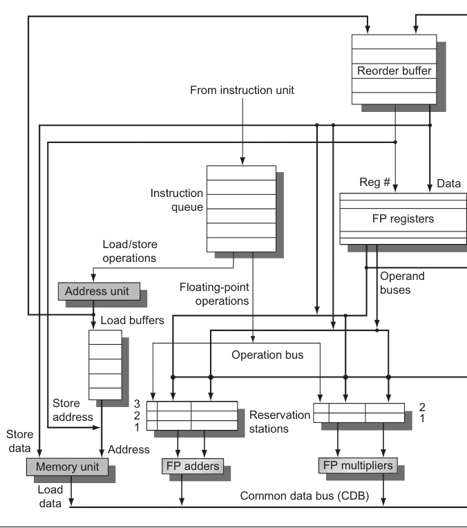

图 3.15 使用 Tomasulo 算法并扩展到处理推测的 FP 单元基本结构。与第 198 页实现 Tomasulo 算法的图 3.10 相比，我们可以看到主要的变化是增加了 ROB 并消除了存储缓冲区，后者的功能整合到了 ROB 中。这种机制允许指令按序提交。目标字段提供寄存器号（用于加载和 ALU 操作）或内存地址（用于存储）。值字段持有指令的结果。就绪字段指示结果是否可用。

## 242 3.6 基于硬件的推测

基于硬件的推测遵循预测的数据值流来选择执行的指令。这种执行程序的方法本质上是*数据流执行*：操作一旦操作数可用，就会立即执行。

以下是指令执行的四个步骤：

- 1. 从指令队列中获取指令。如果有空闲保留站和 ROB 空槽，则发射指令；如果操作数可用，将其发送到保留站。标记保留站为可用。分配给结果的 ROB 号也发送到保留站。如果所有保留站满了或 ROB 满了，则阻塞指令直到空位。
- 2. 如果一个或多个操作数可用，监控 CDB 等待结果计算。此步检查 RAW 冲突。当操作数在保留站可用时，执行操作。指令在阶段中可能需要多个周期，加载仍需要两个步骤。存储在此步骤只需要基寄存器，此时存储的执行仅是有效地址计算。
- 3. 当结果可用时，将其写入 CDB（带有指令发射时的 ROB 标签），并从 CDB 写入 ROB 以及任何等待该数据的保留站。标记保留站为可用。存储指令需要特殊操作。如果要存储的值可用，将其写入存储 ROB 条目的 Value 字段。如果存储的值可用，必须监控 CDB 直到该值广播，此时更新存储 ROB 条目的 Time 字段。
- 4. 提交——这是提交指令的最终阶段，之后其结果将保留。（某些处理器将提交此阶段称为“完成”或“毕业”。）提交时的三种不同的操作序列，取决于提交指令是预测错误的分支、存储还是其他指令（正常提交）。正常情况发生在指令到达 ROB 头部且其结果在缓冲区时；此时处理器用结果更新寄存器并从 ROB 中移除指令。提交存储类似于，但是更新内存而非寄存器。当预测错误的分支到达 ROB 头部时，表明推测是错误的。刷新 ROB 并在正确的后继处重新执行。如果分支预测正确，则分支结束。

## 212 第三章 指令级并行性及其利用

一旦指令提交（commit），它在 ROB 中的条目就会被回收，并且寄存器或内存目标地址会得到更新，从而消除了对 ROB 条目的需求。如果 ROB 满了，只需停止发射指令，直到有条目释放。现在让我们看看该方案如何与我们之前在 Tomasulo 算法中使用的示例一起工作。

假设之前示例中浮点功能单元的延迟保持不变：加法为 2 个时钟周期，乘法为 6 个时钟周期，除法为 12 个时钟周期。使用以下代码段（即我们在图 3.12 中使用的代码），展示当 `fmul.d` 准备好提交时状态表的情况。

```
fld f6,32(x2)
fld f2,44(x3)
fmul.d f0,f2,f4
fsub.d f8,f2,f6
fdiv.d f0,f0
fadd.d f6,f8,f0
```

图 3.16 显示了三个表中的结果。注意，尽管 `fsub.d` 指令已经完成执行，但在 `fmul.d` 提交之前，它不会提交。保留站和寄存器字段包含的与 Tomasulo 算法中相同的基本信息（字段的描述请见第 200 页）。区别在于，在 `Qi` 和 `Qk` 字段以及寄存器状态字段中，保留站编号被替换为 ROB 条目编号，并且我们在保留站中增加了 `Dest` 字段。`Dest` 字段指定了作为该保留站项产生的结果目的的 ROB 条目。

上述示例说明了具有推测（speculation）能力的处理器与具有动态调度能力的处理器之间的重要区别。将图 3.16 的内容与184 页的图 3.12 进行对比（后者显示了在带有 Tomasulo 算法的处理器上运行的相同代码序列），关键区别在于：在前例中，最早完成的指令（前例中的 `fmul.d`）之后的所有指令都不允许完成。相比之下，在图 3.12 中，`fsub.d` 和 `fadd.d` 指令也已经完成。

这种区别的一个影响是，带有 ROB 的处理器可以在动态执行代码的同时维持精确中断模型（precise interrupt model）。如果 `fmul.d` 指令导致中断，我们只需等待它到达 ROB 头部并处理该中断，同时清空 ROB 中任何其他待处理的指令。由于指令提交是有序的，这会产生一个精确异常。

相比之下，在使用 Tomasulo 算法的示例中，`fsub.d` 和 `fadd.d` 指令都可以在 `fmul.d` 抛出异常之前完成。结果是寄存器 `f8` 和 `f6`（`fsub.d` 和 `fadd.d` 指令的目标）可能会被覆盖（在这种情况下，中断是不精确的）。

某些用户和架构师认为，高性能处理器中的浮点异常是可以接受的，因为程序可能会终止；关于此主题的进一步讨论请参见附录 J。其他类型的异常（如页错误）如果是不精确的，将难以处理得多，因为程序在处理此类异常后必须透明地执行。


正如下一个示例所示，使用 `ROB` 进行顺序指令提交除了支持推测执行外，还能提供精确异常。

示例：考虑之前用于 `Tomasulo` 算法并在图 3.14 中所示的执行代码示例：

```
fld f0,0(x1)
fld f2,0(x3)
fmul.d f0,f2,f4
fsub.d f8,f2,f6
fdiv.d f0,f0
fadd.d f6,f8,f0
```

## 3.6 基于硬件的推测

| 条目 | Busy | 指令 | 状态 | 目标 | 值 |
|---|---|---|---|---|---|
| 1 | 否 | `fld f6,32(x2)` | Commit | `f6` | `Mem[32 + Regs[x2]]` |
| 2 | 否 | `fld f2,44(x3)` | Commit | `f2` | `Mem[44 + Regs[x3]]` |
| 3 | 是 | `fmul.d f0,f2,f4` | Write result | `f0` | `#2 × Regs[f4]` |
| 4 | 是 | `fsub.d f8,f2,f6` | Write result | `f8` | `#2 – 1` |
| 5 | 是 | `fdiv.d f0,f0,f6` | Execute | `f0` |  |
| 6 | 是 | `fadd.d f6,f8,f2` | Write result | `f6` | `#4 + #2` |

| 名称 | Busy | Op | Vj | Vk | Qj | Qk | Dest | A |
|---|---|---|---|---|---|---|---|---|
| Load1 | 否 |  |  |  |  |  |  |  |
| Load2 | 否 |  |  |  |  |  |  |  |
| Add1 | 否 |  |  |  |  |  |  |  |
| Add2 | 否 |  |  |  |  |  |  |  |
| Mult1 | 否 | `fmul.d` | `Mem[44 + Regs[x3]]` | `Regs[f4]` |  |  |  | `#3` |
| Mult2 | 是 | `fdiv.d` |  | `Mem[32 + Regs[x2]]` | `#3` |  |  | `#5` |

| 字段 | f0 | f1 | f2 | f3 | f4 | f5 | f6 | f7 | f8 |
|---|---|---|---|---|---|---|---|---|---|
| Reorder # | 3 |  |  |  |  | 6 |  |  |  |
| Busy | 是 | 否 | 否 | 否 |  | 是 |  |  |  |

**图3.16 准备好提交时**。注意，尽管 `fsub.d` 指令已经完成执行，但在 `fmul.d` 提交之前，它不会提交。保留站和寄存器字段包含的与 `Tomasulo` 算法中相同的基本信息（字段的描述请见第 200 页）。区别在于，在 `Qi` 和 `Qk` 字段以及寄存器状态字段中，保留站编号被替换为 `ROB` 条目编号，并且我们在保留站中增加了 `Dest` 字段。`Dest` 字段指定了作为该保留站项产生的结果目的的 `ROB` 条目。

上述示例说明了具有推测能力的处理器与具有动态调度能力的处理器之间的重要区别。将图 3.16 的内容与184 页的图 3.12 进行对比（后者显示了在带有 `Tomasulo` 算法的处理器上运行的相同代码序列），关键区别在于：在前例中，最早完成的指令（前例中的 `fmul.d`）之后的所有指令都不允许完成。相比之下，在图 3.12 中，`fsub.d` 和 `fadd.d` 指令也已经完成。

这种区别的一个影响是，带有 `ROB` 的处理器可以在动态执行代码的同时维持精确中断模型。如果 `fmul.d` 指令导致中断，我们只需等待它到达 `ROB` 头部并处理该中断，同时清空 `ROB` 中任何其他待处理的指令。由于指令提交是有序的，这会产生一个精确异常。

相比之下，在使用 `Tomasulo` 算法的示例中，`fsub.d` 和 `fadd.d` 指令都可以在 `fmul.d` 抛出异常之前完成。结果是寄存器 `f8` 和 `f6`（`fsub.d` 和 `fadd.d` 指令的目标）可能会被覆盖（在这种情况下，中断是不精确的）。

某些用户和架构师认为，高性能处理器中的浮点异常是可以接受的，因为程序可能会终止；关于此主题的进一步讨论请参见附录 J。其他类型的异常（如页错误）如果是不精确的，将难以处理得多，因为程序在处理此类异常后必须透明地执行。

使用一个 `ROB` 进行顺序指令提交除了支持推测执行外，还能提供精确异常，正如下一个示例所示。


| 1 | 否 | `fld f6,32(x2)` | Commit | `f6` | `Mem[32 + Regs[x2]]` |

| 2 | 否 | `fld f2,44(x3)` | Commit | `f2` | `Mem[44 + Regs[x3]]` |

| 3 | 是 | `fmul.d f0,f2,f4` | Write result | `f0` | `#2 × Regs[f4]` |

| 4 | 是 | `fsub.d f8,f2,f6` | Write result | `f8` | `#2 – 1` |

| 5 | 是 | `fdiv.d f0,f0,f6` | Execute | `f0` | |

| 6 | 是 | `fadd.d f6,f8,f2` | Write result | `f6` | `#4 + #2` |

| 名称 | Busy | Op | Vj | Vk | Qj | Qk | Dest | A |

|---|---|---|---|---|---|---|---|---|

| Load1 | 否 | | | | | | | | |

| Load2 | 否 | | | | | | | | |

| Add1 | 否 | | | | | | | | |

| Add2 | 否 | | | | | | | | |

| Mult1 | 否 | `fmul.d` | `Mem[44 + Regs[x3]]` | `Regs[f4]` | | | | `#3` |

| Mult2 | 是 | `fdiv.d` | | `Mem[32 + Regs[x2]]` | `#3` | | | `#5` |

| 字段 | `f0` | `f1` | `f2` | `f3` | `f4` | `f5` | `f6` | `f7` | `f8` |

|---|---|---|---|---|---|---|---|---|---|

| Reorder # | 3 | | | | | 6 | | | | |

| Busy | 是 | 否 | 否 | 否 | | 是 | | | | |

**图3.16 准备好提交时**。注意，尽管 `fsub.d` 指令已经完成执行，但在 `fmul.d` 提交之前，它不会提交。保留站和寄存器字段包含的与 Tomasulo 算法中相同的基本信息（字段的描述请见第 200 页）。区别在于，在 `Qi` 和 `Qk` 字段以及寄存器状态字段中，保留站编号被替换为 ROB 条目编号，并且我们在保留站中增加了 `Dest` 字段。`Dest` 字段指定了作为该保留站项产生的结果目的的 ROB 条目。

上述示例说明了具有推测能力的处理器与具有动态调度能力的处理器之间的重要区别。将图 3.16 的内容与184 页的图 3.12 进行对比（后者显示了在带有 Tomasulo 算法的处理器上运行的相同代码序列），关键区别在于：在前例中，最早完成的指令（前例中的 `fmul.d`）之后的所有指令都不允许完成。相比之下，在图 3.12 中，`fsub.d` 和 `fadd.d` 指令也已经完成。

这种区别的一个影响是，带有 ROB 的处理器可以在动态执行代码的同时维持精确中断模型。如果 `fmul.d` 指令导致中断，我们只需等待它到达 ROB 头部并处理该中断，同时清空 ROB 中任何其他待处理的指令。由于指令提交是有序的，这会产生一个精确异常。

相比之下，在使用 Tomasulo 算法的示例中，`fsub.d` 和 `fadd.d` 指令都可以在 `fmul.d` 抛出异常之前完成。结果是寄存器 `f8` 和 `f6`（`fsub.d` 和 `fadd.d` 指令的目标）可能会被覆盖（在这种情况下，中断是不精确的）。

某些用户和架构师认为，高性能处理器中的浮点异常是可以接受的，因为程序可能会终止；关于此主题的进一步讨论请参见附录 J。其他类型的异常（如页错误）如果是不精确的，将难以处理得多，因为程序在处理此类异常后必须透明地执行。

使用一个 ROB 进行顺序指令提交除了支持推测执行外，还能提供精确异常，正如下一个示例所示。

示例：考虑之前用于 Tomasulo 算法并在图 3.14 中所示的执行代码示例：

```
fld f0,0(x1)
fld f2,0(x3)
fmul.d f0,f2,f4
fsub.d f8,f2,f6
fdiv.d f0,f0
fadd.d f6,f8,f0
```

## 3.6 基于硬件的推测

| 条目 | Busy | 指令 | 状态 | 目标 | 值 |

|---|---|---|---|---|---|

| 1 | 否 | `fld f6,32(x2)` | Commit | `f6` | `Mem[32 + Regs[x2]]` |

| 2 | 否 | `fld f2,44(x3)` | Commit | `f2` | `Mem[44 + Regs[x3]]` |

| 3 | 是 | `fmul.d f0,f2,f4` | Write result | `f0` | `#2 × Regs[f4]` |

| 4 | 是 | `fsub.d f8,f2,f6` | Write result | `f8` | `#2 – 1` |

| 5 | 是 | `fdiv.d f0,f0,f6` | Execute | `f0` | |

| 6 | 是 | `fadd.d f6,f8,f2` | Write result | `f6` | `#4 + #2` |

| 名称 | Busy | Op | Vj | Vk | Qj | Qk | Dest | A |

|---|---|---|---|---|---|---|---|---|

| Load1 | 否 | | | | | | | | |

| Load2 | 否 | | | | | | | | |

| Add1 | 否 | | | | | | | | |

| Add2 | 否 | | | | | | | | |

| Mult1 | 否 | `fmul.d` | `Mem[44 + Regs[x3]]` | `Regs[f4]` | | | | `#3` |

| Mult2 | 是 | `fdiv.d` | | `Mem[32 + Regs[x2]]` | `#3` | | | `#5` |

| 字段 | `f0` | `f1` | `f2` | `f3` | `f4` | `f5` | `f6` | `f7` | `f8` |

|---|---|---|---|---|---|---|---|---|---|

| Reorder # | 3 | | | | | 6 | | | | |

| Busy | 是 | 否 | 否 | 否 | | 是 | | | | |

**图3.16 准备好提交时**。注意，尽管 `fsub.d` 指令已经完成执行，但在 `fmul.d` 提交之前，它不会提交。保留站和寄存器字段包含的与 Tomasulo 算法中相同的基本信息（字段的描述请见第 200 页）。区别在于，在 `Qi` 和 `Qk` 字段以及寄存器状态字段中，保留站编号被替换为 ROB 条目编号，并且我们在保留站中增加了 `Dest` 字段。`Dest` 字段指定了作为该保留站项产生的结果目的的 ROB 条目。

上述示例说明了具有推测能力的处理器与具有动态调度能力的处理器之间的重要区别。将图 3.16 的内容与184 页的图 3.12 进行对比（后者显示了在带有 Tomasulo 算法的处理器上运行的相同代码序列），关键区别在于：在前例中，最早完成的指令（前例中的 `fmul.d`）之后的所有指令都不允许完成。相比之下，在图 3.12 中，`fsub.d` 和 `fadd.d` 指令也已经完成。

这种区别的一个影响是，带有 ROB 的处理器可以在动态执行代码的同时维持精确中断模型。如果 `fmul.d` 指令导致中断，我们只需等待它到达 ROB 头部并处理该中断，同时清空 ROB 中任何其他待处理的指令。由于指令提交是有序的，这会产生一个精确异常。

相比之下，在使用 Tomasulo 算法的示例中，`fsub.d` 和 `fadd.d` 指令都可以在 `fmul.d` 抛出异常之前完成。结果是寄存器 `f8` 和 `f6`（`fsub.d` 和 `fadd.d` 指令的目标）可能会被覆盖（在这种情况下，中断是不精确的）。

某些用户和架构师认为，高性能处理器中的浮点异常是可以接受的，因为程序可能会终止；关于此主题的进一步讨论请参见附录 J。其他类型的异常（如页错误）如果是不精确的，将难以处理得多，因为程序在处理此类异常后必须透明地执行。

使用一个 ROB 进行顺序指令提交除了支持推测执行外，还能提供精确异常，正如下一个示例所示。

示例：考虑之前用于 Tomasulo 算法并在图 3.14 中所示的执行代码示例：

```
fld f0,0(x1)
fld f2,0(x3)
fmul.d f0,f2,f4
fsub.d f8,f2,f6
fdiv.d f0,f0
fadd.d f6,f8,f0
```


| 5 | 是 | `fdiv.d f0,f0,f6` | Execute | `f0` | |

| 6 | 是 | `fadd.d f6,f8,f2` | Write result | `f6` | #4 + #2 |

| 名称 | Busy | Op | Vj | Vk | Qj | Qk | Dest | A |

|---|---|---|---|---|---|---|---|---|

| Load1 | 否 | | | | | | | | |

| Load2 | 否 | | | | | | | | |

| Add1 | 否 | | | | | | | | |

| Add2 | 否 | | | | | | | | |

| Mult1 | 否 | `fmul.d` | `Mem[44 + Regs[x3]]` | `Regs[f4]` | | | | #3 |

| Mult2 | 是 | `fdiv.d` | | `Mem[32 + Regs[x2]]` | #3 | | | #5 |

| 字段 | `f0` | `f1` | `f2` | `f3` | `f4` | `f5` | `f6` | `f7` | `f8` |

|---|---|---|---|---|---|---|---|---|---|

| Reorder # | 3 | | | | | 6 | | | | |

| Busy | 是 | 否 | 否 | 否 | | 是 | | | | |

**图3.16 准备好提交时**。注意，尽管 `fsub.d` 指令已经完成执行，但在 `fmul.d` 提交之前，它不会提交。保留站和寄存器字段包含的与 Tomasulo 算法中相同的基本信息（字段的描述请见第 200 页）。区别在于，在 `Qi` 和 `Qk` 字段以及寄存器状态字段中，保留站编号被替换为 ROB 条目编号，并且我们在保留站中增加了 `Dest` 字段。`Dest` 字段指定了作为该保留站项产生的结果目的的 ROB 条目。

上述示例说明了具有推测能力的处理器与具有动态调度能力的处理器之间的重要区别。将图 3.16 的内容与184 页的图 3.12 进行对比（后者显示了在带有 Tomasulo 算法的处理器上运行的相同代码序列），关键区别在于：在前例中，最早完成的指令（前例中的 `fmul.d`）之后的所有指令都不允许完成。相比之下，在图 3.12 中，`fsub.d` 和 `fadd.d` 指令也已经完成。

这种区别的一个影响是，带有 ROB 的处理器可以在动态执行代码的同时维持精确中断模型。如果 `fmul.d` 指令导致中断，我们只需等待它到达 ROB 头部并处理该中断，同时清空 ROB 中任何其他待处理的指令。由于指令提交是有序的，这会产生一个精确异常。

相比之下，在使用 Tomasulo 算法的示例中，`fsub.d` 和 `fadd.d` 指令都可以在 `fmul.d` 抛出异常之前完成。结果是寄存器 `f8` 和 `f6`（`fsub.d` 和 `fadd.d` 指令的目标）可能会被覆盖（在这种情况下，中断是不精确的）。

某些用户和架构师认为，高性能处理器中的浮点异常是可以接受的，因为程序可能会终止；关于此主题的进一步讨论请参见附录 J。其他类型的异常（如页错误）如果是不精确的，将难以处理得多，因为程序在处理此类异常后必须透明地执行。

使用一个 ROB 进行顺序指令提交除了支持推测执行外，还能提供精确异常，正如下一个示例所示。

示例：考虑之前用于 Tomasulo 算法并在图 3.14 中所示的执行代码示例：

```
fld f0,0(x1)
fld f2,0(x3)
fmul.d f0,f2,f4
fsub.d f8,f2,f6
fdiv.d f0,f0
fadd.d f6,f8,f0
```

## 3.6 基于硬件的推测

| 条目 | Busy | 指令 | 状态 | 目标 | 值 |

|---|---|---|---|---|---|

| 1 | 否 | `fld f6,32(x2)` | Commit | `f6` | `Mem[32 + Regs[x2]]` |

| 2 | 否 | `fld f2,44(x3)` | Commit | `f2` | `Mem[44 + Regs[x3]]` |

| 3 | 是 | `fmul.d f0,f2,f4` | Write result | `f0` | #2 × `Regs[f4]` |

| 4 | 是 | `fsub.d f8,f2,f6` | Write result | `f8` | #2 – 1 |

| 5 | 是 | `fdiv.d f0,f0,f6` | Execute | `f0` | |

| 6 | 是 | `fadd.d f6,f8,f2` | Write result | `f6` | #4 + #2 |

| 名称 | Busy | Op | Vj | Vk | Qj | Qk | Dest | A |

|---|---|---|---|---|---|---|---|---|

| Load1 | 否 | | | | | | | | |

| Load2 | 否 | | | | | | | | |

| Add1 | 否 | | | | | | | | |

| Add2 | 否 | | | | | | | | |

| Mult1 | 否 | `fmul.d` | `Mem[44 + Regs[x3]]` | `Regs[f4]` | | | | #3 |

| Mult2 | 是 | `fdiv.d` | | `Mem[32 + Regs[x2]]` | #3 | | | #5 |


## 212 第三章 指令级并行性及其利用

一旦指令提交（commit），它在 ROB 中的条目就会被回收，并且寄存器或内存目标地址会得到更新，从而消除了对 ROB 条目的需求。如果 ROB 满了，只需停止发射指令，直到有条目释放。现在让我们看看该方案如何与之前在 Tomasulo 算法中使用的示例一起工作。

假设之前示例中浮点功能单元的延迟保持不变：加法为 2 个时钟周期，乘法为 6 个时钟周期，除法为 12 个时钟周期。使用以下代码段（即我们在图 3.12 中使用的代码），展示当 `fmul.d` 准备好提交时状态表的情况。

```
fld f6,32(x2)
fld f2,44(x3)
fmul.d f0,f2,f4
fsub.d f8,f2,f6
fdiv.d f0,f0
fadd.d f6,f8,f0
```

图 3.16 显示了三个表中的结果。注意，尽管 `fsub.d` 指令已经完成执行，但在 `fmul.d` 提交之前，它不会提交。保留站和寄存器字段包含的与 Tomasulo 算法中相同的基本信息（字段的描述请见第 200 页）。区别在于，在 `Qi` 和 `Qk` 字段以及寄存器状态字段中，保留站编号被替换为 ROB 条目编号，并且我们在保留站中增加了 `Dest` 字段。`Dest` 字段指定了作为该保留站项产生的结果目的的 ROB 条目。

上述示例说明了具有推测能力的处理器与具有动态调度能力的处理器之间的重要区别。将图 3.16 的内容与184 页的图 3.12 进行对比（后者显示了在带有 Tomasulo 算法的处理器上运行的相同代码序列），关键区别在于：在前例中，最早完成的指令（前例中的 `fmul.d`）之后的所有指令都不允许完成。相比之下，在图 3.12 中，`fsub.d` 和 `fadd.d` 指令也已经完成。

这种区别的一个影响是，带有 ROB 的处理器可以在动态执行代码的同时维持精确中断模型。如果 `fmul.d` 指令导致中断，我们只需等待它到达 ROB 头部并处理该中断，同时清空 ROB 中任何其他待处理的指令。由于指令提交是有序的，这会产生一个精确异常。

相比之下，在使用 Tomasulo 算法的示例中，`fsub.d` 和 `fadd.d` 指令都可以在 `fmul.d` 抛出异常之前完成。结果是寄存器 `f8` 和 `f6`（`fsub.d` 和 `fadd.d` 指令的目标）可能会被覆盖（在这种情况下，中断是不精确的）。

某些用户和架构师认为，高性能处理器中的浮点异常是可以接受的，因为程序可能会终止；关于此主题的进一步讨论请参见附录 J。其他类型的异常（如页错误）如果是不精确的，将难以处理得多，因为程序在处理此类异常后必须透明地执行。

使用一个 ROB 进行顺序指令提交除了支持推测执行外，还能提供精确异常，正如下一个示例所示。

示例：考虑之前用于 Tomasulo 算法并在图 3.14 中所示的执行代码示例：

```
fld f0,0(x1)
fld f2,0(x3)
fmul.d f0,f2,f4
fsub.d f8,f2,f6
fdiv.d f0,f0
fadd.d f6,f8,f0
```

### 3.6 基于硬件的推测

| 条目 | Busy | 指令 | 状态 | 目标 | 值 |
|---|---|---|---|---|---|
| 1 | 否 | `fld f6,32(x2)` | Commit | `f6` | Mem[32 + Regs[x2]] |
| 2 | 否 | `fld f2,44(x3)` | Commit | `f2` | Mem[44 + Regs[x3]] |
| 3 | 是 | `fmul.d f0,f2,f4` | Write result | `f0` | #2 × Regs[f4] |
| 4 | 是 | `fsub.d f8,f2,f6` | Write result | `f8` | #2 – 1 |
| 5 | 是 | `fdiv.d f0,f0,f6` | Execute | `f0` | |
| 6 | 是 | `fadd.d f6,f8,f2` | Write result | `f6` | #4 + #2 |

| 名称 | Busy | Op | Vj | Vk | Qj | Qk | Dest | A |
|---|---|---|---|---|---|---|---|---|
| Load1 | 否 | | | | | | | |
| Load2 | 否 | | | | | | | |
| Add1 | 否 | | | | | | | |
| Add2 | 否 | | | | | | | |
| Mult1 | 否 | `fmul.d` | Mem[44 + Regs[x3]] | Regs[f4] | | | | #3 |
| Mult2 | 是 | `fdiv.d` | | Mem[32 + Regs[x2]] | #3 | | | #5 |

| 字段 | f0 | f1 | f2 | f3 | f4 | f5 | f6 | f7 | f8 |
|---|---|---|---|---|---|---|---|---|---|
| Reorder # | 3 | | | | | 6 | | | |
| Busy | 是 | 否 | 否 | 否 | | 是 | | | |


### 图3.16 准备好提交时
注意，尽管 `fsub.d` 指令已经完成执行，但在 `fmul.d` 提交之前，它不会提交。保留站和寄存器字段包含的与 Tomasulo 算法中相同的基本信息（字段的描述请见第 200 页）。区别在于，在 `Qi` 和 `Qk` 字段以及寄存器状态字段中，保留站编号被替换为 `ROB` 条目编号，并且我们在保留站中增加了 `Dest` 字段。`Dest` 字段指定了作为该保留站项产生的结果目的的 `ROB` 条目。

上述示例说明了具有推测能力的处理器与具有动态调度能力的处理器之间的重要区别。将图 3.16 的内容与184 页的图 3.12 进行对比（后者显示了在带有 Tomasulo 算法的处理器上运行的相同代码序列），关键区别在于：在前例中，最早完成的指令（前例中的 `fmul.d`）之后的所有指令都不允许完成。相比之下，在图 3.12 中，`fsub.d` 和 `fadd.d` 指令也已经完成。

这种区别的一个影响是，带有 `ROB` 的处理器可以在动态执行代码的同时维持精确中断模型。如果 `fmul.d` 指令导致中断，我们只需等待它到达 `ROB` 头部并处理该中断，同时清空 `ROB` 中任何其他待处理的指令。由于指令提交是有序的，这会产生一个精确异常。

相比之下，在使用 Tomasulo 算法的示例中，`fsub.d` 和 `fadd.d` 指令都可以在 `fmul.d` 抛出异常之前完成。结果是寄存器 `f8` 和 `f6`（`fsub.d` 和 `fadd.d` 指令的目标）可能会被覆盖（在这种情况下，中断是不精确的）。

某些用户和架构师认为，高性能处理器中的浮点异常是可以接受的，因为程序可能会终止；关于此主题的进一步讨论请参见附录 J。其他类型的异常（如页错误）如果是不精确的，将难以处理得多，因为程序在处理此类异常后必须透明地执行。

使用一个 `ROB` 进行顺序指令提交除了支持推测执行外，还能提供精确异常，正如下一个示例所示。

示例：考虑之前用于 Tomasulo 算法并在图 3.14 中所示的执行代码示例：

```
fld f0,0(x1)
fld f2,0(x3)
fmul.d f0,f2,f4
fsub.d f8,f2,f6
fdiv.d f0,f0
fadd.d f6,f8,f0
```

## 216 第三章 指令级并行性及其利用

| 状态 | 等待直到 | 操作与记账 |

|---|---|---|

| 发射指令 | | if (RegisterStat[rs].Busy)*/*执行中的指令正在写入 rs*/ h -= RegisterStat[rs].Reorder; |

| 留站和 ROB 均可用 | | if (ROB[h].Ready)*/*指令已完成 */ RS[rs].VJ -= ROB[h].Value; RS[rs].Q -= 0; else (RS[rs].Q -= h) /*等待指令 */ RS[rs].VJ -= Regs(rs); RS[rs].Q -= 0; RS[rs].Busy -= yes; RS[rs].Dest -= b; ROB[h].instruction -= ROB[h].Dest; ROB -= no; |

| 浮点运算和存储 | | if (RegisterStat[rs].Busy)*/*执行中的写入正在写入 rs*/ h -= RegisterStat[rs]; |

| 浮点运算 | | if (ROB[h].Ready)*/*指令已完成 */ RS[rs].Vk -= ROB[h].Value; RS[rs].Q -= 0; else (RS[rs].Q -= h) /*等待指令 */ RS[rs].Vk -= Regs(rs); RS[rs].Q -= 0; RegisterStat[rs].Reorder -= b; RegisterStat[rs].Busy -= yes; ROB[b].Dest -= rt; |

| 加载 | | RS[rs].A -= imm; RegisterStat[rt].Reorder -= b; RS[rs].Busy -= yes; ROB[b].Dest -= rt; |

| 执行浮点运算 | (RS[rs].Q == 0) and (RS[rs].Q == 0) | 计算结果——操作数在 Vj 和 Vk 中 |

| 加载步骤 1 | (RS[rs].Q == 0) 且队列中没有更早的存储 | RS[rs].A -= RS[rs].A; |

| 加载步骤 2 | 加载一个 d 且 ROB 中所有之前的存储操作地址均不同 | 从 Mem[RS[rs].A] 读取 |

| 存储 | (RS[rs].Q == 0) 且存储位于队列头部 | ROB[h].Address -= RS[rs].Vj + RS[rs].A; |

| 写所有存储 | 在 r 执行 d 且 CDB 可用 | b -= ROB[h].Dest; RS[rs].Busy -= yes; result= RS[rs].Q -= 0; y (RS[rs].Q == 0) -= (RS[rs].Vj + RS[rs].A) else (RS[rs].Q == 0) -= RS[rs].Vk -= result; RS[rs].Q -= 0; ROB[h].Value -= ROB[b].Dest; yes =; |

| 提交 | 在 r 执行 d 且 (RS[rs].Q == 0) | ROB[h].Value = RS[rs].Vk; |

| 指令位于 ROB 头部，且 ROB[h], ready== yes | d -= ROB[h].Dest; /* 若存在则则为目标 */ if (ROB[h].Instruction==Branch) if (分支被预测) clear(RegisterStat); fetch branch dest;; else if (ROB[h].Instruction==Store) Mem[ROB[h].Destination] = ROB[h].Value; /* 写入寄存器目标 */ Regs[d] -= ROB[h].Value; ROB[h].Busy -= no; /* 释放 ROB 条目 */ /* 若无其他指令写入，则释放寄存器 */ if (RegisterStat[d].Dest.Reorder == h) RegisterStat[d].Busy -= no; |

**图 3.18** 算法的步骤以及每个步骤的要求。对于指令而言，rs 是目标寄存器，rt 和源操作数，rs 是留站分配，b 是分配的 ROB 条目，h 是 ROB 头部。RS 是留站数据结构。留站返回的值是结果。Register-Stat 是寄存器数据结构，Regs 代表实际寄存器，ROB 是寄存器缓冲区数据。

### 3.6 基于硬件的推测

`ROB`。这种差异确保了在指令不再具有预测性之前，内存不会被更新。图 3.18 对存储操作进行了一项重大的简化，这在实践中是不需要的的。图 3.18 要求存储操作在结果（Result）阶段等待要存储的寄存器源操作数；该值从存储留站的 `Vk` 字段移动到存储对应的 `ROB` 条目的 `Value` 字段中。然而，实际上，要存储的值并不在存储提交之前才到达，而是由源指令存放在存储的 `ROB` 中。这是通过硬件跟踪源值何时何时存储的 `ROB` 中可用，并在每条指令完成时搜索 `ROB` 以查找依赖的存储操作来实现的。

这种添加并不复杂，但添加它产生两个影响：我们需要在 `ROB` 中增加一个字段，而且原本字体就很小的图 3.18 将变得更长！尽管图 3.18 做了这种简化，但在我们的示例中，我们将允许存储通过结果阶段，并在值准备就绪时等待它。

与 Tomasulo 算法一样，我们必须避免内存中的冲突（hazard）。通过推测，可以消除内存中的 WAW 和 WAR 冲突，因为内存只有在存储操作位于 `ROB` 头部时按顺序更新，此时没有更早的加载或存储操作。

### 3.7 使用多发射和静态调度利用 ILP

前几节的技术可以消除数据冲突、控制停顿，并实现理想的1 CPI。为了进一步提高性能，我们希望将 CPI 降低到1 以下，但如果我们每个时钟周期发射一条指令，CPI 就无法低于 1。

接下来的几节将讨论的多发射处理器的目标是允许在一个周期内发射多条指令。多发射处理器有三种类型：

- 静态调度超标量
- VLIW（超长指令字）处理器
- 动态调度超标量

超标量处理器类型每时钟周期发射不同数量的指令，如果是静态调度，则使用顺序执行；如果是动态调度，则使用无序执行。

相比之下，VLIW 处理器发射固定数量的指令，格式化为一个巨大的指令，或者一个由编译器显式指示指令间并行性的固定指令包。VLIW 处理器在本质上是静态调度的。当 Intel 和 HP 创建附录 H 中的 IA-64 架构时，他们为这种架构风格引入了 EPIC（显式并行指令计算）术语。

尽管静态调度超标量每时钟周期发射的指令数量不是固定的，但它们在概念上更接近 VLIW，因为两种方法都依赖编译器对代码进行调度。由于静态调度超标量的优势随着宽度的增加而递减，因此它们主要用于窄宽度，通常仅为两条指令。

#### 基本 VLIW 方法

VLIW 使用多个独立的执行单元。与其尝试向这些单元发射多条独立的指令，不如 VLIW 将多个操作封装在一条非常长的指令中，或者要求指令包中的指令

### 3.7 使用多发射和静态调度利用 ILP

| 常见名称 | 结构 | 冲突检测 | 调度 | 区分特征 | 示例 |

| --- | --- | --- | --- | --- | --- |

| 超标量（静态） | 动态 | 硬件 | 静态 | 有序执行 | 大多用于嵌入式领域：MIPS 和 ARM，包括 Cortex-A53 |

| 超标量（动态） | 动态 | 硬件 | 动态 | 某些乱序执行，但无预测 | 目前尚无 |

| 超标量（预测） | 动态 | 硬件 | 带有预测的动态调度 | 带有预测的乱序执行 | Intel Core i3, i5, i7; AMD Phenom; IBM Power 7 |

| VLIW/LIW | | 主要是软件 | 静态 | 所有冲突均由编译器确定并指示（通常是隐式的） | 大多数示例见于信号处理，如 TI C6x |

| EPIC | 主要是静态 | 主要是静态 | 大多静态 | 所有冲突均由编译器显式确定并指示 | 安特腾 (Itanium) |

**图 3.19 多处理器中的五种主要方法及其区分性特征。** 本章侧重于硬件密集型技术，这些技术都是超标量的形式。附录 H 侧重于基于编译器的方法。在 IA-64 架构中体现的 EPIC 方法扩展了 VLIW 方法的许多概念，提供了静态和动态方法的结合。

发射包满足相同的约束。由于这两种方法之间没有本质区别，我们将假设在条指令中执行了多个操作，就像原始的 VLIW 方法一样。

由于 VLIW 的优势随着最大指令发射率的提高而增加，我们关注的是更宽的发射处理器。事实上，超标量的开销可能微乎其微。许多设计者可能会认为四发射处理器是可以接受的，但正如我们稍后将看到的，开销的增长是限制更宽发射处理器的主要因素。

让我们考虑一个包含五个操作的指令的 VLIW 处理器，这些操作包括一个整数操作（也可以是分支）、两个浮点操作和两个内存引用。该指令将为每个功能单元设置一组字段——每个字可能是 16-24 位，产生 80 位和 120位的指令长度。相比之下，Intel Itanium 和 2 每个指令包包含六个操作（即如附录 H 描述的，它们允许并发发射双指令束）。

为了保持功能单元处于忙碌状态，序列中必须有足够的并行性来填充可用的操作槽。这种并行性通过展开循环和在单个较大的循环体内调度代码来揭示。展开会生成直线代码，然后可以使用*局部调度*技术，这些技术在单个基本块上操作。如果寻找和利用并行性需要跨分支进行代码调度，则必须使用复杂得多的全局调度算法。全局调度算法不仅在结构上更复杂，而且在优化中还要处理复杂得多的权衡，因为跨分支移动代码的代价非常高。

在附录 H 中，我们讨论了轨迹调度（trace scheduling），这是专门为 VLIW 开发的全局调度技术之一；我们还将探索允许消除某些条件分支的特殊硬件，扩展了局部调度的功能并增强了全局调度的性能。

现在，我们将依靠循环展开来生成长长的直线代码序列，并使用局部调度来构建 VLIW 指令，同时关注这些处理器的运行情况。

**示例** 假设我们的 VLIW 每个时钟周期可以发射两个内存引用、两个 FP 操作和一个整数操作或分支。请为此类处理器展示该循环 `x[i]=x[i]+s` 的展开版本（RISC-V 代码见第 158 页）。根据需要展开多次以消除所有（停顿）。

**答案** ... 循环已展开并生成了七个体副本，这消除了所有停顿（即完全的发射周期），并在 9 个周期内运行。对于超标量而言，结果是 9 个周期，几乎快了一倍。

**图 3.20 展开并调度的循环** | 内存引用 1 | 内存引用 2 | 浮点操作 1 | 浮点操作 2 | 整数操作/分支 |

| --- | --- | --- | --- | --- | --- |

| fld d0, 0(a1) | | | | | |

| fld d10, 160(a14) | | | | | |

| fld d18, 320(a22) | | | | | |

| fld d26, 480(a26) | | | | | |

| fld d4, 640(a4) | | | | | |

| fld d8, 800(a8) | | | | | |

| fld d12, 960(a12) | | | | | |

| fld d16, 1120(a16) | | | | | |

| fld d20, 1280(a20) | | | | | |

| fld d24, 1440(a24) | | | | | |

| fld d28, 1600(a28) | | | | | |

| fadd d4, d0, d1 | | | | | |

| fadd d8, d10, d4 | | | | | |

| fadd d12, d18, d20 | | | | | |

| fadd d16, d26, d24 | | | | | |

| fadd d20, d28, d22 | | | | | |

| fadd d24, d4, d8 | | | | | |

| fadd d28, d12, d16 | | | | | |

| fsd d4, 0(a2) | | | | | |

| fsd d8, 16(a2) | | | | | |

| fsd d12, 32(a2) | | | | | |

| fsd d16, 48(a2) | | | | | |

| fsd d20, 64(a2) | | | | | |

| fsd d24, 80(a2) | | | | | |

| fsd d28, 96(a2) | | | | | |

| addi a1, a1, 4 | | | | | |

| bne a1, a10, loop | | | | | |

一个可用槽的百分比约为 60%。对于超标量而言，这种发射率从最少到五个。

### 3.7 使用多发射和静态调度利用 ILP

对于原始 VLIW 模型，存在技术和逻辑上的问题，使得该方法效率较低。技术问题是代码大小的增加和同步锁的限制。首先，生成直线代码需要展开循环，从而增加了代码大小。其次，当指令未满时，功能单元就会被浪费。在附录 H 中，我们研究了其他调度方法，例如软件流水线，可以在不大幅扩展代码的情况下实现这些处。

二进制兼容性也是通用 VLIW 或运行第三方软件的主要逻辑问题。在严格的 VLIW 方法中，代码序列取决于指令定义和流水线结构，包括功能单元及其延迟。因此，不同的功能单元数量和延迟需要不同的代码版本。这种要求使得在连续实现之间或在不同发射宽度的实现之间的迁移比超标量设计更困难。当然，从新的超标量设计中获得改进可能需要重新编译。然而，运行旧文件的能力是超标量方法的一个实际优势。在领域特定架构（我们在第 7 章中讨论）中，这个问题并不严重，因为应用程序是专门为特定的体系配置编写的。

早期 VLIW 以同步方式运行；完全没有冲突检测硬件。这种结构会导致停顿，因为所有功能单元流水线必须同步。虽然编译器可能调度功能单元以防止冲突，但遇到缓存停顿并调度它们非常困难。因此，缓存需要是阻塞的并导致所有功能单元停顿。在较新的处理器中，功能单元运行更加独立，编译器在发射时避免冲突，而硬件检查异步执行。

为了对抗代码大小，有时会使用巧妙的编码。例如，任何功能单元可能只使用一个字段。另一种技术是压缩主内存中的指令，并在读取缓存时进行扩展。在附录 H 中，我们展示了其他技术，并记录了 IA-64 大的代码扩展。

所有多发射处理器的主要挑战都是尝试利用大量的 ILP。当并行性来自展开循环时

# 第三章 指令级并行性及其利用

对于这些程序，整个循环可能可以在向量处理器（在下一章描述）上高效运行。目前尚不清楚对于此类应用，多发射处理器（multiple-issue processor）是否优于向量处理器；两者的成本相似，且向量处理器的速度通常相同或更快。多发射处理器相对于向量处理器的潜在优势在于：前者能够从结构化程度较低的代码中提取某些并行性，并轻松地缓存所有形式的数据。由于这些原因，多发射方法已成为利用指令级并行性的主要方法，而向量则主要成为这些处理器的扩展。

### 3.8 使用动态调度、多发射和预测利用 ILP

到目前为止，我们已经看到了动态调度、多发射和预测各个独立机制的工作原理。在本节中，我们将它们整合在一起，产生一种与现代处理器非常相似的微架构。为了简单起见，我们只考虑每时钟发射两条指令的速率，但这一概念与每时钟发射三个或更多指令的现代处理器不同。

为了充分充分动态调度的全部优势，我们允许流水线在一个时钟内发射任意组合的两个指令，并使用调度硬件将操作分配到整数单元和浮点单元。整数单元和浮点单元之间的交互至关重要，我们还扩展了 Tomasulo 方案以处理整数和浮点单元以及寄存器，并结合了预测执行。图 3.21 显示，其基本结构与每时钟发射一条指令的带预测处理器相似，不同之处指令和完成逻辑必须增强，以允许每时钟处理多条指令。

在动态调度处理器中每时钟发射多条指令是复杂的，简单原因是多条指令之间可能存在相互依赖。由于由于，必须为这些指令并行更新表；否则表将不正确或者可能会丢失依赖关系。


在动态调度处理器中，有两种不同的方法每时钟发射多条指令，都依赖于这样一个观察：关键在于分配保留站并更新流水线控制表。一种方法是在半个时钟周期内运行，以便在一个时钟周期内处理两条指令；遗憾的是，这种方法无法轻易扩展到处理每时钟四条指令。

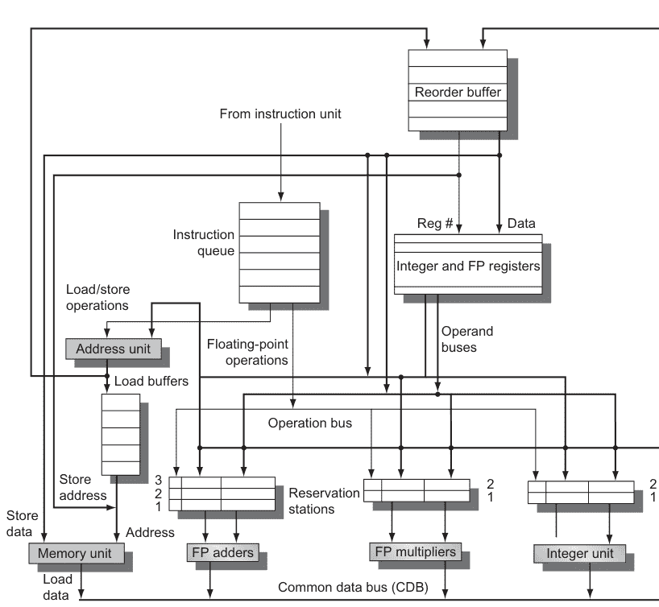

**图 3.21** 带预测的多发射处理器的基本结构。在这种情况下，该结构允许浮点乘法、浮点加法、整数和加载/存储同时发射（假设每个功能单元发射一条）。注意，必须构建多个数据路径以支持多发射：CDB、操作数总线，以及关键的指令发射逻辑（图中未显示）。后者是一个棘手的问题，正如我们在文中讨论的那样。

第二种替代方案是构建同时处理两条或更多指令的逻辑，包括指令之间任何可能的依赖关系。每时钟发射四条或更多指令的现代超标处理器可能同时采用两种方法：它们对发射逻辑进行流水线和扩展。一个关键观察是，我们不能简单地通过流水线来解决问题。由于每个周期都会发射新指令，导致发射需要多个时钟，我们必须能够分配保留站并更新流水线表，以便在下一个时钟发射的依赖指令可以使用更新后的信息。

这一步是动态调度超标器最根本的瓶颈之一。为了说明这一过程的复杂性，图 3.22 显示了一种情况的发射逻辑：情况为发射一个加载指令，后跟一个依赖的浮点操作。该逻辑基于第197页图 3.18中的逻辑，但仅代表其中一种情况。在现代超标器中，必须考虑所有可能的指令组合。由于可能性的随着每时钟可发射指令数量的平方级增长，这一步是尝试突破每时钟四条指令限制时可能遇到的瓶颈。

我们可以将图 3.22 的细节泛化，描述动态调度超标器中每时钟最多 n 条指令的更新发射逻辑和保留表的基本策略为：

- 1. 为可能出现在下一个发射包中的每条指令分配一个保留站和一个重排序缓冲区（reorder buffer）。这种分配可以在指令类型确定之前完成，只需通过使用 $n$ 个重排序缓冲区条目按顺序为数据包中的指令预分配重排序缓冲区，并确保为整个包提供足够的可用保留站，无论其包含什么内容。通过限制给定类别指令的数量（例如，一个浮点、一个整数、一个存储），可以预先分配必要的保留站。如果没有足够的保留站（例如当程序中的后续几条指令都是同一种类型时），则拆分该包，仅按原始顺序发射部分指令。包的剩余部分可以放在下一个包中以备后续发射。
- 2. 分析发射包中所有指令之间的依赖关系。
- 3. 如果包中的某条指令依赖于包中的之前的指令，则使用分配的保留站和重排序缓冲区来处理该依赖关系。如果该指令不依赖于包中的任何之前的指令，则可以立即发射。

考虑在双发射（two-issue）处理器上执行以下循环，该循环对整数数组的每个元素加 1，分别一次不使用预测性执行和一次使用预测性执行：

```
Loop: 1d    x2,0(x1)    //x2=数组元素
      addi x2,x2,1      //x2加1
      sd    x2,0(x1)    //存储结果
      addi x1,x1,8      //指针加1
      bne x2,x3,Loop   //如果不是最后分支
```

假设对于地址计算、ALU 运算和分支条件评估有单独的整数功能单元。请为这两种处理器的该循环的前三次迭代创建一个表格。假设每个周期内可以有任意类型的两条指令完成提交（commit）。

图 23 和 3.24 显示了双发射、动态调度处理器在 ways和不使用预测性执行时的性能。在这种情况下，一个分支：

| 迭代次数 | 指令 | 执行的钟周期数 | 内存访问的钟周期数 | 写入 CDB 的钟周期数 | 注释 |
|---|---|---|---|---|---|
| 1 | 1d x2,0(x1) | 1 | 2 | 4 | 第一次发射 |
| 1 | addi x2,x2,1 | 1 | 5 | 6 | 等待 1d |
| 1 | sd x2,0(x1) | 2 | 3 | 7 | 等待 addi |
| 1 | addi x1,x1,8 | 2 | | 4 | 直接执行 |
| 1 | bne x2,x3,Loop | 3 | | | 等待 addi |
| 2 | 1d x2,0(x1) | 4 | 8 | 10 | 等待 bne |
| 2 | addi x2,x2,1 | 4 | 11 | 12 | 等待 1d |
| 2 | sd x2,0(x1) | 5 | 13 | | 等待 addi |
| 2 | addi x1,x1,8 | 5 | | 9 | 等待 bne |
| 2 | bne x2,x3,Loop | 6 | 13 | | 等待 addi |
| 3 | 1d x2,0(x1) | 7 | 14 | 15 | 等待 1d |
| 3 | addi x2,x2,1 | 7 | 17 | 18 | 等待 addi |
| 3 | sd x2,0(x1) | 8 | 15 | 19 | 等待 bne |
| 3 | addi x1,x1,8 | 8 | | 15 | 等待 addi |
| 3 | bne x2,x3,Loop | 9 | 19 | | 等待 addi |

**图 2.23** 不使用预测性执行的双发射版本流水线的发射、执行和写入时间。注意，bne 之后的 1d 无法更早开始执行，因为它必须等待分支结果确定。这种带有无法早期解决的数据依赖分支的程序显示了预测性执行的优势。用于地址计算、ALU 运算和分支条件评估的独立功能单元允许多条指令在同一个周期内执行。图 3.24 显示了使用预测性执行的示例。

# 3.8 使用动态调度、多发射和预测性执行利用 ILP

| 迭代次数 | 指令 | 发射的钟周期数 | 执行的钟周期数 | 读取访问的钟周期数 | 写入的钟周期数 | 提交的钟周期数 | 注释 |
| --- | --- | --- | --- | --- | --- | --- | --- |
| 1 | 1d x2,0(x1) | 1 | 2 | | 3 | 4 | 第一次发射 |
| 1 | addi x2,x2,1 | 1 | 5 | | 6 | 7 | 等待 1d |
| 1 | sd x2,0(x1) | 2 | 3 | | | 7 | 等待 add1d |
| 1 | addi x1,x1,8 | 2 | 3 | | 4 | 8 | |
| 1 | bne x2,x3,Loop | 3 | 7 | | | 8 | 等待 addd |
| 2 | 1d x2,0(x1) | 4 | 5 | 6 | | 9 | 无延迟 |
| 2 | addi x2,x2,1 | 4 | 8 | | 9 | 10 | 等待 addd |
| 2 | sd x2,0(x1) | 5 | 6 | | | 10 | 等待 addd |
| 2 | addi x1,x1,8 | 5 | | | 9 | 10 | 等待 addd |
| 2 | bne x2,x3,Loop | 6 | 10 | | | 11 | 等待分支 |
| 3 | 1d x2,0(x1) | 7 | 8 | 9 | | 12 | 等待 1d |
| 3 | addi x2,x2,1 | 7 | 11 | | 12 | 13 | 等待 addi |
| 3 | sd x2,0(x1) | 8 | 13 | | | 14 | 等待 bne |
| 3 | addi x1,x1,8 | 8 | | | 15 | 15 | 等待 addi |
| 3 | bne x2,x3,Loop | 9 | 14 | | | 16 | 等待 addi |

*(注：由于原文文本中表格数据存在部分重复和错位，译文已根据上下文逻辑进行了对齐修正，以确保表格的可读性)*

# 230 第三章 指令级并行性及其利用

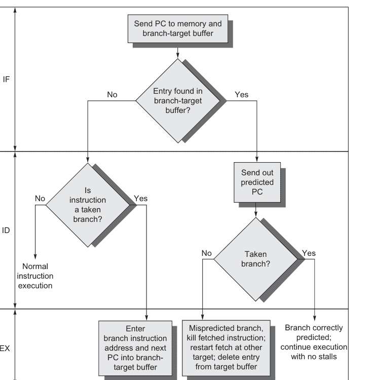

**图 3.26** 使用分支目标缓冲区（branch-target buffer）处理指令时涉及的步骤。

为了评估分支目标缓冲器的性能，我们首先确定所有可能情况下的惩罚。图 3.27 包含了一个简单五级流水线的这些信息。

**示例** 假设图 3.27 中单次预测错误的惩罚周期如所示，确定分支目标缓冲器的总分支惩罚。对预测准确率和命中率做出以下假设：

字体 预测准确率为 90%（针对缓冲区中的指令）。

- 缓冲区命中率为 90%（针对预测为跳转执行的分支）。

# 3.9 指令交付与预测的高级技术 = 231

**答案** 我们通过计算两个事件的概率来计算惩罚：分支被预测为跳转但实际上未跳转，以及分支实际跳转但在缓冲区中未找到。这两者都带有两个周期的惩罚。

概率（分支在缓冲区中，但实际未跳转） = 缓冲区命中率 × 错误率 = 90% × 10% = 0.09

概率（分支不在缓冲区中，但实际跳转） = 10%

分支惩罚 = (0.09 + 0.10) × 2

分支惩罚 = 0.38

动态分支预测的改进将增加流水线长度，从而导致分支延迟的增长；此外，更好的预测器将产生更大的性能优势。现代高性能处理器的分支预测错误延迟在 15 个时钟周期左右；准确预测至关重要！

分支缓冲区的一种变体是存储一个或多个目标指令，而不是或额外存储预测的目标地址。这种变体有两个潜在的优势。首先，它允许分支缓冲器的访问时间长于连续指令取指之间的时间，可能允许更大的分支目标缓冲区。其次，缓存实际指令允许我们执行名为“分支折叠”（branch folding）的优化。分支折叠可用于获取 0 周期无条件分支，有时甚至是 0 周期条件分支。正如我们将看到的，Cortex A-53 使用单项分支缓存来存储预测的指令。

考虑一个分支目标缓冲区，它缓存来自预测路径的指令，并使用无条件分支的地址进行访问。无条件分支唯一的功能是更改 PC。那么，分支目标缓冲区信号命中并指示该分支是

是

| 缓冲区中的指令 | 预测 | 实际分支 | 惩罚周期 |
|---|---|---|---|
| 是 | 跳转 | 跳转 | 0 |
| 是 | 跳转 | 未跳转 | 2 |
| 否 | | 跳转 | 2 |
| 否 | | 未跳转 | 0 |

**图 3.27** 考虑了分支是否在缓冲区中以及其实际执行情况的所有可能组合的惩罚，假设我们只在缓冲区中存储目标分支。如果所有内容都预测正确且在目标缓冲区中找到分支，则没有分支惩罚。如果分支没有预测正确，惩罚等于 1 个时钟周期（用于用正确信息更新缓冲区，在此期间无法取指），以及如果需要，还需要 1 个时钟周期来重新取指下一条指令。如果分支未找到且跳转了，则会遇到 2 周期的惩罚，在此期间缓冲区会被更新。

# 232 第三章 指令级并行性及其利用

无条件的，流水线可以简单地从分支目标缓冲区中提取指令，替换从缓存返回的指令（即该无条件分支）。如果处理器每周期发射多条指令，则缓冲区将需要提供多条指令以获得最大收益。在某些情况下，可能消除条件分支的代价。

## 特殊分支预测器：预测过程返回、间接跳转和循环分支

当我们尝试增加预测的机会和准确性时，面临着预测间接跳转的挑战，即跳转地址在运行时变化的跳转。高层语言程序会为间接调用、选择（select）或分支（case）语句以及 FORTRAN 中计算的 `gotos` 生成此类跳转，尽管许多间接跳转仅仅来自过程返回。例如，对于 SPEC95 基准测试，过程返回占分支的 15% 以上，并占了绝大多数间接跳转。对于 C++ 和 Java 等面向对象的语言，过程返回更加频繁。关注过程返回似乎是恰当的。

虽然可以使用分支目标缓冲区预测过程返回，但如果过程是从多个位置调用的，且其中一个位置的调用在时间上不聚集，那么这种技术的准确性可能很低。例如，在 SPEC CPU95 中，激进的分支预测器此类返回分支的准确率低于 60%。为了解决这个问题，某些设计使用一个用作栈运行的小型返回地址缓冲区。这种结构缓存了最近的返回地址，在调用时将返回地址推入栈中，在返回时弹出一个。如果缓存足够大（即与最大缓存深度一样），它就能正确地预测返回。图 3.28 显示了具有 0-16 个元素的此类缓冲区在若干个 SPEC CPU5 基准测试中的性能。我们在第 3.10 节检查 ILP 的研究时，使用了一个简单的预测器。Intel Core 处理器和 AMD 处理器都有返回地址预测器。Intel Core 处理器和 AMD 处理器都有返回地址预测器。在多发射处理器中，返回地址预测器是取指单元的一部分。在多发射处理器中，返回地址预测器是取指单元的一部分。在多发射处理器中，返回地址预测器是取指单元的一部分。在多发射处理器中，返回地址预测器是取指单元的一部分。

# 3.9 指令交付与预测的高级技术 233


图 3.28 显示 0-16 个元素的此类缓冲区在若干个 SPEC CPU5 基准测试中的性能。在多发射处理器中，返回地址预测器是取指单元的一部分。在多发射处理器中，返回地址预测器是取指单元的一部分。在多发射处理器中，返回地址预测器是取指单元的一部分。在多发射处理器中，返回地址预测器是取指单元的一部分。在多发射处理器中，返回地址预测器是取指单元的一部分。在多发射处理器中，返回地址预测器是取指单元的一部分。在多发射处理器中，返回地址预测器是取指单元的一部分。在多发射处理器中，返回地址预测器是取指单元的一部分。在多发射处理器中，返回地址预测器是取指单元的一部分。在多发射处理器中，返回地址预测器是取指单元的一部分。在多发射处理器中，返回地址预测器是取指单元的一部分。在多发射处理器中，返回地址预测器是取指单元的一部分。在多发射处理器中，返回地址预测器是取指单元的一部分。在多发射处理器中，返回地址预测器是取指单元的一部分。在多发射处理器中，返回地址预测器是取指单元的一部分。在多发射处理器中，返回地址预测器是取指单元的一部分。在多发射处理器中，返回地址预测器是取指单元的一部分。在多发射处理器中，返回地址预测器是取指单元的一部分。在多发射处理器中，返回地址预测器是取指单元的一部分。在多发射处理器中，返回地址预测器是取指单元的一部分。

## 集成取指单元

为了满足多发射的需求，许多近期设计使用了集成多种功能的集成取指单元：

- **集成分支预测**——分支预测器成为取指单元的一部分，以驱动取指流水线。在多发射处理器中，返回地址预测器是取指单元的一部分。在多发射处理器中，返回地址预测器是取指单元的一部分。在多发射处理器中，返回地址预测器是取指单元的一部分。在多发射处理器中，返回地址预测器是取指单元的一部分。在多发射处理器中，返回地址预测器是取指单元的一部分。在多发射处理器中，返回地址预测器是取指单元的一部分。在多发射处理器中，返回地址预测器是取指单元的一部分。在多发射处理器中，返回地址预测器是取指单元的一部分。在多发射处理器中，返回地址预测器是取指单元的一部分。

# 第三章 指令级并行性及其利用

指令预取——为了每周期交付多条指令，取指单元可能需要提前取指。该单元自主管理预取（见第 2 章的讨论），并与分支预测集成。几乎所有高端处理器都使用与流水线其他部分连接的独立取指单元。

## 预测：实现问题与扩展

在本节中，我们将探讨涉及多发射和预测的五个设计权衡与挑战，从寄存器重命名（有时替代重排序缓冲区的方法）开始。随后，我们讨论控制流预测的一个重要扩展：值预测。

使用重排序缓冲区（ROB）的替代方案是显式使用更大的物理寄存器集并结合寄存器重命名。这种方法在 Tomasulo 算法重命名概念的基础上进行扩展。在 Tomasulo 算法中，架构可见寄存器（x0, ... r31 和 f0, ... f31）的值在执行的任何点都位于寄存器集和保留站的组合中。引入预测后，寄存器值也可能临时存储在 ROB 中。

## 3.9 指令交付与预测的高级技术 235

因为持有指令目的地的物理寄存器在指令提交（commit）之前不会变成架构寄存器。

重命名映射（renaming map）是一个简单的数据结构，用于提供当前对应于指定架构寄存器的物理寄存器编号，这一功能在 Tomasulo 算法中是由寄存器状态表实现的。当指令提交时，重命名表会被永久更新，以指示哪个物理寄存器对应实际架构寄存器，从而完成了对处理器状态的更新。使用寄存器重命名时不需要重排序缓冲区（ROB），但硬件必须在队列结构结构中跟踪指令，并按照严格顺序更新重命名表。

与 ROB 方法相比，重命名过程的优势在于其稍微简化，因为它只需要两个操作：(1) 记录架构寄存器与物理寄存器编号之间的映射不再具有投测性；(2) 释放任何用于存储架构寄存器“旧”值的物理寄存器。在具有保留留站（reservation stations）的设计中，当指令完成执行时，留站会被释放；当相应的指令提交时，ROB 条目会被释放。

通过重命名，释放寄存器更为复杂，因为当我们释放一个物理寄存器时，必须知道它不再对应任何架构寄存器，并且没有更多待完成的物理寄存器在使用。在架构寄存器被覆盖之前，物理寄存器一直对应架构寄存器，会导致重命名表指向其他地方。也就是说，如果没有重命名条目指向特定的物理寄存器，那么它就不再对应架构寄存器。然而，该物理寄存器可能仍有待完成的使用。处理器可以通过检查功能单元队列中所有指令的源寄存器指定字段来确定是否存在这种情况。如果一个物理寄存器既没有作为源寄存器出现，也未被指定为架构寄存器，它就可以被回收并重新引入。

或者，处理器可以简单地等待另一个写入相同架构寄存器的指令提交。在那个时刻，就不再有进一步的旧值待完成使用。这种方法可能会让物理寄存器的占用时间比需要稍长，但它易于实现，并被大多数最近的超级计算机中使用。

你可能会问的一个问题是，如果寄存器不断变化，我们如何知道哪些寄存器是架构寄存器？在程序执行的大部分时间内，这并不重要。但在某些情况下，另一个进程（例如操作系统）可能确切知道某个架构寄存器内容的所在位置。为了理解这种能力是如何提供的，假设处理器在一段时间内不发射指令。最终，流水线中的所有指令将提交，架构可见寄存器与物理寄存器之间的映射将变得稳定。此时此，物理寄存器的一个子集包含了相对可见的寄存器，而任何与架构寄存器关联的物理寄存器的值都是需要的。很容易移动架构

图 3.29 显示了一个六指令序列，以及如果处理器要实现目标，发射阶段（issue step）必须做什么。记住，这一切必须在单个时钟周期内完成，并保持每时钟六次发射的峰值！依赖关系必须被检测到，

### 3.9 指令交付与预测的高级技术


| 指令 | 指令 | 分配的物理寄存器或目的地 | 带有物理寄存器编号的指令 | 重命名映射变化 |
| :--- | :--- | :--- | :--- | :--- |
| 1 | `add x1,x2,x3` | `p32` | `add p32,p2,p3` | `x1->p2` |
| 2 | `sub x1,x1,x2` | `p33` | `sub p33,p3,p2` | `x1->p33` |
| 3 | `add x2,x1,x3` | `p34` | `add p34,p33,x2` | `x2->p34` |
| 4 | `sub x1,x3,x2` | `p35` | `sub p35,p3,p34` | `x1->p35` |
| 5 | `add x1,x1,x2` | `p36` | `add p36,p35,p34` | `x1->p36` |
| 6 | `sub x1,x3,x1` | `p37` | `sub p37,p3,p36` | `x1->p37` |

**图 3.29** 显示了一个六指令序列以及如果要在周期内发射，阶段必须做什么。指令按程序顺序显示：1–6；然而，这必须在一个时钟周期内发生！注意 `p1` 指代 `a`

## 238 第三章 指令级并行性及其利用

直到导致事件的指令不再具有投测性。

在 1990 年代，预测的潜在负面影响并不明显。随着处理器的演进，预测的真实成本变得更加明显，宽发射的限制也变得可见。我们回到这个问题。

## 跨分支预测

在我们章考虑的示例中，可以在预测另一个分支之前解决一个分支。三种不同情况可以从跨分支预测中受益：(1) 极高的分支频率；(2) 分支的高度聚集；(3) 功能单元的长延迟。在第一的情况下，实现高性能可能意味着每个时钟超过一个分支。数据库程序和其他整数计算具有这些特性，使得跨分支预测变得重要。同样，功能单元的长延迟也会增加通过跨分支预测来避免流水线停顿的重要性。

跨分支预测稍微增加了预测恢复的复杂性，但在其他方面是。截至 2017 年，还没有处理器将完全预测与每周期解决多个分支相结合，从性能与功耗的角度来看，这样做可能是不合理的。

## 预测与能量效率的挑战

预测对能量效率有什么影响？从乍看，人们可能会认为每当预测错误时，预测都会降低能量效率，它通过两种方式消耗额外的能量：

- 被预测且结果不需要的指令会为处理器产生工作，浪费能量。
- 撤销预测并恢复处理器状态以在正确的地址继续执行会消耗在没有预测的情况下是不需要的额外能量。

无疑，预测会提高功耗，如果我们能够控制预测，就可以测量成本（或至少是动态功耗）。但是，如果预测缩短执行时间的比例超过了它增加平均功耗的比例，那么总能量成本可能会降低。

因此，为了理解预测对能量效率的影响，我们需要观察预测在多程度上导致了不必要的工作。如果执行了大量不必要的指令，预测不太可能

### 3.9 指令交付与预测的高级技术

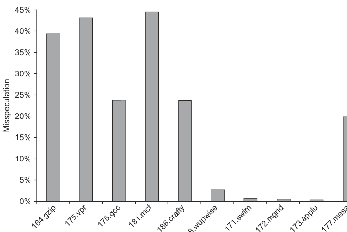

**图 3.30** 由于预测错误（misspeculation）而执行的指令比例在整数程序（前五个）中通常远高于浮点程序（后五个）。

这可以同程度的程度上缩短运行时间。图 3.30 显示了在采用复杂的分支预测器的情况下，SPEC2000 标准测试子集的由于预测错误而执行的指令比例。正如我们所见，在科学代码中，这种执行的预测错误指令比例很小，而在整数代码中这一比例非常显著（平均约为 30%）。因此，对于整数应用来说，预测可能并不是能效的，而且规模扩展的终点使得不完美的预测变得更加棘手。设计者可以避免预测、尝试减少预测错误，或者考虑新方法，例如仅对已知高度可预测的分支进行预测。

## 存储别名预测（Address Aliasing Prediction）

存储别名预测是一种预测两个存储操作（stores）或一个加载与一个存储操作是否指向同一内存地址的技术。如果两个引用不指向同一个地址，那么就可以安全地交换。否则，我们必须等待到指令访问的内存地址已知。由于我们不需要实际预测地址值，只有这种预测在具有较小预测器时才能具有合理的准确性。地址预测依赖于推测执行处理器在预测错误后恢复的能力，也就是说，如果预测为不同的实际地址（因此不具有别名）事实证明是相同的（因此具有别名），处理器只需重新启动其序列，就像它认为自己误判（mispredicted）了分支一样。地址值预测已经在多个处理器中使用，并可能在未来成为通用技术。

地址预测是某种简单且受限的值预测形式，它试图预测指令将产生的值。如果值预测非常准确，它可以消除数据流限制，并获得更高的指令级并行（ILP）率。尽管在过去的 15 年里，有许多研究人员在数十篇论文中关注值预测，但其结果从未具有足够的吸引力来证明在实际处理器中进行通用值预测的合理。

## 3.10 跨 de性问题（Cross-Cutting Issues）

### 硬件与软件推测

本章中硬件密集型的推测方法以及附录 H 中的软件方法提供了探利用 ILP 的替代方法。这些方法的一些权衡和局限性列在此处：

- 为了进行大量的推测，我们必须能够消除内存引用歧义。对于包含指针的整数程序，在编译时实现这种能力是非常的。在基于硬件的方案中，内存地址的动态去歧是通过使用我们之前看到的 `Tomasulo` 算法的技术完成的。这种去歧允许我们在运行时将加载（loads）移动存储（stores）之前。对推测内存引用的支持有助于克服编译器的保守性，但除非仔细地使用此类方法，否则恢复机制的开销可能会抵消其优势。
- 硬件的推测在控制流不可预测且硬件基础的分支预测优于编译时完成的软件分支预测时有效。这些属性适用于许多整数程序，其中动态预测器的误判率通常小于静态预测器的一半。因为推测执行的指令在预测错误时可能会减慢计算，这种差异是显著的。这种差异的一个结果是，即使是静态调度的处理器通常也包含动态分支预测器。
- 硬件推测即使对于推测执行的指令也保持完全的异常模型。最近的软件方法添加了特殊支持以允许这一点。
- 硬件推测不需要补偿或簿记代码，而心心勃勃的软件推测机制需要这些。
- 基于编译器的方法可能受益于更深层次查看代码序列的能力，从而比纯硬件驱动的方法获得更好的代码调度。
- 带有动态调度的硬件推测不需要不同的代码序列来实现不同架构的不同实现获得良好的性能。尽管这一优势最难量化，但它可能是最重要的。有趣的是，多线程共享处理器在不同架构的不同实现中获得良好的性能不需要不同的代码序列。这种支持是的，，，，，，，多线程的灵活性，能够能够隐藏流水线和内存延迟。

硬件支持推测的一个主要缺点是硬件资源的需求。设计者尝试让多线程共享处理器以实现并行性，这种组合可能会产生副作用。例如，当多线程重命名时，这种组合是由于。支持预测的、如 `IA-64` 这种架构，这种组合可能会产生副作用。

### 预测执行与内存系统（Speculative Execution and the Memory System）

支持推测执行的处理器中固有的可能是产生在没有推测执行的情况下产生的无效地址。这不仅会导致异常，而且内存系统可能会被推测指令淹没。在现实中，访问 DRAM 的代价是巨大的，以至于即使具有合理的速率，2.5 显示对于良好的程序，内存系统必须匹配多个访问。

## 3.11 多线程：利用线程级并行提高单处理器吞吐量

我们在本节涵盖的主题多线程确实是一个跨领域的主题，因为它与流水线和超标量（第4章）以及多处理器（第5章）都有关联。一个线程类似于进程，它有状态和程序计数器，但线程通常共享单个进程的地址空间，允许线程轻松访问数据。多线程是一种在不需要切换的情况下共享处理器的技术。在线程之间快速切换的能力使得多线程能够隐藏流水线内存延迟。

尽管利用 ILP 提高性能的巨大优点是对程序员是透明的，正如我们所见，ILP 在某些应用中可能是非常有限或难以利用的。特别是，在合理的速率下，指向片外缓存的缺失不太可能通过 ILP 隐藏。当然，如果处理器在等待缓存缺失时停顿，功能单元的利用率就会大幅下降。

由于用 ILP 覆盖长内存停顿的效果有限，自然会问是否可以使用应用程序中其他形式的并行来隐藏内存延迟。例如，在线事务处理系统在请求的多个查询和更新之间具有自然的并行性。当然，许多科学应用包含自然的并行性，因为它们模拟了自然的三维并行结构，这可以使用单独的线程利用。

多线程允许多个线程以重叠的方式共享单个处理器的功能单元。相比之下，利用线程级并行（TLP）的更通用方法是具有多个独立线程同时并并行运行的多处理器。然而，多线程并没有像多处理器那样复制实体处理器。相反，多线程在组线程之间共享大部分处理器核心，只复制私有状态，例如寄存器和程序计数器。正如我们在第5章中看到的，许多现代处理器在芯片上集成了多个处理器核心，并在每个核心内提供多线程。

## 3.11 多线程：利用线程级并行性提高单处理器吞吐量

复制处理器核心的每个线程状态，意味着为每个线程创建一个独立的寄存器文件和独立的 PC（程序计数器）。内存本身可以通过虚拟内存机制进行共享，该机制已经支持了多进程处理。此外，硬件必须支持能够快速地切换到不同线程的能力；特别是，线程切换的效率应该远高于进程切换（后者通常需要几百到数千个时钟周期）。当然，为了让多线程硬件实现性能提升，程序必须包含多个线程（我们有时称该应用是多线程的），这些线程可以以并发方式执行。这些线程由编译器（通常来自具有并行特性的语言）或程序本身识别。

多线程有三种主要的硬件实现方法：细粒度、粗粒度和同步。**细粒度多线程**在每个时钟周期上切换线程，导致多个线程的指令执行交替进行。这种交替通常以轮询（round-robin）的方式进行，跳过任何处于停顿的线程。细粒度多线程的一个优点是它可以隐藏由于短停顿长停顿引起的吞吐量损失，因为当一个线程停顿时，可以执行其他线程，即使停顿只持续几个周期。细粒度多线程的主要缺点是它会减慢就绪执行的单个线程的执行速度，而该线程本不会受到其他线程指令的延迟。它通过增加多线程吞吐量来换单个线程性能（以延迟衡量）的损失。

`SPARC T1` 处理器（最初由太阳公司制造，现为富士）使用细粒度多线程。其他处理器在事务处理和 Web 服务等负载上采用了多线程。T1 每个处理器支持 8 个核心，每个核心 4 个线程，而 T5 支持 16 个核心和每个核心 128 个线程。后续版本（T2–T5）还支持 4–8 个处理器。我们在下一章看到的 NVIDIA GPU 利用细粒度多线程。

**粗粒度多线程**作为细粒度多线程的替代方案被发明。粗粒度多线程仅在发生停顿（例如两次或三次缓存缺失）时才切换线程。只有当线程遇到昂贵的停顿时，才会发射来自其他线程的指令；粗粒度多线程减轻频繁切换线程的需求，并且极大地减少了对任何一个线程执行速度的影响。

然而，粗粒度多线程面临吞吐量的损失，特别是在较短停顿的情况下。这种限制是由粗粒度多线程的流水线启动成本造成的。由于具有粗粒度多线程的处理器在发生停顿时发射来自单个线程的指令，流水线在新线程开始执行之前会出现一个空泡（bubble）。由于这种开销，粗粒度多线程对于减少极高成本停顿的惩罚有用得多，在这种情况下，流水线填充相对于停顿时间可以忽略不计。一些研究项目探索了粗粒度多线程，但目前没有主要的处理器使用这种技术。

多线程最常见的实现方式被称为同步多线程（SMT）。同步多线程是细粒度多线程的一种变体，当细粒度多线程实现在多发射、动态调度的处理器之上时，它会自然产生。与其他形式的多线程一样，SMT 利用线程级并行性来隐藏处理器中的长延迟事件，增加功能单元的使用率。SMT 的核心见解是，寄存器重命名和动态调度允许独立线程的指令执行，而不考虑它们之间的依赖关系；依赖关系的解决可以通过动态调度能力来处理。

图 3.31 概念性地说明了以下处理器配置下，处理器利用超标量资源的能力差异：

- 不支持多线程的超标量
- 具有粗粒度多线程的超标量


> **图 3.31** How different approaches use the resources of a superscalar. The horizontal dimension represents the instruction execution in each clock cycle. The vertical dimension represents a sequence of clock cycles. An empty (white) box indicates the corresponding slot is unused. The shades of gray and black correspond to different threads in the superscalar without multithreading. The Sun T1 and T2 (aka Niagara) processors are fine-grained multithreading, while the Intel i7 and Power7 use SMT. The T2 has 8 threads, the Power7 has 4, and the Intel i7 has 2. In all SMT, all issues come from different threads. The difference in SMT is that the subsequent decision to execute is decoupled and could execute in the same cycle.

## 3.11 多线程：利用线程级并行性提高单处理器吞吐量

- 具有细粒度多线程的超标量
- 具有同步多线程的超标量

在不支持多线程的超标量中，槽的使用受限于 ILP（指令并行性），包括内存延迟。由于 L2 和 L3 缓存缺失的长度，处理器大部分处于空闲状态。

在粗粒度多线程超标量中，通过切换到使用资源的线程可以部分隐藏长停顿。这减少了空闲周期。然而，在粗粒度多线程处理器中，只有发生停顿时才会切换。由于新线程有启动期，可能会存在空闲周期。

在细粒度情况下，线程的交替消除了空槽。此外，每个时钟周期切换发射线程，可以隐藏延迟操作。由于指令发射和执行是连接的，一个线程只能发射其就绪的指令。对于窄位宽度，这不是问题（这就是为什么细粒度多线程对单处理器非常完美，而 SMT 则没有意义）。在 Sun T2 中，每个周期有两次发射，但它们来自不同的线程。

如果在多发射、动态调度的处理器上实现细粒度多线程，结果就是 SMT。在所有 SMT 实现中，所有发射都来自一个线程，尽管来自不同线程的指令在同一周期启动执行，使用动态调度硬件确定哪些指令是就绪的。

同步多线程利用了这种观点：动态处理器已经具有支持该机制的许多硬件机制，包括大型虚拟寄存器集。多线程可以在乱序执行处理器之上，通过添加每个线程重命名表、保持独立的 PC 并提供来自多个线程指令提交的能力。

## 同步多线程在超标量处理器上的有效性

一个关键问题是，实现 SMT 可以获得多少性能提升？当 2000–2001 年探索这个问题时，研究人员假设动态超标量在未来五年内会变得宽得多，具有预测性动态调度、同步加载和存储、大型一级缓存以及具有同步发射能力的四到八个上下文。

以及多个上下文的切换。尚未有处理器能够接近这种组合。

因此，仿真研究结果显示多程序工作负载的收益达到两倍或以上，这是不切实际的。在实践中，现有的 SMT（同步多线程）实现仅提供两个到四个上下文，且仅从一个进行取指和发射，每个核心最多发射四次。结果是 SMT 带来的收益也比较有限。

`Esmailezadeh` 等人 (2011) 进行了一系列广泛且具有洞察力的测量，检查了在运行一组多线程应用程序的单核 `i7 920` 核心上使用 SMT 的性能和能量效益。`Intel i7 920` 支持双线程（每个核心两个线程）的 SMT，最近的 `i7 6700` 也是如此。`i7 920` 和 `6700` 之间的变化非常小，不太可能显著改变本节所示的结论。

所使用的基准测试由一组并行科学应用和一组来自 `DaBench` 和 `SPEC Java` 语件的多线程 Java 程序组成，如总结在图 3.32 所示。图 3.31 显示了这些基准测试在 `i7 920` 的单个核心上关闭和开启 SMT 时的性能与能量效率之比。（我们绘制了能量比例，即能耗的倒数，这样就像加速比一样，比例越高越好。）

Java 基准测试的加速比调和平均数为 1.28，尽管其中两个基准测试的收益很小。这些基准测试 `pjb2005` 和 `तेव्हा` 虽然是多线程的，但并行性有限。将它们包含进来是因为它们是典型的多线程基准测试，这种测试可能会在 SMT 处理器上运行，以期望提取一些性能，而它们确实提取到了有限的性能。`PARSEC` 基准测试的结果略好于全套 Java 基准测试（调和平均数为 1.31）。如果省略 `dejava` 和 `pjb2005`，Java 工作负载的加速比将显著优于 `PARSEC` 基准测试（1.39）。参见图 3.33 图中关于调和平均数意义的讨论，以总结结果。）

能耗由加速比和功耗增加的组合决定。对于 Java 基准测试，SMT 提供的能量效率与非 SMT (0) 相同，但被两个性能差的基准测试拉低了；如果没有 `pjb2005` 和 `तेव्हा`，Java 基准测试的能量效率为 1.06，几乎与 `PARSEC` 基准测试一样。在 `PARSEC` 基准测试中，SMT 减少了 1~(1.08)=7% 的能量。很难找到节能的性能增强。由于与 SMT 相关的静态功率在两种情况下都需要支付，因此结果略微掩盖了能量收益。

这些结果清楚地表明，具有广泛推执行能力的处理器的 SMT 可以以一种高效的方式提高性能。在 2011 年，多个简单核心与更少数复杂核心之间的平衡向了多个核心倾斜，每个核心通常是三到四路发射的超标量处理器，并支持多四个线程的 SMT。事实上，`Esmailezadeh` 等人 (2011) 显示，在 `Intel i5`（一种与 `i7` 类似的处理器，但缓存较小且时钟较低）和 `Intel Atom`（一种最初为笔记本电脑和 PMD 方法设计的 80x86 处理器，现在专注于低端 PC，并在[第 3.13 节]中描述）上，SMT 带来的能量改进更大。

## 3.12 综合分析：Intel Core i7 6700 和 ARM Cortex-A53


在本节中，我们探索了两个发射处理器的设计：`ARM Cortex-A53` 核心，它作为平板电脑和手机的基础；以及 `Intel Core i7 6700`，这是一种用于高端桌面级和服务器应用的高端动态调度、推执行处理器。我们从较简单的处理器开始。

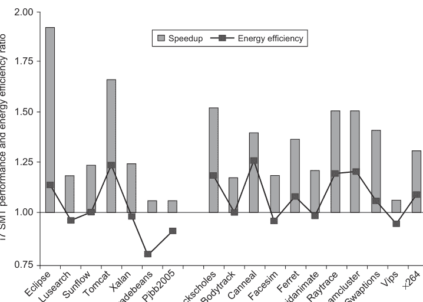

### 3.33
在 `i7` 处理器上使用多线程的加速比对于 Java 基准测试平均为 1.28，对于 PARSEC 基准测试为 1.31（使用无权调和平均数，这意味着在单线程基础集合中执行每个基准测试的总时间相同）。能量效率平均分别为 0.99 和 1.07（使用调和平均数）。记住，任何高于 1.0 的值都更好。

## 3.12 综合分析：Intel Core i7 6700 和 ARM Cortex-A53

| 基准测试 | 描述 |
| :--- | :--- |
| blackscholes | 使用 Black-Scholes PDE 对权组合定价 |
| bodytrack | 跟踪无标记的人体 |
| canneal | 使用感知缓存的模拟火算法最小化芯片的路由成本 |
| facesim | 为了可视化目的模拟人脸运动 |
| ferret | 寻找与查询图像相似的图像集的搜索引擎 |
| fluidanimate | 为 SPH 算法的动画模拟流体运动物理 |
| raytrace | 使用物理模拟进行数据点聚类 |
| streamcluster | 计算数据点聚类的近似 |
| swaptions | 使用 Heath-Jarrow-Morton 框架为交换期权定价 |
| vips | 对图像应用一系列变换 |
| x264 | MPEG-4/AVC/H.264 编码器 |
| eclipse | 集成开发环境 |
| lusearch | 文本搜索工具 |
| sunlight | 渲染系统 |
| tomcat | Servlet 容器 |
| tradebeans | 交易豆 |
| xalan | 用于 XML 文档的 XSL 处理器 |
| pjbb2005 | SPEC JJB2005（问题规模固定） |

**图 3.32** 此处检查多线程的并行基准测试，正如[第 5 节]在 i7 上检查多处理器一样。图表的上半部分列出了[Bienia 等人 (2008)]收集的 PARSEC 基准测试。PARSEC 基准测试适用于多核心处理器。下半部分由 DaCapaco 集合的多线程 Java 基准测试（参见[Blackburn 等人，2006]）和 SPEC 的 `pjbb2005` 组成。这些基准测试都包含一些并行性；DaCapaco 和 SPEC 中的其他 Java 基准测试缺乏真正的并行性，因此在此未使用。关于这些基准测试特性的更多信息，请参见[Esmailizadeh 等人 (2011)]，相对于此处的测量结果。

### Cortex-A53

`A53` 是一个具有动态发射的双发射超标量处理器，图 3.34 显示了基础流水线。对于整数指令，流水线为 8 个阶段：`F1` 和 `F2` 取指令，`D1` 和 `D2` 进行基础解码，`D3` 解码某些复杂指令与执行流水线的第一阶段（`ISS`）重叠。在 `ISS` 之后，`Ex1`、`EX2` 和 `WB` 完成整数流水线。分支根据类型使用四种不同的预测器。浮点执行流水线的深度为 5 个周期，加上取指和解码所需的 5 个周期，总共 10 个阶段。

| F1 | F2 | F3 | F4 | Iss | Ex1 | Ex2 | Wr |
| :--- | :--- | :--- | :--- | :--- | :--- | :--- | :--- |
| 指令取指与预测 | | | | 整数执行和加载存储 | | | |
| AGU + TLB | 混合预测器 | | | 整数寄存器文件 | | |
| | 指令缓存 | | | | ALU 管道 0 | | |
| | | 预测器 | | | ALU 管道 1 | | |
| | | | | | | MAC 管道 | |
| | | | | | 除法管道 | | |
| | | | | | 加载管道 | | |
| | | | | | 存储管道 | | |
| | | 指令解码 | | | | | |
| | 早期解码 | 13 条指令队列 | 主解码 | 晚期解码 | NEON 寄存器文件 | MUL/SQRT 管道 | |

# 第三章 指令级并行性及其利用

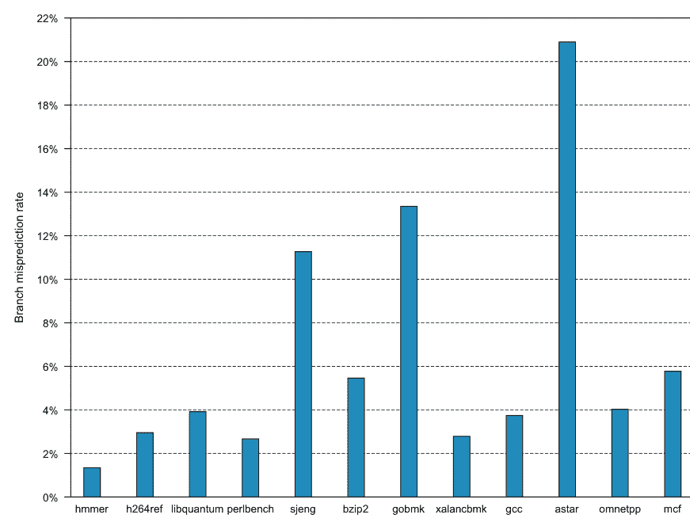

图 3.35 `A53` 分支预测器针对 `SPEC2006` 的预测率。

分支决策在 `ALU` 管道 0 中做出，导致 8 个周期的分支预测错误惩罚。图 3.35 显示了 `SPECint2006` 的预测率。浪费的工作量取决于预测率以及在执行预测错误分支期间所维持的发射率。如图 3.36 所示，浪费的工作通常遵循预测率的趋势，尽管它可能更大，或者有时会更短。

### A53 流水线的性能

由于采用双发射结构，`A53` 的理想 `CPI` 为 0.5。流水线停顿可能源于三个源：

- 1. 功能冲突（Functional hazards），这是由于两个同时被选择发射的相邻指令使用同一个功能流水线引起的。由于 `A53` 是静态调度的，编译器应尝试避免此类冲突。当此类指令顺序出现时，它们将在执行流水线的开头被串行化，只有第一条指令会开始执行。
- 2. 数据冲突（Data hazards），这些冲突在流水线早期被检测到，可能会导致两条指令都停顿（如果第一条不能，则第二条总是停顿）或一对指令中的第二条。同样，编译器应尽可能尝试防止此类停顿。
- 3. 控制冲突（Control hazards），在分支预测错误时产生。

`TLB` 缺失和缓存缺失也会导致停顿。在指令端，`TLB` 或缓存缺失会导致指令队列填充延迟，从而导致流水线下游的停顿。当然，这取决于是 `L1` 缺失（如果在缺失发生时指令队列是满的，则 `L1` 缺失可能在很大程度上被掩盖）还是 `L2` 缺失（后者所需的时间要长得多）。在数据端，缓存或 `TLB` 缺失会导致流水线停顿，因为引起缺失的加载或存储指令无法在流水线中继续执行。所有其他后续指令都将停顿。图 3.37 显示了 `CPI` 以及各种来源的估算贡献。

`A53` 使用了浅流水线和相当激进的分支预测器，导致了适中的流水线损耗，同时允许处理器在适中的功耗下实现高主频。与 `i7` 相比，`A53` 四核处理器的功耗仅为其 1/200！

## Intel Core i7

`i7` 采用了激进的无序执行推测微架构，具有深度流水线，目标是通过结合多次发射和高主频来实现高指令吞吐量。第一代 `i7` 处理器于 2008 年引入；`i7-6700` 是第六代。`i7` 的基本结构相似，但后续代通过更改缓存策略（例如预取的激进程度）、增加内存带宽、扩展执行中的指令数量、增强分支预测以及改进图形支持来提高性能。早期的 `i7` 微架构使用保留站（reservation stations）和重排序缓冲区（reorder buffers）来实现无序推测流水线。后来的微架构（包括 `i7 6700`）使用命名技术，保留站充当功能单元，而重排序缓冲区仅跟踪控制信息。

图 3.38 显示了 `i7` 流水线的整体结构。我们将从指令取指开始，一直到指令提交来检查流水线，这些步骤在图中已标记。

- 1. 指令取指（Instruction fetch）——处理器使用复杂的多级分支预测器在速度和预测准确性之间取得平衡。还有一个返回地址栈来加速函数返回。预测错误会导致约 17 个周期的惩罚。使用预测地址，指令取指从指令缓存中提取 16 字节。
- 2. 这 16 字节被放置在预译指令缓冲区——在这里会执行一种名为宏融合（macro-fusion）的过程。宏操作融合组合（例如比较后跟分支）将它们融合为一个操作，可以作为一条指令进行调度和执行。
- 3. 解码（Decode）——解码器将指令翻译为微操作（uops）。在 `i7` 中，这是一个复杂的过程，多个解码器处理简单指令，而一个复杂解码器处理困难指令。
- 4. 命名与发射（Rename and Dispatch）——处理器将体系寄存器重名为物理寄存器以消除假依赖（WAR 和 WAW），并在重排序缓冲区和保留站中分配条目。
- 5. 发射（Issue）——微操作在保留站中等待操作数可用。然后它们被发射到功能单元。
- 6. 执行（Execute）——功能单元执行实际操作。
- 7. 提交（Commit）——指令从重排序缓冲区按顺序退休，确保体系结构状态的一致性。

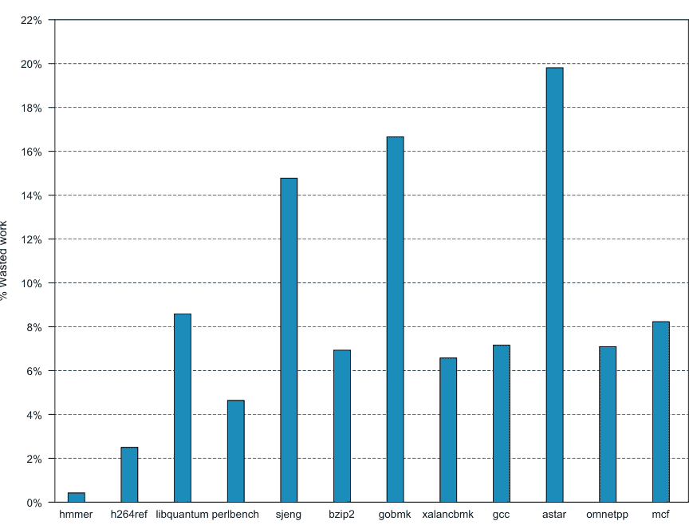

**图 3.36** `A53` 上分支预测错误导致浪费的工作。由于 `A53` 是顺序执行机器，浪费的工作量取决于多种因素，包括数据依赖和缓存缺失，其中后者会导致停顿。

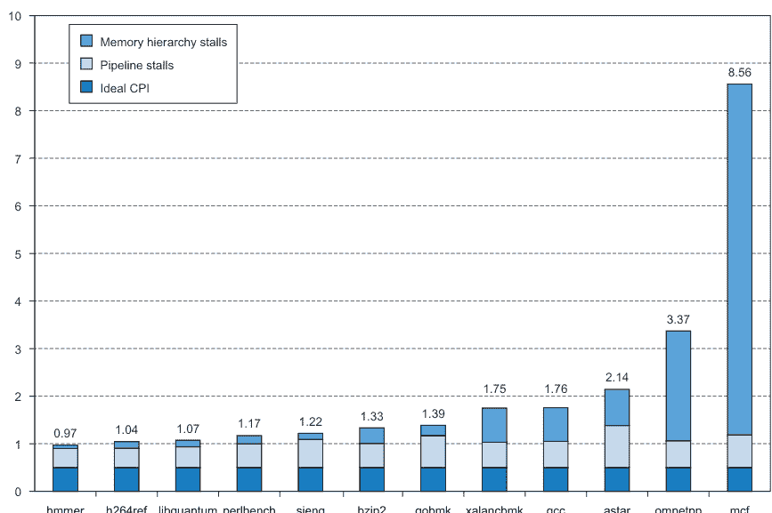

**图 3.37** `ARM A53` 上 `CPI` 的估算成本。流水线停顿是显著的，但在性能最差的程序中其影响小于缓存缺失。该估算是通过 `L1` 和 `L2` 缺失率及惩罚计算每条指令产生的 `L1` 和 `L2` 停顿得到的。将这些值从详细模拟器测得的 `CPI` 中减去即可得到流水线 `CPI`。流水线停顿包含了所有的冲突。

# 第三章 指令级并行性及其利用

| 资源 | i7 920 (Nehalem) | i7 6700 (Skylake) |
|---|---|---|
| 微操作队列（每个线程） | 28 | 64 |
| 留存站 | 36 | 97 |
| 整数寄存器 | NA | 180 |
| 浮点寄存器 | NA | 168 |
| 未完成的加载缓冲区 | 48 | 72 |
| 未完成的存储缓冲区 | 32 | 56 |
| 重排序缓冲区 | 128 | 256 |

**图 3.39 第一代 i7 和最新一代 i7 中的缓冲区和队列。** `Nehalem` 使用了留存站-重排序缓冲区结构。在随后的微架构中，留存站作为调度资源，并使用了寄存器重命名技术而非重排序缓冲区；`Skylake` 微架构中的重排序缓冲区仅用于缓冲控制信息。各种缓冲区和重命名寄存器的大小选择尽管有时是随机的，但很可能是基于大量的仿真结果。

大多数损失来自分支预测失败或缓存缺失。分支预测失败的代价是 `i7` 个周期，而 `L1` 缺失的代价大约是 10 个周期。`L2` 缺失的代价略高于 `L1` 缺失的三倍，而 `L3` 缺失的代价大约是 `L1` 缺失的 13 倍（130–135 个周期）。尽管处理器会在 `L2` 和 `L3` 缺失期间尝试寻找备用指令进行执行，但某些缓冲区可能会在缺失完成之前填满，导致处理器停止发射指令。

图 3.40 显示了 19 个 `SPECInt2006` 基准测试的整体 `CPI` 与 `i7 920` 的 `CPI` 比。`i7 6700` 上的平均 `CPI` 为 0.71，而几乎比 `i7 920`（1.0）好了 1.5 倍。这种差异源于分支预测的改进以及需求率的降低（见第 135 页图 2.26）。

为了理解 6700 如何实现 `CPI` 的显著提升，图 3.41 显示了五项基准测试，这些测试在 920 上的 `CPI` 比例至少是 6700 的 1.5 倍。有趣的是，三项基准测试在分支预测准确率上有显著提高（1.5 倍或更多）；然而，三项基准测试（`HMMER`、`LIBQUANTUM` 和 `SJENG`）在 `i7 6700` 上的 `L1` 需求缺失率相等或略高。这些缺失可能是因为激进预取替换了实际使用的缓存块。这种行为让设计人员想到了复杂的投机性多发射处理器的挑战：仅通过调整微架构的一个部分很难获得显著的性能提升！

## 3.12 综合分析：Intel Core i7 6700 和 ARM Cortex-A53

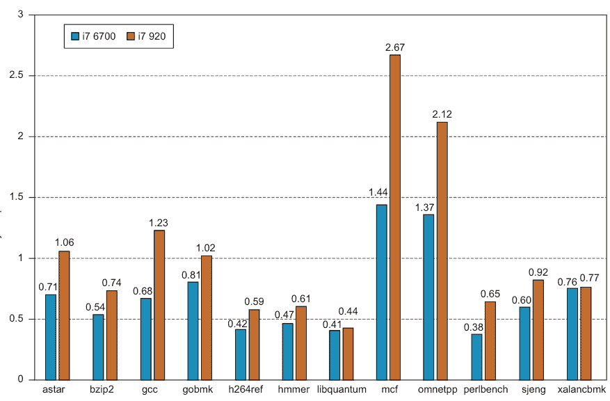

图 3.40 `i7 6700` 和 `i7 920` 在 `SPECCPU2006` 基准测试上的 `CPI`。本节数据由路易斯安州立大学的 Lu Peng教授和博士生秦刘收集。

| 基准测试 | CPI 比例 (920/6700) | 分支预测失败比例 (920/6700) | L1 需求缺失比例 (920/6700) |
|---|---|---|---|
| ASTAR | 1.51 | 1.53 | 2.14 |
| GCC | 1.82 | 2.54 | 1.82 |
| MCF | 1.85 | 1.27 | 1.71 |
| OMNETPP | 1.55 | 1.48 | 1.96 |
| PERLBENCH | 1.70 | 2.11 | 1.78 |

图 3.41 对 `i7 6700` 和 920 性能差距最大的五项整数基准测试的分析。这五项基准测试在分支预测率上有所提高，`L1` 缺失率有所降低。

## 3.13 误区与陷阱

我们的几个误区集中在从时钟频率或 `CPI` 等单一指标预测性能和能效的难度上。我们还表明不同的架构方法对于不同的基准测试会有完全不同的行为。

误区：如果保持技术不变，预测两个相同指令集的版本的性能和能效是很容易的。`Intel` 为低端移动（PMD）空间提供了一种名为 `Atom 230` 的处理器，它实现了 `x86` 架构的 64 位和 32 位版本。`Atom` 是一个调度的双发射超标处理器，其微架构与 `ARM A8`（`A53` 的单身身）非常相似。有趣的是，`Atom 230` 和 `Core i7 920` 都采用 45nm 工艺制造。图 3.42 总结了 `Intel i7 920`、`ARM A8` 和 `Atom 230`。这些相似性为在相同的底层基础上比较两种不同架构提供了罕见的机会。在进行比较之前，我们需要对 `Atom 230` 有进一步的了解。`Atom` 处理器使用标准技术将 `x86` 指令转换为类 RISC 指令；这意味着在典型的指令中，只有 4% 的指令需要多一个微操作。这与 `ARM A8` 不同，`ARM A8` 使用 16 级流水线，每个周期可以发射两条指令，并具有独立的浮点和其他操作流水线。`Atom 230` 拥有 32 KiB 指令缓存和 24 KiB 数据缓存，共享 512 KiB `L2`（`Atom 230` 还支持双线程多线程，但我们只考虑单线程）。

我们可能预计这两个在相同技术上实现、相同指令集的处理器在相对性能和功耗方面表现出可预测的行为，这意味着功率和性能呈线性比例。我们使用三组基准测试检验了这一假设。第一组是 Java 单线程基准测试，来自 DaCap 和 SPEC JVM 基准测试（Esmaeiladeh，2011 关于基准测试和测量的讨论）。第二组和第三组基准测试分别是 `SPEC CPU2006` 的整数和浮点基准测试。

| 区域 | 特有属性 | ARM A8 | Intel Atom 230 |
|---|---|---|---|
| 物理芯片属性 | 四核心，每个都带浮点 | 单核心，无浮点 | 单核心，带浮点 |
| 时钟频率 | 2.66 GHz | 1 GHz | 1.66 GHz |
| 热设计功率 | 130 W | 2 W | 4 W |
| 封装 | 1366-pin BGA | 522-pin BGA | 437-pin BGA |
| TLB | 两级全组关联 | 单级全关联 | 两级全组关联 |
| | 128 I/64 D 512 L/2 | 32 I/32 D | 16 I/16 D 64 L2 |
| 缓存 | 三级 256 KiB/32 KiB 2-8 MB | 两级 16/32 KiB 128 KiB–1 MB | 两级 32/24 KiB 512 KiB |
| 内存系统 | 峰值带宽 | 17 GB/s | 12 GB/s | 8 GB/s |
| 峰值发射率 | 融合后每周期 4 次操作 | 每周期 2 次操作 | 每周期 2 次操作 |
| 流水线调度 | 投机乱序 | 动态内发射 | 动态内发射 |
| 流水线结构 | 分支预测 | 两级 512 条 BTB、4K 全局历史、8 条返回栈 | 两级 | |

**图 3.42** 四核 `Intel i7 920` 概览、典型 `ARM A8` 处理器示例（带有 256 MB、32 KiB L1 且无浮点单元）以及 `Intel Atom 230`，清楚地显示了用于移动（以 ARM 为例）或网络空间（以 Atom 为例）的处理器与面向服务器和高端桌面级用户的处理器之间的哲学差异。`i7` 包含四个核心，每个核心的性能都高于单核心的 `A8` 或 `Atom`。所有处理器均采用竞争性的 45nm 工艺实现。

正如我们在图 3.43 所示，`i7` 性能远优于 `Atom`。所有基准测试在 `i7` 上的速度至少快四倍，两项 `SPECFP` 基准测试快十倍以上，有一项 `SPECINT` 基准测试运行快了八倍！因为这两个处理器的频率比为 1.6，所以大部分优势源于 `i7 920` 低得多的 `CPI`：Java 基准测试为 2.8 倍，`SPECINT` 基准测试为 3.1 倍，`SPECFP` 基准测试为 4.3 倍。这种激进的

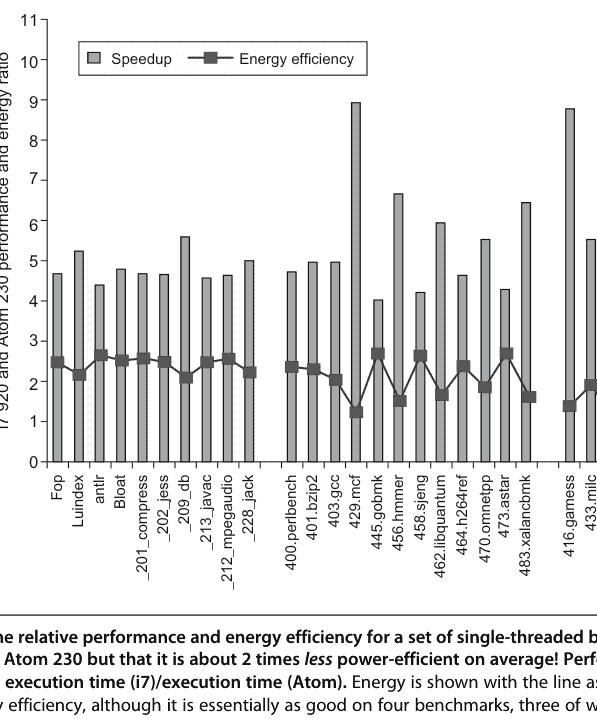

**图 3.43** 一单线程基准测试的相对性能和能效显示，`i7 920` 的速度比 `Atom 230` 快 4 到 10 倍，但其平均能效却低了约 2 倍！列中的性能表示相对于 `Atom` 的 `i7`，其中直线表示执行时间，折线表示能量 (Atom)/能量 (i7)。`i7` 在能效方面从未胜过 `Atom`，尽管它在四项基准测试中的表现基本相当，其中三项是浮点运算。此处显示的数据由 Esmaeilzadeh 等人（2011年）收集。`SPEC` 基准测试使用标准的 `Intel` 编译器进行了优化编译，而 Java 基准测试则使用了 Sun（Oracle）的 `HotSpot` Java 虚拟机。`i7` 上只有一个核心处于激活状态，其余核心均处于深度节功耗模式。`i7` 使用了 `Turbo Boost` 技术，这增加了它的性能优势，但略微降低了其能效。

## 3.13 误区与陷阱 261

带有动态调度和预测的超标量处理器在能效方面存在*显著的劣势*。


## 误区
`CPI` 越低的处理器总是更快。

## 误区
时钟频率越高的处理器总是更快。

关键在于决定性能的是 `CPI` 和时钟频率的乘积。通过深度流水线处理器获得的高时钟频率必须保持低 `CPI` 才能获得更快速时钟的全部收益。同样，一个高时钟频率但低 `CPI` 的简单处理器可能会更慢。

正如我们在上一个家族看到的，即使具有相同的指令集架构（`ISA`），不同处理器在不同环境下的性能和效率也可能存在差异。事实上，即使在同一家公司的处理器家族内部，性能也会出现巨大差异。图 3.44 显示了 Intel 的两种不同 `x86` 架构实现的整数和浮点性能，以及一个同样来自 Intel 的 `Itanium` 架构版本。

`Pentium 4` 是 Intel 制造过的流水线设计最激进的处理器。Intel 使用了超过 20 个阶段的流水线，拥有七个功能单元，并缓存微操作而非 `x86` 指令。考虑到其激进的实现方式，其相对较低的性能清楚表明，利用更多指令级并行（`ILP`）的尝试（当时可能有 50 条指令在执行）已经失败了。`Pentium` 的功耗与 `i7` 相似，尽管它的晶体管速度更快，因为它的缓存与 `i7` 一样大，且仅包含 2 MiB 的二级缓存，没有三级缓存。

Intel `Itanium` 是一种 `VLIW` 架构，尽管与动态调度超标量处理器相比复杂度可能会增加，但它从未获得与主流 `x86` 处理器具有竞争力的时钟频率（尽管它似乎实现了与 `i7` 类似的整体 `CPI`）。在这些结果中，读者应该注意它们使用了不同的实现技术，对于等流水线的处理器，`i7` 在传输速度和时钟频率方面具有优势。尽管如此，巨大的差异

| 实现技术 | 时钟频率 | 功耗 | `SPECC2006` 基础分 | `SPECC2006` 基线 |
| :--- | :--- | :--- | :--- | :--- |
| Intel `Pentium 4670` | 90 nm | 3.8 GHz | 115 W |  | 12.2 |
| Intel `Itanium 2` | 90 nm | 1.66 GHz | 104 W 约 70 W（单核心） | 14.5 | 17.3 |
| Intel `i7 920` | 45 nm | 3.3 GHz | 130 W 总计，约 80 W（单核心） | 35.5 | 38.4 |

图 3.44 三种不同的 Intel 处理器差异巨大。虽然 `Itanium` 有两个核心而 `i7` 有四个，但在基准测试中只有一个核心处于激活；“功耗”列是热设计功率，多核情况下的单核心激活估算值。

## 262 第三章 指令级并行性及其利用

性能——`Pentium` 和 `i7` 之间超过三倍的差异——令人震惊。下一个一个陷阱解释了这种优势很大程度上从何而来。

**陷阱** 有时“越笨越好”。

21 世纪 20 年代初大部分注意力都集中在构建激进的处理器以利用 `ILP` 上，包括 `Pentium 4` 架构（它使用了微处理器中看到的深度流水线）以及 `Itanium`（它拥有历史上最高的每时钟峰值发射率）。当人们很快意识到利用 `ILP` 的限制往往在于内存系统时，尽管推测乱序执行流水线能够很好地隐藏一级缺失中 10–15 个周期惩罚的大部分，但对于二级缺失（当访问内存时，惩罚可能达 50–100 个时钟周期），它们无能为力。

结果是，尽管晶体管数量巨大且使用了极其复杂和巧妙的技术，这些设计从未达到峰值指令数。第 3.15 节讨论了这一困境以及从更激进的 `ILP` 方案向多核的转变，但还有另一个变化丰富了这一陷阱。设计人员没有尝试用 `ILP` 隐藏更多的延迟，而是利用晶体管构建了更大的缓存。`Pentium 2` 和 `i7` 都使用了三级缓存，而 `Pentium 4` 只有二级二级缓存，其三级缓存分别为 9 和 8 MiB。

## 264 第三章 指令级并行性及其利用

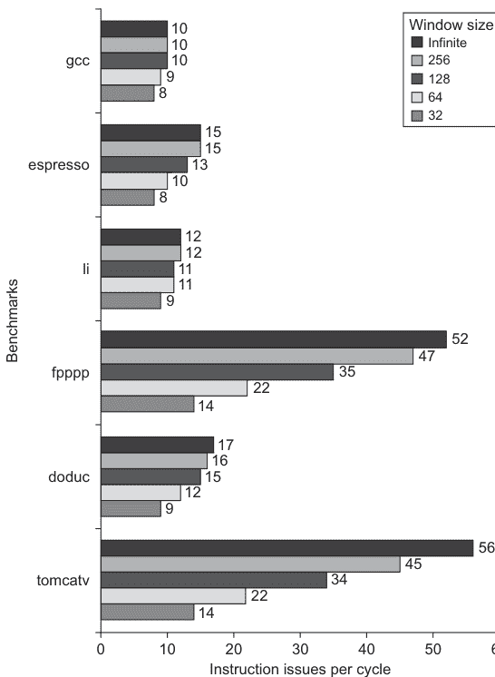

**图 3.45** 各种整数和浮点程序在每时钟最多64个调度问题下的并行度与窗口大小的关系。尽管重命名寄存器的数量少于窗口大小，但由于所有操作的延迟均为1个周期，且重命名寄存器的数量等于窗口宽度，使得处理器能够利用整个窗口内的并行性。

## 3.14 结语：未来何在？

自2000年以来，利用指令级并行性（`ILP`）的关注度达到了巅峰。在新世纪的前五年里，人们明显发现`ILP`方法已达到极限，需要新的方法。到2005年，英特尔和其他其他处理器制造商都改进了多核方案。更高的性能将通过线程级并行而非指令级级并行来实现，而高效使用处理器的责任将很大程度上从硬件转移到软件和程序员。这一变化是自25多年前流水线和指令级并行早期出现以来，处理器架构发生的最重大的一次变革。

在同一时期，设计者开始探索使用更多数据级并行性作为另一种获取性能的方法。`SIMD`扩展使得桌面和服务器微处理器在图形及类似功能上实现了中等程度的性能提升。更重要的是，图形处理器（`GPU`）积极追求`SIMD`，为具有大量数据级并行性的应用带来了了显著的性能优势。对于科学应用，这些方法是通用情况的有效替代方案，而多核中效果较弱线程级并行则探索了这些在数据级并行性使用方面的发展。

许多研究人员发现`ILP`的使用正在消退，预测双超标处理器和更多的核心将是未来。然而，略高的发射率优势以及预测性调度处理不可预测事件（如缓存缺失）的能力，使得中等水平的`ILP`（通常为每时钟约4次发射）成为多核设计的主要构建模块。`SMT`（多线程））的加入及其有效性（无论在性能还是能效方面）巩固了这种中等速率的无序、预测方法。事实上，在嵌入式市场中，最新的处理器（例如 `ARM Cortex-A9`和`Cortex-A73`）已经引入了动态调度、预测和更宽的发射率。

未来的处理器极不可能显著增加`ILP`的宽度。从硅片利用率和功率效率的角度来看，这太低效了。考虑图3.46中的数据，它显示了`IBM Power`系列中的五种处理器。在十多年时间里，`Power`处理器的`ILP`支持有了适微的改进，但晶体管数量增长的大部分（从`Power4`到`Power8`增长了10倍以上）主要用于增加缓存和每个晶片的核心数。

|  | `Power4` | `Power5` | `Power6` | `Power7` | `Power8` |
| :--- | :--- | :--- | :--- | :--- | :--- |
| 推出 | 2001 | 2004 | 2007 | 2010 | 2014 |
| 初始主频 (GHz) | 1.3 | 1.9 | 4.7 | 3.6 | 3.3 GHz |
| 晶体管数量 (M) | 174 | 276 | 790 | 1200 | 4200 |
| 每时钟发射次数 | 5 | 5 | 7 | 6 | 8 |
| 每个核心功能单元 | 8 | 8 | 9 | 12 | 16 |
| 每个核心`SMT`线程 | 0 | 2 | 2 | 4 | 8 |
| 核心数/晶片 | 2 | 2 | 2 | 8 | 12 |
| 总片上缓存 (MiB) | 1.5 | 2 | 4.1 | 32.3 | 103.0 |

图 3.46 五代`IBM Power`处理器的特性。除了静态顺序执行的`Power6`外，其余所有处理器均采用动态调度；所有处理器都支持两个加载/存储流水线。`Power6`与`Power5`具有相同单元，除了一个进制单元。`Power7`和`Power8`为`L3`缓存嵌入了`DRAM`。`Power9`已简要描述，它进一步扩展了缓存并支持片外`HBM`。

即使是`SMT`支持的扩展似乎也比`ILP`吞吐量的增加更关注：从`Power4`到`Power8`的`ILP`结构从5次发射变为8次，从8个功能单元增加到16个（并未从原始的2个加载/存储单元增加），而`SMT`支持则从无到每个处理器8个线程。在六代`i7`处理器中也可以观察到类似的趋势，几乎所有相同的硅片都用于支持更多的核心。接下来的两个章节将重点介绍利用数据级并行和线程级并行性的方法。

## 3.15 历史视角与参考文献

`M.5`节（在线可用）涵盖了关于流水线和指令级并行性发展的讨论。我们在第三章和附录`H`中提供了许多参考文献，以供进一步阅读和探索这些主题。

### 案例研究：探索微体系技术的影响

- 基础指令调度、分发
- 多发射与冲突冒险
- 寄存器重命名
- 无序执行与预测执行

你被赋予设计一种新处理器微体系的任务，并尝试分配硬件资源。你应该应用第三章中学到的哪些技术？你的老板对新设计的性能要求很模糊，但你从经验中知道在相同的情况下，越快越好。从基础开始。图 3.47提供了指令列表和延迟。

3.1 对于图3.47的代码序列，直到上一条指令执行完成的基性能（每次迭代的周期）是多少？忽略前端取指和解码。假设执行不会因为缺少指令而停止，但每时钟只能发射一条指令。假设分支跳转，且存在一个周期的延迟槽。

超出周期的延迟

| 类型 | 延迟 |
| :--- | :--- |
| 内存加载 (`LD`) | +3 |
| 内存存储 (`SD`) | +1 |
| 整数 (`ADD`, `SUB`) | +0 |
| 分支 | +1 |
| `fadd.d` | +2 |
| `fmul.d` | +4 |
| `fdiv.d` | +10 |

| 指令 |
| :--- |
| 循环 `Loop:` `fld`, `f2,0(Rx)` |
| `I0:` `fmul.d`, `f2,f0,f2` |
| `I11:` `fdiv.d`, `f8,f2,f0` |
| `I12:` `fld`, `f4,0(Ry)` |
| `I13:` `fadd.d`, `f4,0,f4` |
| `I14:` `fadd.d`, `f10,f8,f2` |
| `I15:` `fsd`, `f4,0(Ry)` |
| `I16:` `addi`, `Rx,8,8` |
| `I17:` `addi`, `Ry,Ry,8` |
| `I18:` `sub`, `x20,4,Rx` |
| `I19:` `bnz`, `x20,Loop` |

图 3.47 练习3.1至6的代码和延迟。

3.2 [10] 思考延迟真正的含义——指示给定函数产生其输出所需的周期数。如果流水线由于每个功能单元的延迟而停顿，并且至少保证任何连续的指令对（“生产者”后跟“消费者”）都能正确执行。但并非所有指令对都有生产者/消费者关系。有时相邻指令之间无关。如果流水线能够检测到真数据依赖并仅在这些依赖上停顿，而不是仅仅因为某个功能单元忙就停止所有操作，图3.47代码序列中的循环体需要多少周期？请在需要的地方代码中插入`<stall>`以适应停顿延迟。（提示：延迟大于2的指令需要在代码序列中插入周期。） 思考这个

方式：单周期指令延迟为 1+0，意味着没有额外的等待状态。因此，延迟 1+1 意味着一个停顿周期；延迟为 1+N 则有 N 个额外周期。

3.3 [15]<3.1, 3.2> 考虑一个多发射设计。假设你有两个执行流水线，每个流水线每周期都能开始执行一条指令，并且前端有足够的取指/解码带宽，以至于它不会阻塞你的执行。假设结果可以立即从一个执行单元转发到另一个执行单元，或转发到其本身。进一步假设执行流水线停顿的唯一原因是观察到了真数据依赖（true data dependency）。现在，这个循环需要多少个周期？

3.4 [10]<3.2> 在多发射设计中，你可能会遇到一些问题。尽管两个流水线具有完全相同的指令集，但它们并不相同也不可以互换，因为它们之间存在一种隐含顺序，这种顺序必须反映原始程序中指令的顺序。如果指令 `N+1` 在 `Pipe 1` 中开始执行的同时，指令 `N` 在 `Pipe 0` 中开始执行，且 `N+1` 的延迟比 `N` 短，那么 `N+1` 将在 `N` 之前完成（尽管程序顺序暗示了结果相反）。列举至少两个理由，说明为什么可能是危险的，并在微架构中需要特殊考虑。从图 3.47 的代码中给出两个指令的示例来说明这种危险。

3.5 [20]<3.1, 3.2> 重新排序指令以提高图 3.47 中代码的性能。假设练习 3.3 中的双流水线机器和练习 3.4 中的无序完成问题已得到成功解决。现在只需关注观察真数据依赖和功能延迟。你重排后的代码需要多少个周期？

3.6 [10/10]<3.1, 3.2> 循环中每个没有启动新操作的周期都是一次机会的机会，从这个意义上说，你的硬件没有发挥潜力。

- a. <3.1, 3.2> 在练习 3.5 的重排代码中，在所有周期中（计算两个流水线），有多少比例被浪费了（即没有启动新操作）？
- b. <3.1, 3.2> 循环展开（Loop unrolling）是编译器在代码中寻找更多并行性的标准技术之一，以减少性能的机会损失。在练习 3.5 的重排代码中手动展开循环的两次迭代。
- c. [10]<3.1, 3.2> 你实现了多大的加速？（对于本练习，只需区分给出的 `N+1` 次迭代指令与第 `M` 次迭代指令即可；如果你实际上在展开循环，则需要重新分配寄存器以防止迭代之间的冲突。）

3.7 [15]<3.4> 计算机的大的大部分时间花在循环中，因此多次循环迭代是预测性寻找工作以保持 CPU 资源忙碌的绝佳场所。然而这并非易事；编译器只嵌入了一份循环代码，尽管多次迭代正在处理不同的数据，但它们看起来似乎使用了相同的寄存器。

# 案例研究与练习，Jason D. Bakos 和 Robert P. Colwell 编写

为了防止我们多次“迭代”的使用之间发生冲突，我们重命名了它们的寄存器。图 3.48 显示了我们希望硬件进行重命的示例代码。编译器可以简单地展开循环并使用不同的寄存器来避免冲突，但如果我们期望硬件来展开循环，它也必须执行寄存器重命名。如何做到？假设我们的硬件有一个临时寄存器池（称为 `T` 寄存器，假设我们有 60 个，从 `T0` 到 `T63`），它可以用它们替换编译器指定的寄存器。这种重命名硬件通过源（src）寄存器编号进行索引，表中的值是目标该寄存器的目标 `T` 寄存器。（将这些表中的值视为生产者，而生产者将结果放在哪里对于消费者（consumers）来说并不重要；只需找到它即可。）考虑图 3.48 中的代码序列。每当你在代码中看到目标寄存器时，就替换下一个可用的 `T`，从 `T0` 开始。然后相应地更新所有 src 寄存器，以维持真数据依赖。显示结果。（提示：见图 3.49）。

- 3.8 [20]<3.4x> 探索了简单的寄存器重命名：当硬件寄存器重命名器看到源寄存器时，它会替换为上一个目标该寄存器的指令的目标 `T`。当重命名表使用目标寄存器时，它会用下一个可用的 `T` 替换它，但超标设计需要在机器的每个阶段每个时钟处理多条指令，包括寄存器重命名。因此，`SimpleScalar` 处理器将为每条指令查找两个 src 寄存器映射，并每个时钟分配一个新的 dest 映射。超标处理器必须能够很好地做到，但它们还必须确保并发指令之间的任何 dest-to-src 关系都得到正确处理。考虑图 3.50 中的示例代码序列。假设我们想同时

```
Loop: fld f2,0(Rx)
I0: fmul.d f5,0.f2
I1: fdiv.d f8,0.f2
I2: fld f4,0(Ry)
I3: fadd.d f6,0.f4
I4: fadd.d f10,0.f2
I5: sd f4,0(Ry)
```

图 3.48 寄存器重命名示例。

```
Loop: fld f2,0(Rx)
I0: fmul.d f5,0.f2
I1: fdiv.d f8,0.f2
I2: fld f4,0(Ry)
I3: fadd.d f6,0.f4
I4: fadd.d f10,0.f2
I5: sd f4,0(Ry)
```

图 3.49 重命名的预期输出。270 第三章 指令级并行性及其利用

```
I0: fmul.d f5,0.f2
I1: fadd.d f9,0.f5
I2: fadd.d f5,0.f5
I3: fdiv.d f2,f9
```

图 3.50 超标代码。假设我们想同时重命名两条指令。没有时间在同一个周期内更新表。也就是说，依赖将在下一个周期处理。图 3.51 显示了一个使用复用器和比较器的电路图，你的任务是显示图 3.50 代码的逐周期重命名状态。假设表初始为 `T0=0；T1=1`。

图 3.51 表初始状态。271 案例研究与练习，Jason D. Bakos 和 Robert P. Colwell

3.9 [5]<3.4> 如果你对寄存器重命名感到困惑，回到你执行的汇编代码，问自己会发生什么。例如，考虑三发射超标机器同时重命名三条指令：

```
addi x1,x1
addi x1,x1
addi x1,x1
```

如果 `x1` 的初始值为 5，那么在执行该序列后它的值应该是？

3.10 [20]<3.4, 3.7> 长指令字（`VLIW`）设计者在制定寄存器使用的规则方面有几种选择。假设 `VLIW` 设计具有自空执行流水线：一旦启动操作，结果将在 `M` 个周期后出现在目标寄存器（其中 `L` 是操作的延迟）。寄存器永远不够，因此倾向于尽可能使用现有寄存器。考虑图 3.52。如果加载延迟为 1+2 周期，展开此循环，并展示在没有流水线中断或停顿的情况下，每周期两次加载和两次加法的 `VLIW` 如何使用最少寄存器。给出一个在自空流水线存在破坏这种流水线并导致错误的事件示例。

3.11 [10/10]<3.3> 假设采用五阶段单流水线微架构（取指、解码、执行、内存写）以及图 3.53 中的代码。除了 `LW` 和 `SW` 外，所有操作均为一个周期，分支为 1+1 周期。没有转发。显示循环迭代中每条指令每个周期的阶段。

- a. [10]<3.3> 每次迭代中有多少周期丢失在分支开销上？


- b. [10]<3.3> 假设有一个静态分支预测器，能够在解码阶段识别回分支。现在在分支开销上浪费了多少个周期？

```
lw          x1,0(x2):      lw          x3,8(x2)
<stall>
<stall>
addi       x10,x1,1:     addi       x11,x3,1
sw          x1,0(x2);      sw          x3,8(x2)
addi       x2,x2,8
sub        x4,x3,2
bz        x4,Loop
```

图 3.52 带有两次加载、两次加法和三次停顿的 VLIW 代码。

# 第三章 指令级并行性及其利用

```
Loop:
  lw x1,0(x2)
  addi x1,x1,1
  sw x1,0(x2)
  addi x2,x2,4
  sub x4,x3,x2
  bnz x4,Loop
```

**图 3.53** 练习 3.11 的代码循环。

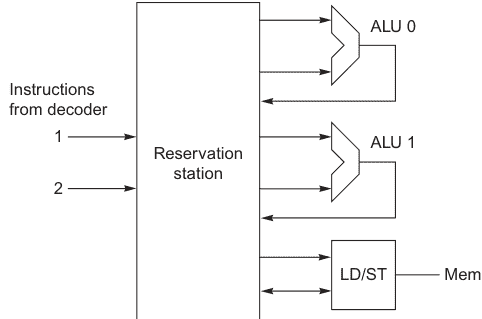

**图 3.54** 练习 3.12 的微架构。

- c. [10] <3.3> 假设有一个动态分支预测器。在预测正确的情况下会损失多少个周期？

- 3.12 [15/20/20/10] <3.4, 6> 让我们考虑动态调度在这里可以实现什么效果。假设微架构如图 3.54 所示。假设算术逻辑单元 `ALU` 可以执行所有算术运算 `fmul.d, fdiv.d, fadd.d, addi, sub` 和分支指令，保留站 `RS` 每个周期最多向每个功能单元分发一个操作（每个 `ALU` 发一个操作，每个内存单元向 `fd/fd` 发一个内存操作）。

- a. [15] <3.4> 假设图 3.47 序列中的所有指令都存在 `RS` 中，且没有进行任何重命名。在代码中突出显示寄存器重命名可以提高性能的指令。（提示：寻找读后写 `RAW` 和写后写 `WAW` 冲突。假设图 3.47 中的功能单元延迟均相同。）

- b. [20] <3.4> 假设部分 (a) 中代码经过寄存器重命名后的版本在时钟周期 N 驻留在 `RS` 中，延迟如图 3.47 所示。展示 `RS` 如何逐时钟周期地乱序分发这些指令，以获得该代码的最优性能。（假设采用部分 (a) 相同的 `RS` 限制。还假设结果在可以使用之前已写入 `RS`——不使用旁路。）该序列需要多少个时钟周期？

- c. [20] <3.4> 部分 (b) 让 `RS` 尝试优化地调度这些指令。在实际上，感兴趣的整个指令序列通常不在 `RS` 中。相反，各种事件会清空 `RS`，当新的代码序列从解码器进入时，`RS` 必须选择分发它已有的内容。假设在周期 0，此序列的前两个经过寄存器重命名的指令出现在 `RS` 中。假设分发每个指令需要一个周期，功能单元延迟与练习 3.2 相同。此外，前端（解码器/寄存器重命名器）将继续每个周期提供两条新指令。展示指令的逐周期分发。该代码序列需要多少个时钟周期？

- d. [10] <3.4> 如果你想改进部分 (c) 的结果，哪项会有帮助：(1) 另一个 `ALU`？(2) 另一个 `LD/ST` 单元？(3) `ALU` 结果到后续操作的全旁路？或 (4) 将最延迟减半？加速比是多少？

- e. [20] <3.6> 现在让我们考虑取取、解码和执行一个或多个条件分支的行为。我们此举动机有两点：我们在部分 (c) 中得出的调度计划包含很多节点，而且我们的计算机大部分时间花在执行循环上（这意味着返回循环顶部的分支通常是非常可预测的）。循环告诉我们去哪里寻找更多要做的工作；我们稀疏的调度计划表明我们有机会更早地完成这些工作。在部分 (d) 中，如果你找到了通过部分 (b) 的关键路径。完成两个循环的工作量还需要多少个时钟周期（假设所有指令都限制在 `RS` 中）？假设所有功能单元都是全流水线的。

# 练习题

- [25] <3.7, 3.8> 在此练习中，你将探索三个采用不同类型多线程 `MT` 处理的处理器之间的性能权衡。这些处理器各都是超标的，具有顺序执行流水线，所有加载和分支指令都需要固定的三周期停顿，并且具有相同的 `L1` 缓存。在该周期内使用的同一线程的指令按程序顺序读取，且不能包含任何数据或控制依赖。

- 处理器 A 是超标同步多线程架构，能够每个周期从两个线程发射最多两条指令。

- 处理器 B 是细粒度多线程架构，能够每个周期从单个线程发射最多四条指令并在任何流水线停顿时切换线程。

- 处理器 C 是粗粒度多线程架构，能够每个周期从单个线程发射最多八条指令，并在 `L1` 缓存缺失时切换线程。

我们的应用程序是一个列表搜索器，它扫描内存区域，以查找在 `R16` 和 `R17` 指定地址范围内存储在 `R9` 中的特定值。它通过并行化，是将搜索空间等划分为四个等大小的块，并为每个块分配一个线程进行搜索（产生四个线程）。每个线程运行的大部分时间花在以下展开的循环体中：

```
loop: lw x1,0(x16)
lw x2,8(x16)
lw x3,16(x16)
lw x4,24(x16)
lw x5,32(x16)
lw x6,40(x16)
lw x7,48(x16)
lw x8,56(x16)
beq x9,match0
beq x9,match1
beq x9,match2
beq x9,match3
beq x9,match4
beq x9,match5
beq x9,match6
beq x9,match7
addi x16,x16,#64
blt x16,x17,loop
```

假设以下情况：

- 使用屏障确保所有线程同时开始。

- 在循环两次后发生第一次 `L1` 缓存缺失。

- 所有 `BEQ` 分支均跳转。

- `BLT` 取真。

- 三个处理器轮询调度。

确定每个处理器完成两次迭代需要多少周期。

[25/25/25]<3.2, 37> 在此练习中，我们观察软件技术如何提取指令级并行性。以下循环是所谓的 `DAXPY` `aX+Y`，向量长度为 100。初始时 `R1` 设置为 `X` 的基地址，`R2` 设置为 `Y` 的基地址：由 Jason D. Bakos 和 Robert Colwell 的案例研究与练习

```
foo: fld      F2,0(x1) : (F2) = X
fmul.d    F4,F2,F0 : (F4) = a*X
fld       F6,0(x2) : (F6) = Y
fadd.d    F6,F4,F6 : (F6) = a+Y
fsd       F6,0(x2) : (F6) = a+Y
addi      x1,x1,#8 : 增加 X索引
addi      x2,x2,#8 : 增加 Y索引
slu      x3,x1,x4 : 继续循环？
bnez      x3,foo
```

功能单元延迟如下表所示。假设在 `ID` 阶段有一个延迟分支。假设结果已旁路。

| 产生结果的指令 | 使用结果的指令 | 周期延迟 |
|---|---|---|
| 浮点乘法 | 浮点运算 | 6 |
| 浮点加法 | 浮点运算 | 4 |
| 浮点乘法 | 浮点存储 | 5 |
| 浮点加法 | 浮点存储 | 4 |
| 整数运算及所有加载 | 任意 | 2 |

- a. [25] <3.2> 假设单流水线。展示编译器未调度以及任何编译器调度浮点运算和分支延迟（包括任何停顿或空闲周期）时的情况。未调度和调度后向量结果 `Y` 的执行时间（周期）是多少？硬件本身需要多快才能匹配编译器调度带来的性能提升？（忽略时钟加速对内存性能的影响。）

- b. [25] <3.2> 假设单流水线。展开循环所需的次数，以便在无停顿的情况下调度，合并循环开销指令。循环必须展开多少次？展示指令调度。每个元素的执行时间是多少？

- c. [25] <3.7> 假设一个 `VLIW` 处理器，指令包含五个操作，如图 3.20 所示。我们比较两种程度的展开。展开循环 6 次以提取 `ILP` 并在无停顿的情况下调度（即完全空的发射周期），合并循环开销指令，然后重复该过程但展开循环 10 次。忽略分支延迟槽。展示这两个调度。每个调度下向量结果每个元素的执行时间是多少？每个调度中操作槽的百分比是多少？两个调度代码大小差异有多大？调度的总寄存器需求是多少？

## 第三章 指令级并行性及其利用

3.15 [20/20] <3.4, 3.5, 3.7, 3.8> 在本练习中，我们将观察 Tomasulo 算法在运行练习 3.14 中的循环时的各种变体。功能单元（FUs）描述如下表所示。

| FU 类型 | EX 阶段周期数 | FU 数量 | 留存站数量 |
| --- | --- | --- | --- |
| 整数型 | 1 | 1 | 5 |
| 浮点加法器 | 10 | 1 | 3 |
| 浮点乘法器 | 15 | 1 | 2 |

假设以下条件：

- 功能单元不是流水线化的。

- 功能单元之间没有旁路；结果通过公共数据总 `CDB` 进行通信。

- 执行阶段 `EX` 同时完成有效地址计算以及加载/存储的内存访问。流水线阶段为 `IF/ID/IS/EX/WB`。

- 加载 `Loads` 需要一个周期。

- 发射 `IS` 和写回 `WB` 结果各占用一个时钟周期。

- 有五个加载缓冲区槽位和五个存储缓冲区槽位。

- 假设非零跳转 `BNEZ` 指令需要一个时钟周期。

a. [20]<3.4-3.5> 对于此问题，请使用图 3.10 中的单发射 MIPS 流水线，并采用前表中的流水线延迟。显示每条指令的周期数，以及循环迭代三次时每条指令执行（即进入其第一个 EX 周期）的时钟周期。每个循环迭代需要多少周期？请以带有以下列头的表格形式报告答案：

- 迭代（循环迭代次数）
- 指令
- 发射（指令发射的周期）
- 执行（指令执行的周期）
- 内存访问（访问内存的周期）
- 写回 CDB（结果写入 CDB 的周期）
- 注释（对指令等待期间任何事件的描述）

- 在你的表格中显示循环的三次迭代。你可以忽略第一条指令。

b. [20]<3.7, 3.8> 重复部分 (a)，但这次使用双发射 Tomasulo 算法和全流水线浮点单元 `FPU`。

3.16 <3.4> Tomasulo 算法有一个缺点：每个 `CDB` 每个周期仅能计算一个结果。请使用上一个问题中的硬件配置和延迟，找到一个长度不超过 10 条指令的代码序列，在该序列 Tomasulo 算法必须由于 `CDB` 竞争而停顿。指出其在你的序列中发生的位置。

## Jason D. Bakos 和 Robert. Colwell 的案例研究与练习 277

3.17 [20] <3.3> 一种 `(m,n)` 相关分支预测器使用最近执行的 `m` 个分支的行为，从 `2^m` 个预测器中进行选择，每个预测器都是 `n` 位的预测器。两级本地预测器的工作方式类似，但它只跟踪每个分支的历史行为来预测未来行为。这类预测器存在权衡：相关预测器对历史的内存需求较小，允许它们为大量单个分支维护 2 位预测器（减少了分支复用同一个预测器的概率），而本地预测器需要更多内存来保存历史记录，并且被限于少数分支。对于本练习，考虑一个可以跟踪四个分支（需要 16 位）的 `(1,2)` 相关预测器，对比一个使用相同内存可以跟踪两个分支的 `(1,2)` 本地预测器。对于后续的分支结果，提供每个预测器的预测结果、预测时使用的条目、由于预测而对表进行的任何更新，以及每个预测器的最终预测率。假设到此为止的所有分支都已跳转。将每个预测器初始化为如下：

### 相关预测器

| 条目 | 分支 | 上次结果 | 预测 |
|---|---|---|---|
| 0 | 0 | T | T（带一次误判后） |
| 1 | 0 | NT | NT |
| 2 | 1 | T | NT |
| 3 | 1 | NT | T |
| 4 | 2 | T | T |
| 5 | 2 | NT | T |
| 6 | 3 | T | NT（带一次误判后） |
| 7 | 3 | NT | NT |

### 本地预测器

| 条目 | 分支 | 上 2 次结果（右侧为最新） | 预测 |
|---|---|---|---|
| 0 | 0 | T,T | T（带一次误判后） |
| 1 | 0 | T,NT | NT |
| 2 | 0 | NT,T | NT |
| 3 | 0 | NT | T |
| 4 | 1 | T,T | T |
| 5 | 1 | NT,T | T（带一次误判后） |
| 6 | 1 | NT,T | NT |
| 7 | 1 | NT,NT | NT |

## 第四章 指令级并行性及其利用

| 分支 PC（字地址） | 结果 |
|---|---|
| 454 | T |
| 543 | NT |
| 777 | NT |
| 543 | NT |
| 777 | NT |
| 454 | T |
| 777 | NT |
| 454 | T |
| 543 | T |


### 3.17 [20] <3.3> 一种 (m,n) 相关分支预测器使用最近执行的 m 个分支的行为，从 2^m 个预测器中进行选择，每个预测器都是 n 位的预测器。两级本地预测器的工作方式类似，但它只跟踪每个分支的历史行为来预测未来行为。这类预测器存在权衡：相关预测器对历史的内存需求较小，允许它们为大量单个分支维护 2 位预测器（减少了分支复用同一个预测器的概率），而本地预测器需要更多内存来保存历史记录，并且被限于少数分支。对于本练习，考虑一个可以跟踪四个分支（需要 16 位）的 (1,2) 相关预测器，对比一个使用相同内存可以跟踪两个分支的 (1,2) 本地预测器。对于后续的分支结果，提供每个预测器的预测结果、预测时使用的条目、由于预测而对表进行的任何更新，以及每个预测器的最终预测率。假设到此为止的所有分支都已跳转。将每个预测器初始化为如下：

#### 相关预测器

| 条目 | 分支 | 上次结果 | 预测 |
|---|---|---|---|
| 0 | 0 | T | T（带一次误判后） |
| 1 | 0 | NT | NT |
| 2 | 1 | T | NT |
| 3 | 1 | NT | T |
| 4 | 2 | T | T |
| 5 | 2 | NT | T |
| 6 | 3 | T | NT（带一次误判后） |
| 7 | 3 | NT | NT |

#### 本地预测器

| 条目 | 分支 | 上 2 次结果（右侧为最新） | 预测 |
|---|---|---|---|
| 0 | 0 | T,T | T（带一次误判后） |
| 1 | 0 | T,NT | NT |
| 2 | 0 | NT,T | NT |
| 3 | 0 | NT | T |
| 4 | 1 | T,T | T |
| 5 | 1 | NT,T | T（带一次误判后） |
| 6 | 1 | NT,T | NT |
| 7 | 1 | NT,NT | NT |

## 第四章 指令级并行性及其利用

| 分支 PC（字地址） | 结果 |
|---|---|
| 454 | T |
| 543 | NT |
| 777 | NT |
| 543 | NT |
| 777 | NT |
| 454 | T |
| 777 | NT |
| 454 | T |
| 543 | T |

### 3.18 [10] <3.9> 假设我们有一个深度流水线处理器，使用前一个问题中的硬件配置和延迟，考虑一个跳转预测器，其误判和内存内存缺失延迟分别为四和三个周期。假设命中率为 90%，准确率为 90%，跳转频率为 15%。由于单指令指令数据数据（DD）架构，处理器处理器快多少？

a. [10]<3.9> 考虑一个跳转预测器，其误判和内存内存缺失延迟分别为四，三个跳转分支。

## 4.2 向量架构

对于具有大量数据并行性的问题，三种 SIMD 变体都具有相同的优势：比经典的 MIMD 编程更容易让程序员上手。本章的目标是让架构师理解为什么向量架构比多媒体 SIMD 更通用，以及向量架构与 GPU 架构之间的相似与不同。由于向量架构是多媒体 SIMD 指令的超集，包含了更好的编译模型，且 GPU 与向量架构有许多相似之处，因此我们从向量架构开始，为接下来的两个部分奠定基础。下一节介绍向量架构，附录 G 将更深入探讨该主题。

## 4.2 向量架构

执行可向量化应用的最有效方法是向量处理器。

> Jim 计算机架构国际会议 (1994)

向量架构捕获分散在内存中的一组数据元素，将它们放入大型顺序寄存器文件中，对这些寄存器文件中的数据进行操作，并将结果分散回内存。单条指令对数据向量进行操作，这导致在独立数据元素上产生数十个寄存器-寄存器操作。

这些大型寄存器文件充当编译器控制的缓冲区，既为了隐藏延迟，又为了利用内存带宽。由于向量加载和存储是深度流水线的，程序每个元素每每次向量加载或存储只需支付一次内存延迟，将延迟分摊到例如 32 个元素上。事实上，向量程序努力保持内存忙碌状态。

功耗墙使得架构师更加看重能够提供性能的架构，而无需高度乱序的标量处理器所昂贵的能量和需求复杂性成本。向量指令与此天然契合，因为架构师可以使用它们来增加简单顺序执行标量处理器的性能，而不会大幅增加需求和需求复杂性。在实践中，Kozyakis 和 Patterson (2002) 表明，开发者可以以向量指令的形式通过数据级并行，更高效地表达许多在复杂乱序设计上运行良好的程序。

## RV64V 扩展

我们从一个由图 4.1 所示的主要组件组成的向量处理器开始。它松散基于拥有 40 年历史的 Cray-1，这是第一批超级计算机之一。在本书本版本的版本编写时，RISC-V 向量指令集扩展 RVV 仍在开发中。向量扩展本身是 RVV，因此 RV64V 指的是 RISC-V 基础指令加向量扩展。

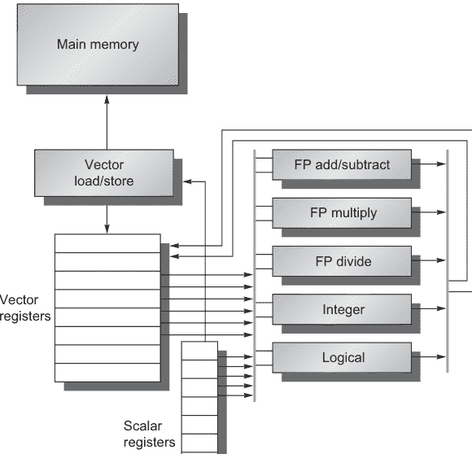

**图 4.1** 向量架构 RV64V 的基本结构，包含一个 RISC-V 标量架构。还有 32 个向量寄存器，且所有的功能单元都是功能单元。向量寄存器和标量寄存器具有大量的读/写端口，以允许同时进行多个向量操作。一组交叉开关（粗灰色实线）将这些端口连接到功能单元的输入和输出。

我们展示了 RV64V 的子集，试图在几页纸内捕捉其本质。

RV64V 指令集架构的主要组件如下：

- *向量寄存器*——每个向量寄存器持有一个向量，RV64V 有 32 个这样的寄存器，每个宽度为 64 位。向量寄存器文件需要提供足够的端口来为所有向量功能单元提供数据。这些端口允许不同向量寄存器之间的向量操作具有高度重叠。读和写端口总共至少有 16 个读端口和 8 个写端口，通过一对交叉开关连接到功能单元的输入或输出。增加寄存器文件带宽的一种方法是由多个库（banks）组成，这对于较长的向量效果良好。

- *向量功能单元*——在我们的实现中，每个单元都是全流水线的，可以在每个时钟周期开始一个新操作。需要一个单元来检测冲突，包括功能单元的结构性冲突和寄存器访问的数据冲突。图 4.1 显示我们使用的 RV64V 实现具有五个个功能单元。为了简单起见，我们在本节中重点关注浮点功能单元。

- *向量加载/存储单元*——向量内存加载从内存存储到向量中。在我们假设的 RV64V 实现中，向量加载/存储是全流水线的，因此在初始延迟后，字可以以每周期一个字的带宽在向量寄存器和内存之间移动。该单元还处理带缩放的加载和存储。

- *一组标量寄存器*——标量寄存器同样可以为向量功能单元提供数据，并提供传递给加载/存储单元的地址。这些是 RV64G 的 31 个通用寄存器和 32 个浮点寄存器。向量单元的任何输入在从标量寄存器文件读出时都会锁存值。

图 4.2 列出了我们在本节中使用的 RV64 向量指令。图 4.2 中的描述假设操作数都是向量寄存器，但这些指令也有版本，其中操作数可以是标量寄存器（xi 或 fi）。RV64 在两者均为向量时使用后缀 `.vv`，当第二个是标量时使用 `.vs`。

| 助记符 | 名称 |
| :--- | :--- |
| `vadd` | 加法 |
| `vsub` | 减法 |
| `vmul` | 乘法 |
| `vdiv` | 除法 |
| `vrem` | 取模 |
| `vsqrt` | 平方根 |
| `vsll` | 左移 |
| `vsra` | 右移 |
| `vxor` | 异或 |
| `vor` | 逻辑或 |
| `vand` | 逻辑与 |
| `vsgn` | 符号扩展 |
| `vsgnjn` | 负符号扩展 |
| `vsgnjx` | 异或扩展 |
| `vld` | 加载 |
| `vlds` | 步长加载 |
| `vldx` | 索引加载 |
| `vst` | 存储 |
| `vsts` | 步长存储 |
| `vstx` | 索引存储 |
| `vpeq` | 等于 |
| `vpne` | 不等于 |
| `vplt` | 小于 |
| `vxor` | 谓词异或 |
| `vpor` | 谓词或 |
| `vpand` | 谓词与 |
| `setvl` | 设置向量长度 |

**图 4.2 RV64 向量指令。** 所有指令均使用 R 格式。每个向量操作的操作数均为向量 (.v)，但这些指令也有版本，其中第二个操作数可以是标量寄存器 (.s)。

## 4.2 向量架构

整数 8、16、32 和 64 位；浮点 16、32 和 64 位

**图 4.3 假设 RV64V 具有单精度和双精度浮点扩展 RV 和 RVD，其支持的数据大小。** 在 RISC-V 设计中添加 RVV 意味着标量单元必须添加 RVH，这是一种支持半精度（16位）IEEE 754 浮点的标量指令扩展。由于 RV32 不具备双精度标量操作，因此它可以从向量单元中剔弃 64 位整数。如果 RISC-V 实现不包含 RV 或 RVD，则可以省略浮点指令。

**动态寄存器类型**的一个原因是，支持多样性的传统向量架构需要许多指令。如果图 4.3 中数据类型和大小的组合不采用动态寄存器类型，图 4.2 将会有好几页长！

动态类型允许程序使用向量寄存器。结果是，启用的向量寄存器会将所有向量内存分配为向量。例如，如果我们有 1024 字节内存，如果启用了 4 个向量寄存器且它们类型为 64 位浮点，处理器将为每个向量寄存器提供 256 字节或 `256/8=32` 个元素。这个值被称为最大向量长度 `vl`，由处理器设置，软件无法更改。

对向量架构的一个抱怨是其较大的状态意味着上下文切换时间变慢。我们对 RV64V 的实现允许状态从 `2 × 32 × 8=512` 字节到 `2 × 32 × 104=1536` 个元素不等。动态寄存器类型的一个良好副作用是，程序可以在未使用时将向量寄存器配置为*禁用*，这样在上下文切换时就不需要保存和恢复它们。

动态寄存器类型的第三个优势是，大小操作数之间的转换可以根据寄存器的配置隐式进行，而不是额外的显式转换指令。我们将在下一节看到这种优势的示例。

`vld` 和 `v` 表示向量加载和存储，它们加载或存储向量数据。一个操作数是要待加载或存储的向量寄存器；另一个（是 RV64G 通用寄存器）是内存的起始地址。向量需要的字节比寄存器本身更多。当向量长度不等于 `vl` 时，使用向量长度寄存器 `vl`；向量类型寄存器 `vtype` 记录寄存器类型；当循环隐含 IF 语句时使用谓词寄存器 `p`。我们将在示例中看到它们的运行。

通过向量指令，系统可以同时对许多向量数据元素执行操作。这种灵活性让向量设计可以使用缓慢但宽大的单元来实现低功耗的高性能。此外，向量集内部元素的独立性允许功能单元进行扩展，而无需添加昂贵的依赖性检查（这是超标量处理器所需要的）。

## 向量处理器是如何工作的的：一个示例

我们可以通过查看 RV64V 的向量循环来更好地理解向量处理器。让我们取一个典型的向量问题，我们在整个节中都会使用它：

```
Y = a x X + Y
```

X 和 Y 是向量，初始驻留在内存中，a 是标量。这个问题是 SAXPY 或 DAXPY 循环，它形成了 Linpack 基准测试的内部循环（Dongarra et al., 2003），（SAXPY 代表单精度 a x Y，DAXPY 代表双精度 a x Y 加）。Linpack 是一个线性代数例程的集合，Linpack 基准测试由执行高斯消元的例程组成。

现在，让我们假设寄存器的元素数量或长度（32）与我们感兴趣的向量操作长度匹配。（这个限制很快就会取消。）

- **示例** 显示 DAXPY 的 RV64G 和 RV64V 代码。对于此示例，假设 X 和 Y 有 32 个元素，且 X 和 Y 的地址位于 `x5` 和 `x6`。

- **答案** 这里是 RISC-V 代码：

```
fld      f0,a
add     x28,x5,256
loop:   f1,0(x5)
fmul.d  f1,f0
fld      f2,0(x6)
fadd.d  f2,f1
fsd      f2,0(x6)
addi    x5,#8
addi    x6,#8
bne     x28,x5,loop
```

这是 DAXPY 的 RV64V 代码：

```
vsetcfg 4*FP64
fld      f0,a
vld      v0,x5
vmul     v1,v0,f0
vld      v2,x6
vadd     v3,v1,v2
vst      v3,x6
disable
```

汇编器决定生成哪些向量操作。由于乘法有一个标量操作数，它生成 `mul.vs`，而加法则生成 `vadd.vv`。

初始指令配置向量寄存器以持有 64 位浮点数据。如果在最后指令后发生上下文切换，则没有额外的状态需要保存。标量和向量代码之间最显著的区别是，向量处理器大大减少了指令带宽，RV64G 只需要 28 条指令。这是因为向量操作处理 32 个元素，而构成 RV64G 循环一半的额外指令在 RV64V 中不存在。当编译器为此类序列生成向量指令且代码大部分时间处于向量模式时，该代码被称为*向量化的*。

RV64G 和 RV64V 之间的另一个重要区别是 RV64G 实现实现中流水线停顿的频率。在直接的64G 代码中，每个 `fadd.d` 必须等待 `mul.d`，每个 `fst` 必须等待 `fadd.d`。在向量处理器上，每条指令只会阻塞向量的第一个元素，然后随后的元素将平滑地通过流水线。因此，每个向量只需要一次流水线停顿，而不是每个元素一次。在这个示例中，RV64G 的流水线停顿比 RV64V 高 32 倍。软件无序执行可以减少 RV64G 的流水线停顿；然而，指令带宽的差异无法大幅减少。

在讨论性能之前，让我们显示动态寄存器类型。

- **示例** 乘加操作的常用用法是使用窄数据并在更宽尺寸上累加以增加乘和。显示如果 X 和 Y 是单精度代码将如何更改。

- **答案** 下面代码中的更改已下划线。神奇的是，通过两个小改动即可：指令包含一个单精度向量，且标量加载现在是单精度的：

```
vsetdcf 1*FP32,3*FP64    # 32b,64b vregs
flw        f0,a               # Load scalar a
vld        v0,x5              # Load X
mul        v1,v0,f0           # Vector-scalar mult
vld        v2,x6               # Load vector Y
vadd       v3,v1,v2           # Vector-vector add
vst        v3,x6               # Store the sum
disable             # Disable vector regs
```

注意在该设置下 RV64V 将隐式执行从较窄单精度到较宽双精度的转换。切换到整数同样一样，但现在必须使用整数加载指令和整数寄存器来持有标量值：

```
vsetcdfg 1*X32,3*X64      # 32b,64b int reg
lw                  x7,a             # Load scalar a
vld                 v0,x5             # Load vector X
vmul                v1,v0,x7          # Vector-scalar mult
vld                 v2,x6             # Load vector Y
vadd                v3,v1,v2          # Vector-vector add
vst                 v3,x6             # Store the sum
vdisable                            # Disable vector regs
```

## 向量执行时间

一系列向量操作的执行时间取决于三个因素：(1) 操作数向量的长度；(2) 操作之间的结构冲突；以及(3) 数据依赖关系。给定向量长度和启动速率（向量单元消耗新操作数并产生新结果的速率），我们可以计算单个向量指令的时间。

所有现代向量计算机都具有多个流水线（通道）的功能单元，每个周期可以产生两个或更多结果，但它们也可能有未完全填充的功能单元。为了简单起见，RV64V 有一个通道，单个操作的启动速率每周期一个元素。单个向量指令的周期执行时间大约等于向量长度。

为了简化执行和向量性能的描述，我们使用“队列”（convoy）的概念，即可能共同执行的向量指令集。队列中的指令不能包含任何冲突；如果存在此类冲突，则指令需要序列化并在不同的队列中启动。因此，提供示例中的 `vld` 和 `vmul` 可以位于同一个队列中。正如我们所看到的，可以通过计算队列的数量来估算性能。为了保持分析简单，假设指令队列必须在完成后，任何其他指令（标量或向量）才能开始。

似乎除了具有结构冲突的向量指令外，具有读后写依赖冲突的序列也应该位于不同的队列。然而，将它们链接到同一个队列中允许向量操作在其向量源操作数的元素变为可用时就开始：在实践中，我们通常通过允许处理器同时读写特定寄存器（尽管是不同的元素）来实现链。早期的实现

## 4.2 向量架构

链路（chaining）的工作类似于标量流水线中的转发，但限制了链中源指令和目的指令的时间。最近的实现使用了灵活链路（flexible chaining），它允许向量指令链接到任何其他向量指令，前提是我们没有产生结构冲突。现代向量架构支持灵活链路，我们在本章中将假设这一点。

为了表示执行时间，我们定义了“节”（chime），它是执行一个“冲”（convoy）的时间单位。冲是一个向量序列，由 `m` 个执行单元在 `m` 个节内组成；对于长度为 `n` 的向量，在我们简单的 RV64V 实现，这大约是 `m × n` 个时钟周期。

节的近似忽略了一些与向量长度相关的特定处理器开销。对于长向量，用节来测量时间比对于短向量具有更好的近似性。我们将使用节的测量值，而不是每个结果的时钟周期，来表示我们忽略了这些开销。


如果我们知道向量序列中冲的数量，我们就知道执行是否可以在单个时钟周期内启动多个向量指令。如果一个时钟周期内只能启动一个向量指令（大多数向量处理器的现实），那么节将低估一个冲的实际执行时间。因为向量长度通常大于冲中的指令数量，我们将简单地假设一个冲在一个节内执行完毕。

假设每个向量功能单元都有简单的拷贝，展示以下代码序列是如何布局在冲中的：

```
vld  v0,x5           # 加载向量 X
vmul v1,v0,f0       # 向量-标量乘法
vld  v2,x6           # 加载向量 Y
vadd v3,v1,v2       # 向量加法
vst  v3,x6           # 存储和
```

这个向量序列需要多少节？忽略向量指令开销的情况下，每个 FLOP（浮点运算）需要多少个周期？

答案：第一个冲从第一个 `vld` 指令开始。`vmul` 依赖于第一个 `vld`，但链路允许位于相同的冲中。

第二个 `vld` 必须在独立的冲中，因为之前的 `vld` 在加载/存储单元上存在结构冲突。`vadd` 依赖于第二个 `vld`，但它可以通过链路再次位于相同的冲中。最后，`vst` 在第二个冲的 `vld` 上存在结构冲突，因此它必须进入第三个冲。这种分析得出了向量指令在冲中的如下布局：

| 1 | `vld` `vmul` |
| 2 | `vld` `vadd` |
| 3 | `vst` |

该序列需要三个冲。因为该序列耗时三个节，且每个结果有两个浮点运算，因此每个 FLOP 的周期数为 1.5（忽略任何向量指令的发射开销）。注意，我们允许 `vld` 和 `vmul` 都在第一个冲中执行，大多数向量机器需要 2 个时钟周期来启动指令。

这个示例表明，节的近似对于长向量是相当的。例如，对于 32 元素的向量，周期时间为 3，因此该序列将花费大约 $32 \times 3$ 或 96 个时钟周期。在两个独立的时钟周期中发射冲的开销很小。

另一个开销源比发射限制要显著得多。节模型忽略的最重要开销源是向量启动时间，即时钟周期内的延迟填充流水线的时间。启动时间主要由向量功能单元的流水线延迟决定。对于 RV64V，我们将使用 Cray-1 的流水线深度，尽管更现代处理器的延迟往往会增加，但向量加载是全流水线的。浮点加法的流水线深度为 6 个时钟周期，浮点乘法为 7 个，浮点除法为 20 个，向量加载为 12 个。

基于这些基础，接下来的几节将提供优化方案，要么提高性能，要么增加可以在向量架构上良好运行的程序类型。特别是，它们将回答这些问题：

- 向量处理器如何比每个元素时钟周期更快地执行单个向量？每个时钟周期多个元素可以提高性能。
- 向量处理器如何处理向量长度不最大向量长度（mvl）的程序？因为大多数应用向量与架构长度不匹配，我们需要针对这种常见情况提供高效的解决方案。
- 当待向量化的代码内部有 IF 语句时会发生什么？如果我们能高效地处理条件语句，就有更多的代码可以向量化。
- 向量处理器从内存系统需要什么？如果没有足够的内存带宽，向量执行可能是徒劳的。
- 向量处理器如何处理多维矩阵？这种流行的数据结构必须向量化，向量架构才能表现良好。
- 向量处理器如何处理稀疏矩阵？这种流行的数据结构也必须向量化。
- 你如何为向量计算机编程？架构创新与编程语言不匹配，且它们的编译器可能无法广泛使用。

本节的其余部分介绍了向量架构的这些每种优化，附录 G 将进行更深入的探讨。

## 多道：超越每周期一个元素

向量指令集的一项关键优势是，它允许软件仅通过单条指令将大量工作传递给硬件。一条向量指令可以通过编码位包含数十个独立操作。向量指令的并行语义允许实现方案使用流水线化的功能单元来执行这些基础操作，正如我们到为止学过的 RV64V 实现那样；使用并行功能单元阵列；或者并行与流水线功能单元的组合。图 4.4 说明了如何通过使用并行流水线来提高向量性能。

RV64V 指令集具有这样一个属性：所有算术指令只允许来自其他寄存器的元素 N 与来自其他寄存器的元素 N 进行操作。这极大地简化了高度并行向量单元的设计，该单元可以结构化为多个道。就像高速公路一样，我们可以通过增加道数来增加向量单元的吞吐量。图 4.5 显示了一条道如何将周期的周期数从 32 减少到 8。为了让多道产生优势，应用程序和架构都必须支持长向量；否则，它们的执行速度会快到你耗尽指令带宽，ILP 技术无法提供足够的向量指令。

每道包含寄存器文件的一部分以及每个向量功能单元的一个执行流水线。每个向量功能单元以每个流水线、每道一个元素的层级执行指令。第一道持有所有向量寄存器的第一个元素，任何向量指令的第一个元素，其源和和操作数都将位于第一道。这种分配允许道内本地算术流水线完成与其他道通信的计算。这种通信减少了构建高度并行向量单元所需的布线成本和寄存器端口，并解释了为什么向量计算机每周期可以处理多达 64 次操作。

# 294 第四章 向量、SIMD 和 GPU 架构中的数据级并行性

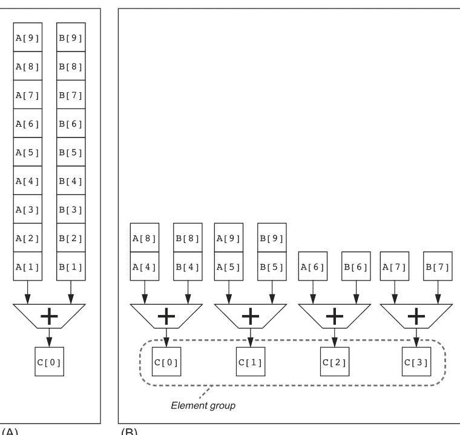

**图 4.4** 使用多个功能单元提高单次向量加法 C = A+B 的性能。左侧的向量处理器 A 拥有单个加法流水线，每个时钟周期完成一次加法。右侧的向量处理器 B 拥有四个加法流水线，每个时钟周期完成四次加法。共同通过流水线移动的元素在四个流水线之间交错排列。这被称为*元素组*。经 Asanovic, K., 1998 许可转载，《向量微处理器》。

如果向量处理器的带宽减半，增加通道数将能够保持相同的峰值性能。

## 向量长度寄存器：处理不等于 2 的循环

向量寄存器处理器具有由最大向量长度 `mvl` 确定的自然向量长度。该长度在上面的示例中为 32，可能与程序中的实际向量长度不匹配。此外，在实际程序，特定向量操作的长度在编译时通常是未知的。例如，考虑以下：

```
for (i=0; i <n; i=i+1)
Y[i] = a * X[i] + Y[i];
```

所有向量操作的大小取决于 `n`，而 `n` 直到运行时间可能都是未知的。

这些问题的解决方案是添加一个向量长度寄存器 `vl`。`vl` 控制任何向量操作的长度。然而，`vl` 中的值不能大于最大向量长度 `mvvl`。只要实际长度小于或等于最大向量长度，就能解决我们的问题。

如果 `n` 的值在编译时未知且因此大于 `mvvl` 呢？为了解决向量大于最大长度的第二个问题，传统上使用名为“分带挖掘”的技术。`setvl` 指令设置 `mvvl` 和循环变量 `n` 中的较小值。

适用于任何 `n` 值的 DAXPY 的 RV64V 代码如下：

```
vsetdfcfg 2 DP FP       # 启用 2 个 64b 浮点寄存器
fld         f0,a           # 加载标量 a
loop: setvl  t0,a           # vl = t0=min(mvvl,n)
      vld         v0,x5          # 加载向量 X
      slli        t1,t0,3        # ti = vl*8
      add         x5,x5,t1       # 增加 X 的指针为 vl*8
      vmul        v0,v0          # 向量-标量乘法
      vld         v1,x6          # 加载向量 Y
      vadd        v1,v0,v1       # 向量-向量加法
      sub         a0,a0,t0       # n -= vl
      vst         v1,x6          # 按 vl*8 将和存储在 Y 中
      add         x6,x6,t1       # 增加 Y 的指针为 vl*8
      bnez        a0,loop        # 如果 n!=0 则重复
      vdisable                      # 禁用向量寄存
```

## 谓码寄存器：处理循环中的 IF 语句

根据阿姆达尔定律，我们知道低到中向量化程序的加速比将受到限制。条件 `IF` 的存在会限制这种加速。

## 向量架构

通道 0 通道 1 通道 2 通道 3

向量算术单元的每个部分都包含异常流水线，它们协同工作执行单条向量指令。注意向量寄存器文件的每个部分仅需为其本地通道的流水线提供足够的端口。

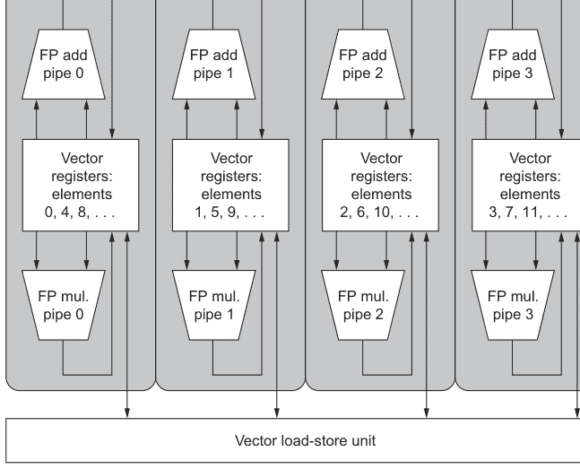

**图 4.5** 包含四个通道的向量单元结构。向量寄存器内存分布在各个通道，每个通道持有每个向量寄存器的每第四个元素。图中显示了三个向量功能单元：一个浮点加法单元、一个浮点乘法单元和一个加载存储单元。


**图 4.5** 包含四个通道的向量单元结构。向量寄存器内存分布在各个通道，每个通道持有每个向量寄存器的每第四个元素。图中显示了三个向量功能单元：一个浮点加法单元、一个浮点乘法单元和一个加载存储单元。

这些问题的解决方案是添加一个向量长度寄存器（`vl`）。`vl` 控制任何向量操作（包括向量加载或存储）的长度。然而，`vl` 中的值不能大于最大向量长度（`mvvl`）。只要实际长度小于或等于最大向量长度（`mvvl`），就能解决我们的问题。该参数意味着向量寄存器的长度在后续代中会增长，而无需更改指令集。正如我们在下一节中看到的，多媒体 SIMD 扩展没有等效于 `mvvl` 的东西，因此它们每次增加向量长度时都会扩展指令集。

如果 `n` 的值在编译时未知且因此大于 `mvvl` 呢？为了解决向量大于最大长度的第二个问题，传统上使用名为“分带挖掘”（strip mining）的技术。分带挖掘是生成一种代码，使每个向量操作的大小小于或等于 `mvvl`。一个循环处理任何是 `mvvl` 倍数的迭代次数，另一个循环处理任何剩余且小于 `mvvl` 的迭代。RISC-V 拥有比独立循环更用于分带挖掘的解决方案。`setvl` 指令设置 `mvvl` 和循环变量 `n`（以及其他寄存器）中的较小值。如果循环的迭代次数大于 `n`，则最快的循环可以在运行时计算 `vl` 值，因此将 `vl` 设置为 `n`。如果 `n` 小于 `mvvl`，它应该只计算此循环最后一次迭代中的最后 `n` 个元素，因此将 `vl` 设置为 `n`。`setvl` 还会写入其他标量寄存器以帮助循环计数。适用于任何 `n` 值的 DAXPY 的 RV64V 代码如下：

```
vsetdfcfg 2 DP FP       # 启用 2 个 64b 浮点寄存器
fld         f0,a           # 加载标量 a
loop: setvl  t0,a           # vl = t0=min(mvvl,n)
      vld         v0,x5          # 加载向量 X
      slli        t1,t0,3        # ti = vl*8 (单位字节)
      add         x5,x5,t1       # 增加 X 的指针为 vl*8
      vmul        v0,v0          # 向量-标量乘法
      vld         v1,x6          # 加载向量 Y
      vadd        v1,v0,v1       # 向量-向量加法
      sub         a0,a0,t0       # n -= vl (t0)
      vst         v1,x6          # 按 vl*8 将和存储在 Y 中
      add         x6,x6,t1       # 增加 Y 的指针为 vl*8
      bnez        a0,loop        # 如果 n!=0 则重复
      vdisable                      # 禁用向量寄存
```

## 谓码寄存器：处理循环中的 IF 语句

根据阿姆达尔定律，我们知道低到中向量化程序的加速比将受到限制。条件（IF）的存在会限制这种加速。在实际程序中，特定向量操作的长度在编译时通常是未知的。事实上，单段代码可能需要不同的向量长度。例如，考虑以下：

```
for (i=0; i <n; i=i+1)
Y[i] = a * X[i] + Y[i];
```

*(注：由于原文中存在大量重复段落，译文已进行去重处理)*

## 4.2 向量架构

大多数向量处理器使用存储体（memory banks），由于以下原因，它们允许多次独立访问，而不是简单的内存交错（interleaving）：

- 许多向量计算机每周期支持多次加载（load）或存储（store），而存储体的周期时间通常比处理器的周期大几倍。为了支持多个加载或存储的并发访问，系统需要多个存储体，并能够独立控制对存储体的寻址。
- 2. 向量处理器支持加载或存储非连续的数据字。在这种情况下，需要独立的存储体寻址，而不是交错。
- 3. 大多数向量计算机支持多个处理器共享内存系统，因此每个处理器都会生成其自己的独立地址流。

这些特征结合在一起，导致了对大量独立存储体的需求，如下例所示。

示例：Cray T90 (Cray T932) 的最大配置具有 32 个处理器，每个周期能够生成 4 次加载和 2 次存储。处理器时钟周期为 2.167 ns，而用于内存系统的 SRAM 周期为 15 ns。计算允许所有处理器以全带宽运行所需的最小存储体数量。

答案：每个周期的最大内存引用数为 192：32 个处理器乘以每个处理器 6 次引用。每个 SRAM 存储体忙于 15/2.167=6.92 个时钟周期，我们向上取整为 7 个处理器时钟周期。因此，我们至少需要 192×7=1344 个存储体！

Cray T932 拥有 1024 个存储体，因此早期模型无法同时为所有处理器维持全带宽。随后的升级将 15 ns 的异步 SRAM 替换为流水线同步 SRAM，将内存周期时间缩短了一半以上，提供了足够的带宽。

从更高层次的视角来看，向量加载/存储单元的作用与标量处理器中的预取单元（prefetch units）类似，它们都试图通过向处理器提供数据流来输送数据带宽。

## 步长（Stride）：在向量架构中处理多维数组

向量中相邻元素在内存中的位置可能不是连续的。考虑这段 C 语言中矩阵乘法的简单代码：

```c
for (i = 0; i < 100; i=i+1)
    for (j = 0; j < 100; j=j+1) {
        A[i][j] = 0.0;
        for (k = 0; k < 100; k=k+1)
            A[i][j] = A[i][j] + B[i][k] * D[k][j];
    }
```

我们考虑 B 的每一行与 D 的每一列的线性化，并以 k 作为索引变量对内循环进行剥离（strip-mine）。为了做到，，必须考虑如何寻址 B 中的相邻元素和 D 中的相邻元素。当数组分配内存时，它是被线性化的，并且必须以行主序（如 C 语言）或列主序（如 Fortran）布局。这种线性化意味着行中的元素或列中的元素在内存中是不相邻的。例如，前面的 C 代码允许内循环被行大小乘以（每个条目的字节数）隔开，总共为 800 字节。在第 2 章中，我们看到阻塞（blocking）可以提高基于缓存的系统的局部性。对于向量处理器，缓存需要另一种技术来获取内存中不相邻的向量元素。这种分离要汇到一个单个向量寄存器中的元素的距离称为步长（stride）。在这个示例中，D 的步长为 100 双字（800 字节），而 B 的步长为 1 个双字（8 字节）。Fortran 默认的列主序步长反相反。矩阵 D 的步长为 1 或 1 个双字（8 字节），分隔了元素，而矩阵 B 的步长为 100 或 100 个双字（800 字节）。因此，通过重新排列循环，编译器无法隐藏 B 和 D 连续元素之间的距离。

一旦向量加载到向量寄存器中，它的表现就像具有逻辑相邻的元素一样。向量处理器可以处理大于 1 的步长（称为非驻留步长 nonresident strides），只需使用具有步长能力的单元加载和向量存储操作。这种访问非连续内存位置并将其重构为紧密结构的能力是向量架构的主要优势之一。

缓存天生处理单元步长数据；增加块大小可以减少单元步长大数据集的缺失率，但增加块大小会对以非驻留步长访问的数据产生负面影响。虽然阻塞技术可以解决这些问题的一部分（见第 2 章），但对于某些问题，高效访问非连续数据的能力仍然是向量处理器的一个优势，正如我们将在第 4.7 节中看到的。

在 RV64V 上，可寻址单元是字节，对于我们的示例将是 800。该值必须动态计算，因为矩阵的大小在编译时可能未知——就像向量长度一样，可能会随着同一语句的不同执行而变化。向量步长、向量起始地址可以放在通用寄存器中。RV64V 指令 `VLDS`（带步长的向量加载）将向量加载到向量寄存器中。同样，在存储非单元步长向量时，使用指令 `STS`（带步长的向量存储）。

支持大于 1 的步长增加了内存系统的复杂性。当我们引入非单元步长时，存储非单元步长向量变得可能。当多个访问竞争同一个存储体时，会发生停顿（stall）。

| 存储体数量 | 存储体时间 |
| :--- | :--- |
| 示例假设我们 | 12 |
| 矩阵 D | 1 |
| 矩阵 B | 100 |

**答案** 每个周期的最大内存引用数为 192：32 个处理器乘以每个处理器 6 次引用。每个 SRAM 存储体忙于 15/2.167=6.92 个时钟周期，我们向上取整为 7 个处理器时钟周期。因此，我们至少需要 192×7=1344 个存储体！

Cray T932 拥有 1024 个存储体，因此早期模型无法同时为所有处理器维持全带宽。随后的升级将 15 ns 的异步 SRAM 替换为流水线同步 SRAM，将内存周期时间缩短了一半以上，提供了足够的带宽。

结果是 12+6=18 个周期。单元步长访问将快 6 个周期。

## 聚集-散射（Gather-Scatter）：在向量架构中处理稀疏矩阵

如提到的稀疏矩阵并不常见，因此拥有聚集-散射功能是重要的。RV64V 指令有 `VLDI`（索引向量加载）和 `VSTI`（索引向量存储）。例如，如果 `x5`、`x7` 和 `x28` 包含向量的起始地址，我们可以循环编码为：

```assembly
vsetcfg  4*FP64               # 4*64
vld       v0, x7                # 加载 K[]
vdx      v1, x5, v0               # 加载 A[]
vld       v2, v28                # 加载 M[]
vadd      v3, v1, v3               # 将它们相加
vstx      v1, x5, v0               # 存储 A[]
dvisable                  # 禁用
```

这种技术允许稀疏矩阵以向量模式运行。简单的优化编译器不会自动向量化前面的源码，因为编译器不知道 K 的元素是独特的，不存在依赖关系。相反，程序员指令会告诉编译器以向量模式运行是安全的。

此类操作的主要机制称为聚集-散射（gather-scatter），它出现在几乎向量处理器上。之后，可以使用索引向量将稀疏向量存储为密集形式。聚集操作获取基地址和索引向量中的偏移量。聚集或散射的每个元素都有单独的地址，因此无法分组处理，并且每次访问在基于缓存的系统中都会产生显著延迟。

尽管索引加载和存储（聚集和散射）的运行速度通常比非索引加载或存储慢得多，因为存储体从指令开始时并未知。寄存器文件还必须在向量单元的通道之间提供通信以支持聚集和散射。

## 4.2 向量架构

| 基准测试名称 | 在向量模式下执行的操作（编译器优化） | 在向量模式下执行的操作（人工辅助） | 提示优化带来的加速 |
|--- | :--- | :--- | :--- |
| BDNA | 96.1% | 97.2% | 1.52 |
| MG3D | 95.1% | 94.5% | 1.00 |
| FLO52 | 91.5% | 88.7% | N/A |
| ARC3D | 91.1% | 92.0% | 1.01 |
| SPEC77 | 90.3% | 90.4% | 1.07 |
| MDG | 87.7% | 94.2% | 1.49 |
| TRFD | 69.8% | 73.7% | 1.67 |
| DYFESM | 68.8% | 65.6% | N/A |
| ADM | 42.9% | 59.6% | 3.60 |
| OCEAN | 42.8% | 91.2% | 3.92 |
| TRACK | 14.4% | 54.6% | 2.52 |
| SPICE | 11.5% | 79.9% | 4.06 |
| QCD | 4.2% | 75.1% | 2.15 |

> 图 4.7 在 Cray Y-MP 上执行的 Perfect Club 基准测试的向量化水平（Vajapay, 1991）。第一列显示了在无提示的情况下编译器获得的向量化水平，第二列显示了 Cray Research 程序员团队通过提示改进代码后的结果。

以及为什么它没有对代码进行向量化。这种直接的执行模型允许其他领域的专家通过修改代码，或者在假设操作之间的独立性成本过高时（例如聚集-散布数据传输）向编译器提供提示，来学习如何提高性能。正是编译器与程序员之间这种对话——各自向对方提供改进性能的提示——简化了向量计算机的编程。

今天，影响程序在向量模式下运行成功的主要因素是程序本身的结构。循环是否存在真数据依赖关系（见第 4.5 节），或者它们是否可以重构以消除此类依赖？这一因素受到所选算法的影响，并且在某种程度上取决于它们的编码方式。

作为科学程序中可实现向量化水平的参考，让我们看看 Perfect Club 基准测试中观察到的向量化水平。图 4.7 显示了在 Cray Y-MP 上运行的两个版本代码在向量模式下执行的操作百分比。第一个版本是仅对原始代码进行编译器优化获得的结果，而第二个版本则使用了来自 Cray Research 程序员团队的大量提示。对应用程序在向量处理器上性能的若干研究表明，编译器向量化水平存在很大差异。

富提示版本对于编译器自身无法良好向量化的代码，其向量化水平有了显著提高，所有代码的向量化率现在超过了 50%。中值向量化从约 70% 提高到约 90%。

## 第四章 向量、SIMD 和 GPU 架构中的数据级并行

### 用于多媒体的 SIMD 指令扩展

SIMD 多媒体扩展始于一个简单的观察：许多媒体应用程序操作的数据类型比所使用的 32 位处理器更窄。图形系统对三种颜色的每种颜色使用 8 位，外加 8 位用于透明度。根据应用程序的不同，，音频样本通常用 8 位或 16 位表示。通过划分（例如）256 位加法器内部的进位链，处理器可以对 38 位、16 位、32 位或 64 位的短向量同时执行操作。这种划分加法器的额外代价很小。图 4.8 总结了典型的多媒体 SIMD 指令。与向量指令不同，SIMD 指令在数据上指定的是**相同**的操作。与具有大容量寄存器文件的架构（如 RISC-V RV64 向量寄存器，其 32 个向量寄存器中的每个可以存放 32 个 60 位元素）不同，SIMD 意图指定更少的操作数并使用小得多的寄存器。

与向量架构（提供了一种旨在作为向量化编译器标的优雅指令集）相比，SIMD 扩展有两个主要缺失：没有向量长度寄存器，没有步长或聚集/散布数据传输指令，也没有掩码寄存器。

- 多媒体 SIMD 扩展在操作码中固定了操作数的数量，这导致 x86 架构的 MMX、SSE 和 AVX 扩展中增加了数百条指令。向量架构有一个向量长度寄存器，指定当前操作的操作数数量。这些变长寄存器可以轻松适应自然具有比架构支持的最大尺寸更短向量的程序。此外，向量架构在其中有一个隐式的向量长度

| 指令类别 | 操作数 |
|---|---|
| 无符号加法/减法 | 32 个 8 位、16 位、8 个 32 位或 4 个 64 位 |
| 最大值/最小值 | 32 个 8 位、16 位、8 个 32 位或 4 个 64 位 |
| 平均值 | 32 个 8 位、16 位、8 个 32 位或 4 个 64 位 |
| 右移/左移 | 32 个 8 位、16 位、8 个 32 位或 4 个 64 位 |
| 浮点 | 16 位、8 个 32 位、4 个 64 位 |

图 4.8 总结了典型的多媒体 SIMD 指令。（注：上面的表格似乎与文本交织在一起，我根据提供的结构进行了重建）。

*纠正：根据提供的原始文本，表格内容和文本是乱的。让我们根据逻辑流重新排列文本。*

富提示版本对于编译器自身无法良好向量化的代码，其向量化水平有了显著提高，所有代码的向量化率现在超过了 50%。中值向量化从约 70% 提高到约 90%。

### 4.3 用于多媒体的 SIMD 指令集扩展

x86 架构在 1996 年添加的 MMX 指令重新利用了 64 位浮点寄存器，现在指令可以同时执行 8 位操作。这些由程序员设计的并行 MAX 和 MIN 操作，对数字库很有用。注意 MMX 使用浮点数据传输指令来访问内存。1999 年添加的流式 SIMD 扩展（SSE）增加了 16 个寄存器（XMM 寄存器），宽度为 128 位，现在指令可以执行 8 位、16 位或 4 个 32 位操作。它还执行了并行单精度浮点运算。由于 SSE 有独立的寄存器，它分离了数据传输指令。Intel 很快在 2001 年的 SSE2、2004 年的 SSE3 和 2007 年的 SSE4 中增加了双精度 SIMD 浮点类型。四精度浮点操作或双精度操作增加了 x86 计算机的峰浮点性能，正如程序员将它们并排放置。

2010 年添加的高级扩展（AVX）将寄存器宽度加倍到 256 位（YMM 寄存器），并提供了使所有窄数据类型操作数量翻倍的指令。4.9 显示了用于双精度浮点计算的 AVX 指令。2013 年的 AVX 增加了 300 条新指令，例如（VGATHER）和向量移动（VPSLL, VPSPSR, VPSRA）。2017 年的 AVX-512 将宽度加倍到 512 位（ZMM 寄存器），寄存器数量加倍到 32，并增加了 250 条新指令，包括散布（VSCATTER）和掩码寄存器（OPMASK）。AVX 包括未来将寄存器扩展到 1024 位的准备。

总而言，这些扩展的目标是加速精心编写的库，而不是让编译器生成它们（见附录 H），但 x86 编译器正尝试生成此类代码，特别是对于浮点密集型应用程序。

# 36 第四章 向量、SIMD 和 GPU 架构中的数据级并行性

| AVX 指令 | 描述 |
|---|---|
| VADDPD | 加法四个包双精度操作数 |
| VSUBDP | 减法四个包双精度操作数 |
| VMULDP | 乘法四个包双精度操作数 |
| VIVDPD | 除法四个包双精度操作数 |
| VFMADDDP | 乘法并相加四个包双精度操作数 |
| VMSUBDP | 乘法并减法四个包双精度操作数 |


| `VCMPXX` | 比较四个包双精度操作数的 EQ, NEQ, LT, LE, GT, GE, ... |

| `VMOVAPD` | 移动对齐的包双精度操作数 |

| `VBROCASTSD` | 将一个双精度操作数广播到 256 位寄存器中的四个位置 |

**图 4.9 适用于 x86 架构的用于双浮点程序的 AVX 指令。** 对于 256 位 AVX 而言，包双（Packed-double）意味着以 SIMD 模式执行的 64 位操作数。随着 AVX 宽度的增加，添加数据置换指令（允许来自宽寄存器不同部分的窄操作数进行组合）变得越来越重要。AVX 包含了在 256 位寄存器内洗牌 32 位、64 位或 128 位操作数的指令。例如，`BROADCAST` 在 AVX 寄存器中复制一个 64 位操作数四次。AVX 还包含多种融合乘法/减法指令；我们仅展示了两种。

鉴于这些局限性，为什么多媒体 SIMD 扩展如此流行？首先，它们添加到标准算术单元的成本很低，且容易实现。其次，与向量架构相比，它们需要的处理器状态极少，而这在上下文切换中是一个一直关注的问题。第三，支持向量架构需要大量的内存带宽，许多计算机并不具备这种带宽。当单条指令可以生成 32 次内存访问，且其中任何一次都可能导致页错误时，SIMD 不需要处理虚拟内存。原始的 SIMD 扩展对每个在内存中对齐的 SIMD 操作数组使用单独的传输，并且不能跨越页边界。SIMD 短固定长度“向量”的另一个优势是，易于引入可以帮助新媒体标准的指令，例如执行置换的指令，或包含的操作数比向量多或更少的指令。最后，人们对向量架构与缓存的协作性表示过担忧。最近的向量架构已经解决了所有这些问题。然而，核心问题在于，由于后向二进制兼容具有决定性的意义，一旦架构确定了 SIMD 路径，就很难离开。

**示例** 为了直观了解多媒体指令的样式，假设我们为 RISC-V 添加了一个 256 位的 SIMD 多媒体扩展，暂定命名为 `RVP`（代表“packed”，即“打包/包装”）。在这个示例中，我们关注浮点运算。我们在对一次操作四个双精度操作数的指令上加上后缀“4D”。像向量架构一样，你可以将 SIMD 处理器理解为具有通道（lanes），在本例中为四个。`RV64P` 将 `F` 寄存器扩展到全宽，在本例中为 256 位。此示例显示了 DAXPY 循环的 RISC-V SIMD 代码。

## 4.3 多媒体 SIMD 指令扩展 307

`RISC-V` SIMD 的更改已加下划线。我们假设 `X` 和 `Y` 的起始地址分别在 `x5` 和 `x6` 中。

答案 这里是 RISC-SIMD 代码：

```
fld      f0,a               # 加载标量 a
splat.4D  f0,f0               # 将 a 复制 4 份
addi     x28,x5,#256          # 最后加载的地址
Loop:fld.4D  f1,0(x5)            # 加载 X[i] ... X[3]
mul.4D   f1,f0               # AX X[i] ... AX[3]
fld.4D   f2,0(x6)            # 加载 Y[i] ... Y[3]
fadd.4D  f2,f2,f1            # AX X[i]+Y[1]...

sfd.4D   f2,0(x6)            # 存储 Y[i], ... Y[3]
addi     x5,x5,#32            # 增加索引到 X
addi     x6,x6,#32            # 增加索引到 Y
bne      x28,x5,Loop       # 检查是否完成
```

这些更改将 RISC-V 双精度指令替换为 4D 等效指令，将增量从 8 增加到 32，并添加了 split 指令，在 `f0` 的 256 位中制作 `a` 的 4 个拷贝。虽然不像 RK64V 动态指令带宽减少 32 倍那样剧烈，但 RISC-V SIMD 几乎获得了 4 倍的减少：对于 RK64G，执行了 67 条指令，对比为 258 条。这段代码知道元素的数量。数量在运行时确定，这将需要一个额外的剥矿循环（strip-mine loop）来处理不是 4 的倍数的情况。

## 编程多媒体 SIMD 架构

鉴于 SIMD 多媒体扩展的即时性（hoc）本质，使用这些指令最简单的方法是通过库或编写汇编语言。最近的扩展变得更加规律，为编译器提供了更合理的目标。通过借鉴向量化编译器的技术，编译器可以自动产生 SIMD 指令。例如，高级编译器可以生成 SIMD 浮点指令，为科学代码提供许多许多性能。然而，程序员必须将数据对齐到内存，以允许编译器生成可向量化的标量指令。

## 天际线性能模型（Skyline Performance Model）

比较 SIMD 架构性能的一种视觉化且直观的方法是 Skyline 模型（`Williams et al., 2009`）。它在二维图中连接了浮点性能、内存性能和算术强度。

# 308 第四章 向量、SIMD 和 GPU 架构中的数据级并行性

`O(1)` `O(log(N))` `O(N)`


**图 4.10 算术强度**，定义为操作数除以访问的字节数（`Williams et al., 2009`）。某些内核的算术强度随问题大小缩放，例如密集矩阵，但也有许多内核的算术强度与问题大小无关。

算术强度是每个字节内存的浮点操作数的比例。图 4.10 显示了几个示例内核的相对算术强度。

峰值浮点性能可以通过硬件规格找到。本案例中的许多内核无法放入芯片缓存，因此内存性能由缓存后的内存系统定义。注意我们需要的是处理器的内存带宽，而不仅仅是第 328 页的 DRAM 接口。

图 4.11 显示了左侧 NEC SX-9 向量处理器和右侧 Intel Core i7 多核计算机的 Roofline 模型。垂直 Y 轴是可实现的浮点性能，从 2 到 256 GFLOPS/s。水平 X 轴是算术强度，从 1 FLOP/DRAM byte 到 16 FLOP/DRAM byte。注意图表是对对数坐标，且 Roofline 每个计算机完成一次。

对于特定的内核，我们可以根据其算术强度在 X 轴上找到一点。如果我们通过该点画一条垂直线，内核在计算机上的性能将位于该线的某处。我们可以绘制一条显示计算机浮点性能的水平线。显然，实际的浮点性能不能高于这条水平线，因为那是硬件限制。

我们如何能绘制峰值内存性能？因为 X 轴是 FLOP/byte 而 Y 轴是 FLOP/s，bytes/s 是图中一条 45 角的对角线。因此我们可以绘制第三条线，给出了该计算机内存系统为给定值支持的最大浮点性能。

## 4.3 用于多媒体的 SIMD 指令集扩展

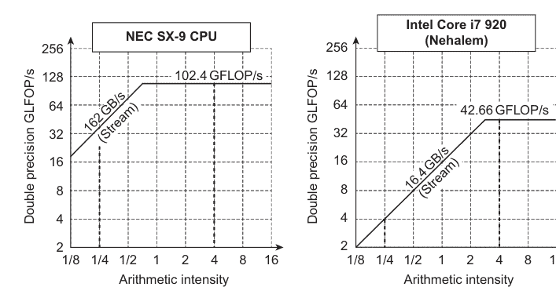

**图 4.11** 左侧是一个 SX-9 向量处理器的 Rooline 模型（`Williams` 等人，2009），右侧是带有 SIMD 扩展的 Intel Core i7 920 多核计算机及其双精度浮点性能对比。SX-9 是 2008 年引入的超级计算机，耗数百万美元。根据 stream 基准测试，它的峰值双精度性能为 102.4 GFLOP/s，内存内存带宽为 162 GB/s。Core i7 920 的峰值双精度性能为 42.66 GFLOP/s，内存内存带宽为 16.4 GB/s。算术强度为 4 FLOP/byte 处的垂直虚线显示两个处理器都在峰值性能运行。在这种情况下，102.4 GFLOP/s 的 SX-9 速度是 42.66 GFLOP/s 的 Core i7 的 2.4 倍。当算术强度为 0.25 GFLOP/byte 时，SX-9 的性能是 Core i7 的 10 倍。

算术强度。我们将限制视为一个公式，以便在图 4.11 的图中绘制这些线：

> 可实现 GFLOPs/s = Min(峰值内存带宽 $\times$ 算术强度, 峰值浮点性能)

“顶线模型”（Roofline）根据内核的算术强度对内核性能设定了上限。如果我们将算术强度想象为撞击屋顶平坦部分的柱子，这意味着性能受计算限制；如果撞击屋顶的倾斜部分，这意味着性能最终受内存带宽限制。在图 4.11 中，右侧的垂直虚线（算术强度为 4）是前者例子，左侧的垂直虚线（算术强度为 1/4）是后者的例子。给定一个计算机的 Rooline 模型，你可以反复应用它，因为它不随内核函数而改变。

注意，“脊点”（ridge point）即对角线和水平屋顶相交的地方提供了关于计算机有趣的见解。如果它非常靠右，那么只有具有极高算术强度的内核才能达到该计算机的最大性能。如果它非常靠左，那么几乎任何内核都可能达到其最小性能。正如我们将看到的，与其它 SIMD 处理器相比，这种向量处理器具有更高的内存带宽，且脊点更靠左。

图 4.11 显示，SX-9 的峰值计算性能比 Core i7 快 2.4 倍，但内存性能快了 10 倍。对于算术强度为 0.25 的程序，SX-9 快了 10 倍（40.5 对比 4.1 GFLOP/s）。更高的内存带宽将脊点从 Core i7 的 2.6 移动到 SX-9 的 0.6，这意味着许多程序可以在向量处理器上达到峰值计算性能。

## 4.4 图形处理器

人们可以用几百美元的价格购买一个带有数千个并行浮点单元的 GPU，并将其插入台式 PC 中。这种可负担得性和便利性使得高性能计算对许多人触手可及。对 GPU 的兴趣爆发是因为它与一种让 GPU 更易编程的编程语言相结合。因此，许多科学和多媒体应用程序的程序员都在考虑使用 GPU 还是 CU。对于对机器学习感兴趣的程序员来说（这是第 7 章的主题），GPU 是目前的首选平台。

GPU 和 CU 在计算机谱系学中并没有追溯到共同的祖先；没有可以同时解释两者的“缺失环节”。正如第 4.10 节所述，GPU 的主要祖先是图形加速器，因此做好图形是 GPU 存在的原因。虽然 GPU 正在向主流计算发展，但它们可以放弃继续专注于图形的责任。因此，当架构师问“考虑到为了做好图形而投入的硬件，我们如何能补充它以提高更广泛应用的性能？”时，GPU 的设计可能会更有意义。

注意本节集中于使用 GPU 进行计算。要了解 GPU 如何与传统的图形加速角色相结合，请参考 John Nickolls 和 David Kirk 写的《图形与计算 GPU》（本书相同作者编写的《计算机组成与设计》第 5 版附录 A）。

由于术语和某些硬件特征与向量及 SIMD 架构不同，我们认为在描述架构之前，先从 GPU 的简化编程模型开始会更容易理解。

## 为 GPU 编程

`CUDA` 是解决算法中表示并行性问题的优雅解决方案，并非针对所有算法，但已足够产生影响。它在某种方式上与我们思考和编码的方式产生共鸣，允许在任务级别之外进行更简单、更自然的并行性表达。

Vincent Natol,

“对 CUDA 的赞誉”，HPC Wire (2010)

GPU 程序员面临的挑战不仅是在 GPU 上获得良好的性能，还包括协调系统处理器与 GPU 之间的计算调度，以及系统内存与 GPU 内存之间的数据传输。此外，正如我们在本节稍后看到的，GPU 几乎拥有编程环境可以捕捉的所有类型的并行性：多线程、MIMD、SIMD，甚至指令级并行性。

`NVIDIA` 决定开发一种类 C 语言和编程环境，通过解决异构计算和多维度并行性的挑战来提高 GPU 程序员的性能。他们的系统命名为 `CUDA`，即计算统一设备架构（Compute Unified Device Architecture）。`CUDA` 为系统处理器（主机）产生 C/C++，为 GPU（设备，即 CUDA 中的 D）产生 C 和 C++ 方言。一种类似的编程语言是 `OpenCL`，几家公司正在开发它以为多个平台提供独立于供应商的语言。

`NVIDIA` 决定所有形式并行的统一主题是 `CUDA` 线程。使用这种级别的并行性作为编程原语，编译器和硬件可以将数千个线程分组，以利用 GPU 内部的各种并行样式：多线程、MIMD、SIMD 和指令级并行。即 `NVIDIA SIMT`。由于我们很快就会看到的原因，这些线程被阻塞在一起以线程组的形式执行，称为线程块（Thread Block）。执行整个线程块的硬件是多线程 SIMD 处理器。

在给出示例之前，我们只需要几个细节。让我们从 C 语言中的 DAXPY 操作开始：

```c
// 调用 DAXPY
daxpy(n, 2.0, x, y);
// C 语言中的 DAXPY
void daxpy(int n, double *x, double *y) {
    for (int i = 0; i < n; ++i)
        y[i] = a*x[i] + y[i];
}
```

现在来看 CUDA 版本的 DAXPY：

```cuda
// 每个块 256 个线程调用 DAXPY
int nblocks = (n+256) / 256;
daxpy<<nblocks, 256>>>(n, 2.0, x, y);
// CUDA 中的 DAXPY
__global
void daxpy(int n, double *x, double *y) {
    int i = blockIdx.x*blockDim.x + threadIdx.x;
    if (i < n) y[i] = a*x[i] + y[i];
}
```

比较 C 和 CUDA 代码，我们看到了并行数据并行 CUDA 代码的常见模式。C 版本有一个循环，其中每次迭代都相互独立，这允许将循环转换为并行代码，其中每次循环迭代变成一个线程（之前在第 4.5 节中提到并详细描述，向量化编译器也依赖于迭代之间缺乏依赖，这被称为循环依赖）。程序员通过显式指定网格维度和每个块的线程数来确定 CUDA 中的并行性。硬件处理并行执行和线程管理，而不是由应用程序或操作系统完成的。通过为每个元素分配单个线程，在写入内存时不需要线程之间进行同步。

正如我们看到的，许多 GPU 硬件概念在 CUDA 中并不显而易见。编写高效的 GPU 代码需要程序员以 SIMD 的方式思考。

## 4.4 图形处理器

尽管 CUDA 编程模型看起来像是 MIMD（多指令多数据），但性能优化人员在编写 CUDA 代码时必须时刻考虑 GPU 硬件。这可能会影响生产效率，但大多数程序员都是通过使用 CPU 来获取性能的。由于后文将解释的原因，他们知道需要在控制流中将 32 个线程的一组保持在一起，以便从多线程 SIMD 单元器中获得最佳性能，并为每个多线程 SIMD 处理器创建更多线程，以隐藏到 DRAM 的延迟。他们还需要将地址局部化在一个或少数几个内存块中，以获得预期的内存性能。

与许多并行系统一样，为了在生产效率和性能之间取得折中，CUDA 包含了一些内联函数（intrinsics），让程序员对硬件进行显式控制。这是在一方面追求生产效率与另一方面要求程序员能够表达并行计算中的任何功能之间的一种斗争。观察这种语言在这场经典的生产效率与性能的斗争中如何演变，以及 CUDA 是否会在其他 GPU 甚至其他架构风格中流行，将是非常有趣的。

## NVIDIA GPU 计算结构

前面提到的不寻常背景有助于解释为什么 GPU 拥有自己的架构风格和独立于 CPU 的术语。理解 GPU 的障碍之一就是术语，某些术语的具有误导性。克服这一障碍出乎意地困难，正如本章的多次改写所证明的那样。

为了尝试平衡“让 GPU 架构易于理解”和“学习具有非传统定义的 GPU 术语”这两个目标，我们的方法是软件使用 CUDA 术语，但硬件部分最初使用描述性术语，有时借用 OpenCL 的术语。一旦我们用自己的术语解释了 GPU 架构，我们将将其映射到 NVIDIA GPU 的官方术语。

图 4.12 从左到右列出了本节使用的术语、与主流计算最接近的术语、如果你感兴趣的 NVIDIA GPU 官方术语，以及对该术语的简要说明。本节的其余部分使用图中左侧的描述性术语解释 GPU 的微体系特征。

我们使用 NVIDIA 系统作为示例，因为它们代表了 GPU 架构。具体而言，我们遵循之前的 CUDA 编程语言的术语，并使用 NVIDIA Pascal GPU 作为示例（见第 4.7 节）。

与向量架构一样，GPU 非常适用于数据并行问题。这两种样式都有聚集-散射（gather-scatter）传输和掩码寄存器，而且 GPU 处理器的寄存器比向量处理器更多。有时，GPU 在硬件中实现某些向量处理器在软件中实现的功能。这种差异是因为向量处理器有一个可以执行软件函数的标量处理器。与大多数向量架构不同，


| 类型 | 描述性名称 | GPU 之外最接近的旧术语 | CUDA/NVIDIA GPU 官方术语 | 简要说明 |

|---|---|---|---|---|

| 程序抽象 | 可向量化循环 | 向量循环 | Grid（网） | 在 GPU 上执行的向量化循环，由一个或多个线程块（向量化循环块）组成，可以并行执行 |

| | 向量化循环的主体 | 分块向量循环的主体 | Thread Block（线程块） | 在多线程 SIMD 处理器上执行的向量化循环，由一个或多个 SIMD 指令线程组成。它们可以通过本地内存进行通信 |

| | SIMD 道操作序列 | 标量循环的一次迭代 | CUDA Thread（CUDA 线程） | 对应于一个 SIMD 道执行的一个元素的 SIMD 指令垂直切片。结果根据映射（map）和谓词寄存器存储 |

| 对象 | SIMD 指令线程 | 向量指令线程 | Warp（线程束） | 传统的线程，但它只包含在多线程 SIMD 处理器上执行的 SIMD 指令。结果根据元素掩码存储 |

| | SIMD 指令 | | PTX 指令 | 跨 SIMD 指令执行的单条指令 |

| | 多线程 SIMD 处理器 | (多线程)向量处理器 | Streaming Multiprocessor（流式多处理器） | 多线程 SIMD 处理器执行 SIMD 指令线程，独立于其他 SIMD 处理器 |

| 处理硬件 | 线程块调度器 | 标量处理器 | Giga Thread Engine（千级线程引擎） | 将多个线程块（向量化循环）分配给多线程 SIMD 处理器 |


| | SIMD 调度器 | 多线程队列中的线程调度器 | Warp Scheduler（线程束调度器） | 当 SIMD 指令线程准备好执行时进行调度和发射的硬件；使用 scoreboard（scoreboard）跟踪 SIMD 线程执行 |

| | SIMD 道 | 向量道 | Thread Processor（线程处理器） | SIMD 道在单个元素上执行 SIMD 指令线程中的操作。结果根据映射存储 |

| 内存硬件 | GPU 内存 | 主内存 | Global Memory（全局内存） | GPU 中所有多线程 SIMD 处理器均可访问的 DRAM 内存 |

| | 私有内存 | 栈或线程本地存储 (OS) | Local Memory（本地内存） | 每个 SIMD 实例私有的内存部分 |

| | 本地内存 | 本地内存 | Shared Memory（共享内存） | 多线程 SIMD 处理器的快速本地 SRAM，其他 SIMD 处理器不可用 |

| | SIMD 道寄存器 | 向量道寄存器 | Thread Processor Registers（线程处理器寄存器） | 分配在整个线程（向量化循环块）中的单个 SIMD 道寄存器 |

**图 4.12** 本章使用的 GPU 术语快速指南。我们使用第一列作为硬件术语。四组将这 11 个术语归类。从上到下分别是：程序抽象、机器对象、处理硬件和内存硬件。第 312 页的图 4.24 将向量术语与此处最接近的术语相关联（注：原文此处重复了两次，且为将向量术语与此处最接近的术语相关联）。

## 4.4 图形处理器

GPU 还依赖于单个 SIMD 处理器内部的多线程来隐藏内存延迟。为了给出一个具体的例子，假设我们要乘以两个向量：$A = B * C$。我们回到这个例子。Grid 由线程块（向量化循环主体）组成，每个多达 512。SIMD 指令每次执行 32 个元素。Grid 和 Thread Block 是硬件中实现的编程抽象（Thread Block 类似于向量循环）。

Thread Block 由线程块调度器分配给处理器。程序员告诉硬件实现的线程块调度器运行多少个线程块。在这个例子中，它会将 16 个线程块发送到多线程 SIMD 处理器。图 4.14 显示了多线程 SIMD 处理器的简化图。它类似于向量处理器，但具有许多功能单元，而不是几个深度流水线的单元。在编程示例 4.13 中，每个多线程 SIMD 处理器被分配处理向量的 512 个元素。

GPU 硬件随后包含一个多线程 SIMD 处理器的集合，执行一个 Grid 的线程块；也就是说，GPU 是由几十个多线程 SIMD 处理器组成的多处理器。

GPU 可以拥有从一个到几十个多线程 SIMD 处理器。例如，Pascal P100 系统有 56 个，而较小的芯片可能只有一或两个。为了跨具有不同数量多线程 SIMD 处理器的 GPU 模型提供透明的可扩展性，线程块调度器将线程块（向量化循环）分配给多线程 SIMD 处理器。

进一步深入一个层次，机器创建、管理并执行 SIMD 指令线程。它是一个传统的线程，但仅包含 SIMD 指令。这些 SIMD 指令线程有自己的程序计数器（PC），并在多线程 SIMD 处理器上运行。

# 316 第四章 向量、SIMD 和 GPU 架构中的数据级并行性

| | | |

|---|---|---|

| | SIMD Thread0 | A[ 0 ] = B[ 0 ] * C[ 0 ] |

| | | A[ 1 ] = B[ 1 ] * C[ 1 ] |

| | ... | ... |

| | | A[ 31 ] = B[ 31 ] * C[ 31 ] |

| | | A[ 32 ] = B[ 32 ] * C[ 32 ] |

| Thread Block 0 | SIMD Thread1 | A[ 33 ] = B[ 33 ] * C[ 33 ] |

| | | ... | ... |

| | | A[ 63 ] = B[ 63 ] * C[ 63 ] |

| | | A[ 64 ] = B[ 64 ] * C[ 64 ] |

| | | ... | ... |

| | SIMD Thread15 | A[ 479 ] = B[ 479 ] * C[ 479 ] |

| | | A[ 480 ] = B[ 480 ] * C[ 480 ] |

| | | A[ 481 ] = B[ 481 ] * C[ 481 ] |

| | | ... | ... |

| | | A[ 511 ] = B[ 511 ] * C[ 511 ] |

| | | A[ 512 ] = B[ 512 ] * C[ 512 ] |

| Grid | ... | ... |

| | | SIMD Thread0 | A[ 7679 ] = B[ 7679 ] * C[ 7679 ] |

| | | A[ 7680 ] = B[ 7680 ] * C[ 7680 ] |

| | | A[ 7681 ] = B[ 7681 ] * C[ 7681 ] |

| | | ... | ... |

| | | SIMD Thread1 | A[ 7711 ] = B[ 7711 ] * C[ 7711 ] |

| | | A[ 7712 ] = B[ 7712 ] * C[ 7712 ] |

| | | A[ 7713 ] = B[ 7713 ] * C[ 7713 ] |

| Thread Block 15 | ... | ... |

| | | A[ 7743 ] = B[ 7743 ] * C[ 7743 ] |

| | | A[ 7744 ] = B[ 7744 ] * C[ 7744 ] |

| | | SIMD Thread15 | A[ 8159 ] = B[ 8159 ] * C[ 8159 ] |

| | | A[ 8160 ] = B[ 8160 ] * C[ 8160 ] |

| | | A[ 8161 ] = B[ 8161 ] * C[ 8161 ] |

**图 4.13** 网格（Grid，可向量化循环）、线程块（SIMD 基础块）和 SIMD 指令线程到向量-向量乘法的映射，每个向量长度为 8192 个元素。每个 SIMD 指令线程每条指令计算 32 个元素，在例例中，每个线程块包含 16 个 SIMD 指令线程，而网格包含 16 个线程块。硬件线程调度器将线程块分配给多线程 SIMD 处理器，硬件线程调度器在每个周期选择 SIMD 指令线程以执行 SIMD 处理器内部的内存操作。只有同一线程块中的 SIMD 线程才能通过本地内存进行通信。（对于 Pascal GPU，每个线程块可同时执行的 SIMD 线程最大数量为 32）。

## 4.4 图形处理器


**图 4.14** 多线程 SIMD 处理器的简化框图。它具有 16 个 SIMD 通道。SIMD 线程调度器拥有例如 64 个独立的 SIMD 指令线程，并通过一个包含 64 个程序计数器（PC）的表进行调度。注意每个通道有 1024 个 32 位寄存器。

多线程 SIMD 处理器。该 GPU 硬件具有两级硬件调度器：(1) *线程块调度器*将线程块（向量化循环块）分配给多线程 SIMD 处理器，而 (2) SIMD 处理器*内部*的 SIMD 线程调度器负责调度 SIMD 指令线程何时运行。

这些线程的 SIMD 指令宽度为 32，因此此例中的每个 SIMD 指令线程将计算计算中的 32 个元素。在此例中，线程块将包含 512/32=16 个 SIMD 线程（见图 4.13）。

由于线程由 SIMD 指令组成，SIMD 处理器必须具有并行功能单元来执行操作。我们称它们为 *SIMD 通道*（SIMD Lanes），它们与*第 4.2 节*中的向量通道（Vector Lanes）非常相似。


**图 4.15** Pascal P100 GPU 全芯片框图。它具有 56 个多线程 SIMD 处理器，每个处理器带有 L1 缓存、本地内存以及位线宽度为 4096 位数据（具有 8 个空闲块以提高吞吐量）。P100 有 8 个 HBM 端口，支持高达 16 GB 的容量。它包含数十亿晶体管。

对于 Pascal GPU，32 宽 SIMD 指令线程映射到 16 个物理 SIMD 通道，每个 SIMD 指令需要 2 个时钟周期完成。每个 SIMD 指令线程同步执行并仅在开始时进行调度。保持 SIMD 处理器作为向量处理器的类比，可以说它有 16 个通道，向量长度为 32，且周期为 2 个时钟周期。这就是为什么我们使用更准确的术语 SIMD 处理器而不是向量。

注意，SIMD 处理器中的通道数可以是线程块中线程数的任何值，因为向量的通道数会有变化。例如，在 GPU 生成中，通道数在 8 到 32 之间波动。根据定义，SIMD 指令线程是独立的，SIMD 线程调度器可以选择任何已就绪的 SIMD 指令线程，而不是固定序列中的下一个 SIMD 线程。由于缓存和 TLB 的命中与缺失，内存延迟是可变的，因此需要一个 scoreboard（ scoreboard）来确定指令何时完成。图 4.16 显示了随时间调度 SIMD 指令线程。GPU 架构师假设 GPU 应用程序拥有大量的 SIMD 指令线程，以至于多线程可以隐藏 DRAM 延迟并提高多线程 SIMD 处理器的利用率。


| 时间 | |

|---|

| SIMD 线程 8 指令 11 |

| SIMD 线程 1 指令 42 |

| SIMD 线程 3 指令 95 |

| SIMD 线程 8 指令 12 |

| SIMD 线程 3 指令 96 |

| SIMD 线程 1 指令 43 |

> 图 4.16 SIMD 指令线程的调度。调度器选择一个就绪的 SIMD 指令线程，并同步向所有 SIMD 通道发布指令。由于 SIMD 指令线程是独立的，调度器每次可能会选择不同的 SIMD 线程。

继续我们的向量乘法示例，每个多线程 SIMD 处理器必须从内存加载两个向量的 32 个元素到寄存器，通过读写寄存器执行乘法，并将结果存回内存。为了保存这些内存元素，SIMD 处理器拥有惊人的的 32,768–65,536 个 32 位寄存器（图 4.14 中每行 1024 个），取决于 Pascal GPU 的型号。与向量处理器一样，这些寄存器局部分布在向量通道（在本例是 SIMD 通道）中。

每个 SIMD 线程被限制为最多 256 个寄存器，因此你可能认为 SIMD 线程拥有多达 256 个向量寄存器，每个向量有 32 个元素，每个元素为 32 位。（双精度浮点操作数使用两个相邻的 32 位寄存器，另一种观点是每个 SIMD 线程拥有 128 个向量寄存器，每个宽度 64 位。）

寄存器使用与最大线程数之间存在权衡；每个线程寄存器越少意味着可能的线程越多，寄存器越多意味着线程越少。也就是说，并不是所有 SIMD 线程都需要最大数量的寄存器。Pascal 架构师认为，如果有最大数量的寄存器，许多宝贵的硅区域将闲置。

为了能够执行许多 SIMD 指令线程，在创建 SIMD 指令线程时，会在每个 SIMD 处理器上动态分配一组物理寄存器，并在 SIMD 线程退出时释放。例如，程序员可以拥有一个每个线程使用 36 个寄存器的线程块（包含 16 个 SIMD 线程），以及另一个每个线程使用 20 个寄存器且包含 32 个 SIMD 线程的线程块。后续的线程块可能以任何顺序出现，寄存器按需分配。虽然这种可变性会导致碎片化并使得向量化循环（“网格”）具有相同的寄存器数量，但硬件知道每个线程块寄存器在寄存文件中的位置，并按块记录。这种灵活性需要硬件中的路由和分段（banking），因为线程块的特定寄存器可能位于寄存文件中的任何位置。

注意 CUDA Thread 只是 SIMD 指令线程的一个垂直切片，由一个 SIMD 通道执行一个元素。注意 CUDA Threads 与 POSIX Threads 非常不同；你不能从 CUDA Thread 中进行任意系统调用。

我们现在准备好查看 GPU 指令了。

# NVIDIA GPU 指令集

与大多数系统处理器不同，NVIDIA 编译器的指令集是硬件指令集的抽象。PTX（并行线程执行）为编译器提供了稳定的指令集，以及跨越 GPU 代的兼容性。硬件指令集对程序员是隐藏的。PTX 指令描述单个 CUDA Thread的操作，通常与硬件指令一一一映射，但一条 PTX 指令可以扩展为多条指令，反之亦然。PTX 使用无限数量的只写寄存器，编译器必须运行寄存器分配程序将将X 寄存器映射到实际设备上固定数量的读写硬件寄存器。优化器随后运行并可以减少寄存器使用。此外，它还消除了死代码、合并指令，并计算可能的分支和汇合路径。

尽管两者都翻译为内部形式（x86 的微指令），但区别在于这种翻译在 x86 上是在运行时执行，而在 GPU 上是在软件和加载时。

PTX 指令的格式为

```
opcode.type d, a, b, c;
```

其中 d 是目标操作数；a、b 和 c 是源操作数；操作类型为以下之一：

# 4.4 图形处理器

| 类型 | .类型修饰符 |

|---|---|

| 未定义类型位 8, 16, 32 和 64 位 | .b8, .b16, .b32, .b64 |

| 无符号整数 8, 16, 32 和 64 位 | .u8, .u16, .u32, .u64 |

| 有符号整数 8, 16, 32 和 64 位 | .s8, .s16, .s32, .s64 |

| 浮点数 16, 32 和 64 位 | .f16, .f32, .f64 |

源操作数是 32 位或 64 位寄存器或常量值。目标操作数是寄存器，存储指令除外。

图 4.17 显示了基本的 PTX 指令集。所有指令都可以由 1 位谓词寄存器进行预测，这些寄存器可以由谓词指令（setp）设置。控制流指令包括调用和返回、退出、分支以及针对线程块（Thread Block）前方线程的屏同步（bar.sync）。在分支指令前放置谓词可以实现条件分支。编译器或 PTX 程序员将虚拟寄存器声明为 32 位或 64 位的类型或未定义类型值。例如，R0, R1, ... 用于 32 位值，R00, RD1, ... 用于 64 位寄存器。请记住，虚拟寄存器到物理寄存器的分配是在 PTX 的加载时完成的。

以下指令序列用于用于第 292 页中 DAXPY 循环的迭代：

```
shl.u32 R8, blockIdx, 8      : 线程块 ID * 块大小
                             : (256 或 2^8)
add.u32 R8, R8, threadIdx; R8 = i = my CUDA Thread Id
shl.u32 R8, R8, 3            : 字节偏移
ld.global.f64 R0, [X+R8]; R0 = X[i]
l.global.f64 RD2, [Y+R8]; RD2 = Y[i]
mul.f64 RDO, RDO, RD4        : RDO 中的乘积 = RDO * RD4
                             : (标量 a)
add.f64 RDO, RDO, R2          : RDO 中的和 = RDO + R2 (Y[i])
st.global.f64 [Y+R8], RDO; Y[i] = X[i] + Y[i])
```

如上所示，CUDA 编程模型为每个线程块（blockIdx）和块内的每个 CUDA 线程（threadIdx）使用一个唯一标识符。这创建了 8192 个 CUDA 线程，并使用数字地址来访问数组中的每个元素，因此没有递增或分支代码。前三条 PTX 指令计算出 R8 中的唯一字节偏移，这是访问数组基址所需要的。后续 PTX 指令加载双精度浮点操作数，对其进行乘法和加法，并存储和。（我们将在下面描述与 CUDA 代码 "if (i < n)" 对应的 PTX 代码）。

注意，与向量体系架构不同，GPU 不为顺序数据传输、跨步数据传输和聚集-散射（gather-scatter）传输分离指令，

# 322 第四章 向量、SIMD 和 GPU 架构中的数据级并行性

| 分组 | 指令 | 示例 | 含义 | 注释 |

|---|---|---|---|---|

| 算术 | arithmetic.type = .s32, .u32, .s64, .u64, .f64 | | | |

| add.type | add.f32, d, b | d = a + b | | | |

| sub.type | sub.f32, d, b | d = a - b | | | |

| mul.type | mul.f32, d, b | d = a * b | | | |

| mad.type | mad.f32, a, b, c | d = a * b + c | | 乘法累加 |

| div.type | div.f32, d, b | d = a / b | | 多条微指令 |

| rem.type | rem.f32, d, a | d = a % b | | 整数取余 |

| abs.type | abs.f32, d | d = |a| | | | |

| neg.type | neg.f32, d | d = 0 - a | | | 浮点选择非 NaN |

| min.type | min.f32, d, b | d = (a < b) ? a : b | | | 浮点选择非 NaN |

| max.type | max.f32, d, b | d = (a > b) ? a : b | | | |

| set.cmp.type | set.f32, p, a | p = <b> | | | 比较与谓词 |

| numeric.cmp = eq, ne, it, lt, gt | unordered_cmp = eq, neu, ltu, gev, geu, num, nan | | | |


| move.type | move.f32, d, a | d = a | | | 移动 |

| selp.type | selp.f32, d, a, b | d = p ? a : b | | | 谓词选择 |

| cvt.dtype | cvt.f32, d, a | d = convert(a) | | | 类型转换 |

| special.type = .f32 (.f64) | | | | | |

| rcp.type | rcp.f32, d, a | d = 1/a | | | 倒数 |

| sqrt.type | sqrt.f32, d, a | d = sqrt(a) | | | 平根 |

| rsqrt.type | rsqrt.f32, d, a | d = 1/sqrt(a) | | | 倒平方 |

| Special | sin.type | sin.f32, d, a | d = sin(a) | | | 正弦 |

| cos.type | cos.f32, d, a | d = cos(a) | | | 余弦 |

| lg2.type | lg2.f32, d, a | d = log(a)/2 | | | 二进制对数 |

| ex2.type | ex2.f32, d, a | d = 2 * a | | | 二进制扩展 |

| Logical | logic.type = .b32, .b64 | | | | | |

| and.type | and.b32, d, b | d = a & b | | | | |

| or.type | or.b32, d, b | d = a | | | | |

| xor.type | xor.b32, d, b | d = a ^ b | | | 异或 |

| not.type | not.b32, d, a | d = ~a | | | | 逻辑取反 |

| cnot.type | cnot.b32, d, b | d = (a == b) ? 1 : 0 | | | | |

| shl.type | shl.b32, d, a | d = a << b | | | 左移 |

| shr.type | shr.b32, d, a | d = a >> b | | | 右移 |

| Memory | memory.space = .global, .shared, .const | .type = .b8, .u8, .s16, .b32, .b64 | | | | |

| ld.type | ld.global.b32(a) | d = (*a) | | | 从内存加载 |

| st.type | st.shared.b32(offset, a) | *(offset) = a | | | 写入内存 |

| tex.nd.dtype | tex2d.f32, d, b | d = tex2d(a, b) | | | 纹理循环 |

| atom.spec.type | atom.global.u32, d, a | d = atomic += a | | | 原子读改写操作 |

| | atom.global.cas.b32(a), [b], c | d = atomic *op(*a); | | | |

| atom.op_and = and, or, add, min, exc, cas = .global; .type = .b32 | | | | |

| Control | branch | @p bra target | if (p) goto target | | | 条件分支 |

| call | call(ret), func(params) | ret = func(params) | | | 函数返回 |

| flow | ret | | | | 屏同步 |

| exit | exit | | | | 终止执行 |

图 4.17 基本 PTX GPU 线程指令。

# 4.4 图形处理器 323

所有数据传输都是聚集-散射的！为了恢复顺序（单元步）数据传输的效率，GPU 包含了特殊的地址合并（Address Coalescing）硬件，以识别 SIMD 指令线程内的 SIMD 泳道正在发出顺序地址。该运行时硬件通知内存接口请求 32 个顺序字的块传输。为了获得重要的性能提升，GPU 程序员必须确保相邻的 CUDA 线程同时访问附近的地址，以便它们可以合并为一个或几个内存或缓存块，本例正是这样做。

# GPU 中的条件分支

与单元步数据传输一样，向量架构和 GPU 处理 IF 语句的方式有很强的相似之处，前者在很大程度上通过有限的硬件支持在软件实现，而后者利用了更多的硬件支持。正如我们将看到的，为了谓词寄存器，GPU 分支使用内部标记和同步栈来管理分支何时分散到多个执行路径以及路径何时汇合。

在 PTX 汇编器级别，一个 CUDA 线程的控制流由 PTX 指令、调用、返回和退出，加上每条指令的线程行谓词描述，由程序员用线程行的 1 位谓词寄存器指定。PTX 汇编器分析 PTX 分支图并将其优化为最快的 GPU 指令序列。每个单元都可以对分支做出决定，而不需要锁定。

在 GPU 硬件指令级别，控制流包括分支、跳转、索引跳转、调用、索引调用、返回、退出以及管理分支同步栈的特殊指令。GPU 硬件为每个 SIMD 线程提供自己的栈；栈目包含一个标识符、目标指令地址和目标激活掩码。GPU 特殊指令为 SIMD 线程推入栈目，特殊指令和标记弹出栈目或将栈弹出到指定的栈目，并带有目标激活掩码跳转到目标地址。GPU 硬件还具有单个泳道谓词（启用/禁用），每个泳道都有一个 1 位谓词寄存器。

PTX 汇编器通常优化用 PTX 指令编码且无任何 GPU 分支指令的外层 IF-THEN-ELSE 语句。更复杂的控制流会导致谓词和 GPU 分支指令的混合，指令和标记使用分支同步栈在某些泳道跳转到目标地址时推入栈目，而其他泳道则穿过。NVIDIA 将这种情况称为*发散*（diverges）。这种混合也用于 SIMD 泳道执行同步标记或*汇合*（converges）时，此时弹出栈目并带有栈目线程激活掩码跳转到栈目地址。

## 324 第四章 向量、SIMD 和 GPU 架构中的数据级并行

PTX 汇编器识别循环分支并生成跳转到循环顶部的 GPU 指令，并带有特殊的栈指令来处理跳出循环的单个通道，并在所有通道都完成循环时收敛 SIMD 通道。GPU 索引跳转和索引调用会将条目推入栈，以便当所有通道都完成语句或函数调用时，SIMD 线程。

GPU 谓词指令（图 4.17 中的 `setp`）评估 IF 语句的条件部分。随后，PTX 分支指令依赖于该谓词。如果 PTX 汇编器生成带谓词的指令而没有 GPU 分支指令，它将使用每通道谓词寄存器来启用或禁用每个 SIMD 通道的执行。IF 语句 THEN 部分内部线程中的 SIMD 指令会广播到所有 SIMD 通道。谓词位设为 1 的通道执行操作并存储结果，而其他 SIMD 通道则不执行操作或存储结果。对于 ELSE 语句，指令使用谓词的补码（相对于 THEN 语句），因此之前空闲的 SIMD 通道现在执行操作并存储结果，而其活跃的兄弟也在执行。在 ELSE 语句结束时，指令是不预测的，以便原始计算继续。对于相等路径，IF-THEN-ELSE 的效率为 50% 或低。

如果语句发生嵌套，则会使用栈，PTX 汇编器通常会生成谓词指令结合 GPU 分支和同步指令来处理复杂的控制流。注意，嵌套意味着在执行嵌套条件语句期间，大多数 SIMD 通道处于空闲状态。等长路径的双嵌套 IF 语句运行效率为 25%，深度嵌套效率为 12.5%，以此此类推。类似的情况可能是向量处理器在仅有少数掩码为 1 时运行。

进一步细化细节，PTX 汇编器在适当的条件分支指令上设置“同步”标记，将当前活动掩码推入每个 SIMD 线程内部的栈中。如果条件分支发生散开（某些通道执行分支而某些通道直接向下执行），它会推入栈条目并根据条件设置当前活动掩码。分支同步标记弹出散开的分支条目并在 ELSE 部分之前翻转掩码。在 IF 语句结束时，PTX 汇编器添加另一个同步标记，将之前的活动掩码从栈中弹出到当前活动掩码。

如果所有掩码都设为 1，则分支指令将跳过 ELSE 部分。对于 THEN 部分也有类似的优化，以防所有掩码均为 0，因为条件分支会跳过 THEN 指令。并行的 IF 语句和 PTX 分支经常使用一致的分支条件（所有通道都同意遵循相同路径），使得 SIMD 线程不会散开到不同的个体控制流。PTX 汇编器优化这些分支，跳过任何 SIMD 线程的通道都未执行的指令块。这种优化在

## 4.4 图形处理器 325

在条件错误检查中非常有用，例如在必须进行测试但很少触发的情况下。

与第 4.2 节中相似的条件语句代码如下：

```
if (X[i] != 0)
    X[i] = X[i] - Y[i];
else
    X[i] = Z[i];
```

该语句可以编译为以下 PTX 指令（假设 R8 已经持有共享线程 ID）：*Push*、*Comp*、*Pop* 表示 PTX 汇编器插入的分支同步标记，这些标记推入旧掩码、取反当前掩码并弹出到旧掩码：

```
ld.global.f64 R0, [X+R8] : R0 = X[i]
setp.nsq32 P1, R0, #0 : P1 是谓词寄存器 g1
@P1, bra ELSE1, *Push : 推入旧掩码，如果 P1 为假则设置新掩码位，跳转到 ELSE0
ld.global.f64 R2, [Y+R8] : R2 = Y[i]
sub.global.f64 R0, R2 : R0 的差
st.global.f64 [X+R8], R0 : X[i] = Z[i]
@P1, bra ENDIF1, *Comp : 如果真则取反掩码位，跳转到 ELSE0
ELSE1: ld.global.f64 R0, [Z+R8]
st.global.f64 [X+R8], R0 : x[i] = R0
ENDIF1:<next instruction>, *Pop : 弹出以恢复旧掩码
```

再次，IF-THEN-ELSE 语句中的所有指令都由 SIMD 处理器执行。只是某些 SIMD 通道被 THEN 指令启用，而某些通道被 ELSE 指令启用。如前所述，在各个通道对预测分支一致的意外情况下——例如对所有通道都相同的参数值进行分支，导致所有活动掩码位均为 0 或全 1——分支将跳过 THEN 指令或 ELSE 指令。

这种灵活性使得每个元素似乎都有自己的计数器；然而，在最慢的情况下，一个 SIMD 通道每两个时周期才能存储其结果，其余则空闲。向量架构类似的情况是在仅有一个掩码为 1 时运行。这种灵活性可能会导致程序性能不佳，但在开发早期可能有所帮助。但请记住，SIMD 通道在时周期内的唯一选择是执行 PTX 指令中的操作或保持空闲。

## 357

第四四章 向量、SIMD 和 GPU 架构中的数据级并行

另一个，看起来与的

GPU 执行条件语句的效率取决于分支散开的频率。例如，特征值的计算依赖深度嵌套，但对代码的测量显示，大约 82% 的周期问题在 32 个掩码位中有 29 到 32 个为 1，因此 GPU 的执行效率高于预期。注意，这种机制处理了向量循环的剥离——当元素数量与硬件不完全匹配时。本节开始的示例显示了 IF 语句检查 SIMD 通道元素（在前一个示例中存储在 R8 中）是否小于限制（i < n），并相应设置掩码。

## NVIDIA GPU 内存结构

图 4.18 显示 NVIDIA GPU 的内存结构。多线程 SIMD 处理器的每个 SIMD 通道都被分配了一个私有的片外 DRAM，我们称为私有内存。它用于栈帧、寄存器溢出以及无法放入寄存器的私有变量。SIMD 通道不共享私有内存。GPU 在 L1 和 L2 缓存中缓存此内存以辅助寄存器溢出并加速函数调用。

我们将位于每个多线程 SIMD处理器本地的片上内存称为本地内存。它是一种小型存储器内存，具有低延迟（几十个周期）和高带宽（128 字节/周期），程序员可以在其中存储需要被同一线程或同一处理器其他线程重用的数据。

## 4.4 图形处理器

CUDA 线程


图 4.8 GPU 内存结构，GPU 内存由所有 Grid（Grids，向量化循环）共享，本地内存由线程块（Thread Block，向量化循环体）内的所有 SIMD 指令线程共享，私有内存是单个 CUDA 线程私有的。Pascal 允许对 Grid 进行抢占，这要求所有本地内存和私有内存都能从全局内存中保存并恢复。为了完整性起见，GPU 还可以通过 PCIe 总线访问 CPU 内存。该路径通常用于结果地址位于主机内存中的情况。此选项消除了从 GPU 内存到主机内存的最后拷贝。

**线程块（Thread Block）。** 本地内存大小受限，通常为 48 KiB。它在在同一处理器上执行的线程块之间不携带任何状态。它被多线程 SIMD 处理器内部的 SIMD 通道（Lanes）共享，但这种内存不在多线程 SIMD 处理器之间共享。多线程 SIMD 处理器在创建线程块时会动态分配本地内存的一部分给线程块，并在线程块的所有线程退出时释放该内存。该部分本地内存是该线程块私有的。

最后，我们将由整个 GPU 和所有线程块共享的片外 DRAM 称为 GPU 内存。我们的向量乘法示例仅使用了 GPU 内存。系统处理器称为主机（host），可以读取或写入 GPU 内存。主机无法访问本地内存，因为它是每个多线程 SIMD 处理器的私有。主机也无法访问私有内存。

# 第四章 向量、SIMD 和 GPU 架构中的数据级并行

GPU 传统并不依赖大型缓存来包含应用程序的所有工作集，而是使用较小的流式缓存，由于其工作集达到数百 MB，它们依赖于 SIMD 指令的极多线程化来掩盖访问 DRAM 的延迟。由于使用了多线程来隐藏延迟，用于大型 L2 和 L3 缓存的芯片区域被转化为计算资源，并增加了用于存储许多 SIMD 指令线程状态的寄存器数量。相比之下，向量加载和存储通过许多元素分摊了延迟，因为它们只支付一次延迟，并对其余访问进行流水线处理。

尽管在许多线程后隐藏内存延迟是 GPU 和向量处理器的原始哲学，但最近的 GPU 和向量处理器都降低了延迟。这一论点遵循队列理论中的李守（Little's Law）：内存访问时间越长，运行的线程越多，这反过来需要更多寄存器。因此 GPU 用于降低延迟并掩盖寄存器数量可能短缺。

为了提高内存带宽并减少开销，PTX 数据传输在内存控制器的配合下，当地址落在同一个块时，会将来自同一 SIMD 的并行线程请求合并为单个内存块。这些请求被放置在 GPU 上，类似于处理器为了参与硬件预取的准则（见第 2 章）。GPU 控制器还会持有请求并将发送到同一打开页的请求合并发送，以提高内存带宽（见第 4.6 节），第 2 章对 DRAM 的描述足够详细，让读者理解分组相关地址的潜在收益。

# Pascal GPU 架构的创新

Pascal 的多线程 SIMD 处理器比图 4.20 中的简化版本更复杂。为了提高硬件利用率，每个 SIMD 处理器有两个线程调度器（Thread Scheduler），每个调度器有多个指令分发单元（某些 GPU 有四个线程）。双线程调度器选择两个 SIMD 指令线程，并从两组 16 个 SIMD 通道、16 个加载/存储单元或 8 个特殊单元中发射一个指令。由于有多个执行单元，每个时钟周期都会调度两个 SIMD 指令线程，允许 64 个通道处于激活状态。硬件是独立的，不需要检查指令流中的数据依赖关系。这种创新类似于一个可以从两个独立线程发射向量指令的多线程向量处理器。图 4.19 显示了双调度器发射指令的情况，而图 4.20 显示了 Pascal GP100 的多线程 SIMD 处理器的框图。

每一代新 GPU 都会增加一些提高性能或让程序员更容易编程的新功能。以下是 Pascal 的四个主要创新：

| SIMD 线程调度器 | SIMD 线程调度器 |

|---|---|

| 指令分发单元 | 指令分发单元 |

| ↓↓↓↓↓↓↓↓↓↓↓↓↓ | | ↓↓↓↓↓↓↓↓↓↓↓↓↓ | |

| SIMD 线程 8 指令 11 | SIMD 线程 9 指令 11 |

| SIMD 线程 2 指令 42 | SIMD 线程 3 指令 33 |

| SIMD 线程 14 指令 95 | SIMD 线程 15 指令 95 |

| ... | ... |

| SIMD 线程 8 指令 12 | SIMD 线程 9 指令 12 |

| SIMD 线程 14 指令 96 | SIMD 线程 3 指令 34 |

| SIMD 线程 2 指令 | SIMD 线程 15 指令 96 |

**图 4.19** Pascal 双 SIMD 线程调度器的框图。与图 16 的单 SIMD 线程设计对比。

- **快速、双精度和半精度算术**——Pascal GP100 具有三种尺寸的浮点性能。单精度为 10 TeraFLOPS，半精度约为 20 TeraFLOPS，双精度为 5 TeraFLOPS。

- **高带宽内存**——下一项创新是使用堆栈的高带宽内存（HBM2），提供 700 GB/s 的带宽。

- **高速芯片间互连**——Pascal 引入了 4 个 NVLink 通道，每个方向提供 160 GB/s。这允许 GPU 之间以及与 CPU 进行一致的通信。

- **统一内存和分页支持**——Pascal GP100 GPU 在统一地址空间内增加了页错误能力。此功能为系统中所有的 GPU 和 CPU 提供了单一虚拟地址。当线程访问远程地址时，内存页将传输到本地 GPU 以供使用。

## 第四章 向量、SIMD 和 GPU 架构中的数据级并行

| 指令缓冲区 | 指令缓冲区 |

|---|---|

| SIMD 线程调度器 | SIMD 线程调度器 |

| 分发单元 | 分发单元 | 分发单元 | 分发单元 | 分发单元 | 分发单元 |

| 寄存器堆 (32768 × 32) | 寄存器堆 (32768 × 32) |

| SIMD 通道 | SIMD 通道 | SIMD 通道 | SIMD 通道 | SIMD 通道 | SIMD 通道 | SIMD 通道 | SIMD 通道 | SIMD 通道 | SIMD 通道 |


| SIMD 通道 | SIMD 通道 | SIMD 通道 | SIMD 通道 | SIMD 通道 | SIMD 通道 | SIMD 通道 | SIMD 通道 | SIMD 通道 | SIMD 通道 |

| SIMD 通道 | SIMD 通道 | SIMD 通道 | SIMD 通道 | SIMD 通道 | SIMD 通道 | SIMD 通道 | SIMD 通道 | SIMD 通道 | SIMD 通道 |

| SIMD 通道 | SIMD 通道 | SIMD 通道 | SIMD 通道 | SIMD 通道 | SIMD 通道 | SIMD 通道 | SIMD 通道 | SIMD 通道 | SIMD 通道 |

| SIMD 通道 | SIMD 通道 | SIMD 通道 | SIMD 通道 | SIMD 通道 | SIMD 通道 | SIMD 通道 | SIMD 通道 | SIMD 通道 | SIMD 通道 |

| Tex | Tex | Tex |

| 64KB 共享内存 |

**图 4.20** Pascal GPU 多线程 SIMD 处理器的框图。64 个 SIMD 通道（核心）中的每一个都具有一个流水线浮点单元、一个用于发射指令和操作数的流水线整数单元，以及请求队列。64 个 SIMD 通道与 32 个双精度算术单元（DP单元）交互，执行 64 个浮点运算、16 个加载/存储单元（LD/ST）以及 16 个特殊功能单元（SFU），用于计算平方根、倒数和余弦等函数。

## 4.4 图形处理器 331

在 GPU 之间。它还允许分配比 GPU 存在的多得内存，以解决大内存需求的问题。与任何虚拟内存系统一样，必须避免过度的页面移动。

### 向量架构与 GPU 之间的相似与区别

正如所看到的，向量架构与 GPU 之间确实有很多相似之处。结合 GPU 奇特的术语，这些相似之处导致了架构界对 GPU 到底有多新颖感到困惑。现在你已经了解了向量计算机和 GPU 的内部结构，可以理解这两者的相似与不同了。由于两种架构的设计都是执行数据级并行（DLP）程序，但路径不同，因此进行了深入比较，以便更好地理解 DLP 硬件的需求。图 4.21 显示了向量术语以及 GPU 中最接近的等效项。

SIMD 处理器类似于向量处理器。GPU 中的多个 SIMD 处理器充当独立的 MIMD 核心，就像许多向量计算机拥有多个向量处理器一样。这种观点将 NVIDIA Tesla P100 视为一台具有 56 核心和硬件线程的机器，它拥有 64 个通道（lanes）。最大的区别在于多线程，这是 GPU 的基础，而在大多数向量处理器中是缺失的。

观察两种架构中的寄存器，实现中的 `RV64V` 寄存器文件持有整个向量，这是一个连续的元素块。相比之下，GPU 中的单个向量将分布在所有 SIMD 通道的寄存器中。`RV64V` 处理器具有 32 个寄存器，每个有 32 个元素，总共 1024 个元素。一个 SIMD 指令的 GPU 线程最多有 256 个寄存器，每个 32 个元素，或 8192 个元素。这些额外的 GPU 寄存器支持多线程。

图 4.22 是左侧向量处理器的执行单元图和右侧 GPU 多线程 SIMD 处理器的框图。为了教学目的，我们假设向量处理器有四个通道，多线程 SIMD 处理器也有四个 SIMD 通道。该图显示四个 SIMD 通道协同工作，就像一个四通道向量单元一样，而 SIMD 处理器的作用就像向量处理器。

实际上，GPU 中有许多通道，但 GPU 的“链”（chains”）更短。向量处理器可能具有 2 到 8 个通道，长度假设为 32——使得一个链需要 4 到 16 个时钟周期——而多线程 SIMD 处理器可能有 8 或 16 个通道。SIMD 线程宽度为 32 个元素，因此 GPU 链只需要 2 或 4 个时钟周期。这就是为什么我们使用“SIMD 处理器”作为更具描述性的术语，因为它更接近 SIMD 设计，而不是传统的向量处理器。

### 最接近的 CUDA/NVIDIA

| 类型 | 向量术语 / GPU 术语 | 注释 |

|---|---|---|

| 程序抽象 | 向量化循环 (Vectorized Loop) | 概念相似，GPU 使用了描述性较弱的术语 |

| |  (Warp) | 网格 (Grid) | 因为向量指令（PTX 指令）在 Pascal 上需要 2 个周期完成，所以 GPU 中使用束。Pascal 有两个执行单元，交替使用最常用的浮点指令，因此有效速率为每周期 1 条指令。 |

| 机器对象 | 向量指令 (Vector Instruction) | PTX 指令 | SIMD 线程的 PTX 指令广播到所有 SIMD 通道，因此它类似于向量指令 |

| | 聚集/散射 (Gather/Scatter) | 全局加载/存储 (ld.global/st.global) | 所有 GPU 加载都是聚集和散射的，因为每个 SIMD 通道发送一个唯一的地址。当 SIMD 通道的地址允许时，取决于步长性能 |

| | 掩码寄存器 (Mask Registers) | 谓寄存器和内部掩码寄存器 | 向量寄存器是架构状态的一部分，而掩码寄存器是硬件内部的。GPU 条件硬件在谓寄存器之外增加了新功能来管理掩码 |

| | 多线程 SIMD 处理器 | 这些是类似的，但 SIMD 处理器具有许多通道，每个通道完成一个向量需要多个周期，而向量架构通道较少，完成一个向量需要很多周期。它们也是多线程的，而向量处理器通常不是。 |

| 处理和内存硬件 | 控制处理器 (Control Processor) | 线程块调度器 (Thread Block Scheduler) | 最接近的是线程块调度器，它将线程分配给多线程 SIMD 处理器。但 GPU 没有标量-向量操作，也没有单位步长或步长数据传输指令，而控制处理器在向量架构中提供了这些 |

| | 标量处理器 (Scalar Processor) | 系统处理器 (System Processor) | 由于最后的共享内存以及通过 PCI 总线通信的高延迟（数千个周期），处理器很少承担向量架构中标量处理器执行的任务 |

| | 向量通道 (Vector Lane) | SIMD 通道 (SIMD Lane) | 非常相似；两者本质上都是带有寄存器的功能单元 |

| | 向量寄存器 (Vector Registers) | SIMD 通道寄存器 | 向量寄存器的等效项是运行指令线程的多线程 SIMD 处理器中所有 16 个 SIMD 通道的寄存器。每个 SIMD 线程 per线程的寄存器数量是灵活的，Pascal 中最大为 256，因此向量寄存器的最大数量是 256 |

| 主内存 | GPU 内存 (GPU Memory) | GPU 内存对比向量情况下的系统内存 |

图 4.21 GPU 与向量术语的等效。


图 4.22 左侧为向量处理器的执行单元，右侧为 GPU 多线程 SIMD 处理器。

## 4.4 图形处理器 333

向量计算机中的标量处理器执行向量程序的标量指令；也就是说，它执行在向量单元中执行速度可能太慢的操作。在向量计算机中，标量处理器在浮点计算方面可能比向量处理器慢，但比例没有系统处理器使用多线程 SIMD 处理器的比例那么大。

因此，GPU 中的每个“向量单元”必须执行你想要、而不是预期在向量计算机中使用标量处理器执行的操作。为了在系统处理器上计算并通信结果，使用谓寄存器和位掩码禁用所有一个 SIMD 通道并用一个 SIMD 通道执行标量工作可能会更快。向量计算机中相对简单的处理器可能比 GPU 方案更快且更节电。如果未来系统处理器和 GPU 结合得更紧密，观察系统处理器是否能扮演标量处理器在向量化和多媒体 SIMD 架构中的角色将是非常有趣的。

### 4.4 图形处理器单元

#### 多媒体 SIMD 计算机与 GPU 的相似性与差异

从高上看，带有多媒体 SIMD 指令扩展的多核计算机与 GPU 具有相似之处。图 4.23 总结了它们的异同。

两者都是多处理器，处理器使用多个 SIMD 通道（Lanes），尽管 GPU 拥有更多的处理器和更多的通道。两者都使用硬件多线程来提高处理器利用率，尽管 GPU 在硬件上支持多得线程。两者的单精度和双精度浮点算术的峰值性能比也大致为 2:1。两者都拥有缓存，尽管 GPU 使用流式缓存（streaming caches），而多核计算机使用大型多级缓存并试图完全容纳工作集。两者都使用 64 位地址空间，尽管 GPU 的物理内存要小得多。两者都支持页级内存保护和请求分页，这允许它们访问远于实际拥有的内存。

除了处理器、SIMD 通道、硬件线程支持和缓存大小的数值差异外，还存在许多架构差异。标量处理器和多媒体 SIMD 指令在数字计算机中紧密集成；而在 GPU 中，它们通过 I/O 总线分离，并拥有独立的内存。GPU 中的多个 SIMD 处理器使用单一地址空间，在 CPU 供应商（如 IBM Power9）的支持下，某些系统可以支持对所有内存的相干视图。与 GPU 不同，多媒体 SIMD 指令历史上不支持聚集-分散（gather-scatter）内存访问，第 4.7 节显示这是一个严重的缺失。

| 特性 | 带有 SIMD 的多核 | GPU |

|---|---|---|

| SIMD 处理器 | 4-8 | 8-32 |

| 每个处理器的 SIMD 通道 | 2-4 | 高达 64 |

| SIMD 线程硬件线程支持 | 2-4 | 高达 64 |

| 单精度与双精度的典型比例 | 2:1 | 2:1 |

| 最大缓存大小 | 40 MB | 4 MB |

| 内存地址大小 | 64 位 | 64 位 |

| 主内存大小 | 高达 1024 GB | 高达 24 GB |

| 页级内存保护 | 是 | 是 |

| 请求分页 | 是 | 是 |

| 集成标量处理器/SIMD 处理器 | 是 | 否 |

| 缓存相干 | 是 | 所有系统支持 |

图 4.23 带有多媒体 SIMD 扩展的多核与 GPU 之间的异。

## 第四章 向量、SIMD 和 GPU 架构中的数据级并行

# 总结

现在迷雾消散，我们可以看到 GPU 实际上只是多线程 SIMD 处理器，尽管它们比传统多核计算机拥有更多的处理器、每个处理器通道以及多线程硬件。例如，Pascal P100 GPU 拥有 56 个 SIMD 处理器，每个处理器有 64 个通道，并硬件支持 64 个 SIMD 线程。Pascal 通过从两个 SIMD 线程向两组 SIMD 通道发射指令来采用指令级并行。GPU 的缓存内存也较少——Pascal 的 L2 缓存为 4 MiB——并且与协作标量处理器或远程 GPU 保持相干。

CUDA 编程模型将所有形式的并行封装在一个单一抽象中，CUDA 程序员可以认为自己在编写成千上万个线程，尽管它们实际上是在许多 SIMD 处理器的许多通道上执行每个包含 32 个线程的块。想要良好性能的 CUDA 程序员需要记住，这些线程被组织成块一次执行 32 个，且地址需要相邻才能从内存系统中获得良好的性能。

尽管我们在本节中使用了 CUDA 和 NVIDIA GPU，但请放心，相同的思想出现在 OpenCL 编程语言以及其他公司的 GPU 中。

现在你已经理解了 GPU 的工作原理，我们来揭示真正的术语。4.24 和 4.25 使用官方 CUDA/NVIDIA 和 AMD 的术语和定义描述了本节的术。我们还包含了 OpenCL 术语。我们认为 GPU 的学习曲线很陡，部分是因为使用了诸如“流式多处理器”（streaming multiprocessor）来指 SIMD 处理器，“线程处理器”（thread processor）来指 SIMD 通道，以及“共享内存”（shared memory）来指本地内存——尤其是本地内在 SIMD 处理器之间是不共享的！我们希望这种两步法能让你进展更快，即使它有点绕路。

# 检测和增强循环级并行

程序中的循环是许多……的源头。（注：文本根据上下文继续，但遵循提供的 OCR 流）。

## 4.5 检测和增强循环级并行

| 类型 | 书中具描述性的名称 | 官方 CUDA/NVIDIA | 简短说明和 AMD 术语 |

|---|---|---|---|

| 处理硬件 | 线程块 (Thread Block) | 流式多处理器 (SM) | 其他 SM 处理器不可不可用的多线程 SIMD 处理器。OpenCL 称之为“计算单元”（compute unit）。 |

| 主体 | 线程 (Thread) | Giga Thread 引擎 | 将网格的块分发到多处理器中。 |

| SIMD 调度器 | Warp 调度器 (Warp scheduler) | 当 SIMD 指令就绪时发射的硬件单元。Warp 调度 Warp 执行。 |

| SIMD 通道 | 线程处理器 (Thread processor) | 执行 SIMD 指令中操作的硬件通道。线程处理器是数据路径和寄存器文件。 |

| GPU 内存 | 全局内存 (Global memory) | 所有多线程 SIMD 处理器可访问的 DRAM 内存。在任意网格中所有 CUDA 线程可访问。 |

| 私有内存 | 本地内存 (Local memory) | 每个 SIMD 通道私有的 DRAM 内存部分。线程内存。 |

| 内存存硬件 | 共享内存 (Shared memory) | 多线程 SIMD 处理器的快速本地 SRAM。CUDA 线程共享且对该线程块私有。 |

| SIMD 寄存器 | 寄存器 (Registers) | 分配在循环主体的单个 SIMD 通道中的寄存器。CUDA 线程的私有寄存器。 |

**图 4.25** 本章使用的术语到官方 NVIDIA/CUDA 和 AMD 术语的转换。

## 4.5 检测与增强循环级并行性

我们在第 2 章和第 3 章中考虑的情况没有循环携带依赖，因此是循环级并行的。要判断一个循环是并行的，让我们首先查看源码：

```
for (i=999; i>=0; i=i-1)
x[i] = x[i] + s;
```

在这个循环中，`x[i]` 的两次使用是相互依赖的，但这种依赖位于单次迭代内部，而不是循环携带的。在不同迭代的 `i` 连续使用之间存在循环依赖，但这种依赖涉及可以很容易识别和消除的归纳变量。我们在第 2 章第 2.2 节中见过如何在循环展开中消除引起依赖的归纳变量的示例，将在本节稍后查看更多示例。

由于寻找循环级并行性涉及识别循环、数组引用和归纳变量等结构，编译器在源代码层面进行这种分析比在机器码层面要容易得多。让我们来看一个更复杂的示例。

示例 考虑这样一个循环：

```
for (i=0; i<100; i=i+1) {
  A[i+1] = A[i] + C[i];   /* S1 */
  B[i+1] = B[i] + A[i+1];  /* S2 */
}
```

假设 `A`、`B` 和 `C` 是不同的、不重叠的数组。在实践中，数组有时可能是相同的或重叠的。由于数组可能作为参数传递给包含此循环的过程，确定哪些数组重叠或相同通常需要对程序进行复杂的跨过程分析。循环中语句 `S1` 和 `S2` 之间存在什么数据依赖？

答案 存在两种不同的依赖：

- 1. `S1` 使用了之前一次迭代中 `S1` 计算的值，因为该迭代计算了 `A[i+1]`，该值在迭代 `i+1` 中被读取。`S2` 对于 `B[i]` 和 `B[i+1]` 也是如此。

- 2. `S2` 使用了 `S1` 在同一次迭代中计算的值 `A[i+1]`。

这两种依赖是独立的且具有不同的影响。为了看到它们的区别，让我们假设一次只存在其中一种依赖。语句 `S1` 的依赖于 `S1` 的早先迭代，这种依赖是循环携带的。这种依赖迫使该循环的连续迭代执行

第二种依赖（`S2` 依赖于 `S1`）位于迭代内部，不是循环携带的。因此，如果这是唯一的依赖，只要每次迭代中的每对语句保持顺序，循环的多次迭代就可以并行执行。我们在第 2 章第 2.2 节的一个示例中见过这种依赖，通过展开可以揭示并行性。这些循环内依赖是常见的；例如，一组使用链式操作的向量指令恰恰表现出这种依赖。

可能存在一种不会阻止并行性的循环携带依赖，正如下一个示例所示。

示例 考虑这样一个循环：

```
for (i=0; i<100; i=i+1) {
    A[i] = A[i] + B[i];    /* S1 */
    B[i] = C[i] + D[i];    /* S2 */
}
```

`S1` 和 `S2` 之间有什么依赖关系？这个循环是并行的吗？如果不是，如何使其并行？

答案 语句 `S1` 使用了上一次迭代中语句 `S2` 赋值的值，因此 `S2` 和 `S1` 之间存在循环携带依赖。尽管存在这种循环携带依赖，此循环可以是并行的。与之前的循环不同，这种依赖不是循环的；两个语句都不依赖于自身，尽管 `S1` 依赖于 `S2`，但 `S2` 并不依赖于 `S1`。如果一个循环可以在不产生依赖循环的情况下编写，它就是并行的，因为没有循环为语句提供了一种偏序。

尽管在前一个循环中没有循环依赖，但它必须经过转换以符合偏序并揭示并行性。以下两个观察结果对这一点至关重要：

- 1. 从 `S1` 到 `S2` 没有依赖。如果有，依赖关系中就会出现循环，循环将不是并行的。由于缺少这种依赖，交换这两个语句不会影响 `S2` 的执行。

- 2. 在循环的第一次迭代中，语句 `S2` 依赖于在启动循环之前计算的 `B[0]` 的值。基于这些观察允许我们将前面的循环替换为以下代码：

```
A[0] = A[0] + B[0];
for (i=0; i<99; i=i+1) {
  B[i+1] = C[i] + D[i];
  A[i+1] = A[i] + B[i];
}
B[100] = C[99] + D[99];
```

两个语句之间的依赖不再是循环携带的，因此循环的迭代可以重叠，只要每次迭代中的语句保持顺序。我们的分析需要从找到所有循环携带依赖开始。依赖信息在某种意义是不精确的，它告诉我们可能存在这样的依赖；需要更复杂的分析来确定两个引用是否指向同一个地址。考虑以下示例：

```
for (i=0; i<100; i=i+1) {
    A[i] = B[i] + C[i];
    D[i] = A[i];
}
```

## 4.5 检测与增强循环级并行性

GCD 测试足以保证不存在依赖关系；然而，在某些情况下，GCD 测试通过了但并不存在依赖关系。这可能是由于，例如，GCD 测试没有考虑循环边界。


通常情况下，确定是否真的存在依赖关系是 NP-完全问题。但在实践中，许多常见情况可以以低成本进行分析。最近，使用在通用性和成本上具有分层结构的精确测试方法被证明既准确又高效的。（如果一个测试能够精确确定是否存在依赖关系，则称该测试是精确的。尽管通用情况是 NP-完全的，但针对受限情况存在精确测试，其成本要低得多。）

除了检测依赖的存在，编译器还需要对依赖的类型进行分类。这种分类允许编译器识别名称依赖（name dependences）并在编译时通过重命名来消除它们。

示例：以下循环具有多种类型的依赖关系。找到所有的依赖、输出依赖（output dependences）和反依赖（antidepend），并通过重命名消除输出依赖和反依赖。

```
for (i=0; i<100; i=i+1) {
  Y[i] = X[i] / c; /* S1 */
  X[i] = X[i] + c; /* S2 */
  Z[i] = Y[i] + c; /* S3 */
  Y[i] = c - T[i]; /* S4 */
}
```

答案：四个语句之间存在以下依赖：

- 1. 从 `S1` 到 `S3` 以及 `S1` 到 `S4` 存在 `Y[i]` 存在三个依赖。这些依赖不是循环携带的，因此不会阻止循环被视为并行。这些依赖将导致 `S3` 和 `S4` 等待 `S1` 完成。

- 2. 基于 `X[i]`，从 `S1` 到 `S2` 存在一个反依赖。

- 3. 对于 `Y[i]`，从 `S3` 到 `S4` 存在一个反依赖。

- 4. 基于 `Y[i]`，从 `S1` 到 `S4` 存在一个输出依赖。

以下循环版本消除了这些虚假（或伪）依赖。

```
for (i=0; i<100; i=i+1) {
  T[i] = X[i] / c; /* 将 Y 重命名为 T 以消除输出依赖 */
  X[i] = X[i] + c; /* 将 Y 重命名为 X1 以消除反依赖 */
  Z[i] = T[i] + c; /* 将 Y 重命名为 T 以消除反依赖 */
  Y[i] = c - T[i];
}
```

## 第四章 向量、SIMD 和 GPU 架构中的数据级并行性

循环结束后，变量 `X` 已被重命名为 `X1`。在这种情况下，通过重命名循环，编译器简单地将名称 `X` 替换为 `X1`。这不需要实际的复制操作，因为可以通过替换名称或寄存器分配来完成。但在其他情况下，重命名将需要复制。

依赖分析是利用并行性的关键技术，也是第 2 章所涵盖的类分块（blocking）变换的基础。对于检测循环级并行性，依赖分析是基本工具。为向量计算机、SIMD 计算机或多处理器高效地编译程序，关键取决于这种分析。依赖分析的主要缺点是它只适用于有限的情况，即单个循环嵌套内部的引用，且使用仿射索引函数。因此，在许多情况下，面向数组的依赖分析无法告诉我们想要知道的信息；例如，分析指针访问比分析数组索引的访问要困难得多。（这也是为什么 Fortran 在许多为并行计算机设计的科学应用中仍优于 C 和 C++ 的原因之一）。同样，分析跨过程调用的引用是非常困难的。因此，虽然对顺序语言编写的代码进行分析仍然很重要，但我们需要诸如 `OpenMP` 和 `CUDA` 这样显式并行化循环的方法。

### 消除依赖性计算

正如前面所述，依赖性分析是利用并行性的关键技术。

### GPU 与带有多媒体 SIMD 的 MIMD 比较

| NVIDIA Tegra 2 | NVIDIA Tesla P100 |
|---|---|

| 市场 | 汽车、嵌入式、游戏主机、平板电脑 | 桌面级、服务器 |
| 系统处理器 | 六核 ARM (2 个 Denver2 + 4 A57) | 不适用 |
| 系统接口 | 不适用 | PCI Express x 16 Gen 3 |
| 系统接口带宽 | 不适用 | 16 GB/s (每个方向), 32 GB/s (总计) |
| 时钟频率 | 1.5 GHz | 1.4 GHz |
| SIMD 多处理器 | 2 | 56 |
| SIMD 通道/SIMD 多处理器 | 128 | 64 |
| 内存接口 | 128-bit LP-DDR4 | 4096-bit HBM2 |
| 内存带宽 | 50 GB/s | 732 GB/s |
| 内存容量 | 高达 16 GB | 高达 16 GB |
| 晶体管 | 70亿 | 153 亿 |
| 工艺 | 台积 16 nm FinFET | 台积 16 nm FinFET |
| 芯片面积 | 147 mm² | 645 mm² |
| 功耗 | 20 W | 300 W |

**图 4.26** 用于嵌入式客户端和服务器的 GPU 关键特性。

用于自动驾驶的 NVIDIA DRIVE PX2 计算平台。NVIDIA Tegra X1 是前一个版本，用于多款高端平板电脑，如 Google Pixel 和 NVIDIA Shield。它拥有一个 Maxwell 级的 GPU，性能可 52 GFLOPS。

Tesla P100 是本章详细讨论的 Pascal GPU。（Tesla 是 NVIDIA 针对通用计算产品的命名）。其时钟频率为 1.4 GHz，包含 56 个 SIMD 处理器。通往 HBM2 内存的路径宽度为 4096 位，并在 0.715 GHz 时钟的上升沿和下降沿均传输数据，这意味着峰值带宽为 732 GB/s。它通过 PCI Express x 16 链接连接主机系统处理器和内存，双向速率为 32 GB/s。

P100 芯片的所有物理特性都大得惊：它包含 153 亿晶体管，在 16 nm 台积工艺下芯片尺寸为 645 mm²，典型功耗为 300 W。

### GPU 与带有多媒体 SIMD 的 MIMD 比较

一组 Intel 研究人员发表了一篇论文（Lee 等人，2010），将带有多媒体 SIMD 扩展的四核 Intel i7 与 GTX 280 进行了比较。尽管该研究没有对比最新版本的 CPU 和 GPU，但它是最

#### 第四章：矢量、SIMD 和 GPU 架构中的数据级并行

|  | Core i7-960 | GTX 280 | 比例 280/i7 |
|---|---|---|---|

| 处理元素数量（核心或 SM） | 4 | 30 | 7.5 |
| 时钟频率 (GHz) | 3.2 | 1.3 | 0.41 |
| 芯片尺寸 | 263 | 576 | 2.2 |
| 技术 | Intel 45 nm | 台积 65 nm | 1.6 |
| 功耗（芯片，非模块） | 130 | 130 | 1.0 |
| 晶体管 | 700 M | 1400 M | 2.0 |
| 内存带宽 (GB/s) | 32 | 141 | 4.4 |
| 单精度 SIMD 宽度 | 4 | 8 | 2.0 |
| 双精度 SIMD 宽度 | 2 | 1 | 0.5 |
| 峰值单精度标量 FLOPS (GFLOP/S) | 26 | 117 | 4.6 |
| 峰值单精度 SIMD FLOPS (GFLOP/S) | 102 | 311–933 | 3.0–9.1 |
| (SP 1 加或乘法) | 不适用 | (311) | (3.0) |
| (SP 1 指令融合加和乘法) | 不适用 | (622) | (6.1) |
| (稀有 SP 使用融合加和乘法) | 不适用 | (933) | (9.1) |
| 双精度 FLOPS | 51 | 78 | 1.5 |

**图 4.27** Core i7-960 和 NVIDIA GTX 280。最右侧列显示了 GTX 280 与 i7 的比例。对于单精度 SIMD FLOPS，较高的值 (933) 源于极罕的双重使用融合加乘法的情况。对于单融合加乘法，622 更为合理。注意，这些带宽比图 4.28 高，因为这些是 DRAM 引脚宽度，而图 4.28 中的是基准测试程序在处理器处的测量值。数据来自 Lee, W.V., 等人，2010。表 2，《揭秘 100 倍 GPU 对 CPU：吞吐量计算的评估》，发表于第 37 届国际体系结构会议 (ISCA)，2010 年，圣克拉拉，法国。深度比较解释了差异的原因。此外，这些架构的当前版本与研究中的许多相似之处。图 27 列出了这两个系统的特性。Core i7 采用 Intel 45 纳米技术，而 GPU 采用台积 65 纳米技术。尽管对于双方而言进行比较可能更好，但本节的目的不是判断一个产品比另一个好多少，而是理解这两种架构的相对价值。图 28 中 i7-920 和 GTX 280 的 Roofline 图说明了性能差异。i7 的时钟频率低于 960 (2.2 GHz, 3.5 GHz)，但系统的其余部分相同。GTX 280 不仅具有更高的内存带宽和双精度点性能，其双精度点也明显靠左。正如之前提到的，越靠左就越容易达到峰值性能。双精度点是

### GPU 与带有多媒体 SIMD 的 MIMD 比较

`img/ad8629873f6e3995fc040f95b6c5_380.png`

**图 4.28** Roofline 模型（Williams 等人，2009）。这些 Roofline 显示了底部的双精度和单精度性能。顶部显示双精度上限以参考。i7-920 的双精度上限为 42.66 GFLOPS/s，单精度上限为 85.33 GFLOPS/s，内存带宽为 16.4 GB/s。NVIDIA GTX 280 的双精度值为 78 GFLOPS，单精度值为 624 GFLOPS/s，内存带宽为 127 GB/s。左侧虚线表示计算强度为 0.5 FP/byte，受内存带宽限制在 i7 上不超过 8 GFLOPS 或 8 SPFLOPS/s。右侧虚线的计算强度为 4 FP/byte，在计算上被限制在 i7 的 42.66 GFLOPS/s 和 64 SPFLOPS/s 以及 GTX 280 的 512 GFLOPS/s。i7 具有最高的计算率；对于 GTX 280，需要使用所有 4 个核心和 SIMD 指令以及每个乘法和加法。在多线程处理器上，需要使用融合乘加指令。

#### 第四章：矢量、SIMD 和 GPU 架构中的数据级并行

GTX 280 为 0.6，而 i7 为 2.6。对于单精度性能，波脊线向右右移动，因为它高得多，达到单精度上限要困难得多。注意，内核的计算强度受进入内存的字节限制，而不是进入缓存的字节。缓存可以改变特定计算机上内核的计算强度，假设大多数引用进入缓存。Rooflines 解释了这种情况下的相对性能。还要注意此带宽适用于两种架构的步长访问。正如我们将看到的，未合并的聚集-散射（gather-scatter）地址在 GTX 280 和 i7 上都更快。

研究人员表示，他们通过分析最近提出的四个基准测试套件的计算和内存特性来选择基准程序，并“制定了捕捉这些特性的吞吐量内核集”。图 4.29 描述了这 14 个内核，图 4.30 显示了结果，数字越大越快。

考虑到 GTX 280 的原始性能规格（2.5 倍慢（时钟频率）到 7.5 倍快（每个芯片），范围从 2.0 倍慢（Search）到 15.2 倍快（GJK），Intel 研究人员探索了原因：

- **内存带宽。**GPU 的内存带宽是 4.4 倍，这解释了为什么 BLM 和 SAMX 运行快 5.0 和 5.3 倍；它们的工作集有数百兆，无法放入 Core i7 缓存。（为了密集访问内存，他们没有在 SAMXY 上使用缓存阻塞）。Roofline 的斜率解释了它们的性能。SpMV 也有很大的工作集，但它只快了 1.9 倍，因为 GTX 280 的双精度点比 i7 快 1.5 倍。

- **计算带宽。**剩余内核受计算受限：SGEMM、Conv、FFT、MC 和 Bilat。GTX 快分别为 3.9、2.8、3.0、1.8 和 5.7 倍。这些中的第一个单精度浮点运算，GTX 280 的单精度快 3–6 倍。MC 使用双精度，解释了为什么它快 1.8 倍而双精度仅快 1.5 倍。Bilat 使用超越函数，GTX 280 直接支持这些函数（见图 4.17）。Core i7 花费三分之二的时间计算超越函数，因此 GTX 280 快了 5.7 倍。

- **缓存收益。**光线追踪（RC）在 GTX 上快 1.6 倍，因为 Core i7 使用缓存阻塞阻止了它变成内存带宽受限，在 Search 中也是如此。如果索引树足够小并可以放入缓存中，Core i7 会快两倍

### GPU 与带有多媒体 SIMD 对比

| 内核 | 应用 | SIMD | TLP | 特性 |
|---|---|---|---|---|

| SGEMM (SGEM) | 线性代数 | 规整 | 跨 2D 分块 | 分块后受计算受限 |
| 蒙特卡洛 (MC) | 计算金融 | 规整 | 跨路径 | 计算受限 |
| 卷积 (Conv) | 图像分析 | 规整 | 跨像素 | 计算受限；较小滤波器受带宽限制 |
| FFT (FFT) | 信号处理 | 规整 | 跨较小的 FFT | 取决于大小，受计算或带宽受限 |
| SAXPY (SAXPY) | 点积 | 规整 | 跨向量 | 大向量带宽受限 |
| LBM (LBM) | 时间迁移 | 规整 | 跨单元格 | 带宽受限 |
| 约束求解器 (Solv) | 刚体物理 | 聚集/散射 (Gather/Scatter) | 跨约束 | 同步受限 |
| SpMV (SpMV) | 稀疏求解器 | 聚集 (Gather) | 跨非零 | 典型大矩阵带宽受限 |
| GJK (GJK) | 碰撞检测 | 聚集/散射 (Gather/Scatter) | 跨对象 | 计算受限 |
| 排序 (Sort) | 数据库 | 聚集/散射 (Gather/Scatter) | 跨元素 | 计算受限 |
| 光线投 (RC) | 体积渲染 | 聚集 (Gather) | 跨射线 | 第一级工作集 4 - 8 MB；末级工作集 500 MB |
| 搜索 (Search) | 数据库 | 聚集/散射 (Gather/Scatter) | 跨查询 | 小树计算受限，大树底部带宽受限 |
| 直方图 (Hist) | 图像分析 | 需要冲突检测 | 跨像素 | 归约/同步受限 |
| 双边滤波 (Bilat) | 图像分析 | 规整 | 跨像素 | 计算受限 |

**图 4.29 吞吐量计算内核的特性。** 括号内为章节中的名称。作者建议两台机器的代码优化工作相同。表 1 见 Lee, W.V., et al. 2010. Debunking the $100 \times$ GPU vs. CPU: my evaluation of throughput computing on CPU and GPU. 载于：Proc. 37th Annual第 37 届计算机架构国际研讨会 (ISCA)，2010年6月19-23日，法国圣马洛。

...一样快。较大的索引使得它们受内存带宽限制。总体而言，GTX 280 的运行速度快了 $1.8 \times$。缓存分块也有帮助。虽然许多程序员不会在 SIMD 处理器上运行 Sort，但它可以使用一个名为 *split* 的 1 位排序原语来编写。然而，该排序算法执行的指令比标量排序多。结果是GTX 280 的运行速度仅为 Core i7 的 $0.8 \times$。注意缓存也有帮助，因为缓存分块允许 SGEMM、FFT 和 SpMV 变为

计算受限的。

## 352 第四章 向量、SIMD 和 GPU 架构中的数据级并行性

| 内核 | 单元 | Core i7-960 | GTX 280 | GTX 280/i7-960 |
|---|---|---|---|---|

| SGEMM | GFLOP/s | 94 | 364 | 3.9 |
| MC | 十亿路径/s | 0.8 | 1.4 | 1.8 |
| Conv | 百万像素/s | 1250 | 3500 | 2.8 |
| FFT | GFLOP/s | 71.4 | 213 | 3.0 |
| SAXPY | GB/s | 16.8 | 88.8 | 5.5 |
| LBM | 百万查找/s | 85 | 426 | 5.0 |
| Solv | 帧 | 103 | 52 | 0.5 |
| SpMV | GFLOP/s | 4.9 | 19 | 1.9 |
| GJK | 帧/s | 67 | 1020 | 15.2 |
| Sort | 百万元素/s | 250 | 198 | 0.8 |
| RC | 帧 | 5 | 81 | 1.6 |
| Search | 百万查询/s | 50 | 90 | 1.8 |
| Hist | 百万像素/s | 1517 | 2583 | 1.7 |
| Bilat | 百万像素/s | 83 | 475 | 5.7 |

> **图 4.30 平台测量的原始和相对性能。** 这里，SAXPY 仅作为内存带宽的测量，右侧单位是 GB/s 而不是 GFLOP/s。基于 Lee, W.V., et al., 2010 中的表 3。Debunking the 100× GPU vs CPU: evaluation of throughput computing on CPU and GPU. 载于：Proc. 37th第 37 届计算机架构国际研讨会 (ISCA)，2010年6月19-23日，法国圣马洛。

计算受限。这一观察承认了第 2 章中缓存分块优化的重要性。

- **聚集-散射 (Gather-Scatter)。** 如果数据散落在内存中，多媒体 SIMD 扩展的帮助有限；只有当数据在 16 字节边界上对齐时，才能获得最佳性能。因此，GJK 从向量架构中找到但在 SIMD 扩展中省略的 SIMD 寻址中获益较少。数据合并单元（Data Coalescing Unit）通过合并对同一 DRAM 行的访问来帮助，减少了聚集和散射的次数。内存控制器还批量处理访问。这种组合使得 GTX 280 比 Core i7 快 $15.2 \times$。

- **同步 (Synchronization)。** 性能受限于同步。这种观察指出，SAXPY 仅作为内存带宽的测量，右侧单位是 GB/s 而不是 GFLOP/s。这说明了内存受限的重要性。总体而言，GTX 280 的运行速度是 Core i7 的 $1.7 \times$。


进入`/path/to/xxx`目录，找到`xxx.json`。

在表达式`cvar = avar + bvar`中，加法运算符（`+`）将`avar`与`bvar`相加，得到它们的和`cvar`

在`List.of(arg0, arg1, arg2)`中，`List`接口的工厂方法`of()`接受一系列的元素，返回包含它们的只读列表。

之后我们这样调用`cmd`命令：`cmd arg0 arg1 arg2`。

```
if (condVar > someVal) {console.log("xxx")}
```


# 练习题

## a. [10] <4.5> 下述循环是否存在跨循环依赖（loop-carried dependency）？

```
for (i=0; i<100; i++) {
  A[i] = B[2*i+4];
  B[4*i+5] = A[i];
}
```

## b. [15] <4.5> 在以下循环中，找到所有的真依赖（true dependences）、输出依赖（output dependencies）和反依赖（antidepend）。通过重命名消除输出依赖和反依赖。

```
for (i=0; i<100; i++) {
  A[i] = A[i] * B[i]; /* * S1 */
  B[i] = A[i] + c; /* S2*/
  A[i] = C[i] * c; /* S3*/
  C[i] = D[i] * A[i]; /* S4*/
```

## c. [15] <4.5> 考虑以下循环：

```
for(i=0; i<100; i++) {
  A[i] = A[i] + B[i]; /* S1*/
  B[i] = C[i] + D[i]; /* S2*/
}
```

`S1` 和 `S2` 之间是否存在依赖？该循环是并行的吗？如果不是，如何使其并行？

## 4.15 <4.4> 列出并描述至少四个影响 GPU 内核性能的因素。换句话说，内核代码的运行时行为会导致内核执行期间资源利用率的降低。

## 4.16 <4.4> 假设一个具有以下特征的假设 GPU：

* 时钟频率 `1.5 GHz`
* 包含 `16` 个 SIMD 处理器，每个包含 `16` 个单精度浮点单元
* `100 GB/s` 的片外内存带宽

在不考虑内存带宽的情况下，假设所有内存延迟都被隐藏，该 GPU 的单精度浮点峰值吞吐量是多少 GFLOPS？在内存带宽限制下，这种吞吐量是可持续的吗？

## 4.17 <6.4> 在此编程练习中，你将编写并描述一个包含大量数据级并行但也包含条件执行行为的 CUDA 内核。使用 NVIDIA CUDA Toolkit、来自不哥伦比亚大学的 GPU-SIM (`http://www.ggpu-sim.org/`) 以及 CUDA Profiler 编写并编译一个 CUDA 内核，对 `256 x 256` 的棋盘执行 `100` 次康威游戏，并将游戏的最终状态返回给主机。假设棋盘由主机初始化。将线程与每个单元关联。确保在每次迭代后都添加屏障（barrier）。使用以下游戏规则：

* 少于两个邻居的活细胞会死亡。
* 有两个或三个活邻居的活细胞将生存到下一代。
* 有超过三个活邻居的活细胞会死亡。
* 恰有三个活邻居的死细胞将变为活细胞。

完成内核后，回答以下问题：

### a. [60] <4.4> 使用 `-ptx` 选项编译你的代码并检查内核的 PTX 表示。有多少条 PTX 指令构成了你的内核实现？内核的条件部分包含分支指令还是仅包含谓词指令（predicated instructions）？

### b. [60] <4.4> 在模拟器中执行你的代码后，动态指令数是多少？实现的每周期指令数（IPC）或发射率是多少？控制指令、算术逻辑单元（ALU）指令和内存指令的动态分布情况怎样的？是否存在共享内存库冲突（bank conflicts）？有效片外带宽是多少？

### c. [60] <4.4> 实现你内核的改进版本，使片外内存引用合并（coalesced），并观察运行时性能的差异。

| 章节 |  | 页码 |
|---|---|---|
| 5.1 | 引言 | 368 |
| 5.2 | 集中式共享内存架构 | 377 |
| 5.3 | 对称共享内存多器的性能 | 393 |
| 5.4 | 分布式共享内存与基于目录的一致性 | 404 |
| 5.5 | 同步：基础 | 412 |
| 5.6 | 一致性模型：引言 | 417 |
| 5.7 | 交叉问题 | 422 |
| 5.8 | 整合一切：多处理器 | 426 |
| 5.9 | 谬误与陷阱 | 438 |
| 5.10 | 多核的未来 | 442 |
| 5.11 | 结语 | 444 |
| 5.12 | 历史视角与参考文献 | 445 |
| 案例研究与练习由 Jason D. Bakos — |  | 446 |

# 第五章 层级并行

## 5.1 引言

正如本本章引言所示，单处理器架构进展即将结束的观点曾被许多研究人员持有多年。显然，这种观点是过早的；事实上，在1986-2003年期间，由处理器驱动的单处理器性能增长处于自 1950 年代末和 1960 年代初计算机以来的最高水平。

尽管如此，多处理器的重要性在1990年代一直在增加，设计者寻求利用商品处理器的巨大成本优势来构建高性能服务器和超级计算机。正如我们在第1和第3章中讨论的，由于指令并行性（ILP）收益递减导致的单处理器性能下降，结合对功耗的日益关注，引发了一个新时代——多处理器在这里起着重要作用。第二个引用捕捉了这一转折点。

这种重要性的增加反映了几个主要因素：

- 在200年至2005年间，随着设计者试图发现和探索更多ILP，硅效率大幅下降，硅成本增长超过了性能。除了ILP之外，我们所知的比基本技术更快提高性能的可扩展的通用方法是多核化。
- 随着云计算和软件服务变得日益重要，对高性能服务器的需求增长。
- 互联网海量数据驱动了数据密集型应用。
- 意识到增加桌面性能的重要性降低（至少在图形方面），要么是因为当前性能可以接受，要么是因为高计算和数据密集型应用正在云端进行。
- 对于如何有效使用多处理器有了更好的理解，特别是在服务器环境中，那里存在显著的固有并行性，源于大数据集（数据并行）、科学和工程代码中的“自然世界”并行性，或大量独立请求之间的并行性（请求级并行）。
- 通过多核复制来利用设计投资，而非独特设计；所有多处理器设计都提供了这种杠杆。

第三个引用提醒我们，多核在扩展性能方面提供的可能是有限的。

## 5.1 引言 369

登纳德法则的终意味着多核的未来可能会受到限制，至少作为提升单应用程序性能的方法。我们将在本章末尾回到这个话题。

在本章中，我们关注利用线程级并行性（TLP）。TLP 意味着存在多个程序计数器，因此通过多指令多数据（MIMD）来实现。尽管 MIMD 已经存在几十年了，但从嵌入式应用到高端服务器，将线程级并行性推向前沿是最近才。同样，将线程级并行性广泛应用于各种通用应用程序（而非事务处理或科学应用）也是相对较新的。

我们在本章的重点是多处理器，我们将其定义为由紧耦合处理器组成的计算机，其协调和使用由单一操作系统紧密控制，并通过共享地址空间共享内存。这类系统通过两种软件模型利用线程级并行性。第一种是执行一组紧耦合的、协作完成单个任务的线程，这通常被称为并行处理。第二种是执行源自一个或多个用户的多个相对独立的进程，这是请求级并行性的一种形式，尽管其规模远小于我们在下一章中探讨的规模。运行在多处理器上的单个应用程序可能会利用请求级并行性，例如响应查询的数据库；或者是多个独立运行的应用程序，通常被称为多程序设计。

我们在本章中研究的多处理器规模通常从双处理器到几十个、数百个处理器不等，并通过共享内存进行通信。尽管共享了统一地址空间，但这并不意味着存在单一的物理内存。此类多处理器包括具有多个核心的单芯片系统（称为多核），也包括由多个芯片组成的计算机，每个芯片通常都是多核的。许多公司制造此类多处理器，包括 HP、Dell、Cisco、IBM、SGI、联想、Oracle、富士以及许多许多公司。

除了多处理器，我们还会回到多线程话题，这是一种支持多个线程在单发射处理器上以交替方式执行的技术。许多多处理器也包含对多线程的支持。

在下一章中，我们将考虑由大量处理器构建的超大规模集群，这些处理器通过网络技术（不一定是用于连接计算机到互联网的相同网络技术）连接，并通常称为集群；这些大规模系统主要用于云计算，主要并行执行海量的独立任务。最近，可以轻松并行化的计算密集型任务，如搜索和某些机器学习算法也使用了集群。当这些集群增长到数万台服务器以上时，我们称之为仓库级计算机。Amazon、Google、Microsoft 和 Facebook 都在制造仓库级计算机。

## 370 第五章 线程级并行性

除了我们在这里研究的多处理器和下一章的仓库级系统外，还有一系列特殊的大规模处理器系统，有时被称为多核处理器（multicputers），它们比本章研究的多处理器耦合程度稍低，但通常比下一章的仓库级系统耦合程度更高。此类多处理器的主要用途是高端科学计算，尽管它们也被用于填充多处理器和仓库级系统之间利基市场的商业应用。Cray X 系列和 IBM BlueGene 是这些计算机的典型示例。

许多其他书籍，如 Culler 等人（1999），详细涵盖了此类系统。由于多处理器领域庞大且不断变化的特性（上述的 Culler 等人的参考文献超过 1000 页，并讨论了多处理器处理！），我们选择关注我们认为计算空间中最重要且最通用的部分。附录 I 讨论了在大规模科学应用背景下构建此类计算机时出现的一些问题。

我们的重点将是具有大约 4-25 个处理器核心的多处理器，这些核心可能占据 4 到 16 个独立的芯片。这些设计在单元和美元方面占据主导地位。在大规模多处理器中，互连网络是设计的关键部分；附录 F 关注该主题。

## 多处理器体系：问题与方法

为了利用具有 `$n` 个处理器的 MIMD 多处理器，我们通常必须至少有 `$n` 个处理器在执行；对于今天大多数多核芯片中都存在的多线程，这个数字要高出 2-4 倍。单个进程内的独立线程通常由程序员识别或由操作系统（来自多个独立请求）创建。在另一个极端，一个线程可能由循环的几十次迭代组成，由并行编译器利用循环中的数据并行性来生成。分配给线程的计算量称为粒度（grain size），在考虑如何利用线程级并行性时非常重要。与指令级并行性相比的重要定量区别是，线程级并行性是由软件系统或处理器在高级层上识别的，且线程由数百到数百万条并行执行的指令组成。

线程也可以用于利用数据级并行性，尽管其开销通常比 SIMD 处理器或 GPU（见第 4 章）所看到的开销大。这种开销意味着粒度必须足够大才能高效利用并行性。例如，尽管向量处理器或 GPU 可能能够高效地并行化短向量上的操作，但当并行性分在许多线程中时，产生的粒度可能小到，其开销使得 MIMD 中利用并行性的成本变得极其昂贵。

## 5.1 引言 371

现有的共享内存多处理器分为两类，取决于涉及的处理器数量，这反过来决定了内存组织和互连策略。我们根据内存组织来称这些多处理器，因为少量或大量处理器的定义随时间不断变化。

第一类我们称为对称型（共享内存）多处理器（SMP），或集中式共享内存多处理器，其特点是少量到中等数量的核心，通常为 32 个或少。对于处理器数量较少的多处理器，处理器可以共享一个对等访问的单一内存，因此被称为对称。在多核芯片中，内存通常以集中方式在核心间共享；大多数多核似乎在 ways SMP 共享内存，但这种用法是错误的。

某些多核对外部缓存访问是非均匀的，这种结构称为 NUCA（非均匀缓存访问），如果它们具有单一主内存，则不是 SMP。IBM Power8 为每个多核拥有分布的 L3缓存。

在由多个多核芯片组成的多处理器中，内存是分布的而非集中的。正如我们在本章后面看到的，许多分布式内存的设计对本地内存访问快速，对远程内存访问较慢；通常不同远程内存之间的访问时间差异小于本地内存与远程内存访问时间的差异。在这些设计中，程序员和软件系统需要意识到访问的是本地内存还是远程内存，或者可以忽略远程内存之间的访问分布。SMP 架构有时被称为统一内存访问（UMA）多处理器，这源于即使内存被划分为多个库，所有处理器的延迟都是相同的。图 5.1 显示了这些处理器的结构。SMP 架构是 5.2 节的内容，我们在多核背景下解释该方法。

另一种设计方法由具有物理分布内存的多处理器组成，称为分布式共享内存（DSM）。图 5.2 显示了这些处理器的结构。为了支持更大的处理器数量，内存必须分布在处理器之间而不是集中；否则内存系统将无法在产生过长延迟的情况下支持更多处理器的带宽需求。

随着处理器性能的快速增长以及与之相关的处理器带宽需求的增加，多处理器的规模对于

# 372 第五章线程级并行


**图 5.1** 基于多核芯片的集中式共享内存多处理器的基本结构。多个处理器-缓存系统共享相同的物理内存，通常在多核上有一层共享缓存，或者有一层或多层每核心私有的缓存。其关键架构特性是所有处理器都能均匀地访问所有内存。在多处理器设计中，互连网络连接了处理器和内存（内存可能是一个或多个存储体）。在单多核芯片中，互连网络简单地就是内存总线。

分布式内存被用于缩小[规模]。多核处理器的引入意味着即使是可能具有 16–64 个处理器核心的 2 芯片多处理器也使用分布式内存。处理器数量数量增加了对高带宽互连的需求，我们将在附录 F 中介绍。定向网络（即交换机）和间接网络（多维网格）均被使用。

在节点之间分配内存增加了带宽，并降低了访问本地内存的延迟。DSM（分布式共享内存）多处理器也被称为 *NUMA*（非均匀内存访问），因为访问时间取决于数据字在内存中的位置。DSM 的主要缺点是处理器之间的通信变得变得为复杂，而且 DSM 在软件方面需要投入更多精力来利用增加的内存带宽。

# 5.1 引言 373


**图 5.2** 2017 年分布式内存多处理器的基本架构通常由一个带有内存（可能还带有 I/O）的多核多处理器，以及一个连接所有节点的互连网络接口组成。每个处理器共享整个内存，尽管访问核心芯片上本地内存的时间将比访问远程内存的时间快得多。

分布式内存提供了[优势]。由于大多数具有数个以上处理器芯片的多核多处理器都使用了分布式内存，我们将从这一视角来解释分布式内存多处理器的工作原理。

在 SMP 和 DSM 架构中，线程之间的通信通过共享地址空间发生，这意味着在拥有正确访问权限的情况下，任何处理器都可以对任何内存位置进行内存引用。与 SMP 和 DSM 关联的*共享内存*术语是指*地址空间*是共享的。

相比之下，下一章介绍的集群和仓库级计算机看起来像通过网络连接的独立计算机，在没有运行在两个处理器上的软件协议帮助的情况下，一个处理器的内存无法被另一个处理器访问。在此类设计中，使用消息传递协议在处理器之间进行数据通信。

# 并行处理的挑战

多处理器的应用范围从基本没有通信的独立任务运行到线程必须通过通信来完成任务的并行程序运行。两个重要的障碍（都可以用阿姆达尔定律 Amdahl's Law 来解释）使得并行处理变得具有挑战性。要克服这些障碍障碍通常需要一种综合方法，解决算法的选择及其实现、底层编程语言和系统、操作系统及其支持函数，以及架构和硬件实现。在许多情况下，当扩展到更大的处理器数量（接近 100 或更多）时，其中某一个就是关键瓶颈；通常软件和硬件的所有方面都需要关注。

第一个障碍与程序中可用的并行性限制有关，第二个障碍源于相对较高的通信成本。正如我们的第一个示例所示，可用并行性的限制使得在任何并行处理器中实现良好的加速比都是困难的。

**示例** 假设你想用 100 个处理器实现 80 倍的加速。原始计算的几分比例可以被加速？

**答案** 回想第 1 章，阿姆达尔定律为

```
Speedup = \frac{Fraction_{enhanced}}{Speed_{enhanced}} + (1 - Fraction_{enhanced})
```

为了示例中简单起见，假设程序仅以两种模式运行：所有处理器均被充分利用的并行模式（这是增强模式）；以及只有一个处理器在使用的串行模式。通过这种简化，增强模式下的加速比是处理器的数量，而增强模式的比例是花费在并行模式上的时间比例。将其代入之前的方程：

```
80 = \frac{1}{Fraction_{parallel}/100} + (1 - Fraction_{parallel})
```

简化该方程得到：

```
0.8 \times Fraction_{parallel} + 80 \times (1 - Fraction_{parallel}) = 1
80 - 79.2 \times Fraction_{parallel} = 1
```

```
Fraction_{parallel} = \frac{80-1}{79.2}
Fraction_{parallel} = 0.9975
```

因此，为了用 100 个处理器实现 80 倍的加速，原始计算中只有 0.25% 可以被加速！此外，为了实现线性加速（n 个处理器实现 n 倍加速），整个程序通常是并行的，没有串行部分。在实践中，程序并不以完全并行或顺序模式运行，而在并行模式下运行时通常使用少于全配置的处理器。正如我们的第一个示例所示，阿姆达尔定律可以用于分析具有不同加速量的应用程序。

# 374 第五章线程级并行

# 5.1 引言 375

非正式地说，我们可以说，如果对数据项的任何读取都能返回该数据项最近写入的值，那么该内存系统就是一致的。这个定义虽然在直觉上很有吸引力，但它是模糊且简单的；现实情况要复杂得多。这个简单的定义包含了内存系统行为的两个方面，这两者对于编写共享内存程序都至关重要。第一个方面称为*一致性*（coherence），它定义了读取可以返回哪些值。第二个方面称为*一致性*（consistency），它决定了读取何时返回一个值。让我们先来看一致性。

内存系统满足以下条件，则它是一致的：

- 1. 处理器 P 对位置 X 的读取发生在 P 对 X 的写入之后，且在 P 的写入和 P 的读取之间没有其他处理器对 X 进行写入，则始终返回 P 写入的值。
- 2. 处理器对位置 X 的读取跟在另一个处理器对 X 的写入之后，如果读取和写入在时间上足够分离，并且在两次访问期间没有发生其他对 X 的写入，则返回该值。
- 3. 对同一位置的写入是*序列化的*（serialized）；也就是说，任何两个处理器对该位置的两次写入在所有处理器看来顺序都是相同的。例如，如果向一个位置写入了值 1 和 2，处理器永远不会先读取到位置的值为 2，稍后又读到 1。

第一个属性仅仅保留了程序顺序——我们期望这一属性在单处理器中是成立的。第二个属性定义了“具有一致的内存视图”的概念；如果一个处理器可以持续读取一个旧值，我们显然会说内存是不一致的。


对序列化的需求更为微妙，但同样重要。假设我们没有对写入进行序列化，处理器 `P1` 写入位置 `X`，紧接着 `P2` 写入位置 `X`。写入的序列化确保了每个处理器都会在某点看到 `P2` 的写入。如果我们不对写入进行序列化，可能会出现某些处理器先看到 `P2` 的写入，然后看到 `P1` 的写入，从而无限地保持 `P1` 写入的值。避免此类困难的最简单方法是确保对同一位置的所有写入都按相同的顺序被看到；这种属性就是写入序列化（`write serialization`）。

尽管上述三个属性已足够确保一致性，但写入的值何时被看到的问题也同样重要。为了理解这一点，请观察到我们不能要求对 `X` 的读取必须瞬间看到其他处理器写入 `X` 的值。例如，如果一个处理器上对 `X` 的写入发生在另一个处理器对 `X` 的读取之前，且时间间隔非常短，那么可能无法确保写入数据的返回值，因为写入值何时必须被读取器看到的问题是由一致性模型（`consistency model`）定义的——这一主题将在 5.6 节中讨论。

一致性与一致性是互补的：一致性定义了对同一内存位置的读/写行为，而一致性定义了相对于其他内存位置访问的读/写行为。目前，请接受以下两个假设：首先，在所有处理器都看到该写入的影响之前，写入不会完成（且允许下一次写入发生）。其次，处理器不会更改相对于任何其他内存访问的写入顺序。这两个条件意味着，如果处理器 `A` 了位置 `B`，任何看到 `B` 的新值的处理器都必须看到 `A` 的新值。这些限制允许处理器重排序读取，但强制处理器按照程序顺序完成写入。我们将依赖这一假设，直到到达 5.6 节，在那个节中，我们将看到这个定义的具体影响，以及替代方案。

## 强制一致性的基本方案

多处理器和 I/O 的一致性问题虽然起源相似，但具有影响相应解决方案的特征特征。与 I/O 不同，多个数据副本是一个稀有事件——只要可能就应该避免——一个运行在多个处理器上的程序通常会在若干个缓存中都拥有相同数据的多个副本。在一致性多处理器中，缓存提供了共享数据项的迁移（`migration`）和复制（`replication`）。

一致性缓存提供迁移是因为数据可以被移动到本地缓存并在那里以透明的方式使用。这种迁移既减少了访问已分配的共享数据项的延迟，也减少了对共享内存的带宽需求。

由于缓存在本地缓存中创建了数据项的副本，一致性缓存还为同时读取的共享数据提供了复制。这种减少降低了共享数据项的延迟和竞争。支持这种迁移和复制对于访问共享数据的性能至关重要。因此，多处理器并没有试图通过在软件中避免问题来解决，而是通过引入一种协议来维护一致性缓存，采用了硬件解决方案。

用于维护多个处理器一致性的协议被称为缓存一致性协议（`cache coherence protocols`）。实现缓存一致性协议的关键是跟踪任何块共享的状态。任何缓存块的状态都保留了与块相关的状态位，类似于单处理器中保留的有效位（`valid`）和脏位（`dirty`）。协议分为两类，它们使用不同的技术：

- 基于目录的（`Directory-based`）：物理内存特定块的共享被保留在一个位置，称为目录。基于目录的缓存一致性有两类不同的类型。在 `SMP` 中，我们使用集中式目录或分布式目录。在 `DSM`（分布式共享内存）中，拥有单个目录是没有意义的，因为这将创建一个单点竞争，并使得难以扩展到八个或更多核心。分布式目录比单一目录更复杂，此类设计是 5.4 节的主题。

- 监听的（`Snooping`）：它不是在单一目录中保留共享状态，而是每个拥有物理内存副本的缓存都可以跟踪共享状态。在 `SMP` 中，缓存通常可以通过广播介质访问（例如，总线连接每个核心的缓存和共享内存），所有缓存控制器都会监控或监听（`snoop`）该介质，以确定它们是否拥有总线上请求的块的副本。监听也可以作为多处理器的一致性协议，某些设计在每个多内核的目录之上使用监听协议。

监听协议在使用微处理器（单核）且通过总线连接到共享内存缓存的多处理器系统中流行起来。总线为实现监听协议提供了方便的广播介质。多内核架构显著改变了局面，因为所有内核共享芯片上的某层缓存。因此，某些设计切换到使用目录协议，因为开销很小。为了让读者熟悉两类协议，我们在这里关注监听协议，并在讨论 `DSM` 架构时讨论目录协议。

## 监听一致性协议

维护前一节描述的一致性要求有两种方法。一种方法是确保处理器在写入数据项之前拥有该项的独占访问权限。这种风格的协议被称为写入失效协议（`write invalidate protocol`），因为它会使其他副本失效。这是目前最常用的协议。独占访问确保了在写入发生时，不存在其他可读或可写的副本：该项的所有其他缓存都失效了。

图 5.4 显示了写回缓存中失效协议的运行示例。为了看到该协议如何确保一致性，请考虑一个写入后紧跟一个另一个处理器的读取：由于写入需要独占

## 5.2 集中式共享内存架构 381

| 处理器活动 | 总线活动 | 处理器 A 缓存的内容 | 处理器 B 缓存的内容 | 内存位置 X 的内容 |
|---|---|---|---|---|
| 处理器 A 读取 X | X 缓存未命中 | 0 | | 0 |
| 处理器 B 读取 X | X 缓存未命中 | 0 | 0 | 0 |
| 处理器 A 向 X 写入 1 | X 的失效信号 | 1 | | 0 |
| 处理器 B 读取 X | X 缓存未命中 | 1 | 1 | 1 |

**图 5.4** 单个缓存块 (`X`) 在嗅听总线上的带写回（`write-backs`）失效协议示例。我们假设初始没有缓存持有 `X`，且内存中 `X` 的值为 0。处理器和内存的内容显示了处理器和总线活动完成后的值。空白表示没有活动或没有缓存的副本。当 `B` 发生第二次未命中时，处理器 `A` 通过取消内存的响应做出响应。此外，`B` 缓存和内存的内容也会被更新。这种对内存的更新简化了协议，但只有在块被替换时才可能跟踪所有权和写回。这需要一个额外的状态位来指示块的所有权。所有权位表示该块可能被读取者共享，但只有拥有所有权的处理器在更改或替换该块时才负责更新任何其他处理器和内存。如果多核使用共享缓存（例如 `L3`），则所有内存都通过共享缓存共享；`L3` 作用类似于本例中的内存，并且必须为每个核心的私有 `L1` 和 `L2` 缓存处理一致性。正是这一观察导致某些设计者在多核内部选择目录协议。为了实现这一点，`L3` 缓存必须是包含性的（`inclusive`）；请记住，缓存包含意味着更高级缓存（在本例中为 `L1` 和 `L2`）中的任何位置也位于 `L3` 中。我们将在第 423 页回到包含性话题。

访问，读取处理器持有的任何副本都必须失效（因此得出了协议名称）。因此，当读取发生时，它会在缓存中未命中并强制获取数据的新副本。对于写入，我们要求写入的处理器具有独占访问权限，防止任何其他处理器能够同时写入。如果两个处理器尝试同时写入相同的数据，其中一个将赢得竞争（我们稍后会看到谁会胜出），导致另一个处理器的副本失效。为了让另一个处理器完成其写入，它必须获取数据的新副本，该副本现在必须包含更新后的值。这强制了写序列化（`write serialization`）。

失效协议的替代方案是在数据项被写入时更新该数据项的所有缓存副本。这种协议被称为写更新协议或写广播协议。由于写更新协议必须向共享缓存行广播所有写入操作，它消耗了大量的带宽。出于这个原因，几乎所有最近的多处理器都选择实现失效协议，我们在本章的剩余部分将只关注失效协议。

# 基础实现技术

在多核中实现失效协议的关键是使用总线或其他广播介质来执行失效。对于多芯片多处理器，用于一致性的总线是共享内存访问总线。在单芯片多处理器中，总线可以是私有缓存（`Intel i7` 中的 `L1` 和 `L2`）与共享缓存（`i7` 中的 `L3`）之间的连接。要执行失效，处理器只需获取总线访问权限，并在总线上上传播要失效的地址。所有处理器持续地嗅听总线，监控这些地址。处理器检查总线上的地址是否在它们的缓存中。如果是，缓存中对应的数据将失效。

当对一个被共享的块进行写入时，写入的处理器必须获取总线访问权限以广播其失效信号。如果两个处理器尝试同时写入块，它们尝试广播失效操作的行为在争用总线时会被序列化。第一个获取访问的处理器将导致其正在写入的块的任何其他副本失效。如果处理器正尝试写入同一个块，总线强制的序列化也将使它们的写入序列化。该方案的一种实现是，对共享数据项的写入在获取总线访问权限之前实际上无法完成。所有一致性方案都需要某种方法通过通过对通信介质或另一个共享结构的访问来序列化对相同缓存块的访问。

除了失效正在被写入的缓存块的未决副本外，我们还需要在缓存未命中时定位数据项。在写穿缓存中，找到数据项的最新值很容易，因为数据项始终发送到内存，从内存中始终可以获取数据项的最新值。（写缓冲区可能会导致一些复杂性，必须被有效地视为额外的缓存条目。）

对于写回缓存，寻找最新数据值更为困难，因为数据项的最新值可能在私有缓存中，而不是共享缓存或内存中。幸运的是，写回缓存的缓存和未命中可以使用嗅听方案，每个处理器嗅探放在共享总线上的每个地址。如果处理器发现它持有所请求缓存块的脏副本（`dirty copy`），它将响应读取请求提供该缓存，并导致内存（或 `L3`）访问终止。额外的复杂性来自于必须从另一个处理器的私有缓存（`L1` 或 `L2`）中检索缓存块，这通常比从 `L3` 获取花费长时间。写回缓存对内存带宽产生了更高要求，它们可以支持更多更快的处理器。结果是，多核使用共享缓存（例如 `L3`），则所有内存都通过共享缓存共享；`L3` 作用类似于本例中的内存，并且必须为每个核心的私有 `L1` 和 `L2` 缓存处理一致性。正是这一观察导致某些设计设计在多核内部选择目录协议。为了实现这一点，`L3` 缓存必须是包含性的（`inclusive`）；请记住，缓存包含意味着更高级缓存（在本例中为 `L1` 和 `L2`）中的任何位置也位于 `L3` 中。我们将在第 423 页回到包含性话题。

访问，读取处理器持有的任何副本都必须失效（因此得出了协议名称）。因此，当读取发生时，它会在缓存中未命中并强制获取数据的新副本。对于写入，我们要求写入的处理器具有独占访问权限，防止任何其他处理器能够同时写入。如果两个处理器尝试同时写入相同的数据，其中一个将赢得竞争（我们稍后会看到谁会胜出），导致另一个处理器的副本失效。为了让另一个处理器完成其写入，它必须获取数据的新副本，该副本现在必须包含更新后的值。这强制了写序列化。

写回缓存

# 示例协议

# 384 第五章 线程级并行

这是直写缓存（`write-through cache`）的正常方式。这种基础协议最常见的扩展是增加了一个独占状态（`exclusive state`），它描述一个未被修改但仅存在于一个私有缓存中的块。我们将在第 388 页描述这种及其他扩展。

| 请求 | 源 | 目标缓存块状态 | 缓存操作类型 | 功能与解释 |
| --- | --- | --- | --- | --- |
| 读命中 | 处理器 | 共享或已修改 | 正常命中 | 在本地缓存中读取数据 |
| 读缺失 | 处理器 | 无效 | 正常缺失 | 在总线上放置缺失请求 |
| 读缺失 | 处理器 | 共享 | 替换 | 地址冲突：在总线上放置缺失请求 |
| 读缺失 | 处理器 | 已修改 | 替换 | 地址冲突：写回该块；然后在总线上放置读缺失请求 |
| 写命中 | 处理器 | 已修改 | 正常命中 | 在本地缓存中写入数据 |
| 写命中 | 处理器 | 共享 | 一致性 | 在总线上放置失效信号。这些操作通常被称为升级或所有权缺失，因为它们并不获取数据，只改变状态。 |
| 写缺失 | 处理器 | 无效 | 正常缺失 | 在总线上放置缺失请求 |
| 写缺失 | 处理器 | 共享 | 替换 | 地址冲突：在总线上放置缺失请求 |
| 写缺失 | 处理器 | 已修改 | 替换 | 地址冲突：写回该块；然后在总线上放置缺失请求 |
| 读缺失 | 总线 | 共享 | 无操作 | 允许缓存或内存处理缺失。 |
| 读缺失 | 总线 | 已修改 | 一致性 | 尝试读取共享数据：将缓存块放在总线上，写回该块并将状态改为共享 |
| 失效信号 | 总线 | 共享 | 一致性 | 尝试写入共享块；使该块失效 |
| 写缺失 | 总线 | 共享 | 一致性 | 尝试写入共享块；使缓存块失效 |
| 写缺失 | 总线 | 已修改 | 一致性 | 尝试写入在别处独占状态的块；写回该块并使其在本地缓存中的状态变为无效 |

**图 5.5** 缓存一致性机制接收来自核心和总线的信号，并根据请求类型、在本地缓存中命中或缺失以及请求中指定的本地块状态做出响应。第四列描述了缓存操作类型，如正常命中或缺失（与单处理器缓存看到的相同）、替换（单处理器缓存的替换缺失）或一致性（维护缓存一致性所需要）；正常或替换操作可能会根据其他缓存中块的状态导致缓存操作。对于读操作、写缺失、被总线探听的失效信号，*仅*当读或写地址与本地缓存中的某个块匹配且该块为有效时，才需要执行操作。

# 5.2 集中式共享内存架构

当失效信号或写缺失被放置在总线上时，任何私有缓存中拥有该缓存块副本的缓存都会将其置无效。对于写回缓存，如果该块在某个私有缓存中是独占状态，则该缓存也会写入该块；否则，可以从共享缓存或内存读取数据。

图 5.6 显示了使用写失效协议和写回缓存的单个私有缓存的有限状态转移图。为了简单起见，协议的三个状态被复制以表示基于……的转移。


**图 5.6** 私有写回缓存的失效一致性协议，用圆圈表示状态转换，本地处理器允许的任何不经状态转换的访问显示在状态名称下方的括号中。引起状态更改的刺激因素以正字体显示在转换弧上，作为转换一部分而产生的任何操作以**粗体**显示在转换弧上。刺激因素作用于私有缓存中的一个块，而不是缓存中的特定地址——对共享块的写缺失是对该共享块的缺失。

386 第五章 线程级并行

处理器请求（左侧，对应图 5.5 表的上半部分），相对于总线请求（右侧，对应图 5.5 表的下半部分）。粗体用于区分总线操作，相对于状态所依赖的条件。

此缓存协议的所有状态在单处理器缓存中都是需要的，它们将对应于无效、有效（干净）和脏状态。图 5.6 左半部分所示的状态在写回单处理器缓存中都是需要的，例外是对共享块的失效。图 5.6 右侧弧表示的状态变化仅为一致性需要，完全不会出现在单处理器缓存控制器中。

如前所述，每个缓存只有一个有限状态机，刺激因素来自连接的处理器或总线。图 5.7 显示了 5.6 右侧的状态如何与左侧结合，形成每个缓存的单一图。

为了理解该协议如何工作，任何有效的缓存块要么在多个私有缓存中处于共享状态，要么在某一个缓存中处于独占状态。任何向独占状态的转换（处理器写入该块所需的）都需要在总线上上传递失效信号或写缺失，导致所有本地缓存使块失效。此外，如果其他缓存拥有独占状态，则该缓存会产生写回，提供所需地址的块。如果总线上上传发生读缺失，持有独占副本的本地缓存将将其状态改为共享。

图 5.7 中处理总线上的读和写缺失的操作本质上是协议的探听组件。

尽管我们简单的缓存协议是正确的，但它引入了许多使其实现变得更加复杂的因素。最重要的一点是协议假设操作是原子的——也就是说，操作的执行方式使得不会发生任何中间操作。例如，协议将检测到的缺失类型、所描述的缓存块以及响应描述为一个单一原子操作。事实并非如此。事实上，即使是读缺失可能不是原子的；在多核 `L2` 中检测到缺失后，核心必须竞争连接到共享 `L3` 的总线。非原子操作引入了协议死锁的可能性，即它进入了一个无法继续的状态。我们将在本节稍后以及讨论 `DSM` 时探讨这些复杂性。

## 5.2 集中式共享内存架构 387


**图 5.7** 缓存一致性状态图，其中由本地处理器引起的状态转换用*黑色*显示，由总线活动引起用*灰色*显示。如图 5.6 所示，转换中的活动用**粗体**显示。

对于多核处理器，处理器核心之间的一性均在芯片上实现，使用监听协议（`snooping protocol`）或简单的目录协议。许多多处理器芯片（包括 `Intel Xeon` 和 `AMD Opteron`）支持通过连接芯片已集成的高速接口来构建多处理器系统。这些高级别的互连技术不仅是共享总线的扩展，而且是多核互连的不同方法。

由多个多核核心构建的多处理器通常具有分布式内存架构，并且需要超出芯片内部机制的跨芯片一致性机制。在大多数情况下，会使用某种形式的目录方案。

## 388 第五章 线程级并行：基础一致性协议的扩展

我们刚刚描述的一致性协议是一个简单的三状态协议，通常用状态的首字母命名，使其成为 `MSI`（修改 `Modified`、共享 `Shared`、无效 `Invalid`）协议。基础协议有许多扩展，我们将在本节的图说明中提到它们。这些扩展通过添加额外的状态和事务来实现，以优化某些行为，可能提高性能。最常见的两种扩展是：

- 1. `MESI` 在基础 `MSI` 协议中增加了**独占（`Exclusive`）**状态，产生了四种状态（修改 `Modified`、独占 `Exclusive`、共享 `Shared` 和无效 `Invalid`）。独占状态表示缓存块位于单个缓存中但是干净的（`clean`）。如果一个块处于 `E` 状态，则可以写入而无需产生任何失效信号（`invalidates`），这优化了一个块在被同一个缓存写入之前先被该缓存读取的情况。当然，当对处于 `E` 状态的块发生读取未命中时，该块必须更改为 `S` 状态以保持一致性。由于所有后续访问都会被监听，因此可以保持该状态的准确性。特别是，如果另一个处理器发生读取未命中，状态将从独占更改为共享。添加此状态的优势是，同一核心对独占状态块的写入不需要访问或产生失效信号，因为已知该块是独占存在于此本地缓存中的；处理器只需将状态更改为修改（`modified`）。通过使用编码一致性状态为独占状态的位可以轻松添加此状态。`Intel It7` 使用了 `MESI` 协议的变体，称为 `MESIF`，它增加了一个**转发（`Forward`）**状态，以指定由哪个处理器响应请求。它设计用于增强分布式内存体系的性能。


## 2. MOESI 在 MESI 协议中增加了**所有（Owned）**状态，用以指示相关块由该缓存所有且已过时（out-of-date）。在 `MSI` 和 `MESI` 协议中，当尝试共享处于修改状态的块时，状态将更改为共享（在原始缓存和新共享缓存中都是），且块必须写回内存。在 `MOESI` 协议中，该块可以在原始缓存中从修改状态更改为所有状态，而无需写入内存。新共享缓存的其它缓存将块保持在共享状态；`O` 状态表示原始缓存是该所有者。块的所有者必须在未命中时提供该块，因为内存数据不是新的，如果该块被修复，则必须写回内存。`AMD Opteron` 处理器族使用 `MOESI` 协议。

下一节将检查这些协议对于我们的并行多程序工作负载的性能；当我们检查性能时，这些扩展对基础协议的价值将显而易见。在此之前，让我们简单看看对称内存结构和监听一致性方案的局限性。

### 5.2 集中式共享内存架构 389：对称共享内存处理器和监听协议的局限性

随着多处理器中处理器数量的增加或每个处理器的内存需求增加，系统中的任何集中资源都可能成为瓶颈。对于多核，单个共享总线在只有几个核心时就变成了瓶颈。因此，多核设计采用了更高带宽的互连方案，以及多个独立的内存，以允许更多的核心。我们在 5.8 节中检查的多核芯片使用了三种不同的方法：

- `1.` `IBM Power8` 单个多核中达 12 个处理器，使用 8 条并行总线连接分布式 `L3` 缓存和多达 8 个内存通道
- `2.` `Xeon E7` 使用三个环形结构连接多达 32 个处理器、分布式 `L3` 缓存以及两个或四个内存通道（取决于配置）。
- `3.` 富士谱 `SPARC64 X+` 使用交叉（crossbar）将共享 `L2` 连接到多达 16 个核心和多个内存通道。

`SPARC64 X+` 是具有均匀访问时间的对称结构。`Power8` 的 `L3` 和内存的访问时间是非均匀的。虽然单个 `Power8` 多核内部内存地址之间的无竞争访问时间差异不大，但在内存竞争的情况下，一个芯片内的访问时间差异可能会变得显著。`Xeon E7` 的运行就像访问是均匀的一样；在实践中，软件系统组织内存，使内存通道与核心子集相关。

缓存处的监听带宽也可能成为瓶颈。为了理解这一点，请考虑以下示例：缓存处的监听带宽也可能成为瓶颈，因为每个缓存都要检查。考虑一个具有 8 个处理器的基于监听的多核，每个处理器都有自己的 `L1` 和 `L2` 缓存，但共享一个 `L3`。假设时钟为 3.0 GHz，`CPI` 为 0.7，加载存储频率为 40%。如果目标是一致性流量占用 `L3` 带宽的 50%，那么最大一致性率是多少？

### 390 第五章 线程级并行

`Clock rate = 3.0GHz`

`Cache available = 0.4/0.7 × 3.0GHz = 1.7 × 10^9`

`Cache available = 0.4/0.7 × 3.0GHz × 8 = 13.7 × 10^9`

`CMR = 0.1/13.7 = 0.0073%`

这意味着一致性率必须为 0.73%。在下一节中，我们将看到 1%。或者，如果我们假设 `CMR` 为 1%，就可以支持 6 个处理器。显然，即使是小型多核也需要扩展监听带宽的方法。增加监听带宽有几种技术：

- `1.` 如前所述，标签可以复制。这双倍了有效的缓存级监听带宽。如果我们假设一半性请求未命中监听，且监听成本仅为 10 个周期（对比 15 个周期），那么我们可以将 `CMR` 平均成本降低到 12.5 个周期。这种减少允许一致性率为 0.88%，或者允许额外支持一个处理器（7 对 6）。
- `2.` 如果多核最外层的缓存（例如 `L3`）是共享的，我们可以对其进行分布，使每个处理器拥有部分内存并处理该地址空间的监听。这种方法被 `IBM` 12 核 `Power8` 使用，导致了 `NUCA` 设计，但实际上按处理器数量扩展了 `L3` 的监听带宽。如果 `L3` 中发生监听，我们仍然广播到所有 `L2` 缓存。
- `3.` 可以在最外层共享缓存（例如 `L3`）级别放置目录。`L3` 充当监听请求的过滤器且必须是包含性的。使用目录 `L3` 意味着我们不需要监听或广播到所有 `L2` 缓存，只需目录指示哪些缓存拥有该块。正如 `L3` 可能是分布式的，相关的目录条目也可以是式的。这种方法用于 `Intel Xeon E7` 服务器，它支持 8 到 32 个核心。

图 5.8 显示了分布式缓存系统（如方案 2 或 3 所示）的多核可能看起来的样子。如果向更大的处理器系统中添加额外的多核，则需要片外网络，以及扩展一致性机制的方法（正如我们在 5.8 节中看到的）。

### 5.2 集中式共享内存架构


**图 5.8** 带分布式缓存的单芯片多核。分布式缓存通常是 `L3`，而 `L1` 和 `L2` 层是私有的。通常有多个内存通道（今天的设计中有 2–8 个）。这种设计是 `NUCA`（非统一缓存访问），因为对 `L3` 分区的访问取决于直接连接的缓存的访问时间快慢。由于它是 `NUCA`，因此它也是 `NUMA`（非统一内存访问）。

`AMD Operon` 代表了监听（snooping）协议和目录（directory）协议光谱之间的另一个中间点。内存直接连接到每个多核芯片，最多连接四个多核芯片。该系统是 `NUMA`，因为本地内存速度较快。`Operon` 使用点对点链路向其他三个芯片进行广播来实现其一致性协议。由于处理器之间的链路不是共享的，处理器知道何时完成无效操作的唯一方法是通过显式确认（acknowledgment）。因此，一致性协议使用广播来寻找可能共享的缓存（类似于监听协议），但使用确认机制来排序操作（类似于目录协议）。由于 `Operon` 的实现中本地内存比远程内存稍快一些，某些软件将 `Operon` 多处理器处理为具有统一内存访问。

在第 5.4 节中，我们将研究基于目录的协议，该协议消除了在缓存缺失（miss）时向所有缓存广播的需要。某些多核设计在多核内部使用目录（`Intel Xeon E7`），而另一些在扩展到多核之外时使用目录。分布式目录消除了通过单点对所有多核进行序列化的需求（这通常是监听方案中的单个共享总线），任何消除单点序列化的方案都必须应对与分布式目录方案许多相同的挑战。

## 实现监听式缓存一致性

细节决定成败。

> 经典谚语

> 当我们在 1990 年编写这本书的第一版时，我们最终的“大合合”是一个具有 30 个处理器、单总线的多处理器，采用基于监听的一致性；总线的带宽仅略高于 50 MiB/s，这甚至不足以支持 2017 年 `Intel i7` 的一个核心！当我们在 1995 年编写这本书的第二版时，第一批具有多个总线的缓存一致性多处理器刚刚出现，我们增加了一个描述了在多总线系统中实现监听的录。到 2017 年，每个支持 8 个或更多核心的多核多处理器系统都通过单总线连接，设计者必须面对在没有总线序列化事件的这种简化的情况下，实现监听（或目录方案）的挑战。

正如第 386 页所示，实现我们所描述的监听一致性协议的主要复杂之处在于，在任何现代多处理器中，写缺失（write miss）和升级缺失（upgrade miss）都不是原子的。检测写缺失或升级缺失、与其他处理器及内存通信、获取写缺失的最新值并确保所有无效化（invalidates）都已处理以及更新缓存的步骤无法在单个周期内完成。

在具有单总线的多核中，可以通过争用共享缓存或内存的总线（在更改缓存状态之前）使这些步骤具有原子性，并在所有操作完成之前不释放总线。处理器如何知道所有无效操作已完成？在早期，使用单信号行来指示所有必要的无效操作都已接收并正在处理。遵循该信号后，产生缺失的处理器就可以释放总线，因为知道在任何与下次缺失相关的活动之前，任何所需的操作都会完成。通过在这些步骤期间独占持有总线，处理器有效地使各个步骤具有了原子性。

在没有单中央总线的系统中，我们必须找到其他方法来使缺失中的步骤具有原子性。特别是，我们必须确保两个处理器尝试同时写入同一个块的情况（这被称为竞态，race）是经过严格排序的：一个写操作被处理并先于下一个操作开始。竞态中两个写操作的哪一个获胜并不重要，只要只有一个胜胜者且其一致性操作已完成即可。在使用多个总线的多核中，如果每个内存块只与单个总线关联，就可以消除竞态，从而确保两次访问同一个块的尝试都必须由该公共总线进行序列化。这一属性结合重启竞态中失败者缺失处理的能力，是在在没有总线的情况下实现监听一致性的关键。我们将在附录 I 中解释这些细节。

将监听和目录结合起来可能的，某些设计在多核内部使用监听，在多个芯片之间使用目录，或者在一个缓存层使用目录而在另一层使用监听。

## 对称共享内存多处理器的性能

在运行监听一致性协议的多核中，几种不同的现象共同决定了性能。特别是，整体缓存性能是多处理器缓存缺失流量行为与通信引起的流量（导致无效化及随后的缺失）的结合。改变处理器数量、缓存大小和块大小可以以不同的方式影响这些缺失率的组成部分，导致整体系统行为成为这两种影响的结合。

附录 B 将单处理器缺失率分为三 C 类分类（容量 `capacity`、强制 `compulsory` 和冲突 `conflict`），并对对应用程序行为和缓存设计的潜在改进提供了见解。类似地，第二种影响——伪共享（false sharing）产生于通信。特别是，整体缓存性能是多处理器缓存缺失流量行为与通信引起的流量（导致无效化及随后的缺失）的结合。改变处理器数量、缓存大小和块大小可以以不同的方式影响这些缺失率的组成部分，导致整体系统行为成为这两种影响的结合。

第二种影响，伪共享产生于通信。特别是，整体缓存性能是多处理器缓存缺失流量行为与通信引起的流量（导致无效化及随后的缺失）的结合。改变处理器数量、缓存大小和块大小可以以不同的方式影响这些缺失率的组成部分，导致整体系统行为成为这两种影响的结合。

附录 B 将单处理器缺失率分为三 C 类分类（容量 `capacity`、强制 `compulsory` 和冲突 `conflict`），并对应用程序行为和缓存设计的潜在改进提供了见解。

### 5.3 对称共享内存多处理器的性能

| 缓存层级 | 特性 | Alpha 21164 | Intel i7 |
|---|---|---|---|
| L1 | 大小 | 8 KB I/8 KB D | 32 KB I/32 KB |
| | 关联性 | 直接映射 | 8路 I/8路 D |
| | 块大小 | 32 B | 64 B |
| | 缺失惩罚 | 7 | 10 |
| L2 | 大小 | 96 KB | 256 KB |
| | 关联性 | 3路 | 8路 |
| | 块大小 | 32 B | 64 B |
| | 缺失惩罚 | 21 | 35 |
| L3 | 大小 | 2 MiB (总计 8 MiB 非共享) | 每个核心 2 MiB (总计 8 MiB 共享) |
| | 关联性 | 直接映射 | 16路 |
| | 块大小 | 64 B | 64 B |
| | 缺失惩罚 | 80 | ~100 |

> **图 5.9** 本研究中使用的 `Alpha 21164` 和 `Intel i7` 的缓存层级结构特征。尽管 `i7` 的容量更大且关联性更高，但其缺失惩罚也更高，行为可能仅略有不同。两个系统在从私有缓存传输数据时都有很高的惩罚（125 个周期或更多）。一个关键区别是 `i7` 的 `L3` 是共享的，而在 `Alpha` 服务器中是四个独立的非共享缓存。

测试结果要么是在 `AlphaServer4100` 上收集的，要么通过模仿 `AlphaServer4100` 建模的可配置模拟器获取的。`AlphaServer4100` 中的每个处理器都是 `Alpha 21164`，它每个周期可发射四条指令，运行频率为 300 MHz。尽管 `Alpha` 处理器的时钟频率低于 2017 年设计的处理器，但该系统的基本结构（由四发射处理器和三级缓存层级组成）与多核 `i7` 以及其他处理器非常相似，如图 5.9 所示。我们并不关注性能细节，而是考虑了观察 `L3` 行为的数据，即每个处理器的 `L3` 缓存从 2 MiB 到 8 MiB 不等。

尽管原始研究了三种不同的负载，我们关注了基于 `TPC-C` 模型的在线事务处理（`OLTP`）负载（其内存行为与其较新的表兄弟 `TPC-C` 相似，见第 1 章）以及以 `Oracle 7.3.2` 作为底层数据库的负载。该负载由一组生成请求的客户端进程和一组处理请求的服务器进程组成。服务器进程消耗了 85% 的用户时间，剩余的 I/O 延迟通过切换和足够的请求来保持处理器忙碌而被隐藏；服务器进程通常在执行约 25,000 条指令后发生 I/O 阻塞。总的来说，11% 的执行时间在用户模式下，8% 在操作系统中，1% 在等待 I/O。在所研究的商业应用中，`OLTP` 应用访问内存的需求最剧烈，即使在具有更大的 `L3` 缓存时也显示出巨大挑战。例如，在 `AlphaServer` 上，处理器在约 90% 的周期内处于停顿状态，内存访问占据了几乎一半的停顿时间，而 `L2` 缓存占据了停顿时间的 25%。


**图 5.10** 随着 `L3` 缓存大小从 1 MiB 增长到 8 MiB，`OLTP` 负载的相对性能。随着缓存尺寸增大，空闲时间也随增长，减少了部分性能收益。这是因为随着内存系统停顿的减少，需要更多的服务器进程来覆盖 I/O 延迟。可以返回负载以增加计算/通信的平衡，并将空闲时间控制在范围内。`PAL` 代码是一组在特权模式下执行的 OS 级指令序列；例如 `TLB` 缺失处理程序。

我们首先开始考察改变 `L3` 缓存大小的影响。在这些研究中，每个处理器的 `L3` 缓存大小从 1 MiB 到 8 MiB 不等；当每个处理器 2 MiB 时，`L3` 的总大小与 `Intel i7` 相等。然而在 `i7` 的情况下，缓存是共享的，这带来了一些优势和缺点。8 MiB 缓存不太可能优于总大小为 16 MiB 的独立 `L3` 缓存。图 5.10 显示了使用二路组相缓存增加缓存大小的影响，这减少了冲突缺失。随着 `L3` 缓存的增长，由于 `L3` 缺失的减少，执行时间得到了改善。惊讶的是，几乎所有的收益都发生在四个处理器的总容量从 1 MiB 增加到 2 MiB 的过程中。尽管 2 MiB 和 4 MiB 缓存的缓存缺失仍然是巨大损失的原因，但几乎没有额外的收益。问题是，为什么？为了理解这个问题的答案，我们需要确定哪些因素导致了 `L3` 缺失率，以及它们如何随 `L3` 缓存的增长而变化。图 5.1 显示了这些数据，展示了每指令的内存访问周期。具有 MiB `L3` 的 `L3` 内存访问周期的两个最大来源是指令缺失和容量/冲突缺失。有了更大的 `L3`，这两个来源缩减为次要影响因素。遗憾的是，


# 400 第五章 线程级并行

……发挥了主要作用，处理器大部分处于空闲状态。总体工作负载比 `OLTP` 工作负载更侧重于系统和 I/O。

对于负载测量，我们假设以下内存和 I/O 系统：

- 一级指令缓存——32 KB，二路组关联，块大小 64 字节，命中时间 1 个时钟周期。
- 一级数据缓存——32 KB，二路组关联，块大小 32 字节，命中时间 1 个时钟周期。我们的重点是检查一级数据缓存的行为，这与关注 `L3` 缓存的 `OLTP` 研究形成对比。
- 二级缓存——1 MiB 统一缓存，二路组关联，块大小 128 字节，命中时间 10 个时钟周期。
- 主内存——总线上的单内存，访问时间为 100 个时钟周期。
- 磁盘系统——固定访问延迟为 3 ms（比正常值大以减少空闲时间）。

5.14 显示了使用上述参数的八个处理器的执行时间分解情况。执行时间分为四个部分：

- `1.` 空闲（Idle）——在内核模式空闲循环中执行
- `2.` 用户（User）——在用户代码中执行
- `3.` 同步（Synchronization）——执行或等待同步变量
- `4.` 内核（Kernel）——在操作系统中执行（既不是空闲也不是同步访问）

这种多处理工作负载具有显著的指令性能损失，至少对于操作系统而言如此。对于 64 字节块大小的双路组关联缓存，OS 中的指令缓存缺失率从 1.7%（32 KB 缓存）到 0.2%（256 KB 缓存）不等。在各种缓存尺寸下，用户级指令缓存缺失率约为 OS 比例的六分之一。这部分解释了这样一个事实：尽管用户代码执行的指令是内核的九倍，但这些指令所需的时间仅是内核执行的较少指令的四倍左右。

| 用户执行 | 内核执行 | 同步等待 | 处理器空闲（等待 I/O） |
| :--- | :--- | :--- | :--- |
| 执行指令数 | 27% | 3% | 1% | 69% |
| 执行时间 | 27% | 7% | 2% | 64% |

**图 5.14** 多程序并行 "make" 工作负载中的执行时间分布。当八个处理器中只有一个激活状态时，高比例的空闲时间是由磁盘延迟引起的。这些数据以及针对该负载的后续测量是通过 `SimOS` 系统收集的（`Rosenblum` 等，1995年）。实际运行和数据收集由斯坦福大学的 `M. Rosenblum`、`S. Herrod` 和 `E. Bugion` 完成。

## 多程序和操作系统工作负载的性能

在本节中，我们检查了随着缓存尺寸和块大小改变，多程序工作负载的缓存性能。由于内核行为与用户进程行为之间存在差异，我们将这两个组件分开。但请记住，尽管用户进程执行的指令是内核的八倍，但总体缺失率由用户代码中的缺失率决定，而我们将看到，这通常是内核缺失的五分之一。

尽管用户代码执行了更多指令，但由于缓存尺寸和缺乏局部性之外的两个原因，操作系统引起的缺失比用户进程多。首先，内核在分配页面给用户之前对其初始化，这显著增加了内核缺失率中的强制缺失部分。其次，内核实际上共享数据，并具有不可忽视的一致性缺失率。相比之下，用户进程仅在进程被调度到不同的处理器时才会导致一致性缺失，而这部分缺失率很小。这是多程序工作负载与 `OLTP` 工作负载之间的主要区别。


图 5.15 显示了内核和用户组件随数据缓存尺寸和块大小变化的缺失率。数据缓存尺寸对用户缺失率的影响大于对内核的影响。增加块大小对两种缺失率都有益，因为很大比例的缺失源于强制缺失和容量缺失，这些可以通过增大块大小来改善。一致性缺失相对罕见，增加块大小的负面影响较小。为了理解为什么内核和用户进程行为不同，我们可以观察内核在不同缓存和块大小下的缺失情况。内核缺失分为三类：强制缺失、一致性缺失（源于真共享和伪共享）以及容量/冲突缺失（包括由于操作系统与多个用户进程之间的干扰引起的缺失）。图 5.16 证实，对于内核缺失率，增加缓存尺寸减少了单处理器/冲突缺失率。相反，增加块大小会导致强制缺失率降低。随着块大小增加，一致性缺失率没有大幅增加，这意味着伪共享并不显著，此类缺失可能会抵消掉减少真共享缺失所带来的部分收益。

如果我们检查每次引用所需的字节数（如图 5.17 所示），我们看到内核具有更高的流量比例，且随块大小增大而增长。很容易理解为什么发生这种情况：当从 16 字节块变为 128 字节块时，这种


**图 5.15** 用户缓存和内核缓存的缺失率表现不同。（注：此处后续原文存在大量重复，翻译已按逻辑精简去重）

# 第五章 线程级并行

对于具有数百个核心的大型应用程序（包括操作系统），对于维持分析性和定量的设计方法至关重要。

## 5.4 分布共享内存与基于目录的一致性

正如我们在 5.2 节中看到的，`snooping protocol`在每次缓存缺失时都需要与所有缓存进行通信，包括对可能共享数据的写入。缺乏任何跟踪缓存状态的中心化数据结构是基于嗅听方案的根本优势，因为它使其成本低廉，但在可扩展性方面这也是它的“阿琉斯斯之踵”。

例如，考虑一个由多个 4 核多核处理器组成的多处理器系统，每个处理器每个时钟能够维持一次数据引用，且主频为 4 GHz。从附录中列表 5 的数据可以看出，应用程序可能需要 4-170 Gib/s 的内存带宽，而具有两个 `DDR4` 内存通道的 `i7` 支持的带宽为 34 Gib/s。如果几个 `i7` 多核处理器共享同一个内存系统，它们会轻易耗尽带宽。在过去的几年里，多核处理器的发展迫使所有设计者将部分内存转向分布式，以支持单个处理器的带宽需求。

我们可以通过分布内存来增加内存带宽和互连带宽，如第 373 页图 5.2 所示；这立即将本地流量与远程内存分离，减少了对内存系统和互连网络的需求。除非我们消除一致性协议在每次缓存缺失时广播的需求，否则分布内存将让我们受益。

正如前面提到的，基于嗅听的一致性协议的替代方案是`directory protocol`。目录保留了缓存（或缓存集合）可能拥有的每个块的状态，这更好，而且确实如此。在具有共享最外缓存（例如 `L3`）的多核处理器中，实现目录非常简单：只需为每个 `L3` 块保留一个大小与核心数相等的位向量（`bit vector`）。该位向量指示哪些私有 `L2` 缓存可能拥有该块的副本，并且无效信号仅发送给这些缓存。如果 `L3` 是包含性的（inclusive），这对于单多核处理器完美有效，这种方案正是 Intel `i7` 所使用的方案。

多核中使用的单一目录解决方案是不可扩展的，尽管它使用了广播。目录必须是分布式的，但这种分布方式必须让一致性协议知道去哪里找到任何缓存内存块的信息。显而易见的解决方案是将目录与内存一起分布，使得不同的一致性请求进入不同的目录，就像不同的内存请求进入不同的内存一样。如果信息维护在外部层缓存（如 `L3`）这种分库（banked）缓存中，目录信息可以随不同的缓存库分布，从而有效增加带宽。

### 5.4 分布共享内存与基于目录的一致性


**图 5.18** 在每个节点中添加了目录，以在分布式多处理器中实现缓存一致性：在这种情况下，节点被显示为单多核芯片，内存的目录信息可能存储在多核处理器上或其内部。每个目录负责跟踪共享节点内内存地址（或部分内存）的缓存。一致性机制将同时处理目录信息的维护和多核内部的任何一致性操作。

分布式目录保留了这样一个特性：块的共享状态始终位于单一已知位置。这一属性，同维护关于其他节点可能缓存了该块的信息，使得一致性协议能够避免广播。图 5.18 显示了我们在每个节点中添加目录的分布式内存多处理器是如何工作的。

最简单的实现是将目录中的条目与每个内存块关联。在这些实现中，信息量与内存块数量与节点数量的乘积（每个块的大小与 `L2` 或 `L3` 缓存块相同）成正比。对于只有数百个处理器的系统，这种开销是可以接受的；但对于更大的处理器，我们需要方法让目录结构能够高效扩展。

#### 基于目录的缓存一致性协议：基础

与嗅听协议一样，目录协议必须实现两种主要操作：读缺失（read miss）和对共享块的写入（write）。为了实现这些操作，目录必须跟踪每个缓存的状态。在简单协议中，这些状态如下：

- **共享 `Shared`**：一个或多个节点拥有该块的副本，且内存中的值是最新的。
- **未缓存 `Uncached`**：没有节点拥有该块的副本。
- **已修改 `Modified`**：恰好有一个节点拥有该块的副本，并且该节点已对其进行了写入，内存中的值是过时的。该处理器被称为块的**所有者 `owner`**。

| 消息类型 | 源 | 目的 | 消息内容 | 功能 |
| :--- | :--- | :--- | :--- | :--- |
| 读缺失 `Read miss` | 本地缓存 | 目录 | `P, A` | 请求数据并变为共享 |
| 写缺失 `Write miss` | 本地缓存 | 目录 | `P, A` | 请求数据并变为所有者 |
| 无效 `Invalidate` | 本地缓存 | 目录 | `A` | 使所有远程缓存失效 |
| 无效 `Invalidate` | 目录 | 远程缓存 | `A` | 使共享副本失效 |
| 取 `Fetch` | 目录 | 远程缓存 | `A` | 获取地址 `A` 的块；状态更改为共享 |
| 取/失效 `Fetch/invalidate` | 目录 | 远程缓存 | `A` | 获取地址 `A` 的块；在缓存中 |
| 数据回复 `Data value reply` | 目录 | 本地缓存 | `D` | 从内存返回数据值 |
| 写回 `Data write-back` | 远程缓存 | 目录 | `A, D` | 写回地址 `A` 的数据值 |

协议。特别是，写操作序列化以及写入完成的失效操作并不像基于广播的监听（snooping）机制中那样简单。相反，对于写未命中（write misses）和失效请求需要显式的确认。我们将在附录 I 中更详细讨论这些问题。

### 目录协议示例

基于目录的协议中，缓存块的基本状态与监听协议中的状态完全相同，目录中的状态与我们之前展示的那些类似。因此，我们可以从简单的状态图开始，这些图显示了单个缓存块的状态转移，并检查与内存中每个块对应的目录条目的状态转移图。在监听协议的案例中，这些状态转移图并没有表示缓存一致性协议的所有细节；然而，实际的控制器高度依赖于多处理器体系的许多细节（消息递送属性、缓冲结构等）。在本节中，我们展示了基本的协议状态图。实现这些状态转移图所涉及的复杂点将在附录 I 中解释。

图 5.20 显示了单个缓存请求的协议动作。我们使用了与上节相同的符号，其中来自节点外部的请求用灰色表示，动作用**粗体**表示。单个缓存的状态转移由读未命中、写未命中、失效和数据取引起引起图 5.20 显示了这些操作。单个缓存还会生成读、写未命中和失效消息并发送到主目录（home directory）。读未命中和写未命中需要数据值回复，这些事件在改变状态之前需要等待回复。失效完成是一个独立的问题，并会被单独处理。

图 5.20 中缓存块状态转移图的操作本质上与监听协议的情况相同：其状态是相同的，刺激源也是相同的。在监听方案中在总线（或其他网络）上广播的写未命中操作，被由目录控制器选择性执行的数据取回和失效操作所取代。就像任何缓存块在被写入时必须处于独占状态（exclusive state），且任何共享块在内存中必须是最新的。在许多多处理器中，处理器缓存中最外层是在核心之间之间共享的（例如 Intel `i7` 中的 `L3`、AMD `Opteron`、IBM `Power`），该层级的硬件使用内部目录或监听来维护同一芯片上每个缓存私有缓存的一致性。片内一致性机制可以通过与最外层共享缓存接口，来扩展更多处理器之间的一致性。由于处理器与一致性请求之间的这种接口问题不大，因此可以避免复制标签（tags）。

在基于目录的协议中，目录实现了一致性协议的另一部分。发送到目录的消息会导致两种不同类型的

#### 5.4 分布式共享内存与基于目录的一致性


**图 5.20** 基于目录系统中单个缓存块的状态转移图。与本地处理器的状态相同的状态用黑色表示，来自主目录的状态用灰色表示。与监听方案中的状态不同，但事务非常相似，用显式的失效和写回请求取代了经常在总线上传输广播的写未命中。正如我们在监听缓存中所做的那样，我们假设使用共享缓存块的尝试被视为一次未命中；在实践中，这种事务可以被视为所有权请求或升级请求，并交付需要被获取的缓存块的所有权。

动作：更新目录状态并发送额外的消息以满足请求。目录中的状态代表了块的三种状态：与监听方案不同，目录状态指示了内存块所有缓存副本的状态，而不是单个缓存块的状态。内存块可能未被任何节点缓存、在多个节点中缓存且可读（共享），或者在恰好一个节点中被独占缓存且可写。除了每个块的状态外，目录必须跟踪拥有该块副本的节点集；我们使用一个名为 `Sharers` 的集合来执行此功能。在少于 64 个节点的多处理器中（每个节点可能代表4个或8倍的处理器），该集合通常被保持为位向量（`bit vector`）。目录


**图 5.21** 目录的状态转移图与单个缓存的状态图具有相同的状态和结构。所有动作都是灰色的，因为它们都是由外部引起的。**粗体**表示目录响应请求所采取的动作。

请求需要更新 `Sharers` 集合，还需要读取该集合以执行失效。图 5.21 显示了目录响应消息所采取的动作。目录接收了三种不同的请求：读未命中、写未命中和数据写回（data-back）。响应目录发送的消息用**粗体**显示，`Sharers` 集合的更新用***粗体斜体***显示。由于所有动作都是外部引起的，因此动作都显示为灰色。我们的简化协议假设动作是原子的，并且将值发送到另一个节点；实际实现无法使用这种假设。

为了理解这种目录操作，让我们检查接收到的请求和采取的动作。当块处于未缓存状态时，内存中的副本是当前值，因此可能的请求只有：

- 读未命中——请求者接收来自内存的数据，并使其成为所有者。块的状态变为共享。
- 写未命中——请求者接收该值并成为所有者。`Sharers` 指示所有者的身份。

当块处于共享状态时，内存值是最新的，因此会发生同样的请求：

- 读未命中——请求者接收来自内存的数据，并将请求者添加到 `Sharers` 中。
- 写未命中——请求者接收该值。`Sharers` 中的所有节点都接收失效消息，并将 `Sharers` 设置为请求者的身份。块的状态变为独占。

当块处于独占状态时，块的当前值位于 `Sharers` 标识的节点（所有者）的缓存中，因此有三种目录请求：

- 读未命中——所有者接收数据取消息，这导致所有者缓存中块的状态变为共享，所有者将数据发送到目录，目录将其写入内存并返回给请求处理器。请求者的身份被添加到 `Sharers` 中，`Sharers` 仍然包含（可读副本）。
- 数据写回——所有者正在替换该块，因此必须写回。这次写回使内存副本最新（主目录实际上变成了所有者），块现在未被缓存，`Sharers` 集合为空。
- 写未命中——块有了新所有者。向旧所有者发送消息，导致缓存失效并将值发送到目录，目录将其发送给请求者，请求者成为新所有者。`Sharers` 设置为新所有者的身份，块的状态保持为独占。

这个状态转移图 5.21 是一种简化，就像监听缓存中一样。对于目录，以及通过其他网络实现的监听方案，协议需要处理非原子内存事务。附录 1 深入探讨了这些问题。

多处理器中使用的目录协议包含额外的优化。当一个独占块发生读或写未命中时，该块首先发送到主节点的目录。从那里它被存储在主内存中并发送给原始请求者。许多商业多处理器中使用的协议直接将数据从所有者转发到请求者（同时执行写回）。此类优化通常通过增加死锁的可能性和增加必须处理的消息类型来增加复杂性。

## 5.5 同步：基础

同步机制通常使用用户级软件例程构建，而这些例程依赖于硬件提供的同步指令。对于规模较小的多处理器或低竞争情况，硬件能力是一条不可中断指令或能够原子性获取并更改某个值的指令序列。软件同步机制就是利用这种能力构建的。在本节中，我们关注锁（lock）和解锁（unlock）同步操作的实现。锁和解锁可用于创建互斥，也可用于实现更复杂的同步机制。

在高竞争情况下，同步可能会成为性能瓶颈，因为竞争引入了额外的延迟，而且多处理器的延迟可能更大。我们在附录 I 中讨论了如何将本节的基础同步机制扩展到具有大量处理器的场景。

### 基础硬件原语

在多处理器中实现同步所需的全部关键要素是一组硬件原语，它们具有原子性读取和修改某个内存位置的能力。如果没有这种能力，构建基础同步原语的成本将太高，并随着处理器数量的增加而增加。基础硬件原语有多种替代表示形式，它们都提供了原子性读取和修改某个位置的能力，并带有某种方式告知读写操作是否是原子执行的。这些硬件原语是构建各种用户级同步操作（包括锁和屏障/`barriers`）的基石。通常情况下，架构师并不期望用户使用基础硬件原语，而是期望系统程序员使用这些原语来构建同步库，这个过程通常是复杂且棘手的。让我们从其中一种硬件原语开始，展示如何使用它来构建一些基础同步操作。

构建同步操作的一种操作是原子交换（`atomic exchange`），它交换内存中的一个值。为了了解如何使用它来构建基础同步操作，假设我们想要构建一个简单的锁，其中值 0 表示锁是空闲，值 1 表示锁不可用。处理器尝试通过将寄存器中的 1 与锁对应的内存地址进行交换来尝试加锁。如果某个处理器已经访问了该锁，则交换指令返回值为 1，否则返回 0。在后一种情况下，值也会被改为 1，从而防止任何交换返回 0。

例如，考虑两个处理器，它们都尝试执行交换同步：这种竞竞态（race）被打破了，因为其中一个处理器将执行交换并返回 0，而第二个处理器在执行交换时将返回 1。使用交换（`swap`）原语来实现同步的关键在于该操作是原子的：交换是不可分割的，同时发生的交换将由写序列化机制（write serialization mechanisms）进行排序。两个试图以此方式设置同步变量的处理器都不可能同时设置该变量。

有许多原子原语可以实现同步。它们都具有一个关键属性，即它们读取和更新内存值的方式让我们能够判断两个操作是否是原子执行的。在许多多处理器中，一种是测试并设置（`test-and-set`），它测试一个值并在该值通过测试时将其设置。例如，我们可以定义一个测试 0 并将值设为 1 的操作，其方式类似于我们使用原子操作的方式。这些硬件原语是构建各种用户级同步操作（如锁和屏障）的基石。通常情况下，架构师并不期望用户使用基础硬件原语，而是期望系统程序员使用这些原语来构建同步库，这个过程通常是复杂且棘手的。让我们从其中一种硬件原语开始，展示如何使用它来构建一些基础同步操作。

构建同步操作的一种操作是原子交换，它交换内存中的一个值。为了了解如何使用它来构建基础同步操作，假设我们想要构建一个简单的锁，其中值 0 表示锁是空闲，值 1 表示锁不可用。处理器尝试通过将寄存器中的 1 与锁对应的内存地址进行交换来尝试加锁。如果某个处理器已经访问了该锁，则交换指令返回值为 1，否则返回 0。在后一种情况下，值也会被改为 1，从而防止任何交换返回 0。

例如，考虑两个处理器，它们都尝试执行交换同步：这种竞竞态（race）被打破了，因为其中一个处理器将执行交换并返回 0，而第二个处理器在执行交换时将返回 1。使用交换（`swap`）原语来实现同步的关键在于该操作是原子的：交换是不可分割的，同时发生的交换将由写序列化机制进行排序。两个试图以此方式设置同步变量的处理器都不可能同时设置该变量。

有许多原子原语可以实现同步。它们都具有一个关键属性，即它们读取和更新内存值的方式让我们能够判断两个操作是否是原子执行的。在许多多处理器中，一种是测试并设置（`test-and-set`），它测试一个值并在该值通过测试时将其设置。例如，我们可以定义一个测试 0 并将值设为 1 的操作，其方式类似于我们使用原子操作的方式。另一种原语是获取并加（`fetch-and-add`），它返回旧值并将其增加。通过使用获取并加，我们可以实现原子计数。实现原子性操作引入了一些挑战，因为这需要一个读取和一个写入。在 `RISC-V` 中，这种指令对包括一个特殊的加载链接（`load-linked`）和一个特殊的存储条件（`store-conditional`）。加载链接将 `rs1` 指向的内存加载到 `rd` 并对内存创建保留。存储条件将 `rs2` 中的值写入 `rs1` 指向的内存。如果阻塞链接寄存器地址的缓存块被失效（例如被另一个存储条件），则链接寄存器被清空。存储条件只需检查其地址是否在保留寄存器中匹配。如果是，存储条件成功；否则，它失败。


在 RISC-V 中，指令对包括一个特殊的加载链接（也称为链接-加载）和一个特殊的存储条件。加载链接将 `rs1` 指向的内存内容加载到 `rd` 并对内存创建保留。存储条件将 `rs2` 中的值写入 `rs1` 指向的内存。如果加载链接的保留被对内存地址的写入破坏，存储条件将失败并在 `rd` 写入非零；如果它成功，存储条件写入 0。如果处理器在两个指令之间进行上下文切换，那么存储条件将总是失败。

这些指令按顺序执行的，因为加载链接返回初始值，而存储条件仅在成功时才返回 0，因此以下序列实现了 `x1` 指定内存位置的原子交换：

```
try:    mov x3,x4       :移动交换值
        lr x2,x1       :从加载链接
        sc x3,0(x1)     :存储条件
        bnez x3,try    :失败则跳转
        mov x4,x2       :将加载的值放入 x4
```

在该序列结束后，`x4` 的内容和 `x1` 指定的内存位置已原子交换。一旦处理器在 `lr` 和 `sc` 指令之间干预并修改内存值，`sc` 将返回 0，导致代码序列重试。

加载链接/存储条件机制的优势是它可以用于构建其他同步原语。例如，这里有一个原子的获取加（fetch-and-increment）：

```
try:    lr x2,x1       :加载链接0(x1)
        addi x3,x2,1    :加1
        sc x3,0(x1)     :存储条件
        bnez x3,try    :失败则跳转
```

这些指令通常通过对 `lr` 指令中指定的地址进行跟踪来实现，或者如果阻塞链接寄存器中地址的缓存行被失效（例如被另一个 `sc`），则链接寄存器被清空。`sc` 指令仅需检查其地址是否在保留寄存器中匹配。如果是，`sc` 成功；否则，它失败。存储条件会在另一个对加载链接地址的尝试写入或任何异常后失败；在选择在两个指令之间插入的指令时必须非常小心。特别是，只允许允许寄存器-寄存器指令；否则可能会导致处理器无法完成 `sc` 的死锁局面。此外，加载链接和存储条件之间的指令数量越少越好，以减少无关事件或竞争处理器导致存储条件频繁失败的概率。

## 使用一致性实现锁

一旦我们有了一个原子操作

### 5.5 同步：基础

自旋锁（spin locks）让处理器在循环中等待锁释放，它们在某些情况下是不适当的。

如果没有缓存一致性（cache coherence），我们将会使用最简单的实现方法是将锁变量保留在内存中。处理器可以使用原子操作、原子交换（atomic exchange）不断尝试获取锁，并测试交换返回的锁值是否为空闲。要释放锁，处理器只需向锁中存储值 0 即可。以下是锁定地址在 `x1` 中的自旋锁的代码序列。它使用了第 414 页中 `EXCH` 宏作为原子交换的操作：

```
addi x2,x0,#1      :原子交换
lock: EXCH x2,(x1)
bnez x2,lock       ;已经锁定了吗？
```

如果多处理器系统支持缓存一致性，我们可以使用一致性机制来缓存锁，以保持锁的一致性。缓存锁有两个优势。首先，它允许一种实现方式，使得“自旋”过程（在紧凑循环中尝试获取锁）可以在缓存副本上进行，而不需要在每次尝试获取锁时都进行全局内存访问。第二个优势源于一种观察：锁的访问通常具有局部性；在这些情况下，该锁在不久的将来会被处理器再次使用。在这种情况下，锁可能存在该处理器的缓存中，从而大大缩短获取锁的时间。

为了获得第一个优势——能够在本地副本上自旋而不是为每次尝试都生成内存请求——需要对我们简单的自旋程序进行更改。如果多个处理器正尝试获取锁，每个处理器都会生成写入。这些写入中的大多数将导致写入缺失（write misses），因为每个处理器都试图以独占状态获取锁变量。

因此，我们修改了自旋锁程序，使其通过读取锁的本地副本进行自旋，直到成功看到锁可用。它通过执行交换（swap）操作来尝试获取锁。处理器首先读取并测试，直到读取到的值指示锁未锁定。然后，处理器将与所有其他以类似方式“自旋等待”的处理器进行竞争，看谁能锁定该变量。所有处理器都使用 `swap` 指令，读取旧值并在锁中存储 1。唯一的胜者将看到 0，而失败者将看到由胜者放置在位置的 1。（失败者会继续将变量设置为锁定值，但这并不重要。）胜者处理器执行锁之后的代码，然后向变量中存储 0 以释放锁，这会重新开始竞争。以下是执行此自旋锁的代码（记住 0 表示未锁定，1 表示已锁定）：

```
ld x2,0,(x1)      :加载锁
bnez x2,lock       :不可用-自旋
addi x2,x0,#1      :加载已加载的值
EXCH x2,0,(x1)    :交换
bnez x2,lock       :如果锁不是 0 则分支
```

# 第五章 线程级并行性

| 步骤 | P0 | P1 | P2 | 步骤结束时锁的一致性状态 | 总线/目录活动 |
|---|---|---|---|---|---|

| 1 | 拥有锁 | 开始自旋，如果 lock = 0 | 开始自旋，如果 lock = 0 | 共享 (Shared) | P1 和 P2 的缓存缺失按任意顺序满足。锁变为共享。 |
| 2 | 将锁置 0 | (接收到失效信号) | (接收到失效信号) | 独占 (P0) | P0 对锁变量执行写入失效。 |
| 3 | | 缓存缺失 | 缓存缺失 | 共享 (Shared) | 总线/目录服务 P2 缓存缺失；从 P0 回写；状态为共享。 |
| 4 | | (等待总线/目录) Lock = 0 | Lock = 0 成功 | 共享 (Shared) | 满足 P1 的缓存缺失。 |
| 5 | | | 执行交换，发生缓存缺失 | 共享 (Shared) | 独占 (P2) | 总线/目录服务 P2 缓存缺失；产生失效信号；变为独占。 |
| 6 | | 交换完成并返回 1，且 lock = 1 | 完成交换：返回 0 并设置 lock = 1 | 独占 (P1) | 总线/目录服务 P1 缓存缺失；发送失效信号并产生 P2 的回写。 |
| 7 | | | 如果 lock = 0 则自旋 | | |

**图 5.22 三个处理器的一致性步骤和流量。** `P0` 初始拥有锁（步骤 1），锁的值为 1（即已锁定）；在步骤 1 阶段之前，它初始为独占状态并由 `P0` 所有。`P0` 退出并解锁（步骤 2）。`P1` 和 `P2` 竞争看谁在交换期间读取失效信号并拥有未锁的值（步骤 3–5）。`P2` 胜出并进入临界区（步骤 6 和 7），而 `P1` 的尝试失败，因此继续自旋等待（步骤 7）。在实际系统中，这些事件将超过 8 个时钟，因为获取总线和响应缺失需要时间。一旦到达步骤 8，该过程可以在 `P2` 上重复，最终获得独占访问权限并将锁置为 0。

让我们检查这种“自旋锁”是如何使用一致性机制的。图 5.22 显示了多个进程使用原子交换来锁定变量的处理器和总线目录操作。在拥有锁的处理器向其存储 0 之后，所有其他缓存都会失效，并且必须获取新值以更新它们的锁副本。一个缓存首先获取未锁值（0）的副本并执行交换。当其他缓存满足需求时，它们发现变量已锁定，因此必须返回测试。

这个示例显示了加载存储条件（load/store conditional）原语的另一个优势：读写操作是原子的。加载保留不需要产生任何总线流量。这允许如下简单的代码序列（`x1` 是锁的地址，`lr` 替换了 `LD`，`sc` 替换了 `EXCH`）：

### 5.6 内存一致性模型：简介

```
lockit:  lr      x2,0,(x1)      :保留加载
bnez    x2,lockit     :不可用-自旋
sc       x2,0,(x1)      :保留存储
bnez    x2,lockit     :如果存储失败则分支
```

第一个分支让循环自旋；第二个分支在两个处理器同时看到锁可用时竞争。

缓存一致性确保了多个处理器具有内存的一致视图。它并没有回答内存必须*多大一致*的问题。通过“多大一致”，我们实际上是在问处理器何时必须看到另一个处理器更新的值。

# 418 第五章 线程级并行

实现顺序一致性的最简单方法是要求处理器延迟任何内存访问的完成，直到由该访问引起的所有失效操作都完成。当然，延迟下一次内存访问直到上一次访问完成也同样有效。请记住，内存一致性涉及不同变量之间的操作：必须对不同内存位置进行排序的两次访问。在我们的示例中，我们必须延迟对 `A` 或 `B` 的读取（`A = 0` 或 `B = 0`），直到上一次写入完成（`B = 1` 或 `A = 1`）。在顺序一致性下，我们不能（例如）将写操作放在写缓冲区中并继续执行读取。

尽管顺序一致性提供了一种简单的编程范式，但它降低了潜在的性能，特别是在具有大量处理器或长互连延迟的多处理器系统中，正如接下来的示例所示。

示例 假设我们有一个处理器，其中写缺失需要 50 个周期来建立所有权，在建立所有权后，发送每个失效操作需要 10 个周期，而一旦失效操作完成并获得确认则需要 80 个周期。假设还有其他四个处理器共享一个缓存块，如果处理器是顺序一致的，写缺失写入需要多长时间？假设失效操作必须由它们所属的一相性控制器显式确认。假设我们在获得写缺失所有权后无需等待失效操作即可继续执行；那么写操作需要多长时间？

答案 当我们等待失效操作时，每次写入的时间都是所有权时间加上完成失效操作的时间之和。由于失效操作可以重叠，我们只需要担心最后一个，它在建立所有权后 10+10+10=40 个周期开始。写入的总时间为 50+40+80=170 个周期。相比之下，所有权时间仅为 50 个周期。通过适当的缓冲区实现，甚至可以在建立所有权之前继续执行。

为了提供更好的性能，研究人员和架构师探索了两种不同的路线。首先，他们开发了宏大的实现方案，保留顺序一致性但使用延迟隐藏技术来减少惩罚；我们将在 5.7 节中讨论这一点。其次，他们开发了限制较少的内存一致性模型以允许更快的硬件。此类模型会影响程序员看待多处理器系统的方式，因此在讨论这些限制较少的模型之前，让我们先看看程序员期望什么。

# 程序员的视角

尽管顺序一致性模型具有性能劣势，但从程序员的角度来看，它具有简单性的优势。挑战

# 5.6 内存一致性模型：引言 419

在于开发一种易于解释且允许高性能实现的的编程模型。

一种允许我们获得更高效实现的编程模型是假设程序是同步的。如果程序对共享数据的所有访问都通过同步操作进行排序，则该程序是同步的。如果数据引用通过同步操作进行排序，那么在每种可能的执行中，一个处理器对变量的写入和另一个处理器对该变量的访问（读取或写入）都被一对同步操作隔开，其中一个在写入处理器的写入之后执行，另一个在第二个处理器的访问之前执行。变量在没有同步排序的情况下可能被更新的情况称为“竞态”（races），它们取决于处理器的相对值，与硬件设计中的竞态一样，其结果是不可预测的，这导致了同步程序的另一个名称：数据竞态无无（data-race-free）。

作为一个简单的例子，考虑一个变量被两个不同的处理器读取和更新。每个处理器都将读取和更新封装在锁中，以确保更新的互斥性并确保结果是一致的。显然，每次写入都被一对同步操作隔开：一个解锁（在写入之后）和一个加锁（在读取之前）。如果两个处理器在没有交错的情况下写入一个变量，那么这些写入也必须被同步操作隔开。

一个广泛接受的观察是，大多数程序都是同步的。这一观察是正确的，因为如果访问是不同步的，程序的行为可能是不可预测的，因为执行速度将决定哪个处理器赢得了数据竞态并影响程序的结果。即使使用顺序一致性，对这类程序的推理也非常非常困难。

最后，使用标准同步原语确保了即使架构实现了比顺序一致性更松弛的一性模型，同步程序的行为也会像硬件实现了顺序一致性一样。

# 松弛一致性模型：基础与释放一致性

松弛一致性模型的核心思想是允许读取和写入乱序完成，但使用同步操作来强制排序，使得同步程序的行为就像处理器是顺序

451

# 第五章 线程级并行

一致的一样。有多种松弛模型，根据它们所松弛的读写排序进行分类。我们通过形式如 `X → Y` 的规则集来指定排序，这意味着操作 `X` 必须在操作 `Y` 完成之前完成。顺序一致性要求维护所有可能的排序：`R → W`、`W → R`、`R → W` 和 `W → W`。松弛模型是它们所松弛的四个排序的子集：

- 1. 松弛 `W → R` 排序产生一种被称为全存储排序（total store ordering）或处理器一致性的模型。由于该模型保留了写入之间的排序，许多在顺序一致性下运行的程序可以在此模型下运行而不需要额外的同步。

- 2. 同时松弛 `W → R` 和 `W` 排序产生部分存储排序（partial store ordering）模型。

- 3. 松弛所有四个排序产生多种模型，包括弱排序（weak ordering）、PowerPC一致性模型和释放一致性（release consistency），以及RISC V一致性模型。

通过松弛这些排序，处理器可能会获得巨大的性能优势，这就是 RISC V、ARMv8 以及 C 和 C++ 语言标准选择释放一致性作为模型的原因。

释放一致性区分了用于获取共享变量访问的同步操作（记为 `S_A`）和允许另一个处理器获取访问的释放操作（记为 `S_R`）。释放一致性基于这样一种观察：在同步程序中，获取操作必须在使用共享数据之前，释放操作必须在所有对共享数据的更新之后，并在下一次获取时间之前。这允许我们通过观察来稍微松弛排序，即在于获取之前的读取或写入不需要在获取之前完成，在于释放之后的读取或写入不需要等待释放。因此，仅保留 `S_A` 和 `S_R` 的获取操作，如图 5.23 所示；如图 5.24 中的示例所示，该模型施加了几个模型的效果。

释放一致性提供了限制最少且易于检查的模型之一，并确保同步程序将以顺序一致执行。尽管大多数同步操作不是获取就是释放（获取通常读取一个同步变量并原子地更新它，而释放通常写入它），但某些操作（例如屏障 `barrier`）同时充当获取和释放，并导致排序等同于弱排序。同步操作始终确保之前的写入已完成，我们想要保证一个确定的同步操作。在这些情况下，使用一种显式指令（在 RISC V 中称为 `FENCE`）来确保线程中所有之前的指令已完成，包括所有内存写入和相关失效的完成。关于复杂性、实现问题以及

### 5.6 内存一致性模型：简介

| 模型 | 适用场景 | 普通排序 | 同步排序 |
| --- | --- | --- | --- |
| 顺序一致性 (Sequential consistency) | 大多数机器的可选模式 | R → R, R → W, W → R | S → W, S → R, R → S, W → S, S → S |
| 总顺序或处理器一致性 (Total order or processor consistency) | IBS/370, DEC VAX, SPARC | R → R, R → W, W → R | S → W, S → R, R → S, W → S, S → S |
| 部分顺序一致性 (Partial order consistency) | SPARC | R → R, R → W | S → W, S → R, R → S, W → S, S → S |
| 弱一致性 (Weak ordering) | PowerPC | | S → W, S → R, R → S, W → S, S → S |
| Release一致性 (Release consistency) | MIPS, RISC V, Armv8, C 和 C++ 规范 | | S_A → W_A, R_A → W_B, S_A → S_A, S_R → S_A, S_A → S_R |

**图 5.22** 显示了各种一致性模型提供的读访问和同步访问的排序。这些模型从最严格（顺序一致性）到最松散（释放一致性）排列，允许实现上具有更大的灵活性。较弱的模型依赖同步操作产生的内存障（fences），而不是在每次内存操作时都设置隐式内存障。`S_A` 和 `S_B` 分别代表获取（acquire）和释放（release）操作，是定义释放一致性所需的。如果我们统一使用名称 `S_A` 和 `S_R`，则每个包含一个 `S` 的排序将变成两个排序（例如，`S → W` 变成 `S_A → W`，而每个 `S_R → W` 将变成右下角表格条目最后一行所示的四种排序）。


**图 5.24** 本节讨论的五种一致性模型示例展示了随着模型变得更加松散，排序数量的减少。图中仅用箭头显示了最小排序。由传递性隐含的排序（例如顺序一致性模型中在释放 S 之前写入 C，或者在弱一致性或释放一致性中在释放之前获取）并未显示。

如果处理器对内存请求的重排序导致的执行顺序可能产生与顺序一致性下观察到的不同的结果，则处理器将重新执行。使用这种方法的关键在于，处理器只需要保证结果与所有访问按顺序完成时的结果相同，它可以通过检测结果是否不同来实现这一点。这种方法非常有吸引力，因为推机性重启很少被触发。只有当存在导致竞态的非同步访问时，才会被触发（Gharachorlo 等人，1992）。

Hill (1998) 主张将顺序一致性或处理器一致性与推机执行结合起来，作为选择的一致性模型。他的论点分为三个部分：首先，对顺序一致性或处理器一致性的激进实现将获得大部分更松散模型的优势；其次，这种实现对推机性处理器的实现成本增加很小；第三，这种方法允许程序员使用更简单的顺序一致性或处理器一致性编程模型。MIPS R10000 设计团队在 20 世纪 90 年代采用了这种设计，并利用 R10000 的乱序能力来支持这种激进的顺序一致性实现。

编译器技术优化共享变量内存引成功如何。优化技术的状态以及共享数据通常通过指针或数组索引访问的事限制了此类优化的使用。如果这种技术可用并带来显著的性能优势，编译器编写者就能利用更松散的编程模型。这以及保持未来尽可能灵活的愿望，导致 RISC V 设计者在经过长时间的辩论后选择了释放一致性。

## 5.7 跨领域问题

## 包含性及其实现


问题的关键在于，当 `L1` 和 `L2` 的块大小不同时会发生什么？选择不同的块大小是完全合理的，因为 `L2` 会大得多，并且其在缺失惩罚（miss penalty）中的延迟部分长得多，因此它希望使用更大的块大小。当块大小不同时，我们的“自动”包含性强制会发生什么？`L2` 中的一个块代表 `L1` 中的多个块，`L2` 的缺失会导致等同于多个 `L1` 块的数据被替换。如果 `L2` 的块大小是 `L1` 的四倍，那么 `L2` 的缺失将替换相当于四个 `L1` 块的数据。让我们考虑一个详细的示例。

### 示例

假设 `L2` 有两种块大小。展示一个地址的缺失如何导致 `L1` 和 `L2` 的替换并违反包含性属性。

### 答案

假设 `L1` 和 `L2` 是直接映射的，且 `L1` 的块大小为 `b` 字节，`L2` 的块大小为 `4b`。假设 `L1` 包含两个起始地址为 `$x$` 和 `$x+b$` 的块，且 `$x \pmod{4b}=0$`，意味着 `$x$` 是 `L2` 中一个块的起始地址。

# 第五章 线程级并行

为了在多个块大小的情况下保持包含性，当 `L2` 发生替换时，我们会探测层次结构的高层。`L2` 中的一个块代表 `L1` 中的多个块，`L2` 的缺失会导致等同于多个 `L1` 块的数据被替换。如果 `L2` 的块大小是 `L1` 的四倍，那么 `L2` 的缺失将替换相当于四个 `L1` 块的数据。让我们考虑一个详细的示例。

假设 `L2` 有两种块大小。展示一个地址的缺失如何导致 `L1` 和 `L2` 的替换并违反包含性属性。假设 `L1` 和 `L2` 是直接映射的，且 `L1` 的块大小为 `b` 字节，`L2` 的块大小为 `4b`。假设 `L1` 包含两个起始地址为 `$x$` 和 `$x+b$` 的块，且 `$x \pmod{4b}=0$`，意味着 `$x$` 是 `L2` 中一个块的起始地址。

## 多处理器和多线程的性能增益

在本节中，我们简要查看多线程在多处理器 IBM `Power5` 上的效果；我们将在下一节回到这个主题。`Power5` 是支持同步多线程（SMT）的双核处理器。

图 5.25 8 路 `Power5` 多处理器在开启和关闭 SMT 的单线程（ST）性能对比，使用了图注所示的 `SPECRate2000` 基准测试。平均而言，`SPECInt` 快了 1.23 倍，`SPECfpRate` 快了 1.16 倍。

| | | | 1.0 | 1.1 | 1.2 | 1.3 | 1.4 | 1.5 |
|---|---|---|---|---|---|---|---|---|
| `SPECRate` | `fpwise` | | | | | | | |
| `swim` | | | | | | | | |
| `mgrid` | | | | | | | | |
| `applu` | | | | | | | | |
| `gabel` | | | | | | | | |
| `fma` | | | | | | | | |
| `equake` | | | | | | | | |
| `sixtrack` | | | | | | | | |
| `asmp` | | | | | | | | |
| `lucas` | | | | | | | | |
| `make3` | | | | | | | | |
| `apptu` | | | | | | | | |
| `SPECIntRate` | `gzip` | | | | | | | | |
| `vpr` | | | | | | | | | |
| `gcc` | | | | | | | | | |
| `mcf` | | | | | | | | | |
| `crafty` | | | | | | | | | |
| `parser` | | | | | | | | |
| `eon` | | | | | | | | | |
| `perlink` | | | | | | | | | |
| `gap` | | | | | | | | | |
| `vortex` | | | | | | | | | |
| `bzip2` | | | | | | | | | |
| `twolf` | | | | | | | | | |

结果由 IBM 的 John McCallepin 收集。从数据可以看出，`SPECfpRate` 结果的标准差高于 `SPECInt`（0.13 对 0.07），这表明浮点程序的 SMT 改进可能会有所变化。最大加速比下降为 0.93。虽然人们可能认为 SMT 能更好地隐藏 `SPECFP` 基准测试的缺失率，但在这些基准测试上运行 SMT 模式时，似乎遇到了内存系统的限制。

# 第五章 线程级并行

## 综合考虑：多核处理器及其性能

基于多核的多处理器在多程序工作负载上的性能

图 5.26 显示了三种为服务器应用设计并于 2017 年上市的多核处理器的关键特性。`Intel Xeon E7` 基于与 `i7` 相同的底层设计，但它具有更多但更慢的时钟频率（受功耗限制），并带有 `L3` 缓存。`Power8` 是 IBM 系列中最新的型号，具有更多的核心和更大的缓存。富士通 `SPARC64 X+` 是最新的 `SPARC` 服务器；与第 3 章提到的 `T` 系列不同，它使用了 SMT。由于这些处理器是为多核和多处理器服务器配置的，它们作为一个系列提供，其处理器数量、缓存大小等各不相同，如下图所示。

这些系统展示了连接芯片核心和连接多个处理器的多种技术。首先，让我们看看芯片内部的核心是如何连接的。`SPARC64 X+` 是最简单的；它的 16 个核心共享一个 24 路组的 `L2` 缓存。它有四个独立的 `DIMM` 通道来连接内存，核心与通道之间通过 16 × 4 的位宽进行访问。

图 5.27 显示了 `Power8` 和 `Xeon E7` 芯片的组织方式。`Power8` 中的每个核心都直接连接了一个 8MiB 链路；其他核心则通过具有 8 条独立总线的互连网络进行访问。`Power8` 是真正的 `NUCA`（非均匀缓存架构），因为访问所连的 `L3` 组的时间将远快于访问其他 `L3`。每个 `Power` 芯片都有一组链路，可以使用我们很快将看到的组织结构来构建更大的多处理器。内存链路连接到一个特殊的内存控制器，该控制器包含 `L4` 并直接与 `DIMM` 接口。

图 5.27 的 B 部分显示了当有 18 个或更多核心时，`Xeon E7` 处理器芯片是如何组织的（图中显示了 20 个核心）。三个环形

### 5.8 综合考虑：多核处理器及其性能 427

| 特性 | IBM `Power8` | Intel `Xeon E7` | 富士通 `SPARC64 X+` |
|---|---|---|---|
| 核心/芯片 | 4, 6, 8, 10, 12 | 4, 8, 10, 12, 22, 24 | 16 |
| 多线程 | `SMT` | `SMT` | `SMT` |
| 线程/核心 | 8 | 2 | 2 |
| 时钟频率 | 3.1–3.3 GHz | 2.1–3.2 GHz | 3.5 GHz |
| `L1` 缓存 | 每个核心 32 KB | 每个核心 32 KB | 每个核心 64 KB |
| `L1` 缓存 | 每个核心 64 KB | 每个核心 32 KB | 每个核心 64 KB |
| `L2` 缓存 | 每个核心 512 KB | 每个核心 256 KB | 共享 24 MB |
| `L3` 缓存 | 32–96 MiB；每个核心 8 MiB（使用 eDRAM）；具有非均匀访问时间 | 10–60 MiB @ 每个核心 2.5 MiB；共享，具有更大的核心 | 无 |
| 包含性 | 是，超标量 | 是，超标量 | 是 |
| 多核一致性协议 | 带有行为和局部性提示的扩展 `MESI`（13 种状态） | `MESIF`：`MESI` 的扩展形式，允许清洁块的直接传输 | `MOESI` |
| 多核一致性实现 | 结合监听和目录的混合策略 | 结合监听和目录的混合策略 | 结合监听和目录的混合策略 |
| 多处理器互连支持 | 可以连接 1 或 2 跳以到达每个处理器 | 通过 `Quickpath` 直接连接最多 8 个处理器；通过额外逻辑支持更大的系统和目录 | 交叉矩阵互连，支持多达 64 个处理器；包含目录支持 |
| 处理器芯片范围 | 1–16 | 2–32 | 1–64 |
| 核心数量 | 4–16 | 2–32 | 1–64 |

三种为服务器应用设计并于 2017 年上市的多核处理器特性总结。`Intel Xeon E7` 基于与 `i7` 相同的底层设计，但它具有更多但更慢的时钟频率（受功耗限制），并带有 `L3` 缓存。`Power8` 是 IBM 系列中最新的型号，具有更多的核心和更大的缓存。富士通 `SPARC64 X+` 是最新的 `SPARC` 服务器；与第 3 章提到的 `T` 系列不同，它使用了 SMT。由于这些处理器是为多核和多处理器服务器配置的，它们作为一个系列提供，其处理器数量、缓存大小等各不相同，如下所示。

这些系统展示了连接芯片核心和连接多个处理器的多种技术。首先，让我们看看芯片内部的核心是如何连接的。`SPARC64 X+` 是最简单的；它的 16 个核心共享一个 24 路组的 `L2` 缓存。它有四个独立的 `DIMM` 通道来连接内存，核心与通道之间通过 16 × 4 的位宽进行访问。

图 5.27 显示了 `Power8` 和 `Xeon E7` 芯片的组织方式。`Power8` 中的每个核心都直接连接了一个 8MiB 链路；其他核心则通过具有 8 条独立总线的互连网络进行访问。`Power8` 是真正的 `NUCA`（非均匀缓存架构），因为访问所连的 `L3` 组的时间将远快于访问其他 `L3`。每个 `Power` 芯片都有一组链路，可以使用我们很快将看到的组织结构来构建更大的多处理器。内存链路连接到一个特殊的内存控制器，该控制器包含 `L4` 并直接与 `DIMM` 接口。

图 5.27 的 B 部分显示了当有 18 个或更多核心时，`Xeon E7` 处理器芯片是如何组织的（图中显示了 20 个核心）。

# 第五章 线程级并行性


**图 5.28** 由多核芯片构建的三路处理器系统的系统架构。

### 5.8 总结：多核处理器及其性能 431


**图 5.29** 当多核处理器的核心数增加到 64 核时，`SPECIntRate` 基准测试的性能扩展情况。每个处理器的性能是相对于最小配置绘制的，并假设该配置具有完美的加速。尽管此图表显示了特定多路处理器如何随着核心的增加而扩展，但它没有提供任何关于处理器之间性能的数据。即使在同一个处理器族内部，主频也存在差异。这些差异通常被核心扩展效应所掩盖，`Power8` 除外，它显示出从最小配置到 64 核配置的主频范围为 1.5 倍。

在每个核心基准上速度是 `SPARC64 X+` 的 1.5 倍：图 5.29 显示了每个处理器族随着额外核心的增加性能是如何扩展的。

其中两个处理器在扩展到 64 核时显示出收益递减。`Xeon` 系统在 56 核和 64 核时的退化似乎最严重。这在很大程度上是因为更多核心共享较小的 `L3` 缓存。例如，40 核系统使用 4 块芯片，带有 60 MiB 的 `L3`，每个核心产生 6 MiB 的 `L3`。56 核和 64 核系统也使用 4 块芯片，但每块芯片有 35 或 45 MiB 的 `L3`，或者每个核心 2.5–2.8 MiB。可能是导致较大的 `L3` 缺失导致了 56 核和 64 核系统加速的减少。

`IBM Power8` 的结果也是独特的，似乎显示出显著的线性加速。然而，这种效应在很大程度上归于主频的差异，`Power8` 处理器之间的主频差异比其他处理器大得多。

## 432 第五章 线程级并行性


**图 5.30** 多核处理器相对性能的扩展。与之前一样，性能相对于最小可用系统显示。80 核的 `Xeon` 结果显示了在较小配置中出现的相同 `L3` 效应。所有 80 核系统的每个核心拥有在 2.5 到 3.8 MiB 的 `L3` 之间，而 80 核的较小系统每个核心拥有 6 MiB。

在特定情况下。64 核配置具有最高的主频（4.4 GHz），而 4 核配置具有 3.0 GHz 的主频。如果我们根据 64 核系统与 4 核系统的主频差异对相对加速进行归一化处理，则有效加速为 57 而不是 84。因此，虽然 `Power8` 系统扩展良好，可能是这些处理器中最好的，但它并不是奇迹。

**图 5.30** 显示了这三个系统在 64 核以上配置的扩展。再次，主频差异解释了 `Power8` 的结果；主频等效加速为 167 对 223，即使在 167，`Power8` 的扩展也略优于 `SPARCC` 或 `Xeon` 系统。惊讶的是，尽管从最小系统到 64 核有一定的加速效应，但它们在大配置下并没有急剧恶化。高度并行且 CPU 密集型的负载性质，扩展到 64 核的开销可能导致了这一结果。

### 5.8 总结：多核处理器及其性能 433

#### 不同负载下 Xeon 的扩展性

在本节中，我们关注 `Xeon E` 多路处理器在三种不同负载下的可扩展性：一个基于 Java 的商业导向负载、一个虚拟机负载和一个科学处理负载，均来自下述的 `SPEC` 测试组织。

- `SPECj2015`：模拟处理销售点、在线购买和数据挖掘操作的超市系统。性能指标是吞吐量导向的，我们使用运行多个 Java 虚拟机的服务器端测量值。
- `SPECvirt2013`：一组独立的虚拟机组合，包括 CPU 基准测试、Web 服务器和邮件服务器。系统必须满足
- `SPECcomp2012`：一组用 Fortran 和 C++ 编写的科学程序。

根据之前的结果，图 5.31 显示了

## 434 第五章 线程级并行性


**图 5.31** 多核处理器相对性能的扩展。与之前一样，性能相对于最小可用系统显示。80 核的 `Xeon` 结果显示了在较小配置中出现的相同 `L3` 效应。所有 80 核系统的每个核心拥有在 2.5 到 3.8 MiB 的 `L3` 之间，而 80 核的较小系统每个核心拥有 6 MiB。

#### i7 920 多核的性能和能量效率

在本节中，我们仔细检查了 `i7 920`（6700 的前身）在第 3 章中考虑的两组基准测试的性能。这是最全面的。`i7 920` 和 6700 相似的事实表明，基本见解也适用于 i67。

### 5.8 总结：多核处理器及其性能 435


首先，我们查看在不使用 SMT 的情况下多核性能与单核的扩展对比。然后我们结合了多核和 SM 能力。本节中的所有数据与早期的 i7 SMT 评估（第 3 章）一样均来自 Esmailizadeh 等人（2011）。数据集与使用的相同（见第 247 页的图 5.32），但删除了 Java 基准测试 tradebands 和 pjb005（只剩下可扩展的 Java 基准测试）；tradebands 和 pjb205 在四核情况下从未达到过 1.55 以上的速度，因此不适用于评估核心。

图 5.32 此图同时绘制了不使用 SMT 的情况下 Java 和 PARSEC 基准测试的加速和能量效率。效率通过比例率计算：单核运行消耗的能量除以双核或四核运行消耗的能量（即效率是能量消耗的倒数）。能量效率意味着处理器在相同计算中消耗更少的能量，值 1.0 为平衡点。

在所有情况下，未使用的核心都处于深度睡眠模式，这基本上通过关闭它们来最大限度地减少了功耗。在将数据与单核和多核基准进行比较时，重要的是，L3 缓存和内存接口的完整能量成本在单核（以及多核）情况下都是付出的。这增加了扩展性良好的应用程序能耗有望提升的可能性。使用调和平均法来总结结果，其含义如说明所示。

由于我们对并行计算的理解尚不成熟，许多隐藏的陷阱可能会被细心的设计者或不幸的设计者发现。考虑到多年来围绕多处理器的巨大炒作，存在许多常见的误区。我们包含了其中一些。

陷阱：通过加速比相对于执行时间来衡量多处理器的性能。

像图 5.32 和 5.33 所示的图表（以处理器数量为横，比较线性加速、达到平台期然后下降）被用于判断并行处理器的成功。尽管加速比是数据的一个方面，但分析这种差异产生是非常困难的。很有可能是阿姆达尔降低了 Java 负载的加速比，该负载包含了一些典型的串行部分，例如垃圾回收。在处理器架构与应用程序的交互中，影响如同步或通信成本的因素也可能起了作用。特别是良好并行化的应用程序（如 PARSEC 中的程序），有时受益于计算与通信之间的有利比例，这减少了对通信的依赖（见附录 1）。

# 第五章 线程级并行


**图 5.34** 在配置有 4、8、16、32 和 64 个处理器的 IBM eServer p5 多处理器上，三个基准测试的加速比情况。*虚线*表示线性加速。

图 5.34 显示了在配置有 64 个处理器的 IBM eServer p5 多处理器上 TPC-C、SPECIntRate 和 SPECfRate 的加速比。该图表明，只有 TPC-C 实现了优于线性加速。对于 SPECIntRate 和 SPECfRate，速度低于线性，但成本也是如此，因为与 TPC-C 不同，主内存和磁盘的需求量扩展速度也均小于线性。

如图 5.35 所示，较数量的处理器实际上可能比 4 处理器配置更具成本效益。在两台计算机的性能效益比较中，我们必须确保包含对总系统成本和可实现性能的评估。对于许多对内存需求较大的应用程序，这种比较可以大大增加使用多处理器的吸引力。

**陷阱** 未开发软件来利用多处理器架构，或未针对其进行优化。

软件落后于多处理器是有很久的历史，因为软件问题要困难得多。我们给出一个例子来展示这些问题的细微性，但我们还有很多例子可以选择。

一个经常遇到的问题发生当为单处理器设计的软件被适配到多处理器环境时。例如， 2000 年运行的 SGI 操作系统最初使用单把锁来保护页表结构，假设页分配是不频繁的。在单处理器中，这可能成为某些程序的次要性能瓶颈。

考虑一个使用大量在启动时初始化的页的程序，假设 UNIX 对静态分配的进程就是这样做。假设该程序被并行化处理，使得多个进程分配这些页。由于页分配需要使用页表数据结构，而该结构只要在内存中，就会被锁定，即使是允许操作系统中多个线程运行的内核，在当所有进程同时尝试分配它们的页时，也会被序列化（这正是我们在初始化时可能预期的）。

## 5.9 谬误与陷阱


**图 5.35** 显示了 4–64 个处理器的 IBM eServer p5 多处理器的性能/成本相对于 4 处理器配置。高于 1.0 的任何测量值表示该配置比 4 处理器系统更具成本效益。8 处理器配置在三个基准测试中均显示出优势，而两个基准测试在 16 和 32 处理器配置中显示出性能效益优势。对于 TPC-C，这些配置被用于官方运行，这意味着磁盘和内存随数量几乎线性扩展，64 处理器机器的价格大约是 32 处理器版本的两倍。相比之下，磁盘和内存的扩展较慢（尽管仍然比达到在 64 处理器上实现最佳 SPECRate 所需的速度快）。特别是，磁盘配置从 4 处理器版本的单个驱动器翻倍到 64 处理器版本的四个驱动器（140 GIB）。内存从 4 处理器系统的 8 GIB 扩展到 64 处理器系统的 20 GIB。

这种页表序列化消除了初始化中的并行性，并对整体并行性能产生重大影响。这种性能瓶颈即使在多程序环境下也存在。例如，假设我们将程序分成多个进程并运行它们，每个处理器一个进程，这样进程之间就没有共享了。（这正是一个用户所做的，因为他合理地认为性能问题是由于其应用程序中无意间的共享或干扰造成的。）不幸的是，锁仍然会将进程序列化，即使多程序性能也很糟糕。这个陷阱表明了软件运行在多处理器上时可能出现的这类细微但重要的错误。像许多其他关键组件一样，操作系统算法和数据结构必须在多处理器语境下重新思考。在页表的较小部分上加锁可以有效消除这一问题。内存结构中也存在类似的问题，这在实际上没有发生共享的情况下增加了缓存一致性流量。

随着多核成为从桌面电脑到服务器的所有领域的主流主题，对并行软件缺乏足够的投入变得显而易见。由于缺乏关注，在我们能够充分利用不断增加的核心数量之前，可能可能还需要很多年。

## 5.10 多核扩展的未来

30 多年来，研究人员和设计人员一直预测统一处理器的终结及其对多处理器的主导地位。直到本世纪初，这一预测不断被证明是错误的。正如我们在第3章看到的，尝试寻找和利用更多指令级并行（ILP）的成本在效率上（硅面积和功耗方面）是望而却畏的。当然，多核并没有魔法般地解决问题，因为它显然增加了成本和活跃晶体管的数量，而这些是功耗的主要贡献因素。正如我们在本节中看到的，能量问题可能会比以前想象的更严重地限制多核扩展。

ILP 扩展的失败是因为可用 ILP 的局限性以及利用它的效率。同样，两个因素的结合意味着仅仅通过增加核心来扩展不太可能成功。这种结合来自于评估并行效率的阿姆达尔（Amdahl's Law）以及决定能量的登纳德比例（Denard's Scaling）的结束。为了理解这些因素，让我们采用 22nm 和 11nm 技术的简单模型，可能在 2021-24 年间可用（取决于摩尔定律减缓的速度）。图 5.36 显示了基于技术预测的对能量和功率的影响。

**图 5.36** 22nm 技术与 11nm 技术的比较，可能在 2024 年出现。>1.0 意味着未来设备消耗更多。

为了理解能量和功率扩展的影响，让我们考虑最新的 Xeon 处理器之一 E8780，它具有 24 个核心，72 亿晶体管（包括 100 MiB 缓存），运行频率为 2.2 GHz，热额定为 165 瓦，芯片尺寸为 456 mm²频率已经受到功耗限制：4 核心版本的频率为 3.2 GHz，10 核心版本为 2.8 GHz。使用 11nm 技术，相同的芯片尺寸可以容纳 96 个核心，带有 280 MiB 缓存，且频率频率为（4.9 GHz）。不幸的是，如果所有核心运行且没有效率提升，它将消耗 165×1.79=297 瓦。如果我们假设 165 瓦的散热限制保持不变，那么只有 54 个核心可以是活跃的。这在 5-6 年内产生的最大性能加速为 54/24=2.25，不到 20 世纪 90 年代看到的性能扩展的一半。阿姆达尔定律的影响如下一个示例所示。

**示例** 假设我们有一个 92 核心的未来代处理器，但只有 54 个核心可以忙碌。假设在 90% 的时间里可以使用所有可用核心；9% 的时间可以使用 50 个核心；1% 的时间是严格串行的。我们可能会期望获得多大的加速？假设核心在不使用时可以关闭且不消耗功率，并假设不同数量核心的使用分布均匀，使得我们只需要担心平均功耗。这将会

## 第五章 线程级并行

与 99% 时间内使用所有处理器的24个处理器版本相比，多核的加速比如何？

答案：我们可以通过以下方式计算当可用核心超过 54 个时，在 90% 的时间里可以使用多少个核心：

```
Average Processor Usage = 0.09 × 50 + 0.01 × 1 + 0.90 × Max processor
54 = 4.51 + 0.90 × Max processor
Max processor = 55
```

现在，我们可以计算加速比：

```
Speedup = \frac{Fraction55}{55} + \frac{Fraction50}{50} + (1 - (Fraction55 - Fraction50))
Speedup = \frac{0.90}{55} + \frac{0.09}{0.01} = 35.5
```

现在计算 24 个处理器的加速比：

```
Speedup = \frac{Fraction24}{24} + (1 - (Fraction24))
Speedup = \frac{0.99}{24} + \frac{0.01}{0.01} = 19.5
```

当考虑到限制条件和阿姆达尔（Amdahl's Law）的影响时，96处理器版本相对于24处理器版本的加速比不到2倍。事实上，时钟频率增加带来的速度几乎等于处理器数量增加4倍带来的加速比。我们将在结语中进一步讨论这些问题。

## 5.11 结语

正如我们在上一节看到的，多核并没有神奇地解决功耗问题，它显然增加了晶体管数量和活跃切换晶体管的数量，这两者是功耗的主要贡献。登纳缩放（Denard scaling）的失效使得这个问题更加极端。

但它确实改变了游戏。通过允许空闲核心进入节电模式，可以实现功率效率的提高，本章的结果已经证明了这一点。例如，降低 Intel i7 中的核心允许其他核心在 模式下运行。这种能力允许在“少处理器高频率”与“多处理器低频率”之间进行权衡。

更重要的是，多核将保持处理器忙碌的负担从硬件负责的指令级并行（ILP）转移到了由应用程序和程序员负责识别的线程级并行（TLP）。避免了阿姆达尔定律影响的多程序作业和高度并行工作负载将更容易从中获益。

尽管多核为能效挑战提供了一些帮助，并将大部分负担转移到了软件系统，但仍然存在严峻的挑战和未解决的问题。例如，试图利用激进推测的线程级划分到目前为止遭遇了与 ILP 对应物相同的命运。也就是说，性能提升是微乎其微的且可能小于能量消耗的增加，因此诸如推测线程（speculative threads）或硬件提前（hardware run-ahead）的想法尚未成功整合到处理器中，除非异常总是对的，否则成本将超过收益。

因此，目前看来，简单形式的多核扩展不太可能提供一条具有效益的性能增长路径。必须克服一个根本性问题：如何以能量硅高效的方式发现并利用大量的并行性。我们研究了通过 SIMD 方法对数据的利用。在许多应用程序中，并行性是大量的，而 SIMD 是利用并行性更有效的方法。在下一章中，我们将探索大规模云计算。在这样的环境中，由单个用户生成的数百万独立任务提供了海量的并行性。阿姆达尔定律在限制此类系统规模方面作用很小，因为任务（例如数百万 Google 搜索请求）是独立的。在第7章中，我们将探索领域特定架构（DSAs）的兴起。大多数领域特定架构利用目标领域的并行性（通常是数据并行性），通过 GPU，DSAs 在能量消耗或硅利用率的衡量上实现了更高的效率。

在2012年出版的上一版本中，我们提出了考虑异构处理器是否值得的问题。当时，还没有多核处理器交付或发布，且异构多处理在特殊用途计算机或嵌入式系统中仅取得了有限的成功。尽管编程和软件系统仍然面临挑战，但似乎具有异构处理器的多处理器将发挥重要作用。将第4章和第7章中讨论的领域特定处理器与通用处理器相结合，可能是可能是保持通用处理器提供的某些灵活性的同时，实现性能和能效提升的最佳途径。

## 5.12 历史视角与参考文献

M 节（在线可用）按时间划分了多处理器的历史，该节特色是对早期多处理器的讨论以及并行处理中的一些重大争论。同时也涵盖了最近的进展。

### 案例研究 1：单芯片多处理器

概念

- 监听一致性协议（Snooping Coherence Protocol）

- 一致性性能

- 一致性优化

- 同步

图5.3 展示了一个多核 SMT 多处理器。仅显示了缓存内容。每个核心都有一个单一的私有缓存，并使用图5.7 中的监听协议维护一致性。每个缓存都是直接映射的，有四行，每行持有四个字节（为了简化，缓存中显示了整行地址，通常标签 tag 会存在那里）。一致性状态由 M、S 和 Invalid（无效）表示。

**5.2.** 对于此练习的每个部分，请指定如下形式的一个个或多个 CPU 操作序列：

- R, <address> 用于读取和

- W, <address> <-- <写入的值> 用于写入。

例如：

读写操作逐个执行的。显示以下操作后缓存和内存的状态（即一致性状态、标签和数据）。只显示发生状态变化的缓存行，例如：

L0: (1, AC20, 0001) 表示核心 0 的缓存处于有效状态，从内存获取 AC20，并具有数据 0001。

操作 a 到 g 之间不相互依赖：显示内存状态的变化：

a. R, AC20

b. W, AC20 << 80

c. W, AC20 << 80

d. R, AC10

e. W, AC08 << 48

f. W, AC30 << 78

## 第五章 线程级并行

| 参数 | 实现 1 周期 | 实现 2 周期 |
| --- | --- | --- |
| N_memory | 100 | 100 |
| N_cache | 40 | 130 |
| N_invalidate | 15 | 15 |
| N_serializeback | 10 | 10 |

**图 5.38 嗅探一致性延迟。**

为了观察这些周期值是如何使用的，我们说明了在假设图 5.37 中初始缓存状态的情况下，操作序列在实现 1 下的行为。

```
C1: R, AC10
C3: R, AC10
```

为了简单起见，假设第二次操作在第一次操作完成后开始，尽管它们位于不同的处理器核心上。对于实现 1：

- 第一次读取生成了 50 个周期，因为该读取由 C0 的缓存满足：C1 在等待该数据块时阻塞了 40 个周期，C0 在响应 C1 的请求将块写回内存时阻塞了 10 个周期；

- C3 的第二次读取生成了 100 个周期，因为它的缺失是由内存满足的。

因此，该序列总共产生了 150 个周期。

对于以下操作序列，每个实现产生了多少个阻塞周期？

- a. [20]<5.3> C0: R, AC20

C0: R, AC28

C0: R, AC30

- b. [20]<5.3> C0: R, AC00

C0: W, AC08 -- 48

C0: W, AC30 -- 78

- c. [20]<5.3> C1: R, AC20

C1: R, AC28

C1: R, AC30

- d. [20]<5.3> C1: R, AC00

C1: W, AC08 -- 48

C1: W, AC30 -- 78

- 5.3. [20]<5.2> 某些应用首先读取大型数据集，然后修改其大部分或全部。基础 MSI 一致性协议首先获取所有处于共享（Shared）状态的缓存块，然后被迫执行失效操作以将其升级为修改（Modified）状态。额外的延迟对某些作品有显著影响。标准协议中增加 MESI（见第 5.2 节）在某些情况下提供了一些缓解。为 MESI 协议绘制新的协议图，该协议添加了独占（Exclusive）状态，并可以转换到基础 MESI 协议的修改、共享和失效状态。

- 5.4. [20/20/20/20]<5.2> 假设图 5.37 中的缓存内容和图 5.38 中实现 1 的时序。练习 5.3 中使用基础协议和新 MESI 协议的代码序列如何？假设需要零互连的状态转换不产生额外周期。

```
a. [20]<5.2> C0: R, AC00
CO: W, AC00 <-- 40
```

```
b. [20]<5.2> C0: R, AC20
CO: W, AC20 <-- 60
```

```
c. [20]<5.2> C0: R, AC00
C0: R, AC20
```

```
d. [20]<5.2> C0: R, AC00
C1: W, AC00 <-- 60
```

```
e. [20]<5.2> C0: R, AC00
CO: W, AC00 <-- 60
C1: W, AC00 <-- 40
```

5.5. 在单核心上运行且不与其他核心共享任何变量的代码会因为嗅探协议而遭受性能下降。考虑以下两个迭代循环，它们在功能上并不等价，但在复杂度上看起来相似。人们可能会认为，它们在同一个处理器核心上执行时花费的周期数相似。

| 循环 1 | 循环 2 |
|---|---|
| Repeat i:1..n | Repeat i:1..n |
| A[i] <-- A[i-1]+B[i]; | A[i] <-- A[i-1]+B[i]; |

假设

- 每一行缓存可以恰好容纳 A 或 B 的一个元素；

- 数组 A 和 B 在缓存中不相互干扰；且

- 在循环执行之前，A 或 B 的所有元素都在缓存中。

比较它们在运行 MESI 一致性协议的核心上运行的性能。使用图 5.38 中实现 1 的阻塞周期数据。假设一个缓存行可以容纳 A 和 B 的多个元素（A 和 B 到了不同的缓存行）。这将如何影响 Loop 1 和 Loop 2 的相对性能？

建议可以提高单核心上 Loop 1 性能的硬件/软件机制。


# 5.6. [20]<5.2> 许多嗅探一致性协议具有额外的状态、状态转换或总线事务，以减少维护缓存一致性的开销。在练习 5.2 的实现 1 中，当由缓存提供时，阻塞周期内发生了缺失。标准协议中增加 `MESI`（见第 5.2 节）在某些情况下提供了一些缓解。为 `MESI` 协议绘制新的协议图，该协议添加了独占状态，并可以转换到基础 `MESI` 协议的修改、共享和失效状态。

# 5.7. [20/20/20]<5.2> 假设图 5.37 中的缓存内容和图 5.38 中实现 1 的时序。练习 5.3 中使用基础协议和新 `MESI` 协议的代码序列如何？假设需要零互连的状态转换不产生额外周期。

```
a. [20]<5.2> C0: R, AC00
CO: W, AC00 <-- 40
```

```
b. [20]<5.2> C0: R, AC20
CO: W, AC20 <-- 60
```

```
c. [20]<5.2> C0: R, AC00
C0: R, AC20
```

```
d. [20]<5.2> C0: R, AC00
C1: W, AC00 <-- 60
```

```
e. [20]<5.2> C0: R, AC00
CO: W, AC00 <-- 60
C1: W, AC00 <-- 40
```

# Amr Zaky 和 David. Wood 编写的案例研究与练习 ■ 453

例如，

`C3: R, M2` 描述节点 3 中的核心对内存块 `M2` 的一个地址发起了一个读事务（该地址可能已缓存在 `C3` 中）。

`C0: W, M3 <- 0018` 描述节点 0 中的核心对内存块 `M3` 的一个地址发起了一个写事务（数据为 `0X018`，该地址可能已经缓存在 `C0` 中）。

# 消息 (Messages)

目录一致性方案依赖于图 5.20 所示的目录协议中描述的命令和/或消息的交换。命令消息的示例是读请求。数据消息的示例是读响应（（包含数据）。

- 起始并结束于同一节点的消息不跨越任何节点间链路。
- 具有不同源节点/目的节点的消息通过节点间链路传输。这些消息的目标可能是从一个缓存控制器到另一个缓存控制器，从一个缓存控制器到目录控制器，或者从目录控制器到缓存控制器。
- 从源节点到目的节点传输的消息是静态路由的。
- 静态路由算法在源节点和目的节点之间选择一条短路径。
- 路径通过考虑源索引和目的索引的二进制表示来确定（例如

如果没有两个消息竞争同一个链路资源，一个节点可以同时处理来自/发往不同节点链路的三个消息，如下所示的向节点 000 发送/接收/通过节点 000 的消息示例所澄清。

消息：从 `001 -> 010 -> 000`（指向缓存/目录控制器）；`100 -> 001`。`OK`（目的地不同）。

消息：从 `001 -> 010`；`000 -> 001`（来自缓存/目录控制器）；`100 -> 001`。

不 `OK`，因为有两个消息的目标都是节点 `001`。

在发生目的地冲突的情况下，通过给以下对象分配优先级来打破平局：

a. 旨在往目的节点（示例中的 `000`）的缓存或目录控制器；然后
b. 从一个节点转发到另一个节点的消息（示例中通过 `000`）；然后
c. 源自该节点（示例中的 `000`）的缓存或目录控制器的消息。

假设下表的传输和服务延迟如下。

| 消息类型 | 缓存控制器 | 目录控制器 | 链路 |
| :--- | :--- | :--- | :--- |
| 无数据 | 2 cycles | 5 cycles | 10 cycles |
| 带数据 | [3+(#/4)] cycles | (6 +10+B) cycles | (4 + B) |

如果消息通过一个节点转发，它在发送到路径上的下一个节点之前，首先被该节点完全接收。

假设任何缓存控制器；目录控制器具有无限容量来队列消息并按先来优先（`FCFS`）顺序处理它们。

## 5.9. [10/10] <5.4> 

对于本练习的每个部分，假设最初所有缓存均为无效，内存中的数据 `MI` 是字节 `$i$` (`0X00 <= $i$ <= 0X07`) 按块大小重复多次。假设连续请求是完全序列化的。也就是说，在上一个请求（由相同或不同核心发出）完成之前，任何核心都不会发出一致性请求。

对于以下每个部分：

显示在通用序列完成后，缓存和目录控制器的最终状态（即一致性状态、共享者/所有者、标签和数据）（包括数据值）；以及

显示传输的消息（为消息类型选择合适的格式）。

### a. [10] <5.4> 
`C3: R, M4`
`C3: R, M2`
`C7: W, M4 <-- 0xaaaa`
`C1: W, M4 <-- 0xbbbb`

### b. [10] <5.4> 
`C3: R, M0`
`C3: R, M2`
`G6: W, M4 <-- 0xaaaa`
`C3: W, M4 <-- 0xbbbb`

### c. [10] <5.4> 
`C0: R, M7`
`C3: R, M4`
`C6: W, M2 <--0xaaaa`
`C2: W, M2 <-- 0xbbbb`

## 5.10. [10/10/10] <5.4> 

5.9 中使用的目录协议（基于图 5.20）假设目录控制器接收请求、接收失效信号、接收修改后的数据、如果块已修改则向请求者发送修改后的数据等。现在假设目录控制器将工作委托给核心。例如，当其他核心需要该块时，它会通知修改块的唯一所有者，并让所有者将块发送给新的共享者。具体来说，考虑以下优化并说明它们的益处（如果有）。此外，指定如何修改消息（对比图 5.20）以支持新变化。

提示：益处可能是减少消息数量、更快的响应等。

### a. [10] <5.4> 对共享内存块进行写入时，目录控制器将数据发送给请求者，并指示共享者直接向请求者发送失效确认。

### b. [10] <5.4> 对某些核心中被修改的块进行读取时，目录控制器指示修改副本的所有者将数据转发给请求者。

### c. [10] <5.4> 对其他核心中处于共享（S）状态的块进行读取时，目录控制器指示其中一个共享者（例如，距离请求者最近的一个）将数据转发给请求者。

## 5.11. [15/15/15] <5.4> 

在问题 5.9 中，假设所有事务都是顺序执行的，这在 `DSM` 多处理器中既是不现实又低效的。我们现在放宽所有源自一个核心的事务是序列化的这一限制。然而，不同的核心可以独立地发出它们的读/写事务并竞争同一个内存块。5.9 问题中的事务被重新表示以反映新的约束。使用新的约束重做问题 5.9：

### a. [15] <5.4> 
`C1: W, M4 <-- 0xbbbb`
`C3: R, M4`
`C7: R, M2`
`C3: W, M4 <-- 0xaaaa`

### b. [15] <5.4> 
`C3: R, M0`
`C6: W, M4 <-- 0xaaaa`
`C3: R, M2`
`C3: W, M4 <-- 0xbbbb`

### c. [15] <5.4> 
`C0: R, M7`
`C2: W, M2 <-- 0xbbbb`
`C3: R, M4`
`C6: W, M2 <-- 0xaaaa`

## 5.12. [10/10/10] <5.4> 使用路由信息显示以下事务组在一致性系统中（假设是顺序执行）如何进行：

### a. 
`C3: R, M4`
`C3: R, M2`
`C7: W, M4 <-- 0xaaaa`
`C1: W, M4 <-- 0xbbbb`

### b. 
`C3: R, M0`
`C6: W, M4 <-- 0xaaaa`
`C3: R, M2`
`C3: W, M4 <-- 0xbbbb`

### c. 
`C0: R, M7`
`C2: W, M2 <-- 0xbbbb`
`C3: R, M4`
`C6: W, M2 <-- 0xaaaa`

## 5.13. [20] <5.4> 如果可以自适应路由，会产生什么额外的复杂性？例如，如果 `000->010` 的消息通过 `000->010` 路径传输，或者取决于链路的可用性通过路径 `000->011`。

## 14. [20] <5.4> 如果消息通过一个节点转发，它在发送到路径上的下一个节点之前，首先被该节点完全接收。假设任何缓存控制器；目录控制器具有无限容量来队列消息并按先来优先（`FCFS`）顺序处理它们。如果块在共享（S）状态下，目录控制器指示其中一个共享者（例如，距离请求者最近的一个）将数据转发给请求者。显示在顺序一致性（`SC`）模型下（顺序执行）以下事务组如何进行。

# 案例研究 3：一致性

通过案例研究展示的一致性

- 顺序一致性模型
- 顺序一致性（`SC`）模型下的行为
- 允许 `SC` 模型的硬件优化
- 使用同步操作来实现更严格的一致性模型

## 15. [10/10] <5.4> 考虑在两个处理器上运行以下代码段。假设 `A` 和 `B` 初始为0。

### a. 如果处理器遵循顺序一致性（`SC`）模型，`A` 和 `B` 的最终可能值是什么？显示支持你答案。

### b. 如果处理器遵循总存储顺序（`TSO`）模型，重复 (a)。

## 16. [5] <5.6> 解释为什么在顺序一致性执行中，不可能将 `B` 设置为 2。

`P1:`
```
A=1;
A=2;
While (B == 0);
```

`P2:`
```
B=1;
While (A <> 1);
```

## 17. [10] <5.4> 在预取 `SC` 一致性模型中，缓存增加了数据缓存！这会改变 `SC` 的结果吗？为什么或为什么不？

## 18. [10/10] <5.6> 假设以下代码段在一个实现部分存储顺序（`PSO`）的处理器上执行：

```
A=1;
B=2;
If (C== 3)
D=B;
```

### a. 使用同步操作模拟总存储顺序（`TSO`）实现的行为。

### b. 使用同步操作模拟顺序一致性（`SC`）实现的行为。

## 19. [20/20] <5.6> 顺序一致性（`SC`）要求所有的读写操作看起来是按某种总顺序执行的。这可能要求处理器在提交读或写指令之前停顿。考虑以下序列：

```
write A
read B
```

其中写 `A` 导致缓存未命中，读 `B` 导致命中。在 `SC` 下，处理器必须读取 `B` 直到能够排序（并执行）`A`。简单的 `SC` 实现将阻塞处理器直到缓存接收数据并能够执行任务。

释放一致性（`RC`）模式（见第 5.6 节）放宽了约束：在需要时通过谨慎使用同步操作来强制排序。这允许（其他其他优化）处理器实现写缓冲区，该缓冲区相对于其他处理器的写入尚未排序。读取在 `RC` 中可以（并可能绕过）写缓冲区（这在 `SC` 中是不可能的）。

假设每个周期可以执行一次内存操作，其他命中缓存或可以由写缓冲区满足的操作不会引入停顿。对于图 5.38 中列出的延迟：

在 `SC` 和 `RC` 一致性模型下，每个操作之前发生了多少周期？（写缓冲区最多存储一个）。

### a. [20] <5.6> `P0: write 110 <-- //assume miss (no other cache has the line)`
`//assume miss (no other cache has the line)`
`P0: read 108`

### b. [20] <5.6> `P0: 读取 110 //假设缺失（没有其他缓存拥有该行行）`
`P0: 写入 100 <-- 90 //假设命中`

### c. [20] <5.6> `P0: 写入 100 <-- 80 //假设缺失`
`P0: 写入 110 <-- 90 //假设命中`

# 458 第五章 线程级并行

## 5.20. [20] <5.6> 在具有预取单元的 `SC` 模型下，重复问题 5.19 题的第 (a) 部分。假设在写操作之前的 20 个周期内触发了预取。

# 练习题

## 5.21. [15]<5.1> 假设我们有一个形式为 `F(i, p)` 的应用程序函数，它表示在总共有 `p` 个可用处理器，恰好有 `i` 个处理器在运行的时间比例。这意味着：

$$\sum_{i=1}^{p} F(i, p) = 1$$

- 假设当应用程序中有 `i` 个处理器在运行时，它们运行 `i` 次。

### a. 重写阿姆达尔定律，使其给出某个应用程序的 `p` 处理器加速比。

### b. 应用程序 `A` 在单处理器上运行，时间为 `T`。如果使用更多的处理器，其运行时间的不同部分可以改进。详见图 5.40。

当使用 8 个处理器时，`A` 将获得多大的加速比？

### c. 对于 32 个处理器和无限数量处理器重复上述过程。

## 5.22.<5.1> 在此练习中，我们研究互连网络拓扑结构对在 64 节点分布式多处理器上运行程序的 `CPI` 的影响。处理器时钟频率为2.0 GHz，所有引用命中缓存的应用程序基础 `CPI` 为 0.75。假设 0.2% 的指令涉及远程通信引用。远程通信引用的代价为 (100+10) 个周期，这是到达远程内存并返回需要经过的通信网络跳数。所有通信链路均为双向的。

### a. [15]<5.1> 当 64 个处理器排列为环形、8×8 超立方网格或超立方体时，计算最坏情况的远程通信代价（提示：$2^n$ 超立方体上的最通信路径具有 $n$ 条链路）。

| T 的比例 | 20% | 20% | 10% | 5% | 15% | 20% | 10% |
|---|---|---|---|---|---|---|---|

| 处理器 (P) | 1 | 2 | 4 | 6 | 8 | 16 | 128 |
|---|---|---|---|---|---|---|---|

图 5.40 应用程序 `A` 可以使用最多 `P` 个处理器的百分比。

### b. [20] <5.1> 比较无通信应用程序的 `CPI` 与 (a) 中三种拓扑结构下实现的 `CPI`。

## 5.23. [15] <5.2> 展示如何将图 5.6 中的基本监听协议修改用于直写缓存（write-through cache）。与写回缓存（write-back cache）相比，直写缓存不需要的主要硬件功能是什么？

## 5.24. [20]<5.2> 请回答以下问题：

### a. [20]<5.2> 在基本监听缓存一致性协议（图 5.6）中添加一个干净独占（clean exclusive）状态。在图中使用的有限状态机所示协议。

### b. [20]<5.2> 在部分 (a) 的协议中添加一个“所有”（owned）状态，并描述与图 5.6 相同的状态机格式。

## 5.25. [15]<5.2> 解决伪共享（false sharing）问题的一种方案是添加一个位字。这允许协议在失效时无需移除整个块，让一个处理器在它的缓存中保留块的部分内容，而另一个处理器写入该块的不同部分。这种添加为基本监听缓存一致性协议（图 5.6）引入了哪些额外并发？考虑所有可能的协议操作。

## 5.26. [15]<5.3> 本练习探索了在共享内存多处理器设计中用于提取处理器指令级并行性的激进技术的影响。考虑两个相同的处理器系统：系统 `A` 使用具有单发射、顺序顺序执行流水线的处理器，系统 `B` 使用具有四发射、乱序执行和 64 条目重排序缓冲器的处理器。

### a. [15]<5.3> 遵循图 5.11 的约定，我们将时间分为指令执行、缓存访问、内存访问和其他停顿。你会如何更改这些组件以使系统 `A` 和 `B` 之间产生差异？

### b. [15]<5.3> 根据对工作负载的讨论，受益于更激进处理器设计的基准测试之间的重要区别是什么？

## 5.27. [15]<5.3> 你会如何修改应用程序代码以避免伪共享？编译器可以做什么，哪些可能需要程序员的编译指令？

## 5.28. [15]<5.3> 某个应用程序正在计算大量文档中某个单词的出现次数。大量处理器划分工作，创建了一个 32 位整数的大型数组——`word_count`，每个元素都是该单词在某些文档中出现的次数。在第二阶段，计算转移到一个具有四个个处理器的小型 `SMP` 中。每个处理器累加大约 1/4 的数组元素。随后，一个处理器计算总和。

```c
for (int p=0; p<3; p++) // 每次迭代在独立的处理器上执行
{
    sum[p] = 0;
    for (int i=0; i<n/4; i++) // word_count 的大小 n 被 4 整除
        sum[p] = sum[p] + word_count[p*4];
}
total_sum = sum[0]+sum[1]+sum[2]+sum[3]; // 仅在处理器上执行。
```

### a. 假设每个处理器具有 32 字节的 `L1` 数据缓存。识别代码表现出的缓存行状态（真或假）。

### b. 重写代码以减少对数组元素的缺失次数。

### c. 识别一个你可以对代码进行的手动修复，以消除任何伪共享。

## [15] <5.4> 假设使用基于目录的一致性协议。该协议目前具有信息指示处理器 `P1` 拥有该数据。假设在写操作之前的 20 个周期内触发了预取。

## [20] <5.4> 假设基于目录的一致性协议。该协议目前具有信息指示处理器 `P1` 拥有该数据。

## [20] <5.4> 假设基于目录的一致性协议。该协议目前具有信息指示处理器 `P1` 拥有该数据。

## [20] <5.4> 假设基于目录的一致性协议。该协议目前具有信息指示处理器 `P1` 拥有该数据。

## [20] <5.4> 假设基于目录的一致性协议。该协议目前具有信息指示处理器 `P1` 拥有该数据。

## [20] <5.4> 假设基于目录的一致性协议。该协议目前具有信息指示处理器 `P1` 拥有该数据。

## [20] <5.4> 假设基于目录的一致性协议。该协议目前具有信息指示处理器 `P1` 拥有该数据。

# 462 第五章 线程并行

条件对，内存监视器应假设对任何位置的加载链接（load linked）/条件存储（store conditional）引用可能与对同一位置的常规访问交织。监视器的复杂度应与内存大小无关。

## 5.35. [25] <5.5> 证明在两级缓存层次结构中，如果 `L1` 离处理器更近，`L2` 的关联性至少不低于 `L1`，两个缓存都使用 `LRU` 替换算法，且两个缓存的块大小相同，则可以保持包含性（inclusion）。

## 5.36. [讨论] <5> 在尝试对多处理器系统进行详细的性能评估时，系统设计人员使用三种工具之一：分析模型、跟踪驱动仿真和执行驱动仿真。分析模型使用数学表达式对程序行为建模。跟踪驱动在真实机器上运行应用程序并生成跟踪（通常是内存操作的跟踪）。这些跟踪通过缓存仿真器或带有简单处理器模型的仿真器进行重放，以预测当各种参数变化时的系统性能。执行驱动仿真器模拟整个执行过程，并保持处理器状态的等效结构等。

### a. 这些方法在准确性/速度之间的权衡是什么？

### b. `CPU` 跟踪如果不仔细收集，可能会显示出其采集地系统的伪影。请以分支预测和自旋等待同步作为例，讨论这个问题。（提示：纯 `CPU` 跟踪无法获取程序本身，只能获取跟踪信息。）


## 5.37. [40] <5.7.9> 多处理器和集群的性能通常随着处理器数量的增加而提高，理想情况是 n 个处理器实现 n 倍加速。这种有偏见的基准测试的目标是编写一个随着处理器数量的增加而性能反而变差的程序。例如，这意味着多处理器或集群上的一个处理器运行程序最快，两个较慢，四个比两个慢，以此此类推。对于每种组织结构，产生反向线性加速的关键性能特征是什么？

| 节标题 | 页码 |
| :--- | :--- |
| 6.1 引言 | 466 |
| 6.2 仓库规模级计算机的编程模型与工作负载 | 471 |
| 6.3 仓库规模级计算机的体系结构 | 477 |
| 6.4 仓库规模级计算机的效率与成本 | 482 |
| 6.5 云计算：公用事业的回归 | 490 |
| 6.6 跨领域问题 | 501 |
| 6.7 整合一切：谷歌仓库规模级计算机 | 503 |
| 6.8 谬误与陷阱 | 514 |
| 6.9 结结语 | 518 |
| 6.10 历史视角与参考文献 | 519 |
| Parthasarathy Ranganathan 编写的案例研究与练习 | 519 |

# 第六章 为了利用请求级和数据级并行性的仓库规模级计算机

数据中心就是计算机。

Luiz André Barroso,

Google (2007)

一百年前，公司停止了使用蒸汽机和发电机自发电，转而接入了新建立的电网。电力公用事业提供的廉价电力不仅改变了业务的运营方式，它引发了一系列经济和社会变革的连锁反应，催成了现代世界的诞生。今天，一场类似的革命正在进行。通过连接互联网全球计算网格，巨大的信息处理工厂开始向我们的家庭和企业输入数据和软件代码。这一次，计算变成了一种公用事业。

Nicholas Carr,

> 《大交换机：重构世界，从爱迪生到谷歌》(2008)

## 第六章 为了利用请求级和数据级并行性的仓库规模级计算机

### 6.1 引言

任何人都可以构建一个快速的 CPU。诀窍在于构建一个快速的系统。

> Seymour Cray,

被誉为超级计算机之父

仓库规模级计算机（WSC）¹ 是全球数十亿每天使用的互联网基础：搜索、社交网络、在线地图、共享、在线购物、电子邮件服务等。互联网服务的极度普及使得创建能够跟上公众快速需求的 WSC 变得必必要。尽管 WSC 看起来可能是大型数据中心，但正如我们将看到的，它们的体系结构和运行方式是不同的。今天的 WSC 像一台巨大的机器，耗资数亿美元用于建筑、供电和冷却基础设施、服务器，以及连接并通信 50,000–100,000 台服务器的网络设备。此外，云计算的快速增长（见第 6.5 节）让任何持有信用卡的人都能使用 WSC。

计算机体系结构自然扩展到 WSC 的设计。例如，谷歌的 Luiz Barroso（前文引用）从事计算机体系结构领域的研究。他认为，架构师在规模化设计、可靠性设计方面的技能以及调试硬件的直觉，对于 WSC 的创建和运行非常有帮助。

在这一尖端规模下，由于需要在电力配电、冷却、监控和操作方面进行创新，WSC 是超级计算机的现代后代——这使 Seymour Cray 成为当今 WSC 体系结构的教父。他的极端计算机可以处理其他地方无法完成的计算，但由于极其昂贵，只有少数公司负担得起。这一次，目标是为世界提供信息技术，而不是为科学家和工程师提供高性能计算（HPC）；因此，与 Cray 的超级计算机相比，WSC 在社会中扮演的角色可能更为重要。

¹本章节基于《The Datacenter as a Computer: Introduction to the Design of Warehouse-Scale Machines, Second Edition》（Luiz André Barroso, Jimmy Clidrack 和 Urs Hölzle, 2013）；mivroma.com 的博客；James Hamilton（Amazon Web Services）的演讲《Computing Economics of Scale》（2009）；以及 Michael Armbrust 等人的论文《Above the Clouds: A View of Cloud Computing》（2010）。

#### 6.1 引言 467

WSC 架构师与服务器架构师共享许多目标和：

- **成本性能**——由于规模的原因，单位成本性能至关重要。WSC 成本降低几个百分比即可节省数百万美元。
- **能效**——除了离开 WSC 的光子外，它们本质上是封闭系统，几乎所有的能量都变成了必须移除的热量。因此，峰值功率和耗电驱动了配电和冷却的成本。构建 WSC 的基础设施成本大部分用于供电和冷却。此外，能效是环境责任的重要部分。因此，对于 WSC 及其服务器而言，单位焦耳的工作至关重要。
- **通过冗余实现可靠性**——互联网服务的长时间运行意味着 WSC 的硬件和软件必须共同提供至少 99.99%（“九九”）的可用性；即服务每年宕机少于 1 小时。冗余是 WSC 和服务器可靠性的关键。尽管架构师通常使用高成本的更多硬件来实现高可用性，但 WSC 依赖于网络连接的大量服务器和软件管理的冗余。除了 WSC 内部的局部冗余，组织还需要冗余的 WSC 来应对一次性故障。如果像这样的公司在多个 WSC 上完全离线——即 99.99% 的可用性——WSC 将为广泛部署的服务降低延迟的额外收益（图 6.18–6.20）。
- **I/O**——服务器架构师必须为外部世界提供良好的网络接口，WSC 架构师也是。需要冗余来保持多个 WSC 之间的数据一致性，并与公众交互。
- **交互式和批处理工作负载**——对于搜索和社交网络等具有大量用户的交互式负载，WSC 像服务器一样也运行大规模并行批处理程序来计算此类服务的元数据。例如，运行 `MapReduce` 任务将从爬取网页返回的页面转换为搜索索引（见第 6.2 节）。
- **充足的并行性**——服务器架构师关注的是目标市场中的应用程序是否具有足够的并发性来证明如此并行硬件的合理性，以及通信成本是否过高。

### 468 第六章：利用请求级和数据级并行性的仓库级计算机

...利用这种并行性的硬件。DISC（数据中心计算机）架构师则没有这种担心。首先，批处理应用程序受益于大量需要独立处理的不同数据集，例如从网络爬虫获取的数十亿个网页。这种处理是数据级并行，我们在第 4 章中见过，这次它被应用于数据存储而非数据。其次，交互式互联网应用（也称为软件即服务，SaaS）可以从数百万独立交互服务的用户中获益。SaaS 的读写很少相互依赖，SaaS 很少进行同步。例如，搜索使用只读索引，大部分是读取和写入独立的信息。我们称这种类型为请求级并行，因为许多独立的端点可以并行运行，几乎没有通信或同步；一个例子是依赖于日志的功能可以减少对吞吐量的需求。即使是提供存储，也能扩展到现代仓库级计算机（WCS）的规模。在某些情况下，WCS 别无寻找可以跨越数百台服务器扩展的算法，这正是客户所期待，也是 WCS 技术所提供的。

- **运营成本**——服务器架构师通常忽略服务器的运营成本，因为与购买成本相比，这些成本很低。WCS 有寿命——建筑和电力基础设施摊销 10–15 年——所以运营成本会累积：能源、电力分配和冷却占了 10 年内 WCS 成本的 30% 以上。
- **位置成本**——建立一个 WCS，第一步是建造仓库。问题是在哪里？房地产中介强调位置，因为 WCS 的成本意味着需要水资源、廉价的电力、靠近互联网骨干光纤、附近有供 WCS 工作的人员，以及低环境灾害（如地震、洪水和飓风）的风险。一个显而易见的考虑是土地成本，包括足够扩展 WCS 的空间。对于拥有许多 WCS 的公司来说，另一个考虑是寻找地理上靠近当前或未来互联网用户所在地的地方，以减少互联网延迟。其他因素包括税收、物业成本、社会成本（人们有时希望在自己的国家拥有设施）、政治问题（某些司法管辖区要求本地托管）、网络成本、网络可靠性、电力成本、电源来源（例如水电对比煤炭）、天气（越凉爽越便宜，如第 6.4 节所示）以及整体连接性（澳大利亚靠近新加坡，但它们之间的网络链路带宽并不理想）。
- **利用率下的高效计算**——服务器架构师通常为峰值性能设计系统，并考虑成本预算和电力，仅为了确保它们不会超过机箱的冷却能力。正如我们所见的（图 6.3），WCS 服务器很少被充分利用，部分是为了确保低响应时间，另一部分是为了订购交付可靠计算所需的冗余。考虑到运营成本，此类服务器在所有利用率水平下都需要高效计算。
- **规模与规模相关的机会/问题**——通常极端计算机极其昂贵，因为它们需要定制硬件，由于极端计算机是少量制造的，定制成本无法有效摊销。然而，当一次购买数千台服务器时，*会有*巨大的批量折扣。WCS 内部规模庞大，如果没有许多 WCS，就会产生规模效应。正如我们在第 6.5 节和 6.10 节中看到的，这些规模效应导致了商业计算，因为 WCS 较低的单位成本意味着公司可以以低于他人自行实施成本的利润租赁服务器。100,000 台服务器的另一面是故障。即使服务器的平均无故障时间（MTTF）为 25 年（200,000 小时），WCS 架构师也需要设计应对五个服务器故障。图 6.1 显示了 2400 台服务器的停机和异常。图 6.1 列出了 2%-10% 的年度磁盘故障率。考虑到每台服务器有两个硬盘且年度故障率为 4%，对于 100,000 台服务器，WCS 架构师应该预期每小时看到一个磁盘故障。然而，软件故障次数远高于硬件故障，如图 6.1 所示，系统设计必须对软件导致的服务器崩溃具有韧性，这种崩溃发生的频率比磁盘故障高得多。在这些非常大的设施中有数千台服务器，WCS 运营者非常擅长更换磁盘，因此磁盘故障的成本远低于小型数据中心的 WCS。这也适用于 DRAM。可能的是，WCS 可以使用可靠性较低的组件。

#### 6.1 引言 469

# 第六章：利用请求级和数据级并行性的仓库级计算机

示例：计算图 6.1 中在 2400 台服务器上运行的服务可用性。与此示例不同，该服务无法承受硬件故障。假设重启软件的时间为 5 分钟，修复硬件的时间为 1 小时。答案：我们可以通过计算每个类别中的最低数值来估计可用性。我们将忽略慢磁盘——第五种组件——因为它们影响性能但不影响可用性，并忽略电力故障，因为不间断电源（UPS）系统处理了 99% 的此类故障。

```
Hours Outage_service = (4 + 250 + 250 + 250) × 1 h + (250 + 5000) × 5 min
= 754 + 438 = 1192h
```

由于一年有 365 × 24 或 8760 小时，可用性为：

```
Availability system = \left(\frac{8760 - 1192}{8760}\right) = \frac{7568}{8760} = 86\%
```

如果没有软件冗余来掩盖许多故障，2400 台服务器上的服务平均每周停机一天——零“99”——这远低于 WCS 的目标 99.99%。

| 第一年内事件的大致数量 | 原因 | 结果 |
| :--- | :--- | :--- |
| 1 或 2 | 电力故障 | 丢失 WCS；约 99% 的时间 |
| 4 | 集群升级 | WCS 计划停机 |
| 1000 | 硬盘故障 | 2%–10% 年度故障率 |
| 1000 | 慢磁盘 | 仍在运行但运行超过 |
| 1000 | 内存故障 | 每年一个可纠正错误 |
| 1000 | 配置错误的机器 | 每周重启一次 |
| 5000 | 不稳定的机器 | 机器重启需要约 5 分钟 |

**图 6.1 2400 台服务器的停机和异常列表**。（根据 Barroso, L.A., 2010）

正如第 6.10 节解释的，WCS 的前身是计算机集群。集群是使用局域网（LAN）和交换机连接的独立计算机集合。集群在 20 世纪 90 年代后期广泛用于科学计算和互联网服务。WCS 的一种观点是，它们是从数百到数千台服务器集群的逻辑演进。

一个自然的问题是 WCS 是否与现代高性能计算集群相似。尽管某些在规模和成本上相似——存在拥有数百万个处理器且耗资数十亿美元的 HPC 设计——但在历史上，它们拥有比 WCS 中发现的更强大的处理器和更低的节点延迟，因为 HPC 应用的相互依赖较小且通信更频繁（见第 6.3 节）。编程环境也强调线程级并行或数据级并行（见第 4 和第 5 节），通常关注完成单个任务的延迟，这与完成许多独立任务形成对比。

## 6.2 仓库级计算机的编程模型与工作负载 471

而仓库级计算机（WSC）中服务器的利用率在 10% 到 50% 之间（见第 441 页图 6.3），并且每天变化。与超级计算机环境不同，成千上万的开发者在 WSC 代码库上工作并每周部署软件（Barroso et al., 2017）。

WSC 与传统数据中心相比如何？传统数据中心的运营商通常从组织的多个部门收集机器和第三方软件，并为他人进行集中化运行。他们的主要重点倾向于将许多服务整合到较少的机器上，这些机器彼此隔离以保护敏感信息。尽管如此，虚拟机在数据中心变得越来越重要。虚拟机固然重要，但它们扮演着不同的角色。它们被用于在不同客户之间提供隔离，并将硬件资源按不同的价格点扩展为不同大小的份额（见第 6.5 节）。与 WSC 不同，数据中心往往大量的硬件和软件异构性，以服务其组织内部各种化的客户。WSC 程序员自定义第三方软件或构建自己的软件，而 WSC 比通常运行各种应用程序的单台计算机同质得多。在仓库中管理硬件/软件的最大成本与传统数据中心的最大成本一样，都是维护它的人员；而正如我们在第 6.4 节看到的，在设计良好的 WSC 中，服务器硬件是最大的成本，而人力从最顶端转移到了底部。传统数据中心也没有 WSC 那种规模，因此它们无法获得前面提到的规模效益。

因此，尽管 WSC 可能被视为一种极端的数据中心（因为计算机被单独安置在具有特殊电力和冷却基础设施的空间内），但传统数据中心在架构或操作上，与 WSC 的挑战和机会几乎少有共同之处。

我们从 WSC 的工作负载和编程模型开始介绍。

## 6.2 仓库级计算机的编程模型与工作负载

如果一个问题没有解决方案，它可能不是一个问题，而是一个事实——不需要解决，而是要随时间应对。

> Shimon Peres

除了视频、视频搜索和社交网络等使其闻名的面向用户的互联网服务外，WSC 还运行批操作，例如将视频转换为新格式或从网络爬取创建搜索索引。

WSC 中一种流行的批处理框架是 `MapReduce`（`Dean` and `Ghemawat`, 2008）及其开源孪生产品 `Hadoop`。图 6.2 显示了 `MapReduce` 在 Google 随时间增加的普及程度。受 Lisp 函数启发

### 472 第六章 仓库级计算机以利用请求级和数据级并行性

| 月份 | MapReduce 任务数量 | 平均完成时间 (s) | 每个任务平均服务器数 | 每台服务器平均核心数 | CPU 年 (PB) | 输入数据 (PB) | 中间数据 (PB) | 输出数据 (PB) |
| --- | --- | --- | --- | --- | --- | --- | --- | --- |
| 16年9月 | 95,775,891 | 231 | 130 | 2.4 | 311 | 11,553 | 4095 | 6982 |
| 15年9月 | 115,375,750 | 231 | 120 | 2.7 | 272,322 | 8307 | 3980 | 5801 |
| 14年9月 | 55,913,646 | 412 | 144 | 1.9 | 200,778 | 5989 | 2530 | 3951 |
| 13年9月 | 28,328,775 | 469 | 134 | 1.4 | 81,992 | 2579 | 1193 | 1684 |
| 12年9月 | 15,662,118 | 480 | 142 | 1.8 | 60,987 | 2171 | 818 | 874 |
| 11年9月 | 7,961,481 | 499 | 147 | 2.2 | 40,993 | 1162 | 276 | 333 |
| 10年9月 | 5,207,069 | 714 | 164 | 1.6 | 30,262 | 573 | 139 | 37 |
| 09年9月 | 4,114,919 | 515 | 156 | 3.2 | 33,582 | 548 | 118 | 99 |
| 07年9月 | 2,217,000 | 395 | 394 | 1.0 | 11,081 | 394 | 34 | 14 |
| 06年3月 | 171,000 | 874 | 268 | 1.6 | 2002 | 511 | | |
| 04年8月 | 29,000 | 634 | | | | | | |

> **图 6.2** Google 随时间推的 `MapReduce` 使用情况 (2004-2016)。

`Map` 函数中使用的 `EmitIntermediate` 函数输出文档中的每个单词和值 1。然后 `Reduce` 函数使用 `ParseInt()` 对该单词的所有值求和，以获得单词在文档中出现的次数。这里是该程序的简化版本，显示了内部循环：

```java
map(String key, String value):
  // key: 文档名称
  // value: 文档内容
  for each word in value:
    EmitIntermediate(w, "1"); // 生成所有单词列表
```

```java
reduce(String key, Iterator values):
  // key: 一个单词
  // values: 计数列表
  int result = 0;
  for each v in values:
    result += ParseInt(v);
```

```java
  value pair
  EmitAsString(result);
```

`MapReduce` 可以被视为单指令多数据 (`SIMD`) 操作的推广——例外是传递给数据的函数——之后跟的是一个用于对 `Map` 任务输出进行归约的函数。由于归约在 `SIMD` 模式下并不常见见，`SIMD` 硬件为归约提供了特殊操作。例如，Intel 的 `AVX` `SIMD` 指令包含了“水平”指令，用于相寄存器中相邻的操作数。


为了适应数百台计算机之间的性能差异，Map 调度器根据节点完成任务的速度来分配新任务。以前，单个慢任务会阻塞整个大型 MapReduce 任务的完成。Dean 和 Barroso (2013) 将这种情况称为尾延迟（tail latency）。在 WSC 中，慢任务的解决方案是提供软件机制来应对这种规模下固有的差异。这与传统数据中心服务器的解决方案形成了鲜明对比，后者传统意味着硬件损坏需要更换，或者软件意味着调优和重写。对于 WSC 中的 50,000 到 100,000 台服务器，性能异构性是常态。例如，为了避免 MapReduce 程序的结束，系统会在尚未完成的任务节点上重新启动执行，并取先完成者的结果。作为增加几个百分点资源消耗的回报，Dean 和 Ghewat (2008) 发现某些大型任务完成速度快了 30%。

可靠性从一开始就构建在 MapReduce 中。例如，MapReduce 任务中的每个节点都被要求定期向主节点汇报情况。

...并带有已完成任务的列表和更新后的状态。如果某个节点在截止日期前没有汇报，主节点将认为其已失效，并将该节点的工作重新分配给其他节点。考虑到 WSC（仓库规模级计算机）中的设备数量，故障随处可见并不意外，先前的例子很好地说明了这一点。为了实现 99.99% 的可用性，系统软件必须在 WSC 中应对这一现实。为了降低运营成本，所有的 WSC 都使用自动化监控软件，使一个操作员能够负责超过 1000 台服务器。

像 MapReduce 这种用于批处理的编程框架以及面向外部的 SaaS，其成功依赖于内部软件服务。例如，MapReduce 依赖于 Google 文件系统 (GFS) (Ghemawat et al., 2003) 或 Colossus (Fikes, 2010) 为任何计算机提供文件，以便对 MapReduce 任务进行调度。

除了 GFS 和 Colossus 之外，这些可扩展存储系统的示例包括 Amazon 的值存储系统 Dynamo (DeCantia et al., 2007) 和 Google 的记录存储系统 BigTable (Chang et al., 2006)。注意，系统通常是相互构建的。例如，BigTable 在 GFS 或 Colossus 上存储索引和数据，就像关系型数据库可以使用内核操作系统提供的文件系统一样。

这些内部服务通常做出的决策与运行在单服务器上的类似软件不同。例如，这些系统不再假设存储是可靠的，而是通过使用 RAID 存储服务器创建数据的完整副本。副本可以帮助读取性能，还可以提高可用性；通过恰当的放置，副本可以克服许多其他系统故障，如图 6.1 所示。由于 Colossus 使用跨服务器冗余，而不是服务器内部或服务器内阵列冗余，整个服务器或存储设备的故障不会影响数据的可用性。

这种不同方法的另一个例子是，WSC 存储通常使用松散一致性，而不是遵循传统数据库系统的所有 ACID（原子性、一致性、隔离性和持久性）要求。其核心洞察是：多个数据副本在某个时刻达成一致是重要的，但对于大多数应用程序来说，它们不需要在任何时刻一致。例如，最终一致性（eventual consistency）对于共享是可以接受的。最终一致性使得系统更容易扩展，这是 WSC 的绝对性要求。

这些公共交互服务的负载需求差异巨大；即使是像 Google Search 这样的全球性服务，其需求也会根据一天中的时间产生两倍的差异。考虑到周末、假日以及应用的热门时段——例如春节后的照片分享服务或圣诞前的在线购物——服务器利用率的巨大波动变得显而易见。图 6.3 显示了 5000 台 Google 服务器在 6 个月期间的平均利用率。注意，小于 0.5% 的服务器平均利用率达到 100%，而大多数服务器的利用率在 10% 到 50% 之间。换句话说，只有 10% 的服务器利用率超过了 50%。因此，对于 WSC 中的服务器来说，在空闲状态下保持性能比在峰值期间保持高效运行重要得多，因为它们很少运行在峰值状态。

## 6.2 仓库规模级计算机的编程模型和负载


**图 6.3** Google 在 6 个月期间 5000 多台服务器的平均 CPU 利用率。服务器很少完全空闲或全满负载，而是大部分时间运行在最大利用率的 10% 到 50% 之间。图 6.4 从右数第三列计算百分比或减去 5% 以得出权重；Barroso, L., Hölzle, U., 2007 中 90% 行的权重为 1.2%。关于能量比例计算的案例。IEEE Comput. 40 (12), 33–37。

总结来说，WSC 的硬件和软件必须应对基于用户需求的波动负载，并由于这种规模硬件的变数，在性能和可靠性方面面临挑战。

**示例** 由于像图 6.3 所示的测量结果，SPECpower 基准测试从 0% 负载到 100% 负载以 10% 为增量测量功耗和性能（见第 1 章）。总结这一点的整体指标是所有性能衡量值（每秒服务器端 Java 操作）之和除以所有功率测量值（瓦）之和。因此，假设每个级别的概率是相等的。如果根据图 6.3 中的利用率频率对级别进行加权，汇总指标将如何计算？

# 476 第六章 仓库规模级计算机：利用请求级和数据级并行性

| 负载 | 性能 | 瓦特 | 加权权重 | 加权性能 | 加权瓦特 | 图 6.3 加权权重 | 加权性能 | 加权瓦特 |
|---|---|---|---|---|---|---|---|---|
| 100% | 2,889,020 | 662 | 9.09% | 262,638 | 60 | 0.80% | 22,206 | 5 |
| 90% | 2,611,130 | 617 | 9.09% | 237,375 | 56 | 1.20% | 31,756 | 8 |
| 80% | 2,319,900 | 576 | 9.09% | 210,900 | 52 | 1.50% | 35,889 | 9 |
| 70% | 2,031,260 | 533 | 9.09% | 184,660 | 48 | 2.10% | 42,491 | 11 |
| 60% | 1,740,980 | 490 | 9.09% | 158,271 | 45 | 5.10% | 88,082 | 25 |
| 50% | 1,448,810 | 451 | 9.09% | 137,110 | 41 | 11.50% | 166,335 | 52 |
| 40% | 1,159,760 | 416 | 9.09% | 105,433 | 38 | 24.60% | 105,433 | 3 |
| 30% | 869,077 | 382 | 9.09% | 79,007 | 35 | 19.21% | 22,165 | 79 |
| 20% | 581,126 | 351 | 9.09% | 52,830 | 32 | 15.30% | 88,769 | 94 |
| 10% | 290,762 | 308 | 9.09% | 26,433 | 28 | 8.00% | 23,198 | 25 |
| 0% | 0 | 181 | 9.09% | 0 | 16 | 10.90% | 0 | |
| 总计 | 15,941,825 | 4967 | | 1,449,257 | 452 | | | |

**图 6.4** 使用图 6.3 的加权权重，SPECpower 基准测试的 3214。

由于软件必须处理故障，因此没有理由购买“镀金”的硬件。

在对 WSC 的应用程序和软件进行回顾后，我们准备好查看 WSC 的体系架构。

## 6.3 仓库规模级计算机的体系架构

### 仓库规模级计算机的体系架构

网络是把 50,000-100,000 台服务器连接在一起的纽带。类似于第 2 章中的内存层次结构，WSC 使用分层网络。图 6.5 显示了一个示例。理想情况下，组合网络将提供接近适用于 100,000 台服务器的高端交换机的性能，但端口成本仅相当于 50 台服务器设计的商品交换机。正如我们在第 6.6 节中看到的，WSC 网络是一个活跃的创新领域。

持有服务器的结构是机架。虽然 WSC 的机架高度各异——有些是经典的 19 英寸宽机架；有些宽两倍或三倍——但高度通常不超过 6-7 英尺，因为人们必须维护。这样的机架大约有 40–80 台服务器。由于将网线连接到机架顶部通常更方便，这种交换机被称为顶层（ToR）交换机。（某些 WSC 的机架可能有多个 ToR 交换机。）通常，机架内部的带宽远高于机架之间的带宽，

## 478 页 第六章 利用请求级和数据级并行性的工作规模级计算机

如果发送者和接收者位于同一个机架内，软件放置它们的位置迭代次数就会减少。从软件的角度来看，这种灵活性是理想的。

这些交换机关闭了 4–16 个上行链路，使机架连接到网络层次结构中的下一个交换机。因此，离开机架的带宽比机架内部带宽小 6–24 倍。这种比例被称为**过度订阅**（oversubscription）。然而，大规模的过度订阅程序必须意识到将发送者和接收者放在不同机架时对性能产生的影响。这种增加的软件调度负担是采用专为数据中心设计的网络交换机的理由之一。

连接一组机架的交换机远比 ToR（顶层置）交换机贵得多。这种成本部分是因为更高的连接性，另一部分是因为通过交换机的带宽必须大得多，以减少过度订阅问题。Barroso 等人（2013）报告说，一个分分带宽是机架交换机 10 倍（基本上是最坏情况下的内部带宽）的交换机，其成本是后者的 100 倍左右。其中一个原因是 n 端口交换机的成本可能随 $n^2$ 增长。第 6.6 节和 6.7 节详细描述了 ToR 交换机以上的网络。

## 存储

一种自然的设计是用服务器填满机架，但减去存储所需的任何空间。这种设计留下了存储放置何处的问题。从硬件构造的角度来看，最简单的解决方案是在机架内部包含磁盘，并依靠以太网连接来访问远程服务器磁盘上的信息。另一种昂贵的替代方案是使用网络附属存储（NAS），可能是通过像 Infiniband 这样的存储网络。在过去，WSC（工作规模级计算机）依赖本地磁盘，并提供处理连接性和持久性的存储软件。例如，GFS 使用本地磁盘并维护副本来克服可靠性问题。这种冗余不仅涵盖了磁盘故障，还涵盖了机架和集群的电源故障。GFS 最终一致性（eventual consistency）的活性降低了保持副本一致的成本，同时也减少了存储对网络带宽的需求。

如今的存储选项明显多样化。尽管某些机架在服务器和磁盘方面像过去一样是平衡的，但也可能部署了没有本地磁盘且只有部分磁盘的机架。系统软件通常使用类似于 RAID 的纠错码来降低用于可靠性的存储成本。

请注意，在谈论 WSC 架构时对“集群”（cluster）这一术语存在歧义。使用第 6.1 节的定义，WSC 只是一个巨大的集群。相比之下，Barroso 等人（2013）使用该术语是指下一规模的计算机分组，包含许多机架。在本章中，为了避免混淆，我们将使用“阵列”（array）一词来指行排列的机架计算机的大型集合，保留“集群”一词的原始定义，以代表从机架内的网络化计算机集合到整个网络化计算机仓库的内容。

## 6.3 工作规模级计算机的体系架构 479 页

### WSC 存储层次结构

图 6.6 显示了 WSC 内部存储层次结构的延迟、带宽和容量，图 6.7 以视觉方式展示了相同的数据。这些图基于以下假设（Barroso 等人，2013）：

| 本地 (Local) | 机架 (Rack) | 阵列 (Array) |
| :--- | :--- | :--- |
| DRAM 延迟 (μs) | 0.1 | 300 | 500 |
| 闪存延迟 (μs) | 100 | 400 | 600 |
| 磁盘延迟 (μs) | 10,000 | 11,000 | 12,000 |
| DRAM 带宽 (MB/s) | 20,000 | 100 | 10 |
| 闪存带宽 (MB/s) | 1000 | 100 | 10 |
| 磁盘带宽 (MB/s) | 200 | 100 | 10 |
| DRAM 容量 (GB) | 16 | 1024 | 31,200 |
| 闪存容量 (GB) | 128 | 20,000 | 600,000 |
| 磁盘容量 (GB) | 2000 | 160,000 | 4,800,000 |

图 6.6 WSC 存储层次结构的延迟、带宽和容量（Barroso 等人，2013）。图 6.7 绘制了相同的信息。


图 6.7 图 6.6 中数据的 WSC 存储层次结构延迟、带宽和容量图表（Barroso 等人，2013）。

## 第六章 利用请求级和数据级并行性的工作规模级计算机

- 每台服务器包含 16 GiB 内存，访问时间为 100-ns，传输速度为 20 GB/s；128 GiB 闪存延迟为 100-µs，传输速度为 1 GB/s；以及 2 TB 磁盘提供 10ms 的访问时间，传输速度为 200 MB/s。每块板有两个插槽，它们共享一个 1 Gbit/s 的以太网端口。

- 在此示例中，平均访问时间假设 90% 在服务器本地，9% 在服务器外部但在机架内，1% 在机架外。总延迟为：

```
(90% × 0.1) + (9% × 100) + (1% × 300) = 0.09 + 27 + 3 = 30.09 μs
```

或与 100% 本地访问相比是 300 倍。

*(注：由于 OCR 文本存在重复和损坏，已根据逻辑进行合并和清理)*

尽管这些示例具有教育意义，但请注意，计算机和网络设备比这些 2013 年的示例大得多且快（参见第 6.7 节）。2017 年部署的服务器带有 256–1024 GiB 的 DRAM，最近的交换机已将延迟降低到每跳仅 300 ns。

鉴于 IT 设备的架构，我们现在准备好如何安置、供电和冷却它们，并讨论构建和运行 WSC 的成本；并与其内部的 IT 设备进行对比。

## 6.4 仓库规模级计算机的效率与成本

配电和冷却的基础设施成本占了 WSC 成本的大部分，因此我们重点关注这些。（第 6.7 节详细描述了 WSC 的电力和冷却基础设施。）

机空调（CRAC）使用冷水冷却服务器房内的空气，类似于冰箱通过排出热量来除热。当液体吸收热量时，它会蒸发。相反，当液体释放热量时，它会凝结。空调将液体加压泵到线管中使其蒸发并吸收热量；因此，在 CRAC 单位中，风扇将热空气推过一组装满冷水的线管，泵将水移动到冷水机进行冷却。

除了冷水机，某些数据中心在将水送到冷水机之前需要更低的空气或水温。然而，取决于所在地，在一年中较的季节可能还需要冷水机。

令人惊讶的是，减去配电和冷却的开销后，要确定 WSC 能支持多少台服务器并不是显而易见的。服务器制造商提供的额定功率是保守的：即我们能提取的最大功率。第一步是在各种工作负载下测量单台服务器（通常占功耗的 5%，因此最初可以忽略）。

要确定 WSC 的服务器数量，可以将 IT 设备的可用功率除以测得的服务器功率；然而，根据 Fan 等人（2007）的观点，这再次过于保守。他们发现，理论上最坏情况下可以运行的数千台服务器与其实际运行之间存在巨大差距，因为没有真实的工作负载会让数千台服务器同时处于峰值状态。他们发现，可以根据单台服务器的功率安全地超订阅高达 40% 的服务器数量。他们建议 WSC 架构师应该如何增加 WSC 内部平均功率利用率；然而，他们也建议使用广泛的监控软件，结合安全机制，在工作负载发生偏移时调度低优先级的任务。

以下是 2012 年 Google WSC IT 设备内部的功耗情况（Barroso 等人，2013）：


**图 6.9 冷却系统的机械设计。** CWS 代表循环水系统。来自 Hamilton, J., 2010. Cloud computing economics of scale: In Presented at the AWS Workshop on Genomics and Cloud Computing, June 8, 2010, Seattle, WA. http://mvirdrona.com/jrh/TalksPapers/JamesHamilton_GenomicsCloud20100608.pdf.

- 42% 用于处理器功耗
- 12% 用于 DRAM
- 14% 用于磁盘
- 5% 用于网络
- 15% 用于冷却开销
- 8% 用于电力开销
- 4% 用于杂项

## 测量 WSC 的效率

一种用于评估数据中心或 WSC 效率的常用简单指标称为*电能使用效率*（或 PUE）：

```
PUE = (Total facility power)/(IT equipment power)
```

因此，PUE 必须大于或等于 1，PUE 越大，WSC 的效率越低。

## 484 第六章 充分利用请求级和数据级并行性的仓库规模级计算机


**图 6.9 冷却系统的机械设计。** CWS 代表循环水系统。来自 Hamilton, J., 2010. Cloud computing economics of scale: In Presented at the AWS Workshop on Genomics and Cloud Computing, June 8, 2010, Seattle, WA. http://mvirdrona.com/jrh/TalksPapers/JamesHamilton_GenomicsCloud20100608.pdf.

**图 6.10 数据中心的电能使用效率 (PUE)**


**图 6.11 数据中心的电能使用效率 (PUE)**

**图 6.12 数据中心的电能使用效率 (PUE)**

连续 PUE

所有数据的平均 PUE

# 486 第六章 利用请求级和数据级并行性的仓库级计算机


| 服务器延迟 (ms) | 下一次点击增加的时间 (ms) | 每位用户查询数 | 每位用户点击数 | 用户满意度 | 每位用户收入 |
|---|---|---|---|---|---|
| 50 |  |  |  |  |  |
| 200 | 500 |  | -0.3% | -0.4% |  |
| 500 | 1200 |  | -1.0% | -0.9% | -1.2% |
| 1000 | 1900 | -0.7% | -1.9% | -1.6% | -2.8% |
| 2000 | 3100 |  | -1.8% | -4.4% | -3.8% | -4.3% |

> **图 6.12** Bing搜索延迟对用户行为的负面影响（Schurman and Brutlag, 2009）。

Amazon 的 `Dynamo` 键值存储系统决定，如果服务要在 `Dynamo` 之上提供延迟，那么其存储系统必须在 99.9% 的时间内实现其延迟目标（DocCandia et al., 2007）。例如，`Dynamo` 的改进对 99.9 分位数的帮助超过了平均情况，这反映了他们的优先事项。

Dean 和 Barroso (2013) 提出了*尾部容错*（tail tolerant）一词来描述旨在实现此类目标的系统：

正如容错计算允许我们从不不可靠的部件创建一个可靠的整体，大型在线服务也需要从不不可预测的部件创建一个可预测响应的整体。

不可预测性的原因包括对共享资源的争用（处理器、网络等）、排队、由于 Turbo 模式等去优化或如 DVFS 等节能技术导致的微处理器去优化的微处理器性能可变、软件垃圾回收等许多因素。Google 认识到，与其试图在仓库级计算机（WSC）中防止这种波动性，不如开发尾部容错技术来掩盖或处理暂时的延迟峰值更有意义。例如，细粒度负载均衡可以快速在服务器之间移动小量工作以减少延迟。

# 仓库级计算机的成本

如引言所示，与大多数架构师不同，WSC 的设计者对运行成本的关注相当于构建 WSC 的成本。会计将前者成本标记为*运营支出*（OPEX），将后者成本标记为*资本支出*（CAPEX）。

为了直观地理解能源成本，Hamilton (2010) 进行了一个案例研究来估计 WSC 的成本。他确定一个 8-MW 设施的 CAPEX 为 8800 万美元，大约 46,000 台服务器和相应的网络设备为 WSC 的 CAPEX 额外增加了 7900 万美元。图 6.13 显示了该案例研究的其他假设。

## 6.4 仓库级计算机的效率与成本

| 设施规模（关键负载瓦特） | 8,000,000 |
| 平均功率使用率 (%) | 80% |
| 电源使用效率 (PUE) | 1.45 |
| 电力成本 ($/kWh) | $0.07 |
| 动力和冷却基础设施（占设施总成本的百分比） | 82% |
| 设施 CAPEX（不包括 IT 设备） | $88,000,000 |
| 服务器数量 | 45,978 |
| 每台服务器成本 | $1,450 |
| 服务器 CAPEX | $66,700,000 |
| 机架交换机数量 | 1150 |
| 每个机架交换机成本 | $4800 |
| 阵列交换机数量 | 22 |
| 每个阵列交换机成本 | $300,000 |
| 三层交换机数量 | 2 |
| 每个三层交换机成本 | $500,000 |
| 边界路由器数量 | 2 |
| 每个边界路由器成本 | $144,800 |
| 网络设备 CAPEX | $12,810,000 |
| WSC 总 CAPEX | $167,510,000 |
| 服务器摊销时间 | 3 年 |
| 网络摊销时间 | 4 年 |
| 设施摊销时间 | 10 年 |
| 资金年成本 | 5% |

**图 6.13** WSC 案例研究，四舍五入到最接近的 $5000。带宽成本存在异，因此未包含在此。设施 CAPEX 的剩余 18% 包含了购买房产和建筑施工成本。我们额外增加了安全和设施管理的人员成本，这些并不是案例研究的一部分。请注意，Hamilton 的估算是在他加入 Amazon 之前做的，并且并非基于特定公司的 WSC。规模。载于：AWS 基因组学与云计算研讨会论文，Hamilton, J., 2010. 云计算的规模效应。华雅顿州西。http://mvdriona.com/jrh/TalksAndPapers/JamesHamilton_GenomicsCloud2021100608.pdf

Hamilton 的研究结果显示建筑、电力冷却的成本为每瓦特 1 美元。Barroso 等人 (2013) 在多个案例中报告了一致的结果，成本在每瓦特 9 到 13 美元之间。一个 16-MW 的设施花费 1.44 亿到 2.08 亿美元，不包括计算、存储和网络设备。

我们可以通过假设 5% 的借贷成本将 CAPEX 转换为 OPEX，这是会计规则中的标准做法。也就是说，我们可以将 CAPEX 摊销为固定金额。图 6.14 详细说明了案例研究的每月 OPEX。注意，Hamilton 的摊销率差异很大，从设施的 10 年到网络设备的 4 年，再到服务器的 3 年。通过摊销 CAPEX，Hamilton 得出为了支付借贷成本（每年 5%），FSC 需要 380 万美元，每月 OPEX 大约为总成本的 2%。这个数字在考虑使用哪种组件时是一个方便的指南。在 FSC 中，包括电力和冷却基础设施的完全埋没成本为每瓦 $\frac{\$765K + \$475K}{8M} \times 12 = \$1.86$，大约为每瓦特 2 美元。节省能源可能会导致支出超过每瓦特 2 美元（见第 6.8 节）。请注意在图 6.14 中，OPEX 的三分之一与电力有关，而服务器成本随时间推移。网络设备占 OPEX 的 8% 是显著的，服务器占 CAPEX 的 19%，且网络设备由于对带宽的持续需求并没有下降。安全和设施管理的人员成本是 OPEX 的 2%。将图 6.14 中的 OPEX 除以服务器数量，每台服务器每月成本约为 0.11 美元。

| 支出（占总 %） | 类别 | 每月成本 | 百比 |
|---|---|---|---|
| 摊销后 CAPEX (85%) | 服务器 | $2,000,000 | 53% |
|  | 网络设备 | $290,000 | 8% |
|  | 动力和冷却基础设施 | $765,000 | 20% |
|  | 其他基础设施 | $170,000 | 4% |
| OPEX (15%) | 每月电力使用 | $475,000 | 13% |
|  | 每月薪资和福利 | $85,000 | 2% |
|  | 总 OPEX | $3,800,000 | 100% |

**图 6.14** 图 6.13 的 OPEX，四舍五入到最接近的 $5000。注意服务器的 3 年摊销意味着每三年更换一次服务器，而设施寿命为 10 年。服务器的摊销成本是设施的三倍。人员成本包括每天 24 小时、每年 365 天每小时 20 美元，以及一名设施人员每天 24 小时、每年 365 天每小时 30 美元。福利是薪资的 30%。此计算不包括互联网网络带宽成本，因为它根据设备和维护费用而异。

### 6.4 仓库级计算机的效率与成本

Barroso 等人 (2013) 以每月瓦特成本评估了 CAPEX 和 OPEX。因此，如果一个 12-MW 的 WSC 在 12 年内折旧，折旧成本为每月每瓦特 0.08 美元。公司通过以每年 8% 的利率贷款来假设 WSC 的资本——企业贷款通常在 7% 到 12% 之间——利息支付又增加了 0.05 美元，总计每月每瓦特 0.13 美元。他们考虑了服务器成本。花费 4000 美元的服务器为每瓦特 8 美元，4 年折旧为每月每瓦特 0.17 美元。服务器贷款的 8% 利增加了 0.02 美元。他们报告了多个 MW WSC 的典型 OPEX 成本为每月瓦特 0.02 到 0.08 美元。总计为每月瓦特 0.37 到 0.43 美元。对于 8-MW 的 WSC，每月成本减去电力成本约为300 万到 350 万美元。如果我们从 Hamilton 的计算中减去电力使用，他的每月费率估计将是330 万美元。考虑到预测成本的不同方法，这些估计异常地一致。

示例 美国不同地区的电价从每千瓦 0.03 美元到 0.15 美元不等。这两个极端情况对小时成本的影响是什么？

答案 我们将 8 MW 的关键负载乘以图 6.13 中的平均 PUE（第二行）来计算功率使用：

> $8 \times 1.45 \times 80\% = 9.28$ 兆瓦

那么电力的每月成本将从 0.03 美元/千瓦时的 475,000 美元变为 0.15 美元/千瓦时的 1,015,000 美元。电价的变化使每小时服务器成本分别变为 0.11 美元和 0.13 美元。

示例 如果将所有摊销时间都改为相同的——例如5 年，每月成本会发生什么变化？这将如何改变每个服务器的成本？

答案 电子表格 http://mvrdiona.com/jrh/TalksAndPapers/PerspectivesDataCenterCostAndPower.xls 在线获取。

每台服务器每小时约 $0.10 的费用远低于许多拥有并运营自有（较小）数据中心的成本。大规模数据中心（WSC）的成本优势使大型互联网公司将计算作为一种公用事业，就像电力一样，你只需按用量付费。今天，公用计算被广为人知的云计算。

## 云计算：公用计算的回归

如果我所倡导的计算机成为未来的计算机，那么有一天计算可能会像电话系统作为公用事业一样，组织成一种公共事业……计算机可能会成为一个全新的重要行业的基础。

> 约翰·麦卡西

麻省理工学院百年庆（1961年）

在用户数量不断增加的需求下，亚马逊、谷歌和微软等互联网公司利用通用组件构建了大量的仓库级计算机，使得麦卡西的预测最终变为现实，但并非他所想的那样（因为分时系统的普及）。这种需求导致了软件创新，以支持各种规模的运行，包括 `BigTable`、`Colossus`、`Dynamo`、`DFS` 和 `MapReduce`。它还要求运营技术进行改进，以便在出现组件故障和安全攻击的情况下，能够提供至少 99.99% 的可用时间服务。这些技术的示例包括故障转移、防火墙、虚拟机和防止分布式拒绝攻击的保护。随着软件和专业知识提供了扩展能力，以及不断增长的客户证明了投资价值，拥有 50,000 到 100,000 台服务器的 WSC 在 2017 年已变得十分常见。

规模的扩大带来了规模效应的增加。根据 2006 年的一项对比 WSC 与仅有 1000 台服务器的数据中心的研究，Hamilton (2010) 报告了以下优势：

- 存储成本降低了 5.7 倍——磁盘存储每 GB 每年的成本为 $4.6，而数据中心每 GB 成本为 $26。
- 管理成本降低了 7.1 倍——WSC 的每名管理员服务器比例超过 1000 台，而数据中心仅为 140 台。
- 网络成本降低了 7.3 倍——互联网带宽费用为 WSC 每 Mbit/s 每月花费 $13，而数据中心为 $95。不意外，通过订购 1000 Mbit/s而不是订购 10 Mbit/s，可以获得优优每 Mbit/s 价格。

另一种规模效应出现在采购过程中。高水平的采购使得 WSC 中几乎所有的东西都能享受到批量折扣价格。

### 6.5 云计算：公用计算的回归

规模效应也适用于运营成本。从上一节中，我们看到许多数据中心以 2.0 的 PUE 运行。大型公司认为聘佣机械和电力工程师来开发 PUE 较低（在 1.1–1.2 范围内）的 WSC 是值得的（见第 6.7 节）。

为了可靠性以及降低国际市场的延迟，互联网服务需要分布到多个 WSC 上。由于这个原因，所有大型公司都使用多个 WSC。对于单个公司来说，在公司总部的单一数据中心周围创建小型数据中心要昂贵得多。

最后，由于第 6.1 节提出的原因，数据中心的服务器利用率往往仅为 10%–20%。通过向公众提供 WSC，不同客户之间不相关的峰值需求可以获得超过 50% 的平均利用率。

因此，WSC 的 5-7 个组件的规模效应对于整个 WSC 而言是 1-2 倍。

自从书上一版出版以来，对云安全的担忧已有所缓解。2011 年，人们对将关键数据放在云端持有怀疑态度，因为与将数据保存在本地数据中心（“本地部署”）的锁定状态相比，这可能让黑客更容易入侵。2017 年此类中心的入侵已是稀常便饭，至于几乎没有登上新闻。

例如，这种不安全性导致了……（此处原文不完整，翻译至此）

### 6.5 云计算：计算回报

| 实例 | 每小时 | 与 m4.large 的比例 | 虚拟核心 | 内存 (GiB) | 存储 (GB) |
|---|---|---|---|---|---|
| t2.nano | $0.006 | 0.05 | 1 | 0.5 | 仅 EBS |
| t2.micro | $0.012 | 0.11 | 1 | 1.0 | 仅 EBS |
| t2.small | $0.023 | 0.4 | 1 | 2.0 | 仅 EBS |
| t2.medium | $0.047 | 0.4 | 2 | 4.0 | 仅 EBS |
| t2.large | $0.094 | 0.9 | 2 | 8.0 | 仅 EBS |
| t2.xlarge | $0.188 | 1.7 | 4 | 16.0 | 仅 EBS |
| m4.large | $0.108 | 1.0 | 2 | 6.5 | 8.0 |
| m4.xlarge | $0.215 | 2.0 | 4 | 16.0 | 仅 EBS |
| m4.2xlarge | $0.431 | 4.0 | 8 | 32.0 | 仅 EBS |
| m4.4xlarge | $0.862 | 8.0 | 16 | 64.0 | 仅 EBS |
| m4.10xlarge | $2.155 | 20.0 | 44 | 125.0 | 仅 EBS |
| m4.16xlarge | $3.447 | 31.9 | 64 | 256.0 | 1 × SSD |
| m3.medium | $0.067 | 0.6 | 1 | 3.0 |  |
| m3.large | $0.133 | 1.2 | 2 | 6.5 | 1 × 32 SSD |
| m3.xlarge | $0.266 | 2.5 | 4 | 13 | 15.0 | 2 × 40 SSD |
| m3.2xlarge | $0.532 | 4.9 | 8 | 26 | 30.0 | 2 × 80 SSD |
| c4.large | $0.100 | 0.9 | 2 | 8 | 3.8 | 仅 EBS |
| c4.xlarge | $0.199 | 1.8 | 4 | 16 | 7.5 | 仅 EBS |
| c4.2xlarge | $0.398 | 3.7 | 8 | 31 | 15.0 | 仅 EBS |
| c4.4xlarge | $0.796 | 7.4 | 16 | 62 | 30.0 | 仅 EBS |
| c4.8xlarge | $1.591 | 14.7 | 36 | 132 | 60.0 | 仅 EBS |
| c3.medium | $0.105 | 1.0 | 2 | 7 | 3.8 | 2 × 16 SSD |
| c3.xlarge | $0.210 | 1.9 | 4 | 14 | 7.5 | 2 × 40 SSD |
| c3.2xlarge | $0.420 | 3.9 | 8 | 28 | 15.0 | 2 × 80 SSD |
| c3.4xlarge | $0.840 | 7.8 | 16 | 55 | 30.0 | 2 × 160 SSD |
| c3.8xlarge | $1.680 | 15.6 | 32 | 108 | 60.0 | 2 × 320 SSD |

**图 6.15** 2018 年美国弗吉尼亚地区通用型和计算密集型 EC2 实例的价格与分析。当 AWS 启动时，一个 EC2 单元等同于 1.0–1.2 GHz 的 AMD Xeon 或 Intel Xeon。这些实例是最新且最廉价的竞争者。如果您的工作负载在平均 24 小时内成本低于 5%，例如用于提供网页，它们可以提供高频 CPU 核心的性能。AWS 还提供了成本低得多（约 25%）的竞价实例（Spot Instances）。对于竞价实例，客户设定他们愿意支付的价格，AWS 根据他们愿意运行的实例数量计费，然后当竞价价格低于他们的水平时，AWS 就会运行竞价。AWS 还提供了预留实例（Reserved Instances），适用于客户知道自己在一年内大部分大部分实例的情况。每个实例收取年度费用，然后每小时费率约为按需价格的 30%。如果实例一年内被使用 100%，平均每小时成本将是费率的 65%。第一列中的 EBS 是弹性块存储，在同一台服务器上随处可以找到本地磁盘或固态硬盘（SSD）。

| 实例 | 每小时 | 与 m4.large 的比例 | 虚拟核心 | 内存 (GiB) | 存储 (GB) |
|---|---|---|---|---|---|
| p2.xlarge | $0.900 | 8.3 | 4 | 12 | 61.0 | 仅 EBS |
| p2.x8large | $7.200 | 66.7 | 32 | 94 | 488.0 | 仅 EBS |
| p2.16xlarge | $14.400 | 133.3 | 64 | 188 | 732.0 | 仅 EBS |
| g2.2xlarge | $0.650 | 6.0 | 8 | 26 | 15.0 |  |
| g2.x8large | $2.600 | 24.1 | 32 | 104 | 60.0 | 2 × 120 SSD |
| fp1.2xlarge | $1.650 | 15.3 | 8 | 26 | 122.0 | 1 × 470 SSD |
| fp1.16xlarge | $13.200 | 122.2 | 64 (FPGA) | 188 | 976.0 | 4 × 940 SSD |
| x1.16xlarge | $6.669 | 61.8 | 64 | 175 | 976.0 | 1 × 1920 SSD |


| x1.32xlarge | $13.338 | 123.5 | 128 | 349 | 1952.0 | 2 × 1920 SSD |

| r3.large | $0.166 | 1.5 | 2 | 6 | 15.0 | 1 × 32 SSD |

| r3.4xlarge | $0.333 | 3.1 | 4 | 13 | 30.5 | 1 × 80 SSD |

| r3.6xlarge | $0.665 | 6.2 | 8 | 26 | 61.0 | 1 × 160 SSD |

| r3.4xlarge | $1.330 | 12.3 | 16 | 52 | 122.0 | 1 × 320 SSD |

| r3.8xlarge | $2.660 | 24.6 | 32 | 104 | 244.0 | 2 × 320 SSD |

| r4.large | $0.133 | 1.2 | 2 | 7 | 15.3 | 仅 EBS |

| r4.4xlarge | $0.266 | 2.5 | 4 | 14 | 30.5 | 仅 EBS |

| r4.2xlarge | $0.532 | 4.9 | 8 | 27 | 61.0 | 仅 EBS |

| r4.4xlarge* | $1.064 | 9.9 | 16 | 53 | 122.0 | 仅 EBS |

| r4.8xlarge | $2.128 | 19.7 | 32 | 99 | 244.0 | 仅 EBS |

| r4.16xlarge | $4.256 | 39.4 | 64 | 195 | 488.0 | 仅 EBS |

**图 6.16** 2017 年美国弗吉尼亚地区按需的 GPU、FPGA、内存密集型和存储密集型 EC2 实例的价格和特性。最大的提供的内存是最小的 2000 倍。一年期最最便宜的实例仅需 50 美元。此外，EC2 会收取长期存储和互联网流量费用。AWS 区域内部的网络流量不产生费用。弹性块存储（EBS）使用 SSD 时每月每 GB 0.10 美元，硬盘驱动每月每 GB 0.045 美元。互联网流量进入 EC2 为每 GB 0.01 美元，从 EC2 出来为每 GB 0.09 美元。

### 示例 计算第 438 页图 6.2 中平均 MapReduce 任务在 EC2 上运行几年内好几个月的成本。假设有大量任务，因此向上取整到整数小时不会产生显著成本。计算运行所有 MapReduce 任务的每月成本。

答案 第一个问题是，匹配 Google 典型服务器的尺寸是多少？假设图 6.15 中最接近的匹配是 `c4.large`，具有 2 个虚拟核心和 3 GiB 内存，每小时费用为 0.10 美元。图 6.17 计算了在 EC2 上运行 Google MapReduce 的平均和总成本。2016 年的平均 MapReduce 任务在 EC2 上的成本将略高于 1 美元，该月的总工作负载为。

# 6.5 云计算：公用事业的回归 497

导致提供商破产。这种风险转移、成本关联、按需付费的定价以及更高的安全性，是各种规模公司使用云计算的有力论点。

## AWS 云的规模有多大？

AWS 起于 2006 年，其发展速度之快，以至于 Amazon.com 在 2010 年不再使用独立的计算基础设施，而是成为了 AWS 的客户之一。图 6.18 显示，到 2017 年，AWS 在全球 16 个地点拥有设施，另有 2 个即将开放。有趣的是，图 6.19 和 6.20 显示了 Google 和微软的类似地图。

每个 AWS 地点由两个到三个相隔较远的*可用区*（availability zones）设施组成。之所以这样命名，是因为将您的软件运行在其中两个可用区是安全的，可以确保可靠性，因为不太可能由于停电或自然灾害同时故障（Hamilton, 2014）。这 16 个地点包含 42 个可用区，每个可用区都有一个或多个 WSC（数据中心）。2014 年，每个 WSC 至少有 50,000 台服务器，有些甚至超过 80,000 台。


**图 6.18** 2017 年 AWS 拥有 16 个站点（“区域”），另有 2 个将很快开放。大多数站点有两个到三个可用区，这些可用区位置附近，但如果发生自然灾害或停电，不太可能受到相同的影响。（可用区的数量列在地图上的每个圆圈内）。这 16 个站点或区域总共有 42 个可用区。每个可用区都有一个或多个 WSC。https://aws.amazon.com/about-aws/global-infrastructure/


**图 6.19** 2017 年 Google 拥有 15 个站点。美洲：南卡罗莱纳州伯克利县；爱荷华州康塞尔布鲁夫斯；佐治亚州道格拉斯县；阿拉巴马州杰克逊县；北部的莱诺尔；俄克拉荷马州梅斯县；田纳西州蒙特哥马里县；智利奎利库拉；俄勒冈州达勒斯。亚洲：台湾彰化县；新加坡。欧洲：爱尔兰迪林；荷兰埃姆；芬兰哈米纳；比利圣吉斯兰。https://www.google.com/about/datacenters/inside/locations/

Hamilton (2017) 认为每个区域三个 WSC 是最好的。原因很简单，当一个 WSC 故障时，该区域内的另一个 WSC 需要承担故障 WSC 的负载。如果只有另一个 WSC，每个都必须留出一半容量用于故障转移。如果有三个，它们可以使用三分之二的容量并仍然能够处理快速故障转移。拥有的的数据中心越多，预留的空闲容量就越少；AWS 的区域拥有超过 10 个 WSC。

我们发现了关于 2014 年 AWS 服务器总数的两种估值。一种估计是 200 万台服务器，当时 AWS 仅有 11 个区域和 28 个可用区（Clark, 2014）。另一种估计在 280 万到 560 万台服务器之间（Morgan, 2014）。如果我们根据可用区数量的增加从 2014 年推测到 2017 年，估计低端将增长到 300 万台服务器，高端将达到 840 万台。WSC（数据中心）的总数为 84–126 个。图 6.21 显示了随时间增长的趋势，使用这两种推测提供了服务器和 WSC 数量的高、低估值。

AWS 的数据显然更接近实际。他们说 2014 年 AWS 有超过 100 万名客户，并且“AWS 每天增加的服务器容量相当于 Amazon.com 在 2004 年时的70 亿美元营收”（Hamilton, 2014）。

检查这些估值有效性的方法是查看投资情况。亚马逊在物业和设备上花费了 240 亿美元。

**图 6.20** 2017 年微软拥有 34 个站点，另有 4 个即将开放。https://azure.microsoft.com/en-us/regions.


**图 6.21** AWS 区域（右轴）和可用区（右轴）随时间增长的情况。大多数区域有两个或三个可用区。每个可用区可以拥有一个或多个 WSC，最大的超过 10 个 WSC。每个 WSC 至少有 50,000 台服务器，最大的超过 80,000 台（Hamilton, 2014）。根据对 2014 年 AWS 服务器数量的两个估值（Clark, 2014; Morgan, 2014），我们预测了每年服务器数量（左轴）和 WSC 数量（右轴）。在 2013 年到 2015 年之间，一种估计是三分之二的投资用于 AWS（Gonzalez and Day, 2016）。假设构建一个新 WSC 需要一年。2014 年到 2016 年的估计是从 34 到 51 个 WSC。每个 WSC 的成本将是 3 亿到 4 亿美元。Hamilton 表示，“即使是中等规模的数据中心（WSC）可能超过 2 亿美元”。尽管这些估计存在模糊性，它们似乎是一致的。他继续预测……

## 跨领域问题

无论云中有多少服务器和 WSC，影响云计算成本的两个跨领域问题是网络以及服务器硬件和软件的效率。网络是数据中心的关键。

## 防止 WSC 网络成为瓶颈

图 6.22 显示了 Google 服务器每 12–15 个月的网络需求在 7 年内增长了 50 倍。显然，如果不加注意，WSC 网络很容易变成性能或成本瓶颈。在之前的版本中，我们指出一个数据中心交换机的成本接近 100 万美元，是机架交换机（Top of Rack switch）的 50 多倍。不仅这种交换机价格昂贵，其产生的过度订阅还影响了 WSC 内的服务设计和部署。由于软件是 WSC 最价值的资产之一，这种复杂性的成本是巨大的。理想的 WSC 网络将是一个黑盒，其拓扑和带宽不再重要，因为没有限制。


**图 6.22** 7 年内 Google WSC 所有服务器的网络流量（Singh et al., 2015）。

针对服务器利用率而非网络局部性。Vahdat 等人（2010）建议借用超级计算技术来解决价格和性能问题。后来提出的可以扩展到 100,000 个部件和 1 Pbit/s 带宽密度的网络基础设施。新型数据中心交换机的主要优势是简化过度订阅带来的软件挑战。从那时起，许多拥有 WSC 的公司设计了自己的方案来克服这些挑战（Hamilton, 2014）。Singh 等人（2015）报告了 Google WSC 内部使用的几代定制网络，图 6.23 连接了这些网络。

为了降低成本，他们构建了传统数据中心交换机的功能，而这些功能实际上是为了证明其高昂成本的例如去中心化的网络路由和管理任意部署的协议——在 WSC 中，由于网络拓扑可以在计划中规划，这些功能是不需要的。

| 数据中心代际 | 首次部署 | 商用交换机 | 顶 (ToR) 交换机配置 | 边缘节点 | 聚合层 | 骨干节点 | 织网速度 | 主机速度 | 分分带宽带宽 |
| :--- | :--- | :--- | :--- | :--- | :--- | :--- | :--- | :--- | :--- |
| Four-CRS | 2004 | 供应商 | 48 x 1 Gbps | | | | 10 Gbps | | 2 Tbs |
| Firefox 1.0 | 2005 | 8 x 10 Gbps 上行 4 x 10 Gbps 下行 (ToR) | 2 x 10 Gbps 上行 24 x 1 Gbps 下行 | 2 x 32 x 10 Gbps | 32 x 10 Gbps | 10 Gbps | 1 Gbps | 10 Tbs |
| Firefox 1.1 | 2006 | 8 x 10 Gbps | 4 x 10 Gbps 上行 48 x 1 Gbps 下行 | | 64 x 10 Gbps | 32 x 10 Gbps | 10 Gbps | 1 Gbps | 10 Tbs |
| Watchtower | 2008 | 16 x 10 Gbps | 4 x 10 Gbps 上行 48 x 1 Gbps 下行 | | 8 x 128 x 10 Gbps | 128 x 10 Gbps | 10 Gbps | n x 1 Gbps | 82 Tbs |
| Saturn | 2009 | 24 x 10 Gbps 24 x 40 Gbps | | 8 x 288 x 10 Gbps | 288 x 10 Gbps | 10 Gbps | n x 10 Gbps | 207 Tbs |
| Jupiter | 2012 | 16 x 40 Gbps | 16 x 40 Gbps | | 8 x 128 x 40 Gbps | 128 x 40 Gbps | 10/40 n x 10 Gbps/ n 40 Gbps | 1300 Tbs |

> 图 6.23 Google WSC 部署的六代网络交换机（Singh et al., 2015）。

而网络只有一个单一操作节点。Google 而是使用了集中式控制，依赖于复制到所有数据中心交换机的通用配置。这种模块化设计和健壮的软件控制使得这些交换机既用于 WSC 内部，也用于 WSC 之间的广域网。Google 在十年内将其 WSC 网络的带宽扩大了 100 倍，并在 2015 年提供了超过 1 Pbit/s 的分分带宽。

## 在服务器内部高效地使用能量

尽管 PUE 衡量的是 WSC 的效率，但它对 IT 设备内部发生的情况无言未了。因此，电力效率低下的另一个来源是服务器内部的电源，它将输入的高电压转换为芯片和磁盘使用的电压。在 2007 年，许多电源的效率仅为 60%-80%，这意味着服务器内部的损耗大于从公用电塔的高压线到供给服务器内部低压线经过多个步骤和电压变化所产生的损耗。其中原因之一是电源通常在等待主板的指令。此外，如今它们在 25% 或更低的负载下通常处于效率最低状态，尽管如第 441 页的图 6.3 所示，许多 WSC 服务器带有电压调节器 (VRM)，而且它们的效率也可能相对较低。

> Barroso 和 Hölle (2007) 提出了能量比例的目标；即服务器消耗的能量应与其执行的工作量成正比。十年后，我们已经接近但尚未达到这一理想目标。例如，第 1 章中评分最高的 SPECPower 服务器在空闲时仍使用约全功率的 20%，在仅 20% 负载下就使用了几乎全功率的 50%。与 2007 年（当时空闲电脑使用全功率的 60%，20% 负载下如此）相比，这代表了巨大的进步，但仍有改进空间。

系统软件的设计在体现性能时会尝试使用所有可用资源。例如，操作系统使用所有内存存储程序数据或文件缓存，其中许多数据可能永远不会被使用。软件架构在未来的设计中需要同时考虑能量和性能（Carter and Rajamani, 2010）。

鉴于这六节的背景，我们现在准备好欣赏 Google WSC 架构师的工作了。

## 6.7 汇总：Google 仓库级规模计算机

由于许多拥有 WSC 的公司在市场中竞争激烈，大多数公司都不愿向公众（以及彼此）分享它们的最新创新。幸运的是，Google 继续了其在本书新版本中发布细节的传统，这一版很可能再次是 Google WSC 最新的公开描述，代表了目前的顶尖水平。

## Google WSC 中的电力配电

我们从配电开始。尽管部署了许多变体，但在北美，电能通常在通往服务器的线路上经过多次电压变化，从公用电塔上超过 110,000 V 的高压线开始。

对于拥有多个 WSC 的大型站点，电力被输送到现场变电站（图 6.24）。变电站的容量可支持数百兆瓦的电力。电压被降低到 10,000 到 35,000 V 之间，以分配给场站内的 WSC。

在 WSC 建筑附近，电压进一步降低到 400 V 左右（图 6.25），以分配给数据中心楼层上的列列服务器。（北美常用 480 V，但世界其他地区使用 400 V；Google 使用自己版本的不间断电源 (UPS)，就像传统数据中心中的大多数服务器那样。）柴油发电机在这一级连接到配电系统，以便在公用电出现问题时提供电力。尽管大多数停电不到几分钟，但 WSC 在现场储存了数千加仑柴油以应对长时间事件。与当地燃料公司达成的运营协议可以持续供应柴油，以防站点需要依靠发电机运行几天或几周。

在 WSC 内部，电力通过运行在每排机架上方的铜质母线输送到机架，如图 6.26 所示。最后一步将三相电分为 240-277 V 的独立单相电，由 power  图 6.24 现场变电站。

总之，电力在 WSC 中按层级配电，每一层级都对应一个不同的单元：整个 WSC、列和机架。软件感知这种层级结构，并在拓扑上扩展工作以增加可靠性。全球的 WSC 有不同的配电电压和频率，但整体设计是类似的。电力方面主要的改进空间在于每个步骤的电压变压器，但这些已经过高度优化，因此几乎没有改进空间。

## Google WSC 中的冷却

现在我们已经可以将电力从电线杆输送到 WSC 楼层，我们需要移除其产生的热量。冷却基础设施方面有更多的改进机会。提高能源效率最简单的方法之一就是让 IT 设备在较高的温度运行，这样空气就不需要过度冷却。Google 的设备以 80°F (27°C) 运行，这比冷到需要穿上夹克的传统数据中心要高得多。

IT 设备的空气流经过仔细规划，使用计算流体力学仿真来设计设施。高效的设计通过减少冷空气与热空气混合的机会来保持冷空气的温度。例如，如今大多数 WSC 通过在机架列中反向方向布置服务器，形成了交替的冷热通道，使得热排气交替方向吹出。它们被称为热道道和冷道。图 6.26 显示了人们用于维护服务器的冷道，图 6.27 显示了热道。热道中的热空气通过管道上升到天花板。 图 6.27 数据中心的热道，显然不是为了方便人员设计的。

图 6.28 冷空气吹入带有服务器通道的房间。在传统数据中心中，每个服务器依靠内部风扇确保冷空气流过热芯片以维持其温度。这些机械风扇是服务器中最薄弱的组件之一；例如风扇的 MTBF 为 150,000 小时，而磁盘为 1,200,000 小时。在 Google WSC 中，服务器与房间内的几十个巨大风扇协同工作，确保整个房间的空气（图 6.28）。这种分工意味着小型服务器风扇能够在最恶劣的环境条件下以最少功率提供最大的性能。大风扇是控制变量。通过调节风扇速度来维持热冷道之间的最小压差。

为了冷却这种空气，他们在机架列的两端增加了大型风冷盘。来自机架的热空气通过热道内部的水平风道输送到上方的风冷盘（两列共享部分冷却盘，因为它们位于两列之间的冷道上方）。冷却后的空气通过风道输送到位于图 6.28 中大风扇的墙，并将冷空气送回房间。

我们很快会描述如何移除冷却盘中的水，但让我们先回顾一下目前的架构。它将机架与风冷盘提供的冷却能力分离，从而允许 WSC 内的列之间共享冷却。因此，它高效地为高功率机架提供更多冷却，为低功率机架提供更少冷却。由于 WSC 有数千个机架，它们不太可能是相同的，因此机架之间的功率差异很常见，这种设计可以适应这一点。

冷水通过管道网络从冷却植物供应各个风冷盘。热量通过线圈内的强制对流传递到水中，温水返回冷却植物。

# 508 第六章 利用请求级和数据级并行性的仓库规模级计算机


为了提高 WSC 的效率，架构师尝试尽可能利用局部环境消除热量。蒸发式冷却塔在 WSC 中很常见，它们利用较冷的空气来冷却水，而不是通过机械制冷。重要的温度被称为湿球温度，它是通过空气蒸发水能达到的最低温度。如果一团空气由于水分蒸发而冷却到饱和（100% 相对湿度），且潜热由该空气提供，它所具有的温度。湿球温度通过向带有水的温度计球菌端吹风来测量的。

热水被喷在冷却塔内部并在底部的池中收集，通过蒸发将热量传递给外部空气，从而冷却水。这种技术被称为水侧经济（water-side economization）。图 6.29 显示了冷却塔上方上升的蒸气。另一种方法是使用冷水而不是冷空气。谷歌位于芬兰的 WSC 使用水水换热器，利用来自芬兰湾的冰水来冷却 WSC 内部的温水。

冷却塔系统会由于冷却塔内的蒸发而消耗水。例如，一个 8-MW 的设施每天可能需要 70,000 到 200,000 加仑的水，因此 WSC 希望位于充足的水源附近。

虽然冷却设备的设计使得大多数情况下不需要人工制冷即可去除热量，但在天气温暖的某些地区，机械制冷机有助于散热。


**图 6.29** 从冷却塔上升的蒸气，它们通过用于冷却设备的水将热量传递给空气。

## 6.7 整合一切：谷歌仓库规模级计算机

### 谷歌 WSC 的机架

我们看到了谷歌如何为机架供电，以及如何冷却机架排出的热气。现在我们准备好探索机架本身了。图 6.30 显示了谷歌 WSC 内部常见的典型机架。为了更好地理解这个机架，WSC 由多个数组（谷歌将其称为集群）组成。虽然数组的大小各异，但某些数组有一到两排，每排放置二到三个机架。

图 6.30 中机架中间显示的 20 个槽位用于服务器。根据其宽度，单个托盘可以放置多四台服务器。机架顶部的功率转换器将 240 V AC 转换为 48 V DC，直流通过机架背后的铜质母线运行，为服务器供电。

为整个 WSC 提供备用电源的柴油发电机在供电前需要几十秒钟。谷歌并没有在一个大房间里填充足够供 WSC 运行几分钟的电池——这是早期 WSC 的常见做法——而是在每个机架的底部放置小电池。


图 6.30 谷歌 WSC 的机架。其尺寸约为 7 英尺高、4 英尺宽、2 英尺深（2 m x 1.2 m x 0.5 m）。机架顶（Top of Rack）交换机位于该机架顶部。接下来是功率转换器，它通过机架背部的母线将 240 V AC 转换为 48 V DC，供机架内的服务器使用。有 20 个槽位（取决于服务器的高度），可以配置用于放置在机架中的各种类型服务器。每个托盘最多可以放置四台服务器。机架底部是高效率分布式模块化直流不间断电源（UPS）电池。

由于 UPS 分布在每个机架上，成本仅在部署机架时产生，而不是预先为整个 WSC 的 UPS 容量支付费用。这些电池也比传统电池更好，因为它们位于电压转换后的直流侧，你可以使用高效的充电方案。此外，94% 效率的铅电池配合 99.99% 效率的本地 UPS 有助于降低 PUE。这是一个非常高效的 UPS 系统。

令人欣慰的是，图 6.30 中的机架顶部确实包含我们接下来要描述的机架顶部交换机（TOR）。

## 谷歌 WSC 中的网络

谷歌 WSC 网络使用一种名为 Clos 的拓扑结构，它以发明它的电信专家命名（Clos, 1953）。图 6.31 显示了谷歌 Clos 网络的结构。这是一个多级网络，使用低端口数（“低半径”）交换机，提供容错性，并增加了网络规模和其二分带宽。谷歌仅通过向多级网络中增加级数来扩大规模。容错性由其固有的冗余提供，这意味着任何链路的故障对整个网络的影响都很小。

正如第 6.6 节所述，谷歌构建了客户商品交换芯片，并使用集中控制进行网络路由和管理。每个交换机都是网络当前拓扑的一致副本，这简化了网络。

| Spine 1 | Spine 2 | Spine 3 | Spine 4 | ... | Spine M |

| :--- | :--- | :--- | :--- | :--- | :--- |


**图 6.31** 三级 Clos 网络：入口、中间和出口。

## 6.7 整合一切：仓库规模级计算机

| 聚合块 (Aggregation block) | Centauri |

| :--- | :--- |

| 32×40G | 32×40G |

| 16×40G | 16×40G |


**图 6.32** Jupiter 的构建块。


**图 6.33** Jupiter 的中间构建块。


## 谷歌 WSC 中的服务器

现在我们了解了如何供电、冷却和通信，终于准备好看到 WSC 实际工作的计算机了。

图 6.34 中的示例服务器有两个插槽，每个插槽包含一个 2.3 GHz 的 18 核 Intel Brussel处理器。照片显示了 16 个 DIMM，这些服务器通常配备 256 GB 总 DDR3-L 1600 DRAM。Hassel 内存层次具有两个 32 KiB L1 缓存、一个 256 KiB L2 缓存以及每个核心 2.5 MiB 的 L3 缓存，总计 45 MiB。本地内存带宽为 44 GB/s，延迟为 70 ns，内核间带宽为 31 GB/s，远程内存延迟为 140 ns。Kanev 等人（2015）强调了 SPEC 基准测试集与 WSC 工作负载之间的差异。

基础设计有一个单网络接口卡（NIC）用于 10 Gigabit/以太网链路，尽管可以使用 40 Gigabit/s NIC。其他云提供商

## 6.7 综合分析：谷歌数据中心级计算机 (WSC) 513


**图 6.34 Google WSC 的示例服务器。** Haswell CPU（2 个插槽 × 18 核 × 2 线程 = 每台 72 个“虚拟核心”）每个核心拥有 2.5 MiB 末级缓存，或在使用 DDR3-1600 时为 45 MiB。它们使用 Wellsburg 控制枢纽，热设计功率（TDP）为 150 W。

迁移至 25 Gbit/s 或其倍数。）虽然图 6.34 中的照片显示了两个 SATA 硬盘，每个容量可达 8 TB，但服务器也可以配置具有 1 TB 存储空间的 SSD 闪存硬盘。基准的峰值功率为 150 瓦。四台这样的服务器可以放入图 6.30 中机架的一个槽位中。

该基准节点还补充了一个存储（或“满盘”）节点。第二个单元包含 12 块 SATA 磁盘，通过 PCIe 连接到服务器。存储节点的峰值功率约为 300 瓦。

## 结论

在上一版中，Google WSC 描述的 2011 年 PUE 为 1.23。截至 2017 年，Google 全球 16 个站点的整体平均 PUE 降至 1.12，其中比利时 WSC 以 1.09 的 PUE 领先。节能技术包括：

- 以较高的工作温度运行服务器，这意味着空气仅需冷却到 80°F (27°C)，而不是传统的 64–71°F (18–22°C)。
- 提高冷空气温度目标有助于设施更处于冷却塔可以维持的范围内，冷却塔比传统的冷水机效率更高。
- 在温带气候区部署 WSC，以便在一年大部分时间内专门使用蒸发式冷却。
- 为整个房间添加大型风扇，与服务器的小风扇协同工作，在满足最坏情况场景的同时减少能量消耗。
- 通过按每行部署冷却线，将每个服务器的冷却平均到整个服务器机架，以适应更热或更冷的机架。
- 部署大量的硬件和软件来测量实际 PUE 与设计 PUE，提高运营效率。
- 运行的服务器数量超过配电系统的最坏情况设定。这是安全的，因为只要有监控系统在极少数发生这种情况时卸载工作，从统计学上讲，数千台服务器同时处于高负载状态是不可能的（Fan et al., 2007; Ranganathan et al., 2006）。PUE 的提高是因为设施运行更接近其完全设计容量，而在该容量下，效率最高，因为服务器和冷却系统并不是能量正比的。这种利用率的提高对新服务器和新 WSC 产生了需求。

看到还有哪些创新可以提高 WSC 效率，让我们成为环境的良好守护者，将是非常有趣的。现在很难想象工程师在本书下一版出版之前，如何像他们在上一版到本版之间那样，将 WSC 的能耗和冷却开销减少减半。

## 6.8 谬误与陷阱

尽管 WSC 已经存在了 15 年，但像 Google 那样的 WSC 架构师已经发现了许多关于 WSC 的陷阱和谬误，而且往往付出了惨痛代价。正如我们在引言中所说的，WSC 架构师是如今的 Seymour Cras。

### 谬误：云计算提供商正在亏钱。

当 AWS 发布时，关于云计算的一个流行问题是它在当时的低廉价格下是否盈利。Amazon Web Services 已经增长得大到必须在亚马逊的季度报告中单独记录。令许多人惊讶的是，AWS 已被证明是公司最获利的部分。AWS 在 2016 年的收入为 122 亿美元，运营利润率为 25%，而亚马逊零售业务的运营利润率为 3%。AWS 始终贡献了亚马逊利润的三之四。

### 陷阱：关注平均性能而非 99 百分位数性能。

正如 Dean 和 Barroso (2013) 所观察到的，Web 服务开发者对尾部效应的担忧超过了对平均值的关注。如果某些客户获得了糟糕的性能，这种体验可能会将他们赶走，且他们再也不会回来。

### 陷阱：在试图提高 WSC 性能效益时使用快速处理器。

阿姆达尔节律仍然适用于 WSC。每个请求都有一些串行工作，如果这些工作在慢速服务器上运行，就会增加延迟（Barroso and Horrocks, 2010）。如果串行工作增加，那么使用快速处理器的成本必须包括软件开发成本，以优化代码恢复到较低的延迟。许多慢服务器也更难以调度，因此性能的波动性可能会导致更长的延迟。对于最长的任务，1/1000 的调度调度几率不是问题，但在处理许多任务时就会出现问题。许多较小的服务器也可能导致利用率降低，因为它们更容易被调度。最后，即使是并行算法，当分区调得过细时，效率也会降低。直性法则是使用低端服务器计算机（Barroso and Horrocks, 2009）。

作为一个具体的例子，Reddi 等人 (2010) 比较了运行搜索引擎的嵌入式处理器（Atom）和服务器处理器（Xeon）。他们发现，在 Atom 上运行的延迟比 Xeon 高出三倍。此外，当负载增加时，Xeon 的性能会缓慢下降。即使是并行算法，当分区调得过细时，效率也会降低。直性法则是使用低端服务器计算机（Barroso and Horrocks, 2009）。

在一个仅具有校验错误保护的 WSC（仓库级计算机）中，服务器会因为每个内存校验错误而重启。如果重启时间为 5 分钟，那么一台机器将花费 20% 的时间在重启上！这种行为将使昂贵设备的性能降低 6%。总体而言，这些系统将遭受许多无法纠正的错误，而操作人员并不知道它们的发生。

在早期，Google 使用不具备校验保护的 DRAM。2000 年，在发布下一个版本搜索索引之前的前的测试期间，它开始对查询运行随机响应以测试（Barroso and Hölzle, 2000）。由于由于某些 DRAM 中存在固定零故障（stuck-at-zero fault），这损坏了新索引。Google 增加了连接性检查以在未来检测此类错误。随着 WSC 规模的增大和 ECC DIMM 变得廉价，ECC 成为 Google WC 的标准。ECC 带来的额外好处是，它在运行时使其更容易发现损坏的 DIMM。

像 Fermi GPU（第 4 章）这样的数据在其内存中添加了 ECC，而其前代产品并没有校验保护。此外，这些成本可能会导致人们在 WSC 中使用 Intel Atom 处理器——因为其改进的能效——因为该芯片不支持 ECC。

- 陷阱：有效地应对微秒级延迟，而不是纳秒级或毫秒级延迟。

Barroso 等人 (2017) 指出，现代计算机系统让程序员能够轻松缓解纳秒和毫秒级尺的延迟（例如纳秒级的缓存和 DRAM 访问，以及几毫秒级的磁盘访问），但系统对微秒级事件缺乏显著支持。程序获得了一个内存层次的同步接口，由硬件执行这些工作，使得此类访问看起来是存在且一致的（第 2 章）。操作系统为程序员提供了用于磁盘读取的类似同步接口，通过许多行代码，能够在等待磁盘时快速切换到另一个进程，并在数据就绪时返回原始进程。我们需要新的机制来应对 Flash 等内存技术或 100 Gbit/以太网等快速接口的微秒延迟。

- 误区：在低活动期间关闭可以提高 WSC 的性性能。

第 454 页的图 6.14 显示，分摊电力分配和冷却基础设施的成本比电力账单高出 50%。虽然压缩工作负载并关闭空闲机器确实可以省钱，但即使节省了一半的电力，运营账单也只会减少 7%。还有潜在的问题需要解决，因为广泛的 WSC 监控基础设施依赖于能够探测设备并看到其响应。能量比例性和活动低功率模式的另一个优势是它们与 WSC 监控基础设施兼容，这允许单个操作人员负责 1000 台服务器。注意，预防性维护是空闲期间的重要任务之一。

传统的 WSC 智慧是在低活动期间运行其他价值任务，以回收电力分配和冷却的投资。另一个例子是为搜索创建索引的批量 MapReduce 任务。另一个从低利用率中获取价值的例子是 AWS 竞价实例（spot pricing），461 页的图 6.17 阐释了这一点。如果 AWS 用户足够灵活，可以使用竞价实例更灵活地调度任务，例如当 WSC 在其他情况下利用率较低时。

## 结语

继承“构建世界最大计算机”的头衔，WSC 的计算机架构师正在设计支持移动客户端和 IoT 设备的未来 IT 的大部分。我们中的许多人每天多次多次 WSC，每天次数和人数在未来十年内无疑将增加。地球上已经有超过七十人口中的六分之一拥有手机手机业务。随着这些设备接入互联网，全球许多人将能够从 WSC 中受益。

此外，WSC 揭示的规模经济实现了“计算即公用”的梦想。云计算意味着任何拥有良好想法和业务模型的人都可以调用数千台服务器几乎立即地交付他们的愿景。当然，存在一些障碍可能会限制云计算的发展，围绕标准、隐私和互联网带宽的增长率，以及我们在 6.8 节中提到的陷阱，我们预见这些将得到解决，以便云计算能够继续繁荣。

在 WSC 的许多吸引人的特性中，它为节约提供了激励。要说服云提供商关闭未使用设备以节约能源很难，但总成本（TCO）是衡量仓库级计算机有效性的重要指标。TCO 包含了第 6.4 节描述的 CAPEX 和 OPEX，并反映了一个数据中心达到特定性能水平的所有权成本。在考虑不同的服务器、网络和存储架构时，TCO 是数据中心所有者决定哪种方案最优的最重要指标；TCO 是一个考虑了许多因素的多维度计算。本案例研究的目标是详细研究 WSC，并理解 TCO 如何驱动操作员决策。我们相信 WSC 同样正在改变服务器设计的目标和原则。

展望未来，摩尔定律和登纳德缩放（第 1 章）的结束意味着最新处理器的单线程性能并没有比前代快多少，这可能会延长服务器的寿命。因此，以前用于更换旧服务器的资金将用于扩展到云端，这可能意味着云在未来十年将更具吸引力。摩尔时代结合设计创新使得性能-成本-能量曲线不断改进。随着辉煌时代的终结，加上 WSC 中最大低效的消除，该领域可能需要寻找填充 WSC 的芯片创新以实现持续改进，这正是下一章的主题。

## 6.10 历史视角与参考文献

M.8 节（在线可用）涵盖了作为 WSC 和公用计算基础的集群的发展。（感兴趣想了解更多信息的读者应该从 Barroso 等人 (2013) 以及 James Hamilton 在 http://perspectives.mvirdrona.com 上的博客文章，以及他在年度 Amazon Re-Invent 大会上的演讲开始）。

## 案例研究 1：总成本如何影响仓库级设计决策

本案例研究阐述的概念

- 总成本 (TCO)
- 服务器成本和电力对整个 WSC 的影响
- 低功耗服务器的优缺点

总成本（TCO）是衡量仓库级计算机（WSC）有效性的重要指标。TCO 包含了第 6.4 节描述的 CAPEX 和 OPEX，并反映了一个数据中心达到特定性能水平的所有权成本。在考虑不同的服务器、网络和存储架构时，TCO 是数据中心所有者决定哪种方案最优的重要指标；TCO 是一个考虑了许多因素的多维度计算。本案例研究的目标是详细研究 WSC，并理解 TCO 如何驱动操作员决策。本案例研究将使用图 6.13、图 6.14 以及第 6.4 节中的数字，并假设描述的 WSC 实现了操作员的目标水平

性能。TCO（总拥有成本）通常用于比较具有多个维度的不同服务器方案。案例研究中的练习探讨了在仓库级计算机（WSC）背景下如何进行此类比较，以及决策过程中涉及的复杂性。

## 6.1 [5/5/10]<6.2, 6.4> 在章中，讨论了数据级并行作为 WSC 在大规模问题上实现高性能的一种方法。可以想象，使用高端服务器可以获得更高的性能；然而，高性能服务器通常伴随着非线性的价格增长。

- a) <6.4, 6.4> 假设服务器在相同利用率下速度快 10%，但价格贵 20%，那么该 WSC 的资本支出（CAPEX）是多少？
- b) <6.4, 6.4> 如果这些服务器的功耗也多出 15%，那么该仓库级计算机的运营支出（OPEX）是多少？
- c) <6.2, 6.2> 考虑到速度的提升和功耗的增加，新服务器的成本何时能与原始集群相当？（提示：基于此 TCO 模型，你可能需要更改设施的关键负载）

## 6.2 [5/10]<6.4, 6.6, 6.8> 为了获得更低的 OPEX，一种吸引人的替代方案是使用低功耗版本的服务器以减少运行服务器所需的总能量；类似于高端服务器，高端组件的低功耗版本存在非线性的权衡。


- a) <6.4, 6.6, 6.6, 6.8> 如果低功耗服务器方案在相同性能下功耗降低 15%，但价格贵 20%，它们是很好的权衡吗？
- b) <6.4, 6.4, 6.6, 6.8> 服务器在什么成本下会与原始集群相当？如果价格翻倍会怎样？

## 6.3 [5/10]<6.4, 6.6, 6.6> 具有不同运行模式的服务器提供了在集群中动态运行不同配置以匹配负载使用的机会。使用图 6.35 中低功耗服务器的功率/性能模式数据。
- a) <6.4, 6.6, 6.6> 如果服务器运营者决定通过在中等性能运行服务器来节省成本，需要多少服务器才能达到相同的性能水平？
- b) <1.4, 6.4, 6.6> 这种配置的 CAPEX 和 OPEX 分多少？

| 模式 | 性能 | 功率 |
| :--- | :--- | :--- |
| 高 | 100% | 100% |
| 中 | 75% | 60% |
| 低 | 59% | 38% |

图 6.35 低功耗服务器的功率-性能模式。
- c. [15] <6.4,6.6> 如果有另一种替代方案，你可以购买一种价格便宜 20% 但慢 x 倍且功耗降低 y% 的服务器，请绘制出提供相对于基准服务器 TCO 的性能-功率曲线。

## 6.4 [讨论] <6.4, 6.4> 假设在服务器上运行恒定的工作负载，讨论练习 6.3 中两种方案的权衡和收益。

## 6.5 [讨论] <6.2, 6.4> 与高性能计算（HPC）集群不同，WSC 在全天范围内经常经历显著的工作负载波动。这次假设负载是变化的，讨论练习 6.3 中两种方案的权衡和收益。

## 6.6 [讨论] <6.4,6.7> 迄为止提出的 TCO 模型抽象了大量的底层细节。讨论这些抽象对 TCO 模型整体准确性的影响。这些抽象是安全的吗？在什么情况下，我们需要更多细节来提供显著不同的答案？

## 案例 2：WSC 中的资源分配与 TCO

本案例研究通过功率供应（Power Provisioning）阐明的概念：
- WSC 的服务器和功率供应
- 工作负载的时间变异
- 变异对 TCO 的影响

正确部署高效 WSC 资源并充分利用其容量的一些关键挑战。由于 WSC 的规模以及运行负载的潜在变异，这个问题是复杂的。在本案例研究中，展示了资源的不同使用如何影响 TCO。根据情况假设图 6.13 和图 6.14 的数据。

## 6.7 [5/10] <6.4 <6.4> 供应 WSC 的挑战之一是根据设施规模确定适当的负载。正如章节所述，额定功率（nameplate power）通常是一个很少遇到的峰值。
- a. [5] <6.4> 如果功率为 200 W 且成本为 $3000，估计每台服务器的 TCO 变化。
- b. [5] <6.4> 当功率为 300 W 且成本 $2000 时，也考虑更高功率但更便宜的服务器方案。
- c. [10] <6.2, 6.4> 如果服务器的平均功率使用仅为额定功率的 70%，每台服务器的 TCO 如何变化？

## 6.8 [15/10] <6.2, 6.4> TCO 模型的一个假设是设施的关键负载是固定的，服务器数量符合该负载。实际上，由于服务器功率随负载变化，设施的关键功率可能会随时变化。运营者必须根据其关键功率和组件使用的功率进行初始供应。

仓库级计算机利用请求级和数据级并行
- a. [15] <6.2, 6.4> 扩展 TCO 模型，根据额定功率为 300 W 的服务器初始供应 WSC，平均利用率为 40%，功耗 225 W。剩余多少容量？
- b. [10] <6.2, 6.4> 使用 500 W、平均利用率为 20%、功耗 300 W 的服务器重复此练习。

## 6.9 [10] <6.4, 6.5> 如6.5节所述，WSC 通常以交互方式使用，这种交互使用会导致全天波动，与特定时间段相关。例如，对于 Netflix，在晚上 8 点到 10 点之间有一个峰值；比较凌晨 4 点与晚上 9 点数据中心的每台服务器 TCO。

## 6.10 [讨论/15] <6.4, 6.5> 讨论在非峰时间更好地利用服务器的一些方案，或寻找节省功率的方法。考虑到 WSC 的交互性质，使用方面有哪些挑战？

## 6.11 [讨论/25] <6.4, 6.8> 提出一种通过减少服务器功率来改进 TCO 的方法。评估你方案的挑战是什么？TCO 的改进有哪些缺点？

## 练习

## 6.12 [10/15] <6.1, 6.2> WSC 的重要促进因素之一是请求级并行，对比线程级并行。这个问题探讨了不同类型的并行对计算机架构和系统设计的影响。
- a. [10] <6.1> 讨论线程级并行比请求级并行更多收益的场景。
- b. [10] <6.2> 增加请求级并行对软件设计的影响？
- c. [10] <6.2> 增加请求级并行的潜在缺点？

## 6.13 [讨论/15] <6.2, 6.3> 当云计算提供商接收包含多个虚拟机（VM）的作业（例如 MapReduce 作业）时，存在许多调度选项。VM 可以以轮询方式分布在所有处理器和服务器上，也可以合并以使用尽可能少的处理器。使用这些调度选项，如果提交了一个具有 24 个 VM 的作业且云端可用 30 个处理器（每个运行最多 3 个 VM），轮询将使用 24 个处理器，而合并调度将使用 8 个。调度器还可以在不同范围内寻找可用核心：插槽、服务器、机架和机架组。
- a. [讨论] <6.2, 6.3> 假设提交的作业都是计算密集型负载，可能有不同的内存带宽需求，在功率和冷却成本、性能和可靠性方面，轮询与合并调度的优缺点是什么？
- b. [15] <6.2, 6.3> 假设提交的作业都是 I/O 密集型负载，在不同范围内轮询与合并调度的优缺点是什么？
- c. [15] <6.2, 6.3> 假设提交的作业都是网络密集型负载，在不同范围内轮询与合并调度的优缺点是什么？

MapReduce 允许在多个节点上运行大量数据无关的任务，但并行水平存在限制。例如，为了冗余，MapReduce 将向多个节点写入数据块，消耗磁盘和可能的网络带宽。假设总数据集大小为 30 GB，网络带宽为 1 Gb/s，map reduce 速率为 10/GB。还假设 30% 的数据必须从远程节点读取，每个输出文件都写入另外两个节点以实现冗余。所有参数使用图 6.6。
- a. [15] <6.2, 6.3> 假设所有节点在同一个分区（rank）内。5 个节点、100 个节点、1000 个节点的预期运行时间是多少？讨论每个节点大小的瓶颈。
- b. [15] <6.2, 6.3> 假设每个分区内有 40 个节点，且任何远程读/写都有等几概率到达任何节点。100 个节点、1000 个节点的预期运行时间是多少？
- c. [10] <6.2, 6.3> 一个重要的考虑因素是尽可能地减少数据移动。考虑到从本地数组到远程数组的速度显著慢，软件应该被高度优化以最大化局部性。假设每个分区有 40 个节点，MapReduce 作业使用了 1000 个节点。如果运行时间在同一分区内占 20% 的时间如何？50% 的时间如何？80% 的时间如何？
- d. [10] <6.2, 6.3> 对于6.2中简单的 MapReduce 程序，讨论一些可以最大化负载局部性的优化方案。

## 6.15 [20/20/20/20/20] <6.2, 6.3> WSC 程序员经常使用数据复制来克服软件故障。例如，Hadoop DFS 采用三副本（一个本地副本、一个机架远程副本和一个独立机架远程副本），但在需要复制时这是值得的。
- a. [20<6.2] 假设 Hadoop 集群较小，有10 个节点或以下，数据集为 10 TB 或以下。使用图 6.1 中的失效数据，10 个节点的 Hadoop 集群在单副本、双副本和三副本下的可用性是多少？
- b. [20<6.2> 假设图 6.1 中的失效数据和 1000 个节点的 Hadoop 集群，在单副本、双副本和三副本下的可用性是多少？对于规模化，你可以推论复制的收益是什么？
- c. [10]<6.2, 6.3 > 复制的相对开销随每个本地计算小时写入的数据量而变化。对于一个排序 1 PB 数据的 1000 节点 Hadoop 任务，计算额外的 I/O 流量和网络流量（机架内部及跨机架），其中洗牌的中间结果被写入 HDFS。
- d. [20]<6.2, 6.3 > 使用图 6.6，计算双倍复制和三倍复制的时间开销。使用图 6.1 所示的故障率，比较无复制与双倍、三倍复制的预期执行时间。
- e. [20]<6.2, 6.3 > 现在考虑一个对日志进行复制的数据库系统，假设每个事务平均访问硬盘并产生 1 KB 的数据。计算双倍复制和三倍复制的时间开销。如果事务在内存中执行并耗时 10 μs 呢？
- f. [20]<6.2, 6.3 > 现在考虑一个具有 ACID 一致性的数据库系统，其两阶段提交需要两次网络往返。维护一致性以及复制的开销是多少？

+ [15/15/20/讨论]<6.1, 6.2, 6.8 > 虽然请求级并行允许许多机器并行处理单个问题，从而获得更高的整体性能，但挑战之一在于如何在不将问题划分得过细的情况下。如果我们在服务水平协议（SLA）的背景下看这个问题，通过更细的分划分使用更小的问题规模，可能需要更大的努力才能达到目标 SLA。假设 SLA 为 95% 的查询在 0.5 秒或更短内响应，且类似于 MapReduce 的并行架构可以启动多个冗余作业以获得相同的结果。对于以下问题，假设使用图 6.36 所示的查询-响应时间曲线。该曲线显示了基于每秒查询数，基准服务器以及使用较慢处理器型号的“小型”服务器的响应延迟。


图 6.36 查询-响应时间曲线。

# Parthasarathy Ranganathan 编写的案例研究与练习 525

+ a. [15] <6.1, 6.2, 6.8> 假设图 6.36 所示的查询-响应时间曲线且 WSC 每秒接收 30000 次查询，需要多少台服务器来实现此 SLA？给定此响应时间概率曲线，需要多少台“小型”服务器来实现此 SLA？仅考虑服务器成本，“小型”服务器需要比普通服务器便宜多少，才能在目标 SLA 方面获得成本优势？
+ b. [15] <6.1, 6.2, 6.8> 通常，“小型”服务器也比廉价的组件更不可靠。使用图 6.1 中的数据，假设由于机器故障和内存损坏导致的事件增加了 30%。现在需要多少台“小型”服务器？这些服务器比标准服务器便宜多少？
+ c. [20] <6.1, 6.2, 6.8> 现在假设一个批处理环境。“小型”服务器提供常规服务器整体性能的 30%。仍然假设练习 6.15 部分 (b) 中的可靠性，假设性能随节点大小呈完美线性扩展，且每个节点的平均任务长度为 10 分钟，需要多少个“小型”节点来提供 2400 节点服务器列相同的预期吞吐量？如果扩展比例是 85% 呢？
+ d. [讨论] <6.1, 6.2, 6.8> 扩展通常不是线性函数，但自然的反应可能是购买具有更计算能力的较大节点，以最小化阵列规模。讨论架构的一些权衡。

+ 6.17 [10/10/15/讨论] <6.3, 6.8> 高端服务器的一个趋势是在存储层次结构中包含非易失性闪存内存，通过固态硬盘（SSD）或 PCIe Express 扩展卡实现。典型的 SSD 带宽为 250 MB/s，延迟为 75 µs，而 PCIe 卡的带宽为 600 MB/s，延迟为 35 µs。
+ a. [10] 取图 6.7 并在本地服务器层次结构中识别这些点。假设像 DRAM 这样在不同层次级具有相同的性能扩展因子，当跨机架访问时？跨阵列访问时，这些闪存内存设备的对比如何？
+ b. [10] 讨论可以利用内存层次结构新层级的软件优化方法。
+ c. [15] 如“谬误与陷阱”（第 6.8 节）所述，将所有磁盘替换为 SSD 并不一定是成本效益的策略。考虑一个用于提供云服务的 WSC 运营商。讨论 SSD 或其他闪存内存合理的场景。
+ d. [讨论] 最近，一些供应商讨论了比闪存快得多的新内存技术。例如，查询 Intel 3D XPoint 内存的规格并讨论它将如何影响图 6.7。

# 526 第六章 利用请求级并行和数据级并行性的仓库规模级计算机

6.18 [20/讨论] <6.3 > 内存层次结构：某些 WSC 设计中大量使用缓存来降低延迟，并且有多种方案来满足不同的访问模式和需求。
+ a. [20] 考虑从 Web 流传输丰富多媒体（例如 Netflix）的设计方案。首先，我们需要估计视频数量、编码格式数量和并发人数。假设一个流媒体供应商有 12,000 个标题，每个标题至少有四种编码格式（500, 1000, 1600 和 2000 kbps）。我们还假设平均视频长度为 75 分钟（考虑到 30 分钟的节目和 2 小时的视频）。估算总存储容量、I/O 和网络带宽相关的需求。
+ b. [20] 跨所有视频，每个用户的访问模式和局部性是什么？（提示：随机与顺序、良好的时空局部性、相对较小的工作集）。
+ c. [15] 讨论可以利用内存层次结构新层级的软件优化方法。

6.19 [20/讨论]<6.3 > 考虑一个具有 ACID 一致性的数据库系统，其两阶段提交需要两次网络往返。维护一致性以及复制的开销是多少？


# 526 第六章 利用请求级并行和数据级并行性的仓库规模级计算机

## 6.17 [10/10/15/讨论] <6.3, 6.8> 高端服务器的一个趋势是在存储层次结构中包含非易失性闪存内存，通过固态硬盘（SSD）或 PCIe Express 扩展卡实现。典型的 SSD 带宽为 250 MB/s，延迟为 75 µs，而 PCIe 卡的带宽为 600 MB/s，延迟为 35 µs。

### a. [10] 取图 6.7 并在本地服务器层次结构中识别这些点。假设像 DRAM 这样在不同层次级具有相同的性能扩展因子，当跨机架访问时？跨阵列访问时，这些闪存内存设备的对比如何？

### b. [10] 讨论可以利用内存层次结构新层级的软件优化方法。

### c. [15] 如“谬误与陷阱”（第 6.8 节）所述，将所有磁盘替换为 SSD 并不一定是成本效益的策略。考虑一个用于提供云服务的 WSC 运营商。讨论 SSD 或其他闪存内存合理的场景。

### d. [讨论] 最近，一些供应商讨论了比闪存快得多的新内存技术。例如，查询 Intel 3D XPoint 内存的规格并讨论它将如何影响图 6.7。

## 6.18 [20/讨论] <6.3 > 内存层次结构：某些 WSC 设计中大量使用缓存来降低延迟，并且有多种方案来满足不同的访问模式和需求。

### a. [20] 考虑从 Web 流传输丰富多媒体（例如 Netflix）的设计方案。首先我们需要估计视频数量、编码格式数量和并发人数。假设一个流媒体供应商有 12,000 个标题，每个标题至少有四种编码格式（500, 1000, 1600 和 2000 kbps）。我们还假设平均视频长度为 75 分钟（考虑到 30 分钟的节目和 2 小时的视频）。估算总存储容量，I/O 和网络带宽相关的需求。

### b. [20] 跨所有视频，每个用户的访问模式和局部性是什么？（提示：随机与顺序、良好的时空局部性、相对较小的工作集）。

### c. [15] 讨论可以利用内存层次结构新层级的软件优化方法。

## 6.19 [20/讨论]<6.3 > 考虑一个具有 ACID 一致性的数据库系统，其两阶段提交需要两次网络往返。维护一致性以及复制的开销是多少？

### a. [20] 假设图 6.36 所示的查询-响应时间曲线且 WSC 每秒接收 30000 次查询，需要多少台服务器来实现此 SLA？给定此响应时间概率曲线，需要多少台“小型”服务器来实现此 SLA？仅考虑服务器成本，“小型”服务器需要比普通服务器便宜多少，才能在目标 SLA 方面获得成本优势？

### b. [15] 通常，“小型”服务器也比廉价的组件更不可靠。使用图 6.1 中的数据，假设由于机器故障和内存损坏导致的事件增加了 30%。现在需要多少台“小型”服务器？这些服务器比标准服务器便宜多少？

## 6.20 [5/5/10/10/讨论/讨论]<6.3, 6.5, 6.6 > 数据中心网络：MapReduce 和 WSC 是处理大规模数据的强大组合。对于此问题，我们假设 1 PB 数据...（此处省略重复内容）

## 528 第六章 利用请求级和数据级并行性的仓库级计算机

服务器并读取了 5 TB 的数据。假设图 6.2（2009年9月）中的读取/中间数据/输出数据比例相同，并使用图 6.6 定义内存层次结构的带宽。在读取数据时，假设 50% 的数据从远程磁盘读取，其中 80% 在机架内读取，20% 从阵列读取。对于中间数据和输出数据，假设30% 的数据使用远程磁盘，其中 90% 在机架内，10% 在阵列内。当将过度订阅率（overubscription ratio）减半时，整体性能提升如何？如果过度订阅率增加一倍，性能如何？计算每种情况下的总拥有成本（TCO）。

- [c] 我们正看到系统核心数增加的趋势。我们看到光通信采用率的提高（具有更高的带宽和能效）。你认为这些和其他技术趋势将如何影响未来仓库级计算机（WSC）的设计？

## 6.22 [5/15/20/25/讨论] <6.5> *实现云的能力：* 假设你是一个 AWS 顶级站点的运营和基础设施经理，正在使用亚马逊云（AWS）。在决定是否迁移到 AWS 时，你需要考虑哪些因素？你可以使用哪些和服务实例类型？这会产生多少费用？你可以使用 Alexa 和网站流量信息（例如，Wikipedia 提供页面访问量）来估计顶级站点接收的流量，或者或者参考 Web 上的示例，例如以下示例：http://2bits.com/files/drupal-server-2.8-million-page-views-a-day.pdf。灯片描述了一个 Alexa #3400 站点，它拥有两个四核 2.5 GHz Xeon 处理器，配备 8 GB DRAM 和采用 RAID1 配置的 15 K RAM 机械硬盘，每月费用为 400 美元。该站点大量使用缓存，CPU 利用率在 50% 到 250% 之间波动（每个每个用户约占用 0.5–2.5 个核心）。

- [a] 查看可用的 EC2 实例（http://aws.amazon.com/ec2/instance-types/），哪些实例类型匹配或符合当前的服务器配置？
- [b] 查看 EC2 定价信息（http://aws.amazon.com/ec2/pricing/），选择最具效益的 EC2 实例（允许组合）来在 AWS 上托管该站点。EC2 的每月费用是多少？
- [c] 现在将 IP 地址和网络流量的成本加入方程，并假设站点每天进出互联网传输 100 GB 流量。你的站点的每月费用是多少？
- [d. [20] AWS 还为新客户提供免费一年的微型实例（micro instance），并为进入和跨 AWS 的流量提供 15 GB 带宽。根据你对部门 Web 服务器峰值和平均流量的估计，你可以在 AWS 上免费托管它吗？

Parthasarathy Ranganathan 案例研究与练习 529

- e. [25] 根据服务特性，如果像 Netflix.com 这样的大型站点将其流媒体和编码基础设施迁移到 AWS，Netflix 可以使用哪些 AWS 服务？用于什么目的？
- f. [讨论] 查看其他云提供商（谷歌、微软、阿里巴巴等）的类似产品。答案 (a)-(e) 的会有什么变化？
- g. [讨论] “无服务器计算”允许你构建和运行更高级别的应用程序和服务，而无需考虑特定的服务器。示例包括 AWS Lambda、Google Cloud Functions、Microsoft Azure Functions 等。继续担任站点运营和基础设施经理的角色，你会在何时考虑无服务器？

## 6.23 [讨论/讨论/20/20/讨论] <6.4, 6.8> 6.12 显示了用户感知响应时间对收入的影响，并说明了在保持低延迟的同时实现高吞量的必要性。

- a. [讨论] 以网络搜索为例，减少查询延迟的可能方法有哪些？
- b. [讨论] 你可以收集哪些监控统计数据来帮助理解消耗在哪里？你计划如何实现此类监控工具？
- c. [20] 假设磁盘访问遵循正态分布，平均值为 2，标准差为 3，为了满足 95% 查询达到 0.1 秒的延迟 SLA，需要什么样的访问延迟？
- d. [20] 内存缓存可以减少长延迟事件（例如访问硬盘）的频率。假设稳态命中率为 40%，命中延迟为 0.05 秒，未命中延迟为 0.2 秒，缓存有助于满足 95% 查询达到 0.1 秒的延迟 SLA 吗？
- e. [讨论] 缓存内容何时变得过期或不一致？这种情况如何发生？你如何检测并失效此类内容？

## 6.24 [15/20/讨论] <6.4, 6.6> 电源单元（PSU）的效率随负载变化而变化；例如，PSU 效率在 40% 负载下为 80%（例如从 100W PSU 输出 40W），当负载在 20% 到 40% 之间时为 75%，当负载低于 20% 时为 65%。

- a. 假设一种功率比例型服务器，其实际功率与 CPU 利用率成正比，曲线如图 6.3 所示。平均效率是多少？
- b. [15] 如果服务器采用 2N 冗余（即 PSU 数量翻倍）以确保在故障时电源稳定。平均效率是多少？
- c. [20] 刀片服务器使用共享 PSU 池，不仅是为了提供冗余，还为了动态匹配服务器的实际功率。HP c7000 机箱16 台服务器最多使用六个 PSU。相同利用率下，机箱的平均效率是多少？

# 第六章 利用请求级和数据级并行性的仓库级计算机

- d. [讨论] 考虑图 6.13 和 6.14 中 TCO 讨论中不同效率的影响：不同的设计如何影响总成本？基于此，如何优化仓库级计算机？

## 6.25 [5/讨论/10/15/讨论] <6.4, 6.8> 功率浪费（Power stranding）是指分配但未使用的功率。考虑图 6.37 [Fan, Weber, and Barroso, 2007] 中不同机器组的数据（注意：图中所谓的“cluster”是我们所说的“array”）。

- a. (1) 机架级、(2) 电分配级和 (3) 阵列（集群）级的功率浪费是多少？较大机器组功率过度订阅趋势如何？
- b. [讨论] 你认为是什么导致了不同机器组之间功率浪费的差异？
- c. [10] 考虑一个阵列级集合，其中总机器从未超过聚合功率的 72%（这有时被称为峰值之和与总和的比例）。使用案例研究中的成本模型，计算按峰值容量配置和按实际使用量配置的数据中心的成本节省。
- d. [15] 假设数据中心设计者选择在阵列级增加额外服务器来解决功率浪费。使用 (a) 部分的配置和假设，计算相同的总配置下，仓库级计算机可以多包含多少服务器。
- e. [讨论] 在现实部署中使 (d) 的优化生效需要什么？提示：考虑当阵列中所有服务器都处于峰值功率时的稀有情况，需要限制功率。） 图 6.37 真实数据中心的累积分布函数 (CDF)。

Parthasarathy Ranganathan 案例研究与练习 531

- f. [讨论] 可以设想两种两种策略 [Ranganathan et al., 2006] 来管理功率限制：(1) 预防性策略，功率预算是预定义的（不要假设你会使用更多功率；先问！）(2) 响应式策略，在违反功率预算时限制功率（需要多少用多少！）。讨论这些方法之间的权衡以及你何时使用每种。
- g. [讨论] 如果系统变得能源中性（假设负载与 6.4 类似），总功率浪费会发生什么？

## 6.26 [5/20/讨论] <6.4, 6.7> 讨论了 Google 设计中使用单服务器电池电源。让我们检查这种设计的后果。

- a. 假设使用电池作为微服务器 UPS 的效率为 99.9%，并消除了对效率为 92% 的全局 UPS 的需求。假设变站切换效率为 99.7%，PDU、降压级和其他电气断路器的效率分别为 98%、98% 和 99%。使用单服务器电池备份计算整体功率基础设施的改进。
- b. 假设 UPS 成本是 IT 成本的 10%。使用案例研究中成本模型的其余假设，电池成本达到单服务器成本的比例使得，基于电池的解决方案的总成本优于全局 UPS？
- c. [讨论] 这两种方法之间还有其他权衡吗？特别是，你认为管理性和故障模型在这两种不同设计之间将如何变化？

## 6.27 [5/5/讨论] <6.4> 对于此练习，考虑一个关于 WSC 总运行功率的简化方程：

总运行功率 = (1 + 冷却效率系数) * IT 功率。

- a. 假设一个 8 MW 的数据中心功率使用率为 80%，电费为每千瓦 0.10 美元，冷却效率系数为 0.8。比较 (1) 将冷却效率提高 20% 的优化和 (2) 将 IT 能效提高 20% 的优化带来的成本节省。
- b. IT 能效需要提高百分之几才能匹配冷却效率提高 20% 带来的成本节省？
- c. [讨论/10] 关于关注服务器能效和冷却能效优化的相对重要性，你可以得出什么结论？

## 6.28 [5/5/讨论] <6.4> 如本章所述，WSC 中的冷却设备本身可能会消耗大量能量。冷却成本可以降低

## 第六章 利用请求级和数据级并行性的数据中心计算机

通过主动管理温度来提高效率。温度感知的负载放置是提出的一种用于管理温度以降低冷却成本的优化方法。其核心思想是识别给定房间的冷却分布情况，并将发热较高的系统映射到较凉爽的地方，从而减少数据中心级计算机（WSC）对整体冷却的需求。

- a] 机房空调（CRAC）单元的性能系数（COP）是衡量其效率的指标，定义为移除的热量（Q）与移除热量所需的功（W）的比值。CRAC 单位的 COP 随着其推入风道空间的空气温度的升高而增加。如果空气以 20°C 回到 CRAC，且我们移除了 10 KW 热量且 COP 为 1.9，我们在 CRAC 单位中消耗了多少能量？如果冷却相同体积的空气需要 3.1 的 COP，我们现在在 CRAC 单位中消耗了多少能量？
- b] 假设有一种负载分配算法能够将热负载与凉爽区域匹配，以便在上述练习中让机房空调（CRAC）以更高的温度运行，从而提高冷却效率。上述两种情况之间节省了多少功率？
- c] 考虑到 WSC 系统的规模，功率管理可能是一个复杂的、多路复的问题。提高能效的优化可以在硬件和软件中、系统级以及集群级（针对 IT 设备或冷却设备）实现。在为 WSC 设计整体能效解决方案时，考虑这些相互作用至关重要。考虑一种合并算法，它锁定服务器利用率并将不同的负载合并到同一台服务器上以增加用户利用率（如果系统不是能量正比例的，这可能会导致服务器运行在更高的能量效率水平）。这种优化将如何与尝试使用不同电源状态（例如 ACPI，高级配置电源接口）的并发算法产生相互作用？你还能想到在 WSC 中，哪些优化措施之间存在相互冲突的例子？你将如何解决这个问题？

### 6.29 [5/10/15/20] <6.2, 6.6> 能量比例性（有时也称为能量缩缩）是系统在空闲时不消耗功率的属性，更重要的是，它能根据活动和完成的工作成比例地逐渐消耗更多功率。在练习中，我们将考察能量消耗对不同能量比例模型的敏感性。在下面的练习中，除非另有说明，请使用图 6.4 中的数据作为默认。

- a] 推导能量比例性的简单方法是假设活动与功率使用之间存在线性关系。仅使用图 6.4 中的峰值功率和空闲数据，并通过线性插值，绘制不同利用率下的能效趋势。（能效以性能/瓦特表示）。如果空闲功率（0% 活动时）是图 6.4 中假设值的一半，会发生什么？如果空闲功率为零会发生什么？
- b. [10] 绘制不同活动下的能效趋势，但使用图 6.4 第 3 列的数据作为功率变化依据。假设空闲功率（单独）是图 6.4 中假设值的一半，绘制能效趋势。将这些图表与上一个练习中的线性模型进行比较。关于纯关注空闲功率的后果，你可以得出什么结论？
- c. [15] 假设图 6.4 第 7 列中的系统利用率混合。为了简单起见，假设在 1000 台服务器上呈离散分布，其中 109 台服务器利用率为 0%，80 台服务器利用率为 10%，计算。使用部分 (a) 和部分 (b) 中的假设，计算该负载混合情况的总性能和总能量。
- [20] 理论上可以设计一种在 0% 到 50% 负载范围内具有亚线性功率负载关系的系统。这将产生一条在较低利用率下达到峰值的能效曲线（以牺牲较高利用率为代价）。创建一个图 6.4 第 3 列的新版本，以显示能效曲线。假设图 6.4 第 7 列中的系统利用率混合。为了简单起见，假设在 1000 台服务器上呈离散分布，其中 109 台服务器利用率为 0%，80 台服务器利用率为 10%，以此此类推。计算该负载混合情况的总性能和总能量。

### 6.30 [15/20] <6.2, 6.6> 本练习说明了能量比例模型与服务器合并、能效服务器等优化措施之间的相互作用。考虑图 6.38 和 6.39 所示的场景。

- a. [15] 考虑如图 6.38 所示具有功率分布的两台服务器：情况 A（图 6.4 中考虑的服务器）和情况 B（能效更低的服务器）。假设图 6.4 第 7 列中的系统利用率混合。为了简单起见，假设在 1000 台服务器上呈离散分布，其中 109 台服务器利用率为 0%，80 台服务器利用率为 10%，以此此类推，如下：

| 活动 (%) | 0 | 10 | 20 | 30 | 40 | 50 | 60 | 70 | 80 | 90 | 100 |
| :--- | :--- | :--- | :--- | :--- | :--- | :--- | :--- | :--- | :--- | :--- | :--- |
| 功率，情况 A (W) | 181 | 308 | 351 | 382 | 416 | 451 | 490 | 533 | 576 | 617 | 662 |
| 功率，情况 B (W) | 250 | 275 | 325 | 340 | 395 | 405 | 415 | 425 | 440 | 445 | |

| 活动 (%) | 0 | 10 | 20 | 30 | 40 | 50 | 60 | 70 | 80 | 90 | 100 |
| :--- | :--- | :--- | :--- | :--- | :--- | :--- | :--- | :--- | :--- | :--- | :--- |


| 服务器数量，情况 A | 109 | 80 | 153 | 246 | 191 | 115 | 51 | 123 | 76 | 40 |  |

| 服务器数量，情况 C | 504 | 6 | 8 | 11 | 26 | 57 | 95 | 123 | 76 | 40 |  |

图 6.38 两台服务器的功率分布。

图 6.39 有无合并的集群利用率。

- b. [20] 考虑一个 1000 台服务器的集群，其中 109 台利用率为 0%，80 台利用率为 10%，计算图 6.39 第 1 行所示负载混合情况的总性能和总能量。比较两种服务器类型的总性能和总能量。

- c. [20] 使用服务器 B 的功率模型重复 (b)，并与 (a) 进行比较？

### 6.31 [10/讨论] <6.2, 6.4, 6.6> 系统级能量比例趋势：考虑以下服务器功率消耗分解：

- CPU 50%; 内存 23%; 磁盘 11%; 网络/其他 16%

- CPU 33%; 内存 30%; 磁盘 10%; 网络/其他 27%

- a. [10] 假设 CPU 的动态范围为 3.0 倍（即空闲功率是峰值功率的三分之一）。假设上述内存、磁盘和网络/其他类别的动态范围分别为 2.0 倍、1.3 倍和 1.2 倍。两种情况下系统的整体动态范围是多少？

- b. [讨论/10] 从 (a) 的结果中你可以学到什么？我们如何在系统级实现更好的能量比例性？（提示：系统的能量比例无法仅通过 CPU 优化实现，而需要所有组件。）

### 6.32 <6.4> Pitt Turner 等人 [2008] 对数据中心分级提供了一个很好的概述。分类定义了如图 6.40 所示的关键差异（改编 Pitt Turner 等人 [2008]）。以案例中的 TCO 模型为指导框架，比较不同分级的影响。

### 6.33 <6.4> 根据图 6.12 和 6.13 的观察结果，对于停机收入损失与运行成本之间的权衡，可以给出什么样的定性说明？

### 6.34 [15/讨论] <6.4> 最近的一些学生定义了一种名为 TPUE 的指标，全称为“真 PUE”或“总 PUE”。TPUE 定义为 `PUE * SPUE`，功率利用效率在第 6.4 节中定义为总设施功率与总 IT 设备功率的比值。SPUE（或服务器利用效率）是一个与 PUE 类似的新指标，但应用于计算设备。SPUE 定义为服务器总输入功率与其有效功率的比值，其中有效功率被定义为电子元件消耗的功率。

Parthasartha Ranganathan 的案例研究与练习 535

| 等级 | | |

| --- | --- | --- |

| 1 级 | 单路电源和冷却分配路径，无备冗余组件 | 99.0% |

| 2 级 | (N+1) 冗余 = 双电源和冷却分配路径 | 99.7% |

| 3 级 | (N+2) 冗余 = 三条电源和冷却分配路径，即使在维护期间也能保持运行 | 99.98% |

| 4 级 | 两条活动电源和冷却分配路径，每条路径均有冗余组件，能够允许任何单个设备故障而不影响负载 | 99.995% |

**图 6.40 数据中心分级分类概述。**（改编自 Pitt Turner 等人 [2008]）。

直接参与计算的：主板、磁盘、CPU、DRAM、I/O 卡等。换句话说，SPUE 指标捕捉了与服务器内部电源、电压调节器和风扇相关的低效问题。

- a. [15] <6.4> 考虑一种为机房空调 (CRAC) 使用更高温度的设计。效率大约是温度的二次函数，这种设计改进了整体 PUE，假设提升了 7%（假设基准 PUE 为 1.7）。然而，服务器层较高的温度会触发板载风扇控制器以更高速度运行风扇。风扇功率是速度的立方函数，风扇速度的会导致 SPUE 的下降。假设风扇功率模型为：

```
Fan power = 284*ns*ns-75*ns*ns,
```

其中 `ns` 是归一化风扇速度=转速(rpm)/1800，且基础服务器功率为 350 W。计算风扇速度从 (1) 10,000–12,500 rpm 和 (2) 10,000–18,000 rpm 增加时的 SPUE 值。比较这两种情况下的 PUE 和 TPUE。（为了简单起见，忽略 SPUE 模型中功率传输过程中的低效影响）。

- b. [讨论] 部分 (a) 说明，虽然 PUE 是捕捉设施开销的卓越指标，但它无法捕捉 IT 内部的低效性。你能识别出另一种设计，其 TPUE 的变化可能低于 PUE 的变化吗？（提示：练习 6.2）。

**6.35** [讨论/30/讨论] <6.2> 两个基准为服务器能效核算提供了良好的起点——SPEpower_ssj2008 基准（可在 http://www.spec.org/power_ssj2008/ 获取）和 JouleSource 指标（可在 http://sortchenmark.org/ 获取）。

- a. [讨论] <6.2> 查看这两个基准的描述。它们有什么相似之处？有什么不同之处？你会如何改进这些基准以更好地实现提高 WSC 能效的目标？

# 536 第六章：利用请求级和数据级并行性的仓库级计算机

- c. [讨论] <6.2> 考虑你在上述实验中获得最佳 JouleSort 评分的系统。你会如何提高能效？例如，重写排序代码以提高 JouleSort 评分。在云端运行排序对能效会有什么影响？

- 6.36 [10/15] <6.1, 6.2> 图 6.1 是服务器数组中的离群值列表。在处理大规模仓库级计算机 (WSC) 时，平衡集群设计和软件架构以实现所需的运行时间且不产生巨大成本至关重要。这个问题探讨了不惜通过硬件实现可用性的影响。

- a. [10] <6.1, 6.2> 假设操作人员希望通过服务器硬件改进来实现 95% 的可用性，每种类型的事件需要减少多少？目前，假设单个服务器崩溃完全通过冗余机制处理。

- b. [10] <6.1, 6.2> 如果单个服务器崩溃有 50% 的时间通过冗余处理，20% 的时间或完全处理，(a) 的答案会有什么变化？

- c. [15] <6.1, 6.2> 讨论软件冗余对于实现高水平可用性的重要性。如果 WSC 操作者考虑购买便宜但可靠性降低 100% 的机器，这对软件架构会产生什么影响？软件冗余相关的挑战是什么？

- d. [讨论] <6.1> 讨论最终一致性在仓库级计算机扩展过程中的重要性。

- 6.37 [15] <6.1, 6.8> 查询当前带有纠错码 (ECC) 的 DDR4 DRAM 价格。为了获得 ECC 提供的更高可靠性，每比特价格增加了多少？使用第 6.8 节提供的 DRAM 数据，非 ECC 与 ECC DRAM 的 WSC 每美元运行时间对比如何？

- 6.38 [讨论] <6.1, 6.8> WSC 的可靠性和可管理性问题：

- a. [5] 考虑一个每台成本 200 美元的服务器集群。假设年故障率为 5%，平均每次维修服务时间为小时，且每次故障需要系统 10% 的备用零件。

## Parthasartha Ranganathan 的案例研究与练习

- b. [讨论] 评价此模型与专用基础设施之间的差异。

- c. [讨论] 讨论异构机器的权衡。

- 6.39 [讨论] <6.4, 6.7, 6.8> OpenCompute 项目 (www.opencompute.org) 为设计仓库级计算机提供了一个社区。这些设计与第 6.7 节何不同？

- 6.40 [15/15] <6.3, 6.4> 假设一个具有24字节输入和277字节中间数据的 MapReduce 作业完全受内存限制，其性能可以通过图 6.6 量化。

- a. 如果像 m3.medium 那样在系统中添加 SSD，成本是多少？

- b. m3.medium 的性能与 (a) 部分相比如何

- 6.41 <6.1, 6.4> [5/5/10/讨论] 假设你创建了一个网络服务，它在 99% 的时间内运行良好（在100 毫秒内响应），而在 1% 的时间内（可能是 CPU 进入了低功率状态）响应需要 1000 毫秒。

- a. 你的服务变得流行，现在有 100 台服务器，且计算必须涉及所有服务器。你的查询出现缓慢响应的百分比是多少？

- b. 如果不是“双 9”（99%）服务器延迟 SLA，我们需要服务器延迟 SLA 达到几个“9”才能让集群延迟仅在 10% 的时间出现糟糕延迟？

- c. 如果我们有 2000 台服务器，(a) 和 (b) 的答案会有什么变化？

## 7 领域特定架构

摩尔定律无法永远持续……在达到基本极限之前，我们还有 10 到 20 年的时间。

> 戈登·摩尔，

> 英特尔联合创始人 (2005)

## 7.1 引言

戈登·摩尔不仅在 1965 年预测了每个芯片晶体管数量的惊人增长，但开头的引言显示，他也预言了 50 年后的终结。作为证据，图 7.1 所示，即使是这家创立的公司——几十年来它证明了摩尔定律是资本投资的准则——也在放缓其新型半导体工艺的发展。

在半导体热潮期间，架构师们利用摩尔定律创造了新颖的机制，将丰富的晶体管转化为更高的性能。五级流水线、32 位 RISC 处理器的资源（这在 20 世纪 80 代仅需 25,000 个晶体管）增长了 10 万倍，以实现加速通用处理器上通用代码的功能，正如前面的章节所记录：

- 一级、二级、三级甚至四级缓存

- 512 位 SIMD 浮点单元

- 15 级以上的流水线

- 分支预测

- 乱序执行

- 推测预取

- 多线程

- 多体系处理

这些复杂的架构针对的是用 C++ 等高效语言编写的百万行程序。架构师们将此类代码视为黑箱，通常：


图 7.1 英特尔半导体工艺技术以纳米（nm）计的时间。y 轴为对数刻度。注意时间从以前每个新工艺步骤约 24 个月延长到 2010 年以来的约 30 个月。

他们并不理解程序的内部结构，甚至不理解它们试图做什么。像 SPEC2017 那样的基准程序是用于衡量和加速的产物。编译器编写者是硬件与软件接口的人员，这可以追溯到 20 世纪 80 年代的 RISC 革命，但他们对高层应用行为的理解有限；以至于编译器甚至无法跨越 C 或 C++ 与 GPU 架构之间的语义鸿沟。

正如第 1 章所述，登纳缩放结束得比摩尔定律早得多。这些晶体管现在的开关意味着更大的功耗。能量预算并没有增加，我们已经将单核低效处理器替换为多核心。因此，我们没有留出手牌来继续在通用架构的性能比和能效方面的重大改进。由于能量预算有限（受芯片电磁、机械和热限制限制），如果我们想获得更高的性能（更高的每秒操作数），我们需要降低单次操作的能量。

图 7.2 是对第 1 章提到的内存和逻辑相对能量成本的另一种解读，这次是针对算术指令计算的。鉴于此，对现有核心进行微调可以带给我们 10% 的改进，但如果我们想在保持可编程性的同时实现数量级的改进，我们需要将每条指令的算术操作次数从一个增加到数百个。为了达到这种水平的效率，我们需要计算机架构发生巨大变化，从通用核心转向领域特定架构（DSA）。

正如过去十年中领域出于被迫从单处理器转向多处理器一样，绝望感是架构师现在致力于研究 DSA 的原因。新的常态是，计算机将由标准处理器（运行操作系统等传统程序）和领域特定处理器（仅执行狭范围任务，但执行得极好）组成。此类计算机将比过去的同构多核芯片具有多得异构性。

| RISC 指令 | 开销 | ALU | 能量 |

| :--- | :--- | :--- | :--- |

| 加载/存储 | D-$ | ALU | 150 pJ |

| SP 浮点 | | + | 15-20 pJ |

| 32 位加法 | | + | 7 pJ |

| 8 位加法 | | + | 0.2-0.5 pJ |

图 7.2 在 90 nm 工艺下，获取指令或访问数据缓存的皮焦（pJ）级能量成本，与算术操作的能量成本的对比（Qadeer 等人，2015 年）。

论点之一是，过去几十年利用摩尔定律的前述架构创新（缓存、乱序执行等）可能并不适用于某些领域——特别是在能量消耗方面——因此可以回收资源以使芯片更好地匹配该领域。例如，缓存对于通用架构非常出色，但对于 DSA 并不一定适用；对于具有可预测内存访问模式或海量数据集（如重用率很低的视频）的应用，多级缓存是过剩的，占据了本可以被更好利用的面积和能量。DSA 的前景在于既提高了硅片效率，又提高了能效，而后者在今天是更重要的属性。

架构师可能不想为像 SPEC2017 基准测试中编译器那样的大型 C++ 程序设计 DSA。领域特定算法几乎总是为了大型系统中的较小计算密集型内核设计的，例如对象识别或语音理解。DSA 应该关注代码子集，而不是整个程序。此外，DSA 的程序员了解他们的领域，因此硬件不需要尝试去迎合。

适应这种多样性的一种方法是使用 FPGA。然而，FPGA 的非重复性工程（NRE）成本低于定制芯片。DSA 的另一个挑战是软件移植。本章的剩余部分提供了 DSA 设计的五项准则，并以四个深度神经网络（DNN）作为示例。

## 7.2 DSA 准则

这里是指导我们在 7.4-7.7 节中看到的四个 DSA 设计的原则。这五项原则不仅提高了面积和能效，还提供了价值价值（见 7.9）。

1. 使用专用内存以最小化数据移动距离。通用处理器的多级缓存消耗大量能量来移动数据。

2. 将节省的资源投入到更多的算术单元或更大的内存中。正如 7.1 节所述，架构师将摩尔定律的红利转化为 CPU 和 GPU 的资源密集优化（乱序执行、多线程、多处理、预取、合并等）。

| 准则 | TPU | Catapult | Crest | Pixel Visual Core |

| :--- | :--- | :--- | :--- | :--- |

| 设计目标 | 数据中心 ASIC | 数据中心 FPGA | 数据中心 ASIC | 应用 ASIC/SOC |

| 1. 专用内存 | 24 MiB 统一缓冲区，4 MiB 累加器 | 异 | N/A | 每个核心：128 KiB 行缓冲区，64 KiB P.E. 内存 |

| 2. 更大的算术单元 | 65536 个累加器 | 异 | N/A | 每个核心：256 个累加器（512 个 ALU） |

| 3. 易于并行化 | 单线程、SIMD、顺序执行 | SIMD, SIMD | N/A | MPMD, SIMD, VLIM |

| 4. 较小的尺寸 | 8 位、16 位整数 | 8 位、16 位整数 32 位浮点 | 21 位浮点 | 8 位、16 位、32 位整数 |

| 5. 领域特定语言 | TensorFlow | Verilog | TensorFlow | Halide/TensorFlow |

图 7.3 本章中的四个 DSA 以及它们如何密切遵循这五项准则。Pixel Visual Core 通常具有 2–16 个核心。Pixel Visual Core 的第一个实现不支持 8 位算术。

鉴于在这些狭窄领域对程序执行具有卓越的理解，将这些资源投入到更多的处理单元或更大的片上内存会合适得多。

- 3. 使用与领域匹配的早期并行形式。

DSA（领域特定体系架构）的目标领域几乎都具有固有的并行性。DSA 的关键决策在于如何利用这种并行性以及如何将其暴露给软件。围绕该领域的自然粒度设计 DSA，并在编程模型中暴露这种并行性。例如，对于数据级并行性，如果 SIMD 在该领域有效，那么对程序员和编译器来说显然比 MIMD 得多。同样，如果 VLIW 可以表示该领域的指令级并行性，其设计可以比无序执行更小且更节能。

- 4. 减小数据大小并达到领域所需的最简单。

正如我们所见，许多领域的应用通常是内存受限的，通过使用更窄的数据类型，你可以增加有效内存带宽和片上内存利用率。更窄更简单的数据还允许在相同区域内放入更多的算术单元。

- 5. 使用领域特定编程语言来编写 DSA。

如第 7.1 节提到的，DSA 的挑战之一是让应用在你的新型架构上运行。长期以来的一种谬误是假设你的新计算机非常有吸引力，以至于程序员会为你的硬件重写代码。幸运的是，在架构师被强制关注 DSA 之前，领域特定编程语言已经变得流行。例如用于视觉处理的 Halide 和用于深度神经网络（DNN）的 TensorFlow（[Ragan-Kelley et al., 2013; Abadi et al., 2016]）。这些语言让应用于你的 DSA 变得更加可行。正如之前提到的，在某些领域，应用中只有小部分计算密集型代码需要在 DSA 上运行，这也简化了移植。

DSA 引入了新术语，这些既来自新领域，也来自传统处理器中未见的的新架构机制。正如我们在第 4 章所做的，图 7.4 为读者列出了新的缩写、术语和解释。

## 7.3 示例领域：深度神经网络

人工智能（AI）不仅是计算领域的浪潮——它是人类历史的下一个转折点……智能革命将由数据、神经网络和算力驱动。Intel 与 AI 息相关……为了 AI 的增长和广泛采用，我们增加了一系列前沿加速器。

Brian Krzanich,

Intel 首席执行官 (2016)

| 领域 | 术语 | 缩写 | 简要解释 |

| :--- | :--- | :--- | :--- |

| 通用 | 领域特定架构 | DSA | 为特定领域设计的特殊用途处理器。它依赖其他处理器来处理该领域之外的处理。 |

| | 知识产权块 | IP | 可以集成到 SOC 中的可移植设计块。它们实现了一个市场，组织可以向他人提供 IP 块，由后者将其组合成 SOC。 |

| | 单片系统 | SOC | 集成计算机所有组件的芯片；常见于多媒体设备（PMD）。 |

| | 激活 | | | “激活”人工神经元的结果；非线性函数的输出。 |

| | 批次 | | | 一起处理的数据集，以降低获取权重的成本。 |

| 深度神经网络 | 卷积神经网络 | CNN | 一种 DNN，其输入是前层输出中空间相邻区域的一组非线性函数，这些函数与权重相乘。 |

| | 深度神经网络 | DNN | 由人工神经元组成的层序列，其中人工神经元由应用于权重与前层输出乘积的非线性函数组成。 |

| | 推理 | | DNN 的产生阶段；也称为学习。 |

| | 长短期记忆 | LSTM | 一种非常适合分类、处理和预测时间序列的 RNN。它是由模块单元组成的层次化设计。 |


| | 多层感知器 | MLP | 一种 DNN，其输入是前层所有输出乘以权重后的一组非线性函数。这些被称为全连接。 |

| 修正线性单元 | ReLU | 执行执行 $f(x)=\max(x,0)$ 的非线性函数。其他非线性函数是 sigmoid 和双曲正切。 |

| | 循环神经网络 | RNN | 一种输入来自前层和上一个的 DNN。 |

| | 训练权重 | | DNN 的开发阶段；也称为学习。 |

| | | 训练期间学习并应用于输入的值；也称为参数。 |

| TPU | 积累器 | | `4096 × 32-位寄存器 (MIB)` 收集输出的 |

| | 激活单元 | | 执行 $f(x)=\max(x,0)$。其他非线性函数是 sigmoid 和双曲正切。 |

| | 矩阵单元 | MMU | 脉动单元数组，接受来自邻居的输入并计算部分结果。 |

| | 脉动阵列 | | 接受邻居输入并计算部分结果的脉动单元阵列。 |

| | 统一缓冲区 | | 非线性函数的输出；非线性输出 |

| | 权重内存 | | 非线性函数的输出；非线性输出 |

| | 图 7.4 | | 本节使用的术语。 |

## 7.3 示例领域：深度神经网络

| 名称 | DNN 层数 | 权重 | 每个权重的操作数 |
|---|---|---|---|
| MLP0 | 5 | 20M | 200 |
| MLP1 | 4 | 5M | 168 |
| LSTM0 | 58 | 52M | 64 |
| LSTM1 | 56 | 34M | 96 |
| CNN0 | 16 | 8M | 2888 |
| CNN1 | 89 | 100M | 1750 |

> 图 7.5 展示了代表 2016 年 Google 推理中 95% DNN 工作负载的六种 DNN 应用，我们在第 7.9 节将使用它们。列分别是 DNN 名称、DNN 的层数、权重数量以及每个权重的操作数（计算强度）。第 595 页的图 7.41 提供了这些 DNN 的更多详细信息。

如果包含一只狗，最后一层的输出可以是 0 到 1 之间的概率，或者是对应于一系列狗品种的概率列表。

层数决定了 DNN 的名称。原始数据和计算能力使得大多数网络保持相对浅层。图 7.5 显示了各种近期 DNN 的层数、权重数量以及获取的每个权重的操作数。在 2017 年，某些 DNN 已经拥有 150 层。

### 训练与推理

之前的讨论涉及处于生产环境中的 DNN。DNN 开发始于定义神经网络架构、选择层数、每层的维度以及数据规模。尽管专家可能会开发新的神经网络架构，但从业者将从许多现有的设计（例如图 7.5）中进行选择，这些设计已被证明在与他们相似的问题上表现良好。

一旦选定了架构，下一步是学习与神经网络图中每条边关联的权重。权重决定了模型的行为。根据神经网络架构的选择，单个模型中可能包含从数千到数亿的权重（图 7.5）。训练是调整这些权重的昂贵过程，使得 DNN 近于训练数据描述的复杂函数。

这个开发阶段被称为训练或学习，而生产阶段有许多名称：推理、预测、评分、实现、评估、运行和测试。大多数 DNN 使用有监督学习，因为它们被给定一个训练集进行学习，其中数据经过预处理以获得正确的标签。因此，在 ImageNet 竞赛中（Russakovovsky et al., 2015），训练集包含 120 万张照片，每张照片都已标记为 100 个类别之一。其中某些类别非常详细，例如特定的狗和猫品种。获胜者通过评估另一个单独的 50,000 张照片的秘密集来确定，即哪个 DNN 的错误率最低。

设置权重是一个迭代过程，使用训练集通过神经网络进行反向传播。这个过程被称为反向传播（backpropagation）。例如，你知道训练集中某张狗图像的品种，看到 DNN 对该图像的判断，然后调整权重以改进答案。惊讶的是，训练过程开始时的权重应该设置为随机数据，你只需不断迭代，直到你对 DNN 使用训练集的准确率感到满意为止。

对于倾向于数学的人来说，学习的目标是找到一个函数，将输入映射到多层网络架构的正确输出。反向传播代表“误差的反向传播”。它计算所有权重上的梯度，直到优化算法，通过更新权重来最小化误差。DNN 最流行的优化算法是随机梯度下降。它按比例调整权重，以最大化从反向传播中获得的梯度下降。感兴趣想了解更多知识的读者可以查看 Nielsen (2016) 或 TensorFlow 教程 (2016)。

训练可能需要几周的计算，如图 7.6 所示。推理阶段通常每个数据样本低于 100 毫秒，低百万倍。尽管训练耗时长得多，但推理的总时间取决于 DNN 的数量以及用户调用它的频率。

训练完成后，你部署你的 DNN，希望你的训练集代表真实世界，并且你的 DNN 将让用户花费更多时间使用它！

| 数据类型 | 问题领域 | 训练集大小 | DNN 架构 | 硬件 | 训练时间 |
|---|---|---|---|---|---|
| 文本 [1] | 词预测 (word2vec) | 10亿词 (Wikipedia) | 2层 skip | NVIDIA Titan X | 6.2 小 |
| 音频 [2] | 语音识别 | 2000 小时 (Fisher Corpus) | 11层 RNN | NVIDIA K200 GPU | 3.5 天 |
| 图像 [3] | 图像分类 | 100万图像 (ImageNet) | 22层 CNN | NVIDIA K20 GPU | 3 周 |
| 视频 [4] | 活动识别 | 100万视频 (Sports-1M) | 8层 CNN | 10 NVIDIA GPUs | 1 月 |

图 7.6 显示了若干 DNN 的训练集大小和训练时间。

有些任务不需要数据集，例如预测某些真实世界的未来。虽然我们在这里不会涵盖，但强化学习（RL）是 2017 年一种流行的学习算法。RL 作用于真实世界并获得奖励信号，该信号取决于动作是变好还是变坏。尽管很难想象，但只有三种 DNN 类型占据主导：多层感知机（MLPs）、卷积神经网络（CNNs）和循环神经网络（RNNs）。它们都是监督学习的示例。

### 多层感知机

MLP 是原始的 DNN。每个新层都是前层所有输出的加权和的线性函数 $y_n=F(W\times y_{n-1})$。加权和由输出与权重的矩阵乘法组成（见图 7.7）。这种层被称为全连接，因为每个输出依赖于前层的所有神经元。

我们可以计算每层 DNN 的神经元数量、操作数和权重。最简单的是 MLP，因为它只是向量矩阵乘法


图 7.7 显示了右侧的输入 Layer[i-1]。ReLU 是 MLP 的常用的非线性函数。输入和输出层的维度往往不同。这种层被称为全连接，即使前层中有许多零。一项研究建议 44% 是零，这可能是因为 ReLU 将负数变为零。

以下是确定推理权重和操作数的参数和方程（我们将乘法和加视为两次操作）：

- `Dim[i]`: 输出向量维度，即神经元数量
- `Dim[i-1]`: 输入向量维度
- 权重数量: `Dim[i-1] × Dim[i]`
- 操作数: `2 × 权重数量`
- 每个权重的操作数: `2`

这个术语是第 4 节讨论的 Roofline 模型中的计算强度。我们使用每个权重的操作数，是因为可能有数百万个权重，通常无法放入芯片中。例如，第 7.9 节中 MLP 的一个阶段维度为 `Dim[i-1]=4096` 和 `Dim[i]=2048`，因此该层的神经元数为 2048，权重数量为 8,388,608，操作数为 16,777,216，计算强度为 2。我们从 Roofline 模型中想起，低计算强度使得更困难

### 卷积神经网络

CNN 广泛用于计算机视觉领域。由于图像具有二维结构，相邻像素是寻找关系的自然场所。CNN 接收来自前层输出的空间变化区域的非线性函数作为输入，然后乘以权重，这些权重被多次使用。

CNN 的想法是每一层都提高图像的抽象层次。例如，第一层可能会识别水平线和垂直线。第二层可能会将它们组合成矩形和圆形。后续层可以使用输入来检测狗的部分，如眼睛或耳朵。高层将识别不同品种狗的特征。

每个神经层产生一组二维特征图，二维特征图的每个单元都尝试识别输入响应区域中的一个特征。

图 7.8 显示了起点，其中来自图像的 $2\times2$ 模板计算创建了第一个特征图的元素。模板计算使用固定模式的邻居来更新数组的所有元素。特征图的数量取决于你试图从图像中捕获多少不同特征以及用于应用模板的步长（stride）。

过程实际上更复杂，因为图像通常不是单一的、平的二维。通常，彩色图像有红、绿、蓝三个级别。例如，$2\times2$ 模板将访问 12 个元素：$2\times2$

## 7.3 示例领域：深度神经网络

输入图像 输出特征图


**图 7.8** CNN 简化的第一步。在这个示例中，输入图像的每组四个像素都与相同的四个权重相乘，以创建输出特征图的单元。图中描述的模式表示输入像素组之间的步长（stride）为二，但也存在其他步长。为了将此图与 MLP（多层感知机）联系，你可以将每个 $2 \times 2$ 卷积视为一个细粒连接的操作，以产生输出特征图之一。图 7.9 显示了多个特征图如何将点转换为第三个维度上的向量。

（红色像素、$2 \times 2$ 的绿色像素和 $2 \times 2$ 的蓝色像素）。在这种情况下，对于图像的三个输入层级上的 $2 \times 2$ 模板（stencil），每个输出特征图需要 12 个权重。

图 7.9 显示了任意数量输入和输出特征图的通用情况，这发生在第一层之后。计算是针对输入特征图的一个三维模板，使用一组权重来产生一个输出特征图。

对于数学导向的人士来说，如果输入特征图和输出特征图的数量等于 1 且步长为 1，那么二维 CNN 的单层计算就与二维离散卷积相同。

正如我们在图 7.9 中所示，CNN 比 MLP 更复杂。这里是计算权重和操作的参数和方程：

- `DimFM[i-1]`: （方形）输入特征图的维度
- `DimFM[i]`: （方形）输出特征图的维度
- `DimStencil[i]`: （方形）模板（stencil）的维度
- `NumFM[i-1]`: 输入特征图的数量
- `NumFM[i]`: 输出特征图的数量
- 神经元数量: `NumFM[i] × DimFM[i]^2`


**图 7.9** CNN 通用图，左侧是 Layer[i-1] 的输入特征图，右侧是 Layer[i] 的输出特征图，以及一个覆盖输入特征图的三维模板以生成单个输出特征图。每个输出特征图都有自己独特的权重集，并且向量-矩阵乘法适用于所有人。虚线显示了此图中的输出特征图。如图所示，输入和输出特征图的维度和数量通常是不同的。对于 MLP ，ReLU 是 CNN 中常用的非线性函数。

- 每个输出特征图的权重数量: `NumFM[i-1] × DimSten[i]`
- 每层的权重总数: `NumFM[i] × 每个输出特征图的权重数量`
- 每个输出特征图的操作数: `2 × DimFM[i]² × 每个输出特征图的权重数量`
- 每层的操作总数: `NumFM[i] × 每个输出特征图的操作数 = 2 × DimFM[i]² × 每层权重总数`
- 操作/权重: `2 × DimFM[i]²`

7.9 节中的 CNN 有一层，其 `DimFM[i-1]=28`, `DimFM[i]=14`, `DimSten[i]=3`, `NumFM[i-1]=64`（输入特征图的数量），以及 `NumFM[i]=128`（输出特征图的数量）。该层有 25,088 个神经元，73,728 个权重，执行了 28,901,376 次操作，计算强度为 392。正如我们的示例所示，CNN 层通常比 MLP 中的全连接层具有更少的权重和更高的计算强度。

### 循环神经网络

DNN（深度神经网络）的第三类型是 RNN，它们广泛用于语音识别或语言翻译。RNN 通过向 DNN 模型中添加状态（state）来增加显式建模序列输入的能力，使得 RNN 能够记住事实。这类似于组合逻辑与状态机之间的硬件差异。例如，你可能会学习某人的性别，并希望在翻译单词时将其传递以备后后记忆。RNN 的每一层都是前一层输入和前一个状态的加权之和。权重在时间步之间被重用。

**长短期记忆（LSTM）**是目前最流行的 RNN。它缓解了以前 RNN 无法记忆长期信息的问题。

与其他 DNN 不同，LSTM 是一种分层设计。LSTM 由称为单元（cells）的模块组成。你可以将单元视为模板或标记，它们连接在一起以创建完整的 DNN 模型，类似于 MLP 的层对齐以形成一个完整的 DNN。

图 7.10 显示了 LSTM 单元是如何连接在一起的。它们从左到右连接，将一个单元的输出连接到下一个单元的输出。它们在时间上也是展开的（unrolled），我们在图 7.10 中向下展开它们。然后在一个展开循环的每次迭代中向句子输入一个单词。赋予 LSTM 名称的长期和短期信息也会向下传递。

图 7.11 显示了 LSTM 的内容。正如我们在图 7.10 中预期的，输入在左侧，输出在右侧，长期记忆在顶部，短期记忆在底部。

每个单元执行五次向量-矩阵乘法。权重的大小并不相同。尽管如此，向量-矩阵乘法的大小也不相同。假设它们的大小都相同，$Dim$。门的向量为 $3 \times Dim$。输入向量为 $2 \times Dim$ 和 $1 \times Dim$。

- 每个单元 5 次向量-矩阵乘法的操作: `24 × Dim²`
- 每个单元 3 次逐元素乘法和 1 次加法的操作（向量大小与输出相同）: `4 × Dim`


**图 7.10** 连接的 LSTM 单元。输入在左侧（英语单词），输出在右侧（西班牙语单词）。单元可以被认为随时间展开。因此，LSTM 的短期和长期记忆通过在展开的单元之间向下传递信息来实现。它们被展开以翻译句子，或者序列序列翻译模型延迟输出，直到使用最先过的单词作为下一步的输入（Wu 等人，2016）。它们按反顺序产生翻译，使用最先过的单词，“now is the”变成“ahora es el momento.”（此图和下一幅在 LSTM 文献中通常旋转 90 度，但我们旋转了它们以与图 7.7 和 7.8 保持一致）。

# 7.3 示例领域：深度神经网络 555


**图 7.11** 该 LSTM 包含 5 个向量-矩阵乘法、3 个逐元素乘法、1 个逐元素加法和 6 个非线性函数单元。标准输入和短期记忆输入拼接在一起，形成输入向量-矩阵乘法的向量操作数。标准输入、长期记忆输入和短期记忆输入拼接成一个向量，该向量用于另外四个向量-矩阵乘法中的三个。三个门控的非线性函数是 Sigmoid $f(x) = 1/(1+\exp(-x))$；其他的是双曲正切函数。（此图和前一个在 LSTM 文献中通常旋转 90 度显示，但为了与图 7.7 和 7.8 保持一致，我们进行了旋转。）

第 7.9 节中 LSTM 六个单元之一的维度为 1024。它的权重数量为 12,582,912，操作数量为 25,169,920，计算强度为 2.0003。这些 LSTM 类似于多层感知器（MLP），因为它们通常比卷积神经网络（CNN）具有更多的权重和更低的计算强度。

# Batch (Batches)

由于 DNN 可能有许多权重，一种性能优化方法是在从内存获取一组输入的权重后重用这些权重，从而增加有效计算强度。例如，图像处理 DNN 可能一次处理 32 幅图像，从而将获取权重的有效成本降低 32 倍。此类数据集被称为批（batches）或小批（minibatches）。除了提高推理性能外，反向传播还需要一组示例而不是逐个处理，以便进行良好的训练。

查看图 7.7 中的 MLP，一个批可以看作是一序列的输入行，你可以将其想象成一个高度维度与批大小相匹配的矩阵。图 7.11 中 LSTM 五个矩阵乘法的行向量输入序列也可以被视为一个矩阵。在上述两种情况下，将它们作为矩阵而不是独立向量来计算都能提高计算效率。

# 量化 (Quantization)

对于 DNN 而言，数值精度的重要性低于许多其他应用。例如，不需要双精度浮点算术（双精度是高性能计算的标准）。甚至不清楚你是否需要 IEEE 754 浮点标准的完整精度，该标准的目标是在浮点尾数最后一位的单位分之一（ULP）内保持准确。

为了利用数值精度的灵活性，一些开发者在推理阶段使用定点代替浮点。（训练几乎总是通过使用浮点运算完成的。）这种转换被称为量化，这种转换后的应用被认为是量化的（Vanhouchecke 等人，2011）。定点数据位宽通常为 8 位或 16 位，标准的乘加操作在乘法结果的宽度上进行累加。这种转换通常发生在训练之后，可能会使 DNN 准确率下降几个百分点（Bhattacharya 和 Lane, 2016）。

# DNN 总结 (Summary of DNNs)

即使是这个快速概述也表明，用于 DNN 的专用领域加速器（DSA）至少需要执行以下面向矩阵的操作：向量-矩阵乘法、矩阵-矩阵乘法和卷积模板计算（stencil computations）。它们还需要支持非线性函数，这些至少包括 ReLU、Sigmoid 和 tanh。这些适中的要求仍然留下了巨大的设计空间，接四个章节将对其进行探索。

# Google 张量处理单元：一种推理数据中心加速器

张量处理单元（TPU）是 Google 针对工作负载中心（WSCs）的首个定制 ASIC DSA。它的领域是 DNN 的推理阶段，并使用专为 DNN 设计的 TensorFlow 框架进行编程。第一个 TPU 于 2015 年部署在 Google 数据中心。

TPU 的核心是一个 65,536 (256 × 256) 的 8 位 ALU 乘法单元和一个大型软件管理片上内存。TPU 的单线程、确定性执行模型非常匹配典型 DNN 推理应用的 99 分位数响应时间要求。

# TPU 的起源 (TPU Origin)


早在 2006 年，Google 工程师就开始讨论在他们的数据中心中部署 GPU、FPGA 或定制 ASIC。他们认为，可以在特殊硬件上运行的少数应用程序可以利用大型数据中心的空闲容量几乎“免费”运行，而且很难改进。对话在 2013 年发生了变化，当时预测如果人们使用语音识别 DNN 搜索三分钟，Google 的数据中心需要增加一倍才能满足计算需求。用传统的 GPU 满足这一需求将非常贵。Google 随后启动了一个高优先级项目，快速生产一种用于推理的定制 ASIC（并购买现成的 GPU 用于训练）。目标是使性能比 GPU 提高 10 倍。根据这一任务，TPU 在仅 15 个月内就完成了设计、验证（Steinberg, 2015）、构建并部署到数据中心。

# TPU 架构

为了减少延迟部署的概率，TPU 被设计为 PCIe I/O 总线上的协处理器，允许其插入现有服务器中。此外，为了简化硬件设计，主机通过 PCIe 总线向 TPU 发送指令，而不是由 TPU 去获取。

# 第七章 领域特定架构

执行哲学（Smith, 1982b）体现在它们可以在从权重内存中提取权重之前发送其地址并完成。矩阵单元具有来自统一缓冲区（Unified Buffer）和权重 FIFO 的未就绪信号，如果这些数据尚未可用，将导致矩阵单元停顿。

注意，TPU 指令可以执行多个时钟周期，与传统的每个阶段一个周期的 RISC 流线不同。

由于读取 SRAM 的代价远高于运算，矩阵单元使用脉动执行（systolic execution）通过减少统一缓冲器的读写次数来节省能量（Kung and Leiserson, 1980; Ramacher et al., 1991; Otcharov et al., 2015b）。脉动阵列是一个二维算术单元集合，它们根据流向每个单元的其它单元输入，独立地计算部分结果。它依赖于在规律间隔内组合的数据。数据像前进的波前一样通过阵列流动，这类似于心脏泵入人体循环系统，这也是“脉动”单元名称的由来。

图 7.13 展示了脉动阵列波。底部的六个圆圈是初始化权重的乘累加单元。交错的输入数据 $x_i$ 显示从上方进入阵列。图中的 10 个步骤代表从页面顶部到底移动的 10 个周期。脉动阵列将输入和乘积向右传递。所需的乘积和在数据完成其通过脉动阵列的路径后出现。在该脉动阵列中，输入数据只从内存读取一次，输出数据只写入内存一次。

在 TPU 中，脉动阵列是旋转的。图 7.14 显示权重从顶部加载，输入数据从左侧流入阵列。给定的 256 元素乘累加操作以对角线波的形式在矩阵中移动，同时权重被预加载并在新块的第一条数据到达时生效。控制和数据采用流水线处理，产生一种 256 个输入被一次性读取的幻象，在馈送延迟后，它们更新每个 256 累加器内存的一个位置。从正确性角度来看，软件无法感知矩阵单元的脉动特性，但为了性能考虑，它担心该单元的延迟。


**图 7.13** 脉动阵列示例，从页面从上到下。在这个示例中，六个权重已经在乘累加单元内部，这符合 TPU 的常态。单元是交错的以获得预期效果，在此示例中显示为从顶部进入。（在 TPU 中，数据实际上来自左侧。）阵列将数据向下传递给下一个元素，并将计算结果向右传递给下一个元素。过程结束时，在右侧得到乘积和。绘图由 Yaz Sato 提供。


图 7.14 矩阵单元的脉动数据流。


图 7.15 TPU 芯片平面图。阴影遵循图 7.14。浅色数据缓冲区占 37%，浅色计算单元占 30%，中色 I/O 占 10%，深色控制占 7%。在 CPU 或 GPU 中控制空间大得多（且设计更复杂）。闲置空间是 TPU 投片的产物。Google 张量处理单元（Tensor Processing Unit），推理加速器


**图 7.16 TPU 电路板**可以插入服务器现有插槽中，使用 PCIe 总线。

# TPU 实现

TPU 芯片采用 28nm 工艺制造。时钟频率为 700 MHz。图 7.15 显示了 TPU 的平面图。虽然确切的芯片尺寸未公开，但它小于 Intel Core 微处理器的一半（后者为 662 mm²）。

24 MiB 的统一缓冲区几乎占据芯片的三分之一，矩阵单元占了四分之一，因此数据路径几乎占据了芯片的三之二。选择 24 MiB 的尺寸部分原因是为了匹配芯片上矩阵单元的间距（pitch），并且考虑到

# TPU 软件

TPU 栈必须兼容 CPU 和 GPU，以便应用程序快速迁移。在 TPU 上运行的应用部分使用 TensorFlow 编写，并编译为可在 GPU 或 TPU 上运行的 API。与 GPU 类似，TPU 栈分为用户空间（User Space）和内核驱动（Kernel Driver）。内核驱动轻量级，仅处理内存管理。用户空间频繁变化。它设置并控制 TPU 执行，将 API 调用转换为 TPU 二进制。用户空间在第一次评估时编译程序并将权重写入内存；后续评估则全速运行。TPU 从输入运行到输出，最大化 计算 时间与 I/O 时间的比例。计算通常逐层进行，操作叠加。

```python
# 网络参数
n_hidden_1 = 256 # 第一层特征
n_hidden_2 = 256 # 第二层特征
n_input = 784 # MNIST 输入（形状：28*28）
n_classes = 10 # 总类别（0-9）
```

```python
# 图
x = tf.placeholder("float", [None, n_input])
y = tf.placeholder("float", [None, n_classes])
```

```python
# 创建模型
def multilayer_perceptron(x, weights, biases):
    # ReLU 激活隐藏层
    layer_1 = tf.add(tf.matmul(x, weights['h1']), biases['b1'])
    layer_1 = tf.nn.relu(layer_1)
    # ReLU 激活隐藏层
    layer_2 = tf.add(tf.matmul(layer_1, weights['h2']), biases['b2'])
    layer_2 = tf.nn.relu(layer_2)
    # 线性激活输出层
    out_layer = tf.matmul(layer_2, weights['out']) + biases['out']
    return out_layer
```

```python
# 存储层权重偏置
weights = {
    'h1': tf.Variable(tf.random_normal([n_input, n_hidden_1])),
    'h2': tf.Variable(tf.random_normal([n_hidden_1, n_hidden_2])),
    'out': tf.Variable(tf.random_normal([n_hidden_2, n_classes]))
}
bases = {
    'b1': tf.Variable(tf.random_normal([n_hidden_1])),
    'b2': tf.Variable(tf.random_normal([n_hidden_2])),
    'out': tf.Variable(tf.random_normal([n_classes]))
}
```

图 7.17 MNIST MLP 的 TensorFlow 程序部分。每个都有两个 256 × 256 层，每层使用 ReLU 作为非线性函数。

# 改进 TPU

TPU 架构查看微架构的变化，以确定它们是否可以改进 TPU。

像 F 一样，TPU 协处理器微架构相对容易评估，因此 TPU 架构师创建了性能模型，并将内存带宽、矩阵单元大小、时钟频率和累加器数量估计性能。使用 TPU 硬件计数器发现，模型性能平均与硬件误差在 8% 以内。


**图 7.18** 随指标从 0.25x 扩展到 4x：内存带宽、时钟频率+累加器、时钟频率、矩阵单元维度+累加器以及平方矩阵单元的一个维度。这是根据 7.9 节中的六个 DNN 应用计算出的平均性能。CNN 是计算密集型的，但 MLP 和 LSTM 是内存密集型的。大多数应用程序受益于更快的内存，但更快的频率影响不大，矩阵单元实际上会损害性能。此性能模型仅适用于 TPU 内部运行的代码，不考虑 CPU 主机开销。

7.18 显示了 TPU 当这些参数在 0.25x 到 4x 范围内缩放时的敏感性（7.9 节列出了所使用的基准）。除了评估仅提高时钟频率的影响外（图 7.18 中的 clock），7.18 还绘制了设计（clock++），它增加时钟频率并相应地扩展累加器的数量，以便编译器可以保持更多的内存引用在飞行中。同样，图 7.18 绘制了当累加器数量随一维维度的平方而增加时的矩阵单元扩展（matrix+），因为矩阵在两个维度上都增长，同时也增加了矩阵单元（matrix）。

首先，增加内存带宽（memory）影响最大：当内存带宽增加 4 倍时，平均性能提升了 3 倍，因为它减少了等待权重内存的时间。其次，无论是否有累加器，时钟频率平均都有益。第三，当矩阵单元从 256×256 扩展到 512×512 时，无论是否有更多累加器，平均性能略有下降。

考虑 LSTM1 使用的 600×600 矩阵。对于 256×256 的矩阵单元，需要许多步骤来填充 600×600，总时间为 18µs。较大的 512×512 单元只需要四步，但每步的时间长了四倍，即 32µs。

## 566 第七章 领域特定架构

根据性能模型中获得的这些见解，TPU 架构师接着评估了一种替代性的假设性 TPU。如果他们有超过 15 个月的时间，他们可能会在相同的工艺技术下设计这种 TPU。更激进的逻辑综合和模块设计可能会使时钟频率提高 50%。架构师发现，为像 K0 使用的 GDDR5 内存设计接口电路，可以将内存带宽提高五倍以上。如图 7.18 所示，将时钟频率提高到 1050 MHz 但对内存没有帮助，对性能几乎没有变化。如果将时钟频率保持在 700 MHz，但使用 GDDR5 代替权重内存（Weight Memory），即使考虑了在修订后的 TPU 上调用 DNN 的 CPU 开销，性能也会提升 3.2 倍。如果同时进行这两项改进，并不会提高平均性能。

## 总结：TPU 如何遵循指南

尽管 TPU 运行在 I/O 总线上，且内存带宽对 TPU 的利用率限制较小，但大象中的一小部分仍然可以非常大。正如我们在第 7.9 节中看到的，TPU 在运行 DNN 应用时，实现了性性能相比 GPU 提升十倍的目标。此外，一个重新设计的 TPU 如果仅将切换到与 GPU 相同的内存技术，其速度将快三倍。

解释 TPU 成功的一种方法是看它是如何遵循第 7.2 节中的指南的。

- 1. 使用设备以最小化数据移动的距离。

TPU 拥有 24 MiB 的统一缓冲区（Unified Buffer），用于存储 MLPs、LSTMs 和 CNNs 的中间矩阵和特征图。它针对每次 256 字节的访问进行了优化。它还具有 32 位宽的 4 MiB 累加器（Accumulators），用于收集矩阵单元（Matrix Unit）的输出，并作为计算非线性函数的硬件输入。8 位权重存储在片外内存 DRAM 中，通过片内内存 FIFO 访问。相比之下，这些类型和大小的数据在通用 TPU 包含性内存层次的多个层级中以冗余副本的形式存在。

- 2. 将放弃架构优化所节省的资源投入到更多的算术单元或更大的内存中。

TPU 提供了 28 MiB 的专用内存和 65,536 个 8 位 ALU，这意味着尽管其尺寸和功耗只有服务器级 CPU 的半数，但内存是其 60%，ALU 数量是其倍（见第 7.9 节）。与服务器级 GPU 相比，TPU 拥有 3.5 倍的片内内存和 25 倍的 ALU。

- 3. 使用与领域匹配的最简单并行形式。

TPU 通过其 256×256 矩阵乘法单元实现二维 SIMD 并行，该单元内部采用脉动结构的流水线设计，并辅以简单的指令重叠执行流水线。GPU 依赖于多处理、多线程和一维 SIMD，而 CPU 则依赖于多处理、无序执行和一维 SIMD。

- 4. 将数据大小和类型简化为领域所需的简单形式。

TPU 主要在 8 位整数上计算，尽管它支持 16 位整数并使用 32 位整数累加。CPU 和 GPU 依赖于 64 位整数以及 32 位和 64 位浮点数。

- 5. 使用领域特定编程语言将代码迁移到 DSA。

TPU 使用 TensorFlow 编程框架进行编程，而 GPU 依赖于 CUDA 和 OpenCL，CPU 则必须运行几乎所有程序。

## 微软 Catapult：一种灵活的数据中心加速器

在谷歌考虑在其实数据中心部署 ASIC 的同时，微软也在考虑为他们的数据中心选择加速器。微软的观点是，任何解决方案必须遵循以下指南：

- 它必须保持服务器的同质性，以便快速重新部署机器，并避免维护和调度变得更加复杂，前提是该通知与 DSA 架构的背景不冲突。

- 它必须扩展到某些应用，这些应用需要的资源可能单个加速器能容纳的更多，但不会让所有应用都承受多个加速器的负担。

- 它需要具有能效。

- 它不能由于单点故障而变成可靠性问题。

- 它必须适应现有服务器的可用空间和功率。

- 它不能损害数据中心的性能或可靠性。

- 加速器必须提高性性能。

第一条规则防止部署仅对某些服务器上的某些应用有用的 ASIC，这也是谷歌做出的决定。微软启动了一个名为 Catapult 的项目，将 FPGA 放置在 PCIe 板上并插入数据中心服务器。这些板卡为需要多个 FPGA 的应用提供了专用网络。该计划是利用 FPGA 的灵活性为不同的应用定制其用途，并随着时间的推移重新编程同一台服务器以加速不同的应用。这一计划增加了投资回报率。FPGA 的另一个优势是它们的 NRE（非重复工程）费用可能比 ASIC 低，这可以再次提高投资回报率。我们讨论了两代 Catapult，展示了设计如何演进以满足 WSC 的需求。FPGA 一个有趣的优点是，每个应用——甚至每个应用的每个阶段——都可以被视为自己的 DSA，在本节中，我们在一个硬件平台上得到了许多新颖架构的示例。

## Catapult 的实现与架构

图 7.19 显示了微软设计的一块 PCIe 板卡，以适应其功率和冷却有限的服务器。这一限制导致了在 Catapult 的首次实现中选择了 Altera Stratix D5 FPGA。该板卡还有一个专用网络，供需要多个 FPGA 的应用使用。


图 7.19 显示了微软设计的一块 `PCIe` 板卡，以适应其功率和冷却有限的服务器。这一限制导致了在 `Catapult` 的首次实现中选择了 `Altera Stratix D5 FPGA`。该板卡还有一个专用网络，供需要多个 `FPGA` 的应用使用。该计划是利用 `FPGA` 的灵活性为不同的应用定制其用途，并随着时间的推移重新编程同一台服务器以加速不同的应用。这一计划增加了投资回报率。`FPGA` 的另一个优势是它们的 `NRE` 费用可能比 `ASIC` 低，这可以再次提高投资回报率。我们讨论了两代 `Catapult`，展示了设计如何演进以满足 `WSC` 的需求。`FPGA` 一个有趣的优点是，每个应用——甚至每个应用的每个阶段——都可以被视为自己的 `DSA`，在本节中，我们在一个硬件平台上得到了许多新颖架构的示例。

可能 `Catapult` 与 `TPU` 最大的区别在于需要使用 `Verilog` 或 `VHDL` 等硬件描述语言进行编程。正如 `Catapult` 的作者所写（`Putnam et al., 2016`）：

未来，`FPGA` 在数据中心广泛采用的最大障碍可能是编程性。`FPGA` 开发仍然需要大量的手动编码和调优。

为了减轻编程 `Catapult FPGA` 的负担，寄存传输级（`RTL`）代码被分为 *shell* 和 *role*。注意，可靠性在重新配置 `FPGA` 时需要小心，以免作为故障点导致主机服务器崩溃或损坏邻居节点。微软开发了一套高级协议以确保重新配置一个或多个 `FPGA` 的安全性。

# 5770 第七章 领域特定架构


图 7.20 `Catapult` 外壳组件和 `RTL` 的角色划分。

## Catapult 上的 CNN

微软开发了一种作为 `Catapult` 应用程序的可配置 `CNN` 加速器。配置参数包括神经网络的层数、这些层数的维度，甚至是所使用的数值精度。图 7.21 显示了 `CNN` 加速器的框图。其关键特性包括：

- 运行时可配置设计，无需使用 `FPGA` 工具重新编译。
- 为了最小化内存访问，它对 `CNN` 数据结构提供了高效的缓冲（见图 7.21）。
- 一个由处理单元 `PE` 组成的二维数组，其规模可以扩展到数千个单元。

## 7.5 Microsoft Catapult，一种灵活的数据中心加速器 571


图 7.21 用于 `Catapult` 的 `CNN` 加速器。左侧的输入卷 `Input Volume` 对应图 7.20 左侧的 `Layer[i-1]`，其中 `NumFM[i-1]` 对应 `y`，`DimFM[i-1]` 对应 `z`。顶部的输出卷映射到 `Layer(i)`，其中 `z` 映射到 `NumFM[i]`，`DimFM[i]` 映射到 `x`。下一图显示了处理单元 `PE` 的内部。

图像被送到 `DRAM`，然后进入 `FPGA` 中的输入缓冲区。输入被发送到多个 `PE` 以执行模板计算 `stencil computations`，从而产生输出特征图。控制器（图 7.21 的左上角）协调到每个 `PE` 的数据流。最终结果被循环回输入缓冲区，以计算 `CNN` 的下一层。

与 `TPU` 一样，`PE` 被设计为脉动阵列使用。图 7.22 显示了 `PE` 设计的细节。

572 第七章 领域特定架构


图 7.22 图 7.21 中用于 `Catapult CNN` 加速器的处理单元 `PE`。二维功能单元 `FU` 仅由 `ALU` 和几个寄存器组成。

## 7.5 Microsoft Catapult，一种灵活的数据中心加速器 573

## Catapult 上的搜索加速

测试 `Catapult` 投资回报的主要应用是微软 `Bing` 搜索引擎的一项关键功能——排名 `ranking`。它对搜索结果的顺序进行排序。输出是一个文档评分，决定了呈现给用户的网页位置。该算法分为三个阶段：

1. 特征提取 `Feature Extraction` 根据搜索查询从文档中提取数千个感兴趣的特征，例如查询短语在文档中出现的频率。
2. 自由形式表达式 `Free-Form Expressions` 计算前一个阶段特征的数千种组合。
3. 机器学习评分 `Machine-Learned Scoring` 使用机器学习算法评估前两个阶段的特征，计算出文档的浮点评分并返回给宿主机搜索软件。

`Catapult` 的排名实现产生的结果与等效的 `Bing` 软件完全相同，甚至复现了错误！

利用前面的准则之一，排名函数不需要适应到单个 `FPGA`。以下是排名阶段分布在八个 `FPGA` 上的划分方式：

- 一个 `FPGA` 执行特征提取。
- 两个 `FPGA` 执行自由形式表达式。
- 一个 `FPGA` 执行一个提高引擎效率的压缩阶段。
- 三个 `FPGA` 执行机器学习评分。

剩余的 `FPGA` 是一个备用单元，用于容错。由于有专用的 `FPGA` 网络，为一个应用程序使用多个 `FPGA` 效果良好。

图 7.23 显示了特征提取的组织阶段。下一次提取状态机为每个“文档-查询对”并行计算 4500 个特征。

接下来是后续自由形式表达式阶段。微软并没有直接在门电路或状态机中实现这些函数，而是开发了一个 60 核心处理器，通过多线程克服了长延迟操作。与 `GPU` 不同，微软的处理器不需要 `SIMD` 执行。它具有三个特点：

1. 每个核心支持四个同时的线程，其中一个线程可以停留在操作上，而其他线程可以继续。所有功能单元都是流水线的，因此它们可以在每个时钟周期接受一个新操作。
2. 线程使用优先级编码器进行静态优先级排序。延迟的表达式使用所有核心的线程槽 0，然后最慢的使用所有核心的槽 1，以此类推。

574 第七章 领域特定架构


**图 7.23** 特征提取阶段的 `FPGA` 实现架构。命中向量 `hit vector` 描述查询词在每个文档中的位置，被送到命中向量预处理状态机，然后被分为内容和数据标记。这些标记并行流向 43 个唯一的特征机。

## 576 第七章领域特定架构

重要的变化是，网络工程师现在为 `FPGA` 拥有了自己的案例，因为其采用了“串联式”`bump-in-the-wire` 的部署方式。这种部署让这些曾经感兴趣的旁观者变成了热情的合作者。

通过在大多数新服务器中部署 `Catapult V2`，微软本质上拥有了一台分布式 `FPGA` 超级计算机，它与 `CPU` 节点共享相同的网络线路，且规模相同，因为每个服务器配备了一个 `FPGA`。图 7.25 和 7.26 显示了 `Catapult V2` 的块图。

`Catapult V2` 遵循相同的 `RTL` 壳层 `shell` 与角色 `role` 划分方案以简化编程，但在出版时，由于需要共享数据中心网络且网络协议更为复杂，壳层几乎占据了近一半的 `FPGA` 资源 `44%`。

`Catapult V2` 同时用于排序加速 `Ranking acceleration` 和功能加速 `function acceleration`。在排序加速中，微软并没有在 `FPGA` 内部执行几乎所有的排序函数，而是只实现了计算最密集的端口，将其余部分留给主机 `CPU`：

- 功能单元 `FFU` 是有限状态机的集合，用于测量搜索中的标准特征，例如统计特定搜索词的频率。它在概念上与 `Catapult V1` 的特征提取 `Feature Extraction` 阶段相似。


**图 7.25** `Catapult V2` 块图。所有网络流量都通过 `FPGA` 路由到网卡 `NIC`。还有一个连接到 `CPU` 的 `PCIe` 连接器，允许 `FPGA` 像 `Catapult V1` 一样作为本地加速器。

## 7.5 微软 Catapult：一种灵活的数据中心加速器 577


**图 7.26** `Catapult V2` 板卡使用 `PCIe` 插槽。它与 `Catapult V1` 使用相同的 `FPGA`，热设计功率为 32 W。一个 256-MB 的 `Flash` 芯片存储了 `FPGA` 的黄金镜像（在通电时加载）以及一个应用镜像。

- **动态规划特性特性 `DPF`** 使用动态规划创建了一套微软专有的功能，并与 `Catapult V1` 的自由表达式 `Free-Form Expressions` 阶段具有某些相似之处。

两者的设计使得它们可以利用非本地 `FPGA` 来执行这些任务，从而简化了调度。

图 7.27 显示了 `Catapult V2` 与软件的性能对比，格式类似于图 7.24。现在的吞吐量可以达到 2.25 倍，而不会危及延迟，而之前的加速比为 1.95 倍。当排序在生产环境中部署并进行测量时，`Catapult V2` 的尾部延迟优于软件；也就是说，在任何给定的需求下，尽管 `FPGA` 能够承受两倍的负载，其延迟也从未超过软件的延迟。

## 总结：Catapult 如何遵循指南

微软报告说，在试点阶段向服务器添加 `Catapult V1` 后，总成本 `TCO` 的增加幅度小于 30%。对于应用而言，排序的性能效益净收益为 1.95/1.30，即投资回报约为 1.5。虽然没有对 `Catapult V2` 做出评论，但该板卡使用了数量相似的芯片，因此我们可以推测 `TCO` 不会更高。如果是这样，`Catapult V2` 的性能效益约为 2.25/1.30，排序任务为 1.75。

以下是 `Catapult` 如何遵循第 7.2 节的指南的。

578 第七章领域特定架构


**图 7.27** Catapult V2 与软件的性能对比，格式与图 7.24 类似。吞吐量现在可以达到 2.25 倍，而不危及延迟，而之前的加速比为 1.95 倍。

# 7.7 Pixel Visual Core，个人移动图像处理单元 581

| 术语 | 缩写 | 简要说明 |
| --- | --- | --- |
| Core (核心) | | 处理器。Pixel Visual Core 可以拥有 2–16 个核心。第一个实现有 8 个；也称为模板处理器 (STP) |
| Halide | | 一种用于图像处理的领域特定语言，将算法与其执行调度分离 |
| Halo (光环区) | | 16 × 16 卷积数组的扩展区域，用于处理数组边缘的模板计算。它存储值，但不存储 |
| 图像信号处理器 | ISP | 一种固定功能的 ASIC，用于提高图像质量；见于所有带有摄像头的移动多媒体设备 (PMD) |
| 图像处理单元 | IPU | 一种解决 GPU 逆问题的领域特定体系 (DSA)；与生成图像相比，它负责修改和增强图像 |
| 行缓存池 | LB | 行缓存设计用于捕获足够的中间图像行，以保持下一阶段处于忙碌状态。Pixel Visual Core 使用二维缓冲区，每个大小为 64 到 128 KiB。行缓存每行包含一个用于 DMA 的 LB |
| 片上网络 | NOC | 连接 Pixel Visual Core 中核心的网络 |
| 物理指令集 | pISA | 由硬件执行的 Pixel Visual Core 指令集 (ISA) |
| 处理元素阵列 | | 16 × 16 的处理元素数组，具有四路乘加运算功能。每个处理元素包含一个向量通道 (Vector Lane) 和本地内存。它可以向四个方向的任一方向向邻居移动数据 |
| 片生成器 | SHG | 一些多余的 1 到 31 像素的块，称为片 (sheets)。不同的大小允许包含或不包含光环区 (halo) 空间 |
| 标量行 | SCL | 与向量通道的操作相同，但它添加了指令来处理跳转、边界和控制向量数组的控制流，以及片生成器的所有加载和存储操作。它在向量架构中扮演着与标量处理器相同的角色 |
| 向量行 | VL | 执行计算机算术的处理元素部分 |
| 虚拟指令集 | vISA | Pixel Visual ISA 由编译器生成。在执行之前它映射到 pISA |

**图 2.29 7.7 节 Pixel Visual Core 术语实用指南。** 437 页的 7.4 提供了 7.3–6 节的指南。

输入图像。`ISP` 通常是固定功能的 ASIC。如今几乎每个 `PMD` 都包含一个 `ISP`。

`7.30` 显示了图像处理系统的典型结构，包括镜头、传感器、`ISP`、`CPU`、`DRAM`，`ISP` 接收图像，消除镜头和传感器的伪影，混合颜色，并显著提高图像的整体质量。`PMD` 必须使用较小的镜头，因此产生了微小且多噪声的像素，这一步对于产生高质量的照片和视频至关重要。

`ISP` 通过通过软件可配置的构建块级联算法，按栅格扫描顺序处理输入图像，这些构建块通常组织成流水线，以最小化访存访问。在流水线的每个阶段和每个周期中，都会输入几个像素并输出几个像素。计算通常在像素的小局部邻域（模板）上进行。各个阶段之间通过称为行缓存 (`line buffers`) 的缓冲区连接。行缓存通过捕获足够的中间图像行来促进下一阶段所需的计算，有助于保持处理阶段的空间局部性。

增强后的图像要么发送到显示器，要么发送到 `DRAM` 进行存储或后续处理。`ISP` 还会将图像统计信息（例如颜色和亮度直方图、锐度等）发送到 `CPU`，`CPU` 反过来处理并发送信息帮助系统适应。


**图 7.30** 显示了图像信号处理器 (`ISP`)、`CPU`、`DRAM`、镜头和传感器的连接。`ISP` 将统计信息发送到 `CPU`，并将改进后的图像发送到显示器或 `DRAM` 用于存储或后续处理。`CPU` 处理图像统计信息并发送信息让系统适应：*自动白平衡* (`AWB`) 发给 `ISP`，*自动曝光* (`AE`) 给传感器，*自动对焦* (`AF`) 给镜头，被称为 3As。

尽管如此，`ISP` 有两个主要缺点。考虑到手持设备对提高图像质量日益增长的需求，第一是 `ISP` 的缺乏活性，特别是因为在操作系统内设计和制造一个新的 `ISP` 需要数年。第二是计算资源只能用于图像增强功能，无论此时 `PMD` 需要什么。当前代的 `ISP` 在 `PMD` 功耗预算内处理高达每秒 2 万亿次的操作负载，因此 `DSA` 替代方案必须实现类似的性能和效率。

## Pixel Visual Core 软件

Pixel Visual Core 将内核的典型硬件流水线组织抽象为内核的*有向无环图* (`DAG`)。Pixel Visual Core 图像处理程序通常用 `Halide` 编写，`Halide` 是一种用于图像处理的领域特定函数编程语言。图 7.31 是一个模糊图像的 `Halide` 示例。`Halide` 使用函数式语法来表示函数体，并有一个独立的调度 (`schedule`) 来指定如何针对底层硬件优化该函数。

```c
Func buildBlur(Func input) {
// 函数部分（独立于目标处理器）
Func blur_x("blur-x"), blur_y("blur-y");
blur(x,y) = (input(x-1) + input(x)*2 + input(x+1)) / 4;
blur_y(x,y) = (input(x-1) + input(x)*2 + input(x+1)) / 4; // 注意：此处原文逻辑似乎有误，按原意保留
}
```

*(注：此处根据指令不翻译代码块，仅保持格式)*


# Pixel Visual Core 软件

Pixel Visual Core 将内核的典型硬件流水线组织抽象为内核的*有向无环图* (`DAG`)。Pixel Visual Core 图像处理程序通常用 `Halide` 编写，`Halide` 是一种用于图像处理的领域特定函数编程语言。图 7.31 是一个模糊图像的 `Halide` 示例。`Halide` 使用函数式语法来表示函数体，并有一个独立的调度 (`schedule`) 来指定如何针对底层硬件优化该函数。

```
Func buildBlur(Func input) {
// Functional portion (independent of target processor)
Func blur_x("blur-x"), blur_y("blur-y");
blur(x,y) = (input(x-1) + input(x)*2 + input(x+1)) / 4;
}
```

## 7.7 Pixel Visual Core：一种个人移动设备图像处理单元


图 7.33 二维 SIMD 包含二维位移“N”、“S”、“E”、“W”，显示了位移的方向（北、南、东、西）。每个 `PE`（处理单元）都具有一个软件控制的暂存内存（scratchpad memory）。

它利用了边缘元素的硬件，因为它们只传递输入值；或者 Pixel Visual Core 通过去掉了 ALU 的简化 `PE` 略微扩展了二维 `PE`。由于标准 `PE` 和简化 `PE` 之间的尺寸差异约为 2.2 倍，因此扩展了阵列。这个扩展区域被称为光晕（halo）。图 7.34 显示了环绕 8x8 `PE` 阵列的两行数组，并说明了左上角核心中的示例 5 × 5 模板计算是如何依赖光晕的。

### Pixel Visual Core 的处理器

每个维度由 16 × 16 个 `PE` 和 4 条光晕通道组成，称为 `PE` 阵列或向量阵列，它是 Pixel Visual Core 的主要计算单元。它还有一个名为 Sheet 生成器（`SHG`）的加载/存储单元。`SHG` 指对 1 × 1 到 256 × 256 像素块的内存访问，这些块被称为 sheet。这发生在下采样期间，典型值为 16 × 16 或 20 × 20。

根据可用资源，Pixel Visual Core 的实现可以具有任意数量两个或多个核心。这需要一个网络来连接它们，因此每个核心都有一个片上网络（`NOC`）的接口。然而，Pixel Visual Core 的典型 `NOC` 实现不会是一个贵的交叉交换器，因为那些需要数据远程传输，成本很高。利用应用程序的流水线特性，`NOC` 通常与相邻核心通信。它被实现为二维网格，允许在软件控制下对核心对进行电源门控。

### 5x 5 模板


**图 7.34 由完整处理元素（显示为未阴色的圆圈）组成的二维阵列被两层简化元素（阴影菱形）包围，这些元素被称为光晕（halo）。** 在图中，有 8 × 8 个完整 `PE`，光晕中有 80 个简化 `PE`。（Pixel Visual Core 拥有 16 × 16 或 256 个完整 `PE`，光晕中有两层共 144 个简化 `PE`）。光晕的边缘（显示为灰线）形成一个环面结构。Pixel Visual Core 在所有处理单元上执行一系列二维位移，将模板计算的邻居部分移动到模板中心 `PE`。左上角显示了一个示例 5 × 5 模板。注意，该 5 × 5 模板位置的 25 个数据中有 16 个来自光晕元素。

最后，Pixel Visual Core 还包括一个称为标量通道（`SCL`）的标量处理器。它与向量通道相同，但它增加了处理跳转、分支和中断的指令，控制到向量阵列的指令流，并调度 sheet 生成器所有的加载和存储操作。它还有一个很小的指令内存。注意，Pixel Visual Core 有控制标量和向量单元的单一指令流，类似于 CPU 核心对其标量和 SIMD 单元拥有单一指令流。

## 7.7 Pixel Visual Core：一种个人移动设备图像处理单元

除了核心之外，还有一个 `DMA` 引擎用于在 `DRAM` 和行缓冲区之间传输数据，同时高效转换图像布局格式（例如打包/解包）。除了顺序 `DRAM` 访问外，`DMA` 引擎还执行 `DRAM` 的向量化采集（gather）以及顺序和步长写入。

### Pixel Visual Core 指令集架构

像 GPU GPU，Pixel Visual Core 使用两步编译。第一步是将程序从目标语言（例如 `Halide`）编译为 `vISA` 指令。Pixel Visual Core `vISA`（虚拟指令集架构）部分受到 `RISC-V` 指令集的启发，但它使用了特定的内存模型并扩展了指令集以处理图像处理，特别是图像的二维扩展。在 `vISA` 中，核心的二维数组是无限的，寄存器数量无限制，且 `vISA` 指令包含不直接访问 `DRAM` 的函数（见图 7.36），这极大地简化了它们到硬件上的映射。

下一步是将 `vISA` 编译为 `pISA`（物理指令集架构）程序。使用 `vISA` 作为编译器的目标允许过程与过去的程序保持软件兼容性，同时接受 `pISA` 指令集的变化，因此 `vISA` 发挥了类似于 `PTX` 对于 GPU 所起的角色（见第 4 章）。

从 `vISA` 降低 `pISA` 需要两个步骤：带有早期绑定参数的编译和映射，然后使用后期绑定参数进行补丁。必须绑定的参数包括 `STP` 大小、光晕大小、`STP` 数量、行缓冲区映射、内核到处理器的映射，以及寄存器和本地内存分配。

图 7.35 显示 `pISA` 是一种具有 11 个字段的超长指令字（VLIW）指令。第一个 43 位字段用于标量，接下来的 38 位字段指定内存，第三个 12 位字段指定 `PE` 阵列。最后几个 16 位字段用于立即数。

| 字段 | 标量 | 内存 | 立即数 |
| :--- | :--- | :--- | :--- | :--- |
| 位数 | 43 | 38 | 12 | 16 |

`pISA` 指令非常宽。`pISA` 指令是在所有处理单元上执行一系列二维位移，将模板计算的邻居部分移动到模板中心 `PE`。

## 7.7 Pixel Visual Core，一种个人移动设备图像处理单元 589

直接处理模板（stencil）。注意，`PE`（处理单元）数组越大，支持给定模板尺寸所需的的光晕区域（halo）开销就越小。

对于 Pixel Visual Core 而言，较小的光晕 `PE` 尺寸和 16 × 16 数组仅增加了20% 的面积。对于 5 × 5 的模板，Pixel Visual Core 每个时钟周期计算的结果是 1.8 倍（$16^2/12^2$），对于 3 × 3 的模板，该比例为 1.3（$16^2/14^2$）。

`PE` 算术单元的设计由乘加（`MAC`）驱动，这是模板计算的原初操作。Pixel Visual 原生 `MAC` 在移动端为 16 位宽，但它们可以以 32 位宽进行计算。流水线化的 `MAC` 会因为额外的流水线寄存器的读写而产生不必要的消耗。因此，乘加硬件决定了时钟周期。其他之前提到的操作是传统的逻辑和算术操作，以及饱和版本的算术操作和一些特殊指令。

`PE` 有两个 16 位的 `ALU`，可以在单个时钟周期内以以下方式运行：

- 独立地产生两个 16 位结果：`A op B, op C D`。
- 融合（Fused），仅产生一个 16 位结果：`op A (op C D)`。
- 组合（Joined），产生 32 位结果：`A:C op B:D`。

## 二维行缓冲区及其控制器

由于 `DRAM` 访问消耗大量能量（见图 7.32），Pixel Visual 内存系统经过精心设计，以最大限度地减少 `DRAM` 访问。关键创新是二维行缓冲区。

内核（Kernels）在逻辑上在独立的内核上运行，它们以有向无环图（`DAG`）的形式连接，输入来自传感器或 `DRAM`，输出到 `DRAM`。行缓冲区在内核之间存储正在计算的图像部分，图 7.37 显示了行缓冲区在 Pixel Visual Core 中的逻辑用法。


图 7.37 Pixel Visual Core 的程序员视图：内核的有向无环图。

## 590 第七章 特定架构

以下是二维行缓冲区必须支持的四个特性：

1. 它必须支持各种尺寸的二维模板计算，这些尺寸在设计时是未知的。
2. 由于光晕的存在，对于 Pixel Visual Core 中的 $16 \times 16$ `PE` 数组，`STP` 需要从行缓冲区读取 $20 \times 20$ 的像素块，并向行缓冲区写入 $16 \times 16$ 的像素块。（如前提到的，它们可以将这些像素块称为 sheets。）
3. 因为 `DAG` 是可编程的，我们需要可以在任何两个内核之间由软件分配的行缓冲区。
4. 多个内核可能需要从同一个行缓冲区读取数据。因此，行缓冲区应该支持多个消费者，尽管它只需要一个生产者。

Pixel Visual Core 中的行缓冲区实际上是位于较大 `SRAM` 之上的多读、二维 `FIFO` 抽象：每个实例 128 KiB。它包含仅使用一次的临时“图像”，因此对于远端内存中的数据，小型专用的 `FIFO` 比缓存要高效得多。为了适应读取 $20 \times 20$ 像素块与写入 $16 \times 16$ 像素块之间的尺寸不匹配，`FIFO` 中分配的基本单位是一组 $4 \times 4$ 像素。对于模板处理器，有一个行缓冲区池（`LBP`），可以包含八个逻辑行缓冲区（`LB`），外加用于 I/O `DMA` 的 `LBP`。`LBP` 有三个层级的抽象：

1. 顶层，`LBP` 控制器将 `LB` 作为逻辑实例。每个 `LB` 有一个 `FIFO` 生产者和最多八个 `FIFO` 消费者。
2. 控制器跟踪每个 `FIFO` 的一组头和尾指针。注意，`LB` 内部行缓冲区的大小是灵活的，由控制器决定。
3. 底层是许多物理内存库以支持带宽需求。Pixel Visual Core 有八个物理内存库，每个具有 128 位的接口和 16 KiB 的容量。

`LBP` 控制器的设计非常具有挑战性，因为它必须在调度所有读写操作到 `STICAL SRAM` 内存库时，满足 `STP` 和 I/O `DMA` 的带宽需求。`LBP` 控制器是 Pixel Visual Core 最复杂的组件之一。

## Pixel Visual Core 实现

Pixel Visual Core 的首次实现是一个独立的芯片。图中显示了芯片的布局图，它有 8 个核心。它于 2016 年采用台积电28nm 工艺制造。芯片尺寸为 $6 \times 7.2$ mm，运行频率为 426 MHz，与 512 MB `DRAM` 封装在内（SiP），功耗为

## 7.7 Pixel Visual Core，一种个人移动设备图像处理单元


（包括 `DRAM`）取决于负载，为 187–4500 mW。Pixel Visual Core 的功耗为 3200 mW。图 7.39 显示了核心的布局。

## 总结：Pixel Core 如何遵循指南

Pixel Visual Core 是一种多核设计，允许 SOC 工程师在 2 到 16 个核心之间进行选择，以匹配面积、功率预算和预期性能。将 `DSA` 整合到系统中的简单方法是通过 I/O 总线，这是 Pixel Visual Core 以及最终内存的目标之一。IP 块重要性的另一个表明是 CPU 和 GPU 仅占 SOC 面积的三分之一，而 IP 块占据了剩余部分。

设计 SOC 就像城市规划，独立的群体为有限的资源竞争，寻找合适的折中是困难的。CPU、GPU、缓存、视频编码器等都有可调的设计，可以缩小或扩大面积和能量以提供更多或更少的性能。

- 1. 使用领域。
- 3. 使用与领域匹配的并行性。
- 4. 将数据尺寸和类型领域化。
- 5. 使用领域特定语言迁移代码。

## 7.8 跨领域问题

阿姆达 定律提醒我们，加速器的性能受限于主机内存与加速器之间传输数据的频率。无疑会有应用程序能从主机内存中获益。

## 异构性与系统级芯片 (SOC)

将 `DSA` 整合到系统中的简单方法是通过 I/O 总线，这是 Pixel Visual Core 以及最终内存的目标之一。这种设计被称为 IP 块（代表知识产权，但更具描述性的名称可能是可移植设计。IP 块通常使用 `Verilog` 或 `VHDL` 等硬件描述语言规范。IP 块实现了一个市场，许多公司制造 IP 块，其他公司可以购买它们来构建 SOC，而无需设计一切。图 7.40 通过跨几代 Apple PMD SOC 的 IP 块数量指示了 IP 块的重要性；它们在短短四年内增长了三倍。


图 7.40 2010 年至 2014 年间 iPhone 和 iPad 的 Apple SOC 中 IP 块数量（Shao and Brooks, 2015)。

# 594 第七章 领域特定架构

很有趣的是，集成的吸引会导致大多数数据中心处理器来自传统的 CPU 公司（在 CPU 封装内集成 IP 加速器），还是系统公司将继续设计自己的加速器并在其 ASIC 中包含 IP CPU。

## 开放式指令集

领域特定架构（`DSA`）设计者面临的挑战之一是确定如何与 CPU 协作运行应用程序的其他部分。如果要在同一个 SOC 上运行，一个主要的决策是选择哪种 CPU 指令集，因为直到最近，每条指令都属于一家公司。此前，ANC 的第一步是与公司签订合同以锁定指令端口。

另一种方案是设计自己的 RISC 处理器并迁移到库。许可 IP 核心的成本和麻烦导致 SoC 中出现了数量出乎意料的自制 RISC 处理器。AMD 曾估计，现代微处理器中有 12 种指令集！

`RISC-V` 提供了第三种选择：一种可行的免费且开放的指令集，预留了大量的操作码空间用于为领域特定协处理器添加指令，这使得实现了上述 CPU 与 `DSA` 之间更紧密的集成。SOC 设计者可以选择带有大量软件支持基础的标准指令集，而无需签署合同。

他们仍然必须在设计早期选择指令集，但不必选择某一家公司并签署合同。他们可以自己设计 `RISC-V` 核心，可以从几家销售 `RISC-V` IP 块的公司中购买，也可以下载由他人开发的免费开源 `RISC-V` IP 块。后者类似于开源软件，它提供了网络浏览器、编译器、操作系统等，由志愿者维护并供人下载和免费使用。

作为额外额外收益，`RISC-V` 技术的开放性改善了小型公司的业务可行性，因为客户不必担心一家拥有独特指令集的公司的长期生存能力。

`RISC-V` 对 `DSA` 的另一个吸引力是，指令集没有像对于通用处理器那样重要。如果对 `DSA` 使用高级别的抽象（如有向无环图 `DAG` 或并行模式）进行编程（如 `Halide` 和 `TensorFlow` 的情况），那么在指令层面的损失就较小。此外，在一个性能成本和能量成本的进步来自于添加 `DSA` 的世界里，二进制兼容性可能不再像过去那样重要。

在撰写本文时，开放 `RISC-V` 指令集的未来看起来很广阔。（我们希望能够窥探未来，了解从现在到本书下一个版本之间 `RISC-V` 的状态！）

## 7.9 汇总：CPU 对 GPU 对 DNN 加速器

在本章中，我们使用 DNN 领域来比较加速器的性能性能。我们首先对 `TPU` 与标准 CPU 和 GPU 进行彻底比较，然后增加与 Catapult 和 Pixel Vision 的比较。图 7.41 显示了本章使用的六个基准测试。它们由第 7.3 节中三种 DNN 各两个示例组成。这些基准测试代表了 2016 年 Google 数据中心中 95% 的 `TPU` 推理负载。它们通常用 `TensorFlow` 编写，短得惊人；只有 1000–1500 行代码。这些是运行在服务器上的大型应用程序的小部分，这些应用程序可能包含数千到百万行的 C++ 代码。这些应用程序通常面向用户，正如我们看到的，这导致了快速响应时间限制。图 7.42 和 7.43 显示了正在比较的芯片和服务器。它们是在 `TPU` 部署的同时部署在 Google 数据中心的服务器级计算机。为了部署在 Google 数据中心，它们至少必须检查内部内存错误，某些选择（例如 Nvidia Maxwell GPU）可以做到。为了让 Google 购买并部署它们，机器必须经过合理的配置，而不是为了赢得基准测试而随机组装的拙劣产品。

传统的 CPU 服务器由 Intel 的 18 核双插槽处理器代表。该平台也是 GPU 或 `TPU` 的主机。


| Name | LOC | FC | Conv | Element | Weights | TPU Ops/Weight | % deployed TPUs 2016 |
| :--- | :--- | :--- | :--- | :--- | :--- | :--- | :--- |
| MLP0 | 100 | 5 | | 5 | 20M | 200 | |
| MLP1 | 1000 | 4 | | 5 | 168 | | 61% |
| LSTM0 | 1000 | 24 | | 58 | 62 | | 29% |
| LSTM1 | 1500 | 37 | 19 | | 56 | 34M | 96% |
| CNN0 | 1000 | | 16 | | 16 | 8M | 2888 | 5% |
| CNN1 | 1000 | 72 | | 13 | 89 | 100M | 1750 | |

**图 7.41** 六个 DNN 应用（每类型）代表了 TPU 的 95% 负载。列是 DNN 名称；LOC 是代码行；FC 是全连接；Conv 是卷积；Element 是逐元素级 LSTM（见 7.3 节）；池化（pooling）是一种替换某组的缩小策略。（Google, 2016）。它们通常用 TensorFlow 编写，短得惊人；只有 1000–1500 行代码。这些是运行在服务器上的大型应用程序的小部分，这些应用程序可能包含数千到百万行的 C++ 代码。这些应用程序通常面向用户，正如我们看到的，这导致了快速响应时间限制。图 7.42 和 7.43 显示了正在比较的芯片和服务器。它们是在 TPU 部署的同时部署在 Google 数据中心的服务器级计算机。为了部署在 Google 数据中心，它们至少必须检查内部内存错误，某些选择（例如 Nvidia Maxwell GPU）可以做到。为了让 Google 购买并部署它们，机器必须经过合理的配置，而不是为了赢得基准测试而随机组装的拙劣产品。

# 596 第七章 架构

| Chip model | mm² | nm | MHz | TDP | Idle | Busy | 8b | GB/s | On-chip memory |
| :--- | :--- | :--- | :--- | :--- | :--- | :--- | :--- | :--- | :--- |
| Intel Haswell | 662 | 22 | 2300 | 145W | 159 | 148 | 2.6 | 13 | 51 MB |
| NVIDIA K80 | 561 | 28 | 560 | 150W | 25W | 98 | 2.8 | 160 | 51 MB |
| TPU | <331* | 28 | 700 | 75W | 28W | 40W | 92 | 34 | 28 MB |

*TPU 芯片尺寸小于 Haswell 芯片的一半。

**图 7.42** 基准测试服务器使用的芯片。权重数量（FC 是全连接）；Conv 是卷积；Element 是逐元素级 LSTM（见 7.3 节）；池化（pooling）是一种替换某组的缩小策略。（Google, 2016）。

**图 7.43** 使用 7.42 中芯片的基准测试服务器。低功耗 TPU 比高功耗 GPU 具有更好的机架级密度。每个权重内存的 8 GiB DRAM。

| Server | Dies/Server | DRAM | TDP | Idle | Busy |
| :--- | :--- | :--- | :--- | :--- | :--- |
| Intel Haswell | 2 | 256 GiB | 504W | 159W | 455 MB |
| NVIDIA K80 (2 dies/card) | 8 | 256 GiB (host) + 12 GiB | 1838W | 357W | 991 MB |
| TPU | 4 | 256 GiB (host) + 8 GiB | 861W | 290W | 384 MB |

由于每个基准测试服务器的芯片数量在 2 到 8 之间变化，以下图表按每个芯片归一化，图 7.50 除外，它比较了所有服务器的性能/权重。

## 性能：Rooflines、响应时间与吞吐量

为了说明这六个基准测试在三个处理器上的性能，我们调整了第 4 章中的 Roofline 性能模型。为了对 TPU 使用 Roofline 模型，当 DNN 应用被量化时，我们将执行浮点操作替换为整数乘累加操作。由于 DNN 应用的权重通常无法装入片上内存，第二个更改是将计算强度重新定义为每字节读取的整数操作次数（图 7.41）。

## 7.9 综合分析：CPU 对比 GPU 与 DNN 加速器

TPU 对数坐标图


**图 7.44 TPU 顶线（Roofline）。** 它的波峰点位于极右侧，达到每字节权重内存 1350 次乘加运算。与其它 DNN 相比，CNN1 距离其顶线的位置要外侧得多，这是因为它花费了大约三分之一的时间等待权重加载到矩阵单元，而且 CNN 层的深度较浅导致矩阵单元中只有一半的元素持有值（Jouppi 等人，2017）。

图 7.44 显示了在对数坐标下单台 TPU 的顶线模型。TPU 的顶线有一部分是“倾斜的”，在这一部分，计算强度意味着性能受限于内存带宽而非峰值计算能力。五个应用正愉快地撞击着“天花板”：MLP 和 LSTM 是内存受限的，而 CNN 是计算受限的。CNN1 具有极高的计算强度，运行速度为 14.1 万亿次运算/秒（TOPS），感兴趣了解 CNN1 情况的读者可以参考。

*图 7.45* 使用性能计数器提供了 TPU 利用率的局部可见性。TPU 花了不到一半的周期来为 CNN1 执行操作（第 7 列第 1 行）。在这些活跃周期中，每个周期约有 65,536 个 MAC 权重，因为 CNN1 中某些层的特征深度较低。约 35% 的周期在等待权重从内存加载到矩阵单元，这发生在四个全连接层中，这些层运行的计算强度仅为 32。这留下了大约 19% 的周期未

| 应用 | MLP0 | MLP1 | LSTM0 | LSTM1 | CNN0 | CNN1 | 平均值 | 行 |
|---|---|---|---|---|---|---|---|---|
| 数组活跃周期 | 12.7% | 10.6% | 8.2% | 10.5% | 78.2% | 46.2% | 28% | 1 |
| 64K 矩阵周期中的有效 MAC（占峰值 %） | 12.5% | 9.4% | 8.2% | 6.3% | 78.2% | 22.5% | 23% | 2 |
| 未使用的 MAC | 0.3% | 1.2% | 0.0% | 4.2% | 0.0% | | 5% | 3 |
| 权重等待周期 | 53.9% | 44.2% | 58.1% | 62.1% | 0.0% | 28.1% | 43% | 4 |
| 权重偏移周期 | 15.9% | 13.4% | 15.8% | 17.1% | 0.0% | 7.0% | 12% | 5 |
| 非活跃周期 | 17.5% | 31.9% | 17.9% | 10.3% | 21.8% | 18.7% | 20% | 6 |
| RAW 阻塞 | 3.3% | 8.4% | 14.6% | 10.6% | 3.5% | | 11% | 7 |
| 输入数据阻塞 | 6.1% | 8.8% | 5.1% | 2.4% | 3.4% | 0.6% | 4% | 8 |
| 万亿次运算(W2 峰值) | 12.3 | 9.7 | 3.7 | 2.8 | 86.0 | 14.1 | 21.4 | 9 |

**图 7.45** 根据硬件性能计数器限制了 NN 工作负载在 TPU 上的性能因素。第 1、4、5 和 6 行的总计（100%）基于矩阵单元活跃情况的测量。第 2 和第 3 行分解了矩阵单元中 64K 权重在活跃周期中持有有效权重的比例。我们的计数器无法准确解释第 6 行中矩阵单元空闲的时间；第 7 和第 8 行显示了两个可能原因的计数器，包括 RAW 冲突和 PCIe 阻塞。第 9 行（TOPS）基于生产代码的测量，而其他行基于性能计数器测量，它们是完全一致的。此处排除了服务器开销。MLP 和 LSTM 是内存受限的，它们不是 CNN。结果在正文中通过矩阵相关计数器进行了解释。对于 CNN 在 TPU 上的重叠执行，我们没有计算那些周期，但我们可以看到 23% 的周期因 PCIe 总线上的输入而停顿。图 7.46 和 7.47 显示了 Haswell 和 K80 的顶线。与图 7.44 相比，这六个 DNN 应用在 TPU 上在其天花板以下表现通常更好，响应时间限制是原因。许多这些 DNN 应用是面向用户的服务的一部分。研究人员已经证明，响应时间的微小增加会使服务量减少（第 6 章），虽然训练可能没有硬性的响应时间截止，但推理通常有。因此，推理仅在吞吐量受关注时才考虑这一点。

## 7.9 综合对比：CPU 对比 GPU 与 DNN 加速器 601

GPU/CPU TPU/CPU TPU/GPU


**图 7.50** GPU 和 TPU 服务器相对于 CPU 或 GPU 服务器的相对性能/瓦比。总性能/瓦比包含主机服务器，但增量部分不包含。这是一个被广泛引用的指标，但我们将其作为数据中心性能/TCO（总拥有成本）的代用指标。

对于总性能/瓦比，K80 服务器是 Hassel 的 2.1 倍。对于增量性能/瓦比，在忽略 Hassel 功率的情况下，K80 服务器是 2.9 倍。

TPU 服务器的总性能/瓦比比 Hassel 高 34 倍，使得 TPU 服务器的性能/瓦比是 K80 服务器的 16 倍。相对增量性能/瓦比——这是 Google 开发定制 ASIC 的理由——TPU 为 83，这使得 TPU 的性能/瓦比达到 GPU 的 29 倍。

## 评估 Catapult 和 Pixel Visual Color

Catapult 运行 CNN 的速度是 2.1 GHz、16 核双路服务器的 2.3 倍（Ovtcharov 等人，2015a）。使用下一代 FPGA（Ovtcharov 等人，2015b），性能提升了 7 倍，如果进行更精细的底层布局规划（floorplanning）和处理单元（Processing Elements）的扩展，性能可能会提升 17 倍。Catapult 的功耗增加不到 1.2 倍。尽管有人言过其其实，但 TPU 运行 CNN 的速度是某个较快服务器的 40 到 70 倍（图 7.42、7.43 和 7.49）。

由于 Pixel Visual Color 和 TPU 均由 Google 制造，好消息是我们可以直接比较 CNN1 的性能，这是一种常见的 DNN，尽管它必须从 TensorFlow 翻译而来。TPU 运行 CNN1 的速度大约是 Pixel Visual Core 的 50 倍，批量大小（batch size）为 32 而不是 3，因为 TPU 使 Pixel Visual Core 的速度约为 GPU 的一半，并比 Hassel 快一点。CNN1 的增量性能/瓦比将 Pixel Visual Core 提升到约 TPU 的一半、GPU 的 25 倍以及 CPU 的 100 倍。

## 602 第七章 特定架构

由于 Intel Crest 是为了训练而非推理设计的，即使可以进行测量，将其包含在本节中也是不公平的。

## 7.10 谬误与陷阱

在 DSA 和 DNN 发展的早期，谬误无处不在。

- 回退成本（Fallback Costs）：设计一个定制芯片需要 1 亿美元。

图 7.51 显示了某文章中的图表，该图反驳了被广泛引用的“1 亿美元神话”，指出其实成本“仅”为 5,000 万美元，其中大部分费用是薪资（Olofsson，2011）。请注意，作者的估计是针对复杂的处理器的，这些处理器包含了 DSA 定义上所省略的特性，因此，如果开发过程没有改进，你预期的 DSA 设计成本将是。

为什么六年后我们仍然感到乐观？如果说的话，对于更小的工艺技术，光模成本（mask costs）甚至更高？

首先，软件是最大的类别，占成本近三分之一。领域特定语言编写的应用程序可用性允许编译器完成将应用程序移植到你的 DSA 的大部分工作，正如我们在 TPU 和 Pixel Visual Core 中看到的那样。开源 RISC-V 指令集也将帮助降低系统软件的成本并削减 IP 成本。

通过让多个项目共享一个光模版（reticle），可以节省光模和制造成本。只要你有一个小小的芯片，令人惊讶的是，只需 30,000 美元，任何人都可以在 28nm TSMC 工艺中获得 100 个未测试的部件（Patterson and Nikolić, 2015）。


图 7.51 调查他人得到的定制 ASIC 5,000 万美元成本分解（Olofsson，2011）。作者写道，他的公司花费 ASIC 仅用了 200 万美元。

## 7.10 谬误与陷阱 603

也许最大的变化是硬件工程，它占成本的四分之一以上。硬件工程师开始学习他们的软件同事使用敏捷开发。传统的硬件流程不仅有设计需求、架构、逻辑设计、布局、验证等独立阶段，而且对执行每个阶段的人员使用不同的职衔。这个过程在规划、文档编写和调度方面投入很大，部分是因为每个阶段的人员变动。

软件过去也同样遵循这种“瀑布型”模型，但项目后来变得有些缓慢，甚至被取消，这导致了截然不同的方法。2001 年的《敏捷宣言》基本上表示，对于一个小团队来说，对一个不完整但可运行的原型进行迭代并向客户交付有用的软件，比瀑布流程模型中传统的计划和记录文档的方法更有可能在设计和预算上产生结果。

小团队进行敏捷迭代（Lee 等人，2016）。为了管理芯片制造的长时间延迟，小团队使用 FPGA 进行设计原型制作。FPGA 的灵活性允许他们在投入昂贵的 ASIC 之前进行测试。敏捷宣言在 2001 年基本上表示，对于一个小团队来说，对一个不完整但可运行的原型进行迭代并向客户交付有用的软件，比瀑布流程模型中传统的计划和记录文档的方法更有可能在设计和预算上产生结果。

（注：此处原文似乎存在重复混乱，已按逻辑翻译）

为了管理芯片制造的长时间延迟，小团队使用 FPGA 进行设计原型制作。FPGA 的灵活性允许他们在投入昂贵的 ASIC 之前进行测试。敏捷宣言在 2001 年基本上表示，对于一个小团队来说，对一个不完整但可运行的原型进行迭代并向客户交付有用的软件，比瀑布流程模型中传统的计划和记录文档的方法更有可能在设计和预算上产生结果。

首先，软件是最大的类别，占成本近三分之一。领域特定语言编写的应用程序可用性允许编译器完成将应用程序移植到你的 DSA 的大部分工作，正如我们在 TPU 和 Pixel Visual Core 中看到的那样。开源 RISC-V 指令集也将帮助降低系统软件的成本并削减 IP 成本。

通过让多个项目共享一个光模版，可以节省光模和制造成本。只要你有一个小小的芯片，令人惊讶的是，只需 30,000 美元，任何人都可以在 28nm TSMC 工艺中获得 100 个未测试的部件（Patterson and Nikolić, 2015）。

## 604 第七章 特定架构

由于 Intel Crest 是为了训练而非推理设计的，即使可以进行测量，将其包含在本节中也是不公平的。

## 7.10 谬误与陷阱

在 DSA DSA 和 DNN 发展的早期，谬误无处不在。

- 回退成本：设计一个定制芯片需要 1 亿美元。

图 7.51 显示了某文章中的图表，该图反驳了被广泛引用的“1 亿美元神话”，指出其实成本“仅”为 5,000 万美元，其中大部分费用是薪资（Olofsson，2011）。请注意，作者的估计是针对复杂的处理器的，这些处理器包含了 DSA 定义上所省略的特性，因此，如果开发过程没有改进，你预期的 DSA 设计成本将是。

为什么六年后我们仍然感到乐观？如果说的话，对于更小的工艺技术，光模成本甚至更高？


首先，软件是最大的类别，占成本近三分之一。领域特定语言编写的应用程序可用性允许编译器完成将应用程序移植到你的`DSA`的大部分工作，正如我们在`TPU`和`Pixel Visual Core`中看到的那样。开源`RISC-V`指令集也将帮助降低系统软件的成本并削减`IP`成本。

通过让多个项目共享一个光模版，可以节省光模和制造成本。只要你有一个小小的芯片，令人惊讶的是，只需`30,000`美元，任何人都可以在`28nm` `TSMC`工艺中获得`100`个未测试的部件（`Patterson and Nikolić, 2015`）。

## 7.11 结语

在本章中，我们看到了几个商业案例，展示了最近的转变：从改进通用计算机变为通过`DSA`加速子集使所有程序受益。

两个版本的`Catapult`都通过设计可以放入服务器的小型、低功耗`FPGA`保持了数据中心的同质性。希望`FPGA`的灵活性允许`Catapult`用于当前的应用程序以及部署后出现的新程序。`Catapult`运行搜索和`CNN`的速度比`GPU`快，在性能/`TCO`上获得了`1.5–1.75`倍的提升。

## 7.11 结语

`Google`管理层进行了一次信任的飞跃，他们相信`2015`年及之后的`DNN`需求将证明对`TPU`的投资是合理的。

`Capulet`和`TPU`都采用确定性执行模型，相比`CPU`和`GPU`随时间变化的优化（缓存、无序执行、多线程、多进程、预取等），这种模型更符合面向用户的应用的响应时间截止限制，而那些优化更有利于提高平均吞吐量而非延迟。此类特性的缺失解释了为什么尽管拥有无数的算术逻辑单元（`ALU`）和大内存，`TPU`的速度仍然较慢且密度较低。这一成就维持了阿姆达尔定律的“丰富悖论”（`Cornucopia Corollary`）：对巨大且廉价资源的低利用率仍然可以驱动高成本的性能。

总而言之，`TPU`在`DNN`领域的成功归功于：大型矩阵单元；大量的软件控制片上内存；运行推理模型的能力减少了对热点`CPU`的依赖；单线程确定性执行模型被证明非常匹配`99`分位数的响应时间限制；足够的灵活性以匹配`2017`年乃至`2013`年的`DNN`；省略了通用功能，使得在数据路径更大的情况下实现了小型且低功耗的芯片，并使用了可以量化应用的`8`位整数；以及应用程序是使用`TensorFlow`编写的，这允许我们将它们迁移到`DSA`上，其性能将高于为了在完全不同的硬件上运行而必须重写它们。

`Pixel Visual Core`展示了为领域特定数据处理（`PMD`）设计`DSA`在尺寸和功耗方面的限制。与`TPU`不同，它是一个与主主机独立的处理器，可以获取自己的指令。尽管目标是计算机视觉，但`Pixel Visual Core`运行`CNN`的性能/功耗比比`K80 GPU`和`Haswell CPU`高一到两个数量级。

现在对`Intel Crest`做出判断还为时过早，尽管`Intel CEO`积极的发布预示着计算格局的转变。

## 架构的复兴

在过去的至少十年里，架构研究人员一直在发布基于有限基准测试仿真的创新成果，声称通用处理器的性能提升为`10%`或更低，而公司现在报告的`DSA`硬件产品提升达到了`10`倍或以上。

我们认为这是该领域正在经历转型的信号，我们预计在未来十年将看到架构创新的复兴，原因在于：

- 登纳德缩放和摩尔定律的历史性终结，这意味着改进成本-能量-性能将需要计算机架构的创新；

- 敏捷硬件开发和利用现代编程语言优势的新型硬件设计语言，在构建硬件方面取得了生产力进步；

- 由于免费和开源指令集、开源`IP`块以及商业`IP`块（到目前大多数`DSA`均如此），导致硬件开发成本的降低；

- 上述在生产力和开发成本方面的改进意味着研究人员可以负担得起在`FPGA`甚至定制芯片上构建模型来展示他们的想法，而不是试图用仿真器说服怀疑者；

- `DSA`的潜力增长以及与领域特定编程语言的协同作用。

我们相信，许多架构研究人员将构建`DSA`，其门槛将高于本章讨论的水平。我们等不及看到下本书出版时计算机架构世界将变成什么样！

## 7.12 历史视角与参考文献

`M.9`节（在线可用）涵盖了`DSA`的发展。

## Cliff Young 设计的案例研究与练习

## 案例研究：Google 张量处理单元与深度神经网络的加速

本案例研究说明的概念

- 矩阵乘法运算的结构

- 简单神经网络模型的内存容量和计算速率（“速度与供给”）

- 特殊用途指令集（`ISA`）的构建

- 将卷积映射到`TPU`硬件的低效性

- 定点算术

- 函数近似

`[10/20/10/25]<7.3.7.4>`矩阵乘法是`TPU`支持的关键操作。在进入`TPU`硬件细节之前，分析矩阵乘法计算本身是值得的。描述矩阵乘法的一种常用方法是以下嵌套循环：

```
float a[M][K], b[K][N], c[M][N];
// M, N, 和 K 是常量。
for (int i = 0; i < M; ++i)
  for (int j = 0; j < N; ++j)
    for (int k = 0; k < K; ++k)
      c[i][j] += a[i][k] * b[k][j];
```

- a. `[10]`假设`M, N`和`K`都相等。该算法的时间渐近复杂度是多少？参数的空间渐近复杂度是多少？当`M, N`和`K`变得很大时，矩阵乘法的计算强度意味着什么？

- b. `[20]`假设`M=3, N=4`且`K=5`，因此每个维度都互质。写出`A、B、C`三个矩阵中内存位置的访问顺序（你可以从二维索引开始，然后转换为内存地址或从每个矩阵起始位置的偏移量）。哪些矩阵的元素是顺序访问的？假设采用行主序（`C`语言）内存排序。

- c. `[10]`假设你转置了`B`，交换了索引使其变为`B[N][K]`。现在，循环的最内层语句看起来如下所示：

```c
c[i][j] += a[i][k] * b[j][k];
```

现在，哪些矩阵的元素是顺序访问的？

- d. `[25]`原始程序的最内层`k`循环执行点积运算。假设你有一个硬件单元可以比原始代码更高效地执行`8`元素的点积，如下所示：

```c
void hardware_dot(float *accumulator, const float *slice, const float *b) {
  float total = 0;
  for (int k = 0; k < 8; k++) {
    total += slice[k] * b[k];
  }
  *accumulator += total;
}
```

你会如何重写`(c)`以使用该函数？

- e. `[25]`假设相反，你有一个执行`8`元素`saxpy`运算的硬件单元，如下：

```c
void hardware_saxpy(float *accumulator, float a, const float *input) {
  for (int k = 0; k < 8; k++) {
    accumulator[k] += a*input[k];
  }
}
```

另一个使用`saxpy`原型的原始程序：

- 7.2 `[15/10/25]<7.3.7.4>`考虑图`7.5`中的神经网络，由于脉阵列具有`256×256`，每个周期执行一次乘加运算（`MAC`）。在高性能计算术语中，`MAC`视为两次操作。假设`TPU`速度为`20 GB/s`，给出从内存读取权重的时间下界。

- a. `[15]`对于`batch size`为`128, 256, 512, 1024`和`2048`，考虑到神经网络每一层（除了最后一层外）在`PCIe3 x16`上的输入输出时间是多少？

- b. `[10]`考虑到内存系统速度为`100 Gbps`，读取`256×256`权重`tile`需要多久？

- c. `[10]`考虑到脉阵列具有`256×256`，且每个周期执行一次`8`位`MAC`，计算`TPU`每秒的操作数。

- d. `[20]`一旦权重`tile`加载到`TPU`的矩阵单元中，它可以被用于将`256`元素向量乘以`256×256`矩阵。在加载`tile`期间经过了多少周期？这是否是计算和加载时间相等的“平衡点”批量`size`，即所谓的脊线（`ridge`）？

- 7.3 `[20/25/25/Discussion] <7.3.7.4>`考虑一种`TPU`的伪汇编语言，并考虑处理大小为`2048`的批的精细

## Cliff Young 的案例研究与练习 609

一个具有`$256 \times 256$`权重矩阵的连接层。如果对每条指令中计算的大小或对齐没有限制，该层的程序可能看起来如下：

```
read_host u#0, 256*2048
read_weights w#0, 256*256
// matmul weights are implicitly read from the FIFO.
activate u#256*2048, a#0, 256*2048
write_host, u#256*2048, 256*2048
```

在这种伪汇编语言中，前缀“`u#`”指的是统一缓冲区（`unified buffer`）中的内存地址；前缀“`w#`”指的是片外`DRAM`中的内存地址；前缀“`a#`”指的是累加器地址（`accumulator`）。每条汇编指令的最后一个参数描述了要操作的字节数。

让我们逐条分析该程序指令：

- `read_host`指令从宿主机内存中读取`512 KB`的数据，将其存储在统一缓冲区的起始（`u#0`）。

- `read_weights`指令告诉取指单元读取`64 KB`的权重，将其加载到片内权重`FIFO`中。这`64 KB`权重代表一个单一的`$256 \times 256$`权重矩阵，我们称之为“权重块”（`weight tile`）。

- `matmul`指令从统一缓冲区的地址`0`读取`512 KB`的输入数据，与权重分块进行矩阵乘法，并将结果`256*2048=524,288`个`32`位的激活值存储在累加器地址`0` (`a#0`)。我们刻意忽略了排序的细节；练习将详细讨论这些细节。

- `activate`指令获取`a#0`处的`524,288`个`32`位累加器，对它们应用激活函数，并将结果`524,288`个`8`位输出值存储在统一缓冲区中的新空位置`u#524288`。

- `write_host`指令将从`u#524288`开始的`512 KB`激活值写回宿主机`CPU`。

我们将逐步为伪汇编语言添加真实的细节，以探索`TPU`设计的方面。

`[20]`虽然我们用字节和地址编写了伪代码（对于累加器而言，是针对`32`位值的地址），但`TPU`是按照`256`的自然向量长度进行操作的。这意味着统一缓冲区通常以`256`字节为边界进行寻址，累加器每`256`个`32`位值一组进行寻址（或`1 KB`边界），权重按每`65,536`个`8`位值一组进行加载。请重写程序的地址和传输大小，以考虑这些向量长度和权重块长度。程序将读取多少个`256`元素的输入激活向量？计算结果时将使用多少字节的累加值？将把多少个`256`元素的输出激活向量写回宿主机？

# 610 第七章 领域特定架构

b. `[25]`假设应用需求发生变化，不再与`$256 \times 256$`权重矩阵相乘，权重矩阵的形状现在变为`$1024 \times 256$`。将`matmul`指令想象是将权重作为矩阵乘法操作符的右侧参数，因此`1024`对应于`K`（矩阵乘法相加维度）。假设累加器指令有两种变体：一种是用其结果覆盖累加器，另一种是将矩阵乘法的结果加到指定的累加器中。你将如何修改程序来处理这个`$1024 \times 256$`矩阵？你需要更多的累加器吗？你的程序需要多少个`$256 \times 256$`的权重块？

c. `[25]`现在编写程序处理与大小为`$256 \times 512$`的权重矩阵相乘。你的程序需要更多累加器吗？你能重写程序使其使用`2048`个`256`条的累加器吗？你的程序需要多少个权重块？它们应该以什么顺序存储在`DRAM`中？

d. `[25]`接下来，编写程序处理与大小为`$1024 \times 768$`的权重矩阵相乘。你的程序需要多少个权重块？重写程序使其使用`2048`个`256`条的累加器。权重块应该以什么顺序存储在`DRAM`中？对于此计算，每个输入激活被读取了多少次

e. `[讨论]`构建一个读取每个`256`元素的架构需要什么？这需要多少累加器？如果这样做，累加器需要多大？与使用`4096`个累加器的架构进行对比，这种激活用于……

7.4 `[15/15/15] <7.3>`考虑`AlexNet`的第一层，它使用`256`权重矩阵。

a. `[15]`暂时忽略`$7 \times 7$`卷积，考虑`$7 \times 7$`权重。可以使用多少`65,536`？

b. `[15]`假设`TPU`达到定点运算。`TPU`可以处理的最小是多少？

c. `[15]``AlexNet`的第一层，步长为`2`，这意味着

# 642

# Cliff Young 的案例研究与练习

`$7 \times 7$`卷积核移动`4`。这意味着`$7 \times 7$`卷积核重叠`3`个像素。

由于`$7 \times 7$`卷积核重叠`3`个像素，输入是`$7 \times 7$`存在于……可以使用多少`65,536`？

7.5 `[15/20/20/25] <7.3`

`TPU`使用定点运算（有时称为量化运算），用整数表示实数。仿射投影的形式为`r=as+b`，其中`a`和`b`是缩和偏置。你可以从整数转换为实数，反之。

a. `TPU`支持的最简单激活是“`ReLU`”，它是一个最大值为`6`的修正线性单元。例如，`ReLU`定义为`ReLU(x) = {0, 如果 x<0; x, 如果 0<=x<6; 6, 如果 x>6}`。因此，实线上的`0`是`ReLU`可能产生的最小值和最大值。假设你使用`8`位无符号整数。

b. 之间的差异有时称为“最小位”，即`ulp`。如果你将实数映射到其定点表示，然后再映射回，很少能得到原始实数。原始数字与其表示之间的差异被称为量化误差。当将范围`[0.0,6.0]`内的实数映射到`8`位整数时，证明最坏情况的量化误差是`ulp`的一半（确保舍入到最近的可表示值）。

c. 在最后一步，保持`[0.0,6.0]`实数范围对应`8`位整数。哪个`8`位无符号整数表示`1.0`？`1.0`的量化误差是多少？假设你要求`TPU`将`1.0`加`1.0`。你得到什么答案？结果的误差是多少

d. 如果你在`[0.0,6.0]`范围内随机选取一个数字，并将其量化为`8`位无符号整数，你预期这`256`个整数值呈现什么样的分布？

# 612 第七章 领域特定架构

f. `[25]`双曲正切函数`tanh`，是深度学习中另一种常用的激活函数：`tanh(x) = $\frac{e^x-e^{-x}}{e^x+e^{-x}}$`它也具有有界范围，将整个实数线映射到`(-1.0, 1.0)`区间。使用`8`位无符号表示求出该范围的`s`和`b`。使用`8`位补码表示求出`s`和`b`。对于这两种情况，整数`0`代表哪个实数？哪一个代表实数`0.0`？你能够想象出在表示`0.0`时，量化误差可能会导致什么问题吗？

7.6 `[20/25/15/13/30/30/40/40/25/20/讨论] <7.3>`除了`tanh`之外，另一种形状的平滑函数——`sigmoid`函数`y=\frac{1}{1+e^{-x}}`也被用作神经网络的激活函数。在定点算术中实现它们的一种常用方法是使用分段二次近似，其中输入值的高位决定了使用哪个查找表项。然后，将输入值的低位发送到`2`次多项式，该多项式描述了一条拟合近似函数子区域的抛物线。

+   a. `[20]`使用绘图工具（我们喜欢`desmos.com/calculator`），绘制`logistic`函数和`tanh`函数的图像。

+   b. `[25]`现在画出`y=tanh(x)/2`的图像。与`sigmoid`函数对比。它们之间有多大差异？建立一个显示如何将一个转换为另一个方程。证明你的方程是正确的。

+   c. `[15]`鉴于这个代数等式，你需要使用两组系数来近似`logistic`和`tanh`吗？

+   d. `[15]``Tanh`是奇函数，意味着`f(-x)=-f(x)`。你可以利用这一点来节省查找表空间吗？

+   e. `[30]`让我们关注在数轴上的区间`x \in [0.0, 6.4]`上近似`tanh`。使用浮点算术，编写一个程序将该区间划分为`64`个子区间（每个长度为`0.1`），并使用单个常量浮点值近似每个子区间上的`tanh`的值（因此你需要为每个子区间选取`64`个浮点值）。如果你在每个子区间内随机选取`100`个不同值进行抽检，在所有子区间中你看到的最坏情况近似误差是多少？你可以选择使每个子区间的近似误差最小化吗？

+   f. `[30]`现在考虑对每个子区间进行浮点线性插值。在这种情况下，你需要选择一对浮点值`y=mx+b`来近似这`64`个子区间中的每一个。提出一个你认为合理的策略，为`tanh`在`64`个子区间上构建这种线性插值。测量`64`个区间上的最坏情况近似误差。当你的近似值达到子区间之间的边界时，它是单调的吗？

g. `[40]`接下来，使用标准公式`y = ax^2 + bx + c`构建一个二次近似。尝试多种不同的方法来拟合该公式。尝试将抛物线拟合到桶的端点和中点，或者使用桶内单点周围的泰勒近似。你得到的最坏情况是什么？

+   h. `[40]`(加分题) 让我们把练习的数值近似与上一个练习的定点算术结合。假设`x \in [0.0, 6.4]`由`15`位无符号值表示，其中`0x000`代表`0.0`，`0x7FF`代表`6.4`。对于输出，使用`15`位无符号值，计算线性和二次近似的组合效果。

+   i. `[25]`对于这种表示，整数`0`代表哪个实数？哪一个代表实数`0.0`？你能够想象出在表示`0.0`时，量化误差可能会导致什么问题吗？

+   j. `[20]`这种表示方法是吗？

+   k. `[讨论]`通过选择`[0.0, 6.4]`区间的双曲正切函数，对于`x > 6.4`的值，最坏情况是什么？在所有子区间中，你看到的最坏情况近似误差是多少？

# 练习题


# 7.7 [10/20/10/15] 另一种形状的平滑函数——sigmoid 函数 $y=\frac{1}{1+e^{-x}}$ 也被用作神经网络的激活函数。在定点算术中实现它们的一种常用方法是使用分段二次近似，其中输入值的高位决定了使用哪个查找表项。然后，将输入值的低位发送到 2 次多项式，该多项式描述了一条拟合近似函数子区域的抛物线。

+ a. [10] 使用绘图工具（我们喜欢 `desmos.com/calculator`），绘制 logistic 函数和 `tanh` 函数的图像。
+ b. [20] 现在画出 $y=tanh(x)/2$ 的图像。与 sigmoid 函数对比。它们之间有多大差异？建立一个显示如何将一个转换为另一个方程。证明你的方程是正确的。
+ c. [10] 鉴于这个代数等式，你需要使用两组系数来近似 logistic 和 `tanh` 吗？
+ d. [15] `Tanh` 是奇函数，意味着 $f(-x)=-f(x)$。你可以利用这一点来节省查找表空间吗？
+ e. [30] 让我们关注在数轴上的区间 $x \in [0.0, 6.4]$ 上近似 `tanh`。使用浮点算术，编写一个程序将该区间划分为 64 个子区间（每个长度为 0.1），并使用单个常量浮点值近似每个子区间上的 `tanh` 的值（因此你需要为每个子区间选取 64 个浮点值）。如果你在每个子区间内随机选取 100 个不同值进行抽检，在所有子区间中你看到的最坏情况近似误差是多少？你可以选择使每个子区间的近似误差最小化吗？
+ f. [30] 现在考虑对每个子区间进行浮点线性插值。在这种情况下，你需要选择一对浮点值 $y=mx+b$ 来近似这 64 个子区间中的每一个。提出一个你认为合理的策略，为 `tanh` 在 64 个子区间上构建这种线性插值。测量 64 个区间上的最坏情况近似误差。当你的近似值达到子区间之间的边界时，它是单调的吗？
g. [40] 接下来，使用标准公式 $y = ax^2 + bx + c$ 构建一个二次近似。尝试多种不同的方法来拟合该公式。尝试将抛物线拟合到桶的端点和中点，或者使用桶内单点周围的泰勒近似。你得到的最坏情况是什么？
+ h. [40] (加分题) 让我们把练习的数值近似与上一个练习的定点算术结合。假设 $x \in [0.0, 6.4]$ 由 15 位无符号值表示，其中 `0x000` 代表 `0.0`，`0x7FF` 代表 `6.4`。对于输出，使用 15 位无符号值，计算线性和二次近似的组合效果。
+ i. [25] 对于这种表示方法，整数 0 代表哪个实数？哪一个代表实数 `0.0`？你能够想象出在表示 `0.0` 时，量化误差可能会导致什么问题吗？
+ j. [20] 这种表示方法是吗？
+ k. [讨论] 通过选择 `[0.0, 6.4]` 区间的双曲正切函数，对于 $x > 6.4$ 的值，最坏情况是什么？在所有子区间中，你看到的最坏情况近似误差是多少？

# 7.8 [15/15] 亚马逊云服务 (AWS) 提供了多种计算实例。截至 2017 年 7 月，“c4”实例包含两个 x86 芯片，按需租用价格为每小时 `$1.75`，或三年 `$17,962`。相比之下，p2 实例具有两个 x86 芯片和 NVIDIA GPU。

+ a. [15] `c4` 实例使用 Intel Xeon-2665 v3 (Haswell)。`p2` 实例使用 Intel Xeon-2686 v4 (Broadwell)。E5-2666 v3 部分的核心数数量类似于 E5-2665 v3，且价格约为 `$1,500`。E5-2697 v4 部分的核心数数量类似于 E5-2686 v4，且价格约为 `$3,000`。假设 `p2` 实例的非 GPU 部分价格与价格成比，单个 GPU 的三年总拥有成本（TCO）是多少？
+ b. [15] 假设你有一个计算和吞吐量主导的工作负载，在 `c4` 实例上速率为 1，在 GPU 加速的 `p2` 实例上速率为 T。T 必须有多大，GPU 方案才有效益？假设每个通用 CPU 的计算速率为 `30G FLOPS`。忽略 `p2` 实例的 CPU，需要多少 FLOPS 才能达到与 `c4` 实例相同的速率？
+ c. [15] AWS 还提供了“FI”实例，其中包括 8 个 Xilinx UltraScale+ VU9P FPGA。它们的租用价格为每小时 `$13.20`，或三年 `$165,758`。每台 VU9P 设备拥有 6840 个 DSP 切片，可以执行 27×18 位整数累加操作（注意：一次乘加算作两次操作）。在 500 MHz 下，基于 FPGA 的系统可以实现的峰值乘加操作是多少（将所有 8 个 FPGA 计入计算总和）。假设 FPGA 上的整数操作可以替代浮点运算，这与 GPU 实例的峰值单精度乘加操作频率相比如何？

# 7.9

通过额外的两层“简化”处理单元（PE）。简化的 PE 能够存储和通信数据，但省略了完整 PE 的计算硬件。简化的 PE 存储数据的副本，这些数据可能是相邻核心的“主数据”，因此总共有 $(16+2+2)²=400$ 个 PE，其中 256 个和 144 个是简化的 PE。

- a. [20] 假设你想用 8 个像素视觉核心（Pixel Visual Cores）通过一个 $5 \times 5$ 的模板（stencil）处理一张 $64 \times 32$ 的灰度图像。目前，假设图像按光栅扫描顺序排列（在 X 方向上相邻的像素在内存中也是相邻的，在 Y 方向上相邻的像素相隔 64 个内存单元）。对于这 8 个核心中的每一个，请描述该核心为了导入部分图像而应该处理的内存。请确保包含光晕区域（halo region）。光晕区域的哪些部分应该清零以确保操作正确？你可能会发现 2D 切片表示法（slice notation）引用图像的子区域非常方便，例如 `[2:5|6:13]` 指分量满足 $2 <= x < 5$ 且分量满足 $6 <= y < 13$ 的像素集合（这些切片是 Python 的半开区间处理方式）。
- b. [20] 如果我们切换到 $3 \times 3$ 的模板，内存区域会有什么变化？有多少个光晕简化 PE 未被使用？
- c. [25] 现在考虑如何使用 $7 \times 7$ 的模板。在这种情况下，我们没有足够的硬件支持的简化 PE，因为我们需要覆盖相当于“属于”相邻核心的三个像素宽的数据。为了处理这个问题，我们将最外层环的完整 PE 当作简化 PE 使用。使用这种策略，我们在单个核心中可以处理多少个像素？处理我们的 $64 \times 32$ 输入图像需要多少个“块”（tiles）？对于 $64 \times 32$ 上的 $7 \times 7$ 模板在整个处理过程中，完整 PE 的利用率是多少？

# 7.10 [20/20/25/25] 考虑一种情况：像素视觉设备中的每个核心都通过一个四端口交换机连接到 2D SRAM，形成一个核心+内存单元。交换机上的另外两个端口将这些单元连接成一个环，使得每个核心都能访问八个 SRAM 中的任何一个。然而，这种基于环的片上网络（NoC）体系使得某些数据访问模式比其他模式更高效。


# Cliff Young 的案例研究与练习 615

- a. [20] 假设 NOC 中的链路具有相同的带宽 B，且每个链路都是全双的，因此它可以同时在每个方向传输带宽 B。链路连接核心与交换机、交换机与 SRAM 以及环中的交换机对。假设每个本地内存至少有 B 带宽，因此它可以使其链路饱和。考虑一种内存访问模式，八个 PE 中的每一个访问最近的内存（通过核心+内存单元的交换机连接的内存）。核心能够实现的最大内存带宽是多少？
- b. [20] 现在考虑一种偏移一（off-by-one）访问模式，其中核心 i+1 通过三条链路到达内存（核心 7 将访问内存 0）。在这种情况下，核心能够实现的最大内存带宽是多少？为了实现这一点，你需要对 4 端口交换机的能力做出任何假设？如果交换机只能以速率 B 移动数据会怎样？
- c. [20] 考虑一种偏移二（off-by-two）访问模式，即核心 i+2。再次，在这种情况下，核心能够实现的最大内存带宽是多少？片上网络中的瓶颈链路在哪里？
- d. [25] 考虑一种均匀随机访问模式，每个核心使用 SRAM 处理其 8% 的内存请求。通过交换机到交换机链路的流量，相对于核心与其关联交换机之间、或 SRAM 与其关联交换机之间的流量相比？

# 7.11 <7.2> 首次 Anton 分子动力学模拟的水箱边长为 64 Å。计算机可以被近似为一个长度为 1 m 的盒子。单次模拟代表了 25 fs 的模拟时间，大约需要 10 µs 的挂钟时间。分子动力学中使用的物理模型假设系统中的每个粒子对系统中的其他粒子都施加力（“外部”）时间步，这需要跨越整个计算机的全局同步。

- a. 计算从模拟空间到硬件真实空间空间因子。
- b. 计算从模拟时间到挂钟时间的时间减速因子。
- c. 这两个数字异常地接近。这仅仅是巧合，还是有其他限制以某种方式约束了它们？（提示：光速同时适用于模拟的化学系统和执行模拟的硬件。）

# 7.12 <7.2> 首次 Anton 分子动力学模拟的水箱边长为 64 Å。计算机可以被近似为一个长度为 1 m 的盒子。单次模拟代表了 25 fs 的模拟时间，大约需要 10 µs 的挂钟时间。分子动力学中使用的物理模型假设系统中的每个粒子对系统中的其他粒子都施加力（“外部”）时间步，这需要跨越整个计算机的全局同步。

- a. 计算从模拟空间到硬件真实空间的空间因子。
- b. 计算从模拟时间到挂钟时间的时间减速因子。
- c. 这两个数字异常地接近。这仅仅是巧合，还是有其他限制以某种方式约束了它们？（提示：光速同时适用于模拟的化学系统和执行模拟的硬件。）

资本支出在资产的寿命周期内进行核算，使用“折旧表”。而不是在获取资产时进行一次性收费，标准会计实践会将资本成本分摊到资产的整个寿命内。对于一个价值 `$30,000` 且使用寿命为 3 年的设备，可以每年计提 `$10,000` 的折旧。


- e. [25] （高级）你能够构想出一种会让该网络发生死锁的工作负载吗？从纯软件解决方案的角度来看，编译器应该做什么来避免这种这种情况？如果你对硬件进行更改，路由拓扑结构（路由方案）的哪些更改可以保证没有死锁？

## 7.11 <7.2> 首次 Anton 分子动力学模拟的水箱边长为 64 Å。计算机可以被近似为一个长度为 1 m 的盒子。单次模拟代表了 25 fs 的模拟时间，大约需要 10 µs 的挂钟时间。分子动力学中使用的物理模型假设系统中的每个粒子对系统中的其他粒子都施加力（“外部”）时间步，这需要跨越整个计算机的全局同步。

- a. 计算从模拟空间到硬件真实空间的空间因子。
- b. 计算从模拟时间到挂钟时间的时间减速因子。
- c. 这两个数字异常地接近。这仅仅是巧合，还是有其他限制以某种方式约束了它们？（提示：光速同时适用于模拟的化学系统和执行模拟的硬件。）
- d. 给定限制，对于 `$64 \times 32$` 上的 `$7 \times 7$` 模板，在整个处理时间内完整 PE 的利用率是多少？

## A.2 指令集架构的分类

因此，所有应用的指令集都非常相似。事实上，我们此处关注的类似于 RISC-V 的架构已经在桌面电脑、服务器和嵌入式应用中被成功使用。

一种与 RISC 截然不同的成功架构是 `8086`（附录 K）。惊讶的是，它的成功并不意味着 RISC 指令集没有优势。与 PC 软件二进制兼容的商业重要性，结合摩尔定律提供的丰富晶体管，使得英特尔能够在内部使用 RISC 指令集的同时，在外部支持 `8086` 指令集。近期的 `8086` 微处理器（包括过去十年中的所有英特尔处理器）都使用硬件将 `8086` 指令翻译为类 RISC 指令，然后在芯片内部执行这些翻译后的操作。它们为程序员维持了 `8086` 架构的幻觉，同时允许计算机设计者实现 RISC 风格的处理器以获得性能。然而，像 `8086` 这样复杂的指令集仍然存在严重的缺点，我们将在结论部分进一步讨论。

现在背景已经就绪，我们开始探索指令集架构如何

处理器内部存储的类型是最基本的区别，因此在本节中，我们将重点关注该架构这部分的替代方案。主要选择是累加器或一组寄存器。操作数可以是显式命名，也可以是隐式的：栈架构中的操作数隐式地位于栈顶，而在累加器架构中，其中一个隐式为累加器。通用寄存器架构只有显式操作数——寄存器或内存位置。图 A.1 显示了此类架构的框图，图 A.2 显示了代码序列 `C=A+B` 通常在这些三类指令集中如何出现。显式操作数可以直接从内存访问，也可能需要加载到存储器中，取决于架构类型和特定指令的选择。

如图所示，寄存器计算机实际上有两类。一类可以作为任何指令的一部分访问内存，被称为寄存器-内存架构；另一类则只能通过 `load` 和 `store` 指令访问内存。第三类在当今计算中已不再见，它将所有操作保持在内存中，被称为内存架构。某些指令架构具有多个累加器或寄存器。这种架构有时被称为扩展累加器或特殊目的寄存器架构，几乎每一个 1980 年之后设计的新架构都使用加载-存储型寄存器架构。通用寄存器（GPR）计算机出现的主要原因有两点：第一，寄存器——像处理器内部的其他存储形式一样——比内存快。第二，寄存器对于编译器使用其他形式的内部存储器效率更高。


**图 A.1** 四类指令集架构的操作数位置。箭头指示操作数是算术逻辑单元 (`ALU`) 操作的输入、结果，还是既是输入也是结果。浅色表示输入，深色表示结果。在 (A) 中，栈顶 (`TOS`) 寄存器指向顶部输入操作数，它与下方的操作数结合。第一个操作数从栈中移除，结果取代第二个操作数，并将 `TOS` 更新为结果。所有操作数都是隐式的。在 (B) 中，累加器既是隐式操作数也是结果。在 (C) 中，一个输入操作数是寄存器，一个在内存中，结果进入寄存器。在 (D) 中的所有操作数与栈架构一样，只能通过单独指令传输到内存：(A) 使用 `push` 或 `pop`，(D) 使用 `load` 或 `store`。

| | 累加器 | 寄存器 (寄存器-内存) | 寄存器 (加载-存储) |
|---|---|---|---|

| Push A | Load A | Load R1,A | Load R1,A |
| Push B | Add B | Add R3,B | Load R2,B |
| Add | Store C | Store R3,C | Add R3,R2 |
| Pop C | | | Store R3,C |

**图 A.2** 四类指令集的 `C=A+B` 代码序列。注意 `Add` 指令在栈和累加器架构中是隐式操作数，在寄存器架构中是显式操作数。假设 A、B 和 C 位于内存中，且 A 和 B 的值不会被破坏。例如，寄存器计算机使用表达式 `(A * B) + (B * C) - (A * D)` 可以按任何顺序计算，这可能是由于操作数的位置或由于流水线的考虑（见第 3 章）。然而，在栈计算机上必须按顺序求值，因为操作数在栈上处理，并且可能多次加载操作数。更重要的是，寄存器可以存储变量。当变量分配到寄存器时，内存流量减少了，程序运行加快（因为寄存器比内存快），代码密度也提高了（因为寄存器可以用更少的比特命名）。

正如 A.8 节所述，编译器编写者倾向于将所有变量分配到寄存器。如果通用寄存器的数量太少，将变量分配到寄存器将是不利的。此外，编译器将预留所有寄存器用于求值。

多少寄存器是足够的？答案取决于编译器的有效性。大多数编译器预留一些寄存器用于求值，一些用于参数传递，并将剩余分配到寄存器。现代技术及其有效使用更多寄存器的能力导致了近期架构寄存器数量的增加。两个主要的指令集特征划分了 GPR 架构。这两个特征都涉及典型算术或逻辑指令的操作数性质。另一个特征是 ALU 指令具有两个还是三个操作数。在三操作数格式中，指令包含一个操作数和两个源操作数。在二操作数格式中，操作数之一既是源也是结果。GPR 架构的第二种区别在于操作数地址的数量。图 A.3 显示了这些属性的组合。

| 内存地址数量 | 架构类型 | 示例 |
|---|---|---|

| 0 | 3 | 加载-存储 | ARM, MIPS, PowerPC, RISC-V |
| 1 | 2 | 寄存器-内存 | x86, Motorola 6800, TI320 |
| 2 | 2 | 内存 | VAX |
| 3 | 3 | 内存 | VAX |

**图 A.3** 内存地址和指令的典型组合。

| 类型 | 优点 | 缺点 |
|---|---|---|

| 寄存器-寄存器 (0, 3) | 固定长度指令。代码生成模型简单 | 比带内存的架构指令更多 |
| 寄存器-内存 (1, 2) | 无需单独加载指令即可访问数据。指令格式易于编码且密度良好 | 编码寄存器和内存地址可能会限制寄存器 |
| 内存 (2, 2) 或 (3, 3) | 最紧凑。不浪费寄存器存储临时变量 | 指令尺寸大，特别是三操作数指令。此外，内存访问取决于位置 |


处理器


**图 A.1** 四类指令集架构的操作数位置。箭头指示操作数是算术逻辑单元 (`ALU`) 操作的输入、结果，还是既是输入也是结果。浅色表示输入，深色表示结果。在 (A) 中，栈顶 (`TOS`) 寄存器指向顶部输入操作数，它与下方的操作数结合。第一个操作数从栈中移除，结果取代第二个操作数，并将 `TOS` 更新为结果。所有操作数都是隐式的。在 (B) 中，累加器既是隐式操作数也是结果。在 (C) 中，一个输入操作数是寄存器，一个在内存中，结果进入寄存器。在 (D) 中的所有操作数与栈架构一样，只能通过单独指令传输到内存：(A) 使用 `push` 或 `pop`，(D) 使用 `load` 或 `store`。

**图 A.2** 四类指令集的 `C=A+B` 代码序列。注意 `Add` 指令在栈和累加器架构中是隐式操作数，在寄存器架构中是显式操作数。假设 A、B 和 C 位于内存中，且 A 和 B 的值不会被破坏。图 A.1 显示了每类架构的 `Add` 操作。

**图 A.4** 三种常见通用寄存器的优缺点。符号 `(m, n)` 意味着 m 个操作数和 n 个操作。在可能的组合中，这三种可用于分类所有现有计算机。正如我们之前提到的，有加载-存储（也称为寄存器-寄存器）、寄存器-内存和内存架构。

图 A.4 显示了这些替代方案的优缺点。当然，这些优点并不是绝对的；它们是定性的，其实际影响取决于编译器和实现策略。具有内存操作的 GPR 计算机可能会被编译器限制并作为加载-存储计算机使用。一种最普遍的架构特征是指令编码和执行任务所需的指令数量。我们在附录 C 和第 3 章中看到了这些架构选择对实现方法的影响。

## 总结：指令集架构的分类

在此以及 A.3–A.8 节最后我们总结了预期在新指令集架构中发现的特征，这为 A.9 节介绍的 RISC-V 架构奠定了基础。从本节中我们应该明确预期使用通用寄存器。图 A.4 结合关于流水线的附录 C，导致了对通用架构的加载-存储版本的预期。

在涵盖架构分类后，下一个主题是操作数寻址。

# 内存寻址

无论架构是加载/存储型还是允许任何操作数作为内存引用，都必须定义如何解释内存地址以及如何指定这些地址。这里所展示的测量结果在很大程度上与计算机无关，但并非完全如此。在某些情况下，测量结果受到技术的显著影响。这些测量是使用优化编译器进行的，因为编译器技术起着至关重要的作用。

# 解释内存地址

内存地址是如何被解释的？换句话说，根据地址和长度访问的是哪个对象？本书中讨论的所有指令集都是按字节寻址的，并提供了对字节（8位）、半字（16位）和字（32位）的访问。大多数计算机还提供了对双字节字（64位）的访问。

在较大的对象内部，字节排序有两种不同的约定。小端序（Little Endian）字节序将地址为“x ... x000”的字节放在双字节字的最低有效位（小端）。字节的编号如下：

| 7 | 6 | 5 | 4 | 3 | 2 | 1 | 0 |
|---|---|---|---|---|---|---|---|

大端序（Big Endian）字节序将地址为“x ... x000”的字节放在双字节字的最高有效位（大端）。字节的编号如下：

| 1 | 2 | 3 | 4 | 5 | 6 | 7 |
|---|---|---|---|---|---|---|

在单台计算机内部操作时，字节序通常是明显的——只有同时访问相同位置（例如同时访问字和字节）的程序才能注意到这种差异。然而，在具有不同排序的计算机之间交换数据时，字节序是一个问题。当比较字符串时，小端序排序无法匹配字的正常排序。字符串在寄存器中显示为“DRAWKCAB”（反向的）。

第二个问题是，在许多计算机中，对大于字节字节的访问必须是对齐的。如果通过地址 `$A$` 访问大小为 `$s$` 字节的对象，且 `$A \pmod s = 0$`，则该访问是对齐的。图 A.5 显示了访问对齐或未对齐的地址。

为什么有人会设计带有对齐限制的计算机呢？未对齐会导致硬件复杂化，因为内存通常是对齐在字或双字节字的边界倍上的。因此，未对齐的内存访问可能需要多次对齐的内存引用。因此，允许未对齐访问的计算机运行得更快。

# A-8 附录 A 指令集原理

| 对象宽度 | 0 | 1 | 2 | 3 | 4 | 5 | 6 | 7 |
|---|---|---|---|---|---|---|---|---|

| 1 字节 (字节) | 对齐 | | | 对齐 | | 对齐 | 对齐 | 对齐 |
| 2 字节 (半字) | 对齐 | | | 对齐 | | | | |
| 2 字节 (半字) | | 未对齐 | | 未对齐 | | 未对齐 | | 未对齐 |
| 4 字节 (字) | | | 对齐 | | | | 对齐 | | |
| 4 字节 (字) | | | | 未对齐 | | | | 未对齐 |
| 4 字节 (字) | | | | | 未对齐 | | | 未对齐 |
| 4 字节 (字) | | | | | | 未对齐 | | 未对齐 |
| 8 字节 (双字节) | | | | 对齐 | | | | | |
| 8 字节 (双字节) | | | | | | 未对齐 | | | |
| 8 字节 (双字节) | | | | | | | 未对齐 | | |
| 8 字节 (双字节) | | | | | | | | 未对齐 | |
| 8 字节 (双字节) | | | | | | | | 未对齐 | |
| 8 字节 (双字节) | | | | | | | | | | 未对齐 |

**图 A.5** 字节了按字节寻址的计算机中，字节、半字、字和双字节字对象的对齐与未对齐地址。每个未对齐的示例[导致]某些对象需要两次内存访问才能完成。只要内存与对象一样宽，每个对齐的对象始终可以在一次内存访问中完成。该图显示内存被组织为 8 字节宽。标签列指定了地址的低三位。

即使数据是对齐的，支持字节、半字和字的访问也需要一个对齐网络在 64 位寄存器中对齐字节、半字和字。例如，在图 A.5 中，假设我们从一个低三位值为 4 的地址读取一个字节。我们可能需要右移 3 个字节以将该字节对齐到 64 位寄存器中的正确位置。根据对齐情况，计算机可能还需要对数值进行符号扩展。存储是简单的；只有内存中的地址可能会被更改。在某些计算机中，半字和字操作不会影响寄存器的上半部分。虽然书中讨论的所有计算机都允许对内存进行字节、半字和字的访问，但 IBM 360/370、Intel 8086 和 VAX 支持在寄存器几乎全宽的任何地方进行 ALU 操作。

现在我们已经讨论了内存地址的各种解释，我们可以讨论通过指令指定地址的方法，这些称为*寻址模式*。

# 寻址模式

给定一个地址，我们现在知道要访问内存中的哪些字节。在本小节中，我们将查看寻址模式——架构如何指定它们将访问的对象的地址。寻址模式除了内存位置外，还指定了常量和寄存器。当访问内存位置时，寻址模式指定的实际地址称为*有效地址*。立即数、寄存器和内存位置均由寻址模式指定。虽然书中讨论的所有计算机都允许对内存进行字节、半字和字的访问，但 IBM 360/370、Intel 8086 和 VAX 支持在寄存器几乎全宽的任何地方进行 ALU 操作。

现在我们已经讨论了内存地址的各种解释，我们可以讨论通过指令指定地址的方法，这些称为*寻址模式*。

| 寻址模式 | 示例 | 含义 | 使用场景 |
|---|---|---|---|

| 寄存器 | Add R4, R3 | Reg[R4] + Reg[R3] | 寄存器 |
| 立即数 | Add R4, 3 | Constant | 常数 |
| 偏移量 | Add R4, 100(R1) | Reg[R1] + 100 | 内存 |
| 寄存器间接 | Add R4, (R1) | Mem[Reg[R1]] | 内存 |
| 索引 | Add R4, R2(R1) | Mem[Reg[R1] + R2] | 内存 |
| 绝对 | Add R4, 100 | Mem[100] | 内存 |
| 内存间接 | Add R4, @R1 | Mem[Mem[Reg[R1]]] | 指针 |
| 自增 | Add R4, (R1)+ | Mem[Reg[R1]], Reg[R1]++ | 栈 |
| 自减 | Add R4, -(R1) | Mem[Reg[R1]], Reg[R1]-- | 栈 |
| 缩放 | Add R4, 100(R2)* | Mem[Reg[R1] + R2*scale] | 数组 |

程序相对寻址（PC-relative addressing）依赖于程序计数器，见 A.6。

## A.3 内存寻址 A-11

对内存寻址的限制最少。例如，A.9 页的图 A.6 显示了 VAX 支持的所有模式。然而，本附录中的测量将使用最新的寄存器-寄存器架构，展示程序如何使用当前计算机的指令集。

如图 A.7 所示，位移和立即数寻址占据了模式使用的主体。让我们来看这两种频繁使用的模式的一些属性。

### 位移寻址模式

位移型寻址模式提出的主要问题是使用的位移范围。根据各种位移大小的使用，可以决定支持哪些大小。选择位移字段的大小非常重要，因为它们直接影响指令长度。图 A.8


**图 A.8 位移值分布非常广泛。** 既有大量的小值，也有少量的大值。位移值的广泛分布是因为变量有多个存储区域以及用于访问的不同位移（见节 A.8 节），以及编译器使用的整体寻址方案。x 轴是位移的 log2，即表示位移量级所需的字段大小。x 轴上的 0 表示特定数值位移的百分比。该图不包含符号位，符号位受存储布局的影响很大。大多数位移是正数，但少数最大的位移（14 位及以上）是负数。由于这些数据是在具有 16 位位移的计算机上收集的，因此它们无法告诉我们更长位移的情况。这些数据是在 Alpha 架构上针对 SPEC CPU2000 进行完全优化的结果（见节 A.8 节），显示了整数程序（CINT2000）和浮点数程序（CFP2000）的平均值。

### A-12 附录 A 指令集原理

显示了在加载-存储架构上使用我们的基准程序对数据访问进行的测量。我们在节 A.6 节中查看了分支偏移量——数据访问模式和分支是不同的；将它们结合收益甚微，尽管在实践中为了简单起见，立即数大小被设为相同。

### 立即数或字面量寻址模式

立即数可用于算术运算、比较（主要用于分支）以及在寄存器中需要常数的移动操作。最后一种情况发生在代码中编写的常数（这些常数通常较小）以及地址常数（这些通常较大）。对于立即数的使用，了解它们是需要支持所有操作还是仅支持子集至关重要。图 A.9 显示了指令集中整数和浮点数通用类操作中立即数出现的频率。

另一个重要的指令集测量指标是立即数的数值范围。与位移值不同，立即数的大小会影响指令长度。如图 A.10 所示，小立即数被得最频繁。然而，大立即数有时也会使用，最可能是在寻址计算中。

### 总结：内存寻址

首先，由于它们的流行性，我们预计新架构至少支持以下寻址模式：位移、立即数和寄存器索引。图 A.7 显示它们代表了 75%–99% 的寻址模式


| | 浮点数平均值 | 整数平均值 |

|---|---|---|

| 加载 | 22% | 23% |

| ALU 运算 | 19% | 25% |

| 所有指令 | 16% | 21% |

图 A.9 约四分之一的数据传输和 ALU 运算具有立即数操作数。底部的条形显示，整数程序在约五分之一的指令中使用立即数，而浮点数程序在约六分之一的指令在使用立即数。对于加载操作，加载立即数指令将 16 位加载到 32 位寄存器的任一半。从严格意义来说，加载立即数并不是“加载”，因为它们不访问内存。偶尔会使用一对加载立即数指令来加载一个 32 位常数，但这种情况罕见。（对于 ALU 运算，按常数量的位移被包含在带有立即数操作数的操作中。）用于收集这些统计数据的程序和计算机与图 A.8 相同。

## A.4 操作数的类型和大小


**图 A.10 立即数的分布。** x 轴显示表示立即值量级所需的位数——0 表示立即数字段值为 0。大多数立即数是正数。对于 CINT2000，约 20% 是负数，对于 CFP2000，约 30% 是负数。这些测量是在 Alpha 机器上完成的，其最大立即数为 16 位，使用了与图 A.8 相同的程序。在支持 32 位立即数的 VAX 上进行的类似测量显示，约有 20%–25% 的立即数长于 16 位。因此，16 位可以覆盖约 80%，8 位可以覆盖约 50%。

在我们的测量中。其次，我们预计位移地址的大小至少为 12–16 位，因为图 A.8 的图注暗示这些大小可以覆盖 75%–99% 的位移。第三，我们预计立即数的大小至少为 8–16 位。这一断言并没有得到所引图的证实。

在涵盖了指令集分类、寄存器-寄存器架构以及寻址模式后，我们涵盖了数据的大小和含义。

### 操作数的类型和大小

操作数的类型如何指定？通常，通过编码指定操作数类型——这是最常用的方法。A-14 附录 A 指令集原理

常见的操作数包括字符（8 位）、半字（16 位）、字（32 位）、双字（64 位）和浮点（64 位）。整数几乎统一表示为补码。字符通常是 ASCII，16 位 Unicode（Java 使用）随着计算机国际化而日益流行。直到 20 世纪 80 年代初，大多数计算机制造商选择了自己的浮点表示。

某些架构提供了字符串操作，尽管此类操作将字符串中的每个字节视为单个字符。字符串的典型操作是比较和移动。

对于业务应用，某些架构支持十进制格式，通常称为压缩十进制或二进制BCD——4 位用于编码 0-9，每个字节打包 2 个数字。数字字符串有时称为未解包十进制，打包和解包操作用于在它们之间进行转换。

使用十进制操作数之所以是为了获得与十进制数字完全匹配的结果，因为十进制格式在二进制中没有精确表示。例如，`$0.1_{10}$` 在十进制中是一个分数，但在二进制中它需要一组无限循环的数字：`$0.000110..._{2}$`。二进制中的计算可能接近但不精确，这对于财务交易可能是一个问题。（更多信息请参阅附录 J。）

基准测试使用字节或字符、半字（短整数）、字（整数和单精度浮点数）、双字（长整数）和浮点数据类型。图 A.11 显示了这些程序从内存中引用的对象大小的动态分布。访问


图 A.11 按大小划分的数据访问。双字数据类型用于浮点程序中的双精度浮点数以及地址，因为计算机使用 64 位地址。在 32 位地址计算机上，64 位地址将用 32 位地址取代，整数程序中几乎所有的双字访问将变为单字访问。

## A.5 指令集中的操作 A-15

不同的数据类型有助于决定哪些类型对高效支持最重要。计算机应该具有 64 位的访问路径，还是获取一个双字（double word）就足够了？正如我们提到的，字节访问需要对齐网络；支持字节作为基本类型有多重要？图 A.11 使用内存引用来检查所访问的数据类型。

在某些架构中，寄存器中的对象可以作为字节或半字（half words）访问。然而，这种访问非常稀少——在 VAX 上，这种访问仅占寄存器引用的 12%，大约占这些程序中所有操作数访问的6%。

### A.5 指令集中的操作

大多数指令集架构支持的操作符可以如图 A.12 所示分类。所有架构的一个经验法是：执行最广泛的指令是指令集中的简单操作。例如，图 A.13 显示了 10 条简单指令，它们在流行的 Intel 8086 上运行的一组整数程序中，占据了已执行指令的 96%。因此，这些指令的实现者应该确保这些指令足够快速，因为它们是常见情况。

| 操作符类型 | 示例 |

| --- | --- |

| 算术和逻辑 | 整数算术和逻辑操作：加、减、与、或、乘、除 |

| 数据传输 | 加/存（内存寻址计算机上的移动指令） |

| 控制 | 分支、跳转、过程调用和返回、陷（traps） |

| 系统 | 操作系统调用、虚拟内存管理指令 |

| 浮点 | 浮点操作：加、乘、除 |

| 十进制 | 十进制加、十进制乘、进制到字符转换 |

| 字符串 | 字符串移动、字符串比较、字符串搜索 |

| 图形 | 像素和顶点操作、压缩/解压缩操作 |

> 图 A.12 指令操作分类及各类的示例。所有计算机通常为前三类提供全套操作。指令集中系统功能的支持在不同架构之间差异很大，但所有计算机必须对基本功能提供某些指令支持。指令集对后四类的支持程度可能从无到一组大量的特殊指令不等。在任何大量使用浮点的应用的计算机中，都将提供浮点指令。这些指令有时是可选指令集的一部分。十进制和字符串指令有时是基本类型（如 VAX 或 IBM 360），或者可能由编译器从更简单的指令合成。图形指令通常并行操作许多个较小的数据项——例如，在两个 64 位的操作数上执行 8 位的加法。


## A-16 附录 A 指令集原理

| 排名 | 80x86 指令 | 执行总百分比 |

|---|---|---|

| 1 | 加载 (Load) | 22% |

| 2 | 条件分支 (Conditional branch) | 20% |

| 3 | 比较 (Compare) | 16% |

| 4 | 存储 (Store) | 12% |

| 5 | 加 (Add) | 8% |

| 6 | 与 (And) | 6% |

| 7 | 减 (Sub) | 5% |

| 8 | 寄存器间移动 (Move register-register) | 4% |

| 9 | 调用 (Call) | 1% |

| 10 | 返回 (Return) | 1% |

| **总计** | | **96%** |

**图 A.13** 80x86 的前 10 条指令。简单指令主导了此列表，并占了执行指令的 96%。这些百分比是五个 SPECInt92 程序的平均值。

如前所述，图 A.13 中的指令存在于每个计算机的每种应用程序（桌面式、服务器、嵌入式）中，而图 A.12 中操作的变化在很大程度上取决于指令集包含了哪些类型。

## A.6 控制流指令

分支和跳转行为的测量在很大程度上独立于其他测量和其他，我们现在检查控制指令的使用，它们与之前章节节的操作几乎没有共同点。

对于改变控制流的指令没有统一的术语。在 20 世纪 50 年代，它们有时被称为*转移*（transfers）。从 1960 年开始，“*分支*（branch）一词开始被使用。后来，计算机引入了额外的名称。在书中，当控制变化是无条件时，我们将使用*跳转*（jump），当变化是有条件时，我们使用*分支*（branch）。

我们可以区分四种不同的控制流变化：

- 条件分支
- 跳跃
- 过程调用
- 过程返回

我们想知道这些事件的相对频率，因为每个事件都是不同的，可能使用不同的指令，并可能有不同的行为。图 A.14 显示了运行我们的基准测试的加载/存储型计算机上这些控制流指令的频率。

### A.6 控制流指令 A-17


**图 A.14** 控制流指令分为三类：调用或返回、跳转和条件分支。条件分支占据主导地位。每个类型在三个柱中的一个计数。用于收集这些统计数据的程序和计算机与图 A.8 中的相同。

#### 控制流指令的寻址模式

控制流指令的目标地址必须指定。在绝大多数情况下，目标在指令中显式指定——过程返回是一个主要异常，因为返回的目标在编译时是不可知的。指定目标的常用方法是提供一个相对于程序计数器（PC）的偏移量。这种方式被称为*相对 PC*（PC-relative）。这种分支或跳转是有优势的，因为目标距离当前指令近，不需要更多的位数。相对 PC 允许代码独立于加载位置。为了实现编译时不可知的返回和间接跳转，需要 PC 之外的方法。在这里，必须有一种方式动态指定目标，以便在运行时更改。这种动态地址可以简单地命名包含目标地址的寄存器；或者，跳转允许任何寻址模式来提供目标地址。

寄存器跳转对四个重要功能有用：

- **Case 或 switch 语句**，存在于大多数编程语言（在多个替代方案中选择）。
- 面向对象语言中的**虚函数或方法**（根据参数类型调用不同的例程）。
- C++ 等语言中的高阶函数或函数指针（允许将函数作为参数传递，赋予某些面向对象编程的特征）。
- **动态共享库**（允许在程序调用时在运行时加载库，而不是在程序运行前静态加载）。

在所有情况下，目标地址在编译时都是不可知的，因此通常在直接跳转之前从内存加载到寄存器中。分支通常使用相对 PC 寻址来指定目标，这是一个重要问题。了解这些偏移量的分布有助于选择支持的分支偏移，从而影响指令长度和编码。图 A.15 显示了相对 PC 分支的偏移分布。大约 75% 的分支是向前的。

#### 条件分支选项

大多数控制流的变化都是分支，决定如何指定分支条件是很重要的。图 A.16 显示了目前使用的三种主要技术及其优缺点。

### 控制流指令

| 名称 | 示例 | 如何测试条件 | 优点 | 缺点 |

|---|---|---|---|---|

| 状态码 (CC) | 80x86, ARM, PowerPC, SPARC, SuperH | 测试由 ALU 操作设置的位，可能在程序控制下进行 | 有时是免费设置的。 | CC 是一种额外状态。状态码限制了指令的顺序，因为它们将信息从一条指令传递到分支。 |

| 状态寄存器/有限比较 | Alpha, MIPS | 将寄存器与简单比较的结果（相等性或零值测试）进行测试 | 简单 | 关键路径有限，或对于通用条件需要额外的比较。 |

| 比较并分支 | PA-RISC, VAX, RISC-V | 比较是分支的一部分。允许进行复杂的比较（大于、小于） | 分支操作只需一条指令而非两条 | 可能为分支指令设置关键路径。 |

**图 A.16** 评估分支代码的方法及其优缺点。虽然代码可能被用于其他用途，但对程序的测量显示这种情况很少发生。代码的主要实现问题出现在代码由一组幸运或随机选择的指令设置时，而不是由指令中的位进行控制。计算机在进行比较并分支时通常会限制代码集，并使用单独的操作和寄存器进行更复杂的比较。通常，基于浮点比较的分支和基于整数比较的分支会使用不同的技术。这种二分法的原因是依赖浮点比较的分支数量远少于依赖整数比较的分支数量。

分支最显著的特性之一是大量的比较是简单的测试，且大量的是与零的比较。因此，某些架构选择将这些比较视为特殊情况，特别是当使用比较并分支指令时。图 A.17 显示了用于条件分支的不同比较频率。

### 过程调用选项

过程调用和返回包括控制传递并可能包含某些状态保存；至少返回地址必须保存在某处，特殊的链接寄存器中或通过通用寄存器 (GPR)。一些旧的架构提供了保存许多寄存器的机制，而较新的架构则要求编译器为每个保存和恢复的寄存器生成存储（store）和加载（load）。

保存寄存器有两种基本约定：在调用时保存或在被调用的过程中保存。*调用者保存*（Caller saving）意味着调用过程必须在访问调用后保存它想要保留的寄存器，因此被调用过程不需要担心寄存器。*被调用者保存*（Callee saving）则相反：被调用过程必须在调用者使用它们时保存，让被调用者不受限制。有时由于在两个不同的过程中对全局可见变量的访问，调用者必须保存寄存器。例如，假设我们有一个过程 P1 调用了过程 P2，且两个过程都操作全局变量 x。


**图 A.17 条件分支中不同类型比较的频率。** 小于（或等于）分支在这种编译器和架构组合中占主导。这些测量包含了分支中的整数比较和浮点比较。用于收集这些统计数据的程序和计算机与图 A.8 中的相同。

如果 P1 将 x 分配到寄存器中，它必须确保在调用 P2 之前将 x 保存到 P2 能够找到的位置。编译器发现被调用过程何时可能访问寄存器分配的内容的能力，由于存在“分离复杂性”（separation complication）的可能性而变得复杂。假设 P2 可能不触碰 x 但可以调用另一个过程 P3，P3 可能访问 x，但 P2 和 P3 是分别调用的。由于这些复杂性，大多数编译器将保守地保存调用期间可能被访问的任何变量。

在可以使用任何一种约定的情况下，某些程序使用缓存保存时会更优，而使用被调用者保存时会更优。因此，如今大多数真实系统使用这两种机制的结合。这种约定在应用二进制接口 (ABI) 中指定，ABI 规定了哪些寄存器应该由调用者保存，哪些应该由被调用者保存的基本规则。在附录的后半部分中，我们将检查自动保存寄存器的复杂指令与编译器需求之间的不匹配问题。

### 总结：控制流指令

控制流指令是预计执行最频繁的指令之一。尽管条件分支有许多选项，但我们预计新架构中的分支寻址能够跳转到分支上方或下方数百条指令。这一要求意味着至少需要 8 位的 PC 相对分支偏移。我们还希望跳转指令支持寄存器间接和 PC 相对寻址，以支持返回以及当前系统的其他功能。

我们已经完成了汇编程序员或编译器编写者层面的指令架构之旅。我们倾向于使用带有位移、立即数寄存器索引寻址模式的加载存储架构。这些数据是 8 位、16 位、32 位和 64 位浮点数据。指令包括简单操作、PC 相对分支、过程调用的跳转和链接指令，以及过程返回的寄存器索引跳转（以及其他几个）。

我们需要选择如何将这种架构表示为硬件执行的形式。

## 指令集编码

显显然，此处提到的选择将影响指令如何被编码为供处理器执行的二进制表示。这种表示不仅影响程序的大小，还影响处理器的实现，处理器必须决定这种表示以快速找到操作码及其操作数。操作通常指定在一个称为操作码（opcode）的字段中。正如我们所看到的，在编码指令时，寄存器的数量和寻址模式对指令大小都有深远影响。架构师必须平衡几种竞争的力量：

- 1. 尽可能拥有更多寄存器和寻址模式的愿望。
- 2. 指令大小对平均程序大小的影响。
- 3. 指令便于流水线处理的愿望。

至少，架构师希望指令是字节的倍数，而不是任意长度。许多桌面和服务器架构已选择固定长度指令以获得实现优势，同时牺牲代码大小。

图 A.18 显示了指令集编码的三种流行选择。第一种我们称为*变长*（variable），因为它支持所有操作的所有寻址模式。这种样式在有很多寻址模式和操作时是最好的。第二种选择我们称为*固定*（fixed），因为它结合了操作和模式。混合型（hybrid）方法通过操作码指定多种格式，增加一个两个字段来指定寻址模式，增加一个两个字段来指定操作数地址。

| 操作和操作数 | 寻址符 | 地址字段 | ... | 寻址符 | 地址字段 |

|---|---|---|---|---|---|

| (A) 变长格式（例如 Intel x86, VAX） | 地址字段 1 | 地址字段 2 | | 地址字段 3 | |

| (B) 固定格式（例如 RISC V, ARM, MIPS, PowerPC, SPARC） | 寻址符 | 地址字段 | | | |

| | | 寻址符 1 | 寻址符 2 | 地址字段 | |

| (C) 混合格式（例如 RISC V Compressed (RV32C), IBM 360/370, microMIPS, Arm Thumb 2） | | | | | |

图 A.18 指令编码的三种变体：变长和混合。变长格式可以支持任意数量的操作数，每个地址决定寻址模式和操作数指定符的长度。它通常能实现最小的代码表示，不需要包含使用的字段。固定格式具有相同的操作数，寻址模式（如果存在）作为操作码的一部分指定。它通常会导致最大的代码大小。虽然字段的位置往往会有不同，但它们将由不同的指令用于不同的用途。

### A.7 指令集编码 A-23

所有指令的尺寸；当寻址模式和操作较少时，效果最佳。程序的可变编码与固定编码大小与处理器中解码的易用性之间存在权衡。可变编码尝试使用尽可能少的比特来表示程序，但单条指令的大小和要执行的工作量可能存在巨大差异。

让我们看一个 80x86 指令来作为可变编码的示例：

```
EAX, 1000(EBX)
```

**名称**表示一个带有两个操作数的 32 位整数指令，该操作码（opcode）占用 1 字节。一个 80x86 地址指定符占用 1 或 2 字节，用于指定第个操作数的源/目的寄存器 (`EAX`) 和寻址模式（基寄存器 (`EBX`) 中的偏移量）。这种组合占用 1 字节来指定操作数。在 32 位模式下（见附录 K），地址字段的大小为 1 字节或 4 字节。由于 1000 大于 2^8，指令的长度为

```
1 + 1 + 4 = 6 bytes
```

80x86 指令的长度在 1 到 17 字节之间变化。80x86 程序通常比使用固定格式的 RISC 架构小（见附录 K）。考虑到指令集设计中可变和固定这两个极端，立刻浮现出一个替代方案：减少可变架构中的可变性，但提供多种指令长度以减小尺寸。这种*混合*方法是第三种编码替代方案，我们很快就会看到示例。

## RISC 中代码尺寸缩小


随着 RISC 计算机开始应用于嵌入式领域，32 位格式变成了一种负担成本，因此更小的代码更受欢迎。作为回应，几家厂商提供了其 RISC 指令集的新混合版本，同时包含 16 位和 32 位指令。窄指令支持较少的操作、更小的地址和立即数字段、更少的寄存器，以及双操作数格式，而不是 RISC 计算机经典的三操作数格式。常见的指令出现情况，例如具有小值的立即数以及源和目的寄存器相同的常用 ALU 操作，被编码在 16 位格式中。附录 K 给出两个示例，ARM Thumb 和 `microMIPS`，它们都声称代码尺寸减少了高达 40%。

与这些指令集扩展不同，IBM 简单地压缩其标准指令集，然后当指令在指令缓存未命中从内存取取时，添加硬件来解压指令。因此，指令缓存包含完整的 32 位指令，但压缩后的代码保留在主内存 ROM 和磁盘中。压缩格式（如 `RV32IC`、`microMIPS` 和 `Thumb2`）的优势在于指令缓存的效果就像增大了约 25%，而 IBM 的 `CodePack` 意味着编译器不需要更改来处理不同的指令集，且指令解码可以保持简单。

## A-24 附录 A 指令集原理

`CodePax` 对对任何 PowerPC 程序都采用行程长度编码，并将生成的压缩表加载在 2 KB 的表上。因此，每个程序都有自己独特的编码。为了处理不再对齐到字边界的跳转，PowerPC 在内存中创建了一个哈希表，用于映射压缩和未压缩的地址。类似于 TLB（见第 2 章），它缓存了最近使用的地址映射，以减少内存访问次数。IBM 声称整体性能开销为 10%，导致代码尺寸缩小了 35%-40%。

## 总结：指令集中的编码

在前几节中讨论的指令集组件所做的决定决定了架构可以在可变和固定指令编码之间进行选择。如果有选择，更关注代码尺寸而非性能的架构将选择可变编码，而关注性能的架构将选择固定编码。RISC-V、MIPS 和 ARM 都有使用 16 位和 32 位指令的指令集扩展；有严格尺寸限制的应用可以选择使用 16 位变体来减小代码尺寸。附录 E 给出了 13 个架构师选择结果示例。在附录 C 和第 3 章中，随后将讨论可变性对处理器性能的影响。

我们几乎完成了 A.9 节中将介绍的 RISC-V 指令架构的准备工作。在此之前，简要查看编译器技术及其对程序属性的影响将会有帮助。

## A.8 交叉问题：编译器的作用

今天，所有的编程都是用于桌面和服务器应用程序的高级语言。这一发展意味着，由于执行的大多数指令都是编译器的输出，指令集架构本质上是一个编译器目标。在早时期，对于这些应用程序，架构决策往往是为了方便汇编编程或为了特定的内核而做的。编译器将显著影响计算机的性能，今天理解编译器技术对于设计和高效实现指令集至关重要。

曾经，将编译器技术及其对硬件性能的影响从架构及其性能中分离出来是很流行的，就像将架构与其实现分离也很流行一样。对于今天的编译器和计算机，这种分离本质上是不可能的。架构选择会影响为计算机生成的代码质量，以及为之构建一个良好编译器的复杂性，无论结果好坏。

## A.8 交叉问题：编译器的作用 A-25

在本节中，我们主要从编译器的视角讨论指令集的关键目标。它从回顾当前编译器的结构开始。接下来，我们讨论编译器技术如何影响架构师的决策，以及架构师如何让编译器生成良好的代码变得困难或容易。我们以对编译器和多媒体操作的回顾结束，这是编译器编写者与架构师合作的一个反反面。

### 现代编译器的结构

首先，让我们看看现在的优化编译器是什么样的。图 A.19 显示了现代编译器的结构。

编译者的首要目标是正确性——所有有效程序都必须被正确编译。第二个目标通常是代码的质量。通常，在这些目标之后还有整系列目标，包括快速编译、调试支持和语言间的互操作性。各个阶段：

| 依赖关系 | 功能 |

| --- | --- |

| 依赖语言；机器无关 | 每种语言的前端 将语言转换为通用中间表示法 |

| 部分依赖语言；很大程度上机器无关 | 中间表示 高级优化 例如，循环变换和过程内联（称为过程集成） |

| 语言依赖较小；机器依赖细微（例如寄存器数量/类型） | 全局优化器 包括全局和局部优化+ 寄存器分配 |

| 高度依赖；语言无关 | 代码生成器 详细的指令选择和机器相关的优化；可能随后由汇编器处理 |

**图 A.19 编译器通常由二到四个阶段组成，优化程度更高的编译器阶段也越多。** 这种结构最大化了在不同优化级别下通过相同输入产生相同输出的概率。优化阶段被设计为可选，当目标是快速编译且代码质量可以接受时，可以跳过。一个阶段（pass）仅仅是编译器读取并转换整个程序的一个阶段。（*phase 与 pass 术语通用*）。因为优化阶段是分离的，多种语言可以使用相同的优化和代码生成阶段。新语言只需要一个新的前端。

# A-26 附录 A 指令集原理

编译器在过程中将高层、更抽象的表示转换为逐步低层次的表示。最终，它会达到指令集。这种结构有助于管理转换的复杂性，并使编写无 bug 的编译器变得更容易。

编写正确编译器的复杂性是限制优化程度的主要因素。虽然多趟结构降低了编译器的复杂性，但也意味着编译器必须在执行其他变换之前对某些变换进行排序和执行。在图 A.19 的优化器图中，我们可以看到，在确定结果代码的样貌很久之前，高层优化就已经执行了。一旦完成了此类转换，编译器就无法负担回溯并撤销所有步骤来取消销转换。这种迭代在编译时间和复杂度上都是不可接受的。因此，编译器对后续步骤处理某些问题的能力做出假设。例如，编译器通常必须在知道被调用过程的精确大小之前，先选择要内联哪个过程。编译器编写人员将此问题称为**阶段排序问题**。

这种转换的排序是如何与指令集架构相互作用的？一个很好的例子是被称为**全局子表达式消除**的优化。这种优化发现两个计算相同值的表达式实例，并将第一次计算的结果保存在临时变量中。然后使用该临时值，消除了对该公共表达式的第二次计算。

为了使这种优化具有显著，临时变量必须分配到寄存器中。否则，在内存中存储临时变量并在以后重新加载它的成本可能会抵消不重新计算表达式而节省的资源。在情况下，当未分配寄存器时，这种优化会降低代码速度。阶段排序增加了这个问题，因为寄存器分配通常位于全局优化阶段的最后，就在代码生成之前。因此，执行此类优化的优化器必须假设寄存器分配器会将临时变量分配到寄存器。

现代编译器执行的优化可以按转换风格分类如下：

- 高层优化通常在源码上进行，输出传递给后续的优化阶段。

- 局部优化由编译人员仅对直线代码片段（称为基本块）内部的代码进行优化。

- 全局优化将局部优化扩展到跨分支和引入处，以减少旨在优化循环的变换集。

- 寄存器分配将寄存器与操作数关联起来。

- 依赖于处理器的优化尝试利用特定的体系知识。

# A.8 跨领域问题：编译器的作用 A-27

# 寄存器分配

由于寄存器分配在加速代码和使其他优化发挥作用方面起着核心作用，它是最重要的优化之一——如果不是最重要的话。今天的寄存器分配算法基于名为**图着**的技术。图着背后的基本思想是构建一个表示寄存器分配的图，然后使用该图来分配寄存器。粗来说，问题在于如何使用有限的颜色集合，使得依赖图中的两个相邻节点具有相同的颜色。该方法的重点是实现活动变量的 100% 寄存器分配。通常情况下，图着色的问题可能随图的大小呈指数级时间增长（NP-完全）。然而，存在启发式算法在实践中运行良好，可以产生接近最优且运行时间线性的分配。

当至少有 16 个（最好更多）通用寄存器用于整数变量的全局分配，并有额外的浮点数寄存器时，图着的效果最好。遗憾的是，当寄存器数量较少时，图着的效果并不理想，因为为图着色的启发式算法可能会失败。

# 优化对性能的影响

有时很难将一些较简单的优化——局部和依赖于处理器的优化——与进入代码生成器的转换分开。典型的优化示例如图 A.20 所示。图 A.20 的最后一列指示了列出的优化变换应用于源程序的频率。

图 A.21 显示了各种优化对两个程序执行的指令的影响。在这种情况下，优化后的程序执行的指令比未优化的程序少 25%–90%。该图说明了在建议新指令集之前查看优化代码的重要性，因为编译器可能会完全移除架构师试图改进的指令。

# 编译器技术对架构师决策的影响

编译器与高层语言的交互显著影响程序使用指令集架构的方式。有两个问题：变量是如何分配和寻址的？需要多少寄存器来分配变量？为了回答这些问题，我们必须查看当前高层语言分配数据的三个领域：

# A-28 附录 A 指令集原理

| 优化名称 | 解释 | 优化变换总数的百分比 |

|---|---|---|

| 高层 | 在源码级或接近源码级；处理器无关 | |

| 过程集成 | 用过程替换过程调用 | N.M. |

| 局部 | 直线代码内部 | |

| 公共子表达式消除 | 将两个相同计算的实例替换为单副本 | 18% |

| 常量传播 | 将所有赋值常量的变量实例替换为该常量 | 22% |

| 栈高度降低 | 重新排列表达式树以最小化评估所需的资源 | N.M. |

| 全局 | | |

| 全局公共子表达式消除 | 与局部相同，但此版本跨越分支 | 13% |

| 拷贝传播 | 将所有赋值为 X 的 A (即 A=X) 替换为 X | 11% |

| 代码移动 | 从循环中移除每次迭代计算值的代码 | 16% |

| 归纳变量消除 | 简化/消除循环内的数组寻址计算 | 2% |

| 依赖于处理器 | 取决于处理器 | |

| 强度削减 | 许多示例，如将乘常数替换为加和位移 | N.M. |

| 流水线调度 | 重排指令以改进流水线 | |

| 分支偏移优化 | 选择到达目标的最短分支偏移 | N.M. |

**图 A.20** 主要优化类型以及每类中的示例。它们告诉我们各种优化的相对频率。第三列列出了在测量中包含的 12 个小型局部和全局优化中，某些优化的静态频率。这些优化中的六个包含在图中，其余三个占总统计的 18%。N.M. 表示在代码生成器中完成，实验中未测量。百分比是指定类型静态优化的。数据来自 Chow, F.C., 1983. 可移植机器无关全局优化器——设计与测量（博士论文），斯坦福大学（使用斯坦福 UCODE 编译器收集）。

- 栈用于分配局部变量。过程分别调用或返回。栈上的对象相对于栈指针进行寻址，且主要是标量（单个变量）而不是数组。栈用于激活记录，*而不是*作为求值表达式的栈。因此，值几乎从不在栈上推入或弹出。

## A.8 交叉问题：编译器的作用

| | 分支/调用 | |

|---|---|---|

| lucas, level 3 | 11% |

| lucas, level 2 | 浮点 ALU 运算 |

| lucas, level 1 | 加载-存储 |

| lucas, level 0 | 21% |

| mcf, level 3 | 100% |

| mcf, level 2 | 76% |

| mcf, level 1 | 84% |

| mcf, level 0 | 100% |

**图 A.21 随着编译器优化化的变化，SPEC2000 中 lucas 和 mcf 程序的指令数变化。** Level 0 是未优化的代码。Level 1 包含局部优化、代码调度和局部寄存器分配。Level 2 包含全局优化、循环变换（软件流水线化）和全局寄存器分配。Level 3 增加了过程整合。这些实验是在 Alpha 编译器上进行的。

- 全局数据区用于分配静态声明的对象，例如全局变量和常量。这些对象中很大比例是数组或其他聚合数据结构。

- 堆用于分配不遵循严格规则的动态对象。堆中的对象通过指针访问，且通常不进行缩放。

寄存器分配对于栈分配的对象比全局变量要有效得多，而对于堆分配的对象，寄存器分配本质上是不可能的，因为它们是通过指针访问的。全局变量和某些变量无法进行分配，因为它们存在别名（aliased）——有多种方法引用变量的地址，导致将其放入寄存器中是非合法的。（对于今天的编译器技术来说，大多数变量实际上都存在别名。）

例如，考虑以下代码序列，其中 `&` 返回变量的地址，而 `*` 解引用指针：

```
p = &a - 在 p 中获取 a 的地址
a = - - 直接赋值给 a
*p = - 使用 p 赋值给 a
...
a = - 访问 a
```

在不产生错误代码的情况下，该变量无法跨越对 `*p` 的赋值进行寄存器分配。别名问题引起了严重问题，因为通常很难或无法确定指针可能指向什么。编译器必须是保守的；当存在一个可能引用某个局部变量的指针时，某些编译器不会在寄存器中分配过程的局部变量。

## 附录 A 指令集原理

## 架构师如何帮助编译器编写者

今天，编译器的复杂性并非来自翻译像 A=B+C 这样的简单语句。大多数程序在局部是简单的，简单的翻译就能良好工作。相反，复杂性的产生是因为程序规模很大且交互在全局上是复杂的，而且编译器的结构导致它一次只做出关于哪种代码序列最优的决策。

编译器编写者通常在自己关于基础结构的推论下工作：让频繁的情况变快，让稀疏的情况保持正确。也就是说，如果我们知道哪些情况是频繁的，哪些是稀疏的，并且为这两种情况生成代码都是直观的——那么稀疏情况的代码质量可能并不重要——但它必须是正确的！

某些指令集有助于编译器编写者。这些属性不应被视为硬性不可越的规则，而应被视为指南，将有助于编写出能够生成高效且正确代码的编译器。

- 提供规律性——每当指令集的三个主要组件——操作、数据类型和寻址模式——应当是正交的。如果架构的两个方面是独立的，那么它们就是正交的。例如，如果一种寻址模式可以应用于某些操作，所有的寻址模式都适用。这种规律性有助于简化代码生成，特别是当编译器中关于生成什么代码的决策被分为两个阶段时，它尤为重要。该属性的一个良好反例是限制可用于某类指令的寄存器。针对特殊用途寄存器的编译器通常会陷入这种困境。这种限制可能导致编译器发现自己有许多可用寄存器，但没有一种是正确的类型！

- 提供原语操作，而非解决方案——那些“匹配”语言结构或内核函数的特殊功能往往是不可用的。支持高层语言的尝试仅对某一种语言有效，或者为了对语言进行正确且高效的实现，某种程度上需要这种支持。此类尝试失败的示例见 A.10 节。

- 简化替代方案之间的权衡——编译器编写者最艰巨的任务之一是为出现的每段代码找出哪种指令序列是最好的。在早期，指令数或总代码大小可能是很好的指标，但——正如我们在第1章所看到的——这已不再适用。随着缓存和流水线技术，权衡变得非常复杂。设计者所做的任何帮助编译器编写者理解替代代码序列成本的努力都会改进代码。复杂权衡最困难的实例之一出现在寄存器-内存架构中，即决定变量在被引用多少次之后将其加载到寄存器中更廉价。这个阈值很难计算，而且事实上，它可能在同一架构的模型之间有所变化。

- 提供将编译时已知数量绑定为常数的指令——编译器编写者讨厌让处理器在运行时解释一个在编译时已知的值的想法。该原则的反例包括解释编译时已固定值的指令。例如，VAX 过程调用指令（calls）动态地解释一个掩码以节省寄存器减少调用开销，但该掩码在编译时是固定的（见 A.10 节）。

## 编译器对多媒体指令的支持（或缺乏支持）

唉，SIMD 指令的设计者（见第4章第4.3节）基本上忽略了之前的上一个子节。这些指令意图成为解决方案、原语；它们缺少寄存器；且数据类型并不匹配。

## A.9 综合运用：RISC-V 架构

在本节中，我们描述了加载/存储架构 RISC-V。RISC-V 是一种免费许可的开放标准，类似于许多 RISC 架构，并基于与最后几节涵盖的类似的观察。在第 M.3 节中，我们讨论了这些架构如何以及为何变得流行。RISC-V 构建在 30 年 RISC 架构的经验之上，并“清理”了大部分短期的包含和遗漏，形成了一种更易实现、更高效的架构。RISC-V 提供了 32 位和 64 位的指令集，以及用于浮点等特性的多种扩展；这些扩展可以加添加到 32 位或 64 位的基础指令集中。我们讨论了 RISC-V 的 64 位版本 RV64，它是 32 位版本 RV32 的超集。

回顾我们对桌面级和服务器应用每个章节的预期：

- A.2 节——在加载/存储架构中使用通用寄存器。

- A.3 节——支持这些寻址模式：位移（带有 12–16 位的偏移）、立即数（大小 8–16 位）和寄存器索引。

- A.4 节——支持这些数据大小和类型：8 位、16 位和 64 位整数以及 IEEE 754 浮点数。

- A.5 节——支持这些简单指令，因为它们将占据执行指令数量：加载、存储、加、减、寄存器-寄存器和移位。

- A.6 节——比较相等、比较不相等、比较小于、分支（带有至少 8 位的 PC 相对地址）、跳转、调用和返回。

- A.7 节——如果关注性能，则使用固定指令编码；如果关注代码大小，则使用可变指令编码。对于具有小型或单级缓存的低端嵌入应用，代码大小对性能可能有显著影响。提供压缩指令集扩展的 ISA（指令集架构）提供了一种解决这种差异的方法。

- A.8 节——提供至少 16 个、最好是 32 个通用寄存器，以确保所有寻址模式都适用于所有数据传输指令，并目标是极简指令集。本节未涵盖浮点程序，但它们通常使用单独的浮点寄存器。其理由是增加寄存器的总数，而不会引起指令格式或通用寄存器文件速度出现问题。然而，这种折中并不是正交的。

我们通过展示 RISC-V 如何遵循这些建议来引入 RISC-V。与其 RISC 前驱者一样，RISC-V 强调：

- 简单的加载/存储指令集。

- 为了流水线效率进行设计（在附录 C 中讨论），包括固定指令集编码。

- 作为编译器的目标的效率。

RISC-V 提供了一个良好的研究架构模型，不仅是因为这种处理器的流行，还因为它是一个容易理解的架构。我们将在附录 C 和第 3 章中再次使用该架构，它是许多练习和编程项目的基础。

## RISC-V 指令集组织

RISC-V 指令集组织为三个指令集，支持 32 位或 64 位整数，以及对其中一个指令集的各种扩展。这使得 RISC-V 能够适用于广泛的潜在应用，从逻辑和内存预算极低（可能仅 1 美元或以下）的小型嵌入式处理器，到完全支持浮点、向量和多处理器配置的高端处理器配置。图 A.22 总结了三个基础指令集和指令集扩展及其基本功能。出于本文的考虑，我们在示例中使用 RV64IMF（也称为 RV64G，简写）。RV32G 是 64 位架构 RV64G 的 32 位子集。

## RISC-V 的寄存器


RV64G 拥有 32 位通用寄存器（GPR），命名为 `x0`, `x1`, ..., `x31`。GPR 有时被称为整数寄存器。此外，带有作为 RV64GC 的浮点 F 和 D 扩展，我们拥有一组 32 个浮点寄存器（FPR），命名为 `f0`, `f1`, ..., `f31`，它们可以存放单精度（32 位）或双精度（64 位）值。当持有单精度数字时，FPR 的另一半不被使用。它提供了单精度和双精度浮点操作（32 位和 64 位）。

`x0` 的值始终为 0。我们稍后将看到如何使用这个寄存器从简单的指令集中合成出各种实用的操作。

一些特殊寄存器可以在通用寄存器之间传输。例如浮点状态寄存器，用于存储有关浮点操作结果的信息。

| 基础扩展名称 | 功能性 |
| :--- | :--- |
| `RV32I` | 带有 32 个寄存器的基础 32 位指令集 |
| `RV32E` | 仅带 16 个寄存器的基础 32 位指令集；用于极低端嵌入应用 |
| `RV64I` | 基础 64 位指令集；所有寄存器均为 64 位 |
| `M` | 添加整数乘和除法 |
| `A` | 添加并发处理所需的原子指令 |
| `F` | 添加单精度（32 位）浮点 |
| `D` | 将浮点扩展到双精度 |
| `Q` | 将浮点扩展到四精度 |
| `L` | 支持加载指令 |
| `C` | 提供压缩指令集扩展 |
| `V` | 向量扩展 |
| `B` | 事务内存扩展 |
| `P` | 支持 SIMD |
| `RV128I` | 128 位基础指令集 |

RISC-V 通过展示它如何遵循这些建议来引入。与其 RISC 前驱者一样，RISC-V 强调：

- 一个简单的加载/存储指令集。
- 为了流水线效率进行设计（在附录 C 中讨论），包括固定指令集编码。
- 作为编译器的目标的有效性。

RISC-V 提供了一个良好的研究架构模型，不仅是因为这种处理器的流行，还因为它是一个容易理解的架构。我们将在附录 C 和第 3 章中再次使用该架构，它是许多练习和编程项目的基础。

## RISC-V 指令集组织

RISC-V 指令集组织为三个指令集，支持 32 位或 64 位整数，以及对其中一个指令集的各种扩展。这使得 RISC-V 能够适用于广泛的潜在应用，从逻辑和内存预算极低（可能仅 1 美元或以下）的小型嵌入式处理器，到完全支持浮点、向量和多处理器配置的高端处理器配置。图 A.22 总结了三个基础指令集和指令集扩展及其基本功能。出于本文的考虑，我们在示例中使用 `RV64IMF`（也称为 `RV64G`，简写）。`RV32G` 是 64 位架构 `RV64G` 的 32 位子集。

## RISC-V 的寄存器

RV64G 拥有 32 位通用寄存器（GPR），命名为 `x0`, `x1`, ..., `x31`。GPR 有时被称为整数寄存器。此外，带有作为 RV64GC 的浮点 F 和 D 扩展，我们拥有一组 32 个浮点寄存器（FPR），命名为 `f0`, `f1`, ..., `f31`，它们可以存放单精度（32 位）或双精度（64 位）值。当持有单精度数字时，FPR 的另一半不被使用。它提供了单精度和双精度浮点操作（32 位和 64 位）。

`x0` 的值始终为 0。我们稍后将看到如何使用这个寄存器从简单的指令集中合成出各种实用的操作。

一些特殊寄存器可以在通用寄存器之间传输。例如浮点状态寄存器，用于存储有关浮点操作结果的信息。

| 基础扩展名称 | 功能性 |
| :--- | :--- |
| `RV32I` | 带有 32 个寄存器的基础 32 位指令集 |
| `RV32E` | 仅带 16 个寄存器的基础 32 位指令集；用于极低端嵌入应用 |
| `RV64I` | 基础 64 位指令集；所有寄存器均为 64 位 |
| `M` | 添加整数乘和除法 |
| `A` | 添加并发处理所需的原子指令 |
| `F` | 添加单精度（32 位）浮点 |
| `D` | 将浮点扩展到双精度 |
| `Q` | 将浮点扩展到四精度 |
| `L` | 支持加载指令 |
| `C` | 提供压缩指令集扩展 |
| `V` | 向量扩展 |
| `B` | 事务内存扩展 |
| `P` | 支持 SIMD |
| `RV128I` | 128 位基础指令集 |

RISC-V 引入方式如下。与其 RISC 前驱者一样，RISC-V 强调：

- 一个简单的加载/存储指令集。
- 为了流水线效率进行设计（在附录 C 中讨论），包括固定指令集编码。
- 作为编译器的目标的有效性。

RISC-V 提供了一个良好的研究架构模型，不仅是因为这种处理器的流行，还因为它是一个容易理解的架构。我们将在附录 C 和第 3 章中再次使用该架构，它是许多练习和编程项目的基础。

## RISC-V 指令格式

由于 RISC-V 有两种寻址模式，这些可以编码到操作码中。遵循使处理器易于流水线和解码的建议，所有指令均为带有 7 位操作码的 32 位。四种主要指令类型为位移寻址、立即数或 PC 相对分支地址提供了布局。

| 31 | 25 24 | 20 19 | 15 14 | 12 11 | 7 6 | 0 |
| :--- | :--- | :--- | :--- | :--- | :--- | :--- |
|  | `funct7` | `rs2` | `rs1` | `funct3` | `rd` | `opcode` | R-type |
|  | `imm[11:0]` |  | `rs1` | `funct3` |  | `opcode` | I-type |
|  | `imm[15]` | `rs2` | `rs1` | `funct3` | `imm[4:0]` | `opcode` | S-type |
|  |  |  | `imm[31:12]` |  | `rd` | `opcode` | U-type |

> 图 A.23 RISC-V 指令布局。这些格式有两个变体，称为 SB 和 UJ 格式；它们对立即数字段的处理略有不同。

浮点数使用独立寄存器——为了使用图染色法简化寄存器分配。关于正交性的建议表明寻址模式适用于所有传输数据的指令。最后，最后三条建议——提供原语而非解决方案、替代方案之间的权衡、不要在运行时绑定常量——都表明倾向于简单更好。换句话说，在指令集设计中这样未未然。遗憾的是，SIMD 扩展更多是营销的案例，而非卓越成就的硬件软件设计。

## A.9 汇总：RISC-V 架构

| 指令格式 | 主要用途 | `rd` | `rs1` | `rs2` | 立即数 |
| --- | --- | --- | --- | --- | --- |
| R-type | 寄存器-寄存器 ALU 指令 | 目的寄存器 | 第一源 | 第二源 |  |
| I-type | ALU 中间加载 | 目的寄存器 | 第一源基寄存器 |  | 值偏移量 |
| S-type | 存储、比较和分支 |  | 基寄存器第一个源 | 数据源到第二源 | 偏移量 |
| U-type | 跳转和链接、跳转和链接分支 | 返回 PC 的目的寄存器 | 跳转和链接的目标地址 |  | 跳转和链接的目标地址 |

**图 A.24** 每种指令类型的指令字段用途。主要用途显示了使用该格式的主要指令。空白表示该相应字段在该指令类型中不存在。I 格式同时用于加载和 ALU 立即数，12 位立即数持有立即数的值或加载的偏移量。同样地，S 格式编码了所有存储指令（其中第一个源是基寄存器，第二个源包含要存储值的寄存器源）以及比较和分支指令（其中寄存器字段包含比较的源，立即数字段指定目标的偏移量）。实际上还有两种格式：SB 和 UJ，它们遵循与 S 和 J 相同的的基础结构，但稍微修改了立即数字段的解释。

指令格式和指令字段的用途如图 A.24 所示。操作码（`opcode`）指定通用指令类型（ALU 立即数、加载、存储、分支或跳转）。例如，AL 指令使用单个操作码编码，由功能字段（`function field`）决定具体操作：加、减、与等。注意，所有格式都编码了多种类型的指令，包括将 I 格式用于 ALU 立即数和加载，以及将 S 格式用于存储和条件分支。

## RISC-V 操作

RISC-V（或更具体的 `RV64G`）支持此处推荐的简单操作列表以及其他一些操作。指令分为四大大类：加载和存储、ALU 操作、分支和跳转以及浮点操作。

任何通用寄存器或浮点寄存器都可以被加载或存储，但加载 `x0` 没有效果。图 A.25 给出了加载和存储指令的示例。单精度浮点数占用半个寄存器。单精度和双精度之间的转换必须显式进行。浮点格式为 IEEE 754（见附录 J）。所有 `RV64G` 指令列表见图 A.28（第 A.42 页）。

## A-38 指令集原理

| 示例指令 | 指令名称 | 含义 |
|---|---|---|
| `ld x1,80(x2)` | 加载双字 (doubleword) | `Regs[x1] ← Mem[80+Regs[x2]]` |
| `lw x1,60(x2)` | 加载字 (word) | `Regs[x1] ←₆64 Mem[60+Regs[x2]]` |
| `lwu x1,60(x2)` | 加载无符号字 | `Regs[x1] ←₆64 0₃₂ Mem[40+Regs[x3]]` |
| `lb x1,40(x3)` | 加载字节 (byte) | `Regs[x1] ←₆64 (Mem[40+Regs[x3]])` |
| `lbu x1,40(x3)` | 加载无符号字节 | `Regs[x1] ←₆64 0⁰⁰ Mem[40+Regs[x3]]` |
| `lh x1,40(x3)` | 加载半字 (half word) | `Regs[x1] ←₆64 (Mem[40+Regs[x3]])` |
| `flw f0,50(x3)` | 加载单精度浮点 | `Regs[f0] ←₆64 Mem[50+Regs[x3]]` |
| `fld f0,50(x2)` | 加载双精度浮点 | `Regs[f0] ←₆64 Mem[50+Regs[x2]]` |
| `sd x2,40(x3)` | 存储双字 | `Mem[400+Regs[x3]] ←₆64 Regs[x2]` |
| `sw x3,50(x4)` | 存储字 | `Mem[500+Regs[x4]] ←₆64 Regs[x3]` |
| `fsw f0,40(x3)` | 存储单精度浮点 | `Mem[40+Regs[x3]] ←₃₃₂ Regs[f0]` |
| `fsd f0,40(x3)` | 存储双精度浮点 | `Mem[40+Regs[x3]] ←₆64 Regs[f0]` |
| `sh x3,502(x2)` | 存储半字 | `Mem[502+Regs[x2]] ←₁₀ Regs[x3]` |
| `sb x2,410(x3)` | 存储字节 | `Mem[41+Regs[x3]] ←₆₆₄ Regs[x2]` |

**图 A.25** RISC-V 中的加载和存储指令。短于 64 位的的数据均以符号扩展和零扩展的形式存在。支持所有数据类型。由于 RV64 支持双精度浮点，所有单精度浮点加载必须在浮点寄存器中对齐，该寄存器宽度为 64 位。

为了理解这些内容，我们需要为第 9 页使用的 C 语言引入一些额外的扩展：

- 下标附加在符号 — 之后，每当传输的数据长度可能不明确时。因此，`←ₙ` 传输 n 位数据。
- 下标用于从字段中选择位。从 0 开始标记的位是最高位。下标可以是单个数字（例如，`Regs[x4]₀` 产生 `x4` 的符号位），也可以是范围（例如，`Regs[x3]₅` 范围，`Regs[x3]₅` 产生 `x3` 的最低位）。
- 变量 `Mem` 用作存储主内存数组，通过字节进行索引，可以传输任意数量的字节。
- 上标get 用于复制字段（例如，`⁸` 产生零字段）。
- 符号 `##` 用于连接两个字段，并出现在数据传输的任意侧，`≪` 和 `>>` 将第一个操作数左移或右移。

## A.9 汇总：RISC-V 架构

| 指令名称 | 含义 |
|---|---|---|
| `add x1,x2,x3` | 加法 | `Regs[x1] ← Regs[x2]+Regs[x3]` |
| `addi x1,x2,3` | 立即数加 | `Regs[x1] ← Regs[x2]+3` |
| `lui x1,42` | 加载高部 | `Regs[x1] ← 0₄` |
| `sll x1,x2,5` | 逻辑左移 | `Regs[x1] ← Regs[x2]<<5` |
| `slt x1,x2,x3` | 设置小于 | `if (Regs[x2]<Regs[x3]) Regs[x1]←1 else 0` |

**图 A.26** RISC-V 中的基本 ALU 指令有寄存器-寄存器操作和一个立即数操作的操作。`LUI` 使用 U 格式，将 `rs1` 字段作为立即数的一部分，产生 20 位立即数。例如，假设 `x8` 和 `x10` 是 32 位寄存器：`Regs[x0]←64(Mem[Regs[x8]])` 表示由寄存器 `x8` 内容访问的内存字符号扩展为 64 位并存入寄存器 `x0`。图 A.26 给出了算术/逻辑操作的一些示例：`ADD`、`SUB`、`AND`、`XOR`。这些指令都使用 12 位立即数。`LUI`（加载高部）加载寄存器的 12–31 位，将立即数扩展到 32 位，并将寄存器的低位设置为 0。`LUI` 允许在两条指令中构建 32 位常数，或者在一个指令中使用 32 位地址进行数据传输。如所述，`x0` 用于合成常用操作。加载常量只是源操作数为 `x0` 的加法，寄存器移动只是其中源 `x0` 的加法（我们使用 `li` 加载立即数，使用 `mv` 用于）。

## RISC-V 控制指令

控制通过一组跳转和分支处理。两个跳转指令（跳转和链接以及跳转寄存器）是无条件的，始终将“链接”（跳转后的后续指令地址）存储在 `rd` 字段指定的寄存器中。如果不需要地址，`rd` 字段可以设置为 `x0`，导致典型的无条件跳转。两个跳转指令通过地址是通过 PC 加上立即数还是加上立即数来区分。

## A-40 指令集原理

| 示例指令 | 指令名称 | 含义 |
|---|---|---|
| `jal x.offset` | 跳转和链接 | `Regs[x]<-PC+4; PC+(offset<<1)` |
| `jlr x1,x2.offset` | 跳转和链接寄存器 | `Regs[x1]<-PC+4; PC<-Regs[x2]+offset` |
| `beq x3,offset` | 分支为零 | `if (Regs[x3]==0) PC+(offset<<1)` |
| `bgt x3.name` | 分支不为 | `if (Regs[x3]>0) PC+(offset<<1)` |

**图 A.27** RISC-V 中的典型控制流指令。除了跳转到寄存器地址外，所有指令都是 PC 相关的。偏移量被解释为半字偏移量，以兼容压缩指令集 R6C（它包含 16 位指令）。所有分支都是条件的。分支条件由指令指定，允许任何算术比较（大于、小于及其反转）。分支目标地址通过 12 位符号偏移量指定，该偏移量左移一位（获得 16 位对齐），然后加到当前程序计数器上。基于浮点寄存器内容的分支通过执行浮点比较（例如 `feqd` 或 `fld`）来实现，这会将比较中的一个整数设置为 0 或 1，然后执行以 `x0` 为操作数的 `beq` 或 `bne`。

## RISC-V 浮点操作

浮点指令操作浮点寄存器，并指示要执行的操作是单精度还是双精度。浮点操作包括加、减、乘、除、平方根，以及融合乘减。所有浮点指令都以字母 `f` 开头，并使用后缀 `ds` 表示双精度，`s` 表示单精度（例如，`fadd.d`, `fadd.s`, `fmul.d`, `fmul.s`, `fmadd.d`, `fmadd.s`）。浮点比较根据比较设置一个整数寄存器，类似于整数指令集中的小于和大于。

除了浮点加载和存储（`flw`, `fsw`, `fsd`）外，指令还用于不同浮点位置之间的转换、在寄存器和浮点寄存器之间移动（`mvn`），以及浮点和整数之间的转换（`fcvt`，根据需要使用整数寄存器作为源或目的）。

图 A.28 包含了几乎所有 RV64 指令列表及其含义的摘要。

## A.9 综合汇总：RISC-V 架构 A-41

| 指令类型/操作码 | 指令含义 |
|--- | :--- |
| **数据传输** | 在寄存器与内存之间、或整数与浮点寄存器之间移动数据；唯一地址模式为 12 位偏移量+通用寄存器（GPR）内容 |
| `lb`, `lbu`, `sb` | 加载字节、加载无符号字节、存储字节（存入/从寄存器） |
| `lh`, `lhu`, `sh` | 加载半字、加载无符号半字、存储半字（存入/整数寄存器） |
| `lw`, `lwu`, `sw` | 加载字、存储字（存入/从寄存器） |
| `ld`, `sd` | 加载双字、存储双字 |
| **算术/逻辑** | 对 GPR 中的数据进行操作。字长版本忽略高 32 位 |
| `add`, `addi`, `addw`, `addiw`, `sub`, `subi`, `subw`, `subbiw` | 加法和减法，包含字长和立即数版本 |
| `sllt`, `sltu`, `slti`, `sltiu` | 将寄存器的第 31..0 位与立即数比较并设置位。32 位值设置为 0 |
| `and`, `or`, `xor`, `and`, `ori`, `xori` | 加载寄存器的 31..12 位立即数 |
| `auipc` | 将立即数和 PC 的 20 位相加并存寄存器；用于构建跳转到任何 32 位的分支 |
| `sll`, `srl`, `slli`, `srli`, `srai`, `sllw`, `swll`, `sri`, `srlw`, `sraw` | 移位：逻辑左移和算术右移，均立即数和字长版本（字长版本保持高 32 位不变） |
| `mul`, `mulw`, `mulhu`, `mulshu`, `mulho`, `div`, `divu`, `devm`, `remu`, `remuw` | 整数乘、除、取模，支持符号和无符号，并支持 64 位整数结果。也包含字长版本 |
| **控制** | 条件分支和跳转；PC 相对或通过寄存器跳转 |
| `beqe`, `bne`, `blt`, `btu`, `bge` | 基于两个寄存器的比较进行分支：相等、不相等、小于、大于或等于、符号或无符号 |
| `jal`, `jari` | 跳转并链接地址到寄存器或 PC |
| **浮点** | 所有 FP 操作均有双精度（.d）和单精度（.s）形式 |
| `flw`, `fdw`, `fsd` | 加载、存储（单精度）、双精度（双精度） |


## A.9 综合汇总：RISC-V 架构 A-41

| 指令类型/操作码 | 指令含义 |
|--- | :--- |
| **数据传输** | 在寄存器与内存之间、或整数与浮点寄存器之间移动数据；唯一地址模式为 12 位偏移量+通用寄存器（GPR）内容 |
| `lb`, `lbu`, `sb` | 加载字节、加载无符号字节、存储字节（存入/从寄存器） |
| `lh`, `lhu`, `sh` | 加载半字、加载无符号半字、存储半字（存入/整数寄存器） |
| `lw`, `lwu`, `sw` | 加载字、存储字（存入/从寄存器） |
| `ld`, `sd` | 加载双字、存储双字 |
| **算术/逻辑** | 对 GPR 中的数据进行操作。字长版本忽略高 32 位 |
| `add`, `addi`, `addw`, `addiw`, `sub`, `subi`, `subw`, `subbiw` | 加法和减法，包含字长和立即数版本 |
| `sllt`, `sltu`, `slti`, `sltiu` | 将寄存器的第 31..0 位与立即数比较并设置位。32 位值设置为 0 |
| `and`, `or`, `xor`, `and`, `ori`, `xori` | 加载寄存器的 31..12 位立即数 |
| `auipc` | 将立即数和 PC 的 20 位相加并存寄存器；用于构建跳转到任何 32 位的分支 |
| `sll`, `srl`, `slli`, `srli`, `srai`, `sllw`, `swll`, `sri`, `srlw`, `sraw` | 移位：逻辑左移和算术右移，均立即数和字长版本（字长版本保持高 32 位不变） |
| `mul`, `mulw`, `mulhu`, `mulshu`, `mulho`, `div`, `divu`, `devm`, `remu`, `remuw` | 整数乘、除、取模，支持符号和无符号，并支持 64 位整数结果。也包含字长版本 |
| **控制** | 条件分支和跳转；PC 相对或通过寄存器跳转 |
| `beqe`, `bne`, `blt`, `btu`, `bge` | 基于两个寄存器的比较进行分支：相等、不相等、小于、大于或等于、符号或无符号 |
| `jal`, `jari` | 跳转并链接地址到寄存器或 PC |
| **浮点** | 所有 FP 操作均有双精度（`.d`）和单精度（`.s`）形式 |
| `flw`, `fdw`, `fsd` | 加载、存储（单精度）、双精度（双精度） |
| `fadd`, `fsub`, `fmul`, `fsqrt`, `fmadd`, `fmsub`, `fmnadd`, `fmnub`, `fmin`, `fmax`, `fsgn`, `fsgnx` | 加、减、乘、除、平方根、乘加、乘减、负乘、负减、最大值、最小值，以及替换符号的指令。对于单精度，操作码后接 `.s`；双精度则后接 `.d`。例如 `fadd.s`, `fadd.d` |
| `feq`, `flt` | 比较两个浮点寄存器；结果为 0 或 1 存储在 GPR 中 |
| `fmv.x.*`, `fmv.*` | 在 FP 寄存器和 GPR 之间移动，“*” 为 s 或 d |
| `fcvt.*`, `fcvt..*`, `fcvt.*`, `lu`, `fcvt.lu`, `fcvt.w.*`, `w.`, `fcvt.wu`, `fcvt.wu.*` | 从 FP 寄存器和整数寄存器进行转换，“*” 为单精度或双精度的 S。包含符号、无符号版本以及字长、双精度版本 |

**图 A.28** RV64G 中大部分指令的列表。该列表也可以在封底找到。此表省略了系统指令、同步和原子指令、用于重置和访问性能计数器的指令，共 10 条指令。

## A-42 附录指令集原理

| 程序 | 加载 | 存储 | 分支 | 跳转 | ALU 操作 |
|---|---|---|---|---|---|
| `astar` | 28% | 6% | 18% | 2% | 46% |
| `bzip` | 20% | 7% | 11% | 1% | 54% |
| `gcc` | 17% | 23% | 20% | 4% | 36% |
| `gobmk` | 21% | 12% | 14% | 2% | 50% |
| `h264ref` | 33% | 14% | 5% | 2% | 45% |
| `hmmer` | 22% | 9% | 17% | 0% | 46% |
| `libquantum` | 16% | 6% | 29% | 0% | 48% |
| `mcf` | 35% | 11% | 24% | 1% | 29% |
| `omnetpp` | 23% | 15% | 17% | 7% | 31% |
| `perbench` | 25% | 14% | 15% | 7% | 39% |
| `sjeng` | 19% | 7% | 15% | 3% | 56% |
| `xalancbm` | 30% | 8% | 27% | 3% | 31% |

图.29 SPECint2006 程序的 RISC-V 指令混合。Omnetpp 包含了 7% 的指令。（RISC-V instruction mix for the SPECint2006 programs. Omnetpp includes 7% of the instructions.）PC 相对或通过寄存器（PC-relative or through register）。

## A.10 谬误与陷阱 A-45

| 编译器 | Apogee 软件版本 4.1 | Green Hills Multi2000 版本 2.0 | Algorithmsics SDE4.08 | IDT/c 7.2.1 |
|---|---|---|---|---|
| 架构 | MIPS IV | MIPS IV | MIPS 32 | MIPS 32 |
| 处理器 | NEC VR5432 | NEC VR5000 | IDT 32334 | IDT 99RC32364 |
| 自相关算内核 | 1.0 | 2.1 | 1.1 | 2.7 |
| 卷积编码器内核 | 1.0 | 1.9 | 1.2 | 2.4 |
| 定点位分配内核 | 1.0 | 2.0 | 1.2 | 2.3 |
| 定点复 FFT内核 | 1.0 | 1.1 | 2.7 | 1.8 |
| Viterbi GSM 解器内核 | 1.0 | 1.7 | 0.8 | 1.1 |
| 五个内核的几何平均值 | 1.0 | 1.7 | 1.4 | 2.0 |


# 图 A.31 用于 EMBC 基准测试电信应用的相对于 Apogee 软件版本 4.1 c 代码大小。
指令集几乎相同，代码大小的差异为 2 倍。这些结果于 2000 年 2 月至 6 月报告。

尽管面临巨大困难，`80x86` 架构取得了巨大的成功。原因有三点：首先，它被选为初始 IBM PC 的微处理器，使得 `80x86` 的二进制兼容性极具价值。摩尔定律为 `80x86` 处理器提供了足够的资源，将其转换为内部 RISC 指令集，然后执行类 RISC 指令。这将二进制兼容性与贵的 PC 软件以及在 RISC 处理器上的性能结合在一起。第三，PC 处理器的高产量意味着英特尔可以轻松支付硬件翻译带来的成本增加。此外，高产量允许制造商跨越学习曲线，从而降低了产品成本。

较大的尺寸和增加的翻译功率对于嵌入式应用可能是一个缺点，但对于桌面级电脑来说具有巨大的经济意义。它在桌面设备上的性能比也使其具有吸引力，其在服务器上的主要缺点是 32 位架构，而这通过 64 位地址扩展得到了解决。

## 谬误
你可以设计出一个完美无缺的架构。

所有的架构设计都涉及一组硬件和软件技术背景下的权衡。随着时间的推移，这些技术会发生变化，当时正确的决策现在看起来像是错误。例如，在 1975 年，`VAX` 设计过度强调代码效率的重要性，低估了多年后解码便利和流水线化的重要性。`RISC` 营的一个例子是延迟分支（附录 X）。对于五级流水线来说，控制流水线冲突是简单的事，但对于每个时钟周期发射多条指令的长流水线处理器来说，这是一项挑战。此外，几乎所有的架构最终都屈服于地址空间的不足。这就是 `RISC-V` 计划考虑 128 位地址可能性的之一，尽管可能几十年后才需要这种能力。

总的来说，从远来看避免此类缺陷可能意味着在短期内妥协架构的效率，这是危险的，因为新的指令集架构必须在它的头几年中挣扎生存。

## 结语

最早的架构其指令集受到当时硬件技术的限制。只要硬件技术允许，计算机架构师就开始寻找支持高层语言的方法。这种寻找导致了关于如何高效支持程序的三个不同思考时期。在 20 世纪 60 年，栈架构变得流行。它们被认为与高层语言是良好的匹配——考虑到当时的编译器技术，可能确实如此。在 20 世纪 70 年，架构师主要关注的是如何降低软件成本。这种关注主要通过提供可以简化软件设计人员任务的高层架构来满足。其结果是用硬件替代软件，或者通过高层语言架构运动以及像 `VAX` 这样强大的架构（它具有大量的寻址模式、多种数据类型和高度正交的架构）。在 20 世纪 80 年，更复杂的计算机技术和对性能的重新强调回归了主要基于计算机加载/存储风格的更简单架构。

以下架构变化发生在 20 世纪 90 年代：

- 地址大小翻倍——大多数桌面和服务器处理器的 32 位指令集扩展到 64 位，将寄存器宽度（以及其他内容）扩展到 64 位。附录 K 给出了从 32 位变为 64 位的架构示例。

- 通过条件执行优化条件分支——在第 3 章中，我们看到条件分支会限制激进计算机设计的性能。在这里，许多指令集增加了将条件分支替换为操作条件完成（例如条件移动，见附录 H）的兴趣。

- 通过预取优化缓存性能——第 2 章解释了存储器层次结构在计算机性能中日益增加的作用，某些计算机上的缓存缺失消耗的指令周期与早期的计算机一样。因此，添加了预取以试图通过预取来隐藏缓存缺失的代价（见第 2 章）。

- 支持多媒体——大多数桌面和嵌入式系统扩展了对多媒体应用的支持。

- 更快的浮点运算——附录 J 描述了增强浮点性能的操作，例如在成对单执行中执行乘法和加法的操作，这些是 `RISC-V` 的一部分。

在 1970 年到 1985 年之间，许多人认为计算机架构师的主要工作是指令集的设计。结果，20 世纪 50 年代 60 年代的教材强调计算机算术。受过教育的架构师被认为对性能较差的计算机优点特别是缺点有强烈的观点。指令设计中二进制兼容性的重要性被许多研究人员和教科书编写者出版，给人一种许多架构师将有机会设计指令集的印象。今天计算机架构的定义已经扩展到包含对整个系统的设计和评估——而不仅仅是指令集的定义——因此架构师有许多课题可以学习。事实上，本附录中的材料是该书第一版的核心内容，但现在主要作为满足对架构感兴趣的读者的参考材料；它描述了各种指令集，这些指令集在当今市场上很重要，或者将加载/存储计算机与 `RISC-V` 进行了比较。

## A.12 历史视角与参考文献

`M.4` 节（在线可用）介绍了对指令集演变的讨论，并包含了进一步阅读和探索的相关参考文献。

## Gregory D. Peterson 练习题

### A.1 [10]
使用图 A.29 计算 `RISC-V` 实现的有效 CPI。假设我们对每种指令类型的平均 CPI 测量如下：

| 指令 | 时钟周期 |
|---|---|
| ALU 操作 | 1.0 |
| 加载 | 5.0 |
| 存储 | 3.0 |
| 分支 | 5.0 |
| 不跳转 | 3.0 |
| 跳转 | 3.0 |

使用 `astar` 和 `gec` 的指令频率的指令混合。

### A.2 [10]
使用图 A.29 和上述表格计算 `RISC-V` 的有效 CPI。平均 `bzip` 和 `hmmner` 的指令频率的指令混合。你可以假设所有表 A.29 中未列出的指令都需要 3.0 个时钟周期。

### A.3 [10]
使用图 A.29 计算 `RISC-V` 实现的有效 CPI。假设我们对每种指令类型的平均 CPI 测量如下：

| 指令 | 时钟周期 |
|---|---|
| 所有 ALU 操作 | 1.0 |
| 加载 | 3.5 |
| 存储 | 2.8 |
| 分支 | |
| 预测 | 4.0 |
| 不跳转 | 2.0 |
| 跳转 | 2.4 |

平均 `gobmk` 和 `mcf` 的指令频率的指令混合。你可以假设所有表 A.29 中未列出的指令都需要 3.0 个时钟周期。

### A.4 [10]
使用图 A.29 和上述表格计算 `RISC-V` 的有效 CPI。平均 `perbench` 和 `sjeng` 的指令频率的指令混合。

### A.5 [10]
考虑这段高层代码序列：

```
A = B+C;
B = A+C;
D = A-B;
```

使用复制传播技术（见图 A.20）将代码序列转换到没有操作数是计算值的点。注意哪些转换减少了语句的计算工作，哪些转换增加了工作量。这对于试图满足优化编译器的需求的技术挑战说明了什么？

### A.6 [30]
编译器优化可能会改进代码大小和性能。考虑 SPEC CPU2017 或 EBC 基准测试套件中的一个或基准程序。使用 `RISC-V` 处理器或可用的处理器以及 GNU C 编译器，使用无优化、`-O1`、`-O2` 和 `-O3` 优化基准程序。比较生成的程序的性能和大小。也将你的结果与图 A.21 进行比较。

## Gregory D. Peterson 编写的练习题

### A.7 [20/20/25/10] <A.2, A.9>
考虑以下 C 语言代码段：

```c
for (i=0; i<100; i++) {
    A[i]=B[i]+C;
}
```

假设 `A` 和 `B` 是 64 位整数数组，`C` 和 `i` 是 64 位整数。假设在进行操作时，所有数据值及其地址都存储在内存中（分别为 `A`、`B`、`C` 和 `i` 的地址为 1000, 3000, 5000 和 7000）。假设在循环迭代之间，值会丢失。假设所有地址和字长均为 64 位。

- a. <A.2, A.9> 编写 `RISC-V` 的代码。动态需要多少条指令？将执行多少次内存-数据引用？代码大小是多少字节？

- b. <A.2, A.9> 编写 `x86` 的代码。动态需要多少条指令？将执行多少次内存-数据引用？代码大小是多少字节？

- c. <A.2, A.9> 编写栈式机器的代码。假设所有操作都在栈顶进行。`Push` 和 `pop` 是唯一访问内存的指令；所有其他指令从栈中移除操作数并将其替换为结果。该实现使用硬连栈仅用于两个栈条目，这使得处理器电路非常小且成本低廉。所有的栈位置都存储在内存位置中，且访问这些栈位置需要内存-数据引用。动态需要多少条指令？将执行多少次内存-数据引用？

- d. <A.2, A.9> 替换上述代码段，编写一个用于稠密单精度矩阵乘法的例程，即 `GEMM`。对于大小为 100×100 的输入矩阵，动态需要多少条指令？将执行多少次内存-数据引用？

- e. <10><A.2, A.8, A.9> 随着矩阵尺寸的增大，这如何影响执行指令的数量或内存-数据引用的数量？

### A.8 [25/25]<A.28>
考虑以下 C 语言代码段：

```c
for(p=0; p<8; p++) {
    Y[p]=(9798*R[p]+1925*G[p]+3736*B[p])/3278;
    U[p]=-4784*R[p]-9437*G[p]+4221*B[p])/3278;
    V[p]=(20218*R[p]-16941*G[p]-3277*B[p])/3278;
}
```

假设 `R`, `G`, `B`, `Y`, `U`, 和 `V` 是 64 位整数数组。假设在进行操作时，所有数据值及其地址分别存储在内存中（分别为 `R`, `G`, `B`, `Y`, `U` 和 `V` 的地址为 1000, 3000, 4000, 5000 和 6000）。假设在循环迭代之间，值会丢失。假设所有地址和字长均为 64 位。

## A-50 附录 A 指令集原理

a. [25]<A.2, A.9> 编写 `RISC-V` 的代码。动态需要多少条指令？将执行多少次内存-数据引用？代码大小是多少字节？

b. [25]<A.2> 编写 `x86` 的代码。动态需要多少条指令？将执行多少次内存-数据引用？代码大小是多少字节？将你的结果与 A.8 中讨论过的多媒体指令 (`MMX`) 和向量实现进行比较。

### A.9 [10/10/10/10]<A.2, A.7>
针对以下内容，考虑指令集架构的指令编码。

- a. [10]<A.2, A.7> 考虑一个指令长度为 14 位且且具有 64 个通用寄存器的处理器，因此地址字段的大小为 6 位。是否可能为以下情况设计指令编码？

    - 3 条双操作数指令

    - 63 条地址指令

    - 45 条零操作数指令

- b. [10]<A.2, A.7> 假设具有上述相同的指令长度和地址字段大小，确定是否可能具有

    - 3 条双操作数指令

    - 65 条地址指令

    - 35 条零操作数指令

    解释你的答案。

- c. [10]<A.2, A.7> 假设具有上述相同的指令长度和地址字段大小。此外已存在 3 条双操作数指令和 24 条零操作数指令。该处理器最多可以编码多少条单操作数指令？

- d. [10]<A.2, A.7> 假设具有上述相同的指令长度和地址字段大小。此外已存在 3 条双操作数指令和 65 条零操作数指令。该处理器最多可以编码多少条单操作数指令？

### A.10 [10/15]<A.2>
针对以下内容，整数值 `A`, `B`, `C`, `D`, `E`, `F` 存储在内存中。假设指令代码为 8 位，地址为 64 位，寄存器地址为 6 位。

a. [10]<A.2> 对于以下指令集架构，动态需要多少条指令？将执行多少次内存-数据引用？对于 A.2 所示的每种架构，计算 `A+B` 的代码大小是多少字节？

b. [15]<A.2> 对于 A.2 所示的每种指令集架构，执行多少次内存-数据引用来实现以下操作：

```
C=A+B
D=E
F=C
```

## Gregory D. Peterson 编写的练习题

在执行过程中，哪些值在处理器内部存储中会丢失？动态需要多少条指令？将从内存中执行多少次内存-数据引用？

### A.11 [15]<A.2, A.7, A.9>
`RISC-V` 提供了 32 个通用寄存器。这比寄存器较少的架构好吗？讨论指令数量和内存-数据引用的权衡。

### A.12 [5]>
考虑以下结构体：

```c
struct foo {
  char a;
  bool b;
  int c;
  double d;
  short e;
  float f;
  double g;
};
```

注意该结构体在 32 位机器上的大小是多少？在 64 位机器上的大小是多少？

### A.13 [30]<A.7>
使用 `spike` 或另一个模拟器测量 `RISC-V` 的指令计数。动态需要多少条指令？将执行多少次内存-数据引用？

### A.14 [30]<A.8>
现代处理器包含 `AVX2` 指令。将你的代码与 Intel 数值库 (`MKL`) 进行比较。使用双精度值时会怎样？

## A-52 附录 A 指令原理

### A.15 [30]<A.8>
`RISC-V` 是开源的。使用 `spike` 或另一个模拟器测量 `RISC-V` 的指令计数和内存数据引用。

### A.16 [30]<A.7, A.9>
`RISC-V` 支持 `AVX2`。将你的代码与 Intel 数值库 (`MKL`) 进行比较以实现单精度矩阵乘法。

### A.17 [35/35/35]<A.2, A.8>
为你可访问的架构（如 `x86`, `RISC-V`, `PowerPC`, `Atom` 和 `ARM`）编写 `gcc` 版本。（注意 `RISC-V` 的不同版本也可以进行探索。）

- a. [35]<A.2, A.8> 编译 SPEC2017 整数基准测试并创建代码大小表。哪种架构更好？

- b. [35]<A.2, A.8> 编译 SPEC2017 浮点基准测试并创建代码大小表。哪种架构更好？

- c. [35]<A.2, A.8> 编译 EEMBC AutoBenchmarks（访问 `eebc.org/home.php`）并创建代码大小表。哪个架构更好？

- d. [35]<A.2, A.8> 编译 EEMBC FPBench 基准测试并创建代码大小表。哪种架构更好？

### A.18 [40]<A.2, A.8>
功耗对于现代处理器已变得非常重要。为你可访问的架构（如 `x86`, `RISC-V`, `PowerPC`, `Atom` 和 `ARM`）编写 `gcc` 版本。编译 EEMBC 基准测试时，使用 EnergyBench 测量代码大小、性能和能耗。每种架构更好？

### A.19 [20/15/15]
你的任务是比较四种不同指令集架构的内存效率。架构类型包括：

- 累加器——所有操作都在单个寄存器和内存位置之间进行。

- 内存-内存——所有指令地址仅引用内存位置。

- 栈——所有操作都在栈顶进行。`Push` 和 `pop` 是唯一访问内存的指令；所有其他指令从栈中移除操作数并将其替换为结果。该实现使用硬连栈仅用于顶部两个栈条目。额外的栈位置存储在内存位置中，且访问这些栈位置需要内存引用。

# Gregory D. Peterson 练习 A-53

- 存储加载（Load-store）——所有操作都在寄存器中进行，寄存器到寄存器指令每条包含三个寄存器名称。

为了衡量内存效率，对所有四个指令集有以下假设：

- 所有指令的长度均为字节的整数倍。

- 操作码（opcode）始终为字节（8位）。

- 内存访问使用直接寻址或绝对寻址。

- 变量 `A`、`B`、`C` 和 `D` 位于内存中。

a. [20]<A.2. A.3> 发明你自己的汇编语言助符（图 A.2 提供了一个实用的示例供参考），并为每种架构编写这段高级语言代码序列的最优汇编代码：

```
A = B+C;
B = A+C;
D = A-B;
```

b. [15]<A.3> 在你第 (a) 部分的汇编代码中，标记所有在加载一次后再次从内存加载该值的实例。同时，标记代码中所有将一条指令的结果作为操作数传递给另一个指令的实例，并将这些事件进一步分类为涉及处理器内部存储或内存存储。

c. [15]<A.7> 假设给定的代码序列是一个小型嵌入式计算机应用程序，使用 16 位内存地址和数据操作数。对于每种使用存储加载架构的架构，回答以下问题：取取了多少条指令？传输到/从内存的数据是多少个字节？从总内存流量（代码+数据）衡量，哪种架构效率最高？

d. [20]<A.7> 现在假设进程具有 64 位内存地址和数据操作数。对于每种架构回答第 (c) 部分的问题。对于所选的指标，这些架构的相对优势发生了怎样的变化？

### A.20 [30]<A.2, A.3>
使用上述四种不同的指令架构风格，但假设支持的内存操作包括将寄存器间接作为直接寻址。发明你自己的汇编语言助符（图 A.2 提供了一个实用的示例供参考），并为每种架构编写这段代码的最优汇编代码：

```
for (i = 0; i <= 100; i++)
  A[i]=B[i]* C+ D;
```

假设 `A` 和 `B` 是 64 位整数数组，`C`、`D` 和 `i` 是 64 位整数。

# A-54 附录 A 指令集原理

### A.21 [20/20] <A.3, A.6, A.9>
偏移量寻址模式或 PC 相对寻址模式所需的偏移值大小可以从编译后的应用程序中提取。使用带有一个或多个 SPEC CPU2017 或 EEMBC 基准的 `RISC-V` 处理器反汇编器：

- a. [20]<A.3, A.9> 对于每个使用偏移量寻址的指令，记录所使用的偏移值。创建一个偏移值的直方图。将结果与附录图 A.8 所示的结果进行比较。

- b. [20]<A.6, A.9> 对于每个使用 PC 相对寻址的跳转指令，记录所使用的偏移值。创建一个偏移值的直方图。将结果与本章图 A.15 所示的结果进行比较。

### A.22 [15/10/10/10/A0.3>
十六进制值 `5249 5343 5055` 应存储在一个对齐的 64 位双字中：

- a. [15]<A.3> 使用图 A.5 第一行的物理布局，使用大端序（Big Endian）字节序写入要存储的值。接下来，将字节解释为 ASCII 字符，并在每个字节下方写入对应的字符，形成以大端序存储形式的字符字符串。

- b. [15]<A.3> 使用与第 (a) 部分相同的物理布局，使用小端序（Little Endian）字节序写入要存储的值，并在每个字节下方写入对应的 ASCII 字符。

- c. [10]<A.3> 以大端序存储时，从给定的 64 位双字中可以读取到的所有未对齐 2 字节字的十六进制值是什么？

- d. [10]<A.3> 以大端序存储时，从给定的 64 位双字中可以读取到的所有未对齐 2 字节字的十六进制值是什么？（注：原文此项重复）

- e. [10]<A.3> 以小端序存储时，从给定的 64 位双字中可以读取到的所有未对齐 2 字节字的十六进制值是什么？

- f. [10]<A.3> 以小端序存储时，从给定的 64 位双字中可以读取到的所有未对齐 4 字节字的十六进制值是什么？


A.23 [25,25]<A.3, A.9>不同寻址模式的相对频率影响了指令集架构对寻址模式支持的选择。图 A.7 展示了 VAX 上三个应用程序寻址模式的相对频率：

- a. [25]<A.3>从 SPEC CPU2017 或 EEMBC 基准测试件集中编译一个或多个程序到 x86 架构。使用反汇编器检查指令以及各种寻址模式的相对频率。创建一个直方图来说明寻址模式的相对频率。你的结果与图 A.7 相比如何？

- b. [25]<A.3, A.9>从 SPEC CPU2017 或 EEMBC 基准测试件集中编译一个或多个程序到 x86 架构。使用反汇编器检查指令以及各种寻址模式的相对频率。创建一个直方图来说明寻址模式的相对频率。（注：原文此处与a项逻辑存在重复）

A.24 [30]<A.2, A.3>不同寻址模式的相对频率影响了指令集架构对寻址模式支持的选择。图 A.7 展示了 VAX 上三个应用程序寻址模式的相对频率：

| 章节 | 主题 |
| :--- | :--- |
| B.1 引言 | B2 |
| B.2 | 缓存性能 | B15 |
| B.3 | 基础优化 | B22 |
| B.4 | 虚拟内存 | B40 |
| B.5 | 内存示例 | B49 |
| B.6 | 误区与陷阱 | B57 |
| B.7 | 总结 | B59 |
| B.8 | 历史视角与参考文献 | B59 |
| B.9 | Amr Zaky 练习 | B60 |

# 附录 B 内存层次结构回顾

## B.1 引言

附录是对内存层次结构的快速回顾，包括缓存和虚拟内存的基础、性能公式以及简单的优化。本节复习：

- 缓存 关联 写分配
- 虚拟内存 脏位
- 内存停顿 每指令周期数
- 直接映射 写回
- 有效位 数据局部性
- 块地址 追踪
- 写通策略 缓存缺失
- 页面 随机替换
- 平均内存访问时间 缺失率
- 缓存命中 多路组不写分配
- 页面最未使用 缓冲区
- 缺失惩罚 标记字段 停顿

如果这个回顾太快，你可能想看看我们写的《计算机体系与设计》第 7 章。

缓存：存储数据的安全区域。当处理器在缓存中找到请求的数据项时，称为命中。当处理器在缓存中没有找到需要的数据项时，发生缓存缺失。固定大小的数据集合（称为块或行）从主内存中检索并放入缓存中。时间局部性告诉我们，可能在不久后会再次需要该字，因此将其放入缓存中是有用的。由于空间局部性，很有可能需要块中的其他数据。

缓存缺失的时间取决于内存的延迟和带宽。延迟决定了检索块的第一部分的时间，带宽决定了检索块剩余部分的时间。缓存缺失由硬件处理，并导致顺序执行的处理器暂停（停顿），直到数据可用。对于乱执行，使用结果的指令必须等待，但其他指令在此期间执行。

同样，程序引用的对象并不都需要位于主内存。虚拟内存意味着某些对象可能位于磁盘上。地址空间是

# B.1 引言 B-3

| 等级 | 1 | 2 | 3 | 4 |
|---|---|---|---|---|
| 名称 | 寄存器 | 缓存 | 主内存 | 磁盘存储 |
| 典型大小 | <4 KiB | 32 KiB to 8 MiB | <1 TB | >1 TB |
| 实现技术 | 多端口自定义内存，CMOS | 芯片上 CMOS | CMOS DRAM | 磁磁盘或 FLASH |
| 访问时间 (ns) | 0.1–0.2 | 0.5–10 | 30–150 | 5,000 |
| 带宽 (MiB/sec) | 1,000,000–10,000,000 | 20,000–50,000 | 10,000–30,000 | 100–1000 |
| 管理由 | 编译器 | 硬件 | 操作系统 | 操作系统 |
| 支撑于 | 缓存 | 主内存 | 磁盘或 FLASH | 其他磁盘和 DVD |

**图 B.1** 存储层次结构中的典型层级显示，随着我们远离大型工作站或服务器，容量变得越来越大。嵌入式计算机可能没有磁盘存储，内存和缓存较小。FLASH 正在取代磁磁盘，至少对于第一级存储。随着我们向层次结构的较低级移动，访问时间增加，这使得管理响应较低的传输变得可行。实现技术显示了用于这些功能的典型技术。访问时间给出 2017 年典型值的纳秒；这些时间将随时间推移而减少。带宽以存储层次结构层级之间的兆字节每秒给出。磁盘/FLASH 存储带宽包括介质和缓冲接口。

通常被分为固定大小的块，称为*页*（pages）。在任何时刻，每个页要么位于内存中，要么位于磁盘中。当处理器引用页内一个不存在于缓存或主内存的项时（即发生*缺页* *fault*），整个页将从磁盘移动到主内存中。由于缺页耗时很长，整个缺页过程在软件中处理，处理器不会停顿。在磁盘访问期间，处理器通常会切换到其他任务。从高视角来看，对引用局部性的依赖，以及缓存与主内存之间大小和相对成本的相对关系，与主内存磁盘是类似的。

> 图 B.1 显示了从高端桌面电脑到低端服务器的计算机存储层次结构中每一层的尺寸范围和访问时间。

# 缓存性能回顾

由于局部性和较小内存的更高速度，存储层次结构可以显著提高性能。评估缓存性能的一种方法是扩展第 1 章中的处理器执行时间。我们现在考虑了处理器在等待内存访问期间停顿的周期数，我们称之为*内存停顿周期*（memory stall cycles）。性能是时钟周期与处理器周期以及内存停顿周期之和的乘积：

```
CPU execution time = (CPU clock cycles + Memory stall cycles) × Clock cycle time
```

# B-4 附录 B 存储层次结构回顾

该方程假设 CPU 时钟周期包含了处理缓存命中的时间，并且处理器在缓存未命中期间停顿。第 B.2 节重新审视了这一简化假设。

内存停顿周期数取决于缺失次数和每次缺失的成本，后者被称为缺失惩罚（miss penalty）。

```
Memory stall cycles = Number of misses × Miss penalty
= IC × $\frac{Misses}{Instruction}$ × Miss penalty
= IC × $\frac{Memory accesses}{Instruction}$ × Miss rate × Miss penalty
```

最后一种形式的优点是这些组件可以很容易测量。我们已经知道如何测量指令数（IC）。对于推测执行处理器，我们只计算提交（commit）的指令。测量每条指令的内存引用次数可以以相同的方式进行；每条指令都需要一次指令访问，很容易判断它是否也需要数据访问。

注意，我们计算的缺失惩罚是一个平均值，但在此处将其视为常数。内存在之前的内存请求或内存刷新期间可能是忙碌的。时钟周期在不同的处理器、总线和内存之间变化。因此，使用单一缺失惩罚是一种简化。

缺失率是导致缺失的缓存访问比例（即缺失次数除以访问总数）。缺失率可以通过仿真器通过指令追踪（trace）和内存引用来测量，以确定哪些命中，哪些缺失。许多微处理器提供硬件来计算缺失次数，这测量缺失率要容易得多。之前的公式是一个近似，因为缺失率和缺失惩罚对于读和写通常是不同的。内存停顿周期可以定义为每条指令的内存访问次数（时钟周期），以及读和写的缺失率：

```
Memory stall cycles = IC × Reads per instruction × Read miss rate
+ IC × Writes per instruction × Write miss rate
 penalty
```

通过结合读和写并找到平均缺失率和缺失惩罚来简化完整公式：

```
Memory stall cycles = IC × $\frac{Memory accesses}{Instruction}$ × Miss penalty
```

缺失率是缓存设计最重要的标准之一，但我们将在后面的章节中看到，它并不是唯一的标准。

示例：假设我们有一台计算机，每条指令的平均内存访问次数为 10，缺失率为 5%。缺失惩罚为 100 个周期。内存停顿周期和 CPU 执行时间是多少？

答案：内存停顿周期为 1000 × 2.5 × 0.05 × 100 = 125,000 个周期。CPU 执行时间为 (1000 + 125,000) × 0.5 ns = 63,000 ns。

示例：假设我们有一台计算机，每条指令的平均内存访问次数为 10，缺失率为 5%。缺失惩罚为 100 个周期。指令计数为 1000。内存停顿周期和 CPU 执行时间是多少？

答案：内存停顿周期为 1000 × 2.5 × 0.05 × 100 = 125,000 个周期。CPU 执行时间为 (1000 + 125,000) × 0.5 ns = 63,000 ns。

示例：假设我们有一台计算机，每条指令的平均内存访问次数为 10，缺失率为 5%。缺失惩罚为 100 个周期。指令计数为 1000。内存停顿周期和 CPU 执行时间是多少？

答案：内存停顿周期为 1000 × 2.5 × 0.05 × 100 = 125,000 个周期。CPU 执行时间为 (1000 + 125,000) × 0.5 ns = 63,000 ns。

示例：假设我们有一台计算机，每条指令的平均内存访问次数为 10，缺失率为 5%。缺失惩罚为 100 个周期。指令计数为 1000。内存停顿周期和 CPU 执行时间是多少？

答案：内存停顿周期为 1000 × 2.5 × 0.05 × 100 = 125,000 个周期。CPU 执行时间为 (1000 + 125,000) × 0.5 ns = 63,000 ns。

示例：假设我们有一台计算机，每条指令的平均内存访问次数为 10，缺失率为 5%。缺失惩罚为 100 个周期。指令计数为 1000。内存停顿周期和 CPU 执行时间是多少？

答案：内存停顿周期为 1000 × 2.5 × 0.05 × 100 = 125,000 个周期。CPU 执行时间为 (1000 + 125,000) × 0.5 ns = 63,000 ns。

示例：假设我们有一台计算机，每条指令的平均内存访问次数为 10，缺失率为 5%。缺失惩罚为 100 个周期。指令计数为 1000。内存停顿周期和 CPU 执行时间是多少？

答案：内存停顿周期为 1000 × 2.5 × 0.05 × 100 = 125,000 个周期。CPU 执行时间为 (1000 + 125,000) × 0.5 ns = 63,000 ns。

示例：假设我们有一台计算机，每条指令的平均内存访问次数为 10，缺失率为 5%。缺失惩罚为 100 个周期。指令计数为 1000。内存停顿周期和 CPU 执行时间是多少？

答案：内存停顿周期为 1000 × 2.5 × 0.05 × 100 = 125,000 个周期。CPU 执行时间为 (1000 + 125,000) × 0.5 ns = 63,000 ns。

# B-6 附录 B 存储层次结构回顾

顺便说，每条指令缺失通常以每 1000 次报告以显示整数而不是分数。因此，前面的答案也可以表示为每 1000 次 30 次。

每条指令缺失的优点是它独立于硬件实现。例如，推测执行处理器获取的指令是提交指令的两倍，如果按引用而非指令测量，会人为降低缺失率。缺点是每条指令缺失依赖于架构；例如，80x 与 RISC 的每条指令平均内存访问次数可能非常不同。因此，每条指令缺失对于单一计算机家族架构师最流行，尽管 RISC 架构的相似性可以为其他架构提供见解。

示例：为了显示两个方程之间的等效性，让我们重新做之前的示例，这次假设每 100 条指令的缺失率为 30。相对于指令数的内存停顿时间是多少？

答案：重新计算内存停顿周期：

```
Memory stall cycles = Number of misses × Miss penalty
= IC \times \frac{Misses}{Instruction} × Miss penalty
= IC/1000 \times \frac{Misses}{Instruction \times 1000} \times Miss penalty
= IC/1000 \times 30 \times 25
= IC \times 0.75
```

# 存储层次结构的四个问题

我们通过回答存储层次结构第一级的四个常见问题来继续介绍缓存：

- Q1：块可以放置在层级的哪里？（块放置）
- Q2：如果块在上层中，如何找到它？（块识别）
- Q3：缺失时应该替换哪个块？（块替换）
- Q4：写入时会发生什么？（写策略）

这些问题的答案有助于我们理解层次结构中不同层级内存的不同权衡；因此，我们在每个示例中都会问这四个问题。

## Q1: 块可以放置在缓存的什么位置？

图 B.2 显示，对块放置位置的限制产生了三种缓存组织类型：

- 如果每个块在缓存中只能出现在一个特定的位置，则该缓存被称为直接映射（direct mapped）。其映射关系通常为

  （块地址） MOD（缓存中块的数量）

- 如果一个块可以放置在缓存的任何位置，则该缓存被称为全相映射（fully associative）。


| 块 | 0 1 2 3 4 5 6 7 | 块 | 0 1 2 3 4 5 6 7 | 块 | 0 1 2 3 4 5 6 7 |
|---|---|---|---|---|---|---|---|---|---|---|---|---|---|---|---|---|---|---|---|---|---|---|---|---|---|---|---||

| 编号 | | | | | | | | | | | | | | | | | | | | | | | | | | | ||

| 缓存 | | | | | | | | | | | | | | | | | | | | | | | | | | | ||

| 块帧地址 | 0 1 2 3 4 5 6 7 8 9 0 1 2 3 4 5 6 7 8 9 0 1 2 3 4 5 6 7 8 9 0 |

|---|---|---|n| 编号 | | | | | | | | | | | | | | | | | | | | | | | | | | | | | | ||

**图 B.2** 此示例缓存有 8 个块帧，内存有 32 个块。缓存的三个可选方案在[右侧] 所示。在全相映射中，来自低级存储第 12 号块可以进入缓存的 8 个块帧中的任何一个。在直接映射中，第 12 号块只能放置在块帧 4（12 模 8）。组相映射（Set associative）兼具上述两种特征，允许将块放置在组 0 的任何位置（12 模 4）。由于每组有两个块，这意味着第 12 号块可以放置在缓存的 0 或 1 号位置。真实的缓存包含数百万个块。缓存组组织有 4 组，每组两个块，称为*二路组相映射*（two-way set associative）。假设缓存中为空，且所述的块地址指向低级存储中的第 12 号块。

## 附录 B 存储层次回顾

- 如果一个块可以放置在缓存中一组受限的位置中，则该缓存是组相映射。组是缓存中的一组块。块首先被映射到一个组，然后该块可以放置在该组内的任何位置。组的选择通常通过块选择来完成，即：

（块地址） mod（缓存中组的数量）

如果一个组中有 n 个块，则该缓存放置方式称为 n 路相映射。

从直接映射到全相映射的范围是组相映射层级的连续体。直接映射简单来说是一路相映射，而一个具有 m 个块的全相映射缓存被称为“m 路组相映射”。相应地，直接映射可以认为具有 m 个组，而全相映射具有一个组。

今天绝大多数处理器缓存都是直接映射、二路相映射或四路相映射的，原因我们稍后会看到。

## Q2: 如果块在缓存中，如何找到它？

缓存的每个块帧上都有一个地址，用于提供块地址。每个可能包含所需信息的缓存块的标签（tag）都会被检查，以查看其是否与来自处理器的地址匹配。按照规定，会并行搜索所有可能的标签；速度至关重要。

必须有一种方法知道某个缓存块不包含有效信息。最常用的程序是在标签中添加一个有效位（valid bit），用来说该条目是否包含有效地址。如果该位未设置，则该地址上不可能发生匹配。

在继续下一个问题之前，让我们探讨一下处理器地址与缓存之间的关系。图 B3.3 显示了地址是如何划分的。第一次划分是在块地址和块内偏移（block offset）之间。块帧地址可以进一步划分为标签字段（tag field）和索引字段（index field）。块内偏移从块中选择数据，索引字段选择组（set），并将标签与组进行比较。虽然比较可以在多个标签上进行，但没有必要以下操作：因为整个块要么存在要么不存在，因此根据定义，所有偏移都会导致匹配。

| 块地址 | 标签 | 索引 | 块内偏移 |
|---|---|---|

图 B.3 组相映射或直接映射缓存中地址的三个部分。标签用于检查组中的所有块，索引用于选择组。块内偏移是块内所需数据的地址。全相映射缓存没有索引字段。

检查索引是多余的，因为已经用它来选择组了。例如，存储在组 0 中的地址其索引值必须为 0；组 1 必须为 1；依此类推。这种优化通过减少内存尺寸的深度节省了硬件和功耗。如果保持总缓存大小不变，增加相连性会增加每组块的数量，从而减小索引的大小并增大标签的大小。也就是说，随着相连性的增加，标签与索引的边界向右移动，而全相映射的终点则没有索引字段。

## Q3: 当缓存缺失时，应该替换哪个块？

如果一个块可以放置在缓存中一组受限的位置中，则缓存是组相映射。组是缓存中的一组块。块首先被映射到一个组，然后该块可以放置在该组内的任何位置。组的选择通常通过块选择来完成，即：

（块地址） mod（缓存中组的数量）

如果一个组中有 n 个块，则该缓存放置方式称为 n 路相映射。

从直接映射到全相映射的范围是组相映射层级的连续体。直接映射简单来说是一路相映射，而一个具有 m 个块的全相映射缓存被称为“m 路组相映射”。相应地，直接映射可以认为具有 m 个组，而全相映射具有一个组。

今天绝大多数处理器缓存都是直接映射、二路相映射或四路相映射的，原因我们稍后会看到。

缓存的每个块帧上都有一个地址，用于提供块地址。每个可能包含所需信息的缓存块的标签（tag）都会被检查，以查看其是否与来自处理器的地址匹配。按照规定，会并行搜索所有可能的标签；速度至关重要。


必须有一种方法知道某个缓存块不包含有效信息。最常用的程序是在标签中添加一个`valid bit`，用来说该条目是否包含有效地址。如果该位未设置，则该地址上不可能发生匹配。

在继续下一个问题之前，让我们探讨一下处理器地址与缓存之间的关系。图 B3.3 显示了地址是如何划分的。第一次划分是在块地址和块内偏移（`block offset`）之间。块帧地址可以进一步划分为标签字段（`tag field`）和索引字段（`index field`）。块内偏移从块中选择数据，索引字段选择组（`set`），并将标签与组进行比较。虽然比较可以在多个标签上进行，但没有必要以下操作：因为整个块要么存在要么不存在，因此根据定义，所有偏移都会导致匹配。

| 块地址 | 标签 | 索引 | 块内偏移 |
|---|---|---|---|

图 B.3 组相映射或直接映射缓存中地址的三个部分。标签用于检查组中的所有块，索引用于选择组。块内偏移是块内所需数据的地址。全相映射缓存没有索引字段。

检查索引是多余的，因为已经用它来选择组了。例如，存储在组 0 中的地址其索引值必须为 0；组 1 必须为 1；依此类推。这种优化通过减少内存尺寸的深度节省了硬件和功耗。如果保持总缓存大小不变，增加相连性会增加每组块的数量，从而减小索引的大小并增大标签的大小。也就是说，随着相连性的增加，标签与索引的边界向右移动，而全相映射的终点则没有索引字段。

### Q3: 当缓存缺失时，应该替换哪个块？

当缓存缺失时，必须选择一个块进行替换。有三种主要的策略：

- **随机（Random）**：随机选择一个块进行替换。这种方法不需要跟踪访问历史。
- **最近最少使用（LRU）**：替换最久未访问的块。这种策略利用了局部性，即最近访问过的数据在未来可能再次被访问。
- **先进先出（FIFO）**：替换最先进入缓存的块。这种策略不考虑块被访问的频率或时间。

这些策略在不同场景下的表现不同。在全相映射缓存中，LRU 通常表现最佳，但在组相映射缓存中，随机或 FIFO 往往已经足够高效。

### Q4: 处理器访问缓存时会发生什么？

缓存的每个块帧上都有一个地址，用于提供块地址。每个可能包含所需信息的缓存块的标签（`tag`）都会被检查，以查看其是否与来自处理器的地址匹配。按照规定，会并行搜索所有可能的标签；速度至关重要。

必须有一种方法知道某个缓存块不包含有效信息。最常用的程序是在标签中添加一个有效位（`valid bit`），用来说该条目是否包含有效地址。如果该位未设置，则该地址上不可能发生匹配。

在继续下一个问题之前，让我们探讨一下处理器地址与缓存之间的关系。图 B3.3 显示了地址是如何划分的。第一次划分是在块地址和块内偏移（`block offset`）之间。块帧地址可以进一步划分为标签字段（`tag field`）和索引字段（`index field`）。块内偏移从块中选择数据，索引字段选择组（`set`），并将标签与组进行比较。虽然比较可以在多个标签上进行，但没有必要以下操作：因为整个块要么存在要么不存在，因此根据定义，所有偏移都会导致匹配。

| 块地址 | 标签 | 索引 | 块内偏移 |
|---|---|---|---|

图 B.3 组相映射或直接映射缓存中地址的三个部分。标签用于检查组中的所有块，索引用于选择组。块内偏移是块内所需数据的地址。全相映射缓存没有索引字段。

## B.1 引言 B-11

- **写直（Write through）**——信息同时写入缓存中的数据块和低级内存中的数据块。
- **写回（Write back）**——信息仅写入缓存中的数据块。只有在被修改的缓存块被替换时，才会被写入主内存。

为了减少替换时写回数据块的频率，使用了一种名为**脏位（dirty bit）**的特性来指示缓存块是脏的（在缓存中被修改过）还是干净的（未被修改）。如果是干净的，则在缺失（miss）时不需要写回该块，因为在低级内存中可以找到与缓存相同的信息。

写回和写直各有优劣。在写回模式下，写操作以缓存内存的速度进行，且一个块内的多次写入只需要对低级内存进行一次写入。由于某些写入没有进入内存，写回使用的内存带宽更少，使得写回在多处理器系统中极具吸引力。由于写直对内存互连总线的使用少于写回，它还能节省电能，使其在嵌入式应用中具有吸引力。

写直比写回更容易实现。缓存始终是干净的，与写回不同，缺失永远不会导致对低级的写入。写直的另一个优势是下一级拥有数据的最新副本，这简化了数据一致性（data coherence）。数据一致性对于多处理器和 I/O 关关重要，我们将在第 4 章和附录 D 中进行研究。多级缓存使得写直对于上级缓存更具可行性，因为写入只需传播下一级，而不是一直传播到主内存。

正如我们所见，I/O 和多处理器是多变的：处理器使用写回是为了减少内存流量，而使用写直是为了保持缓存与内存层次结构中的低级存储一致。

当处理器在写直过程中必须等待写入完成时，该处理器被称为写阻塞（write stall）。减少写阻塞的一种常用优化方法是使用**写缓冲区（write buffer）**，它允许处理器在数据写入缓冲区后立即继续执行，将处理器的执行与内存更新重叠。我们很快会看到，即使有写缓冲区也可能发生阻塞。

由于写入时并不需要这些数据，写操作有两种选项：

- **写分配（Write allocate）**——在写缺失时分配数据块，随后执行之前的写命中操作。在这种自然选项中，写缺失的替代方案是写缺失不影响缓存。该块仅在低级内存中被修改。
- **不分配（No-allocate）**——这种看似不寻常的替代方案是写缺失不影响缓存。该块仅在低级内存中被修改。

因此，在不分配模式下，块在程序尝试读取之前会留在缓存之外；而在写分配模式下，即使是仅写入的块也会位于缓存中。让我们来看一个例子。

## B-12 附录 B 内存层次结构回顾

示例：假设有一个全相写回缓存，具有许多缓存条目且初始状态为空。以下是五次内存操作序列（地址位于方括号中）：

```
Write Mem[100]:
Write Mem[100]:
Read Mem[200]:
Write Mem[200]:
Write Mem[100].
```

使用不写写分配（no-write allocate）与写分配（write-allocate）相比，命中次数和缺失的次数分别是多少？

答案：对于不写写分配，地址 100 不在缓存中，且写入时不进行分配，前两次写入将导致缺失。地址 200 也不在缓存中，因此读取也是缺失。随后对 200 的写入是命中。最后对 100 的写入仍然缺失。不写写分配的结果是四次缺失和一次命中。

对于分配，对 100 和 200 的首次访问是缺失，其余都是命中，因为在缓存中都找到了 100 和 200。分配的结果是两次缺失和三次命中。

> 任何写缺失策略都可以用于写直或写回。通常，写回缓存使用写分配，希望对该块的后续写入能被缓存捕获。写直缓存通常使用不写写分配。理由是，即使对该块有后续写入，这些写入也必须进入低级内存，那么有什么收益的呢？

## 示例：Opteron 数据缓存

为了讨论这些思想，图 B.5 显示了 AMD Opteron 微处理器中数据缓存的结构。该缓存包含 65,536 (64 K) 字节的数据，以 64 字节为块，采用两路关联映射、最少使用替换算法、写回策略以及写缺失时的写分配。

让我们通过图 B.5 中标记的命中步骤追踪一次缓存命中。（这四个步骤显示为带圈的数字。）正如第 B.5 节所述的，Opteron 向缓存提供一个 48 位的虚拟地址进行标记（tag）比较，该地址被翻译为 40 位的物理地址。

Opteron 不使用 64 位虚拟地址的原因是，其设计者认为目前没有人需要大量的虚拟地址空间，且较小的尺寸简化了 Opteron 的虚拟地址映射。设计者计划在未来的微处理器中增加虚拟地址位。

进入缓存的物理地址被分为两个字段：34 位的块地址和 6 位的块偏移（64=2⁶ 且 34+6=40）。

## B.1 引言 B-13


进一步划分为地址标记（address tag）

[此处根据上下文逻辑推断为被截断的描述，原文此处未提供完整句子，仅翻译已有的部分]

## B.2 缓存性能

| Size (KiB) | 指令缓存 | 数据缓存 | 统一缓存 |
| :--- | :--- | :--- | :--- |
| 8 | 8.16 | 44.0 | 63.0 |
| 16 | 3.82 | 40.9 | 51.0 |
| 32 | 1.36 | 38.4 | 43.3 |
| 64 | 0.61 | 36.9 | 39.4 |
| 128 | 0.30 | 35.3 | 36.2 |
| 256 | 0.02 | 32.6 | 32.9 |

**图 B.6** 不同尺寸的指令缓存、数据缓存和统一缓存每 1000 条指令的缺失次数。指令引用的百分比为 74%。数据针对与图 B.4 相同的计算机和基准测试、采用 64 字节块的二路组相联缓存。

此问题是将其分开：一个缓存专门用于指令，另一个专门用于数据。在最近的处理器中可以发现分离缓存，包括 Op。因此，它拥有一个 6 KiB 的指令缓存和一个 6 KiB 的数据缓存。

处理器知道它正在发出的是指令地址还是数据地址，因此两者都可以有独立的端口，从而使存储层次结构与处理器之间的带宽增加一倍。分离缓存还提供了单独优化每个缓存的机会：不同的容量、块大小和相联性可能会带来更好的性能。（与其他的指令缓存和数据缓存相比，“统一”或“混合”术语适用于既可以包含指令也可以包含数据的缓存。）

**图 B.6** 显示指令缓存的缺失率低于数据缓存。分离指令和数据可以消除了由于指令块和数据块之间冲突导致的缺失，但拆分也固定了分配给每种类型的缓存空间。哪一个对缺失更重要？对指令和数据缓存进行公平比较需要总缓存大小相同。例如，16 KiB 指令缓存和 16 KiB 数据缓存应与 32 KiB 的统一缓存进行比较。使用分离的指令和数据缓存计算平均率需要知道每个缓存的内存引用百分比。从**附录 A** 的数据中，我们找到指令引用为 100%/(100% + 26% + 10%) 或约 74%，数据引用为 (26% + 10%) / (100% + 26% + 10%) 或约 26%。正如我们将看到的，拆分对性能的影响超过了缺失率变化所指示的程度。

由于指令数与硬件无关，人们很容易使用该数字来评估处理器性能。这种间接的性能衡量可能会误导计算机设计人员。评估存储层次结构性能的相应诱惑是关注缺失率，因为它同样独立于硬件速度。正如我们将看到的，缺失率可能和指令数一样具有误导性。存储层次结构性能更好的衡量标准是**平均内存访问时间**：

> 平均内存访问时间 = 命中时间 (Hit time) + 缺失率 (Miss rate) × 缺失惩罚 (Miss penalty)

命中时间是在缓存中命中的时间；我们已经见过另外两个术语。平均访问时间可以用绝对值测量（例如，命中时为0.25–1.0 ns），也可以用进程等待内存的周期数测量（例如，缺失惩罚为150–200 个时钟周期）。记住，平均内存访问时间仍然是性能的间接衡量，尽管它比缺失率衡量得，但它不是执行的替代品。

这个公式可以帮助我们决定使用分离缓存还是统一缓存。

**示例** 哪者的缺失率较低：16 Ki 指令缓存配合 16 Ki 数据缓存，还是 32 Ki 统一缓存？使用图 B.6 中的缺失率计算正确答案，假设 36% 的指令是数据传输指令。假设命中需要 1 个周期，缺失惩罚为 100 个周期。如果只有一个缓存端口来满足两个并发请求，则加载或存储操作在统一缓存上的命中时间为 1 个周期。使用第 3 章的流水线术语，统一缓存会导致结构冒险。每个缓存的平均访问时间是多少？假设使用带有写缓冲器的直写缓存，并忽略由于缓冲区引起的停顿。

**答案** 首先，让我们将每 1000 条指令的缺失次数转换为缺失率。求解上述的通用公式，缺失率为：

```
Misses / 1000
Miss rate = $\frac{1000\ Instructions}{Memory\ accesses}$
```

由于每条指令都有恰一次用于取指令的内存访问，缺失率为：

```
Miss rate$_{16KB}$ instruction = $\frac{3.82/1000}{1.00}$ = 0.004
```

由于 36% 的指令是数据传输，数据的缺失率为：

```
Miss rate$_{16KB}$ data = $\frac{40.9/1000}{0.36}$ = 0.114
```

统一缺失率需要考虑指令和数据的访问：

```
Miss rate$_{32KB}$ unified = $\frac{43.3/1000}{1.00 + 0.36}$ = 0.0318
```

如本文所述，74% 的内存访问是指令。因此，分离缓存的总体缺失率为：

```
0.74 × 0.004 + 0.26 × 0.114 = 0.0326
```

在相同的情况下，主频较高的处理器在每次缺失时的时钟周期更多，因此 CPI 中内存部分的占比更高。

因此，对于低 CPI 和高主频的处理器来说，缓存的重要性更大，因此，在评估这些计算机的性能时，忽略缓存行为的危险也随之增大。又是阿姆达尔定律！

虽然最小化平均内存访问时间是一个合理目标——我们将在附录的许多地方使用它——但请记住，最终目标是缩短执行时间。下一个示例展示了两者如何可能不同。

两种不同的缓存结构对处理器的性能有什么影响？假设完美缓存的 CPI 为 1.0，时钟时间为 0.35 ns，每条指令有 1.4 次内存引用，两个缓存的大小均为 128 KiB，且块大小均为 64 字节。其中一个是映射的，另一个是二路关联的。图 B.5 显示，对于关联性缓存，我们必须使用多用器根据标签匹配来选择组中的块。由于处理器的速度可能直接取决于缓存命中的速度，假设处理器的时钟时间必须延长 1.35 倍以适应关联缓存的选择多用器。

在初步近似下，两种缓存结构的内存惩罚均为 65 ns。（在实践中，通常向上取整到整数个时钟周期。）首先，计算平均内存访问时间，然后计算处理器性能。假设命中时间为 1 个时钟周期，128 KiB 直接映射缓存的缺失率为 2.1%，相同大小二路关联缓存的缺失率为 1.9%。

## 答案

平均内存访问时间为：

平均内存访问时间 = 命中时间 + 缺失率 × 缺失惩罚

因此，每个结构的时间为：

平均内存访问时间$_{1\text{-way}}$ = $0.35 + (.021 \times 65) = 1.72ns$

平均内存访问时间$_{2\text{-way}}$ = $0.35 \times 1.35 + (.019 \times 65) = 1.71ns$

二路关联缓存的平均内存访问时间更好。处理器的性能为：

$\text{CPU time} = IC \times \left( \frac{\text{Misses}_{\text{execution}}}{\text{Instruction}} \times \text{Miss penalty} \right) \times \text{Clock cycle time}$

$= IC \times [\text{CPI}_{\text{execution}} \times \text{Clock cycle time}]$

$+ \left( \frac{\text{Memory accesses}}{\text{Instruction}} \times \text{Miss penalty} \times \text{Clock cycle time} \right)$

## B-20 附录 B 复习存储层次结构

代入 65 ns（缺失惩罚 × 时钟周期），每个缓存结构的性能为：

```
CPU time$_{1\_way}$ = IC × $[1.0 \times 0.35 + (0.021 \times 1.4 \times 65)] = 2.26 \times IC$
CPU time$_{2\_way}$ = IC × $[1.0 \times 0.35 + 1.35 + (0.019 \times 1.4 \times 65)] = 2.20 \times IC$
```

相对性能为：

```
CPU time$_{2\_way}$ = $2.26 \times$ 指令计数
CPU time$_{1\_way}$ = $2.20 \times$ 指令计数
```

与平均内存访问时间的比较结果相反，直接映射缓存导致了略好的平均性能，因为对于二路组关联情况，*所有*指令的时钟周期都被拉长了，即使缺失次数更少。CPU 时间是我们的最终评估标准，因为直接映射的时钟周期并没有在所有指令上拉长。

与平均内存访问时间的比较结果相反，直接映射缓存导致了略好的平均性能，因为对于二路组关联情况，*所有*指令的时钟周期都被拉长了，即使缺失次数更少。CPU 时间是我们的最终评估标准，因为直接映射的时钟周期并没有在所有指令上拉长。

与平均内存访问时间的比较结果相反，直接映射缓存导致了略好的平均性能，因为对于二路组关联情况，*所有*指令的时钟周期都被拉长了，即使缺失次数更少。CPU 时间是我们的最终评估标准，因为直接映射的时钟周期并没有在所有指令上拉长。

与平均内存访问时间的比较结果相反，直接映射缓存导致了略好的平均性能，因为对于二路组关联情况，*所有*指令的时钟周期都被拉长了，即使缺失次数更少。CPU 时间是我们的最终评估标准，因为直接映射的时钟周期并没有在所有指令上拉长。

与平均内存访问时间的比较结果相反，直接映射缓存导致了略好的平均性能，因为对于二路组关联情况，*所有*指令的时钟周期都被拉长了，即使缺失次数更少。CPU 时间是我们的最终评估标准，因为直接映射的时钟周期并没有在所有指令上拉长。

与平均内存访问时间的比较结果相反，直接映射缓存导致了略好的平均性能，因为对于二路组关联情况，*所有*指令的时钟周期都被拉长了，即使缺失次数更少。CPU 时间是我们的最终评估标准，因为直接映射的时钟周期并没有在所有指令上拉长。

与平均内存访问时间的比较结果相反，直接映射缓存导致了略好的平均性能，因为对于二路组关联情况，*所有*指令的时钟周期都被拉长了，即使缺失次数更少。CPU 时间是我们的最终评估标准，因为直接映射的时钟周期并没有在所有指令上拉长。


与平均内存访问时间的比较结果相反，直接映射缓存导致了略好的平均性能，因为对于二路组关联情况，*所有*指令的时钟周期都被拉长了，即使缺失次数更少。CPU 时间是我们的最终评估标准，因为直接映射的时钟周期并没有在所有指令上拉长。

## 答案

平均内存访问时间为：

平均内存访问时间 = 命中时间 + 缺失率 × 缺失惩罚

因此，每个结构的时间为：

平均内存访问时间$_{1\text{-way}}$ = $0.35 + (.021 \times 65) = 1.72ns$

平均内存访问时间$_{2\text{-way}}$ = $0.35 \times 1.35 + (.019 \times 65) = 1.71ns$

二路关联缓存的平均内存访问时间更优。处理器的性能为：

$\text{CPU time} = IC \times \left( \frac{\text{Misses}_{\text{execution}}}{\text{Instruction}} \times \text{Miss penalty} \right) \times \text{Clock cycle time}$

$= IC \times [\text{CPI}_{\text{execution}} \times \text{Clock cycle time}]$

$+ \left( \frac{\text{Memory accesses}}{\text{Instruction}} \times \text{Miss penalty} \times \text{Clock cycle time} \right)$

## B-20 附录 B 复习 存储层次结构

代入 65 ns（缺失惩罚 × 时钟周期），每个缓存结构的性能为：

```
CPU time$_{1\_way}$ = IC × $[1.0 \times 0.35 + (0.021 \times 1.4 \times 65)] = 2.26 \times IC$
CPU time$_{2\_way}$ = IC × $[1.0 \times 0.35 + 1.35 + (0.019 \times 1.4 \times 65)] = 2.20 \times IC$
```

相对性能为：

```
CPU time$_{2\_way}$ = $2.26 \times$ 指令计数
CPU time$_{1\_way}$ = $2.20 \times$ 指令计数
```

与平均内存访问时间的比较结果相反，直接映射缓存导致了略好的平均性能，因为对于二路组关联情况，`所有`指令的时钟周期都被拉长了，即使缺失次数更少。CPU 时间是我们的最终评估标准，因为直接映射的时钟周期并没有在所有指令上拉长。

## 六种基础缓存优化

访问时间公式为我们提供了一个展示改进缓存性能的优化的框架：

平均内存访问时间 = 命中时间 + 缺失率 × 缺失惩罚

因此，我们将六种缓存优化分为三类：

- 减少缺失率——更大的块大小、更大的缓存大小和更高的关联性
- 减少缺失惩罚——多级缓存和让读取优先于写入
- 减少命中时间——在索引缓存时避免地址转换

**图 B.18** 位于 B–40 页，本节的结束，总结了这些技术的实现复杂性和性能收益。

## B.3 六种基础缓存优化 B-23

改进缓存行为的经典方法是降低缺失率，我们提供了实现这一点的技术。为了更深入地理解缺失的原因，我们首先从一个模型开始，它将所有缺失分为三大类：

- 强制性缺失（Compulsory）——对块的首次访问不可能在缓存中。
- 容量缺失（Capacity）——如果缓存无法容纳程序执行期间需要的所有块，就会发生容量缺失（除了强制性缺失外），这是因为块被丢弃并重新检索导致的。
- 冲突缺失（Conflict）——如果块放置策略是关联的或直接映射的，就会发生冲突缺失（除了强制性和容量缺失外），因为如果有太多的块映射到同一个组，块可能会被丢弃并重新检索。这些也称为`碰撞缺失`。其核心思想是：在全关联缓存中的命中在 `n` 路组关联缓存中变为缺失，是因为在一个热门组上的请求超过了 `n` 次。

图 B.8 显示了按三个 C 划分的缓存缺失相对频率。强制性缺失是那些在无限缓存中也会发生的缺失。冲突缺失是那些在全关联缓存中发生的缺失。图 B.9 以图形形式呈现了相同的数据。

## B-24 附录 B 存储层次回顾

缺失率组件（相对百分比）

| 缓存大小 (KiB) | 关联度 | 总缺失率 | 强制性 | 0.1% | 0.070 | 72% | 0.027 | 28% |
| :--- | :--- | :--- | :--- | :--- | :--- | :--- | :--- | :--- |
| 4 | 1路 | 0.098 | 0.0001 | 0.1% | 0.070 | 72% | 0.027 | 28% |
| 4 | 2路 | 0.076 | 0.0001 | 0.1% | 0.070 | 93% | 0.005 | 7% |
| 4 | 4路 | 0.071 | 0.0001 | 0.1% | 0.070 | 99% | 0.001 | 1% |
| 4 | 8路 | 0.071 | 0.0001 | 0.1% | 0.070 | 100% | 0.000 | 0% |


| 128 | 1路 | 0.021 | 0.0001 | 0.3% | 0.019 | 91% | 0.002 | 8% |
| 128 | 2路 | 0.019 | 0.0001 | 0.3% | 0.019 | 100% | 0.000 | 0% |
| 128 | 4路 | 0.019 | 0.0001 | 0.3% | 0.019 | 100% | 0.000 | 0% |
| 128 | 8路 | 0.019 | 0.0001 | 0.3% | 0.019 | 100% | 0.000 | 0% |
| 256 | 1路 | 0.013 | 0.0001 | 0.5% | 0.012 | 94% | 0.001 | 6% |
| 256 | 2路 | 0.012 | 0.0001 | 0.5% | 0.012 | 99% | 0.000 | 0% |
| 256 | 4路 | 0.012 | 0.0001 | 0.5% | 0.012 | 99% | 0.000 | 0% |
| 256 | 8路 | 0.012 | 0.0001 | 0.5% | 0.012 | 99% | 0.000 | 0% |
| 512 | 1路 | 0.008 | 0.0001 | 0.8% | 0.005 | 66% | 0.003 | 33% |
| 512 | 2路 | 0.007 | 0.0001 | 0.9% | 0.005 | 71% | 0.002 | 28% |
| 512 | 4路 | 0.006 | 0.0001 | 1.1% | 0.005 | 91% | 0.000 | 8% |
| 512 | 8路 | 0.006 | 0.0001 | 1.1% | 0.005 | 95% | 0.000 | 4% |

**图 B.8 每个缓存大小的总缺失率以及根据 C 划分的各项百分比。** 强制性缺失与缓存大小无关，而容量缺失随容量的增加而减少，冲突缺失随关联性的增加而减少。图 B.9 以图形形式显示了这些信息。注意，大小为 *N* 的直接映射缓存与大小为 *N/2* 直至 128 K 的二路关联缓存具有相同的缺失率。大于 128 K 的缓存[此处文本略有截断/中断，但逻辑如下]。为了展示关联性的优势，将冲突缺失细分为由于每次关联性降低而引起的缺失。以下是冲突缺失的四种划分及其计算方法：

- 八路——由于从全关联（无冲突）变为八路关联而导致的冲突缺失。
- 四路——由于从八路关联变为四路关联而导致的冲突缺失。
- 二路——由于从四路关联变为二路关联而导致的冲突缺失。
- 一路——由于从二路关联变为一路关联（直接映射）而导致的冲突缺失。

# 第一种优化：通过增大块大小来降低缺失率

降低缺失率简单的方法是增加块大小。图 B.10 显示了对于一组程序和缓存大小，块大小与缺失率之间的权衡。更大的块大小也会减少强制性缺失。这种减少是因为局部性原理包含两个部分：时间局部性和空间局部性。大块利用了空间局部性。

同时，更大的块会增加缺失惩罚。由于缓存中块的数量，较大的块可能会增加冲突缺失，甚至是容量缺失（如果缓存很小）。显然，增大块大小到导致缺失率增加是没有理由的。如果降低缺失率会导致平均访问时间增加，这样做没有任何意义。缺失惩罚的增加可能会超过缺失率的下降。

- 示例图 B.11 显示了图 B.10 中绘制的缺失率。假设系统需要 80 个时钟周的开销，然后每 2 个时钟周期交付 12 字节。因此，它可以在 82 个时钟周期内提供 16 字节，在 84 个时钟周期内提供 32 字节，以此此类推。对于图 B.11 中的每个缓存大小，哪种块大小的平均内存访问时间最小？

## B.3 六种基础缓存优化


**图 B.10** 五种不同缓存的缺失率与块大小的关系。请注意，如果块大小相对于缓存大小过大，缺失率实际上会上升。每行代表一种不同大小的缓存。图 B.11 显示了绘制这些线条所用的数据。遗憾的是，SPEC2000 轨迹在块大小相互独立的情况下耗时太长，因此这些数据是基于 DECStation 5000 上的 SPEC92 (Gee et al. 1993)。

**答案** 平均内存访问时间为：

平均内存访问时间 = 命中时间 + 缺失率 × 惩罚 如果我们假设命中时间与块大小无关且为 1 个时钟周期，那么在 4 KiB 缓存中 16 字节块的访问时间为

平均内存访问时间 = 1 + (8.57% × 82) = 8.027 周期；对于在 256 KiB 缓存中的 256 字节块，平均内存访问时间为 平均内存访问时间 = 1 + (0.49% × 112) = 1.549 周期。

| 缓存大小 | 4K | 16K | 64K | 256K |
|---|---|---|---|---|
| 16 | 8.57% | 3.94% | 2.04% | 1.09% |
| 32 | 7.24% | 2.87% | 1.35% | 0.70% |
| 64 | 7.00% | 2.64% | 1.06% | 0.51% |
| 128 | 7.78% | 2.77% | 1.02% | 0.49% |
| 256 | 9.51% | 3.29% | 1.15% | 0.49% |

**图 B.11** 五种不同大小缓存的实际缺失率与块大小（图 B.10）。请注意，对于 4 KiB 缓存，256 字节块的缺失率高于 32 字节块。在这个示例中，缓存必须达到 256 KiB 才能让 256 字节块减少缺失。

## 附录 B 存储层次结构回顾

### 缓存大小

| 块大小 | 缺失惩罚 | 4K | 16K | 64K | 256K |
|---|---|---|---|---|---|
| 16 | 82 | 8.027 | 4.231 | 2.673 | 1.894 |
| 32 | 84 | 7.082 | 3.411 | 2.134 | 1.588 |
| 64 | 88 | 7.160 | 3.323 | 1.933 | 1.449 |
| 128 | 96 | 8.469 | 3.659 | 1.979 | 1.470 |
| 256 | 112 | 11.651 | 4.685 | 2.288 | 1.549 |

**图 B.12** 图 B.10 中五种不同大小缓存的平均内存访问与块大小的关系。32 和 64 字节的块大小贡献最大。每个缓存大小的最小平均时间用**粗体**表示。

图 B.12 显示了两个极端之间所有块大小和缓存大小的平均内存访问。加粗条目显示了给定缓存大小下最快的块大小：KiB 为 32 字节，较大的缓存为 64 字节。这些尺寸实际上是今天处理器缓存中常用的块大小。

在所有这些技术中一样，缓存设计者的目标是最小化缺失率和缺失惩罚。块的选择取决于低级内存的延迟和带宽。高延迟和大带宽鼓励使用大块大小，因为在缺失惩罚微增的情况下，缓存每次缺失可以获得更多字节。相反，低延迟和低带宽鼓励使用较小的块大小，因为大块节省的时间很少。例如，一个小块的两倍惩罚可能接近两倍大小块的惩罚。较数量的小块也可能减少冲突缺失。请注意，图 B.10 和图 B.12 显示了基于最小化缺失率选择块与基于最小化平均访问时间选择块之间的差异。

在看到块大小对强制缺失和容量缺失的正向和负面影响后，接下来的两个小节将探讨更高容量和更高关联性的潜力。

## 第三种优化：通过增大缓存来减少缺失率

在图 B.8 和 B.9 中，减少容量缺失的明显方法是增加缓存的容量。明显的缺点是潜在的命中时间更长以及成本和功耗更高。这种技术在片外缓存中为流行。

## 第三种优化：通过提高关联性来减少缺失率

图 B.8 和 B.9 显示了缺失率如何随着关联性的提高而改善。从这些图中可以总结出两条经验法则。第一条是，对于这些大小的缓存，八路组连在实际用途中能有效减少缺失以达到全关联。你可以通过比较图 B.8 中的八路条目和容量列看到这种差异。

第二个观察被称为 2:1 缓存经验法则，即大小为 N 的直接映射缓存与大小为 N/2 的双路缓存具有相同的缺失率，这适用于小于 128 KiB 的缓存。正如许多示例一样，改进内存访问时间的某方面是以牺牲另一个方面为代价的。增加块大小在减少缺失的同时增加了惩罚，而更大的关联性可能会以增加命中时间为代价。因此，快速缓存的设计奖励增加关联性，如下所示：

**示例** 假设提高关联性增加循环时间：

```
Clock cycle time$_{2-way}$ = 1.36 × Clock time$_{1-way}$
Clock cycle time$_{4-way}$ = 1.44 × Clock time$_{1-way}$
Clock cycle time$_{8-way}$ = 1.52 × Clock time$_{1-way}$
```

假设命中时间为 1 个时钟周期，缓存的缺失惩罚为 25 周期（见下一节），且缺失惩罚不需要取整为整数。使用图 B.8 的缺失率，以下陈述何正确？

- 平均内存访问时间$_{4-way}$ < 平均内存访问时间$_{2-way}$
- 平均内存访问时间$_{8-way}$ < 平均内存访问时间$_{2-way}$
- 平均内存访问时间$_{1-way}$ < 平均内存访问时间$_{2-way}$

**平均** 每种关联性的平均内存访问时间为：

```
Average memory access time$_{8-way}$ = Hit time$_{8-way}$ + Miss penalty$_{8-way}$ × miss rate$_{8-way}$
= 1.52 + miss rate$_{8-way}$ × 25
Average memory access time$_{4-way}$ = 1.44 + miss rate$_{4-way}$ × 25
Average memory access time$_{2-way}$ = 1.36 + miss rate$_{2-way}$ × 25
Average memory access time$_{1-way}$ = 1.00 + miss rate$_{1-way}$ × 25
```

在每情况下缺失惩罚都是相同的，所以我们将其保留为 25 周期。例如，4 KiB 直接映射缓存的平均访问时间为：

```
Average memory access time$_{1-way}$ = 1.00 + (0.098 × 25) = 3.44
```

而 512 KiB 八路组连缓存的时间为：

```
Average memory access time$_{8-way}$ = 1.52 + (0.006 × 25) = 1.67
```

使用这些公式和图 B.8 中的缺失率，图 B.13 显示了每种缓存和关联性的平均内存访问时间。该图显示：

| 缓存大小 (KiB) | 1路 | 2路 | 4路 | 8路 |
|---|---|---|---|---|
| 4 | 3.44 | 3.25 | 3.22 | 3.28 |
| 8 | 2.69 | 2.58 | 2.55 | 2.62 |
| 16 | 2.23 | 2.40 | 2.46 | 2.53 |
| 32 | 2.06 | 2.14 | 2.37 | 2.45 |
| 64 | 1.92 | 2.14 | 2.18 | 2.25 |
| 128 | 1.52 | 1.84 | 1.92 | 2.00 |
| 256 | 1.32 | 1.66 | 1.74 | 1.82 |
| 512 | 1.20 | 1.55 | 1.59 | 1.66 |

**图 B.13** 使用图 B.8 中的缺失率作为参数的平均内存访问时间。粗体意味着时间高于左侧数字，即更高的关联性增加了内存访问时间。

此示例中的公式适用于四路关联小于或等于 8 KiB 的缓存。从 16 KiB 开始，更大关联性的命中时间超过了由于减少缺失而节省的时间。

请注意，在这个示例中我们没有考虑较慢缓存速率对程序速率的影响，从而理解了直接映射缓存的优势。

## 第四种优化：通过多级缓存减少缺失惩罚

减少缓存缺失一直是缓存研究的传统重点，但缓存性能公式告诉我们，缺失惩罚的改进与缺失率的改进同样有利。此外，第80页的图2.2显示技术提高处理器速度的速度比DRAM快，使得缺失惩罚的相对成本随时间增加。处理器与内存之间的这种性能差距让架构师面临这个问题：我应该让缓存以跟上处理器的速度，还是增大缓存以克服处理器与主内存之间不断扩大的差距？

答案之一是两者兼顾。在原始缓存和内存中增加另一级缓存简化了决策。一级缓存足以匹配快速处理器的时钟周期。二级缓存足够大，可以捕捉许多将进入主内存的访问，从而减少有效缺失惩罚。

虽然在层次结构中增加另一级的概念是直观的，但二级缓存的定义并不总是直观的。让我们从双级缓存的平均访问时间定义开始。使用下标 L1 和 L2 分别引用一级缓存和二级缓存，原始公式为

## B.3 六种基础缓存优化 B-31

平均内存访问时间 = Hit time$_{L1}$ + Miss rate$_{L1} \times$ Miss penalty$_{L1}$

以及

Miss penalty$_{L1}$ = Hit time$_{L2}$ + Miss rate$_{L2} \times$ Miss penalty$_{L2}$

所以

平均内存访问时间 = Hit time$_{L1} + Miss rate$_{L1} \times$ (Hit time$_{L2} + Miss rate$_{L2} \times$ Miss penalty$_{L2}$)

在该公式中，二级缺失率是从一级缓存剩余的内存访问中测量得的。为了避免歧义，这里对两级缓存系统采用了以下术语：

- 局部缺失率（Local miss rate）——简单来说，就是缓存中的缺失次数除以对该缓存的内存访问总数。如你预期的那样，一级缓存的局部缺失率为 Miss rate$_{L1}$，而二级缓存的局部缺失率为 Miss rate$_{L2}$。
- 全局缺失率（Global miss rate）——缓存中的缺失次数除以处理器产生的内存访问总数。使用上述术语，一级缓存的全局缺失率仍然是二级缓存的，即 Miss rate$_{L1} \times$ Miss rate$_{L2}$。

对于过滤内存访问的二级缓存来说，这种局部缺失率很大。这就是为什么全局缺失率是更有用的衡量标准：它指示了离开处理器的内存访问中，有多少比例直接到达了内存。

这里是每条指令缺失次数（misses per instruction）发挥优势的地方。我们不再纠结于局部或全局缺失率，而是扩展每条指令缺失次数加上二级缓存的影响。

每条指令平均内存停顿 = Misses per instruction$_{L1} \times$ Hit time$_{L1} + \times$ Miss penalty$_{L2}$

**示例** 假设在 1000 次引用中，一级缓存有 40 次缺失，二级缓存有 20 次缺失。各种缺失率是多少？假设从 L2 缓存到内存的缺失代价为 200 个时钟周期，L1 的命中时间为 1 个时钟周期，每条指令有 1.5 次内存引用。平均内存访问时间和每指令平均停顿周期是多少？忽略写入的影响。

**答案** 一级缓存的缺失率（无论是局部还是全局）为 40/1000 或 4%。二级缓存的局部缺失率为 20/40 或 50%。二级缓存的全局缺失率为 20/1000 或 2%。

平均内存访问时间 = Hit time$_{L1} + Miss rate$_{L1} \times$ (Hit time$_{L2} + Miss rate$_{L2} \times$ Miss penalty$_{L2}$) = $1 + 4\% \times$ (10 + 50\% \times 200) = $1 + 4\% \times 110 = 5.4$ 个时钟周期

## 附录 B 存储层次结构回顾

为了查看每条指令产生多少次缺失，我们将 1000 次内存引用除以每条指令 1.5 次内存引用，得到 667 条指令。因此，我们需要将缺失次数乘以 1.5，得到每 1000 条指令的缺失次数。每 1000 条指令有 $40 \times 1.5$ 次 60 次 L1 缺失，以及 $20 \times 1.5$ 次 30 次 L2 缺失。对于每指令平均停顿，假设缺失在指令之间均匀分布且：

```
每条指令平均停顿 = $\text{misses}_{L1} \times \text{time}_{L1} + \text{misses}_{L2} \times \text{time}_{L2}$
$= (60/1000) \times 10 + (30/1000) \times 200$
$= 0.060 + 0.030 \times 200 = 6.6$ 时钟周期
```

如果我们从平均内存访问时间 (AMAT) 中减去 L1 时间，然后乘以每条指令平均内存引用次数，将得到相同的每指令平均内存停顿：

$(5.4 - 1.0) \times 1.5 = 4.4 \times 1.5 = 6.6$ 时钟周期

如此示例所示，当使用“每指令缺失次数”对比“缺失率”时，多级缓存可能会产生混淆。注意，这些公式适用于读写混合，假设一级缓存为直写策略（write-through）。显然，写级缓存会将所有写入发送到二级缓存，而写缓冲区可能更好。图 B14 和 B15 显示了缺失率和执行时间如何随二级缓存的大小变化。从这些图中我们可以发现洞察：只要二级缓存远大于一级缓存，全局缺失率与二级缓存的局部缺失率非常相似。因此，我们对一级缓存的直觉并不是二级缓存的良好衡量标准；洞察在于缓存缺失率是一级缓存的函数，因此可以通过改变一级缓存来变化。因此，评估二级缓存时应使用全局缺失率。

有了这些定义，我们可以考虑二级缓存的参数。两个层级之间最重要的区别是，一级缓存的速度影响处理器的时钟频率。因此，我们可以考虑二级缓存的替代方案。二级缓存的性能会影响一级缓存的频率（注：此处原文逻辑略有重复，按原意翻译）... 两个层级之间最重要的区别是，一级缓存的速度影响处理器的时钟频率。因此，我们可以考虑二级缓存的替代方案。二级缓存的性能会影响一级缓存的频率（此处原文为：二级缓存的性能会影响一级缓存的频率... 修正：原文：两个层级之间最重要的区别是，一级缓存的速度影响处理器的时钟频率。因此，我们可以考虑二级缓存的替代方案。）


## B.3 六种基础缓存优化 B-31

平均内存访问时间 = `Hit time_{L1}` + `Miss rate_{L1} × Miss penalty_{L1}`

以及

`Miss penalty_{L1}` = `Hit time_{L2}` + `Miss rate_{L2} × Miss penalty_{L2}`

所以

平均内存访问时间 = `Hit time_{L1} + Miss rate_{L1} × (Hit time_{L2} + Miss rate_{L2} × Miss penalty_{L2})`

在该公式中，二级缺失率是从一级缓存剩余的内存访问中测量得的。为了避免歧义，这里对两级缓存系统采用了以下术语：

- 局部缺失率（Local miss rate）——简单来说，就是缓存中的缺失次数除以对该缓存的内存访问总数。如你预期的那样，一级缓存的局部缺失率为 `Miss rate_{L1}`，而二级缓存的局部缺失率为 `Miss rate_{L2}`。
- 全局缺失率（Global miss rate）——缓存中的缺失次数除以处理器产生的内存访问总数。使用上述术语，一级缓存的全局缺失率仍然是二级缓存的，即 `Miss rate_{L1} × Miss rate_{L2}`。

对于过滤内存访问的二级缓存来说，这种局部缺失率很大。这就是为什么全局缺失率是更有用的衡量标准：它指示了离开处理器的内存访问中，有多少比例直接到达了内存。

这里是每条指令缺失次数（misses per instruction）发挥优势的地方。我们不再纠结于局部或全局缺失率，而是扩展每条指令缺失次数加上二级缓存的影响。

每条指令平均内存停顿 = `Misses per instruction_{L1} × Hit time_{L1} + × Miss penalty_{L2}`

**示例** 假设在 1000 次引用中，一级缓存有 40 次缺失，二级缓存有 20 次缺失。各种缺失率是多少？假设从 L2 缓存到内存的缺失代价为 200 个时钟周期，L1 的命中时间为 1 个时钟周期，每条指令有 1.5 次内存引用。平均内存访问时间和每指令平均停顿周期是多少？忽略写入的影响。

**答案** 一级缓存的缺失率（无论是局部还是全局）为 40/1000 或 4%。二级缓存的局部缺失率为 20/40 或 50%。二级缓存的全局缺失率为 20/1000 或 2%。

平均内存访问时间 = `Hit time_{L1} + Miss rate_{L1} × (Hit time_{L2} + Miss rate_{L2} × Miss penalty_{L2})` = `1 + 4% × (10 + 50% × 200)` = `1 + 4% × 110 = 5.4` 个时钟周期

## 附录 B 存储层次结构回顾

为了查看每条指令产生多少次缺失，我们将 1000 次内存引用除以每条指令 1.5 次内存引用，得到 667 条指令。因此，我们需要将缺失次数乘以 1.5，得到每 1000 条指令的缺失次数。每 1000 条指令有 `40 × 1.5` 次 60 次 L1 缺失，以及 `20 × 1.5` 次 30 次 L2 缺失。对于每指令平均停顿，假设缺失在指令之间均匀分布且：

```
每条指令平均停顿 = $\text{misses}_{L1} \times \text{time}_{L1} + \text{misses}_{L2} \times \text{time}_{L2}$
$= (60/1000) \times 10 + (30/1000) \times 200$
$= 0.060 + 0.030 \times 200 = 6.6$ 时钟周期
```

如果我们从平均内存访问时间 (AMAT) 中减去 L1 命中时间，然后乘以每条指令平均内存引用次数，将得到相同的每指令平均内存停顿：

`(5.4 - 1.0) × 1.5 = 4.4 × 1.5 = 6.6` 时钟周期

如此示例所示，当使用“每指令缺失次数”对比“缺失率”时，多级缓存可能会产生混淆。注意，这些公式适用于读写混合，假设一级缓存为直写策略（write-through）。显然，写级缓存会将所有写入发送到二级缓存，而写缓冲区可能更好。图 B14 和 B15 显示了缺失率和执行时间如何随二级缓存的大小变化。从这些图中我们可以发现洞察：全局缺失率与二级缓存的局部缺失率非常相似，只要二级缓存远大于一级缓存。因此，我们对一级缓存的直觉并不是二级缓存的良好衡量标准；洞察在于缓存缺失率是一级缓存的函数，因此可以通过改变一级缓存来变化。因此，评估二级缓存时应使用全局缺失率。

有了这些定义，我们可以考虑二级缓存的参数。两个层级之间最重要的区别是，一级缓存的速度影响处理器的时钟频率。因此，我们可以考虑二级缓存的替代方案。

（注：由于提供的英文文本在最后部分存在逻辑重复或断层，已按原文语义呈现翻译）


在该公式中，二级缺失率是从一级缓存剩余的内存访问中测量得的。为了避免歧义，这里对两级缓存系统采用了以下术语：

- 局部缺失率（Local miss rate）——简单来说，就是缓存中的缺失次数除以对该缓存的内存访问总数。如你预期的那样，一级缓存的局部缺失率为 `Miss rate_{L1}`，而二级缓存的局部缺失率为 `Miss rate_{L2}`。

- 全局缺失率（Global miss rate）——缓存中的缺失次数除以处理器产生的内存访问总数。使用上述术语，一级缓存的全局缺失率仍然是二级缓存的，即 `Miss rate_{L1} × Miss rate_{L2}`。

对于过滤内存访问的二级缓存来说，这种局部缺失率很大。这就是为什么全局缺失率是更有用的衡量标准：它指示了离开处理器的内存访问中，有多少比例直接到达了内存。

这里是每条指令缺失次数（misses per instruction）发挥优势的地方。我们不再纠结于局部或全局缺失率，而是扩展每条指令缺失次数加上二级缓存的影响。

`每条指令平均内存停顿 = Misses per instruction_{L1} × Hit time_{L1} + × Miss penalty_{L2}`

### 示例
假设在 1000 次引用中，一级缓存有 40 次缺失，二级缓存有 20 次缺失。各种缺失率是多少？假设从 L2 缓存到内存的缺失代价为 200 个时钟周期，L1 的命中时间为 1 个时钟周期，每条指令有 1.5 次内存引用。平均内存访问时间和每指令平均停顿周期是多少？忽略写入的影响。

### 答案
一级缓存的缺失率（无论是局部还是全局）为 40/1000 或 4%。二级缓存的局部缺失率为 20/40 或 50%。二级缓存的全局缺失率为 20/1000 或 2%。

`平均内存访问时间 = Hit time_{L1} + Miss rate_{L1} × (Hit time_{L2} + Miss rate_{L2} × Miss penalty_{L2}) = 1 + 4% × (10 + 50% × 200) = 1 + 4% × 110 = 5.4` 个时钟周期

## 附录 B 存储层次结构回顾

为了查看每条指令产生多少次缺失，我们将 1000 次内存引用除以每条指令 1.5 次内存引用，得到 667 条指令。因此，我们需要将缺失次数乘以 1.5，得到每 1000 条指令的缺失次数。每 1000 条指令有 `40 × 1.5` 次 60 次 L1 缺失，以及 `20 × 1.5` 次 30 次 L2 缺失。对于每指令平均停顿，假设缺失在指令之间均匀分布且：

```
每条指令平均停顿 = misses_{L1} × time_{L1} + misses_{L2} × time_{L2}
= (60/1000) × 10 + (30/1000) × 200
= 0.060 + 0.030 × 200 = 6.6 时钟周期
```

如果我们从平均内存访问时间 `AMAT` 中减去 L1 命中时间，然后乘以每条指令平均内存引用次数，将得到相同的每指令平均内存停顿：

`(5.4 - 1.0) × 1.5 = 4.4 × 1.5 = 6.6` 时钟周期

如此示例所示，当使用“每指令缺失次数”对比“缺失率”时，多级缓存可能会产生混淆。注意，这些公式适用于读写混合，假设一级缓存为直写策略（write-through）。显然，写级缓存会将所有写入发送到二级缓存，而写缓冲区可能更好。图 `B14` 和 `B15` 显示了缺失率和执行时间如何随二级缓存的大小变化。从这些图中我们可以发现洞察：全局缺失率与二级缓存的局部缺失率非常相似，只要二级缓存远大于一级缓存。因此，我们对一级缓存的直觉并不是二级缓存的良好衡量标准；洞察在于缓存缺失率是一级缓存的函数，因此可以通过改变一级缓存来变化。因此，评估二级缓存时应使用全局缺失率。

有了这些定义，我们可以考虑二级缓存的参数。两个层级之间最重要的区别是，一级缓存的速度影响处理器的时钟频率。因此，我们可以考虑二级缓存的替代方案。


# 全局缺失率

全局缺失率（Global miss rate）——缓存中的缺失次数除以处理器产生的内存访问总数。使用上述术语，一级缓存的全局缺失率仍然是二级缓存的，即 `Miss rate_{L1} × Miss rate_{L2}`。

对于过滤内存访问的二级缓存来说，这种局部缺失率很大。这就是为什么全局缺失率是更有用的衡量标准：它指示了离开处理器的内存访问中，有多少比例直接到达了内存。

这里是每条指令缺失次数（misses per instruction）发挥优势的地方。我们不再纠结于局部或全局缺失率，而是扩展每条指令缺失次数加上二级缓存的影响。

每条指令平均内存停顿 = `Misses per instruction_{L1} × Hit time_{L1} + × Miss penalty_{L2}`

## 示例

假设在 1000 次引用中，一级缓存有 40 次缺失，二级缓存有 20 次缺失。各种缺失率是多少？假设从 L2 缓存到内存的缺失代价为 200 个时钟周期，L1 的命中时间为 1 个时钟周期，每条指令有 1.5 次内存引用。平均内存访问时间和每指令平均停顿周期是多少？忽略写入的影响。

### 答案

一级缓存的缺失率（无论是局部还是全局）为 40/1000 或 4%。二级缓存的局部缺失率为 20/40 或 50%。二级缓存的全局缺失率为 20/1000 或 2%。

平均内存访问时间 = `Hit time_{L1} + Miss rate_{L1} × (Hit time_{L2} + Miss rate_{L2} × Miss penalty_{L2})` = `1 + 4% × (10 + 50% × 200)` = `1 + 4% × 110 = 5.4` 个时钟周期

## 附录 B 存储层次结构回顾

为了查看每条指令产生多少次缺失，我们将 1000 次内存引用除以每条指令 1.5 次内存引用，得到 667 条指令。因此，我们需要将缺失次数乘以 1.5，得到每 1000 条指令的缺失次数。每 1000 条指令有 `40 × 1.5` 次 60 次 L1 缺失，以及 `20 × 1.5` 次 30 次 L2 缺失。对于每指令平均停顿，假设缺失在指令之间均匀分布且：

```
每条指令平均停顿 = misses_{L1} × time_{L1} + misses_{L2} × time_{L2}
= (60/1000) × 10 + (30/1000) × 200
= 0.060 + 0.030 × 200 = 6.6 时钟周期
```

如果我们从平均内存访问时间 `AMAT` 中减去 L1 命中时间，然后乘以每条指令平均内存引用次数，将得到相同的每指令平均内存停顿：

`(5.4 - 1.0) × 1.5 = 4.4 × 1.5 = 6.6` 时钟周期

如此示例所示，当使用“每指令缺失次数”对比“缺失率”时，多级缓存可能会产生混淆。注意，这些公式适用于读写混合，假设一级缓存为直写策略（write-through）。显然，写级缓存会将所有写入发送到二级缓存，而写缓冲区可能更好。图 B14 和 B15 显示了缺失率和执行时间如何随二级缓存的大小变化。从这些图中我们可以发现洞察：全局缺失率与二级缓存的局部缺失率非常相似，只要二级缓存远大于一级缓存。因此，我们对一级缓存的直觉并不是二级缓存的良好衡量标准；洞察在于缓存缺失率是一级缓存的函数，因此可以通过改变一级缓存来变化。因此，评估二级缓存时应使用全局缺失率。

有了这些定义，我们可以考虑二级缓存的参数。两个层级之间最重要的区别是，一级缓存的速度影响处理器的时钟频率。因此，我们可以考虑二级缓存的替代方案。

# B.3 六种基础缓存优化 B-35

包含性（Inclusion）的缺点是，测量结果表明一级缓存可以使用较小的块，而二级缓存可以使用较大的块。例如，奔腾 4 处理器的 L1 缓存中使用 64 字节块，而在 L2 缓存中使用 128 字节块。通过在二级缓存缺失时进行处理，仍然可以维持包含性。二级缓存必须失效所有映射到即将替换的二级块的一级块，这会导致一级缺失率略微提高。为了避免此类问题，许多缓存设计者在所有级缓存中保持相同的大小。

然而，如果设计者只能负担一个比 L1 缓存稍大的 L2 缓存呢？其大部分容量是否应该是 L1 缓存的冗余？在这种情况下，相反的策略是互斥性（Mutual Exclusion）：L1 数据永远不在 L2 缓存中。通常，在互斥策略下，L1 缺失会导致 L1 和 L2 之间的块交换，而不是用 L2 块替换 L1 块。这种策略防止了在使用两个 64 KiB 缓存和一个 1 MiB L2 缓存时浪费空间。

对于这些问题，尽管初学者可能会设计一级和二级缓存，但在具有兼容二级缓存的情况下，一级缓存的设计者工作会更简单。例如，使用写直（Write-through）缓存的赌博性较小，因为在下一级有一个写回（Write-back）缓存可以作为重复写入和多次包含的后盾。

所有缓存设计的本质是平衡命中和尽可能减少缺失。对于二级缓存，命中次数远少于一级缓存，重点转移到减少缺失上。这一洞察导致了更大的缓存以及降低缺失率的技术，例如更高的关联度和更大的块大小。

# 第五种优化：赋予读取缺失高于写入的优先级，以减少缺失惩罚

这种优化发生在写入完成之前。我们首先从分析写缓冲区（Write buffer）的复杂性开始。

对于写直缓存，最重要的改进是具有适当大小的写缓冲区。然而，写缓冲区会增加内存访问，因为它们在读取缺失时可能持有某个位置的更新值。

示例：查看以下代码序列：

```
sd x3, 512(x0):M[512] ~ R3 (cache index 0)
d x1, 1024(x0);x1 ~ M[1024](cache index 0)
d x2, 512(x0);x2 ~ M[512] (cache index 0)
```

假设一个直接映射的写直缓存将 512 和 1024 映射到同一个块，并且在读取缺失时不检查四字字写缓冲区。x2 中的值会始终等于 x3 中的值吗？

# B-36 附录 B 存储层次结构回顾

答案：使用第 2 章的术语，这是内存中的“读后写”（Read-after-write）数据冒险。让我们跟踪一次缓存访问以查看危险。x3 中的数据在存储后被放入写缓冲区。接下来的加载使用了相同的缓存索引，因此发生缺失。第二条加载指令尝试将 512 的值放入寄存器 x2；这也会导致缺失。如果缓冲区尚未完成对内存中 512 的写入，则对位置 512 的读取将把错误的值放入缓存块，然后放入 x2。如果没有适当的预防，x3 将不等于 x1！

解决这一困境的最简单方法是让读取缺失等待缓冲区为空。另一种方法是在读取缺失时检查缓冲区的内容，如果没有冲突且内存系统可用，则让读取继续。几乎所有桌面和服务器处理器都使用后者方法，赋予其高于写入的优先级。

处理器在写回缓存中执行写入的成本可以降低。假设一次读取缺失将替换一个脏内存块（Dirty block）。与其将脏块写入内存再读取内存，我们可以将脏块拷贝到缓冲区，然后读取内存，最后写入内存。这样一来，可能正在等待的处理器就能更快地完成。与之前的情况类似，如果发生读取缺失，处理器可以停止直到缓冲区为空，或者检查缓冲区中字的地址是否存在冲突。

既然我们已经有了可以减少缓存缺失或内存访问时间惩罚的优化，下一步是考虑减少平均内存访问时间的最后一个组成部分。命中时间（Hit time）至关重要，因为它可以影响处理器的时钟频率；在许多处理器中，缓存访问时间限制了时钟频率，对于需要多个时钟周期访问缓存的处理器也是如此。因此，快速命中的重要性超过了平均内存访问时间，因为它有助于一切。

# 第六种优化：在缓存索引期间避免地址翻译，以减少命中时间

即使是微小简单的缓存也必须处理虚拟地址到物理地址的翻译以访问内存。如 B-4 节所述，处理器将主内存视为存储层次结构中的另一级，因此磁盘上的虚拟内存地址被映射到主内存。

指导原则是利用常用事实：我们在缓存中使用虚拟地址，因为命中远比缺失常见得多。此类缓存被称为虚拟缓存（Virtual caches），而物理缓存则用于标识使用物理地址的传统缓存。正如我们很快看到的，区分两个任务是重要的：缓存索引和地址比较。因此，问题在于使用虚拟地址还是物理地址来索引缓存，以及在标签（Tag）比较中使用虚拟地址还是物理地址。

# B.3 六种基础缓存优化

对索引和标签都使用全虚拟寻址消除了缓存命中时的地址翻译。为什么不是所有人都构建虚拟地址缓存？

一个原因是保护。页级保护被视为物理地址翻译的一部分，无论如何都必须执行。一种解决方案是在缺失时从 TLB 拷贝进程信息，添加一个存储它的字段，并在每次访问虚拟地址缓存时进行检查。

另一个原因是每当切换进程时，虚拟地址指向不同的物理地址，这需要刷新缓存。图 B16 显示了这种刷新对缺失率的影响。一种解决方案是增加缓存标签的宽度并带有进程标识符标签（PID）。如果操作系统将这些标签分配给进程，则只需要在 PID 变化时刷新缓存。


**图 B.16** 缺失率与虚拟地址缓存

## B.3 六种基础缓存优化 B-39

| 虚拟地址 <64> | 页页号 <50> | 页内偏移 <14> |

|---|---|---|

| TLB 标签比较地址 <43> | TLB 索引 <7> | L1 缓存索引 <8> | 块偏移 <6> |


图 B.17 从虚拟地址到 L2 缓存访问的假设内存分级结构概览。页大小为 16 KiB。TLB 是两路组相定的，具有 256 个目。L1 缓存是 16 KiB 直接映射的，L2 缓存是四路组相定的，总容量为 4 MiB。两者均使用 64 字节块。虚拟地址为 64 位，物理地址为 40 位。

关联性可以将索引保留在地址的物理部分，同时支持大缓存。回索引的大小由此公式控制：

```
$Index = \frac{Cache size}{Block size \times Set\ associativity}$
```

例如，将关联性翻倍并将索引大小翻倍不会改变索引的大小。IBM 3033 缓存是一个极端例子，它是 16 路关联的，尽管研究表明在 8 路组关联以上，缺失率的益处微乎其微。这种高关联性允许 64 KiB 缓存使用物理索引进行寻址，尽管 IBM 架构中存在 4 KiB 页的局限。

## 基础缓存优化总结

| 技术 | 命中时间 | 缺失惩罚 | 缺失率 | 硬件复杂度 | 备注 |
|---|---|---|---|---|---|
| 更大的块大小 |  | - | + | 0 | 显而：Pentium 4 L2 使用了 128 字节 |
| 更大的缓存大小 | + |  |  | 1 | 广泛使用，特别是 L2 缓存 |
| 更高的关联性 |  |  | + | 1 | 广泛使用 |
| 多级缓存 |  | + |  | 2 | 硬件成本高；如果 L1 块大小 >= L2 块大小则更难；广泛使用 |
| 读优先写 |  | + |  | 1 | 广泛使用 |
| 在缓存索引期间避免地址翻译 | + |  |  | 1 | 广泛使用 |

**图 B.18** 本附录中技术对缓存性能和复杂性影响的字节缓存优化总结。通常情况下，一种技术只帮助一个因素。+ 表示该技术改进了该因素，- 表示它损害了该因素，空白表示没有影响。复杂度衡量是主观的，0 最容易，3 是挑战。

本节中改进缺失率、缺失惩罚和命中时间的技术通常也会影响平均内存访问方程的其他部分，以及内存分级的复杂度。图 B.18 总结了这些技术并估算了它们对复杂度的影响，其中 + 表示该技术改进了该因素，- 表示损害了该因素，空白表示没有影响。此图中的优化有助于一个以上的类别。

# B.4 虚拟内存

... 一种系统被设计出来，使核心鼓机的组合在程序员看来像是一个单级存储，必要的传输自动发生。

> Kilburn 等人 (1962)

在计算机的任何时刻，都运行着多个进程，每个进程都有自己的地址空间。（进程将在下一节中描述。）为每个进程分配一个完整地址空间大小的内存是昂贵的，特别是因为许多进程只使用其地址空间的一小部分。因此，必须有一种方法在许多进程之间共享较少的物理内存。

## B.4 虚拟内存 — B-41

实现这一目标的一种方法是虚拟内存，将物理内存划分为块并将其分配给不同的进程。这种方法固有的保护方案限制了进程只能访问属于该进程的块。大多数形式的虚拟内存都缩短了程序启动时间，因为在程序开始之前并不是所有的代码和数据都需要在物理内存中。

虚拟内存提供的保护对于当前的计算机是关重要的，但共享并不是发明虚拟内存的原因。如果一个程序变得太大，物理内存无法容纳，那么程序员的任务就是让它适应。程序被划分成若干部分，然后识别出相互互斥的部分，并在执行期间加载这些覆盖层（overlays）。程序员确保程序不会尝试访问超过计算机物理内存的物理内存，并且在正确的时间加载正确的覆盖层。

虚拟内存的发明是为了减轻程序员的这种负担；它自动管理由内存和次级存储表示的两级内存体系。图 B.19 显示了四个页虚拟内存到物理内存的映射。除了共享空间和自动管理内存分级外，虚拟内存还简化了程序的加载。这种机制被称为重定位（relocation），允许同一个程序运行在物理内存的任何位置

图 B.19 左侧显示了连续地址空间中的逻辑程序。它由四个页 A、B、C 和 D 组成。三个块的实际位于物理内存中，另一个位于磁盘上。

## B-42 附录 B 内存体系回顾

它们之间的映射（在虚拟内存流行之前，处理器会专门为了该目的包含一个重定位寄存器。）另一种解决方案是软件，每次运行时都更改所有地址。由于许多程序只使用其地址空间的一小部分，程序被划分成若干部分，然后识别出相互互斥的部分，并在执行期间加载这些覆盖层。程序员确保程序不会尝试访问超过计算机物理内存的物理内存，并且在正确的时间加载正确的覆盖层。


## B.3 六种基础缓存优化 B-39

| 虚拟地址 <64> | 页页号 <50> | 页内偏移 <14> |

|---|---|---|---|

| TLB 标签比较地址 <43> | TLB 索引 <7> | L1 缓存索引 <8> | 块偏移 <6> |


图 B.17 从虚拟地址到 L2 缓存访问的假设内存分级结构概览。页大小为 16 KiB。TLB 是两路组相定的，具有 256 个目。L1 缓存是 16 KiB 直接映射的，L2 缓存是四路组相定的，总容量为 4 MiB。两者均使用 64 字节块。虚拟地址为 64 位，物理地址为 40 位。

关联性可以将索引保留在地址的物理部分，同时支持大缓存。回索引的大小由此公式控制：

```
$Index = \frac{Cache size}{Block size \times Set\ associativity}$
```

例如，将关联性翻倍并将索引大小翻倍不会改变索引的大小。IBM 3033 缓存是一个极端例子，它是 16 路关联的，尽管研究表明在 8 路组关联以上，缺失率的益处微乎其微。这种高关联性允许 64 KiB 缓存使用物理索引进行寻址，尽管 IBM 架构中存在 4 KiB 页的局限。

### 基础缓存优化总结

| 技术 | 命中时间 | 缺失惩罚 | 缺失率 | 硬件复杂度 | 备注 |
|---|---|---|---|---|---|
| 更大的块大小 | | - | + | 0 | 显而易：Pentium 4 L2 使用了 128 字节 |
| 更大的缓存大小 | + | | | 1 | 广泛使用，特别是 L2 缓存 |
| 更高的关联性 | | | + | 1 | 广泛使用 |
| 多级缓存 | | + | | 2 | 硬件成本高；如果 L1 块大小 >= L2 块大小则更难；广泛使用 |
| 读优先写 | | + | | 1 | 广泛使用 |
| 在缓存索引期间避免地址翻译 | + | | | 1 | 广泛使用 |

**图 B.18 本附录中技术对缓存性能和复杂性影响的字节缓存优化总结。** 通常情况下，一种技术只帮助一个因素。+ 表示该技术改进了该因素，- 表示它损害了该因素，空白表示没有影响。复杂度衡量是主观的，0 最容易，3 是挑战。

本节中改进缺失率、缺失惩罚和命中时间的技术通常也会影响平均内存访问方程的其他部分，以及内存分级的复杂度。图 B.18 总结了这些技术并估算了它们对复杂度的影响，其中 + 表示该技术改进了该因素，- 表示损害了该因素，空白表示没有影响。此图中的优化有助于一个以上的类别。

## B.4 虚拟内存

... 一种系统被设计出来，使核心鼓机的组合在程序员看来像是一个单级存储器，必要的传输自动发生。

> Kilburn 等人 (1962)

在计算机的任何时刻，都运行着多个进程，每个进程都有自己的地址空间。（进程将在下一节中描述。）为每个进程分配一个完整地址空间大小的内存是昂贵的，特别是因为许多进程只使用其地址空间的一小部分。因此，必须有一种方法在许多进程之间共享较少的物理内存。

### B.4 虚拟内存 — B-41

实现这一目标的一种方法是虚拟内存，将物理内存划分为块并将其分配给不同的进程。这种方法固有的保护方案限制了进程只能访问属于该进程的块。大多数形式的虚拟内存都缩短了程序启动时间，因为在程序开始之前并不是所有的代码和数据都需要在物理内存中。

虚拟内存提供的保护对于当前的计算机是关重要的，但共享并不是发明虚拟内存的原因。如果一个程序变得太大，物理内存无法容纳，那么程序员的任务就是让它适应。程序被划分成若干部分，然后识别出相互互斥的部分，并在执行期间加载这些覆盖层。程序员确保程序不会尝试访问超过计算机物理内存的物理内存，并且在正确的时间加载正确的覆盖层。

虚拟内存的发明是为了减轻程序员的这种负担；它自动管理由内存和次级存储表示的两级内存体系。图 B.19 显示了四个页虚拟内存到物理内存的映射。除了共享空间和自动管理内存分级外，虚拟内存还简化了程序的加载。这种机制被称为重定位（relocation），允许同一个程序运行在物理内存的任何位置

图 B.19 左侧显示了连续地址空间中的逻辑程序。它由四个页 A、B、C 和 D 组成。三个块的实际位于物理内存中，另一个位于磁盘上。

## B-42 附录 B 内存体系回顾

它们之间的映射（在虚拟内存流行之前，处理器会专门为了该目的包含一个重定位寄存器。）另一种解决方案是软件，每次运行时都更改所有地址。几个...

# 附录 B 存储层次结构回顾

替换问题（图中第三行），如今很少有计算机使用纯分段。某些计算机使用一种名为“分页段”（paging segments）的混合方法，其中段是由整数数量的页组成的。这简化了替换，内存不需要是连续的，且整个段也不需要位于主内存中。一种更近期的混合方法是让计算机提供多种页面大小，较大的尺寸是最小页面大小的 2 的幂倍。例如，IBM 405CR 嵌入式处理器允许 1 KiB、4 KiB (2² × 1 KiB)、16 KiB (2⁴ × 1 KiB)、64 KiB (2⁶ × 1 KiB)、256 KiB (2⁸ × 1 KiB)、1024 KiB (2¹⁰ × 1 KiB) 以及 4096 KiB (2¹² × 1 KiB) 作为单个页。

# 重新回顾四个存储层次问题

## Q1: 块可以放在主内存的什么位置？

虚拟内存的代价涉及对旋转磁存储设备的访问，而且非常高。在选择较低速率或更简单的放置算法时，操作系统设计人员通常选择较低速率，因为代价是极其昂贵的。因此，操作系统允许块放置在主内存的任何位置。根据第 B-8 页图 B.2 中的术语，这种策略被标记为“全关联”（fully associative）。

## Q2: 如果块在主内存中，如何找到它？

分页和分段都依赖于由页号或段号索引的数据结构。该数据结构包含块的物理地址。对于分段，将偏移量加到段的物理地址上获得最终地址。对于分页，偏移量直接连接到此物理页地址上（见图 B.23）。

这种包含页地址的数据结构通常以页表的形式存在。通过虚拟页号进行索引，该表的大小是虚拟地址空间中的页数。给定一个 32 位虚拟地址、4 KiB 页面以及每个页表项（PTE） 4 字节，页表的大小将是 (2²⁰ × ²)²) 4 MiB。

为了减小此数据结构的大小，某些计算机对虚拟地址使用哈希函数。哈希允许数据结构的长度等于主内存中物理页的数量。这个数字可能远小于页的数量。这种结构被称为倒置页表（inverted page table）。使用之前的示例，512 MiB 物理内存只需要 1 MiB (8 × 512 MiB/4 KiB) 即可建立倒置页表；每个页表项的额外 4 字节用于虚拟地址。HP/Intel IA-64 通过同时提供传统页表和倒置页表涵盖了这一基础，将机制的选择留给操作系统程序员。

## B.4 虚拟内存 B-45

| 虚拟页号 | 页偏移 |
| :--- | :--- |
| (image-placeholder) | |


图 B.23 通过页表将虚拟地址映射到物理地址。

为了减少地址转换时间，计算机使用专门用于这些地址转换的缓存，称为转换旁备缓冲区（translation lookaside buffer），或简称转换缓冲区，稍后将详细描述。

## Q3: 虚拟内存缺失时应该替换哪个块？

如前所述，操作系统的首要准则是尽可能的减少页缺。与此准则一致，大多数操作系统如果能预测未来，就会尝试替换最久未使用（LRU）的块，即最可能不再需要的那个块。

为了帮助操作系统估计 LRU，许多处理器使用使用位（use bit）或引用位（reference bit），每当访问页面时，该位在逻辑上会被设置。（为了减少工作，它实际上只在转换缺失时设置，稍后将描述。）操作系统定期清除使用位并在稍后记录它们，以便确定在特定时间段内哪些页被访问过。通过这种方式跟踪，操作系统可以选择一个位于最近引用页中的页。

## Q4: 写入时会发生什么？

内存下层包含旋转磁磁盘，访问它们需要数百万个时钟周期。由于访问速度存在巨大差异，还没有人构建过在每次存储（store）时通过主内存写入磁盘的虚拟内存操作系统。


内存下层包含旋转磁磁盘，访问它们需要数百万个时钟周期。由于访问速度存在巨大差异，还没有人构建过在每次存储（`store`）时通过主内存写入磁盘的虚拟内存操作系统。

## 选择页面大小

内存下层包含旋转磁磁盘，访问它们需要数百万个时钟周期。由于访问速度存在巨大差异，还没有人构建过在每次存储（`store`）时通过主内存写入磁盘的虚拟内存操作系统。

## 重新回顾四个存储层次问题

## Q2: 如果块在主内存中，如何找到它？

分页和分段都依赖于由页号或段号索引的数据结构。该数据结构包含块的物理地址。对于分段，将偏移量加到段的物理地址上获得最终地址。对于分页，偏移量直接连接到此物理页地址上（见图 B.23）。

这种包含页地址的数据结构通常以页表的形式存在。通过虚拟页号进行索引，该表的大小是虚拟地址空间中的页数。给定一个 32 位虚拟地址、`4 KiB` 页面以及每个页表项（`PTE`） `4` 字节，页表的大小将是 `(2²⁰ × ²)²) 4 MiB`。为了减小此数据结构的大小，某些计算机对虚拟地址使用哈希函数。哈希允许数据结构的长度等于主内存中物理页的数量。这个数字可能远小于页的数量。这种结构被称为倒置页表（`inverted page table`）。使用之前的示例，`512 MiB` 物理内存只需要 `1 MiB (8 × 512 MiB/4 KiB)` 即可建立倒置页表；每个页表项的额外 `4` 字节用于虚拟地址。`HP/Intel IA-64` 通过同时提供传统页表和倒置页表涵盖了这一基础，将机制的选择留给操作系统程序员。

## B.4 虚拟内存 B-45

| 虚拟页号 | 页偏移 |

| :--- | :--- |

| (image-placeholder) | |


图 B.23 通过页表将虚拟地址映射到物理地址。

为了减少地址转换时间，计算机使用专门用于这些地址转换的缓存，称为转换旁备缓冲区（`translation lookaside buffer`），或简称转换缓冲区，稍后将详细描述。

## Q3: 虚拟内存缺失时应该替换哪个块？

如前所述，操作系统的首要准则是尽可能的减少页缺。与此准则一致，大多数操作系统如果能预测未来，就会尝试替换最久未使用（`LRU`）的块，即最可能不再需要的那个块。为了帮助操作系统估计 `LRU`，许多处理器使用使用位（`use bit`）或引用位（`reference bit`），每当访问页面时，该位在逻辑上会被设置。（为了减少工作，它实际上只在转换缺失时设置，稍后将描述。）操作系统定期清除使用位并在稍后记录它们，以便确定在特定时间段内哪些页被访问过。通过这种方式跟踪，操作系统可以选择一个位于最近引用页中的页。

## Q4: 写入时会发生什么？

内存下层包含旋转磁磁盘，访问它们需要数百万个时钟周期。由于访问速度存在巨大差异，还没有人构建过在每次存储（`store`）时通过主内存写入磁盘的虚拟内存操作系统。

## B-48 附录 B 存储层次回顾

## 虚拟内存与缓存摘要

在虚拟内存中，`TLB`、一级缓存和二级缓存都映射了虚拟和物理地址空间的部分，这使得哪些位存储在何处变得错复杂。图 B.25 提供了一个假设示例，展示了从 `64` 位虚拟地址到 `41` 位物理地址的过程，包含两级缓存。此 L1 缓存是虚拟索引、物理标记的，因为缓存大小和页大小均为 `8 KiB`。L2 缓存为 `4 MiB`。两者的数据块大小均为 `64` 字节。


图 B.25 从虚拟地址到 L2 缓存访问的假设存储层次结构全景。页大小为 `8 KiB`。`TLB` 为直接映射，具有 `256` 个条目。L1 缓存是直接映射的 `8 KiB`，L2 缓存是直接映射的 `4 MiB`。两者均使用 `64` 位数据块。虚拟地址为 `64` 位，物理地址为 `41` 位。此简单图表与真实缓存的主要区别在于该图中某些部分的复制。

## B.5 保护与虚拟内存示例 B-49

首先，`64` 位虚拟地址在逻辑上被分为虚拟页号和偏移量。前者发送到 `TLB` 翻译为物理地址，而后者的高位作为索引发送到 L1 缓存。如果 `TLB` 命中，则将物理页号发送到 L1 缓存标记以检查匹配。如果匹配，则为 L1 缓存命中。块偏移量为处理器选择字。

如果 L1 缓存检查结果为未命中，则使用物理地址尝试访问 L2 缓存。物理地址的中间部分作为 `4 MiB` L2 缓存的索引。生成的 L2 缓存标记与物理地址的上部进行比较以检查匹配。如果匹配，我们获得了 L2 缓存命中，数据发送到处理器，处理器使用块偏移量选择所需的字。在 L2 未命中的情况下，使用物理地址从内存中获取数据块。

尽管这是一个简单的示例，但此图与真实缓存之间的主要区别在于复制。只有一个 L1 缓存。当存在两个 L1 缓存时，图表的上半部分会被复制。注意，这将导致两个 `TLB`，这是很典型的。因此，一个缓存和 `TLB` 用于由 `PC` 驱动指令，另一个缓存和 `TLB` 用于由有效地址驱动的数据。

第二个简化是所有缓存和 `TLB` 都是直接映射的。如果它们是 n 路组的，那么我们需要将每组标记内存、比较器和数据内存复制 n 次，并使用 n:1 多路复用器连接数据内存以便选择。当然，如果总缓存大小保持不变，根据第 B-22 页图 B.7 中的公式，缓存索引将减少 `log 2` 位。

## B.5 保护与虚拟内存示例

多程序设计的发明（计算机由多个并发运行的程序共享）导致了程序之间对保护和共享的新需求。这些需求与当今计算机中的虚拟内存密切相关，因此我们在这里通过两个虚拟内存示例来涵盖这一主题。

多程序设计引入了进程的概念。比喻地说，进程是程序的呼吸空气和生存空间——即运行中的程序加上继续运行所需的状态。分时系统是多程序设计的变体，它同时与多个交互式用户共享处理器和内存，产生所有用户都拥有自己计算机的幻象。因此，任何瞬间都可能从一个进程切换到另一个进程。这种交换被称为进程切换或上下文切换。

无论进程是从头到尾连续执行，还是反复被其他进程中断，它都必须正确运行。维护正确进程行为的责任由计算机设计人员和操作系统设计人员共同承担。计算机设计人员必须确保

## 附录 B 存储层次回顾

进程状态中的处理器部分可以保存和恢复。操作系统设计人员必须保证进程不会干扰

## 保护进程

`Intel` 设计人员遵循的原则是尽可能少地信任操作系统，同时提供支持和保护。作为这种受保护共享的示例，假设一个工资程序写入并更新了截至至今的总薪资和福利信息。因此，我们希望赋予程序读取、写入截至至今的信息以及修改截至至今信息的能力，但不能修改薪资本身。我们很快将看到支持此类功能的机制。在小节的其余部分，我们将观察 `IA-32` 保护的整体框架，并检查其动机。

第一个增强是将传统的两级保护模型翻倍：`IA-32` 具有四级保护。最内层 (`0`) 对应传统的内核模式，而最外层 (`3`) 是权限最低模式。`IA-32` 为每一级设有独立的栈，以避免层级之间的安全问题。还有类似于传统页表的数据结构，包含段的物理地址，以及对翻译后的地址进行检查的列表。

原始的 `806` 使用段进行寻址，但没有为虚拟内存提供任何支持。段有基寄存器但没有界限寄存器和访问检查，在加载段寄存器之前，相应的段必须在内存中。`Intel` 对虚拟内存和保护的投入在 `806` 的继任者中显而易见，少数字段被扩展以支持更大的地址。我们将其称为 `IA-32`。


Intel 设计人员并未止此。IA-32 划分了地址空间，允许操作系统和用户访问整个空间。IA-32 用户可以调用此空间中的操作系统例程，甚至向其传递参数并保持完全保护。这种安全调用并非易事，因为操作系统的栈与用户的栈不同。此外，IA-32 允许操作系统为传递的参数保持被调用例程的保护级别。这种保护中的潜在漏洞通过不让用户要求操作系统访问其无权访问的任何内容来防止（此类安全漏洞被称为木马）。

806 架构多年来尝试了其中的几种方案，最新的版本如此。我们将介绍两个选项：首先是旧的段式空间和新的扁平 64

## A 段式虚拟内存示例：奔腾处理器中的保护

第二个系统是史以来最危险的系统。《人人神谭》(1975)

F. P. Brooks, Jr.

## 附录 B 存储层次回顾

### 增加边界检查和内存映射

增强 Intel 处理器的第一步是获取分段地址以检查边界以及基准地址。IA-32 中的段寄存器包含的不是基地址，而是指向一个名为描述符表（descriptor table）的虚拟内存数据的索引。描述符表充当了传统页表。IA-32 相当于页表项（PTE）的是段描述符（segment descriptor）。它包含了 PTE 中常见的字段：

- 存在位（Present bit）——等同于 PTE 的有效位，用于指示这是一个有效的翻译。
- 基址字段（Base field）——等同于页帧地址，包含段的起始字节的物理地址。
- 访问位（Access bit）——类似于某些架构中的引用位或使用位，对替换算法很有帮助。
- 属性字段（Attributes field）——指定了使用该段的操作的有效操作和保护级别。

还有一个限制字段（limit field），这在分页系统中是找不到的，它建立了该段有效偏移范围的上界。图 B26 显示了 IA-32 段描述符的示例。

IA-32 除了分段寻址外还提供了一个可选的分页系统。32 位地址的高部分选择段描述符，中间部分是该描述符选择的页表索引。下一节描述了不依赖于分页的保护系统。

### 增加共享和保护

为了实现保护共享，地址空间的一半由所有进程共享，另一半每个进程独有，分别称为全局地址空间和本地地址空间。每个部分都分配了一个具有相应名称的描述符表。指向共享段的描述符放在全局描述符表中，而私有段的描述符放在本地描述符表中。

程序将一个指向表的索引加载到 IA-32 段寄存器，并设置一个表示其请求的位。操作将根据处理器中基描述符的属性进行检查，确保由偏移量形成的物理地址小于限制字段。每个描述符都有一个独立的 2 位字段，用于给出该段的访问级别。只有当程序尝试使用段描述符中保护级别较低的段时，才会发生违例。

我们现在可以如何调用此处提到的工资程序来更新年初至今的信息，而不会允许它更新薪水。可以给该程序一个指向信息的描述符，该描述符的可写字段被置零，这意味着它可以读取但不能写入数据。然后可以提供一个设置了可写字段的信任程序（图 B.26）。工资程序使用设置了允许字段（conforming field）的代码描述符调用信任代码。这种设置意味着被调用程序的权限级别取决于被调用代码的权限级别，而不是调用者的权限级别。因此，工资程序可以读取薪水并调用信任程序来更新年初至今的总额，但工资程序无法修改薪水。如果系统中存在木马，要使其生效，必须位于信任代码中，而该代码唯一的工作就是更新年初至今的信息。这种保护风格的论据是限制漏洞范围可以增强安全性。

| | 8 bits | 4 bits | 32 bits | 24 bits |
| :--- | :--- | :--- | :--- | :--- |
| 属性 | GD | Base | Limit | |
| 代码段 | | | | |
| 存在 DPL 11 | 允许 | 可读 | 已访问 | |
| 数据段 | | | | |
| 存在 DPL 10 | 向下扩展 | 可写 | 已访问 | |
| | 8 bits | 16 bits | 16 bits |
| :--- | :--- | :--- | :--- |
| 属性 | 字数 | 目标选择器 | 目标偏移量 |
| 调用门 | | | | |
| 存在 DPL 0 | 00100 | | | |

**图 B.26** IA-32 段描述符通过属性字段中的位来区分。*基址、限制、可读和可写*都是自言自足的。D 给出了指令的默认寻址大小：16 位或 32 位。G 给出了段限制的粒度：0 表示字节，1 表示 4 KiB 页。当开启分页时，将 G 设置为 1，以便在页表上设置大小。DPL 意味着*描述符权限级别*（descriptor privilege level）——这将与代码权限级别进行比较，以确定是否允许访问。*允许*（Conforming）表示代码的权限级别取决于被调用代码的权限级别，而不是调用者的权限级别；它用于库例程。代码的*向下扩展*（expand-down）字段允许基址成为高水位线，而限制成为低水位线。你可能预料，这用于增长的栈段。*计数*（Count）计算从当前栈到调用门上的新栈上拷贝的字数。调用门描述符的另外两个字段*目标选择器*和*目标偏移量*分别选择调目的目标及其内部偏移量。IA-32 保护模型中的段描述符远多于三个。

### 增加从用户到 OS 门的安全调用，并为参数继承保护级别

允许用户跳转到操作系统是胆的一步。硬件设计人员如何在不信任操作系统或任何其他代码的情况下，增加系统安全性的机会？IA-32 的方法是限制用户进入代码段的位置，将参数安全地放置在正确的栈上，并确保参数不会获得被调用代码的权限级别。

为了限制进入他人的代码，IA-32 提供了一种特殊的描述符，或称为调用门（call gate），通过属性字段中的一个位进行标识。与其他描述符不同，调用门是内存中对象的完整地址；处理器提供的偏移量会被忽略。如之前所述，其目的是防止用户跳转到保护段的任何位置。在我们的编程示例中，这意味着只有工资程序可以在正确的边界调用信任代码。

如果调用者和被调用者“互不相疑”，即双方都不信任对方，会怎样？解决方案在 B26 中描述符的字数字段中。当调用一个门描述符时，描述符会将描述符中指定的字数从本地栈拷贝到与该段级别对应的栈上。这种拷贝允许用户通过首先将参数推入本地栈来传递参数。硬件随后将其传输到正确的栈上。从调用门返回将弹出参数并将任何返回值拷贝到正确的栈。注意，这种模型与当前通过寄存器传递参数的做法是不兼容的。

AMD 工程师发现了上一节描述的复杂保护模型的用途。流行的模型是由于 80386 引入的平面 32 位地址空间，它将所有段寄存器的基值都设为零。因此，

AMD 在 64 位模式下取消了多段机制。它假设段基地址为 0 并且忽略了界限字段。页面大小有 4 KiB、2 MiB 和 4 MiB。

AMD64 架构的 64 位虚拟地址映射到 52 位物理地址上，尽管某些实现为了简化硬件，实际使用的位数较少。例如，Operon 使用 48 位虚拟地址和 40 位物理地址。AMD64 要求虚拟地址的高 16 位必须是低 48 位的符号扩展，这称之为*规范*（*canonical*）形式。

64 位地址空间的页表大小规模令人惊叹。因此，AMD64 使用多级页表将地址空间映射到内存中，以保持大小在合理范围内。层数取决于虚拟地址空间的大小。图 B.27 显示了 Operon 48 位虚拟地址的四级翻译。

这些页表的每个偏移量（加上偏移量后）源自 9 位字段。地址翻译从指向页表映射 4 基寄存器的第一个偏移量开始，并从该位置读取内存以获取下一级页表的基地址。下一个地址偏移量随后转换为这个新获取的地址，


**图 B.27 Operon 虚拟地址映射。** 具有四级页表的 Operon 内存实现支持 40 位有效物理地址大小。每个页表有 512 个项，因此级字段宽度为 9 位。AMD64 架构允许虚拟地址大小从目前的 48 位增长到 64 位，物理地址大小从目前的 40 位增长到 52 位。

再次访问内存以确定第三级页表的基地址。它以相同的方式再次发生。最后一个地址字段加到这个最终基地址上，并使用该和读取内存以（最终）获取所引用页面的物理地址。该地址与 12 位页偏移拼接，得到完整的物理地址。注意，Operon 架构中的页表置于单个 4 KiB 页面内。

Operon 在这些页表的每个中使用一个 64 位项。前 12 位保留供以后用，接下来的 52 位包含物理页帧号，最后 12 位提供保护和使用信息。尽管某些页表级之间的字段有所不同，但基本情况如下：

- 表示页面存在于内存中。
- 读/写——表示页面是只读还是读写。
- 用户/监控器——表示用户是否可以访问该页面，或仅限于高三个特权级。
- 脏（Dirty）——表示页面是否被修改过。
- （Accessed）——表示自该位被清除以来页面是否被读取或写入。
- 页面大小——表示最后级是 4 KiB 页面还是 4 MiB 页面；如果是后者，则 Operon 使用三页而不是四页。
- 不执行（No execute）——在 80386 保护方案中未找到，此位用于防止代码在某些页面中执行。
- 页级缓存禁用——表示页面是否可以缓存。
- 页级直通——表示页面是否允许写回或写直通数据缓存。

由于 Operon 在 TLB 缺失时通常要经过四级表，因此有三个潜在的检查保护限制的地方。Operon 仅遵循底层的 PTE，同时检查其他项以确保有效位已设置。

由于每个项为 8 字节，每个页表有 512 个项，且 Operon 的页面为 4 KiB，因此页表恰好一页长。四级中的每一级均为 9 位，页偏移为 12 位。这种偏差允许 64-(4+9+12) 或 16 位被扩展，以确保规范地址。

尽管我们有了对合法地址的翻译，这防止了用户创建非法的地址翻译并制造麻烦！页表本身受用户程序的写入保护。用户可以尝试任何虚拟地址，但通过控制操作系统来控制访问哪些物理内存。进程之间的内存共享通过让每个地址空间中的页项指向同一个物理内存页来实现。

Operon 采用了四个 TLB 来缩短地址翻译时间，两个用于指令访问，两个用于数据访问。像多级缓存一样，Operon 通过设置两个大型 L2 TLB 来减少 TLB 缺失：一个用于指令，一个用于数据。**图 228** 描述了数据 TLB。

## B.6 谬误与陷阱

| 参数 | 描述 |
| :--- | :--- |
| 块大小 | 1 PTE (8 字节) |
| L1 命中时间 | 1 时钟周期 |
| L2 命中时间 | 7 个时钟周期 |
| L1 TLB 大小 | 指令和数据 TLB 相同：每个 TLB 40 个 PTE，32 个 4 KiB 页面和2 MiB 或 4 MiB 页面 |
| L2 TLB 大小 | 指令和数据 TLB 相同：512 个 4 KiB 页面的 PTE |
| 块选择 | LRU |
| 写入策略 | (不适用) |
| L1 块布局 | 全相 |
| L2 块布局 | 4 路组相 |

**图 B28 Operon 存储层次 L1 和数据 TLB。**

## 总结：AMD64 之于 Intel

AMD 在 64 位模式下取消了多段机制。它假设段基地址为 0 并且忽略了界限字段。页面大小有 4 KiB、2 MiB 和 4 KiB。

AMD64 架构的 64 位虚拟地址映射到 52 位物理地址上，尽管某些实现为了简化硬件，实际使用的位数较少。例如，Operon 使用 48 位虚拟地址和 40 位物理地址。AMD64 要求虚拟地址的高 16 位必须是低 48 位的符号扩展，这称之为*规范*（*canonical*）形式。

64 位地址空间的页表大小规模令人惊叹。因此，AMD64 使用多级页表将地址空间映射到内存中，以保持大小在合理范围内。层数取决于虚拟地址空间的大小。图 B.27 显示了 Operon 48 位虚拟地址的四级翻译。

这些页表的每个偏移量（加上偏移量后）源自 9 位字段。地址翻译从指向页表映射 4 基寄存器的第一个偏移量开始，并从该位置读取内存以获取下一级页表的基地址。下一个地址偏移量随后转换为这个新获取的地址，


**图 B.27 Operon 虚拟地址映射。** 具有四级页表的 Operon 内存实现支持 40 位有效物理地址大小。每个页表有 512 个项，因此级字段宽度为 9 位。AMD64 架构允许虚拟地址大小从目前的 48 位增长到 64 位，物理地址大小从目前的 40 位增长到 52 位。

再次访问内存以确定第三级页表的基地址。它以相同的方式再次发生。最后一个地址字段加到这个最终基地址上，并使用该和读取内存以（最终）获取所引用页面的物理地址。该地址与 12 位页偏移拼接，得到完整的物理地址。注意，Operon 架构中的页表置于单个 4 KiB 页面内。

Operon 在这些页表的每个中使用一个 64 位项。前 12 位保留供以后用，接下来的 52 位包含物理页帧号，最后 12 位提供保护和使用信息。尽管某些页表级之间的字段有所不同，但基本情况如下：

- 表示页面存在于内存中。
- 读/写——表示页面是只读还是读写。
- 用户/监控器——表示用户是否可以访问该页面，或仅限于高三个特权级。
- 脏（Dirty）——表示页面是否被修改过。
- （Accessed）——表示自该位被清除以来页面是否被读取或写入。
- 页面大小——表示最后级是 4 KiB 页面还是 4 MiB 页面；如果是后者，则 Operon 使用三页而不是四页。
- 不执行（No execute）——在 80386 保护方案中未找到，此位用于防止代码在某些页面中执行。
- 页级缓存禁用——表示页面是否可以缓存。
- 页级直通——表示页面是否允许写回或写直通数据缓存。

由于 Operon 在 TLB 缺失时通常要经过四级表，因此有三个潜在的检查保护限制的地方。Operon 仅遵循底层的 PTE，同时检查其他项以确保有效位已设置。

由于每个项为 8 字节，每个页表有 512 个项，且 Operon 的页面为 4 KiB，因此页表恰好一页长。四级中的每一级均为 9 位，页偏移为 12 位。这种偏差允许 64-(4+9+12) 或 16 位被扩展，以确保规范地址。

尽管我们有了对合法地址的翻译，这防止了用户创建非法的地址翻译并制造麻烦！页表本身受用户程序的写入保护。用户可以尝试任何虚拟地址，但通过控制操作系统来控制访问哪些物理内存。进程之间的内存共享通过让每个地址空间中的页项指向同一个物理内存页来实现。

Operon 采用了四个 TLB 来缩短地址翻译时间，两个用于指令访问，两个用于数据访问。像多级缓存一样，Operon 通过设置两个大型 L2 TLB 来减少 TLB 缺失：一个用于指令，一个用于数据。**图 228** 描述了数据 TLB。

## B.6 谬误与陷阱

| 参数 | 描述 |
| :--- | :--- |
| 块大小 | 1 PTE (8 字节) |
| L1 命中时间 | 1 时钟周期 |
| L2 命中时间 | 7 个时钟周期 |
| L1 TLB 大小 | 指令和数据 TLB 相同：每个 TLB 40 个 PTE，32 个 4 KiB 页面和2 MiB 或 4 MiB 页面 |
| L2 TLB 大小 | 指令和数据 TLB 相同：512 个 4 KiB 页面的 PTE |
| 块选择 | LRU |
| 写入策略 | (不适用) |
| L1 块布局 | 全相 |
| L2 块布局 | 4 路组相 |

**图 B28 Operon 存储层次 L1 和数据 TLB。**

## 总结：AMD64 之于 Intel

## B.8 历史背景与参考文献 | B-59

| | | 缺失时间百分比 | | | | | 直接导致 OS 缺失百分比 |
|---|---|---|---|---|---|---|---|---|
| 工作负载 | 应用程序中的百分比 | OS 中的百分比 | 固有应用缺失 | OS 与应用程序冲突 | OS 缺失的指令 | 数据缺失迁移 |  {存操作 | OS 缺失与应用程序冲突百分比 |
| Pake | 47% | 53% | 14.1% | 4.8% | 10.9% | 1.0% | 6.2% | 3.4% | 25.8% |
| Multigmp | 53% | 47% | 21.6% | 3.4% | 9.2% | 4.2% | 4.7% | 3.4% | 24.9% |
| Oracle | 73% | 27% | 25.7% | 10.2% | 10.6% | 2.6% | 0.6% | 2.8% | 26.8% |

**B.29** 应用程序执行时的缺失及缺失消耗的时间。每个处理器都有一个 64 KB 的缓存和一个二级数据缓存，其中一级为 64 KB，二级为 256 KB；所有缓存均以 16 字节块进行映射。数据采集自 Silicon POWER 工作站 43/340，这是一台带有三个 33 MHz R3000 处理器的多处理器计算机，在 UNIX System V–Pmaket 下运行三个应用程序：一个 56 个文件的并行编译任务：Multigmp；与 Pmaket 并行运行的并行数值程序 MP3D；以及一个五屏幕编辑会话；以及在 Oracle 数据库上运行受限版本 TP-1 基准测试的 Oracle。引用自 Torres, J., Gupta, A., Hennessy, J., 1992. 多处理器操作系统的缓存与同步性能表征：第五届国际编程语言与操作系统体系支持国际会议 (ASPLOS) 论文，1992 年 10 月 12-15 日，波士顿 (SIGPLAN Notices 27:9 (9月), pp. 162–17)。

## B.7 结语

构建一个能够跟上更快处理器速度的内存系统是非常困难的，这一点基于事实：主内存的原材料与最廉价计算机中的原材料是相同的。在这里起作用的是局部性原理——它在当前计算机从磁盘到 TLB 的内存层次结构的每一层中都是可靠的。


然而，内存延迟的增加（在 2016 年已达到数百个时钟周期）意味着程序员和编译器编写者如果希望程序运行良好，就必须意识到缓存和 TLB 的参数。

## B.8 历史背景与参考文献

在 M.3 节（在线可用）中我们探讨了缓存、虚拟内存和虚拟机的历史。历史部分涵盖本附录和第 3.3 章。IBM 在这三者的历史中都扮演了重要角色。包含了进一步阅读的参考文献。

额外参考文献：Gupta, S. Xiang, P., Yang, Y., Zhou, H., 重新审视局部性原理：基于概率的定量方法。J. Parallel Dist. Comput. 73 (7), 1011–1027。

## Am Zakry 练习题

[10/10/15] <B.1> 你正试图理解局部性原理在证明使用缓存内存的重要性方面有多重要，因此你对一个带有 L1 缓存和主内存的计算机进行了实验（你专门关注访问）。不同类型访问的延迟（CPU 周期）如下：缓存命中 1 个周期；缓存缺失为 110 个周期；禁用缓存时访问主内存为 105 个周期。

当程序运行一个总缺失率为 3% 的程序时，平均内存时间（以 CPU 周期为单位）将是多少？

- <B.1> 接下来，你运行一个专门设计过的程序，用于产生完全随机且无局部性的数据。为此，你使用了一个大小为 1 GB 的数组（所有内容均在主内存中命中）。将持续地对该数组的随机元素进行访问（使用均匀数生成器生成索引）。如果你的数据缓存是 64 KB，平均内存时间是多少？

- <B.1> 如果你将 (b) 中得到的结果与禁用缓存时的主内存时间进行比较，关于局部性原理在证明使用缓存内存的作用，你可以得出什么结论？

- <B.1> 你观察到缓存命中产生了 104 个周期的收益（1 个周期对比 105 个周期），而在缺失的情况下产生了 5 个周期的损失（110 个周期对比 105 个周期）。在一般情况下，你能将这两个值表示为 G（收益）和 L（损失），并识别出缺失率达到多少后缓存才有优势吗？

15 <B.1> 出本练习的目的，我们假设有一个 512 字节的缓存，块大小为 64 字节。我们还假设主内存为 2 KB。我们可以将内存视为 64 字节块的数组：`M0, M1, ..., M31`。图 B.30 描绘了如果缓存是直接映射的，可以留在不同缓存块中的内存块。

- <B.1> 如果缓存组织为全关联，请显示表格的内容。

- <B.1> 重复缓存组织为四路组关联时的第 (a) 部分。

10/10/14/15/20 <B.1> 缓存组织往往受到减少缓存功耗欲望的影响。为此，我们假设缓存在物理上分布为数据数组（数据）、标签数组（存放标签）和替换数组（存放替换策略所需的信息）。此外，这些数组中的每一个在物理上都分布成多个子数组（每路一个），并且可以被单独访问；例如，一个四路最少未使用算法（LRU）缓存将具有四个数据数组、四个标签子数组和四个替换子数组。我们假设 `img/ad86629873f6e3995f5c040f5b6c765_0.png`

## Amr Zaky 练习题 B-6

| 缓存块 | 组 | 路 | 可能的内存块 |
|---|---|---|---|
| 0 | 0 | 0 | M0, M8, M16, M24 |
| 1 | 1 | 0 | M1, M9, M17, M25 |
| 2 | 2 | 0 | M2, M10, M18, M26 |
| 3 | 3 | 0 | M3, M11, M19, M27 |
| 4 | 4 | 0 | M4, M12, M20, M28 |
| 5 | 5 | 0 | M5, M13, M21, M29 |
| 6 | 6 | 0 | M6, M14, M22, M30 |
| 7 | 7 | 0 | M7, M15, M23, M31 |

**图 B.30** 直接映射缓存的功耗。

| 数组 | 功耗（每路） |
|---|---|
| 数据数组 | 20 |
| 标签 | 5 |
| 替换数组 | 1 |
| 内存访问 | 20 |

**图 B.31** 替换操作。当使用 LRU 替换策略时，每路访问一次；当使用先入先出（FIFO）替换策略时，每路访问一次；当使用随机替换策略时，每路访问一次。

- a. <B.1> 假设缓存命中时，每路访问所有数组。
- b. <B.1> 假设缓存缺失时，每路访问所有数组。
- c. <B.1> 假设缓存命中时，在周期内访问标签数组。
- d. <B.1> 假设缓存缺失时，重复 (c) 并在访问数据数组。
- e. <B.1> 假设命中预测器命中时，在第二个周期内访问被选中的标签子数组。

## 附录 B 内存层次结构回顾

- f. <B.1> 假设命中预测器失效时，会增加一个额外的周期来访问所有数组。
- g. <B.1> 假设命中预测器失效时，重复 (f)。
- h. <B.1> 使用 (e) 和 (g) 对于一般情况：命中预测器缺失率为5%，缓存缺失率为3%。（考虑不同的替换策略）。

B.4 [10/15/15/15/20] <B.1> 我们通过具体的示例比较回写缓存的写带宽需求。假设我们有一个 64 KB 的缓存，行大小为 32 字节。缓存在缺失时将分配一个行。如果配置为回写缓存，在需要替换时将写回整个行。我们还假设缓存通过 64 位（8 字节）总线连接到较低层次。对于 B 字节的访问，该总线的周期数为 10+⌈B/8rceil，其中方括号表示向上函数。例如，8 字节的写入将需要 10+⌈8/8rceil=10 个周期。

参考以下 C 代码段回答问题：

```
#define PORTION 1
...
base = 8*i;
for (unsigned int j = base; j < base + PORTION; j++)
// j 存储在寄存器中
{
    data[j] = j;
}
```

- a. [10] <B.1> 对于写缓存，j 循环的所有迭代到内存的写传输花费多少 CPU 周期？
- b. [10] <B.1> 如果缓存配置为回写缓存，写回一个缓存行花费多少 CPU 周期？
- c. [15] <B.1> 将 `PORTION` 改为 8 并重复 (a)。
- d. [15] <B.1> 在替换缓存行之前，对同一缓存行进行数组更新的最少次数使回写缓存更优越？
- e. [15] <B.1> 考虑一种场景，其中缓存行的所有字都被写入（不一定使用上述代码），且回写缓存需要更少的总 CPU 周期。

# Amr Zaky 练习

B.5 [10/10/10/10] <B.2> 你正在构建一个基于顺序执行处理器的系统，该处理器的运行频率为 1.1 GHz，在不考虑内存访问的情况下 CPI 为 1.35。唯一从内存读写数据的指令是加载（load，占所有指令的 20%）和存储（store，占所有指令的 10%）。该计算机的内存系统由分块 L1 缓存组成，命中时会产生惩罚。I-cache 和 D-cache 均为直接映射结构，且容量均为 32 KB。I-cache 的缺失率为 2%，块大小为 32 字节；D-cache 采用写通式（write-through）策略，缺失率为 5%，块大小为 16 字节。D-cache 上有一个写入器缓冲区（writer buffer），可以消除 95% 的写操作。512 KB 的写回（write-back）L2 缓存具有 64 字节的块，访问时间为 15 ns。它通过一条 128 位的数据线与 L1 缓存连接，数据线运行频率为 266 MHz，每个周期可以传输一个 128 位字。在该系统中所有对 L2 缓存的内存引用中，80% 在不访问主内存的情况下得到满足。此外，50% 的块被替换了。128 位宽的内存访问延迟为 60 ns，之后任何数量的总线字都可以在 128 位宽的 133 MHz 主总线上以每个周期一个的速度进行传输。

- a. <B.2> 指令访问的平均内存访问时间是多少？
- b. <B.2> 数据读取的平均内存访问时间是多少？
- c. <B.2> 数据写入的平均内存访问时间是多少？
- d. <B.2> 包含内存访问在内的总 CPI 是多少？

- B.6 [10/15/15] <B.2> 将缺失率（每条指令的缺失次数）转换为每条指令的缺失次数涉及两个因素：取指指令的引用以及实际提交的取指指令。

- a. <B.2>  B-5 页中关于每条指令缺失次数的公式用三个因素表示：缺失率、内存访问次数和指令计数。这些因素每一个都代表实际事件。将每条指令的缺失次数写为“缺失率乘以每条指令的内存访问次数”有什么不同？

- b. <B.2> 预测执行处理器会取一些不会提交的指令。B-5 页中每条指令缺失次数的公式指的是执行路径上每条指令的缺失次数；即只有为了执行程序而必须执行的指令。将 B-5 页的缺失公式转换为使用缺失率、每条取指的引用次数以及已提交取指指令比例的公式。为什么要依赖这些因素，而不是 B-5 页公式中的因素？

- c. <B.2> 如果每条取指的引用次数不等于任何特定指令的引用次数，部分 (b) 中的转换可能会产生错误的值。重写部分 (b) 的公式以纠正这一缺陷。

- B.7 [20]<B.1, B.3> 在由写回 L2 缓存而非主内存支持的写通 L1 缓存，可以简化合并写入器缓冲区（merging writer buffer）。解释如何做到。是否存在某些情况，拥有一个完整的写入器缓冲区（而不是你刚刚提出的简单版本）会有帮助？

## B-64 附录 B 存储层次结构回顾

B.8 [5/5] <B.3> 我们想要观察以下计算：

```
d_i = a_i + b_j * c_i, \quad i : (0:511)
```

数组 `a, b, c, d` 的内存布局所示所示（每个有 512 个 4 字节宽的整数）。

上述计算使用一个运行 512 次迭代的循环。假设有一个 32 KB 的 4 路组联缓存，访问时间为单周期。缺失惩罚为每次访问 100 个 CPU 周期，写回代价也是如此。该缓存在命中时采用写回，缺失时采用写分配（write-allocate）策略（图 B.32）。

- * [5] <B.3> 如果三次加载和一次存储在数据缓存中缺失，一次迭代将需要多少个周期？
- * [5] <B.3> 如果缓存行大小为 16 字节，一次迭代平均需要多少个周期？（提示：空间局部性！）
- * [5] <B.3> 如果缓存行大小为 64 字节，一次迭代平均需要多少个周期？
- * d. 如果缓存是直接映射且大小缩小到 2048 字节，一次迭代平均需要多少个周期？

- B.9 [20/15] <B.3> 增加缓存的关联性（保持其他所有参数不变）会降低缺失率。然而，可能会出现病态情况，在这些情况下，增加缓存的关联性反而会增加特定负载的缺失率。

考虑直接映射缓存与等大小二路组联缓存的情况。假设组联缓存使用 LRU 替换策略。为了简化，假设块大小为一个字。现在，构造一个会在二路组联缓存中产生更多缺失的访问轨迹。

（提示：专注于构造一个完全指向二路组联缓存单个组的访问轨迹，使得该轨迹访问两个块。）

- B.10 [10/15] <B.3> 考虑一个由 L1 和 L2 缓存组成的层级存储结构，L2 采用包含式（inclusive）组织。假设两个缓存都使用写回策略且块大小相同。列出在满足 L2 访问时采取的操作：

- * a. [10] <B.3> 当缓存采用包含式组织时，L1。

| 内存地址 | 内容 |
|---|---|
| 0–2047 | a |
| 2048–4095 | b |
| 4096–6143 | c |
| 6144–8191 | d |

图 B.32

## Amr Zaky 练习

- b. [10] <B.3> 当缓存采用互斥式（exclusive）组织时，L1 缺失。
- c. [15] <B.3> 在 (a) 和 (b) 部分中，考虑某些块被逐出（evicted）的可能性，这减少了进入缓存的块。

- B.11 [15]<B.3> 一个程序运行在具有互斥式层次结构的计算机上。

- a. [15] <B.3> 程序的虚拟页访问轨迹。
- b. [20] <B.3> 建议使用哪些技术来排除缓存中的块。

- B.12 [5/15] <B.3> 假设缓存是直接映射的，且缺失率为 m1 或 m2。

- a. [5] <B.3> 如果缺失惩罚为 100 周期，结论使用较小的缓存是有利的。
- b. [15] <B.3> 软件处理 TLB 缺失总是比硬件处理慢吗？

- B.13 <B.3> 一个程序运行在具有 4 路组联转换地址址缓冲区（TLB）的计算机上。

- a. [15] <B.3> 某些系统用软件处理 TLB 缺失，而其他系统则用硬件。
- b. [15/15] <B.3> 这两种处理 TLB 缺失方法的权衡是什么？

| VP# | PP# | 有 |
|---|---|---|
| 5 | 3 | 1 |
| 7 | 1 | 0 |
| 10 | 10 | 1 |
| 15 | 25 | 1 |


## B-66 附录 B 存储层次结构回顾

| 虚拟页索引 | 物理页 # | 存在 |
|---|---|---|
| 0 | 3 | Y |
| 1 | 7 | N |
| 2 | 6 | N |
| 3 | 5 | Y |
| 4 | 14 | Y |
| 5 | 30 | Y |
| 6 | 26 | Y |
| 7 | 11 | Y |
| 8 | 13 | N |
| 9 | 18 | N |
| 10 | 10 | Y |
| 11 | 56 | Y |
| 12 | 110 | Y |
| 13 | 33 | Y |
| 14 | 12 | N |
| 15 | 25 | Y |

图 B.34 页表内容。

| 访问的虚拟页 | TLB（命中或缺失） | 页表（命中或故障） |
|---|---|---|
| 1 | | |
| 5 | | |
| 9 | | |
| 14 | | |
| 10 | | |
| 6 | | |
| 15 | | |
| 12 | | |
| 7 | | |
| 2 | | |

图 B.35 页访问轨迹。

- c. [15] <B.4> 是否存在在硬件中处理困难但在软件中可以实现的页表结构？是否存在任何对于软件难以处理但硬件容易管理的结构？
- d. [15] <B.4> 为什么浮点数程序的 TLB 缺失率通常高于整数程序？

B.15 [20/20] <B.5> 通过使用类似于惠尔惠普精密架构（HP/PA）的保护方案，可以提供比 Intel Pentium 架构更灵活的保护。在这种方案中，每个页条目都包含一个“保护 ID”（密钥）以及该页的访问权限。在每次引用时，CPU 都会将页表项中的保护 ID 与存储在四个保护寄存器中的每一个比较（访问这些寄存器要求 CPU 处于特权模式）。如果页表条目中的保护 ID 不匹配，或者访问不是允许的访问（例如，写入只读页），则会产生异常。

- a. [20] <B.5> 解释如何利用这种模型来从不能相互覆盖的较小代码片段中构建操作系统（微内核）。与操作系统可以写到任何内存位置的代码的单内核操作系统相比，这种操作系统可能有哪些优势？
- b. [20] <B.5> 该系统的某种设计变更允许每个页表条目拥有两个保护 ID，一个用于读取访问，另一个用于写入或执行访问（如果既未设置可写位也未设置可执行位，则该字段未用）。对于读取和写能力具有不同的保护 ID 可能会有什么优势？（提示：这是否会让进程之间共享数据和代码变得更容易？）

| C.1 | 引言 | C-2 |
| C.2 | 流水线的主要障碍——流水线冲突 | C-10 |
| C.3 | 如何实现流水线？ | C-26 |
| C.4 | 是什么让流水线难以实现？ | C-37 |
| C.5 | 扩展 RISC V 整数流水线以处理多周期操作 | C-45 |
| C.6 | 整合一切：MIPS R4000 流水线 | C-55 |
| C.7 | 交叉领域问题 | C-65 |
| C.8 | 谬误与陷阱 | C-70 |
| C.9 | 结语 | C-71 |
| C.10 | 历史视角与参考文献 | C-71 |
| Diana Franklin 更新的练习 | C-71 |

# 流水线：基础与中级概念

这是一个非常典型的“三管问题”。

> 亚瑟·柯南·道尔爵

《福尔摩斯探探险记》

# 引言

本文的许多读者可能已经在其他书中（如我们更基础的教材《计算机组成与设计》）或另一门课程中涵盖过流水线的基础知识。由于第 3 章很大依赖于这些材料，读者在继续之前应该确保他们已经熟悉本附录中讨论的概念。在阅读第 3 章时，你可能会发现查看这些材料进行快速回顾会有帮助。

我们从流水线的的基础知识开始，包括讨论路径实现、引入冲突以及检查流水线的性能。本节描述了五级 RISC 流水线，这是附录其余部分的基础。第 C.2 节描述了冲突问题、它们为何会导致性能问题以及如何处理它们。第 C.3 节讨论了五级流水线实际上是如何实现的，重点关注控制以及如何处理冲突。

第 C.4 节讨论了流水线与指令集设计各个方面之间的相互作用，包括讨论异常这一重要话题及其与流水线的相互作用。对异常精确性（precision）和异常后完美重启概念不熟悉的读者来说，这些将很有用，因为它们是理解第 3 章中更高级方法的关键。

第 C.5 节讨论了如何扩展五级流水线以处理运行时间较长的浮点指令。第 C.6 节将这些概念整合到一个深度流水线处理器 MIPS R4000/4400 的研究中，包括八级整数流水线和浮点流水线。MIPS R40000 类似于单发射嵌入式处理器，例如 2010 年面世的 ARM Cortex-A5，它被用在几款智能手机和平板电脑中。

第 C.7 节引入了动态调度的概念以及使用记板（scoreboards）来实现动态调度。它被作为一个交叉领域问题引入，因为它可以作为第 3 章核心概念的介绍，第 3 章侧重于动态调度方法。第 C.7 节也是对第 3 章中涵盖的更复杂的 Tomasulo 算法的入门级介绍。虽然在不引入记板的情况下也可以涵盖并理解 Tomasulo 算法，但记板方法更简单、更容易理解。

# 什么是流水线？


流水线是一种实现技术，其中多条指令在执行上是重叠的；它利用了执行指令所需操作之间的并行性。今天，流水线是制造快速处理器的关键实现技术，甚至连成本不足1美元的处理器也采用了流水线技术。

# C.1 引言

流水线就像一条流水线。在汽车组配线上，有许多步骤，每一步都对汽车的制造做出贡献。每个步骤都与其他步骤并行操作，尽管处理的是不同的汽车。在计算机流水线中，流水线中的每一步都完成指令的一部分。组配线通过不同的步骤并行完成不同指令的部分。这些步骤中的每一个都被称为流水线级（pipe stage）或流水线段（pipe segment）——阶段连接在一起形成一条流水线——指令从一端进入，通过各个阶段，并从另一端离开，就像在组配线上一样。

在汽车组配线上，吞吐量定义为每小时汽车的数量以及完成的汽车离开组配线的频率。正如指令流水线的吞吐量取决于指令执行流水线的频率一样。因为流水线阶段是连接的，所有阶段必须同时准备好进行，正如我们在组配线上要求的那样。移动一条指令向下移动到流水线之间的时间是一个处理器周期。由于所有阶段的长度（一个处理器周期）取决于最慢流水线阶段所需的时间，就像汽车组配中最长的一个步骤决定了线上汽车推进的时间一样。在计算机中，这个处理器周期几乎是 1 个时钟周期。

流水线设计者的目标是平衡每个流水线阶段的长度，就像组配线设计师试图平衡过程中每个步骤的时间一样。如果阶段是完美平衡的，在理想条件下，流水线处理器上每条指令的时间等于：

| 非流水线每条指令时间 / 流水线阶段数 |

在这些条件下，流水线的加速比等于流水线阶段数，正如具有 n 个阶段的组配线生产速度可以快 n 倍一样。然而，通常阶段不会完美平衡；此外，流水线还涉及一些开销。因此，流水线处理器上每条指令的时间不会达到其最小值，但可以非常接近。

流水线是一种利用顺序流中指令之间并行性的实现技术。它拥有一个巨大的优势，与某些其他技术（见第 4 章）不同，它对程序员是不可见的。

# RISC 指令集基础

我们通书中 `RISC V`（一种加载/存储架构）来阐明基本概念。我们的简单实现在没有流水线的情况下并不是最经济或性能最高的。相反，它是为了自然地适应流水线实现而设计的。指令集的实现需要引入几个不属于架构的临时寄存器；这些寄存器在本节中引入以简化流水线。我们的实现将仅关注 RISC 架构整数子集的流水线，该子集由加载存储字、分支和整数 ALU 操作组成。

该 RISC 子集中的每个指令最多可以在 5 个时钟周期内实现。这 5 个时钟周期如下：

+   1. 指令取周期（`IF`）：将程序计数器（`PC`）发送到内存并从内存获取当前指令。通过向 `PC` 上加 4（因为每条指令是 4 字节）来更新 `PC` 为下一条顺序指令。

## 2. 指令解码/寄存器取指周期 (`ID`):

解码指令并从寄存器文件中读取对应寄存器源限定符的寄存器。在读取寄存器的同时对其进行等性测试，以处理可能的分支。如果需要，对指令的偏移量字段进行符号扩展。通过将增加后的 `PC` 加上符号扩展的偏移量来计算分支目标地址。

解码与读取寄存器并行进行，这是因为在 RISC 架构中，寄存器限定符位于固定位置。这种技术被称为固定字段解码（fixed-field decoding）。请注意，我们可能会读取一个未使用的寄存器，这虽然没有帮助但也会损害性能。（这会浪费能量吗？对于加载指令和 ALU 操作，立即数字段始终位于相同的位置，因此我们可以轻松地扩展它。（为了实现更完善的 RISC 实现，我们需要计算两个不同的符号扩展值，因为存储指令的立即数字段位于不同的位置。））

## 3. 执行/有效地址周期 (`EX`):

`ALU` 对在该周期内准备就绪的操作数进行操作，根据指令类型执行三种功能之一。

- 内存引用——`ALU` 将基寄存器和偏移量相加形成有效地址。
- 寄存器-寄存器 ALU 指令——`ALU` 对寄存器文件中的值执行由 ALU 码所示的操作。
- 寄存器-立即数 ALU 指令——`ALU` 对从寄存器文件中读取的第一个值和符号扩展的立即数执行由 ALU 码所示的操作。
- 条件分支——确定条件是否真。

在加载/存储架构中，有效地址和执行周期可以合并为单个周期，因为没有指令会同时计算数据地址并对数据执行操作。

## 4. 内存访问 (`MEM`):

如果指令是加载指令，内存将使用上一个周期计算出的有效地址进行读取。如果是存储指令，内存将使用有效地址将从寄存器文件中读取的第二个寄存器数据写入。

## 5. 写回周期 (`WB`):

- 寄存器-寄存器 ALU 指令或加载指令：

将结果写入寄存器文件，无论结果来自内存系统（对于加载指令）还是 `ALU`（对于 ALU 指令）。

在此实现中，分支指令需要三个周期，存储指令需要四个周期，而所有其他指令需要五个周期。假设分支频率为 12%，存储频率为 10%，典型的指令分布会导致整体 CPI 为 4.66。然而，这种实现在实现性能或在给定性能水平下使用最少硬件方面都不是最优的；我们将此设计的改进留给你们作为练习题，转而专注于该版本的流水线化。

# 用于 RISC 处理器的经典五级流水线

我们可以通过简单地在每个时钟周期开始一条新指令，对上一节描述的执行过程进行流水线处理（看看我们为什么选择这种设计）。上一节中的每个时钟周期都变成了一个流水线阶段——流水线中的周期。这导致了图 C.1 所示的执行模式，这是流水线结构的典型画法。虽然每条指令都需要5 个周期才能完成，但在每个时钟周期内，硬件都会启动新指令并执行五条不同指令的部分。

你可能很难相信流水线如此简单；事实如此。在本节和接后的章节中，我们将通过处理流水线引入的问题来使 RISC 流水线变得“真实”。

首先，我们需要确定处理器每个时钟周期发生了什么，并确保我们不会尝试在同一个时钟周期内对同一个数据路径资源执行两个操作。例如，单个 `ALU` 不能被要求同时计算有效地址并执行减法操作。因此，我们必须流水线中的指令重叠不会导致这种冲突。幸运的是，RISC 指令集的简单性使得资源评估相对容易。图 C.2 显示了流水线方式的 RISC 数据路径简化版本。正如你看到的，主要功能单元在不同的周期内被使用，因此重叠多个

| 指令编号 | 1 | 2 | 3 | 4 | 5 | 6 | 7 | 8 | 9 |

|---|---|---|---|---|---|---|---|---|---|

| 指令 i | `IF` | `ID` | `EX` | `MEM` | `WB` | | | | |

| 指令 i+1 | | `IF` | `ID` | `EX` | `MEM` | `WB` | | | |

| 指令 i+2 | | | `IF` | `ID` | `EX` | `MEM` | `WB` | | |

| 指令 i+3 | | | | `IF` | `ID` | `EX` | `MEM` | `WB` | |

| 指令 i+4 | | | | | `IF` | `ID` | `EX` | `MEM` | `WB` |

**图 C.1** 流水线中的指令重叠

虽然每条指令都需要5 个周期才能完成，但在每个时钟周期内，硬件都会启动新指令并执行五条不同指令的部分。

你可能很难相信流水线如此简单；事实如此。在本节和接后的章节中，我们将通过处理流水线引入的问题来使 RISC 流水线变得“真实”。

首先，我们需要确定处理器每个时钟周期发生了什么，并确保我们不会尝试在同一个时钟周期内对同一个数据路径资源执行两个操作。例如，单个 `ALU` 不能被要求同时计算有效地址并执行减法操作。因此，我们必须流水线中的指令重叠不会导致这种冲突。幸运的是，RISC 指令集的简单性使得资源评估相对容易。图 C.2 显示了流水线方式的 RISC 数据路径简化版本。正如你看到的，主要功能单元在不同的周期内被使用，因此重叠多个

**图 C.2** 流水线方式的 RISC 数据路径简化版本

![https://example.com/image1.jpg]

**图 C.2** 流水线阶段的重叠

![https://example.com/image2.jpg]

**图 C.3** 带流水线寄存器的流水线

![https://example.com/image3.jpg]


**图 C.3 显示连续流水线阶段之间流水线寄存器的流水线。** 注意，寄存器防止了流水线中相邻阶段的两个不同指令之间的干扰。寄存器还起着将指令数据从一个阶段传输到另一个阶段的关键作用。寄存器的边沿触发属性——即值在时钟边沿上瞬间变化——至关重要。否则，一个指令的数据可能会干扰另一个指令的执行！

在流水线阶段之间以及由于流水线开销引起。不平衡会降低性能，因为时钟运行速度不能高于最慢流水线阶段所需的速率。流水线开销产生于流水线寄存器延迟和时钟偏移（clock skew）。流水线寄存器增加了建立时间，即寄存器输入在触发写入的时钟信号出现之前保持稳定的时间，加上到时钟周期的传播延迟。时钟偏移（任何两个寄存器之间时钟到达之间的最大延迟）也决定了时钟周期的下限。一旦时钟周期等于时钟偏移和锁存开销之和，进一步的流水线就没有意义了，因为周期内没有剩余时间进行有效工作。感兴趣的读者可以参考 Kunkel 和 Smith (1986)。

# C-10 附录 C 流水线：基础与阶概念

示例：考虑上一节中的单处理器处理器。假设它具有 4 GHz 时钟（或 0.5 ns 的时钟周期），并使用四个 ALU 操作和分支，以及五个周期进行内存操作。假设这些操作的相对频率分别为 40%、20% 和 40%。假设由于时钟偏移和建立时间，流水线化该处理器为时钟增加了 0.1 ns 的开销。在忽略任何延迟影响的情况下，我们从流水线可以获得多少指令速率的加速？

答案：单处理器处理器上的平均指令执行时间为：

```
Average instruction execution time = Clock cycle × Average CPI
= 0.5 ns × [(40% + 20%) × 4 + 40% × 5]
= 0.5 ns × 4.4
= 2.2 ns
```

在流水线实现中，时钟必须以最慢阶段加上开销的速度运行，这将是 0.5 ns 或 0.6 ns；这就是平均指令执行时间。因此，通过流水线带来的加速为：

```
Speedup from pipelining = Average instruction time unpipelined / Average instruction time pipelined
= 2.2 ns / 0.6 ns = 3.7 倍
```

0.1 ns 的开销本质上规定了流水线有效性的限制。如果开销不受时钟周期变化的影响，阿姆达尔（Amdahl’s Law）告诉我们开销限制了加速。

如果每条指令都独立于流水线中的其他指令，那么这个简单的 RISC 流水线将仅对整数指令有效。现实情况下，流水线中的指令可能相互相互依赖；这是下一节的主题。

# C.2 流水线的主要障碍——流水线冲突（Hazard）

存在被称为冲突（hazards）的情况，它们会阻止指令流中的下一条指令在指定的时钟周期内执行。冲突会降低通过流水线获得的理想加速性能。冲突分为三类：

## C.2 流水线的主要障碍——流水线冲突 C-11

* 1 结构冲突（Structural hazards）由于硬件无法同时支持所有可能的指令组合或重叠执行会导致资源冲突。在现代处理器中，结构冲突主要发生在使用频率较低的特殊用途功能单元中（例如浮点除法或复杂的运行指令）。它们不是主要的性能因素，前提是程序员和编译器意识到这些指令的吞吐量较低。我们与其在这些罕见案例上花费更多时间，不如关注更频繁的另外两种冲突。

* 2 数据冲突（Data hazards）产生于指令依赖于前一条指令的结果，且这种依赖关系通过流水线中指令的重叠而暴露出来。

* 3 控制冲突（Control hazards）产生于分支和其他改变 `PC` 的指令的流水线化。

流水线中的冲突可能导致流水线需要停顿（stall）。冲突通常要求允许流水线中的某些指令继续，而其他指令则延迟。对于在本录中讨论的流水线，当某条指令停顿时，所有晚于被阻塞指令发射且在流水线中进度没有那么远的指令也会停顿。早于被阻塞指令发射的指令必须在流水线中继续前进——否则冲突将永远无法消除。结果是在停顿期间不获取任何新指令。我们将在本节中看到几个流水线停顿运行的示例——别担心，它们听起来并没有那么复杂！

# 带停顿的流水线性能

停顿会导致流水线性能从理想性能下降。让我们来看一个寻找流水线实际加速比的简单方程，从上一节的公式开始：

```
Speedup from pipelining = \frac{Average instruction time unpipelined}{Average instruction time pipelined}
= \frac{CPI unpipelined \times$ Clock cycle unpipelined}{CPI pipelined \times$ Clock cycle pipelined}
= \frac{CPI unpipelined \times$ Clock cycle unpipelined}{CPI pipelined \times$ Clock cycle pipelined}
```

流水线化可以被认为是减少 CPI 或时钟周期。由于传统上使用 CPI 来比较流水线，让我们从这个假设开始。流水线化处理器上的理想 CPI 几乎总是 1。在这里我们可以计算出：

```
CPI pipelined = Ideal CPI + Pipeline stall cycles per instruction
= 1 + Pipeline stalls per instruction
```

# C-12 流水线：基础与阶概念

如果我们忽略流水线化的周期时间开销并假设各个阶段是完美平衡的，那么两个处理器的周期时间可以相等，导致：

```
Speedup = \frac{CPI unpipelined}{1 + Pipeline stalls per instruction}
```

一个重要的简单情况是所有指令都花费相同数量的周期，这必须等于流水线的数量（也称为流水线的深度）。在这种情况下，未流水线的 CPI 等于流水线的深度，导致：

```
Speedup = \frac{Pipeline depth}{1 + Pipeline stalls per instruction}
```

如果没有流水线停顿，这将产生一个直观的结果：流水线化可以通过流水线的深度来提高性能。

# 数据冲突

流水线化的主要影响是通过重叠执行来改变指令的相对计时。这种重叠引入了数据冲突和控制冲突。数据冲突发生在流水线改变了操作数的读写顺序，导致顺序与在流水线处理器上顺序执行指令的顺序不同。假设指令 i 在程序中位于指令 j 之前且两者都使用寄存器 x，那么 i 和 j 之间会发生三种不同的冲突：

* 1 写后读冲突（`RAW` hazard）：最常见的，发生于指令 j 对寄存器 x 的读发生在指令 i 对寄存器 x 的写之前。如果这种冲突没有被防止，j 将使用错误的 x 值。

* 2 读后写冲突（`WAR` hazard）：这种冲突发生于指令 i 对寄存器 x 的写发生在指令 j 对寄存器 x 的读之后。在这种情况下，i 将使用错误的 x 值。`WAR` 在简单的五级整数流水线中是不可能的，但当指令重排时它们会发生，正如我们在第 65 页开始讨论动态流水线时将看到的。

* 3 写后写冲突（`WAW` hazard）：这种冲突发生于指令 i 对寄存器 x 的写发生在指令 j 对寄存器 x 的写之后。当这种情况发生时，寄存器 x 将向前持有错误的值。`WAW` 在简单的五级整数流水线中也是可能的，但当指令重排或运行时间变化时它们会发生，正如我们之后看到的。

第 3 章将更详细地探讨数据依赖和冲突的问题。目前，我们只关注 `RAW` 冲突。

## C.2 流水化的主要障碍——流水线冲突 C-13

考虑这些指令的流水线执行：

```
add x1,x2,x3
sub x4,x1,x5
and x6,x1,x7
or x8,x1,x3
xor x10,x1,x11
```

`add` 指令之后的所有指令都使用了 `add` 指令的结果。如图 C-4 所示，`add` 指令在 `WB` 流水线阶段写入 x1 的值，而 `sub` 指令在它的 `ID` 阶段读取该值，这导致了 `RAW`（读后写写）冲突。除非采取预防措施防止其发生，否则 `sub` 指令将读取错误的值并尝试使用它。事实上，`sub` 指令使用的值是不确定的：尽管我们可能认为逻辑上应该假设 `sub` 总是使用 `add` 指令之前的指令赋值的 x1 的值，但情况并非总是如此。


图 C.4 在接下来的三条指令中使用 `add` 指令的结果导致了冲突，因为寄存器在这些指令读取之后才被写入。

# 附录 C 流水线：基础和高级概念

如果在 `add` 和 `sub` 指令之间发生中断，`add` 的 `WB` 阶段将完成，此时 x1 的值将是 `add` 的结果。这种不可预测的行为显然是不可接受的。

该指令还产生了一个可能的 `RAW` 冲突。见图 C.4，x1 的写入直到第 5 个时钟周期结束时才完成。因此，在第 4 个时钟周期读取寄存器的 `and` 指令将获得错误的结果。

`xor` 指令正常工作，因为它的寄存器读取发生在第 6 个时钟，寄存器写入之后。`or` 指令同样在没有产生冲突的情况下运行，因为我们在周期的后半部分执行寄存器堆读取，前半部分执行写入。`xor` 指令仍然依赖于 `add`，但它不再产生冲突；我们将在第 3 章中更详细地探讨这种技术。

下一小节将讨论消除涉及 `sub` 和 `and` 指令冲突的停顿的技术。

# 通过旁路最小化冲突停顿

图 C.4 中提出的问题可以通过一种称为*转发*（forwarding，也称为旁路，有时称为短路）的简单硬件技术来解决。转发的关键见解是，在 `add` 实际产生结果之前，`sub` 并不真正需要该结果。如果结果可以从存储 `add` 结果的流水寄存器移动到 `sub` 需要的地方，就可以避免对停顿的需求。利用这一观察，转发的工作原理如下：

- 1. 来自 `EX/MEM` 和 `MEM/WB` 流水线寄存器的 `ALU` 结果始终被馈回到 `ALU` 的输入端。

- 2. 转发硬件检测到上一个 `ALU` 操作已写入与当前 `ALU` 操作源操作对应的寄存器，则控制逻辑选择转发的结果作为 `ALU` 输入，而不是从寄存器堆中读取的值。


通过转发，如果 `sub` 被停顿，`add` 将完成完成且不会激活旁路。这种关系对于两条指令之间发生中断的情况也适用。

如图 C.4 的示例所示，我们不仅需要从直接前一条指令转发，还需要从早两个周期开始的指令进行转发。图 C.5 显示了我们带有旁路路径的示例，并强调了寄存器读写操作的时机。这段代码序列可以在没有停顿的情况下执行。

转发可以推广到将结果直接传递给需要它的功能单元：结果从与一个单元输出对应的流水线寄存器转发到另一个单元的输入端，而不仅仅是

## C.2 流水化的主要障碍——流水线冲突 C-15


**图 C.5** 一组依赖于 `add` 结果的指令使用转发路径来避免数据冲突。第一个 ALU 输入的流水线寄存器输入通过寄存器堆转发接收其结果，这可以通过周期的后半部分读取寄存器并在前半部分写入来轻松实现，正如寄存器上的虚线所示。注意，转发的结果可以去往任何 ALU 输入；事实上，两个 ALU 输入都可以从同一个流水线寄存器或不同的流水线寄存器转发。例如，如果指令是 `x6,x1,x4`，就会发生这种情况。

将单元的结果转发到同一单元的输入端。例如，以下序列：

```
add x1,x2,x3
ld  x4,0(x1)
sd  x4,12(x1)
```

为了防止此序列中出现停顿，我们需要将单元输出的流水寄存器转发到 ALU 和内存输入。图 C.6 显示了这种冲突的。

# C-16 附录 C 流水线：基础和高级概念

时间（时钟周期）

| CC 1 | CC 2 | CC 3 | CC 4 | CC 5 | CC 6 |
| :--- | :--- | :--- | :--- | :--- | :--- |
| --- | --- | --- | --- | --- | --- |
| ADD R1 | ID | EX | MEM | WB |  |
| LD R2 | | ID | EX | MEM | WB |
| SD R3 | | | ID | EX | MEM | WB |
| AND R4 | | | | ID | EX | MEM |
| OR R5 | | | | | ID | EX |

图 C.6 存储所需的操作数的转发。ALU 输出被转发到存储输入（这与另一个 ALU 操作不同，让我调整）。

# 需要停顿的数据冲突

遗憾的是，并不是所有的潜在冲突都能通过旁路处理。考虑以下指令序列：

- `ld x1,0(x2)`
- `sub x4,x1,x5`
- `and x6,x1,x7`
- `or x8,x1,x9`

带有旁路的流水线示例如图 C7 所示。这种情况与连续的 ALU 操作不同。`load` 指令直到第 4 个周期结束（MEM）才拥有数据，而 `sub` 指令在那个周期初就需要它。因此，使用 `load` 结果的数据冲突无法通过简单的硬件完全消除。如图 C7 所示，转发路径必须反向运行——这是计算机设计者所不具备的能力！我们在 `load` 开始两个周期后将结果转发到 ALU。同样，`or` 指令没有问题，因为它通过寄存器堆接收该值。对于 `sub` 指令，转发

## C.2 流水化的主要障碍——流水线冲突 C-17

时间（时钟周期）


**图 C.7** `load` 指令可以将其结果转发给 **and** 或 **or** 指令，但不能转发给 **sub**，因为那意味着在“负时间”转发

结果来得太晚——无法仅通过转发消除。相反，我们需要添加一种称为*流水线锁*（pipeline interlock）的硬件来保持正确的执行模式。通常，流水线锁检测冲突并挂起流水线直到冲突消除。在这种情况下，锁会挂起流水线，从使用数据的指令直到源指令产生数据为止。这种流水线锁引入了停顿或泡，就像之前那样。停顿的 CPI 随停顿长度而增加（在这种情况下为 1 个时钟周期）。

图 C.8 显示了停顿前后的流水线阶段名称。由于停顿导致从 *sub* 开始的指令在时间上推后了一个周期，转发到 **and** 和 **指令** 的转发现在通过寄存器堆进行，**or** 指令完全不需要任何转发。

泡的插入导致完成此序列的周期数增加了一个。没有指令在第 4 个时钟周期内启动（也没有指令在第 6 个周期内结束）。

# C-18 附录 C 流线：基础与中间概念

| ld x1,0(x2) | IF | ID | EX | MEM | WB |
|---|---|---|---|---|--|
| sub x4,x1,x5 | | IF | ID | EX | MEM | WB |
| and x6,x1,x7 | | | IF | ID | EX | MEM | WB |
| or x8,x1,x9 | | | | IF | ID | EX | MEM | WB |
| ld x1,0(x2) | | | | IF | ID | EX | MEM | WB |
| sub x4,x1,x5 | | | IF | Stall | ID | EX | MEM | WB |
| and x6,x1,x7 | | | | Stall | ID | EX | MEM | WB |
| or x8,x1,x9 | | | | Stall | ID | EX | MEM | WB |

在**图 C.8** 的上半部分我们可以我们可以为什么需要停顿（stall）：加载指令的 MEM 周期产生的值是 sub 指令的 EX 周期所需的，而这两者是同时发生的。这个问题通过插入停顿来解决，如下半部分所示。

# 分支冒险 (Branch Hazards)

*控制冒险对 RISC V 流线造成的性能损失可能比数据冒险更大。当执行分支时，它可能会改变或不将 PC 更改为当前值加四的其他值。记住，如果分支将 PC 更改为目标地址，则为跳转分支（taken branch）；如果未跳转，则为未跳转（not taken）。如果指令是跳转分支，那么 PC 通常在 ID 结束之前都不会改变，即在地址计算和比较完成后。*

图 C.9 显示了处理分支的最简单方法：我们在 ID 阶段（指令解码时）检测到分支，就减少对分支后指令的取指。第一个 IF 本质上是一个停顿，因为你已经注意到，如果分支未跳转，重复 IF 阶段是没有必要的，因为错误的指令确实被取指了。我们很快将开发几种方案来利用这一事实。

每个分支产生一次停顿将导致 10% 到 30% 的性能损失（取决于分支频率），因此我们将研究一些处理这种损失的技术。

| Branch instruction | IF | ID | EX | MEM | WB |
|---|---|---|---|---|--|
| Branch successor | | IF | ID | EX | MEM | WB |
| Branch successor + 1 | | | IF | ID | EX | MEM |
| Branch successor + 2 | | | | IF | ID | ID | EX |

**图 C.9** 分支在五级流水线中导致了一个一个周期的停顿。分支后的指令被取指，但该指令被忽略，并且分支目标地址已知。显而易见，如果分支未跳转，那么针对分支后续指令的第二次 IF 是多余的。这很快会被解决。

C.2 流线的主要障碍——流水线冒险 C-19

# 减少流水线分支惩罚

处理由分支延迟引起的流水线停顿有许多方法；我们在这小节中讨论四种简单的时序方案。在这四种方案中，分支的操作是静态的——在整个执行过程中，每个分支的操作都是固定的。软件可以根据对硬件方案和分支行为的了解，转向最小化分支惩罚。随后我们将在第 3 章查看更强大的硬件技术来动态预测分支行为，而处理分支的最简单方案是*冻结或刷空（freeze or flush）*流水线，删除分支后的任何指令，直到分支目标已知。该方案的吸引力部分在于简单性——如图 C.9 所示的流水线。在这种情况下，分支惩罚是固定的，无法通过软件减少。

一种性能更高且略微复杂的方案是将每个分支视为未跳转，只需允许硬件像未执行它一样继续运行。在这里，必须在分支结果确定之前不跳转，以防更改处理器状态。在简单的五级流水线中的复杂性，这种“预测不跳转”或“预测未跳转”方案通过继续取指来实现，就像分支是普通指令一样。流水线看起来就像没有发生异常。然而，如果分支跳转了，我们需要将取出的指令转换为空操作（no-op），并在目标地址重新取指。图 C.10 显示了两种情况。

另一种方案是将每个分支都视为跳转。一旦分支被解码并计算出目标地址，我们就假设分支将跳转并：

| Untaken branch instruction | IF | ID | EX | MEM | WB |
|---|---|---|---|---|---|
| Instruction i+1 | | IF | ID | EX | MEM | WB |
| Instruction i+2 | | | IF | ID | EX | MEM |
| Instruction i+3 | | | | IF | ID | EX | MEM | WB |
| Instruction i+4 | | | | | IF | ID | |
| Taken branch instruction | IF | ID | EX | MEM | WB |
|---|---|---|---|---|---|
| Instruction i+1 | | IF | idle | idle | idle | |
| Branch target | | | IF | ID | EX | MEM | WB |
| Branch target +1 | | | | IF | ID | EX | MEM | WB |
| Branch target +2 | | | | | IF | ID | |

**图 C.10** 预测不跳转方案以及在分支跳转（顶部）和跳转（底部）时的流水线情况。当分支未跳转时，我们在目标处跳转。如果分支跳转，我们在目标处重新取指。这导致了三级延迟。

附录 C 流线：基础与中间概念

第四种方案在早期 RISC 架构中被，被称为延迟分支（delayed branch）。在延迟分支中，延迟槽中的指令会被执行。如果分支未跳转，执行从分支后的指令继续；如果分支跳转，执行从目标处继续。延迟槽中的指令也是分支，其含义不明确；如果分支未跳转，延迟槽应该发生什么？由于这种困惑，架构通常不允许在延迟槽中放置分支。

# 附录 C 流水线：基础与中间概念

| 分支方案 | 无条件分支 | 未跳转的条件分支 | 跳转的条件分支 | 所有分支 |
|---|---|---|---|---|
| 事件频率 | 4% | 6% | 10% | 20% |
| 流水线停顿 | 0.08 | 0.18 | 0.30 | 0.56 |
| 预测跳转 | 0.08 | 0.18 | 0.20 | 0.46 |
| 预测不跳转 | 0.08 | 0.00 | 0.30 | 0.38 |

图 C.13 三种分支预测方案和深层流水线的 CPI 惩罚。

随着延迟的增加，方案之间的差异显著增大。如果基础 CPI 为 1 且分支是停顿的唯一来源，那么理想流水线将比使用停顿流水线方案的快 1.56 倍。在相同假设下，预测不跳转方案比停顿流水线方案好 1.13 倍。

# 通过预测降低分支代价

随着流水线变得越来越深，分支的潜在惩罚增加，使用延迟分支和类似方案变得显得力不从心。相反，我们需要转向更激进的分支预测方案。这些分支分为两类：依赖编译时可用信息的低成本静态方案，以及根据程序行为动态预测分支的策略。我们在这里将讨论这两种方法。

# 静态分支预测

改进编译时分支预测的关键是使用从早期运行中收集的分析信息（profile information）。使这样做有价值的关键观察是：分支的行为通常是高度分布的；即单个分支通常高度倾向于跳转或不跳转。图 C.14 显示了使用这种策略进行分支预测的成功。使用某些输入数据进行运行并收集分析；其他策略表明，改变输入以使分析针对不同的运行，对基于分析的预测准确性仅产生很小的影响。任何分支预测方案的有效性取决于方案的准确性和条件分支的频率，后者在 SPEC 中变化于 3% 到 24% 之间。整数程序的误预测率较高且此类程序通常具有更高的分支频率，这是静态分支预测的一个主要限制。在下一节中，我们将考虑大多数最新处理器已采用的动态分支预测器。

## C.2 流水线的主要障碍——流水线冲突


**图 C.14** 基于分析的预测器在 SPEC92 上的误预测率差异很大，但对于浮点程序通常更好（其平均误预测率为 9%，标准差为 4%；而整数程序的平均误预测率为 15%，标准差为 5%）。实际性能取决于预测准确性和分支频率，后者在 3% 到 24% 之间变化。

# 动态分支预测与分支预测缓冲区

最简单的动态分支预测方案是*分支预测缓冲区*（branch-prediction buffer）或*分支历史表*（branch history table）。分支预测缓冲区是一个根据分支指令地址低位部分索引的小型内存。该内存包含一个位，表示该分支最近是否跳转过。这种方案是类型简单的缓冲区：它没有标记（tags），只有当分支延迟大于计算目标 PC 的时间时，才对减少分支延迟有用。

有了这样的缓冲区，实际上我们并不知道预测是否正确——它可能是由另一个具有相同低位地址位的分支所放置的。但这并不重要。预测是一个假设为正确的提示，并按照预测的方向开始取指。如果证明提示是错误的，位将反转并按错误取指。

这个缓冲区本质上是一个缓存，每次访问都是命中。正如我们将会看到的，缓冲区的性能取决于感兴趣的分支预测频率有多高，以及当预测匹配时预测有多准确。在分析性能之前，对分支预测方案的准确性进行一小处微小但重要的改进是有用的。

# 附录 C 流水线：基础与中间概念

这种简单的 1 位预测方案存在性能缺陷：即使分支几乎总是跳转的，当它不跳转时，我们很可能会预测错误两次，而不是一次，因为误预测会导致预测位翻转。

为了弥补这一弱点，通常使用 2 位预测方案。图 C.15 显示了用于 2 位预测方案的有限状态处理器。

分支预测缓冲区可以实现为一个小小的特殊“缓存”，通过 IF 阶段的指令地址访问，或者作为附加到指令缓存中每个块的两个位并随指令一起取出。如果指令被解码为分支且分支预测为跳转，一旦 PC 已知，立即从开始开始取指。否则，继续顺序取指和执行。如图 C.15 所示，如果证明是错误的，预测位将改变。

在实际应用中，每个条目使用 2 位的分支缓冲区可以预期什么样的准确性？图 C.16 显示，对于 SPEC89 基准测试，具有 4096 个条目的分支预测缓冲区产生的预测准确率为


图 C.15 2 位预测方案中的状态。范围从 99% 到 82%，或误预测率为 1–18%。像用于结果的那样的 4K 条目缓冲区在 2017 年被认为是较小的，更大的缓冲区可能会产生更好的结果。

## C.2 流水线的主要障碍——流水线冲突

| | |
|---|---|
| nasa | 1% |
| matrix300 | 0% |
| tomcatv | 0% |
| doduc | 5% |
| spice | 9% |
| fpppp | 9% |
| gcc | 12% |
| espresso | 5% |
| eqntott | 18% |
| li | 10% |

图 C.16 4096 个条目预测缓冲区针对 SPEC9 基准测试的预测准确率。整数基准测试（gcc, espresso, eqntott 和 li）的 11% 误预测率显著高于（平均而言）浮点程序（4%）。即使剔除浮点内核（nasa, matrix300, tomcatv），对于浮点基准测试仍能获得更高的准确性。这些数据，与本节的其他数据一样，取自一项使用 IBM Power 架构和优化代码进行的分支预测研究。参见 Pan 等人 (1992)。尽管这些数据是针对 SPEC 基准测试子集的旧版本，但新的基准测试规模更大，会显示出更差的行为，特别是整数基准测试。

图 C.17 然而，具有 4K 条目的缓冲区（如图 C.17 所示）与无限缓冲区相比，至少对于像 SPEC 中的基准测试来说性能良好。

## 附录 C 流水线：基础与高级概念


图 C.17 针对 SPEC89 基准测试，4096 个条目的 2 位预测器与无限缓存的预测准确率对比。尽管这些数据针对的是 SPEC 基准测试子集的旧版本，但其结果与较新版本具有可比性，可能需要 88 个条目才能匹配无限的 2 位预测器。

## 流水线是如何实现的？

在继续基础基础流水线之前，我们需要回顾一个非流水线版本 RISC V 的简单实现。

## RISC V 的简单实现

在本节中，我们遵循第 C.1 节的风格，首先展示简单的非流水线实现，然后是流水线实现。然而，这次我们的示例是针对 RISC V 架构的。

## C.3 流水线是如何实现的？

在这个小节中，我们关注一个 RISC V 整数子集的流水线，该子集由加载-存储字（load-store word）、分支相等（branch equal）和整数 ALU 操作组成。在附录的后续部分，我们将整合基础浮点操作。尽管我们只讨论了 RISC V 的子集，但基本单元可以扩展以处理所有指令；例如，添加存储（store）涉及对立即数字段（immediate field）的一些额外计算。我们最初使用了一种不激进的分支指令实现。我们将在节末展示如何实现更激进的版本。

每条 RISC V 指令最多可以在 5 个时钟周期内完成。这 5 个时钟周期如下：

- 1. 指令取指周期 (IF):

```
IR←Mem[PC];
NPC←PC + 4;
```

操作——发送 PC 并从内存取指令存入指令寄存器 (IR)；将 PC 加 4 以指向下一个顺序指令。IR 用于存储后续时钟周期中需要的指令；同样，寄存器 PC 用于存储下一个顺序的 PC。

- 2. 指令解码/寄存器读取周期 (ID):


```
A←Regs[rs1];
B←Regs[rs2];
Imm—IR 的符号扩展立即数字段；
```

操作——解码指令并访问寄存器文件读取寄存器（`rs1` 和 `rs2` 是寄存器指定符）。通用寄存器的输出被读入两个临时寄存器（`A` 和 `B`）中，供后续时钟周期使用。`IR` 的低 16 位也会被符号扩展并存储在临时寄存器 `Imm` 中，供下一个周期使用。

解码与读取寄存器并行完成，这是可能的，因为这些字段在 RISC V 指令格式中处于固定位置。由于加载和 ALU 操作的立即数部分在每条 RISC V 指令中位于相同位置，因此符号扩展的立即数也会在此周期内进行计算，以防下一个周期中需要。对于存储操作（stores），需要单独的符号扩展，因为立即数被分成了两部分。

### 3. 执行/有效地址周期 (EX):

`ALU` 对上一个周期获取的操作数进行操作，根据 RISC V 指令类型，执行以下四种功能之一：

- 内存引用：

```
ALUOutput—A + Imm;
```

操作——`ALU` 将操作数相加形成有效地址，并将结果存入寄存器 `ALUOutput`。

- 寄存器-寄存器 ALU 指令：

`ALUOutput ← A func B;`

— `ALU` 根据功能码（`func3` 和 `func7` 字段的组合）对寄存器 `A` 中的值和寄存器 `B` 中的值执行指定的操作。结果存入临时寄存器 `ALUOutput`。

- 寄存器-立即数 ALU 指令：

`ALUOutput ← A op Imm;`

— `ALU` 根据操作码（`opcode`）对寄存器 `A` 中的值执行指定的操作。

- 分支指令：

`ALUOutput ← NPC << 2;`

`Cond ← (A == B);`

— `ALU` 检查寄存器 `A` 中的值是否与寄存器 `B` 中的值相等。同时，将 `NPC` 左移 2 位得到分支目标地址，并存在临时寄存器 `ALUOutput`。

加载-存储架构的 RISC V 意味着可以在同一个周期内同时计算地址并执行操作，分支的各种形式。

### 4. 内存访问/分支完成周期 (MEM):

`PC` 更新，所有指令：

- 内存引用：

`LMD ← Mem[ALUOutput];`

`Mem[ALUOutput] ← B;`

操作——访问内存。如果指令是加载（load），则从内存返回数据存入 `LMD`；

- 分支：

`if (Cond) PC ← ALUOutput;`

— 如果分支发生，则 `PC` 更新为 `ALUOutput`。

### 5. 写回周期 (WB):

- 寄存器-寄存器或寄存器-立即数 ALU 指令：

`Regs[rd] ← ALUOutput;`

- 加载指令：

`Regs[rd] ← LMD;`

操作——将结果写入寄存器文件，无论来自内存系统 (`LMD`) 还是 `ALU` (`ALUOutput`)。

图 C.18 显示了指令如何流经数据路径。在每个时钟周期结束时，在后续周期（对于本周期或下一个周期）计算的值会被写入存储设备。寄存器在时钟周期之间保持值，而其他存储元素是状态的可见部分并保持值。

如今所有的处理器都是流水线的，这是许多实现方式的合理近似。可以使用简单的有限状态机。对于更复杂的处理器，可以使用微代码。与其优化这种简单的实现，我们将其保持图 C.18 所示的设计，因为它为我们提供了更好的流水线基础。

这种多周期实现在可以消除硬件冗余。例如，有两个 `ALU`：一个用于增加 `PC`，另一个用于有效地址和 `ALU` 计算。由于它们不需要在同一个时钟周期使用，可以通过添加复用器将其合并。同样，指令和数据可以存储在同一个内存中，因为数据和指令访问发生在不同的周期。

图 C.18 RISC V 数据路径的实现允许每条指令在 4 或 5 个周期内执行。

## RISC V 的基础流水线

与之前，通过在每个时钟周期启动一条新指令，几乎不需要更改即可对图 C.18的数据路径进行流水线化。由于每个流水线阶段在每个时钟周期内都是活跃的，因此每个阶段中的所有操作必须在一个周期内完成，任何操作组合必须同时发生。此外，数据路径流水线要求从一个阶段传递到下一个阶段的值必须存放在寄存器中。图 C.19 显示了在每个流水线阶段之间合适的寄存器，称为流水线寄存器或流水线锁存器。寄存器以它们连接的阶段名称命名。

# C.3 如何实现流水线？ C-31


图 C.19 数据路径通过添加一组寄存器来实现流水线，在每对流水线阶段之间都添加一个。这些寄存器的作用是将值和控制信息从一个阶段传递到下一个阶段。我们也可以将 `PC`（程序计数器）看作流水线寄存器，它位于流水线的 `IF` 阶段之前，每个流水阶段对应一个流水线寄存器。记得 `PC` 是在时钟周期结束时写入的边触发寄存器；因此，写入 `PC` 时不存在竞态条件。`PC` 的选择复用器已经移动，使得 `PC` 恰好在某阶段（`IF`）被写入。如果我们不移动它，当分支发生时就会产生冲突，因为两个指令会尝试向 `PC` 写入值。大多数数据路径从左向右流，即从时间上的早到到晚。从右向左流的路径（携带寄存器写回信息和分支时的 `PC` 信息）为我们的流水线引入了复杂性。

图 C.19 的画法使得通过流水线寄存器从一个阶段到另一个阶段的连接清晰可见。

在一个指令的时钟周期内临时存储值的所有寄存器都包含在这些流水线寄存器中。指令寄存器（`IR`）是 `IF/ID` 寄存器的一部分，其字段在用于提供寄存器名称时会被标记。流水线寄存器从一个流水线阶段向下一个阶段携带数据和控制信息。后续流水线阶段所需的任何值都必须放在此类寄存器中，并从一个寄存器复制到下一个寄存器，直到它不再需要。如果我们尝试使用之前非流水线数据路径中的临时寄存器，值可能会在所有使用完成之前被覆盖。例如，用于加载或 `ALU` 操作的寄存器操作数字段是由 `MEM/WB` 流水线寄存器提供的，而不是来自 `IF/ID` 寄存器。这是因为我们希望加载或 `ALU` 操作写入该操作指定的寄存器，而不是正在从 `IF` 转换到 `ID` 的指令的寄存器字段！目标寄存器字段从一个流水线寄存器复制到下一个，直到在 `WB` 阶段被需要。

任何指令在此时恰好处于流水线的某一个阶段；因此，代表指令采取的任何操作都发生在一对流水线寄存器之间。因此，我们可以根据指令类型检查任何流水线阶段将发生的情况来观察流水线的活动。C.20 显示了这些字段。流水线寄存器的命名是为了显示流向：

| 阶段 | 任意指令 |
|---|---|
| IF | `IF/ID.NPC--Mem[PC]; IF/ID.NPC--((EX/MEM.opcode == branch) & EX/MEM.cond)==EX.ALUout) else (PC+4);` |
| ID | `ID/A--Regs[IF/ID.R[rs1]]; EX/B--Regs[IF/ID.R[rs2]]; ID/EX.NPC--IF/ID.NPC; ID/EX--IF/ID.IR; ID/EX.Imm--sign-extend[ID(immediate field)];` |
| EX | `ALU 指令: EX/MEM--IR to ID/EX.IR; EX/MEM.ALUout--(ID/EX.A func/ID/EX.B); EX/MEM.ALUout--(ID/EX.A op/ID/EX.Imm. | EX/MEM.ALUout--(ID/EX.NPC + 2); ID/EX.A+ID/EX.Imm. | 加载指令: MEM/WB--IR--EX/MEM.IR; MEM/WB.ALUout--EX/MEM.ALUout;` |
| MEM | `MEM/WB--IR--EX/MEM.IR; MEM/WB--LMD; Mem[EX/MEM.ALUout]; EX/MEM.ALUout | EX/MEM.B--ID/EX.B; EX.MEM.cond--(ID/EX.A == ID/B);` |
| WB | `Regs[MEM/WB.rd[rd]]--MEM/WB.ALUout;` 仅加载: `Regs[MEM/WB.rd[rd]]--MEM/WB.LMD;` |

图 C.20 显示了 RISC-V 流水线每个阶段的事件。让我们回顾每个阶段的指令并计算新 `PC`，将增加的 `PC` 写入写入 `PC` 和流水线寄存器（`NPC`）。这与图 C.19 中的组织相同，在 `IF` 中，我们取指令，扩展 `IR` 的 12 位（立即数字段），并传递 `IR` 和 `NPC`。在 `EX` 阶段，我们执行 `ALU` 操作或访问内存；传递 `IR` 和 `B`（如果指令是存储）。如果指令是跳转分支，我们在 `MEM` 阶段更新 `PC` 并传递流水线后续阶段所需的数值。最后，在 `WB` 阶段，我们从 `ALU` 输出或加载的值更新寄存器字段。为了简单起见，始终从一个阶段传递到下一个，尽管指令在执行流水线需要 `IR`。

# 为 RISC 流水线实现控制

让指令从指令阶段 (`ID`) 移动到执行阶段 (`EX`) 的过程通常被称为指令发射（issue）；完成此步骤的指令被认为已发射。对于 RISC-V 流水线，所有数据冲突可以在 `ID` 阶段进行检查。如果存在数据冲突，指令将被阻塞。在流水线早期检测冲突减少了复杂性，因为硬件不需要阻塞整个处理器。或者，我们可以在时钟周期开始时检测，在 `ID` 阶段确定需要的内容并设置适当的控制。为了显示这两种方法的区别，我们将显示来自加载指令的读后写（RAW）冲突（称为加载锁）是如何在 `ID` 阶段实现的。

正如我们之前所说，寄存器源的固定位置编码对于在 `ID` 期间获取寄存器至关重要。为了控制这个简单的流水线，我们只需要确定如何控制图 C.19 数据路径中的复用器。`ALU` 阶段的两个复用器取决于指令类型。顶部复用器输入取决于指令是分支还是 `ALU` 操作，底部复用器取决于指令是立即数还是加载。`IF` 阶段的复用器选择使用增加的 `PC` 值或 `EX/MEM`（分支目标）的值写入 `PC`。此复用器由 `EX/MEM.cond` 控制。第四个复用器取决于 `WB` 阶段是加载还是 `ALU` 操作。除了四个复用器外，还有一个额外的。

# C-32 附录 C 流水线：基础与中间概念

| 情况 | 示例序列 | 操作 |
|---|---|---|
| 无依赖 | `ld x1,4(x2); add x5,6,x7; sub x8,6,x7; or x9,6,x7` | 不可能发生冲突，因为紧随其指令对 `x1` 没有依赖 |
| 需要停顿的依赖 | `ld x1,4(x2); add x5,1,x7; sub x8,6,x7; or x9,6,x7` | 比较器检测到 `add` 中对 `x1` 的使用，并在 `add` 开始前阻塞（以及 `sub` 和 `or`） |
| 通过转发解决的依赖 | `ld x1,4(x2); add x5,6,x7; sub x8,1,x7; or x9,6,x7` | 比较器检测到 `sub` 中对 `x1` 的使用，并及时将加载结果转发给 `ALU` 以供 `sub` 开始 `EX` |
| 访问有序的依赖 | `ld x1,4(x2); add x5,6,x7; sub x8,6,x7; or x9,1,x7` | 不需要操作，因为 `x1` 的读取发生在 `ID` 阶段的后半部分，加载数据的写入发生在前半部分 |

**图 C.21** 流水线硬件通过比较相邻指令的目标和源进行检测的情况。该表表明，唯一需要的比较是两个指令之间的目标和源，即写入了的条条指令的源。在停顿的情况下，一旦执行继续，流水线依赖将类似于第三种情况（通过转发解决的依赖）。当然，涉及 `x0` 的冲突可以忽略，因为寄存器始终包含 0，预测测试可以扩展到这一点。

`ALU` 单元可以在 `EX` 阶段完成。图 C.21 显示了我们必须处理的各种情况。让我们从实现锁开始。如果源指令存在 RAW 冲突，当需要加载数据的指令在 `ID` 阶段时，加载指令将在 `EX` 阶段。因此，我们可以用一个小表描述所有可能的冲突情况，这可以直接转换为实现。图 C.22 显示了当使用加载结果的指令在 `ID` 阶段时检测所有加载锁的表。一旦检测到冲突，控制单元必须插入流水线停顿并阻止 `IF` 和 `ID` 阶段的指令向前。正如之前提到的，所有信息都在流水线寄存器中（携带指令足够，所有控制由此产生）。因此，当我们检测到冲突时，只需将 `IF/EX` 流水线寄存器的控制部分改为全部，变为无操作（一种什么都不做的指令，如 `add x0,x0,x0`）。此外，只需循环 `IF/ID` 寄存器的内容以保持阻塞的指令。在具有更复杂冲突的流水线，相同的思想仍然适用：我们可以通过比较一组流水线寄存器来检测冲突，并移入无操作以防止错误执行。

## C.3 如何实现流水线？ C-35

| ID/EX 的操作码字段 (`ID/EX.IR_{o,s}`) | IF/ID 的操作码字段 (`IF/ID.IR_{o,s}`) | 匹配的操作数字段 |
| :--- | :--- | :--- |
| Load (加载) | 寄存器-ALU加载，存储；ALU 立即数或分支 | `ID/EX.IR[rd] == IF/ID.IR[rs1]` |
| Load (加载) | 寄存器-ALU 警告或分支 | `ID/EX.IR[rd] == IF/ID.IR[rs2]` |

**图 C.22** 在指令 `ID` 阶段检测相互锁（interlocks）所需的逻辑需要两次比较，每个可能的源操作对应一次。请记住，`IF/ID` 寄存器存储的是 `ID` 阶段指令的状态，它可能使用加载结果，而 `ID/EX` 存储的是 `EX` 阶段指令的状态，即该加载指令。

实现转发逻辑（forwarding logic）的方法类似，尽管有更多情况需要考虑。实现转发逻辑的关键观察是，流水线寄存器既包含了要转发的数据，也包含了源寄存器和目的寄存器字段。所有转发逻辑上都从 `ALU` 或数据内存输出到 `ALU` 输入、数据内存输出或检测单元。因此，我们可以通过比较 `EX/MEM` 和 `MEM/WB` 阶段中包含的 `IR` 目的寄存器与 `ID/EX` 和 `EX/MEM` 寄存器中包含的 `IR` 源寄存器来实现转发，其中转发结果的目标是当前 `EX` 中指令的 `ALU` 输入。

**图 C.23** 显示了比较和可能的转发操作。除了我们必须确定何时启用转发路径的比较器和组合逻辑外，我们还必须确保 `ALU` 输入处的多路复用器以及用于转发结果的流水线寄存器连接正确。**图 C.24** 显示了流水线数据路径的相关部分，并在相应位置添加了额外的多路复用器。

对于 RISC-V，冲突检测和转发硬件相当简单；我们将看到，当我们将此流水线扩展到处理浮点运算时，情况会变得复杂得多。在此之前，我们需要处理分支。

## 在流水线中处理分支

在 RISC-V 中，条件分支依赖于比较两个寄存器值，我们假设这发生在 `EX` 周期期间，并使用 `ALU` 执行此功能。我们还需要计算分支目标地址。测试分支条件并确定下一个 `PC` 将决定分支惩罚的大小，我们希望在 `EX` 周期结束之前同时计算两个 `PC` 并选择正确的 `PC`。我们可以通过添加一个独立的加法器来实现这一点，该加法器在 `ID` 阶段计算分支目标地址。由于指令尚未解码，我们将像每条指令都是分支一样计算一个可能的目标。这可能比在 `EX` 中进行比较和评估条件更快，后者消耗的能量也略多。

图 C.25 显示了通过 `ID` 阶段的加法器的流水线数据路径以及在 `EX` 阶段对分支条件的评估。流水线在分支处将产生两个周期的惩罚。在早期的 RISC 处理器（如 MIPS）中，分支条件测试被限制为在 `ID` 阶段进行测试，从而将分支延迟减少到一个周期。当然，这意味着一个 `ALU` 操作后跟一个针对该寄存器的条件分支会导致数据冲突，而如果分支条件是在 `EX` 中评估的，则不会发生这种情况。

随着流水线级深度的增加，分支延迟减小，这使得动态分支预测变得必要。例如，具有独立译码和寄存器取指阶段的处理器其分支延迟可能至少长 1 个时钟周期。分支延迟如果不处理，就会变成分支惩罚。许多实现更复杂指令集的旧处理器具有 4 个时钟周期或更多的分支惩罚，深度流水线处理器的分支惩罚为 6 或 7 个。像第三章讨论的 Intel i7 等激进的高端超标处理器，分支惩罚可能是 10–15 个周期！通常情况下，流水线越深，分支惩罚越严重，分支预测就越关键。


图 C.24 向 `ALU` 转发结果需要在每个 `ALU` 多路复用器上增加三个额外的输入，并向新输入添加三条路径。这些路径对应旁路：(1) `EX` 结束时的 `ALU` 输出，(2) `MEM` 阶段结束时的 `ALU` 输出，以及 (3) `MEM` 阶段结束时的内存输出。

| 源指令的流水线寄存器 | 源指令的操作码 | 目的指令的流水线寄存器 | 目的指令的操作码 | 转发结果的目的 | 比较（如果相等则转发） |
| :--- | :--- | :--- | :--- | :--- | :--- |
| EX/MEM | 寄存器-寄存器 ALU，ALU 立即数 | ID/EX | 寄存器-寄存器 ALU，立即数，加载，存储 | 上 ALU 输入 | `EX/MEM.IR[rd] = ID/EX.IR[rs1]` |
| EX/MEM | 寄存器-寄存器 ALU，ALU 立即数 | ID/EX | 寄存器-寄存器 ALU | 下 ALU 输入 | `EX/MEM.IR[rd] = ID/EX.IR[rs2]` |
| MEM/WB | 寄存器-寄存器 ALU，ALU， 加载 | ID/EX | 寄存器-寄存器 ALU，立即数，加载，存储 | 上 ALU 输入 | `MEM/WB.IR[rd] = ID/EX.IR[rs1]` |
| MEM/WB | 寄存器-寄存器 ALU，ALU， 加载 | ID/EX | 寄存器-寄存器 ALU | 下 ALU 输入 | `MEM/WB.IR[rd] = ID/EX.IR[rs2]` |

**图 C.23** 向所有 `ALU` 输入转发数据（针对 `EX` 中的指令）可以从 `EX/MEM` 中的结果或来自 `MEM/WB` 中 `MEM/WB` 中的加载结果发生。需要 12 种场景来判断是否应该发生转发操作。上、下 `ALU` 输入分别对应第一个和第二个 `ALU` 操作数的输入，它们在第 C.30 页的图 C.18 和图 C.24 中明确显示。

## 什么让流水线实现变得困难

现在我们理解了如何检测和解决冲突，就可以处理到为止回避的一些复杂问题。本节的第一部分考虑指令顺序以意外方式改变的异常情况的挑战。在本节的第二部分，我们将讨论不同指令集带来的挑战。


图 C.25 为了减少判断分支是否跳转的影响，我们在 `ID` 阶段计算目标地址，并在 `EX` 阶段进行条件测试并最终选择下一个 `PC`。正如图 C.19 所示，`PC` 可以被视为流水线寄存器（例如 `ID/IF` 的一部分），在每个 `IF` 周期结束时写入下一个指令的地址。

## 处理异常

在流水线处理器中处理异常情况更为困难，因为指令重叠使得更难判断指令是否可以安全地更改处理器状态。在流水线处理器中，指令分段执行，在几个时钟周期内尚未完成。不幸的是，流水线中的其他指令可能会引发异常，强制处理器在指令完成之前终止它们。在详细讨论这些问题及其解决方案之前，我们需要了解会出现哪些类型的情况，以及支持这些情况的架构要求。

## 异常类型与要求

描述指令顺序改变异常情况的术语在处理器之间有所不同。使用了中断（interrupt）、故障（fault）和异常（exception）术语，但方式并不一致。我们使用异常一词来涵盖所有这些机制，包括：

- I/O 设备请求
- 从用户进程调用操作系统服务

### C.4 是什么让流水线难以实现？ C-39

- 指令执行追踪
- 断点（程序员请求的中断）
- 整数运算溢出
- 浮点算术异常
- 页错误（不在主内存中）
- 非对齐内存访问（如果需要对齐）
- 内存保护违规
- 使用未定义或未实现的指令
- 硬件故障
- 断电

当我们想要引用这些异常的某些特定类别时，我们将使用较长的名称，例如 I/O 中断、浮点异常或页错误。

尽管我们用“异常”一词来涵盖所有事件，但每个事件具有重要的特性，这决定了硬件需要采取什么操作。异常的要求可以通过五个半独立的轴线来表征：

- 1. 同步与异步——如果事件发生在程序执行的相同位置，且具有相同的数据和内存分配，则该事件是同步的。除了硬件故障外，异步事件是由处理器和内存外部的设备引起的。异步通常可以通过指令的完成来处理，这使得它们更容易处理。
- 2. 用户请求与强制——如果是用户直接请求的，它就是用户请求事件。在某种意义上，用户请求的异常不仅是异常，因为它们是可预测的。它们被视为异常，是因为用于保存和恢复状态的相同机制也用于用户请求事件。因为触发此异常的指令其唯一功能就是引起异常，因此用户请求异常总可以在指令完成后处理。强制异常是由用户程序无法控制的某些硬件事件引起的。强制异常更难实现，因为它们是不可预测的。
- 3. 可掩码与不可掩码——如果一个事件可以被用户任务掩码或禁用，它就是用户可掩码的。这仅仅是掩码控制了硬件是否对异常做出响应。
- 4. 指令内部与指令之间——这种分类取决于事件是由于发生在执行过程中（无论时间多短）而阻止了指令的完成，还是它在指令之间被识别的。发生在指令内部的异常通常是同步的，因为是指令触发了异常。实现指令内部发生的异常比指令之间发生的异常要困难，因为指令必须停止并重启。发生在指令内部的异步异常源于灾难性情况（例如硬件故障），并且始终会导致程序终止。
- 5. 恢复与终止——如果程序的执行在中断后总是停止，则它是一个终止事件。如果程序的执行在中断后继续，则它是一个恢复事件。实现终止执行的异常更容易，处理器不需要在处理异常后能够重新启动相同程序的执行。

图 C.26 根据这五个类别对上述示例进行了分类。最困难的任务是实现发生在指令内部的中断，其中指令必须恢复执行。实现这些异常需要调用另一个程序来保存执行程序的状态，纠正异常原因，然后恢复之前的程序状态。

| 异常类型 | 同步 vs 异步 | 用户请求 vs 强制 | 用户可掩码 vs 不可掩码 | 指令内部 vs 之间 | 恢复 vs 终止 |
| :--- | :--- | :--- | :--- | :--- | :--- |
| I/O 设备请求 | 异步 | 强制 | 不可掩码 | 指令之间 | 恢复 |
| 调用操作系统 | 同步 | 用户请求 | 不可掩码 | 指令之间 | 恢复 |
| 执行追踪 | 同步 | 用户请求 | 用户掩码 | 指令之间 | 恢复 |
| 断点 | 同步 | 用户请求 | 用户掩码 | 指令之间 | 恢复 |
| 整数运算溢出 | 同步 | 强制 | 用户掩码 | 指令内部 | 恢复 |
| 浮点运算溢出或下溢 | 同步 | 强制 | 用户掩码 | 指令内部 | 恢复 |
| 页错误 | 同步 | 强制 | 不可掩码 | 指令内部 | 恢复 |
| 非对齐内存访问 | 同步 | 强制 | 用户掩码 | 指令内部 | 恢复 |
| 内存保护违规 | 同步 | 强制 | 不可掩码 | 指令内部 | 恢复 |
| 使用未定义指令 | 同步 | 强制 | 不可掩码 | 指令内部 | 终止 |
| 硬件故障 | 异步 | 强制 | 不可掩码 | 指令内部 | 终止 |
| 断电 | 异步 | 强制 | 不可掩码 | 指令内部 | 终止 |

图 C.26 使用这五个类别来定义不同异常类型所需的操作。必须允许恢复的异常被标记为恢复，尽管软件可能会选择终止程序。发生在可以恢复的指令内部的同步强制异常实现起来最困难。我们可能认为内存保护访问违规总是会导致终止；然而，现代操作系统使用内存保护来检测此类事件，如首次尝试使用页或首次对页写入。因此，处理器应该能够在此类异常后恢复。

## C.4 是什么让流水线难以实现？ C-41

引起异常的指令可以尝试重试。这个过程对执行中的程序必须是不可见的。如果流水线提供了处理器处理异常、保存状态并重启而不影响程序执行的能力，则该流水线或处理器被称为可重启的。早期的超级计算机和微处理器通常缺乏这种属性，今天几乎所有的处理器都支持它（至少对于整数流水线），因为实现虚拟内存需要它（见第2章）。

### 停止并重启执行

与无流水线实现一样，最困难的异常有两个属性：（1）它们发生在指令内部（即对应 `EX` 或 `MEM` 阶段的指令执行中间），以及（2）它们必须是重启的。例如在 `RISC V` 中，虚拟内存页错误直到指令的 `MEM` 阶段才会发生。当看到该故障时，其他几条指令正在执行。页错误必须是重启的，并且需要另一个进程（如操作系统）的干预。流水线必须关闭，并保存状态，以便指令可以在正确的状态下重启。重启通过保存要重启的指令的 `PC` 简单实现。如果重启的指令不是分支，我们将继续取指后续指令并以正常方式开始它们的执行。如果重启的指令是分支，则我们将重新评估分支条件，并从目标或顺序路径开始取指。当异常发生时，流水线控制单元可以采取以下步骤来保存流水线状态：

- 1. 在下次 `IF`（取指）阶段强制向流水线插入一条陷阱指令。
- 2. 在采取陷阱之前，关闭故障指令以及流水线中所有指令的所有写操作；这可以通过将流水线中所有指令的流水线寄存器清零，从产生异常的指令开始，但不包括该指令之前的指令。这防止了在处理异常之前未完成的指令发生任何状态变化。
- 3. 当操作系统中的异常处理程序获得控制权后，它立即保存故障指令的 `PC`。该值将在以后从异常中返回。

在处理异常后，特殊指令通过重新加载 `PC` 并重启指令流从异常中返回处理器（使用 `RISC V` 中的异常）。如果流水线可以停止，使得故障指令之前的指令完成，而之后的指令可以从头开始重启，则流水线被称为具有*精确异常*。理想情况下，该指令不应该改变状态，正确处理异常要求故障指令没有任何影响。对于其他异常，

# 附录 C 流水线：基础与中级概念

例如浮点异常，在某些处理器上的故障指令在异常被处理之前就写入了其结果。在这种情况下，硬件必须准备好取回源操作数，即使目标寄存器源操作数之一。由于浮点运算需要运行多个周期，极有可能有其他指令已经写入了源操作数（正如我们将在下一节中看到的，浮点运算是乱序完成的）。为了克服这个问题，许多最近的高性能处理器引入了两种运行模式。一种具有精确异常（precise exceptions），而另一种（快速或性能模式）则不具备。当然，精确异常的速度较慢，因为它允许的浮点指令之间重叠较少；但另一方面，它的“价值”仅仅在于它简化了操作系统的接口。至少，任何带有需求分页或 IEEE 算术陷阱处理器的处理器都必须通过硬件或某些软件支持来实现异常处理。在整数流水线中，创建异常的任务要容易得多，而且对虚拟内存的支持强烈地促成了对内存引用异常的支持。在实践中，这些原因导致设计人员和架构师始终为整数流水线提供异常支持。在本节中，我们将描述如何为 `RISC V` 流水线实现精确异常。我们将在 C.5 节描述处理浮点流水线中更复杂挑战的技术。

## RISC V 中的异常

图 C.27 显示了 `RISC V` 流水线阶段以及每个阶段可能发生的异常问题。由于采用了流水线技术，同一个时钟周期内可能会发生多个异常，因为有多个指令正在执行。例如，考虑以下指令序列：

| 1d | IF | ID | EX | MEM | WB |
|---|---|---|---|---|---|
| add | IF | ID | EX | MEM | WB |

| 流水线阶段 | 发生问题异常 |
|---|---|
| IF | 指令取指时的页错误；未对齐内存访问；内存保护违规 |
| ID | 未定义或非法操作码 |
| EX | 算术异常 |
| MEM | 数据取指时的页错误；未对齐内存访问；内存保护违规 |
| WB | 无 |

图 C.27 `RISC V` 流水线中可能发生的异常。从指令或数据内存访问引起的异常占了八种情况中的六种。

## C.4 为什么流水线实现难以实现？

这对指令可能同时导致数据页错误和算术异常，因为 `ld` 处于 `MEM` 阶段，而 `add` 处于 `EX` 阶段。这种情况可以通过处理唯一的页错误并重启执行来解决。第二个异常会再次发生（如果软件是正确的，则不是第一个），当第二个异常发生时，它可以被独立地处理……

在现实中，情况没有这个简单的示例那么直接。异常可能会乱序发生；也就是说，指令可能在先前的指令引起异常之前执行。再次考虑之前的指令序列，`ld` 后接 `add`。当 `ld` 指令处于 `MEM` 阶段时可能会产生数据页错误，而当 `add` 指令处于 `IF` 阶段时可能会产生指令页错误。异常只会发生一次，即使它是由后来的指令引起的！

由于我们正在实现精确异常，流水线要求处理由 `ld` 指令引起的异常。为了解释其工作原理，我们称 `ld` 指令位置的指令为 $i$，而 `add` 指令位置的指令为 $i+1$。流水线不能简单地在异常发生的时间点处理异常，这将导致异常超出非流水线的顺序。相反，硬件将由给定指令引起的所有异常记录在与指令关联的状态向量中。异常状态向量随着指令向下通过流水线。异常向量中会设置异常指示，以及任何可能导致数据值写入的控制信号（包括寄存器写入和内存写入）。由于 `store` 可能会在 `MEM` 期间引起异常，硬件必须准备在触发异常时防止 `store` 完成。

当指令进入 `WB` 阶段（或即将离开 `MEM` 阶段）时，会检查异常向量。如果检测到任何异常，将按照它们在非流水线处理器上发生的时间顺序进行处理——响应最先指令的异常（通常是该指令最早的流水线阶段）最先处理。这保证了在 $i+1$ 上看到任何异常之前，都会在 $i$ 上看到所有异常。当然，在 $i$ 的早期阶段采取的任何操作可能是无效的，因为对寄存器文件和内存的写入已被禁用，没有状态被改变。正如我们将在 C.5 节中看到的，为浮点运算维护这种精确模型要困难得多。

在下一个小节中，我们将描述在具有更强大、运行时间更长的指令的处理器流水线中实现异常时出现的问题。

## 指令集复杂性

没有任何 `RISC V` 有超过一个结果，我们的 `RISC V` 流水线仅在指令执行结束时产生结果。当指令被保证提交时，它被称为提交（committed）。在 `RISC V` 整数流水线中，所有指令在到达 `MEM` 阶段结束（或 `WB` 阶段开始）时提交，且在此阶段之前没有指令更新状态。因此，精确异常是简单的。某些处理器的指令在指令执行过程中、在其及其前提指令保证完成之前更改状态。例如，`IA-32` 架构中的自增寻址模式会在指令执行过程中更新寄存器。在这种情况下，如果指令因为异常而被中止，它将导致处理器状态发生改变。虽然我们知道哪条指令引起了异常，但如果没有额外的硬件支持，该异常是非精确的，因为指令已经完成了。在这样的异常后重启指令是困难的。或者，我们可以避免在指令提交之前更新状态，但这可能是困难或代价高昂的，因为可能存在对更新状态的依赖：考虑一条多次增加寄存器的 `VAX` 指令。因此，为了维持精确模型，具有此类指令的处理器具有撤销状态更改的能力。如果发生异常，处理器使用这种能力将状态重置为指令启动之前的值。在下一节中，我们将看到强大的 `RISC V` 浮点流水线如何引入类似的问题，C.7 节引入了显著简化异常处理的技术。

另一个困难来源源于执行期间更新内存的指令，例如 Intel 架构或 IBM 360 中的字符串复制操作（见附录 K）。为了能够中断并重启指令，这些指令被定义为使用通用寄存器作为工作寄存器。因此，部分完成指令的状态位于寄存器中，在异常发生时保存并在异常后恢复，允许指令继续执行。

## C.5 扩展 RISC V 整数流水线以处理多周期操作 C-45

流水线中一个棘手的问题是多周期操作。想象尝试对如下 x86 指令进行流水线处理：

```
mov      BX, AX      : 在寄存器之间移动
add      42(BX+SI),BX; 将内存内容和寄存器
                        : 加到同一内存位置
sub      BX,AX      : 寄存器减法
rep      movsb      : 移动字符字符串
                        : 长度由寄存器 CX 给出
```

尽管这些指令都不特别长（一个 x86 指令最多可达 15 字节），但它们所需的时钟周期数有巨大差异，从低至1个到数百个时钟周期不等。这些指令还需要不同数量的数据内存访问，从零到可能的数百次。数据冒险非常复杂，既存在于指令之间，也存在于指令内部（源和目的不能重叠！）。让所有指令执行相同数量时钟周期的简单方案是不可接受的，因为它会引入大量的冒险和旁路条件，导致流水线变得极其庞大。在指令级别对 x86 进行流水线处理非常困难，但人们发现了一种巧妙的解决方案，类似于 `VAX` 使用的方案。他们对执行进行了流水线：微指令是一种简单的指令，用于组合实现更复杂的指令集。因为微指令是简单的（它们看起来非常像 `RISC V`），所以流水线控制要容易得多。自1995年以来，所有的 Intel `IA-32` 微处理器都使用了这种策略，将 `IA-32` 指令转换为微操作，然后对微操作进行流水线处理。事实上，这种方法也被用于 `ARM` 架构中一些更复杂的指令。

相比之下，加载/存储型处理器具有简单的操作，工作量相似，且更容易实现流水线。如果架构师意识到指令集设计与流水线之间的关系，他们就可以设计出更高效流水线架构。在下一节中，我们将看到 `RISC V` 流水线如何处理长运行指令，特别是浮点操作。

多年来，人们认为指令集与实现之间的交互很小，实现问题并不是设计指令集时的主要关注点。在20世纪80年代，人们显而易见地发现指令集设计会增加流水线的难度并降低效率。在20世纪90年代，所有公司都转向实现更简单的指令集，目标是减少激进实现的复杂度。

## C.5 扩展 RISC V 整数流水线以处理多周期操作

我们想要探索如何扩展我们的 `RISC V` 流水线以处理浮点操作。本节重点关注基本方法和

### C-46 附录 C 流水线：基础与中间概念

设计方案，并以对 `RISC V` 浮点流水线的性能测量作为结束。

要求所有 `RISC V` 操作在 1或 2 个时钟周期内完成是不现实的。这样做意味着要牺牲时钟频率，或者在浮点单元中使用大量的逻辑，或者二者兼有。相反，浮点流水线将允许操作具有更长的延迟。如果我们想象浮点指令与整数指令具有相同的流水线，但有重要的变化，这会更容易理解。首先，`EX` 周期可以根据需要重复多次以完成操作——不同操作的重复次数各异。其次，可能会有多个浮点功能单元。如果发射的指令导致其功能单元产生结构冒险或数据冒险，就会发生停顿（stall）。

对于本节，让我们假设我们的 `RISC V` 实现中有四个功能单元：

- 1. 处理加载和存储、整数 ALU 操作和分支的主单元
- 2. 浮点和整数乘法器
- 3. 处理浮点加、减、转换的浮点加法器
- 4. 浮点和整数除法器

如果我们假设这些功能单元的执行没有流水线化，图 C.28 显示了生成的流水线结构。由于 `EX` 没有流水线，任何其他使用该功能单元的指令在上一条指令离开 `EX` 之前无法发射。此外，如果指令无法进入 `EX` 阶段，该指令之前的流水线将停顿。

在现实中，中间结果可能不像图 C.28 所示在 `EX` 阶段循环；相反，浮点流水线具有若干大于 1 的时钟延迟。我们可以对图 C.28 的浮点流水线结构进行泛化，允许某些阶段流水线化和多个并发操作。为了描述这样的流水线，我们必须定义功能单元的延迟（latency）以及启动间隔（initiation interval）或重复间隔（repeat interval）。我们按照定义的方式定义延迟：产生结果的指令与使用该结果的指令之间的间隔周期数。发射两个相同类型操作之间的间隔。例如，我们将使用图 C.29 所示的延迟和启动间隔。

根据这种延迟的定义，整数 ALU 操作的延迟为 0，因为结果可以在下一个时钟周期被使用；延迟为 1，是因为它们的结果可以在一个间隔周期后被使用。大多数操作在 `EX` 开始时消耗操作数，延迟通常是指令产生结果后在 `EX` 之后的阶段数——ALU 操作为 0 个阶段，加载操作为 1 个阶段。主要的异常是存储（store），它在一个周期后消耗被存储的值。因此，延迟到

## C.5 扩展 RISC V 整数流水线以处理多周期操作


**图 C.28** 带有三个额外的非流水线浮点功能单元的 `RISC V` 流水线。由于每个时钟周期只发射一条指令，指令将通过整数操作的标准流水线。在它们到达 `EX` 阶段后，它们进入 `MEM` 和 `WB` 完成执行。

| 整数单元 | 延迟 | 启动间隔 |
| :--- | :--- | :--- |
| 整数 ALU | 0 | 1 |
| 数据内存（整数和浮点加载） | 1 | 1 |
| 浮点加 | 3 | 1 |
| 浮点乘法（以及整数乘法） | 6 | 1 |
| 浮点除法（以及整数除法） | 24 | 25 |

**图 C.29** 功能单元的延迟和启动间隔。


对于被存储值的存储（但不对于地址寄存器），延迟将少一个周期。流水线延迟本质上等于执行流水线深度减一个周期，而执行深度是从 `EX` 阶段到产生结果的阶段的阶段数。因此，对于上述示例，浮点加法的阶段数为 4，而浮点乘法的阶段数为 7。为了获得更高的时钟频率，设计者需要在每个流水线阶段中放置更少的逻辑级，这使得复杂操作所需的流水线阶段数更多。因此，更快的频率的代价是操作延迟增加。

## 附录 C 流水线：基础与中间概念

图 C.29 中的示例流水线结构允许最多 4 个并发浮点加法、7 个并发浮点/整数乘法和 1 个浮点除法。图 C.30 显示了如何通过扩展图 C.28 来绘制此流水线。重复间隔在图 C.3 中通过添加额外的流水线阶段来实现，这些阶段由额外的流水线寄存器分隔。由于单元是独立的，名称也不同。占用多个时钟周期的流水线阶段（设备单元）被进一步划分以显示这些阶段的延迟。由于它们不是完整的阶段，只有一个操作可以是。流水线结构也可以使用附录前面熟悉的图显示，如图 C.31 所示的独立浮点操作以及浮点加载和存储。显然，浮点操作更长的延迟增加了 `RAW` 冒险和随之产生的停顿频率，我们将在后面看到。图 C.30 中的流水线结构需要引入额外的流水线寄存器（例如 `A1/A2`、`A2/A3`、`A3/A4`）并修改到寄存器的连接。`ID/EX` 寄存器必须扩展为


## C.5 扩展 RISC V 整数流水线以处理多周期操作 C-49

| `fmul.d` | `IF` | `ID` | `M1` | `M2` | `M3` | `M4` | `M5` | `M6` | `M7` | `MEM` | `WB` |

| :--- | :--- | :--- | :--- | :--- | :--- | :--- | :--- | :--- | :--- | :--- | :--- |

| `fadd.d` | `IF` | `ID` | `A1` | `A2` | `A3` | `A4` | | `MEM` | `WB` | | |

| `fadd.d` | | | `IF` | `ID` | `EX` | `MEM` | `WB` | | | |

| `fsd` | | | | `IF` | `ID` | `EX` | `MEM` | `WB` |

**图 C.31** 一组独立浮点操作的流水线时序。*斜体*表示需要数据的阶段，**粗体**表示结果可用的阶段。FP 加载和存储使用 64 位内存路径，其流水线时序与整数加载或存储相同。

连接到 `EX`. `DIV`、`M1` 和 `A1`；我们可以用 `ID/EX`、`ID/DIV`、`ID/M1` 或 `ID/A1` 表示法与其中一个阶段相关的寄存器部分。`ID` 与所有其他阶段之间的流水线寄存器可以被视为逻辑上独立的寄存器，并可以实现为独立的寄存器。由于每个流水线阶段同时只能有一个操作，因此控制信息可以与阶段头部的寄存器相关。

### 长延迟流水线中的冲突与转发

对于像图 C.30 所示的流水线，冲突检测和转发有许多不同的方面。

- 1. 由于除法单元不是完全流水线化的，可能会发生结构性冲突。这些冲突需要被检测到，并挂起正在发射的指令。
- 2. 由于指令的运行时间不同，一个周期内的寄存器写入次数可能大于 1。
- 3. 可能发生写后写 (`WAW`) 冲突，因为指令不再按顺序到达 `WB`。注意，不会发生写后读 (`WAR`) 冲突，因为寄存器读取始终在 `ID` 阶段发生。
- 4. 指令的完成顺序可能与发射顺序不同，从而导致异常问题；我们将在下一节中处理。
- 5. 由于操作延迟较长，`RAW` 冲突的停起将频繁发生。

由于操作延迟增加引起的停起增加，本质上与整数流水线相同。在描述此 FP 流水线中出现的新问题及其解决方案之前，让我们检查 `RAW` 冲突的潜在影响。图 C.32 显示了一个典型的 FP 代码序列以及产生的停起。在本节结束处，我们将检查该 FP 流水线针对我们的 `SPEC` 子集的性能。

现在来看之前列表中描述的 (2) 和 (3) 的由写入引起的问题。如果我们假设 FP 寄存器文件只有一个端口，FP 操作序列以及 FP 加载连同 FP 操作可能会导致冲突。

## C-50 附录 C 流水线：基础和中级概念

| 时钟周期数 | 指令 | 1 2 3 4 | 5 6 7 8 9 10 11 12 | 13 14 15 16 | 17 |

| :--- | :--- | :--- | :--- | :--- | :--- |

| `fld f4,0(x2)` | `IF ID EX MEM WB` | | | | | | | | | | |

| `fmul.d f0,f4,f6` | `IF ID Stall M1 M2 M3 M4 M5 M6 M7 MEM WB` | | | | | | |

| `fadd.d f2,f0,f8` | `IF Stall Stall Stall Stall Stall Stall Stall Stall A1 A2 A3 A4 MEM WB` | | | | |

| `fsd f2,0(x2)` | `IF Stall Stall Stall Stall Stall Stall ID EX Stall Stall MEM` | | | | | |

**图 C.32** 显示了由 `RAW` 冲突产生停起的典型 FP 代码。较长的流水线与较短的整数流水线相比，大幅增加了停起的频率。该序列中的每条指令都依赖于自由度，并在数据可用时立即进行，这假设流水线具有完全的旁路和转发。*fsd* 必须额外停起一个周期，以便其 `MEM` 阶段不与 *fadd.d* 冲突。额外的可以轻松处理这种情况。

对于寄存器写端口。考虑图 C.33 所示的流水线序列。在第 11 个时钟周期，所有指令将到达 `WB` 并写入寄存器文件。由于只有一个寄存器写端口，处理器必须序列化指令的完成。这个单寄存器端口代表了一个结构性冲突。我们可以增加写端口的数量来解决这个问题，但这种解决方案可能并不吸引人，因为额外的写端口很少被使用。这是因为需要的最大稳态写端口数为 1。相反，我们选择检测并强制执行写端口的访问作为结构性冲突。

实现这种互锁有两种方法。第一种是在 `ID` 阶段跟踪写端口的使用情况，并在指令发射之前挂起它，就像我们处理任何其他结构性冲突一样。跟踪写端口的使用情况可以使用移位器来实现，它指示已发射的指令何时将使用寄存器文件。如果 `ID` 中的指令需要同时使用寄存器文件：

| 时钟周期数 | 指令 | 1 2 3 4 | 5 6 7 8 9 10 | 11 |

| :--- | :--- | :--- | :--- | :--- | :--- | :--- | :--- | :--- | :--- | :--- |

| `fmul.d f0,f4,f6` | `IF ID M1 M2 M3 M4 M5 M6 M7 MEM WB` | | | | | |

| | | | | | | | | | | | | |

| | | | | | | | | | | | | |

| `fadd.d f2,f0,f8` | `IF ID A1 A2 A3 A4 MEM WB` | | | | |

| | | | | | | | | | | | | |

| | | | | | | | | | | | | |

| `fld f4,0(x2)` | `IF ID EX MEM WB` | | | | | |

**图 C.33** 三条指令同时写入寄存器文件导致了冲突。较长的流水线显著增加了相对于短整数流水线的停起频率。该序列中的每条指令都依赖于自由度，并在数据可用时立即进行，这假设流水线具有完全的旁路和转发。*fsd* 必须额外停起一个周期，以便其 `MEM` 阶段不与 *fadd.d* 冲突。额外的硬件可以轻松处理这种情况。

## C.5 扩展 RISC V 整数流水线以处理多周期操作 C-51

实现这种互锁有两种方法。第一种是跟踪 `ID` 阶段写端口的使用情况，并在指令发射之前挂起它，就像我们处理任何其他结构性冲突一样。跟踪写端口的使用情况可以使用移位器来实现，它指示已发射的指令何时将使用寄存器文件。如果 `ID` 中的指令需要同时使用寄存器文件，则移位寄存器移动一位。这种实现方法的优势是：它在 `ID` 阶段进行互锁检测。代价是增加了移位寄存器和冲突逻辑。注意，写后读 (`WAR`) 冲突是不可能的，因为寄存器读取始终在 `ID` 阶段发生。

- 4. 指令的完成顺序可能与发射顺序不同，从而导致异常问题；我们将在下一节中处理。
- 5. 由于操作延迟较长，`RAW` 冲突的停起将频繁发生。

由于操作延迟增加引起的停起增加，本质上与整数流水线相同。在描述此 FP 流水线中出现的新问题及其解决方案之前，让我们检查 `RAW` 冲突的潜在影响。图 C.32 显示了一个典型的 FP 代码序列以及产生的停起。在本节结束处，我们将检查该 FP 流水线针对我们的 `SPEC` 子集的性能。

现在来看之前列表中描述的 (2) 和 (3) 的由写入引起的问题。如果我们假设 FP 寄存器文件只有一个端口，FP 操作序列以及 FP 加载连同 FP 操作可能会导致冲突。

## C-52 附录 C 流水线：基础与中间概念

在检测可能的冲突时，我们必须考虑浮点（FP）指令之间的冲突，以及浮点指令与整数指令之间的冲突。除了浮点加载/存储指令和浮点-整数之间的移动指令外，浮点寄存器和整数寄存器是独立的。所有指令均在整数寄存器上操作，而浮点操作仅在其自身的寄存器上操作。因此，在检测浮点和整数指令之间的冲突时，我们仅需要考虑浮点加载和存储寄存器。这种流水线控制的简化是为整数和浮点数据设置独立寄存器文件带来的额外优势。（主要优势是寄存器数量增加了一倍，且没有增加单个寄存器的尺寸，并且在不增加更多端口的情况下增加了带宽）。主要的缺点是需要额外的寄存器文件，且在两个寄存器集之间偶尔需要的移动次数较少。）假设流水线在 `ID`（译码阶段）完成所有冲突检测，那么在指令执行之前，必须进行三项检查：

- 1. 检查结构冲突——等待所需的执行单元空闲（这仅对本流水线需要），并确保在单元空闲时寄存器写端口也是可用。
- 2. 检查 `RAW`（读后写）数据冲突——等待源寄存器未列在流水线寄存器中的待处理目标，且该寄存器在当前指令需要时是可用的。这里需要进行多项检查，取决于源指令（决定结果何时可用）和目标指令（决定何时需要该值）。例如，如果 `ID` 阶段的指令是源寄存器为 `f2` 的浮点操作，那么 `f2` 不能列在 `ID/A1`、`A1/A2` 或 `A2/A3` 中，这些阶段对应于在 `ID` 指令需要结果时尚未完成的浮点指令。（`ID/A1` 是从 `ID` 发送到 `A1` 的输出寄存器部分）。除法的处理有些复杂，因为如果我们想允许除法的最后几个周期重叠，我们需要处理除法接近完成的情况。在实践中，设计者通常忽略了这种优化，以换取更简单的发射逻辑。
- 3. 检查 `WAW`（写后写）数据冲突——确定 `A1, ..., A4, D, M1, ..., M7` 中的是否有任何指令与此指令具有相同的寄存器目标。如果是，则阻塞 `ID` 阶段指令的发射。

尽管多周期浮点操作使得冲突检测更加复杂，但其概念与 `RISC-V` 整数流水线是相同的。转发可以通过检查 `EX/MEM`、`A4/MEM`、`M7/MEM`、`D/MEM` 或 `MEM/WB` 寄存器中的目标寄存器是否为浮点指令的源寄存器之一来实现。如果是，则必须启用相应的输入多路用器来选择转发的数据。在练习中，你将有机会为 `RAW` 和 `WAW` 冲突检测以及转发指定逻辑。

多周期浮点操作还为我们的异常机制带来了问题，我们接下来将讨论。

## C.5 扩展 RISC V 整数流水线以处理多周期操作 C-53

### 维护精确异常

这些长周期指令引起的另一个问题可以通过以下代码序列来说明：

```
fdiv.d   f0,f2,f4
fadd.d   f10,f10,f8
fsub.d   f12,f12,f14
```

这段代码序列看起来很直观；然而，先发射的指令可能在后发射的指令之后完成。在这个例子中，我们可以预计 `add.d` 和 `fub.d` 会在 `fdiv.d` 完成之前完成。这被称为乱序完成（out-of-order completion），在具有长周期操作的流水线中很常见（第 C.7 节）。由于冲突检测会防止指令间的依赖被违反，为什么乱序完成是一个问题呢？假设 `fub.d` 在 `add.d` 完成但 `fdiv.d` 未完成的点触发了浮点算术异常。结果将是不精确异常（imprecise exception），这是我们试图避免的。这似乎可以通过让浮点流水线排空（drain）来处理，就像我们处理整数流水线那样。但异常可能处于无法这样做的位置。例如，如果 `fdiv.d` 决定在 `add` 完成后才触发浮点异常，那么我们无法在硬件层面实现精确异常。事实上，由于故障破坏了其操作数之一，即使使用软件，我们也无法通过 `fdiv.d` 将状态恢复到原来的样子。

这个问题出现的原因是指令完成的顺序与发射的顺序不同。处理乱序完成有四种可能的方法。第一种是忽略问题并接受不精确异常。这种方法在 20 世纪 60 年代和 70 年代被使用。在过去的十五年里，超级计算机仍在使用这种方法，其中某些类的异常是不被允许的，或者由硬件处理而不停止流水线。在今天的大多数处理器中使用这种方法是困难的，因为像虚拟内存和 `IEEE` 浮点标准等特性要求通过硬件和软件结合来实现精确异常。如前所述，某些处理器通过引入两种执行模式解决了这个问题：一种是快速的、可能是不精确的模式，另一种是较慢的模式。慢模式通过开关或插入在异常时重新启动的指令来实现。无论哪种情况，浮点流水线允许的重叠程度都受到显著限制，使得有效上只有一条浮点指令处于激活状态。这种解决方案用于 `DEC Alpha 21064` 和 `21664`、`IBM Power1` 和 `Power2` 以及 `MIPS R8000`。

第二种方法是缓存操作结果，直到所有早期的指令完成。某些处理器实际上使用了这种方法，但当操作之间的运行时间差异很大时，这种方法变得非常昂贵，因为必须缓冲结果以继续发射指令。

## 附录 C 流水线：基础与中间概念

这种基础方法有两种可行的变体。第一种是历史文件（history file），用于 `CYBER 180/990`。历史文件跟踪寄存器的原始值。当发生异常需要回滚状态时，可以通过历史文件恢复寄存器。类似技术用于 `VAX` 等处理器上的自动递增和递减。另一种方法是由 `Smith` 和 `Plesznak (1988)` 提出的未来文件（future file），它保留寄存器的新值；当所有早期的指令完成后，从未来文件更新主寄存器。在发生异常时，主寄存器具有中断状态的精确值。第三种使用的技术是允许异常变为不精确，但保留足够的信息，以便异常处理程序可以创建一个精确的执行序列。这意味着要知道流水线中哪些指令，然后在处理异常后，由软件完成位于最晚完成指令之前的任何指令，然后重新启动序列。考虑以下最坏情况的代码序列：

- 指令——一条最终会中断执行的长周期指令。
- 指令 $2, \dots, \text{指令}_n$ —— 一系列未完成的指令。
- 指令 $n$ —— 一条已完成的指令。

给定流水线中所有指令的 `PC`（程序计数器）和异常返回 `PC`，软件可以找到指令 $i$ 和指令 $j$ 的状态。由于指令已完成，我们希望从指令 $i+1$ 处重启执行。在处理异常后，软件必须模拟指令 $i, \dots, i-1$ 的执行。然后我们可以从异常返回并在指令 $j$ 处重启。正确执行这些操作的复杂性是该方案的主要困难。

对于简单的 `RISC-V` 流水线有一个重要的简化：如果指令 $i, \dots, \text{指令}$ 都是整数指令，我们知道如果指令完成，则所有指令 $j, \dots, i$ 都已完成。因此，只需要处理浮点操作。为了使这种方案可行，可以限制重叠执行的浮点指令数量。例如，如果我们叠两条指令，那么只需要由软件完成中断的指令。如果浮点流水线很深或者有很多浮点执行单元，这种限制可能会减少潜在的吞吐量。这种方法用于某些 `SPARC` 实现，以允许浮点和整数操作的重叠。

## C.6 汇总：MIPS R4000 流水线 C-55

最后一种技术是一种混合方案，只有在确定发射指令之前的所有指令都能完成且不会引起异常时，才允许继续发射指令。这保证了当发生异常时，中断指令之后的任何指令都无法完成。所有这些意味着停顿处理器以维持精确异常（precise exceptions）。为了使该方案生效，浮点功能单元必须在 `EX` 阶段的早期（`RISC V` 流水线的前 3 个周期内）确定是否可能异常，以防止后续指令完成。该方案用于 `MIPS R2000/3000`、`R4000` 以及英特尔奔腾。详情将在附录 J 中进一步讨论。

## 简单 RISC V 流水线的性能

第 C48 页图 C.30 所示的 `RISC V` 流流水线可以产生除法单元的停顿和 `RAW` 冲突停顿（即它也可能存在冲突，这在实践中很少发生）。图 C.34 显示了每种浮点操作按实例计算的停顿周期数（例如，每个 FP 基准测试的第一条柱状图显示每个 FP 加、减或转换的 FP 结果数量）。正如我们预期的，每次操作的停顿周期遵循 FP 操作的延迟，波动在功能单元延迟的 46% 到 59% 之间。

图 C.35 给出了 `SPECfp` 基准测试中整数和 FP 停顿的完整分类。图中显示了四类停顿：FP 结果停顿、FP 比较停顿、加载和分支延迟以及 FP 结构延迟。分支停顿（在一个周期延迟且即使有中等预测器的情况下很小）未包含在内。每条指令的停顿总数从 0.65 到 1.21 不等。

## C.6 汇总：MIPS R4000 流水线

在本节中，我们查看 `MIPS R4000` 处理器家族（包括 4400）的流水线结构和性能。`MIPS` 架构和 `RISC V` 非常相似，仅区别了几条指令，包括 `MIPS ISA` 中的延迟分支。`R4000` 实现了 `MIPS64`，但对于整数和 FP 程序使用了比五级设计更深的流水线。这种流水线允许通过将五级整数指令分解为八级来实现更高的时钟频率。由于缓存访问至关重要，分解内存访问引入了额外的阶段。这种更深流水线技术有时被称为超流水线（superpipining）。

图 C.36 显示了使用数据路径抽象版本的八级流水线。图 C.37 显示了流水线中连续指令的重叠。注意，尽管指令和数据内存占据了多个周期，但它们是全流水线化的，因此每个周期都可以开始新指令。

## C-56 附录 C 流水线：基础与中级概念


### 图 C.34
SPEC89 FP 基准测试每种主要 FP 操作的停顿次数。除了除法冲突外，这些数据不取决于操作的频率，仅取决于其延迟和结果使用之前的周期数。RAW 取产生的停顿次数大致跟踪 FP 单元的延迟。例如，每个 FP 加、减或转换的平均停顿次数为 1.7 个周期，或延迟的 56%（三个周期）。同样，乘法和除法的平均停顿次数分别为 2.8 和 14.2，或相应延迟的 46% 和 59%。除法的结构性冲突很少见，因为除法频率很低。

事实上，流水线在缓存命中检测完成之前就使用了数据；第 3 章详细详细讨论了如何实现这一点。

每个阶段的功能如下：

- `IF`—指令取指的第一部分；PC 选择在此处发生，同时启动指令缓存访问。
- `IS`—指令取指的后半部分，完成指令缓存访问。
- `RF`—指令解码和寄存器取指、冲突检查以及指令缓存检测。

## C.6 汇总：MIPS R4000 流水线 C-57


**C.35** 五个 SPEC89 基准测试在简单 RISC V 流水线上的停顿。加载操作的每条指令停顿总数从 0.65 到 1.21，平均为 0.87。FP 结果停顿在所有情况下占主导，平均每条指令 0.71 次停顿，或占停顿周期的 82%。比较平均每条指令产生 0.1 次停顿，除法结构冲突仅对加载操作显著。分支停顿未计入，但会很小。


**C.36** R4000 使用指令和数据缓存的八级流水线结构。流水线阶段已标记，其详细功能在文中描述。

## C-58 附录 C 流水线：基础与中级概念

| 时间（时钟周期计数） | 1 | 2 | 3 | 4 | 5 | 6 | 7 | 8 | 9 | 10 | 11 |
|---|---|---|---|---|---|---|---|---|---|---|---|

| `1ld x1,...` | `IF` | `IS` | `RF` | `EX` | `DF` | `DS` | `TC` | `WB` | | | |
| `add x2,x1,...` | | `IF` | `IS` | `RF` | Stall | Stall | `EX` | `DF` | `DS` | | | |
| `sub x3,x1,...` | | | `IF` | `IS` | Stall | Stall | `RF` | `EX` | `DS` | | | |
| `or x4,x1,...` | | | | `IF` | Stall | Stall | `IS` | `RF` | `EX` | | | |

**C.38** 紧随立即数的加载指令使用 `x1` 停顿。正常的转发路径可以在两个周期后使用，因此 `add` 和 `sub` 在停顿后通过转发获取值。`or` 指令从寄存器堆获取值。

# C-60 附录 C 流水线：基础与高级概念

| 指令序号 | 1 | 2 | 3 | 4 | 5 | 6 | 7 | 8 | 9 |
|---|---|---|---|---|---|---|---|---|---|

| 分支指令 | `IF` | `RS` | `RF` | `EX` | `DF` | `DS` | `TC` | `WB` | |
| 延迟槽 | | `IF` | `IS` | `RF` | `EX` | `DF` | `DS` | `TC` | `WB` |
| 停顿 (Stall) | | | Stall | Stall | Stall | Stall | Stall | Stall | Stall |
| 分支目标 | | | | | | `IF` | `IS` | `RF` | `EX` | `DF` |

图 C.40 顶部部分所示的跳转分支 A 有一个周的延迟槽，随后紧跟一个 `x1` 停顿；而下半部分所示的未跳转分支也有一个周的延迟槽。分支指令可以是普通的延迟分支，也可以是可能跳转分支（branch-likely），后者在分支未跳转时会抵消延迟槽中指令的执行影响。

## 浮点流水线

R4000 浮点单元由三个功能单元组成：浮点除法单元、浮点乘法单元和浮点加法单元。加法逻辑用于乘法或除法的最后步骤。双精度浮点操作耗时从 2 个周期（取反）到 112 个周期（开平方）。此外，不同单元的迭代速率也不同。浮点功能单元可以被认为具有八个不同的阶段，如图 C.41 所示；这些阶段以不同的顺序组合以执行各种浮点操作。

每个阶段都只有一个副本，不同的指令可能会多次或以不同的顺序使用阶段 0 或其他阶段。图 C.42 显示了最常用的双精度浮点操作的延迟、启动间隔和流水线阶段。

| 阶段 | 功能单元 | 描述 |
|---|---|---|

| `A` | 浮点加法器 | 尾位相加阶段 |
| `D` | 浮点除法器 | 除法流水线阶段 |
| `E` | 浮点乘法器 | 异常测试阶段 |
| `M` | 浮点乘法器 | 乘法器第一阶段 |
| `N` | 浮点乘法器 | 乘法器第二阶段 |
| `R` | 浮点加法器 | 取舍阶段 |
| `S` | 浮点加法器 | 操作数移位阶段 |
| `U` | | 解解包浮点数 |

图 C.41 R4000 浮点流水线中使用的八个阶段。

# C.6 综合考虑：MIPS R4000 流水线 C-61

| 浮点指令 | 延迟 | 启动间隔 | 流水线阶段 |
|---|---|---|---|

| 加、减 | 4 | 3 | `U, S+A, A+R, R+S` |
| 乘法 | 8 | 4 | `U, E, M, M, M, N+A, R` |
| 除法 | 36 | 35 | `U, A, R, D^{28}, D+A, R+D, D+R, A+R` |
| 开平方 | 112 | 111 | `U, E, (A+R)D^{108}, A, R` |
| 取反 | 2 | 1 | `U, S` |
| 绝对值 | 2 | 1 | `U, S` |
| 浮点比较 | 3 | 2 | `U, A, R` |

**图 C.42** 浮点操作的延迟和启动间隔。浮点操作的启动间隔取决于给定操作所使用的浮点单元阶段。延迟假设目标指令是浮点操作；当目标是存储指令时，延迟会减少一个周期。流水线阶段按它们在任何操作中被使用的顺序显示。符号 `S+A` 表示在使用了 `S` 和 `A` 阶段之后的一个时钟周期。符号 `D^{28}` 表示 `D` 阶段被连续使用了 28 次。

从图 C.42 的信息中，我们可以确定一系列不同的、独立的浮点操作序列是否可以在不停顿的情况下发生。如果序列的时序导致共享的流水线阶段发生冲突，则需要停顿。图 C.43–C46 显示了常见的双指令序列：乘法后接加法、加法后接乘法、除法后接加法以及加法后接除法。图中显示了第二条指令的所有起始位置，以及在每个位置该第二条指令是发射还是停顿。当然，可能会有三条指令处于活跃状态，在这种情况下停顿的可能性更高，图表也更复杂。

## R4000 流水线的性能

在本节中，我们检查在 R4000 流水线结构上运行 SPEC92 基准测试时的停顿情况。流水线停顿或损失有四个主要原因：

1. 加载停顿——由于加载结果或加载后两个周期产生的延迟。
2. 分支停顿——每个跳转分支产生两个周停顿，加上未填充或被取消的分支延迟槽。R4000 实现的 MIPS 指令集支持在编译时预测分支的指令，当分支与预测不符时会取消分支槽中的指令。这使得填充分支延迟槽变得更容易。
3. 浮点结果停顿——由于浮点操作数的 RAW（写后读）冲突导致的停顿。
4. 浮点结构性停顿——由于浮点流水线中功能单元的操作数冲突的发射限制导致的延迟。

# 附录 C 流水线：基础与高级概念

时钟周期

| 操作 | 发射/停顿 | 0 | 1 | 2 | 3 | 4 | 5 | 6 | 7 | 8 | 9 | 10 | 11 | 12 |
|---|---|---|---|---|---|---|---|---|---|---|---|---|---|---|

| 乘法 | 发射 | | `E+M` | `M` | `M` | `N` | | `N+A` | `R` | | | | |
| 加法 | 发射 | | | `U` | `S+A` | `A+R` | `R+S` | | | | | | |
| | | | | | `U` | `S+A` | `A+R` | `R+S` | | | | |
| | 停顿 | | | | | | `U` | `S+A` | `A+R` | `R+S` | | | |
| | 停顿 | | | | | | | | `S+A` | `A+R` | `R+S` | | |
| | 发射 | | | | | | | `U` | `S+A` | `A+R` | `R+S` | | |

**图 C.43** 在周期 0 发射一个乘法，在周期 1 到 7 之间添加一个浮点操作。第二列表示当指令在 n 个周期后发射时是否停顿，n 是第二条指令 `U` 阶段发生的周期。加粗部分表示停顿。在这种情况下，如果加法在乘法后四个或五个周期发射，它将停顿；否则，它将发射。注意，如果加法在周期 4 发射，由于下一个时钟周期的冲突，它将停顿两个周期。

| 操作 | 发射/停顿 | 0 | 1 | 2 | 3 | 4 | 5 | 6 | 7 | 8 | 9 | 10 | 11 | 12 |
|---|---|---|---|---|---|---|---|---|---|---|---|---|---|---|

| 加法 | 发射 | `U` | `S+A` | `A+R` | `R+S` | | | | | | | | |
| 乘法 | 发射 | | `U` | `E+M` | `M` | `M` | `N` | `N+A` | `R` | | | | |
| | 发射 | | | | `U` | `M` | `M` | `N` | | `N+A` | `R` | | |

**图 C.44** 加法后发射的乘法始终可以无停顿继续，因为短指令在长指令到达之前清空了流水线阶段。图 C.47 显示了 SPEC92 测试 R4000 流水线的 CPI 分解。图 C.48 以表格形式显示相同的数据。从图 C47 和 C48 的数据中，我们可以看到深度流水线的代价。R4000 的流水线比五级流水线具有长得多的分支延迟。分支延迟显著增加了分支花费的时间，特别是对于频率更高的整数程序。原因是现在所有的中等流水线（典型为 8–16 级）都采用了动态分支预测器。

# C.6 综合考虑：MIPS R4000 流水线 C-63

| 操作 | 发射/停顿 | 25 | 26 | 27 | 28 | 29 | 30 | 31 | 32 | 33 | 34 | 35 | 36 |
|---|---|---|---|---|---|---|---|---|---|---|---|---|---|

| 除法 | 周期 0 发射 | `D` | `D` | `D` | `D` | `D` | `D+A` | `D+R` | `D+A` | `D+R` | `A` | `R` | |
| 加法 | 发射 | | `U` | `S+A` | `A+R` | `R+S` | | | | | | | |
| | 发射 | | | `S+A` | `A+R` | `R+S` | | | | | | | |
| | 停顿 | | | | `S+A` | `A+R` | `R+S` | | | | | | |
| | 停顿 | | | | | | `S+A` | `A+R` | `R+S` | | | | |
| | 停顿 | | | | | | | `S+A` | `A+R` | `R+S` | | | |
| | 停顿 | | | | | | | | `S+A` | `A+R` | `R+S` | | |
| | 停顿 | | | | | | | | | `S+A` | `A+R` | `R+S` |
| | 发射 | | | | | | | | | `U` | `S+A` | `A+R` |
| | 发射 | | | | | | | | | | `U` | `S+A` |

**图 C.45** 浮点除法会导致在除法结束时开始的加法发生停顿。除法在周期 0 开始，在周期 35 完成；这是除法的延迟周期。由于除法大量使用了加法所需的取舍硬件，它会停顿在任何周期 28–33 之间开始的加法。注意，周期 28 的加法将停顿到周期 36。如果加法紧接在除法之后，它将不会发生冲突，因为加法可以在除法需要共享阶段之前完成，正如我们在图 C44 中看到的乘法和加法那样的。与之前的图一样，此示例假设在时钟周期 26 和 35 之间*恰好*有一个加法到达 `U` 阶段。

| 操作 | 发射/停顿 | 0 | 1 | 2 | 3 | 4 | 5 | 6 | 7 | 8 | 9 | 10 | 11 | 12 |
|---|---|---|---|---|---|---|---|---|---|---|---|---|---|---|

| 加法 | 发射 | `U` | `S+A` | `A+R` | `R+S` | | | | | | | | | |
| 除法 | 停顿 | | `U` | `A` | `R` | `D` | `D` | `D` | `D` | `D` | `D` | `D` | | |
| | 发射 | | | | `U` | `A` | `R` | `D` | `D` | `D` | `D` | `D` | `D` |
| | 发射 | | | | | | `A` | `R` | `D` | `D` | `D` | `D` | `D` |

**图 C.46** 双精度加法后接双精度除法。如果除法在加法之后开始，它会停顿，但在之后就不会有冲突了。

# C-64 附录 C 流水线：基础与中间概念


**图 C.47 假设缓存完美，10 个 SPEC92 基准测试的流水线 CPI。** 流线 CPI 于 1.2 到 2.8 之间。左侧五个程序是整数程序，分支延迟是这些程序 CPI 的主要贡献因素。右侧五个程序是浮点（FP），FP 结果停顿是这些程序的主要贡献因素。

图 C.48 显示了构建此图表使用的数据。

| 基准测试 | 流水线 CPI | 加载停顿 | 分支停顿 | FP 结果停顿 | FP 结构停顿 |
| --- | --- | --- | --- | --- | --- |
| Compress | 1.20 | 0.14 | 0.06 | 0.00 | 0.00 |
| Eqtott | 1.88 | 0.27 | 0.61 | 0.00 | 0.00 |
| Espresso | 1.42 | 0.07 | 0.35 | 0.00 | 0.00 |
| Gcc | 1.56 | 0.13 | 0.43 | 0.00 | 0.00 |
| Li | 1.64 | 0.18 | 0.46 | 0.00 | 0.00 |
| 整数平均 | 1.54 | 0.16 | 0.38 | 0.00 | 0.00 |
| Duduc | 2.84 | 0.01 | 0.22 | 1.39 | 0.22 |
| Mdljp2 | 2.66 | 0.00 | 0.31 | 1.20 | 0.15 |
| Ear | 2.17 | 0.00 | 0.46 | 0.59 | 0.12 |
| Hydro2d | 2.53 | 0.00 | 0.62 | 0.75 | 0.17 |
| Su2cor | 2.18 | 0.02 | 0.07 | 0.84 | 0.26 |
| FP 平均 | 2.48 | 0.01 | 0.33 | 0.95 | 0.18 |
| 总体平均 | 2.00 | 0.10 | 0.36 | 0.46 | 0.09 |

**图 C.48 显示了总流水线 CPI 以及四个主要停顿源的贡献。** 主要贡献因素是 FP 结果停顿（针对分支和 FP 输入）、分支停顿，加载和 FP 结构停顿的贡献较小。

# 交叉问题

## RISC 指令集与流水线效率

我们已经讨论了构建流水线时指令简单化的优势。简单的指令集提供了另一个优势：它们使得更容易调度代码以实现流水线中的执行效率。为了理解这一点，考虑一个简单的例子：假设我们需要在内存中相两个值并将结果存回内存。某些复杂的指令集仅需要一条指令；而在另一些指令集中，需要两条或三条。一个典型的 RISC 架构需要四条指令（两个加载、一个加法和一个存储）。这些指令在流水线中无法在不发生干预停顿的情况下按顺序调度。

使用 RISC 指令集，各个操作是独立的指令，既可以由编译器调度（使用之前讨论的技术和第 3 章中讨论的更强大的技术），也可以使用动态硬件调度技术（我们将在下文中讨论并在第 3 章中进行更详细的讨论）。这些效率，加上更易于实现的特点，似乎是如此显著，以至于几乎所有最近的复杂指令集实现实际上将其指令转换为简单的类 RISC 操作，然后对这些操作进行调度和流水线处理。所有 Intel 处理器都使用这种方法，ARM 处理器在某些复杂的指令中也使用了这种方法。

# 动态调度流水线

简单的流水线取指并发射指令，除非流水线中已有的指令之间存在无法通过旁路或转发隐藏的数据依赖。转发逻辑降低了有效的流水线延迟，使得某些依赖不会导致冲突。如果存在不可避免的冲突，冲突检测硬件会使流水线停顿（从使用结果的指令开始）。继续取指或发射新指令，直到依赖被消除。为了克服这些性能问题，编译器可以调度指令以避免冲突；这种方法被称为编译器调度或静态调度。

早期的几个处理器使用了另一种方法，即动态调度，硬件通过重新排列指令执行来减少停顿。本节通过解释 CDC 6600 的记分板（scoreboarding）技术对动态调度进行了简单介绍。一些读者会发现，在深入研究更复杂的 Tomasulo 方案以及扩展它的推测方法之前，阅读这些材料是容易的，这两者在第 3 章中都有涵盖。

本附录到为止讨论的所有技术都使用顺序序指令发射，这意味着如果某条指令在流水线中停顿，则后续的指令都无法进行。在顺序序执行的情况下，如果两条指令之间存在冲突，流水线将停顿；而如果存在独立且不会停顿的后续指令则是。

# 附录 C 流水线：基础与中间概念

在 RISC 指令集中，各个操作是独立的指令，既可以由编译器调度（使用之前讨论的技术和第 3 章中讨论的更强大的技术），也可以使用动态硬件调度技术（我们将在下文中讨论并在第 3 章中进行更详细的讨论）。这些效率，加上更易于实现的特点，似乎是如此显著，以至于几乎所有最近的复杂指令集实现实际上将其指令转换为简单的类 RISC 操作，然后对这些操作进行调度和流水线处理。所有 Intel 处理器都使用这种方法，ARM 处理器在某些复杂的指令中也使用了这种方法。

## 动态调度流水线


简单的流水线取指并发射指令，除非流水线中已有的指令之间存在无法通过旁路或转发隐藏的数据依赖。转发逻辑降低了有效的流水线延迟，使得某些依赖不会导致冲突。如果存在不可避免的冲突，冲突检测硬件会使流水线停顿（从使用结果的指令开始）。继续取指或发射新指令，直到依赖被消除。为了克服这些性能问题，编译器可以调度指令以避免冲突；这种方法被称为编译器调度或静态调度。

早期的几个处理器使用了另一种方法，即动态调度，硬件通过重新排列指令执行来减少停顿。本节通过解释 CDC 6600 的记分板（scoreboarding）技术对动态调度进行了简单介绍。一些读者会发现，在深入研究更复杂的 Tomasulo 方案以及扩展它的推测方法之前，阅读这些材料是容易的，这两者在第 3 章中都有涵盖。

本附录到为止讨论的所有技术都使用顺序序指令发射，这意味着如果某条指令在流水线中停顿，则后续的指令都无法进行。在顺序序执行的情况下，如果两条指令之间存在冲突，流水线将停顿；而如果存在独立且不会停顿的后续指令则是。

## 记分板

记分板的目标是在操作数可用时允许指令乱序执行。为了实现这一点，记分板跟踪流水线中每条指令的状态。记分板使用多种技术来管理冲突：

- 发射：如果有空闲的功能单元且没有活动指令具有相同的目标寄存器，则发射指令。
- 执行：当所有操作数可用时，指令开始执行。
- 写回：将结果写回寄存器堆，并通知任何等待该结果的指令。

记分板技术用于 CDC 6600，这是一款强大的超级计算机。`6600` 拥有 16 个功能单元、4 个浮点单元、5 个内存引用单元和 7 个整数操作单元。乘法器、加法器、除法单元以及所有的内存引用、分支和整数操作都由记分板管理。


**图 C.49** 带有**记分板 (scoreboard)** 的 RISC V 处理器基本结构。记分板的功能是控制指令执行（垂直控制线）。寄存器文件与功能单元之间通过总线的所有数据流（水平线，在 CDC 6600 中称为数据干线）。这里有两个浮点乘法器、一个浮点除法器、一个浮点加法器和一个整数单元。一组总线（两个输入和一个输出）为一组功能单元服务。我们将在[第 3 章]中详细地探讨记分板及其扩展。

当功能单元想要将其结果写入目标寄存器时，我们保证不会出现 WAW（写后写）冲突。如果存在结构性冲突或 WAW 冲突，指令发射（issue）将停顿，在冲突消除之前不会有进一步的指令发射。当发射阶段停顿时，会导致指令取指和发射之间的缓冲区被填满；如果缓冲区是单条目的，指令取指将立即停顿。如果缓冲区是包含多条指令的队列，它将停顿直到……

- 读取操作数——记分板监控源操作数的可用性。如果没有更早发射的活动指令正要写入该操作数，则源操作数是可用的。当源操作数可用，记分板通知功能单元从寄存器中读取操作数并开始执行。记分板在这一步中动态解决 RAW（读后读）冲突，指令可能会无序地进入执行。这一步与发射共同完成了简单 RISC V 中 ID（译码）阶段的功能。
- 3. 执行——功能单元在接收操作数后开始执行。当它就绪时，会通知记分板执行已完成。这一步取代了 RISC V 流水线中的 EX 阶段，并在 RISC V 浮点流水线中占用多个周期。
- 4. 写结果——一旦记分板意识到功能单元已完成执行，记分板将检查 WAR（写后读）冲突，并在必要时使完成的指令停顿。

如果存在类似于我们之前使用 `fadd.d` 和 `fsub.d` 使用 `f8` 的代码序列，则存在冲突。在这种情况下，我们有代码：

```
fdiv.d f0,f2,f4
fadd.d f10,f0,f8
fsub.d f8,f14
```

`fadd.d` 有一个源操作数 `f8`，它与 `fsub.d` 的目标寄存器相同。但 `fadd.d` 实际上依赖于更早的指令。记分板仍会让 `fsub.d` 在其写结果阶段停顿，直到 `fadd.d` 读取其操作数。

通常情况下，在以下情况不允许允许完成的指令写入其结果：

- 存在一条在完成的指令之前（即在发射顺序上）且尚未读取其操作数的指令，且
- 其中一个操作数与完成的指令的结果是同一个寄存器。

如果不存在此 WAR 冲突，或者当冲突被消除时，记分板通知功能单元将其结果存储到目标寄存器。这一步取代了简单 RISC V 流水线中的 WB（写回）阶段。

初看之下，记分板可能在区分 RAW 和 WAR 冲突方面存在困难。因为指令的操作数只有当两个操作数在寄存器文件中可用时才会被读取，这并没有利用转发（forwarding）的优势。相反，寄存器只有在可用时才被读取。这种惩罚并没有你想象的那么大。与之前的简单流水线不同，指令一旦完成执行（假设没有冲突），就会将其结果写入寄存器文件，而不是等待可能在几个周期之后的静态分配写入槽。这种效果减少了流水线延迟和转发的收益。由于写结果阶段和读操作数阶段不能重叠，仍然产生了一个额外的周期延迟。我们需要额外的缓冲区来消除这一开销。

# 附录 C 流水线：基础与高级概念

根据自身的数据结构，记分板通过与功能单元通信来控制指令从一个步骤移动到下一个步骤。然而，有一个小麻烦：指向寄存器文件的源操作数和结果总线数量有限，这代表了结构冲突。记分板必须保证允许进入步骤 2 和步骤 4 的单元数量不超过可用总线的数量。我们不再对此进行详细介绍，只需提到 CDC 6600 通过将 16 个单元分为四组，并为每组提供一组称为数据干线（data trunks）的总线解决了这个问题。在一个时钟内，一组中只有一个单元可以读取其操作数或对其结果操作。

# 误区与陷阱

**陷阱** 意外的执行序列可能会导致意外的冲突。

初看之下，WAW 冲突似乎永远不会代码序列中发生，因为没有编译器会在没有中间读取的情况下对同一个寄存器进行两次写入，但当序列出现意外时，它们可能会发生。例如，考虑一个运行时间很长的浮点除法会导致异常（trap）。如果异常写入了早期相同的寄存器，如果在除法完成之前写入了该寄存器，可能会导致 WAW 冲突。硬件或软件必须确保这种可能性。

**陷阱** 深度流水线化会影响设计的其他方面，导致整体性能比下降。

这种现象的最佳例子来自 VAX 的两种实现：`8600` 和 `8700`。当 `8600` 最初交付时，它的循环周期为 80 ns。随后，引入了名为 `8650` 的重新设计版本，时钟为 55 ns。`8700` 拥有一个简单得多的处理器，在微指令级别运行，产生了一个更小且时钟周期更快的处理器。整体结果是，`8650` 的 CPI 优势为 20%；但 `8700` 的主频快了 20%。因此，`8700` 以更少的硬件实现了相同的性能。

**陷阱** 基于优化代码评估动态或静态调度。

未优化的代码——包含加载、存储以及可能被优化器消除的操作——比“紧凑”的优化代码更容易调度。这种调度带来了控制延迟（带有延迟分支）以及由 RAW 冲突引起的延迟。在 R3000 上运行 Gcc（其流水线与 C.1 节几乎相同），空闲周期频率增加了 18%。当然，优化的程序快得多，因为它指令更少。

# C.9 结语

在 20 世纪 80 年代初，流水线是一种主要为超级计算机和大型机保留的技术。到 80 年代中期，第一流水线处理器出现并改变了计算世界，使得处理器在性能上超越了小型计算机，并最终超越了大型机。到 20 世纪 90 年代初，高端嵌入式处理器采用了流水线，桌面设备也通过第 3 章引入了复杂的动态方法。本附录的内容在 1990 年首次出现时对于研究生来说相当先进，但现在被认为是本科基础知识，可以在低于 1 美元的处理器中找到！

# C.10 历史视角与参考文献

M.5 节（在线可用）对流水线和指令级并行发展的讨论，涵盖了本附录和第 3 章的内容。我们为这些主题的进一步阅读提供了大量的参考文献。

# Diana Franklin 更新的练习

[15/15/15/25/10/15]<A.2> 使用以下代码段：

```
Loop:    x1,0(x2)      :从地址 0+x2 加载 x1
        addi    x1,x1,1       :x1=x1+1
        sd      x1,0(x2)      :将 x1存储到地址 0+x2
        addi    x2,x2,4       :x2=x2+4
        sub     x4,x3,x2      :x4=x3-x2
        bnez    x4,Loop       :如果 x4!=0 则跳转到 Loop
```

假设 `x3` 的初始值为 `x2+39`。

- a. [15]<C.2> 数据冲突是由代码中的数据依赖引起的。依赖关系是否在机器实现中引起冲突（即

- b. [15]<C.2> 在没有任何转发或旁路硬件的情况下，为五级级 RISC 流水线显示此指令序列，但同一个时钟周期内的寄存器读取和写入可以通过寄存器“转发”

# 附录 C 流水线：基础与中间概念

- c. [15]<C.2> 显示该指令序列在具有全转发和旁路硬件的 5-RISC 流水线中的时序。请使用类似于图 C.8 所示的流水线时序图。假设分支通过预测为不跳转来处理。如果所有内存引用都耗时 1 个周期，该循环执行完毕需要多少个周期？

- d. [15]<C.2> 显示该指令序列在具有全转发和旁路硬件的 5-RISC 流水线中的时序，使用类似于图 C.6 所示的流水线时序图。假设分支通过预测为不跳转来处理。如果所有内存引用都耗时 1 个周期，执行这需要多少个周期？

- e. [25]<C.2> 高性能处理器具有深层流水线——超过 15 个阶段。假设你有一个 10 阶段流水线，其中 5 阶段流水线的每个阶段都被拆分成了两个。唯一的区别在于，对于转发，数据是从一对阶段的末尾转发到需要它们的两个阶段的开头。例如，数据是从第二个执行阶段（execute）的输出转发到第一个执行阶段的输入，这仍然会导致 1 个周期的延迟。显示该指令序列在具有全转发和旁路硬件的 10 阶段 RISC 流水线中的时序。使用类似于图 C.8 所示的流水线时序图（阶段标记为 IF1, IF2, ID1 等）。假设分支通过预测为跳转来处理。如果所有内存引用都耗时 1 个周期，该循环执行完毕需要多少个周期？

- f. [10]... 假设在 5 阶段流水线中，最长的阶段耗时 0.8 ns，流水线寄存器延迟为 0.1 ns。如果 10 阶段流水线的时钟周期将所有阶段减半，那么该 10 阶段机器的周期时间是多少？

- g. [15] 使用你在 (d) 和 (e) 部分的答案，确定 5 阶段流水线和 10 阶段流水线执行循环的每条指令周期数 (CPI)。确保只从第一条指令到达写回阶段（writeback）到结束进行计数。不要计算指令的启动。使用在 (f) 部分计算的周期时间，计算每台机器的平均指令执行时间。

- C.2 [15/15]<C.2> 假设分支频率（占所有指令的百分比）如下：

| 条件分支 | 15% |
| :--- | :--- |
| 跳转 (Jumps) 和调用 (calls) | 1% |
| 预测的条件分支 | 60% 发生跳转 |

# Diana Franklin 更新的练习题 C-73

- a. [15]<C.2> 我们正在研究一个四阶段流水线，其中无条件分支在第二个周期结束时解决，条件分支在第三个周期结束时解决。假设只有第一个流水线阶段可以独立于分支是否跳转而完成，并忽略其他流水线停顿，没有任何分支冲突的机器会快多少？

- b. [15]<C.2> 现在假设一个高性能处理器，我们我们有一个 15 阶段深流水线，其中无条件分支在第五个周期结束时解决，条件分支在第十个周期结束时解决。假设只有第一个流水线阶段可以独立于分支是否跳转而完成，并忽略其他流水线停顿，没有任何分支冲突的机器会快多少？

- C.3 [5/15/10/10]<C.2> 我们从一个单周期实现的计算机开始。当阶段按功能进行拆分时，各阶段所需的时间并不完全相同。原始机器的时钟周期为 7 ns。阶段拆分后，测得的时间为 IF, 1 ns；ID, 5 ns；EX, 1 ns；MEM, 2 ns 以及 WB, 1.5 ns。流水线寄存器延迟为 0.1 ns。

- a. [5]<C.2> 5 阶段流水线机器的时钟周期时间是多少？

- b. [15]<C.2> 如果每四条指令有一个阶段，那么新机器的 CPI 是多少？

- c. [10]<C.2> 流水线机器相对于单周期机器的加速倍数是多少？

- d. [10]<C.2> 如果流水线机器具有无限数量阶段，它相对于单周期机器的加速倍数是多少？

- C.4 [15]<C.1, C.2> 经典五阶段 RISC 流水线的简化实现可能会使用 EX 阶段执行分支比较，并且在分支到达 MEM 阶段之前并不将分支 PC 传递给 IF 阶段。通过在 ID 中解决分支可以减少冲突，但在一个方面提高性能可能会在其他情况下降低性能。编写一小段代码，其中在 ID 中计算分支即使有数据转发也会导致冲突。

- C.5 [12/13/20/20/15/15]<C.2, C.3> 对于这些问题，我们将探索一种用于寄存器-内存架构的流水线。该架构有两种指令格式：寄存器-寄存器和寄存器-内存格式。存在单一内存寻址模式（偏移量 + 基寄存器）。分支使用两个寄存器的完整比较以及 PC 相对偏移。假设该机器是流水线的，使得每个时钟周期都会启动一条新指令。流水线结构类似于 VAX 微流水线中使用的结构：

| IF | RF | ALU1 | ALU2 | WB |
| :--- | :--- | :--- | :--- | :--- |

假设该机器是流水线的，使得每个时钟周期都会启动一条新指令。...假设分支通过预测为跳转来处理。如果所有内存引用都耗时 1 个周期，该循环执行完毕需要多少个周期？

[第 849 页]

## # C-76 附录 C 流水线：基础与高级概念

b. [10]<C.3> 如果第一台机器的分支预测惩罚为 2 个周期，而第二台机器为 5 个周期，在考虑分支预测错误导致的停顿的情况下，它们的 CPI 分别是多少？

C8 [15]<C.5> 构建如图 C.21 所示的表格，使用图 C.30 检查 RISC V 流线中的 WAW（写后写）停顿。不要考虑浮点除法。

C9 [20/22]<C.4,C.6> 在此练习中，我们将观察一个常用循环在静态和动态调度版本的 RISC V 流线上的运行情况。该循环被称为 DAXY 循环（在附录 G 中详细讨论），它是高斯消法中的核心操作。该循环对长度为 100 的向量执行向量操作 $y=ax+y$。以下是该循环的 MIPS 代码：

```
foo:
  fld    f2, 0(x1) : load X(i)
  fmul.d f4, f0     : multiply A*(i)
  fld    f6, 0(x2) : load Y(i)
  fadd.d f6, f4     : add A*(i) + Y(i)
  fsd    0(x2),      : store Y(i)
  addi   x1, x1      : increment X index
  addi   x2, x2      : increment Y index
  ltiu   x3, x1      : test if done
  bnez   x3, foo     : loop if not done
```

对于部分 (a) 到 (c)，假设整数操作在 1 个时钟周期内发射并完成（包括加载操作），并且其结果已完全旁路处理（bypassed）。你使用图 C.29 中显示的浮点（FP）延迟，并假设浮点单元是全流水线的。对于下面的评分板（scoreboard），假设等待另一个功能单元结果的指令可以在结果写入的同时通过操作数。此外，还假设在 WB（写回）阶段完成的指令将允许正在等待同一功能单元的活动指令在第一条指令完成 WB 的时钟周期发射。

a. [20]<C.5> 对于此问题，使用节 C.5 中的 RISC V 流线，具有图 C.29 的流水延迟、全流水 FP ，因此启动间隔为 1。绘制一个类似于图 C.32 的定时图，显示每条指令执行的时序。从第一条指令进入 WB 阶段开始到最后一条指令进入 WB 阶段，每个循环迭代需要多少时钟周期？

b. [20]<C.8> 执行静态指令重排，通过重新排列指令来减少该循环的停顿，并在必要重命名寄存器。使用与 (a) 相同的假设。绘制一个类似于图 C.32 的定时图，显示每条指令执行的时序。从第一条指令进入 WB 阶段开始到最后一条指令进入 WB 阶段，每个循环迭代需要多少时钟周期？

[第 850 页]

## # Diana Franklin 更新的练习题

c. [20]<C.8> 使用上述原始代码，考虑使用评分板（一种动态调度形式）时指令将如何执行。绘制一个类似于图 C.32 的定时图，显示指令通过 IF（取指）、IS（发射）、RO（读操作数）、EX（执行）和 WR（写回结果）阶段的时序。从第一条指令进入 WB 阶段开始到最后一条指令进入 WB，每次迭代需要多少时钟周期？

C.10 [25]<C.8> 评分板能够区分 RAW（读后写）和 WAR（写后读）冲突至关重要，因为 WAR 冲突需要停顿指令，直到读取操作数的指令开始执行，而 RAW 冲突则需要延迟读取指令，直到写入完成——这恰恰相反。例如，考虑以下序列：

```
fmul.d  f0,f6,f4
fsub.d  f8,f0,f2
fadd.d  f2,f10,f2
```

`fsub.d` 依赖于 `fmul.d`（RAW 冲突），因此必须允许完成 `fsub.d`。如果由于无法区分 RAW 和 WAR 冲突而导致 `fmul.d` 停顿以等待（或） `fsub.d`，那么处理器将延迟这条序列 `fadd.d` 和 `fsub.d`，并且在 `fsub.d` 开始执行之前不允许 `fadd.d` 完成。难点在于区分 `fmul.d` 和 `fsub.d`，以及 `fsub.d` 和 `fadd.d` 之间的 WAR 冲突。为了说明为什么这三条指令的场景很重要，请逐阶段通过发射、读操作数、执行和写回结果处理每条指令。假设除执行阶段外的每个评分板阶段占用 1 个时钟周期，`fmul.d` 和 `fadd.d` 指令各需 1 个周期执行。假设处理器有两个乘法单元和两个加法单元。按如下方式给出轨迹。


## 评分板练习

- 1. 创建一个表格，列头 `Issue`（发射）、`Read Operands`（读操作数）、`Execute`（执行）、`Write Result`（写结果）和 `Comment`（注释）。在列表中，按程序顺序排列指令，指令之间留空；较大的单元格将存放你的分析结果。通过在 `fmul.d` 指令行的 `Issue` 列写入 1 来开始表格，显示 `fmul.d` 在第 1 个时钟周期完成指令阶段。现在，填充表格中的阶段列，直到评分板开始某条指令。

- 2. 对于此问题，使用节 `C.5` 中的 `RISC V` 流线，具有图 `C.29` 的流水延迟、全流水 `FP`，因此启动间隔为 1。绘制一个类似于图 `C.32` 的定时图，显示每条指令执行的时序。从第一条指令进入 `WB` 阶段开始到最后一条指令进入 `WB` 阶段，每个循环迭代需要多少时钟周期？

- 3. 在相应列的“等待”条目中添加“`completes with clock X`”（在周期 `X` 完成），`X` 是周期数，说明是什么种类型的冲突（`RAW`、`WAR` 或 `WAW`）导致了停顿。在 `Comment` 列中解释指令停顿的原因。

### C.11 [10/10]<C.5>

在此练习中，我们将观察一个常用循环在静态和动态调度版本的 `RISC V` 流线上的运行情况。该循环被称为 `DAXY` 循环（在附录 `G` 中详细讨论），它是高斯消法中的核心操作。该循环对长度为 100 的向量执行向量操作 `$y=ax+y$`。以下是该循环的 `MIPS` 代码：

```
foo:
  fld    f2, 0(x1) : load X(i)
  fmul.d f4, f0     : multiply A*(i)
  fld    f6, 0(x2) : load Y(i)
  fadd.d f6, f4     : add A*(i) + Y(i)
  fsd    0(x2),      : store Y(i)
  addi   x1, x1      : increment X index
  addi   x2, x2      : increment Y index
  ltiu   x3, x1      : test if done
  bnez   x3, foo     : loop if not done
```

对于部分 (a) 到 (c)，假设整数操作在 1 个时钟周期内发射并完成（包括加载操作），并且其结果已完全旁路处理。你使用图 `C.29` 中显示的浮点（`FP`）延迟，并假设浮点单元是全流水线的。对于下面的评分板，假设等待另一个功能单元结果的指令可以在结果写入的同时通过操作数。此外，假设在 `WB` 阶段完成的指令将允许正在等待同一功能单元的活动指令在第一条指令完成 `WB` 的时钟周期发射。

- a. [20]<C.5> 对于此问题，使用节 `C.5` 中的 `RISC V` 流线，具有图 `C.29` 的流水延迟、全流水 `FP`，因此启动间隔为 1。绘制一个类似于图 `C.32` 的定时图，显示每条指令执行的时序。从第一条指令进入 `WB` 阶段开始到最后一条指令进入 `WB` 阶段，每个循环迭代需要多少时钟周期？

- b. [20]<C.8> 执行静态指令重排，通过重新排列指令来减少该循环的停顿，并在必要重命名寄存器。使用与 (a) 相同的假设。绘制一个类似于图 `C.32` 的定时图，显示每条指令执行的时序。从第一条指令进入 `WB` 阶段开始到最后一条指令进入 `WB` 阶段，每个循环迭代需要多少时钟周期？

- c. [20]<C.8> 使用上述原始代码，考虑使用评分板（一种动态调度形式）时指令将如何执行。绘制一个类似于图 `C.32` 的定时图，显示指令通过 `IF`（取指）、`IS`（发射）、`RO`（读操作数）、`EX`（执行）和 `WR`（写回结果）阶段的时序。从第一条指令进入 `WB` 阶段开始到最后一条指令进入 `WB`，每次迭代需要多少时钟周期？

### C.10 [25]<C.8>

评分板能够区分 `RAW` 和 `WAR` 冲突至关重要，因为 `WAR` 冲突需要停顿指令，直到读取操作数的指令开始执行，而 `RAW` 冲突则需要延迟读取指令，直到写入完成——这恰恰相反。例如，考虑以下序列：

```
fmul.d  f0,f6,f4
fsub.d  f8,f0,f2
fadd.d  f2,f10,f2
```

`fsub.d` 依赖于 `fmul.d`（`RAW` 冲突），因此必须允许完成 `fsub.d`。如果由于无法区分 `RAW` 和 `WAR` 冲突而导致 `fmul.d` 停顿以等待（或） `fsub.d`，那么处理器将延迟这条序列 `fadd.d` 和 `fsub.d`，并且在 `fsub.d` 开始执行之前不允许 `fadd.d` 完成。难点在于区分 `fmul.d` 和 `fsub.d`，以及 `fsub.d` 和 `fadd.d` 之间的 `WAR` 冲突。为了说明为什么这三条指令的场景很重要，请逐阶段通过发射、读操作数、执行和写回结果处理每条指令。假设除执行阶段外的每个评分板阶段占用 1 个时钟周期，`fmul.d` 和 `fadd.d` 指令各需 1 个周期执行。假设处理器有两个乘法单元和两个加法单元。按如下方式给出轨迹。

- 1. 创建一个表格，列头 `Issue`（发射）、`Read Operands`（读操作数）、`Execute`（执行）、`Write Result`（写结果）和 `Comment`（注释）。在列表中，按程序顺序排列指令，指令之间留空；较大的单元格将存放你的分析结果。通过在 `fmul.d` 指令行的 `Issue` 列写入 1 来开始表格，显示 `fmul.d` 在第 1 个时钟周期完成指令阶段。现在，填充表格中的阶段列，直到评分板开始某条指令。

- 2. 对于此问题，使用节 `C.5` 中的 `RISC V` 流线，具有图 `C.29` 的流水延迟、全流水 `FP`，因此启动间隔为 1。绘制一个类似于图 `C.32` 的定时图，显示每条指令执行的时序。从第一条指令进入 `WB` 阶段开始到最后一条指令进入 `WB` 阶段，每个循环迭代需要多少时钟周期？

- 3. 在相应列的“等待”条目中添加“`completes with clock X`”（在周期 `X` 完成），`X` 是周期数，说明是什么种类型的冲突（`RAW`、`WAR` 或 `WAW`）导致了停顿。在 `Comment` 列中解释指令停顿的原因。

## D.2 磁盘存储高级主题 D-3

磁磁盘在次级存储的主地位竞争中多次面临挑战。图 `D.1` 显示了原因之一：磁盘与 `DRAM` 之间访问时间的巨大差距——`DRAM` 的延迟比磁盘快约 100,000 倍，但这种性能优势意味着 `DRAM` 的每 `GB` 成本是磁盘的 30 到 150 倍。

带宽差距更为复杂。例如，2011 年的一块快速硬盘从具有 600 `GB` 存储能力的磁盘介质传输速度为 200 `MB/sec`，成本约为 400 美元。2011 年一个价值 520 美元的 4 `GB` `DRAM` 模块传输速度可达 16000 `MB/sec`（见第 2 章），这意味着 `DRAM` 的每 `GB` 带宽高出 6000 倍，每美元带宽高出 160 倍。

许多人试图发明一种比 `DRAM` 便宜但比磁盘快的技术来填补这一空白，但到目前为止都失败了。竞争者从未在正确的时间将产品上市。每当新产品上市时，`DRAM` 和磁盘已经像之前预测的那样取得了进展，成本下降，而具有挑战性的产品立即过时。

最接近的竞争者是 `Flash` 内存。半导体存储器像磁盘一样是易失性的，具有与磁盘相同的带宽，但延迟比磁盘快 100 到 10000 倍。2011 年，`Flash` 的每 `GB` 价格比 `DRAM` 便宜 15 到 20 倍。`Flash` 在手机中流行是因为容量更小且更节能，尽管其每 `GB` 成本比磁盘高 15 到 25 倍。与磁盘和 `DRAM` 不同，


**图 D.1** 1980、1985、1990、1995、2000 和 2005 年 `DRAM` 与磁磁盘的成本与访问时间对比。半导体存储器与旋转磁磁盘在成本上两个数量级的差距以及访问时间上五个数量级的差距，激发了许多竞争技术来填补这些空白。到目前，此类尝试在生产前就因为磁盘、`DRAM` 或两者的改进而过时。注意，在 1990 年到 2005 年间，`DRAM` 芯片的每 `GB` 成本改进较小，而磁盘成本取得了巨大改进。

## D-4 附录 D 存储系统

`Flash` 内存单元会磨损——通常限制为 100 万次写入——因此它们在桌面级和服务器计算机中并不流行。

虽然磁盘在可预见的未来仍然可行的，但传统的“扇区-轨道-柱面”（`sector-track-cylinder`）模型并非如此。该模型的假设是：块位于同一轨道上、柱面内的块访问时间更短、没有寻道时间，且某些轨道比其他轨道更近。


首先，磁盘开始采用高级智能接口，如 `ATA` 和 `SCSI`，这在磁盘内部插入了微处理器。为了加快顺序传输，这些高级接口像运行随机访问的类型那样组织磁盘。逻辑块以蛇形方式跨越单个器表面进行排序，试图捕获所有在相同位密度下记录的扇区。磁盘改变记录密度，是因为电子设备很难跟上外层轨道旋转得更快的块，降低线性密度识别了这一任务。因此，顺序块可能位于不同的轨道上。我们稍后将在 `D-45` 页的图 `D.2` 中看到在处理现代磁盘时使用传统扇区-轨道模型的谬误说明。

其次，在磁盘内部插入微处理器后不久，磁盘增加了缓冲区来存储数据直到计算机准备好接收，随后又增加了缓存以避免读取访问。它们通过命令队列连接，允许磁盘决定执行命令的顺序，在保持正确行为的同时最大化性能。图 `D.2` 显示了深度为 50 的队列如何通过更好的访问调度将随机 IO 的每秒 IO 数增加一倍。虽然系统不太可能在队列中会有 256 个命令，但它会让每秒 IO 数增加三倍。考虑到缓冲区、缓存和无序访问，真实磁盘的准确性能模型比扇区-轨道-柱面模型复杂得多。


图 `D.2` 使用随机 512 字节读取的吞吐量与命令队列深度对比。磁盘在无命令队列时每秒执行 170 次读取，在 50 时性能翻倍，在 256 时增加三倍 [Anderson 2023]。

最后，盘片数量从过去的 12 张减少到现在的 4 张甚至 1 张，因此柱面的重要性不如以前，因为柱面中的数据百分比远小于。

## 磁盘功率

功率是磁盘处理器日益关注的问题。2011 年一个典型的 `ATA` 磁盘在空闲时可能使用 9 瓦，读写时使用 11 瓦，寻道时使用 13 瓦。因为旋转较小的质量更高效，小直径磁盘可以节省功率。一个指示旋转重要性的公式 [文本裁剪] ... $Power \approx rotation^{4.6} \times Diameter^{2.8}$（等一下，让我重新检查公式的 OCR：它似乎是碎片化的或根据上下文估计的）。图 `D.3` 显示了 3.5 英寸的 `ATA` (`SATA`) 与 `SCSI` (`SAS`) 对比。

实际上，查看公式的 OCR 文本：一个指示旋转重要性的公式 [文本裁剪] ... $Power \approx rotation^{4.6} \times Diameter^{2.8}$（此处 OCR 非常杂乱，重建表格）：

| 容量 (GB) | 价格 | 盘片数 | 直径 (英寸) | 平均寻道 (ms) | 功率 (瓦) | IO/sec | 磁盘带宽 (sec) | 缓冲区带宽 (sec) | 缓冲区大小 (MB) | MTTF (小时) |
| :--- | :--- | :--- | :--- | :--- | :--- | :--- | :--- | :--- | :--- | :--- |
| `SATA` | 2000 | 85 | 3.5 | 7 | 14 | 15 | 45 | 95 | 300 | 750 |
| `SAS` | 600 | 400 | 3.5 | 5 | 12 | 16 | 28 | 125 | 750 | 1.6 |

（注：表格重建是基于文本末尾的碎片信息)。

等一下，让我仔细阅读表格部分的 OCR 文本：“图 `D.3` 显示了 3.5 英寸的 `ATA` (`SATA`) 与 `SCSI` (`SAS`)。2011 年的每秒 IO。每 GB 成本约为……”（此处 OCR 损坏）。

我将提供提供文本的最连贯版本。

## 阵高级主题

冗余磁盘阵以 `RAID` 缩写闻名，最初代表廉价磁盘阵列（redundant array of inexpensive disks），尽管有些人倾向于使用独立的。故障能力加上更高的吞吐量（以每秒兆字节或每秒 IO 计算），使得 `RAID` 变得活跃。结合小尺寸设备和低功率的优势，`RAID` 现在主导着大规模系统。

图 4 总结了五种标准 `RAID` 级别，显示每个 `RAID` 级别的用户磁盘必须由冗余或校验磁盘补充，并列出了每个级别的优缺点。标准 `RAID` 级别已有详细记录，因此我们在这里进行快速回顾并深入讨论高级别。

- `RAID 0`——它没有冗余，有时被称为 `JBOD`（多磁盘合一），尽管数据可能跨阵中的磁盘进行条纹化。此级别通常作为成本、性能和可靠性衡量其他 `RAID` 级别的标尺。
- `RAID 1`——也称为镜像或阴影，每份数据有两个副本。它是最简单、最老的冗余磁盘方案，但成本也最高。某些阵列控制器通过允许镜像磁盘独立执行读取来优化性能，但这种优化意味着镜像磁盘写入可能需要更长时间。
- `RAID 2`——这种组织灵感源于将磁盘应用内存风格纠错码（`ECC`）。它被包含是因为在原始 `RAID` 论文发表时存在这样的磁盘阵列，但从那时起其他 `RAID` 组织更具吸引力。
- `RAID 3`——由于高级磁盘接口了解磁盘的健康状况，很容易找出是哪块磁盘故障了。设计人员意识到，如果有一个额外的磁盘

## `D.2` 磁盘存储高级主题 `D-7`

| `RAID` 级别 | 容错磁盘故障数量（8 块检查空间开销） | 优点 | 缺点 | 公司产品 |
|---|---|---|---|---|
| 0 | 非冗余条列化 | 0 故障，0 块检查磁盘 | 无空间开销 | 无保护 | 广泛使用 |
| 1 | 镜像 | 1 故障，8 块检查 | 无需计算校验；小数据写入比 `RAID` 快；读取速度快 | 检查存储开销最高 | `EMC`, `HP` (`Tandem`), `IBM` |
| 2 | 内存级 `ECC` | 1 故障，4 块检查 | 不依赖故障磁盘进行自诊断 | 约 ~ Log 2 检查存储开销 | 不使用 |
| 3 | 位交错奇偶 | 1 故障，1 块检查 | 开销低；大块读写带宽高 | 不支持小块随机读写 | `Storage Concepts` |
| 4 | 块交错奇偶 | 1 故障，1 块检查 | 开销低；小块读取带宽 | 校验位是小写入的瓶颈 | `Network Appliance` |
| 5 | 块交错分布式奇偶 | 1 故障，1 块检查 | 开销低；小块读写带宽高 | 小写入 → 4 次磁盘访问；2 倍 检查开销 | 广泛使用 |

**图 `D.4` `RAID` 级别、其容错能力以及在冗余磁盘中的开销。** 引入 `RAID` 术的论文 [`Patterson, Gibson, and Katz 1987`] 使用了一种后来非常流行的数值分类法。事实上，非冗余磁盘阵列通常被称为 `RAID 0`，表示数据条列化分布在多个磁盘上，但没有冗余。注意，在此情况下 `RAID` (1) 可以容忍多达八块磁盘故障，前提是每个镜像对中仅有一个磁盘故障；最坏情况是镜像对中的两个磁盘故障。2011 年，还没有 `RAID 2` 的商业实现；其余则在广泛的产品中找到。文中讨论了 `RAID 0+1`, `1+0`, `01` 和 6。

包含磁盘中信息的校验和，允许从磁盘故障中实现单盘恢复。数据以条带形式组织，具有 $N$ 块磁盘和一个校验块。当发生故障时，我们从从故障的磁盘中“减去”良好数据（无论是数据磁盘故障还是校验磁盘故障）。`RAID 3` 假设在读取和写入访问期间，数据分布在所有磁盘上，这在读取或写入大量数据时极具吸引力。

- `RAID 4`——许多应用程序由小块访问主导。由于扇区有自己的检查机制，你可以通过允许每块磁盘执行独立读取来安全地增加每秒读取次数。如果必须读取每块磁盘来计算校验，写入速度似乎仍然很慢。为了增加每秒写入次数，另一种方法仅涉及两块磁盘：首先，阵列读取即将被覆盖的旧数据，并在写入新数据之前计算哪些位会变化，然后读取检查磁盘上的旧校验值，根据检查列表更新校验，最后将新校验值写入检查磁盘。因此，这些所谓的“小写入”仍然比小块读取慢——它们涉及四次磁盘访问——但它们比每次写入都要读取所有磁盘要快。`RAID 4` 具有与 `RAID 3` 相同的低检查磁盘开销，除了小块读写外，它仍然可以像 `RAID 3` 一样进行快速读写，但控制更加复杂。

- ——注意，`RAID 4` 小写入的性能缺陷是它们必须读取和写入同一个检查磁盘，因此这是一个性能瓶颈。`RAID 5` 简单地将校验信息分布在阵列中的所有磁盘上，消除了瓶颈。每个条带中的校验块会旋转，以便校验位均匀分布在所有磁盘上。阵列控制器在想要写入给定块时必须计算哪块磁盘拥有该校验，这可以是一个简单的计算。`RAID 5` 具有与 `RAID 3` 和 4 相同的低检查磁盘开销，它可以执行 `RAID 3` 的大块读写和 `RAID 4` 的小块读取，但小写入带宽比 `RAID 4` 高。尽管如此，`RAID 5` 需要经典 `RAID` 级别中最复杂的控制器。

在对经典 `RAID` 级别进行审查后，我们现在可以看看自 `RAID` 引入以来流行的两个级别。

## `D-8` 附录 `D` 存储系统

### `RAID 10` 与 (`1` 或 `0` 与 `RAID 0`)

一个并不总是描述的话题涉及镜像与条列化如何相互作用。假设你有四块磁盘，`RAID 10` 是镜像的条列化。术语已演变为将前者称为 10，后者称为 01（“镜像”）。

### `RAID 6`：超越单点故障

多年来，人们对防止多个故障的兴趣日益。例如，`NetApp` 创建了一种名为 `RAID-DP` 的更健壮方案 [`Corbett et al. 2004`]。像 `RAID 5` 一样，它每个条带使用偶偶校验；然而，它需要两条对角线来保护 `p` 块磁盘。假设 `p=5`。行对角校验使用磁盘块的校验。每个对角线并不覆盖一个磁盘；如果对角线 0 不覆盖磁盘 1，则对角线 1 覆盖磁盘 2。这显示了计算校验的对角线以及对角线磁盘。这显示所有检查数据包含磁盘中信息的校验，允许从磁盘故障中实现单盘恢复。数据以条带组织。

- `RAID 5` 块交错分布式奇偶 | 1 故障，1 块检查 | 开销低；小块读写带宽高 | 小写入 → 4 次磁盘访问；2 倍 检查开销 | 广泛使用

**图 `D.4` `RAID` 级别、其容错能力以及在冗余磁盘中的开销。** 引入 `RAID` 的的论文 [`Patterson, Gibson, and Katz 1987`] 使用了一种后来非常流行的数值分类法。事实上，非冗余磁盘阵列通常被称为 `RAID 0`，表示数据条列化分布在多个磁盘上，但没有冗余。注意，在此情况下 `RAID` (1) 可以容忍多达八块磁盘故障，前提是每个镜像对中仅有一个磁盘故障；最坏情况是镜像对中的两个磁盘故障。2011 年，还没有 `RAID 2` 的商业实现；其余则在广泛的产品中找到。文中讨论了 `RAID 0+1`, `1+0`, `01` 和 6。

## `D.2` 磁盘存储高级主题 `D-9`

随着磁盘数量的增加，多个故障的概率增加。行对角校验使用磁盘块的校验。每个对角线并不覆盖一个磁盘；如果对角线 0 不覆盖磁盘 1，则对角线 1 覆盖磁盘 2。这显示了计算校验的对角线以及对角线磁盘。这显示所有检查数据包含磁盘中信息的校验，允许从磁盘故障中实现单盘恢复。数据以条带组织。

- `RAID 4`——许多应用程序由小块访问主导。由于扇区有自己的检查机制，你可以通过允许每块磁盘执行独立读取来安全地增加每秒读取次数。如果必须读取每块磁盘来计算校验，写入速度仍然很慢。为了增加每秒写入次数，另一种方法仅涉及两块磁盘：首先，阵列读取即将被覆盖的旧数据，并在写入新数据之前计算哪些位会变化，然后读取检查磁盘上的旧校验值，根据检查列表更新校验，最后将新校验值写入检查磁盘。因此，这些所谓的“小写入”仍然比小块读取慢——它们涉及四次磁盘访问——但它们比每次写入都要读取所有磁盘要快。`RAID 4` 具有与 `RAID 3` 相同的低检查磁盘开销，除了小块读写外，它仍然可以像 `RAID 3` 一样进行快速读写，但控制更加复杂。

- ——注意，`RAID 4` 小写入的性能缺陷是它们必须读取和写入同一个检查磁盘，因此这是一个性能瓶颈。`RAID 5` 简单地将校验信息分布在阵列中的所有磁盘上，消除了瓶颈。每个条带中的校验块会旋转，以便校验位均匀分布在所有磁盘上。阵列控制器在想要写入给定块时必须计算哪块磁盘拥有该校验，这可以是一个简单的计算。`RAID 5` 具有与 `RAID 3` 和 4 相同的低检查磁盘开销，它可以执行 `RAID 3` 的大块读写和 `RAID 4` 的小块读取，但小写入带宽比 `RAID 4` 高。尽管如此，`RAID 5` 需要经典 `RAID` 级别中最复杂的控制器。

在对经典 `RAID` 级别进行审查后，我们现在可以看看自 `RAID` 引入以来流行的两个级别。

### `RAID 10` 与 (`1` 或 `0` 与 `RAID 0`)

一个并不总是描述的话题涉及镜像与条列化如何相互作用。假设你有四块磁盘，`RAID 10` 是镜像的条列化。术语已演变为将前者称为 10，后者称为 01（“镜像”）。

### `RAID 6`：超越单点故障

多年来，人们对防止多个故障的兴趣日益。例如，`NetApp` 创建了一种名为 `RAID-DP` 的更健壮方案 [`Corbett et al. 2004`]。像 `RAID 5` 一样，它每个条带使用偶偶校验；然而，它需要两条对角线来保护 `p` 块磁盘。假设 `p=5`。行对角校验使用磁盘块的校验。每个对角线并不覆盖一个磁盘；如果对角线 0 不覆盖磁盘 1，则对角线 1 覆盖磁盘 2。这显示了计算校验的对角线以及对角线磁盘。这显示所有检查数据包含磁盘中信息的校验，允许从磁盘故障中实现单盘恢复。数据以条带组织。

| 数据磁盘 0 | 数据磁盘 1 | 数据磁盘 2 | 数据磁盘 3 | 行校验 | 对角线校验 |
|---|---|---|---|---|---|
| 0 | 1 | 2 | 3 | 4 | 0 |
| 1 | 2 | 3 | 4 | 0 | 1 |
| 2 | 3 | 4 | 0 | 1 | 2 |
| 3 | 4 | 0 | 1 | 2 | 3 |

**图 `D.5` `p=5` 的行对角校验，可保护四块磁盘免受双点故障 (`Corbett et al. 2004`)。** 这显示了计算校验的对角线以及对角线磁盘。这显示所有检查数据...

在标准的 `RAID` 条带 0 和 2 中恢复两个数据块，这反过来允许我们恢复更多的对角线数据。这个过程持续进行，直到两块故障磁盘被完全恢复。

`IBM` 研究人员早些开发的 `EVEN-ODD` 方案与行对角线校验相似，但在操作和恢复期间其计算量稍大 [`Blaum 1995`]。较近的论文展示了如何扩展 `EVEN-ODD` 以防止三次故障 [`Blaum, Bruck, and Vardy 1996; Blau et al. 2001`]。

## 真实故障与失效的定义与示例

尽管人们可能愿意忍受一台偶尔崩溃并迫使所有程序重启的计算机，但他们坚持认为自己的信息丢失了。因此，存储的首要准则是：无论发生什么情况，都要记住信息。

第 1 章涵盖了可靠性的基础，本节扩展了信息方面的内容，给出了故障的标准定义和示例。

第一步是澄清术语上的混淆。故障（`fault`）、错误（`error`）和失效性（`failure-ability`）这些术语经常互换使用，但在可靠性文献中它们有不同的含义。例如，一个编程错误导致的是故障、错误还是失效？我们讨论的是设计时还是程序运行时，这重要吗？如果程序没有执行该错误，且它没有改变值，它仍然是故障/错误/失效吗？再试一个。假设一个 α 粒子击中了一个 `DRAM` 单元。如果内存没有访问被改变的位，它还是故障/错误/失效吗？如果内存具有纠错功能并向 `CPU` 交付修正后的值，是否仍然发生了故障/错误？你明白其中的困难之处了。显然，我们需要精确的定义来不断地讨论此类事件。

为了避免不精确性，本小节基于 `Lapric [1985]` 以及 `Gray` 和 `Seifert [1991]` 使用的术语，并得到了 `IFIP` 工作组 10.4 和 `IEEE` 计算机学会容错技术委员会的认可。我们将一个系统视为一个单一模块，但这些术语也适用于子模块。让我们从可靠性（`dependability`）的定义开始：

计算机系统的可靠性是指交付服务的质量，使得可靠性（`reliability`）可以建立在该服务之上。系统提供的服务是与其交互的其他系统或用户所感知到的观测实际行为。每个模块都有一个理想的规范行为，其中服务规范是对预期行为的约定的描述。当实际行为偏离规范行为时，就会发生系统失效（`failure`）。失效的发生是因为错误（`error`），即模块中的缺陷（`defect`）。

当故障（`fault`）发生时，它会产生潜伏错误（`latent error`），错误在被激活时变得有效；当错误实际上影响了交付的服务时，就会失效。错误发生与导致失效之间的时间是错误延迟（`error latency`）。因此，错误是故障在系统中的表现，而失效是错误在服务上的表现。[第 3 页]

让我们回到上面的动机示例。一个编程错误是一个故障。其后果是软件中的一个错误（或潜伏错误）。激活后，该错误变得有效。当这个有效错误产生影响了交付服务的错误数据时，就会发生失效。

α 粒子击中 `DRAM` 可以被视为故障。如果它改变了内存，就产生了一个错误。该错误将保持潜伏状态，直到受影响的内存字被读取。如果有效错误影响了交付的服务，就会发生失效。如果 `ECC` 修正了它，则不会发生失效。

人类操作员的失误是一个故障。产生的数据是一个错误。它在激活之前是潜伏的，以此类推。

为了明确起，故障、错误和失效之间的关系如下：

- 故障产生一个或多个潜伏错误。
- 错误的属性是：(1) 潜伏错误一旦激活就会变得有效；(2) 错误可以在潜伏和有效状态之间循环；(3) 错误经常从一个组件传播到另一个组件，产生新的错误。因此，一个有效错误要么在该组件中曾是潜伏的，要么是从该组件或其他处的另一个错误传播而。
- 当错误影响了交付的服务时，就会发生组件失效。
- 这些属性是递归的，适用于系统中的任何组件。

`Gray` 和 `Swiorek` 根据原因将故障分为四类：

1. 硬件故障——失效的设备，例如 α 粒子击中内存单元
2. 设计故障——（通常是）软件中的故障
3. 操作故障——人员的失误
4. 环境故障——火灾、洪水、地震

故障还按持续时间分为瞬态（`transient`）、间歇性（`intermittent`）和永久性（`permanent`）。间歇故障导致系统震荡。瞬态故障存在的时间有限。永久性故障不会自我修正。现在我们已经定义了故障、错误和失效，准备好看一些现实世界的例子。首先，`IDE` 磁盘的可靠性较低。其次，电源很少出现异常。报告很少见。

## 附录 `D` 存储系统


# 加州大学 Tertiary Disk 项目

加州大学的 `Tertiary Disk` 项目为旧金山艺术博物馆创建了一个艺术服务器。这个由 20 台 PC 组成的集群位于 7 个 7 英尺高、19 英寸宽的机架中，托管了 368 块 8.4 GB、7200 RPM、3.5 英制 IBM 磁盘。PC 是 `P6-200 MHz`，配备 96 MB DRAM。它们运行 `FreeBSD 3.0`，主机通过交换式 100 Mbit/sec 以太网连接。所有 SCSI 磁盘都通过双端 SCSI 链连接到两台 PC 以支持 `RAID 1`。主要应用程序是 `Zoom` 项目，它在 1998 年是世界最大的艺术图像数据库，拥有 72,000 张图像。参阅 Talakala 等人 [2000]。

图 D.6 显示了组件的失效率。在构建系统之前，设计者假设 SCSI 数据是最不可靠的部分。相比之下，磁盘箱减少了震动并散热，数据非常可靠。

| 组件 | 系统总数 | 失效总数 | 百效比例 |
| :--- | :--- | :--- | :--- |
| `SCSI` 控制器 | 44 | 1 | 2.3% |
| `SCSI` 线 | 39 | 1 | 2.6% |
| `SCSI` 磁盘 | 368 | 7 | 1.9% |
| `IDE/ATA` 磁盘 | 24 | 6 | 25.0% |
| 机箱背板 | 46 | 13 | 28.3% |
| 机箱电源 | 92 | 3 | 3.3% |
| 以太网控制器 | 20 | 1 | 5.0% |
| 以太网交换机 | 2 | 1 | 50.0% |
| 以太网线 | 42 | 1 | 2.3% |
| `CPU/主板` | 20 | 0 | 0% |

> 图 D.6 `Tertiary Disk` 在运行 18 个月期间组件失效情况。对于每个组件，表格显示了系统中的总数、失效数以及失效百分比。

## D.3 真实故障与失效的定义与示例

图 D.6 显示 `SCSI` 背板、电缆和以太网电缆的可靠性并不磁盘本身更高！

由于 `Tertiary Disk` 是一个具有冗余组件的大型系统，它能够生存这种范围的故障。组件相互连接并放置了镜像映像，使得任何单一故障都不会导致任何映像不可。这种策略最初看起来是过之的，但被证明是至关重要的。

这一经历也说明了瞬态故障（transient faults）与硬故障（hard faults）之间的区别。图 D.6 中的几乎所有故障最初表现为瞬态故障。由操作人员决定这种行为是否糟糕到需要更换，还是可以继续运行。事实上，并没有使用“失效（failure）”一词；相反，小组借用了通常用于处理问题员工的术语，由操作人员决定问题组件是否应该被“开除”。

### Tandem

下一个例子来自工业界。`Gray [1990]` 收集了 `Tandem` 计算机的故障数据，它是容错计算的先驱公司之一，主要用于数据库。图 D.7 绘制了 1985 年和 1989 年系统失效的故障，以每个系统的绝对故障数和遇到故障的百分比表示。数据显示硬件可靠性和维护方面有了明显改进。1985 年的磁盘不需要维护。每个系统芯片和连接器的缩小，加上软件对硬件故障的容忍，使得到 1989 年硬件对故障的贡献减少到 7%。此外，当硬件出现故障时，嵌入在硬件设备中的软件（固件）往往是罪魁祸首。数据表明，1989 年的故障是报告停机的主要来源（62%），其次是系统操作（15%）。

问题在于，数据仅仅了已报告的故障；例如，由于停电导致的环境故障并未向 `Tandem` 报告，因为它们被视为局部问题。操作故障的数据非常难以收集，因为操作人员必须报告个人失误，这可能会影响经理对他们的评价，反过来又会影响工作安全和薪。`Gray` 建议环境故障和操作故障都报告不足。他的研究得出结论，要实现更高的可用性需要提高软件质量和软件容错性、更简单的操作以及对操作故障的容忍。

### 操作员在可靠性中作用的其他研究

虽然 `Tertiary Disk` 和 `Tandem` 是面向存储的可靠性研究，但我们需要看向存储之外，寻找人类在故障中作用的更好衡量。`Murphy` 和 `Gent [1995]` 尝试通过以下方式

## D-14 附录 D 存储系统


**图 D.7 1985 年至 1989 年间 Tandem 的故障。** `Gray [1990]` 根据客户对组件故障的报告，为容错的 `Tandem` 计算机收集了这些数据。

操作故障通过让系统在每次启动时自动提示操作人员重启原因，从而提高了数据的准确性。他们将连续的相同崩溃归类为操作故障，并包含了直接导致崩溃的操作行为，例如给出错误的参数值、错误的配置和错误的应用程序安装。尽管他们认为操作错误报告不足，但他们确实获得了比 `Gray` 更准确的信息，`Gray` 依赖于操作人员填写并提交给管理链的表格。硬件/操作系统从 1985 年导致 `VAX` 系统 70% 的失效，下降到 1993 年的 28%，而操作人员引起的失效在同一时期从 15% 增加到 52%。`Murphy` 和 `Gent` 预计管理系统将是主要的挑战。

一组数据来自政府。联邦通信委员会（`FCC`）要求所有电信公司在经历影响至少 30,000 人或持续 30 分钟的停机时提交检查。这些详细的中断报告没有受到早期故障自自报告的影响，因为是由调查员确定停机原因，而不是设备操作人员。`Kuhn [1997]` 研究了 1992 年至 1994 年间的停机原因，`Enrique [2001]` 对 2001 年上半年进行了跟进研究。尽管多年来由于网络过载导致的故障显著改善，但由于操作人员引起的故障增加了。还有由于软件和硬件导致的故障，但这些要难隔离得多。这一经历表明，操作员是系统的重要部分。

## D.4 I/O 性能、可靠性衡量与基准

`I/O` 性能有衡量标准。其中之一是多样性：有多少个可以连接？容量：有多少个可以连接？

除了这些，这一经历表明，操作员是系统的重要部分。

我们现在涵盖了定义、案例研究以及改进它的技术。

## D-16 附录 D 存储系统

**图 D.8** 生产者-服务器模型。D.8 显示了简单的生产者-服务器模型。生产者创建任务并放入缓冲区；服务器从第一个缓冲区取出任务并执行。响应时间定义为从放入缓冲区直到服务器完成任务的时间。吞吐量是服务器在一段时间内完成的任务平均数。为了获得最高的吞吐量，服务器不应空闲，缓冲区不应为空。另一方面，响应时间计算了在缓冲区停留的时间，所以缓冲区为空会。

`I/O` 性能的另一个衡量是 `I/O` 对处理器执行的干扰。传输数据可能会干扰另一个程序的执行。处理 `I/O` 中断也有开销。我们在这里关注 `I/O` 让程序运行长多久。

### 吞吐量与响应时间

图 D.9 显示了典型 `I/O` 系统的吞吐量与响应时间（延迟）的关系。拐点区域是指增加一点吞吐量会导致响应时间大幅增加，相反，更短的响应时间会导致更低的吞吐量。

架构师如何平衡这些冲突的需求？如果计算机与人类交互，图 D.10 显示了答案。一次交互或交易分为三个部分：

- 1. **输入时间**——用户输入命令的时间。
- 2. **系统响应时间**——用户输入命令到完整响应显示之间的时间。
- 3. **思考时间**——从接收响应到用户开始输入下一个命令的时间。

这三个部分的和被称为**事务时间**。多项研究报告用户生产力与事务时间成反比。图 D.10 的结果显示，将系统响应时间缩短 0.7 秒可以从传统事务中节省 4.9 秒（34%），并从节省 2.0 秒（70%）。

## D.4 I/O性能、可靠性衡量与基准测试 D-17


**图 D.9 吞吐量与响应时间。** 延迟通常报告为响应时间。注意，最小响应时间仅实现了吞吐量的 11%，而 100% 吞吐量的响应时间是最小响应时间的七倍。同时注意，此曲线中的自变量是隐性的；要追踪该曲线，通常需要改变负载（并发性）。`Chen` 等 [1990] 为一组磁磁盘数组收集了这些数据。


**图 D.10** 传统系统和图形系统的与交互式计算机的事务分为进入时间、系统响应时间和用户时间。进入时间是相同的，与系统响应时间无关。传统系统的进入时间为 4 秒，图形系统为 0.25 秒。响应时间的缩短实际上使事务时间的缩短超过了响应时间本身的缩短。（来自 `Brady [1986]`。）

图形事务。这一不可理的结果可以用人性的来解释：当获得更快的响应时，人们思考得更少。尽管这项研究已有 20 年历史，但即使处理器速度快 1000 倍，响应时间仍然远慢于 1 秒。长时间的示例包括在桌面 PC 上由于许多磁盘 `I/O` 启动应用程序，或点击 Web 链接时的网络延迟。

为了反映响应时间对用户生产力的重要性，`I/O` 基准测试还标记了响应时间与吞吐量的权衡。图 D.11 显示了三个 `I/O` 基准测试的响应时间边界。它们报告了在90% 的事务必须小于某个限制或平均响应时间必须小于某个限制的情况下的最大吞吐量。

接下来让我们详细查看这些基准测试。

## D-18 附录 D 存储系统

| `I/O` 基准测试 | 响应时间限制 | 吞吐量指标 |
|---|---|---|
| `TPC-C`: 复杂查询 `OLTP` | ≥90% 的事务必须满足响应时间限制；大多数类型事务为 5 秒 | 每分钟新订单事务数 |
| `TPC-W`: 事务型 Web 基准 | ≥90% 的 Web 交互必须满足响应时间限制；大多数类型交互为 3 秒 | 每秒 Web 交互数 |
| `SPECs97` | 平均响应时间 ≤40 ms | 每秒 `NFS` 操作 |

图 D.11 三个 `I/O` 基准测试的响应时间限制。

事务处理（`TP`，或联机事务处理 `OLTP`）主要关注 `I/O` 速率（每秒磁盘访问次数），而不是数据速率（以每秒字节数衡量）。`TP` 通常涉及来自许多终端对大量共享信息进行更改，并且 `TP` 系统保证在发生故障时行为正确。例如，假设当客户尝试从 `ATM` 取款时，银行的计算机发生故障。`TP` 系统将保证：如果客户收到了钱，则账户入贷；如果未收到钱，则账户保持不变。订票系统和银行是 `TP` 的传统客户。

如第 1 章所述，`TP` 社区的两个成员受启发为该行业制定一个基准测试，为了避免其法律部门的愤怒，匿名发布了报告 [Anon, et al. 1985]。该报告促成了事务处理委员会（Transaction Processing Council），该委员会自成立以来已推出了八个基准测试。图 D.12 汇总了这些基准测试。

让我们描述 `TPC-C` 以了解这些基准测试特性。`TPC-C` 使用数据库模拟批发商的订单输入环境，包括

## D.4 I/O性能、可靠性衡量与基准测试

| 基准测试 | 数据大小 (GB) | 性能指标 | 首次结果日期 |
|---|---|---|---|
| A: 借/贷（已废弃） | 0.1–10 | 每秒事务数 | 1990年7月 |
| B: 批量借/贷（已废弃） | 0.1–10 | 每秒事务数 | 1991年7月 |
| C: 复杂 `OLTP` | 100–3000 | 每分钟新订单事务数 (`TPM`) | 1992年9月 |
| D: 决策支持（已废弃） | 100–300 | 每小时查询 | 1995年12月 |
| H: 即时决策支持 | 1000 | 每小时查询 | 1999年10月 |
| R: 业务报告（已废弃） | 1000 | 每小时查询 | 1999年8月 |
| W: 事务型基准 | 50 | 每秒 Web 交互数 (`SIPS`) | 2000年7月 |
| App: 应用服务器 | 2500 | 每秒 Web 交互数 | 2005年6月 |

**事务处理委员会基准测试。** 摘要包含了 `TPC-A`、`TPC-B`、`TPC-C`、`TPC-D`、`TPC-H`、`TPC-R` 和 `TPC-W`。`TPC-C` 使用数据库模拟批发商的订单输入环境，包括库存管理、订单输入、支付处理、发货和结算。数据库必须足够大以容纳任何数量的订单，系统必须能够处理大量的事务。`TPC-C` 基准测试以每分钟事务数衡量。`TPC-C` 基准测试经过审计的——结果必须提交给认证的 `TPC` 审计员批准。

## D-20 附录 D 存储系统

- 由一个独立组织维护基准测试。`TPC` 收取的会费用于管理结构。

### SPEC 系统级文件服务器、邮件和 Web 基准测试

`SPEC` 基准测试工作以其对处理器性能的表征而闻名，但它为文件服务器、邮件服务器和 Web 服务器创建了基准测试。

七家公司同意采用名为 `SFS` 的合成基准测试，用于评估运行 `Sun Microsystems` 文件服务的系统。`SFS` 将存储的数据量与报告的吞吐量成比例扩展：每秒 100 次 `NFS` 操作，容量必须增加 1 GB。它还限制了平均响应时间，在此情况下为 40 ms。图 D.13


图 D.13 `NetApp FAS3050c` 在两种配置下的 `SPEC SPEFS97_R1` 性能。两个处理器达到了每秒 34089 次操作，四个处理器达到了 47927 次。

## D.4 I/O 性能、可靠性衡量与基准

展示了两个 `NetApp` 系统平均响应时间与吞吐量的关系。遗憾的是，与 `TPC` 基准不同，`SFS` 没有针对不同的配置进行归一化。

`SPECMail` 是一种用于评估互联网服务商邮件服务器性能的基准。`SPECMail2001` 基于标准的互联网协议 `SMTP` 和 `POP3`，通过将用户数量从 10,000 扩展到 1,000,000 来衡量吞吐量和响应时间。

`SPECWeb` 是一种用于评估 Web 服务器性能的基准，衡量并发用户会话数。`SPECWeb2005` 工作负载模拟了对 Web 服务提供者的访问，该服务器支持多个机构的主页。它包含三种工作负载：银行（`HTTPS`）、电子商务（`HTTP` 和 `HTTPS`）和支持（`HTTP`）。

### 可靠性基准示例

`TPC-C` 基准确实有可靠性要求。被测试的系统必须能够处理单个磁盘故障，在实践中，这意味着所有提交者都在其系统中运行了 `RAID` 磁盘结构。

更关注容错系统有效性的工作。`Brown` 和 `Patterson [2000]` 提出，可用性可以通过检查在向系统注入故障时系统服务质量（`QoS`）指标随时间发生的变化来衡量。对于 Web 服务器，指标是性能（衡量为每秒满足的请求数）和容错程度（衡量为存储系统、网络连接拓扑等可以容忍的故障数量）。

初始实验注入了一个故障——例如磁盘扇区的写入错误——并记录了系统在服务质量指标中的行为。该示例比较了 `Linux`、`Solaris` 和 `Windows 2000 Server` 提供的软件 `RAID` 实现。使用 `SPECWeb99` 提供工作负载并测量性能。为了注入故障，将存储 `RAID` 卷中的一个 `SCSI` 磁盘替换为仿真磁盘。运行软件的 PC 使用 `SCSI` 控制器，该('器在 `SCSI` 上对其他设备表现为总线。磁盘仿真器允许了故障的注入。注入的故障包括各种瞬态故障（如可读错误）和永久故障（如磁盘介质故障）。

图 1.4 显示了每个系统在不同故障下的行为。两幅图分别显示了 `Linux`（左侧）和 `Solaris`（右侧）。由于 `RAID` 系统如果第二块磁盘在重建之前故障可能会丢失数据，因此重建时间（`MTTR`）越长，可用性越低。然而，更快的重建会降低应用性能，因为重建会占用运行应用程序的 `I/O` 资源。因此，在重建期间承受性能损失与延长脆弱性窗口从而降低预测的 `MTTF` 之间存在一种策略选择。

## 附录 D 存储系统

`Linux`

`Solaris`


`Windows`


**图 D.14** 在同一台运行 `Red Hat 6.0 Linux`、`Solaris` 和 `Windows 2000` 操作系统的计算机上，软件 `RAID` 系统的可用性基准。注意 `Linux` 与 `Windows` 及 `Solaris` 重建速度的差异。y 轴是运行 `SPECWeb99` 时每秒命中数的行为。箭头表示故障注入的时间。顶部的线条是故障注入前性能的 99% 置信区间。99% 置信区间意味着如果变量在此范围之外，该值出现的概率仅为 1%。


尽管所有测试的系统都没有在源码之外记录它们的重建策略，但即使是单次故障注入也能对这些策略提供洞察。实验揭表明，当活动磁盘因故障而停止服务时，Linux 和 Solaris 都会自动将 RAID 卷重建到热备盘上。尽管 Windows 支持 RAID 重建，但重建必须手动启动。因此，在没有人工干预的情况下，在第一次故障后未重建的 Windows 系统仍然容易受到第二次故障的影响，这增加了脆弱性窗口。一旦收到指令，它修复得很快。

故障注入实验还对 Linux、Solaris 和 Windows 2000 关于自动备用盘利用、重建速率、瞬态错误等其他策略提供了洞察。同样，没有系统记录了它们的策略。

在管理瞬态故障方面，故障注入实验显示 Linux 的软件 RAID 实现采取了与 Solaris 和 Windows 的 RAID 实现相反的方法。Linux 的实现是非常多疑的——它会在第一次出现错误时以受控的方式关闭磁盘，而不是等待错误是否是瞬态的。相比之下，Solaris 和 Windows 要宽容得多——它们忽略瞬态故障，期望它们不会再次出现。因此，这些系统比 Linux 系统要健壮得多。注意 Windows 和 Solaris 都会记录瞬态故障，确保即使不采取行动也会报告错误。当故障是永久性的时，系统的表现相似。

## 排队论简述

在设计中，我们对第 1 章中 CPI 公式相关的性能有简单的粗略计算，或者可以使用全规模仿真以更高的代价获得更高的准确性。在 I/O 系统中，我们也有作为粗略计算的基准分析。全规模仿真更准确，但计算预期性能的工作量大得多。

然而，对于 I/O 系统，我们还有一种数学工具可以指导 I/O 设计，这种工具比最佳情况分析多一点工作，但比全规模仿真的工作量少得多。由于 I/O 事件的概率性质以及 I/O 资源的共享，我们可以给出一组有助于 I/O 系统响应时间和吞吐量的定理。这个非常有用的领域被称为排队论。由于关于该主题有很多书籍和课程，本节仅作为该主题的初步介绍。然而，即使是这些少量知识也能改进 I/O 设计的设计。

让我们从 I/O 系统的黑盒方法开始，如图 D.15 所示。在我们的示例中，处理器向 I/O 设备发出 I/O 请求，并在 I/O 设备满足这些请求时请求“离开”。

我们通常感兴趣的是系统的长期运行或稳态，而不是初始启动状态。我们并不感兴趣。虽然有数学可以帮助（马尔可夫链），但除了少数情况外，求解所得方程的方法只有仿真。（详情请参附录中的参考文献。）


**图 D.15 将 I/O 系统视为黑盒。** 这导致了一个简单但重要的观察：如果系统处于稳态，进入系统的任务数必须等于离开系统的任务数。平衡状态是稳态的必要条件而非充分条件。如果系统被观测或测量了足够长的时间且平均等待时间稳定，那么我们称系统达到了稳态。

## D.5 简明排队论 D-25


**图 D.16 本节的单服务器模型。** 在此情况下，一个 I/O 请求通过被服务器完成来“离开”。

如果我们将上述三个定义代入此公式，并交换右侧得到的两个项，我们就得到了“利特定律”（Little’s law）：

系统中的平均任务数 = 到达率 × 平均响应时间

正如我们将要看到的，这个简单的方程具有惊人的强大之处。

如果我们打开这个黑盒，就能看到图 D.16。任务堆积并等待的区域被称为*队列*（queue）或*等待线*。执行请求服务的设备称为*服务器*（server）。在本节的最后两页之前，我们假设是单服务器。

利特定律和一系列定义得出了几个实用的方程：

- `Time_server`——服务一个任务的平均时间；平均服务率传统上是1/`Time_server`，在许多排队论文中用符号 $\mu$ 表示。
- `Time_queue`——任务在队列中的平均等待时间。
- `Time_system`——任务在系统中的平均时间，或响应时间，它是 `Time_queue` 和 `Time_server` 之和。
- `Arrival_queue`——每秒到达的任务平均数，传统上在许多排队论文中用符号 $\lambda$ 表示。
- `Length_server`——服务中的平均任务数。
- `Length_queue`——队列的平均长度。
- `Length_system`——系统中的平均任务数，它是 `Length_queue` 和 `Length_server` 之和。

通过这些定义可以更清楚地消除常见的误解：问题到底是任务在服务前必须在队列中等待多久（`Time_queue`），还是任务从开始到完成需要多久（`Time_system`）。后者才是我们所指的响应时间，这些项之间的关系是 `Time_system=Time_queue+Time_server`。

长度（服务器）中的平均任务数简单等于 到达率 × `Time_server`，这就是利特定律。服务器利用率是服务率正在服务的平均任务数。对于单服务器，服务率是 1/`Time_server`。因此，服务器利用率（在此情况下为每个服务器的平均任务数）简单等于：

服务器利用率 = 到达率 × `Time_server`

## D-26 附录存储系统

服务利用率必须在 0 到 1 之间；否则到达的任务将多于能完成的任务，违反了系统处于系统的假设。这个公式只是利特定律的重新表述。利用率也称为流量强度，在排队论文中用符号 $\rho$ 表示。

示例 假设单磁盘 I/O 系统平均每秒获得 50 次 I/O 请求。假设磁盘处理一个 I/O 请求的平均时间为 10 ms。该 I/O 系统的利用率是多少？

答案 使用上述方程，将 10 ms 表示为 0.01 秒，得到：

```
Server utilization = Arrival rate × Time_server = 50 × 0.01 = 0.50
```

因此，I/O 系统的利用率为 0.5。

队列向服务器传递任务的方式被称为队列调度（queue discipline）。最简单且常见的调度是先入先出（FIFO）。如果我们假设为 FIFO，可以将队列中的等待时间与队列中的平均任务数联系起来：

```
Time_queue = Length_queue × Time_server + Mean time to complete of task when new task arrives if server is busy
```

也就是说，队列中的时间是队列中的任务数乘以平均服务时间，加上当新任务到达且服务器正忙时，完成正在服务的任务所需的时间。

$Time_{queue} = Server\ utilization \times [1/2 \times Time_{server} \times (1 + C^2)] + (Arrival\ rate \times Time_{queue}) \times Time_{server}$

由于本节涉及指数分布，$C^2$ 等于 1。

$Time_{queue} = Server\ utilization \times Time_{server} + (Arrival\ rate \times Time_{queue}) \times Time_{server}$

通过重新排列最后一项，我们将 Arrival rate $\times Time_{server}$ 替换为 Server 利用率：

$Time_{queue} = Server\ utilization \times Time_{server} + (Arrival\ rate \times Time_{server}) \times Time_{queue}$

$Time_{queue} = Server\ utilization \times Time_{server} + Server\ utilization \times Time_{queue}$

通过移项和简化，我们得到了所需的方程：

$Time_{queue} = Server\ utilization \times Time_{server} + Server\ utilization \times Time_{queue}$

$Time_{queue} - Server\ utilization \times Time_{queue} = Server\ utilization \times Time_{server}$

$Time_{queue} \times (1 - Server\ utilization) = Server\ utilization \times Time_{server}$

$Time_{queue} = Time_{server} \times \frac{Server\ utilization}{1 - Server\ utilization}$

利特尔法则也可以适用于黑盒的组件，因为它们也处于平衡状态：

$Length_{queue} = Arrival\ rate \times Time_{queue}$

如果我们将上述 $Time_{queue}$ 代入，可以得到：

$Length_{queue} = Arrival\ rate \times Time_{server} \times \frac{Server\ utilization}{1 - Server\ utilization}$

由于 Arrival rate $\times Time_{server} = Server\ utilization$，我们可以进一步简化：

$Length_{queue} = Server\ utilization \times \frac{Server\ utilization}{1 - Server\ utilization} = \frac{Server\ utilization^2}{1 - Server\ utilization}$

这建立了队列中的项目数量与服务利用率之间的联系。

**示例** 对于页面 D-26 上的系统，其服务器利用率为 0.5，队列中 I/O 请求的平均数量是多少？

**答案** 使用上述方程，

$Length_{queue} = \frac{Server\ utilization^2}{1 - Server\ utilization} = \frac{0.25}{1 - 0.5} = 0.5$

因此，队列中平均有 0.5 个请求。

如前所述，这些方程和本节基于一个应用数学领域，即*排队论*，它提供了预测此类随机变量的行为的方程。

## D-30 附录 D 存储系统

实际系统过于复杂，无法通过排队论提供精确分析，因此，排队论在只需要近似答案时效果最好。

排队论在过去事件（可以通过使用简单算术测量来表征）和未来事件（需要更复杂的数学来进行预测）之间有着严格的区分。在计算机系统中，我们通常根据过去预测未来；一个例子是最近使用的块替换（第 2 章）。因此，测量与预测分布之间的区别往往是模糊的；我们使用测量来验证分布的类型，之后便依赖该分布。

让我们回顾关于排队模型的假设：

- 系统处于平衡状态。
- 两个连续到达请求之间的时间（称为到达间隔）服从指数分布，这表征了前述的到达率。
- 请求源的数量是无限的。（这在排队论中被称为无限总体模型；当到达率随系统中已有作业数量而变化时，则使用有限总体模型。）
- 服务器在完成上一个作业后可以立即开始下一个作业。
- 队列没有限制，并遵循先来先出的原则，队列中的所有任务必须完成。
- 只有一个服务器。

这样的队列被称为 M/M/1：

- $M$ 是指数随机到达（$C^2 = 1$），其中 $M$ 代表 A. A. Markov（马尔可夫），他是定义并分析了前述的无记忆过程的数学家。
- $M$ 是指数随机服务时间（$C^2 = 1$），其中 $M$ 再次代表马尔可夫。
- 1 是单服务器。

M/M/1 模型是一个简单且广泛使用的模型。

指数分布假设在排队示例中被常用共有三个原因——一个好的理由，一个合理的理由，和一个坏的理由。好的理由是，许多任意分布的叠加表现为指数分布。在计算机系统中，特定行为通常是许多组件相互作用的结果，到达时间的指数分布是正确的模型。合理的理由是，当变异性不明时，中间变异性（$C=1$）的指数分布比低变异性（$C\approx0$）或高变异性（大 C）更安全的猜测。坏的理由是，如果假设指数分布，数学计算会更简单。

## 小型排队论

让我们在几个示例中应用排队论。

**示例** 假设处理器每秒发送 40 次磁盘 I/O，这些请求服从指数分布，且旧磁盘的平均服务时间为 20 ms。回答以下问题：

- 1. 平均而言，磁盘的利用率是多少？
- 2. 在队列中的平均时间是多少？
- 3. 磁盘请求的平均响应时间是多少（包括等待时间和磁盘服务时间）？

**答案** 让我们重述这些事实：

平均每秒任务数 40。

磁盘服务时间为 20 ms。

则磁盘利用率为

$Utilization = Arrival rate \times Time_{server} = 40 \times 0.02 = 0.8$

队列中的等待时间为

$Time_{queue} = Time_{server} \times \frac{Utilization}{1 - Utilization} = 20 \times \frac{0.8}{0.2} = 80$ ms

平均响应时间为

$Time = Time_{queue} + Time_{server} = 80 + 20 = 100$ ms

因此，我们平均有80% 的时间在队列中。

**示例** 假设我们获得了一个更快的磁盘。假设服务时间为 10 ms，重新计算上述答案。

**答案** 此时磁盘利用率为

$Utilization = Arrival rate \times Time_{server} = 40 \times 0.01 = 0.4$

队列中的等待时间为：

$Time_{queue} = Time_{server} \times \frac{Utilization}{1 - Utilization} = 10 \times \frac{0.4}{0.6} = 6.7$ ms

平均响应时间为 $10 + 6.7 = 16.7$ ms，虽然新的服务时间只快了2倍，但响应时间快了6倍。

## D-32 附录 D 存储系统


图 D.17 多服务器模型

目前为止我们假设只有一个服务器，例如单个磁盘。许多实际系统具有多个磁盘，因此可以使用多个服务器，如图 D.17 所示。这种系统在排队论中被称为 M/M/m。

给出 M/M/m 队列的公式，使用 `N_servers` 表示服务器数量。前两个公式为：

$Utilization = \frac{Arrival rate \times Time_{server}}{N_{servers}}$

$Length_{queue} = Arrival rate \times Time_{queue}$

队列中的等待时间为

$Time_{queue} = \frac{Time_{server} \times P_{\ge N_{servers}}}{N_{servers}! \times (1 - Utilization)}$

该公式与 M/1 公式相关，我们将单服务器利用率替换为进入队列而非立即服务的概率，并将队列时间除以服务器数量。然而，当存在 $N_{servers}!$ 时，计算作业进入队列的概率要复杂得多。首先，系统中没有任务的概率为

$Prob_{0\ tasks} = \left[ \frac{(N_{servers} \times Utilization)^{N_{servers}}}{N_{servers}! \times (1 - Utilization)} + \sum_{n=1}^{N_{servers}-1} \frac{(N_{servers} \times Utilization)^{n}}{n!} \right]^{-1}$

然后服务器数量大于等于任务数的概率为

$Prob_{tasks\ge N_{servers}} = \frac{N_{servers} \times Utilization^{N_{servers}}}{N_{servers}! \times (1 - Utilization)} \times Prob_{0\ tasks}$

## D.5 少量排队论 ■ D-33

注意，如果 `N_servers` 为 1，则 `Prob_task >= N_servers` 将简化回利用率（Utilization），我们得到与 M/M/1 相同的公式。让我们来看一个例子。

**与其使用一个新的更快的磁盘，我们不如增加第二个慢速磁盘，并复制数据，使得读取操作可以由任何一个磁盘处理。假设所有请求都是读取操作。现在使用 M/M/m 队列重新计算之前问题的答案。**

**答案** 两个磁盘的平均利用率为：

```
$Server utilization = \frac{Arrival rate \times Time_{server}}{N_{servers}} = \frac{40 \times 0.02}{2} = 0.4$
```

我们首先计算队列队列中没有任务的概率：

```
$Prob_{0 \ tasks} = 1 + [\frac{(2 \times Utilization)^2}{2! \times (1 - Utilization)}]^{-1} + \frac{(2 \times Utilization)^{n}}{n!}^{-1}\
= [1 + \frac{(2 \times 0.4)^2}{2 \times (1 - 0.4)} + (2 \times 0.4)]^{-1} = [1 + \frac{0.640}{1.2} + 0.800]^{-1}\
= [1 + 0.533 + 0.800]^{-1} = 2.333$.
```

我们用此来计算队列中有任务的概率：


```
$Prob_{tasks \geq N_{servers}} = \frac{2 \times Utilization}{2! \times (1 - Utilization)} \times Prob_{0 \ tasks}\
= \frac{(2 \times 0.4)^2}{2 \times (1 - 0.4)} \times 2.333^{-1} \times \frac{0.640}{1.2}\
= 0.020 \times \frac{0.229}{2 \times (1 - 0.4)}\
= 0.020 \times 0.190 = 0.0038$
```

最后，我们找到队列中的等待时间：

```
$Time_{queue} = \frac{Time_{server} \times Prob_{tasks \geq N_{servers}}}{N_{servers} \times (1 - Utilization)}\
= \frac{0.020}{2 \times (1 - 0.4)} = 0.020 \times \frac{0.229}{1.2}\
= 0.020 \times 0.190$
```

平均响应时间为 20+3.8 ms，即 23.8 ms。对于这种工作负载，两个磁盘将等待时间比单个慢速磁盘缩短了 21 倍，比单个快速磁盘缩短了 1.75 倍。然而，单快速磁盘系统的平均服务时间仍然比双磁盘系统快了 1.4 倍，因为队列中的磁盘时间快了 2.0 倍。

## D-34 附录 D 存储系统

如果我们能将 M/M/m 模型推广到多个队列和多个服务器，那就太棒了，因为这一步要现实得多。遗憾的是，这些模型非常难以求解和使用，因此我们在这里不再讨论。

## D.6 交叉出现的问题

### 点对点链路和交换机取代总线

随着摩尔定律继续降低组件成本，点对点链路和交换机越来越流行。结合更快的处理器、更快的磁盘以及更快的区域网络对更高 I/O 带宽的需求，总线成本优势的下降意味着桌面计算机和服务器计算机的时代数日可待。这一趋势在本书的上一版中已从高性能计算机开始，并在 2011 年通过存储领域得到了证明。图 D.18 显示了基于旧的标准及其替代品。

新一代的比特数和带宽是每个方向的，因此它们两个方向都会翻倍。由于这些新设计使用的线路少得多，增加带宽的常用方法是提供具有数倍线路和带宽的版本。

### 块服务器与文件服务器（Filers）

因此，我们很大程度上忽略了操作系统在存储中的作用。以类似于编译器使用指令的方式，操作系统决定了实际上将使用硬件实现的哪些 I/O 技术。操作系统通常在存储在磁盘上的块之上提供文件抽象。逻辑单元、逻辑卷和物理卷是 Microsoft 和 UNIX 系统中用于指代磁盘子集的相关术语。

| 标准 | 宽度 (bits) | 长度 (meters) | 时钟频率 | MB/sec | 最大 I/O 设备 |
|---|---|---|---|---|---|
| (并行) ATA | 8 | 0.5 | 133 MHz | 133 | 2 |
| 串口 ATA | 2 | 2 | GHz | 300 | ? |
| SCSI | 16 | 12 | 80 MHz | 320 | 15 |
| 串行连接 SCSI | 1 | 10 | (DDR) | 375 | 1656 |
| PCI | 32/64 | 0.5 | 33/66 MHz | 533 | ? |
| PCI Express | 2 | 0.5 | GHz | 250 | ? |

图 D.18 并行 I/O 总线及其替代品。新一代的比特数和带宽是每个方向的，因此它们两个方向都会翻倍。

## 交叉出现的问题 D-35

### D.6 交叉出现的问题

因此，操作系统在存储中的作用被我们很大程度上忽略了。类似于编译器使用指令的方式，操作系统决定了实际上将使用硬件实现的哪些 I/O 技术。操作系统通常在存储在磁盘上的块之上提供文件抽象。逻辑单元、逻辑卷和物理卷是 Microsoft 和 UNIX 系统中用于指代磁盘子集的相关术语。

## D-36 附录 D 存储系统

## D.7 设计和评估 I/O 系统—— 计算机集群

（此处由于原文文本存在重复和逻辑断层，已根据指令要求进行翻译并避免重复原文）

## D.7 设计与评估 I/O 系统——互联网存档 D-37 集群

最后一步是评估组织这些 I/O 设备的不同方法的性能和可用性。在预算允许的情况下，尽量避免单点故障。性能只能通过仿真进行妥当评估，尽管可以使用队列理论进行估算。假设 I/O 设备是独立故障的，且故障时间呈指数分布，则可以计算可靠性。可用性可以通过估计设备的 `MTTF`（平均无故障时间）来计算，并考虑从故障到修复的时间。

根据你的成本、性能和可用性目标，然后选择最佳的组织形式。

成本和性能目标会影响 I/O 方案的选择和物理设计。性能可以以每秒兆字节或每秒输入输出（IOPS）来衡量，取决于应用程序的需求。对于高性能需求，唯一的限制应该是 I/O 设备的速度、I/O 设备的数量以及内存和处理器的设备。对于低成本，大部分成本应是 I/O 设备本身。可用性目标取决于任何组织对不可用成本的承受。

与其创建一个纸面设计，让我们评估一个真实系统。

### 互联网存档集群

为了让这些想法更加清晰，我们将估计互联网存档（Internet Archive）一个大型存储密集型集群的成本、性能和可用性。互联网存档始于 996 年，目标是为随时间增长的互联网建立历史记录。你可以使用互联网存档的 Wayback Machine 接口查看过去某个 URL 网站的样貌。它包含一个 PB（10¹⁵ 字节）的数据，并且每月增长 20 TB（10¹² 字节）的数据，因此可扩展存储是一项需求。除了存储历史记录外，相同的硬件还每几个月爬取一次网页以获取互联网快照。

通过局域网连接的计算机集群已成为昂贵的计算引擎，对某些应用程序非常好。集群在互联网服务（如 Google 搜索引擎）中也起着重要作用，就像这里一样更关注存储而非计算。

尽管多年来使用了多种硬件，但互联网存档正转向一个新的集群，以提高电力和空间利用率。基础单元是来自 Capricorn Technologies 生产的名为 PetaBox GB2000 的存储节点。2006 年时，它用于 500 GB 并行 ATA (PATA) 驱动器、512 MB 的 DDR266 DRAM、一个 10/100/1000 以太网接口以及一个 VIA 1 GHz C3 处理器（提供 80x86 指令集）。该节点在典型配置下耗散约为 80 瓦。

> 图 D.19 显示了标准 VME 机柜中的集群。40 个节点装入一个标准 VME 机柜中，提供了 80 TB 的原始容量。40 个节点通过一个 48 口 10/100 或 10/100/1000 交换机连接在一起，它是


**图 D.19 互联网存档使用的 Capricorn Systems TB-80 VME 机柜。** 所有电缆、交换机和显示器均从正面访问，背面仅用于气流。这允许两个机柜背对放置，减少了机房对地板空间的需求。它的功耗约为 3 KW。计算机设施中每个机柜的限制通常为 10 KW，因此它完全符合指南。

一个 PB 数据需要 12 个这样的机柜，通过一个高级交换机连接，连接每个机柜内交换机的 Gbit 链路。

### 估计互联网存档集群的性能、可靠性和成本

为了阐明如何评估 I/O 系统，我们将对该集群组件的成本、性能和可靠性进行一些假设。我们对成本和性能做出以下假设：

- VIA 处理器、512 MB DDR266 DRAM、ATA 磁盘控制器、电源、风扇和外壳的成本为 $500。
- 每个 7200 RPM 并行 ATA 驱动器容量 500 GB，平均寻道时间为 8.5 ms，从磁盘以 50 MB/sec 的速度传输，成本为 $375。PATA 链路速度为 133 MB/sec。
- 一个机柜的 48 口 10/100/1000 以太网交换机和所有电缆成本为 $3000。
- VIA 处理器的性能为 1000 MIPS。
- ATA 控制器为执行 I/O 增加了 0.1ms 的开销。
- 操作系统一次磁盘 I/O 使用 50,000 条 CPU 指令。
- 网络协议使用 100,000 条 CPU 指令在集群与外部世界之间传输数据块。
- 通过 Wayback 接口访问历史记录的平均 I/O 大小为 16 KB，收集新快照为 50 KB。

**示例** 评估 80 TB 的每秒输入输出次数 (IOPS)。假设每次磁盘 I/O 都需要平均寻道和平均旋转延迟。假设负载分布在所有磁盘之间，且所有设备都能达到 100% 的容量；系统受最弱环节的限制，并以 100% 的利用率运行。为每种 I/O 大进行计算。

**答案** I/O 性能受链中最薄弱环节的限制，因此我们评估 I/O 链中每个环节的最大性能，以确定该组织形式的最大性能。让我们开始计算一个 GB2000 的 CPU、主内存和 I/O 总线的 IOPS。CPU I/O 性能取决于 CPU 速度以及执行 I/O 并将其发送到网络的指令数：CPU 的最大 IOPS = 1000 MIPS / 150,000 条指令/I/O = 6 IOPS。

内存系统的最大性能取决于内存带宽和 I/O 大小：主内存的最大 IOPS = 266 MB/sec / 16 KB ≈ 16600 IOPS；对于 50 KB ≈ 5320 IOPS。

并行 ATA 链路性能受带宽和 I/O 大小的限制：I/O 总线的最大 IOPS = 133 MB/sec / 16 KB ≈ 8300 IOPS；对于 50 KB ≈ 2700 IOPS。由于盒子有两个总线，I/O 总线将 16 KB 的性能限制在 16600 IOPS 以上，50 KB 为 5400 IOPS。

现在是时候查看 I/O 链中下一个环节——ATA 控制器的性能了。在 PATA 通道上传输块的时间：16 KB / 133 MB/sec ≈ 1 ms；50 KB / 133 MB/sec ≈ 0.4 ms。将 0.1 ms 的 ATA 控制器开销加上 0.2 ms 和 0.5 ms 的 I/O，使得每个控制器的最大 IOPS = 1 / 0.2 ms = 5000 IOPS；1 / 0.5 ms = 2000 IOPS。

链中的下一个环节是磁盘本身。对于平均磁盘 I/O，I/O 时间 = 8.5 ms + 0.5 ms / 7200 RPM + 16 KB / 50 MB/sec = 8.5 ms + 4.2 ms + 0.3 ms = 13.0 ms；I/O 时间 = 8.5 ms + 0.5 ms / 7200 RPM + 50 KB / 50 MB/sec = 8.5 ms + 4.2 ms + 1.0 ms = 13.7 ms。因此，磁盘性能为：使用平均寻道的最大 IOPS = 1 / 13.0 ms ≈ 77 IOPS；使用平均寻道的最大 IOPS = 1 / 13.7 ms ≈ 73 IOPS，或者磁盘为 292 到 300 IOPS。

链中的最后一个环节是连接计算机与世界的网络。链路速度决定了限制：每个 1000 Mbit 以太网链路的最大 IOPS = 1000 Mbit / (16 KB * 8) ≈ 7812 IOPS；每个 1000 Mbit 以太网链路的最大 IOPS = 1000 Mbit / (50 KB * 8) ≈ 2500 IOPS。

显然，GB2000 的性能瓶颈是磁盘。整个机柜的 IOPS 为 40 * 308 或 12320 IOPS（40 * 292 或 11680 IOPS）。如果网络交换机不支持 12320 * 16 * 8 或 6 Gbits/sec（对于 16 KB 块）以及 11680 * 50 * 8 或 4.7 Gbits/sec（对于 50 KB 块），则网络交换机将成为瓶颈。我们假设 48 口交换机额外的 8 Gbit 端口连接机柜到世界，因此我们可以支持机柜内总 160 个磁盘的全部 IOPS。

## D.8 综合分析：NetApp FAS6000 Filer D-41

### 计算 TB-80 集群的 MTTF

像 Google 这样的互联网服务依赖于应用层的多个数据副本来提供可靠性，且这些副本通常分布在不同的地理位置，以防止环境故障和硬件故障。因此，互联网在每个站点都有两份数据副本，并在旧金山、阿姆斯特丹和埃及的亚历山大设有站点。每个站点维护一份高价值内容（音乐、书籍、电影和视频）的重复副本，以及一份历史性 Web 的单份副本。为了保持低成本，80 TB 机架中没有冗余。

让我们来看看该机架的平均无故障时间（MTTF）。我们不使用厂商引用的 600,000 小时的 MTTF，而是使用来自最近对磁盘驱动器调查的数据 [Gray and van Ingen 2005]。正如第 1 章所述，每年约有 3% 的 ATA 驱动器故障，其 MTTF 约为 125,000 到 300,000 小时。假设寿命符合指数分布，做出以下假设：

- CPU/内存/机箱 MTTF 为 1,000,000 小时。
- PATA 磁盘 MTTF 为 125,000 小时。
- PATA 控制器 MTTF 为 500,000 小时。
- 以太网交换机 MTTF 为 500,000 小时。
- 电源 MTTF 为 200,000 小时。
- 风扇 MTTFF 为 200,000 小时。
- PATA 线缆 MTTF 为 1,000,000 小时。

将这些汇总起来，我们计算这些故障率：

系统的 MTTF 是故障率的倒数：

MTTF = 1 / 故障率 = 531 小时 / 1882

也就是说，根据对 MTTF 的假设，机架中的某些组件平均每 3 周发生一次故障。约 70% 的故障来自磁盘，约 20% 来自风扇或电源。

## D.8 综合分析：NetApp FAS6000 Filer

Network Appliance 于 1992 年进入存储市场，目标是使用其自己的日志结构文件系统和 RAID 4 磁盘阵列提供易于操作的文件服务器。该公司后来增加了对 Windows CIFS 文件系统的支持以及称为行对角偶校验或 RAID-DP 的 RAID 6 方案（见第 8 页）。为了支持不需要文件系统开销即可访问数据块的应用（例如数据库系统），NetApp Filer 通过光纤通道接口提供数据块。NetApp 还支持 iSCSI，它允许 SCSI 命令在 TCP/IP 网络上运行，从而可以使用以太网等存储网络连接到服务器，并实现更远的距离。

最新的硬件产品是 FAS6000。它是一个基于 AMD Operon 微处理器的多处理器，通过 HyperTransport 链路连接。微处理器运行 NetApp 软件栈，包括 NSF、CIFS、RAID-DP、SCSI 等。FAS6000 提供双处理器 (FAS6030) 或四处理器 (FAS6070) 规格。正如第 5 章所述，DRAM 分布在 Operon 的每个微处理器中。FAS6000 为每个 Operon 连接 8 GB 的 DDR2700，FAS6030 为 16 GB，FAS6070 为 32 GB。正如第 4 章所述，DRAM 宽为 128 位，加上用于 SEC/DEC 内存的位。两种型号都分配四个 HyperTransport 链路用于 I/O。

作为 filer，FAS6000 需要大量的 I/O 来连接磁盘和服务器。集成 I/O 包括：

- 8 个光纤通道 (FC) 控制器和端口
- 6 Gbps 以太网链路
- 6 个 x8 (GB/sec) PCI Express 卡
- 3 个 PCI-X (133 MHz, 64 位) 槽
- 标准 I/O 选项，如 IDE、USB 和 32 位 PCI

8 个光纤通道控制器可以连接到包含 14 个 3.5 英寸磁盘的机架。因此，集成 I/O 的最大驱动器数量为 8 x 14=112。可以添加额外的光纤通道控制器以连接多达 1008 个驱动器，从而减少故障。在每个驱动器 500 GB 的情况下，假设 RDP 组的可用容量为 14 个驱动器的 7 TB，对于 1008 个驱动器则更高。它还可以通过光纤通道桥接器连接 Serial ATA，如其名称所示，允许 FC 和 SATA 通信。6Gbabit 以太网链路连接到服务器，使 FAS6000 像运行 NTFS 或 CIFS 的文件服务器一样。为了更高的可靠性，filer 是成对的，这样如果一个发生故障，另一个就可以接管。集群故障切换要求两个 filer 通过光纤互连在彼此的 NVRAM 中访问数据并保持时钟同步。filer 的健康状况被不断监控，且故障切换会自动发生。健康的 filer 维护其自身的标识和主功能，同时也同步网络。

## 误区与陷阱

### 组件会故障

大量的容错文献都基于一个简化假设：组件完美运行，直到发生有效错误并导致组件停止。Tertiary Disk 项目的目标是：许多组件在故障前就开始表现异常，通常由操作人员来决定组件是否故障。图 D.20 显示了 4 个被替换的驱动器历史，以及它们在被替换前异常的小时。

### “九9”的误区

公司的营销部门吹嘘硬件的可用性；在操作系统方面，他们声称可用性为 99.999%。每年故障 5 分钟令人印象深刻，但根据收集的数据，这很难置信。例如，惠普声称 HP9000 服务器硬件和 HP-UX 操作系统可以提供 99.999% 的可用性（“五九”）。注意，“五九”意味着每年不可用的分钟数。99.999% 的可用性保证“在某些预定义的、经过测试的客户环境中”（Hewlett-Packard [1998]。该保证不包括由于操作故障、应用程序故障或环境故障引起的故障，这些可能是今天故障的主导类别。现在包含了计划维护时间。对于未达到保证标准的系统的财务处罚还不清楚。

微软也推广过“五九”营销活动。2001 年 1 月，www.microsoft.com 宕机了 22 小时。该网站要达到 99.999% 的可用性，需要 250 年的零故障状态。

与营销建议相反，管理良好的服务器通常实现 99% 到 99.9% 的可用性。

### 功能实现影响可靠性

在理论上，将 RAID 功能移动到软件是非常困难的。在实践中，让它可靠运行也非常困难。


软件文化通常基于通过一系列发布和补丁来实现“最终正确性”。将其与其他软件层隔离也很困难。例如，正确的软件行为通常取决于操作系统的正确版本和补丁发布。因此，许多客户在软件 RAID 系统中因软件 Bug 或环境兼容性问题丢失了数据。

显然，硬件无法免受 Bug 的影响，但硬件文化往往强调在初始发布中测试正确性。此外，硬件更有可能独立于操作系统版本。

## 误区：操作系统是调度磁盘访问的最佳选择

`ATA` 和 `SCSI` 等高级接口向主机操作系统提供逻辑块地址。由于这种抽象，OS 能做的最好的事情就是将逻辑块地址按递增排序。由于只有磁盘知道逻辑地址到扇区、跟踪和表面的物理几何结构的映射，因此它可以减少旋转延迟。

| 故障磁盘系统日志中的消息 | 消息数量 | 持续（小时） |
| :--- | :--- | :--- |
| 硬件故障（外围设备故障） | 1763 | 186 |
| 未就绪（诊断失败） | 1460 | 90 |
| 恢复错误（超过阈值） | 1313 | 5 |
| 恢复错误（超过阈值） | 431 | 17 |

图 D.20 是 18 个月内替换的 4 个 Tertiary Disk 在系统日志中的记录。参见 Saltzer and Patterson (1999)。这些匹配 SCSI 规范的消息由设备程序放入系统日志。消息在操作人员更换其中一个前多一周就开始出现。第三个月和第四个月显示，驱动器的故障机制检测并预测了即将发生的故障，尽管在在操作人员更换驱动器之前仍有几个小时。

| 每年不可用时间（分钟） | 可用性（百分比） | 可用性等级（几个九） |
| :--- | :--- | :--- |
| 50000 | 90% | 1 |
| 5000 | 99% | 2 |
| 500 | 99.9% | 3 |
| 50 | 99.99% | 4 |
| 5 | 99.999% | 5 |
| 0.5 | 99.9999% | 6 |
| 0.05 | 99.99999% | 7 |

**图 D.21 实现可用性等级所需的每年不可用分钟数。**（来自 Gray and Swieorek [1991]。）

## D.9 误区与陷阱 D-4

例如，假设工作量为四次读取 [Anderson 2003]：

| 操作 | 起始 LBA | 长度 |
| --- | --- | --- |
| 读取 | 724 | 8 |
| 读取 | 100 | 16 |
| 读取 | 9987 | 1 |
| 读取 | 26 | 128 |

主机可能会将这四次读取重新排序为逻辑块顺序：

| | | |
| --- | --- | --- |
| | 26 | 128 |
| 读取 | 100 | 16 |
| 读取 | 724 | 8 |
| 读取 | 9987 | 1 |

取决于数据在磁盘上的相对位置，重排序可能会使情况变得糟糕，如图 D.22 所示。磁盘调度的读取在四分之三圈旋转内完成，而操作系统调度的读取则需要三圈旋转时间。

**误区** *计算机系统中磁盘平均寻道的时间是寻道磁柱数量三分之一所需的时间*

这一误区源于将制造商营销磁盘的方式与预期性能相混淆，以及认为寻道时间与距离成线性的错误假设。“三分之一距离”的经验法则源于计算从一个随机位置到另一个随机位置的寻道距离，这不包括当前磁道，并假设有大量的磁道。在过去，制造商列出该距离的寻道时间，以提供一致的比较基础。（今天，他们通过对所有寻道进行计时并除以数量来计算“平均值”）。


**图 D.22** 显示操作系统调度与磁盘调度访问的示例，标记为主机排序（host-ordered）与驱动器排序（drive-ordered）。前者需要 3 圈旋转完成 4 次读取，而后者仅需 3/4 圈即可完成。（来自 Anderson [2003]）。

## D-46 附录 D 存储系统

假设（错误地）寻道时间与距离呈线性关系，并使用制造商报告的最小和“平均”寻道时间，预测寻道时间的常用技术是：

```
$Time_{seek} = Time_{minimum} + \sqrt{\frac{Distance_{minimum}}{Distance_{average}}} \times (Time_{average} - Time_{minimum})$$
```

关于寻道时间的误区是双层面的。首先，寻道时间与距离不是线性关系；磁臂必须加速以克服惯性，达到最大移动速度，在到达请求位置时减速，然后等待磁臂停止（稳定时间）。此外，有时磁臂必须暂停以控制震动。对于具有超过 200 个磁柱的磁盘，Lee [1995] 将寻道时间建模为：

```
$seek(Distance) = a\sqrt{Distance - 1} + b \times (Distance - 1) + c$
```

其中 $a, b$ 和 $c$ 是针对特定磁盘选择的，使得该公式匹配 $Distance=1$、$Distance=max$ 和 $Distance=1/3$ max 时的引用时间。图 D.23 绘制了该方程与误区方程的对比。与第一个方程不同，距离的平方根反映了加速和减速。

第二个问题是，如果磁盘访问没有局部性，那么规格中的平均值将是正确的。幸运的是，既存在时间局部性和空间局部性（见附录 B 第 B-2 页）。例如，图 D.24 显示了两种工作负载的寻道距离采样测量：一个 UNIX 分时工作负载和一个业务处理工作负载。注意磁盘的高百分比


**图 D.23** 精细模型与简单模型的寻道时间随寻道距离对比。Chen 和 Lee [1995] 发现上述所示参数 $a, b$ 和 $c$ 的方程适用于多个磁盘。

## D.10 结性意见 ■ D-47

| 195 | 3% | 208 | 0% |
| 180 | 3% | 192 | 0% |
| 165 | 2% | 176 | 0% |
| 150 | 3% | 160 | 0% |
| 135 | 2% | 144 | 3% |
| 120 | 3% | 128 | 1% |
| Seek 105 | 3% | Seek 112 | 1% |
| distance 90 | 1% | distance 96 | 3% |
| 75 | 3% | 64 | 1% |
| 60 | 3% | 48 | 1% |
| 45 | 4% | 32 | 3% |
| 15 | 23% | 16 | 11% |
| 0 | 24% | | 61% |
| | 0% 10% 20% 30% 40% 50% 60% 70% | 0% 10% 20% 30% 40% 50% |

| 操作系统调度与磁盘调度的访问的示例，标记为主机排序与驱动器排序。前者需要 3 圈旋转完成 4 次读取，而后者仅需 3/4 圈即可完成。（来自 Anderson [2003]）。 |
| 操作系统调度与磁盘调度的访问的示例，标记为主机排序与驱动器排序。前者需要 3 圈旋转完成 4 次读取，而后者仅需 3/4 圈即可完成。（来自 Anderson [2003]）。 |
| 操作系统调度与磁盘调度的访问的示例，标记为主机排序与驱动器排序。前者需要 3 圈旋转完成 4 次读取，而后者仅需 3/4 圈即可完成。（来自 Anderson [2003]）。 |
| 操作系统调度与磁盘调度的访问的示例，标记为主机排序与驱动器排序。前者需要 3 圈旋转完成 4 次读取，而后者仅需 3/4 圈即可完成。（来自 Anderson [2003]）。 |
| 操作系统调度与磁盘调度的访问的示例，标记为主机排序与驱动器排序。前者需要 3 圈旋转完成 4 次读取，而后者仅需 3/4 圈即可完成。（来自 Anderson [2003]）。 |
| 操作系统调度与磁盘调度的访问的示例，标记为主机排序与驱动器排序。前者需要 3 圈旋转完成 4 次读取，而后者仅需 3/4 圈即可完成。（来自 Anderson [2003]）。 |
| 操作系统调度与磁盘调度的访问的示例，标记为主机排序与驱动器排序。前者需要 3 圈旋转完成 4 次读取，而后者仅需 3/4 圈即可完成。（来自 Anderson [2003]）。 |
| 操作系统调度与磁盘调度的访问的示例，标记为主机排序与驱动器排序。前者需要 3 圈旋转完成 4 次读取，而后者仅需 3/4 圈即可完成。（来自 Anderson [2003]）。 |
| 操作系统调度与磁盘调度的访问的示例，标记为主机排序与驱动器排序。前者需要 3 圈旋转完成 4 次读取，而后者仅需 3/4 圈即可完成。（来自 Anderson [2003]）。 |
| 操作系统调度与磁盘调度的访问的示例，标记为主机排序与驱动器排序。前者需要 3 圈旋转完成 4 次读取，而后者仅需 3/4 圈即可完成。（来自 Anderson [2003]）。 |
| 操作系统调度与磁盘调度的访问的示例，标记为主机排序与驱动器排序。前者需要 3 圈旋转完成 4 次读取，而后者仅需 3/4 圈即可完成。（来自 Anderson [2003]）。 |

# D-50 附录 D 存储系统


**图 D.25** 在 Disk Alpha 上运行 Skippy 的结果。

- 寻切换时间，1.0 ms
- 磁道切换时间，1.5 ms
- 磁盘头数，4
- 每道扇区数，100

+ D.3 [10/10/10/10/10/10] <D.2> 在你选择的磁盘上实现并运行 Skippy 算法。

na. [10]<D.2> 画出运行 Skippy 的结果图。报告你的磁盘的制造商和型号。

nb. [10]<D.2> 最小传输时间是多少？

c. [10]<D.2> 旋转延迟是多少？

d. [10]<D.2> 头切换时间是多少？

e. [10]<D.2> 磁道切换时间是多少？

f. [10]<D.2> 磁盘头数是多少？

g. [10]<D.2> 在真实磁盘上运行 Skippy 的结果在定性上与模拟磁盘的结果是否有异？

# 案例研究 2：解构磁盘阵列

本案例研究说明了的概念

- 性能特性
- 微基准测试

Shear 算法源于威斯康星大学 Timothy Denehy 同事的工作 [Denehy et al. 2004]，其揭示 RAID 系统参数的方法是向 RAID 阵列生成一组请求负载并对这些请求进行计时；通过观察哪组请求耗时更长，可以推算出哪些块被分配到同一块磁盘上。

将 RAID 属性定义如下：数据在块级别分配到 RAID 磁盘中，其中*块*（block）是文件系统从存储系统读写数据的最小数据单元；因此，块大小由文件系统和文件软件感知。*数据块*（chunk）是在磁盘内连续分配的一组块。*条带*（stripe）是跨越 *D* 块磁盘的一组数据块。最后，*模式*（pattern）是数据块的最小序列，模式内偏移 *i* 的数据块始终位于磁盘 *j* 上。

D.4 [20/20]<D.2> 可以可以通过代码揭示模式大小。该代码访问原始设备以避免文件系统的优化。所有 Shear 算法的关键在于使用随机请求来触发 RAID 内部或单个磁盘内部的任何预取或缓存机制。此代码序列的基本思想是在 RAID 阵列中以固定间隔 *p* 访问 *N* 个随机块，并测量每个间隔的完成时间。

```
for (p = BLOCKSIZE; p < testsize; p += BLOCKSIZE) {
  for (i = 0; i < N; i++) {
    request[i] = random()*p;
  }

begin_time = gettime();
issues all request[N] to raw device in parallel;
wait for all request[N] to complete;
  interval_time = gettime() - begin_time;
  printf("PatternSize: %d Time: %d\n", p, interval_time);
}
```

如果你在 RAID 阵列上运行这段代码，并将 *N* 个请求的时间绘制成 *p* 的函数图，你将发现当所有 *N* 个请求落在同一块磁盘时，时间最高；因此，时间最高的 *p* 值对应于该 RAID 的模式大小。

a. [20]<D.2> 图 D.26 显示了在未知 RAID 系统上运行模式大小算法的结果。

# D-52 附录 D 存储系统


图 D.26 在模拟存储系统上运行 Shear 模式大小算法的结果。

- 该存储系统的模式大小是多少？
- 测得的0.4、0.8 和 1.6 秒对应于该存储系统的什么？
- 如果这是一个 RAID 0 阵列，那么有多少块磁盘？
- 如果这是一个 RAID 0 阵列，那么数据块大小是多少？

b. [20]<D.2> 画出在具有以下特征的系统上运行 Shear 代码将得到的图表：

- 请求数，N=1000
- 磁盘随机读取时间，5 ms
- RAID 级别，RAID 0
- 磁盘数，4
- 数据块大小，B8

D.5 [20]<D.2> 提可以通过以下代码揭示数据块大小。基本思想是从 N 个模式中进行随机读取，但始终在模式内受控的偏移 c 和 c-1 上进行。

```
for (c = 0; c < patternsize; c += BLOCKSIZE) {
  for (i = 0; i < N; i++) {
    requestA[i] = random()*patternsize + c;
    requestB[i] = random()*patternsize +
    (c-1)%patternsize;
    begin_time = getTime();
    issue requestA[N] and requestB[N] to raw device
    in parallel;
    wait for requestA[N] and requestB[N] to complete;
    interval_time = getTime() - begin_time;
    printf("ChunkSize: %d Time: %d\n", c, interval_time);
  }
```

# 案例研究：Andrea C. Krause 和 Remzi H. Basu 的练习 D-53

如果你运行这段代码并将测得的时间绘制成 c 的函数，你会发现当 requestA 和 requestB 落在不同磁盘时，测得的时间最低；因此，时间较大的 c 值对应于磁盘之间的边界。

a. [20]<D.2> 图 D.27 显示了在未知 RAID 上运行数据块算法的结果。

- 该系统的数据块大小是多少？
- 测得的0.75 和 1.5 在系统中对应什么？

b. [20]<D.2> 画出在具有以下特征的系统上运行 Shear 代码得到的图：

- 请求数，N=1000
- 磁盘读取时间，5 ms
- RAID 级别，0
- 磁盘数，8
- 数据块大小，12 KB

D.6 [10/10/10]<D.2> 最后可以通过代码确定磁盘的布局。基本思想是选择 N 个模式并穷尽地读取模式内的所有两两组合。

```
for (a = 0; a < chunks; a += chunksize) {
  for (b = a; b < chunks; b++) {
    for (i = 0; i < N; i++) {
      requestA[i] = random()*patternsize + a;
      requestB[i] = random()*patternsize + b;
    }
    begin_time = gettime();
    issue all requestA[N] and requestB[N] to raw device;
```


图 D.27 在模拟存储上运行数据块大小算法的结果。

# D-54 附录 D 存储系统

```
wait for all request[N] and requestB[N] to complete;
interval_time = gettime() - begin_time;
printf("A: %d B: %d Time: %d\n", a, b, interval_time);
```

运行此代码后，可以将测得的时间报告为 a 和 b 的函数。简单的绘图方法是创建一个以 a 和 b 为参数的二维表格，并将时间缩放；我们对快的时间使用深色，对慢的时间使用浅色。因此，浅色表示模式内的 a 和 b 落在同一块磁盘上。

图 D.28 显示模式大小为 384 KB、数据块大小为 32 KB 的存储系统的布局算法结果。

a. [20]<D.2> 一个模式中有多少数据块？

b. [20]<D.2> 每个模式的哪些数据块被分配在同一块磁盘上？

c. [20]<D.2> 该系统中有多少块磁盘？

d. [20]<D.2> 画出布局算法得到的图

D.7 [20]<D.2> 画出图 D.29 所示存储系统运行布局算法得到的图。该存储系统有四块磁盘，数据块大小为四个 4 KB 块（16 KB），并使用 RAID 5 左不对称布局。


图 D.28 在模拟存储上运行 Shear 算法的结果。

| 00 | 01 | 02 | 03 | 04 | 05 | 06 | 07 | 08 | 09 | 10 | 11 | P | P | P |
| 12 | 13 | 14 | 15 | 16 | 17 | 18 | 19 | P | P | P | 20 | 21 | 22 | 23 |


| 24 | 25 | 26 | 27 | P | P | P | P | 28 | 29 | 30 | 31 | 32 | 33 | 34 | 35 |

| P | P | P | P | 36 | 37 | 38 | 39 | 40 | 41 | 42 | 43 | 44 | 45 | 46 | 47 |

| 48 | 49 | 50 | 51 | 52 | 53 | 54 | 55 | 56 | 57 | 58 | 59 | P | P | P |

| 60 | 61 | 62 | 63 | 64 | 65 | 66 | 67 | P | P | P | 68 | 69 | 70 | 71 | 72 |

| 73 | 74 | 75 | P | P | P | P | P | 76 | 77 | 78 | 79 | 80 | 81 | 82 | 83 |

| P | P | P | P | 84 | 85 | 86 | 87 | 88 | 89 | 90 | 91 | 92 | 93 | 94 | 95 |

图 D.29 具有四块磁盘、数据块大小为四个 4 KB 块（16 KB）并使用 RAID 5 左不对称布局的存储系统。

# 案例研究 3：RAID 重构

本案例研究说明了的概念

- RAID 系统
- RAID 重构
- 平均故障间隔时间 (`MTTF`)
- 平均数据丢失时间 (`MTDL`)
- 可执行性
- 双重故障

RAID 系统确保在磁盘故障时数据不会丢失。因此，RAID 的主要职责之一是重构故障磁盘磁盘数据数据；这个过程被称为重构，也是你在本案例研究中预期的。

你将考虑一种可以容忍一个磁盘故障的 RAID 系统和一个可以容忍两次磁盘故障的 RAID-DP。

重构通常有两种方式。离线重构，RAID 将所有资源都用于执行重构，不服务负载的任何请求。在线重构，RAID 在执行重构的同时继续服务负载请求；重构过程通常限制为使用系统总宽的一定比例。

# D-56 附录存储系统

可用性；它定义为系统在给定状态下的性能乘以该状态出现的概率。对于 RAID 阵列，可能的状态包括无磁盘故障的正常运行、单磁盘故障的重建，以及由于多个磁盘故障导致的关闭。

对于这些练习，假设你构建了一个包含六块磁盘的 RAID 系统，并有足够的热备用磁盘。假设每块磁盘都是图 D.3 所示的 37 GB SCSI 磁盘，每块磁盘的顺序读取峰值为 142 MB/sec，顺序写入峰值为 85 MB/sec。假设磁盘连接到 Ultra320 SCSI 总线，该总线的总带宽可达 320 MB/sec。你可以假设每次磁盘故障都是独立的，并忽略系统中的其他潜在故障。在重建过程中，假设 XOR 计算或内存复制的开销可以忽略不计。在在线重建期间，假设重建过程受限于 RAID 系统 10 MB/sec 的总带宽。

- D.8 [D.2, D.2] 假设你有一个包含六块磁盘的 RAID 系统。画一个简单的图，显示该 RAID 系统在磁盘上的块布局。
- D.9 <D.2, D.4> 当单块磁盘故障时，RAID 系统将进行重建。完成重建的预计时间是多少？
- D.10 [10/10/10]<D.2, D.4> 假设 RAID 4 阵列的重建从时间 $r$ 开始。
  a. <D.2, D.4> 执行重建需要哪些读、写操作？
  b. <D.2, D.4> 对于离线重建，重建过程何时完成？
  c. <D.2, D.4> 对于在线重建，重建过程何时完成？
- D.11 [10/10/10]<D.2, D.4> 在此练习中，我们将调查数据丢失的平均时间 (MTL)。在 RAID 4 中，只有在第一块故障磁盘修复之前又发生第二块磁盘故障时，数据才会丢失。
  a. <D.2, D.4> 在离线重建期间发生第二次故障的概率是多少？
  b. <D.2, D.4> 鉴于重建期间发生第二次故障的概率，离线重建的 MTL 是多少？
  c. <D.2, D.4> 在线重建期间发生第二次故障的概率是多少？
  d. <D.2, D.4> 鉴于重建期间发生第二次故障的概率，在线重建的 MTL 是多少？
- D.12 [10]<D.2, D.4> RAID 4 阵列进行离线重建的性能水平（performability）是多少？使用 IOPS 计算性能水平，假设随机只读负载均匀分布在 RAID 4 阵列的各个磁盘上。
- D.13 [<D.2, D.4> RAID 4 阵列进行在线重建的性能水平是多少？在在线修复期间，你可以假设 IOPS 降到峰值速率的 70%。离线还是在线重建具有更好的性能水平？
- D.14 [<D.2, D.4> RAID 6 用于容忍多达两块磁盘同时故障。假设你有一个基于行对角线校验（或 RAIDDP）的 RAID 6 系统；你的六盘 RAID-DP 系统基于 RAID 4，$p=5$，如图 D.5 所示。如果磁盘 0 和数据磁盘 3 故障，如何重建它们？显示出计算前四个条带中缺失块所需的步骤序列。

# 案例研究 4：RAID 性能预测

本案例研究阐明的概念：

- RAID 级
- 排队论
- 负载的影响
- 磁盘布局的影响

在本案例研究中，你将探索如何使用简单的排队论来预测 I/O 系统的性能。你将调查存储系统配置以及负载如何影响服务时间、磁盘利用率和平均响应时间。

存储系统的配置对性能有巨大影响。不同的 RAID 级可以使用不同的方式用排队论进行建模。例如，包含 N 块磁盘的 RAID 0 阵列可以被建模为 N 个独立的 M/M/1 队列系统，确保请求被合理地分布在 N 块磁盘上。RAID 1 阵列的行为取决于负载：读操作可以发送到镜像中的任意一个，而对于只读负载，双盘 RAID 1 阵列可以被建模为 M/M/2 队列；而对于只写负载，它可以被建模为 M/M/1 队列。包含 N 块磁盘的 RAID 4 阵列的行为也取决于负载：读操作将发送到特定磁盘，而写操作必须更新校验磁盘，这成为系统的瓶颈。对于只读负载，RAID-4 可以被建模为 N-1 个独立系统；而对于只写负载，它可以被建模为一个 M/M/1 队列。

存储系统内部的块的布局对性能有显著影响。考虑一个容量为 40 GB 的单磁盘。如果负载随机访问 40 GB 数据，则这些块在磁盘上的布局对性能影响不大。但如果负载仅随机访问磁盘容量的一半（即该磁盘上的 20 GB 数据），布局就变得重要了：为了减少寻道，可以将 20 GB 数据紧凑地压缩在 20 GB 的连续轨道内，而不是均匀分布在整个 40 GB 容量上。

# D-58 附录 存储系统

对于这个问题，我们将使用一个简单的模型来估计磁盘性能。在这个模型中，随机请求的平均寻道时间是 5 ms。如果使用了整个 40 GB，寻道时间是 5 ms；如果只使用了 20 GB，寻道时间是 2.5 ms。在整个案例研究中，你可以假设每秒有 67 个随机请求，且这些请求的大小为 8 KB。无论系统配置如何，磁盘容量均为 40 GB。

# D.15 [10/10/10]<D.2, D.4> 假设存储系统由单磁盘组成。

a. <D.2, D.4> 服务时间是多少？
b. <D.2, D.4> 磁盘利用率是多少？
c. <D.2, D.4> 请求等待磁盘需要多久？
d. <D.2, D.4> 平均请求数是多少？
e. <D.2, D.4> 最后，平均响应时间是多少？

# D.16 [10/10/10]<D.2, D.4> 假设存储系统配置为两块 40 GB 磁盘的 RAID 0 阵列；即数据在两块磁盘上条带化，无冗余。

a. <D.2, D.4> 40 GB 数据将如何分配？假设对于总容量为 40 GB 的随机负载，预计时间是多少？
b. <D.2, D.4> 如何使用排队论来建模这个系统？
c. <D.2, D.4> 磁盘利用率是多少？
d. <D.2, D.4> 平均每个请求等待磁盘需要多久？
e. <D.2, D.4> 队列中的平均请求数是多少？
f. <D.2, D.4> 最后，平均响应时间是多少？

# D.17 [20/20/20/20]<D.2, D.4> 假设存储系统配置为两块 40 GB 磁盘的 RAID 1 阵列；即数据在两块磁盘上镜像，适用于只读负载。

a. <D.2, D.4> 40 GB 数据将如何分配？假设对于总容量为 40 GB 的随机负载，预计时间是多少？
b. <D.2, D.4> 如何使用排队论来建模这个系统？
c. <D.2, D.4> 磁盘利用率是多少？
d. <D.2, D.4> 平均每个请求等待磁盘需要多久？
e. <D.2, D.4> 最后，平均响应时间是多少？

- D.18 [10/10]<D.2, D.4> 假设现在不是只读负载，而是在 RAID 1 上只写负载。
  a. <D.2, D.4> 描述你如何使用排队论对该系统和负载进行建模。
  b. <D.2, D.4> 给定此系统和负载，平均利用率、平均等待时间和平均响应时间是多少？

## D-60 D 存储系统

- 一个 $2000 的机箱，为最多八块磁盘提供电源和冷却。机箱的平均无故障时间（MTTF）为 1,000,000 小时，风扇 MTTF 为 200,000 小时，电源 MTTF 为 200,000 小时。
- 图 D.3 中描述的 SCSI 磁盘。
- 替换任何故障组件需要 24 小时。

你可以对工作负载做出以下假设：

- 操作系统对于每次磁盘 I/O 需要 70,000 条 CPU 指令。
- 工作负载由许多并发随机 I/O 组成，平均大小为 16 KB。

你构建的所有系统必须具备以下属性：

- 你的资金预算为 $28,000。
- 你必须提供至少 1 TB 的容量。

D.19 [10]<D.2> 你将从开始设计一个仅针对容量和性能（而非可靠性）、特别是 IOPS 优化的 I/O 子系统。讨论将提供最佳性能的 RAID 级别和块大小。

D.20 [20/20/20] <D.2, D.4, D.7> 在你的资金和容量限制下，什么样的 SCSI 磁盘、控制器和机箱配置会产生最佳性能？
- a. [20]<D.2, D.4, D.7> 你预计你的系统能提供多少 IOPS？
- b. [20]<D.2, D.4, D.7> 你的系统成本是多少？
- c. [20]<D.2, D.4, D.7> 你的系统容量是多少？
- d. [20]<D.2, D.4, D.7> 你的系统的 MTTF 是多少？

D.21 [10]<D.2, D.4, D.7> 现在你将重新设计系统以优化可靠性，通过创建一个 RAID 10 或 RAID 01 阵列。你的存储系统不仅要能够抵抗磁盘故障，还要抵抗控制器、电源和风扇故障；具体而言，单个组件故障不应阻止访问某个部分的副本。绘制一张图，说明块如何在 RAID 10 和 RAID 01 配置中跨磁盘分配。在这种环境下，RAID 10 还是 RAID 01 更合适？

D.22 [20/20/20] <D.2, D.4, D.7> 针对可靠性优化你的 RAID 10 或 RAID 01 阵列（但保持在容量和资金限制内），你的 RAID 配置是什么？
- a. [20]<D.2, D.4, D.7> 你系统中组件的整体 MTTF 是多少？
- b. [20] <D.2, D.4, D.7> 你的系统的 MTLD（平均磁盘故障时间）是多少？
- c. [20]<D.2, D.4, D.7> 你的系统的可用容量是多少？
- d. [20]<D.2, D.4, D.7> 你的系统成本是多少？
- e. [20]<D.2, D.4, D.7> 假设是只写工作负载，你预计能提供多少 IOPS？

D.23 [10]<D.2, D.4, D.7> 假设你现在可以使用一个容量加倍但价格相同的磁盘。如果你继续仅针对可靠性进行设计，你会如何更改你的存储系统的配置？为什么？

## 案例研究 6：比特腐（Dirty Rotten Bits）

本案例研究所说明的概念

- 部分磁盘故障
- 故障分析
- 性能分析
- 奇校验保护
- 校验和计算

你负责避免“位腐”问题——文件中的位或块随着时间的推移而损坏。这个问题在归档场景中尤为重要，因为数据只写入一次，可能在多年后才访问；如果不采取额外措施保护数据，由于介质错误或其他 I/O 故障，文件的位或块可能会缓慢变化或变得不可用。

处理位腐需要两个特定组件：检测和恢复。为了高效检测位腐，可以使用文件的每个块的校验和；校验和是某种函数，它接收一个（可能是长的）数据字符串作为输入，并输出固定大小的字符串（校验和）作为输出。你将利用的属性是：如果数据发生变化，校验和很可能会发生变化。

一旦检测到，从位腐中恢复需要某种形式的冗余。例如镜像（保留每个块的多个副本）和奇偶（某些额外信息，通常比镜像更高效）。在这项研究中，你将分析这些技术在各种场景下的有效性。你还将编写代码来实现对一组文件的数据保护。

D.24 [20/20] <D.2> 假设你在练习 D24 到 D27 中将使用简单的奇校验保护。具体而言，假设你将为文件系统中的每个文件计算奇校验块。此外，假设你为每个文件的每个 4 KB 块使用 20 字节的 MD5 校验和。我们首先解决空间开销问题。根据和 Boloski [99] 的研究，在现代 PC 中发现了这些文件大小分布：

| ≤1 KB | 2 KB | 4 KB | 8 KB | 16 KB | 32 KB | 64 KB | 128 KB | 256 KB | 512 KB | ≥1 MB |
| :--- | :--- | :--- | :--- | :--- | :--- | :--- | :--- | :--- | :--- | :--- |
| | | | | | | | | | | |

*(注：原文表格内数据缺失，此处保留格式)*

# D-64 录 D 存储系统

输出 128 位的“指纹”或校验和。这里提供一个非常优秀且简单的 MD5 实现：

```
http://sourceforge.net/project/showfiles.php?group_id=42360
```

校验位通过异或（XOR）操作计算。在 C 代码中，你可以这样计算两个大小为 `BLOCKSIZE` 的块的校验位：

```c
unsigned char block1[BLOCKSIZE];
unsigned char block2[BLOCKSIZE];
unsigned char parity[BLOCKSIZE];
// 首先，清空校验块
for (int i=0; i < BLOCKSIZE; i++)
    parity[i]=0;
// 然后计算校验位；caret 符号在 C 中表示异或
for (int i=0; i < BLOCKSIZE; i++) {
    parity[i] = block1[i] ^ block2[i];
}
```

# 案例研究 7：排序 (Sorting Out)

本案例研究阐明的概念：

- 基准测试 (Benchmarking)
- 性能分析 (Performance Analysis)
- 成本性能分析 (Cost/Performance Analysis)
- 开销分摊 (Amortization of Overhead)
- 平衡系统 (Balanced Systems)

数据库长期以来一直使用基测试来比较系统。在这个问题中，你将探索 Anon 等人 [1985] 引入的一种基准测试（参见第 1 章：外部排序或磁盘到磁盘排序）。

排序是一个令人兴奋的基准测试，原因有许多。首先，排序可以练练计算机系统的所有组件，包括磁盘、内存和处理器。其次，要在最高性能下进行排序需要对 CPU 缓存、操作系统和 I/O 子系统的工作原理有深厚的知识。第三，对于系统来说实现非常简单（见下文！）。

根据数据量的大小，排序可以一次或多次完成。简单来说，如果你有足够的内存将整个数据集加载到内存中，你可以将数据集读入内存、排序然后写出；这被称为“单遍”（one-pass）排序。

如果你没有足够的内存，则必须分多次对数据排序。有很多不同的方法。一种简单的方法是排序输入文件的一个块并将其写入；这会在磁盘上留下 `(输入文件大小)/(内存)` 个已排序的文件。然后，你必须将每个临时文件合并到最终的排序输出中。这被称为“两遍”（two-pass）排序。在极少数情况下，如果你无法在第二遍中合并所有数据流，则需要更多的次数。

在这项研究中，你将分析排序的各个方面，确定其在不同场景下的有效性和成本效益。你还将编写一个你版本的外部排序算法，并在硬件上测量其性能。

D.28 [20/2020]<D.4> 我们将从配置一个系统开始，使其在最短时间内完成排序，且对花费不设限制。为了从排序中获得峰值位宽（peak-width），我们必须确保通过系统的所有路径都有足够的带宽。

为了简单起见，假设在内存中执行键值排序的时间在很大程度上与给定机器的 CPU 速率和内存带宽成正比（例如，在具有具有 1 MB/sec 内存带宽和 1 MIPS 处理器的机器上排序 1 MB 的记录将需要 1 秒）。假设你已经仔细编写了排序的 I/O 阶段以实现顺序带宽。当然，你也要意识到，如果没有足够的内存来一次性持有所有数据，则将需要两遍。

在执行 I/O 时可能会遇到的一个问题是系统执行了额外的内存拷贝；例如，当调用 `read()` 系统调用时，数据可能先从磁盘读到系统缓冲区，然后拷贝到用户缓冲区。因此，I/O 期间的内存带宽可能会成为问题。

最后，为了简单起见，假设读取或写入之间没有重叠。也就是说，当你从磁盘读取数据时，你只在做这件事；当排序时，你只是在使用 CPU 和内存带宽；当写入时，你正在将数据写入磁盘。

你在此任务中的工作是配置一个系统，在排序 1 GB 数据（即约 1000 万条 100 字节的记录）时提取峰值性能。使用下表来决定购买哪些机器、内存、I/O 互连和磁盘。

| CPU | | I/O 互连 | | | |
| :--- | :--- | :--- | :--- | :--- | :--- |
| 慢 (Slow) | 1 GIPS | $200 | 慢 (Slow) | 80 MB/sec | $50 |
| 标准 (Standard) | 2 GIPS | $1000 | 标准 (Standard) | 160 MB/sec | $100 |
| 快 (Fast) | 4 GIPS | $2000 | 快 (Fast) | 320 MB/sec | $400 |
| 内存 | | 磁盘 | | | |


| 慢 (Slow) | 512 MB/sec | $100/GB | 慢 (Slow) | 30 MB/sec | $70 |

| 标准 (Standard) | 1 GB/sec | $200/GB | 标准 (Standard) | 60 MB/sec | $120 |

| 快 (Fast) | 2 GB/sec | $500/GB | 快 (Fast) | 110 MB/sec | $300 |

注意：假设你购买的是单处理器系统，并且你可以最多有两个 I/O 互连。然而，磁盘的数量和数量由你决定（假设每个 I/O 互连的磁盘没有限制）。

- a. [D.4] 总成本是多少？（按部分列出，包括 CPU、内存、磁盘和 I/O 总线。）

- b. [D.4] 需要多长时间？（按部分列出，包括 CPU、内存、磁盘和 I/O 总线。）

- c. [D.4] 它是你系统中的瓶颈吗？

# 案例研究与练习题 Andrea C. Arpac-Dusseau 和 Remzi H. Arpac-Dusseau 著 — D-65

| E.1 | 引言 | E-2 |

| E.2 | 信号处理与嵌入式应用：数字信号处理器 | E-5 |

| E.3 | 嵌入式基准 | E-12 |

| E.4 | 嵌入式多处理器 | E-14 |

| E.5 | 案例研究：Sony PlayStation 2 引擎 | E-15 |

| E.6 | 案例研究：山洋 VPC-SX500 数码相机 | E-19 |

| E.7 | 案例研究：手机内部 | E-20 |

| E.8 | 结语 | E-25 |

# 嵌入式系统

作者：Thomas M. Conte

北卡罗来纳州立大学

ENIAC 上的计算器配备了 18,000 个真空管，重量 30 吨；而未来的计算机可能只有 1,000 个真空管，重量可能仅为 1.5 吨。

> 《大众机械》(Popular Mechanics)
> 1949年3月

# 附录 E 嵌入式系统

## E.1 引言

嵌入式计算机系统——嵌入其他设备中的计算机，其存在性并不显而易见——是计算机市场增长最快的部分。这些设备从日常机器（微波炉、洗衣机、打印机、网络交换机和汽车包含简单到复杂的嵌入式微处理器）到手持设备（如 PDA、手机和音乐播放器），以及游戏机和数字顶盒。尽管在某些应用（如 PDA）中计算机是可编程的，但在许多嵌入式系统中，唯一的编程发生在初始加载应用代码时或稍后对该应用的软件升级时。因此，应用针对处理器和系统进行了精心调优。这一过程有时包括在循环中使用汇编语言，尽管上市时间的压力和良好的软件工程限制了此类汇编语言仅占应用的一小部分。

与桌面级系统和服务器系统相比，嵌入式系统在功率和成本上范围非常广泛——从包含 8 位和 16 位处理器成本低于 1 美元的系统，到包含能够以 500 MIP 范围运行的 32 位微处理器成本约 10 美元，到花费数百美元且每秒可执行数十亿指令的高端嵌入式处理器。虽然嵌入式系统的计算能力范围很大，但价格是该领域计算机设计的关键因素。当然，存在性能需求的，但首要目标通常是以前最低的价格满足性能需求，而不是以更高的价格获得更高的性能。

嵌入式系统处理信息的方式与通用处理器非常不同。通常，这些应用包括截止日期驱动的约束——即实时性约束。在这些应用中，特定的计算必须在特定时间内完成，否则系统将失败（还存在其他被视为实时的约束，将在下一节中讨论）。

嵌入式应用通常涉及将信息处理为信号。“信号”一词通常指无线电传输，对于某些嵌入式系统（如手机）来说确实如此。但信号也可以是图像、由一系列图像构成的动态电影、控制传感器的测量值等。信号处理需要特定的计算，许多嵌入式处理器都针对这些计算进行了优化。我们将在下文中详细讨论这一点。存在着广泛的基准需求，从运行有限代码段的能力到在涉及数十到数百行代码的应用中表现良好的能力。

许多嵌入式应用还存在另外两个特征：最小化内存的需求和最小化功耗的需求。在许多嵌入式应用中，内存可能占据系统成本的很大一部分，在这种情况下，优化内存大小至关重要。有时，要求应用能够完全放入处理器芯片上的内存中；另另，应用需要完全放入较小的片外内存中。无论何种情况，内存大小的重要性都转化为对代码大小的强调，因为数据是由应用决定的。某些架构具有特殊的指令能力来减小代码大小。更大的内存也意味着更大的功耗，而优化功耗在嵌入式应用中至关重要。尽管对功率的强调通常是由缓冲器的使用驱动，但使用更廉价封装（塑料对比陶瓷）以及缺乏风扇冷却也限制了功耗。我们将在本附录的后半部分详细检查电源的使用。

嵌入式系统的另一个趋势是使用处理器核心结合特定应用的电路——即所谓的“核心+ASC”或“片上系统”（SOC），它们也可以被视为特殊用途的多处理器。需求通过将自定义硬件解决方案与运行在标准嵌入式处理器核心上的软件来实现，该核心设计用于与此类特殊用途硬件接口。在实践中，嵌入式问题通常通过三种方法之一解决：

- 1. 设计者使用自定义硬件/软件解决方案，包括一些自定义硬件和与自定义硬件集成的嵌入式处理器核心，通常在同一块芯片上。

- 2. 设计者在现成的嵌入式处理器上运行自定义软件。

- 3. 设计者使用数字信号处理器和针对该处理器的自定义软件。数字信号处理器是为信号处理应用定制的。我们将讨论数字信号处理器与通用嵌入式处理器之间的一些重要区别。

图 E.1 总结了这三类计算环境及其重要特性。

## 实时处理

通常，嵌入式应用中的性能需求是实时需求。实时性能需求是指应用的一个片段具有绝对最大执行时间，即处理每一帧的时间受到限制，其中处理器必须在下一帧到达之前接受并处理该帧（通常称为实时系统）。在某些应用中，存在更复杂的需求：特定任务的平均时间受到限制，并且可能会错过（通常称为软实时）。

| 特性 | 桌面级 | 服务器 | 嵌入式 |
| :--- | :--- | :--- | :--- |
| 系统价格 | 1000 | 10000 | 100 |
| 微处理器价格 | 100 | 2000 | 0.20 |
| 年销量微处理器 (2000) | 150000 | 4000000 | 300000 |
| 关键系统设计问题 | 性能 | 吞吐量、可用性 | 价格、功耗 |

**图 E.1 三类计算环境及其特性总结。** 系统价格的范围服务于各种应用。对于高端事务处理和 Web 服务，需求源于大规模微处理器系统。2000 年嵌入式处理器的总数估计超过十亿（如果加上 8 位和 16 位处理器）。事实上，历史上最畅销的微处理器是英特尔的 8 位！很难区分服务器市场和桌面市场，因为低端服务器（特别是成本低于 500 美元的）本质上与 PC 单元不同。多百万台 PC 可能是服务器。性能往往取决于应用程序。它通常使用应用程序内核或标准基准（见第 3 节）进行测量。

构建实时系统涉及三个关键变量。第一个是处理器必须达到的速率。与其的是实现该实时速率所需的硬件和软件。通常，在桌面级上非常有用的结构是硬实时分析的敌人。例如，分支预测、缓存内存等引入了代码的*不确定性*。特定的代码序列执行可能非常高效，也可能非常无效，取决于硬件分支预测器和缓存是否“工作”。工程师假设最坏情况执行时间（WCET）来分析代码。对于传统的微处理器硬件，如果假设所有分支都被预测且所有缓存失效，则 WCET 将过于保守。因此，系统设计者可能为了实现给 WCET 而过度设计系统，而更便宜的系统就足够了。

为了解决实时系统的挑战并利用由于架构特性（分支行为和访问局部性），可以更改处理器的设计。考虑分支预测：尽管已知动态分支预测比比添加到分支指令中的“提示位”准确得多，但静态提示的行为更具可预测性。此外，尽管缓存性能更好，但后者可以通过行锁定（line locking）将缓存转换为软件管理的片上内存。在这种方法下，缓存行可以锁定在缓存中，在解锁之前不会被替换。

# 信号处理与嵌入式应用：数字信号处理器

数字信号处理器（DSP）是一种专门为执行数字信号处理算法而优化的专用处理器。这些处理器中的，从时域滤波（例如无限脉冲响应和有限脉冲滤波）通过卷积，到变换（例如快速傅里叶变换、离散余弦变换），甚至是前向纠错码（FEC）编码，都具有相同的操作：乘累加操作。离散傅里叶变换的形式如下：

```
X(k) = \sum_{n=0}^{N-1} x(n)W_N^{kn} where W_N^{kn} = e^{j\frac{2\pi kn}{N}} = \cos(\frac{2\pi kn}{N}) + j\sin(\frac{2\pi kn}{N})
```

离散余弦变换通常是这种形式的反映，因为它不需要复数。每个变换的核心都是乘积和。为了加速这一过程，DSP 通常使用特殊硬件来执行乘累加（MAC）。“A,B,C” MAC 指令的语义是“A = A + B * C”。在某些情况下，该操作的性能至关重要，以至于仅根据 MAC 吞吐量就应用选择 DSP。

DSP 经常采用定点运算。如果你将整数看为在最低位右侧有一个二进制点，那么定点就是在符号位右侧紧有一个二进制点。因此，定点数据是 -1 到 +1 之间的分数。

# 示例：这里有几个简单的 16 位模式：

0100 0000 0000 0000

0000 0000 0000 0000

0100 1000 0000 1000

如果它们是补码整数，它们代表什么值？定点数呢？

答案：数值表示告诉我们，二进制点左侧第 $i$ 位数字代表 $2^{i-1}$，二进制点右侧的第 $i$ 位数字代表 $-2^{-i}$。首先假设这三个模式是整数。二进制点在最右侧，因此它们代表 $2^{14}$、$2^4$ 和 $(2^{14} + 2^4 + 2^3)，即 16384、16 和 18440。

定点将二进制点置于符号位右右侧，因此这些定点代表 $2^{-1}$、$2^{-4}$ 和 $(2^{-1} + 2^{-4} + 2^{-12})$，大约是 1/2、1/16 以及 $(2048 + 256 + 1)/4096$ 或 2305/4096，即 0.50000、0.06250 和 0.56274。或者，对于 $n$ 位补码，

# 附录 E 嵌入式系统

定点数我们可以将整数表示除以 $2^{n-1}$ 来得到相同的结果：

16,384/32,768 = 1/2，2048/32,768 = 1/16，以及 18,440/32,768 = 2305/4096。

定点可以被看作低成本的浮点运算。它不包含自动对齐和规格化操作数的硬件。相反，定点依赖于 DSP 程序员将指数保持在单独变量中，并确保每个结果都左移或右移，以保持答案与之对齐。由于这个指数通常由一组定点变量共享，这种算术风格被称为块浮点，因为一组变量具有共同的指数。

为了支持这种手动计算，DSP 具有一些更宽的寄存器以防止舍入误差，这仅仅是额外的位。图 E.2 概述了四代 DSP，列出了数据大小和累加寄存器的宽度。请注意，DSP 架构师不受 2 的幂次方字宽的限制。图 E.3 显示了 TI TMS320C55 DSP 的操作数数据。

除了 MAC 操作外，DSP 通常还具有加速通信算法部分的操作。这些算法中重要的一类围绕编码和解码错误码展开——这在数字流中添加额外信息以防止传输中的错误。例如，1/2 码率的码每 2 位中有一个信息位。此类代码通常是流行的流程图：

| 代 | 年份 | 示例 DSP | 数据位 | 累加器宽度 |
| :--- | :--- | :--- | :--- | :--- |
| 1 | 1982 | TI TMS320C510 | 16 位 | 32 位 |
| 2 | 1987 | Motorola DSP5601 | 24 位 | 56 位 |
| 3 | 1995 | Motorola DSP5631 | 24 位 | 56 位 |
| 4 | 1998 | TI TMS320C5210 | 16 位 | 40 位 |

> 图 E.2 四代 DSP、它们的数据宽度以及减少舍入误差的寄存器宽度。

| 数据大小 | 操作中的内存操作数 | 数据传输中的内存操作数 |
| :--- | :--- | :--- |
| 16 位 | 89% | 89.0% |
| 32 位 | 10.7% | 11.0% |

# 信号处理与嵌入式应用：数字信号处理器

数字信号处理器（DSP）是一种专门为执行数字信号处理算法而优化的专用处理器。这些处理器中的，从时域滤波（例如无限脉冲响应和有限脉冲滤波）通过卷积，到变换（例如快速傅里叶变换、离散余弦变换），甚至是前向纠错码（FEC）编码，都具有相同的操作：乘累加操作。离散傅里叶变换的形式如下：

```
X(k) = \sum_{n=0}^{N-1} x(n)W_N^{kn} where W_N^{kn} = e^{j\frac{2\pi kn}{N}} = \cos(\frac{2\pi kn}{N}) + j\sin(\frac{2\pi kn}{N})
```

离散余弦变换通常是这种形式的反映，因为它不需要复数。每个变换的核心都是乘积和。为了加速这一过程，DSP 通常使用特殊硬件来执行乘累加（MAC）。“A,B,C” MAC 指令的语义是“A = A + B * C”。在某些情况下，该操作的性能至关重要，以至于仅根据 MAC 吞吐量就应用选择 DSP。

DSP 经常采用定点运算。如果你将整数看为在最低位右侧有一个二进制点，那么定点就是在符号位右侧紧有一个二进制点。因此，定点数据是 -1 到 +1 之间的分数。

# 示例：这里有几个简单的 16 位模式：

0100 0000 0000 0000

0000 0000 0000 0000

0100 1000 0000 1000

如果它们是补码整数，它们代表什么值？定点数呢？

答案：数值表示告诉我们，二进制点左侧第 $i$ 位数字代表 $2^{i-1}$，二进制点右侧的第 $i$ 位数字代表 $-2^{-i}$。首先假设这三个模式是整数。二进制点在最右侧，因此它们代表 $2^{14}$、$2^4$ 和 $(2^{14} + 2^4 + 2^3)，即 16384、16 和 18440。

定点将二进制点置于符号位右右侧，因此这些定点代表 $2^{-1}$、$2^{-4}$ 和 $(2^{-1} + 2^{-4} + 2^{-12})$，大约是 1/2、1/16 以及 $(2048 + 256 + 1)/4096$ 或 2305/4096，即 0.50000、0.06250 和 0.56274。或者，对于 $n$ 位补码，

# 附录 E 嵌入式系统

定点数我们可以将整数表示除以 $2^{n-1}$ 来得到相同的结果：

16,384/32,768 = 1/2，2048/32,768 = 1/16，以及 18,440/32,768 = 2305/4096。

定点可以被看作低成本的浮点运算。它不包含自动对齐和规格化操作数的硬件。相反，定点依赖于 DSP 程序员将指数保持在单独变量中，并确保每个结果都左移或右移，以保持答案与之对齐。由于这个指数通常由一组定点变量共享，这种算术风格被称为块浮点，因为一组变量具有共同的指数。

为了支持这种手动计算，DSP 具有一些更宽的寄存器以防止舍入误差，这仅仅是额外的位。图 E.2 概述了四代 DSP，列出了数据大小和累加寄存器的宽度。请注意，DSP 架构师不受 2 的幂次方字宽的限制。图 E.3 显示了 TI TMS320C55 DSP 的操作数数据。

除了 MAC 操作外，DSP 通常具有加速通信算法部分的操作。这些算法中重要的一类围绕编码和解码错误码展开——这在数字流中添加额外信息以防止传输中的错误。例如，1/2 码率的码每 2 位中有一个信息位。此类代码通常是流行的流程图：

| 代 | 年份 | 示例 DSP | 数据位 | 累加器宽度 |
| :--- | :--- | :--- | :--- | :--- |
| 1 | 1982 | TI TMS320C510 | 16 位 | 32 位 |
| 2 | 1987 | Motorola DSP5601 | 24 位 | 56 位 |
| 3 | 1995 | Motorola DSP5631 | 24 位 | 56 位 |
| 4 | 1998 | TI TMS320C5210 | 16 位 | 40 位 |

> 图 E.2 四代 DSP、它们的数据宽度以及以及减少舍入误差的寄存器宽度。

| 数据大小 | 操作中的内存操作数 | 数据传输中的内存操作数 |
| :--- | :--- | :--- |
| 16 位 | 89% | 89.0% |
| 32 位 | 10.7% | 11.0% |

# 信号处理与嵌入式应用：数字信号处理器

数字信号处理器（DSP）是一种专门为执行数字信号处理算法而优化的专用处理器。这些处理器中的，从时域滤波（例如无限脉冲响应和有限脉冲滤波），通过卷积，到变换（例如快速傅里叶变换、离散余弦变换），甚至是前向纠错码（FEC）编码，都具有相同的操作：乘累加操作。离散傅里叶变换的形式如下：

```
X(k) = \sum_{n=0}^{N-1} x(n)W_N^{kn} where W_N^{kn} = e^{j\frac{2\pi kn}{N}} = \cos(\frac{2\pi kn}{N}) + j\sin(\frac{2\pi kn}{N})
```

离散余弦变换通常是这种形式的反映，因为它不需要复数。每个变换的核心都是乘积和。为了加速这一过程，DSP 通常使用特殊硬件来执行乘累加（MAC）。“A,B,C” MAC 指令的语义是“A = A + B * C”。在某些情况下，该操作的性能至关重要，以至于仅根据 MAC 吞吐量就应用选择 DSP。

DSP 经常采用定点运算。如果你将整数看为在最低位右侧有一个二进制点，那么定点就是在符号位右侧紧有一个二进制点。因此，定点数据是 -1 到 +1 之间的分数。

# 示例：这里有几个简单的 16 位模式：

0100 0000 0000 0000

0000 0000 0000 0000

0100 1000 0000 1000

如果它们是补码整数，它们代表什么值？定点数呢？

答案：数值表示告诉我们，二进制点左侧第 $i$ 位数字代表 $2^{i-1}$，二进制点右侧的第 $i$ 位数字代表 $-2^{-i}$。首先假设这三个模式是整数。二进制点在最右侧，因此它们代表 $2^{14}$、$2^4$ 和 $(2^{14} + 2^4 + 2^3)，即 16384、16 和 18440。


定点将二进制点置于符号位右右侧，因此这些定点代表 $2^{-1}$、$2^{-4}$ 和 $(2^{-1} + 2^{-4} + 2^{-12})$，大约是 1/2、1/16 以及 $(2048 + 256 + 1)/4096$ 或 2305/4096，即 0.50000、0.06250 和 0.56274。或者，对于 $n$ 位补码，

# 附录 E 嵌入式系统

定点数我们可以将整数表示除以 $2^{n-1}$ 来得到相同的结果：

16,384/32,768 = 1/2，2048/32,768 = 1/16，以及 18,440/32,768 = 2305/4096。

定点可以被看作低成本的浮点运算。它不包含自动对齐和规格化操作数的硬件。相反，定点依赖于 DSP 程序员将指数保持在单独变量中，并确保每个结果都左移或右移，以保持答案与之对齐。由于这个指数通常由一组定点变量共享，这种算术风格被称为块浮点，因为一组变量具有共同的指数。

为了支持这种手动计算，DSP 具有一些更宽的寄存器以防止舍入误差，这仅仅是额外的位。图 E.2 概述了四代 DSP，列出了数据大小和累加寄存器的宽度。请注意，DSP 架构师不受 2 的幂次方字宽的限制。图 E.3 显示了 `TI TMS320C55` DSP 的操作数数据。

除了 MAC 操作外，DSP 通常具有加速通信算法部分的操作。这些算法中重要的一类围绕编码和解码错误码展开——这在数字流中添加额外信息以防止传输中的错误。例如，1/2 码率的码每 2 位中有一个信息位。此类代码通常是流行的流程图：

| 代 | 年份 | 示例 DSP | 数据位 | 累加器宽度 |
| :--- | :--- | :--- | :--- | :--- |
| 1 | 1982 | `TI TMS320C510` | 16 位 | 32 位 |
| 2 | 1987 | `Motorola DSP5601` | 24 位 | 56 位 |
| 3 | 1995 | `Motorola DSP5631` | 24 位 | 56 位 |
| 4 | 1998 | `TI TMS320C5210` | 16 位 | 40 位 |

> 图 E.2 四代 DSP、它们的数据宽度以及以及减少舍入误差的寄存器宽度。

| 数据大小 | 操作中的内存操作数 | 数据传输中的内存操作数 |
| :--- | :--- | :--- |
| 16 位 | 89% | 89.0% |
| 32 位 | 10.7% | 11.0% |

# 信号处理与嵌入式应用：数字信号处理器

数字信号处理器（DSP）是一种专门为执行数字信号处理算法而优化的专用处理器。这些处理器中的，从时域滤波（例如无限脉冲响应和有限脉冲滤波），通过卷积，到变换（例如快速傅里叶变换、离散余弦变换），甚至是前向纠错码（FEC）编码，都具有相同的操作：乘累加操作。离散傅里叶变换的形式如下：

```
X(k) = \sum_{n=0}^{N-1} x(n)W_N^{kn} where W_N^{kn} = e^{j\frac{2\pi kn}{N}} = \cos(\frac{2\pi kn}{N}) + j\sin(\frac{2\pi kn}{N})
```

离散余弦变换通常是这种形式的反映，因为它不需要复数。每个变换的核心都是乘积和。为了加速这一过程，DSP 通常使用特殊硬件来执行乘累加（MAC）。“A,B,C” MAC 指令的语义是“A = A + B * C”。在某些情况下，该操作的性能至关重要，以至于仅根据 MAC 吞吐量就应用选择 DSP。

DSP 经常采用定点运算。如果你将整数看为在最低位右侧有一个二进制点，那么定点就是在符号位右侧紧有一个二进制点。因此，定点数据是 -1 到 +1 之间的分数。

## 示例：这里有几个简单的 16 位模式：

0100 0000 0000 0000

0000 0000 0000 0000

0100 1000 0000 1000

如果它们是补码整数，它们代表什么值？定点数呢？

答案：数值表示告诉我们，二进制点左侧第 $i$ 位数字代表 $2^{i-1}$，二进制点右侧的第 $i$ 位数字代表 $-2^{-i}$。首先假设这三个模式是整数。二进制点在最右侧，因此它们代表 $2^{14}$、$2^4$ 和 $(2^{14} + 2^4 + 2^3)$，即 16384、16 和 18440。

定点将二进制点置于符号位右右侧，因此这些定点代表 $2^{-1}$、$2^{-4}$ 和 $(2^{-1} + 2^{-4} + 2^{-12})$，大约是 1/2、1/16 以及 $(2048 + 256 + 1)/4096$ 或 2305/4096，即 0.50000、0.06250 和 0.56274。或者，对于 $n$ 位补码，

定点数我们可以将整数表示除以 $2^{n-1}$ 来得到相同的结果：

16,384/32,768 = 1/2，2048/32,768 = 1/16，以及 18,440/32,768 = 2305/4096。


为了支持这种手动计算，DSP 具有一些更宽的寄存器以防止舍入误差，这仅仅是额外的位。图 E.2 概述了四代 DSP，列出了数据大小和累加寄存器的宽度。请注意，DSP 架构师不受 2 的幂次方字宽的限制。图 E.3 显示了 TI TMS320C55 DSP 的操作数数据。

除了 MAC 操作外，DSP 通常具有加速通信算法部分的操作。这些算法中重要的一类围绕编码和解码错误码展开——这在数字流中添加额外信息以防止传输中的错误。例如，1/2 码率的码每 2 位中有一个信息位。此类代码通常是流行的流程图：

| 代 | 年份 | 示例 DSP | 数据位 | 累加器宽度 |
| :--- | :--- | :--- | :--- | :--- |
| 1 | 1982 | TI TMS320C510 | 16 位 | 32 位 |
| 2 | 1987 | Motorola DSP5601 | 24 位 | 56 位 |
| 3 | 1995 | Motorola DSP5631 | 24 位 | 56 位 |
| 4 | 1998 | TI TMS320C5210 | 16 位 | 40 位 |

> 图 E.2 四代 DSP、它们的数据宽度以及以及减少舍入误差的寄存器宽度。

| 数据大小 | 操作中的内存操作数 | 数据传输中的内存操作数 |
| :--- | :--- | :--- |
| 16 位 | 89% | 89.0% |
| 32 位 | 10.7% | 11.0% |

## E.2 信号处理与嵌入式应用：数字信号处理器 E-9

C6x 家族根据其成员的不同采用不同的流水线深度。例如，对于 C64x，流水线有 11 个阶段。流水线的前四个阶段是指令取指，随后是两个阶段的指令译码，最后是四个阶段的指令执行。C64x 的整体架构如图 E.5 所示。

C6x 的执行阶段分为两个部分：左侧的“L1”侧和右侧的“L2”侧。L1 和 L2 单元执行逻辑和算术运算。相比之下，D 单元执行逻辑和算术运算的一个集，而两个 M 单元执行乘法和相关操作（例如移位）。最后，S 单元执行比较、分支和某些 SIMD 操作（见下一节关于 SIMD 操作的详细说明）。每个侧都有它自己的 32 位寄存器文件（L1 侧对应于 A 文件，L2 侧对应于 B 文件）。一侧可以访问另一侧的寄存器，但会有 1 个时钟周期惩罚。因此，在侧 1 上执行的指令可能会访问 B5，但由于这个原因，执行将需要 1 个周期。VLIW 在代码大小方面通常表现较，这与嵌入式系统的需求背道而驰。然而，该方法压缩了指令，允许 VLIW 代码达到与相应的 RISC（精简指令集计算机）相同的密度。为了实现这一点，指令取指是在“指令包”上进行的，如图 E.6 所示。每个指令都有一个 p 位，指定该指令是 VLIW 字的成员还是下一个 VLIW 字的成员（详细说明见后）。


**图 E.5** TMS320C64x 系列 DSP 的架构。C6x 是一种八发射的传统 VLIW 处理器。（德州仪器提供。）

| 31 | 0 31 | 0 31 | 0 31 | 0 31 | 0 31 | 0 31 | 0 31 | 0 |
|---|---|---|---|---|---|---|---|---|
| p | p | p | p | p | p | p | p | p |
| 指令 | 指令 | 指令 | 指令 | 指令 | 指令 | 指令 | 指令 |
| A | B | C | D | E | F | G | H |

**图 E.6** TMS320Cx 系列 DSP 的指令流水线。p 位决定指令是否开始一个新的 VLIW 字。如果指令 i 的 p 位为 1，则指令 i+1 将与指令 i 并执行（在同一个周期内）。如果指令 i 的 p 位为 0，则指令 i+1 在指令 i 之后的周期执行。（德州仪器提供。）

因此，VLIW 编码不需要 NOP。软件流水线化是 VLIW 中实现高性能的一项技术，它依赖于循环的每次迭代对所有其他迭代具有相同的调度方案。由于条件分支指令破坏了这种模式，C6x 家族提供了一种使用*谓言（predication）*来条件执行指令的方法。在谓言作用下，指令执行其工作。但在其执行时，会检查一个额外的寄存器，例如 A1。如果 A1 为零，则指令不写其结果。如果 A1 不为零，则指令正常进行。这允许简单的 if-and if-else 结构被折叠为直线代码，以便进行软件流水线化。

## 媒体扩展

DSP 和微控制器之间存在一个中间地带：*媒体扩展*。这些扩展以相对较低成本为微控制器架构提供了类似于 DSP 的能力。由于媒体处理是根据人类感知判断的，多媒体操作的数据通常比现代桌面电脑和服务器处理器的 64 位字窄得多。例如，用于图形的浮点运算通常不是单精度，且精度通常低于 IEEE 754 的要求。在处理 32 位、16 位甚至 8 位整数时，与其浪费 64 位算术逻辑单元 (ALU)，多媒体指令可以同时处理多个更窄的数据集。因此，在 64 位 ALU 上对 16 位数据进行*分区加法*，可以在单个时钟周期内执行四次 16 位加法。额外的代价仅仅是为了防止四个 16 位分区之间产生进位。

大多数多媒体应用使用 32 位浮点运算。它们允许单条指令在双精度寄存器中并排启动两个 32 位操作。这两个分区之间必须相互隔离，以防止对一部分的操作影响另一部分。此类操作被称为*成对单精度操作*，用于图形变换。这种性能的翻倍通常通过双倍浮点单元的数量来实现，这使其比单纯的整数加法更昂贵。

DSP 还提供了图 E.7 前三行中的操作，这些操作改变了语义。首先，由于它们通常用于实时应用，因此算术运算中没有产生异常的选项：如果结果太大，则将其设置为最大可表示值。相比之下，补码运算可以将一个较小的正数加到较大的负数上。

| 指令类别 | Alpha MAX | HP RISC2 | Intel MMX | PowerPC AltVec | SPARC VIS |
|---|---|---|---|---|---|
| 加/减 | | | | | |
| 饱和加/减 | | | | | |
| 乘法 | | | | | |
| 比较 | | | | | |
| 移位左/右 | | | | | |
| 乘法 | | | | | |
| 饱和法 | | | | | |
| 逻辑与或 | | | | | |
| 绝对值 | | | | | |
| 最大值/最小值 | | | | | |
| 打包 | | | | | |
| 解包/合并 | | | | | |
| 置换/洗牌 | | | | | |

> 图 E.7 各种架构支持的操作总结。B 代表字节，H 代表半字，W 代表字。

## 功耗与效率作为指标

在嵌入式市场，成本和功耗的重要性往往至少不低于性能。除了处理器模块成本（包括任何所需的接口芯片）外，内存通常是嵌入式系统中下一个昂贵的部件。与桌面或服务器系统不同，大多数嵌入式系统没有辅助存储；因此，整个应用程序必须留在 FLASH 或 DRAM 中。由于许多嵌入式系统（如 PDA 和手机）受到成本和物理尺寸的限制，应用程序所需的内存容量至关重要。同样，功耗通常是选择处理器的决定因素，特别是对于电池供电的系统。

EEMBC EnergyBench 提供了处理器在运行 EEMBC 性能基准测试时所消耗能量的数据。EEMBC 认证的 Energymark 分是一个设备制造商可能选择的理想指标，它可以与设备性能认证分结合提供，并表明处理器对电和能量的高效利用。EEMBC 已标准化了使用国家仪器的 LabView 图形开发环境和数据采集技术来实现 EnergyBench。

图 E9 显示了典型工作功耗的每瓦相对性能。将此图与图 E10（绘制了原始性能的图）进行比较，你会发现结果有多么不同。NEC VR 4122 在每瓦性能方面具有明显优势，尽管它是性能第二最低的处理器！从功耗来看，IBM PowerPC 显示了通过高效利用电源来实现高性能，而 NEC VR 4122 尽管典型功耗为 6 W，但它可能不适用于大多数电池设备。


图 E.9 五种嵌入式处理器的每瓦相对性能。功耗测量为处理器的典型工作功耗，不包括任何接口芯片。

## E-14 附录 E 嵌入式系统


图 E10 五种嵌入式处理器的原始性能。性能以相对于 AMD ElanSC520 性能的比例表示。

## E.4 嵌入式多处理器

多处理器现在在服务器环境中很常见，供应商（如 Sun、Compaq 和 Apple）提供了多种桌面多处理器。在嵌入式领域，许多特殊用途设计使用了定制多处理器，包括 Sony PlayStation 2（见 E.5 节）。

特殊用途嵌入式设计由一个通用处理器或 DSP 以及用于流导向型输入/输出（I/O）的特殊用途有限状态机组成。从图形和媒体处理到电信的各种应用，这种风格的特殊用途多处理器变得常见。虽然此类设计中的处理器间交互是高度规范且相对简单的——主要由一个简单的通信通道组成——但由于设计是固化在硅片上的，确保输入/输出处理器与通用处理器之间的通信协议正确是此类设计中的一个主要挑战。

最近，我们看到嵌入式领域首次出现了由多个通用处理器构建的嵌入式多处理器。这些多处理器主要关注高端电信和网络市场，在这些市场中，可扩展性至关重要。此类设计的一个例子是 experTel Networks 设计用于 VoIP 系统的 MXP 处理器。MXP 处理器由四个主要部分组成：

- 连接到串行语音流的接口，包括对处理抖动的支持
- 支持快速数据包路由和通道查找
- 完整的以太网接口，包括 MAC 层
- 四个 MIPS32 R4000 类处理器，每个都有自己的缓存（总计 48 KB 或每个处理器 12 KB）

## E.5 案例研究：Sony PlayStation 2 的情感引擎 E-15

MIPS 处理器用于运行维护 VoIP 通道的代码，包括服务质量保证、回声消除、简单压缩和数据包编码。目标是尽可能运行尽可能独立的语音流；多处理器是一个理想的解决方案。

由于 MIPS 核心尺寸很小，整个芯片仅占用 1350 万个晶体管。预计未来几代芯片将处理更多的语音通道，以及更复杂的回声消除、活动检测和更复杂的压缩。

多处理在嵌入式计算领域正变得日益广泛，主要有两个原因。首先，二进制软件兼容性、桌面和服务器系统等问题在嵌入式领域同样适用。嵌入式应用中的软件通常是针对特定应用从头编写的，或者经过了大幅修改（注意，这也是为什么在嵌入式指令级并行中，VLIW 优于超标体系的原因之一）。其次，应用具有天然的并行性，特别是在嵌入式领域的高端。这种天然并行性的例子随处可见，例如机顶盒、网络交换机、手机（见 E.7 节）或游戏系统（见 E.5 节）。线程级并行使用的门槛较低，加上对成本（以及硅的高效利用）更高的敏感，导致多处理器在嵌入式领域的广泛采用，随着应用对性能的需求不断增长。

## 案例研究：Sony PlayStation 2 的情感引擎

桌面计算机和服务器依赖内存层次结构来减少对相对静态数据的平均访问时间，但在某些嵌入式应用中，数据通常是连续流。在这种应用中仍然存在空间局部性，但时间局部性受到很大限制。

为了再次观察内存层次结构，本节检查了 PlayStation 2 的情感引擎（Emotion Engine）。图形合成（Graphics Synthesizer）使用片上 DRAM 提供帧缓冲区。图形合成使用 32 MB 存储空间和 3.2 GB/sec 的峰内存带宽。10 个 DMA 通道协调小内存与图形接口之间的传输。图形合成根据情感引擎的显示命令执行渲染。

IOP 是一个 34 MHz 的 MIPS 处理器，负责 I/O 设备。它包括视频、声音、USB、IEEE 1394 和 PCMCIA 插槽的接口。它连接到游戏机。CPU 是一个具有三指令发射能力的 64 位 MIPS III，带有双路关联 16 KB 缓存和 16 KB 暂存内存。它扩展了用于多媒体应用的 128 位 SIMD 指令。矢量单元 O（Vector Unit O）主要是用于 CPU 的类 DSP 协处理器，在 8 位到 32 位宽的128 位寄存器之间运行。它具有 4 KB 指令内存和 4 KB 数据内存。矢量单元 1 的功能与 VPU0 相似，它独立于 CPU 运行，带有 16 KB 指令内存和 16 KB 数据内存。所有三个单元都可以通过 128 位系统总线通信，但 VPU1 与图形接口之间还有一条 128 位专用路径。尽管 VPU0 和 VPU1 的微架构相同，但内存大小和直接连接单元的差异影响了它们在游戏中的角色。在 0.25 微米线宽下，情感引擎使用 1350 万个晶体管，面积为 225 mm²，图形合成器为 279 mm²。作为对比，Alpha 2164 微处理器面积约为 160 mm²，使用 1500 万个晶体管。该数据基于《微处理器报告》第135 期中“Sony 的嵌入式芯片”的图1。

因此，该嵌入式应用内存系统面临的一个挑战是作为大量 I/O 设备的源或终点。PS2 设计者使用双通道 PC800 (400 MHz) DRAM 芯片解决了这一挑战，提供了 32 MB 的存储空间和 3.2 GB/sec 的峰值内存带宽。

图中剩下两个大芯片：图形合成器和情感引擎。

## E-16 附录 E 嵌入式系统

情感引擎

图形合成器


## E.5 案例研究：索尼 PlayStation 2 E-17 的情感引擎（Emotion Engine）

图形合成器（Graphics Synthesizer）从情感引擎接收渲染命令，通常被称为“显示列表”。这些是 32 位指令列表，告诉渲染器使用何种形状、放置在何处，以及填充什么颜色和纹理。

该芯片还拥有内存系统中带宽最高。通过在图形合成器上使用嵌入式 DRAM（embedded DRAM），芯片包含了视频缓冲区和一个 204 位的接口，使得像素填充不会成为瓶颈。这种嵌入式 DRAM 大大减少了 DRDMA 的带宽需求。它说明了嵌入式应用中的一种常用技术：为各个功能分配专用内存，以成功为整个系统实现更大的带宽。

剩余的大型芯片是情感引擎，它的工作是接收来自 IOP（输入输出处理器）的输入，并创建视频游戏所需的显示列表，以实现实时 3D 视频变换。情感引擎的一个主要洞解是：通常在赛车游戏中，前景对象不断变化，而背景对象对事件的反应变化较小，尽管背景可能占据屏幕的大部分。这一观察导致了职责的分离。

CPU 与 VPU0 作为紧密耦合的协处理器工作，因为 VPU0 指令是标准的 MIPS 协处理器指令，且地址由 MIPS CPU 生成。VPU0 是一个矢量处理器，但它类似于在某些桌面级处理器中找到的多媒体 128 位 SIMD 扩展（参见第 E.2 节）。

相比之下，VPU1 取指其指令并与 CPU/VPU0 并行工作，作用更像是一个传统的向量单元。通过这种分离，灵活的 CPU/VPU0 处理动作，而 VPU1 处理背景。两者都将生成的显示列表提交到图形接口（Graphics Interface），以便将列表发送到图形合成器。

因此，情感引擎的程序员有三个处理器可以选择来实现他们的程序：

- 包含浮点单元的传统 64 位 MIPS 架构，
- 针对多媒体扩展的 MIPS 架构（VPUs），
- 一个独立的矢量处理器（VPU1）。

为了加速 MPEG 解码，还有另一个协处理器（图像处理单元）可以独立于其他单元运行。

有了这种功能划分，问题就变成了：如何连接这些单元、如何让数据在单元之间流动，以及如何为所有单元提供所需的内存带宽。如之前提到的，情感引擎的设计选择了许多专用内存。CPU 除了 16 KB 的暂存内存（SPRAM）外，还有 16 KB 指令缓存和 8 KB 数据缓存；VPU0 拥有 4 KB 指令内存和 4 KB 数据内存；VPU1 拥有 16 KB 指令内存和 16 KB 数据内存。注意，这些是四个独立的内存，而不是其他地方大内存的缓存。在每个内存中，延迟仅为一个时钟周期。VPU1 的内存比 VPU0 多，因为它创建了大部分显示列表，因为它在很大程度上独立运行。

程序员将所有内存组织为两个双缓冲区，一对用于传入的 DMA 数据，一对用于输出的 DMA 数据。程序员利用各种处理器将数据从输入缓冲区转换为输出缓冲区。为了保持单元之间的数据流动，程序员接着设置了 10 个 DMA 通道，以满足每秒 15 帧真实动画的实时截止时间。

图 E.12 显示这种组织支持两种工作模式：

- 串行模式：CPU/VPU0 作为预处理器，使用暂存内存（scratchpad memory）作为缓冲区提供给图形接口的显示列表；
- 并行模式：CPU/VPU0 和 VPU1 都创建显示列表。列表和图形合成器具有多个上下文标识符，用于区分并行显示列表以生成连贯的图像。

情感引擎中的所有单元通过一条常用的 150 MHz、128 位宽总线连接。为了提供更大的带宽，有两个专用总线：CPU 与 VPU0 之间的 128 位路径，以及 VPU1 与图形接口之间的 128 位路径。程序员在设置 DMA 通道时也会选择使用哪种总线。

看看这张图，如果让设计服务器的人遇到这个问题，我们可能会看到一个带有许多本地缓存和缓存一致性机制的通用总线，以保持数据一致。相比之下，PlayStation 2 遵循了嵌入式设计者的传统，至少有九个不同的内存模块。为了保持数据实时流显示，PS2 使用了专用内存和 DMA 通道。一致性是程序员的责任。

![img/ad8662987f6e3955c040f938.png]

图 E.12 使用情感引擎的两种模式。第一模式在两个单元之间分配工作，然后允许图形接口发送显示列表。第二种模式将 CPU/VPU0 作为发送到 LCD 的因子。SRAM 是暂存内存。

## E-18 附录 E 嵌入式系统

### 案例研究：洋 VPC-500 数码


# 附录 E 嵌入式系统

另一个非常熟悉的嵌入式系统是数码。在这里我们考虑洋 VPC-500。上电时，相机的微处理器会对所有组件进行诊断，并将任何错误信息写入 `LCD`。这台相机使用 1.8 英寸低温多晶硅薄膜晶体管（`TFT`）彩色 `LCD`。摄影师拍照时，他先按住快门，让微处理器获取所需的光线，光由电荷耦合器件（`CCD`）捕捉红、绿、蓝像素。`CCD` 是 1/2 英寸、1036 × 1024 像素、逐行扫描。像素按行扫描以进行白平衡和混叠消除；然后存储在 4 MB 帧缓冲区中。

下一步是将图像压缩为标准格式（如 `JPEG`）并存储在闪存内存中。摄影师选择压缩方式，在这台相机中分为“精细”或“普通”，压缩比为 10 到 20 倍。512 MB 的闪存内存可以存储至少 1200 张高质量图像或约 2000 张普通质量图像。微处理器随后更新 `LCD` 显示剩余空间。

尽管上一段涵盖了数码相机的基础知识，但还包含许多功能：

- 在彩色 `LCD` 上显示录制的图像，
- 用于节省电池电量的睡眠模式，
- 监控电池能量，
- 用于允许快速序列未压缩图像的缓冲，
- 在这台相机中，使用 `MPEG` 格式视频录像和使用 `WAV` 格式录音。

这台相机的电子大脑是一个嵌入式计算机，芯片上嵌入了特殊功能 [Okada et al. 1999]。图 E.13 显示了与相机内芯片类似的芯片框图。如第 E.1 节所述，此类芯片被称为系统级芯片（`SOC`），因为它们本质上是将位于微型电路板上的所有部分集成到单个芯片中。与集成程度较低的解决方案相比，`SOC` 通常可以缩小尺寸并功耗。洋声称其 `SOC` 使相机可以使用一半数量的电池运行，并提供比对手更小的尺寸。为了获得更高的性能，它有两个总线：

- 16 位总线用于许多较慢的 I/O 设备：`SmartMedia` 接口、程序和数据内存以及 `DMA`。
- 32 位总线用于 `SDRAM`、信号处理器（连接到 `CCD`）、运动 `JPEG` 编码器以及 `NTSC/PAL` 编码器（连接到 `LCD`）。32 位 `RISC` `MPU` 是专用设计，频率为 28.8 MHz，与总线频率相同。该 700 mW 芯片包含 180 万个晶体管，采用 10.5 × 10.5 毫米的圆上，采用 0.35 微米工艺制造。


**图 E.13.** *洋能数相机中的片上系统 (`SOC`)。* 该框图源自 Okada 等人 [1999]，是文中描述的 `SOC` 的前身。继任的 `SOC` *Super Advanced IC* 使用了三个总线而非两个，频率为 60 MHz，功耗为 800 mW，并在 0.35 微米工艺的 10.2 x 10.2 mm 晶片上具有 310 万个晶体管。注意，这个嵌入式系统的晶体管数量是 1990 年先进高性能微处理器的两倍！图中 `SOC` 仅限于处理 1024 x 768 像素，但其继任者支持 $1360 \times 1024$ 像素。

## E.7 案例研究：手机内部

虽然游戏机和数字相机是常见的嵌入式系统，但今天最熟悉的嵌入式系统是手机。1999 年，美国有 7600 万用户，较上一年增长了 25%。全球范围内的增长率几乎达到 35%，因为发展中国家发现手机窝塔比铺铜线基础设施便宜得多。因此，在许多国家，使用的手机数量超过了固定电话的数量。

意不意外的是，手机终端市场以每年 35% 的速度增长，1999 年全球售出了约 2.8 亿部移动手机。对比一下，同年个人电脑的销量仅为 1.2 亿部。这些数字意味着有大量的工程资源可用于改进手机，而且手机在每立方厘米的工程创新方面可能是领先的 [Grice and Kanellos 2000]。

在揭示手机的内部构造之前，让我们先对无线技术进行简短介绍。

### 无线网络背景

网络可以凭空产生，也可以通过铜线和玻璃创建，从而形成无线网络。本部分大部分内容基于国家研究委员会 [1997] 的一份报告。

无线波是由天线传播的电磁波。无线波经过调制，这意味着声音信号被叠加在携带声音信号的更强的无线波上，被称为载波信号。无线波具有特定的波长或频率；它们的测量单位是完整波的长度或每秒的波数。长波频率低，短波频率高。`FM`广播电台在 88 MHz 到 108 MHz 频段上使用调频调制来记录声音信号。

通过调谐不同的频率，接收机可以获取信号。除了调幅 (`AM`) 和调频 (`FM`) Radio，其他频率保留给了民用无线电、电视、寻呼器、空中交通管制雷达、全球定位系统 (`GPS`) 等。在美国，联邦通信委员会决定谁可以使用频率以及用于什么目的。

无线链路的误码率 (`BER`) 取于接收信号功率、接收硬件引起的干扰噪声、其他来源的干扰以及信道特性。噪声通常与射频带宽成正比，一个关键衡量是实现给定 `BER` 所需的信噪比 (`SNR`)。图 E.14 列出了无线通信的挑战。

通常，选择无线通信是因为通信设备是移动的或不方便，这意味着无线网络必须动态地进行重新调整。这种重新调整使得问题更具挑战性。

| 挑战 | 描述 | 影响 |
| --- | --- | --- |
| 路径损耗 | 接收功率相对于发射功率；无线电必须克服干扰噪声的信噪比 (`SNR`)。路径损耗随距离呈指数增长，取决于是否超过 100 米。 | 在 1 W 功率、1 GHz 传输、$10^{-7}$ `BER` 和 1 Mbit/sec 数据速率下，无线电在自由空间中的距离可达 728 米，而在密集的丛中仅为 4 米。 |
| 阴影衰落 | 接收信号被物体、室内墙壁挡；增加功率以提高 `SNR`。取决于物体数量及其介电特性。 | 如果发射器在移动，需要改变功率以确保区域内的接收 `SNR`。 |
| 多径衰落 | 不同时间到达的信号版本之间的干扰，由相对于带宽的最快和最慢信号决定。 | 900 MHz 传输信号功率每 30 厘米变化一次。 |
| 干扰 | 频率复用、邻道干扰、窄带干扰。 | 需要滤波器、频谱管理 |

**图 E.14** 无线通信的挑战。

第二个挑战是无线信号不受保护，因此容易受到相互干扰，特别是当设备移动时。功率是无线通信的另一个挑战，因为设备通常由电池驱动，天线辐射功率进行通信，只有部分功率到达接收器。结果是位错误率通常比铜线高出千倍到百万倍。

无线网络有两种主要架构：基站架构和点对点架构。基站通过陆线连接进行远距离通信，移动单元仅与单个基站通信。点对点架构允许移动单元相互通信，消息从一个单元传递到下一个，直到目标单元。虽然点对点具有更高的可配置性，但基站往往更可靠，因为设备与基站之间只有一跳。

小区系统是最常见的无线网络类型。区域被分为称为“小区 (`cells`)”的小区域，每个小区由一个基站服务。这允许在非相邻小区中复用频率，增加了网络容量。

当用户移动时，移动单元会在小区之间移动。这个过程被称为切换 (`handoff`)。基站监控移动单元的信号强度，当其低于某一阈值时，就会启动向相邻区的切换。交换中心协调切换并确保连接不会掉线。

蜂窝网络技术演变迅速。第一代仅支持语音。后续代引入了数据服务，包括短信和互联网接入。今天，5G 网络提供了极高的速度和低延迟，使自动驾驶和远程手术等广泛应用成为可能。

## E-24

### 附录 E 嵌入式系统

为了实现无线电上的双向对话，每个方向都分配了特定的频段，形成一对频率或通道。最初的蜂窝基站在频率 869.04 到 893.97 MHz 之间传输（称为前向链路），而手机在 824.04 到 848.97 MHz 之间传输（称为反向链路），两者之间留有频率间隙以防止相互干扰。每个小区可能有 4 到 80 个通道。通道被分为建立连接通道和控制通道，以处理数据或语音流量。

这种通信是以数字方式完成的，就像调制解调器一样，速率为 9600 bits/sec。由于无线是一种松散的介质，特别是从移动车辆上，手手机会将每条消息发送五次。为了延长电池寿命，原始手机以两种信号强度进行传输——0.6 W 和 3 W——取决于与基站的距离。这种相对低功率不仅允许使用更小的电池以及更小的手机，还有助于频率复用，而这是蜂窝电话的关键。

图 E.17 显示了诺基亚数字手机的电路板，并标识了各个组件。注意，该板板包含两个处理器。一个 `Z-80` 微控制器负责控制板的功能、键盘与显示器的 I/O 以及与基站的协调。`DSP`（数字信号处理器）处理所有的信号压缩和解压缩。此外，还有用于模拟转数字和数字转模拟、放大器、电源管理和 `RF`（射频）接口的专用芯片。

2001 年，手机拥有超过10 个集成电路，包括采用砷化镓和硅锗等特殊技术的部件，以及标准的 `CMOS` 器。经济考量和对灵活性的需求将其缩减到仅几个芯片。然而，这些 `SOC`（系统级芯片）仍然包含独立的微控制器和 `DSP`，通过代码实现了描述的许多功能。


图 E.17 诺基亚手机的电路板。（由 HowStuffWorks, Inc. 提供）

### 手机标准与演进

通过多种标准开发了改进的手机通信速度。分码多址（`CDMA`）作为其中一个流行的例子，使用比原始手机更宽的无线频带作为路径，而原始手机使用的是高级移动业务（`AMPS`），这是另一种模拟系统。更宽的频率使其更难以阻塞，被称为扩展频谱。其他标准还包括时分多址（`TDMA`）和全球移动通信系统（`GSM`）。这些二代标准——`CDMA`、`GSM` 和 `TDMA`——大部分是数字化的。

`CDMA` 的巨大区别在于所有呼叫者共享同一个通道，该通道的运行速率高得多，并通过对每次通话进行唯一编码来区分不同的通话。每个 `CDMA` 电话通话从 900 bits/sec 开始；以 11.2 Mbps/sec 的速率作为等大小的消息进行编码和传输。它不是像 `AMPS` 那样每次通话发送五次，而是对其进行拉伸，使其占用最小频率的 11 倍，以适应干扰并确保传输成功。基站接收消息并将其分离为每个呼叫者独立的 900 bit/sec 流。

为了增强隐私性，`CDMA` 使用来自 64 个预定义代码集的伪随机序列。为了同步手机和基站以选择一个共同的伪随机种子，`CDMA` 依靠全球定位系统（`GPS`）的时钟，它持续传输精确的时间信号。通过选择这些代码，共享信号对听者来说就像随机噪声。在这里，更多用户共享通道会导致噪声增加，信噪比下降。因此，`CDMA` 系统的容量取决于喜好，取决于听者对背景噪声的敏感度。

此外，`CDMA` 使用压缩并根据通话中的活动情况改变数据速率。这两种技术都保留了带宽，允许每个小区处理更多的通话。`CDMA` 必须仔细调节功率，以确保信号不会淹没小区。与 `AMPS` 相比，`CDMA` 通过这种方式提高了信号质量，延长了电池寿命并增加了容量。这种标准被称为国际移动电信2000（`IMT-2000`）。

### 结论

嵌入式系统在各种技术领域都有应用。本附录旨在为架构师提供关键概念和思想的概述，展示了互连技术对架构的影响，并提供了有用的参考。这种方法是高性能的 `VLIW` 处理器。

# 26 嵌入式系统

## 互连网络

修订自来自加州州大学的 Timothy Pink，瓦伦西亚理工大学的 José Duato。

> “媒介即信息”Marshall McLuhan,[媒介](1964)。
> “通信的各种可能性”Milton Mayer,[通信的各种](1967)。
> “并行处理的核心”Chuan-Lin Wu 和 Tse-Yun Feng,[并行处理](1984)。
> “原理与实践”Bill Daly,[网络原理与实践](2004)。

### 引言

互连网络在架构设计中变得越来越重要。

| 终节点 | 终节点 | 终节点 | 终节点 |
| --- | --- | --- | --- |
| 设备 | 设备 | 设备 | 设备 |
| SW 接口 | SW 接口 | SW 接口 | SW 接口 |
| HW 接口 | SW 接口 | SW 接口 | HW 接口 |
| 链路 | 链路 | 链路 | 链路 |

图 F.1 设备互连社区的概念图。

替代方案。正如我们将看到的，许多类型的网络具有共同的首选替代方案，但对于其他网络的最佳解决方案完全不同。在跨网络域之间切换时，这些差异变得非常显而。

### 互连网络域

互连网络设计用于不同的层次以及跨计算机系统，以满足各种应用领域的运行需求——高性能计算、存储 I/O、集群/工作组/企业系统、互联网络等。根据所连接设备数量，我们可以将互连网络扩展为四个主要领域：

- 片内网络（`OCNs`）——也称为片上网络（`NoC`），这类网络用于连接芯片或多处理器模块内部的微体系功能单元、寄存器文件、缓存、计算单元以及处理器和 IP 核心。当前和未来的 `OCN` 支持连接几个到几百个设备，最大互连距离为厘米级。大多数具有 `OCN` 的芯片设计旨在减少由于技术缩放和晶体管集成导致的跨芯片布线延迟，尽管某些专有设计正在获得广泛使用（例如 IBM 的 `CoreConnect`、`ARM` 的 `AMBA` 和 Sonic 的 `Smart Interconnect`）。当前 `OCN` 的示例可以在 Intel `Teraflops` 处理器 [Hokokot07]（连接了 80 个简单核心）、Intel 单片云计算机（`SCCC`） [Howard10]（连接了 48 个 IA-32 架构核心）以及 Tilera 的 `TILE-GS` 系列处理器 [TILE-GX] 中找到；在 2011 年第四季度使用台积电 40 纳米工艺连接了 100 个处理核心，并计划在 2013 年使用台积电 28 纳米工艺连接 200 个核心（代号为“Sratton”）。这些网络的峰值速率达到 256 Gbps。
- 存储局域网（`SANs`）——这种网络用于跨计算机系统连接存储设备，以满足数据访问的需求。通常，它们通过光纤或以太网连接，提供高带宽和低延迟。例如，`InfiniBand` 是一种广泛用于数据中心的标准，其传输速率可达 100 Gbps。
- 局域网（`LANs`）——这种网络通常用于连接特定区域内的计算机，例如办公室或校园。以太网（`Ethernet`）是这种常见的 `LAN` 类型，支持区域内的连接。
- 广域网（`WANs`）——也称为长距离网络，用于连接跨越地理区域的计算机，例如互联网。异步传输模式（`ATM`）是这种网络的一个示例。

图 F.2 互连网络设备及其规模的关系：片内网络（`OCN`）、存储局域网（`SAN`）、局域网（`LAN`）和广域网（`WAN`）。注意某些网络存在专有设计。

### F.2 设备间的互连

除了负载（payload）之外，每条消息都包含网络在交付消息以及在接收端处理消息所需的某些控制位。最典型的是用于区分不同类型消息（例如：请求、响应、确认、响应确认）的位位，以及允许网络将信息正确传输到目的地的位位。这些额外的控制位被编码在消息的头部（header）或尾部（trailer）部分，取决于它们相对于消息负载的位置。例如，图 F.4 显示了图 F.3 所示简单专用链路网络的消息格式。此示例展示了单字负载负载，但在某些互连网络中的消息可能包含数千个字。

在消息通过网络进行传输之前，必须对消息进行组装。同样，从网络接收到消息后，必须对它们进行处理。下述的其他功能由网络接口（也称为通道适配器）负责，它终止于节点末端。通过一些直接内存访问（`DMA`）引擎和链路驱动程序向网络/从网络发送/接收消息，可以使用专用内存或寄存器来缓存出站和入站的消息。根据网络的设计和规范，网络接口可能包含通信设备本身之外的内容（例如，对于许多 `SAN` 和某些 `SAN`），或者一个集成了多个嵌入式处理器、`DMA` 引擎以及数兆字节 RAM 的独立卡（例如，对于许多 `SAN` 和 `WAN`）。

除了硬件之外，网络接口还可以包含软件或固件以执行所需的操作。图 F.3 所示的简单示例可能会调用消息软件将请求和响应转换为带有适当头部的消息。通过这种方式，用户应用程序无需担心消息的组装和处理，因为这些任务可以在较低层次自动完成。应用程序通常与操作系统或运行时系统协作来发送和接收消息。

| 目的端口 | | | | |
| :--- | :--- | :--- | :--- |
| 头部 | | | |
| 序列号 | 负载 | 校验和 | | |
| 消息 ID | | | |
| 类型 | | | | |
| | 数据 | | | |
- 00 = 请求 (`Request`)
- 01 = 响应 (`Reply`)
- 10 = 请求确认 (`Request acknowledge`)
- 11 = 响应确认 (`Reply acknowledge`)

**图 F.4** 示例数据包格式，包含头部、负载和尾部中的校验和。

## 附录 F 互网络

由于网络可能由运行在每个设备上的许多进程共享，因此操作系统不允许旨在用于一个进程的消息被另一个进程接收。消息软件必须包含区分进程的保护机制。这种区分可以通过扩展头部包含一个端口号来实现，该端口号对于发送进程和接收进程都是知的。

除了组装和处理消息外，端节点还需要执行额外功能以建立设备间的通信。虽然硬件支持可以减少工作量，但仍部分工作可以通过软件完成。例如，大多数网络规定了可以传输的最大信息量（即最大传输单元 `MTU`），以便合理确定网络缓冲区的大小。大于最大传输单元的消息被分成更小的单元，称为数据包（或数据报），并在网络上传输。数据包在交付给应用程序之前，会在目的节点处重新组装成消息。通过在数据包头部中包含消息 ID，可以将同一条消息的数据包与其他包区分开。如果数据包乱序到达，它们会在组装成消息时重新排序。数据包头部中包含序列号的另一个字段通常用于此目的。

端节点启动并完成网络通信所遵循的步骤序列被称为通信协议。它在发送和接收信息之间通常具有对称的逆向步骤。通信协议通过软件和硬件定时器的结合，以及将消息拆分为数据包并重新组装的硬件支持、循环冗余校验（`CRC`）校验和、处理虚拟内存地址等来实现。

某些网络接口包含额外的硬件以从主机计算机上卸载协议处理，例如用于局域网（`LAN`）和广域网（`WAN`）的 `TCP` 卸载引擎。对于具有低延迟要求的 `SAN` 等互连网络，即使使用了作为 `MPI` 的轻量级通信协议，这可能仍然不够。通过绕过操作系统（`OS`）可以提高通信性能。`OS` 旁过可以通过直接在网络接口内存中分配消息缓冲区来实现，从而操作可以直接写入和从这些缓冲区中读取。这避免了内存到内存的拷贝。相应的协议被称为零拷贝（zero-copy）协议或用户级通信协议。仍然可以通过调用操作系统在初始化时分配这些缓冲区，并在硬件中防止未经授权的内存访问来维持保护。

通常情况下，以下是端节点设备通过网络发送消息所需的步骤：

- 1. 应用程序执行系统调用，将将要发送的数据拷贝到操作系统或网络接口缓冲区中，将消息分成数据包（如果需要），并为数据包构建头部和尾部。


## 数据包发送与接收流程

### 发送流程
- `2.` 计算校验和并包含在数据包的头部或尾部。
- `3.` 启动定时器，由网络接口硬件发送数据包。

### 消息接收的顺序相反
- `3.` 网络接口硬件接收数据包并将其放入其缓冲区或操作系统缓冲区。
- `2.` 为每个数据包计算校验和。如果校验和与发送者的校验和匹配，接收者向发送者发送确认。如果不匹配，它将删除该数据包，假设发送者会在相关定时器过期后重发数据包。
- `1.` 一旦所有数据包通过测试，系统将组装消息，将数据拷贝到用户地址空间，并通知相应的应用程序。

### 发送者确认反应
- 当发送者收到确认时，它释放缓冲区中相应的数据包副本。
- 如果发送者超时而没有收到确认，它将重发数据包并重启定时器。

# F-10 附录 F 互连网络

公里级距离的速度。多模光纤在几公里内支持 `100 Mbps` 的传输速率，而更贵的单模光纤在几公里的距离上支持 `Gbps` 的传输速度。波复用允许在光纤中实现数倍的带宽。

驱动网络链路的硬件可能还包括编码器，将信号编码为非二进制的格式。编码技术可以使用多个电压电平、冗余、数据和控制旋转，例如 `4b5b` 编码，和/或保证单位时间内具有最小数量的信号翻转，以便在接收端进行时钟恢复。信号在接收端被解码，数据包存储在相应的缓冲区中。所有这些操作都在网络物理层完成。

从数据链路层及高层的角度来看，物理层可以被视为一个带有分阶段处理的线性流水线，数据包像波一样穿过网络传输介质。上述所有功能通常被称为数据包传输。

除了数据包传输外，网络硬件和软件共同负责数据链路层和网络协议层，以确保数据包的可靠交付。这些责任包括：
1. 防止发送者发送数据包的速度超过接收端的处理速度；
2. 确保数据包在传输过程中既不损坏也不丢失。

这一责任通过在接收端缓冲区满时丢弃数据包并通知发送者重传来满足，或者在缓冲区变满时通知发送者停止发送，并在一旦有空间存放数据包后恢复发送。后者策略通常被称为流控制。

除了发送者和接收者之间简单的握手外，还有几种有趣的技术用于实现流控制。更流行的技术是 `Xon/Xoff` 也称为停止/继续 和基于信誉的流控制。`Xon/Xoff` 在分别达到高、低缓冲区占用水平时通知接收端恢复发送，并带有某些滞后 `hysteresis` 以减少通知次数。通知通过额外的控制线发送作为“停止”和“继续”信号，或编码在控制数据包中。基于信誉的流控制通常在发送端使用信誉计数器，初始包含的数量等于接收端缓冲区数量。每当传输一个数据包时，发送端就会递减计数器。当接收端从其缓冲区消耗一个数据包时，它以控制数据包的形式返回一个信誉，通知发送端增加其计数器。

`Xon/Xoff` 生成的流量通常比基于信誉的流控制少，因为只有在跨越高低缓冲区占用水平时才会发送通知。另一方面，基于信誉的流控制所需的缓冲区尺寸小于 `Xon/Xoff` 的一半。`Xon/Xoff` 的缓冲区必须足够大，以防止在“停止”控制信号到达发送端之前溢出。使用基于信誉的流控制时不会发生溢出；发送端将耗尽信誉并停止传输。对于两种方案，只有当缓冲区对于通信距离足够大时才能实现链路带宽的充分利用。

### 示例
假设我们有一个专用网络，连接两个设备，每个方向的每条链路的原始数据带宽为 `8 Gbps`。`100` 字节的数据包从一个端连续传输到另一个端以充分利用带宽。假设仅考虑链路传播延迟，在互连距离分别为 `1 cm`、`1 m`、`100 m` 和 `10 km` 时，基于信誉的流控制所需的最小信誉数量和缓冲区空间是多少？最小缓冲区与 `Xon/Xoff` 相比如何？

**答案**
在开始，接收端是空的，发送端计算等于缓冲区容量的信誉数量。发送端每传输一个数据包时就可以消耗一个信誉。为了让发送端以网络速度继续传输数据包，第一个返回的信誉必须在发送端耗尽信誉之前到达发送端。

数据包传播延迟 + 信誉传播延迟 ≤ `数据包大小 / 带宽 × 信誉数量`

光速约为 `300,000 km/sec`。假设在导体中可以达到该值的 `66%`。

`距离 / (2/3 × 300,000 km/sec) × 2 ≤ 100 bytes / Gbits/sec × 信誉数量`

每个距离的最小信誉数量如下：
`距离 / (2/3 × 300,000 km/sec) × 2 ≤ 100 bytes / Gbits/sec × 信誉数量`

由于一个信誉代表一个数据包大小的缓冲区，每个设备所需的最小信誉在 `1 cm` 和 `1 m` 距离处最小，`100 m` 处为 `10`，`10 km` 处为 `1000`。对于 `Xon/Xoff`，由于两个占用水平之间增加了滞后，其最小缓冲区空间是基于信誉流控制的两倍以上。

## F.2 设备互连

# F-12 附录 F 互连网络

实现流控制的网络不需要丢弃数据包，有时被称为无损网络；丢弃数据包的网络有时被称为丢损网络。这种处理数据包方式的差异极大地影响了性能。

例如，在较短距离传输数据包的网络如局域网实现流控制；另一方面，在较远距离传输数据包的网络如广域网被设计为丢弃数据包。对于较短距离，流信息传回发送端的延迟可以忽略，但对于更远距离则并非如此。

确保数据包在传输过程中不丢失的第二个责任通过在数据包格式中实现校验和或其他错误检测字段来实现，如图 `F.4` 所示，允许接收端检测错误。这种冗余信息在发送时计算，并在接收时检查。如果数据包通过测试，接收端以控制数据包的形式发送确认。注意，此确认控制数据包可以同时控制流，例如信誉或停止信号，从而减少控制数据包的开销。

从错误中恢复的最常用方法是让计时器记录每个数据包发送的时间，如果在确认到达之前计时器过期，则认为数据包丢失或传输错误。此时，数据包将被拒绝。

跨网络和端节点的通信协议必须处理比数据包传输、流控制和可靠性多得的问题。例如，如果两个设备来自不同的制造商，它们在字内的字节顺序可能不同 `大端序` 和 `小端序`。协议必须作为交付系统的一部分反转每个字的字节顺序。

## 性能表征：延迟与有效带宽

既然我们已经涵盖了两个设备之间发送和接收消息的基本步骤，现在就可以讨论性能。我们首先讨论传输单个数据包时的延迟。然后我们讨论有效带宽，也称为吞吐量。

图 `5` 显示了单个数据包的延迟组成部分。图 `5` 中的计时参数适用于许多互连网络域：芯片内部、电路板之间、机箱之间、计算机内部、集群内计算机以及集群之间等。

**图 F5** 数据包延迟的组成部分。

# 附录 互连网络

通常认为，我们使用带宽术语是指信息传输的最大速率，其中信息包括包头、负载和尾部。单位是比特/秒。带宽还被用来指介质的测量速度。聚合带宽指的是网络提供的总数据带宽，而有效带宽或吞吐量是网络交付给应用程序的带宽。

- **传播时间 Time of flight**：这是数据包第一个比特到达接收器所需，包括链路上的传播延迟以及网络中中继器和交换机引起的延迟。
- **传输时间 Transmission time**：这是通过网络的时间，包括传播时间。传输时间等于数据包大小除以链路带宽。
- **传输延迟 Transport latency**：这是传播时间和传输时间的总和。
- **发送开销 Sending overhead**：这是端节点为注入网络准备数据包的时间。
- **接收开销 Receiving overhead**：这是端节点处理传入数据包的时间。

## F.2 连接两个设备

数据包的总延迟可以通过代数表达式表示为：

```
延迟 = 发送开销 + 传播时间 + 包大小 / 带宽
```

假设连接 `OCN`、`SAN` 或 `WAN` 内部两个设备的每个链路都有带宽为 `8 Gbps` 的专用链路，并且希望传输 `100` 字节的数据包。节点的包开销为 `x+0.05 ns/字节`，接收开销为 `4(x)+.05 ns/字节`，其中 `x` 对于 `OCN` 为 `5 µs`，`SAN` 为 `0.3 µs`，`LAN` 为 `3 ns`，`WAN` 为 `30 µs`。

对于 `OCN`：
```
延迟 = 发送开销 + 传播时间 + 包大小 / 带宽 = 5 ns + 0.5 cm / 300,000 km/sec + 100 bytes / 8 bits/sec = 5 ns + 0.025 ns + 100 ns = 110.025 ns
```

对于 `SAN`：
```
总延迟 SAN = 0.3 µs + 5 m / 300,000 km/sec + 100 bytes / 8 bits/sec = 300 ns + 16.67 ns + 100 ns = 416.67 ns
```

对于 `LAN`：
```
总延迟 LAN = 3 ns + 500 m / 300,000 km/sec + 100 bytes / 8 bits/sec = 3 ns + 0.53 ns + 100 ns = 103.53 ns
```

对于 `WAN`：
```
总延迟 WAN = 30 µs + 5000 km / 300,000 km/sec + 100 bytes / 8 bits/sec = 30,000 ns + 16666.67 ns + 100 ns = 46766.67 ns
```

## F.2 两个设备的连接 F-17

在某些区域，多个应用程序或同一应用程序的多个线程的通信可以并发运行，这允许用户发送数据包流而无需等待确认或回复。

以流水线方式传输的数据包可以通过在源端保留所有未确认数据包的副本，并跟踪返回的确认与存储在缓冲区中的数据包之间的对应关系来推进。

网络上数据包的流水线传输与处理器内部的流水线计算有许多相似之处。网络可以被认为是许多所需阶段组成的逻辑流水线，其传播时间不会影响可以实现的有效带宽。

```
BW_LinkInjection = max(Sending overhead, Transmission time)
```

```
BW_LinkReception = max(Receiving overhead, Transmission time)
```

## F-18 附录 F 互连网络

当两个通过专用链路连接的设备之间发生通信时，一个设备发送的所有数据包都将被另一个设备接收。

```
Effective bandwidth = min (2 × BWInjection, 2 × BWReception) = max (Overhead,Transmission time)
```

其中 `Overhead=max(Sending overhead, Receiving overhead)`。

让我们使用 `F-17` 页上的方程来探索数据包大小、传输时间和开销对不同网络域 `OCN`、`SAN`、`LAN` 和 `WAN` 的 `BWInjection`、`BWReception` 和有效带宽的影响。

与上一个示例一样，我们有一个专用链路网络，对于连接 `OCN`、`SAN`、`LAN` 或 `WAN` 内两个设备的每个链路，数据带宽均为 `8 Gbps`。绘制每种类型网络有效带宽随数据包大小变化的图，数据包范围从 `4` 字节到 `1500` 字节。

## 示例

## F.2 两个设备的连接

**图 F.6** 四个网络域对数形式绘制的有效带宽随数据包大小变化的图。

**答案** 图 `F.6` 使用给定的简单方程和参数绘制了四个网络域的有效带宽随数据包大小变化的图。对于 `OCN` 中的所有数据包，传输时间大于开销，允许充分利用总带宽，对于两个设备均为 `16 Gbps`。对于 `SAN`，开销是两个设备传输时间的两倍。对于 `LAN`，对于小于 `800` 字节的数据包，开销大于传输时间；因此，需要 `655` 字节及更大的数据包来利用 `90%` 以上的网络总带宽。

## 附录 F 互连网络


当两个通过专用链路连接的设备之间发生通信时，一个设备发送的所有数据包都将被另一个设备接收。如果接收端处理数据包的速度不够快，接收缓冲区将变满，流控制将限制发送端的传输。由于这种情况是由网络外部原因引起的，我们在此处不再进一步考虑它。此外，如果接收开销大于发送开销，接收缓冲区将填满，流控制同样会限制发送端的传输。在这种情况下，流控制的影响平均等同于我们将发送开销替换为接收开销。假设一个理想网络表现为在两个设备之间以全链路带宽沿相反方向运行的两个专用链路——这与我们目前对网络的黑盒视图是一致的——产生的有效带宽是注入带宽（考虑每个设备的两个注入链路）或接收带宽中的较小者。这得到了有效带宽的以下表达式：

```
Effective bandwidth = min (2 × BWInjection, 2 × BWReception) = max (Overhead,Transmission time)
```

`where Overhead=max(Sending overhead, Receiving overhead)`。考虑到传输时间的表达式，显然，当传输时间大于开销时，网络交付的有效带宽等同于网络总带宽。因此，无论传播时间的值如何，无论数据包传输的距离如何，只要假设理想的网络行为（即为基于积分和 Xoff 流控制提供了足够的积分和缓冲区），即可实现全网络利用。此分析假设发送端和接收端接口一次只能处理一个数据包。如果可以并行处理多个数据包（例如 IBM 的 Federation 网络接口中所示），这些数据包的开销可以重叠，从而通过该重叠因子增加有效带宽，直到达到传输时间的限制量。

让我们使用 F-17 页上的方程来探索数据包大小、传输时间和开销对各种网络域：OCN、SAN、LAN 和 WAN 的 `BWInjection`、`BWReception` 和有效带宽的影响。

如上一个示例所示，我们有一个专用链路网络，对于连接 OCN、SAN 或 WAN 内两个设备的每个链路，数据带宽均为 8 Gbps。绘制每种类型网络有效带宽随数据包大小变化的图，数据包范围从 4 字节（即单个 32 位字）到 1500 字节（即以太网的最大传输量），假设节点具有与之前相同的每个数据包发送和接收开销：分别为 `x+0.05 ns/byte` 和 `4/3(x)+0.05 ns/byte`，其中 `x` 对于 OCN 为 0 µs，SAN 为 0.3 µs，LAN 为 3 µs，WAN 为 30 µs。限制有效带宽的是？在什么数据包大小下，有效带宽在网络总带宽的 10%以内？

## 附录 F 互连网络

当两个通过专用链路连接的设备之间发生通信时，一个设备发送的所有数据包都将被另一个设备接收。如果接收端无法足够快地处理数据包，接收缓冲区将变满，流控制限制传输。由于这种情况是由网络外部原因引起的，我们在此处不再进一步考虑它。此外，如果接收开销大于发送开销，接收缓冲区将填满，流控制同样会限制发送端的传输。在这种情况下，流控制的影响平均等同于我们将发送开销替换为接收开销。假设一个理想网络表现为在两个设备之间以全链路带宽沿相反方向运行的两个专用链路——这与我们目前对网络的黑盒视图是一致的——产生的有效带宽是注入带宽（考虑每个设备的两个注入链路）或接收带宽中的较小者。这得到了有效带宽的以下表达式：

```
Effective bandwidth = min (2 × BWInjection, 2 × BWReception) = max (Overhead,Transmission time)
```

`where Overhead=max(Sending overhead, Receiving overhead)`。考虑到传输时间的表达式，显然，当传输时间大于开销时，网络交付的有效带宽等同于网络总带宽。因此，无论传播时间的值如何，无论数据包传输的距离如何，只要假设理想的网络行为（即为基于积分和 Xoff 流控制提供了足够的积分和缓冲区），即可实现全网络利用。此分析假设发送端和接收端接口一次只能处理一个数据包。如果可以并行处理多个数据包（例如 IBM 的 Federation 网络接口中所示），这些数据包的开销可以重叠，从而通过该重叠因子增加有效带宽，直到达到传输时间的限制量。

上述分析表明，通过分析路径并识别该管道中最窄的部分，可以为有效带宽提供某些上界。该管道中有三个感兴趣区域：所有网络注入链路及其相应的注入带宽 `BWNetworkInjection`，所有网络接收链路及其相应的接收带宽 `BWNetworkReception`，以及所有网络链路及其相应的网络带宽 `BWNetwork`。随着剥离黑盒层，将在后续章节给出这些表达式。

到为止，我们假设对于两个设备黑盒的行为是理想的，且网络带宽等于总带宽。实际上，正如我们在后续章节中看到的，它可能远低于总带宽。通常，网络端到端交付应用程序的有效带宽由这三者中的最小值限制：

`Effective bandwidth = min (BWNetworkInjection, BWNetwork, BWNetworkReception)`

在我们揭示连接两个以上设备的通用情况时，将在后续章节中进一步扩展该表达式。

在附录的某些章节中，我们展示了本节引入的概念如何在高端商业产品中成型。图 F.7 列出了几台计算机，它们在存在的某个阶段曾是世界上同类性能最高的系统。尽管这些系统能够连接两个以上的设备，但它们仅实现了连接两个设备所需的基础。除了适用于这些系统中的 SAN 外，本节讨论的问题还适用于其他互连域：从 CN 到 WAN。

### F.3 连接两个以上的设备

到为止，我们考虑了在被视为黑盒的网络上通信的仅两个设备的连接，但使互连变得有趣的是能够连接成百甚至数千个设备的能力。因此，使它们有趣的特性也使得构建更具挑战性。为了连接两个以上的设备，网络必须支持适当的结构和更多的功能。本节继续采用我们的黑盒方法，在概念层面上添加连接两个以上设备时必须支持的网络结构和功能。关于这些单独主题的更多细节见 F.4 到 F.7 节。在适用的情况下，我们将额外的结构和功能与上一节介绍的网络介质、流控制和其他基础知识联系起来。在本节中，我们还将网络分为两大类

# F.3 连接两个以上设备 F-21

| 公司 | 系统[网络]名称 | 引入年份 | 计算节点最大数量 [# CPUs] | 最大配置下的系统占用空间 | 数据包[报头] 最大长度 (字节) | 注入[接收] 速率带宽 (MB/sec) | 最小发送/接收开销 | 最大铜链路长度；流控；错误处理 |
|---|---|---|---|---|---|---|---|---|
| Intel | ASCI Red Paragon | 2001 | 4510 [×2] | 2500 ft² | 1984 [×4] | 400 [400] | 几 µs | 握手；CRC+ 校验 |
| IBM | ASCI White SP Power3 [Colony] | 2001 | 512 [×16] | 10,000 ft² | 1024 [6] | 500 [500] | ~3 µs | 25 m; 基于; CRC |
| Intel | Thunder Titanium2 Tiger4 [QsNeT] | 2004 | 1024 | 120 m² | 2048 | 928 | 0.240 µs | 13 m; 基于; 链路、目的地 CRC |
| Cray | XT3 [SeaStar] | 2004 | 30,508 [×1] | 263.8 m² | 80 [16] | 3200 [3200] | | 7 m; 基于; CRC |
| Cray | XIE | 2004 | 1024 [×1] | 27 m² | 32 | 1600 [1600] | (无直接 LT SD 访问) | | 8.6 m; 基于; CRC (报头/包) |
| IBM | ASCP Pulse pSeries 575 [Federation] | 2005 | >1280 [×8] | 6720 ft² | 2000 [7] | 2048 612.5 | ~1 µs 至 ~400 个数据包处理 | | 25 m; 基于; CRC |
| IBM | Blue Gen/L eServer Sol. [Torus Net.] | 2005 | 65,536 [×2] | 2500 ft² (9.9 × 1.9 m² 1 K节点级) | 256 [8] | 612.5 [1050] | ~3 µs (2300 周期) | 8.6 m; 基于; CRC (报头/包) |

图 F.7 商用高性能计算机系统中互连网络的基本特征。

根据其连接结构——共享介质网络与交换介质网络对其进行了比较。最后，给出了表征网络性能的扩展表达式，并附有一个示例。

# 额外的网络结构与功能：拓扑、路由、仲裁与交换

## F-22 附录 F 互连网络

连接两个以上设备的网络需要物理上连接数据包源端到目的地，以便传输数据包并将其递送到正确的目的地。这些机制可以通过不同的方式实现，并在不同的互连网络领域之间存在显著差异。然而，无论领域如何，网络结构的类型和机制执行的功能类型是非常相似的。

当多个设备通过网络连接时，它们之间的连接无法通过专用链路永久性建立。

这可能具有太大的限制性，因为来自源端的所有数据包将去往同一个目的地（而不是其他地方），或者可能昂贵到无法接受，因为从每个源端到每个目的地都需要专用链路（我们将在下一节中进一步评估此）。因此，网络通常在不同的设备对之间共享路径，但网络连接结构（通常称为网络拓扑）如何共享这些路径，解决了“数据包的哪些路径是可能的”这一重要问题，以确保数据包到达其预定目的地。

每个连接两个以上设备的网络还需要某些机制将每个数据包递送到正确的目的地。相关功能被称为**路由**，它可以被定义为为了计算从数据包源端到目的地的有效路径而执行的操作set。路由解决了“可能的路径中哪些对数据包是允许（有效）的”这一重要问题，以确保数据包到达其预定目的地。根据网络的不同，此功能可能在数据包源端执行以计算整个路径，或在某些中间设备执行以计算路径片段，或在每个目的地执行以验证设备是否是数据包的预定目的地。通常，图 F.4 中的数据包报头被扩展以包含必要的路由信息。

通常，由于网络通常包含共享路径或不同设备对之间的路径，数据包可能会请求某些共享资源。当多个数据包同时请求相同资源时，需要一个**仲裁**功能来解决冲突。仲裁连同**流控**，解决了“数据包路径何时可用”这一重要问题。每次执行仲裁时，都会有一个获胜者并可能有多个失败者。失败者不会被授予请求资源的访问权限，并且通常会被缓存。如前一节所示，可以实现流控以防止缓冲区溢出。一旦授予的资源被切换，获胜者将向其目的地移动，为数据包的推进提供路径。这被称为**交换**。交换解决了“路径如何分配给数据包”这一重要问题。为了更有效地利用现有通信资源，网络不会一次性建立端到端路径。正如 F.5 节解释的，这三个网络功能——路由、仲裁和交换——在连接两个以上设备的网络中必须实现。这是原始共享介质网络。一旦路径建立，之前描述的数据包传输将用于可靠地在目的地发送和接收。流控如果实现，将通过限制发送端防止缓冲区溢出。它可以在端到端层、链路层或两者上实现。

## 共享介质网络

连接多个设备的最简单方法是让它们共享介质，如图 F8 所示。这一直是连接设备的传统方式。共享介质可以以半双工模式运行，即数据可以在任何一个方向传输，但不允许同一设备同时传输和接收；或者是全双工模式，即数据可以在两个方向传输并在同一设备上同时收发。直到最近，大多数系统的 I/O 设备通常共享一条总线，早期的片上系统 (SoC) 设计使用共享总线连接。最流行的局域网以太网最初实现为共享百台计算机的半双工模式，现在也有交换介质的版本。

鉴于网络介质是共享的，必须有一种机制来协调和仲裁介质的使用，以确保一次只有一个数据包发送。如果网络设备之间的物理距离很短，可以使用仲裁器授予发送数据包的权限。在这种情况下，网络节点可以使用专用控制线与仲裁器接口。然而，对于跨越距离的大节点网络，集中式仲裁是不切行的，因此也使用了分布式仲裁的形式。

共享介质分布式仲裁的第一步是“先思后行”。节点首先检查网络，以避免在网络已有数据包时尝试发送。传输前的监听以避免冲突被称为**载波监听**。如果线路空闲，节点则尝试发送。当然，先看并不能保证成功，因为其他节点也可能在同一时刻决定发送。当两个节点在同一时刻发送时，


图 F.8 (a) 共享介质网络与 (b) 交换介质网络。以太网最初是共享介质网络，但现在已有交换以太网。共享介质网络上的所有节点必须动态共享单链路的带宽，但交换介质网络可以支持多链路，提供更高的聚合带宽。

## 附录 F 互连网络

发生了冲突。假设网络接口可以通过监听数据是否因线路上出现其他数据而变得错码，来检测任何产生的冲突。通过监听来检测冲突被称为冲突检测（collision detection）。这是分布式仲裁的第二步。

问题尚未解决。如果在检测到冲突后，网络上的每个节点都等待相同的时间，监听以确保没有流量，然后尝试重新发送，我们仍然会遇到同步的节点，它们会反复碰撞。为了避免重复的头部碰撞，每个数据包被损坏的节点在重新发送之前会等待随机的时间（或退避，back off）。随机化打破了同步性。随后的冲突会导致重传尝试之间的时间呈指数级增长，以免使网络饱和。

尽管这种方法控制了共享介质上的拥塞，但它无法保证公平性——某些后续节点可能在传输，而其他节点则在等待。如果网络没有来自许多节点的高需求，这种简单的方法是有效的。在高利用率下，由于介质是共享且无法确保公平性，性能将会下降。另一种支持公平性的共享介质仲裁方法是在节点之间传递令牌（token）。令牌的作用是授予获取令牌节点使用网络的权利。如果令牌在节点之间以循环方式流动，则仲裁过程中可以确保某种程度的公平性。

一旦完成仲裁并设备获得访问共享介质的权限，交换的功能就很直观了。被授权的设备只需将自己连接到共享介质，建立通到所有可能目的地的路径。此外，路由的实现非常简单。鉴于介质是共享并连接到所有设备的，每个设备都会看到每个数据包。因此，每个设备都需要检查给定的数据包是否是给该设备的。这种策略的一个有利影响是，设备可以通过一次传输向连接到共享介质的所有设备发送数据包。这种通信样式被称为广播（broadcasting），与单播（unicasting）相反，后者每个数据包仅针对一个设备。共享介质使得向每个设备广播数据包变得简单。

## 交换媒体网络

在所有连接节点之间同时共享整个网络介质的替代方案是，节点之间对其不分离的分区进行交换。这些分区由活动交换组件之间的被动点对链路组成，这些链路动态地建立源-目的对集合。这些被动和活动组件构成了所谓的交换矩阵结构（switch fabric）或网络织结构（network fabric），端节点连接在上面。这种方法在图 F.8(b)中概念性地展示。交换矩阵结构在 F.4 到 F.7 节中进行了更详细的描述，在那里揭示了交换媒体网络的各种黑层。尽管如此，图 5.8(b)所示的高层视图说明了交换媒体网络相对于共享网络在共享介质带宽方面的提升：聚合带宽可以比共享介质网络高许多，使得实现更大有效带宽成为。在共享介质中，一次只有一个节点可以在共享介质上传输数据包，而所有节点都可能通过交换媒体网络传输。

与其共享介质的对应品一样，交换网络也实现了之前提到的三个额外功能：路由、仲裁和交换。每当数据包进入网络时，它都会按照顺序进行路由，由拓扑结构提供通往目的地的路径。数据包请求的路径必须通过集中或分布式仲裁获得授权，仲裁解决同一路径上并发资源请求之间的冲突。一旦授予了请求的资源，网络就会“交换”以建立路径并允许数据包向其目的地转发。如果未授予请求的资源，如之前提到的，数据包通常会被缓冲。路由、仲裁和交换功能通常在交换网络中按此顺序执行，而共享介质工作通常是最后一个功能。

## 共享媒体与交换媒体网络的比较

通常，共享媒体网络的优势是成本低，但结果是其聚合网络带宽完全不随互连设备数量的增加而扩展。此外，需要全局仲裁方案来解决冲突需求，这可能会引入另一种类型的瓶颈并限制可扩展性。此外，每个连接到共享介质的设备都会增加电导体的电容，从而相应地增加飞行延迟，并可能增加周期时间。此外，在共享媒体网络上，由于资源持续授予不同的请求，流水线化数据包传输更为困难。

交换媒体网络的主要优势是，实现的资源数量随连接设备的数量而扩展，增加了聚合网络带宽。这些网络允许多对节点同时通信，允许比共享媒体网络高得多的有效带宽。此外，交换媒体网络对于系统扩展到非常大量的节点是行的，而使用共享介质并非如此。因此，如果网络资源呈超线性增长，这种扩展优势可能同时成为劣势。对于许多应用和网络领域而言，有效网络带宽仅随互连设备数量呈亚线性增长的超线性成本网络是低效的设计。

## 性能表征：延迟与有效带宽

上述路由、交换和仲裁功能引入了额外的数据包传输延迟组件，在总数据包延迟的表达式中必须考虑这些组件。假设网络资源没有竞争——如在未加载的网络中那样——总数据包延迟由以下公式给出：

`Latency = Sending overhead + (T_TotalProp + T_R + T_A + T_S) + Packet size / Bandwidth + Receiving overhead`

在这里，`T_R`、`T_A` 和 `T_S` 分别是数据包经历的路由时间、仲裁时间和交换时间，它们是测量值或通过详细分析计算出的衍生值。这些组件被加到通过网络的总传播延迟 `T_TotalProp` 中，给出数据包的整体飞行时间。

该表达式仅给出数据包延迟的下限，因为它没有考虑到由于冲突可能发生的额外延迟。当网络重负载严重时，多个数据包可能会同时请求相同的资源，导致性能下降。需要仲裁缓冲的数据包会通过某些冲突延迟增加数据包延迟。这种额外延迟未包含在上述表达式中。当网络或其部分接近饱和时，冲突延迟可能是零负载甚至轻负载网络条件下数据包所遭受的总数据包延迟的几个数量级。遗憾的是，当网络超过中等负载时，计算数据包延迟很容易。使用详细网络模型的周期精确仿真测量这些数量是估计此类情况下数据包延迟更好、更精确的方法。尽管如此，给出的表达式对于计算数据包延迟的最佳下限是有用的。

出于类似的原因，有效带宽很难精确计算，但我们可以通过适当扩展上一节结束时的模型来估算其最佳上限。为了找到端到端网络管道最宽的部分，我们需要找到注入带宽（`BW_NetworkInjection`）、网络接收带宽（`BW_NetworkReception`）以及跨互连设备的网络带宽（`BW_Network`）。


## F.3 连接两个以上的设备

到达接收链路且可以被接受的数据包所占的比例或百分比。只有这些数据包可以被立即交付，从而按该因子减少网络接收带宽。这种减少是由于应用程序行为导致的，与网络内部特性无关。最后，`BW_network`考虑了网络的内部特性，包括内容。我们将在后续章节中逐步推导出表达式，以便在关于黑盒互连网络的更多细节披露时，我们能够计算此值。

总的来说，端到端应用的有效带宽由这三个部分中的最小值决定，如下所示：

```
Effective bandwidth = min (BW_NetworkInjection, BW_Network, σ × BW_NetworkReception)
= min (N × BW_LinkInjection, BW_Network × σ × N × BW_LinkReception)
```

让我们使用上述表达式比较共享介质网络与交换介质网络在四个互连域（OCN、SAN、LAN 和 WAN）中的延迟和有效带宽。

- **示例** 绘制互连节点 `N` 的总数据包延迟和有效带宽图，对于共享介质和交换介质网络、OCN、SAN、LAN 和 WAN，`N` 从 4 扩展到 1024。假设所有网络链路（包括节点处的注入和接收链路）的带宽均为 8 Gbps，并传输 100 字节的单播数据包。共享介质网络共享一个链路，而交换介质网络拥有的链路至少等于节点数。此外，忽略网络内部连接延迟引起的延迟和带宽影响。端节点的发送和接收开销分别为 `$x+0.05$` ns/byte 和 `4/3(x)+0.05` ns/byte，其中对于 OCN 为 0，SAN 为 0.3 us，LAN 为 3 us，WAN 为 30 us，且连接距离次数分别为 0.5 cm、5 m、5000 m 和 5000 km。假设总路由、仲裁和交换时间为常数或互连节点数的函数：对于共享介质网络，`T_R=2.5` ns，`T_A=2.5(N)` ns，`T_S=2.5` ns；对于交换介质网络，`T_A=T_S=2.5(log N)` ns。最后，考虑到网络结构的流量特性，共享介质观测到的平均接收因子 `σ`，而交换介质为多对数级 `(log N)^(-1/4)`。

- **答案** 总数据包延迟的所有组件与前一节给出的示例相同，飞行时间（flight）除外，后者具有额外的路由、仲裁和交换延迟。对于共享介质网络，额外延迟总为 `5+2.5(N)` ns；对于交换介质网络，总计为 `7.5(log_2 N)` ns。图 F.9 仅绘制了 OCN 和 SAN 的延迟，因为这些网络给出了有趣的结果。对于 OCN，`T_R`、`T_A` 和 `T_S` 组合主导了飞行时间，并且在节点数量中等到较大的情况下远大于其他任何延迟分量。这在共享介质网络中尤为明显。与交换介质相比，共享介质的延迟随节点数量增加而剧剧得多，而后者的仲裁延迟差异较小。对于 SAN，`T_R`、`T_A` 和 `T_S` 在大多数网络规模下主导了飞行时间，但仅在大规模网络中大于共享介质网络中的其他延迟分量；它们小于交换介质网络的其他延迟分量，但不可忽略。对于 LAN 和 WAN，飞行时间由传播延迟主导，传播延迟在前一节的计算中主导了其他延迟分量；因此，`T_R`、`T_A` 和 `T_S` 对于共享和交换介质都是忽略不计的。

**图 F.10** 绘制了四个网络域的有效带宽随互连节点数量的变化。所有共享介质网络的有效带宽在网络扩展过程中保持恒定，因为在整个网络接收中，一次只能接收一个单播数据包，且除 OCN 外，这还进一步受到每个网络接收开销的限制。所有交换介质网络的有效带宽随互连节点数量增加而增加，但被平均接收因子缩小了。接收开销进一步限制了除 OCN 外所有网络的有效带宽。

## 附录 F 互连网络


**图 F.9** 以半对数格式绘制的 OCN 和 SAN 延迟随互连节点数量的变化图。在这两个域的网络中，路由、仲裁和交换对延迟的影响更大，特别是对于节点数很多的网络，考虑到发送和接收开销较低且传播延迟较低。

## F.3 连接两个以上的设备


10 以半对数形式绘制的四个网络域有效带宽随互连节点数量的变化图。所有互连域中，共享介质和交换介质网络之间的有效带宽差异随着网络节点数量的增加而显著扩大。（注：原文此处有大量重复句子，已按要求处理并保留核心意）。接下来的三个章节将涉及交换网络中的这些重要问题，其中下一节重点关注拓扑。

## 网络拓扑

当设备数量足够小时，单个交换机就足以连接交换介质网络中的设备。交换端口的数量受到现有大规模集成（VLSI）技术、成本考量以及功耗的限制。当所需的网络端口超过单个交换机支持端口数量时，就需要互连交换机。为了体现必要的全访问属性（即连通性），网络织网必须提供从每个节点到其他所有设备的路径。所有到织网以及交换机之间的连接使用点对点链路，即两端只有一个交换设备的链路。跨所有组件（包括交换机、链路和端设备）的连接结构被称为网络拓扑。

文献中描述的网络拓扑很难连接，但商业上连接的设备数量通常不超过十几个。20 世纪 70 年代和80 年代初，研究人员努力提出新的拓扑以减少数据包必须经过的交换机数量（即跳数）。90 年代，得益于流水线传输和交换技术的引入，跳数变得不再那么关键。尽管如此，拓扑仍然很重要，特别是对于 OCN 和 SAN，因为拓扑与影响性能的网络设计参数之间存在关系，特别是当端节点数量很大（例如蓝基因/L 超级计算机的 64 K）或延迟至关键时（例如多核处理器芯片中）。拓扑也极大影响网络的实现成本。并行超级计算机 SAN 的拓扑是最可见且易想象的，通常收敛于规则结构，以便于路由、封装和可扩展性。对于 LAN 和 WAN，拓扑往往更随机或临时性，更多地与距离长度或跨不同的通信子网有关。基于交换机的 OCN 拓扑近期才出现，但正在迅速流行。

描述了商业产品中更常用的拓扑结构。本文简要讨论了它们的优点、缺点和限制。

## 集中交换网络

如上所述，当交换机端口数量等于或大于设备数量时，单个交换机即可连接一组设备。这种简单的网络通常被称为交叉矩阵（crossbar）或交叉矩阵交换机。在网络内部，交叉点的复杂度随端口数量的增加呈二次方增长，如图 F.11(a) 所示。因此，当需要互连的设备规模超过了实现技术所支持的范围时，就需要更廉的解决方案。

解决交叉矩阵扩展问题的一种常用方法是将大型交叉矩阵交换机分成若干级较小的交换机，它们相互连接，使得通过织结构的单条路径允许从任何源到达任何目的地。以这种方式排列的拓扑结构通常被称为多级互连网络（multistage interconnection networks）或多级交换矩阵，这些网络的复杂度通常与 `N log N` 成正比。多级互连网络（MINs）最初于 20 世纪 50 年用于电话交换机，从那时被用于构建并行超级计算机、对称多处理器、多处理器集群以及 IP 路由器交换矩阵的通信骨干。


(A) (b) 交叉矩阵网络需要 `N^2` 个交叉点交换机，

**图 F.11** 常见的集中交换网络：(a) Omega，一种交叉矩阵，用黑点表示；(b) MIN，需要 `N/2 log_2 N` 个交换机，用垂直矩形表示。端节点设备显示为编号方框（总共八个）。链路是单向的——数据从左侧进入并从顶部或右侧。

## F-32 附录 E 互连网络

MIN 级之间的互连模式或模式是排列，在数学上可以用每个级的一组函数来表示。图 F.11(b) 显示了一种著名的 MIN 拓扑结构——Omega 网络，它使用完美洗牌排列（perfect-shuffle permutation）作为每一级的互连模式，随后是交换交换机，从而为每一级产生完美洗牌交换。在这个示例中，八个输入输出端口通过三级 `2 × 2` 交换机互连。显而易见，通过三级的单条路径允许任何输入端口到达任何输出端口。通常，使用 `k × k` 交换机时，具有 `N` 个输入输出端口的 MIN 至少需要 `log_k N` 级，每级一个交换机，总共 `log_k N` 个交换机。

尽管内部结构如此，MIN 可以被视为集中交换机，其端节点设备连接到网络的外围，因此被称为集中交换机。从另一个角度来看，MIN 可以看作是互连一组交换机，这些交换机可能没有直接连接任何节点，这为集中网络提供了另一个流行名称——间接网络（indirect networks）。

计算使用交叉交叉交换机互连 4096 个节点的成本，并相对于使用 `2 × 2`、`4 × 4` 和 `16 × 16` 交换机构建 MIN 的成本。考虑单向链路的相对成本和交换机的相对成本。假设对于 `k × k` 交换机，交换机成本随输入（或输出）端口数量 `k` 的二次方增长。

使用单个交叉矩阵的交换机成本与 `4096^2` 成比。单向链路成本为 8192，这涵盖了从端节点到交叉矩阵以及从交叉矩阵到端节点的链路集。当使用 `k × k` 交换机的 MIN 时，每个交换机的成本与 `k^2` 成比，但总共有 `4096 log_k 4096` 个交换机。同样，每级有 `(log_k 4096)` 级每级 `N` 条单向链路（从交换机出发），加上从端节点到 MIN 的 `N` 条链路。因此，交叉矩阵相对于每个 MIN 的相对成本如下：

- 相对成本 `(2 × 2)_switches = 4096^2 / (2 × 4096/2 × log_2 4096) = 170`
- 相对成本 `(4 × 4)_switches = 4096^2 / (4^2 × 4096/4 × log_4 4096) = 170`
- 相对成本 `(16 × 16)_switches = 4096^2 / (16^2 × 4096/16 × log_{16} 4096) = 85`
- 相对成本 `(2 × 2)_links = 8192/(4096 × (log_2 4096+1)) = 2/0.1538`
- 相对成本 `(4 × 4)_links = 8192/(4096 × (log_4 4096+1)) = 2/0.2857`
- 相对成本 `(16 × 16)_links = 8192/(4096 × (log_{16} 4096+1)) = 2/0.5`

在所有情况下，单个交叉矩阵的交换机成本远高于 MIN。单个交叉矩阵的交换机成本远高于 MIN。交换机成本的剧烈减少来自于由最小尺寸但数量最多的交换机构成的 MIN，但有趣的是， `2 × 2` 和 `4 × 4` 交换机的 MIN 具有相同的相对成本。交叉矩阵的链路成本比 MIN 低，但差了一个数量级。

## F.4 网络拓扑

尽管交换机成本较低，交叉矩阵的交换机成本更高。MIN 交换机成本的降低是以性能为代价的：由于链路被共享，网络中更容易发生冲突。在交叉矩阵中，由于链路不共享，不会发生阻塞。因此，交叉矩阵是非阻塞的。如果两个节点尝试向同一个目的地发送包，接收处将出现阻塞。这在分析性能时通过接收因子 `(r)` 来考虑，并在上一节末尾进行了讨论。

为了减少 MIN 中的阻塞，必须添加额外的交换机或使用更大的节点来提供从源到目的地的替代路径。第一个常用解决方案是向 MIN 增加至少 `log N - 1` 个额外的交换机，使其镜像原始拓扑结构。生成的网络在新的源目的对之间建立可重排非阻塞路径，但它也使跳数翻倍，并需要在某种集中控制下重新排列某些通信对的路径。第二个解决方案采用了不同的方法：不再使用多级，而是将较大的交换机——放在两个其他交换机的中间，使得通过中间级的足够的替代路径允许在第一级和最后一级之间建立无冲突路径。最好的例子是 Clos 网络，是非阻塞的。三级 Clos 的多路径属性可以递归地应用于中间级交换机，将所有交换机的尺寸缩小到 `2 × 2`，假设这些交换机最初用于第一和最后一级。这就是 Beneš 拓扑，它是可重排非阻塞的。图 F.12(a) 展示了这两种拓扑结构，其中第一级最后一级之外的所有交换机构成了 Clos 网络的中间级（递归）。

到目前为止的 MIN 具有单向网络链路，但双向形式可以通过折叠 Clos 和 Beneš 等对称网络轻松得出。重叠的单向链路沿不同方向运行，形成双向链路，重叠的交换机合并为一个具有双倍端口的交换机（即 `4 ×4` 交换机）。图 F.12(b) 显示了在这种情况下折叠后的 Beneš 拓扑结构，端节点已连接

# F-34 附录互连网络


**图 F.12 两个 Beneš 网络。** (a) 16端口 Clos 拓扑，其中深色阴影所示中间阶段交换机由另一个 Clos 网络实现，而该网络的浅阴影所示中间阶段交换机又由另一个 Clos 网络实现，以此类推，直到产生一个处处使用 2×2 交换机的 Beneš 网络。(b) 一个折叠 Beneš 网络（双向），使用了 4×4 交换机；端节点连接到 Beneš 网络最内层的组（单向）交换机。这种拓扑结构等于一个胖树（fat tree），其中顶点用不同的阴影表示。

连接到原始 Beneš 网络最内层的交换机。网络另一侧端口保持空闲，但可用于以后将网络扩展到更大的规模。这类网络被称为双向多级互连网络。这些网络具有许多有用属性，其中包括其模块化和利用局部性的能力，这使得数据包无需跨越所有网络阶段。它们的规则性降低了复杂度，而多路流量允许跨更多的网络资源进行路由并容忍故障。

导出具有无阻塞（可重排）属性的双向 MIN 的另一种方法是找到一棵平衡树，其中端节点设备占据树内部和交换机顶点。每个树层必须提供足够的链路，以确保总带宽在所有层中保持不变。此外，对于根节点，每个顶点的交换机端口通常增长为 `k^i`，其中 `i` 是树级。这可以通过在每个顶点使用 `k^{-i}` 个交换机来实现，每个交换机有 `k` 个输入端口和 `k` 个输出端口，或 `k` 个双向端口（即 `k × k` 输入输出端口）。具有此类拓扑的网络被称为胖树。由于每个方向使用了一半端口，因此每阶段需要 `2N` 个交换机，胖树中需要 `2N(log_2N)` 个交换机。根节点的交换机数量可以减半，因为不需要前向链路，从而将交换复杂度降低了 NF 倍。图 F.12(b) 显示了用于 4×4 交换机的胖树。可见，这与折叠 Beneš 网络相同。

对于大多数使用多级互连网络的商业系统，胖树是各种规模范围的优选拓扑结构。大多数 SAN 用于多处理器集群，且许多用于最强大的超级计算机的 SAN 也基于胖树。Myrinet、Mellanox 和 Quadrics 提供的商业通信系统也是基于胖树构建的。

# F.4 网络拓扑 F-35

如上所示，交换媒体网络提供了一个非常灵活的框架，用于设计需要通信的设备外部的通信系统。然而，某些情况下，将端节点设备与用于其通信的网络资源进行更深的集成更为方便。与其将交换矩阵集中在外部系统中，另一种方法是将网络交换机分布在端节点之间，这些节点变为*网络节点*或简单称为*节点*，从而产生*分布式交换网络*。因此，每个网络交换机都直接连接到一个或多个端设备，形成一个网络节点。这些节点直接连接到其他节点，而不必间接通过某些外部交换机，这为这些网络提供了另一个名称——*直连网络*。

分布式交换网络的拓扑结构与集中式交换网络拓扑大不同，在于节点是跨越交换矩阵的区域连接的，而不仅仅是在矩阵的一个或两个外围边缘。这导致系统中的交换机数量等于节点总数。互连节点的一种非常明显的方法是在网络中每个节点与所有其他节点之间建立专用链路。这种*全连接*拓扑提供了最好的连通性（实际上是全连通性），但它比交叉链路网络（crossbar network）更昂贵，如下所示。

**示例 计算使用全连接拓扑互连节点相对于使用交叉链路拓扑互连节点的成本。** 分别考虑单向链路的相对成本和交换机的相对成本。假设对于 `k × k` 交换机，交换机成本随端口数量呈二次方增长，但对于 `1 × k` 交换机仅呈线性增长。

**答案** 交叉链路拓扑需要 `N × N` 交换机，因此交换机成本与 `N^2` 正比。链路成本为 `2N`。集中式交叉链路和*反之亦然*。在全连接拓扑中，`N` 个节点中的每个节点都使用了两组 `1 × (N-1)` 交换机（可能合并为一组）来直接连接和离开所有和其他节点。因此，所有 `N` 个节点的交换机成本与 `2N(N-1)` 正比。关于链路成本，`N` 个节点中的每个节点都要求在其端设备和本地交换机之间建立两条方向相反的单向链路。此外，从其本地交换机到分布在其他地方的 `N-1` 条单向链路连接了所有其他端节点。因此，单向链路的总数为 `2N+N(N-1)`，对于所有 `N` 个节点这等于 `N(N+1)`。因此，全连接拓扑相对于交叉链路的相对成本如下：

# 附录 F 互连网络

`cost_switch=2N(N-1)/N^2=2(N-1)/N=2(1-1/N)`

`cost_links=N(N+1)/2N=(N+1)/2`

随着互连数量增加，全连接拓扑的交换机成本几乎是交叉链路的两倍（即二次增长）。此外，全连接拓扑始终具有更高的成本，且随节点数量线性增长。再次，请记住端节点在长度和封装上与交换机不同，特别是对于直连网络，因此它们具有不同的成本。尽管成本较高，全连接拓扑并没有比交叉链路提供额外收益，因为两者都是无阻塞的。因此，实践中广泛使用交叉链路网络而非全连接网络。

在网络中全连接所有节点的低成本替代方案是沿环形拓扑顺序直接连接节点，如图 F.13 所示。对于双向环，`N` 个节点中的每个节点现在仅使用一条链路，总共 `N` 个交换机和 `N` 条双向网络链路。这种线性成本不包括节点内部所需的 `N` 个双向注入链路。


共享媒体网络环形允许许多并发传输：第一个可以发送到第二个，同时第二个发送第三个，以此类推。然而，由于逻辑上相邻节点对之间不存在专用链路，数据包在到达目的地之前必须跳过中间节点，增加了传输延迟。对于双向环，数据包可以从任一方向传输，通常选择通往目的最短路径。在这种情况下，数据包平均经过 $N/4$ 次网络交换机跳数，总交换机跳数由于考虑到数据包节点的本地交换机而更多。在途中，数据包可能会由于其他数据包同时竞争相同的资源而在网络资源上阻塞。

全连接和环形连接网络定义了分布式交换拓扑的极端，但对于给定的成本-性能需求，它们之间有许多值得关注的点。通常来说，交换媒体拓扑的成本接近环形的性能。


**图 F.13** 环形网络拓扑，为了缩短链路长度进行了折叠。阴影圆圈表示交换机，黑色方块表示端设备。灰色矩形代表由一个交换机及其连接链路组成的网络节点。


**图 F.14 出现于商业系统（主要是超级计算机）中的直接网络拓扑结构**。阴影圆表示交换机，黑色方形表示端节点设备。交换机具有双向网络链路，但至少有一个链路连接到端节点设备。这些基础拓扑可以通过额外的链路来提高性能和可靠性。例如，(a)所示的 2D 网格（mesh）边缘的交换机利用每个交换机上的空闲端口形成了(b)所示的 2D 环（torus）。(c)所示的超立方体（hypercube）拓扑是 $2^n$ 个节点的 $n$ 维互连，每个交换机需要 $n+1$ 个端口：一个用于每个最近邻居节点，一个用于端节点设备。

……接近全连接拓扑结构。图 F.14 展示了三种用于跨越成本性能范围的系统的常用网络拓扑结构。它们都由沿维度排列的节点组组成，节点之间具有可以用数学方法表示的规则互连模式。在*网格（mesh）*或网格拓扑中，每个维度上的所有节点形成一个线性阵列。在*环（torus）*拓扑中，每个维度上的所有节点形成一个环形。这两种拓扑都提供了与相邻节点的直接通信，旨在减少相对于环形结构的数据包跳数。这是通过增加额外的维度来实现更高的连接性，在商业系统中，维度通常不超过三。超立方体或*n-立方体（n-cube）*拓扑是网格的一种特殊情况，其中在每个维度上只有两个节点互连，导致维度 $n$ 必须足够大以互连系统中的所有 $N$ 个节点（即 $n=\log_2 N$）。超立方体提供的连接性优于网格

## 附录 F 互连网络

在链路数量和每个节点端口数量方面，环是以更高的链路和交换机成本为代价的。

**示例** 计算使用环形拓扑结构互连 $N$ 个设备的成本，对比使用胖树（fat tree）互连的成本。考虑双向链路的相对成本以及交换机的相对成本——假设其成本随双向端口数量呈二次方增长。请为交换机尺寸相似的情况提供一个近似表达式。

**答案** 使用 $k \times k$ 交换机，胖树需要 $2N/k(\log_k N)$ 个交换机，假设最后一级（根节点）的交换机数量与每一级相同。鉴于每个交换机中的双向端口数量为 $k$（即对于 $k \times k$ 交换机有 $k$ 个输入端口和 $k$ 个输出端口），且交换机成本随之呈二次方增长，总网络交换机成本正比于 $2N \log_2 N$。由于 $\log_2 N$ 个阶段中的每一阶段都包含 $N$ 条双向链路（包括设备与胖树之间的链路），其成本为 $N \log N$。环形需要许多交换机作为节点，每个节点具有 $2n+1$ 个双向端口，包括连接通信设备的端口，其中 $n$ 是维度数。因此，环的总成本为 $(2n+1)^2$。环形的每个节点对于不同维度需要 $2n+1$ 条双向链路以及连接其端节点的连接，但由于维度链路由两个节点共享，所有 $N$ 个节点的链路总数为 $(2n+1)N/2$，对于 $N$。因此，环形拓扑相对于胖树的相对成本为：

- 相对交换机成本 = $(2n+1)^2N/2\log_2 N = (2n+1)^2/\log_2 N$

- 相对链路成本 = $(n+1)N/\log_2 N = (n+1)/\log_2 N$

当交换机相似时，$2n \cong k$。在这种情况下，相对成本为：

- 相对交换机成本 = $(2n+1)^2/\log_2 N = (2n+1)/2\log_2 N = k/\log_2 N$

当交换机端口数（也称为交换机度）较小时，环形的成本较低，特别是在维度较少时。这在 $N$ 很大时特别有用。另一方面，当使用交换机和/或高维度时，胖树的成本更低且更优。例如，在互连 256 个节点时，如果使用 $4 \times 4$ 交换机，胖树在交换机和链路成本方面的开销是四倍。这种较高的成本平均上通过较低的网络竞争得到了补偿。当使用 $8 \times 8$ 交换机时（例如用于互连 256 个节点），胖树的成本与环相当。对于更大的尺寸，由于每个节点都包含一个交换机，环的成本将超过胖树。这种成本可以通过每个交换机上连接多个端节点设备来分摊。

图 F.14 所示的拓扑结构都具有一个非常有趣的特征，即其网络以规则的方式排列在几个正交维度上。事实上，这些拓扑结构恰好是一类更大的直接网络拓扑结构的特定实例，称为 $k$ 元立方立方体，其中 $k$ 表示每个维度上互连的节点数。这些拓扑结构的对称性和规则性简化了网络实现（即封装）和数据包路由，因为数据包沿给定维度的移动不会改变跳数。正如我们在下一节中看到的，这种拓扑属性可以被简单的路由算法充分利用。

与间接网络一样，直接网络会在请求同一路径的数据包之间阻塞，唯一的例外是全连接网络。通过增加交换机可以减少直接网络的阶段数和跳数，同样通过增加维度也可以减少跳数。

对于特定尺寸和成本的系统，最大化维度似乎是一个好主意。然而事实并非如此。大多数电子系统构建在我们的三维（3D）世界中，使用平面（2D）封装，如集成芯片、印刷电路板和背板。三维内的直接网络可以使用较短链路实现，且与系统尺寸无关。高维网络的链路将需要越来越长的导线或光纤。这种随系统尺寸增加的长度也适用于 MIN，包括树，它们随着阶段的增加需要更长的链路。正如我们在 F.2 节的第一个示例中所看到的，流控缓冲区的大小与链路长度成正比增加，从而需要更大的面积。这就是为什么 2005 年节点数最多的超级计算机 IBM Blue Gene/L 实现了 3D 环形网络用于处理器通信。树形结构将需要长多的链路，使得 64K 节点的系统不可行。这凸显了正确选择满足系统要求的适当网络拓扑的重要性。

除了链路长度，从实现拓扑衍生出的其他限制也可能限制拓扑的可扩展性。这些是可用引脚数和可行带宽。引脚数是对芯片、印刷电路板和背板（或连接器）带宽的局部限制。在将处理器核心和交换机集成在单个芯片或多个模块的直接网络中，带宽既用于主内存接口也用于实现节点。在情况下，引脚数可能会减少交换机端口数或链路比特数。在间接网络中，交换机与处理器核心分离实现，允许通过通信带宽进行通信。然而，当交换机被分组在板上时，交换板在给定拓扑上的所有输入输出链路的总和不能超过板级连接器的引脚数。

分带带宽是一种更全局的限制，给出了给定实现方案可以实现的密度和带宽。

# 附录 E 互连网络

（封装）技术。互连密度和时钟频率相互相关：当导线排列得更密时，串扰和寄生电容会增大，这通常会限制时钟频率。例如，金属层的可用性和间距限制了片上网络的线布线密度和频率，而铜迹线密度则限制了打印板上的布线密度和频率。为了具有可实现性，网络的拓扑结构不能超过实现技术的可用带宽。到今为止实现的大多数网络受限于引脚输出（pin-out）限制，而非二分带宽，特别是考虑到最近向基于刀框系统的迁移。尽管如此，二分带宽在很大程度上影响着性能。

对于给定的拓扑结构，二分带宽 $BW_{Bisection}$ 的计算方法是将网络分为两个大致相等的部分——每个部分都包含节点——并对跨越虚拟线的链路带宽求和。对于非对称拓扑结构，二分带宽是网络所有对等大小划分中的最小值。对于全连接网络，二分带宽与 $N^2$ 个单向（或双向）链路成比，其中 $N$ 是节点数量。对于总线，二分带宽仅为那条共享半双工链路的带宽。对于其他拓扑结构，其值介于这两个极值之间。网络注入和接收二分带宽通常用作参考值，对于具有 $N$ 个注入和接收链路的网络，该值分别为 $N/2$。任何提供这种二分带宽的网络拓扑结构都被认为具有全二分带宽。

图 5.15 总结了连接 64 个节点的若干种拓扑结构所需的交换机和链路数量、相应的交换规模、节点之间最大和平均交换跳数，以及二分带宽。

| 评估类别 | 总线 | 环形 | 2D 网格 | 2D 环形网格 | 超立方体 | 胖树 | 全连接 |
|---|---|---|---|---|---|---|---|
| 性能二分带宽（链路数） | 1 | 2 | 8 | 16 | 32 | 32 | 1024 |
| 最大平均跳数 | 1 (1) | 32 (16) | 14 (7) | 8 (4) | 6 (3) | 11 (9) | 1 (1) |
| 成本 | | | | | | | |
| 每个交换机的 I/O 端口 | 无 | 3 | 5 | 5 | 7 | 4 | 64 |
| 交换机数量 | 无 | 64 | 64 | 64 | 64 | 192 | 64 |
| 网络链路数量 | 1 | 64 | 118 | 128 | 192 | 320 | 2016 |
| 链路总数 | 1 | 128 | 176 | 192 | 256 | 384 | 2080 |

**图 5.15 64 节点若干网络拓扑结构的性能和成本。** 总线是单位网络链路成本和二分带宽的标准基准。值基于双向链路和端口给出。跳数包含一个交换机及其输出链路，但不包括端节点处的注入链路。对于总线，给出的是网络链路数量和链路总数，包括端节点设备与网络之间的注入/接收链路。

# 拓扑结构对网络性能的影响

交换式网络拓扑结构要求数据包通过一个或多次跳以到达目的地，其中每跳都代表数据包通过交换机及其一个对应链路的传输。有趣的是，交换机及其相应的链路可以被建模为连接两个以上设备的黑盒网络，如前一节所述，这里的“设备”指的是节点或其他交换机。唯一的区别是发送和接收开销通过交换机时为零，路由、交换和仲裁延迟不是累积的，相反，与延迟相关的延迟并非如此。


| 交换机数量 | 无 | 64 | 64 | 64 | 64 | 192 | 64 |

| 网络链路数量 | 1 | 64 | 118 | 128 | 192 | 320 | 2016 |

| 链路总数 | 1 | 128 | 176 | 192 | 256 | 384 | 2080 |

**图 5.15 64 节点若干网络拓扑结构的性能和成本。** 总线是单位网络链路成本和二分带宽的标准基准。值基于双向链路和端口给出。跳数包含一个交换机及其输出链路，但不包括端节点处的注入链路。对于总线，给出的是网络链路数量和链路总数，包括端节点设备与网络之间的注入/接收链路。

# 拓扑结构对网络性能的影响

交换式网络拓扑结构要求数据包通过一个或多次跳以到达目的地，其中每跳都代表数据包通过交换机及其一个对应链路的传输。有趣的是，交换机及其相应的链路可以被建模为连接两个以上设备的黑盒网络，如前一节所述，这里的“设备”指的是节点或其他交换机。唯一的区别是发送和接收开销通过交换机时为零，路由、交换和仲裁延迟不是累积的，相反，与延迟相关的延迟并非如此。

由于上述结果，交换式网络拓扑结构要求数据包通过一个或多次跳以到达目的地，其中每跳都代表数据包通过交换机及其一个对应链路的传输。有趣的是，交换机及其相应的链路可以被建模为连接两个以上设备的黑盒网络，如前一节所述，这里的“设备”指的是节点或其他交换机。唯一的区别是发送和接收开销通过交换机时为零，路由、交换和仲裁延迟不是累积的，相反，与延迟相关的延迟并非如此。

（注：此处已过滤掉原文中重复的段落，确保翻译逻辑清晰。）

## F.4 网络拓扑 F-43

注入和接收带宽将有效带宽限制为最大 64 BW 单位（尽管通信模式仅需 56 BW 单位）。然而，这可能会根据可实现的网络带宽而缩小，该网络带宽由二分带宽和跨越该二分线的流量比例 `γ` 决定，这两者都取决于拓扑结构。以下是各种情况：

- 总线（Bus）——由于所有节点到总线的距离均为一跳，对于总线，`8 × 8` 数组元素到节点的映射是平等的。然而，这 112 次传输是顺序完成的，总共 112 个单位。二分带宽为 1，`γ` 为 100%。有效带宽为 1 BW 单位。

- 假设数组的第一行映射到节点 0 到 7，第二行映射到节点 8 到 15，依此类推。所有节点同时到达其东侧邻居（即从节点 `i` 到节点 `i+1` 的传输）需要一个单位的时间。通过这种映射，每个节点的北侧邻居恰好在 8 跳之，因此需要 8 个单位，所有节点也并行进行。因此，总通信时间为 9 个单位。二分带宽为 2 双向（假设为双向环形），小于 32 双向的全二分带宽。对于东向通信，由于在最坏情况下 56 个数据包中有 2 个必须跨越二分线，因此二分链路并不构成瓶颈。对于北向通信，56 个数据包中的 8 个必须跨越两条二分链路，导致 `γ` 达到 `10/112=8.93%`。网络带宽为 `2/0.0893=22.4` BW 单位。这使得有效带宽被限制在 22.4 BW 单位，小于小于通信模式所需的带宽。

- 二维网格（2D mesh）——在我们包含 64 个节点的网格中共有八行八列，这与 NEWS 通信模式完美匹配。所有节点同时向其北侧邻居发送总共需要 2 个单位，随后向其东侧邻居进行同时通信。二分带宽为 8 双向，小于全二分带宽。然而，这种拓扑结构对这种最近通信模式的完美匹配使得无论如何都能实现最大的有效带宽。对于东向通信，在最坏情况下 56 个数据包中的 8 个必须跨越二分线，这没有超过二分带宽。没有任何北向通信跨越同一个网络二分线，导致 `γ` 达到 `8/112=7.14%`，网络带宽为 `8/0.0714=112` BW 单位。因此，有效带宽受通信模式限制在 56 BW 单位，而不是受限于网格结构。

- 二维环形（2D torus）——环形结构的环绕链路（Wrap-around links）未用于此通信模式，因此环形具有与网格相同的映射和性能。

## 附录 F 互连网络

- 超立方体（Hypercube）——假设每行的元素被映射到组成超立方体的 3-立方体内的相同位置，使得连续元素被映射到仅一跳之的节点。北侧邻居也可以类似地映射到正交维度上仅一跳之的节点。因此，通信模式需要 2 个时间单位。超立方体提供了 32 条链路的全二分带宽，但最坏情况下只有 112 个数据包中的 8 个必须跨越二分线。有效带宽仅受通信模式限制为 56 BW 单位，而不是受限于超立方体网络。

- 全连接（Fully connected）——在这里，无论如何映射，节点之间一跳之遥。如果注入和接收链路可以同时产生和汇纳两个数据包，则北向和东向方向的数据包并行传输需要 1 个时间单位。由于情况并非如此，需要 2 个时间单位。有效带宽受通信模式限制为 56 BW 单位，因此 1024 条网络二分线大部分未被充分利用。

- 胖树（Fat tree）——假设元素到节点的映射与环形相同，并使用具有双向端口的交换机。这允许邻居之间的同时通信，最多需要三跳，因此通过连接八个节点组中每个八个节点的三个双向阶段需要 3 个时间单位。每个节点的北侧邻居位于相邻的八节点组中，需要 5 跳，即 5 个时间单位。在胖树上所需的总时间为 8 个时间单位。胖树提供了全二分带宽，但在最坏情况下（一半流量需要跨越二分线），当持续注入数据包时实现了 56 BW 单位的有效带宽（受通信模式限制，而不是受胖网络限制）。

上述示例不应导致错误的结论，认为网格与环形、超立方体、胖树和其他具有更高二分带宽的网络。为了便于分析，假设了一些有利于二分网络的简化条件。在实践中，数据包通常比链路宽，且占用链路的时间超过一个网络周期。此外，通信模式并不能清晰地映射到二维网格网络拓扑结构；相反，它们通常在性质上是全局且不规则的。其他因素结合增加了数据包在二分网络中阻塞的概率，增加了延迟并降低了有效带宽。

为了进一步从这一拓扑讨论提供更多视角，图 F.16 列出了商用高性能计算机中所用拓扑的各种属性。

## 网络路由、仲裁与交换

在交换介质网络中，路由、仲裁和交换在数据包路径上的每个交换机上执行，无论网络拓扑如何。实现这些网络功能的有趣技术有

### F.5 网络路由、仲裁与交换 F-45

| 系统名称 | 最大节点数 [# CPUs] | 基础网络拓扑 | 注入[接收] MB/s | 每条链路比特 | 网络二分线带宽 (双向) GB/s |
| :--- | :--- | :--- | :--- | :--- | :--- |
| Intel ASCI Red Paragon | 48 | 二维网格 64 | 400 | 16 | 400 |
| IBM ASCI White Power3 | 512 | 双向 8 端口交换机 MIN | 500 | 8 | 500 |
| Intel Thunder Itanium | 1024 | 胖树 | 500 | 8 (+控制位) | 256 |
| Cray XT3 | 2048 | 三维环形 32 | 928 | 8 (+控制位) | 512 |
| Cray SeaStar | 1024 | 二维环形 64 | 1600 | 8 (+控制位) | 175 |
| IBM Purple | 1280 | 双向 8 端口交换机 MIN | 2000 | 8 (+控制位) | 2560 |
| IBM Blue Gene/L | 65536 | 三维环形 64 | 1050 | 1 (串行) | 358.4 |

## 路由

路由算法定义了每个数据包允许的链路或路径。理想情况下，路由算法根据拓扑结构提供路径，以使流量分布均匀。然而，网络提供的某些路径可能导致数据包无法到达目的地

### 附录 F 互连网络

防止活锁（livelock）的最简单方法是限制仅允许从源到目的地的最小路径，或者限制限制非最小跳数。最严格的形式具有额外好处是消耗最少的网络带宽，但防止了数据包在竞争或故障时无法使用替代路径。

死锁更难防止。实践中常用的两种策略是规避和恢复。在死锁规避中，路由算法将数据包允许的路径限制在保持全局网络状态无死锁的路径上。实现这一点的常见方法是在资源（支持网络完全访问所需的最小资源）之间建立顺序，按照部分或全序将这些资源分配给数据包，以防止在资源上形成循环依赖。这允许无论数据包处于网络的哪个位置，都能提供逃生路径。在死锁恢复中，分配资源时不考虑避免死锁。相反，由于死锁可能，会使用某种机制检测死锁的存在。如果检测到，则从资源中移除一个或多个数据包——通过丢弃数据包或逐步重定向到特殊的死锁资源。然后将空闲资源授予需要解决死锁的数据包。

让我们考虑分布式交换网络的路由算法。

图 F.17a 展示了二维网格网络区域内数据包的许多可能的死锁配置之一。路由算法通过仅允许按照某种全序跨越网络维度的最小路径来避免所有死锁（活锁）。也就是说，在数据包不再需要之前维度中的任何链路之前，路由算法不会为其提供给定维度的

### F.5 网络路由、仲裁与交换


**图 F.17** 具有从源 `s_i` 路由到目的地 `d_i` 数据包的网格网络。(a) 目的地为 `d_i` 的数据阻塞了集合中其他距离目的地一跳且完全占用缓冲区资源的数据包，从而形成死锁。死锁循环导致其他需要这些资源的数据包被阻塞，例如已到达节点 `s_j` 目标为 `d_i` 的数据包。(b) 使用维度顺序路由（dimension-order routing）避免了死锁。在这种情况下，数据包在转到 Y 维度完成路由之前，会先耗尽其在 X 维度上的路径。

这在图 F.17(b) 中所示，维度按照 XY 维度顺序进行交叉。所有数据包在遍历维度时必须遵循该顺序，只有当该维度上的链路不再需要时才退出该维度。这一知名算法被称为*维度顺序路由*（DOR）或超立方体中的*e-cube 路由*。它被用于许多由分布式交换网络和片上网络构建的商业系统中。由于这种路由始终为给定的源-目的节点对提供相同的路径，因此它是一种确定性路由算法。

在某些最小资源集上按顺序交叉维度可以避免网格和超立方体中的死锁。然而，为了支持具有环绕链路（例如环形和环面形结构）的交换拓扑的网络完全访问，需要在最小资源集上进行全序排序，其中在需要资源时每个维度都是必要的。或者，在维度上保留一些空闲资源或“泡”（bubbles），使其低于容量并避免死锁。为了允许完全访问，必须复制物理链路，或者对每个链路的逻辑缓冲区进行标记，分别产生物理通道或虚拟通道，并在其进行排序。为了避免死锁并不需要在所有网络资源上进行排序——只需要在支持网络完全访问的最小资源集上（即某些逃逸资源）即可。基于此技术的路由算法（称为 Duato 协议）可以定义为允许在逃逸资源集之外，为给定的源-目的节点对使用拓扑提供的替代路径。在这些允许的路径中必须选择一种，最好是最

### F-48 附录 F 互连网络

**示例** 在 n 维网格网络中，通过维度顺序路由消除了多少可能的维度转弯？在保持连通性和无死锁的情况下，最少需要消除的转弯数量是多少？使用 2D 网格网络进行解释。

**答案** 维度路由算法恰好消除了了一半可能的维度转弯，因为很容易证明，从任何低阶维度到任何高阶维度的转弯都是允许的，但反之则不然。例如，图 F.17 显示的 2D 网格中 8 种可能的转弯中，从 X+ 到 Y+、X+ 到 Y– 以及 X– 到 Y– 的四个转弯是允许的，其中符号（+ 或 –）表示维度内的旅行方向；而从 Y+ 到 X+、Y+ 到 X– 和 Y– 到 X+ 的四个转弯是不允许的。这些转弯的消除防止了任何循环的形成——从而避免了死锁——同时保持了网络的连通性。

然而，它不允许任何路由自适应的。

转弯模型（Turn Model）算法提供，防止循环和保持连通性的最少消除转弯是可能的四分之一，但必须选择正确的转弯集。某些特定的消除转弯集也能满足需求。如果消除了错误的四分之一转弯集，则允许的转弯组合可能会消除那些被消除的转弯（从而消除循环和死锁），或者导致网络不连通。对于 2D 网格，可以仅消除两个以西方向结束的转弯（即 Y+ 到 X– 和 Y– 到 X–），让数据包从西方向开始它们的路由（这是必要的）以保持连通性。2D 网格中这种西优先路由（west-first routing）的替代方案是负优先路由（negative-first routing）和北优先路由（north-last routing）。对于这些算法，由 DOR 提供的额外四分之一转弯允许路由中的部分自适应，使这些成为自适应路由算法。

集中式交换网络的路由算法可以类似地定义，通过限制某些全部分序中的资源使用来避免死锁。对于胖树（fat trees），资源可以沿着从输入叶节点向上到根节点，然后向下到输出阶段的路径进行全序排序。路由算法允许数据包按递增的部分序使用资源，首先遍历树直到到达源和目的地的某个公共祖先（LCA），然后向下回到树直到到达目的地。对于给定的目的地有许多公共祖先，在向上树树时允许多条替代路径，使得路由算法具有自适应性。然而，胖树拓扑仅从最小公共祖先指定了通往目的地的单一确定性路径。这种自路由属性是许多互连网络（MINs）共有的，并且很容易利用。每个阶段的交换输出端口由目的节点地址的移位给出。

更通用地说，树图可以映射到任何拓扑结构上——无论是直接还是间接的——通过为同层节点之间的链路分配方向来允许这些链路，其中“向上”指向指向树根的路径，“向下”指向远离根的路径。这允许在任何遵循路径的拓扑结构上定义通用的上下路由（up/down routing），这些路径由零或多个链路组成，随后是零或多个通往目的地的链路（可能是自适应的）。上下排序防止了循环的形成，避免了死锁。这种技术曾用于 Autonet——一种自配置局域网——以及早期的 Myrants。

路由算法的实现取决于源节点放在头部中的信息以及交换机内部的路由机制。对于源路由，整个路由路径由源预计算（可能通过表查找）并放在头部中。这通常由从源到目的路径上每个交换机的输出端口或端口组成，由每个交换机的路由机制进行剥离。头部中可以包含一个额外的位字段，以指示是否允许自适应路由（即可以使用提供的输出端口之一）。对于分布式路由，路由信息通常由目的地址组成。每个交换机的路由机制使用它来确定下一个输出端口，或通过有限状态机计算或查找本地路由表（即转发表）来确定。与分布式路由相比，源路由简化了网络交换机内部的路由机制，但它需要每个包头部更多的路由位。

# 仲裁

仲裁算法决定请求的网络路径何时可用。理想情况下，仲裁器最大化空闲网络资源与请求这些资源的数据包之间的匹配。在交换机层面，仲裁器最大化空闲输出端口与请求这些端口的交换机输入端口数据包之间的匹配。当无法同时授予所有请求时，交换机仲裁器通过公平的方式将输出端口授予数据包来解决冲突，防止数据包产生资源饥饿。如果使用长队列优先（SLQ）方案，这可能会发生在短队列的数据包上。对于具有相同优先级级别的数据包，轮询（RR）或基于年龄的方案足够公平且易实现。

仲裁可以是分布式的以避免集中式瓶颈。一种简单的技术由两个阶段组成：请求阶段和授予阶段。假设每个交换机输入端口都有关联的队列用于存放

### F-50 附录 F 连网络


**图 F.18 两种仲裁技术。** (a) 两阶段仲裁，四个输入端口中有两个请求输出。(b) 三仲裁，四个输入端口中有三个成功获得了请求的输出端口，从而实现了更高的交换机利用率。

数据以及每个交换机端口都有关联的本地仲裁器，采用轮询（round-robin）策略。图 F.18(a) 显示了四端口交换机可能的请求set。在*请求阶段*（request phase），每个输入队列头部的端口向其请求的输出端口对应的仲裁器发送请求。然后，每个输出端口独立地对收到的请求进行仲裁，仅选择一个。在*授权阶段*（grant phase），每个端口获得其请求的输出。当来自不同输入端口的两个数据包请求同一个输出端口时，只有一个包能获得授权，如图所示。因此，即使所有输入队列都有数据包待发送，某些输出端口的带宽仍然处于闲状态。

简单的两阶段技术可以通过允许每个输入端口同时发出多个请求来改进，这些请求可能来自不同的虚拟通道或多个自适应路由选项。这些请求被发送到不同的输出端口。通过每个输入端口提交多个请求，匹配的概率就会增加。仲裁需要三个阶段：请求、授权和确认。图 F.18(b) 显示了每个输入端口的数据包最多可以发出两个请求的情况。在请求阶段，请求提交给输出端口仲裁器，这些仲裁器从收到的请求中选择一个，其方法与两阶段仲裁相同。同样，在授权阶段，将选中的请求授予相应的请求端。考虑到输入端口可以提交多个请求，它可能会接收到多个授权。因此，它使用轮询等仲裁策略在多个授权中进行选择。在确认阶段，被选中的授权被反馈给对应的输出端口仲裁器。

如图 F.18(b) 所示，可能会出现一个提交了多个请求的输入端口没有收到任何授权，而某些被请求的端口仍处于空闲状态。因此，第二次仲裁迭代可以提高匹配概率。在这一迭代中，仅提交与匹配的输入和输出端口对应的请求。每个输入端口允许多个请求的迭代式仲裁器能够增加交换机输出端口的利用率，从而增加网络链路带宽。然而，这是以额外的计算复杂性和仲裁延迟增加为代价的，如果该延迟位于关键路径上，可能会增加路由器的循环时间。

# F.50 网络路由、仲裁与交换 F-51

# 交换

交换技术定义了网络中如何建立连接。理想情况下，网络资源之间的连接只有在实际需要时、且在考虑时间和空间的情况下恰好在可以使用的时间点才被建立或“交换进来”。这允许竞争流量流高效地利用可用网络带宽并将延迟降最低。沿着路由算法允许的拓扑路径并由仲裁算法授予的路径上的每一跳连接可以通过三种方式建立：预先使用电路交换（circuit switching）、接收整个数据包后使用存储转发交换（store-and-forward switching），或在接收到小于包头大小的部分数据包时使用直通交换（cut-through switching）。

电路交换预先建立连接，为跨越整个源到地路径的数据包传输分配网络带宽。可以在路径上的每个跳上通过电路交换实现数据包传输流水线，这种技术被称为流水线电路交换（pipelined circuit switching）。由于路由、仲裁和交换对一条或多个路由仅执行一次，因此数据包头中不需要路由位，减少了延迟和开销。当信息在设备之间为了同一电路设置进行持续传输时，这种方法非常高效。然而，由于网络带宽从共享池中移除，且无论是否有源在消耗它都会运行，电路交换可能非常低效且极度浪费带宽。


包交换在数据包间歇性传输（这是更常见的情况）时允许网络带宽得到更高效的共享。包交换有两种主要类型——存储转发和直通交换，两者都允许网络链路通过数据包大小或更小的信息单元进行复用。这使得来自不同源的数据包能够实现带宽共享。然而，这种细粒度的共享增加了对每个数据包执行交换所需的开销，且如果需要流控制，则每个数据包都需要路由和仲裁位。

存储转发包交换建立连接的方式是：数据包只有在接收交换机首先存储整个数据包后，才按照其源到地的路径顺序转发到下一跳。由于数据包在传输之前在每个交换机处都被完全存储，链路是解耦的，即使链路带宽差异很大，也能实现全链路带宽利用。这一属性在广域网（`WAN`）中非常重要，但代价是包延迟；正如我们在 `F.4` 节中分析该假设下的性能时看到的，总路由、仲裁和交换延迟与跳数成乘比。

# 附录 F 连网络

直通包交换建立连接的方式是：数据包可以流水线地“穿过”交换机，而数据包头（等量的后续负载）在接收交换机处暂存。这意味着数据包的其余部分不需要在授权资源进行交换之前到达。这允许路由、仲裁和交换延迟与跳数呈加法而非乘法关系，从而减少总包延迟。直通交换有两种类型，主要区别在于应用流控制的信息单元大小以及随之产生的交换机缓冲区需求。虚拟直通交换（`virtual cut-through switching`）在数据包级实现流控制，而虫洞交换（`wormhole switching`）在流单元（`flits`）上实现，流单元比数据包小，但至少与包头等大。虫洞交换机需要能够仅存储数据包的一小部分，在网络中阻塞的数据包可能会跨越多个交换机。这会导致其他包在其占据的链路上阻塞，导致网络过早饱和并降低有效带宽，除非在交换机内部使用中央缓冲区来存储它们——这种技术称为缓冲交换（`buffered switching`）。在技术上，虚拟直通是更常用的交换技术。然而，在旨在最小化硅资源的光网络（`OCN`）中，虫洞交换可能仍受青睐。

虫洞交换引起的网络过早饱和可以通过允许数据包通过流级时分复用同时共享链路的物理带宽来缓解。这要求物理链路在每个端都拥有一虚拟通道（即之前提到的逻辑缓冲区），数据包在此进行交换。之前我们看到了如何使用虚拟通道将物理带宽与缓冲数据包解耦以避免死锁。现在，虚拟通道以这种方式复用，通过流单元提前交换带宽，即使数据包可能与前面的阻塞数据包共享某些链路。再次，允许网络带宽被更有效地利用，从而减少了平均包延迟。

# 对网络性能的影响

路由、仲裁和交换可以通过减少数据包所经历的竞争来影响负载网络的包延迟。对于没有竞争的无负载网络，用于执行路由和仲裁的算法对延迟没有影响，仅取决于在交换机上实现这些功能时产生的延迟——通常，交换机的引脚到引脚延迟为几十纳秒。唯一的变化来自于交换技术。之前假设的是存储转发包交换，即整个数据包的传输延迟在源节点之外的所有跳上都会产生。对于直通包交换，传输延迟在数据包路径的网络链路上是以包头为粒度而非整个数据包进行流水线传输的。因此，这部分延迟被减少了，如下所示包延迟的下界表达式所示：

## F.5 网络路由、仲裁与交换 — F-53

```
Latency = Sending overhead + T_{LinkProp} × (d+1) + (T_{τ_a + T_S}) × d + (Packet + (d × Header)) + Receiving overhead
```

有效带宽受路由、仲裁和交换网络带宽利用效率的影响。路由算法可以将流量更均匀地分布在负载均衡的网络中，以增加拓扑结构提供的总带宽（特别是分界链路）的利用率。仲裁算法可以最大化接受数据包的交换输出端口数量，这增加了网络带宽的利用率。交换技术可以增加数据包对资源的共享程度，进一步提高带宽利用率。通过效率因子 `ρ` 影响网络带宽 `BW_{Network}`，其中 `0 < ρ < 1`：

```
$BW_{Network} = ρ × BW_{Bisection} / γ$
```

效率因子 `ρ` 在许多仿真中很难计算或量化。尽管如此，通过该参数，我们可以使用以下考虑路由、仲裁和交换影响的表达式来估算最佳情况的上限有效带宽：

```
$Effective bandwidth = min (N × BW_{LinkInjection}, ρ × BW_{Bisection} / γ, σ × BW_{LinkReception})$
```

我们注意到，`ρ` 取决于网络处理应用程序生成的流量的程度。例如，如果源-目的对之间持续传输大量数据包流，电路交换的 `ρ` 可能比直通交换（`cut-switching`）高；如果数据包是间歇传输的，则相反。

- **示例** 比较连接 4096 个节点的 3D 环形网络网络中，确定性路由与自适应路由的性能。通过绘制应用负载延迟曲线和应用负载吞吐量曲线进行比较。还要比较这些网络中最好和最差情况的效率。假设已实现直通交换、三相仲裁和虚拟通道。分别考虑两个和四个虚拟通道的情况。假设其中一个虚拟通道在维度顺序上使用气泡流控制（`bubble flow control`）以避免死锁；其他虚拟通道要么按维度顺序（用于确定性路由），要么沿最短路径最小（用于自适应路由），如 IBM Blue Gene/L 网络中的所示。

- **答案** 由于路由算法的行为取决于多个具有复杂相互依赖关系的网络设计参数，很难通过分析法计算其路由算法的性能。因此，设计者通常求助于使用周期精确仿真器来评估性能。评估特定设计决策影响的一种方法是在一系列网络负载上运行一组仿真，每次修改其中一个感兴趣的设计参数，同时保持其他参数固定不变。

## F-54 附录 F 互连网络

在这些评估中，合成流量的使用非常频繁，因为它允许网络稳定在特定的工作点，并详细分析其行为。这是我们在此使用的方法（也可以使用跟踪驱动或执行驱动的仿真）。

图 19 显示了典型的互连网络性能图。左侧绘制了平均数据包延迟（以网络周期表示）随应用负载（流量生成率）变化的函数图，针对分别具有两个和四个虚拟通道的路由算法；右侧类似地绘制了吞吐量（流量交付率）。应用负载通过除以网络中的节点数进行归一化（即每个节点的字节数）。仿真在由均匀分布的 256 字节数据包流量的假设下运行，其中数据包按大小分组。假设路由、仲裁和交换延迟每跳总和为 1 个网络周期，而每条链路上的飞行延迟假设为 10 个周期。链路带宽为每周期 1 字节，提供的结果与网络频率无关。

可见，每个图表内的图线具有相似的特征形状，但取值不同。对于延迟图，所有曲线都起始于上述延迟表达式所预测的无负载延迟，


图 19 将确定性路由与自适应路由进行比较，均采用两个或四个虚拟通道，假设在 K 节点 3D 环形网络上存在均匀分布流量，并采用虚拟直通交换和气泡流控制以避免死锁。(A) 显示了平均延迟随应用负载的变化，(b) 显示了吞吐量随应用负载的变化（上方灰色区域显示峰值吞吐量，下方的黑色区域显示持续吞吐量）。仿真数据由西班牙瓦伦西亚理工大学的 P. Gilibert 和 J. Flich 收集（2006年）。

## F.5 网络路由、仲裁与交换 ■ F-55

随着流量负载增加，由于网络资源竞争略有增加。在高应用负载下，延迟呈指数级增长，网络由于无法吸收应用负载而接近其饱和点，导致数据包在源节点排队等待注入。在这些仿真中，队列使延迟趋于无限大。然而，在实践中，队列会达到容量并触发应用程序停止生成更多数据包，或者应用程序本身等待未处理数据包的确认/响应。尽管如此，由于为拥堵路由上的数据包提供了自适应路由路径，延迟的增长速度较慢。

由于此原因，自适应路由允许网络在相同虚拟通道数量达到比确定性路由更高的吞吐量。在饱和负载下，吞吐量随负载呈线性增长。然而，当网络达到饱和点时，它无法以生成的速率交付流量。因此，饱和点表示最大可实现的或“峰值”吞吐量，该值不会超过上述有效带宽的预测值。饱和之后，由于跨网络的大规模头部阻塞后果（将在第 6.6 节进一步解释），吞吐量往往会下降，就像在高峰时段车辆倾向于移动得更多。这是吞吐量图中的重要区域，因为它显示了如果未有效使用管理技术（第7 节简要讨论），路由算法会导致多大的性能下降。在这种情况下，自适应路由在饱和后的持续吞吐量性能下降更多。

对于两种路由算法，更多的虚拟通道（例如四个）赋予数据包越过阻塞数据包的能力，从而与较少虚拟通道（例如两个）相比具有更高的吞吐量。对于具有四个虚拟通道的自适应路由，0.43 字节/周期/节点的吞吐量接近100%效率下（即 `ρ=100%`）获得的最大0.5 字节/周期/节点，假设注入和接收带宽足以使网络成为瓶颈。在这种情况下，网络带宽仅为 100% 乘以网络带宽（`BWisection`）除以跨越分界的流量比例 (`γ`)，如上述表达式所示。考虑到分界将流量分为两个对等部分，`γ` 位于分界的另一侧。4096 节点 3D 网络的分界带宽为 `16 × 16 × 4` 条单向链路连接的链路带宽（即每周期 1 字节）。我们通过除以节点数来归一化分界带宽（正如我们处理网络带宽那样），分界带宽为 0.25 字节/周期/节点。将其除以2得到 0.5 字节/周期/节点的理想最大可网络带宽。

我们可以通过将测量的吞吐量除以理想吞吐量来找到仿真网络的效率因子 `ρ`。效率因子为

# F-56

## 录 F 互连网络

全自适应路由和四个虚拟通道的网络效率为 0.43/(0.25/0.5) = 86%，而确定性路由和两个虚拟通道的网络效率为 0.37/(0.25/0.5)=74%。除了两种网络效率之间存在 12% 的差异外，通过更好的路由、仲裁、交换和虚拟通道设计，可能会获得额外的 14% 效率提升。

为了让关于路由、仲裁和交换的讨论具有参考，图 20 列出了商用高性能计算机存储区域网络（SAN）中使用的技术。除了如图所示应用于 SAN 外，本节讨论的问题也适用于其他互连领域：从 OCNs 到广域网（WAN）。


# 交换机微体系

网络交换机实现了交换介质网络的路由、仲裁和交换功能。交换机还实现了缓冲区管理机制，在无损网络的情况下，还实现了相关的流量控制。对于某些网络，交换机还实现了部分网络管理功能，用于响应启动和故障以探索、配置和重新配置网络拓扑。在这里，我们揭示了交换机微体系的内部结构，以及适用于之前提出的路由、仲裁和交换技术的各种替代方案。

# 基础交换机微体系

交换机的数据路径提供了输入和输出端口之间的连接性。虽然可以使用共享总线或多端口中央内存，当所需的交换带宽很高时，这些解决方案分别显得不足或过于昂贵。大多数高性能交换机实现一个内部交叉矩阵（`crossbar`），以提供交换机内部的无阻塞连接，从而允许多个输入输出端口之间的连接。缓冲队列可以实现为先进先出（FIFO）或循环队列，也可以作为静态 RAM 中的动态分配多队列（`DAMQs`），提供高容量和灵活性。这些队列可以放置在输入端口（即缓冲交换机）、输出端口（即缓冲交换机）、交换机中央（中央缓冲交换机），或同时放置在交换机的输入和输出端口（即输入/输出缓冲交换机）。

图 21 显示了输入/输出缓冲交换机的框图。

路由可以使用交换机路由单元内的有限状态机或转发表来实现。在一种情况下，数据包头部中给路由信息由有限状态机处理，该机器根据路由算法确定允许的交换输出端口（如果是自适应路由则为多个端口）。头部中路由信息的部分为：

# F.6 交换机微体系 F-57

| 公司 | 系统 [网络] 名称 | 最大节点数 [# × CPUs] | 基础网络拓扑 | 交换机队列 (缓冲区) | 网络路由算法 | 交换机仲裁技术 | 网络交换技术 |
| --- | --- | --- | --- | --- | --- | --- | --- |
| Intel | ASCII RD Paragon | 4510 [×2] | 2D 网格 (64 × 64) | 输入缓冲 (1 个 flit) | 分布式维度序路由 | 2 相 RR，跨交换机分布 | 无虚拟通道的虫穴传输 |
| IBM | ASIC White SP Power 3 [Colony] | 512 [×16] | 带有 8 端口双向交换机的双向 MIN (通常是肥树 (8路 speedy)) | 输入和中央缓冲带输出队列 | 基于源的 LCA、自适应、最短路径、基于表的路由 | 2 相 RR，在输出端集中和分布 | 用于多播的缓冲虫穴传输和虚拟切路，无虚拟通道 |
| Intel | Thunder Italianium2 Tiger4 [QsNet] | 1024 [×1] | 带有 8 端口双向交换机的肥树 | 输入缓冲 | 基于源的 LCA、自适应、最短路径 | 2 相 RR、优先级并在输出端分布 | 带有 2 个虚拟通道的虫穴传输 |
| Cray | XT3 [SeaStar] | 30,508 | 3D 环网 (40 × 32 × 24) | 输入带分阶段输出 | 分布式基于表的路由 | 2 相 RR，在输出端分布 | 带有 4 个虚拟通道的虚拟切路 |
| Cray | X1E | 1024 [×1] | 带有快速链路的 4 路二分 2D 环网 (~23 × 11) | 带有 8 端口双向交换机的双向 MIN (通常是肥树 (8路 speedy)) | 输入输出队列 | 分布式基于表的、维度序路由、全局仲裁器 | 2 相波前 (流水线)，在旁路路径分布 | 带有 4 个虚拟通道的虚拟切路 |
| IBM | ASC Pulse p6575 [Federation] | >1280 [×8] | 带有 8 端口双向交换机的双向 MIN (通常是肥树 (8路 speedy)) | 输入和中央缓冲带输出队列 | 源和分布式基于表的 LCA、自适应、最短路径和多播 | 2 相 RR，在输出端集中和分布 | 带有 8 个虚拟通道的多播缓冲虫穴传输和虚拟切路 |
| IBM | Blue Gene/ L EServer Solution [Torus Net.] | 65,536 [×2] | 3D 环网 (32 × 32 × 64) | 输入输出缓冲 | 分布式，带泡逃逸虚拟通道 | 2 相 RR，在输出端集中和分布 | 用于多播的缓冲虫穴传输和虚拟切路 |

图 21 显示了输入/输出缓冲交换机的框图。

路由可以使用交换机路由单元内的有限状态机或转发表来实现。在一种情况下，数据包头部中给路由信息由有限状态机处理，该机器根据路由算法确定允许的交换输出端口（如果是自适应路由则为多个端口）。头部中路由信息的部分为：

# F-60 录 F互连网络

使用输出缓冲交换器的商业系统通常只实现适中的交换速度，并在速率缓冲区溢出时丢弃数据包。输入端带有缓冲器的交换器能够在不需要交换速度的情况下接收数据包；然而，输入端口队列可能会发生头端阻塞（HOL blocking），如图 F22(a) 所示。当数据包目的地均匀分布时，这会导致交换端口利用率降低到 60% 以下。如图 F22(b) 所示，使用虚拟通道（在本例中为两个）可以缓解头端阻塞，但不能消除它。一种更有效的解决方案是将输入队列组织为虚拟输出队列（VOQ），如图 F22(c) 所示。通过这种方式，每个输入端口实现的队列数量与输出端口数量相同，为投递到不同输出端口的数据包提供独立的缓冲区。这是 ATM 交换机和 IP 路由器中常用的一种技术。其主要缺点是


图 F.22 (a) 输入缓冲区中的头端阻塞，(b) 使用两个虚拟通道减少头端阻塞，以及 (c) 使用虚拟输出队列消除交换机内部的头端阻塞。阴影输入缓冲区是当前交叉矩阵分配的某一个。这假设每个输入端口仅有一个通往交换机内部交叉矩阵的访问端口。

然而，VOQ 的缺点是成本高且缺乏可扩展性：VOQ 的数量随交换端口的增加呈平方级增长。此外，VOQ 只消除了交换机内部的头端阻塞，并没有解决网络层端到端的头端阻塞。当然，可以设计一种在网络层面支持 VOQ 的交换机——即在整个网络中，每个交换机输入端口实现的队列数量等于输出端口数量——但这极其昂贵。另一种方法是动态仅分配一部分队列来存储（缓存）那些通往拥堵地地的的数据包。

组合输入-输出缓冲交换机在输出端有足够的缓冲区空间来缓冲数据包时，能够最大限度地减少头端阻塞，并且它们通过输入端的缓冲区最小化了所需的交换速度。该解决方案的进一步优点是，将通过交换机内部交叉矩阵的数据包传输与通过外部链路的传输解耦。这对于使用虚拟通道的直路交换（cut-switching）实现特别有用，其中扁平传输在链路上进行时分复用。许多商业系统设计使用了输入-输出缓冲交换机。

# 路由算法实现


区分路由算法及其实现至关重要。路由算法描述了跨网络转发数据包的路径，并影响数据包延迟和网络吞吐量，而实现则影响数据包到达节点遭受的延迟、所需的硅面积以及与路由计算相关的功耗。目前已经提出了若干技术来预计算路由算法和/或隐藏路由计算延迟。然而，在不影响路由灵活性的情况下，减少硅面积和功耗的努力要少得多。这两个问题已变得非常重要，特别是对于光互连网络（`OCN`）。许多现有设计通过实现简单的路由算法来解决这些问题，但由于简述讨论的制造缺陷增加、工艺波动以及持续技术缩缩带来的其他复杂性，未来将需要更复杂的算法。

如前节所述，取决于路由算法的计算方式，存在两种基本的路由形式：源路由和分布式路由。在源路由中，实现的复杂性转移到了端节点，节点需要在表中存储路径，并根据目标节点标识符为给定路径选择数据包。在分布式路由中，复杂性转移到了交换机，在每个跳数处，对数据包的路径执行输出端口的选择。分布式路由存在两种实现。第一种是使用实现针对特定拓扑路由算法的逻辑块。此类实现最常见的例子是维度序路由（`dimension-order routing`），其中维度按照既定顺序进行偏移。或者，可以使用转发表实现分布式路由，每个表目编码用于通往特定的

# F-2 录 F 互连网络

目的。因此，在最坏的情况下，需要的表目数量与目标节点数量相同。

两种实现分布式路由的方法各有优劣。基于逻辑的路由计算延迟非常短，通常需要的硅面积小且功耗低。然而，基于逻辑的路由需要特定的拓扑进行设计，因此受限于该拓扑。基于表的分布式路由非常灵活，支持任何拓扑和路由算法。简单来说，表需要根据所应用的路由算法填充内容（例如，可以为任何不规则拓扑定义路由算法）。然而，基于表的分布式路由的缺点是不可忽视的面积和功率成本。此外，基于表的解决方案的可扩展性存在问题，因为在最坏情况下，拥有 `N` 个节点（和交换机）的系统需要 `N` 个表，成本呈平方。

取决于网络领域，一种解决方案比另一种更。例如，在存储区域网络（`SAN`）中，通常发现基于表的解决方案，如 `InfiniBand`。在其他环境 `OCN` 中，由于上述功率和硅面积成本，避免了基于表的实现。在这些环境中，建议依赖基于逻辑的实现。这里是 `OCN` 设计者面临的一些挑战：持续的技术微型化导致制造缺陷增加、故障率升高（无论是瞬态还是永久性的）、显著工艺波动（晶体行为与设计规格不同）、对不同时钟频率和电压域的需求以及严格的功率和能量预算。所有这些挑战都转化为网络对异构性的需求。由于组件故障、交换机和链路电源、组件禁用（由于性能差异不可接受），网络将产生不同的、可能是不规则的区域。因此，异构系统可能源于同质设计。在这种框架下，高效实现路由算法以提供足够的灵活性来应对这些挑战至关重要

一种提供一定灵活性同时比传统的基于表的方法更复杂的解决方案是区间路由（`interval routing [Leewen87]`），其中为每个输出端口定义了一个目标范围。虽然这种方法并不灵活，但它为如何应对新出现的挑战提供了线索。一种最近的方法提供了位于基于逻辑的实现（效率）和基于表的实现（灵活性）之间的可行实现设计点。基于逻辑的分布式路由（`LBDR`）是一种混合方法，它将参考`2D`网格视为不规则网络，由于制造缺陷、故障和其他异常引起的拓扑变化，从其推导出。由于故障、禁用和关电的交换机，规则性受到破坏，维度序算法不再能用于支持此类拓扑。`LBDR`在每个交换机处创建一组连通位。每个交换机使用四个连通位来指示该交换机与邻居交换机的连通性

## F.6 交换机微体系 F-63

拓扑。因此，每个端口使用一个连通性位。这些连通性位例如被用于禁用通往故障设备的输出端口。此外，每个输出端口使用两个路由位，用于定义可用的路由选项。路由位的值在上电时设置，并根据网络中要实现的路由算法计算。当路由位被设置时，它表示数据包可以通过关联输出端口离开交换机，并允许在下一个交换机处进行转向。在这方面，`LBDR`类似于区间路由，但它定义了地理区域。图 F.23 显示了一个示例，在不规则拓扑上使用 `LBDR` 实现拓扑无关的路由算法。该图展示了计算出的配置位。

连通位和路由位用于实现路由算法。为了这一目的，一小组逻辑门与配置位（`2D mesh`网格）结合使用。基本上，`LBDR`方法以初始拓扑、目标路由器的坐标和配置位为参考依据。图 F.24 显示了所需的逻辑，图 F.25 显示了使用配置位将数据包从源转发到目的地的示例。可以看出，路由限制是通过防止使用交换机 `10` 的西端口来强制的。

`LBDR`代表光交换网络（`OCN`）中高效路由实现的方法。该机制最近已扩展到支持非最小路径、集合通信操作和流量隔离。所有这些改进都在使用少量配置位的同时保持了紧凑且高效的实现。关于 `LBDR`及其扩展的详细描述以及 `OCN`的当前研究，可以在 `Flich [2010]` 中找到。


| 路由器 | Cn | Ce | Cw | Cs | Rne | Rrw | Ren | Res | Rnw | Rsw | Rse | Rsw |
|---|---|---|---|---|---|---|---|---|---|---|---|---|
| 0 | 0 | 0 | 0 | 1 | 1 | 1 | 1 | 1 | 1 | 1 | 1 |
| 1 | 1 | 0 | 0 | 0 | 1 | 1 | 1 | 1 | 1 | 1 | 0 |
| 2 | 0 | 1 | 1 | 1 | 1 | 1 | 1 | 1 | 1 | 1 | 0 |
| 3 | 1 | 0 | 1 | 1 | 1 | 1 | 1 | 1 | 1 | 1 | 1 |
| 4 | 1 | 1 | 0 | 1 | 1 | 1 | 0 | 1 | 1 | 1 | 1 |
| 5 | 1 | 1 | 1 | 0 | 1 | 1 | 1 | 1 | 1 | 1 | 1 |
| 6 | 0 | 1 | 1 | 1 | 1 | 1 | 1 | 1 | 1 | 1 | 1 |
| 7 | 1 | 0 | 0 | 1 | 1 | 1 | 1 | 1 | 1 | 1 | 1 |
| 8 | 0 | 0 | 1 | 1 | 1 | 1 | 1 | 1 | 1 | 1 | 1 |
| 9 | 1 | 0 | 1 | 0 | 1 | 1 | 1 | 1 | 0 | 1 | 0 |
| 10 | - | - | - | - | - | - | - | - | - | - | - | - |
| 11 | 1 | 1 | 1 | 1 | 1 | 1 | 1 | 1 | 1 | 1 | 1 |
| 12 | 1 | 1 | 0 | 0 | 0 | 1 | 1 | 1 | 1 | 1 | 1 |
| 13 | 0 | 1 | 1 | 1 | 1 | 1 | 1 | 1 | 1 | 1 | 1 |
| 14 | - | - | - | - | - | - | - | - | - | - | - | - |
| 15 | - | - | - | - | - | - | - | - | - | - | - | - |

- 双向路由限制

**图 F.23** 所示是一个使用 `LBDR` 实现路由算法的不规则网络示例。对于每个路由器，定义了连通位和路由位。

## F-64 附录 F 互连网络


图 F.24 路由器每个输入端口的 `LBDR` 逻辑。


图 F.25 使用配置位将消息从路由器路由到目的地的示例。可以看出，路由限制是通过防止使用交换机 `10` 的西端口来强制的。

通过流水线化交换机可以提高性能。同样，在流水线交换机架构中，这些操作可能需要几个交换机周期。

## F.7 商业性互连网络的实际问题

### 连通性

通信设备的类型、数量及其通信需求会影响互连网络及其协议的复杂性。协议必须针对最大的网络规模，并处理可能发生的全系统异常事件问题。其中包含一些问题如下：网络接口硬件/软件需要多轻量化？我应该连接到内存网络还是 I/O 网络？它是否应该支持缓存一致性？如果每次网络事务都要操作系统参与，那么发送和接收开销将变得非常大。如果网络连接到 I/O 网络（`PCI-Express` 或 `HyperTransport` 互连），则注入和接收带宽将受限于 I/O 网络的带宽。`Cry XT3 SeaStar`、`Intel Thunder T4 QInet` 以及许多其他超级计算机和集群网络都是如此。为了支持一致性，发送端可能在每个端之前必须刷新缓存，而接收端可能在每次接收时都要刷新其缓存以防止过时数据问题。此类刷新操作进一步增加了发送和接收开销，导致网络接口成为瓶颈。

计算机系统通常具有具有不同功能和性能效益目标的互连网络。例如，处理器-内存互连网络通常比 I/O 互连网络提供更高的带宽和更低的延迟，并且更有可能支持缓存一致性，但它们可能会遵循或成为标准。个人电脑通常有一个处理器-内存互连网络和一个 I/O 互连网络（例如 `PCI-X 2.0`、`PCI` 或 `Hyper-Transport`），用于连接快速和慢设备（例如 `USB 2.0`、千兆以太网 LAN、`FireWire 800`）。`Blue Gene/L` 超级计算机使用了五种互连，其中只有一个是用于大多数微处理器应用流量的 `3D` 环形（`torus`）。其他的包括：用于广播和多播的基于树的集合通信网络；用于合并结果（散播、聚合）的基于树的障碍网络；用于诊断、调试和初始化的控制网络；以及用于节点与磁盘之间 I/O 通信的千兆网络。德克萨斯大学的 `TIPS Edge` 处理器具有专门的片上网络——双向通道为 `128` 位，某些每个方向为 `168` 位——用于互连组成两个处理器核心并带有 L2 片上缓存的 `106` 个异构芯片。它还有一个芯片到芯片的交换网络，用于互连多处理器配置中的多个芯片。其中两个网络是交换网络：一个用于操作数传输，另一个用于片上内存通信。其他本质上是用于状态和控制的扇形树或重组专用链路网络。分配给互连的芯片区域比例相当大，七层金属层中的五层被用于全局网络布线。

### 标准化：跨公司互操作性

标准在计算机设计的许多地方都很有用，包括互连网络。成功的标准的优点是低成本和高稳定性。

### 附录 F 互连网络

客户有许多供应商可以选择，由于竞争使得价格接近成本。这使得互连的可行性不依赖于单一公司的稳定性。为标准互连设计的组件可能拥有更大的市场，这种更高的价值降低了供应商的成本，进一步使客户获益。最后，标准允许许多公司构建具有通向该标准接口的产品，因此客户不需要等待某一家公司开发出其感兴趣的所有产品的接口。

标准的缺点之一是委员会和特殊利益小组就标准定义达成一致需要时间，这在技术快速变化时是一个问题。另一个问题是何时标准化：一方面，设计者希望在构建任何东西之前就有一个标准，以避免无用的功能或遗漏重要功能；另一方面，如果能在标准化之前先构建一些东西会更好。如果完成得太早，通常是由委员会完成的，这就像要求法国所有的厨师准备同一道菜——很少有世之作问世。标准还会抑制该层面的创新，因为标准固定了接口——至少直到下一个版本的标准出现，而这可能每隔几年或更久一次。此外，我们看到公司财团聚集在一起定义并同意作为“事实上”标准的技术。`InfiniBand` 就是这种情况。

LAN 和 WAN 使用标准并运行良好。WAN 涉及许多类型的公司并必须连接到许多品牌的计算机，很难想象某个私有 WAN 能够成功。以太网的无处不在证明了标准在 LAN 乃至 WAN 中的普及，而且似乎不太可能有很多客户将其本地网的可可行性寄托在单一公司的稳定性上。某些 SAN 是标准化的，例如光纤通道（`Fibre Channel`），但大多数是私有的。大多数片上互连器（`OC`）是私有设计，少数在系统级芯片（`SoC`）应用中获得了广泛的商业用途，例如 IBM 的 `CoreConnect` 和 `AMBA` 的 `AMBA`。

### 拥塞管理

当许多数据包尝试使用同一链路或一组链路时，就会产生拥塞。这导致所需的带宽超过了所提供的带宽。拥塞的链路以其最大容量运行。在存在队头阻塞（`HOL blocking`）的情况下，会出现性能下降，因为发往非拥塞目的的数据包被发往拥塞目的的数据包阻塞，链路带宽被浪费且网络吞吐量下降，如 F.4 节末尾的示例所示。拥塞控制是指在所有节点的总流量大到网络无法处理时减少流量的方案。

电路交换网络的一个优势是，一旦电路建立，它就能确保有足够的带宽交付沿该电路发送的所有信息。互连带宽在电路建立时被预留，如果网络已满，则无法建立更多电路。其他交换技术通常不预留带宽，因此互连网络可能会因为过多的数据包而堵塞。就像早高峰的通勤者一样，数据包的交通拥堵会增加延迟，在极端情况下，每秒交付的数据包更少。为了处理分组交换网络中的拥塞，必须实现某种形式的拥塞管理。使用的两种机制是控制拥塞的机制和消除由拥塞引起的性能下降的机制。

互连网络中用于拥塞控制有三种基本方案，每种都有其缺点：数据包丢弃、流控制和阻塞包。简单的方案是数据包丢弃，在 F.2 节中简要讨论过。如果数据包到达交换机且缓冲区没有空间，则数据包被丢弃。该方案依赖于高层软件处理传输错误以重发数据包。这导致由于（重传的）丢弃数据包产生大量的资源浪费，通常只用于像互联网这样的无损网络。

第二种方案依赖于之前讨论过的流控制。当缓冲区变满时，链路级流控制提供反馈，防止传输额外的数据包。背压反馈反向传播，直到到达导致拥塞的数据包的发送端，强制降低向网络注入包的速率。该方案的缺点是源端在网络已经拥塞时才迟地感知拥塞，且没有采取任何措施缓解拥塞。背压流控制在超级计算机和企业级系统的无损网络中很常见。

使用流控制的更复杂的方法是在发送端和接收端之间实现它，通常称为端到端流控制。窗口是端到端信誉流控制的一种版本，其中窗口必须足够大，以高效地通过网络流水化数据包。窗口的目标是限制未确认数据包的数量，`TCP` 协议使用了滑动窗口。注意，这描述的是互连网络中两个节点之间的交互，而不是所有节点之间。因此，流控制有助于拥塞，但它不是全局解决方案。

阻塞包被用于第三种方案，其基础是：只有当整个网络存在拥塞时，才限制流量注入。这种想法是每个交换机查看自己的忙程度，并在超过阈值时进入某种状态。警告状态下的交换机接收到的每个数据包都会通过阻塞包返回给源端。预计端按固定百分比减少到该目的地的流量。由于它可能已经向该路径发送了其他数据包，源节点等待所有传输中的数据包返回后

## 附录 F 互连网络

在这种方案中，拥塞通过减少数据包注入率来控制，直到流量减少，这种方案在延迟较短时有效。当拥塞持续时间很长时（通常由于延迟），拥塞控制方案可能会变得不稳定——反应过慢或产生数据包注入率的震荡。

另一种替代方案是消除拥塞的负面影响。这可以通过消除网络中每个交换机的头部阻塞（`HOL blocking`）来实现。虚拟输出队列可以用于此目的；然而，在网络的每个交换机端口实现队列是非常昂贵的，且不具扩展性。通过动态分配少量队列来存储网络热点区域的数据，我们可以获得良好的结果，只存储最频繁访问的位置。这种策略被称为网络重构（`RECN`）。

## 容错性

随着晶管集成密度和系统中设备数量的增加，系统故障的概率随之增加。因此，系统的可靠性和可用性已成为关注焦点，并在未来具有互连设备的系统中变得更加重要。一个实际问题出现：互连网络是否依赖于所有设备的正常工作。由于软件故障比硬件故障频繁得多，另一个问题是单个软件崩溃是否会阻止其余设备的通信。尽管硬件设计人员尝试构建无故障网络，但在实践中，这只是故障率的问题，而不是是否可以预防。通信子系统必须具有处理故障的机制。

互连网络有两种主要的故障类型：瞬态和永久。瞬态故障通常由电磁干扰引起，可以使用 F.2 节中描述的技术进行检测和纠正。永久故障发生在某些组件停止工作时。这些由过热、过偏、过度使用、老化等引起，无法简单地通过高层软件协议帮助重传数据包来恢复。网络中存在替代物理路径，或者由路由算法绕过故障，否则网络将瘫痪，无法交付数据包。

处理永久故障有三大类技术：资源备备、容错路由和网络重构。在第一种技术中，故障资源被关闭或跳过，并接入某些资源以替换故障资源。例如，服务器网络设计有两个相同的结构（`fabrics`），任何时候仅使用一个。如果一个发生故障，则使用另一个。这种技术也可以在不接入资源的情况下实现，故障后进入降级模式。例如，`IBM Blue Gen` 计算机具有在保留拓扑结构和路由算法的同时跳过故障资源的能力。该技术的主要缺点是健康资源的数量较多（例如，故障后可能需要关闭中板板以保留拓扑结构，如 `3D` 环形结构）。

另一方面，容错路由利用网络拓扑结构中已有的多路径来路由消息，而不需要备用资源。每种支持的故障组合的替代路径在设计阶段确定并整合到路由算法中。当检测到故障时，使用合适的替代路径。这种技术的困难在于，当出现任意路径模式时，保证路由算法能够保持无死锁。这在直连网络中为为，因为故障模式可能会破坏规则性。`Cray T3E` 是直连网络的示例。在使用间接网络的系统中有很多这种技术的例子，例如 `ASC White` 和 `ASC Pulse` 中的双向网络交换机。这些网络为终端节点提供了多最小路径，但没有路由死锁问题（见 F.5 节）。故障在源端选择替代路径。

网络重构是另一种处理由于故障或其他原因引起的网络拓扑自愿非自愿变化的通用技术。为了重建网络，必须首先发现拓扑的健康部分，计算路由表并将路由表分配到相应的网络位置（即交换机和/或终端节点）。网络重构需要使用可编程交换机和网络接口，定义路由的执行方式。它还可能利用通用路由算法（例如上/下路由），这些算法针对故障后所有可能的网络拓扑进行了配置。这种策略使设计者无需在设计时为每可能的故障组合提供替代路径。通用网络提供了高度的灵活性，但是以更高的成本和延迟为代价。大多数集群和 `SAN` 的标准互连网络（包括 `Myrinet`、`InfiniBand`、高级交换和光纤）都包含了根据流行的拓扑结构重构网络路由的软件。

# F.8 互连网络示例 F-73


| 每个时间间隔内的故障机器数 | 第一列为故障机器数的一小时间隔数量 | 每小时故障总次数数 | 第一列为故障机器数的一天间隔数量 | 每天故障总次数数 |

|---|---|---|---|---|

| 0 | 8605 | 0 | 184 | 0 |

| 1 | 264 | 264 | 105 | 105 |

| 2 | 50 | 100 | 35 | 70 |

| 3 | 25 | 75 | 11 | 33 |

| 4 | 10 | 40 | 6 | 24 |

| 5 | 7 | 35 | 9 | 45 |

| 6 | 3 | 18 | 6 | 36 |

| 7 | 1 | 7 | 4 | 28 |

| 8 | 1 | 8 | 4 | 32 |

| 9 | 2 | 18 | 2 | 18 |

| 10 | 2 | 20 | | |

| 11 | 1 | 11 | | 22 |

| 12 | | | | 1 | 12 |

| 17 | 1 | 17 | | | |

| 20 | 1 | 20 | | | |

| 21 | 1 | 21 | 1 | 21 |

| 31 | | | | 1 | 31 |

| 38 | | | | 1 | 38 |

| 58 | | | | 1 | 58 |

| 总计 | 8974 | 654 | 373 | 573 |

**图 F.27** 在 373 天内运行 UltraIX 的 58 台 DECstation 5000 机器重启次数测量。这些重启被分布在一小时和一天的时间间隔内。第一列对在该间隔内发生故障的机器间隔进行排序。接下来两列涉及一小时间隔，最后两列涉及一天间隔。第三列和第五列仅是故障机器数量与间隔数量的乘积。例如，有 50 次一小时间隔出现了 2 台故障机器，总故障次数为 100 次；有 35 天出现了 3 台故障机器，总故障次数为 75 次。故障间隔的总数随间隔的大小而变化；例如，一小时间隔可能包含 11 次故障，另一小时间隔包含 20 次故障。最后一行显示了每列的故障总数，因为同一间隔内的多台机器并没有导致（加州大学伯克分校收集这些数据）。

# F.8 互连网络示例

为了给前述节节描述的概念提供更多支持，我们查看了附录中考虑的五个互连网络示例。除了每个 OCN、LAN 和 WAN 区域外，我们还查看了 SAN 区域的两个示例：用于系统网络，一个用于存储网络。前两个是高性能系统中使用的专用网络；后三个是商业系统中广泛使用的网络。

# 附录 F 互连网络

## 芯片内网络：Intel 单片云计算机

随着摩尔定律预测的晶体管集成不断增加，处理器设计人员面临着克服跨芯片延迟和其他深层技术扩展相关问题的挑战。多核架构已流行，其优势在于简单性、模块化以及通过激进流水线实现超越单核并行的能力。无论处理器由单核还是多核组成，对芯片间带宽都有更高的需求，以跟上速度——这引发了 OCN 设计中高效通信指令、寄存器操作、内存和 I/O 数据的兴趣。我们关注芯片内网络：Intel 单片云计算机。

单片云计算机 (SCC) 是一个具有 48 个核心的微处理器原型。核心布局在 2D 网格拓扑上（见图 F28）（6 x 8）。网络连接了 24 个单元、4 个内存控制器、电压调节器 (VRC) 和外部接口 (SIF)。内存控制器连接在网格边界，每侧两个。每个内存控制器可以寻 DDR3 DIMM，高达 8 GB 内存，导致最大 64 GB 内存。VRC 允许任何定义区域调整电压（2-tile）。时钟可以以更细的粒度进行调整，每个单元都有自己的频率。这些区域可以关闭或缩放以节省功率。这种方法允许完全控制核心状态。事实上，应用程序具有 API 来定义每个区域的电压和频率。SIF 控制器用于芯片外通信。

每个单元包含两个处理器核心（基于 IA-32），带有关联 L1 KB 数据缓存、16 KB 指令缓存和 256 KB L2 缓存（带有关联 VRC）、一个 5 端口路由器、流量生成器（仅用于测试）、一个处理所有消息请求的内存接口单元 (MIU)、内存查找表（将物理地址映射到系统的扩展内存）、消息传递缓冲区以及跨边界的时钟产生和同步电路。


**图 F.28** SCC 层级架构。来自 Howard, J 等，《IEEE Solid-State Circuits Digest of Technical Papers》，第 58–59 页。

专注于 OCN，MIU 单元负责核心与网络的接口，包括大消息的分包封装；地址解码；链路级流量控制和信用管理；以及遵循轮询方案的仲裁。使用基于信用的流量控制机制将长消息分成包。路由器以 2D 网格布局连接，每个路由器都有自己的电源和时钟源。连接路由器的链路运行在 2 GHz。零延迟设置为 4 个周期，包括链路遍历。使用八个虚拟通道用于性能（6 个 VC）和协议级死锁处理（2 个 VC）。消息级仲裁通过波前仲裁器实现。使用 XY 路由算法并在每个路由器执行输出端口预计算。

除了单元定义了电压和频率外，网络组件（由路由器和链路组成）以相同的速度运行并使用电源。路由器和单元之间需要异步时钟转换。SCC 架构的特征之一是支持基于消息的通信协议，而不是用于核间通信的硬件一致内存。每个路由器都有消息缓冲区，并提供了 API 来完全控制 MPI 结构。缓存一致性可以通过软件实现。SCC 路由器在实现 2D 芯片内互连方面比 Teraflops 处理器芯片有了显著改进。相比之下，这种实现针对多处理器互连中更宽的数据路径进行了调整，并对延迟、面积和功率进行了优化。与其前代 Teraflops 处理器的 5 GHz 频率相比，它的目标是较低的 2 GHz 运行频率，但具有更高性能的互连架构。

## 系统网络：IBM BlueGene/L 3D Torus 网络

根据 www.top500.org 的数据，IBM BlueGene/L 是 2005 年世界上性能最大的计算机系统。拥有 65,536 个双处理器计算节点和 124 个 I/O 节点，这台 360 FLOPS（峰值）超级计算机的占用面积约为 2500 平英尺。每个节点的两个处理器都可以用于计算，并以虚拟模式处理自己的通信处理；或者，其中一个处理器用于计算，另一个用于网络接口处理。

F-77交换机具有双读端口、带有四个虚拟通道的虚拟直通交换（virtual cut-through switching）以及基于泡泡流的全自适应无死锁路由。

这种规模网络的一个关键特性是容错性。通过在时钟的两端使用相对较低的700 MHz链路时钟频率（作为处理器时钟）来减少故障（即每个方向的位串行网络支持 1.4 Gbps 或 157 MB/sec 的传输率），网络中仍可能发生故障。发生故障时，包含故障的中板板将被关闭并跳过以隔离故障，并从上一个检查点恢复竞争。跳过是通过使用与每个中板相关的独立跳过交换板完成的，这些板是节点板组的一部分。每个跳过交换板都可以配置为连接到中板节点板中相应的链接或连接到下一个跳过交换板，从而有效地移除相应的中板节点板组。尽管在某些网络维度上处理节点数量有所减少，但机器仍保留了其拓扑结构和路由算法。

屏障同步、广播/多播、归约等集合通信操作在 3D 环形网络（3D torus）上执行得不好，因为网络会被流量淹没。为了解决这个问题，使用了两个具有更高链路带宽的树形网络来高效地实现集合和组合操作。除了提供高效的同步和广播/多播外，硬件还用于高效地执行某些算术归约操作（例如，计算每个处理节点的一组值的和或最大值）。除了 3D 环形网络和两个网络外，Blue Gene/L 还实现了一个较低带宽的控制系统以太网，用于提供并行 I/O、配置、调试和维护。

## 系统/存储区域网络：InfiniBand

InfiniBand 是由 InfiniBand 协会成员公司于 2000 年 10 月开发的一项事实性网络标准。InfiniBand 可用于处理器间通信的系统网络，也可用于服务器 I/O 的存储区域网络。它是一种基于交换机的互互结技术，为供应商和用户实现的拓扑结构、路由算法和仲裁技术提供了灵活性。InfiniBand 在 300 米距离内支持 2 到 120 Gbp/链路 的数据传输率。它使用直通交换、16 个虚拟通道和服务级、基于信用的链路级流控制，以及加权轮询公平调度，并实现了可编程的转发表。它还包括用于提高可靠性和系统可用性的功能，如通信子网管理、端到端路径建立和虚拟目标命名。

## F-78 录 F 互连网络

| 机构和处理器 [名称] | 年份 | 网络端口数 [核心 + 其他端口] | 基础网络拓扑结构 | 每个链路方向的数据位 | 链路带宽 [链路时钟速度] | 路由；仲裁；交换 | 芯片金属层数；流控制；虚拟通道数 |

| --- | --- | --- | --- | --- | --- | --- |

| MIT Raw [General Dynamic Network] | 2002 | 16 端口 [16 个瓦片] | 2D 网格 (4 × 4) | 32 位 | 0.9 GB/sec [225 MHz, 按处理器速度时钟] | XY DOR 需求-响应死锁恢复；RY 仲裁 | 6 层；基于信用的；无虚拟通道 |

| IBM Power | 2004 | 7 端口 [2 个 PE 核心 + 5 个其他端口] | 交叉开关 | 256 位取指；64 位存储；256 位 LDS | [1.9 GB/sec, 按处理器速度时钟] | 最短路径；非阻塞；电路交换 | 7 层；につき；无虚拟通道 |

| U.T. Austin TRIP Edge [操作数网络] | 2005 | 25 端口 [25 个执行单元瓦片] | 2D 网格 (5 × 5) | 110 位 | [533 MHz 按 80% 时钟] | YX DOR；分布式 仲裁；Wormhole | 7 层 | | |

| U.T. Austin TRIP Edge [片内网络] | 2005 | 40 端口 [16 个 L2 瓦片 + 24 个网络接口瓦片] | 2D 网格 (10 × 4) | 128 位 | 6.8 GB/sec [533 MHz 按 80% 时钟] | YX DOR；分布式 RR 仲裁；VCT交换 | 7 层；基于信用的流控制；4 个虚拟通道 |

| Sony, IBM, Tesla Cell [元素] 互连总 | 2005 | 12 端口 [PPE 和 8 个用于内存、I/O 的端口] | 环 (每个方向 4 个) | 128 位 (+16 位标签) | 25.6 GB/sec [1.6 GHz, 按处理器速度时钟] | 最短路径；基于树的仲裁（集中式）；流水线电路交换 | 8 层；基于信用的无虚拟通道 |

| Sun UltraSPEC T1 处理器 | 2005 | 13 端口 [8 PE 核心 + 4 L2 组 + 共享 I/O] | 交叉开关 | 128 位（用于 8 核心和 4 L2 组） | 19.2 GB/sec [1.2 GHz, 按处理器时钟] | 路径；基于时间的仲裁；VCT交换 | 9 层；握手；无虚拟通道 |

**图 29 最近研究和商业处理器中实现的片内网络特性。** 某些处理器实现了多个片内网络——例如在 MIT Raw 和 TRIP Edge 中。

图 30 显示了用于 LAN 和 WAN 区域的 InfiniBand 包格式。图 31 比较了 InfiniBand 与广泛用于研究和商业系统的专用系统区域网络的各种特性。

## F.8 互连网络示例

| InfiniBand | 以太网 | ATM |

| 版本 | 目标 | | 前导码 | 目标 | T |

| --- | --- | --- | --- | --- | --- |

| 长度 | 源 | | 前导码 | 校验和 | |

| T | 分区键 | | 目标 | | |

| 目标队列 | | | 源 | | |

| | | | 源 | | |

| 序列号 | | | 类型 | 长度 | |

| | | | | | |

| 数据 (0–4096) | | | | | |

| | | | | | 数据 (0–1500) |

| | | | | | 32 位 |

| | | | 填充 (0–46) | | |

| 校验和 | | | 校验和 | | |

| 校验和 | | | 32 位 | | |

**F.30 InfiniBand、以太网和 ATM 的包格式。** ATM 将其称为“单元”而不是包，因此正确的名称是 ATM 单元格式。每个图的宽度为 32 位。三种格式都有目标字段，根据情况进行不同编码。它们都有校验和字段来捕捉传输错误，尽管 ATM 的校验和仅针对头部计算；ATM 依赖更高层协议来捕捉数据错误。InfiniBand 和以太网都有长度字段，因为包的数据量可，前者以32 位字计数，后者以字节计数。InfiniBand 和 ATM 头部有一个类型字段指示包类型。剩余是以太网字段是用于同步的前导。

## F-8 录 X 互连网络

| 网络名称 [供应商] | 用于 10 个超级计算机集群 (2005) | 节点数 | 基础拓扑 | 原始链路带宽 | 仲裁 | 交换技术；流控制 |

| --- | --- | --- | --- | --- | --- | --- |

| InfiniBand [Mellanox, Voltaire] | SGI Atlas | >数百万 (>2) | 完全可配置 (任意) | 4–24 Gbps | 加权调度 | 直通交换，16 个通道；基于信用 |

| Myrinet-2000 [Myricom] | 巴塞罗那计算机中心 | 8192 | MIN-10 交换机 (Clos.) | 4 Gbps | 基于源的 | 带有虚拟通道的直通交换 |

| QsNet [Quadrics] | Intel Thunder4 | >数万 | 8 端口胖树 | 21.3 Gbps | 两阶段 | 带有通道的虫穴穿交换；基于信用 |

**图 31 系统区域网络的特性。**

InfiniBand 提供了两种基本机制支持用户级通信：发送/接收和远程直接内存访问 (RDMA)。对于发送/接收，接收器在发送数据之前必须显式地发布接收缓冲区（即在适配器接口中分配空间）。对于 RDMA，接收器可以直接远程 DMA 写入接收设备的内存中。例如，在连接到 3.4 GHz Xeon 设备的 Mellanox MHEA28-XT 适配器上测量的 4 字节节点包大小，发送/接收机制的接收开销为 0.946 和 1.423 µs，而 RDMA 机制分别为 0.910 和 0.323 µs。

正如 F.2 节所述，包大小对于充分利用网络带宽至关重要。人们可能会问：“消息的自然尺寸是多少？”图 F.32(a) 显示了在俄亥州州立大学网络计算机实验室通过 InfiniBand 网络收集的名为 Fluent 的商业流体力学应用的消息大小。一个图表按消息累计，另一个按发送的字节累计。图中的消息是消息传递接口 (MPI) 的信息单元，它被划分为 InfiniBand 最大传输单元（包）。如所示，最大消息大小超过 512 KB，但大约 90% 的消息小于 512 字节。2 KB 的消息代表了约 50% 的传输字节。NAS 并行中的整数排序算法内核

# F.8 互连网络示例 F-81


**图 F.32** 由 D.K. Panda, S. Sur 和 L. Chai (2005) 在俄亥俄州立大学的网络基计算实验室收集的数据。(a) 对于 Fluent 应用 (www.fluent.com)，随着消息大小变化的消息的累积百分比和数据传输量。每个 x 轴条目包含到下一个条目的字节数；例如，128 代表 1 到 128 字节。约 90% 的消息小于 512 字节，这占传输总字节数的 40%。(b) 在运行带有操作系统绕过（原生）和不带操作系统绕过（IPoB）的 MVAPICH (http://nowlab.cse.ohio-state.edu/projects/mpi-lba) 的 SDR 和 DDR InfinBand 网络上，有效带宽与消息大小的关系。

基准测试结果显示，512 字节以上的消息占比超过 75%。许多应用程序发送的小消息远多于大消息，特别是因为请求和确认比数据响应和块写更频繁。

InfiniBand 通过允许将协议处理开销从主机计算机卸载到 InfinBand 网络接口上的控制器上，减少了协议处理开销。协议卸载和绕过操作系统的优势如图 F.32(b) 所示，MVAPICH 是一种广泛使用的基于 InfinBand 的 MPI 实现。图中绘制了配置为两种模式和网络速度下的 MVAPICH有效带宽随消息大小的变化。一种模式运行 IPoB，其中 InfinBand 通信由主主机操作系统实现的 IP 层处理（即没有操作系统绕过）。另一种模式直接在 VAPI 上运行 MVAPICH，VAPI 是原生的 Mellanox InfinBand 接口，它可以卸载到传输数据速率 (SDR) 和 20 Gbps 数据速率 (DDR) InfinBand 网络。结果清楚地表明，卸载协议处理和绕过操作系统显著减少了发送和接收开销，从而实现了接近线速的有效带宽。

# 以太网：局域网

以太网作为局域网（LAN）取得了巨大的成功——从 1978 年引入的 10Mbit/sec 标准（如今无处不在）到最近可能被广泛使用的 10 Gbit/sec 标准。许多类计算机都将以太网作为标准通信接口。以太网编码为 IEEE 802.3，是一种分组交换网络，它使用目的地址路由数据包。它最初为同轴电缆设计，但现在主要使用 Cat5E 铜线，对于更距离和更高带宽使用光纤。甚至还有一个无线版本 (802.11)，这证明了它的无处不在。

在 20 年的时间里，计算机的速度比 1978 年快了数千倍，但共享介质以太网网络保持不变。因此，工程师们不得不发明临时解决方案，直到更快速、更高带宽的网络出现。一种解决方案是使用多个以太网来互连机器，并使用互操作设备连接这些以太网，根据需要将流量从一个以太网传输到另一个以太网。此类设备允许单个以太网并行运行，从而了一一组计算机集合的聚合互连带宽。实际上，这些设备的功能与之前描述的用于点对网络的交换机类似。

图 F.33 显示了可以获得的潜在并行性。取决于它们如何传递流量以及它们可以连接哪些类型的互连，这些设备有不同的名称：


图 F.33 使用许多以太网和桥器的潜在带宽增加。

- 桥器——这些设备连接局域网，根据数据包中的地址将流量从一侧传递到另一侧。桥器工作在以太网协议级，通常比后续讨论的路由器简单且廉价。使用下一节描述的 OSI 模型符号（见 F-85 页上的图 F.36），桥器工作在第 2 层，数据链路层。

- 路由器或网关——这些设备将局域网连接到广域网（WAN），或将广域网连接到广域网，并解决不兼容的地址。它们通常比桥器慢，工作在 OSI 第 3 层，网络层。广域网路由器将网络分成独立的较小子单元，这简化了管理性并提高了安全性。

最后的互连设备是集线器，但它们不能帮助将多个段扩展到单个局域网。集线器对性能没有帮助，因为一次只能传输一条消息。集线器工作在 OSI 第 1 层，称为物理


**图 F.34** mojave.stanford.edu 和 mammoth.berkeley.edu 之间建立的 (1995)。FDDI 是一种 100 Mbit/sec 的局域网，T1 线是 1.5 Mbit/sec 的电信线，T3 是 45 Mbit/sec 的电信线。BARRENT 代表湾区研究网络。请注意 in-111-cs2.Berkeley.edu 是一个具有两个 Internet 地址的路由器，每个端口一个地址。

# F-84 附录 互连网络


图 F.33 使用许多以太网和桥器的潜在带宽增加。

| 层数 | 层名称 | 主要功能 | 示例 |
| :--- | :--- | :--- | :--- |
| 7 | 应用层 | 用于应用程序 | FTP, DNS |
| 6 | 表示层 | 转换应用格式 | NFS |
| 5 | 会话层 | 建立、维护会话 | RPC |
| 4 | 传输层 | 确保跨网络可靠性 | TCP |
| 3 | 网络层 | 转换逻辑地址 | IP |
| 2 | 数据链路层 | 转换 MAC 地址 | 以太网 |
| 1 | 物理层 | 传输原始比特 | 集线器 |

## F-86 附录 F 连接网络

最流行的互联网标准是 `TCP/IP`（传输控制协议/网络协议）。这个协议族是被称为谦逊的互联网的基础，它连接了全球数亿台计算机。这种流行性使得 `TCP/IP` 即使在兼容网络上进行本地通信时也被使用；例如，网络文件系统（`NFS`）即使极有可能是在以以太网等同构局域网内进行通信，也会使用 `IP`。

我们使用 `TCP/IP` 作为协议示例；其他协议族遵循类似的原理。第 F1.3 节介绍了 `TCP/IP` 的历史。

协议的目标是通过在层级之间分层地分配职责来简化操作，每一层都为上层提供所需的服务。应用程序位于顶端，底部是发送比特（bits）的通信媒介。正如抽象类型通过屏蔽程序员对数据实现细节的关注来简化程序员的任务一样，这种分层策略使得理解变得更容易。

在网络协议方面有许多努力，这导致了术语上的混乱。开放系统互连（`OSI`）开发了一个模型，将网络普及化为一系列层。图 F.36 显示了该模型。尽管并非所有协议都完全遵循这种分层，但不同层的术语被广泛使用。因此，你可以讨论底层 3 层交换机与第 7 层智能交换机的区别。

协议族的关键在于，通信在逻辑上发生在发送方和接收方协议的同一层，但由较低层的服务来实现。这种通信被称为“对等通信”（peer-to-peer）。作为一个类比，想象 A 将军需要向战场上的 B 将军发送一条消息。A 将军写下信息，将其放入写给 B 将军的信封中，交给一名上校递送。这名上校将其放入一个信封，写上向 B 将军汇报的相应上校的名字，并交给一名带有递送指令的少校。少校也同样这样做，并交给上尉，上尉交给中尉，中尉交给少尉，少尉交给下士。下士从少尉那里接过信封，将其放入一个写有 B 将军所属师下士名字的信封，并找到一名接到命令运送大信封的列兵。一旦信封到达，它就会沿着指挥链向上传递，每个人都拆掉写有自己名字的外信封，并将内层信封交给他的主管。在 B 将军看来，这条便条来自另一位将军。他们都不知道谁参与了信封的传输，信封也没有从一个师移动到另一个师。

协议族遵循这一类比比你想象的要紧得多，正如图 F.7 所示。原始消息包含了低层协议发送的头部（header）和尾部（trailer）。下一个协议反过来向消息中添加自己的头部，如果消息对于该层来说太大了，则可能会将其分成更小的消息。回到我们的类比，如果将军的一条长消息无法放入一个信封，它会被拆分并放在几个信封中。这种消息的拆分以及头部尾部的添加一直持续，直到消息下降到物理传输媒介。消息被发送到目的地。接收端协议族的每一层都会在其层级检查消息，并剥离其头部和尾部，将其传递给更高层并将碎片重新组合。这种针对特定消息的协议层嵌套被称为*协议栈*（protocol stack），反映了头部和尾部添加与移除的后进先出。


**图 F.37 *带有两层的通用协议栈。*** 注意，通信是对对等的，在每个发送层添加对等方的头部和尾部，并在每个接收层将其移除。每一层都为上层提供服务，以屏蔽掉不必要的细节。

在我们的分析中，这种分层方法的危险之处在于消息交付引入了大量的延迟。显然，减少延迟的一种方法是减少层数，但请记住，协议族定义了标准，但不强制规定如何实现。正如实现指令集架构有许多方法一样，实现协议族也有许多方法。

我们的协议栈示例是 `TCP/IP`。再往上一层是网络协议或 `IP` 层；`IP` 包的正式术语是数据报（datagram）。`IP` 层将数据路由到目标机器上，这可能涉及许多中间机器或交换机。`IP` 尽力交付数据包，但不保证交付，或数据报的顺序。`IP` 之上的 `TCP` 层提供可靠的、按序的交付，并防止数据报损坏。

遵循图 F.37 中的示例，假设一个应用程序想要通过以太网向某台机器发送消息。它从 `TCP` 开始。一次可以发送的字节数为 64 KB。由于数据可能大于 64 KB，`TCP` 必须将其分成更小的段并在到达时按正确顺序重组。`TCP` 为每个数据报添加一个 20 字节的头部（图 F.38）并将其传递给 `IP`。物理层之上的 `IP` 层添加一个 20 字节的头部，如图 F.38 所示。从 `IP` 层向下发送的数据：

| V | L | Type | Length |
|---|---|---|---|
| | | Identifier | Fragment |
| IP header | Time | Protocol | Header checksum |
| | | | Source |
| | | | Destination |
| | | | Sequence number (length) |
| | | | Piggyback acknowledgment |
| | L | Flags | Window |
| | | Checksum | Urgent pointer |


**图 F.38 IP 和 TCP 的头部*** 头部图的宽度为 32 位。两者的标准头部均为 20 字节，但两者都允许为了很少传输的信息进行扩展。两个头部都有一个长度字段（L）以适应可选字段，以及源和目的字段。整个图的长度字段在 `IP` 中是一个独立的长度字段，而 `TCP` 将数据报长度与数据结合。`TCP` 使用校验字段确保数据报没有损坏，并使用序列号字段确保数据报被组装。`IP` 为头部提供校验错误检测，然而 `TCP` 保护了数据包的其余部分。不需要等待许可即可发送一定数量的数据报。当确认了更可靠更快速时，窗口向前滑动，窗口字段告诉在已确认之外还可以发送多少字节。`TCP` 根据 `IP` 发送数据报的成功情况调整窗口大小；越可靠越快速，窗口就越大。这种技术被称为*滑动窗口协议*（sliding window protocol）。回路确认（piggyback acknowledgment）是另一种优化。某些应用程序在同一个连接中携带数据，此时发送另一个只包含确认的数据报是浪费的。`TCP` 的回路确认字段允许携带数据的同时携带确认，在数据报上进行“回路”。`TCP` 的紧急指针给出数据报内重要字节的地址，例如一个字符。该指针允许软件跳过数据，使用使用户无需等待所有数据处理就能看到软件需要的字符。`IP` 的标识符和碎片字段允许中间机器将原始数据报拆分成许多较小的数据报。唯一的标识符与原始数据报关联并放置在每个碎片中，碎片字段说明它是哪一个碎片。生存时间字段（time-live）允许数据报在经过最大数量的中间交换机后被销毁，防止循环。知道数据报到达所需的最大跳数——如果它到达了——该过程就会终止。长度字段允许上层保护 `IP` 协议软件。显式地，它是 `TCP`。V（代表版本）允许不同版本之间平滑升级而不影响网络。包含了显式版本号，以便软件可以在不关闭整个网络的情况下工作。如今，互联网协议版本（`IPv6`）

## F.10 互连网络中的交叉问题 F-89

发送到以太网的数据包格式如图 F.30 所示。请注意，`TCP` 数据包出现在 `IP` 数据报文的数据部分，如图 F.37 所示。

### F.10 互连网络中的交叉问题

本节描述了其他章节中讨论的五个主题，这些主题从根本上受到互连网络的影响，反之亦然。

### 密度优化型处理器与 SPEC 优化型处理器

由于全球的人都在访问网站，服务器位于何处已不再重要。因此，许多服务器被安置在托管中心，这受预留网络带宽、占用空间和功耗的限制。过去的桌面级微处理器的设计目标是尽可能在散热允许的范围内运行，而很少考虑封装尺寸和周围芯片的大小。事实上，Intel 和 AMD 的某些微处理器直到 2006 年功耗还高达 130 瓦！地板空间效率在很大程度上被忽视了。由于这些优先事项，功耗成为托管中心的主要成本，而密度受到消耗和耗散功率的限制，包括互连网络内部的功率！

随着便携式电脑的普及（2005 年笔记本电脑销量首次超过桌面式电脑）及其对功耗需求的降低，利用这项技术考虑更高密度的计算提供了可能。例如，2006 年 Intel Pentium M 的功耗为 25 瓦，但对于一组特定应用，它提供的性能接近桌面级微处理器。因此，“每瓦特性能”或“每立方英尺性能”取代了传统的“性能”。关键在于，许多应用程序已经使用了大型集群，因此用 64 个高功耗处理器替换为更廉价、软件兼容且性能能效的互连网络设计是可行的。

Google 集群是这种趋势的典型例子，体现了许多“冷”处理器优于“热”处理器的理念。它使用了多达 80 个 1 GHz 的 Intel Pentium III 处理器，而不是更高功耗的高端处理器。其他例子还包括由 1 英寸宽、7 英寸高的机架单元刀片组成的刀服务器，基于移动处理器设计。HP ProLiant BL10 G2 刀片服务器支持多达 20 个超低电压 Pentium M 处理器，配备 400-MHz 前端总线、1-MB L2 缓存以及多达 1 GB 的内存。富士通 Primery BX300 刀片服务器支持多达 24 个或 1.6 GHz 的 Intel Pentium M 处理器，每个配备 512 MB 内存并可扩展至 4 GB。

### 智能交换机与智能接口卡

图 39 显示了网络内部智能化位置的权衡。通常，问题在于是拥有更智能的网络接口还是更智能的交换机。让其中一个变得智能通常会让另一个变得更简单且更廉。。通过廉价的接口，以太网能够成为大多数桌面和服务器计算机的标准部分。低成本交换机为小型配置的用户提供了选择，他们不需要大型交换机那种复杂的转发表和生成树协议。

Mynet 采取了相反的方法。它的交换机是“愚笨”组件，除了实现流控制和仲裁外，它们从数据包头部提取第一个字节并用它直接选择输出端口。它没有实现路由表，因此智能位于网络网卡（NIC）中。NIC 负责提供高效通信支持并实现网络（重）配置的分布式协议。InfiniBand 采用了混合方法，为磁盘等低需求设备提供成本更低、更简单的接口卡（称为目标通道适配器 TCA），并为主机提供更贵、更强大的接口卡（称为通道适配器或 HCA）。交换机实现路由表。


**F.39 网络中的智能：交换机对比网络接口卡。** 请注意，以太网交换机有两种样式，取决于网络的大小；InfiniBand 网络接口有两种样式，取决于它们连接到计算机还是存储设备。Mynet 是一种专用的系统域网。

### 保护与用户访问网络

挑战在于确保跨网络的安全通信，同时在通常情况下不调用操作系统。Cray Research T3D 超计算机提供了一个有趣的案例研究。与最近的 Cray XIE 类似，T3D 支持全局地址空间，因此加载和存储操作可以跨网络访问内存。由于每次访问都经过 BLT 检查，因此保护得以保障。为了保护更大的对象，硬件中增加了一个块传输引擎（BLT）。访问范围的保护要求在使用 BLT 检查访问范围之前调用操作系统，以确保不会发生保护违规。

图 40 比较了随着读写操作对象种类大小变化而提供的带宽。对于非常大的读取（例如 512 KB），BLT 实现了最高性能：140 MB/sec。但简单的加载操作在 8 KB 或更小的情况下获得更高性能。对于写入情况，两者都达到了 90 MB/sec，可能是由于内存总线的限制。但对于写入，BLT 仅在传输 2 MB 数据时才能匹配简单存储的性能；任何更小的传输，直接发送存储操作反而更快。显然，一个在通常情况下可以避免调用操作系统的 BLT 将更有用。

### 针对存储层次结构的高效接口 对比 互连网络

传统的处理器性能评估（如 `SPECInt` 和 `SPECfp`）鼓励将存储层次结构与处理器集成，因为存储层次结构的效率直接转化为处理器性能。因此，


**图 F40** Cray Research T3D 上简单内存访问指令与块传输设备的带宽与传输大小的对比。（来自 Arpac 等人 [1995]）。

微处理器在芯片上具有多级缓存以及用于写入的缓冲区。由于 `SPECInt` 和 `SPECfp` 等基准测试并不会对互连网络的高效接口给予奖励，许多机器的网络访问时间被整个存储层次结构所延迟。写入操作必须缓慢地通过完整的缓冲区，并且在经过第一级、二级以及通常是三级缓存未中的循环后到达互连网络。这种层次结构导致新系统到互连网络的延迟比旧机器更高。

让我们比较过去的三台机器：40-MHz 的 `SPARCstation-2`、一台没有外部缓存的 50-MHz `SPARCstation-20`，以及一台带有外部缓存的 50-MHz `SPARCstation-20`。根据 `SPECInt5`，这是按性能递增顺序列出的。然而，对 I/O 总线（s-bus）的访问顺序为：200 ns、50 ns、1000 ns。`SPARCstation-2` 最快，因为它具有用于内存和 I/O 的单一总线，且缓存只有一级。`SPARCstation-20` 的内存访问必须经过内存总线（M-bus），然后到达 I/O 总线，增加了 300 ns。带有二级缓存的机器在访问 I/O 总线之前要额外支付 500 ns 的代价。

### 计算优化型处理器对比接收开销

接收消息的开销可能涉及中断，如果不进行卸载，将产生刷新和重启处理器流水线的代价。如前文提到的，读取网络状态和从网络接口接收数据运行在缓存速度。如果微处理器变得更加超标并达到更快的时钟频率，每次接收消息产生的问题可能会上升到不可接受的水平。

## F.11 谬误与陷阱

互连网络中广泛存在误言和危险。本节提到了几个警告，请谨慎对待。

谬误 互连网络非常快，不需要改进

互连网络为系统提供某些功能，类似于内存和 I/O 子系统。它的设计应该允许处理器以最高速率执行指令。互连网络系统应该提供高带宽，以防止持续进入饱和并成为整个系统的瓶颈。

在 20 世纪 80 年代，当虫洞交换技术引入时，使用单芯片交换机设计大直径拓扑结构变得可行，使得网络带宽不再是限制因素。这导致了一个错误的观点，即互连网络不需要进一步改进。

# F.11 谬误与陷阱 F-93

自 20 世纪 80 年代以来，人们对性能提升投入了大量关注，但对互连网络的关注相对较少。随着技术的进步，互连网络在系统资源、成本、功耗以及其他影响功能和性能的各种属性中所占的比例往往在增加。仅仅通过过度设计某些网络参数来扩展带宽，已不再是一种具有成本效益的方案。设计者必须仔细考虑与处理器、内存和 I/O 子系统协同的端到端互连网络设计，以实现整个系统所需的成本、功耗和性能目标。一个显而易见的例子是带有片上网络的多处理器系统。

## 谬误：二分带宽是网络的准确限制条件

尽管二分带宽非常流行，但它从未是是互连网络实现中的实际限制条件，尽管在某些设计中它可能是的。作为一种性能衡量标准，它比作为成本衡量标准更有用。芯片引脚输出是最现实的带宽限制。

## 陷阱：将带宽（特别是二分带宽）作为网络性能的唯一衡量标准

网络总带宽（同样，包括二分带宽）是跨整个网络的端到端瓶颈。如果是这样的话，网络在跨二分线传输数据包的效率几乎从未达到 100%（即 ρ < 100%），或者在网络端点接收数据包的效率（即 σ < 100%）。该公式高度依赖于路由、交换、仲裁等因素，而前者和后后者都很大程度上取决于流量特征。忽略这些而仅关注原始带宽可能会给出非常具误导性的性能预测。例如，完全可以想象，一个网络相对于另一个网络可能具有更高的总带宽和/或二分带宽，但测得的性能却较低！

显然，由于像 `TCP/IP` 这样能够最大化带宽的复杂协议，许多网络公司认为网络只有一个评价指标。这对于某些应用可能是正确的，例如视频流传输，发送者和接收者之间的交互很少。然而，许多应用是请求-响应性质的，因此对于每条大消息，必须有一个或多个更小的消息。一个例子是 `NFS`。


图 F.41 比较了用于 NFS 流量的基于 ATM 的共享 10-Mb/sec 以太网。以太网驱动程序的调优优于 ATM 驱动程序，使得对于 512 字节或更小的负载，10-Mb/sec 以太网比 15-Mb/sec ATM 快。图 F.41 显示了通过以太网和 ATM 发送所有 NFS 消息的开销时间、传输时间和总时间。ATM 的峰值速度快 15 倍， 8 KB 消息的实测速度几乎快 9 倍。然而，较高的开销抵消了优势，使得 ATM 传输 NFS 流量的速度仅快了 1.2 倍。

Wiehelm

# F-94 = 附录 F 互连网络

| 大小 | 消息数量 | 开销 (sec) | 数据字节数 | 传输时间 (sec) | 总时间 (sec) |
| :--- | :--- | :--- | :--- | :--- | :--- |
| 32 | 771,060 | 532.389 | 33,817,052 | 4.48 | 536.19 |
| 64 | 56,923 | 39.29 | 4,011,088 | 0.5 | 40.34 |
| 96 | 4,082,014 | 2817.2057 | 428,346,316 | 46.47 | 2863.2532 |
| 128 | 5,574,092 | 3846.2809 | 779,600,736 | 83.822 | 3929.3631 |
| 160 | 328,439 | 227.166 | 54,860,484 | 6.56 | 232.222 |
| 192 | 16,313 | 11.8 | 3,316,416 | 0.3 | 12.12 |
| 224 | 48,020 | 3.2 | 1,135,380 | 0.1 | 3.4 |
| 256 | 24,776 | 17.12 | 9,150,720 | 1.9 | 18.21 |
| 512 | 32,159 | 22.16 | 25,494,920 | 3.23 | 25.40 |
| 1024 | 69,834 | 48.35 | 70,578,564 | 7.72 |  |
| 1536 | 88,422 | 6.4 | 15,762,180 | 2.14 |  |
| 2048 | 9,170 | 9.17 | 15,762,180 | 2.14 |  |
| 2560 | 20,066 | 14 | 15,762,180 | 2.14 |  |
| 3072 | 13,499 | 39 | 15,762,180 | 2.14 |  |
| 3584 | 26,000 | 25 | 15,762,180 | 2.14 |  |
| 4096 | 67,808 | 34 | 15,762,180 | 2.14 |  |
| 5120 | 34,435 | 37 | 15,762,180 | 2.14 |  |
| 6144 | 37,796 | 26 | 15,762,180 | 2.14 |  |
| 7168 | 34,446 | 29 | 15,762,180 | 2.14 |  |
| 8192 | 25,808 | 32 | 15,762,180 | 2.14 |  |
| 9216 | 33,446 | 35 | 15,762,180 | 2.14 |  |
| 10240 | 20,621 | 37 | 15,762,180 | 2.14 |  |
| 11264 | 48,578 | 40 | 15,762,180 | 2.14 |  |
| 12288 | 15,762 | 43 | 15,762,180 | 2.14 |  |
| 13312 | 29,192 | 44 | 15,762,180 | 2.14 |  |
| 14336 | 25,000 | 46 | 15,762,180 | 2.14 |  |
| 15360 | 21,192 | 50 | 15,762,180 | 2.14 |  |
| 16384 | 18,725 | 52 | 15,762,180 | 2.14 |  |
| 17408 | 24,435 | 54 | 15,762,180 | 2.14 |  |
| 18432 | 34,564 | 56 | 15,762,180 | 2.14 |  |
| 19456 | 31,196 | 58 | 15,762,180 | 2.14 |  |
| 20480 | 37,796 | 60 | 15,762,180 | 2.14 |  |
| 21504 | 33,435 | 62 | 15,762,180 | 2.14 |  |
| 22528 | 48,578 | 64 | 15,762,180 | 2.14 |  |
| 23552 | 41,446 | 66 | 15,762,180 | 2.14 |  |
| 24576 | 39,192 | 68 | 15,762,180 | 2.14 |  |
| 25600 | 34,446 | 70 | 15,762,180 | 2.14 |  |
| 26624 | 31,196 | 72 | 15,762,180 | 2.14 |  |
| 27648 | 33,435 | 74 | 15,762,180 | 2.14 |  |
| 28672 | 37,796 | 76 | 15,762,180 | 2.14 |  |
| 29696 | 34,435 | 78 | 15,762,180 | 2.14 |  |
| 30720 | 39,192 | 80 | 15,762,180 | 2.14 |  |
| 31744 | 34,446 | 82 | 15,762,180 | 2.14 |  |
| 32768 | 31,196 | 84 | 15,762,180 | 2.14 |  |
| 33792 | 33,435 | 86 | 15,762,180 | 2.14 |  |
| 34816 | 37,796 | 88 | 15,762,180 | 2.14 |  |
| 35840 | 34,435 | 90 | 15,762,180 | 2.14 |  |
| 36864 | 39,192 | 92 | 15,762,180 | 2.14 |  |
| 37888 | 34,446 | 94 | 15,762,180 | 2.14 |  |
| 38912 | 31,196 | 96 | 15,762,180 | 2.14 |  |
| 39936 | 33,435 | 98 | 15,762,180 | 2.14 |  |
| 40960 | 37,796 | 100 | 15,762,180 | 2.14 |  |

# F.11 谬误与陷阱 F-93

自 20 世纪 80 年代以来，人们对性能提升投入了大量关注，但对互连网络的关注相对较少。随着技术的进步，互连网络在系统资源、成本、功耗以及其他影响功能和性能的各种属性中所占的比例往往在增加。仅仅通过过度设计某些网络参数来扩展带宽，已不再是一种具有成本效益的方案。设计者必须仔细考虑与处理器、内存和 I/O 子系统协同的端到端互连网络设计，以实现整个系统所需的成本、功耗和性能目标。一个显而见的例子是带有片上网络的多处理器系统。

## 误：二分带宽是网络的准确限制条件

尽管二分带宽非常流行，但它从未是互连网络实现中的实际限制条件，尽管在某些设计中它可能是的。作为一种性能衡量标准，它比作为成本衡量标准更有用。芯片引脚输出是最现实的带宽限制。

## 陷阱：将带宽（特别是二分带宽）作为网络性能的唯一衡量标准

网络总带宽（同样，包括二分带宽）是跨整个网络的端到端瓶颈。如果是这样的话，网络在跨二分线传输数据包的效率几乎从未达到 100%（即 ρ < 100%），或者在网络端点接收数据包的效率（即 σ < 100%）。该公式高度依赖于路由、交换、仲裁等因素，而前者和后后者都很大程度上取决于流量特征。忽略这些而仅关注原始带宽可能会给出非常具误导性的性能预测。例如，完全可以想象，一个网络相对于另一个网络可能具有更高的总带宽和/或二分带宽，但测得的性能却较低！

显然，由于像 `TCP/IP` 这样能够最大化带宽的复杂协议，许多网络公司认为网络只有一个评价指标。这对于某些应用可能是正确的，例如视频流传输，发送者和接收者之间的交互很少。然而，许多应用是请求-响应性质的，因此对于每条大消息，必须有一个或多个更小的消息。一个例子是 `NFS`。

图 F.41 比较了用于 NFS 流量的基于 ATM 的共享 10-Mb/sec 以太网。以太网驱动程序的调优优于 ATM 驱动程序，使得对于 512 字节或更小的负载，10-Mb/sec 以太网比 15-Mb/sec ATM 快。图 F.41 显示了通过以太网和 ATM 发送所有 NFS 消息的开销时间、传输时间和总时间。ATM 的峰值速度快 15 倍， 8 KB 消息的实测速度几乎快 9 倍。然而，较高的开销抵消了优势，使得 ATM 传输 NFS 流量的速度仅快了 1.2 倍。

Wiehelm

# F-94 = 附录 F 互连网络

| 大小 | 消息数量 | 开销 (sec) | 数据字节数 | 传输时间 (sec) | 总时间 (sec) |
| :--- | :--- | :--- | :--- | :--- | :--- |
| 32 | 771,060 | 532.389 | 33,817,052 | 4.48 | 536.19 |
| 64 | 56,923 | 39.29 | 4,011,088 | 0.5 | 40.34 |
| 96 | 4,082,014 | 2817.2057 | 428,346,316 | 46.47 | 2863.2532 |
| 128 | 5,574,092 | 3846.2809 | 779,600,736 | 83.822 | 3929.3631 |
| 160 | 328,439 | 227.166 | 54,860,484 | 6.56 | 232.222 |
| 192 | 16,313 | 11.8 | 3,316,416 | 0.3 | 12.12 |
| 224 | 48,020 | 3.2 | 1,135,380 | 0.1 | 3.4 |
| 256 | 24,776 | 17.12 | 9,150,720 | 1.9 | 18.21 |
| 512 | 32,159 | 22.16 | 25,494,920 | 3.23 | 25.40 |
| 1024 | 69,834 | 48.35 | 70,578,564 | 7.72 |  |
| 1536 | 88,422 | 6.4 | 15,762,180 | 2.14 |  |
| 2048 | 9,170 | 9.17 | 15,762,180 | 2.14 |  |
| 2560 | 20,066 | 14 | 15,762,180 | 2.14 |  |
| 3072 | 13,499 | 39 | 15,762,180 | 2.14 |  |
| 3584 | 26,000 | 25 | 15,762,180 | 2.14 |  |
| 4096 | 67,808 | 34 | 15,762,180 | 2.14 |  |
| 5120 | 34,435 | 37 | 15,762,180 | 2.14 |  |
| 6144 | 37,796 | 26 | 15,762,180 | 2.14 |  |
| 7168 | 34,446 | 29 | 15,762,180 | 2.14 |  |
| 8192 | 25,808 | 32 | 15,762,180 | 2.14 |  |
| 9216 | 33,446 | 35 | 15,762,180 | 2.14 |  |
| 10240 | 20,621 | 37 | 15,762,180 | 2.14 |  |
| 11264 | 48,578 | 40 | 15,762,180 | 2.14 |  |
| 12288 | 15,762 | 43 | 15,762,180 | 2.14 |  |
| 13312 | 29,192 | 44 | 15,762,180 | 2.14 |  |
| 14336 | 25,000 | 46 | 15,762,180 | 2.14 |  |
| 15360 | 21,192 | 50 | 15,762,180 | 2.14 |  |
| 16384 | 18,725 | 52 | 15,762,180 | 2.14 |  |
| 17408 | 24,435 | 54 | 15,762,180 | 2.14 |  |
| 18432 | 34,564 | 56 | 15,762,180 | 2.14 |  |
| 19456 | 31,196 | 58 | 15,762,180 | 2.14 |  |
| 20480 | 37,796 | 60 | 15,762,180 | 2.14 |  |
| 21504 | 33,435 | 62 | 15,762,180 | 2.14 |  |
| 22528 | 48,578 | 64 | 15,762,180 | 2.14 |  |
| 23552 | 41,446 | 66 | 15,762,180 | 2.14 |  |
| 24576 | 39,192 | 68 | 15,762,180 | 2.14 |  |
| 25600 | 34,446 | 70 | 15,762,180 | 2.14 |  |
| 26624 | 31,196 | 72 | 15,762,180 | 2.14 |  |
| 27648 | 33,435 | 74 | 15,762,180 | 2.14 |  |
| 28672 | 37,796 | 76 | 15,762,180 | 2.14 |  |
| 29696 | 34,435 | 78 | 15,762,180 | 2.14 |  |
| 30720 | 39,192 | 80 | 15,762,180 | 2.14 |  |
| 31744 | 34,446 | 82 | 15,762,180 | 2.14 |  |
| 32768 | 31,196 | 84 | 15,762,180 | 2.14 |  |
| 33792 | 33,435 | 86 | 15,762,180 | 2.14 |  |
| 34816 | 37,796 | 88 | 15,762,180 | 2.14 |  |
| 35840 | 34,435 | 90 | 15,762,180 | 2.14 |  |
| 36864 | 39,192 | 92 | 15,762,180 | 2.14 |  |
| 37888 | 34,446 | 94 | 15,762,180 | 2.14 |  |
| 38912 | 31,196 | 96 | 15,762,180 | 2.14 |  |
| 39936 | 33,435 | 98 | 15,762,180 | 2.14 |  |
| 40960 | 37,796 | 100 | 15,762,180 | 2.14 |  |

传统的网络通信协议允许通过内核模式下的系统调用来访问通信设备。作为结果，通信程序在发送消息时需要将相应的消息从用户缓冲区拷贝到内核缓冲区。注意，通信协议可能需要保留消息的副本以备重传，而应用程序在系统调用返回后可能会修改用户缓冲区的内容。这种缓冲区到缓冲区的拷贝在零拷贝协议中被消除，因为通信程序是在用户空间执行的。

然而，消息仍然需要从应用程序缓冲区拷贝到网络接口卡（`NIC`）内存中，以便网卡硬件从那里通过网络传输。虽然通过在 `NIC` 内存中直接缓冲区来消除这种拷贝是可行的（事实上，某些协议确实这样做），但在系统中并不方便，因为访问 `NIC` 内存通常是通过 I/O 子系统进行的，这比访问主内存要慢。因此，通常在主内存中组合消息并让 DMA 设备处理到 `NIC` 内存的传输效率更高。

此外很少有人考虑到从消息片段（通常由 ALU 计算，结果存储在处理器寄存器中）到主内存的拷贝。20 世纪 80 年代的一些类脉阵列架构（如 Warp）能够直接从处理器将消息片段传输到网络，从而有效地消除了所有的消息拷贝。这就是 Cray X1E 共享内存多处理器超级计算机所采用的方法。

## F-96 录录 互连网络

## 陷阱在确定性能时忽略软件开销

低软件开销需要与操作系统以及通信库的协作，但即使使用了协议卸载，它仍然在硬件开销中占据主导地位，不能被忽略。图 F.32 和 F.41 是两个示例，一个针对 SAN 标准，另一个针对 WAN 标准。其他示例来自用于超级计算机的专有 SAN。20 世纪90 年代初的 Connection Machine CM-5 超级计算机发送一条消息的软件开销为 20 µs，而硬件开销为 0.5 µs。20 世纪90 年代初的第一台 Intel Paragon 超级计算机硬件开销为 0.2 µs，但初始版本的软件开销为 250 µs。后续版本将此开销减少到 25 µs，最近则进一步减少到仅几微秒，但这仍然主导了硬件开销。IBM Blue Gene/L 的 `MPI` 发/接收开销约为 3 µs，其中只有三分之一（最多）归因于硬件。

这个陷阱是应用于网络的阿姆达尔法则：如果没有相应的开销减少，更快的硬件是多余的。通过 OS 旁路、轻量级协议和协议卸载，软件开销通常减少到几微秒或更低，但它仍然是决定性能的重要因素。

## 误区 最小连接网络 (MIN) 比直连网络更具成本效益

`MIN` 的实现使用的交换机数量远少于需要连接的设备数量。另一方面，直连网络通常每个节点包含一个交换机，因此需要与互连节点等数量的交换机。然而，并没有阻止在节点上实现多个计算设备（例如，带有片上交换器的多处理器）或在每个交换机上连接多个设备（即密集连接型）。在这些情况下，直连网络的成本效益可能与 `MIN` 相当（甚至更高）。对于 `MIN`，每个节点可能需要多个网络接口，以匹配直连网络每个节点提供的多个链路的带宽。

## 误区 低维直连网络比高维网络（如立方体）具有更高的

这一结论是由若干研究得出的，这些研究在二分分带宽这一主要物理限制下分析了最优维度。然而，这些研究大多数都没有考虑链路流水线，仅考虑了短链路，和/或没有考虑交换机架构限制。将二分带宽作为主要限制的错误假设对解决问题没有帮助。如今，大多数研究人员和设计人员认为高基数交换机比低基数交换机更具成本效益，包括一些此前得出相反结论的人。

## 误区 虫洞交换比其他交换技术具有更好的性能


虫洞交换提供了与其他流水线交换技术（如虚拟直通交换 `virtual cut-through`）相同的零延迟。20 世纪80 年代后期虫洞交换的引入，网络网络带宽剧增，导致人们认为虫洞交换是性能提升的主要原因。相反，大部分性能提升来自于链路带宽的增加，而这反过来得益于虫洞交换利用片上缓冲区缓存数据分片，而不是使用节点的主内存或其他片外源来执行任务。此外，更大的片上缓冲区已变得可行，虚拟直通在实现与虫洞相同的零延迟的同时提供了高得多的吞吐量。这并不意味着虫洞交换已经过时。在仅使用小缓冲区的应用中（例如用于片上网络），它仍然是应用程序的首选交换技术。

## 实现少量虚拟通道通过允许数据包通过阻塞的数据包来增加吞吐量

通常，在虫洞交换器中实现少量虚拟通道是一个好主意，因为数据包可能会在其前方通过，从而减少延迟并显著增加吞吐量。然而，这种改进没有虚拟直通那样显著。在虚拟直通中，缓冲区应足够大以存储多个数据包。因此，每个虚拟通道可能会引入头部阻塞（HOL blocking），可能在负载负载下降低性能。增加虚拟通道会增加成本，但它可以提供额外的性能，除非有许多虚拟通道作为交换点，并且数据包被映射到其目的虚拟通道（即虚拟输出队列）。虚拟通道在虚拟直通网络中用于隔离流量类确实很有用，这非常有益。然而，在物理链上按每个流（fly-by-fly）对数据包复用会导致来自不同虚拟通道的所有数据包都延迟。如果按每个数据包进行复用，平均数据包延迟将显著缩短，在这种情况下，数据包大小应该被限制，以防止任何数据包垄占大部分链路带宽。

## 陷阱 自适应路由导致无序交付，在目的设备重新排序数据包需要过多的开销

自适应路由允许数据包根据网络流量通过网络备用路径；因此，自适应路由通常会导致数据包无序交付。然而，这并不意味着在目的设备处重新排序数据包会引入巨大的开销，导致自适应路由没有用。例如，到为止最高效的自适应路由算法在某些虚拟通道中支持完全自适应路由，但要求

## F-98 录录 互连网络在某些其他虚拟通道中实现确定性路由以防止死锁（类似于 IBM Blue Gene/L）。在这种情况下，为每个单独的数据包选择自适应路由和确定性路由非常容易。数据包头中的单个比特位可以指示交换机可以使用虚拟通道，还是仅实现确定性路由。这种硬件支持可以如下所示用于以消除重排序开销。

并行计算机和集群的大多数通信协议根据消息大小实现两种协议。对于短消息，使用急切协议（eager protocol），直接传输消息，接收节点使用预分配的缓冲区临时存储输入的消息。另一方面，对于长消息，使用汇总协议（rendezvous protocol）。在这种情况下，首先发送控制消息，请求目的节点分配足够存储整个消息的缓冲区。目的节点通过返回确认来确认分配，发送者可以继续将消息分分成固定大小的数据包，传输到终地。

如果消息仅使用确定性路由，显然它们不会引入任何重排序开销。另一方面，属于长消息的数据包可以使用自适应路由传输。每个数据包都包含消息内的序列号（或相对于消息开始的偏移量），目的节点可以将每个数据包直接存储在消息区的正确位置，与使用确定性路由相比没有开销。唯一不同的是完成条件。不再是检查消息的最后一个数据包是否到达，现在需要计算已到达的数据包，当计数等于消息大小时结束接收。考虑到长消息即使不频繁，通常也会消耗大部分网络带宽，可以清楚，在使用上述协议时，大多数数据包可以受益于自适应路由而不会引入重排序开销。

> 自适应路由本身总是能提高容错性，因为它允许数据包通过备用路径

自适应路由本身不足以容忍链路和交换机故障。需要某些机制来检测故障并通知它们，路由逻辑可以排除故障路径。此外，在使用确定性路由时，特定的链路或交换机故障会影响某些路径，而在使用自适应路由时，交换机故障可能会影响更多的源目的对。结果是某些实现自适应路由的交换机在发生故障时切换到确定性路由。在这种情况下，故障通常通过从源节点通过替代路径发送消息来容忍。例如，Cray T3E 实现方向路由（direction-order routing）以容忍少量故障。

# F.11 谬误与陷阱 F-99

（例如，X+, Y+, Z-, Y-, 然后是 X–）。同时，如果有必要，它提供了一种通过非最小路径发送数据包的简单方法，以避免故障组件。例如，数据包最初可以在 X+ 方向上转发几跳，即使它在之后的某个点必须进入 X– 方向。

## 陷阱：试图仅在网络内部提供功能而非端到端

这种担心在于，在较低层提供了只有在最高层才能实现的功能，从而仅部分满足了通信需求。Saltzer,Reed 和 Clark [1984] 对端到端论点的述如下：

所涉及的功能可以在通信系统端点的应用程序的知识和帮助下完全实现并指定。因此，仅提供上述的通信系统是不可能的。[第 278 页]

他们举的陷阱示例是麻省理工学院（MIT）的一个网络，该网络使用了多个网关，其中一个网关到下一个之间增加了校验和。应用程序的程序员假设校验和保证了准确性，错误地认为消息在存储于每个网关的内存中是受保护的。一个网关发生了瞬态故障，每传输百万个字节就会交换一对字节。随着时间的推移，一个系统的代码反复通过该网关，从而损坏了代码。唯一的解决方案是通过与纸质列表对比来纠正损坏的源文件并手动修复！如果校验和是由运行端系统的应用程序计算并检查的，那么就能确保安全。

在提供端到端检查的情况下，链路层面的中间检查具有有用的作用。端到端检查可能会显示两个节点之间出现了某个故障，但不会指出问题所在处。中间检查可以发现故障组件。

第二个问题是，为了在端点发生故障时能够重新重传整个内容，在中间点重传消息的部分内容要比在端点等待超时并重传整个消息要快得多。

## 陷阱：无论延迟、带宽和软件要求，对所有网络都依赖 TCP/IP

第一代工作站的网络设计者倾向于使用单一协议栈，无论消息的目的地何在：无论是跨越一个房间还是跨越海洋，必须支付 TCP/IP 的开销。这在当时可能是一个明智的决定，考虑到早期以太网硬件的不可靠性，但它为如今的商业系统设置了很高的软件开销。如果软件在消息只需传输几十米或更短距离时浪费数百微秒，那么这种障碍会降低人们对低延迟接口硬件和低延迟互连网络的热情。它还会消耗大量的处理器资源。一个经验法是，每 Mbit/sec 的 TCP/IP 带宽需要大约 1 MHz 的处理器速度，因此 1000-Mbit/sec 的链路可能会让时钟为 800-1000-MHz 的处理器饱和。

另一方面，从软件角度来看，TCP/IP 是最理想的，因为它的连接性最多，因此提供了最多的机会。使用针对特定局域网（LAN）或存储区域网络（SAN）优化的软件缺点是其局限性。例如，Java 程序的通信依赖 TCP/IP，因此对任何其他协议的优化都需要创建胶接软件来引入 Java。

TCP/IP 避免了协议本身在理论上像目前的实现那样负担沉，但商业系统中的进展缓慢。市场上还有 TCP/IP 卸载引擎，希望在保留通用软件模型的同时减少处理器利用率和消息延迟。如果处理器的改进速度远快于网络速度，或者多个处理器变得随处可见，软件 TCP/IP 在处理器利用率和消息延迟方面可能会变得不再那么重要。

# F.12 结语

互连网络设计是今天计算机架构中最令人兴奋的领域之一。随着新的多内核处理器范式的出现以及传统多处理器/集群系统和互联网的进步，互连架构的创新面临着许多挑战和机会。这些适用于系统的所有层面：芯片上核心之间的通信、系统板板上芯片之间的通信，以及机房内计算机之间的通信、跨局域网以及全球的通信。无论其应用领域如何，互连网络都应该在给定的成本和功耗内，用最短的时间传输最大量的信息，以免成为系统的瓶颈。拓扑、路由、仲裁、交换和流控制是一些关键概念。

# F-102 附录 F 互连网络

## 广域网

广域网是最早的数据互连网络。互联网的前身是 ARPANET，它在 1969 年连接了美国各地的计算机部门，这些部门由美国政府机构——高级研究计划署（ARPA）资助的科研经费所提供支持。它最初的设想是在较低层级使用可靠的通信。对底层技术特征的实践经验导致了具有容错能力的 TCP/IP，它是当今互联网的基础。V. Cerf 和 Robert Kahn 被认为在 20 世纪 70 年代中期开发了 TCP/IP 协议，并因其卓越成就荣获 ACM 软件奖。Kahn [1972] 是关于 ARPANET 理念的早期参考。对于那些对学习 TCP/IP 感兴趣的人，Stevens [1994–1996] 就该主题编写了经典著作。

在 1975 年，ARPANET 大约有 100 个网络；到 1983 年，其中只有一半在美国。这个数字包含了全球 50,000 个网络，尽管现在很难计算具体数字，但 IP 主机数量从 1995 年到 2000 年增长了 15 倍，在 2000 年底达到了 1 亿台主机。从那以后它增长得更快。随着大多数服务提供商分配动态 IP 地址，以及许多网络允许无线连接，互联网中的主机总数几乎无法计算。2005 年，互联网系统联盟（www.isc.org）估计主机数量超过 3.5 亿个，增长了约 25%。尽管关键的政府网络使互联网成为可能（即 ARPANET 和 NSFNET），但这些网络已被商业部门接管，使互联网得以蓬勃发展。然而，互联网的重大创新可能仍源于政府资助的研究项目，而非商业部门。美国科学基金会的全球环境网络创新（GENI）就是这样一个例子。

互联网最令人兴奋的应用是万维网（World Wide Web），由欧洲核研究组织（CERN）的程序员 Tim Berners-Lee 在 1989 年为了信息而开发。1992 年，伊利诺伊大学的一位年轻程序员 Marc Andreessen 为 Web 开发了一种名为 Mosaic 的图形化界面。它变得极其流行。他后来成为 Netscape 的创始人，该公司普及了商业浏览器。1995 年 5 月，即本书第版版出版时，已有 30,000 多个 Web 页面，且数量每两个月翻一倍。在本文书第三版的编写期间，页面数量已超过 13 亿个。2005 年，Web 服务器的数量接近 7500 万台，在当年增长了 30%。

异步传输模式（ATM）曾试图定义一种终极的通信标准。它为数据传输以及数字语音传输（即电话通话）提供了良好的支持。从技术角度来看，它结合了分组包交换和电路交换的优点，还为提供服务质量（QoS）提供了极佳的支撑。Alles [1995] 为 ATM 提供了一份良好的综述。1995 年，没有人怀疑 ATM 将是该社区的未来。十年后，高昂的设备和培训成本基本上杀死了 ATM，我们回到了 TCP/IP 的简单性。对 ATM 的另一个重大打击是它在局域网（LAN）领域败给了以太网家族，在局域网中，分组包交换实现的延迟比 ATM 低得多，而 ATM 要求在数据传输之前建立连接。后来引入了 ATM 无连接服务器试图修复这个问题，但它们价格昂贵，并成为局域网中的中心瓶颈。

最后是光纤广域网。光纤技术进步巨大，以至于如今广域网光纤带宽经常被利用。其主原因是商业化波分复用（WDM）的引入，它允许每个波长同时传输数据。


互联网最令人兴奋的应用是万维网（`World Wide Web`），由欧洲核研究组织（`CERN`）的程序员 `Tim Berners-Lee` 在 1989 年为了信息而开发。1992 年，伊利诺伊大学的一位年轻程序员 `Marc Andreessen` 为 Web 开发了一种名为 `Mosaic` 的图形化界面。它变得极其流行。他后来成为 `Netscape` 的创始人，该公司普及了商业浏览器。1995 年 5 月，即本书第版版出版时，已有 30,000 多个 Web 页面，且数量每两个月翻一倍。在本文书第三版的编写期间，页面数量已超过 13 亿个。2005 年，Web 服务器的数量接近 7500 万台，在当年增长了 30%。

异步传输模式（`ATM`）曾试图定义一种终极的通信标准。它为数据传输以及数字语音传输（即电话通话）提供了良好的支持。从技术角度来看，它结合了分组包交换和电路交换的优点，还为提供服务质量（`QoS`）提供了极佳的支撑。`Alles [1995]` 为 `ATM` 提供了一份良好的综述。1995 年，没有人怀疑 `ATM` 将是该社区的未来。十年后，高昂的设备和培训成本基本上杀死了 `ATM`，我们回到了 `TCP/IP` 的简单性。对 `ATM` 的另一个重大打击是它在局域网（`LAN`）领域败给了以太网家族，在局域网中，分组包交换实现的延迟比 `ATM` 低得多，而 `ATM` 要求在数据传输之前建立连接。后来引入了 `ATM` 无连接服务器试图修复这个问题，但它们价格昂贵，并成为局域网中的中心瓶颈。

最后是光纤广域网。光纤技术进步巨大，以至于如今广域网光纤带宽经常被利用。其主原因是商业化波分复用（`WDM`）的引入，它允许每个波长同时传输数据。由于大多数服务提供商分配动态 IP 地址，以及许多网络允许无线连接，互联网中的主机总数几乎无法计算。2005 年，互联网系统联盟（`www.isc.org`）估计主机数量超过 3.5 亿个，增长了约 25%。尽管关键的政府网络使互联网成为可能（即 `ARPANET` 和 `NSFNET`），但这些网络已被商业部门接管，使互联网得以蓬勃发展。然而，互联网的重大创新可能仍源于政府资助的研究项目，而非商业部门。美国科学基金会的全球环境网络创新（`GENI`）就是这样一个例子。

## 局域网

局域网是最早的数据互连网络。互联网的前身是 `ARPANET`，它在 1969 年连接了美国各地的计算机部门，这些部门由美国政府机构高级研究计划署（`ARPA`）资助的科研经费所支持。它最初的设想是在较低层级使用可靠的通信。对底层技术特征的实践经验导致了具有容能力的 `TCP/IP`，它是当今互联网的基础。`V. Cerf` 和 `Robert Kahn` 被认为在 20 世纪 70 年代开发了 `TCP/IP` 协议，并因其卓越成就荣获 `ACM` 软件奖。`Kahn [1972]` 是关于 `ARPANET` 理念的早期参考。对于那些对学习 `TCP/IP` 感兴趣的人，`Stevens [1994–1996]` 就该主题编写了经典著作。

1975 年，`ARPANET` 大约有 100 个网络；到 1983 年，其中只有一半在美国。这个数字包含了全球 50,000 个网络，尽管现在很难计算具体数字，但 IP 主机数量从 1995 年到 2000 年增长了 15 倍，在 2000 年底达到了 1 亿台主机。从那以后它增长得更快。随着大多数服务提供商分配动态 IP 地址，以及许多网络允许无线连接，互联网中的主机总数几乎无法计算。2005 年，互联网系统联盟（`www.isc.org`）估计主机数量超过 3.5 亿个，增长了约 25%。尽管关键的政府网络使互联网成为可能（即 `ARPANET` 和 `NSFNET`），但这些网络已被商业部门接管，使互联网得以蓬勃发展。然而，互联网的重大创新可能仍源于政府资助的研究项目，而非商业部门。美国科学基金会的全球环境网络创新（`GENI`）就是这样一个例子。

## 系统区域网络

第一个非阻塞多级互连网络由 `Clos [1953]` 提出，用于电话交换局。在此基础上，许多用于系统区域网络的早期发明源于并行处理器（`MPP`）的使用。第一个 `MPP` 之一是 `Illiac IV`，这是一种在 20 世纪 70 年代初的 `SIMD` 架构，拥有 64 个处理单元（大规模），它们使用基于二维 `D` 环形拓扑结构互连，提供了邻居间的通信。另一个早期 `MPP` 代表是 `Cosmic Cube`，它使用以太网接口芯片连接 64 个处理器。非邻居节点之间的通信通过中间节点对数据包转发到最终目的地实现。

一个更大且真正“大规模”的 `MPP` 是 20 世纪 80 年代中期构建的 `Connection Machine`，这是一种由 64K 1 位处理单元组成的 `SIMD` 多处理器，它也使用了存储转发的超立方体。

## F.13 历史视角与参考文献 F-105

对于实现限制或跨领域问题的关注很少。人们提出了许多具有非常有趣特奇异拓扑结构，但其中大多数增加了路由的复杂性。脱颖而出的是超立方体（`hypercube`），它是1980年代非常流行的网络，但自1990年代以来已从大规模并行处理器（`MPP`）中消失。导致这一转变的是 `Daly [1990]` 的一个性能模型，该模型显示，如果实现受到限制，低维拓扑结构因为具有宽预算链路而获得比高维结构更好的性能。许多设计者假设他们的设计将受到限制，尽管许多实现（以及现在仍然）受到引脚限制。自1990年代以来，几台超级计算机实现了低维拓扑结构，包括 `Intel Paragon`、`Cray T3D`、`HP AlphaServer`、`Intel ASCI Red` 和 `IBM Blue Gene/`。

同时，其他设计师采取了不同的方法，实现双向 `MIN` 以减少网络节点之间的交换机数量。最流行的双向 `MIN` 是肥叶树（`fat tree`）拓扑结构，最初由 `Leerson [1985]` 提出，首次用于 `Connection Machine CM-5` 超级计算机以及 `IBM ASCI White` 和 `Apple Computers`。这种拓扑结构也被用于基于 `Transputer` 的欧洲并行计算机。`Quadrics` 网络继承了某些基于 `Transputer` 网络的特性。`Myrinet` 从其第一个版本开始演变了显著，`Myrinet 2000` 将肥叶树作为其主要拓扑结构。事实上，目前 `SAN`、`Myrinet`、`Infiniband` 和 `Quadrics` 的大多数实现，以及未来的实现如 `PCI-Express Advanced Switching`，都是基于肥叶树的。

尽管拓扑结构是网络中最可见的，其他特征对性能也有显著影响。`Holt [1972]` 提出了一项提高人们对计算机系统中死锁属性意识的开创性工作。存储和转发网络中避免死锁的早期技术由 `Merlin` 和 `Schweitzer [1980]` 以及 `Gunther [1981]` 提出。流水线交换（`Pipelined switching`）由 `Kermani` 和 `Kleinrock [1997]`（虚拟直通）引入，并由 `Daly` 和 `Seitz [1986]` 改进，显著降低了低延迟以及拓扑结构对消息延迟的影响，优于之前的技术。虫洞交换（`Wormhole switching`）最初优于虚拟直通，因为流控制可以在小于数据包的粒度上实现，允许不受可用交换机内存带宽限制的高带宽链路。今天，虚拟直通通常优于虫洞，因为它通过更少的 `HOL` 效应实现了更高的吞吐量，并且目前的集成技术允许每个链路实现多个数据包缓冲区。

`Tamer` 和 `Frazier [1992]` 通过动态分配多队列的概念为虚拟输出队列奠定了基础。在此期间，`Daly [1992]` 贡献了虚拟通道的概念，这是开发更高效的无死锁路由算法和拥塞减轻流控制技术以提高网络吞吐量的关键。路由的另一项高度相关的贡献是 `Duato [1993]` 提出的新理论，该理论允许仅通过一个“逃逸”虚拟通道实现完全自适应路由以避免死锁。在此之前，避免死锁所需的虚拟通道数量随着维数呈指数级增长。`Pinkston` 和 `Wamakulasuriya [1997]` 证明了死锁实际上经常发生，为死锁恢复方法提供了依据。`Scott` 和 `Goodman [1994]` 是最早分析使用流水线通道使链路带宽独立于飞行时间的人之一，许多其他创新已变得非常流行，在过去和现在高性能互连网络中都有应用。例如，`IBM Blue Gene` 实现了虚拟直通交换、每个链路四个虚拟通道、带有一个逃逸通道的完全自适应路由以及流水线链路。

## 附录 F 互连网络

`MPP` 仅占信息市场极小（且目前正在萎缩）的一部分，让位了刀片服务器和集群。在美国，诸如加速仿真与计算（`ASC`）计划（以前称为加速战略计算计划，或 `ASC`）等政府计划促进了这些机器的设计，导致了日益强大的独一无二的 `MPP Result`，成本在5000万到1亿美元之间。如今，这些基本上是低成本的对称多处理器（`SMP`）集群（关于集群的两种观点，请参考 `Pfister [1998]` 和 `Sterling [2001]`）。事实上，在2005年，近75%的 `TOP500` 超级计算机是集群。尽管如此，每个 `MPP` 和集群的设计都推动了互连研究的发展，以确认由于剪切和其他挑战引起的问题。例如，基于源的路由——最简单的路由形式——在大型系统中扩展性不好。同样，少数树形结构随着网络增大需要越来越越长的链路，这导致 `IBM Blue Gene/L` 的设计者采用了可以使用有限长度链路实现的分布式路由的 3D 环形网络。

## 存储区域网络

系统区域网络最初设计用于单个房间或单层楼（其距离在几十到数百米之间），并用于 `MPP` 和集群。在随后的几年里，`SAN` 缩写被借用来指存储区域网络，而网络技术被用于将存储设备连接到计算服务器。2006年最广泛使用的 `SAN` 是光纤通道（`FC`），它有许多品种，包括各种版本的光纤通道仲裁环（`FC-AL`）和光纤通道交换（`FC-SW`）。阵列不仅通过 `FC` 链路连接到服务器，还有磁盘连接到交换机上，以便存储区域网络能够获得更大带宽和交换机互连性的益处。

2000年10月，`Infiniband` 贸易协会宣布了 1.0 版本规范。由 `Intel`、`HP`、`IBM` 和其他公司领导，它通过点对点链路和交换机针对高性能计算市场 [`IniniBand Trade Association 2001`]，作为 `PCI` 总线的继任者。其特性对于连接集群的系统以及连接磁盘阵列的存储都是理想的。因此，它面临两个方面的强力竞争。在存储区域网络方面，对 `InfinBand` 的竞争是快速改进以太网技术。互联网工程任务组提出了基于 `IP` 的 `iSCSI` 标准 [`Satori 2001`]；考虑到网卡的成本，以太网主导了低端市场。此外，`Infinband` 的小市场份额延迟了原生支持 `InfinBand` 的芯片开发。因此，网卡必须插在 `PCI` 或 `PCI-X` 总线上，随后未能实现 `PCI` 总线的承诺。

## F.13 历史视角与参考文献 F-107

是另一种 `I/O` 标准 `PCI-Express` 最终取代了 `PCI` 总线。像 `InfinBand` 一样，`PCI-Express` 实现了点对点链路的交换网络。值得的是它保持了与 `PCI` 的软件兼容性，极大地简化了向新 `I/O` 接口的迁移。此外，`PCI-Express` 受益于大规模生产，并在桌面市场中连接一个或多个高端显卡，让玩家非常开心。每个主板现在都实现一个或多个 `x16 PCI-Express` 接口。`PCI-Express` 接口，当前标准不支持处理器间的通信。

另一种标准，高级交换接口（`ASI`），可能会作为 `PCI-Express` 的互补技术出现。`ASI` 与 `PCI-Express` 兼容，因此直接连接到主板，但也支持通信以及 `I/O`。它的支持者认为它将用统一网络取代数据中心市场的 `SAN` 和 `LAN`，但讽刺的是，以前对 `InfinBand` 也是这样说的。感兴趣的读者请参考 `Pinkston` 等 [`2003`] 以获得详细讨论。还有一种名为串行高级技术接口（`SATA`）的新标准，它正在用串行信号技术取代集成电子设备（`IDE`）以增加带宽。市场上大多数磁盘记住光纤通道仍然活跃。事实上，`InfinBand` 在 `SAN` 市场所出的多数承诺都被光纤通道满足了，增加了它们的市场份额。有些人认为以太网、`PCI-Express` 和 `SATA` 分别在 `LAN`、`I/O` 接口和磁盘接口领域具有优势。但剩余存储区域网络的命运取决于许多因素。这种的

# 附录 F 互连网络

技术和执行往往决定了商业上的成功。时间将告诉我们谁胜谁负，至少在下一轮如此！

# 片上网络

与其他网络领域相比，片上网络处于起步阶段。直到 20 世纪 90 年代后期，芯片内部缓存、寄存器文件、`ALU` 和其他功能单元的传统连接方式是使用专用链路以最小化延迟或共享总线。但随着单个芯片上互连设备数量的增加，跨越芯片的线线密度以及功耗成为以更结构化的方式共享片上带宽的重要因素，从而引发了片上网络。最早意识到这些点的有 `Agarwal [Waingold et al. 1997]` 和 `Dally [Dally 1999; Dally and internal 2001]`。他们和其他人认为，片上网络路由数据允许许多通信之间不断增长的连线进行高效共享，并有助于缓解 `Ho`、`Mai` 和 `Horowitz [2001]` 所发现的跨线延迟问题。交换式片上网络也被认为提供了更好的故障隔离和容错能力。`Taylor` 等人 [`2005`] 后来描述了设计这些网络的挑战，并提出了一种用于表征 `OCN` 延迟的五元组模型。`Bertozzi` 等人 [`2005`] 提出了一种提供完整合成流程的 `OCN` 设计过程。在这些早期工作之后，大量的研发工作投入到了片上网络设计中，使其成为微架构活动非常活跃的领域。

自千禧以来，采用片上网络的多核和分块设计变得非常流行。`Pinkinston` 和 `Shin [2005]` 对早期多核/分块系统中使用的片上网络进行了调查。大多数设计利用了交换式 `OCN` 复杂度降低的特点，可以在设计早期对其进行精确定义和优化，从而改进了功耗和性能特性。通常连接到内核四个边缘或作为“引脚”的数千条连线，通过宽通道（数据可以在其上进行广播，并可能根据电源管理技术放大或缩小）来提高网络性能，而不是在固定通道上对数据进行序列化。

环形（`Rings`）、网格形（`meshes`）和交叉条形（`crossbars`）在平面芯片技术中易于实现，且其路由很容易定义，因此这些是早期交换式 `OCN` 的流行选择。观察这一趋势在未来是否继续将有趣的，未来几十到数百个异构核心和分块可能会在单个芯片内互连，可能使用 3D 集成技术。考虑到处理器微架构为了响应应用需求和技术进步已经发生了显著演变，我们预计片上网络也将获得巨大的架构改进。

# 参考文献


Agarwal, A., 1991. Limits on interconnection performance. IEEE Trans. on Parallel and Distributed Systems 2 (4 (April)), 398–412.

Alexes, A., 1995. "ATM internetworking" (May). with `www.cisco.com/carp/public/614/612.html`.

Anderson, T.E., Culler, D.E., Patterson, D., 1995. A case for NOW (networks of workstations). IEEE Micro Is 15 (1 (February)), 34–46.

Anis, K.V., Fredrikson, T.M., 1995. An efficient, fully-adaptive deadlock recovery scheme: In Proc: 2nd Annual Intl Symposium on Computer Architecture, June 22–24, 1995. Santa Margherita, Italy.

Arhi, R.H., Culler, T.E., Krishnamurthy, A., Steinberg, S.G., Yelik, K., 1995. Empirical evaluation of the Gray-TID: a complex perspective. In Proc: 2nd Annual Intl Symposium on Computer Architecture, June 22–24, 1995. Santa Margherita, Italy.

Bell, G., Gray, 2001. Clusters and Casters. Microsoft Research, Syst. Tech. J. 41, 1481–1492.

Bertozzi, D., Jalabert, A., Murali, S., Thamankar, R., Siergio, S., Benini, L., Micheli, G., 2005. NoC synthesis for customized domain multiprocessor systems-on-chip. IEEE Trans. on Parallel and Distributed Systems 16 (3), 119–130.

Bhuyan, L.N., Agrawal, P., 1984. Generalized hypercube and hyper structures for a cluster network. IEEE Trans. on Computers 32 (4 (April)), 322–333.

Bwerw, E.A., Kusznac, B.C., 1994. How to get good performance from the CM-5 data network. In Pros: Eighth Intl. Conference on Networking, July 26–29, 1994. Cancun, Mexico.

Clos, C., 1953. A study of non-blocking switching networks. Bell Systems Journal 32 (March), 406–424.

Daly, W., 1990. Performance analysis of k-nary cube interconnection networks. IEEE Trans. on Computers 39 6 (June), 775–785.

Daly, J.W., 1992. Virtual channel control flow. IEEE Trans. on Parallel and Distributed Systems 3 (2), 194–205.

Daly, J.W., 1999. Switched on-chip networks were also viewed as providing better fault isolation and tolerance. In Proc: of Technology, May 24–26, 1999. San Francisco.

Daly, J.W., Towles, B., 2004. Practices and Interactions. Morgan Kaufmann.

Davis, S.B., Patterson, L.A., Clough, D., 2009. Computer Networks: A approach, second ed. Morgan Kaufmann.

Duato, J., 1993. A new theory of deadlock-free routing in wormhole networks. IEEE Trans. on Parallel and Distributed Systems 1 (12), 528–33.

Duato, J., 2001. A protocol for deadlock-free routing using a mixed set of resources. IEEE Trans. on Parallel and Distributed Systems 12 (12), 1219–29.

Duato, J., Yamanish, S., Ni, L., 2003. Interconnection Networks: An Engineering Approach. Morgan Kaufmann, San Francisco.

Ho, R., Mai, K., M.A., 2001. The future of wires. In Proc: 19th Annual Design Automation Conference, 89:4 (April), 490–504.

Hol, R.C., 1972. Some properties of computer systems. ACM Surveys 4 (September), 179–196.

Hoskote, Y., Vargas, S., Singh, A., 2007. A 5-ghz mesh for processor, IEEE Micro 27 (5), 51–61.

Howard, D., Dighe, S., Jenkins, D., Wilson, H., 1999. On-chip networks.

Gries, M., Larsen, T., Stielt, S., De, V., Van Dijngaart, R., Mattison, T., 2010. A 48-core processor with DVFS in 45 nm. In: IEEE International Solid-State Circuits on Digital Techniques, pp. 58–65.

Infiband Trade Association, 2001. Infiband Architecture 1.0. `www.infiband.org`.

Jantch, A., Henson, H., (2003). Networks on Chips. Academic Publishers.

Kalin, R.E., 1972. Resource-sharing communication networks. In Proc. IEEE 60:11 (November), pp. 1397–1400.

Kermann, P., Lochlein, J., 2001. Virtual cut-through: A new switching technique, Computer Networks 3 (January), 267–286.

Kurose, J.F., Ross, K.W., 2001. Computer Networking: A Top-Down Approach Featuring the Internet. Addison-Wesley.

Leiserson, C.E., 1985. Free ultraspeed networks for hardware-software integration. Trans. on Computers, 34:901-C310 (October).

Merlin, P.M., Steitzer, P.J., 1980. Deadlock avoidance in store-and-forward networks. IEEE Trans. on Communications, 35:245–38 (March).

Metcalic, M.R., 1993. Computer/network interface: Leaves from Arpanet and Ethernet. IEEE J. on 11 2 (February), 173–180.

Metcalic, M.R., Boggs, D.R., 1976. Distributed packet based switching for local networks. ACM Comm 19 (July), 395–404.

Purvest, C., 1998. Handbook Networking. Addison-Wesley, Reading, Mass.

Peh, L.S., Wang, J.W., 2001. A delay model and speculative architecture for pipelined routers. In: 7th Intl.'s Symposium on High Performance Computer Architecture, January 20-24, 2000. Monterey, CA.

Pister, G., 1999. Search for Clusters, second edition. Prentice Press, Upper River, NJ.

Pinkston, T.M., 2004. Deadlock detection and resolution in interconnection networks. In: Zhu, M.C., Fanti, M.P. (eds.), Deadlock Resolution in Computer-Integrated Systems. CRC Press, Boston, FL, pp. 44–53.

Pinkston, T.M., Shin, J., 2005. Trends toward on-chip microsystems. Int. J. of High Computing and Networks 3 (2), 1–18.

Pinkston, T.M., Wamakarya, S., Borkar, S., 2007. On deadlocks in networks. In: Proc. 24th International Symposium on Computer Architecture, June 4-7, 2007. Denver, Colorado.

Purvest, V., Reyes, R., Gergetdo, J., 2009. A Design to improve performance in turns. In Proc: 28th Intl. Conference on Parallel Processing, September 21–24, 2009, Osaka-Wizakamata, Japan.

Saltzer, J.H., Reed, D.P., Clark, D.D., 1984. End-to-end arguments in system design. ACM Trans. on Systems, 2 (4), 238–28.

Satran, J., Smith, D., Math, K., Sankpathis, C., Walkley, M., Stanwitz, P., Haagens, R., Weidner, E., Dale Ore, L., Klein, Y., 2001. 'SCSC', IPS working group of IETF. `www.ietf.org/internet/draft/ietf-fps-iscu-07.txt`.

Scott, S.L., Goodman, J., 1994. The impact of flooded channels on k-way networks. IEEE Trans. on Parallel and Distributed Systems 5 (1), 1–16.

Senior, J.M., 1993. Optical Fiber Communications: Principles and Practice, second edition. Prentice Hall, Hertfordshire, UK.

Spurge, C., 2006. Spurge's Ethernet Web Site, `www.etherman-com/ethernet/ethernet`.

### 练习 F-111

- Sterling, T., 2001. Beowulf PC Cluster Computing with Windows and Beowulf PC Computing with Linux. MIT Press, Cambridge, MA.
- Stevens, W.R., 1994-1996. TCP/IP Illustrated (three volumes). Addison-Wesley, Reading, Mass.
- Tran, Y., Frazer, G., 1992. Dynamically-allocated multi-queue buffers for VLSI communication switches. IEEE Trans. on Computer 6(6), 725-734.
- Tanbaum, A., 1988. Computer Networks, 2nd ed. Prentice Hall, Englewood Cliffs, N.J.
- Taylor, M.B., Lee, W., Amarasinkhe, S., Agrawal, A., 2005. Scalable network operations. IEEE Trans. on Parallel and Distributed Systems 12(6), 145-162.
- Thacker, C.P., McGee, E.M., et al. Boggs, D.R., 1982. Alto: A professional computer. In Stiewier, D.P., Bell, C.G., Newell, A. (Eds.). Computer Structures: Principles and Examples. McGraw-Hill, New York, pp. 549-572.
- TILE-GX. `http://www.tile.com/sites/default/files/pb025-TILE_GX_Qs_A_v3.pdf`.
- Vaidya, A.S., Sivasubramanian, A., Das, C.R., 1997. Performance benefits of virtual channels and adaptive routing: An adaptive study. In: Proc. 11th International Conference on Routing, July 7-11, 1997.
- Van Leeuwen, J., Tan, R.B., 1987. Interval Routing. The Computer Journal 30(4), 298-307.
- von Eicken, C., Taylor, D.E., Goldstein, S., Schuster, K.E., 1992. Active messages: A mechanism for integrated communication and computation. In: Proc. 19th Annual Symposium on Computer Architecture, May 21-24, 1992.
- Waingold, E., Taylor, M., Srishna, N., Sarkar, V., Lee, W., Vim, K., Frank, M., Finch, P., Barua, R., Babb, J., Amarasinkhe, S., Agrawal, A., 1997. Biting all to software: Raw Machines. IEEE Computer 30 (September), 86-93.
- Yang, Y., Mason, G., 1991. Nonblocking broadcastcast switching networks. IEEE Trans. on Computers 40 9 (September), 1005-1015.

## 练习

带星号的练习解答可通过在 `text-books.elsvier.com` 注册的讲师获取。

- [F.1](https://example.com/f1) [15]<F, F.2, F.3>对于较远距离，电子通信是否总是比非电子手段更快？请计算使用 25 卷 8 米长的磁带发送 1000 GB 的时间，以及使用隔夜快递服务通过互联网使用 FTP 发送 1000 GB 的时间。考虑以下四种情况：
  - 磁带在太平洋时间下午 4 点取走，并在东部时间上午 10 点（太平洋时间上午 7 点）交付 4200 公里。


- 在一条路线上，最慢的链路是 T3 线，传输速度为 45 Mbps。
- 在另一条路线上，最慢的链路是 100 Mbps 以太网。
- 你可以使用两个站点之间最慢链路带宽的 50%。

通过互联网路由发送的字节会在隔夜快递到达之前到达？

- [F.2](https://example.com/f2) [10]<F, F.2, F.3>在与练习 F.1 相同的假设下，1000 GB 包的隔夜快递带宽是多少？
- [F.3](https://example.com/f3) [10]<F, F.2, F.3>在与练习 F.1 相同的假设下，为了超过隔夜快递，最慢的最小带宽是多少？哪些标准网络选项可能匹配？

## F-112 附录 F 交叉网络

- F.4 [15] <F.2, F.3> 原始以太网标准为 10 Mbps，最大距离为 2.5 公里。以太网中会有多少字节在传输？假设你使用了峰值带宽的 90%。
- F.5 [15] <F.2, F.3> 由于飞行时间，广域网（WAN）面临流量控制问题，正如 F-14 页的示例所示。以太网首次以 10 Mbps 标准化时并未包含流量控制。计算在 100 米链路上 10 Gbps 以太网的在途中传输字节数，假设你使用了峰值带宽的 90%。你的答案对网络设计者意味着什么？
- F.6 [15] <F.2, F.3> 假设在以太网上传发送零长度数据的总开销为 10 us，且空闲网络可以以 1000 Mbps 额值的 90% 速度传输。假设以太网头部和尾部的大小为 56 字节。假设数据包大小相同且连续传输。当有效负载大小从 32 字节变化到最大 1500 字节时，用户数据的交付带宽（单位 Mbits/sec）是多少？
- F.7 [10] <F.2, F.3> 练习 F.6 表明，单个用户的交付带宽可能令人失望。在相同的假设下，最大有效负载大小需要增加到峰值带宽的一半是多少？
- F.8 [10] <F.2, F.3> ATM 具有固定尺寸的原因之一是当短消息在长消息后面时，节点可能需要等待传输完成。对于敏感的应用程序（如视频传输），较大的传输尺寸可能会导致过长的传输延迟。在空闲连接上，如果节点必须等待完整的以太网数据包对比 ATM 传输，最坏延迟是多少微秒？请参图 F-30（F-78 页）查找尺寸。对于此问题，假设你可以以 2bits/sec ATM 网络的 100% 速度以及 1000 Mbps 以太网的 100% 速度传输。
- F.9 [10] <F.2, F.3> 练习 F.7 建议需要扩展交付带宽，但 F.8 表明延迟会增加。增加有效负载大小对延迟的影响是什么？
- F.10 [12/12] <F.4> F-31 页的 Omega 交换由四列组成，每列有两个输入和两个输出。每个交换设置为直通（straight）时将输入连接到对应的输出，设置为交叉（exchange）时将输入连接到另一个输出。
  a. [12]<F.4> 当交换设置为交叉且消息通过时，标签与输出之间的关系是什么？（提示：从二进制表示的角度考虑操作。）
  b. [12]<F.4> 在连接的两个节点之间，输出与输入之间的关系是什么？
  c. [20]<F.4> 根据 (a) 和 (b) 的结果，为 Omega 网络设计一种简单的路由方案。消息携带由处理器计算的标签。描述处理器如何通过检查标签的一个位来设置自身。
- [12/12/12]<F.4> 证明在图 F.11 所示的八节点 Omega 网络上是否实现以下排列（即通信模式）：
  - [12]<F.4> 位反转排列（Bit reversal）——二进制坐标为 $a_{n-1}, a_{n-2} \dots a_1, a_0$ 的节点与 $a_{n-2}, a_{n-3} \dots a_0, a_{n-1}$ 通。
  - [12]<F.4> 洗牌（Shuffle）——二进制坐标为 $a_{n-1}, a_{n-2} \dots a_1, a_0$ 的节点与 $a_{n-2}, a_{n-3} \dots a_0, a_{n-1}$ 通（即左旋转 1 位）。
  - [12]<F.4> 位完成排列（Bit-complete）——二进制坐标为 $a_{n-1}, a_{n-2} \dots a_1, a_0$ 的节点与 $\overline{a_{n-1}}, \overline{a_{n-2}} \dots \overline{a_1}, \overline{a_0}$ 通（即完成每个位）。

# F-114 附录 F 互连网络

## F.15

[15]<F.4> 比较交叉（crossbar）、Omega 网络（Omega network）和八节点胖树（fat tree）的互连延迟。请使用 F-31 页的图 F.11、F-33 页的图 F.12 以及 F-37 页的图 F.14。假设胖树完全由双输入双输出交换机组成，其硬件资源与 Omega 网络相当。假设胖树随机选择路径，因此每个节点都有最佳情况和最坏情况。从节点 0 发送消息到节点 6 需要多久？节点 1 和节点 7 通信需要多久？

## F.16

[15]<F.4> 按照 F-37 页图 F.14 中 4 立方体（4-cube）的方法，绘制 6 立方体的拓扑结构。假设数据包目的地均匀分布，数据包所需的最大跳数平均跳数是多少？

## F.17

[15]<F.4> 完善一个类似于 F-40 页图 F.15 的表格，记录各种网络拓扑结构的性能和成本，但请针对 64 节点的特定情况，使用 k×k 交换机进行 N 节点的通用情况分析。

## F.18

[20]<F.4> 重复 F-41 页的示例，即练习 F.11 中给出的位补全（bit-completion）通信模式的新型通信。

## F.19

[15.5] 给出互连网络中存在死锁所需的五个特定条件。在带有“逃逸”路由路径的自适应路由中，消除了哪些条件？在采用死锁恢复技术（回归式或推进式？）的自适应路由中，消除了哪些条件？解释你的答案。

[12/12/12/12]<F.5> 通过分析禁止维度转向的路由算法是否连通且无死锁，判断它们是否适用于 2D 网格（2D meshes）的逃逸路径。解释你的答案。（提示：你可以参考转向模型（Turn Model）算法，或者通过为 4×4 网格绘制一个依赖通道间的有向图并验证通道依赖图无循环来证明你的答案。）路由算法使用以下缩写：W=西，E=东，N=北，S=南。
- a. [12]<F.5> 允许的转向是从 W 到 N、E 到 N、S 到 W 和 S 到 E。
- b. [12]<F.5> 允许的转向是从 W 到 S、E 到 N、N 到 E 和 S 到 E。
- c. [12]<F.5> 允许的转向是从 W 到 S、E 到 S、N 到 W、W 到 N 和 E 到 N。
- d. [12]<F.5> 允许的转向是从 S 到 E、E 到 S、W 到 N、N 到 W 和 E 到 N。

## F.21

[15]<F.5> 计算并比较效率因子的上界

## 练习 F-115

## F.22

[15]<F.5> 在与练习 F.21 相同的假设下，找到使用 4 x 4 交换机的 64 节点树形网络上 up*/down* 路由的效率因子，并将此结果与 2D 网格上 up*/down* 路由的 ρ 进行比较。解释原因。

## F.23

[15]<F.5> 计算交换机所有 k 个输入端口同时向 k 个输出端口匹配两阶段仲裁请求的概率，假设输出端口的请求和授予是均匀分布的。与三阶段仲裁的匹配概率相比如何（三阶段中 k 个输入端口同时提出两个请求，同样假设请求和授予是均匀分布）

## F.24

[15]<F.5> F-52 页的方程显示了直通交换（cut-through switching）的值。构建集群的以太网交换机不支持直通交换。比较对于 64 节点集群，在 1000-M/sec 以太网上使用和不使用直通交换时传输 1500 字节的时间。假设每个交换机耗时 1 μs，且消息通过中间交换机。

## F.25

[15]<F.5> 在与练习 F.24 相同的假设下，直通交换和存储转发（store-forward）交换的区别是什么？

## F.26

[15]<F.5> 减少延迟的一种方法是使用更大的交换机。与练习 F.24 不同，假设我们需要三个交换机来连接任何节点。做出与 F.24 相同的假设。对于 32 字节，直通交换和存储转发交换的区别是什么？

## F.27

[20]<F.5> 使用 FlexSim (http://ceng.usc.edu/flexsim.html) 模拟 256 节点的环网（torus），使用确定性路由、自适应路由（Duato 协议）以及使用推进式恢复的自适应路由。像 F-53 页那样绘制每个者的延迟与吞吐量图。通过讨论虚拟通道数量和路由算法如何影响性能来比较你的结果。（提示：确保仿真达到稳定状态）。

## F.28

[15]<F.5> 使用位反转（bit-reversal）代替均匀模式重复 F.27。通过讨论数据包大小如何影响性能来比较你的结果。

## F.29

[40]<F.5> 使用 16 位数据包和 128 位数据包重复 F.27。通过讨论数据包大小如何影响性能来比较你的结果。

## F.30

[20]<F.5> F-16 页的数据显示了光交叉网络（OCNs）的特性。针对最新的超级计算机更新这些数据。系统和网络发生了什么变化？

## F.31

[12/12/15/15/18]<F.8> 使用 M/1 模型回答以下问题：每秒到达 200 个数据包，网关转发时间为 2 ms。
- a. [12]<F.8> 网关的利用率是多少？
- b. [12]<F.8> 网关中的数据包数量是多少？
- c. [12]<F.8> 在网关花费的平均时间是多少？
- d. [15]<F.8> 随着到达率的变化，绘制响应时间图。
- e. [15]<F.8> 对于 M/1 队列，系统中存在 n 或更多任务的概率是“利用率”。
- f. [18]<F.8> 如果网关可以保存 10 条消息，可能会有多大的数据包丢失？

## F.32

[20]<F.8> 发送和接收之间的不平衡会导致网络问题。发送过快会导致网络阻塞并增加延迟，因为接收端无法足够快地提取消息。一种称为带宽匹配（bandwidth matching）的技术可以降低速率，使其匹配接收端。如果两台机器使用 UDP 等协议交换等数量的消息，其中一个会领先另一个，导致其快速发送所有消息。在接收端处理所有消息后，它将发送自己的消息。估计这种情况与带宽匹配情况的性能。假设开销为 200 μs，开销为 300 μs，传播时间为 5 μs，延迟为 10 μs，两台机器可以交换 100 条消息。

## F.33

[40]<F.6> 通过减慢 UDP 发送代码以匹配带宽匹配的接收代码，比较使用和不使用带宽匹配的 UDP 性能。设计一个实验观察结果的变化。当两个节点发送到相同目的地时，如何更改发送速率？如果一个发送者发送到两个目的地呢？

## F.34

[40]<F.6

## F.35

[20/20]<F.8> 如果你有 UNIX 权限，使用 ping 探索互联网。首先阅读手册页。然后在不带选项标志的情况下使用 ping，确保你可以访问以下站点。它应该显示 X 是存活。根据你的系统，你可以通过设置详细模式来查看路径。

使用 (-v) 和 trace route 模式 (-R) 可以查看你的机器与示例机器之间的路径。或者，你可能需要使用 trace route 程序来查看路径。如果是这样，请尝试它的手动页。你可能想使用 UNIX 命令脚本来记录你的会话。
- a. [20]<F.9> 追踪到同一局域网内另一台机器的路由。延迟是多少？
- b. [20]<F.9> 追踪到你校园内另一台不在同一局域网的机器路由。延迟是多少？
- c. [20]<F.9> 追踪到校外另一台机器的路由。例如，如果你的朋友给你发邮件，通过追踪该邮件是否可以发现沿途使用了哪些类型的网络。延迟是多少？
- F.36 [15]<F.9> 使用 FTP 从远程站点传输文件到局域网上的本地站点。任何传输的带宽差异是多少？一天中不同时间或一周不同时间的传输。瓶颈是在广域网（WAN）还是局域网（LAN）？
- F.37 [10]<F.9, F.11> 第 F-93 页的图 F.41 显示了高开销高带宽网络与低开销低带宽网络对于 TCP/IP 消息的延迟。
  a. [10]<F.9, F.11> 对于消息大小，高带宽网络的实际交付带宽更高吗？
  b. [10]<F.9, F.11> 针对你对 (a) 部分的回答，每个网络的实际交付带宽是多少？
- F.38 [15]<F.9, F.11> 使用第 F-93 页图 F.41 中的统计数据，估计每个网络的每条消息开销。
- F.39 [15]<F.9, F.11> 练习 F.37 计算出对于两个具有不同开销和峰值带宽的网络，消息大小计算更快。使用第 F-93 页图 F.41 中的统计数据，在低开销低带宽网络上传输得更快的消息百分比是多少？在低开销高带宽网络上传输得更快的数据百分比是多少？
- F.40 [15]<F.9, F.11> 衡量互连延迟和带宽的一个有趣指标是计算达到峰值带宽一半所需的消息大小。这个半路点在向量处理的术语中通常被称为 $n_{1/2}$。使用第 F-93 页图 F.41，估计使用 15-Mbit/sec ATM 和 10-Mbit/sec 以太网的 TCP/IP 消息的 $n_{1/2}$。
- F.41 [讨论]<10 Google 集群可以由 1 个机架（RU）电脑组成，每台电脑有一个处理器和两个磁盘。有密度大大的选项。如果我们用现代替代方案替换这 1 RU 的电脑，可以节省多少地板空间？访问 Compaq 或 Dell 网站寻找密度最高的替代方案。对设备成本的估计影响是什么？对地板空间租赁成本的估计影响是什么？

为了实现功率-性能效率，对互连网络设计会产生什么影响？

F.42 [讨论] <F.13> 在撰写第四版时，尚不清楚以太网（Ethernet）、InfiniBand 还是高级交换机（Advanced Switching）在机房中会发生什么情况。它们的技术优势是什么？它们的经济优势是什么？为什么维护系统的人会倾向于其中一个而不是另一个？现在每种网络有多受欢迎？它们与 Myrinet 和 Quadrics 等专有商业网络相比如何？

| G.1 引言 | G-2 |
| :--- | :--- |
| G.2 深入了解向量性能 | G-2 |
| G.3 深入了解向量内存系统 | G-9 |
| G.4 增强向量性能 | G-11 |
| G.5 编译器向量化的有效性 | G-14 |
| G.6 综合考虑：向量处理器的性能 | G-15 |
| G.7 现代向量超级计算机：Cray X1 | G-21 |
| G.8 结语 | G-25 |
| G.9 历史视角与参考文献 | G-26 |
| 练习题 | G-29 |

# 深入了解向量处理器

由 Krste Asanovic 修订

马萨诸塞理工学院

我并不是在发明向量处理器。我已知目前有三种。它们分别由 Illiac-IV、(CDC) Star 处理器和 TI (ASC) 处理器代表。这三个都是先驱性的处理器……成为先驱的问题之一在于你总是会犯错，而我永远、永远不想做先驱。如果你可以观察先驱者犯过的错误，做第二名总是最好的。

Seymour Cray

公开讲座

Lawrence 实验室关于 Cray-1 (1976)

# 附录 G

## G.1 引言

本章详细介绍了向量架构、SIMD（单指令多数据）以及 GPU。

在本章中，图 G.1 展示了各种向量架构的特性。在第 G.1 节中，我们将介绍向量处理器。

## G.2 深入了解向量性能

高开销高带宽网络与低开销低带宽网络对于 TCP/IP 消息的延迟在第 F-93 页的图 F.41 中显示。

对于消息大小，高带宽网络的实际交付带宽更高吗？

针对你对 (a) 部分的回答，每个网络的实际交付带宽是多少？

使用第 F-93 页图 F.41 中的统计数据，估计每个网络的每条消息开销。

练习 F.37 计算出对于两个具有不同开销和峰值带宽的网络，消息大小计算更快。在低开销低带宽网络上传输得更快的消息百分比是多少？在低开销高带宽网络上传输得更快的数据百分比是多少？

衡量互连延迟和带宽的一个有趣指标是计算达到峰值带宽一半所需的消息大小。这个半路点在向量处理的术语中通常被称为 $n_{1/2}$。使用第 F-93 页图 F.41，估计使用 15-Mbit/sec ATM 和 10-Mbit/sec 以太网的 TCP/IP 消息的 $n_{1/2}$。

[讨论] Google 集群可以由 1 个机架（RU）电脑组成，每台电脑有一个处理器和两个磁盘。有密度大大的选项。如果我们用现代替代方案替换这 1 RU 的电脑，可以节省多少地板空间？访问 Compaq 或 Dell 网站寻找密度最高的替代方案。对设备成本的估计影响是什么？对地板空间租赁成本的估计影响是什么？

为了实现功率-性能效率，对互连网络设计会产生什么影响？

[讨论] <F.13> 在撰写第四版时，尚不清楚以太网、InfiniBand 还是高级交换机在机房中会发生什么情况。它们的技术优势是什么？它们的经济优势是什么？为什么维护系统的人会倾向于其中一个而不是另一个？现在每种网络有多受欢迎？它们与 Myrinet 和 Quadrics 等专有商业网络相比如何？

| 处理器 (年份) | 频率 (MHz) | 向量寄存器 | 每个寄存器的元素 (64位) | 向量运算单元 | 存储单元 | 通道 |
| :--- | :--- | :--- | :--- | :--- | :--- | :--- |
| Cray-1 (1976) | 80 | 8 | 64 | | | |
| Cray-MP (1988) | 118 | 8 | 64 | | | |
| Cray-Y (1988) | 166 | 8 | 64 | | | |
| Cray-2 (1985) | 244 | 8 | 32 | | | |
| Fujitsu VP200 (1982) | 133 | | 32 | | | |
| Hitachi S820 (1983) | 71 | | 256 | | | |
| Convec-C (1986) | 167 | 8 | 32 | | | |


| `Cray-90` (1991) | 240 | 8 | 128 | | | |
| `NEC SEC/5` (1995) | 460 | 8 | 512 | | | |
| `Fujitsu VP5500` (1999) | 300 | 8 | 128 | | | |
| `SV1` (2000) | 300 | 8 | 64 | | | |
| `SV1ex` (2001) | 500 | | | | | |
| `NEC SEC/6` (2001) | 500 | 8 | 256 | | | |
| `NEC SEC/8` (2004) | 2000 | 8 | 256 | | | |
| `Cray X1` (2002) | 800 | 32 | 64 | | | |
| `Cray X2E` (2005) | 1130 | | 256 | | | |

**图 G.1 向量架构的特性。** 如果 `a` 是多处理器，则特性对应于一个处理器。几台富士通机器在向量和标量单元中具有不同的频率；图中列出了这些频率。64位元素的大小和数量可以反向变化（例如，从`VP200`，8个向量寄存器每个包含1个元素到256个寄存器每个包含32个元素）。`NEC`机器的前端向量寄存器连接到运算单元，32到64个向量寄存器连接在内存系统和前端之间。

# G-4 附录 G 深入探讨向量处理器

| 单元 | 启动开销（周期） |
| :--- | :--- |
| 加载存储单元 | 12 |
| 乘法单元 | 7 |
| 加法单元 | 6 |

图 G.2 启动开销。

| 队列 (Convoy) | 启动时间 | 第一个结果时间 | 最后结果时间 |
| :--- | :--- | :--- | :--- |
| 1. `LV` | 0 | 12 | 11+n |
| 2. `MULVS.D LV` | 12+n | 12+n+12 | 23+2n |
| 3. `ADD.D` | 24+2n | 24+2n+6 | 29+3n |
| 4. `SV` | 30+3n | 30+3n+12 | 41+4n |

图 G.3 队列 1 到 4 的启动时间以及第一个结果和最后一个结果时间。向量长度为 `n`。

为了简单起见，我们将使用时钟近似（chime approximation）来计算运行时间，仅在需要更详细的性能数据或说明某些增强的处时才引入启动影响。对于长向量这种典型情况，开销影响并不大。在附录的后面，我们将探索减少启动开销的方法。

指令的启动时间取决于实现它的功能单元的流水线深度。

```
Pipeline depth = \frac{Total functional unit time}{Clock cycle time}
```

例如，如果一个操作需要 10 个时钟周期，它必须采用 10 级流水以实现每个周期一次的启动速率。流水线深度由操作的复杂性和处理器的时钟周期决定。功能单元的流水线深度不相同——通常为 2 到 20 级——尽管大多数常用单元的流水线深度为 4 到 8 个时钟周期。

对于 `VMIPS`，我们将使用与 `Cray-1` 相同的流水线深度，尽管在更现代的处理器中这些深度往往增加，特别是加载指令。所有功能单元都是全流水线的。从第 4 章所示，浮点加法的流水线深度为 6 个时钟周期，浮点乘法为 7 个时钟周期。对于 `VMIPS`，与许多向量处理器一样，使用不同功能单元的独立向量操作可以在同一个队列中发射。

除了启动开销外，我们还需要考虑执行分带循环（strip-mined loop）的开销。这种分带循环开销源于

## G.2 深入探讨向量性能

| 操作 | 启动惩罚 |
| :--- | :--- |
| 向量加法 | 6 |
| 向量乘法 | 7 |
| 向量除法 | 20 |
| 向量加载 | 12 |

**图 G.4 VMIPS 上的启动惩罚。** 这些是 `VMIPS` 向量操作的时钟周期启动惩罚。

重新启动向量序列并设置向量长度寄存器（`VLR`）的需求实际上增加了向量启动时间，假设队列与指令不重叠。如果该队列的开销为 10 个周期，那么每 64 个元素的有效开销就会增加 10 个周期，或每个元素增加 0.15 个周期。

两个关键因素决定了由队列组成分带循环的运行时间：

- 1. 循环中的队列数量

第一次设置向量序列时可能存在固定开销。在最近的向量处理器中，这种开销非常小，因此我们忽略了它。

$T_n = \frac{n}{MVL} \times (T_{loop} + T_{start}) + n \times T_{chime}$

这些组件可以表示处理长度为 $n$ 的向量序列的运行时间，我们称之为 $T_n$。

$T_{start}$、$T_{loop}$ 和 $T_{chime}$ 的值取决于编译器和处理器。寄存器分配和指令调度会影响哪些指令进入队列以及每个队列的启动开销。

为了简单起见，我们 `VMIPS` 的 $T_{loop}$ 使用常数值。根据对 `Cray-1` 向量执行的各种测量，$T_{loop}$ 的值为 15。乍一看，可能认为这个值太小了。每个循环的开销需要设置向量地址和步长、增加计数器以及执行循环分支。在实践中，标量指令可以与向量指令完全部分重叠，从而最大限度地减少在这些开销函数上花费的时间。$T_{loop}$ 的值取决于循环结构，但与向量代码与 $T_{chime}$、$T_{start}$ 值之间的关系相比，这种依赖性非常微小。

## 附录 G 深入探讨向量处理器

**示例** 在 `VMIPS` 中向量操作 `A= B × s` 的执行时间是多少，其中 `s` 是标量，向量 `A` 和 `B` 的长度为 200？

**答案** 假设 `A` 和 `B` 的初始地址分别在 `Ra` 和 `Rb` 中，`s` 在 `F` 中，记住对于 `MIP` (`VMIPS`) `R0` 始终为 0。由于 $(200 \text{ mod } 64) = 8$，分带循环的第一次迭代将以长度为 8 个元素的向量执行，随后的迭代将以长度为 64 个元素的向量执行。每个向量下一段的起始字节地址是向量长度的 8 倍。由于长度是 8 或 64，我们将地址寄存器增加 8。在第一段后，向量中的总字节数为 $8 \times 200 = 1600$，。我们通过比较下一段的地址来测试完成情况。以下是实际代码：

| 指令 | 注释 |
| :--- | :--- |
| `DADDUI R2,R0,#1600` | 向量总字节数 |
| `DADDUI R2,Ra` | `A` 的起始地址 |
| `DADDUI R1,0,#8` | 第一段长度 |
| `MTC1 VLR,R1` | `VLR` 中的长度 |
| `DADDUI R1,0,#64` | 其他段的长度 |
| `Loop: LV` | 长度 |
| `MULVS.D V2,V1,Fs` | 向量标量 |
| `SV Ra,V2` | 存储 `A` |
| `DADDUI Ra,Ra` | `A` 的下一段地址 |
| `DADDUI Rb,Rb` | `B` 的下一段地址 |
| `DADDUI R1,0,#512` | 加载下一段 |
| `MTC1 VLR,R3` | 设置长度为64 个元素 |
| `DSBU R4,R2` | `A` 的结束 |
| `BNEZ` | 如果不等于则跳转 |

循环中的三条指令是相互依赖的，必须进入三个周期，因此 $Time=3$。让我们使用基本公式：

```
T_n = \frac{n}{MVL} \times (T_{loop} + T_{start}) + n \times T_{chime}
```

```
T_{200} = 4 \times (15 + T_{start}) + 200 \times 3
```

```
T_{200} = 60 + (4 \times T_{start}) + 600 = (4 \times T_{start})
```

$T_{start}$ 的值为以下项的和：

- 向量加载启动 12 周期
- 乘法的 7 周期启动
- 存储的 12 周期启动

因此，$T_{start}$ 的值为：

```
T_{start} = 12 + 7 + 12 = 31
```

## G.2 深入探讨向量性能


**图 G5** 对于该示例，每个元素的总执行时间与每个元素的总开销随向量长度的变化。对于短向量，启动时间超过总时间的一半，而对于长向量，它减少到总时间的三分之一。当向量长度跨越 64 的倍数时会发生突然跳转，强制执行另一个分带代码和一组向量指令。这些操作使 $T_i$ 增加了 $T_{start}$。

所以，整体值为：

$T_{200} = 60 + 4 \times 31 = 784$

所有启动成本的每个元素执行时间为 $784/200=3.9$，而时钟近似值为3。在G.4节中，我们将更有野心——允许单独队列重叠。

*图 G.5* 显示了之前示例 ($A=B \times x$) 不同向量长度下每个元素的开销和有效速率。时钟计数模型会导致每个元素 3 个周期，而两个开销源在极限情况下每个元素增加 0.9 个周期。

## 流水线指令启动与多通道

增加多个通道增加了峰值性能，但没有改变启动延迟，因此通过允许一个向量指令的开始与之前向量指令的完成重叠来减少启动开销变得至关重要。考虑考虑的情况是两个向量指令访问不同的向量寄存器。在示例中，代码序列为

```
ADDV.D V1,V2,V3
ADD.D V4,V5,V6
```

## G-8 附录 G 深入探讨向量处理器

实现允许第二个向量指令的第一个元素紧随第一个向量指令的最后一个元素进入FP流水线。为了减少控制逻辑的复杂性，某些向量机器在发送到同一向量单元的向量指令之间需要一些恢复时间或空时间。图 G.6 是显示单向量流水线启动延迟和空时间的流水线图。

以下示例说明空时间对可实现向量性能的影响。

- **示例** 具有两个通道的 `Cray C90` 在同一功能单元的两个向量指令之间需要4个周期的空时间，即使它们没有数据依赖。对于128个元素的最大向量长度，空时间导致的可实现峰值性能减少了？如果通道数增加到16，减少量会是多少？

- **答案** 128个元素的最大长度分布在两个通道上，并占用向量功能单元6个时钟周期。空时间增加了另外4周的占用，将性能降低到无空时间值的$64/(64+4)=94.1\%$。如果通道数增加到16，最大向量长度为$128/16=8$周期，空时间将峰值性能降低到无空时间值的$8/(8+4)=66.6\%$。在这种情况下，向量单元的忙程度永远不会超过2/3！


图 G.6 单向量流水线的启动延迟和空时间。每个元素的延迟为5周期：1周期读取向量寄存器，3周期执行执行，1周期写入向量寄存器。来自同一向量指令的元素在流水线中跟随，但该机器在两条向量指令之间插入了4个周期的空时间。空时间可以通过复杂的控制逻辑消除。（经Asanovic [1998] 许可复制。）

## G.3 深入探讨向量存储系统

当多条指令可以读取和写入同一个向量寄存器，且指令可能会发生不可预测的停顿（例如，向量加载遇到存储体冲突）时，指令流水线的启动变得更加复杂。然而，随着通道（lanes）数量和流水线延迟的增加，允许全流水线指令启动变得越来越重要。

为了保持每个时钟取或存储一个字的速率，存储系统必须能够产生或接收这些数据。正如我们在第4章看到的，这通常通过将访问分散在多个独立的存储体中来实现。拥有大量的存储体对于访问数据行或列的向量加载或存储非常有用。

所需的访问速率和存储体访问时间决定了需要多少存储体才能无阻塞访问内存。这展示了它们在向量处理器中是如何工作的。

**示例** 假设我们要从字节地址 136 开始取一个包含 64 个元素的向量，且内存访问需要 6 个时钟。我们需要多少个存储体来支持每周期一次取指？存储体的地址又是怎样的？元素何时到达 CPU？

**答案** 每次访问 6 个时钟至少需要 6 个存储体，但由于我们希望存储体的数量是 2 的幂，我们选择 8 个存储体。图 G.7 显示了具有 6 周期访问延迟的 8 存储体系统在前几组访问的时序。

实际存储体的时序通常分为两个部分：访问延迟（access latency）和存储体周期时间（或忙碌时间）。访问延迟是从访问到达存储体到存储体返回数据值的时间，而忙碌时间是存储体被一个请求占用的时间。访问延迟增加了从内存加载向量的启动成本（总内存延迟还包括通过传输的流水线化互连网络的时间）。忙碌时间决定了存储系统的带宽，因为在忙碌时间结束之前，处理器不能对同一个存储体发出第二个请求。

对于之前示例中使用的简单非流水线 SRAM 存储体，访问延迟和忙碌时间大致相同。然而，对于交错式（outlined）SRAM，访问延迟大于忙碌时间，因为每个元素访问只占用存储体流水线中的一个阶段。对于 DRAM 存储体，访问延迟通常比忙碌时间短，因为 DRAM 在破坏性读取操作后需要额外时间恢复读取。对于支持多个同时向量访问或允许在向量加载/存储中进行非顺序访问的存储系统，存储体的数量应该大于最小值；否则将存在内存冲突。

| 周期数 | 0 | 1 | 2 | 3 | 4 | 5 | 6 | 7 |
|---|---|---|---|---|---|---|---|---|
| 0 | | 136 | | | | | | |
| 1 | | Busy | 144 | | | | | |
| 2 | | Busy | Busy | 152 | | | | |
| 3 | | Busy | Busy | Busy | 160 | | | |
| 4 | | Busy | Busy | Busy | Busy | 168 | | |
| 5 | | | Busy | Busy | Busy | Busy | 176 | |
| 6 | | 192 | | Busy | Busy | Busy | Busy | Busy | 184 |
| 7 | | Busy | 200 | | Busy | Busy | Busy | Busy | Busy |
| 8 | | | Busy | 208 | | | | | |
| 9 | | Busy | Busy | Busy | 216 | | | | |
| 10 | | Busy | Busy | Busy | Busy | 224 | | | |
| 11 | | Busy | Busy | Busy | Busy | Busy | 232 | | |
| 12 | | | | Busy | Busy | Busy | Busy | 240 | |
| 13 | | | | | Busy | Busy | Busy | Busy | 248 |
| 14 | | 256 | | | | | Busy | Busy | | |
| 15 | | 264 | | | | | | | Busy | |

> **图 G.7** 按存储体数量和访问开始时间的内存地址（字节）。每个存储体在访问开始时锁存元素地址，然后忙碌 6 个时钟周期。注意 CPU 无法让所有存储体一直忙碌，因为它每个周期只能提供一个新地址。

如果步长（stride）与存储体数量互质，且有足够的存储体来避免单元步长的冲突，则单个指令内部不会发生内存冲突。当没有存储体冲突时，跨点和单元步长以相同的速率运行。将存储体数量增加到最小值以上减少某些步长的阻塞频率。例如，对于 64 个存储体，步长为 32 的每两次访问阻塞一次。如果原始步长为 8 且有 16 个存储体，每两次访问阻塞一次；对于 64 个存储体，步长为 8 的每八次阻塞一次。如果有多个内存流水线或多个处理器共享同一个存储系统，还需要更多的存储体来防止冲突。即使是只有一个内存流水线的机器，在一个指令的最后几个元素和下一个指令的前几个元素之间也可能发生单元步长的存储体冲突。21年后，大多数向量超级计算机将访问分散在数百个存储体中。由于非单元步长情况下仍可能发生存储体冲突，程序员尽可能采用单元步长访问。

## G.4 增强向量性能

在本节中，我们将比第4章更深入地介绍改进向量处理器性能的技术。

### 深入探讨链（Chaining）

早期的链技术类似于旁路（forwards），但这限制了链中源指令和目标指令的时序。最近的实现使用了灵活链，在不产生结构冲突的情况下允许向量指令链到任何其他向量指令。灵活链通过不同的向量端口访问向量寄存器，或者通过将向量寄存器文件组织成交错存储体来实现。在本附的剩余部分我们将使用这种链。

尽管一对操作相互依赖，链允许操作在向量元素上并行进行。这允许将操作调度在同一个队列（convoy）中，并减少所需的链次数（chimes）。对于之前的序列，即使操作存在依赖，也可以实现每个时钟两个浮点操作一个的持续速率！此类序列的总运行时间变为：

```
向量长度 + ADD的启动时间 + MULV的启动时间
```

图 G.8 显示了向量长度为 64 的向量指令对的链和非链版本的时序。该队列需要一个周期；由于链的存在，在队列实际的时序可以看到启动开销。在图 G.8 中，链操作的总时间为 77 个时钟周期，或者每个结果 1.2 个周期。在该时间内有 128 次浮点运算，可以获得每个时钟 1.7 FLOPS。对于非链版本，为 141 个时钟周期，或者每个时钟 0.9 FLOPS。


**图 G.8** 向量操作 `ADDV` 和 `MULV` 序列的时序，包括非链和链。6和7周期的延迟是加器和乘法器的延迟。

尽管链允许我们通过将两条指令放在同一个队列中来减少执行时间中的链部分，但它并没有消除启动开销。如果我们需要准确的运行时间估计，必须计算队列内和跨队列的启动时间。通过链，一个序列的链次数由处理器中可用的不同功能单元数量以及应用程序所需的数量决定。这意味着，例如在只有一个加载/存储单元的 `VMIPS` 等处理器上，包含两个内存指令的序列至少需要两个队列和两次链。链的重要性之高，使得每个现代向量处理器都支持灵活链。

### 深入探讨稀疏矩阵

第4章展示了允许稀疏矩阵程序以向量模式执行的技术。让我们先快速复习。在稀疏矩阵中，向量的元素通常以紧凑形式存储然后直接访问。假设一个简单的稀疏结构，我们可能会看到代码如下：


```
100 100 i = 1,n
      A(K(i)) = A(K(i)) + C(M(i))
```

这段代码实现了数组 `A` 和 `C` 的稀疏向量和，使用索引 `K` 和 `M` 表示 `A` 和 `C` 的非零元素。`A` 和 `C` 必须具有相同数量的非零元素——`n` 个。稀疏矩阵的另一种常用表示法使用位来显示哪些元素存在并配合密集表示。稀疏矩阵出现在许多代码中，根据程序使用的数据结构，有多种实现方式。

简单的向量编译器无法自动向量化上述源码，因为编译器不知道 `K` 的元素是相互不同的且不存在依赖。相反，程序员指令会告诉编译器可以在向量模式下运行循环。

更先进的向量编译器可以通过插入运行时数据检查，在没有程序员注释的情况下自动向量化循环。

## G.4 增强向量性能 G-13

这些运行时检查是针对 Itanium 处理器，通过附录 D 中描述的高级加载地址表的向量化版本实现的。关联性 `ALAT` 硬件被软件哈希表取代，后者用于检测条带迭代内部是否存在两个元素的访问是否指向同一地址。如果没有检测到依赖关系，条带迭代就可以使用最大向量长度继续。如果检测到依赖关系，则向量长度将重置为较小的值以避免依赖违规，并将剩余元素留在条带循环的下一次迭代中处理。尽管这种方案为循环增加了大量的开销，但对于没有依赖的常见情况，这些开销大部分是向量化的；因此，循环的运行速度远快于标量代码，远慢于程序员使用指令的情况。

许多最近的超级计算机包含了散布-聚集 `scatter-gather` 能力。这些操作的运行速度比步长访问慢得多，因为它们仍然比替代方案，可能的标量循环快得多。如果矩阵属性具有稀疏性，必须创建一个新的索引向量。`VMIPS` 中的 `CVI` 创建向量索引 指令在给定步长 `m` 的情况下创建一个索引向量，其中索引向量中的值为 `0, m, 2m, ..., 63 x m`。某些处理器提供指令来创建压缩索引向量，其条目对应于掩码寄存器中 `1` 的位置。其他向量架构提供了一种压缩向量的方法。在 `VMIPS` 中，我们使用 `CVI` 指令始终使用掩码寄存器创建压缩索引向量。当向量全为 `1` 时，将创建一个标准的索引向量。

索引加载和 `CVI` 指令提供了一种支持条件向量执行的替代方法。让我们先回顾第 4 章中的代码：

```
low = 1
VL = (n mod MVL) /*寻找奇数长度的向量*/
do 1 i = low, low + VL - 1/*按长度 VL 运行*/
  Y(i) = a * X(i) + Y(i) /*主操作*/
  low = low + VL /*下一个向量的开始*/
  continue
VL = MVL /*将长度重置为最大值*/
continue
```

以下是使用以下指令实现循环的向量序列：

- `LV V1,Ra`：将向量 `A` 加载到 `V1`
- `L.D F0,#0`：将浮点 零加载到 `F0`
- `SNEVS.D V1,F0`：如果 `V1(i)-F0=0` 则将 `VM` 设置为 `1`
- `CVI V2,#8`：在 `V2` 中生成索引
- `POP R1,VM`：找到 `VM` 中 `1` 的个数
- `MTC1 VLR,R1`：加载向量长度寄存器
- `CVM`：清除掩码

## G-14 附录 G 深入研究向量处理器

| `LVI V3, (Ra+V2)`：加载非零 `A` 元素 |
| `LVI V4, (Rb+V2)`：加载对应的 `B` 元素 |
| `SUBV.D V3,V4`：执行减法 |
| `SVI (Ra+V2),V3`：存回 `A` |

使用散布-聚集的实现是否优于实际执行的版本取决于条件成立的频率以及操作的成本。对于操作链，原始版本的运行时间为 `5n+c1`。第二个版本使用索引加载和存储，每个元素的运行时间为一个时钟周期，运行时间为 `4n+4fn+c2`，其中 `f` 是条件为真的元素比例，即 `A(i)=0`。如果我们假设 `c1` 和 `c2` 的值相当，或者它们远小于 `n`，我们就可以找到第二种技术何时更优。

```
Time1 = 5(n)
Time2 = 4n+4fn
```

当 `Time1 > Time2` 时，即

```
5n > 4n+4fn
n > f
```

也就是说，如果小于四分之一的元素是非零，则第二种方法更快。在很多情况下，执行频率要低得多。如果索引向量可以重用，或者语句中向量语句的数量增加，散布-聚集方法的优势将大幅提高。

## G.5 编译器向量化的有效性

两个因素影响程序在向量模式下运行的成功。第一个因素是程序本身的结构：循环是否存在真正的数据依赖，或者它们是否可以重构以消除依赖关系？这一因素受到所选算法的影响，并在某种程度上取决于编码方式。第二个因素是编译器的能力。虽然没有编译器可以在没有并行的情况下将循环向量化，但编译器在判断循环是否可以向量化的能力存在巨大差异。用于向量化程序的技术与第 3 章中发现 `ILP` 指令级并行 的技术相同；这里我们只需回顾这些技术的工作原理。

不同编译器在向量化程序方面存在巨大差异。作为向量化状态的总结，考虑图 `G.9` 中的数据，它显示了使用不同处理器处理 100 个手写 `FORTRAN` 内核测试套件的向量化程度。这些内核的设计是为了测试能力，且内核都可以通过手动向量化；我们将看到这些循环的几个示例。

## G.6 综合考虑：向量的性能

| 处理器 | 编译器 | 完全向量化 | 部分向量化 | 未向量化 |
| :--- | :--- | :--- | :--- | :--- |
| `CDC CYBER 205` | `VAST-2 V2.1` | 62 | 5 | 33 |
| `Convex-series` | `FC5.0` | 69 | 5 | 26 |
| `Cray X-MP` | `CFT3.0` | 69 | 3 | 28 |
| `Cray X-MP` | `CFT1.1` | 50 | 1 | 49 |
| `Cray-2` | `CFT7` | 27 | 7 | 72 |
| `ETA-10` | `FTN1.0` | 62 | 7 | 31 |
| `Hitachi 810/820` | `FORT77/V20` | 67 | 4 | 29 |
| `IBM 3090/VVF` | `FORT77/V4` | 52 | 4 | 44 |
| `SEC/X` | `FORT77/SX` | 66 | 5 | 29 |

**图 G.9** 100 个内核的向量化情况显示了不同处理器的完全向量化、部分向量化和未向量化的程度。这些数据由 Callahan、Levine 收集的。对于向量化状态，由于长度对向量化性能至关重要。

## 综合考虑：向量器的性能

在这一节，我们通过查看不同的视角来研究 `VMIPS` 向量器的性能。为了确定向量处理器的性能，必须查看启动开销和持续率。在某些情况下，人们报告 `MFLOPS` 每秒百万次浮点运算 而不是考虑时间。在这种情况下，我们使用 `$T_n$` 表示时间。由于链线操作，我们使用 `$T_n$` 表示时间。

## 向量器的衡量指标

由于长度对向量化性能至关重要，相关的指标通常与时间 `MFLOPS` 结合使用。在比较处理器时，三个重要的相关的指标是：

- `$R_\infty$`：无限长度的 `MFLOPS` 速率。虽然这在估计性能时有用，但实际问题具有长度限制。
- `$N_{1/2}$`：达到 `$R_\infty$` 一半所需的长度。这是衡量开销的良好指标。
- `$N_v$`：使向量比标量更快的长度。这衡量了开销的影响。

让我们看看 `VMIPS` 在 `DAXPY` 程序上的这些指标。链线操作允许循环在三个周期内运行，因为这里没有内存流水线；如果 `$T_{chime} = 3$` 是性能的完整指示，那么循环的 `MFLOPS` 速率为时钟速率的 `2/3`，因为每次迭代有 `2` 次 `FLOPS`。因此，仅根据周期计数，在没有分带化或启动开销的情况下，`VMIPS` 运行该循环的速度为 `333 MFLOPS`。

### VMIPS 在 DAXPY 上的峰值性能

首先，我们需要确定峰性能 `$R_{\infty}$` 是多少，因为我们知道它与理想的 `333 MFLOPS` 速率不同。目前，我们继续使用简化假设，即队列 `convoy` 在之前一个队列中的所有指令完成之前无法启动；稍我们将移除这一限制。使用这种简化方法，向量序列的启动开销非常简单，直到指令的启动时间为止：

```
$T_{start} = 12 + 7 + 12 + 6 + 12 = 49$
```

在性能方程中使用 `$MVL=64, T_{loop}=15, T_{start}=49, T_{chime}=3$`，并假设 `n` 不是 `64` 的倍数，对于 `n` 个元素的操作：

```
$T_n = \frac{n}{64} \times (15 + 49) + 3n \le (n + 64) + 3n = 4n + 64$
```

持续速率实际上是每次迭代超过 `4` 个时钟周期，而不是忽略开销的 `3` 个节 `chimes` 的理论速率。差异的主要部分是每 `64` 个元素块的启动开销成本 `49` 个周期，而循环开销为 `15` 个周期。

我们现在可以为 `500 MHz` 时钟频率计算 `$R_{\infty}$`：

```
$R_{\infty} = \lim_{n\to\infty} \frac{\text{每次迭代的操作数}}{\text{每次迭代的时钟周期}}$
```

分母不依赖于 `n`，因此：

```
$R_{\infty} = \lim_{n\to\infty} \frac{\text{每次迭代的操作数}}{\text{每次迭代的时钟周期}} = \lim_{n\to\infty} \frac{T_n}{n} = \lim_{n\to\infty} \frac{4n+64}{n} = 4 \frac{2 \times 500\text{ MHz}}{4} = 250\text{ MFLOPS}$
```

没有启动开销的性能，即给定向量功能单元结构下的峰值性能现在高出 `1.33` 倍。实际上，该基准测试的峰值性能与持续性能之间的差距更大！

### VMIPS 在 Linpack 基准测试上的持续性能

`Linpack` 基准测试是对 `100 x 100` 矩阵进行高斯消元。因此，向量元素长度范围从 `99` 降到 `1`。长度为 `k` 的向量被使用 `k` 次。因此，平均向量长度由公式给出：

```
$\sum_{i=1}^{99} i^2 = 66.3$
$\sum_{i=1}^{99} i = 4950$
```

## G-18 深入探讨 G 向量处理器

现在我们可以获得向量长度为 `66` 时 `DAXPY` 性能的准确估计：

```
$T_{66} = 2 \times (15 + 49) + 66 \times 3 = 128 + 198 = 326$
$\frac{66 \times 500}{326} = 101$ MFLOPS
```

忽略启动开销的峰值数值比这个真实向量长度持续性能估计高 `1.64` 倍。实际上，`Linpack` 基准测试包含了一部分无法向量化的非平凡代码。尽管这些代码在向量化之前的执行占比不到 `20%`，但如果按 `FLOPS` 计算，它们的运行性能不足总性能的十分之一。因此，阿姆达尔法则告诉我们，整体性能将低于低于分析内循环估计的性能。

由于向量长度对性能有显著影响，在比较向量机时经常使用 `$N_{1/2}$` 和 `$N_v$` 指标。

**示例** 对于具有 `500 MHz` 时钟的 `DAXPY VMIPS` 内部循环，`$N_{1/2}$` 是多少？

**答案** 使用 `$R_{\infty}$` 作为峰值速率，我们想知道达到大约 `125 MFLOPS` 的向量长度。我们从假设测量针对 `$N_{1/2}$` 个元素的 `MFLOPS` 公式开始：

```
$MFLOPS = \frac{2 \times N_{1/2}}{\text{执行 } N_{1/2} \text{ 的时钟周期}} \times 500$
```

简化此公式并假设 `$N_{1/2} < 64$`，使得 `$T_{N_{1/2}} = 64 + 3n$`，得到：

```
$125 = \frac{2 \times N_{1/2}}{64 + 3N_{1/2}} \times 500$
$64 + 3N_{1/2} = 8N_{1/2}$
$N_{1/2} = 64$
```

*注：此处原文推导逻辑似乎略有跳跃或存在变量冲突/占位符错误，翻译保持了与原文逻辑结构的一致*

## G.7 现代矢量超级计算机：Cray X1 — G-21

综而言，我们已经检查了矢量性能的若干指标。理论峰值性能可以完全根据 `$T_{chime}$` 的值计算：

```
\frac{\text{Number of FLOPS per iteration} \times \text{Clock rate}}{T_{chime}}
```

利用循环开销，我们可以计算出无限长度向量的峰值性能 `$R_{\infty}$` 以及长度为 `$n$` 的向量的持续性能 `$R_n$`，后者的计算公式如下：

```
R_n = \frac{\text{Number of FLOPS per iteration} \times \text{Clock rate}}{T_{n}}
```

通过这些指标，我们可以找到 `$N_i/t$` 和 `$N_v$`，这为我们提供了观察向量启动开销以及矢量与标量速度之率的另一种方法。对于矢量处理器的多种性能指标，有助于理解应用程序在矢量处理器上可能使用的性能范围。

## G.7 现代矢量超级计算机：Cray X1

`Cray X1` 于 `2002` 年推出，与 `NEC SX/8` 一起代表了现代矢量超级计算机的最先进水平。`X1` 系统架构支持数千个强大的处理器共享单个全局内存。

`Cray X1` 具有一种特殊的处理器架构，如图 `G.11` 所示。一个大型多流处理处理器 `MSP` 通过汇聚四个单片矢量处理器——即流式处理器 `SSP` 而形成。每个 `MSP` 都是一个完整的单片矢量处理器，包含一个标量单元、缓存和一个双通道矢量单元。标量单元是一个双发射、乱序超标量处理器，具有 `16 KB` 的指令缓存和 `16 KB` 的标量写回数据缓存，两者均为二路组相关联，周期为 `32` 字节。矢量单元包含一个矢量寄存器文件、三个矢量算术单元和一个矢量加载/存储单元。深度矢量单元的流水线化比超标量机制容易得多，因为 `X1` 单元的运行时钟是标量单元 `400 MHz` 的两倍 `800 MHz`。每个通道每个周期内可以执行一次 `64` 位浮点加法和一次 `64` 位浮点乘法，使得每个 `MSP` 的性能达到 `12.8 GFLOPS`。

所有先前的 `Cray` 机器都可以将其指令集架构 `ISA` 追溯到 `1976` 年的 `Cray-1` 设计，该设计具有 `8` 个用于地址、标量、数据和矢量的主寄存器。对于 `X1`，`ISA` 被重新设计，以整合过去 `30` 年编译器和体系研究中积累的经验。`X1 ISA` 包含 `64` 位地址寄存器和 `64` 位标量数据寄存器、`32` 个矢量数据寄存器，每个元素 `64` 位 以及 `8` 个矢量掩码寄存器，每个元素 `1` 位。寄存器数量的大增允许编译器将更多程序变量映射到寄存器中以减少内存流量，并允许代码进行静态调度以提高指令执行的运行时并行。早期的 `Cray` 使用紧凑的变长指令集，但 `X1 ISA` 采用固定长度指令以简化超标量的取指和解码。

四个 `SSP` 芯片封装在一个多芯片模块上，带有四个缓存实现了一个外部 `2 MB` 缓存 `Ecache`，供所有 `SSP` 共享。`Ecache` 为二路组相关联，行宽为 `32` 字节，并采用写回策略。`Ecache` 可用于缓存矢量，减少具有时间局部性的代码的内存流量。`ISA` 还提供了矢量加载和存储指令，这些指令不分配到缓存，以避免低局部性数据污染缓存。`Ecache` 具有足够的带宽，在 `800 MHz` 时钟周期内为每个通道提供 `64` 位字，或每个 `MSP` 提供超过 `50 GB/sec` 的带宽。

在 `X1` 封装结构的下一层，如图 `G.12` 所示，四个 `MSP` 放置在单个打印电路板上，配有 `16` 个内存控制器以形成一个 `X1` 节点。每个内存控制器有八个独立的 `DRAM` 通道，每个通道提供 `1.6 GB/sec` 的带宽。所有 `12` 个内存控制器的节点带宽超过 `200 GB/sec`。

一个 `X1` 系统可以包含 `1024` 个节点 `4096` 个 `MSP` 或 `16384` 个 `SSP`，通过高带宽网络连接。网络通过内存控制器实现，系统中的任何处理器都可以通过加载和存储指令直接访问。这比基于集群的消息传递协议提供了快的全局通信。在如此高带宽共享内存节点中维护缓存一致性将是一个挑战。`X1` 采用的方法是限制每个 `Ecache` 仅缓存本地 `DRAM`。内存控制器实现一种目录方案来维护节点上四个 `Ecache` 之间的一致性。


**MSP 模块**。来自 Dunnagan 等 [2005]。

来自远程节点的访问将获取位置的最新版本，远程存储会在更新内存之前失效本地 `Ecache`，但远程节点无法缓存这些位置。

## G-22 深度解析矢量处理器

### 多流处理器

**图 G12** `X1` 节点。来自 Tanqueray [2002]。

在存在长延迟缓存缺失和全局通信的情况下，矢量加载和存储特别有用，因为简单的矢量硬件可以生成并跟踪大量的内存请求。当代超标量处理器仅支持 `8` 到 `16` 个并发缓存缺失，而 `MSP` 可以处理多达 `2048` 个内存请求。为了补偿，超标量处理器已转向更大的缓存行 `128` 字节及以上，以便每次缓存缺失时引入更多数据，但这在非单元步长的大数据集上会导致带宽浪费。`X1` 设计全程使用 `32` 字节行以减少带宽浪费，转而依靠许多缓存缺失来维持带宽。这种延迟容忍加上针对非单元步长的巨大带宽，解释了为什么矢量机在某些代码上比超标量处理器加速更快。

多流概念最早由 `SV1` 引入，但在 `X1` 中得到了显著增强。`MSP` 内的四个 `SSP` 共享 `Ecache`，并支持跨 `SSP` 的硬件同步。多流概念最早由 `SV1` 引入，但在 `X1` 中得到了显著增强。`MSP` 内的四个 `SSP` 共享 `Ecache`，并支持跨 `SSP` 的硬件同步。


多流概念最早由 `SV1` 引入，但在 `X1` 中得到了显著增强。`MSP` 内的四个 `SSP` 共享 `Ecache`，并支持跨 `SSP` 的硬件同步。

每个 `SSP` 都有一个带有 32 个寄存器（持有 64 个元素）的双通道矢量单元。编译器对于如何使用 `SSP` 有若干种选择。

### G-24 深度解析矢量处理器

最简单的用法是将双通道 `SSP` 组合在一起以模拟八通道矢量处理器。`X1` 为 `SSP` 之间提供了高效的屏障同步，由编译器负责生成 `MSP` 代码。例如，对于一个 1000 个元素的矢量化循环，编译器将 0–249 分配给 `SSP0`，250–499 分配给 `SSP1`，500–749 分配给 `SSP2`，750–999 分配给 `SSP3`。

如果循环次数不多，八通道 `MSP` 的效率会很低，每个 `SSP` 只有少量元素需要处理，执行时间将取决于启动和同步开销。或者，编译器可以将内层循环分配给单个 `SSP`。例如，`SSP0` 处理第 0、4、8 行等，而 `SSP1` 处理第 1、5、9 行等。现在每个 `SSP` 都能看到更长的矢量。事实上，这种方法并行化了标量开销，并利用了每个 `SSP` 内部的独立标量单元。

```
* 用常量 K 缩放上三角。
for (row=0; row < MAX_ROWS; row++)
  for (col=row; col < MAX_COLS; col++)
    A[row][col]=A[row][col] * K;
```

考虑 `MAX_ROWS` 和 `MAX_COLS` 均为 100 个元素的情况。内层循环的矢量长度随着外层循环的迭代从 100 减少到 1。对于第一个内层循环，循环长度小于八通道 `MSP` 的最大矢量长度（256），代码效率低下。

大多数应用程序代码使用 `SSP`，但也可以编译代码将所有 `SSP` 作为独立的处理器，这适用于矢量并行性有限但具有显著线程并行性的情况。

## Cray X1E

2004 年，Cray 宣布对原始的 `X1` 设计进行升级。`X1E` 使用了新的制造技术，允许将两个 `SSP` 放在单个芯片上，使 `X1E` 成为第一个多内核矢量处理器。每个物理节点现在包含八个 `SSP`，但它们被组织为四个 `MSP`，以保持与 `X1` 相同的编程模型。此外，时钟频率从标量 400 MHz 和矢量 800 MHz 提高到标量 565 MHz 和矢量 1130 MHz，使得峰值性能提升到 18 GFLOPS。

## G.8 结语

在20世纪80年代和90年代，流水线标量处理器性能的快速提升，使得传统的向量超计算机与快速、流水线、超标量VLSI微处理器之间的差距急缩小。到2011年，你可以买到一台低于1000美元的笔记本电脑，其CPU主频高于任何现有的向量超计算机，甚至是那些耗资千万美元的机器。虽然向量超计算机的主频较低，但它们通过多个通道（日本设计多达16个）支持更强的并行性，而超标量微处理器则是倍数关系。尽管如此，低成本微处理器的浮点性能仍在领先向量超计算机的两倍之内。当然，高主频和高性能并不一定意味着持续的应用程序性能。主内存带宽是向量超计算机与超标量处理器系统之间的关键区别特征。

提供这种非单元步长带宽是向量超计算机的成本之一，传统上使用SRAM作为内存以减少所需的存储库数量并减少向量启动惩罚。虽然SRAM的访问速度比DRAM快得多，但每位的成本是其10倍！为了降低主要成本并允许更大的容量，所有现代超计算机都使用DRAM作为内存，并利用同步DRAM等更高带宽的接口。

这种对内存采用DRAM（由Seymour Cray在Cray-2中率先）是向量超计算机采用通用技术来提高其性比的示例之一。另一个例子是向量超计算机现在包含了向量数据缓存。然而，缓存对于所有向量代码并不有效，因此这些向量缓存的设计是为了在存在许多缓存的情况下仍允许高主存带宽。例如，Cray `X1` `MSP`可以处理2048个未完成的缓存缺失；对于微处理器而言，每个CPU8到16个未完成的缓存缺失是典型的最大值。

另一个例子是极性ECL或Echelon超计算机逻辑选择的终结。由于桌面级电脑的成功使得CMOS技术获得了巨大的投资，与这些奇特技术相比，CMOS现在以更高的晶体管密度和更低的功耗提供了更具竞争力的性能。结果是，所有领先的向量超计算机现在都是采用CMOS技术的超标量微处理器构建的。向量超计算机主频低于通用微处理器的主要原因是，它们使用标准单元ASIC技术而非定制电路设计，以降低工程设计成本。虽然微处理器设计可能销售数千百万个并可以在大数量单元上分摊设计成本，但向量超计算机只要售出一百多台就被认为是成功的！

## G-26 附录 G 深入探讨向量处理器

相反，通过超标量微处理器设计已开始吸收一些早期向量计算机系统中流行的技术，例如多媒体SIMD扩展。正如我们在第4章所示，对SIMD性能的硬件投资正在快速增长，可能甚至超过了多处理器。GPU中更宽的SIMD单元已与核心深度集成，包括对散布-聚集（scatter-gather）的支持，我们完全可以结论：向量架构赢得了架构战争！


## 历史视角与参考文献

这一历史视角补充了[第4章](Chapter 4)版本中省略的一些细节和参考文献。

CDC STAR处理器及其后代产品CYBER 205是存储到内存的向量处理器。为了保持硬件简单并支持高带宽需求（每个浮点运算最多三次引用），处理器无法高效地处理非单元步长。虽然大多数循环是单元步长的，但非单元步长在这些处理器上的性能很差，因为内存到内存的移动需要聚集（并散射回）这些（非相邻的向量元素）；这些操作使用了特殊的散布-聚集指令。此外，对于稀疏向量有特殊支持，使用位向量来表示零并使用一个非零值的稠密向量。这些更复杂的向量操作由于内存延迟长而速度缓慢，因此对于非单元步长操作使用缩放模式（scale mode）通常更简单。[Schneck [1987](Schneck [1987]) 描述了从第一批向量处理器到早期流水线处理器（例如，Stretch），包括205和Cray-1。[Dongarra [1986](Dongarra [1986]) 做了另一项很好的调查，重点关注较新的处理器。

20世纪80年代还见证了小规模向量处理器——微型计算机的到来。价格约为超计算机的十分之一（50万到100万美元，对比为500万到1000万美元），这些处理器迅速普及。

许多公司加入了市场，最成功的两家公司是Convex和Alliant。Convex从单处理器C-1向量机开始，提供了一系列小型多处理器，并于1994年推出了C-4。Convex在此期间成功的关键在于他们对Cray软件的强调、其编译器的有效性（参见[图 G.9](Figure G.9)）以及其UNIX实现的质量。C-4是Convex制造的最后一台向量机；随后转向使用惠普的RISC微处理器制造大规模多处理器，并在1995年被HP收购。[Alliant [1987](Alliant [1987]) 更多关注多处理器方面，他们各构建了一台处理器计算机，每个处理器都提供向量能力。Alliant在20世纪90年代初停止运营。

20世纪80年代初，Cray Research分为两家公司，都面向高端处理器。Seymour Cray领导了分拆公司Cray Computer Corporation，直到1995年倒闭。他们的初始处理器Cray-3本用镓砷实现，但他们未能开发出可靠且具有效益的技术。Cray-4原型于1993年交付给美国大气研究中心（NCAR）进行评估，但没有发现付费客户。当公司申请破产时，首个运行频率1 GHz的Cray-4原型已接近完成。在Seymour Cray于1996因事故不幸去世前，他创办了另一家公司SRC Computers，旨在开发高性能系统，但这次使用了通用组件。2000年，SRC宣布了SRC-6系统，它结合了512个Intel微处理器、50亿门的可重构逻辑和一个高性能向量式内存系统。

Cray Research专注于C90，这是一种新型高端处理器，带有最多16个处理器，频率为240 MHz。该处理器于1991年交付。J90是基于CMOS的向量机，使用DRAM内存，价格从25万美元起，但典型配置运行约为100万美元。1995年，Cray Research被图形公司收购，1998年发布了SV1系统，该系统将更快的CMOS处理器接到向量上以应对增加的内存带宽需求。SV1还引入了MSP概念，旨在通过组合多个慢速CPU提供具有竞争力的单CPU性能。图形公司Cray Research在2000年更名为Tera Computer，公司更名为Cray Inc.

# 录 G 深入探讨向量处理器

Mendez [1985], Bucher [1983], 和 Jordan [1987]。有几套针对科学用途且经常用于超级计算机基准测试的套件，包括 Linpack 和洛伦斯·利物伯实验室的 FORTRAN 核。伊利诺伊大学收集了一套超级计算机基准测试，Perfect Club 被集成到 SPEC 中，SPEC 在 1996 年发布了一套针对高端科学处理的基准测试集 SPEPc96。在 NASA 阿梅斯研究中心开发的 NAS 并行基准测试 [Bailey et al., 1991] 已成为用于超级计算机评估的常用内核和应用程序集。一个新的基准测试套件 HPC Challenge 被引入，它包含几项压力测试、机器内存、互连带宽以及浮点运算性能的测试 [Luszczek et al. 2005]。尽管标准计算机基准测试是衡量机器能力的有效方法，但大型超级计算机通常是根据客户请求的实际应用组合进行仔细的性能评估后产生的

# 参考文献

- Alliant Computer Systems Corp, 1987. Aliant FX/Series: Product Summary. Mass, Acton (June).

- asanovic, K., 1998. 向量微处理器., Ph.D. thesis, Computer Science. University of California at Berkeley (May).

- Bailey, D.H., Barszcz, E., Barton, J.T., Browning, D.S., Carter, R.L., Dagum, L., Fatoohi, R.A., Frederickson, P.O., Lasinski, T.A., Schreiber, R.S., Simon, H.D., Venkatrakamanan, V., Weratanga, S.K., 1991. NAS并行基准测试. Int.1 J. Supercomputing Applications 5, 63–75.

- Banerjee, U., 1979. 普通程序的速度., Ph.D. thesis, Department of Computer Science. University of Illinois at Urban Chicago (October).

- Bettner, F., Keller, T.W., 1987. Cray-1 处理器简介. In Kuck, D.J., Davis, L.W., Sameh, A.H. (Eds.), High Speed Computer and Algorithm Organization. Academic Press, San Diego, pp. 71–84.

- Brandt, M., Brooks, J., Cahir, M., Lopez-Pineda, E., Sandness, D., 2000. Cray SV1 系统基准测试指南. Cray, Inc., Seattle, Wash.

- Buchs, I.Y., 1984. 超级计算机规格的编译. In: ACM SIGMETRICS Conference on Measurement and Comparison of Supercomputers. Proceedings of August 29–31, 1983, Minneapolis, Minn., pp. 155–168.

- Callahan, D., Jongnar, G., Liveine, J., 1988. 向量化编译器: 测试套件和结果. In: Supercomputing '88: Proceedings of the 1988 IEEE Conference on Supercomputing, Honolulu, Hawaii.

- Chen, S., 1981. 用于科学应用的大规模多处理器系统. In: Hwang, K. (Ed.). Processors and designs: In. NATO Advanced On-chip Computing Workshop: June 20–22, 1983, Julich, Kernforschunganlagen, Republic of Germany (IEEE).

- Jongnar, J., 1986. 性能基准测试综述. COMPCON, 18, 8–11 (March).

- Dunnigan, T.H., Vetter, J.S., Will, J.B., Worley, P.H., 2005. Cray 1 共享内存架构的性能评估. IEEE Micro 25 (1 (January-February)), 30–40.

- Fazlio, D., 1987. 构建超级计算机比发明它有趣得多. In: COMPCON, 102–105 (February).

- Flynn, J.M., 1996. 高速计算系统. In: IEEE 54:12 (December).

- Hintz, K., Date, D.P., 1972. 控制数据设计 (.-设计). COMPCON, 1–4 (September).

- Jordan, K.E., 1987. 大规模处理器的性能比较: 标量参数、向量因子和超级计算机. Computer 20 (3 ()), 10–23.

# 习题

- Kitagawa, K., Tagaya, S., Hihara, Y., Kanoh, Y., 2003. SX-S7 超级计算机概述. NEC Research & Development 44 (1 (January)), 2–7.

- Duck, D., Budnik, P.P., Chen, S.-C., Lawrie, D.H., Strebendt, R.E., Davis, Jr., E.W., Han, J., Muraka, Y., 1974. FORTRAN 程序中的并行性测量. Computer 7 (1 (January)).

- Lincoln, N.R., 1982. 创建现代超级计算机中的技术与权衡. IEEE Trans. on Computers, 363–376. 31:5 (May)

- Loebck, E., Omoore, J., Minder, R., 1985. 现代超级计算机硬件比较: 日立 V-700, S80 和 Cray. Computer 18 (1 (January)), 10–29.

- Luzbeck, P., Dangorra, J., Rueebner, R., Lucas, B., Keper, J., McMath, J., Bailey, D., Takahashi., 2005. HPC 挑战. Lawrence National Laboratory, Paper LBNL-5794 (April). https://repositories.berkeley.edu/lbnl-5794

- Minger, G.R., Schuster, S., 1983. 设计 Cray 超级计算机. COMPCON, IEEE, 452–456.

- Miura, A., Uchida, K., 1983. VP1024 处理器. In: Proc. NATO Advanced Workshop on Parallel Computing. June 20–23, Julich, Forschungszentrum, Federal Republic of Germany.

- Moore, B., Paige, A., Smith, M., Woholz, W., 1987. System/370 架构比较. In: Proc. Int. Symposium on Computer, June 3–6, Pittsburgh, Penn., 282–292.

- Padwa, D., Wolfe, M., 1986. 超级计算机的高级乘法操作. ACM 29 (12 (December)), 184–1201.

- Russell, R.M., 1978. Cray-1 处理器. Comm. of the ACM 21 (1), 63–72.

- Schneck, P.B., 1987. 超级计算机架构. Academic Publishers, Normal, Mass.

- Smith, B.J., 1981. HEP 处理器的架构与表化. Real-Time Systems 7 (2), 241–248.

- Shor, M.S., Foss, F.H., Mathis, J., 1988. Stellar 超级计算机架构简介. COMPCON, IEEE 464 (March).

- Tanquaray, D., 2002. Cray X1 路线图. In: Proc 13th Daresbury Machine Learning Workshop, Dec 1–12, Wiltshire, England.

- Vajpay, S., 1991. Cray YMP 指指令级表化. Ph.D. thesis, Computer Science Department, University of Wisconsin-Madison.

- Watanabe, T., 1987. NEC SX 超级计算机架构与性能, 247–258.


- Watson, W.J., 1972. 高模块化且灵活的处理器架构. In: AFIPS Fall Joint Conference, pp. 221–228.

# 习题

在这些习题中，`VMIPS`速率为 500 MHz，`Top`=15。使用图 G.2 中的起始数据，并确保延迟始终包含在运行时间内。

- G1 [10]<G.1, G.2> 编写一个达到处理器峰值 MFLOPS 的 `VMIPS`向量（见 G.2 节的功能单元描述）。假设时钟频率为 500 MHz，代码将产生多少 MFLOPS？

- G2 [20/15]<G6> 考虑在 500 MHz 版本的 `VMIPS`上运行以下向量代码，固定向量长度为：

```
LV V1,Ra
MULV.D V2,V1,V3
ADD.D V4,V1,V3
SV Rb,V2
SV Rc,V4
```

# 录 G 深入探讨向量处理器

忽略所有的剥离存储（strip-mining）开销，但假设存储延迟必须包含在执行循环的时间内。整个序列产生 64 个结果。

- a. [<G.1-G.4> 假设没有链（chaining）且只有单内存流水线，需要多少条链？加上启动开销，每个结果需要多少时钟周期（包含存储）？

- b. <<G.1-G.4> 如果向量序列使用了链，加上开销后每个结果需要多少时钟周期？

- c. <<G.1-G.6> 假设 `VMIPS`有三个内存流水线。如果访问时没有存储冲突，每个序列需要多少时钟周期？

- G3 [20/10/15/25/20/20] 考虑以下 FORTRAN 代码：

```fortran
do 10 i=1,n
  A(i)=A(i)+B(i)
  B(i)=x*B(i)
10  continue
```

使用 G.6 节的技术，在 500 MHz 版本的 `VMIPS`上估计整个练习题的性能。

- a. <<G.2-G.6> 为循环内部编写最佳 `VMIPS`向量代码。假设 `x`在 `Fo`中，`A`和 `B`的地址分别在 `Ra`和 `Rb`中。

- b. <<G.2-G.6> 计算该循环在 `VMIPS`上的总时间 (`T100`)。循环的 MFLOPS 速率是多少 (`R100`)？

- c. <<G.2-G.6> 计算该循环的 `Ri`。

- d. <<G.2-G.6> 计算该循环的 `N`。假设标量代码是流水线的，每次内存引用需要六个周期，每次操作需要三个周期。假设开销也为 `Tloop`。

- f. <<G.2-G.6> 假设 `VMIPS`有两个内存流水线。编写利用第二个内存流水线的向量代码。显示在队列（convoys）中的布局。

- g. <<G.2-G.6> 计算具有两个内存流水线的 `VMIPS`的 `T100`和 `R100`。

- G4 [20/10]<G.2> 假设我们有一个具有 8 个内存库（每个一个双字）且内存访问时间为八周期的 `VMIPS`版本。

- a. <<G.2> 如果执行长度为 64 的加载向量，步长为 20 个双字，该加载需要多少周期？

- b. [10]<G.2> 与步长为 1 的 64 元素加载相比，步长为 20 的内存带宽百分比是多少？

# 练习 G-31

G.5 [12/12]<G.5–G.6>考虑以下循环：

```
C=0.0
do 10 i=1,64
A(i)=A(i)+B(i)
C=C+A(i)
10 continue
```

- a. [12]<G.5–G.6>将该循环拆分为两个循环：一个具有依赖关系，另一个不具有依赖关系。用 FORTRAN 写这些循环——作为一种源到源的转换。这种优化被称为循环分割（loop fission）。

- b. [12]<G.5–G.6>为不具依赖的循环编写 `VMIPS`向量代码。

- G.6 [20/15/20]<G.5–G.6>Cray-1（1976年设计）的编译 Linpack 性能在1989年被一个更强大的竞争对手提升了近一倍。让我们来看这种情况可能发生的简单例子。考虑类似于 DAXPY 的循环（其中 `$k$`是继续循环的程序的参数）：

```
do 10 i=1,64
do 10 j=1,64
Y(k,j)=a*X(i,j)+Y(k,j)
10 continue
```

- a. [20]<G.5–G.6>用 `VMIPS`向量指令为仅内层循环编写直接的代码序列。

- b. [15]<G.5–G.6>使用 G.6 节的技术，通过找到时钟周期 `Tki`来估计该代码在 `VMIPS`上的性能。可能会发现外层循环每次迭代都会产生 `Tloop`开销。什么限制了性能？

- c. [20]<G.5–G.6>重写 `VMIPS`代码以减少性能限制；生成的 `VMIPS`向量指令内层循环。（提示：`Tchain`有什么会影响它吗？）所得序列的最终时间。

- d. [20]<G.5–G.6>使用 G 节的技术并找到 `Tki`，估计你新版本的性能。

- G.7 [15/15]<G.4>考虑以下代码：

```
do 10 i=1,64
if (B(i).ne. 0) then
A(i)=A(i)/B(i)
10 continue
```

假设 `A`和 `B`的地址分别在 `Ra`和 `Rb`中，且 `F0` 0。

# G-32 附录 G 深入理解向量处理器

- a. [15]<G.4> 使用向量掩码（vector-mask）能力为此循环编写 `VMIPS`代码。

- b. [15]<G.4> 使用离散-聚集（scatter-gather）为此循环编写 `VMIPS`代码。

- c. [25]<G.4> 使用 20 周期的划分延迟估计这两个向量循环的性能（时钟周期数 `T100`）。假设所有向量指令每个时钟周期运行一个结果，与向量掩码寄存器的设置无关。假设 `B`的 50% 为 0。考虑到硬件成本，如果上述循环是典型的，哪种更好？

- G.8 [20/20/15/15]<G.1-G.6>峰值性能与性能之间的差异可能很大。对于一个问题，Hitachi S810 的峰值速度是 Cray X-MP 的两倍；对于另一个更实际的问题，Cray X-MP 的速度是 Hitachi 处理器的两倍。让我们使用 `VMIPS`版本和以下代码检查为什么会发生这种情况：

```
Code sequence 1
do i=1,10000
  A(i)=x * A(i)+y
```

```
Code sequence 2
do i=1,100
  A(i)=x * A(i)
continue
```

假设存在一个 `VMIPS`版本具有两个浮点功能单元，它们之间存在全链（full chaining）。假设 `VMIPS`和 `VMIPS-II`都有两个加载存储单元。由于额外的单元和分配操作的复杂性增加，`VMIPS-II`的开销（`Tloop`和 `Tstart`）翻倍了。

- a. [15]<G.1-G.6>找到 `VMIPS`上代码序列 1 的时钟周期数。

- b. [20]<G.1-G.6>找到 `VMIPS-II`上代码序列 1 的时钟周期数。这与 `VMIPS`比较如何？

- c. [15]<G.1-G.6>找到 `VMIPS`上代码序列 2 的时钟周期数。

- d. [15]<G.1-G.6>找到 `VMIPS-II`上代码序列 2 的时钟周期数。这与 `VMIPS`比较如何？

- G.9 [20]<G.5>这是一个带有二维数组的棘手代码。这个循环有依赖关系吗？这些循环可以并行编写吗？如果是，如何写？重写源代码以使循环可以向量化。

```
do j=2,n
  do i=2,j
    aa(i,j)=aa(i-1,j)+bb(i,j)
continue
```

# 练习 G-33

G.10 [12/15]<G.5>考虑以下循环：

```
do 10 i=2,n
A(i)=B
10 C(i)=A(i - 1)
```

- a. [12]<G.5>显示此代码片段中存在循环携带依赖（loop-carried dependence）。

- b. [15]<G.5>重写 FORTRAN 代码使其可以作为两个独立的向量序列向量化。

G.11 [15/25]<G.5>正如我们在 G.5 节中看到的，某些循环很难向量化。一种常见的结构是归约（reduction）——通过重复应用操作将数组减少为单个值。这是递归（recurrence）的一种特例。一个常见的例子出现在乘法中：

```
dot=0.0
do 10 i=1,64
10 dot=dot+A(i) * B(i)
```

此循环具有循环携带依赖，无法直接向量化。良好的向量化编译器会的第一件事是可向量化的部分并重写循环：

```
do 10 i=1,64
10 dot=dot+A(i) * B(i)
do 20 i=2,64
20 dot=dot+dot(i)
```

变量 *dot* 已经扩展为向量；这种转换被称为扩展（expansion）。我们可以尝试依靠编译器（a 部分）或硬件支持（b 部分）来进行向量化。由于舍入和有限范围，浮点运算不是严格结合的。因此，大多数编译器要求程序员指示结合性。

- a. [15]<G.5>编译循环的一种方案是添加逐渐变短的向量——32 元素向量、16 元素向量等。这种技术使用了递归倍增。它比在标量模式下执行所有操作更快。显示使用递归倍增执行上述循环的 FORTRAN 代码。

- b. [25]<G.5>在某些向量处理器中，向量寄存器是可寻址的，向量操作的操作数可以是同一个向量的两部分。这提供了归约另一种解决方案（partial sums）。

# G-34 附录 G 深入理解向量处理器

部分和的核心思想是将向量减少为 m 个和，其中 m 是通过向量功能单元的总延迟，包括操作数的读取和写入时间。假设 `VMIPS`寄存器是可寻址的（例如，你可以用 `VI(16）`启动向量操作，表示输入操作数从第16个元素开始）。此外，假设加法的总延迟（包括读取和写入）为八个周期。编写一个 `VMIPS`代码序列，将 `V1`的内容减少为部分和。可以通过一个向量操作完成。

- c. [25]<G.5>讨论添加 (b) 部分的扩展如何影响具有多个通道（lanes）的机器。

- [40]<G.3-G.4>将 MIPS 模拟器扩展为 `VMIPS`模拟器，包括计数时钟周期的能力。用 MIPS 和 `VMIPS`汇编语言编写一些基准程序。测量 `VMIPS`的加速、向量化百分比以及功能单元的使用情况。

- [50]<G.5>修改 MIPS 编译器以包含依赖关系检查器。对其运行一些科学代码并测量有多少百分比的语句可以向量化。

- [讨论] 某些向量处理器的支持者可能会认为，向量处理器通过关注峰值向量性能，拥有获得不断增加的处理器能力的最佳途径。另一些人则认为，对峰值性能的强调是错误的，因为日益增加的程序被非向量性能所主导。（记得阿姆达定律吗？）支持者会回答，程序员应该努力使他们的程序可向量化。你对这个观点怎么看？

H.1 引言：静态利用指令级并行性 H-2 |

H.2 检测和增强循环级并行性 H-2 |

H.3 为了并行化的代码调度和结构化 H-12 |

H.4 暴露并行性的硬件支持：谓词指令 H-23 |

H.5 编译器推测的硬件支持 H-27 |

H.6 Intel IA-64 架构和 Itanium 处理器 H-32 |

H.7 结语 H-43 |

# VLIW 和 EPIC 的硬件与软件

`EPIC`方法基于对大规模资源的利用。这些资源包括加载/存储单元、计算单元和分支单元，以及比超标量处理器所需的更大、低延迟的缓存。因此，`IA-64`赌注在未来，功耗将不再是关键限制，而且大规模资源以及利用这些资源的机制，将不会因为其对时钟频率、路径长度或 CPI 因素的负面影响而惩罚性能。

M. Hopkins

选自对 `EPIC`方法和 `IA-64`架构的评论 (2000年)

## H.1 ### 引言：静态地利用指令级并行性

在本章中，我们将讨论用于增加程序中我们可以利用的并行性数量的编译器技术，以及对这些编译器技术的硬件支持。下一节将定义循环在什么情况下是并行的、依赖关系如何阻止循环并行，以及消除某些类型依赖关系的技术。接下来的章节将讨论通过调度代码来提高并行性的话题。这两个节将作为这些技术的介绍。

我们并不尝试解释面向 `ILP`（指令级并行性）的编译器技术的细节，因为那需要数百页，而不是我们分配的 20 页。相反，我们将这些材料视为提供通用背景，使读者能够对现代计算机中用于利用 `ILP`的编译器技术有基本的理解。

对这些编译器技术的硬件支持可以极大地提高它们的有效性，H.4 节和 H.5 节探讨了这一点。`IA-64`代表了静态利用并行性的编译器和硬件设计的顶峰，包含了研究人员在对基于的指令级并行性领域进行十多年研究期间提出的许多概念。H.6 节提供了对英特尔 `IA-64`架构及其第二代实现版本 `Itanium 2`的描述和性能分析。

我们通过静态技术利用的核心概念——寻找并行性、减少控制和数据依赖以及使用推测——与我们在第 3 章中使用动态技术所利用的技术是相同的。关键区别在于，本附录中的技术是由编译器在编译时应用的，而不是由硬件在运行时完成的。编译时技术的优势在于：它们不会因为任何低效而给执行带来负担，而且它们可以考虑比运行时方法能涵盖更广泛的程序范围。作为后者的例子，下一节展示了编译器如何确定一个整个循环可以并行执行；硬件技术可能无法找到这种并行性。静态方法的主要缺点是它们只能使用编译时信息。没有运行时信息，编译时技术必须是保守的并假设最坏的情况。

## H.2 ### 检测和增强循环级并行性

循环级并行性通常在源码级或接近源码级上进行分析，而对 `ILP`的大多数分析是在编译器生成指令后进行的。循环级分析涉及确定循环中跨迭代的操作数之间存在什么依赖关系。目前，我们将仅考虑数据依赖，数据依赖是在操作数在某点被写入并在稍后的点被读取时产生的。名称依赖（Name dependencies）也存在，并且可以通过我们在第 3 章中使用的那些重命名技术来消除。

循环级并行性的分析侧重于确定后续迭代中的数据访问是否依赖于早期迭代中产生的值；这种依赖被称为*循环携带依赖*（loop-carried dependence）。我们在 3.2 节中考虑的大多数示例没有循环携带依赖，因此它们是循环级并行的。为了看到一个循环是并行的，让我们先看源码表示：

```
for (i=1000; i>0; i=i-1)
x[i] = x[i] + s;
```

在这个循环中，`x[i]`的两次使用之间存在依赖，但这种依赖是在单次迭代内部的而不是循环携带的。不同迭代之间连续使用的 `i`存在依赖，这种依赖是一个归纳变量，可以很容易被识别和消除。我们在第 3 章中见过如何消除此类依赖的示例。

## H.2 探测与增强循环级并行性 H-5

```c
A[1] = A[1] + B[1];
for (i=1; i<=99; i=i+1) {
  B[i+1] = C[i] + D[i];
  A[i+1] = A[i+1] + B[i+1];
}
[101] = C[100] + D[100];
```

这两个语句之间的依赖关系不再存在，因此循环的迭代可以重叠，只要每次迭代中的语句保持顺序即可。

我们的分析需要开始寻找所有的循环携带依赖。这种依赖信息是不精确的，从某种意义上说，它告诉我们可能存在依赖。考虑以下示例：

```c
for (i=1; i<=100; i=i+1) {
  A[i] = B[i] + C[i];
  D[i] = A[i] * E[i];
}
```

此示例中对 `A`的第二次引用不需要转换为翻译，因为我们知道该值是由之前的状态计算并存储的；因此，对 `A`的第二次引用可以简单地指向计算 `A`的寄存器。执行这种优化需要知道这两个引用始终指向同一个内存地址，并且中间没有对该位置的访问。通常，数据依赖分析会告诉我们一个引用可能依赖于另一个；而需要更复杂的分析来确定两个引用必须是完全相同的地址。在上面的示例中，这种分析的简单版本足够了，因为引用在同一个基本块中。

循环携带依赖定义为递归的形式：

```c
for (i=2; i<=100; i=i+1) {
  Y[i] = Y[i-1] + Y[i];
}
```

递归是指变量是根据该变量在较早迭代（通常是紧邻的前一次）中的值定义的，如上面的片段所示。检测递归对于两个原因可能是非常重要的：某些架构（特别是向量计算机）对执行递归有特殊支持，而且某些递归可以作为大量并行性的来源。为了理解后者是可能的，请考虑这个循环：

```c
for (i=6; i<=100; i=i+1) {
  Y[i] = Y[i-5] + Y[i];
}
```

## H-6 附录 H 针对 VLIW 和 EPIC 的硬件和软件

在迭代 `i`上，循环引用了元素 `i - 5`。该循环被认为具有 5 的依赖距离。许多带有依赖的循环依赖距离为 1。距离越大，通过循环展开可以获得的潜在并行性就越多。例如，如果我们展开第一个依赖距离为 1 的循环，连续语句之间是相互依赖的；各个指令之间仍有并行性，但并不多。如果我们展开依赖距离为 5 的循环，则有一系列五个个语句之间没有依赖关系，从而获得更多的指令级并行性（`ILP`）。虽然循环携带依赖的循环依赖距离为 1，但确实会出现较大距离的情况，且较长的距离可能提供足够的并行性使处理器保持忙碌。

### 寻找依赖关系

在程序中寻找依赖是三项任务的重要部分：(1) 代码良好的调度，(2) 确定哪些循环可能包含并行性，以及 (3) 消除名称依赖。依赖分析的复杂是因为在 C 或 C++ 等语言中存在数组和指针，或者在 FORTRAN 中存在按引用传递参数。由于标量变量显式引用一个名称，它们可以很容易被分析，而指针和引用参数的别名会导致分析产生一些复杂性和不确定性。

编译器通常如何检测依赖关系？几乎所有的依赖算法都基于数组索引是仿射（affine）的假设。简单来说，如果一维数组索引可以写成 `$a \times i + b$`的形式，它就是仿射，其中 `$a$`和 `$b$`是常数，`$i$`是循环变量。如果多维数组的每个维度的索引都是仿射，那么该索引就是仿射。稀疏数组访问（通常具有 `X[y[i,j]]`形式）是非射访问的示例之一。

因此，确定循环中对同一个数组的两次引用之间是否存在差异，等同于确定两个仿射函数在循环边界之间的索引是否具有相同的值。例如，假设我们存储了一个索引值为 `$a \times i + b$`的数组元素，它来自索引值为 `$c \times i + d$`的同一个数组，其中 `$i$`是从 `$m$`运行到 `$n$`的 for 循环索引变量。如果满足以下两个条件，则存在依赖：


- 1. 在循环限制内有两个迭代索引 `$j$` 和 `$k$`。即 `$m \leq n, m \leq n$`。
- 2. 循环存储到一个索引为 `$a \times j+b$` 的数组元素，稍后在索引为 `$c \times k+d$` 时从该同一数组元素取值。即 `$a \times j+b=c \times k+d$`。

# H.2 探测与增强循环级并行性

通常情况下，我们无法在编译时确定是否存在依赖。例如，`a`、`b`、`c` 和 `d` 的值可能是未知的（它们可能在其他数组中），使得无法确定是否存在依赖。然而在许多情况下，我们可以确定依赖是否存在。通常情况下，我们无法在编译时确定是否存在依赖。例如，`a`、`b`、`c` 和 `d` 的值可能是未知的（它们可能在其他数组中），使得无法确定是否存在依赖。然而在许多情况下，我们可以确定依赖是否存在。（注：OCR 文本在第108页有一些重复片段；我在维护提供文本流的同时清理了明显的痕迹）。

示例中对 `A` 的第二次引用不需要转换为翻译，因为我们知道该值是由之前的状态计算并存储的；因此，对 `A` 的第二次引用可以简单地指向计算 `A` 的寄存器。执行这种优化需要知道这两个引用始终指向同一个内存地址，并且中间没有对该位置的访问。通常，数据依赖分析会告诉我们一个引用可能依赖于另一个；而需要更复杂的分析来确定两个引用必须是完全相同的地址。在上面的示例中，这种分析的简单版本足够了，因为引用在同一个基本块中。循环携带依赖定义为递归的形式：

```c
for (i=2; i<=100; i=i+1) {
  Y[i] = Y[i-1] + Y[i];
}
```

递归是指变量是根据该变量在较早迭代（通常是紧邻的前一次）中的定义的，如上面的片段所示。检测递归对于两个原因可能是非常重要的：某些架构（特别是向量计算机）对执行递归有特殊支持，而且某些递归可以作为大量并行性的来源。为了理解后者是可能的，请考虑这个循环：

```c
for (i=6; i<=100; i=i+1) {
  Y[i] = Y[i-5] + Y[i];
}
```

# H-6 附录 H 针对 VLIW 和 EPIC 的硬件和软件

在迭代 `i` 上，循环引用了元素 `i - 5`。该循环被认为具有 5 的依赖距离。许多带有依赖的循环依赖距离为 1。距离越大，通过循环展开可以获得的潜在并行性就越多。例如，如果我们展开第一个依赖距离为 1 的循环，连续语句之间是相互依赖的；各个指令之间仍有并行性，但并不多。如果我们展开依赖距离为 5 的循环，则有一系列五个个语句之间没有依赖关系，从而获得更多的指令级并行性。虽然循环携带依赖的循环依赖距离为 1，但确实会出现较大距离的情况，且较长的距离可能提供足够的并行性使处理器保持忙碌。

## 寻找依赖关系

在程序中寻找依赖是三项任务的重要部分：(1) 代码良好的调度，(2) 确定哪些循环可能包含并行性，以及 (3) 消除名称依赖。依赖分析的复杂是因为在 `C` 或 `C++` 等语言中存在数组和指针，或者在 `FORTRAN` 中存在按引用传递参数。由于标量变量显式引用一个名称，它们可以很容易被分析，而指针和引用参数的别名会导致分析产生一些复杂性和不确定性。

编译器通常如何检测依赖关系？几乎所有的依赖算法都基于数组索引是仿射的假设。简单来说，如果一维数组索引可以写成 `$a \times i + b$` 的形式，它就是仿射，其中 `a` 和 `b` 是常数，`i` 是循环变量。如果多维数组的每个维度的索引都是仿射，那么该索引就是仿射。稀疏数组访问（通常具有 `X[y[i,j]]` 形式）是非射访问的示例之一。

因此，确定循环中对同一个数组的两次引用之间是否存在差异，等同于确定两个仿射函数在循环边界之间的索引是否具有相同的值。例如，假设我们存储了一个索引值为 `$a \times i + b$` 的数组元素，它来自索引值为 `$c \times i + d$` 的同一个数组，其中 `i` 是从 `m` 运行到 `n` 的 for 循环索引变量。如果满足以下两个条件，则存在依赖：

- 1. 在循环限制内有两个迭代索引 `$j$` 和 `$k$`。即 `$m \leq n, m \leq n$`。
- 2. 循环存储到一个索引为 `$a \times j+b$` 的数组元素，稍后在索引为 `$c \times k+d$` 时从该同一数组元素取值。即 `$a \times j+b=c \times k+d$`。

# H.2 探测与增强循环级并行性

通常情况下，我们无法在编译时确定是否存在依赖。例如，`a`、`b`、`c` 和 `d` 的值可能是未知的（它们可能在其他数组中），使得无法确定是否存在依赖。然而在许多情况下，我们可以确定依赖是否存在。（注：OCR 文本在第108页有一些重复片段；我在维护提供文本流的同时清理了明显的痕迹）。

示例中对 `A` 的第二次引用不需要转换为翻译，因为我们知道该值是由之前的状态计算并存储的；因此，对 `A` 的第二次引用可以简单地指向计算 `A` 的寄存器。执行这种优化需要知道这两个引用始终指向同一个内存地址，并且中间没有对该位置的访问。通常，数据依赖分析会告诉我们一个引用可能依赖于另一个；而需要更复杂的分析来确定两个引用必须是完全相同的地址。在上面的示例中，这种分析的简单版本足够了，因为引用在同一个基本块中。循环携带依赖定义为递归的形式：

```c
for (i=2; i<=100; i=i+1) {
  Y[i] = Y[i-1] + Y[i];
}
```

递归是指变量是根据该变量在较早迭代（通常是紧邻的前一次）中的值定义的，如上面的片段所示。检测递归对于两个原因可能是非常重要的：某些架构（特别是向量计算机）对执行递归有特殊支持，而且某些递归可以作为大量并行性的来源。为了理解后者是可能的，请考虑这个循环：

```c
for (i=6; i<=100; i=i+1) {
  Y[i] = Y[i-5] + Y[i];
}
```

# H-6 附录 H 针对 VLIW 和 EPIC

```c
for (i=1; i<=100; i=i+1) {
  Y[i] = X[i] / c; /* S1 */
  X[i] = X[i] + c; /* S2 */
  Z[i] = Y[i] + c; /* S3 */
  X[i] = c - Y[i]; /* S4 */
}
```

**答案** 语句之间存在以下依赖：

- 1. `S1` 和 `S4` 之间存在真依赖，因为 `Y[i]`。这些不是循环携带的，因此不会阻止循环被并行化。这些依赖强制 `S3` 和 `S4` 等待 `S1`。
- 2. `S1` 和 `S2` 之间存在反依赖，基于 `X[i]`。
- 3. `S3` 和 `S4` 之间存在反依赖，基于 `Y[i]`。
- 4. `S1` 和 `S4` 之间存在输出依赖，基于 `Y[i]`。

循环的版本消除了这些假（伪）依赖：

```c
for (i=1; i<=100; i=i+1) {
  /* Y 重命名为 T 以消除输出依赖 */
  T[i] = X[i] / c;
  /* X 重命名为 X1 以消除反依赖 */
  X1[i] = X[i] + c;
  /* Y 重命名为 T 以消除反依赖 */
  Z[i] = T[i] + c;
  X1[i] = c - T[i];
}
```

# H.2 检测与增强循环级并行性 H-9

- 当通过指针而非数组索引引用对象时（下文将讨论）
- 当数组索引通过另一个数组间接进行时，这在许多稀疏数组的表示中发生
- 当对于某些输入值可能存在依赖关系，但在代码执行时实际上并不存在（因为输入从未取过这些值）
- 当优化不仅取决于是否存在依赖的可能，还需要知道变量的哪一个操作允许了对该依赖变量的读取

为了处理分析指针的问题，需要另一种分析，通常称为**指向分析（points-to-analysis）**（`Wilson and Lam [1995]`）。我们从指针依赖分析中想要的关键问题是：两个指针是否指向同一个地址。在复杂的动态数据结构中，这个问题极其困难。例如，我们可能想知道在程序的某个点，两个指针是否引用了同一个节点，这在通常是不可判定的，在实践中极难回答。然而，我们可能能够回答更简单的问题：两个指针是否指向同一个列表，即使它们可能是节点？这种更受限的分析在调度通过指针执行的内存访问时仍然非常有用。

指向分析的基本方法从三个源中恢复信息：

- 1. **类型信息**，限制了指针可以指向的内容。
- 2. **对象分配或获取对象地址时产生的信息**，可用于限制指针可以指向的内容。例如，如果 `p` 始终指向给定源行分配的对象，而 `q` 永远指向该对象，那么 `p` 和 `q` 永远不会指向同一个对象。
- 3. **从指针赋值产生的信息**。例如，如果 `p` 可能被赋值 `q` 的值，那么 `p` 可能指向 `q` 指向的任何地方。

分析指针在以下几种情况下成功应用且极其有用：

- 当指针作为参数传递对象地址时，可以使用指向分析来确定指针可能引用的对象集。一个重要用途是确定两个指针参数是否指向同一个对象。
- 当指针可以指向几种类型之一时，有时可以确定程序不同部分指针所指向的数据对象的类型。
- 通常可以分离可能仅指向局部对象的与指向全局对象的指针。

# 附录 H VLIW 和 EPIC 的硬件与软件

有两种不同类型的限制影响了我们准确评估大型程序依赖分析的能力。第一种限制源于分析算法的限制。通常，我们受限于分析适用性的缺失，而非依赖分析本身的缺陷。例如，对于以任意方式使用指针（例如使用算术指针）的程序，指针分析本质上是不可能的。

第二种限制是需要分析跨过程边界的行为以获取准确信息。例如，如果一个过程接受两个指针类型的参数，确定这些值是否可能相同需要分析过程边界。这种分析被称为**过程间分析（interprocedural analysis）**，比单循环嵌套内部的分析要复杂得多。与分析数组索引的情况不同，指向别名分析通常需要过程间分析。其原因是，假设我们正在分析一个带有两个指针的程序段；如果分析在程序段开始时对这些指针一无所知，它必须保持保守并假设最坏情况。最坏情况是两个指针可能指向同一个对象，但不能保证它们指向同一个对象。这种最坏情况可能会通过分析传播，产生无用信息。在实践中，对于真实程序，获取完全准确的信息通常成本太高。编译器通常在过程间分析中使用近似值。结果是信息可能太不准确而无法使用。

现代编程语言使用强类型（如 `Java`），使得依赖关系分析变得更容易。同时，大量使用过程来组织程序以及抽象数据类型使得分析变得更加困难。尽管如此，随着分析算法的持续进步，结合指针依赖分析重要性的日益增加，意味着这一重要问题将继续取得进展。

# 消除依赖计算

编译器可以减少依赖性计算的影响，以实现更多的指令级并行性（ILP）。关键技术是通过**回代**消除或减少依赖性计算，这增加了并行度，有时也会增加所需的计算量。这些技术既可以应用于基本块内部，也可以应用于循环内部，我们对它们的描述有所不同。

在基本块内部，表达式的代数简化和优化拷贝传播（消除复制值的操作）可以用于简化如下序列：

```
DADDUI  R1,R2,#4
DADDUI  R1,R1,#4
```

变为：

```
DADDUUI    R1,R2,#8
```

假设这是 `R1` 的唯一使用。事实上，我们在循环展开期间减少数组索引多次增量，以及在 3.2 节中跨内存地址移动增量的技术，都是这种优化的示例。

在这些示例中，计算实际上被消除了，但也可能增加了代码的并行性，甚至增加了操作数量。此类优化被称为**树高降低（tree height reduction）**，因为它们减少了表示计算的树结构的高度，使其更宽但更短。考虑以下序列：

```
ADD    R1,R2,R3
ADD    R4,R1,R5
ADD    R6,R4,R7
```

变为：

```
ADD    R1,R2,R3
ADD    R4,R1,R5
ADD    R6,R4,R7
```

（注：由于 OCR 文本在该处乱码，此处已根据上下文逻辑修正并保持格式）

## H.3 用于并行化的代码调度与结构化


**图 H.1** 软件流水线循环从不同的循环迭代中选择指令，将原始循环单次迭代内的相互依赖指令隔离开。启动（start-up）和结束（finish-up）代码分别对应软件流水线迭代上方和下方的部分。

**示例** 显示此循环的软件流水线版本，该循环将起始地址在 `R1` 的数组的所有元素通过 `F2` 的内容进行加法：

```
Loop:      L.D      F0,0(R1)
           ADD.D    F4,F0,F2
           S.D       F4,0(R1)
           DADDUI    R1,R1,#8
           BNE       R1,R2,Loop
```

你可以省略启动和清理代码。

**答案** 软件流水线在符号意义上展开循环，并从每次迭代中选择指令。这种展开是符号性的，循环开销指令（`DADDUI` 和 `BNE`）不需要复制。以下是不含开销指令的展开循环体体，高亮了从每次迭代中提取的指令：

```
Iteration i:   L.D      F0,0(R1)
               ADD.D    F4,F0,F2
               S.D       F4,0(R1)
Iteration i+1: L.D      F0,0(R1)
               ADD.D    F4,F0,F2
               S.D       F4,0(R1)
Iteration i+2: L.D      F0,0(R1)
               ADD.D    F4,F0,F2
               S.D       F4,0(R1)
```

## H-14 录 H VLIW 和 EPIC 的硬件与软件

在本例中，从不同迭代中选择的指令与循环控制指令组合在一起：

```
Loop: S.D          F4,16(R1)    ;存储到 M[i]
      ADD.D             F4,F0,F2      ;加到 M[i-1]
      L.D               F0(R1)       ;加载 M[i-2]
      DADDUI           R1,R1,#-8
      BNE               R1,2,Loop
```

该循环可以以每次迭代 5 个周期的速度运行（忽略启动和清理部分），并假设 `DADDUI` 被调度在 `ADD.D` 之前，且调整了偏移量的 `L.D` 指令放置在分支延迟槽中。由于加载和存储操作通过 16 的偏移量（两次迭代）被隔开，该循环应该运行几次迭代。注意，寄存器的重用（例如 `F4`、`F0` 和 `R1`）需要硬件来避免循环中可能发生的“写后读”（WAR）冲突。在这种情况下，这种冲突不应成为问题，因为没有发生数据依赖的停顿。

通过查看展开版本，我们可以看到启动和结束循环需要什么。对于启动阶段，我们需要执行迭代 1 和 2 中所有尚未被实际执行的指令。这些指令是迭代 1 的 `L.D` 和迭代 1 的 `ADD.D`。对于结束代码，我们需要执行在最后两次迭代中不会被执行的所有指令。这包括最后一次迭代的 `DADDUI` 以及最后两次迭代的 `S.D`。

软件流水线循环中的寄存器管理可能非常棘手。上一个例子并不难，因为在一次循环迭代中写入的寄存器会在下一次迭代中被读取。在其他情况下，我们可能需要增加在使用一条指令到其结果被使用之间所需的迭代次数。当循环体中的指令较少且延迟很大时，就需要这种增加。在这些情况下，需要软件流水线和循环展开结合使用。

软件流水线可以被看作是使用了循环展开。事实上，某些软件流水线算法使用循环展开算法来确定如何对循环进行软件流水化。软件流水线相对于直连循环的主要优势是消耗的代码空间更少。软件流水线和循环展开除了能产生调度得的内层循环外，它们各自减少了不同类型的开销。循环展开减少了——分支和更新代码的开销。软件流水线将循环未以峰值速度运行的时间减少到每个循环的开始和结束。如果我们对一个执行 100 次迭代的循环展开固定次数（例如 4 次），那么每次启动展开循环时都要支付 100/4=25 次代价。图 H.2 图形展示了这种行为。由于这些技术针对两种不同类型的开销，最佳性能可以通过结合两者来实现。在实践中，使用软件流水线进行编译非常困难，原因有许多：许多循环需要大量的变换


**图 H.2** (a) 软件流水线循环和 (b) 展开循环的执行模式。阴影区域是循环未以最大重叠或指令间并行度运行的时间。这发生在循环的开始和结束一次。由于这些技术处理两种不同类型的开销，最佳性能可以来自同时使用。

## 全局代码调度

在 3.2 节中，我们研究了使用循环展开和代码调度来提高 ILP。当循环体是直连代码时，这些效果良好。同样，软件流水线在展开循环包含单个基本块时效果良好。然而，当循环体包含内部控制流时，代码变得复杂得多。通常，带有内部控制流的循环体的有效调度需要跨分支移动指令，这就是全局代码调度。在本节中，我们首先考察全局的挑战和局限性

全局代码调度旨在将代码片段压缩为最短可能的序列，同时保留数据依赖和控制依赖。数据依赖强制了操作的部分顺序，而控制依赖规定了无法轻易移动的代码。数据依赖通过展开来克服，在内存操作的情况下，通过相关性分析确定两个引用是否指向同一地址。为代码找到最短序列意味着为关键路径找到最短序列，关键路径是依赖指令的最长序列。

来自循环分支的控制依赖通过展开来减少。全局代码调度可以通过移动代码来减少条件循环控制依赖的影响。由于跨分支移动代码通常会影响此类代码的执行频率，有效地使用全局移动需要对不同路径的相对频率进行估计。尽管全局移动不能保证代码更快，但如果信息准确，编译器就可以判断代码移动是否可能带来加速。

全局移动很重要，因为许多内层循环包含条件语句。图 H.3 显示了一个典型的代码片段，可以被认为是展开循环的某迭代，并高亮了更常见的控制流。


图 H.3 一个代码片段，用灰色阴影常用路径。将赋值到 `B` 或 `C` 比直连代码需要更复杂的分析。在本节中，我们关注如何在没有硬件辅助的情况下高效地调度此代码段。谓词或条件指令（我们在下一节中讨论）提供了调度此代码的另一种方法。

## H.3 用于并行化的代码调度与结构化 - H-17


有效地调度这段代码可能需要我们将对 `B` 和 `C` 的赋值移动到执行序列的前部，即在 `A` 的测试之前。这种全局代码必须满足一组约束条件才能合法。此外，与 `B` 相关的代码移动与 `C` 相关的移动不同，它是推测性的：只有当包含该代码的路径被执行时，它才会加速计算。

为了执行 `B` 的移动，我们必须确保数据流和异常行为都不会发生改变。编译器会避免移动某些类别的指令（例如内存引用），因为它们可能会引发异常。在 `H.5` 节中，我们将看到硬件支持如何为推测性代码移动提供更多机会并消除依赖。尽管对推测的支持增强可以使得探索更多机会可能，但选择如何最佳完成代码的难度仍然很大。

编译器如何确保对 `B` 和 `C` 的赋值可以在不影响数据流的情况下移动？为了了解其中涉及的内容，让我们看看图 `H.3` 中流程图的典型生成序列。假设 `A`、`B`、`C` 的地址分别在 `R1`、`R2` 和 `R3` 中，有如下序列：

```
LD      R4,(R1)      :load A
LD      R5,(R2)      :load B
DADDU   R4,R4,R5     :add to A
SD      R4,(R1)      :store A
...
...
BNEZ    R4,elsepart  :test A
...             :then part
SD      ...,0(R2)    :stores to B
...
J       join         :jump over else
elsepart:           :else part
...             :code for X
X               :code for X
...
...
...
join:           :after if
SD      ...,0(R3)    :store C[i]
```

让我们首先考虑将对 `B` 的赋值移动到 `BNEZ` 指令之前的问题。假设 `if` 语句之前赋值 `B` 的最后一条指令。如果 `B` 在代码段 `X` 之后或 `if` 语句之后被引用，则调用该引用指令并记为 `j`。如果存在这样的指令 `j`，那么移动对 `B` 的赋值将改变程序的数据流。特别是，移动对 `B` 的赋值会导致 `j` 依赖于 `B` 赋值的新版本，而不是 `j` 原本依赖的 `i`。你可以想象更聪明的方案来允许在值被使用时也移动 `B`：例如，在第一种情况下，我们可以在 `if` 语句之前创建一个 `B` 的影子拷贝并在 `X` 中使用影子拷贝。此类方案通常会被避免，既是因为它们实现复杂，也因为如果选定的轨迹（trace）不是最优的且操作最终需要额外的指令执行，将会降低程序速度。

## 附录 H VLIW 和 EPIC 的硬件与软件

将对 `C` 的赋值移动到第一个分支之前需要两个步骤。首先，将赋值跨越 `else` 部分的汇合点移动到对应的 `then` 部分。这种移动使得控制指令依赖于分支，意味着如果选择了低频路径（`else` 路径），这些指令将不会执行。因此，依赖于对 `C` 赋值且在此段代码片段之后执行的指令将受到影响。为了确保此类指令计算出正确的值，需要对 `else` 路径上计算并赋值给 `C` 的指令进行复制。其次，我们可以将 `C` 从分支的 `then` 部分移动到分支条件之前，前提是它不会影响进入分支条件的任何数据流。如果 `C` 被移动到测试之前，那么 `else` 分支中 `C` 的副本件（copy）通常可以被消除，因为它是冗余的。

从这个例子中我们可以看到，全局解码受到许多约束。这种观察促使设计者提供硬件支持以使代码移动变得更容易，`H.4` 和 `H.5` 节详细探述了这种支持。

全局解码还需要复杂的权衡来做出代码移动决策。例如，假设对 `B` 的赋值可以移动到条件分支之前（可能在备选分支上带有一些补偿代码），这种移动会使代码运行得更快吗？答案是，也许可能！同样，将 `C` 的副本移动到 `if` 和 `else` 中会让代码初始变大！只有编译器能够成功跨测试移动计算，才可能有收益。

考虑编译器在移动 `B` 的计算和赋值时必须考虑的因素：

- 分支中 `then` 情况和 `else` 情况的相对执行频率是多少？如果 `then` 情况要频繁得多，代码移动可能是有益的。如果不是，尽管不排除，但很可能考虑移动代码。
- 在分支上方执行对 `B` 的计算和赋值的成本是多少？如果分支上方代码中可能存在许多空闲指令发射槽（issue slots），而 `B` 的指令可以放置在这些原本为空的槽位中。这种机会使得 `B` 的计算至少在第一阶上是“免费”的。
- `B` 的移动将如何改变 `then` 情况的执行时间？如果 `B` 在 `then` 情况的关键路径上，移动它可能极有益处。
- `B` 是可以移动到分支方的最佳代码片段吗？它与移动 `C` 或 `then` 情况中的其他语句相比如何？
- `else` 情况可能需要的补偿代码的成本是多少？这些代码可以被多有效地调度，它们对执行时间有何影响？

## H.3 用于并行化的代码调度与结构化 H-19

正如我们从部分列表中看到的，全局代码调度是一个极其复杂的问题。权衡取决于许多因素，而且全局调度指令的单个决策之间存在高度的相互依赖性。即使是选择哪些指令作为全局代码移动的候选者都是复杂的！

为了尝试简化这一过程，开发了多种全局代码调度方法。我们简要探讨的两种方法基于一个简单的原理：将编译器的注意力集中在代表估计执行频率最高代码的直线代码段上。使用循环展开（Unrolling）来生成直线代码，但当然，复杂性产生于如何处理条件分支。在这两种情况下，它们都通过选择和调度最频繁的路径被有效地平直化了。

## 轨迹调度（Trace Scheduling）：聚焦关键路径

轨迹调度对于每周期发射大量指令的处理器非常有用，在这些处理器中，条件执行或谓词执行（见 `H.4` 节）是不适当或不支持的，且简单的展开本身可能不足以揭示 `ILP` 以保持处理器忙碌。轨迹调度组织全局代码移动过程的一种，通过在低频路径上产生可能的代码移动代价，来简化调度。因为它可能会在指定的低频路径上产生巨大的开销，因此最适用于剖析信息（profile information）显示路径频率存在差异且剖析信息高度指示程序行为的情况。当然，这限制了它对某些类程序的适用性。

轨迹调度有两个步骤。第一步称为轨迹选择（trace selection），试图寻找一条可能的基块序列，其操作将被合并到较少的指令中；该序列被称为轨迹（trace）。循环展开被用于生成长轨迹，因为循环是以高概率跳转的。此外，通过静态分支预测，其他条件分支也会被选为跳转或不跳转，因此结果是连接许多块后形成的直线序列。一旦选定了轨迹，第二个过程——轨迹紧凑（trace compaction）试图将轨迹压缩到少数的宽指令中。轨迹紧凑即代码调度；因此，它尝试将操作尽可能早地移动到序列中，并将操作封装进尽可能少的指令（或包）中。

轨迹调度方法的优势在于它简化了关于全局代码移动的决策。特别是，分支被视为进入或离开所选轨迹的跳转，而该轨迹被假设是最可能的路径。

# 附录 H VLIW 和 EPIC 的硬件与软件


**图 H.4** 该轨迹是通过假设图 `H.3` 中的程序片段是内循环并对其进行四次展开得到的，并将图 `H.3` 中的阴影部分视为可能路径。轨迹出口（trace exits）对应于离开频繁路径的跳转，轨迹入口（trace entrances）对应于返回轨迹。

## H.3并行化的代码调度与结构化 H-2

当代码跨越此类轨迹入口和出口点时，通常需要在入口或出口点进行额外的管理工作。关键假设是，轨迹的概率远高于其他选择，以至于管理工作代码的成本不会成为决定因素：如果一条指令可以移动并从而使主轨迹执行得更快，就对其进行移动。

尽管轨迹调度已成功应用于具有密集循环和准确剖析数据的科学代码，但目前尚不清楚这种方法是否适用于特征较简单且循环密集度的程序。在这些程序中，补偿代码的巨大开销可能会使轨迹调度变成一种没有吸引力的方法，或者对于编译器而言，其使用将变得极其复杂。

## 超块 (Superblocks)

轨迹调度的主要缺点之一是轨迹中间的入口和出口会导致复杂性，要求编译器生成并跟踪补偿代码，并且往往难以评估此类代码的成本。超块通过类似于轨迹处理的过程形成，但它们是扩展基本块的形式，被限制为单一入口但允许多个出口。

由于超块只有一个入口点，因此构造超块比构造轨迹更容易，因为只需要考虑跨越出口的代码移动。在我们之前的示例中，我们将形成仅包含一个入口的超块；因此，生成 `C` 代码将变得更简单。此外，在基于计数具有单一循环出口的循环中（例如，除了循环终止条件外没有循环出口的循环），生成的超块也只有一个出口和一个入口。此类块可以更容易地调度。

如何构造一个只有一个入口的超块？答案是使用尾部复制（tail duplication）创建一个创建一个的块，该块对应入口之后的轨迹部分。在我们之前的示例中，循环的每次展开都会创建一个从超块到残余循环的出口，由残余循环处理剩余迭代。图 `H.5` 显示了如果图 `H.3` 中的代码片段是内循环体并展开四次时的超块结构。残余循环处理在退出超块时发生的任何迭代，而这又会在不可预测路径被选中时发生。如果预期频率很高，也可以为该循环创建一个超块。

与通用轨迹方法相比，超块方法减少了管理和调度的复杂性，但可能会增加代码大小；当其他技术（例如如果转换）失败时可能更为合适。在这种情况下，评估代码复制的成本可能会限制该方法的用性，并会使编译过程变得复杂。

循环展开、软件流水线、轨迹调度和超块调度都在尝试增加处理器每个时钟周期发射多个指令时可以利用的指令级并行性（`ILP`）。这些技术的有效性

## H-22 附录 H VLIW 和 EPIC 的硬件与软件


图 `H.5` 该超块是通过对图 `H.3` 中的代码进行四次展开并创建超块得到的。

## H.4 暴露并行性的硬件支持：谓词指令 (Predicated Instructions)

每种技术及其对各种架构方法的适用性，都是高速处理器研究人员和设计人员积极追求的热点话题之一。

展开、软件流水线、轨迹调度等技术可用于在分支行为在编译时相当可预测的情况下增加可用并行性。当分支行为未知时，编译器技术可能无法发现许多 `ILP`。在这种情况下，控制依赖可能会严重限制可利用的并行性。为了解决这些问题，体系师可以扩展指令集以包含条件指令或谓词指令。可以使用指令来消除分支，将控制依赖转换为数据依赖并可能提高性能。本附录中讨论的硬件密集型方案或软件密集型方法可以使用分支预测来消除分支。

条件指令背后的原理非常简单：指令引用一个条件，该条件在指令执行时求值。如果条件为真，则正常执行指令；如果条件为假，则继续执行，就像该指令是空操作一样。许多较新的架构包含了某种形式的条件指令。此类指令最常见的例子是条件移动（conditional move），如果条件为真，则将值从一个寄存器移动到另一个寄存器。这种指令可以完全消除简单代码序列中的分支。

考虑以下代码：

```
if (A==0) { S=T; }
```

假设寄存器 `R1`、`R2` 和 `R3` 分别持有 `A`、`S` 和 `T` 的值，显示该语句使用分支和使用条件移动的代码。

使用分支执行该语句的直观代码是（记住我们假设的是正常分支而非延迟分支）：

```
BNEZ R1, L
ADDU R2, R3, R0
L:
```

使用仅当第三操作数等于零时执行移动的条件移动，我们可以用一条指令实现它：

```
CMOVZ R2, R3, R1
```

## H-24 附录 H VLIW 和 EPIC 的硬件与软件

条件指令允许我们转换分支依赖的代码（在处被称为*转换*）。对于流水线处理器，这把必须解析依赖的位置从流水线的顶端（分支解析处）移动到流水线的末尾（寄存器写入处）。

条件移动的一种明显方法是实现为 `if (B<0) {A=-B;} else {A=B;}`。如果该语句可以实现为对条件移动对，或者实现为一个无条件移动 `(A=B)` 和一个条件移动 `(A=-B)`。

在上面的示例或绝对值的编译中，条件移动将控制依赖转换为数据依赖。这使我们能够消除分支并可能提高性能。随着发射速率的增加，设计者面临两个选择：每个时钟周期执行多个分支或消除分支的方法。处理每个时钟周期多个分支是复杂的，因为一个分支必须控制另一个分支。准确预测分支结果、更新预测和执行正确序列的困难导致目前大多数设计者避免使用执行多个分支的处理器。条件移动和谓词指令提供了减少分支压力的方法。此外，条件移动通常可以消除难以预测的分支，增加潜在收益。

条件移动是条件或谓词指令的最简单形式，短序列也有用，但具有局限性。特别是使用条件移动消除大代码块的分支可能是低的，因为可能需要引入许多条件移动。

为了解决使用条件移动效率低的问题，某些架构支持全预测（full prediction），所有指令的执行都由谓词控制。当谓词为假时，指令变为空操作。全预测允许我们简单地转换分支依赖的大代码块。例如，循环中的 `if-then-else` 语句可以完全转换为谓词执行，使得 `then` 情况的代码只在条件值为真时执行，`else` 情况的代码只在条件值为假时执行。谓词在全局代码调度中特别有价值，因为它可以消除非循环分支，这些分支会显著增加调度难度。

谓词指令还可以用于投机地移动一条关键指令，但如果移动到保护分支之前，该指令可能会导致异常。虽然可以使用条件移动做到这一点，但成本更高。

## H.4 暴露并行性的硬件支持：谓词指令 H-25

**示例** 以下是一个针对双发射超标量处理器的代码序列，它每个周期可以发射一个内存引用和一次 `ALU` 操作组合，或者单独发射一个分支：

| 第一条指令槽位 | 第二条指令槽位 |

|---|---|

| LW R1,40 | ADD R3,R4,R5 |

| (R2) | |

| | ADD R6,R3,R7 |

| BEQZ R10,L | |

| LW R8,0 | |

| (R10) | |

| LW R9,0(R8) | |

该序列在第二个周期浪费了一个内存操作槽位，如果分支未跳转，则会产生数据依赖停顿，因为分支依赖于之前的加载。请展示如何使用谓词形式的 `LW` 来改进代码。

**答案** 字长加载的谓词版本 `LWC` 假设除非第三个操作数为 0，否则加载将发生。紧随分支后的 `LW` 可以转换为 `LWC` 并向上移动到第二个槽位：

| 第一条指令槽位 | 第二条指令槽位 |

|---|---|

| LW R1,40(R2) | ADD R3,R4,R5 |

| LWC R8,0(R10),R10 | ADD R6,R3,R7 |

| BEQZ R10,L | |

| LW R9,0(R8) | |

这改进了几个执行周期，因为消除了指令槽位的浪费，并减少了序列中最后一条指令的流水线停顿。当然，如果编译器错误预测了分支，谓词指令将不起作用，不会提高运行时间。这就是为什么这种转换是推测性的。

如果分支后的序列很短，整个代码块可以转换为谓词执行并消除分支。

当我们把整个代码段转换为谓词执行或操作性上移动一条指令并使其谓词化时，我们移除了控制依赖。正确的代码生成和谓词指令的条件执行确保了我们维持了分支强制的数据流。然而，为了确保异常也能被维持，谓词指令在谓词为假时不能产生异常。不引起异常的属性是

## H-26 附录 H VLIW 和 EPIC 的硬件和软件

关键的，正如上一个例子所示：如果寄存器 `R10` 包含零，无条件执行指令 `LW R8,0(R10)` 可能导致保护异常，而这种异常不应该发生。当然，如果满足条件（即 `R10` 不为零），`LW` 仍可能导致合法且可恢复的异常（例如页页异常），且硬件在知道控制条件为真时必须处理该异常。

实现谓词指令的主要复杂性在于决定何时取消（annul）一条指令。谓词指令可以在流水线中提交结果或产生异常之前尽早或晚地取消。每种选择都有缺点。如果谓词指令在流水线早期被取消，则必须尽早知道条件的值以防止数据冒险。由于依赖数据的分支条件通常更不可预测，是转换为谓词执行的候选者，这种选择可能导致更多的流水线停顿。由于这种潜在的数据冒险风险，没有任何采用谓词执行（或条件移动）的设计会取消指令。尽管如此，所有取消指令的处理器都会消耗功能资源，并可能对性能产生负面影响。其他多种实现技术（如转发）与谓词指令相互作用，进一步增加了实现的复杂性。

谓词或条件指令对于实现短替代控制流、消除不可预测的分支以及减少全局代码调度的开销非常有用。尽管如此，条件指令的用处受到几个因素限制：

- 被取消的谓词指令（即条件为假的）仍然占用某些处理器资源。被取消的谓词指令至少需要取指，在大多数处理器中需要功能执行时间。此外，跨越分支移动指令并使其不按常执行是有风险的。

## H.5 编译器推测的硬件支持 — H-29

程序允许继续执行，尽管它几乎会产生错误的结果。如果产生终止异常的指令是推测性的，则程序可能是正确的，且推测结果仅仅不会被使用；为该指令返回未定义的值不会造成危害。这种方案无论如何进行推测，绝不会导致正确的程序失败。一个以前可能接收到终止异常的错误程序将得到一个错误的结果。这对于某些程序来说是可以接受的，前提是编译器还能生成一个该的正常版本，即该版本不进行推测并接收终止异常。

示例 考虑来自如下形式的 `if-then-else` 语句的代码片段：

```
if (A==0) A = B; else A = A+4;
```

其中 `A` 位于 `0(R3)`，`B` 位于 `0(R2)`：

| | R1,0(R3) | :load A |

| :--- | :--- | :--- |

| BNEZ | R1,L1 | :test A |

| LD | R1,0(R2) | :then clause |

| J | L2 | :skip else |

| L1: | DADDI | R1,R1,#4 | :else clause |

| L2: | SD | R1,0(R3) | :store A |

假设 `then` 子句几乎总是执行。使用基于编译器的推测编译代码。假设 `R14` 是未使用的且可用的。

答案 这里是新的代码：

| | R1,0(R3) | :load A |

| :--- | :--- | :--- |

| LD | R14,0(R2) | :speculative load B |

| BEQZ | R1,L3 | :other branch of the if |

| DADDI | R1,R1,#4 | :else clause |

| L3: | SD | R14,0(R3) | :nonspeculative store |


then 子句完全被推测化。我们引入了一个临时寄存器以避免在加载 B 时破坏 `R1`；如果加载是推测性的，则 `R14` 的使用会较少。整个代码段被执行。`A` 将位于 `R14` 中。else 子句本可以用条件分支进行推测性编译，但如果分支是高度预测的且成本较低，这可能会减慢代码速度，因为一个分支始终会按预期执行两个额外的指令。

在这样的方案中，没有必要知道某条指令是推测性的。事实上，只有当程序出现错误并在正常指令上接收到终止异常时，它才会有帮助；在这种情况下，如果指令没有被标记为推测性，程序可能会终止。

## H-30 附录 H VLIW 和 EPIC 的硬件与软件

在一种处理推测的方法中，与下一种一样，通常需要重命名以防止推测性指令破坏活跃值。重命名通常仅限于寄存器值。由于这种限制，存储的目标不能被破坏，且存储操作不能是推测性的。寄存器数量较少以及溢出（spilling）的代价将限制推测的数量。当然，主要的限制仍然是当编译器分支预测错误时执行推测指令的代价。

在推测时保留异常行为的第二种方法引入了不产生异常的指令版本，以及检查此类异常的指令。这种组合精确地保留了异常行为。

## 示例

展示如何使用推测加载 `sLD` 和推测指令 `SPECK` 对前面的示例进行编码，以完全保留异常行为。假设 `R14` 是未使用的且可用的。

## 答案

这是实现此功能的代码：

```
LD      R1,0(R3)      :load A
sLD      R14,0(R2)     :speculative, no termination
BNEZ    R1,L1           :test A
SPECK O(R2)         :perform speculation check
        J               :skip else
L1:     DADDI      R14,R1,#4  :else clause
L2:     SD          R14,0(R3)     :store A
```

注意，推测检查要求我们为 then 情况维护一个基本块（basic block）。如果我们只推测了 then 情况的一部分，那么任何地方都会存在一个代表该情况的基本块。更重要的是，注意检查可能的异常需要额外的代码。

用于保留异常行为的第三种方法跟踪异常的发生，但将任何终止异常推迟到值被实际使用，从而保留异常的发生，尽管不是以完全精确的方式。该方案是：每个寄存器都添加一个毒性位（poison bit），每条指令都添加另一个位来指示该指令是否是推测性的。当推测性指令导致终止异常时，目标寄存器的毒性位被设置；所有其他异常都会立即处理。如果推测性指令使用开启了毒性位的寄存器，则该指令的目标寄存器仅仅被开启毒性位。如果正常指令尝试使用开启了毒性位的寄存器源，则该指令会导致故障。通过这样，任何本会产生异常的程序仍然产生异常，尽管是在由非推测指令产生结果的第一次。由于毒性位仅存在于寄存器

## H.5 编译器推测的硬件支持 H-31

值而非内存值。

**示例** 考虑第 H-29 页的代码片段，并展示如何使用推测指令和毒性位对其进行编译。展示推测内存引用的异常将在何时被识别。假设 `R14` 是未使用的且可用的。

**答案** 这里是代码：

```
LD          R1,0(R3)      :load A
sLD         R14,0(R2)     :speculative load B
BEQZ        R1,L3           :test A
DADDI       R1,R1,#4        :else clause
L3:         SD          R14,0(R3)     :store A
```

如果推测内存引用的异常会被识别，它将在 `SPECK` 指令处。（注：此处文本存在碎片；逻辑遵循上一节描述的标准推测加载机制）。

毒性位方案确保异常被推迟到被非推测指令实际使用。

## H.6 Intel IA-64 架构与 Itanium处理器 H-33

当 HP 和 Intel 宣布 `IA-64` 架构时，引入了 `EPIC`（显式并行指令计算机）术语，以将其新架构与早期的 `VLIW` 架构和其他 RISC 架构区分来。尽管 `VLIW` 和 `EPIC` 架构共享许多特征，但 `EPIC` 方法包含了几个扩展 `VLIW` 方法的概念。这些扩展属于两个主要领域：

- 1. `EPIC` 在指示指令和指令格式之间的并行性方面具有更大的灵活性。`EPIC` 不依赖于固定指令格式（其中指令中的所有操作必须能够并行执行且格式完全僵化），而是使用显式的可能指令依赖关系指示器以及各种指令格式。这种 `EPIC` 方法比更僵化的 `VLIW` 方法能更灵活地表达并行性，并可以减少典型的 `VLIW` 指令格式导致代码体积增加。

- 2. 与仅有最小支持的早期 `VLIW`方案相比，`EPIC` 对软件猜测提供了更广泛的支持。

此外，`IA-64` 架构包含了多种提高性能的特性，例如寄存器窗口和旋转浮点寄存器（`FPR`）栈。

## IA-64 寄存器模型

`IA-64` 寄存器状态的组件包括：

- 128 个 64 位通用寄存器，正如我们很快看到的，它们实际上宽度为 65 位

- 128 个 32 位浮点寄存器，比标准的 80 位 IEEE 格式多出两个指数位

- 64 个 1 位谓码寄存器

- 8 个 6 位分支寄存器，用于间接分支

- 各种用于系统控制、内存映射、性能计数器以及与操作系统通信的寄存器

整数寄存器的配置旨在使用一种寄存器栈机制来加速调用，该机制类似于 Berkeley RISC 处理器中开发并用于 SPARC 架构的机制。寄存器 0 到 31 始终可访问，地址为 0 到 31。32 到 128 用作寄存器栈，每个过程被分配一组寄存器（从 0 到 96）供其使用。通过在硬件中重命名寄存器为被调用的过程创建新的寄存器栈帧；一个名为当前帧指针（`CFM`）的特殊寄存器指向供给定过程使用的寄存器组。帧由两部分组成：局部区域和输出区域。局部区域用于本地存储，而输出区域用于向任何被调用的过程传递值。`alloc` 指令指定这些区域的大小。只有整数寄存器支持栈。

## H-34 附录 H VLIW 和 EPIC 的硬件与软件

在过程调用时，更新 `CFM` 指针，使调用者的 `R32` 指向被调用过程输出区域的第一个寄存器。此更新允许调用者的参数传递到调用者的可寻寄存器中。调用者执行 `alloc` 指令来分配所需的本地寄存器数量（包括调用者的输出寄存器）以及传递参数所需的输出寄存器数量。提供了特殊的加载和存储指令用于保存和恢复寄存器栈，特殊硬件（称为寄存器栈引擎）处理栈溢出。

除了整数寄存器外，还有三组寄存器：浮点寄存器、谓码寄存器和分支寄存器。浮点寄存器用于浮点数据，分支寄存器用于持有间接分支的目标地址。分支寄存器持有谓码，控制谓码指令的执行；我们在本节中描述谓码机制。

整数和浮点寄存器都支持寄存器 32 到 128 的寄存器旋转。寄存器旋转的设计是为了简化软件流水线循环中分配寄存器的任务，我们在 H.3 节中讨论过。此外，当与谓码的使用相结合时，可以避免软件流水线循环所需的循环展开以及单独的序言和结尾代码。这种能力减少了使用软件流水线所引起的代码膨，并使得该技术适用于迭代次数较少的循环（在传统情况下开销会抵消许多优势）。

## 指令格式与对显式并行性的支持

`IA-64` 架构旨在实现 `VLIW` 方法的主要优势——指令中操作的隐式并行和操作字段的固定映射——同时保持比 `VLIW` 更大的活性。`IA-64` 架构使用两个不同的概念来实现并行性并简化指令解码：引入名为“包”（bundle）的概念（它包含三条指令）以及指令组。

指令组是没有寄存器依赖关系的指令序列（有少数例外）。如果存在足够的硬件资源且通过内存执行，组中的所有指令都可以并行执行，编译器必须显式地指示一个指令组和另一个指令组之间的边界。该边界通过在属于不同组的两条指令之间放置停止位（stop）来指示。为了理解如何指示停止位，我们必须首先解释指令是如何被放入包中的。

`IA-64` 指令编码在包中，包的宽度为 128 位。

| 执行单元槽 | 指令类型 | 指令描述 | 示例指令 |

| :--- | :--- | :--- | :--- |

| I-unit | A | 整数 | 加法、减法或比较 |

| | I | 非 ALU | 整数移位、位测试、移动 |

| M-unit | A | 整数 ALU | 加法、减法或比较 |

| | M | 内存访问 | 整数/浮点的加载和存储 |

| F-unit | F | 浮点 | 浮点指令 |

| B-unit | B | 分支 | 条件分支、调用、循环分支 |

| L + X | L + X | 扩展 | 扩展立即数、停止位和空操作 |

**图 H.6** 显示了 `IA-64` 架构中五种不同的执行单元类型以及它们可以包含的指令类。`A` 类型指令（对应 ALU 指令）可以存放在 L-unit 或 M-unit 中。`L + X` 槽是特殊的，因为它们占用两个指令槽；`L + X` 指令用于编码 64 位立即数和一些特殊指令。

每个包内的 5 位模板字段描述了与该包相关的任何停止位，以及包内每条指令所需的执行单元。图 H.7 显示了模板字段所编码的可能格式以及它所指定的任何停止位的位置。包格式只能指定指令类型和停止位所有可能组合的子集。

**示例** 将数组递增示例 **`x[i] = x[i] + s`** 展开 $n$ 次并将指令封装成包，首先插入流水线延迟（以最小化包的数量），然后调度代码以最小化停顿。在调度代码时，假设每个时钟周期一个包，并确保包到

## H-36 附录 H VLIW 和 EPIC 的硬件与软件

| 模板 | 槽 0 | 槽 1 | 槽 2 |

| --- | --- | --- | --- |

| 0 | M | I | I |

| 1 | M | I | I |

| 2 | M | I | I |

| 3 | M | I | X |

| 4 | M | L | X |

| 5 | M | L | X |

| 8 | M | M | I |

| 9 | M | M | I |

| 10 | M | M | I |

| 11 | M | M | I |

| 12 | M | F | I |

| 13 | M | F | F |

| 14 | M | M | F |

| 15 | M | M | F |

| 16 | M | I | B |

| 17 | M | I | B |

| 18 | M | B | B |

| 19 | M | B | B |

| 22 | B | B | B |

| 23 | B | B | B |

| 24 | M | M | B |

| 25 | M | M | B |

| 28 | M | F | B |

| 29 | M | F | B |

> 图 H.7 24 种可能的模板值（保留了 8 个可能的值）以及每个格式的指令槽和槽。停止位（Stops）用粗线表示，可能出现在包（bundle）内部或末尾。例如，模板 9 指定了指令槽为 M、M 和 I（按顺序），且唯一的槽位于此包和下一个包之间。模板 11 具有相同类型的指令槽，但在第一个槽之后也包含一个停止位。当槽 1 为 L 且槽 2 为 X 时，使用 L + X 格式。

被阻塞。使用图 3.2 中的流水线迭代。为了简单起见，此处使用了 MIPS 指令。

图 H.8 显示了两个不同的版本。虽然延迟与安腾腾（Itanium）中最常见的包 MMF 不同，但在安腾中必须单独发射它，正如我们的示例假设的那样。

## H.6 Intel IA-64 架构与安腾处理器 H-37

| 包模板 | 槽 0 | 槽 1 | 槽 2 | 执行周期（每/包） |

|---|---|---|---|---|

| 9: M M I | L.D F0,0(R1) | L.D F6,-8(R1) | | 1 |

| 14: M M F | L.D F10,-16(R1) | L.D F14,-24(R1) | ADD.D F4,F0,F2 | 3 |

| 15: M M F | L.D F18,-32(R1) | L.D F22,-40(R1) | ADD.D F8,F6,F2 | 4 |

| 15: M M F | L.D F26,-48(R1) | S.D F4,0(R1) | ADD.D F12,F10,F2 | 6 |

| 15: M M F | S.D F8,-8(R1) | L.D F12,-16(R1) | ADD.D F16,F14,F2 | 9 |

| 15: M M F | S.D F16,-24(R1) | | ADD.D F20,F18,F2 | 12 |

| 15: M M F | S.D F20,-32(R1) | | ADD.D F24,F22,F2 | 15 |

| 15: M M F | S.D F24,-40(R1) | | ADD.D F28,F26,F2 | 18 |

| 16: M I B | S.D F28,-48(R1) | DADDUI R1,R1,--56 | BNE R1,R2,Loop | 21 |

(a) 为了最小化包数量而调度的代码

| 包模板 | 槽 0 | 槽 1 | 槽 2 | 执行周期（每/周期） |

|---|---|---|---|---|

| 8: M M I | L.D F0,0(R1) | L.D F6,-8(R1) | | 2 |

| 9: M M I | L.D F10,-16(R1) | L.D F14,-24(R1) | | 3 |

| 14: M M F | L.D F18,-32(R1) | L.D F22,-40(R1) | ADD.D F4,F0,F2 | 4 |

| 15: M M F | L.D F26,-48(R1) | | ADD.D F8,F6,F2 | 5 |

| 14: M M F | | S.D F4,0(R1) | ADD.D F12,F10,F2 | 6 |

| 14: M M F | | S.D F8,-8(R1) | ADD.D F16,F14,F2 | 7 |

| 14: M M F | | S.D F12,-16(R1) | ADD.D F20,F28,F2 | 8 |

| 14: M M F | | S.D F16,-24(R1) | ADD.D F24,F22,F2 | 9 |

| 9: M M I | S.D F20,-32(R1) | | ADD.D F24,F40(R1) | 11 |

| 16: M I B | S.D F28,-48(R1) | DADDUI R1,R1,-56 | BNE R1,R2,Loop | 12 |

(b) 为了最小化周期数量（每个包一个）而调度的代码


## H-36 附录 H VLIW 和 EPIC 的硬件与软件

| 模板 | 槽 0 | 槽 1 | 槽 2 |
| --- | --- | --- | --- |
| 0 | M | I | I |
| 1 | M | I | I |
| 2 | M | I | I |
| 3 | M | I | X |
| 4 | M | L | X |
| 5 | M | L | X |
| 8 | M | M | I |
| 9 | M | M | I |
| 10 | M | M | I |
| 11 | M | M | I |
| 12 | M | F | I |
| 13 | M | F | F |
| 14 | M | M | F |
| 15 | M | M | F |
| 16 | M | I | B |
| 17 | M | I | B |
| 18 | M | B | B |
| 19 | M | B | B |
| 22 | B | B | B |
| 23 | B | B | B |
| 24 | M | M | B |
| 25 | M | M | B |
| 28 | M | F | B |
| 29 | M | F | B |

> 图 H.7 24 种可能的模板值（保留了 8 个可能的值）以及每个格式的指令槽和槽。停止位（Stops）用粗线表示，可能出现在包（bundle）内部或末尾。例如，模板 9 指定了指令槽为 M、M 和 I（按顺序），且唯一的槽位于此包和下一个包之间。模板 11 具有相同类型的指令槽，但在第一个槽之后也包含一个停止位。当槽 1 为 L 且槽 2 为 X 时，使用 L + X 格式。

被阻塞。使用图 3.2 中的流水线迭代。为了简单起见，此处使用了 MIPS 指令。

图 H.8 显示了两个不同的版本。虽然延迟与安腾中最常见的包 MMF 不同，在安腾中必须单独发射它，正如我们的示例假设的那样。

## H.6 Intel IA-64 架构与安腾处理器 H-37

| 包模板 | 槽 0 | 槽 1 | 槽 2 | 执行周期（每/包） |
|---|---|---|---|---|
| 9: M M I | `L.D F0,0(R1)` | `L.D F6,-8(R1)` | | 1 |
| 14: M M F | `L.D F10,-16(R1)` | `L.D F14,-24(R1)` | `ADD.D F4,F0,F2` | 3 |
| 15: M M F | `L.D F18,-32(R1)` | `L.D F22,-40(R1)` | `ADD.D F8,F6,F2` | 4 |
| 15: M M F | `L.D F26,-48(R1)` | `S.D F4,0(R1)` | `ADD.D F12,F10,F2` | 6 |
| 15: M M F | `S.D F8,-8(R1)` | `L.D F12,-16(R1)` | `ADD.D F16,F14,F2` | 9 |
| 15: M M F | `S.D F16,-24(R1)` | | `ADD.D F20,F18,F2` | 12 |
| 15: M M F | `S.D F20,-32(R1)` | | `ADD.D F24,F22,F2` | 15 |
| 15: M M F | `S.D F24,-40(R1)` | | `ADD.D F28,F26,F2` | 18 |
| 16: M I B | `S.D F28,-48(R1)` | `DADDUI R1,R1,--56` | `BNE R1,R2,Loop` | 21 |

(a) 为了最小化包数量而调度的代码

| 包模板 | 槽 0 | 槽 1 | 槽 2 | 执行周期（每/周期） |
|---|---|---|---|---|
| 8: M M I | `L.D F0,0(R1)` | `L.D F6,-8(R1)` | | 2 |
| 9: M M I | `L.D F10,-16(R1)` | `L.D F14,-24(R1)` | | 3 |
| 14: M M F | `L.D F18,-32(R1)` | `L.D F22,-40(R1)` | `ADD.D F4,F0,F2` | 4 |
| 15: M M F | `L.D F26,-48(R1)` | | `ADD.D F8,F6,F2` | 5 |
| 14: M M F | | `S.D F4,0(R1)` | `ADD.D F12,F10,F2` | 6 |
| 14: M M F | | `S.D F8,-8(R1)` | `ADD.D F16,F14,F2` | 7 |
| 14: M M F | | `S.D F12,-16(R1)` | `ADD.D F20,F28,F2` | 8 |
| 14: M M F | | `S.D F16,-24(R1)` | `ADD.D F24,F22,F2` | 9 |
| 9: M M I | `S.D F20,-32(R1)` | | `ADD.D F24,F40(R1)` | 11 |
| 16: M I B | `S.D F28,-48(R1)` | `DADDUI R1,R1,-56` | `BNE R1,R2,Loop` | 12 |

(b) 为了最小化周期数量（每个包一个）而调度的代码

图 H.8 IA-64 指令，包括包位和停止位，用于 `x(i)=x(i)+s` 的数量。虽然延迟与安腾中最常见的包 MMF 不同，在安腾中必须单独发射它，正如我们的示例假设的那样。为了最小化包数量而调度的。为了最小化周期数量（每个包一个）而调度的。

# H-40 附录 H VLIW 和 EPIC 的硬件与软件

延迟异常可以通过两种不同的方式解决。首先，如果非推测性指令（如存储指令）接收到 `NaT` 或 `NaVal` 作为源操作数，它将产生一个立即且不可恢复的异常。或者，可以使用 `check_s` 指令来检测 `NaT` 或 `NaVal` 是否存在，并跳转到编译器设计的例程以从推测操作中恢复。这种恢复方法对于内存引用推测更具意义。

无法存储带有 `NaT` 或 `NaVal` 的指令内容将导致操作系统无法保存处理器的状态。因此，IA-64 包含了推测指令，用于保存和恢复寄存器，这些指令不会对 `NaT` 或 `NaVal` 产生异常，并且保存和恢复 `NaT` 位。

IA-64 的内存引用支持一种称为高级加载（advanced loads）的概念。高级加载是一种被推测性移动到其可能依赖的存储指令之前的加载。为了执行推测加载，使用 `ld` 指令。执行该指令会在名为 `ALAT` 的特殊表中创建一个条目。`ALAT` 存储目标寄存器和所访问内存位置的地址。当执行存储操作时，会针对活跃的 `ALAT` 条目进行异步查找。如果 `ALAT` 中存在与存储操作地址相同的条目，则该 `ALAT` 条目被标记为无效。

在任何非推测性指令（即存储指令）使用高级加载生成的值或派自高级加载结果的值之前，需要进行显式检查。检查指定了高级加载的目标寄存器。如果该寄存器的 `ALAT` 仍然有效，则推测是合法的，检查的唯一作用是清除 `ALAT` 条目。如果检查失败，所采取的取决于使用了两种不同类型的检查中的哪一种。第一种检查是 `ld.c` 指令，它仅导致在该点从内存重新加载数据。当仅对加载进行提前时，使用 `ld.c`。检查的另一种形式 `check.a` 指定修复例程的地址，该例程用于重新执行加载以及任何依赖于该加载值的推测代码。

# Itanium 2 处理器

`Itanium 2` 处理器是 IA-64 架构的第二种实现。第一个版本 `Itanium 1` 于 2001 年上市，主频为 800 MHz。`Itanium 2` 最初于 2003 年交付，在 2005 年最高主频达到 1.6 GHz。这两个处理器非常相似，但在流水线结构上存在差异，内存层次结构上的差异更大。`Itanium 2` 比 `Itanium 1` 快大约四倍。这种性能提升源于频率的翻倍、更激进的内存层次结构、提高指令吞吐量的额外功能单元、更完整的旁路（bypass）、减少停顿的更短流水线以及更成熟的编译器系统。在 `Itanium 1` 到 `Itanium 2` 的大这段时间内，Pentium 处理器的改进幅度略高于三倍。考虑到该架构和软件系统相对于更成熟的 IA-32 实现具有新颖性，Itanium 系统的这种改进似乎是合理的。

`Itanium 2` 每个时钟周期可以提取并发射两个包（bundles），或多达六条指令。`Itanium 2` 使用全片上的三级内存层次结构。第一级使用分离的指令和数据缓存，每个 16 KB；浮点数据不放置在一级缓存中。第二级和第三级分别是 256 KB 和 3 MB 到 9 MB 的统一缓存。

# H.6 Intel IA-64 架构与 Itanium 处理器 H-41

# 功能单元与指令发射

`Itanium 2` 中有 11 个功能单元：两个 I 单元、四个 M 单元（用于用于加载和存储）、三个 B 单元和四个 F 单元。所有功能指令都是流水线化的。图 H.10 显示了某些典型指令的流水线。此外，当一个包从一个单元旁路到另一个单元时，通常会有至少一个额外周期的延迟。

`Itanium 2` 每个时钟周期可以从两个包中发射多达六条指令。在最坏的情况下，如果一个包在发射时被拆分，硬件看到的可能只有四条指令：从第一个包中执行的一条和从第二个包中的三条。指令根据包位分配到功能单元，忽略了无操作指令（no-ops）或不带谓词的预测指令的存在。此外，当由于后续指令是已提交单元而导致向功能单元的发射阻塞时，生成的包会被拆分。拆分后的包仍然占用两个包槽位之一，即使它只剩一条指令。

| 指令 | 延迟 |
| :--- | :--- |
| 整数加载 | 1 |
| 浮点加载 | 5–9 |
| 正确预测分支 | 0–3 |
| 预测错误分支 | 6 |
| 整数 ALU 操作 | 0 |
| 浮点算术 | 4 |

**图 H.10 Itanium 2 中某些典型指令的延迟。** 它被定义为两条相互依赖指令之间最小的间隔指令数。整数加载延迟假设命中一级缓存。浮点加载始终旁路主级缓存，因此延迟等于二级缓存的访问时间。某些功能单元有一些细小的限制，但这些可能涉及不低频率指令的执行。

# H-42 附录 H VLIW 和 EPIC 的硬件与软件

Itanium 处理器使用八阶段流水线，分为四个主要部分：

- 前端（IPG 和 Rotate 阶段）：每个时钟周期预取多达 32 字节（两个包）到预取缓冲区，该缓冲区可以容纳八个包（指令）。分支预测使用第 3 章描述的多级自适应预测器完成。
- 指令递递（EXP 和 REN 阶段）：将多达六条指令分发到 11 个功能单元。实现旋转和堆栈寄存器的重命名。
- 操作数交付（REG 阶段）：访问寄存器文件，执行寄存器旁路并更新计数，检查依赖关系。计数用于检测单个指令何时继续，以便包中的某个指令（例如由于缓存缺失等不可预测事件）不会导致整个包停顿。正如图 H.8 所示，除非指令经过仔细调度。
- 执行（EXE、DET 和 WRB 阶段）：通过 ALU 和加载存储单元执行指令，检测异常并标记 `NaT`，提交指令并写回。

`Itanium 1` 和 `Itanium 2` 都具有许多与第 3 章中动态调度流水线相关的特征：动态分支预测、寄存器重命名、计数、执行前的若干个阶段（用于处理指令对齐、重命名等）以及执行后处理异常检测的阶段。尽管这些机制通常比先进的动态调度超标处理器简单，但整体效果是，依赖编译技术的 Itanium 处理器似乎与我们在第 3 章看到的动态调度处理器一样复杂！

人们可能会问，为什么在依赖编译器技术寻找和利用并行性的处理器中包含此类特征。有两个主要动机。首先，动态技术有时明显更好，忽略它们会严重损害性能。引入动态分支预测就是这样一个例子。


其次，缓存对于实现高性能是绝对不可少的，而缓存在当前处理器中是不可预测且耗时较长的。在早期的 `VLIW` 处理器中，发生缓存缺失时整个处理器都会冻结，保留编译器最初指定的同步并行性。这种方法在缓存缺失导致数十到数百个周期的现代处理器中完全是不现实的。然而，允许指令在其他指令停顿时继续执行需要引入某种形式的动态调度，如计数。

# H.7 结语


图 H.11 四种多发射处理器在五项 `SPECCp` 和 `SPECint` 基准测试中的性能对比。这四种处理器的主频分别为：1.5 GHz 的 `Itanium 2`、3.8 GHz 的 `Pentium 4 Extreme`、2.8 GHz 的 `AMD Athlon 64` 以及 1.9 GHz 的 `IBM Power5`。

在等待缓存缺失时产生进度；因此，`Itanium` 实现也引入了寄存器重命名。

## Itanium 2 性能

`H.11` 显示了 1.5 GHz 的 `Itanium 2` 与 `Pentium 4`、`AMD Athlon` 处理器以及 `IBM Power5` 在五项 `SPECint` 和五 `SPEC` 基准测试中的性能对比。总体而言，在完整的 `SPEC` 浮点基准测试中，`Itanium 2` 比 `Power5` 慢一点，但比 `AMD Athlon` 或 `Pentium 4` 快约 35%。在 `SPECint` 上，`Itanium 2` 比 `Power5` 快 15%，而 `AMD Athlon` 和 `Pentium 4` 都比 `Itanium 2` 快约 15%。`Itanium 2` 和 `Power5` 的功耗高得多，尺寸也更大。事实上，`Power5` 包含两个处理器，在标准的 `SPEC` 基准测试中只有一个处于激活状态，尽管如此它的晶体管数量仍不到 `Itanium` 的一半。如果我们通过消除一个处理器来缩小 `Power5` 的尺寸、晶体管数量和功耗，那么 `Itanium` 将是最大且最高的处理器。

# H.7 结语

当 `IA-64` 架构设计开始时，它是惠普（`HP`）和英特尔（`Intel`）共同努力的结果，许多设计者受益于早期 `VLIW` 处理器的经验，以及构建早期概念的多年研究。`IA-64` 架构的明确目标是实现等同或优于硬件方法方法的指令级并行性（`ILP`）水平，同时允许更简单的硬件实现。通过更简单的硬件实现，设计者希望能够实现更高的主频。事实上，`IA-64` 架构和第一代 `Itanium` 被宣布为 `RISC` 方法的继任者，具有明显的优越。

遗憾的是，实际情况大不相同。`IA-64` 和 `Itanium` 的实现似乎至少与基于动态处理器一样复杂，且没有一种方法具有显著且持续的性能优势。`Itanium` 设计也没有更具能效，这一事实也导致 `Itanium` 设计仅被少数关注浮点运算（`FP`）性能的客户采用。

英特尔曾计划将 `IA-64` 作为其新的 64 位架构。但平庸的整数性能（特别是在 `Itanium 1` 中）和巨大的芯片尺寸，加上 `AMD` 引入了 64 位版本的 `IA-32` 架构，迫使英特尔扩展了 `IA-32` 的地址空间。具有强整数性能的大地址空间 `IA-32` 处理器的出现，进一步降低了人们对 `IA-64` 和 `Itanium` 的兴趣。最近，英特尔引入了 `IPF` 来取代 `IA-64`，因为一旦旧的 886 架构扩展到 64 位，后者的名称就不再有意义。

# 参考文献

`Wilson, R.P., Lam, M.S., 1995. Efficient context-sensitive pointer analysis for C programs. In: Proc. ACM SIGPLAN'95 Conf. on Programming Language Design and Implementation, June 18–21, 1995, La Jolla, Calif., pp. 1–12.`

| I.1 | 引言 | I-2 |
| :--- | :--- | :--- |
| I.2 | 处理器间通信：关键性能问题 | I-3 |
| I.3 | 科学应用的特性 | I-6 |
| I.4 | 同步：规模扩展 | I-12 |
| I.5 | 科学应用在共享内存多处理器上的性能 | I-21 |
| I.6 | 科学应用对并行处理器的性能测量 | I-33 |
| I.7 | 实现缓存一致性 | I-34 |
| I.8 | 自定义聚类方法：Blue Gene/L | I-41 |
| I.9 | 结语 | I-44 |

# 大规模多处理器与科学应用

`Hennessy` 和 `Patterson` 应该将 `MPP`（大规模并行处理器）移动到第 11 章。

> `Jim Gray`，微软研究院

当被问及 2000 年第三版中对大规模并行处理器 (`MPPs`) 的覆盖情况时

对于从事 `MPP` 业务的公司来说，遗憾的是，第三版只有十章，而且编写第一、二版时，`MPP` 业务并没有像预期那样增长。

# 附录 1 大规模多处理器与科学应用

## I.1 引言

大规模多处理器的主要应用是真正的并行编程，而不是多编程或事务导型计算（后者中独立任务并行执行，而没有太多交互）。在真正的并行中，一组任务在某个应用程序上以协作方式执行。并行计算的主要目标是科学和技术应用。相比之下，松散耦合的经典应用（如 Web 服务器和大多数事务处理应用程序）任务之间的通信很少。对于此类应用，通信不是关键。

对于此类应用，通信不是关键。在后一种情况下，占用率对整体通信带宽的影响取决于消息的大小。

## I.2 处理器间通信：关键性能问题

节点。通过使用自定义设计，`Blue Gene` 显著了成本、物理尺寸和功耗。`Blue Gene/L` 是一个 64K 节点，在 2006 年根据线性代数基准测试，它是世界上最快的计算机。

### 拦截器通信：关键性能问题

在处理器数量较大的多处理器中，处理器间通信变得更加昂贵，因为处理器之间的距离增加了。此外，在应用程序线程必须通信的真并行应用中，通信通常比商业服务器应用程序的松散耦合进程要多。这些因素使得高效的处理器间通信成为并行性能最重要的决定因素之一，特别是对于科学市场。

遗憾的是，表征应用的通信需求和架构能力是复杂的。本节检查了决定性能的关键特性，而下一节将关注行为和通信需求。

任何硬件通信机制中，三个性能指标至关重要：

+ 1. 通信带宽——理想情况下，通信带宽由处理器、内存和互连带宽限制，而不是由通信机制的某些方面。互连决定了系统的最大通信能力。单个节点的入出带宽同样重要，受到节点内部架构和通信机制的影响。通信机制如何影响节点的通信带宽？当通信发生时，资源被耗尽，参与通信的节点被锁定或占用，阻止了其他输出或输入通信。当这种占用为消息的每个字产生时，它为通信带宽设定了绝对限制。这个限制通常低于网络或内存系统所提供的。占用可能还包含一个对于每个通信事件（如输入或输出请求）都会产生的部分。在后一种情况下，占用率限制了速率，占用率对整体通信带宽的影响取决于消息的大小。

+ 2. 通延迟——理想情况下，延迟越低越好。附录 F 解释了：

```
通信延迟 = 发端开销 + 传播时间
+传输时间 + 接收端开销
```

# I-4 附录 1 大规模多处理器与科学应用

假设没有竞争。信号传播时间是固定的，传输时间由互连网络决定。发送和接收消息的软件和硬件开销很大程度上取决于通信机制及其实现。为什么延迟至关重要？延迟既影响性能，也影响多处理器编程的难易程度。除非延迟被隐藏，否则它会通过占用处理器资源或导致处理器等待来直接影响性能。

开销（`Overhead`）和占用率（`Occupancy`）密切相关，因为许多形式的开销也会占用节点的某些部分，产生占用成本，反过来限制了带宽。通信机制的关键特征可能直接影响开销和占用率。例如，远程通信的 `set` 地址是如何命名的，保护又是是如何实现的？当命名和保护机制由处理器提供时（如共享地址空间所示），额外的开销很小。相反，如果这些必须由操作系统为每次通信提供，则会增加通信的开销和占用成本，从而减少带宽并增加延迟。

3. 通信延迟隐藏——通信机制通过将通信与计算或其他通信重叠，能在多大程度上隐藏延迟？虽然衡量这一点并不像衡量两个指标那么简单，但它是重要的特征，可以通过测量在具有相同延迟但延迟隐藏支持程度不同的多处理器上的运行时间来量化。隐藏延迟无疑是一个好主意，但它给软件系统以及最终给程序员带来了额外负担。此外，可以隐藏的延迟量取决于应用程序。因此，在可能的情况下降低延迟是最佳做法。

正如我们在下一节中看到的，每种性能衡量标准都会受到应用程序所需的通信特性的影响。所通信数据项的大小是最而易见的特征，因为它直接影响了延迟和带宽，并影响了不同延迟隐藏方法的效能。同样，通信模式的规则性会影响命名和保护的成本，进而影响通信开销。总的来说，对于较小和较大的通信请求、以及不规则和规则的通信模式都表现良好的机制，对于更广泛的应用程序来说更具灵活性且效率更高。当然，在考虑任何通信机制时，设计者必须同时考虑成本和性能。

# 不同通信机制的优势

大规模多处理器中数据数据的两种主要手段是消息传递和共享内存。这两种主要通信机制各有优劣。

## I.2 处理器间通信：关键性能问题

对于共享内存通信，优势包括：

- 与集中式多处理器中使用的广为人知的机制兼容，这些机制都使用共享内存通信。`OpenMP` 协会（描述请参阅 `www.openmp.org`）为共享内存多处理器提出了一种标准的编程接口。消息传递也使用标准 `MPI`（即消息传递接口），但该标准未用于共享内存多处理器，也没有用于吞吐量导向环境的松散耦合集群。

- 当处理器之间的通信模式复杂或在执行期间动态变化时，编程更加简便。类似的优势也简化了编译器设计。

- 能够使用熟悉的共享内存模型开发应用程序，仅关注对性能至关重要的访问。

- 在通信小数据项时，通信开销较低且带宽利用率更高。这源于通信的隐式性质以及通过内存映射在硬件中实现保护，而不是通过 I/O 系统。

- 能够使用硬件缓存通过支持对所有数据（共享和私有的）自动缓存来减少远程通信频率。正如我们所看到的，缓存减少了访问共享数据的延迟和竞争。这一优势也伴随着一个缺点，我们在下文中提到。

消息传递通信的主要优势包括：

- 硬件可以更简单，特别是与支持远程数据一致性缓存的可扩展共享内存实现相比时。

- 通信是显式的，这意味着更容易理解。在共享内存模型中，很难知道何时正在通信、何时没有通信，以及通信的成本有多高。

- 显式通信将程序员的注意力集中在并行计算这一高成本方面，有时会改进多处理器程序的结构。

- 同步与发送消息自然相关，减少了因错误同步而引入错误的可能性。

- 它使得更容易使用发送者发起的通信，这在性能上可能具有某些优势。

- 如果通信频率较低且结构化程度较高，更容易通过使用类事务结构来提高容错性。此外，节点之间的松散耦合和显式通信使得故障隔离变得更容易。

- 最大的处理器使用集群结构，这种结构本质上是基于消息传递的。使用两种不同的通信模型可能会引入不必要的性。


进入`/path/to/xxx`目录，找到`xxx.json`。

在表达式`cvar = avar + bvar`中，加法运算符（`+`）将`avar`与`bvar`相加，得到它们的和`cvar`

在`List.of(arg0, arg1, arg2)`中，`List`接口的工厂方法`of()`接受一系列的元素，返回包含它们的只读列表。

之后我们这样调用`cmd`命令：`cmd arg0 arg1 arg2`。

```
if (condVar > someVal) {console.log("xxx")}
```

[content]
当然，可以在支持上述任一机制的硬件模型之上，通过软件创建所需的通信模型。在共享内存之上支持消息传递要容易得多。因为消息是从一个内存发送到另一个内存，发送消息可以通过从地址空间的一个部分复制到另一部分来实现。主要的困难在于，内存系统通常倾向于传输组织为缓存块的对齐数据块，而消息可能是未对齐且长度任意的。这些困难要么带来软件上的某些性能损失，要么通过使用少量的硬件支持而基本没有损失。

在用于消息传递的硬件之上高效地支持共享内存要困难得多。在没有共享内存显硬件支持的情况下，所有的共享内存引用都需要涉及操作系统来提供地址翻译和内存保护，将内存引用转换为消息的发送和接收。加载和存储通常移动少量数据，因此在软件中处理这些通信的高开销严重限制了共享内存性能尚可接受的应用程序范围。

# 附录 1 大规模多处理器与科学应用

## 1.3 科学应用的特性

可扩展共享内存处理器的主要用途是真正的并行编程，而不是多程序处理或事务导向计算。并行计算的主要目标是科学和技术应用。理解设计问题需要对此类应用的行为有一定的洞察。本节将提供介绍。

我们的科学/技术并行负载由两个应用程序和两个计算内核组成。内核是快速里叶变换（`FFT`）和`LU`分解，选择它们是因为它们代表了各种应用程序中常用的技术，并具有许多并行科学应用典型的性能特征。此外，内核具有较小的代码段，我们可以理解其行为并直接追踪到特定的体系特性。与许多科学应用一样，I/O 在此负载中几乎是不存在的。

### 科学应用的特性

我们在附录中使用的两个应用程序是`Barnes`和`Ocean`，它们代表了两种重要但截然不同的并行计算类型。我们简要描述了这些应用程序及其内核（`kernels`），并从并行性和通信的角度对它们的基本行为进行了刻征。我们描述了如何针对分布式共享内存多处理器进行问题分解；我们描述的某些分解方法对于具有单一集中内存的多处理器来说并不是必需的。

### FFT 内核

`FFT`是使用谱方法应用程序中的关键内核，这些方法出现在从信号处理、流体流动到气候建模的各个领域。我们在这里使用的`FFT`应用程序是用于复数`FFT`的并行算法的一维版本。对于`n`个数据点，其顺序执行时间为`n log n`。该算法使用高基数（等于`sqrt(n)`）来最小化通信开量。附录中所示的测量是针对百万点输入的数据集收集的。

有三个数据结构：待变换数据的输入和输出数组，以及单位根矩阵（后者是预计算的，仅在执行期间进行读取）。所有数组都组织为方矩阵。算法的六个步骤如下：

- 1. 转置数据矩阵。
- 2. 对数据矩阵的每一行执行 1D `FFT`。
- 3. 将单位根矩阵乘以数据矩阵，并将结果写回数据矩阵。
- 4. 转置数据矩阵。
- 5. 对数据矩阵的每一行执行 1D `FFT`。
- 6. 转置数据矩阵。

数据矩阵和单位根矩阵以连续行块的形式划分到各个处理器之间，使得每个处理器的分区都落在其自身的本地内存中。单位根矩阵的第一行被所有处理器频繁访问，并且通常会被复制，正如我们在所示的算法第一步中所做的那样。数据转置确保了各个`FFT`步骤期间良好的局部性，否则这些步骤将访问非本地数据。

唯一的通信发生在转置阶段，这需要对大量数据进行全对（`all-to-all`）通信。分配给处理器的行的连续列被分组块，经过转置后放置在目标矩阵的相应位置。每个处理器进行本地转置，并将块发送到系统中的其他每个处理器。虽然转置过程中没有单个单词的重复使用，但考虑到缓存块，对转置进行分块（`blocking`）是有意义的，以利用源矩阵中长块提供的空间局部性。

### LU 内核

`LU`是密集矩阵的分解，代表了许多密集线性代数计算，例如`QR`分解、`Cholesky`分解和特征值方法。对于大小为`n x n`的方法，运行时间为`n^3`，并行性与`n^2`成比例。通过对算法进行分块（`blocking`）并使用第二章中的技术，可以高效地执行密集分解，这导致了极高效的缓存行为和低通信。在算法分块后，主计算是发生在最内层循环中的密集矩阵乘法。块的大小选择足够小以保持缓存缺失率，同时足够大以减少在计算中并行度较低部分花费的时间。较小的块（`8 x 8`或`16 x 16`）倾向于满足这两个标准。

减少处理器通信的两个细节至关重要。首先，使用二维分块（`2D tiling`）将矩阵块分配给处理器：`n/B`（每个块为`B x B`）的块通过在块上以饼干切割的方式覆盖`p x p`网格进行分配，直到所有块都分配给处理器。其次，密集矩阵乘法由拥有*目标*块的处理器执行。通过这种分块和分配方案，归约过程中的通信既是规律的也是可预测的。对于附录中的测量值，输入是一个`512 x 512`矩阵，并使用了`16 x 16`的块。

在共享地址空间中对 2D 矩阵进行`LU`分解的自然方法是使用二维数组表示矩阵。由于块在二维数组中按连续地址分配，因此在拥有这些块的处理器本地内存中分配块是非常困难的。解决方案是使用 4D 数组确保分配给处理器的块是在本地且连续分配的（其中前两个维度指定块在 2D 块网格中的编号，后续维度指定块中的元素）。

### Barnes 应用程序

`Barnes`是`Barnes-Hut n`-体算法的实现，用于解决星系演化问题。`n`-体算法模拟大量相互作用力的天体之间的相互。在这种情况下，天体代表恒星集合，力是引力。为了减少模拟所有天体之间个体相互作用所需的计算时间（这种相互作用随`n^2`增长），`n`-体算法利用了力随距离增加而减小的特性（引力随`1/d^2`衰，其中`d`是两个天体之间的距离）。`Barnes-Hut`算法利用这一特性，将距离另一个天体“远”的天体集合视为该集合质心的一个单点，其质量等于集合的质量。如果天体距离集合中的任何天体都足够远，引入的误差将可以忽略不计。

集合以层次化的结构组织，可以用树表示。该算法产生`n log n`的运行时间，并行性与`n`成比例。`Barnes-Hut`算法使用八叉树（每个节点最多有八个子节点）来表示空间立方。每个节点代表天体集合，我们称之为单元（`cell`）。因为空间密度变化且叶子节点代表天体，树的深度是变化的。天体的力计算从树根开始。对于访问的树中的每个节点，算法确定子树代表的单元是否足够远。如果是，则将整个子树近似为质心的一个单点并计算力。相反，如果质心不够远，则必须“打开”单元并访问其所有的子树。天体与单元之间的距离结合误差容差决定了哪些单元必须打开。这种力计算使用 1K 个天体进行测量。

获取有效的`Barnes-Hut`具有挑战性，因为天体分布是非均匀且随时间变化的，这使得处理器之间的平衡以及局部性的维护变得困难。两个特性提供了帮助：(1) 系统演化缓慢；(2) 由于引力衰减很快，高概率每个单元只需要少数其他单元，而这些单元在上一步已使用过。树可以通过分配每个子树来划分。计算天体力的许多访问将针对子树内的其他天体。由于与子树的工作量不同（空间密集区域的单元需要访问更多单元），分配给处理器的子树大小基于对其工作量的衡量（例如它需要访问的单元数量），而不是仅仅基于子树中的节点数。通过划分八叉树，我们可以获得良好的负载平衡和局部性，同时保持较低的划分成本。尽管这种划分方案产生了良好的局部性，但产生的数据引用往往是小量数据且无结构化的。因此，该方案需要共享内存通信的高效实现。

### Ocean 应用程序

`Ocean`模拟了涡和边界流对海洋大规模流的影响。它使用受限红黑高斯-Seidel 多网格技术来求解一组椭圆偏微分方程。红黑高斯-Seidel 是一种迭代技术，通过对网格点着色以一致地更新每个点都基于相邻节点之前的值。多网格方法通过使用层次网格迭代求解有限差方程。层次结构中的每个网格点数都比下方网格少，并且是下方网格的近似。更细的网格可以提高准确性，从而提高收敛速度，但由于具有更多数据点，需要更多的执行时间。在下一次迭代使用的网格层次中向上或向下移动取决于数据值的变化率。每一步的误差估计用于决定留在相同网格、移动到更粗的网格还是更细的网格。当迭代在最细层级收敛时，即得到了解。对于`n x n`的网格，每次迭代的次数为`n^2`，具有相同的并行度。

表示的数组是动态分配的并根据特定问题调整大小。整个海洋盆被划分为方形子网（尽可能接近），这些子网分配在对应各个处理器本地内存的地址空间部分，这些处理器负责相应的子网。对于本附录中的测量，我们使用的输入具有`130 x 130`个网格点。时间迭代有五个步骤。由于数据在步骤之间交换，因此所有处理器在继续下一步之前会进行同步。当子网的边界点以最近邻方式被相邻子网访问时，就会发生通信。

### 并行程序的计算/通信

决定并行程序性能的关键特征是计算与通信的比率。如果该比例很高，意味着应用程序对于每个通信的数据单元有大量的计算工作。正如我们在第 I.2 节中看到的，通信是并行计算中最昂贵的部分；高计算与通信比是非常有利的。在并行处理环境中，我们关注随着处理器数量、问题大小或两者的增加，计算比率是如何变化的。了解比率随处理器数量的增加而变化，有助于了解应用程序可以被多快加速。由于我们对运行更大的问题也感兴趣，因此理解数据大小的变化如何影响这一比率至关重要。

为了理解在添加处理器时计算-通信比定量发生了什么变化，请考虑在添加处理器或增加问题规模时，计算和通信分别发生了什么变化。图 I.1 显示，随着处理器的增加，对于这些应用程序，每个处理器的计算量按比例下降，而每个处理器的通信量下降得较慢。随着问题规模的增大，计算量按照算法规定的`O(t)`复杂度进行扩展。通信的扩展更为复杂，并取决于算法的细节；我们在图 I.1 的说明中描述了每个应用程序的基本现象。

| 应用程序 | 计算的扩展 | 通信的扩展 | 计算-通信比的扩展 |
|---|---|---|---|
| `FFT` | `n log n` | `n` | `log n` |
|  | `p` | `p` |  |
| `LU` | `n` | `sqrt(n)` | `sqrt(n)` |
|  | `p` | `sqrt(p)` |  |
| `Barnes` | `n log n` | 大约 `sqrt(n)/sqrt(p)` | 大约 `sqrt(n)/sqrt(p)` |
|  | `p` |  |  |
| `Ocean` | `n` | `sqrt(n)` | `sqrt(n)` |
|  | `p` | `sqrt(p)` |  |

**图 1.1** 计算、通信和比率的扩展是决定并行多处理器性能的关键因素。在表中，`p`是增加的处理器数量，`n`是增加的数据集大小。扩展是以每个处理器为基础的。计算按照 O(log n) 分析给出的速率随`n`扩展，并随`p`的增加而线性扩展。通信的扩展更为复杂。在`FFT`中，所有点必须相互作用，通信随`n`增加而随`p`减少。在`LU`和`Ocean`中，通信与块的边界成正比，因此它与具有`n`个点的正方形边长`sqrt(n)`成比例随数据集大小扩展；由于相同的原因，这两个应用程序中的通信以及`Barnes`具有最复杂的扩展特性。由于物体之间相互作用的减少，需要通信的物体间基本交互按`sqrt(n)`扩展，以维持物体之间的关系。随着处理器数量的增加，通信与`sqrt(p)`反比扩展。

总的计算与通信比是通过计算和通信的单独增长率计算得。通常，该比率随着数据集的增加而缓慢上升，并随着处理器的增加而减小。这提醒我们，使用更多处理器执行固定大小的问题会导致效率降低，因为处理器之间的通信量在增加。它还告诉我们，我们在添加处理器时必须扩展数据集大小，以保持通信时间占比例固定。该示例说明了权衡。

**示例** 假设我们知道对于多处理器系统，`Ocean`应用程序在四个处理器上运行时，有 20% 的执行时间在等待通信。假设每次通信事件的成本与处理器数量无关（这通常并非如此，因为通信成本随处理器数量的增加而增加）。在问题规模相同的情况下，我们预计`Ocean`在 32 个处理器的机器上运行会快多少？在这种情况下，执行时间的几几花费在通信上？如果我们希望花费通信的时间比例相同，我们应该运行多大的问题？

`Ocean`的计算-通信比为`sqrt(n)/sqrt(p)`，因此如果问题规模相同，通信频率按`sqrt(p)`扩展。这意味着通信时间随`sqrt(p)`增加。我们可以使用阿姆达尔定律变体，考虑到计算在减少但通信时间在增加。如果`T_4`是四个处理器的执行时间，那么 32 个处理器的执行时间为

`T_32 = 计算时间 + 通信时间`

`0.8 x T_4 / 8 + (0.2 x T_4) x sqrt(8)`

`= 0.1 x T_4 + 0.57 x T_4 = 0.67 x T_4`

因此，加速比为

`加速比 = T_4 / T_32 = T_4 / 0.67 x T_4 = 1.49`

且通信时间比例从 20% 变为 0.57/0.67 = 85%。

为了保持通信时间的比例不变，我们必须保持计算通信比相同，因此问题规模必须以处理器数量相同的速率扩展。注意，由于我们更改了问题大小，无法公平地比较原始问题和扩展问题的加速比。我们将在第 I.6 节回到处理器扩展的关键问题。

## 1.4 同步：向上扩展

在本节中，我们首先关注大型多处理器中的同步性能问题，然后是这些问题的解决方案。

### 同步挑战

为了理解第 5 章提出的简单自旋锁方案为什么不支持扩展，想象一个所有处理器竞争同一个锁的大型多处理器。目录或总线充当所有处理器的序列化点，导致了大量的竞争和流量。以下示例展示了情况可能有多糟糕。

示例

假设总线上有 10 个处理器，每个处理器都尝试锁定一个变量。假设每次总线事务（读取或写入）耗时 100 个时钟周期。你可以忽略缓存中持有的锁的实际读取或写入时间，以及持有锁的时间（影响不大）！确定所有 10 个处理器获取锁需要多少次总线事务，假设在在时间 0 释放锁时它们都在自旋。大约需要多长时间处理这 10 个请求？假设总线是完全公平的，使得每个挂起的请求在新的请求之前都能得到服务，并且所有处理器的速度一样快。

回答：当`i`个进程竞争锁时，它们会执行以下动作序列，每个动作都会产生一次总线事务：

- `i`执行`load linked`（链接加载）操作以访问锁
- `i`执行`store conditional`（条件存储）操作以尝试加锁
- `i`执行`store`（以释放锁）

因此，对于`i`个进程，总共有`2i+1`次总线事务。注意，这假设临界区时间可以忽略不计，因此在任何其他处理器执行条件存储失败并尝试另一个`load linked`之前，锁会被释放。因此，对于`n`个进程，总线操作的总数为：

```math
$\sum_{i=1}^{n} (2i+1) = n(n+1) + n = n^2+2n$
```

对于 10 个进程，有 120 次总线事务，需要 12,000 个时钟周期，或者每次获取锁需要 120 个时钟周期！

这个示例中的困难在于对锁的竞争和锁访问的序列化，以及总线访问的延迟。（总线的公平属性实际上让情况变得更糟，因为它延迟了获取锁的处理器释放锁；不幸的是，对于任何总线仲裁方案，都不存在最坏情况）。自旋锁的主要优势——在总线或网络周期方面开销很低，并且当锁被同一处理器重用时性能良好——在这个示例中都丢失了。我们将在下一节中考虑替代实现方案，但在之前，让我们考虑使用自旋锁来实现另一种常见的高层同步原语。

### 屏障同步

并行循环中另一种常见的同步操作是屏障（`barrier`）。屏障强制所有进程等待直到到达屏障，然后释放所有进程。屏障的典型实现可以使用两个自旋锁完成：一个用于保护计数到达屏障的进程数，另一个用于保持直到最后一个进程到达屏障。屏障的典型实现可以使用两个自旋锁完成：一个用于保护计数到达屏障的进程数，另一个用于保持直到最后一个进程到达屏障。要实现屏障，我们通常使用在变量上进行自旋直到其满足某个测试的能力；我们使用符号`spin(condition)`来表示这一点。图 I.2 是一个典型的实现，假设`lock`和`unlock`提供基本的自旋锁以及必须到达屏障的总进程数。

```c
lock (counterlock);/* 确保更新原子性 */
if (count==0) release=0;/* 第一个->重置 release */
count = count+1;/* 计数到达 */
unlock(counterlock);/* 释放锁 */
if (count==total) /* 全部到达 */
    count=0;/* 重置计数器 */
    release=1;/* 释放进程 */
else /* 等待到达 */
    spin (release==1);/* 等待到达 */
```

图 1.2 简单屏障的代码。锁`counterlock`计数器使其能够原子操作。变量`count`记录到达屏障的进程总数。变量`release`用于保持进程直到最后一个到达屏障。`spin (release==1)`操作导致进程等待直到所有进程到达屏障。

在实践中，另一个复杂性使得屏障的实现更加复杂。屏障经常用于循环，使得从屏障释放的进程执行一些工作然后再次到达屏障。假设一个进程永远不离开屏障（它停留在`spin`操作处），现在可能一个进程在最后一个进程离开之前就抢先到达了屏障。“快”进程通过重置`release`标志将“慢”进程困在屏障处。所有进程将在屏障的下一个实例处无限等待，因为进程数量永远无法达到`total`的值。

这个示例中重要的观察结果是程序员做错了。相反，屏障的实现者对进展做出了某些假设。一个显而易见的解决方案是在进程退出屏障时计数（就像进入时那样），并且不允许任何进程重新进入，直到所有进程都离开了之前的屏障。这种额外的步骤会显著增加屏障的竞争和延迟。另一种解决方案是反感屏障（`sense-reversing barrier`），它将每个进程的`local_sense`初始化为 1。图 1.3 显示了反感屏障的代码。这种版本的屏障性能仍然很差。


```c
local_sense = ! local_sense; /* 切换 local_sense */
lock(counterlock);/* 确保更新原子性 */
count=count+1;/* 到达 */
if (count==total) /* 全部到达 */
    count=0;/* 重置计数器 */
    release=local_sense;/* 释放进程 */
unlock(counterlock);/* 释放 */
spin (release==local_sense);/* 等待信号 */
```

### I.3 反感屏障的代码。
使屏障可重用的关键是对标志 `release` 使用交替值，它控制从屏障的进入。如果某些进程仍在屏障中，一个进程抢达到屏障的下一个实例，第一个进程无法阻塞其他处理器，它不像图 I.2 那样返回 `release` 值。

假设总线上有 10 个处理器。同步需要多久？回答是完全公平的，使得每个挂起的请求在新的请求之前都能得到服务，并且处理器的速度一样快。

当 $i$ 个进程竞争锁时，它们会执行以下动作序列，每个动作都会产生一次总线事务：

- i 执行 `load linked` 操作以访问锁
- i 执行 `store conditional` 操作以尝试加锁
- i 执行 `store`（以释放锁）

因此，对于 $i$ 个进程，总共有 $2i+1$ 次总线事务。注意，这假设临界区时间可以忽略不计，因此在任何其他处理器执行条件存储失败并尝试另一个 `load linked` 之前，锁会被释放。因此，对于 $n$ 个进程，总线操作的总数为：

```math
$\sum_{i=1}^{n} (2i+1) = n(n+1) + n = n^2+2n$
```

对于 10 个进程，有 120 次总线事务，需要 12,000 个时钟周期，或者每次获取锁需要 120 个时钟周期！

这个示例中的困难在于对锁的竞争和锁访问的序列化，以及总线访问的延迟。（总线的公平属性实际上让情况变得更糟，因为它延迟了获取锁的处理器释放锁；不幸的是，对于任何总线仲裁方案，都不存在最坏情况）。自旋锁的主要优势——在总线或网络周期方面开销很低，并且当锁被同一处理器重用时性能良好——在这个示例中都丢失了。我们将在下一节中考虑替代实现方案，但在之前，让我们考虑使用自旋锁来实现另一种常见的高层同步原语。

# 屏障同步

并行循环中另一种常见的同步操作是屏障。屏障强制所有进程等待直到到达屏障，然后释放所有进程。屏障的典型实现可以使用两个自旋锁完成：一个用于保护计数到达屏障的进程数，另一个用于保持直到最后一个进程到达屏障。要实现屏障，我们通常使用在变量上进行自旋直到其满足某个测试的能力；我们使用符号 `spin(condition)` 来表示这一点。图 I.2 是一个典型的实现，假设 `lock` 和 `unlock` 提供基本的自旋锁以及必须到达屏障的总进程数。

| 事件 | 进程执行次数 | 注释 |
| --- | --- | --- |
| LL counterlock | $i$ | lock (counterlock); 所有进程尝试加锁。 |
| SC conditional | $i$ | lock (counterlock); 所有进程尝试加锁。 |
| LD count | $i$ | count = 1; 成功的进程。 |
| LL linked | $i$ | lock (counterlock); 失败的进程。 |
| SD count | 1 | count = 1; 未获得访问权限。 |
| SD counterlock | 1 | unlock(counterlock); 未获得锁。 |
| LD release | 2 | spin (release==local_sense); 读取 release：最初未命中，最终写入 |

### I.3 反感屏障的代码。
使屏障可重用的关键是对标志 `release` 使用交替值，它控制从屏障的进入。如果某些进程仍在屏障中，一个进程抢达到屏障的下一个实例，第一个进程无法阻塞其他处理器，它不像图 I.2 那样返回 `release` 值。

## I.4 同步：扩展 I-17

# 大规模多处理器的同步机制

我们希望同步机制在无竞争的情况下具有低延迟，并在竞争剧烈的情况下尽可能地减少序列化。我们首先展示了软件实现在高竞争下如何提高锁（locks）和屏障（barriers）的性能；然后我们探索了两个在保持低延迟的同时减少序列化的基本原语（pr）。

## 软件实现

我们的自旋锁（spin lock）实现的主要困难在于，当许多进程在锁上自旋时，竞争会导致延迟。一种解决方案是在进程未能获取锁时人为地延迟它们。每当获取锁失败时，通过指数级增加延迟可以获得最佳性能。图 1.5 显示了带有指数退避（exponential back-off）的自旋锁是如何实现的。指数退避是减少共享资源竞争的一种种常用技术，包括对共享网络和总线的访问（第 F.4 到 F.8 节）。该实现仍然通过延迟初始自旋，在竞争较小时尝试保持低延迟。结果是，如果有许多进程在等待，退避不会影响它们第一次尝试获取锁的进程。我们也可以延迟该进程，但当锁被两个进程使用且第一个进程恰好锁定了它时，结果将是性能更差。

```
DADDUI   R3,R0,#1  :R3 :initial delay
lock:   LI       R2,0(R1) :load linked
        BNEZ    R2,lockit :not available-spin
        DADDUI   R2,#1    :get locked value
        SC      R2,0(R1) :store conditional
        BNEZ    R2,gotit :branch if store succeeds
        DSLL    R3,#3,#1 :increase delay by factor of 2
        PAUSE   R3      delays by value in R3
        J       lockit
gotit: use data by protecting # 获取成功后通过保护使用数据
```

**图 1.5** 带有指数退避的自旋锁。当条件存储（store conditional）失败时，进程通过递减 R3 中值的副本来延迟自身，直到其达到 0。延迟的精确时机取决于多处理器，尽管它的起始值应该大约是处理器执行临界区并释放锁所需的时间。*PAUSE* 语句会导致 R3 个时间单位的延迟。每当条件存储失败时，R3 中的值就会乘以 2，这导致进程等待到在再次尝试获取锁之前的很长时间。竞争性进程在执行指令的速率上的微小差异通常足以确保进程不会持续碰撞。如果执行时间中的自然扰动不足，可以为 R3 初始化一个较小的随机值，以增加连续延迟的方差并减少连续碰撞的概率。

## I-18 附录 I 大规模多处理器与科学应用

实现锁的另一种技术是使用队列锁（queuing locks）。队列锁通过构建一个等待者队列来工作；每当处理器释放锁时，它会触发队列中的下一个处理器来访问锁。这消除了锁在释放时的竞争。我们将在下一节中通过硬件实现来展示队列是如何操作的，但使用数组的软件实现也可以实现大部分优势。在查看硬件原语之前，让我们先来看一种更好的屏障机制。

## 硬件原语

在本小节中，我们来看两个硬件同步原语。第一个原语处理锁，而第二个原语适用于屏障以及许多其他需要计数或提供索引的用户级操作。在两种情况下，我们都可以创建一个硬件原语，其延迟本质上与原始版本相同，但序列化更少，从而在存在竞争时具有更好的扩展性。

我们原始锁实现的问题在于它引入了大量不必要的竞争。例如，当锁被释放时，读缺失和写缺失同时发生，尽管最多只有一个处理器可以在未解锁状态下成功获取锁。正如我们在 I-12 页的示例所示，这种序列在 10 次锁/解锁序列中的每一次都会发生一次。

我们可以通过显式地将锁从一个等待处理器传递给下一个来改进这种情况。与其简单地允许所有处理器在每次释放锁时进行竞争，我们维护一个等待处理器列表，并在轮到它们时显式地将锁交给其中一个。这种机制被称为队列锁。队列锁可以在硬件中实现，也可以由我们

## I.4 同步：扩展 I-19

```c
struct node {/* 合并树中的一个节点 */
    int counterlock; /* 此节点的锁 */
    int count; /* 此节点的计数器 */
    int parent; /* 树中的父节点=除根节点外为0..P-1 */
};
struct node tree[0..P-1]; /* 节点树 */
int local_sense; /* 每个处理器私有 */
int release; /* 全局释放标志 */

/* 实现屏障的函数 */
barrier(int mynode, int local_sense) {
    lock(tree[mynode],counterlock); /* 保护计数 */
    tree[mynode].count=tree[mynode].count+=1; /* 增加计数 */
    if(tree[mynode].count==k) /* 所有到达 mynode */
        if (tree[mynode].parent>=0) {
            barrier(tree[mynode].parent);
        } else {
            release=local_sense;
            tree[mynode].count=0; /* 为下一次重置 */
        }
    unlock(tree[mynode],counterlock); /* 解锁 */
    spin(release!=local_sense); /* 等待 */
}
/* 实现屏障的函数 */
local_sense = some_value;
barrier(mynode);
```

**图 1.6** 使用树实现的屏障实现。树形屏障减少了每个处理器发送的消息。树形屏障分为两个阶段：向上阶段，处理器向根节点信号；向下阶段，根节点信号所有处理器已到达。树形屏障假设处理器被划分为组，每个组有一个根节点。当到达根时，它设置释放标志并重置计数器。这减少了任何单个变量上的竞争。

上述代码可以简化为：

```c
local_sense = some_value;
barrier
```

I116 I-20 附录 I 大规模多处理器与科学应用

队列锁是如何工作的？在基于目录的系统中，这类似于处理器在其自旋的锁。

阐明这种队列锁有几个关键见解。首先，我们需要能够区分对锁的初始访问（以便执行队列操作）以及锁释放（以便将锁提供给另一个处理器）。等待处理器的队列可以通过多种机制实现。在基于目录的多处理器中，该队列类似于共享，可以使用类似的硬件来实现目录和队列锁。一个复杂的问题是硬件必须准备好回收此类锁，因为请求锁的进程可能已经发生了上下文切换，并且可能在同一个处理器上调度。

队列锁可以用于提高屏障操作的性能。或者，我们可以引入一种原语来减少增加计数器所需的时间，从而减少该瓶颈处的序列化，这应该产生与队列锁相当的性能。引入的一种用于此类以及构建其他操作的原语是原子加加（fetch-and-increment），它可以原子地获取一个值并对其增加。返回的值可以是增加后的值，也可以是获取的值。使用原子加加我们可以显著改进我们的屏障实现，相比于简单的代码感应屏障。

示例 使用原子加加编写屏障的代码。在与之前的示例相同的假设下，并假设一个返回增加后值的原子加加操作需要 100 个时钟周期，确定 10 个处理器遍历屏障的时间。需要多少总线周期？

答案 对于 $n$ 个处理器，每个处理器最初都会尝试锁，产生一个总线操作；一个成功并释放锁，总共 $n+1$ 次事务。随后的每个处理器需要两次总线事务，接收锁和一个释放锁。因此，总事务数为 $(n+1)+2(n-1)=3n-1$。注意，总事务的数量与竞争锁的处理器数量是线性的，而不是像自旋锁那样是二次方的。对于 10 个处理器，这需要 29 个总线周期或 2900 个周期。

## I.5 科学应用在共享内存多处理器上的性能 I-21

```c
local_sense= ! local_sense; /* 切换 local_sense *
fetch_and_increment(count); /* 原子更新 */
if (count==total) /* 所有已到达 *
    count=0;/* 重置计数器 *
    release=local_sense; /* 释放进程 */
}
else /* 还有后续 */
spin (release=local_sense); /* 等待信号 */
}
```

**图 1.7** 使用 fetch-and-increment 进行计数的感性反转屏障（barrier）代码。

**答案** 图 1.7 显示了屏障的代码。对于 $n$ 个处理器，该实现需要 $n$ 次 fetch-and-increment 操作，$n$ 个访问 `count` 的缓存，以及释放操作的 $n$ 次缓存缺失，总共共有 $3n$ 次事务。对于 10 个处理器，这是 30 次事务或 3000 个时钟周期。对于队列锁，其时间与处理器数量成线性关系。当然，fetch-and-increment 也可以用于实现组合树屏障（combining tree barrier），减少树中每个节点的序列化。

正如我们所见，在大规模多处理器中同步问题可能非常严重。当同步带来的挑战与长内存延迟以及计算中潜在负载不平衡带来的挑战相结合时，我们可以看到为什么高效利用大规模并行处理器是非常具有挑战性的。

# 科学应用在共享内存多处理器上的性能

本节涵盖了第 1.3 节中科学应用在对称共享内存和分布式共享内存多处理器上的性能。

# 科学工作负载在对称共享内存多处理器上的性能

我们使用以下问题规模评估了四种科学应用在对称共享内存多处理器上的性能：

- Barnes-Hut（八树算法）—16 K 个体，运行 6 个时间步（精度控制设置为 1.0，这是一个典型且真实的值）
- FFT—100 万个复数数据点
- LU—使用 512 × 512 矩阵，采用 16 × 16 块
- Ocean—一个具有典型误差容差的 130 × 130 网格

在观察随着处理器数量、缓存大小和块大小变化的缺失率时，我们将总缺失率分解为相一致性缺失（coherence misses）和普通单处理器缺失（normal uniprocessor misses）。普通单处理器缺失包括容量缺失（capacity misses）、冲突缺失（conflict misses）和强制缺失（compulsory misses）。我们将这些缺失标记为容量缺失，因为它们是这些基准的主要原因。在这些测量中，我们包含了为了将块从共享（shared）状态升级而所需的任何一致性缺失，即使没有其他人在共享该缓存块。这一衡量反映了不区分私有和共享缓存块的协议。

图 1.8 显示了在保持问题规模不变的情况下，随着处理器数量从 1 增加到 16，我们四种应用的缺失率。随着处理器数量的增加，总缓存容量增加，通常会导致容量缺失下降。相反，增加处理器数量通常会增加通信量，导致相一致性缺失上升。这两种效应的大小因应用而异。

在 FFT 中，缺失率下降（从近 7% 降到 5% 以上），但一致性缺失率增加（从约 1% 增加到约 2.7%），导致缺失率保持恒定。Ocean 显示了多种效应的结合，包括与网格划分以及网格边界如何映射到缓存块有关的影响。对于典型的2D 网格，通信产生的缺失与网格每个划分的边界成正比，而容量缺失与网格的面积成正比。此外，在保持总问题规模不变的同时增加总缓存容量对容量缺失率的影响更为显著，直到每个子网格都能放入单个处理器的缓存中。1 个和 2 个处理器之间缺失率的显著跳跃是因为块映射到缓存的方式产生了冲突。这种冲突源于块映射到缓存的方式。

## I.5 科学应用在共享内存多处理器上的性能

在多处理器中，有两种新效应开始起作用：共享数据的空间局部性降低，以及由于伪共享（false sharing）导致缺失率可能增加。研究表明，共享数据的空间局部性低于未共享数据。局部性较差意味着，对于共享数据来说，取更大的块并不像单处理器中那样有效，因为在块中的所有内容被引用之前，该块被替换的概率更高。同样，增加基本尺寸也会增加伪共享的潜在频率。

图 I.10 显示了在 16 处理器运行、64 KB 缓存配置下，随着缓存块大小的增加，缺失率的变化。最有趣的行为出现在 Barnes 中，其缺失率最初下降，然后由于一致性缺失（coherence misses）数量的增加而上升，这可能是由于伪共享引起的。在其他基准测试中，增加块大小会降低整体缺失率。在 Ocean 和 LU 中，块大小对一致性缺失率和容量缺失率的影响约相等。在 FFT 中，一致性缺失率的下降速度实际上比容量缺失率更快。这种减少是因为 FFT 的通信结构设计得非常高效。在优化较少的程序中，我们可能会预计


图 I.10 随着缓存块大小的增加，数据缺失率下降。这些结果均针对 16 处理器运行、64 KB 缓存和双路组关联。我们再次对每个基准测试使用了不同的刻度。


**图 I.11** 随着缓存块大小的增加，数据缺失的总线流量稳步上升。Ocean 的流量增加了3 倍，这是反对增大块大小的最有力依据。请记住，我们的协议将所有权缺失或升级缺失与其他缺失一同对待，这略微增加了大缓存块的惩罚；在 Ocean 和 FFT 中，这种简化处理占流量的不到 10%。

伪共享和共享数据空间局部性的降低，导致了更多类似于 Barnes 的行为。

虽然长块带来的缺失率下降可能让你认为选择更大的块大小是最佳决策，但基于总线的多处理器的瓶颈通常是有限的内存和带宽。较大的块意味着每次总线上的字节数更多。图 I.11 显示了随着块大小增加，总线流量的增长。这种增长在缺失率高的程序中最为严重，尤其是 Ocean。流量的增长实际上会由于缺失惩罚增加和总线竞争加剧而导致性能缓慢。

## 科学工作负载在分布式内存多处理器上的性能


基于目录的多处理器的性能取决于许多影响基于总线的多处理器性能的相同因素（例如缓存大小、处理器数量和块大小），以及缺失在内存层次结构中各个位置的分布。请求的数据项的性能取决于初始分配和共享模式。我们首先检查科学/技术工作负载的基本缓存性能，并观察不同类型缺失的影响。

由于该多处理器比我们基于监听（snooping-based）的多处理器更大且延迟更长，我们使用了稍大的缓存（128 KB）和更大的块大小（64 字节）。

在分布式内存架构中，本地和远程内存请求的分布是性能的关键，因为这影响了全局带宽的消耗和请求的延迟。因此，在本节的图中，我们将缓存缺失分为本地请求和远程请求。在观察图表时，请记住，对于这些应用，产生的某些远程缺失是一致性缺失，尽管容量缺失可能是远程的，并且在某些分布不均的应用中，缺失可能会非常显著。

图 I.12 显示缓存大小缺失率受处理器数量变化的影响不大，除了 Ocean 除外，Ocean 的缺失率在 64 个处理器时会上升。这一结果源于两个因素：当网格变小时，映射冲突的增加，导致本地缺失增加；以及一致性缺失的增加，而这些都是远程的。

图 I.13 显示了在假设 64 处理器执行和 64 字节块的情况下，缺失率随缓存大小增加而变化的情况。这些缺失以我们预期的速率减少，尽管一致性缺失减少较少或没有减少引起的阻尼效应导致远程缺失的减少。当我们达到图中最大的缓存大小（512 KB）时，远程缺失率等于或大于块大小。大缓存将放大这一趋势。

我们在图 I.14 中检查了改变块大小的影响。由于这些应用具有良好的空间局部性，块大小的增加会降低缺失率，即使对于大块也是如此，尽管增加最大块带来的性能收益很小。此外，缺失率改进的大部分源于本地缺失的减少。

图 I.15 并没有绘制内存流量，而是绘制了每次数据引用所需的字节数与块大小的关系，并将需求分解为本地带宽和全局带宽。在总线情况下，我们可以聚合每个处理器的需求，以找到总线和内存带宽的总需求。对于可扩展的互连结构，我们可以使用图 15 中的数据来计算所需的节点带宽和估计的二分带宽，如下一个示例所示。

## 示例

假设有一个 64 处理器的多处理器，使用频率为 1 GHz 的处理器，每个处理器维持一次内存引用。对于 64 字节块大小，远程缺失率为 0.7%。假设处理器不会因内存请求而阻塞；这可能是真的，例如所有远程数据都已预取。这种带宽与各种互连技术相比如何？


图 I.12 随着处理器的增加，这些基准测试的数据缺失率通常保持稳定。由于其网格结构，Ocean 的缺失率最初下降，在达到 64 个处理器时上升。对于 Ocean，本地缺失率从 8 个处理器的 5% 下降到 32 个处理器的 2%，然后在 64 个处理器时上升到 4%。Ocean 的远程缺失主要由通信驱动，从 1% 单调增加到 25%。注意，为了显示每个基准测试的行为，纵轴使用了不同的刻度。所有缺失的缓存为 128 KB，双路组关联。远程缺失包括任何与另一个节点通信的缺失，无论是否获取数据。特别是在此图和其他章节中，远程缺失的测量包含了写升级缺失，即数据在本地内存中是最新的但在其他地方有缓存，因此失效操作确实产生远程流量，或者可能会延迟写入，取决于一致性模型。

FFT 执行全对全通信，因此二分带宽等于节点带宽的倍数，大约为 64 × 448 MB/sec = 28.7 GB/sec。配备 64 个处理器的 SGI Origin 3000 二分带宽约为 50 GB/sec。没有标准网络技术能与之相比。

答案：节点带宽仅仅是每次引用的字节数乘以引用频率：0.7% × 1 GB/sec × 64 = 448 MB/sec。这略高于 CrayT3E（使用块预取）的硬件可持续传输率

## 科学应用在共享内存多处理器上的性能分析 I-29


> **图 I.13** 缺失率随着缓存尺寸的增大而降低。本地缺失率呈现稳定下降，而远程缺失率则以不同程度下降，这取决于远程缺失是具有较大的容量成分，还是由通信缺失驱动的。在所有情况下，本地缺失率的下降幅度都大于远程缺失率的下降。我们在上一节中提到的 FFT 缺失率平台期在缓存达到 128 KB 后结束。这些运行是在 64 个处理器和 64 字节缓存块下完成的。

并且低于 SGI Origin 3000 (1.6 GB/处理器对)。FFT 每个节点的带宽需求超过了最快标准网络所能维持的带宽的 5 倍以上。

上一个示例查看了带宽需求。并行程序的另一个关键问题是远程内存访问时间，或延迟。为了深入了解这一点，我们使用了一个简单的基于目录的多处理器示例。图 I.16 显示了我们用于简单多处理器模型的参数。该模型假设本地内存访问的首个字访问时间为 8 个处理器周期，通往本地内存的路径宽度为 16 字节，而互连器的宽度为 4 字节。该模型忽略了竞争影响，在我们检查的并行基准测试中，这些影响可能并不严重，但使用全对通信的 FFT 除外。竞争在其他工作负载中可能会产生严重的性能影响。

## I-30 附录 I 大规模多处理器与科学应用


**图 L.14** 假设共有 128 KB 缓存和 64 个处理器，缺失率与块大小的关系。尽管难以看出，但 Barnes 中的一致性缺失率实际上随着总块大小增加而增加，正如上一节所示。

图 L.17 显示了在假设图 L.16 参数的情况下，平均内存引用的周期成本。每种引用类型的延迟都已计算。每个条形图表示缓存命中、本地缺失、远程缺失和三跳远程缺失的贡献。成本受到缓存缺失和升级的总频率，以及满足缺失的位置分布的影响。除了 Ocean 之外，随着处理器数量的增加，远程引用的成本相当稳定。Ocean 在 64 个处理器下缺失率的增加见图 L.12.- 随着缺失率的增加，我们预计在内存引用上花费也会随之增加。

图 L.17 显示了内存访问成本，这是这些基准测试中占主导的多处理器成本，完整的性能模型需要考虑内存系统的竞争影响，以及由同步延迟引起的损失。

## 科学应用在共享内存多处理器上的性能分析 I-31


**I.15 随着块大小的增大，每次数据引用的字节数稳定上升。** 这些数据可用于确定节点内部和全局所需的带宽。该数据假设每个处理器拥有 128 KB 缓存。

| 特性 | 处理器时钟 ≤16 个处理器 | 处理器时钟 17–64 个处理器 |
|---|---|---|
| 缓存命中 | 1 | 1 |
| 缓存缺失本地内存 | 85 | 85 |
| 缓存缺失到远程主目录 | 125 | 150 |

**I.15 随着块大小的增大，每次数据引用的字节数稳定上升。** 这些数据可用于确定节点内部和全局所需的带宽。该数据假设每个处理器拥有 128 KB 缓存。

**I.16 基于目录的多处理器的特征。** 成本受到缓存缺失和升级的总频率的影响……除了 Ocean 之外，随着处理器数量的增加，远程引用的成本相当稳定。Ocean 在 64 个处理器下缺失率的增加见图 L.12.- 随着缺失率的增加，我们预计在内存引用上花费也会随之增加。

## 科学应用在共享内存多处理器上的性能分析 I-31

...


并且低于 SGI Origin 3000 (1.6 GB/处理器对)。FFT 每个节点的带宽需求超过了最快标准网络所能维持的带宽的 5 倍以上。

上一个示例查看了带宽需求。并行程序的另一个关键问题是远程内存访问时间，或延迟。为了深入了解这一点，我们使用了一个简单的基于目录的多处理器示例。图 I.16 显示了我们用于简单多处理器模型的参数。该模型假设本地内存访问的首个字访问时间为 8 个处理器周期，通往本地内存的路径宽度为 16 字节，而互连器的宽度为 4 字节。该模型忽略了竞争影响，在我们检查的并行基准测试中，这些影响可能并不严重，但使用全对通信的 FFT 除外。竞争在其他工作负载中可能会产生严重的性能影响。

## I-30 附录 I 大规模多处理器与科学应用


**图 L.14** 假设共有 128 KB 缓存和 64 个处理器，缺失率与块大小的关系。尽管难以看出，但 Barnes 中的一致性缺失率实际上随着总块大小增加而增加，正如上一节所示。

图 L.17 显示了在假设图 L.16 参数的情况下，平均内存引用的周期成本。每种引用类型的延迟都已计算。每个条形图表示缓存命中、本地缺失、远程缺失和三跳远程缺失的贡献。成本受到缓存缺失和升级的总频率，以及满足缺失的位置分布的影响。除了 Ocean 之外，随着处理器数量的增加，远程引用的成本相当稳定。Ocean 在 64个处理器下缺失率的增加见图 L.12.- 随着缺失率的增加，我们预计在内存引用上花费也会随之增加。

图 L.17 显示了内存访问成本，这是这些基准测试中占主导的多处理器成本，完整的性能模型需要考虑内存系统的竞争影响，以及由同步延迟引起的损失。

## 科学应用在共享内存多处理器上的性能分析 I-31


**I.15 随着块大小的增大，每次数据引用的字节数稳定上升。** 这些数据可用于确定节点内部和全局所需的带宽。该数据假设每个处理器拥有 128 KB 缓存。

| 特性 | 处理器时钟 ≤16 个处理器 | 处理器时钟 17–64 个处理器 |
|---|---|---|
| 缓存命中 | 1 | 1 |
| 缓存缺失本地内存 | 85 | 85 |
| 缓存缺失到远程主目录 | 125 | 150 |

**I.16 基于目录的多处理器的特征。** 成本受到缓存缺失和升级的总频率的影响……除了 Ocean 之外，随着处理器数量的增加，远程引用的成本相当稳定。Ocean 在 64个处理器下缺失率的增加见图 L.12.- 随着缺失率的增加，我们预计在内存引用上花费也会随之增加。

## 1-34 附录 I 大规模多处理器与科学应用

内存受限的扩展，问题规模为 10m，理想执行时间为 $10^3/10$，即 100 小时！由于大多数用户不愿在处理器数量 10 倍的情况下运行一个耗时 100 倍的程序，因此这种规模的问题完全是不符合现实的——不，这种规模的问题完全是不符合现实的。

除了扩展方法之外，当增加问题规模会影响结果质量时，还存在如何扩展程序的问题。通常，我们必须更改其他应用程序参数来处理这种影响。作为一个简单的例子，考虑求解微分方程的收敛时间。这种时间随着问题规模的增大而增加，因为对于更大的问题，我们通常需要更多的迭代。因此，当我们增加问题规模时，总运行时间的扩展速度可能比基础扩展所指示的更快。

例如，假设迭代次数随问题规模的对数增长。那么，对于运行时间与问题规模成线性关系的问题，其有效运行时间实际上与 $n \log n$ 成比例。如果我们从 10 个处理器上规模为 $m$ 的问题进行扩展，纯代数扩展允许我们在 100 个处理器上运行规模为 $10m$ 的问题。考虑到迭代的增加，规模为 $k$ 的问题（其中 $k \log k=10$）将产生 $3.72 \ m$ 的扩展，而不是 10。

在实践中，为了处理误差进行扩展需要深入应用程序，可能涉及其他因素，例如容差（例如，它会影响 Barnes-Hut 算法中的单元划分标准）。反，这些影响会显著影响应用程序的通信或并行属性，以及问题规模的选择。

扩展加速（Scaled speedup）不等同于（或真实的）加速：混淆这两种会导致错误的结论（例如第 I.6 节中的讨论）。扩展加速具有重要作用，但仅当扩展方法正确且结果被明确报告为应用程序的扩展版本时有效。Singh、Hennessy 和 Gupta [1993] 详细描述了这些问题。

## 1.7 实现缓存一致性

在本节中，我们将探索实现缓存一致性的挑战，首先处理监听一致性协议（snooping coherence protocol）中的挑战，我们在第 5 章中简单提到了它。实现目录协议（directory protocol）为监听协议增加了额外的复杂度，主要源于缺乏广播，这迫使必须使用不同的机制来解决竞态。此外，基于目录的多处理器具有更大的处理器数量，这意味着我们不能保留无限缓冲的假设，并且必须找到新方法来避免死锁。让我们从监听协议开始。

## I.7 实现缓存一致性 — I-35

正如我们在第 5 章中提到的，在没有总线的监听一致性协议中，实现缺失（misses）处理的挑战在于，找到一种方法使多步骤过程看起来是原子的。升级（upgrade）和缺失（miss）需要相同的底层处理，并产生相同的实现挑战；由于多重性，我们重点关注升级缺失（upgrade misses）。以下是处理升级缺失的步骤：

- 1. 检测到缺失，并组合一个用于发送到其他缓存的失效化消息（invalidate message）。
- 2. 当可以访问广播通信链路时，发送该消息。
- 3. 当失效化被处理完毕后，处理器更新缓存块的状态，然后执行导致升级缺失的写操作。

可能会出现两个相关的困难。首先，同时尝试升级同一个缓存块的两个处理器 P1 和 P2 将如何解决竞态？其次，在第 3 步，处理器如何知道所有失效化都已处理完毕以便其完成该步骤？

在竞态中寻找胜者的解决方案在于广播通信介质施的排序。通信介质必须向所有节点广播任何缓存缺失。如果 P1 和 P2 同时尝试广播，我们必须确保是 P1 的消息先到达 P2，或者是 P2 的消息先到达 P1。如果存在一个所有节点入站和出站请求都通过的单一通道，并且网络接受除非它保证交付，则该属性将成立（即它实际上是电路交换的，参见附录 F）。如果 P1 和 P2 都发起尝试广播并延迟对方，这种排序确保了 P1 或 P2 其中一个将在第 2 步中完成其操作。网络可以在接受缺失时发出信号并保证对其自己的事务有效；或者，处理器可以简单地等待自己事务的缺失，因为知道请求已被看到，它将在任何后续消息之前传输到所有处理器。

现在，假设 P1 赢了传输其失效化的竞态：它知道自己赢了竞态，可以继续执行第 3 步并完成缺失。对于 P2 来说存在一个潜在问题。当 P2 执行第 1 步时，它认为该块处于共享状态，因为 P1 要能在第 3 步推进，它必须知道 P2 已处理了失效化，这必须将块的状态更改为 P2 无效！一个简单的解决方案是让 P2 通过观察到 P1 的失效化在自己的失效化之前广播，从而察觉到自己输掉了竞态。然后 P2 可以使该块失效并产生一个写缺失来获取数据。P1 将在转发之前看到它的失效化，因此它会将块更改为修改状态并更新数据，这保证了向前进展并避免了死锁。当 P1 看到针对处于修改状态块的后续失效化时（这在我们在第 5 章讨论的基础协议中是不可能出现的情况），它知道自己是竞态的胜者。它只需忽略失效化，因为如果这些缺失中任何针对相同地址的，或者它可以将块写回内存并使其状态无效。

另一个解决方案是给入站请求优于出站请求，以便在 P2 传输之前，它必须处理任何失效化或缺失。如果这些缺失中任何是针对挂起的出站消息的，处理器必须准备重启写操作，因为入站请求可能会更改块的状态。注意 P1 知道在它成功完成广播后失效化将被处理，因为失效化消息优于出站请求。（使用目录协议的处理器无法知道失效化何时收到；相反，需要显式确认，正如我们在下一节中讨论的。它甚至在请求被确认之前不知道是否赢得了竞态。）

## 在 DSM 多处理器中实现缓存一致性

实现基于目录的缓存一致性协议需要克服与非原子操作相关的所有问题，

## I.7 实现缓存一致性 1-37

使用广播机制（见第 5 章），这会迫使竞争的写操作进行序列化，并确保了内存一致性模型所需的序列化。避免使用广播是基于目录的系统的核心目标，因此需要另一种确保序列化的方法。

对内存块的独占访问请求的序列化很容易强制执行，因为这些请求在到达指定内存块的目录时将会被序列化。目录控制器只需确保在下一个请求开始之前完全处理完上一个请求，写操作就会被序列化。由于请求者无法预先知道谁会赢得竞争，且由于通信是广播的，目录在完成获胜者请求的处理后必须向获胜者发出信号。这是通过一个在缺失（miss）时提供数据的消息，或者通过一个授予失效请求请求请求所有权的显式确认消息来实现的。

那么竞争中的失败者呢？最简单的解决方案是系统发送一个负确认（negative acknowledge，简称 NAK），这要求请求节点重新执行其请求。（这等同于监听方案中广播网络中的冲突，它要求发送节点之一重试通信。）我们将在下一节中看到，为什么与缓冲请求相比，NAK 方案更具吸引力。

尽管当写缺失或所有权确认消息发送时请求节点已获得所有权，但我们仍然不知道失效操作是否已被共享集（sharing set）中的节点接收并处理。所有的内存一致性模型最终都需要（例如在下一次缓存缺失之前或在同步点处）处理器知道所有针对写操作的失效操作都已处理完毕。在监听方案中，广播网络的本质提供了这种保证。

在目录方案中，我们如何知道失效操作何时完成？知道失效已完成的唯一方法是让失效消息的目标节点（共享集的成员）显式地确认来自目录的失效消息。有两种可能：在第一种确认中，确认信息可以发送到目录，由目录进行计数，当所有确认都已收齐后，通过向原始请求者发送单条消息来确认这一点。或者，在授予所有权时，目录可以告诉寄存器预期收到多少个确认。失效消息的目标节点随后可以直接向请求者发送确认信息，而请求者的身份由目录提供。大多数现有的实现采用后者的方案，这减少了在目录处产生瓶颈的可能性。虽然对确认的要求增加了目录协议的复杂性，但这一要求源于避免序列化机制（如监听广播操作），而这种机制本身是可扩展性的限制。

I-38 附录 I 大规模多处理器与科学应用

## 避免由于缓冲区限制导致的死锁


基于目录的多处理器可能的潜在规模引入了新的复杂性。在第 5 章中，我们假设网络始终能够接收一致性消息，并且请求会在某个时间点被处理。在规模得多的多处理器中，这种无限缓冲的假设可能是不合理的。当网络没有无限缓冲区时会发生什么？这种限制的主要影响是缓存控制器或目录控制器可能无法完成消息发送。

潜在的死锁源于三个属性，这些属性描述了许多死锁情况：

- 1. 完成一个事务需要多个资源：需要消息缓冲区来生成请求、创建回复和确认，以及接收回复。
- 2. 资源被持有直到非原子操作完成：由于我们稍后将看到的理由，用于创建回复的缓冲区在回复被接受之前无法释放。
- 3. 资源获取没有全局偏序：节点可以随心所欲地生成请求和回复。

这些特征会导致死锁，而避免死锁需要打破这些属性之一。在不完成事务的情况下释放资源是困难的，因为事务必须完全回滚，不能处于半完成状态。因此，我们的方法将是尝试解决对多个资源的需求。我们不能简单地消除这一点。

一种确保事务总是完成的方法是让缓冲区始终可用。一种确保事务总是完成的方法是让缓冲区始终有空间。虽然对于处理器处理器，，由于请求请求阻塞阻塞的，且存在多个外出缺失（`outstanding misses`），这在目录协议中可能是不实际的。此外，预取等功能会增加失效消息的数量。大多数系统采用的替代策略是确保在发出请求之前，目录总是能够处理回复的。在冲突发生时，确保请求总是可以的。该策略包含四个部分：

- 1. 使用独立的网络（物理或虚拟）来处理请求和回复，当回复返回时控制器等待。这确保了失效操作可以释放缓冲区。
- 2. 在生成回复时，目录控制器总是为回复分配空间。如果空间可用，请求会等待。这确保了缓存控制器可以接收回复，从而允许节点释放缓冲区。
- 3. 任何控制器都可以通过 `NAK` 拒绝请求，但它永远不会 `NAK` 回复。这防止了在无法保证回复的情况下启动事务。
- 4. 任何收到 `NAK` 响应的请求直接放弃。

为了证明上述四个属性不会产生死锁，我们必须确保所有回复都能被接收，并且每个请求最终都能处理。由于缓存控制器或目录控制器在发出请求之前总是为回复分配缓冲区，它可以接收回复。为了证明每个请求最终都能处理，我们只需要证明任何请求都可以完成。由于每个请求始于缓存的读或写缺失，因此证明任何读或写缺失最终被处理就足够了。写缺失的情况包含了读缺失的子集，我们关注写缺失的处理。最简单的情况是未缓存；由于这种情况是由块处于共享的情况引起的，我们关注共享和独占情况。让我们考虑块处于以下的情况：

- `CPU` 尝试执行写入并生成发送到目录的缺失。为了简单起见，我们可以假设处理器处于挂起状态。尽管它可能发出更多请求，但在第一个完成之前，它不应对同一个缓存块发出请求。独立块的请求可以单独处理。
- 写缺失发送到给定缓存块的目录控制器，无论哪一个缓存控制器处理其所有内存内容，目录控制器都将不同块的请求视为独立事件（假设在目录代表请求发出进一步消息之前分配了足够的缓冲区）。控制器的唯一冲突是两个请求到达同一个块。控制器必须等待第一个操作完成。它可以简单地对第二个请求进行 `NAK` 或缓冲，但在第一个完成之前，它不应处理给定内存块的第二个请求。
- 现在目录控制器发生了：假设写缺失是下一个到达目录控制器的内容。控制器发出失效操作，缓存控制器在有限延迟后总是可以接收这些。注意，一种可能性是缓存控制器拥有同一个块的外出缺失。这是监听方案的对偶情况，我们必须再次通过强制缓存控制器接受并处理目录请求来打破僵局。取决于具体的计时，此缓存控制器将从从目录获取缓存行，或者将收到 `NAK` 并重新开始过程。

## I.7 实现缓存一致性 I-39

块处于独占（`exclusive`）状态的情况要复杂一些。我们的分析从写缺失（`write miss`）到达目录控制器进行处理开始。有两种情况需要考虑：

- 目录控制器向接收该请求的处理器发送抓取/失效（`fetch/invalidate`）消息，发现该块处于独占状态。缓存控制器向主目录发送数据回写（`data-back`）并将其状态设为无效。该回复到达主目录控制器，该控制器总是可以接受该回复，因为其预分配了缓冲区。目录控制器将数据传回请求的处理器，该处理器总是可以接受该回复；在缓存更新后，请求缓存会通知该处理器。
- 作为所有者（`owner`）。当消息到达所有者节点时，发现该缓存控制器已处理了一个读缺失或写缺失，这导致该块被替换。在这种情况下，缓存控制器已经通过写回（`write-back`）将块发送到主目录，并使数据变得不可用。这正是因为抓取/失效消息的作用，协议在这种情况下也能正常运行。

我们已经证明，当缓存和目录控制器能够接受对没有正在进行中操作的缓存块进行操作请求、当回复总是被接受、以及请求可以被 `NAK`（否定确认）并强制重试时，我们的一致性机制就能正常运行。对于监听协议（`snooping protocol`）的情况，缓存控制器必须能够打破平局，而且它总是通过倾向于来自目录的指令来实现。能够 `NAK` 请求的能力使得具有有限缓冲的实现能够避免死锁。

## 实现目录控制器

为了实现缓存一致性方案，缓存控制器必须具备监听案例中所需的相同能力，即在等待本地处理器响应的同时，处理对独立块请求的能力。传入的请求仍按顺序处理，且每个请求在下一个请求之前都会完成。在短时间内，缓存控制器可能会接收到过多请求并对其进行 `NAK`，因为它知道目录随后会重新生成该请求。

目录还必须是线程的，并能够独立地处理多个块的请求。这种情况与缓存控制器处理独立块的情况略有不同，因为目录控制器需要在早一个请求仍在进行时开始处理另一个请求。目录控制器不能等待一个请求完成后再服务于下一个，因为这可能导致死锁。相反，目录控制器必须是重入的（`reentrant`）；也就是说，它必须能够挂起其执行

## I.8 自定义集群方法：Blue Gene/L I-4

在等待回复并接受另一个事务时。这种情况必须发生的唯一地方是在响应读缺失或写缺失，在等待来自所有者的响应时。这导致了三个重要的观察：

- 1. 仅当从远程位置的抓取操作或抓取/失效处于未完成时，控制器的状态才需要保存和恢复。
- 2. 实现可以通过简单的对可能导致超过未完成请求数的读或写请求进行 `NAK`，来限制目录中处理的未完成事务数量。
- 3. 如果通过目录返回数据，所有者将数据直接转发给请求者（同时将其返回给目录），我们就可以消除目录处理多个一个未完成请求的需求。除了减少延迟外，这是使用转发样式（`forwarding style`）协议的原因。当请求在时间上间隔到达时，转发协议还有其他复杂性。

剩余主要的实现难点在于处理 `NAK`。一种替代方案是每个处理器都跟踪其未完成的事务，以便它在收到 `NAK` 时知道所请求的事务是什么。另一种方案是将原始请求封装在 `NAK` 中，以便接收者可以确定原始请求是什么。由于每个请求都分配了一个槽位接收回复，而 `NAK` 是一种回复，因此 `NAK` 总是可以接收到的。事实上，持有请求槽位的缓冲区也可以持有关于请求的信息，允许处理器在请求被 `NAK` 时重用该请求。

在实践中，正确实现这些协议并避免死锁需要极大的小心。我们在本节中看到的关键思想——处理原子性和缓冲——对于确保实现的正确至关重要。设计人员发现，形式和非形式的验证技术对于确保实现的正确都有帮助。

## 自定义集群方法：Blue Gene/L

`Gene/L` (`BG/L`) 是一种可扩展的消息传递超级计算机，其设计根据每瓦功率测量提供了前所未有的计算密度。通过关注功率效率，`BG/L` 还实现了每立方英尺无与伦比的吞吐量。高计算密度结合成本节点和对 `RAS` 的广泛支持，使得 `BG/L` 能够高效扩展到非常大的处理器数量。`BG/L` 是一种分布式内存消息传递计算机，但它与那些在处理器、互连、有时在封装和系统组织中依赖商品技术的基于集群的吞吐量导向的计算机非常不同。`BG/L` 使用专用的自定义节点，包含两个处理器（源自嵌入市场使用的低功耗、低时钟频率 `PowerPC 440` ）、缓存和互连逻辑。

## 附录 I 大规模处理器与科学应用

完整的计算节点通过添加 `SDRAM` 芯片形成，这是 `BG/L` 设计中唯一的商品半导体部分。

`BG/L` 由多达 64 个节点组成，分为 32 个机柜，每个机柜包含两个双面板，每个板有 512 个节点。由于板和机柜内部的高密度，85% 的互连位于单个机柜内部，大大降低了机柜之间连接的复杂性和延迟。此外，机柜的紧凑尺寸和每个节点的高密度提高了效率，因为单个机柜内连接的互连网络集成在组成每个节点的芯片中。

`Torus`（环）讨论了主要的 `BG/L` 互连网络，它是一个多维环。还有四个网络：具有指定 I/O 节点的千兆以太网；用于测试的 `JAG` 网络；屏障网络；全局集合网络。屏障网络连接四个独立通道，可用于跨所有处理器的全局屏障同步，延迟小于 1.5 微秒。全局集合网络以树形连接所有处理器，用于全局操作。它支持各种整数归约，避免了涉及处理器，使得大规模归约的时间比典型的超级计算机快 10 到 100 倍。集合网络也可以高效地广播单个值。集合网络以及环的支持包含在构成每个处理节点的芯片中。

## Blue Gene/L 计算节点

每个 `BG/L` 节点由单个处理芯片和若干 `SDRAM` 芯片组成。`BG/L` 处理芯片如图 `I.18` 所示，包含以下：

- 1. 两个 `PowerPC 44 CPU`，每个都是双发射超流水线，具有预测性无序发射能力，时钟频率为适中的（且省电的） 700 MHz。每个 `CPU` 具有独立的 32 KB I 和 D 缓存，支持最多四个非阻塞缺失。缓存一致性必须在软件中强制。每个 `CPU` 还包含一对浮点协处理器，具有自己的浮点寄存器集，并在每个时钟周期内执行乘加，支持一种特殊的 `SIMD` 指令能力，包括使用对寄存器和 128 位操作进行复合运算。
- 2. 独立的全关联 `L2` 缓存，每个具有 2 KB 数据和 128 字节的块大小，本质上类似于预缓冲区。`L2` 控制器识别流式数据访问并处理来自 `L3` 或主内存的预取。它们具有低延迟（11 个周期）并提供高带宽（每个周期 5 字节）。`L2` 预取缓冲区可以向 `L1` 缓存提供 5.5 GB/sec。
- 3. 使用嵌入式 `DRAM` 的 4 MB `L3` 缓存。每个 `L2` 缓冲区通过总线连接，从 `L3` 缓存提供 11 GB/sec 的带宽。

## I.8 自定义集群方法：BlueGene/L — 43


**图 I.18 BG/L 处理节点。** 统一节点是带有附加浮点单元的 PowerPC 处理器。实心灰色框是网络接口，阴影浅灰色框是内存系统的一部分，并由 DDR RAMS 补充。

- 4. 一条内存总线，支持 256 MB 到 512 MB 的 DDR DRAM，并为 `L3` 缓存提供 5.5 GB/sec 的内存带宽。考虑到每个节点包含两个带有两个浮点单元的处理器，对于每个节点来说，这个内存量似乎相当小。如果按照阿达尔法则（每 MIPS 1 MB 内存）并假设达到峰值性能的 25% 来计算，每个节点的内存本应是目前的 2.7 倍。对于浮点密集型应用，其计算需求增长通常比内存尺寸呈非线性增长，因此每个节点 512 MB 的上限可能是合理的。
- 5. 支持五种互连网络的逻辑支持。

通过将除 `DRAMs` 以外的所有逻辑集成到单个芯片中，`BG/L` 实现了更高的密度、更低的功耗和更低的成本，使得极高密度处理节点成为可能。从密度角度来看，互连网络可以实现低延迟、高带宽且非常有效。这种结合产生了一种极具成本效益的可扩展超级计算机，在 `GFLOPS/watt` 方面比其他方法提高了一个数量级，同时在超大规模多处理器的 `GFLOPS/S` 方面也有显著提高。

## I-44 附录 I 大规模多处理器与科学应用


图 I.19 64K 处理器的 Blue Gene/L 系统。

例如，拥有 64K 节点的 `BG/L` 峰值性能为 360 TF，功耗约为 1.4 兆瓦。要使用最高效的高端浮点处理器 `Power5+` 实现 360 TF 的峰值性能，需要大约 23,500 个处理器（双处理器在 1.9 GHz 下每时钟最多执行 8 个 FLOPs）。仅处理器的功率需求（不考虑外部缓存、DRAM 或互连网络）就需要 2.9 兆瓦，大约是整个 `BG/L` 系统功耗的两倍。同样，`BG/L` 节点的芯片尺寸越小，其对 `DRAM` 作为唯一外部芯片的需求越低，与使用高端多处理器构建的节点相比，就节省了大量的成本。图 I.19 显示了 64K 节点/L 的照片。这个 128K 处理器多处理器所占据的总尺寸与早期的 16K 处理器多处理器相相当。

## 1.9 结语

在过去的五十年里，大规模多处理器的格局发生了巨大变化。虽然现在所有最大的多处理器都使用了某种形式的集群，但将它们统称为“集群”忽略了在架构、实现风格、成本和性能方面的显著差异。Bell 和 Gray

## I.9 结语 I-45

| 术语 | 特征 | 示例 |
|---|---|---|
| MPP | 最初指一类架构，其特征是大量小小的、通常是定制的处理器，并且通常使用 SIMD 风格架构。 | Connection Machines CM-2 |
| SMP (对称多处理器) | 与内存具有对称关系的共享内存多处理器；也称为 UMA（一致性内存访问）。这些架构的可扩展版本使用多级互连网络，配置最多为 64 到 128 个处理器。 | Sunfield Simulator |
| DSM (分布式共享内存) | 一类分布式方式支持共享内存的架构。这些架构可以支持缓存一致性，也可以不支持。 | SGI Origin, Cray T3 |
| 集群 (Cluster) | 一类支持消息传递的架构。 | IBM5 |
| 通用集群 (Commodity cluster) | 一类节点并非定制的集群，通过总线连接。 | "Beowulf" |
| 自定义集群 (Custom cluster) | BG/L 节点的芯片尺寸越小，其对 DRAM 作为唯一外部芯片的需求越低，与使用高端多处理器构建的节点相比，就节省了大量的成本。 | Blue Gene |
| 自定义集群 (Custom cluster) | 一类节点是定制的且集成程度更的集群。 | Cray XT3 |
| 星形 (Constellation) | 一类具有向量处理器的多处理器，在 TOP500 中更为常见。 | ASC Purple |

**图 I.20 大规模多处理器的分类。** *MPP* 原本的含义现在被更频繁、更不精确地指代所有大规模多处理器。没有任何商用多处理器是原始意义上的真正 MPP，但这种方法在未来可能是可能的。无论是 SMP 和 DSM 类都包含向量支持。星形架构有不同的用法。

Dongarra 等人认为，对于大规模多处理器，某种形式的集群几乎是不可避免的，他们对架构开发了更细致的分类。图 I.20 我们总结了用于大规模多处理器的术语范围。图 I.21 显示了不同方法之间的层次关系。`TOP500` 列表包含了通用集群、自定义集群、对称多处理器 (`SMP`)、`DSM`。

## 1-46 附录 I 大规模多处理器与科学应用


图 I.21 多处理器的空间以及不同类别之间的关系。

尽管如此，仍然存在一些明显的趋势，我们可以通过观察 `TOP500` 中多处理器类型的分布看出这一点：

- 集群代表了大多数系统。集群的开发成本较低是使其更受欢迎的驱动力之一。高端多处理器市场尚未足够大，以支持全定制设计成为主流选择。
- 大多数集群是通用集群，通常由用户组装，而不是由系统供应商设计标准产品。
- 虽然通用集群在数量上占主导，但列表前 25 名的情况要多样得多，包括 9 个系统（主要是 Blue Gene 或 Cray XT3）、2 个星形架构、8 个通用集群、2 个 SMP（其中一个是带有向量处理器的 NEC Earth）以及 4 个 DSM 多处理器。
- 曾经一度主导列表的向量处理器几乎消失了。
- IBM Blue Gene 占据了前 10 位系统，显示了使用通用处理器核心但定制许多其他功能并平衡性能、功耗和封装密度的方法的优势。
- 架构的收敛更多是由市场因素（增长缓慢、供应商有限等）驱动的，而不是对最佳架构方法的清晰共识。

软件，包括应用程序以及编程语言和环境，仍然是并行计算的挑战，正如 30 年前设计 Illiac IV 等多处理器时一样。高并行性能的结合仍然难以捉摸。在这一方面取得更好的进展之前，向单一编程模型和底层架构的收敛（记住对于单处理器，我们本质上拥有一种编程模型和一种架构！）将会缓慢进行，或者由架构优越性以外的因素驱动。

| J.1 | 引言 | J-2 |
| :--- | :--- | :--- |
| J.2 | 整数算术的基本技术 | J-2 |
| J.3 | 浮点数 | J-13 |
| J.4 | 浮点乘法 | J-17 |
| J.5 | 浮点加法 | J-21 |
| J.6 | 除法与余数 | J-27 |
| J.7 | 更多浮点算术 | J-32 |
| J.8 | 加速整数加法 | J-37 |
| J.9 | 加速整数乘法与除法 | J-44 |
| J.10 | 总结 | J-57 |
| J.11 | 谬误与陷阱 | J-62 |
| J.12 | 历史视角与参考文献 | J-63 |
| 练习 | J-67 |

# 计算机算术

作者：David Goldberg

Xerox 帕洛 Alto研究中心

> 即使快的是错误的，快的也能胜过慢的。

W. Kahan

## J 附录 J 计算机算术

## J.1 引言

计算机算术有时被视为 CPU 设计中的一个特殊部分，它是一个非常重要的部分。1994 年，当 Intel 发现 Pentium 芯片的除法算法存在 Bug 时，这一点让人们深有体会了。这个浮点缺陷给 Intel 带来了大量的负面报道，还让他们损失了巨额资金。Intel 计了 3 亿美元的损失来支付更换缺陷芯片的费用。

在本附录中，我们将学习一些基本的浮点算法，包括 Pentium 上使用的除法。尽管对于浮点加速器已经提出了许多种算法，但其实实现通常是基于这里介绍的基础算法的改进和变体。除了为加、减、乘、除选择算法外，计算机架构师必须做出其他选择。应该实现多高的精度？如何处理异常？本附录将为你做出这些及其他决策提供背景。


我们对浮点数的讨论几乎完全集中在 IEEE 浮点标准（`IEEE 754`），因为它的接受度正在迅速增加。尽管浮点算术涉及指数的操作和尾数的位移，但浮点操作中的大部分时间花在了整数算法上（但不一定与实现整数的硬件共享）。因此，在讨论完浮点数后，我们将更详细地查看整数算法。

关于计算机算术的一些良好参考文献，按细节从低到高排序为：`Patterson` 和 `Hennessy` [2009] 第 3 章；`Hamacher`, `Vranic` 和 `Zak` [1984] 第 7 章；`Gosling` [1980] 以及 `Scott` [1985]。

# 附录 J 计算机算术

## J.2 整数算术的基本技术

以前学习过计算机算术的读者会发现大部分是复习。

### 进位加法

加法器通常通过组合多个简单组件的副本来实现。加法的自然组件是半加器和全加器。半加器接收两个位 `$a$` 和 `$b$` 作为输入，并产生一个和位 `$s$` 和一个进位 `$c_{out}$` 作为输出。从数学上讲，`$s=(a+b) \mod 2$`，`$c_{out}=\lfloor(a+b)/2\rfloor$`，其中 `$\lfloor\cdot\rfloor$` 是取整函数。作为逻辑方程，`$s=ab\oplus\overline{ab}$` 和 `$c_{out}=ab$`，其中 `$ab$` 表示 `$a \wedge b$`，`$a+b$` 表示 `$a \vee b$`。半加器也被称为 `$(2,2)$` 加法器，因为它接收两个输入并产生两个输出。

全加器是一个 `$(3,2)$` 加法器，定义为 `$s=(a+b+c) \bmod 2$`，`$c_{out}=[(a+b+c)/2]$`，或逻辑方程

#### J.2.1

#### J.2.2

```
$s=ab\bar{c} + a\bar{b}c + \bar{a}bc
c_{out}=ab+ac+bc$
```

构建由小部件组成的 `$n$` 位加法器的主要问题是将进位从一个部件传播到下一个部件。解决此问题最明显的方法是使用*行波加法器*，它由 `$n$` 个全加器组成，如图 J.1 所示。（在后的图中，最低位始终在右侧）。加法器的输入是 `$a_{n-1}a_{n-2} \dots a_0$` 和 `$b_{n-1}b_{n-2} \dots b_0$`，其中 `$a_{n-1}a_{n-2} \dots a_0$` 代表数字 `$a_{n-1}2^{n-1}+a_{n-2}2^{n-2}+\dots+a_0$`。第 `$(i+1)$` 个加法器的 `$c_{i+1}$` 输入连接到 0 的进位位。由于低位加法器连接到 0，因此低位加法器将是一个半加器。然而，后来我们将看到设置低位进位位对于执行减法是有用的。

通常情况下，电路产生输出的时间与信号通过的最大逻辑层级数成正比。然而，确定逻辑层级与定时之间的关系高度取决于技术。因此，在比较加法器时，我们将比较它们的逻辑层级数。行波加法器有多少层层级？从 `$a_0$` 和 `$b_0$` 计算 `$c_1$` 需要两个层级，然后从 `$c_1, a_1, b_1$` 计算 `$c_2$` 也需要两个层级，以此此类推直到 `$c_n$`。因此总共有 `$2n$` 层。`$n$` 的典型值对于整数算术是 32，双精度浮点是 53。行波加法器是最慢的加法器，但也是便宜的。它可以使用 `$n$` 个简单单元构建，以简单、规则的方式连接。由于行波加法器与第 J.8 节讨论的设计相比较慢，你可能会奇怪为什么还要使用它。但在技术上，虽然行波加法器的时间为 `$O(n)$`，常数因子非常小。在某些情况下，短行波加法器经常用作较大架构的构建块。


**图 J.1 行波加法器，由 `$n$` 个全加器组成。** 和的进位连接到下一个加法器。

### 符号数

表示 `$n$` 位数通常有四种方法：符号位、补码、反码和偏置（biased）。在符号系统中，高位是符号位，低 `$n-1$` 位是数值。在补码系统中，负数通过取反并加 1 得到。在这些系统中，负数都以通常的方式表示。在偏置系统中，负数没有通常表示方式，而是通过加上偏置来表示。一个典型的偏置值为 `$2^{n-1}$`。

示例 使用 4 位数（`$n=4$`），如果 `$k=3$`（或二进制 `$k=0011_2$`），`$-k$` 在这些格式中如何表示？

答案在符号位系统中，`$k=0011_2$` 的最左位是符号位，因此翻转它：`$-k$` 表示为 `$1011_2$`。在补码系统中，`$k+1101_2=2^4=16$`。所以 `$-k$` 表示为 `$1101_2$`。在反码系统中，`$k=0011_2$` 的位被翻转，所以 `$-k$` 表示为 `$1100_2$`。对于偏置系统，使用偏置 `$2^{n-1}=8$`，`$k$` 表示为 `$k+bias=0101_2$`。

## 计算机算术

表示整数最常用的系统是补码，我们将使用它。补码流行的原因之一是它使加法变得：只需丢弃进位位。对于 `$5+-2$`，加上 `$0101_2$` 和 `$1110_2$` 得到 `$0011_2$`。补码的一个有用公式如上：

`$a_{n-1}a_{n-2}...a_1a_0$`

`$-a_{n-1}2^{n-1} + a_{n-2}2^{n-2} + ... + a_12^1 + a_0$`

作为该公式的插图，4 位补码数 `$1101_2$` 的值为 `$-1^3 + 1^2 + 0^1 + 1^0 = -8+4+0+1 = -3$`，验证了上述示例。

溢出发生在运算结果不符合使用的位数时。例如，如果无符号数表示 4 位，那么 `$6=0110_2$` 且 `$7=0111_2$`。它们的和 `$(10001_2)$` 不符合 4 位。对于无符号数，检测溢出很容易；它在最高位产生进位时发生。对于补码，情况更复杂：溢出正发生在高位产生（要丢弃的）进位时。在上述 `$5+-2$` 的情况下，1 进入并离开了最左位，避免了溢出。

取补码数涉及翻转每一位并加 1。例如，将 `$0011_2$` 翻转为 `$1100_2$` 并加1 得到 `$1101_2$`。因此，使用加法器实现 `$a-b$`，将 `$a$` 和 `$b$`（其中 `$b$` 是通过翻转每一位得到的数）输入加法器，并将进位设为 1。这解释了为什么图 J.1 中的右侧加法器是全加法器。

补码数相乘并不像加。显然的方法是将操作数转换为非负，执行无符号乘法，然后（如果原始操作数符号相反）取反。虽然这在概念上很简单，但需要额外的时间和硬件。更好的方法是：假设我们使用图 J.2(a) 中的硬件计算 `$a \times b$`；寄存器 `$A$` 加载数字 `$a$`；`$B$` 加载 `$b$`。

### J.2 整数算术的基本技术

不恢复位算法的原理如下：设 `$r_k$` 为步骤 `$k$` 时 `$(P,A)$` 寄存器的内容，忽略商位（这些位仅是寄存器 `$A$` 中未使用的位）。在图 3(a) 中，初始 `$A$` 包含 14，`$r_0=14$`。在第一步结束时，`$r_1=28$`，以此此类推。在恢复位算法中，(i) 计算 `$2r_k$`，而 (ii) 计算 `$2r_k-2^b$`，因为左半部分减去了 `$b$`。如果 `$2r_k-2^b \geq 0$`，两种算法以相同的 `$(P,A)$` 数值结束该步骤。如果 `$2r_k-2^b < 0$`，恢复位算法将其恢复为 `$2r_k$`，并在下一步通过计算 `$2(2r_k-2^b)$` 开始。在不恢复位算法中，`$2r_k-2^b$` 是一个负数，下一步 `$r_{k+1}=2(2r_k-2^b)+2^b=4r_k-2^b$`。因此 `$(P)$` 在两种算法中具有相同的符号。

如果 `$a$` 和 `$b$` 是无符号 `$n$` 位数，即范围为 `$0 \leq a, b < 2^n$`，那么图 2 中的乘法器当 `$P$` 为 `$n$` 位时可以工作。但对于除法，`$P$` 必须扩展到 `$n+1$` 位以检测 `$P$` 的符号。加法器也必须是 `$n+1$` 位。为什么有人要实现恢复位除法，它与不恢复位除法使用相同的硬件（控制逻辑略有不同）？实际上恢复位除法的实际实现并没有在步骤 (n) 执行加法。相反，在加法器的输出端对减法结果进行测试，只有当和为负时才加载回 `$P$`。在开始除法之前，硬件必须检查除数是否为零。

### 符号数

表示 `$n$` 位数通常有四种方法：符号位、补码、反码和偏置。在符号系统中，高位是符号位，低 `$n-1$` 位是数值。在补码系统中，负数通过取反并加 1 得到。在这些系统中，负数都以通常的方式表示。在偏置系统中，负数没有通常表示方式，而是通过加上偏置来表示。一个典型的偏置值为 `$2^{n-1}$`。

示例 使用 4 位数（`$n=4$`），如果 `$k=3$`（或二进制 `$k=0011_2$`），`$-k$` 在这些格式中如何表示？

答案在符号位系统中，`$k=0011_2$` 的最左位是符号位，因此翻转它：`$-k$` 表示为 `$1011_2$`。在补码系统中，`$k+1101_2=2^4=16$`。所以 `$-k$` 表示为 `$1101_2$`。在反码系统中，`$k=0011_2$` 的位被翻转，所以 `$-k$` 表示为 `$1100_2$`。对于偏置系统，使用偏置 `$2^{n-1}=8$`，`$k$` 表示为 `$k+bias=0101_2$`。

示例 当乘以—6—5，`$(P,A)$` 对的值序列是什么？

答案 图 J.4。

| P | A |
| :--- | :--- |
| 0000 1010 | 将 `$-6=1010_2$` 放入 `$A$`，`$-5=10111_2$` 放入 `$B$`。 |
| 0000 1010 | 步骤 (i): `$a_0=a_{-1}=0$`，所以根据规则1 加 0。 |
| 0000 0101 | 步骤 (ii): 移位。 |
| +0101 | 步骤 (ii): `$a_1=1$`，规则 III 减去 `$b$`（或 `add-b=-10111_2=01011_2`）。 |
| 0101 0101 | 步骤 2(ii): 移位。 |
| 0010 1010 | |
| |1011 | 步骤 3(i): `$a_2=0, a_1=1$。规则1 加 `$B$`。 |
| 1110 1101 | 步骤 3(ii): 移位。（算术移——向最左位加载 1）。 |
| +0101 | 步骤 4(i): `$a_1=1, a_2=0$。规则 III 减去 `$b$`。 |
| 0011 1101 | |
| 0001 0011 | 步骤 4(ii): 移位。最终结果为 `$00011110_2=30$`。 |

前面的四种情况可以表述为：在第 `$i$` 步，根据 `$P$` 的符号，你应该向 `$P$` 加上 `$(a_{i-1}-a_i)B$`。基于这一观察，很容易验证这些规则是有效的，因为所有加法的结果都是：

```
$\sum_{i=0}^{n-1} b(a_{i-1}-a_i)2^i = b(-a_n2^{n-1} + \dots + a_12^1 + a_0)$
```

使用方程 2.2.3（第 J-8 页）并令 `$a_{-1}=0$`，右侧是将 `$b \times a$` 的值设置为其补码。

实现 Booth 递减（Booth rec）规则的最简单方法是将寄存器向右扩展一位，使得该位包含 `$a_{-1}$`。与通过反转任何负数操作数的朴素方法不同，这种技术不需要额外的步骤或对负数操作数的任何特殊处理。它只是逻辑稍微多一点。如果乘法器与除法器共享，则具备减去 `$b$` 而不是加上 `$b$` 的能力。总之，处理补码乘法的简单方法是在移位时注意 `$P$` 的符号，并设置最近移出的 `$A$` 的位来决定是从 `$P$` 中相加还是减去 `$b$`。

Booth 递减通常是设计处理符号数乘法硬件的最佳方法。然而，对于未实现该算法的硬件，在软件或微代码中执行 Booth 解码太慢了，因为存在条件测试和分支。如果硬件支持算术移位（且处理得当），那么后续的方法可以是使用第 J-4 页所示算法执行 `$n-1$` 步。如果 `$a < 0$`（此时 `$A$` 寄存器的低位将为 1），则从 `$P$` 中减去 `$b$`；否则（`$a \geq 0$`），则加上而不是减去。在这种情况下，执行最后的移位（总共 `$n+1$` 次移位）。这等同于将 `$b$` 乘以 `$-a_n2^{n-1} - \dots - a_12 - a_0$`，即 `$a_{-1}$` 作为补码的值。如果硬件不支持算术移位，将操作数转换为非负数可能是最好的方法。

最后还有两点：一种良好的符号乘法例程方法是尝试 `$-2^{n-1} \times -2^{n-1}$`，因为这是唯一会产生 1 位结果的情况。与乘法不同，除法通常在硬件中执行，方法是将操作数转换为非负数然后进行除法。由于除法明显慢于乘法（且频率较低），用于管理符号的额外时间对除法的影响小于乘法。

## 系统问题

在设计指令集时，会出现许多需要解决的整数算术问题。这里讨论了其中几个。

首先，对整数溢出应该如何处理？这种情况之所以变得复杂，是因为溢溢的检测取决于操作数是有符号整数还是无符号整数。考虑符号算术；有三种方法：溢出时设置一个位、溢出时触发异常（trap）或溢出时什么都不做。在最后一种情况下，软件必须检查是否发生了溢出。对于程序员来说，最方便的解决方案设置一个位。如果该位开启，则溢出将触发异常；如果该位关闭，则溢出将设置一个位（或者，设置两个不同的地址）。这种方法的优点是，触发异常和不触发异常的操作只需要一条指令。此外，正如我们在第 I.7 节中看到的，这类似于 IEEE 浮点标准处理浮点溢出的方式。图 5.5 显示了如何

无符号加法又是怎样的？注意，图 5.5 中的所有架构都没有显示无符号溢出。这是因为使用无符号算术的……原因是使用无符号算术是为了……由于除法明显慢于乘法（且频率较低），用于管理符号的额外时间对除法的影响小于乘法。

## J.3 浮点

最后，一个值得的潜在陷阱涉及多精度加法。许多指令集提供了一种加法指令的变体，它可以加载三个操作数：将两个 `$n$` 位数与一个一位数相加。这个数数就是上一次加法产生的进位。由于多精度数字通常存储在数组中，因此在不破坏进位位的情况下增加数组指针是非常关重要的。


许多应用需要非整数数字。非整数有多种表示方法。其中一种是使用定点法，即使用算术运算并简单地想象在最低有效位的右侧某处有一个二进制点。两个这样的数字相加可以通过整数加法完成，而乘法则需要一些额外的位移。其他提出的表示方法包括存储数字的对数并通过对数相乘来执行乘法，或者使用整数对 `(a,b)` 来表示分数 `$a/b$`。然而，只有一种非整数表示得到了广泛使用，那就是浮点。在这个系统中，计算机字字被分为几个部分：指数和尾数。例如，指数为 `-3` 且尾数为 `1.5` 代表数字 `$1.5 \times 2^3=0.1875$`。标准化特定表示方法的优势显而易见。数值分析师可以构建高质量的软件库，计算机设计人员可以开发实现高性能硬件的技术，硬件供应商可以构建标准的加速器。浮点表示的主导地位使得不太可能有其他表示会被广泛使用。

浮点指令的语义并不像指令集的语义那样清晰，且浮点操作的行为在不同计算机之间存在差异。这些差异涉及分配给指数和尾数的位数、指数范围、舍入方式以及对下溢和溢出等异常情况的处理。架构书籍过去会就如何处理所有细节提供建议，幸运的是这不再需要了。这是因为计算机正在快速收敛到 `IEEE 754-1985` 标准格式（这也是国际标准 `IEC 559`）。使用标准浮点变体的优点与使用浮点而非其他非整数表示方法的优点相似。

IEEE 算术与许多之前的算术不同在于：

- 1. 当将“中间值”结果舍入到最近的浮点数时，它选择偶数形式。
- 2. 它包含了特殊值 `NaN`、`∞` 和 `–`。
- 3. 它使用非规格化数（`denormal numbers`）来表示值小于 `$1.0 \times 2^{-e_m}$` 的计算结果。
- 4. 它默认采用最近舍入，但它还有其他三种舍入模式。
- 5. 它具有处理异常的复杂机制。

详细阐述 `(1)`，请注意当对两个浮点数进行操作时，结果是一个无法表示为另一个浮点数的数字。例如，在一个以基数 `10` 具有两位有效数字的浮点系统中，`6.1 × 0.5 = 3.05`。这需要被舍入到两位。应该舍入到 `3.0` 还是 `3.1`？在 `IEEE` 标准中，中间情况会被舍入到低位数字为偶数的数字。因此 `3.05` 舍入到 `3.0` 而不是 `3.1`。标准实际上有四种舍入模式。默认是最近舍入，如上面解释的那样，将等值舍入偶数。其他模式是向 `0` 舍入、向 `+∞` 舍入和向 `-∞` 舍入。

我们将在后续章节中详细阐述其他差异。欲了解更多信息，请参阅 `IEEE [1985]`、`Cody` 等 `[1984]` 以及 `Goldberg [1991]`。

## J-14 附录 J 计算机算术

### 特殊值与非规格化数

该标准最显著的特征可能是默认计算在遇到异常情况（如除以 `0` 或对负数平方）时继续。例如，负数平方的结果是 `NaN`（非数字），这种模式不表示普通数字。作为一个 `NaN` 可能有用的例子，考虑一个零点查找器的代码，它接受函数 `F` 作为参数并在各个点上评估 `F` 以确定 `F` 的零点。如果零点查找器不小心探测了 `F` 的无效值，那么 `F` 可能会导致异常。编写一个处理此类情况的零点查找器高度依赖于语言和操作系统，因为它依赖于映射回编程语言。在 `IEEE` 算术中，很容易写出一个可以处理这种情况并运行在许多系统上的零点查找器。在每次评估 `F` 之后，它只需检查 `F` 是否返回了 `NaN`；如果是，它就知道自己已经探测到了 `F` 的范围之外。

在算术中，如果操作的输入是 `NaN`，输出就是 `NaN`。由于这一点，浮点子程序接受 `NaN` 作为参数很少需要任何特殊情况处理。例如，假设通过 `arctan` 计算 `arccos`，使用公式 `$\arccos(x) = 2\arctan(\sqrt{(1-x)/(1+x))$`。如果 `arctan` 妥善处理 `NaN` 属性，它也会自动处理。如果 `x` 是 `NaN`，那么 `1+x`、` (1+x)/(1-x)` 和 `$\sqrt{(1-x)/(1+x)}$` 也将是 `NaN`。需要为 `NaN` 编写代码。

虽然 `$\sqrt{1}$` 的结果是 `NaN`，但 `1/0` 的结果不是 `NaN`，而是 `+∞`，这是另一个特殊值。标准定义了 `$+\infty$` 和 `$-\infty$`。

### 浮点数的表示

让我们考虑如何在 `IEEE` 算术中表示单精度数。单精度数存储在 `32` 位中：`1` 位用于符号，`8` 位用于指数，`23` 位用于分数。指数是一个使用偏置法（`J-7` 页“符号数”章节）表示的符号数，偏置为 `127`。*偏置指数*（`biased exponent`）指的是包含第 `1` 位到第 `8` 无符号数，而*无偏置指数*（`unbiased exponent`）或简称指数是指 `2` 的实际幂。分数表示一个小于 `1` 的数字，但浮点数的*尾数*（`significand`）是 `1` 分数。换句话说，如果 `$e$` 是指数（指数字段的值），`$f$` 是分数字段的值，表示的数字为 `$1.f \times 2^{e-127}$`。

答案 下 `32` 位字表示什么单精度数？

```
1 10000001 01000000000000000000000
```

作为无符号数考虑，指数字段为 `129`，使得指数值为 `$129-127=2$`。分数是 `$.012=.25$`，使得尾数为 `1.25`。因此，该位模式表示数字 `-1.25 × 2^2=-5`。

## J-16 附录 J 计算机算

浮点数的数部分（如上例中的 `.25`）不能与尾数混淆，尾数是 `1` 加上小数部分。尾数 `1.f` 中的首位并不显示在表示法中；也就是说，该首位是隐式的。在对 `IEEE` 格式的数进行算术运算时，通常会对小数进行解包，也就是说隐式的 `1` 变成了显式的。

图 `3.7` 总结了单精度的参数，范围从 `-126` 到 `126`；相应地，偏移指数的范围从 `1` 到 `254`。偏移指数 `0` 和 `255` 表示特殊值。这在图 `3.8` 中进行了总结。当偏移指数为 `255` 时，小数域表示无穷大，而 `0` 表示 `NaN`（非数字）。当偏移指数和小数域均为 `0` 时，该数表示 `0`。由于存在隐式首位，普通数的尾数大于或等于 `1`。因此，需要像这样的特殊约定来表示 `0`。非规格化数通过一个指数字段为 `0` 的字来表示数字 `0/2⁻¹`。

`IEEE` 标准（与大多数浮点格式一样）使用偏移指数的主要原因是，这意味着非负数的排序方式与整数相同。也就是说，浮点数的大小值可以使用整数比较器进行比较。另一个（相关的）优势是 `0` 由一个全 `0` 的字表示。偏移指数的缺点是它们相加时稍微有些拙，因为需要从它们的和中减去偏移量。

| 单精度 | 单精度扩展 | 双精度 | 双精度扩展 |
|---|---|---|---|
| `p` (精度位位) | `24` | `≥32` | `53` | `≥64` |
| `Emax` | `127` | `≥1023` | `1023` | `≥16388` |
| `Emin` | `-126` | `≤1022` | `-1022` | `≤16388` |
| 指数偏移 | `127` | | `1023` | |

**图 3.7 IEEE 754 浮点标准的格式参数。** 第一行给出了尾数的位数。空白处是未指定的参数。

| 指数 | 小数 | 表示 |
|---|---|---|
| `e=Emin−1` | `f=0` | `±0` |
| `e=Emin−1` | `f≠0` | `0.f×2⁻Emax` |
| `Emin≤e≤Emax` | — | — |
| `e=Emax+1` | `f=0` | `±∞` |
| `e=Emax+1` | `f≠0` | `NaN` |

**图 3.8** 特殊值的表示。当一个数的指数落在范围 `Emin≤e≤Emax` 之外时，该数具有如表所示的特殊解释。

## 浮点数乘法

最简单的浮点运算是乘法，因此我们可以讨论它。一个二进制浮点数 `$x$` 表示为一个尾数和一个指数，`$x=s \times 2^e$`。公式

```
$(s_1 \times 2^{e_1}) \times (s_2 \times 2^{e_2}) = (s_1 \times s_2) \times 2^{e_1+e_2}$
```

显示浮点数乘法算法包含几个部分。第一部分使用普通的整数乘法乘以尾数。因为浮点数是以符号位形式存储的，因此乘数只需要处理无符号数（尽管我们已经痛苦地看到过使用 `Booth` 编码处理符号补码数）。第二部分对结果进行舍入。如果尾数是无符号 `$p$` 位数（例如单精度的 `$p=24$`），则乘积可能多达 `$2p$` 位，并且必须舍入为 `$p$` 位数。第三部分计算新指数。因为指数带有偏移存储的，这涉及到从偏移指数的和中减去偏移量。

示例 单精度数数的乘法

```
1 1000001 00... = -1 × 2^3
0 1000001 1000... = 1 × 2^4
```

在二进制中是如何进行的？

答案 当解包后，两个尾数都是 `1.0`，它们的乘积是 `1.0`，因此结果的形式为：

```
1 ??????? 000...
```

计算指数，使用公式：

```
biased exp(e1 + e2) = biased exp(e1) + biased exp(e2) - bias
```

从图 `J.7` 中，偏移量为 `127=01111111_2`，因此在补码中 `-127` 是 `10000001_2`。因此，积的偏移指数为

```
10000010
10000011
+ 10000001
10000110
```

由于这是十进制的 `134`，它代表指数 `134-bias = 134-127=7`，正如预期的那样。

浮点乘法有趣的部分是舍入。可能发生的一些不同情况如图 `J.9` 所示。由于在所有基数下情况都是相似的，该图使用了人类易于理解的基 `10`，而不是基 `2`。

(a) `1.2 × 7 = 8.4` (`r≤5` 所以向下舍入到 `8.3`)

(b) `2.8 × 4 = 11.2` (`r=5` 所以向上舍入到 `11.2`)

(c) `1.2 × 8 = 9.6` (`r>5` 所以向上舍入到 `10.0`)

**图 J.9 舍入示例。** 使用基 `10` 且 `p=3`，部分 `(a)` 和 `(b)` 显示了乘法结果可以是 `$2p−1$` 位或 `2` 位；舍入时加 `1` 的位置可以变化。部分 `(c)` 显示会导致进位。在图中，`p=3`，所以最终结果必须舍入到三位。最高位是加粗的。用箭头标记的第四位是舍入位，由 `$r$` 表示。如果舍入位小于 `5`，如果舍入位正好等于 `5`（如部分 `(b)` 所示），则必须检查后续位是否非零以决定是截断还是加 `1`。在算法中，这记录在粘性位 `$s$` 中。比较部分 `(a)` 和 `(b)` 显示了舍入位（相对于积的最低位）有两种情况。一种直接的舍入方法是使用乘数结合额外的位。如果 `$p$` 是尾数的位数，`$A$` 和 `$P$` 寄存器应该是 `$p$` 位。在乘法过程中，一个位被移入 `$A$` 寄存器，或者移入粘性位。让 `$s$` 代表粘性位，`$g$`（保护位）代表 `$A$` 的最高位，`$r$`（舍入位）代表 `$A$` 的次高位。有两种情况：

1. `$P$` 的最高位是 `0`。左移 `1` 位，移动来自 `$A$` 的 `$g$`。
2. `$P$` 的最高位是 `1`。设置 `$s:=r$` 和 `$r:=1$`。现在如果 `$r=0，$P$` 是正确舍入的积。如果 `$r=1$` 且 `$s=1$`，则 `$P+1$` 是积（向 `$P$` 的最低位加 `1`）。

| 积 | A |
|---|---|
| `x0 · x1 · x2 x3 x4 x5` | `g r s` |
| 情况 (1): `$x_c = 0$` 需要移位 | `x1 · x2 x3 x4 x5 g` |
| 情况 (2): `$x_c = 1$` 增加指数 | `x0 · x1 · x2 x3 x4 x5 g` |

**J.10 浮点乘法方法的两种情况。** 第一行显示了相乘尾数后 `$P$` 和 `$A$` 寄存器的内容，`$p=6$`。在情况 `(1)` 中，首位是 `0`，必须移动 `$P$` 寄存器。在 `(2)` 中，首位是 `1`，不需要移位，但指数和粘性位都必须调整。粘性位是标记为 `$s$` 的位的逻辑或。

如果 `$r=1$` 且 `$s=0$`，我们处于中间情况，舍入发生在 `$P$` 的最低位。例如，将这些规则的十进制版本应用于图 `J.9(b)`。乘法后，`$P=126，$A=501$`，其中 `$g=5,r=0$` 且 `$s=1$`。由于 `$P$` 的高位非零，适用情况 `(2)` 并 `$r :=$`；使得 `$r=5$`，如图 `J.9` 中的箭头所示。由于 `$r=5$`，我们处于中间情况，但 `$s=1$` 表明结果略大于 `1/2`，因此向 `$P$` 加 `1` 以得到正确舍入的积。

根据模式的舍入规则如图 `J.11` 所示。注意 `$P$` 是负的，它包含结果的绝对值。关于实现舍入更有效方法的良好讨论见 `Santoro, Bewick` 和 `Horowitz [1989]`。

**示例** 在二进制中 `$p=4$` 的情况下，乘法算法如何在四种舍入模式下计算积 `-5 × 4`。

**答案** 在二进制中，`-5` 是 `-1.1010_2`，`10` 是 `1010_2`。将整数乘法算法应用于尾数 `0100100_2`，得到 `$P=0110_2,A=1002_2,g=0,r=1$` 且 `$s=0$`。`$P$` 的首位是 `0`，所以适用情况 `(1)`。因此，`$P$` 变为 `1102_2`，由于结果为负，图 `J.11` 给出：

| | | |
|---|---|---|
| 舍入到 `-∞` | `1101_2` | 如果 `r v s=1 / -∞`=TRUE 则加 1 |
| 舍入到 `+∞` | `1100_2` | |
| 舍入到 `0` | `1100_2` | 不加，因为 |
| 舍入到最近 | `1102_2` | 不加，因为 `r ^ p_0=1 ^ s`=FALSE AND `r ^ s=1 ^`=FALSE |

指数是 `2+3=5`，因此结果为 `-1.1002_2 × 2^5 = -48`，当舍入到 `-∞` 时，此时结果为 `-1.1101_2 × 2^5 = -52`。

J-20 附录 J 计算机算术

| 舍入模式 | 结果 ≥ 0 的符号 | 结果 <0 的符号 |
|---|---|---|
| `-∞` | | 若 `r v s` 则 `+1` |
| `+∞` | 若 `r v s` 则 `+1` | |
| `0` | | |
| 最近 | 若 `r ^ p_0` 或 `r v s` 则 `+1` | 若 `r ^ p_0` 或 `r v s` 则 `+1` |

**图 J.11 实现 IEEE 舍入模式的规则。** 令 `$S$` 为初步结果的数值。空白表示 `$S$` 的前 `$p$` 个高位为实际结果位。如果列出了条件，则对 `$S$` 的第 `$p$` 高位加 `1`。符号 `$r$` 和 `$s$` 分别代表舍位（round bit）和粘位（sticky bit），而 `$p_0$` 是 `$S$` 的第 `$p$` 高位。

当舍入后的结果大到无法表示时，就会发生溢出。在精度控制中，当结果的指数为 `128` 或更高时就会发生这种情况。如果 `$e_1$` 和 `$e_2$` 是两个偏置指数，`1 ≤ e_1 ≤ 254`，则指数计算 `$e_1+e_2-127$` 给出的数字在 `1+1-127` 到 `254+254-127` 之间，即 `-125` 到 `381`。这个范围内的数字可以使用 `9` 位表示。检测溢出的的一种方法是在 `9` 位加法器中执行指数计算——见图 `J.12` 中的示例）。记住，你必须在舍入后检查溢出——图 `J.9(c)` 中的示例显示了这一点。

## 阶数 (Denormals)

检查下溢比检查阶数要复杂一些。在精度控制中，如果结果的指数小于 `-126`，这并不一定意味着下溢，因为结果可能是一个阶数。例如 `$(1 × 2^{-64})$` 与 `$(1 × 2^{-65})$` 的乘积是 `$2^{-129}$`，而 `-129` 低于指数限制。但这个结果是一个有效的阶数，即 `$0.125 × 2^{-126}$`。通常，当乘积的非偏置指数低于 `-126` 时，乘积必须右移并增加指数，直到指数达到 `-126`。如果这个过程导致整个尾数被移出，则会发生下溢。下溢的精确定义非常微妙——详情请见第 `J` 节。

当乘法运算的操作数之一是阶数时，其尾数将具有前导零，乘积也将前导零。如果乘积的指数小于 `-126`，则结果是规格化的，因此按之前的方法右移并增加指数。如果指数大于 `-126`，结果可能是一个规格化数。在这种情况下，左移尾数（同时减小指数），直到它变为规格化或指数降到 `-126`。

阶数是实现浮点乘法的一个主要障碍，因为它们需要在乘数中执行移位，而这在其他情况下是不需要的。因此，高性能浮点乘法器通常不处理阶数，而是触发陷阱（`trap`），让软件处理它们。一些实际代码即使在正常工作的情况下也会频繁发生下溢，这些程序在需要通过陷阱处理器处理阶数的系统上运行速度会慢一些。

## J.5 浮点加法

我们还没有提到如何处理零操作数。这可以通过开始乘法之前测试操作数，或者在乘法之后测试乘积来处理。如果你在之后测试，请确保处理 `0 × 0` 的情况：这会导致 `NaN, 0`。一旦你检测到结果为 `0`，将偏置指数设置为 `0`。不要忘记符号。乘积的符号是操作数符号的异或，即使结果为 `0` 也是。

## 乘法精度

在整数乘法的讨论中，我们提到设计者必须决定丢弃乘积的低位字还是整个乘积。浮点乘法中存在类似的问题，乘积可以被舍入到操作数的精度，或者下一个更高的精度。在整数乘法的情况下，没有一种标准高级语言包含包含能够生成单个“获取双精度”指令的构造。浮点数的情况不同。许多语言允许将两个单精度变量的乘积赋值给双精度变量，这种构造也可以被数值算法利用。最著名的案例是求解线性方程组的迭代精化。

## 浮点加法

通常，浮点运算接收两个具有 `$p$` 位精度的输入和一个 `$p$` 位的结果。理想的算法会精确计算该运算，然后将结果舍入到 `$p$` 位（使用当前的舍入模式）。上一节提出的乘法算法遵循这一策略。尽管实现 `IEEE` 算术的硬件将返回与理想算法相同的结果，但它不需要实际执行理想算法。对于加法，实际上有更好的处理方法。为了看到这一点，考虑一些示例。

首先，二进制 `6` 位数 `1.100011` 和 `1.100011 × 2^{-5}` 之和：当加数被移位使其具有相同的指数时，这是：

```
1.100011
+ .0000110001
```

使用 `6` 位加法器（并丢弃低阶位）：

```
1.100011
+ .0000110001
```

（注：此处原文文本似乎存在逻辑重复和乱码，已根据上下文逻辑进行翻译处理）

# J-24 = 录 J 计算机算术

| swap | compl | sign($a_1$) | sign($a_2$) | sign(result) |


| --- | --- | --- | --- | --- |
| Yes | | + | | - |
| Yes | | | + | - |
| No | No | + | | - |
| No | No | | + | - |
| No | Yes | + | | - |
| No | Yes | | + | + |

**图 1.2** 加数符号不同时计算和的符号的规则。`swap`列指在步骤1中交换操作数，而`compl`列指在步骤4中执行补码运算。空白处表示“不关心”。

**示例** 使用该算法计算和 $(-1.1011_2 \times 2^{-2}) + (-1.1111_2 \times 2^0)$。

- **答案** `s1 = 1.001`, `e1 = -2`, `s2 = 1.111`, `e2 = 0`

1. `e1 < e2`, `d=2`。临时指数 `= 0`。
2. 两个操作数的符号均为负，不取反 `s2`。
3. 将 `s2`（交换后为 1.001）右移 2 位，`s2 = .010`, `g=0`, `r=1`, `s=0`。
4. `{.010}/(1.001)` `S = 0.001`，产生进位。
5. 有进位，因此右移，`S=1.000`, `exp=exp+1`，因此 `exp=1`。
6. `r=和的低位位=1`, `s=g` `r ∨ v` `s=0` 或 `v=1`。
7. `R` 和 `S=TRUE`，因此根据图 J.11 向上，`S=S+1` 或 `S=1.001`。
8. 两个符号均为负，所以结果的符号为负。最终答案：`-S × 2^{exp} = -1.001 × 2^1`。

**示例** 使用该算法计算和 $(-1.1011_2) + 1.1001_2$。

- **答案** `s1 = 1.010`, `e1 = 0`, `s2 = 1.100`, `e2 = 0`

1. 无需交换，`d=0`，临时指数 `= 0`。
2. 符号不同，将 `s2` 替换为 `0.100`。
3. `d=0`，所以不移位，`r=g=s=0`。
4. `1.010/1.110` 符号不同，最高位为 1，无进位，因此必须进行补码加，得到 `S=0.010`。
5. 左移两次，所以 `S=1000`，`exp=exp-2`，或者 `exp=-2`。
6. 两次左移，所以 `r=g=s=0`。
7. 无需舍入。
8. 答案为符号 `× S × S` 或 符号 `× 1000 × 2^{-2}`。从图 J.12 获取符号。由于是补码但未交换且 `sign(a1)` 为 `-`，所以和的符号为 `+`。答案是 `1.000_2 × 2^{-2}`。

# 加法加速

让我们估算执行上述算法所需的时间。步骤 2 可能需要加法，步骤 4 需要一次或两次加法，而步骤 7 可能需要加法。如果执行一个 `p` 位加法需要 `T` 单位（对于单精度 `p=24`，双精度为 53），那么该算法似乎需要 `4~T` 个单位。但这过于悲观了。如果步骤 4 需要两次加法，那么 `a1` 和 `a2` 的指数相同但符号不同，但在那种情况下差是精确的，因此在步骤 7 中不需要舍入。

许多技术可以加速加法。“综合考虑”部分提供了某些商业芯片加速加法的示例。另一种方法（用于 Intel 86）是并行执行加法。我们现在解释这如何将延迟从 `3T` 减少到 `2T`。有三种情况需要考虑。首先，假设步骤 4 和 7 的两个操作中，和的高位无法提前预知，因为步骤 4 中的加法可能会产生进位。通过两个加法器可以考虑到两种可能性：如果步骤 4 没有产生进位，则使用第一个加法器，那么可以在实际完成之前计算出值。如果 `r` 和 `s` 表示需要舍入，第一个加法器计算 `S=s1+s2+1`，其中 `+1` 表示在最低位处相加。如果 `r=1, s=0`，你需要知道和的顺序，该顺序可以快速计算。第二个加法器涵盖了 `r` 和 `s` 与上述不同的可能性，但它们可以快速计算。通过并行执行这两者，保证有一个加法器收到正确答案。

下一种情况是 `a1` 和 `a2` 符号相反但指数相同。在这种情况下，`a1+a2` 是精确的（不需要舍入）；直到加法完成之前符号未知。在步骤 2 中不计算补码（这需要加法），而是并行使用 `s1+s2+1` 和 `s2-1`。第一个加法器通过同时取反 `s1` 并计算和来得到 `s1-s2`。其中一个将产生正确答案。再次，通过两个并行操作完成。

最后一种情况是 `a1` 和 `a2` 符号相反且指数不同，这更为复杂。如果 `|e1-e2|>1`，差的最高位位于两个位置中的一个。当 `|e1-e2|=1` 时，可能会发生消去，且最高位可能在任何地方。然而，如果仅与 `s1` 的最高位相同，可能需要舍入。一个加法器假设需要舍入，另一个假设不舍入。因此，步骤 4 的加法和步骤 7 的舍入可以合并。但在步骤 2 中仍有问题，考虑以下步骤 4 图：

```
|--- ---
s1| 1xxxx|
s2| 1yyyy|
```

如果标记为 `z` 的位均为 0，那么 `S=s1-s2` 的高 `p` 位可以作为 `s1+ŝ2+1` 计算。如果 `z` 位中至少有一个 1，则 `s1+ŝ2` 可以通过一次加法计算。然而我们仍然不知道 `s2` 补码的 `g` 和 `r`，这些在步骤 7 舍入时是需要的。为了计算 `s2` 并获得 `g` 和 `r` 位，合并步骤 2 和 4 如下：在右侧添加位（扩展和 `S'`）。根据步骤 3 计算的粘性位，计算 `S'=s1+ŝ2`，如果粘性位为 0，`S'` 的低位具有 `g` 和 `r` 的正确值。最后，这种修改可以合并步骤 4 和步骤 7 的加法，在时间 `T`（即一次加法的时间）内提供最终结果。

需要考虑一些细节，如 Santoro, Bewick 和 Horowitz [1989] 中讨论的以及练习 J.17。尽管 Santoro 的论文针对乘法，但许多讨论也适用于加法。此外，练习 J.19 包含相有符号数的另一种方法。

# 规格数 Denormalized Numbers

与乘法不同，如果输入之一是规格数，上述描述的变化非常小。必须有一个测试来显示指数字段是否为 0。如果是，那么解包尾数时不会出现前导 1。

在解包规格数时将偏移指数设置为 1，算法保持不变。但必须修改步骤 5：移位 `S` 直到它是规格化的，或者指数变为 `Emin`（即指数变为 -1）。如果指数为 `Emin` 且在舍入后 `S` 的最高位为 1，则结果是规格数。相反，如果最高位为 0，则结果是规格数。顺便说，检测溢出很容易。只有当步骤 5 涉及右移且此时偏移指数在单精度中增加到 255（双精度为 2047），或者在舍入后发生时才会。J.7 讨论了检测下字的精确规则。

# 除法与余数

在本节中，我们将讨论浮点除法和余数。

## 迭代除法

我们讨论了一种整数除法算法。将其转换为浮点算法与将乘法算法转换为浮点公式相似。

`(s1 × 2^{exp1})/(s2 × 2^{exp2}) = (s1/s2) × 2^{exp1-exp2}`

显示如果除法计算了 `s1/s2`，则最终答案将是该商乘以 `2^{exp1-exp2}`。参考图 J.2(b)（第 J-4 页），操作数的算法与整数除法略有不同。将 `s2` 加载到 B 将 `S` 加载到 P。不需要寄存器来保存操作数。然后可以使用整数除法算法（带有跳过第一次左移的一个小变化），结果将采用 `q0q1....` 的形式。要舍入，只需计算两个商位（保护位和舍位）并将余数作为粘性位。保护位是必要的，因为第一个商位可能是 0。然而，由于分子和分母都是规格化的，最高商位位为 0 是可能的。该算法在每一步中产生一个商。

另一种除法方法以二次速率而非线性速率收敛。将在 J.10 节讨论使用该算法的实际方法。首先，我们将描述两种主要的迭代算法，然后讨论与直接算法相比时使用的优缺点。构造迭代算法的通用技术——牛顿迭代法，如图 J.13 所示，适用于寻找函数零点的问题。然后，从零的假设值开始，用其切线近似函数并形成新的假设值

# J-28 附录 J 计算机算术


其中切线过零点。如果 `xi` 是零点的估计值，则切线方程为：

`y - f(xi) = f'(xi)(x - xi)`

该方程在下处有一个零：

`x = xi+1 = xi - f(xi)/f'(xi)`

## J.6.1

将除法法构造为寻找函数的零，考虑 `f(x) = x^{-1} - b`。由于该函数的零在 `1/b`，对该函数应用牛顿迭代可以得到一种从 `b` 计算 `1/b` 的迭代法。使用 `f'(x) = -x^{-2}`，方程 J.6.1 变为：

## J.6.2

`xi+1 = xi - (1/xi - b)/(-1/xi^2) = xi + xi^2 b = xi(2 - xi b)`

因此，可以使用以下方法实现 `a/b` 的计算：

- 1. 将 `b` 缩放到 `1 ≤ b < 2` 的范围内，并获得 `1/b` 的近似值（记为 `x0`）
- 2. 迭代 `xi+1 = xi(2 - xi b)` 直到达到足够精确的 `xn`
- 3. 计算 `a xn`，并反转步骤 1 中的符号。

这里是一些细节。步骤 2 需要迭代多少次？说 `xi` 带有 `p` 位意味着 `|xi - 1/b]/(1/b) = 2^{-p}`，通过简单的操作可以发现，当满足该条件时，`(xi+1 - 1/b)/(1/b) = 2^{-p}`。因此，正确的位数在每一步中都会翻倍。牛顿迭代具有自纠正性，这意味着在 `xi` 中产生误差实际上并不重要。也就是说，它将 `xi` 视为 `1/b` 的估计值，并返回 `xi+1` 作为它的改进（大致翻倍数字）。会导致 `xi` 出现误差的一个原因是舍入误差。更多

## J.6 除法与余数

然而，在早期迭代中，我们可以利用不需要通过高精度乘法来计算正确位数的特性，从而在不牺牲精度的情况下提高速度。牛顿迭代的另一个应用在练习 1.20 中讨论。

第二种迭代法有时被称为 Goldsmidt 算法。它基于这样一个想法：为了计算 `a/b`，你应该将分子和分母乘以一个 `r b ≈ 1` 的数 `r`。详细来说，令 `x0=a` 且 `y0=b`。在每一步中，`xi+1=ri xi` 且 `yi+1=ri yi`。然后计算商 `xi+1/yi+1=a/b`。如果我们选择 `ri` 使 `yi → 1`，那么 `xi → a/b`，因此 `xi` 收敛于我们寻找的答案。同样的思想可以用于计算其他函数。例如，计算 `a` 的平方根，令 `x0=a` 且 `y0=a`，在每一步中，`xi+1=ri^2 xi`，`yi+1=ri^2 yi`。如果我们选择 `ri → 1`，则 `yi → √a`。这种技术被用于在 TI-838 上计算平方根。

回到 Goldsmidt 除法算法，令 `x0=a` 且 `y0=b`，其中 `b=1-δ`，且 `|δ| < 1`。如果我们选择 `r0=1+δ`，则 `y1=r0 y0=1`。我们需要 `r1=1-δ`，使得 `y2=r1 y1=1`，以此此类推。由于 `|δ| < 1`，，`yi → 1`。通过选择 `ri` 将作为独立项的乘积进行计算。

## J.6.3

该算法似乎有两个问题。首先，当 `b` 不接近 1 时（即 `δ` 不接近 0），收敛很缓慢；其次，该公式不是自纠正的——由于商是作为独立项的乘积计算的，其中一项的误差将被纠正。对于收敛缓慢的情况，如果你想计算 `ab` 的商，可以查找 `b` 的近似值（记为 `b'`），并在 `ab'/b'` 上运行该算法。这将快速收敛，因为 `b' ≈ 1`。

为了处理自纠正问题，计算应带有额外的几位精度来运行，以补偿舍入误差。然而，Goldsmidt 算法具有弱形式的自纠正性，事实上，`ri` 的值并不重要。

## J-32 附录 J 算术

五位数系统没有足够的精度来进行参数归约。假设我们有一个 `REM` 运算符。那么我们计算 `2 × 10^5 REM 3.1416`，得到 ~53920。然而，这仍然是不正确的，因为使用的 3.1416 是 `π` 的近似值。`2 × 10^5 REM π` 的值为 ~.07151。

传统上，计算大参数周期函数的方法有两种。第一种是当 `x` 很大时，对其值返回一个错误值。第二种是将 `π` 存储到很多位数并进行精确归约。在这两种情况下，`REM` 运算符都没有多大帮助。第三种方法已在某些数学库中使用，例如 Berkeley Unix 4.3bsd 版本。在这种方法中，调用机器并将其标记为 `π'`。然后计算 `sin x` 时，使用 `x REM π'` 进行归约。正如我们在上面看到的，当 `x` 很大，`x REM π` 与 `x REM π'` 不同，因此计算 `sin(x REM π')` 将无法得到 `sin x` 的精确值。然而，这种方式计算三角函数具有这样一个性质：所有恒等式（如 `sin^2+cos^2=1`）在几个舍入误差范围内都是的。因此，使用 `REM π` 提供了一种简单的三角函数计算方法，对于小参数准确的，对于大参数可能有用。

当 `REM` 用于参数归约时，如果它还能返回 `n` 的低位（其中 `REM y=x-ny`），那将非常方便。这是因为三角函数的实际实现会按小于 `2π` 的值进行归约。例如，它可能会使用 `π/2`，并利用恒等式 `sin(x-π/2)=-cos(x-π/2)` 和 `sin(x-π)=-sin x`。这时就需要 `n` 的低位来选择正确的恒等式。

## 更多关于浮点算术

在离开浮点算术主题之前，我们介绍几个额外的课题。

### 融合乘加法 Fused Multiply-Add

浮点单元最常见的用途可能是执行矩阵运算，而最频繁的矩阵运算是矩阵乘以矩阵（或向量），这归结为计算内积 `x1y1+x2y2+…+xny n`。这需要一系列的乘加加组合。

受此启发，IBM RS/6000 引入了一条计算融合乘加的单条指令。尽管这在单条指令中需要读取三个操作数，但它具有提高内积计算性能的潜力。

融合乘加精确地计算 `ab+c` 然后进行舍入。虽然只舍入一次会在某种程度上提高内积的准确性，但只舍入一次有两个主要优势。首先，

## J.7 更多关于浮点算术

正如我们在前面的章节中看到的，舍入的实现是昂贵的，因为它可能需要一次加法。通过只进行一次舍入，消除了一个操作。其次，融合乘加的额外精度可以用于硬件不直接支持除法和平方根时，正确地计算这些运算。融合乘加法还可以用于实现高效的浮点多精度软件包。

使用融合乘加法实现正确舍入的除法有许多细节，但主思想非常简单。再次考虑第 3.6 节（J-30 页）中的示例，其中计算 `a/b`，且 `a=51`。那么 `1/b` 舍入到 `b'=20`，`ab'` 舍入到 `q'=26`，这不是正确舍入的商。应用两次融合乘加将通过以下公式正确调整结果：

```
r = a - b q'
q = q' + r b'
```


计算到两位算术时，$bq=51 \times 26$ 舍入为 13，因此 $r=a-bq'$ 将为 0，没有任何调整。但使用融合乘加法得到 $r=a-bq'=13 - (51 \times 26) = -26$，且 $q'=q'+rb'=-26.005248$，舍入后得到正确的商。更多细节可以参考 Monteoye、Hokenek 和 Runyon [1990] 以及 Markstein [1990] 的论文。

## 精度

标准规定了四种精度：单精度、单扩展精度、双精度和双扩展精度。这些精度的属性总结在图 J.7（J-30 页）中。

## J-34 附录 J 算术

将被减半，并且该扩展精度是用的。然而，如果存在精度，那么简单的算法将有效。这种例子之一是二进制转十进制。Coenen [1984] 中给出了一种高效的二进制-十进制转换算法。该算法在 Goldberg [1991] 中也有简要的概述。计算超越函数的精确值是另一个例子，即如果存在扩展精度，该问题将变得容易得多。

关于精度的一个非常重要的事实涉及舍入。为了说明，假设我们想要计算 $1.9 \times 0.66$，且单精度是两位，而扩展精度是三位。乘积的精确结果是 1.254。舍入到扩展精度是 1.25。进一步舍入到单精度时，我们得到 1.2。然而，$1.9 \times 0.66$ 舍入到单精度的结果是 1.3。因此，两次舍入的结果可能与一次舍入的结果不同。假设你的硬件只执行双精度算术。你能通过在双精度中计算然后舍入到单精度来模拟单精度吗？上面的示例表明你不能这样做。然而，双重舍入并不总是危险的。事实上，以下规则是成立（这并不容易证明，请参见练习 J.25）：

如果 $x$ 和 $y$ 具有 $p$ 位有效位，计算 $x+y$ 后舍入到 $q$ 位，第二次舍入到 $p$ 位将不会改变答案，如果 $q \ge p+2$。这不仅适用于加法，也适用于乘法、除法和平方根。

在我们上面的示例中，$q=3, p=2$，因此 $q \ge p+2$ 不成立。另一方面，对于 IEEE 算术，双精度的 $q=53, p=24$，因此 $q=53 \ge p+2=50$。因此，单精度可以通过在双精度计算来实现——即精确计算答案然后舍入到单精度。

### 异常

IEEE 标准定义了五种异常：下溢、溢出、除零、不精确和无效。默认情况下，当这些异常发生时，它们只是设置一个标志并继续计算。这些标志是粘性的，意味着一旦设置，除非显式清除否则一直保持。标准强烈建议实现为每种异常提供一个异常启用位。当发生启用了异常处理程序的异常发生时，会调用用户异常处理程序，并且关联异常的值是未定义的。在 J.3 节中我们提到 $\sqrt{-3}$ 的值为 NaN，$1/0$ 是 $\infty$。这些都是引发异常的操作示例。

# J.7 更多关于浮点运算 J-35

默认情况下，计算 $\sqrt{-3}$ 会设置无效标志并返回值 NaN。同样，1/0 会设置除零标志并返回 $\infty$。

欠下、溢出和除零异常在大多数其他系统中都存在。不精确异常（inexact exception）用于诸如 $\sqrt{-1}$、$0$ 或 $\infty$ 等操作的结果，这些结果作为浮点数或 $\pm\infty$ 并没有任何自然值。不精确异常是 IEEE 算术特有的，它发生在操作结果必须舍入或发生溢出时。事实上，1/0 和溢出的操作都会产生 $\infty$；必须查阅异常标志来区分它们。不精确异常是一种不寻常的“异常”，因为它发生得太频繁了，以并不是真正的异常状态。为不精确异常启用陷获处理程序（trap handler）可能会对性能产生严重影响。启用陷获处理程序不会影响欠下情况下操作是否为异常，这将在下文讨论。

IEEE 标准假设，当发生陷获时，可以识别触发陷获的操作及其操作数。在具有流水线或多个算术单元的机器上，当发生异常时，仅让陷获处理程序检查程序计数器可能不够。可能需要硬件支持来精确识别是哪一个操作触发了陷获。

下面的程序段说明了另一个问题。

```
r1 = r2/r3
r2 = r4 + r5
```

这两条指令可能会并行执行。如果除法触发了陷获，参数 `r2` 可能已经被加法覆盖，特别是加法几乎总是比除法快。支持 IEEE 标准中陷获的计算机系统提供了某种保存 `r2` 值的方法，是在硬件中保存，还是通过编译器从初避免这种情况发生。这类问题并不是浮点运算特有的。在序列中：

```
r1 = 0(r2)
r2 = r3
```

在等待内存时执行 `r2 = r3` 是高效的。但如果 `0(r2)` 导致了页错误，`r2` 可能不再可用用于重启指令 `r1 = 0(r2)`。

解决此问题的方法之一（用于 MIPS R3010 中）是在指令周期早期识别可能导致异常的指令。例如，加法只有当一个操作数的指数为 `E_max` 时才可能溢出，依此类推。这种早期检查是保守的；它可能会标记一个实际上没有导致异常的操作。然而，如果误报很少，那么这种技术将具有极佳的性能。当指令被标记为可能异常时，陷获处理程序中的特殊代码可以在不破坏任何内容的情况下计算它。请记住，所有这些问题只在启用陷获处理程序时才会发生。否则，在正常处理期间设置异常标志是直接的。

## 欠下

我们多次提到，欠下的检测比其他异常更复杂。IEEE 标准规定，如果启用了欠下陷获处理程序，当结果异常时，系统必须触发陷获。另一方面，如果禁用了处理程序，只有在发生精度损失时（即结果被舍入时）才会设置欠下标志。其原理是，如果欠下没有损失精度，那么设置警告标志就没有意义。但如果启用了陷获处理程序，用户可能试图模拟刷新为零（flush-to-zero），因此每当结果低于 `1.0 × 2^{e_min}` 时，都应该通知用户。

所以，如果没有陷获处理程序，只有当结果是非规格的（denormal）且不精确时，才会发出欠下异常，而非规格和不精确的定义有多种解释。通常，不精确意味着结果无法精确表示且必须舍入。考虑以下示例（在具有 3 位尾数的 2 进制浮点系统中）：$(1.11 \times 2^{-2}) \times (1.111 \times 2^{e_{min}}) = 0.110001 \times 2^{e_{min}}$，采用最近舍入法。得到的结果是 `0.102 × 2^{e_{min}}`，它必须经过舍入，导致信号发出。也信号欠下是正确的吗？渐进欠会导致会导致丢失，因为指数范围是有界的。如果指数范围是无界的，得到的结果将是 `1.10 × 2^{e_{min}-1}`，与渐进欠下的答案完全相同。非规格化数的尾位数比规格化数少的事实在此情况下没有产生区别。对 [Cody 等人 1984] 的注释鼓励以此作为设置欠下标志的标准。也就是说，每当得到的结果与在具有相同尾数大小但指数范围较大的系统中得到的结果不同时，就应该设置该标志。然而，由于实现这种困难，该方案允许在结果是非规格的且与无限结果不同时设置欠下。

对于结果为非规格的，有两种可能的含义。考虑 `1.10 × 2^{-2}` 乘以 `1.10 × 2^{e_{min}}` 的示例。精确结果是 `0.1111 × 2^{e_{min}}`。舍入后的结果是规格的 `1.002 × 2^{e_{min}}`。应该发出欠下吗？发出欠下意味着你在使用舍入前的规则，因为结果是在非规格化之前的。发出欠下意味着你正在使用舍入后的规则，因为结果是规格化的。IEEE 标准提供了舍入后的规则，这适用于所有操作。一个最后的细微之处是，当加法操作后的结果是非规格的，就不需要设置。陷获处理程序对于 `p` 位的操作可能导致溢出。

## J.8 加速加法 J-37

前一节显示了实现浮点运算的许多步骤；然而，加法是最简单且最重要的。尽管加法很简单，但并没有单一的最佳方法来执行加速。我们讨论了三种使用的技术：位先行进（carry-lookahead）、位跳过（carry-skip）和位选择（carry-select）。

### 现先行进

一个 `n` 位加器就是一个组合逻辑电路。如何确定这个电路的样子？从 J.2.1（页 J-3），`ith` 位和可以写为：

```
s_i = a_ib_i + \bar{a}_ic_i
```

其中 `c_i` 是 `ith` 位加器的进位，是 `(i-1)` 位加器的输出位。

这个公式的问题在于，尽管我们知道 `a_i` 和 `b_i` 的值——它们是电路输入——但我们不知道 `c_i`。我们的目标是用 `a_i` 和 `b_i` 来表示 `c_i`。为了实现这一点，我们重写 J.2.2（页 J-3）：

```
$c_i = g_{i-1} + p_{i-1}g_{i-2} + p_{i-1}p_{i-2}g_{i-3} + ... + p_{i-1}p_{i-2}...p_0c_0$
```

这里是符号 `p` 和 `g` 的原因：如果 `g_{i-1}` 为真，则 `c_i` 确定为真，所以 `c_i` 是“生成的”（generated）。因此，`g` 代表生成。如果 `p_{i-1}` 为真，则 `c_{i-1}` 为真，它被“传播”（propagated）到 `c_i`。从 J.8.1 开始，使用 J.8.2 将 `c_i` 替换为 `g_{i-1} + p_{i-1}c_{i-1}`。然后，使用 J.8.2 并用 `i-1` 替换 `i`，将 `c_{i-1}` 替换为 `c_{i-2}`，依此类推。这给了：

```
$c_i = g_{i-1} + p_{i-1}g_{i-2} + p_{i-1}p_{i-2}g_{i-3} + ... + p_{i-1}p_{i-2}...p_0c_0$
```

## J-38 附录 J 计算机算术


```math
$c_n = g_{n-1} + P_{n-1}g_{n-2} + \dots + P_{n-1}P_{n-2} \dots P_1g_0 + P_{n-1}P_{n-2} \dots P_1P_0c_0$
```

**图 J.14** 用于计算 `n` 位加法器进位 `c_n` 的纯进位先行查找电路。

使用方程 J.8.3 计算进位的加法器被称为**进位先行加法器**，或 CLA。一个 CLA 需要一个逻辑层级来形成 `p` 和 `g`，两个层级形成进位，再两个层级形成和，总共五层逻辑层级。这与波波加法器所需的 `2n` 层相比是一个巨大的改进。

不幸的是，从方程 J.8.3 或图 J.14 可以看出，`n` 位的进位先行加法器的 OR 门和最右侧的 AND 门都需要 `n+1` 的扇入数。此外，`p_{n-1}` 信号必须驱动 `n` 个 AND 门。此外，图 J.14 的结构相当不规则且有许多长线，使得当 `n` 很大时，构建全进位先行加法器是不行的。

然而，我们可以使用进位先行查找的思想构建一个具有约 `log n` 层级的加法器（远少于波波加法器所需的 `2n`），且结构简单。该思想是分步骤构建 `p` 和 `g`。我们已经看到：

```math
$c_1 = g_0 + p_0c_0$
```

这表示 `c_1` 是第 0 位的进位，要么是第 0 位产生了进位，要么是第 0 位有进位且进位发生了传播。

```math
$c_2 = G_1 + P_1c_0$
```

`G_0` 意味着由两个位组成的块产生了进位。`P_{01}` 意味着进位穿过了该块。`P` 和 `G` 具有以下逻辑方程：

```math
$G_0 = g_1 + p_1g_0$
$p_{01} = p_1p_0$
```

## J.8 加速整数加法 J-39

更一般地，对于任何 `j < i, j+1 < k`，我们有递归关系：

```math
$c_{i+1} = G_i + P_i c_i$
$G_{ik} = G_i + P_i P_{i+1}G_{ij}$
$P_{ik} = P_i P_j P_{i+1,k}$
```

- J.8.4

- J.8.5

- J.8.6

方程 J.8.5 表示，如果进位在位块的高位部分 $(j+1, k)$产生，或者在位块的低位部分 $(i,j)$产生并通过高位部分传播，则从位 `i` 到 `k` 的位块产生进位。当我们设置 `G_{ii}` 且 `P_{ii}=P_i^2` 时，这些方程在 `i ≤ j ≤ k` 时也成立。

用 `p` 和 `g` 表示示例 `P_{03}` 和 `G_{03}`。

回答方程 J.8.6，`P_{03} = P_{02}P_{23} = P_{01}P_{12}P_{23}`。由于 `P_i, P_{03} = p_0p_1p_2p_3`。对于 `G_{03}`，方程 J.8.5 表示 `G_{03} = G_{23} + P_{23}G_{01} = (G_{33} + P_{33}G_{22}) + P_{22}P_{33}(G_{11} + P_{11}G_{00}) = g_3 + p_3g_2 + p_2p_3g_1 + p_2p_3p_1g_0`。

准备工作完成后，我们现在展示实用的 CLA 设计。加法器由两部分组成。第一部分使用方程 J.8.5 和 J.8.6 从 `p_i` 和 `g_i` 计算 `P` 和 `G` 的值；第二部分使用 `P` 和 `G` 通过方程 J.8.4 计算所有进位。设计的第一部分如图 J.15 所示。在顶部，输入数字 `a_7…a_0` 和 `b_7…b_0` 被转换为类型1 的 `p` 和 `g` 单元。各种 `P` 和 `G` 通过在二叉树中组合类型2 的单元来生成。设计的结构如图 J.16 所示。通过将 `c_0` 馈入该树的底部，所有的进位位都传到顶部。每个单元都需要一对 `(P,G)` 值来完成转换，以及它需要写入单元内部的值。现在比较图 J.15 和图 J.16。单元之间存在一一对应关系，进位生成单元所需的 `(P,G)` 值正是由对应的 `(P,G)` 生成单元产生的值。组合单元如图 J.17 所示。要加到顶部并向下通过树的数字，`c_0` 位于底部并流回树的上部。图 J.17 中缺失的是：一小段额外的逻辑，用于计算加法器输出进位 `c_8`。

CLA 中的位必须经过 `log n` 层逻辑层级，而波波加法器为 `2n` 层。这是一个显著的加速提升，特别是对于大 `n`。虽然波波加法器有 `n` 个单元，但 CLA 有 `2n` 个单元，尽管在布局中它们将占据 `n log n` 的空间。关键在于，对尺寸的小幅投入是有回报的。CLA 中的位必须经过 `log n` 层逻辑层级，而波波加法器为 `2n` 层。这是一个显著的加速提升，特别是对于大 `n`。

## 附录 J 计算机算术-40


图 J.15 进位先行查找树的第一部分。


图 J.16 进位先行查找树的第二部分。


图 J.17 进位先行查找树的组合。

## 加速整数加法：

CLA 中的位必须经过 `log n` 层逻辑层级，而波波加法器为 `2n` 层。这是一个显著的加速提升，特别是对于大 `n`。虽然波波加法器有 `n` 个单元，但 CLA 有 `2n` 个单元，尽管在布局中它们将占据 `n log n` 的空间。关键在于，对尺寸的小幅投入是有回报的。

## 附录 J 计算机算术-41


**J.18 跳位加法器。**


**J.19 CLA 与波波加法器的组合。**

## 跳位加法器

跳位加法器（CSA）是进位先行查找器和波波加法器的混合体。跳位加法器将 `n` 位分为大小为 `k` 的块。在每个块内部，使用进位先行查找逻辑，但块之间以波波方式的方式连接。

这种方法的动机是为了平衡 CLA 的速度和波波加法器的面积效率。例如，如果我们使用大小为 4 的块：

```math
$G_0 = g_1 + p_1g_0$
$P_0 = p_1p_0$
```

块的进位如果在块内产生了进位，或者进位进入块并穿过块，则就会产生。这与纯波波加法器相比减少了逻辑层级。

此外. 一些实验表明，有更高效的方法可以将 20 位分为若干块。例如，考虑五个块：最低位 2 位在第一个块中，接下来的 5 位在第二个块中，其后是大小为 6、5 和 2 的块。这样，加法器的数量就减少到了 9 个单元。这说明了一个重要的通用原理：对于进位跳过加法器（carry-skip adder），增大内部尺寸会加速加法器。事实上，这种改变块大小的想法有时也可以加速其他加法器的设计。由于大量的进位传播（rippling），进位跳过加法器最适用于传播速度快的技术。

## 进位选择加法器 (Carry-Select Adder)

进位选择加法器的工作原理如下：并行执行两个加法，一个假设进位为 0，另一个假设进位为 1。当进位最终确定时，只需选择正确的和（该和已预计算）。这种设计的一个示例如图 J.20 所示。一个 8 位加法器被分为两半，下半部分的进位选择上半部分的和位。如果每个块都是通过进位传播（线性时间算法）计算其和，那么图 J.20 中的设计速度快一倍，但成本增加了 50%。然而，请注意，`c_4` 信号将驱动许多多路选择器（mux），这在某些技术中可能非常慢。与其将加法器分为两半，不如将其分为四部分以进一步提高速度。这如图 J.21 所示。如果一个块加 `k` 位数需要 `k` 个时间单位，而从两个进位信号计算多路选择器需要 1 个单位，那么为了实现最佳运行，每个块应该比下一个块宽 1 位，如图 J.21 所示所示。因此，在进位跳过加法器中，设计涉及可变尺寸的块。

作为本节的总结，图 J.22 给出了不同加法器的渐近时间和空间需求。（进位跳过和进位选择加法器的时间源于对尺寸的仔细选择。进位跳过加法器参见练习 J.26。）


**图 J.20** 简单的进位选择加法器。在计算低 4 位之和的同时，高位正在并行计算两次：一次假设 `$c_4=0$`，一次假设 `$c_4=1$`。


**图 J.21** 进位选择加法器。一旦知道最右侧块的进位，它被用于选择其他和位。

| 加法器 | 时间 | 空间 |
| --- | --- | --- |
| 进波相加 (Ripple) | 0(n) | 0(n) |
| 进位链加法器 (CLA) | 0(log n) | 0(log n) |
| 进位跳过 (Carry-skip) | 0($\sqrt{n}$) | 0(n) |
| 进位选择 (Carry-select) | 0($\sqrt{n}$) | 0(n) |

**图 J.22** 不同类型加法器的渐近时间和空间需求。

这些不同的加法器不应被视为孤立的选择，而应被视为构造加法器的构建块。这些不同构建块的效用高度依赖于所使用的技术。例如，进位选择加法器在信号可以驱动许多多路选择器时运行良好，而进位跳过加法器在信号可以在每次操作开始时清除的技术中具有吸引力。了解加法器的渐近行为对于理解它们很有用，但过度依赖这种行为是一个陷阱。其原因是渐近行为仅在 $n$ 变得很大时才重要。但对于加法器来说，$n$ 是精度，而双精度与 20 年前一样——大约是 53 位。确实，随着计算机变得越来越快，计算变得越来越长——从而产生更多的舍入误差，需要更高的精度——这种效应随时间缓慢增长。

## 加速整数乘法

第 J.2 节中介绍乘法和除法算法相当慢，每个周期产生 1 位（尽管该周期可能是 CPU 指令时间的片段）。在本节中，我们将讨论用于更高性能乘法和除法的各种技术，包括 Pentium 芯片使用的除法。

## 越零移位 (Shifting over zeros)

越零移的技术目前没有使用，但考虑它具有启发意义。它未被使用主要由于它未能提供足够的加速。此外，对于运行时间可变的算法，流水线、与 CPU 同步以及良好的编译器优化都是困难的。越零移背后的思想是添加逻辑来检测 `A` 寄存器的低位是否为 0（见 J.2(a)），如果是，则跳过加法步骤并直接进行移位——因此称为越零移。除法呢？在非恢复位法（nonrestoring）中，每一步都会执行一次操作（加法或减法）。似乎没有跳过操作的机会。但想想这个：除 `a/b`，从 `a` 中减去 `b` 的倍数，然后报告了多少减法。在每一步中余数都能放入 `P` 寄存器。当余数是一个较小时，你通常会移位 `b`；但你实际上移动了它。

## SRT 除法

1. 如果 `P` 有前导零，则左移位。
2. 对于 `i = 0 … n-1`，
   a) 如果 `P` 的前三位相等，则 `q_i=0` 并向左移位。
   b) 如果 `P` 的前三位不等且 `P` 为负，则设置 `q_i=-1`，向左移位。
   c) 否则设置 `q_i=1`，向左移位。
3. 如果最终余数为负，通过加 `b` 修正余数，并通过从 `q` 中减去 1 来修正除数。

| P | A |
|---|---|
| 00000 | 1000 | 8=1000 除以 3=011。B 包含 011。 |
| 00010 | 0000 | 步骤 1：B 有前导零，左移 2 位。B 现在包含 1100。 |
| 步骤 2.1：前三位相等。这是 (a)，所以 |
| 01000 | 0000 | `q_2=0` 并向左移位。 |
| 步骤 2.2：前三位不等且 `P ≥ 0` 是情况 (c)，所以 |
| 01000 | 0001 | `q_1=1` 并向左移位。减去 B。 |
| 步骤 2.3：前三位相等是情况 (a)，所以 |
| 11101 | 0010 | `q_2=0` 并向左移位。 |
| 步骤 2.4：前三位不等是情况 (b)，所以 |
| 10000 | 0101 | `q_3=-1` 并向左移位。加 B。 |
| +01100 | | |
| 11100 | | |
| +01100 | | 步骤 3：余数为负，恢复余数或从 `q` 减 1。 |
| | | 撤销步骤 1 中的移位，右移 2 位得到余数。余数=10，商 `-0101 - 1 = 0010`。 |

**图 J.23 01000/0011₂ 的 SRT 除法。** 商用加粗表示，使用 -1 的表示法。

## J.9 加速整数乘法和除法（J-47 节）

注意，在给定步骤中计算出的商位值取决于该步骤执行了什么操作（这又取决于上一步的操作结果）。这与非恢复除法（nonrestoring division）不同，在非恢复法中，第 `i` 步计算出的商位取决于该步骤内的操作结果。这种区别体现在最终余数为负数，在 SRT 除法中最后一位商位必须进行调整，而在非恢复除法中不需要。然而， SRT 除法中商位的关键事实是，它们可能包含图 J.23 所示的内容，这将需要将商位存储在 `A` 的低位中；实际实现可以这样做，因为你无法将 -1、0、1 这三个值放入一个位中。商位必须在全加器中转换为二进制二补码。实现此点的常用方法是将正商位累加在一个寄存器中，将负商位累加在另一个寄存器中，然后在确定所有位后将这两个寄存器相减。由于用数字 -1、0、1 表示一个数字有多种方式，因此 SRT 除法被认为使用了冗余表示（redundant representation）。

SRT 除法与普通非恢复除法的区别可以总结如下：

- 1. ALU 决策——在非恢复除法中，它由 `P` 的符号决定；在 SRT 中，它由 `P` 的两个最高位决定。
- 2. 最终商——在非恢复除法中，商由 `P` 连续的符号直接得出；在 SRT 中，有三个商数（1, 0, T），且最终的商必须在一个全 `n` 位加器中计算。
- 3. 速度——SRT 除法在产生零商位的操作上速度更快。

上述的 SRT 除法算法简单版本提供的加速效果不足以在大多数情况下具有实用性。然而，在本节的后续部分，我们将学习非常实用的 SRT 除法变体。

## 使用单加器加速乘法

如前所述，移位过零（shifting-over-zero）技术在现代硬件中并不常用。现在我们来讨论一些被广泛使用的方法。提高乘法速度的方法分为两类：使用单个加器的方法和使用多个加器的方法。让我们先讨论使用单个加器的技术。

在讨论加法时，我们注意到，由于进位传播，使用两层逻辑来执行加法是不实际的。使用图 J.17 中的单元，两个 64 位数相加需要通过七个单元的路径来计算 `P'` 和 `G'`，再通过七个单元计算进位位，这至少需要 28 个逻辑级。每个乘法步骤都要通过这个加法器。通过使用进位保存加器（CSAs），可以大幅减少每个步骤中的计算顺序。进位保存加器仅仅是 `n` 个独立全加器的集合。乘法器


**图 J.24 进位保存乘法器。** 每个圆圈代表一个独立的 (3,2) 加器数。在每一步中，`P` 的唯一位需要移位到低位和位。

这样一个加器如图 J.24 所示。每个标记为“+”的圆圈是一个单全加器，每个方框代表寄存器的一位。存储在 `P` 的和位和进位部分中的每对位中执行每一次加法操作。由于每个加法都是独立的，加法过程仅涉及两个逻辑级——这比 28 级有了巨大的改进。

为了操作图 J.24 中的乘法器，将 `P` 的和位和进位位加载为零，并执行第一次 ALU 操作。（如果使用 Booth 编码，则可能是减法而非加法。）然后将 `P` 的低位和位移入 `A`，同时移位 `A` 本身。`P` 的 `n-1` 个高位不需要移位，因为在下一个周期中，和位会被馈入下一个低位加器。每个加法步骤的速度都得到了大幅提升，因为每个加法都是独立工作的，且没有进位传播。

进位保存加器有两个缺点。首先，它们需要硬件，因为有一个寄存器 `P` 的副本来存储加器的进位部分。在最后一步之后，结果的高位字必须馈到一个普通加器以合并和位和进位部分。实现这一点的一种方法是将 `P` 的输出接到用于执行加法的加器。使用进位保存加器进行乘法有时被称为冗余，因为 `P` 是使用两个寄存器表示的。位传播加器（CPA）一术语用于表示不通过波波传播、进位先行或或其他方法传播其进位的加器。使用额外加器加速乘法的另一种方法是在每一步检查 `A` 的第 `k` 阶位，而不仅仅是一个位。这被称为高基数乘法。在一个用例中，假设 `k=2`。如果位对是 00，则对 `P` 加 0；如果是 01，则在加到 `P` 之前只需将第一位左移。遗憾的是，如果位是 11，我们必须计算 `b+2b`。这可以通过高基数的 Booth 编码来避免。将 `A` 想象成一个四基数数字：当数字 3 出现时，它变为 -1 并加到下一位以补偿（见 J2 节）。

四基数重编码（radix-4 recoding）的精确规则见图 J25。`A` 寄存器的第 `i` 个低位包含 `a_i`，`a_{i+1}`。图 J25 显示了重叠位（overlapping triplets）技术，这种技术需要 `A` 寄存器的最后一位被移出。四基数重编码的精确规则见图 J25。重叠位技术需要 `A` 寄存器的最后一位位。

| A 移出位 | `2i+1` | `2i` | `2i-1` | 商数 |
| :--- | :--- | :--- | :--- | :--- |
| 0 | 0 | 0 | 0 | 0 | 0 |
| 0 | 1 | 0 | 0 | 1 | +b |
| 1 | 0 | 0 | 1 | 1 | +b |

**图 J26 使用四基数 Booth 编码进行 -7 乘以 -5。**标记为 L 的列包含了从 `A` 寄存器右端移出的最后一位。

## 使用加器加速乘法

如果存在足够的加器空间，那么乘法速度就可以提高。图 J27 展示了一个用于 5 位数乘法的简单阵列乘法器，使用了三个 CSA 和一个传播加法器。部分 (a) 是我们在本节中将使用的框图。部分 (b) 和 (c) 详细展示了加法器。加器的所有输入都显示在 (b) 中；带有连接的实际加法器显示在 (c) 中。(c) 中的每一行加器对应于一个框


**图 J.27 阵列乘法器。** `A` 中的 5 位数乘以 `b_4b_3b_2b_1b_0`。部分 (a) 显示了框图，(b) 显示了阵列的输入，(c) 展开了阵列以显示所有的加法器。

## J.9 加速整数乘法与除法 J-51

(a). 图像经过“扭曲”处理，使得相同权值的位位于同一列中。在实际实现中，该数组最可能被布局为正方形插入结构。

图 J.27 中的阵列乘法器执行的加法次数与图 J.24 中的设计相同，因此其延迟与单进位加法器没有显著区别。然而，使用图 J.27 中的硬件，乘法可以实现流水线化，从而增加总吞吐量。另一方面，尽管阵列处理器有时会使用流水线技术，但在第 J.10 节讨论的任何单芯片浮点加速器中均未使用。流水线化在附录 C 中进行了通用讨论，并在 Kogge [1981] 的文中也有讨论。

有时芯片上用于算术的空间可能不足以容纳双精度数字。在这种情况下，一种设计是使用两通过结构，如图 J.28 所示。阵列的第一次通过“处理”了 `B` 的 5 位。然后，将第一次通过的结果反馈到顶部，与后续三个和相加。第二次通过的结果随后输入到 CPA（压缩进位加法器）。然而，这种设计失去了流水线化的能力。

如果乘法像图 J.2 和 J.24 中更廉得的布局需要许多加法步骤，为什么它们如此受欢迎？首先，阵列的延迟比使用单个加法器小——因为加法器是组合电路，信号直接流过而无需时钟驱动。图 J.28 的两通过加法器通常仍使用时钟，但通过 `k` 个阵列的周期可以小于图 J.2 或图 J.24 等设计所需时钟的 `k` 倍，并适用于各种进一步加速的方案。其中一种如图 J.29 所示。这种设计的思想是两个加法过程并行处理，或者换句话说，每个数据流都通过两次，其运行速度几乎是图 J.27 中乘法器的两倍。这种*奇偶数*乘法器因为其结构规则而在大规模集成电路（VLSI）中非常流行。阵列也可以使用异步逻辑来加速。图 J.2（第 J-4 页）乘法器需要时钟的原因之一是防止加法器的输出在输出完全稳定后反馈到加法器的输入。因此，如果图 J.28 中的加法器足够长，使得信号在第一个加法器稳定的时间内无法从顶部传播到底部，则可能完全避免时钟。Williams 等人 [1987] 讨论了一种使用这种技术的设计，尽管它是用于除法器而非乘法器。


**图 J.28 多通过阵列乘法器。** 两个8位数相所需的硬件仅为图 J.27 等单通过设计的一半。在第二次通过结束，位流入 CPA。第一次通过使用的输入用粗体标记。

## J-52 附录 J 计算机算术


**图 J.29 奇偶阵列。** 前两个加法器并行工作。它们的结果输入到第三和第四个加法器，它们也并行工作，依此类推。

上一段的技术仍然具有乘数级的时间 `O(n)`，但可以使用树形结构将时间减少 `n` 倍。最简单的树会组合成对加数 `b_{A,0}-b_{B,0}, …, b_{A,n/2}-b_{B,n/2}`，将加数个数从 `n` 减少到 `n/2`。这 `n/2` 个数字将成对相加减少到 `n/4`，依此类推，最终在 `log n` 步后得到单个和。然而，这种简单的二叉树思想无法映射到 (3,2) 加法器，后者是将三个输入减少为两个，而不是将两个输入减少为一个。一种使用全加法器的树称为沃莱斯树（Wallace tree），如图 J.30 所示。当计算机算术单元使用中规模集成电路（MSI）构建时，沃莱斯树是高速乘法器的首选设计。


**图 J.30 沃莱斯树乘法器。** 一个在 `O(log n)` 步内计算乘积的乘树示例。

但在 VLSI 中实现它存在问题。如果你尝试为图 J.30 中的沃莱斯树填充所有的加法器和路径，你会发现它没有图 J.27 那种整齐、规则的结构。这就是为什么 VLSI 设计师经常选择其他 `log n` 设计，例如接下来将讨论的*二进制乘法器*。

在二叉树中相加加数的问题在于设计出一个 `(2,1)` 加法器。

## J.9 加速整数乘法与除法 J-53

在二叉树中相加加数的问题在于设计出一个 `(2,1)` 加法器。

## J.9 加速整数乘法与除法


**图 J.32 进制除法中的商位选择。** x 轴表示第 `i` 个余数，即 `(P,A)` 余数对中的数值。y 轴显示在额外进行一次除法步骤后余数的值。右侧图中的每个条形给出了 `r_i` 值的范围，在该范围内允许选择相关的 `q_i` 值。

跳过。在进位保存除法中，其思想是：由于余数（即 `(P,A)` 余数对的值）并不精确，因此进位商位数字也是未知的。但得益于冗余表示，余数不需要非常精确就可以选取商位。这如图 J.32 所示，其中 x 轴代表 `r_i`，即第 `i` 步后的余数。标记为 `q_i=1` 的线显示如果我们选择 `q_i=1`，则 `r_{i+1}` 的值；同样，`q_i=0` 和 `q_i=-1` 的线也是如此。只要 `r_{i+1}=2r_i-q_ib` 满足 `|r_{i+1}|≤b`，我们就可以为 `q_i` 选择任何值。允许的范围在图 J.32 的上半部分。这表明你不需要知道 `r_i` 的精确值，就可以出一个商位 `q_i`，使得 `r` 落在足够小的区间内，并能够放入图 J.32 右侧所示重叠条形之一。

这是进位保存器的基础。查看进位保存加法器的高位，并在传播加法器中求和。使用 `r` 的这种近似值（结合 `b`）来计算 `q_i`，通常通过查找表实现。相同的技术也适用于高进制除法（无论是否使用进位保存加法器）。`P` 的高位可以索引表以给出允许的商位。

构建高速 SRT 的设计挑战在于需要检查 `P` 和 `B` 的多少位。例如，假设我们取进制 4，使用商位 2, 1, 0, -1，并且我们需要一个传播加法器。需要检查 `P` 和 `B` 的多少位？决定这涉及两个步骤。对于普通的进制 2 非还原除法，因为在每个 `|r_i|≤b` 时，`P` 缓冲区从不会溢出。但对于进制 4，每一步计算的 `r_{i+1}=4r_i-q_ib`，如果 `r_i` 接近 `b`，那么 `4r_i` 就接近 `4b`，即使是最大的商位也无法将 `r` 带回范围内。换句话说，余数可能会无限制地增长。然而，限制 `|r_i|≤2b/3` 可以确保 `r_i` 保持边界。

在确定了 `r_i` 必须满足的边界后，我们可以画出图 J.33，它类似于图 J.32。例如，该图表显示了

## 附录 J 计算机算术


J.33 商位为 -2, -1, 0, 1 的进制 4 商位选择。

如果 `r_i` 在于 `(1/12)` 和 `(5/12)` 之间，我们可以选取 `q=1`，以此此类推。或者另一种方法，如果 `r/b` 在于 `1/12` 和 `5/12` 之间，我们可以选取 `q=1`。假设除器检查 `P` 的 5 位（包括符号位）和 `b` 的 4 位（忽略符号，因为它始终是非负的）。有趣的情况是 `P` 的高位为 `00011xxx...`，而 `b` 的高位为 `1001...`。想象每个寄存器末尾有一个二进制点。由于我们进行了截断，`r`（`P` 与 `A` 拼接后的值）可能是从 `0.0011` 到 `0.0102` 之间的值，而 `b` 的值可能是从 `1001` 到 `1012` 之间的。因此，`r/b` 可能小到 `0.0011/1012`，或大到 `0.0102/1001`。`0.0011/1012 = 3/4096 < 1/3` 需要一个商位 2，而 `0.0102/1001=4/9>1/3` 需要一个商位 2。事实 `P` 的 6 位和 `b` 的 4 位不足以选取商位。这可以通过编写检查所有情况的简单程序来验证。此类程序的输出如图 J.34 所示。


示例使用 8 位寄存器，使用进制 4 SRT 除法计算 `149/5`。

答案遵循第 J-4 页的 SRT 算法，但用图 J.34 中的商位选择规则。参见图 J.35。

Pentium 使用类似的进制 4 SRT 除法算法，只是它使用了进位保存加法器。尽管这些是简单的情况，所有的 SRT 分析都以相同的方式进行。首先计算 `$r_i$` 的范围，然后绘制 `$r_i$` 对 `$r_{i+1}$` 的图以寻找商范围，并编写一个程序计算所需的位数。（有时也可以通过分析方法计算。）

| b | P 的范围 | q | P 的范围 | q |
|---|---|---|---|---|
| 8 | -12 to -7 | -2 | 12 to -10 | -2 |
| 8 | -6 to -3 | -1 | 12 to -4 | -1 |
| 8 | -2 to 1 | 0 | 12 to 3 | 0 |
| 8 | 2 to 5 | 1 | 12 to 9 | 1 |
| 8 | 6 to 11 | 2 | 12 to 17 | 2 |
| 9 | -14 to -8 | -2 | 13 to -11 | -2 |
| 9 | -7 to -3 | -1 | 13 to -4 | -1 |
| 9 | -3 to 2 | 0 | 13 to 3 | 0 |
| 9 | 2 to 6 | 1 | 13 to 9 | 1 |
| 9 | 7 to 13 | 2 | 13 to 18 | 2 |
| 10 | -15 to -9 | -2 | 14 to -11 | -2 |
| 10 | -8 to -3 | -1 | 14 to -4 | -1 |
| 10 | -3 to 2 | 0 | 14 to 3 | 0 |
| 10 | 2 to 7 | 1 | 14 to 10 | 1 |
| 10 | 8 to 14 | 2 | 14 to 19 | 2 |
| 11 | -16 to -9 | -2 | 15 to -12 | -2 |
| 11 | -9 to -3 | -1 | 15 to -5 | 0 |
| 11 | -2 to 8 | 1 | 15 to 11 | 1 |
| 11 | 8 to 15 | 2 | 15 to 21 | 2 |

**图 J.34** 带有传播加法器的进制 4 SRT 商位。该行显示如果 `b` 的高 4 位为 `1000_2`，且 `P` 的前 6 位位于 `110100_2=-12` 和 `111001_2=-7` 之间，则 -2 是有效数字。例如，商查找表结构非常规律，这意味着将其编码为 PLA 通常比在 ROM 中更便宜。关于 SRT 除法的更多细节，参见 Burgess and Williams [1995]。

## 整合在一起

在本节中，我们将比较 Weitek `3364`、MIPS `R3010` 和德仪器 `8847`（见图 J.36 和 J.37）。在许多方面，这些都是理想的比较芯片。它们都实现了 IEEE 标准的加法、减法

| P | A |
|---|---|
| 00000000 | 101101 |
| 00001010 | 1010000 |
| 00101010 | 1000000 |
| 10101010 | 0000202 |
| +01100000 | 0000202 |
| 11110101 | |

用 5 除以149。B 包含 `0000001`。

步骤 1：B 有 5 个前零，因此左移 5 位。B 现在包含 `1010000`，因此使用表中的 `b=1001`。

步骤 2.1：P 的前 6 位是 2，因此左移 2 位。表中，选取 `q` 为 0 或 1。选择 `q0=0`。

步骤 2.2：P 的前 6 位是 9，因此左移 2 位。`q1=2`。减去 `2b`。

高位=3，因此左移 2 位。`q` 可以选取 0 或 -1，选取 `q2=0`。

步骤 2.4：高位是 11，因此左移 2 位。`q3=-2`。加上 `2b`。

# J-60 附录 计算机算术


图 J.37（续）

Weitek `3364` 单芯片实现了乘法和除法。它们都于 1988 年推出，周期约为 40 纳秒。然而，正如我们将看到的，它们 使用了完全不同的算法。Weitek 芯片在 Birman 等人 [1990] 中有详细描述，MIPS 芯片在 Rowen, Johnson 和 Ries [1988] 中的描述较详尽，而 TI 芯片的细节可以在 Darley 等人 [1989] 中找到。

这三个芯片有许多共同点。它们既没有并行执行加法和乘法，也没有实现扩展精度的无余数步骤。（回顾第 J.6 节，如果存在余数指令，在软件中实现 IEEE 余数函数是非常简单的。）

这些芯片的设计者可能决定不提供扩展精度，因为影响最大的用户是那些运行可移植代码的人，这些代码无法依赖扩展精度。然而，正如我们所看到的，扩展精度可以使数学库更快、更简单。

在图 J.36 所示三个芯片的总结中，请注意晶体管数量越高通常会导致周期数越少。比较周期/数量时需要仔细，因为 MIPS 芯片的数据是针对完整系统（R3000/3010 对）的，而 Weitek 和 TI 的数字是针对独立芯片的，在完整系统中使用时通常更大。

MIPS 芯片是三者中晶体管最少的。这体现在它是三个芯片中唯一一个没有任何流水线或硬件平方根的芯片。

## J.10 综合考虑 J-61

此外，乘法和加法操作并不是完全独立的，因为它们共享一个执行最终舍入（以及舍入逻辑）的进位传递加器。

R3010 上的加法使用了波波形、CLA 和进位选择的混合。进位选择加器的用法如图 J.20（第 J-43 页）所示。在每个半部分内部，进位使用图 J.19（第 J-42 页）所示的混合波形-CLA 方案进行传播。然而，这通过改变每个块的大小来进一步调优，而不是每 4 位一个块（即图 J.19 所示的情况）。乘法器介于图 J.2（第 J-4 页）和 J.27（第 J-50 页）的设计之间。它拥有足够大的数组，使得输出可以反馈到输入而无需时钟驱动。此外，它使用了 radix-4 Booth 编码和图 J.29（第 J-52 页）中的奇偶技术。R3010 可以并行进行除法和乘法（类似于 We 芯片，但与 TI 不同）。商位数字为 -2, 0, 1, 和 2 的 radix-4 SRT 方法与 Taylor [1985] 中的描述相似。双精度除法比乘法慢四倍。R3010 显示其 O(n) 乘法器和 SRT 除法器运行足够快，可以保持乘法和除法之间合理的比例。

Weitek `3364` 使用加法、乘法和除法单元。它也使用了 radix-4 SRT 除法。然而，Weitek 芯片上的加法和乘法操作是流水线的。三个加法阶段是：(1) 指数，(2) 移位（或相反），以及 (3) 最后阶段。(1) 和 (3) 只占用半周期，允许操作在两个周期内完成，尽管有三个流水线阶段。乘法器使用图 J.28 风格的数组，但使用了 radix-8 Booth 编码，每通过一次它必须计算 3 次。三个乘法器流水线阶段是：1 计算 3b，2 通过数组，3 最终进位传递加法。单精度通过数组一次，双精度通过两次。与加法一样，延迟为两个周期。

Weitek 芯片使用了一种有趣的加法算法。它是图 J.18（第 J-42 页）所示进位跳加器的变体。然而，Pᵢ 是项的逻辑与，意味着通过波波计算，每个波形执行一次。因此，当进位在下一个块内向左传播时，块的大小选择使得两个波同时完成。与 MIPS 芯片不同，3364 有平方根，它共享除法硬件。双精度除法的比例为 2:17。乘法和除法之间的巨大差异是因为乘法使用了 radix-8 Booth 编码，而除法使用了 radix-4 方法。MIPS R3010 的乘法和除法使用相同的基数。

TI8847 的显著特征是它通过迭代进行除法（使用第 J.6 节中的 Goldsmidt 算法）。这提高了除法速度（乘法与除法的比例为 11），但除法不能像另外两个芯片那样并行。加法有两个阶段流水线。指数、尾数移位和小数加在第一阶段完成，归一化和舍入在第二阶段完成。乘法使用

## G-62 附录 J 计算机算术

一个二叉树

TI8847 的显著特征是它通过迭代进行除法（使用第 J.6 节中的 Goldsmidt 算法）。这提高了除法速度（乘法与除法的比例为 11），但除法不能像另外两个芯片那样并行。加法有两个阶段流水线。指数，尾数移位和小数加在第一阶段完成，归一化和舍入在第二阶段完成。乘法使用

（注：此处原文似乎截断，译文随之截断）11），但除法不能像另外两个芯片那样并行。加法有两个阶段流水线。指数，尾数移位和小数加在第一阶段完成，归一化和舍入在第二阶段完成。乘法使用

一个二叉树

（注：此处原文似乎截断，译文随之截断）

*(注：由于提供的“需要翻译的文本”在结尾处出现了重复和截断，我已根据提供的内容进行了完整的翻译。)*

# J-64 附录 J 算术

在 IEEE 标准中，`E_min` 为 –128 而不是 –126，而 `E_max` 为 126 而不是 127。

VAX 与 IEEE 的主要区别在于缺乏特殊值和渐进溢出。VAX 有一个预留的操作数，但它的作用类似于信号 NaN（signaling NaN）；在引用它时会触发陷获。最初，VAX 的双精度（D 格式）也具有 8 位指数。然而，这对于许多应用来说太小了，因此增加了 G 格式；与 IEEE 标准一样，该格式具有 11 位指数。VAX 还有一个长度为 12 位 H 格式。

IBM 370 浮点格式使用 16 进制基数而非 2 进制，具有 7 位指数和 24 位（数字位）尾数。因此，最大的可表示数字为 `16^{27}=2^{108}`，而 IEEE 为 `2^{28}`。然而，在十六进制意义上归一化的数字只需要有一个非零数位。当用二进制解释时，最高三位可能为零，因此有效有效位可能少于 24 位。使用更高基数的原因是为了减少浮点数相加时的移位量。然而，在目前的机器中，这一点并不重要，因为浮点加法的时间通常与操作数无关。370 与 IEEE 算术的另一个区别是，370 没有舍入位（round digit）和粘性位（sticky digit），这意味着它是截断而非舍入。因此，在许多计算中，结果会系统性地偏小。与 VAX 和 IEEE 算术不同，每一位都是有效数字。因此，库程序必须为错误时的返回内容建立约定。例如，IBM FORTRAN 库中的 `sqrt(-4)` 返回 2！

Cray 计算机的算术非常有趣，因为它的驱动力是对对最高浮点性能的追求。它具有 15 位指数和 48 位尾数域。Cray 的加法没有保护位，且乘法比加法更简单。将乘法看作 `p` 个长度为 `2p` 位的数字，Cray 计算机丢弃每个和的低位。因此，分析乘法的精确特征并不容易。倒数通过迭代计算，而 `a` 除以 `b` 是通过 `a` 乘以 `1/b` 完成的。乘法与递归的结合使得除法操作最后三位不可靠。Cray 计算机让数值分析师保持警觉！

IEEE 标准化进程始于 1977 年，主要受到 W. Kahan 的启发，并基于 Kahan 在多伦多大学对 IBM 7094 计算机上的工作 [Kahan 1968]。标准化过程是一个漫长的过程，其中草案引起了最大的争议。（根据 Clever Mole 的说法，访问美国的游客被建议不容错过的景点是：拉斯拉斯维加斯、大峡谷和 IEEE 标准委员会。）标准最终于 1985 年获得批准。第一个商业化的 IEEE 实现出现于 1981 年，在标准定稿之前。它包含了在最终标准中被消除的特征，例如投影位（projective bits）。根据 Kahan 的说法，双扩展精度的长度是 8087 可以实现的程度。尽管 IEEE 标准基于任何现有的浮点系统，但其大部分特征在其他某些系统中已经存在。例如，CDC 666 为 INDFINITE 和 INFINITY 保留了特殊的位模式，而规格规数（denormal numbers）的概念出现在 Goldberg [1967] 和 Kahan [1968] 中。Kahan 因其在浮点领域的工作被授予 1989 年图灵奖。

尽管浮点运算很少引起普通媒体的兴趣，但在 1994 年 11 月，报纸上充满了关于浮点除法的故事。Intel 所有奔腾芯片上使用的除法算法中的一个 Bug 刚刚曝光。它是由弗吉尼亚州 Lynch学院的数学教授 Thomas Nicely 发现的。Nicely 在涉及素数倒数的计算时发现了这个 Bug。Nicely 发现的新闻最早出现在《电子工程时代》 11 月 7 日刊的版面上。Intel 的立即反应是否认，声称该 Bug 只会影响理论数学家。Intel 告诉媒体：“如果你是一个工程师，你就不会遇到这个问题。”

在更大的压力下，Intel 发布了一份日期为 11 月 30 日的白皮书，解释了为什么他们不认为这个 Bug 是重要的。他们的论点之一是，如果你随机选取两个浮点数并将其中一个除以另一个，所得商出现错误的概率是 90 亿分之一。然而，Intel 忘记了解释他们为什么认为那 1 个客户会随机访问浮点数。

压力继续增加。其中一点是，Intel 在 Nicely 发现之前就知道这个 Bug，但决定不公开。最后，在 12 月 20 日，Intel 宣布将无条件替换任何使用故障算法的奔腾处理器，并承担了不变的损失，事实证明损失为 3 亿美元。

奔腾处理器使用的是讨论过的简单 SRT 除法。该 Bug 在他们将查找表转换为 PLA（可编程逻辑阵列）时引入的。显然，表中有几个包含商数 2 的元素被 Intel 认为永远不会被访问，他们利用这一假设优化了 PLA 设计。结果是，该 PLA 在这两种情况下返回的是 0 而不是 2。然而，这些错误实际上被访问了，从而导致了除法 Bug。尽管故障 PLA 的影响导致 2048 个条目中有 5 个错误，但奔腾处理器每 90 亿次输入中仅计算出一个错误的商。

## J.12 历史视角与参考文献

### 参考文献

- Anderson, S.F., Earle, J.G., Goldsmidt, R., Powers, D.M., 1967. The IBM System/3600 Model 91: Floating-point execution unit. IBM Research and Development 11, 34–53. 重印于 Swartlander [1990]。 对一个使用流水线华树（Wallace tree）和迭代除法的早期高性能单元有极佳的描述。

- Brent, R., Kung, H.T., 1982. A regular layout for parallel addresses. IEEE Trans. on Computers, 31,55–64. 这是普及 VLSI（超大规模集成电路）的论文。

- Burgess, N., Williams, T., 1995. Choices of operand truncation. IEEE Trans. on Computers, 44, 7. 需要检查除数和余数的多少位位。

- Burks, A.W., Goldst, H.H., von Neumann, J., 1946. Preliminary report on the first digital differential analyzer. 1946. (注：原文此处有缺失，根据上下文推测为报告标题)

- Cody, J.W., Jones, J., Harrison, M., Hough, K., Palmer, R., Stevens, D., 1986. IEEE 754 Standard for floating-point arithmetic. IEEE Micro, 5(1), 10–26. (注：原文页码 84 误为  54) 对 IEEE 754 标准的5术术的描述。

- Cohen, J., 1984. Design of binary floating-point units. Ph.D. thesis. University of California-Berkeley. 二进制浮点运算的设计。

- Darley, V.C., Ramenski, Z.G., Zaky, S., 1989. Computer Organization. 2nd ed. McGraw-Hill, New York. 关于计算机算术的优秀书籍的章节。

- Hwang, J.W., Li, X., 1994. Statistical analysis of floating-point algorithms. Computing Surveys 23(1), 89–98.

- Freiman, C., 1961. Computer architecture. 

- Goldberg, J., 1967. The representation of floating-point numbers in digital computers. Comm ACM 10(2), 105–106.

- Goldberg, J., 1991. What every computer scientist should know about floating-point arithmetic. IEEE Micro 11(1), 5–48.

- Kahan, W., 1968. 7094-II system for numerical analysis. SHA Distribution. SSD-159. 该系统包含了被纳入 IEEE 浮点标准的的特征。

- Kahan, D.K., 1988. Benchmarks for 'real' programs. SIAM News (November). 这篇文章中的基准测试精细度展示了如何产生溢出。

- Knuth, D.E., 1997. The Art of Computer Programming, Vol. II. Addison-Wesley, Reading, Mass. 有关于浮点数分布的章节。

- Kogge, P., 1981. The Architecture of Pipelined Computers. McGraw-Hill, New York. 有关于流水线的简要设计。


# 参考文献

- Koren, I., 1989. Computer Arithmetic. Prentice Hall, Englewood, NJ.

- Kol, L. S., 1980. A 1,000,000 multiplier. In: IEEE Intl. Solid-State Circuits Conf. of Technical Papers, p. 54–55. 关于 8660 有几篇文章，但这一篇包含了关于浮点算法最多的细节。

- Leighton, F.T., 1992. Introduction to Parallel Algorithms and Arrays: Trees, Hypercubes, Morgan Kaufmann, San Francisco. 这是一本优秀的书，重点是算法的复杂度分析。第 1.2.1 节对树形进位加法的讨论。

- Magenheimer, D.J., Peters, L., Pettis, K.W., Zuras, D., 1988. HP Precision 架构上的整数乘法与除法。IEEE Trans. on Computers 37 (8), 980–990. 为 Precision 架构中的整数和除法步骤指令提供了依据。

- Markstein, P.W., 1990. IBM RISC System/6000 处理器上初等函数的计算。IBM J. of Research and Development 34 (1), 111–119. 解释了如何使用融合乘法来完成舍入除法和开平方运算。

- Mead, C., Conway, L., 1980. 数字系统导论。Addison-Wesley, Reading. Montoye, R.K., Hokenek, E., Runyon, S., 1990. IBM RISC System/6000 浮点执行单元设计。IBM J. of Research and Development 34 (1), 59–70. 描述了融合乘加法的一种实现方式。

- Agat, T.-F., Irwin, M., 1985. 规整区域高效进位查找算法。在：第二届 IEEE 计算机算术专题会议论文集，pp. 9–15. 描述了一种类似于图 J17 的 CLA，其流经经过并向下返回。

- Patterson, D.A., Hennessy, L.J., 2009. 计算机组成与设计：硬件/软件接口，第4版。Morgan Kaufmann, San Francisco. 第3章是对第三种类型方法的介绍。

- Peng, V., Samadeh, S., Gavetok, M., 1987. 关于 VLSI 浮点单元中乘法器和除法的实现。在：IEEE 计算机算术专题会议论文集，pp. 95–102. 对在 VLSI 设计中实际使用的技术的高度推荐综述。

- Rowland, C., Johnson, M., Ries, B., Horowitz, M., 1989. IEEE 乘法器的算法。在：第九届 IEEE 计算机算术专题会议论文集，pp. 176–183. 关于如何高效地舍入浮点乘法的非常易读的讨论。

- Scott, N.R., 1985. 计算机数字系统与算术。Prentice Hall, Englewood Cliffs, N.J. Swartlander, E., (1990). 计算机算术。IEEE Computer Society Press, Los Alamitos. 两卷本历史论文集。

- Takagi, N., Yamano, H., Yasui, S., 1987. 使用冗余二进制树的高速 VLSI 乘法。IEEE Trans. on C-34 (9), 789–796. 描述了作为 TI 8847 设计基础的二进制符号乘法器。

- Taylor, G.S., 1981. 适用于除法和开平方的兼容性硬件。在：第五届 IEEE 计算机算术专题会议论文集，1981年5月18–19日。Ann Arbour, Mich, pp. 127–134. 对底为4 SRT 算法的良好讨论。

- Taylor, G.S., 1985. 带有重叠商数选择策略的底为16 的 SRT 除法器。在：第七届 IEEE 计算机算术专题会议论文集，1985年6月4–6日，pp. 64–71, Urbana, IL. 描述了一种极高速的底除法算法。

- Weste, N., Esrack, K., 1993. VLSI 设计原理：系统观点，第2版。Addison-Wesley, Reading, Mass. 这本教科书中有一个各种布局思想的章节。

- Williams, T.E., Horowitz, M., Alverson, R.L., Yang, T.S., 1987. 用于除法的自同步芯片。在：VLSI 进阶研究，1987年斯坦福会议。MIT Press, Cambridge, Mass. 描述了一种尝试在不使用面积的情况下获得速度的除法器。

# 练习

- J1 [12] 使用位，补码系统中最大和最小整数是多少？

- J2 [20/25] 在“符号数”节（第 J-7 页）中提到补码的进位与该位的出位不同。

## 附录 J 计算机算术

- a. [20] 给出所有进位和出位组合的整数示例。验证上述规则。

- b. [25] 解释为什么该规则始终成立。

- J3 [122] 使用 4 位二进制数，使用 Booth 编码计算 $-8 \times -8$。

- J4 [125] J2.1 和 J2.2 是用于 n 位数的方程。为减法导出类似的方程，其中是借位而非进位。

- J5 [25] 在不检测硬件整数溢出的机器上，你如何在软件中检测溢出？

- J6 [15/15/20] 将下列数表示为单精度和双精度 IEEE 浮点数：

    - a. [15] 小于1的最大数。
    - b. [15] 最大数。
    - c. [20] 最小规格化数。

- J7 [12/12/12/12] 下是浮点数列表。在单精度下，用二进制写每个数，并给出其 IEEE 表示：

    - a. [12] 小于1的最大数。
    - b. [12] 最大数。
    - c. [12] 最小规格化数。
    - d. [12] 最大非规格数。
    - e. [12] 最小正数。

- J8 [15] 非规格化浮点数的排序在考虑在内吗？

- J9 [20] 在你喜欢的计算机上写一个打印浮点数位模式的程序。NaN 使用什么位模式？

- J10 [15] 使用 $p=4$，显示二进制浮点算法如何计算 $0.875 \times 0.875$。

- J11 [12/10] 关于浮点乘法的指数相加：

    - a. [12] 实现指数相加的硬件是什么样的？
    - b. [10] 如果单精度的偏移值是129 而不是127，加法会更难还是？

- J12 [15/12] 在浮点乘法的溢出检测中，提到（对于单精度）可以通过在9位加法器中执行指数加法来检测溢出的指数。

## 练习 J-69

- a. [15] 给出检测溢出的精确规则。
- b. [12] 如果使用10位加法器，溢出检测会更简单吗？

- J13 [15/10] 浮点乘法：

    - a. [15] 构造两个单精度浮点数，它们的乘积直到最后的舍入步骤才溢出。
    - b. [10] 是否存在舍入模式不会发生这种现象？

- J14 [15] 给出一个乘积是非规格化但输出规格化的示例。最后的移位有多大？当输入是双精度数时，发生的最大位移是多少？

- J15 [15] 使用J-23页的浮点加法算法计算 $1.010..1001$（4位精度）。

- J16 [15/20/20/20] 在某些情况下，你可以证明 $a+b$ 可以精确地表示为浮点数，即不需要舍入。

    - a. [10] 如果 $a, b$ 指数相同且符号不同，解释为什么 $a+b$ 是精确的。这在J-25页的“加速加法”中被使用。
    - b. [15] 给出一个指数差为1，$a$ 和 $b$ 符号不同且 $a+b$ 不精确的示例。
    - c. [20] 如果 $a \ge b \ge 0$，且在计算 $a-b$ 时 $a$ 的高两位抵消了，解释原因（这在J-22页提到）。
    - d. [20] 如果 $a \ge b \ge 0$，且指数差为1，证明 $a-b$ 是精确的，除非 $a-b$ 的高位与 $a$ 相同（在“加速加法”中提到）。
    - e. [20] 如果 $a+b$ 的结果是非规格化的，证明它是精确的（在J-36页的“下溢”节中提到）。

- J17 [15/20] $a+b$ 的快速浮点加法（使用并行加法器），其中 $a=1.0111$且$b=.11011$。

    - a. [15] 逐步执行 $a+b$ 的快速算法，其中 $a=1.0111$ $b=.11011$。
    - b. [20] 假设舍入模式是正无穷。上述具有出位的加法器会出现什么冲突？建议一个解决方案。

- J18 [12] 你如何使用两个并行加法器来避免浮点乘法最后的进入？

- J19 [30/10] 这个问题提供了一种使用单个加法器将浮点加法的加步骤从三个减少到两个的方法。

    - a. [30] 让 $A$ 和 $B$ 为异号整数，$a$ 和 $b$ 为它们的绝对值。证明处理无符号数 $a$ 和 $b$ 的以下规则给出 $A+B$。

# J-70 附录 J 计算机算

- 1. 对其中一个操作数取反。
- 2. 使用进位加（end-around carry）将取反的操作数与另一个（未取反）的操作数相加。
- 3. 如果产生了进位，则结果的符号与未取反操作数的符号相同。
- 4. 否则，如果没有产生进位，则对结果取反，并赋予其取反操作数的符号。

- J.20 [20/15/20/15/20]<1.6> 迭代开根。

    a. [10]<J.6> 使用牛顿法推导出一个平方根的迭代算法。该公式将涉及一次除法。
    b. [15]<J.6> 你能想到的浮点数除以 2 的快方法是什么？
    c. [20]<J.6> 如果除法很慢，那么迭代开根程序也会很慢。对 $f(x)=x^2-a$ 使用牛顿法推导出一个不使用任何除法的方法。
    c. [15]<J.6> 假设除以 2：浮点加法：浮点乘法的时间比例为 1:4。乘法与时间的比例是否使得 (c) 方法中的每一步都比 (a) 方法中的每次迭代更快？
    e. [20]<J.6> 使用 (a) 方法，初始猜测值需要多少位才能在三次迭代后获得双精度精度？（你可以忽略误差。）
    f. [15]<J.6> 假设在 TI 8847 上运行 spice 时，它花费 16.7%的时间运行开根程序（该百分比是在其他机器上测量的）。使用图 J.36 中的值并假设三次迭代，如果使用 (a) 方法在软件中实现开根，spice 的运行速度会慢多少？

- J.21 [10/15]<15> 正确舍入的迭代除。设 $a$ 和 $b$ 为具有 $p$ 位尾数的浮点数（双精度下 $p=53$）。设 $q$ 为精确商 $q=a/b, 1 \le q \le 2$。假设 $q$ 是迭代的结果，$\hat{q}$ 具有若干额外的精度位，且 $0 < q-\hat{q} < 2^{-p}$。在此之后，确保 $\hat{q} < q$ 非常，即使 $q$ 可以被精确表示为浮点数。

    - a. [10]<J.6> 如果 $x$ 是浮点数，$1 \le x < 2$，那么 $x^2$ 之后的下一个可表示数是什么？
    b. [20]<J.6> Show如何从 $q$ 计算 $q'$，其中 $q'$ 具有 $p+1$ 位精度且 $|q-q'| < 2^{-p}$。
    nc. [15]<J.6> 假设舍入到最近，证明正确舍入的商是 $q', q'-2^{-p}$ 或 $q'+2^{-p}$。

# 练习题 J-71

    d. [15]<J.6> 根据 $q'$ 的低阶位和 $a-bq$ 的符号，给出从 $q'$ 计算正确舍入商的规则。
    e. [15]<J.6> 针对三种舍入模式求解部分 (c)。

J.22 [15]<J.6> 验证第 J-30 页上的公式。（提示：如果 $x_n=x_0(2-x_0)\times\Pi_{i=1,n}[1+(1-x_0b)^2]$，那么 $2-x_b = 2-x_0(2-x_0)\Pi[1+(1-x_0b)^2] = 2-[1-(1-x_0b)^2]\Pi[1+(1-x_0b)^2]$。）

J.23 [15]<J.7> 我们的示例显示双重舍入可能会得到与“舍入到偶数”规则不同的答案。如果中间情况总是向上舍入，双重舍入是危险的吗？

J.24 [10/20/20]<J.7> “精度”小节（第 J-33 页）斜体语句中的某些情况很难演示。

    - a. [10]<J.7> 如果先舍入到 $q$ 位再舍入到 $p$ 位得到的答案与直接舍入到 $p$ 位不同，那么二进制数是什么形式的？
    - b. [10]<J.7> 证明对于 $p$ 位数的乘法，如果 $q \geq 2p$，先舍入到 $q$ 位再舍入到 $p$ 位与直接舍入到 $p$ 位相同。
    - c. [20]<J.7> 如果 $a$ 和 $b$ 是具有相同符号的 $p$ 位数，证明当 $q \geq 2p+1$ 时，先舍入 $a+b$ 再舍入到 $p$ 位与直接舍入到 $p$ 位相同。
    - d. [20]<J.7> 当 $a$ 和 $b$ 符号相反时完成 (c)。

J.25 [讨论]<J.7> 在 MIPS 异常处理方法中，你需要一个测试来确定浮点操作数是否可能引起异常。这个测试应该是快速且不会产生太多的假阳性的。你能出一个实用的测试吗？你的设计性能将取决于浮点数的分布。这在 Knuth [1981] 和 Swartz [1990] 中讨论过。

J.26 [12/12/10]<J.8> 跳跃加法器。

    - a. [12]<J.8> 假设时间与逻辑级成正比，一个 $n$ 位加法器分成长度为 $k$ 位的块进行加法需要多久？
    - b. [12]<J.8> 什么 $k$ 值产生最快的加法器？
    - c. [10]<J.8> 解释为什么跳跃加法器 $O(\sqrt{n})$。

J.27 [10/15/10]<J.8> 完成加法器中“1”和“2”框的框图。

    - a. [10]<J.8> 在图 J15 中，如何用 AND 门实现“1”和“2”框。
    - b. [15]<J.8> 在图 J19 中，哪些信号需要从加法器单元流向“C”框？
    - c. [20]<J.8> Show如何扩展 J17 中的框图，使其产生进位 $c_8$。

# 附录 J 计算机算术

J.28 [15]<J.9> 对于 Booth 编码，第 $i$ 步使用的 $b$ 的倍数简单为 $a_{i-1}-a_i$。你可以为基 4 Booth 编码找到一个类似的公式。

J.29 [20]<J.9> 按照 J27 的方式扩展图 J29，显示具体的地址。

J.30 [25]<J.9> 写出基 8 编码的图 J25 类似。

J.31 [18]<J.9> 假设 $a_{i-1} \dots a_0$ 和 $b_{i-1} \dots b_0$ 在符号位加法器中相加。写出 $s$ 的第 $i$ 位的公式，涉及 $a_{i-1}, a_{i-2}, b_i, b_{i-1}$ 和 $b_{i-2}$。（如第 J-53 页所示的带有数字 $-2, -1, 0, 2$ 的基 4 SRT 除。）

J.32 [15]<J.9> 文本讨论了带有 $-2, -1, 0, 2$ 的基 4 SRT 除。假设 $3$ 和 $-3$ 也允许作为商。什么关系取代 $|r| \leq 2b/3$？

J.33 [25/30/30]<J.9> 关于 SRT 除表 J34：

    - a. [25]<J.9> 写一个程序生成图 J34 的结果。
    - b. [20]<J.9> 注意图 J34 对于 P 的正负值具有对称性。你能找到一种利用这种对称性并仅存储 P 值的方法吗？
    - c. [30]<J.9> 假设使用进位加法器代替传播加法器。表的输入为 $k$ 位除数和 $l$ 位余数，其中余数位通过求和和进位寄存器的 $l$ 位计算。$k$ 和 $l$ 是多少？写一个程序生成图 J34 的类似物。

J.34 [12/12/12]<J.12> 第一百万颗 Pentium 芯片产生了一个缺陷，导致除法有时返回错误结果。Pentium 使用类似于第 J-56 页示例所示的基 4 SRT 算法（余数以进位格式存储见练习 J33）。根据 Intel 的说法，该错误由于商查找表中的错误项。

    - a. [12]<J.9, J.12> 错误地址本应该是 +2，但却变成了 0。由于冗余性，可以想象算法可以从后续迭代的错误商中“恢复”。证明这对于 Pentium 缺陷是不可能的。
    - b. [12]<J.9, J.12> 由于操作是浮点除法而非整数，必须对第 J-45 页的 SRT 除进行两种修改。首先，不再需要步骤1，因为除数始终是规格负。其次，余数可能不满足 Pentium 的适当边界 $|r|\leq 2b/3$（见 J-55 页）。证明跳过 SRT 算法第 2(a) 步中的第一个左移将解决这个问题。
    - c. [12]<J.9, J.12> 如果错误项是由第一步可能出现的余数（此时余数等于除数）索引的，随机测试将很快发现该错误。这种情况并没有发生。这说明了关于索引错误项的余数值了什么？

# 练习题 J-73

J.35 [12]<J.6, J.9> 对余数指令的讨论假设除法是使用逐位算法完成的。如果使用高基方法实现除法，需要改变什么？

J.36 [25]<J.9> 在图 J28 的数组中，数组是流水线的这一没有被利用。你能设计出一个方案，将底部的 CSA 输出馈到底部的 CSA 而不是顶部的，并且运行速度比图 J28 的排列更快吗？

| K.1 | 引言 | K-2 |
| K.2 | 桌面级、服务器和嵌入式计算机 RISC 架构综述 | K-3 |
| K.3 | 英特 80x86 | K-30 |
| K.4 | VAX 架构 | K-50 |
| K.5 | 用于主机的 IBM 360/370 架构 | K-69 |
| K.6 | 历史视角与参考文献 | K-75 |

# 指令集架构综述

RISC：1985 年之后发布的任何计算机。

Steven Przybylski

斯坦福 MIPS 设计师

## 附录 K 指令集架构综述

## K.1 引言


本附录涵盖了 10 种指令集架构，其中一些仍然是 IT 行业的重要组成，另一些则已经退出了历史舞台。我们保留所有的架构，部分原因是为了展示指令集架构随时间演的趋势变化。

我们从八种 RISC 架构开始，以 `RISC V` 作为我们的的基准。每年出货的 `ARM`（包括 `Thumb-2`）、`MIPS`（包括 `microMIPS`）、`Power` 和 `SPARC` 计算机价值达数十亿美元。`ARM` 在移动多媒体（包括手机和平板电脑）和嵌入式市场均占据主导地位。

`80x86` 仍然是价值最高的 ISA，主导了桌面和大部分服务器市场。`80x86` 在嵌入式或 PMD 市场并未获得认可，并且开始在服务器市场失去阵地。它是书中扩展得比任何其他 ISA 都频繁的架构，由于它已经过渡到 64 位寻址，我们预计这种架构将继续存在，尽管它在未来的作用可能没有在过去 30 年里那样大。

`VAX` 规定了一种 ISA，其重点在于代码大小，并提供更高层次的机器语言，以期更好地匹配编程语言。这些架构显然预预期它将通过大量的微代码来实现，这使得单芯片和流水线实现变得更具挑战性。它的继任者是 `Alpha`，一种与 `MIPS` 和 `RISC V` 类似的 RISC 架构，但其寿命很短。

受影响的 `IBM 360/370` 仍然是一个经典，为许多指令集确立了遵循的标准。架构师在 20 世纪 60 年初做的决策包括：

- 8 位字节
- 字节寻址
- 32 位字
- 32 位单精度浮点格式 + 64 位双精度浮点格式
- 32 位通用寄存器，以及独立的 64 位浮点寄存器
- 跨具有不同性能的计算机系列具有二进制兼容性
- 架构与实现的分离

如第 2 章所述，`IBM 370` 扩展为可虚拟化版本，因此在所有 ISA 中，它为虚拟机提供的额外开销是最低的。`IBM 360/370` 仍然是 `IBM` 主机业务的基石，其版本已扩展到 64 位。

## K.2 桌面级、服务器和嵌入式计算机 RISC 架构综述

### 引言

在这一节中，我们涵盖了两组精简指令集计算机（RISC）架构。第一组是桌面级、服务器 RISC 以及 PMD 处理器：

- `Advanced RISC Machines ARMv8`, `AArch64`，64 位 ISA，
- `MIPS64`，第 6 版本，最新的 64 位 ISA，
- `Power 3.0` 版本，它合并了早期的 `IBM Power` 架构和 `PowerPC` 架构。
- `RISC-V`，特别是 `RV64G`，`RISC-V` 的 64 位扩展。
- `SPARC9`，64 位 ISA。

如图 `K.1` 所示，这些架构非常相似。

还有其他重要的历史 RISC 处理器与列表中的几乎相同：由数字设备公司（Digital Equipment Corporation）于 1992 年至 2004 年制造的 `DEC Alpha` 处理器，与 `MIPS64` 几乎相同；惠尔惠的 `PA-RISC` 由 `HP` 在 1986 年至 2005 年生产，随后被 `Itanium` 取代；`PA-RISC` 与 `Power ISA` 最接近，后者源于 `IBM Power` 设计，而该设计本身是 `IBM 801` 的后代。

另一组是为低端应用设计的嵌入式 RISC：

- `Advanced RISC Machines`, `Thumb-2`：一种带有 16 位和 32 位指令的 32 位指令集。该架构包含了 `ARMv7` 和 `ARMv8` 的特性。
- `microMIPS64`：带有 16 位指令的 `MIPS64` 指令集版本，以及
- `RISC-V` 压缩扩展（`RV64GC`），添加到 `RV64GC` 中的一组 16 位指令。

`RV64GC` 和 `microMIPS64` 都有对应的 32 位版本：`RV32GC` 和 `microMIPS32`。

由于对基础 32 位或 64 位桌面服务器架构的比较将评估这些 ISA 之间的差异，我们对嵌入式架构的讨论集中在 16 位指令上。图 `K.2` 显示这些嵌入式架构也是相似的。总之，16 位指令是 32 位指令的版本，通常带有受限的寄存器集合。其思想是将常见的 32 位指令替换为 16 位版本以减小代码大小。对于 `RV32GC` 或 `Thumb-2`，包含 16 位指令可以减少代码大小。

包含 16 位指令的 `RV32GC` 或 `Thumb-2` 会减少代码大小。

#### ARMv8 MIPS64 Power 3.0 RV64 SPARC9

| 原始日期 (ISA) | 1986 | 1986 | 1990 | 2016 | 1987 |
|---|---|---|---|---|---|

| 发布日期 | 2011 | 2014 | 2016 | 2008 |
| 指令大小 (位) | 32 | 32 | 32 | 32 | 32 |
| 体系空间 (大小，模型) | 64 位 (平坦) | 64 位 (平坦) | 64 位 (平坦) | 64 位 (平坦) | 64 位 (平坦) |
| 数据对齐 | 对齐 | 对齐 | 未对齐 | 对齐 | 对齐 |
| 数据寻址模式 | 2 | 1 | 4 | 2 | 6 |
| 整数寄存器 (数量，大小) | 31 GPR × 64 | 31 GPR × 64 | 31 GPR × 64 | 31 GPR × 64 | 31 GPR × 64 |
| 独立的浮点寄存器 | 32x2 或 64 | 32x2 或 64 | 32x2 或 64 | 32x2 或 64 | 32x2 或 64 |
| 浮点格式 | IEEE 754, 双 | IEEE 754, 双 | IEEE 754, 双 | IEEE 754, 双 | IEEE 754, 双 |

图 K.1 桌面、服务器和 PM（均为早期）最新的五种架构总结。除了数据地址和某些指令集外，这些架构的整数集非常相似。对比图 K.29。在 `ARMv8` 中，寄存器31 是 a0（类似于寄存器0），但它是当前指针。我们可以将基于栈的寻址视为不同的模式（汇编指令的操作方式）或简单地寄存器+偏移量。

| microMIPS64 | RV64GC | Thumb-2 |
|---|---|---|

| 发布日期 | 2009 | 2016 | 2003 |
| 指令大小 (位) | 16/32 | 16/32 | 16/32 |
| 体系空间 (大小，模型) | 32/64 位 (平坦) | 32/64 位 (平坦) | 32 位 |
| 数据对齐 | 对齐 | 优先对齐 | 对齐 |
| 数据寻址模式 | 2 | 1 | 6 |
| 整数寄存器 (数量，大小) | 31 GPR × 64 | 31 GPR × 64 | 15 GPR × 32 |
| 大多数16位指令可访问的整数寄存器（指定） | 8 GPR + SP + +RA GPR: 0, 2, 7, 或 16, 17 | 8 GPR + SP GPR: 8-15 | 8 GPR + SP × 32 位 |

图 K.2 用于嵌入式应用的三个最新架构总结。这三者都使用了基础指令集的 16 位扩展。除了数据地址和某些指令集外，这些架构的整数集是相似的。对比图 K.29。

## K.2 桌面、服务器和嵌入式计算机 RISC 架构综述 K-5

这三种架构之间的区别在于 32 位 ISA（指令集架构）的结构。在 `RV64GC` 的情况下，32 位指令与 `RV64G` 完全相同。这是因为 `RISC-V` 从一开始就计划了 16 位的选项，并且分支地址和跳转地址被指定在 16 位边界上。在 `microMIPS` 的情况下，其 ISA 是 `MIPS`，但有一处变化：分支和跳转偏移量被解释为 16 位对齐而非 32 位对齐（`microMIPS` 还使用了 `MIPS64` 中预留给用户自定义指令集扩展的编码空间；此类扩展并不是基础 ISA 的一部分）。

`Thumb-2` 采用了略有不同的方法。`Thumb-2` 中的 32 位指令大部分是 `ARM7` 指令的子集；包含了 `ARM8` 中被丢弃的特征（例如大多数指令的条件执行以及将 PC 写入 grep 的）。`Thumb-2` 还包含了 `ARM8` 中引入的几十条指令，具体来说了位操作、额外的系统指令以及同步支持。因此，`Thumb-2` 中的 32 位指令构成了一个独特的 ISA。

早期的 `MIPS (MIPS16)` 和 `ARM (Thumb)` 16 位指令集虽然也采用了创建独立模式的方法，但它是通过过程调用被调用的，以便将控制权转移到仅使用 16 位指令的代码段。

16 位指令集是不完整的，仅用于对代码敏感的用户程序。

这种描述的一个复杂性之处在于，其他一些 RISC 架构在多年后都得到了扩展。我们决定描述这些架构的最新版本：用于桌面/服务器/PMD 的 `ARM8`（64 位架构 `AArch64`）、`MIPS64`、`Power v3.0`、`RV64G` 和 `SPARC v9`，以及用于 `microMIPS`、`RV64GC` 和 `Thumb-2` 的 16 位 ISA 子集。

剩余章节将按如下顺序进行。在讨论了我们的 RISC 架构的寻址模式和指令格式后，我们分五个步骤介绍指令综述：

- 在 `RV64` 核心中找到的指令，描述见附录 A。
- 不在 `RV64G` 或 `RV64GC` 中但在其他两种或更多架构中存在的指令。我们按功能对其进行描述和组织：支持扩展整数算术的指令。
- 属于 `ARM`、`MIPS`、`Power` 或 `SPARC` 的指令组，按功能组织。
- 桌面/服务器/PMD RISC 的多媒体扩展
- 嵌入式 RISC 的数字信号处理扩展

尽管这些架构中的大多数指令都包含在内，但我们并没有包含每一条指令；对于具有许多指令的 `Power` 和 `ARM` ISA，情况尤为如此。

## 寻址模式和指令格式

图 `K.3` 显示了桌面/服务器/PMD 架构支持的数据寻址模式。除了 `ARM` 外，所有架构在寻址模式中都使用一个始终为 0 的寄存器，因此限制范围的绝对寻址模式可以通过寄存器 0 作为偏移寻址中的基址来实现。（在 `PowerPC` 中，该寄存器可以通过算术逻辑单元 (`ALU`) 操作更改，但在寻址计算时它始终为零。）同样，间接寻址通过使用偏移量为 0 的偏移寻址来实现。简化的寻址模式是 RISC 架构的一个显著特征。

如图 `K.4` 所示，嵌入式架构限制了 16 位指令可以访问的寄存器，对于大多数指令通常限制为 8 个寄存器，以及少数引用其他寄存器的特殊指令。图 `K.5` 显示了嵌入式架构在其 16 位指令模式下支持的数据寻址模式。这些版本的加载/存储指令限制了用于寻址计算的寄存器，并显著缩短了位移的立即数字段。

对代码的引用通常是 PC 相关的，尽管支持跳转寄存器索引以用于从过程返回、case 语句和指针调用。一种变化是，对于桌面 RISC，PC 相关的分支地址在加到 PC 之前通常会左移 2 位，从而增加了分支距离。这之所以有效是因为桌面所有指令的长度：

| 寄存器 + 偏移（位移或基址） | ARMv8 | MIPS64 R6 | Power v3.0 | RV64G | SPARCv9 |
| :--- | :--- | :--- | :--- | :--- | :--- |
| | | B, H, W, D | B, H, W, D | B, H, W, D | B, H, W, D |
| 寄存器 + 寄存器（索引的） | | B, H, W, D | | | B, H, W, D |
| 寄存器 + 缩放寄存器（缩放的） | | B, H, W, D | W,D | | | |
| 寄存器 + 寄存器 + 偏移 | | | | | |
| 寄存器 + 偏移并更新寄存器到有效地址（带更新的基址） | B, H, W, D | | | B, H, W, D | | |
| 寄存器 & 更新寄存器到寄存器 + 偏移（带更新） | | B, H, W, D | | | | |
| 寄存器 + 寄存器 & 更新寄存器到有效地址（带更新的索引） | | B, H, W, D | | B, H, W, D | | |
| PC 相关（PC + 位移） | | W, D | W, D | | | |

**图 K.3 桌面架构支持的数据寻址模式总结，其中 B, H, W, D 表示使用该寻址模式的数据。注意 Power 包含了两种更新的寻址模式。**

## K.2 桌面、服务器和嵌入式计算机 RISC 架构综述 K-5

| 寄存器指定符 | microMIPS | RV64GC | Thumb-2 |
| :--- | :--- | :--- | :--- |
| 3 位 | 2-7,16,17 | 8-15 | 14 |
| 栈指针寄存器 | 29 | | |
| 全局指针寄存器 | 30 | | |
| 返回地址寄存器 | 31 | | |
| 使用特殊寄存器 | 栈指针或全局指针；5 位偏移 | 栈指针；5 位偏移 | 栈指针；8 位偏移 |

**图 K.4 microMIPS、RV64GC 和 Thumb-2 16 位子集的编码，包括通用寄存器和特殊寄存器。**

| 寻址模式 | microMIPS | RV64GC | Thumb-2 |
| :--- | :--- | :--- | :--- |
| 寄存器 + 偏移（位移或基址） | 4 位偏移，之一为 8 | 5 位偏移，之一为 8 | 5 位偏移，之一为 8 |
| PC 相关 | | | 仅字；8 位 |
| 使用特殊寄存器 | 栈指针或全局指针；5 位偏移 | 栈指针；5 位偏移 | 栈指针；8 位偏移 |

**图 K.5 嵌入式架构支持的寻址模式总结。microMIPS 和 Thumb-2 仅显示 16 位指令格式支持的模式。RV64GC 和 microMIPS 中的栈指针是设计的通用寄存器；它是 Thumb-2 中 r31 的另一个版本。**

`RISC` 是 32 位，指令在内存中按 32 位字对齐。嵌入式架构和 `RISC-V`（扩展后）具有 16 位指令，由于由于原因通常将 PC 相关地址移动 1 位。

图 `K.6` 显示了桌面/服务器/PMD RISC 指令中最重要的指令格式。每个指令集架构使用四种指令格式，这些通常包含了 90-98% 的指令。寄存器-寄存器格式用于寄存器-寄存器 ALU 指令，而立即数格式用于带有立即数的 ALU 指令以及加载和存储。分支格式用于条件分支，而跳转/调用格式用于无条件分支（跳转）和调用。

图 `K.6` 遗漏了一些较不常用的指令格式。图 `K.7` 总结了桌面/服务器/PMD 架构。

# K-8 附录 K 指令集架构调查

| | 31 | 25 | 20 | 15 | 4 | 0 |
|---|---|---|---|---|---|---|

| ARM | Op⁶ | Opx⁶ | Rs¹⁵ | Const⁵ | Rd⁶ |
| MIPS | Op⁸ | Rs¹⁵ | Rs² | Rd⁶ | Const⁵ | Opx⁶ |
| Power | Op⁹ | Rd⁶ | Rs¹⁵ | Rs²⁵ | Opx¹¹ |
| RISC-V | Op²/Const⁷ | Rs² | Rs¹⁵ | Opx² | Op⁷ |
| SPARC | Op³ | Opx⁶ | Rs¹⁵ | | Op⁸ | Rs²⁵ |

| | 29 | 24 | 18 | 15 | 13 | 12 | 4 | 0 |
|---|---|---|---|---|---|---|---|---|

| ARM | Op⁷ | Opx⁷ | | Const¹² | Rd⁶ |
| MIPS | | Rs¹⁵ | Rd⁵ | | Const¹⁸ |
| Power | Op⁶ | Rd⁴ | Const¹⁶ |
| RISC-V | | Const¹² | Rs¹⁵ | Opx³ | Rd⁶ | Op⁷ |
| SPARC | Op⁵ | Rd⁵ | Opx⁶ | Rs¹⁵ | | Const¹³ |

| | 31 | 25 | 20 | 15 | | |
|---|---|---|---|---|---|---|

| Arm | Op⁵ | | Const²¹ | Rs¹⁵ |
| MIPS | | Rs¹⁴ | Opx⁵ | | Const¹⁶ |
| Power | Op⁵ | Rs¹⁴ | | Const¹⁴ | Opx² |
| RISC-V | Const⁷ | Rs² | Rs¹⁵ | Opx⁵ | Const⁷ | Op⁷ |
| SPARC | Op⁴ | Opx¹¹ | | Const¹⁹ |

| | 31 | 25 | 20 | 18 | 13 | 12 | 1 | 0 |
|---|---|---|---|---|---|---|---|---|

| ARM | Op⁵ | | | Const²⁶ | | | | |
| MIPS | Op⁶ | | | Const²⁸ | | | | |
| Power | Op⁵ | | | Const²⁴ | | Opx³ | | |
| RISC-V | | | | Const²¹ | Rd⁴ | | Op⁷ | | |
| SPARC | | | | Const³⁰ | | | 1 | 0 |

- Opcode（操作码）
- Constant（常数）

**图 K.6** 台式/服务器 RISC 架构的指令格式。这四种格式出现在五种架构中。（此符号中的上标表示位宽。）尽管寄存器字段位于指令中相似的位置，但请注意目标字段和源字段有时非常拥挤。Op = 主操作码，Opx = 操作码扩展，Rd = 目标寄存器，Rs1 = 源寄存器 1，Rs2 = 源寄存器 2，Const = 常数（用立即数、地址或掩码量）。尽管指令格式上的标签显示了指令的编码方式，但存在差异。例如，在 `MIPS` 中，加载（load）和存储（store）都使用 ALU 立即数格式。在 `RISC-V` 中，加载使用 ALU 立即数格式，而存储使用分支格式。

K.2 桌面、服务器和嵌入式计算机 RISC 架构调查 K-9

| 架构 | 附加格式 | 格式功能与用途 |
|---|---|---|

| ARM8 | 至少 10 种（许多小变体）；显示了主要形式。 | 带有13位立即数字段的逻辑立即数。<br>常数数量位移。（16位操作码）<br>16位立即数格式<br>独斥操作：三个寄存器字段<br>分支寄存器：长操作码<br>带加位位的加载/存储。 |
| MIPS64 | 1 | 一组使用18位立即数的寄存器-立即数格式的PC 相对加载/存储（因为另一个源是 PC）。 |


| Power | 9（不包括许多小变体或向量扩展） | DQ-模式：使用 ALU 立即数格式，但对其他情况使用4位位移。<br>DS-模式：使用 ALU 立即数格式，但对其他情况使用2位位移。<br>DX-格式：类似于寄存器-立即数，但将寄存器源替换为 PC。<br>MD, MDS 格式：类似于寄存器-寄存器，但用于旋转。<br>X, XS 以及若干细微变体：用于索引寻址模式、移以及各种扩展用途。 |

| RV64 | 2 | Z22, Z23 格式：用于处理浮点数<br>SB 格式：分支格式的变体，具有不同的立即数处理<br>UJ 格式：跳转/调用格式的变体，具有不同的立即数处理 |

| SPARC | 3 | 另一种条件分支格式，包含额外的3位位移（共22位，对比19位），但没有预测提示。<br>具有22位立即数的格式，用于加载寄存器的上半部分，<br>寄存器与零比较分支格式。 |

**图 K.7** 除前图四种格式外的其他格式。在某些情况下，存在与核心格式非常相似的格式，其中寄存器字段用于其他用途。Power 架构还包括许多向量操作格式。

microMIPS64 和 RV64GC 分别八种和七种主要格式，而 Thumb-2 有 15 种。如图 K.8 所示，这些涉及不同数量的操作数（0 到 3）、不同的大小，甚至是不同的大小规格，并具有少量可访问寄存器。每种架构的相似性允许以 64 位 ISA 为起点进行同步描述。

# 附录 K 指令集架构调查

| 架构 | 操作码主：扩展 | 寄存器限定符 | 立即数字段 | 典型指令 |

|---|---|---|---|

| microMIPS64 | 6 | 无 | 10 | 跳转 |

| | 6 | 1x5 | 5 | 寄存器-寄存器操作（32个寄存器）和 SP 基址；任何目标 |

| | 6 | 1x3 | 7 | 等于/非零分支。GP 基址。 |

| | 6:4 | 2x3 | | 寄存器-寄存器操作，rd/rs1 和 rs2；8个寄存器 |

| | 6:1 | 2x3 | | 寄存器-寄存器立即数，rd/rs1 和 rs2；8个寄存器 |

| | 6 | 2x3 | 4 | 加载和存储；8个寄存器 |

| | 6:4 | 2x3 | | 寄存器-寄存器操作，rd, 和 rs1；8个寄存器 |

| | 6 | 2x5 | | 寄存器-寄存器操作，32个寄存器。 |

| RV64GC | 2:3 | | 11 | 跳转 |

| | 2:3 | 1x3 | 7 | 分支 |

| | 2:3 | 1x3 | 8 | 立即数寄存器。 |

| | 2:3 | 1x5 | 6 | 使用 SP 作为基址。 |

| | 2:3 | 1x5 | 6 | ALU 立即数和使用 SP 作为基址的。 |

| | 2:4 | 2x5 | | 寄存器-寄存器操作 |

| | 2:3 | 2x3 | 5 | 使用8个寄存器的加载和存储。 |

| Thumb-2 | 3:2 | 2x3 | 5 | 移位、移动、加载/存储字/字节 |

| | 3:2 | 1x3 | 8 | 立即数：加、减、移动和比较 |

| | 4:1 | 1x3 | 8 | 以栈指针为基址的加载/存储，加 SP 或 PC，加载多个 |

| | 4:3 | 3x3 | | 加载索引寄存器 |

| | 4:4 | | 8 | 条件分支，系统指令 |

| | 4:12 | | | 杂项：12种格式的2种指令（包括零分支、弹出/推送寄存器、调整栈指针、反转字节、IF-then）。 |

| | 5 | 1x3 | 8 | 相对 PC加载 |

| | 5 | | 11 | 无条件分支 |

| | 6:1 | 3x3 | | 加/减 |

| | 6:3 | 1x4, 1x3 | | 特殊数据处理 |

| | 6:4 | 2x3 | | 逻辑数据处理 |

| | 6:6 | 1x4 | | 分支和更改指令集（ARM 与 Thumb）。 |

**图 K.8** microMIPS64、RV64GC 和 Thumb-2 的 16 位指令格式。对于具有目标和两个源但只有两个寄存器字段的指令，指令使用其中一个寄存器同时作为源和目标。注意扩展操作码字段（或功能字段）与立即数字段有时重叠或相同。RV64GC 和 microMIPS64 显示了格式；对于 Thumb-2，杂项格式包含12种不同格式的22种指令；我们使用了扩展操作码字段，但这些指令中的一些具有立即数或寄存器字段。

K.2 桌面、服务器和嵌入式计算机 RISC 架构调查 K-11

# RV64G 核心指令

RV64G 中的几乎每条指令在其他架构中都能找到，如图 K.9 到 K.19 所示。（参考，RISC 指令的定义见 A.9 节。）指令按四类列出：传输（图 K.9）；算术、逻辑（图 K.10）；控制（图 K.11 和图 K.12）；以及浮点（图 K.13）。

如果一个 RV64G 核心指令需要其他架构中的一系列指令，这些在图 K.9 到 K.13 中用分号隔开。（为了避免混淆，目标寄存器始终是附录中最左的操作数，不取决于每种架构通常使用的符号。）

## 比较和条件分支

每种架构都必须有一个比较和条件分支的方案，尽管相似，但这些架构中的每一种都找到了不同的执行操作的方法！图 K.11 总结了控制指令，而图 K.12 显示了处理条件分支的细节。SPARC 使用存储在程序状态字中的传统四个状态位：负、零、进位和溢出。它们可以在任何算术或逻辑指令上设置；与其他架构不同，此设置在每条指令上都是可选的。选项会导致流水线实现中的特性。加法增加了减法。SPARC 条件分支测试代码以确定所有的无符号和符号关系。版本 9 以四种方式增强了 SPARC 分支：一组用于 64 位操作的状态码；一种测试寄存器内容并判断值不等于、小于、大于或小于 0 的分支；另外三组浮点状态码；以及分支寄存器。

Power 也使用四个状态码：小于、大于、相等和总结，但它允许 Power 指令使用不同的状态码而不产生冲突，本质上为 Power 提供了八个 4 位寄存器。这八个状态码中的任何一个都可以比较指令的目标，任何一个都可以条件分支的源。整数指令有一个选项，其行为就像整数后面跟着一个零比较，设置第一个“寄存器”，或可选地由浮点指令设置。PowerPC 提供了这些八 4 位状态码寄存器之间的逻辑操作（CRAND, CROR, CRXR, CRNAN, CRNOR, CREQV），允许通过单个分支测试复杂的条件。最后，Power 包含了分支计数寄存器，它在测试时会自动递减，并可以用于分支条件。还有用于从/到状态寄存器移动的特殊指令。

# K-12 附录 K 指令集调查

**数据传输（指令格式）**

| 指令名称 | ARMv8 | MIPS64 | Power | RV64G | SPARC |

| --- | --- | --- | --- | --- | --- |

| 加载符号/无符号字节 | LDR_B | LB_ | LBZ_ EXSB | LB_ | LD_B |

| 加载符号/无符号半字 | LDR_H | LH_ | LHA/LWH | LH_ | LD_H |

| 加载字 | LDRW/LDR | LW_ | LW_ | LW_ | LD_W |

| 加载双字 | LDRX | LD | LD | LD | LDD |

| 加载浮点寄存器 SP/DP | LD_ | _C1 | LF | FL_ | LD_F |

| 存储字节 | STB | SB | STB | STB | |

| 存储半字 | STW | SH | STH | STH | |

| 存储字 | STL | SW | SW | SW | ST |

| 存储双字 | STX | SD | SD | SD | STD |

| 存储浮点 SP/DP | ST_ | _C1 | STF_ | FS_ | ST_F |

| 加载保留值 | LDEXB, LDEXH LDEXW, DEXED | LL, LD | 1warx, 1darx, LR | | |

| 条件存储 | STEB, STEH, SC | stwcx, stdcx | SC STEWX, STEX | | |

| 读/写特殊寄存器 | MF__, MT_ | MF__, MT_ | M_SPR | csr__, csr__i_ | RD__,WR__ |

| 整数移动到浮点寄存器 | ITOFS | MFC1/ DMC1 | STFS; STW: LDW | STF; LDF | |

| 浮点移动到整数寄存器 | FTTOIS | MTLC/ DMC1 | STWS; FSTWX; LDW | STF; LD | | |

| 同步数据、指令流 | DSB ISB | SYNC SYNC | SYNC. ISYNC | Fence Fence.1 | MEMBAR FLUSH |

| 原子操作 | LWAT, DDAT SWAT, SDAT | LDWP, LLDP LDDP., SCWP., SCPD | AMOSWAP.W/D, AMOADD.W/D, AMOAND.W/D, AMORX.W/D, AMOOR.W/D, AMOMIN_W/D, AMOAX_W/D | CASA, SWAP, LDSTUB | |

**图 K.9 等于 RV64G 核心 RISC 数据传输指令描述。** 分号表示用于合成 RV64 指令的指令集。MIPS 和 Power 的原子操作指令用于加载和条件存储一对寄存器，并可以在最多插入一个中间 ALU 指令的情况下实现 RV64 原子操作。SPARC 指令：比较并交换、交换、为内存位置提供原子更新，可用于构建 RV64 指令。LDSTUB 提供的 Power3 指令提供了与 RV64 指令相同的所有功能，取决于功能字段。

# K.2 桌面端、服务器和嵌入式计算机 RISC 架构调查

算术/逻辑（指令格式）

| 指令名称 | ARM v8 | MIPS64 | Power v3 | RISC-V | SPARC v.9 |

| --- | --- | --- | --- | --- | --- |

| | R-R, R-I | R-R, R-I | R-R, R-I | R-R, R-I | R-R, R-I |

| 加立即数字 | ADD, ADDI | ADDU, ADDIUI | ADD, ADDI | ADD, ADWI | ADD |

| 加双倍字 | ADDX | DADDU, DADDUI | ADD, ADDI | ADD, ADDI | ADD |

| 减法 | SUB, SUBI | SUBU, SUBI | SUBF | SUBW | SUB |

| 减双倍字 | SUBX | DSUBU, DSUBUI | SUBF | SUB, SUBI | SUB |

| 乘法 | MUL, SMUL | DMUL, DMULU | MULLW, MULLI | MUL, LW | MUL |

| 除法 | MULX, SMUL | DIV, DIVU, DDIV | DIVW | DIV, DIVU | DIVX |

| 余数 | | MOD, DMOD, DMODU | MOD, MODWU | REM, REMU, REMWU | |

| 与或 | AND, ANDI, OR, ORI | AND, ANDI, OR, ORI | AND, ANDI, OR | | OR | | |异异异 | XOR, XOR, | XOR, XOR, XOR, | XOR | XOR |

| 加载位 31..16 | MOV | LUI | ADDIS | ADDIS | SETHI (Bfmt.) |

| PC 高位 | ADR | ADDIUPC | ADIS | AUIPC | |

| 左移双倍字和字版本、立即数和变量 | LSL | SLLV, SLL | RLWIN | SLLI, SLLWI | SLL |

| 右移双倍字和字版本、立即数和变量 | RSL | SRLV, SRL | RLWIN | SRLI, SRL | | |

|| 右双倍字和字版本、变量 | RSA | SRA, SRA | SRAW | STRAI, SRAWI | | |

| 比较 | CMP | SLT/U, SLTI | CMP(I) | SLT/U, SLTI | SUCC r0 |

**图 K.10 等于 RISC-V 的桌面 RISC/逻辑指令。** MIPS 还提供了处理算术溢出的指令，这在其他架构中是通过多个指令实现的。在“算术/逻辑”中，除 SPARC 之外的所有机器都使用助记符表示立即数；SPARC 提供了立即数版本（当然了）。

| 指令名称 | ARMv8 | MIPS64 | PowerPC | RISC-V | SPARC v.9 |

| --- | --- | --- | --- | --- | --- |

| 整数比较分支 | B.cond, CBZ, CBNZ | BEQ, BNE, BLT, BGE | BR_cc (<, <=, >=) |

| 浮点比较分支 | B.cond | BCIT, BC1F | BC | BEQ, BNZ, BLT, BGE | BR_f (<, <=, =) |

| 跳转、跳转寄存器 | B, JR | J, JR | BCCTR | JAL, JLR | BA, JMPL |

| 调用、跳转寄存器 | BL, BLR | JAL, JLR | BLA, BCCTR | CALL, JMPL | |

| 异常 | SVC, HVC, SMC | BREAK | TW, TI | ECALL | Sir |

| 中断返回 | ERET | RFI | EBREK | DONE, RETRY | RETURN |

| | ARMv8 | MIPS64 | PowerPC | RISC-V | SPARC v.9 |

| --- | --- | --- | --- | --- | --- |

| 代码位数量（整数和浮点） | 16 (+8 inverse) | none | 8 x 4 | none | 2 x 4 integer, 4 x 2 FP |

| 基础比较指令（整数和浮点） | 1 integer; 1 FP | 4 compare, 2 FP | 4 integer, 2 FP | | |

| 基础分支指令（整数和浮点） | 2 integer, 1 FP | both | 4 integer (for well) | 3 integer, 1 FP | |

| 与寄存器/常量比较并分支 | = not | = not, <=, >= | = not, <=, >= | = not, <=,> | |

| 与寄存器零比较并分支 | = not | <=, >=, | = not, <=, >=, | | |

**图 K.12 五种桌面 RISC 条件分支方法的总结。** SPARC 上的整数比较是通过使用 r0 作为目的地的算术指令合成的。RISC-V 和 MIPS 最相似。RISC-V 使用带有全套算术比较的比较分支。MIPS 也使用相等分支和对零进行测试。这种有限的条件集简化了分支确定（因为不需要 ALU 操作来测试条件），代价是有时需要使用小于指令（SLT, SLTU, SLTI），该指令比较两个操作数并在较小时将目标寄存器设置为 1，否则设置为 0。

| 名称 | ARMv8 | MIPS64 | PowerPC | RISC-V | SPARC v.9 |

| --- | --- | --- | --- | --- | --- |

| 加法单精度、双精度 | FADD | ADD.* | FADD* | FADD.* | FADD* |

| 减法单精度、双精度 | FSUB | SUB.* | FSUB* | FSUB.* | FSUB* |

| 乘法单精度、双精度 | FMUL | MUL.* | FMUL* | FMUL.* | FMUL* |

| 除法单精度、双精度 | FDIV | DIV.* | FDIV* | DIV.* | FDIV* |

| 平方根单精度、双精度 | FSQRT | SORT.* | FSQRT* | SORT.* | FSQRT* |

| 乘加；负乘法单精度、双精度 | FMADD, FNMADD | MADD.*, NMAD.* | FMADD*, FNMADD.* | FMADD.*, FNMADD.* | |

| 乘减法；负乘减法、双精度 | FSUB, FNSUB | MSUB.*, NMSUB.* | FSUB*, FNSUB.* | FSUB*, FNSUB.* | |

| 复制或负符号双精度或另一个浮点寄存器 | FOV, FNEG | FOV.*, FNEG.* | FOV*, FNEG* | FSGNJ., FSGNJN.* | FOV*, FNEG* |

| 使用异或替换位单精度双精度 | FABS | FABS.* | FABS* | FSGNJX.* | FABS* |

| 最大或最小单精度、双精度 | FMAX, FMIN | MAX.*, MIN.* | | FMAX.*, FMIN.* | |

| 分类浮点值单双精度 | CLASS.* | | FCLASS.* | | |

| 比较 | FCMP | CMP.* | FCMP* | FCMP.* | F*TO* |

**图 K.13 等于 RV64 ISA 的桌面 RISC 浮点指令，空单元表示指令不可用。** ARMv8 对单双精度使用相同的助记符；寄存器描述符指示精度。 ** 是 S 或 D 的缩写。

# K-16 附录 K 指令集体系

ARM 与 SPARC 相似，它们提供了四个可选设置的传统状态标志位。CMP 将一个操作数减去另一个，差值设置状态标志位。负数比较 (CMN) 将一个操作数加 1，和设置状态标志位。TST 对两个操作数执行逻辑与运算，并设置除零标志以外的所有状态标志位，而 TEQ 使用异或运算设置前三个状态标志位。与 SPARC 类似，ARM 的条件分支指令通过测试状态标志位来确定所有可能的无符号和有符号关系。ARMv8 增加了位测试指令以及与零的比较和分支指令。浮点比较产生整数代码，这些代码由 B.cond 指令使用。

如图 13 所示，所有五种架构的浮点支持非常相似。

# RV64GC 16 位指令


图 14 至 K.17 总结了我们的三款嵌入式处理器（microIPS64、RV64GC 和 Thumb-2）的数据传输指令、ALU 和控制指令。由于这些架构都是完整架构的 32 位或 64 位版本，我们关注的是 16 位指令实现的功能。由于浮点运算是可选的，我们未将其包含。

| 指令名称 | microIPS64 | RV64GC | Thumb-2 |

| :--- | :--- | :--- | :--- |

| | rs1;rs2/dst; offset | rs1;rs2/dst; offset | rs1;rs2/dst; offset |

| 加载字 (Load word) | | 8:8;4 | 8:8;5 |

| 加载双字 (Load double word) | | 8:8;5 | |

| 以栈指针为基址寄存器的加载字 | | 1:32;5 | 1:32;6 | 1:3;8 |

| 以栈指针为基址寄存器的加载字 | | 1:32;6 | | |

| 存储字 (Store word) | | 8:8;4 | 8:8;5 | 8:8;5 |

| 存储双字 (Store double word) | | 8:8;5 | | |

| 以栈指针为基址寄存器的存储字 | | 1:32;5 | 1:32;6 | 1:3;8 |

| 以栈指针为基址寄存器的存储双 | | 1:32;6 | | |

> 图 K.14 等效于 RV64GC 16 位 ISA 的嵌入式 RISC 数据传输指令；空白表示该指令不是 16 位指令。我们没有显示指令名称，而是恰当地显示了可以作为地址计算寄存器的寄存器数量，紧接着是可以作为加载目标或存储源的寄存器数量，最后是用于地址计算的立即数大小。例如：加载操作的 8;5 意味着有 8 个基址寄存器，8 个可能的加载目标寄存器， 8;5 指定了来自 8 个寄存器之一的值源的大小。请记住 Thumb-2 拥有 32 位指令（尽管不是完整的 ARMv8 指集），而 RV64GC 和 microIPS64 在 RV64 或 microIPS64 中拥有完整的 32 位指令集。

# K.2 桌面、服务器和嵌入式计算机 RISC 架构调查 ■ K-17

| 指令名称/功能 | microMIPS64 | RV64GC | Thumb-2 |

| :--- | :--- | :--- | :--- |

| 加载立即数 (Load immediate) | 8;7 | 32;6 | 8;8 |

| 加载高位立即 (Load upper) | | 32;6 | | |

| 立即数加 (add immediate) | 32;4 | 32;6 | 8;8;3 |

| 字加 (32位) & 符号扩展 | | 32;6 | | |

| 栈指针加立即数 | 1;9 | 1;6 (加 16x 立即) | 1;7 |

| 栈指针加立即数并存入寄存器 | 1;8;6 | 1;8;6 (加 4x 立即) | | |

| 逻辑左移/右移 | 8;8;3 (移位量) | 8;6(移位量) | 8;8;5 (移位量) |

| 算术右移 | | 8;6(移位量) | 8;8;5 (移位量) |

| 立即数 AND | 8;8;4 | 8;6 | 8;8 |

| 移动 (move) | 32;32 | 32;32 | 16;16 |

| 加 (add) | 8;8;8 | 32;32 | 8;8;8 16;16 |

| AND, OR, XOR | 8;8 | 8;8 | 8;8 |

| 减法、字减 (32位) & 符号扩展 | 8;8;8 | 8;8 | 8;8;8 |

**图 K.15** RV64GC 提供的 ALU 指令以及在 microIPS64 或 Thumb-2 的 16 位指令中的等效指令（如果有）。条目显示了寄存器源/目的的数量，如果该指令存在立即数字段，则随后显示该字段的大小。带缩放立即数的栈指针加法指令用于调整栈指针并创建指向栈位置的指针。在 Thumb 中，加法有两种形式：一种是来自 8 个寄存器的三操作数形式，另一种是来自 8 个寄存器的两个操作数形式。

| microMIPS64 | RV64GC | Thumb-2 |

| :--- | :--- | :--- |

| 无条件分支 | 10 位偏移 | 11 位偏移 | 11 位偏移 |

| 无条件分支和链接 | | 11 位偏移 | 11 位偏移 |

| 到 r 的无链接无条件分支 | 任意 32 个寄存器 | 任意 32 个寄存器 | |

| 寄存器与零比较(!) 并分支 | 8 个寄存器；7 位偏移 | 8 个寄存器；8 位偏移 | 无：见说明 |

**图 K.16** 三种嵌入式 RISC 条件分支方法的总结。空白表示指令不存在。Thumb-2 使用 4 位偏移；提供测试状态标志的条件分支，偏移量为 8 位。

| 功能 | 定义 | ARMV8 | MIPS64 | PowerPC | SPARC v.9 |

| :--- | :--- | :--- | :--- | :--- | :--- |

| 多寄存器加载/存储 | 加载或存储 2 个或更多寄存器 | 加载对，存储对 | 多寄存器存储 (<=31)， | |

| 缓存操作和预取 | 修改缓存行或预取 | 预取 | CACHE, PREFETCH | 预取 | 预取 |

**图 K.17** RISC 核心不存在但在两个或多个桌面架构中存在的数据传输指令。SPARC 要求内存访问对齐，而其他架构通常支持带性能的对齐。其他架构不需要对齐，但 MIPS 提供了一组处理未对齐访问的指令：LDL（左双加载）和 LDR（右加载）成对加载未对齐字；相应的存储执行相反操作。Prefetch 使用缓存预取，而 CACHE 对缓存状态提供有限控制。

# 指令：RV6G 之外的通用扩展

图 K15 至 K18 列出了 K9 核心中不存在但在两个或多个架构中存在的四类指令（数据传输、ALU 和控制）。唯一的浮点扩展是倒数指令，MIPS64 和 Power 都支持。如果指令出现在一个以上的标准架构中，则放入此类。回想第 6 页的图 K3 显示指令集支持的地址模式。所有处理器提供的地址模式比 RV6G 多。这些额外的模式未在图 K17 中显示，但实际上是额外的数据传输指令。这意味着 ARM 有 64 条额外的加载和存储指令，Power 有 12 条，而 MIPS64 和 SPARC 各自拥有。为了加速分支，现代处理器使用动态预测（见第 3.3 节）。早期版本中支持的分支在后期版本中删除或大部分消除

| 名称 | 定义 | ARMV8 | MIPS64 | PowerPC | SPARC v.9 |

| :--- | :--- | :--- | :--- | :--- | :--- |

| 延迟分支 | 带/不带取消的延迟分支 | | BEQ, BNE, BGTZ, BCEQ, BCNEZ | BPcc, A, FPcc, A |

| 条件陷阱 | 条件为真时触发陷阱 | | TEQ, TNE, TGE, TLT, TGEU, LTLU | TW, TD, TTI | Tcc |

**图 K.18** RV6G 核心不存在但在两个或多个架构中存在的控制指令。MIPS64 Release 6 有非延迟分支和普通延迟分支，而 SPARC v.9 有基于静态预测的延迟分支。

# K.2 桌面、服务器和嵌入式计算机 RISC 架构调查 K-19

通常提供非延迟版本，即首选的条件分支。SPARC 的“取消”分支是延迟分支的优化形式，仅在跳转发生时执行延迟槽中的指令；否则指令被取消。这意味着目标处的指令可以复制到延迟槽中，因为它只有在跳转时才会执行。限制是目标不是另一个分支，且目标在编译时已知。（SPARC 也提供非延迟分支，因为带取消位的无条件分支不执行后续指令。）

与完整 ISA 之间的差异不同，三个嵌入式 ISA 的 16 位子集与早期功能描述的相比没有显著差异（例如立即数字段的大小、SP 或其他寄存器的使用）。

现在我们已经涵盖了相似之处，将关注每个架构的独特特征。我们首先介绍桌面/服务器 RISC，按独特特征描述的长度从短到长排序，然后是嵌入式 RISC。

# MIPS64 R6 特有指令

MIPS 已经经历了六代指令集。第 1–4 代增加了指令。Release 6 删除了许多其他指令，但也提供了对非延迟分支和未对齐数据访问的支持。图 K.19 总结了 MIPS64 R6 中的独特指令。

| 指令类 | 指令名称 | 功能 |

| :--- | :--- | :--- |

| ALU | 位对齐 (Bit align) | 取一对寄存器并提取一个字或双字节。用于实现未对齐字节拷贝。 |

| | 立即数对齐 PC (Align Immediate to PC) | 将 PC 的高 16 位加上左移 16 立即数并将结果存入寄存器；获取 PC 相对地址。 |

| | 位交换 (Bit swap) | 反转寄存器中每个字节的位。 |

| | 空操作和链接 (No-op and link) | 将 PC+8 的值存入寄存器 |

| | 逻辑或非 (Logical NOR) | 计算两个寄存器的或非运算 |

| 控制传输 | 条件链接分支 (Branch and link conditional) | 比较寄存器与零，如果条件真则跳转；将返回地址存入链接寄存器。 |

| | 索引跳转、索引链接跳转 | 将偏移量和寄存器获取新 PC，带/不链接 |

图 K.19 MIPS64 R6 提供了额外的指令。此外，还有几条支持虚拟机的指令，大部分是特权指令。

# SPARC v.9 特有指令

某些特性是 SPARC 独有的。我们首先回顾主要的特征，然后在图中总结这些特征以及它们的细微差异。

## 寄存器窗口

SPARC 的主要独特特性是寄存器窗口（register windows），这是一种减少过程调用时寄存器流量的优化。它使用了几组寄存器，在每次过程调用时分配一个新的寄存器组。虽然这可能会限制过程调用的深度，但通过将寄存器组作为循环缓冲区操作，避免了这种限制。性能曲线的转折点似乎是六到八个器组；对于更深的栈调用，需要将寄存器保存并恢复到内存中。

SPARC 可以拥有 2 到 32 个窗口，通常用于全局变量（globals）、局部变量（locals）、输入参数（incoming）和输出参数（outgoing）。由于每个窗口有 16 个唯一寄存器，SPARC 的实现可以极少于 40 个物理寄存器，最多可达 520 个（尽管大多数在 128 到 136 个之间）。SPARC 并没有将更改与调用和返回指令绑定，而是使用了独立的 `SAVE` 和 `RESTORE` 指令。`SAVE` 用于在执行加法指令的同时，通过切换到下一个寄存器窗口来“保存”调用者的窗口。其技巧在于，源寄存器来自调用者加法操作的窗口，而目标寄存器位于调用者的窗口中。SPARC 编译器通常使用此指令更改栈指针以便在新的栈帧中分配局部变量。`RESTORE` 是 `SAVE` 的反操作，它在作为加法指令的同时带回调用者的窗口，其源寄存器来自调用者的窗口，目标寄存器在调用者的窗口中。这原子化地释放了栈帧。编译器也可以使用它来生成调用者的最终返回值。

寄存器窗口的危险在于寄存器的数量可能会减慢时钟频率。在早期的实现中情况并非如此。SPARC 架构（带有寄存器窗口）和 MIPS 2000 架构（不带）都是在 1987 年以后的技术下构建的。对于非常早的，在相似技术的实现中，SPARC 的时钟频率并不比 MIPS 的频率慢，这可能是因为在这些实现中，缓存访问时间占据了寄存器访问时间。随着需要更多寄存器端口的多发射技术（multiple issue）以及寄存器重命名或重排序缓冲器的出现，寄存器窗口带来了开销。这是原始 Berkeley RISC 设计的一个特性，其在 SPARC 中的引入灵感源于这些设计。Tenslica 是今天唯一其他使用它们的主要架构，而它们没有包含在 RISC-V ISA 中。

## 快速陷阱 (Fast Traps)

SPARCv9 包含了使陷阱快速的支持。它将单级陷阱扩展到至少四级，允许窗口溢出（overflow）和下溢（underflow）异常处理器被中断。额外的层次意味着处理器不需要在代码中显式检查页错误或未对齐的栈指针，从而使处理器更快。增加了两个新指令用于从这种多级处理器返回：`RETRY`（不返回）。为了支持用户级陷阱，`RETURN` 指将在非特权模式下从异常返回。

## 对 LISP 和 Smalltalk 的支持

剩余的主要算术特性是标记（tagged）加法减法。SPARC 的设计花了一些时间考虑像 LISP 和 Smalltalk 语言，这影响了已经讨论的某些 SPARC 特性：寄存器窗口、条件陷阱指令、带有 32 位指令地址的调用以及多字算术（如 Taylor 等人 [1986] 和 Ugar [1984]）。对于标记数据类型提供了少量的支持，具有加法、减法甚至比较的操作。两个高有效位决定操作数是否为整数（编码为 0），`TADCC` 和 `TSCC` 在操作数未标记为整数或结果过大时设置溢出。随后的条件分支或陷阱指令可以决定做什么。如果操作数不是整数，软件将恢复操作数，检查操作数的类型，并根据这些类型调用正确的操作。事实证明，未对齐内存访问陷阱也可以用于标记数据，因为从带有错误标记的指针加载内容可能是无效访问。

| (a) 加法、减法或比较整数（编码为 00） | 00 | (R5) |

| :--- | :--- | :--- |

| ± | 00 | (R6) |

| TADDCc r7, r5, r6 | 00 | (R7) |

| (b) 通过有效指针加载（编码为 11） | 11 | (R4) |

| - | 3 | |

| LD rD, r4, -3 | 00 | (Word address) |

**图 K.20 SPARC 使用低有效位来为标记算术指令编码不同的数据类型。** (a) 整数算术，只要操作数和结果是整数，它只需要一个周期。(b) 未对齐陷阱可用于捕获无效内存访问，例如尝试将整数用指针。对于像 LISP 这样具有成对数据的语言，可以使用 -3 到 +3 的偏移量访问对的偶数字 (CAR)，使用 +1 访问对的奇数字 (CDR)。

## 附录 K 指令集架构综述

| 指令类 | 指令名称 | 功能 |

| :--- | :--- | :--- |

| 数据传输 | SAVE, RESTORE | 保存或恢复寄存器窗口 |

| | 非故障加载 | 不产生故障的加载指令版本 |

| ALU | 标记加法, 标记减法 | 标记加法或减法 |

| 控制传输 | RETRY, RETURN | 从多级处理器返回 |

| 浮点 | FMov | 寄存器移动 |

**图 K.21 SPARC 使用低有效位为标记算术指令编码不同的数据类型。** (a) 整数算术，只要操作数和结果是整数，它只需要一个周期。(b) 未对齐陷阱可用于捕获无效内存访问，例如尝试将整数用指针。

## K.2 桌面、服务器和嵌入式计算机 RISC 架构综述

| 指令类 | 指令名称 | 功能 |

| :--- | :--- | :--- |

| 数据传输 | Load/Store pair | 加载/存储一对寄存器 |

| ALU | Add Extended word/double | 在左移第二个寄存器后加 |

| | Add shift; immediate | 立即数加移位 |

| | Address of page | 根据 PC 计算页地址 |

| | AND, OR, XOR, XOR shifted | 对寄存器和移位进行逻辑运算 |

| | Bit field clear shifted | 移位操作数、反反与 |

| | Conditional compare, immediate, negative | 如果条件为真则设置标志位 |

| | Conditional increment, invert, negate | 如果条件为真则目标递增/取反 |

| | CRC | 计算 CRC 校验和：字节、字、双字 |

| | Multiply add, subtract | 整数乘加或减 |

| | Multiply negate | 两个整数积取反 |

| | Move immediate or inverse | 替换寄存器中的 16 位 |

| | Reverse bit order | 反转寄存器位序 |

| | Signed bit field move | 移动符号字段；符号扩展 |

| | Unsigned divide, multiple, negate, multiply-add, multiply-subg | 基础指令的无符号版本 |

| 控制传输 | CBZ, TBNZ | 比较 =0；测试寄存器中的位 =0 |

**图 K.22 ARMv8 AArch64 指令集提供的额外指令。** 除非指令以字和双字格式可用，否则存在差异。大多数 ALU 指令可以可选设置状态码。

## Power3 特有指令

Power3 是几几代 IBM 商用 RISC 机器的结果——IBM RT/PC、IBM Power1、IBM Power2 以及主要由 IBM 和摩托拉合作的 PowerPC 开发。首先，我们描述分支寄存器和循环分支的支持。图 K.23 然后列出了仅 Power3 特有的其他指令。

# K-24 附录 K 指令集调查

| 指令类 | 指令名称 | 功能 |

| --- | --- | --- |

| 数据传输 | LHBRX, LWBRX, LDBRX | 加载半字/字/双字，但反转字节序。 |

| | SHBRX, SWBRX, SDBRX | 存储半字/字/双字，但反转字节序。 |

| | LDQ, STQ | 将四字加载/存储到寄存器对中。 |

| 算术逻辑单元 | DRAN | 在寄存器中生成随机数 |

| | CMPB | 比较寄存器中的单个字节并按字节设置另一个寄存器。 |

| | CMPRB | 比较字节 (x) 与另外两个字节 (y 和 z)，并设置条件以指示值是否满足 y<=x<=z。 |

| | CRAND, CRNAN, CROR, CRNOR, CRNX, CREQV, CORC, CRAND | 对条件寄存器的逻辑操作。 |


| | `ZCMPEQB` | 比较字节 (x) 与寄存器中的八个字节，并设置条件指示是否等于这 8 个字节中的任意 |

| | `EXTSWLS` | 符号扩展并左移 |

| | `POPCNTB`, `POPCNTW`, `POPCNTD` | 计算每个字节中 1 的个数并存储在另一个字节器中。计算每个字中 1 的个数并存储在另一个字器中。计算每个双字中 1 的个数。 |

| | `PRTYD`, `PRTYW` | 计算字或双字中字节的字节奇偶性。 |

| | `BPERMD` | 置换字中的位，产生重排后的字节。 |

| 控制传输 | `CDTCBCD`, `CDCBCD`, `ADDGCS` | 转换为二进制十进制 (BCD) 或对两个 BCD 值进行操作的指令 |

| | `BA`, `BCA` | 有条件或无条件地跳转到绝对地址 |

| | `BCCTTR`, `BCCLTR` | 条件跳转到计数寄存器中的地址，不带链接。 |

| | `BCTSAR`, `BCTLAR` | 条件跳转到分支目标地址寄存器中的地址，不带链接。 |

| 浮点指令 | `CLRBHRB`, `MFBHRBE` | 操作分支历史环形缓冲区。 |

| | `FRSQTE` | 计算平方根倒数的估计值， |

| | `FTDIV`, `FTSRT` | 测试除以零或负数的平方 |

| | `FSEL` | 测试寄存器与零并选择两个操作数之一进行移动 |

| | 十进制浮点运算 | 支持十进制浮点运算的一系列 48 条指令 | |

**图 K.23** Power3 提供的额外指令。旋转指令有两种形式：一种设置条件寄存器，另一种则不。有一组字符串指令，可以从任意地址加载最多 32 字节到一组寄存器中。这些指令将在未来的实现中被淘汰，因此我们在此仅提及它们。

K.2 桌面型、服务器和嵌入式计算机 RISC 架构调查 K-25

# 分支寄存器：链接与计数

Power3 并没有将 32 个通用寄存器中的一个用于保存过程调用时的地址，而是将地址放入一个特殊的寄存器——链接寄存器（link register）。由于许多过程在不调用另一个过程的情况下就会返回，因此链接并不总是需要被保存。将地址设置为特殊寄存器可以使返回快得多，因为硬件不需要为返回跳转通过寄存器读取流水线阶段。

类似地，Power3 有一个计数寄存器（count register），用于程序迭代固定次数的循环。通过使用特殊寄存器，硬件可以快速判断基于计数寄存器的分支是否可能发生跳转，因为寄存器的值在执行周期的早期就已经确定。分支指令中的计数寄存器测试会自动递减计数寄存器。

鉴于计数寄存器和链接寄存器已经位于控制分支的硬件中，而且分支预测的问题之一是在流水线早期获取目标地址（参见附录 C），架构师们决定对对这些寄存器进行第二种用途。每个寄存器还可以存储条件分支的目标地址。因此，PowerPC 使用两个从这些寄存器中获取目标地址的指令（`BCLR`, `BCCTR`）来支持其基础条件分支。图 K.23 显示了新增的十余条指令；注意浮点数部分也有一套广泛的功能。

# 指令：桌面/服务器级 RISC 的多媒体扩展

对多媒体和图形操作的支持经历了几个阶段的发展，从 1996 年的 Intel MMX、MIPS MDMX 和 SPARC VIS 开始。如第 4.3 节（我们假设读者已阅读）所述，这些扩展允许一个寄存器被视为多个小整数（8 位或 16 位），并在所有寄存器上并行执行算术和逻辑操作。这些最初的 SIMD 扩展（有时称为密集 SIMD，packed SIMD）是在 2000 年后通过加宽寄存器、部分或完全将其与通用寄存器或浮点寄存器分离，以及增加对浮点运算的支持而开发的。RISC-V 预留了一个密集 SIMD 指令的扩展，但设计者目前选择关注真正的向量扩展。向量扩展 RV64V 是一种向量架构，更通用，并且通常可以使用向量操作完成由 SIMD 扩展处理的操作。

图 K.24 显示了 ARM、MIPS、Power 和 SPARC 中 SIMD 扩展的基本结构。注意 SIMD“向量寄存器”结构上的差异：复用浮点寄存器、扩展浮点寄存器或添加额外的寄存器。其他关键差异还包括对浮点数以及整数的支持，

# K-26 附录 K 指令集调查

| | ARMv8 | MIPS4 R6 | Power v3.0 | SPARCv9 |

|---|---|---|---|---|

| 扩展名称 | Advanced SIMD | MIPS64 SIMD | Vector Family | VIS |

| 版本日期 | 2011 | 2012 | 2015 | 1995 |

| 向量寄存器：# x 大小 | 32 x 128 bits | 32 x 128 bits | 32 x 128 bits | 32 x 64 bits |

| 使用/寄存器或独立 | 扩展浮点寄存器并加宽 | 扩展浮点寄存器并加宽 | 独立 | 与浮点寄存器相同 |

| 整数数据大小 | 8, 16, 32, 64 | 8, 16, 32, 64 | 8, 16, 32, 64, 128 | 8, 32 |

| 浮点数据大小 | 32, 64 | 32, 64 | 32 | |

| 整数和逻辑操作的立即数 | | 5 位算术 8 位逻辑 | | |

**图 K.24 为多媒体支持而设计的 SIMD 扩展结构。** 除了向量功能外，最后几行显示 SIMD 指令集支持立即数（例如向量加或向量与立即数与）；支持这些架构的立即数位数。注意立即数是编码在操作码空间中的，或者也可以作为额外指令添加到下表。Power 3 有一个可选的向量-标量扩展（Vector-Scalar Extension）。向量标量扩展定义了一组与浮点寄存器和普通寄存器重叠的向量寄存器，消除了在向量寄存器之间移动数据的需要。它还支持双精度浮点运算。

| 指令分类 | ARM Advanced SIMD | MIPS SIMD | Power Vector Facility |

| --- | --- | --- | --- |

| 加法/减法 | 16B, 8H; 4W | 16B, 8H; 4W; 2 D | 16B, 8H, 4W; 2 D, Q |

| 饱和加/减法 | 16B, 8H; 4W; 2 D | 16B, 8H; 4W; 2 D | 16B, 8H, 4W; 2 D, Q |

| 差的绝对值 | 16B, 8H, 4W; 2 D | 16B, 8H; 4W; 2 D | 16B, 8H, 4W; 2 D, Q |

| 相邻相减（成对） | 16B, 8H | 16B, 8H, 4W | 16B, 8H, 4W; 2 D |

| 平均值 | | 16B, 8H, 4W; 2 D | 16B, 8H, 4W; 2 D |

| 点积加法，点积减法 | 16B, 8H, 4W | 16B, 8H, 4W | 16B, 8H, 4W; 2 D |

| 除法：有符号，无符号 | 16B, 8H | 16B, 8H; 4W; 2 D | 16B, 8H, 4W; 2 D, Q |

| 乘法：有符号，无符号 | 16B, 8H | 16B, 8H, 4W | 16B, 8H, 4W; 2 D |

| 乘法加法，乘法减法 | 16B, 8H | 16B, 8H, 4W | 16B, 8H, 4W; 2 D |

| 最大值，有符号 &无符号 | 16B, 8H, 4W; 2 D | 16B, 8H, 4W; 2 D | 16B, 8H, 4W; 2 D, Q |

| 最小值，有符号 &无符号 | 16B, 8H, 4W; 2 D | 16B, 8H, 4W; 2 D | 16B, 8H, 4W; 2 D, Q |

| 取模数，有符号 &无符号 | | 16B, 8H, 4W; 2 D | 16B, 8H, 4W; 2 D, Q |

| 比较相等 | 16B, 8H, 4W; 2 D | 16B, 8H, 4W; 2 D | 16B, 8H, 4W; 2 D, Q |

| 比较 <, <=；有符号，无符号 | 16B, 8H, 4W; 2 D | 16B, 8H, 4W; 2 D | 16B, 8H, 4W; 2 D; Q |

**图 K.25** 算术 SIMD 指令摘要。B 代表字节（8 位），H 代表半字（16 位），W 代表字（32 位），或 Q 代表双字（64 位）。因此，SIMD 是在单条指令中对 8 个字节进行的操作。请注意，某些指令——例如相邻/减法或乘法减法——的结果是输入宽度的两倍（例如，对 16 个字节进行乘法产生 8 个半字结果）。点积是乘法和累加。SPARC VIS 指令主要针对图形，并对此进行了结构设计。

| 指令分类 | ARM Advanced SIMD | MIPS SIMD | Power Vector Facility |

| --- | --- | --- | --- |

| 右移/左移，逻辑，算术 | 16B, 8H, 4W; 2 D | 16B, 8H, 4W; 2 D; Q | 16B, 8H, 4W; 2 D; Q |

| 计算前导零或尾随零和/或 | 16B, 8H, 4W; 2 D | 16B, 8H, 4W; 2 D; Q | 16B, 8H, 4W; 2 D; Q |

| 位插入和提取 | 16B, 8H, 4W; 2 D | 16B, 8H, 4W; 2 D | 16B, 8H, 4W; 2 D; Q |

| 位计数（Population count） | | 16B, 8H, 4W; 2 D | 16B, 8H, 4W; 2 D; Q |

| 交错偶数/奇数，左/右 | | 16B, 8H, 4W; 2 D | 6B, 8H, 4W; 2 D |

| 打包偶数/奇数 | | 16B, 8H, 4W; 2 D | 6B, 8H, 4W; 2 D |

| 洗牌（Shuffle） | | 16B, 8H, 4W; 2 D | 16B, 8H, 4W; 2 D |

| 复制（SPLAT） | | 16B, 8H, 4W; 2 D | 16B, 8H, 4W; 2 D |

**图 K.26** 逻辑、位运算和打包/解包指令摘要，格式与之前相同。当存在单个操作时，指令应用于整个寄存器；交错（Interleave）将不同寄存器的元素（所有偶数、奇数）合并到一个值；打包（Pack）将两个寄存器的偶数或奇数元素移动到结果的最左侧和最右侧；复制（SPLAT）将一个值复制到每个寄存器。

| 指令分类 | ARM Advanced SIMD | MIPS SIMD | Power Vector Facility |

| --- | --- | --- | --- |

| 浮点加法，减法，乘法，除法 | 4W, 2D | 4W, 2D | 4W, 2D |

| 浮点乘法加/减法 | 4W, 2D | 4W, 2D | 4W, 2D |

| 浮点最大值/最小值 | 4W, 2D | 4W, 2D | 4W, 2D |

| 浮点 SQRT 和 1/SQRT | 4W, 2D | 4W, 2D | 4W, 2D |

| 浮点比较 | 4W, 2D | 4W, 2D | 4W, 2D |

| 浮点转换为/从整数 | 4W, 2D | 4W, 2D | 4W, 2D |

**图 K.27** 浮点指令摘要，格式与之前相同。

# 嵌入式 RISC 的数字信号处理扩展

Thumb2 和 microMIPS 都提供了 DSP（数字信号处理）和多媒体操作指令。在 Thumb2 中，这些是指令集的一部分；在 microMIPS32 中，它们是 DSP 扩展。这些编码为 32 位指令的扩展比 MIPS64 或 Armv8 (AArch64) 中的 SIMD/Vector 扩展少。与那些全面的扩展相比，Thumb2 和 microMIPS32 也依赖于打包 SIMD，但通过使用更宽的累加寄存器，且仅对整数数据进行操作。DSP 操作通常包括线性代数函数和卷积；这些操作产生的中间结果比输入大。在 Thumb2 中，这通过一组 32 位整数寄存器产生 64 位结果来处理；洗牌（Shuffle）根据掩码从两个寄存器创建每个项。在 microMIPS32 中，有 64 位累加寄存器，包括 Hi-Lo 寄存器，用于整数乘法和除法。两种架构都提供了使用字节、半字字的算术运算，类似于 Armv8 和 MIPS64 中的多媒体扩展。此外，DSP 扩展处理小数数据，这在 DSP 操作中被大量使用。小数数据项有一个符号位，其余位用于表示小数，提供从 -1.0 到 0.9999（十进制）的值范围。MIPS 支持两种小数大小 Q15 和 Q31，每个都有一个符号位和 15 或 31 位小数。

图 K.28 显示了使用图 K.25 中相同表示法的常用操作。记住基础32 位指令集提供了额外功能，包括基础算术、逻辑和位操作。

| 功能 | Thumb-2 | microMIPS32 DSP |

| --- | --- | --- |

| 加法/减法 | 4B, 2H | 4B, Q15 |

| 饱和加/减法 | 4B, 2H | 4B, Q15, Q31 |

| 带交换加/减法（交换 rt 中的半字，加上第一个半字并减去第二个）带可选减法 | 2H | |

| 加法归约（求值和） | | 4B |

| 绝对值 | | Q15, Q31 |

| 精度调整/增加（减少或增加值的精度） | | 2B, Q15, 2Q, Q31 |

| 移位：左移、右移、逻辑与算术，带可选减法 | | 4B, 2H |

| 乘法 | 2H | 2B, 2H, Q15 |

| 乘法加/减法（到 MIPS 中的 GPR 或累加寄存器） | 2H | Q15 |

| 复复乘法步骤（2次乘法和加/减法） | 2H | Q15 |

| 乘法累加（通过加法或减法） | 2H | Q15, Q31 |

| 位复制 | | B, H |

| 比较：=, <, <=；设置条件字段 | | 4B, 2H |

| 选择（使用条件位从两个操作数中选择字节或半字） | | 4B, 2H |

| 从每个操作数中选择一个半字 | | H |

| 提取 | | Q63 |

| 从/到累加寄存器移动 | | DW |

**图 K.29** 嵌入式 RISC DSP 操作摘要，显示了每个操作的数据类型。空白表示该操作不支持单条指令支持。字节数量是无符号的。

## 结语

本调查涵盖了寻址模式、指令格式以及 8 种 RISC 架构中几乎所有的指令。虽然后面的章节关注差异，但如果它们不相似，就不可能在这几页内涵盖 8 种架构。事实上，我们推测执行任何这些架构的指令中，有 90% 以上会出现在图 K.9 到 K.13 中。为了与这种相似性形成对比，图 K.29 以类似于图 K.1 的格式提供了 20 世纪 70 年代四种架构的摘要（由于无法以这种风格编写指令，接下来的三个章节涵盖了 8086、VAX 和 IBM 360/370。）自从 RISC 理念在 20 世纪 80 年代出现以来，计算机历史上从未对计算机架构达成如此广泛的共识。

# K-30 附录 K 指令集体系调查

| IBM 360/370 | Intel 8086 | Motorola 6800 | DEC VAX |

|---|---|---|---|---|

| 发布日期 | 1964/1970 | 1978 | 1980 | 1977 |

| 指令长度（位） | 16, 32 | 8, 16, 24, 32, 40, 48 | 16, 32, 48, 64, 80 | 8, 16, 24, 32, ..., 432 |

| 寻址（大小，模型） | 24位，平坦/ 31位，平坦 | 4 + 16位，分段式 | 24位，平坦 | 32位，平坦 |

| 数据对齐？ | 是/否 370 | 否 | 16位对齐 | 否 |

| 数据寻址模式 | 2/3 | 5 | 9 | 14 |

| 保护 | 分页 | 无 | 可选 | 分页 |

| 页大小 | 2 KB & 4 KB | 令码 | 0.25 到 32 KB | 0.5 KB |

| I/O | 令码 | 令码 | 内存映射 | 内存映射 |

| 整数寄存器（大小，数量） | 16 个通用寄存器 × 32 | 8 个专用数据 × 16 | 8数据和 8地址 × 32 | 15 个通用寄存器 × 32 |

| 独立浮点寄存器 | 4 × 64位 | 可选：8 × 80位 | 可选：8 × 80位 | 0 |

| 浮点格式 | IBM（浮点十六进制） | IEEE 754, 双精度, 扩展 | IEEE 754, 双精度, 扩展 | DEC |

**图 K.2 20 世纪 70 代四种架构的总结。** 与图 K.1 中的架构不同，这些架构在任何类别上都达成了一致。（参见第 K3 节关于 8086 的更多细节，以及第 K4 节对 VAX 的描述。）

# Intel 8086

# 引言

MIPS 是单一架构的愿景。该架构的各个部分结合得非常完美，整个架构可以被简洁地描述。8086 并非如此：它是几个独立小组在 20 年间演化该架构的产物，像塞得满满的包一样向指令集中不断添加新功能。以下是 8086 的重要里程碑：

- 1978 年——Intel 8086 架构发布，作为当时成功的 8 位处理器 Intel 8080 的汇编语言兼容扩展。8086 是一种 16 位架构，所有内部寄存器的宽度均为 16 位。虽然 8080 是一个简单直观的累加器机器，但 8086 通过额外的寄存器扩展了架构。虽然几乎每个寄存器都有专用用途，但 8086 介于累加器机器和通用寄存器机器之间，可以被认为是一种扩展的累加器机器。

- 1980 年——Intel 8087 浮点协处理器发布。该架构通过约 60 条浮点指令扩展了 8086。其架构师拒绝了使用扩展累加器，而是采用了栈和寄存器的混合体，

这本质上是一种扩展的栈架构：完整的栈指令集由一组有限的寄存器-内存指令进行补充。

- 1982 年——80286 通过将地址空间增加到 24 位、创建复杂的内存映射和保护模型，以及添加几条用于运行指令集和操作保护模型的指令，扩展了 8086 架构。由于在不更改的情况下运行 8086 程序非常重要，80286 提供了一种真实的寻址模式，使机器看起来就像 8086。


## 1985 年——80386 将 80286 扩展到 32 位

`80386` 将 `80286` 扩展到 32 位。除了具有 32 个寄存器的 32 位架构外，它还添加了数条指令来运行指令集并操作保护模型。由于在不更改的情况下运行 `8086` 程序非常重要，`80286` 提供了一种真实的寻址模式，使机器看起来就像 `8086`。

## K.3 Intel 80x86 K-31

本质上是一种扩展的栈架构：完整的栈指令集由一组有限的寄存器-内存指令进行补充。

- 1982 年——`80286` 通过将地址空间增加到 24 位、创建复杂的内存映射和保护模型，以及添加几条用于运行指令集和操作保护模型的指令，扩展了 `8086` 架构。由于在不更改的情况下运行 `8086` 程序非常重要，`80286` 提供了一种真实的寻址模式，使机器看起来就像 `8086`。

- 1985 年——`80386` 将 `80286` 扩展到 32 位。除了具有 32 个寄存器的 32 位架构外，它还添加了数条指令来运行指令集并操作保护模型。由于在不更改的情况下运行 `8086` 程序非常重要，`80286` 提供了一种真实的寻址模式，使机器看起来就像 `8086`。

## Intel 80x86 K-33

`80x386`, `80x486`, `Pentium`

`80x86`, `80x286`

| | | | | | | | |
|---|---|---|---|---|---|-|

| | 31 | | 15 | 8 | 7 | 0 |
| GPR 0 | `EAX` | `AX` | `AH` | `AL` | | 累加器 |
| GPR 1 | `ECX` | `CX` | `CH` | `CL` | | 计数寄存器：字符串；循环 |
| GPR 2 | `EDX` | `DX` | `DH` | `DL` | | 数据寄存器：乘法，除法 |
| GPR 3 | `EBX` | `BX` | `BH` | `BL` | | 基址寄存器 |
| GPR 4 | `ESP` | `SP` | | | | 栈指针 |
| GPR 5 | `EBP` | `BP` | | | | 基指针（用于栈段基址） |
| GPR 6 | `ESI` | `SI` | | | | 索引寄存器，源指针 |
| GPR 7 | `EDI` | `DI` | | | | 索引寄存器，字符串目标指针 |
| | | `CS` | | | | 代码段指针 |
| | | `SS` | | | | 栈段指针（栈顶） |
| | | `DS` | | | | 数据段指针 |
| | | `ES` | | | | 附加段指针 |
| | | `FS` | | | | 数据段指针 2 |
| | | `GS` | | | | 数据段指针 3 |
| PC | `EIP` | `IP` | | | | 指令指针 (PC) |
| | `EFLAGS` | `FLAGS` | | | | 状态标志位 |
| | | | | |
|---|---|---|---|---|
| | 15 | | 0 | 浮点栈栈顶， |
| | 状态 | | | 浮点状态码 |
| | FPR 0 | | | |
| | FPR 1 | | | |
| | FPR 2 | | | |
| | FPR 3 | | | |
| | FPR 4 | | | |
| | FPR 5 | | | |
| | FPR 6 | | | |
| | FPR 7 | | | |

**K.30 80x86** 随着时间的推移而演变，其寄存集也是如此。原始寄存集用黑色显示，扩展寄存集用灰色显示。`8086` 将前四个寄存器一分为二，以便它们可以被当作一个 16 位寄存器或两个 8 位寄存器使用。从 `80386` 开始，顶部的八个寄存器扩展到 32 位，并可以作为通用寄存器使用。底部的浮点寄存器宽度为 80 位，尽管它们看起来像普通寄存器，但并不是。它们实现了一个栈，由状态寄存器指向栈顶。一个操作数必须是栈顶，另一个操作数可以是栈顶以下七个寄存器中的任何一个。

### K-34 附录 K 指令集体系调查

| 源/目的操作数类型 | 第二个操作数 |
|---|---|
| 寄存器 | 寄存器 |
| 寄存器 | 立即数 |
| 寄存器 | 内存 |
| 内存 | 寄存器 |
| 内存 | 立即数 |
| | 32 位模式 |

**图 K.31** 算术、逻辑和数据传输指令的指令类型。`80x86` 允许图中所示的组合。唯一的限制是缺少内存-内存模式。立即数的长度可以是 8、16 或 32 位；寄存器是图 K.30 中 14 个主寄存器中的任意一个（非 `IP` 或 `FLAGS`）。

偏移量在 32 位模式下可以是 8 或 32 位，在 16 位模式下可以是 8 或 16 位。如果我们把地址的大小视为单独的偏移，总共有 11 种寻址模式。

虽然内存操作数可以使用任何寻址方式，但对于模式下可以使用哪些寄存器存在限制。K-11 页的“`80x86` 指令编码”部分给出了寄存器的完整限制，但以下对寻址模式的描述提供了基本的寄存器选项：

- *绝对地址*——根据模式带有 16 位或 32 位偏移量。
- *寄存器间接*——16 位模式下使用 `BX`、`SI`、`DI`，32 位模式下使用 `EAX`、`ECX`、`EDX`、`EBX`、`ESI`、`EDI`。
- *带有 8 位或 16 位/32 位偏移的基址模式*——16 位模式下使用 `BP`、`BX`、`SI` 和 `DI`，32 位模式下使用 `EAX`、`ECX`、`EDX`、`EBX`、`ESI` 和 `EDI`。偏移量是 8 位，或者是地址模式的大小：16 或 32 位。
- *索引模式*——地址是两个寄存器之和。允许的组合有 `BX+SI`、`BX+DI`、`BP+DI`。这种模式称为 *8086 上的基址索引*。
- *带有 8 位或 16 位偏移的基址索引模式*——地址是偏移量和两个寄存器内容之和。寄存器的限制与索引模式相同。
- *基址缩放模式*——地址是基寄存器与乘以比例因子的索引寄存器之和。比例可以是 1、2、4 或 8。这种模式仅在 32 位模式可用。计算公式为 `$Base + (Index \times Scale)$`。

## K.3 80x86

`K.30 80x86` 随着时间的推移而演变，其寄存集也是如此。原始寄存集用黑色显示，扩展寄存集用灰色显示。`8086` 将前四个寄存器一分为二，以便它们可以被当作一个 16 位寄存器或两个 8 位寄存器使用。从 `80386` 开始，顶部的八个寄存器扩展到 32 位，并可以作为通用寄存器使用。底部的浮点寄存器宽度为 80 位，尽管它们看起来像普通寄存器，但并不是。它们实现了一个栈，由状态寄存器指向栈顶。一个操作数必须是栈顶，另一个操作数可以是栈顶以下七个寄存器中的任何一个。

## 指令功能

| 指令 | 功能 |
| --- | --- |
| `JE name` | 如果相等(CC) (`IP←name`);`IP-128≤name≤IP+128` |
| `JMP name` | `IP←name` |
| `CALLF name, seg` | `SP←SP-2;M[SS:SP]←IP+5;SP←SP-2;` |
| | `M[SS:SP]←CS;IP←name;CS←seg;` |
| `MOVW BX, [DI+45]` | `BX←16:M[DS:DI+45]` |
| `PUSH SI` | `SP←SP-2;M[SS:SP]←SI` |
| `POP DI` | `DI←M[SS:SP];SP←SP+2` |
| `ADD AX,#6765` | `AX←AX+6765` |
| `SHL BX,16` | `BX←BX# 0` |
| `TEST DX,#42` | 使用 `DX & 42` 设置 CC 标志位 |
| `MOVSB` | `M[DI]←M[DS:SI];DI+1;SI+1` |

> **图 K.33 一些典型的 80x86 指令及其功能。**常用操作列表见图 K.34。缩写 `SR` 表示使用段寄存器 `SR` 和偏移量 `X` 形成地址。此对应于 `SR:X` 的有效地址为 `(SR<<4)+X`。`CALLF` 将下一条指令的 `IP` 和当前的 `CS` 保存到堆栈上。

图 K.33 显示了一些典型的 `80x86` 指令及其功能。

数据传输、算术和逻辑指令并不特殊，但算术和逻辑操作允许目标操作可以是寄存器，也可以是内存位置。

控制流指令必须能够寻址另一个段中的目标。这通过两种类型的控制流指令来实现：“近”跳转（near）用于段内传输，“远”跳转（far）用于段间传输。在远跳转中，操作码后跟两个 16 位的数值。其中一个用作指令指针，另一个加载到 `CS` 中并成为新段。在 32 位模式下，第一个字段扩展为 32 位。

远调用将指令指针和返回地址推入堆栈，并加载代码段。远返回从堆栈中弹出指令指针和代码段。程序员或编译器编写者必须确保对一个过程使用相同类型的调用和返回。

字符串指令是 `80x86` 的 `8080` 血缘体系的一部分，在大多数程序中并不常见执行。

图 K.34 列出了一些整数型 `80x86` 指令。许多指令都以字节格式和字格式的形式可用。

### K-38 附录 K 指令集体系调查

| 控制 | 含义 |
| --- | --- |
| `JNZ, JZ` | 条件和无条件分支，如果满足条件则跳转到 `IP + 8` 位偏移量；`JNE`（对应 `JNZ`）和 `JE`（对应 `JZ`）是其别名 |
| `JMP, JMPF` | 无条件跳转—6 位或 18 位偏移量，分为段内（近）和段间（远）版本 |


| `CALL`, `CALL` | 子程序调用—16 位偏移量；推入返回地址；近和远版本 |

| `RET`, `RETF` | 从堆栈弹出返回地址并跳转到那里；近和远版本 |

| `LOOP` | 循环回—减少 `CX`；如果 `CX` 为 0 则跳转到 `IP + 8` 位位移量 |

| 数据传输 | 在寄存器之间或寄存器与内存之间移动数据 |

| `MOV` | 在两个寄存器之间或寄存器与内存之间移动 |

| `PUSH` | 将操作数推入堆栈 |

| `POP` | 将操作数从堆栈弹出到寄存器 |

| `LES` | 从内存加载 `ES` 和一个通用寄存器 (`GPR`) |

| 算术/逻辑 | 使用数据寄存器和内存进行算术和逻辑操作 |

| `ADD` | 将源操作加到目标；寄存器-内存格式 |

| `SUB` | 从目标减去源操作；寄存器-内存格式 |

| `CMP` | 比较源操作和目标；寄存器-内存格式 |

| `SHL` | 逻辑左移 |

| `SHR` | 逻辑右移 |

| `RCR` | 带进位填充的右循环 |

| `CBW` | 将 `AL` 中的字节转换为 `AX` 中的字 |

| `TEST` | 源和目标的逻辑“与”操作设置标志位 |

| `INC` | 增加目标；寄存器-内存格式 |

| `DEC` | 递减目标；寄存器-内存格式 |

| `OR` | 逻辑“或；寄存器-内存格式 |

| 字符串指令 | 在字符串操作数之间移动；长度由重复前缀给出 |

| `MOVS` | 从字符串复制到目标；可以重复执行 |

| `LODS` | 将字符串的一个字节或字加载到 `A` 寄存器 |

**图 K.34** 80x86 的一些典型操作。许多操作使用寄存器-内存格式，其中源或目标可以是内存格式，也可以是立即数格式。

# 80x86 浮点运算

Intel 为其浮点指令提供了一种堆栈式架构：`loads` 将数字推入堆栈，`pop` 在堆栈顶部两个元素中寻找操作数，`stores` 可以从堆栈弹出元素，正如第 A-4 页图 A.31 中的堆栈示例所示。

K.3 Intel 80x86 K-39

Intel 通过指令和寻址模式补充了这种堆栈架构，使架构具有寄存器-内存模型的优点。除了在堆栈顶部两个元素中寻找操作数外，还可以使用七个寄存器之一。这种混合模型仍然在使用。

该架构的一个新颖特性是浮点寄存器比堆栈宽。浮点指令可以分为四类：

1. 数据传输，将数据移动到内存或寄存器。这些指令在堆栈上操作的：1.0 和 0.0。

2. 算术操作。注意，这些操作仅在堆栈顶部操作。

3. 比较指令。浮点比较可以通过 `FSTSW` 指令转移到整数寄存器或内存。

4. 函数指令，包括正弦、余弦、对数和幂。

80x86 的浮点指令见 K35。第一列显示数据传输指令。第二列包含算术操作，包括加、减、乘、除和平方根。第三列是比较。最后一列给出函数运算。

整数指令没有弹出版本。注意，当使用操作模式时，我们会得到更多的组合。浮点加有这些选项：

| `FADD` | 操作数都在堆栈上，结果替换堆栈顶部。 |

| `FADD ST(I)` | 一个操作数是堆栈顶部的寄存器，结果替换堆栈顶部。 |

| `FADD ST(I),ST` | 一个操作数是堆栈顶部，结果替换栈顶部的寄存器。 |

| `FADD mem32` | 一个操作数是32 位内存位置，结果替换堆栈顶部。 |

| `FADD mem64` | 一个操作数是64 位内存位置，结果替换堆栈顶部。 |

附录 K 指令集体系调查

| 数据传输 | 算术 | 比较 | 函数 |

|---|---|---|---|

| `FD(I) mem/ST(I)` | `F(I)ADD[P]mem/ST(I)` | `F(I)COM[P](P)` | `FSTAN` |

| `F(I)LD/ST(I)` | `F(I)SUB[P]mem/ST(I)` | `F(I)UCOM[P]` | `FSIN` |

| `F(I)LD/ST(I)` | `F(I)MUL[P]mem/ST(I)` | `FSTSW` | `FCOS` |

| `F(I)LD/ST(I)` | `F(I)DIV[P]mem/ST(I)` | | `PTAN` |

| `F(I)LD/ST(I)` | `F(I)SQRT[P]mem/ST(I)` | | `FREM` |

| `F(I)LD/ST(I)` | `FABS` | | | `LOG` |

| `F(I)LD/ST(I)` | `FRNDINT` | | | `FYLX` |

**图 K.35** 8086 的浮点指令。

# 80x86 指令编码

最难的最后，8086 指令编码非常复杂，有许多不同的指令格式。指令长度从 1 字节（无操作数）到 6 字节（指令包含 16 位立即数）。

并使用 16 位位移寻址。前缀指令使 8086 指令长度超过显性尺寸。

80386 进一步增加了指令尺寸，如图 K.36 所示。位移字段和立即数字段均可以是 32 位长，可能有两个前缀，操作码可以是 16 位，而缩放索引模式指定了另一个 8 位。80386 的最大长度为 17 字节。

图 K.37 显示了图 K.33 中几个示例指令的指令格式。操作码使用一个字节来指示操作数是宽字还是更大的尺寸（取决于模式是 16 位还是 32 位）。对于某些指令，操作码可能包含寻址模式和寄存器；这在许多形式为 **register ← register op immediate** 的指令中都是如此。其他指令使用“后字节”（postbyte）或额外的操作码字节，在图 K.36 中标记为“mod, reg, r/m”，它包含寻址模式信息。该后字节用于许多访问内存的指令。带缩放索引的基址使用第二个后字节，在图 K.36 中标记为“sc, index, base”。

浮点指令编码在 8086 的转义操作码和后字节地址指定符中。内存操作保留了 2 位来决定

| | | |

|---|---|---|

| Repeat | | Prefixes |

| Lock | | |

| Seg. override | | |

| Addr. override | | |

| Size override | | |

| Opcode | Opcode | |

| Opcode ext. | | |

| mod, reg, r/m | Address specifiers | |

| sc, index, base | | |

| Disp8 | Displacement | |

| Disp16 | | |

| Disp24 | | |

| Disp32 | | |

| Imm8 | Immediate | |

| Imm16 | | |

| Imm24 | | |

| Imm32 | | |

**图 K.36** 8086 的指令格式（正体类型）和 80386 的扩展（阴影类型）。除操作码外，每个字段均为可选。

## K-42 = 附录 K 指令集架构调查

| 4 | 4 | 8 |

|---|---|---|

| `JE` | Condition | Displacement |

a. `JE PC + displacement`

| 8 | 16 | 16 |

|---|---|---|

| `CALLF` | Offset | Segment number |

b. `CALLF`

| 6 | 2 | 8 |

|---|---|---|

| `MOV` | d/w | r-m postbyte |

| | | Displacement |

c. `MOV BX, [DI + 45]`

| 5 | 3 |

|---|---|

| `PUSH` | Reg |

d. `PUSH SI`

| 4 | 3 | 1 | 16 |

|---|---|---|---|

| `ADD` | Reg | w | Constant |

e. `ADD AX, #6765`

| 6 | 2 | 8 |

|---|---|---|

| `SHL` | v/w | r/m postbyte |

f. `SHL BX, 1`

| 7 | 1 | 8 | 8 |

|---|---|---|---|

| `TEST` | w | Postbyte | Immediate |

g. `TEST DX, #42`

> **K.37 典型的 8086 指令格式。后字节的编码见图 K.38。** 许多指令包含 1 位字段 w，用于指示操作是字节还是字。v/w 或 d/w 字段是一个 d 字段或 v 字段，后跟一个 w 字段。`MOV` 中的 d 字段用于向内存移动或从内存移动的指令，并显示移动方向。`SHL` 中的 v 字段表示变长移位；变长移位使用寄存器来保存移位计数。`ADD` 指令仅在当第一个操作数为 `AX` 时才显示特定的优化编码。总的来说，指令长度从 1 到 16 或 32 字节不等。

操作数是一个 32–64 位的实数或 32 位整数。这两个位在不访问内存的版本中，用于决定操作后是否应该弹出栈，以及由栈顶还是低位寄存器获取结果。

遗憾的是，无法将寄存器限制与 8086 寻址模式的编码分离开。因此，图 K.38 和图 K.39 显示了 16 位和 32 位模式下两种后字节地址指定符的编码。

# w = 1    mod = 0    mod = 1    mod = 2

reg w = 0 16b 32b r/m 16b 32b 16b 32b 16b mod = 3

| | 0 | `AL` | `AX` | `EAX` | 0 | addr+`BX`+`SI` | | same | same | same | same |

| 1 | `CL` | `CX` | `ECX` | 1 | addr+`BP`+`DI` | =`EAX` | addr as | addr as | addr as | addr as |

| 2 | `DL` | `DX` | `EDX` | 2 | addr+`BP`+`SI` | =`EDX` | mod=0 | mod=0 | mod=0 | reg |

| 3 | `BL` | `BX` | `EBX` | 3 | addr+`BP`+`SI` | =`EBX` | +disp 8 | +disp 6 | +disp 2 |

| 4 | `AH` | `SP` | `ESP` | 4 | addr=`SI` | =(sib)+disp16 | (sib)+disp8 | (sib)+disp32 | |

| 5 | `CH` | `BP` | `EBP` | 5 | addr=`DI` | =disp32 `DI`+disp8 `EBP`+disp8 | `EBP`+32 | |

| 6 | `DH` | `SI` | `ESI` | 6 | addr+displ | =`ESI` | `BP`+disp8 `ESI`+disp8 | +16 |

| 7 | `BH` | `DI` | `EDI` | 7 | addr=`DI` | =`EDI` | +16 | |

**图 K.38** 8086 第一个地址指定符的编码，mod, reg。前四列显示了 3 位 reg 字段的编码，该字段取决于 offset 以及机器是 16 位还是 32 位模式。剩余列解释了 r/m 字段。3 位 r/m 字段的含义取决于 2 位字段和地址尺寸。通常，在地址计算中使用的寄存器列在第六和第七列中，当 mod = 0 时，mod = 1 时增加 8 位位移，mod = 2 时增加 16 位位移。例外是，当 w = 1 或 mod = 2 时，r/m = 6，选择 `ESP` 加位移；当 mod = 1 或 mod = 2 时，32 位模式选择 `EBP` 加位移；当 r/m = 4 时，32 位模式选择 (sib) 表示图 K.39 所示的缩放索引模式。mod = 3 时，r/m 字段指示一个寄存器，与 reg 字段使用相同的编码 w。

| Index | Base |

|---|---|

| 0 | `EAX` |

| 1 | `ECX` |

| 2 | `EDX` |

| 3 | `EBX` |

| 4 | No index |

| 5 | `ESP` |

| 6 | `EBP` If mod = 0, disp32 |

| 7 | `ESI` If mod = 0, `EBP` |

| | `EDI` | |

**图 K.39** 8036 中的带缩放索引地址指定符。这种模式由图 K.38 中的 (sib) 符号表示。此说明解释了其他模式中使用的寄存器列表：寄存器间接使用 Scale = 0, Index = 4, Base = 4，而基址位移来自 Scale = 0, Index = 5, 和 mod = 0。双位 scale 字段用于有效地址公式：基寄存器 + Scale 寄存器。

图 K.40 五个 SPECint92 程序（compress, gcc, li）和五个 SPECfp92 程序（decuc, ear, mldjp, sucor）的操作类型分布。

# 寻址模式

| | Integer 平均值 | FP 平均值 |

|---|---|---|

| Register indirect | 13% | 3% |

| Base + 8-bit disp. | 31% | 15% |

| Base + 32-bit disp. | 9% | 25% |

| Indexed | 0% | 0% |

| Based indexed + 8-bit disp. | 0% | 0% |

| Based indexed + 32-bit disp. | 0% | 1% |

| Base + scaled indexed | 22% | 7% |

| Base + scaled indexed + 8-bit disp. | 0% | 8% |

| Base + scaled indexed + 32-bit disp. | 4% | 4% |

| 32-direct | 20% | 37% |

> **图 K.41** 按程序的操作数寻址模式分布。此表不包含分支或控制指令使用的寻址模式。

80386 增加的寻址模式，图中最后四行占了大约一半的内存访问。另一个惊喜是直接寻址的普及。在大多数其他机器上，直接寻址模式非常罕见。也许 8086 的分段地址空间使得直接寻址更有用，因为地址是相对于段寄存器的基地址。

这些寻址模式在很大程度上决定了 Intel 指令的大小。图 K.42 显示了指令尺寸的分布。整数程序的每指令平均字节数为 2.8，标准差为 1.5；浮点程序为 4.1，标准差为 1.9。长度的差异部分源于寻址模式的差异：整数程序更多依赖较短的寄存器索引和 8 位位移寻址，而浮点程序频繁使用带有较长 32 位位移的 80386 模式。

考虑到浮点指令具有栈和寄存器的特征，它们是如何使用的呢？图 K.43 显示，对于该测量中的编译器，很大程度上遵循了栈执行模型。（关于这一观察的历史解释见第 L.3 节

最后，图 K.44 和 K.45 显示了 10 个 SPEC92 程序的指令混合。

# 比较操作测量

图 K.46 和 K.47 显示了 10 个程序每个在 8086 上执行的指令数量，以及与其相比的指令执行比例。

## K-46 附录 K 指集架构调查


K.42 五个 SPE-Cint92 程序和五个 SPECfp92 程序在32位模式下运行的 80x86 指令长度直方图平均值。

| 选项 | doduc | ear | hydro2 | mldjp2 | su2cor | FP 平均 |

|---|---|---|---|---|---|--|

| 栈 (第二个操作数 ST (1)) | 1.1% | 0.0% | 0.0% | 0.2% | 0.6% | 0.4% |

| 寄存器 (第二个操作数 ST(i), i > 1) | 17.3% | 63.4% | 14.2% | 7.1% | 30.7% | 26.5% |

| 内存 | 81.6% | 36.6% | 85.8% | 92.7% | 68.7% | 73.1% |

K.43 在 80x86 上指定浮点操作数的种方式中，浮点运算（加、减、乘、除）指令占指令的百分比。三种方式为：(1) 栈上隐式操作数的严格模型，(2) 寄存器版本，指定一个不是栈顶两个元素之一的显式操作数，以及 (3) 内存操作数。

对于 DLX：小于 1.0 的数字意味着 80x86 执行的指令少于 DLX。对于许多整数程序，指令数量惊讶地接近 DLX，正如你预期的那样，像 DLX 这样的加载-存储指令集架构执行的指令比像 80x86 这样的寄存器-内存架构要多。浮点程序 80x86 的计数总是更高。

### K.3 Intel 80x86

| 指令 | doduc | ear | hydro2d | mjdp2 | su2cor | FP 平均 |

|---|---|---|---|---|---|---|

| 加载 (Load) | 8.9% | 6.5% | 18.0% | 27.6% | 27.6% | 20% |

| 存储 (Store) | 12.4% | 3.1% | 11.5% | 7.8% | 7.8% | 8% |

| 加 (Add) | 5.4% | 6.6% | 14.6% | 8.8% | 8.8% | 10% |

| 减 (Sub) | 1.0% | 2.4% | 3.3% | 2.4% | 2.4% | 3% |

| 乘 (Mul) | | | | | | 0% |

| 除 (Div) | | | | | | 0% |

| 比较 (Compare) | 1.8% | 5.1% | 0.8% | 1.0% | 1.0% | 2% |

| 寄存器-寄存器 (Mov reg-reg) | 3.2% | 0.1% | 1.8% | 2.3% | 2.3% | 2% |

| 立即数加载 (Load imm) | 0.4% | 1.5% | | | | 0% |

| 条件分支 (Cond. branch) | 5.4% | 8.2% | 5.1% | 2.7% | 2.7% | 5% |

| 无条件分支 (Uncond branch) | 0.8% | 0.4% | 1.3% | 0.3% | 0.3% | 1% |

| 调用 (Call) | 0.5% | 1.6% | | 0.1% | 0.1% | 0% |

| 返回，间接跳转 (Return, jmp indirect) | | | | 0.1% | 0.1% | 0% |

| 移位 (Shift) | 1.1% | | 4.5% | 2.5% | 2.5% | 2% |


| 与 (AND) | 0.8% | 0.8% | 0.7% | 1.3% | 1.3% | 1% |

| 或 (OR) | 0.1% | | | 0.1% | 0% | |

| 其他 (XOR, not, ...) | | | | | 0% |

| 浮点加载 (Load FP) | 14.1% | 22.5% | 9.1% | 12.6% | 12.6% | 14% |

| 浮点存储 (Store FP) | 8.6% | 11.4% | 4.1% | 6.6% | 6.6% | 7% |

| 浮点加 (Add FP) | 5.8% | 6.1% | 1.4% | 6.6% | 6.6% | 5% |

| 浮点减 (Sub FP) | 2.2% | 2.7% | 3.1% | 2.9% | 2.9% | 3% |

| 浮点乘 (Mul FP) | 8.9% | 8.0% | 4.1% | 12.0% | 12.0% | 9% |

| 浮点除 (Div FP) | 2.1% | | 0.8% | 0.2% | 0% |

| 浮点比较 (Compare FP) | 9.4% | 6.9% | 10.8% | 0.5% | 0.5% | 5% |

| 浮点寄存器-寄存器 (Mov reg-reg FP) | 2.5% | 0.8% | 0.3% | 0.8% | 1% |

| 其他 (abs, sqrt, ...) | 3.9% | 3.8% | 4.1% | 0.8% | 0.8% | 2% |

图 K44 五五个 SPEC92 程序的 80x86 指令混合，由于缺少浮点寄存器以及使用栈架构。另一个问题是 80x86 的总数据流量，而 DLX 只能通过加载和存储访问。图 K46 和 K47 显示了这 10 个程序的读取、写入和读取-修改-写入操作。

| 指令 | compress | eqnt | espresso | gcc (cc1) | li | 整数平均 |

|---|---|---|---|---|---|---|

| 加载 (Load) | 20.8% | 18.5% | 21.9% | | 23.3% | 22% |

| 存储 (Store) | 13.8% | 3.2% | 8.3% | 16.6% | 18.7% | 12% |

| 加 (Add) | 10.3% | 8.8% | 8.15% | 7.6% | 6.1% | 5% |

| 减 (Sub) | 7.0% | 10.6% | | 2.9% | 3.6% | 5% |

| 乘 (Mul) | | | | 0.1% | | 0% |

| 除 (Div) | | | | | | 0% |

| 比较 (Compare) | 8.2% | 27.7% | 15.3% | 13.5% | 7.7% | 16% |

| 寄存器-寄存器 (Mov reg-reg) | 7.9% | 0.6% | 5.0% | 4.2% | 7.8% | 4% |

| 立即数加载 (Load imm) | 0.5% | 0.2% | 0.6% | 0.4% | | 0% |

| 条件分支 (Cond. branch) | 15.5% | 28.6% | 18.9% | 17.4% | 15% | 20% |

| 无条件分支 (Uncond. branch) | 1.2% | 0.2% | 0.9% | 2.2% | 2.2% | 1% |

| 调用 (Call) | 0.5% | 0.4% | 0.7% | 1.5% | 3.2% | 1% |

| 返回，间接跳转 (Return, jmp indirect) | 0.5% | 0.4% | 0.7% | 1.5% | | 1% |

| 移位 (Shift) | 3.8% | | 2.5% | | | 1% |

| 与 (AND) | 8.4% | 1.0% | 8.7% | 4.5% | 8.4% | 6% |

| 或 (OR) | 0.6% | | 2.7% | 0.4% | 0.4% | 1% |

| 其他 (XOR, not, ...) | 0.9% | | 2.2% | 0.1% | | 1% |

| 浮点加载 (Load FP) | | | | | | 0% |

| 浮点存储 (Store FP) | | | | | | 0% |

| 浮点加 (Add FP) | | | | | | 0% |

| 浮点减 (Sub FP) | | | | | | 0% |

| 浮点乘 (Mul FP) | | | | | | 0% |

| 浮点除 (Div FP) | | | | | | 0% |

| 浮点比较 (Compare FP) | | | | | | 0% |

| 浮点寄存器-寄存器 (Mov reg-reg FP) | | | | | | 0% |

| 其他 (abs, sqrt, | | | | | | 0% |

图 K45 五五个 SPEC92 程序的 80x86 指令混合。总内存访问类型在最后几行中，读取-修改-写入计为一次读取和一次写入。80x86 在浮点程序中执行的访问次数是 DLX 的两到四倍，在整数程序中是 1.25 倍。最后，图 K48 显示了 80x86 和 DLX 各类别指令的百分比。

| | compress | eqnt | espresso | gcc (cc1) | li | 整数平均 |

|---|---|---|---|---|---|---|

| 80x86 上执行的指令（百万） | 2226 | 1203 | 2216 | 3770 | 5020 | |

| 相对于 DLX 的执行比例 | 0.61 | 1.74 | 0.85 | 0.96 | 0.98 | 1.03 |

| 80x86 的数据读取（百万） | 589 | 229 | 622 | 1072 | |

| 80x86 的数据写入（百万） | 311 | 39 | 191 | | |

| 80x86 的读取-修改-写入（百万） | 26 | 1 | 129 | 48 | |

| 80x86 的总读取（百万） | 615 | 230 | 751 | 1127 | |

| 相对于 DLX 的读取比例 | 0.85 | 1.09 | 1.38 | | |

| 80x86 的总写入（百万） | 338 | 40 | 319 | 709 | |

| 相对于 DLX 的写入比例 | 1.67 | 9.26 | 2.39 | 1.25 | |

| 80x86 的总访问（百万） | 953 | 2669 | 1070 | 1836 | |

| 相对于 DLX 的访问比例 | 1.03 | 1.25 | 1.58 | |

> **图 K46** 五个 SPEC92 程序的 80x86 执行及数据访问相对于 DLX 的比例。

| 指令 | earc | hydro2d | mld2p | sucor | FP 平均 |

|---|---|---|---|---|---|

| 80x86 上执行的指令（百万） | 1223 | 15220 | 13342 | 6197 | 6197 |

| 相对于 DLX 的执行比例 | 1.19 | 1.19 | 2.53 | 2.09 | 1.62 | 1.73 |

| 80x86 的数据读取（百万） | 515 | 6007 | 5501 | 3696 | 3643 |

| 80x86 的数据写入（百万） | 260 | 2205 | 2085 | 892 | 892 |

| 80x86 的读取-修改-写入（百万） | 1 | 0 | 189 | 124 | 124 |

| 80x86 的总读取（百万） | 517 | 6007 | 5690 | 3820 | 3767 |

| 相对于 DLX 的读取比例 | 2.04 | 2.36 | 4.48 | 4.77 | 3.91 | 3.51 |

| 80x86 的总写入（百万） | 261 | 2205 | 2274 | 1015 | 1015 |

| 相对于 DLX 的写入比例 | 3.68 | 33.25 | 38.74 | 16.74 | 9.35 | 20.35 |

| 80x86 的总访问（百万） | 778 | 8212 | 7965 | 4835 | 4782 |

# 引言

为了增强你对指令集架构的理解，可以将 VAX 视为复杂指令集计算机（CISC）的代表，因为它与 MIPS 不同，但仍然易于理解。通过观察这两种截然不同的风格，我们有信心你能够学会学习其他指令集。

在设计 VAX 时，当时盛行的哲学是创建与编程语言紧贴的指令集，以简化编译器。例如，因为编程语言有循环，因此指令集也应该有循环指令。正如 VAX 架构师 William Strecker 所言（“VAX-11/780—PDP-11 家族的虚拟地址扩展”，AFIPS Proc., National Computer Conference, 1978）：

> VAX-11 指令集的一个主要目标是为有效生成代码提供支持。四个决策有助于这一目标的实现：1) 对操作符进行常规且一致的处理 . . . 2) 避免编译器可能生成的指令 . . . 3) 包含多种形式的常用运算符 . . . 4) 用单指令替换复杂序列 . . . 示例包括过程调用、多路分支、循环控制和下标计算。

回想一下，20 世纪 70 年中期的 DRAM 容量小于今天 DRAM 的 1/100，因此代码空间也至关重要。因此，另一种盛行的哲学是最小化代码大小，这在 MIPS 这种固定长度指令集中是不被强调的。例如，当地址非常小时，MIPS 的地址字段使用 16 位。相比之下，VAX 允许指令具有变长度的字节，但地址字段中存在空间浪费。

关于 VAX 的已经写了整整书籍，因此这部分 VAX 扩展无法面面详遗。因此，接下来的章节仅描述了它的部分寻址模式和指令。为了展示 VAX 指令的运行，后续章节展示了两个 C 过程的 VAX 汇编代码。总体风格将是将这些指令与 MIPS 代码进行对比，而 MIPS 具有不同的架构。VAX 的目标（简单的编译器和代码密度）导致了强大的寻址模式、强大的指令和高效的指令编码。MIPS 的目标是通过流水线实现高性能、易于硬件实现以及与高度优化编译器的兼容性。MIPS 的目标导致了简单的指令、简单的寻址模式、固定长度的指令格式以及大量的寄存器。

# VAX 操作数和寻址模式

VAX 是一种 32 位架构，具有 32 位地址和 32 位字寄存器。然而，如图 K.49 所示，VAX 还支持许多其他数据大小类型。遗憾的是，VAX 使用“word”（字）一词来指代 16 位的数据；在本文中，word 指 32 位。图 K.49 显示了 MIPS 数据名称与 VAX 名称之间的转换关系。

| 位数 | 数据类型 | MIPS 名称 | VAX 名称 |

| --- | --- | --- | --- |

| 8 | 整数 | Byte | Byte |

| 16 | 整数 | Half word | Word |

| 32 | 整数 | Word | Long word |

| 32 | 浮点 | Single precision | F_floating |

| 64 | 整数 | Double word | Quad word |

| 64 | 浮点 | Double precision | D_floating 或 G_floating |

| 8n | 字符字符串 | Character | Character |

**图 K.49 VAX 数据类型、其长度和名称。** VAX 类型的第一个字母（b, w, l, f, q, g, c）用于完成指令名称。移动指令的示例包括 `movb`, `movw`, `movf`, `movq`, `movd`, `movg` 和 `movc3`。每个移动指令都传输一个跟随字母所指示类型的操作数。

VAX 提供了 32 位寄存器。VAX 汇编器使用 `r0`, `r1`, . . . `r1` 的表示法。VAX 提供了 32 位寄存器。VAX 汇编器使用 `r0`, `r1`, . . . `r1` 的表示法。每个移动指令都传输一个跟随字母所指示类型的操作数。VAX 提供了 32 位寄存器。VAX 汇编器使用 `r0`, `r1`, . . . `r1` 的表示法。

寄存器器，`r0` 到 `r11` 是通用寄存器，`r12` 是参数寄存器（ap），`r13` 是帧寄存器（fp），`r14` 是栈寄存器（sp），`r15` 是程序计数器（pc）。

VAX 汇编器使用 `r0`, `r1`, . . . `r1` 的表示法。每个移动指令都传输一个跟随字母所指示类型的操作数。

VAX 提供了 32 位寄存器。VAX 汇编器使用 `r0`, `r1`, . . . `r1` 的表示法。

# 附录 K 指令集体系概述

### 示例：以下指令有多长？

`addl3 r1,737(r2),(r3)[r4]`

指令 `add3` 是一个带有三个操作数的 32 位加法指令。假设 VAX 码的长度为 1 字节。

第一个操作数—`r1`—表示寄存器寻址，长度为 1 字节。

第二个操作数—`737(r2)`—表示位移寻址，包含两个部分：第一部分是指定字位移寻址和基寄存器（`r2`）的字节；第二部分是 2 字节位移（737）。第三个操作数—`(r3)[r4]`—也有两个部分：第一个字节指定寄存器间接寻址(`(r3)`)，第二个字节识别索引寻址的用法（`r4`）。因此，指令的总长度为 1 + (1) + (1 + 2) + (1 + 1) = 7。

**答案**

在这条指令中，我们将 VAX 的目标操作数放在左侧，源操作数放在右侧，就像我们显示 MIPS 代码一样。VAX 汇编器实际上期望的操作数顺序是相反，但我们认为对于两种机器来说，将目标放在左侧更不容易引起淆。显然，左或右方向是任意的；唯一的要求是一致性。

**详细说明** 由于 PC 是 VAX 寻址模式中可选 16 个寄存器之一，22 种 VAX 寻址模式中有 4 种是从其他寻址模式合成的。在每个情况下使用 PC 作为选定的寄存器，立即寻址实际上是自动递增，PC 相关是位移，绝对是自动递增，而相对间接是位移间接。

# VAX 指令的编码

考虑到操作和寻址模式的独立性，指令的编码与 MIPS 非常不同。

VAX 指令以单字节操作码开头，包含操作和操作数的数量。操作数紧随操作码之后。每个操作数都以单字节开头，称为*地址限定符*（address specifier），它描述了该操作数的寻址模式。对于简单的寻址模式（如寄存器寻址），该字节指定了寄存器编号以及模式（见图 K.50 最右侧列）。在其他情况下，该初始字节可以跟随更多字节，以指定剩余的地址信息。

举一个具体的例子，让我们展示 K-24 示例中 add 指令的编码：

```
addl3 r1,737(r2),(r3)[r4]
```

假设这条指令从位置 201 开始。

图 K.51 显示了编码。请注意，操作数在内存中的存储顺序与上述汇编代码相反。VAX 指令的执行从取操作数开始，因此它们先出现是合理的。在像 MIPS 这样固定长度的指令中，顺序并不重要，因为源和目标在 32 位字内可以很容易找到。

## K.4 VAX 体系

| 字节地址 | 每个字节的内容 | 机器码 |

|---|---|--|

| 201 | 包含 add3 操作码 | c1_{hex} |

| 202 | [r4] 的索引模式修饰符 | 44_{hex} |

| 203 | (r3) 的寄存器间接模式修饰符 | 63_{hex} |

| 204 | 使用 r2 作为基的字位移模式修饰符 | c2_{hex} |

| 205 | 16 位常数 737 | e1_{hex} |

| 206 | r1 的寄存器模式修饰符 | 02_{hex} |

| 207 | | 51_{hex} |

> **图 K.51 VAX 指令 add3 r1,737(r2),[r4] 的编码，假设它从地址 201 开始。** 为了满足你的好奇，右列显示了十六进制的实际 VAX 编码。注意 16 位常数 737_{len} 占用 2 个字节。

位置 201 的第一个字节是操作码。下一个字节是使用寄存器 `r4` 的索引模式限定符。像许多其他限定符一样，限定符的左 4 位给出模式，右 4 位给出在该模式下使用的寄存器。由于 `add3` 是一个 4 字节操作，`r4` 将乘以 4 并加到此情况下指定的任何地址上。如果是使用寄存器 `r3` 的间接寻址，那么字节 202 和 203 定义了汇编代码中的第三个操作数。

代码 204 处的后续字节用于使用寄存器 `r2` 作为基寄存器的字位移寻址。该规格告诉 VAX 接下来的两个字节（205 和 206）包含加到 `r2` 的 16 位地址。限定符选择使用寄存器 `r1` 进行寻址。

寻址的可变性意味着单个 VAX 操作可以有多种长度；例如，一个整数从 3 字节到 19 字节不等。VAX 实现在找到第二个操作数之前必须解码第一个操作数，因此实现者强烈倾向于花费一个时钟周期解码每个操作数；因此，这种复杂的指令集体系即使在使用简单地址时也可能导致每条指令的时钟周期更高。

# VAX 操作

与其哲学一致，VAX 拥有大量的操作以及大量的寻址模式。我们回顾几处来让大家了解该机器的特征。

考虑到 VAX 的强大之处，它拥有大量的操作以及大量的寻址模式。我们回顾几处来让大家了解该机器的特征。

与其哲学一致，VAX 拥有大量的操作以及大量的寻址模式。我们回顾几处来让大家了解该机器的特征。

VAX 分支相关指令正如你预期的那样工作。有无条件跳转，其名称由 PC 相关偏移量的大小决定。`brb`（字节跳转）具有 8 位位移，而 `brw`（字跳转）具有 16 位

# 附录 K 指令集体系概述

所以在用 VAX 汇编语言编程时，我们翻译了两个 C 过程：*swap* 和 *sort*。`swap` 的 C 代码重现在图 K.53 中。下一节介绍 `sort`。

我们通过汇编语言编程的三个通用步骤描述 *swap* 过程：

1. 为程序变量分配寄存器。

2. 生成过程体代码。

3. 在跨过程调用期间保护寄存器。

# K-58 附录 K 指令集架构综述


| 指令类型 | 示例 | 指令含义 |
|---|---|---|
| 数据传输 | | 在字节、半字、字或双字操作数之间移动数据；* 均为数据类型 |
| | `mov*` | 在两个操作数之间移动 |
| | `movzb*` | 将一个字节移动到半字或字，并用零扩展 |
| | `mov*` | 移动操作数的 32 位地址；数据类型在最后 |
| | `push*` | 将操作数推入栈 |
| 算术/逻辑 | | 对整数或逻辑字节、半字（16位）、字（32字节*此处原文应为位）的操作；* 为数据类型 |
| | `add_*` | 2 个或 3 个操作数的加法 |
| | `cmp_*` | 比较并设置状态码 |
| | `tst_*` | 与零比较并设置状态码 |
| | `ash*` | 算术移位 |
| | `clr*` | 清零 |
| | `cvtb*` | 将符号符号扩展字节到数据类型的大小 |
| 控制 | | 条件分支和无条件分支 |
| | `beq_`, `bneq_` | 相于跳转，不相等跳转 |
| | `bleq_`, `bgeq_` | 带 8 位或 16 位地址的小于等于、大于等于跳转 |
| | `brb_`, `bwr` | 无条件分支跳转 |
| | `jmp` | 使用任何寻址模式跳转到目标 |
| | `aoleq` | 操作数加 1；如果结果 ≤ 第二操作数 |
| | `case_` | 基于分支选择器跳转 |
| 过程 | | 调用/返回过程 |
| | `calls` | 带有栈参数的调用过程（见第 K-33 页的“更详细的示例：sort”） |
| | `call` | 使用 FORTRAN 风格参数列表的调用 |
| | `jsb` | 跳转到子程序并保存返回地址（类似于 MIPS 的 `jal`） |
| | `ret` | 从过程调用返回 |
| 浮点 | | 对 D、F、G 和 H 格式进行浮点数操作 |
| | `add__` | 双精度 D 格式数字加法 |
| | `subd_` | 双精度 D 格式数字减法 |
| | `mulf_` | 单精度 F 格式数字相法 |
| | `polyf_` | 使用 F 格式的系数表求多项式 |
| 其他 | | 特殊操作 |
| | `crc` | 计算循环冗余校验 |
| | `insque` | 向队列中插入项 |

**图 K.52** VAX 指令分类及示例。星号代表多种数据类型：b, w, l, d, f, g, h 和 q。下划线（如 `add_`）表示该指令的 2 操作数（add2）和 3 操作数（add3）形式。

## K.4 VAX 架构 K-59

```
swap(int v[], int k)
{
  int temp;
  temp = v[k];
  v[k] = v[k + 1];
  v[k + 1] = temp;
}
```

**图 K.53** 一个交换内存中两个位置的过程。该过程将用于下一节的排序示例。

这些过程的 VAX 代码基于 VMS 编译器使用 `swap` 优化产生的代码。

### *swap* 的寄存器分配

与 MIPS 不同，VAX 参数通常分配到内存中，因此汇编语言编程的这一步被称为“变量分配”。VAX 参数传递的标准惯例是使用栈。两个参数 `v[]` 和 `k` 可以通过参数指针寄存器 `ap` 访问：地址 `4(ap)` 对应 `v[]`，`8(ap)` 对应 `k`。注意字节寻址下连续 4 字的地址相差 4。另一个变量是 `temp`，我们将其与寄存器 `r3` 相关。

### swap 过程体代码

`swap` 中剩余的 C 代码为：

```
temp = v[k];
v[k] = v[k + 1];
v[k + 1] = temp;
```

该程序多次使用 `v[]` 和 `k`，为了让程序运行更快，VAX 编译器首先将两个参数移动到寄存器中：

```
mov l2, 4(ap);r2 = v[]
mov l1, 8(ap);r1 = k
```

注意我们遵循 VAX 使用分号开始注释的惯例；MIPS 的注释符号 `#` 在 VAX 汇编语言中表示常量操作数。

## K-60 附录 K 指令集架构综述

VAX 具有索引寻址，因此我们可以使用索引 `k` 而无需将其转换为字节地址。VAX 代码非常直观：

```
movl r3, (r2)[r1]      ;r3 (temp) = v[k]
addl3 r0, #1,8(ap)      ;r0 = k+1
movl (r2)(r2)[r0]      ;v[k] = v[r0] (v[k+1])
movl (r2)[r0],r3        ;v[k+1] = r3
```

与基本上是两个加载和两个存储的 MIPS 代码不同，VAX 代码是一个寄存器到内存、一个内存到内存以及一个内存到寄存器的移动。注意 `add3` 指令显示了 VAX 寻址模式的灵活性：它在结果上加上常量 1。

### 跨调用保留寄存器

VAX 代码非常直观：VAX 代码是一个寄存器到内存移动、一个内存到内存移动以及一个内存到寄存器的移动。注意 `add3` 指令显示了 VAX 寻址模式的灵活性：它在结果上加上常量 1。与 MIPS 代码（基本上是两个加载和两个存储）不同，VAX 代码是一个寄存器到内存移动、一个内存到内存移动以及一个内存到寄存器的移动。

### 跨 swap 保留寄存器

VAX 代码非常直观……（此处省略重复的段落）

## K.4 VAX 架构

为了完成 `swap` 过程，我们只需要添加一条：

```
ret      ;恢复寄存器并返回
```

### swap 过程

我们现在准备好了整个例程，图 K.54 识别了过程中的每个代码块，左侧是 MIPS 代码，右侧是 VAX 代码。这个示例展示了 VAX 比例放索引寻址以及调用和返回指令的优势。

# 一个较长的示例：sort

我们展示了 `sort` 过程的一个较长示例。图 K.55 显示了程序的 C 版本。我们再次分几个步骤介绍此过程，最后与 MIPS 代码进行并排比较。

### sort 的寄存器分配

`sort` 过程的两个参数 `v` 和 `n` 分别位于栈中的局部变量 `4(ap)` 和 `8(ap)` 中。两个局部变量被分配到寄存器：`i` 分配给 `r6`，`j` 分配给 `r4`。代码中引用的两个参数，VMS C 编译器在进入时会将这些参数的地址复制到寄存器中：

```
moval r7,8(ap)  :将 n 的地址移动到 r7
moval r5,4(ap)   :将 v 的地址移动到 r5
```

将操作数的值移动到寄存器似乎比移动地址更有用，但我们顺从 VMS C 编译器的决定。显然，编译器无法确定 `v` 和 `n` 在内存中没有重叠。

### sort 过程体代码

该过程由两个嵌套循环和一个对 `swap` 的调用组成，包含参数。让我们从外向内解析代码。

#### 外循环

第一个翻译是第一个 `for` 循环：

```
for (i = 0; i < n; i = i + 1) {
```

回 C 语句包含三个部分：初始化、循环测试和迭代。只需一条指令将 `i` 初始化为 0，即 `for` 语句的第一部分：

```
crl r6          :i = 0
```

```
sort (int v[], int n)
{
 int i, j;
 for (i = 0; i < n; i = i + 1) {
  for (j = i - 1; j >= 0 && v[j] > v[j + 1]; j = j - 1) {
   swap(v,j);
  }
 }
}
```

图 K.55 对数组 `v` 执行冒泡排序的过程。

## K.4 VAX 架构 K-63

同样只需要一条指令递增 `i`，即 `for` 的最后部分：

```
incl r6          ;i = i + 1
```

如果 `i < n` 为假，则应该退出循环；换句话说，如果 `i >= n` 则退出循环。这个测试包含两条指令：

```
forltst: mpl r6,(r7) :比较 r6 和内存[r7] (i:n)
beq exit1 :如果 r6 >= mem[r7] (i >= n) 则跳转到 exit1
```

注意 `compl` 设置了状态码以供条件分支指令 `beq` 使用。

循环的底部跳转回循环测试：

```
brb forltst      :跳转到外循环的测试
exit1:
```

第一个循环的骨架代码是：

```
clrl r6          ;i = 0
forltst: mpl r6,(r7) :比较 r6 和内存[r7] (i:n)
beq exit1 :如果 r6 >= mem[r7] (i >= n) 则跳转到 exit1
```

...

...

（第一个 for 循环的体）

```
incl r6          ;i = i + 1
brb forltst      :跳转到外循环的测试
exit1:
```

#### 内层循环

第二个 `for` 循环是：

```
for(j=i-1; j>=0 && v[j]>v[j+1]; j=j-1) {
```

此循环的初始化部分是一条指令：

```
sub13 r4,r6,#1    :j = i - 1
```

`j` 的递减也是一条指令：

```
decl r4           :j = j - 1
```

测试包含两个部分。如果任一个条件失败，我们就退出循环；如果第一个测试失败，必须退出循环（`j < 0`）：

```
for2tst:blss exit2    :如果 r4 < 0 (j < 0) 则跳转到 exit2
```

注意这里没有显式的比较。缺少比较是状态码的一个优势，条件是作为第一条指令的副作用设置的。这个分支跳过了第二个测试。

如果 `v[j] > v[j+1]` 为假，则退出循环；或者当 `v[j] <= v[j+1]` 时退出。首先加载并将 `j+1` 放入寄存器：

```
mov r3,(r5)      :r3=Memory[r5] (r3=v)
add3 r2,r4,#1    :r2=r4+1 (r2=j+1)
```

## 附录 K 指令集体系概述

使用寄存器间接寻址来获取操作数。再次，索引寻址模式意味着可以使用转换为字节地址的索引，因此 `v[j] <= v[j+1]` 的两条指令是：

```
cmpl r3][r4,(r3)[r2]    :v[r4]:v[j]:v[j+1]
bleq exit2                         :如果 v[j] <= v[j+1] 则跳转到 exit2
```

循环的底部跳转回完整的测试：

```
brb                 for2tst    跳转到内循环的测试
```

将这些部分组合，第二个 `for` 循环看起来如下：

```
for2tst: subl r4,r6,#1          :j = i-1
bliss exit2                      如果 r4 < 0 (j < 0) 则跳转到 exit2
mov r3,(r5)                    :r3=Memory[r5] (r3=v)
add3 r2,r4,#1                   :r2 = r4 +1 (r2=j+1)
cmpl (r3)[r4],(r3)[r2]         :v[r4]:v[j]
bleq exit2                       如果 v[j] > [j+1] 则跳转到 exit2
(第二个循环的体) ...
decl r4                          :j = j-1
brb for2tst                      跳转到内循环的测试
exit2: 注意（循环顶部的指令）根据 `r4` 的新值测试状态码，在进入循环前或通过循环底部的 `decl`。

### 过程调用

下一步是 `swap(v,j)`：调用 `swap` 足够容易：常量 2 表示栈上的参数数量。

### 参数传递

C 编译器将变量推入栈，因此我们使用两条指令传递参数给 `swap`：

```
push (r5)             第一个参数是 v

push r4                   第二个参数是 j
```


## 在调用时保护寄存器

寄存器间接寻址用于获取操作数。调用者约定该过程使用了 `r2` 到 `r7`，所以我们使用 `r2,r3,r4,r5,r6,r7` 掩码在末尾添加它。`ret` 将撤所有操作。

## 完整过程

现在我们在图 K.5 中组合所有部分。为了使代码更容易理解，我们再次识别每个代码块的用途并列出 MIPS 和 VAX 代码。在这个例子中，C 代码在 MIPS 中是 44 行，在 VAX 中是 20 行。VAX 最大的优势是寄存器的保存恢复以及索引寻址。简化的能力意味着消除。

## 谬误与陷阱

> Hans Hoffmann (1967)
> 谬误 设计一个完美的架构是可能的。所有的架构设计都涉及硬件和软件技术的权衡。随着时间的推移，这些技术可能会发生变化，当时正确的决策现在看起来像错误。例如，在 1975 年，VAX 设计师强调了尺寸的重要性，并低估了解码和流水线的重要性。后来，几乎所有的架构都屈从于地址空间不足。然而，从长期来看，这可能损害了架构的效率。
> 谬误 一个带有缺陷的架构无法成功。IBM 360 经常被批评——分支是相对位置的，且偏移量太小。然而，它由于正确处理了新问题获得了巨大的成功。它拥有大量的地址空间。通过地址索引并良好处理字节。第三，它是通用寄存器机器。最后，它简单到可以在广泛范围内高效实现。Intel 806 提供了更戏剧性的例子。806 架构是目前唯一不是真正的通用寄存器机器。此外，806 的分段地址空间为程序员和编译器编写者带来了主要问题。然而，806 架构——因为被选为 IBM PC 的处理器——取得了巨大的成功。

## MIPS 对比 VAX

### 保存寄存器

| sort: | addi $29,$29,-36 | sort: | <r2,r3,r4,r5,r6,r7> |
|---|---|---|---|
| sw | sw $15,0($29) | | |
| sw | sw $16,4($29) | | |
| sw | sw $17,8($29) | | |
| sw | sw $18,12($29) | | |
| sw | sw $19,16($29) | | |
| sw | sw $20,20($29) | | |
| sw | sw $24,24($29) | | |
| sw | sw $25,28($29) | | | |
| sw | sw $31,32($29) | | |

### 过程体

| 移动参数 | move $18, $4 | moval r7,8(ap) |
|---|---|---| |
| | move $20, $5 | moval r5,4(ap) |
| 外循环 | add $19, $0, $0 | clr r6 |
| | forlst: slt $8, $19, 20 | cmp r6,(r7) |
| | beq $8,$0, exit1 | bleq exit1 |
| 内循环 | addi $17, $19,-1 | subl r4,r6,#1 |
| | slt $8, $17, 0 | | |
| | bne $8,$0, exit2 | blss exit2 |
| | mul $15,$17,4 | movl r3,(r5) |
| | lw $24,0($16) | addl r2,r4,#1 |
| | lw $25,4($16) | cmpl (r3)[r4],(r3)[r2] |
| | lw $31,8($29) | bleq exit2 |
| | | brb for2tst |
| exit1: | addi $19,$19,1 | incl r6 |
| exit2: | addi $17,$17,-1 | brb forltst |
| | | decl r4 |
| | | jr $31 |
| | | exit1: ret |

## K.4 VAX 架构


**图 K.57** 使用 SPEC8 程序执行时，MIPS M2000 与 VAX 8700 在执行指令数量和时钟周期性能方面的比例。从平均而言，MIPS 执行的指令数大约是 VAX 的两倍，但 VAX 的 CPI（每周期指令数）几乎是 MIPS 的六倍，产生了近三倍的性能优势。（数据来自 D. Bhandarkar 和 D. Clark 的论文《Performance from Architecture: Comparing a RISC and CISC with Similar Hardware Organization》，*Proc. Symp. Architectural Support for Programming Languages and Operating Systems IV*, 1991。）

### 谬误

执行指令越少的架构越快。VAX 机器的设计者对具有相似结构实现的 VAX 8700 和 MIPS M2000 进行了 VAX 与 MIPS 的定量比较。图 K.57 显示了执行指令的比例和通过时钟周期测量的性能比例。MIPS 执行的指令数大约是 VAX 的两倍，而 MIPS M2000 的性能几乎是 VAX 8700 的三倍。

## 结语

PDP-11 架构的虚拟地址扩展（Virtual Address Xtension）……尽管内存技术在快速进步，其提供的约 4.3 GB 的虚拟地址空间对于未来来说应该是充足的。

William Strecker

我们已经看到，指令集在访问操作数的方式以及单条指令可以执行的操作方面可能存在巨大的差异。图 K.58 比较了两种架构在两个程序中的指令使用情况；即使架构截然不同，它们在使用指令类方面的行为也是类似的。

## K-68 附录 K 指令集架构调查

| 程序 | 机器 | 分支 | 算术 | 数据传输 | 浮点 | 总计 |
|---|---|---|---|---|---|---|
| gcc | VAX | 30% | 40% | 19% | | 89% |
| | MIPS | 24% | 35% | 27% | | 86% |
| spice | VAX | 18% | 23% | | 23% | 79% |
| | MIPS | 4% | 29% | 35% | 15% | 83% |

> 图 K.58 两个程序在 VAX 和 MIPS 上的指令分布频率。

VAX 是时代的产物，其对代码密度、复杂操作和寻址模式的强调与当前对易于解码、简单操作、寻址模式以及流水线性能的强调相冲突。

VAX 架构拥有超过 600,000 台机器，取得了非常成功。1991 年，DEC 从 VAX 渡到了 Alpha。

正交性是 VAX 架构的关键：操作码独立于寻址模式，寻址模式独立于数据类型，甚至独立于唯一操作数的数量。因此，在考虑到数据类型、操作数数量和寻址模式时，几百种操作可以扩展到数十万条指令。

### 练习题

- K.1 [3<K.4> 以下 VAX 指令减了寄存器 `r5` 所指向的位置：
```assembly
decl (r5)
```
哪条单 MIPS 指令可以执行相同的操作？如果无法用单条指令表示，最短的 MIPS 指令序列是什么？每台机器上的指令长度是多少？

- K.2 [5<K.4> 此练习与练习 K.1 相同，不同之处这条 VAX 指令使用自动递增寻址模式清空一个位置：
```assembly
cl (@r5)+
```

- K.3 [5<K.4> 此练习与练习 K.1 相同，不同之处这条 VAX 指令将 `r6` 加载到 `r5`，将 `r5` 与 `r6` 比较，如果 `r5 < 6` 则跳转到 `L1`：
```assembly
obsl r6, r5, L1
```
`r5 = r5 + 1; if (r5 < 6) goto L1`

- K.4 [5<K.4> 显示该 C 语句对应的 VAX 指令或最短指令序列：
```c
a = b + 1;
```
假设 `a` 对应寄存器 `r3`，`b` 对应寄存器 `r4`。

- K.5 [10<K.4> 显示该 C 语句对应的 VAX 指令或最短指令序列：
```c
x[i+1] = x[i] + c;
```


```
假设 c 对应寄存器 r3，i 对应寄存器 r4，x 是从内存位置 4,000 开始的 32 位字数组。

## IBM 360/370 架构

### 引言

“计算机架构”一词是由 IBM 在 1964 年针对 IBM 360 提出的。Amdahl、Blaauw 和 Brooks [1964] 使用该术语是指指令集的视角。他们认为同一架构的一系列机器应该运行相同的代码。IBM 360/370 的设计是为了提供跨广泛硬件的兼容性。

IBM 360/370 架构在当时是一个里程碑。“计算机架构”一词是由 IBM 在 1964 年针对 IBM 360 提出的。Amdahl、Blaauw 和 Brooks [1964] 使用该术语是指指令集的视角。他们认为同一架构的一系列机器应该运行相同的代码。

（注：此处已忽略原文中大量重复的段落）

## K-70 附录 K 指令集架构

直到若干年后才被充分重视。另一项关于 360 的重要研究是 Alexander 和 Wortman [1975] 在 IBM 360 上针对 19 个 XPL 程序的研究。

# System/360 指令集

360 集合如下表所示，按指令类型和格式组织。System/370 包含 15 条额外指令。

# 整数/逻辑与浮点 R R 指令

* 表示该指令是浮点数，可以是双精度（D）或单精度（E）。

| 指令 | 描述 |
|---|---|
| ALR | 逻辑寄存器加法 |
| AR | 寄存器加法 |
| A*R | 浮点加法 |
| CLR | 逻辑寄存器比较 |
| CR | 寄存器比较 |
| C*R | 浮点比较 |
| DR | 寄存器除法 |
| D*R | 浮点除法 |
| H*R | 浮点减半 |
| LCR | 加载补码寄存器 |
| LC*R | 加载补码 |
| LNR | 加载负数寄存器 |
| LN*R | 加载负数 |
| LPR | 加载正数寄存器 |
| LP*R | 加载正数 |
| LR | 加载寄存器 |
| L*R | 加载浮点寄存器 |
| LTR | 加载并测试寄存器 |
| LT*R | 加载并测试浮点寄存器 |
| MR | 寄存器乘法 |
| M*R | 浮点乘法 |
| NR | 寄存器与 |
| OR | 寄存器或 |
| SLR | 逻辑寄存器减法 |
| SR | 寄存器减法 |
| S*R | 浮点减法 |
| XR | 寄存器异或 |


# K.5 用于主机的 IBM 360/370 架构 K-71

## 分支与状态设置 R-R 指令

这些是 R-R 格式指令，用于执行分支或设置某些系统状态；其中若干是特权指令，仅在监控模式下合法。

| 指令 | 描述 |
| --- | --- |
| BALR | 分支并链接 |
| BCTR | 计数分支 |
| BCR | 分支/条件 |
| ISK | 插入键 |
| SPM | 设置程序掩码 |
| SSK | 设置存储键 |
| SVC | 监控调用 |

## 分支/逻辑与浮点数指令—RX 格式

这些都是 RX 格式指令。符号 "+" 表示字操作（且无特殊含义）或 H（表示半字）；例如，A+ 代表两个操作码 A 和 AH。符号 "*" 代表 D 或 E，代表双精度或单精度浮点数。

| 指令 | 描述 |
| --- | --- |
| A+ | 加法 |
| A* | 浮点数加法 |
| AL | 逻辑加法 |
| C+ | 比较 |
| C* | 浮点数比较 |
| CL | 逻辑比较 |
| D | 除法 |
| D* | 浮点数除法 |
| L+ | 加载 |
| L* | 加载浮点数寄存器 |
| M+ | 乘法 |
| M* | 浮点数乘法 |
| N | 与逻辑 |
| 0 | 或逻辑 |
| S+ | 减法 |
| S* | 浮点数减法 |
| SL | 逻辑减法 |
| ST+ | 存储 |
| ST* | 存储浮点数寄存器 |
| X | 异或 |

## K-72 附录 K 指令集架构调查

## 分支与特殊加载与存储—RX 格式

| 指令 | 描述 |
| --- | --- |
| BAL | 分支并链接 |
| BC | 条件分支 |
| BCT | 计数分支 |
| CVB | 转换为二进制 |
| CVD | 转换为十进制 |
| EX | 执行 |
| IC | 插入字符 |
| LA | 加载地址 |
| STC | 存储字符 |

## RS 和 SI 格式指令

这些是 RS 和 SI 格式指令。符号 "*" 可能代表 A（算术）或 L（逻辑）。

| 指令 | 描述 |
| --- | --- |
| BXH | 分支/高位 |
| BXLE | 分支/低相等 |
| CLI | 立即逻辑比较 |
| HIO | 停止 I/O |
| LPSW | 加载 PSW |
| LM | 多路加载 |
| MVI | 立即移动 |
| NI | 立即与 |
| OI | 立即或 |
| RDD | 直接读取 |
| SIO | 启动 I/O |
| SL* | 左移 A/L |
| SLD* | 双字左移 A/L |
| SR* | 右移 A/L |
| SRD* | 双字右移 A/L |
| SSM | 设置系统掩码 |
| STM | 多路存储 |
| TCH | 测试通道 |
| TIO | 测试 I/O |
| TM | 掩码测试 |
| TS | 测试并设置 |
| WRD | 直接写入 |
| XI | 立即异或 |

K.5 用于主机的 IBM 360/370 架构 ■ K-73

## SS 格式指令

这些是十进制或字符串指令。

| 指令 | 描述 |
| --- | --- |
| AP | 压缩码加法 |
| CLC | 逻辑字符比较 |
| CP | 压缩码比较 |
| DP | 压缩码除法 |
| ED | 编辑 |
| EDMK | 编辑并标记 |
| MP | 压缩码乘法 |
| MVC | 字符移动 |
| MVN | 数字移动 |
| MVO | 带偏移量移动 |
| MVZ | 区域移动 |
| NC | 字符与 |
| OC | 字符或 |
| PACK | 打包（字符 → 十进制） |
| SP | 压缩码减法 |
| TR | 翻译 |
| TRT | 翻译并测试 |
| UNPK | 解包 |
| XC | 字符异或 |
| ZAP | 清零并加法 |

## 360 详细测量

图 K.59 显示了四种 IBM 360 程序的指令使用频率。

| 控制 | PLIC | FORGO | COBOL | 平均 |
| --- | --- | --- | --- | --- |
| --- | --- | --- | --- | --- |
| 32% | 13% | 5% | 16% | 16% |
| BC, BCR | 28% | 13% | 5% | 14% | 15% |
| BAL, BALR | 3% | | | 2% | 1% |
| 算术/逻辑 | 29% | 35% | 29% | 9% | 26% |
| A, AR | 3% | 17% | 21% | | 3% |
| SR | 3% | 7% | | | 2% |
| SLL | 6% | 3% | | | 2% |
| LA | 8% | | 1% | | 2% |
| CLC | 7% | | | | 2% |
| NI | | | 7% | 2% |
| C | 5% | 4% | 4% | | 3% |
| TM | 3% | 1% | | 3% | 2% |
| MH | | | 2% | | 1% |
| 数据传输 | 17% | 40% | 56% | 20% | 33% |
| L, LR | 7% | 23% | 28% | 19% | 19% |
| MVI | 2% | | 16% | 1% | 5% |
| ST | 3% | | | 7% | 3% |
| LD | | 7% | 2% | | 2% |
| STD | | 7% | 2% | | 2% |
| LPDR | | 3% | | | 1% |
| LH | 3% | | | | 1% |
| IC | 2% | | | | 1% |
| LTR | | | 1% | | 0% |
| 浮点数 | | | 7% | | 2% |
| AD | | 3% | | | 1% |
| MDR | | 3% | | | 1% |
| 十进制，字符串 | 4% | | | 40% | 11% |
| MVC | 4% | | | 7% | 3% |
| AP | | | 11% | | 3% |
| ZAP | | | 9% | | 2% |
| CVD | | | 5% | | 1% |
| MP | | | 3% | | 1% |
| CLC | | | 3% | | 1% |
| CP | | | 2% | | 1% |
| ED | | | | | 0% |
| 总计 | 82% | 95% | 90% | 85% | 88% |

图 K.59 显示了 340 个程序的执行频率分布。所有执行频率大于 1.5% 的指令均包含在内。仅操作单字节的立即指令包含在其操作特征章节中，而不是与相同操作的长字符串版本一起。相比之下，RAX 主要指令类的平均频率为 23%（控制）、28%（算术）、29%（数据传输）、7%（浮点数）和 9%（十进制）。再次，平均列中出现 1% 的条目是因为组成列的存在。这些程序是 PL-I 的编译器以及 FORTRAN、PL/i 和 Cobol 语言的运行时系统。

## 历史视角与参考文献

L.4 节（在线可用）包含对指令集演变的讨论，并提供了进一步阅读和探索相关主题的参考文献。

## 致谢

我们感谢以下人员对本调查草提出的意见：曼彻斯特大学的 Steven B. Furber 教授；Intel 公司的 Dileep Bhandarkar 博士；Silicon Graphics/MIPS 的 Earl Killian 博士以及三菱电气的 Hiokazu Takata 博士。

## 地址转换的高级概念

作者 Abhishek Bhattacharjee

附录 L 在线获取：https://www.elsevier.com/books/computer-architecture/hennessy/978-0-12-811905-1

M.1 引言 M-2

M.2 存储层次的早期发展（第 1 章）M-2

M.3 存储层次与保护的发展（第 2 章和附录 B）M-9

M.4 指令集的演变（附录 A、J 和 K）M-17

M.5 流水线与指令级并行的发展（第 3 章和附录 C 和 H）M-27

M.6 SIMD 超计算机、矢量计算机、多媒体 SIMD 指令扩展和图形处理器的发展（第 4 章）M-45

M.7 多处理器处理的历史（第 5 章和附录 F、G 和 I）M-55

M.8 集群的发展（第 6 章）M-74

M.9 历史视角与参考文献 M-79

M.10 磁存储与 I/O 的历史（附录 D）M-84
```
