# 孩子的计算机编程 Python 项目：创建你自己的 Python 项目的分步指南


|  |  |
| --- | --- |
| 计算机编程 Python 项目 | 920342128369179352 nel |
| Libraries NI | C902530160 |
| PETERS | 02-Feb-2018 |
| 004.76 | 12.99 |
| PRT |  |


**CAROL VORDERMAN MBE** 是英国最受欢迎的电视主持人之一，以数学才能闻名。她主持过众多科学与技术电视节目，从 *《明日世界》* 到 *《How 2》*，并担任 Channel 4 的 *《Countdown》* 联合主持人 26 年。她毕业于剑桥大学工程专业，热衷于传播科学与技术，并对编程有浓厚兴趣。


**CRAIG STEELE** 是计算机科学教育专家。他是 CoderDojo Scotland 的项目经理，该组织为年轻人运营免费编程俱乐部。Craig 曾就职于 Raspberry Pi Foundation、Glasgow Science Centre 和 BBC micro:bit 项目。Craig 的第一台电脑是 ZX Spectrum。


**DR CLAIRE QUIGLEY** 在格拉斯哥大学学习计算机科学，并在那里获得理学学士和博士学位。她曾在剑桥大学计算机实验室和 Glasgow Science Centre 工作，目前正在参与一个项目，为爱丁堡的小学开发音乐与技术资源。她是 CoderDojo Scotland 的导师。


**DR MARTIN GOODFELLOW** 拥有计算机科学博士学位，并具有直至大学阶段教授编程的经验。他为 CoderDojo Scotland、Skills Development Scotland、Glasgow Life 和 Highlands and Islands Enterprises 开发了教育内容和工作坊，并为 BBC 提供数字内容咨询。他目前是 National Coding Week 的苏格兰大使。


**DANIEL McCAFFERTY** 拥有思克莱德大学计算机科学学位。他曾在从银行到广播等行业的各种规模公司担任软件工程师。Daniel 与妻子和女儿住在格拉斯哥，在教导年轻人编程之余，他喜欢骑自行车和与家人共度时光。


**DR JON WOODCOCK** 在牛津大学学习物理，并在伦敦大学学习计算天体物理学。他自八岁起就是一名热衷编程的编程者，曾为从单芯片微控制器到世界级超级计算机的各种计算机编写程序。他是 DK 畅销书 *《儿童计算机编程游戏》* 的作者，并撰写或参与编写了另外六本 DK 编程书。

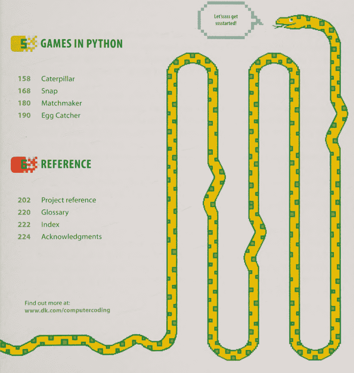

## 前言

我们生活在一个数字世界，计算机几乎是我们所做一切的一部分。不久前，计算机还是主要放在书桌上的笨重、嘈杂的机器，但现在它们已是隐藏在手机、汽车、电视甚至手表里的微小、安静的设备。我们用它们工作、玩游戏、看电影、购物，并与朋友和家人保持联系。

如今的计算机使用起来非常简单，任何人都能操作。但知道如何编写让它们运行的代码的人并没有那么多。成为编程者可以让你掀开引擎盖，看看计算机真正如何工作。稍加练习，你就能构建自己的应用、编写自己的游戏，或者只是摆弄别人的程序，并定制自己的巧妙作品。

编程不仅是一种令人上瘾的爱好，也是一项在世界各地需求量巨大的技能。学会编程，无论你的人生走向哪里，无论你对科学、艺术、音乐、体育还是商业感兴趣，都会让你受益匪浅。

如今，你可以学习数百种编程语言，从像 Scratch™ 这样简单的拖放式语言，到像 JavaScript® 这样的网页编程语言。本书基于 Python®，这是世界上使用最广泛的编程语言之一。Python 同样受学生和专业人士欢迎，易于上手，同时又强大而多用途。无论你是初学者，还是从 Scratch 这样的简单语言进阶而来，它都是一门很适合学习的语言。

学习编程的最好方式就是投入进去，本书正是这样设计的。只需按照编号步骤操作，你很快就能构建应用、游戏、图形和谜题。如果学得开心，学习编程会更容易，所以我们尽量让这些项目尽可能有趣。

如果你是编程新手，请从头开始，逐步学习。如果你不能理解每一个细节，不用担心——没关系。你构建的项目越多，你就会变得越好。如果你的程序第一次运行不成功，也不要担心。即使是专业人士也必须调试他们的作品。

完成每个项目后，书中都有关于如何调整和改编它的提示。欢迎尝试你自己的改造。只需一点想象力和技巧，编程者能取得的成就就没有极限。

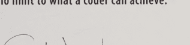

CAROL VORDERMAN

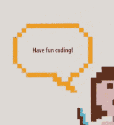

## 从 Python 开始

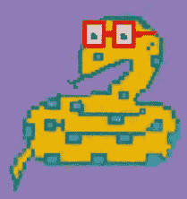

## 任何人都能编程

要成为编程者，你只需学习一些基本规则和命令，然后就可以开始编写适合自己技能和兴趣的程序。例如，如果你喜欢科学，你可以制作一个根据实验结果绘制图表的应用。或者你可以运用自己的艺术技能，为自己的电子游戏设计一个外星世界。


### 逻辑思考

编程者需要逻辑清晰、细致谨慎，才能写出好的代码。如果指令不准确，或者步骤顺序错误，程序就无法正常运行。要逐步思考，确保事情按逻辑顺序发生——毕竟，你不会先穿长裤再穿内裤，对吧！

### 注重细节

如果你擅长找不同谜题，你很可能成为一名出色的编程者。编程中的一项重要技能是发现代码中的错误。这些错误被称为 bug，即使很小的 bug 也可能造成大问题。眼尖的编程者能找出拼写错误，以及指令逻辑或顺序上的问题。调试程序可能很棘手，但从错误中学习是提升编程能力的好方法。


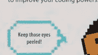

### 术语

### Bug

Bug 是代码中的错误，会使程序出现意外行为。它们之所以叫这个名字，是因为早期计算机有时会因昆虫卡在电路里而出故障！

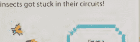

### 开始编程

编程听起来可能令人生畏，但学会如何编程其实很容易。秘诀就是投入进去。本书旨在通过引导你完成简单项目来教你如何编程。只需按照编号步骤操作，你很快就能创建游戏、应用和数字艺术。

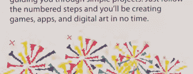


## 认识 Python

Python 是世界上最受欢迎的计算机编程语言之一。它于 20 世纪 90 年代首次发布，如今被用于构建数以百万计的应用、游戏和网站。

**术语**

### Python

Python 并非以蛇的种类命名。它实际上是以一个名为“蒙提·派森的飞行马戏团”的英国喜剧团体命名的。Python 的创造者吉多·范罗苏姆是该团体的忠实粉丝，也很喜欢他们古怪的幽默。Python 程序员经常在代码中使用该团体的笑话和名言，以示致敬。

### 为什么选择 Python？

Python 是入门计算机编程的绝佳语言。许多学校和大学都用它来教授编程。以下是 Python 如此有用的一些原因。


> 它易于阅读和编写！

### 易于阅读和编写

Python 是一种基于文本的计算机编程语言。你使用英语单词、标点字符、符号和数字的组合来编写指令。这使得 Python 代码简单易读、易写、易懂。

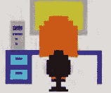

### 处处可用

Python 是可移植的。这意味着你可以在许多不同的计算机上编写和运行 Python 代码。相同的 Python 代码可在 PC、Mac、Linux 机器和 Raspberry Pi 计算机上运行。这些程序在每台机器上的行为都相同。

### 自带电池

程序员说 Python“自带电池”。这是因为它附带了立即开始编程所需的一切。


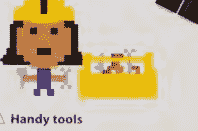

### 便捷工具

Python 内置了大量有用的工具和预编程代码，你可以在自己的程序中使用它们。这被称为标准库。使用这些工具可以让你更轻松、更快捷地构建自己的程序。

### 出色的支持

Python 拥有编写良好的文档。它包含入门指南、用于查询各项含义的参考部分，以及大量示例代码。


## Python 在实际应用中

Python 不仅仅是教育工具。它是一个如此强大的程序，被用于商业、医学、科学和媒体领域中许多有趣而激动人心的任务。它甚至可以用来控制你家里的灯光和供暖。

### 专家提示

### 解释器

有些编程语言使用解释器。解释器是一种可以将一种编程语言翻译成另一种编程语言的程序。每次运行 Python 程序时，解释器都会把每一行 Python 代码翻译成计算机能够理解的特殊代码，即机器码。

### 网络爬取

Python 在互联网上被广泛使用。Google 搜索引擎的部分内容是用 Python 编写的。YouTube 的许多部分也是使用 Python 代码构建的。

> 我是一个无比强大的程序！


> Python？这可是一门严肃的生意！


### 严肃业务

Python 帮助银行跟踪其账户中的资金，也帮助大型连锁商店为所售商品定价。

> 别担心，这不会很疼——疼不了多少！

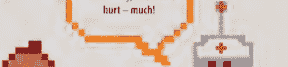

### 医学奇迹

Python 可用于为机器人编程，以执行高难度手术。由 Python 编程的机器人外科医生可以比人类外科医生工作得更快，而且更准确，更不容易出错。

> 我们一直在等你！


### 超越地球

软件工程师使用 Python 为 NASA 的任务控制中心创建工具。这些工具帮助机组人员为每次任务做准备，并监控任务的进展。

> 开拍！

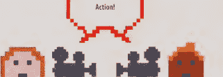

### 在电影中

迪士尼使用 Python 将动画制作过程中重复性的部分自动化。动画师不必一遍又一遍地执行相同步骤，而是使用 Python 程序自动重复这些步骤。这节省了工作量，缩短了制作一部电影所需的时间。

## 安装 Python

本书中的所有项目都使用 Python 3，因此请务必从网站下载正确的版本。请按照与你的计算机相匹配的说明进行操作。

### 在 Windows 上安装 Python

在 Windows PC 上安装 Python 3 之前，请先确认它使用的是 32 位还是 64 位版本的 Windows。单击“开始”，右键单击“计算机”，然后左键单击“属性”。如果出现“系统”选项，请选择它。

### 术语 — IDLE

IDLE（Integrated Development Environment 的缩写，即集成开发环境）是安装 Python 时附带的一款免费应用。IDLE 专为初学者设计，包含一个基本的文本编辑器，可让你编写和编辑 Python 代码。

1. **访问 Python 网站**  
   在 Web 浏览器中输入下面的地址，进入 Python 网站。然后单击“Downloads”打开下载页面。
   - https://www.python.org/

2. **下载 Python**  
   单击适用于 Windows 的最新 Python 版本（版本号以数字 3 开头）。安装程序文件将自动下载。在不同的安装程序选项中，选择“executable installer”。
   - Python 3.6.0a4 · 2016-08-15
     - Windows x86 executable installer
     - Windows x86-64 executable installer

   如果你使用的是 32 位版本的 Windows，请使用此安装程序。如果你使用的是 64 位版本的 Windows，请使用此安装程序。

3. **运行安装程序**  
   双击安装程序文件以安装 Python。选择“为所有用户安装”，并在每个提示处单击“下一步”，不要更改默认设置。


4. **打开 IDLE**  
   安装完成后，打开 IDLE 程序以检查安装是否成功。转到“开始”菜单，选择“所有应用”，然后选择“IDLE”。应该会打开一个类似下图的窗口。

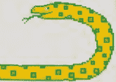

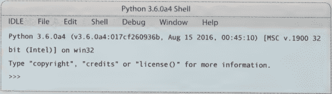

```text
Python 3.6.0a4 (v3.6.0a4:017cf260936b, Aug 15 2016, 00:45:10) [MSC v.1900 32 bit (Intel)] on win32
Type "copyright", "credits" or "license()" for more information.
>>>
```

## 编辑器窗口

Shell 无法保存你的代码，因此当你关闭 Shell 窗口时，你输入的代码将永久丢失。这就是为什么在处理项目时应该使用 IDLE 的编辑器窗口。这个窗口可以让你保存代码。它还内置了一些工具，帮助你编写程序并排查错误。

### 编辑器窗口

要在 IDLE 中打开编辑器窗口，请单击顶部的“File”菜单并选择“New File”。随后会出现一个空白的编辑器窗口。你将使用编辑器窗口来编写和运行本书中的项目程序。

你在这里输入代码。这个程序会打印一个列表，告诉你哪些数字是偶数，哪些是奇数。

文件名显示在这里。

你可以从这个菜单运行程序。

编辑器窗口的菜单栏与 Shell 的菜单栏不同。

```python
for counter in range(10):
    if ((counter % 2) == 0):
        print(counter)
        print('is even')
    else:
        print(counter)
        print('is odd')
```

你让 Python 打印的任何内容都会显示在 Shell 窗口中。

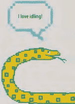

### 代码中的颜色

IDLE 会自动为文本着色，以突出显示代码的不同部分。这些颜色让你更容易理解代码，而且在试图找出错误时很有用。

| 符号 | 含义 |
|---|---|
| 符号和名称 | 大多数代码文本为黑色。 |
| 关键字 | 某些单词（例如“if”和“else”）是 Python 使用的特殊单词。它们被称为关键字，并以橙色显示。 |
| 输出 | 程序运行时产生的任何文本都是蓝色。 |
| 内置命令 | Python 命令（例如“print”）以紫色显示。 |
| 错误 | Python 使用红色提醒你代码中的任何错误。 |
| 引号中的文本 | 引号中的文本为绿色。文本周围出现绿色括号表示你缺少一个引号。 |


## 第一步


## 你的第一个程序

既然你已经安装好 Python 和 IDLE，现在是时候用 Python 编写你的第一个程序了。按照以下步骤创建一个简单的程序，它会向用户发送一条愉快的问候信息。

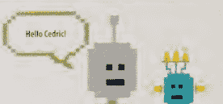

### 工作原理

程序首先显示消息“Hello, World!”，然后询问你的名字。一旦你输入名字，它会再次问候，但这次会在问候语中包含你的名字。程序使用一种叫做“变量”的东西来记住你的名字。变量在编程中用于存储信息。

### 1. 启动 IDLE

启动 IDLE 时会出现一个 shell 窗口。忽略它，点击 IDLE 菜单中的 File。选择 New File 创建一个空的编辑器窗口，以便你编写程序。

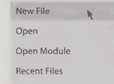

### Hello World 流程图

程序员使用称为流程图的图表来规划程序，并展示每个步骤如何执行。每个步骤都显示在一个方框中，并用箭头指向下一步。有时步骤是问题，根据问题的答案，会有不止一个箭头指向后续步骤。

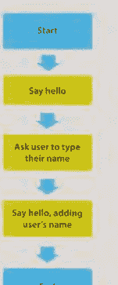

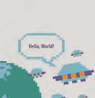

### 2. 输入第一行

在编辑器窗口中，输入这行文本。单词‘print’是一条 Python 指令，它告诉计算机在屏幕上显示某些内容，例如“Hello, World!”这些文字。

```python
print('Hello, World!')
```

### 3. 保存文件

在运行代码之前，必须先保存它。转到 File 菜单并选择 Save。


### 保存文件

会弹出一个对话框。为你的程序输入一个名称，例如“helloworld.py”，然后点击 Save。

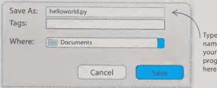

### PY 文件

Python 程序的名称通常以“.py”结尾，这样很容易识别。保存程序时，Python 会自动在末尾添加“.py”，因此你无需手动输入。

### 检查是否运行正常

现在运行程序的第一行，看看它是否正常工作。打开 Run 菜单，选择 Run Module。你应该会在 shell 窗口中看到消息“Hello, World!”。

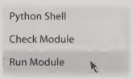

```text
>>> 
Hello, World!
>>>
```

该消息将出现在 shell 中。

### 修复错误

如果代码无法运行，请保持冷静！每个程序员都会犯错，如果你想成为编程专家，找出这些“bug”至关重要。回头检查代码中是否有输入错误。是否包含了括号？是否正确拼写了“print”？修复任何错误，然后再次尝试运行代码。

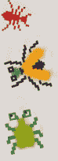

### 专家提示

**键盘快捷键**

从编辑器窗口运行程序的一个便捷快捷键就是按键盘上的 F5。这比选择“Run”然后选择“Run Module”要快得多。

### 添加更多行

回到编辑器窗口，向脚本中添加两行代码。现在中间一行会询问你的名字，然后将其存储在一个变量中。最后一行使用你的名字打印新的问候语。如果你愿意，可以将其改为不同的问候语——可以礼貌，也可以粗鲁，随你喜欢！

```python
print('Hello, World!')
person = input('What is your name?')
print('Hello,', person)
```

这一行会询问用户的名字，并将其存储在一个名为“person”的变量中。

```text
Hello, World!
What is your name? Josh
Hello, Josh
```

用户的名字

### 最终任务

再次运行代码进行检查。当你输入名字并按回车键后，shell 应该会显示一条个性化的消息。恭喜你完成了第一个 Python 程序！你已经迈出了成为强大程序员的第一步。

## 变量

如果你想编写实用的代码，就需要能够存储和标记信息。这正是变量的作用。变量非常适用于各种场景——从记录游戏得分，到执行计算，再到保存项目列表。


△ **存储盒**

变量就像一个带有名称标签的盒子。你可以将数据存储在盒子中，然后在需要使用时通过名称再次找到这些数据。

### 如何创建变量

变量需要一个名称。想一个能提醒你变量中内容的名称。然后决定要在变量中存储什么。这就是变量的值。输入名称，后跟等号，再输入值。我们称之为“给变量赋值”。

- 1. **赋值**  
  在 shell 窗口中，输入这行代码来创建变量 age 并为其赋值。如果你愿意，可以使用自己的年龄。
  
  ```text
  >>> age = 12
  ```
  
  这个值将存储在变量中。这就是变量的名称。
- 2. **打印值**  
  现在，在 shell 窗口中输入右侧显示的代码行。按回车键看看会发生什么。
  
  ```text
  >>> print(age)
  12
  ```
  
  这是 age 的值。print() 函数会打印括号中变量的值。

### 专家提示

**变量命名**

为变量选择好的名称会让程序更容易理解。例如，在游戏中跟踪玩家生命值的变量可以命名为 `lives_remaining`，而不是仅仅命名为 `lives` 或 `l`。变量名可以包含字母、数字和下划线，但应以字母开头。遵循这里显示的规则，你就不会出错。

- **注意事项**
  - 变量名以字母开头。
  - 名称中可以使用任何字母或数字。
  - 不允许使用 `-`、`#` 或 `@` 等符号。
  - 不能使用空格。
  - 可以用下划线（`_`）代替空格。
  - 大写字母和小写字母是不同的。Python 会将“Score”和“score”视为两个不同的变量。
  - 避免使用 Python 用作命令的单词，例如“print”。

**术语**

## 整数和浮点数

在编程中，不带小数点的数字被称为整数（integer），而带小数点的数字则被称为浮点数（float）。程序通常使用整数来计数。浮点数更常用于测量。

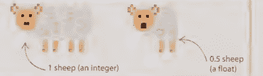

### 使用数字

变量可用于存储数字和进行算术运算。你可以像在数学中一样，使用符号进行运算。有些符号你会很熟悉，但要注意“乘”和“除”的符号——它们与你在课堂上使用的略有不同。

| 符号 | 含义 |
| --- | --- |
| + | 加 |
| - | 减 |
| * | 乘 |
| / | 除 |

部分 Python 数学符号

- 1. **一个简单的计算**  
  在 shell 窗口中输入这段代码。它使用存储在 x 和 y 两个变量中的数字进行简单的乘法运算。按回车键即可得到答案。
  
  ```text
  >>> x = 6
  >>> y = x * 7
  >>> print(y)
  42
  ```
  
  创建一个新变量 x，并赋值为 6。将 x 乘以 7，并将结果存储在 y 中。打印 y 的值。这就是计算结果。
- 2. **改变值**  
  要更改变量的值，只需为其赋予一个新值。在你的代码中，将 x 的值改为 10，然后重新运行计算。你期望结果是多少？
  
  改变 x 的值。
  
  ```text
  >>> x = 10
  >>> print(y)
  42
  ```
  
  结果没有改变——接下来我们会找出原因。
- 3. **更新值**  
  y 的值需要更新才能得到正确结果。输入以下代码。现在，在 x 被改变后，代码将新值赋给 y。如果在自己的程序中更新了一个变量的值，务必检查是否需要更新其他变量。
  
  更新 y 的值
  
  ```text
  >>> x = 10
  >>> y = x * 7
  >>> print(y)
  70
  ```

## 使用字符串

程序员使用“字符串”（string）一词来表示由一系列字母或其他字符组成的数据。单词和句子都以字符串形式存储。几乎所有程序在某个阶段都会使用字符串。键盘上能输入的每个字符，甚至无法输入的字符，都可以存储在字符串中。

### 变量中的字符串

字符串可以放入变量中。在 shell 窗口中输入这段代码。它将字符串‘Ally Alien’赋值给变量 name，然后显示出来。字符串必须在开头和结尾加上引号。

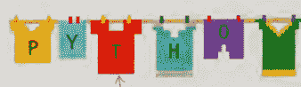

字符串就是一系列字符。

引号表示变量包含字符串。

```python
>>> name = 'Ally Alien'
>>> print(name)
Ally Alien
```

按回车键打印字符串。

记住引号。

### 组合字符串

当你组合变量来创建新变量时，变量会变得非常有用。如果将两个字符串相加，就可以将组合结果存储在新变量中。试试看。

```python
>>> name = 'Ally Alien'
>>> greeting = 'Welcome to Earth, '
>>> message = greeting + name
>>> print(message)
Welcome to Earth, Ally Alien
```

打印字符串时，引号不会显示。

+ 符号将一个字符串与另一个字符串连接起来。

### 专家提示

**字符串长度**

你可以使用一个便捷技巧 `len()` 来计算字符串中的字符数（包括空格）。命令 `len()` 是程序员所称“函数”的一个例子。（在本书中你会用到很多函数。）要了解‘Welcome to Earth, Ally Alien’中有多少个字符，请在创建字符串后，在 shell 中输入下面的代码，然后按回车键。

```python
>>> len(message)
28
```

计算出的字符数

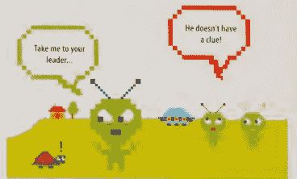

带我去见你们的首领……

他什么都不知道！


## 列表

当你想存储大量数据，或者数据的顺序很重要时，你可能需要使用列表。列表可以将许多条目集中在一起，并保持它们的顺序。Python 会给每个条目一个编号，用来表示它在列表中的位置。你可以随时修改列表中的条目。

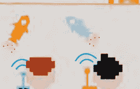

### 1. 多个变量

想象你正在编写一个多人游戏，想要存储每支队伍中玩家的名字。你可以为每个玩家创建一个变量，就像这样……

```python
>>> rockets_player_1 = 'Rory'
>>> rockets_player_2 = 'Rav'
>>> rockets_player_3 = 'Rachel'
>>> planets_player_1 = 'Peter'
>>> planets_player_2 = 'Pablo'
>>> planets_player_3 = 'Polly'
```

如果每队有 3 名玩家，你就需要 6 个变量。

### 2. 将列表放入变量

……但若每队有 6 名玩家呢？管理和更新这么多变量会很困难。这时最好使用列表。要创建列表，你需要用方括号将要存储的条目括起来。请在 shell 中试试这些列表。

```python
>>> rockets_players = ['Rory', 'Rav',
'Rachel', 'Renata', 'Ryan', 'Ruby']
>>> planets_players = ['Peter', 'Pablo',
'Polly', 'Penny', 'Paula', 'Patrick']
```

列表中的条目必须用逗号分隔。

这个列表存储在变量 planets_players 中。

### 3. 从列表中获取条目

一旦你的数据存入列表，处理起来就非常方便。要从列表中取出一个条目，先输入列表名，然后在方括号内加上该条目的位置。注意：Python 是从 0 而不是 1 开始对列表条目计数的。现在试着从你的队伍列表中取出不同玩家的名字。第一个玩家位于位置 0，而最后一个玩家位于位置 5。

```python
>>> rockets_players[0]
'Rory'
>>> planets_players[5]
'Patrick'
```

这行代码从位置 0 获取列表中的第一个条目。

这行代码从位置 5 获取列表中的最后一个条目。

按回车键即可取出该条目。

## 菠萝与斑马

让我们在 shell 中试一个例子。我们可以使用变量 `pineapples` 和 `zebras` 来表示有 5 个菠萝和 2 只斑马。请在 shell 中输入这些行。

```python
>>> pineapples = 5
>>> zebras = 2
```

这个变量存储菠萝的数量。

这个变量存储斑马的数量。

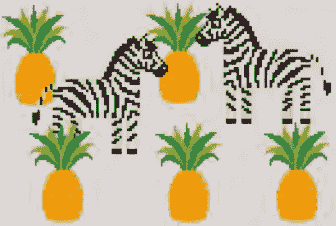

### 进行比较

现在试着输入以下代码行来比较这两个变量的值。每输完一行，按回车键，Python 会告诉你这些语句是 True 还是 False。

菠萝的数量大于斑马的数量。

```python
>>> pineapples > zebras
True
```

```python
>>> zebras < pineapples
True
```

斑马的数量小于菠萝的数量。

菠萝的数量和斑马的数量不相等。

```python
>>> pineapples != zebras
True
```

**术语**

### 布尔表达式

使用逻辑运算符对变量和值进行判断的语句，总会给出一个布尔值，例如 True 或 False。因此，这些语句被称为布尔表达式。我们所有关于菠萝和斑马的判断语句都是布尔表达式。

变量

逻辑运算符

```python
>>> pineapples != zebras
True
```

布尔值

变量

### 多重比较

你可以使用 `and` 和 `or` 组合多个比较。如果使用 `and`，比较的两个部分都必须正确，语句才是 True。如果使用 `or`，只需要有一部分正确即可。

```python
>>> (pineapples == 3) and (zebras == 2)
False
```

其中一部分（pineapples == 3）不正确，因此语句为 False。

```python
>>> (pineapples == 3) or (zebras == 2)
True
```

有一部分正确（zebras == 2），因此语句为 True。

## 乘坐过山车

主题公园的告示牌上写着：必须年满 8 岁且身高超过 1.4 米才能乘坐过山车。米娅 10 岁，身高 1.5 米。让我们用 shell 检查她是否能乘坐。输入以下代码行，为米娅的年龄和身高创建变量并赋予正确的值。将乘坐过山车的规则写成布尔表达式，然后按回车键。

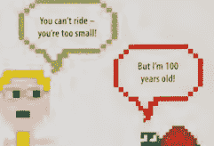

这两行给变量赋值。

```python
>>> age = 10
>>> height = 1.5
>>> (age > 8) and (height > 1.4)
True
```

这是一个布尔表达式，表示“年龄大于 8 岁且身高超过 1.4 米”。

米娅可以乘坐过山车！

### 分支

计算机经常需要决定运行程序中的哪些部分。这是因为大多数程序设计为在不同情况下执行不同的操作。程序的路径如同一棵路径树，分叉出旁路，每条通向不同的地方。

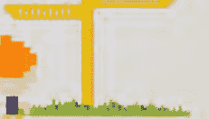

**术语**

### 条件

条件是一种布尔表达式（一种 True 或 False 的比较），可帮助计算机在到达代码分支时决定走哪条路径。

#### 上学还是去公园？

想象一下，你必须根据“今天是工作日吗？”这个问题的答案来决定每天走哪条路。如果是工作日，就走去学校的路；如果不是，就走去公园的路。在 Python 中，程序的不同路径通向不同的代码块。一个代码块可以是一条语句或多条语句，它们都缩进四个空格。计算机使用一种叫作条件的测试来判断接下来应运行哪些代码块。

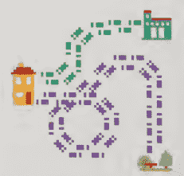

#### 单分支

最简单的分支命令是 `if` 语句。它只有一个分支，当条件为 True 时，计算机就会走这个分支。这个程序询问用户外面是否天黑。如果答案是“是”，程序就假装计算机要睡觉了！如果外面不黑，`is_dark == 'y'` 为 False，因此不会显示 “Goodnight!” 消息。

这一行要求用户回答 “y”（是）或 “n”（否）。

```python
is_dark = input('Is it dark outside? y/n')

if is_dark == 'y':
    print('Goodnight! Zzzzzzzzzzzzz....')
```

条件

如果条件为真，则走此分支。

该代码会在 shell 窗口中显示这条消息。

#### 双分支

你是否希望程序在条件为 True 时做一件事，在条件为 False 时做另一件事？如果是这样，你需要一个具有两个分支的命令，称为 `if-else` 语句。这个程序询问用户是否有触手。如果回答“是”，它就判断用户一定是一只章鱼！如果回答“否”，它就判断用户是人类。每次判断都会打印不同的消息。

这一行要求用户输入。

条件

```python
tentacles = input('Do you have tentacles? (y/n)')
if tentacles == 'y':
    print('I never knew octopuses could type!')
else:
    print('Greetings, human!')
```

如果条件为 True，则运行此代码块。

如果条件为 False，则运行此代码块。

#### 多分支

当可能的路径多于两条时，`elif` 语句（“else-if”的缩写）就派上用场了。这个程序要求用户输入天气预报：“rain”“snow”或“sun”。然后它会从三个分支和天气条件中选择一个。

```python
weather = input('What is the forecast for today? (rain/snow/sun)')

if weather == 'rain':
    print('Remember your umbrella!')
elif weather == 'snow':
    print('Remember your woolly gloves!')
else:
    print('Remember your sunglasses!')
```

第一个条件

如果第一个条件为 True，则运行此代码块。

第二个条件

如果第二个条件为 True，则运行此代码块。

如果两个条件都为 False，则运行此代码块。

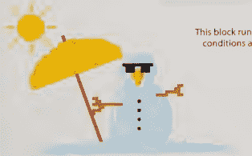

#### 工作原理

`elif` 语句必须始终位于 `if` 之后、`else` 之前。在这段代码中，只有当 `if` 语句设置的条件为 False 时，`elif` 才会检查是否下雪。你可以插入更多 `elif` 语句来检查更多天气类型。


## 循环往复

计算机非常擅长毫无怨言地执行枯燥的任务。程序员做不到，但他们很擅长让计算机替他们做重复性的工作——通过使用循环。循环会一遍又一遍地运行同一段代码。循环有几种不同的类型。

### for 循环

当你知道自己希望一段代码运行多少次时，可以使用 for 循环。在下面的例子中，艾玛编写了一个程序来制作她房门上的标牌。它会打印“艾玛的房间——请勿入内！！！”十次。你可以在 shell 中亲自试试她的代码。（输入代码并按回车后，按退格键删除缩进，然后再按一次回车。）

```python
>>> for counter in range(1, 11):
...     print('Emma\'s Room - Keep Out!!!')
```

- 这是循环变量。
- 循环运行 10 次。
- 循环体中的命令缩进 4 个空格。
- 被重复执行的那一行称为循环体。

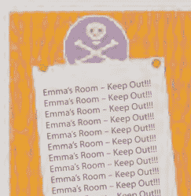

#### 循环变量

循环变量用来记录到目前为止我们循环了多少次。第一次循环时，它等于 `range(1, 11)` 所指定列表中的第一个数字；第二次循环时，它等于列表中的第二个数字，依此类推。当我们用完了列表中的所有数字后，循环就停止了。

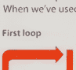

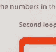

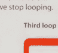

#### 专家提示：range

在 Python 代码中，单词“range”后面跟着括号中的两个数字，表示“从第一个数字开始，一直到比第二个数字小一的全部数字”。因此 `range(1, 4)` 表示数字 1、2 和 3——但不包括 4。在艾玛的“请勿入内”程序中，`range(1, 11)` 表示数字 1、2、3、4、5、6、7、8、9 和 10。

#### 专家提示：转义字符（\\）

艾玛房间（Emma's Room）中的反斜杠告诉 Python 忽略那个撇号，这样它就不会被视为结束整个字符串的引号。像这样使用的反斜杠称为转义字符。它告诉 Python 在判断这一行是否合理或包含错误时，不要计算下一个字符。

> “我走啦！”

> “我能看见未来，而未来完全是循环往复的！”

### while 循环

如果你不知道想重复代码多少次，那该怎么办？你需要一个水晶球，或者某种预知未来的方法吗？不，没关系！你可以使用 while 循环。

#### 循环条件

while 循环没有设置为某个值范围的循环变量，而是有一个循环条件。这是一个布尔表达式，其值要么是 True，要么是 False。这有点像迪斯科舞厅门口的保安问你有没有门票。如果有（True），就直接去舞池；如果没有（False），保安就不会让你进去。在编程中，如果循环条件不为 True，你就进不了循环！

> 今天这里有迪斯科！

> 你进不来——你的循环条件不是 True！

#### 平衡表演

在下面的例子中，艾哈迈德编写了一个程序，用来记录他的杂技河马表演团中有多少只河马叠在一起搭成了高塔。请通读这段代码，看看你是否能弄明白它是如何工作的。

- 这个变量存储问题的答案：“再加一只河马吗？”
- 这个变量存储河马的数量。
- 循环条件
- 这一行显示一条消息，展示叠在一起保持平衡的河马总数。
- 艾哈迈德的回答成为 `answer` 的新值。

```python
>>> hippos = 0
>>> answer = 'y'
>>> while answer == 'y':
...     hippos = hippos + 1
...     print(str(hippos) + ' balancing hippos!')
...     answer = input('Add another hippo? (y/n)')
```

- 将叠放的河马数量加一。


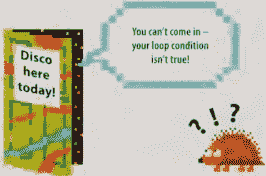


#### 工作原理

艾哈迈德程序中的循环条件是 `answer == 'y'`。这表示用户想要再添加一只河马。在循环体中，我们将叠放河马的数量加一，然后询问用户是否还想再加一只。如果他们输入“y”（表示“是”）来回答，循环条件即为 True，于是我们再次循环。如果他们输入“n”（表示“否”），循环条件即为 False，程序就会离开循环。

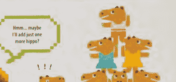

### 无限循环

有时你可能希望 `while` 循环在程序运行的整个过程中一直持续下去。这种循环称为无限循环。很多视频游戏程序都会使用一种称为主循环的无限循环。

- 没有 False 选项可以跳出循环。

```python
>>> while True:
...     print('This is an infinite loop!')
```

#### 专家提示：停止循环

如果你不想要无限循环，那么务必确保 `while` 循环的循环体做了某些可能使循环条件变为 False 的操作。但别担心——如果你不小心编写了一个无限循环，可以通过按住 Ctrl（控制）键的同时按 C 键来跳出循环。你可能需要按好几次 Ctrl-C 才能退出循环。

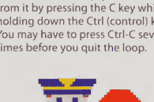

#### 进入无限

你只需将循环条件设置为一个常量值：True，就能创建一个无限循环。因为这个值永远不会改变，所以循环永远不会退出。请在 shell 中试试这个 `while` 循环。它没有 False 选项，因此循环会不停地打印“This is an infinite loop!”，直到你退出程序。

#### 逃离无限

你可以故意使用无限循环来获取用户输入。这个烦人的程序会询问用户是否觉得无聊。只要用户输入“n”，它就会一直问下去。如果用户受够了并输入“y”，它就会告诉用户很无礼，然后使用 `break` 命令离开循环！

- True 条件表示用户还没觉得无聊（“n”）。

```python
>>> while True:
...     answer = input('Are you bored yet? (y/n)')
...     if answer == 'y':
...         print('How rude!')
...         break
```

- False 条件（“y”）会触发 break 命令。

### 循环中的循环

循环体内还可以包含另一个循环吗？可以！这称为嵌套循环。这就像俄罗斯套娃，每个娃娃都套在一个更大的娃娃里面。在嵌套循环中，内层循环运行在外层循环内部。

> 我喜欢俄罗斯套娃——但它们总是那么自以为是！

外层循环的循环变量是 `hooray_counter`。

#### 专家提示——缩进循环体

循环体中的代码应缩进四个空格。如果没有缩进，Python 会显示错误信息，代码将无法运行。对于嵌套循环（一个循环在另一个循环内部），内层循环的循环体必须额外缩进四个空格。Python 会自动缩进循环中的新行，但你应始终检查每一行是否缩进了正确的空格数。

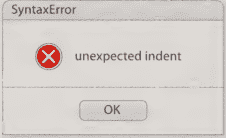

#### 循环套循环

在下面的例子中，艾玛把她的“请勿入内”程序改成了“三呼万岁”程序，它会打印三次“Hip, Hip, Hooray!”。由于每次欢呼都包含两次“Hip”，她使用了一个嵌套循环来打印它。

```python
for hooray_counter in range(1, 4):
    for hip_counter in range(1, 3):
        print('Hip')
    print('Hooray!')
```

- 外层循环的循环体缩进 4 个空格。
- 内层循环的循环变量是 `hip_counter`。
- 内层循环的循环体再缩进 4 个空格。

```text
hooray_counter = 1

Hip
Hip
Hooray!

hooray_counter = 2

Hip
Hip
Hooray!

hooray_counter = 3

Hip
Hip
Hooray!

hip_counter = 1
hip_counter = 2

hip_counter = 1
hip_counter = 2

hip_counter = 1
hip_counter = 2
```

#### 工作原理

整个内层 for 循环都位于外层 for 循环的循环体内。每执行一次外层循环，就必须执行两次内层循环。这意味着外层循环的循环体总共运行三次，而内层循环的循环体运行六次。


### 工作原理

本项目使用函数——一段有名称、执行特定任务的代码块。函数让你可以重复使用同一段代码，而不必每次都把它全部输入一遍。Python 有许多内置函数，但也允许你创建自己的函数。

### 调用函数

当你想使用一个函数时，在代码中输入它的名称就是“调用它”。在动物问答游戏中，你将创建一个函数，把玩家的猜测与正确答案进行比较，看看是否正确。你将在测验的每个问题中调用它。

### 动物问答流程图

程序会不断检查是否还有问题要问，以及玩家是否已用完所有机会。游戏过程中，得分保存在一个变量中。一旦所有问题都回答完毕，游戏就结束。

### 忽略大小写！

在将玩家的猜测与正确答案进行比较时，玩家输入大写字母还是小写字母并不重要——重要的是单词相同。并非所有程序都如此。例如，如果检查密码的程序忽略大小写，密码可能变得更容易被猜中，安全性也更低。然而，在动物问答游戏中，玩家回答“bear”还是“Bear”都无关紧要——两者都会被认定为正确。

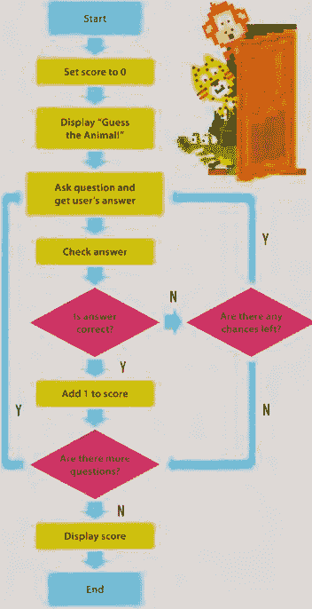


### 整合起来

现在该构建你的测验了！首先，你将创建问题和检查答案的机制。然后，你将添加代码，让玩家每个问题有三次作答机会。

> 希望我没有毒——我刚才咬到自己的舌头了！

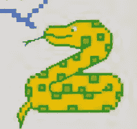

- **1. 创建新文件**

  打开 IDLE。在“文件”菜单下，选择“新建文件”。将文件保存为“animal_quiz.py”。

  

- **2. 创建得分变量**

  输入这里显示的代码，创建一个名为 `score` 的变量，并将其初始值设为 0。

  ```python
  score = 0
  ```

  你将使用这个变量来记录玩家的得分。

- **3. 介绍游戏**

  接下来创建一条消息，向玩家介绍游戏。这将是玩家在屏幕上看到的第一样东西。

  ```python
  score = 0
  print('Guess the Animal!')
  ```

  这句话将出现在 Shell 窗口中。

- **4. 运行代码**

  现在试着运行代码。在“运行”菜单中，选择“运行模块”。接下来会发生什么？你应该会在 Shell 窗口中看到欢迎消息。

  

  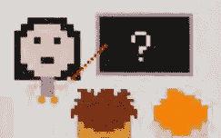

- **5. 提问（用户输入）**

  下一行代码会提出一个问题，并等待玩家回答。答案（用户输入）保存在变量 `guess1` 中。运行代码，确保问题出现。

  ```python
  print('Guess the Animal!')
  guess1 = input('Which bear lives at the North Pole? ')
  ```

  变量 `guess1` 会存储用户输入的任何内容。

### 10. 显示得分

当测验结束时，下一行代码将通过一条消息显示玩家的得分。将它添加到文件底部、最后一个问题下面。

```python
guess3 = input('Which is the largest animal? ')
check_guess(guess3, 'blue whale')

print('Your score is ' + str(score))
```

这会创建一条给出玩家得分的消息，并将其显示在屏幕上。

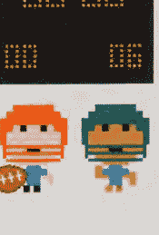

### 工作原理

对于这一步，你必须使用 str() 函数将数字转换为字符串。这是因为如果你尝试将字符串和整数相加，Python 会显示错误。

### 11. 忽略大小写

如果玩家输入 'Lion' 而不是 'lion' 会发生什么？他们还能得分吗？不能，代码会告诉他们这是错误答案！要解决这个问题，你需要让代码更智能。Python 有一个 lower() 函数，可以将单词转换为全部小写字符。在你的代码中，将 if guess == answer: 替换为右侧加粗显示的那一行。

```python
def check_guess(guess, answer):
    global score
    if guess.lower() == answer.lower():
        print('Correct answer')
        score = score + 1
```

更改这一行。

### 工作原理

在检查之前，猜测和答案都会被转换为小写字符。这确保无论玩家使用全大写字母、全小写字母，还是两者的混合，代码都能正常工作。

### 12. 再次测试代码

第三次运行你的代码。尝试混合使用大写和小写字母输入正确答案，看看会发生什么。

```text
Guess the Animal!
Which bear lives at the North Pole? polar bear
Correct answer

Which is the fastest land animal? Cheetah
Correct answer

Which is the largest animal? BLUE WHALE
Correct answer

Your score is 3
```

在判断答案是否正确时会忽略大小写。

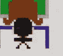

### 13. 给玩家更多机会

目前玩家只有一次答对的机会。你可以给玩家三次回答问题的机会，让游戏稍微容易一些。将 `check_guess()` 函数改成如下样子。

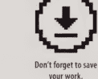

这个变量只会保存两个值之一：True 或 False。

```python
def check_guess(guess, answer):
    global score
    still_guessing = True
    attempt = 0
    while still_guessing and attempt < 3:
        if guess.lower() == answer.lower():
            print('Correct answer')
            score = score + 1
            still_guessing = False
        else:
            if attempt < 2:
                guess = input('Sorry wrong answer. Try again. ')
            attempt = attempt + 1

    if attempt == 3:
        print('The correct answer is ' + answer)

score = 0
```

while 循环会运行检查代码三次，或者直到玩家答对为止——以先发生者为准。

确保每一行代码都有正确的缩进。

else 语句会在玩家答错时要求他们输入另一个答案。

将玩家已猜测的次数加 1。

这段代码会在三次错误猜测后显示正确答案。

### 工作原理

要知道玩家是否答对，你需要创建一个名为 `still_guessing` 的变量。然后将该变量设为 True，表示尚未找到正确答案。当玩家答对时，将其设为 False。

最大的动物？我不知道。给我三次猜测机会！

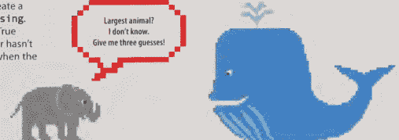

## 改造与调整

把你的测验混搭一下！让它更长或更难，使用不同类型的问题，甚至改变测验的主题。你可以尝试这些改造和调整中的任意一种或全部，但记得把每一个都保存为单独的 Python 文件，以免弄乱原始游戏。


### 让它更长

向测验中添加更多问题。一些例子可以是“哪种动物有长长的鼻子？”（大象）或“哪种哺乳动物会飞？”（蝙蝠）。或者稍微难一点：“章鱼有多少颗心脏？”（三颗）。

如果你需要将一行很长的代码拆成两行，请使用反斜杠字符。

```python
guess = input('Which one of these is a fish? \\\nA) Whale B) Dolphin C) Shark D) Squid. Type A, B, C, or D.')
check_guess(guess, 'C')
```

### 制作多项选择测验

这段代码展示了如何创建多项选择题，让玩家从几个可能的答案中选择。

## 记住

### 换行

你可以在任何地方使用 `\n` 来换行。如果问题和可能的答案出现在不同行，多项选择题会更容易理解。要将鱼的问题显示为选项列表，请像这样输入。

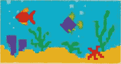

```python
guess = input('Which one of these is a fish?\\n \\\nA) Whale\\n B) Dolphin\\n C) Shark\\n D) Squid\\n \\\nType A, B, C, or D.')
check_guess(guess, 'C')
```

```text
Which one of these is a fish?
A) Whale
B) Dolphin
C) Shark
D) Squid
Type A, B, C, or D
```

这就是该问题在 Shell 窗口中的显示效果。


## 尝试次数越少，得分越高

奖励用更少猜测答对的玩家。如果一次答对给 3 分，需要两次尝试给 2 分，用满三次机会给 1 分。对更新分数的行做如下修改。现在它会给出 3 分减去不成功尝试次数后的分数。如果玩家第一次就答对，则给其分数加上 3 − 0 = 3 分；第二次猜对，则是 3 − 1 = 2 分；第三次猜对，则是 3 − 2 = 1 分。

```python
while still_guessing and attempt < 3:
    if guess.lower() == answer.lower():
        print('Correct Answer')
        score = score + 3 - attempt
        still_guessing = False
    else:
        if attempt < 2:
```

这一行替换了`score + 1`。

## 制作判断题测验

这段代码展示了如何创建只有两个可能答案的判断题。

```python
guess = input('Mice are mammals. True or False? ')
check_guess(guess, 'True')
```

## 改变难度

要让测验更难，就减少玩家答对的机会。如果制作判断题测验，你会希望玩家每题只有一次猜测机会；如果是多项选择题测验，或许每题不超过两次猜测。你能想明白对于判断题或多项选择题，需要把高亮显示的数字改成什么吗？

```python
def check_guess(guess, answer):
    global score
    still_guessing = True
    attempt = 0
    while still_guessing and attempt < 3:
        if guess.lower() == answer.lower():
            print('Correct Answer')
            score = score + 1
            still_guessing = False
        else:
            if attempt < 2:
                guess = input('Sorry wrong answer. Try again. ')
            attempt = attempt + 1
    if attempt == 3:
        print('The correct answer is ' + answer)
```

修改这个数字。

修改这个数字。

修改这个数字。

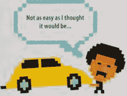

## 选择另一个主题

创建一个不同主题的测验，比如常识、体育、电影或音乐。你甚至可以制作关于家人或朋友的测验，并加入一些调皮的问题，比如“谁的笑声最烦人？”


## 函数

### 如何使用函数

使用函数也称为“调用”函数。要调用函数，只需输入函数名，后面跟一对括号，括号中包含你希望函数处理的所有参数。参数有点像属于该函数的变量，它们允许你在程序的不同部分之间传递数据。当函数不需要任何参数时，括号留空。

### 函数术语

程序员在谈论函数时会使用一些特殊词汇。

- **调用** 使用函数。
- **定义** 当你使用 `def` 关键字并编写函数代码时，程序员说你“定义”了该函数。当你第一次设置变量的值时，也是在定义变量。
- **参数** 你交给函数使用的一份数据（信息）。
- **返回值** 从函数传回主代码的数据。你可以使用关键字 `return` 获取它。

### 内置函数

Python 有许多内置函数，可以在代码中使用。这些有用的工具能让你完成许多任务，从输入信息、在屏幕上显示消息，到把一种数据类型转换为另一种。你已经用过一些 Python 内置函数，比如 `print()` 和 `input()`。看看这些示例。何不在 shell 中试一试呢？

```python
>>> name = input('What is your name?')
What is your name? Sara
>>> greeting = 'Hello' + name
>>> print(greeting)
Hello Sara
```

这会要求用户输入自己的名字。

这会在屏幕上显示变量 `greeting` 的内容。

**`input()`和`print()`** 这两个函数就像一对相反的操作。`input()` 函数让用户通过键入指令或数据来把它们提供给程序。`print()` 函数通过在屏幕上显示消息或结果来向用户发送输出。


**max()**

max() 函数从你给它的参数中选出最大值。按回车/返回键即可在屏幕上看到该值。该函数接受多个参数，参数之间必须用逗号分隔。

```python
>>> max(10, 16, 30, 21, 25, 28)
30
```

最大值就是括号中最高的数字。

多个参数始终要用逗号分隔。

**min()**

min() 函数的作用与 max() 相反。它从你放入其括号内的参数中选出最小值。你可以自己试验 max() 和 min() 函数。

```python
>>> min(10, 16, 30, 21, 25, 28)
10
```

当你按回车/返回键时，代码会显示最低的数字。

### 另一种调用方式

到目前为止我们遇到的一些不同数据类型，比如整数、字符串和列表，都有各自的函数。这些函数必须以特殊方式调用。你需要输入数据或保存数据的变量名，然后是一个点、函数名，最后是括号。在 shell 中测试这些代码片段。

别忘了那个点。

空括号表示不需要参数。

```python
>>> 'bang'.upper()
'BANG'
```

这是新的字符串，全部为大写字母。

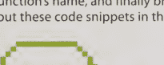

该函数有两个参数。

```python
>>> message = 'Python makes me happy'
>>> message.replace('happy', ':D')
'Python makes me :D'
```

新字符串把 happy 替换成了 :D。

**upper()**

upper() 函数接受一个已有字符串，并返回一个新字符串，其中所有小写字符都变为大写（大写字母）。

**reverse()**

当你想反转列表中项目的顺序时，可以使用这个函数。这里用它来反转存储在变量 countdown 中的数字列表。该函数让列表打印为 [3, 2, 1]，而不是 [1, 2, 3]。

```python
>>> countdown = [1, 2, 3]
>>> countdown.reverse()
>>> print(countdown)
[3, 2, 1]
```

存储在变量 countdown 中的数字列表。

列表现在被反转了。

**replace()**

这个函数需要两个参数：第一个是你想要替换的字符串部分，第二个是你想要替换成的内容。该函数返回完成替换后的新字符串。

## 创建函数

最好的函数有明确的目的和一个能说明其作用的好名字——想想你在 Animal Quiz 中使用的 check_guess() 函数。按照以下说明创建（或“定义”）一个函数，该函数计算一天中的秒数，然后在屏幕上打印答案。

### 1. 定义函数

在 IDLE 中新建一个文件。将其保存为“functions.py”。在编辑器窗口中输入这些行。函数中每一行的开头都添加了缩进。再次保存文件，然后运行代码，看看会发生什么。

函数名

目前没有参数。

```python
def print_seconds_per_day():
    hours = 24
    minutes = hours * 60
    seconds = minutes * 60
    print(seconds)

print_seconds_per_day()
```

变量

这一行打印变量 seconds 的值。

关键字 def 告诉 Python 这段代码是一个函数。

函数名后面的行必须缩进 4 个空格，以向 Python 表明它们是函数的一部分。

这条命令调用该函数。

`86400`

一天中的秒数会出现在 shell 中。

### 2. 添加参数

如果你想给函数提供一些值供其使用，就把它们作为参数放在括号内。例如，要计算特定天数中的总秒数，就把代码改成这样。该函数现在有参数 days。你可以在调用函数时指定天数。自己试一试吧。

函数的参数

这一行使用了参数 days。

给参数 days 一个值（7）

现有代码行以灰色显示，新代码行以粗体显示。

```python
def print_seconds_per_day(days):
    hours = days * 24
    minutes = hours * 60
    seconds = minutes * 60
    print(seconds)

print_seconds_per_day(7)
```

`604800`

7 天中的秒数。

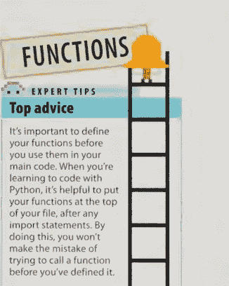

## 函数

### 专家提示

**首要建议**

> 在使用函数之前，先在主代码中定义函数很重要。当你学习用 Python 编程时，把函数放在文件顶部、任何 import 语句之后会很有帮助。这样做，你就不会犯在定义函数之前就尝试调用函数的错误。


## 修复错误

当你的代码出现问题时，Python 会尽力通过显示错误消息来帮助你。起初，这些消息可能看起来有些令人困惑，但它们会为你提供一些线索，帮助你了解程序为什么无法运行以及如何修复它。

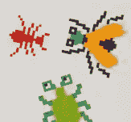

### 错误消息

如果检测到错误，IDLE 编辑器和 Shell 窗口都会显示错误消息。错误消息会告诉你发生了什么类型的错误，以及应该在代码中的何处查找。

#### IDLE 编辑器中的消息

一个弹出框会提示你存在错误。点击“确定”返回你的程序。错误处或其附近会以红色高亮显示。


#### Shell 中的消息

Python 会在 Shell 窗口中以红色文本显示错误消息。出现错误消息时，程序会停止运行。该消息会告诉你哪一行代码导致了错误。

这个弹出框会告诉你存在语法错误，这意味着输入有误。

```text
>>>
Traceback (most recent call last):
  File "Users/Craig/Developments/top-secret-python-book/age.py", line 21, in <module>
    print('I am' + age + 'years old')
TypeError: Can't convert 'int' object to str implicitly
```

这一行告诉你这是一个类型错误（参见第 50 页）。

错误在第 21 行。


**专家提示**

#### 查找错误

当 Shell 中出现错误消息时，右键单击该消息，然后在下拉菜单中选择“转到文件/行”。IDLE 编辑器会直接跳转到该行代码，以便你开始调试。


### 语法错误

当收到语法错误消息时，这表示你输入了不正确的内容。也许是你的手指打滑，敲错了一个字母？别担心——这类错误最容易修复。仔细检查你的代码，并尝试找出哪里出了问题。

#### 需要注意的事项

你是否遗漏了括号或引号？你的括号和引号是否成对匹配？你是否拼错了单词？所有这些都可能导致语法错误。

这里缺少右括号——需要再加一个圆括号。

```python
input('What is your name?'
```

第一个引号缺失。它应该是单引号才能匹配。

```python
print(It is your turn')
```

这是一个拼写错误——应该是 short_shots。

```python
total_score = (long_shots * 3) + (short_shots * 2)
```

### 缩进错误

Python 通过缩进来判断代码块的开始和结束位置。缩进错误意味着代码的结构方式有问题。请记住：如果一行代码以冒号（:）结尾，则下一行必须缩进。按四次空格键可手动缩进一行。

#### 缩进每个新代码块

在 Python 程序中，你经常会有一个代码块嵌套在另一个代码块中，例如函数中的循环。特定代码块中的每一行都必须缩进相同的量。尽管 Python 会在冒号后自动缩进以提供帮助，但你仍然需要检查每个代码块是否缩进正确。

```python
if weekday is True:
print('Go to school')
```

这一行代码会触发缩进错误消息。

```python
if weekday is True:
    print('Go to school')
```

四个空格：你需要像这样缩进第二行代码来修复错误。


缩进告诉 Python 哪些代码行属于哪个代码块。


### 类型错误

类型错误不是打字错误——它意味着你的代码把一种数据类型和另一种数据类型混在了一起，例如把数字和字符串混淆。这就像试图在冰箱里烤蛋糕——不会成功，因为冰箱不是用来烤蛋糕的！如果你让 Python 做不可能的事情，它不配合可不要惊讶！

```python
budget = 'Fifty' * 'Five'
```

你可以在 Python 中将两个数字相乘，但不能对字符串进行乘法运算。

```python
hot_day = '20 degrees' > 15
```

Python 无法判断字符串是否大于数字，因为它们是不同的数据类型。

```python
list = ['a','b','c']
find_biggest_number(list)
```

这个函数期望你传入一个数字列表，但你传入的却是一个字母列表！

#### 类型错误的示例

当你要求 Python 做一些对它来说没有意义的事情时，就会发生类型错误，例如将两个字符串相乘、比较两种完全不同的数据类型，或者让它在一个字母列表中查找数字。

我还以为它们要烤很久呢！

冰箱

你不能对字符串进行乘法运算！


### 名称错误

如果你的代码使用了尚未创建的变量或函数名，就会出现名称错误消息。为避免这种情况，请始终在使用变量和函数之前先定义它们。最佳做法是在程序顶部定义所有函数。

#### 名称错误

这段代码中的名称错误会阻止 Python 显示“我住在莫斯科”这条消息。你需要先创建变量 **hometown**，然后再使用 **print()** 函数。

`print()` 指令需要放在变量之后。

```python
print('I live in ' + hometown)
hometown = 'Moscow'
```


### 逻辑错误

有时，即使 Python 没有给出错误消息，你也能发现程序出了问题，因为程序没有按预期运行。这可能是因为你遇到了逻辑错误。你可能正确地键入了代码，但如果漏掉了一行重要代码，或者指令顺序不对，程序就不会正常运行。


```python
print('Oh no! You have lost a life')
print(lives)
lives = lives - 1
```

↗ 所有代码行都是正确的，但有两行顺序不对。

#### 你能找出这个错误吗？

这段代码运行时不带任何错误消息，但其中存在逻辑错误。在生命数减 1 之前，`lives` 的值就已经显示在屏幕上了。这个游戏的玩家将看到错误的剩余生命数！要修复它，请将 `print(lives)` 指令移到末尾。


#### 逐行排查

逻辑错误可能很难找，但随着你经验越来越丰富，你会越来越擅长追踪它们。尝试通过逐行慢慢检查代码来识别逻辑错误。耐心一点，慢慢来——你最终会找到问题所在。

**专家提示**

#### 除错清单

有时你可能觉得自己永远无法让程序运行起来，但不要放弃！如果你按照这份实用清单中的提示进行操作，就能识别出大多数错误。


#### 问自己……

- 如果你构建了本书中的某个项目但无法运行，请检查你输入的代码是否与书中的完全一致。
- 所有单词都拼写正确吗？
- 一行开头是否有不必要的空格？
- 你是否把数字误认为字母，例如 0 和 O？
- 你是否在正确的位置使用了大小写字母？
- 所有左括号是否都有匹配的右括号？( ) [ ] { }
- 所有单引号和双引号是否都有匹配的结束引号？`' ' " "`
- 你是否请其他人对照书本检查你的代码？
- 自上次修改以来，你是否保存过代码？

## 密码生成器

密码可以防止其他人访问我们的计算机、个人电子邮件和网站登录信息。在这个项目中，你将构建一个工具，用于生成安全且易记的密码，以帮助保护你的私人信息安全。

### 密码小贴士

一个好密码应当容易记住，但很难让人或密码破解器猜出来。

名字容易记住，但也不难被猜到。

这个密码看起来很复杂，但破解器可能用不到 2 秒就能猜出来。

这个密码可能需要黑客花 1000 多年才能破解，但很难记住。

这个密码既安全又容易记住。只要想想两只困倦的恐龙上床睡觉！破解器可能需要一百万年才能正确猜出这个密码。


- Alice
- Fym5
- GH7pqZ2!?
- Sleepydinosaur?


### 会发生什么

密码生成器将让你能够通过组合单词、数字和字符来创建强密码。运行程序时，它会生成一个新密码并显示在屏幕上。你可以让它不断生成新密码，直到找到你喜欢的那个。

### 密码破解器

破解器是一种黑客用来猜测密码的程序。有些破解器每秒可以进行数百万次猜测。破解器通常会从猜测常用单词和名字开始。由多个不同部分组成的独特密码有助于防范破解器。


## 密码生成器流程图

程序会随机选择密码的四个部分，将它们组合在一起，并在 shell 窗口中显示密码。如果你想要另一个密码，它会再次重复这些步骤。如果你不想，程序就会结束。

- 开始
- 随机选择一个形容词
- 随机选择一个名词
- 随机选择 0 到 100 之间的一个数字
- 随机选择一个标点符号
- 创建安全密码
- 显示安全密码
- 想要另一个密码吗？
  - Y：重复密码生成步骤
  - N：结束

## 工作原理

本项目将向你展示如何使用 Python 的 random 模块。程序从形容词、名词、数字和标点符号组中随机选择，来组合每个密码。你很快就能生成疯狂又难忘的密码，例如 "fluffyapple14(" 或 "smellygoat&"！


## 巧妙却简单！

这个程序在密码方面做了些巧妙的事，但代码量不大，所以很快就能完成。


- **1. 创建新文件**
  打开 IDLE。在“文件”菜单下，选择“新建文件”。将文件保存为“password_picker.py”。

- **2. 添加模块**
  从 Python 库中导入 string 和 random 模块。在文件顶部输入这两行，以便稍后使用这些模块。

  ```python
  import random
  import string
  ```

  string 模块让你能对字符串做一些有用的事，比如拆分字符串或改变它们的显示方式。

- **3. 欢迎用户**
  首先创建一条消息，欢迎用户使用该程序。

  这一行显示一条欢迎用户的消息。

  ```python
  import random
  import string

  print('Welcome to Password Picker!')
  ```

- **4. 试运行代码**
  运行代码。欢迎消息应出现在 shell 窗口中。

  ```
  Welcome to Password Picker!
  ```

- **5. 创建形容词列表**
  你需要形容词和名词来生成新密码。在 Python 中，你可以将一组相关的内容保存为列表。首先创建变量 `adjectives` 来存储列表，方法是在 `print()` 命令和 `import` 语句之间输入这段新代码。将整个列表放在方括号中，并用逗号分隔每一项。

  ```python
  import string

  adjectives = ['sleepy', 'slow', 'smelly',
                'wet', 'fat', 'red',
                'orange', 'yellow', 'green',
                'blue', 'purple', 'fluffy',
                'white', 'proud', 'brave']

  print('Welcome to Password Picker!')
  ```

  - 列表存储在变量 `adjectives` 中。
  - 每一项都是字符串。
  - 在每一项后加逗号。
  - 列表放在方括号中。

- **6. 创建名词列表**
  接下来创建一个保存名词列表的变量。把它放在形容词列表下方、`print()` 命令上方。记得像第 5 步那样使用逗号和方括号。

  ```python
  'white', 'proud', 'brave']

  nouns = ['apple', 'dinosaur', 'ball',
           'toaster', 'goat', 'dragon',
           'hammer', 'duck', 'panda']

  print('Welcome to Password Picker!')
  ```

  将每一项放在引号内。

## 专家提示

### 随机数

掷骰子、从一副牌中抽一张牌或抛硬币，都可以通过生成随机数来模拟。你可以在“帮助”菜单的“文档”部分阅读更多关于如何使用 Python 的 random 模块的内容。


- **7. 挑选单词**
  要创建密码，你需要随机挑选一个形容词和一个名词。你可以使用 random 模块中的 `choice()` 函数来完成。在 `print()` 命令下方输入这段代码。（每当你想从列表中随机选择一项时，都可以使用这个函数。只需把包含各项的变量传给它。）

  ```python
  print('Welcome to Password Picker!')

  adjective = random.choice(adjectives)
  noun = random.choice(nouns)
  ```

  - 这个变量保存从形容词列表中随机选择的一个单词。
  - 从列表中选择一个名词并存入这个变量。

## 模块

模块是现成代码的集合，可帮助你应对常见的编程挑战。模块提供了那些不那么有趣的代码部分，让你能专注于有趣的内容。此外，由于模块被很多人使用，它们往往运行良好且没有错误。

### 内置模块

Python 自带许多有用的模块。这些模块的集合称为标准库。以下是标准库中一些你可能会想尝试的有趣模块。


### datetime

这个模块让你可以处理日期。你可以获取今天的日期，或计算距离某个特殊日子还有多久。


### statistics

使用 statistics 计算平均值，或找出数字列表中最常见的值。如果你需要计算游戏中的平均分，它会很方便。


### random

你在“密码生成器”中使用这个模块进行随机选择。它非常适合为游戏或程序加入随机性。


### webbrowser

你可以用这个模块控制计算机的网页浏览器，从而直接从代码中打开网页。


### socket

socket 模块允许程序跨网络和互联网通信。它可以用来创建在线游戏。


## 使用模块

要在代码中使用模块，必须告诉 Python 你想包含它。你可以使用 import 语句指示 Python 包含哪些模块。根据你从模块中需要什么，有几种不同的做法。


### ▷ import ...

输入关键字 import 可以使用模块的全部内容。但是，你需要在使用的任何函数前加上模块名。这段代码导入整个 webbrowser 模块，并使用其 open() 函数在计算机浏览器中打开 Python 网站。

```python
>>> import webbrowser
>>> webbrowser.open('https://docs.python.org/3/library/')
```

- 这一行导入整个 webbrowser 模块。
- 模块名位于函数之前。

### ▷ from ... import ...

如果你只想使用模块的特定部分，可以通过添加 from 关键字只导入该部分。现在你可以单独使用函数名。这段代码导入 random 模块的 choice() 函数。该函数会从你提供的任何列表中随机挑选一项。

这里只从 random 模块导入了 choice 函数。

```python
>>> from random import choice
>>> direction = choice(['N', 'S', 'E', 'W'])
>>> print(direction)
W
```

- 不需要模块名。
- 代码会打印一个随机方向。

### ▷ from ... import ... as ...

有时你可能想更改导入的模块或函数的名称，也许是因为你已经使用了那个名称，或者它不够清晰。要做到这一点，请使用 as 关键字，后跟新名称。在下面展示的示例中，time() 函数被重命名为 time_now()，它为我们提供当前时间。给出的时间是从 1970 年 1 月 1 日 00:00 起经过的精确秒数——大多数计算机把这个日期作为其时钟的起点。

这一行导入并重命名了 time() 函数。

```python
>>> from time import time as time_now
>>> now = time_now()
>>> print(now)
1478092571.003539
```

- 这个变量使用了函数的新名称。
- 自 1970 年 1 月 1 日 00:00 起经过的秒数

> 你正好迟到了
> 1478092571.003539
> 秒！


## 九条命

在这个令人神经紧绷的游戏中，你必须一次猜一个字母来猜出秘密单词。如果猜错，你就会失去一条命。请谨慎选择字母，因为你只有九条命。失去所有命，游戏就结束了！

### 游戏流程

程序会显示一个神秘单词，其中的字母被问号代替。如果你猜对一个字母，程序会用正确字母替换问号。当你认为知道这个单词时，就完整地输入它。一旦你输入正确单词或没有剩余生命，游戏就会结束。

提示会用问号显示神秘单词。

剩余生命数用爱心表示。

```
['?', '?', '?', '?', '?', '?']
Lives left: ♥♥♥♥♥♥♥♥♥
Guess a letter or the whole word: a
['?', '?', '?', '?', '?', 'a']
Lives left: ♥♥♥♥♥♥♥♥♥
Guess a letter or the whole word: i
['?', 'i', '?', '?', '?', 'a']
Lives left: ♥♥♥♥♥♥♥♥♥
Guess a letter or the whole word: y
Incorrect. You lose a life
['?', 'i', '?', '?', '?', 'a']
Lives left: ♥♥♥♥♥♥♥♥
Guess a letter or the whole word: p
['p', 'i', '?', '?', '?', 'a']
Lives left: ♥♥♥♥♥♥♥♥
Guess a letter or the whole word: t
Incorrect. You lose a life
['p', 'i', '?', '?', '?', 'a']
Lives left: ♥♥♥♥♥♥♥
Guess a letter or the whole word: pizza
You won! The secret word was pizza
```

每猜对一个字母，就会揭示秘密单词中的一个或多个字母。

每次猜错都会使一颗爱心消失。

如果你知道这个单词，就输入它来赢得游戏。

> 你还剩七条命。你下一次猜什么？
> 我猜“P”！


## 工作原理

首先，你会创建两个列表：一个用来存储秘密单词，另一个用来存储由问号组成的提示。然后，使用 **random** 模块，从秘密单词列表中随机选择一个单词。接下来，你会构建一个循环来检查玩家的猜测，并创建一个函数，在单词逐渐被揭示时更新提示。


## ◁ 九条命流程图

这个流程图看起来复杂，但这个游戏的代码相对较短。程序的主体是一个循环，用来检查猜测的字母是否属于秘密单词，以及玩家是否还有剩余生命。


## 专家提示

### Unicode 字符

可以在计算机上显示的字母、数字、标点和符号统称为字符。世界上大多数语言都有对应的字符，还有用于简单图片的特殊字符，包括表情符号。字符以字符集的形式出现。例如，ASCII（美国信息交换标准代码）字符集用于英语。在这个项目中，心形符号将使用 Unicode 字符集，它包含许多不同的符号，包括下面这些。


## 准备工作

你将分两个阶段构建“九条命”。首先，导入程序所需的模块并创建几个变量。然后，编写程序的主要代码。


### 1. 创建新文件

打开 IDLE 并创建一个新文件。将其保存为“nine_lives.py”。


### 2. 导入模块

本项目使用 Python 的 random 模块，因此首先输入此处显示的代码行来导入它。

```python
import random
```

### 3. 创建变量

在导入行下方，创建一个名为 lives 的变量，用来记录玩家剩余的生命（猜测次数）。

```python
import random

lives = 9
```

玩家一开始有九条命。

### 4. 创建列表

程序只会知道您提供给它的单词。你需要把这些单词放入一个列表，然后将该列表存储到名为 words 的变量中。在 lives 变量下方添加这一行。

```python
lives = 9
words = ['pizza', 'fairy', 'teeth', 'shirt',
         'otter', 'plane']
```

列表中的每一项都是一个由五个字符组成的字符串。

### 5. 选择秘密单词

每局游戏开始时，程序会随机选择玩家需要猜测的单词，并将其存储到名为 secret_word 的变量中。添加一行来创建这个新变量。

```python
words = ['pizza', 'fairy', 'teeth', 'shirt',
         'otter', 'plane']
secret_word = random.choice(words)
```

这个变量使用了 random 模块的 choice() 函数。


### 6. 存储提示

现在创建另一个列表来保存提示。未知字母会存储为问号。当玩家正确猜出字母时，这些问号将被替换。游戏开始时，整个列表都是问号。你可以写成 clue = ['?', '?', '?', '?', '?']，为秘密单词中的每个字母输入一个问号，但下面的代码是更快的写法。在 secret_word 变量之后添加这一行。

```python
secret_word = random.choice(words)
clue = list('?????')
```

五个问号作为列表存储在变量 clue 中。


### 7. 显示剩余生命

本项目使用 Unicode 心形字符来显示剩余生命数。为了让程序更易读易写，添加下一行代码将该字符存储到变量中。

```python
clue = list('?????')
heart_symbol = u'\u2764'
```

### 8. 记住结果

现在创建一个变量，用来存储玩家是否已正确猜出单词。该变量一开始设为 False，因为游戏开始时玩家还不知道单词。在心形符号的代码下方输入这一行。

```python
heart_symbol = u'\u2764'
guessed_word_correctly = False
```

这是一个布尔值（True 或 False）。

## 专家提示

### 单词长度

注意只添加五个字母长的单词。存储提示的列表只有五个字符的空间。如果你添加超过五个字母的单词，当程序试图在提示中输入第五个之后的字母时，你会看到一条错误消息。

```text
IndexError: list assignment index
out of range
```

如果你尝试添加少于五个字母的单词，程序仍会运行，但玩家仍然会看到五个问号。他们会认为答案必须是五个字母长。例如，如果你使用“car”，程序会像这样。

```text
['?', '?', '?', '?', '?']
Lives left: ❤❤❤❤❤
Guess a letter or the whole word: c
['c', '?', '?', '?', '?']
Lives left: ❤❤❤❤❤
Guess a letter or the whole word: a
['c', 'a', '?', '?', '?']
Lives left: ❤❤❤❤❤
Guess a letter or the whole word: r
['c', 'a', 'r', '?', '?']
Lives left: ❤❤❤❤❤
Guess a letter or the whole word:
```

最后两个问号不代表任何字母，因此它们永远不会消失。

玩家永远无法获胜，因为无论他们猜什么字母，最后两个问号都会保留！

## 主要代码

代码的主要部分是一个循环，它从玩家那里获取一个字母，并检查它是否在秘密单词中。如果是，代码会使用一个函数来更新提示。你将编写该函数，然后创建主循环。

### 字母在秘密单词中吗？

如果猜测的字母在秘密单词中，你必须更新提示。为此，你将使用一个名为 `update_clue()` 的函数。该函数有三个参数：正在猜测的字母、秘密单词和提示。在 `guessed_word_correctly` 变量之后添加这段代码。

### 工作原理

该函数包含一个 while 循环，它逐个字母地遍历秘密单词，检查每个字母是否与猜测的字母匹配。当程序扫描单词时，index 变量记录当前字母的位置。

如果某个字母匹配，程序会将其插入提示中，使用 `index` 在问号列表中找到正确的位置。

```python
guessed_word_correctly = False

def update_clue(guessed_letter, secret_word, clue):
    index = 0
    while index < len(secret_word):
        if guessed_letter == secret_word[index]:
            clue[index] = guessed_letter
        index = index + 1
```

`len()` 返回一个单词中有多少个字母——在这里是五个。

将 index 的值加 1。

### 猜一个字母或单词

你的程序应不断要求用户猜一个字母或整个单词，直到他们得到正确答案或用完生命。这就是主循环所做的。在 `update_clue()` 函数下方添加这段代码。

这会显示提示以及玩家剩余的生命数。

如果猜测的字母在秘密单词中，提示会更新。

如果猜测不正确（`else`），生命数会减少 1。

```python
while lives > 0:
    print(clue)
    print('Lives left: ' + heart_symbol * lives)
    guess = input('Guess a letter or the whole word: ')

    if guess == secret_word:
        guessed_word_correctly = True
        break

    if guess in secret_word:
        update_clue(guess, secret_word, clue)
    else:
        print('Incorrect. You lose a life')
        lives = lives - 1
```

只要还有生命，循环就会继续运行。

这会从玩家那里获取猜测的字母或单词。

当单词被正确猜出时，这一行会跳出循环。

## 修改与调整

有很多方法可以重新组合和调整这个游戏。你可以添加新单词、更改单词长度，或者让它更简单或更难。


### 添加更多单词

尝试向程序的单词列表中添加更多单词。你想添加多少都可以，但请记住只使用五个字母长的单词。

```python
words = ['pizza', 'fairy', 'teeth', 'shirt', 'otter', 'plane', 'brush', 'horse', 'light']
```

### 更改生命数

你可以通过给玩家更多或更少的生命来让游戏更简单或更难。为此，只需更改你在第 3 步中创建的 lives 变量。


### 使用更长的单词

如果你认为只使用五个字母的单词让游戏太简单，可以改用稍长一些的单词——但请记住让它们长度相同。要让游戏变得极其困难，可以在字典中查找你能找到的最长、最不寻常的单词！

### 添加难度等级

为了让游戏更有趣，让玩家在游戏开始时选择难度等级。较简单的设置会给玩家更多生命。

### 获取等级

将这段代码放在主程序的开头，就在 while 循环上方。它会要求玩家选择等级。


```python
difficulty = input('Choose difficulty (type 1, 2 or 3):\n 1 Easy\n 2 Normal\n 3 Hard\n')
difficulty = int(difficulty)
```

difficulty 目前是一个字符串。这一行会将其转换为整数。

```python
while lives > 0:
```


### 测试代码

运行程序，检查这个改动是否有效。你应该会在 shell 窗口中看到这条消息出现。

```
Choose difficulty (type 1, 2, or 3):
1 Easy
2 Normal
3 Hard
```

### 设置关卡

现在使用 if、elif 和 else 语句来设置每个关卡的生命数。试试简单关卡用 12 条命，普通关卡用 9 条命，困难关卡用 6 条命。如果你测试后觉得关卡太简单或太难，可以再修改生命数。把这段代码添加到询问玩家选择关卡的那些行之后。


```python
difficulty = input('Choose difficulty (type 1, 2 or 3):\n 1 Easy\n 2 Normal\n 3 Hard\n')
difficulty = int(difficulty)

if difficulty == 1:
    lives = 12
elif difficulty == 2:
    lives = 9
else:
    lives = 6
```

## 长度不固定的单词

如果你想玩一个单词长度会变化的游戏，该怎么办？如果在程序运行前不知道秘密单词的长度，你就不知道该把保存线索的列表做多长。有一个巧妙的解决办法可以解决这个问题。


### 1. 使用空列表

创建保存线索的列表时，不要用问号填充它——只需让列表保持为空。对线索列表做这个修改。

```python
clue = []
```

方括号里什么都没有。

### 添加一个新循环

为了让线索在秘密单词选定后具有正确长度，使用这个简单的循环。它会统计单词中有多少个字母，并为每个字母添加一个问号。

```python
clue = []
index = 0
while index < len(secret_word):
    clue.append('?')
    index = index + 1
```

append() 函数只是把一个项目添加到列表末尾。

## 让结尾更智能

目前，只有完整输入单词后游戏才会结束。让我们把代码改得更智能，这样当你猜中最后一个字母时游戏就结束。

### 再创建一个变量

首先创建一个变量来记录还有多少个字母未知。把这段代码添加到 update_clue 函数上方。

```python
unknown_letters = len(secret_word)
```

起初所有字母都是未知的。

### 编辑函数

接下来按下图所示修改 update_clue() 函数。现在，每当玩家正确猜出一个字母，程序就会从 unknown_letters 中减去该字母在秘密单词中出现的次数。


```python
def update_clue(guessed_letter, secret_word, clue, unknown_letters):
    index = 0
    while index < len(secret_word):
        if guessed_letter == secret_word[index]:
            clue[index] = guessed_letter
            unknown_letters = unknown_letters - 1
        index = index + 1

    return unknown_letters
```

将这个新参数添加到 update_clue 函数中。

每当猜中的字母在单词中出现一次，代码就会从 unknown_letters 中减去 1。

这一行让函数返回未知字母的数量。


> 我猜这个单词是“assist”。

`_ s s _ s t`

### 工作原理

为什么必须在 update_clue() 函数中更新 unknown_letters？为什么不能在知道猜中的字母在秘密单词中时直接减去 1？如果每个字母在秘密单词中只出现一次，这样做是可行的。但如果该字母出现多次，你的计数就会出错。通过在函数中更新这个变量，每当该字母在秘密单词中出现一次，代码就会从 unknown_letters 中减去 1。这是因为函数会检查秘密单词中的每一个字母，看它是否与猜中的字母匹配。

### 3. 调用函数

你还需要修改 update_clue() 函数，传入 unknown_letters 变量并存储新值。


> 你好，能请帮我接通这个函数吗？

```python
if guess in secret_word:
    unknown_letters = update_clue(guess, secret_word, clue, unknown_letters)
else:
    print('Incorrect. You lose a life')
    lives = lives - 1
```

这一行将新值赋给 unknown_letters 变量。

这里传入了 unknown_letters 变量。

### 4. 赢得游戏

当 unknown_letters 达到 0 时，用户已经正确猜出单词。将这段代码添加到主循环末尾。现在，当你猜出所有字母后，游戏会自动宣布你获胜。

```python
lives = lives - 1

if unknown_letters == 0:
    guessed_word_correctly = True
    break
```

当玩家猜出正确单词时，break 语句会退出循环。


> 哇哦！我猜中最后一个字母了！


## 机器人建造师

在 Python 中创建图形很容易。Python 的 turtle 模块让你在屏幕上移动一个机器人“海龟”，它一边移动一边用画笔绘制图片。在这个项目中，你将编写程序让海龟建造更多机器人——或者至少绘制机器人的图片！

### 会发生什么

运行程序时，Python 的 turtle 会出发，在屏幕上快速移动，绘制一个友好的机器人。看着它用不同的颜色一块一块地组装机器人。


Python 海龟绘图


你可以把机器人的配色方案改成你喜欢的任何样式。

通过改变构成机器人身体各部分的矩形大小来自定义你的机器人。

### 工作原理

你将先编写一个绘制矩形的函数。然后把这些矩形组合起来建造机器人。你可以通过修改传给函数的参数来改变矩形的大小和颜色。这样，你就可以用细长的方块做腿，用正方形做眼睛，等等。

### 别把我命名为 turtle！

注意千万不要把你的任何海龟程序命名为“turtle.py”。如果这样做，Python 会非常困惑，并给你大量错误信息。


### 用海龟绘图

turtle 模块允许你控制一只携带画笔的机器人海龟。通过向海龟发出如何在屏幕上移动的指令，你可以绘制不同的图片和图案。你还可以告诉海龟何时落下画笔开始绘制，或何时抬起画笔，以便它移动到屏幕的另一部分而不留下凌乱的痕迹。

海龟向前移动 100 像素，左转 90 度，然后向前移动 50 像素。

```python
t.forward(100)
t.left(90)
t.forward(50)
```


### 机器人建造师流程图

流程图展示了这个项目的代码如何组合在一起。首先，程序设置背景颜色和海龟移动的速度。然后，它从脚部开始，逐渐向上到头部，一次绘制机器人的一个部分。


### 绘制矩形

我们先导入 turtle 模块，并用它创建一个绘制矩形的函数。

- **1. 创建一个新文件**

打开 IDLE 并创建一个新文件。将其保存为“robot_builder.py”。


- **2. 导入 Turtle 模块**

在程序顶部输入这一行。命令 `import turtle as t` 让你可以使用 turtle 模块中的函数，而不必每次都完整输入“turtle”。这就像把名叫 Benjamin 的人简称为“Ben”一样。

```python
import turtle as t
```

这给 Turtle 模块起了个绰号“t”。

- **3. 创建一个矩形函数**

现在创建用于绘制搭建机器人所用方块的函数。这个函数有三个参数：水平边的长度、垂直边的长度和颜色。你将使用一个循环，每次运行时绘制一条水平边和一条垂直边，并让它运行两次。把这个矩形函数放在第 2 步添加的代码下面。

```python
def rectangle(horizontal, vertical, color):
    t.pendown()
    t.pensize(1)
    t.color(color)
    t.begin_fill()
    for counter in range(1, 3):
        t.forward(horizontal)
        t.right(90)
        t.forward(vertical)
        t.right(90)
    t.end_fill()
    t.penup()
```

落下海龟的画笔以开始绘制。

使用 `range(1, 3)` 让循环运行两次。

抬起海龟的画笔以停止绘制。


这个代码块绘制矩形。

海龟按照这里显示的顺序绘制各条边。

### 专家提示

**海龟模式**

你将使用海龟的标准模式。这意味着海龟一开始面向屏幕右侧。如果你把朝向（heading，方向的另一种说法）设为 0，它就会面向右侧。将朝向设为 90 会让它指向屏幕顶部，180 指向左侧，270 则让它指向屏幕底部。


海龟通常看起来像一个箭头。这一行把它变成海龟形状。

```python
t.shape('turtle')
t.setheading(0)
t.forward(80)
```


### 海龟速度

你可以使用 `t.speed()` 命令控制海龟绘制的速度，将其速度设为以下值之一：“slowest”“slow”“normal”“fast”和“fastest”。


### 设置背景

接下来，让海龟准备好开始绘制，并设置窗口的背景颜色。你需要让海龟一开始就抬笔，这样在你希望它绘制之前，它不会画出线条。只有当它到达机器人的脚时（第 5 步），它才会开始绘制。将以下代码输入到你在第 3 步添加的代码下方。

抬起海龟的笔。

将海龟的速度设为 slow。

```python
t.penup()
t.speed('slow')
t.bgcolor('Dodger blue')
```

将窗口背景设为“Dodger blue”。

### 构建机器人

现在你准备好开始构建机器人了。你将一件一件地制作它，从脚开始，逐步向上。整个机器人将由不同大小和颜色的矩形构成，每个矩形都从海龟窗口中的不同起点绘制。


### 绘制脚

你需要将海龟移动到你想开始绘制第一只脚的位置，然后使用你的矩形函数绘制它。第二只脚也需要这样做。将以下代码行输入到你在第 4 步添加的代码下方，然后运行程序，看看机器人的脚出现。

这条注释指示你正在绘制机器人的哪个部分。

将海龟移动到位置 x = -100，y = -150。

使用矩形函数绘制一个宽 50、高 20 的蓝色矩形。

```python
#### feet
t.goto(-100, -150)
rectangle(50, 20, 'blue')
t.goto(-30, -150)
rectangle(50, 20, 'blue')
```

#### 注释

你会注意到，这个程序中有几行以 `#` 符号开头。`#` 后面的文字是注释，添加它是为了让用户更容易阅读和理解代码。Python 知道应该忽略它们。

### 8 绘制手臂

每条手臂分两部分绘制：先绘制上臂，从机器人的肩膀到肘部；再绘制前臂，从肘部到手腕。将以下代码输入到你在第 7 步添加的代码下方，然后运行它，看看手臂出现。

```python
#### arms
t.goto(-150, 70)
rectangle(60, 15, 'grey')
t.goto(-150, 110)
rectangle(15, 40, 'grey')

t.goto(10, 70)
rectangle(60, 15, 'grey')
t.goto(55, 110)
rectangle(15, 40, 'grey')
```

右上臂

右前臂

左上臂

左前臂

### 9 绘制脖子

该给你的机器人加上脖子了。将以下绘制脖子的命令输入到你在第 8 步添加的代码下方。

```python
#### neck
t.goto(-50, 120)
rectangle(15, 20, 'grey')
```

### 10 绘制头部

哎呀——你画了一个没有头的机器人！为了给你可怜的机器人一个头，将以下命令输入到你在第 9 步添加的代码下方。

```python
#### head
t.goto(-85, 170)
rectangle(80, 50, 'red')
```

别忘了保存你的工作。


### 11 绘制眼睛

让我们给机器人加上眼睛，这样它就能看到自己要往哪里走。为此，你要绘制一个大的白色矩形，里面有两个较小的正方形（作为瞳孔）。你不需要编写新函数来绘制正方形，因为正方形就是所有边等长的矩形。将以下命令插入到你在第 10 步添加的代码下方。

```python
#### eyes
t.goto(-60, 160)
rectangle(30, 10, 'white')
t.goto(-55, 155)
rectangle(5, 5, 'black')
t.goto(-40, 155)
rectangle(5, 5, 'black')
```

绘制眼睛的白色部分。

绘制左瞳孔。

绘制右瞳孔。


> 我有眼睛，但还是总是撞到东西！


### 12 绘制嘴巴

现在给机器人加一张嘴。将以下命令输入到你在第 11 步添加的代码下方。

```python
#### mouth
t.goto(-65, 135)
rectangle(40, 5, 'black')
```

### 13 隐藏海龟

最后，隐藏海龟，这样它坐在机器人脸上就不会显得奇怪。将这一行输入到你在第 12 步添加的代码之后。运行程序，看看整个机器人被构建出来。

```python
t.hideturtle()
```

这会使海龟不可见。

> 我需要休假！

> 我喜欢看这些机器人被建造出来！


## 技巧与调整

现在你的项目已经运行起来了，这里有一些修改代码的想法，以便你可以自定义自己构建的机器人。

### 更改颜色

你创建的机器人已经相当色彩丰富，但绝对还有改进空间。你可以更改代码，构建一个与你房间或你最喜欢的足球队球衣颜色相匹配的机器人，或者创建一个完全多彩的机器人！右侧是一些海龟能识别的颜色。

- 草坪绿（Lawn Green）
- 贝壳色（Seashell）
- 蓝色（Blue）
- 紫色（Purple）
- 浅蓝色（Light Blue）
- 黄色（Yellow）
- 金菊色（Goldenrod）
- 亮粉色（Hot Pink）
- 蓟色（Thistle）


### 更改面部

你可以通过重新排列机器人的五官来改变它脸上的表情。要给它画出歪斜的眼睛和嘴巴，请使用右侧的代码。


```python
#### eyes
t.goto(-60, 160)
rectangle(30, 10, 'white')
t.goto(-60, 160)
rectangle(5, 5, 'black')
t.goto(-45, 155)
rectangle(5, 5, 'black')

#### mouth
t.goto(-65, 135)
t.right(5)
rectangle(40, 5, 'black')
```

这一行将左瞳孔向下移动。

这一行移动机器人的右瞳孔，使它看起来像在翻白眼。

海龟稍微向右转，这使嘴巴倾斜。

### 2. 添加手臂

接下来，将你原先在注释行 `# arms` 和注释行 `# neck` 之间的代码替换为这里显示的代码。它使用 arm 函数绘制三条手臂。

```python
#### arms
t.goto(-90, 85)
t.setheading(180)
arm('light blue')

t.goto(-90, 20)
t.setheading(180)
arm('purple')

t.goto(10, 85)
t.setheading(0)
arm('goldenrod')
```

让海龟指向机器人的右侧（窗口的左边缘）。

使用 arm 函数绘制一条浅蓝色手臂。

让海龟指向机器人的左侧（窗口的右边缘）。

### 移动手臂

既然你可以一次绘制整条手臂，就可以改变它的位置，让机器人看起来像在挠头，或者可能在跳高地舞！为此，使用 `setheading()` 函数改变海龟开始绘制手臂时面向的方向。

```python
#### arms
t.goto(-90, 80)
t.setheading(135)
arm('hot pink')

t.goto(10, 80)
t.setheading(315)
arm('hot pink')
```

让海龟指向窗口的左上角。

使用 arm 函数在右侧绘制一条手臂。

让海龟指向窗口的右下角。

使用 arm 函数在左侧绘制一条手臂。

## 专家提示

### 反复试验

当你设计机器人或为现有机器人添加新功能时，可能需要反复试验才能把东西调整到完全符合你的想法。如果你在 `t.speed('slowest')` 这一行之后添加 `print(t.window_width())` 和 `print(t.window_height())` 这两行，Python 会在 shell 中显示海龟窗口的高度和宽度。然后，在方格纸上标出同样大小的网格，帮助你算出每个身体部位的坐标。


> “能请你跳下一支舞吗？”


> 它们都是杰作！


海龟从屏幕中心开始绘制。

## 可调整的程序

你让 Kaleido-spiral 运行的时间越长，屏幕上的图案就越复杂。通过更改绘制圆形的函数的参数，你可以创造出更令人难以置信的图案。


## 工作原理

在这个项目中，你将使用 turtle 模块和一种巧妙的循环技术，以螺旋图案将圆圈层层叠加。每绘制一个圆，程序都会稍微增大画圆代码的参数。每个新圆都与上一个绘制的圆不同，使图案更有趣。

### 万花筒螺旋流程图

程序会设置一些在整个过程中保持不变的值，例如海龟的速度，然后开始循环。循环会选择新的画笔颜色、画一个圆、转动并移动海龟，然后重复自身。当你退出程序时，它就会停止。


## 专家提示

### 循环

为了让图案色彩丰富，本项目使用 itertools 模块中名为 cycle() 的函数。cycle() 函数允许你一遍又一遍地循环遍历一个包含不同颜色的列表。这样就能轻松地为每个圆使用不同的画笔颜色。


## 开始绘制！

你将在屏幕上绘制的第一个东西是一个简单的圆。接下来，你会重复这个圆，但稍作改变。最后，你会调整代码，让图案更加色彩丰富、更有趣。

- **1. 创建新文件**

打开 IDLE 并创建一个新文件。
将其保存为“kaleido-spiral.py”。

- **2. 导入 turtle**

首先需要导入 turtle 模块。这将是你使用的主要模块。在程序顶部输入这一行。

```python
import turtle
```

加载整个 turtle 模块

- **3. 设置海龟**

这里展示的代码调用 `turtle` 模块中的函数，设置背景颜色以及海龟的速度和大小。

```python
import turtle

turtle.bgcolor('black')
turtle.speed('fast')
turtle.pensize(4)
```

背景颜色

海龟的速度

海龟轨迹的粗细

- **4. 选择画笔颜色，画一个圆**

接下来设置海龟轨迹的颜色，并通过画一个圆来测试代码。将这两行添加到代码末尾并运行程序。


```python
import turtle

turtle.bgcolor('black')
turtle.speed('fast')
turtle.pensize(4)

turtle.pencolor('red')
turtle.circle(30)
```

画笔颜色

这告诉海龟画一个圆。

- **5. 画更多圆**

现在你应该看到一个圆，但我们需要更多圆。巧妙之处来了。把绘制红色圆的命令放进一个函数中，但添加一行，让该函数调用自身。这种技巧称为递归，它使函数重复执行。记住，函数必须先定义再使用，因此你需要把函数移到调用它的那一行之前。

```python
import turtle

def draw_circle(size):
    turtle.pencolor('red')
    turtle.circle(size)
    draw_circle(size)

turtle.bgcolor('black')
turtle.speed('fast')
turtle.pensize(4)
draw_circle(30)
```

这一行使用 size 参数。

该函数调用自身，从而无限重复。

这一行第一次调用该函数。

> “喂，是那个函数吗？”


## 专家提示

### 递归

当函数调用自身时，这称为递归。这是在程序中创建循环的另一种方式。在大多数递归用法中，每次调用函数时，函数的参数都会改变。例如，在万花筒螺旋中，每当函数调用自身时，圆的大小、角度和位置都会改变。


- **6. 测试代码**

运行程序。你会看到海龟一遍又一遍地画同一个圆。别担心——你会在下一步解决这个问题。


- **7. 更改颜色，增大尺寸**

要创建更令人兴奋的图案，请对代码做这些更改，以增大圆的尺寸并更改其颜色。这段代码使用 cycle() 函数，它接受一个值列表作为参数，并返回一种特殊类型的列表，你可以使用 next() 函数无限循环遍历它。再次运行代码。

```python
import turtle
from itertools import cycle

colors = cycle(['red', 'orange', 'yellow', 'green', 'blue', 'purple'])

def draw_circle(size):
    turtle.pencolor(next(colors))
    turtle.circle(size)
    draw_circle(size + 5)

turtle.bgcolor('black')
turtle.speed('fast')
turtle.pensize(4)
draw_circle(30)
```

导入 cycle() 函数。

这一行创建列表中颜色的循环。

使用循环中的下一种颜色。

将上一个圆的尺寸加 5。

## 改进图案

既然你已经更改了圆的颜色和尺寸，还可以尝试更多方法来改进图案。让我们通过改变绘制每个圆的角度和位置，给它加上古怪的变化。进行下面代码中突出显示的更改，然后运行程序，看看会发生什么。


别忘了保存你的工作。

```python
def draw_circle(size, angle, shift):
    turtle.pencolor(next(colors))
    turtle.circle(size)
    turtle.right(angle)
    turtle.forward(shift)
    draw_circle(size + 5, angle + 1, shift + 1)

turtle.bgcolor('black')
turtle.speed('fast')
turtle.pensize(4)
draw_circle(30, 0, 1)
```

添加这些新参数。

海龟顺时针转动。

海龟向前移动。

每绘制一个圆，角度和位移都会增大。

设置新参数的起始值。

## 技巧与调整

一旦一切顺利运行，你就可以摆弄代码，让图案更加奇妙。


### 粗画笔

试着增大画笔尺寸，看看它会如何影响你的图案。你最初用下面的代码将其设置为 4。40 会是什么样子？

```python
turtle.pensize(40)
```

增大画笔尺寸后，圆会变得更粗大。


```python
def draw_circle(size, angle, shift):
    turtle.bgcolor(next(colors))
    turtle.pencolor(next(colors))
    turtle.circle(size)
    turtle.right(angle)
    turtle.forward(shift)
    draw_circle(size + 5, angle + 1, shift + 1)

turtle.speed('fast')
turtle.pensize(4)
draw_circle(30, 0, 1)
```

> 现在背景颜色是在循环内部设置的。

### 疯狂的颜色

如果你在每次循环时不仅更改画笔颜色，还更改背景颜色，会怎样？这可能会带来一些狂野的结果！要让背景颜色每次都改变，请将设置背景颜色的那一行移入 `draw_circle()` 函数中。你还需要使用颜色循环，在每次循环时选择一种新颜色。

### 寻找新图案

图案的外观取决于每次调用函数时向函数参数增加多少值。试着比现在增加更多或更少的尺寸、位移和角度，看看这些变化如何影响图案。


尺寸 +10，角度 +10，位移 +1


尺寸 +5，角度 -20，位移 -10

## 星夜

用美丽的星星填满你的屏幕！本项目使用 Python 的 turtle 模块绘制星形。随机数将星星散布在屏幕上，并改变它们的颜色、大小和形状。

### 会发生什么

首先绘制夜空，然后天空中会出现一颗星星。随着程序继续运行，天空开始布满越来越多风格各异的星星。程序运行的时间越长，天空就变得越奇妙、越色彩缤纷。

## 专家提示

### 调配颜色

计算机屏幕上的图片和图形由称为像素的微小点组成，像素可以发出红、绿、蓝光。将这些颜色混合在一起，你可以调配出任何想象得到的颜色。在本项目中，每颗星星的颜色存储为三个数字。这些数字表示组合成最终颜色所用的红光、绿光和蓝光的量。


运行程序时，会打开一个新的 Turtle Graphics 窗口。

海龟一颗接一颗地绘制星星。

Python Turtle Graphics


> 我看到星星啦！

你可以选择任何你想要的背景颜色，但星星在像这种蓝色一样浓重、深暗的颜色上可能看起来最好。

海龟（黄色箭头）仍在绘制这颗星星。当星星绘制完成后，Python 会用颜色填充它。


每颗星星都画在随机位置。

使用三个随机数为每颗星星选择一种新颜色。

你可以使用代码更改每颗星星的大小和角数。

### 满屏星星

星空项目会一颗一颗地绘制星星，但由于它使用了无限的 `while` 循环，它会永远绘制星星！你可以通过调整代码中随机数的范围限制来改变星星的大小范围。


## 工作原理

这个项目的代码会在海龟绘图窗口中的随机位置绘制星星形状。你将编写 Python 代码来创建一个可以绘制单颗星星的函数。然后，你会创建一个循环，一遍又一遍地重复它，在屏幕上绘制许多不同的星星。

### 星空流程图

这个流程图相当简单，不需要提出问题或做出判断。一旦海龟画完第一颗星星，程序就会循环回去，不停重复绘制星星的步骤，直到你退出。

- 开始 → 绘制天空 → 为星星随机选择角数 → 随机选择一种颜色 → 在天空中随机选择一个位置 → 绘制星星 ↺


> “202，202，203……哦，我想我漏数了一颗！”

> “你试过用循环吗？”

### 数星星

在晴朗的夜晚，天空中大约有 4,500 颗可见的星星。要让你的程序绘制这么多星星，你需要让它运行超过 3 个小时！

## 画一颗星星

在创建函数之前，你需要了解如何在海龟绘图中画一颗星星。掌握之后，你就能构建项目其余部分的代码了。

- **1. 创建一个新文件**

  打开 IDLE。转到“文件”菜单，然后选择“新建文件”。将文件保存为“starry_night.py”。

- **2. 导入 turtle**

  在出现的编辑器窗口中输入这一行。它会加载海龟模块，让你可以开始绘制星星。

  ```python
  import turtle as t
  ```

  加载海龟

### 编写一些指令

现在，在导入海龟的命令下方添加这段代码。它会创建变量，用于设置星星的大小和形状。它还会告诉海龟如何在窗口中移动以绘制星星。

```python
import turtle as t

size = 300
points = 5
angle = 144

for i in range(points):
    t.forward(size)
    t.right(angle)
```

这些是指示星星大小和形状的指令。

这是每个星角形成的角度，以度为单位。

这个 for 循环让海龟对星星的每个角重复相同的移动。

### 画一颗测试星星

从 IDLE 菜单中，选择 Run，然后选择 Run Module 来测试项目。海龟绘图窗口会出现（它可能在另一个窗口后面），你会看到海龟箭头开始绘制你的星星。


海龟箭头在窗口中移动，一边移动一边画线。

星星是一次画一条线绘制出来的。


别忘了保存你的工作。

### 添加角度计算器

如果能够绘制不同角数的星星，那就太好了。对代码做这个更改。它会计算海龟绘制具有任意所选角数的星星所需转动的角度。

```python
import turtle as t

size = 300
points = 5
angle = 180 - (180 / points)

for i in range(points):
    t.forward(size)
    t.right(angle)
```

角度取决于星星的角数。

## 6. 给它上色！

你已经画出了一颗漂亮、整齐的星星，但它目前看起来相当单调。我们来添加一些颜色，让它更吸引人。按右侧所示更改代码，把你的星星涂成黄色。

```python
import turtle as t

size = 300
points = 5
angle = 180 - (180 / points)

t.color('yellow') # This sets the star's colour to yellow.
t.begin_fill()    # This fills the star with colour.
for i in range(points):
    t.forward(size)
    t.right(angle)

t.end_fill()
```

## 7. 运行项目

海龟应该会画出一颗黄色星星。看看你能否通过编辑代码来改变星星的颜色。


## 8. 画不同的星星

试着更改变量 points 中等号后面的数字，你会看到可以绘制不同的星星。请注意，这段代码只适用于角数为奇数的星星。偶数会把事情搞乱。


## 专家提示

### 有洞的星星

在某些计算机上，你的星星可能看起来略有不同，甚至中间有个洞。Python 海龟绘图的外观会因你使用的计算机类型而异，但这并不意味着你的代码有错。


别忘了保存你的工作。

## 星空

接下来的步骤会把你的星星封装成一个 Python 函数。然后你就可以使用该函数绘制布满星星的天空。


`draw_star()` 函数使用五个参数来定义星星的形状、大小、颜色和位置。

### 9. 创建星星函数

按此处所示编辑代码。它用新版本替换了几乎你现有的所有代码。这一大块代码将所有绘制星星的指令封装起来，并整齐地把它们组织成一个函数。现在，你可以在主代码中用一行 Python 代码 `draw_star()` 来绘制一颗星星。

```python
import turtle as t

def draw_star(points, size, col, x, y):
    t.penup()
    t.goto(x, y)
    t.pendown()
    angle = 180 - (180 / points)
    t.color(col)
    t.begin_fill()
    for i in range(points):
        t.forward(size)
        t.right(angle)
    t.end_fill()

#### Main code
t.Screen().bgcolor('dark blue')
draw_star(5, 50, 'yellow', 0, 0)
```

x 和 y 坐标设置星星在屏幕上的位置。

这将背景颜色设置为深蓝色。

这条以井号（#）开头的“注释”行不是由 Python 运行的代码的一部分。它就像一个标签，帮助你理解程序。

这一行调用（运行）该函数。

海龟在窗口中心绘制一颗大小为 50 的黄色五角星。

### 10. 运行项目

海龟应该在蓝色背景上绘制一颗黄色星星。


### 注释

程序员经常在代码中写注释，以提醒自己程序不同部分的作用，或解释项目中棘手的地方。注释必须以 # 开头。Python 会忽略你在 # 之后同一行输入的任何内容，不会将其视为代码的一部分。在自己的项目中写注释（例如上面显示的 # Main code 这一行）在你离开一段时间后再回来看程序时非常有用。

## 添加随机数

现在，通过向代码中添加一些随机数来增加变化。在导入 `turtle` 的那一行下方输入这一行。它会从 Python 的 random 模块中引入 `randint()` 和 `random()` 函数。

```python
import turtle as t
from random import randint, random

def draw_star(points, size, col, x, y):
```

### 创建一个循环

对 #Main code 部分做这个更改。它添加一个 while 循环，不断随机化用于设置星星大小、形状、颜色和位置的参数。

`ranPts` 这一行将星星角数的范围限制为 5 到 11 之间的奇数。

这一行也变了。当它调用 `draw_star()` 函数时，现在会使用 while 循环中的随机变量。

```python
#### Main code
t.Screen().bgcolor('dark blue')

while True:
    ranPts = randint(2, 5) * 2 + 1
    ranSize = randint(10, 50)
    ranCol = (random(), random(), random())
    ranX = randint(-350, 300)
    ranY = randint(-250, 250)

    draw_star(ranPts, ranSize, ranCol, ranX, ranY)
```

### 再次运行项目

随着海龟绘制一颗又一颗颜色、形状和大小各异的星星，窗口应该会慢慢被填满。


海龟随机绘制星星。

### 记住——隐藏海龟

如果你不想看到海龟，请记住有一条命令可以让它隐形。把这行添加到程序中，你的星星就会神奇地出现，由一只看不见的海龟绘制！

```python
#### Main code

t.hideturtle()
```


> 哇！


## 变异彩虹

### 会发生什么

程序会要求你选择海龟绘制的线条长度和粗细。然后，海龟会在屏幕上快速移动，一边移动一边绘制彩色线条，直到你停止程序。它形成的图案类型会因线条的长度和粗细而变化。

### Python 海龟绘图


海龟有一支“画笔”，当海龟在窗口上移动时，它会绘制线条。

### 专家提示

**下一种颜色是什么？**

在“变异彩虹”中，当你让海龟绘制线条时，你会使用 Python 的 random 模块中的 `choice()` 函数来选择一种颜色。这意味着你无法真正预测海龟每次会使用哪种颜色。

```python
t.pencolor(random.choice(pen_colors))
```

海龟会从你放入列表 pen_colors 的六种颜色中进行选择。

> 这是充满可能性的彩虹！


海龟可以用绿色、红色、橙色、黄色、蓝色和紫色绘画。

海龟可以向右转 0 到 180 度之间的角度。

你可以使用 `line_length()` 函数让海龟画长线、中线或短线。

### 色彩展示

因为这个程序使用无限 `while` 循环，海龟会一直绘图，直到你关闭它的窗口。你不仅可以改变线条的颜色、宽度和长度，还可以改变海龟本身的形状、颜色和速度。

### 工作原理

这个项目中的每个图案都不同，因为程序在画每条线之前会让海龟朝向一个随机的新方向。每条线的颜色也是从你编码的可能颜色列表中随机选择的。所以你永远无法准确预测海龟会做什么！


长、粗


中、细


短、超粗

### 变异彩虹流程图

程序使用无限循环，只要程序运行，就会持续绘制彩色线条。只有当你关闭窗口时，海龟才会停止其迷宫般的游荡。

> 一只神奇的海龟！我一定得弄一只！


### 逃跑的海龟！

如果让海龟完全自由漫游，它往往会游荡出窗口。在组装程序时，你会编写一些代码来检查海龟的位置，并阻止它偏离太远。否则，这就会变成一个“消失的海龟”项目！

### 开始

首先建立并保存一个新文件，导入程序所需的模块，并编写几个用于获取用户输入的有用函数。


- **1. 创建新文件**  
  打开 IDLE 并创建一个新文件。将其保存为“rainbow.py”。

- **2. 添加模块**  
  在文件顶部输入这两行，以导入 turtle 和 random 模块。记得使用 `import turtle as t`，这样每次想使用 Turtle 模块中的函数时，就不必输入“turtle”这个词。你可以直接称它为 `t`。

```python
import random
import turtle as t
```

- **3. 指定线条长度**  
  接下来创建一个函数，让用户决定海龟画长线、中线还是短线。你到第 4 步才会用到它，但这会让程序为你需要时做好准备。在第 1 步的代码下方输入这段代码。

```python
import turtle as t


def get_line_length():
    choice = input('Enter line length (long, medium, short): ')
    if choice == 'long':
        line_length = 250
    elif choice == 'medium':
        line_length = 200
    else:
        line_length = 100
    return line_length
```

这会要求用户选择线条有多长。

对于短线，将 `line_length` 设置为 100。

此命令将 `line_length` 传回调用此函数的代码。

### 定义粗细

在这一步中，你将创建一个函数，让用户选择海龟画超粗、粗还是细线。和 `get_line_length()` 函数一样，你到第 5 步才会用到它。在你在第 3 步添加的代码下方输入这里显示的代码。

```
return line_length

def get_line_width():
    choice = input('Enter line width (superthick, thick, thin): ')
    if choice == 'superthick':
        line_width = 40
    elif choice == 'thick':
        line_width = 25
    else:
        line_width = 10
    return line_width
```

这会要求用户选择线条有多粗。

如果选择了短线，这会将 `line_width` 设置为 10。

此命令将 `line_width` 传回使用此函数的代码。

### 使用这些函数

现在你已经构建了这两个函数，可以使用它们来获取用户对线条长度和宽度的选择。在代码末尾输入这些行，然后保存你的工作。

```
return line_width

line_length = get_line_length()
line_width = get_line_width()
```

### 测试程序

运行代码，在 shell 中查看新函数的运行情况。它们会要求你选择线条的长度和宽度。

```
Enter line length (long, medium, short): long
Enter line width (superthick, thick, thin): thin
```

用户输入

### 召唤海龟！

是时候编写代码，创建一个图形窗口，并让海龟进来绘图了。


### 打开窗口

在你在第 5 步添加的代码下方输入这里显示的行。这段代码定义了窗口的背景颜色、海龟的形状、颜色和速度，以及海龟绘图时将使用的画笔宽度。

```
line_width = get_line_width()

t.shape('turtle')
t.fillcolor('green')
t.bgcolor('black')
t.speed('fastest')
t.pensize(line_width)
```

海龟的标准形状是箭头。这会将其改为海龟形状。

这会让海龟变成绿色。

这将背景设置为黑色。

这会设置海龟的速度。

这会将画笔宽度设置为用户的选择。

### 让海龟动起来！

现在你可以编写让海龟动起来的函数了。最后一段代码将是一个 `while` 循环，让海龟开始绘制变异彩虹！

### 10 变异线条

将这段代码添加到你在第 9 步输入的代码下方，以及你在第 5 步输入的代码上方。这个函数会让海龟转向，并朝新方向前进，同时绘制一条随机颜色的线。你的主程序将反复使用它来绘制变异彩虹。如果海龟偏离了你在第 9 步设置的范围，这个函数会把它带回来。

请继续移动！


### 工作原理

代码调用 `inside_window()` 函数来检查海龟是否在窗口范围内。如果是，海龟会向右转一个 0 度（完全不转）到 180 度（面向相反方向）之间的随机角度，然后再次移动。如果它离边界太远，就会向后移动。

画笔可以使用的不同颜色存储在一个列表中。

如果需要将长代码行拆成两行，请使用反斜杠字符。

```python
return inside

def move_turtle(line_length):
    pen_colors = ['red', 'orange', 'yellow', 'green',
                  'blue', 'purple']
    t.pencolor(random.choice(pen_colors))
    if inside_window():
        angle = random.randint(0, 180)
        t.right(angle)
        t.forward(line_length)
    else:
        t.backward(line_length)

    line_length *= get_line_length()
```

画笔随机选择一种颜色。

这会选择 0 到 180 度之间的随机角度。

海龟向前移动 `line_length` 步。

这会检查海龟是否在设定范围内。

海龟向右转随机角度。

如果海龟在范围之外，它就会向后移动。

这一行启动一个无限循环，让海龟不停地绘图。

### 11 冲吧，海龟，冲！

最后，添加真正开始让海龟绘图的代码。将这两行输入到代码的最底部，即你在第 7 步添加的命令下方。然后保存并运行代码，看看你的第一个变异彩虹！

```python
t.speed('fastest')
t.pensize(line_width)

while True:
    move_turtle(line_length)
```

海龟绘制一条线。


## 技巧与调整

**你的彩虹足够变异了吗？没有？这里有一些点子，你可以试试让它们变得更加怪异！**


### 颜色惊喜！

在 Python 中，颜色也可以用 RGB 值来描述——它代表红、绿、蓝。随机选择一种颜色中红、绿、蓝的含量值，意味着颜色本身将完全随机。尝试将 `move_turtle()` 函数中的代码替换为使用 RGB 值而不是颜色名称的新代码。现在运行代码，看看会出现哪些颜色！

将这两行替换为……

```python
    pen_colors = ['red', 'orange', 'yellow', 'green', 'blue', 'purple']
    t.pencolor(random.choice(pen_colors))
```

……这五行。

```python
    t.colormode(255)
    red = random.randint(0, 255)
    green = random.randint(0, 255)
    blue = random.randint(0, 255)
    t.pencolor(red, green, blue)
```

### 打乱线条

不要只让线条保持一种宽度——用这个技巧画出更加杂乱交错的彩虹吧！线条会随机地从非常细到超粗，以及介于两者之间的各种宽度变化。在设置 `t.pencolor` 之后，将这段代码添加到 `move_turtle()` 函数中。

```python
    t.pensize(random.randint(1,40))
```

**专家提示**

### RGB 颜色

在 turtle 中，颜色“blue”的 RGB 值为 (0, 0, 255)，因为它由最大量的蓝色组成，不含红色或绿色。如果你想为海龟的画笔颜色使用 RGB 值，需要使用命令 `t.colormode(255)` 让 Python 知道，否则它会期望一个字符串并报错。

这个数字表示颜色中红色的含量（介于 0 和 255 之间）。

```python
    t.pencolor(0, 0, 255)
```

绿色的含量

蓝色的含量

```python
    t.pencolor('blue')
```

### 给海龟盖章！

使用 turtle 模块的 `stamp()` 函数在每条线的开头添加一张海龟图片，把你的彩虹线条铆接在一起。（你也可以编写一个函数，绘制一条完全由盖章海龟组成的线，并用它代替 `t.forward` 和 `t.backward`。）在画笔命令之后，将这些新代码行添加到 `move_turtle()` 函数中，开始铆接。


海龟印章看起来像把线条固定在一起的铆钉。

```python
def move_turtle(line_length):
    pen_colors = ['red', 'orange', 'yellow', 'green', 'blue', 'purple']
    t.pencolor(random.choice(pen_colors))
    t.fillcolor(random.choice(pen_colors))
    t.shapesize(3,3,1)
    t.stamp()
    if inside_window():
```

输入这段代码，在屏幕上盖上一个海龟图片。

这将海龟的颜色设置为随机颜色。

这会让海龟比平常大三倍。

### 大转弯还是小转弯？

你可以添加一个提示，让用户决定海龟转弯的角度。转弯可以是宽角、方角或窄角。按照以下步骤操作，看看这会如何改变图案。

**1. 创建一个函数**

创建一个让用户选择转弯大小的函数。将它添加到主项目第 3 步中添加的 `get_line_length()` 函数上方。

输入这段代码以获取用户选择的转弯角度。

```python
import turtle as t

def get_turn_size():
    turn_size = input('Enter turn size (wide, square, narrow): ')
    return turn_size


def get_line_length():
```


**2. 不同的移动方式**

用这里展示的新版本替换 `move_turtle()` 函数。它会在你使用该函数时，把 `turn_size` 添加到传给函数的值中。它还会把 `angle = random.randint(0, 180)` 这一行替换为根据 `turn_size` 的值选择不同转弯角度的代码。

```python
def move_turtle(line_length, turn_size):
    pen_colors = ['red', 'orange', 'yellow', 'green', \
    'blue', 'purple']
    t.pencolor(random.choice(pen_colors))
    if inside_window():
        if turn_size == 'wide':
            angle = random.randint(120, 150)
        elif turn_size == 'square':
            angle = random.randint(80, 90)
        else:
            angle = random.randint(20, 40)
        t.right(angle)
        t.forward(line_length)
    else:
        t.backward(line_length)
```

- 方角转弯在 80 到 90 度之间。
- 窄角转弯在 20 到 40 度之间。
- 宽角转弯在 120 到 150 度之间。

**3. 用户输入**

接下来，在程序的主体部分添加一行，使用 `get_turn_size()` 函数获取玩家选择的转弯大小。

```python
line_length = get_line_length()
line_width = get_line_width()
turn_size = get_turn_size()
```

**4. 主程序**

最后，修改使用 `move_turtle()` 函数的那一行，加入 `turn_size`。

```python
while True:
    move_turtle(line_length, turn_size)
```


## 趣味应用


## 工作原理

该程序通过从文本文件中读取信息来获知重要事件——这称为“文件输入”。文本文件包含每个事件的名称和日期。代码使用 Python 的 `datetime` 模块计算从今天到每个事件的天数。它会在由 Python 的 Tkinter 模块创建的窗口中显示结果。

### 使用 Tkinter

Tkinter 模块是一组工具，Python 程序员用它来显示图形并获取用户输入。Tkinter 可以在单独的窗口中显示结果，而不是在 shell 中显示输出；你可以自行设计和设置该窗口的样式。


### 术语

**图形用户界面**

GUI（图形用户界面）是程序中你可以与之交互的可见部分，例如智能手机上的图标和菜单系统。Python 的 Tkinter 模块允许你使用所谓的控件（widgets）来构建 GUI——控件是创建弹出窗口、按钮、滑块、菜单等的现成代码包。


智能手机 GUI 使用图标来显示 WiFi 信号的强弱以及电池电量的多少。

## 倒计时日历流程图

在这个项目中，重要事件列表作为文本文件与代码分开创建。程序首先从该文件中读取所有事件。一旦所有天数都已计算并显示，程序就会结束。


## 创建并读取文本文件

倒计时日历的所有信息都必须存储在文本文件中。你可以使用 IDLE 创建它。


### 创建新文件

打开一个新的 IDLE 文件，然后输入几个对你来说重要的即将发生的事件。将每个事件放在单独的一行，并在事件与其日期之间输入一个逗号。确保逗号和事件日期之间没有空格。

`events.txt` 的示例内容：

```text
Halloween,31/10/17
Spanish Test,01/12/17
School Trip,20/02/18
My Birthday,11/01/18
```

日期请按 日/月/年 的格式输入。

事件名称放在前面。


### 将其保存为文本文件

接下来，将文件保存为文本文件。单击“文件”菜单，选择“另存为”，并将文件命名为“events.txt”。现在你可以开始编写 Python 程序了。


### 打开一个新的 Python 文件

现在你需要为代码创建一个新文件。将其保存为“countdown_calendar.py”，并确保它与你的“events.txt”文件位于同一文件夹中。


### 设置模块

这个项目需要两个模块：`Tkinter` 和 `datetime`。Tkinter 将用于构建一个简单的 GUI，而 datetime 将让使用日期进行计算变得容易。在新程序顶部输入以下两行来导入它们。

```python
from tkinter import Tk, Canvas
from datetime import date, datetime
```

导入 Tkinter 和 datetime 模块。


## 5. 创建画布

现在在步骤 4 中添加的代码下方添加以下代码。第一行使用 Tkinter 的根部件创建一个窗口。第二行使用 Canvas 部件添加一个空白矩形（画布），你可以向其中添加文本和图形。

```python
root = Tk()
c = Canvas(root, width=800, height=800, bg='black')
c.pack()
c.create_text(100, 50, anchor='w', fill='orange',
              font='Arial 28 bold underline', text='My Countdown Calendar')
```

此命令将画布打包到 Tkinter 窗口中。

- 创建一个 Tkinter 窗口。
- 创建一个名为 c 的画布，宽 800 像素、高 800 像素。
- 这一行将文本添加到 c 画布上。文本从 x = 100、y = 50 开始。起始坐标位于文本的左侧（西）。

### LINGO——画布

在 Tkinter 中，画布是一个区域，通常是矩形，你可以在其中放置不同的形状、图形、文本或图像，供用户查看或交互。可以把它想象成艺术家的画布——只不过你用的是代码而不是画笔来创作！

## 6. 运行代码

现在尝试运行代码。你会看到一个窗口出现，并带有程序标题。如果它无法运行，记得阅读任何错误消息，并仔细检查代码以找出可能的错误。


你可以通过修改代码中的 c.create_text() 行来更改颜色。


## 7. 读取文本文件

接下来创建一个函数，用于从文本文件中读取并存储所有事件。在代码顶部，导入模块之后，创建一个名为 get_events 的新函数。该函数内部有一个空列表，用于在读取文件后存储事件。

```python
from datetime import date, datetime

def get_events():
    list_events = []

root = Tk()
```

创建一个名为 list_events 的空列表。

## 8. 打开文本文件

接下来这段代码将打开名为 events.txt 的文件，以便程序可以读取它。在步骤 7 的代码下方输入这一行。

```python
def get_events():
    list_events = []
    with open('events.txt') as file:
```

这一行打开文本文件。

## 9. 开始循环

现在添加一个 for 循环，将文本文件中的信息带入程序。该循环会针对 events.txt 文件中的每一行运行。

```python
def get_events():
    list_events = []
    with open('events.txt') as file:
        for line in file:
```

对文本文件中的每一行运行循环。

## 10. 移除不可见字符

当你在步骤 1 中向文本文件输入信息时，你在每一行末尾按了回车/返回键。这会在每一行末尾添加一个不可见的“换行”字符。虽然你看不到这个字符，但 Python 能看到。添加这一行代码，它告诉 Python 在读取文本文件时忽略这些不可见字符。

```python
with open('events.txt') as file:
    for line in file:
        line = line.rstrip('\n')
```

从每一行移除换行字符。

换行字符在 Python 中表示为 ('\n')。

## 11. 存储事件详细信息

此时，名为 line 的变量以字符串形式保存每个事件的信息，例如 Halloween,31/10/2017。使用 split() 命令将该字符串切成两部分。逗号前后的部分将成为单独的项目，你可以将它们存储在名为 current_event 的列表中。在步骤 10 的代码之后添加这一行。

```python
for line in file:
    line = line.rstrip('\n')
    current_event = line.split(',')
```

在逗号处将每个事件拆分为两部分。

## 专家提示

### Datetime 模块

如果你想进行涉及日期和时间的计算，Python 的 **datetime** 模块非常有用。例如，你知道自己出生在星期几吗？试着在 Python shell 中输入以下内容来找出答案。

按以下格式输入你的生日：年、月、日。

```python
>>> from datetime import *
>>> print(date(2007, 12, 4).weekday())
1
```

这个数字表示星期几，其中星期一为 0，星期日为 6。所以 2007 年 12 月 4 日是星期二。

## 记住

### 列表位置

当 Python 为列表中的项目编号时，从 0 开始。因此，你的 `current_event` 列表中的第一项“Halloween”位于位置 0，而第二项“31/10/2017”位于位置 1。这就是为什么代码会将 `current_event[1]` 转换为日期。

> 抱歉！你不在名单上。


## 12. 使用 datetime

事件 Halloween 以包含两个项目的列表形式存储在 `current_event` 中：“Halloween”和“31/10/2017”。使用 `datetime` 模块将列表中的第二项（位于位置 1）从字符串转换为 Python 能理解为日期的形式。在函数底部添加以下代码行。

```python
current_event = line.split(',')
event_date = datetime.strptime(current_event[1], '%d/%m/%Y').date()
current_event[1] = event_date
```

将列表中的第二项从字符串转换为日期。

将列表中的第二项设置为事件日期。

## 13. 将事件添加到列表

现在，`current_event` 列表包含两项内容：事件名称（作为字符串）和事件日期。将 `current_event` 添加到事件列表中。以下是 `get_events()` 函数的完整代码。

```python
def get_events():
    list_events = []
    with open('events.txt') as file:
        for line in file:
            line = line.rstrip('\n')
            current_event = line.split(',')
            event_date = datetime.strptime(current_event[1], '%d/%m/%Y').date()
            current_event[1] = event_date
            list_events.append(current_event)
    return list_events
```

运行这一行后，程序会循环回去读取文件中的下一行。

读取完所有行后，函数会将完整的事件列表交给程序。

## 设置倒计时

在构建倒计时日历的下一阶段，你将创建一个函数来计算今天与你重要事件之间的天数。你还会编写代码，在 Tkinter 画布上显示这些事件。


> 距离圣诞节还有 20 天！

该函数接收两个日期。

### 14. 计算天数

创建一个函数来计算两个日期之间的天数。`datetime` 模块让这变得很容易，因为它可以将日期相加或相减。在 `get_events()` 函数下方输入此处所示的代码。它会将天数作为字符串存储在变量 `time_between` 中。

```python
def days_between_dates(date1, date2):
    time_between = str(date1 - date2)
```

该变量将结果存储为字符串。

将两个日期相减，得到它们之间的天数。


> 糟糕！我把字符串截断了！

### 15. 拆分字符串

如果距离 Halloween 还有 27 天，存储在 `time_between` 中的字符串会像这样：`'27 days, 0:00:00'`（其中的零分别表示小时、分钟和秒）。只有字符串开头的数字是重要的，因此你可以再次使用 `split()` 命令来获取所需的部分。在步骤 14 的代码之后输入下面高亮的代码。它将字符串转换为包含三个项目的列表：`'27'`、`'days'`、`'0:00:00'`。该列表存储在 `number_of_days` 中。

```python
def days_between_dates(date1, date2):
    time_between = str(date1 - date2)
    number_of_days = time_between.split(' ')
```

这一次，字符串会在每个空白处拆分。

### 16. 返回天数

要完成这个函数，你只需返回存储在列表位置 0 的值。对于 Halloween 来说，就是 27。将这一行代码添加到函数末尾。

```python
def days_between_dates(date1, date2):
    time_between = str(date1 - date2)
    number_of_days = time_between.split(' ')
    return number_of_days[0]
```

两个日期之间的天数保存在列表中的位置 0。


### 17. 获取事件

现在你已经编写了所有函数，可以使用它们来编写程序的主体部分。将下面两行代码放到文件底部。第一行调用（运行）get_events() 函数，并将日历事件列表存储到名为 events 的变量中。第二行使用 datetime 模块获取今天的日期，并将其存储到名为 today 的变量中。

```python
c.create_text(100, 50, anchor='w', fill='orange', \
              font='Arial 28 bold underline', text='My Countdown Calendar')

events = get_events()
today = date.today()
```

如果要将一行长代码拆分成两行，请使用反斜杠字符。


别忘了保存你的工作。

### 18. 显示结果

接下来计算距离每个事件还有多少天，并将结果显示在屏幕上。你需要对列表中的每个事件都执行此操作，因此使用 for 循环。对于列表中的每个事件，调用 days_between_dates() 函数，并将结果存储到名为 days_until 的变量中。然后使用 tkinter 的 create_text() 函数在屏幕上显示结果。将这段代码紧接在步骤 17 的代码之后。

哇！我在班里得了第一名！


这段代码会针对事件列表中存储的每个事件运行。

获取事件的名称。

使用 days_between_dates() 函数计算事件与今天日期之间的天数。

```python
for event in events:
    event_name = event[0]
    days_until = days_between_dates(event[1], today)
    display = 'It is %s days until %s' % (days_until, event_name)
    c.create_text(100, 100, anchor='w', fill='lightblue', \
                  font='Arial 28 bold', text=display)
```

创建一个字符串，用来保存我们想要显示在屏幕上的内容。

这个字符使代码跨到两行。

在屏幕上的位置 (100, 100) 处显示文本。

### 19. 测试程序

现在尝试运行代码。看起来所有文本行都叠在一起了。你能找出哪里出错了吗？你会如何解决？


### 排序！

你可以调整代码，让事件按照它们将要发生的顺序排序。在 for 循环之前添加下面这行代码。它使用 sort() 函数按升序排列事件，从剩余天数最少到最多。

```python
    vertical_space = 100
    events.sort(key=lambda x: x[1])
    for event in events:
```

按剩余天数排序，而不是按事件名称排序。

选择你最喜欢的颜色。


### 重新设置文本样式

通过更改标题文本的大小、颜色和样式，让你的用户界面焕然一新。

```python
    c.create_text(100, 50, anchor='w', fill='pink', font='Courier 36 bold underline', \
          text='Sanjay\'s Diary Dates')
```

如果你愿意，也可以更改标题。

试试其他字体，例如 Courier。

### 设置提醒

高亮显示即将发生的事件可能会很有用。修改你的代码，让接下来一周内发生的任何事件都以红色显示。

伙计们，你们10分钟后上场！


```python
    for event in events:
        event_name = event[0]
        days_until = days_between_dates(event[1], today)
        display = 'It is %s days until %s' % (days_until, event_name)
        if (int(days_until) <= 7):
            text_col = 'red'
        else:
            text_col = 'lightblue'
        c.create_text(100, vertical_space, anchor='w', fill=text_col, \
                      font='Arial 28 bold', text=display)
```

符号 <= 表示“小于或等于”。

使用正确的颜色显示文本。

int() 函数将字符串转换为数字。例如，它将字符串 '5' 转换为数字 5。

## 请教专家

你能说出世界上所有首都的名称吗？或者你最喜欢的运动队中的所有球员？每个人都是某个领域的专家。在这个项目中，你将编写一个程序，它不仅能回答你的问题，还能学习新知识并成为专家。


### 会发生什么

一个输入框会要求你输入一个国家的名称。当你输入答案后，程序会告诉你它的首都。如果程序不知道，它会要求你教它正确答案。使用这个程序的人越多，它就越聪明！


输入一个国家的名称

如果程序不知道答案，它会问你。

### 4. 导入 Tkinter 工具

要制作这个程序，你需要 Tkinter 模块中的一些小部件。在程序顶部输入下面这一行。

```python
from tkinter import Tk, simpledialog, messagebox
```

从 Tkinter 模块加载这两个小部件。

### 5. 启动 Tkinter

接下来添加以下代码，在 shell 中显示项目标题。Tkinter 会自动创建一个空窗口。这个项目不需要它，所以用一行巧妙的代码把它隐藏起来。

```python
print('Ask the Expert - Capital Cities of the World')
root = Tk()
root.withdraw()
```

隐藏 Tkinter 窗口。

创建一个空的 Tkinter 窗口。


### 6. 测试代码

尝试运行你的代码。你应该会在 shell 中看到项目名称。


测试中！测试中！

### 7. 设置字典

现在，在步骤 5 编写的代码之后输入下面这行代码。新代码会设置一个字典，用来存储国家名称及其首都。

```python
the_world = {}
```

这会创建一个名为 the_world 的空字典。

使用花括号。


我会把所有信息都存储在这里。

### 专家提示

### 使用字典

字典是 Python 中存储信息的另一种方式。它类似于列表，但每个项都有两部分：键和值。你可以在 shell 窗口中输入以下内容来测试它。

```python
favourite_foods = {'Simon': 'pizza', 'Jill': 'pancakes', 'Roger': 'custard'}
```

键后面紧接着使用冒号。这是键。这是值。字典中的每个项用逗号分隔。字典使用花括号。

- 1. 要显示字典的内容，你必须打印它。试着打印 `favourite_foods`。

```python
print(favourite_foods)
```

在 shell 中输入这段内容并按回车/换行。

- 2. 现在向字典中添加一个新项：Julie 和她最喜欢的食物。她喜欢饼干。

```python
favourite_foods['Julie'] = 'biscuits'
```

键

值

- 3. Jill 改变了主意——她现在最喜欢的食物是墨西哥卷饼。你可以在字典中更新这条信息。

```python
favourite_foods['Jill'] = 'tacos'
```

更新后的值

- 4. 最后，你可以通过使用 Roger 的名字作为键，在字典中查找他最喜欢的食物。

```python
print(favourite_foods['Roger'])
```

使用键来查找值。

### 函数时间到！

项目的下一阶段涉及创建程序中需要使用的函数。


### 8. 文件输入

你需要一个函数来读取文本文件中存储的所有信息。它将类似于你在“倒计时日历”中用来从事件文件读取数据的函数。将这段代码添加到 Tkinter 导入行之后。

```python
from tkinter import Tk, simpledialog, messagebox

def read_from_file():
    with open('capital_data.txt') as file:
```

这一行会打开文本文件。


## 9. 逐行处理

现在使用 for 循环逐行遍历文件。就像在倒计时日历中一样，你必须移除不可见的换行符。然后你需要将 country 和 city 的值存储到两个变量中。使用 split 命令，代码将返回这两个值。你可以用一行代码将这些值存储到两个变量中。


```python
def read_from_file():
    with open('capital_data.txt') as file:
        for line in file:
            line = line.rstrip('\n')
            country, city = line.split('/')
```

这会移除换行符。

`'/'` 字符会分割该行。

这会将 `'/'` 之前的单词存入变量 country。

这会将 `'/'` 之后的单词存入变量 city。

## 10. 向字典添加数据

此时，变量 country 和 city 保存着你需要添加到字典中的信息。对于文本文件中的第一行，country 会保存 'India'，city 会保存 'New Delhi'。输入这行代码将它们放入字典。


```python
def read_from_file():
    with open('capital_data.txt') as file:
        for line in file:
            line = line.rstrip('\n')
            country, city = line.split('/')
            the_world[country] = city
```

这是值。

这是键。

## 11. 文件输出

当用户输入一个程序不知道的首都城市时，你希望程序将这条新信息插入到文本文件中。这称为文件输出。它的工作方式与文件输入类似，但不是读取文件，而是向文件中写入内容。在步骤 10 中输入的代码之后输入这个新函数。

```python
def write_to_file(country_name, city_name):
    with open('capital_data.txt', 'a') as file:
```

这个函数会将新的国家和首都名称添加到文本文件中。

`a` 表示“追加”，即将新信息添加到文件末尾。

### 写入文件

现在添加一行代码，将新信息写入文件。首先，代码会添加一个换行符，告诉程序在文本文件中开始新的一行。然后它写入国家名称，后跟正斜杠（/）和首都城市名称，例如 Egypt/Cairo。信息写入后，Python 会自动关闭文本文件。

```python
def write_to_file(country_name, city_name):
    with open('capital_data.txt', 'a') as file:
        file.write('\n' + country_name + '/' + city_name)
```


> 你的文件在我这里很安全！

## 编写主程序

你已经写好了所需的所有函数，所以是时候开始编写主程序了。

### 读取文本文件

你希望程序做的第一件事是从文本文件中读取信息。在步骤 7 中编写的代码之后添加这一行。

运行 `read_from_file` 函数。

```python
read_from_file()
```

### 启动无限循环

接下来添加下面的代码来创建一个无限循环。循环内部是 Tkinter 模块中的一个函数：`simpledialog.askstring()`。这个函数会在屏幕上创建一个框，显示信息并为用户提供输入答案的空间。再次测试代码。会出现一个框，询问你一个国家的名称。它可能隐藏在其他窗口后面。

这是由 `simpledialog` 创建的框。


```python
read_from_file()

while True:
    query_country = simpledialog.askstring('Country', 'Type the name of a country:')
```

这会显示在框中，告诉用户要做什么。

用户输入的答案会存储在这个变量中。

这是框的标题。

## 15. 知道答案吗？

现在添加一个 if 语句，看看程序是否知道答案。这将检查该国家及其首都城市是否存储在字典中。


```python
while True:
    query_country = simpledialog.askstring('Country', 'Type the name of a country:')
    if query_country in the_world:
```

如果用户输入的国家存储在 the_world 中，将返回 True。

## 16. 显示正确答案

如果该国家在 the_world 中，你希望程序查找正确答案并将其显示在屏幕上。为此，使用 Tkinter 模块中的 messagebox.showinfo() 函数。这会在带有“确定”按钮的框中显示消息。在 if 语句内部输入以下内容。


别忘了保存你的工作。

这一行使用 query_country 作为键，从字典中查找答案。

```python
if query_country in the_world:
    result = the_world[query_country]
    messagebox.showinfo('Answer',
                        'The capital city of ' + query_country + ' is ' + result + '!')
```

这是框的标题。

这条消息将显示在框内。

这个变量存储答案（字典中的值）。

## 17. 测试一下

如果你的代码有错误，现在是发现它的好时机。当它要求你输入一个国家名称时，输入 'France'。它是否给出了正确答案？如果没有，请仔细回看你的代码，看看能否找出哪里出了问题。如果你输入一个不在文本文件中的国家，会发生什么？试一试，看看程序如何响应。


## 18. 教它

最后，在 `if` 语句之后添加几行。如果该国家不在字典中，程序会要求用户输入其首都城市的名称。这个首都城市会被添加到字典中，以便程序下次记住它。然后 `write_to_file()` 函数将该城市添加到文本文件中。


```python
if query_country in the_world:
    result = the_world[query_country]
    messagebox.showinfo('Answer',
                        'The capital city of ' + query_country + ' is ' + result + '!')
else:
    new_city = simpledialog.askstring('Teach me',
                                      'I don\'t know! ' +
                                      'What is the capital city of ' + query_country + '?')
    the_world[query_country] = new_city
    write_to_file(query_country, new_city)

root.mainloop()
```

注意：
* “要求用户输入首都城市，并将其存储在 `new_city` 中。”
* “这会使用 `query_country` 作为键，将 `new_city` 添加到字典中。”
* “将新的首都城市写入文本文件，以便将其添加到程序的知识库中。”

## 19. 运行它

就是这样。你已经创建了一个数字专家！现在运行代码，开始向它提问吧！


## 技巧与调整

通过尝试这些建议，让你的程序更上一层楼，变得更聪明。

- **环游世界**

  创建一个包含世界上每个国家及其首都城市的文本文件，让你的程序成为地理天才。记住按以下格式将每个条目放在新的一行：国家名称/首都城市。


### 首字母大写

如果用户忘记在国家名称中使用大写字母，程序将找不到首都城市。如何用代码解决这个问题？这里有一种方法。

```python
query_country = simpledialog.askstring('Country', 'Type the name of a country:')
query_country = query_country.capitalize()
```

这个函数会将字符串中的第一个字母变成大写字母。

```text
sports_teams.txt
```

| 团队名称 | 教练姓名 |
| --- | --- |
| 城堡联队 | 博比·威尔士 |
| 龙游骑兵 | 亚历克斯·安德鲁斯 |
| 紫色巨人 | 萨姆·斯隆 |

### 不同的数据

目前，程序只知道世界各国的首都城市。你可以通过编辑文本文件来改变这一点，让它存储你擅长领域的事实。例如，你可以教它著名运动队及其教练的名字。


### 事实核查

你的程序目前会将新答案直接添加到文本文件中，但无法检查答案是否正确。调整代码，使新答案保存在单独的文件中。然后你可以稍后检查它们，再将它们添加到主文本文件中。以下是修改代码的方法。

```python
def write_to_file(country_name, city_name):
    with open('new_data.txt', 'a') as file:
        file.write('\n' + country_name + '/' + city_name)
```

这会将新答案存储在一个名为 new_data 的不同文本文件中。


## 秘密信息

运用密码学的技巧与朋友交换消息——改变消息中的文字，让不知道你秘密方法的人无法理解它！

### 会发生什么

程序会询问你是想创建一条秘密消息，还是揭示一条秘密消息的内容。然后它会要求你输入消息。如果你选择创建秘密消息，你的消息会变成看起来完全像乱码的东西。但如果你选择揭示消息，无意义的乱码就会变回你能读懂的文本！

### 密码学

“cryptography”这个词来自古希腊语中表示“隐藏”和“书写”的词语。近 4000 年来，人们一直使用这种技术来发送秘密消息。以下是密码学中使用的一些特殊术语：

- **密码算法**——一组改变消息以隐藏其含义的指令。
- **加密**——隐藏秘密消息。
- **解密**——揭示秘密消息。
- **密文**——加密之后的消息。
- **明文**——加密之前的消息。


**分享代码**

如果你把自己的 Python 代码分享给朋友，你们就能互相传递秘密消息了。


> “我们把这条消息放进去打乱吧。”

> “我一个字都看不懂……”

### 工作原理

程序会重新排列消息中字母的顺序，使其无法被理解。它通过判断哪些字母处于偶数或奇数位置来做到这一点。然后它交换消息中每一对字母的位置，从最前面的两个字母开始，接着是接下来的两个，依此类推。程序还会通过把字母换回它们最初的位置，让加密后的消息重新变得可读。

> 我把所有字母都打乱了。

在 Python 中（它以一种奇怪的方式计数，从 0 开始），单词中的第一个字母处于偶数位置。

| s | e | c | r | e | t |
|---|---|---|---|---|---|
| e | s | r | c | e | t |

| e | s | r | c | e | t |
|---|---|---|---|---|---|
| s | e | c | r | e | t |

### 加密

当你对自己的消息运行代码时，程序会交换每一对字母，从而打乱其含义。

### 解密

当你或朋友解密消息时，程序会把字母换回原来的位置。

### 消息解密器

> 我会把这条消息放进解密器里还原！

> 现在完全说得通了。多棒的机器啊！

输入消息

输出消息

## ◁ 秘密信息流程图

程序使用一个无限循环，询问用户是想加密还是解密。用户的选择决定程序接下来走哪条路径。对话框从用户那里获取文本，而信息框向他们显示加密和解密后的消息。如果用户输入除“encrypt”或“decrypt”以外的任何内容，程序就会结束。

开始

用户选择要做什么

加密、解密，还是其他？

加密

获取要加密的秘密消息

加密消息

显示加密后的消息

解密

获取要解密的秘密消息

解密消息

显示解密后的消息

用户输入除“encrypt”或“decrypt”以外的任何内容

收到！

结束

## ▷ 神秘的 x

程序要求消息具有偶数个字符。它会检查消息并统计字符数。如果字符数是奇数，它会在末尾添加一个 x，使其变为偶数。你和其他特工同伴会知道要忽略这个 x，所以你们不会上当！

秘密消息的明文是：

周六下午来参加我的派对x

确定


## 制作图形用户界面

你将分两部分编写代码。首先，你要设置一些函数来获取用户输入，然后编写执行加密和解密的代码。现在开始吧——你永远不知道什么时候可能需要给别人发送秘密消息！


### 1. 创建新文件

打开 IDLE 并新建一个文件。将其保存为“secret_messages.py”。


### 2. 添加模块

你需要从 Python 的 Tkinter 模块导入一些控件。这样你就能使用它的一些 GUI 功能，例如用 messagebox 向用户显示信息，用 simpledialog 向用户提问。在文件顶部输入这一行。

```python
from tkinter import messagebox, simpledialog, Tk
```

### 3. 加密还是解密？

现在创建一个函数 `get_task()`，用于打开一个对话框，询问用户是想加密还是解密消息。将这一函数添加到你在第 2 步添加的代码下方。

```python
def get_task():
    task = simpledialog.askstring('Task', 'Do you want to encrypt or decrypt?')
    return task
```

这一行要求用户输入“encrypt”或“decrypt”，然后把他们的回答保存在变量 task 中。

将 task 中的值传回使用此函数的代码。

这个词将作为对话框的标题显示。

### 4. 获取消息

创建一个新函数 `get_message()`，用于打开一个对话框，要求用户输入他们想要加密或解密的消息。将此函数添加到你在第 3 步添加的代码下方。

```python
def get_message():
    message = simpledialog.askstring('Message', 'Enter the secret message: ')
    return message
```

这一行要求用户输入消息，然后将其保存在变量 message 中。

将 message 中的值传回使用此函数的代码。

### 启动 Tkinter

这一命令启动 Tkinter 并创建一个 Tkinter 窗口。将其输入到你在第 4 步创建的函数下方。

```python
root = Tk()
```

如果你觉得 Tkinter 窗口会分散注意力，请添加你在“请教专家”中使用过的 `root.withdraw` 这一行。

### 启动循环

现在你已经创建了界面函数，添加这个无限 `while` 循环，以正确的顺序调用（运行）它们。将这段代码插入到你在第 5 步输入的命令下方。


```python
while True:
    task = get_task()
    if task == 'encrypt':
        message = get_message()
        messagebox.showinfo('Message to encrypt is:', message)
    elif task == 'decrypt':
        message = get_message()
        messagebox.showinfo('Message to decrypt is:', message)
    else:
        break
root.mainloop()
```

查明用户想做什么。

获取要加密的秘密消息。

在信息框中显示该消息。

获取要解密的秘密消息。

在信息框中显示该消息。

如果用户没有输入“encrypt”或“decrypt”，就停止循环。

让 Tkinter 保持运行。

### 测试代码

试着运行代码。它会先显示一个输入框，询问你想加密还是解密。然后会出现另一个输入框，让你输入秘密消息。最后，它会在信息框中显示加密或解密后的消息。如果有问题，请仔细检查你的代码。

输入你想做的事情。


输入秘密消息。


## 打乱消息！

现在你的界面已经能正常工作了，是时候编写加密并随后解密秘密消息的代码了。

### 8. 它是偶数吗？

你需要创建一个函数，告诉程序你的消息中的字符数是否为偶数。该函数将使用取模运算符（%）检查这个数字能否被 2 整除且没有余数。如果能（True），那么这个数字就是偶数。将此函数添加到你在第 2 步输入的代码下方。

```python
def is_even(number):
    return number % 2 == 0
```

将 True 或 False 值传回代码。

如果数字是偶数，这里就会是 True。

### 9. 获取偶数位置的字母

在这一步中，你将创建一个函数，它接收一条消息，并生成一个包含所有偶数位置字母的列表。该函数使用一个 for 循环，其范围从 0 到 len(message)，以便检查字符串中的所有字母。将此函数添加到第 8 步的代码下方。

```python
def get_even_letters(message):
    even_letters = []
    for counter in range(0, len(message)):
        if is_even(counter):
            even_letters.append(message[counter])
    return even_letters
```

创建一个列表变量来存储偶数位置的字母。

遍历消息中的每一个字母。

如果这是位于偶数位置的字母，Python 就会把它添加到字母列表的末尾。

将字母列表传回调用此函数的代码。


## 专家提示

### 整数位置

你在循环范围中使用值 `len(message) / 2`，因为偶数字母列表和奇数字母列表的长度都只有原始消息的一半。你通过让程序在必要时添加一个 `x`，确保消息长度始终为偶数，因此它可以被 2 整除。然而，结果会是浮点值（带小数点，例如 3.0 或 4.0），而不是整数（整数，例如 3 或 4）。如果你尝试用浮点数作为列表中某项的位置，Python 会报错，因此请使用 `int()` 函数将其转换为整数。

```python
>>> mystring = 'secret'
>>> mystring[3.0]
Traceback (most recent call last):
  File "<pyshell#1>", line 1, in <module>
    mystring[3.0]
TypeError: string indices must be integers
```

如果你使用浮点数（例如 3.0）而不是整数（例如 3），Python 就会给出这条错误消息。

## 12 更新循环

`swap_letters()` 函数有一个非常有用的特性：如果你对加密消息运行它，它就会解密该消息。因此，你可以根据用户想做什么，使用这个函数来加密或解密消息。对你在第 6 步创建的 while 循环做以下修改。


```python
while True:
    task = get_task()
    if task == 'encrypt':
        message = get_message()
        encrypted = swap_letters(message)
        messagebox.showinfo('Ciphertext of the secret message is:', encrypted)
    elif task == 'decrypt':
        message = get_message()
        decrypted = swap_letters(message)
        messagebox.showinfo('Plaintext of the secret message is:', decrypted)
    else:
        break
root.mainloop()
```

使用 `swap_letters()` 加密消息。

显示加密后的消息。

使用 `swap_letters()` 解密消息。

显示解密后的消息。

## 13 运行加密

测试你的程序。在任务窗口中选择“encrypt”。当消息窗口弹出时，输入那种间谍可能想要保密的消息。试试：“中午在公园的秋千那儿见我！”

## 14 运行解密

如果你选中加密后的文本并复制它，那么下一轮循环时就可以选择“decrypt”选项。在消息窗口中粘贴加密消息并单击“确定”。然后你会再次看到原始消息。


## 15 解密这个！

你的密码程序现在应该可以工作了。为确保无误，请尝试解密这里显示的文本。现在你可以与朋友分享你的 Python 代码，并开始发送秘密消息了！

ewild no eoy uahevd ceyrptdet ih sesrctem seasag

oy uac nsu eelom nujci erom li ksai vnsibiel kn

## 技巧与调整

这里有一些方法，可以让你的秘密消息在被敌方特工截获时更难被读懂——比如被爱管闲事的兄弟姐妹截获！

### 移除空格

让你的密码更安全的一种方法是移除空格和任何标点字符，例如句号和逗号。为此，输入消息时不要加空格和标点。只要确保与你交换消息的朋友知道这个计划即可。


### 添加“假”字母

另一种加密消息的方法是在每对字母之间插入随机字母。因此，单词“secret”可能会变成“stegciraelta”或“shevcarieste”。就像“交换后反转”技巧一样，你需要两个不同的函数——一个用于加密，一个用于解密。


- **1. 添加另一个模块**

  从 random 模块导入 `choice()` 函数。这样你就可以从字母列表中选择假字母。在你的文件顶部附近、导入 Tkinter 函数的命令下方输入这一行。

  ```python
  from tkinter import messagebox, simpledialog, Tk
  from random import choice
  ```

- **2. 加密**

  要加密消息，你需要设置一个假字母列表，以便插入真实字母之间。下面显示的代码会遍历消息，每轮向 `encrypted_list` 添加一个真实字母和一个假字母。

  

  ```python
  def encrypt(message):
      encrypted_list = []
      fake_letters = ['a', 'b', 'c', 'd', 'e', 'f', 'g', 'i', 'r', 's', 't', 'u', 'v']
      for counter in range(0, len(message)):
          encrypted_list.append(message[counter])
          encrypted_list.append(choice(fake_letters))
      new_message = ''.join(encrypted_list)
      return new_message
  ```

  在真实字母之间添加假字母。

  将消息中的一个字母添加到 `encrypted_list`。

  向 `encrypted_list` 添加一个假字母。

  将 `encrypted_list` 中的字母连接成一个字符串。

#### 解密

解密消息相当简单。在消息的加密版本中，所有偶数位置的字母都是原始消息中的字母。因此你可以使用 `get_even_letters()` 函数获取它们。

> 解密字母很容易。

```python
def decrypt(message):
    even_letters = get_even_letters(message)
    new_message = ''.join(even_letters)
    return new_message
```

获取原始消息中的字母。

将 `even_letters` 中的字母连接成一个字符串。


#### 使用新函数

现在你需要更新程序中的无限循环部分，改用新的 `encrypt()` 和 `decrypt()` 函数，而不是 `swap_letters()`。为此，请对代码做以下修改。

> 我必须更新我的无限循环！

```python
while True:
    task = get_task()
    if task == 'encrypt':
        message = get_message()
        encrypted = encrypt(message)
        messagebox.showinfo('Ciphertext of the secret message is:', encrypted)
    elif task == 'decrypt':
        message = get_message()
        decrypted = decrypt(message)
        messagebox.showinfo('Plaintext of the secret message is:', decrypted)
    else:
        break
root.mainloop()
```

新的 `encrypt()` 函数替换 `swap_letters()`。

新的 `decrypt()` 函数替换 `swap_letters()`。


### 多重加密

为了让事情更复杂，你可以修改代码，把本节中所有不同的技巧和调整组合起来。例如，它可以先添加假字母，再交换字母，然后反转它们！

> 我的秘密代码现在更安全了！


## 屏幕宠物

你是否曾经希望在做电脑作业时有一只宠物陪伴你？在这个项目中，你将创建一只“住在”电脑屏幕角落的宠物。它会让你忙起来，因为你需要照顾你的宠物，让它保持开心。

### 会发生什么

当你启动程序时，屏幕宠物会坐在那里，脸上带着一丝微笑，冲你眨眼。你可爱的天蓝色伙伴会根据你在屏幕上与它的互动方式，把表情从正常（见下图）变为开心、调皮或悲伤。不过别担心，它很友好——即使无聊了也不会咬人！


△ **开心脸**  
如果你用鼠标指针“抚摸它”，屏幕宠物会眉开眼笑并脸红。


△ **调皮脸**  
如果你双击它来“挠痒痒”，这个调皮的宠物会吐舌头。


△ **悲伤脸**  
如果你不理它，屏幕宠物会变得悲伤。抚摸它会让它重新高兴起来。


屏幕宠物会出现在 Tkinter 窗口中。

### 绘制你的屏幕宠物

我们开始吧。首先，你需要创建屏幕宠物将居住的窗口。然后，你将编写一些代码来在屏幕上绘制这只宠物。

- **1 创建新文件**

  打开 IDLE。转到“文件”菜单并选择“新建文件”，然后将文件保存为“screen_pet.py”。

- **2 添加 Tkinter 模块**

  你需要在程序开头导入 Python 的 Tkinter 模块的某些部分。输入这段代码来引入 Tkinter，并打开一个屏幕宠物将居住的窗口。

  这一行导入本项目所需的 Tkinter 模块部分。

  这一行启动 Tkinter 并打开一个窗口。

  > 我画你的时候别动！

  

  ```python
  from tkinter import HIDDEN, NORMAL, Tk, Canvas
  root = Tk()
  ```

- **3 创建新画布**

  在窗口中创建一个名为“c”的深蓝色画布，你将在上面绘制宠物。在打开 Tkinter 窗口的那一行之后添加这段代码。这四行新代码是程序主要部分的开始。

  任何以 `c.` 开头的命令都与画布有关。

  画布宽 400 像素、高 400 像素。

  背景颜色将是深蓝色。

  这条命令在 Tkinter 窗口内安排各个元素。

  这一行启动用于监视输入事件（例如鼠标单击）的函数。

  ```python
  from tkinter import HIDDEN, NORMAL, Tk, Canvas
  root = Tk()
  c = Canvas(root, width=400, height=400)
  c.configure(bg='dark blue', highlightthickness=0)
  c.pack()
  root.mainloop()
  ```

- **4 运行它**

  现在试着运行程序。你注意到了什么？代码应该只会显示一个普通的深蓝色窗口。它目前看起来有点单调、空荡荡的——你需要一只宠物！

  

  

  

  不要忘记保存你的工作。


### 5 开始绘图

要绘制你的宠物，请将以下指令添加到代码最后两行的上方。每个身体部位都有对应的单独命令。这些数字称为坐标，用于告诉 Tkinter 要绘制什么以及在哪里绘制。

将身体颜色存储在变量 `c.body_color` 中，这样你就不必反复输入 `'SkyBlue1'` 了。

```python
c.configure(bg='dark blue', highlightthickness=0)
c.body_color = 'SkyBlue1'

body = c.create_oval(35, 20, 365, 350, outline=c.body_color, fill=c.body_color)
ear_left = c.create_polygon(75, 80, 75, 10, 165, 70, outline=c.body_color, fill=c.body_color)
ear_right = c.create_polygon(255, 45, 325, 10, 320, 70, outline=c.body_color, \
                             fill=c.body_color)
foot_left = c.create_oval(65, 320, 145, 360, outline=c.body_color, fill=c.body_color)
foot_right = c.create_oval(250, 320, 330, 360, outline=c.body_color, fill=c.body_color)

eye_left = c.create_oval(130, 110, 160, 170, outline='black', fill='white')
pupil_left = c.create_oval(140, 145, 150, 155, outline='black', fill='black')
eye_right = c.create_oval(230, 110, 260, 170, outline='black', fill='white')
pupil_right = c.create_oval(240, 145, 250, 155, outline='black', fill='black')

mouth_normal = c.create_line(170, 250, 200, 272, 230, 250, smooth=1, width=2, state=NORMAL)

c.pack()
```

在代码中，“left”和“right”是指你面向窗口时看到的左侧和右侧。

这些成对的坐标定义了嘴巴的起点、中点和终点。

嘴巴是一条平滑的线条，宽度为 2 像素。

### 专家提示

**Tkinter 坐标**

绘图指令使用 x 和 y 坐标。在 Tkinter 中，x 坐标从最左侧的 0 开始，向右移动时逐渐增大，直到最右侧的 400。y 坐标从顶部开始为 0，向下移动时逐渐增大，直到底部的 400。


### 6 再次运行

再次运行程序，你应该会看到“屏幕宠物”出现在 Tkinter 窗口的中央。

## 眨眼宠物

你的屏幕宠物看起来很可爱，但它什么也不做！让我们编写一些代码让它眨眼睛。你需要创建两个函数：一个用于睁开眼睛和闭上眼睛，另一个用于告诉它们睁眼和闭眼各保持多长时间。


眨眼时，眼睛会填充为天蓝色，瞳孔会消失。

### 7 睁开和闭上眼睛

创建这个函数 `toggle_eyes()`，放在文件顶部第一行代码的下方。它通过隐藏瞳孔并用与身体相同的颜色填充眼睛，使眼睛看起来像闭着的样子。它还负责在眼睛睁开和闭合之间进行切换。

首先，代码会检查眼睛的当前颜色：白色表示睁开，蓝色表示闭合。

这一行将眼睛的新颜色 `new_color` 设置为相反的值。

```python
from tkinter import HIDDEN, NORMAL, Tk, Canvas

def toggle_eyes():
    current_color = c.itemcget(eye_left, 'fill')
    new_color = c.body_color if current_color == 'white' else 'white'
    current_state = c.itemcget(pupil_left, 'state')
    new_state = NORMAL if current_state == HIDDEN else HIDDEN
    c.itemconfigure(pupil_left, state=new_state)
    c.itemconfigure(pupil_right, state=new_state)
    c.itemconfigure(eye_left, fill=new_color)
    c.itemconfigure(eye_right, fill=new_color)
```

现在，代码会检查瞳孔的当前状态是 `NORMAL`（可见）还是 `HIDDEN`（不可见）。

这些行会改变瞳孔的可见性。

这一行将瞳孔的新状态 `new_state` 设置为相反的值。

这些行会改变眼睛的填充颜色。

### 行话

**切换（Toggling）**

在两种状态之间来回切换称为“切换（toggling）”。所以当你开关家里的灯时，你就是在“切换”它们。眨眼代码会在屏幕宠物的眼睛睁开和闭合之间进行切换。如果运行代码时眼睛是闭着的，它们会变为睁开；如果是睁开的，它们会变为闭合。


### 8 逼真的眨眼

眼睛需要短暂闭合，并在两次眨眼之间保持睁眼一段时间。将下面的 `blink()` 函数添加到你在第 7 步输入的代码下方。它会让眼睛眨眼四分之一秒（250 毫秒），然后以一条命令结束，该命令告诉 `mainloop()` 在 3 秒（3,000 毫秒）后再次调用它。

```python
c.itemconfigure(eye_right, fill=new_color)

def blink():
    toggle_eyes()
    root.after(250, toggle_eyes)
    root.after(3000, blink)

root = Tk()
```

闭上双眼。

等待 250 毫秒，然后睁开双眼。

等待 3,000 毫秒，然后再次眨眼。

### 9 动起来！

将这一行代码放在程序主体部分中最后一行的上方。现在运行程序。你的宠物会在 1 秒（1,000 毫秒）后活过来，坐在那里眨眼睛，直到你关闭窗口。

```python
root.after(1000, blink)
root.mainloop()
```

等待 1,000 毫秒，然后开始眨眼。

## 变换心情

屏幕宠物现在看起来很开心，带着小小的微笑，但让我们让它更开心些。我们将给它一个更大、更灿烂的笑容，以及明亮粉嫩的脸颊。


### 10 制作开心的表情

将这段代码添加到程序中绘制屏幕宠物的部分，放在创建“正常”嘴巴的那行代码之后。除了开心的嘴巴和粉色的脸颊外，它还绘制了一个悲伤的嘴巴。这些部分目前都将保持隐藏状态。

创建一张开心的嘴巴。

创建一张悲伤的嘴巴。

```python
mouth_normal = c.create_line(170, 250, 200, 272, 230, 250, smooth=1, width=2, state=NORMAL)
mouth_happy = c.create_line(170, 250, 200, 282, 230, 250, smooth=1, width=2, state=HIDDEN)
mouth_sad = c.create_line(170, 250, 200, 232, 230, 250, smooth=1, width=2, state=HIDDEN)

cheek_left = c.create_oval(70, 180, 120, 230, outline='pink', fill='pink', state=HIDDEN)
cheek_right = c.create_oval(280, 180, 330, 230, outline='pink', fill='pink', state=HIDDEN)

c.pack()
```

这些行创建了粉红色的、泛红的脸颊。

### 11 显示开心表情

接下来，创建一个名为 `show_happy()` 的函数，当鼠标指针移动到屏幕宠物上方（就像抚摸它一样）时，显示开心的表情。请将这段代码输入到你在第 8 步添加的 `blink()` 函数下方。

### 行话

**事件处理器**

函数 `show_happy()` 是一个事件处理器。这意味着它只在特定事件发生时才会被调用，以便处理该事件。在你的代码中，抚摸宠物会调用 `show_happy()`。在现实生活中，你可能会调用一个“拖地”函数来处理“饮料洒了”的事件！


`if` 行会检查鼠标指针是否位于宠物上方。

```python
root.after(3000, blink)

def show_happy(event):
    # event.x and event.y are the coordinates of the mouse-pointer.
    if (20 <= event.x <= 350) and (20 <= event.y <= 350):
        c.itemconfigure(cheek_left, state=NORMAL)   # Show the pink cheeks.
        c.itemconfigure(cheek_right, state=NORMAL)
        c.itemconfigure(mouth_happy, state=NORMAL)  # Show the happy mouth.
        c.itemconfigure(mouth_normal, state=HIDDEN) # Hide the normal mouth.
        c.itemconfigure(mouth_sad, state=HIDDEN)    # Hide the sad mouth.
    return
```

### 专家提示

**焦点**

除非窗口处于“焦点”状态，否则 Tkinter 无法检测到你将鼠标指针移动到窗口上以抚摸屏幕宠物。你可以通过单击窗口中的任意位置来使其获得焦点。


### 12 开心的动作

程序启动时，屏幕宠物会在你不需要做任何操作的情况下眨眼。但要想让它在被抚摸时表现出开心的样子，你需要告诉它要监听什么事件。Tkinter 将鼠标指针移动到窗口上称为 `<Motion>` 事件。你需要使用 Tkinter 的 `bind()` 命令将其与处理函数关联起来。请将这一行添加到程序主体部分。然后运行代码，抚摸宠物来试试吧。

```python
c.pack()

c.bind('<Motion>', show_happy)  # This command links the moving mouse-pointer to the happy face.

root.after(1000, blink)
root.mainloop()
```


### 13 隐藏笑脸

你只希望在真正抚摸 Screen Pet 时才让它看起来非常开心。在 `show_happy()` 的代码下方添加一个新函数 `hide_happy()`。这段新代码会把 Screen Pet 的表情恢复为正常。

```python
def hide_happy(event):
    c.itemconfigure(cheek_left, state=HIDDEN)
    c.itemconfigure(cheek_right, state=HIDDEN)
    c.itemconfigure(mouth_happy, state=HIDDEN)
    c.itemconfigure(mouth_normal, state=NORMAL)
    c.itemconfigure(mouth_sad, state=HIDDEN)
    return
```

- 隐藏粉色脸颊。
- 隐藏开心嘴巴。
- 显示正常嘴巴。
- 隐藏悲伤嘴巴。


### 14 调用函数

当鼠标指针离开窗口时，输入这一行来调用 `hide_happy()`。它把 Tkinter 的 `<Leave>` 事件链接到 `hide_happy()`。现在测试你的代码。

```python
c.bind('<Motion>', show_happy)
c.bind('<Leave>', hide_happy)

root.after(1000, blink)
```

## 真调皮！

到目前为止，你的宠物一直很乖。让我们给它一个调皮的性格吧！你可以添加一些代码，让 Screen Pet 在你双击它挠痒痒时伸出舌头并斗鸡眼。


### 15 绘制舌头

把这些行添加到绘制 Screen Pet 的代码中，放在创建悲伤嘴巴的那一行下面。程序将分两部分绘制舌头：一个矩形和一个椭圆。

```python
mouth_sad = c.create_line(170, 250, 200, 232, 230, 250, smooth=1, width=2, state=HIDDEN)

tongue_main = c.create_rectangle(170, 250, 230, 290, outline='red', fill='red', state=HIDDEN)
tongue_tip = c.create_oval(170, 285, 230, 300, outline='red', fill='red', state=HIDDEN)

cheek_left = c.create_oval(70, 180, 120, 230, outline='pink', fill='pink', state=HIDDEN)
```

### 设置标志

向代码中添加两个标志变量，用来跟踪 Screen Pet 的眼睛是否斗鸡眼或舌头是否伸出。把它们输入到告诉 Screen Pet 开始眨眼的那一行上方，这一行是你在第 9 步添加到代码主体部分的。

```python
c.eyes_crossed = False
c.tongue_out = False

root.after(1000, blink)
```

这些是瞳孔和舌头的标志变量。

### 专家提示——使用标志变量

标志变量帮助你跟踪程序中某个可以处于两种状态之一的事物。当你改变状态时，就更新标志。厕所门上的“使用中 / 空闲”标志就是一个标志变量——你锁门时把它设为“使用中”，开锁时再设回“空闲”。


### 切换舌头

这个函数在伸出和收回之间切换 Screen Pet 的舌头。将下面显示的代码放在你在第 11 步创建的 show_happy() 函数上方。

```python
def toggle_tongue():
    if not c.tongue_out:
        c.itemconfigure(tongue_tip, state=NORMAL)
        c.itemconfigure(tongue_main, state=NORMAL)
        c.tongue_out = True
    else:
        c.itemconfigure(tongue_tip, state=HIDDEN)
        c.itemconfigure(tongue_main, state=HIDDEN)
        c.tongue_out = False

def show_happy(event):
```

- 代码检查舌头是否已经伸出。
- 如果舌头没有伸出，这些行会让它可见。
- 这一行设置一个标志变量，表示舌头现在伸出了。
- 舌头已经伸出（else）。
- 这些行再次隐藏舌头。
- 这一行设置一个标志变量，表示舌头没有伸出。


### 18 切换瞳孔

为了做出斗鸡眼的样子，瞳孔需要朝内。这个 toggle_pupils() 函数会在瞳孔朝内和正常看之间切换 Screen Pet 的瞳孔。把它输入到你在第 8 步添加的 blink() 函数下方。

```python
root.after(3000, blink)

def toggle_pupils():
    if not c.eyes_crossed:
        c.move(pupil_left, 10, -5)
        c.move(pupil_right, -10, -5)
        c.eyes_crossed = True
    else:
        c.move(pupil_left, -10, 5)
        c.move(pupil_right, 10, 5)
        c.eyes_crossed = False
```

- 代码检查眼睛是否已经斗鸡眼。
- 如果瞳孔没有斗鸡眼，这一行会把它们向内移动。
- 这一行设置一个标志变量，表示眼睛已经斗鸡眼。
- 这些行把瞳孔移回正常。
- 这一行设置一个标志，表示眼睛没有斗鸡眼。


别忘了保存你的工作。

### 19 协调调皮动作

现在创建一个函数，让 Screen Pet 同时伸出舌头并斗鸡眼。把这段代码输入到你在第 17 步添加的 toggle_tongue() 函数下方。使用 root.after() 函数让 Screen Pet 在 1 秒（1,000 毫秒）后恢复正常，就像你在 blink() 中所做的那样。

```python
def cheeky(event):
    toggle_tongue()
    toggle_pupils()
    hide_happy(event)
    root.after(1000, toggle_tongue)
    root.after(1000, toggle_pupils)
    return
```

- 伸出舌头。
- 瞳孔斗鸡眼。
- 隐藏笑脸。
- 1,000 毫秒后收回舌头。
- 1,000 毫秒后取消瞳孔斗鸡眼。

### 20 将双击链接到调皮动作

要触发 Screen Pet 的调皮表情，请将任意双击事件链接到 cheeky() 函数。把这新的一行放在你在第 14 步添加的、用于隐藏 Screen Pet 笑脸的那一行下面。运行代码并双击，看看调皮效果！

```python
c.bind('<Motion>', show_happy)
c.bind('<Leave>', hide_happy)
c.bind('<Double-1>', cheeky)
```

`<Double-1>` 是 Tkinter 中鼠标在窗口内双击的名称。


### 24 振作起来，Screen Pet！

有什么办法能阻止 Screen Pet 变得悲伤吗？或者在它难过时让它振作起来？幸运的是有——你只需点击进入它的窗口并抚摸它。把这一行代码添加到你在第 11 步编写的 `show_happy()` 函数中。现在该函数会把变量 `c.happy_level` 的值重置回 10，并让 Screen Pet 再次显示笑脸。运行代码，看着你的宠物变得悲伤，然后通过抚摸它让它振作起来。

```python
c.itemconfigure(mouth_normal, state = HIDDEN)
c.itemconfigure(mouth_sad, state = HIDDEN)
c.happy_level = 10
return
```

这一行把快乐等级重新提高到 10。

## 修改与调整

Screen Pet 现在是你理想的宠物了吗？如果不是，你可以改变它的行为方式，或者添加一些额外功能！这里有一些个性化你的 Screen Pet 的想法。

### 友好，而不是调皮

也许你并不想要一只调皮的宠物？让 Screen Pet 在你双击它时，不要做粗鲁的鬼脸，而是友好地眨一只眼。

### 专家提示

### 更多快乐

如果你在做作业时还必须不停地抚摸和挠 Screen Pet，可能会分散注意力。为了让它不那么频繁地变得悲伤，可以在开始时把 `c.happy_level` 的值设得更高。

把这个数字调高。

```python
c.happy_level = 10
c.eyes_crossed = False
```

- 1. 在 `blink()` 函数下面添加这个函数。它和 `blink()` 的代码类似，但只会切换一只眼睛。

```python
def toggle_left_eye():
    current_color = c.itemcget(eye_left, 'fill')
    new_color = c.body_color if current_color == 'white' else 'white'
    current_state = c.itemcget(pupil_left, 'state')
    new_state = NORMAL if current_state == HIDDEN else HIDDEN
    c.itemconfigure(pupil_left, state=new_state)
    c.itemconfigure(eye_left, fill=new_color)
```

- 2. 下一个函数会让左眼闭上再睁开一次，让 Screen Pet 眨眼。把它输入到 `toggle_left_eye()` 下面。

```python
def wink(event):
    toggle_left_eye()
    root.after(250, toggle_left_eye)
```

- 3. 记得在程序主体部分把绑定双击事件（`<Double-1>`）的命令从 `cheeky()` 改成 `wink()`。

```python
c.bind('<Double-1>', wink)
```

在这里把 `cheeky` 改成 `wink`。

### 彩虹宠物

通过改变 `c.body_color` 的值，可以轻松地让 Screen Pet 变成不同的颜色。如果你决定不了选什么颜色，可以添加一个函数，让它不停地改变 Screen Pet 的颜色！


- 1. 首先添加一行导入 Python 的 `random` 模块。把它放在加载项目 Tkinter 功能的那一行下面。

```python
from tkinter import HIDDEN, NORMAL, Tk, Canvas
import random
```

- 2. 现在在代码主体部分上方输入一个新函数 `change_color()`。它会从列表 `pet_colors` 中为 `c.body_color` 选一个新值。然后使用新颜色重绘 Screen Pet 的身体。因为它使用了 random.choice，你永远无法确定宠物下一个会是什么颜色！

```python
def change_color():
    pet_colors = ['SkyBlue1', 'tomato', 'yellow', 'purple', 'green', 'orange']
    c.body_color = random.choice(pet_colors)
    c.itemconfigure(body, outline=c.body_color, fill=c.body_color)
    c.itemconfigure(ear_left, outline=c.body_color, fill=c.body_color)
    c.itemconfigure(ear_right, outline=c.body_color, fill=c.body_color)
    c.itemconfigure(foot_left, outline=c.body_color, fill=c.body_color)
    c.itemconfigure(foot_right, outline=c.body_color, fill=c.body_color)
    root.after(5000, change_color)
```

Screen Pet 可能使用的颜色列表

这一行从列表中随机选择另一种颜色。

这些行把 Screen Pet 的身体、脚和耳朵设置为新颜色。

程序在 5,000 毫秒（5 秒）后再次调用 `change_color()`。


最后，将下面这行添加到程序主体部分的最后一行上方，以便让 `mainloop()` 在程序启动 5 秒（5,000 毫秒）后调用 `change_color()`。

```
root.after(5000, change_color)
```

程序启动 5 秒后，你的宠物将开始变色。

- 4. 你可能想修改代码中的值，让屏幕宠物变色不那么快。你也可以把列表中的颜色改成你更喜欢的颜色，或者添加额外的颜色。


## 喂我！

宠物除了需要抚摸和挠痒痒，也需要食物。你能想出办法来喂养你的宠物并让它保持健康吗？

- 1. 也许可以尝试给屏幕宠物的窗口添加一个“喂我！”按钮，以及一个在点击按钮时调用的 `feed()` 函数。

- 2. 你甚至可以设定：点击“喂我！”一定次数后，让屏幕宠物长大。下面这行代码会让它的身体变大。


```
body = c.create_oval(15, 20, 395, 350, outline=c.body_color, fill=c.body_color)
```

这段代码会重塑构成屏幕宠物身体的椭圆。

- 3. 然后试着编写一些代码，让你的宠物在得不到足够食物时，身体再缩小回原来的大小。

### 清理干净！

喂屏幕宠物的问题在于，它也会需要拉便便！编写一些代码，让它在被喂食一段时间后拉便便。然后添加一个“清理”按钮。点击“清理”应调用一个处理函数来清除便便。


## Python 游戏


## 毛毛虫

如果这些编程已经让你胃口大开，那你并不孤单——这个项目的主角就是一只饥饿的毛毛虫。使用 Python 的 turtle 模块，你将学会如何让游戏角色动起来，并用键盘在屏幕上控制它们。


> 也许是时候翻开新的一页了！

### 会发生什么

你使用四个方向键在屏幕上操控毛毛虫，让它“吃”叶子。每片叶子给你一分，但也会让毛毛虫变得更大、更快，使游戏更难。让毛毛虫保持在游戏窗口内，否则游戏就结束了！


Python 海龟绘图 20

你的分数显示在游戏窗口的右上角。

叶子被吃掉后会消失，然后会在别处出现一片新叶子。

要开始游戏，玩家必须先点击屏幕，然后按空格键。

### 难度递增

毛毛虫吃的叶子越多，游戏就越难。随着毛毛虫变得更长、更快，你的反应也必须更快，否则你的毛毛虫就会飞快地冲出屏幕。

### 编写游戏

查询就是你向数据库提出的问题。SQL（结构化查询语言）用于从数据库中检索数据。最常用的命令是 SELECT。

- SELECT：从一张或多张表中检索数据
- FROM：指定要查询的表
- WHERE：根据条件筛选记录
- ORDER BY：对结果集排序

```sql
SELECT first_name, last_name
FROM employees
WHERE department = 'Engineering'
ORDER BY last_name;
```

注意：始终在 SQL 语句末尾使用分号。字符串字面量使用单引号。在 WHERE 子句中要注意 NULL 值。

### 3. 创建毛毛虫海龟

现在创建将成为毛毛虫的海龟。添加此处显示的代码。它会创建海龟，并设置其颜色、形状和速度。函数 caterpillar.penup() 会禁用海龟的画笔，让你可以在屏幕上移动海龟而不沿途画线。

```python
caterpillar = t.Turtle()
caterpillar.shape('square')
caterpillar.color('red')
caterpillar.speed(0)
caterpillar.penup()
caterpillar.hideturtle()
```

为毛毛虫创建一个新的海龟。

我们不希望海龟在游戏开始前移动。

此命令会隐藏海龟。

### 4. 创建叶子海龟

在第 3 步的代码下方，输入以下代码行来设置第二只海龟，它将绘制叶子。代码使用一个包含六组坐标的列表来绘制叶子形状。一旦你告诉海龟这个形状，它就可以复用这些细节来绘制更多叶子。此处调用 hideturtle 会让这只海龟在屏幕上不可见。

```python
leaf = t.Turtle()
leaf_shape = ((0, 0), (14, 2), (18, 6), (20, 20), \
              (6, 18), (2, 14))
t.register_shape('leaf', leaf_shape)
leaf.shape('leaf')
leaf.color('green')
leaf.penup()
leaf.hideturtle()
leaf.speed(0)
```

这只海龟将绘制叶子。

叶子形状的坐标

如果需要把一行长代码拆成两行，请使用反斜杠字符。

这一行告诉海龟叶子形状。

### 5. 添加文本

现在再设置两只海龟，为游戏添加文本。一只会在游戏开始前显示消息，告诉玩家按空格键开始。另一只会在窗口角落写出分数。将这些代码行添加到叶子海龟代码之后。

```python
game_started = False
text_turtle = t.Turtle()
text_turtle.write('Press SPACE to start', align='center', \
                  font=('Arial', 16, 'bold'))
text_turtle.hideturtle()
score_turtle = t.Turtle()
score_turtle.hideturtle()
score_turtle.speed(0)
```

你稍后需要知道游戏是否已经开始。

这一行在屏幕上绘制一些文本。

这会隐藏海龟，但不会隐藏文本。

添加一只海龟来写分数。

这只海龟需要停留在原处，以便更新分数。

### 主循环

你的海龟现在已设置好并准备就绪。让我们编写让游戏活起来的代码。

### 6. 占位函数

你可以使用 pass 关键字把函数的定义推迟到以后。在海龟代码下方，添加以下占位函数，供你在后续步骤中用代码填充。

```
def outside_window():
    pass

def game_over():
    pass

def display_score(current_score):
    pass

def place_leaf():
    pass
```

为了让程序的基础版本更快运行起来，你可以为稍后才完成编码的函数使用占位符。

### 专家提示

### pass

在 Python 中，如果你还不确定想在函数内部写什么代码，可以直接输入 pass 关键字，然后再回来处理。这有点像在测验中跳过一个问题。

### 7. 游戏启动

在四个占位函数之后是 start_game() 函数，它会设置一些变量，并在主动画循环开始前准备好屏幕。你将在下一步中添加构成该函数其余部分的主循环代码。

海龟会伸展成毛毛虫的形状。


```
def start_game():
    global game_started
    if game_started:
        return
    game_started = True

    score = 0
    text_turtle.clear()

    caterpillar_speed = 2
    caterpillar_length = 3
    caterpillar.shapesize(1, caterpillar_length, 1)
    caterpillar.showturtle()
    display_score(score)
    place_leaf()
```

如果游戏已经开始，return 命令会让函数退出，这样它就不会第二次运行。

清除屏幕上的文本。

这一行把第一片叶子放到屏幕上。

### 8. 动起来

主循环会让毛毛虫稍微向前移动，然后执行两项检查。它首先检查毛毛虫是否到达叶子。如果叶子被吃掉，分数就会增加，会绘制一片新叶子，毛毛虫也会变得更长、更快。然后循环检查毛毛虫是否离开了窗口——如果是，游戏就结束了。将主循环添加到你在第 7 步输入的代码下方。

> 非常饥饿的什么？不，我从没听说过他！


```python
place_leaf()

while True:
    caterpillar.forward(caterpillar_speed)
    if caterpillar.distance(leaf) < 20:
        place_leaf()
        caterpillar_length = caterpillar_length + 1
        caterpillar.shapesize(1, caterpillar_length, 1)
        caterpillar_speed = caterpillar_speed + 1
        score = score + 10
        display_score(score)
    if outside_window():
        game_over()
        break
```

当毛毛虫距离叶子小于 20 像素时，它就会吃掉叶子。

当前的叶子已被吃掉，所以添加一片新叶子。

这会让毛毛虫变得更长。

### 9. 绑定并监听

现在把这些代码行放在你刚刚创建的函数下方。onkey() 函数将空格键绑定到 start_game()，因此你可以把开始延迟到玩家按空格键时。listen() 函数允许程序接收来自键盘的信号。

```python
t.onkey(start_game, 'space')
t.listen()
t.mainloop()
```

当你按空格键时，游戏开始。

### 10. 测试代码

> 我的毛毛虫爬出屏幕，爬进花园里了！

运行程序。如果你的代码正确，按空格键后你应该会看到毛毛虫在移动。最终，它应该会爬出屏幕。如果程序不能运行，请仔细检查代码中是否有错误。


## 填空

是时候用实际代码替换占位函数中的 `pass` 了。为每个函数添加代码后，运行游戏看看有什么不同。

### 待在窗口内

用以下代码填充 `outside_window()` 函数。它首先计算每面墙的位置，然后获取毛毛虫的当前位置。通过比较毛毛虫的坐标与墙壁的坐标，可以判断毛毛虫是否已经离开了窗口。运行程序检查函数是否生效——毛毛虫到达边缘时应停下来。

```python
def outside_window():
    left_wall = -t.window_width() / 2
    right_wall = t.window_width() / 2
    top_wall = t.window_height() / 2
    bottom_wall = -t.window_height() / 2
    (x, y) = caterpillar.pos()
    outside = \
        x < left_wall or \
        x > right_wall or \
        y < bottom_wall or \
        y > top_wall
    return outside
```

> 这个函数返回两个值（一个“元组”）。

> 如果上述四个条件中的任何一个为 True，则 outside 为 True。


### 工作原理

窗口中心的坐标是 (0, 0)。由于窗口宽 400，右墙距离中心为宽度的一半，即 200。代码通过从 0 减去宽度的一半来得到左墙的位置，也就是 0 - 200，即 -200。用类似的方法可以求出上墙和下墙的位置。

### 游戏结束！

现在你知道了毛毛虫何时离开屏幕，接下来显示一条消息，告知玩家游戏已结束。用以下代码填充 `game_over()` 函数。该函数被调用时，会隐藏毛毛虫和叶子，并在屏幕上写出 “GAME OVER!”。


```python
def game_over():
    caterpillar.color('yellow')
    leaf.color('yellow')
    t.penup()
    t.hideturtle()
    t.write('GAME OVER!', align='center', font=('Arial', 30, 'normal'))
```

> 文本应该居中（Python 使用美式拼写 “center”）。

### 13. 显示得分

函数 `display_score()` 指示记分海龟重写得分，将最新总分显示在屏幕上。每当毛毛虫吃到一片叶子时，都会调用这个函数。

```python
def display_score(current_score):
    score_turtle.clear()
    score_turtle.penup()
    x = (t.window_width() / 2) - 50
    y = (t.window_height() / 2) - 50
    score_turtle.setpos(x, y)
    score_turtle.write(str(current_score), align='right', \
                       font=('Arial', 40, 'bold'))
```

距右侧 50 像素

距顶部 50 像素

### 14. 新叶子

当吃到一片叶子后，会调用 `place_leaf()` 函数将叶子移动到新的随机位置。它会在 −200 到 200 之间随机选择两个数字，作为下一片叶子的 x 和 y 坐标。

```python
def place_leaf():
    leaf.ht()
    leaf.setx(random.randint(-200, 200))
    leaf.sety(random.randint(-200, 200))
    leaf.st()
```

`ht` 是 hideturtle 的缩写。

选择随机坐标来移动叶子。

`st` 是 showturtle 的缩写。

### 15. 让毛毛虫转向

接下来，为了将键盘按键与毛毛虫连接起来，在 `start_game()` 函数后面添加四个新的方向函数。为了让游戏更有挑战性，毛毛虫只能做 90 度转弯。因此，每个函数在改变方向前都会先检查毛毛虫当前的移动方向。如果毛毛虫走错了方向，函数会使用 `setheading()` 使它面向正确的方向。

```python
game_over()
    break

def move_up():
    if caterpillar.heading() == 0 or caterpillar.heading() == 180:
        caterpillar.setheading(90)

def move_down():
    if caterpillar.heading() == 0 or caterpillar.heading() == 180:
        caterpillar.setheading(270)

def move_left():
    if caterpillar.heading() == 90 or caterpillar.heading() == 270:
        caterpillar.setheading(180)

def move_right():
    if caterpillar.heading() == 90 or caterpillar.heading() == 270:
        caterpillar.setheading(0)
```

检查毛毛虫是朝左还是朝右移动。

朝向 270 会让毛毛虫向屏幕下方移动。

### 16. 监听按键

最后，使用 `onkey()` 将方向函数与键盘按键关联起来。将这几行代码添加到你在第 9 步中调用的 `onkey()` 之后。有了方向控制代码，游戏就完成了。祝你玩得开心，并发现你的最高分！

```python
t.onkey(start_game, 'space')
t.onkey(move_up, 'Up')
t.onkey(move_right, 'Right')
t.onkey(move_down, 'Down')
t.onkey(move_left, 'Left')
t.listen()
```

> 当按下“上”键时，调用 `move_up` 函数。

## 技巧与调整

**既然毛毛虫游戏已经能运行，修改它甚至加入一个帮手或对手毛毛虫都不会太难！**

### 制作双人游戏

通过创建一个具有独立键盘控制的第二条毛毛虫海龟，你和朋友可以一起协作，让毛毛虫吃到更多叶子！


- **1 创建新毛毛虫**

首先，你需要添加一条新的毛毛虫。在程序靠顶部、创建第一条毛毛虫的代码下方输入以下代码。

```python
caterpillar2 = t.Turtle()
caterpillar2.color('blue')
caterpillar2.shape('square')
caterpillar2.penup()
caterpillar2.speed(0)
caterpillar2.hideturtle()
```

- **2 添加参数**

要让 `outside_window()` 函数能被两条毛毛虫共用，需要给它添加一个参数。这样你就可以指定它检查哪条毛毛虫。

```python
def outside_window(caterpillar):
```

- **3 隐藏 caterpillar2**

当调用 `game_over()` 函数时，它会隐藏第一条毛毛虫。让我们添加一行代码，同时隐藏第二条毛毛虫。

```python
def game_over():
    caterpillar.color('yellow')
    caterpillar2.color('yellow')
    leaf.color('yellow')
```

### 修改主函数

你需要在主 `start_game()` 函数中添加关于 caterpillar2 的代码。首先设置它的初始形状，并让它朝向与第一条毛毛虫相反的方向。然后将它添加到 `while` 循环中使其移动，并在 `if` 语句中添加检查条件，让它也能吃到叶子。还需要添加一行代码让它变长。最后，修改第二个 `if` 语句中对 `outside_window()` 函数的调用，以判断游戏是否结束。


```python
score = 0
text_turtle.clear()

caterpillar_speed = 2
caterpillar_length = 3
caterpillar.shapesize(1, caterpillar_length, 1)
caterpillar.showturtle()

caterpillar2.shapesize(1, caterpillar_length, 1)  # This sets caterpillar2's starting shape.
caterpillar2.setheading(180)  # Caterpillar2 starts heading left.
caterpillar2.showturtle()
display_score(score)
place_leaf()

while True:
    caterpillar.forward(caterpillar_speed)
    caterpillar2.forward(caterpillar_speed)  # Each time the program loops, caterpillar2 moves forwards.
    if caterpillar.distance(leaf) < 20 or leaf.distance(caterpillar2) < 20:  # This checks if caterpillar2 has eaten the leaf.
        place_leaf()
        caterpillar_length = caterpillar_length + 1
        caterpillar.shapesize(1, caterpillar_length, 1)
        caterpillar2.shapesize(1, caterpillar_length, 1)  # Caterpillar2 gets longer.
        caterpillar_speed = caterpillar_speed + 1
        score = score + 10
        display_score(score)

    if outside_window(caterpillar) or outside_window(caterpillar2):  # Has caterpillar2 left the screen?
        game_over()
```

### 额外控制

现在为第二个玩家分配控制新毛毛虫的按键。这里的代码使用 “w” 表示向上，“a” 表示向左，“s” 表示向下，“d” 表示向右，但你也可以自由尝试其他按键。你需要四个新函数，以及四次使用 onkey 来将新按键绑定到新函数。

```python
def caterpillar2_move_up():
    if caterpillar2.heading() == 0 or caterpillar2.heading() == 180:
        caterpillar2.setheading(90)


def caterpillar2_move_down():
    if caterpillar2.heading() == 0 or caterpillar2.heading() == 180:
        caterpillar2.setheading(270)


def caterpillar2_move_left():
    if caterpillar2.heading() == 90 or caterpillar2.heading() == 270:
        caterpillar2.setheading(180)


def caterpillar2_move_right():
    if caterpillar2.heading() == 90 or caterpillar2.heading() == 270:
        caterpillar2.setheading(0)


t.onkey(caterpillar2_move_up, 'w')
t.onkey(caterpillar2_move_right, 'd')
t.onkey(caterpillar2_move_down, 's')
t.onkey(caterpillar2_move_left, 'a')
```


> “那是我赢得比赛时的老照片！”

### ▽ 提高或降低难度

如果你修改循环中让毛毛虫长度（+1）和速度（+2）增加的数值，就可以改变游戏难度。数值越大，游戏越难；数值越小，游戏越容易。

> “我正在做的事情要棘手得多！”

### △ 让它成为竞技模式

看看你能不能想办法调整双人游戏，记录每个玩家的得分，并在最后宣布获胜者。提示：你需要一个新变量来记录第二个玩家的得分。当一条毛毛虫吃到叶子时，你只需要给那条毛毛虫的得分加一分。最后，当游戏结束时，你可以比较得分来判定谁赢了。


## 工作原理

本项目使用 Tkinter 来创建形状。Tkinter 的 mainloop() 函数会调度一个由你创建的函数，用来显示下一个形状。random 模块的 shuffle() 函数确保形状始终以不同的顺序出现。“q”和“p”键绑定（关联）到 snap() 函数，因此每当按下其中一个键时，它都会更新相应玩家的分数。

▷ Snap 流程图

只要还有待揭示的形状，程序就会一直运行。当玩家认为自己看到了一个 snap 时，它会响应玩家按下的键。当没有更多形状时，就会宣布获胜者并结束游戏。

### 专家提示

**休眠**

计算机的运行速度远比你快。有时这会造成问题。如果你让计算机向用户显示一个形状，然后紧接着又把它隐藏起来，中间没有停顿，计算机执行得太快，以至于人根本看不到这个形状。为了解决这个问题，Snap 使用了 time 模块的 sleep() 函数，它会让程序暂停指定的秒数：例如，time.sleep(1) 会让程序休眠 1 秒，然后再运行下一行代码。


## 开始使用

首先需要导入相关模块并创建图形用户界面（GUI）。然后需要创建一个画布来绘制形状。


- **1. 创建新文件**

打开 IDLE。创建一个新文件，并将其保存为“snap.py”。

- **2. 添加模块**

首先导入 random 和 time 模块，以及 Tkinter 的部分内容。time 模块让你可以创建延迟，以便玩家在显示下一个形状之前能够看到“SNAP!”或“WRONG!”消息。HIDDEN 让你可以隐藏每个形状，直到你想用 NORMAL 显示它——否则所有形状都会在游戏开始时出现在屏幕上。

你将使用 random 模块打乱形状。

```python
import random
import time
from tkinter import Tk, Canvas, HIDDEN, NORMAL
```

使用 Tkinter 创建 GUI。

- **3. 设置 GUI**

现在输入这里显示的代码，创建一个标题为“Snap”的 Tkinter 窗口（也称为根组件）。运行代码进行检查。该窗口可能被桌面上的其他窗口遮住。

```python
from tkinter import Tk, Canvas, HIDDEN, NORMAL

root = Tk()
root.title('Snap')
```

- **4. 创建画布**

输入这一行来创建画布——形状将出现在这块空白区域上。

```python
root.title('Snap')
c = Canvas(root, width=400, height=400)
```

## 制作形状

下一阶段是使用 Tkinter 的 Canvas 组件中的函数创建彩色形状。你将绘制圆形、正方形和矩形，每种形状都有四种不同颜色。


- **5. 为形状创建存储**

你需要创建一个列表，以便将所有形状存储在某个地方。在文件底部添加这一行。

```python
c = Canvas(root, width=400, height=400)
shapes = []
```

### 6. 创建圆形

要绘制圆形，请使用 Canvas 组件的 create_oval() 函数。在 shapes 列表下方输入以下代码。它会创建四个大小相同的圆形——分别为黑色、红色、绿色和蓝色——并将它们添加到 shapes 列表中。

将状态设置为 HIDDEN，这样程序启动时该形状不会出现在屏幕上。
它必须等待轮到自己。

这些是 (x0, y0) 坐标（见方框）。

这些是 (x1, y1) 坐标（见方框）。


别忘了保存你的工作。

```python
    shapes = []

    circle = c.create_oval(35, 20, 365, 350, outline='black', fill='black', state=HIDDEN)
    shapes.append(circle)
    circle = c.create_oval(35, 20, 365, 350, outline='red', fill='red', state=HIDDEN)
    shapes.append(circle)
    circle = c.create_oval(35, 20, 365, 350, outline='green', fill='green', state=HIDDEN)
    shapes.append(circle)
    circle = c.create_oval(35, 20, 365, 350, outline='blue', fill='blue', state=HIDDEN)
    shapes.append(circle)
    c.pack()
```

这一行将形状放到画布上。没有它，所有形状都不会显示。

圆形的颜色由 outline 和 fill 决定。

### 专家提示

**创建椭圆形**

create_oval() 函数绘制的椭圆形就像位于一个不可见的方框内。括号内的四个数字决定圆形在屏幕上的位置。它们是方框两个对角的坐标。两组数字之间的差值越大，圆形就越大。


第一组数字 (x0, y0) 表示方框左上角的位置。

(x0, y0)

(x1, y1) 表示右下角的位置。

(x1, y1)

### 7. 显示圆形

试着运行程序。你看到任何形状了吗？记住，你把它们的状态设置成了 HIDDEN。将一个形状的状态改为 NORMAL，然后再次运行代码。现在你应该能在屏幕上看到那个形状了。注意不要将多个形状设置为 NORMAL。如果这样做，它们会同时显示，一个叠一个地绘制出来。


> 我试过吹泡泡，但我吹出来的是圆圈！

### 8. 添加一些矩形

现在使用 Canvas 的 `create_rectangle()` 函数创建四个不同颜色的矩形。将此代码块插入到绘制圆形的代码和 `c.pack()` 之间。为了避免全部手动输入，只需输入前两行，然后复制并粘贴三次，再更改颜色。

```python
shapes.append(circle)

rectangle = c.create_rectangle(35, 100, 365, 270, outline='black', fill='black', state=HIDDEN)
shapes.append(rectangle)
rectangle = c.create_rectangle(35, 100, 365, 270, outline='red', fill='red', state=HIDDEN)
shapes.append(rectangle)
rectangle = c.create_rectangle(35, 100, 365, 270, outline='green', fill='green', state=HIDDEN)
shapes.append(rectangle)
rectangle = c.create_rectangle(35, 100, 365, 270, outline='blue', fill='blue', state=HIDDEN)
shapes.append(rectangle)
c.pack()
```


### 9. 添加一些正方形

接下来绘制正方形。你可以使用创建矩形时用过的同一个函数，但这次要让所有边长相等，从而把矩形变成正方形。将此代码块插入到矩形代码和 `c.pack()` 之间。


```python
shapes.append(rectangle)

square = c.create_rectangle(35, 20, 365, 350, outline='black', fill='black', state=HIDDEN)
shapes.append(square)
square = c.create_rectangle(35, 20, 365, 350, outline='red', fill='red', state=HIDDEN)
shapes.append(square)
square = c.create_rectangle(35, 20, 365, 350, outline='green', fill='green', state=HIDDEN)
shapes.append(square)
square = c.create_rectangle(35, 20, 365, 350, outline='blue', fill='blue', state=HIDDEN)
shapes.append(square)
c.pack()
```

### 10. 打乱形状

为了确保形状每次不会以相同的顺序出现，你需要打乱它们——就像打乱一副牌一样。random 中的 shuffle() 函数可以为你完成这件事。在 c.pack() 之后插入这一行。

```python
random.shuffle(shapes)
```

## 做好准备

在构建的下一部分中，你将设置几个变量，并编写一些让游戏准备好运行的代码。不过，在我们添加最后阶段的函数之前，它还不能工作。

### 专家提示

**其实无关紧要**

程序员经常需要设置起始值为零的变量，比如本游戏中的分数。但如果变量保存的是字符串而不是数字，该怎么办呢？答案是使用一对中间没有任何内容的引号。然而，有些变量并没有像 0 或空字符串这样明显的默认值。在这种情况下，你可以使用“None”这个词，如下所示。


### 11. 设置变量

你需要一些变量来跟踪程序运行期间的各种信息，包括当前形状、上一个和当前颜色，以及两个玩家的分数。

两名玩家在开始时都没有分数，因此两者的值都设置为 0。

```python
random.shuffle(shapes)

shape = None
previous_color = ''
current_color = ''
player1_score = 0
player2_score = 0
```

shape 变量还没有值。

颜色变量保存的是空字符串。

### 12. 添加延迟

现在添加一行代码，在第一个形状出现之前创建 3 秒延迟。这给玩家时间找到 Tkinter 窗口，以防它被桌面上的其他窗口遮住。你将在后面的步骤 16 和 17 中创建 next_shape() 函数。

```python
player2_score = 0

root.after(3000, next_shape)
```

程序会等待 3,000 毫秒（即 3 秒），然后显示下一个形状。


- **13. 响应抢牌**

  接下来，在代码中添加以下两行。`bind()`函数告诉GUI监听“q”或“p”键的按下，并在每次按下时调用`snap()`函数。稍后你将创建`snap()`函数。

  ```python
  root.after(3000, next_shape)
  c.bind('q', snap)
  c.bind('p', snap)
  ```

- **14. 将按键发送到GUI**

  `focus_set()`函数会将按键发送到画布。如果不调用这个函数，GUI将不会对按下的“q”和“p”键作出反应。在`bind()`函数调用下方输入这一行。

  ```python
  c.bind('q', snap)
  c.bind('p', snap)
  c.focus_set()
  ```

- **15. 启动主循环**

  在文件末尾添加这一行。一旦我们添加了`next_shape()`和`snap()`函数，主循环就会用下一个形状更新GUI并监听按键。

  ```python
  c.focus_set()
  root.mainloop()
  ```

### 专家提示

**局部变量和全局变量**

变量可以是局部变量，也可以是全局变量。局部变量只存在于特定函数内部，这意味着程序的其他部分无法使用它。在主程序中、函数外部创建的变量称为全局变量，可以在代码的任何部分使用。但是，如果你想通过函数给全局变量赋新值，就需要在函数中输入的变量名前加上关键字`global`。这就是我们在第16步中所做的。


### 编写函数

最后阶段是创建两个函数：一个用于显示下一个形状，另一个用于处理抢牌。将它们输入到程序顶部，紧接在import语句下方。

- **16. 创建函数**

  `next_shape()`函数会像发牌一样一个接一个地显示彩色形状。通过输入下面的代码来开始定义该函数。它会把部分变量标记为全局变量（见左侧方框），并更新`previous_color`。

  使用`global`关键字可确保对变量的修改在整个程序中可见。

  ```python
  def next_shape():
      global shape
      global previous_color
      global current_color

      previous_color = current_color
  ```

  这一行在代码获取下一个形状之前，将`previous_color`设置为`current_color`。

## 18. 这是有效的抢牌吗？

要完成游戏，请创建你的最后一个函数：`snap()`。这个函数将检查哪位玩家按下了按键，以及该次抢牌是否有效（正确）。然后它会更新分数并显示一条消息。把这段代码添加到`next_shape()`函数下方。


别忘了保存你的工作。

```python
def snap(event):
    global shape
    global player1_score
    global player2_score
    valid = False

    c.delete(shape)

    if previous_color == current_color:
        valid = True

    if valid:
        if event.char == 'q':
            player1_score = player1_score + 1
        else:
            player2_score = player2_score + 1
        shape = c.create_text(200, 200, text='SNAP! You score 1 point!')
    else:
        if event.char == 'q':
            player1_score = player1_score - 1
        else:
            player2_score = player2_score - 1
        shape = c.create_text(200, 200, text='WRONG! You lose 1 point!')
    c.pack()
    root.update_idletasks()
    time.sleep(1)
```

将这些变量标记为全局变量，以便函数能够修改它们。

检查抢牌是否有效（前一个形状的颜色是否与当前形状的颜色匹配）。

如果抢牌有效，检查是哪位玩家抢的牌，并为该玩家加1分。

这一行在玩家成功抢牌时显示一条消息。

否则（else），从抢牌的玩家那里扣掉一分。

这一行在玩家抢牌的时机不对时显示一条消息。

这一行使程序立即用抢牌消息更新GUI。

等待1秒，让玩家阅读消息。

## 19. 测试你的代码

现在运行程序以检查它是否工作。请记住，你需要在Tkinter窗口上点击一下，它才会响应“q”和“p”键。

## 技巧与调整

除了圆形、正方形和矩形之外，Tkinter还可以显示许多不同的颜色和形状，因此你的游戏有很大的自定义空间。这里有一些可以尝试的想法——包括让游戏防作弊！


- **彩色轮廓**  
  程序在判断是否形成了有效形状时，查看的是`fill`参数，而不是`outline`。你可以给形状添加不同颜色的轮廓，只要它们的填充颜色匹配，仍然可以触发抢牌。

- **加快游戏速度**  
  你可以随着游戏进展减少每个形状之间的时间延迟，从而增加游戏难度。提示：尝试把时间存储在一个变量中，从1000开始，每次显示一个形状时减去25。这些数字只是建议——大胆试验，看看你认为哪种效果最好。

  

  加速！

  我会试试，但我感觉有点没精打采！

  

- **添加更多颜色**  
  你可能已经注意到，Snap是一个相当短的遊戲。为了延长游戏时间，可以使用不同颜色添加额外的正方形、矩形和圆形。

### 创建新形状

你可以改变`create_oval()`的参数来生成椭圆而不是圆形。Tkinter还可以绘制弧线、直线和多边形。试试这里展示的示例，并调整参数。记住保持状态为`HIDDEN`，以便在展示形状之前将其隐藏。


### 绘制弧线

使用`create_arc()`函数绘制弧线。除非你给弧线指定样式，否则绘制的是实心弧线。要使用Tkinter的不同弧线样式，请修改程序的第三行，导入CHORD和ARC，如下所示。然后按照下页所示，在形状列表中添加一些弦形和弧形。


哇！我想知道那条弧线是谁画的？

输入以下代码以导入弧线样式。

```python
from tkinter import Tk, Canvas, HIDDEN, NORMAL, CHORD, ARC
```

### 阻止连续抢牌

接下来，在`snap()`函数中添加下面这一行，以便在正确抢牌后将`previous_color`的值设置为空字符串（''）。现在，如果玩家在下一个形状显示之前再次按键，他们就会失去一分。这是因为''永远不会等于当前颜色，除非在第一个形状显示之前。

> 关于连续抢牌，我了如指掌！

```python
shape = c.create_text(200, 200, text='SNAP! You scored 1 point!')
previous_color = ''
```

### 防止过早抢牌

由于`previous_color`和`current_color`在游戏开始时是相等的，玩家仍然可以通过在第一个形状出现之前按键来作弊。要解决这个问题，请在开始时将这两个变量设置为不同的字符串。把它们的值改为'a'和'b'。

```python
previous_color = 'a'
current_color = 'b'
```

> 从不同的字符串开始，意味着在形状出现在屏幕上之前无法进行抢牌。

### 更改消息

如果两个玩家几乎同时按键，可能会搞不清楚谁得分或失分。要解决这个问题，你可以更改玩家尝试抢牌时显示的消息。

> 别忘了保存你的工作。

```python
if valid:
    if event.char == 'q':
        player1_score = player1_score + 1
        shape = c.create_text(200, 200, text='SNAP! Player 1 scores 1 point!')
    else:
        player2_score = player2_score + 1
        shape = c.create_text(200, 200, text='SNAP! Player 2 scores 1 point!')
    previous_color = ''
else:
    if event.char == 'q':
        player1_score = player1_score - 1
        shape = c.create_text(200, 200, text='WRONG! Player 1 loses 1 point!')
    else:
        player2_score = player2_score - 1
        shape = c.create_text(200, 200, text='WRONG! Player 2 loses 1 point!')
```


## 配对游戏

你的记忆力有多好？在这个有趣的游戏中测试一下吧，你需要找出成对的匹配符号。看看你能多快找齐全部 12 对匹配符号！

### 会发生什么

运行程序时，它会打开一个窗口，显示一个按钮网格。成对点击按钮来揭示隐藏的符号。如果两个符号相同，你就找到了一对匹配，符号会继续显示在屏幕上。否则，这两个按钮会被重置。试着记住每个隐藏符号的位置，以便快速找出所有配对。


> 你的记忆力好吗？

> 我记不住了！

网格显示 24 个按钮，排列成四行六列。


点击一个按钮来揭示一个符号。

每种符号只有两个。

**GUI 窗口** 网格窗口是由 Python 的 Tkinter 模块创建的图形用户界面（GUI）。

如果你配对错误，符号会再次隐藏。

匹配的符号会继续显示在网格上。

### 工作原理

本项目使用 Tkinter 模块显示按钮网格。Tkinter 的 `mainloop()` 函数监听按钮按下事件，并用一种称为 `lambda` 函数的特殊函数来处理这些事件，从而揭示符号。如果已经揭示了一个未匹配的符号，程序会检查第二个符号是否与之匹配。该项目将按钮存储在字典中，将符号存储在列表中。

### 配对游戏流程图

在打乱符号并创建网格后，程序会一直监听按钮按下事件。当所有匹配对都被找到时，程序结束。


### 专家提示

**Lambda 函数**

与 def 一样，关键字 `lambda` 用于定义函数。Lambda 函数都写在一行中，可以在任何需要函数的地方使用。例如，函数 `lambda x: x*2` 会将一个数字翻倍。你可以将它赋给一个变量，例如 `double = lambda x: x*2`。然后用 `double(x)` 调用它，其中 x 是一个数字。因此 `double(2)` 会返回 4。Lambda 函数在 GUI 编程中非常有用，因为多个按钮可能需要使用不同的参数调用同一个函数。如果没有配对游戏中的 lambda 函数，你就必须为每个按钮创建一个不同的函数——那就是 24 个函数！

> 我找到一对匹配的符号了！


### 开始

在项目的第一部分，你将设置图形用户界面（GUI），并添加将被按钮隐藏的成对符号。


> 我想我最好开始吧！

- **1. 创建新文件**

打开 IDLE。创建一个新文件，并将其保存为“matchmaker.py”。


文件 / 保存 / 另存为

- **2. 添加模块**

现在在文件顶部输入以下代码，以导入本项目所需的模块。你将使用 `random` 来打乱符号，使用 `time` 来暂停程序，并使用 `Tkinter` 来创建 GUI。

```python
import random
import time
from tkinter import Tk, Button, DISABLED
```

DISABLED 会在按钮的符号匹配后阻止该按钮响应。

Button 在 Tkinter 窗口中创建按钮。

- **3. 设置 GUI**

在导入命令下方，添加以下代码，它将设置 GUI。`root.resizable()` 函数会阻止玩家调整窗口大小。这一点很重要，因为改变窗口大小会打乱你稍后创建的按钮布局。

```python
root = Tk()
root.title('Matchmaker')
root.resizable(width=False, height=False)
```

这些代码行创建一个 Tkinter 窗口并给它设置标题。

这一行让窗口保持原始大小。

- **4. 测试代码**

现在运行代码。你应该会看到一个标题为“Matchmaker”的空 Tkinter 窗口。如果看不到它，它可能被其他窗口挡住了。


Matchmaker


别忘了保存你的工作。

- **5. 创建一些变量**

在第 3 步的代码下方，添加程序需要的变量，并创建一个字典来存储按钮。每次尝试配对时，你都需要记住它是配对中的第一个还是第二个符号。你还需要记录第一次按下的是哪个按钮，以便将其与第二次按下的按钮进行比较。

```python
root.resizable(width=False, height=False)

buttons = {}
first = True
previousX = 0
previousY = 0
```

这是字典。

此变量用于检查该符号是否是配对中的第一个。

这两个变量记录最后按下的按钮。

- **6. 添加符号**

接下来输入以下代码，添加游戏将使用的符号。与 Nine Lives 项目一样，程序使用 Unicode 字符。共有 12 对，总计 24 个。将此代码添加到第 5 步添加的变量下方。


```python
previousY = 0

button_symbols = {}
symbols = [u'\u2702', u'\u2702', u'\u2705', u'\u2705', u'\u2708', u'\u2708',
           u'\u2709', u'\u2709', u'\u270A', u'\u270A', u'\u270B', u'\u270B',
           u'\u270C', u'\u270C', u'\u270F', u'\u270F', u'\u2712', u'\u2712',
           u'\u2714', u'\u2714', u'\u2716', u'\u2716', u'\u2728', u'\u2728']
```

每个按钮的符号存储在这个字典中。

此列表存储游戏中将使用的 12 对符号。

- **7. 打乱符号**

你不希望符号每次都出现在相同的位置。玩过几局之后，玩家会记住它们的位置，并且每次都能在第一次尝试时全部配对成功。为了防止这种情况，你需要在每局游戏开始前打乱符号。在符号列表之后添加这一行。

```python
random.shuffle(symbols)
```

random 模块中的 shuffle() 函数会打乱这些形状。


### 让按钮登场吧！

在下一阶段，你将制作按钮并将它们添加到 GUI 中。然后，你将创建一个名为 `show_symbol()` 的函数，用来控制玩家点击按钮时发生的情况。

### 构建网格

网格将由 24 个按钮组成，排列成四行六列。为了布置网格，你将使用嵌套循环。外层的 `x` 循环将从左到右遍历六列，而内层的 `y` 循环将从上到下遍历每一列。循环运行完毕后，每个按钮都会获得一对 x 和 y 坐标，用于设置它在网格中的位置。将此代码块放在打乱命令之后。

**专家提示 — Button**

Tkinter 有一个名为 `Button` 的内置控件，我们用它来创建 GUI 按钮。你可以向它传递不同的参数。我们需要的是 `command`、`width` 和 `height`。`command` 参数告诉程序在按钮被按下时该做什么。这是一个函数调用。在我们的程序中，它调用一个 lambda 函数。`width` 和 `height` 参数用于设置按钮的大小。

```python
random.shuffle(symbols)

for x in range(6):
    for y in range(4):
        button = Button(command=lambda x=x, y=y: show_symbol(x, y),
                        width=3, height=3)
        button.grid(column=x, row=y)
        buttons[x, y] = button
        button_symbols[x, y] = symbols.pop()
```

- 这些是嵌套循环。
- 这一行创建每个按钮，并设置其大小以及按下时的操作。
- 按钮被放置到 GUI 上。
- 如果你需要将一行长代码分成两行，请使用反斜杠字符。
- 这一行将每个按钮保存到 buttons 字典中。
- 按钮的符号由这一行设置。

### 工作原理

每次循环运行时，lambda 函数都会保存当前按钮的 x 和 y 值（即它所在的行和列）。当这个按钮被按下时，它会调用 `show_symbol()` 函数（你稍后将创建该函数），该函数会保存符号，因此程序知道哪个按钮被按下，以及要揭示哪个符号。

> 现在，揭晓时刻……


**记住**

## 嵌套循环

你可能还记得在第 35 页读到过关于嵌套循环的内容。你可以按自己的需要把任意多个循环嵌套在彼此之中。在这个项目中，外层循环运行六次。每次外层循环运行时，内层循环运行四次。因此，内层循环总共运行 6 × 4 = 24 次。


- 9. **启动主循环**

  现在启动 Tkinter 的 mainloop。一旦这个循环开始，GUI 就会显示出来，并开始监听按钮按下事件。将这一行输入到你第 8 步添加的代码之后。

```python
button_symbols[x, y] = symbols.pop()

root.mainloop()
```

- 10. **测试你的代码**

  再次运行程序。现在你的 Tkinter 窗口应该填满了按网格排列的 24 个按钮。如果它看起来与这里显示的图片不太相似，请仔细检查代码中是否有错误。


## 显示符号

最后，你需要创建处理按钮按下的函数。这个函数总会显示一个符号，但它的工作方式取决于这是配对尝试中的第一轮还是第二轮。如果是第一轮，函数只需要记住哪个按钮被按下了。如果是第二轮，它需要检查符号是否匹配。不匹配的符号会被隐藏。匹配的符号会保持显示，并且它们的按钮会被禁用。

```python
from tkinter import Tk, Button, DISABLED

def show_symbol(x, y):
    global first
    global previousX, previousY
    buttons[x, y]['text'] = button_symbols[x, y]
    buttons[x, y].update_idletasks()

    if first:
        previousX = x
        previousY = y
        first = False
    elif previousX != x or previousY != y:
        if buttons[previousX, previousY]['text'] != buttons[x, y]['text']:
            time.sleep(0.5)
            buttons[previousX, previousY]['text'] = ''
            buttons[x, y]['text'] = ''
        else:
            buttons[previousX, previousY]['state'] = DISABLED
            buttons[x, y]['state'] = DISABLED
        first = True
```

x 和 y 的值告诉函数哪个按钮被按下了。

这些行告诉程序这些变量是全局变量。

这些行显示符号。

如果是第一轮，代码会通过存储 x 和 y 坐标来记住这次按钮按下。

第二轮。这一行包含一项检查，防止玩家通过连续两次按下同一个按钮来作弊！

如果符号不匹配……

如果符号匹配……

等待 0.5 秒，让玩家有时间看清符号，然后将它们隐藏。

禁用这对匹配的按钮，这样玩家就不能再次按下它们。

这一行让函数为下一次尝试的第一次按钮按下做好准备。

### 工作原理

这个函数通过将按钮的文本标签改为我们随机分配给它的 Unicode 字符来显示按钮的符号。我们使用 `update_idletasks()` 告诉 Tkinter 立即显示这个符号。如果是第一轮，我们只需将按钮的坐标存储在变量中。如果是第二轮，我们需要检查玩家是否试图通过连续两次按下同一个按钮来作弊。如果玩家没有这样做，我们就检查符号是否匹配。如果符号不匹配，我们通过将文本设置为空字符串来隐藏它们；如果匹配，我们让它们保持显示，但禁用按钮。


> 我们对配对可是很认真的！

## 改造与优化

你可以通过多种方式改编这个游戏。你可以显示完成游戏所花费的移动次数，这样玩家就可以尝试打破自己的分数，或挑战朋友。你还可以添加更多符号，让游戏更难。

### 显示移动次数

目前，玩家无法知道自己表现得多好，或者是否比朋友做得更好。我们怎样才能让游戏更有竞争性呢？让我们添加一个变量，用来统计玩家完成游戏需要多少轮。然后玩家们就可以竞争，看谁获得最低分。


- 1. **添加一个新模块**

  你需要导入 Tkinter 的 messagebox 组件，以便在游戏结束时显示移动次数。在导入行中，将 `messagebox` 这个词添加到 `DISABLED` 之后。

```python
from tkinter import Tk, Button, DISABLED, messagebox
```

- 2. **创建新变量**

  你需要为这个改造创建两个额外变量。一个变量将记录玩家进行的移动次数，另一个变量将记住他们已找到多少对。将两者的起始值都设为 0。将这些行放在变量 `previousY` 下面。

```python
previousY = 0
moves = 0
pairs = 0
```

玩家还没有进行任何移动，也没有找到任何配对，所以值为 0。

- 3. **将它们声明为全局变量**

  moves 和 pairs 变量是全局变量，并且它们需要由 `show_symbol()` 函数修改。将这两行放在函数顶部附近，让 `show_symbol()` 知道这一点。

```python
def show_symbol(x, y):
    global first
    global previousX, previousY
    global moves
    global pairs
```

- 4. **统计移动次数**

  一次移动是两次按钮按下（一次配对尝试）。因此，你只需要在第一次或第二次按钮按下调用 `show_symbol()` 函数时，将 `moves` 变量加 1——而不是两次都加。让我们在第一次按钮按下时进行。将 `show_symbol()` 函数改成这样。

```python
if first:
    previousX = x
    previousY = y
    first = False
    moves = moves + 1
```

- 5. **显示消息**

  现在将以下代码添加到 `show_symbol()` 函数底部附近。它将跟踪匹配的配对，并在游戏结束时显示一个消息框，告诉玩家他们用了多少次移动。当玩家点击消息框的“确定”按钮时，代码会调用 `close_window()` 函数，我们接下来会添加它。


```python
buttons[x, y]['state'] = DISABLED
pairs = pairs + 1
if pairs == len(buttons)/2:
    messagebox.showinfo('Matching', 'Number of moves: ' +
                        str(moves), command=close_window)
```

将找到的配对数量加 1。

这一行显示一个消息框，显示移动次数。

如果所有配对都已找到，就运行这一行下面的代码。

**工作原理**

共有 12 对符号，所以你本可以直接在这个改造中写 `pairs == 12`。不过，你的代码比这更聪明。它使用 `pairs == len(buttons)/2` 来计算配对数量。这样，你就可以向游戏中添加更多按钮，而无需更新这段代码。

- 6. **关闭窗口**

  最后，你需要创建一个 `close_window()` 函数，使程序在玩家点击“移动次数”消息框上的“确定”按钮时退出游戏。将这段代码添加到导入模块的那一行下面。

```python
def close_window(self):
    root.destroy()
```

这条命令会关闭窗口。

### 添加更多按钮

让我们通过向游戏中添加更多按钮和符号，来真正挑战玩家的记忆力。


我觉得它可以再加几个按钮！

**1 额外符号**

首先，你需要向符号列表中添加更多配对。将下面这一行加入代码。

| 符号 | Unicode | 符号 | Unicode | 符号 | Unicode |
|---|---|---|---|---|---|
| ✳ | U+2733 | ✴ | U+2734 | ❄ | U+2744 |

```python
symbols = [u'\u2702', u'\u2702', u'\u2705', u'\u2705', u'\u2708', u'\u2708',
           u'\u2709', u'\u2709', u'\u270A', u'\u270A', u'\u270B', u'\u270B',
           u'\u270C', u'\u270C', u'\u270F', u'\u270F', u'\u2712', u'\u2712',
           u'\u2714', u'\u2714', u'\u2716', u'\u2716', u'\u2728', u'\u2728',
           u'\u2733', u'\u2733', u'\u2734', u'\u2734', u'\u2744', u'\u2744']
```

将这三对新符号添加到列表末尾。

**2 额外按钮**

现在添加额外一行按钮。
要做到这一点，你只需要将嵌套循环中的 y 范围从 4 改为 5，如右图所示。

```python
for x in range(6):
    for y in range(5):
```

这一行现在会创建五行按钮，而不是四行。

**3 还能更大吗？**

现在你总共有 30 个按钮。如果你想添加更多，请确保额外添加的按钮数量是 6 的倍数，这样你始终添加的是完整的行。如果你想冒险，可以通过更改嵌套循环来尝试不同的按钮布局。

| 符号 | Unicode | 符号 | Unicode | 符号 | Unicode | 符号 | Unicode | 符号 | Unicode |
|---|---|---|---|---|---|---|---|---|---|
| ❇ | U+2747 | ❌ | U+274C | ❎ | U+274E | ❓ | U+2753 | ❔ | U+2754 |
| ❕ | U+2755 | ❗ | U+2757 | ❤ | U+2764 | ➕ | U+2795 | ➖ | U+2796 |
| ➗ | U+2797 | ➡ | U+27A1 | ➰ | U+27B0 |  |  |  |  |


## 接鸡蛋

这个游戏将考验你的专注力和反应速度。不要因为压力而“裂开”——尽可能多接鸡蛋来获得高分。和你的朋友比比看，谁是接蛋冠军！

### 游戏玩法

沿屏幕底部移动接蛋器，在鸡蛋碰到地面前接住它。接住鸡蛋得分，漏掉鸡蛋则会损失一条命。注意：你接住的鸡蛋越多，屏幕顶部出现新鸡蛋的频率就越高，下落的速度也越快。三条命全部用完，游戏结束。

每接住一个鸡蛋得 10 分。


按左、右方向键，让接蛋器来回移动。

### 专家提示

### 时机

屏幕上动作的时机很重要。起初，每 4 秒才新增一个鸡蛋，否则鸡蛋会太多。一开始，鸡蛋每半秒向下移动一点。如果间隔更短，游戏就会太难。程序每十分之一秒检查一次是否接住鸡蛋——再慢一些，就可能漏接。随着玩家得分增加，鸡蛋的速度和数量都会提升，让游戏更具挑战性。

### 工作原理

背景创建完成后，鸡蛋会逐渐向下移动，营造出鸡蛋在下落的错觉。代码使用循环不断检查鸡蛋的坐标，看是否有鸡蛋碰到底部或被接蛋器接住。当鸡蛋被接住或掉落时，它会被删除，程序会相应调整得分或剩余生命数。


△ **接鸡蛋游戏流程图**

这个游戏中有三个不同的循环：一个用于创建新鸡蛋，另一个用于检查接蛋器是否接住了鸡蛋，第三个用于移动鸡蛋并检查鸡蛋是否触底。这三个循环各自以不同的速度重复。

### 开始设置

首先，你需要导入这个项目所需的 Python 模块。然后进行一些设置，为编写游戏的主要函数做好准备。

- 1. **创建文件**

打开 IDLE 并创建一个新文件，将其保存为 “egg_catcher.py”。


- 2. **导入模块**

接鸡蛋游戏使用三个模块：`itertools` 用于循环使用颜色；`random` 用于让鸡蛋出现在随机位置；`tkinter` 用于在屏幕上创建形状来实现游戏动画。在文件顶部输入以下代码：

```python
from itertools import cycle
from random import randrange
from tkinter import Canvas, Tk, messagebox, font
```

代码只导入你需要的模块部分。

- 3. **设置画布**

在 import 语句下方添加以下代码。代码先为画布的高度和宽度创建变量，然后用这些变量创建画布本身。为了给游戏增添一点场景，代码绘制了一个矩形代表草地，一个椭圆代表太阳。

```python
from tkinter import Canvas, Tk, messagebox, font

canvas_width = 800
canvas_height = 400

root = Tk()

c = Canvas(root, width=canvas_width, height=canvas_height, \
background='deep sky blue')

c.create_rectangle(-5, canvas_height - 100, canvas_width + 5, \
canvas_height + 5, fill='sea green', width=0)
c.create_oval(-80, -80, 120, 120, fill='orange', width=0)

c.pack()
```

画布将是天蓝色的，尺寸为 800 x 400 像素。

如果需要将一行很长的代码分成两行，可以使用反斜杠字符。

这会创建一个窗口。

这会创建草地。

`pack()` 函数告诉程序绘制主窗口及其所有内容。

这一行创建太阳。

- 4. **查看你的画布**

运行代码，看看画布是什么样子。你应该会看到一个有绿草、蓝天和明亮太阳的场景。如果你有信心，可以尝试用不同颜色或大小的形状来制作自己的场景。如果遇到问题，随时可以回到上面的代码。


### 5. 设置鸡蛋

现在创建一些变量来存储鸡蛋的颜色、宽度和高度。你还需要变量来存储得分、鸡蛋下落的速度，以及新鸡蛋出现在屏幕上的间隔。这些值的变动量由 `difficulty_factor` 决定——这个变量的值越低，游戏实际上越难。

```python
c.pack()

color_cycle = cycle(['light blue', 'light green', 'light pink', 'light yellow', 'light cyan'])
egg_width = 45
egg_height = 55
egg_score = 10
egg_speed = 500
egg_interval = 4000
difficulty_factor = 0.95
```

`cycle()` 函数让你可以依次使用每种颜色。

接住一个鸡蛋得 10 分。

每 4,000 毫秒（4 秒）出现一个新鸡蛋。

这是每次接住鸡蛋后速度和间隔的变化量（数值越接近 1，难度越低）。

### 6. 设置接蛋器

接下来添加接蛋器的变量。除了颜色和大小变量外，还有四个变量存储接蛋器的起始位置。这些变量的值根据画布和接蛋器的尺寸计算得出。计算完成后，它们被用来创建游戏中的弧形接蛋器。


别忘了保存你的工作。

```python
difficulty_factor = 0.95

catcher_color = 'blue'
catcher_width = 100
catcher_height = 100
catcher_start_x = canvas_width / 2 - catcher_width / 2
catcher_start_y = canvas_height - catcher_height - 20
catcher_start_x2 = catcher_start_x + catcher_width
catcher_start_y2 = catcher_start_y + catcher_height

catcher = c.create_arc(catcher_start_x, catcher_start_y,
                       catcher_start_x2, catcher_start_y2, start=200, extent=140,
                       style='arc', outline=catcher_color, width=3)
```

这是用于绘制弧线的那个圆的高度。

这几行代码让接蛋器起始于画布底部附近、窗口中央。

在圆上从 200 度处开始绘制。

绘制 140 度。

绘制接蛋器。

### 工作原理

使用一条弧线来表示接蛋器。弧线是完整圆形的一部分。Tkinter 在不可见的方框内绘制圆形。`catcher_start` 的前两个坐标（x 和 y）确定方框一个角的位置；后两个坐标（x2 和 y2）确定方框对角的位置。`create_arc()` 函数有两个参数，均以度（°）为单位，用来指定在圆中绘制弧线的位置：`start` 指定从何处开始绘制，`extent` 指定在停止前绘制多少度。


整个圆是 360°。代码从 200° 处开始绘制弧线，这个位置刚好超过半圆。


### 得分和生命值计数器

在设置接蛋器的代码行下方添加以下代码。它将初始得分设为 0，并创建在屏幕上显示得分的文本。它还将剩余生命数设为 3，并显示这个数字。要检查代码是否正常，请在末尾添加 `root.mainloop()`，然后运行代码。检查完毕后，删除这一行——稍后需要时你还会再加回来。

```python
catcher = c.create_arc(catcher_start_x, catcher_start_y,
                       catcher_start_x2, catcher_start_y2, start=200, extent=140,
                       style='arc', outline=catcher_color, width=3)

game_font = font.nametofont('TkFixedFont')
game_font.config(size=18)

score = 0
score_text = c.create_text(10, 10, anchor='nw', font=game_font, fill='darkblue', \
                           text='Score: ' + str(score))

lives_remaining = 3
lives_text = c.create_text(canvas_width - 10, 10, anchor='ne', font=game_font, \
                           fill='darkblue', text='Lives ' + str(lives_remaining))
```

这一行选择了一种炫酷的计算机风格字体。

你可以通过更改这个数字来让文本变大或变小。

玩家有 3 条命。


### 10. 哎呀——鸡蛋掉了！

接下来在`move_eggs()`之后添加`egg_dropped()`函数。当鸡蛋掉落时，它会从鸡蛋列表中移除，并从画布上删除。使用`lose_a_life()`函数扣除一条生命，该函数将在第11步中创建。如果失去一条生命后没有剩余生命，则显示“游戏结束！”消息。

如果没有剩余生命，告诉玩家游戏结束。

```python
    root.after(egg_speed, move_eggs)

    def egg_dropped(egg):
        eggs.remove(egg)  # 将鸡蛋从鸡蛋列表中移除。
        c.delete(egg)  # 鸡蛋从画布上消失。
        lose_a_life()  # 此行调用lose_a_life()函数。
        if lives_remaining == 0:
            messagebox.showinfo('游戏结束！', '最终得分：' + str(score))
            root.destroy()  # 游戏结束。
```

### 11. 失去一条生命

失去一条生命只需从`lives_remaining`变量中减去一条生命，然后在屏幕上显示新值。在`egg_dropped()`函数后添加这些行。

```python
    root.destroy()

    def lose_a_life():
        global lives_remaining  # 此变量需要设为全局变量，因为函数会修改它。
        lives_remaining -= 1  # 玩家失去一条生命。
        c.itemconfigure(lives_text, text='生命：' + str(lives_remaining))  # 此行更新显示剩余生命的文本。
```

### 12. 检查是否接住

现在添加`check_catch()`函数。如果鸡蛋位于接蛋器的弧形范围内，则视为接住。为了判断是否接住，`for`循环获取每个鸡蛋的坐标，并与接蛋器的坐标进行比较。如果匹配，则鸡蛋被接住。然后将其从列表中删除，从屏幕上移除，并增加分数。

```python
    c.itemconfigure(lives_text, text='生命：' + str(lives_remaining))

    def check_catch():
        (catcher_x, catcher_y, catcher_x2, catcher_y2) = c.coords(catcher)  # 获取接蛋器的坐标。
        for egg in eggs:
            (egg_x, egg_y, egg_x2, egg_y2) = c.coords(egg)  # 获取鸡蛋的坐标。
            if catcher_x < egg_x and egg_x2 < catcher_x2 and catcher_y2 - egg_y2 < 40:  # 鸡蛋在水平方向和垂直方向上是否都在接蛋器内？
                eggs.remove(egg)
                c.delete(egg)
                increase_score(egg_score)  # 将分数增加10分。
        root.after(100, check_catch)  # 在100毫秒（十分之一秒）后再次调用此函数。
```

### 13. 增加分数

首先，分数按`points`参数的值增加。接下来，通过将鸡蛋的速度和间隔值乘以难度系数来计算新的速度和间隔。最后，屏幕上的文本更新为新的分数。在`check_catch()`下方添加这个新函数。


```python
root.after(100, check_catch)

def increase_score(points):
    global score, egg_speed, egg_interval
    score += points
    egg_speed = int(egg_speed * difficulty_factor)
    egg_interval = int(egg_interval * difficulty_factor)
    c.itemconfigure(score_text, text='分数：' + str(score))
```

增加玩家的分数。

此行更新显示分数的文本。

### 接住那些鸡蛋！

现在你已经拥有了游戏所需的所有形状和函数，剩下的就是添加接蛋器的控制和启动游戏的命令。

### 14. 设置控制

`move_left()`和`move_right()`函数使用接蛋器的坐标来确保它不会离开屏幕。如果仍有移动空间，接蛋器会水平移动20像素。这两个函数通过`bind()`函数与键盘上的左右箭头键关联。`focus_set()`函数允许程序检测按键。在`increase_score()`函数下方添加新函数。

```python
c.itemconfigure(score_text, text='分数：' +
                str(score))

def move_left(event):
    (x1, y1, x2, y2) = c.coords(catcher)
    if x1 > 0:
        c.move(catcher, -20, 0)

def move_right(event):
    (x1, y1, x2, y2) = c.coords(catcher)
    if x2 < canvas_width:
        c.move(catcher, 20, 0)

c.bind('<Left>', move_left)
c.bind('<Right>', move_right)
c.focus_set()
```

接蛋器是否到达了左侧墙壁？

如果没有，向左移动接蛋器。

接蛋器是否到达了右侧墙壁？

如果没有，向右移动接蛋器。

这些行会在按下按键时调用相应函数。

### 15. 启动游戏

三个循环函数通过定时器启动。这可以确保它们不会在主循环启动之前运行。最后，`mainloop()`函数启动Tkinter主循环，该循环管理你的所有循环和定时器。全部完成——享受游戏吧，别让那些鸡蛋摔碎！

```python
c.focus_set()
root.after(1000, create_egg)
root.after(1000, move_eggs)
root.after(1000, check_catch)
root.mainloop()
```

三个游戏循环在短暂的1,000毫秒（1秒）暂停后开始。

此行启动Tkinter主循环。

### 技巧与微调

为了让游戏看起来更好，你可以尝试添加一些自己的酷炫场景。有趣的声音和音乐也是让游戏更刺激的好方法。

#### 专家提示

#### 安装模块

一些最实用的Python模块（例如Pygame）并不包含在标准Python库中。如果你想使用任何其他模块，需要先安装它们。查找模块安装说明的最佳位置是模块的官方网站。https://docs.python.org/3/installing/ 上有说明和技巧。


#### 设置场景

Tkinter允许使用自定义图像作为画布的背景。如果你的文件是GIF，可以使用`tkinter.PhotoImage`加载该文件。如果你的图像是其他格式，可以了解一下Pillow——一个有用的图像处理模块。

#### 制造一些声音

要让游戏真正活起来，可以添加背景音乐或接住鸡蛋/失去生命时的音效。用于添加声音的模块是`pygame.mixer`。记住，pygame不是标准Python模块，所以需要先安装它。你还需要有要播放的声音文件的副本，并将其放在与代码文件相同的文件夹中。完成之后，播放声音只需要几行代码。

播放声音。

```python
import time

from pygame import mixer

mixer.init()
beep = mixer.Sound("beep.wav")
beep.play()
time.sleep(5)
```

让混音器准备好播放声音。

告诉混音器要播放哪个声音。

让程序运行足够长的时间以听到声音。

## 6

## 参考


```python
'white', 'proud', 'brave']
nouns = ['apple', 'dinosaur', 'ball',
         'toaster', 'goat', 'dragon',
         'hammer', 'duck', 'panda']

print('欢迎使用密码选择器！')

while True:
    adjective = random.choice(adjectives)
    noun = random.choice(nouns)
    number = random.randrange(0, 100)
    special_char = random.choice(string.punctuation)

    password = adjective + noun + str(number) + special_char
    print('你的新密码是：%s' % password)

    response = input('你想要另一个密码吗？输入y或n： ')
    if response == 'n':
        break
```

## 九条命（第60页）

```python
import random

lives = 9
words = ['pizza', 'fairy', 'teeth', 'shirt', 'otter', 'plane']
secret_word = random.choice(words)
clue = list('?????')
heart_symbol = u'\u2764'
guessed_word_correctly = False

def update_clue(guessed_letter, secret_word, clue):
    index = 0
    while index < len(secret_word):
        if guessed_letter == secret_word[index]:
            clue[index] = guessed_letter
        index = index + 1

while lives > 0:
    print(clue)
    print('剩余生命：' + heart_symbol * lives)
    guess = input('猜一个字母或整个单词： ')

    if guess == secret_word:
        guessed_word_correctly = True
        break

    if guess in secret_word:
        update_clue(guess, secret_word, clue)
    else:
```


```python
print('Incorrect. You lose a life')
lives = lives - 1

if guessed_word_correctly:
    print('You won! The secret word was ' \
          + secret_word)
else:
    print('You lost! The secret word was ' \
          + secret_word)
```

## 机器人建造者（第72页）

```python
import turtle as t

def rectangle(horizontal, vertical, color):
    t.pendown()
    t.pensize(1)
    t.color(color)
    t.begin_fill()
    for counter in range(1, 3):
        t.forward(horizontal)
        t.right(90)
        t.forward(vertical)
        t.right(90)
    t.end_fill()
    t.penup()

t.penup()
t.speed('slow')
t.bgcolor('Dodger blue')

### feet
t.goto(-100, -150)
rectangle(50, 20, 'blue')
t.goto(-30, -150)
rectangle(50, 20, 'blue')

### legs
t.goto(-25, -50)
rectangle(15, 100, 'grey')
t.goto(-55, -50)
rectangle(15, 100, 'grey')

### body
t.goto(-90, 100)
rectangle(100, 150, 'red')

### arms
t.goto(-150, 70)
rectangle(60, 15, 'grey')
t.goto(-150, 110)
rectangle(15, 40, 'grey')

t.goto(10, 70)
rectangle(60, 15, 'grey')
t.goto(55, 110)
rectangle(15, 40, 'grey')

### neck
t.goto(-50, 120)
rectangle(15, 20, 'grey')

### head
t.goto(-85, 170)
rectangle(80, 50, 'red')

### eyes
t.goto(-60, 160)
rectangle(30, 10, 'white')
t.goto(-55, 155)
rectangle(5, 5, 'black')
t.goto(-40, 155)
rectangle(5, 5, 'black')

### mouth
t.goto(-65, 135)
rectangle(40, 5, 'black')

t.hideturtle()
```

## 万花筒螺旋（第82页）

```python
import turtle
from itertools import cycle

colors = cycle(['red', 'orange', 'yellow', \
                'green', 'blue', 'purple'])

def draw_circle(size, angle, shift):
    turtle.pencolor(next(colors))
    turtle.circle(size)
    turtle.right(angle)
    turtle.forward(shift)
    draw_circle(size + 5, angle + 1, shift + 1)

turtle.bgcolor('black')
turtle.speed('fast')
turtle.pensize(4)
draw_circle(30, 0, 1)
```

## 星空（第90页）

```python
import turtle as t
from random import randint, random

def draw_star(points, size, col, x, y):
    t.penup()
    t.goto(x, y)
    t.pendown()
    angle = 180 - (180 / points)
    t.color(col)
    t.begin_fill()
    for i in range(points):
        t.forward(size)
        t.right(angle)
    t.end_fill()

### Main code
t.Screen().bgcolor('dark blue')

while True:
    ranPts = randint(2, 5) * 2 + 1
    ranSize = randint(10, 50)
    ranCol = (random(), random(), random())
    ranX = randint(-350, 300)
    ranY = randint(-250, 250)

    draw_star(ranPts, ranSize, ranCol, ranX, ranY)
```

## 变异彩虹（第98页）

```python
import random
import turtle as t

def get_line_length():
    choice = input('Enter line length (long, medium, short): ')
    if choice == 'long':
        line_length = 250
    elif choice == 'medium':
        line_length = 200
    else:
        line_length = 100
    return line_length

def get_line_width():
    choice = input('Enter line width (superthick, thick, thin): ')
    if choice == 'superthick':
        line_width = 40
    elif choice == 'thick':
        line_width = 25
    else:
        line_width = 10
    return line_width

def inside_window():
    left_limit = (-t.window_width() / 2) + 100
    right_limit = (t.window_width() / 2) - 100
    top_limit = (t.window_height() / 2) - 100
    bottom_limit = (-t.window_height() / 2) + 100
    (x, y) = t.pos()
    inside = left_limit < x < right_limit and bottom_limit < y < top_limit
    return inside

def move_turtle(line_length):
    pen_colors = ['red', 'orange', 'yellow', 'green', 'blue', 'purple']
    t.pencolor(random.choice(pen_colors))
    if inside_window():
        angle = random.randint(0, 180)
        t.right(angle)
        t.forward(line_length)
    else:
        t.backward(line_length)

line_length = get_line_length()
line_width = get_line_width()

t.shape('turtle')
t.fillcolor('green')
t.bgcolor('black')
t.speed('fastest')
t.pensize(line_width)

while True:
    move_turtle(line_length)
```

## 倒计时日历（第110页）

```python
from tkinter import Tk, Canvas
from datetime import date, datetime

def get_events():
    list_events = []
    with open('events.txt') as file:
        for line in file:
            line = line.rstrip('\n')
            current_event = line.split(',')
            event_date = datetime.strptime(current_event[1], '%d/%m/%y').date()
            current_event[1] = event_date
            list_events.append(current_event)
    return list_events

def days_between_dates(date1, date2):
    time_between = str(date1 - date2)
    number_of_days = time_between.split(' ')
    return number_of_days[0]

root = Tk()
c = Canvas(root, width=800, height=800, bg='black')
c.pack()
c.create_text(100, 50, anchor='w', fill='orange', font='Arial 28 bold underline', \
              text='My Countdown Calendar')

events = get_events()
today = date.today()

vertical_space = 100

for event in events:
    event_name = event[0]
    days_until = days_between_dates(event[1], today)
    display = 'It is %s days until %s' % (days_until, event_name)
    c.create_text(100, vertical_space, anchor='w', fill='lightblue', \
                  font='Arial 28 bold', text=display)

    vertical_space = vertical_space + 30
```

## 咨询专家（第120页）

```python
from tkinter import Tk, simpledialog, messagebox

def read_from_file():
    with open('capital_data.txt') as file:
        for line in file:
            line = line.rstrip('\n')
            country, city = line.split('/')
            the_world[country] = city

def write_to_file(country_name, city_name):
    with open('capital_data.txt', 'a') as file:
        file.write('\n' + country_name + '/' + city_name)

print('Ask the Expert - Capital Cities of the World')
root = Tk()
root.withdraw()
the_world = {}

read_from_file()

while True:
    query_country = simpledialog.askstring('Country', 'Type the name of a country:')

    if query_country in the_world:
```

```python
def toggle_tongue():
    if not c.tongue_out:
        c.itemconfigure(tongue_tip, state=NORMAL)
        c.itemconfigure(tongue_main, state=NORMAL)
        c.tongue_out = True
    else:
        c.itemconfigure(tongue_tip, state=HIDDEN)
        c.itemconfigure(tongue_main, state=HIDDEN)
        c.tongue_out = False

def cheeky(event):
    toggle_tongue()
    toggle_pupils()
    hide_happy(event)
    root.after(1000, toggle_tongue)
    root.after(1000, toggle_pupils)
    return

def show_happy(event):
    if (20 <= event.x and event.x <= 350) and (20 <= event.y and event.y <= 350):
        c.itemconfigure(cheek_left, state=NORMAL)
        c.itemconfigure(cheek_right, state=NORMAL)
        c.itemconfigure(mouth_happy, state=NORMAL)
        c.itemconfigure(mouth_normal, state=HIDDEN)
        c.itemconfigure(mouth_sad, state=HIDDEN)
        c.happy_level = 10
    return

def hide_happy(event):
    c.itemconfigure(cheek_left, state=HIDDEN)
    c.itemconfigure(cheek_right, state=HIDDEN)
    c.itemconfigure(mouth_happy, state=HIDDEN)
    c.itemconfigure(mouth_normal, state=NORMAL)
    c.itemconfigure(mouth_sad, state=HIDDEN)
    return

def sad():
    if c.happy_level == 0:
        c.itemconfigure(mouth_happy, state=HIDDEN)
        c.itemconfigure(mouth_normal, state=HIDDEN)
        c.itemconfigure(mouth_sad, state=NORMAL)
    else:
        c.happy_level -= 1
        root.after(5000, sad)

root = Tk()
c = Canvas(root, width=400, height=400)
c.configure(bg='dark blue', highlightthickness=0)
c.body_color = 'SkyBlue1'

body = c.create_oval(35, 20, 365, 350, outline=c.body_color, fill=c.body_color)
ear_left = c.create_polygon(75, 80, 75, 10, 165, 70, outline=c.body_color, fill=c.body_color)
ear_right = c.create_polygon(255, 45, 325, 10, 320, 70, outline=c.body_color, fill=c.body_color)
foot_left = c.create_oval(65, 320, 145, 360, outline=c.body_color, fill=c.body_color)
foot_right = c.create_oval(250, 320, 330, 360, outline=c.body_color, fill=c.body_color)

eye_left = c.create_oval(130, 110, 160, 170, outline='black', fill='white')
pupil_left = c.create_oval(140, 145, 150, 155, outline='black', fill='black')
eye_right = c.create_oval(230, 110, 260, 170, outline='black', fill='white')
pupil_right = c.create_oval(240, 145, 250, 155, outline='black', fill='black')

mouth_normal = c.create_line(170, 250, 200, 272, 230, 250, smooth=1, width=2, state=NORMAL)
mouth_happy = c.create_line(170, 250, 200, 282, 230, 250, smooth=1, width=2, state=HIDDEN)
mouth_sad = c.create_line(170, 250, 200, 232, 230, 250, smooth=1, width=2, state=HIDDEN)
tongue_main = c.create_rectangle(170, 250, 230, 290, outline='red', fill='red', state=HIDDEN)
tongue_tip = c.create_oval(170, 285, 230, 300, outline='red', fill='red', state=HIDDEN)

cheek_left = c.create_oval(70, 180, 120, 230, outline='pink', fill='pink', state=HIDDEN)
cheek_right = c.create_oval(280, 180, 330, 230, outline='pink', fill='pink', state=HIDDEN)

c.pack()

c.bind('<Motion>', show_happy)
c.bind('<Leave>', hide_happy)
c.bind('<Double-1>', cheeky)

c.happy_level = 10
c.eyes_crossed = False
c.tongue_out = False

root.after(1000, blink)
root.after(5000, sad)
root.mainloop()
```

## 毛毛虫（第158页）

```python
import random
import turtle as t

t.bgcolor('yellow')

caterpillar = t.Turtle()
caterpillar.shape('square')
caterpillar.color('red')
caterpillar.speed(0)
caterpillar.penup()
caterpillar.hideturtle()

leaf = t.Turtle()
```


```python
leaf_shape = ((0, 0), (14, 2), (18, 6), (20, 20), (6, 18), (2, 14))
t.register_shape('leaf', leaf_shape)
leaf.shape('leaf')
leaf.color('green')
leaf.penup()
leaf.hideturtle()
leaf.speed(0)

game_started = False
text_turtle = t.Turtle()
text_turtle.write('Press SPACE to start', align='center', font=('Arial', 16, 'bold'))
text_turtle.hideturtle()

score_turtle = t.Turtle()
score_turtle.hideturtle()
score_turtle.speed(0)

def outside_window():
    left_wall = -t.window_width() / 2
    right_wall = t.window_width() / 2
    top_wall = t.window_height() / 2
    bottom_wall = -t.window_height() / 2
    (x, y) = caterpillar.pos()
    outside = \
        x < left_wall or \
        x > right_wall or \
        y < bottom_wall or \
        y > top_wall
    return outside

def game_over():
    caterpillar.color('yellow')
    leaf.color('yellow')
    t.penup()
    t.hideturtle()
    t.write('GAME OVER!', align='center', font=('Arial', 30, 'normal'))

def display_score(current_score):
    score_turtle.clear()
    score_turtle.penup()
    x = (t.window_width() / 2) - 50
    y = (t.window_height() / 2) - 50
    score_turtle.setpos(x, y)
    score_turtle.write(str(current_score), align='right', font=('Arial', 40, 'bold'))

def place_leaf():
    leaf.ht()
    leaf.setx(random.randint(-200, 200))
    leaf.sety(random.randint(-200, 200))
    leaf.st()

def start_game():
    global game_started
    if game_started:
        return
    game_started = True

    score = 0
    text_turtle.clear()

    caterpillar_speed = 2
    caterpillar_length = 3
    caterpillar.shapesize(1, caterpillar_length, 1)
    caterpillar.showturtle()
    display_score(score)
    place_leaf()

    while True:
        caterpillar.forward(caterpillar_speed)
        if caterpillar.distance(leaf) < 20:
            place_leaf()
            caterpillar_length = caterpillar_length + 1
            caterpillar.shapesize(1, caterpillar_length, 1)
            caterpillar_speed = caterpillar_speed + 1
            score = score + 10
            display_score(score)
        if outside_window():
            game_over()
            break

def move_up():
    if caterpillar.heading() == 0 or caterpillar.heading() == 180:
        caterpillar.setheading(90)

def move_down():
    if caterpillar.heading() == 0 or caterpillar.heading() == 180:
        caterpillar.setheading(270)

def move_left():
    if caterpillar.heading() == 90 or caterpillar.heading() == 270:
        caterpillar.setheading(180)

def move_right():
    if caterpillar.heading() == 90 or caterpillar.heading() == 270:
        caterpillar.setheading(0)

t.onkey(start_game, 'space')
t.onkey(move_up, 'Up')
t.onkey(move_right, 'Right')
t.onkey(move_down, 'Down')
t.onkey(move_left, 'Left')
t.listen()
t.mainloop()
```

## 快照（第168页）

```python
import random
import time
from tkinter import Tk, Canvas, HIDDEN, NORMAL

def next_shape():
    global shape
    global previous_color
    global current_color

    previous_color = current_color

    c.delete(shape)
    if len(shapes) > 0:
        shape = shapes.pop()
        c.itemconfigure(shape, state=NORMAL)
        current_color = c.itemcget(shape, 'fill')
        root.after(1000, next_shape)
    else:
        c.unbind('q')
        c.unbind('p')
        if player1_score > player2_score:
            c.create_text(200, 200, text='Winner: Player 1')
        elif player2_score > player1_score:
            c.create_text(200, 200, text='Winner: Player 2')
        else:
            c.create_text(200, 200, text='Draw')
        c.pack()

def snap(event):
    global shape
    global player1_score
    global player2_score
    valid = False

    c.delete(shape)
    if previous_color == current_color:
        valid = True

    if valid:
        if event.char == 'q':
            player1_score = player1_score + 1
        else:
            player2_score = player2_score + 1
        shape = c.create_text(200, 200, text='SNAP! You score 1 point!')
    else:
        if event.char == 'q':
            player1_score = player1_score - 1
        else:
            player2_score = player2_score - 1
        shape = c.create_text(200, 200, text='WRONG! You lose 1 point!')
    c.pack()
    root.update_idletasks()
    time.sleep(1)

root = Tk()
root.title('Snap')
c = Canvas(root, width=400, height=400)

shapes = []

circle = c.create_oval(35, 20, 365, 350, outline='black', fill='black', state=HIDDEN)
shapes.append(circle)
circle = c.create_oval(35, 20, 365, 350, outline='red', fill='red', state=HIDDEN)
shapes.append(circle)
circle = c.create_oval(35, 20, 365, 350, outline='green', fill='green', state=HIDDEN)
shapes.append(circle)
circle = c.create_oval(35, 20, 365, 350, outline='blue', fill='blue', state=HIDDEN)
shapes.append(circle)

rectangle = c.create_rectangle(35, 100, 365, 270, outline='black', fill='black', state=HIDDEN)
shapes.append(rectangle)
rectangle = c.create_rectangle(35, 100, 365, 270, outline='red', fill='red', state=HIDDEN)
shapes.append(rectangle)
rectangle = c.create_rectangle(35, 100, 365, 270, outline='green', fill='green', state=HIDDEN)
shapes.append(rectangle)
rectangle = c.create_rectangle(35, 100, 365, 270, outline='blue', fill='blue', state=HIDDEN)
shapes.append(rectangle)

square = c.create_rectangle(35, 20, 365, 350, outline='black', fill='black', state=HIDDEN)
shapes.append(square)
square = c.create_rectangle(35, 20, 365, 350, outline='red', fill='red', state=HIDDEN)
shapes.append(square)
square = c.create_rectangle(35, 20, 365, 350, outline='green', fill='green', state=HIDDEN)
shapes.append(square)
square = c.create_rectangle(35, 20, 365, 350, outline='blue', fill='blue', state=HIDDEN)
shapes.append(square)
c.pack()

random.shuffle(shapes)

shape = None
previous_color = ''
current_color = ''
player1_score = 0
player2_score = 0

root.after(3000, next_shape)
c.bind('q', snap)
c.bind('p', snap)
c.focus_set()

root.mainloop()
```

## 配对（第180页）

```python
import random
import time
from tkinter import Tk, Button, DISABLED

def show_symbol(x, y):
    global first
    global previousX, previousY
    buttons[x, y]['text'] = button_symbols[x, y]
    buttons[x, y].update_idletasks()

    if first:
        previousX = x
        previousY = y
        first = False
    elif previousX != x or previousY != y:
        if buttons[previousX, previousY]['text'] != buttons[x, y]['text']:
            time.sleep(0.5)
            buttons[previousX, previousY]['text'] = ''
            buttons[x, y]['text'] = ''
        else:
            buttons[previousX, previousY]['command'] = DISABLED
            buttons[x, y]['command'] = DISABLED
        first = True

root = Tk()
root.title('Matchmaker')
root.resizable(width=False, height=False)
buttons = {}
first = True
previousX = 0
previousY = 0
button_symbols = {}
symbols = [u'\u2702', u'\u2702', u'\u2705', u'\u2705', u'\u2708', u'\u2708',
           u'\u2709', u'\u2709', u'\u270A', u'\u270A', u'\u270B', u'\u270B',
           u'\u270C', u'\u270C', u'\u270F', u'\u270F', u'\u2712', u'\u2712',
           u'\u2714', u'\u2714', u'\u2716', u'\u2716', u'\u2728', u'\u2728']
random.shuffle(symbols)

for x in range(6):
    for y in range(4):
        button = Button(command=lambda x=x, y=y: show_symbol(x, y), width=3, height=3)
        button.grid(column=x, row=y)
        buttons[x, y] = button
        button_symbols[x, y] = symbols.pop()

root.mainloop()
```

## 接鸡蛋（第190页）

```python
from itertools import cycle
from random import randrange
from tkinter import Canvas, Tk, messagebox, font

canvas_width = 800
canvas_height = 400

root = Tk()
c = Canvas(root, width=canvas_width, height=canvas_height, background='deep sky blue')
c.create_rectangle(-5, canvas_height - 100, canvas_width + 5, canvas_height + 5, \
                     fill='sea green', width=0)
c.create_oval(-80, -80, 120, 120, fill='orange', width=0)
c.pack()

color_cycle = cycle(['light blue', 'light green', 'light pink', 'light yellow', 'light cyan'])
egg_width = 45
egg_height = 55
egg_score = 10
egg_speed = 500
egg_interval = 4000
difficulty_factor = 0.95

catcher_color = 'blue'
catcher_width = 100
catcher_height = 100
catcher_start_x = canvas_width / 2 - catcher_width / 2
catcher_start_y = canvas_height - catcher_height - 20
catcher_start_x2 = catcher_start_x + catcher_width
catcher_start_y2 = catcher_start_y + catcher_height

catcher = c.create_arc(catcher_start_x, catcher_start_y, \
                       catcher_start_x2, catcher_start_y2, start=200, extent=140, \
                       style='arc', outline=catcher_color, width=3)
```


```python
game_font = font.nametofont('TkFixedFont')
game_font.config(size=18)

score = 0
score_text = c.create_text(10, 10, anchor='nw', font=game_font, fill='darkblue', \
                           text='Score: ' + str(score))

lives_remaining = 3
lives_text = c.create_text(canvas_width - 10, 10, anchor='ne', font=game_font, fill='darkblue', \
                           text='Lives: ' + str(lives_remaining))

eggs = []

def create_egg():
    x = randrange(10, 740)
    y = 40
    new_egg = c.create_oval(x, y, x + egg_width, y + egg_height, fill=next(color_cycle), width=0)
    eggs.append(new_egg)
    root.after(egg_interval, create_egg)

def move_eggs():
    for egg in eggs:
        (egg_x, egg_y, egg_x2, egg_y2) = c.coords(egg)
        c.move(egg, 0, 10)
        if egg_y2 > canvas_height:
            egg_dropped(egg)
    root.after(egg_speed, move_eggs)

def egg_dropped(egg):
    eggs.remove(egg)
    c.delete(egg)
    lose_a_life()
    if lives_remaining == 0:
        messagebox.showinfo('Game Over!', 'Final Score: ' + str(score))
        root.destroy()

def lose_a_life():
    global lives_remaining
    lives_remaining -= 1
    c.itemconfigure(lives_text, text='Lives: ' + str(lives_remaining))

def check_catch():
    (catcher_x, catcher_y, catcher_x2, catcher_y2) = c.coords(catcher)
    for egg in eggs:
        (egg_x, egg_y, egg_x2, egg_y2) = c.coords(egg)
        if catcher_x < egg_x and egg_x2 < catcher_x2 and catcher_y2 - egg_y2 < 40:
            eggs.remove(egg)
            c.delete(egg)
            increase_score(egg_score)

root.after(100, check_catch)

def increase_score(points):
    global score, egg_speed, egg_interval
    score += points
    egg_speed = int(egg_speed * difficulty_factor)
    egg_interval = int(egg_interval * difficulty_factor)
    c.itemconfigure(score_text, text='Score: ' + str(score))

def move_left(event):
    (x1, y1, x2, y2) = c.coords(catcher)
    if x1 > 0:
        c.move(catcher, -20, 0)

def move_right(event):
    (x1, y1, x2, y2) = c.coords(catcher)
    if x2 < canvas_width:
        c.move(catcher, 20, 0)

c.bind('<Left>', move_left)
c.bind('<Right>', move_right)
c.focus_set()

root.after(1000, create_egg)
root.after(1000, move_eggs)
root.after(1000, check_catch)
root.mainloop()
```

## 术语表

- **美国信息交换标准码（ASCII）** — “美国信息交换标准码” — 一种用于以二进制代码存储文本字符的编码。
- **布尔表达式（Boolean expression）** — 一个值为真（True）或假（False）的语句，会带来两种可能的结果。
- **分支（branch）** — 程序中存在两个不同选项可供选择的点。
- **缺陷（bug）** — 程序代码中的错误，会导致程序以意外的方式运行。
- **调用（call）** — 在程序中使用某个函数。
- **注释（comment）** — 程序员添加到程序中的文本说明，使代码更易理解，程序运行时会被忽略。
- **条件（condition）** — 用于在程序中做出决策的“真或假”语句。参见*布尔表达式*。
- **常量（constant）** — 无法改变的固定值。
- **坐标（coordinates）** — 一对用来准确确定位置的数字，通常写作 (x, y)。
- **数据（data）** — 信息，例如文本、符号和数值。
- **字典（dictionary）** — 以成对形式存储的数据项集合，例如国家及其首都。
- **调试（debug）** — 查找并纠正程序中的错误。
- **加密（encryption）** — 对数据进行编码，使得只有特定人员才能读取或访问。
- **事件（event）** — 计算机程序可以对其作出反应的事情，例如按键被按下或鼠标被点击。
- **文件（file）** — 以名称存储的数据集合。
- **标志变量（flag variable）** — 可以具有两种状态的变量，例如真（True）和假（False）。
- **浮点数（float）** — 含有小数点的数字。
- **流程图（flowchart）** — 以一系列步骤和决策来展示程序的图表。
- **函数（function）** — 执行特定任务的代码，就像一个程序中的小程序。也称为过程、子程序或子例程。
- **全局变量（global variable）** — 在程序的每个部分都起作用的变量。参见*局部变量*。
- **图形（graphics）** — 屏幕上非文本的可视元素，例如图片、图标和符号。
- **图形用户界面（GUI）** — 图形用户界面（GUI）指由按钮和窗口等构成、你可以看到并与之交互的程序部分。
- **巧妙修改（hack）** — 对代码的一种巧妙改动，使其实现新功能或得到简化。（也可指未经许可访问计算机。）
- **黑客（hacker）** — 侵入计算机系统的人。“白帽”黑客受雇于计算机安全公司，寻找问题以便修复。“黑帽”黑客侵入计算机系统以造成损害或从中牟利。
- **缩进（indent）** — 当一个代码块比前一个代码块更靠右放置时，即为缩进。缩进通常为四个空格。特定代码块中的每一行都必须缩进相同的量。
- **索引号（index number）** — 分配给列表中某个项目的编号。在 Python 中，第一个项目的索引号为 0，第二个为 1，依此类推。
- **输入（input）** — 输入到计算机中的数据。键盘、鼠标和麦克风可用于输入数据。
- **整数（integer）** — 整数。整数不包含小数点，也不以分数形式书写。
- **界面（interface）** — 用户与软件或硬件交互的方式。参见 GUI。
- **库（library）** — 可在其他项目中复用的函数集合。
- **列表（list）** — 按编号顺序存储的一组项目。
- **局部变量（local variable）** — 仅在程序的有限部分（如函数）内起作用的变量。参见全局变量。
- **循环（loop）** — 程序中重复执行的部分，无需多次键入相同的代码。
- **模块（module）** — 一个预先编写好的代码包，可以导入到 Python 程序中，从而提供许多有用的函数。
- **嵌套循环（nested loop）** — 位于另一个循环内部的循环。
- **操作系统（OS）** — 控制计算机一切活动的程序，例如 Windows、macOS 或 Linux。
- **运算符（operator）** — 执行特定功能的符号，例如 "+"（加法）或 "–"（减法）。
- **输出（output）** — 由计算机程序产生并供用户查看的数据。
- **参数（parameter）** — 提供给函数的值。参数的值由调用该函数的代码行指定。
- **像素（pixels）** — 构成数字图像的微小圆点。
- **程序（program）** — 计算机为完成任务而执行的一组指令。
- **编程语言（programming language）** — 用于向计算机发出指令的语言。
- **Python** — 一种由吉多·范罗苏姆创建的流行编程语言，非常适合初学者学习。
- **随机（random）** — 计算机程序中的一种函数，允许产生不可预测的结果，在创建游戏时很有用。
- **递归（recursion）** — 通过让函数调用自身来创建循环。
- **返回值（return value）** — 函数被调用（运行）后传回的变量或数据。
- **运行（run）** — 使程序启动的命令。
- **软件（software）** — 在计算机上运行并控制其工作方式的程序。
- **语句（statement）** — 编程语言可以被分解成的最小完整指令。
- **字符串（string）** — 一系列字符。字符串可以包含数字、字母或符号，例如冒号。
- **语法（syntax）** — 决定代码必须如何编写才能正常工作的规则。
- **切换（toggle）** — 在两种不同设置之间进行切换。
- **元组（tuple）** — 由逗号分隔并用括号括起来的项目列表。元组与列表类似，不同之处在于元组创建后无法更改。
- **海龟绘图（turtle graphics）** — 一个 Python 模块，通过让机器海龟在屏幕上移动来绘制图形。
- **Unicode（统一码）** — 计算机用来表示数千种符号和文本字符的通用编码。
- **变量（variable）** — 在程序中存储可变数据的地方，例如玩家的得分。变量有名称和值。
- **控件（widget）** — Tkinter 图形用户界面（GUI）中执行特定功能的部分，例如按钮或菜单。


## 索引

页码中的**粗体**指主要条目。

### A

- 角度，计算 93
- 动物问答 36–43
  - 流程图 37
  - 技巧与调整 42–43
  - 工作原理 37
  - 整合起来 38–41
  - 会发生什么 36
- append 函数 68
- 街机风格游戏 191
  - *另见* 接蛋游戏
- 艺术，绘制 177–78
- ASCII 字符 61
- 请教专家 120–29
  - 第一步 122–24
  - 流程图 121
  - 技巧与调整 128–29
  - 工作原理 121
  - 会发生什么 120

### B

- 背景，设置颜色 75, 88
- 布尔表达式 29
- 布尔值 28
- 括号
  - 坐标 76
  - 花括号 123, 124
  - 绿色文本 19
  - 匹配 51
  - 参数 39, 44–46
  - 方括号 27
  - 变量 24
- 分支 30–31
- 程序错误 13
  - 排查错误清单 51
  - 查找 48–51
  - 修复 23, 48–51
  - *另见* 技巧与调整
- Button 控件 184

### C

- 画布 113, 144
  - 放大 155
  - 重绘 118
- Canvas 控件 170
- 首字母大写 129
- capitalize 函数 129
- 大小写，忽略 37, 40
- 毛毛虫 158–67
  - 第一步 159–60
  - 流程图 159
  - 技巧与调整 165–67
  - 工作原理 159
  - 主循环 161–62
  - 双人游戏 165–67
  - 会发生什么 158
- 字符
  - ASCII 61
  - Unicode 61
- choice 函数 54, 59, 62, 98, 140
- 加密算法 130
- 密文 130
- 圆，绘制 82–85, 171
- 代码，缩进 35
- 程序员，技能 13
- 编程，是什么 12–19
- 颜色 79
  - 生成 90
  - RGB 105
- 注释 75, 95
- 比较 28–29
  - 多重 29
- 条件 30
- 常量 55
- 坐标 76, 94, 145
- 倒计时日历 110–19
  - 流程图 111
  - 技巧与调整 118–19
  - 工作原理 111
  - 会发生什么 110
- 破解者 52
- create_egg 函数 196
- create_oval 函数 171, 177
- create_rectangle 函数 172
- 密码学 130
- cycle 函数 84, 86, 194

### D

- 字典 121
  - 向其中添加数据 125
  - 设置 123
  - 使用 124
- 难度变化
  - 动物问答 42–43
  - 毛毛虫 158, 167
  - 接蛋游戏 194, 198
  - 九条命 66–67

### E

- 编辑器窗口 19
- 接蛋游戏 190–99
  - 下落、计分、掉落 196–98
  - 流程图 192
  - 技巧与调整 199
  - 工作原理 192
  - 会发生什么 190–91
- 空字符串 173
- 加密 130, 131
  - 多重加密 141
- 等号 28
- 错误消息 48
- 错误，类型 49–51
- 转义字符 33
- 事件驱动程序 143
- 事件处理器 148
- 专家系统 121

### F

- 事实核查 129
- 文件输入 111
- 文件输出 125
- 标志变量 150
- 浮点数 25
- 流程图 22
  - 动物问答 37
  - 请教专家 121
  - 毛毛虫 159
  - 倒计时日历 111
  - 接蛋游戏 192
  - 万花筒螺旋 84
  - 配对器 181
  - 变异彩虹 100
  - 九条命 61
  - 密码选择器 53
  - 机器人建造者 73
  - 屏幕宠物 143
  - 秘密信息 132
  - 快照 169
  - 星空 92
- 焦点 148
- for 循环 32–33
- 函数 26, 44–47
  - 内置 44
  - 调用 37, 44, 45
  - 调用自身 85, 86
  - 创建 46–47
  - 命名 47
  - 放入文件 46

### G

- 游戏 158–99
  - *另见* 毛毛虫；接蛋游戏；配对器；快照
- 全局变量 174
- 图形用户界面
  - *见* GUI
- GUI 111
  - 配对器 182, 184
  - 秘密信息 133–34
  - 快照 170

### H

- 技巧与调整
  - 动物问答 42–43
  - 请教专家 128–29
  - 毛毛虫 165–67
  - 倒计时日历 118–19
  - 接蛋游戏 199
  - 万花筒螺旋 87–89
  - 配对器 187–89
  - 变异彩虹 105–07
  - 九条命 66–69
  - 密码选择器 57
  - 机器人建造者 79–81
  - 屏幕宠物 153–55
  - 秘密信息 138–41
  - 快照 177–79
  - 星空 97
- 井号（#）符号 75
- hideturtle 78, 96, 160

### I

- IDLE 16
  - 代码中的颜色 19
  - 编辑器窗口 19
  - 编辑器中的消息 48
  - shell 窗口 18
  - 使用 18–19
- import 语句 59
- 缩进错误 49
- input 函数 44, 56
- 整数位置 137
- 整数 25, 55
- 解释器 15
- int 函数 118, 137
- itemconfigure 函数 175

### J

- join 函数 136

### K

- 万花筒螺旋 82–89
  - 绘制 84–87
  - 流程图 84
  - 技巧与调整 87–89
  - 工作原理 84
  - 会发生什么 82–83

### L

- lambda 函数 181, 184
- len 函数 26, 136
- 行，换行 42
- 线条
  - 绘制 178
  - 涂画 98–107
- listen 函数 162
- 列表 27, 136
  - 中的位置 115
- 局部变量 174
- 逻辑错误 51
- 循环条件 33
- 循环 32–35
  - for 32–33
  - 无限 34
  - 内部循环 35, 185
  - 嵌套 35, 185
  - 停止 34
  - while 33–34
- 循环变量 32
- lower 函数 40

### M

- Mac 电脑 17
- mainloop 函数 169, 181, 199
- 配对器 180–89
  - 流程图 181
  - GUI 182, 184
  - 技巧与调整 187–89
  - 工作原理 181
  - 会发生什么 180
- max 函数 45
- messagebox 控件 126, 187
- min 函数 45
- 模块 58–59
  - 内置 58
  - 安装 199
  - 使用 59
- 取模运算符（%）135
- 鼠标
  - 屏幕宠物 142, 144, 148–49, 151
  - 星空 97
- 音乐，播放 199
- 变异彩虹 98–107
  - 流程图 100
  - 技巧与调整 105–07
  - 工作原理 100–01
  - 会发生什么 98–99

### N

- 名称错误 50
- 嵌套循环 35, 185
- 换行符，移除 114, 125
- 九条命 60–69
  - 流程图 61
  - 技巧与调整 66–69
  - 工作原理 61
  - 会发生什么 60
- 噪音，制造 199
- None 173
- 数字，使用 25

### O

- onkey 函数 162, 165, 167
- open 函数 59
- outside window 函数 162, 163, 165–66
- 椭圆，绘制 171, 177

### P

- 涂画
  - 倒计时日历 108
  - 变异彩虹 98–102
  - 星空 94
  - 屏幕宠物 144
- 参数 44
- pass 关键字 161, 163
- 密码选择器 52–57
  - 流程图 53
  - 技巧与调整 57
  - 密码 52–56
  - 破解者 52
  - 加长 57
  - 多个 57
  - 提示 52
- 图案，寻找新的 88
- 画笔
  - 颜色 85
  - 大小 87
- 像素 90
- 明文 130
- 多边形，绘制 178
- print 函数 44
- 编程语言 12
  - *另见* Python；Scratch
- 程序，运行快捷方式 23
- .py 文件 23
- pygame 模块 199
- Python 12
  - 实际应用 15
  - 第一个程序 22–23
  - 安装 16–17
- Python 3 16
  - 网站 16
  - 为什么使用 14

### Q

- 问题，比较 28
- 测验
  - 动物 见 动物问答
  - 技巧与调整 42–43
  - 多项选择 42
  - 对或错 43
- 引号
  - 空 173
  - 绿色文本 19
  - 匹配 49, 51
  - 字符串 26, 173

### R

- randint 函数 96
- random 函数 96
- random 模块 53, 54, 58
- 随机数 54
- random 函数 55
- range 32
- 矩形，绘制 74–75, 172
- 递归 85, 86
- replace 函数 45
- reverse 函数 45
- RGB 颜色 105
- 机器人建造者 72–81
  - 流程图 73
  - 技巧与调整 79–81
  - 工作原理 73
  - 会发生什么 72
- root.mainloop 函数 143
- root 控件 113, 123, 134, 144, 170, 182, 193
- “运行”菜单 23, 38

### S

- 场景，设置 199
- 分数，显示 161, 164, 166
- 分数变量 38
- Scratch 12


- 屏幕设置 142–55
  - 流程图 143
  - 技巧与调整 153–55
  - 工作原理 143
  - 运行效果 142
- 秘密消息 130–41
  - 流程图 132
  - 图形界面 133–34
  - 技巧与调整 138–41
  - 工作原理 131–32
  - 运行效果 131
- setheading 函数 81, 164
- Shell 窗口 18
  - 消息 48
- shuffle 函数 169, 173, 183
- simpledialog 控件 126
- sleep 函数 169
- 翻牌游戏 168–79
  - 编码 174–76
  - 流程图 169
  - 图形界面 170
  - 技巧与调整 177–79
  - 工作原理 169
  - 运行效果 168
- socket 模块 58
- sort 函数 119
- 声音：播放 199
- speed 函数 97
- 螺旋：绘制 82–89
- 正方形：绘制 78, 172
- stamp 函数 106
- 标准库 14, 58
- 星夜 90–97
  - 绘制星星 92–94
  - 流程图 92
  - 技巧与调整 97
  - 工作原理 92
  - 运行效果 90–91
- start_game 函数 161, 162, 164, 166
- statistics 模块 58
- str 函数 40, 55
- string 模块 53
- 字符串 26, 55
  - 空字符串 173
  - 长度 26, 136
  - 重复 65
  - 拆分 116
- 符号：游戏中添加 183
- 语法错误 48, 49

### T

- 文本：重设样式 119
- 文本文件 111, 112–14
- time 函数 59
- time 模块 169
- 计时 190
- Tkinter 模块 58, 111–13, 121
  - 坐标 145
  - 接鸡蛋 191, 193, 195, 199
  - 配对游戏 181–82, 184–87
  - 翻牌游戏 168–70, 173, 176–77
- 切换 146, 150–51
- 元组：绘制 149
- 试错 81
- True/False 语句 28–30
  - 动物问答 42–43
  - 九条命 63
- 海龟绘图 72–107
  - 另见：万花筒螺旋；突变彩虹；机器人建造者；星夜
- “turtle” 名称 73
- 海龟
  - 毛毛虫 158–67
    - 坐标 76
    - 用其绘图 73
    - 隐藏 78, 96
  - 万花筒螺旋 82–89
    - 保持在边界内 101, 103
  - 突变彩虹 98–107
  - 机器人建造者 72–81
    - 失控 101
    - 速度 75
    - 标准模式 74
  - 星夜 90–97
    - 调整（参见技巧与调整）
- 类型错误 50

### U

- Unicode 字符 61
- upper 函数 45

### V

- 值：返回 47
- 变量 24–27
  - 创建 24
  - 标志 150
  - 全局 174
  - 局部 174
  - 循环 32
  - 命名 24
  - 得分 38
- 变化 67–68

### W

- webbrowser 模块 58
- while 循环 33–34
- 控件 111
- Windows 操作系统 16
- 单词长度 63

## 致谢

Dorling Kindersley 谨此感谢 Caroline Hunt 负责校对；Jonathan Burd 编制索引；Tina Jindal 和 Sonia Yooshing 提供编辑协助；Deeksha Saikia、Priyanjali Narain 和 Arpita Dasgupta 负责代码测试。

Python 版权所有 © 2001–2017 Python 软件基金会；保留所有权利。

利用这本精彩的 Python® 项目合集，打造疯狂的游戏、破解刁钻的密码、创作巧妙的测验。无论初学者还是专家，**计算机编码：儿童 Python® 项目** 囊括了热情的编程爱好者所需的一切。

按照简单步骤，学习如何使用广受欢迎的 Python® 编程语言编写代码。

提升你的编程技能，学会创建、改编并定制你自己的项目。

## DK 的其他作品


排名第一的儿童教育畅销书 A...

*基于截至2015年12月的12个月 BookScan 数据（销量）。英国学校教科书和学习指南（幼儿至青少年）。*

