# 计算机基础与 C 编程


# 关于作者


苏米塔巴·达斯于 1977 年获得加尔各答大学电子工程学位。在担任国防部副司长后，他被 UNIX 世界所吸引，于 1989 年提前离职。1993 年，他关于 UNIX 的书进入印度市场；2001 年，又一本此类书抵达美国。达斯在 Oracle PL/SQL 编程方面做过大量工作，还在孟加拉工程与科学大学短暂任职期间教授过系统编程（C 语言）和 Java。2006 年，应安贝德卡博士技术学院之请，他完成了向班加罗尔及周边约 40 名讲师和教授教授 Perl 与系统编程（C 语言）的任务。最终，在其他人早已在过度饱和的市场中各尽所能很久之后，他决定写一本关于 C 编程的书。

*献给 N Subrahmanyam 博士，他认识我远早于我开始认识自己。*

# 前言

> *一门语言若不教你以不同方式思考，便不值得学习。*
>
> —拉里·沃尔（Perl 的创造者）

受我此前关于丹尼斯·里奇两项创造之一所著书籍成功的鼓舞，且未被激烈竞争吓退，我决定聚焦于里奇的另一项创造——C 语言。项目中途的一次重大方向调整，使我加入了满足缺乏计算机知识的初学者需求的内容。由此造成的延迟或许不可避免，但这本备受期待的书终于问世。

UNIX 和 C 是四十年前在贝尔实验室同时开发的。里奇创造 C 语言时有一个不同寻常的目标——重写 UNIX 操作系统的代码。这最终确实发生了，但 C 设计得如此出色，以至于不会局限于此。如今，C 是一种通用语言，其应用领域从操作系统和设备驱动程序延伸到 iPhone 上的“应用”。问题随之而来：尽管后来涌现了 Java、Python 和 Ruby 等众多语言，C 为何仍能牢牢守住自己的优势？

答案在于那些使 C 难以被纯粹归类为高级语言的特征。C 明白资源有时可能稀缺，那为什么要浪费它们？当一位就能满足目的时，为什么要用一个字节？利用计算机键盘上所有可用符号，C 提供了由 40 个运算符组成的庞大武器库，可对数据执行令人惊叹的操作。C 程序紧凑、快速，但也棘手——而且常常晦涩难懂。本书正是要揭示这些技巧，并揭开一个经常让人困惑的特性——指针——的神秘面纱。

## 本书有何不同

市场上已有大量关于 C 的书，显然必须问一句：现在为什么还要再出一本？实话实说，现有书籍没有一本真正适合我。我相信，教科书必须识别潜在的困惑点，并预判读者可能提出的问题。像之前一样，我设身处地站在学生的角度，向自己提出这些问题，并尽可能作答。本书主要供自学使用，尽管有时一些指导可能会有帮助。

我强烈反对仅仅为了“完整性”而用无穷无尽的程序和表格填满一本书。相反，本书聚焦于核心概念，并以注释充分、缩进规范的程序作为支撑。*本书中的每个程序都得到了充分解释。* 其中许多程序基于现实生活情境，这些情境即便不算有趣，也常常显得熟悉。只要有可能，程序都会随着语言新特性的阐述而逐步增强。

本书的一大特色是其教学辅助设计。除了标准高亮框（如 *注释、提示* 和 *警告*）外，还有总结关键信息的 *要点* 特色。题为 *工作原理* 的特殊旁注为严肃的程序员提供额外信息。本书没有在每章末尾提供术语列表，而是收录了详细的 *术语表* 以便快速查阅。通过在正文中嵌入带括号的节号，实现了大量交叉引用。我毫不怀疑，你会经常循着这些引用，或温故知新，或了解后文内容。

本书原本打算写成一本 C 编程教材，但情况变化要求加入三个独立的计算机基础章节。这些背景知识应当有用，但对计算机基础内容覆盖过多（情况常常如此）会削弱你对 C 的兴趣。因此，本书提供了一些基础内容，足以满足读者需求。不过，读者也可以跳过前三章，直接进入 C 语言部分。

本书所有程序均已在随每个 Linux 发行版提供的 GCC 编译器上测试。其中许多程序也已在 Microsoft Visual Studio 上成功编译和执行。不过，这些程序未必能在所有系统上无错误运行。这些程序仍可能存在错误，欢迎你遇到后反馈。

## 致谢

本项目的主要推动者是 Vibha Mahajan，她过去二十年一直参与我的各项工作。Hemant K Jha 从容承受压力，同时牢牢把握项目。我感谢 Shalini Jha 和 Ranjana Chaube 为提升内容所做的努力，也感谢 Salman Khurshid 提供了与教学法相关的宝贵意见。最后，Satinder Singh 和 Anuj Shrivastava 以无可争议的能力处理了所有生产相关事务。谢谢大家，包括此处未提名的其他团队成员。

丹尼斯·里奇创造 C，是因为他觉得“这是一件好事”。当你步入商业世界并探索其他语言时，C 提供的基础将在未来多年让你受益匪浅。其他每一种语言——无论是 C++、Java 还是 Python——都将触手可及。用不了多久你就会意识到，学习 C 是你人生中的一个重要里程碑。它远不止是“一件好事”。

苏米塔巴·达斯


# 1 计算机与硬件导论

## 学习目标

- 计算机所基于概念的逐步演进。
- 基于*类型和代际*的计算机分类。
- *中央处理器（CPU）*的结构及其运行程序的方式。
- *内存*在CPU内部和外部的作用。
- 计算机支持的*端口*和连接器类型。
- 连接到这些端口的重要输入和输出设备。
- 将多台计算机连接成网络的技术。
- 网络和互联网所使用的设备。

## 1.1 计算机热潮

计算机很可能是人类最伟大的发明。从几千年前不起眼的起点开始，这台机器经历了无数开创性的变革，成功渗透到我们生活的方方面面。计算机使人类得以登月。如今，它们处理商业数据并控制机器和设备。人类用计算机既可以杀人也可以救人。数百万台计算机协同工作支撑着互联网。想想汽车、收音机或电视；没有哪样东西像这台机器一样深刻影响了我们的生活。

计算机是功能强大的设备，能够以闪电般的速度进行精确计算。凭借其*可编程*特性，它们可以仅凭*单个*指令集处理数百万条数据记录。如果问题发生变化，只需更改指令，而无需更换计算机。几十年来，这一特性一直是计算机用于处理员工和财务数据的基础。计算机是航空业的老朋友；即使在计算机体积庞大、价格昂贵且耗电巨大的年代，机票预订也已通过计算机完成。

计算技术中大多数颠覆性进展都发生在过去五十年间。其中之一——网络技术——将计算机从独立设备提升为能够相互通信的联网机器。互联网只有大约三十年的历史，其服务之一——万维网——为Google、Facebook、Twitter和Amazon等大量服务的发展提供了通用平台。如今，网上购物对实体店构成了严重威胁。此外，数据不再局限于文本；多媒体数据传输现已成为常态。

*微处理器*的发展，伴随着价格的迅速下降，使计算机得以渗透到人类和工业活动的几乎每一个领域。个人计算机走进了用户家中。计算机与电子设备相连接。医学已将许多功能交由计算机完成。小型化使得计算机能够嵌入智能手机等手持设备中。我们期待看到计算机利用人工智能来控制机器人和无人驾驶汽车。

硬件设计的发展也伴随着计算机编程方式的改变。计算机编程已从直接处理0和1，发展到开发逐步贴近人类语言的编程语言。尽管我们尚未实现这一目标，但用自然语言通过文本和语音识别来对计算机进行编程的日子不会太远。在本书中，我们将讨论一种仍然重要且具有现实意义的语言——C语言。

## 1.2 计算机基础

那么，什么是计算机？简单来说，计算机是一种能够自动执行一组*指令*的设备。计算机将这些指令作为一个*整体*输入，用它们来处理数据，并以用户指定的方式输出结果。处理过程快速、准确且一致，通常无需大量人工干预即可完成。

计算机的力量归功于*中央处理器（CPU）*，其主要任务是处理这些指令。一条指令只能完成简单的工作，例如将一个常量移入寄存器（CPU中的一块内存）或对其加一。指令需要*数据*作为操作对象，这些数据可以来自多个来源——例如键盘输入。数据也可能出现在程序本身中。输出可以写入任何设备——磁盘、显示器或打印机，仅举几例。

包含指令的*程序*通常保存在*文件*中，该文件一般存储在计算机的硬盘（一种存储形式）上。要执行此程序，必须将其文件内容加载到*主存*（另一种存储形式）中。数据也会被加载，要么随程序一同加载，要么在程序需要时加载。CPU一次只执行一条指令（在多CPU机器上可能有所不同）。指令按线性顺序执行，除非某条指令本身指定了不同的执行顺序。例如，一条指令可以指定一组其他指令反复执行。


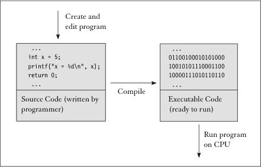

**图 1.1** 执行前的程序转换

然而，我们编写的程序并不是被执行的那些程序。为什么？计算机作为二进制设备，只理解*有意义的* 0和1序列，通常称为*机器语言*。因此，所有指令和数据都必须以机器语言（0和1）输入CPU。由于人类使用这种语言并不舒适，我们需要使用*编程语言*，而计算机世界提供了许多这样的语言（如C）。这些语言与口语（如英语）略有相似。它们支持非常少量的*关键字*和符号，并由严格且不容变通的语法组合在一起。

CPU不理解编程语言，因此你编写的每个程序都必须在执行前翻译成其对应的机器语言代码。写好的程序首先保存在计算机磁盘上的文件中。一个单独的程序，称为*编译器*，将这段源代码翻译或编译成其等价的二进制*机器码*。如图1.1所示，最终由CPU执行的就是这段代码。

CPU需要足够的内存来运行程序。它从内存中取出程序指令和数据，并将临时数据和最终数据写入内存。内存可以是*易失性*的（断电时被擦除）或非易失性的，CPU根据数据需要保留的时间长短使用相应类型。有些内存在CPU内部，有些在CPU外部但在计算机机箱内。为了使程序能与外部世界交互，计算机还使用外部设备作为内存（如便携式硬盘和闪存）。

**要点：** 我们使用类似C的语言编写的程序，必须由编译器程序处理，以生成对应的机器码。这段由0和1组成的代码最终在CPU上运行。

## 1.3 背景

大约在公元前2000年的巴比伦，计算机作为简单的计算器起步。这种被称为*算盘*的装置由许多环或珠子组成，它们可以沿着由木框围住的杆移动。这种计算器只能用于加法和减法，而这在当时已经足够。尽管这种装置在东欧和中国的许多国家仍在使用，但随后出现了许多其他装置，每一种都实现了一个关键的计算概念，最终促成了数字计算机的诞生。

### 1.3.1 纳皮尔、帕斯卡和莱布尼茨：早期先驱

计算领域的下一次重大飞跃发生在17世纪初，约翰·纳皮尔发明了*对数*。纳皮尔证明，乘法和除法可以分别通过将数的对数相加和相减来实现。纳皮尔的发明很快促成了*计算尺*（图1.2）的发展，工程师和科学家一直广泛使用它，直到20世纪60年代。NASA的科学家使用计算尺将人类送上月球并带回地球。这种计算装置最终被电子计算器淘汰，尽管它并未完全消失。

17世纪还出现了基于齿轮的*数字*机械计算器。（计算尺实际上是一种*模拟*装置。）布莱士·帕斯卡是第一个制造出这种计算器的人，但它只能进行加法和减法。戈特弗里德·莱布尼茨开发的*步进计算器*在帕斯卡的发明基础上增加了乘法和除法功能。这两种装置都基于十进制，但莱布尼茨建议使用二进制，而二进制在几个世纪后才被采用。

### 1.3.2 可编程计算机

使用*程序*控制一系列操作的概念最早出现在19世纪初的*提花织机*中。这种纺织织机使用一组穿孔卡片在织物上织出复杂图案。要织出不同的设计，只需更换卡片组。这个想法吸引了查尔斯·巴贝奇，他在他的两个概念性创造——*差分机*和*分析机*——中使用了这一概念。然而，提花织机卡片上的孔决定了一根线是否会穿过它，而巴贝奇看到了利用它们来编码指令和数据的机会。

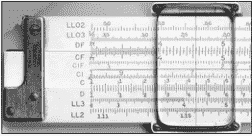

**图 1.2** 计算尺

分析机是全自动的，设计为以蒸汽动力运行。它有一个处理单元和存储器——这是任何可编程装置的两个基本组成部分。除了允许一组语句重复的*循环*之外，分析机还具有*条件*语句，可以中断正常的操作顺序。巴贝奇还利用了阿达·洛芙莱斯的工作，她为该机器设计了一些*算法*。尽管这两台机器都从未被建造出来（可能是由于资金匮乏），巴贝奇仍被正确地视为计算机之父，而洛芙莱斯则被认为是第一位程序员。

当电动机变得可用时，赫尔曼·霍勒里思在19世纪末利用这项技术设计了*霍勒里思制表机*。这台机器具有读卡器、写卡器和齿轮驱动的计数器。该机器可以计数和排序数据，并在一组表盘上显示输出。*此外，该机器还可以将输出数据穿孔到卡片上。* 霍勒里思使用霍勒里思制表机完成了美国1890年的人口普查，他的制表机器公司在合并后更名为国际商业机器公司（IBM）。事实上，IBM继续制造和销售这些机器，直到20世纪60年代才被磁性介质淘汰。

### 1.3.3 可编程电子计算机

在第二次世界大战之前的时期，大多数计算机使用机电继电器和开关来进行计算。由康拉德·楚泽在战争期间设计的Z3计算机使用了2000多个继电器。Z3被认为是世界上第一台可编程自动数字计算机。它也是第一台基于二进制的计算机，程序控制通过穿孔胶片实现。同一时期，Colossus和ENIAC计算机使用真空管，成为第一批全电子可编程计算机。然而，Colossus或ENIAC中的程序由开关的状态表示，因此要为不同任务重新编程，需要手动重置这些开关。

由于编程困难，即使使用电子计算机，速度也是一个问题。艾伦·图灵解决了这个问题，后来约翰·冯·诺依曼在*存储程序计算机*的概念中重申了这一点。在图灵1936年撰写的一篇论文中，他推理认为，如果程序和数据都存储在同一存储器中，计算机速度可以大大提高。通过纸带输入的程序不可能足够快，因为计算机一次只能加载一条指令。这一概念与当今将程序和数据放在同一内存中的做法相符。1948—1949年，Manchester Mark 1成为第一台实现存储程序概念的计算机。

20世纪40年代还见证了*真空管*（也称为*电子管*）在执行计算方面的主导地位。但这些管产生大量热量，消耗巨大功率，而且以不可靠著称。20世纪50年代引入了*晶体管*，它们比真空管更小、发热更少且更可靠。晶体管也为*集成电路（IC）*让路，并最终让路给*微处理器*，后者将整个CPU集成在单个芯片上。正如人们所说，其余的都已成为历史。

> **注意：** 尽管莱布尼茨在17世纪就提倡使用二进制数系统进行计算，但直到20世纪中叶才最终被采用。

## 1.4 计算机代

1.3节通过识别三个主要阶段（机械、机电和电子）概述了4000年的历史，其中第三阶段寿命最短。仔细观察这一阶段，可以发现若干技术发展，它们可以归入若干*代*（表1.1）。每一代计算机都比上一代的对应产品更快、更小、更强大。因此，硬件的进步也促成了强大且用户友好的编程语言的发展。本节考察硬件代，3.14节讨论语言代。

### 1.4.1 真空管：第一代

这一代计算机（如Colossus和ENIAC）使用数千个真空管进行计算。内存需求由磁鼓（当今硬盘的前身）满足。由于真空管的尺寸，第一代计算机占据大量空间。它们还消耗大量电力并产生大量热量。尽管将这些计算机安置在空调机柜中，频繁故障仍然很常见。ENIAC使用了18,000个真空管，占用1,800平方英尺的房间空间，消耗180千瓦电力。这一代机器的购买和维护成本高得令人望而却步。

第一代计算机使用第一代语言——机器语言——进行编程。这种低级的晦涩语言只理解0和1，这就是这些计算机难以编程的原因。程序输入由穿孔卡片提供，输出则打印在纸上。由于上述缺点，第一代计算机仅用于科学工作，并未商业部署。

**表1.1** 计算机代（硬件）

| 代 | 基于 | 其他特性 |
|---|---|---|
| 第一代 | 真空管 | 用磁鼓作存储器 |
| 第二代 | 晶体管 | 磁芯、磁盘、穿孔卡片和打印输出。 |
| 第三代 | 集成电路（IC） | 键盘、显示器和操作系统 |
| 第四代 | 微处理器 | 网络 |
| 第五代 | 超大规模集成电路和纳米技术 | 主要尚不明确 |

### 1.4.2 晶体管：第二代

晶体管在20世纪50年代出现的第二代计算机中取代了真空管。与真空管相比，晶体管更快、更小且功耗更低。更小的磁芯也取代了第一代的磁鼓。尽管晶体管产生的热量更少，第二代计算机仍然需要空调。因此，这些计算机比其直接前代更可靠。然而，输入输出机制基本保持不变。


第二代计算机使用符号或*汇编*语言进行编程。编程不再是一场噩梦，因为程序员可以用单词和符号来指定指令，而不是0和1。计算机还实现了存储程序概念，允许程序和数据都驻留在内存中。像COBOL和Fortran这样的高级语言也开始出现。这些语言很快在大多数应用中取代了汇编语言。

### 1.4.3 集成电路：第三代

随着集成电路的发展，计算机的速度和效率得到了大幅提升。这项由德州仪器开发的技术，使得电子电路的元件——晶体管、电阻、电容和二极管——能够集成到一块芯片上。由于小型化，计算机因此变得更小、更便宜、更节能。正因如此，它们出现在一些中型组织中。

这一代告别了穿孔卡片，采用键盘和显示器与用户交互。内存容量大幅增加，磁盘开始用作辅助存储。第三代计算机还配备了*操作系统*，这是一种用于控制计算机资源的特殊程序。凭借称为*分时*的特性，计算机可以运行多个用户调用的程序。原有的编程语言之外，又补充了BASIC、C、C++和Java。

### 1.4.4 微处理器：第四代

在产生微处理器的当前这一代中，组件的集成又向前迈进了几步。使用*LSI（大规模集成）*和*VLSI（超大规模集成）*技术，现在可以将整个CPU、其相关内存以及输入/输出控制电路集成到单块芯片上。英特尔于1971年推出了4004微处理器，此后在速度、发热、尺寸等常规参数上的改进一直以疯狂的速度持续到今天。微处理器已经进入我们的家庭，驱动着台式机、笔记本电脑、智能手机、微波炉和洗衣机。

这一代还有其他翻天覆地的变化。与这一代早期仅有几兆字节（MB）内存相比，如今的笔记本电脑和智能手机提供了几十亿字节（GB）的内存。操作系统已从简单的MS-DOS发展到基于鼠标的*图形用户界面（GUI）*，如Windows。Linux等更先进的系统现在可用于台式机和笔记本电脑，其变体（Android）驱动着我们大多数智能手机。第四代语言（4GL）——类似于自然语言——也已问世。

这一代在网络技术方面也取得了飞速进展。通过将计算机连接到网络中，信息共享成为可能。利用美国国防部开发的*TCP/IP*技术，如今数百万台计算机连接到了这个名为互联网的庞大网络中。这一代开发出的任何东西都还没有被淘汰；第四代仍在不断发展之中。

> 注：速度和微型化是相互关联的。随着组件变小，电信号传输的距离更短，从而带来更高的速度。

> 要点：计算机需要操作系统才能运行。这是一台机器在运行时一直驻留在CPU中的特殊程序。MS-DOS、Windows和Linux是一些著名的操作系统。

### 1.4.5 人工智能：第五代

第五代代表了未来计算机的愿景。计算的传统参数（速度、尺寸、能耗、从VLSI到ULSI等）将继续改进，但人们也期待着我们使用计算机的方式会发生突破性变革。*人工智能（AI）*和自然语言的使用是这一代的主要特征。

第五代系统*应当*能够产生类似人类的行为。这些系统预计将以自然语言与用户交互，并从经验中学习。这些系统还应能够实现语音识别和语音输出。其中一些目标（如语音识别）今天已部分实现。随着复杂性成倍增加，需要实现以下几点：

- 计算机速度需要实现指数级跃升，而借助*量子计算机*才能实现这一壮举。谷歌的D-Wave 2X量子计算机比当今的机器快1亿倍。如果一台机器要自行学习，量子计算将帮助它瞬间解决问题。
- 计算机必须能够执行*并行处理*，以便多个处理器能同时处理问题的不同方面。我们已经看到四核和八核处理器在笔记本电脑和智能手机中的应用。
- 必须开发*神经网络*和*专家系统*。这些应用将能够通过使用类似人类的智能分析数据来做出决策并为人类提供建议，而无需借助专家的服务。金融机构目前使用这些技术来检测信用卡欺诈。

还有其他可能具有颠覆性的技术——如*分子计算*——可以将微型化推进到分子级别。由于我们对这一代的看法是前瞻性的而非回顾性的（前几代都是回顾性的），因此很难预测这一代将在何处结束、下一代将在何处开始。我们已经处于这样一个局面：严肃的人们开始质疑，赋予机器人的权力是否已经超过了人类控制它们的能力。

## 1.5 计算机类型

除了按代分类外，计算机还可以按尺寸分类。计算机的尺寸往往是其能力和应用领域的间接指标。由于技术不断变化，这里会有一些重叠；今天的巨型机可能就是明天的迷你计算机。我们按尺寸从大到小介绍这些类别。

### 1.5.1 超级计算机

这些是拥有最强大、最快处理器的巨型机器。超级计算机使用多个CPU进行并行数据处理，这意味着同一程序的各个部分由多个处理器独立处理。速度以flops（每秒浮点运算次数）来衡量。最快的超级计算机（天河二号）以每秒34千万亿次浮点运算的速度运行。（1千万亿=1000万亿=1,000,000吉。）超级计算机可以处理多个用户，但这并不是它的独特功能。

超级计算机功能过于强大，不适合用于事务处理。它们被用于需要大量数值计算的领域——如天气预报、地质数据分析、核模拟和太空探索。它们也被用来解决复杂的科学问题。超级计算机拥有巨大的存储容量，消耗大量电力并产生大量热量。由于其高昂的成本，它们主要由政府机构使用。

### 1.5.2 大型机

在超级计算机出现之前，大型计算机是当时可用的最大的计算机。这些是多用户机器，可以借助Linux等系统支持的分时功能，支持数百或数千个用户。用户通过终端和键盘与此系统交互，这与我们使用PC的方式类似。大型机即使在只有一个CPU的情况下也能并发运行多个程序。大型机的处理器速度以mips（每秒百万条指令）来衡量。

大型机通常用于处理与整个组织相关的数据和应用程序。它们的用途不再局限于处理工资单。如今，大型机被用于处理在线交易（例如证券交易所交易）。处理大量数据的能力使大型机适用于政府、银行和金融机构以及大型企业。

> 注：超级计算机用于尽可能快地运行一个程序。大型机则旨在服务大量用户。如果不需要大量数值计算，大型机是更好的选择。

### 1.5.3 小型计算机

小型计算机，即今天所称的中型计算机，可以被视为缩小版的大型机，因为它们具备大型机的基本特征。小型计算机可以服务数百个用户，体积小到足以占据房间的一部分。但它们的价格仍然高到无法用于家庭。数字设备公司（DEC）在20世纪70年代推出的小型计算机，因此恰当地定位于大型机和微型计算机之间。小型机拥有多个CPU虽然不常见，但也并非不可能。


小型计算机用于较小的组织或大型组织的一个部门。它们也作为运行专用软件的交钥匙设备的专用配套机使用。虽然小型机最初作为多用户系统部署，但*局域网*的出现导致了它们的衰落。现在可以将多台微型计算机连接到一个网络中，其中一台计算机不需要拥有全部处理能力。

### 1.5.4 微型计算机

微型计算机或个人计算机（PC）是计算机家族中的后来者。它由 Apple 推出，后来得到 IBM 的认可，是一种由单芯片微处理器驱动的单用户机器。今天的 PC 是非常强大的机器，拥有数 GB 内存和一两 TB 磁盘存储。它们既以独立模式（在家中）使用，也在网络中使用（在办公室）。微型计算机采取台式机、笔记本（膝上型电脑）或上网本（更小的笔记本电脑）的形式。尽管 PC 只有一个 CPU，但高端 PC 支持具有多个*核心*的微处理器（如 Intel Core i5 和 i7）。每个核心都可以——在某种程度上近似地——被视为一个处理器。

如今的 PC 由三类操作系统驱动——Windows（7、8 或 10）、Mac OS X（Apple）和 Linux。企业和个人使用 PC 进行文字处理、电子表格处理和桌面出版。PC 还支持 Firefox 和 Google Chrome 等互联网浏览软件。所有 PC 都已具备多媒体能力；它们可以处理图像、音频和视频文件。PC 也是一种娱乐设备。可用的软件范围实际上不受限制；为 PC 提供的软件比任何其他类型的计算机都多。

微型计算机的一种变体是*工作站*，它本质上是一台具有更强大处理器、高分辨率终端和高质量图形能力的微型计算机。它们用于工程和科学应用（如 CAD/CAM）以及软件开发。工作站通常连接在网络中，以共享其资源，这也是其中一些工作站还是无盘工作站的原因。

### 1.5.5 智能手机与嵌入式计算机

对小型化的不懈追求促成了两类设备的出现，即智能手机和*嵌入式*计算机。智能手机是一种通用计算机，同时也能够拨打电话。嵌入式计算机是一种小型类计算机系统，是更大系统的一部分。为完整起见，我们需要简要了解这两种设备。

智能手机拥有强大的处理器，通常具有多个核心（如四核 Snapdragon 820）。它还支持数 GB 的主存，但没有用于二级存储的硬盘。这一需求由闪存满足（1.10.4）。如今的智能手机运行成熟完善的操作系统（Android 或 iOS），并且可以运行范围广泛的应用程序（通常称为“app”）。与计算机一样，智能手机有键盘和高分辨率显示器，二者都通过触摸或触控笔操作。应用程序使用高级语言编写——iPhone 使用 Objective-C，Android 手机使用 Java。

嵌入式计算机（也称为*微控制器*）早于智能手机出现。它们是包含 CPU、非易失性存储器以及输入和输出处理设施的非常小的电路。它们被嵌入到我们使用的许多机器中——汽车、洗衣机、MP3 播放器和相机。这里的处理器运行存储在内存中的单个不可修改程序。嵌入式计算机无法与智能手机的能力相比，但它们也不需要。由于处理器专用于特定任务，其能力刚好足以操作该设备。

## 1.6 位、字节与字

我们已经使用*兆字节、吉字节*等术语来量化内存，因此让我们清楚地理解这些单位，因为我们会经常使用它们。在日常生活中，我们使用十进制进行计算，其中一位数字可以有十个值（或状态）。然而，计算机只理解两种状态：0 或 1。只能有两种状态或取值的数字称为二进制数字，缩写为*位*。所有二进制数都通过组合这些 0 和 1 来表示。十进制中的数字 13 在二进制系统中表示为 1101。

*字节*这个名称是为表示八位而创造的。字节是计算机内存、数据存储和传输速度的标准计量单位。一张 DVD-ROM 的容量为 4.7 GB（4.7 × 10⁹ 字节），而 4 兆比特每秒（4 × 10⁶）的互联网速度很常见。这些单位之间的关系表示如下：

| 单位 | 相当于 | 备注 |
|---|---|---|
| 1 千字节（KB） | 1024 字节 | 10 行文本所占用的空间。 |
| 1 兆字节（MB） | 1024 千字节 | 早期 PC 的内存。 |
| 1 吉字节（GB） | 1024 兆字节 | 一张 CD-ROM 的存储容量。 |
| 1 太字节（TB） | 1024 吉字节 | 当今硬盘的容量。 |
| 1 拍字节（PB） | 1024 太字节 | 渲染电影《阿凡达》所使用的空间。 |

位也存在类似的关系（就此而言，任何数量都是如此）。因此，表示为 1 Mbps（兆比特每秒）的网络速度与 1000 Kbps 相同。习惯上使用“B”表示字节，使用“b”表示位。因此，1 KB 表示 1000 字节，但 1 Kb 等同于 1000 位。

尽管计算机内存以字节（更确切地说是兆字节或吉字节）来衡量，但 CPU 以更大的单位处理内存数据，这种单位称为*字*，其中字通常是字节的偶数倍（两字节、四字节等）。大多数机器指令的大小为一个字，而且由于 CPU 寄存器必须能够容纳一条指令，它的宽度也是一个字。当我们称一台计算机为 32 位（4 字节）机器时，我们是指其字的大小为 32 位。


> **要点：** 内存以 KB（千字节）、MB（兆字节）、GB（吉字节）和 TB（太字节）来衡量。每个单位都是其前一个单位的 1024 倍。例如，1 GB = 1024 MB。为方便起见，我们经常使用 1000 而不是 1024 作为乘数。

## 1.7 计算机内部

现在，我们将参考图 1.3 所示的示意图，对计算机的工作方式进行一般性考察。计算机的大脑是*中央处理器（CPU）*，在 PC 上由单个芯片表示。CPU 执行程序中存储的每一条指令，并在必要时与其他机构交互。大部分工作由*算术逻辑单元（ALU）*完成，它是 CPU 的组成部分。

CPU 需要同时使用快速存储器和慢速存储器。快速存储器由*主存储器*表示，也称为*随机存取存储器（RAM）*。它被划分为许多连续编号的单元。这些编号表示单元的*地址*。CPU 通过将其地址发送到存储单元来访问内存位置。主存储器用于存储当前正在执行的程序的指令和数据（联机存储）。

计算机还支持较慢的*二级存储器*，也称为*二级存储*或*辅助存储器*。这通常是硬盘，但也可能是 CD-ROM 或 DVD-ROM。二级存储器用于存储当前不需要的数据（脱机存储）。二级存储器中的数据以具有唯一名称的*文件*形式存储。程序通过将指令和数据从二级存储器加载到主存储器来执行。

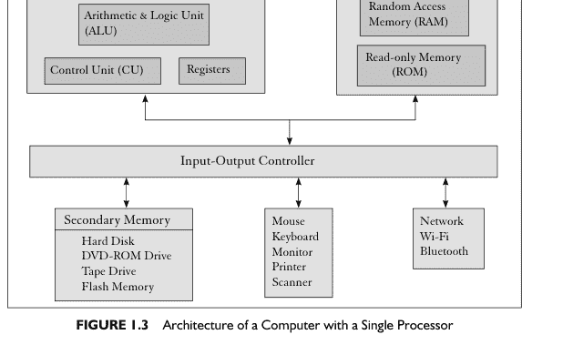

用户使用输入和输出设备与计算机系统交互。通过键盘（一种输入设备）键入的数据在保存到 RAM 之前，由该设备转换为二进制形式。处理之后，输出数据（也保存在 RAM 中）必须经过反向转换（二进制转换为人类可读形式），然后才能显示在显示器或打印机（二者都是输出设备）上。某些形式的二级存储也可以充当输入/输出设备。

在计算机的各个组件之间移动的数据有三种类型。特定类型的数据沿着一条不同的通路移动，这条通路称为*总线*，专用于该类型的数据。程序指令和数据沿着*数据总线*移动。内存地址沿着*地址总线*传输。所有控制信号都使用*控制总线*。

现在我们将开始讨论本节中重点提到的各种组件。重点将放在 PC 上所见的形式，因为这正是你可能遇到这些组件的地方。

## 1.8 中央处理器（CPU）

CPU 已从 20 世纪 40 年代笨重的基于真空管的单元演变为现代 5 厘米见方的芯片，这种芯片通常称为*微处理器*，或简称为*处理器*。它由以下组件组成：

- 算术逻辑单元（ALU）
- 控制单元（CU）
- 专用寄存器
- 一个时钟

它们协同工作，控制和执行所有算术与逻辑操作。这种芯片会产生大量热量，这就是它安装在主板上时同时配有散热器和风扇以散发热量的原因。

*算术逻辑单元（ALU）*是一个“超级计算器”。除了执行所有算术任务外，ALU 还比较两个数，并对它们执行*布尔*运算（如 AND、OR 和 NOT）。*控制单元（CU）*不执行任何计算任务。CU 使用信号控制数据在计算机各组件之间移动的方式。ALU 和 CU 都使用时钟服务来对其操作进行排序和同步。

CPU 使用几个高速*寄存器*（一种存储器形式）来存储当前指令及其数据。其中一个寄存器称为*程序计数器*，它存储下一条要执行的指令在主存储器中的地址。在取出一条指令后，该计数器会递增。

所有程序指令都使用*取指—译码—执行*机制来执行。首先使用存储在程序计数器中的地址从主存储器中取出指令。计数器立即递增，以反映下一条指令的地址。接着对取出的指令进行译码，以产生该操作所需的信号。然后由 CPU 执行转换后的指令（如果涉及算术或逻辑运算，则具体由 ALU 执行）。输出（如果有）随后写入另一个寄存器，再从那里复制到主存储器。现在可以开始下一个周期。


所有这些活动都需要由时钟进行同步，时钟以固定的时间间隔产生脉冲。CPU 在一个时钟脉冲内不能执行超过一条指令，即使一条指令可能需要多个时钟脉冲才能执行完毕。因此，时钟越快，执行速度就越快。如今的 CPU 以 GHz（千兆赫兹）为单位衡量。Intel Core i7 的时钟速度为 3.4 GHz，这意味着它在一秒钟内发出 34 亿个脉冲。然而，CPU 性能以 MIPS（每秒百万条指令）为单位衡量，它总是低于发出的时钟脉冲数。

前面的讨论基于单 CPU 架构。但如今，高端处理器（包括用于智能手机的处理器）在芯片中拥有多个内核。八核处理器在芯片中有八个处理器。程序要利用多个处理器，其不同部分必须能够相互独立地运行，而不依赖彼此。操作系统也必须有能力在这些多个处理器之间分配工作。


> **要点：** CPU 从主存储器中获取指令和数据，并将其存储在寄存器中。处理完成后，CPU 将输出数据存储在寄存器中，然后再将其移至主存储器。所有活动都由时钟同步。

## 1.9 主存储器

存储器是计算机及其用户使用的基本资源。CPU 需要存储器来运行当前正在运行的程序。用户需要存储器来备份当前不需要的程序和数据。为了满足不同的需求，计算机支持多种类型的存储器。为方便起见，我们将存储器分为两类——主存储器和辅助存储器。本节将介绍主存储器，它包括以下类型：

- 随机存取存储器（RAM——SRAM 和 DRAM）
- 只读存储器（ROM、PROM、EPROM、EEPROM）
- 高速缓存存储器（L1、L2 和 L3）
- CPU 寄存器

所有这些存储器单元都安装在 PC 的主板上。最快的单元集成在 CPU 内部，而相对较慢的 RAM 位于 CPU 外部。CPU 需要为当前正在执行的程序使用所有这些单元。除 ROM 系列外，所有存储器类型都是易失性的，即当计算机断电时，它们会丢失其内容。

### 1.9.1 随机存取存储器（RAM）

*随机存取存储器（RAM）* 存储当前正在运行的程序的代码和数据。这一功能符合图灵和冯·诺依曼的存储程序概念（1.3.3）。在多用户系统中，RAM 包含多个以分时模式运行的程序。目前，RAM 由一组密集封装的晶体管单元实现，这些单元被制造成集成电路（IC）。主板上包含插槽，可以插入（或移除）包含这些 IC 的内存模块。RAM 速度快、易失，且比辅助存储器更昂贵。

当程序开始执行时，CPU 从 RAM 中取出每条程序指令。它还将输出和临时数据写回 RAM。每个单元都有一个地址（一个数字），计算机的其他部分使用该地址来访问此位置。为了从 RAM 中检索数据，CPU 通过地址总线将地址发送到内存模块，并通过数据总线检索数据。与 ROM 不同，RAM 既可读也可写。访问是随机的而不是顺序的，因此称为“随机访问”。

RAM 大致可分为两种类型——静态和动态。*静态* RAM（SRAM）每个单元使用多个晶体管来存储一位信息。因此，它比 *动态* RAM（DRAM）占用更多空间，后者每个单元使用一个晶体管和一个漏电电容器。电容器保持电荷，但由于固有漏电，DRAM 单元必须每两到三毫秒刷新一次。由于这些特性，SRAM 比 DRAM 更快、更大且更昂贵。CPU 中的高速缓存存储器由 SRAM 实现。然而，DRAM 可以以适中的速度和低成本提供大容量。典型的 PC 配置提供约 2 GB 的 DRAM。

尽管 RAM 比辅助存储器快，但它是所有主存储器类型中最慢的。在某些情况下，CPU 需要更快的内存，而这一需求由其他三种类型来满足。

> **注意：** CPU 与 RAM 直接连接，但与辅助存储器没有直接连接。硬盘（一种辅助存储器）的内容必须先加载到 RAM 中，然后 CPU 才能访问它们。

### 1.9.2 只读存储器（ROM）

与 RAM 不同，*只读存储器（ROM）* 表示可以读取但不能写入的永久性存储器。ROM 的内容在制造时写入，尽管后来的改进使 ROM 具有有限的写入能力。ROM 中的存储器访问比 RAM 更快。ROM 也是非易失性的，即断电后其内容仍会保留。它们的容量受到严重限制——1、2 或 4 MB，而 DRAM 为 1、2 或 4 GB（相差 1024 倍）。

ROM 用于存储不会改变的永久程序或信息。在 PC 中，ROM 存储一个称为 *BIOS*（基本输入输出系统）的特殊程序。这是一个小程序，在将控制权转移给操作系统之前启动计算机的启动过程。ROM 还用于存储查找表。用于计算数字的正弦或余弦（两个三角函数）的代码通常存储在 ROM 中。

改变 ROM 内容的需求导致了更高级类型的发展。以下所有类型的 ROM 都是非易失性的，并且至少具有一次写入能力：

- *可编程只读存储器（PROM）* 这种类型在制造时最初留空。随后编程为包含客户选择的程序。一种称为 PROM 编程器的设备将数据 *烧录* 到 PROM 中。然而，一旦写入，PROM 的内容就无法更改。
- *可擦除可编程只读存储器（EPROM）* EPROM 更进一步，因为即使之前已被烧录，它也可以重写（但只能一次）。EPROM 通过暴露在紫外线辐射下进行擦除。这种类型如今基本过时，因为它已被 EEPROM 取代。
- *电可擦除可编程只读存储器（EEPROM）* 与 EPROM 不同，EEPROM 可以多次擦除和重写。使用高于正常电压的电压来擦除 EEPROM，可以允许其留在计算机中。但是，EEPROM 可编程的次数是有限制的。我们今天使用的闪存驱动器（U盘或 SD 卡）是一种 EEPROM。

CD-ROM 和 DVD-ROM 在技术上也是 ROM，但由于改进已将它们变为 CD-RW 和 DVD-RW（即增加了重写能力），因此它们更适合属于第 1.10.3 节，在该节中它们被视为离线存储。

> 注意：严格来说，EEPROM 更像 RAM 而不是 ROM，因为它们具有写入能力。

### 1.9.3 高速缓存存储器

计算机还支持 *高速缓存存储器* 来保存 CPU 经常使用的程序部分。这种快速但容量小的存储器作为 CPU 和 RAM 之间的缓冲区使用。执行程序时，CPU 首先在高速缓存中查找指令和数据。如果它在其中找到它们（缓存命中），则避免访问较慢的 RAM。如果在高速缓存中未找到数据（缓存未命中），操作系统会将其放入高速缓存中。通常，命中次数超过未命中次数，因此高速缓存存储器有助于程序更快地执行。高速缓存通常由 SRAM（静态 RAM）实现。

现代计算机支持多级高速缓存。CPU 本身包含一级（L1）高速缓存，它是系统中最小的、最快的高速缓存。二级（L2）高速缓存可能位于 CPU 外部但与 CPU 靠近。有些 CPU 还支持三级（L3）高速缓存，它比 L1 和 L2 慢，但比 RAM 快。如果在 L1 中未找到数据，CPU 会在 L2 中查找，然后在 L3 中查找。

高速缓存存储器价格昂贵，因此它们的容量有限。四核 64 位 Intel i7 CPU 支持独立的 L1 和 L2 高速缓存，但 L3 由各核心共享。L1 的大小为 32 KB，L2 为 256 KB，而四个核心共享 8 MB 的 L3 高速缓存（每个核心 2 MB）。

### 1.9.4 寄存器

集成在 CPU 中的少量超高速 *寄存器* 代表了计算机中最快的存储器。与增强性能的高速缓存不同，寄存器是 CPU 完成所有工作的场所。每个寄存器具有计算机字长的长度，因此 Intel i7 的寄存器为 64 位宽。计算机在处理指令和数据之前，会先从主存储器中将指令及其数据加载到寄存器中。

寄存器的数量非常少，它们被编号，程序指令会指定这些编号。例如，考虑两个数字的乘法，用伪指令“O R1 R2 R3”表示。CPU 会这样解释这条指令：对存储在寄存器 R1 和 R2 中的操作数执行乘法运算 O，并将结果存入


输出到寄存器 R3 中。在下一条指令被读入之前，R3 的内容最终会被移到 RAM 中。

> **注：** 在本节之前，我们用术语 *主存储器* 来表示 RAM。本节将其重新定义为指直接连接到 CPU 的存储器，无论其是否易失。该术语的当代用法与这里所采用的用法一致。

## 1.10 二级存储器

计算机还支持 *二级存储器*，也称为 *辅助存储* 或 *辅助存储器*。这种存储器类型不直接连接到 CPU，但它既可以存在于机器内部，也可以存在于机器外部。二级存储器是非易失性的，因此满足离线存储和长期存储的要求。这些设备比主存储器慢，但容量更大。它们也比主存储器便宜得多；1 GB 硬盘空间比 1 GB RAM 便宜得多。

过去几十年中出现了多种类型的存储设备。它们具有不同的物理尺寸和容量，并且可能需要电源，也可能不需要电源。在本节中，我们考虑以下存储设备，其典型容量在括号中标明：

- 硬盘，包括便携式磁盘（500 GB 至 4 TB）。
- 磁带（20 TB）。
- CD-ROM（700 MB——不到 1 GB）。
- DVD-ROM（4.7 GB 和 8.5 GB）。
- 蓝光光盘（27 GB 和 50 GB）。
- 基于 EEPROM 的闪存（1 GB 至 128 GB）。
- 已过时的软盘（1.2 MB 和 1.44 MB）。

其中一些设备可能是计算机配置的一部分，而另一些则可能通过端口和连接器连接到计算机。尽管这些设备用于离线存储，但正在执行的程序常常需要访问它们。例如，程序可以从 CD-ROM 读取数据并将输出写入闪存。此外，这些设备中的数据按 *文件* 组织，而主存储器中的数据则是连续排列的。

> **要点：** 二级存储器中的数据通过与该数据关联的 *文件* 名称来访问。另一方面，主存储器中的数据通过包含该数据的存储单元地址来访问。

### 1.10.1 硬盘

又被称为 *硬盘驱动器* 或 *固定磁盘*，因为它固定在计算机内部；*硬盘* 是最古老但最常用的二级存储形式之一。硬盘具有非常高的容量，且成本最低。笔记本电脑通常有 500 GB 的存储空间。台式机通常有 1 TB（太字节）的存储空间。硬盘不再是离线设备，因为它容纳计算机的操作系统以及所有程序和数据。

每个磁盘都包含一个主轴，主轴固定一个或多个由玻璃或铝等非磁性材料制成的 *盘片*（图 1.4）。每个盘片有两个涂覆磁性材料的表面。信息通过改变磁化方向编码到这些盘片上，每个盘片表面都配有一对读写磁头。八个表面需要八个磁头。这些磁头安装在一个臂上，不能单独控制。

每个表面由若干同心且按顺序编号的 *磁道* 组成。具有相同磁道编号的磁道数量与表面数量相同。于是，你可以将 *柱面* 想象为每个磁盘表面上具有相同编号的所有磁道组成的集合。因此，磁盘中的柱面数量将与每个可用表面上的磁道数量相同。每个磁道又进一步划分为 *扇区* 或 *块*。因此，如果每个磁道有 32 个块，而磁盘有八个表面，那么每个柱面有 256 个块。一个块通常包含 512 字节。

磁盘以 5400 至 7200 rpm（转/分钟）的速度持续旋转。磁盘磁头沿径向在磁道之间移动，当磁头位于某一特定磁道上方时，该磁道的所有块都会在很短时间内通过磁头。与 RAM 相比，这里的访问时间更长，因为将磁头移动到正确位置会产生延迟。磁头不应接触盘片表面；如果发生这种情况（由于灰尘进入），就会导致 *磁盘崩溃*。此时数据可能无法恢复。

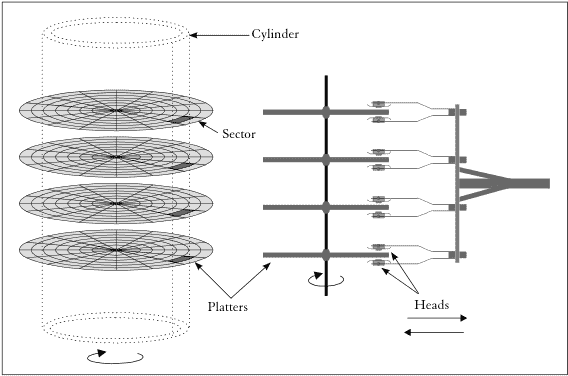

**图 1.4** 硬盘

**注：** 作者 Linux 计算机上的磁盘具有以下参数：

- 磁头数 = 255，
- 柱面数 = 121,601，
- 每磁道扇区数 = 63，
- 每扇区字节数 = 512（常见的块大小）

该硬盘的容量为 255 × 121601 × 63 × 512 = 1,000,202,273,280 字节。这大约是 1 太字节（TB）或 1024 吉字节（GB）。

固定磁盘的一种变体是最近流行起来的便携式磁盘。这种磁盘有两种类型。第一种类型的容量最高可达 4 TB，使用台式机或笔记本电脑的 USB 端口（1.11）为设备供电并传输数据。第二种类型支持超过 4 TB 的容量，需要外部电源，并且仅使用 USB 端口进行数据传输。

> **注：** 硬盘可以同时充当输入设备和输出设备。一个程序可以在另一个程序向磁盘写入的同时从磁盘读取。

### 1.10.2 磁带

古老的磁带仍然存在，这要归功于对该设备所做的改进。不过基本技术并未改变；磁带由塑料薄膜制成，一面涂有磁性材料。由两个卷轴和磁带组成的整个机构封装在一个小型卡盒或盒式磁带中。当前技术支持 1 TB 或更大的容量，但预计不久的将来会推出 200 TB 的磁带。不过该设备并非完全便携，因为需要单独的磁带驱动器，而大多数计算机没有这种驱动器。

使用读写磁头和擦除磁头从磁带读取数据并向磁带写入数据。写操作之前先进行擦除操作。与 RAM 不同，数据访问是顺序的，而不是随机的。要定位一个文件，必须先倒带，然后才能开始顺序搜索。这使得它相当不适合恢复单个文件。磁带备份最适合归档硬盘中不期望在短期内需要的数据。这种备份成本低廉，并且便于恢复丢失的数据。

### 1.10.3 光盘：CD-ROM、DVD-ROM 和蓝光光盘

我们在 ROM 系列（包括 PROM、EPROM 和 EEPROM）中看到的非易失性只读存储器，也存在于光盘上。这些光盘主要包括 CD-ROM 和 DVD-ROM，能够在廉价介质上容纳大量数据（700 MB 至 8.5 GB）。蓝光光盘将这一容量提高到 50 GB。其驱动器中的激光束控制读操作和写操作。由于大多数 PC 和笔记本电脑都有这些驱动器（不过没有蓝光驱动器），光盘上的数据备份很容易分发。

光盘由聚碳酸酯材料制成，并带有一层或两层薄反射膜。激光束用于沿磁道烧录（写入）选定区域，从而形成凹坑和平台。读取数据时，光束会从平台反射（表示 1），但不会从凹坑反射（表示 0）。与硬盘不同，磁道是一条从中心向外移动的单一螺旋线。光盘高速旋转；对于 CD，其速度以音乐 CD 速度（150 KB/秒）的倍数来表示。音乐 CD 的额定速度为 1X，而数据 CD 通常额定为 52X。

CD-ROM 的容量为 700 MB。DVD-ROM 的凹坑和平台间距要小得多，容量为 4.7 GB。增加第二层可将容量提高到 8.5 GB（双层 DVD）。此外，随着“R”（可记录）和“RW”（可重写）类型的引入，现在可以将数据记录到这些介质上：

- CD-R、DVD-R——数据只能记录一次。
- CD-RW、DVD-RW——数据可以多次记录。

最初，我们有分别用于读取和写入的驱动器，但如今 DVD 刻录机可以读取和写入这两种介质。尽管 CD 和 DVD 是可靠的介质，但它们很可能会让位于闪存，因为闪存已经支持高得多的容量，而且不使用任何移动部件。蓝光光盘在数据备份方面的前景尚不确定，尽管它被音乐和电影行业广泛使用。

> **注：** 光驱使用三个电机来完成以下功能：操作托盘、旋转光盘以及引导激光束。

### 1.10.4 闪存

这类设备没有移动部件，基于 EEPROM。它有多种形式——U 盘、固态硬盘（SSD）和存储卡（SD 卡）（图 1.5）。它们便携、功耗低且相当可靠。这类设备提供的容量呈指数级增长，而价格继续大幅下降。

记忆棒或 U 盘是计算机上最常用的闪存类型。它是一小块可移动电路，包裹在塑料外壳中。它连接到计算机的 USB 端口，操作系统会将其识别为另一个驱动器（例如 Windows 中的 G:）。尽管它是读写设备，但写入次数有限（约 10,000 次），这对大多数用户来说已经足够。随着 16 GB 设备以可承受的价格上市，USB 闪存盘如今已成为 CD 和 DVD 作为离线存储设备的有力竞争者。

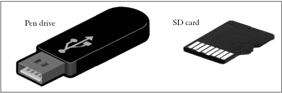

**图 1.5** 闪存


*固态硬盘（SSD）*是一种更大的设备，旨在取代传统的磁性硬盘。许多小型笔记本电脑（如 Chromebook）将操作系统和一小套程序存储在这个*在线*设备上。第三种设备是*存储卡*，主要用于相机，但通过适配器，它们也可以连接到 USB 端口。这种设备最流行的形式是 micro-SD 卡，有 SDHC 和 SDXC 两种版本。SD 卡提供高达 128 GB 的高容量。

> **注意：** 与只能使用 Nero 之类软件写入的 CD 和 DVD 不同，闪存的写入方式与硬盘的写入方式相同。无需单独的软件。

### 1.10.5 软盘

*软盘*曾经是唯一可以放在口袋里的便携式存储形式。这种存储介质表现为一个矩形塑料外壳，内含一个薄磁盘。读写头在该磁盘旋转时实际接触磁盘。软盘有两种尺寸（5.25" 和 3.5"），分别提供 1.2 MB 和 1.44 MB 的容量（是的，是 MB 而不是 GB）。

在当时，软盘的小容量足以满足大多数用途，但如今一张软盘甚至无法容纳一首编码为 MP3 的 3 分钟歌曲。这使得它不适合备份大文件。以前，操作系统（如 UNIX 和 Windows）通过多张软盘提供。这种介质不可靠，且容易频繁发生不可恢复的损坏。它最终被可靠的 CD-ROM 和 DVD-ROM 取代，后者提供高得多的容量。台式 PC 不再支持软盘驱动器，Windows 也不提供对其的支持。

> **注意：** 轻松一点说，Windows 一直没能忘记软盘。硬盘仍标记为 C:，而 A: 和 B: 继续保留给软盘。只要旧式文件处理程序继续使用 A: 和 B:（尽管不太可能），就必须保持这种方式。

## 1.11 端口和连接器

在我们研究计算机使用的外部设备之前，先花些时间了解计算机支持的主要插槽。打印机和扫描仪等设备通过称为*端口*的对接点连接到计算机。当前计算机和笔记本电脑提供的端口类型比过去少了。所有端口都连接到主板，但从外部可见。它们的形状各不相同，因此不可能将错误的连接器插入端口。以下是你将会遇到的端口：

- *通用串行总线（USB）* USB 端口实际上已经取代了主板上的串行和并行端口。大多数计算机至少提供四个 USB 端口，以支持扫描仪、打印机和鼠标。USB 端口有四条线，其中两条用于数据传输，两条用于供电。当前版本 USB 3.0 可以在 20 秒内传输一个 1 GB 的文件。此外，一种更小的变体 micro-USB 端口用于便携式硬盘和智能手机。
- *串行端口*——串行端口曾用于键盘、终端、鼠标和调制解调器，提供 9 针和 25 针配置。数据通过串行端口一次传输一位。
- *并行端口*——如果打印机没有使用 USB 端口，那么它可能使用并行端口。常见的实现（由 IBM 在 PC 上引入）使用 25 个引脚，数据以并行方式（即同步方式）传输。
- *视频图形阵列（VGA）端口*——这个 15 针端口允许将模拟（连续）视频数据传输到显示器。该端口正被*数字视频接口（DVI）*取代，后者使用*数字*数据，而平板 LCD 面板（也使用模拟信号）使用这些数据。DVI 提供比 VGA 更好的视频分辨率。
- *RJ45 端口*——该端口用于以太网（1.14）。计算机和网络设备（如集线器或路由器）都具有该端口的母头形式。即使计算机通过无线方式连接到网络（使用内置 Wi-Fi 或 USB 适配器），有线 RJ45 仍然是一个有用的选项。
- *PS/2 端口*——该端口已取代串行端口，用于连接键盘和鼠标。它有 6 个引脚，但成对出现，且有两种不同颜色。键盘的端口和连接器是紫色的，而鼠标使用绿色端口。笔记本电脑不支持这些端口，但台式机支持。USB 也已经占领了这一领域。
- *高清多媒体接口（HDMI）*——这现在是计算机与高清电视、投影仪和家庭影院之间传输音频和视频数据的行业标准。由于一根电缆同时处理音频和视频，它正在淘汰所有台式 PC 仍支持的 RCA 三插头系统。

如图 1.6 所示，这些端口在计算机上以公头（插针）或母头（插孔）形式出现。RJ45、USB 和 HDMI 不使用插针或插孔；它们改用扁平插针。此外，这些端口在设备侧的对应端口可能不具有相同形式。例如，USB 打印机在打印机侧使用不同的端口。

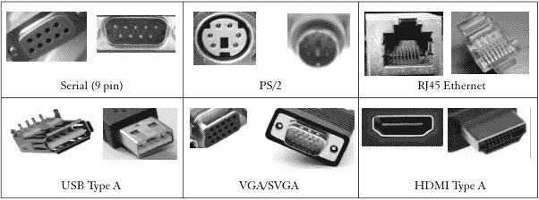

**图 1.6** 常用端口

使球旋转，从而控制屏幕上光标的移动。鼠标按键通常按以下方式使用：

- 用左键单击任何对象会选中该对象。双击同一按键可激活程序。按住左键拖动鼠标可选择文本段（此处无需单击）。要开始文本输入，还需要在文本段上左键单击。
- 单击右键会激活上下文相关菜单，可用于更改所选对象的属性。此菜单通常支持复制和粘贴文本以及更改所选对象属性的选项。

滚轮通过两种方式滚动文档。你可以保持鼠标静止并移动滚轮。或者，像按按钮一样按下滚轮并稍微移动鼠标。然后文档会持续滚动，无需进一步移动鼠标。

由于其实用性，鼠标的设计经历了快速变化。最初的机械鼠标现在正逐渐被淘汰，取而代之的是以下选项：

- *光学鼠标*使用红外激光或 LED 来跟踪移动。与机械鼠标不同，光学鼠标几乎可在任何表面上工作。
- *无线鼠标*使用射频技术与计算机通信。鼠标中的发射器与通过 USB 连接的接收器通信。

在空间受限的情况下，你可以使用带有集成*轨迹球*的键盘。在这种配置中，你需要移动球，该球以半嵌入状态放置在键盘表面右侧。笔记本电脑用户需要使用*触摸板*，它是一个带有两个按钮的矩形平面。将指尖在表面上移动即可移动光标。光学鼠标和无线鼠标也可以与笔记本电脑配合使用。

### 1.12.3 扫描仪

*扫描仪*是一种通过光学扫描文档来创建文档数字图像的设备。扫描仪有各种形式，用于不同行业。在本节中，我们研究*平板式*扫描仪，我们都用它扫描不超过 A4 尺寸的文档。该设备连接到 USB 端口，并使用随产品附带的特殊软件进行操作。

待扫描文档放在玻璃板上，扫描前用盖子盖住。明亮的光线照射到文档上，反射光由*电荷耦合器件（CCD）*的光敏阵列捕获。不同的亮度水平被转换为电子信号。然后处理这些信号以创建数字图像，并将其作为文件保存在硬盘中。扫描仪还可以以复印机模式工作，直接打印复印的文档而不保存它。

当以 300 dpi（每英寸点数）扫描文档时，会创建质量合理的图像。通常，图片转换为 JPEG 文件，文档转换为 PDF 文件。JPEG 文件在保存到磁盘或作为邮件附件发送之前，使用 Photoshop 等编辑软件进行编辑。为了保持较小的文件大小，可能需要将彩色图像转换为灰度或黑白图像。文件大小相对较小的 PDF 文件由 Adobe Acrobat Reader 读取。


> **提示：** 请选择能满足需求的最低分辨率。低分辨率和黑白图像的文件体积较小。当文件通过互联网传输时，体积是一个限制因素。传输成本与文件大小直接相关。

现代扫描仪具备*光学字符识别（OCR）*功能，可以通过特殊模式扫描文档（或其图像），从而*将文本提取为字符流*。这需要专门的软件来将图片中的点阵图案解读为字符，例如字母 A。使用 OCR 的优点是，图像文件可以转换为文本文件，并可通过文本编辑软件进行编辑。文件大小也会大幅减小。如果你现有的扫描仪不具备 OCR 功能，那么你就需要一台 OCR 扫描仪。

> **要点：** 如果你丢失了 Word 文档的文件，但还有其纸质打印件，那么你可以使用 OCR 来“恢复”该文件，随后便可用同样的软件对其进行编辑。

市面上还有其他类型的扫描仪。手持式扫描仪需要手动在文档上移动。银行使用*磁性墨水字符识别（MICR）*扫描仪来读取银行支票上印制的代码。商店使用手持式条形码扫描仪，根据产品标签上印刷的条形码来确定产品名称和价格。

## 1.13 输出设备

所有程序都会生成输出吗？绝大多数程序都会。我们通常使用“输出”一词来指代可以看到或听到的信息。打印机和扬声器都属于这一类别。扫描仪会生成文档的图像，但将“输出”保存到磁盘。对我们来说，这并不算是输出。在以下各节中，我们将讨论常用的视觉输出设备。

### 1.13.1 显示器

显示器是计算机配置中不可或缺的组成部分。程序使用它来显示文本或图形输出，而用户也需要显示器来查看他们键入的输入内容。显示器的性能主要取决于其图像质量、分辨率、能耗以及对眼睛的影响。目前有两种相互竞争的技术：老旧的 CRT 显示器实际上已被现代 LCD 类型的显示器所取代。显示器连接到台式机的 VGA 或 DVI 端口。对于笔记本电脑，这种连接是内置的。

**CRT 显示器** CRT（阴极射线管）显示器使用一个内部装有三个电子枪（对应三种原色）的真空管，以及一个涂有荧光材料的屏幕。电子枪发射电子，通过选择性地点亮荧光粉在屏幕上生成图像。CRT 显示器的典型分辨率为 640 × 480 像素，即*宽高比为 4:3*（宽高比 = 宽 / 高）。它们体积大、重量重、能耗高，并且会产生大量热量。

**LCD 显示器** 当今大多数计算机都配备 LCD 显示器（或其变体 LED 和 TFT）。LCD 屏幕由数千个液晶组成，液晶本身不发光，但可以允许或阻挡光线穿过它们。通过选择性地对这些液晶施加电压，并使用单独的光源让光线穿过，从而形成图像。背光由荧光灯（标准 LCD）或 LED 提供（因此有*LED 显示器*和*LED 电视*之称）。

与 CRT 显示器提供的 4:3 相比，LCD 显示器具有更宽的宽高比（16:9）。从总体角度来看，它们极大地改善了 CRT 显示器的缺点。它们功耗更低、发热更少、使用寿命更长，并且占用空间小得多。LCD 显示器甚至可以挂在墙上。不过，其可视角度小于 180 度，但这一特性正在不断改进中。

**注意：** LED 仅仅提供背光，在图像形成过程中不起任何作用。较新的 TFT（薄膜晶体管）只是基本 LCD 技术的一种变体。

### 1.13.2 击打式打印机

打印机产生输出的*硬拷贝*（相对于磁盘文件这种软拷贝），其中包括文本和图形。目前用于打印的基本技术有两种——击打式和非击打式。较旧的击打式技术使用打印头击打（撞击）位于打印头和纸张之间的色带。击打式打印机噪音大，正在被逐步淘汰，但其中一种变体（针式打印机）仍在使用中。

**针式打印机** 针式打印机的打印头有 9 根或 24 根打印针，这些针以多种组合方式击打，以生成字母、数字和符号。色带浸有油墨，当打印针击打色带时，会在其后的纸张上留下印记。每打印完一行后，纸张由滚筒向前移动。由于每根打印针都可以单独控制，因此这种技术可以打印图形。但是，无法使用多种字体。

针式打印机的速度最高可达 300 cps（字符/秒）。配备 24 根打印针的打印机在 144 dpi（每英寸点数）下可提供最佳打印质量（尽管仍然不高）。然而，打印针之间的间隙清晰可见，因此该技术无法生产出高质量的打印输出。这种打印机之所以没有被淘汰，仅仅是因为它可以在连续纸张上生成复写副本。发票和账单通常需要打印多份，这就是商店通常使用针式打印机的原因。

**菊轮式打印机** 现已淘汰的菊轮式打印机使用不同的技术来击打色带。它采用一个沿外缘分布着独立字符的轮子。字符是预先成型的，而非生成的。打印某个字符时，轮子会旋转，使所需字符正对色带。使用这种打印机无法打印图形，但你可以更换轮子以获得不同的字体。

**行式打印机** 对于大量打印需求，行式打印机仍然是最佳选择。该技术使用包含字符的打印链。链条在纸张前方连续旋转。撞锤以正常方式击打纸张，但该技术所能达到的打印速度高达 1200 lpm（行/分钟）。行式打印机用于打印质量要求不高的海量报告，并且可以长时间无人值守地打印。然而，行式打印机噪音极大，因此通常被放置在单独的机房中。

## 1.14 网络中的计算机

大多数组织，无论大小，都不再使用独立计算机。如今，计算机通过网络相互连接、协同工作。授权用户现在可以与其他用户共享文件。由多个用户运行的应用程序现在可以托管在单台机器上，而无需分别存储在各台机器上。当今许多网络应用程序的设计都支持多台机器分担工作负载。正如 Sun Microsystems 多年前正确指出的那样：“网络就是计算机。”

除了共享文件和程序之外，网络还允许所有连接的计算机共享稀缺的硬件资源。如果打印机连接到网络中的某台计算机上，则多个用户都可以使用该打印机。提供这些服务的计算机（在网络术语中称为*节点*）需要比它所服务的计算机更强大。*服务器*就是这样应运而生的，成为网络中的中心节点。服务器也构成了最大网络——互联网——的骨干。

所有网络节点都需要一种通用的寻址方案，以确保数据能够传送到正确的节点。大多数方案采用*以太网*，这是一种定义网络寻址、布线和信令要求的硬件标准。以太网目前是主导技术，已取代*令牌环*和*FDDI*技术。在该方案中，数据被划分为包含源地址和目标地址的*帧*。数据传输还需要一组网络*协议*（规则），但这些将在第 2 章中讨论。

> 注：以太网、令牌环和 FDDI 是硬件技术。网络要正常运行，还需要运行一组网络（软件）协议。*TCP/IP* 是最主流的网络协议，它支撑着整个互联网。

### 1.14.1 网络拓扑

连接计算机的方式或*拓扑结构*有多种（图 1.7），每种都有各自的优缺点。*总线拓扑*使用一根电缆作为总线，所有计算机都连接到该总线上。单个节点发生故障不会中断其余节点之间的通信。

*星型拓扑*使用一个中心集线器，所有节点都连接到该集线器。由于网络流量都经过集线器，因此如果集线器无法工作，整个网络就会瘫痪。另一方面，可以添加新节点而不会中断服务。

使用*环型拓扑*的节点以闭合环路的形式连接，无需使用集线器。数据从一个节点移动到下一个节点，每个节点都会检查每个数据包，以确定是否应允许其继续传递到下一个节点。对于单向环，一个节点发生故障会导致整个网络关闭。

*网状拓扑*中的节点相互连接，为数据传输提供多条路由选择。当某个节点发生故障时，数据包只需更改其路由即可。这是所有拓扑中成本最高的，主要出现在企业网络中。


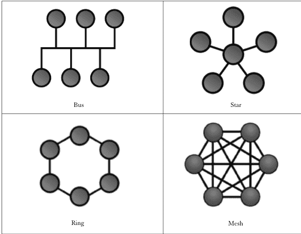

**图 1.7** 网络拓扑

### 1.14.2 网络类型

网络还根据其规模进行分类。两种最常见的类型是*局域网（LAN）*和*广域网（WAN）*。局域网用于运营区域局限于单栋建筑的小型组织。它们通常使用以太网技术。较新的*无线局域网（WLAN）*，也称为 *Wi-Fi*，已成为有线局域网的有力竞争者。标准以太网速度运行在 100 Mbps。使用 802.11g 的 Wi-Fi 网络运行速度约为 20 Mbps。

广域网扩展了局域网使用的范围。它可以连接多个城市或同一城市中的多个机构。由于距离遥远，广域网节点使用光纤电缆、租用电话线和无线电传输来连接。广域网也可以通过使用*路由器（1.15.3）*互连局域网来形成。银行、航空公司和酒店预订公司使用广域网进行实时运营。互联网是世界上最大的广域网。

技术进步促成了其他类型网络的诞生。下面简要讨论它们：

- *城域网（MAN）* 这种类型介于局域网和广域网之间。城域网用于互连同一城市中的计算机。
- *校园区域网（CAN）* 它比城域网小，用于连接整个大学校园。
- *个人区域网（PAN）* 这是所有网络中最小的网络，并且直到最近才成熟。个人区域网在几米范围内运行。它通过红外或蓝牙技术连接手机和笔记本电脑等小型设备。

### 1.14.3 互联网与 internet

互联网（也称为*网络*）是地球上最大的广域网。它是由 50,000 多个网络组成的集合，这些网络运行一套称为 *TCP/IP* 的特殊网络协议。它于 1983 年应美国国防部的要求诞生，如今是一个没有所有者的自治网络。互联网不同于其他网络；它在不干扰现有结构的情况下持续增长。网络在其繁多的服务中真正大放异彩，其中一些将在第 2 章讨论。

互联网使用的硬件技术与任何局域网或广域网没有不同。因此，可以创建这种类型的小型网络来复制其服务，尽管规模要小得多。这种运行同一套网络协议的网络称为 *internet*（首字母小写“i”）或 *内联网*。根据其配置方式，internet 可能能够访问互联网，也可能不能。internet 节点使用的地址在互联网上无效。

## 1.15 网络硬件

在网络中连接计算机需要不属于计算机基本配置的额外设备。无线连接最终可能导致其中一些技术被淘汰，但这不太可能在短期内发生。在以下段落中，我们讨论网络的基本设备和组件。

### 1.15.1 网络接口卡

网络传输始于安装在计算机内部的*网络接口卡（NIC）*或*网卡*。由于大多数网络使用以太网技术，这种卡通常被称为*以太网卡*。该卡的功能通过以下方式实现：

- 内置于笔记本电脑和当前台式机的主板中。
- 作为独立卡插入主板上的插槽。
- 作为无线卡以相同方式插入；无需电缆即可连接到网络。
- 作为在 USB 端口上运行的 USB 适配器。

每块以太网卡都有一个由卡制造商硬编码到板卡中的地址。这个地址称为 *MAC*（媒体访问控制）地址，是该卡唯一的。没有两块以太网卡可以具有相同的 MAC 地址。该卡通过两端带有 RJ45 连接器的电缆连接到*集线器*或*交换机*。这些设备具有用于 RJ45 连接器的相应（母）插座。

> **注意：** 内置卡由操作系统自动检测，操作系统会在安装时加载相应软件。外置卡可能需要安装供应商提供的软件。USB 适配器也会由计算机自动检测。

### 1.15.2 集线器与交换机

单个网络中使用星型拓扑的计算机需要一个中央设备来连接，这个设备要么是*集线器*，要么是*交换机*。该设备包含若干 RJ45 端口，这些端口通过电缆连接到节点中可用的对应端口（图 1.8）。*集线器*接收来自计算机的网络数据，并简单地将数据广播到所有节点。由于数据包含目的地的 MAC 地址，只有具有该地址的节点才会接受数据。这种技术是浪费的，因为数据必须传输到所有节点，即使其中只有一个节点会接受它。

另一方面，*交换机*是智能的，因为它有一个包含所有已连接设备 MAC 地址的表。交换机从数据中提取 MAC 地址，然后查找该表以确定数据包要发往的节点。然后数据包仅发送到该节点。因此，交换机效率高，并且能够维持网络速度。

### 1.15.3 网桥与路由器

电信号沿电缆传输时会减弱，因此以太网对电缆的最大长度设定了限制（100 米）。此外，由于通常一次只能有一个设备进行传输，节点过多可能导致网络拥塞。因此，支持许多节点的网络必须分成若干*网段*，并用*网桥*连接它们。网桥维护一个表，记录连接到它的各网段中所有机器的 MAC 地址。它使用相同协议（例如以太网）连接两个网络。网桥正逐渐被淘汰，因为其功能已被交换机取代。

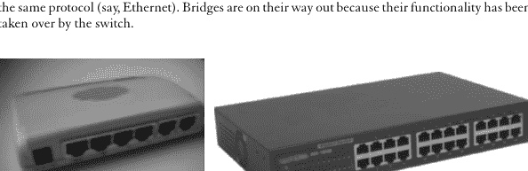

**图 1.8** 集线器与交换机

使用网卡、集线器、交换机和路由器。所使用的标准硬件协议是以太网，标准网络协议是 TCP/IP。后者也用于互联网。

## 客观题

### A1. 判断题

- 1.1 1 MB 与 1 Mb 相同。
- 1.2 计算机程序通过将其文件及相关数据加载到内存中来执行。
- 1.3 机器码仅由 0 和 1 组成。
- 1.4 集成电路首次用于第二代计算机。
- 1.5 分子计算是第四代计算机的一项特征。
- 1.6 微处理器将 CPU 包含在单个芯片中。
- 1.7 由于局域网的出现，小型计算机变得过时。
- 1.8 Android 是手机中使用的一种处理器的名称。
- 1.9 主存储器比辅助存储器慢。
- 1.10 计算机的 BIOS 是存储在 ROM 中的一个小程序。
- 1.11 寄存器代表计算机中最慢的存储器。
- 1.12 RAM 比硬盘快，因为它没有活动部件。
- 1.13 闪存基于 RAM。
- 1.14 USB 端口用于连接打印机、扫描仪和鼠标。
- 1.15 非击打式打印机包括点阵打印机和菊花轮打印机。
- 1.16 与星型拓扑一样，环型拓扑也需要集线器。
- 1.17 网络接口卡的 MAC 地址在全球唯一。
- 1.18 Wi-Fi 路由器使用 802.11 协议。
- 1.19 Internet 与 internet 之间没有区别。

### A2. 填空题

- 1.1 计算机执行一组 ______，它们对 ______ 进行操作。
- 1.2 如果 ______ 和 ______ 都驻留在内存中，计算机运行得更快。
- 1.3 ______ 存储器在断电时会丢失其内容。
- 1.4 真空管用于第 ______ 代计算机。
- 1.5 完成序列：千字节、兆字节、吉字节、______。
- 1.6 COBOL 和 Fortran 在大多数应用中取代了 ______。
- 1.7 控制计算机资源的特殊程序称为 ______ ______。


- 1.8 随着元件尺寸减小，_____ 增大。

- 1.9 人工智能是 _____ 代计算机的一个特征。

- 1.10 带有高分辨率显示器和强大处理器的微型计算机称为 _____。

- 1.11 主存储器中的数据通过单元的 _____ 访问。辅助存储器中的数据存储在 _____ 中。

- 1.12 _____ 存储器存储程序中经常使用的部分。

- 1.13 像 CD-ROM 这样的光盘以 _____ 和 _____ 存储二进制数据。

- 1.14 扫描仪利用 _____ 功能从图像文件中提取文本。

- 1.15 喷墨打印机比点阵打印机快，但比 _____ 打印机慢。

- 1.16 使用 _____ 拓扑的整个网络会在集线器发生故障时失效。

- 1.17 _____ 运行在 TCP/IP 技术上。

### A3. 多项选择题

- 1.1 将程序员代码翻译成机器语言的程序称为 (A) 翻译器，(B) 编译器，(C) 编码器，(D) 以上都不是。

- 1.2 超级计算机主要用于 (A) 为大量用户服务，(B) 大量数值计算，(C) 事务处理，(D) 以上所有。

- 1.3 一个字节通常包含 (A) 2 位，(B) 4 位，(C) 6 位，(D) 8 位。

- 1.4 在 32 位计算机中，(A) CPU 一次能处理 32 位，(B) 字长为 32 位，(C) A 和 B，(D) 以上都不是。

- 1.5 CPU 中的计算由 (A) ALU，(B) CU，(C) 寄存器，(D) 以上都不是 执行。

- 1.6 主板仅容纳以下存储器类型：(A) RAM 和 ROM，(B) RAM 和 cache，(C) RAM、ROM 和 cache，(D) 以上所有外加寄存器。

- 1.7 以下存储器类型中，有一种是非易失性的：(A) RAM，(B) cache，(C) 硬盘，(D) 寄存器。

- 1.8 HDMI 端口可以处理 (A) HTML 文档，(B) 音频数据，(C) 视频数据，(D) B 和 C。

- 1.9 JPEG 文件包含 (A) 音频，(B) 图形，(C) 视频，(D) 以上都不是。

- 1.10 要将 15GB 数据写入光盘，需要使用 (A) CD-ROM，(B) DVD-ROM，(C) 蓝光光盘，(D) 以上任意一种。

- 1.11 通过喷洒墨水进行打印的是 (A) 激光打印机，(B) 喷墨打印机，(C) 绘图仪，(D) 以上都不是。

- 1.12 选出不同类的设备：(A) 交换机，(B) 集线器，(C) 绘图仪，(D) 路由器，(E) 网桥。

### A4. 混合匹配题

- 1.1 将每一代计算机与其显著特征匹配：
  - (A) 第一代，(B) 第二代，(C) 第三代，(D) 第四代，(E) 第五代。
  - (1) 微处理器，(2) 集成电路，(3) 真空管，(4) 语音识别，(5) 晶体管。

- 1.2 将每个端口与其兼容设备匹配：
  - (A) 并行端口，(B) DVI，(C) RJ45，(D) USB，(E) PS/2，(F) HDMI。
  - (1) 键盘，(2) 家庭影院，(3) 打印机，(4) LCD 面板，(5) 以太网卡，(6) 闪存盘。

- 1.3 按访问速度从高到低排列设备（用星号表示）：
  - (A) DVD-ROM，(B) 硬盘，(C) 寄存器，(D) ROM/RAM。
  - (1) ***，(2) ***，(3) **，(4) *

- 1.4 将存储设备与其属性或应用关联起来：
  - (A) ROM，(B) EPROM，(C) EEPROM，(D) 硬盘，(E) 磁带驱动器，(F) DVD-ROM。
  - (1) SD 卡，(2) 激光束，(3) 顺序访问，(4) BIOS，(5) 紫外线辐射，(6) 扇区。

- 1.5 将设备与其典型存储容量匹配：
  - (A) RAM，(B) 高速缓存，(C) 硬盘，(D) 磁带驱动器，(E) 蓝光光盘，(F) DVD-ROM。
  - (1) 20 TB，(2) 4 TB，(3) 50 GB，(4) 4.7 GB，(5) 4 GB，(6) 32 KB。

- 1.6 将设备与其属性或组件关联起来：
  - (A) 扫描仪，(B) 鼠标，(C) 显示器，(D) 打印机，(E) 网卡，(F) 绘图仪。
  - (1) MAC 地址，(2) 碳粉，(3) 光学字符识别，(4) 笔，(5) 滚轮，(6) 宽高比。

## 概念题

- 1.1 解释图灵和冯·诺依曼提出的存储程序概念的意义。
- 1.2 说出第五代计算机的三个重要特征。
- 1.3 大型机用于小型机无法处理的领域。请解释。
- 1.4 智能手机与嵌入式计算机有何不同？
- 1.5 解释 CPU 使用的不同总线类型的功能。
- 1.6 解释 CPU 使用的 *取指-译码-执行* 机制。
- 1.7 静态 RAM 和动态 RAM 有何不同？哪种类型用于高速缓存？
- 1.8 既然 CPU 可以使用 RAM 来完成工作，为什么还需要高速缓存和寄存器？
- 1.9 解释硬盘中的数据是如何组织的。
- 1.10 说出五种辅助存储设备及其典型容量。
- 1.11 与硬盘相比，磁带有哪些优缺点？请解释。
- 1.12 LCD 和 LED 显示器之间的关键区别是什么？
- 1.13 与喷墨打印机相比，激光打印机有哪两个优点？
- 1.14 解释交换机如何比集线器更智能。
- 1.15 解释路由器在网络中的作用。

# 2 计算机软件

## 学习目标

- *系统软件*和*应用软件*的意义。
- 启动计算机时*基本输入输出系统 (BIOS)* 的作用。
- *操作系统 (OS)* 的管理作用。
- 操作系统为什么需要*设备驱动程序*软件。
- MS-DOS、Windows 和 UNIX/Linux 操作系统的功能与命令。
- 掌握 Microsoft Office 组件——Word、Excel 和 PowerPoint 的实用知识。
- 互联网上使用的 TCP/IP 软件技术。
- 网络应用 FTP、Telnet、Secure Shell 以及*网页浏览器*。

## 2.1 计算机为什么需要软件

计算机可能是唯一一种在制造完成后不能立即做任何事情的机器。如有疑问，打开一台刚刚组装好的 PC。显示器会卡住（在最初看起来要做点什么之后），仅仅是因为 CPU（计算机的大脑）没有被明确指示做任何工作。相比之下，汽车在组装后就可以驾驶。洗衣机购买后可以直接使用。对于计算机来说，是*软件*为 CPU 的工作提供指令。如果没有能使其发挥极大作用的软件，最强大的 CPU 也完全无用。

计算机最早的祖先（例如计算器和计算尺）不需要软件。对该设备的每一条指令都由操作员（人）提供。软件的开端可以追溯到编码到穿孔卡片和纸带中的指令。但是，由于一次只能将一条指令装入内存，即使硬件能够达到更高的速度，计算机仍然很慢。只有在图灵和冯·诺依曼引入*存储程序*概念之后，程序和数据才能存储在内存中。这就是当今计算机使用软件的方式。

在第一代和第二代计算机时代，软件主要用于解决工程或科学问题。随后，其应用变成了工资单或库存清单。随着机器变得更强大，软件的范围也变得更广。首先，计算机本身需要软件供自己使用——用于管理在其 CPU 上运行的程序。*操作系统*就是这样诞生的。其次，软件的使用迅速扩展，用于处理任何可以用 0 和 1 的形式表示的信号。如今，软件已进入医疗保健和娱乐领域，并正朝着为无人驾驶汽车提供支持的方向发展。

只有计算机需要软件，对吗？不，任何带有微处理器的设备都需要软件来告诉它该做什么。我们购买洗衣机后能立即使用的原因在于，软件已内置到机器的 PROM 或闪存中。软件预装在智能手机的“内部存储”（即辅助存储器）中。然而，与洗衣机不同，智能手机允许添加、修改或删除软件。计算机也是如此。

## 2.2 软件基础

*软件*是驱动计算机执行一组相关任务的代码集合。它由一个或多个程序组成，并由程序需要访问的*库*和*配置文件*提供支持。软件可能驻留在 ROM、RAM、辅助存储器（硬盘）中，也可能从网络加载。大多数软件可修改或可移除，但嵌入 ROM 或 PROM 中的软件通常是永久性的。如今，*软件*一词的含义更广；没有文档，软件被认为是不完整的。

软件中的程序使用一种*语言*。有许多标准编程语言可供选择——C、C++、Java、Python 等，仅举几例。然而，程序员使用这些语言中的任何一种创建的*源代码*，与真正在 CPU 上运行的*机器语言*不同。一类特殊软件（称为*编译器*）将源代码转换为机器代码，软件供应商分发的是后者。我们将了解 Linux 有何不同。

软件通常针对多个*平台*（确切地说是操作系统）开发。为 Windows 8 开发的软件可能无需修改即可在 Windows 10 上运行，但它肯定不能在 Linux 上运行，即使 Windows 和 Linux 都运行在相同的硬件上。Microsoft Office（或其开源替代品）和 Mozilla Firefox（我们用来访问万维网的程序）分别提供适用于 Windows、Linux 和 Mac OS 的版本。

软件供应商通常保留其产品的权利。这使得复制该软件是非法的。此外，他们只提供机器代码，而不提供源代码。*无法通过对机器代码进行逆向工程来获取源代码。* 这些限制促成了*开源软件*的发展，这些软件完全可免费使用、复制和再分发。此外，源代码也可以获得。Linux 是免费的，网页浏览器（Firefox 或 Chrome）也是如此。

> **注：** 所有开源软件都可以免费使用和复制，但反之未必成立。为大多数智能手机提供支持的 Android 系统是开源软件，可以自由使用。然而，用户从 Google Play 下载的大多数“应用”虽然可以免费使用，但并非开源。


## 2.3 软件类型

计算机一开机，软件就开始工作。在计算机关机之前（如果真的有关机的话），各种软件让计算机忙碌不停。有些软件在你不知情的情况下持续运行，而另一些软件则由用户显式运行。计算机软件可以大致分为两类：

-   *系统软件*：这是计算机为管理与其连接的硬件而运行的软件。用户对系统软件的运行没有太多控制权，但用户自己的程序（应用软件）在需要时会使用系统软件提供的服务。
-   *应用软件*：这类软件与特定应用相关，例如酒店预订应用或电影特效制作软件。绝大多数程序员从事应用软件开发。

这两类软件具有截然不同的特点，所需技能也各不相同；很少有程序员能同时精通两者。本章将介绍这两类软件中常用的软件。其中一些软件可能并未预装在你的电脑上，因此在使用之前请确保已安装它们。

### 2.3.1 系统软件

程序通常需要访问 CPU、内存、硬盘、显示器和键盘。如果程序独立运行，那么它必须了解这些资源的细节。由于同一个程序也可能在不同的硬件上运行，那么如何设计一个无需了解其运行硬件的应用程序呢？只有在应用程序和硬件之间存在另一个软件时，这才可能实现。这种介于两者之间的软件就是*系统软件*。由于系统软件可以直接访问硬件，因此它能够提供程序和用户所需的服务。

大多数系统软件是计算机在启动时运行的，首先从 ROM 加载，然后从硬盘加载。其他系统软件则在程序需要时被调用，例如打印报告时。*在某些情况下，用户也可能直接使用这类程序。* 系统软件包括但不限于以下内容：

-   *基本输入输出系统（BIOS）*：这是一个小程序，在启动时检查硬件设备和外围设备，然后加载操作系统。
-   *操作系统*：这是核心系统软件，既管理硬件，也管理计算机上运行的程序。由于所有程序都需要操作系统的服务，因此只要计算机处于开机状态，操作系统就会驻留在内存中。
-   *设备驱动程序*：每个硬件设备都需要一个知道如何处理它的专用软件。程序通过调用操作系统来访问设备驱动程序。
-   *编译器及相关程序*：这类系统软件比较特殊，因为它是由用户调用的。程序员调用编译器程序，将自己编写的源代码转换为机器代码。

当用户运行的程序（*应用软件*）需要访问硬件（如打印机）时，它会调用系统软件来完成这项工作。因此，BIOS 和操作系统会在用户运行程序之前加载到内存中。在空闲的机器上，即使 CPU 活动可能非常低，操作系统占用 1 GB 内存的情况也并不少见。

系统软件是一个需要硬件知识的专业领域。低级语言具备这种知识，这就是为什么系统软件的许多例程都是用汇编语言（一种低级语言）编写的原因。C 语言程序员如果要编写系统软件，也必须懂得汇编语言。

本章将简要介绍前三类系统软件。编译器属于程序员工具，将在第 4 章深入讨论。

> **要点：** 计算机启动时，驻留在 ROM 中的 BIOS 会首先检查计算机硬件。然后，它从磁盘加载操作系统。随后，应用软件通过操作系统访问所有硬件，这就是操作系统必须始终驻留在内存中的原因。

> **注意：** 一般来说，系统软件由硬件制造商编写。

### 2.3.2 应用软件

与硬件没有直接联系、但与特定现实场景相关的软件称为*应用软件*。我们每天遇到的大多数软件都属于这一类型。智能手机行业甚至给它起了一个巧妙的名字：他们称之为“应用（apps）”。第一个应用软件可能是工资管理系统，但如今，应用软件几乎代表了所有业务活动：

-   *办公软件*：台式 PC 问世时，办公软件是其最早的应用之一。这一类别现在包含三个独立的应用——文字处理、电子表格和演示文稿。文字处理几乎以一己之力将打字机赶出了市场。本章将讨论这三个应用。
-   *数据库软件*：这种软件包通常被称为*数据库管理系统（DBMS）*，它允许将具有统一结构的数据存储在数据库中。数据库中的每一行由多个*字段*组成，这些字段可以使用简单的指令进行添加、修改和查询。Microsoft Office 有一个 DBMS 组件（Access），但主导这一领域的是 Oracle。
-   *通信软件*：计算机网络的发展催生了让用户相互通信的软件。在 Skype 和 WhatsApp 作为在线应用出现之前，电子邮件一直是离线通信的流行方式。邮件处理将在 2.14.1 节讨论。
-   *娱乐软件*：PC 上的家庭娱乐也见证了游戏和多媒体相关软件的兴起。VideoLAN（VLC）软件是播放大多数音频和视频格式的一站式工具。游戏软件仍然极受欢迎，并且对软件开发人员来说充满挑战。

按下电源键后，如果 POST 遇到问题，它会发出一组有据可查的蜂鸣声组合。系统会立即停止，并且不会加载操作系统。

POST 之后，BIOS 会尝试定位包含操作系统的驱动器。它检查 CMOS 以获取可引导驱动器列表及其搜索顺序。按照该顺序，BIOS 尝试在每个驱动器的第一个扇区中查找*引导加载程序*（一个很小的程序）。如果找到，BIOS 就会运行引导加载程序，由它最终加载操作系统。这一过程称为*自举（bootstrapping）*，这个说法源自“提着靴带把自己的靴子提起来”的典故。

我们说过 BIOS 会加载*设备驱动程序*，但设备驱动程序是什么呢？设备驱动程序是一种与设备关联的系统软件。系统程序和应用程序通过调用其驱动程序来访问和驱动设备。BIOS 需要加载一组初始驱动程序，因为 CPU 必须能够访问关键设备才能加载操作系统。然而，现代操作系统最终会用自己的一组驱动程序替换 BIOS 加载的驱动程序。

当然，BIOS 也有其局限性。它不允许从网络启动，也不允许从容量超过 2.2 TB 的驱动器启动。在主导个人电脑 30 多年后，BIOS 正在让位于*统一可扩展固件接口（UEFI）*，后者克服了这些限制。UEFI 绝不仅仅是一个基础系统；它是一个准操作系统，甚至可以在操作系统加载之前用来备份文件或访问互联网。现代 PC 支持 UEFI；你的 PC 可能已经具备 UEFI。

> **提示：** 如果电脑在成功通过 POST 后仍无法加载操作系统，请检查驱动器中是否留有 DVD 或 CD。不包含操作系统的磁盘不会在第一个扇区中放置引导加载程序，因此引导序列会停止，直到你取出磁盘并重新启动系统。

> **注意：** 对 BIOS 设置所做的更改实际上是在由电池供电的 CMOS RAM 中进行的，而不是在 BIOS 本身中进行的，因为 BIOS 本身只包含程序。BIOS 通常驻留在 EEPROM 或闪存中，因此通常的更新限制同样适用（1.9.2）。位于闪存或 EEPROM 中的 BIOS 很容易更换，但驻留在 ROM 中的 BIOS 则不然，因为必须更换整个 ROM 芯片。

## 2.5 操作系统（OS）

我们一直在反复提及这个术语，好像我们的生活依赖于它一样。至少，计算机的生命依赖于操作系统，因为没有硬件或软件可以离开它。*操作系统（OS）*是一种系统软件，它管理计算机硬件，为运行程序提供完整、安全的环境。它充当程序与这些程序所访问的硬件资源（如内存、硬盘和打印机）之间的接口。

如果一台计算机只需要运行一个程序，那么它就不需要操作系统。访问硬件的所有代码都可以直接构建在程序本身中。如果打印机需要更换，程序也必须随之更改。这样一来，就不可能再容纳第二个程序在同一台计算机上运行了。幸运的是，计算机运行多个程序，这些程序需要共享和管理所有资源。以下是操作系统的主要特性：


- *CPU 管理* 程序中的指令由 CPU 执行。操作系统会跟踪最后执行的指令。这样，如果某个程序在完成执行前被迫从 CPU 中退出，操作系统也能恢复该程序的运行。
- *内存管理* 操作系统为程序分配内存，并将程序加载到已分配的内存中。程序执行完毕后，操作系统会清理内存（和寄存器），使其可供下一个程序使用。
- *设备管理* 如果程序需要访问硬件，它会向操作系统发出调用，而不是自行尝试处理。例如，如果程序需要打印文件，操作系统会指示与打印机关联的设备驱动程序来操作该设备。
- *文件管理* 程序读写文件时，操作系统必须确保在需要时将磁盘块分配给程序。它会记录一个文件使用的所有磁盘块，以便随时将数据提供给读取该文件的程序。此外，当文件被删除时，操作系统还必须释放这些磁盘块。

由于操作系统直接处理硬件，它必须向所有程序呈现一致的设备视图。这样，应用程序员就可以放心地编写程序，即使硬件被更换或升级，程序也能继续运行。这种信心并不止于此；一个程序还必须在其他配置不同硬件的同类计算机上运行。仅靠操作系统本身无法应对这种灵活性；它们需要*设备驱动程序*（2.6）来帮忙。

除了这些基本服务外，操作系统还为用户提供了多种其他服务。它提供了用于创建文件和目录、处理进程、通过网络复制文件以及执行备份的独立程序。这些程序并不构成操作系统的核心，但可以被视为对用户和程序员都有益的附加服务。操作系统的示意图如图 2.1 所示。

### 2.5.1 用户如何与操作系统交互

我们知道，程序在需要访问硬件时会向操作系统发出调用。但谁来请求操作系统运行程序，又如何请求呢？是我们用户，通过一种称为*shell*的接口来完成。shell 的主要工作是等待用户输入，然后调用与输入相关联的程序。shell 基本上有两种形式——字符用户界面（CUI）和图形用户界面（GUI）。

*字符用户界面（CUI）*会显示一个屏幕，光标旁有*提示字符串*。要与操作系统对话，你必须在此 `$` 或 `C>` 提示符下输入程序名称，然后按 *[Enter]*：

```
    $ a.out  [Enter]        UNIX/Linux 系统
    C> AOUT  [Enter]         MSDOS/Windows 系统
```

字符串 a.out 或 AOUT 被 shell 解释为要执行的命令。该命令通常是一个可执行程序。shell 会在硬盘的指定目录中查找具有此名称的文件。如果找到该文件，它会指示操作系统运行该程序。

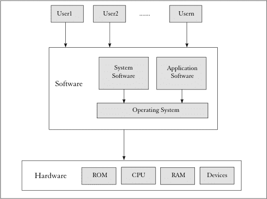

**图 2.1** 操作系统的作用

CUI 本质上是 UNIX 的一项功能，但它在 MSDOS 和 Windows 中也可用。在本书中，shell 也被称为*命令行、命令提示符*或*shell 提示符*。

操作系统还支持基于鼠标的*图形用户界面（GUI）*。在这种环境中，你点击一个图标，与该图标关联的程序就会被执行。GUI 的设计目的是让用户无需了解其下操作系统的存在。Windows 和 Apple 主要是 GUI 系统，但在 UNIX/Linux 系统中，GUI 是附加功能。*尽管 CUI 不太友好，但它比 GUI 更强大。*

> **注意：** Windows 中的 shell 是*资源管理器*程序。你可以通过资源管理器找到文件并双击来启动任何程序。你也可以用鼠标复制、删除和移除文件。在 CUI 系统上，这些操作需要调用单独的命令。

### 2.5.2 操作系统的分类

随着计算机硬件的发展，操作系统也随之发展，以利用处理器技术的进步。最早的操作系统一次只能处理一个程序，而今天的计算机可以处理多个用户运行的多个程序。操作系统通常分为以下几类：

- *批处理系统* —— 这是最早的系统之一，程序以批处理方式运行。每个程序都必须运行完毕，才会开始下一个程序。批处理操作系统通常是非交互式的，因此所有输入都必须在程序本身中提供。
- *多道程序系统* —— 顾名思义，多个计划执行的程序驻留在内存中，但一次只能运行一个程序。程序通常被允许一直运行，直到完成或执行不需要 CPU 的 I/O 操作为止。程序可以自愿放弃 CPU，或者操作系统也可以自行控制。
- *多任务系统* —— 与多道程序一样，多个程序驻留在内存中，但操作系统可以并发运行这些程序。利用时间片的概念，操作系统调度器为每个程序分配小的时间片，以营造并发的感觉。在这种方案中，程序在执行 I/O 密集型任务时仍可放弃 CPU，并在任务完成后恢复执行。
- *多用户系统* —— 现代系统如 UNIX 和 Linux 是多用户系统，多个用户共享 CPU 和内存。每个用户还可以运行多个程序，因此多用户系统也是多任务系统，它利用时间片概念来共享 CPU。用户通过哑终端（如今已过时）或使用名为 Telnet（2.14.2）或安全外壳（2.14.4）的程序从其联网 PC 登录多用户系统。
- *多处理系统* —— 随着多 CPU 机器的出现，现在可以（i）*真正*并行运行多个程序，每个 CPU 运行一个，（ii）在多个处理器上运行同一个程序的不同部分。编程语言必须至少支持*多线程*，但最终是否使用多个处理器由操作系统决定。
- *实时系统* —— 在以上所有情况下，即使操作系统调度器为每个作业分配了公平的 CPU 时间，但任何作业的响应时间都没有保证。这种局限性对于替代汽车驾驶员的程序，或者对于必须在精确时刻发生某个事件以防止事故或损坏的流程来说是不可接受的。实时系统提供有保证的响应时间。

必须指出，在单 CPU 的计算机上，任何时刻只能运行一个程序。*并发*一词必须在这种背景下来理解。在多任务或多用户系统中，操作系统通过允许一个程序运行一小段时间、保存其当前状态、然后加载队列中的下一个程序，来提供并发的假象。这一序列以轮转方式重复，直到第一个程序再次被取用。

**注意：** *多道程序*一词经常被误解和误读。许多作者用这个词来涵盖多任务、多用户和多处理。这个术语如今意义不大，因此此后我们在本书中将不再使用它。

**警告：** 不要因为多个用户共享计算机的文件或连接的打印机，就误以为这台计算机是*多用户*系统。在真正的多用户系统中，登录用户必须使用计算机的 CPU 和 RAM 来运行程序。许多版本的 Windows 并非如此，它们允许多个登录，但仅用于共享除 CPU 和 RAM 之外的资源。

### 2.5.3 当前的操作系统

过去有过许多操作系统，每个硬件供应商至少推出一个。它们之间几乎没有共同之处，最终导致了混乱的局面。更不用说程序了，甚至在一台机器上创建的数据，如果不使用专有的转换工具，也无法在另一台机器上读取。幸运的是，现代操作系统在很大程度上纠正了这种情况。以下是目前仍在使用的或最近被淘汰的系统：

- *UNIX/Linux 系统* —— UNIX 最初由贝尔实验室开发，是当今仍在活跃使用的最早系统。由于其开放性（源代码的免费可用性）和标准化（UNIX 标准），Linux 得以成为 UNIX 的一个可行且强大的实现。
- *MSDOS* —— 这个来自微软的操作系统开启了 PC 革命。它不支持 GUI，只支持带有少量可由用户直接调用程序的 CUI。随着基于鼠标和图标的 Windows 的出现，MSDOS 在大多数 PC 上退出了正面舞台。不过 Windows 用户仍然可以访问它。
- *Windows* —— 这是微软推出的完全基于 GUI 的系统，实际上取代了 MSDOS。由于使用高分辨率显示器的固有优势，Windows 支持大量利用这种显示器的应用程序（如 Word 和 Excel）。它很可能在一段时间内仍然是 PC 上的主导操作系统。
- *Mac OS* —— Apple 创建了第一个基于 GUI 的操作系统，其运行时间最长的系列 Mac OS 运行在 Macintosh 上。今天的版本（Mac OS X 或 MacOS）实际上是一个带 GUI 的类 UNIX 系统，其使用方式与 Linux 相同。

程序员必须对他们用于开发程序的操作系统有实用的了解。各种形式的程序——无论是源代码还是机器代码——实际上都作为*文件*存储，程序员使用操作系统支持的工具来操作这些文件。使用 CUI 还是 GUI 是个人选择的问题，但核心程序员往往倾向于使用像 Linux 这样基于 CUI 的系统。


**要点：** 操作系统既为用户服务，也为用户运行的程序服务。用户从 shell 命令操作系统运行程序。操作系统启动程序后，它必须处理程序为访问硬件而发出的所有调用。

## 2.6 设备驱动程序

你买了一台新打印机，接好线缆并打开电源。你的 Windows 系统识别出它，并询问你是否带有包含该设备软件的 CD 或 DVD。你插入随打印机附带的 CD，Windows 从中加载文件，然后显示安装完成的消息。你刚刚安装了打印机的设备驱动程序。

*设备驱动程序*是控制或驱动连接到计算机的设备的程序。它表示硬件设备的软件接口。操作系统或程序通过调用此接口来访问设备（图 2.2）。应用程序员知道如何*发出*此调用


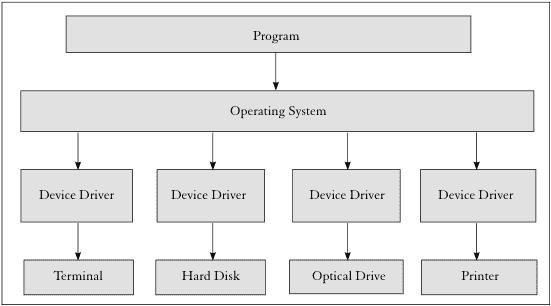

**图 2.2** 设备驱动程序的作用

但系统程序员知道如何在驱动程序软件中*实现*该调用。因此，对设备进行编程需要详细了解设备内部机制，这也是设备驱动程序通常由设备制造商编写的原因。

与其为驱动设备单独编写一个程序，不如将它的代码包含在操作系统或应用程序中，这样不是更合理吗？不，因为如果设备发生变化，操作系统以及所有使用该设备的应用程序也都需要更改。其结果将是程序员的噩梦。应用程序必须独立于它们所访问的硬件类型。将设备驱动程序与操作系统和程序分离，可以使一个驱动程序在多个程序之间共享。

话虽如此，操作系统确实为一些常用设备内置了驱动程序。连接闪存时不需要单独的驱动程序。但是，即使操作系统包含某个设备的驱动程序，你也应安装随产品提供的（可能是）更新版本。较新的版本会包含改进的功能，并修复以前版本中遇到的错误。如果你找不到包含驱动程序的介质，请从设备制造商的网站获取驱动程序软件。

**要点：** 尽管操作系统使程序员无需了解硬件知识，但完全了解硬件的是设备驱动程序。操作系统负责管理它对驱动程序发出的调用以及从驱动程序接收到的响应。

**注意：** 驱动程序针对特定设备型号和特定版本的操作系统。安装错误的驱动程序可能会损坏硬件或使其行为异常。设备也可能完全无法工作。

## 2.7 MSDOS：一种 CUI 操作系统

我们从 MSDOS（Microsoft Disk Operating System，微软磁盘操作系统）开始考察常用的操作系统。MSDOS 曾用于最早的个人计算机，现在是 Windows 的一部分。IBM 自己的 PC 随附的操作系统与 MSDOS 完全相同，但被称为 PCDOS。在最初几年，MSDOS 是在一台配有两个软盘驱动器但没有硬盘的 PC 上从软盘加载的。MSDOS 是一种单用户、单任务操作系统，只需要 640 KB 的 RAM。我们必须了解这个“过时”的操作系统，因为它让我们亲身体验使用操作系统。

启动序列会加载位于硬盘第一个扇区的引导加载程序（2.4），然后它通过将文件 IO.SYS、MSDOS.SYS 和 COMMAND.COM 加载到内存中来启动基本操作系统。系统最终显示提示符：

```
C:\>
Ready to accept commands
```

现在你处于 MSDOS shell 中，可以在这里输入它的任何命令或你编写的程序。你会在所有版本的 Microsoft Windows 中看到这个 shell 提示符，这些版本提供了 MSDOS 的精简版本（即 `cmd.exe`）。

> **注：** MSDOS 的大多数功能源自 UNIX。

### 2.7.1 文件与文件系统

每个操作系统都需要一个*文件系统*，以严格的结构保存所有文件和目录。（*目录*是包含多个文件的文件夹。）与 UNIX 一样，MSDOS 支持分层文件系统，作为倒置的树形结构（图 2.3）。该结构的顶部称为*根*（由 `\` 表示），它是所有文件的参考点。

文件由*路径名*唯一标识，路径名指定其在文件系统中的位置。例如，路径名 **`C:\PROGS\INTRO.C`** 将文件 **`INTRO.C`** 定位在目录 **`PROGS`** 中，而该目录又位于硬盘 C: 驱动器或分区的 `\`（根）之下。提示符 **`C:\>`** 显示的就是这个根目录。

早期版本的 MSDOS 支持 8.3 文件命名约定，即基本文件名最长 8 个字符，扩展名最长 3 个字符。因此，**`INTRO.C`** 和 **`AUTOEXEC.BAT`** 是有效文件名，但 **`INTRODUCTION.C`** 或 **`INDEX.HTML`** 不是。不过，这些文件名在支持 255 个字符文件名的较新版本 MSDOS（Windows 95 及以后）中是有效的。MSDOS 文件名不区分大小写，因此同一目录中不能有两个名为 **foo** 和 **FOO** 的文件。

MSDOS 总是安装在名为 **C:** 的文件系统中。名称 **A:** 和 **B:** 保留给曾经位于 PC 上的两个软盘驱动器。随后创建的文件系统具有 **E:、F:、G:** 等标签。（如果计算机有光驱，则将其作为 **D:** 访问。）因此，路径名 **`C:\PROGS\INTRO.C`** 不会与 **`E:\PROGS\INTRO.C`** 冲突。

> **注：** 我们对 MSDOS 命令和文件名使用大写，只是因为该操作系统最初就是这样使用的。不过，内置在较新版本 Windows 中的 MSDOS 版本使用小写。

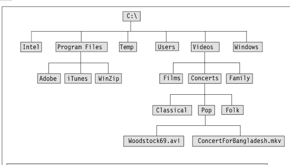

| | |
|---|---|
| 目录 iTunes 的路径名： | `C:\Program Files\iTunes` |
| 文件 Woodstock69.avi 的路径名： | `C:\Videos\Concerts\Pop\Woodstock69.avi` |

**图 2.3** MSDOS 分层文件系统

### 2.7.2 内部命令和外部命令

MSDOS 支持一组用于基本操作的*内部命令*，以及一组用于高级任务的更庞大的*外部命令*（表 2.1）。内部命令内置于 shell 中（在较新版本的 Windows 中为文件 `COMMAND.COM` 或 `cmd.exe`）。例如，列出文件的 `DIR` 命令是 MSDOS 的内部命令。文件系统中没有名为 `DIR.COM` 或 `DIR.EXE` 的文件。复制和删除文件的命令（`COPY` 和 `DEL`）也是内部命令。

外部命令以具有 `.EXE`、`.COM` 或 `.BAT` 扩展名的可执行文件形式提供。格式化磁盘分区（`FORMAT.COM`）、备份文件（`BACKUP.EXE`）或检查磁盘完整性（`CHKDSK.EXE`）的命令都实现为外部命令。但是，操作系统必须知道外部命令的位置，因此必须相应地设置 `PATH` 变量。

命令的默认行为可以通过将其与*选项*或*开关*一起使用来改变。例如，`DIR` 可以与 `/P` 开关一起使用（如 `DIR /P`），以便输出在每页暂停。

> **要点：** 内部命令内置于 shell 中。外部命令作为单独的文件存在，shell 使用 `PATH` 变量中提供的信息来定位它们。

> **提示：** 对任何 MSDOS 命令使用 `/?` 开关，可以了解其用法。例如，`MKDIR /?` 会显示 `MKDIR` 命令的帮助屏幕。

| 命令 | 含义 |
|---|---|
| ATTRIB | 显示或更改一个或多个文件的属性。 |
| FIND | 显示包含指定字符串的行。 |
| FORMAT | 重新格式化设备以创建空文件系统。 |
| MORE | 每次显示一页输出。 |
| SORT | 按 ASCII 顺序对文件排序，但不区分大小写。 |
| TREE | 以图形方式显示包含所有子目录的目录结构。 |
| XCOPY | 复制整个目录结构。 |

### 2.7.3 处理文件和目录

与 UNIX 一样，MSDOS 支持一种强大的假象，即用户被置于文件系统中的某个特定位置。你可以知道自己所在的位置、创建和删除目录，并在文件系统中导航而不会迷失自己的位置。其中一些命令带有参数，参数是跟在命令后面的附加单词。以下内部命令用于处理目录：

- `MKDIR progs` — 创建目录 progs。（也作 `MD progs`）
- `RMDIR progs` — 删除目录 progs。（也作 `RD progs`）
- `CHDIR` — 显示当前目录。（也作 `CD`）
- `CHDIR progs` — 将当前目录更改为 progs。（也作 `CD progs`）
- `DIR` — 列出当前目录的内容。

从描述中可以看出，MSDOS 还为三个命令提供了同义词：MD、RD 和 CD。MKDIR 和 RMDIR 必须带参数，而 CHDIR 和 DIR 可以带参数也可以不带参数。还要记住，除非目录 progs 为空且你位于其上一级，否则 RMDIR progs 不会生效。

上述命令显然不能作用于普通文件，普通文件由另一组内部命令处理：

- `TYPE foo` — 显示 foo 的内容。
- `COPY foo bar` — 将文件 foo 复制到 bar。
- `DEL foo` — 删除文件 foo。（也作 `ERASE foo`）
- `RENAME foo bar` — 将 foo 重命名为 bar。（也作 `REN foo bar`）
- `MOVE foo bar` — 将 foo 重命名为 bar。

这里也有两个同义词（ERASE 和 REN）。你需要熟练使用最后四个命令，因为它们可以用于多个文件。

COPY 命令很特殊；除了复制文件外，它还可以用于创建文件以及拼接（合并）多个文件：

- `COPY CON foo` — 创建文件 foo。（在末尾按 `[Ctrl-z]`。）
- `COPY foo1 + foo2 + foo3 foo4` — 将三个文件拼接到 foo4。


我们通常不用 **COPY CON** 来创建文件，但只需键入几行文本即可创建一个文件，该命令相当方便。别忘了按 [Ctrl-z] 表示输入结束。

### 2.7.4 在文件中使用通配符

MSDOS 支持使用 *通配符*，这是一个从 UNIX 借鉴而来的概念。它们是用于匹配多个文件名的特殊符号。例如，表达式 *.c 匹配所有扩展名为 .c 的文件。? 匹配单个字符。C 程序员或网站开发者会发现以下命令行非常有用：

```text
COPY *.c F:\progs        Copies all C programs to the directory progs in the F: drive.
REN *.html *.htm         Renames all files with .html extension to .htm.
MOVE *.exe backup_dir    Moves all .exe files to the directory backup_dir.
DEL *.*                  Removes all files in the current directory.
```

你能用 Windows *文件资源管理器* 程序完成所有这些操作吗？除了最后一项（删除所有文件）之外，其他都做不到。MSDOS shell，即命令行界面，在这里显然更胜一筹。作者使用 Linux 和 MSDOS 命令行来编译和执行本书中的所有 C 程序。

### 2.7.5 实用程序

MSDOS 还支持许多作为内部命令的实用程序。其中一个用于清屏，其余则显示计算机系统的重要信息。其中两个（**DATE** 和 **TIME**）可以在非 Windows 版本的 MSDOS 中更改日期和时间。以下是内置在 **COMMAND.COM** 中的五个实用程序：

```text
CLS     Clears the screen.
VER     Displays version of the operating system.
DATE    Displays and changes system date. (Change not permitted in Windows)
TIME    Displays and changes system time. (Change not permitted in Windows)
PATH    Displays path followed to locate executable programs.
```

**PATH** 命令列出一组目录，系统在调用命令之前会搜索这些目录以定位该命令。另一个内部命令 **PROMPT** 仅与字符串一起使用，以更改默认提示符设置。下面是两个展示其用法的示例：

```text
PATH %PATH%; F:\C_PROGS    Appends directory F:\C_PROGS to existing PATH.
PROMPT $P$G               Changes prompt to include drive name, pathname and >.
```

我们这里只讨论了内部命令，但表 2.1 列出了一些外部命令。尽管基于 GUI 的 Windows 提供了便捷的替代方案，但表中所选包含的命令仍然具有现实意义。

> **注意：** 尽管如今我们很少使用 MSDOS，但每个 Windows 系统都提供了通往 MSDOS shell 的“出口”。在 *运行* 窗口中输入命令 **COMMAND** 或 **cmd** 即可进入。

## 2.8 WINDOWS：一种 GUI 操作系统

Windows 是当今世界上最为流行的操作系统。它凭借作为 GUI 程序的 3.0 版一举成名。这个程序在 MSDOS 中通过 **WIN** 命令调用。下一个重大修订版将 **WIN** 命令转变为操作系统，即后来的 Windows 95。此后，出现了众多修订版本，包括用于服务器操作系统的版本（Windows NT）。在撰写本文时，Windows 10 主导着市场。我们在此对与后续版本相关的 Windows 进行一般性讨论。

与所有 GUI 一样，Windows 被设计为隐藏位于 GUI 之下的核心操作系统。使用鼠标运行程序比键入语法难记的简洁命令更能提高工作效率。例如，在 GUI 中删除一组不相关的文件（使用鼠标选择）比在 CUI 中更快。然而，基于 CUI 的命令 **DEL *.c**（用于删除所有 C 程序）在 GUI 中没有对应操作。GUI 用户仍然需要基于 CUI 的 shell 提示符来完成此类任务。

如果已为你设置了用户帐户，你需要使用用户 ID 和密码登录。其他用户也可能在同一台计算机上拥有各自的帐户，但*大多数 Windows 版本不允许同时登录共享 CPU 和内存。*然而，你可以在浏览网页的同时启动下载并播放音乐——所有这些都在并发运行。因此，Windows 是一个单用户、多任务系统。

### 2.8.1 显示器与鼠标

像 Windows 这样的 GUI 依赖于优于 *VGA 模式*（640 × 480 像素）的显示分辨率。分辨率通常为 1366 × 768 像素，低于 HDTV 的最低分辨率（1920 × 1080）。启动屏幕称为 *桌面*，其底部有一个 *任务栏*（图 2.4）。通过单击桌面和任务栏上的图标来调用程序。任务栏左下角有一个 *开始* 菜单，你可以在其中找到所有已安装的程序。

当你使用鼠标左键单击或双击图标时，Windows 会调用与该图标关联的 .exe 文件。例如，当你单击 *文件资源管理器* 时，Windows 会运行位于 `C:\Windows` 中的 **explorer.exe**。鼠标左键还可用于选择 (i) 菜单项、(ii) 通过拖动鼠标选择文本区域。然后可以使用两个按钮操作所选文本。

右键会激活上下文相关菜单（图 2.5）。该菜单中的许多项目也出现在大多数应用程序窗口顶部的 *菜单栏* 中。剪切或复制粘贴操作可以通过以下方式轻松完成：

- 使用左键选择文本，
- 使用右键复制（[Ctrl-c]）或剪切（[Ctrl-x]）文本，
- 在另一位置使用右键粘贴文本（[Ctrl-v]）。

键盘等效操作显示在括号中。高效的鼠标操作可以显著提高工作效率，因此请尽可能使用鼠标右键。


**图 2.4** Windows 桌面

**提示：** 如果你使用的是笔记本电脑，请将桌面背景更改为黑色以减少电池消耗。避免使用屏幕保护程序，尤其是那些使用大量颜色的屏幕保护程序。

### 2.8.2 文件资源管理器：操作文件和目录

这是 Windows 用于与用户进行文件相关操作交互的 shell。在 MS-DOS 中，我们使用多个命令完成相同的任务（2.7.3）。调用后，资源管理器会显示一个双窗格窗口，其中显示系统使用的所有驱动器（图 2.6）。有两个磁盘文件系统（C: 和 F:）、一个 DVD 驱动器（D:）和一个 SD 卡（E:）。你可以通过选择左窗格中的图标或双击右窗格中的图标来访问其中任何一个驱动器的整个文件系统。

Windows 使用术语 *文件夹* 来指代目录。图 2.7 的右窗格显示了 **C:\Windows** 的文件和文件夹。请注意，此文件夹中包含 **explorer.exe** 和 **notepad.exe** 文件。你可以通过双击各自的图标来调用这些应用程序。

当你右键单击文件或文件夹时，上下文相关菜单允许你创建、删除、重命名和复制文件与文件夹（图 2.7）。可以通过将文件或文件夹的图标拖到目标文件夹来移动它。用不了多久你就会意识到，资源管理器是完成文件操作任务的一站式工具。

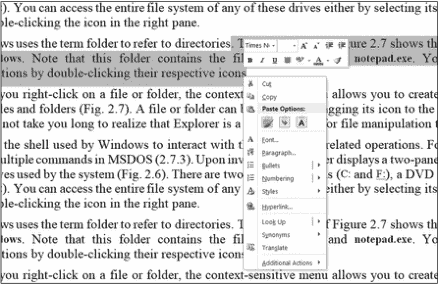

**图 2.5** 上下文相关菜单（通过右键单击获得）

如果你删除了某个文件，后来又后悔了，你仍然可以使用位于桌面（或其他位置）的 *回收站* 图标找回该文件。只需选择该文件，右键单击它，然后选择 *还原* 即可将其恢复到文件系统。

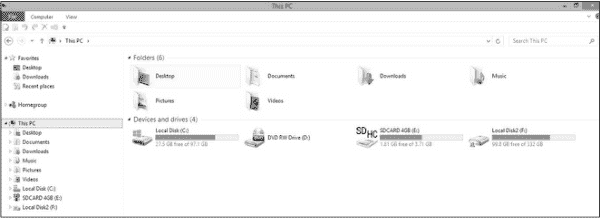

**图 2.6** Windows 资源管理器（总体视图）

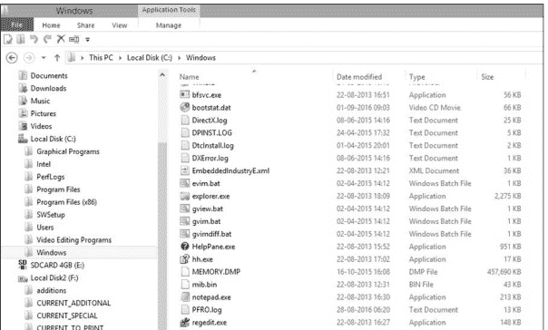

**图 2.7** Windows 资源管理器（详细视图）

### 2.8.3 实用程序和管理工具

Windows 支持一组实用程序和管理工具，当你右键单击任务栏中的“开始”按钮时，它们会以菜单形式显示（图 2.8）。使用其中某些程序需要管理员权限。你现有的用户 ID 可能拥有该权限，也可能需要使用其他用户 ID。以下是你在遇到问题时可能需要使用的主要程序：

- **程序和功能** 卸载程序时需要使用此部分。
- **系统** 显示硬件配置和 Windows 版本。
- **网络连接** 此部分允许你配置网络接口卡，包括设置 IP 地址和网关。
- **磁盘管理** 此部分允许你创建、删除和格式化磁盘分区。
- **命令提示符** 这表示 MSDOS shell。另一个选项会为管理员创建 shell。
- **任务管理器** 显示系统中运行的所有进程。如果应用程序冻结，你可能需要使用此工具将其终止。
- **控制面板** 每个 Windows 版本都提供的功能。它允许你配置鼠标、扬声器和麦克风等设备。


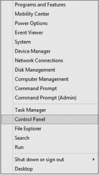

**图 2.8** 开始菜单

- *文件资源管理器* 允许操作文件、文件夹及其属性的 Windows shell。
- *搜索* 在系统中定位文件或程序。
- *运行* 从 MSDOS 命令行执行程序；如果你知道程序名称，这会很有用。
- *关机* 关闭系统或让用户注销。

从这个*开始*菜单可以完成很多操作，你必须自行探索它们。在此过程中，你会发现系统内置的冗余。同一个程序通常可以从多个位置访问。例如，*磁盘管理*也可以从*控制面板*、*文件资源管理器*以及标记为*此电脑*的桌面图标访问。等你掌握这些功能时，下一个版本的 Windows 可能已经完全改变了这一方案。

**提示：** 如果尚未默认启用，你必须激活 *Windows Update* 功能。这允许自动安装可改进系统安全功能的系统软件组件，尤其是与恶意软件相关的组件。

## 2.9 UNIX/LINUX：程序员的操作系统

UNIX 由 Ken Thompson 和 Dennis Ritchie 于 20 世纪 70 年代创建，是贝尔实验室的专有产品。计算机厂商、加利福尼亚大学伯克利分校以及 Linux 社区随后所做的增强，使 UNIX 如今成为一个健壮、强大且可靠的操作系统。与 MSDOS 和 Windows 不同，UNIX 是一个*真正*的多用户、多任务系统，可运行在从 PC 到超级计算机的硬件上。UNIX/Linux 系统构成了互联网的骨干。

操作系统的核心称为*内核*，它直接与硬件通信。用户与 shell（类似于 MSDOS shell）交互，shell 充当用户与内核之间的接口。当你通过键盘输入命令时，shell 会先检查命令行，然后将其转发给内核执行。如果程序需要访问硬件，它会向内核发出调用。这些调用（称为*系统调用*）是未包含在 ANSI C 中的特殊 C 函数。

处理文件和进程的 UNIX 实用程序是业内最出色的。Linux 是程序员的天堂；它支持*所有*编程语言的编译器。UNIX 最初是一个 CUI 系统，所有程序或命令都在 shell 提示符下执行。后来添加到系统中的 GUI 支持一个基于 CUI 的终端窗口来表示 shell。然而，大多数命令行程序没有对应的 GUI 版本。


> **提示：** Linux 用户可以使用 *[Ctrl][Alt][F1]* 切换到 CUI 模式，并使用 *[Ctrl][Alt][F7]* 切换到 GUI 模式。

### 2.9.1 UNIX 文件系统

文件和目录通过作为文件系统的一部分而相互关联。尽管 MSDOS 和 Windows 已经模拟了 UNIX 文件系统，但必须注意以下差异：

- UNIX 路径名的分隔符是 / 而不是 \。MSDOS 路径名 `a\b\c` 在 UNIX 中变为 `a/b/c`。万维网也遵循这一约定。
- 路径名中没有像 C: 和 D: 这样的驱动器前缀。
- 在 UNIX 中，连接到计算机的*所有*设备中的所有文件都是一个*单一*文件系统的一部分，该文件系统只有一个根（/ 而不是 \）。因此，路径名 `/home/sumit/progs` 和 `/home2/kanetkar/progs` 可以位于两个不同的磁盘上。
- 与 MSDOS/Windows 不同，UNIX 文件名区分大小写，因此 `foo` 和 `FOO` 是两个不同的文件名，可以共存于同一目录中。

第三点具有深远的影响。与 MSDOS/Windows 不同，UNIX 文件系统将多个磁盘和文件系统集成到一个单一文件系统中。这些系统可能驻留在多台相连的机器上——也许位于两个不同的大洲！用户仍然只看到一个单一文件系统。

### 2.9.2 基本目录与文件处理命令

如你现在所知，文件是用于存储静态信息的容器。但 UNIX 也将目录和设备视为文件，同一个命令有时可用于多种文件类型。按照惯例，UNIX 命令使用小写字母，以下命令用于处理目录：

| 命令 | 描述 |
|---|---|
| `mkdir progs` | 创建目录 progs。 |
| `rmdir progs` | 删除目录 progs。 |
| `cd` | 切换到主目录（内部命令）。 |
| `cd progs` | 将当前目录切换到 progs。 |
| `pwd` | 打印（显示）当前目录（内部命令）。 |

注意，UNIX 支持两个用于目录导航的内部命令，而 MSDOS 使用单个 **CD** 命令（带参数和不带参数均可）。另一组命令处理普通文件：

| 命令 | 描述 |
|---|---|
| `cat foo` | 显示文件 foo 的内容。 |
| `cp foo bar` | 将文件 foo 复制为 bar。 |
| `rm foo` | 删除文件 foo。 |
| `mv foo bar` | 将文件 foo 重命名（移动）为 bar。 |
| `ls` | 列出当前目录中的文件和子目录。 |

如果这些命令只被设计用于这些简单方式，那么没人会使用 UNIX。所有这些命令都支持若干选项，当它们与*通配符*（2.7.4）结合使用时，UNIX 命令的强大之处便很容易显现出来。以下是它们高级用法的一些示例：

| 命令 | 描述 |
|---|---|
| `cp -r foo1 foo2` | 将整个目录结构 foo1 复制到 foo2。 |
| `mv *.c progs` | 将所有扩展名为 .c 的文件移动到 progs 目录。 |
| `rm -r *` | 最危险的命令；删除当前目录中的所有内容。 |
| `ls -R` | 列出当前目录结构，包括所有子目录。 |
| `rm *.????*` | 删除所有扩展名至少为 4 个字符的文件。 |
| `cat foo[1-5] > foo6` | 将文件 foo1、foo2、... foo5 连接起来，并将输出保存到 foo6。 |

UNIX 支持一套精细的通配符系统，使得用简单模式匹配一组文件名成为可能。前面的示例让我们一窥通配符 *、? 和 [] 的用法。MSDOS 使用的通配符只是 UNIX 通配符集合的一小部分。

> **注意：** `cd` 和 `pwd` 命令是内部命令；它们内置于 shell 中。shell 本身是一个外部命令，它像 MSDOS 的 **COMMAND.COM** 一样，只要用户保持登录状态就会持续运行。

### 2.9.3 文件所有权与权限

作为程序员，你还需要了解其他与文件相关的命令。`ls` 命令默认列出当前目录中的所有文件名，它可以与许多选项一起使用，以显示文件的某些属性。在检查这些属性之前，我们先使用 `ls -l`：

```text
$ ls -l unix2dos.c          $ is the UNIX shell prompt
-rwxr-xrwx 1 sumit users    297 2016-08-17 09:48 unix2dos.c
```

这个八列输出在文件名之前显示了最后修改的日期和时间。第一列显示文件权限，第三列和第四列显示文件的所有者和组所有者。所有权是一个与文件安全相关的重要问题，因此我们应该对此有所了解。

每个文件都有一个*所有者*。默认情况下，所有者是文件的创建者。文件还有一个*组所有者*，默认情况下，它就是用户所属的组。上一输出中显示的一组权限分别适用于所有者、组所有者和*其他用户*。

这些权限可以通过 **chmod** 命令进行操作。以下命令行会从属于“其他用户”类别的用户那里移除对文件的写权限：

```text
chmod o-w unix2dos.c
```

*两个参数*

当你第二次运行 **ls -l** 命令时，你会发现第一列已经改变：

```text
$ ls -l unix2dos.c
-rwxr-xr-x 1 sumit users 297 2016-08-17 09:48 unix2dos.c
```

*两个参数；其中一个是选项*

先前在第一列末尾看到的字符串 rwx 现在变成了 r-x。你刚刚保护了一个文件，使其不被“其他用户”修改。这一类别代表那些既不是文件所有者也不是文件组所有者的用户。

### 2.9.4 grep 和 find：UNIX 搜索命令

作为程序员，你需要定位包含特定单词（例如某个 C 函数）的程序。**grep** 命令会定位包含该单词的行和文件。以下命令行在 *progs* 目录中的所有 C 程序中查找字符串 *malloc*（一个 C 函数）：

```text
grep "malloc" progs/*.c
```

你可能还需要通过指定文件名和开始搜索的目录来定位文件本身。这项工作由 **find** 命令完成。按以下方式使用时，**find** 会通过完整地（递归地）检查目录 **/home/sumit/progs** 来定位并显示所有 C 程序：

```text
find /home/sumit/progs -name "*.c" -print
```

将 **man** 命令与文件名一起使用，以探索这些命令可用的其他选项（**man grep** 和 **man find**）。其可能性令人难以置信，你很快就会意识到 Thompson 和 Ritchie 是为程序员的利益而编写 UNIX 的。

> **要点：** 文件权限适用于三类用户：*所有者、组所有者*和*其他用户*。所有者是文件的创建者，所有者所属的组成为组所有者。其余用户称为*其他用户*。一般来说，不应允许其他用户对文件和目录具有写权限。

> **提示：** 如果需要更改使用了某个函数的程序，请使用命令 **grep -l** *函数名* `*.c` 获取包含该函数的文件名列表。


### 2.9.5 其他实用工具

本节讨论的命令与我们的 UNIX 系统有关。当调用外部命令时，操作系统会为其创建一个*进程*。**ps** 命令显示在你的终端上运行的进程：

```text
$ ps
  PID TTY          TIME CMD
 3826 tty1     00:00:00 bash
 3990 tty1     00:00:11 vi
14367 tty1     00:00:00 ps
```

*shell*  
*一个编辑程序*  
*为获得此输出而运行的程序*

PID 表示进程 ID，该 ID 在系统中唯一。如果程序行为异常且你发现难以终止它，则可能必须使用 **kill** 命令。

以下命令也显示与系统相关的信息：

| 命令 | 描述 |
|---|---|
| `date` | 显示系统日期和时间。（可由管理员更改） |
| `uname -r` | 显示操作系统版本。 |

**passwd** 命令用于更改用户密码。系统会先提示你输入旧密码，然后才要求输入新密码：

```text
$ passwd
Changing password for sumit.
Old Password: *******
New Password: *******
Reenter New Password: *******
Password changed
```

*输入旧密码和新密码*

UNIX 是一个多用户系统，你可能想知道当前有哪些像你一样登录到系统的用户。**who** 命令的输出显示三个用户共享该机器的 CPU 和 RAM：

```text
$ who
romeo      console      May  9 09:31   (:0)
henry      pts/4        May  9 09:31   (:0.0)
steve      pts/5        May  9 09:32   (saturn.heavens.com)
```

shell 如何定位表示这些命令的文件？答案在于 PATH 变量。shell 会搜索 PATH 中指定的目录列表。此变量将始终包含目录 **/bin** 和 **/usr/bin**，因为它们包含面向所有用户的外部 UNIX 命令：

```text
$ echo $PATH
/home/sumit/bin:/usr/local/bin:/usr/bin:/bin:.
```

**echo 是内部命令**

以上就是我们对 UNIX 操作系统的简要讨论。如果你热衷于使用 Linux 进行编程，可以在你的 Linux 系统上尝试所有命令。当然，Linux 是自动选择，但其他考虑可能会让你转而选择 Windows。

## 2.10 微软 Word

在本节及接下来的两节中，我们将讨论应用软件 Microsoft Office 的三个组件。我们从 Microsoft Word（或简称为 Word）开始，这是一款用于文字处理的应用程序。其可执行文件名为 **winword.exe**，但你应该能在桌面的 *应用* 部分找到其图标。Word 文件的扩展名为 .doc 或更新的 .docx。保存 Word 文件时请记住，较旧版本的 Word 可能无法读取 .docx 文件。

启动时看到的空窗口显示了该软件的大部分基本功能（图 2.9）。你可以使用四行按钮、选项卡和菜单选项创建专业质量的文档。某些版本还在左上角设有一个巨大的 *Office* 按钮。确切的前视图因版本而异，但在 *菜单* 栏中选择 *开始* 后，会显示以下组件：

- *Office 按钮* 此按钮包含重要的文件处理选项，可让你打开、保存、打印和关闭文件（图 2.10）。如果找不到此按钮，请在菜单栏的 *文件* 菜单中查找相同选项。
- *标题栏* 位于最顶部，此栏包含三个按钮，分别用于保存文件以及撤销和重做编辑操作。你还可能找到一个 *快速访问工具栏*。

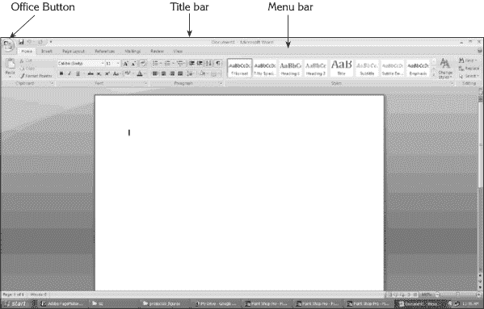

**图 2.9** Microsoft Word：启动界面

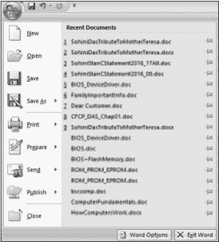

**图 2.10** Office 按钮

- *菜单栏* 包含主菜单选项的文字说明。最左侧的选项是 *开始*，其内容显示在其下方的两个栏中。当你单击例如 *插入* 或 *页面布局* 时，下方栏中的内容会发生变化。
- *格式工具栏* 菜单栏下方有两个格式工具栏，包含设置文档格式所需的按钮。较旧的 Word 版本会有一个单一的扩展工具栏。
- *状态栏* 位于窗口底部。它显示文档统计信息（如页数和字数）。右侧是一组控制页面视图的按钮。我们将沿用由第一个按钮表示的默认 *打印布局* 视图。

菜单栏中的每一项都与其自己的一组按钮和功能相关联。例如，单击 *插入* 会显示用于插入图片、表格、页眉和页脚的按钮。此外，菜单栏中的许多项对于所有三个 Office 程序（Word、Excel 和 PowerPoint）都是通用的。

### 2.10.1 创建并保存文档

让我们通过创建新文档开始使用此软件。我们将输入一些文本，设置其格式，并将创建的文本保存为文件。涉及以下步骤：

- 从 Office 按钮中选择 *新建*，或选择 *文件>新建*。选择一个空白文档，此时它应出现在视图中。
- 在输入文本之前设置页面属性。从菜单栏中选择 *页面布局*，然后使用其下方的按钮选择 *纵向*（方向）和 *A4*（大小）。现在可以开始了。
- 将光标置于空白窗口上并输入文本。要删除文本，使用退格键删除左侧文本，或使用 *Delete* 删除右侧文本。你也可以通过在文本上拖动鼠标以选中文本，然后使用相同的按键来删除文本段。
- 通过拖动鼠标或使用 *Control-a* 快捷键选择整个文本。从 *格式工具栏* 中选择一种字体（例如 Arial），并将字号设置为例如 10。单击窗口任意位置以取消选择文本，并观察所做的更改。如果你不喜欢该更改，请单击标题栏中的撤销按钮。
- 使用 Office 按钮中的 *另存为* 选项或 *文件>保存* 来保存文件。Windows 会显示默认保存文件的目录。你应将文件保存在易于访问的单独目录中。从左侧窗格中找到该目录，并将默认文件名更改为有意义的名称。保存文件之前，请确保文件类型为 docx 或 doc。
- 使用 Office 按钮，你可以使用 *打印* 选项（或 *文件>打印*）打印此文件，然后使用 *关闭*（或 *文件>关闭*）关闭文件。现在你可以关闭 Word 或打开另一个文件。

你刚刚创建了一个包含一些文本的文件。要重新打开该文件，请使用 Office 按钮中的 *打开* 选项（或 *文件>打开*）。你可能在窗口中看不到该文件，因此请从左侧窗格中选择正确的目录，然后你就应该能在右侧窗格中看到你的文件。

**注意：** Office 2013 已用菜单栏中的 *文件* 项取代了大型 *Office* 按钮。所有与文件相关的选项都在 *文件* 菜单中。

### 2.10.2 处理文本

**剪切-复制-粘贴操作** 任何文本编辑软件都支持剪切-复制-粘贴操作的功能。Windows 使用的组合键已在第 2.8.1 节中讨论过，但它们也适用于所有 Windows 软件，包括 Microsoft Office 的三个组件：

- *[Ctrl-c]* 用于复制文本
- *[Ctrl-x]* 用于剪切文本
- *[Ctrl-v]* 用于粘贴文本

Word 还提供了执行上述操作的替代机制，使用 (i) 鼠标右键，(ii) 格式工具栏左侧的按钮。右键单击通常是这些任务最方便的机制，因为它涉及最少的鼠标移动。

**对齐和缩进文本** 正确对齐的文本可增强可读性，Word 在格式工具栏中提供四个按钮用于“对齐”文本（图 2.11）。其中三个按钮将所选文本左对齐、右对齐和居中对齐。第四个按钮使文本完全两端对齐，使其看起来同时左右对齐。左对齐文本最易阅读，但完全两端对齐的文本在视觉上更美观。对齐的文本还可以使用各自按钮向左或向右缩进。

**创建列表** 信息通常以列表形式呈现，列表可以带编号或项目符号。格式工具栏中有一组单独的图标用于创建列表（图 2.12）。要将现有行转换为列表项，请单击该行，然后单击相应的图标，以在该行前加上编号或项目符号。完成此操作后，下一行会自动获得相同的属性。你可以通过按两次 *[Enter]* 来终止列表。


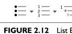

#### 段落格式

Word 允许使用*段落对话框*（图 2.13）设置一个或多个段落的格式。可以从格式工具栏下方的*段落*选项卡调用此对话框，也可以右键单击段落。该对话框有两个选项卡，包含许多有用的设置。

使用*缩进和间距*选项卡，可以调整行间距和段落间距。还可以对齐文本，并以数值指定缩进。*行和分页*选项卡中最重要的功能是*孤行控制*，它控制段落溢出到下一页时的外观。该功能可防止：

- 首行出现在页面底部（孤行）。
- 末行出现在页面顶部（寡行）。

如果你发现让段落溢出到下一页并不妥当，也可以指定在段落前分页。请探索与保持行在一起相关的其他选项。

#### 查找和替换

你经常需要在文档中查找一个字符串的一次或多次出现。可选地，你可能希望有选择地或全局地替换该字符串。查找和替换功能以工具栏最右侧的两个按钮形式提供。选择其中任一按钮都会打开一个带有三个选项卡的窗口（图 2.14）。对于简单查找，在*查找*选项卡的窗口中输入搜索字符串，然后反复单击*查找下一处*，以依次查看所选文本的每个实例。*替换*选项卡显示一个额外的框，用于键入替换文本。

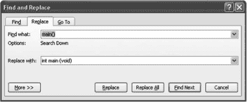

**图 2.14** 查找和替换框

#### 检查拼写和语法

创建文档后，需要检查拼写和语法。你会在菜单栏的*审阅*项中找到*拼写和语法*按钮。会出现一个更正窗口，突出显示 Word 在其词典中找不到的单词或短语。建议也会出现在单独的窗口中，你可以接受或忽略。也可以将文本添加到词典，让 Word 知道在后续遇到该文本时要忽略它。

### 2.10.3 字体处理

Windows 操作系统包含许多可供每个应用程序使用的字体。可以使用 Windows 的*控制面板*安装其他字体。文档使用的字体必须在查看该文档的每台机器上都可用。否则，Word 将选择替代字体，这可能导致页面显示不正确。因此，选择诸如 *Times Roman* 和 *Arial* 之类的标准字体是安全的，这些字体在每个系统上都可用。

Word 允许使用*字体*对话框（图 2.15）控制字体设置。可以从格式工具栏下方的*字体*选项卡调用此框，或右键单击所选文本。顶部区域允许选择字体、样式（常规、加粗、斜体或加粗斜体）和字号。默认情况下，文本颜色为黑色，但可以在此对话框中更改。*效果*区域允许使用下标和上标。也可以在此区域将文本转换为大写。

字体对话框中的第二个选项卡允许控制字符之间的间距。如果某段文本必须容纳在一行中，且不能选择减小字号，你可能不得不使用此功能。

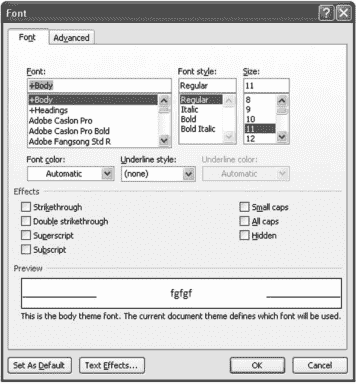

**图 2.15** 字体对话框

### 2.10.4 插入表格

表格化信息有助于提高可读性，Word 支持处理表格的优雅功能。你可以绘制表格，或通过提供规格来创建表格。随后可以添加或删除行和列，并调整它们的宽度和高度。

可以使用菜单栏中的*插入*选项插入表格，然后选择*表格*或*插入表格*按钮。会出现一组方框，让你选择行数和列数。要创建例如四行五列的表格，只需选择第四行中的第五个方框。然后会创建一个行距和列距相等的表格。现在可以在任何单元格中输入文本，并使用 [Tab] 键在列之间导航。

可以通过向左或向右拖动列来更改列宽。如果无法通过拖动行来更改行高，请右键单击表格。弹出的菜单允许添加或删除行或列，并更改其属性。选择*表格属性*（通过右键单击表格），然后更改行高或列宽。

如果默认表格设置对你来说不够好，可以使用*插入表格*中的*绘制表格*选项自己绘制表格。光标变为铅笔。绘制一个代表表格的框，然后通过从矩形的一边向对边拖动鼠标来绘制水平和垂直线。这样创建的表格现在可以使用刚才讨论的常用功能进一步操作。

### 2.10.5 插入图形

Word 不再局限于处理文本。它可以包含图片，并提供插入图形的基本编辑功能。要插入图片，请使用菜单栏的*插入*项，并单击*图片*按钮打开一个窗口。导航到目录，然后选择要放入文档窗口的图形文件。Word 支持所有常用图片格式（如 .jpg、.gif 和 .png）。

如果图片需要编辑，请先选择它，然后单击菜单栏中出现的新*格式*选项。可以使用文档窗口左上角的按钮更改亮度和对比度。也可以通过选择位于右上角的相应选项来裁剪和调整图像大小。其中一些选项可以通过右键单击图片快速访问。

### 2.10.6 其他实用工具

#### 使用邮件合并

此功能允许创建包含静态部分和可变部分的文档。可变部分表示为*变量*，在运行邮件合并后，这些变量会被保存在列表中的数据替换。例如，如果要将同一封信发送给多个收件人，收件人的详细信息可以保存在 Excel 电子表格中。主文档必须链接到此列表。邮件合并工具可在菜单栏的*邮件*项中使用。

#### 使用宏

宏是常用按键序列的快捷方式。选择要为其创建宏的文本后，首先从菜单栏的*视图*项中选择*宏*。通过为宏提供名称并将其放在标题栏中来启动宏录制。处理完所选文本并停止录制后，可以通过单击所创建的图标，在任何文本上重复这组记录的操作。

#### 转换为 HTML 和 PDF

.doc 或 .docx Word 文件可以转换为 HTML，这是万维网上文档使用的格式。只需在使用 Office 按钮或*文件*菜单中的*另存为*时，将文件类型选择为 .htm 或 .html。还可以使用菜单栏上的*Acrobat*项创建 Adobe Acrobat PDF 文件。HTML 和 PDF 文件都比 Word 文件小，因此适合在 Web 上使用。用于读取 HTML 文件的 Web 浏览器也可以使用称为*插件*的特殊软件来处理 PDF。

## 2.11 Microsoft Excel

*电子表格*是以表格形式存储数据的文档。Microsoft Excel 是 Microsoft Office 的另一个组件，用于处理电子表格。该程序的名称为 **excel.exe**，但其图标很容易在桌面上找到。Excel 将电子表格文件视为包含多个*工作表*的*工作簿*。每个工作表是按一组行和列排列的*单元格*集合。Excel 文件具有 .xlsx 或 .xls（较旧）扩展名。较旧版本的 Excel 无法读取 .xlsx 文件，但较新版本可以读取 .xls 文件。

启动 Excel 时，屏幕上会显示一个空工作簿（图 2.16）。与 Word 一样，顶部可以看到一组工具栏，其中有许多相同的按钮。你可能看不到大的*Office*按钮，在这种情况下，你必须使用菜单栏中的*文件*项。由于这些按钮的意义已在第 2.10 节讨论过，我们将主要关注 Excel 特有的功能。


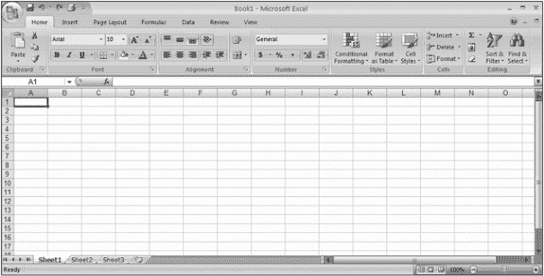

**图 2.16** Microsoft Excel：启动界面

### 2.11.1 创建、保存和打印电子表格

使用 Office 按钮中的*新建*选项（或*文件>新建*）选择空白工作簿。该工作簿显示为一连串*看似*无穷无尽的可识别单元格，这些单元格由带编号的行和以字母标记的列构成。例如，D3 表示第三行第四列的单元格。整个工作表的名称为*Sheet1*，即位于底部的三个标签页中第一个标签页的名称。Excel 创建包含三个工作表的工作簿，但你可以根据需要随时添加更多工作表。要添加、删除或移动工作表，请右键单击工作表标签。

现在让我们创建一个带表头的数据表（图 2.17）。在每个单元格中输入数据时，使用光标控制键进行导航。请注意，单元格中的文本左对齐，数字右对齐。这是既定规范，但你可以更改默认设置。我们将逐步向此工作表添加功能，但现在先保存键入的信息。从 Office 按钮中选择*另存为*（或*文件>另存为*），将电子表格保存为扩展名为 .xls 或 .xlsx 的 Excel 工作簿。如前所述（2.10.1），选择一个合适的目录，以便以后定位文件时没有问题。

这是一个小工作表，因此可以通过从 Office 按钮中选择*打印*（或*文件>打印*）直接打印。当工作表扩展时，其宽度可能超过正常的 A4 页面宽度，在这种情况下，你可能需要在*打印*菜单中将方向从默认的*纵向*更改为*横向*。如果这没有帮助，则通过激活*打印*对话框中的*选定区域*单选按钮来打印工作表的选定部分。

我们还没有关闭文件，因此让我们从 Office 按钮中选择*关闭*（或*文件>关闭*）来关闭文件。要重新打开此文件进行编辑，这次我们需要使用*打开*选项。

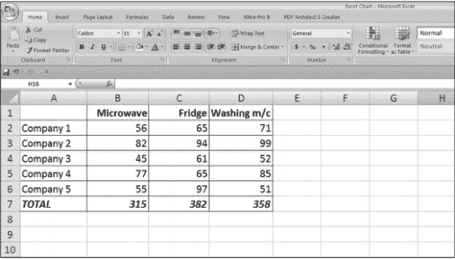

**图 2.17** 添加数据

**提示：** 打印前预览工作表的选定部分，以避免浪费纸张。使用*打印预览*并启用边距（*显示边距*）。如有必要，拖动边距以防止溢出并控制标题的位置。

### 2.11.2 设置单元格格式

每个单元格的形式和内容都可以使用主屏幕的*单元格*部分进行格式设置（图 2.18）。前两个按钮允许你添加或删除单个单元格或整行和整列。第三个按钮支持广泛的单元格格式设置功能，可让你执行以下操作：

- 通过设置行高或列宽来更改单元格尺寸。所做的更改应用于当前工作表的整个选定行或列。
- 使用标有*设置单元格格式*的单独对话框更改单元格本身及其内容的外观。右键单击一个或多个单元格也可使用此选项。

让我们简要查看*设置单元格格式*对话框的六个选项卡支持的功能（图 2.19）：

- *数字* 此选项通过指定小数位数、% 符号和货币符号来设置数字数据的格式。如果要排序日期，请使用*日期*选项将其单元格设置为该类型。
- *对齐* 默认情况下，文本左对齐，数字右对齐，但你可以在此处更改这些默认设置。长文本也会溢出到相邻单元格，但你可以通过选中标有*自动换行*的复选框使其换行以适合一个单元格。

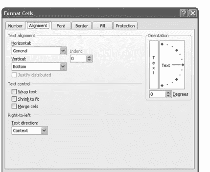

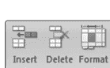

**图 2.18** 单元格部分

**图 2.19** 设置单元格格式对话框

- **字体** Word（2.10.3）和 Excel 使用的字体处理机制没有区别，因此此处不再讨论。与 Word 中一样，其中许多功能（如粗体、斜体和字体颜色）可在主屏幕中使用。
- **边框** 需要特别关注的单元格可以通过为其添加边框来突出显示。单元格可以被边框完全或部分包围，其样式和颜色可在此处设置。
- **填充** 此选项可让你指定单元格的背景色。必须仔细选择此颜色，以增强可读性且不引起眼睛疲劳。

如果多个相邻单元格需要相同的处理，请先单击区域的一端，然后按住*Shift*键单击另一端来选择单元格区域。如果单元格不相邻，则改用*Ctrl*键。

**提示：** 为增强大数字的可读性，请使用*数字*选项卡提供的逗号分隔符。

### 2.11.3 计算和使用公式

除数字外，Excel 还可以处理表达式和*公式*（实际上，在编程术语中称为*函数*）。数学表达式支持标准算术运算符（+、-、\*、/、% 和 ^）。表达式`1200 * 5 / 12`在 Excel 中有效。

对一组数字求和或求平均值等操作可作为公式使用。Excel 除支持表达式`3 + 5 + 7`外，还支持使用`SUM(3+5+7)`。在开始使用它们之前，你需要了解以下内容：

- 所有表达式和公式都必须以 = 符号开头。你必须使用`=1200 * 5 / 12`和`=SUM(12, 14, 15)`，否则它们将被视为简单字符串。
- 表达式或公式可以包含单元格地址。表达式`=A1 + A2 + A3`计算三个单元格内容之和。*这也意味着，如果三个组成部分中的任何一个发生变化，包含该表达式的每个单元格的内容都会自动改变。*
- 连续的一组单元格可以用冒号（:）指定。因此，`=AVERAGE(D5:D8)`计算 D5 到 D8 单元格的平均值。
- 如果单元格不相邻，则改用逗号（,）。因此，`=MAX(A5,H7,K4)`求三个单元格中所含数字的最大值。
- 算术表达式适用常规优先级规则。这意味着先进行乘法，然后进行除法，等等。必须使用括号覆盖默认优先级。表达式`=(K3 - 32) * 5 / 9`将华氏度转换为摄氏度，需要括号才能正确运算。

有时直接键入单元格地址可能很繁琐，因此使用鼠标选择单元格。按住 [Ctrl] 键并分别单击单元格。看一眼公式窗口，可以看到 Excel 最终放入单元格的表达式逐步形成。

除通用公式（表2.2）外，Excel 还支持大量科学、工程和财务公式。你可以通过选择菜单栏中的*公式*项查看完整列表。

**表 2.2 Excel 支持的通用公式**

| 公式 | 含义 |
|---|---|
| `AVERAGE(n1, n2, ...)` | 计算平均值。 |
| `COUNT(n1, n2, ...)` | 计算单元格数量。 |
| `DATE(y, m, d)` | 按*mm-dd-yyyy*格式打印日期。 |
| `MAX(n1, n2, ...)` | 选择数字中的最大值。 |
| `MIN(n1, n2, ...)` | 选择数字中的最小值。 |
| `SUM(n1, n2, ...)` | 计算数字总和。 |
| `TIME(h, m, s)` | 按*hh:mm AM/PM*格式打印时间。 |
| `TODAY()` | 按*dd-mm-yyyy*格式打印今天的日期。 |

### 2.11.4 处理数据

**标准剪切-复制-粘贴操作** 只要单元格包含简单值——不含公式和单元格引用——就可以使用标准技巧（2.10.2）复制单个单元格或单元格区域。例如，这些技巧不允许你复制公式`=SUM(G40:G42)`并将其*值*粘贴到目标位置。

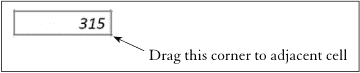

**图 2.20** 复制单元格

要将单个单元格复制到其相邻位置，可使用快捷方式：只需将复制单元格右下角的填充柄拖动到一个或多个相邻单元格（图2.20）。这样，单个值就被复制到多个单元格。

复制这种“简单”单元格区域时，需要在目标位置指定一个单元格，以表示复制单元格区域的左上角。前面提到的快捷技巧适用，但数字需要谨慎处理。例如，一行三个数字可以垂直拖动，但不能水平拖动。反之，一列数字也是如此。如果水平拖动一行数字单元格，Excel 会认为你试图完成一个序列，并用其他值填充空白单元格——而不是复制的值。

**复制表达式和公式** Excel 支持*选择性粘贴*，可处理单元格引用和公式相关问题（图2.21）。应注意两个功能。首先，可以在两个单元格之间创建*链接*。例如，你可能希望在工作表顶部（比如 A20）查看远处单元格（比如 J200）的内容。以常规方式复制单元格 J200，但使用*选择性粘贴*对话框中的*粘贴链接*将其粘贴到 A20。现在 J200 链接到 A20，这意味着更改 J200 也会更改 A20。

另一个功能与复制公式有关。假设你有三列数字，其中一列已使用 SUM 公式求和（图2.22）。当你复制此单元格

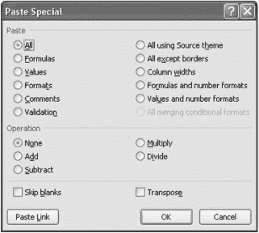

**图 2.21** 选择性粘贴对话框


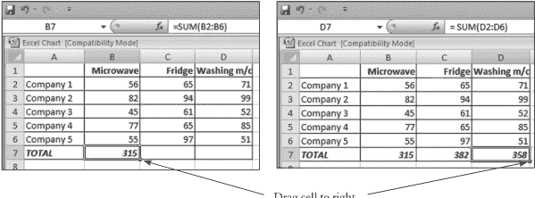

**图 2.22** 复制公式

将包含公式的单元格复制到其相邻列后，这些列中的数据会自动求和。换句话说，如果公式 `=SUM(B2:B6)` 从 B7 复制到 C7 和 D7，Excel 会分别在 C7 和 D7 粘贴公式 `=SUM(C2:C6)` 和 `=SUM(D2:D6)`。这通常是我们想要的结果，但有时你可能希望粘贴 `=SUM(B2:B6)` 的值而不是公式。在这种情况下，请单击“选择性粘贴”对话框顶部的“值”单选按钮。

> 💡 **提示：** 要将公式从一个位置复制到一个或多个相邻位置，请单击包含公式的单元格右下角的填充柄，然后将鼠标指针拖动到其他单元格。公式会进行适当修改以反映新位置。

**填充单元格** Excel 具有智能功能，只要能够完成一系列数字或日期，它就会尝试完成。假设两个相邻的行单元格包含整数 4 和 8。选择这两个单元格并拖动最右侧单元格的填充柄，比如向右三个空白单元格，这些单元格将自动填入值 12、16 和 20。

Excel 对日期类型的处理略有不同。只需将单个单元格向右或向下拖动，日期就会加一。将其向左或向上拖动，日期就会减一。

> 📋 **注意：** 图 2.22 中包含字符串 Company1、Company2 等的列，是通过向下拖动第一个单元格完成的。即使看到包含数字后缀的文本数据，Excel 也足够智能地猜到你的意图。

主页中的“填充”按钮包含用于设置增量或减量值的选项。从下拉菜单中选择“序列”，选择“线性”按钮，并指定所需的步长值。负值会创建线性值的递减序列。你可以自行探索其他选项。

**排序数据** 排序是根据某些规则对数据进行排序。Excel 支持按列排序。文本数据按 *ASCII 顺序*（附录 B）排序，其中数字排在最前，然后是大写字母，最后是小写字母。数值数据按其值排序。选择 *排序和筛选* 按钮并选择排序方向。只要数据项已按相应数据类型进行格式设置，你也可以对这些数据项排序。

### 2.11.5 创建图表

有人告诉我们，一图胜千言。这句古老谚语完全适用于 Excel，它支持大量图表工具来以图形方式描绘数据。由于篇幅限制，无法讨论其中大多数工具，但我们将考察其中三种经受住时间考验的图表：饼图、柱形图和条形图。图 2.23 在一个工作表上展示了全部三种图表，相关数据放在顶部。图表工具位于菜单栏的 *插入* 功能中。

我们使用 *饼图* 对单组数据中的元素进行相对比较。图中的饼图显示了五家公司如何分享微波炉市场。它的创建方式是：(i) 选择列 L 和 M；(ii) 从 *插入* 部分选择 *饼图*。创建图表后，可以通过拖动其控制柄调整大小，并通过拖动空白部分移动它。右键单击图表可以添加标签，例如每个饼图扇区中的值。

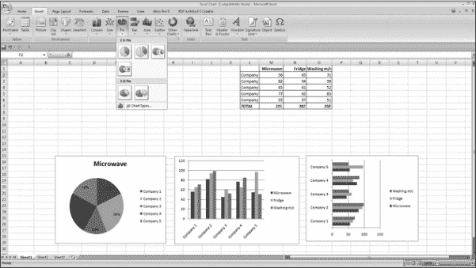

**图 2.23** Excel 图表

当涉及多个产品时，*柱形图* 和 *条形图* 呈现更完整的图景。要创建它们，请选择从 L 到 O 的所有列，然后从上面提供的选项中选择 *柱形图* 或 *条形图*。右侧的两个图表各自展示：(i) 每家公司的三种产品彼此之间的表现如何；(ii) 一家公司的某种产品与其竞争对手的产品相比表现如何。我们通过右键单击三个分段中的每一个并选择 *添加数据* 标签，将数字添加到了条形图中。

## 2.12 Microsoft PowerPoint

PowerPoint 是 Microsoft Office 的第三个组件，旨在用于创建和查看演示文稿。它的许多功能——特别是与文本格式相关的功能——与 Word 相同。PowerPoint 文件的扩展名为 .pptx（旧版本为 .ppt）。与它的其他同类组件一样，PowerPoint 的界面和功能随着时间的推移经历了相当大的变化。Word 和 Excel 用户处理 PowerPoint 应该没有困难，因此我们将仅讨论该软件最基本的要点。

演示文稿文件包含若干 *幻灯片*，它们遵循一个或多个 *模板*。典型模板包含 *标题* 和 *内容* 部分，只需在虚线文本框中键入文本即可填充（图 2.24）。可以使用左侧窗格中的 *幻灯片* 视图添加、删除和复制幻灯片。由于幻灯片也可以包含图形，PowerPoint 还支持左侧窗格中的 *大纲* 视图，仅显示每张幻灯片的文本部分。为了方便演示文稿设计者，底部窗口允许为每张幻灯片键入备注。这些备注不会在幻灯片放映中显示。

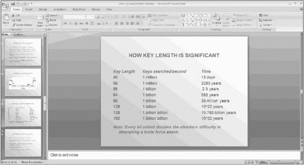

**图 2.24** Microsoft PowerPoint

默认情况下，PowerPoint 使用 *普通视图* 进行显示，如底部三个图标中的第一个所示。下一个图标表示 *幻灯片浏览视图*，它显示幻灯片的缩略图。只需拖动这些缩略图，或使用右键单击每张幻灯片时可用的剪切、复制和粘贴功能，即可重新排列幻灯片。最终可以通过单击代表 *幻灯片放映* 的第三个图标，或使用屏幕顶部的菜单选项来查看演示文稿。

除了包含格式化文本外，幻灯片还可以包含图形、音频和视频。每张幻灯片还可以具有：(i) *动画*，它决定文本如何移动到屏幕上；(ii) *切换*，它控制一张幻灯片消失和下一张幻灯片出现的方式。为每张幻灯片选择合适的背景可以提升整体演示文稿的质量。

## 2.13 理解 TCP/IP 网络

我们生活在一个互联的世界中，计算机使用网络协议相互通信。*协议* 是两个或多个机器相互通信所使用的一组规则。Internet 上使用的标准协议统称为 *TCP/IP*。该缩略词展开为 *传输控制协议/网际协议*，但这个名称有点用词不当，因为它是若干协议的集合（其中 TCP 和 IP 是最重要的）。自 1983 年以来，互联网一直运行在 TCP/IP 上。

与我们的固定电话系统不同，TCP/IP 是一种 *分组交换* 系统。数据被分成 *数据包*，上面写有发送方和接收方的地址。当数据包沿网络传输时，它们会遇到路由器，路由器会查看地址，以确定数据包为更 *接近* 其目的地而必须走的最有效路由。数据包可能沿不同路由传输，并以乱序到达。它们在最终到达应用程序之前，会在目的地按正确顺序重新组装。

### 2.13.1 主机名和 IP 地址

在网络中，计算机被称为 *主机*，有时称为 *节点*，并且每个这样的主机都有一个 *主机名*。根据网络是否是 Internet 的一部分，此类网络中的主机可以采用以下形式之一：

| 主机名 | 描述 |
|---|---|
| `earth` | 一个主机名 |
| `earth.planets.com` | 完全限定域名 |

网络中的每台主机都有一个地址，称为 *IP 地址*，其他机器使用该地址与它通信。该地址是一串由点分隔的四个数字（称为 *八位组*），通常如下所示：

```
192.168.0.1
```

每个 *八位组* 的最大值为 255。该地址不仅必须在网络内唯一，而且必须在所有连接的网络中唯一。而且，如果网络连接到 Internet，它必须在全世界范围内唯一。TCP/IP 应用程序可以通过主机名以及 IP 地址来寻址主机：

```
telnet earth
ftp 192.168.0.1
```


**telnet** 和 **ftp** 是网络中使用的两个重要命令，你的 Linux 系统两者都支持。现代 Windows 系统支持从命令提示符使用 **ftp**，但 **telnet** 命令被禁用。当然，如果需要，你可以启用它 *(2.14.2)*。

### 2.13.2 TCP/IP 模型——四层

TCP/IP 模型使用四层模型处理网络通信（图 2.25）。数据被划分为数据包，每个数据包从一层移动到另一层。每一层负责通信过程中的特定功能。发送数据时，某一层会向数据包添加有助于路由和重组的信息。发送的数据向下经过以下各层：

- *应用层*，代表生成数据的应用程序。新服务不断被添加到这一层。代表 Google Chrome 或 Skype 的应用程序属于这一层。
- *传输层*：这一层将接收到的数据拆分为数据包，每个数据包包含一个序列号。这里占主导地位的协议是 TCP（传输控制协议），它使传输完全可靠。如果未收到另一方的接收确认，TCP 将重传数据包。
- *网际层*，使用 IP（互联网协议）作为协议。IP 通过为每个数据包封装源地址和目的地址来处理寻址（这就是它们被称为 *IP 地址* 的原因）。
- *网络接入层*，最终将目的 IP 地址转换为网络接口卡的 MAC 地址 *(1.15.1)*。ARP（地址解析协议）负责这种转换。

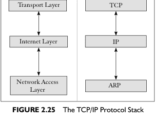

在接收端，数据包向上经过类似的一组四层（但方向相反）。在重新组装之前，它们会被去除首部。通常，TCP、IP 和 ARP 协议集处理大多数网络流量。

> **注意：** 计算机的网络接口卡无法理解 32 位 IP 地址，这就是 IP 地址最终必须转换为 MAC 地址的原因。如果将一台主机上的网卡更换为另一块网卡，MAC 地址会改变，但 IP 地址保持不变。

### 2.13.3 DNS：在互联网上解析域名

尽管数据包包含 IP 地址，但我们并不*显式*使用它们。例如，要访问 Google，我们在 Web 浏览器的 URL 窗口中输入其域名 *www.google.com*。然而，数据包仍然会包含 Google 服务器的 IP 地址。这里还有另一种转换机制在起作用；域名被转换为 IP 地址。在互联网上，这种转换由 *域名系统（DNS）* 执行。

在互联网命名空间中，主机属于*域*，而域又可以属于*子域*，依此类推。例如，如果 *binghamton* 是 *edu* 下的子域，而 *cs* 是 *binghamton* 下的子域，那么主机 *ralph* 可以唯一地描述为

*ralph.cs.binghamton.edu*

这表示主机 *ralph* 的*完全限定域名（FQDN）*——类似于文件的绝对路径名。每个域都在一些*名称服务器*中维护该域所有主机的主机名-IP 地址映射。当应用程序尝试使用 FQDN 联系主机时，首先会查询名称服务器，以将 FQDN 解析为其对应的 IP 地址。如果名称服务器没有该信息，它必须能够联系其他名称服务器，以便 FQDN 最终解析为 IP 地址。DNS 系统之所以能完美运行，是因为名称服务器从不放弃。

> **注意：** FQDN 不区分大小写；你可以像使用 *JACK.Hill.com* 一样使用 *JACK.HILL.COM*。

## 2.14 互联网应用

TCP/IP 和互联网基于*客户端-服务器*原则运行——即两台联网计算机之间的分工。Ftp 应用程序分为服务器组件和客户端组件——两个分别驻留在两台不同机器上的独立程序。Web 服务器的工作是发送 HTML 文档，客户端软件（浏览器）将其格式化显示在用户屏幕上。在接下来的几节中，我们将了解主要网络应用的客户端。

### 2.14.1 电子邮件

电子邮件可能是互联网上最早的服务，至今仍被广泛使用。它基于*简单邮件传输协议（SMTP）*。像 `mailx` 和 `pine` 这样旧的基于 CUI 的邮件客户端已不再使用；大多数人在 Web 浏览器上处理邮件。像 Gmail 这样的网站支持额外协议（POP 和 IMAP），使用户能够将邮件下载到自己的机器上。

邮件消息的发送者或接收者通过其电子邮件地址来标识，在互联网上该地址可以采取两种形式之一。以下是第一种形式：

```
romeo@heavens.com
```

所有电子邮件地址都具有 *name@domain* 的形式，其中 @ 充当 *name* 和 *domain* 的分隔符。名称部分允许使用所有字母数字字符、下划线和连字符，但不能使用空格。

电子邮件地址的第二种形式显示附加信息：

```
juliet floyd <juliet@heavens.com>
```

这里，juliet 的电子邮件地址嵌入在 < 和 > 之间，全名位于其前面。然而，只有实际电子邮件地址——而不是全名——被用于路由消息。

每封邮件消息都由若干行首部信息组成。典型消息至少显示如下所示的前四个字段：

```
Subject: creating animations in macromedia director from GIF89a images
Date: Fri, 08 Nov 2002 15:42:38 +0530
From: joe winter <winterj@sasol.com>
To: heinz@s4all.nl
Cc: psaha@earthlink.net
```

主题是可选的，但使用该字段是一种好习惯。Date: 和 From: 字段由系统自动填写。Cc: 字段用于将消息抄送给其他人；我们称之为*抄送*。有些消息还会有 Bcc: 首部，其接收者会收到*密送*（“To:”和“Cc:”接收者不知道这一事实）。首部之后是包含消息文本的消息正文。

### 2.14.2 Telnet：远程登录

你可以使用 Telnet 应用程序登录远程机器。一旦使用用户 ID 和密码获得访问权限，你在本地机器上输入的任何内容都会被发送到远程机器，而你的机器就像一台哑终端一样运行（即使你使用的是 PC 来运行 Telnet）。你使用的任何文件或运行的任何命令始终位于远程机器上。然而，你无法使用 Telnet 在两台机器之间传输文件。

UNIX/Linux 系统支持 **telnet** 命令，但较新的 Windows 系统默认禁用该功能。要启用它，只需切换到*控制面板*，然后从*程序*菜单中选择*启用或关闭 Windows 功能*。然后，你可以从 MS-DOS shell 中调用 **telnet** 命令。

使用 Telnet 时，数据以明文发送，很容易被截获。因此，Telnet 已被*安全外壳（SSH）*功能取代。如果你关心安全性，请使用 SSH，第 2.14.4 节将讨论它。

### 2.14.3 FTP：传输文件

Ftp 应用程序使用*文件传输协议（FTP）*在任一方向上传输一个或多个文件和目录。UNIX 和 Windows 都提供 **ftp** 命令来调用该应用程序。像使用 Telnet 一样正常登录，然后就可以在 ftp> 提示符下调用 **ftp** 的任何内部命令。以下是常用命令：

- `put` 和 `mput` —— 将一个或多个文件上传到远程机器。
- `get` 和 `mget` —— 从远程机器下载一个或多个文件。

如果在运行不同操作系统的机器之间传输文件，处理*文本文件*时需要小心。这些文件只包含可打印字符。文本文件在 Apple、UNIX 和 Windows 系统上具有不同的行终止方案 (9.6)。除非你调用 **binary** 命令禁用转换，否则 Ftp 会在传输时自动转换行尾字符。

### 2.14.4 安全外壳

Telnet 和 Ftp 服务越来越多地被禁用，因为它们本质上不安全。用户 ID、密码和数据以明文形式通过网络发送，很容易被截获。机密性和完整性会丧失，因为正在传输的文件可能被外部人员读取和篡改。

*安全外壳（SSH）*通过加密整个会话来克服这些限制。SSH 套件包含 **ssh** 和 **sftp** 命令，使你能够分别弃用 **telnet** 和 **ftp**。每个 UNIX/Linux 系统都支持这些命令，但 Windows 已明确表示将在不久的将来支持它们。在此之前，你可以使用网上可用的基于 GUI 的 SSH 应用程序，并彻底忘记 **telnet** 和 **ftp**。

### 2.14.5 万维网

万维网由 Tim Berners-Lee 构想为一种简单机制，用于互连分布在全球的文档。与 Telnet 和 Ftp 一样，Web 服务基于使用*超文本传输协议（HTTP）*的客户端-服务器模型。Web 客户端由*浏览器*表示，例如 Mozilla Firefox 或 Google Chrome。Web 文档用*超文本标记语言（HTML）*编写，其文件扩展名为 .htm 或 .html。

Web 浏览器获取驻留在 Web 服务器上的文档，并使用文档本身提供的格式指令对其进行格式化。然而，HTML 的真正力量在于其*超文本*能力，它将一个 Web 页面链接到另一个 Web 页面。一个 HTML 页面通常包含指向许多资源的链接，这些资源可能分布在多台服务器上。客户端获取这些资源以完成页面显示。如今，Web 页面已超越显示简单图片，发展到处理多媒体数据（音频和视频）。

Web *资源*由*统一资源定位符（URL）*描述——这是一种寻址形式，结合了站点的 FQDN 和资源的路径名。以下是一个指向文件的典型 URL：

```
http://www.oracle.com/docs/books/tutorial/information/FAQ.html
```


您会在浏览器顶部的 URL 窗口中看到此 URL。URL 由以下部分组成：

- 用于传输资源的协议（通常为 `http://`）。
- 主机的 FQDN（此处为 *www.oracle.com*）。
- 资源的路径名（此处为 `/docs/books/tutorial/information/FAQ.html`）。

通常，我们在输入 URL 时不需要指定 `http://`，因为浏览器默认使用 HTTP。与 C 语言从文本源生成二进制可执行文件不同，HTML 不是编程语言。相反，HTML 使用标签来“标记”文本。例如，由 `<STRONG>` 和 `</STRONG>` 标签括起来的文本将以粗体显示。`` 标签指定图形的 URL。最后，`<A>` 标签表示一个超链接，当您点击该链接时会获取另一个资源。


> **注意：** 像 Gmail 和 Amazon 这样的网站需要用户身份验证，因此它们使用 HTTPS（安全 HTTP）而不是 HTTP。对于这些网站，您应该在 URL 窗口中看到 `https://` 前缀。使用 HTTPS 的所有数据都是加密的，无法被外人拦截。如果某个网站要求您提供信用卡信息或登录详细信息，请先检查 URL。如果未显示 `https://`，则该网站是欺诈或不可靠的。（即使显示 `https://`，它仍然可能是欺诈性的。）

## 接下来是什么？

您是否注意到，运行本章讨论的程序无需更改硬件？当应用发生变化时，我们只需更改程序。我们很快就会编写程序，但前提是掌握了基本的计算和编程概念。

## 你学到了什么？

计算机是用来运行程序的，这些程序包含对数据执行操作的指令。程序的源代码是用 C、C++ 和 Java 等语言编写的。这段代码通过编译器生成机器代码，最终在 CPU 上运行。

计算机既需要*系统软件*，也需要*应用软件*。系统软件与计算机硬件交互，而应用软件与最终涉及用户的实际生活场景相关。

系统软件包括 BIOS、操作系统和设备驱动程序。基本输入输出系统（BIOS）在启动时执行与硬件相关的基本任务。它最终加载操作系统。

*操作系统*是一种系统软件，用于管理硬件、分配内存并提供应用程序所需的基本服务。操作系统利用*设备驱动程序*的服务来操作设备。

MS-DOS、Windows 和 UNIX/Linux 是常用的一些操作系统。它们都有用于处理文件和目录的单独命令和程序。有些命令是内部命令，但大多数命令是外部命令，以单独的程序形式存在。

Microsoft Office 属于应用软件类别。它包含 Word（文字处理器）、Excel（电子表格）和 PowerPoint（演示文稿）等组件。

计算机使用 TCP/IP 网络协议相互通信。计算机有一个 IP 地址，封装在计算机处理的数据中。所有数据都以数据包的形式发送，并在目的地重新组装。

常见的网络应用有电子邮件、FTP（用于文件传输）和 Telnet（用于远程登录）。安全外壳（SSH）优于它们，因为它对会话进行加密。万维网使用 HTTP 协议来处理 HTML 文档。

## 客观题

### A1. 判断正误

- 2.1 任何由微处理器驱动的设备都需要软件才能工作。
- 2.2 从程序的机器代码生成其源代码是可能的。
- 2.3 BIOS 对计算机硬件进行初步检查。
- 2.4 Windows 中的外壳由 Explorer 程序表示。
- 2.5 操作系统而非设备驱动程序了解硬件设备的完整细节。
- 2.6 具有单个处理器的计算机有可能真正并发运行多个程序。
- 2.7 MS-DOS 内部命令内置于 COMMAND.COM 文件中。
- 2.8 UNIX 和 Windows 都使用 / 作为文件路径名中的分隔符。
- 2.9 MS-DOS 命令 DEL * 删除当前目录中的所有文件。
- 2.10 Windows 的回收站功能能够恢复已删除的文件。
- 2.11 chmod 命令更改 UNIX 文件的所有者。
- 2.12 域名系统（DNS）将 IP 地址转换为对应的域名。
- 2.13 在 Web 文档上单击鼠标可能会激活一个超链接来获取另一个文档。

### A2. 填空题

- 2.1 计算机的 BIOS 属于 ______ 软件类别。
- 2.2 旨在造成损害的程序属于 ______ 类别。
- 2.3 在现代计算机中，BIOS 正被 ______ 取代。
- 2.4 BIOS 设置保存在由电池供电的 ______ 中。
- 2.5 引导加载程序加载操作系统的过程称为 ______。
- 2.6 当程序需要磁盘空间时，______ 为程序分配磁盘块供其使用。
- 2.7 用户从操作系统的 ______ 调用程序。
- 2.8 要使对事件的响应即时进行，您需要使用 ______ 操作系统。
- 2.9 设备驱动程序属于 ______ 软件类别。
- 2.10 CHKDSK 和 FORMAT 是 ______ 命令，而 DIR 和 COPY 是 MS-DOS 的 ______ 命令。
- 2.11 您可以使用 ______ 或 ______ 来重命名 MS-DOS 文件。
- 2.12 为了增强 Windows 的安全性，您需要激活 ______ 功能。
- 2.13 UNIX 操作系统的核心称为 ______。
- 2.14 在 Windows 中，______ 组合键复制文本，______ 粘贴所复制的文本。
- 2.15 字符串 203.55.12.7 表示 TCP/IP 网络中主机的 ______。
- 2.16 ______ 协议用于在网络中的两台主机之间传输文件。
- 2.17 万维网使用 ______ 协议，Web 文档文件的扩展名为 ______ 或 ______。

### A3. 选择题

- 2.1 以下哪一项不能归类为系统软件：（A）UNIX，（B）编译器，（C）Microsoft Word，（D）BIOS。
- 2.2 设备驱动程序是（A）用于操作设备的电气开关，（B）操作系统的组件，（C）由操作系统调用的软件，（D）以上都不是。
- 2.3 操作系统加载到内存（A）由用户程序，（B）在 BIOS 加载之前，（C）在 BIOS 加载之后，（D）以上都不是。
- 2.4 RAM 完整性检查由（A）BIOS，（B）引导加载程序，（C）操作系统，（D）以上都不是 完成。
- 2.5 以下哪一项不是操作系统：（A）MS-DOS，（B）Excel，（C）UNIX，（D）Mac OS。
- 2.6 计算机需要操作系统，因为（A）它运行多个程序，（B）它必须为程序分配内存，（C）它可以访问设备，（D）以上所有。
- 2.7 如果计算机无法启动操作系统，可能是因为（A）操作系统未安装或已损坏，（B）BIOS 设置错误，（C）磁盘的第一个扇区不包含引导加载程序，（D）以上任一情况。
- 2.8 现代 Windows 文件名使用（A）8+3 约定，（B）最多 255 个字符，（C）最多 256 个字符，（D）以上都不是。
- 2.9 用于创建目录的 MS-DOS 命令是（A）MKDIR，（B）mkdir，（C）MD，（D）A 和 B，（E）以上所有。
- 2.10 以下哪一项不是 MS-DOS 内部命令：（A）DIR，（B）SORT，（C）TYPE，（D）DATE。
- 2.11 两个文件 foo 和 Foo 有可能共存于同一目录中，在（A）UNIX，（B）Windows，（C）两者中，（D）两者都不行。
- 2.12 字体属性包括（A）粗体，（B）下划线，（C）斜体，（D）以上所有。
- 2.13 您可以使用（A）=5 + 10 + 15，（B）=SUM(5, 10, 15)，（C）=SUM(5 + 10 + 15)，（D）以上所有方法对数字 5、10 和 15 求和。
- 2.14 电子邮件地址（A）必须包含 @，（B）可以包含任一大小写的文本，（C）必须至少有一个点，（D）以上所有。
- 2.15 以下应用程序不安全：（A）Telnet，（B）FTP，（C）HTTP，（D）以上所有。

### A4. 匹配题

- 2.1 将软件名称/类型与其含义匹配：
  - （A）Excel，（B）Access，（C）Windows，（D）PowerPoint，（E）特洛伊木马，（F）编译器。
  - （1）操作系统，（2）演示文稿，（3）病毒，（4）代码翻译，（5）DBMS，（6）电子表格。
- 2.2 将 MS-DOS 命令与其功能匹配：
  - （A）DIR，（B）CHDIR，（C）TYPE，（D）COPY CON，（E）PATH，（F）CLS。
  - （1）创建文件，（2）定位程序，（3）清除屏幕，（4）列出文件，（5）显示文件内容，（6）显示当前目录。
- 2.3 将 Windows 程序和按键序列与其功能关联：
  - （A）[Ctrl-c]，（B）[Ctrl][Alt][Del]，（C）[Ctrl-v]，（D）回收站，（E）资源管理器，（F）控制面板。
  - （1）查看文件系统，（2）配置设备，（3）复制文本，（4）重新启动系统，（5）恢复文件，（6）粘贴文本。
- 2.4 将 UNIX/Linux 命令与其功能匹配：
  - （A）pwd，（B）cat，（C）mv，（D）ls，（E）grep，（F）chmod。
  - （1）显示文件，（2）重命名文件，（3）更改文件权限，（4）列出文件，（5）显示当前目录，（6）在文件中查找字符串。
- 2.5 将文件扩展名与其处理程序关联：
  - （A）.docx，（B）.xlsx，（C）.html，（D）.gif，（E）.pdf。
  - （1）Web 浏览器，（2）图像查看器，（3）Acrobat Reader，（4）Excel，（5）Word。
- 2.6 将网络协议与其功能匹配：
  - （A）TELNET，（B）HTTP，（C）SMTP，（D）FTP，（E）SSH。
  - （1）文件下载，（2）邮件处理，（3）安全网络访问，（4）远程登录，（5）Web 访问。

## 概念题

- 2.1 解释 BIOS 运行的 POST（上电自检）的功能。
- 2.2 解释操作系统如何使程序员能够编写与硬件无关的程序。操作系统如何处理硬件变化？


- 2.3 为什么像洗衣机这样基于微处理器的设备没有安装操作系统？将 OS 包含在程序本身中是否有意义？
- 2.4 解释多道程序设计与多任务系统之间的区别。
- 2.5 解释以下 MSDOS 命令的意义：(i) XCOPY，(ii) CHDIR bar，(iii) COPY foo1 + foo2 foo，(iv) REN \*.xls \*.xlsx。
- 2.6 即使多个用户可以访问 Windows 机器，为什么 Windows 仍不被视为多用户系统？
- 2.7 列举 UNIX 与 Windows 文件路径名之间的两个差异。
- 2.8 在 (i) MSDOS 和 (ii) UNIX 中，内部命令与外部命令有什么区别？
- 2.9 解释以下 UNIX 命令的意义：(i) cp \*.c backup，(ii) rm foo[1-5]，(iii) ls foo?，(iv) cd。
- 2.10 PATH 在 MSDOS/Windows 和 UNIX 中的意义是什么？它在两个系统中的表示有何不同？
- 2.11 解释 TCP/IP 网络中所用分组交换系统的特点。

# 3 计算与编程概念

## 学习目标

- 数制的基础。
- 用二进制数执行算术运算的技术。
- 八进制和十六进制数制的关键特征。
- 小数和负数的特殊特征。
- *逻辑门*的工作原理。
- 诸如*自顶向下*和*自底向上*策略的编程方法。
- *过程式*和*结构化编程*的优点。
- 如何使用*算法*和*流程图*解决问题。
- 按*代*对编程语言进行分类。
- 程序开发中*编译器、链接器*和*加载器*的使用。

## 3.1 数制

计算机是用来计算的；这是理所当然的。人类使用一种由10个我们称为数字的符号组成的数制进行计算。数字10并没有什么神奇之处。我们的手有十根手指，所以我们创造了十进制或*基数为10*的系统，它使用10作为*基数*。如果我们有12根手指，我们就会再发明两个符号，从而拥有一个*基数为12*的系统。

计算机没有手指，但它有数百万个可以处于两种状态之一的微小设备。为了数学上的方便，我们把它们称为0和1。通过操纵这些状态，我们可以创建一组只含两个符号或数字的新数。我们称它们为*二进制*数或*基数为2*的数。二进制数101在十进制系统中表示5。计算机理解101，并且可以轻松地给它加上另一个二进制数11，但它无法理解十进制数5。莱布尼茨曾预见到这种限制（1.3.1），但他对二进制系统的倡导最终在几个世纪后得以实现。

在考察计算机程序中使用的其他数制之前，我们需要知道像357这样的十进制数是如何解释的。让我们把这个数拆分成3个数字，并为每个数字分配一个*权重*：

| 百位 | 十位 | 个位 | 数字标签 |
|---|---|---|---|
| 3 | 5 | 7 | 数字 |
| $10^2$ | $10^1$ | $10^0$ | 权重 |
| 300 | + 50 | + 7 | 加权值 |

最右边的数字称为*最低有效位（LSD）*，其权重为$10^0$，即1。（任何数的0次幂的值总是1。）你可以用这单个数字从0数到9。当数字变大时，就需要第二位来表示它。这一位比其右边那一位具有更高的权重（$10^1$）。因此，数字5和7合起来计算为$5 \times 10^1 + 7 \times 10^0 = 57$。数字357实际上是$3 \times 10^2 + 5 \times 10^1 + 7 \times 10^0 = 357$。我们将学习如何把这些原理应用到其他数制中。

计算机科学家发现，使用2的整数次幂作为基数通常既方便又高效。在本书中，你会遇到*八进制*（基数为8）和*十六进制*（基数为16）数制。八进制系统使用十进制系统数字的一个子集（0到7），而十六进制系统需要六个新符号（0到9以及A到F）。表3.1展示了0到15之间的十进制数在四种标准数制中的表示方式。

在接下来的章节中，我们将考察二进制、八进制和十六进制系统。我们将对它们执行基本算术运算，并在这些系统之间转换数字。这些运算基于一致的原则，因此彻底了解一种系统会使理解其他系统更容易。我们从二进制数制开始。

**表3.1 前15个正整数**

| 十进制 | 二进制 | 八进制 | 十六进制 |
|---|---|---|---|
| 0 | 0000 | 00 | 0 |
| 1 | 0001 | 01 | 1 |
| 2 | 0010 | 02 | 2 |
| 3 | 0011 | 03 | 3 |
| 4 | 0100 | 04 | 4 |
| 5 | 0101 | 05 | 5 |
| 6 | 0110 | 06 | 6 |
| 7 | 0111 | 07 | 7 |
| 8 | 1000 | 10 | 8 |
| 9 | 1001 | 11 | 9 |
| 10 | 1010 | 12 | A |
| 11 | 1011 | 13 | B |
| 12 | 1100 | 14 | C |
| 13 | 1101 | 15 | D |
| 14 | 1110 | 16 | E |
| 15 | 1111 | 17 | F |

> **要点：** 基数表示用于表示数字的符号数量。基数越大，该数制中数字的表示就越紧凑。十进制数15在基数为10时用2位表示，在基数为2时用4位表示（1111），但在基数为16时只用1位表示（F）。

## 3.2 二进制数制

二进制数只使用两种类型的数字：0和1。这些数字称为*二进制数字*，或简称为*位*。尽管二进制数适合计算机，但它们不适合一般使用，因为位数很快就不够用。看一下前八个整数的二进制和十进制形式，就能明白这一点：

|  | 0 | 1 | 2 | 3 | 4 | 5 | 6 | 7 |
|---|---:|---:|---:|---:|---:|---:|---:|---:|
| 十进制 | 0 | 1 | 2 | 3 | 4 | 5 | 6 | 7 |
| 二进制 | 0 | 1 | 10 | 11 | 100 | 101 | 110 | 111 |
| 位数 | 1 | 1 | 2 | 2 | 3 | 3 | 3 | 3 |

注意，1位最多可以表示十进制数1。2位将这个数值扩展到3（11），而3位最多可以表示7（111）。8位能表示的最大数是2⁸ − 1 = 255，而它在十进制中只需要3位数字。一般来说，用*n*位能表示的最大数是2ⁿ − 1。

仅凭看一个数，你无法确定它的基数。你不能肯定地说10101是二进制数，因为它同时也是有效的十进制、八进制或十六进制数。消除这种歧义的标准做法是将数字括在括号中，并把基数用作下标或后缀。因此，二进制10101可以明确地写作(10101)₂或(10101)2。同样，(999)₁₆是十六进制数，尽管它只使用了十进制数字。

> **注意：** C 使用符号0和0x作为前缀，分别表示八进制数和十六进制数。例如，当 C 遇到数字077和0x4F时，会分别将它们视为八进制的77和十六进制的4F。

### 3.2.1 从二进制转换为十进制

如何计算一个二进制数的十进制值？只需将每一位数字乘以其指定的权重，然后对加权值求和。为了了解实际做法，将二进制数10101拆分成各个位，并将它们与其权重和加权值对齐：

| 1 | 0 | 1 | 0 | 1 | *位（A）* |
|---:|---:|---:|---:|---:|---|
| 2⁴ | 2³ | 2² | 2¹ | 2⁰ | *权重（B）* |
| 16 | 0 | 4 | 0 | 1 | *加权值（A）×（B）* |

注意，当从右向左遍历各位时，权重按比例增加。将第三行中的乘积相加（16 + 0 + 4 + 0 + 1）得到21，这就是10101的十进制值。没有比这更简单的了！

> **注意：** 权重是基数的递增幂，即数制用于表示其数字的符号数量。八进制数的权重将是8⁰、8¹、8²等。

### 3.2.2 从十进制转换为二进制

从十进制转换为二进制需要采用一种完全不同的技术。反复用2除十进制数，并收集所有余数。二进制等价值是这些余数的逆序。以下示例使用这种方法将十进制数6、19和32转换为二进制。第一行显示要执行的除法。后续行显示逐步得到的商和余数。

| 6 | 19 | 32 |
|---|---|---|
| 3 余 0<br>1 余 1<br>0 余 1<br>二进制：110 | 9 余 1<br>4 余 1<br>2 余 0<br>1 余 0<br>0 余 1<br>二进制：10011 | 16 余 0<br>8 余 0<br>4 余 0<br>2 余 0<br>1 余 0<br>0 余 1<br>二进制：100000 |

让我们检查第一个示例。除法执行了三次：

- (i) 6除以2。得到商3和余数0。
- (ii) 3除以2。商和余数均为1。
- (iii) 1除以2。商为0，余数为1。

因此，余数按以下顺序产生：0 1 1。将这个序列反转为110，就得到6的二进制等价值。从这三个示例中可以看出，当商为0且余数为1时，除法终止。

### 3.2.3 二进制编码十进制（BCD）

许多像袖珍计算器这样的设备带有 LED 显示器，其中每个数字由一组七段表示。这类设备以二进制编码十进制（BCD）存储数字，其中每个十进制数字都以二进制形式存储。例如，数字(254)₁₀在“纯”二进制中为11111110（8位），在BCD中表示为0010 0101 0100（12位）。再举几个例子：

| 十进制 | 二进制 | 二进制编码十进制（BCD） |
|---:|---:|---:|
| 9 | 1001 | 1001 |
| 14 | 1110 | 0001 0100 |
| 32 | 100000 | 0011 0010 |
| 127 | 1111111 | 0001 0010 0111 |

任何十进制数字都可以用4位表示，因此压缩BCD对每个数字使用4位（半个字节或一个半字节）。第三列显示压缩BCD表示。非压缩BCD对每个数字占用8位（一个字节或两个半字节）。最后一个示例表明，像127这样的三位十进制数在二进制中由7位表示，但在压缩BCD中占用12位，在非压缩BCD中占用24位。


请注意，BCD（压缩或非压缩）会占用更多空间，因为每个十进制数字都被单独编码。在涉及小数的情况下，这种浪费是合理的。带有小数部分的十进制数只能被精确转换为 BCD，而不能转换为二进制。

## 3.3 负二进制数

在算术中，我们在最高有效数字（MSD）左侧使用 `-` 符号来表示负数的负号。因此，二进制 -1111 在数学上等同于十进制 -15。但计算机的设计只处理 0 和 1，容纳不了第三个符号。计算机通过最左边的位来表示符号，从而处理负数。这一位有多种叫法：最高有效位（MSB）、符号位或高位。正数的 MSB 置为 0，负数的 MSB 置为 1。其余位用于表示数的幅值（数值）。

正的单字节整数使用全部 8 位表示幅值，没有一位用于符号。这使它能够表示 0 到 255（2^8 - 1）之间的 256 个数。然而，如果数可能为负，那么 MSB 必须保留给符号位。此时数的范围变为 -127 到 +127，或 -128 到 +127，具体取决于计算机存储负数所使用的方案。程序员有责任告诉计算机，一个数或数值变量应当被当作有符号数还是无符号数处理。

主要有三种存储负数幅值的方案。让我们以字节大小（8 位）的整数为例，简要考察这些方案。

### 3.3.1 原码（符号-数值）表示法

在该系统中，最左边的位（MSB）照例用于符号：0 表示正数，1 表示负数。其余 7 位保留给幅值或数值。例如，数 (127)10 在二进制中表示为 01111111，其中 MSB 或高位被置为 0。要将此数取负为 -127，将该位设为 1，数就变成 11111111。下面再举两个例子：

| 十进制 | 二进制 | 十进制 | 二进制 |
|---|---|---|---|
| 6 | 0000110 | 56 | 00111000 |
| -6 | 1000110 | -56 | 10111000 |

使用字节大小的整数，原码系统可以表示 -127 到 +127 之间的值，但它有一个固有缺陷：会产生两个零。数 00000000 是正零，10000000 是负零。两个零在比较数时会造成问题，这也是如今不再使用该系统（原码系统）的原因。

### 3.3.2 反码

在该系统中，负数表示为其对应正数的反码。这意味着将该数的所有位取反，即把 0 变成 1、1 变成 0。MSB 的含义保持不变——正数时为 0，负数时为 1。下面的例子展示了 (15)10 和 (85)10 的反码是如何得出的：

| 十进制 | 二进制 | 十进制 | 二进制 |
|---:|---:|---:|---:|
| 15 | 00001111 | 85 | 01010101 |
| -15 | 11110000 | -85 | 10101010 |

零（00000000）的反码是 11111111，即 -0。正零和负零的问题在这里依然存在。反码系统曾被 IBM 和 PDP 用于它们的一些机器。如今，它扮演着补码系统“助手”的角色。

> **注意：** 在原码和反码两种形式下检验零会变得很繁琐，因为必须同时检验 +0 和 -0。

### 3.3.3 补码

这是表示负数最广为接受的系统。一个数的补码就是其反码加 1。下面的例子可以说明这一点：

| 描述 | 二进制 | 备注 |
|---|---:|---|
| 十进制 +15 | 00001111 | |
| -15 的反码形式 | 11110000 | *最高位已置位* |
| 反码加 1 | +1 | |
| -15 的补码形式 | 11110001 | *最高位已置位* |

补码是如何处理“两个零”问题的？在反码系统中，-0 表示为 11111111。当对它加 1 时，会产生一个溢出，而在补码系统中这个溢出被忽略：

| 描述 | 二进制 | 备注 |
|---|---:|---|
| 十进制 +0 | 00000000 | |
| -0 的反码形式 | 11111111 | |
| 反码加 1 | +1 | |
|  | 100000000 | *溢出，需忽略* |
| -0 的补码形式 | 00000000 | *与 +0 相同* |

你很快就会学到，二进制的 1 加 1 会产生 10（十进制的 2），其中 1 被进位到左边的位。正是这样，对 11111111 加 1 才会把所有 1 重新置为 0，但同时产生一个进位 1。通过忽略这个进位，补码系统保证了系统中只有一个零。数值范围也略有变化：与反码系统可表示的 -127 到 127 相比，补码的范围是 -128 到 127。

由于负二进制数占用了无符号数一半的表示范围，那么如何解释一个 MSB 已被置位的二进制数，例如 11111111？答案可能是以下几种之一：

- (i) 如果该数被声明为无符号数，即为正数，则为 255。
- (ii) 在原码形式下为 -127。
- (iii) 在反码形式下为 -0。
- (iv) 在补码形式下为 -1。

（i）中的答案取决于我们——即我们在程序中*声明*该数的方式。其他答案取决于计算机——即它在内部存储负数的方式。数的声明属于后面的主题（5.2.2）。

> **要点：** 仅凭查看一个 MSB 或高位已被置位的二进制数，你无法确定它的实际值。如果该数向计算机声明为无符号数，那么*整个*数就是实际值。然而，如果该数是有符号数，其值将取决于处理器存储负数所用的系统。

## 3.4 二进制算术

我们刚刚在不了解二进制加法正式规则的情况下，对二进制数加了 1。如果你觉得二进制算术没有什么特别之处，那么你完全正确。算术规则并不基于特定的计数系统。十进制算术中使用的标准“进位”和“借位”技术同样适用于二进制算术（或者，就此而言，任何算术）。

### 3.4.1 二进制加法

如何将两个十进制整数相加？将数字右对齐，然后从右到左逐列求和。如果某一列的和无法用一位数字容纳，就把多余的位进位到下一列。下面的示例展示了将十进制数 398 和 56 相加时，第 2 列和第 3 列产生的进位：

```text
  11                  Carry over digits
 398
+ 56
----
 454                  Sum
```

首先进行 8 和 6 的加法。它产生一个进位 1（来自 14），显示在第 2 列顶部。这一列使用了该进位，又产生一个进位，供第 1 列使用。

二进制加法并无不同，只是（i）数字仅限于 0 和 1，（ii）1 和 1 相加会产生进位 1（1 + 1 = 10）。下面是三个二进制加法示例；第一个不产生进位，但其他两个会产生进位：

|  | 11 | 1111 | *进位位* |
|---|---|---|---|
| 1010 | 1110 | 1111 | |
| + 101 | + 111 | + 1 | |
| 1111 | 10101 | 10000 | *和* |
|  | 1234 | 1234 | *列标尺* |

第一个示例计算出和为 1111，即 (15)10。这是基于 0 加 1 结果为 1 的原理。第二个示例包含两次进位操作。第 3 列由 1 + 1 产生一个进位。这个进位随后被纳入第 2 列的 1 + 1 + 1 表达式中，产生和 11。于是又为第 1 列产生一个进位，第 1 列将 1 和 1 相加得到 10。第三个示例的每一列求和时都会产生进位。(1111)₂ 就是这样增加到 (10000)₂ 的。

### 3.4.2 二进制减法（常规方法）

执行二进制减法有两种方式——常规方式和使用补码形式。常规方式是简单地将数字右对齐，然后从右到左用*被减数*减去*减数*。如果减数大于被减数，则从左边一列借 1。请看下面这个十进制减法的示例：

|  |  |
|---:|---:|
| 81 | *借位数字* |
| 967 | *被减数* |
| - 483 | *减数* |
| 484 | *差* |

第 2 列的减法需要从第 1 列借 1。*这个 1 的权等于基数*，即 10。因此它乘以 10 后加到 6 上，得到 16，再从 16 中减去 8。由于前一列已把这个 1“借”给下一列，被减数 9 减少为 8。

二进制减法遵循同样的原则：从前一位借 1 后，0 - 1 = 1。此外，借来的位的权是 2，而不是 10。请看下面三个示例，其中两个涉及借位：

|  |  |  |  |
|---:|---:|---:|---:|
|  | 0111 | 01111 | *借位位* |
| 1111 | 10101 | 10000 | *被减数* |
| - 101 | - 111 | - 1 | *减数* |
| 1010 | 1110 | 1111 | *差* |
| 1234 | 12345 | 12345 | *列标尺* |

第一个示例无需解释。在第二个示例中，借位从第 4 列开始。借来的 1 乘以基数（2），然后从中减去减数 1。第 3 列的被减数（此时已变为 0）向第 2 列借位。但第 2 列只有在向第 1 列借位之后才能借出。第三个示例展示了连续借位如何将 (10000)₂ 减去 1 变为 (1111)₂。

### 3.4.3 使用补码进行二进制减法

我们从高中起就知道，7 - 3 与 7 + (-3) 相同。换句话说，减法等同于将被减数与减数的负数表示（即其补码）相加。使用补码进行减法很容易，只需遵循以下简单步骤：

- 确保被减数和减数具有相同的位数；如有必要，可在其中一个前补 0。
- 先将减数转换为其反码，即将其所有位取反。然后在反码上加 1，得到补码。


- 将被减数的二进制补码加到被减数上，并忽略进位，即产生的额外位。

使用这些技术，让我们重做第 3.4.2 节的示例，这次使用二进制补码方法：

| 操作 | 示例1 | 示例2 | 示例3 |
|---|---|---|---|
| *被减数 (A)* | 1111 | 10101 | 10000 |
| *减数 (B)* | 101 | 111 | 1 |
| *用 0 补齐减数* | 0101 | 00111 | 00001 |
| *减数的反码* | 1010 | 11000 | 11110 |
| *对反码加 1 (C)* | 1011 | 11001 | 11111 |
| *未变的被减数 (A)* | + 1111 | + 10101 | + 10000 |
| *(A) + (C)* | 11010 | 101110 | 101111 |
| *忽略进位和前导零后的实际差值* | 1010 | 1110 | 1111 |

这些注释应足以理解如何使用该技术执行减法过程。注意，(A) + (C) 在三个示例中都会产生进位。这不是巧合；仅当差为正时才产生进位。最后一行显示了去除进位位后的实际差值。我们去掉前导零只是为了美观。

### 3.4.4 二进制乘法

使用著名的*部分积*方法时，二进制乘法可能是所有算术运算中最简单的。该技术需要：(i) 将数 A 与数 B 的每一位数字相乘；(ii) 将后续每一行向左移一位；(iii) 将各分部分积相加得到最终乘积。这里要记住的规则是 1 × 1 = 1，而其他运算（1 × 0、0 × 1 和 0 × 0）都得到零。考虑以下三个示例：

| 项目 | 示例1 | 示例2 | 示例3 |
|---|---|---|---|
| *数字 1* | 101 | 1011 | 1111 |
| *数字 2* | 10 | 101 | 11 |
| 部分积 | 000<br>101 | 1011<br>0000 | 1111<br>1111 |
| 第三部分积 |  | 1011 |  |
| 最终乘积 | 1010 | 110111 | 101101 |
| *列标尺* | 1234 | 123456 | 123456 |

从这些示例中可以看出，每一行部分积要么全为零，要么是第一个数的副本。第一个示例最简单，在行相加过程中没有产生进位。第二个示例显示第三列产生了一个进位。我们需要仔细检查第三个示例，因为它产生了四次进位操作。让我们从第 6 列开始并由此向左，检查每一列的和：

- 第 6 列：1 + 0 = 1，无进位。
- 第 5 列：1 + 1 = 10，产生一个进位。
- 第 4 列：1 + 1 + 1（进位）= 11，也产生一个进位。
- 第 3 列：1 + 1 + 1（进位）= 11，也产生一个进位。
- 第 2 列：0 + 1 + 1（进位）= 10，也产生一个进位。
- 第 1 列：只保留进位。

### 3.4.5 二进制除法

除法运算涉及用*除数*除*被除数*，得到*商*，并可选地得到*余数*。与十进制除法一样，我们使用*长除法*方法执行二进制除法。与其他算术运算相比，除法稍微复杂一些，因为它还涉及乘法和减法的使用。因此，让我们看看我们在学校用 11 除十进制数 1035 时使用的技术：

| 除数 | 商 | 被除数/步骤 | 说明 |
|---|---:|---|---|
| 11 | 094 | 1035 | 被除数 |
|  |  | 0 |  |
|  |  | 103 | 从被除数落下 3 |
|  |  | 99 |  |
|  |  | 45 | 从被除数落下 5 |
|  |  | 44 |  |
|  |  | 1 | 余数 |

因为除数 (11) 有两位数字，我们首先尝试用被除数的前两位 (10) 进行除法。这不可行，因此我们在商的第一位放一个零，并从被除数落下下一位 (3)。用 11 除 103 得到商 9 和余数 4。这个 9 附加到置于顶部的总商之后。此过程持续到被除数的所有位都发挥作用。注意，商的每一位都是通过乘法产生的，而所有余数都是通过减法形成的。

让我们在二进制除法中使用这项技术。在尝试以下示例之前，请确保你已经熟悉二进制乘法和减法。我们将讨论第一个示例，以便你毫无问题地理解另外两个示例。注意，其中两个示例会产生余数：

| 示例1 | 示例2 | 示例3 |
|---|---|---|
| 110 | 0111 | 011101 |
| 10 ⟌ 1101 | 11 ⟌ 10101 | 101 ⟌ 10010101 |
| 10 | 0 | 0 |
| 10 | 101 | 1001 |
| 10 | 11 | 101 |
| 01 | 100 | 1000 |
| 0 | 11 | 101 |
| 1 *余数* | 11 | 111 |
|  | 11 | 101 |
|  | 0 *无余数* | 100 |
|  |  | 0 |
|  |  | 1001 |
|  |  | 101 |
|  |  | 100 *余数* |

每个示例的第一行显示随着每次乘法逐步形成的商。第二行显示除数和被除数。对于第一个示例，让我们将整个除法过程分解为以下步骤：

- 用除数 (10) 除被除数的前两位 (11)。这得到商 1 和余数 1。该商置于顶部，形成最终商的第一位。
- 将被除数的下一位 (0) 落下并附加到余数后。新的被除数变为 10。用 10 除 10 得到商 1 和余数 0。中间商现在为 11。
- 将被除数的最后一位 (1) 落下。新的被除数现在为 01，或简写为 1。无法继续除法，因此余数保持为 1，商最终变为 110。

现在你应该能毫无问题地理解另外两个示例。

## 3.5 八进制计数系统（基数为 8）

八进制计数系统使用 8（2 的幂）作为基数。允许的（八进制）数字是 0 到 7，因此前 8 个八进制整数与对应的十进制整数看起来相同：

| 八进制 | 0 | 1 | 2 | 3 | 4 | 5 | 6 | 7 | 10 | 11 | 12 | 13 | 14 |
|---|---|---|---|---|---|---|---|---|---|---|---|---|---|
| 十进制 | 0 | 1 | 2 | 3 | 4 | 5 | 6 | 7 | 8 | 9 | 10 | 11 | 12 |

一位数字最多可表示八进制数 7，而两位数字可将该范围扩展到 77（十进制 63）。使用公式 2^n - 1，三位八进制数字可表示的最大十进制数为 8^3 - 1 = 511。

### 3.5.1 从八进制转换为十进制

关于在两种计数系统之间转换数字的原理，已在二进制和十进制系统（3.2.1 和 3.2.2）中讨论过。对于八进制数，当从右向左遍历数字时，赋予的权重是 8 的递增幂。要将八进制值 357 转换为十进制，请将每个八进制数字乘以其赋予的权重，然后对加权值求和：

| 项目 | 第1位 | 第2位 | 第3位 |
|---|---|---|---|
| 八进制数字 (A) | 3 | 5 | 7 |
| 权重 (B) | 8² | 8¹ | 8⁰ |
| 加权值 = (A) × (B) | 64×3 | 8×5 | 1×7 |

将第三行中的乘积相加（192 + 40 + 7），得到 (239)₁₀，即 (357)₈ 的十进制值。

### 3.5.2 从十进制转换为八进制

为了将十进制数转换为二进制，我们反复用 2 除该数并反转余数（3.2.2）。对于十进制到八进制的转换，我们将使用相同技术，但用 8 代替 2 作为除数。以下示例将十进制数 256、999 和 4095 转换为八进制：

| 8 | 256 | 8 | 999 | 8 | 4095 |
|---|---|---|---|---|---|
| 32 | 余 0 | 124 | 余 7 | 511 | 余 7 |
| 4 | 余 0 | 15 | 余 4 | 63 | 余 7 |
| 0 | 余 4 | 1 | 余 7 | 7 | 余 7 |
|  |  | 0 | 余 1 | 0 | 余 7 |
| 八进制：400 |  | 八进制：1747 |  | 八进制：7777 |  |

第一个示例中的被除数可以被 8 整除，但最后一个示例在每次除法时都显示余数为 7。在每种情况下，当商为零时除法终止。然后你需要收集余数并反转它们，以获得这些数字的八进制表示。

### 3.5.3 从八进制转换为二进制

两个基数之间的转换，若两者都是 2 的幂，则处理起来很简单。因为一个八进制数字可以用 3 位二进制数表示，所以任何八进制数都可以简单地将每个八进制数字转换为二进制来转换为二进制。以下示例显示了转换是多么容易：

| 八进制 | 二进制 |
|---|---|
| 7 | 111 |
| 15 | 001 101 |
| 467 | 100 110 111 |

二进制 101 在八进制/十进制中为 5

二进制 111 在八进制/十进制中为 7

为便于理解，每个八进制数字的二进制表示显示为单独一组，并且为了对称而添加了前导零。

### 3.5.4 从二进制转换为八进制

用于将八进制数转换为二进制的逻辑需要反过来，才能将二进制数转换为八进制。将二进制数分成每组 3 位，并将每组转换为其对应的八进制数字。如果总位数不是 3 的倍数，则用前导零填充该二进制数：

| 二进制 | 调整后的二进制 | 八进制 | 十进制 |
|---|---|---|---|
| 1111 | 001 111 | 17 | 15 |
| 10100101 | 010 100 101 | 245 | 165 |
| 10111001101 | 010 111 001 101 | 2715 | 1485 |

在所有示例中都需要补零。数字的十进制值也在最后一列中显示。你会发现，从八进制值而不是二进制等价值推导这些十进制值更容易。

## 3.6 十六进制计数系统（基数为 16）

该系统使用 16 种数字来表示数。这些数字包括数字 0 到 9 以及字母 A 到 F。9 之后的下一个数字是 A，最大（第 16 个）数字是 F。以下是前 18 个十进制和十六进制整数的对比展示：

| 十进制 | 0 | 1 | 2 | 3 | 4 | 5 | 6 | 7 | 8 | 9 | 10 | 11 | 12 | 13 | 14 | 15 | 16 | 17 | 18 |
|---|---|---|---|---|---|---|---|---|---|---|---|---|---|---|---|---|---|---|---|
| 十六进制 | 0 | 1 | 2 | 3 | 4 | 5 | 6 | 7 | 8 | 9 | A | B | C | D | E | F | 10 | 11 | 12 |

十进制数 255 用十六进制表示为 FF，只使用两位数字。由于十六进制数紧凑，因此在计算机文档中很常见。C 语言同时识别八进制和十六进制数。

### 3.6.1 从十六进制转换为十进制

十六进制数的权重是 16 的递增幂。要将十六进制值 3AF 转换为十进制，将每个十六进制数字乘以其对应权重，然后对加权值求和：

| 十六进制数字 (A) | 3 | A | F |
|---|---|---|---|
| 权重 (B) | 16² | 16¹ | 16⁰ |
| 加权值 = (A) × (B) | 256×3 | 16×10 | 1×15 |

将第三行中的乘积相加（768 + 160 + 15）得到 943，这就是 (3AF)16 的十进制值。注意 A 的十进制值是 10，F 的值是 15。再看几个例子：

| 十六进制 | 加权值 | 十进制 |
|---|---|---|
| AB | 10×16¹ + 11×16⁰ | 171 |
| 111 | 1×16² + 1×16¹ + 1×16⁰ | 273 |
| F0A | 15×16² + 0×16¹ + 10×16⁰ | 3850 |

我们知道，32 位数能够表示 40 亿。同一个数仅用 8 个十六进制数字即可表示（FFFFFFFF = 十进制的 40 亿）。

### 3.6.2 从十进制转换为十六进制

现在，把十进制数转换为十六进制应该是轻而易举的事。将十进制数反复除以 16，收集余数并倒序排列。以下示例将十进制数 200、1503 和 65529 转换为十六进制：

| 16 | 200 |  | 16 | 1503 |  | 16 | 65529 |  |
|---|---|---|---|---|---|---|---|---|
|  | 12 | 余 8 |  | 93 | 余 15 |  | 4095 | 余 9 |
|  | 0 | 余 12 |  | 5 | 余 13 |  | 255 | 余 15 |
|  |  |  |  | 0 | 余 5 |  | 15 | 余 15 |
|  |  |  |  |  |  |  | 0 | 余 15 |
| 十六进制：C8 |  |  | 十六进制：5DF |  |  | 十六进制：FFF9 |  |  |

第一个示例最终余数为 12，在十六进制系统中对应 C。因此，(200)10 = (C8)16。第二个示例得到两个余数 15 和 13，分别对应 F 和 D。第三个示例连续三次得到余数 15，从而将 (65529)10 转换为 (FFF9)16。把字母当作数字来处理需要一点时间适应，但多加练习会越来越熟练。

### 3.6.3 十六进制与八进制系统之间的转换

由于这两种系统使用的基数都是 2 的幂，因此需要调整前面用过的转换原则（3.2）。从十六进制转换为八进制时，需要执行以下操作：

- 将每个十六进制数字拆分为对应的 4 位二进制。
- 将所有这些位组合起来，再按每 3 位一组重新拆分。
- 将每组 3 位转换为对应的八进制。
- 给每个八进制数字补一个或多个零，以保持 3 位结构。

让我们将这些原则应用于十六进制数 D、FFF 和 9FA。第一个示例需要补两个零：

|  | D | F F F | 9 F A |
|---|---|---|---|
| 十六进制 |  |  |  |
| 二进制 | 1101 | 1111 1111 1111 | 1001 1111 1010 |
| 重新分组的二进制 | 001 101 | 111 111 111 111 | 100 111 111 010 |
| 对应的八进制 | 1 5 | 7 7 7 7 | 4 7 7 2 |

现在反转上述过程，执行八进制到十六进制的转换。这一次，将每个八进制数字拆分为其 3 位二进制，组合这些位，再按每 4 位重新拆分，然后将每组转换为十六进制：

|  | 1 5 | 7 7 7 7 | 4 7 7 2 |
|---|---|---|---|
| 八进制 |  |  |  |
| 二进制 | 001 101 | 111 111 111 111 | 100 111 111 010 |
| 重新分组的二进制 | 1101 | 1111 1111 1111 | 1001 1111 1010 |
| 对应的十六进制 | D | F F F | 9 F A |

我们又得到了原来的数字。注意，4772 中的 2 必须表示为 010，以保持 3 位结构。

### 3.6.4 十六进制与二进制系统之间的转换

这里所需的转换技术应该相当明显，因为这两种系统使用的基数都是 2 的幂。要将十六进制数转换为二进制数，只需将每个十六进制数字拆分为对应的 4 位二进制，必要时使用前导零。我们已经在十六进制到八进制的转换中作为中间步骤执行过这个练习，因此以下示例应该很清楚：

|  | F 1 F | 1 F 0 A |
|---|---|---|
| 十六进制 |  |  |
| 二进制 | 1111 0001 1111 | 0001 1111 0000 1010 |
| 简化后的二进制 | 111100011111 | 1111100001010 |

注意这两个示例中补零的重要性。为了转换正确，1 和 0 都必须分别写成 0001 和 0000。不过，在第二个示例中，我们去掉转换后数字的前导零，同时没有损失精度。

从二进制转换为十六进制需要将二进制数按每 4 位一组拆分，然后将每组转换为对应的十六进制。让我们反转前面的转换，以恢复这些数字的十六进制形式：

| 二进制 | 111100011111 | 0001111100001010 |
|---|---:|---:|
| 分组后的二进制 | 1111 0001 1111 | 0001 1111 0000 1010 |
| 十六进制 | F 1 F | 1 F 0 A |

这个转换没有什么特别之处；只是把前一个示例之前的那个示例中的各行反转过来，并更改了一些标签。

> **要点：** 先将每个数字拆分为二进制，再重新组合各位的机制，仅在两个数的基数都是 2 的幂时才有效。如果其中一个不是，则需要将基数较大的数反复除以另一个基数。在这种情况下，转换后的数由倒序排列的余数表示。

## 3.7 带小数部分的数

在日常生活中，我们习惯于处理带小数部分的十进制数（如 123.456）。一般来说，任何基数的数都可以有小数部分，其解释和转换使用与整数类似的技术。回顾这些技术并注意其中一种技术所需的变化会很有帮助：

- 对于转换为十进制（基数为 10），像平常一样为每个数字分配权重，然后对加权值求和。
- 对于从十进制转换，使用长除法。对于小数，这种技术需要修改。
- 当两个基数都可以表示为 2 的幂时，像平常一样将每个数字拆分为二进制，并重新组合各位（八进制为 3 位，十六进制为 4 位）。

现在让我们分别重新审视这三类转换技术。我们通常只关注小数部分，因为整数部分的转换已经讨论过了。

### 3.7.1 将二进制、八进制和十六进制小数转换为十进制

第一类转换与用于整数的转换相同。你知道，整数的数字从右到左遍历时，会被赋予按基数递增幂次变化的权重。同样的原则适用于小数部分，因此第一个小数位的权重是 10⁻¹，接着是 10⁻²，依此类推。十进制数 123.456 与其各组成部分的关系如下：

|  | 数字 | 1 | 2 | 3 | . | 4 | 5 | 6 |
|---|---|---:|---:|---:|:---:|---:|---:|---:|
|  | 权重 | 10² | 10¹ | 10⁰ |  | 10⁻¹ | 10⁻² | 10⁻³ |
|  | 加权值 | 100×1 | 10×2 | 1×3 |  | 0.1×4 | 0.01×5 | 0.001×6 |
|  | 计算值 | 100 | 20 | 3 |  | 0.4 | 0.05 | 0.006 |
|  | 最终值 = | 123.456 |  |  |  |  |  |  |

**将二进制小数转换为十进制** 要将二进制小数 (1011.101)₂ 转换为十进制小数，请使用相同的技术，但用 2 而不是 10 作为基数。注意 2⁻¹ 是 0.5，2⁻³ 是 1/8，即 0.125：

(1011.101)₂ = 2³ × 1 + 2² × 0 + 2¹ × 1 + 2⁰ × 1 + 2⁻¹ × 1 + 2⁻² × 0 + 2⁻³ × 1
= 8 + 0 + 2 + 1 + 0.5 + 0.0 + 0.125
= 11.625

**将八进制小数转换为十进制** 要将八进制小数 (0.375)₈ 转换为十进制小数，请使用 8 作为基数。在这种情况下，转换后的小数需要 9 位十进制小数才能准确表示：

(0.375)₈ = 8⁻¹ × 3 + 8⁻² × 7 + 8⁻³ × 5
= 1/8 × 3 + 1/64 × 7 + 1/512 × 5
= 0.494140625

**将十六进制小数转换为十进制** 这里的基数是 16，因此小数 (0.F2)₁₆ 按以下方式转换为十进制：

(0.F2)₁₆ = 16⁻¹ × 15 + 16⁻² × 2
= 1/16 × 15 + 1/256 × 2
= 0.9453125

这个数需要 7 位十进制小数才能准确表示。虽然转换为十进制总是准确的，但在某些情况下，为了便于处理，可能需要进行“过早”的舍入。

### 3.7.2 将十进制小数转换为二进制、八进制和十六进制

十进制小数使用分别针对整数部分和小数部分的技术进行转换：

- 整数部分通过反复除以转换后数制的基数（2、8 或 16），然后倒序排列余数来转换（3.2.2）。
- 小数部分通过反复乘以新基数，并仅收集乘积的整数部分来转换。乘法序列持续到小数部分变为零，或在某个时刻由人为干预终止。

**将十进制小数转换为二进制** 要将十进制数 (12.875)₁₀ 转换为二进制小数，反复将 12 除以 2，并反复将 0.875 乘以 2。当商降为零时除法停止，当小数部分变为零时乘法停止：

| 整数部分 | 小数部分 |
|---|---|
| 2 \| 12 | 0.875 × 2 = 1.75 = 1 + 0.75 |
| 6 | 0.75 × 2 = 1.50 = 1 + 0.50 |
| 3 | 0.50 × 2 = 1.00 = 1 + 0.00 — *在此停止* |
| 1 | 小数值：0.111 |
| 0 |  |
| 整数值：1100 | 最终值：1100.111 |

|  |  |  |
|---|---|---|
| 二进制 |  | 1001.1001 |
| 调整后的二进制 | 001 001 | . 100 100 |
| 八进制等值 | 1 1 | . 4 4 |

*此处右补零至关重要*

注意，整数部分和小数部分具有相同的位模式，但它们的位分配不同。在转换为八进制之前，整数部分左补零（用 001 而不是 1），小数部分右补零（用 100 而不是 1）。因此，(1001.1001)₂ = (11.4)₈。

对于反向转换，例如将 (57.123)₈ 转换为二进制，我们将每个八进制数字拆分为 3 位，然后直接组合这些位：

|  |  |
|---|---|
| 八进制 | 57.123 |
| 二进制 | 101 111 . 001 010 011 |

只要每个八进制数字都能拆分为 3 位，这里就不需要用零额外填充。因此，(57.123)₈ = (101111.001010011)₂。

**二进制与十六进制小数之间的转换** 这里的关键任务是将位按每四位一组进行组织，因为一个十六进制数字可以用 4 位表示。以下示例展示了二进制到十六进制以及十六进制到二进制的转换：

| 二进制 |  | 十六进制 |  |
|---|---|---|---|
| 原始 | 10111001.1101011 | 原始 | 0.A3F |
| 调整后的二进制 | 1011 1001 . 1101 0110 | 拆分二进制 | 0. 1010 0011 1111 |
| 转换后的十六进制 | B 9 . D 6 | 合并后的二进制 | 0.101000111111 |

使用这些简单的重新分组技巧，(10111001.1101011)₂ 转换为 (B9.D6)₁₆，而 (0.A3F)₁₆ 转换为 (0.010000111111)₂。

**八进制与十六进制小数之间的转换** 对于从八进制到十六进制的转换，先将八进制小数拆分为每 3 位一组，再重新分组为每 4 位一组。从十六进制到八进制的转换则相反。以下示例将 (0.776)₈ 转换为十六进制，并将 (0.4F8)₁₆ 转换为八进制：

| 八进制转十六进制 |  |  | 十六进制转八进制 |  |  |
|---|---|---|---|---|---|
| 原始八进制 |  | 0.776 | 原始十六进制 |  | 0.4F8 |
| 拆分二进制 | 0. | 111 111 110 | 拆分二进制 | 0. | 0100 1111 1000 |
| 重新分组二进制 | 0. | 1111 1111 0000 | 重新分组二进制 | 0. | 010 011 111 |
| 转换后的十六进制 | 0. | F F 0 | 转换后的八进制 | 0. | 2 3 7 |

因此，(0.776)₈ 等价于 (0.FF)₁₆，而 (0.4F8)₁₆ 转换为 (0.237)₈。这类转换确实简单，但请记住，它们只适用于基数为 2 的幂的数。

> **要点：** 将数字从一种进制转换为另一种进制有两种方法。第一种方法涉及反复除法（对于小数部分则是反复乘法），且仅当其中一个基数*不是* 2 的幂时才能使用。当两个基数都是 2 的幂时，对位进行分组和重新分组是最简单的解决方案。

## 3.8 ASCII 码

尽管计算机最终只处理数字，但它从键盘输入接收的是字符而不是数字。此外，计算机将数字 128 写到屏幕上时，会写成三个独立字符 1、2 和 8，这在视觉上给我们一种数字的印象。计算机通过字符的数字编码来处理字符。当今使用的标准编码方案是 *ASCII 码*（ASCII——美国信息交换标准代码）。曾经有其他系统，如 EBCDIC，但 ASCII 现在是字符编码的事实标准。

*标准 ASCII* 字符集包含 128 个字符，其中每个字符由 7 位表示（2⁷ = 128）。该字符集包括英文字母（大写和小写）、数字 0 到 9、若干符号以及一些不可打印字符。表 3.2 列出了其中一些字符的 ASCII 值。字母‘A’的 ASCII 值为 65，而‘a’的值为 97。数字的值更低。字符 '1' 的 ASCII 值为 49，因此当你键入 1 时，发送到 CPU 的不是二进制 1，而是 49 的二进制值。完整的 7 位标准 ASCII 列表见附录 B。

由于 7 位带来的限制，标准 ASCII 无法包含主要欧洲语言的关键符号。几家公司通过加入第 8 位对标准 ASCII 进行了各自的扩展，从而可以表示 256 个字符（2⁸ = 256）。最后，ISO（国际标准化组织）提出了一种使用 8 位的标准化编码方案。其方案正式名称为 *ISO 8859-1* 或 *ISO Latin-1*，但常被宽松地（且不正确地）称为 *扩展 ASCII*。你的 PC 或笔记本电脑支持 ISO 8 位字符集。

**注意：** 对字符数据进行排序的 C 程序使用 ASCII 码表来确定排序顺序。因此，了解在此列表中数字排在最前面，随后是大写字母，最后是小写字母，会很有帮助。

**表 3.2** 部分 ASCII 码（完整列表见附录 B）

| ASCII 值 | 字符 |
|---|---|
| 0 | NUL |
| 1-26 | [Ctrl-a] 至 [Ctrl-z] |
| 48-57 | 0 至 9 |
| 65-90 | A 至 Z |
| 97-122 | a 至 z |

## 3.9 逻辑门

我们知道二进制算术的规则，但计算机实际上如何执行加法和乘法？它如何将两个二进制数 1 和 1 相加得到 10？答案在于使用*逻辑门*，它们是数字系统的基本构建模块。逻辑门基于布尔代数，这一体系源于乔治·布尔。*布尔表达式*使用的变量具有*逻辑*值而不是实际值。这与我们的二进制系统完美契合，因为为了求布尔表达式的值，其值 0 和 1 可以被视为逻辑值。

逻辑门是一种小型化电子电路，具有一条或两条逻辑输入线，以及一条表示逻辑输出的线。输入和输出都可以取两个值之一：0 或 1。输入与输出之间的关系由门的类型（如 AND、OR）及其关联的*真值表*决定。该表显示了可能的输入组合以及每种组合对应的输出。由于大多数逻辑门有两个输入，它们的真值表显示四种可能的输入-输出组合。

集成电路和微处理器包含数百万个这样的门。它们协同工作，处理计算机程序所需的所有计算和决策任务。逻辑门基本上有三种，总共有七种类型，并通过标准符号来标识。在本节中，我们将考察以下全部七种门的真值表：

- AND 门及其补门 NAND（Not AND，与非门）。
- OR 门和 XOR 门及其补门 NOR（Not OR，或非门）和 XNOR（Not XOR，同或门）。
- NOT 门（非门）。

除了 NOT（反相器）门只有一条输入线外，所有其他门都至少有两输入线。不过，除按定义只有一条输入线的 NOT 门外，我们将把输入线数量限制为两条。

### 3.9.1 AND、OR 和 XOR 门

AND 和 OR 逻辑函数在编程领域相当常见。这些函数的逻辑可以在其门的真值表中找到。XOR 门是 OR 门的一种简单变体。

**AND 门** 如图 3.1 所示，AND 门用其独特的符号表示，并带有两条输入线（A 和 B）和一条输出线（C）。该门的输出表示如下：

C = A.B 或 C = AB *点是 AND 运算符*

如关联真值表所示，只有当两个输入都为 1 时，输出才为 1（真）。注意，AND 门的布尔表达式表示为 A.B，或简写为 AB（不带点）。

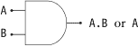

| A | B | A.B |
|---|---|---|
| 0 | 0 | 0 |
| 0 | 1 | 0 |
| 1 | 0 | 0 |
| 1 | 1 | 1 |

**图 3.1** AND 门

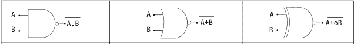

**NAND（与非门）**

| A | B | \(\overline{A·B}\) |
|---|---|---|
| 0 | 0 | 1 |
| 0 | 1 | 1 |
| 1 | 0 | 1 |
| 1 | 1 | 0 |

**NOR（或非门）**

| A | B | \(\overline{A+B}\) |
|---|---|---|
| 0 | 0 | 1 |
| 0 | 1 | 0 |
| 1 | 0 | 0 |
| 1 | 1 | 0 |

**XNOR（同或门）**

| A | B | \(\overline{A⊕B}\) |
|---|---|---|
| 0 | 0 | 1 |
| 0 | 1 | 0 |
| 1 | 0 | 0 |
| 1 | 1 | 1 |

**图 3.5** NAND、NOR 和 XNOR 门

这些互补门也具有相反的真值表。这意味着，只需将 AND 门的输出连接到 NOT 门，就能实现 NAND 的功能。NAND 和 NOR 门也称为*通用门*，因为其他门可以用这两种门中的任意一种来实现。

**注意：** 在电子学中，逻辑值 0 和 1 通过向晶体管施加低电压（约 0 伏）或高电压（约 5 伏）来实现。大多数数字电路使用“正逻辑”系统，其中 0（假）表示低电压，1（真）表示高电压。

## 3.10 编程方法学

如今的程序比几十年前复杂得多。与语言一样，编程方法学也在不断演进，逐步提供更好的设计技术，以创建易于理解、没有错误且便于修改的程序。只要可能，程序还应设计为*可复用*的——甚至可用于其他项目。坚持这些目标可以加快软件开发，从而得到高效且易于维护的程序。

大多数现代语言是*过程式*的；它们通过调用分配给某段代码的名称来执行该段代码。它们还为这些代码段设有不同的名称——如*例程、子例程、过程*或*函数*。另一类语言（如 C++ 和 Java）加入了*对象*特色，从而彻底改变了编程范式。这些特性允许使用以下可供选择的编程方法学，将代码划分为独立的*模块*：

- 可以从顶层入手处理一个问题，先构想“整体图景”，再将其分解为独立组件（自顶向下编程）。
- 也可以先设计各个组件，而不必完全了解整体图景。随后再将这些组件集成起来，构成完整系统（自底向上编程）。
- 还可以将问题设想为对象的集合，其中每个对象都封装数据以及用于访问该数据的方法（面向对象编程——OOP）。


### 3.10.1 自顶向下程序设计

*自顶向下程序设计*是一种逆向分析成品、将其分解为更小、更易管理或*可重用*模块的风格。然后，你可以通过模块名调用模块，以执行该模块所代表的任务。这些模块又进一步分解为子模块，此过程持续进行，直到最低层模块足够基础、易于实现为止。如果模块被设计为可重用，其他程序也可以调用它。这些模块称为*过程或函数*。

模块通过鼓励程序员根据程序的构建块而非实际代码来设计程序，从而降低复杂性。例如，一个程序可以拥有分别读取文件、验证数据、执行计算并最终打印报告的独立模块。在C程序中，自顶向下编程方法将整个工作可视化为由以下函数组成：

```text
read_file();
validate_data(month, year);
result = process_calc();
print_report();
```

*传递给函数的数据*

*函数返回的数据*

自顶向下方法将完整系统拆分为*黑箱*，其内容最初未知。只有在完全清楚一个黑箱接收的输入和产生的输出时，才会着手设计每个黑箱。自顶向下方法允许由不同的程序员和开发者小组独立开发模块。较低层模块由较高层模块调用，一个简单的“主”程序则调用所有这些模块。

自顶向下技术的缺点是，在将整个系统或至少其相当大一部分分解为子系统之前，无法开始编程。因此，只有在系统相当大一部分设计完成后，才能进行测试。

### 3.10.2 自底向上程序设计

*自底向上程序设计*基于与自顶向下方法所用概念相反的概念。自底向上风格不是先可视化整体图景，再下移到子组件级别，而是主张先设计低层组件。然后这些组件通常跨多个层级拼装在一起，形成完整系统。这种方法的优点是，即使尚未完全理解完整系统，设计小组也可以开始编写某些模块的代码。

当以可重用代码形式存在的现成组件已经可用时，通常采用自底向上程序设计。新系统与先前已测试并实现的系统相似，这是常见的。事实证明，旧系统的许多模块几乎无需修改或完全无需修改即可在新系统中重用。

大多数软件开发通常结合自顶向下和自底向上两种方法的混合。在两种系统中，模块按层次结构排列，其中顶层模块“调用”较低层模块。只有当编程语言支持这种“调用”特性时，这才可能。像C这样的过程式语言支持此特性。C通过函数名调用函数，以执行与该名称关联的代码块。

### 3.10.3 面向对象编程

过程式和非过程式语言都将程序视为一组作用于数据的指令。*面向对象编程（OOP）*则将应用程序视为*对象*的集合。不需要单独的指令，因为这些对象封装了数据以及访问和操作数据的指令（称为*方法*）。由于对象可重用且易于相互交互，面向对象编程用于大型复杂项目。

过程式思维需要转变，以对象的角度来认识应用程序。例如，在线应用程序中的购物车在过程式编程中表示为若干变量和过程作为独立实体的集合。在OOP中，购物车是一个对象，包含(i)由商品描述、价格和数量表示的数据，(ii)用于显示、添加或删除商品、更改其数量或配送详情的方法。另一个应用程序可以在修改或不修改的情况下重用此对象。

对象最初设计为*类*，类只是一个模板，可从中创建多个对象。除了封装，OOP模型还依赖*继承*和*多态*，这有助于使程序清晰而灵活。自顶向下和自底向上方法在OOP中也适用，但重点始终在类或对象上。

> **注意：** 可以使用像C++和Java这样的面向对象语言作为过程式语言。然而，这违背了使用OOP的初衷。

## 3.11 结构化程序设计

*结构化程序设计*力求实现程序的清晰性、更快的开发时间和易于维护性。它是过程式编程的一个分支，但超越了使用子程序或函数来创建模块化程序的做法。结构化程序使用*控制块*（一组被视为单个语句的语句）和循环（一个或多个语句的重复）。这些构造旨在取代古老的GOTO语句，该语句的使用现已弃用（尽管这一点有些值得质疑）。

结构化程序设计的基础可以追溯到数学家Bohm和Jacopini，他们在其*结构定理*中证明，任何计算问题都可以仅通过使用以下构造来解决：

- *顺序*（按顺序执行语句）。
- *决策*（从备选方案中选择）。
- *重复*（在循环中运行一个或多个语句）。

Dijkstra随后主张从所有程序中移除*GOTO*语句。人们认为，使用该语句会导致非结构化（“面条式”）代码，使程序难以理解和修改。所有现代语言都具有这三种基本构造，尽管*GOTO*语句尚未被完全废除。

大多数语言支持一种或多种*WHILE、FOR*和*UNTIL*循环来实现重复。纯粹主义者主张这些循环只有一个出口点。例如，C中使用的循环 `while (c < 50)` 仅在测试条件（`c < 50`）处终止。然而，C的设计者加入了**break**关键字，它会异常终止循环，从而提供另一个出口点。对于这一特性是否违反结构化程序设计的理念，意见存在分歧。

## 3.12 算法

程序员在编程前阶段需要的两个最有用的工具是算法及其图形对应物——流程图。*算法*是解决计算问题必须遵循的一组有限、清晰且无歧义的步骤。程序员最终将算法转换为任意语言的程序。*任何计算问题，无论其多么复杂，只有当该问题也能用算法表示时，才能用程序表示。*

算法在选择关键字方面没有既定标准，但用于计算（如 + 和 -）和比较（如 > 和 <）的符号是通用的。*结构定理（3.11）*要求使用三类构造（顺序、重复和决策），因此让我们看看本书中将使用的相关关键字。步骤采用BASIC解释器语言遵循的约定进行编号，但你可以自由采用一种自己觉得使用起来顺手的约定。

### 3.12.1 顺序

我们从一个简单算法开始，该算法要求按顺序执行一组步骤。以下算法从键盘接受两个整数，并计算它们的平方和：

```text
10 start
20 input n1, n2
30 sum = n1 * n1 + n2 * n2
40 print sum
50 stop
```

*键盘输入为两个变量赋值*

*在屏幕上显示输出*

我们将遵循这样的约定：使用**input**语句从键盘接受输入，使用**print**语句显示输出。计算使用三个变量n1、n2和sum完成。我们所有的算法都以**start**开始，并以**stop**语句结束。编程语言将有自己的关键字来表示**input**和**print**，尽管它可能使用相同的变量名。


### 3.12.2 决策

现实生活中的情境很复杂，仅靠顺序结构无法处理。我们经常需要根据对数据进行的测试结果来做决策。编程语言中最常用的决策结构是 **if** 或 **IF** 语句，我们在算法中也将使用它。下面的算法接受用户输入的一个整数，检查其是否大于 47，并打印相应的消息：

```text
10 start
20 input n
30 if n > 47 then
      print the number
   else
      print an error message
   endif
40 stop
```

> n > 47 是一个关系表达式

> 终止 if 语句

这是一个典型的 **if-then-else-endif** 结构，用于实现双向决策。条件 `n > 47` 是一个*关系表达式*，其求值结果为 true 或 false。对于多路决策，你需要将多个 **if** 语句“嵌套”在单个 **if** 结构（**if-then-else-if-then ... endif**）中。

### 3.12.3 重复

如何计算前 100 个整数的和？我们可以利用重复特性，将一个数加到变量中，并通过每次递增该数，将这一过程重复 100 次。最常用的重复结构是 **while** 语句。有些语言还支持 **for**、**until**、**do-while** 和 **repeat** 等变体结构。下面的算法可以完成此任务：

```text
10 start
20 set n to 1
30 set sum to 0
40 while n <= 100
      add n to sum
      add 1 to n
50 print sum
60 stop
```

> 当 n 达到 101 时，条件失败
> 此语句和紧接着的语句……
> ……会执行 100 次。

此任务需要初始化两个变量 n 和 sum，分别设置为 1 和 0。**while** 结构（循环）首先测试条件 `n <= 100`。**while** 后面的两条语句会反复执行，直到 n 变为 101，此时关系表达式求值为 false。在这 100 次迭代中，1 到 100 之间的每个整数都被加到了 sum 中。请注意，整个过程以非交互方式进行，因为未提供外部输入。

只要算法规模较小，它们对程序员就是有用的工具；单页算法很容易转换为程序。由于程序被设计为模块化的，为每个模块编写单独的算法是有意义的。然而，算法的语言更接近编程语言而非自然语言，这使得最终用户难以理解算法。在这种情况下，图示表示可能是更好的选择。

## 3.13 流程图

*流程图*在工业中用于以图形方式描绘制造流程和业务流程。在编程领域，流程图以图形方式呈现算法，以便最终转换为程序。它清晰地描绘了各个步骤，并追踪相关数据的流动。程序员必须对流程图和算法同样熟悉。然而，由于流程图的直观特性，它比算法更容易让最终用户信服。

流程图由一组标准图形符号组成，这些符号代表程序的各种元素。每个符号都包含精确描述所需执行操作的文本。这些符号具有以下属性：

- 矩形框（▭）此框表示所有处理活动（决策除外），例如设置变量和计算算术表达式。
- 平行四边形（▱）所有输入/输出操作（算法中使用的 **input** 和 **print** 语句）都在此处执行。
- 菱形（◇）此形状用于双向决策。真（True）和假（False）的结果分别从底部和右侧角发出。由于重复也涉及决策，菱形也用作循环的组成部分。
- 椭圆或圆角矩形（◯）这些形状专用于开始和停止活动。

这些符号通过一端带有箭头的线条连接，箭头用于指示程序逻辑执行的方向。这些箭头有三种移动方式：

- 向下：顺序流程。
- 向下和向右：决策。
- 向下和向上：重复行为。

下面几个示例将有助于说明问题。

### 3.13.1 顺序结构

顺序结构（结构定理三大原则中的第一条）由用于数据处理的矩形框和用于输入/输出活动的平行四边形表示。图 3.6 显示了计算并显示从键盘输入的三个数的平方和的流程图。

程序使用变量来操作数据，但前提是必须先*声明*变量。第一个平行四边形从键盘接收三个数，第二个平行四边形打印计算出的 sum 值。

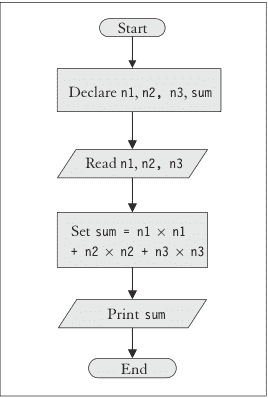

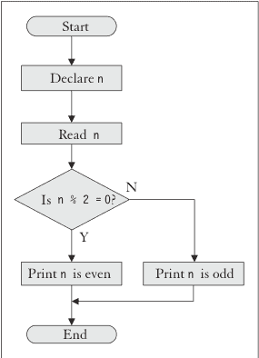

**图 3.6** 顺序结构

**图 3.7** 决策

### 3.13.2 决策

决策由菱形表示，菱形从顶部角接收输入。对于双向决策（例如表示条件 x > 5），两条箭头从菱形的底部和右侧角发出。左侧角需要第三条箭头来表示可能产生三种结果的情况。图 3.7 显示了判断一个数是偶数还是奇数的流程图。

%（取模）运算符用于计算除法的余数，因此 n % 2 的结果为 0 或 1，而 n % 3 的结果为 0、1 或 2。需要多个 IF 语句的复杂决策通过连接多个菱形来表示。第 7.7 节介绍了一种从嵌套 IF 结构生成多个结果的情况。

### 3.13.3 重复

没有用于表示重复的标准符号；通过组合顺序符号和决策符号创建的循环结构会重复执行一组指令。由于循环最终必须终止，因此必须在迭代过程的开始或结束时进行条件检查。图 3.8 所示的流程图清晰描绘了计算用户输入数字的阶乘所采用的方法。

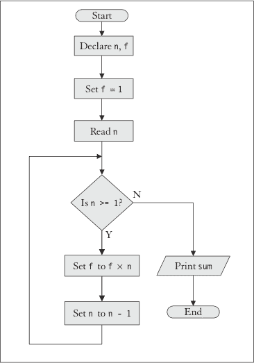

**图 3.8** 重复

计算一个数 (n) 的阶乘 (f) 的最简单方法是反复乘以下一个较小的数，直到被乘数变为 1。当 n = 6 时，f 的递进值依次变为 6、6 × 5、6 × 5 × 4，依此类推。这意味着必须在计算 f 之前检查 n 的值。请注意侧面的独立箭头如何形成循环。在循环开始时决定是继续留在循环中还是退出循环。

算法和流程图都有助于将计算问题转换为程序。尽管流程图更直观，但程序员必须熟练使用算法，因为算法比流程图占用空间更少且更易于修改。这两种工具对调试程序都很有用，但在创建程序文档时，流程图通常是首选。

### 3.14.2 高级语言（3GL）

高级语言（3GL）更接近自然语言，而远离硬件。它使用少量关键字以及键盘上的许多符号。3GL 与 2GL 之间存在一对多的关系，这意味着一条高级语言语句对应多条汇编指令。以下 3GL 源代码片段将两个数相加：

```c
int n1 = 7;
int n2 = 9;
int n3 = n1 + n2;
printf("Sum of 7 and 9 is %d\n", n3);
```

这就是 C！

与汇编器类似，另一种特殊程序——编译器——将高级语言程序的源代码转换为机器代码。机器代码保存在单独的可执行文件中，然后在 CPU 上运行。3GL 程序不对硬件做任何假设，并且通常遵循标准化语法。因此，上述源代码在大多数机器上都能运行，但每次遇到不同硬件时都需要重新编译。

大多数高级编程语言是在过去五十年中开发的。在 C 语言出现之前，BASIC、Fortran 和 COBOL 主导了 3GL 世界。随后，同样属于 3GL 家族的面向对象语言（如 C++、C# 和 Java）相继出现。如今，高级语言被用于编写商业和科学应用程序，以及操作系统等系统软件。

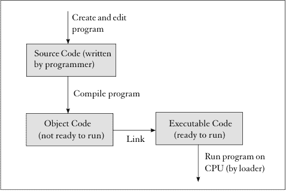

**图 3.9** 编译器、链接器和加载器的作用


> **要点：** 汇编语言无论是在源代码级还是机器代码级都是不可移植的。然而，当用高级语言（如 C）编写的程序被移到具有不同处理器的机器上时，源代码通常无需修改。但该代码必须重新编译，以生成适用于该机器的机器代码。

### 3.14.3 4GL 语言

4GL 语言延续了高级语言的使命，进一步远离硬件、更接近自然语言。4GL 语句非常强大；一条 4GL 语句常常能取代整个 3GL 程序。与 3GL 语言相比，使用 4GL 编程的严谨性要求较低，这从下面这条从数据库中选择特定项的 4GL 语句中可明显看出：

```
SELECT NAME, COMPOSITION, YEAR FROM COMPOSERS
       WHERE NAME = 'BEETHOVEN' OR NAME = 'MAHLER';
```

这是*结构化查询语言（SQL）*中的一条语句，SQL 是一种流行的 4GL 语言，用于 Oracle 和 DB2 等多个数据库产品。要完成相同的任务，你需要一百行 C 代码。4GL 在曾由 3GL 主导的领域中的部署，带来了生产率和成本上的显著改善。所有数据库产品都捆绑了一个 4GL 工具，可以查询、更新和打印存储在数据库中的信息。然而，从学习的角度来看，4GL 语言不像较低代的语言那样具有挑战性。

> **注意：** 为了让你为后续内容做好准备，从今往后我们将避免对高级语言使用术语 *language*，而改用 *statement* 一词。我们将称机器语言和汇编语言的指令以及 C 语言的语句。

## 3.15 编译器、链接器和加载器

使用 C 和 C++ 等 3GL 语言的程序员需要理解编译阶段中编译器和链接器的作用，以及加载器在程序执行阶段的作用（图 3.9）。这些程序属于系统软件，因为其内置了对硬件的了解。不过，用户可以直接调用它们。

*编译器*开始将源代码翻译成机器代码或目标代码。它为变量和指令分配内存地址，但当遇到函数或过程时，编译器只是创建一个*未解析引用*表。这些函数的目标代码在外部以*库或归档文件*的形式提供，但编译器只提供引用，不再进一步处理。

例如，C 程序经常调用 **printf** 和 **scanf** 函数。这些函数的目标代码在单独的库中可用，但编译器不会去查找该库。完成编译器未完成工作的是*链接器*——另一个独立的程序。链接器查看编译器创建的未解析引用表，然后从库或其他文件中提取机器代码，以创建一个独立的可执行文件。然后可以从操作系统 shell 中执行该可执行文件。

当用户调用由链接器创建的可执行文件时，*加载器*读取该文件并将指令和数据加载到内存中。然后它启动程序第一条指令的执行。与作为独立程序的编译器和链接器不同，加载器是操作系统的一部分。没有代表加载器的独立程序可供你输入。

链接和加载阶段因编译器和操作系统而异。链接不一定在编译时发生。它也可以在加载期间或程序执行期间进行。Windows 支持*动态链接库（DLL）*，允许在程序执行期间进行链接。UNIX/Linux 系统支持*共享对象*，其作用类似。在任何一种情况下，库代码都不会永久链接到可执行文件中。

> **注意：** 许多 3GL 编译器（包括 C）使用两个独立的程序完成源代码到机器语言的转换。汇编器将源代码转换为汇编语言，而编译器将汇编代码转换为机器语言。这里编译器的定义发生了变化，但我们将在第 4.2.3 节讨论这个问题。

## 3.16 编译型语言与解释型语言

到目前为止，我们按代（2GL、3GL 和 4GL）对语言进行了分类——按它们与自然语言的接近程度以及与硬件的疏远程度。我们还指出，程序在执行前需要被编译成机器代码。那么我们能说所有语言都是编译型语言吗？不能，语言也可以是*解释型*的，即程序中的每条语句在取下一条语句之前被转换并在 CPU 上执行。动态执行转换和执行两种操作的程序称为*解释器*。任何一代的语言都可以被解释或编译，具体取决于其实现方式。

BASIC 是一种 3GL 语言，我们中有些人在几十年前通过解释器学习过它。每次运行 BASIC 程序时，都必须调用其解释器。在大多数情况下，不会为在 CPU 上运行的代码创建单独的文件。编译器和链接器则不同，它们会创建一个独立的可执行文件——一个可独立运行的单独文件。事实上，可执行文件甚至可以在另一台未安装编译器的（兼容）计算机上运行。我们更倾向于编译器而非解释器，因为编译器灵活且用途广泛。此外，编译后的代码比解释后的代码运行得更快。

如今，解释器和编译器之间的区别有些模糊。一些现代语言，如 Java、C#、Perl 和 Python，结合使用编译和解释两种方式。编译器创建一种中间代码，通常称为*字节码*，然后由解释器执行。这些语言在处理字节码的方式上有所不同。Java、C# 和 Python 将中间代码创建在文件中，但只创建一次（除非程序被修改），而 Perl 每次执行程序时都会在内存中创建它。

> **要点：** 编译器在文件中创建机器代码，但不参与其执行。  
> 解释器通常不创建单独的文件，但参与转换和执行两者。  
> 任何语言都可以被解释、编译，或两者混合使用。

## 下一步是什么？

我们现在已经具备了所有要素，可以专注于一种至今仍有用处的特定第三代语言。接下来，我们将逐步揭示 C 语言的特性，并学习编写智能的 C 程序。

## 你学到了什么？

- 二进制数制使用两个数字（0 和 1）。C 语言还支持*八进制*（0 到 7）和*十六进制*（0 到 9 以及 A 到 F）。一个数的值等于各位数字加权值之和。
- 十进制整数可以通过反复除以基数并倒序排列余数来转换为二进制、八进制或十六进制。对于基数为 2 的幂的数，转换通过重新分组位来完成。
- 负二进制数通常通过将正数的*反码*加 1 来生成其*补码*。二进制减法通过将被减数加上减数的补码并忽略进位来执行。
- 小数通过扩展权重以使用负指数来处理。十进制小数通过反复乘以新基数并只取乘积的整数部分来转换为其他基数。但是，如果两个基数都是 2 的幂，则通过重新分组位来完成转换。
- 在 ASCII 码表中，数字位于大写字母之前，小写字母紧随大写字母之后。所有可打印字符都在 7 位 ASCII（0 到 127）中。
- 计算机中的所有计算都通过*逻辑门*进行，逻辑门通常有两个输入和一个输出。*真值表*决定了各种输入组合下的输出。
- *自顶向下编程*涉及将整个问题分解为更小的可管理单元。*自底向上编程*主张先设计底层组件，再将它们连接起来形成完整系统。
- *结构化编程*基于这样一个论点：任何编程问题都可以仅使用三种类型的结构来解决，这三种结构分别执行顺序、*决策*和*重复*。
- *算法*规定了一组无歧义的指令，这些指令被编码以解决编程问题。*流程图*以图形方式表示算法。
- 编程语言可以按*代*分类，代表示它们与自然语言的接近程度以及与硬件的疏远程度。C 是第三代语言（3GL）。
- *编译器*将源代码翻译成包含*未解析引用*的机器代码。*链接器*将函数的代码添加到机器代码中，以创建独立的可执行文件。


## 客观题

### A1. 正误判断题

- 3.1 一个数的基数指表示该数所需的符号或数字的个数。
- 3.2 用二进制表示的数有时会比其等价的 BCD 形式使用更多位。
- 3.3 一个数的反码可通过将其各位取反并加 1 得到。
- 3.4 补码系统中只有一个零，而反码系统中有两个零。
- 3.5 将一个数从一种基数转换为另一种基数时，重复除法技术仅当其中一个基数不是 2 的因子时才使用。
- 3.6 如果两个输入均为 1，则异或门的输出为 0。
- 3.7 所有逻辑门都可以由与非门和或非门构成。
- 3.8 在不完全了解一个项目的情况下，不可能开始为其编码。
- 3.9 任何计算问题都可以转换为程序，即使该问题无法用算法表示。
- 3.10 汇编器和编译器都将源代码转换为机器码。
- 3.11 一条高级语言语句对应多条汇编语言指令。
- 3.12 加载器是操作系统中的一个独立程序，由用户调用来运行程序。

### A2. 填空题

- 3.1 如果一个数的基数是 ______ 的幂，则计算是高效的。
- 3.2 用 8 位能表示的最大数是 ______。
- 3.3 数 (255)₁₀ 在 BCD 中表示为 ______。
- 3.4 负二进制数的形成方式是：除最左位外，其余所有位用来表示 ______。
- 3.5 所有可打印字符都可以用 ______ ASCII 表示。
- 3.6 或门和异或门的输出仅在两个输入均为 ______ 时不同。
- 3.7 ______ 语言允许为一段代码命名，并通过该名称调用这段代码。
- 3.8 ______ 编程主张将整个项目分解为更小的模块。
- 3.9 条件 x > 2 是一个 ______ 表达式，其值可以为 ______ 或 ______。
- 3.10 流程图是 ______ 的图形化表示。
- 3.11 关键字 mov 和 add 通常见于 ______ 语言中。
- 3.12 编译器生成的目标代码必须由 ______ 处理，才能创建独立的可执行文件。
- 3.13 ______ 会翻译并执行源代码中的每条语句，然后才获取下一条语句。

### A3. 选择题

- 3.1 数 7011 可以是 (A) 二进制，(B) 八进制，(C) 十进制，(D) 十六进制，(E) B、C 和 D，(F) B 和 C。
- 3.2 (66)₁₀ 的二进制代码是 (A) 1000010，(B) 1000110，(C) 1011011，(D) 0111101。
- 3.3 继承是 (A) 过程式编程，(B) 非过程式编程，(C) 面向对象编程，(D) 以上都不是 的一项特征。
- 3.4 程序模块化 (A) 减小代码规模，(B) 使代码可复用，(C) 使维护更容易，(D) B 和 C，(E) A、B 和 C。
- 3.5 任何编程问题都可以通过 (A) 重复、(B) 顺序和判定、(C) A 或 B、(D) A 和 B 来解决。
- 3.6 与汇编语言相比，第三代语言 (A) 更强大，(B) 更易于编程，(C) 与硬件无关，(D) A 和 B，(E) A、B 和 C。
- 3.7 汇编语言在以下层面不可移植：(A) 源代码级，(B) 机器码级，(C) 两者，(D) 以上都不是。
- 3.8 未解析引用表示 (A) 程序包含语法错误，(B) 调用了名称错误的函数，(C) 某个函数的代码未包含在主程序的目标代码中，(D) 以上都不是。

### A4. 匹配题

- 3.1 将术语与其含义/属性匹配：
  - (A) XNOR（同或门），(B) 函数，(C) 菱形，(D) 库，(E) 面向对象编程 (OOP)，(F) 循环。
  - (1) 类，(2) 重复，(3) 逻辑门，(4) 过程式语言，(5) 链接器，(6) 流程图。

## 概念题

- 3.1 将十进制数 -130 转换为二进制，分别用 (i) 符号-数值形式，(ii) 反码形式，(iii) 补码形式表示。
- 3.2 计算下列含二进制数的表达式：(i) 110011 + 101111，(ii) 110011 - 11101，(iii) 101 × 1110，(iv) 110011 / 111。
- 3.3 将下列整数从一种基数转换为另一种基数：
  - (i) (753)₈ = (???)₁₀，(ii) (491)₁₀ = (???)₈，(iii) (AF8)₁₆ = (???)₂，(iv) (65450)₁₀ = (???)₁₆，(v) (10110111)₂ = (???)₈。
- 3.4 将下列小数从一种基数转换为另一种基数：
  - (i) (10111.1001)₂ = (???)₁₀，(ii) (107.47)₈ = (???)₁₀，(iii) (107.47)₁₀ = (???)₁₆，(iv) (1111.11)₂ = (???)₈，(v) (0.1AF)₁₆ = (???)₂。
- 3.5 编写一个算法，求一个数的各位数字之和。
- 3.6 为三个整数排序编写算法和流程图。
- 3.7 高级语言和低级语言有什么区别？请为每种类型各举一个例子。
- 3.8 解释汇编器、编译器和解释器之间的区别。

# 4 初尝 C 语言

## 学习要点

- 将 C 源程序转换为机器码的三阶段编译过程。
- 在程序中使用*顺序、判定*和*重复*。
- 处理编译器生成的简单错误。
- *函数*在使程序模块化中的作用。
- 掌握 **printf** 和 **scanf** 函数的实用知识。
- 从宏观上了解 C 语言特性。
- 使程序可读和可维护的常用风格。
- 使 C 稳定且被广泛接受的标准化工作。

## 4.1 C 语言

C 语言由在 AT&T（现为朗讯）任职的丹尼斯·里奇于 20 世纪 70 年代创造。C 的创造目标不同寻常——不是取代 Fortran 或 BASIC，而是重写 UNIX 操作系统的代码。当时，操作系统是用汇编语言编写的，但里奇打破常规的思维催生了一门可移植、紧凑且快速的语言。回顾起来，我们发现他实现了两全其美。如今，UNIX/Linux 操作系统几乎可以在任何硬件上运行，而 C 则广受编程青睐。

但最初为 UNIX 系统创造的 C 与 Windows 计算机（通常是 Visual Studio）或 iPhone（Objective C）上使用的 C 有显著不同。里奇的 C 可以直接调用（称为*系统调用*）UNIX 操作系统。UNIX 操作系统使用一组标准化的此类系统调用来完成其所有工作。然而，非 UNIX 系统不使用其中大多数调用，因此包含这些调用的 UNIX C 程序在其他系统上会编译失败。但 C 有太多优点，不能仅因这个原因而被忽视。

当 C 走向商业化时，供应商对该语言做了大量修改，使其能在其他平台上运行。最初的 C 逐渐失去其特性，直到美国国家标准学会（ANSI）介入并对该语言进行标准化。ANSI 标准从 UNIX C 中移除了系统调用，并保留了原始语言的一个子集。这个子集现在通用于所有系统；在本书中，我们将坚持使用这个子集，并按其不同称呼将其称为 ANSI C、C89 或 C99——这是 ANSI 使用的命名法。

C 是一门简单但强大的第三代语言。其丰富的*函数*库支持模块化应用程序的开发。它支持多种用于判定（**if** 和 **switch**）和重复（**while, for** 和 **do-while**）的构造，这也使其适合结构化编程。但该语言的力量源自大量*运算符*，这些运算符允许进行低级操作，例如 (i) 直接访问内存，以及 (ii) 操作内存中的每一位。在这方面，C 有点类似于汇编语言这样的第二代语言。

如今，C 被广泛用于开发各种应用软件和系统软件。许多语言（包括 C）的编译器都是用 C 编写的。由于 C 程序紧凑且高效，它是在手机和平板电脑等小型设备上运行的软件的首选语言。在向学生介绍编程世界方面，C 已取代 BASIC 和 Pascal。它还影响了 C++、C# 和 Java 等面向对象语言的发展。值得学习 C，因为这门语言不会很快消失。

> **注意：** C 可以被视为既是一门高级语言，也是一门低级语言。虽然它足够低级，能够访问特定的内存位置，但它也是一门高级语言，具备任何 3GL 语言中所有的标准构造和运算符。

## 4.2 C 程序的生命周期

在本节中，我们讨论使 C 程序成功运行所涉及的各个环节的作用。一个程序被构思、创建、转换，并最终执行（图 4.1）。错误不可避免地会发生在以下阶段：(i) 编译阶段，原因是语法（文法）使用错误；(ii) 执行阶段，原因是程序设计错误。在讨论编译机制之前，有必要讨论 C 的两个重要特性，它们会显著影响编译过程。

### 4.2.1 头文件和函数

里奇希望 C 保持紧凑，因此两个特性——指令和函数——被置于该语言“之外”。例如，大多数 C 程序在程序开头都有 **#include <stdio.h>** 这一行。这只是一个*指令*，用于将*头文件* stdio.h 的内容放入程序中。头文件包含多个程序使用的数据，因此与其将数据包含在程序本身中，一行指令可以使事情保持简单和可管理。此外，通过明智的分工，C 确保这一行由*预处理器*处理，因此编译器根本看不到它。

在 C 中，大多数工作由*函数*执行。函数通过其名称被调用，以执行一组语句。如果多个程序需要执行此任务，那么它们可以调用同一个函数。只有当函数的机器码集中可用并对所有程序可访问时，这才可能。例如，当编译器遇到 **printf** 函数时，它知道 **printf** 的代码可在其他地方获得。分工在这里同样起作用；编译器采取不插手的做法，将包含函数代码的工作留给*链接器*。


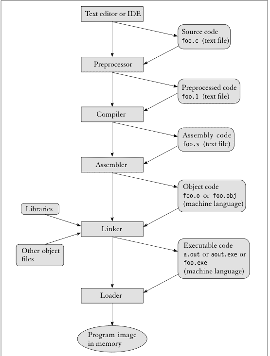

**图 4.1** C 程序的生命周期

### 4.2.2 编辑程序

在编写程序之前，你首先需要确定其输入和输出，然后设计程序逻辑。一旦你准备好了算法或流程图，就可以使用编辑软件输入源代码。这个编辑器可能由操作系统提供，也可能是编译软件的一个组件。将代码保存为具有 .c 扩展名的文件，并使用有意义的名称（例如 `celsius2fahrenheit.c`，而不是像 `a.c` 或 `foo.c` 这样的名称）。

为了使程序成功编译，其源代码必须在*语法*上正确，即必须符合语言规则。只要犯一个小错误（比如在 C 语句中漏掉 `;`），你的程序就会拒绝编译。每当生成一个或多个错误时，你必须重新调用编辑器进行修改。包含源代码的文件必须备份，以便将来进行修改。如果你丢失了这个文件，就无法通过反向工程从机器代码中恢复源代码。

### 4.2.3 三阶段编译过程

如前所述，C 程序依赖于外部维护的信息，因此 C 的编译过程与其他语言略有不同。C 的编译是一个三步过程，涉及使用三个独立的程序：

- *预处理器* —— 该程序处理以 `#` 开头的行。这些行多出现在程序开头，被称为*预处理指令*。指令可以在该位置插入头文件的内容（如 `#include <stdio.h>`），或在程序中执行替换（如 `#define PI 3.142`）。因此，预处理器*修改*源代码，使其适用于下一阶段。这种修改是在副本上进行的；包含源代码的原始文件不受影响。
- *编译器* —— 该程序在预处理器修改源代码后对其进行检查。如果编译器在此代码中检测到一个或多个语法错误，它会显示这些错误并停止进一步处理。否则，编译器会创建中间*目标代码*。此代码不完整且无法运行，因为它不包含标准 C 函数（如 `printf` 和 `scanf`）的代码。编译器仅留下对这些函数的*未解析引用*（3.15）。
- *链接器* —— 该程序处理编译器留下的未解析引用。链接器通过将独立库中可用的函数的机器代码添加到编译器创建的目标代码中来实现这一点。生成的代码是一个独立的可执行文件，由程序加载器运行。*链接器填补了编译器留下的空洞。*

尽管每个 C 发行版都包含这三个程序，但它们可能被分别调用，也可能不会（除非你正在处理包含多个程序的应用程序）。通常，这些程序由一个主程序调用，但如果它在源代码中遇到语法错误，就会停止运行。例如，如果编译器检测到语法错误，链接器将不会被调用，这意味着不会生成可执行文件。如果发生这种情况，你必须编辑源文件并重复这个三阶段循环。

编译器是否直接将源代码翻译成机器代码？一些编译器（如 Linux GCC 编译器）发现先执行到汇编语言的翻译更为方便。然后一个单独的程序（*汇编器*）将汇编语言代码转换为机器代码。一旦最终机器代码生成，中间文件就会被删除。但是，GCC 也支持一个选项来保留汇编代码，供汇编语言程序员使用。


> **注意：** 在 C 中，术语*编译器*有两种用法。它可能指完成第二阶段工作的程序，也可能指执行所有三项任务的统称。真正的含义应从上下文中明确，但如果不明确，我们将使用术语*编译软件*来表示统称。

### 4.2.4 执行程序

独立可执行文件的默认名称取决于系统——在 UNIX/Linux 系统上是 **a.out**，在 Windows 上是 **aout.exe** 或 **AOUT.EXE**。（Visual Studio 以源文件命名可执行文件，因此 **foo.c** 被编译为 **foo.exe**。）可以通过在操作系统 shell 中运行 ./a.out 来执行此文件。如果你在 GUI 环境（如 Visual Studio）中使用 C，则必须使用鼠标选择执行所有编译和执行任务的菜单选项。

程序有可能通过编译和链接阶段，但仍然在执行中失败。程序在*运行时*（即程序实际运行时）失败，原因是设计错误导致的*语义错误*。例如，除以零会使程序因错误而中止。使用 `=` 而不是 `==` 也会产生意外结果。没有考虑到所有可能性的错误逻辑也可能使程序行为异常。解决方案是一样的：编辑源代码，并在重新执行之前重复编译过程。

你可能会争辩说，如果通过一个简单的 **#include** 指令就可以获得 **stdio.h** 的内容，为什么不为涉及圆的多个程序所需的值（如 3.142 或 PI）也这样做呢？没错，C 不鼓励你在每个计算圆面积的程序中存储 PI 的值。你可以将这些信息保存在头文件中，并同样包含它。


> **要点：** 程序可能有语法错误（由于语法使用错误）或语义错误（由于程序逻辑错误）。前者在编译期间被检测到，后者在程序执行期间被检测到。

## 4.3 了解你的 C 编译软件

在开始编写程序之前，你需要熟悉系统上安装的 C 编译软件（整个程序集）。多年来，该软件在规模和便利性方面都有所增长，以提供完整的编程环境。该环境通常包含以下组件：

- 主程序——预处理器、编译器和链接器。
- 由预处理器解释的标准头文件。
- 包含 ANSI C 所有函数对象代码的标准库（如 `printf`）。
- 用于编辑程序和头文件的编辑器。
- 用于定位程序中语义（运行时）错误的调试器。

编译软件有 CUI 和 GUI 两种风格。命令行或 CUI 系统提供独立的编辑、处理和调试程序。这些程序按名称调用，并支持多个*选项*或*开关*来更改其默认行为。不过，在本书中我们不需要使用这些选项（第 17 章除外）。

基于 GUI 的系统提供了*集成开发环境（IDE）*，其中所有操作都通过鼠标的指向和点击机制调用。IDE 基于菜单，无需按名称调用命令。然而，在底层，这些鼠标点击在内部会调用独立的程序。通常，IDE 系统也为那些（包括本作者）喜欢按名称调用命令的人提供 CUI 模式。

### 4.3.1 GCC（Linux）

Linux 系统支持一个名为 GCC 的 CUI 系统，这是 GNU 提供的免费软件包。它随每个 Linux 发行版一起发布，但可能默认未安装。它包含以下独立程序：**gcc**（编译器）、**cpp**（预处理器）、**ld**（链接器）和 **gdb**（调试器）。GCC 不提供编辑器，但 Linux 支持两个大多数人使用的强大编辑器：**vim** 和 **emacs**。要检查系统上是否安装了 GCC，请在 shell 中运行 **gcc** 命令：

```
$ gcc
gcc: no input files
```

> $ 表示 shell 提示符
> gcc 存在

来自 **gcc** 编译器的这条消息指出需要指定文件名。如果未安装 GCC 包，你会收到消息 `gcc: command not found`。**gcc** 还充当 **cpp** 和 **ld** 的前端，因此你通常不必费心单独运行预处理器和链接器。默认情况下，**gcc** 创建可执行文件 **a.out**，必须作为 **./a.out** 执行。

### 4.3.2 Microsoft Visual Studio（Windows）

与 Linux 不同，C 编译软件并非 Windows 操作系统原生自带。但有许多第三方包可用，包括已移植到该平台的 GCC 包。在本书中，我们将参考流行的基于 GUI 的 Visual Studio 包，其中菜单栏中的*生成*菜单提供了所有必要的处理选项。基本编程活动及其关联的菜单选项如下：

- 使用*生成 > 编译*编译程序。
- 使用*生成 > 生成*调用链接器。
- 使用*生成 > ! 执行*执行程序。

与 GCC 不同，Visual Studio 支持一个功能有限的内置编辑器。它还允许从 MS-DOS shell 进行命令行操作。编译和链接的命令分别是 **cl.exe** 和 **link.exe**。与 **gcc** 类似，**cl.exe** 直接调用链接器（**link.exe**）来创建

可执行文件。与其他生成 `aout.exe` 作为默认可执行文件的 Windows 编译器不同，Visual Studio 根据源文件名命名可执行文件。源文件 `first_prog.c` 被编译为 `first_prog.exe`。

**注意：** Windows 可执行文件具有 `.exe` 扩展名。取决于所使用的编译器，程序 `foo.c` 会被转换为可执行文件 `aout.exe` 或 `foo.exe`。另请注意，Windows 文件名不区分大小写，因此 Linux 视为不同文件的 `foo.c` 和 `FOO.c` 在移动到 Windows 时会产生冲突。

## 4.4 `first_prog.c`：理解我们的第一个 C 程序

我们的第一个程序（程序 4.1——`first_prog.c`）依次执行一组语句，这些语句使用两个变量执行简单的算术运算。输出显示在屏幕上。此程序并未设计为暂停以从键盘获取用户输入；所有数据都在程序自身中提供。粗略一看，可以看到典型的两部分结构：*预处理器*部分和*主体*部分。C 的精神在注释和程序输出中显而易见。

```c
/* first_prog.c: Declares and assigns variables.
   Also features some simple computation. */

/* Preprocessor Section */
#include <stdio.h>              /* printf needs this file */
#define PI 3.142                 /* PI is a constant */

/* Program Body */
int main(void)                   /* This is where the action begins */
{
    /* Variable declarations */
    int radius = 5;               /* Integer type */
    float area;                   /* Floating point type */

    /* Other Statements */
    printf("All numbers are stored in binary\n");
    printf("Radius of circle = %d\n", radius);
    area = PI * radius * radius;
    printf("Area of circle having radius %d = %f\n", radius, area);

    /* The return statement explicitly terminates a program */
    return 0;
}
```

| 程序 4.1：`first_prog.c` |
| --- |
| 所有数字均以二进制形式存储<br>圆的半径 = 5<br>半径为 5 的圆面积 = 78.550003 |

程序输出：`first_prog.c`

### 4.4.1 程序注释

与每种语言一样，C 支持源代码中的注释。注释有助于使程序维护更容易，因此明智的程序员会在程序的关键点提供注释。它们由左侧的字符序列 `/*` 和右侧的 `*/` 包围。注释可以是单行或多行，也可以放在程序语句之后。本程序展示了所有这些实例。

注释绝不会影响可执行文件的大小或效率，因为它们会被编译器移除。虽然不鼓励过度使用注释，但复杂的逻辑必须在程序本身中妥善记录。明智地使用注释将帮助你在数月甚至数年后查看自己的程序时理解它。

### 4.4.2 预处理器部分

紧接初始注释行之后的预处理器部分包含两行，它们以 `#` 开头，但不以分号结尾。它们不是 C 语句，因为所有 C 语句都以分号终止。（如需确认，请查看后续行。）这些行称为*预处理器指令*，通常出现在单词 **main** 出现之前。当程序被编译时，预处理器会在编译器看到它们之前处理这些行。

第一条指令（`#include <stdio.h>`）告诉预处理器用文件 `stdio.h` 的内容替换该行。这个*头文件*包含 `printf` 函数所需的信息，随每个 C 发行版一起提供。

下一条指令（`#define PI 3.142`）指示预处理器将程序中所有出现的 PI 全局替换为 3.142。因此编译器看到的不是 PI，而只是 3.142。与作为变量的 radius 和 area 不同，**PI** 是一个*符号常量*。它在主体中出现一次——在计算圆面积的表达式中。我们将需要理解为什么 PI 没有被声明为变量。

> **注意：** 预处理器指令不以分号结尾，因为从技术上讲它们不是 C 语句。事实上，在预处理器完成其工作后才行动的编译器看不到任何注释行、`#define` 或 `#include` 指令。

### 4.4.3 变量与计算

预处理器部分之后是程序主体，它以单词 **main** 开头。主体代表 C 程序的核心，所有工作实际上都在这里完成——给变量赋值、做出决策、运行循环和调用函数。主体包含以分号结尾的*语句*。这里，它以两个变量声明开始：

```c
int radius = 5;          /* Integer type */
float area;              /* Floating point type */
```

C 是一种*类型化*语言，这意味着所有数据都分配有类型。第一条语句声明一个名为 `radius` 的变量，其类型为 `int`（整数）。赋值符号 `=` 是一个*运算符*，它将值 5 赋给 `radius`。下一条语句声明另一个名为 area 的变量，类型为 float（浮点数）。这些*C 关键字* int 和 float 是 C 中两种常用的数据类型。在此阶段，我们不知道 area 的初始值是什么。

下一条语句（area = PI * radius * radius;）使用乘法运算符 * 计算圆的面积。然后将结果赋给变量 area。请注意，编译器看到的不是 PI，而是 3.142，因为预处理器已经完成了这种替换。我们现在已经看到了 C 庞大运算符库中的两个成员（= 和 *）的用法。

> **注意：** 所有变量声明都应在开头进行——在预处理器指令之后、语句之前。

### 4.4.4 初遇函数：`printf`

C 使用 **printf** 在屏幕上输出消息。与作为 C 关键字的 int 和 float 不同，**printf** 是一个*函数*。C 函数很容易通过其名称后面的一对圆括号来识别。第一个 **printf** 使用单个*参数*——字符串 "All numbers are stored in binary\n"。请注意，**printf** 并不打印 \n，而是将其解释为*转义序列*。在这种情况下，\n 将光标移到下一行，因此下一个 **printf** 可以在单独一行显示输出。

接下来的两个 **printf** 语句使用两个或三个以逗号分隔的参数。在每种情况下，第一个参数*必须*是要打印的字符串。但如果该字符串包含*格式说明符*（如 %d），则下一个参数会在该位置打印。%d 用于打印整数值，而 %f 处理浮点数。在这两个语句中，%d 是 radius 的格式说明符，而 %f 是 area 的说明符。

> **注意：** **printf** 不会插入换行符，除非你明确指示它这样做。此功能允许使用单独的 **printf** 语句打印长字符串。

**main 函数**

**printf** 是我们在本程序中找到的唯一 C 函数吗？不，我们应该已经知道单词 main 实际上也是一个函数：它后面跟着一对圆括号。现在，我们只需注意每个程序都有一个 **main** 函数，它会被*自动*调用来执行程序主体中的语句。我们将在 4.15 节讨论这个函数。

### 4.4.5 return 语句

最后，我们遇到了 **return** 语句，它通常是程序主体中的最后一条语句。当在程序主体内部遇到此语句时，程序执行终止。在我们获得函数知识之后，我们也会在函数内部使用 **return**。目前，我们将忽略值 0 的意义，但不会忘记使用带有此值的 **return**。

凭借迄今为止获得的有限知识，我们已经在一定程度上理解了 **first_prog.c** 如何工作。但为了获得真正的第一手感受，我们还需要输入程序并运行它，以获得程序清单下方显示的输出。我们将在检查用于编译和运行程序的软件环境之后进行此操作。


## 4.5 编辑、编译和执行 `first_prog.c`

在你的系统上为将要开发的 C 程序创建一个单独的目录。使用文本编辑器输入此程序，以创建源文件 **first_prog.c**。我们使用文本编辑器而不是像 Microsoft Word 这样的文字处理软件，因为 C 源程序是文本文件，而不是二进制文件。遵循以下准则对你大有裨益：

- 按照程序清单中所示对文本进行缩进。适当的缩进有助于理解和维护，因此使用 [Tab]（↹）键进行缩进。
- 不要忘记提供大多数行末尾出现的 `;`。
- 不要用分号终止以 `#define` 和 `#include` 开头的语句。
- C 区分大小写，因此除非所示位置，否则不要使用大写字母。
- 在指定使用双引号的地方不要使用单引号，反之亦然。

输入程序后，将其保存为 **first_prog.c**。现在你已准备好开始编译过程。接下来是特定于编译器的信息，因此你需要参阅第 4.3.1 节或第 4.3.2 节。


**注意：** 记住用分号终止每一条 C 语句。如果编译器找不到分号，就会产生错误，尽管它可能无法正确指出应该放置分号的位置。

### 4.5.1 使用 gcc（Linux）

要输入程序，你可以选择 **vim** 或 **emacs** 编辑器，这是 Linux 支持的两种最著名且功能强大的编辑器。（Windows 版本也可免费获得。）保存文件后，使用 **gcc** 命令编译 **first_prog.c**：

```
$ gcc first_prog.c
$ _                         Prompt returns; compilation successful
```

默认情况下（如上所示），**gcc** 首先调用预处理器（**cpp**），然后自行完成编译工作，最后调用链接器（**ld**）创建可执行文件——所有这些都在一次调用中完成。提示符静默返回表明没有遇到语法错误，并且已创建默认的可执行文件 **a.out**。现在运行 **ls** 命令以验证该文件是否存在。

现在可以按这种方式调用可执行文件，以产生程序清单（程序 4.1）之后显示的输出：

```
$ ./a.out
All numbers are stored in binary
Radius of circle = 5
Area of circle having radius 5 = 78.550003
```

输出正确，这意味着程序中不存在语义错误。如果你看到语法错误消息，请从这些消息中记下出错位置的行号。修正源代码并重新编译程序。错误消息的处理将在第 4.6 节中讨论。

### 4.5.2 使用 Visual Studio（Windows）

如前所述，Visual Studio 支持 GUI 和 CUI 两种操作模式。使用 Visual Studio 的内置编辑器或 Windows 记事本输入程序，并将文件保存为 **first_prog.c**。下面说明每种模式的操作步骤顺序。

**GUI 模式**  菜单栏中的 *Build* 菜单包含编译和执行所需的所有选项。在此模式下，你需要分别调用编译和链接阶段：

- *Preprocess and Compile*  使用 *Build > Compile first_prog.c*，并观察底部的窗格。如果看到编译错误，请记下它们的行号，编辑源文件并重复编译。暂时可以忽略警告。编译成功后，你应该会看到消息 `first_prog.obj - 0 error(s)`，这表示已创建目标文件 **first_prog.obj**。该文件包含机器代码，但还不能运行，因为它包含未解析的引用（3.15）。
- *Link*  链接通过 *Build > Build first_prog.exe* 完成，此时你应该会看到消息 `first_prog.exe - 0 error(s)`。可执行文件 **first_prog.exe** 已创建。

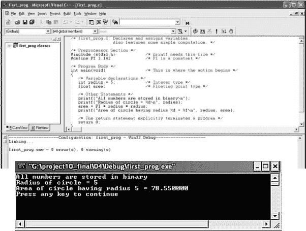

**图 4.2**  Visual Studio：编译和执行程序

现在可以使用 **Build > ! Execute first_prog.exe** 运行此可执行文件。将打开一个新窗口，显示程序的输出。这些活动的屏幕截图如图 4.2 所示。

**提示：** Visual Studio 为所有这三项活动提供了快捷键：[Ctrl][F7] 用于编译，[F7] 用于链接，[Ctrl][F5] 用于执行。此外，你还会在其中一个工具栏中找到表示这些活动的独立图标。

**CUI 模式**  调用 MSDOS shell 或命令提示符（使用 *Run > cmd*），然后调用以下命令：

```
C:\> cl first_prog.c
/out:first_prog.exe
first_prog.obj
```

程序 **cl.exe** 调用 **link.exe** 创建可执行文件，然后可以像这样简单地运行它：

```
C:\> .\first_prog
All numbers are stored in binary
Radius of circle = 5
Area of circle having radius 5 = 78.550003
```

> 注意其中的 .\\

输出正确，这意味着程序中不存在语义错误。如果遇到错误，请根据错误消息中提供的行号来编辑源代码。重新编译程序并重新执行 **first_prog.exe**。错误消息的处理将在第 4.6 节中讨论。

**注意：** 独立可执行文件（**a.out** 或 **first_prog.exe**）现在可以在此机器及类似机器上运行，*即使这些机器上没有安装 C 编译器。*

## 4.6 处理错误和警告

你看到的内容往往不是你期望看到的内容——至少在学习过程的初始阶段不是。错误不可避免，但你必须能够检测并纠正它们。程序员经常忘记添加分号；如果你在 **first_prog.c** 的第一条 **printf** 语句中这样做，那么 **gcc** 在 Linux 上会这样反应：

```
$ gcc first_prog.c
first_prog.c: In function 'main':
first_prog.c:18: error: expected ';' before 'printf'
```

消息中似乎没有歧义；编译器发现第 18 行缺少一个分号。但也许出乎意料的是，第 18 行包含一个分号：

```
printf("Radius of circle = %d\n", radius);
```

编译器把行号弄错了吗？其实没有；只是第 17 行缺少的 ; 诱使编译器认为第 17 行和第 18 行构成了一条语句。由于语句终止符是分号，编译器会继续扫描，直到找到一个分号。

Visual Studio 也会显示类似的消息，但它还会生成一条警告：

```
first_prog.c(16) : warning C4244: '=' : conversion from 'double' to 'float',
                   possible loss of data
first_prog.c(18) : error C2146: syntax error : missing ';'
                   before identifier 'printf'
Error executing cl.exe.
first_prog.obj - 1 error(s), 1 warning(s)
```

在你了解到常量像变量一样也有数据类型（5.1.2）之后，这条警告就有意义了。这里，常量 PI 的类型是 double，在此机器上它比 float 更长。编译器担心将较大类型（double）的值赋给较小类型（float）的变量（area）可能会导致信息丢失。警告不是错误，代码仍会编译。但是，你应该知道自己正在做什么，因此一段时间后，你也应该能够处理这些警告。

在 C 语句末尾省略 ; 是 *语法错误* 的一个例子。当语句不符合 C 语言规则时，就会发生语法错误。发生此类错误时，编译器不会生成可执行文件。前面的错误消息帮助我们顺利定位了出错行，但有些错误可能有点难以定位。

然而，即使你成功通过了编译和链接阶段，你的程序仍可能不按预期方式运行。你可能输入了 = 而不是 ==（两者都是有效的 C 运算符），或者输入了 65 而不是 65.0。这些是 *语义错误*，表示含义上的错误。例如，**if (x == 5)** 与 **if (x = 5)** 并不相同，尽管两者在语法上都是正确的。语义错误只有在 *运行时* 才会遇到，即程序实际运行时。编译器不会检测它们；这是你的工作——如有必要，使用调试程序来完成。

> **提示：** 语法错误通常能较早定位，但语义错误往往很难识别。这些错误可能不会在程序的每次调用中都出现，因为某些数据可能引发问题，而另一些数据可能不会。注意警告；它们通常提供有价值的线索。

## 4.7 second_prog.c：一个交互式且可做决策的程序

你知道，结构化编程要求语言支持 (i) 决策和 (ii) 重复。我们的下一个程序（程序 4.2）使用 **if** 语句进行决策。它还使用 **scanf** 函数实现交互行为。该程序从用户那里接收一个整数，验证输入，并打印具有该值的 ASCII 字符。对该程序的四次调用揭示了你会希望始终牢记的重要信息。

注意 **#include** 语句：每当我们使用 **printf** 和 **scanf** 之类的函数时，都应始终包含它。当程序遇到 **scanf** 时，它会暂停以接收用户输入。然后 **scanf** 会 *转换* 该输入值并将其保存在变量 **your_number** 中。

这里引人注目的是，当变量 your_number 作为 **scanf** 的参数使用时，使用了 & 前缀。按照设计，C 函数不能 *直接* 将键盘输入赋给变量。第 4.8.2 节解释了转换的必要性，以及为什么 **scanf** 需要 &，而 **printf** 不需要。


```c
/* second_prog.c: Uses decision making to validate user input.
   Introduces the scanf function for taking user input. */
#include <stdio.h>
int main(void)
{
    int your_number;

    /* Take user input first */
    printf("Enter an integer greater than 47: ");       /* No \n here */
    scanf("%d", &your_number);                  /* Note that scanf requires the & */

    /* Decision making statement */
    if (your_number > 47) {               /* Beginning of control block */
        printf("The number you entered is %d\n", your_number);
        printf("ASCII value of '%c' = %d\n", your_number, your_number);
    }                                      /* End of control block */
    else
        printf("You entered a number less than 48\n");

    return 0;
}
```

| 程序 4.2：**second_prog.c** |  |
|---|---|
| Enter an integer greater than 47: 48<br>The number you entered is 48<br>ASCII value of '0' = 48 | *第一次调用* |
| Enter an integer greater than 47: 65<br>The number you entered is 65<br>ASCII value of 'A' = 65 | *第二次调用* |
| Enter an integer greater than 47: 97<br>The number you entered is 97<br>ASCII value of 'a' = 97 | *第三次调用* |
| Enter an integer greater than 47: 47<br>You entered a number less than 48 | *第四次调用* |

### 程序输出：**second_prog.c**

现在通过决策构造——**if** 语句——对输入值进行验证。该语句使用一个布尔表达式（your_number > 47），其结果为真或假。这个值决定是否执行后续*控制块*中的语句。该块由一对匹配的花括号（{ 和 }）界定。

与 **if** 一样，许多 C 构造以及函数都使用块。如果你输入一个小于 48 的数字，条件不满足（为假），则执行 **else** 关键字后面的语句。这一点从程序的第四次调用中可以明显看出。

在 **if** 语句内部的控制块中的第二个 **printf** 语句里，有两点需要注意。**printf** 两次打印同一个变量，但使用了不同的格式说明符（%c 和 %d）。%c 说明符打印存储在 your_number 中的值的字符表示，而 %d 打印其 ASCII 值。字母 'A' 的 ASCII 值为 65，而 'a' 的值为 97。数字的值更低。另外注意双引号内单引号的使用，这使得单引号按字面解释。

> **注意：** 小写字母的 ASCII 值比其对应的大写字母大 32。并非所有 ASCII 字符都能在键盘上找到，但可以通过 C 程序生成它们。

## 4.8 两个函数：`printf` 和 `scanf`

到目前为止，你已经接触了两个重要函数：**printf** 和 **scanf**。它们属于 I/O（输入/输出）函数家族。尽管本书大量使用这些函数，但对它们的详细考察推迟到第 9 章。不过，我们需要知道如何调用这些函数。我们也不需要知道它们如何工作。

**printf** 和 **scanf** 互为补充；**printf** 显示输出，而 **scanf** 接受输入。两者都使用*控制字符串*来确定如何打印或赋值变量和表达式。与大多数接受固定参数集的 C 函数不同，*这些函数的参数列表是可变的*。在本书中，我们采用这样的习惯：在讨论重要函数时，先给出其语法（或用法，后面我们称之为*原型*）。

### 4.8.1 `printf`：打印到终端

**printf** 函数是在屏幕上显示（打印）格式化输出的最便捷机制。它需要文件 `stdio.h`，因此每次使用该函数时都应包含它。该函数可以以两种方式使用：

| 形式 1 | 形式 2 |
|---|---|
| `#include <stdio.h>`<br>`printf(string);` | `#include <stdio.h>`<br>`printf(control_string, arg1, arg2, ...);` |

形式 1 用于打印一个简单字符串，其中可能包含转义序列（如 \n）。整个字符串表示 **printf** 的单个参数：

```c
printf("All characters have ASCII values\n");
```

*单个参数*

形式 2 用于显示变量或表达式的值。在这种情况下，第一个参数是一个*控制字符串*，其中包含一个或多个格式说明符（如 %d）。其余参数 *arg1、arg2* 等表示要使用控制字符串中提供的信息打印的变量。参数列表末尾的省略号（三个点）表示列表中的项数可变。

下面展示如何使用带两个参数的 **printf** 打印一个 `int` 类型的变量（假设 total 被设为 10）：

```c
int total = 10;
printf("Total = %d\n", total);
```

打印出 Total = 10

格式说明符充当占位符，在输出中会被其匹配变量的值替换。多个格式说明符必须具有匹配数量的参数。下面的例子有三个格式说明符，用于打印三个变量：

```c
float length = 10, breadth = 7, height = 5;
printf("Length = %f, Breadth = %f, Height = %f\n", length, breadth, height);
```

格式说明符 %d 和 %f 分别用于打印十进制整数和浮点数（表 4.1）。你还会使用 %c 打印单个字符，使用 %s 打印字符串。还有更多说明符，但目前掌握这四个就足够了。

> **注意：** 当格式说明符的数量与变量的数量不匹配时，就会出现错误。例如，如果你从前面的 `printf` 语句中删除变量 `height`，但没有删除它的格式说明符，那么该位置可能会打印出一个垃圾值。编译器可能发出警告，但不会产生错误。C 可能认为你是故意这样做的。

### **表 4.1** `printf` 和 `scanf` 使用的常用格式说明符
*（扩展列表见表 9.1 和表 9.3）*

| 格式说明符 | 表示 | 用于数据类型 |
|---|---|---|
| %c | 字符 | char |
| %d | 整数 | short、int、long、long long |
| %f | 浮点数 | float、double、long double |
| %s | 字符串 | char 类型数组 |

### 4.8.2 `scanf`：从键盘输入

`scanf` 函数补充了 `printf` 的作用。它从键盘获取输入，并根据*控制字符串*中的信息，在*转换后*将值赋给变量 *arg1、arg2* 等。`scanf` 的语法如下：

```c
#include <stdio.h>
scanf(control_string, &arg1, &arg2, ...);
```

与 `printf` 一样，`scanf` 在控制字符串中使用 %d、%f 等格式说明符，其意义大致相同。但 &arg1、&arg2 等并不表示变量，尽管 *arg1* 和 *arg2* 是变量。参数 &arg1 表示一个*内存地址*，其中包含 *arg1* 的值。下面从 `second_prog.c` 中提取的代码片段展示了 & 在 `scanf` 中的用法：

```c
int your_number = 0;
printf("Enter an integer greater than 47: ");
scanf("%d", &your_number);
printf("The number you entered is %d\n", your_number);
```

### **工作原理：scanf 如何工作？**

当你针对前面的 **scanf** 调用输入比如 75 时，**scanf** 不会把输入读取为整数 75，而是读取为两个单独的字符 '7' 和 '5'。**scanf** 知道（因为 %d）你想指定一个整数，所以它首先将 '7' 和 '5' 转换为数字 75 的二进制等价值。由于 C 函数的一个特殊属性，**scanf** 必须查看变量（比如 **your_number**）的内存位置，以便将转换后的值放到那里。**&your_number** 中的 & 提供了 **your_number** 的内存地址。**printf** 不需要 &，因为它计算变量而不赋值。

第一个 **printf** 提示输入一个整数，你输入的整数会被转换，并由 **scanf** 保存在变量 **your_number** 中。插入框（*工作原理*）说明了转换的必要性以及 & 运算符的作用。

**注意：** 在 **scanf** 的变量列表中省略 & 是一个常见的语义错误。编译器会生成警告，但仍会继续创建可执行文件。然而，程序将无法运行。

**要点：** 使用以变量名作为函数参数的函数，无法给变量赋值。必须使用 & 前缀。

## 4.9 third_prog.c：一个具有重复功能的交互式程序

我们已经考虑了顺序结构（程序 4.1）和决策结构（程序 4.2）。这个程序（程序 4.3）具有重复功能，这是结构化编程的第三个原则。该程序通过两次调用 **scanf**，接受一个字符和一个数字，然后运行一个 **while** 语句（循环），将该字符打印数字所指定的次数。为了保持程序简短简单，避免了对用户输入的验证。

这一次我们看到一行中有三个变量赋值。这是合法的，因为 C 要求语句以分号结尾，而不关心它们是否在不同行上。变量 counter 被初始化为 0，但其他由 **scanf** 赋值的变量没有初始化。

程序执行会暂停两次——在两个 **scanf** 语句处。第一个 **scanf** 将输入的字符保存在变量 **letter** 中。下一个 **scanf** 转换输入并将其保存在变量 **your_number** 中。正如预期的那样，两次调用使用不同的格式说明符（%c 和 %d）。你需要提醒自己，**scanf** 中的变量必须带有 & 前缀。

**while** 循环重复其循环体中的语句。与 **if** 一样，**while** 使用一个*控制表达式*来确定这些语句重复多少次（如果有的话）。每次循环*迭代*都会在递增 counter 的值之前打印一个用户输入的字符。然后控制权返回循环顶部，在那里重新检查条件，即控制表达式（counter < your_number）。如果条件满足（为真），则重复循环体，否则循环终止。因为这里的 **printf** 没有使用 \n，所以该字符会被打印多次，但都在同一行中。


```c
/* third_prog.c: Uses repetition to print a character multiple times. */

#include <stdio.h>
int main(void)
{
    int your_number; int counter = 0; char character;

    /* Take user input first */
    printf("Enter the character to repeat: ");
    scanf("%c", &character);
    printf("Number of times to repeat '%c'?: ", character);
    scanf("%d", &your_number);
    printf("Printing '%c' %d times\n", character, your_number);

    /* Repetitive statement */
    while (counter < your_number) { /* Beginning of control block */
        printf("%c", character);
        counter = counter + 1;         /* Adds 1 to current value of counter */
    }                                  /* End of control block */
    printf("\n");                     /* Takes cursor to next line */

    return 0;
}
```

### 程序 4.3：**third_prog.c**

```text
Enter a character to repeat: *
Number of times to repeat '*': 20
Printing '*' 20 times
********************
```

### 程序输出：**third_prog.c**

语句 `counter = counter + 1;` 在代数中没有意义，但它是编程语言中用于递增变量的标准方法。循环每迭代一次，`counter` 的现有值就加 1，并将结果之和保存回同一个变量。这就是为什么用于计数的变量必须初始化为零。

> **注意：** 请做好准备，几乎在所有地方——常量、变量、表达式和函数中——都会看到真值和假值。在 C 语言中，任何能计算出数值的东西都可以被解释为真或假。

## 4.10 函数

C 语言严重依赖函数来完成所有工作。*函数*是表示一组语句的名称。提供给函数的输入被称为其*参数*。例如，函数 `printf("Dolly");` 只有 "Dolly" 这一个参数。如果 C 语言没有为特定任务提供函数，你就可以自己创建一个，我们将在下一个程序中这样做。

C 函数就像一个黑盒。我们只需要知道它做什么，而不需要知道它如何做。如果一个函数使用参数，我们必须知道参数的个数和数据类型。即使不了解 `printf` 的内部工作机制完全不影响我们使用它，我们也需要以不同的方式对待用户自定义函数。我们必须知道它们实际是如何工作的，否则维护起来会很困难。

一组函数的机器码保存在一个称为*库*的独立文件中。在 C 语言中，有一个库很特殊——*标准库*，它包含 `printf` 和 `scanf` 的机器码。当我们编译包含 `printf` 的程序时，链接器会从该库中提取其代码，并将其包含在程序可执行文件中（图 4.1）。

在所有 C 函数中，`main` 函数之所以特殊有两个原因。第一，它必须出现在每个可执行的 C 程序中（作为 `int main`）。第二，与 `printf` 这类定义（即实现）对我们隐藏的函数不同，`main` 在每个程序中都有定义。该定义以左花括号（{）开始，以右花括号（}）结束。程序的主体（不包括预处理指令）实际上就是 `main` 的主体，程序在遇到 `main` 时执行这个主体。

> **要点：** 我们不需要知道标准 C 函数是如何工作的，但必须以正确数量和类型的参数调用它们。如果一个函数定义指定了两个参数，类型分别为 int 和 float，那么我们必须严格按这种方式调用该函数。

> **注意：** 人们常说，预处理指令（如 `#define`）和函数（如 `printf`）不属于 C 语言。在 C 语言诞生初期，这种区分显然有其道理。如今，C 语言是一种标准化语言；ANSI 标准包含了预处理指令和标准函数。现在再把它们视为语言的“外部”部分就毫无意义了。

## 4.11 `fourth_prog.c`：一个包含用户自定义函数的程序

既然我们对函数有了一些了解，那就来创建一个包含用户自定义函数的程序吧。这个程序（程序 4.4）使用一个标准公式来计算定期存款的利息。该公式由函数 `calc_interest` 使用，调用时需要使用两组以下数据：本金、利率和期限。函数首先*声明*，然后*定义*，最后*调用*（或 *invoke*）。让我们逐一考察这些阶段。

函数的*声明*指定了其名称、参数的个数和数据类型，以及*返回*值的数据类型。`calc_interest` 需要三个参数，类型分别为 int、float 和 int，你必须严格按照指定方式调用它。并非所有函数都必须返回值，但 `calc_interest` 会返回值；它返回一个 float 类型的值（声明中的第一个单词）。注意终止该声明的分号（;）。

现在我们来看位于 `main` 主体下方的 `calc_interest` 的*定义*。定义的开头一行没有分号（;）作为结尾，但除此之外，它是声明的翻版。编译器会将定义与声明进行比较，如果它们的参数不匹配，就会输出错误。**calc_interest** 的定义指定了（i）三个参数及其数据类型，（ii）一组用于计算利息的语句，（iii）使用 **return** 语句返回该值的机制。

```c
/* fourth_prog.c: A simple interest calculator using a function. */

#include <stdio.h>

/* Function declaration or prototype */
float calc_interest(int principal, float interest_rate, int years);

int main(void)
{
    float amount;

    /* Use calc_interest function */
    amount = calc_interest(100, 6, 2);
    printf("Interest on 100 for 2 years = %f\n", amount);
    amount = calc_interest(200, 6, 3);
    printf("Interest on 300 for 3 years = %.2f\n", amount);

    return 0;
}

/* Function definition */
float calc_interest(int principal, float interest_rate, int years)
{
    float interest_amount;
    interest_amount = principal * (interest_rate / 100) * years;
    return interest_amount;
}
```

### 程序 4.4：fourth_prog.c

```text
Interest on 100 for 2 years = 12.000000
Interest on 300 for 3 years = 36.00
```

### 程序输出：fourth_prog.c

**main** 的主体两次调用 **calc_interest**，但使用了不同的参数集。在每种情况下，返回值都会在打印前保存到变量 amount 中。注意，**printf** 是一个真正的格式化工具；它最多可以打印两位小数（`%.2f`）。我们稍后将学习如何在不将函数返回值保存到变量的情况下直接打印它。

通过使用函数计算利息，我们在两个方面受益。第一，我们使代码*可重用*。我们可以在同一个程序中或在不同程序中多次调用这个函数，而无需复制代码。第二，代码维护也更加容易，因为如果公式发生变化，只需在*单一*位置进行修改。

> **注意：** C 语言是在一个前提下开发的：较低层的函数完成所有工作，而 `main` 函数（或其他高层函数）调用它们。如果一个函数被设计为独立单元，它可以存储在单独的库中供多个应用程序使用。在这种情况下，链接器必须知道该库的名称和位置。

## 4.12 C 语言的特点

尽管我们在本章的四个示例程序中只看到了少数 C 语言结构，但我们已经接触了该语言的大部分关键特性。C 语言与其他编程语言共享许多特性，但它也有自己的一些特殊之处。这门语言是由里奇（Ritchie）为自用而开发的，因此有些意外之处在所难免：

- *紧凑高效* — C 语言的词汇量很小，仅包含 30 个关键字，但其大部分能力来自于对键盘上所有符号的利用。C 语言的可执行文件体积小，这在为资源有限的手持设备开发应用程序时成为一个优势。
- *可移植的语言* — C 语言可运行在各种设备上，从手机到超级计算机。由于 C 语言不对硬件做任何假设，符合 ANSI 标准的 C 程序只需少量修改甚至无需修改即可移植到其他平台。
- *自由格式的语言* — 指令或语句可以从一行的任意位置开始。以前，C 语言要求 `#define` 语句从第 1 列开始，但 ANSI C 已经取消了这一限制。
- *强类型语言* — C 语言支持大量数据类型，使程序员能够选择不浪费内存的类型。整数类型多达五种，浮点数类型有三种。不过，C 语言不支持字符串或布尔数据类型。字符串在 C 语言中通过使用 `char` 数据类型的字符数组来实现。
- *区分大小写的语言* — C 语言的关键字和标识符名称（例如变量）区分大小写。所有关键字都被设计为小写，因此你只能使用 `while` 而不能使用 `WHILE` 作为循环语句。变量可以使用任何一种大小写形式，只要记住 `p` 和 `P` 是两个不同的变量即可。
- *语句以分号结尾。* 行的概念在 C 语言中意义不大。只要用分号分隔，一行可以包含多条语句。这一规定也适用于使用花括号定义函数体的结构。例如，下面这个通常需要四行的 `while` 循环也可以写成一行：

  ```c
  while (count < number) { printf("%c", '*'); count = count + 1; }
  ```

  将这个循环与上一个程序 `third_prog.c` 中使用的类似语句进行比较，你就会毫无疑问地认为上述形式看起来并不令人愉快。
- *C 语言可通过函数库进行扩展。* 标准库包含大量有用的函数，用于处理各种编程任务。程序员在处理字符串操作、复杂算术等常规任务时需要用到这个库。你也可以创建自己的函数库，分发它，从而扩展这门语言。


- *C 允许创建晦涩难懂的代码。* 凭借其庞大的运算符集合，C 程序可能相当晦涩。C 程序员有时会利用这一点在同行面前卖弄，结果后来才发现他们那“聪明”的代码几乎无法理解。
- *C 信任程序员。* 该语言假定你知道自己在做什么。C 假定你知道 9 和 9.0 之间的区别，因为它们可能产生不同的结果。此外，如果你定义了一个包含 5 个元素的数组，C 允许你访问并不存在的“第六”个元素及更后面的元素。C 假定你访问“第六”个元素是有特定原因的，但事实未必如此。

随着我们研读本书后续章节，这些特性将逐渐展现。C 是一门精简但强大的语言，但它也假定程序员是聪明且警觉的。在 C 中很容易犯语义错误，因为编译器根本不会注意到它们。然而，现代编译器足够聪明，能够指出某个变量已声明但未使用，或者 **printf** 的参数数量不匹配。即使在今天，这些疏漏也常常以警告而非错误的形式显示。

## 4.13 一些编程技巧

如果你留意本书中的程序，会发现它们有一种共同的排版风格。排版在编程中很重要，因为恰当运用它能使程序既易读又易于维护。在本书中，我们采用了一套风格，现将它们作为一般性建议列出如下：

- *谨慎选择文件名。* 初学者通常喜欢选择 **a.c、b.c** 之类的文件名，但使用有意义的名称是值得的。例如，文件名 **decimal2binary.c** 应当让你对程序的目的毫无疑义。
- *为属于某个应用程序的文件名使用前缀。* 采用合适的前缀有助于以最少的工作量识别、列出和备份文件。例如，一个面向旅行社的应用程序可以使用 **tourism bill.c、tourism quotes.c** 之类的文件名。
- *为程序添加注释。* 使用 /* text */ 特性在程序或代码段开头记录目标。用户自定义函数的用法和用途应在其声明或定义中注明。
- *为变量选择有意义的名称。* 像 tax_rate、month、years_left 这样的名称有助于理解程序逻辑。在大多数情况下应避免使用 x 或 y 这类单字母名称。初级程序员往往倾向于采用后一种方式来节省敲键次数，但最终却会在程序上花费比原本更多的时间。
- *多使用空白字符。* 术语 *空白字符* 统指空格、制表符和换行符。如果 C 允许在任意位置使用一个空白字符，那么你也可以在不违反任何语法的情况下使用多个。语句 counter = counter + 1; 比 counter=counter+1; 更容易阅读，尽管两者在语法上都是正确的。你的程序会越来越长，因此使用空行将代码划分为不同的部分。

- *保持花括号风格一致。* 你已经使用一组花括号为 **main** 函数、**if** 和 **while** 语句定义了控制块。它们有两种公认的风格：

在第一种形式中，左花括号放在下一行，右花括号与它垂直对齐：

```
int main(void)
{
    body
}
```

第二种形式将左花括号放在结构的右侧。右花括号与使用这些花括号的标识符对齐：

```
while (condition is true) {
    body
}
```

本书对所有函数（包括 **main**）使用第一种形式，对其他一切结构（循环、决策、结构体等）使用第二种形式。选择最适合你的风格或混合方式，并始终如一地遵循。包含嵌套循环（一个循环位于另一个循环内部）的程序，如果花括号没有正确对齐，将很难理解。

- *缩进程序语句。* 程序语句需要适当缩进。你会在 **second_prog.c** 和 **third_prog.c** 这两个程序中看到两级缩进。**main** 的函数体向右缩进一个制表符，而 **if** 和 **while** 语句控制块中的语句则前面有两个制表符。

你可能会觉得这些建议微不足道，但经验会告诉你并非如此。你最好不要等到经验来告诉你。从第一天起就采纳这些建议，因为它们能让程序更清晰，从而提高程序员的生产力。

> **提示：** 制表符是键盘左侧的一个 ASCII 字符（符号为 ⇥），默认展开为八个空格。对于具有多级缩进的复杂程序，深度嵌套的语句很容易溢出到下一行。为保持可读性，请将 Tab 键配置为展开为三个或四个空格（如果可能）。

## 4.14 C89 与 C99：C 标准

C 的最初定义出现在 20 世纪 70 年代 Kernighan 和 Ritchie 所著教科书 *The C Programming Language* 的第一版中。与这本书一致的 C 语言版本被称为 *K&R C*。随着 UNIX 系统的普及，C 语言的使用也随之扩展；厂商在开发 C 编译器时，加入了 K&R C 中所没有的特性。于是 C 语言逐渐分化，最终导致一台机器上开发的 C 程序无法在另一台机器上运行。

1989 年，美国国家标准协会（ANSI）正式采纳了名为 C89 的 C 语言标准。该标准于 1990 年被国际标准化组织（ISO）采纳。C89 引入了许多 K&R C 中所没有的特性，包括不同的函数声明方式、引入额外关键字，以及为设置数据类型（如 `int`、`char` 等）最小尺寸而制定的具体指南。

随着硬件从 8 位计算机（最初的 IBM PC）发展到 32 位和 64 位机器，C 语言通过引入新特性而持续不断地发生变化。随着商业和学术机构采用这些特性，人们越来越意识到需要一个新的标准。1999 年，ANSI 采纳了 C99 标准，该标准于 2000 年获得 ISO 批准。

C99 标准中的许多特性早已由 C99 之前的编译器提供。事实上，使用 `//` 进行注释、`long long` 数据类型以及函数*内联*早在 C99 出现之前就已在 GCC 中可用。C99 委员会明智地决定将这些增强特性纳入考虑。这使得那些已经在使用其中许多特性的组织向 C99 过渡要容易得多。C11（2011 年发布）是当前的 C 标准，我们在本书中会偶尔提及。

本书基于 C89，因为这是当今大多数 C 程序员所使用的版本。不过，C99 的特性也会在独立的补充说明中进行讨论。在编写程序之前，你必须决定是希望符合 C89 还是 C99，因为只有这样才能使你的程序具有可移植性。C 当初就是作为一种可移植语言而开发的，我们最好让它继续保持这一特性。

## 接下来做什么？

在考察 C 所支持的语句之前，我们需要透彻理解与这些语句一起使用的数据的属性。下一章将深入探讨这一主题，并为进一步研究表达式中的数据铺平道路。

## 你学到了什么？

C 程序首先经过*预处理器*，它处理以 `#` 开头的行。*编译器*将预处理后的代码转换为机器码，但这时的机器码还不能运行。*链接器*将函数的代码添加到编译输出中，以创建独立的可执行文件。

任何程序逻辑都可以通过使用具有*顺序*、*判断*（如 *if* 语句）和*循环*（如 *while* 语句）特征的语句来实现。

编译器检测程序中的*语法错误*。只有当程序没有此类错误时，才会创建可执行文件。*语义错误*只有在运行时才会被检测到。

*函数*用于将一组反复使用的语句封装起来。*函数声明*指定参数的数量和类型，*函数定义*包含实现。对于标准函数，只需要知道如何调用即可。


# 5 数据——变量与常量

## 学习目标

- *变量和常量*中保存的数据的概念。
- 将数据分类为*基本*类型和*派生*类型。
- *整数*和*浮点*数据类型的属性。
- 为什么 char 数据类型很特殊。
- 常量的属性与变量有何不同。
- 作为派生数据类型的*数组*和*字符串*概述。

## 5.1 程序数据

我们在日常生活中处理数据。数据常常表示现实生活对象的属性——如名称、重量、数量或价格。因为计算机程序常常与现实生活情境紧密相关，所以它们也需要数据。事实上，不可能设计出一个不需要数据的有意义的程序。尽管指令让程序完成所有工作，但正是数据使同一个程序以不同方式运行。

程序必须知道它处理的每一份数据在内存中的地址。当程序遇到变量 x 时，只有在知道 x 的内存位置时才能对该变量求值。作为程序员，你无需知道该位置的地址或它被移入的寄存器，因为编译器会在可执行文件中提供这些信息。请记住，你正在学习使用 C 而不是汇编语言。

### 5.1.1 变量和常量

程序数据以*变量*和*常量*的形式出现。变量有一个被赋值的名称。该值存储在内存中，并可在程序运行期间改变。我们在第4章的程序中使用了变量 area、your_number 和 counter。用于访问变量的名称也称为*标识符*。（数组和函数也有名称，因此它们也是标识符。）

常量表示不改变的数据。在表达式 (fahrenheit - 32) / 9.0 中，32 和 9.0 都是常量。与 **printf** 一起使用的第一个参数通常是字符串常量，例如 "Printing ASCII list"。与变量一样，常量也占用内存空间。这些常量没有名称，但本章后面我们会遇到有名称的常量。我们还会看看行为类似常量的变量。

### 5.1.2 数据类型

由于数值数据和字符串数据都存储为二进制数，程序如何区分它们？C 是一种*类型化*语言，这意味着每个数据项——变量或常量——都有一个与之关联的类型。先考虑变量，其类型在声明中清晰可见：

```c
int counter;
```

编译器将该类型识别为 int，即整数，并为名为 counter 的变量分配*至少*2字节内存。int 是 C 中几种数据类型之一。对“至少”的强调表示 C 无法为变量和常量指定确切大小（我们很快会知道原因）。所有常量（如 100、3.142、'A' 等）也都有数据类型，我们必须了解它们。

### 5.1.3 数据来源

程序从不同来源获取数据，C 语言有处理这些来源的不同构造。我们已经在第4章处理了以下三种来源中的前两种：

- 内嵌在程序中（作为变量和常量）。
- 由 **scanf** 等函数捕获的用户输入（交互式程序的一项特性）。
- 由 C 支持的与文件相关的函数读取的外部文件。

至少还有一种数据来源（命令行参数），但我们会推迟讨论，直到理解了数组和字符串。文件也会在后面讨论，因此我们暂时只讨论前两种数据来源。

## 5.2 变量

*变量*是赋予某个内存位置的名称，通过该名称访问该位置以获取或设置其中的值。变量的使用要么是必需的，要么是很有必要的。例如，如果 **while** 循环必须执行有限次，就需要一个变量来确定循环何时终止（必需）。另一方面，如果卢比兑美元的转换率在程序中多次使用，那么最好将该值存储在变量中（很有必要）。这里，该变量在程序运行期间表现得像常量。

### 5.2.1 变量命名

构成变量名的规则适用于所有标识符，包括数组和函数。变量名可以以字母或下划线（_）字符开头，但名称的其余部分只能由以下字符组成：

- 字母（小写和大写）
- 数字
- 下划线（_）字符。注意，这与连字符（-）不同，在您的 PC 或笔记本电脑上，连字符与 _ 位于同一个键上。

因此，变量名不能以数字开头。名称 `rate1` 和 `_rate1` 是有效的，但 `1rate` 无效。变量名也区分大小写；`rate1` 和 `RATE1` 是两个不同的变量。以下是一些有效标识符名称的示例：

```c
x    ABC    name024    sampling_speed    _month    __file
```

在 C89（ANSI 的第一个 C 标准）下，标识符的前31个字符是有效的。其余字符会被编译器忽略。以下 C 中使用的关键字不能用作变量名：

```c
auto      continue   enum       if         short      struct     unsigned
break     default    extern     int        signed     switch     void
case      do         float      long       sizeof     typedef    volatile
char      double     for        register   static     union      while
const     else       goto       return
```

C 语言也使用一些变量，但它们是大写形式。为了区分用户定义的变量和 C 使用的变量，您应仅用小写声明变量。

> **提示：** 为变量使用有意义的、小写的名称。像 `x` 和 `abc` 这样的名称是有效的，但它们不能直观地揭示其含义——不像 `sampling_speed` 和 `conversion_rate` 这样的变量。

### 5.2.2 声明变量

变量必须在使用前声明。在大多数情况下，声明位于程序开头（通常位于 `main` 之后，但有时对于全局变量位于 `main` 之前）。以下语句声明一个名为 `bits_per_sec` 的变量：

```c
int bits_per_sec;                         // shows declaration is a statement
```

这里，变量 `bits_per_sec` 的类型是 `int`，它是 C 支持的整数类型之一。看到该类型后，编译器会在内存中为 `bits_per_sec` 分配至少两个字节。它还会记录该内存位置的起始地址，以便在遇到使用该变量的表达式时知道到哪里查找。我们尚未解释对“至少”一词的强调有何意义。

使用逗号作为分隔符，只要类型相同，就可以在一条语句中进行多个声明：

```c
int bits_per_sec, sampling_speed;          // Variables must have same type
```

在现代机器上，一个 `int` 变量使用4字节内存，这也是字的大小。然而，当 CPU 从内存中取出这32位时，它还必须知道这些位具有

```c
int width = 5;
int area = LENGTH * width;
printf("Area = %d\n", area);
return 0;
}
```

4.2 找出以下代码段中的语法错误：

```c
int X, int Y;
scanf('%d', X);
if x < 0
    printf('Only positive integers\n');
else {
    Y = X * X;
    printf('Value of Y = ', Y);
}
```

4.3 编写一个程序，从键盘接受两个整数并打印它们的平均值。将序列 `int main(void)` 替换为 `main()`，并删除 `return` 语句。该程序仍能正确编译和执行吗？

4.4 以下代码段可以正确编译，但无法正常工作。它有什么问题？

```c
int x;
while (x < 10)
    printf("This statement is executed ten times\n");
printf("Quitting ...\n");
```

4.5 编写一个使用 `while` 循环打印1到10的整数的程序。如果将 `<` 运算符替换为 `<=`，还需要做什么才能获得相同的输出？

4.6 以下程序旨在显示什么？现在尝试以下操作：

- (i) 删除函数声明。程序能编译吗？
- (ii) 将函数参数从 `int` 改为 `float`。输出如何变化，为什么？

```c
#include <stdio.h>
float func(int x, int y);           /* Function declaration */
int main(void)
{
    float result;
    result = func(5, 8);             /* Function return value saved here ... */
    printf("%f\n", result);
    printf("%f\n", func(5.5, 8.5)); /* ... but not here */
    return 0;
}
float func(int x, int y)             /* Function definition */
{
    float z;
    z = (x + y) / 2.0;              /* The / is operator for division */
    return z;
}
```


被解释为*单个*二进制数。这一知识至关重要，因为一个 4 字节块可以被解释为整数、浮点数或三字符（而不是四字符）字符串。

### 5.2.3 变量赋值

前面的声明没有为变量赋初值。要*初始化*变量，请使用 = 运算符。一种方法是将声明与赋值分开：

```c
int bits_per_sec;
bits_per_sec = 0;
```

*先声明*  
*再赋值*

或者，你可以将这两项活动合并：

```c
int bits_per_sec = 0;
```

*在同一条语句中完成*

要声明并初始化多个*同一类型*的变量，请使用逗号作为分隔符。以下语句声明所有变量并将它们初始化为相同的值：

```c
float amount1, amount2, amount3;
amount1 = amount2 = amount3 = 1000.00;
```

不过，要赋不同的值，也要在初始化中使用逗号：

```c
amount1 = 500.50, amount2 = 600.75, amount3 = 200.25;
```

你甚至可以将声明和初始化合并：

```c
float amount1 = 500.50, amount2 = 600.75, amount3 = 200.25;
```

未初始化的整数变量的值是不确定的（即垃圾值）；不能假定它为零。该值实际上是程序执行时驻留在内存中的值。*绝不要在表达式中使用未初始化的变量！*


> **提示：** 尽管变量声明可以出现在程序中的任何位置，只要它先于使用即可，但良好的编程实践是将所有声明集中放在 `main` *之后*。不过，全局变量（与这里讨论的变量不同）必须声明在 `main` *之前*（14.8）。

## 5.3 intro2variables.c：声明、赋值和打印变量

程序 5.1 声明了四个变量，为它们赋值，然后打印它们。两个变量是 int 类型，两个是 float 类型。该程序还展示了如何通过键盘输入为变量赋值。

在这四个变量中，只有一个未初始化（float_x1）。难怪该变量第一次打印时显示垃圾值（-0.000029）。float_x1 后来通过 (i) =、(ii) scanf 赋值。该函数会暂停执行，让你键入一个浮点（实数）数。在两种情况下，所赋的值或键入的值都并不*完全*是你所看到的 `printf` 输出中的那个值。浮点数并不总是能在内存中精确表示。

```c
/* intro2variables.c: Declares, assigns and prints variables.
   Also assigns a variable by keyboard input. */
#include <stdio.h>

int main(void)
{
    /* Variables must be declared before they are used */
    int int_x1, int_x2, int_x3 = 64;       /* Partial initialization */
    int_x1 = int_x2 = -22;                 /* Simultaneous initialization */
    float float_x1;                        /* Uninitialized variable */
    float float_x2 = 30.48;

    printf("int_x1 = %d, int_x2 = %d, int_x3 = %d\n",
           int_x1, int_x2, int_x3);
    printf("float_x1 = %f, float_x2 = %f\n", float_x1, float_x2);

    /* Once declared, a variable can be assigned anywhere .... */
    float_x1 = 1203.67;
    printf("float_x1 = %f\n", float_x1);

    /* ... and also reassigned, this time with the scanf function */
    printf("Now key in any real number: ");
    scanf("%f", &float_x1);
    printf("float_x1 = %f\n", float_x1);

    return 0;
}
```

程序 5.1：**intro2variables.c**

```text
int_x1 = -22, int_x2 = -22, int_x3 = 64
float_x1 = -0.000030, float_x2 = 30.480000
float_x1 = 1203.670044
Now key in any real number: 1234.56789
float_x1 = 1234.567871
```

程序输出：**intro2variables.c**

> **注意：** 如果你在程序中没有初始化数值变量，它一开始就会有一个垃圾值。绝不要假定这个值为零。不过，并非所有变量类型都有垃圾初始值。

## 5.4 数据分类

C 是一种小型语言，但它提供的数据类型很丰富，你应该能够从中选择正确的类型和子类型。这些类型可以大致分类如下：

- 基本类型（如 int、float 等）
- 派生类型（如数组和指针）
- 用户定义类型（结构体、typedef 和枚举类型）

### 5.4.1 基本类型

在之前的程序中，我们只使用了基本数据类型——显式用于变量，隐式用于常量。（像 32 或 'A' 这样的常量也有基本数据类型。）基本类型可以进一步分为以下三种子类型：

- 整数类型（关键字 short、int、long 和 long long）
- 浮点类型（关键字 float、double 和 long double）
- 字符类型（关键字 char）

任何基本类型变量的声明都必须以这些关键字之一开头。子类型决定两件事：为变量或常量分配的内存量，以及所使用的存储方案。与整数数据不同，像 32.5 这样的实数*不是*作为一个连续的数字存储，而是作为两个整数的组合存储（5.8）。

常量也有类型，但与变量不同，它们的类型信息是*隐式*传达给编译器的。当编译器看到像 3、3.0 或 "Jelly Bean" 这样的常量时，它把 3 解释为 int，把 3.0 解释为 double，把 "Jelly Bean" 解释为 char 类型的数组。接下来关于这三种子类型的讨论完全适用于变量，部分适用于常量。

### 5.4.2 类型大小：sizeof 运算符

编译器知道每种子类型的大小，尽管 K&R C（该语言的第一个定义）有意避免为它们指定*固定*大小。为了让 C 能在所有类型的硬件上运行，K&R C 只规定了*最小*大小以及它们之间的关系。这就解释了第 5.1.2 节和第 5.2.2 节中为何使用“至少”一词。

> **工作原理：声明与定义**
>
> 我们在使用变量之前*声明*了它们，但也可以说我们*定义*了它们。对象的*声明*使其类型信息可供编译器使用，但不会为该对象创建内存。编译器只是知道如何在内存中存储和解释该对象。真正在内存中为该对象分配空间的是*定义*。
>
> 到目前为止，我们还没有费心作这种区分，因为语句 `int x;` 不仅使 x 的类型信息可供编译器使用（声明），还为 x 在内存中创建了空间（定义）。当你声明一个变量时，你也定义了它。
>
> 然而，对于函数或结构体，声明和定义代表不同的活动。你已经在第 4.11 节看到，函数如何先在 `main` 之前声明，然后在 `main` 之后定义。

在开发可移植应用程序时，需要记住 ANSI 对 K&R C 关于最小大小的规定（Kernighan 和 Ritchie 的第一个 C 定义）的认可。尽管 ANSI 规定 int 的最小大小为 2 字节，你的机器很可能有 4 字节的 int。如果可移植性不是问题，那么你没有理由不利用这种更大的大小。

**sizeof** 运算符会计算所有数据类型的大小——基本类型、指针、数组和常量。下面这样就能找出你计算机上 int 数据类型的大小：

```c
printf("Size of int: %d\n", sizeof(int));
```

在你的 PC 上，这应该打印 4。注意，**sizeof** 不是函数，尽管它看起来像函数。它是一个运算符（像 = 和 + 一样），作用于一个操作数，这里的操作数以类似函数的方式括在圆括号中。下一个程序在使用 **sizeof** 时既有带括号也有不带括号的情况。

> **要点：** 基本数据类型没有固定大小，只有 ANSI 规定的最小大小。这样做是为了保护在 ANSI 标准之前开发的应用程序。

## 5.5 sizeof.c：确定基本数据类型的大小

程序 5.2 使用 **sizeof** 来确定你计算机上所有基本数据类型的大小。它还作用于两个常量。检查 **long long** 类型的最后一条 **printf** 语句已被注释掉。要了解你的编译器是否支持 C99（C89 之后的下一个 ANSI 标准）引入的这种数据类型，请取消注释这一行。输出取决于系统，这就是为什么它分别针对 Linux（GCC）和 Windows（Visual Studio）显示。

**char** 的大小始终为 1 字节，因为按照定义，它被设计为容纳机器的整个字符集。请注意，在这台机器上 **int** 和 **long** 都是 4 字节宽。我们还对常量 34 和 3.142 使用了 **sizeof**。整数常量和浮点常量分别需要 4 字节和 8 字节吗？我们很快就会知道。

如果 **sizeof** 是运算符而不是函数，它需要圆括号吗？这取决于操作数是什么。如果操作数是基本类型（如 **int** 和 **float**），则圆括号是必需的。否则，圆括号是可选的，如涉及常量 34 和 3.142 的两条语句所示。

> **说明：** 与其他在运行时计算操作数的运算符不同，**sizeof** 是编译时运算符。其运算结果在编译时对编译器已知，这意味着该值已内置到可执行文件中。

## 5.6 整数类型

*整数*是一组连续的数字，不含小数点，但可以包含 - 前缀。例如，65536 和 -7 是整数。C 使用 **int** 关键字声明整数变量。再加上 **short** 和 **long** 限定符，C 总共提供四种整数类型，其缩写形式和展开形式的关键字如下所示：

- `int`
- `short` 或 `short int`（`short` 是 `int` 的限定符）
- `long` 或 `long int`（`long` 是 `int` 的限定符）
- `long long` 或 `long long int`（`long long` 是 `int` 的限定符）

```c
/* sizeof.c: Displays the size of the fundamental data types
               using the sizeof operator. */
#include <stdio.h>

int main(void)
{
    printf("Size of char: %d byte\n", sizeof(char));
    printf("Size of short: %d bytes\n", sizeof(short));
    printf("Size of int: %d bytes\n", sizeof(int));
    printf("Size of long: %d bytes\n", sizeof(long));
    printf("Size of float: %d bytes\n", sizeof(float));
    printf("Size of double: %d bytes\n", sizeof(double));
    printf("Size of long double: %d bytes\n", sizeof(long double));

    /* Now use sizeof on 2 constants -- parentheses optional here */
    printf("Size of 34: %d bytes\n", sizeof 34);
    printf("Size of 3.142: %d bytes\n", sizeof(3.142));

    /* Uncomment the following line to see if long long is supported
       by your compiler. It may lead to a compiler error. */

    /* printf("Size of long long: %d bytes\n", sizeof(long long)); */

    return 0;
}
```

程序 5.2：**sizeof.c**

| *Linux (GCC)* | *Windows (Visual Studio)* |
|---|---|
| Size of char: 1 byte<br>Size of short: 2 bytes<br>Size of int: 4 bytes<br>Size of long: 4 bytes<br>Size of float: 4 bytes<br>Size of double: 8 bytes<br>Size of long double: 12 bytes<br>Size of 34: 4 bytes<br>Size of 3.142: 8 bytes<br>Size of long long: 8 bytes | Size of char: 1 byte<br>Size of short: 2 bytes<br>Size of int: 4 bytes<br>Size of long: 4 bytes<br>Size of float: 4 bytes<br>Size of double: 8 bytes<br>Size of long double: 8 bytes<br>Size of 34: 4 bytes<br>Size of 3.142: 8 bytes<br>*Visual Studio 2013 之前不支持 long long* |

程序输出：**sizeof.c**（Linux 和 Windows）

下面是我们如何声明两个类型分别为 int 和 long 的变量：

```c
int simply_int;
long simply_long = 50000;
```

列表中的最后一种类型（long long）在许多编译器中早已可用，之后才被纳入 C99。然而，Visual Studio 仅从 2013 版本开始支持它。在接下来的几节中，我们将考察这些类型，了解它们的最小大小以及这些大小之间的关系。

> 注意：-7 中的 - 是一个运算符；它将 7 乘以 -1。

### 5.6.1 ANSI 对整数的规定

ANSI 标准是在 C 应用程序已经进入商业世界之后才形成的。为了创建一个也能保护这些应用程序的标准，ANSI 有意将这些数据类型的大小规定得较为模糊。不过，它明确了两条规则：

- 各类型的最小大小：
  - short — 2 字节（16 位）
  - int — 2 字节（16 位）（现代 int 为 4 字节）
  - long — 4 字节（32 位）
  - long long — 8 字节（64 位）
- 这些类型之间存在可用以下形式表示的关系：
  - char <= short <= int <= long <= long long

第一条规则解释了为什么我们在讨论变量的内存分配时使用“至少”一词。第二条规则意味着 short 不能小于 char，int 不能小于 short，依此类推。这两条规则使得 int 和 long 在一台机器上可以具有相同大小，而 short 和 int 在另一台机器上可以具有相同大小。我们在这里纳入 char 数据类型，因为 char 本质上是一种整数类型，尽管它几乎只用于表示字符。

> 要点：你无法确保任何类型都具有固定大小，但 ANSI 保证了最小大小。它还规定了这些大小之间的关系。

### 5.6.2 有符号和无符号整数

默认情况下，四种 int 类型都是有符号的，这意味着它们可以处理正整数和负整数。可以通过在关键字前使用 unsigned 限定符来覆盖此默认行为。例如，以下语句

```c
unsigned int count;
```

允许 count 只存储正整数。由于有符号数据类型使用一位来存储符号，有符号类型范围的正值侧是其无符号类型的一半（3.3）。例如，unsigned short 使用的两个字节可以表示 0 到 $2^{16}-1$ 之间的值，即 65,535。对于 signed short，这个范围变为 -32,768 到 32,767（$-2^{15}$ 到 $2^{15}-1$）。

表 5.1 显示了这些整数的基本属性、它们的无符号最大值以及 `printf` 和 `scanf` 用于处理它们的格式说明符。注意，无符号格式说明符将 d 替换为 u。因此，`%ld` 变成 `%lu`，`%d` 变成 `%u`，依此类推。

**表 5.1** 整数的属性

| 子类型 | ANSI 规定的最小大小 | 无符号最大值 | `printf`/`scanf` 格式说明符（有符号/无符号） |
|---|---:|---:|---|
| short | 2 | 65,535 | `%hd` / `%hu` |
| int | 2 | 65,535 | `%d` / `%u` |
| long | 4 | 4,294,967,295（40 亿） | `%ld` / `%lu` |
| long long | 8 | 18,446,744,073,709,551,615 | `%lld` / `%llu` |

### 5.6.3 具体的整数类型

**short 类型** 该类型缩写自 `short int`，其最小大小和典型大小均为 2 字节。对于它所提供的范围（-32,768 到 32,767），`short` 适用于年龄、分数和家庭人数等非负整数实体。如果需要大于 32,767 但小于 65,535 的整数，请使用 `unsigned short`。

**int 类型** 这是标准整数类型，反映机器的字长。与 `short` 一样，其最小大小为 2 字节，但由于当今大多数计算机是 32 位机器，`int` 也是 32 位（4 字节）。有符号 `int` 可以处理最高 20 亿的数字（正负两侧均如此），而无符号类型可以保存最高 40 亿的数字。常用且经常被误用的 `%d` 格式说明符实际上适用于 `int`。

**long 类型** long 类型（缩写自 `long int`）用于保存比 `int` 更大的数字。然而，在 32 位系统上并非总是如此。在大多数情况下，`int` 和 `long` 大小相同——4 字节，但在某些系统上可能看到 8 字节的 long。此外，大多数 64 位编程模型使用 8 字节长整数。8 字节长整数可以处理百亿亿量级的值。

**long long 类型** C99 将此类型加入语言，以容纳 64 位整数。在大多数支持此类型的系统上，`long long` 为 8 字节。由于大多数 64 位模型中的 `long` 已设为 8 字节，现在断言 `long long` 的最终大小还为时过早。

> **注意：** 有符号整数数据类型的基本格式说明符是 `%d`。对于 `short`（`h`）、`long`（`l`）和 `long long`（`ll`），需要修饰符。对于无符号类型，将 `%d` 替换为 `%u`，并按需使用相同的修饰符。`printf` 和 `scanf` 使用的这些说明符的完整列表见第 9 章。

### 5.6.4 八进制和十六进制整数

除了十进制整数（基数为 10）外，C 还支持八进制（基数为 8）和十六进制（基数为 16）数。C 通过特殊前缀来识别它们：

- 当数字 0（零）作为由数字 0 到 7 组成的数的前缀时，C 将该数解释为八进制。因此，`072` 是一个八进制整数，其值为 (58)10（7 × 8¹ + 2 × 8⁰ = 58）。`printf/scanf` 组合使用 `%o` 处理八进制整数。
- 当由数字 0 到 9 以及 A 到 F 组成的数前面带有 0x 或 0X 时，C 将该数解释为十六进制。因此，C 将 0x72 理解为基数为 16 的数，其值为 (114)10（7 × 16¹ + 2 × 16⁰）。使用 `%x` 或 `%X` 格式说明符处理十六进制整数。

系统程序员需要熟悉这些数制，因为许多程序会以这些形式输出数字。

## 5.7 all_about_int.c：理解整数

程序 5.3 部分总结了我们对四种整数数据类型的认识。它演示了 `printf` 如何在不同的数制之间转换数据。该程序还展示了数据溢出的后果，以及使用错误格式说明符如何影响转换。

其中两个变量是有符号的，一个是无符号的。由于 `short x` 是有符号的，它使用 15 位，因此 32767 是它能保存的最大值。八进制表示证实了这一点：最大的八进制数字（7）占据了全部五个位置。前三个 `printf` 语句使用了正确的格式说明符。

接下来，我们通过给 `short_x` 加 1 来制造溢出情况。有符号 short 的范围是 -32,768 到 32,767。相加得到的数字 32768 比最大正值大 1。这会导致溢出，将符号位置为 1，其余位设为 0。所得数字 (1000 0000 0000 0000)₂ 表示有符号 short 的最小值（-32768）。

> **工作原理：选择哪种整数类型？**
> 
> ANSI 的规定导致类型大小存在重叠。有些机器上 `short` 和 `int` 的大小相同，或者 `int` 和 `long` 的大小相同。那么，如何确定用于整数的正确类型呢？如果你的应用程序需要可移植，以下准则应有所帮助：
> 
> *如果你需要 2 字节，而你的机器上 `short` 和 `int` 都是这个大小，那么使用 `short`。当程序移到 `int` 扩展为 4 字节的 32 位机器上时，你的程序不会浪费内存。然而，如果你需要 4 字节，而 `int` 和 `long` 都是这个大小，那么使用 `long`，因为当应用程序移到更小的机器上时，`int` 可能缩减为 2 字节。*
> 
> 上述经验法则可以保护你的应用程序，但不能保证防止浪费。如果你因为能保证得到 4 字节而使用 `long`，那么在 64 位机器上就要准备好得到 8 字节。


最后两个 `printf` 语句使用了错误的格式说明符。我们首先用 `%u` 打印了一个负整数，而该说明符本用于 unsigned int。接着，我们用 `%hd` 打印了 `int_x` 的新值（123456），而该说明符本用于 short。这个数也超过了 short 所能处理的最大值。这两条语句都输出了无意义的值。

**注意：** 最后两个 `printf` 语句分别使用 `%%d` 和 `%%u` 这样的符号来打印字符串 `%d` 和 `%u`。由于 `%` 会被 `printf` 以特殊方式解释（作为格式说明符前缀），要按字面打印一个 `%`，唯一的方法是在它前面再加一个 `%`。

```
/* all_about_int.c: Assigns and displays integer values.
                   Shows effects of overflow and wrong format specifier. */
#include <stdio.h>

int main(void)
{
    short short_x = 32767;              /* Signed -- uses 15 bits */
    int int_x = -65;                    /* Signed -- uses 31 bits */
    unsigned long long_x = 400000;      /* Unsigned -- uses 32 bits */

    printf("short_x: Decimal: %hd, Octal: %ho, Hex: %hx\n",
           short_x, short_x, short_x);
    printf("int_x: %d\n", int_x);
    printf("long_x = %lu\n", long_x);

    /* Data too large for type -- causes overflow */
    short_x = short_x + 1;              /* 16-bit value can't be held in 15 bits */
    printf("short_x after incrementing: %hd\n", short_x);

    /* Wrong selection of format specifier */
    printf("int_x printed with %%u = %u\n", int_x);
    int_x = 123456;
    printf("int_x printed with %%d = %d, with %%hd = %hd\n", int_x, int_x);

    return 0;
}
```

程序 5.3：**all_about_int.c**

```
short_x: Decimal: 32767, Octal: 77777, Hex: 7fff
int_x: -65
long_x = 400000
short_x after incrementing: -32768
int_x printed with %u = 4294967231
int_x printed with %d = 123456, with %hd = -7616
```

程序输出：**all_about_int.c**

## 5.8 浮点类型

浮点数是一个带有小数点的数，小数点将它分为整数部分和小数部分。Fortran 和 Pascal 语言以及科学界将其理解为*实数*。浮点数适合表示价格、平均值和比率。它还用于存储非常大和非常小的数，例如宇宙中恒星的数量或大气中氩气的百分比。

表示浮点数有两种方式。第一种是我们常用的方式——带小数点的数。此外，如下面示例的最后两项所示，你可以省略小数点之前或之后的数字：

44.1　−0.3048　.00075　7.　　7. *不同于* 7

第二种方式是使用*指数*记数法或科学记数法。这种记数法使用两个组成部分——*尾数*和*指数*——由字母 E 或 e 分隔。它用以下一般形式表示：

*尾数* E *指数*　　*可用 e 代替* E

*尾数*是一个整数或实数，它乘以以指数为幂的 10。例如，44.1 等价于 4.41×10¹，因此用指数记数法表示为 4.41E1。这里，4.41 是尾数，1 是指数。

*指数*表示将数字转换为常规形式时，小数点需要向右移动的位数。小数点会*浮动*（因此有“浮点数”这一术语），而指数控制这种浮动。如果增大指数的值，小数点必须向左移动才能保持数值不变。因此，44.1 可以表示为 4.41E1、0.441E2 和 0.0441E3，也可以表示为 441E-1。再看一些示例：

| 数字 | 指数记数法 | 备注 |
|---|---|---|
| 0.3048 | 3.048E-1 | 这是 3.048 × 10⁻¹ |
| .00075 | 7.5e-4 | 这是 7.5 × 10⁻⁴ |
| 7. | 7.0e0 或 7e0 | 这是 7.0 × 10⁰ |

浮点数具有*精度*，它表示其表示形式中使用的有效数字位数。例如，PI 的值用 4 位精度表示时为 3.142，用 7 位精度表示时为 3.142857。你对浮点类型的选择通常取决于所需的精度。

因此，C 程序中使用的浮点数可以用两种方式声明：

```
float price = 123.45;　　　5 digits of precision
 double factor = 1234.56789E10;　　9 digits of precision
```

与整数不同，在 C 中浮点数只存在有符号形式。它们还使用不同的存储方案。指数和尾数在内存中作为两个独立的二进制数并排放置（图 5.1）。有一位保留给指数的符号，还有一位隐藏在尾数中。类型信息告诉编译器尾数和指数要使用多少位。

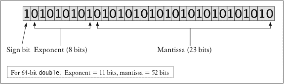

**图 5.1** 32 位浮点数（float）的内存存储方案

由于存储方式的原因，浮点数并不总是能在内存中精确表示。此外，像 2 / 3 这样的表达式的结果本身就不精确，因此其计算值在存储时无法不丢失信息。绝不应该对两个浮点数进行相等性测试。

**注意：** 指数的大小决定浮点数的范围，尾数的大小决定浮点数的精度。

## 5.9 具体的浮点类型

整数按大小分类，而浮点数按精度分类。C 支持三种浮点数类型，其关键字如下：

- float（单精度）
- double（双精度）
- long double（四精度）

与整数不同，ANSI 为所有这些类型规定了一个*单一*的最小范围。正数的这个范围是 10⁻³⁸ 到 10⁺³⁸，但它还必须满足以下条件：

float 的范围 <= double 的范围 <= long double 的范围

尽管规范允许这三种类型具有相同的范围，但实际情况几乎从未如此。double 或 long double（或两者）的范围都会比 float 更高。下面将结合具体类型讨论 ANSI 规定的精度和范围。

### float 类型

ANSI 要求 float 在其 10⁻³⁸ 到 10⁺³⁸ 的最小范围内至少表示 6 位有效数字。这意味着它必须至少能处理像 77.789654 这样的数中的前 6 位数字。

### double 类型

对于这种类型，ANSI 规定了更高的精度——至少 10 位数字。double 类型通常允许非常高的取值范围——10⁻³⁰⁸ 到 10⁺³⁰⁸。

### long double 类型

ANSI 为这种类型提供与 double 相同的精度。对于支持该类型的系统，`long double` 使用 8 到 16 字节。

浮点计算比整数计算慢。`double` 和 `long double` 类型可能会在你的系统上占用大量内存，因此除非你需要比 `float` 所提供的更大的范围和精度，否则不要使用它们。回想一下，在程序 `sizeof.c`（5.3）中，在采用 GCC 的 Linux 系统上，`double` 和 `long double` 的宽度分别为 8 字节和 12 字节。

表 5.2 显示了这些浮点类型的属性，以及 **printf** 和 **scanf** 用于处理它们的格式说明符。注意，**printf** 对 `float` 和 `double` 都使用 `%f`，并且默认打印 6 位小数。对于非常大或非常小的数，使用 `%e` 说明符，它会以指数记数法显示。**printf** 使用 `L` 修饰符配合 `%f`（`%Lf` 或 `%Le`）来处理 `long double`。

**注意：** 当你不确定 `%f` 能否有意义地显示某个值时，请使用 `%g`。此时 **printf** 会选择 `%f` 或 `%e` 来显示。如果该值是整数，它会自动移除所有小数位。

**表 5.2 浮点数的属性**

| 子类型 | 最小精度（位数） | 大小（字节） | 尾数的典型值（位） | 指数（位） | printf/scanf 格式说明符 |
|---|---|---|---|---|---|
| float | 6 | 4 | 23 | 8 | %f, %e, %g |
| double | 10 | 8 | 52 | 11 | %f, %e, %lg |
| long double | 10 | 8-16 | 112 | 15 | %Lf, %Le, %Lg |

## 5.10 all_about_real.c：理解浮点数

程序 5.4 演示了浮点数据类型的属性。该程序首先通过使用三种格式说明符显示数据，来确立常规记数法和指数记数法的等价性。然后，它使用一个非常大的数来确定 `float` 和 `double` 数据类型的精度。最后，它在获取键盘输入后进行浮点计算。如果代码在 Linux 系统上运行，请取消与 `long double` 相关的行的注释。

该程序首先初始化三个“pi”变量，其中两个使用指数记数法。第一个 **printf** 对 `%f` 和 `%e` 说明符显示 6 位小数，但对 `%g` 会移除末尾的零。

接下来，将一个包含 20 位有效数字的非常大的数赋给变量 `float_x` 和 `double_y`。注意，在这台机器上，`float` 和 `double` 的精度分别为 8 位和 17 位有效数字。这两个值都高于 ANSI 规定的最小值（6 和 10）。

最后，我们获取键盘输入，使用三个 `float` 变量进行简单计算。注意最后两个 **printf** 语句中使用了 `'`（单引号）和 `%%`。如前所述，**printf** 会将 `%%` 解释为单个 `%`。


**程序 5.4：** **all_about_real.c**

```c
/* all_about_real.c: Assigns and displays the floating point types.
   Determines the precision of float and double on your machine. */
#include <stdio.h>

int main(void)
{
    float pi1 = 3.142, pi2 = 0.3142E1, pi3 = 3.142E-3;
    float float_x = 12345.678901234567890;        /* 20 significant digits */
    double double_y = 12345.678901234567890;      /* Same */
    float sensex1 = 25341.86;
    float sensex2, gain;

    printf("pi1 = %f, pi2 = %e, pi3 = %g\n", pi1, pi2, pi3);
    printf("float_x = %.15f\n", float_x);
    printf("double_y = %.15f\n", double_y);

    /* Uncomment these 2 lines if your computer supports long double */
    /* long double ldouble_z = 12345.678901234567890;
    printf("ldouble_z = %.20Lf\n", ldouble_z); */

    printf("Enter today's value of Sensex: ");
    scanf("%f", &sensex2);
    gain = (sensex2 - sensex1) / sensex1 * 100;
    printf("Sensex returns since March 31, 2016: %f%%\n", gain);

    return 0;
}
```

| 输出 | 精度 |
|---|---|
| pi1 = 3.142000, pi2 = 3.142000e+00, pi3 = 0.003142<br>float_x = 12345.678710937500000<br>double_y = 12345.678901234567093<br>Enter today's value of Sensex: 28743<br>Sensex returns since March 31, 2016: 13.421039% | 精确到 8 位有效数字<br>精确到 17 位有效数字 |

**程序输出：** **all_about_real.c**

> **要点：** 选择浮点数据类型取决于其能够处理的精度。float 和 double 类型分别处理 6 位和 10 位精度。

## 5.11  char：字符类型

C 支持 char 数据类型，其宽度刚好足以容纳计算机字符集中的值。我们的 PC 使用 8 位 ASCII 字符集，因此按定义 char 的宽度为一个字节。尽管 char 本质上是一种整数类型，但我们单独讨论它有两个原因：

- 存储在 char 变量中的数值可以轻松地以其等效字符形式显示，反之亦然。
- 字符串的起源归功于 char。字符串只是 char 类型的数组。

第一点意味着，以 char 存储的值 65 可以通过 `printf` 使用 %c 打印为 A。反过来，从键盘输入的字符 A 可以通过 `scanf` 使用 %c 以 65 保存到 char 变量中。char 类型的数据还可以用另外两种方式表示：

- 用单引号括起来的字符（例如 'A'）。
- 用像 '\c' 这样的特殊转义序列表示，但只有少数不可打印字符可以用转义序列表示。

与其他整数类型一样，char 也有有符号和无符号形式。有符号形式可以保存 -128 到 127 之间的值，而无符号类型的范围是 0 到 255。与其他默认有符号的整数类型不同，char 的默认类型取决于系统。因此，如果需要存储 8 位 ASCII 字符，请显式将数据类型指定为 unsigned char。

### 5.11.1  char 作为整数和字符

如果 char 是无符号的，那么 8 位 ASCII 字符集中的每个字符都可以赋给 char 变量。以下示例演示了可以使用整数类型通过 %c 显示字符。最后一条语句应该发出蜂鸣声，因为 BEEP 字符（/Control-g/）的 ASCII 值为 7：

| 代码 | 输出 |
|---|---|
| `char let1 = 'A'; short let2 = 97; char let3 = '9'; int let4 = 7;` | |
| `printf("'%c' = %d\n", let1, let1);` | `'A' = 65` |
| `printf("'%c' = %d\n", let2, let2);` | `'a' = 97` |
| `printf("'%c' = %d\n", let3, let3);` | `'9' = 57` |
| `printf("'%c' = %d\n", let4, let4);` | `'' = 7` |

数字 7 在内存中存储为 (0000 0111)₂。但 '7' 是一个字符，其 ASCII 值（55）存储为 (0011 0111)₂。当你在响应 scanf 调用时从键盘输入 7，发送到键盘缓冲区的是 '7'（4.8.2——工作原理）。%d 说明符告诉 scanf 将 '7' 转换为 7（如果意图是使用整数）。

你也可以使用八进制和十六进制数。只需分别在数字前加上 0 和 0x：

```c
char c = 0101;                         101 = 1×8² + 0 + 1×8⁰ = 65
char c = 0x41;                         41 = 4×16¹ + 1×16⁰ = 65
```

初学者常犯的错误是使用双引号（"A" 而不是 'A'）。双引号字符（如 "A" 或 "Internet of things"）表示字符串，而字符串不是基本数据类型。C 将字符串理解为 char 类型的数组（一种派生数据类型），但更多内容以后再说。

> 注意：你可以使用前导零来表示八进制或十六进制字符，但仅当该字符嵌入字符串中时才行。因此，"Wake up\a"、"Wake up\07" 和 "Wake up\7" 是等价的。

### 表 5.3  转义序列

| 转义序列 | 含义 |
|---|---|
| `\a` | 响铃 |
| `\b` | 退格 |
| `\c` | 不换行（光标在同一行） |
| `\f` | 换页 |
| `\n` | 换行 |
| `\r` | 回车 |
| `\t` | 制表符 |
| `\v` | 垂直制表符 |
| `\\` | 反斜杠 |
| `\nnn` | 由八进制值 *n* 表示的 ASCII 字符，其中 *n* 不能超过 0377（十进制值 255） |
| `\xnn` | 由十六进制值 *n* 表示的 ASCII 字符，其中 *n* 不能超过 0xFF（十进制值 255） |

## 5.12  all_about_char.c：理解 char 数据类型

现在让我们在程序 5.5 中运用关于 char 的知识。该程序首先确定我们机器上的 char 类型是有符号还是无符号。然后使用两个 while 循环以可移植的方式打印所有大写字母和数字。我们还将学习使用一些转义序列。

请注意，即使变量 schar 被赋值为 250，它显示为 -6，这意味着 char 的 MSB（最高有效位）被置为 1。然而，unsigned char 的值正确显示。很明显，此系统默认使用 signed char，这意味着它能处理的最大正值为 127。注意，这些 char 变量被赋值为整数，并且也以整数形式打印，没有任何问题。

附录 B 中的 ASCII 列表按顺序排列字母和数字。因此，while 循环自然成为打印所有这些内容的选择。对于第一个循环，变量 letter 在循环终止前从 'A' 移动到 'Z'。对于第二个循环，numeral 按相反顺序从 '9' 移动到 '0'。使用 'A'、'Z'、'0' 和 '9' 而不是它们的 ASCII 等价值，使代码可在所有系统上移植。

%c 后的空格以及 printf 中没有 \n，确保元素打印在一行中并用空格分隔。这次我们使用了一种不同的技术，即对变量进行递增和递减（使用 ++ 和 --）。

**程序 5.5：** **all_about_char.c**

```c
/* all_about_char.c: Handling the char data type and escape sequences. */

#include <stdio.h>

int main(void)
{
    char schar = 250;
    unsigned char uchar = 250;
    char letter = 'A'; int numeral = '9';

    printf("schar = %d\n", schar);    /* Know char default on your system */
    printf("uchar = %d\n", uchar);

    /* Printing the entire alphabet in uppercase */
    while (letter <= 'Z') {             /* Using 'Z' instead of its ASCII value */
        printf("%c ", letter);          /* makes the code portable. */
        letter++;                        /* This is the letter + 1 */
    }

    printf("\n\t\tNext line starts after 16 spaces and also beeps\07\n");
    /* Printing all digits of the base-10 system in reverse */
    while (numeral >= '0') {             /* This code is also portable because */
        printf("%c ", numeral);          /* '0' is used instead of ASCII value. */
        numeral--;                       /* This is numeral = numeral - 1 */
    }
    return 0;
}
```

**程序输出：** **all_about_char.c**

```text
schar = -6                                      Machine uses signed char by default
uchar = 250
A B C D E F G H I J K L M N O P Q R S T U V W X Y Z
                Next line starts after 16 spaces and also beeps
9 8 7 6 5 4 3 2 1 0
```

在两个循环之间，一条 **printf** 语句演示了 \t 和转义序列的用法。一个 \t 将光标移动八个空格，因此使用两个 \t 会使该行偏移 16 个空格。如果你的终端支持蜂鸣声，你还会听到一声蜂鸣（\07）。

> 注意：你必须知道 'A'、'APE'、"A" 和 "APE" 之间的区别。'A' 是字符常量，其 ASCII 值（65）以二进制数存储。'APE' 不是有效的字符常量，因为只存储最后一个字符（'E'）。"A" 和 "APE" 是合法字符串，分别在内存中占用 *两个* 和 *四个* 字符。为什么字符串会多出一个字符？继续往下读。


## 5.13 常量的数据类型

到目前为止，我们关注的重点一直是变量。我们尚未了解常量的数据类型是什么。32 是 int 还是 short？'B' 是作为 char 还是 int 存储？5.5 被视为 float 还是 double？在开始第 6 章的表达式之前，我们需要知道所有这些问题的答案。

常量表示程序中不会改变的数据。即使没有正式声明，它们也有类型。编译器根据一组规则，通过*简单检查*来检测常量的数据类型。C 支持多种常量——包括未命名常量和命名常量——它们可以分为以下类别：

- 属于基本数据类型的未命名常量。常量 12、-34.5 和 'A' 属于这一类。
- 在程序开头用 `#define` 定义的命名常量或符号常量。你已在程序 4.1 中见过其中一种的用法。
- 在变量声明中加入 `const` 限定符后，行为像常量的变量。
- 像 `"Nougat is here"` 这样的字符串常量属于派生数据类型。

C 为常量指定默认类型，但编译器或程序员经常会改变这个默认类型。发生这种情况的原因如下：

- 常量的大小太大，无法容纳在默认类型中。例如，数字 5000000000 对于 `int`（整数常量的默认类型）来说太大。
- 你可能希望强制该常量具有不同的类型。
- 当常量出现在至少一个组成部分具有更高类型的表达式中时，类型可能会自动改变。

在接下来的几节中，我们将考察除字符串常量之外的所有常量类型；关于字符串常量的讨论推迟到第 13 章。

### 5.13.1 基本类型的常量

**整数常量** C 将 `int`（有符号）指定为整数常量的默认类型。编译器将 655 视为 `int`，即使这个数很容易容纳在 `short` 中。如果常量无法容纳在其默认类型中，编译器会使用以下顺序尝试下一个更高类型：

int → unsigned int → long → unsigned long → long long → unsigned long long

当常量用于表达式时，我们有时可能希望它具有特定类型（强制转换）。C 提供了可以加在这些常量后面的特殊符号：

- `U` 或 `u`——`unsigned int`
- `L` 或 `l`——`signed long`
- `UL` 或 `ul`——`unsigned long`
- `LL` 或 `ll`——`long long`
- `ULL` 或 `ull`——`unsigned long long`

例如，编译器通常将 3 视为 int，但会将 3L 视为 long。不存在 short 类型的常量。下次看到常量 540U 或 450L 时，请记住分别将它们视为 unsigned int 和 signed long。

**浮点常量** C 将实常量视为 double，在大多数系统上占用 8 字节。像 3.142 和 1789.456 这样的常量具有 double 类型，即使 float（4 字节）足以容纳它们。然而，与只能提升为 long 和 long long 的整数常量不同，实常量既可以提升也可以降级：

- F 或 f 后缀表示将实常量指定为 float。常量 3.142f 和 1789.456F 具有 float 类型。
- L 或 l（el）后缀将实常量提升为 long double，它最多可能占用 16 字节。

这些后缀也适用于指数形式（如 3E4F）。将常量降级为 float 通常是有意义的，因为这样可以节省内存空间和计算时间。

**字符常量** 用单引号括起来的任何字符或转义序列都表示字符常量。字符 'A'、'\t' 和 '\7' 是字符常量，其 ASCII 值分别为 65、9 和 7。奇怪的是，C 将字符常量视为 int 类型而不是 char。这意味着常量 'A' 存储在 4 字节（int 的大小）的空间中。

**要点：** 整数常量的默认类型是 `int`。对于实数，默认类型是 `double`。字符常量存储为 `int`。C 不支持 short 类型的常量。

### 5.13.2 作为常量的变量：const 限定符

在程序中多次使用的常量通常存储为变量。如果以后更改该值，则只需在一个位置修改代码，从而使维护更容易。常量本身应使用 **const** 限定符存储为变量：

```
const float euro_dollar = 1.325;
```

**const** 限定符通过将变量标记为只读来防止其被重写。你经常会在许多 C 字符串处理函数的语法中看到这个限定符。

### 5.13.3 符号常量：有名称的常量

将常量存储在变量中有一个缺点。每次遇到变量时，程序都必须访问其内存位置。内存访问需要时间，因此 C 提供了**符号常量**来避免这种访问。我们曾在预处理器的 **#define** 指令（4.4）中将 PI 用作符号常量。欧元兑美元换算问题在下面的 **#define** 指令中有一个更好的解决方案：

```
#define euro_dollar 1.325f

*No semicolon — not a C statement*
```

预处理器会在程序中的所有位置将 euro_dollar 替换为 1.325。因此，编译器永远看不到 euro_dollar，而是看到 1.325。（f 后缀确保该常量不使用默认的 double。）如果常量的值在程序的其他地方或程序运行时不会改变，那为什么还要使用变量呢？不过，这个话题属于讨论预处理器指令的第 17 章。


> **提示：** 如果你需要在程序中重复使用一个常量，可以将其定义为符号常量，或使用 `const` 限定符将其声明为变量。

## 5.14 `sizeof_constants.c`：计算常量大小的程序

如果你担心内存可能被误用，就必须了解程序中使用的常量的大小。我们已经将 `sizeof` 运算符与类型一起使用（5.5），所以现在让我们使用程序 5.6 对常量重复这一练习。

该程序首先列出这台机器上支持的每种基本类型的大小，以便将它们与常量进行比较。观察可知，常量 34 占用 4 字节，即 `int` 的大小。我们知道 `char` 常量也存储为 `int`，因此常量 `'A'` 占用 4 字节。然而，存储该常量的 `char` 变量只使用 1 字节。

```
/* sizeof_constants.c: Evaluates the size in bytes of constants. Also shows
   the effect of the L and F suffixes on size. */
#define LOOP_VAR 50
#include <stdio.h>

int main(void)
{
    char letter = 'A';
    printf("Size in bytes of the fundamental data types on this machine:\n");
    printf("int: %d, long: %d, float: %d, double:%d, long double: %d\n",
           sizeof(int), sizeof(long), sizeof(float),
           sizeof(double), sizeof(long double));
    printf("\nSize of constants on this machine:\n");
    printf("Size of 34 = %d bytes\n", sizeof 34);
    printf("Size of 'A' = %d bytes\n", sizeof 'A');
    printf("Size of letter which is set to 'A' = %d byte\n", sizeof letter);
    printf("Size of 34L = %d bytes\n", sizeof 34L);
    printf("Size of 3.142 = %d bytes\n", sizeof 3.142);
    printf("Size of 3.142F = %d bytes\n", sizeof(3.142F));
    printf("Size of 3.142L = %d bytes\n", sizeof(3.142L));
    printf("Size of LOOP_VAR = %d bytes\n", sizeof(LOOP_VAR));

    /* Note that the size of this string constant is NOT 8! */
    printf("Size of string \"Lollipop\" = %d bytes\n", sizeof("Lollipop"));
    return 0;
}
```

程序 5.6：`sizeof_constants.c`

```
Size in bytes of the fundamental data types on this machine:
int: 4, long: 4, float: 4, double: 8, long double: 12

Size of constants on this machine:
Size of 34 = 4 bytes
Size of 'A' = 4 bytes
Size of letter which is set to 'A' = 1 byte
Size of 34L = 4 bytes
Size of 3.142 = 8 bytes
Size of 3.142F = 4 bytes
Size of 3.142L = 12 bytes
Size of LOOP_VAR = 4 bytes
Size of string "Lollipop" = 9 bytes
```

程序输出：sizeof_constants.c

现在让我们考察给常量添加后缀的效果。34 和 34L 都占用 4 字节，因为在这台机器上 int 和 long 的大小相同。该程序还证实，实数 3.142 默认存储为 double（8 字节），使用 F 后缀时存储为 float（4 字节），使用 L 后缀时存储为 long double（12 字节）。

最后两个 printf 语句展示了 sizeof 如何计算不属于基本类型的常量。sizeof 看到的不是符号常量 LOOP_VAR，而是数字 50，它是一个整数常量。还要注意，字符串 "Lollipop" 占用 9 个字符而不是 8 个字符。我们将在下一节最终解释这一异常现象。

## 5.15 数组和字符串：简介

我们经常需要处理一组相关数据。例如，我们可能需要存储一整年的每月降雨量。与其创建 12 个变量，不如使用数组来存储这 12 个值。数组是属于单一类型的数据项的集合。我们现在需要了解数组和字符串的一些基础知识，因为它们会在后续章节中零散出现。不过，第 10 章会详细讨论数组，所以跳过本节不会让你损失太多。

下面的语句声明一个名为 month 的数组。它能够保存 12 个值，每个值的类型都是 int：

```
int month[12];        Uninitialized array
```

假设 int 为 4 字节，编译器使用这个声明或定义来分配一块连续的 48 字节内存。数组的每个元素都通过 month[n] 这种表示法访问，其中 n 是表示*索引*的整数。这里的 n 值介于 0 和 11 之间。第一个元素通过 month[0] 访问，最后一个元素通过 month[11] 访问。

在这个阶段，数组元素尚未初始化，这意味着它们具有垃圾值。你可以在声明时通过赋予一组用花括号括起来、以逗号分隔的值来进行初始化：

```
int month[12] = {31, 28, 31, 30, 31, 30, 31, 31, 30, 31, 30, 31};
```


然而，如果在声明时没有进行初始化，就必须分别给元素赋值。数组元素被解释为变量，因此我们可以用 `printf` 显示其值：

```c
month[0] = 31; month[1] = 28; month[2] = 31;  ..........
printf("month[1] = %d\n", month[1]);
```

*打印 28*

C 数组可以保存任何类型的数据，从基本类型到指针和结构体。它们对于处理大量数据非常有用，因为可以使用简单的 `while` 循环访问每个数组元素。

`char` 类型的数组在 C 中具有特殊意义。每种编程语言都需要处理字符串，而 C 通过调整 `char` 类型的数组来实现这一点。让我们声明并初始化一个名为 `msg` 的 8 元素数组：

```c
char msg[8] = {'A', 'n', 'd', 'r', 'o', 'i', 'd', '\0'};
```

名称 `msg` 表示字符串 Android，它在数组中占用七个位置，另外还有一个位置用于 NUL 字符（显示为 `\0`）。NUL 的 ASCII 值为 0（附录 B）。如果没有它，`msg` 就只是一个 `char` 类型的数组。任何操作字符串的函数都必须知道字符串从哪里开始、到哪里结束。数组名提供起点，NUL 提供终点。接下来的程序会对这两者作更多说明。

## 5.16 `intro2arrays.c`：熟悉数组

本章以程序 5.7 结束，该程序处理两个数组：`int_array` 和 `char_array`。该程序使用不同的技术打印两个数组的元素。从这些技术的使用中可以得出一些重要结论。

与变量一样，数组可以在声明时初始化（如 `char_array`），也可以在之后使用针对每个元素的单独语句进行赋值（如 `int_array`）。该程序使用 `while` 循环打印 `int_array` 的元素。该循环迭代三次，并在过程中打印每个元素。注意，由于 `printf` 控制字符串中存在 `\t`，制表符将每个元素分隔开。

处理 `char_array` 时使用了不同的方法。该数组用 7 个字符初始化，并以 NUL 终止。当 `printf` 遇到名称 `char_array` 并同时看到 `%s` 时，它会打印整个数组的内容。名称 `char_array` 告诉 `printf` 数组第一个元素在内存中的位置。`printf` 从该位置开始打印，并在遇到 NUL 时停止。在此过程中，会打印字符串 "Kitkat"。

最后两个 `printf` 语句确凿地证明，`char_array` 和字符串 "Kitkat" 都包含 7 个字符。这意味着长度为 *n* 个字符的字符串需要一个包含（*n* + 1）个元素的 char 数组。要理解如何仅使用数组名就能打印整个字符串，我们需要理解*指针*。我们将在三个单独的章节中详细考察数组、指针和字符串。

```c
/* intro2arrays.c: Introduces elementary concepts of arrays. Shows that
   a string is actually an array of characters. */
#include <stdio.h>
#define LOOP_MAX 3

int main(void)
{
    /* Declare the array index and two arrays of type int and char */
    short index = 0;
    int int_array[3];                  /* Elements uninitialized */
    char char_array[7] = {'K', 'i', 't', 'k', 'a', 't', '\0'};

    /* Integer array: Initialize and print array elements */
    int_array[0] = 111;
    int_array[1] = 222;
    int_array[2] = 333;

    printf("Elements of int_array: ");
    while (index < LOOP_MAX) {         /* Compiler sees 3, not LOOP_MAX */
        printf("%d\t", int_array[index]);
        index++;                       /* Synonym for index = index + 1 */
    }
    printf("\n");                     /* Add a newline now */

    /* Character array: Print first element and then see what happens
       when you use %s with the array name */
    printf("char_array[0] = %c\n", char_array[0]);
    printf("char_array actually stores the string \"%s\"\n", char_array);
    printf("Size of char_array: %d\n", sizeof(char_array));
    printf("Size of \"Kitkat\": %d\n", sizeof("Kitkat"));

    return 0;
}
```

程序 5.7：**intro2arrays.c**

```text
Elements of int_array: 111  222  333
char_array[0] = K
char_array actually stores the string "Kitkat"
Size of char_array: 7
Size of "Kitkat": 7
```

程序输出：**intro2arrays.c**


**要点：** 字符串不过是一个以 NUL 字符（`'\0'`）终止的 char 类型数组。当 `printf` 与 `%s` 以及作为其匹配参数的数组名一起使用时，它会打印每个数组元素，直到遇到包含 NUL 的那个元素。

## 接下来做什么？

除了作为独立对象使用外，变量和常量还会作为使用运算符的表达式的组成部分出现。当这些数据项用于表达式时，它们的属性常常会改变——或者被迫改变。下一章将探讨这些运算符和表达式。

## 你学到了什么？

程序数据以具有不同类型和大小的*变量*和*常量*形式出现。ANSI 规定了基本类型（整数、浮点数和字符）的最小大小以及这些大小之间的关系。

变量通过指定其名称和类型来*声明*。声明通过为变量分配内存而自动*定义*变量。变量可以在声明时初始化，也可以在之后赋值。

**sizeof** 运算符在编译时计算数据类型、变量或常量的大小。

整数变量有四种类型（short、int、long 和 long long），其中右边的类型不能比其左边的类型短。C99 已将 long long 类型纳入，以便在 64 位系统上使用。

浮点变量有三种类型（float、double 和 long double）。它们也可以使用*尾数*和*指数*以指数形式表示。程序员根据所需的*精度*选择类型。

char 数据类型始终为 1 字节宽，因为它被设计用来保存机器的整个字符集。char 可以用整数、单引号字符或转义序列表示。

常量的数据类型通过简单检查来确定。默认情况下，整数常量和字符常量的类型为 int，而实常量的类型为 double。可以通过给它们加上 F、L 或 LL 等字母后缀来提升或降低其类型。

C 支持用数组来包含多个具有相同类型的数据项。该语言还将字符串视为以 NUL 字符（'\0'）终止的 char 类型数组，该字符的 ASCII 值为 0。

## 客观题

### A1. 判断题

- 5.1 标识符必须以字母或下划线开头，但其他位置可以包含数字。
- 5.2 常量没有名称。
- 5.3 变量名可以包含连字符，但不能在开头。
- 5.4 未初始化的变量不一定具有值 0。
- 5.5 int 和 float 是基本数据类型。
- 5.6 char 的大小为一个或两个字节长。
- 5.7 小数也称为实数。
- 5.8 浮点类型的选择由所需范围决定。
- 5.9 char 数据可以用双引号括起来的字符表示。
- 5.10 float、double 和 long double 数据类型可能具有相同的范围。
- 5.11 常量 9L 是以 long 存储的整数 9。
- 5.12 数组存储相同类型的数据。
- 5.13 数组索引 12 表示第 12 个元素。
- 5.14 char 类型的数组必须在末尾包含 NUL 字符。

### A2. 填空题

- 5.1 不能将 default、char 和 int 用作变量名，因为它们是 _____ 词。
- 5.2 变量 _____ 使类型信息可供编译器使用，而 _____ 为变量分配内存。
- 5.3 编译器通过简单检查确定 _____ 的数据类型。
- 5.4 _____ 运算符计算数据类型、变量或常量的大小。
- 5.5 int 的最小大小为 _____ 字节，long 的最小大小为 _____ 字节。
- 5.6 C 将通过 _____ 和 _____ 前缀表示的数字分别识别为八进制和十六进制。
- 5.7 float 和 double 数据类型分别处理 _____ 和 _____ 位精度。
- 5.8 常量 'S' 存储为 ______。
- 5.9 符号 '\n' 表示一个 _____ ______。
- 5.10 数组是一种 _____ 数据类型。

### A3. 选择题

- 5.1 当编译器看到 int 类型的变量时，它会分配 (A) 2 字节，(B) 4 字节，(C) 至少 2 字节，(D) 取决于机器。
- 5.2 编译器使用变量的类型信息来确定 (A) 要分配的字节数，(B) 字节的解释方式，(C) A 和 B，(D) 以上都不是。
- 5.3 字符串是 (A) 从 char 类型派生而来，(B) 字符数组，(C) 不是用户定义类型，(D) 以上所有。
- 5.4 long 的大小 (A) 大于或等于 int，(B) 小于或等于 int，(C) 大于 int，(D) 以上都不是。


- 5.5 有符号字符变量可以赋值为（A）不超过255的整数，（B）常量'2'，（C）介于-127和128之间的整数，（D）以上都不是。
- 5.6 数组 `int arr[20]` 需要（A）20字节，（B）20 × `sizeof(int)` 字节，（C）40字节，（D）80字节。
- 5.7 符号 `\0` 表示（A）0的八进制值，（B）ASCII值为0的NUL字符，（C）单字符字符串，（D）以上都不是。

## 基于概念的问题

- 5.1 列出基本数据类型及其ANSI规定的最小大小。为什么这些大小不是由ANSI固定的？
- 5.2 即使基本数据类型的大小在不同系统中可能有所不同，`char`数据类型始终是一个字节宽。请解释原因。
- 5.3 说出至少三个程序可用的数据来源。
- 5.4 找出列表中的有效变量名：（i）`bit-rate`，（ii）`upload_speed`，（iii）`__width`，（iv）`a1`，（v）`2017_month`。
- 5.5 何时将常量存储在变量中才有意义？`#define` 与 `const` 关键字有何不同？
- 5.6 解释变量的声明和定义之间的区别。你能在不定义变量的情况下声明它吗？
- 5.7 字符串与`char`类型数组有什么区别？字符串"abcd"占用了多少数组元素？
- 5.8 下面的代码段能正确打印吗？请说明理由。

```c
char stg1[6] = {'N', 'o', 'u', 'g', 'a', 't'};
char stg2[] = "Nougat";
printf("%s\n", stg1);
printf("%s\n", stg2);
```

- 5.9 既然'A'实际上是一个整数，`printf("%c", 'A');` 和 `printf("%d", 'A');` 会显示相同的输出吗？请说明理由。
- 5.10 在6个变量和6个元素的数组之间，哪些考虑因素决定了选择一种方案而不是另一种？

## 编程与调试技能

- 5.1 为什么下面的代码段会打印一个负整数？你如何改正它？

```c
short x = 40000;
printf("x = %hd\n", x);
```

- 5.2 仅编写赋值语句，使用临时变量t交换两个变量x和y的值。
- 5.3 在short为2字节、int为4字节的计算机上，下面的程序将显示什么？请提供运算来支持你的答案。同时修改程序以正确打印。

```c
#include <stdio.h>
int main(void)
{
    short s = 40000;
    int i = 2200000000;
    printf("s = %hd, i = %d\n", s, i);
    return 0;
}
```

- 5.4 编写一个程序，接受用户输入的正整数，并以十进制、八进制和十六进制打印该值。
- 5.5 编写一个程序，将无符号short（通常为2字节）和无符号int（通常为4字节）的最大值赋给两个变量。当你用`printf`打印比这个最大值大1的值时，输出是什么？请说明理由。
- 5.6 研究下面的程序并回答以下问题：

  - （i）这个程序显示什么？  
  - （ii）两行输出之间有什么区别吗？  
  - （iii）为什么提供第二个`printf`语句？  
  - （iv）如果两个循环都额外执行一次迭代，下一个要打印的项是什么？

```c
#include <stdio.h>
int main(void)
{
    char c = '0'; short s = 0;
    while (c <= '9') {
        printf("%c ", c);
        c = c + 1;
    }
    printf("\n");
    while (s <= 9) {
        printf("%hd ", s);
        s++;
    }
    return 0;
}
```

- 5.7 编写一个程序，使用两个`while`循环，用一个6元素的long数组填充前6个正整数，用一个7元素的char数组填充英语字母表的前6个（不是7个）字母。打印两个数组后，将char数组的元素设置为'\0'，然后重新打印这个数组。解释你的观察结果。

# 6 运算符和表达式

## 学习要点

- *运算符*的特性及其在计算*表达式*中的作用。
- *算术*运算符的意义。
- 变量和常量的数据类型如何被*隐式*改变。
- *强制转换*在数据类型*显式*转换中的作用。
- 在计算表达式时使用运算符*优先级*和*结合性*。
- *赋值*运算符（`+=`、`-=`、`*=`等）的意义。
- 递增（`++`）和递减（`--`）运算符及其*副作用*。
- 使用*关系*和*逻辑*运算符对表达式进行布尔求值。
- 使用*条件*运算符和**sizeof**运算符。

## 6.1 表达式

变量和常量以最基本的形式表示数据。这些数据对象相互结合形成*表达式*时才变得有用。表达式的组成部分通过称为*运算符*的符号相互连接。例如，`a + b / 7`是一个表达式，其中`+`和`/`是运算符。该表达式有一个*值*，此处按算术规则求值。

算术表达式并不是你在C语言中遇到的唯一类型的表达式。还有其他类型——比如关系和逻辑表达式。例如，`a > b`不是算术表达式，但它仍然有一个值。以下示例说明了C语言中使用的表达式的多样性：

| C 结构 | 表达式 |  |
|---|---|---|
| `interest = principal * rate / 100;` | `principal * rate / 100` | *（算术）* |
| `if (age > 18)` | `age > 18` | *（关系）* |
| `while (answer == 'y')` | `answer == 'y'` | *（关系）* |
| `if (age > 15 && age < 25)` | `age > 15 && age < 25` | *（逻辑）* |
| `while (count-- >= 0)` | `count-- >= 0` | *（关系）* |
| `answer = 'y';` | `answer = 'y'` | *（赋值；也是一个表达式）* |
| `++count;` | `++count` | *（没有运算符的表达式）* |
| `if (count)` | `count` | *（同上；最简单的表达式）* |

除了最后一个之外，所有这些表达式都使用了一个或多个运算符。然而，最简单的表达式不使用运算符。这意味着变量count和常量5是两个有效的表达式。这种包罗万象的表达式观点可能看起来微不足道，但它有重要的影响，你将逐渐发现这一点。

每个C表达式都有一个*值*，这个值的意义取决于表达式的性质。对于算术表达式（如`a + b`），我们感兴趣的是计算出的值。但关系表达式（如`age > 18`）会求值为两个布尔值之一，我们将其解释为*真*（值>0）或*假*（值=0）。

## 6.2 运算符

运算符构成了表达式中变量和常量之间的连接纽带。运算符作用于一个或多个*操作数*。例如，在表达式`x - 5`中，`-`符号是一个运算符，它作用于操作数`x`和`5`。C语言支持丰富的运算符集合——比任何先前已知的语言都要丰富。这些运算符可以分为以下类型：

- 算术运算符（如`+`、`-`等）
- 赋值运算符（如`=`、`+=`、`-=`、`*=`等）
- 递增和递减运算符（`++`和`--`）
- 关系运算符（如`>`、`<`、`<=`等）
- 逻辑运算符（`&&`、`||`和`!`）
- 位运算符（如`&`、`|`、`>>`、`<<`等）
- 逗号、`sizeof`和强制转换运算符

运算符可以是*一元*、*二元*或*三元*的。一元运算符有一个操作数。例如，负常量`-5`中的`-`符号是一元运算符，它将其操作数乘以`-1`。（一元`-`与执行减法的二元`-`不同。）`count++`中的`++`是一元运算符，它将其操作数递增1。

大多数运算符是需要两个操作数的二元类型。`x = 5`中的赋值运算符`=`是二元运算符。像`*`和`/`这样的算术运算符以及像`>`和`<`这样的关系运算符也是二元运算符。C语言有一个使用`?`和`:`符号的三元运算符。

当一个表达式包含多个运算符时，它们的求值顺序变得很重要。例如，在计算表达式`x + y * z`时，乘法是否发生在加法之前？为此，C语言为每个运算符指定了两个属性：


```c
/* expressions.c: Evaluates value of expressions. Establishes that
   an assignment or function like printf is also an expression. */
#include <stdio.h>
int main(void)
{
    int mileage = 17; float distance = 420; char answer = 'n';

    printf("Printing value of expressions:\n");
    printf("distance / mileage has the value %.2f\n", distance / mileage);
    printf("mileage = 20 has the value %d\n", mileage = 20);
    printf("answer == 'y' has the value %d\n", answer == 'y');
    printf("answer = 'y' has the value %d\n", answer = 'y');
    printf("++mileage has the value %d\n", ++mileage);

    /* Surprise! printf is also an expression. */
    printf("This printf expression has the value %d\n", printf("Honeycomb\n"));

    /* Expressions as statements */
    mileage;                      /* Perfectly valid statement */
    420;                          /* Same, so ignore the warnings */

    return 0;
}
```
**程序 6.1：** `expressions.c`

```
Printing value of expressions:
distance / mileage has the value 24.71
mileage = 20 has the value 20
answer == 'y' has the value 0
answer = 'y' has the value 121          ASCII value of 'y'
++mileage has the value 21
Honeycomb
This printf expression has the value 10
```
**程序输出：** `expressions.c`

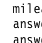

> **要点：** 不是函数的表达式求值结果为绝对值或布尔值（0 或 1）。对于函数，其求值结果就是它在执行时返回的值。然而，`printf` 函数不仅返回一个值，还具有打印内容的*副作用*。奇怪的是，打印作为 `printf` 的主要任务，却被“降级”为一种“副作用”！

## 6.4 算术运算符

我们从五个算术运算符开始讨论各个运算符：+、-、*、/ 和 %（表 6.1）。你的电子计算器以相同方式使用前四个。%，称为*取模运算符*，在 C 中用于计算整数除法的余数。C 在算术运算中允许一定的灵活性，但也施加了一些限制。

### 6.4.1 +、-、* 和 /：四个基本运算符

运算符 + 和 - 用于完成众所周知的操作。乘法和除法由 * 和 / 处理。这四个二元运算符支持整数和浮点操作数的混合使用，但操作数必须具有正确的数据类型。以下是一些可能导致问题的情况：

- `256 * 256` — *值为 65536；short 类型无法容纳*
- `22 / 7` — *值为 3 而不是 3.142！*
- `22.0 / 7` — *值为 3.142857；7 被转换为 7.0*
- `5 / 0` — *程序中止；不允许除以零*

从第一个例子可以明显看出，乘法是数据溢出问题最常见的来源。第二个例子令人大开眼界；它求值为 3，因为整数除法会导致小数部分被截断。下一个例子表明，只有当至少一个操作数是浮点类型时，表达式才会使用浮点算术求值。最后，你的程序必须有充分的检查，以确保分母永远不为零。

### 6.4.2 %：取模运算符

我们要考虑的另一个算术运算符是 %，称为*取模运算符*。该运算符求两个整数相除的余数。表达式 10 % 7（10 对 7 取模）求值为 3。再看几个例子：

- `55 % 2` — *值为 1；适用于奇偶数检查*
- `21 % 7` — *值为 0；适用于星期几检查*
- `5 % 8.0` — *错误；只允许整数*
- `-14 % 5` — *取决于实现；通常求值为 -4*

从第三个例子可以看出，如果其中一个操作数是实数，该运算就会失败。% 为一些常见任务提供了简单的解决方案，例如检查奇偶数以及判断某一年是否为闰年。

**表 6.1 算术运算符**

| 运算符 | 含义 |
|---|---|
| + | 加法 |
| - | 减法 |
| * | 乘法 |
| / | 除法 |
| % | 取模（仅限整数） |

## 6.5 computation.c：进行简单计算

让我们在下一个程序（程序 6.2）中使用算术运算符。该程序从用户处输入一个偶数，并计算从 1 到所输入值的所有整数之和。计算使用了一种有趣的技术，该技术在程序本身中已有说明。验证检查确保你不会输入奇数整数。该程序被调用三次，但只有一次成功的结果。

```c
/* computation.c: Uses arithmetic operators to compute the sum of the
   first n integers where n is even. Quits program if n is not even. */
#include <stdio.h>

#define FIRST_NUMBER 1
int main(void)
{
    int last_number, pairs, result, sum_pair;

    printf("Enter the last number: ");
    scanf("%d", &last_number);
    if ((last_number % 2) == 1) {        /* Can't do without % */
        printf("Not an even number\n");
        return 0;                        /* Terminates program */
    }

    /* Example: For calculating sum of first 100 integers, first divide the
       integers into pairs. Sum of 1 and 100 = 101, sum of 2 and 99 = 102, etc.
       Final sum = Sum of each pair * number of pairs */
    sum_pair = FIRST_NUMBER + last_number;
    pairs = sum_pair / 2;
    result = pairs * sum_pair;

    printf("Sum of first %d integers = %d\n", last_number, result);
    printf("Difference between first and last integer = %d\n",
           last_number - FIRST_NUMBER);

    return 0;
}
```
**程序 6.2：** `computation.c`

| 程序输出 |
|---|
| 输入最后一个数字：**5**<br>不是偶数 |
| 输入最后一个数字：**100**<br>前 100 个整数之和 = 5050<br>第一个和最后一个整数之差 = 99 |
| 输入最后一个数字：**-6**<br>前 -6 个整数之和 = 10<br>第一个和最后一个整数之差 = -7<br>*没有意义——这是正确的* |

**程序输出：** `computation.c`

一个符号常量（FIRST_NUMBER）在这个程序中出现了。预处理器在程序中它出现的两个位置将 FIRST_NUMBER 替换为 1。你可以通过更改这个值来改变起始点。注意，没有 % 运算符，我们无法检查一个数是偶数还是奇数。该程序记录了代数公式 sum = n × (n + 1) / 2 背后的逻辑。验证检查会拒绝奇数整数，但它不足以阻止输入负数和浮点数。

**注意：** 虽然整数除法会导致小数部分被截断，但被截断的部分可以通过使用 % 运算符获得。然后你需要两个运算才能同时得到商和余数。

## 6.6 自动或隐式类型转换

当表达式中使用不同数据类型的数字时，编译器使用*隐式提升*的概念将较低类型转换为较高类型。C 最终会将表达式本身的类型转换为其在其中找到的最高类型。考虑这个涉及赋值的简单表达式：

```c
float pi = 22 / 7.0;
```

这里，三个变量和常量具有三种不同的数据类型。回想一下，7.0 的类型是 double，而 22 的类型是 int（5.13.1）。编译器并不认为这些类型不兼容，并按以下顺序进行类型转换：

- 它查看 / 运算符的操作数，发现 7.0 的类型比 22 更高。它也将 22 转换为 double，因此结果表达式也具有 double 类型。这意味着 `sizeof(22 / 7.0) = sizeof(double)`。
- 然后它查看 = 左侧的操作数。这是一个 float 类型的变量，其类型低于 double。但由于 C 不能更改已声明为特定类型的变量的类型，它将右侧整个表达式的类型*降级*为 float。这有时可能导致信息丢失，但在这里不会发生。

前面的例子展示了一个简单表达式，但对于包含多种数据类型的复杂表达式，编译器使用以下转换顺序：

1. 所有 char 和 short 操作数都被转换为 int 或 unsigned int（如果认为有必要）。
2. 对于每个运算符的其余操作数，如果它们具有两种不同的类型，则使用以下顺序将较低类型转换为较高类型：
   
   `long double → double → long long → long → int`
   
   这意味着编译器首先查找 long double，如果找到一个，就将其匹配的操作数转换为 long double。它对下一个较低类型（double）重复此过程，并继续直到检查完所有操作数。扫描不能超过 int，因为 char 和 short 已经被转换。
3. 最终，整个表达式被转换为所找到的最高类型。并且如果表达式被赋值给一个变量，表达式的类型会被改变，以匹配 = 左侧的类型。这可能导致提升或降级（信息丢失）。

“转换”这个术语用词不当，因为类型更改只针对操作数的*副本*进行。此外，在转换过程中，如果默认（有符号）类型即使在提升后也无法容纳数据，则会选择无符号类型。


## 6.7 `implicit_conversion.c`：演示隐式转换的程序

这个由两部分组成的程序（程序6.3）证实了第6.6节中的一些论断。第一部分展示 `short` 和 `char` 到 `int` 的自动转换。第二部分展示如何使用隐式转换特性来防止整数除法中的截断。本部分的第三条语句传达了一个简单信息：我们对类型转换的了解还不完整。

**第1部分** **sizeof** 运算符清楚地揭示了类型转换的结果。可以看到表达式 `char1 * char2` 的宽度为4字节（`int` 的大小），这意味着在表达式中 `char1` 和 `char2` 分别被提升为 `int`。类似的推理也适用于 `short` 变量。

```c
/* implicit_conversion.c: Shows automatic conversion of char, short and int. */
#include <stdio.h>

int main(void)
{
    char  char1 = 1, char2 = 1;
    short short1 = 1, short2 = 1;
    int int1 = 1, int2 = 5;

    /* 1. char and short automatically promoted to int */
    printf("Size of char1 = %d\n", sizeof(char1));
    printf("Size of char1 * char2 = %d\n", sizeof(char1 * char2));
    printf("Size of short1 = %d\n", sizeof(short1));
    printf("Size of short1 * short2 = %d\n", sizeof(short1 * short2));

    /* 2. Automatic conversion of int to float. First 2 cases prevent
       truncation in integer division, but not 3rd one. Why? */
    /* a. Write one integer as a real number */
    printf("1. 9.0f/5 evaluates to %f\n", 9.0f / 5);
    /* b. Multiply by 1.0 before division of 2 int variables */
    printf("2. 1.0*int1/int2 evaluates to %f\n", 1.0 * int1 / int2);
    /* c. Multiply by 1.0 after division */
    printf("3. int1/int2*1.0 evaluates to %f\n", int1 / int2 * 1.0);

    return 0;
}
```

| 程序 6.3：`implicit_conversion.c` |
| --- |
| Size of char1 = 1<br>Size of char1 * char2 = 4<br>Size of short1 = 2<br>Size of short1 * short2 = 4<br>1. 9.0f/5 evaluates to 1.800000<br>2. 1.0*int1/int2 evaluates to 1.000000<br>3. int1/int2*1.0 evaluates to 1.000000 |
| *两个变量均提升为 int*（在 `char1 * char2` 结果旁）<br>*两个变量均提升为 int*（在 `short1 * short2` 结果旁） |

程序输出：`implicit_conversion.c`

**第2部分** 表达式 `9 / 5` 求值中的截断可以通过将一个操作数转换为实数（例如用 `9.0f` 而不是9）来防止。然后另一个操作数被隐式转换为 `float`。该技术不适用于变量，因此在接下来的两种情况下，使用了乘数 `1.0`。观察发现，当 `1.0` 放在开头时表达式求值正确，但放在末尾时则不正确！似乎表达式的*求值顺序*（*6.10.3*）出了问题。

> **要点：** 有两种正确相除两个整数的方法（即不发生截断）。如果至少一个整数是常量，将其转换为 `float`（例如使用 `9.0f` 或 `9.0F` 而不是9）。当两者都是变量时，人为地在表达式的*开头*引入常量 `1.0`。还有第三种解决方案，也是最好的方案（*6.8*）。

## 6.8 显式类型转换——类型强制转换

使用 F、L 和 LL 后缀改变常量数据类型的技术已在第5.13.1节讨论。该技术显然不适用于变量。用于*显式转换*或*强制转换*的终极转换工具是*类型强制转换*或*强制转换*。它具有以下语法：

*(数据类型) 变量、常量或表达式*

强制转换是一个一元运算符，包含两个组成部分：括在圆括号中的数据类型名称（`int`、`float` 等），后跟需要转换的数据项。数据项可以是任何类型的变量、常量或表达式。例如，`(float)` 表示一个强制转换，而 `(float) x` 将 x 求值为 `float`，即使 x 实际上可能是 `int` 类型。

熟悉的表达式 `9 / 7` 现在可以在不使用任何人为技巧的情况下作为 `float` 求值：

```c
int x = 9, y = 7;
float z1 = (float) x / y;
float z2 = (float) 9 / 7;
```

*强制转换适用于变量……也适用于常量。*

强制转换，即 `(float)`，将其操作数 x 或 9 重新求值为 `float`。然后使用浮点运算执行计算。与前面讨论的转换技术一样，强制转换不能改变其操作数的类型；它只是将其复制为不同的类型。

我们使用强制转换并不只是为了保留信息。要在丢弃三个数字的小数部分后计算它们的和，请对每个数字使用单独的强制转换：

```c
float f1 = 1.5, f2 = 2.5, f3 = 3.7;
int sum = (int) f1 + (int) f2 + (int) f3;
```

*sum 为 6*

与之前的类型转换方案不同，强制转换还可以使用整个表达式作为其操作数。表达式首先按照其自身规则求值，然后使用强制转换重新求值。这就是在从和中丢弃小数部分之前计算三个实数之和的方式：

```c
float f1 = 1.5, f2 = 2.5, f3 = 3.7;
int sum = (int) (f1 + f2 + f3);
```

*sum 为 7*

## 6.10 求值顺序

正确使用数据类型和转换技术不足以正确求值表达式。你还需要使用指定的*求值顺序*。你可能还记得学生时代的“BODMAS”缩写，它规定除法在加法之前执行（在BODMAS中D在A之前）。C 也为该语言的所有40个运算符制定了一套规则。我们现在要讨论的这些规则基于两个运算符属性：*优先级*和*结合性*。

### 6.10.1 运算符优先级

每个运算符都有一个*优先级*，表示其运算的优先程度。在本书中，优先级通常用*级别*来解释。属于较高级别的运算符比低级别运算符具有更高的优先级或优先程度。我们已经讨论过的一些运算符的级别可以表示如下：

- 级别1 — `( and )`
- 级别2 — `+`（一元）、`-`（一元）
- 级别3 — `sizeof`
- 级别4 — `(cast)`
- 级别5 — `*`、`/` 和 `%`
- 级别6 — `+`（二元）和 `-`（二元）
- 级别7 — `=`

* 和 / 运算符属于比 + 和 - 更高的级别。因此，表达式 32 + 9 / 5 通过先执行除法再执行加法来求值。注意，强制转换运算符的优先级低于 `sizeof`，但高于算术运算符。完整的运算符优先级表有超过15个级别（表6.2和附录A），但从表中整理的上述数据足以解释C如何处理以下表达式：

```c
fahrenheit = 32 + -40.0 * 9 / 5;
```

这表示在摄氏度和华氏度之间转换温度的著名公式。常量 -40.0 表示摄氏温度。C 是这样对该表达式求值的：

- 1. 在这些运算符中，一元运算符 - 的级别最高，因此 C 先将 40.0 乘以 -1。
- 2. 然后对子表达式 -40.0 * 9 / 5 求值，因为 * 和 / 的优先级高于二元 +。这里有两个属于同一级别的运算符。出于稍后将解释的结合性原因，C 在除法之前执行乘法，但在这样做之前，它将 9 的类型提升为 `double`（即 -40.0 的类型）。
- 3. 此阶段的子表达式值为 -360.0，需要除以 5。C 现在也将 5 的类型（默认是 `int`）提升为 `double`。-360.0 除以 5.0 得到 -72.0。
- 4. C 现在执行加法运算，但仅在将 32 的类型提升为 `double` 之后。最终结果是 32.0 + -72.0 = -40.0。
- 5. = 运算符在我们列表中优先级最低，因此上一运算的结果最终赋给 `fahrenheit`。如果 `fahrenheit` 是 `double` 类型，右侧无需转换；但如果它是 `float`，则表达式在赋值前将被转换为 `float`。这可能导致截断，但不会发生在我们正在处理的值上。

### 6.10.2 使用括号改变默认顺序

我们简化的级别列表显示括号具有最高优先级。因此，在任何位置使用括号都会改变该位置的默认求值顺序。如果我们要改写前面的等式，将给定的华氏温度（例如 -40F）转换为摄氏温度，我们需要使用括号：

```c
celsius = (-40 - 32) * 5 / 9
```

这里，表达式 -40 - 32 首先求值（但在将 40 乘以 -1 之后）。如果没有括号，-32 会先乘以 5。这会导致错误求值。

> **注意：** 表达式 -40 - 32 需要两次运算求值，而不是一次。第一个 - 是一元负号，将 40 乘以 -1。然后从结果中减去 32。不过，C 将 -40 -32 和 -40 - 32 视为等价。

### 6.10.3 运算符结合性

每个运算符都有结合性，当操作数由两个具有相同优先级的运算符共享时，结合性决定求值方向。该属性可以取两个值——从右到左（R-L）和从左到右（L-R）。为了理解该属性的含义，请考虑以下语句，它们使用相同的运算符和操作数，但排列顺序不同：

```c
printf("%.2f\n", -40.0 * 9 / 5 + 32);            Prints -40.00
printf("%.2f\n", 9 / 5 * -40.0 + 32);             Prints -8.00
```

第一条语句打印正确值。这里，* 和 / 具有相同优先级，并且共享一个操作数（9）。从表6.2可以看出，* 和 / 具有从左到右的结合性。这意味着操作数 9 将从左侧开始被运算。因此，先进行乘法，然后进行除法。

但为什么第二个 printf 输出不同结果？这里，由相同运算符 / 和 * 共享的是 5。由于从左到右结合性，除法先发生，但这也会导致截断。所以最终结果是 1 × -40.0 + 32 = -8.0。不过，我们本可以通过使用强制转换 (float) 9 来防止截断。

现在有一个不可避免的问题，它经常被错误回答。当同优先级的运算符 * 和 / 不共享操作数时，表达式 a * b + c / d 如何求值？我们只能说加法将最后执行。结果依赖于实现，尽管最终结果不会受到影响。结合性在这里不起作用。


> **要点：** 只有当两个具有相同优先级的运算符共享一个操作数时，运算符结合性才成为决定性因素。当同级运算符不共享操作数时，结果取决于具体实现，但不会导致错误。使用逻辑运算符（6.16）时可以例外。

> **注意：** 表 6.2 列出了本书 17 章中所有相关运算符。按位运算符（在第 17 章讨论）包含在表的完整版（附录 A）中。

**表 6.2** 运算符优先级与结合性（完整表见附录 A）

| 运算符 | 含义 | 结合性 |
|---|---|---|
| `( )` | 函数调用 | |
| `[ ]` | 数组下标 | |
| `. , ->` | 成员选择（用于结构体） | 从左到右 |
| `++, --` | 后缀递增/递减 | |
| `++, --` | 前缀递增/递减 | |
| `+, -` | 一元 | |
| `!` | 逻辑非 | 从右到左 |
| `sizeof` | 数据或类型的大小 | |
| `(data type)` | 强制类型转换 | |
| `*, &` | 解引用/取地址（用于指针） | |
| `*, /, %` | 算术 | 从左到右 |
| `+, -` | 算术（二元） | 从左到右 |
| `<, <=, >, >=` | 关系 | 从左到右 |
| `==, !=` | 关系 | 从左到右 |
| `&&` | 逻辑与 | 从左到右 |
| &#124;&#124; | 逻辑或 | 从左到右 |
| `? :` | 条件（三元） | 从右到左 |
| `=, +=, -=, *=, /=, %=` | 赋值 | 从右到左 |
| `,` | 逗号（表达式分隔符） | 从左到右 |

## 6.11 order_of_evaluation.c：优先级与结合性

我们的下一个程序（程序 6.5）验证了前几节中关于运算符优先级和结合性的观察结果。第一部分展示了六个运算符的相对优先级是什么，以及如何使用括号改变它们。第二部分介绍了一个与结合性相关的极佳编程技巧。

**程序 6.5：order_of_evaluation.c**

```c
/* order_of_evaluation.c: Demonstrates precedence and associativity. */
#include <stdio.h>

int main(void)
{
    float f, celsius;
    short year = 2014, years_left;

    /* 1. Precedence issues */
    f = 7 * 8 + 9 - 16 / 4;          /* 56 + 9 - 4 = 61 */
    printf("1. %.2f\n", f);

    f = 7 * (8 + 9) - 16 / 4;        /* 7 * 17 - 4 = 115 */
    printf("2. %.2f\n", f);

    years_left = 4 - year % 4;        /* No parentheses required */
    printf("3. years_left = %d\n", years_left);

    /* 2. Associativity issues */
    printf("4. Enter temperature in Celsius: ");
    scanf("%f", &celsius);

    printf("5. %.2fC = %.2fF (Correct)\n", celsius, celsius * 9 / 5 + 32);
    printf("6. %.2fC = %.2fF (Incorrect)\n", celsius, 9 / 5 * celsius + 32);

    return 0;
}
```

**程序输出：order_of_evaluation.c**

- 1. 61.00
- 2. 115.00
- 3. years_left = 2
- 4. 输入摄氏温度：40
- 5. 40.00C = 104.00F（正确）
- 6. 40.00C = 72.00F（错误）

**第 1 部分** 这一部分包含三个使用算术运算符的简单表达式。现在已知 `*` 和 `/` 的优先级高于 `+` 和 `-`。但在用于闰年检查的表达式中，请注意 `year % 4` 会在减法之前计算，因为 `%` 的优先级高于 `-`。

**第 2 部分** 参见程序 6.3（**implicit_conversion.c**）的第 2 部分，我们在那里指出，常量 1.0 必须放在表达式开头，以防止除法中的截断。我们在这里通过将变量 celsius 放在 9 / 5 之前，达到了同样的结果。解释很简单：由于 / 和 * 具有相同的优先级和从左到右的结合性，`celsius * 9` 会先求值（但只有在 9 已转换为 double 之后）。


> **提示：** 如果遇到形如 `b / c` 或 `b / c * a` 的表达式，其中 `b` 和 `c` 是 `int` 类型，而 `a` 是 `float` 类型，你可以轻松防止小数部分被截断。对于 `b / c`，要么在表达式开头乘以 1.0，要么对 `b` 或 `c` 使用强制类型转换。对于 `b / c * a`，重新排列操作数，使其变为 `a * b / c`，在这种情况下就不需要强制类型转换。

## 6.12 赋值运算符

现在让我们继续考察 C 语言的基本运算符，讨论赋值运算符以及递增/递减运算符。它们与算术运算符密切相关，不同之处在于它们具有改变操作数的*副作用*。本节讨论与赋值相关的运算符（表 6.3）。这些二元运算符计算其右侧的表达式，并将结果赋给左侧的变量。

### 6.12.1 =：简单赋值运算符

= 运算符将其右侧的表达式赋给左侧的变量。该变量可以是任意类型——包括数组元素和指针——但我们先从简单赋值开始：

```c
int max_tries = 5;
```

这种*赋值*类似于代数*方程* `max_tries = 5` 吗？不，因为在 C 中，= 的左侧必须是变量，而不是像下面这样的表达式：

```c
max_tries - 5 = 0;

/* Makes perfect sense in algebra but not in C */
```

两个操作数可以具有不同的类型，无论是否会产生不良后果。表达式的类型会被提升或降级，以匹配变量的类型：

```c
float amount = 100;
int balance = 100.5;

/* 100 converted to float; no problem */
/* 100.5 converted to int; truncation occurs */
```

= 的优先级非常低，并且具有从右到左的结合性（表 6.2）。因此，低优先级允许包含几乎任何运算符的表达式在赋值之前先求值。现在你应该能理解下面这条此前已多次使用的语句的意义：

```c
count = count + 1;

/* Makes perfect sense in C but not in algebra */
```

+ 的优先级高于 =，因此首先使用 count 的当前值执行加法。然后，将求值结果赋给 = 左侧的变量 count。在此过程中，count 增加 1。

### 6.12.2 其他赋值运算符

这一家族的其他运算符将 = 与各个算术运算符组合使用。因此共有五个：`+=`、`-=`、`*=`、`/=` 和 `%=`（表 6.3）。这些双字符运算符中的每一个都会使用其右侧的表达式，对左侧的变量执行简单的算术运算，*然后将结果存入同一个变量*。下面就是我们使用 += 运算符将 5 加到 count 的现有值上的方式：

```c
count += 5;
```

*等价于* `count = count + 5`

```c
count = 10;
while (count-- > 0)
```

循环执行 10 次

```c
count = 10;
while (--count > 0)
```

循环执行 9 次

在第 8 章中，你将学会处理前缀和后缀运算之间出现的这种差 1 情况。

### 6.13.2 出错的情况

不得在函数参数或同一表达式中对变量多次使用前缀或后缀运算。热衷于此的程序员有时会做得过火，像这样使用 **printf**：

```c
i = 11;
printf("The first 3 integers exceeding 10 are %d, %d, %d\n", i, i++, i++);
```

虽然人们期望打印出数字 11、12 和 13，但在两个系统上得到的结果却不同。对于 **printf** 参数的处理顺序，似乎没有明确的共识：

前三个大于 10 的整数是 13、12、11

GCC

前三个大于 10 的整数是 13、13、13

Visual Studio

在表达式中对同一变量多次使用 ++ 或 -- 时，也能观察到类似情况。下面的语句旨在计算前三个整数的平方和：

```c
int i = 3, sum;
sum = (i * i) + (--i * i) + (--i * i);
printf("%d\n", sum);
```

它应该打印 9 + 4 + 1 = 14 吗？

为了清晰起见，我们使用了括号；表达式中使用的运算符优先级并不要求使用它们。在作者的 Linux 系统上，sum 的求值结果为 5，而预期是 14，这意味着求值并非从左侧开始。

> **警告：** 当在函数参数或表达式中对同一变量多次使用 ++ 和 -- 时，C 的规则并未规定求值顺序。由于求值顺序取决于具体实现，因此在这两种情况下不得使用这些运算符。

## 6.14 computation2.c：使用赋值运算符和 ++/-- 运算符

程序 6.6 利用特殊算术运算符的简写特性提供两个重要实用功能。该程序使用 **while** 循环计算：(i) 前 100 个整数之和；(ii) 某个整数提升到特定幂次的结果。但在那之前，这个由三部分组成的程序演示了赋值运算符的使用方式。

**第 1 部分** 这一部分对变量 a 使用五个赋值运算符。注意，每打印一行都会自动生成序号。每次打印 s1++ 时，副作用都会递增 s1no 的值。


```
/* computation2.c: Uses the assignment, ++ and -- operators to compute
   (i) sum of first 100 integers (ii) power of a number. */

#include <stdio.h>
#define LAST_INT 100

int main(void)
{
    int a = 3, slno = 1;                 /* slno prints the serial no */
    int inta = 0, total1 = 0;
    int intb = 0, base, power, total2 = 1;

    /* 1. The assignment operators */
    printf("%d. Initial value of a = %d\n", slno++, a);
    a += 5;                                      /* a is now 8, which ... */
    printf("%d. a += 5 = %d\n", slno++, a);     /* ... is confirmed here */
    printf("%d. a /= 2 = %d\n", slno++, a /= 2);
    printf("%d. a *= 6 = %d\n", slno++, a *= 6);
    printf("%d. a -= 3 = %d\n", slno++, a -= 3);
    printf("%d. a %%= 6 = %d\n", slno++, a %= 6);

    /* 2. Sum of first 100 integers */
    while (inta < LAST_INT + 1) {
        total1 += inta;                     /* Can also use total1 += inta++ ... */
        inta++;                              /* ... and eliminate this line */
    }
    printf("%d. Total of first %d integers = %d\n", slno++, LAST_INT, total1);

    /* 3. Power of a number */
    printf("%d. Enter two numbers: ", slno++);
    scanf("%d%d", &base, &power);
    while (++intb < power + 1)               /* No { and } required because ... */
        total2 *= base;                      /* ... a single statement is executed */
    printf("%d. %d to the power %d = %d\n", slno++, base, power, total2);

    return 0;
}
```

程序 6.6：**computation2.c**

- 1. a 的初始值 = 3
- 2. a += 5 = 8
- 3. a /= 2 = 4
- 4. a *= 6 = 24
- 5. a -= 3 = 21
- 6. a %= 6 = 3
- 7. 前 100 个整数之和 = 5050
- 8. 输入两个数：**2 8**
- 9. 2 的 8 次方 = 256

程序输出：**computation2.c**

**第 2 部分**  与程序 6.2 中使用的技术不同，该程序使用 `while` 循环计算前 100 个整数之和。只要 `inta` 小于 `LAST_INT + 1`，循环就会重复。要计算前 200 个整数之和，只需更改 `#define` 指令。

**第 3 部分**  本部分计算一个数的幂（base<sup>power</sup>），其中 base 和 power 是从用户输入获取的整数。由于 `*=` 反复将 base 与自身相乘，`total2` 会逐步取得以下值：1、base、base * base、base * base * base，依此类推。请注意，这个 `while` 循环在同一个表达式中递增 `intb` 并检查其值。C 的力量真令人惊叹！

## 6.15 关系运算符与关系表达式

结构化编程的两条原则——决策和重复——是通过关系表达式实现的。*关系表达式*由两个表达式通过*关系运算符*连接而成。该表达式只能具有布尔值（真或假），并采用以下一般形式：

`exp1 relop exp2`　　　　　　　　　　　　　　*relop 表示关系运算符*

这里，`exp1` 或 `exp2` 可以是任意表达式。`relop` 可以是表 6.4 中所示的任意关系运算符（如 `>`、`<`、`>=` 等）。例如，`x > y` 是一个关系表达式，其值为 1 或 0，具体取决于 x 是否大于 y（是则为 1，否则为 0）。考虑以下代码片段：

```
int x = 5, y = 7;
printf("%d, %d\n", x > y, x < y);
```

*输出 0, 1*

这两个可能的值由 x 与 y 之间的关系决定；因此称为“关系”。值 0 或 1 的类型为 int。


> **要点：** 与按算术方式求值的算术表达式不同，关系表达式按逻辑方式求值。这里的表达式只能取真（一）或假（零）值。

**表 6.4** 关系运算符

| 运算符 | 表达式 | 在以下情况下值为 1 |
|---|---|---|
| `<` | `x < y` | x 小于 y，否则为 0。 |
| `<=` | `x <= y` | x 小于或等于 y，否则为 0。 |
| `>` | `x > y` | x 大于 y，否则为 0。 |
| `>=` | `x >= y` | x 大于或等于 y，否则为 0。 |
| `==` | `x == y` | x 等于 y，否则为 0。 |
| `!=` | `x != y` | x 不等于 y，否则为 0。 |

### 6.15.1 使用运算符

关系表达式用作所有决策和循环结构（第 7 章和第 8 章）中的*控制表达式*，以确定控制流。所有控制表达式都必须括在圆括号中，如下例所示：

| 结构 | 控制表达式的值为 1 的条件 |
| --- | --- |
| `if (your_number < 11)` | your_number 小于 11 |
| `while (count <= your_number)` | count 小于或等于 your_number |
| `while (response == 'y')` | response 等于 'y' |
| `if (index != 0)` | index 不等于零 |
| `if (index = 0)` | 错误！将 index 设为 0 |

第三个示例展示了使用 == 运算符（在 while 循环中）测试相等性。初学者常犯的错误是使用 =（赋值运算符）而不是 ==。例如，以下语句被错误地使用：

```
if (index = 0)                    /* No test here, changes value of index */
```

表达式 index = 0 不是关系表达式，但由于它使用错误的运算符进行赋值，因此仍会求值为 0。编译器可能会发出警告而不是错误，因为它没有理由认为你犯了错误，即使你确实犯了错误。

> **注意：** 不要使用 = 运算符检查两个表达式是否相等，因为这样会进行赋值。在 C 中，== 是相等运算符。

> **说明：** 尽管我们倾向于将 1 和 0 分别视为真值和假值，但术语*真*实际上表示任何非零值。因此，最简表达式 5 始终为真。

### 6.15.2 优先级与结合性

关系运算符的优先级低于五种算术运算符，但高于赋值运算符。它们也具有从左到右的结合性。你经常会看到 = 与关系运算符 == 和 != 以这种方式组合：

```
(x = y) == z                    Without (), y == z would be evaluated first
(x = y) != z                    Without (), y != z would be evaluated first
```

每个表达式先进行赋值，然后进行关系测试，之后才求值。由于 = 的优先级低于 == 或 !=，使用圆括号可确保在将 x 与 z 比较之前先将 y 赋值给 x。以下示例展示了该表达式的实际应用：

```
(c = getchar()) != EOF
```

该表达式源自 Kernighan 和 Ritchie，通常用于 while 循环内，以重复调用 getchar 函数从文件或终端读取一个字符。这里，getchar 的返回值被赋给 c，然后检查 c 是否与一个符号常量不相等。该表达式具有每次求值时读取一个字符的副作用。

## 6.16 逻辑运算符

在实际编程中，决策并不总是能通过简单的关系测试来做出。C 使用以下三个*逻辑运算符*处理复杂的决策：

- `&&` 表示逻辑与
- `||` 表示逻辑或
- `!` 表示逻辑非

前两个运算符是二元运算符，而第三个是一元运算符。这些运算符旨在与关系表达式一起使用，尽管任何能求值为一个值的表达式都是它们的有效操作数。

### 6.16.1 && 和 || 运算符

逻辑运算符 `&&` 和 `||` 会分别将两个表达式 *exp1* 和 *exp2* 求值为真或假，然后使用这些值将组合表达式或复合表达式求值为真或假。这两个运算符的语法如下所示：

| 语法 | 含义 |
|---|---|
| `exp1 && exp2` | *exp1* 和 *exp2* 求值为真或假 |
| `exp1 \|\| exp2` | 同上 |

`&&` 和 `||` 也分别称为逻辑与运算符和逻辑或运算符。它们分别符合与门和或门的真值表（图 3.1 和图 3.2）。因此，当以下情况成立时，复合表达式的值为真：

- 对于 `&&`，*exp1* 和 *exp2* 两者都分别求值为真。
- 对于 `||`，它们中至少有一个为真。

下面是一个复合表达式的示例，它使用 `&&`，并以两个关系表达式作为操作数：

```
a > 0 && b > 0
```

如果 a 的值为 0，b 的值为 5，则结果表达式的求值为假，因为第一个表达式为假。现在，让我们将上一个表达式中的 `&&` 替换为 `||`：

```
a > 0 || b > 0
```

假设 a 和 b 的值相同，则该复合表达式为真，因为其中一个表达式为真（b > 0）。在两种情况下，求值都会从左侧开始，但如果整个表达式的结果已经确定，则会在中途停止。对于 `&&`，如果 a > 0 为假，则求值停止。对于 `||`，如果 a > 0 为真，则求值停止。

这两个运算符的优先级都低于关系运算符，但高于赋值运算符（表 6.2）。因此，不需要用圆括号将关系表达式括起来。在它们之间，`&&` 的优先级高于 `||`，但两者都具有从左到右的结合性。

第 7 章和第 8 章充分利用了逻辑运算符的强大功能。了解它们在程序中如何使用（例如通过 *if* 语句）仍然会有所帮助：

```c
if (a == 0 && b == 0) {
    printf("Both integers are zero\n");
    return 1;
}
```

*巧妙地使用返回值*

复合表达式可以包含多个逻辑运算符。当所有关系表达式也都求值为真时，下面的表达式求值为真：

```c
a <= 0 && b <= 0 && c <= 0
```

像上面这样的复合表达式仅当我们不想知道失败的确切原因时才有用；要么是 a、b 或 c，这就是我们想知道的全部。有时，你可能需要为三种可能结果中的每一种分别做出决策。在这种情况下，你需要对每个表达式使用单独的 if 语句。

### 6.16.2 ! 运算符

我们接下来考察的逻辑运算符是一元 !，表示 NOT 运算。该运算符对其操作数的逻辑值取反。真变为假，反之亦然，就像 NOT 门（图 3.4）的情况一样。例如，下面两行中的两个表达式互相取反：

```
!(a > 0)        a > 0
!(b == 1)       b == 1
```

! 的优先级高于关系运算符和逻辑运算符（表 6.2）。没有括号时，!a 将表示 a 的逻辑非。

表 6.5 给出了一些使用 ! 的构造，以及不使用 ! 的等价构造。表达式 !(a > 0) 表示“a 不大于 0”，这与 (a <= 0) 相同。通常，不带 ! 的表达式比带 ! 的表达式更易读，因此应尽可能避免使用它。

**表 6.5**  使用与不使用 ! 的关系运算符

| 使用逻辑 ! | 不使用逻辑 ! |
|---|---|
| `if (!(a > 0))` | `if (a <= 0)` |
| `if (!(a >= 1))` | `if (a < 1)` |
| `while (!(a == 0))` | `while (a != 0)` |
| `if (a !> 0)` | 错误；!> 是无效运算符 |
| `if (!a == 1)` | 不是错误；但不是你的本意 |

## 6.17 条件运算符

C 支持唯一的三元运算符——*条件运算符*——它使用符号 ? 和 :。这两个符号与三个表达式一起使用，以实现一种基本的决策形式。该运算符使用以下正式语法：

```
exp1 ? exp2 : exp3
```

*整行是一个表达式*

`exp1`、`exp2` 和 `exp3` 表示三个表达式，其中 `exp1` 通常是一个关系表达式。如果 `exp1` 求值为真，则复合表达式求值为 `exp2`，否则求值为 `exp3`。下面说明如何使用该运算符做出简单决策：

```c
rate = total > 1000 ? 0.95 : 0.90;
```

如果 total 大于 1000，则将 0.95 赋给 rate，否则赋 0.90。没有比这更简单的了！

三元条件运算符的优先级非常低——仅高于赋值运算符。它具有从右到左的结合性。第 7.14 节将再次讨论该运算符，用于利用 `printf` 的表达式特性显示消息。

## 6.18 `binary_outcomes.c`：关系、逻辑和条件运算符的实际运用

程序 6.7 演示了将表达式求值为逻辑值的运算符的使用。它接受三个整数作为用户输入，并在前两部分中对它们进行关系和逻辑测试。最后一部分以条件运算符为特色，它使用 `printf` 函数作为两个操作数。该程序被调用两次，输出并排显示。

前两节使用了 `>`、`<` 和 `==` 关系运算符以及 `&&` 和 `||` 逻辑运算符。注意，这些表达式求值为 0 或 1。

第三节以两种方式使用三元运算符 `?`。在第一次调用中，根据表达式 `i1 > i2` 的结果，将两个值（50 或 100）之一赋给 `i4`。第二次调用中同样使用该关系，仅仅是为了对两个 `printf` 表达式求值。注意，`printf` 的副作用和返回值都由另一个 `printf` 打印出来了！

程序 6.7：**binary_outcomes.c**

```c
/* binary_outcomes.c: Uses operators that work with logical values. */
#include <stdio.h>

int main(void)
{
    int i1, i2, i3, i4;

    printf("Enter three integers: ");
    scanf("%d %d %d", &i1, &i2, &i3);

    /* 1. Relational Operators */
    printf("i1 = %d, i2 = %d, i3 = %d\n", i1, i2, i3);
    printf("i1 > i2 = %d\n", i1 > i2);
    printf("i2 < i3 = %d\n", i2 < i3);
    printf("i2 == i3 = %d\n", i2 == i3);

    /* 2. Logical Operators */
    printf("i1 > i2 && i2 == i3 = %d\n", i1 > i2 && i2 == i3);
    printf("i1 < i2 || i2 != i3 = %d\n", i1 < i2 || i2 != i3);

    /* 3. Conditional Operator */
    i4 = i1 > i2 ? 50 : 100;
    printf("i1 > i2 ? 50 : 100 -- has value %d\n", i4);
    printf("%d\n",
        i1 > i2 ? printf("Note i1 > i2\n") : printf("Note i1 <= i2\n"));
    return 0;
}
```

程序输出：**binary_outcomes.c**

| 输入：7 3 3 | 输入：5 7 9 |
|---|---|
| 输入三个整数：7 3 3<br>i1 = 7, i2 = 3, i3 = 3<br>i1 > i2 = 1<br>i2 < i3 = 0<br>i2 == i3 = 1<br>i1 > i2 && i2 == i3 = 1<br>i1 < i2 \|\| i2 != i3 = 0<br>i1 > i2 ? 50 : 100 -- 值为 50<br>注意 i1 > i2<br>13 | 输入三个整数：5 7 9<br>i1 = 5, i2 = 7, i3 = 9<br>i1 > i2 = 0<br>i2 < i3 = 1<br>i2 == i3 = 0<br>i1 > i2 && i2 == i3 = 0<br>i1 < i2 \|\| i2 != i3 = 1<br>i1 > i2 ? 50 : 100 -- 值为 100<br>注意 i1 <= i2<br>14 |

## 6.19 其他运算符

我们已经完成了对属于定义明确的运算符家族（算术、关系和逻辑）的考察。另一个家族包括按位运算符，将在第 17 章讨论。在结束本章之前，让我们再考察两个运算符，其中一个之前已经使用过，这里为完整起见将其包括在内。

### 6.19.1 逗号（,）运算符

逗号（,）是一个二元运算符，它从左到右求值两个或更多表达式，并返回最右侧表达式的值。语法如下所示：

```
exp1, exp2
exp1, exp2, exp3, ...
```

这里使用的逗号运算符不同于用于分隔变量声明或函数参数列表的逗号分隔符。在这里，逗号作用于 `exp1`、`exp2` 等，并丢弃列表中除最后一个之外的每个表达式。因此，下面的表达式

```c
a = 3, b = 5
```

求值为 5。求值结果可以赋给一个变量，在这种情况下，需要使用括号来覆盖逗号的低优先级（表 6.2）。如下面的示例所示，没有括号时，x 将被赋值为列表中的第一项：

- `x = (3, 5);` — *x 为 5*
- `x = 3, 5, 7;` — *x 为 3——错误*
- `x = (3, 5, printf("Hello\n"))` — *x 为 6；副作用打印消息*

与 **goto** 关键字一样，人们对该运算符的实用性持怀疑态度，因为 C 语言没有它也能做到。然而，逗号至少在一个表达式中产生副作用的情况下是有用的。考虑以下代码，它对从键盘输入的所有整数求和，直到输入 0 为止：

```c
while (scanf("%d", &x), x > 0)
    sum += x;
printf("Sum: %d\n", sum);
```

循环在 x 为 0 时终止

循环外的语句

**while** 使用的控制表达式包含一个逗号运算表达式。每次循环迭代时，逗号丢弃 **scanf** 的返回值，但 **scanf** 的副作用会从键盘读取下一个整数。当表达式 x > 0（最右侧表达式）变为假时，循环终止。

### 6.19.2 sizeof 运算符

正如我们多次看到的那样，这个一元运算符在编译时工作，用于求值任何数据类型或表达式的字节大小。该运算符有两种可能的语法：

```c
sizeof(data type)
sizeof expression
```

此处括号可选

表 6.6 显示了 **sizeof** 与各种数据类型和表达式一起使用时得到的典型值。最后两项需要仔细研究。由于 **sizeof** 的优先级高于算术运算符，因此需要使用括号来让 3.142 * 4（一个 double）先求值。

**sizeof** 在你希望分配一块内存（例如用于 20 个 int 类型整数）的情况下非常有用。与其假设 int 的大小为 4 并请求 80 字节，不如改为请求 20 * sizeof(int) 字节，从而使程序具有可移植性。你将在第 16 章使用 **malloc** 和 **calloc** 函数动态分配内存时遇到 **sizeof**。

**表 6.6** 使用 **sizeof** 确定数据类型和表达式的大小

| 语句 | 打印 | 备注 |
|---|---:|---|
| `printf("%d\n", sizeof(int));` | 4 | |
| `printf("%d\n", sizeof(float));` | 8 | |
| `printf("%d\n", sizeof 3.142);` | 8 | 实常量存储为 double |
| `printf("%d\n", sizeof 'A');` | 4 | 字符常量存储为 int |
| `printf("%d\n", sizeof "Kitkat");` | 7 | 也计入 NUL 字符 |
| `printf("%d\n", sizeof 3.142 * 4);` | 32 | 错误，即使……也需要括号 |
| `printf("%d\n", sizeof (3.142 * 4));` | 8 | ……尽管操作数是表达式 |


## 接下来是什么？

现实中的程序很少由一组顺序语句表示。程序需要作出决策并执行重复操作。接下来的两章将考察那些会打断顺序行为的结构，从而使 C 适合结构化编程。

## 你学到了什么？

运算符连接变量和常量以构成表达式。它们具有算术值或布尔值（0 或 1）。返回值函数也是一种表达式。

算术运算符包括 %（取模），它计算两个整数相除的余数。每个算术运算符（如 + 和 -）都可以与 = 组合，形成赋值运算符（如 += 和 -=）。

两个整数相除会截断小数部分。通过使用至少一个浮点类型的操作数可以避免这种情况。

类型较低的操作数会隐式提升为另一个操作数的类型。所有 char 和 short 操作数都会自动提升为 int。

强制类型转换是最强大的类型转换工具。它可以显式提升或降低任何变量、常量或表达式的类型。

表达式的求值顺序由运算符优先级决定。当一个操作数由两个优先级相同的运算符共享时，求值顺序由运算符结合性决定。

自增和自减运算符 ++ 和 --，以及赋值运算符会产生副作用，即改变操作数本身。

使用关系运算符（如 >）的表达式求值为布尔值。这些值也决定使用逻辑运算符（如 &&）的组合表达式或复合表达式的布尔值。

条件表达式（? :）根据第三个表达式的布尔值，求值为两个表达式之一的值。

逗号运算符将其操作数求值为最右侧表达式的值。编译时运算符 `sizeof` 确定数据类型或表达式的大小（以字节为单位）。

## 客观题

### A1. 判断题

- 6.1 序列 `x + 5` 是表达式，但 `x = 5` 不是。
- 6.2 函数即使返回值也不能被当作表达式处理。
- 6.3 序列 `5;` 在 C 中是有效语句。
- 6.4 要使表达式使用浮点运算求值，至少一个操作数必须是浮点类型。
- 6.5 求值表达式 `5 * 10 - 12` 时，需要同时考虑运算符的优先级和结合性。
- 6.6 当表达式中的两个运算符具有相同优先级时，会用到结合性。
- 6.7 常量 `'Z'` 和 `30000` 占用相同数量的存储空间。
- 6.8 表达式 `15 / 9` 和 `15.0 / 9` 的值不同。
- 6.9 **sizeof** 的操作数必须始终括在圆括号内。
- 6.10 **sizeof(int)** 中的圆括号是可选的。
- 6.11 `-5` 中的 `-` 与表达式 `4 - 3` 中的 `-` 具有相同的优先级。
- 6.12 表达式 `2, 3, x = 5` 的值是 5。

### A2. 填空题

- 6.1 `*` 和 `/` 表示二元运算符，但 `++` 是 ______ 运算符。
- 6.2 表达式 `x = 10` 的值为 (A) 1，(B) 0，(C) 10，(D) 以上都不是。
- 6.3 表达式的求值顺序由运算符的 ______ 和 ______ 决定。
- 6.4 **printf** 函数不仅返回值，还具有 ______ ______。
- 6.5 在表达式中，char 和 short 操作数被转换为 ______。
- 6.6 关系表达式返回 ______ 或 ______。
- 6.7 表达式 `k += 1` 与 ______ 和 ______ 相同。
- 6.8 `!=` 运算符对 ______ 运算符取反。
- 6.9 `?:` 表示 C 中唯一的 ______ 运算符。
- 6.10 对于 `int arr[20]`，表达式 `sizeof arr / sizeof(int)` 的求值结果为 ______。

### A3. 选择题

- 6.1 表达式 `x++` 和 `++x` 可以互换使用：(A) 总是，(B) 从不，(C) 有时。
- 6.2 如果 `x = 3`，语句 **printf("%d %d %d", ++x, ++x, x--);** 显示 (A) 4 4 3，(B) 4 5 4，(C) 4 5 5，(D) 未定义值。
- 6.3 如果 `x` 的值为 5，表达式 `x > 5` 的值为 (A) 5，(B) 0，(C) 1，(D) 无值。
- 6.4 表达式 `7.5 % 5` 的求值结果为 (A) 2，(B) 2.5，(C) 非法操作，(D) 依赖实现的值。
- 6.5 求值表达式 `x * y - a / b` 时，(A) 先执行乘法，(B) 先执行除法，(C) 先执行减法，(D) 最后执行减法。
- 6.6 表达式 `1.1 * 55L + 2 / 0.75F` 的数据类型是 (A) double，(B) long double，(C) long，(D) float。
- 6.7 表达式 `printf("Hello\n")` 的值为 (A) 0，(B) 6，(C) 5，(D) 7。
- 6.8 表达式 `2 / 5 + 5 / 2` 的值为 (A) 2.5，(B) 2.9，(C) 0，(D) 以上都不是。
- 6.9 语句 `if (x = 5)` (A) 不会导致编译错误，(B) 将 5 赋给 x，(C) 不会导致运行时错误，(D) 以上所有，(E) 以上都不是。
- 6.10 表达式 `5 ? 6 : 7` 的求值结果为 (A) 6，(B) 7，(C) 1，(D) 0。

### A4. 匹配题

- 6.1 将运算符与其类型匹配：
  - (A) `=`，(B) `%`，(C) `&&`，(D) `<=`，(E) `--`
  - (1) 关系，(2) 赋值，(3) 自减，(4) 逻辑，(5) 算术。

## 概念题

- 6.1 表达式 `x - -5` 中两个 `-` 运算符的意义是什么？
- 6.2 与自动类型转换相比，强制类型转换有哪些优点？
- 6.3 如果 `x = 9` 且 `y = 5`，请描述三种在不截断小数部分的情况下求值表达式 `x / y` 的方法。
- 6.4 常量 `1.0` 的大小是多少？如何让它存储更少的字节？
- 6.5 解释运算符和函数的副作用概念。说出三个有副作用的运算符。
- 6.6 解释以下语句输出结果的差异：

```c
printf("%d\n", 3, 5);
printf("%d\n", (3, 5));
```

- 6.7 以下代码能运行吗？请说明理由。

```c
int x;
printf("Enter an integer: ");
scanf("%d", &x);
x % 2 ? printf("Odd") : printf("Even");
```

- 6.8 解释在哪些情况下不会对整个表达式求值：
  - (i) `a > b || c < d`
  - (ii) `a > b && c < d`

# 7 控制结构——决策

## 学习目标

- 用于决策的*控制表达式*的重要性。
- 使用 **if-else** 结构进行双向决策。
- 嵌套 **if-else** 结构进行多路决策。
- 嵌套结构的缩进和配对问题。
- 使用*条件表达式*进行简单的双向决策。
- **switch** 结构用于测试相等性的实用性。
- **goto** 语句是否应承受其已获得的坏名声。

## 7.1 决策概念

我们经常面临需要决定下一步做什么的情况。决策使设备或应用程序能够根据其遇到的数据以不同方式运行。决策可以是双向的或多路的，并且一个决策可以引出进一步的决策。以下是一些涉及决策的现实场景：

- 当用户三次尝试均未能输入正确 PIN 时，阻止其访问 ATM。
- 当达到所需温度时关闭热水器。
- 根据所选洗涤类型设置洗衣机的电机速度。
- 检查手机剩余电量以激活通知 LED。

所有编程语言至少支持一种支持*选择*（即决策）的结构。该结构指定当一个或多个条件满足时做什么，以及否则做什么。复杂情况通过将若干此类结构串联起来处理。如前所述，顺序、选择和重复可以解决任何能够被明确描述的问题。

决策结构的执行会中断程序执行的默认顺序流程。它使控制流分支到程序中的另一个点，控制流*应该*从该点返回，以从下一条语句继续执行。如果这种控制转移由 GOTO 语句的*不当*使用引起，则可能不会这样返回。因此，结构化程序调用过程或函数，从这些过程或函数返回是自动的。

## 7.2 C 语言中的决策

C 语言认识到，根据性质和复杂程度的不同，不同情况需要不同的决策工具来处理。因此，C 通过以下三种结构来处理选择问题：

- 由可选 **else** 关键字支持的 **if** 语句。
- **switch** 语句。
- 条件运算符（*6.17*）。

**if-else** 结构是所有语言共有的，占据了本章大部分篇幅。该结构通过组合若干简单的 **if-else** 结构来处理复杂决策。在某些情况下，**switch** 更适合多路决策。条件运算符（**?**）使用单行代码处理非常简单的任务。你已在 6.17 节见过它的使用。

### 7.2.1 控制表达式

某些 C 结构，如 **if-else** 和 **while** 语句，使用*控制表达式*的真值或假值来确定控制流（*6.15.1*）。它们要求将该表达式括在圆括号中。控制表达式通常是关系表达式或逻辑表达式，如下例所示：

```c
if (amount > 20000)
if (answer == 'Y')
if (age >= 60 && sex == 'F')
```

但控制表达式也可以是任何返回任意值（包括 0）的表达式。此外，由于在 C 中任何非零值都为真，以下表达式即使既不是关系表达式也不是逻辑表达式，也同样有效：

```c
if (total)        // True if total is greater than 0.
if (count++)      // True if count is greater than 0 before postfixing.
if (5)            // Always true.
```

在构造这些表达式时，你需要了解其运算符的相对优先级和结合性。尽管之前已经讨论过，这里仍列出这些运算符的一个基本子集以供快速参考（表 7.1）。尽管 % 不属于该子集，但由于它出现在本章的一些程序中，因此也被纳入。运算符按其优先级递减的顺序排列。

> **注意：** 关系运算符的优先级高于逻辑运算符。还要记住，AND 运算先于 OR 执行。


**表 7.1** 用于决策的运算符（按优先级顺序）

| 运算符 | 含义 | 结合性 |
|---|---|---|
| `!` | 逻辑非 | 从右到左 |
| `%` | 取模 | 从左到右 |
| `<, <=, >, >=` | 关系 | 从左到右 |
| `==, !=` | 关系（相等） | 从左到右 |
| `&&` | 逻辑与 | 从左到右 |
| \|\| | 逻辑或 | 从左到右 |
| `?:`（三元运算符） | 条件 | 从右到左 |

### 7.2.2 复合语句或块

当使用 **if** 和 **while** 等结构时，你需要将一组语句作为一个整体来处理。这个整体两侧由一对匹配的花括号括起，被称为*复合语句*。它也被称为*控制块*，或简称为*块*。下面是取自第 6.5 节的一个复合语句：

```c
if ((last_number % 2) == 1) {
    printf("Not an even number\n");
    return 0;
}
```

控制块开始  
控制块结束

**printf** 和 **return** 语句构成一个复合语句，**if** 将它当作单条语句来处理。当控制表达式影响两条或更多条语句时，它们*必须*被括在花括号中以构成复合语句。在允许使用单条语句的任何地方，也可以使用复合语句。这样做有时是为了使代码更清晰。

记住这一点会很有帮助：块会改变在其中声明的变量的*作用域*（即可见性）。这样的变量在块外或其他块中是不可见的。这些可见性问题将在第 11 章讨论。

## 7.3 if 语句

**if** 语句是任何编程语言中最常用的选择结构。它基本上有两种形式——带 **else** 关键字和不带 **else** 关键字。后面讨论的其他形式都是由这两种形式派生出来的。第一种形式（图 7.1）指定当*表达式*求值为真时要执行的操作。该语法展示了简单语句和复合语句的用法。

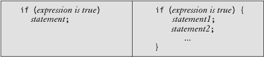

**图 7.1** if 语句（形式 1）

执行该语句时，首先对*表达式*求值。如果该值为真，则执行一条或多条语句。对于单条语句，花括号不是必需的；但对于复合语句，它们是必需的。下面是一个简单的示例：

```c
if (hours_left > 6)
    rate = 25;
printf("Refund amount = %f\n", rate * amount);
```

*if 语法要求使用圆括号*  
*下一条语句应缩进*

这里，如果 `hours_left` 大于 6，则将 25 赋给 `rate`。请注意，`printf` 语句是无条件执行的，与控制表达式的结果无关。缩进上的差异反映了我们的真实意图，并且与编译器看到的情况一致。

复合语句需要在两端使用花括号。下面的复合语句由三条简单语句组成：

```c
if (amount > 10000) {
    printf("You can't withdraw more than 10000 with this debit card\n");
    printf("Key in an amount not exceeding 10000\n");
    scanf("%d", &amount);
}
```

*if 到此处的 ; 结束*

注意，`}` 符号后面没有分号。如果没有花括号，则只有第一个 `printf` 会被条件执行。

> **注意：** 当 `if` 与单条语句一起使用时，它以作为语句终止符的分号结束。对于复合语句，`if` 在最后一条语句的终止 `;` 处结束。

> **警告：** 用于决策和循环结构的所有控制表达式都必须用圆括号括起来。如果你使用 `if count > 0` 或 `while count++ <= MAX_COUNT`，编译器将生成错误。

## 7.4 `average_integers.c`：平均值计算程序

我们的第一个程序（程序 7.1）计算用户输入的两个非零整数的平均值，但在验证后只考虑它们的绝对值。这意味着负整数的符号会被去掉。该任务通过使用一个关系运算符（`<`）和一个逻辑运算符（`||`）完成。该程序运行了三次。

程序首先从键盘输入为两个整型变量 `inta` 和 `intb` 赋值。然后它使用一个逻辑表达式作为 `if` 的控制表达式，以判断两个整数中是否有一个为零。首先处理那些会导致错误的情况是一种良好的编程实践。如果程序流越过了第一个 `if` 语句，就说明我们手中已经有两个有效的整数。

一旦成功通过验证测试，下一步就是使用两个 `if` 语句来计算这两个整数的绝对值。最简单的方法是使用一元 `-` 运算符，它只是将操作数乘以 -1。我们使用 `(float)` 强制转换来计算这两个整数的平均值，因为如果没有它，除法将导致小数部分被截断。

```c
/* average_integers.c: Calculates average of the absolute values of two
   integers. Quits program if one integer is zero. */
#include <stdio.h>
int main(void)
{
    int inta, intb;
    printf("Enter two non-zero integers: ");
    scanf("%d %d", &inta, &intb);

    if (inta == 0 || intb == 0) {
        printf("At least one integer is zero\n");
        return 1;            /* Good to return nonzero for invalid entry */
    }

    /* Assigning absolute values to inta and intb */
    if (inta < 0)
        inta = -inta;        /* Using the - unary operator */
    if (intb < 0)
        intb = -intb;
    /* If we have come here, both inta and intb must be positive */
    printf("Average of absolute value of the integers = %.2f\n",
           (float) (inta + intb) / 2);
    return 0;
}
```

| 程序 7.1：**average_integers.c** | |
|---|---|
| Enter two non-zero integers: **7 0**<br>At least one integer is zero | *第一次调用* |
| Enter two non-zero integers: **5 10**<br>Average of absolute value of the integers = 7.50 | *第二次调用* |
| Enter two non-zero integers: **-13 8**<br>Average of absolute value of the integers = 10.50 | *第三次调用* |
| 程序输出：**average_integers.c** | |

该程序包含两条 **return** 语句，有趣的是，第一条返回的是 1 而不是 0。返回 1 而不是 0 会有什么不同吗？是的，有，但前提是*下一个*程序会利用这个值。你需要过一段时间才会接触到协作程序，但了解一下这就是 **return** 的设计用法是件好事（见插文——*它是如何工作的*）。请注意，我们没有为 `inta` 和 `intb` 这两个整数使用单独的验证例程。相反，我们使用了下面的逻辑表达式：

```c
if (inta == 0 || intb == 0)
```

对于这个入门程序来说，这是可以接受的，因为我们不需要在失败时知道是哪个变量出了问题。有时，我们需要查明失败的原因，在这种情况下，你需要使用两个带有单独 `if` 语句的关系表达式（如 `if (inta == 0)` 和 `if (intb == 0)`），并为它们分别指定独立的处理路径。

```c
/* leap_year_check.c: Checks for leap year using the if-else structure.
   Doesn't make the check for century. */
#include <stdio.h>
int main(void)
{
    short year, years_left;

    printf("Enter year for leap year check: ");
    scanf("%hd", &year);
    if (year < 0) {
        printf("Invalid year\n");
        return 1;
    }
    if (year % 4 == 0)              /* No parentheses required */
        printf("Year %hd is a leap year.\n"
               "Next leap year is after 4 years.\n", year);
    else {
        years_left = 4 - year % 4;   /* No parentheses required */
        printf("Year %hd is not a leap year.\n"
               "Next leap year is %hd.\n", year, year + years_left);
    }
    return 0;
}
```

**程序 7.2：leap_year_check.c**

| 程序输出 | 调用 |
|---|---|
| Enter year for leap year check: **2009**<br>Year 2009 is not a leap year.<br>Next leap year is 2012. | *第一次调用* |
| Enter year for leap year check: **2012**<br>Year 2012 is a leap year.<br>Next leap year is after 4 years. | *第二次调用* |
| Enter year for leap year check: **1900**<br>Year 1900 is a leap year.<br>Next leap year is after 4 years. | *第三次调用*<br>*这是错误的* |

程序输出：**leap_year_check.c**

在表达式 `year % 4 == 0` 中，我们没有使用圆括号，因为 `%` 的优先级高于 `==`（表 7.1）。因此先执行取模运算。`else` 部分包含处理非闰年的代码。表达式 `4 - year % 4` 中也省略了圆括号，因为 `%` 的优先级高于 `-`。

在最后两个 `printf` 语句中，第一个实参实际上由两个拼接在一起的字符串组成。C 语言允许这种拼接（9.12.2），但请注意，即使这些字符串位于两个物理行上，拼接后的字符串实际上也只是一个实参。


**提示：** 始终在程序一开始就查找潜在错误。使用错误数据继续执行程序毫无意义。使用 `if` 语句检查这些错误，然后使用带特定值的 `return` 提前终止程序。

## 7.7 使用 `if-else-if` 阶梯进行多路分支

没有什么能阻止我们在另一个 `if` 语句内部使用第二个 `if` 语句（任何形式）。当第二个 `if` 插入到“if”部分时，我们得到的是*嵌套 if* 结构（`if-if-else`）。当在“else”部分做同样的事情时，我们得到的则是*阶梯*结构（`if-else-if`）。嵌套结构和阶梯结构都属于多路决策的范畴。嵌套形式将在第 7.10 节讨论。这里讨论阶梯结构（图 7.3）。

```c
if (expression is true)
    statement;
else if (expression is true)
    statement;
    ...
else
    statement;
```

```c
if (expression is true) {
    statements;
    ...
}
else if (expression is true) {
    statements;
    ...
}
...
else {
    statements;
    ...
}
```

**图 7.3** 阶梯 `if-else-if` 语句（形式 3）

对控制表达式的测试从顶部向下依次执行，并且一旦求值为真就终止。最后的 `else` 语句负责“其余情况”，仅当之前所有测试都失败时才执行。C 对以这种方式使用的 `else-if` 段数量没有限制。

现在让我们使用这个结构来计算某移动运营商提供的 4G 互联网服务资费。资费为：最多 1 GB 为 255 卢比，最多 2 GB 为 455 卢比，最多 4 GB 为 755 卢比，此后为 995 卢比（根据实时数据简化）。使用 `if-else-if` 形式可以轻松实现该逻辑：

```c
if (usage <= 1)
    tariff = 255;
else if (usage <= 2)
    tariff = 455;
else if (usage <= 4)
    tariff = 755;
else
    tariff = 995;
```

> “其余情况”

这个链式结构使用三个不同的关系表达式，使变量 `tariff` 可以取四种可能值之一。当使用实现多路分支的结构时，必须确保这些表达式互斥。这意味着，在一次结构遍历中，两个表达式绝不能同时求值为真。

```c
/* irctc_refund.c: Computes refund amount on ticket cancellation. Negative
   value for hours_left is valid. Maximum price of ticket = Rs 10,000 */
#include <stdio.h>
int main(void)
{
    short hours_left, rate;
    float ticket_price, refund_amount;
    printf("Enter price of ticket: ");
    scanf("%f", &ticket_price);
    printf("Number of hours before train departure: ");
    scanf("%hd", &hours_left);
    if (ticket_price <= 0) {
        printf("Price can't be negative\n");
        return 1;
    }
    else if (ticket_price > 10000) {
        printf("Price can't exceed Rs 10,000.\n");
        return 1;
    }
    else if (hours_left > 48)
        rate = 0;
    else if (hours_left > 6)
        rate = 25;
    else if (hours_left > -2)              /* 2 hours after departure */
        rate = 50;
    else
        rate = 100;                         /* No refund */
    refund_amount = ticket_price * (100 - rate) / 100;
    printf("Refund amount = %.2f\n", refund_amount);
    return 0;
}
```

| 程序 7.3：`irctc_refund.c` |
| --- |
| 输入票价：**11000**<br>距火车发车还有多少小时：**45**<br>价格不能超过 10,000 卢比。 |
| 输入票价：**1000**<br>距火车发车还有多少小时：**4**<br>退款金额 = 500.00 |
| 输入票价：**1000**<br>距火车发车还有多少小时：**-1**<br>退款金额 = 500.00 |

程序输出：`irctc_refund.c`

## 7.8 irctc_refund.c：计算火车票退票费用

程序 7.3 计算 IRCTC 铁路预订系统的退票费用。该费用按总票价的百分比计算，取决于距离火车发车还剩多少小时。程序将票价和小时数作为输入，并显示退款金额。下表显示了退票费用：

| *退票时间* | *退票费用* |
| --- | --- |
| 发车前超过 48 小时 | 0% |
| 发车前 6 至 48 小时之间 | 25% |
| 发车前不足 6 小时至发车*后* 2 小时 | 50% |
| 发车*后*超过 2 小时 | 100% |

票价上限设为 10,000 卢比。程序使用 `if-else-if` 阶梯结构来验证输入并计算退票费用。由于发车*后*两小时内也允许退票，因此在该结构的最后一个 `else-if` 段中，变量 `hours_left` 会变为负数。

请参考本程序之前给出的 4G 互联网资费示例。那里的控制表达式在整个 `if-else` 结构中使用了同一个变量名（`usage`）。然而，当前程序中的这个结构在控制表达式中使用了两个不同的变量（`ticket_price` 和 `hours_left`）。尽管我们设法在一个地方完成了所有事情，但第一次调用表明这样做并不合适。对 `ticket_price` 的验证检查本应在获取 `hours_left` 输入之前进行。

## 7.9 atm_operation.c：在交付现金前检查 PIN

程序 7.4 表示一个使用 `if-else-if` 阶梯结构的 ATM 现金取款应用。程序验证你输入的 PIN（一种代码），并允许提取不超过 20,000 卢比的金额。整个代码段在一个循环中运行，因此用户有无限次机会输入数据。该程序有许多重要特性，因此请花些时间深入研究它。

程序使用 `while (1)` 结构来建立一个无限循环，即一个永不终止的循环。你可能对循环了解不多，但你肯定知道表达式 `(1)` 始终为真。因此，除非循环内部的某条语句强制退出，否则该循环永远不会终止。在这里，任一 `return` 语句都会强制终止循环。

这里有两个 `if-else-if` 阶梯结构，一个嵌套在另一个内部。“外层”结构处理 PIN 码验证。仅当 PIN 由四位数字组成且与符号常量 `USER_PIN` 匹配时，才会接受该 PIN。如果验证失败，其余语句将被忽略，执行会“贯穿”到与 `while` 循环左花括号配对的右花括号。随后重复整组指令，以便用户重新输入 PIN。

当程序成功验证 PIN 后，控制流转向“内层”阶梯结构，提示输入金额。`amount` 的值为 0 时，为程序提供了一条使用 `return 1;` 终止的退出路径。当 `amount` 被赋予有效值时，程序也会终止。

**注意：** 程序底部的 `return 0;` 语句永远不会被执行，因为程序会通过内层阶梯结构中其他 `return` 语句提供的路径退出。放在底部的这条 `return` 语句应当删除。

## 7.10 使用嵌套 `if` 进行多路分支（`if-if-else`）

我们已经看到将 `if-else` 段插入主 `if` 语句的 `else` 部分。当把同样的段插入主 `if` 部分本身时（图 7.4），我们就得到了嵌套 `if`（`if-if-else`）结构。与阶梯结构一样，这并不是语言的一项独立特性，而是从 `if` 语法派生出来的。

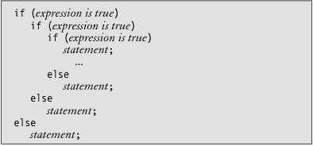

**图 7.4** 嵌套 `if-if-else` 语句（形式 4）

该图展示了使用嵌套 `if` 结构时必须采用的缩进。没有适当的缩进，很容易在视觉上将 `if` 与错误的 `else` 配对。配对规则非常简单：最内层的 `if` 与最内层的 `else` 配对，紧邻的外层 `if` 与紧邻的外层 `else` 配对，依此类推，直到最外层的 `if` 与最外层的 `else` 配对。当你为其中一个 `if` 省略 `else` 时，这种对称性就会被打破，但很快会进一步讨论。

让我们看一个简单示例，它展示了这个派生结构的用处。考虑需要打印从用户输入获得的三个正整数之和，但仅在验证之后。以下是处理该逻辑的代码片段：

```c
if (a > 0)
    if (b > 0)
        if (c > 0)

            /* Cleared the validity check */
            printf("Sum of three integers = %d\n", a + b + c);
        else
            printf("c is not a positive integer\n");
    else
        printf("b is not a positive integer\n");
else
    printf("a is not a positive integer\n");
```


当代码以这种方式呈现时，将 **if** 与其 **else** 配对应该没有问题。前三个 **if** 语句表示 AND 条件（a > 0 && b > 0 && c > 0），因此第一个 **printf** 表示当三个表达式的值都为真时要执行的操作。其他 **printf** 语句与 **else** 子句相关联，它们告诉我们当各个变量小于或等于零时会发生什么。

在某些情况下，我们需要省略一些 **else** 关键字，甚至全部省略。后者容易处理，但我们必须谨慎处理其他情况。在此之前，让我们看一个包含语义嵌套 **if** 结构的程序。

## 7.11 `right_angle_check.c`：检查勾股定理的程序

我们的几何知识告诉我们，直角三角形斜边的平方等于另外两条边的平方和。这意味着给定三个数 a、b 和 c，如果 a * a + b * b 等于 c * c，那么可以用这三条边构成一个直角三角形，其中最长边表示斜边。

程序 7.5 运行一个无限 **while** 循环，从键盘接受三个整数（a、b 和 c）。它允许用户多次输入非零值，然后尝试 a、b 和 c 的所有可能组合，以判断其中是否有组合符合该公式。了解嵌套 **if** 结构如何工作是有益的，尽管更好、更直观的方法是使用 **if-else-if** 阶梯。

程序首先验证这些整数是否为非零值；当它们全为零时，程序终止。验证成功后，控制流转移到由四个 **if** 语句组成的嵌套结构。第一个 **if**（最外层）只允许正整数通过。如果该测试失败，底部匹配的 **else** 会使用 **printf** 显示一条不具体的错误消息。由于整个结构在循环中运行，控制流随后回到 **while** 的开头，以接受下一组整数。

一旦这三个整数通过第二次验证测试，程序会尝试三种可能*不*符合该定理的组合（a-b-c、a-c-b 和 b-c-a）。换句话说，如果三个关系表达式的值都为真，那么用这些整数的任何组合都*不能*构成直角三角形。如果其中一个表达式失败，其对应的 **else** 部分会使用 **printf** 告诉我们*可以*构成直角三角形，并且还会告诉我们斜边是哪条。

## 7.12 **if-if-else** 嵌套结构的配对问题

在上一个程序（程序 7.5）中，我们没有遇到任何配对问题，因为嵌套 **if** 结构中的 **if** 和 **else** 子句数量相等。很容易看出哪个 **else** 与哪个 **if** 配对。有时，程序逻辑可能不需要一个或多个 **else** 子句。图 7.5 展示了一个缺少 **else** 的小代码片段，并同时给出了具有误导性的缩进和正确的缩进。

左侧形式中 **else** 部分的缩进具有欺骗性。它给人的印象是 **else** 与第一个 **if** 配对，但事实并非如此。右侧形式正确显示了 **else** 与内层 **if** 配对。尽管编译器并不关注缩进，但我们不能忽视它。

```c
/* right_angle_check.c: Uses nested if statements. Doesn't catch
   exact cause of failure. Formula used: a*a + b*b = c*c */
#include <stdio.h>
int main(void)
{
    short a, b, c;
    while (1) {
        printf("Enter three integers a b c: ");
        scanf("%hd %hd %hd", &a, &b, &c);

        if (a == 0 && b == 0 && c == 0) {
            printf("All values zero. Quitting ...\n");
            return 1;
        }

        /* RAT represents right-angled triangle */
        if (a > 0 && b > 0 && c > 0)
            if (a * a + b * b != c * c)       /* Whether RAT can't be formed */
                if (a * a + c * c != b * b)   /* Ditto */
                    if (b * b + c * c != a * a)   /* Ditto */
                        printf("RAT not possible.\n");
                    else
                        printf("RAT with %hd as hypotenuse.\n", a);
                else
                    printf("RAT with %hd as hypotenuse.\n", b);
            else
                printf("RAT with %hd as hypotenuse.\n", c);
        else
            printf("At least one input is invalid.\n");
    }
}
```

### 程序 7.5：**right_angle_check.c**

```text
Enter three integers a b c: 5 0 9
At least one input is invalid.
Enter three integers a b c: 3 5 4
RAT with 5 as hypotenuse.
Enter three integers a b c: 5 2 6
RAT not possible.
Enter three integers a b c: 6 10 8
RAT with 10 as hypotenuse.
Enter three integers a b c: 0 0 0
All values zero. Quitting ...
```

### 程序输出：**right_angle_check.c**

| 具有误导性的缩进 | 正确的缩进 |
|---|---|
| `if (a > 0)`<br>　`if (b > 0)`<br>　　`valid_int = 'y';`<br>`else`<br>　`valid_int = 'n';` | `if (a > 0)`<br>　`if (b > 0)`<br>　　`valid_int = 'y';`<br>　`else`<br>　　`valid_int = 'n';` |

### 图 7.5：缺少 else 的代码

但如果你实际上想为第一个 `if` 保留 `else` 部分，而不为第二个 `if` 保留，那该怎么办？这个问题有两种解决方案。一种是使用花括号来消除歧义。另一种是使用一个包含单独分号的虚拟 `else`。单独放在一行上的 ; 表示空语句——一条什么都不做的语句。图 7.6 并排列出了这两种解决方案，供你选择更喜欢的一种。花括号方案是大多数人偏好的方案。

| 空命令方案 | 花括号方案 |
|---|---|
| `if (a > 0)`<br>　`if (b > 0)`<br>　　`valid_int = 'y';`<br>　`else`<br>　　`;`<br>`else`<br>　`printf("a is <= 0\n");` | `if (a > 0) {`<br>　`if (b > 0)`<br>　　`valid_int = 'y';`<br>`}`<br>`else`<br>　`printf("a is <= 0\n");` |

### 图 7.6：缺少 else 的两种解决方案

## 7.13 `leap_year_check2.c`：使用 if-if-else 结构的程序

让我们通过改进之前的一个闰年检查程序来结束关于 `if` 语句的讨论。修订版（程序 7.6）包含对“世纪”年份（如 1900、2000 等）的特殊检查。我们使用一个对称的嵌套 `if-if-else` 结构，其中没有遗漏任何 `else`。变量 `is_leap_year` 的使用应该会让人大开眼界，因为它的使用方式非常巧妙。

你知道，并非所有标志世纪更替的年份都是闰年，尽管它们都能被 4 整除。像 1900 和 2000 这样的年份必须能被 400 整除，这意味着 2000 年是闰年，而 1900 年不是。要判断一个年份是否为闰年，我们必须遵循以下步骤：

- 1. 检查该数字是否能被 4 整除。如果不能，则该数字不是闰年，程序终止。
- 2. 如果前一项检查成功，则将该数字除以 100，以判断该年份是否代表世纪更替。如果它不能被 100 整除，则该数字表示闰年，程序终止。
- 3. 如果执行到这里，说明我们处理的是世纪年。现在检查该数字是否能被 400 整除。如果能，则该数字是闰年，程序终止。
- 4. 如果执行到这里，则该数字不表示闰年。

```c
/* leap_year_check2.c: Checks for leap year using nested ifs.
                       This one makes the check for century. */
#include <stdio.h>
int main(void)
{
    short year, years_left;
    char is_leap_year = 'n';

    printf("Enter year for leap year check: ");
    scanf("%hd", &year);

    if (year % 4 == 0)                 /* Includes 1900, 2000, 2008 */
        if (year % 100 == 0)           /* Example year 1900 */
            if (year % 400 == 0)        /* Example year 2000 */
                is_leap_year = 'y';
            else                       /* Example year 1900 */
                years_left = 4;
        else                           /* Example year 2008 */
            is_leap_year = 'y';
    else                               /* Not a leap year */
        years_left = 4 - year % 4;

    /* We now know whether it is a leap year or not */
    if (is_leap_year == 'y')
        printf("%d is a leap year.\n", year);
    else
        printf("%d is not a leap year. Next leap year: %d.\n",
               year, year + years_left);

    return 0;
}
```

### 程序 7.6：**leap_year_check2.c**

| 程序输出 |
| --- |
| 输入要检查的年份：**2016**<br>2016 年是闰年。 |
| 输入要检查的年份：**2013**<br>2013 年不是闰年。下一个闰年：2016。 |
| 输入要检查的年份：**1900**<br>1900 年不是闰年。下一个闰年：1904。 |
| 输入要检查的年份：**2000**<br>2000 年是闰年。 |

### 程序输出：**leap_year_check2.c**


前面的伪代码通过一组三个嵌套的 `if` 语句实现。每当它们检测到闰年时，char 变量 `is_leap_year` 被设置为 `'y'`。对于非闰年，变量 `years_left` 被设置为距离下一个闰年剩余的年数。一旦 `is_leap_year` 的最终状态已知，就使用一个简单的 `if-else` 结构输出合适的消息。

C 不支持布尔变量，但变量 `is_leap_year` 被当作布尔变量使用。它在两个位置被设置为 `'y'`，在另外两个位置被设置为 `'n'`。完成对 `year` 的所有检查后，我们就知道 `is_leap_year` 的值是什么。然后我们可以*从单一位置*做出决定。以这种方式将变量用作标志，代表了一种避免代码冗余的经典编程技巧。注意，变量 `is_leap_year` 已被适当命名，以表明它保存的值的类型。


**提示：** 如果你的程序有多个检查点需要执行一个共同动作，不要在每一个检查点都执行该动作，而只需在那里设置一个标志。完成所有检查后，测试这个标志，然后执行必要的动作。这种技巧不仅减小代码规模，还使维护更容易，因为如果你后来决定更改该动作，只需要在一个位置进行更改。

### **工作原理：如何使用逻辑表达式解决闰年问题**

我们可以使用逻辑表达式来解决闰年问题。如果满足以下复合条件，则该年份是闰年：

*该年份（能被 4 整除且不能被 100 整除）或能被 400 整除吗？*

括号是为了便于理解而提供的。以下代码一次性完成闰年判断：

```c
if (year % 4 == 0 && year % 100 != 0 || year % 400 == 0)
    printf("%d is a leap year\n", year);
else
    printf("%d is a not leap year\n", year);
```

查阅表 7.1 中 `%`、`==`、`&&`、`!=` 和 `||` 运算符的优先级，以确信复合逻辑表达式中包含关系表达式时不需要括号。

## 7.14 条件表达式 (?:)

条件表达式在第 6.17 节中已简要提及。这种结构使用两个符号（`?` 和 `:`）作为三元运算符。该运算符作用于三个表达式，使用以下形式语法和功能语法：

```text
exp1 ? exp2 : exp3       Entire line is an expression
condition ? value1 : value2
```

这三个表达式的组合本身构成一个更大的表达式——*条件表达式*。如果 `exp1` 求值为真，则该表达式的值为 `exp2`，否则为 `exp3`。尽管这种结构在第 6 章中作为特殊表达式形式讨论过，但它对决策也很重要。事实上，这个运算符可以轻松替代那些仅仅设置变量的 `if-else` 语句。考虑以下 **if** 语句，它与三元版本并排显示：

| if-else 版本 | 等价条件表达式 |
|---|---|
| `if (total > 1000)`<br>`    rate = 0.90;`<br>`else`<br>`    rate = 0.95;` | `rate = total > 1000 ? 0.90 : 0.95;` |

使用条件表达式，闰年问题变得更短。只需根据逻辑表达式的值将变量 `is_leap_year` 设置为 `'y'` 或 `'n'`。如果括号有助于表达清晰，就使用括号：

```c
char is_leap_year;
is_leap_year = (year % 4 == 0 && year % 100 != 0) || (year % 400 == 0)
               ? 'y' : 'n';
```

现在，**printf** 和 **scanf** 也是表达式，因为二者都返回值，那么我们可以这样使用 **printf** 吗？

```c
count = a < 0 ? printf("Invalid value\n") : printf("Valid integer\n");
```

可以，这是一条有效语句。在 **printf** 求值过程中，副作用（打印）也会出现。变量 count 存储 **printf** 的返回值，即打印的字符数。注意末尾的 `;` 是赋值语句的终止符。第一个 **printf** 没有终止符，那么第二个 **printf** 为什么应该有一个呢？

## 7.15 switch 语句

我们经常使用相等测试，因此 C 有一种特殊结构来处理它。它就是 **switch** 语句，使用紧凑且结构化的构造实现多路分支。如果你需要匹配 10 个整数值以做出 10 种不同决策，请使用 **switch**，其语法如图 7.7 所示。

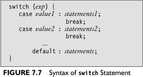

**switch** 首先求值 *exp*，它必须是整数或字符变量或常量。接着它尝试将 *exp* 与 *value1* 匹配。如果匹配成功，**switch** 执行由一个或多个语句表示的 *statement1*。如果匹配失败，**switch** 尝试将 *exp* 与 *value2* 匹配，依此类推，直到控制转移到关键字 **default**（如果存在）。因此，当之前所有匹配操作都失败时，就会调用这个选项。为此，**switch** 得到三个关键字——**case**、**break** 和 **default**——的辅助。整个选项集及其关联动作都括在花括号中。

每个 **case** 代表一个选项，指定匹配成功时要执行的语句。在大多数情况下，**case** 后面跟着 **break**。当遇到它时，进一步匹配停止，控制越过 **switch** 的末尾，转移到 `}` 后面的语句。然而，如果没有 **break**，控制会“贯穿”到下一个 **case** 选项，寻找下一个 **break**，或者如果找不到，就越过 **switch** 的末尾。程序 7.9 清楚地展示了 **switch** 为什么被设计成这种不寻常的行为。

下面是一个简单代码片段，展示了 **switch** 的工作方式。它验证用户输入的整数是否为值 1 和 2：

```c
printf("Enter a 1 or 2: ");
scanf("%d", &response);
switch (response) {
    case 1: printf("You entered 1\n");
           break;
    case 2: printf("You entered 2\n");
           break;
    default: printf("Invalid option\n");
}
```

*不需要 break……*  
*……无论如何都会 break*

**default** 关键字（如果存在）不需要 **break**，因为控制无论如何都会在它可能出现的位置跳出该结构。然而，**switch** 运行时有以下限制：

- *exp* 可以是任何表达式，只要它求值为整数或字符常量，如 1、2 或 'y'。
- 标签 *value1*、*value2* 等只能是整数或字符常量，或常量表达式（如 3 + 5）。这里不允许浮点值和变量。
- 标签后面总是跟一个冒号，与其关联的语句必须以分号结尾。
- **default** 标签是可选的，但如果存在，通常放在最后一个选项（不过并非强制）。
- 两个或更多标签可以共用一个 **break** 语句。这一特性赋予 **switch** 逻辑 OR 运算符的能力。
- 允许有空 **case**（不含任何语句）。

关系表达式可以用作 *exp* 吗？当然可以，但求值结果只会是两个值之一。你可以使用 **switch** 匹配值 0 和 1，但那样的话 **if** 最适合这项任务。程序 7.9 使用关系表达式作为 *exp*。

## 7.16 `calculator.c`：一个使用 switch 的基本计算器程序

程序 7.7 模拟一个简易计算器，用两个操作数执行基本算术运算。这些操作数以整数或浮点数形式键入。运算符从列表中选择。整个序列在一个循环中运行，只有按下中断键（通常是 Ctrl-C）才能终止。

```c
/* calculator.c: A rudimentary calculator using switch-case.
   Truncates operands to integers before using the % operator. */

#include <stdio.h>

int main(void)
{
    int operator;
    float left_operand, right_operand;

    while (1) {                         /* Infinite loop */
        printf("Enter left operand: ");
        scanf("%f", &left_operand);
        printf("Enter right operand: ");
        scanf("%f", &right_operand);
        printf("1. '+' 2. '-' 3. '*' 4. '/' 5. '%%'\n");
        printf("Enter a valid number for operator: ");
        scanf("%d", &operator);

        switch (operator) {
            case 1: printf("%f\n", left_operand + right_operand);
                    break;
            case 2: printf("%f\n", left_operand - right_operand);
                    break;
            case 3: printf("%f\n", left_operand * right_operand);
                    break;
            case 4: printf("%f\n", left_operand / right_operand);
                    break;
            case 5: printf("%d\n", (int) left_operand % (int) right_operand);
                    break;
            default: printf("Illegal operator\n");
        }
    }
    return 0;
}
```

程序 7.7：**calculator.c**

```text
Enter left operand: 5
Enter right operand: 8
1. '+' 2. '-' 3. '*' 4. '/' 5. '%'
```


```text
Enter a valid number for operator: 3
40.000000

Enter left operand: 10.5
Enter right operand: 20.3
1. '+' 2. '-' 3. '*' 4. '/' 5. '%'
Enter a valid number for operator: 1
30.799999

Enter left operand: 20
Enter right operand: 40
1. '+' 2. '-' 3. '*' 4. '/' 5. '%'
Enter a valid number for operator: 6
Illegal operator
[Ctrl-C]                         Terminates program abnormally
```

程序输出：`calculator.c`

三个 `scanf` 语句使运算符及其操作数可供 `switch` 结构使用。每个专门对应一个运算符的 `case` 选项都会打印该运算的结果。前五个 `case` 选项中的 `break` 确保一旦找到匹配项，控制流不会向下贯穿。请注意，取模运算符需要强制类型转换，因为它只适用于整数操作数。该程序存在缺陷；本应有一个单独的选项（例如 0 或 9），让程序可以通过 `return` 语句优雅地退出。

## 7.17 `mobile_tariffs.c`：计算 4G 服务费用的程序

下一个程序（程序 7.8）让你评估移动运营商提供的 4G 上网套餐。数据取自 7.7 节中展示的代码片段。程序提供一个包含四种套餐的菜单供选择，然后使用 `switch` 将所提供的流量（以 GB 为单位）和套餐价格赋给两个变量。接着，它显示所选套餐的每单位费率。程序在一个无限循环中运行，当遇到 `return` 语句时终止。

```c
/* mobile_tariffs.c: Computes the cost per GB of data consumed from among
   four 4G Internet plans. Uses a multi-line printf to display a menu. */
#include <stdio.h>
int main(void)
{
    short option, data_limit, tariff;

    while (1) {
        printf("\nChoose from the following 4G plans:\n\n"
               "\t1. 1 GB for Rs 255\n\t2. 2 GB for Rs 455\n"
               "\t3. 4 GB for Rs 755\n\t4. 10 GB for Rs 995\n"
               "\t9. Exit"
               "\nEnter choice: ");
        scanf("%hd", &option);

        switch (option) {
            case 1: data_limit = 1; tariff = 255;
                break;
            case 2: data_limit = 2; tariff = 455;
                break;
            case 3: data_limit = 4; tariff = 755;
                break;
            case 4: data_limit = 10; tariff = 995;
                break;
            case 9: printf("Quitting ...\n");
                return 0;
            default: printf("Invalid option\n");
        }

        if (option >= 1 && option <= 4) {
            printf("You chose %d GB for Rs %d.\n", data_limit, tariff);
            printf("Cost per GB = Rs %.2f\n", (float) tariff / data_limit);
        }
            /* Closes while */
}
```

程序 7.8：**mobile_tariffs.c**

```text
Choose from the following 4G plans:

    1. 1 GB for Rs 255
    2. 2 GB for Rs 455
    3. 4 GB for Rs 755
    4. 10 GB for Rs 995
    9. Exit
Enter choice: 4
You chose 10 GB for Rs 995.
Cost per GB = Rs 99.50

Choose from the following 4G plans:

    1. 1 GB for Rs 255
    2. 2 GB for Rs 455
    3. 4 GB for Rs 755
    4. 10 GB for Rs 995
    9. Exit
Enter choice: 9
Quitting ...
```

程序输出：**mobile_tariffs.c**

观察单个 **printf** 语句如何借助 `\t` 和 `\n` 转义序列创建一个包含五个选项的多行菜单。用户的选择由 **switch** 用来设置变量 `data_limit` 和 `tariff`。当用户选择 9 时，程序优雅地终止。

## 7.18 `date_validation.c`：验证日期的程序

程序 7.9 使用两个 **switch** 结构来验证以 *dd/mm/yyyy* 格式输入的日期。第一个 **switch** 验证月份，第二个 **switch** 验证日。该程序有两个有趣的特性——在某些 **case** 选项中省略了 **break**，以及在 **switch** 内部使用 **continue** 语句，尽管 **continue** 并不属于 **switch** 结构的一部分。

```c
/* date_validation.c: Validates a date that is input in dd/mm/yyyy format.
   Uses continue inside switch and drops break from some labels. */

#include <stdio.h>

int main(void)
{
    short day, month, year, max_days;

    while (1) {
        printf("Enter date in dd/mm/yyyy format: ");
        scanf("%hd/%hd/%hd", &day, &month, &year);

        /* Month validated & max days set here */
        switch (month) {
            case 2 : max_days = (year % 4 == 0) &&
                               (year % 100 != 0 || year % 400 == 0) ? 29 : 28;
                     break;
            case 4 :                    /* Fall-through from case 4 to case 11 */
            case 6 :
            case 9 :
            case 11 : max_days = 30;    /* Applies to case 4, 6, 9 and 11 */
                      break;
            default : if (month > 12) {
                          printf("Illegal month\n");
                          continue;
                      }
                      max_days = 31;   /* For the remaining 7 months */
        }

        /* Day validated here */
        switch (day > max_days) {    /* Relational expression used here */
            case 1 : printf("Illegal number of days\n");
                     continue;
            case 0 : printf("Valid date\n");
        }
        return 0;                    /* Program terminates if date valid */
    }                                /* Closes while loop */
}                                    /* Closes main */
```

程序 7.9：**date_validation.c**

```text
Enter date in dd/mm/yyyy format: 31/06/2016
Illegal number of days
Enter date in dd/mm/yyyy format: 30/13/2015
Illegal month
Enter date in dd/mm/yyyy format: 29/02/1900
Illegal number of days
Enter date in dd/mm/yyyy format: 29/02/2000
Valid date
```

程序输出：`date_validation.c`

这个程序看起来可能令人生畏，但实际上相当简单。它首先从 `scanf` 保存的输入中提取月份并进行验证。第一个 `switch` 将 12 个月分为三类：二月、四个 30 天的月份和七个 31 天的月份。二月首先使用先前讨论过的逻辑表达式检查是否为闰年。

接下来，30 天的月份由四个 `case` 选项处理，其中三个指定不执行任何操作且没有 `break`。对于这三个选项，控制流会一直向下贯穿，直到在标记为 11 的 `case` 中遇到 `break` 为止。此处执行的赋值 `max_days = 30` 同样适用于前三个选项。如果 `switch` 不支持在缺少 `break` 时的默认贯穿行为，这是不可能实现的。

剩余的七个 31 天月份由 `default` 标签处理，其中包含两个 `continue` 语句中的第一个。与 `break` 不同，`continue` 不是 `switch` 语法的一部分。它在所有循环中用于从循环顶部重新开始下一次 *迭代*（用来描述遍历循环中所有语句的术语）。在这个程序中，`continue` 只是重新启动 `while` 循环。现在可以安全地将 `max_days` 设置为 31。

第二个 `switch` 只是检查输入的日是否超过 `max_days`。这里也有 `continue`，以便在输入无效日时给用户另一次机会。当输入有效日期时，程序通过 `return 0;` 正常终止。

> 要点：`break` 和 `continue` 都会终止 `switch`，但 `continue` 仅在 `switch` 被循环包含时有效。`break` 将控制权转移到 `switch` 结束符（闭合的控制花括号）之后的语句，而 `continue` 将控制权转移到循环顶部，开始下一次迭代。

## 7.19 “无限可滥用”的 goto 语句

`break` 和 `continue` 都可以视为 Fortran 和 BASIC 等语言提供的 GOTO 语句的受限版本。然而，C 也支持 `goto` 语句，它允许控制流分支到程序中的另一个点，而无需返回到程序中执行它的位置。自从 Kernighan 和 Ritchie 提出这个“无限可滥用”的结构应该“如果非要用，也应尽量节制”以来，围绕该语句出现了大量负面宣传。在我们自己获得教训之前，先来看一个使用 `goto` 的小程序（程序 7.10）。


```c
/* goto.c: 演示 goto 的使用。 */
#include <stdio.h>
int main(void)
{
    float ticket_price, rate = 50;
    printf("Enter price of ticket: ");
    scanf("%f", &ticket_price);

    if (ticket_price <= 0 || ticket_price > 10000)
        goto exit_from_here;
    else
        rate = 100;

    printf("Rate = %.2f\n", rate);
    return 0;

exit_from_here:
    printf("Invalid ticket price\n");
    return 1;
}
```

程序 7.10：**goto.c**

```
Enter price of ticket: 5000
Rate = 100.00
Enter price of ticket: 12000
Invalid ticket price
```

程序输出：**goto.c**

在这个程序中，`goto` 语句将控制转移到标签 `exit_from_here`。这个标签可以放在程序中的任何位置，但通常放在末尾。当对 `ticket_price` 的验证失败时，控制将分支到该标签，并执行其下方的所有语句。这里也可以再放一个 `goto`，但这样做会滥用该特性。

诚然，`goto` 所完成的任务可以通过其他方式实现。但 `goto` 有助于将控制从深层嵌套的循环中跳出，即当一个循环被多个外层循环包围时。`break` 语句无法做到这一点，因为它只能终止当前循环。然而，`goto` 的使用应仅限于极少数罕见的情况。

> **提示：** 你有时会发现，在程序终止之前，多个代码段需要执行一些清理工作（如关闭文件）。这个清理工作可以在单一位置完成，只需使用 `goto` 到达该位置即可。这种类比与程序中证明使用标志（7.6）的合理性类似。

## 接下来是什么？

仅靠决策并不能解决所有问题。我们还需要使用一种机制，让一条语句能够重复执行，并在每次执行时产生不同的效果。你在本章中已经初步了解了无限循环。下一章将详细考察所有循环——有限循环和无限循环。

## 你学到了什么？

在 C 语言中，决策是通过计算一个*控制表达式*来作出的，该表达式被 `if` 语句和所有循环使用。控制表达式通常是关系表达式或逻辑表达式，返回两个值之一（真或假）。

单个 `if-else` 结构用于双向决策，但多个这样的结构可以链接起来形成*嵌套*或*阶梯*结构，从而进行多向决策。

如果一个 `if` 没有与其对应的 `else` 正确对齐，嵌套和阶梯结构可能难以理解。缺失的 `else` 可能需要用*空*命令或额外的花括号明确表示出来。

使用 `?:` 三目运算符的条件表达式可以处理简单的 `if-else` 问题。

`switch` 语句是一种紧凑的结构，仅用于相等性测试。每个 `case` 选项都需要一个 `break` 来防止“贯穿”行为。在某些情况下，这种贯穿行为是需要的。

`goto` 语句使控制转移到程序中的另一个位置，并且不会自动返回。它只能在罕见情况下使用。

## 客观题

### A1. 判断题

- 7.1 决策结构会打乱程序的顺序执行流程。
- 7.2 语句 `if (1)` 不是合法的 C 结构。
- 7.3 `if` 语句不一定需要 `else` 子句。
- 7.4 `if` 语句的控制表达式不能是函数。
- 7.5 每个 `if` 结构都可以用 `switch` 替代。
- 7.6 在控制块内声明的变量在该块外部不可见。
- 7.7 两个浮点数可能不会相等，即使它们看起来相等。
- 7.8 使用 `return 0;` 还是 `return 1;` 来终止程序并不重要。
- 7.9 `switch` 中的多个 `case` 选项可以共用一个 `break`。
- 7.10 关键字 `default` 必须作为 `switch` 结构的最后一个选项使用。

### A2. 填空题

- 7.1 `if (x > 3)` 中的序列 `(x > 3)` 被称为______ ______。
- 7.2 复合语句必须用______ ______括起来。
- 7.3 单独放在一行上的 `;` 表示一条______语句。
- 7.4 ______关键字可防止控制贯穿 `switch` 结构。
- 7.5 `switch` 匹配的表达式必须求值为______值。
- 7.6 ______语句不会返回到它被执行的地方。
- 7.7 条件表达式包含一个______运算符，它使用符号______和______。

### A3. 选择题

- 7.1 在 `&&` 和 `||` 两个运算符中，`&&` 具有（A）更高的优先级，（B）更低的优先级，（C）相同的优先级。

- 7.2 使用花括号（`{ }`）括起 `if` 语句的主体是（A）可选的，（B）建议的，（C）当至少执行两条语句时的强制要求，（D）在嵌套或阶梯 `if` 结构中是强制要求，（E）C 和 D。

- 7.3 考虑以下代码：

    ```c
    int x = 5;
    if (x++ == 10)
        x = 0;
    else
        ++x;
    ```

    `x` 的最终值是（A）5，（B）6，（C）7，（D）依赖于实现。

- 7.4 考虑以下代码：

    ```c
    int x = 5;
    if (x = 6)
        x = 0;
    else
        x = 10;
    ```

    `x` 的值是（A）10，（B）0，（C）5，（D）6。

- 7.5 选出不同的运算符：（A）`&&`，（B）`||`，（C）`!=`，（D）`!`。

- 7.6 考虑以下代码：

    ```c
    int x = 5;
    x = x == 5 ? 1 : 10;
    ```

    `x` 的值是（A）1，（B）5，（C）10，（D）依赖于实现。

## 概念题

- 7.1 为什么 `if (c = 'Y')` 这种结构不能正确工作？

- 7.2 在以下两种 `if` 语句形式中，你会在什么情况下优先使用哪一种？

    ```c
    if (x > 0)                    if (x > 0 && y > 0 && z > 0)
        if (y > 0)
            if (z > 0)
    ```

- 7.3 什么时候优先使用 `switch` 而不是 `if` 语句？`switch` 能处理所有决策情况吗？

- 7.4 为什么 `return` 语句在 `if-else` 或 `switch` 结构中经常使用不同的值？

## 编程与调试技能

- 7.1 找出以下代码段中的错误：

    ```c
    if x > 5
        printf("Number must not exceed 5\n");
        return 1;
    else
        printf("Number is valid\n");
    ```

- 7.2 以下代码段有什么问题？

    ```c
    if (x > 0) || (y > 0)
        printf("At least one number is positive\n");
    else if (x <= 0) && (y <= 0)
        printf("Both numbers are zero or negative\n");
    ```

- 7.3 编写一个使用 `if` 的程序，从键盘接收三个整数，并打印其中的最大值和最小值。

- 7.4 编写一个使用 `if` 的程序，接收用户输入的浮点数，并打印（i）小于该数的最大整数，（ii）大于该数的最小整数。

- 7.5 自 1896 年以来，奥运会每四年举办一次，但 1940 年至 1947 年间除外。编写一个程序，接收一个整数并判断它是否代表“奥运年”。

- 7.6 一家电力公司收取以下费率：

    | 用电量（单位） | 每单位费率 |
    |---|---|
    | 前 25 单位 | Rs 4.89 |
    | 接着 35 单位 | Rs 5.40 |
    | 接着 40 单位 | Rs 6.41 |
    | 超过 100 单位 | Rs 7.18 |

    编写一个程序，接收消耗的单位数并打印应付的总费用。

- 7.7 编写一个程序，从键盘接收一个字符，并打印该字符是字母、数字还是其他字符。程序还应打印该字符是小写还是大写。（提示：使用 `scanf` 的 `%c` 说明符。）

- 7.8 编写一个程序，从用户处接收一个整数，并在不使用 `if` 和 `switch` 语句的情况下打印“Odd”或“Even”。

- 7.9 一家移动运营商对以*整数* GB 为单位的数据消费收取以下费率：

    | 数据（GB） | 费率 |
    |---|---|
    | 1 GB | Rs 148 |
    | 2 GB | Rs 255 |
    | 3 GB | Rs 355 |
    | 4 至 6 GB | Rs 455 |
    | 7 GB 及以上 | Rs 700 |

    编写一个使用 `switch` 的程序，从键盘接收一个整数，并在验证后打印相应的费率。

- 7.10 找出以下代码段中的缺陷：

    ```c
    float x = 5.5;
    switch (x) {
        case 5.5: printf("Number is 5.5\n");
        default: printf("Some other number\n");
    }
    ```

- 7.11 编写一个使用 `switch` 的程序，接收一个 1 到 7 之间的整数，并打印该数字是否代表周末（星期六或星期日）（星期日 = 1）。

- 7.12 编写一个使用 `switch` 的程序，检查用户输入的表示月份数字的整数，并打印该月的天数。程序必须在可能的情况下合并多个 `case` 选项。

- 7.13 编写一个使用 `switch` 的程序，检查用户输入的字符是元音还是辅音，并打印适当的消息。程序必须首先检查输入的字符是否为字母（小写或大写）。


# 8 控制结构——循环

**学习目标**

- 循环的入口和出口原理。
- 控制表达式和循环体中使用的*关键变量*的概念。
- **while** 结构作为入口控制循环的工作原理。
- **do-while** 结构作为出口控制循环的工作原理。
- 控制 **for** 循环中迭代的三个表达式的意义。
- 所有循环的*嵌套*。
- 使用 **break** 和 **continue** 中断循环处理。

## 8.1 循环基础

我们每天执行的许多活动本质上都是重复性的。重复使我们呼吸、驱动汽车并推动生产线。在大多数情况下，重复框架还包括自行停止的机制。重复也延伸到计算机程序可以轻松处理的领域。考虑以下涉及重复的任务：

- 计算平均值——需要重复加法。
- 计算一个数的幂——需要重复乘法。
- 初始化数组——需要重复赋值。
- 十进制转二进制——需要重复除法。
- 画一条线——需要重复打印一个字符。

除了决策之外，语言还必须能够重复执行一组语句。做到这一点的结构称为*循环*，C 提供了三种——**while**、**do-while** 和 **for**。在我们深入具体细节之前，需要从一般意义上了解循环如何工作。图8.1展示了一个通用循环的工作过程，这里它打印整个大写英文字母表。

1. 在循环外初始化关键变量 (x)。(比如 x = 65)
2. 在循环开始处测试控制表达式。(x <= 91 吗？)
3. 如果第2步的答案为是，执行第4至6步。

   *循环开始*

4. 执行循环体以打印一个字母。(`printf("%c ", x)`)
5. 给关键变量赋下一个更大的值。(x = x + 1)
6. 返回第2步重新测试控制表达式。

   *循环结束*

7. 如果第2步的答案为否（即 x > 91），则在循环之后继续执行（比如 `printf("\nJob over\n")`）。

**图8.1**  循环如何工作

A B C D E F G H I J K L M N O P Q R S T U V W X Y Z
Job over

**伪代码的输出**

在循环开始之前，会初始化一个*关键变量*（1）。该变量用于计算控制表达式（2）。如果计算结果为真（3），则执行*循环体*（4至6），否则控制转移到循环之后的下一条语句（6）。然后，在控制返回循环开始处（2）之前，关键变量在循环体中被更改（5）。现在，在下一次*迭代*（遍历或重复）开始之前，会重新检查控制表达式（2）。如果循环被设计为运行有限次数，控制表达式最终会变为假并导致循环终止。

尽管 C 提供的三种循环都大体符合上述方案，但它们之间存在细微差异。首先，初始化可以在循环结构本身中完成（**for** 循环），而不是在外部完成。其次，控制表达式可以在末尾计算（**do-while** 循环），而不是在开始处计算。最后，控制表达式不能阻止 **do-while** 循环至少执行一次迭代，尽管它可以阻止其他循环完全运行。

循环迭代可以被挂起（以开始新的迭代），也可以完全终止而无需重新测试控制表达式。这通过 **continue** 和 **break** 关键字实现，它们可以在循环体中的任何位置调用。你在上一章的一个程序中已经使用过此功能，因此你会发现它是传统方法（使用控制表达式确定循环连续性）的便捷替代方案。

循环通常设计为执行有限次数，但许多应用需要循环一直运行。此类循环称为*无限循环*。我们在上一章中已经见过其中一种（**while (1)**）。许多互联网服务使用无限循环来检查是否收到邮件，或者用户是否在消息应用中输入了文本。然而，即使是无限循环也可以通过其他方式终止。

## 8.2 while 循环

你在前面的一些章节中已经见过 **while** 循环的工作方式。图8.2展示了语法，其中循环体既可以是单条语句，也可以是复合语句。不要忘记将控制表达式括在圆括号中。

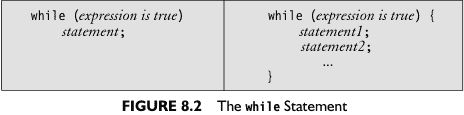

**while** 循环实际上与图8.1中描绘的通用循环相同。包含关键变量的*表达式*在循环迭代之前被计算为真或假。如果为假，则*根本不进入循环*，否则执行循环体。执行之后，控制返回到顶部以测试*表达式*，该表达式将决定下一次迭代是否可以开始。由于关键变量随每次迭代而变化，最终其值会使*表达式*变为假并终止循环。

### 8.2.1 while_intro.c：一个入门程序

让我们检查一个小程序（程序8.1），它计算前10个整数的和，并打印累进和与最终和。这里的关键变量是 i，它在 **while** 循环中使用了三次。由于这个循环是有限的，它最终会超过10。然后控制表达式将变为假并阻止循环重新进入。累进和在循环内打印，最终和在循环外打印。

**while** 循环是*入口控制循环*，这意味着不保证进入循环。如果控制表达式一开始就为假，那么根本不会进入循环。**for** 循环也是如此，但 **do-while** 循环不是，它是*出口控制循环*。**do-while** 循环中的控制表达式在循环末尾测试，这意味着初始进入循环是保证的，但后续迭代不保证。

```c
/* while_intro.c: A simple while loop that prints the sum of the
   first 10 integers. Also prints progressive sum. */
#include <stdio.h>
#define NO_OF_INTEGERS 10
int main(void)
{
    short i = 1;                  /* Key variable initialized */
    short sum = 0;
    printf("Progressive sum shown below:\n");

    while (i <= NO_OF_INTEGERS) { /* Key variable tested */
        sum += i;
        i++;                       /* Key variable updated */
        printf("%hd ", sum);
    }
    /* Loop has terminated */
    printf("\nSum of first %d integers = %hd\n", NO_OF_INTEGERS, sum);

    return 0;
}
```

**程序8.1：while_intro.c**

Progressive sum shown below:
1 3 6 10 15 21 28 36 45 55
Sum of first 10 integers = 55

**程序输出：while_intro.c**

### 8.2.2 控制表达式

控制表达式是任何循环的神经中枢。C 允许你使用任何表达式（关系、逻辑或常量），只要它计算为整数值即可。第7章中与 **if** 一起使用的任何控制表达式都会以相同方式适用于所有循环。以下是这些表达式用法的一些示例：

| while 表达式 | 描述 |
|---|---|
| `while (reply == 'y')` | 关系表达式 |
| `while (++num <= power)` | 同上，但有一处不同 |
| `while (base > 0 && power >= 0)` | 逻辑表达式 |
| `while (quot)` | 表达式是一个变量 |
| `while (i)` | 表达式是一个常量 |
| `while (printf("Enter an integer: "))` | 表达式是一个函数 |

第二个表达式令人大开眼界；它在控制表达式本身中包含关键变量（num）的更新。语句 **while (quot)** 与 **while (quot > 0)** 相同。同理，**while (1)** 始终为真。最后一个使用 **printf** 的表达式也为真，因为它计算为打印的字符数。

### 8.2.3 在控制表达式中更新关键变量

如前所述，大多数循环应用都基于*初始化—测试表达式—更新关键变量*模型：

- 初始化关键变量。
- 在控制表达式中测试它。
- 在循环体中更新关键变量。


不过，我们有时可以在控制表达式本身中更新关键变量，从而省去循环体中的一条语句。下面这段与程序 `while_intro.c` 相关的代码同样可以正常工作：

```c
short i = 0, sum = 0;
while (++i <= 10) {
    sum += i;
    printf("%hd ", sum);
}
printf("\nSum of first 10 integers = %hd\n", sum);
```

i 初始化为 0 而非 1；使用 ++i 而非 i；输出 55

关键变量 i 的更新现在已移入控制表达式，但这种移动也需要改变 i 的初始值。

> **注意：**当你在控制表达式中将关键变量改为带有前缀或后缀运算符的形式时，还需要相应修改关系运算符（例如，将 > 改为 >=）或关键变量的初始值。

## 8.3 三个使用 `while` 的程序

在继续探索 C 语言中的这个循环之前，让我们先来看三个使用了简单控制表达式的程序。这些程序都会在后续章节中被修订，以使用数组和函数。其中两个后续版本还会使用*递归*技术，而这里采用的是循环的*迭代*方法。

### 8.3.1 `factorial.c`：计算一个数的阶乘

正整数 *n* 的阶乘（记作 *n*!）是所有小于或等于 *n* 的正整数的乘积。因此，4! = 4 × 3 × 2 × 1 = 24。程序 8.2 使用 `while` 循环来计算用户提供的整数的阶乘。第 11.13.1 节展示了使用函数解决同一问题的另一种方法。

```c
/* factorial.c: Program to determine factorial of a number
                  without using a function. */
#include <stdio.h>
int main(void)
{
    short num1, num2;
    unsigned int factorial = 1;      /* unsigned doubles the maximum value */
    printf("Factorial of which number? ");
    scanf("%hd", &num1);
    num2 = num1;                     /* Saving num1 before it changes */
    while (num1 >= 1) {
        factorial *= num1;
        num1--;
    }
    printf("Factorial of %hd = %d\n", num2, factorial);
    return 0;
}
```

程序 8.2：`factorial.c`

| 求哪个数的阶乘？ | 结果 |
|---|---|
| 4 | 4 的阶乘 = 24 |
| 6 | 6 的阶乘 = 720 |
| 1 | 1 的阶乘 = 1 |

程序输出：**factorial.c**

### 8.3.2 `extract_digits.c`：反转整数各位数字的程序

程序 8.3 执行两项任务：反转一个整数的各位数字并打印它们的和。以 10 作为除数，使用 / 和 % 运算符从右侧逐个提取数字。该程序的缺点是没有保存这些数字，因此打印完成后无法对它们执行任何其他操作。

```c
/* extract_digits.c: Reverses the digits of an integer. Prints and sums
   the digits using the % and / operators. */
#include <stdio.h>
int main(void)
{
    unsigned int number;
    short last_digit, sum = 0;

    printf("Key in an integer: ");
    scanf("%d", &number);

    while (number != 0) {
        last_digit = number % 10;          /* Extracts last digit */
        number = number / 10;              /* Removes last digit */
        sum += last_digit;
        printf("%hd ", last_digit);
    }
    printf("\nSum of digits: %hd\n", sum);
    return 0;
}
```

程序 8.3：**extract_digits.c**

```
Key in an integer: 13569
9 6 5 3 1
Sum of digits: 24
```

程序输出：**extract_digits.c**

在 **while** 循环的每次迭代中，/ 操作会移除最后一位数字，% 操作会保存该数字。这就是变量 `last_digit` 和 `number` 的值在每次循环迭代中的变化方式：

| | 迭代 1 | 迭代 2 | 迭代 3 | 迭代 4 | 迭代 5 |
|---|---|---|---|---|---|
| last_digit | 9 | 6 | 5 | 3 | 1 |
| number | 1356 | 135 | 13 | 1 | 0 |

该程序不够灵活；我们无法用这种技术按数字在数中出现的顺序打印它们。我们需要保存每一位数字，不是用五个变量，而是用一个包含五个元素的*数组*。我们将在第 10.7.1 节重新讨论这个程序。

### 8.3.3 `fibonacci_ite.c`：打印并求和斐波那契数

每个计算机科学专业的学生在学习过程中都会在某一点遇到斐波那契数列。在这个以 0 和 1 开头的数列中，每个后续项都是前两项之和。这种关系可以从该数列的前 12 项中看出：

0 1 1 2 3 5 8 13 21 34 55 89

这里，55 是它的两个前项 34 和 21 之和，而 21 是 13 和 8 之和。程序 8.4 打印并求和该数列的 *n* 项，其中 *n* 由用户提供。该程序使用一个运行 *n* 次的 **while** 循环。在每次迭代中，变量 prev1 和 prev2 的和被保存在 sum 中并打印。注意，前两项是由逻辑生成的，并没有对它们进行特殊处理。这是通过仔细选择四个变量的初始值而实现的。

```c
/* fibonacci_ite.c: Uses the iterative technique to generate terms of
   the Fibonacci series and compute the sum of terms. */

#include <stdio.h>
int main(void)
{
    short num;
    unsigned long prev1 = 0, prev2 = 0, sum = 1, sum_terms = 0;
    short i = 0;

    printf("Enter last term of series: ");
    scanf("%hd", &num);

    while (i++ < num) {
        printf("%ld ", sum);          /* Prints each term */
        sum_terms += sum;             /* Sums all terms */
        prev1 = prev2;
        prev2 = sum;
        sum = prev1 + prev2;          /* Sums previous two terms */
    }
    printf("\nSum of first %hd terms = %ld\n", num, sum_terms);
    return 0;
}
```

**程序 8.4：** `fibonacci_ite.c`

```
Enter last term of series: 15
1 1 2 3 5 8 13 21 34 55 89 144 233 377 610
Sum of first 15 terms = 1596
```

程序输出：**fibonacci_ite.c**

斐波那契数列也可以使用*递归*函数生成，即一个不断调用自身的函数。第 11.4.3 节将考察这个函数及其与这里使用的迭代方法相比的缺点。

## 8.4 加载控制表达式

重复性为使用函数作为控制表达式创造了机会。例如，**getchar** 函数是 I/O 函数家族的一员，它从键盘获取一个字符并返回其 ASCII 值。**putchar** 函数使用该值来显示字符。考虑以下代码片段：

```
int c;
c = getchar();                 Gets the first character
while (c != EOF) {             EOF is end-of-file
    putchar(c);                Displays the character
    c = getchar();             Fetches the next character
}
```

这看起来是一种从键盘输入中检索文本字符串的简单方法。但由于 **getchar** 返回所获取字符的 ASCII 值，你可以将 **getchar** 语句本身移入控制表达式：

```c
while ((c = getchar()) != EOF)
    putchar(c);
```

这样既能完美工作，看起来也很简洁，因为只使用了一个 **getchar**。!= 的优先级高于 =，因此必须在赋值语句 (c = getchar()) 周围加上括号。这确保了在将 c 与 EOF（文件结束符）比较之前，**getchar** 的返回值已赋给 c。

许多函数会返回一个值。**scanf** 返回成功读取的项目数，**printf** 返回写入的字符数，因此这些函数也可以用作控制表达式：

```c
while (scanf("%d", &num) == 1)
while (printf("Enter the amount: "))
```

**getchar** 和 **putchar** 都将在第 9 章中讨论，该章会考察主要的 I/O 函数。**scanf** 和 **printf** 函数也会在同一章中讨论。

### 8.4.1 将整个循环体合并到控制表达式中

前面的示例将两次调用 **getchar** 合并为控制表达式中的一次调用。但 **putchar** 也返回一个值（即所写入字符的值），那么为什么不也把它移入控制表达式呢？是的，我们也可以这样做：


```
while ((c = getchar()) != EOF && putchar(c))
    ;    // Null statement
```

表达式 **putchar(c)** 的值是 **c**。除了 NUL 字符外，该值对所有 ASCII 字符都为真，因此 **putchar** 表达式始终为真。只有当 **getchar** 的输入耗尽时，这个复合表达式才会变为假。由于此循环没有循环体，不要忘记在 **while** 语句后跟一个分号，最好放在单独一行。

> **提示：** 如果会把清晰性破坏，不要把太多语句合并到控制表达式中。程序的清晰性比紧凑性更重要。在前面的情况中，把 **getchar** 移到控制表达式后就应该停止。**putchar** 语句最好留在循环体中。

### 8.4.2 何时确实需要空循环体

有些情况下你确实需要空循环体。当在循环中将 **scanf** 与 %c 格式说明符一起使用时，空白字符常常会滞留在缓冲区中。后续调用 **scanf** 时会读到这些滞留字符，而不是新的用户输入。因此，在再次调用 **scanf** 之前，反复调用 **getchar** 来清空缓冲区：

```
scanf("%c", &reply);          // \n generated by [Enter] remains in buffer
while (getchar() != '\n')      // \n removed from buffer
    ;                          // No further action needed
```

这里，**getchar** 会继续从缓冲区读取，直到遇到换行符。这确保下一次 **scanf** 调用在空缓冲区上操作。空循环体是必需的，因为控制表达式本身已经完成了清空缓冲区的工作。

> **注意：** 使用没有正式循环体的 **while**（或任何循环）时，记得在它下面紧接着放一个分号，以表示该循环执行空命令。如果没有提供 `;`，**while** 后面的语句将被视为循环体，这显然不是本意。

## 8.5 嵌套 while 循环

正如一个 **if** 语句可以包含另一个 **if** 语句一样，也没有什么阻止我们在外层 **while** 结构中使用第二个 **while**。图 8.3 展示了嵌套 **while** 循环结构的两种视图。右侧视图突出了它通常的使用方式。它显示了两个循环的关键变量的初始化和更新位置。

嵌套循环从初始化 *关键变量1* 开始，然后求值 *表达式1*。如果结果为真，就进入外层循环。在进入内层循环之前，先初始化 *关键变量2*。如果 *表达式2* 求值为真，并且在其求值为真之后，就进入内层循环。当这个循环终止时，外层循环的 *关键变量1* 会先被更新，然后控制才移动到该循环顶部重新求值 *表达式1*。

因此，外层循环的每次迭代都会导致内层循环的多次迭代。接下来的三个程序利用了内层和外层 **while** 循环之间存在的这种一对多关系。

| 语法形式 | 用法形式 |
|---|---|
| while (expression1) {<br>  ...<br>  while (expression2) {<br>    ...<br>  }<br>} | 初始化1<br>while (expression1) {<br>  ...<br>  初始化2<br>  while (expression2) {<br>    ...<br>    更新关键变量2<br>  }<br>  更新关键变量1<br>} |

图 8.3 嵌套 while 循环的结构

### 8.5.1 nested_while.c：打印乘法表

考虑打印一个 x 行、y 列的表。做法是先打印一行的所有 y 列，然后再处理下一行。当第 r 行的第 y 列打印完成时，任务就完成了。因此，正如以下程序（程序 8.5）所示，嵌套 while 结构是处理表格和数组等二维数据的完美选择。

```c
/* nested_while.c: Uses nested while loop to print multiplication table
   for positive integers up to 5. Maximum size of multiplier = 12 */
#define ROWS 5
#define COLUMNS 12
#include <stdio.h>
int main(void)
{
    int x = 0, y;                   /* Key variable x initialized here ... */
    while (x++ < ROWS) {            /* ... and updated in control expression */
        y = 0;                      /* Key variable y initialized here ... */
        while (y++ < COLUMNS)       /* ... and updated in control expression */
            printf("%3d", x * y);
        printf("\n");
    }
    return 0;
}
```

程序 8.5：nested_while.c

程序输出：nested_while.c

| | | | | | | | | | | | |
|---|---|---|---|---|---|---|---|---|---|---|---|
| 1 | 2 | 3 | 4 | 5 | 6 | 7 | 8 | 9 | 10 | 11 | 12 |
| 2 | 4 | 6 | 8 | 10 | 12 | 14 | 16 | 18 | 20 | 22 | 24 |
| 3 | 6 | 9 | 12 | 15 | 18 | 21 | 24 | 27 | 30 | 33 | 36 |
| 4 | 8 | 12 | 16 | 20 | 24 | 28 | 32 | 36 | 40 | 44 | 48 |
| 5 | 10 | 15 | 20 | 25 | 30 | 35 | 40 | 45 | 50 | 55 | 60 |

### 8.5.2 `half_pyramid.c`：用数字打印半金字塔

你需要使用嵌套循环来打印可预测的二维图案，比如金字塔和半金字塔。考虑以下使用数字字符的图案，其中使用的数字也是该行的序号：

- 1
- 2 2
- 3 3 3
- 4 4 4 4

尽管对于上述这类任务，**for** 循环是自然而然的选择，但下一个程序（程序 8.6）使用两个 **while** 循环来打印这个半金字塔。要打印的行数由用户输入。注意，一个关键变量（col）在控制表达式中更新，而另一个（row）没有。这是因为 row 在两个控制表达式中都使用了。

```
/* half_pyramid.c: Uses a nested while structure to print a half-pyramid. */
#include <stdio.h>
int main(void)
{
    short row = 1, col, rows_max;

    printf("Number of rows? ");
    scanf("%hd", &rows_max);

    while (row <= rows_max) {
        col = 1;                  /* Key variable col initialized here ... */
        while (col++ <= row)      /* ... and updated in control expression */
            printf("%d ", row);   /* Prints row number in each row */
        row++;
        printf("\n");             /* Moves to next row */
    }
    return 0;
}
```

程序 8.6：**half_pyramid.c**

```
Number of rows? 5
1
2 2
3 3 3
4 4 4 4
5 5 5 5 5
```

程序输出：**half_pyramid.c**

由于嵌套深度（即可容纳的内层循环数量）没有限制，你可以相当轻松地处理多维数据。

**要点：** 在嵌套的 `while` 结构中，外层循环与内层循环之间是一对多关系。对于外层循环的每次迭代，内层循环必须完成其全部迭代，然后外层循环的下一次迭代才能开始。

### 8.5.3 `power.c`：计算一个数的幂

程序 8.7 使用外层循环接收两个整数（x 和 y）作为用户输入。然后使用内层循环计算 x 的 y 次幂的值。该程序只处理正整数，但当用户输入零（针对第一个数）或负整数（针对两个数）时就会退出。

```
/* power.c: Computes power of multiple sets of numbers using a nested
          while loop. Repeatedly multiplies a number by itself. */
#include <stdio.h>
int main(void)
{
    short num, base = 1, power = 1;
    unsigned long total;

    while (base > 0 && power >= 0) {
        printf("Enter base and power (0 0 to exit): ");
        scanf("%hd%hd", &base, &power);

        if (base <= 0 || power < 0) {       /* Invalid Input */
            printf("Invalid Input. Quitting ...\n");
            return 1;
        }

        num = 0; total = 1;                  /* Initialization before inner loop */
        while (++num <= power)
            total *= base;                   /* Multiply base by itself */
        printf("%d to the power %d = %lu\n", base, power, total);
    }
    return 0;
}
```

程序 8.7：`power.c`

```
Enter base and power (0 0 to exit): 2 0
2 to the power 0 = 1

Enter base and power (0 0 to exit): 2 10
2 to the power 10 = 1024

Enter base and power (0 0 to exit): 0 0
Invalid Input. Quitting ...
```

程序输出：`power.c`


外层 **while** 循环反复提示输入两个整数。完成必要的验证后，程序将有效数字传递给内层循环。对于该循环的每次迭代，`total` 会被依次赋值为 `base`、`base * base`、`base * base * base` 等，直到关键变量 `num` 等于用户输入设定的幂次。

**注意：** 数学库支持 **pow** 函数，其作用与本程序相同。第 12 章介绍了一个使用该函数的程序。对于包含 **pow** 的程序，编译过程有所不同：必须*显式*调用链接器，以便将 **pow** 的代码包含到可执行文件中。

## 8.6 将 **while** 与 **break** 和 **continue** 一起使用

到目前为止看到的 **while** 循环都使用控制表达式来决定应当迭代还是终止。然而，有些情况需要立即暂停当前迭代，以便跳出循环或重新开始一次新的迭代。C 支持两个关键字——**break** 和 **continue**——它们可以完成这两项任务（图 8.4）。

当程序遇到 **break** 时，控制流会跳出循环，从紧挨着循环结束之后的语句继续执行。另一方面，**continue** 不会终止循环，而是暂停循环执行，以继续下一次迭代。这两种情况通常发生在循环中使用的变量或表达式取得了某个值，使得继续执行语句不再合适时。

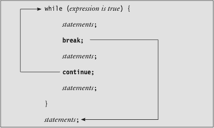

**图 8.4** continue 和 break 在 while 循环中的行为

下一个程序（程序 8.8）使用一个无限 **while** 循环，以便重复输入三个正数。如果发现其中至少一个数为负数，它就使用 **continue** 请求输入一组新的数字。如果所有数字都是正数，那么 **break** 语句会终止循环。随后，**while** 的右花括号下方的 **printf** 语句会打印这些数字的和。当三个数都输入为零时，程序也会终止。

```c
/* break_continue.c: Uses break and continue in a loop. */
#include <stdio.h>
int main(void)
{
    short a, b, c;
    while (1) {
        printf("Enter three integers a b c: ");
        scanf("%hd %hd %hd", &a, &b, &c);

        if (a == 0 && b == 0 && c == 0) {
            printf("All values zero. Quitting ...\n");
            return 1;
        }
        else if (a < 0 || b < 0 || c < 0) {
            printf("Negative integer not allowed\n");
            continue;            /* Goes to while (1) */
        }
        else
            break;               /* Goes to next printf statement */

        printf("Sum of %d %d %d: %d\n", a, b, c, a + b + c);
    }
    return 0;
}
```

| **程序 8.8：break_continue.c** |
| --- |
| 输入三个整数 a b c：3 4 -5 |
| 不允许负整数 |
| 输入三个整数 a b c：3 4 5 |
| 3 4 5 的和：12 |
| 输入三个整数 a b c：0 0 0 |
| 所有值均为零。正在退出…… |

程序输出：**break_continue.c**

结构化编程理论家不赞成使用 **break** 和 **continue**。他们认为循环应当提供单一出口点（即测试控制表达式的位置）。但这种安排是有代价的；需要在循环中的多个位置设置并测试若干变量。在你使用过 **break** 和 **continue** 之后，可能就不愿意付出这种代价了。

## 8.7 prime_number_check.c：更多 **break** 和 **continue** 的用法

我们以程序 8.9 结束关于 *while* 循环的讨论，该程序检查一个数是否为素数。*素数*是指除自身和 1 之外不能被任何其他数整除的数。程序从键盘接受多个数字，并在输入零时终止。该练习在一个使用 **break** 和 **continue** 的嵌套 *while* 循环结构中完成。程序分为四个部分。

```c
/* prime_number_check.c: Determines whether a variable is prime or not.
   Uses a nested loop with break and continue. */
#include<stdio.h>
int main(void)
{
    int num, divisor;
    char is_prime;

    /* (A) Number input and validation */
    printf("Enter numbers for prime test (0 to quit): ");
    while (scanf("%d", &num) == 1) {
        if (num < 0) {
            printf("Invalid input\n");
            continue;
        }
        else if (num == 0)
            break;                  /* Go to (D) */

        /* (B) Check for prime */
        divisor = 2;
        is_prime = 'y';             /* Assume number is prime */
        while (divisor < num) {
            if (num % divisor == 0) {
                is_prime = 'n';     /* Number is not prime */
                break;              /* Go to (C) */
            }
            divisor++;
        }

        /* (C) After break in (B) */
        is_prime == 'y' ? printf("%d is prime\n", num) :
            printf("%d is not prime, divisible by %d\n", num, divisor);
    } /* End of outer loop */

    /* (D) After break in (A) */
    printf("Quitting ...\n");
    return 0;
}
```

程序 8.9：prime_number_check.c

```text
Enter numbers for prime test (0 to quit): 19 49 -5 137 1234567 0
19 is prime
49 is not prime, divisible by 7
Invalid input
137 is prime
1234567 is not prime, divisible by 127
Quitting ...
```

程序输出：prime_number_check.c

```c
short i = 1, sum = 0;
do {
    sum += i;
    i++;
} while (i <= 10);
printf("Sum of first 10 integers = %hd\n", sum);
```

注意控制表达式 (i <= 10) 末尾的 ;。关键变量 i 的自增可以移到控制表达式中（这还要求把 <= 替换为 <）。由于这一移动使循环体中只剩一条语句，你也可以去掉花括号。许多程序员即使花括号内只有一条语句，也倾向于使用花括号。下面是两种形式：

```c
do                         do {
    sum += i;                  sum += i;
while (i++ < 100);         } while (i++ < 100);
```

选择你觉得使用起来舒服的形式，并且如果你确实必须使用 do-while 循环，就始终一致地使用它。现在我们将使用该循环开发一个有用的应用程序。

## 8.9 decimal2binary.c：从重复除法中收集余数

程序 8.10 使用 do-while 循环将十进制数转换为二进制，但不反转各位。回想一下，反转后的位模式实际上表示等价的二进制数 (3,2,2)。程序还会显示存储该二进制数所需的位数。

```c
/* decimal2binary.c: Uses a do-while loop to convert a decimal number
                     to binary but without reversing the digits. */
#include <stdio.h>

int main(void)
{
    long quot;
    short count = 0, rem = 0;

    printf("Enter a decimal integer: ");
    scanf("%ld", &quot);

    do {
        rem = quot % 2;             /* Either 0 or 1 */
        quot /= 2;                  /* Quotient progressively decreases */
        printf("%hd ", rem);
        count++;
    } while (quot > 0);

    printf("\nNumber of iterations = %hd\n", count);

    return 0;
}
```

程序 8.10：**decimal2binary.c**

```text
    Enter a decimal integer: 35
    1 1 0 0 0 1                      Binary of 35 is 100011
    Number of iterations = 6
    ────────────────────────────────
    Enter a decimal integer: 128
    0 0 0 0 0 0 1
    Number of iterations = 8
```

**程序输出：** `decimal2binary.c`

从用户输入得到的数会在 `do-while` 循环中反复进行除法和取模运算。当 `quot`（它随着每次迭代逐渐减小）最终降为零时，循环终止。由于生成的位没有被保存，程序无法将它们反转。为了正确表示该数等价的二进制形式，我们需要使用数组来存储这些位，然后反向读取数组。我们将在 8.12 节改进这个程序。

## 8.10 for 循环

与 `while` 和 `do-while` 一样，`for` 循环也使用关键变量/控制表达式范式来决定循环的进入和延续。它是一种紧凑的结构，将三个表达式集中在一个地方（图 8.6）。任何 `while` 循环都可以替换为 `for` 循环，并且对许多人来说，后者是首选的循环。

```c
for (exp1; exp2; exp3)
    statement;

for (exp1; exp2; exp3) {
    statement1;
    statement2;
    ...
}
```

**图 8.6** for 语句

`while` 循环的工作原理是在循环之前初始化关键变量，在控制表达式中测试它，并在循环体中更新关键变量。`for` 中的三个表达式完成同样的工作，但集中在一个地方。初始化由 `exp1` 完成，关键变量检查由 `exp2` 完成，关键变量的更新由 `exp3` 完成。这些由分号分隔的表达式决定循环是否运行，以及如果运行，运行多少次。

图 8.7 的左侧展示了使用 `for` 循环打印大写字母 ASCII 值的用法。右侧展示了使用 `while` 的等价代码。`for` 中的三个表达式并非在每次循环迭代中都会被求值，因此让我们理解该程序中 `for` 所使用的操作顺序：

1. 第一个表达式（`chr = 65`，在语法中为 `exp1`）初始化关键变量（`chr`）。
2. 第二个表达式（`chr < 91`，在语法中为 `exp2`）是此循环的控制表达式，它会被求值。如果求值为真，则进入循环。


| for（左） | while（右） |
| --- | --- |
| <pre><code>#include &lt;stdio.h&gt;<br>int main(void)<br>{<br>&nbsp;&nbsp;&nbsp;&nbsp;int chr;<br>&nbsp;&nbsp;&nbsp;&nbsp;for (chr = 65; chr &lt; 91; chr++)<br>&nbsp;&nbsp;&nbsp;&nbsp;&nbsp;&nbsp;&nbsp;&nbsp;printf("%c=%d ", chr, chr);<br>&nbsp;&nbsp;&nbsp;&nbsp;return 0;<br>}</code></pre> | <pre><code>#include &lt;stdio.h&gt;<br>int main(void)<br>{<br>&nbsp;&nbsp;&nbsp;&nbsp;int chr = 65;<br>&nbsp;&nbsp;&nbsp;&nbsp;while (chr &lt; 91) {<br>&nbsp;&nbsp;&nbsp;&nbsp;&nbsp;&nbsp;&nbsp;&nbsp;printf("%c=%d ", chr, chr);<br>&nbsp;&nbsp;&nbsp;&nbsp;&nbsp;&nbsp;&nbsp;&nbsp;chr++;<br>&nbsp;&nbsp;&nbsp;&nbsp;}<br>&nbsp;&nbsp;&nbsp;&nbsp;return 0;<br>}</code></pre> |
| **程序输出：**<br>A=65 B=66 C=67 D=68 E=69 F=70 G=71 H=72 I=73 J=74 K=75 L=76 M=77 N=78 O=79 P=80<br>Q=81 R=82 S=83 T=84 U=85 V=86 W=87 X=88 Y=89 Z=90 | |

**图 8.7** for（左）与 while（右）在形式上的差异

- 3. 如果第 2 步的求值结果为真，则执行 `printf` 语句。
- 4. 一次迭代完成后，控制转移到第三个表达式（`chr++` 和 `exp3`），关键变量在此处递增。
- 5. 控制现在返回第 2 步，重新测试控制表达式。如果 `chr` 仍小于 91，循环就开始下一次迭代。
- 6. `chr` 最终会变为值 91。此时控制表达式将变为假，阻止再次进入循环。`return` 语句终止程序。

与 `while` 一样，`for` 是入口控制循环，因为 `exp1` 和 `exp2` 共同决定是否进入循环。这个循环的特殊之处在于表达式用法的灵活性。这三个表达式中的任何一个都可以由逗号分隔的多个表达式组成，或者可以完全省略。利用这一特性，你可以拆解这三个表达式，使 `for` 看起来像“while”：

```c
int chr = 65;                         exp1
for ( ; chr < 91; ) {                 exp2
    printf("%c=%d ", chr, chr);
    chr++;                            exp3
}
```

这里，`exp1` 和 `exp3` 已被移出，留下的位置为空表达式。即使表达式不存在，分号也是必需的。与在 `while` 中一样，循环体中的一些语句也可以移到控制表达式中。

> **要点：** 在 `for` 循环的第一次迭代中，顺序是 `exp1`，然后是 `exp2`。
> 在后续迭代中，顺序是 `exp3`，然后是 `exp2`。`exp1` 只在进入循环之前求值一次。

### 8.10.1 ascii_letters.c：可移植的 ASCII 码生成器

程序 8.11 生成小写字母的*机器*值。它每行打印九个字母的值，形式为 *字母=值*。该程序完全可移植，因为与之前使用特定 ASCII 值的程序不同，这个程序使用字母的字符表示。因此，该程序无需修改即可在 ASCII 和 EBCDIC 系统上运行。

```c
/* ascii_letters.c: A portable version of the ASCII list generator.
                 Runs without modification on EBCDIC machines. */
#include <stdio.h>
int main(void)
{
    short chr, count = 0;
    short diff = 'a' - 'A';        /* Will be different in EBCDIC and ASCII */

    for (chr = 'A'; chr <= 'Z'; chr++) {
        printf("%c = %3hd ", chr + diff, chr + diff);
        if (++count == 9) {        /* Nine entries in one line only */
            printf("\n");
            count = 0;
        }
    }
    return 0;
}
```

**程序输出：ascii_letters.c**

```text
a =  97  b =  98  c =  99  d = 100  e = 101  f = 102  g = 103  h = 104  i = 105
j = 106  k = 107  l = 108  m = 109  n = 110  o = 111  p = 112  q = 113  r = 114
s = 115  t = 116  u = 117  v = 118  w = 119  x = 120  y = 121  z = 122
```

在 ASCII 中，A 和 a 的机器值分别为 65 和 97。支持其他字符集（如 EBCDIC）的机器具有不同的值。为了使程序独立于字符集，我们需要将这两个值的差存储在一个单独的变量（diff）中。然后，我们可以根据字母的大写值推导出它的小写值。该程序可移植，因为我们使用的是 chr + diff，而不是 chr + 32。

**for** 循环在求值控制表达式 chr <= 'Z' 之前，将关键变量 chr 初始化为 'A'。由于该表达式为真，并且在接下来的 25 次迭代中仍为真，因此进入循环。接下来，**printf** 会以 3 个字符宽的字段打印 'a' 的值（因为 %3hd），然后开始下一次迭代。循环中的一个简单相等测试确保每行打印九个条目。

完成一次迭代后，控制转移到循环顶部，在那里 chr 递增，并重新求值控制表达式。整个循环重复进行，直到 chr 的值超过 'Z'，此时循环终止。不过，在每第九次迭代中，**printf** 会打印一个换行符，并将 count 重置为零。

**提示：** 在设计更改字母大小写的程序时，请遵循前面的技巧：将小写字母与大写字母之间的差存储在一个变量中，然后将该值用于大小写转换。如果你只是通过给 'A' 加 32 来推导 'a' 的值，那么你的程序将不可移植，因为这种关系仅对 ASCII 系统成立。

### 8.10.2 `print_terms.c`：完成一个数学表达式级数

你可以使用 **for** 循环来完成一个由表达式（项）组成的级数，其中两个连续项之间存在固定关系。考虑以下由连续整数的平方组成的级数，其中奇数项相加，偶数项相减：

1 - 4 + 9 - 16 + 25 ...

该级数中的第 *n* 项表示为 *n*²。以下程序（程序 8.12）将该级数完成到 *n* 项，其中 *n* 由用户设置。该程序还通过正确选择 + 和 - 运算符来计算完整表达式。注释充分解释了程序的工作方式。

**程序 8.12：print_terms.c**

```c
/* print_terms.c: Program to complete a series of squares of integers.
   Adds even terms but subtracts odd terms. */
#include<stdio.h>
int main(void)
{
    short n, n_max, sum = 0;

    printf("Enter max number of terms: ");
    scanf("%hd", &n_max);

    for (n = 1; n <= n_max; n++) {
        if (n % 2 == 0)              /* For even integers ... */
            sum += n * n;            /* ... add to sum */
        else                         /* For odd integers ... */
            sum -= n * n;            /* ... subtract from sum */
        printf("%hd ", n * n);       /* Displays square of integer */
    }
    printf("\nSum = %hd\n", sum);
    return 0;
}
```

**程序输出：print_terms.c**

```text
Enter max number of terms: 5
1 4 9 16 25
Sum = -15

Enter max number of terms: 10
1 4 9 16 25 36 49 64 81 100
Sum = 55
```

## 8.11 for：三个表达式（*exp1, exp2, exp3*）

组合表达式 *exp1; exp2; exp3* 的每个组成部分不必是单个表达式。你可以使用逗号运算符表达式来表示其中任何一个表达式。你可以省略任何一个表达式，甚至采取极端做法把它们全部省略！以下段落讨论可以如何调整这三个表达式来为我们所用。

### 8.11.1 将所有初始化移到 *exp1*

为了体会逗号运算符的用处，请看程序 `ascii_letters.c`（程序 8.11）中循环之前的两个初始化：

```c
diff = 'a' - 'A';
count = 0;
```

由于 *exp1* 只在第一次迭代中求值，我们没有理由不能将这些赋值移到 *exp1* 中。现在 **for** 语句应如下所示：

```c
for (diff = 'a' - 'A', count = 0, chr = 'A'; chr <= 'Z'; chr++)
```

*exp1* 的值（包含两个逗号运算符）现在是 'A'（最右侧表达式的值），但这在本程序中对我们没有影响。重要的是，这三个表达式合在一起可以被当作 *exp1*。

### 8.11.2 将循环体中的表达式语句移到 *exp3*

现在让我们考虑程序 **while_intro.c**（程序 8.1），它使用 **while** 循环将前 10 个整数相加。使用 **for** 的等效代码如下所示：

```c
short i, sum;
for (i = 1, sum = 0; i <= 10; i++) {
    sum += i;
    printf("%hd ", sum);
}
printf("\nSum of first 10 integers = %hd\n", sum);
```

打印 55

循环体包含两条语句，它们与 i++（*exp3*）一起构成等效 **while** 循环的循环体。那么，如果 i++ 可以表示 *exp3*，为什么 sum += i 不行呢？可以，我们可以将这个操作移到 *exp3*，但还需要更改两件事：将 i 初始化为 0（而不是 1），并将关系运算符改为 <（而不是 <=）：

```c
for (i = 0, sum = 0; i < 10; ++i, sum += i)
    printf("%hd ", sum);
```

同样打印 55

但是，**printf** 也是一个表达式，那为什么把它排除在外呢？

```c
for (i = 0, sum = 0; i < 10; ++i, sum += i, printf("%hd ", sum))
    ;
```

同样打印 55

这个 **for** 循环没有循环体，正如单独一行上的空语句（单独一个 ;）所示。这个 ; 是必需的，否则后面的 **printf** 语句将被视为循环体，而实际上它并不是。


### 8.11.3 省略一个或多个表达式

程序 8.13 使用 `scanf` 函数将一行键盘输入从小写转换为大写。当与 `%c` 一起使用时，该函数将获取的字符保存在 char 变量中。该程序中的 `for` 循环缺少一个组成部分，而另外两个组成部分互不相关。

```c
/* lower2upper.c: Converts a line of keyboard input to uppercase. */
#include <stdio.h>
int main(void)
{
    char c, diff;
    for (diff = 'a' - 'A'; scanf("%c", &c) == 1; ) {
        if (c >= 'a' && c <= 'z')
            printf("%c", c - diff);
        else
            printf("%c", c);
    }
    return 0;
}
```

程序 8.13：**lower2upper.c**

**不要忘记在 scanf 中使用的变量前加上 & 前缀。**  
不要忘记在 scanf 中使用的变量前加上 & 前缀。  
*[Ctrl-d]*

程序输出：**lower2upper.c**

这个 `for` 循环的表达式 *exp2* 以不寻常的方式起作用。循环的每次迭代都会运行 `scanf`，将下一个输入字符赋给变量 c。因此，该循环读取完整的一行输入，并在遇到 EOF 时终止。由于这里没有关键变量，我们根本不需要使用 *exp3*。它的缺失由完整表达式末尾单独的 `;` 表示。与程序 8.11 一样，该程序也是可移植的。

> **注意：** `scanf` 表达式的返回值在该程序中充当关键变量。程序还利用了它的副作用。

### 8.11.4 无限循环

根据问题的性质，可以省略三个表达式中的任意一个。作为一种特殊情况，可以省略全部三个表达式来创建无限循环：

```c
for (;;)      Infinite loop; like while (1)
```

尽管这并不十分直观，但所有表达式的缺失表示条件永久为真。由于 *exp2* 需要永久为真，语句 `for (;1;)` 也会创建无限循环，但 `for (;0;)` 不会。与 `while` 循环中一样，任何无限循环都可以用 `break` 终止。

**注意：** 在大多数情况下，**for** 循环的组合表达式的三个组成部分使用同一个变量。然而，程序 8.13 并非如此；变量 **diff** 和 **c** 彼此完全无关。你可能会看到 exp1、exp2 和 exp3 由三个不同变量表示的 **for** 循环。

## 8.12 `decimal2binary2.c`：将十进制数转换为二进制

程序 8.14 是其前身（程序 8.10）的改进版本。它将一个数反复除以 2 所产生的余数*保存*在数组中。然后程序反向读取该数组，以生成该十进制整数的二进制表示。该程序使用两个 **for** 循环来保存和读取位。

```c
/* decimal2binary2.c: Stores remainders generated by repeated integer
   division in an array and then reverse-reads the array. */
#include <stdio.h>

int main(void)
{
    unsigned long quot;
    char binary_digits[80];      /* Adequate for remainders of 80 divisions */
    short rem, index;

    printf("Enter a decimal integer: ");
    scanf("%lu", &quot);

    for (index = 0; quot > 0; index++, quot /= 2) {
        rem = quot % 2;
        binary_digits[index] = rem == 1 ? '1' : '0';
    }
                                      /* All remainders stored ... */
    for (index--; index >= 0; index--) /* ... Now reverse-read the array. */
        printf("%c ", binary_digits[index]);

    return 0;
}
```

| 程序 8.14：**decimal2binary2.c** |
|---|
| 输入一个十进制整数：**8**<br>1 0 0 0 |
| 输入一个十进制整数：**35**<br>1 0 0 0 1 1 |
| 输入一个十进制整数：**128**<br>1 0 0 0 0 0 0 0 |

程序输出：**decimal2binary2.c**

第一个 **for** 循环中反复除以 2 会生成 short 类型的值 0 和 1。由于数组 `binary_digits` 是 char 类型，这些 short 值通过条件表达式转换为 char。第一个 **for** 循环完成运行后，`binary_digits` 中包含了所有余数。现在第二个 **for** 循环通过反复递减前一个循环设置的 index 值，从后向前读取该数组。

## 8.13 嵌套 for 循环

一个 **for** 循环可以包含任意数量的内部 **for** 循环。出于紧凑性考虑，嵌套 **for** 循环通常比嵌套 **while** 循环更受青睐。例如，8.5.1 节中用嵌套 **while** 循环创建的乘法表也可以用紧凑的嵌套 **for** 循环结构打印。在以下等价结构中，对于 x 的每个值（1 到 5），y 可以取 12 个值（1 到 12）：

```c
int x, y;
for (x = 1; x <= 5; x++) {
    for (y = 1; y <= 12; y++)
        printf("%3d", x * y);
    printf("\n");
}
```

嵌套 **for** 循环是用于打印图案的完美工具。我们已经使用嵌套 **while** 循环打印了半金字塔（程序 8.6），因此让我们使用嵌套 **for** 循环打印一个由星号组成的完整金字塔。当用户输入将行数设为 6 时，程序 8.15 打印以下图案：

```
     *
    ***
   *****
  *******
 *********
***********
```

```c
/* pyramid.c: Prints a pyramid pattern with the * using nested for loops. */
#include <stdio.h>
int main(void)
{
    short i, j, k, rows;
    printf("Number of rows? ");
    scanf("%hd", &rows);
    for (i = 1; i <= rows; i++) {
        for (j = 1; j <= rows - i; j++)
            printf(" ");              /* Prints spaces before pattern */
        for (k = 0; k != 2 * i - 1; k++)
            printf("*");
        printf("\n");
    }
    return 0;
}
```

程序 8.15：**pyramid.c**

每一行通过将星号数量增加 2 并将前导空格数量减少 1 来打印。这一逻辑由程序 8.15 中两个 **for** 循环的控制表达式实现。表达式 `j <= rows - 1` 控制空格数量，表达式 `k != 2 * i - 1` 控制星号数量。

## 8.14 在 for 中使用 break 和 continue

关键字 **break** 和 **continue** 适用于所有循环，包括 **for**。**break** 终止当前循环，并将控制转移到循环结束后的语句。**continue** 暂停当前迭代以开始下一次迭代。图 8.8 展示了突出它们在 **for** 循环中用法的代码片段。

你已经体验过在 **while** 循环中使用 **break** 和 **continue** 的便利。显然，如果没有它们，就需要使用额外代码来绕过后续处理。你将需要设置特殊标志来强制控制表达式改变正常的循环行为（8.6）。之前的一个注意事项在这里同样适用：内部循环中的 **break** 语句不能将控制权带出外层循环。

```c
for (div = 3; div <= num; div += 2) {
    if (num % div == 0)
        is_prime = 'n';
    break;
}

for (;;) {
    printf("Number for prime test: ");
    scanf("%d", &number);
    if (number < 0) {
        printf("Invalid input\n");
        continue;
    }
    ... rest of code ...
}
```

**图 8.8** 在 for 循环中使用 break 和 continue

## 8.15 all_prime_numbers.c：使用 break 和 continue

本章的最后一个程序（程序 8.16）生成所有不超过用户设定上限的素数。在程序 8.9 中，我们通过将一个数除以所有更小的整数来判断它是否为素数。那个程序不必要地包含了偶数，而当前程序会跳过它们。为了方便起见，该程序不打印第一个素数 2。

该程序只考虑除数和被除数的奇数值。外层 **for** 循环遍历被除数的奇数值，内层循环对除数做同样的事。该程序基于这样的原理工作：除非被证明并非如此，否则一个数就是素数。

```c
/* all_prime_numbers.c: Uses a nested for loop to generate all prime numbers
   not exceeding a user-set limit. Starts from 3. */
#include <stdio.h>
int main(void)
{
    int num, max_num, div;
    char is_prime;

    printf("Maximum number to be tested for prime: ");
    scanf("%d", &max_num);

    for (num = 3; num <= max_num; num += 2) { /* Tests odd integers only */
        is_prime = 'y';
        for (div = 3; div <= num; div += 2) {  /* Divisor is also odd */
            if (num % div == 0) {
                is_prime = 'n';                /* Number is not prime so ... */
                break;                         /* no further check required */
            }
        }
        if (is_prime == 'y')                   /* If prime number found ... */
            printf("%d ", num);                /* ... print it */
    }
    printf("\n");
    return 0;
}
```

程序 8.16：**all_prime_numbers.c**

| 输出 |
|---|
| 待检测素数的最大数：**100** |
| 3 5 7 11 13 17 19 23 29 31 37 41 43 47 53 59 61 67 71 73 79 83 89 97 |

程序输出：**all_prime_numbers.c**

## 接下来是什么？

C 语言中的所有工作都由函数完成，我们必须了解与终端交互的函数。下一章将详细考察基本的输入/输出（I/O）函数。

## 你学到了什么？

循环通常先初始化一个*关键*变量，在控制表达式中测试它，然后在循环体中更新它。

循环可以运行有限次或无限次。如果控制表达式永远不会变为假，就会创建*无限循环*。


- 8.4 改正以下代码片段：

```
short i = 0;
do
    printf("hello\n");
    i++;
while i < 9
```

- 8.5 编写一个使用 **do-while** 的*可移植*程序，该程序使用 **getchar** 从键盘接收一串任意大小写的字母，然后反转该字符串中字母的大小写。该程序必须独立于机器所使用的字符集。

- 8.6 编写一个使用 **for** 循环打印以下图案的程序：

```
1
2 3
4 5 6
7 8 9 10
```

- 8.7 使用 **while**（外层循环）和 **for**（内层循环）开发一个程序，打印用户输入的两个整数之间的所有素数。程序必须反复提示输入这对整数，直到用户至少输入一个零。

- 8.8 编写一个程序，计算一组正整数的最大值和最小值。程序应提示输入每个整数，并在用户输入 0 后或已输入 10 个整数后打印这两个值。

- 8.9 编写一个使用 **for** 循环的程序，先从用户输入确定学生人数，再接受每个学生的总分。按照 A：90-100、B：80-89、C：60-79、D：0-59 的指南，打印一条语句，显示归入每个类别的学生人数。

- 8.10 编写一个使用 **while** 的程序，在不使用数组的情况下将二进制整数转换为十进制。

- 8.11 设计一个使用嵌套循环的程序的骨架。对于某种条件（例如 x = 0），控制必须使用两次 **break** 跳出两个循环。在这里，**goto** 语句是更好的替代方案吗？

# 9 终端输入/输出函数

## 学习要点

- *文件结束（EOF）* 和 *缓冲* 问题如何影响输入/输出函数的行为。
- 使用 **getchar** 和 **putchar** 函数读取和写入一个字符。
- 使用 **getc/fgetc** 和 **putc/fputc** 函数执行相同的任务。
- 在 UNIX 和 MSDOS 系统之间转换文本文件。
- 特殊文件——**stdin**、**stdout** 和 **stderr**——如何与程序配合使用。
- 使用 **scanf** 读取并格式化字符数据。
- 使用 **printf** 将各个数据项作为字符串打印。

## 9.1 I/O 函数基础

与其他语言不同，C 依赖函数来完成即使是最琐碎的任务。C 不支持用于从键盘获取输入或在终端显示输出的关键字。执行输入/输出操作的函数将数据视为 *字符* 流，而不考虑它们实际表示的数据类型。因此，本章讨论的一些 I/O 函数必须在数据到达目标之前对数据进行类型转换。

大多数 I/O 函数都必须应对两个问题——EOF 和数据缓冲。输入函数通常需要检查 *文件结束（EOF）* 条件。“文件”一词具有误导性，因为 EOF 实际上表示数据结束。ASCII 字符集（附录 B）中没有名为 EOF 的字符。对于键盘输入，UNIX/Linux 系统使用 [*Ctrl-d*]，MSDOS/Windows 系统使用 [*Ctrl-z*] 向程序指示 EOF。

**getchar** 和 **scanf** 等函数通常用在遇到 EOF 时终止的循环中，也就是说，当不再有后续输入或未遇到错误时：

```
while ((c = getchar()) != EOF)
while (scanf("%d", &day) != EOF)
```

在程序中，EOF 表示为定义在 `stdio.h` 中的符号常量。由于 0 到 255 之间的任何值都是 **getchar** 和 **scanf** 的有效返回值，ANSI 要求 EOF 的值超出机器字符集的范围。通常为 -1，但 ANSI 并未规定它必须如此。

第二个问题与数据缓冲有关。缓冲区是为临时存储数据而分配的一块内存。当你向程序输入数据时，比如使用 **scanf**，数据会先保存在这个缓冲区中，然后才传送给程序。类似地，当程序输出数据时，比如使用 **printf**，数据会先写入缓冲区，然后才传送到输出设备（图 9.1）。这两种操作都需要刷新缓冲区，即通过这种机制将缓冲区的内容传送到最终目的地。

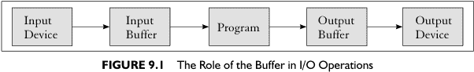

输入缓冲区可能包含比函数在单次调用中所需更多的数据。例如，当你键入字符串 yes 时，四个字符（包括由 [Enter] 生成的尾随换行符）会存储在缓冲区中。如果你的程序只需要 y，那么你必须清除该缓冲区中剩余的元素。清除缓冲区是 C 编程中的一项重要任务，如果你没有正确完成这项工作，程序就不会按预期方式运行。

本章将讨论一些重要的 I/O 函数，其中许多已在前面的章节中使用过。这些函数可分为两类：

- 字符处理函数（如 **getchar、fgetc、putchar** 和 **fputc**）。
- 格式化 I/O 函数（**printf** 和 **scanf**）。这些函数还执行字符与其他数据类型之间的数据转换。

其他 I/O 函数将在后续章节中讨论。在必要时，我们会为每个函数列出其原型（即语法）、必须包含在程序顶部的头文件以及返回值。

> **要点：** EOF 一词既表示输入函数检查的一种条件，也表示操作系统用来指示该条件的一个字符。这是通过按 *[Ctrl-d]*（UNIX/Linux）或 *[Ctrl-z]*（MSDOS/Windows）来完成的。ASCII 列表不包括名为 EOF 的字符。

## 9.2 使用 **getchar** 进行字符输入

原型：`int getchar(void);`
头文件：`stdio.h`
返回值：读取的字符；当遇到文件结束或错误时返回 EOF。

### 工作原理：C 标准库

*C 标准库* 是一组 *归档文件* 和 *头文件* 的集合。归档文件是包含若干函数的预编译目标代码的磁盘文件。这些函数的原型维护在一组头文件（如 `stdio.h`）中。这些文件在磁盘上的位置对编译器来说是已知的。当预处理器看到 `#include <stdio.h>` 中的尖括号（`<>`）时，它就知道可以在哪些可能的位置找到文件 `stdio.h`。

标准库满足了我们的日常大部分需求，它在功能上划分为若干部分。像 `printf` 和 `scanf` 这样的 I/O 处理函数使用 `stdio.h`。算术函数的原型列在 `math.h` 中。`ctype.h` 文件供确定字符所属类别的函数使用。本章讨论的每个函数都需要 `stdio.h`。

**getchar** 函数从先前已由键盘输入填充的输入缓冲区中获取下一个字符。它是一个面向字符的函数，这意味着即使输入（比如字符串 123）表示一个数字，它也会将其视为三个字符。**getchar** 不使用参数（原型中的 `void` 一词），并将该字符的机器值作为 `int` 返回。此函数主要有三种用途：

- *暂停程序。* 调用 **getchar** 会暂停程序，在用户按下 [Enter] 后程序恢复运行。
- *接受单字符响应。* 在这种情况下，**getchar** 的返回值会被保存，随后由 **if** 或 **switch** 语句用于决策：

```
int c;
c = getchar();
if (c == 'y') {
    ...
```

如果你键入 y 并按 [Enter]，这两个字符会由输入缓冲区保存。**getchar** 会获取 y 并将其作为 `int` 返回，但会把换行符留在缓冲区中。如果你再次运行 **getchar**，*这次程序不会暂停，因为缓冲区不为空。* 不过，第二次调用会移除换行符并清空缓冲区。

- *通过循环获取一组字符。* 你熟悉以下代码段，它曾出现在 8.4 节中：

```
while ((c = getchar()) != EOF)
    putchar(c);
```

在这个序列中，**getchar** 在遇到 EOF 之前会从缓冲区中获取所有字符，遇到 EOF 时循环终止。每个获取到的字符都使用 **putchar** 函数写到终端。


> **要点：** 每当需要读取或清空输入缓冲区时，都应在循环中运行 **getchar**。如果获取到的字符需要进一步处理，则必须保存返回值；如果只是清空缓冲区，则不必保存。


📋 **注意：** `getchar` 必须返回 `int`，而不是 `char`，因为它还可能返回 EOF，而 EOF 不能表示有效的字符值。尽管零表示假值，但它仍然是 ASCII 字符集中的一个合法值（NUL 字符）。因此，不能用值 0 来判断函数是遇到了 EOF 还是错误。这就是 EOF 通常被定义为 -1 的原因。

## 9.3 使用 `putchar` 进行字符输出

原型：`int putchar(int c);`  
头文件：`stdio.h`  
返回值：写入的字符（`c`），出错时返回 EOF。

`putchar` 函数通过向终端写入一个字符来补充 `getchar` 的作用。该字符作为 `int` 类型的参数被接受。该函数通常按以下简单方式使用：

```c
int c = 'A';                         /* char data assigned to int—OK */
putchar(c);
```

`putchar` 的参数通常取自 `getchar` 的返回值。`putchar` 将该参数作为 `int` 返回，或在出错时返回 EOF。然而，与 `getchar` 不同，`putchar` 通常因其副作用（即向输出设备写入）而被使用，而不是为了其返回值。`putchar` 不存在可能导致问题的缓冲区相关问题。

你会发现 `putchar` 在输出不可打印字符时非常有用。例如，由转义序列 `\a` 表示的 `[Ctrl-g]` 可以通过 `putchar` 输出以发出蜂鸣声：

```c
putchar('\a');                         /* Equivalent to putchar(7); */
```

处理单个字符时，`getchar` 和 `putchar` 比它们的格式化同类函数 `scanf` 和 `printf` 更受青睐。该系列中的其他函数（`getc`/`putc` 和 `fgetc`/`fputc`）也提供与 `getchar` 和 `putchar` 相同的功能。它们将在本章后面讨论。

## 9.4 `retrieve_from_buffer.c`：一个与缓冲区有关的问题

当你输入一个字符串，比如在响应 `getchar` 调用时输入 yes（后跟 [Enter]），字符串 `yes\n` 会被发送到缓冲区。然而，`getchar` 只返回第一个字符（`y`），而字符串的其余部分仍留在缓冲区中。程序 9.1 展示了如何在循环中使用 `getchar` 和 `putchar` 来取出缓冲区的内容。

程序首先调用 `getchar` 只是为了暂停程序。`getchar` 通过获取换行符而不保存它来清空缓冲区。在下一次调用中，`getchar` 返回双词字符串的第一个字符（`'A'`）。字符串的其余部分（`mazon drones\n`）现在位于缓冲区中。在 `while` 循环中重复调用 `getchar` 和 `putchar` 会获取并显示这些字符。当循环遇到字符串末尾的 `\n` 时终止。此时输入缓冲区为空。

```c
/* retrieve_from_buffer.c: Uses getchar to retrieve the remnants
   of a string from the buffer. */
#include <stdio.h>
int main(void)
{
    int c;
    printf("Press [Enter] to continue ...");
    getchar();             /* Gets newline generated by [Enter] */
    printf("Enter a string: ");
    c = getchar();         /* Only first character held in c ... */
    putchar(c);            /* ... remaining characters still in buffer */

    printf("\nExtracting remaining characters from buffer ...\n");
    while ((c = getchar()) != '\n')
        putchar(c);
    putchar('\n');         /* Takes cursor to next line */
    return 0;
}
```

程序 9.1：**retrieve_from_buffer.c**

```text
Press [Enter] to continue ... [Enter]
Enter a string: **Amazon drones**
A                         putchar prints first character from buffer
Extracting remaining characters from buffer ...
mazon drones
```

程序输出：**retrieve_from_buffer.c**

## 9.5 标准文件

你可能会惊讶地发现，**getchar** 和 **putchar** 被设计为*仅*能处理特殊文件。它们在上一个程序中能顺利工作的原因是，C（像 UNIX 一样）把键盘、终端和打印机视为*文件*。每个 C 程序都可以访问三个特殊文件，这些文件在程序整个运行期间保持打开：

- *stdin*，标准输入文件（默认：键盘）。
- *stdout*，标准输出文件（默认：终端）。
- *stderr*，标准错误文件（默认：终端）。

这些文件与默认物理设备具有*灵活*的关联。默认情况下，*stdin* 与键盘关联，因此读取标准输入的程序会从键盘获取输入。同样，对 *stdout* 的写入会显示在终端上。

UNIX/Linux 和 MSDOS/Windows 系统支持 `<` 和 `>` 符号，这些符号用于*更改*默认文件。例如，包含 **getchar** 或 **scanf** 的程序可以利用*输入重定向*功能，从文件 `foo1` 而不是键盘获取输入：

```text
$ foo1 < a.out > foo2
C:\> foo1 < a.out > foo2
```

Linux shell：`$` 是提示符  
Windows shell：`C:\>` 是提示符

现在使用 `ls -l` 或 `DIR` 命令比较 `foo1` 和 `foo2` 的文件大小。`foo1` 应该比 `foo2` 小——每行少一个字符。尽管 **getchar** 从 `foo1` 获取输入，**putchar** 向 `foo2` 写入，但程序本身并没有提到这两个文件。与 `foo1` 和 `foo2` 的连接是由操作系统建立的，而不是由程序建立的。

**要点：** UNIX/Linux 系统使用 LF 作为行终止符，而 MSDOS/Windows 系统使用 CR-LF。因此，一个包含十行的文本文件从 Windows 移动到 Linux 并在转换后，会小 10 个字符。

**注意：** 并非所有操作系统都支持使用 `<` 和 `>` 符号的重定向功能。这些符号不属于 C 语言，程序执行时也看不到它们。

## 9.7 其他字符 I/O 函数

**getchar** 和 **putchar** 函数被设计为分别*仅*处理 `stdin` 和 `stdout`。标准库还支持另外两组同样可以读写一个字符的函数：

- **fgetc** 和 **fputc**
- **getc** 和 **putc**

与 **getchar** 和 **putchar** 不同，上述函数旨在用于*任意*文件——包括磁盘文件。我们现在来看看这些函数如何处理 `stdin` 和 `stdout`，至于它们如何处理磁盘文件，则留到第 15 章再了解。

### 9.7.1 fgetc 和 fputc 函数

带有“f”前缀的 I/O 函数旨在处理文件。**fgetc** 和 **fputc** 都使用一个用于标识文件的参数。当与参数 `stdin` 或 `stdout` 一起使用时，这些函数会复制其 **getchar/putchar** 对应函数的行为，如下所示：

```c
c = fgetc(stdin);  /* Same as c = getchar(); */
fputc(c, stdout);  /* Same as putchar(c); */
```

程序 9.3 使用 **fgetc/fputc** 组合和 **toupper** 函数转换字母大小写。后者属于一类用于确定字符类别（如字母、数字等）的函数。该系列中的每个函数都需要头文件 `ctype.h`。

### 9.7.2 getc 和 putc 宏

C 还支持 **getc** 和 **putc** *宏*，它们复制了 **fgetc** 和 **fputc** 函数的功能。（我们稍后会解释宏。）这两组函数使用相同类型和数量的参数，并返回相同的值。将 **fgetc** 和 **fputc** 分别替换为 **getc** 和 **putc** 后，上一个程序将正常运行。

```c
/* lower2upper2.c: Uses fgetc and fputc and makes use of the
   toupper function to convert text to uppercase. */
#include <stdio.h>
#include <ctype.h>
int main(void)
{
    int c;
    while ((c = fgetc(stdin)) != EOF)
        fputc(toupper(c), stdout);
    fputc('\a', stdout);                  /* The BELL character */
    return 0;
}
```

程序 9.3：**lower2upper2.c**

```text
redmi note 4
REDMI NOTE 4
iphone 6 plus
IPHONE 6 PLUS
[Ctrl-d] or [Ctrl-z]                    EOF
... Terminal beeps ...
```

程序输出：**lower2upper2.c**

C 的*宏*是一种别名，其行为像函数，但不会产生函数调用的开销。它使用 **#define** 预处理指令定义。函数的缺点在于，它们会为参数和变量使用内存栈（*11.13.2——工作原理*）。但由于宏不使用这个栈，**getc** 宏通常比 **fgetc** 函数运行得更快。你还应该知道，**getchar** 和 **putchar** 也是以宏的形式实现的。宏将在第 17 章中讨论。


**提示：** 如果需要进行磁盘文件的 I/O 处理，请使用 **getc/putc** 或 **fgetc/fputc**。若要通过键盘和终端执行 I/O，请使用 **getchar/putchar**。

### 9.7.3 ungetc 函数

**ungetc** 函数通过将最近读取的字符放回输入流来逆转 **getc** 的操作。这看起来可能有些奇怪，但在某些情况下，你需要先检查下一个字符，再决定如何处理当前字符。之后对字符流的下一次读取操作将获取刚刚被推回的字符。用于 **stdin** 的 **ungetc** 函数按以下方式使用：

```c
ungetc(c, stdin);
```

如何将 CR-LF 行终止符替换为 LF，以便把 MSDOS 文件转换为 UNIX 文件？正确的技巧是向前查看：当遇到 CR 时，获取下一个字符。如果该字符不是 LF，则使用 **ungetc** 将其推回输入流，以便它可以被正常读取。程序 9.4 使用 **getc** 和 **putc** 宏完成了这项任务。


```c
/* dos2unix.c: Converts an MSDOS file to UNIX.
                Removes the CR character before every newline. */
#include <stdio.h>
int main(void)
{
    int c;
    while ((c = getc(stdin)) != EOF) {
        if (c == '\r')          /* If \r, then ... */
            if ((c = getc(stdin)) != '\n')  /* ... check next character */
                ungetc(c, stdin);            /* Put it back if not \n */
            else
                putc('\n', stdout);
        else
            putc(c, stdout);
    }
    return 0;
}
```

程序 9.4：dos2unix.c

由于我们使用 *stdin* 和 *stdout*，因此需要采用前面讨论过的重定向技术来执行该程序：

```
a.out < foo1 > foo2                a.out for Linux
```

读完第 15 章后，你应该能够修改这个程序及其反向对应程序（*unix2dos.c*），使其直接处理磁盘文件，而不使用 < 和 > 符号。与 *stdin* 和 *stdout* 不同，磁盘文件必须显式打开才能读取或写入。你会发现这些程序对于跨不同平台移动文件很有用。

到目前为止我们讨论的函数和宏都以*字符*形式读写数据。它们无法识别或处理字符流中的特定数据类型。本章剩余部分将考察 **scanf** 和 **printf** 函数，它们将字符数据转换为特定数据类型，反之亦然。尽管这两个函数在前面的章节中已被广泛使用，但关于它们我们仍有很多需要了解。

## 9.8 格式化输入：**scanf** 函数

| | |
|---|---|
| 原型： | `int scanf (cstring, &var1, &var2, ...);` |
| 头文件： | `stdio.h` |
| 返回值： | 成功匹配的项数；若在转换第一项之前遇到输入结束，则返回 EOF。 |

**scanf** 是输入函数家族的主要成员，该家族还包括 **fscanf** 和 **sscanf**。与大多数函数不同，**scanf** 使用*可变*数量的参数。第一个参数（*cstring*）是一个*控制字符串*，包含一个或多个*格式说明符*（如 `%d`）。其余参数（*&var1*、*&var2* 等）表示的不是变量，而是它们的*地址*。变量地址的数量必须等于格式说明符的数量。图 9.2 展示了一个使用三个格式说明符和三个变量地址的 **scanf** 语句。

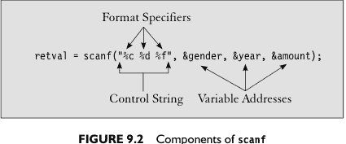

**scanf** 使用控制字符串中的信息将输入划分成一个或多个*字段*。因此，如果控制字符串是“%c %d %f”，并且 **scanf** 遇到字符串 M 1986 37.4，它将执行以下任务：

- 将字符 M（`%c`）保存到变量 *gender* 中，不进行任何转换。
- 将字符串 1986 转换为整数 1986（`%d`），并保存到变量 *year* 中。
- 将四字符字符串 37.4 转换为浮点值 37.4（`%f`），并保存到变量 *amount* 中。

如果 **scanf** 遇到格式说明符指定的类型与数据中发现的类型不匹配，它会停止进一步处理。然后 **scanf** 返回成功读取的项数（如果有的话）。剩余字符（包括匹配失败的那个字符）会留在缓冲区中。下一次调用 **scanf** 或任何其他输入函数时，将获取这些字符。通常需要循环运行 **getchar** 来清除这个“不干净”的缓冲区。

> **注意：** 如果使用 x 而不是 &x 作为 **scanf** 参数，**scanf** 会将 x 的当前值解释为一个地址，并覆盖该地址处的内存内容。程序的行为将变得不可预测；甚至可能崩溃。

程序 9.5 在循环中运行 **scanf**，从标准输入接受一个 char、int 和 float 值。**scanf** 在前两次循环迭代中成功匹配输入，但在接下来两次中失败。在下一次迭代之前，使用 8.4.2 节讨论的技术清除缓冲区。

如果未完全理解 **scanf** 的数据匹配规则，它很容易让用户感到沮丧，因此我们分别考察每次调用：

调用 1——匹配完美。

调用 2——**scanf** 成功将整数 4096 与 `%f` 匹配。

调用 3——**scanf** 在将 3.142 与 `%d` 匹配时截断了它。3 被错误地赋给 *i*，0.142 被赋给 *f*。

```c
/* intro2scanf.c: Accepts a char, int and float.
     Shows how easy it is for scanf to fail. */
#include <stdio.h>
int main(void)
{
    char c; int i = 1; float f;
    while (i) {                 /* Loop terminates when i = 0 */
        printf("Enter a character, int and float: ");
        scanf("%c %d %f", &c, &i, &f);
        printf("You input %c, %d, %f\n", c, i, f);
        while (getchar() != '\n')    /* Clears the buffer */
            ;
    }
    return 0;
}
```

| 程序 9.5：`intro2scanf.c` |
|---|
| 输入一个字符、整数和浮点数：**Y 12 3.142**<br>你输入了 Y, 12, 3.142000 |
| 输入一个字符、整数和浮点数：**Y 15 4096**<br>你输入了 Y, 15, 4096.000000 |
| 输入一个字符、整数和浮点数：**N 3.142 12.75**<br>你输入了 N, 3, 0.142000 |
| 输入一个字符、整数和浮点数：**Yes 4096 15.75**<br>你输入了 Y, 3, 0.142000 *(打印 i 和 f 的先前值)* |
| 输入一个字符、整数和浮点数：**0 0 0**<br>你输入了 0, 0, 0.000000 |

程序输出：`intro2scanf.c`

调用 4——**scanf** 确实将 Y 赋给 c，但无法将字符串的剩余部分（es）与 %d 匹配。因此 **scanf** 在仅匹配一个项后就返回，并使变量 i 和 f 中的值保持不变。

内部 **while** 循环具有空循环体，在每次迭代结束时清除缓冲区，因此 **scanf** 总是在空缓冲区下操作。为什么不注释掉这两行，然后运行程序呢？

> **要点：** **scanf** 在将实数与 %d 匹配时会截断该实数，尽管它可以将整数与 %f 匹配。此外，**scanf** 无法用 %c 匹配多个字符。

## 9.9 `scanf`：匹配规则

有许多规则决定 `scanf` 将输入值与格式说明符匹配的方式。大多数规则也有例外。默认情况下，即使控制字符串不包含空白，`scanf` 也会按空白（空格、制表符和换行符）分割输入。在做任何其他事情之前，你必须牢记以下规则：

> 控制字符串中的空白匹配输入中零个或多个前导空白字符。

这里的重点在“前导”一词上。这意味着 `%d%d` 和 `%d %d` 都能匹配字符串 `12 45` 和 `12 45`。然而，此规则不适用于 `%c`，其匹配技术将在 9.10.2 节讨论。

还有两个问题会影响匹配。首先，如果控制字符串包含非空白字符，则输入中必须存在相同的字符。例如，`%d:%d` 匹配 `12:30:45` 和 `12: 30: 45`，但不匹配 `12 :30 :45`，因为这两个值包含尾随空白。

其次，如果指定了字段宽度（如 `%2d`），`scanf` 会尝试匹配指定数据类型的两个字符。因此，`%2d%2d%2d` 将字符串 `311214` 拆分为值 31、12 和 14，并将它们保存到三个 `int` 变量中。这就是从包含数字字符的六字符字符串中提取日期各组成部分的方法。

**提示：** 为了更容易匹配，在控制字符串中的非空白字符两侧提供空白。因此，`%d : %d` 匹配 `12:34`、`12 :34`、`12: 34` 以及 `12 : 34`。对于 `%c` 和 `%f` 也是如此。

### 9.9.1 不匹配与返回值

`scanf` 返回成功匹配并赋给变量的项数。例如，如果控制字符串 `%4d%c` 成功匹配输入，`scanf` 返回值 3。如果发生不匹配，`scanf` 返回在发生不匹配之前成功匹配的项数。但是，如果在匹配第一项之前出现 EOF（条件），`scanf` 返回 EOF（值——通常为 -1）。

不匹配也可能因其他原因发生。如果 `scanf` 在期望数字时发现字母，它会在函数本身返回调用者之前将该字符返回到缓冲区。错误的字段宽度也是不匹配的可能原因。当使用 `%4d` 匹配六位数字时，`scanf` 只会匹配前四位数字。即使后续调用可以读取剩余两位数字，它也将读取错误的项。以下示例演示了这两种情况：

控制字符串：`%4d %d`

| 输入字符串 | 匹配 | 返回值 | 备注 |
|---|---|---:|---|
| 1234 5678 | 1234 5678 | 2 | 缓冲区中无内容 |
| 123456 789 | 1234 56 | 2 | 789 留在缓冲区中 |
| 123r 5678 | 123 | 1 | r 5678 留在缓冲区中 |
| r123 5678 | 无 | 0 | 整个字符串留在缓冲区中 |


**要点：** 如果 `scanf` 无法匹配任何项，它会返回 0。但如果 `scanf` 在读取第一项之前遇到 EOF，则返回 EOF 的值（通常为 -1）。在程序中最好指定 EOF（而不是 -1）。

### 9.9.2 `scanf_retval.c`：从字符串中提取数字的程序

程序 9.6 提取输入字符流中嵌入的整数并将它们相加。它展示了如何巧妙利用返回值来处理可能出现的各种不匹配情况。正如输出所示，只要字符串中嵌有数字，它们就会被提取、转换并相加。至于其他字符是什么，则无关紧要。

该程序在从键盘发送 EOF 时终止，它检查三种可能的返回值：1、0 和 EOF（-1）。当 `scanf` 成功地从字符串其余部分分离出一个整数时，它返回 1。它成功地从 3-three 中提取出 3，从 5(five) 中提取出 5。当 `scanf` 遇到非数字字符时，它返回 0。由于 `getchar` 在循环中运行，因此清除缓冲区中的这些“捣乱分子”毫无问题。

```c
/* scanf_retval.c: Uses scanf to add integers embedded in a string.
                 Employs the return value to handle mismatches. */
#include <stdio.h>
int main(void)
{
    short num, total = 0;
    int retval;

    printf("Enter integers to sum, EOF to quit: ");
    while ((retval = scanf("%hd", &num)) != EOF)
        if (retval == 1)                    /* Right input */
            total += num;
        else if (retval == 0)               /* Wrong input ... */
            getchar();                       /* ... so clear buffer */

    printf("Total: %d\n", total);
    return 0;
}
```

**程序 9.6：`scanf_retval.c`**

```text
Enter integers to sum, EOF to quit: 1 3 5 [Ctrl-d]
Total: 9
Enter integers to sum, EOF to quit: Add 3 to 5 and also 100. [Ctrl-d]
Total: 108
Enter integers to sum, EOF to quit: "1", 3-three & 5(five) [Ctrl-d]
Total: 9
Enter integers to sum, EOF to quit: 1.3.5 [Ctrl-d]
Total: 9
```

程序输出：`scanf_retval.c`

## 9.10 `scanf`：主要格式说明符

**scanf** 使用控制字符串中的格式说明符来格式化输入流。格式说明符以 % 开头，后跟一个*转换代码*（如 %d 中的 d）。以下通用形式还显示了 % 和转换代码之间的可选组件：

```
% * field width modifier conversion code
```

说明符 `%*4hd` 包含所有可选组件：星号、字段宽度（4）和修饰符（h）。这些组件的含义如下：

- `*` 标志用于跳过一个字段。
- *字段宽度* 指定要匹配的字符的*最大*数量。因此，`%4d` 最多匹配四个数字字符。
- *修饰符* 更改变量的数据类型。你已经在多种场合使用过这些修饰符中的大多数：h、l、L 或 ll。

**scanf** 使用的格式说明符（包括修饰符和一个标志）的完整列表如表 9.1 所示。我们现在将讨论主要的格式说明符。

**表 9.1** **scanf** 使用的格式说明符

| 整数 | short | int | long | long long |
|---|---|---|---|---|
| 有符号十进制 | `%hd` | `%d` | `%ld` | `%lld` (C99) |
| 无符号十进制 | `%hu` | `%u` | `%lu` | `%llu` (C99) |
| 八进制 | `%ho` | `%o` | `%lo` | `%llo` (C99) |
| 十六进制 | `%hx` | `%x` | `%lx` | `%llx` (C99) |
| 十进制/八进制/十六进制 | `%hi` | `%i` | `%li` | `%lli` (C99) |

| 浮点数 | float | double | long double |
|---|---|---|---|
| 普通或指数记数法 | `%f`, `%e`, `%g` | `%lf`, `%le`, `%lg` | `%Lf`, `%Le`, `%Lg` |
| 同义词 | `%F`, `%E`, `%G` | `%lF`, `%lE`, `%lG` | `%LF`, `%LE`, `%LG` |

| 其他格式说明符 | 匹配内容 |
|---|---|
| `%c` | 字符（char） |
| `%s` | 由单个单词组成的字符串 |
| `%p` | 指针 |
| `%n` | 不匹配任何内容，但将匹配到的字符数保存在变量中 |
| `%%` | % |
| `%[...]`（*扫描集*） | 列表中的任意字符 |
| `%[^...]`（*扫描集*） | 不在列表中的任意字符 |

| 标志 | 含义 |
|---|---|
| `*` | 跳过一个字段 |

### 9.10.1 处理数值数据（%d 和 %f）

整数和浮点数据分别由转换代码 d 和 f 表示，可以带或不带修饰符。请注意其格式说明符的以下特性：

- `%d` 匹配 7，但会截断 7.25，并将字符串 `.25` 留在缓冲区中。
- `%f` 同时匹配整数和以十进制或指数表示法表示的实数。因此，它可以匹配 7、713.5 和 7.135E2。在这方面，`%f` 与 `printf` 中的对应说明符有所不同。

字段宽度 *n* 最多匹配整数的 *n* 位数字。对于浮点数，*n* 包含小数点。因此，当用 `%5f` 匹配 3.14285 时，`scanf` 会选择 3.142，并将 85 返回缓冲区。与 `printf` 不同，无法通过使用诸如 `%6.2f` 来指定小数部分的宽度。


> **警告：** 切勿将 `scanf` 与 `%d` 或 `%u` 一起使用来读取浮点数。`scanf` 会读取整数部分，并将小数部分返回缓冲区。

### 9.10.2 处理字符数据（%c）

`scanf` 使用 `%c` 来匹配单个字符，该字符可以是空白字符。如果你在响应 `scanf("%c", &x)` 时输入 y 并按下 [Enter]，`\n` 将留在缓冲区中。如果下一个 `scanf` 调用使用 `%d` 或 `%f`，则 `\n`（现在是前导空白）将被忽略。但如果下一个 `scanf` 是另一个 `%c`，那么第二个 `scanf` 调用将匹配 `\n` 并立即返回，而不会暂停。这就是为什么在连续使用 `%c` 的 `scanf` 调用之间必须清除缓冲区的原因。

虽然 `%d%d%d` 或 `%f%f%f` 会忽略前导空白，但 `%c%c%c` 不会。令人惊讶的是，`%c%c%c` 可以匹配三个或更多的空格、字符串 abc，但不能匹配 a  b  c。然而，`%c  %c  %c` 可以匹配 abc、a  b  c、a□□b□c（字符之间有两个空格），但不能只匹配空格。表 9.2 展示了使用 %c 匹配一个或多个字符的情况。最后三个示例显示了在格式说明符中使用非空白字符的效果。

**表 9.2** 在 scanf 中匹配 char 数据类型

| 格式说明符 | 输入字符串 | 匹配结果 |
|---|---|---|
| `"%c"` | y | y（`\n` 留在缓冲区） |
| `"%c"` | yes | y（es`\n` 留在缓冲区） |
| `"%c%c%c"` | abc | abc |
| `"%c%c%c"` | a b c | a b（空格、c`\n` 留在缓冲区） |
| `"%c %c %c"` | abc | abc |
| `"%c %c %c"` | a b c | a b c |
| `"%c:%c:%c"` | a:b:c | a:b:c |
| `"%c : %c : %c"` | a:b:c | a:b:c |
| `"%c : %c : %c"` | a : b : c | a : b : c |

### 9.10.3 处理字符串数据（%s）

我们知道字符串是以 NUL（5.15）结尾的字符数组，但这并不是 scanf 对字符串的理解方式。对 scanf 而言，字符串只是一个记号或单词，即由一个或多个非空白字符组成的集合。scanf 使用 %s 格式说明符并将数组名作为其匹配参数来读取此单词。因此，如果你定义了一个名为 stg 的数组，如下所示：

```c
char stg[20];  // Array must be of type char
```

那么你便可以使用 scanf 像这样填充数组：

```c
scanf("%s", stg);  // stg not &stg
```

scanf 会忽略前导空白，并一直读取直到遇到空白字符或 EOF。它将单词保存在数组 stg 中，并在末尾附加一个 NUL 字符。这意味着数组必须为 NUL 额外留出一个元素。请注意，使用 %s 时，scanf 不使用 & 前缀。数组名本身就提供了 scanf 所需的地址。

scanf 基于单词的处理方式使其不适合读取多词字符串。要匹配三个单词，scanf 需要三个 %s 说明符（而 printf 只需一个）以及三个数组的地址。这个问题有两种解决方案，其中一种将在 9.11.1 节中讨论。

> **要点：** printf 和 scanf 对 %s 的处理方式不同。该说明符在 scanf 中匹配单个单词，而在 printf 中匹配一个或多个单词。

### 9.10.4 scanf_char_string.c：字符和字符串作为输入

程序 9.7 使用 %c 和 %s 来处理字符和字符串输入。它还使用字段宽度将一个字符串拆分成三个。getchar 序列被使用了两次来清除缓冲区，因此在该程序中使用宏（FLUSH_BUFFER）是合理的。

由于控制字符串中的空白（"%c %c %c"）匹配数据中零个或多个前导空白，因此我们可以输入 ABC 和 a b c。最后一次 scanf 调用使用 "%3s%3s%3s" 将字符串 septenov 拆分为三个独立的字符串。每个数组都有一个额外的字节，以便让 scanf 在末尾附加 NUL。

## 9.11 scanf：其他特性

如果我们不讨论（i）扫描集，（ii）它支持的唯一标志，以及（iii）更多格式说明符，那么我们对 scanf 函数的介绍就不够完整。这些主题将在以下各节中讨论。

### 9.11.1 扫描集说明符

扫描集说明符由一个或多个括在 [ 和 ] 之间的字符组成。例如，%[aeiou] 表示一个仅匹配元音字符的扫描集。然而，位于开头的脱字符（^）


/* scanf_char_string.c: Uses the %c and %s format specifiers to read
   individual characters and split a string into three. */
#include <stdio.h>
#define FLUSH_BUFFER while (getchar() != '\n');

int main(void)
{
    char c1, c2, c3;
    char month1[4], month2[4], month3[4];

    while (printf("Enter three characters: ")) {
        if (scanf("%c %c %c", &c1, &c2, &c3) == EOF)
            break;
        FLUSH_BUFFER
        printf("ASCII values: %c = %d, %c = %d, %c = %d\n",
               c1, c1, c2, c2, c3, c3);
    }

    printf("\nEnter 3 month names as a nine-character string: ");
    scanf("%3s%3s%3s", month1, month2, month3);
    FLUSH_BUFFER
    printf("Months split as %s | %s | %s\n", month1, month2, month3);
    return 0;
}

**程序 9.7：scanf_char_string.c**

```
Enter three characters: ABC
ASCII values: A = 65, B = 66, C = 67
Enter three characters: a b c
ASCII values: a = 97, b = 98, c = 99
Enter three characters: [Ctrl-d]
Enter 3 month names as a nine-character string: sepoctnov
Months split as sep | oct | nov
```

**程序输出：scanf_char_string.c**

扫描集反转其通常含义。因此，`%[^aeiou]` 只匹配非元音字符。扫描集可以包含转义序列和范围（如 0-9），如下例所示：

- `char stg[10];`
- `scanf("%[aeiou]", stg);` — 仅匹配元音。
- `scanf("%[0-9a-zA-Z]", stg);` — 仅匹配字母数字字符。
- `scanf("%[^,]", stg);` — 匹配除逗号外的所有字符。
- `scanf("%[^\n]", stg);` — 匹配整行——很有用的特性。

**scanf** 在遇到不属于该集合的字符时立即停止扫描。它会在数组末尾自动填充一个 NUL，而数组在声明时必须多包含一个元素。最后两个示例在程序 9.8 中使用，该程序拆分并操作从键盘输入的字符串。

```c
/* scanf_char_string2.c: Uses the %c and %s format specifiers
   and the scan set to rearrange text. */
#include <stdio.h>
#define FLUSH_BUFFER while (getchar() != '\n');

int main(void)
{
    char c1, c2, c3;
    char month1[4], month2[4], month3[4], lastname[20], firstname[20];

    while (printf("Enter three characters: ")) {
        if (scanf("%c %c %c", &c1, &c2, &c3) == EOF)
            break;
        FLUSH_BUFFER
        printf("ASCII values: %c = %d, %c = %d, %c = %d\n",
               c1, c1, c2, c2, c3, c3);
    }

    printf("\nEnter 3 month names as a nine-character string: ");
    scanf("%3s%3s%3s", month1, month2, month3);
    FLUSH_BUFFER
    printf("Months split as %s | %s | %s\n", month1, month2, month3);

    printf("Last name, First Name: ");
    scanf("%[^,], %[^\n]", lastname, firstname);
    printf("Name is %s %s\n", firstname, lastname);

    return 0;
}
```

**程序 9.8：scanf_char_string2.c**

```text
Enter three characters: ABC
ASCII values: A = 65, B = 66, C = 67
Enter three characters: a b c
ASCII values: a = 97, b = 98, c = 99
Enter three characters: [Ctrl-d]
Enter 3 month names as a nine-character string: sepoctnov
Months split as sep | oct | nov
Last name, First Name: Ritchie, Dennis
Name is Dennis Ritchie
```

**程序输出：scanf_char_string2.c**

**scanf** 首先在一个循环中运行，并使用控制字符串 "%c %c %c" 来匹配 ABC 和 a b c。然后它使用 "%3s%3s%3s" 将一个九字符单词拆分为三个组成部分。最后，**scanf** 使用两个不同的扫描集来拆分包含两个逗号分隔字符串的一行。第一个扫描集匹配不包含逗号的一组字符，而第二个扫描集匹配除换行符之外的所有字符。它们共同使得反转名和姓成为可能。

**注意：** 即使 **scanf** 可以使用扫描集 `[^\n]` 读取整行，C 还提供了另一种机制，使用两个函数——**fgets** 和 **sscanf** 来处理此任务。**fgets** 将一行读入字符数组，**sscanf** 将该行拆分为多个字段。这个重要机制将在第 13 章中讨论。

### 9.11.2 * 标志

星号（*）标志位于 % 和转换代码之间，用于跳过一个字段。例如，%*d 跳过 int 类型的字段。如下所示，被跳过的字段没有变量地址作为参数：

```
int number; float amount;
printf("Key in an int, char and float: ");
scanf("%d%*c%f", &number, &amount);
```

`*%c skips char`

在使用 **scanf**（或 **fscanf**）读取文件时，这是一个有用的特性。如果文件的每一行有六个字段，而只需要读取四个，我们可以使用 * 跳过两个字段。星号（*）在 *printf*（9.13）中具有不同的含义。

### 9.11.3 %p、%n 和 %% 说明符

%p 说明符匹配指针，这是一种特殊数据类型，将在第 12 章探讨。目前只需知道，%p 匹配表示内存地址的数字。

%n 说明符不匹配任何内容，而是使用其匹配参数将输入的字符数存储到 int 变量中。下面的示例使用这个有用的验证特性来检查是否输入了六字符字符串：

```
int count, num;
printf("Enter a 6-digit number: ");
scanf("%d%n", &num, &count);
if (count != 6)
    printf("Not a 6-digit number.\n");
```

由于 % 在控制字符串中具有特殊含义，必须有一种方法向程序表明该字符应按字面处理。这通过重复该符号来实现：

```
scanf("%d%%", &rate);
```

输入的数字必须带有 % 后缀

此调用期望输入一个数字，后跟一个 %，两者之间可有或没有空白。如果需要匹配两个 %，请使用 %%%%。

**scanf** 的近亲 **sscanf** 和 **fscanf** 将分别在第 13 章和第 15 章中讨论。**scanf** 使用的许多格式说明符也被 **printf** 使用，尽管含义并不总是相同。尽管 **printf** 没有提供任何独特的格式说明符，但它支持一组 **scanf** 不使用的标志。

## 9.12 格式化输出：`printf` 函数

原型：`int printf(cstring, var1, var2, ...);`  
头文件：`stdio.h`  
返回值：打印的字符数，出错时返回负值。

`printf` 是一组格式化输出函数中的主要成员，该组函数还包括 `fprintf` 和 `sprintf`。与 `scanf` 一样，它使用可变数量的参数，其中第一个参数（`cstring`）表示控制字符串。如果 `cstring` 包含一个或多个格式说明符，则其后必须跟有数量匹配的数据项（`var1`、`var2` 等）。数据项可以是变量、表达式或常量。图 9.3 展示了一个包含三个格式说明符和三个匹配变量的 `printf` 语句。

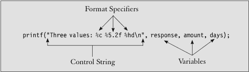

**图 9.3** `printf` 的组成部分

`printf` 使用控制字符串中的信息，将所有格式说明符替换为其匹配参数的值。由于这些值可以是不同的数据类型，因此在替换之前会将它们转换为字符串。然后整个字符串显示在终端上。例如，图 9.3 中的 `printf` 语句在显示之前，将 `amount` 的浮点值（`%5.2f`）和 `days` 的整数值（`%hd`）转换为字符。

与 `scanf` 中一样，格式说明符是 `%` 和转换代码（如 `d` 或 `f`）的组合。该代码可选地带有前缀修饰符，以处理数据子类型（如 `%hd` 中的 `h`）和字段宽度（如 `%80s` 中的 80）。`printf` 支持 `scanf` 使用的所有转换代码和修饰符（表 9.3），有时会有所修改。`printf` 格式说明符还可以包含*精度*。

数据项的数量必须等于格式说明符的数量。如果它们不相等，编译器只会生成警告。`printf` 忽略多余的数据项，但对于多余的格式说明符会打印垃圾值：

```
printf("%d %d\n", x, y, z);
printf("%d %d\n", x);
```

*不会打印 z 的值*  
*第二个 %d 会打印垃圾值*

格式说明符和值之间也可能发生数据类型不匹配。当你使用 `%d` 打印字符串或使用 `%s` 打印数字时，编译器仅仅发出警告。每个由格式说明符支持的数据项都会被写出，即使它们的数据类型可能不匹配。


### 9.12.1 `printf` 与 `scanf` 比较

`printf` 和 `scanf` 有一些共同特性。两者都使用控制字符串来确定数据必须如何转换。它们也使用相同的格式说明符和修饰符（只有少数例外）。不过，它们有几个方面不同：

- `scanf` 将字符串转换为预期的数据类型，而 `printf` 则相反。例如，当 `printf` 用 `%d` 匹配数字 23 时，它将整数 23 转换为字符串 23。
- `printf` 中的控制字符串可能完全没有格式说明符。我们经常使用 `printf` 输出一个简单字符串（比如 `"Hello world\n"`）。
- `printf` 的数据项是变量、表达式或常量，但 `scanf` 只使用地址。`printf` 中只有一个格式说明符表示地址（`%n`）。
- 尽管 `printf` 使用相同的修饰符（h、l、ll 和 L），但它使用 `%f` 而不是 `%lf` 来打印 double。编译器会将 float 实参转换为 double，因此 `%f` 足以打印两者。
- `scanf` 中使用的每个浮点说明符——`%e`、`%f` 和 `%g`——都匹配以十进制或指数表示法表示的数字。然而，`printf` 是特定的：`%f` 用于带小数点的数字，`%e` 用于指数表示法，`%g` 则让函数选择格式。
- `printf` 中的 `%s` 匹配任意字符串，而 `scanf` 中的同一说明符匹配一个*单词*，即一组非空白字符。
- `printf` 说明符支持*精度*字段（如 `%.2f`）。精度不适用于 `scanf`。
- `printf` 支持许多*标志*（如 `%+6d` 中的 +）。`scanf` 只知道一个标志（即 *，用于跳过字段）。

`printf` 是更简单易用的语句，主要是因为它没有那些经常让 `scanf` 用户感到沮丧的空白相关问题。

### 9.12.2 打印纯文本

控制字符串包含要打印的文本，可以带格式说明符，也可以不带。`printf` 按字面处理空白，并支持前面表 5.3 中所示的转义序列。以下语句打印一个包含两个转义序列但没有格式说明符的控制字符串：

```
printf("\tNo format specifier in this string\n");
```

对于打印长文本，`printf` 支持两种选项，但本书采用的方法是将多个字符串一个接一个地放置——如有必要可放在不同行——来连接它们：

```
printf("It's not only printf that allows string concatenation. All string "
       "handling functions accept this mechanism of joining strings.\n");
```

因为字符 `%` 和 `\` 会被特殊处理，你可以通过重复该字符来强制按字面解释它们；`%%` 打印一个 `%`，`\\` 打印一个 `\`：

```
printf("%% and \\ are special.\n");
```

*打印出 % 和 \ 是特殊的。*

到现在，你应该已经能够熟练使用 `printf` 转换码及其修饰符了。因此，本章余下部分将重点讨论字段宽度、精度和标志。但在那之前，让我们先看一个程序，它演示了已讨论的一些特性。

**表 9.3** `printf` 使用的格式说明符和标志

| 整数 | short | int | long | long long |
|---|---|---|---|---|
| 有符号十进制 | `%hd` | `%d, %i` | `%ld` | `%lld` (C99) |
| 无符号十进制 | `%hu` | `%u` | `%lu` | `%llu` (C99) |
| 八进制 | `%ho` | `%o` | `%lo` | `%llo` (C99) |
| 十六进制 | `%hx` | `%x` | `%lx` | `%llx` (C99) |
| 浮点数 | float | double | long double | |
| 普通 | `%f` | `%f` | `%Lf` | |
| 指数 | `%e, %E` | `%le, %lE` | `%Le, %LE` | |
| 指数或普通 | `%g, %G` | `%lg, %lG` | `%Lg, %LG` | |
| 其他格式说明符 | 打印 | | | |
| `%c` | 字符（char） | | | |
| `%s` | 字符串（不限于一个单词） | | | |
| `%p` | 指针 | | | |
| `%n` | 无输出，但将已打印字符数保存到变量中。 | | | |
| `%%` | | | | |

| 标志 | 含义 |
|---|---|
| `-` | 左对齐输出。 |
| `+` | 在非负数前加上 +。 |
| 空格 | 在非负数前加上空格。 |
| `#` | 取决于转换码：<br>与 o 一起使用时，在数字前加 0。<br>与 x/X 一起使用时，在数字前加 0x 或 0X。<br>与 g/G 一起使用时，打印尾随零。<br>与 e/E/f/F/g/G 一起使用时，打印带小数点的数字。 |
| `0` | 当字段大小小于字段宽度时，用零填充字段。 |
| `*` | 字段宽度由对应参数指定。 |

### 9.12.3 printf_special.c：再谈数据类型

这个分为三部分的程序（程序 9.9）演示了 `printf` 的一些此前可能被忽视的特性。第一部分制造了两种溢出情况，并展示了使用数量不等的实参与格式说明符的后果。第一个 `printf` 中多出的一个说明符显示为零值，但在第二个 `printf` 语句中 i2 只被打印了一次。编译器在这里可能会发出两条警告。

```
/* printf_special.c: A second look at printf conversion codes, overflow
   situations, mismatches and escape sequences. */
#include <stdio.h>
int main(void)
{
    short s1 = 32767, s2 = s1 + 1;
    int i1 = 2147483647, i2 = i1 + 1;
    float f = 3.142857;

    printf("short: s1 = %hd, s2 = %hd, s3 = %hu\n", s1, s2);
    printf("int: i1 = %d, i2 = %d\n", i1, i2);
    printf("float: f = %f, f = %e, f = %g\n", f, f, f);

    printf("Mismatch: Printing %hd using %%f: %f\n", s1, s1);
    printf("Mismatch: Printing %f using %d: %d\n", f, f);

    printf("Repetition required for %%, \\n and \\.\n", &i1);
    printf("Number of characters printed by previous printf:\n"
           "%i in decimal, %o in octal and %x in hex\n", i1, i1, i1);

    return 0;
}
```

程序 9.9：**printf_special.c**

```
short: s1 = 32767, s2 = -32768, s3 = 0
int: i1 = 2147483647, i2 = -2147483648
float: f = 3.142857, f = 3.142857e+00, f = 3.14286
Mismatch: Printing 32767 using %f: 2.000000
Mismatch: Printing 3.142857 using %d: 1073741824
Repetition required for %, \n and \\.
Number of characters printed by previous printf:
37 in decimal, 45 in octal and 25 in hex
```

程序输出：**printf_special.c**

第二部分展示了数据类型与其格式说明符不匹配的影响。编译器在这里同样可能会发出两条警告。第三部分展示了如何按字面解释 \\ 和 %。观察 `%n` 格式说明符用于显示紧接其前的 **printf** 语句输出的字符数。这是唯一表示地址的说明符（`&i1`）。

## 9.13 printf：使用字段宽度和 \* 标志

**printf** 在足以容纳字段的空间中打印字段。但它也使用一个可以更改的默认宽度。例如，与 %6d 匹配的值会打印在 6 个字符宽的空间中，除非该值宽于 6 个字符，此时将使用实际宽度。以下示例展示字段宽度对三种数据类型的影响：

```
float f = 3.1428571428;
```

| 格式说明符 | 输出 | 备注 |
|---|---:|---|
| 标尺 → | 123456789012345 | |
| %10f | 3.142857 | 总宽度 10。 |
| %15f | 3.142857 | 总宽度 15。 |
| %8.3f | 3.143 | 总宽度 8，小数点后 3 位。 |
| %.10f | 3.1428570747 | 小数点后 10 位。 |
| %.5e | 3.14286e+00 | 小数点后 5 位。 |
| %.5g | 3.1429 | 5 位有效数字。 |

前两个示例指定了字段宽度但没有指定精度。因此，两个值都使用默认的 6 位小数打印。其余四个示例使用精度。说明符 %8.3f 将小数位限制为 3 位，同时保持总宽度为 8。要打印小数点后 10 位数字，我们需要使用精度 .10。使用 %e 时，精度保留其通常含义；但使用 %g 时则不然。注意 %.5g 打印 5 位有效数字。

### 9.14.2 整数的精度

对于整数，精度和字段宽度都指定字段的最小宽度，但有一个区别。如果数字不够大，无法满足精度，则使用前导零进行填充。例如，%.5d 将数字 25 打印为 00025。考虑以下示例：

```
int i = 4096;
```

| 格式说明符 | 输出 | 备注 |
|---|---:|---|
| 标尺 → | 1234567890 | |
| %2d | 4096 | 覆盖指定的字段宽度。 |
| %10d | 4096 | 数字前打印 6 个空格。 |
| %.10d | 0000004096 | 用零保持字段宽度。 |
| %10.8d | 00004096 | 用零和空格保持字段宽度。 |

**printf** 忽略 %2d，并使用整个宽度来打印数字 4096。但当数字小于指定宽度时，它会在整个字段宽度内右对齐打印。当只使用精度时，所有前导空格都会替换为零。然而，当还指定了字段宽度时，宽度与精度之间的差值会用前导空格补足，以保持整体宽度。

### 9.14.3 字符串的精度

对于字符串，精度简单地指定要打印的字符数。说明符 %.10s 只允许打印前 10 个字符。当还包含字段宽度时，比如 %30.10s，前 10 个字符会以总宽度 30 个位置右对齐打印。以下示例突出了这些观察结果：


```c
char stg[30] = "Significance of field width";
```

| 格式说明符 | 输出 |
|---|---|
| 标尺 → | 1234567890123456789012345678901234567890 |
| %.40s | Significance of field width |
| %.12s | Significance |
| %20.12s | Significance |

当字段宽度大于字符串长度时，会在前面填充空格。当使用精度 .12 时，只打印字符串的前 12 个字符。为了调整这个子字符串的位置，我们需要将精度与字段宽度结合起来。第三个示例使用 %20.12s 在总宽度为 20 的范围内右对齐打印前 12 个字符。你可以利用这个特性从较大的字符串中提取子字符串：

```c
char month[10] = "January";
printf("%.3s\n", month);
```

*输出 Jan*

看起来 C 中“精度”这个术语除了用于浮点数之外，多少有点用词不当。不过，前面的示例表明，控制输出外观需要同时使用字段宽度和精度。

## 9.15 `printf`：使用标志

好像字段宽度和精度还不够似的，**printf** 还支持许多 *标志*，它们可以实现对输出更精细的控制。标志紧跟在 % 之后、字段宽度（如果有的话）之前。如果你需要左对齐输出，或者想用零而不是空格来填充，就可以使用标志。表 9.3 列出了所有标志并附有充分的说明，我们在此简要讨论一下：

- *- 标志* 该标志使输出左对齐，但显然只有将 - 与字段宽度一起使用时才有意义。因此，%-30s 确保字符串从第 1 列开始。如果字符串短于 30 个字符，则会添加尾随空格以保持总字段宽度为 30。我们通常不会将数字左对齐。
- *+ 标志* 你不会指望 + 能使输出右对齐，因为默认就是右对齐。这个标志是按字面意思解释的；它会在每个正数前面加上一个 +。C 提供此功能是为了让正数和负数使用相同的宽度。例如，%+6d 会把数字 123 打印为 +   123。
- *空格标志* 如果觉得每个正数前面都带一个 + 看起来很别扭，可以使用空格标志来代替。例如，说明符 % d 会在正数前加一个空格，但在负数前不加。与 + 一样，空格标志确保 123 和 -123 在打印时使用相同的宽度。
- *0 标志* 该标志只能用于数值。对于整数，它的行为类似于精度；如果需要，它会用零填充输出。因此，%010d 与 %.10d 相同。0 是唯一可以让浮点数用零填充的机制。因此，%010.3f 会将 123.456 打印为 000123.456。
- *# 标志* 该标志用于八进制和十六进制整数以及实数。当用作 %#o 和 %#x 时，分别会前置 0 和 0x。至于它对浮点数的影响，请查阅表 9.3。注意，当用作 %#g 或 %#G 时，# 具有双重作用。

\* 标志的意义已在 9.13 节讨论过。# 与字段宽度无关，而 \* 用于确定字段宽度；其他标志在与字段宽度一起使用时效果最佳。在构建列对齐的表格时，你会发现这些标志非常有用。

## 9.16 `printf_flags.c`：使用标志

我们通过程序 9.10 来结束关于 **printf** 的讨论，该程序演示了所有标志的用法。这些标志应用于三种数据类型——int、float 和字符串。带有标志的 **printf** 语句已编号，后续解释中会引用这些编号。该程序还包含一个标尺，你可以用它来检查输出的宽度和对齐情况。

整数 256 和 -256 首先在不使用标志的情况下打印，以显示它们使用的默认宽度（1 和 2）。-256 中的负号使宽度增加了一列；这导致这两个整数的输出无法对齐。

```c
/* printf_flags.c: Demonstrates use of the +, -, space, 0, # and * flags.
   Adjust the position of the scale if necessary. */
#include <stdio.h>
int main(void)
{
    int i = 256, n = 0;
    float f = 3.142;
    char stg[30] = "Significance of flags";

    while (n++ < 26)
        printf(" ");
    printf("12345678901234567890123456789012345\n"
           "---------------------------------------------------------------\n");

    printf(" 1. No flags (%%d)\t: %d\n", i);
    printf(" 2. No flags (%%d)\t: %d\n", -i);
    printf(" 3. + flag (%%+d)\t: %+d\n", i);
    printf(" 4. Space flag (%% d)\t: % d\n", i);
    printf(" 5. Space flag (%% d)\t: % d\n", -i);
    printf(" 6. - flag (%%-10d)\t: %-10d\n", i);
    printf(" 7. - flag (%%-30s)\t: %-30s\n", stg);
    printf(" 8. 0 flag (%%010d)\t: %010d\n", i);
    printf(" 9. # flag (%%#x)\t: %#x\n", i);
    printf("10. # flag (%%#5.0f)\t: %#5.0f\n", f);
    printf("11. * flag (%%*d)\t: %*d\n", 15, i);

    return 0;
}
```

程序 9.10：**printf_flags.c**

```
12345678901234567890123456789012345
--------------------------------------------------
 1. No flags (%d)       : 256
 2. No flags (%d)       : -256
 3. + flag (%+d)        : +256
 4. Space flag (% d)    :  256
 5. Space flag (% d)    : -256
 6. - flag (%-10d)      : 256       |
 7. - flag (%-30s)      : Significance of flags       |
 8. 0 flag (%010d)      : 0000000256
 9. # flag (%#x)        : 0x100
10. # flag (%#5.0f)      :    3.
11. * flag (%*d)        :          256
```

程序输出：**printf_flags.c**

接下来的三条语句对相同的整数应用 + 和空格标志。使用 + 标志时，会在 256 前面打印一个 +（第 3 条），从而恢复对齐。空格标志则简单地在正整数前加一个空格（第 4 条），但不会在负数前加（第 5 条）。

- 标志将默认的对齐方式改为左对齐（第 6 和第 7 条）。如果指定的字段宽度大于实际宽度，将值与起始列对齐会导致添加尾随空格。我们用 | 作为标记，来验证整数和字符串的这种情况（第 6 和第 7 条）。使用 `printf` 创建表格时，我们通常对数字右对齐，对字符串左对齐。

最后，让我们考虑 0、# 和 \* 标志。0 标志用于在前面补零以维持字段宽度，但它只适用于数字（第 8 条）。# 用于以 0x 前缀打印十六进制数（第 9 条）。对于浮点数，# 与 %f 一起使用时，即使使用了 .0 精度，也会强制打印小数点（第 10 条）。最后，\* 由与之匹配的参数 15 支持，在 15 个空格的字段宽度内打印 256（第 11 条）。由于 15 可以替换为变量，我们可以设计出仅在运行时才确定字段宽度的程序。

> **注意：** \* 是唯一允许你将字段宽度指定为变量的机制。

## 接下来做什么？

剩下的 I/O 函数将在我们完全理解字符串（字符数组）之后讨论。现在我们需要学习使用数组来处理同一类型的多个数据项。这将为我们探索指针和字符串的世界做好准备。

## 你学到了什么？

输入函数需要正确处理 EOF 和数据缓冲。程序不需要的数据会保留在缓冲区中，必须在下次函数调用读取新数据之前清除缓冲区。

**getchar** 和 **putchar** 函数每次调用读入和写出一个字符，且不进行数据转换。

C 将所有设备视为 *文件*，每个 C 程序都可以访问 *stdin*、*stdout* 和 *stderr* 这三个文件。默认情况下，这些文件与键盘和终端关联，但可以使用操作系统的 `<` 和 `>` 符号进行更改。

**fgetc/fputc** 函数也能执行与 **getchar/putchar** 相同的功能，但它们将 *stdin* 和 *stdout* 作为附加参数。

**getc/putc** 宏也可用于相同的任务。**ungetc** 函数将一个字符放回输入流。

**scanf** 函数在 *控制字符串* 中使用 *格式说明符* 来读取数据项。该函数为这些数据项指定内存地址。**scanf** 使用 %s 只读取一个单词，使用 `%[^\n]` 作为 *扫描集说明符* 读取整行。

**scanf** 返回成功读取的项数，但会将不匹配的数据放回缓冲区。

**printf** 函数也在控制字符串中使用格式说明符，但它在打印之前将数据转换为字符形式。它可以利用 %s 写入多单词字符串。通过使用字段宽度、精度和标志，可以严格控制数据的格式，以满足任何要求。

## 客观题

### A1. 判断题

- 9.1 ASCII 列表中不存在表示 EOF 的字符。
- 9.2 一个三位整数会被 **getchar** 作为三个单独的字符获取。
- 9.3 **fgetc** 和 **fputc** 函数只能用于磁盘文件。
- 9.4 命令 `fool < a.out.exe > fool` 只在装有 C 编译器的计算机上有效。
- 9.5 如果 `scanf("%d", &x)` 遇到字符串 `abcd1234`，它会将整个字符串留在缓冲区中。
- 9.6 语句 `scanf("%f%%", &rate);` 匹配一个实数，后跟两个百分号。
- 9.7 **printf** 函数可以不包含格式说明符。
- 9.8 语句 `printf("%8.3f", f);` 在 8 个字符宽的宽度中打印 f 的值，并保留小数点后 3 位数字。


### A2. 填空题

- 9.1 EOF 通常在文件 ______ 中被定义为 ______。
- 9.2 键盘输入在到达程序之前首先存储在 ______ 中。
- 9.3 库函数的预编译目标代码存储在 ______ 中。
- 9.4 UNIX 文本文件比转换后的 MSDOS 文件 ______。
- 9.5 `printf` 和 `scanf` 使用 ______ 数量的参数。
- 9.6 `stdin`、`stdout` 和 `stderr` 表示三个 ______，只要程序在运行它们就保持 ______。
- 9.7 ______ 函数将一个字符放回输入流。
- 9.8 格式说明符 `%[^\n]` 被 ______ 函数用于匹配整个 ______。
- 9.9 `%s` 格式说明符在 `scanf` 中匹配 ______，在 `printf` 中匹配 ______。

### A3. 多项选择题

- 9.1 表示 EOF 的字符是 (A) UNIX 为 [Ctrl-d]，MSDOS 为 [Ctrl-z]，(B) MSDOS 和 UNIX 相同，(C) UNIX 为 [Ctrl-z]，MSDOS 为 [Ctrl-d]，(D) 两种系统都为 [Ctrl-z]。
- 9.2 要将 UNIX 文件转换为 MSDOS/Windows 格式，LF 字符必须 (A) 替换为 CR，(B) 后接 CR，(C) 前接 CR，(D) 后接另一个 LF。
- 9.3 `scanf` 函数返回 (A) 读取的字符数，(B) 成功读取的项数，(C) 成功时返回 1，(D) 以上都不是。
- 9.4 语句 `scanf("%f", price);` (A) 将一个实数赋值给 price，(B) 将一个实数存储到 price 的地址处，(C) 产生编译器错误，(D) 将 price 解释为一个地址，并试图将输入存储到该地址处。
- 9.5 语句 `scanf("%d%*d%f", &days, &price);` (A) 产生编译错误，(B) 产生运行时错误，(C) 将一个 int 和一个 long 读入 days 和 price，(D) 将第一个和第三个数据项分别读入 days 和 price。
- 9.6 挑出异类项：(A) %f，(B) %u，(C) %d，(D) %ld。
- 9.7 `printf` 函数返回 (A) 写入的单词数，(B) 写入的字符数，(C) 成功时返回 1，(D) 以上都不是。
- 9.8 语句 `printf("%f%f\n", f1, f2, f3);` (A) 产生编译错误，(B) 仅打印 f1 和 f2，(C) 打印 f1、f2 和垃圾值，(D) 以上都不是。

### A4. 连线匹配

- 9.1 将行终止字符与操作系统匹配：
  (A) 回车 (CR)，(B) 换行 (LF)，(C) 回车-换行 (CR-LF)。
  (1) UNIX，(2) MSDOS，(3) Mac OS X
- 9.2 将每个格式说明符与对应的数据类型匹配：
  (A) %d，(B) %f，(C) %ld，(D) %[^\n]，(E) %o。
  (1) 八进制整数，(2) 扫描集，(3) 实数，(4) 有符号整数，(5) 长整数。

## 基于概念的问题

- 9.1 为什么 `getchar` 函数返回 `int` 而不是 `char`？
- 9.2 下面的代码序列实现了什么？第二行末尾的 `;` 有什么意义？
    ```c
    scanf("%c", &reply);
    while (getchar() != '\n');
    ```
- 9.3 下面的语句有什么局限性？你会使用哪个格式说明符来克服它？
    ```c
    scanf("%s", arr);
    ```
- 9.4 为什么 `scanf` 使用变量的地址作为参数，而 `printf` 不使用？
- 9.5 `scanf` 和 `printf` 所采用的数据转换技术有什么区别？

## 编程与调试技能

- 9.1 编写一个程序，使用 `getchar` 接受任意字符串，但使用 `putchar` 仅打印大写字母，并用带空格的句点分隔。
- 9.2 修改 C.9.1 中的前一个程序，使其仅使用 `getc` 和 `putc`。如何从操作系统的 shell 中运行此程序？
- 9.3 在程序中使用 `getchar` 和 `switch` 从键盘接受一个仅由字母组成的字符串，然后打印该字符串中元音和辅音的数量。
- 9.4 开发一个基于菜单的程序，首先提示输入一个整数，然后提供三个选项，分别以八进制、十进制或十六进制打印该数字。
- 9.5 编写一个程序，使用 `scanf` 接受 `HH:MM:SS` 24 小时格式的时间。三个组成部分在按新格式打印之前必须经过验证：`HH` 小时，`MM` 分钟，`SS` 秒。
- 9.6 语句 `printf("%d\f\n");` 不会打印引号内的六个字符的字符串。请改正该语句。
- 9.7 编写一个程序，重复要求输入一个字母，验证输入，并在用户输入 0 时退出。程序应在打印字母及其 ASCII 值之前反转字母的大小写。（确保缓冲区不会产生问题。）
- 9.8 编写一个程序从键盘接受一个浮点数。按以下格式打印同一个数字：(i) 总宽度为 10 个字符，(ii) 与 (i) 相同，但小数点后保留 3 位，(iii) 指数表示法，(iv) 与 (iii) 相同，但小数点后保留 3 位。
- 9.9 下面的代码序列本意是打印字符串 Jan，但并没有。为了获得正确的输出需要做什么修改？
    ```c
    char s[10] = "JanFebMar";
    printf("%3s", s);
    ```
- 9.10 编写一个程序，打印程序中定义的一个截断字符串。截断部分的宽度必须由用户设置。
- 9.11 在程序中使用 printf 的 * 标志打印下面所示的图案。图案中的行数（此处为六行）必须从用户输入中接受。
    ```
            *       *
             *     *
              *   *
               * *
                **
    ```

# 10 数组

## 学习目标

- 初始化一维数组的技术。
- 使用 `scanf` 填充数组。
- 在数组中插入和删除元素。
- 使用和不使用第二个数组来反转数组。
- 理解并实现*选择排序*算法。
- 使用*顺序搜索*和*二分搜索*搜索数组。
- 处理二维和三维数组。
- 应用二维数组的概念来操作矩阵。
- 在运行时确定数组大小的 C99 特性。

## 10.1 数组基础

变量无法处理大量数据，因为一百个数据项需要一百个变量来存储它们。解决方案是使用*数组*，它是一组按顺序存储在内存中连续存放的数据项。每个数据项表示数组的一个*元素*，并通过*索引*或*下标*访问。例如，名为 signal 的数组的元素通过 signal[0]、signal[1]、signal[2] 等访问。第一个下标是 0，最后一个下标比数组大小小 1。

数组的元素具有共同的数据类型（如 int、char 等）。数组必须声明其类型和大小，以便编译器为所有数组元素分配一块连续的内存。以下是声明一个名为 signal、包含 32 个元素的数组的方式：

```
int signal[32];
```

第一个元素通过 signal[0] 访问，最后一个元素是 signal[31]（不是 32）。下标可以是零、正整数或求值为整数值的表达式。可以将数组元素赋值给变量（例如，int x = signal[2];），这意味着凡是可以使用 x 的地方都可以使用 signal[2]。按照同样的逻辑，&signal[2] 也是像 &x 一样有效的 scanf 参数。通过在循环中将数组下标用作关键变量，可以轻松遍历所有数组元素。

C 不为数组提供边界检查，即它不验证用于访问数组元素的下标。例如，即使数组有 32 个元素，如果你尝试访问 signal[35]，编译器也不会产生错误。负下标（如 signal[-5]）也不会产生错误。然而，这些访问会在运行时产生问题，因为程序访问了未分配给数组的内存区域。C 信任程序员，因此你必须自己进行边界检查。

数组的数据类型不限于基本类型。甚至指针和结构体等派生类型和用户定义类型也可以存储在数组中。C 还支持多维数组，其中元素通过多个下标处理。由于数组可以拥有的索引和维数几乎不受限制，C 中的数组是非常强大的数据结构，很容易占用大量内存。

因为数组可以使用单个标识符保存大量数据，所以可以用它们做许多有用的事情。你可以添加或删除数组元素，反转数组，还可以对其进行排序和搜索。你还可以对数组中的项进行频率计数。此外，本章开发的许多例程值得转换为函数，我们将在第 11 章尝试这项任务。

> **注意：** 如果你使用负下标或超过其大小的下标，C 不会报错。例如，`rate[-2]` 会通过编译阶段，但在运行时会求值为一个不可预测的值。它可能会破坏另一个变量，即你正在运行的程序的一部分。

## 10.2 声明和初始化数组

与变量一样，数组必须先声明后使用。数组的声明指定其名称、类型和大小，大小通常指定为常量或符号常量。以下语句声明一个名为 signal、包含 32 个元素的一维数组，每个元素的类型为 int：

```
int signal[32];  /* Size specified explicitly */
```

此声明还通过分配所需内存来定义数组，其中最后一段内存由 signal[31] 使用。sizeof 运算符用于数组时返回所有元素的总用量，因此上述定义分配 32 × sizeof(int) 字节的内存——通常为 128 字节。图 10.1 描述了一个包含 10 个元素的一维数组的内存布局。

其他基本数据类型的数组以类似方式声明：

```
short months[12];  /* Unlikely to change size */
float rate[10];
char name[SIZE];  /* Uses symbolic constant */
```

变量的命名规则（5.2.1）以相同方式适用于数组。这意味着数组名只能包含字母、数字和下划线字符，但不能以数字开头。此外，大小写是敏感的，因此 months[12] 和 MONTHS[12] 是两个不同的数组。


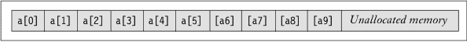

**图 10.1** 数组 `a[10]` 的内存布局

> **提示：** 数组经常需要调整大小，因此用符号常量表示大小是合理的（如 `char name[SIZE];`）。当大小改变时，只需更改设置 SIZE 的 **#define** 指令。无需改动程序主体。

### 10.2.1 声明时初始化

简单声明不会初始化数组（除非同时使用关键字 `static`），因此在此阶段各元素具有垃圾值。可以在声明时通过用花括号括起以逗号分隔的值列表来初始化数组。下面的声明中有两个显式指定了大小，但第三个只隐式指定大小：

```c
short months[12] = {31, 28, 31, 30, 31, 30, 31, 31, 30, 31, 30, 31};
float rate[10] = {12.5, 13.7, 5};
char type[] = {'A', 'n', 'd', 'r', 'o', 'i', 'd', '\0'};
```

在第一个声明中，值的数量与数组大小匹配。第二个声明只给前三个元素赋值，执行*部分*初始化。*发生这种情况时，其余值会自动初始化为零*（对于 char 类型数组则为 NUL）。

第三个声明使用一对空方括号（`[]`）来*隐式*指定数组大小。这种灵活性对程序员有利，也不会给编译器带来麻烦，因为编译器可以通过计算右侧的八个值轻松算出大小。该数组是一个字符串，因为它包含终止符 NUL（`'\0'`）。我们将在第 13 章讨论作为字符数组的字符串。

### 10.2.2 声明后初始化

你可能在编译时并不知道所有初始值，或者可能需要在程序后面重新赋值。使用花括号的技术在稍后赋值时不起作用；在这种情况下，必须逐个元素赋值：

```c
months[0] = 31;
months[1] = 28.3;        // Decimal portion truncated
rate[4] = 3;             // OK, 3 converted to float
type[5] = '\0';          // The NUL character having ASCII value 0
```

如果所有元素都赋相同的值，或赋通过求值表达式得到的值，通常使用循环来初始化整个数组。数组索引通常是循环的关键变量。下面左侧的示例将数组 rate 的所有元素初始化为 12.5，而右侧的示例赋一个包含索引本身的表达式：

```c
short i;                         short i;
float rate[10];                  float rate[SIZE];
for (i = 0; i < 10; i++)         for (i = 0; i < SIZE; i++)
    rate[i] = 12.5;                  rate[i] = i * 1.1;
```

符号常量 SIZE 必须事先定义为 **#define SIZE 10**。要打印所有元素，类似的两行 for 循环即可完成：

```c
for (i = 0; i < 10; i++)              for (i = 0; i < SIZE; i++)
    printf("%f ", rate[i]);               printf("%f ", rate[i]);
```

未初始化数组和部分初始化数组的初始化规则适用于在 **main** 之类的函数内部定义的数组。在第 11 章中，你将了解如何通过使用附加关键字或在函数外部定义数组来自动初始化数组。

## 10.3 array_init.c：初始化和打印数组

程序 10.1 包含三个类型不同、初始化程度不同的数组。程序显示这些数组的内容，并由此说明使用未初始化数组和部分初始化数组的后果。

```c
/* array_init.c: Shows effects of (i) no initialization, (ii) partial
                   initialization. Also initializes one array. */
#include <stdio.h>
#define SIZE 7
int main(void)
{
    short i;
    short short_arr[SIZE];
    int int_arr[SIZE] = {100, 200};
    long long_arr[] = {10, 20, 30, 40, 50, 60, 100};

    printf("Size of short_arr = %d\n", sizeof short_arr);
    printf("Size of long_arr = %d\n", sizeof long_arr);

    printf("short_arr contains    ");
    for (i = 0; i < SIZE; i++)
        printf("%5hd ", short_arr[i]);        /* Uninitialized */
    printf("\nint_arr contains     ");
    for (i = 0; i < SIZE; i++)
        printf("%5d ", int_arr[i]);           /* Partially initialized */

    printf("\nlong_arr contains    ");
    for (i = 0; i < (sizeof long_arr / sizeof(long)); i++)
        printf("%5ld ", long_arr[i]);         /* Fully initialized */

    for (i = 0; i < SIZE; i++)
        short_arr[i] = i * 2;                  /* Initializing short_arr ... */
    printf("\nshort_arr now contains ");
    for (i = 0; i < SIZE; i++)
        printf("%5hd ", short_arr[i]);        /* ... and printing it */
    return 0;
}
```

程序 10.1：**array_init.c**

```text
Size of short_arr = 14
Size of long_arr = 28
short_arr contains    -24588  2052  13928  -16479  -31319  2052  -8352
int_arr contains       100    200    0      0       0      0      0
long_arr contains       10     20    30     40      50     60     100
short_arr now contains   0      2     4      6       8      10     12
```

程序输出：**array_init.c**

注意，**sizeof** 计算的是为所有数组元素分配的内存。对于程序中使用的数组，有以下观察结果：

- **short_arr** 最初具有垃圾值，因为它在声明时未初始化。后来它被赋值为一个与其索引相关的表达式的值。
- **int_arr** 是部分初始化的。前两个元素已初始化，因此其余五个元素自动设置为零。
- **long_arr** 的大小是*隐式*声明的。编译器通过计算七个值来确定它。这个大小也通过用数组占用的总空间（**sizeof long_arr**）除以 long 数据类型的大小（**sizeof (long)**）来计算。

通常，接受数组作为参数的函数还需要将元素数量作为另一个参数。这个值应作为表达式 **sizeof array / sizeof (data type)** 传递给函数，而不是作为常量。即使以后更改数组的大小，也无需更改这个表达式。

> **要点：** 未初始化数组包含垃圾值，但部分初始化数组的其余元素会设置为零或 NUL。此外，对数组使用 **sizeof** 求值得到的是该数组所有元素占用的总空间。

## 10.4 scanf_with_array.c：用 scanf 填充数组

在循环中使用 **scanf** 函数，我们可以通过键盘输入填充数组。**程序 10.2** 利用 **scanf** 的返回值来确定输入结束。此程序中的 **while** 循环在 **scanf** 返回 0 时终止，而当键入 **EOF** 或任何非数字字符（例如 *q*）时就会发生这种情况。

最多可以输入 20 个整数——如有必要可分行输入——但每次调用 **scanf** 只读取一个整数，并将剩余输入留在缓冲区中。已输入值的数量可在表达式 *i - 1* 中获得，它决定第二个循环迭代多少次来打印所有已填充的数组元素。

```c
/* scanf_with_array.c: Populates an array with user input. */
#include <stdio.h>
int main(void)
{
    short i = 0, num;
    short arr[20];
    printf("Key in some integers followed by EOF: ");
    while (scanf("%hd", &arr[i++]) == 1)       /* Populates array */
        ;
    num = i - 1;
    for (i = 0; i < num; i++)
        printf("arr[%hd] = %hd, ", i, arr[i]);
    return 0;
}
```

程序 10.2：scanf_with_array.c

```text
Key in some integers followed by EOF: 11 22 [Enter]
44 55 77 [Enter]
99
EOF                    Press [Ctrl-d] or [Ctrl-z] to terminate loop
arr[0] = 11, arr[1] = 22, arr[2] = 44, arr[3] = 55, arr[4] = 77, arr[5] = 99,
```

程序输出：scanf_with_array.c

## 10.5 数组的基本操作

正如上一个程序清楚显示的，就所有实际用途而言，数组元素可以被当作变量处理。因此，元素可以构成任何算术、赋值、关系或逻辑表达式的组成部分。下面从本章程序中摘取的示例展示了在表达式中使用数组元素的各种方式：

```c
arr[i] = arr[i + 1];
temp = arr[i];
arr[c]++;
if (arr[i] > arr[j])
if (num < arr[0] || num > arr[SIZE - 1])
```

元素 arr[i] 中的 [ 和 ] 实际上是一组用于求值该元素的操作符。这些符号具有最高优先级——与圆括号同级。因此，在表达式 arr[c]++ 中，arr[c] 会在应用递增操作之前求值。

### 10.5.1 insert_element.c：在数组中插入元素

要在数组的指定位置插入元素，需要将从该位置到数组末尾的所有元素向右移动。程序 10.3 接受用户输入来初始化数组，然后接受进一步输入以在指定位置插入元素。最后，它显示数组更改后的内容。该程序文档充分，无需进一步详述。


```c
/* insert_element.c: Inserts element at specified location in an array. */
#include <stdio.h>
int main (void)
{
    short i, j, num, new_value, arr[20];

    printf("Number of integers to input? ");
    scanf("%hd", &num);

    printf("Key in %hd numbers: ", num);
    for (i = 0; i < num; i++)
        scanf("%hd", &arr[i]);

    printf("Enter desired index at insertion and inserted value: ");
    scanf("%hd%hd", &j, &new_value);

    /* Section for shifting elements to right and insertion of element */
    for (i = num; i > j; i--)            /* arr[num] is last element plus one */
        arr[i] = arr[i - 1];              /* Moves a group of elements to right */
    arr[i] = new_value;                   /* Inserts new value at index j */

    for (i = 0; i <= num; i++)            /* Now <= because of an extra element */
        printf("%hd ", arr[i]);
    return 0;
}
```

程序 10.3：**insert_element.c**

```text
Number of integers to input? 6
Key in 6 numbers: 11 22 33 55 66 77
Enter desired index at insertion and inserted value: 3 44
11 22 33 44 55 66 77
```

程序输出：**insert_element.c**

### 10.5.2  `delete_element.c`：从数组中删除元素

删除元素同样简单，并且可以通过类似但相反的思路实现。像之前一样移动到指定位置，然后将从该位置到数组末尾的所有元素向左移动。程序 10.4 完成了此任务。这次我们使用 10.4 节讨论的技术，该技术可在不知道所需元素数量的情况下填充数组。这个程序也有完善的注释，因此不再提供进一步解释。

大型数组通常会被排序以便更快访问。在已排序数组中插入和删除元素需要额外的编程工作。因为用户无法为已排序数组指定插入或删除点，所以程序必须定位它。在你学会搜索数组之后，这些任务将触手可及。

```c
/* delete_element.c: Deletes element at specified location in an array. */
#include <stdio.h>
int main (void)
{
    short i, j, num, arr[20];
    printf("Key in numbers and press [Ctrl-d]:\n");
    num = 0;
    while (scanf("%hd", &arr[num]) == 1)
        num++;                        /* Number of items read = num */
    printf("\nEnter index at deletion point: ");
    scanf("%hd", &j);
    for (i = j; i < num - 1; i++)     /* Now num - 1 because of deleted element */
        arr[i] = arr[i + 1];          /* Moves a group of elements to left */
    for (i = 0; i < num - 1; i++)
        printf("%hd ", arr[i]);
    return 0;
}
```

程序 10.4：delete_element.c

```text
Key in numbers and press [Ctrl-d]:
11 22 33 44 55 66 77
[Ctrl-d] or [Ctrl-z]
Enter index at deletion point: 3
11 22 33 55 66 77
```

程序输出：delete_element.c

## 10.6 反转数组

本节讨论两种反转数组的技术。使用两个数组很容易实现，但由于大型数组可能占用大量空间，我们还必须能够使用单个数组完成此任务。以下各节将讨论这两种技术。

### 10.6.1 使用两个数组反转

反转数组内容的最简单方法是使用第二个数组来保存新值。顺序如下：读取 array1 的第一个元素并将其保存到 array2 的最后一个元素，将 array1 的下一个元素保存到 array2 的倒数第二个元素，依此类推。下面这个简单的代码段完成了此工作：

```c
short i, size = 7, brr[7];
short arr[] = {1, 3, 6, 9, 11, 22, 5};
for (i = 0; i < size; i++)            /* Reversing array */
    brr[size - 1 - i] = arr[i];
for (i = 0; i < size; i++)                  /* Printing reversed array */
    printf("%d ", brr[i]);
```

输出：5 22 11 9 6 3 1

在这个和下一个示例中，我们选择使用变量（size）来存储数组的元素数量。然而，认真的程序员会改用 **#define SIZE 7**。由于该大小比最后一个下标的值大一，因此在将第一个数组的元素赋给第二个数组之前，我们需要从中减去一。

### 10.6.2  使用单个数组反转

包含 *n* 个元素的数组可以在不使用第二个数组的情况下反转。该技术使用一个中间变量来反转第一个和第 *n* 个（最后一个）元素、第二个和第 (*n* − 1) 个元素，依此类推。此过程执行 *n* / 2 次。如果 *n* 为偶数，则所有元素的交换都会完成；但如果 *n* 为奇数，则中间元素不受影响。无论如何都是如此，因此程序逻辑不依赖于 *n* 是偶数还是奇数。以下代码完成了此工作：

```c
short i, j, temp, size = 7;
short arr[7] = {1, 3, 6, 9, 11, 22, 5};
for (i = 0, j = size - 1; i < (size / 2); i++, j--) {
    temp = arr[i];
    arr[i] = arr[j];
    arr[j] = temp;
}
for (i = 0; i < size; i++)                  /* Printing reversed array */
    printf("%d ", arr[i]);
```

输出：5 22 11 9 6 3 1

第一个 **for** 循环的组合表达式中，*exp1* 和 *exp3* 里的逗号运算符造就了精简的循环体。该循环使用 *temp* 作为中间变量交换两个值。下标 *i* 从 0 递增到 (*size* - 1) / 2，同时 *j* 从最后一个下标 (*size* - 1) 递减。然而，原始数组在此过程中会丢失。由于该技术节省内存，此后我们将把它用于任何与数组反转相关的任务。

## 10.7  重温两个程序

之前的一些程序使用循环在每次迭代中生成一个或多个值。由于无法保存所有这些值，所以每个值在生成的那一刻、下一次迭代开始之前就被处理了。现在我们有了一个数组来存储所有值，甚至可以在循环执行完成*之后*使用这些值。现在让我们重温其中两个程序，使它们足够灵活以处理多种需求。

### 10.7.1  extract_digits2.c：保存整数的各位数字

程序 10.5 是对其前身（程序 8.3）的改进，后者从整数中提取各位数字。然而，该程序将所有提取出的数字存储在一个数组中，然后反向读取该数组，以按正常顺序打印这些数字。只需对代码稍作修改，你就可以按任意方式操作这些数字。你可以按任意顺序打印它们、将它们相加或相乘。

```c
/* extract_digits2.c: Modifies a previous program to save the digits of an
                        integer in an array for manipulation in any manner. */
#include <stdio.h>
int main(void)
{
    unsigned int number;
    short i = 0, digit_arr[10];

    printf("Key in an integer: ");
    scanf("%d", &number);
    while (number != 0) {
        digit_arr[i++] = number % 10;         /* Saves last digit */
        number = number / 10;                 /* Removes last digit */
    }
    i--;
    while (i >= 0)                            /* Printing the digits ... */
        printf("%hd ", digit_arr[i--]);       /* ... in normal sequence */
    printf("\n");

    return 0;
}
```

程序 10.5：**extract_digits2.c**

```text
Key in an integer: 1357926
1 3 5 7 9 2 6
```

程序输出：**extract_digits2.c**

### 10.7.2  decimal2anybase.c：从十进制转换为任意进制

反转数组背后的概念可以有益地用于将一个数从一种进制转换为另一种进制。在第 8 章中，曾两次通过反向读取余数数组来尝试十进制到二进制的转换。程序 10.6 通过将十进制转换为不超过 16 的任意进制来扩展范围。该程序没有反向读取数组，而是使用前面讨论的技术反转数组本身。

该程序使用两个 char 类型的数组。digit_arr 存储余数，digits 存储所有十六进制数字的字符表示。对于十进制和八进制数，程序只需分别使用该数组的前 10 个和前 8 个元素。

要转换的数和所需进制首先从用户输入中获取。该数会被反复除以该进制。程序使用余数作为下标，提取相应的


从 digits 中取出数字字母。例如，如果除以 16 的余数是 15，那么 digits[remainder] 就是 'F'。该值存储在 digit_arr 中，最终由第二个 for 循环反转。最后一个 for 循环只是读取这个转换后的数组。

```c
/* decimal2anybase.c: Extends decimal2binary.c to convert a number to any base.
   Reverses an array without using a second one. */
#include <stdio.h>
int main(void)
{
    char digit_arr[80];
    char digits[16] = {'0','1','2','3','4','5','6','7','8','9',
                       'A','B','C','D','E','F'};
    short i, j, imax, temp, base, remainder;
    long quotient;

    printf("Enter number to convert and base: ");
    scanf("%ld%hd", &quotient, &base);
    for (i = 0; quotient > 0; i++) {      /* Divide repeatedly */
        remainder = quotient % base;
        quotient /= base;
        digit_arr[i] = digits[remainder];   /* Select digit from array */
    }
    imax = i;                              /* Number of digits to be printed */

    /* Reverse the array before printing the digits */
    for (i = 0, j = imax - 1; i < imax / 2; i++, j--) {
        temp = digit_arr[i];
        digit_arr[i] = digit_arr[j];
        digit_arr[j] = temp;
    }
    for (i = 0; i < imax; i++)
        printf("%c ", digit_arr[i]);
    return 0;
}
```

|  |  |  |
|---|---|---|
| 程序 10.6：**decimal2anybase.c** |  |  |
| 输入要转换的数和基数：**12 2**<br>1 1 0 0 |  | 2³ + 2² = 12 |
| 输入要转换的数和基数：**127 2**<br>1 1 1 1 1 1 1 |  | 七个 1——127 |
| 输入要转换的数和基数：**255 8**<br>3 7 7 |  | 3 × 8² + 7 × 8¹ + 7 × 8⁰ = 255 |
| 输入要转换的数和基数：**255 16**<br>F F |  | 15 × 16¹ + 15 × 16⁰ = 255 |

程序输出：**decimal2anybase.c**

## 10.8 数组排序（选择排序）

排序是指按升序或降序排列数据。像电话簿这样的大型列表必须排序才能有用。数组排序通常是为了按指定顺序呈现信息，或满足其他操作（如搜索）的要求。排序数字所用技术不同于排序字符串所用技术。本节讨论数值数据排序相关的理论和编程技术。字符串排序将在第 13 章讨论。

有几种排序数组的算法。三种常见算法称为*冒泡排序*、*选择排序*和*插入排序*。由于它们有一些共同特征，了解一种算法有助于理解其他算法。本节先考察选择排序算法，然后开发实现该算法的程序。

考虑一个需要按升序排序的数值数组 arr。排序通过多趟重复扫描数组完成，每趟的起始点依次从 arr[0] 移到 arr[1]、arr[2]，依此类推。如果发现某个数小于该趟的起始元素，则交换这两个数。因此，每趟结束时，起始元素就是该趟所遇到元素中的最小值。对于 n 个元素的数组，总共需要 n - 1 趟，且每趟遇到的元素比上一趟少一个。

现在我们在程序 10.7 中实现该算法，它将对从键盘输入的一组整数进行排序。排序操作通过嵌套 `for` 循环完成。外层循环确定每趟的起始点，内层循环扫描起始元素之后的元素。我们将考察外层循环前两次迭代和最后一次迭代中发生的事件的确切顺序。

### 外层循环：第一次迭代

外层循环通过选择第一个元素作为起始点（i = 0）开始扫描。接下来，内层循环从第二个元素（j = i + 1）开始扫描所有剩余元素。在每次迭代中，它将所扫描元素的值与起始元素比较，并在起始元素大于另一个元素时交换它们。为此，它使用临时变量 tmp。内层循环完成扫描后，控制权返回外层循环进行第二次迭代。

### 外层循环：第二次迭代

外层循环现在选择第二个元素作为起始点（i = 1）。内层循环现在对除第一个和第二个元素之外的所有元素执行扫描（j = 2），将每个元素与第二个元素比较，如果满足关系测试则交换它们。

### 外层循环和内层循环：最后一次迭代

随着外层循环的每次迭代，起始点逐渐从第一个元素移到最后一个元素之前的元素。此时，内层循环只迭代一次，将该元素与最后一个元素比较，必要时交换。两个循环现在都已完成运行，排序操作已完成。

为方便理解，程序包含一个额外的 `for` 循环，它会在内层 `for` 循环完成单趟后打印数组内容。输出显示每趟如何将该趟遇到的最小数移到左侧。最终，诊断输出的最后一行显示原地排序后的数组。

```c
/* sort_selection.c: Sorts a one-dimensional array using a nested for loop.
   Algorithm used: selection sort. */
#include <stdio.h>
int main(void)
{
    short i, j, k, imax, tmp;
    short arr[100];

    printf("Key in some integers (q to quit): ");
    for (i = 0; scanf("%hd", &arr[i]) == 1; i++)
        ;

    printf("Status of array after each iteration ...\n");
    imax = i;                         /* Number of elements used */
    for (i = 0; i < imax - 1; i++) {  /* Last element not considered */
        for (j = i + 1; j < imax; j++) /* Scanning remaining elements */
            if (arr[i] > arr[j]) {     /* If start element is larger ... */
                tmp = arr[i];
                arr[i] = arr[j];       /* ... interchange the ... */
                arr[j] = tmp;          /* ... elements */
            }

        /* This for loop displays the array contents after each pass.
           You can remove it after you have understood selection sort. */
        for (k = 0; k < imax; k++)     /* Displaying progress */
            printf("%3hd", arr[k]);
        printf("\n");
    }

    printf("Final sorted output ...\n");
    for (i = 0; i < imax; i++)
        printf("%3hd", arr[i]);
    printf("\n");
    return 0;
}
```

### 程序 10.7：**sort_selection.c**

```text
Key in some integers (q to quit): 55 4 27 1 66 34 11 q
Status of array after each iteration ...
  1 55 27 4 66 34 11
  1  4 55 27 66 34 11
  1  4 11 55 66 34 27
  1  4 11 27 66 55 34
  1  4 11 27 34 66 55
  1  4 11 27 34 55 66
Final sorted output ...
  1  4 11 27 34 55 66
```

程序输出：**sort_selection.c**

**注意：** 由于字符串没有数值（尽管其单个字符有），对一组字符串排序基于完全不同的原理。从第一个字符开始，将 *string1* 的每个字符的 ASCII 值与 *string2* 中对应字符比较。当首次出现不匹配时排序停止。我们需要使用 `strcmp`（字符串处理函数）进行比较，因此该主题将在第 13 章讨论。

## 10.9 `array_search.c`：顺序搜索数组的程序

搜索是对数组执行的常见操作。我们经常在数组中搜索某个数。根据应用不同，如果该数存在于数组中，我们可能忽略它或递增计数器。如果不存在，我们可以将该数添加到数组中。最简单的搜索技术顺序扫描所有数组元素，并在找到匹配时终止搜索。更高效的技术使用已排序数组进行二分搜索。本章讨论这两种技术。

程序 10.8 顺序搜索一个最多可容纳 128 个整数的数组。用户先输入若干整数，然后在数组中搜索特定整数。如果找到匹配，程序打印该数组元素及其索引。该技术适用于小数组。

通过在循环中运行 `scanf`，在输入以 q 终止前输入六个整数。使用 `&arr[i++]` 这种写法，`scanf` 将这些整数保存到数组 `arr` 中。然后 `getchar` 执行其常规清理工作，清除 q 以及可能留在系统缓冲区中的其他非数字字符。

接下来，搜索例程在嵌套 for 循环中运行，在该数组中搜索另一个用户输入的整数。如果找到匹配，变量 `is_found` 被设为 'y'，内层循环通过 `break` 终止。如果未找到匹配，循环正常终止，`is_found` 保持为 'n' 不变。无论哪种情况，控制流都向下移动到条件表达式，该表达式判断 `is_found` 的状态并选择适当的 `printf` 表达式。然后外层循环的下一次迭代提示用户输入另一个整数。

## 10.10 二分搜索

顺序搜索较慢，仅适用于搜索小数组。处理大量数据时，我们需要使用*二分搜索*机制。在该方案中，数组在搜索前先排序。二分搜索每次调用都将搜索范围减半。因此所需循环迭代次数减少，使二分搜索比顺序搜索更高效。每位认真的程序员都应理解这种搜索机制，并知道如何在其程序中实现它。

二分搜索所用原理很简单，你可能已在猜数字游戏中用过。你让一个人猜一个 1 到 100 之间的数。然后你计算该范围的中点（50），再问该数位于范围的下半部分还是上半部分。下一个问题将所选范围进一步减半，只需几次猜测，范围就缩小到单个数字——即被猜中的那个数。范围通常可能按以下过程变化：

`1–100,  50–100,  50–75,  63–75,  63–69,  66–69,  66–68,  67–68,  67`


```c
/* array_search.c: Saves in an array some integers from the keyboard.
                Also sequentially searches the array. */
#include <stdio.h>
int main(void)
{
    int i = 0, imax, num, arr[128];
    char is_found;
    /* Input the integers */
    printf("Key in some integers (q to quit): ");
    while (scanf("%d", &arr[i++]) == 1)   /* Becomes 0 with non-digit */
        ;
    /* Remove the 'q' and other trailing characters from input */
    while (getchar() != '\n')
        ;
    imax = i - 1;                        /* Save i before it is reused */
    /* Search the array for a number */
    for (; printf("Integer to search (q to quit): "); ) {
        if (scanf("%d", &num) == 0)      /* When non-digit is input */
            break;
        is_found = 'n';                  /* Set default to 'n' */
        for (i = 0; i < imax; i++) {     /* Cycle through array elements */
            if (num == arr[i]) {         /* If number found in array ... */
                is_found = 'y';          /* ... abandon search */
                break;
            }
        }
        is_found == 'n' ? printf("%d not found\n", num) :
                          printf("%d stored in arr[%d]\n", num, i);
    }
    return 0;
}
```

| 程序 10.8：array_search.c |
| :--- |
| 输入一些整数（q 退出）：5 10 15 20 25 31 q<br>输入要搜索的整数：20<br>20 存储在 arr[3] 中<br>输入要搜索的整数：21<br>未找到 21<br>输入要搜索的整数：q |

**程序输出：array_search.c**

使用二分查找技术时，我们最多只需要猜九次就能找到数字 67。另一方面，顺序查找可能需要多达 100 次猜测。现在，在开发实现该算法的程序之前，我们先来理解数组二分查找的算法。

### 10.10.1 二分查找算法

让我们在一个包含 *n* 个元素的有序数组 *A* 中查找数字 *x*。让 *start* 和 *end* 表示查找域的两端（索引）。由于每次在数组上进行查找时，这个域都会缩小一半，因此 *start* 和 *end* 点会逐渐相互靠近。该查找算法包括以下步骤：

- 1. 将 *start* 的初始值设为 1，将 *end* 的初始值设为 *n*。
- 2. 在每次迭代中检查 *start* <= *end* 是否成立。如果该条件不成立，转到第 7 步。
- 3. 将查找域的中点设为 *mid* = (*start* + *end*) / 2，并将 *x* 的值与 *A*[*mid*] 进行比较。
- 4. 如果 *x* < *A*[*mid*]，则该数字属于范围的下半部分，这意味着 *end* 必须向左移动。设置 *end* = *mid* - 1，然后转到第 2 步。
- 5. 如果 *x* > *A*[*mid*]，则该数字属于范围的上半部分，这意味着 *start* 必须向右移动。设置 *start* = *mid* + 1，然后转到第 2 步。
- 6. 如果执行到这里，说明 *x* = *A*[*mid*]。查找成功，算法终止。
- 7. 如果（从第 2 步）执行到这里，则查找不成功，算法终止。

每当我们（从第 4 步或第 5 步）转到第 2 步时，*start* 和 *end* 之间的差值都会缩小。要使查找成功，*start* 必须保持等于或小于 *end*。如果 *start* 最终超过 *end*，则意味着查找失败。由于该查找算法在每次迭代中都会丢弃一半数据，因此二分查找比顺序查找更高效，而效率与完成一次查找所需的迭代次数有关。在讨论下一个程序之后，我们将考虑一些示例数据。

### 10.10.2 binary_search.c：算法的实现

程序 10.9 是刚刚讨论的算法的一个简单实现。它在声明时初始化一个包含 10 个元素的有序数组，并在其中进行查找。该程序使用外部 *while* 循环反复从键盘接收一个整数，然后使用内部 *while* 循环在数组中执行查找。为方便理解，程序在每次迭代中打印调整后的 *start* 和 *end* 点（SP 和 EP）。

外部 *while* 循环内的第一个 *if* 结构验证输入的数字 num。与前面的一些程序一样，当输入不是数字时，该程序也会结束。如果数字超出允许范围，*else-if* 部分中的 *continue* 语句会阻止执行其余语句。

二分查找算法在内部 *while* 循环中实现。进入该循环之前，变量 *start* 和 *end* 分别被设置为数组的第一个和最后一个索引。循环的每次迭代都会通过对 *start* 和 *end* 求平均值来设置新的中点（mid）。然后将以 mid 为索引的元素与查找值 num 进行比较。如果某次迭代中比较不相等，则调整 *start* 或 *end*，使两者彼此靠近。这也会改变 mid，从而使其更接近查找目标。

输出显示了起点和终点在每次迭代中如何调整。如果查找最终成功，循环会通过 **break** 路径异常终止。然而，如果该数字不存在于数组中，循环会由于控制表达式最终失败而正常终止。注意，数字 66 在第一次迭代中就能找到，而 22 和 87 都需要四次迭代，之后 22 被找到，但 87 未找到。

```c
/* binary_search.c: Uses the binary search mechanism for searching a sorted
   array. Progressively narrows the search domain by
   adjusting the start and end points of search. */

#include <stdio.h>
#define SIZE 10
int main(void)
{
    short num, start, mid, end;
    short arr[SIZE] = {11, 22, 33, 44, 55, 66, 77, 88, 99, 110};

    /* Search the array for a number */
    while (printf("Integer to search (q to quit): ")) {
        if (scanf("%hd", &num) == 0)        /* When non-digit is input */
            break;
        else if (num < arr[0] || num > arr[SIZE - 1]) {
            printf("Number outside range\n");
            continue;
        }

        start = 0; end = SIZE;
        while (start <= end) {
            mid = (start + end) / 2;
            printf("(SP: %hd, EP: %hd) ", start, end);

            if (arr[mid] < num)
                start = mid + 1;                /* Advance the start point */
            else if (arr[mid] > num)
                end = mid - 1;                  /* Move back the end point */
            else
                break;                          /* Search successful ... */
                                                /* ... array index = mid */
        }

        /* We now know whether the search was successful or not */
        if (arr[mid] == num)                    /* From previous break */
            printf("\nNumber found at index %hd\n", mid);
        else
            printf("\nNumber not found\n");     /* From normal loop termination */
    }

    return 0;
}
```

**程序 10.9：binary_search.c**

```
Integer to search (q to quit): -10
Number outside range
Integer to search (q to quit): 22
[SP: 0, EP: 10]  [SP: 0, EP: 4]  [SP: 0, EP: 1]  [SP: 1, EP: 1]
Number found at index 1
Integer to search (q to quit): 66
[SP: 0, EP: 10]
Number found at index 5
Integer to search (q to quit): 33
[SP: 0, EP: 10]  [SP: 0, EP: 4]
Number found at index 2
Integer to search (q to quit): 87
[SP: 0, EP: 10]  [SP: 6, EP: 10]  [SP: 6, EP: 7]  [SP: 7, EP: 7]
Number not found
Integer to search (q to quit): q
```

**程序输出：binary_search.c**

使用二分查找技术，我们最多需要四次迭代即可完成对包含 10 个元素的数组的查找。顺序查找的相应数字是 10。二分查找的能力可以从以下规则中看出：

> *搜索一个包含 n 个元素的有序数组所需的迭代次数，等于用二进制表示 n 所需的位数。*

因此，一个包含 1000 个元素的数组需要 10 次迭代（相比之下，顺序查找需要 1000 次）。随着数组规模增大，两者之间的差距会扩大，这表明二分查找的效率可以高得惊人。现在想一想：一个包含 40 亿个元素的有序数组，只需 32 次迭代就能完成查找！

**注意：** 数组必须是有序的，二分查找才能正常工作。

## 10.11 `count_chars.c`：数据项频率统计

我们经常需要知道数据中每一项出现的频率。例如，书法家可能想知道一本教科书中字母的使用情况。人口统计专家可能想研究人口按年龄的分布。气象专家可能想知道某个城市湿度超过 90% 的天数。这些任务无法用变量来处理，因为需要太多变量。数组是有用的计数工具，可以轻松处理这些工作。

单个数组可以使用两种技术之一来统计多个量的出现频率。最简单的实现是使用量本身作为数组的索引（前提是它为整数且为正）。每当该量出现在数据中时，程序只需将以该量作为索引的元素递增。另一种技术是使用二维数组同时存储数字及其计数。下面的程序使用第一种技术，第 10.13 节将研究第二种技术。


```
/* count_chars.c: Counts frequency of occurrence of individual characters.
   Index of array is the ASCII value of a character. */
#include <stdio.h>
#define SIZE 128
int main(void)
{
    short c, i;
    short arr[SIZE] = { 0 };        /* Remaining elements also initialized */
    printf("Enter a line of text and press [Enter]\n");
    while ((c = getchar()) != '\n')
        arr[c]++;

    for (i = 0; i < SIZE; i++)
        if (arr[i] > 0)
            printf("%c: %hd\n", i, arr[i]);
    return 0;
}
```

程序10.10：**count_chars.c**

```
Enter a line of text and press [Enter]
aeioiuiioeaiou/Enter/
a: 2
e: 2
i: 4
o: 3
u: 2
```

程序输出：**count_chars.c**

程序10.10使用一个包含128个元素的小型数组来统计各个字符出现的次数。每个字符都有一个整数值，通过 **getchar** 读取。尽管数组大小为128，但PC键盘上的字符要少得多。因此，数组中的许多元素不会受到该程序的影响。输出按 *字母: 次数* 的格式打印。

**getchar** 的返回值构成数组的下标。例如，元素 arr[97] 统计字母 'a'（其 ASCII 值为97）出现的频率。只要在输入中遇到 'a'，语句 arr[97]++; 就会将现有计数加1。**for** 循环只打印计数大于0的那些元素。

## 10.12 二维（2D）数组

C语言支持多维数组来表示表格和复杂的数据结构。这种数组的每个元素都通过多个下标来访问。二维数组需要两个下标，三维数组需要三个下标。与一维数组一样，多维数组占用一块连续的内存区域。

二维（2D）数组 `arr` 的形式为 `arr[i][j]`，其中下标 `i` 表示行数，`j` 表示列数。下面的语句声明了一个未初始化的二维数组：

```
short table[3][4];
```

由于二维数组实际上是一组行和列，因此通常使用符号常量 `ROWS` 和 `COLUMNS` 来表示其大小。但在内部，二维数组可以看作是一维数组的数组。这意味着 `table` 表示一组三个一维数组，每个数组包含四个元素。或者，也可以将其视为三行，每行有四列。图10.2 展示了具有这些维度的数组在内存中的布局。了解这种组织方式将帮助我们在将指针概念应用于数组时理解指针。

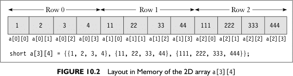

请注意，从图10.2可以看出，这个数组总共分配了12个内存槽（通常占用24字节）。前四个单元用于第0行的四列，接下来是第1行和第2行的各四列。这意味着，当顺序扫描内存时，列的变化比行快。因此，可以分别将行和列作为外层和内层循环的关键变量来完全访问该数组。

### 10.12.1 声明时的完全初始化

我们可以在声明二维数组时采用通常的花括号初始化技术，只是可能还需要使用一组内层花括号来对每一行的列进行分组。下面展示了如何声明 `table` 并用15个值进行初始化：

```
short table[3][5] = { {0, 1, 2, 3, 4},       /* Row 0 */
                      {10, 11, 12, 13, 14},   /* Row 1 */
                      {20, 21, 22, 23, 24} }; /* Row 2 */
```

每一行的各列应该用一组内层花括号括起来，并放在单独的一行。这样就很容易通过目视检查来确定元素的值。例如，`table[1][2]` 是12，`table[2][0]` 是20。注意每个行结束的闭花括号后面的逗号，而不是其左边的数字。对于完全初始化的数组（如上例），我们也可以不使用内层花括号：

```
short table[3][5] = {0, 1, 2, 3, 4, 10, 11, 12, 13, 14, 20, 21, 22, 23, 24};
```

去掉内层花括号后，可能很难将值与下标对应起来，因此只要可能就应该使用它们——尤其是对于大型数组。当所有值都已知时，C语言允许省略行下标：

```
short table[][5] = { {0, 1, 2, 3, 4},
                   {10, 11, 12, 13, 14},
                   {20, 21, 22, 23, 24} };
```

只有在省略不会导致歧义的情况下，才可以省略内层花括号和行下标。对于像上面这样的完全初始化数组，这不是问题，因此我们可以省略花括号，编译器仍然能够正确地确定行数。

### 10.12.2 声明时的部分初始化

C语言允许对数组进行部分初始化。在这种情况下，花括号是必需的，因为如果没有它们，编译器就无法确定这些值是如何在行和列之间组织的。考虑以下声明：

```
short table1[3][5] = { {0, 1, 2}, {10, 11}, {20} };
short table2[][5] = { {0, 1, 2}, {10, 11}, {20} };
```

对于这两个数组，第一个内层组的三个元素属于第0行，接下来两个属于第1行，最后一个元素属于第2行。其余元素被初始化为零，如下面的数据行列视图所示：

```text
  0  1  2  0  0    Row 0
 10 11  0  0  0    Row 1
 20  0  0  0  0    Row 2
```

由于存在花括号，编译器能够正确计算出 table2 声明中的行数。如果省略内层花括号，编译器在处理以下数据时就会感到困惑：

```
short table2[3][5] = { 0, 1, 2, 10, 11, 20 };
```

编译器现在会将前五个元素分配给第0行，最后一个元素分配给第1行。它也会错误地计算 table2 的行数。行列视图将变为如下：

```text
  0  1  2 10 11    Row 0
 20  0  0  0  0    Row 1
  0  0  0  0  0    Row 2
```

这一信息非常明确。无论初始化是部分还是完全，都要使用内层花括号。

### 10.12.3 声明后的赋值

与一维数组一样，元素也可以在声明后被赋予值。所赋的值可以是常量、变量或包含另一个数组元素的表达式：

```
table1[1][4] = 14;
table2[2][7] = x;
table2[2][4] = table1[1][4] + x;
```

你也可以使用 **scanf** 为二维数组元素赋值。不要忘记使用 & 前缀：

```c
scanf("%hd", &table[2][3]);
```

**scanf** 也可以用在嵌套循环结构中来填充整个二维数组。语句 `scanf("%hd", &table[i][j]);` 可以完成这项工作，但如果不知道数据对应哪个元素，输入数据可能会不方便。

> **要点：** C语言使用内层花括号将一组值赋值给二维数组的特定行。如果你部分地对一行进行赋值，那么你必须使用花括号，否则编译器会简单地将这些值赋值给一行的所有列，然后再处理下一行。

### 10.12.4 使用嵌套循环进行赋值和打印

你需要一个嵌套循环来为整个二维数组赋值单个值或表达式。外层循环改变行，内层循环改变列。程序10.11使用一个表达式完全初始化 `table`。同一个嵌套循环还打印数组的内容。

```
/* print_2d_array.c: Populates and prints a 2D array. */
#define ROWS 3
#define COLUMNS 5
#include <stdio.h>
int main(void)
{
    short i, j;
    short table[ROWS][COLUMNS];

    for (i = 0; i < ROWS; i++) {
        for (j = 0; j < COLUMNS; j++) {
            table[i][j] = i * 10 + j * 2;
            printf("%5hd", table[i][j]);
        }
        printf("\n");
    }
    return 0;
}
```

**程序10.11：`print_2d_array.c`**

| 0 | 2 | 4 | 6 | 8 |
|---:|---:|---:|---:|---:|
| 10 | 12 | 14 | 16 | 18 |
| 20 | 22 | 24 | 26 | 28 |

程序输出：**print_2d_array.c**


## 10.13 count_numbers.c：使用二维数组作为计数器

程序 10.12 使用二维数组实现频率计数器。程序接受一组整数作为用户输入，并依次将它们赋给数组 arr 的第一行，但前提是先检查该数字是否已存在于该行中。下一行对应的列维护该数字的计数。例如，第一个数字被赋给 arr[0][0]，其计数保存在 arr[1][0] 中。

```c
/* count_numbers.c: Uses a 2D array as a frequency counter.
   First row stores number, second row stores frequency. */
#include <stdio.h>
int main(void)
{
    short i, imax = 0, tmp;
    short arr[2][50] = {{0}};        /* All array elements initialized */
    char is_found;

    printf("Key in some integers (q to quit): ");
    while (scanf("%hd", &tmp) == 1) {
        is_found = 'n';
        for (i = 0; i < imax; i++) {      /* Check whether number exists */
            if (arr[0][i] == tmp) {        /* If number found in array ... */
                arr[1][i]++;               /* ... then increment its count */
                is_found = 'y';
                break;                     /* Abandon further checking */
            }
        }
        if (is_found == 'n') {             /* If number not found in array ... */
            arr[0][i] = tmp;               /* ... add number to array ... */
            arr[1][i] = 1;                 /* ... and set its count to 1 */
            imax++;                        /* Increase limit of search */
        }
    }
    /* Print array contents in pairs */
    for (i = 0; i < imax; i++)
        printf("%5hd = %2hd\n", arr[0][i], arr[1][i]);
    return 0;
}
```

```
Key in some integers (q to quit): 11 33 22 -1 0 33 666 33 22 0 33 q
  11 =  1
  33 =  4
  22 =  2
  -1 =  1
   0 =  2
 666 =  1
```

程序 10.12：**count_numbers.c**

程序输出：**count_numbers.c**

每个输入的数字都会依次在数组的第一行中查找。程序根据查找结果作出如下响应：

- 如果在该行中找到该数字，则第二行中对应的列会递增（`arr[1][i]++`）。随后用 **break** 终止 `for` 循环，以便输入下一个数字。
- 如果该数字在第一行中不存在，则将其赋给该行的下一个空闲元素。第二行对应列中的计数设置为 1。然后递增变量 `imax`，供下一个要添加的数字使用。

所有数字输入完毕后，表达式 `imax - 1` 的求值结果为 `arr` 第一行已使用的元素个数。最后的 **for** 循环使用该值仅打印那些已使用数组元素的键值对。

请注意，尽管输入的最大数字是 666，但只使用了数组的 12 个元素。程序 10.10（使用数字本身作为数组索引）本来需要 666 个元素的数组。那个程序在这里仍然会失败，因为它无法处理负数，而本程序可以轻松处理负数。

## 10.14 多维数组

C 中的多维数组可以超过二维。维度每增加一维，下标数量就增加一个，并且右侧下标比左侧下标变化得更快。三维（3D）数组可以视为数组的数组的数组。在这种情况下，只有那些使用最右侧下标访问——而其他下标保持不变——的元素才占用连续的内存单元。

尽管多维数组的内存分配和初始化原理保持不变，但当维数超过三维时，数组的可视化会变得困难。三维数组按如下方式声明：

```c
int max_temp[YEARS][MONTHS][DAYS];
```

该数组可以存储多年中按月份分组的每日最高温度。初始化这些元素需要三个循环：

```c
for (i = 0; i < YEARS; i++)
    for (j = 0; j < MONTHS; j++)
        for (k = 0; k < DAYS; k++)
            max_temp[i][j][k] = 0;
```

> *如果所有值都为 0，只需……*
> *……将一个元素初始化为 0*

表示下标的符号常量 MONTHS 和 DAYS 的值将分别为 12 和 31。每经过 31 个元素，月份变化一次；而每经过 31 × 12 个元素，年份变化一次。由于并非所有月份都有 31 天，必须在程序中构建特殊逻辑，以跳过那些指向无效日期的元素。

## 10.15 使用数组作为矩阵

在数学中，你会遇到将 *矩阵* 表示为数字或表达式的矩形阵列。矩阵由一个名称表示，比如 A，其维度为 *m × n*。矩阵的每个元素用记号表示，比如 aᵢ,ⱼ，其中下标 *i* 和 *j* 分别不能超过 *m* 和 *n*。在数学中，一个名为 A 的 3 × 4 矩阵表示如下：

$$A = \begin{bmatrix} a_{1,1} & a_{1,2} & a_{1,3} & a_{1,4} \\ a_{2,1} & a_{2,2} & a_{2,3} & a_{2,4} \\ a_{3,1} & a_{3,2} & a_{3,3} & a_{3,4} \end{bmatrix}$$

二维数组可以轻松实现矩阵，只是数组索引从 0 开始而不是从 1 开始。因此，矩阵元素 a₁,₁ 与数组元素 a[0][0] 相同。一般情况下，aₘ,ₙ 等价于 a[m - 1][n - 1]。我们现在将考察三个程序，它们使用二维数组实现矩阵中最常执行的操作。

### 10.15.1 `matrix_transpose.c`：转置矩阵

通过交换矩阵的行和列来对矩阵进行*转置*。因此，第一行变成第一列；最后一行变成最后一列。程序 10.13 转置由二维数组 mat1 表示的矩阵，并将输出保存在数组 mat2 中。

```c
/* matrix_transpose.c: Transposes a matrix;
   converts rows to columns and vice versa. */
#include <stdio.h>
#define COLUMNS 3
#define ROWS 3
int main(void)
{
    short mat1[ROWS][COLUMNS] = {{1, 2, 3},
                                 {4, 5, 6},
                                 {7, 8, 9}};
    short mat2[ROWS][COLUMNS];
    short i, j;
    for (i = 0; i < ROWS; i++)
        for (j = 0; j < COLUMNS; j++)
            mat2[i][j] = mat1[j][i];
    printf("Transposed matrix:\n");
    for (i = 0; i < ROWS; i++) {
        putchar('\n');
        for (j = 0; j < COLUMNS; j++)
            printf("%4hd", mat2[i][j]);
    }
    return 0;
}
```

程序 10.13：**matrix_transpose.c**

```
Enter 1 for addition or 2 for subtraction: 3
Illegal choice
Enter 1 for addition or 2 for subtraction: 1
Matrix after addition:
  13  13  13  13
  13  13  13  13
  13  13  13  13
Enter 1 for addition or 2 for subtraction: 2
Matrix after subtraction:
 -11  -9  -7  -5
  -3  -1   1   3
   5   7   9  11
```

程序输出：`matrix_add_subtract.c`

### 10.15.3 `matrix_multiply.c`：两个矩阵相乘

矩阵乘法不像加法和减法那样直接。一个 *m × n* 矩阵只能与一个 *n × p* 矩阵相乘，这意味着第一个矩阵的列数必须等于第二个矩阵的行数。结果矩阵的维度为 *m × p*。

矩阵乘法通过使用*点积*技术来执行。两组包含相同数量元素的数字的点积是相应元素乘积之和。对于矩阵，点积适用于第一个矩阵的行元素和第二个矩阵的列元素（图 10.3）。

| 矩阵 1 | 矩阵 2 | 矩阵 3 |
|---|---|---|
| 1  2<br>3  4<br>5  6 | 6  5  4<br>3  2  1 | 12  9  6<br>30  23  16<br>48  37  26 |

**图 10.3**  两个矩阵相乘

矩阵的数据来自程序 10.15 的输出。矩阵 3 的第一个元素（12）通过计算矩阵 1 的第一行与矩阵 2 的第一列的点积来求得。对于第二个元素（9），将点积应用于矩阵 1 的同一行与矩阵 2 的第二列。因此，矩阵 3 的第一行按如下方式计算：

```
1 × 6 + 2 × 3 = 12    (mat3[0][0])
1 × 5 + 2 × 2 =  9    (mat3[0][1])
1 × 4 + 2 × 1 =  6    (mat3[0][2])
```

矩阵 3 的第二行和第三行以类似方式计算。程序 10.15 执行此点积求值，其中矩阵值由用户输入提供。该程序还对两个矩阵执行兼容性测试。


```c
/* matrix_multiply.c: Multiplies two matrices. */
#include <stdio.h>
int main(void)
{
    short mat1[10][10], mat2[10][10];
    short mat3[10][10] = {{0}};    /* Initializes all elements to zero */
    short rows1, cols1, rows2, cols2, rows3, cols3, i, j, k;

    printf("Enter number of rows and columns of matrix 1: ");
    scanf("%hd %hd", &rows1, &cols1);

    printf("Enter number of rows and columns of matrix 2: ");
    scanf("%hd %hd", &rows2, &cols2);

    if (cols1 != rows2) {
        printf("Matrices not compatible; multiplication not possible\n");
        return 1;
    }
    printf("Resultant matrix has the size %hd X %hd\n",
            rows3 = rows1, cols3 = cols2);

    /* Assign and display values for matrix 1 */
    printf("\nMatrix 1: Key in %hd items, %hd items for each row:\n",
            rows1 * cols1, cols1);

    for (i = 0; i < rows1; i++)
        for (j = 0; j < cols1; j++)
            scanf("%hd", &mat1[i][j]);

    printf("Entered values for matrix 1: ");
    for (i = 0; i < rows1; i++) {
        putchar('\n');
        for (j = 0; j < cols1; j++)
            printf("%4hd", mat1[i][j]);
    }

    /* Assign and display values for matrix 2 */
    printf("\n\nMatrix 2: Key in %hd items, %hd items for each row:\n",
            rows2 * cols2, cols2);

    for (i = 0; i < rows2; i++)
        for (j = 0; j < cols2; j++)
            scanf("%hd", &mat2[i][j]);

    printf("Entered values for matrix 2: ");
    for (i = 0; i < rows2; i++) {
        putchar('\n');
        for (j = 0; j < cols2; j++)
            printf("%4hd", mat2[i][j]);
    }

    /* Multiply the matrices and display values for matrix 3 */
    for (i = 0; i < rows3; i++)
        for (j = 0; j < cols3; j++)
            for (k = 0; k < cols1; k++)
                mat3[i][j] += mat1[i][k] * mat2[k][j];

    printf("\nComputed values for matrix 3: ");
    for (i = 0; i < rows3; i++) {
        putchar('\n');
        for (j = 0; j < cols3; j++)
            printf ("%4hd", mat3[i][j]);
    }
    return 0;
}
```

### 程序 10.15：**matrix_multiply.c**

```text
Enter number of rows and columns of matrix 1: 3 2
Enter number of rows and columns of matrix 2: 2 3
Resultant matrix has the size 3 X 3
Matrix 1: Key in 6 items, 2 items for each row:
1 2 3 4 5 6
Entered values for matrix 1:
  1   2
  3   4
  5   6
Matrix 2: Key in 6 items, 3 items for each row:
6 5 4 3 2 1
Entered values for matrix 2:
  6   5   4
  3   2   1
Computed values for matrix 3:
 12   9   6
 30  23  16
 48  37  26
```

### 程序输出：**matrix_multiply.c**

## 10.16 变长数组（C99）

最后，让我们简要讨论 C99 标准中出现的其中一个最有用的产物。这就是*变长数组（VLA）*，它可以在运行时获得数组大小*之后*再声明。在程序 10.16 中，数组 arr 只有在通过调用 **scanf** 获得其大小之后才被声明。

输出确认 size 已被正确设置为 n。请注意，你可以在运行时设置数组的大小，而完全不需要更改程序。表达式 sizeof(arr) / sizeof(arr[0]) 的求值结果是数组元素的数量（10.3）。

```c
/* variable_length_array.c: Declares an array with its size determined
                         at runtime. Works only in C99. */
#include <stdio.h>
int main(void)
{
    short i, n, size;

    printf("Enter the number of elements in array: ");
    scanf("%hd", &n);                 /* Index of array determined at runtime */
    short arr[n];                     /* Can't do this in C89 */
    size = sizeof(arr) / sizeof(arr[0]);   /* size is the same as n */
    printf("Size of this array is set at runtime to %hd\n", size);
    printf("Key in %hd integers: ", n);
    for (i = 0; i < size; i++)
        scanf("%hd", &arr[i]);
    for (i = 0; i < size; i++)
        printf("%hd ", arr[i]);
    return 0;
}
```

### 程序 10.16：`variable_length_array.c`

```text
Enter the number of elements in array: 6
Size of this array is set at runtime to 6
Key in 6 integers: 11 33 55 77 22 44
11 33 55 77 22 44
```

### 程序输出：`variable_length_array.c`

**注意：** 在 C89 中，空间是在运行时由 **malloc、calloc 和 realloc** 函数动态创建的。尽管 C99 提供了更简单的替代方案，我们仍需要知道这三个函数如何工作。它们将在第 16 章讨论。

## 接下来是什么？

我们还没有结束数组的学习。我们必须学会将字符串解释为数组。我们还必须能够将数组作为参数传递给函数。这将在我们理解数组与指针之间的关系之后成为可能。我们将在学习指针和字符串之前先考察函数。

## 你学到了什么？

数组是一组连续的内存单元，可以存储多个具有相同数据类型的数据项。如果用非法索引访问数组元素，编译器不会报错。

- 10.4 对数组进行 _____ 查找比顺序查找更快。
- 10.5 二维数组可以解释为数组的 _____。
- 10.6 数组 `a[i][j]` 可以解释为 `i` _____ 和 `j` _____。
- 10.7 假设 int 为 4 字节，int 数组 `a[10][5]` 占用 _____ 字节内存。
- 10.8 在数组 `a[5][10]` 的内存布局中，元素 `a[3][0]` 前面有 _____。
- 10.9 在 C99 中，可以在 _____ 指定数组的大小。

### A3. 多项选择题

- 10.1 如果声明数组时没有指定其大小，(A) 它还必须初始化，(B) 该声明是非法的，(C) 大小可以稍后指定，(D) 以上都不是。
- 10.2 数组的初始化值由 (A) [] 括起，(B) () 括起，(C) {} 括起，(D) 以上都不是。
- 10.3 如果 `arr` 被声明为包含 10 个元素的 int 数组，语句 `scanf("%d", arr);` (A) 编译失败，(B) 运行时失败，(C) 完全正常工作，(D) 产生依赖于实现的行为。
- 10.4 对含 1000 个元素的有序数组进行二分查找所需的最大迭代次数是 (A) 999，(B) 256，(C) 32，(D) 10。
- 10.5 语句 `int a[5] = {{1}};` (A) 将所有元素设置为 1，(B) 将 `a[0][0]` 设置为 1，其余元素设置为 0，(C) 仅将 `a[0][0]` 设置为 1，(D) 编译失败。
- 10.6 对于二维数组的初始化，内层花括号 (A) 对于部分初始化是必需的，(B) 对于部分初始化是可选的，(C) 可选的，(D) 必需的。

## 概念性问题

- 10.1 如果一个整型数组有 100 个元素，你会采用同样的方法将其所有元素初始化为 0 以及比如 10² 吗？
- 10.2 解释“数组的大小可以显式或隐式设置”是什么意思。
- 10.3 如果 `arr` 是 `int` 类型的数组，表达式 `sizeof arr / sizeof(int)` 有什么意义？使用这个表达式有什么优点？
- 10.4 搜索有序数组所需的循环迭代次数与其大小有什么关系？
- 10.5 如果数组 `arr` 按以下方式定义，`arr[2][0]` 的值将是多少？为什么？

```c
short arr[4][6] = { 0, 1, 2, 3, 4,
                     10, 11, 12, 13, 14,
                     20, 21, 22, 23, 24 };
```

## 编程与调试技能

- 10.1 改正以下代码段，使其能够正确编译和执行：

```c
int i;
short arr[] = {1, 2, 3, 4};
for (i = 1; i <= sizeof arr / sizeof short; i++)
    printf("%d\n", arr[i]);
```

- 10.2 编写一个程序，打印一个包含 10 个元素的整型数组中的最大值和最小值。该数组由用户输入填充。

- 10.3 编写一个程序，声明并用任意值初始化一个包含 10 个元素的数组。程序应从键盘接受一个整数，删除所有匹配的数组元素，并按逆序打印修改后的数组。

- 10.4 在 `do-while` 循环中使用 `switch`，将数组 month[13] 的元素设置为每个月的最大天数。按 month[n] = value 的格式打印该数组。（忽略 month[0]。）

- 10.5 编写一个程序，输入一组整数，并在丢弃重复项后将值存储到数组中。打印该数组以及找到的重复项数量。

- 10.6 修改 C10.5 中的上一个程序，将 0 到 99 之间的奇数和偶数分别存储到两个单独的数组中，但要先丢弃重复项。通过运行一个循环来查看两个数组并创建一个有序列表（但不使用排序算法），将这两个数组合并到第三个数组中。

- 10.7 编写一个程序，使用包含 26 个元素的整型数组，打印使用 `getchar` 从键盘获取的每个小写字母的出现次数。还要打印输入中被丢弃的字符数。

- 10.8 编写一个程序，用用户输入填充一个 3 行 4 列的二维整型数组。程序必须丢弃重复项。

- 10.9 改正以下导致编译错误的语句：

```c
short arr[3][] = { {0, 1, 2, 3, 4},
                  {10, 11, 12, 13, 14},
                  {20, 21, 22, 23, 24}, };
```

- 10.10 编写一个程序，比较两个 3 行 5 列的二维数组是否相等。按 element[m][n] = value1, value2 的形式打印不相等的元素。

- 10.11 编写一个程序，用任意值初始化一个包含 24 个元素的整型数组 arr，然后使用这些数据填充 (i) 二维数组 brr[4][6]，(ii) 三维数组 crr[2][3][4]。还要打印该二维数组。

- 10.12 编写一个程序，计算由用户输入填充的 3 × 4 矩阵的所有行和列的和。

- 10.13 编写一个程序，检查一个 3 × 3 矩阵的两条对角线是否包含值 1，其余元素的值是否为 0。该矩阵由用户输入填充。


# 11 函数

## 学习目标

-   *声明、定义*和调用函数的技巧。
-   探索处理函数*返回值*的各种方式。
-   数据从*实参*传递到*形参*的机制。
-   C 是按*值*还是按*引用*传递实参。
-   函数*副作用*的意义。
-   将一维和二维数组作为函数实参传递。
-   从一个函数调用另一个函数的后果。
-   以*递归*方式使用函数的技巧。
-   使用*存储类*确定变量的*作用域*和*生命周期*。

## 11.1 函数基础

C 程序员将复杂任务分解为称为函数的独立且可管理的模块。被重复使用的代码段——甚至被其他程序重复使用——也实现为函数。与使用一个庞大的 main 函数完成所有工作的程序相比，将大部分工作委托给独立函数的 C 程序更易于开发和维护。虽然像 `printf` 和 `scanf` 这样的函数被视为黑盒，但你必须知道如何创建自己的函数并将它们集成到主程序中。

*函数*是一条语句，表示一段有名称的程序代码体。当函数被调用时，与该函数关联的代码被执行。函数可以选择性地 (i) 接受一个或多个值作为*实参*，并且 (ii) 通过向调用者*返回*单个值来报告其操作结果。函数主要通过以下两种方式之一调用：

```c
message_of_day();        /* No argument, returns no value */
fahrenheit = c2f(40.2);  /* One argument, returns a value */
```

通过函数名后面紧跟的一对匹配括号，可以很容易地识别出函数。`message_of_day` 函数既没有被传入实参，也不返回值。但 **c2f** 函数接受一个实参 (40.2)，并且还返回一个值，该值在这里保存在变量 `fahrenheit` 中。这个保存的值可以在程序后面使用。尽管并非所有函数都接受实参或返回值，但绝大多数函数都会。

函数在被调用之前必须先声明和定义。*声明*指定如何正确调用函数。*定义*提供实现，即在调用时将执行的代码体。与每次调用时行为都相同的 **message_of_day** 不同，**c2f** 的行为由传递给它的实参值（此处为 40.2）决定。

你创建的函数也可以调用其他函数。函数甚至可以调用自身，这一特性在编程领域有重要应用（例如计算一个数的阶乘）。对于我们目前使用过的所有函数，调用者都是 **main**。这是一个特殊的函数，每个独立的 C 程序都必须具有它，因为程序通过调用 **main** 开始执行。本章后面我们还会进一步讨论 **main** 函数。

在本章中，我们将从头创建一些函数，并使用它们重写之前的一些程序。在每种情况下，函数的实现（即定义）都出现在调用它的同一个文件中。因此，在一个程序中定义的函数，如果不复制声明和定义，就不能在另一个程序中重用。我们将使用 ANSI 规定的技术来创建函数，并忽略 K&R C 最初提出的技术。第 17 章探讨将函数隔离到单独文件中以便所有程序都能使用它们的技术。

> **要点：** 函数在使用之前必须先声明和定义。声明指定用法，定义提供被执行的代码。

## 11.2 `first_func.c`：无实参，无返回值

现在让我们考虑第一个程序（程序 11.1），它包含一个名为 **message_of_day** 的简单函数。该函数在 **main** 之前声明，从 **main** 的函数体中调用，并在 **main** 之后定义。该程序打印四行——**main** 和该函数各打印两行。

函数 **message_of_day** 就在预处理指令之后、**main** 之前按以下方式声明：

```c
void message_of_day(void);  /* Function declared */
```

声明或原型并不指定 **message_of_day** 做什么，只指定如何调用它。由于每个声明也是一条语句，所以它必须以分号结尾。该函数不使用实参（第二个 void），也不返回值（第一个 void），因此必须按以下方式调用：

```c
message_of_day();  /* Function called or invoked */
```

**message_of_day** 被设计用来做什么，在 **main** 之后的定义中指定。按照惯例，所有函数定义都位于 **main** 之后，尽管它们也可以放在 **main** 之前。

```c
/* first_func.c: Uses a function that has no arguments and returns nothing. */
#include <stdio.h>

/* Function declaration or prototype */
void message_of_day(void);                 /* Try deleting this statement */

int main(void)
{
    printf("Invoking function ...\n");
    message_of_day();                      /* Function invocation or call */
    printf("Returned from function.\n");

    return 0;
}

/* Function definition or implementation */
void message_of_day(void)                  /* The header */
{
    printf("This function uses no arguments and returns nothing.\n");
    printf("The next program uses one argument and returns a value.\n");
    return;
}
```

**程序 11.1：first_func.c**

```text
Invoking function ...
This function uses no arguments and returns nothing.
The next program uses one argument and returns a value.
Returned from function.
```

**程序输出：first_func.c**

定义包含一个*头部*和一个由一对花括号括起来的函数体。该函数体包含两条 **printf** 语句和一条不带值的 **return** 语句。

编译器发现函数声明与定义和调用一致。当 **message_of_day** 被调用时，程序控制转移到函数体，在那里执行放置其中的所有语句。函数中的 **return;** 语句将控制权移回调用者（即 **main**）。然后执行继续从函数调用之后的下一条语句开始。

函数中的 **return;** 语句与我们一直使用的 **main** 中的那条语句具有相同意义。它终止函数并将控制权返回给调用者。然而，该函数不返回值（是 **return;** 而不是 **return 0;**）。尽管这里的 **return** 并非必需，但在每个函数中都包含它——即使它可能不返回任何内容——也是一种良好的编程实践。


> **要点：** 函数名在一个程序中至少出现三次。声明出现在开头，调用发生在 **main** 的函数体中，定义放在 **main** 之后。如果它们的形式不匹配，编译器将输出错误。

> **注意：** 我们不需要为标准库中的函数提供定义，但仍然需要它们的声明。文件 `stdio.h` 包含 `printf` 和 `scanf` 的声明，这就是到目前为止我们在每个程序中都包含此文件的原因。

## 11.3 函数的构成

函数是一个标识符，这意味着与变量和数组命名相关的规则也适用于函数 (5.2.1)。因此，名称可以由字母、数字和下划线字符组成，其中第一个字符不能是数字。大小写有意义，因此，area 和 AREA 是两个不同的函数。现在让我们考察函数的三个主要属性：声明、定义和调用。

### 11.3.1 声明、原型或签名

声明是一条正式语句，它告诉编译器如何调用函数。声明也称为原型或签名。由于它放在 main 之前，编译器首先看到它，然后将其与调用和定义进行比较。为了进行比较，编译器确定函数是否

-   使用任何实参，如果是，则确定这些实参的数量及其数据类型。
-   返回一个值，如果是，则确定其数据类型。

这会产生四种可能的情况——有或没有实参，以及有或没有返回值。以下语法和支持示例展示了如何声明一个既没有实参也没有返回值的函数：

```c
void function_name(void);
void message_of_day(void);                    /* Used in first_func.c */
```

第一个 void 表示该函数不返回值。第二个 void 表示该函数不使用实参。然而，大多数函数使用一个或多个实参，并且还使用以下通用语法返回一个值：

```c
return_type function_name(type1 arg1, type2 arg2 ...);
```

这里，return_type 表示返回值的数据类型。函数实参表示为 arg1、arg2 等，其中每个实参前面都有其数据类型 type1、type2 等。实参可以是变量、常量或表达式。以下是一个示例：

```c
double area(float length, float breadth);
```

area 函数接受两个类型为 float 的实参，并返回一个类型为 double 的值。由于编译器只需将声明中实参的类型和数量与定义中使用的实参进行匹配，它不需要知道这些变量名，因此 C 允许你省略它们：

```c
double area(float, float);                    /* Not recommended */
```


该原型以牺牲可读性为代价进行了压缩。（在定义中不能这样做。）查看源代码时，声明是我们首先看到的内容。单行声明应告诉我们函数做什么以及需要什么输入。通过为函数及其实参使用有意义的名称，我们可以避免使用单独的注释行。

> **注意：** 函数原型或签名可作为良好的参考，并防止你错误地调用。即使省略它时没有遇到错误，也绝不要漏掉它。

### 11.3.2 定义或实现

函数*定义*或*实现*规定函数被调用时做什么。它由*头部*和完成所有工作的函数体组成。对于接受实参并返回值的函数，定义采用以下通用形式：

```c
return_type function_name(type1 arg1, type2 arg2 ...)
{
    statements;
    return expression;
}
```

- 头部
- 函数体开始
- 函数体结束

头部（第一行）与声明几乎相同，只是没有作为终止符的分号。函数体由简单语句或复合语句表示，且必须括在花括号内。**return** 语句将*表达式*的值传回调用者。我们刚刚声明的 **area** 函数将有以下定义：

```c
double area(float length, float breadth)
{
    double product;
    product = length * breadth;
    return product;
}
```

函数的局部变量

该头部包含一个逗号分隔的列表，由两个*参数* length 和 breadth 组成。这些参数实际上是变量，由调用中使用的对应*实参*赋值。也就是说，如果函数被调用为 **rect_area = area(len, width);**，则实参 len 和 width 的值分别传递给参数 length 和 breadth。

函数体声明一个名为 product 的局部变量，以保存计算结果。**return** 语句最终将此结果传回函数的调用者。调用者通常使用一个变量来保存此值，以免它在函数终止后消失。**area** 函数不打印任何内容，只返回一个值。

对于不返回值的函数（如 **message_of_day**），**return**（如果使用的话）不带*表达式*。在这种情况下，*return_type* 必须在声明和定义中都指定为 void。

### 11.3.3 调用

一旦函数已声明并定义，你就知道它做什么以及如何做。然后你可以从 **main** 或任何其他函数中任意多次调用它。如果函数不返回值，只需像这样调用：

```c
/* c2f.c: Uses a function that accepts an argument and returns a value. */
#include <stdio.h>
float c2f(float cgrade);                     /* Function declaration */

int main(void)
{
    float celsius, fahrenheit;

    printf("Enter a temperature in Celsius: ");
    scanf("%f", &celsius);
    fahrenheit = c2f(celsius);                /* Function called here */
    printf("%.2f Celsius = %.2f Fahrenheit\n", celsius, fahrenheit);
    printf("%.2f Celsius = %.2f Fahrenheit\n", celsius, c2f(celsius));

    return 0;
}

float c2f(float f_celsius)                   /* Function definition */
{
    float fheit;
    fheit = f_celsius * 9 / 5 + 32;           /* Local variable of function */
    return fheit;                              /* Value returned to main */
}
```

**程序 11.2: c2f.c**

| 输出 | 说明 |
| --- | --- |
| Enter a temperature in Celsius: 40.5 | |
| 40.50 Celsius = 104.90 Fahrenheit | 来自第 2 个 printf 语句 |
| 40.50 Celsius = 104.90 Fahrenheit | 来自第 3 个 printf 语句 |
| Enter a temperature in Celsius: 0 | |
| 0.00 Celsius = 32.00 Fahrenheit | |
| 0.00 Celsius = 32.00 Fahrenheit | |
| Enter a temperature in Celsius: -40 | |
| -40.00 Celsius = -40.00 Fahrenheit | |
| -40.00 Celsius = -40.00 Fahrenheit | |

**程序输出: c2f.c**

> **注意：** 函数实参使用的名称（celsius）不必与形参使用的名称（f_celsius）不同。尽管 11.5.2 节解释了原因，你仍应使用不同名称以避免混淆。

## 11.5 实参、形参与局部变量

函数使用自己的一组变量来执行任务。在 `c2f` 的定义（程序 11.2）中，它们出现在参数（`f_celsius`）和函数体（`fheit`）中。这些变量创建在几乎专供函数使用的单独内存区域中。当函数终止时，该空间由操作系统释放，并可供下一次函数调用使用。以下各节解释这些因素如何影响函数中所用变量的可访问性和生存期。

### 11.5.1 参数传递：实参与形参

要理解参数传递的概念，我们需要从两个角度看待函数实参——调用者和被调用函数。考虑以下取自前一程序 **c2f.c** 的函数定义和调用：

```c
float c2f(float f_celsius) {…}    *Definition*
fahrenheit = c2f(celsius);    *Invocation*
```

当调用者（此处为 **main**）调用函数时，它给函数的*实参或实际实参*赋值。被调用函数将这些值接收进其*形参或形式实参*。当我们如上所示调用 **c2f** 时，celsius（实参）的值被赋给 f_celsius（形参）。这种从实参到形参的值传递称为*参数传递*。

不幸的是，*实参*和*形参*这两个术语经常被互换使用。但在本文中，*实参*指函数的“实际实参”，*形参*指函数的“形式实参”。

> **注意：** *实参*和*形参*代表同一枚硬币的两面（调用者和被调用函数）。函数调用使数据从实参流向形参。然而，反向流动是不可能的（尽管我们可以使用指针模拟反向流动）。

### 11.5.2 按值传递与按引用传递

现在我们必须清楚地理解实参如何传递给被调用函数的形参。C 社区经常激烈争论一些相互冲突的观点。问题是实参是*按值还是按引用*传递，还是两者混合。本节将尝试解决这一冲突。

在 C 中，所有函数实参都是*按值传递*的，即它们被*复制*到对应的形参。*这一原则没有例外。* 当调用 **c2f** 时，celsius 的*值*被复制到 f_celsius。由于形参驻留在自己的内存空间中，celsius 和 f_celsius 占据不同的内存位置（图 11.1）。因此，你不能随后通过改变 f_celsius 来改变 celsius，即不能通过改变实参的副本（形参）来改变实参。

因此，在声明、定义和调用中不必为实参和形参保留不同名称。在程序 **c2f.c** 中，我们本也可以在函数定义中使用相同的变量名（celsius）。

与 C++ 不同，C 不支持按引用传递，即实参和形参占据同一内存位置。然而，在 C 中，变量（p）可以存储另一个变量（x）的内存地址，并且你可以使用 p 来*间接*改变 x 的值。因此，如果以 p 作为实参调用函数，其复制得到的形参仍将包含 x 的地址。然后你可以在函数中使用 p 的副本，改变调用者中定义的 x。在函数内部，你可以改变函数外部定义的变量！

有些人喜欢将上述特性视为按引用传递或按引用传递的“效果”，但我们不采取这种观点，并继续坚持 C 仅按值传递实参。现在让我们按以下方式总结我们的观察：


**图 11.1** 函数实参与形参在内存中的组织方式

*调用函数时，其实参会复制给形参。但如果函数改变了某个形参，调用方看不到这一改变。然而，如果某个实参包含变量的地址，那么就可以使用该实参对应的形参来改变那个变量。*

前面关于内存地址使用的段落对指针作了浅显介绍，指针被誉为 C 语言最强大的特性。我们将在第 12 章揭开指针的奥秘，但在 11.8 节把数组用作函数实参时，我们会以改头换面的形式再次遇到这个主题。

> **注意：** 即使调用方看不到形参被改变后的值，函数也可以通过 **return** 语句将其提供出来。然而，一个函数只能返回一个值，因此不能用这种方式返回多个形参。

### 11.5.3 局部变量

一个函数有自己的一组*局部*变量，这些变量在其实现中定义。例如，**c2f** 函数使用局部变量 *fheit* 来计算它返回给调用方的结果。与形参不同，局部变量不能由调用方赋值。然而，形参和局部变量具有以下共同特征：

- 它们的名称不会与调用方或任何其他函数中定义的相同名称冲突。
- 它们只能在其定义所在的函数中访问。它们既不在调用方中*可见*，也不在任何其他函数中可见。
- 它们的生命周期与函数处于活动状态的时间一样长。这意味着每次调用函数时都会创建它们。

由上述内容并如图 11.1 所示，我们可以得出结论：每次函数调用都有一个专门为其划出的独立区域。该区域在函数终止后会被释放。但由于 `main` 是第一个被调用、最后一个终止的函数，它的变量相比其他函数的变量和形参具有更长的*生命周期*。可见性和生命周期是变量的重要属性，我们需要讨论它们，而且很快就会讨论。

### 11.5.4 `swap_failure.c`：局部变量的“问题”

程序 11.3 演示了函数形参和局部变量的有限可见性。它尝试交换作为实参传递给函数的两个变量的值，但没有成功。在此过程中，它证明了分配给函数实参的内存区域与函数的形参和局部变量所使用的内存区域是分开的。

```c
/* swap_failure.c: Establishes the impossibility of swapping two values
   using parameters and local variables of a function. */

#include <stdio.h>
void swap(short x, short y);                 /* Function returns no value */
int main(void)
{
    short x = 1, y = 100, temp = 0;

    printf("In main before swap: x = %hd, y = %hd\n", x, y);
    swap(x, y);
    printf("In main after swap: x = %hd, y = %hd\n", x, y);
    printf("In main temp seen as %hd\n", temp);

    return 0;
}
void swap(short x, short y)                 /* x and y local to swap */
{
    short temp;                             /* Local variable */
    temp = x;
    x = y;
    y = temp;                               /* Values swapped inside function */
    printf("In swap after swap: x = %hd, y = %hd\n", x, y);
    printf("In swap temp set to %hd\n", temp);
    return;
}
```

**程序 11.3：** `swap_failure.c`

```text
In main before swap: x = 1, y = 100
In swap after swap: x = 100, y = 1
In swap temp set to 1
In main after swap: x = 1, y = 100
In main temp seen as 0
```

**程序输出：** `swap_failure.c`

为了强化我们的观点，我们在调用函数和被调用函数中使用了相同的变量名（x、y 和 temp）。**swap** 函数确实交换了 x 和 y 的值，但它改变的是形参，而不是原来的实参。在 **main** 中，即使交换之后，x 和 y 仍保持其初始值（1 和 100）不变。该函数也未能通过改变自己同名的局部变量来改变 **main** 中 temp 的值。

因为函数的变量有自己的内存空间，所以对它们所做的改变不会影响调用方使用的变量。然而，我们在 11.5.2 节中已经观察到，函数只有在知道调用方中定义的某个变量的地址时，才能改变该变量的值。利用这一性质，我们将在第 12 章修改这个 **swap** 函数，使它最终能够正常工作。你很快会发现，当实参是数组时，这一限制也会消失。

## 11.6 返回值与副作用

对于有返回值的函数，C 认为传递这个值是其首要任务。函数体执行的任何其他操作都被视为*副作用*。显示消息、获取一行文本、求表达式的值或更新外部文件，都是函数中常见的一些副作用。从这个角度看，用 **printf** 打印字符串以及用 **scanf** 接受键盘输入，在 C 看来都算副作用。

有些函数返回值，有些则不返回。有返回值的函数会作为一个表达式来求值，其值就是该函数的返回值。我们经常保存这个返回值以便进一步处理，或直接把它用作另一个函数的实参。我们使用 **c2f** 函数时这两种做法都做过：

```c
fahrenheit = c2f(celsius);

printf("%.2f Celsius = %.2f Fahrenheit\n", celsius, c2f(celsius));
```

如果一个有返回值的函数也有副作用，那么是由程序员决定使用该函数是为了其副作用、返回值，还是两者兼有。在目前我们用过的所有程序中，**printf** 和 **scanf** 一直是为了它们的副作用而使用。只有在少数情况下，我们才同时利用了它们的返回值：

```c
while (scanf("%hd", &arr[i++]) == 1)                                      (10.4)
while (printf("Integer to search (q to quit): "))                            (10.10.2)
```

这里，**scanf** 既用于读取键盘输入（副作用），也用于检测输入结束（返回值）。同样，**printf** 用于显示消息（副作用），并返回一个真值，以便 **while** 循环永远运行。

有时你会希望把返回值解释为真或假。例如，如果你希望一个函数按以下方式执行闰年检查：

```c
if (is_leap_year(2016))                         Function may return either 0 or 1
```

这意味着 **is_leap_year** 函数只需返回 0 或 1。于是，这个函数可能的定义可以如下：

```c
int is_not_prime(int num)
{
    int divisor = 2;
    while (divisor < num) {
        if (num % divisor == 0)
            return divisor;          /* divisor is non-zero */
        divisor++;                   /* Try next higher number */
    }
    return 0;                        /* Executed when number is prime */
}

int to_continue(void)
{
    char answer;
    printf("Wish to continue? ");
    answer = getchar();
    if (answer == 'y' || answer == 'Y')
        return 1;
    else
        return 0;
}
```

**程序 11.4：** `prime_number_check2.c`

```text
Number to test for prime: 13
13 is prime
Wish to continue? y
Number to test for prime: 377
377 is not prime, divisible by 13
Wish to continue? n
```

**程序输出：** `prime_number_check2.c`

`printf` 函数总是返回一个非零值（写入的字符数），因此它是无限循环的有效控制表达式。用 `scanf` 输入的数值由 `is_not_prime` 函数检查是否为素数。返回值保存在变量 divisor 中，因为随后会两次使用它。

一旦确定一个数是否为素数，就会调用 `to_continue` 函数来判断用户是否想输入另一个数。该函数定义表明 0 和 1 是仅有的可能返回值，这意味着该函数可以用作逻辑表达式。当这个表达式与 NOT 运算符（`!`）一起使用时，只有当 `to_continue` 求值为假时，才会退出 `main` 中的 `while` 循环。

## 11.8 在函数中使用数组

函数也使用数组作为实参。你既可以将单个数组元素，也可以将数组名作为实参传递给函数。参数传递的原则同样适用于数组，但是

它们以相反的方式影响数组元素和整个数组。我们先考虑下面这个把数组元素作为参数的函数调用：

```c
validate(month[2]);
```

这是一次简单的按值传递；month[2] 的值被复制到函数中相应的形参——可能是一个简单变量。因此，你无法通过修改 **validate** 函数内部的副本来修改这个元素。然而，当数组名作为参数传递时，情况就不是这样：

```c
init_array(month, 12);
```

这里，month *并不* 表示整个数组，因此整个数组不会被复制到函数内部。相反，month 表示 *其第一个元素的地址*（即 &month[0]），被复制的是这个地址。然后函数可以用简单的算术计算出其余元素的地址。这意味着函数可以修改 month 的每一个元素，即使 month 是在调用者中定义的！

然而，有一个问题。即使传给 **init_array** 的是一个地址，它也无法知道这个地址指的是一个数组。但是，如果数组的大小也作为单独的参数传递，**init_array** 就可以用这个大小来标识一块内存，并 *将这块内存视为数组*。然后，它就可以计算其余“元素”的地址，而不会越出“数组”的边界。这是经典的障眼法，但它完美地奏效！

最后，在使用数组名（例如 month）作为参数的函数声明或定义中，数组名被指定为 month[] 或 month[n]，其中 n 是任意整数。但函数调用只使用数组名，如下面的声明和调用所示：

| 代码 | 说明 |
|---|---|
| `void init_arr(short month[], short size);` | *声明使用名称 + []* |
| `void init_arr(short month[12], short size);` | *这种声明也可以* |
| `init_arr(month, 12);` | *调用仅使用名称* |

在第二个示例中，编译器不会把下标 12 解释为数组的大小。它只是查看 [] 来知道正在处理一个数组。因此，在声明（或定义的头部）中使用 month[]、month[12] 还是 month[65000] 都没有区别。但编译器无法知道这个数组的大小，所以必须将大小作为单独的参数传递。

如果数组包含一个字符串（一个以 '\0' 结尾的 char 类型数组），函数可以在不知道数组大小的情况下确定字符串的大小。字符串将在第 13 章讨论。


**要点：** 数组元素作为函数参数使用时，会按通常方式复制到相应的形参。但当数组名作为函数参数传递时，复制的是第一个元素的地址，而不是整个数组。然而，由于函数知道这个地址，只要它也知道数组元素的数量，就可以修改整个数组。

### 11.8.1 input2array.c：将数组作为参数传递

程序 11.5 使用一个函数通过键盘输入填充数组。该函数使用数组名及其大小作为两个参数。函数执行完毕后，程序打印所有数组元素的值。输出表明，函数内部对“数组”f_arr 的初始化实际上改变了 main 中的 arr，从而证实了我们的断言：数组本身永远不会被复制到函数内部。

由于 arr 与 &arr[0] 相同，&arr[0] 和 &f_arr[0] 都表示同一个数组元素的地址。但 f_arr 并不是数组，即使声明和定义暗示它是一个数组（f_arr[]）。然而，input2array 函数将 f_arr 当作数组处理，并使用另一个参数（SIZE 或 num）正确地填充它。因此，在函数内部修改 f_arr 实际上会修改函数外部的 arr。

现在让我们一劳永逸地面对真相：arr 和 f_arr 都是指针。声明本可以指定 short * f_arr 而不是 short f_arr[]，而且这对函数的现有实现没有区别。（你可以自己做出这个更改来看看。）但请屏住呼吸，直到第 12 章我们重新讨论数组。我们会发现，函数声明中的数组表示法只是一种便利，函数不必使用这种表示法来访问函数体中的数组。

```c
/* input2array.c: Uses a function to fill up array with keyboard input. */
#include <stdio.h>
#define SIZE 6
void input2array(short f_arr[], short num);   /* Note the [] */

int main(void)
{
    short arr[SIZE], i;
    input2array(arr, SIZE);                   /* Array name as argument */
    for (i = 0; i < SIZE; i++)
        printf("arr[%hd] = %hd ", i, arr[i]);
    printf("\n");
    return 0;
}

void input2array(short f_arr[], short num)
{
    short i;
    printf("Key in %hd integers: ", num);
    for (i = 0; i < num; i++)
        scanf("%hd", &f_arr[i]);              /* No array named f_arr actually */
    return;
}

PROGRAM 11.5: input2array.c
Key in 6 integers: 1 5 20 100 1024 4096
arr[0] = 1 arr[1] = 5 arr[2] = 20 arr[3] = 100 arr[4] = 1024 arr[5] = 4096

PROGRAM OUTPUT: input2array.c
```

数组可能占用大量空间，因此函数创建副本然后在函数终止后立即丢失它，这根本不合理。此外，如果排序和搜索数组的函数免去创建副本的负担，它们可以更快地完成工作。诚然，仍然存在从函数中无意间修改数组的风险，但这种设计的好处远远超过缺点。

### 11.8.2 static 关键字：让数组保持存活

函数可以将数组创建为局部变量，并把任意元素返回给调用者。下面的函数定义体现了这一点：该函数从自己的数据库（一个局部数组）中获取一个月中可用的最大天数：

```c
short days_in_month(short index)
{
    short month[13] = {0, 31, 28, 31, 30, 31, 30, 31, 31, 30, 31, 30, 31};
    return month[index];
}
```

但如果函数返回数组名，即第一个元素的地址，会怎样呢？那么可以在函数外部访问该数组吗？不，这是不可能的，因为即使调用函数可以“看到”这个地址，数组本身在函数执行完毕后也就不存在了。我们将在处理一个与数组使用相关的性能问题之后，为这个问题提供解决方案。

每次调用 **days_in_month** 都会创建 month 数组、初始化它，最后销毁它。函数调用有开销，当用于创建大型数组时，这种开销可能相当严重。在 **main** 中创建数组可以获得更好的性能，但这样函数就会失去通用性。然后我们就需要在每个使用该函数的程序中创建这个数组。更好的解决方案是在函数内部将数组声明为 **static**：

```c
static short month[13] = {0, 31, 28, 31, 30, 31, 30, 31, 31, 30, 31, 30, 31};
```

与普通变量不同，**static** 变量只创建并初始化一次——在函数第一次被调用时。因此，month 数组将在对 **days_in_month** 的连续调用之间保留所有值。而且，如果修改这个函数，使其改为返回 month 的起始地址，调用者就可以访问所有元素，而无需反复调用 **days_in_month**！我们将在第 12 章使用指针实现这一点。**static** 关键字会影响任何变量的生存期（不限于数组），将在 11.17.2 节中讨论。

## 11.9 merge_arrays.c：合并两个已排序数组

程序 11.6 使用三个函数来合并两个已排序数组。一个函数负责用已排序数据初始化这两个数组。另一个函数执行合并数据的实际任务。第三个函数只负责打印排序后的数据。


```c
void print_array(short a[], short num)
{
    short i;
    for (i = 0; i < num; i++)
        printf("%d ", a[i]);
    printf("\n");
    return;
}
```

程序 11.6：**merge_arrays.c**

```
Key in 5 integers: 11 33 55 77 99
Key in 6 integers: 22 44 66 88 95 111
After merging: 11 22 33 44 55 66 77 88 95 99 111
```

程序输出：**merge_arrays.c**

编译器允许使用 SIZE1 + SIZE2 来设置第三个数组的大小，因为该表达式的值在编译时已知。该操作首先调用 **input2array** 函数两次来填充两个数组。请记住按升序输入整数列表。

**merge_arrays** 函数使用五个参数来合并两个数组。为 a 和 b 指定了大小，但没有为 c 指定，因为其对应参数 crr 的大小足够。第一个 **while** 循环在将两个数组的元素按正确顺序赋给 c 之前比较它们。当 c 包含 a 或 b 中任一数组的所有元素时，循环终止。然后 **if** 语句运行一个 **while** 循环，将另一个数组剩余的元素赋给 c。**print_array** 函数最后打印合并后的数组。

该程序代表了*模块化* (3.11) 的经典案例。这里所有工作都已分配给各个模块，而精简的 **main** 部分只是调用它们。随着程序逐渐变大，这就是你必须准备去做的事情。注意，该程序易于维护；你可以很容易地找出需要更改的模块。

## 11.10 将二维数组作为参数传递

函数也可以使用二维数组名作为参数。与一维数组一样，二维数组在声明（和定义）与调用中的指定方式不同。在前一种情况下，可以省略第一个下标（行），但不能省略第二个下标（列）。因此，以下针对 **print_2d_array** 函数的声明是有效的：

```c
void print_2d_array(int arr[3][5], int rows);
void print_2d_array(int arr[][5], int rows);
```

如果不知道列数，编译器就不可能知道一行何时结束、另一行何时开始，因为各行在内存中是相邻放置的。换句话说，编译器必须知道元素 arr[0][4] 在内存中后面紧跟着 arr[1][0]。

## 11.11 从另一个函数调用函数

正如 **main** 调用函数一样，函数也可以调用另一个函数。被调用的函数又可以调用另一个函数，依此类推。在这种情况下，所有中间函数的返回都会保持挂起，直到最内层函数返回。其余函数随后按调用顺序的逆序返回。最终，最外层函数将控制权返回给 **main**（图 11.2）。

只要函数的返回保持挂起，其参数和局部变量就继续占用内存空间。内存释放从 *fn* 返回开始，并随着其他函数返回而逐步继续。但是，每个函数的返回值（如果有）都会在被调用函数消失之前由其调用者捕获。


**图 11.2** 函数调用其他函数

### 11.11.1 **time_diff.c**：计算两个时间之差的程序

现在来看程序 11.8，它计算用户输入的两个时间之差，每个时间均为 *时 分* 格式。**main** 函数调用 **time_diff** 函数，该函数计算经过的分钟数。此函数又调用 **absolute** 函数，以确保负值在返回给 **main** 之前转换为正值。函数调用顺序如下所示：


即使 **absolute** 函数是从 **time_diff** 中调用的，也必须在 **main** 之前声明它。这是因为函数不能在另一个函数体内声明。**scanf** 以四个变量接收这两个时间，然后将它们作为参数传递给 **time_diff**。**time_diff** 返回后，会打印其返回值。注意，**main** 在 **time_diff** 返回之前不能返回，而 **time_diff** 只有在 **absolute** 返回之后才能返回。

**time_diff** 函数先将两个时间转换为自 00:00（同一天）以来经过的分钟数，然后再相减。（UNIX 时钟维护为自 1970 年 1 月 1 日 00:00 以来经过的秒数。）由于时间未经过验证，可能出现负值，因此会调用 **absolute** 函数。此函数只是使用条件表达式返回该数的绝对值。

> **注意：** 大多数 C 实现都会为函数变量和参数分配一块固定内存（栈）。这块空间通常足以进行多次函数调用，但随着一个函数调用另一个函数、后者又调用另一个函数，依此类推，它会逐渐被消耗。当一个函数通过递归调用自身且未能终止时，这块空间可能被完全耗尽。栈的工作方式将在本章后面讨论。

```c
/* time_diff.c: Calculates the difference between start and end times.
   Calls one function from another function. */
#include <stdio.h>
int time_diff(short h1, short m1, short h2, short m2);
int absolute(short a_mins);
int main(void)
{
    short mins, hours1, hours2, mins1, mins2;

    printf("Enter start & endtimes as HH MM HH MM: ");
    scanf("%hd%hd%hd%hd", &hours1, &mins1, &hours2, &mins2);
    mins = time_diff(hours1, mins1, hours2, mins2);    /* Calls function1 */
    printf("Difference between the two times = %hd minutes\n", mins);
    return 0;
}

int time_diff(short h1, short m1, short h2, short m2)   /* Function1 */
{
    short net_mins;
    net_mins = h1 * 60 + m1 - (h2 * 60 + m2);
    return absolute(net_mins);                         /* Calls another function */
}

int absolute(short a_mins)
{
    return (a_mins > 0 ? a_mins : a_mins * -1);
}
```

程序 11.8：**time_diff.c**

```
Enter start & endtimes as HH MM HH MM: 12 35 7 30       *12:35 and 7:30*
Difference between the two times = 305 minutes
Enter start & endtimes as HH MM HH MM: 14 45 6 15       *Negative value*
Difference between the two times = 510 minutes
Enter start & endtimes as HH MM HH MM: 2 30 0 0
Difference between the two times = 150 minutes
```

程序输出：**time_diff.c**


**要点：** 因为每个函数都在栈中分配了独立空间，所以调用函数和被调用函数中使用的变量名不会发生冲突。

### 11.11.2 **power_func.c：计算幂级数之和**

考虑计算一个表达式的值，该表达式表示一系列 *n* 项之和，其中第 *n* 项表示为 *nⁿ*。该表达式正式表示如下：

1¹ + 2² + 3³ + 4⁴ + ... + nⁿ

### 工作原理：何时 exit 优于 return

除非在 **main** 中使用，否则 **return** 不会终止程序。当函数嵌套，并且你需要从内层函数退出*程序*时，使用 **return** 并不实际。在这种情况下，请使用 **exit** 函数，它会绕过包括 **main** 在内的函数层级，并将控制权转交给操作系统。这种情况类似于从深度嵌套循环中退出时使用 **goto** 而不是 **break**。

**exit** 函数以返回值作为参数调用，并且需要文件 stdlib.h，因此使用 **exit** 时必须包含该文件。从任何函数发出的调用 **exit(0);** 都会直接终止程序（在执行必要的清理操作之后）。UNIX-C 程序员（包括本书作者）更倾向于使用 **exit** 而不是 **return** 来终止程序。

为此，我们需要复用之前开发的用于计算数字幂的代码（程序 8.7）。下面的程序（程序 11.9）使用相同的代码——这次作为 **power** 函数——来求级数的每一项。另一个函数 **compute_sum** 反复调用此函数以计算最终的和。

```c
/* power_func.c: Computes the sum of n terms where the nth term is n^n.
                  Calls the power function from another function. */
#include <stdio.h>

long power(short f_base, short f_exponent);
unsigned long compute_sum(short f_terms);

int main(void)
{
    short m_terms;

    printf("Enter number of terms to sum: ");
    scanf("%hd", &m_terms);
    printf("\nSum of %hd terms = %ld\n", m_terms, compute_sum(m_terms));
    return 0;
}

unsigned long compute_sum(short f_terms)
{
    short i = 1, base = 1;
    unsigned long sum = 0;
    while (i <= f_terms) {
        sum += power(base, base);    /* Each term evaluated and summed here */
        printf("%ld ", sum);         /* Prints progressive sum */
        base++;
        i++;
    }
    return sum;
}
```


```c
long power(short f_base, short f_exponent)
{
    short i = 0;
    long result = 1;
    while (++i <= f_exponent)
        result *= f_base;                /* Multiply base by itself */
    return result;
}
```

程序 11.9：**power_func.c**

```
Enter number of terms: 3
1  5  32
Sum of 3 terms = 32
Enter number of terms: 5
1  5  32  288  3413
Sum of 5 terms = 3413
```

程序输出：**power_func.c**

## 11.12  sort_bubble.c：使用冒泡排序对数组排序

在使用选择排序算法（程序 10.7）之后，让我们学习使用冒泡排序技术对数组排序。对于升序排序，从左侧开始，比较两个相邻元素；如果左侧元素大于右侧元素，则交换这两个元素。每趟排序中，右侧较小的值会像“冒泡”一样向左移动。整个数组使用 *n* - 1 趟完成排序，其中 *n* 表示数组的大小。程序 11.10 展示了一些有趣的技术，你应该将这些技术融入其他程序中。

该程序使用 **bubble_sort** 函数，该函数又调用 **compare** 函数来比较两个相邻元素。**bubble_sort** 的第四个参数不寻常：它决定是否打印表示排序进度的多行输出。使用命名恰当的符号常量（如 ASCENDING 和 PRINT_YES）而不是实际数字，可以更容易理解这些常量实际代表什么。

**compare** 函数执行一个简单任务；它根据两个数组元素的比较返回真或假值。此外，取决于 **bubble_sort** 将 ASCENDING 还是 DESCENDING 作为第三个参数，**compare** 会使用 *x > y* 或 *x < y* 作为比较表达式。通过调整这个函数，你可以处理复杂的排序条件——例如，只对奇数排序。

因为我们选择打印排序进度（使用 PRINT_YES 而不是 PRINT_NO），所以可以清楚地看到冒泡排序算法的工作过程。观察最低值（0）如何需要 11 趟（比数组大小少 1）才能从最右端移动到最左端。在许多情况下，你会发现较少的趟数就足够了。

```c
/* sort_bubble.c: Uses bubble sort in a function which invokes
                  another function to determine sort order. */
#include <stdio.h>
#define ASCENDING 0
#define DESCENDING 1
#define PRINT_YES 1
#define PRINT_NO 0

void bubble_sort(short sarr[], short size, short order, short flag);
void print_array(short sarr[], short size);
int compare(short x, short y, short order);

int main(void)
{
    short arr[] = {111, 77, 30, 5, 7, 60, 222, 55, 80, 15, 40, 0};
    short size = sizeof(arr) / sizeof(arr[0]);
    printf("Array contents before sorting:\n");
    print_array(arr, size);
    printf("Array status after each iteration of outer loop:\n");
    bubble_sort(arr, size, ASCENDING, PRINT_YES);
    printf("Array contents after sorting:\n");
    print_array(arr, size);
    return 0;
}

void bubble_sort(short sarr[], short size, short order, short flag)
{
    short i, j, temp;
    for (i = 0; i < size - 1; i++) {
        for (j = 0; j < size - i - 1; j++)
            if (compare(sarr[j], sarr[j + 1], order)) {
                temp = sarr[j];
                sarr[j] = sarr[j + 1];
                sarr[j + 1] = temp;
            }
        if (flag == PRINT_YES)          /* Set flag = PRINT_NO if no ... */
            print_array(sarr, size);    /* ... display of progress needed */
    }
    return;
}

void print_array(short sarr[], short size)
{
    short i;
    for (i = 0; i < size; i++)
        printf("%3hd", sarr[i]);
    printf("\n");
    return;
}

int compare(short x, short y, short order)
{
    return (order == ASCENDING) ? (x > y) : (x < y);
}
```

程序 11.10：**sort_bubble.c**

```
Array contents before sorting:
111  77  30   5   7  60 222  55  80  15  40   0
Array status after each iteration of outer loop:
 77  30   5   7  60 111  55  80  15  40   0 222
 30   5   7  60  77  55  80  15  40   0 111 222
  5   7  30  60  55  77  15  40   0  80 111 222
  5   7  30  55  60  15  40   0  77  80 111 222
  5   7  30  55  15  40   0  60  77  80 111 222
  5   7  30  15  40   0  55  60  77  80 111 222
  5   7  15  30   0  40  55  60  77  80 111 222
  5   7  15   0  30  40  55  60  77  80 111 222
  5   7   0  15  30  40  55  60  77  80 111 222
  5   0   7  15  30  40  55  60  77  80 111 222
  0   5   7  15  30  40  55  60  77  80 111 222
Array contents after sorting:
  0   5   7  15  30  40  55  60  77  80 111 222
```

程序输出：**sort_bubble.c**

## 11.13  递归函数

循环使用迭代技术，用同一组指令反复更新一组数据。重复也可以通过*递归*实现，这是一种克隆形式，使用指令来指定自身。在 C 中，递归函数会调用自身，返回时将其在最终解决方案中承担的那部分结果交给调用者。这种逐步推进的方法类似于循环所采用的方法，因此同一个问题通常可以用这两种技术解决。

不能允许递归函数永远运行，因为程序最终会耗尽内存。如果函数没有指定最终终止该过程的终止条件，就会发生这种情况，如下面的代码所示，其中 `main` 调用自身：

```c
#include <stdio.h>
int main(void)
{
    static long count;
    printf("Call number: %ld\n", ++count);
    main();
    return 0;
}
```

| 输出： |
|---|
| 调用编号：1<br>调用编号：2<br>...<br>调用编号：523171<br>调用编号：523172<br>段错误 |

因为 **static** 变量 count 只定义并初始化一次，所以它可以跟踪对 **main** 的调用次数。你知道，函数变量和参数保存在内存中一个称为栈的独立区域。每次递归调用都会使栈的大小增长；如果这种增长不受控制，栈最终会溢出。（参见 11.13.2 节中题为“函数如何使用栈”的插文。）在这个程序中，**main** 在调用自身 523,172 次之后发生栈溢出，并以“段错误”终止程序。这不是递归函数应有的使用方式。

递归函数通常使用一个或多个参数，这些参数表示问题的一个子集。每次调用都包含解决方案的一部分，这部分在它对自身所作调用返回之前无法交给调用者。该函数通常包含对*终止条件*的检查，该条件在某个时刻发生变化以停止进一步的递归。随后，调用按照调用顺序的逆序返回，每次返回都更接近最终解决方案。

### 11.13.1  `factorial_rec.c`：使用递归函数计算阶乘

让我们考虑一个熟悉的递归函数，它计算一个数的阶乘。这无非是从 1 到该数的所有整数的乘积。例如，6!（6 的阶乘）是 6 × 5 × 4 × 3 × 2 × 1 = 720。但 6! 也可以表示为 6 × 5!，就像 5! 表示为 5 × 4! 一样。因此，我们可以这样表示一个数的阶乘：

factorial(n) = n × factorial(n - 1)

这里用到递归，因为一个数的阶乘可以用另一个数的阶乘来描述。现在的任务是定义一个函数，让它反复调用自身，直到 *n* = 1。这代表阻止进一步调用的终止条件。程序 11.11 使用了这种递归技术。

现在让我们考察 **factorial** 函数在其六次调用中实际返回了什么。最终解决方案（6! 的值）存储在变量 **result** 中，由所有递归调用的返回值决定。因此，这个值只有在这些调用返回之后才能得到。对 **factorial(6)** 的第一次调用返回以下值：

6 * factorial(5)

这次调用会保持挂起，因为它的返回值取决于 **factorial(5)** 的返回值。接下来会调用 **factorial(5)**，但这次调用也不能返回，因为它必须调用 **factorial(4)**。这样，所有递归调用都会保持挂起，直到调用 **factorial(1)**。终止条件（*n* == 1）在此求值为真，因此 **factorial(1)** 返回 1，而不再进行任何进一步调用。这使得 **factorial(2)** 能够返回，接着是 **factorial(3)**，依此类推，直到 **factorial(6)** 返回最终答案。


第二个**return**语句提供了连续调用之间的连接纽带。每次对**add_array**的调用都会将`first`递增1，因此下一个数组元素成为该调用的第一个元素。在基线情形中，终止条件（`first == last`）求值为真，并返回最后一个元素。这会启动其他待处理调用的返回过程，其中每个调用都将其“第一个元素”添加到该值上。最终，当第一个调用返回时，由**first**和**last**定义的所有元素都已相加。这就是该函数可以从**main**调用的方式：

```c
#include <stdio.h>
short add_array(short arr[], short first, short last);
int main(void)
{
    short arr[10] = {1, 3, 5, 7, 9, 12, 14, 16, 18, 20};
    short first = 0, last = 9;
    printf("Sum of elements %hd to %hd = %hd\n",
           first, last, add_array(arr, first, last));
    return 0;
}
```

程序输出105，即全部十个元素之和。对于只有几百个元素的数组，采用迭代方案并不会带来显著节省。但在加一百万个元素之前，你必须在使用一百万次递归调用和单次迭代之间做出选择。（这个选择实际上是显而易见的。）

### 11.14.2 用递归计算一个数的幂

我们在程序11.9中开发了**power**函数的迭代版本。该函数也可以用递归来实现，因为一个数的*n*次幂可以用同一个数的(*n* - 1)次幂来描述。换句话说，`power(2, 10) = 2 * power(2, 9)`。这种关系用下面的代码实现：

```c
long power(short base, short exponent)
{
    long result;
    if (exponent == 1)
        result = base;
    else
        result = power(base, exponent - 1) * base;
    return result;
}
```

由于每次对**power**的调用都会使指数减1，重复调用最终会到达基线情形**power(2, 1)**，此时终止条件停止进一步递归。在这里，对**result**的第二次赋值提供了连续调用之间的连接纽带。

### 11.14.3 使用递归计算斐波那契数

8.3.3节采用了迭代方法来推导斐波那契数列的各项。简单回顾一下，斐波那契数列以数字0和1开头，此后的每一项都由前两项求和得到。下面是该数列的前10项：

0 1 1 2 3 5 8 13 21 34 55

这个数列也可以通过递归推导，因为数列的三个连续项之间存在如下关系：

fibonacci(𝑛) = fibonacci(𝑛 − 1) + fibonacci(𝑛 − 2)

下面的函数**fibonacci_rec**通过在**return**语句中调用自身两次，返回前两项之和：

```c
unsigned long fibonacci_rec(short num)
{
    if (num < 3)                         /* Excludes first two terms */
        return 1;
    else {
        return fibonacci_rec(num - 1) + fibonacci_rec(num - 2);
    }
}
```

该函数从**main**中的一个循环被调用，该循环在每次迭代中打印每一项：

```c
for (i = 1; i <= num; i++)
    printf("%ld ", fibonacci_rec(i));
```

在这里递归是一个失败者，因为获得前40项需要5亿次递归函数调用。（你可以通过在函数内部设置一个计数器并全局定义它来验证这个数字。）迭代技术只需要一次函数调用和40次迭代！

> **注意：**递归可能导致迭代中不会遇到的两个问题。由于函数栈的实现方式，过多的调用可能导致栈溢出或执行时间增加。在大多数情况下，迭代方法才是正道。

## 11.15 main函数

我们现在来认识一个存在于每个C可执行程序中的特殊函数——**main**函数。该函数是程序中所有被调用函数的终极祖先。程序控制权在**main**和它所调用的其他函数之间分配。当**main**终止时，程序终止，这可以通过调用**return**、**exit**或一直执行到末尾来实现。

与用户自定义函数不同，**main**绝不会在程序中被声明。然而，**main**的定义是由程序员提供的。当你调用一个程序（例如*a.out*或*a.out.exe*）时，操作系统使用程序加载器来运行**不带参数的main**。这一点由如今熟悉的函数头表示：

```c
int main(void)    /* Program run without arguments */
```

`int`表示返回值的数据类型。单词`void`表示**main**被调用时不带参数。**main**的调用者通常是操作系统，因此**main**返回的值在操作系统中可作为其变量之一使用。

在`main`内部声明的变量，与其他函数变量和参数一样，从同一内存区分配空间。因此，这些变量本质上也是局部的，其他函数无法访问它们。但它们具有更长的生命周期，因为`main`在其他所有函数终止之后才终止。我们将在第13章重新讨论`main`，以理解它是如何带参数调用的，以及它的函数头如何相应变化。

## 11.16 变量的作用域和生命周期

在使用函数时，你会遇到两个或更多函数需要访问同一个变量的情况。你在程序11.11中已经遇到过这种情况，其中变量`count`被`main`和`factorial`函数共同使用。有时，即使在同一函数内，你也需要隐藏某个变量。此外，同一个变量还可能被多个程序文件使用。C语言提供了许多特性来充分解决这些问题。

除了具有数据类型外，变量还具有空间和时间属性。空间属性表示变量的*作用域*或*可见性*。这实际上是程序中变量可见且可被访问的区域。变量可能具有四种作用域之一：*块*、*函数*、*文件*和*程序*。具有块作用域的变量在其声明所在的块中可见。具有文件作用域的变量在整个文件中可见。

时间属性决定变量的*生命周期*，即它的产生和消亡时间。在函数内部声明的变量，只要该函数处于活动状态，它就一直存在。在`main`之前声明的变量在程序运行期间一直存在。

### 11.16.1 局部变量和全局变量

在函数内部声明的变量只在该函数内可见。它们具有*局部作用域*，这就是它们被称为*局部变量*的原因。在函数外部声明的变量称为*全局变量*。全局变量的作用域从它的声明点延伸到文件的其余部分。当变量在`main`之前声明时，它真正全局于整个程序（程序可能分布在多个文件中）。我们在程序11.11中声明了一个全局变量（`count`），并且可以在`main`以及从`main`调用的函数中访问它。

我们现在来考察变量的生命周期和初始化。全局变量的生命周期覆盖整个程序。默认情况下，它在程序执行开始时被初始化为零。另一方面，局部变量与其函数的生命周期一样长。它没有默认值，因此假设其默认值为零或`NUL`是错误的。

### 11.16.2 块中的变量

然而，当变量在块内声明时，可见性会受到影响。虽然我们还没有利用这个概念，但要注意，你可以在程序的任何位置创建一个由花括号括起来的块。在图11.4所示的代码片段中，`x`是全局变量，`y`是`main`的局部变量，`z`是内部块的局部变量。

虽然`x`可以在整个程序中访问，但`y`只在`main`中可见，包括内部块。`z`的可见性仅限于声明它的内部块。如果这个块包含嵌套块，那么所有变量在嵌套块中也是可访问的。


```c
int x = 2;                         /* Global variable */
int main(void)
{
    int y = 22;                    /* Local variable of main */
    {
        int z = 222;               /* Local variable of block */
        /* x, y and z visible here */
    }                               /* End of block */
    /* x and y visible here, but not z */
}

int func(void)
{
    int p = 5;                      /* Local variable of func */
    /* x and p visible here, but not y and z */
}
```

**图 II.4** 全局变量与局部变量的作用域

### 11.16.3 变量隐藏

如果内层块重新声明一个变量，那么它的新值会*隐藏*全局值以及外层块中赋的旧值（图 11.5）。可以通过在内存中创建另一个同名变量来隐藏一个变量。隐藏不会覆盖先前的值；退出内层块后，该值会重新可见。

```c
int x = 2;                         /* Global variable */
int main(void)
{
    int y = 22;                    /* Local variable of main */
    {
        /* x and y visible here but only until they are re-declared */
        int x = 4;                 /* Hides the value 2 */
        int y = 44;                /* Hides the value 22 */
        int z = 88;                /* Nothing to hide */
    }
    /* Original values of x and y visible here, but z is undefined */
}
```

**图 11.5** 重新定义变量

这一次，内层块重新声明（或重新定义）了两个变量 x 和 y。退出内层块后，块内看到的任何值都不会在块外看到。x 和 y 的旧值会再次可见。

> **要点：** 如果某个内层块也声明了同名变量，那么局部变量或全局变量在该内层块中就不再可见。然而，退出该块后，原始变量会重新可见。

## 11.17 存储类

变量的作用域、生命周期和初始值由其*存储类*决定。到目前为止，我们一直使用变量的默认存储类（自动），但你也需要了解 C 支持的以下存储类：

- 自动（**auto**）
- 静态（**static**）
- 外部（**extern**）
- 寄存器（**register**）

存储类还决定了编译器为变量分配内存的方式。括号中显示的关键字互斥，在变量声明中只能将其中一个用作限定符。表 11.1 比较了四种存储类的关键特征。

### 11.17.1 自动变量（auto）

如果反复调用一个函数，其局部变量会随着函数被调用的次数被自动创建和销毁。因此，函数的局部变量也称为*自动变量*。在声明中用作限定符的关键字 **auto** 会使变量成为自动变量。不过我们从未使用过它，因为默认情况下，局部变量的存储类就是 auto。但我们也可以显式地将变量指定为自动变量：

```c
int main(void)
{
    auto short count = 0;
    count++;
    ...
}
```

*auto 可以省略*

*值始终为 1*

自动变量具有函数作用域，默认值是垃圾值。如上所示，不能用自动变量统计函数被调用的次数，因为每次调用都会将该变量初始化为相同的值。全局变量可以部分解决这个问题，因为它只初始化一次；但是，函数一旦依赖于定义在 **main** 外部的变量，就会失去其作为自包含单元的地位。C 对此有一个简单的解决方案，接下来将讨论。

> **注意：** 调用函数时，自动变量被压入栈中，执行完成后被弹出（11.13.2——*插入框——工作原理*）。若要让变量在程序运行期间保留其值，就不能将其存储在栈中，也就是说，它不能具有 **auto** 存储类。

### 11.17.2 静态变量（static）

如果给局部变量指定 *static* 存储类，那么它将在函数调用之间保留其值。静态变量（关键字：**static**）只在包含其声明的函数执行时创建并初始化一次。即使函数终止后，它仍然存活（是静态的）。

在第 11.13 节中，我们就是这样声明一个静态变量，以统计 `main` 函数在 `main` 内被调用的次数：

```c
static long count;                      Default value is zero
```

默认情况下，静态变量初始化为零；但即使显式初始化，也只进行一次。下面的定义将 `count` 初始化为 5，并在每次调用该函数时将其递增：

```c
void f(void)
{
    static long count = 5;
    count++;                             count incremented with every call
}
```

出于某种原因，如果你希望每次调用函数时都初始化静态变量，可以这样做：

```c
static long count;                      First initialized to zero ...
count = 5;                              ... and then assigned the value 5
```

**static** 限定符也可用于全局变量（定义在 `main` 之前），此时该变量仅在当前文件中可访问。static 属性不影响初始化特性，因为非静态全局变量本来也只初始化一次。

函数也可以声明为 **static**，这会使该函数在其他文件中不可访问。

> **要点：** 函数的局部变量在每次函数被调用和终止时创建并消亡。这一默认的 **auto** 特性可以用 **static** 限定符覆盖；在这种情况下，变量会在函数的多次调用之间保留其值。

### 11.17.3 外部变量（extern）

全局变量或外部变量定义在函数外部，并在所有地方可见——甚至可在构成程序的其他文件中可见。然而，在 `main` 之后声明的变量在 `main` 中不可见：

```c
int main(void)
{
    ...
    return 0;
}                                       End of main
int x = 10;                             Not visible in main
```

更糟的是，在文件末尾声明的变量在任何地方都不可见——即使在变量声明之前定义的函数中也一样。要使变量在文件中的选定位置可见，需要为该变量指定 `extern` 存储类。在当前情形下，要使 x 在 `main` 中可见，必须在 `main` 中用 `extern` 限定符声明它：

**表 11.1** 变量的存储类

| 存储类 | 可见性 | 生命周期 | 默认值 | 备注 |
|---|---|---|---|---|
| `auto` | 在声明它的函数/块中 | 函数/块的持续时间 | 垃圾值 | 在函数/块中声明的变量的默认类 |
| `static`（在函数内） | 在声明它的函数/块中 | 程序/块进入的持续时间 | 零 | 在多次函数调用之间保留值 |
| `static`（在函数外） | 从声明点至文件末尾 | 程序的持续时间 | 零 | 跨多个文件保留值 |
| `extern` | 在函数/块、文件或多个文件中 | 程序的持续时间 | 零 | 必须在一处不带 `extern` 声明 |
| `register` | 在声明它的函数/块中 | 函数/块的持续时间 | 垃圾值 | 存储在 CPU 寄存器中以加快访问 |

```c
int main(void)
{
    extern int x;
    ...
    return 0;
}
int x = 10;
```

*x 在此处声明……*

*……并在此处定义*

**extern** 关键字表示变量 x 仅仅是在*此处声明*，而*定义*已在别处（此处是在 **main** 之后）完成。这意味着 x 的存储空间仅在其被定义时分配，而 **extern** 语句只是向编译器告知类型信息。*此处只有一个变量 x，使用单个存储位置。* 如果没有 **extern**，x 将成为 **main** 的局部变量，并与稍后定义的变量没有任何关系。


> **要点：** 如果变量 x 在某个函数或块中不可见，可使用 **extern** 限定符使其在那里可见。另外，普通变量会同时声明和定义，而 extern 变量只能声明。它必须在“别处”定义。

### 11.17.4 `extern.c`：使用 extern 控制变量可见性

程序 11.12 探讨两个变量（x 和 y）以及一个数组（arr）的可见性，它们都定义在 **main** 之后。由于 **extern**，x 和 arr 在 **main** 中可见，但 y 不可见。**main** 中的 y 是一个未初始化的自动变量，与定义在 **main** 之后的 y 不共享存储空间。注意，在块中声明的 x 默认在退出该块后不可见，这就是为什么必须用 **extern** 重新声明它。


```c
/* extern.c: Uses extern to access in main variables defined below main.
              Makes rare distinction between declaration and definition. */
#include <stdio.h>
int main(void)
{
    {
        extern int x;                       /* Declares x without defining it */
        extern int arr[];                   /* Declares arr without defining it */
        int y;                              /* Separate local variable */
        arr[0] = 10; arr[1] = 20;
        printf("Initial value of x = %d\n", x);
        printf("Initial value of y = %d\n", y);
        printf("Elements of arr = %d, %d\n", arr[0], arr[1]);
        x = 10;
    }
    extern int x;                       /* Re-declares x without defining it */
    printf("New value of x = %d\n", x);
    return 0;
}
int x = 5;                              /* Defines x but without using extern */
int y = 50;                             /* Not seen in main */
int arr[2];                             /* Defines arr but without using extern */
```

程序 11.12：**extern.c**

```text
Initial value of x = 5
Initial value of y = -1209016480
Elements of arr = 10, 20
New value of x = 10
```

程序输出：**extern.c**

> extern 特性是多个文件共享变量的唯一方式，这样对该变量的更新在所有需要的位置都可见。如果不使用 **extern** 而使用普通全局变量，安全性将受到损害。


> **注意：** 使用 **extern** 时，必须存在一个不使用 **extern** 关键字的变量定义。


> **提示：** 如果必须让变量在选定的函数中可访问，请在所有函数之后定义该变量，然后仅在需要访问该变量的那些函数中使用 **extern** 限定符。

### 11.17.5 寄存器变量（register）

所有程序变量都存储在主存中，主存比磁盘快，但比直接连接到 CPU 的寄存器（1.9.4）慢。*寄存器*存储类（关键字：**register**）允许将变量存储在某个高速 CPU 寄存器中。寄存器变量在函数或块内按以下方式声明：

```c
register int x;
```

编译器将*尝试*把变量 x 存储在某个寄存器中；如果失败，它将使用主存。由于这些寄存器数量很少，因此只应把频繁访问的变量（例如循环中的关键变量）声明为寄存器变量。寄存器变量的作用域、生命周期和初始值与自动变量相同（表 11.1）。

由于寄存器通常只有一个字的大小，因此并非所有变量都能分配此存储类。通常，**register** 仅限于 char 和 int 变量。但是，你不能使用 &x 获取寄存器变量的地址，因为寄存器不使用主存所使用的寻址系统。

## 接下来是什么？

我们未能使用函数交换两个变量。我们还没有解释为什么 scanf 需要 & 前缀。我们利用对内存地址的浅薄知识来修改数组元素，但无法真正评估这些地址在 C 中有多重要。下一章将解决所有这些问题，并开辟一个充满机遇的新世界。C 的一切都与指针有关。

## 你学到了什么？

函数可以带参数或不带参数调用，并且可以返回值或不返回值。函数可以因其返回值或副作用，或二者兼有而被使用。

函数声明指定其用法，而定义提供要执行的代码。标准库的函数在“include”文件中声明，其定义以编译后的代码形式存在于库（归档文件）中。

调用函数时，实际参数按值传递给形式参数（参数）。函数不能通过更改参数来更改实际参数。C 不支持按引用传递，尽管它可以使用内存地址来产生这种效果。

数组名表示第一个元素的地址。使用数组名作为参数的函数还需要知道：(i) 一维数组的元素个数，以及 (ii) 二维数组的行数。

函数可以调用另一个函数，后者又可以调用另一个函数，依此类推。被调用函数按调用的逆序返回。

递归函数会调用自身，直到终止条件停止进一步调用。迭代方法通常比递归技术更可取，因为前者不会导致栈溢出。

局部变量（**auto**）仅在其定义的函数或块中可见。当函数终止时，它会被销毁，除非使用了 **static** 限定符。全局变量在整个程序中可见。

**extern** 变量只定义一次，但可以通过适当的声明使其在其他位置可见。

## 客观题

### A1. 判断题（正误陈述）

- 11.1 函数必须接受一个或多个参数，或者返回一个值。
- 11.2 编译器会将函数的定义与其声明进行比较。
- 11.3 不带参数的函数不需要使用 `()` 后缀。
- 11.4 返回值的函数可以被当作表达式处理。
- 11.5 函数不能既返回 void，又在参数列表中使用 void。
- 11.6 函数可以调用其他函数，但不能调用自身。
- 11.7 即使函数体只包含一条语句，函数体也必须用花括号括起来。
- 11.8 函数 **f(x)** 不可能改变 x，因为函数终止后 x 会被销毁。
- 11.9 函数可以因其副作用或返回值，或二者兼有而被使用。
- 11.10 **while** 循环可以永远运行，但递归函数不行。
- 11.11 使用 **int main(void)** 的程序不能带参数运行。
- 11.12 每次使用关键字 **extern** 时，都会为该变量分配单独的存储空间。

### A2. 填空题

- 11.1 函数的 ______ 决定其用法，而 ______ 提供将要执行的代码。
- 11.2 不返回值的函数必须声明为 ______。
- 11.3 ______ 函数会反复调用自身。
- 11.4 文件 `stdio.h` 包含标准 I/O 函数的 ______。
- 11.5 按值传递意味着实际参数被 ______ 给函数的形式参数。
- 11.6 函数的参数和局部变量存储在称为 ______ 的内存区域中。
- 11.7 在函数内定义的 ______ 变量只创建一次，与调用该函数的次数无关。
- 11.8 ______ 语句终止当前函数，而 ______ 函数无论从何处调用都会终止程序。
- 11.9 `main` 函数在程序中从不 ______。
- 11.10 `extern` 关键字用于 ______ 一个变量。该变量必须在其他地方 ______。
- 11.11 默认情况下，在函数内定义的变量属于 ______ 存储类。
- 11.12 ______ 关键字用于将变量存储在与 CPU 直接连接的高速内存中。

### A3. 多项选择题

- 11.1 函数中的语句 `return sum;`（A）在将 sum 的值传给操作系统后终止程序，（B）将 sum 的值传给该函数的调用者，（C）终止该函数，（D）B 和 C，（E）A、B 和 C。
- 11.2 函数的声明（A）必须出现在 `main` 中使用它之前，（B）后面必须跟其定义，（C）必须使用与定义相同的参数名，（D）A 和 B，（E）以上都不是。
- 11.3 函数的局部变量（A）可以使用 `return` 传给调用者，（B）在能被返回之前就被销毁，（C）不能使用 `return` 传递，（D）以上都不是。
- 11.4 当数组名作为参数传递给函数时，（A）数组在函数内部被复制，（B）第一个数组元素的地址被复制，（C）函数可以使用 `sizeof` 确定数组的大小，（D）以上都不是。
- 11.5 在函数外部声明的变量（A）在 `main` 内部可见，（B）在任何函数中都不可见，（C）从其声明处到程序结束可见，（D）以上都不是。
- 11.6 如果函数内声明为 `static` 的变量，（A）只初始化一次，（B）在多次函数调用之间保留其值，（C）仅在程序终止时被销毁，（D）以上所有。

## 基于概念的问题

- 11.1 解释编译器如何处理程序中函数的声明、定义和调用。
- 11.2 解释在哪些情况下下列函数的返回值可以或不可以被忽略：`printf`、`scanf`、`getchar`。
- 11.3 解释为什么调用函数时使用的实参名称不会与函数定义中使用的形参名称冲突。


11.4 检查以下代码片段，并解释为什么 `printf` 在 `main` 和 `func` 中打印出不同的值：

```
int main(void)
{
    short arr[100];
    printf("Size of array = %hd\n", sizeof(arr));
    func(arr);
    return 0;
}

void func(short f_arr[])
{
    printf("Size of array = %hd\n", sizeof(f_arr));
    return;
}
```

11.5 将元素 `arr[5]` 传递给函数与将名称 `arr` 传递给函数有何不同？解释该函数能否更改调用者中定义的 `arr` 的内容。

11.6 解释决定变量是声明在 `main` 之前、`main` 内部还是 `main` 之后的情形。

11.7 使用合适的示例解释变量隐藏的概念。

## 编程与调试技能

- 11.1 找出以下程序中的错误：

  ```
  #include <stdio.h>
  void func(void)
  int main(void)
  {
      func(void);
      return 0;
  }
  void func(void)
  {
      printf("Elementary penguin\n");
      return;
  }
  ```

- 11.2 编写一个程序，其中包含一个名为 `volume` 的函数，该函数返回球体的体积。该函数接收半径作为单个参数。

- 11.3 修改 11.2 中的前一个程序，使 `volume` 函数能够处理立方体和球体。加入 `#define` 语句，使该函数能够按以下两种方式调用：

  ```
  float radius, length, vol;
  vol = volume(radius, SPHERE);
  vol = volume(length, CUBE);
  ```

- 11.4 编写一个程序，使用名为 `take_input` 的函数让用户输入*未指定*数量的整数（不超过 100），直到按下 EOF。这些值应存储在 `main` 中定义的数组中，并将该数组的名称作为参数传递给函数。该程序与第 11 章的程序 11.5 相比有何优越之处？

- 11.5 创建一个名为 `print_array` 的函数，用于打印数组的内容。该函数必须接收一个额外参数，用于决定数组是按正序还是逆序打印。

- 11.6 编写一个程序，使用名为 `copy_array` 的函数复制一个已初始化的数组。

- 11.7 编写一个程序，使用名为 `copy_array2` 的函数复制一个在 `main` 中定义并初始化的二维数组。

- 11.8 编写一个程序，使用名为 `day_diff` 的函数计算*同一年*中两天之间的天数（包含两天）。日期以 DD:MM 格式输入，且与闰年无关。

- 11.9 设计一个名为 `time2download` 的函数，接受以 Mbps 为单位的互联网速度和以 MB 为单位的文件大小作为两个参数。该函数应返回以小时为单位的下载时间，类型为浮点数。（注意：速度使用比特，文件大小使用字节。）

- 11.10 圆柱体的体积是底面积（`PI * r * r`）与高度的乘积。编写一个程序，从用户处接收半径和高度，并调用名为 `volume` 的函数，该函数又调用名为 `area` 的函数。

- 11.11 编写一个程序，使用 `draw_rectangle` 函数绘制矩形。该函数调用 `draw_line` 函数来绘制水平边。两个函数都需要一个额外参数，用于决定绘制时使用的字符。

- 11.12 编写一个程序，使用递归函数来 (i) 计算数组元素之和，(ii) 打印这些元素。

- 11.13 编写一个程序，分别使用 (i) 名为 `fibonacci_rec` 的递归函数和 (ii) 名为 `fibonacci_it` 的迭代函数显示最多 n 项的斐波那契数。n 的值由用户输入设置。程序必须跟踪并打印这两个函数所做的递归调用总数和循环迭代总数。随着 n 值的增加，*你能从结果中得出什么观察结论？*

# 12 — 指针

## 学习目标

- 访问内存以读取和更新所存储的值。
- 将*间接访问*和*解引用*应用于指针时的重要性。
- 使用指针作为函数参数来更改在函数外部定义的变量。
- 与用作函数参数的指针相关的安全特性。
- 使用函数参数返回多个值。
- 数组与指针之间的关系。
- *指针算术*的特殊特性及其局限性。
- *null* 和 *void* 指针的重要性。
- 使用指针数组进行排序操作的优势。
- 指向指针的指针的隐式和显式使用。
- 使用 **const** 保护指针及其所指向的值不被修改。

## 12.1 内存访问与指针

程序通过访问变量的内存位置并取回存储在那里的值来求值变量。由于这一过程在我们的程序中被隐藏起来，你可能会惊讶地发现，可执行程序中根本不包含任何变量名。相反，它包含这些变量的地址，作为指令的组成部分。在第三代语言（3GL）出现之前，程序员必须显式指定数据的内存位置，同时还要注意这些位置彼此不冲突。如今，同样的工作由编译器完成。

C 允许我们*部分*回到那些旧时光，因为它允许直接访问每一块*合法*的内存区域。（我们说“合法”，是因为并非每个内存位置都能被我们的程序访问。）该语言允许我们获取程序中使用的每个变量、数组或结构的内存位置。然后，我们可以使用该位置的地址来访问——甚至更改——存储在那里的值。

但是，既然可以直接访问变量，为什么还会有人想要*间接*访问它呢？简单的答案是，有时直接访问是*不*可能的。回想一下，函数会复制作为参数传递给它的变量，这意味着它无法*直接*访问原始变量。如果允许访问各个内存位置，那么我们就可以做以下事情：

- 使用地址更改任何位置定义的任何变量——即使在该变量不可见但其地址可见的地方也是如此。
- 通过将多个地址作为函数参数传递，使函数返回多个值。
- 访问或更改数组和结构等庞大对象的元素和成员，而无需在函数内部复制它们。你只需要知道该对象第一个元素或成员的地址即可。

*指针*是 C 语言中最强大也最容易被误解的特性，它可以轻松完成上述所有任务。指针隐藏在数组和字符串中，尽管我们常常巧妙地使用这些对象——但往往并未充分理解自己在做什么。然而，正是在本章中，我们需要考察指针的各种表现形式，并理解为什么 C 语言离不开它们。没有指针的 C 语言就像没有工具包的机械师。

> **注意：** 任何变量都关联两个值——其内存位置的地址和存储在该位置的值。

## 12.2 指针基础

*指针*是一种与众不同的变量。它包含的不是一个简单的值，而是另一个变量或对象的地址。因此，如果指针 p 被赋值为一个 int 变量 x 的地址，且 x 被设为 5，那么

```
p = &x;
```

`*p` 现在指向 x

其中 `&x` 求值为 x 的内存地址。指针 p 必须事先声明为

```
int *p;
```

声明指针变量 p

C 提供两个一元运算符 `&` 和 `*` 来处理指针。`&` 用于获取变量的地址。`*` 有两个用途，其中之一是声明指针。当 p 被赋值为 x 的地址时，称 p *指向* x，这意味着你可以使用 p 访问和更改 x。如果 p 在程序某个位置可见而 x 不可见，你仍然可以在该位置通过*解引用* p 来访问 x，以获取所指向地址处的值，即 x。表达式 `*p`（`*` 的第二种用法）求值为 x：

```
printf("x = %d\n", *p);
```

打印 x = 5

虽然 `*p` 表示 x 的值，它也可以用在赋值语句的左侧来更改 x 的值：

```
*p = 10;
```

x 现在为 10


指针的强大之处在于前面的语句。赋值 `*p = 10` 与 `x = 10` 相同。因此，指针提供了对两个值的访问——它存储的地址以及该地址处存储的值。该指针的类型不是 `int`，而是*指向 int 的指针*，我们也称之为 `int *`。

尽管指针具有整数值，但它只支持一种受限的算术形式。当所指变量类型为 `char` 时，对值为 100 的指针值加 1 得到 101；当所指变量类型为 `int` 时，得到 104。利用指针算术，我们可以在内存中导航，并更新任何合法内存位置的内容。你可以修改指针中存储的值，也可以修改指针所指的值：

| 表达式 | 效果 |
|---|---|
| `p++` | *指针的值加 1* |
| `(*p)++` | *所指的值加 1* |

与数组一样，指针属于派生数据类型。由于每个变量都有地址，我们可以为每种数据类型定义指针，包括数组和结构体。此外，C 语言中没有任何机制阻止我们创建指向另一个指针的指针。

尽管指针通常是一个变量，但任何计算结果为内存地址的表达式都可以在需要指针值的地方使用。在大多数情况下，数组和字符串也可以被视为指针。数组名的计算结果为第一个元素的地址，而双引号字符串的计算结果为该字符串第一个字符的地址。

> **注意：** 指针具有与其解引用值的数据类型相对应的数据类型。如果指针 `p` 指向一个 `int` 类型的变量，那么 `p` 的类型就是 `int *`，即指向 int 的指针。将 `*p` 视为具有 `int` 类型的值也会很有帮助。

> **要点：** 指针值可以来自三个来源：(i) 任何带有 `&` 运算符前缀的变量名，(ii) 数组名，以及 (iii) 用双引号括起来的字符串。

## 12.3 `intro2pointers.c`：指针的简单演示

程序 12.1 验证了目前为止关于指针所做的最基本论断。指针 `p`（类型为 `int *`）的未初始化值首先使用 `%p` 格式说明符以十六进制打印。然后使其指向一个 `int` 变量 `x`。注意，`*p` 和 `x` 的值都为 420。但是当 `*p` 被赋值为 840 时，`x` 的值也变为 840。这表明指针可以用来修改其所指的值。

### 程序 12.1：`intro2pointers.c`

```c
/* intro2pointers.c: A simple example of a pointer in action. */
#include <stdio.h>
int main(void)
{
    int x = 420;
    int *p;                         /* p has type int * */

    printf("Value of x = %d\n", x);
    printf("Uninitialized value of pointer p = %p\n", p);
    p = &x;                         /* p stores address of x */
    printf("Initialized value of pointer p = %p\n", p);
    printf("Value at address pointed to by p = %d\n", *p);
    printf("This is the same value as x: %d\n", x);

    *p = 840;                       /* Same as x = 840; */
    printf("New value of x = %d\n", x);
    return 0;
}
```

### 程序输出：`intro2pointers.c`

```
Value of x = 420
Uninitialized value of pointer p = 0xb7f1df60    %p prints in hex
Initialized value of pointer p = 0xbf1b163c     Address of x
Value at address pointed to by p = 420
This is the same value as x: 420
New value of x = 840
```

## 12.4 声明、初始化与解引用指针

指针变量在使用前必须先声明（并自动定义）。声明指定了类型，并为指针分配了必要的内存。下面的语句声明了一个名为 `p` 的指针变量，它可以存储一个 `int` 变量的地址：

```c
int *p;
```

*现在还不能解引用 `*p`*

按照惯例，`*` 放在变量前面，但你可以把它放在 `int` 和 `p` 之间的任何位置（例如，`int * p` 或 `int* p`）。指针 `p` 现在包含一个不可预测的值，只有在它被指向一个合法的内存位置之后才能使用。这个位置可以是某个 int 变量（例如 x）的地址，使用 & 运算符即可获得：

```c
int x = 5;
p = &x;    /* p stores the address of x */
```

& 运算符将其操作数（x）求值为一个地址。我们当然可以将声明和赋值组合起来，如下所示：

```c
int *p = &x;    /* int* p = &x; is also OK */
```

p 的数据类型是 `int *`，即指向 int 的指针，这仅表示其所指的值具有 int 类型。类似地，`float` 变量由 `float *`（指向 float 的指针）类型的指针指向。然而，指针本身的大小与所指变量的大小无关。指针有固定大小，其值使用 printf 的 `%p` 格式说明符打印。

在使用 `p = &x;` 给指针分配了有效地址后，我们可以利用间接引用（indirection）的概念从 p 获得 x 的值。表达式 `*p` 的值等于 x：

```c
printf("Value of x is %d\n", *p);    /* Prints the value 5 */
```

用作解引用或间接引用的一元运算符 `*`，按以下顺序运行：

- 它计算其操作数（`p`），以获得存储的地址（`&x`）。
- 然后取出该地址处存储的值（`x`）。

因此，`*p` 与 x 同义，可以在任何使用 x 的地方使用。因此，以下面的方式使用 `*p` 会改变 x：

```c
*p = 10;
```

*等同于 `x = 10;`*

只要 p 指向 x，对 x 所做的任何更改都能通过 p 体现出来，反之亦然。*这是指针最重要的特性。* 因此，p 有两个值——一个直接值（&x）和一个间接值（*p）。p 的解引用值也可以赋给变量或用于算术表达式：

```c
int y;
y = *p;
y = *p + 1;
```

*y 也等于 10*

*等同于 `y = x + 1;`*

正如 x 在左侧是变量、在右侧是值一样，`*p` 也是如此。指针与其所指变量之间的关系如图 12.1 所示。


**图 12.1** 指针与所指变量

> **注意：** C 语言需要的运算符比计算机键盘能提供的更多，因此有时同一个符号不得不承担多种角色。用于乘法的运算符 `*`，也用于声明指针（`int *p;`）和解引用指针（`int y = *p;`）。

> **注意：** 语句 `int *p;` 可以有两种解释：
>
> - (i) `p` 的类型是 `int *`（指向 int 的指针）。
> - (ii) `*p` 的类型是 `int`。

这种灵活性解释了 `*` 的两种用法。由于 (i)，许多程序员更喜欢将声明写成 `int * p;` 而不是 `int *p;`。

## 12.5 `pointers.c`：使用两个指针

程序 12.2 使用了两个类型为指向 short 的指针（`short *`）的指针 p 和 q，以及两个 short 变量 x 和 y。第一部分中，p 和 q 都指向 x，展示了解引用 p 和 q 对 x 值的影响。第二部分演示了当 p 被改为指向 y 时对 `*q` 的影响。

### 程序 12.2：`pointers.c`

```c
/* pointers.c: Uses two pointers to point to same and different variables. */
#include <stdio.h>
int main(void)
{
    short x = 100, y = 300;
    short *p = &x;
    short *q = p;              /* Both p and q point to x */
    printf("When x = 100, *p = %hd, *q = %hd\n", *p, *q);
    *p = 150;                  /* Same as x = 150; */
    printf("When *p = 150, *q = %hd, x = %hd\n", *q, x);
    *q = 200;                  /* Same as x = 200; */
    printf("When *q = 200, *p = %hd, x = %hd\n", *p, x);
    p = &y;                    /* q now points to y */
    printf("\np now points to y, *p = %hd, y = %hd\n", *p, y);
    printf("But *q is still %hd\n\n", *q);
    return 0;
}
```

### 程序输出：`pointers.c`

```
When x = 100, *p = 100, *q = 100
When *p = 150, *q = 150, x = 150
When *q = 200, *p = 200, x = 200
p now points to y, *p = 300, y = 300
But *q is still 200
```

在声明时，x 的地址直接赋给了 p，并间接赋给了 q。前三个 `printf` 语句展示了修改 `*p` 或 `*q` 如何也会改变 x，这意味着 `*p`、`*q` 和 x 在所有方面都是等价的。在第二部分中，通过使 p 指向 y，打破了 p 与 x 之间的连接。q 现在不再是 p 的副本，因为它继续指向 x。

你现在可以理解为什么指针需要具有数据类型。没有它，你固然可以访问其中包含的地址，但无法解引用该指针。p 和 q 声明中的 `short *` 类型表明，必须从每个指针存储的地址处取出两个字节，并将这些字节解释为 short 类型的值。


> **要点：** 赋值 `p = &x` 在两个变量之间建立了一种互惠关系。可以通过修改 `*p` 来改变 x，反之亦然。这种关系在赋值 `x = y` 中是不存在的；该赋值涉及两个普通变量。在这里，*之后*改变其中一个变量并不会改变另一个变量。


## 12.6 指针的重要属性

由于间接寻址的强大能力，指针在解决复杂问题方面非常有效。因此，除了最简单的应用之外，它们几乎无处不在。诚然，初学者需要一些时间才能适应这些简单却棘手的概念。然而，遵循以下特性和准则将对你大有裨益：

- *指针的数据类型不同于它所指向变量的类型。* 如果后者是 char 类型，那么正确定义的指针类型是 char *，即指向 char 的指针。此外，变量或常量的数据类型可以使用强制类型转换转换为指针的数据类型。例如，表达式 `(int *) 32657` 将一个 int 转换为指向 int 的指针。

- *指针的大小通常是固定的，并不取决于它所指向对象的大小。* 指针作为地址，表示一个整数值，其宽度足以寻址机器上的每个内存字节。尽管存在例外，但指针的大小与原生字长相同，而原生字长通常与 int 的大小相同。但指针本身并不是 int。

- *可以将值 0 赋给指针。* 地址 0 也由符号常量 NULL 表示，具有该值的指针称为*空指针*。C 保证地址 NULL 永远不会指向程序所使用的对象。

- *不得解引用未初始化或空指针。* 未初始化的指针包含一个垃圾值，它可能指向程序无法访问的内存位置。如果解引用这样的指针，程序可能会行为不可预测或异常终止。

- *对指针变量加 1 并不一定使指针所存储的值加 1。* 结果取决于指针的数据类型。如果一个指针存储地址 1000，那么对其加 1 后，对于 char * 类型的指针结果为 1001，对于 int * 为 1004，对于 float * 为 1008。这种加法属于指针算术的范畴，而指针算术构成了指针与数组之间关系的基础。

- *指针可以断开当前链接并指向另一个变量。* 前面的程序（程序 12.2）已经证明了这一点。例如，如果指针 p 指向变量 x，并且你已经用完 x，那么你可以使用同一个指针指向另一个变量 y（图 12.2）。

  

- *如果两个指针变量类型相同，则可以将一个指针变量赋给另一个指针变量。* 在下面的示例中，p 和 q 都指向 x：

  ```c
  int x = 10;
  int *p = &x;
  int *q = p;
  ```

  前面的程序（程序 12.2）也已经证明了这一点。解引用 p 和 q 会得到相同的值 x（图 12.3）。你也可以通过修改 *p 或 *q 来改变 x 的值。当指针作为参数传递给函数时，发生的正是这种情况。

  

  **图 12.3** 指向同一变量的两个指针

- *指针可以指向另一个指针。* 多维数组或字符串指针数组会隐式利用这一特性。被指向的指针又可以指向另一个指针，依此类推。

程序 12.3 演示了指针的三个特性。它使用了 char、short 和 int 类型的三个普通变量，以及三个匹配的指针变量。程序最终会崩溃，并且不会执行最后的 printf 语句。

- (A) 这里使用 `sizeof` 将指针的大小与其所指向变量的大小进行比较。注意，指针的数据类型并不决定其自身的大小（在此 Linux 系统上为 4 字节），尽管它决定了解引用对象（`*p_char`、`*p_short` 和 `*p_int`）的大小。

- (B) 当对三个指针变量分别加 1 时，结果值增加的不是 1，*而是该数据类型的一个单位*。只有 `p_char` 的值前进 1；`p_short` 和 `p_int` 的值分别增加 2 和 4。指针算术将在 12.9 节中讨论。

```c
/* pointer_attributes.c: Highlights (i) difference between size of pointer and
                 its dereferenced object, (ii) effect of adding 1 to a pointer,
                 (iii) effect of dereferencing a null pointer. */
#include <stdio.h>

int main(void)
{
    int i = 97;        char c = 'A';       short s = 97;
    int *p_int = &i;   char *p_char = &c;  short *p_short = &s;

    /* (A) Size of pointer compared to size of dereferenced object */
    printf("Size of: p_char = %d, *p_char = %d\n",
           sizeof p_char, sizeof *p_char);
    printf("Size of: p_short = %d, *p_short = %d\n",
           sizeof p_short, sizeof *p_short);
    printf("Size of: p_int = %d, *p_int = %d\n",
           sizeof p_int, sizeof *p_int);

    /* (B) Adding 1 to a pointer */
    printf("p_char = %p,  p_char + 1 = %p\n",  p_char, p_char + 1);
    printf("p_short = %p, p_short + 1 = %p\n", p_short, p_short + 1);
    printf("p_int = %p,   p_int + 1 = %p\n",   p_int, p_int + 1);

    /* (C) Dereferencing a null pointer - Program will crash here!!!!!!! */
    p_short = NULL;                 /* Pointer snaps current link */
    printf("Dereferenced value of a null pointer = %d\n", *p_short);
    return 0;
}
```

程序 12.3：**pointer_attributes.c**

```
Size of: p_char = 4, *p_char = 1
Size of: p_short = 4, *p_short = 2
Size of: p_int = 4, *p_int = 4
p_char = 0xbfc22833,  p_char + 1 = 0xbfc22834       Increases by 1
p_short = 0xbfc22830, p_short + 1 = 0xbfc22832    Increases by 2
p_int = 0xbfc22834,   p_int + 1 = 0xbfc22838      Increases by 4
Segmentation fault                                      Linux
pointer_attributes.exe has encountered a problem and needs to close.  Visual Studio
```

程序输出：**pointer_attributes.c**

(C) 指针变量 p_short 与变量 s 断开连接，并被赋值为 NULL。当解引用该指针时，程序提前终止，并且没有执行最后的 **printf** 语句。GCC（Linux）和 Visual Studio 输出不同的消息（两者都显示在输出中），但含义很明确：不能解引用空指针。

> **注意：** 解引用一个不指向对象或可访问内存位置的指针是一个常见错误。例如，下面的代码序列可能不会更新 p 中存储的地址处的内容，反而可能导致程序崩溃：

```c
int *p, x;
*p = 1;                                  /* Should have done p = &x; first */
```

未初始化的指针指向“内存中的某个位置”，这可能是非法的内存位置。在解引用指针之前，请为该指针分配一个对象的地址。

## 12.7 指针与函数

前面的程序演示了指针的基本特性，并强调了安全使用指针的重要性。但它们由人为构造的场景组成，实际上完全没有为使用指针提供理由。只有当你使用函数时，才会意识到 C 需要指针，原因如下：

- 函数按值传递参数。因为参数的*值*被复制到函数形参中，所以这些副本不能用于更改原始值。

- 函数使用 **return** 语句返回单个值。它不能使用这种机制返回多个值。

我们可以通过将指针用作函数参数来克服这两个障碍。让我们先克服第一个障碍。程序 12.4 将变量 *x* 的地址传递给 **change_x** 函数，该函数使用这个地址将 *x* 的现有值加倍。该函数被调用两次，以两种不同方式返回 *x* 更改后的值。观察 **change_x** 函数的声明；它使用一个指向 `short` 的指针作为参数。

```c
/* change_x.c: Uses a pointer as an argument to a function
              to change a variable defined in main. */
#include <stdio.h>
short change_x(short *fx);
int main(void)
{
    short x = 100;
    short *px = &x;

    change_x(px);                      /* Return value ... */
    printf("New value of x: %hd, %hd\n", *px, x);   /* ... not saved here ... */
    printf("New value of x: %hd\n", change_x(px));  /* ... but captured here */
    return 0;
}
short change_x(short *fx)
{
    *fx *= 2;
    return *fx;
}
```

**程序 12.4：** change_x.c


```
New value of x: 200, 200
New value of x: 400
```

程序输出：change_x.c

按值传递机制（11.5.2）在这里以通常的方式适用。指向 x 的指针 px 被复制到参数 fx。确实，fx 无法改变 px，但这与我们这里无关。相反，我们希望 fx 改变 x。由于 px 和 fx 都指向 x，函数内部对 *fx 的修改会更新 main 中定义的 x。换句话说，x 是通过指针的一份副本被改变的。

x 在程序中又一次被改变，但这次是通过函数的返回值。那么应该采用哪条路径呢？我们真的需要用 px 而不是 &x 吗？我们很快就会回答这个问题。但既然我们已经发现了按值传递原则的新面貌，我们就需要在函数中利用同样的原则来返回多个值。

### 12.7.1 swap_success.c：让 swap 函数起作用

按值传递参数的概念在程序 swap_failure.c（程序 11.3）中遇到了障碍，该程序未能交换作为参数传递给 swap 函数的两个变量的内容。那个版本的函数所交换的不是原始参数，而是它们的副本。程序 12.5 通过使用变量的地址作为参数解决了交换问题。

```c
/* swap_success.c: Swaps contents of two variables using a function that
   accepts pointers to these variables as arguments. */
#include <stdio.h>
void swap(short *fx, short *fy);
int main(void)
{
    short x = 1, y = 100;                  /* Need to swap these two values */
    short *px = &x, *py = &y;
    printf("In main before swap       : x = %3hd, y = %3hd\n", x, y);
    swap(px, py);
    printf("In main after first swap  : x = %3hd, y = %3hd\n", x, y);
    /* Don’t really need to use px and py; &x and &y will do. */
    swap(&x, &y);
    printf("In main after second swap : x = %3hd, y = %3hd\n", x, y);
    return 0;
}
void swap(short *fx, short *fy)                /* fx and fy are pointers */
{
    short temp = *fx;                      /* Saves original value of x */
    *fx = *fy;                             /* Copies y to x in main */
    *fy = temp;                            /* Copies original value of x to y in main */
    return;
}
```

程序 12.5：swap_success.c

```
In main before swap     : x = 1, y = 100
In main after first swap : x = 100, y = 1
In main after second swap: x = 1, y = 100
```

程序输出：**swap_success.c**

**swap** 的第一次调用使用了两个指针变量 px 和 py，它们分别指向 x 和 y。由于 px 和 fx 都包含 x 的地址，修改 *fx 会更新 x，修改 *fy 会更新 y。指针的威力体现在这条语句中：

```
*fx = *fy;
```

这条语句的含义是：*从 fy 中存储的地址取出值，并将其赋给 fx 中存储的地址。* 这一操作实际上将 y 的值赋给了函数外部的 x。这次 **swap** 函数能够生效，是因为它使用指针作为函数参数来改变函数外部声明的变量的值。这展示了解引用的威力！

**swap** 的第一次调用使用了两个指针变量 px 和 py 作为参数。但 **swap** 只需要两个具有适当数据类型的地址。因此我们根本不需要定义指针 px 和 py。对 **swap** 的第二次调用传递 x 和 y 的地址，以逆转上一次交换操作的效果。

> **注意：** 由于 **swap** 函数被传递了两个变量的地址（也称为*引用*），有一种观点认为 C 也可以使用按引用传递，或者至少能产生按引用传递的“效果”（11.5.2）。实际上，产生这种效果的是程序员而不是 C，方法是使用地址作为函数参数并在函数内部*对其副本进行解引用*。不要搞错：C 始终使用按值传递，包括使用指针时。

> **要点：** 对于使用普通变量或表达式作为参数的函数，数据从实参到形参是单向流动的。但当实参是指针且函数改变了它所指向的值时，改变后的值会从形参传回实参。这代表了通过*实参-形参*路径进行的双向通信。

### 12.7.2 使用指针返回多个值

现在让我们仔细审视上次用过的两个函数。**change_x** 函数（位于 **change_x.c** 中）返回了一个值（*fx），但它也让同一个值在参数中可用。另一方面，**swap** 函数（**swap_success.c**）不返回任何东西（图 12.4）。但如果 **swap** 能改变函数外部定义的两个变量 x 和 y，那么从某种意义上说，**swap** 不是“返回”了两个值吗？我们是否必须使用 **return** 来返回值？

这种说法有道理。用作函数参数的指针变量就像容器，函数用它们来“存放”数据。**change_x** 使用一个容器，而 **swap** 使用两个。但 **change_x** 还提供了一个额外选项（**return** 路径），我们需要留意。现在让我们考虑取自程序 11.8 的以下 **scanf** 语句：

```
scanf("%hd%hd%hd%hd", &hours1, &mins1, &hours2, &mins2);
```

```c
short change_x(short *fx)
{
    *fx *= 2;
    return *fx;
}

short x = 1, y = 100;
swap(&x, &y);
```

**图 12.4** 来自 `change_x.c` 和 `swap_success.c` 的代码片段

在这里，`scanf` “返回”了五个值——一个通过其正常的返回路径（此处未捕获），另外四个通过用作参数的指针。既然如此，如果我们设计一个返回三个值的函数，是否其中一个应该使用 **return** 路径，另外两个使用指针作为参数？在回答这个问题之前，我们需要看一个利用这种将多个指针用作函数参数的机制的程序。

> **要点：** 当指针用作函数参数时，“返回”一词获得了更广泛的含义。除了其通常的含义（通过 **return** 语句传递的值）之外，该词还指存放在作为参数传递给函数的地址中的值。

### 12.7.3 `sphere_calc.c`：函数“返回”多个值

程序 12.6 将球体的半径作为输入，并计算其总表面积和体积。这两个值都通过用作函数参数的两个指针“返回”。这一次，我们使用数学库的 `pow` 函数来计算两个表达式。

**sphere_area_vol** 函数需要三个参数。第一个参数（`radius`）提供输入。另外两个是 area 和 vol 的地址，这两个变量定义在 `main` 中。这些地址被复制到函数内部的参数 `f_area` 和 `f_vol`。当函数计算 `*f_area` 时，它会更新 `&area` 所表示的地址处的值。这就是变量 area 本身。类似地，`*f_vol` 更新 vol。这样，函数通过指针路径返回两个值。

> **注意：** 本程序中的第一个参数用于单向信息传递。但其余参数（作为指针）用于双向通信。

通过 **return** 语句返回其中一个值（比如 area）是否有意义？那样函数将需要两个参数，而不是三个。没有什么能阻止我们这样做，但答案实际上取决于应用程序的需求。通常，当至少需要返回两个值时，函数会使用*指针参数路径*。然后使用 **return** 语句进行错误检查。这正是我们在前面程序的 **sphere_area_vol** 函数中所做的。

> **注意：** 使用 `gcc` 命令时，必须使用 `-lm` 选项编译该程序。此选项指示链接器从数学库中获取 `pow` 的代码。Visual Studio 会自动执行链接任务。


```c
/* sphere_calc.c: Uses a function that returns two values using pointers.
   Program needs linking with math library. */
#include <stdio.h>
#include <math.h>                 /* Required by pow function */
#define PI 3.142

short sphere_area_vol(float f_radius, double *f_area, double *f_vol);

int main(void)
{
    float radius;
    double area, vol;

    printf("Enter radius of sphere: ");
    scanf("%f", &radius);
    if (sphere_area_vol(radius, &area, &vol)) {
        printf("Radius = %.4f, surface area = %.2f, volume = %.2f\n",
               radius, area, vol);
        return 0;
    }
    else {
        printf("Illegal radius: %.4f\n", radius);
        return 1;
    }
}

short sphere_area_vol(float f_radius, double *f_area, double *f_vol)
{
    if (f_radius <= 0)
        return 0;
    *f_area = 4 * PI * pow(f_radius, 2);        /* Include math.h for pow */
    *f_vol = 4.0 / 3 * PI * pow(f_radius, 3);
    return 1;
}
```

| 程序 12.6：**sphere_calc.c** |
| --- |
| 输入球体半径：-4<br>非法半径：-4.0000 |
| 输入球体半径：2<br>半径 = 2.0000，表面积 = 50.27，体积 = 33.51 |

程序输出：**sphere_calc.c**

### 12.7.4 返回指针

函数也可以使用 **return** 语句返回指针。通常的注意事项仍然适用；返回的地址不能指向在函数内局部声明的数据对象。返回指针值在处理数组和字符串时应用广泛，尤其是在动态分配内存时。本章后面会遇到一个返回指针的实例，第 16 章还会遇到更多实例。

## 12.8 指针与数组

指针与数组有着密不可分的关系。与变量一样，数组元素可以通过指针算术使用指针来访问和更新。此外，每当把数组名作为参数传递给函数时，都会隐式使用指针。下面的例子应该有助于唤起你的记忆：

```c
input2array(arr, SIZE2, 'y');                    (11.8.1)
print_array(crr, SIZE1 + SIZE2);                 (11.9)
bubble_sort(arr, size, ASCENDING, PRINT_YES);    (11.12)
```

我们传递给这些函数的参数并不是单个数组元素，而是数组名本身（arr 和 crr）。这样做是为了利用 C 提供的一个便利：

> 数组名是一个指针，表示基地址，即数组第一个元素的地址。

这意味着 arr 与 &arr[0]（第一个元素的地址）相同，因此 arr 和 &arr[0] 可以互换使用。给 arr 或 &arr[0] 加 1 会得到 &arr[1]，即下一个元素的地址。从下面的例子中可以观察指针算术的实际运行：

```c
&arr[2] + 2  — Same as &arr[4]
&arr[6] - 3  — Same as &arr[3]
arr[4] + 3   — No &; adds 3 to the value of arr[4]
&arr[0] - 2  — Same as &arr[-2]; C allows negative subscript.
```

arr 表示的地址是一个常量；它在声明数组时分配，之后不能更改。因此，数组名通常被称为常量指针。这与指向常量的指针相反，后者可以改变其存储的地址，但不能改变其解引用后的值。

### 12.8.1 使用指针浏览数组

要使用数组名作为指针来遍历数组，我们需要使用一个表达式，将数组元素的地址（&arr[n]）与其基地址（arr 或 &arr[0]）关联起来。使用基本指针算术，可以用与类型无关的方式推导出这个表达式。考虑下面这个名为 month 的数组：

```c
int month[13] = {0, 31, 28, 31, 30, 31, 30, 31, 31, 30, 31, 30, 31};
```

由于 month = &month[0]，表达式 month + 1 会将 month 增加一个存储单元，以表示下一个元素的地址，即 &month[1]。month 的第四个元素可以用类似方式表示：

```c
&month[3] = month + 3                    Adds 3 storage units to base address
```

存储单元的大小是该数据类型使用的字节数。我们可以用如下方式推广前面的关系：

```c
&month[n] = month + n
```

这是指针算术的核心特征。虽然这个表达式本身与类型无关，但其求值结果并非如此。例如，如果 `arr` 的基地址为 1000，那么对于 char，`arr + 1` 会是 1001；对于 short，会是 1002；对于 int，会是 1004。C 会自动按比例缩放指针的加法，因此无论数据类型是什么，表达式 `arr + 1` 都会求值为下一个元素的地址。程序 12.3 已经说明了这一点。

### 12.8.2 解引用数组指针

数组元素的地址按通常方式解引用：在表示地址的表达式前加上解引用运算符 `*`。这意味着 `*month` 求值为 `month[0]`，`*(month + 1)` 求值为 `month[1]`。因此，一般情况下，

```c
month[n] = *(month + n)
```

表 12.1 强调了标准数组表示法与指针表示法的等价性。在内部，C 使用指针表示法，因此遇到 `month[1]` 时，C 会立即将其转换为 `*(month + 1)`。解引用后的表达式可以表示变量或值，具体取决于它出现在 `=` 的哪一侧：

```c
x = *(month + 1);                 x assigned value of month[1]
*(month + 1) = x;                 month[1] assigned value of x
*(month + 2) = 29;                month[2] set to 29
*(month + 1) = *(month + 3);      month[1] assigned value of month[3]
```

括号是必需的，因为一元 `*` 的优先级高于算术运算符。如果使用 `*month + 1`，`*month` 会先于加法求值，因此结果会是 1，而不是 31（`month[0] = 0`）。在下面的例子中，第一个会导致错误赋值，第二个则是非法的：

```c
*(month + 1) = *month + 5;        month[1] assigned value of month[0] + 5
*month + 1 = *month + 5;          Bad lvalue; illegal usage
```

过去人们认为指针表示法比数组表示法更高效，但如今强大的 CPU 和智能编译器已使这种比较几乎毫无意义。大多数人使用数组表示法感到顺手，但等价的指针表示法也很重要，因为你几乎到处都会看到它。

**表 12.1 使用指针访问数组**

```c
short month[6] = {0, 31, 28, 31, 30, 31};
```

| 访问 |  | 解引用 |  |  |
| --- | --- | --- | --- | --- |
| 数组表示法 | 指针表示法 | 数组表示法 | 指针表示法 | 值 |
| `&month[0]` | `month` | `month[0]` | `*month` | 0 |
| `&month[1]` | `month + 1` | `month[1]` | `*(month + 1)` | 31 |
| `&month[2]` | `month + 2` | `month[2]` | `*(month + 2)` | 28 |
| `&month[3]` | `month + 3` | `month[3]` | `*(month + 3)` | 31 |
| `&month[n]` | `month + n` | `month[n]` | `*(month + n)` | - |

### 12.8.3 将指针当作数组使用

我们使用了 `month + 1` 这样的表达式，但能否用 `month++` 表示 `&month[1]` 呢？不能，因为 `month` 是常量指针，不能改变它的值。我们需要使用指针变量，因此创建一个名为 `p` 的指针并让它指向 `month`：

```c
short *p = month;                    /* month or &month[0] */
```

现在，`p` 和 `month` 都表示 `&month[0]`。即使 `month++` 非法，也可以使用 `p++` 将指针移到下一个元素，使用 `p--` 退回前一个元素。还可以使用下面的表达式更新 `month` 的任意元素，比如 `month[2]`：

```c
*(p + 2) = 29;                       /* Updates month[2] */
```

但我们刚刚看到，`*(month + 2) = 29` 也是合法的。前面的赋值还有另一个重要结果：即使 `p` 并不是数组，也可以把它当作数组对待。这意味着可以把 `month[2]` 当作 `p[2]` 来访问，因此下面的赋值也有效：

```c
p[2] = 29;
```

目前 `p` 指向 `month[0]`，但可以让它指向这个数组的任意元素：

```c
p = &month[6];                       /* p points to 7th element */
```

现在可以通过 `p[-1]`、`p[-2]` 等访问前面的月份元素。C 将负索引视为合法，因此当 `p` 指向 `month[6]` 时，`p[-6]` 现在等同于 `month[0]`。然而，`p[-7]` 的值不可预测，因为它越过了原数组的边界。从数组与指针之间的这种关系可以得出：

> 如果你能访问一段连续的内存并知道它的起始地址，那么就可以把这段内存当作数组来对待。

声明数组会使这块空间可供外部指针使用。我们很快会考虑一个程序，以说明数组与指针之间的这种近乎等价关系。第 16 章会广泛地把动态分配的内存块当作数组使用，而不按常规方式声明它。

### 12.8.4 数组与指向数组的指针

尽管指针在指向数组之后可以像数组一样使用，但指针实际上并不是数组，原因如下：

- 它存储的地址不是常量。它此刻可以指向一个数组，下一刻又可以指向另一个变量或数组。
- 表达式 `sizeof p` 表示指针的大小。但 `sizeof month` 求值为分配给 `month` 数组的总字节数。当把数组名作为参数传递给函数时，需要记住这一区别。
- 声明 `p` 时，只为指针变量分配内存。要让 `p` 像数组一样使用，它必须使用分配给常规数组的内存块，也就是说，它必须指向一个已存在的数组。


使用指针的副本访问和修改目标对象的机制，常被以数组名作为实参的函数使用。在第 12.12.1 节中，我们将详细考察这一特性。

> **要点：** 如果数组 `arr` 中某个元素的地址被复制到指针变量 `p`，那么 `p` 既可以配合指针表示法，也可以配合数组表示法来访问 `arr`。因此，如果 `p = arr`，那么 `p[n]` 和 `p + n` 都访问 `arr[n]`；但如果 `p = &arr[2]`，那么 `p[-2]` 和 `p - 2` 访问 `arr[0]`。

### 12.8.5 `pointer_array.c`：将数组视为指针

程序 12.7 混合使用数组表示法和指针表示法来访问并更新一个小数组的元素。通过把指针变量当作数组使用，我们将了解到负下标不仅合法，有时甚至必要。

```c
/* pointer_array.c: Uses pointer arithmetic and a pointer variable to step
   through and update array elements. */
#include <stdio.h>
#define SIZE 4
int main(void)
{
    int i, arr[SIZE] = {10, 20, 25, 35}, *p;
    printf("Contents of array elements:\n");
    for (i = 0; i < SIZE; i++)
        printf("*(arr + %d) = %d    ", i, *(arr + i));

    /* Changing arr[2] to 30 and arr[3] to 50 */
    *(arr + 2) = 30;
    *(arr + 3) = *(arr + 1) + *(arr + 2);     /* 20 + 30 */

    p = arr;                    /* p points to base address of arr */
    printf("\nSeeing changes with p:\n");
    for (i = 0; i < SIZE; i++)
        printf("p[%d] = %d   ", i, p[i]);

    p = &arr[3];                /* p[0] is now arr[3] */
    printf("\nSet p to &arr[3], using p with a negative index:\n");
    for (i = 0; i > -SIZE; i--)
        printf("p[%d] = %d   ", i, p[i]);
    return 0;
}
```

程序 12.7：**pointer_array.c**

数组元素的内容：

`*(arr + 0) = 10` `*(arr + 1) = 20` `*(arr + 2) = 25` `*(arr + 3) = 35`

使用 p 查看变化：

`p[0] = 10` `p[1] = 20` `p[2] = 30` `p[3] = 50`

将 p 设为 &arr[3]，使用带负索引的 p：

`p[0] = 50` `p[-1] = 30` `p[-2] = 20` `p[-3] = 10`

程序输出：**pointer_array.c**

第一个循环使用指针表示法打印前四个元素的值。在 `arr[2]` 和 `arr[3]` 被重新赋值后，第二个 **for** 循环使用指针变量 `p` 和数组表示法显示数组元素。最后让 `p` 指向 `arr[3]`，即最后一个元素。现在必须使用负索引来使用这个“数组” `p`，以访问 `arr` 中前面的元素。

## 12.9 指针运算

除了用 `*` 解引用之外，还可以对指针执行多种运算。以下各节描述的所有运算都适用于指针变量，其中一些也适用于表示数组的指针（常量指针）。这里我们考虑三类运算——赋值、算术和比较，并使用一个指向 `int` 的指针 `p`。

### 12.9.1 赋值

可以将变量的地址（`p = &c;`）或数组名（`p = arr;`）赋给指针。也可以将同类型的另一个指针变量的值赋给它。例如，如果 `p` 和 `q` 都是 `int *` 类型，那么可以把 `p` 赋给 `q`，反之亦然：

```c
int c = 5; int *p, *q;
p = &c;
q = p;
```

可以将一个整数（经适当强制转换为指针类型后）赋给指针变量，例如 `p = (int *) 128;`。除非该地址指向一个已存在的对象，否则进行这种赋值没有意义。

不过，你可以而且经常会为指针赋值为 0。这个值有一个同义的符号常量 `NULL`。你可以将 0 或 `NULL` 赋给任意类型的指针，而无需使用强制转换：

```c
int *p = 0;
int *q = NULL;
char *s = NULL;
```

这些赋值之后，`p`、`q` 和 `s` 成为*空指针*。我们很快就会讨论 `NULL` 和空指针的意义。

### 12.9.2 使用 + 和 - 的指针算术

指针算术的适用范围小而简单。在基本算术运算符中，只有 `+` 和 `-` 可用于指针。一个整数可以加到指针上，或从指针中减去。所得的增减以存储单元为单位，因此 `p + 2` 将指针向前移动两个存储单元（12.8.1）。对于数组而言，这意味着跳过两个元素。以下对 `&x` 和数组元素进行的运算也是允许的：

```c
&x - 2
&arr[3] + 3
```

*地址减少 2 个存储单元*
*这是 `&arr[6]`*

两个指针相加没有意义，但两个指针相减是有效的，前提是两个指针都指向同一数组的元素。结果表示这些元素相距多远。因此，表达式 `&arr[6] - &arr[3]` 的求值结果为 3，即数组下标之差。一般情况下，无论数组的数据类型是什么，`&arr[m] - &arr[n]` 的求值结果都是 `m - n`。

### 12.9.3 使用 ++ 和 -- 的指针算术

指针变量也可以与自增和自减运算符一起使用。由于 `++` 和 `--` 会改变其操作数，具有副作用，因此不能用于数组名，因为数组名是常量指针。对于数组 `arr`，以下表达式不允许：

- `arr++;` —— *不允许*
- `arr--;` —— *同上*

但如果 `p` 指向 `arr`，则表达式 `p++` 或 `--p` 合法。`p++` 使指针递增，指向下一个数组元素；`p--` 使指针递减，指向前一个元素。如果 `p` 指向一个 `int` 变量，则每次 `++` 或 `--` 运算都会使指针的数值改变 4 字节。

表达式 `p++` 和 `p--` 常与 `*` 结合使用来解引用指针。像 `*p++` 和 `++*p` 这样的表达式在程序中很常见，用于在递增运算之前或之后求 `p` 所指向的值。参考这些运算符的优先级表（表 12.2），请确保当你想要改变指针的值时，不要误改它所指向的值。考虑以下涉及 `*` 和 `++` 运算符的表达式：

| 表达式 | 含义 | `*p` 的值 |
|---|---|---:|
| `*++p` | 在求值 `*p` 之前递增 `p` | 20 |
| `++*p` | 递增 `*p` 的值 | 21 |
| `*p++` | 在求值 `*p` 之后递增 `p` | 25 |
| `(*p)++` | 递增 `*p` 的值 | 26 |

当求值第一个示例中的表达式时，`p` 在应用间接寻址之前从 `arr[0]` 前进到指向 `arr[1]`。在第三个示例中，`p` 再次前进，指向 `arr[2]`。在第二个和第四个示例中，递增的是 `*p` 的值，而不是指针。最后一个示例需要括号来改变默认的求值顺序。请记住，后缀运算符的绑定比前缀运算符更紧，而前缀运算符与 `*` 和 `&` 的优先级相同。


**提示：** 如果需要使用 `++` 和 `--` 运算符遍历数组 `arr`，只需将数组赋给指针变量 `p`（`p = arr;`），然后使用 `p++` 或 `p--`。

**表 12.2** 指针运算符和算术运算符的优先级与结合性

| 运算符 | 描述 | 结合性 |
|---|---|---|
| `++ --` | 后缀自增/自减 | 从左到右 |
| `++ --` | 前缀自增/自减 | 从右到左 |
| `* &` | 解引用/取地址 | 从右到左 |
| `* / %` | 算术 | 从左到右 |
| `+ -` | 算术 | 从左到右 |

### 12.9.4 比较两个指针

最后，两个指针只有在指向同一数组的成员时才能进行比较。不过有两个例外。第一，任何指针都可以与空指针进行比较（`p == NULL`），函数在遇到错误条件时常常返回空指针。另外，任何类型的指针都可以与泛型指针或 void 指针进行比较。这种指针类型将在第 12.17 节讨论。

## 12.10 max_min.c：在指针表示法中使用 scanf 和 printf

如何使用指针表示法通过 `scanf` 填充数组 `arr`，并通过 `printf` 显示每个元素？一种方法是使用表达式 `(arr + n)` 遍历数组，其中变量 `n` 产生所需的偏移量。然后我们可以解引用同一个表达式来获得值。以下代码段完成此任务：

```c
short n = 0, arr[20];
while (scanf("%hd", arr + n) != EOF)
    n++;
for (n--; n >= 0; n--)
    printf("%hd ", *(arr + n));
```

*按相反顺序打印*

然而，使用 `++` 和 `--` 运算符扫描数组会更方便。显然不能使用 `arr++`，所以让我们使用指针变量 `p`，让它指向 `arr`，然后使用 `p++` 或 `p--` 访问每个元素。程序 12.8 使用这种技术打印数组中的最大值和最小值。

在这个程序中，`scanf` 使用指针 `p` 作为第二个参数，而 `printf` 显示 `*p` 的值。计数器 `n` 记录已读取的项数，`while` 循环使用这个值来确定要按相反顺序打印的项数。确定最大值和最小值的标准做法是：首先将 `max` 和 `min` 初始化为数组的第一个或最后一个元素。每次迭代后，将 `max` 和 `min` 与 `*p` 比较，必要时重新赋值。

## 12.11 NULL 和空指针

有时我们需要让指针变量指向“无处”，即不指向任何已存在的对象。为此，C 支持一个值，它“保证与任何对象或函数的指针比较都不相等”。表达式 `&x` 不能保证产生这样的值，因此 C 允许将值 0 或符号常量 `NULL` 赋给指针：


## 12.12 重新审视指针、数组和函数

默认情况下，C 不会将指针初始化为 NULL，因此必要时你可能需要执行这项检查。有时这种检查是必需的，因为解引用空指针会使程序中止。注意，在指针上下文中使用 NULL 或 0 时不需要强制转换：

```c
int *p = NULL;              /* Initialize p to NULL */
if (p != NULL)              /* After processing ... */
    printf("%d\n", *p);     /* ... check whether p is still null */
```

我们该用 0 还是 NULL？其实无关紧要，因为预处理器无论如何都会把 NULL 转换成 0。用 NULL 代替 0 只是一种“风格约定”，是一种温和提醒程序员正在使用指针的方式。然而，当指针用作接受可变数量参数的函数的实参时，情况就不是这样。值 0 可能会被解释为整数 0，因此要获得指向 int 的指针，请使用 (int *) 0 而不是 0。更好的做法是使用 NULL。

> **要点：** 地址 0 或 NULL 永远不能被现有对象使用。另外，可以不使用强制转换就把值 0 赋给指针。然而，当把指针值 0 作为实参传递给接受可变数量参数的函数时，则需要进行强制转换。

指针、数组和函数紧密交织。要防范可能的陷阱，就需要充分理解这种关系。第 13 章给出了几个示例，其中数组名被作为函数实参传递，并在函数体内部使用数组表示法。现在我们将考察指针表示法的使用，并理解是否可以混用这两种表示法。

### 12.12.1 用指针代替数组作为函数实参

在考虑在函数参数中用指针替换数组名之前，我们需要理解以下几点：

- 函数如何解释数组名。
- 为什么数组的大小也要作为参数传递。
- 函数参数中的 [] 如何被编译器解释。

程序 12.9 展示了 update_array 函数，它把数组的每个元素更新为其初始值的两倍。调用该函数时，它的第一个实参 arr 像往常一样被复制给函数内部对应的形参 f_arr[]。该函数把 f_arr[] 当作数组，并初始化它的所有“元素”。但 f_arr 实际上是数组吗？涉及使用 sizeof 运算符的操作给出了答案。

调用 update_array 时，&arr[0] 被复制给 f_arr。即使函数签名显示的是 f_arr[]，这也不意味着 f_arr 是数组。（事实上，它不是。）f_arr 只是 arr 所表示指针的一份副本。因为 f_arr = arr，所以 f_arr 可以被当作数组处理。因此，用指针表示法更新 f_arr 实际上就是在更新 arr。

### 程序 12.9：array_update_func.c

```c
/* array_update_func.c: Uses a mix of array and pointer notation to
                      update and print an array. */
#include <stdio.h>
void update_array(short f_arr[], short f_size);
int main(void)
{
    short arr[] = {11, 22, 33, 44, 55, 66};
    short i, size;

    printf("Size of arr = %d\n", sizeof arr);          /* Bytes used by arr[] */
    size = sizeof arr / sizeof(short);                 /* Number of elements */
    update_array(arr, size);
    for (i = 0; i < size; i++)
        printf("arr[%hd] = %hd ", i, arr[i]);
    printf("\n");
    return 0;
}

void update_array(short f_arr[], short f_size)
{
    short i;
    printf("Size of f_arr = %d\n", sizeof f_arr);      /* Size of pointer! */
    for (i = 0; i < f_size; i++)
        *(f_arr + i) *= 2;                             /* Doubles existing value */
    return;
}
```

程序输出：array_update_func.c

```text
Size of arr = 12
Size of f_arr = 4
arr[0] = 22 arr[1] = 44 arr[2] = 66 arr[3] = 88 arr[4] = 110 arr[5] = 132
```

注意，**sizeof arr** 的求值结果与 **sizeof f_arr** 不同。因为 *arr* 是“真正的”数组，所以 **sizeof arr** 表示该数组使用的字节数。但 *f_arr* 只是一个指针，因此 **sizeof f_arr** 显示为 4，即本机上指针的大小。因此，需要把数组的大小作为参数传给该函数。

为什么编译器虽然在函数原型中看到 *f_arr* 被声明为数组，却不把它当作数组处理？答案是，[] 只是一种便利写法，让*程序员*知道 *f_arr* *意在*指向一个数组。编译器只是把它解释为指针声明的一种替代形式。因此，下列参数形式*只有在*出现在函数签名中时才等价：

```c
void update_array(short *f_arr, short f_size);        /* Declaration */
void update_array(short f_arr[], short f_size) {      /* Definition */
```

只要类型匹配，编译器就不会被形式上的不一致搞糊涂。然而，以这种方式利用这种等价性并不明智。

### 12.12.2 使用 const 保护数组不被函数修改

创建数组并初始化其元素会带来开销，对于大型数组而言，这种开销可能相当可观。当数组名作为实参使用时，C 通过复制指针而不是复制数组来消除这种开销。在大多数情况下，这一特性符合我们的需求，因为我们通常访问和更新的是同一个数组。如果我们只需要搜索一个包含一千个元素的数组，那么复制它毫无意义。然而，这种节省也是有代价的：数组不再安全。

我们传递变量的值还是其地址，取决于我们是想保护原变量，还是想让它被函数修改。数组不提供这种选择，因为通过把数组名作为实参传递，我们使函数可以*完全*访问它。C 对这个问题有两种解决方案。第一种你已经知道（5.13.2）；使用 **const** 限定符声明数组：

```c
const short arr[SIZE] = {10, 10, 10, 10, 10, 10};
```

这个数组永远不能被修改——无论是直接修改，还是通过函数修改。仅用于查找的数组应按这种方式声明。但是，如果只想防止数组被函数修改，则按以下方式在函数签名中使用 **const**：

```c
void print_array(const short arr[], short size);  /* Array notation */
void print_array(const short *arr, short size);   /* Pointer notation */
```

现在 **print_array** 不能更改 arr 所指向的数组，即使该数组在其他情况下是可更改的。我们之前的许多程序都可以通过使用 **const** 变得更安全。例如，**merge_arrays** 函数（程序 11.6）应按以下方式声明，以保护数组 a 不被该函数写入：

```c
void merge_arrays(const short a[], short m, const short b[], short n, short c[]);
```

你现在必须养成在相关位置于函数签名中使用 **const** 关键字的习惯。第 13 章涉及字符串操作，会大量使用这个关键字。12.18 节将考察在指针声明中使用 **const** 限定符的三种可能方式。

> **提示：** 如果数组完全不应被修改，则使用 **const** 关键字将其声明为常量。但是，如果要防止某个特定函数更改该数组，则在函数原型和函数定义的头部中使用 **const** 关键字。


### 12.12.3 返回指向数组的指针

函数可以返回指向数组的指针，但你应该在哪里创建这个数组呢？如果在函数内部创建它，那么就不能以常规方式（即自动存储类别）声明该数组，因为该对象会在函数终止后消失。程序 12.10 通过在函数体中创建一个 **static** 数组给出了一个简单的解决方案。这个数组在 **main** 中也是可见的，因为函数返回了指向它的指针。注意函数名前面的 `*`；**days_in_month** 返回一个指向 short 的指针。


```c
/* return_pointer.c: Creates static array inside function which is visible
   in main even after termination of function. */
#include <stdio.h>
short *days_in_month(void);
int main(void)
{
    short i, *px;
    px = days_in_month();                         /* px points to month[0] */
    ++px;                                         /* px points to month[1] */
    for (i = 1; i < 6; i++)
        printf("Month %hd: %hd   ", i, *px++);
    return 0;
}

short *days_in_month(void)
{
    static short month[13] = {0, 31, 28, 31, 30, 31, 30, 31, 31, 30, 31, 30, 31};
    return month;
}
```

| 程序 12.10：`return_pointer.c` |
|---|
| Month 1: 31　 Month 2: 28　 Month 3: 31　 Month 4: 30　 Month 5: 31 |

程序输出：`return_pointer.c`

一个 for 循环使用 `*px++` 打印五个元素。后缀 ++ 的优先级高于 *，因此递增的是 px，而不是 `*px`，尽管递增是在 `*px` 求值之后进行的。即使 month 数组具有块作用域，通过返回指向它的指针，程序也使其在 main 中可见。这就是 C 需要指针的原因！

## 12.13 指针数组

我们之前用于对数组排序的程序会修改原数组。若要保留原数组，可以复制该数组并对副本排序。但在内存位置之间移动数组元素通常会产生很大的开销。一种优雅的解决方案是将指向这些数组元素的指针存储在一个单独的数组中，然后重新排列这些指针。我们需要使用指针数组。

程序 12.11 使用一个包含 6 个元素且已初始化的 short 类型数组 arr。第二个数组 p_arr 大小相同，但其元素类型为指向 short 的指针。循环将 p_arr 的元素设置为指向 arr 中对应的元素（`p_arr[n] = &arr[n]`）。然后，只需解引用 p_arr 的对应元素，即可打印 arr 的元素。

## 12.14 `sort_selection2.c`：使用指针数组呈现数组的排序视图

程序 12.12 修改了 `sort_selection.c`（程序 10.7），使用指针数组 p_arr 来呈现原数组 arr 的逆序排序视图。该程序使用数组表示法来呈现

```c
/* array_of_pointers.c: Prints array1 using array2 which contains
   pointers to elements of array1. */
#include <stdio.h>
#define SIZE 6
int main(void)
{
    short n, arr[] = {11, 33, 55, 77, 99, 22};
    short *p_arr[SIZE];                /* Array of pointers */
    for (n = 0; n < SIZE; n++) {
        p_arr[n] = &arr[n];
        printf("%hd ", *p_arr[n]);
    }
    return 0;
}

/* PROGRAM 12.11: array_of_pointers.c */

11 33 55 77 99 22

/* PROGRAM OUTPUT: array_of_pointers.c */
```

arr 的两种视图使用 p_arr 以及一个直接显示元素的视图。整个练习由四个简单的 for 循环和一个嵌套循环处理。

第一个循环填充两个数组（arr 和 p_arr），同时保持输入项数量的计数。第二个循环解引用指针以显示 arr 的元素。嵌套循环使用与程序 10.7 相同的逻辑框架，不同之处在于当前练习重新排列存储在 p_arr 中的指针。请注意，关系运算符已从 > 更改为 <，因为这个程序反转数组。最后，最后两个循环使用指针呈现 arr 的排序视图，同时也确定 arr 没有以任何方式改变。

我们使用表达式 `*p_arr[i]` 来求值 `arr[i]`，但理论告诉我们 `p_arr[i]` 与 `*(p_arr + i)` 相同。毕竟，`p_arr` 表示 `&p_arr[0]`，而 `&p_arr[0]` 本身包含一个指针。所以 `p_arr[i]` 等价于 `*(p_arr + i)`。`**(p_arr + i)` 在 C 中有意义吗？将第二个 for 循环中的 `*p_arr[i]` 替换为 `**(p_arr + i)`，并说服自己确实如此。第 12.15 节讨论了指向指针的指针。

## 12.15 指向指针的指针

正如第 12.14 节的最后一段让我们相信的那样，C 支持指向另一个指针的指针。这个指针反过来可以指向另一个指针，以此类推。在最简单的层面上，指向指针的指针是这样声明的：

```c
int **q;
```

这个指针目前不指向任何地方。在 (i) 将 q 指向一个指针变量（比如 p），并且 (ii) 将 p 指向另一个对象（比如简单变量 x）之后，它可以被完全解引用。那么，如果 p = &x 且 q = &p，那么 x 的值可以使用双重间接求值：

```c
**q                     Same as x and *p
```

```c
/* sort_selection2.c: Presents a reverse-sorted view of an array arr
   by sorting an array of pointers that point to elements of arr. */
#include <stdio.h>
int main(void)
{
    short i, j, n = 0, arr[20];
    short *p_arr[20], *p_tmp;

    printf("Key in some integers and press EOF: ");
    for (n = 0; scanf("%hd", &arr[n]) != EOF; n++)
        p_arr[n] = &arr[n];        /* Array of pointers also filled up */
    printf("Contents of arr viewed through p_arr...\n");
    for (i = 0; i < n; i++)
        printf("%hd ", *p_arr[i]);                 /* Accessing arr[i] ... */

    for (i = 0; i < n - 1; i++) {
        for (j = i + 1; j < n; j++)
            if (*p_arr[i] < *p_arr[j]) {            /* ... through its pointer */
                p_tmp = p_arr[i];                   /* Pointers rearranged here */
                p_arr[i] = p_arr[j];
                p_arr[j] = p_tmp;
            }
    }

    printf("\nReverse-sorted view of arr after "
           "rearranging elements of p_arr...\n");
    for (i = 0; i < n; i++)
        printf("%hd ", *p_arr[i]);

    printf("\nBut arr still contains...\n");
    for (i = 0; i < n; i++)
        printf("%hd ", arr[i]);
    putchar('\n');                              /* Alternative to printf("\n") */
    return 0;
}
```

### 程序 12.12：`sort_selection2.c`

```text
Key in some integers and press EOF: 11 88 33 66 55 99 4 77 22 44 [Ctrl-d]
Contents of arr viewed through p_arr...
11 88 33 66 55 99 4 77 22 44
Reverse-sorted view of arr after rearranging elements of p_arr...
99 88 77 66 55 44 33 22 11 4
But arr still contains...
11 88 33 66 55 99 4 77 22 44
```

程序输出：`sort_selection2.c`

该表达式可以解释为 `*(*q)`，这意味着使用两次解引用运算符。每增加一级间接寻址，就需要多使用一个 `*`。因此，可以创建一个指向 q 的指针，比如 r，然后使用 `***r` 或 `**q` 或 `*p` 来求值 x。

程序 12.13 包含一个简单变量 x、一个指针变量 p 和一个指向指针的变量 q（它始终指向 p）。这个由三部分组成的程序确认，可以使用 `*p` 和 `**q` 访问并更新 x。

```c
/*pointer2pointer.c: Uses a pointer and pointer to a pointer
                         to access and update the same variable. */
#include <stdio.h>
int main(void)
{
    int x = 100;
    int *p = &x;
    int **q;                         /* A pointer to a pointer */
    q = &p;                          /* q points to p which points to x */

    printf("Initial value: x = %d\n", x);
    printf("When p points to x,\n");
    printf("value of *p is %d,", *p);
    printf("value of **q is %d\n", **q);

    *p = 200;
    printf("\nAfter *p is changed to 200,\n");
    printf("value of **q is %d, ", *(*q));
    printf("value of x is %d\n", x);

    **q = 300;
    printf("\nAfter **q is changed to 300,\n");
    printf("value of x is %d, ", x);
    printf("value of *p is %d\n", *p);
    return 0;
}
```

### 程序 12.13：`pointer2pointer.c`

```text
Initial value: x = 100
When p points to x,
value of *p is 100,value of **q is 100

After *p is changed to 200,
value of **q is 200, value of x is 200

After **q is changed to 300,
value of x is 300, value of *p is 300
```

程序输出：`pointer2pointer.c`

指向 int 的指针。因此，表达式 `*table` 等价于 `&table[0][0]`，而表达式 `**table` 求值为元素 `table[0][0]`。

现在我们将推导一个指向元素 `table[i][j]` 的通用表达式。请注意，`table` 和 `table[0]` 具有相同的地址，但属于不同的对象。给 `table` 加 1 会创建一个指向 `table[1]` 的指针，而给 `table[0]` 加 1 会创建一个指向 `table[0][1]` 的指针。因此，在一般情况下，`table[i] + j` 等价于 `&table[i][j]`。但是，`table[i]` 与 `*(table + i)` 相同，所以 `&table[i][j]` 可以用指针表示法表示为

```c
*(table + i) + j
```

当我们解引用上述表达式时，所得表达式求值为元素 `table[i][j]` 的值：

```c
*(*(table + i) + j)
```

数组表示法使用起来更简单，但你也应当能够自如地使用下面程序（程序 12.14）中使用的指针表示法。该程序使用刚刚推导出的指针表达式，通过 **scanf** 填充一个二维数组。**printf** 只是解引用同一个表达式来打印所有数组元素。

输出前三行中提供的注释充分解释了由 **sizeof** 确定的三个对象大小的意义。此外，请注意表达式 `**(table + 1)` 和 `**(table + 2)` 正确地将指针按一行递增。*编译器必须知道数组的列数，才能进行这样的算术运算。*最后，最后一个循环证明 table 实际上是一个一维数组。由于每一行的元素都是连续布局的，表达式 p + i 可以顺序访问全部 15 个元素。

```c
/* pointers_in_2darray.c: Uses scanf and printf with pointer notation
                              to initialize and print a 2D array. */
#define ROWS 3
#define COLUMNS 5
#include <stdio.h>
int main(void)
{
    int i, j;
    int table[ROWS][COLUMNS];
    int *p = &table[0][0];

    printf("Size of table = %d\n", sizeof(table));
    printf("Size of table[0] = %d\n", sizeof(table[0]));
    printf("Size of table[0][0] = %d\n", sizeof(table[0][0]));

    printf("\nKey in %d integers: ", ROWS * COLUMNS);
    for (i = 0; i < ROWS; i++)
        for (j = 0; j < COLUMNS; j++)
            scanf("%d", *(table + i) + j);
```


```c
printf("Contents of table[0][0] = %3d\n", **table);
printf("Contents of table[1][0] = %3d\n", **(table + 1));
printf("Contents of table[2][0] = %3d\n", **(table + 2));

printf("\nPrinting entire array ...\n");
for (i = 0; i < ROWS ; putchar('\n'), i++ )
    for (j = 0 ; j < COLUMNS ; j++)
        printf("%3d ", *(*(table + i) + j));

printf("\nBut table is actually a one-dimensional array ...\n");
for (i = 0; i < ROWS * COLUMNS ; i++ )
    printf("%3d ", *(p + i));
return 0;
}
```

程序 12.14：`pointers_in_2darray.c`

```text
Size of table = 60                                      Size of entire array
Size of table[0] = 20                                   Size of 5 elements
Size of table[0][0] = 4                                 Size of 1 element

Key in 15 integers: 1 3 5 7 9 11 33 55 77 99 111 333 555 777 999
Contents of table[0][0] =   1
Contents of table[1][0] =  11
Contents of table[2][0] = 111

Printing entire array ...
  1   3   5   7   9
 11  33  55  77  99
111 333 555 777 999

But table is actually a one-dimensional array ...
  1   3   5   7   9  11  33  55  77  99 111 333 555 777 999
```

程序输出：`pointers_in_2darray.c`

## 12.17 通用指针或 void 指针

如果你认为三种数据类型的变量需要三种类型的指针来指向它们，那么你可能还不知道*通用指针*。这种特殊的指针可以指向任何类型的变量。通用指针使用关键字 `void` 声明，类型为 `void *`。请看下面名为 `void_p` 的通用指针变量的声明：

```c
void *void_p;
```

尽管 `void_p` 没有特定的数据类型，但它可以指向一个 `int` 变量 `x`：

```c
int x = 5;
void_p = &x;
```

现在 `void_p` 知道 `x` 所表示的数据存放在哪里，但它还不知道如何解释这些数据。因此我们不能解引用 `void_p` 来获取 `x` 的值。要获得数据的类型信息，我们需要在解引用之前将这个指针强制转换为指向 `int` 的指针，即在使用 `*` 获取 `x` 的值之前进行类型转换：

```c
printf("x = %d\n", *(int *) void_p);
```

_打印 x = 5_

与任何其他解引用的指针表达式一样，这个表达式 `*(int *) void_p` 也可以用在赋值表达式的左侧，以更新所指向的变量：

```c
*(int *) void_p = 100;
```

_将 x 改为 100_

我们还可以将 `void_p` 从 `x` 上“脱钩”，让它指向另一种数据类型的变量。程序 12.15 使用一个通用指针依次指向 `short`、`int` 和 `long` 三种类型的变量。该程序还用同一个通用指针更新它所指向的变量。

通用指针可以与任何指针进行比较而无需进行强制类型转换（如 **`void_p == p`**），也可以被赋值为 `NULL`。这种指针类型在设计需要处理多种参数数据类型的函数时非常有用。动态分配内存的函数 **malloc** 和 **calloc** 返回一个指向所分配内存的通用指针。我们将在第 16 章再次遇到 void 指针。

```c
/* void_pointer.c: Uses a void pointer to access variables of 3 types.
                    Also uses the same pointer to update a variable. */
#include <stdio.h>

int main(void)
{
    short short_x = 10; int int_x = 200; long long_x = 4000L;
    void *void_x;                    /* A pointer of type void */

    void_x = &short_x;
    printf("Value of short_x = %hd\n", *(short *) void_x);

    void_x = &int_x;
    printf("Value of int_x = %d\n", *(int *) void_x);

    void_x = &long_x;
    printf("Value of long_x = %ld\n", *(long *) void_x);
    *(long *) void_x = 8000L;        /* Updates long_x */
    printf("New value of long_x = %ld\n", long_x);
    return 0;
}
```

程序 12.15：**void_pointer.c**

```text
Value of short_x = 10
Value of int_x = 200
Value of long_x = 4000
New value of long_x = 8000
```

程序输出：**void_pointer.c**

> **要点：** 通用指针或 void 指针可以指向任何类型的变量，但在被转换为常规指针类型之前不能被解引用。使用通用指针更新所指向的变量时，也需要进行强制类型转换。

## 12.18 将 `const` 限定符用于指针

我们已经在普通变量上使用 `const` 限定符来防止其值被无意修改。同样的限定符也可以用于指针变量，但有所不同。因为指针关联着两个值——它存储的地址值以及它指向的值，你可能希望阻止对以下内容的修改：

-   所指向的值。
-   指针变量中存储的值。
-   两者都不可修改。

对于普通变量，`const` 是声明中的第一个词（如 `const int x;`）。当同样的技术应用于指针时，所指向的值（`x`）受到保护，不能被修改：

```c
const int *p = &x;                         p 可以改变，但 x 不能
```

然而，通过改变 `const` 的位置，你可以保护指针本身的值：

```c
int * const p = &x;                         x 可以改变，但 p 不能
```

你也可以将两种用法结合起来，同时保护指针和所指向的值。这需要两次使用 `const`：

```c
const int * const p = &x;                   p 和 x 都不能改变
```

程序 12.16 使用三个指针 `p`、`q` 和 `r` 测试了这三种情况，尝试改变一个本应保持常量的变量。GCC 编译器输出的错误消息证实了上述论断。你应该不难找出程序中出错的行，因为诊断输出中标注的四个行号也正是包含注释的行。

`const` 限定符经常出现在标准库许多字符串处理函数的原型中，例如复制字符串的 `strcpy` 函数：

```c
char *strcpy(char *dest, const char *src);
```

因为要复制的源字符串不会改变，所以对源字符串使用 `const` 限定符是合理的。在设计以指针作为参数的函数时，请确保对函数不允许修改的参数使用 `const`。

```c
/* const_in_pointers.c: Three ways of using const in pointer declaration. */
int main(void)
{
    int x, y, z;
    const int *p = &x;
    *p = 10;                         /* Can't change value pointed to */
    int * const q = &x;
    q = &y;                          /* Can't change value of pointer */

    const int * const r = &z;
    r = &y;                          /* Can't change either value of pointer ... */
    *r = 30;                         /* ... or value pointed to */
    return 0;
}
```

程序 12.16：**const_in_pointers.c**

```text
const_in_pointers.c: In function main:
const_in_pointers.c:7: error: assignment of read-only location
const_in_pointers.c:10: error: assignment of read-only variable q
const_in_pointers.c:13: error: assignment of read-only variable r
const_in_pointers.c:14: error: assignment of read-only location
```

程序输出：**const_in_pointers.c**

指针是非常强大的对象，这也是 C 语言在诞生 40 年后依然广受欢迎的主要原因。我们已经尽力将这些概念讲清楚，但还没有完全结束。我们还需要将这些概念应用到字符串、结构体、磁盘文件的输入/输出操作中。最后，我们还需要了解如何处理指向函数的指针。

## 接下来是什么？

本章我们避免了对字符串的讨论，尽管字符串本身就是一个指针。字符串的世界广阔而独特，值得单独探讨。标准库中所有字符串处理函数都使用指针作为参数，其中一些函数还返回指针。

## 你学到了什么？

指针是一种派生数据类型，包含一个内存地址。指针可以访问任何合法的内存位置，并检索或更改该位置的内容。

通过在一元运算符 `&`（取地址运算符）后加变量名来获得指针。一元运算符 `*`（间接寻址运算符）对指针解引用，以获得所指向地址处的值。

指针具有固定的大小，其类型与所指向对象的数据类型直接相关。


作为函数实参使用的变量指针，使函数能够修改在函数外部定义的变量。函数可以利用其参数列表中的指针返回多个值。

只要所指向的对象在函数执行完毕后仍然存在，函数也可以返回指针。

数组名表示一个*常量指针*，其值为第一个元素的地址。表达式 `&arr[n]` 与 `arr + n` 相同，`arr[n]` 与 `*(arr + n)` 相同。给 `&arr[n]` 加 1 会使指针前进一个存储单元，指向下一个元素。

如果先让指针指向一个数组，那么该指针就可以当作数组来使用。当数组名用作函数实参时，函数可以选择将其视为数组或指针。

指针 `x` 可以指向另一个指针 `y`，从而形成*指向指针的指针*。`y` 所指向地址处的值可以通过 `*y` 或 `**x` 求值。

*空*指针的值为 0 或 `NULL`，并且保证不指向任何现存对象。*void* 或*泛型*指针可以指向任意数据类型的对象，但只有在将其强制转换为特定数据类型之后才能解引用。

`const` 限定符可用于防止修改指针本身、其所指向的值，或同时防止修改二者。

## 客观题

### A1. 判断题（正误陈述）

- 12.1 指针不一定总是表示内存地址。
- 12.2 给指针值加 1 并不一定使该值增加 1。
- 12.3 数组 `arr` 和字符串 "Hello" 也表示指针值。
- 12.4 指针的大小与被指向变量的大小有关。
- 12.5 函数可以使用指针返回多个值。
- 12.6 如果指针 `p` 指向数组 `arr`，则可以使用 `p++` 和 `arr++` 来遍历该数组。
- 12.7 对于数组 `arr`，表达式 `arr + 5` 等价于 `&arr[5]`。
- 12.8 如果数组未在 `main` 中用 `const` 限定符声明，则无法阻止函数修改它。
- 12.9 函数调用 `f(**p, **q)` 可用于交换两个指针。

### A2. 填空题

- 12.1 ______ 运算符表示变量的地址，而 ______ 运算符取出存储在该地址处的值。
- 12.2 任何求值为 ______ 的表达式都可用作指针。
- 12.3 ______ 指针永远不能指向现存对象。
- 12.4 函数只有将指向这些指针的 ______ 作为实参传入，才能交换两个指针。
- 12.5 只要指针不指向函数的 ______ 变量或对象，函数就可以返回该指针。
- 12.6 要使指针被解释为数组，该指针必须指向内存中 ______ 的区域。
- 12.7 泛型指针使用关键字 ______ 声明。

### A3. 多项选择题

- 12.1 * 运算符用于 (A) 声明指针，(B) 解引用指针，(C) 将两个数值操作数相乘，(D) 以上所有。
- 12.2 如果将指针作为实参传递给函数，则后者 (A) 只能访问该指针的副本，(B) 可以使用该实参改变所指向的值，(C) A 和 B，(D) 以上都不是。
- 12.3 如果将数组名作为实参传递给函数，则该函数 (A) 不知道数组的元素个数，(B) 可以轻松确定数组的大小，(C) 复制整个数组，(D) 以上都不是。
- 12.4 如果变量 x 和数组 arr 具有相同的数据类型，则下列哪条语句合法？

  (i) x = *(arr + 5);
  (ii) *(arr + 5) = x;

  (A) (i)，(B) (ii)，(C) 两者都合法，(D) 两者都不合法。
- 12.5 如果 p 和 q 是两个相同类型的指针，则允许下列哪些运算？

  (i) p + q
  (ii) p + 3
  (iii) p − q，其中 p 和 q 指向同一数组的元素。
  (iv) p * q

  (A) (i) 和 (ii)，(B) (ii) 和 (iii)，(C) (iii)，(D) (i) 和 (iii)。
- 12.6 语句 const int *p = &x; (A) 与 int * const p = &x; 相同，(B) 保护指针不被修改，(C) 保护所指向的值不被修改，(D) B 和 C。

## 概念题

- 12.1 说出三种求值为指针的表达式或对象。
- 12.2 如果在 main 中将 p 设置为 &x，并把 p 作为实参传递给函数，那么后者能改变 x 的值吗？
- 12.3 举例说明函数如何利用实参和 return 语句返回多个值。在什么情况下仍然需要 return 语句？
- 12.4 我们可以使用下列语句吗？

  ```c
  int i = 50; int *p = &i; p[4] = 100;
  ```

- 12.5 下列代码并不总会失败。为什么？

  ```c
  int *p;
  printf("%d", *p);
  ```

- 12.6 如果指针 p 指向数组 arr，请解释为什么指针算术运算用 p 比用 arr 更合适。
- 12.7 如何使用函数交换两个指针？为什么使用两个指针作为实参的标准技术在这里行不通？
- 12.8 解释在 **main** 中声明变量与声明函数参数时，**const** 的用法有何不同。

## 编程与调试技能

- 12.1 编写一个程序，声明两个变量 x 和 y，并分别初始化为 10 和 20。使用两个指针求这些值之和并打印结果。
- 12.2 编写一个程序，声明三个指针，类型分别为 `short *`、`int *` 和 `float *`，并让它们指向普通变量。证明指针的大小与被指向变量的大小无关。
- 12.3 使用指针算术证明 `char` 数据类型的大小为 1 字节。
- 12.4 使用指针打印英文字母表中的小写字母。
- 12.5 编写一个程序，声明一个包含 10 个元素的 `int` 数组。仅使用指针表示法，通过 **scanf** 填充该数组，并通过 **printf** 打印各元素。
- 12.6 编写一个程序，其中 `int` 指针 `p` 指向初始化为 10 的变量 `x`。仅使用 `p` 以及 `*`、`++` 和 `--` 运算符，(i) 将 `x` 的地址加 1，(ii) 将 `x` 减 1，(iii) 将 `x` 加 1。
- 12.7 编写一个程序，使用 **scanf** 接受一个单词作为字符串输入。使用指向字符数组的指针，并且不使用数组表示法，计算字符串的长度，即直到遇到 NUL 字符为止。
- 12.8 编写一个程序，仅使用指针计算 `int` 数组所有元素之和。
- 12.9 改正下列程序，该程序在编译时发出警告，但在运行时失败。**create_array** 函数返回的是一个数组吗？

  ```c
  #include <stdio.h>
  short * create_array(void);
  int main(void)
  {
      short i;
      short *brr;
      brr = create_array();
      for (i = 0; i < 6; i++)
          printf("%hd ", brr[i]);
      return 0;
  }
  short * create_array(void)
  {
      short arr[] = {1, 3, 5, 7, 99, 88};
      return arr;
  }
  ```

- 12.10 创建一个名为 `download_time` 的函数，接受以 Mbps 为单位的下载速度和以 MB 为单位的文件大小。该函数必须返回一个指向包含下载时间（小时、分钟和秒）的 3 元素数组的指针。如果不返回指针，如何将这些相同的值提供给调用者？
- 12.11 编写一个程序，使用 `interchange` 函数仅通过指针交换两个数组的内容。但是，该程序可以使用数组表示法初始化这两个数组。两个数组的大小必须通过全局变量提供。这个程序的主要缺点是什么？
- 12.12 编写一个程序，初始化一个二维数组 `arr[3][5]`，并在单个循环中使用指向该数组的指针打印所有元素。输出结果对二维数组在内存中的组织方式有什么说明？
- 12.13 编写一个程序，定义两个 `int` 指针变量 p 和 q，分别指向变量 x 和 y。设计一个名为 `swap_pointer` 的函数来交换指针，使 p 和 q 分别指向 y 和 x。

# 13 字符串

## 学习目标

- 将字符串解释为数组和双引号字符序列。
- 使用 **fgets** 和 **fputs** 将一行文本作为字符串处理。
- 使用 **sscanf** 和 **sprintf** 读写字符串。
- 使用字符串的指针操作字符串。
- 标准库中一些字符串处理函数的初步实现。
- 如何使用库中面向字符串和面向字符的函数。
- 使用二维数组处理多个字符串。
- 对一行字符和字符串数组进行排序。
- 如何使用指向字符串的指针数组来节省内存。
- 调整 **main** 函数以带参数调用程序。

## 13.1 字符串基础

编程不仅仅是处理数字，还涉及大量的字符串处理。与 Java 不同，C 不为字符串提供基本数据类型。该语言通过“后门”来处理字符串——即调整 `char` 数据类型。字符串属于派生数据类型，被解释为以 NUL 字符结尾的 `char` 类型数组。C 没有提供用于操作字符串的关键字或运算符，但其标准库支持一组有限的字符串处理函数。

尽管字符串是字符的集合，但它们的解释方式不同。字符常量是一个单字节整数，其等效符号括在*单*引号中。因此，`'A'` 及其 ASCII 值 65 在程序中可以互换使用。但字符串常量是一个或多个字符的集合，括在*双*引号中。因此，`"A"` 表示一个字符串，`'A'` 使用一个字节，而 `"A"` 需要两个字节，其中包括 NUL 字符。作用于字符的函数不能用于字符串，反之亦然。


指针为字符串引入了一个额外的维度。字符串常量“Micromax”表示指向其第一个字符（即 'M'）地址的指针。因此，这个字符串可以赋给 `char *` 类型的指针变量。由于“Micromax”也可以解释为字符数组，存储该字符串的数组名同样表示 'M' 的地址。即使数组表示法和指针表示法并不*完全*等价，字符串仍可以用这两种表示法来操作。

由于字符串没有固定大小，每个字符串处理函数都必须知道字符串从哪里开始、到哪里结束。函数通过与之关联的指针知道字符串的起始位置。结束位置由 NUL 字符表示。标准库中创建或修改字符串的函数会确保 NUL 始终位于正确位置。然而，当你创建字符串处理函数时，在字符串末尾追加 NUL 就是你的任务。NUL 的十进制值为 0，并由转义序列 '\0' 表示。

> **注意：** 因为字符串必须包含 NUL，所以即使是空字符串 "" 也占用一个字节。不过字符串长度为零。

## 13.2 声明和初始化字符串

字符串既可以声明为 `char` 类型的数组，也可以声明为 `char *` 类型的指针。这两种声明技术并不完全等价。你必须理解它们的区别，以及何时优先使用其中一种技术。

### 13.2.1 使用数组声明字符串

前面我们已经用一对花括号括起来的一组值来声明并初始化数组。同样的技术也适用于字符串。下面的声明（以及定义）语句还包括用一组单引号字符进行初始化：

```c
char stg1[20] = {'F', 'a', 'c', 'e', 'b', 'o', 'o', 'k', '\0'};
char stg2[] = {'T', 'w', 'i', 't', 't', 'e', 'r', '\0'};
```

每种情况下最后一个元素都是 NUL，当你像这样初始化字符串时，必须显式插入它。第一个声明浪费了空间，因为该字符串只使用了九个元素。但编译器通过计算列表中的八个项，自动设置 stg2 的大小。

逐个键入单引号字符进行初始化是一项繁琐的工作，因此 C 还提供了一种方便的替代方法。你可以在声明时使用双引号字符串来给数组赋值：

```c
char stg3[] = "Whatsapp";
```

*数组有 9 个元素，而不是 8 个*

当以这种方式给数组赋值时，NUL 会被自动插入。因此，尽管 **sizeof stg1** 的求值结果为 20（声明的大小），**sizeof stg2** 和 **sizeof stg3** 的求值结果分别为 8 和 9。

### 13.2.2 数组已声明但未初始化时

可以声明一个用于保存字符串的数组而不初始化它。在这种情况下，像声明变量一样声明该数组：

```c
char stg4[30];
```

*同时定义了 stg4*

一旦以这种方式声明了数组，你就不能使用前面展示的两种方法中的任何一种来给它赋值。这意味着下面的赋值是无效的：

```c
stg4 = {'X', 'o', 'l', 'o', '\0'};
stg4 = "Xolo";
```

现在你必须逐个给元素赋值，但不要忘记包含 NUL：

```c
stg4[0] = 'X'; stg4[1] = 'o'; stg4[2] = 'l'; stg4[3] = 'o'; stg4[4] = '\0';
```

分配给 `stg4` 的大部分空间并未赋予特定值。但不要弄错：*这不是一个部分初始化的数组，因为这些值不是在声明时赋值的。*

在所考虑的四个数组中，只有 `stg3` 的 NUL 是由编译器自动插入的。我们需要知道，为什么即使 `stg1` 在初始化时没有包含 NUL，编译器也会对它做同样的事。

### 13.2.3 使用指针声明字符串

C 支持另一种创建字符串的方法。声明一个指向 char 的指针，然后将双引号字符串赋给该指针变量：

```c
char *p;
p = "Redmi Note";
```

*p 当前“没有指向任何地方”*  
*p 包含 'R' 的地址*

这个字符串包含多个单词，**scanf** 用两个 `%s` 转换说明读取它，但 **printf** 只需要一个 `%s` 来打印。和普通变量一样，你可以在一条语句中合并声明和初始化：

```c
char *p = "Redmi Note";
```

*NUL 被自动追加*

前面使用数组的声明只为数组分配内存。但前一个声明在内存中为两个对象创建了空间——为指针 `p` 和字符串常量“Redmi Note”。然后它使 `p` 指向字符串的第一个字符（图 13.1）。


**图 13.1** 指针及其指向字符串的内存分配

与数组 `stg4` 表示一个*常量指针*不同，`p` 是一个*指向常量的指针*。这并不意味着 `p` 是常量，而是它指向的对象是常量。任何时候，指针 `p` 都可以从当前字符串上解除关联，并改为指向其他地方，那里可以是另一个字符串或一个数组：

```c
p = "Samsung Galaxy";          p now contains address of 'S'
p = stg4;                      p points to the string "Xolo"
```

注意，数组具有固定地址，即使其内容可以改变，地址也不能改变。例如，你可以重新给任意元素赋值，比如把 stg4[3] 赋为 'C'。但你不能改变 stg4 求值得到的值。

### 13.2.4 字符数组不是字符串的情况

当字符数组不包含作为终止符的 '\0' 字符时，它就不是字符串。通常，我们不必费心包含 NUL，因为编译器会为我们完成这项工作，但我们的疏忽可能会阻止编译器这样做。考虑下面的声明：

```c
char stg5[5] = {'f', 'i', 'o', 'a', 't'};        This isn't a string ...
char stg6[30] = {'f', 'i', 'o', 'a', 't'};        ... but this one is.
```

在这种情形下，stg5 没有剩余空间来存储 NUL 字符。当 printf 遇到这个“字符串”时，它会继续打印超过 't' 的内容，直到在途中某处遇到 NUL。这意味着它会查看未为其保留的内存区域。你可能会看到单词 float 末尾打印出额外字符，或者程序甚至可能崩溃。

NUL 字符没有显式插入到 stg6 中，所以人们可能会倾向于认为 stg6 不是字符串。然而，stg6 是一个部分初始化的数组，根据定义，未初始化的元素会被设为 NUL。因此，stg6 是一个字符串。

> **要点：** 编译器会在以下情况下自动插入 NUL：(i) 使用双引号字符集作为值，或 (ii) 数组被部分初始化。给数组赋值时，必须留出空间以包含 NUL。

## 13.3 intro2strings.c：声明和初始化字符串

程序 13.1 演示了将字符串值赋给数组变量和指针变量的技术。它还展示了 sizeof 如何计算包含字符串的数组的大小。最后，程序在循环中运行 scanf，以反复给一个数组赋值。其中一个数组不是字符串，输出展示了在本应使用 NUL 字符时未使用它的后果。

该程序以四种不同方式声明并初始化四个数组。它还将其中一个数组赋给一个指针。其中三个数组（stg1、stg2 和 stg4）是有效字符串，因为它们由 NUL 显式或隐式终止。然而，stg3 不是有效字符串。请注意，sizeof 返回的不是字符串长度，而是数组在内存中使用的字节数。

打印 stg3 在这台机器上造成了问题。printf 在打印完 char 后未能停止，而是侵入了 stg2 使用的区域，连 double 也打印了出来。你可能不会得到相同的输出，但输出仍将不可预测，因为无法保证 printf 会在字符序列末尾找到 NUL。

最后，scanf 在循环中运行，读取多个单词，并依次将每个单词赋给 stg1。要将一行读取为单个字符串，scanf 需要使用扫描集（9.11.1），但 fgets 函数（13.4.3）也能完成这项工作。本章将使用这两种技术。


```c
/* intro2strings.c: Declares and initializes strings.
   Shows consequence of not inserting NUL in stg3. */
#include <stdio.h>
int main(void)
{
   char stg1[30] = {'f', 'l', 'o', 'a', 't'};
   char stg2[] = {'d', 'o', 'u', 'b', 'l', 'e', '\0'};
   char stg3[4] = {'c', 'h', 'a', 'r'};
   char stg4[] = "long double";
   char *p = stg4;

   printf("Size of stg1 = %d ", sizeof stg1);
   printf("Size of stg2 = %d ", sizeof stg2);
   printf("Size of stg3 = %d ", sizeof stg3);
   printf("Size of stg4 = %d\n", sizeof stg4);

   printf("%s\n", stg1); printf("%s\n", stg2);
   printf("%s\n", stg3); printf("%s\n", stg4);
   printf("%s\n\n", p);

   printf("Enter a string ([Ctrl-d] to terminate): ");
   while (scanf("%s", stg1) == 1)
      printf("Each word: %s\n", stg1);

   return 0;
}
```

程序 13.1：intro2strings.c

```text
Size of stg1 = 30   Size of stg2 = 7   Size of stg3 = 4   Size of stg4 = 12
float
double
chardouble                         printf accesses space of previous array
long double
long double                        Dereferenced value of pointer p

Enter a string ([Ctrl-d] to terminate): Lenovo K6 Power
Each word: Lenovo
Each word: K6
Each word: Power
[Ctrl-d]
```

程序输出：intro2strings.c

> **注意：** 只有在访问字符串时，`printf` 和 `scanf` 才会使用相同的标识符名称（数组的名称）。为此，`scanf` 不使用 `&` 前缀。

## 13.4 将行作为字符串处理

我们经常处理 *文本* 文件，这些文件组织为包含可打印字符的一组行。每一行都通过与操作系统相应的换行符与其相邻行分隔开（MSDOS 使用 CR-LF，UNIX 使用 LF）。我们经常对行进行排序、显示包含特定字符串的行，以及修改这些行。C 支持以下用于读写行的 I/O 函数：

- **gets/puts**（在此讨论，但使用不安全）
- **fgets/fputs**

这些函数使用一个 *缓冲区*（一个数组）作为参数来存储一行数据。这两组函数在处理 NUL 和换行符方面有所不同。我们将首先讨论 **gets/puts** 这一对函数，理解使用 **gets** 所涉及的危险，然后讨论更安全的函数 **fgets** 和 **fputs**。我们还将了解，对于格式化输入数据，**fgets/sscanf** 组合通常如何是比 **scanf** 更好的替代方案。

### 13.4.1 使用 gets/puts：不安全的方式

| 函数 | 详细信息 |
|---|---|
| `gets` | **原型：** `char *gets(char *s);`<br>**头文件：** `stdio.h`<br>**返回值：** (i) 成功时返回 s，(ii) 出错时或任何字符被读取之前发生 EOF 时返回 NULL。 |
| `puts` | **原型：** `int puts(const char *s);`<br>**头文件：** `stdio.h`<br>**返回值：** 成功时返回非负数，出错时返回 EOF。 |

这两个函数都使用一个参数，即指向 char 的指针。对于 **gets**，这必须是指向由 char 类型数组表示的缓冲区的隐式指针。**puts** 只是将缓冲区的内容写入终端：

```c
char stg[80];                 /* Can hold up to 80 characters including NUL */
gets(stg);                    /* Reads a line from standard input into stg */
puts(stg);                    /* Writes contents of stg to standard output */
```

**gets** 将末尾的换行符转换为 NUL，而 **puts** 在写入终端之前又将其加回。`stg` 必须足够大，以容纳一整行输入，尽管 **gets** 并不检查这个大小。因此，如果该行长于 `stg` 的大小，**gets** 就会直接使这个缓冲区溢出。

> **注意：** 臭名昭著的莫里斯蠕虫在 1988 年（可能）瘫痪了十分之一的互联网，它起源于一个自我复制和自我传播的程序中由 **gets** 引起的溢出情况。

### 13.4.2 gets_puts.c：一个使用 gets 和 puts 的程序

程序 13.2 将由 **gets** 读取的一行文本中的字符大小写从小写改为大写。**puts** 将修改后的行写入标准输出。

```c
/* gets_puts.c: Gets a line from standard input, changes lowercase
                 to uppercase before writing line to standard output. */
#include <stdio.h>
#define SIZE 80

int main(void)
{
    char line[SIZE], diff = 'a' - 'A';
    int i;

    printf("Enter a line of text: \n");
    gets(line);                    /* Replaces '\n' with '\0' */

    for (i = 0; line[i] != '\0'; i++)
        if (line[i] >= 'a' && line[i] <= 'z')
            line[i] -= diff;

    puts(line);                    /* Replaces '\0' with '\n' */

    return 0;
}
```

**程序 13.2：gets_puts.c**

```text
the gets function is dangerous and should not be used.
THE GETS FUNCTION IS DANGEROUS AND SHOULD NOT BE USED.
```

**程序输出：gets_puts.c**

后续程序将使用 **toupper** 库函数来完成同样的工作。但是，这里发出的信息必须认真对待：使用 **fgets** 而不是 **gets**。在此程序之后，本书将不再使用 **gets**。

> **警告：** 绝不要使用 **gets** 函数！如果数据无法放入缓冲区，**gets** 将越过其末尾写入，并改变程序的其他部分。**fgets** 函数消除了这种可能性，因为它将缓冲区的大小作为单独的参数。C11 已从其规范中移除 **gets**。

### 13.4.3 使用 fgets/fputs：安全的方式

- **原型：** `char *fgets(char *s, int size, FILE *stream);`
- **头文件：** `stdio.h`
- **返回值：** (i) 成功时返回 `s`，(ii) 出错时或任何字符被读取之前发生 EOF 时返回 `NULL`。
- **原型：** `int fputs(const char *s, FILE *stream);`
- **头文件：** `stdio.h`
- **返回值：** 成功时返回非负数，出错时返回 `EOF`。

与 **gets** 和 **puts** 不同，**fgets** 和 **fputs** 可用于任何文件类型，包括磁盘文件。文件类型被指定为这两个函数的最后一个参数。对于与终端进行的 I/O 操作，**fgets** 和 **fputs** 的该参数分别是 stdin 和 stdout。**fgets** 通过将缓冲区大小用作第二个参数，克服了缓冲区溢出问题：

```c
char stg[80];
fgets(stg, 80, stdin);                       /* Reads up to 79 characters into stg */
fputs(stg, stdout);
```

**fgets** 从标准输入流最多读取 *size* - 1 个字符到缓冲区 *s*。与 **gets** 不同，**fgets** 会将换行符读入缓冲区，并在最后一个字符之后添加 '\0'。**fputs** 将 *s* 的内容写入标准输出流，但不包含末尾的 '\0'。

### 13.4.4 **fgets_fputs.c**：一个使用 **fgets** 和 **fputs** 的程序

程序 13.3 修改并增强了前一个程序，使用三个库函数来反转字符的大小写，这些函数需要包含 **ctype.h** 文件。**islower** 函数在其参数为小写字母时返回真。**toupper** 和 **tolower** 函数转换字母的大小写。它们要么返回转换后的字符，要么在无法转换时返回现有字符。这个程序为我们使用面向字符的函数完成字符串操作任务做好了准备。这些函数在第 13.10 节中列出并讨论。

```c
/* fgets_fputs.c: Gets a line of input from standard input and reverses
   the case before writing line to standard output. */
#include <stdio.h>
#include <ctype.h>                          /* For islower, tolower and toupper */
#define SIZE 80

int main(void)
{
    char line1[SIZE], line2[SIZE];
    short i;

    printf("Enter a line of text: ");
    fgets(line1, SIZE, stdin);              /* Doesn't remove '\n' */

    for (i = 0; line1[i] != '\0'; i++)
        if (islower(line1[i]))
            line2[i] = toupper(line1[i]);
        else
            line2[i] = tolower(line1[i]);

    line2[i] = '\0';                        /* '\0' was not copied */
    fputs(line2, stdout);                   /* Doesn't add '\n' */

    return 0;
}
```

程序 13.3：**fgets_fputs.c**


输入一行文本：**fgets 和 sscanf 组成一个有用的组合。**
FGETS 和 SSCANF 组成一个有用的组合。

输入一行文本：**FPUTS 和 SPRINTF 经常一起使用。**
fputs 和 sprintf 经常一起使用。

程序输出：`fgets_fputs.c`

## 13.5 sscanf 和 sprintf 函数

有时，你可能希望先将键盘输入保存到一个字符串中，然后再使用 **scanf** 类型的函数从该字符串中读取。由于字符串本身不会改变，你可以对这份数据使用多种格式化技术。**scanf** 无法完成这项工作，因为它在每次调用时都会改变缓冲区，而 **sscanf** 函数满足我们的需求。

同样，你可能希望使用类似 **printf** 的功能来格式化一行数据，并将其保存到一个字符串中。这样你就有机会在打印之前或之后修改该字符串。**sprintf** 函数完成 **printf** 所做的一切，只不过它会将格式化输出保存到一个字符串中。完成之后，你可以使用 **fputs** 打印该字符串。

### 13.5.1 sscanf：从字符串进行格式化输入

考虑这样一种情况：你可以选择用多种格式输入日期（例如，*dd-mm-yy*、*month_name-dd-yy* 或 *dd-month_name-yy*）。你无法通过使用不同的格式说明符反复调用 **scanf** 来捕获所有格式，因为每次调用都会从缓冲区中取数据并覆盖之前的数据。你需要使用 **sscanf**，其原型如下：

```
int sscanf(char *str, cstring, &var1, &var2, ...);
```

与读取标准输入的 **scanf** 不同，**sscanf** 读取字符串 *str*，并使用 *cstring*（控制字符串）中提供的信息在将数据保存到变量之前对其进行格式化。该函数通常与 **fgets** 结合使用。要验证日期，首先用 **fgets** 将输入读入缓冲区：

```
fgets(line, SIZE, stdin);
```

现在，你可以使用 **sscanf** 将保存在 *line* 中的输入与 *dd-mm-yyyy* 形式进行匹配：

```
sscanf(line, "%2d-%2d-%4d", &day, &month, &year);
```

如果匹配不成功，你可以多次调用 **sscanf**，每次调用使用不同的格式说明符。以下代码片段接受 12-05-16、May-12-16 和 12-May-16 作为有效日期格式：

```
if (sscanf(line, "%2hd-%2hd-%2hd", &day, &month, &year) == 3)
    date_ok = 1;
else if (sscanf(line, "%3s-%hd-%hd", month_arr, &day, &year) == 3)
    date_ok = 1;
else if (sscanf(line, "%hd-%3s-%hd", &day, month_arr, &year) == 3)
    date_ok = 1;
else
    date_ok = 0;
```

你无法通过反复调用 **scanf** 做到这一点，因为每次调用都会改变输入缓冲区。在这里，line 在整个检查过程中保持不变。讨论完 **sprintf** 后，我们将在一个程序中同时使用 **sscanf** 和 **sprintf**。

> **提示：** 当一个数据项可能以多种格式出现时，使用 **fgets** 将输入读入缓冲区。然后，你可以多次使用 **sscanf**，并用不同的格式说明符来匹配缓冲区中的数据。

### 13.5.2 sprintf：格式化输出到字符串

上一节中用 **sscanf** 匹配到的日期现在可以（连同附加信息）保存到一个字符串中。这可以通过 **sprintf** 函数实现，该函数使用一个额外参数来指定字符串：

```
int sprintf(char *str, cstring, var1, var2, ...);
```

**sprintf** 使用 *cstring* 中的格式说明符来格式化变量所表示的数据。然后，它将格式化后的数据写入字符串 *str*，而不是显示到屏幕。根据你希望将日期 19/05/53 表示为 19-05-1953 还是 May 19, 1953，你可以用以下两种方式之一填充数组 line：

```
sprintf(line, "dd-mm-yyyy format: %02d-%02d-%04d\n", day, month, year);
sprintf(line, "month dd, yyyy format: %s %02d, %04d\n", month_arr, day, year);
```

**sprintf** 会向 line 追加 NULL。你可以使用 **fputs** 将这一行保存到文件中，但也可以使用同一个函数打印它：

```
fputs(line, stdout);
```

**sprintf** 还会返回写入字符串的字符数（包括 '\0'）。你可以使用这个返回值来验证字符串的长度。下一个程序将演示这一特性。

### 13.5.3 validate_pan.c：使用 sscanf 和 sprintf 验证数据

程序 13.4 验证用户输入的代码（PAN，永久账号）。10 个字符的 PAN 代码形式为 XXXXX9999X，其中 X 表示字母。程序在一个循环中运行，只有在用户输入有效的 PAN 后才会退出。该程序将工作分配给四个函数，从而完全避免了使用 **scanf/printf** 这类重量级函数。

**sscanf** 使用三个扫描集来指定代码三个组成部分的大小和类型。**sprintf** 的副作用是将验证过的输入写入一个字符串，而其返回值用于检查代码是否由 10 个字符组成。整个工作被分配给两组函数。逻辑由 **sscanf** 和 **sprintf** 处理，I/O 操作则使用 **fgets** 和 **fputs** 执行。

```c
/* validate_pan.c: Accepts and validates the user's Permanent Account Number.
                  PAN has the form XXXXX9999X (10 characters). */
#include <stdio.h>
#include <string.h>
#define SIZE 30

int main(void)
{
    char line1[SIZE], line2[SIZE];
    char stg1[6], stg2[5], stg3[2];
    short pan_length;

    while (fputs("Enter your PAN identifier: ", stdout)) {
        fgets(line1, SIZE, stdin);
        if (sscanf(line1, "%5[a-zA-Z]%4[0-9]%[a-zA-Z]", stg1, stg2, stg3) != 3)
            fputs("Invalid PAN\n", stdout);
        else {
            pan_length = sprintf(line2, "%s%s%s", stg1, stg2, stg3);
            if (pan_length != 10)
                fputs("PAN must be 10 characters.\n", stdout);
            else
                break;
        }
    }
    fputs(line2, stdout);

    return 0;
}
```

程序 13.4：**validate_pan.c**

```text
Enter your PAN identifier: AD0YTT4598C
Invalid PAN
Enter your PAN identifier: AXEGB1097EE
PAN must be 10 characters.
Enter your PAN identifier: AXEGB1097E
AXEGB1097E                                      Valid entry
```

程序输出：**validate_pan.c**

## 13.6 使用指针进行字符串操作

字符串操作是一项重要的编程活动，因此我们必须充分理解遍历字符串和访问每个字符的机制。由于字符串既可以当作数组，也可以当作指针，前面关于在指针算术中使用指针和数组表示法的讨论（12.8.2）在这里同样适用。考虑以下用两种不同方式定义的字符串：

```c
char stg[] = "Nyasaland";
char *p = "Malawi";
```

因为 stg 是一个常量，所以我们可以使用有限的指针算术（如 stg + 1）来访问和更新每个元素，但不能使用 stg++ 和 stg--。指针 p 是一个变量，不受这类限制。除了使用像 p + 1 这样的表达式外，我们还可以使用 p++ 和 p-- 来改变字符串中的当前指针位置。

stg 和 p 之间还有一个区别。你可以改变 stg 的内容（"Nyasaland"），但不能改变 p 解引用后的值（"Malawi"），因为 p 是一个指针常量。p 指向一块标记为只读的内存区域。然而，如果让 p 指向 stg，那么你就可以使用 p 改变 stg 中的任何字符。表 13.1 比较了对字符串的两种表示形式所执行操作的有效性。

**表 13.1** 对表示字符串的指针允许的操作

`char stg[] = "Facebook"; char *p = "Twitter";`

| 语句/表达式 | 正确/错误 | 语句/表达式 | 正确/错误 |
|---|---|---|---|
| `stg = "Skype";` | 错误 | `p = "Skype";` | 正确 |
| `stg + 1` | 正确 | `p + 1` | 正确 |
| `stg++;` | 错误 | `p++;` | 正确 |
| `stg[0] = 'C';` | 正确 | `p[0] = 'C';` | 错误 |
| `stg = p;` | 错误 | `p = stg;` | 正确 |

## 13.7 常见的字符串处理程序

现在，我们将讨论初学者 C 程序员经常遇到的三个程序。除了使用 **strlen** 外，这些程序都没有使用标准库中处理字符串或字符的函数。稍后，我们将通过为一些库函数开发自己的代码来“重新发明轮子”，最后再研究标准库中重要的字符串处理函数。

在继续之前，简要说明一下 **scanf** 和 **fgets** 可能会有所帮助。本章的大多数程序都处理来自键盘的字符串输入。在这些程序中，我们使用 **fgets** 或 **scanf**（配合 [^\n] 扫描集）读取一行输入，并将其存储为以 NUL 结尾的字符串。由于 **fgets** 也会保存 '\n'，有时可能需要用 NUL 覆盖它。然而，在所有情况下，带扫描集的 **scanf** 都能正常工作。

### 13.7.1 `string_palindrome.c`：检查回文的程序

程序 13.5 检查一个字符串是否为回文，即无论正读还是反读都相同的字符串。要检查的字符串由 **scanf** 保存在数组 stg 中。变量 j 表示 stg 中最后一个非 NUL 字符的索引。**while** 循环从字符串两端开始进行相等性检查，并完整扫描整个字符串。理想情况下，扫描本可以在中途停止，而所有元素仍会被比较过。

```c
/* string_palindrome.c: Ascertains whether a string is a palindrome */
#include<stdio.h>
#include <string.h>
```


```c
int main(void)
{
    short i = 0, j;
    char stg[80];

    printf("Enter a string: ");
    scanf("%[^\n]", stg);          /* Only '\0' at end of stg, not '\n' */
    j = strlen(stg) - 1;             /* strlen is a library function */

    while (j) {
        if (stg[i++] != stg[j--]) {
            printf("%s is not a palindrome\n", stg);
            return 1;
        }
    }
    printf("%s is a palindrome\n", stg);

    return 0;
}
```

**程序 13.5：string_palindrome.c**

```text
Enter a string: madam
madam is a palindrome

Enter a string: gentleman
gentleman is not a palindrome
```

**程序输出：string_palindrome.c**

### 13.7.2 count_words.c：统计字符串中的单词数

程序 13.6 统计字符串中的单词数，其中单词定义为不包含空白字符的一组字符（即不含空格、制表符或换行符）。巧妙使用变量 flag 可确保将多个连续空白字符视为单个分隔符。

```c
/* count_words.c: Counts number of words separated by any number
   of spaces, tabs and newlines. */
#include <stdio.h>
#define SIZE 80

int main(void)
{
    char stg[SIZE];
    short i = 0, flag = 1, count = 0;

    fputs("Enter a string: ", stdout);
    fgets(stg, SIZE, stdin);

    while (stg[i] != '\0') {
        if (stg[i] == ' ' || stg[i] == '\t' || stg[i] == '\n')
            flag = 1;
        else if (flag == 1) {        /* If this character is not whitespace ... */
            flag = 0;                 /* ... increment word count when ... */
            count++;                  /* ... beginning of word detected. */
        }
        i++;                         /* Take up next character in string */
    }
    printf("Number of words = %d\n", count);

    return 0;
}
```

**程序 13.6：count_words.c**

```text
Enter a string: **chad mauritania    niger    upper_volta mali**
Number of words = 5
```

**程序输出：count_words.c**

### 13.7.3 sort_characters.c：对字符串中的字符进行排序

选择排序算法在第 10.8 节中为对一组整数排序而开发。程序 13.7 将同一算法应用于一组单字节字符（它们实际上是整数）。两次调用中的程序输出都包含所有字母字符，这些字母前是 ASCII 值低于字母的空格。要理解此程序的工作原理，回顾排序算法的核心特征可能会有所帮助。

选择排序基于对包含 *n* 个元素的数组进行多趟扫描。每趟完成后，起始元素是该趟所遇到元素中的最小值。起始点逐步向内移动，直到完成 *n* - 1 趟。在此程序中，外层 **for** 循环逐步改变起始点，而内层循环比较元素，将起始元素设置为该趟遇到的最小值。

```c
/* sort_characters.c: Sorts characters of a string using selection sort */
#include <stdio.h>
#include <string.h>

int main(void)
{
    short i, j, length;
    char stg[100], tmp;

    printf("Enter string: ");
    scanf("%[^\n]", stg);
    length = strlen(stg);

    for (i = 0; i < length - 1; i++) {    /* Selection sort logic ... */
        for (j = i + 1; j < length; j++) { /* ... also used in Program 10.7.*/
            if (stg[i] > stg[j]) {
                tmp = stg[i];
                stg[i] = stg[j];
                stg[j] = tmp;
            }
        }
    }
    printf("%s\n", stg);

    return 0;
}
```

| 程序 13.7：sort_characters.c |
| --- |
| Enter string: the quick brown fox jumps over the lazy dog<br>abcdeeefghhijklmnoooopqrrsttuuvwxyz |
| Enter string: pack my box with five dozen liquor jugs<br>abcdeefghiiijklmnooopqrstuuvwxyz |

**程序输出：sort_characters.c**

## 13.8 开发字符串处理函数

C 语言使用标准库支持的一小组函数来处理字符串。在接下来的几节中，我们将从零开始开发五个字符串处理函数。我们会将其中四个集成到一个主程序中，并从该主程序调用它们。这些函数都没有将字符串大小作为额外参数，因为每个函数都会检查 NUL。我们还通过使用 **const** 限定符保护源字符串不被修改。

### 13.8.1 my_strlen：计算字符串长度的函数

在前两个程序中，我们使用了 **strlen**，这是标准库支持的用于计算字符串长度（不包括 NUL）的函数。下面的 **my_strlen** 函数定义实现了 **strlen** 的功能。**my_strlen** 返回 short 类型的整数，在参数列表中显示数组表示法，但在函数体中使用指针表示法，且不会引起冲突。

```c
short my_strlen(const char arr[])
{
    short count = 0;
    while (*(arr + count) != '\0')
        count++;
    return count;
}
```

由于 *destination* 末尾最初包含 '\0'，因此 *source* 会在该位置通过覆盖 NUL 来追加。随后会在拼接后的字符串末尾添加一个单独的 NUL。

```c
char *my_strcat(char *destination, const char *source)
{
    short i = 0, j;
    j = my_strlen(destination);
    for (i = 0; source[i] != '\0'; i++)
        destination[j++] = source[i];
    destination[j] = '\0';
    return destination;
}
```

### 13.8.5 string_manipulation.c：从 main 调用全部四个函数

现在我们已经定义了四个函数，需要在中心程序（程序 13.8）中声明它们。刚刚讨论的函数定义必须追加到主代码段之后，以形成完整的独立程序。该程序在调用四个函数之前接收两个字符串作为用户输入。请注意，每次调用 **fgets** 之后都必须执行赋值操作，将 '\n' 替换为 NUL。

```c
/* string_manipulation.c: Develops four string-handling functions
   from scratch. "my_" functions also available in the standard library. */
#include <stdio.h>

short my_strlen(const char arr[]);
char *reverse_string(char *destination, const char *source);
char *my_strcpy(char *destination, const char *source);
char *my_strcat(char *destination, const char *source);

int main(void)
{
    char stg1[80], stg2[80], stg3[80], stg4[80];

    printf("Enter main string: ");
    fgets(stg1, 80, stdin);
    stg1[my_strlen(stg1) - 1] = '\0';    /* Replaces '\n' with '\0' */

    printf("Length of string = %hd\n", my_strlen(stg1));

    reverse_string(stg2, stg1);
    printf("Reversed string: %s\n", stg2);

    printf("Copied string: %s\n", my_strcpy(stg3, stg1));
    printf("Enter second string: ");
    fgets(stg4, 80, stdin);
    stg4[my_strlen(stg4) - 1] = '\0';    /* Replaces '\n' with '\0' */

    my_strcat(stg4, stg1);
    printf("Concatenated string: %s\n", stg4);

    return 0;
}
... Function definitions to be appended here ...
```

**程序 13.8：string_manipulation.c**

```text
Enter main string: Botswana
Length of string = 8
Reversed string: anawstoB
Copied string: Botswana
Enter second string: Bechuanaland/
Concatenated string: Bechuanaland/Botswana
```

**程序输出：string_manipulation.c**

### 13.8.6 substr.c：使用函数提取子字符串的程序

与大多数语言不同，C 没有从较大字符串中返回子字符串的函数。程序 13.9 中开发的 `substr` 函数使用三个参数：主字符串、要提取的子字符串的索引和长度。对于有效输入，该函数返回指向子字符串的指针，该子字符串在函数内部声明为 `static` 数组。对于无效的索引或长度，`substr` 返回 NULL。

```c
/* substr.c: Uses a function to extract a substring from a string.
             Index and length of substring specified as arguments. */
#include <stdio.h>
#include <string.h>

char *substr(char *s, short start, short length);

int main(void)
{
    char *months = "JanFebMarAprMayJunJulAugSepOctNovDec";
    char *p;
    short index, len;

    fputs("Enter index and length of substring: ", stdout);
    scanf("%hd%hd", &index, &len);
    if ((p = substr(months, index, len)) != NULL)
        printf("Substring is %s\n", p);
    else
        fputs("Illegal arguments\n", stdout);

    return 0;
}
```


```c
char *substr(char *s, short start, short length)
{
    static char stg[20];
    short i, j = 0;

    if (start + length > strlen(s))  /* If substring goes past array end */
        return NULL;
    else {
        for (i = start; i < start + length; i++)
            stg[j++] = s[i];
        stg[j] = '\0';
        return stg;
    }
}
```

### 程序 13.9：substr.c

```text
Enter index and length of substring: 0 6
Substring is JanFeb
Enter index and length of substring: 33 3
Substring is Dec
Enter index and length of substring: 33 4
Illegal arguments
```

**程序输出：substr.c**

## 13.9 标准字符串处理函数

与具有强大字符串处理能力的 C++ 和 Java 不同，C 支持的字符串处理函数数量有限。标准库所支持函数的扩展列表见附录 A。表 13.2 列出了这些函数的一个子集，将在后续各节中讨论。这里给出它们的原型和突出其用法的代码片段。它们都需要 **`#include <string.h>`** 指令。

### 13.9.1 strlen 函数

原型：`size_t strlen(const char *s);`

```c
printf("Enter string: ");
scanf("%[^\n]", stg1);
printf("Length: %hd\n", strlen(stg1));
```

> 如果输入是 Burundi……  
> ……printf 显示 7

**strlen** 函数返回字符串的长度，不包括 NUL 字符。返回值的类型为 size_t，这是一种无符号类型，保证至少返回 16 位。

### 13.9.2 strcpy 函数

原型：`char *strcpy(char *dest, const char *src);`

```c
strcpy(stg2, stg1);
printf("Copied string: %s\n", stg2);
```

> 将 stg1 复制到 stg2  
> 还会打印 Burundi

**表 13.2 字符串处理（`string.h`）函数**

| 函数 | 作用 |
|---|---|
| `size_t strlen(const char *s)` | 返回 *s* 的长度。 |
| `char *strcpy(char *dest, const char *src)` | 将 *src* 复制到 *dest*，返回指向 *dest* 的指针。 |
| `char *strcat(char *dest, const char *src)` | 将 *src* 追加到 *dest*，返回指向 *dest* 的指针。 |
| `int strcmp(const char *s1, const char *s2)` | 比较 *s1* 与 *s2*，根据 *s1* 小于、等于还是大于 *s2*，返回负整数、0 或正整数。 |
| `char *strchr(const char *s, int c)` | 在 *s* 中搜索 *c*，返回 *c* 在 *s* 中首次出现的指针；如果 *s* 中未找到 *c*，则返回 NULL。 |
| `char *strrchr(const char *s, int c)` | 同上，但返回 *c* 在 *s* 中最后一次出现的指针；如果 *s* 中未找到 *c*，则返回 NULL。 |
| `char *strstr(const char *s1, const char *s2)` | 在 *s1* 中搜索 *s2*，返回指向 *s2* 的指针；如果 *s1* 中未找到 *s2*，则返回 NULL。 |

C 不允许使用赋值 *dest = src* 将字符串 *src* 复制到 *dest*，因为那意味着两个变量中具有相同的指针值。字符串通过 **strcpy** 函数复制。*src* 的所有字符（包括 '\0'）都会复制到 *dest*，并且 **strcpy** 返回指向 *dest* 的指针。请注意，对于使用两个字符串的函数，目标字符串始终是第一个参数。

### 13.9.3 strcat 函数

原型：`char *strcat(char *dest, const char *src);`

```c
printf("Enter second string: ");
scanf("%[^\n]", stg3);
strcat(stg3, stg1);
printf("Concatenated string: %s\n", stg3);
```

> 假设 stg1 是 Burundi……  
> ……如果用户输入 Congo……  
> ……则 stg3 为 CongoBurundi  
> ……拼接之后

不能使用 + 运算符拼接两个字符串。表达式 *dest + src* 无效，因为那意味着将两个指针相加，而 C 不允许这样做。字符串通过 **strcat** 函数拼接。该函数用字符串 *src* 覆盖 *dest* 末尾的 NUL，然后在拼接后的字符串末尾写入一个单独的 NUL。**strcat** 返回指向 *dest* 的指针。

### 13.9.4 strcmp 函数

原型：`int strcmp(const char *s1, const char *s2);`

```c
if (strcmp(s1, s2) == 0)
    printf("The two strings are equal\n");
else if (strcmp(s1, s2) > 0)
    printf("s1 is greater than s2\n");
else
    printf("s1 is less than s2\n");
```

不能使用比较运算符 ==、> 和 < 来比较两个字符串，因为字符串求值为指针，而两个指针只有在指向同一数组时才能进行比较。`strcmp` 函数通过比较字符串的各个字符来比较字符串，并返回三种值：

- 如果两个字符串完全相同，则返回 0。
- 如果 *s1* 中第一个不匹配的字符大于 *s2* 中对应的字符，则返回正整数。
- 如果 *s1* 中第一个不匹配的字符小于 *s2* 中对应的字符，则返回负整数。

为了确定比较的值，使用 ASCII 码表。因此，`Angola` 小于 `angola`，因为 `'A'` 的 ASCII 值为 65，而 `'a'` 的 ASCII 值为 97。类似地，Barbados 大于 Bahamas，因为 Barbados 中的 `'r'`（第一个不匹配的字符）大于 Bahamas 中的 `'h'`。此函数广泛用于字符串的排序操作。

### 13.9.5 strchr 和 strrchr 函数

原型：`char *strchr(const char *s, int c);`

```c
char stg[] = "Lesotho/Basutoland"; char *p;
if ((p = strchr(stg, c)) != NULL) {
    printf("%c found at position %d\n", c, p - stg);
    printf("Remaining string is %s\n", p);
}
```

> 如果 c 是 'B'……  
> ……p - stg 为 8……  
> ……此时 p 指向  
> ……Basutoland

`strchr` 函数确定字符 *c* 是否能在字符串 *s* 中找到。该函数返回指向*第一个*匹配字符的指针；如果未找到该字符，则返回 NULL。通过从返回的指针值中减去指针 *s*，可以很容易地计算出找到字符的索引。在前面的示例中，如果 c 是 'B'，其索引为 `p - stg`，即 8（第一个索引为 0）。

`strrchr` 函数是一个变体，它使用相同的原型，但返回该字符的*最后*一次出现。要确定某个字符在字符串中是否只出现一次，`strchr` 和 `strrchr` 的返回值必须相等。

### 13.9.6 strstr 函数

原型：`char *strstr(const char *haystack, const char *needle);`

```c
char *hstack = "JanFebMarAprMayJunJulAugSepOctNovDec"; char *p;
if ((p = strstr(hstack, ndl)) != NULL) {
    printf("%s found at position %d\n", ndl, p - hstack);
    printf("%s is month number %d\n",
           ndl, (p - hstack) / 3 + 1);
}
```

> 如果 ndl 是 May，则最后一个……  
> ……表达式的计算结果为 5

`strchr` 搜索字符，而 `strstr` 函数搜索子串。原型清楚地表明，此函数让你在 *haystack* 中搜索 *needle*。如果搜索成功，`strstr` 返回指向 *haystack* 中存在的 *needle* 的指针，否则返回 NULL。

## 13.10 面向字符的函数

对于某些任务，你在标准库中找不到合适的字符串处理函数。如果开发一个这样的函数不值得，你就必须检查字符串的每个字符，以确定要对其采取的操作。标准库没有用于更改字符串大小写或确定字符串是否完全由字母组成的函数。C 通过支持许多字符处理函数（表 13.3）来弥补这一不足——至少是部分弥补。

这些函数大多测试某个特定属性，并简单地返回真或假。例如，`isdigit` 函数可用于循环中，以验证一个不能包含任何数字的字符串：

```c
while ((c = arr[i++]) != '\0') {
    if (isdigit(c)) {
        fputs("String is invalid because it contains a digit", stderr);
        break;
    }
}
```

表 13.3 还列出了两个*更改*字符的函数（`tolower` 和 `toupper`）。你已在程序 13.3 中使用过这两个函数，所以你知道如何使用它们。所有面向字符的函数都需要 **`#include <ctype.h>`** 指令。

**表 13.3 字符处理（`ctype.h`）函数**

| 函数 | 当 c 为以下情况时返回真 |
|---|---|
| `isalnum(c)` | 字母数字字符 |
| `isalpha(c)` | 字母字符 |
| `isblank(c)` | 空白字符（空格或制表符）（C99） |
| `iscntrl(c)` | 控制字符 |
| `isdigit(c)` | 数字（0 到 9） |
| `isgraph(c)` | 除空格外的可打印字符 |
| `islower(c)` | 小写字母 |
| `isprint(c)` | 包括空格在内的可打印字符 |
| `ispunct(c)` | 除空格和字母数字字符外的可打印字符 |
| `isspace(c)` | 空白字符（空格、'\f'、'\n'、'\r'、'\t' 和 '\v'）。 |
| `isupper(c)` | 大写字母 |
| `isxdigit(c)` | 十六进制数字 |

| 函数 | 作用 |
|---|---|
| `toupper(c)` | 如果可能，将字母 c 转换为大写。 |
| `tolower(c)` | 如果可能，将字母 c 转换为小写。 |


## 13.11 password_check.c：使用字符处理函数

程序 13.10 验证一个用户输入的、用于表示密码的字符串。该字符串长度必须至少为八个字符，并且只能包含字母、数字和其他可打印字符。外层 **while** 循环测试字符串长度，而内层循环测试字符属性。根据这些测试，在内层循环中设置三个标志；当遇到一个

```c
/* password_check.c: Validates a password string (Minimum: 8 characters,
                        with letters, digits and special characters only) */
#include<stdio.h>
#include <string.h>
#include <ctype.h>

int main(void)
{
    char stg[80];
    short c, i, is_digit, is_alpha, is_punct;

    while (fputs("Enter password (8 characters minimum) : ", stdout)) {
        scanf("%[^\n]", stg);
        while (getchar() != '\n')
            ;
        if (strlen(stg) < 8) {
            fputs("Password less than 8 characters\n", stdout);
            continue;
        }

        i = is_digit = is_alpha = is_punct = 0;
        while ((c = stg[i++]) != '\0') {
            if (isdigit(c))
                is_digit = 1;
            else if (isalpha(c))
                is_alpha = 1;
            else if (ispunct(c))
                is_punct = 1;
            else
                break;                  /* String contains invalid character */
        }

        if (is_digit == 1 && is_alpha == 1 && is_punct == 1) {
            printf("Valid password\n");
            break;
        }
        else
            printf("Only letters, digits and special characters allowed\n");
    }
    return 0;
}
```

**程序 13.10：passwd_check.c**

```c
/* input_to_2darray.c: Fills up a 2D array with single-word strings. */
#include<stdio.h>
int main(void)
{
    short i = 0;
    char stg2d[7][20];             /* A 2D array to hold multiple strings */

    fputs("Enter a multi-word string: ", stdout);
    while (scanf("%s", &stg2d[i]) == 1) {             /* Array notation */
        printf("stg2d[%d] = %s\n", i, *(stg2d + i));  /* Pointer notation */
        ++i;
    }
    return 0;
}
```

**程序 13.11：input_to_2darray.c**

```
Enter a multi-word string: Peru Brazil Bolivia Suriname Chile
stg2d[0] = Peru
stg2d[1] = Brazil
stg2d[2] = Bolivia
stg2d[3] = Suriname
stg2d[4] = Chile
[Ctrl-d]
```

**程序输出：input_to_2darray.c**

仅在内存中为存储七个指针创建空间。若声明时不进行初始化，则必须逐个为元素赋值：

```c
stg[0] = "Sunday";                  /* stg[0] is a pointer */
stg[1] = "Monday";
```

不过，如果预先知道所指向的值，就可以将声明和初始化合并：

```c
char *stg[] = { "Sunday", "Monday", "Tuesday", "Wednesday",
               "Thursday", "Friday", "Saturday" };
```

该数组的每个元素表示一个指针，指向相应字符串的第一个字符。例如，stg[0] 包含 'S' 的地址，即 "Sunday" 的第一个字符。可以通过在循环中使用带 %s 格式说明符的 printf 来打印这些字符串：

```c
for (i = 0; i < 7; i++)
    printf("%s ", stg[i]);
```

在这种安排中，指针和所指向的字符串并不存储在内存中的同一连续区域。指针数组存储在一处，而字符串本身存储在别处。图 13.2 展示了字符串指针存储在指针数组中的字符串的存储方案。尽管指针需要额外的存储空间，但存储字符串时不会造成浪费。


**图 13.2** 指向字符串的指针数组的存储方案

**注意：** 尽管将字符串指针存储在数组 `char *stg[10]` 中更高效，但不能使用 `scanf("%s", stg[i])`，因为 `stg[i]` 没有指向任何位置。必须提供现有数组的地址（如 `temp[20]`），然后将 `temp` 赋给 `stg[i]`。

## 13.14 `sort_strings.c`：对二维字符串数组排序

程序 13.12 使用二维数组，采用选择排序机制对字符串排序；该机制最初在第 10.8 节讨论，并在第 13.7.3 节复习。字符串通过键盘输入。程序利用 `strcpy` 和 `strcmp` 函数交换字符串。排序区分大小写，这一点体现在输出的第一行中。

```c
/* sort_strings.c: Uses a 2D array to sort strings in ASCII sequence.
                 Algorithm used: selection sort */
#include<stdio.h>
#include <string.h>
#define ROWS 10
#define COLUMNS 20

int main(void)
{
    int i = 0, imax, j;
    char stg2d[ROWS][COLUMNS], temp[COLUMNS];

    fputs("Enter a multi-word string: ", stdout);
    while (scanf("%s", stg2d[i++]) == 1)
        ;

    imax = i - 1;

    for (i = 0; i < imax - 1; i++)                  /* Selection sort algorithm ... */
        for (j = i + 1; j < imax; j++)              /* ... explained in Section 10.8 */
            if (strcmp(stg2d[i], stg2d[j]) > 0) {
                strcpy(temp, stg2d[i]);
                strcpy(stg2d[i], stg2d[j]);
                strcpy(stg2d[j], temp);
            }
    for(i = 0; i < imax; i++)
        printf("%s\n", stg2d[i]);
    return 0;
}
```

**程序 13.12：** sort_strings.c

```
Enter a multi-word string: sibelius mahler bach beethoven Mozart handel
[Ctrl-d]
Mozart                      ASCII sequence lists uppercase before lowercase
bach
beethoven
handel
mahler
sibelius
```

**程序输出：** sort_strings.c

## 13.15 string_swap.c：交换两个字符串

我们通过将两个变量的指针作为参数传递给交换函数来交换这两个变量（12.7.1）。如何交换本身是指针的两个字符串？很简单，将这些指针的地址传递给一个接受指向指针的指针作为两个参数的函数。程序 13.13 完成了这项任务。

`p_swap` 的声明正确地将参数类型表示为 `char **`。该函数在交换（单层）指针之前先解引用这两个双重指针。注意，字符串本身仍保留在内存中的原始位置。我们之前遇到过类似情况（12.14）。

```c
/* string_swap.c: Swaps two strings by passing a pair of
   pointers to a pointer to a swap function. */
#include <stdio.h>
void p_swap(char **fx, char **fy);
int main(void)
{
    char *stg1 = "Sunday", *stg2 = "Monday";
    printf("Before swap: stg1 = %s, stg2 = %s\n", stg1, stg2);
    p_swap(&stg1, &stg2);   /* Each argument is a pointer to a pointer */
    printf("After swap: stg1 = %s, stg2 = %s\n", stg1, stg2);
    return 0;
}

void p_swap(char **fx, char **fy)
{
    char *temp = *fx;  *fx = *fy;  *fy = temp;
    return;
}
```

| 程序 13.13：`string_swap.c` |
|---|
| 交换前：stg1 = Sunday, stg2 = Monday<br>交换后：stg1 = Monday, stg2 = Sunday |

**程序输出：** `string_swap.c`

## 13.16 重新审视 main 函数

到目前为止，我们运行 C 程序时都没有使用参数（`a.out` 或 `AOUT`），而不是使用诸如 `a.out 3 7`（带两个参数）这样的形式。如果操作系统程序——如 COPY 和 MKDIR——可以带参数使用，那么为什么 a.out 不能以类似方式使用呢？是的，我们可以运行带命令行参数的 C 程序，这意味着带参数运行 main。为此，main 的定义必须改为以下两种等价形式之一：

```c
int main(int argc, char *argv[])
int main(int argc, char **argv)
```

参数个数存储在 argc 中。参数本身作为字符串保存在 argv 中，而 argv 是一个指向字符串的指针数组。回想一下，作为函数参数使用时，f_arr[] 与 *f_arr 相同（12.12.1）。同样，char *argv[] 与指向指针的变量 **argv 同义。因此，main 的参数列表允许程序以可变数量的参数被调用。

程序 13.14 旨在带三个参数被调用，用于将两个数相加并显示最后一个参数。指针数组 argv 存储的不是三个，而是四个字符串。第一个元素存储指向程序名称的指针。其余元素存储指向三个参数的指针。由于这两个数作为字符串输入，因此调用 atoi 函数将它们转换为整数。仔细研究输出后，你将来可能不希望所有输入都由 scanf 或 fgets 读取。

```c
/* main_with_args.c: A program that uses arguments. Definition of main
   reflects number of arguments and pointers to them. */
#include <stdio.h>
#include <stdlib.h>                                      /* for atoi */

int main(int argc, char *argv[])
{
    int x = atoi(argv[1]);              /* First argument is the program name */
    int y = atoi(argv[2]);


```c
printf("Number of arguments = %d\n", argc);
printf("First argument = %s\n", argv[0]);
printf("Last argument = %s\n", argv[argc - 1]);
printf("Sum of first two arguments = %d\n", x + y);

return 0;
}
```

程序 13.14：`main_with_args.c`

| 程序输出 | 备注 |
|---|---|
| `$ a.out 333 555 "All arguments are strings"`<br>参数个数 = 4<br>第一个参数 = a.out<br>最后一个参数 = All arguments are strings<br>前两个参数之和 = 888 | argc 是 4 而不是 3<br>程序名是第一个参数 |

程序输出：`main_with_args.c`

> **注意：** 程序名被保存为第一个参数可能看起来很奇怪，但程序知道自己的名字是有好处的。在 UNIX 系统（C 语言最初开发的地方）上，一个程序可以有多个文件名。通过使用这个（链接）特性，你可以设计一个程序，使其根据调用它的名称而有不同的行为。此特性在 MSDOS/Windows 中不可用。

## 接下来呢？

我们已经考察了 C 语言支持的基本数据类型和派生数据类型。但是，我们能否创建自己的类型，比如说，将时间的三个分量存储在一个变量中？C 语言允许创建用户定义的数据类型，我们必须知道如何使用这一功能。

## 你学到了什么？

字符串是由 `'\0'` 或 NUL 结尾的字符序列。它可以被解释为 `char` 类型的数组或双引号括起来的字符串。数组名和带引号的字符串都会被求值为指向该字符串第一个字符的指针。

由标准库函数处理的字符串总是带有 NUL，但直接处理字符串的程序员必须安排将 NUL 附加到字符串上。

`fgets` 和 `fputs` 函数读取和写入一行字符。这两个函数还可以对磁盘文件执行 I/O 操作。对于处理无格式的输入和输出，这些函数比 `scanf` 和 `printf` 更易于使用。

`sscanf` 和 `sprintf` 函数分别用于从字符串读取格式化数据和向字符串写入格式化数据。`sscanf` 通常与 `fgets` 结合使用，以便用多个格式说明符匹配输入。

标准库包括用于确定字符串长度（`strlen`）、复制（`strcpy`）、连接（`strcat`）和比较（`strcmp`）两个字符串的函数。你还可以在另一个字符串中搜索一个字符（`strchr`）或一个字符串（`strstr`）。

该库还包括面向字符的函数，用于检查字符属性或转换字符的大小写。

多个字符串可以保存在一个二维 char 数组中，但如果字符串在编译时已知，那么指针数组将是更好的选择。

通过修改 `main` 的参数列表，程序可以在运行时带上参数运行。变量 `argc` 包含参数的个数，指针数组 `argv` 包含调用程序时使用的参数。

## 客观题

### A1. 判断正误

- 13.1　序列 `'abcd'` 表示一个包含 `'a'` 地址的指针。
- 13.2　空字符串 `""` 不占用内存。
- 13.3　声明 `char stg[3] = "YES";` 中的 `stg` 不是字符串。
- 13.4　用作 `sscanf` 第一个参数的字符串每次被该函数读取时都会改变。
- 13.5　如果在声明时未初始化 char 数组，则必须逐个元素赋值。
- 13.6　如果 `p` 被声明为 `char *p;`，`arr` 被声明为 `char arr[10];`，则语句 `arr = p;` 是合法的。
- 13.7　如果 `char *p = "Python";`，则语句 `p[0] = 'p';` 是非法的。
- 13.8　不能通过 `s2 = s1` 将字符串 `s1` 复制到字符串 `s2`。
- 13.9　表达式 `s1 + s2` 将两个字符串连接成一个更大的字符串。
- 13.10　对于存储长度不等的字符串，char 指针数组比二维 char 数组是更好的选择。
- 13.11　C 程序的命令行参数由程序作为字符串读取。

### A2. 填空题

- 13.1　函数查找 ______ 字符以确定字符串的结尾。
- 13.2　字符串可以声明为类型 ______ 的指针或类型为 ______ 的数组。
- 13.3　不应使用 ______ 函数，因为它可能导致缓冲区溢出。
- 13.4　______ 函数从字符串读取数据，______ 函数向字符串写入数据。
- 13.5　为了使用标准库中的字符串处理函数，必须包含文件 ______。
- 13.6　______ 函数检查字母字符，______ 函数检查数字字符。
- 13.7　为了程序接受命令行参数，必须修改 ______ 函数的签名。

### A3. 选择题

- 13.1　对于声明 `char s[] = {'N', 'O'};`，(A) s 表示一个字符串，(B) s 不表示字符串，(C) s 的长度是 2，(D) s 的长度是 3，(E) B 和 C。
- 13.2　如果 `char *s = "Nokia";` 且 `char t[] = "Nokia";`，(A) s 和 t 表示 'N' 的地址，(B) t 的指针值可以被改变，(C) s 的指针值可以被改变，(D) A 和 B，(E) A 和 C。
- 13.3　如果 `char *p = "Redmi";` 且 `char arr[] = "Redmi";`，可以使用 (A) p++，(B) p + 1，(C) arr + 1，(D) 以上全部，(E) A 和 C。
- 13.4　对于字符串 s，表达式 `*(s + strlen(s) - 1)` 表示 (A) 最后一个字符，(B) 倒数第二个字符，(C) 依赖实现，(D) 以上都不是。
- 13.5　如果 `char *s = "Samsung";`，字符串的第四个字符可以通过 (A) s[4]，(B) s[3]，(C) *(s + 3)，(D) A 和 C，(E) B 和 C 来访问。
- 13.6　函数调用 `strcmp("somalia", "somalis");` 返回 (A) 0，(B) 1，(C) 一个负整数，(D) 一个大于 1 的整数。

### A4. 匹配题

- 13.1　将函数与其含义进行匹配：
  - (A) `strchr`，(B) `strstr`，(C) `strcat`，(D) `strcopy`，(E) `strcmp`。
  - (1) 错误的函数名，(2) 比较，(3) 搜索字符，(4) 连接，(5) 搜索字符串。

## 概念题

- 13.1　如果程序在使用 `printf` 和 `%s` 时崩溃，可能的原因是什么？
- 13.2　解释 `scanf("%[^\n]", stg)`、`gets(stg)` 和 `fgets(stg, 80, stdin)` 如何处理换行符。对于它们全部，`stg` 都能被视为字符串吗？
- 13.3　在 B13.3 中，为什么必须将 `stg` 声明为 `char stg[80];` 而不是 `char *stg;`？
- 13.4　为什么有时使用 `sscanf` 读取字符串比使用 `scanf` 读取标准输入更有优势？
- 13.5　解释为什么 `strcmp` 函数可能返回三个值之一。
- 13.6　解释为什么在交换两个字符串时，向函数传递指针的标准技术不起作用。

## 编程与调试技能

- 13.1　改正以下程序中的错误：

  ```c
  #include <stdio.h>
  int main(void)
  {
      char *stg = "aBCD";
      printf("%s\n", stg);
      stg[0] = "A";
      printf("%s\n", stg);
      return 0;
  }
  ```

- 13.2　指出以下程序中的错误，该程序能够正确编译但在运行时失败：

  ```c
  #include <stdio.h>
  int main(void)
  {
      char *stg;
      printf("Enter a string: ");
      scanf("%s", &stg);
      printf("%s\n", stg);
      return 0;
  }
  ```

- 13.3　重写以下代码，使其正确编译和执行：

  ```c
  #include <stdio.h>
  #include <string.h>
  int main(void)
  {
      char stg[50];
      stg = "ice cream sandwich";
      printf("%s\n", toupper(stg));
      return 0;
  }
  ```

- 13.4　如果程序中的 char 数组 `stg` 被设置为 `" Moonlight Sonata "`，在从字符串中删除所有前导和尾随空白后重新赋值 `stg`。
- 13.5　编写一个程序，从键盘接受 1 到 12 之间的整数，并打印相应月份的前三个字母。例如，输入 3 应打印 Mar。所有月份名称都必须从单个字符串中提取，且不得使用 `if` 或 `switch` 语句。
- 13.6　开发一个名为 `char_replace(s, c1, c2)` 的函数，该函数将字符串 `s` 中所有出现的字符 `c1` 替换为 `c2`，并返回被替换的字符数。
- 13.7　编写一个程序，创建一个包含英文字母表中 26 个字母的大写和小写形式的字符串。这些字符必须使用一个或多个循环生成，最终字符串必须类似于 "AaBbCc..."。
- 13.8　编写一个程序，从键盘接受五行，并根据行的长度是否超过 20 个字符（不包括换行符和 NUL）将它们保存到两个二维数组中。程序必须打印两个数组的内容。


- 13.9 编写一个程序，其中包含函数 `str_reverse(s1, s2)`，该函数反转字符串 s1 中字母的大小写，并将转换后的字符串保存到 s2 中。该函数还必须返回指向 s2 的指针。

- 13.10 编写一个程序，接受用户输入的字符串，并在打印分隔后的字符串之前，每隔五个字符插入一个冒号 `:` 作为分隔符。

- 13.11 编写一个程序，包含函数 `str_replace(s, s1, s2)`，该函数在字符串 s 中查找子串 s1 的首次出现，并将其替换为 s2。如果替换成功，函数必须返回指向 s 的指针，否则返回 NULL。（提示：使用 `strstr` 函数。）

- 13.12 编写一个程序，确定用户输入的字符串中出现次数最多的字符。

- 13.13 编写一个程序，使用 `str_insert(s, s1, s2)` 函数在字符串 s 中定位子串 s1，并在 s1 前插入子串 s2。如果插入成功，函数必须返回指向 s 的指针，否则返回 NULL。

- 13.14 下面的程序旨在将字符串 stg 与另一个通过命令行参数指定的字符串拼接，请改正其中的错误：

```c
#include <stdio.h>
#include <strings.h>
int main(int argc, char argv[])
{
    char stg[] = "ABCDEFGH";
    printf("Concatenated string = %s\n", strcat(stg, argv[0]));
    printf("Length of stg = %d\n", strlen(stg));
    return 0;
}
```

- 13.15 编写一个程序，根据字符串 " |;:"（包含一个空格）中存储的任意分隔符拆分字符串，并将单词保存到一个二维字符数组中。程序必须从键盘输入接受一行文本，并在单独的行上打印每个单词。

- 13.16 编写一个程序，使用二维字符数组和冒泡排序算法，对从键盘输入的一组五个单词字符串进行排序。

- 13.17 开发一个名为 `str_compare(s1, s2)` 的函数，如果字符串 s2 中的任意字符出现在 s1 中，则返回一个正整数。函数失败时必须返回 -1。

- 13.18 下面的程序旨在接受任意数量的字符串作为命令行参数，并将它们作为单个拼接字符串打印，请改正其中的错误：

```c
#include <stdio.h>
#include <strings.h>
int main(int argc, char argv[])
{
    int i;
    char stg[300];
    char *s = stg;
    for (i = 0; i < argc; i++)
        s = strcat(s, argv[i]);
    printf("Concatenated string = %s\n", s);
    return 0;
}
```

# 14 用户定义的数据类型

## 学习要点

- *结构体*如何扩展数组的能力。
- 声明和定义结构体的两步顺序。
- 可以对结构体执行的受限操作。
- 在函数中使用时，结构体与数组有何不同。
- 何时需要通过指针访问结构体。
- *联合体*如何以多种方式解释一段内存。
- 使用*位域*以位而不是字节为单位处理数据。
- 使用*枚举*提高程序的可读性。

## 14.1 结构体基础

C 提供了一系列数据类型，用于处理不同复杂程度的数据组织。基本数据类型（如 int 和 float）用于处理简单且少量数据。数组是作为派生数据类型提供的，用于处理一组相同类型的数据项。现实生活中的情况往往涉及异构数据的使用，这些数据需要将多种数据类型混合作为单个单元来处理。结构体和联合体完美地满足了这一需求。

一组数据项通常在逻辑上彼此相关。例如，员工的属性包括姓名、地址、出生日期、薪水等。这些属性中的每一个都可以封装为结构体中的一个*成员*或*字段*，该结构体可以作为一个*单个单元*进行操作。然而，每个成员或字段在结构体中仍然保持其独立的身份。这还不是全部；例如，表示日期的成员本身可以是一个结构体，以日、月、年作为其成员。

*结构体*是一种由用户设计的数据类型。然而，与其他数据类型不同，结构体变量基于必须先创建的*模板*。结构体的每个成员通过记号 *结构体.成员* 访问，并且实际上可以像变量一样使用。结构体成员可以是基本数据类型、数组，甚至是另一个结构体（或联合体）。为了容纳多个相同类型的结构体，C 还支持结构体数组。

当结构体用作函数参数时，使用结构体的优势会强烈地体现出来。将包含所有员工详细信息的结构体作为单个参数传递给函数，比将其成员作为单独的参数传递更方便。函数也可以返回结构体，如果你觉得复制整个结构体很麻烦，你甚至可以将指向结构体的指针作为函数参数传递。稍后你将看到，结构体展现了两全其美的优势。

## 14.2 声明和定义结构体

由于结构体的组成部分由用户而非 C 决定，因此创建结构体变量需要两个步骤，这两个步骤可以合并也可以不合并：

- 声明结构体以创建指定结构体组成部分的模板。声明只是让编译器可获取类型信息。不过，编译器并不会因为看到声明就分配内存。
- 定义符合该模板的变量。编译器为变量分配内存，并创建模板的一个*实例*。

声明使用 **struct** 关键字，后面可选地跟结构体名称以及每个成员或字段的一组规格说明。以下通用语法声明了一个名为 *struct_name* 的结构体：

```
struct struct_name {
    data_type_1 member_name_1;          First member
    data_type_2 member_name_2;          Second member

    ...
    data_type_n member_name_n;          Last member
};
```

*struct_name* 表示*结构标签*。它后面是结构体主体，主体用一组花括号括起来，并以分号结束。主体中包含成员名称，成员名称前是数据类型。例如，*member_name_1* 的数据类型是 *data_type_1*，它可以是基本类型、派生类型或用户定义类型（包括另一个结构体）。每个成员规格实际上是一个声明语句，这就是它以分号结束的原因。

看到声明后，编译器决定如何在内存中组织结构体成员。只有当你实际创建结构体变量（通过定义）时，编译器才会为结构体分配内存。定义的语法同样指定关键字 **struct**、结构标签（*struct_name*）和变量名（*struct_var*）：

```
struct struct_name struct_var;
```

现在让我们声明并定义一个结构体，它包含三个成员，用于存储商店中销售的音频 CD 的信息。这些信息由标题、库存数量和价格表示。以下声明创建了一个名为 *music_cd* 的结构体：

```c
struct music_cd {
    char title[30];
    short qty;
    float price;
};
```

music_cd 是结构标签  
第一个成员

声明以 ; 结束

结构标签（此处为 `music_cd`）只是一个标识符，用于创建此类型的变量。三个成员（`title`、`qty` 和 `price`）的名称前面是其类型，后面是 `;` 终止符。与 `int` 和 `float` 一样，`music_cd` 是一种数据类型，但它是用户定义的类型。

现在你可以基于已创建的模板定义一个或多个结构体变量。正如变量定义以数据类型开头（`int x;`），结构体的定义也是如此：

```c
struct music_cd disk1;
struct music_cd disk1, disk2;
```

为成员分配内存  
可以定义多个变量

编译器为变量 `disk1` 和 `disk2` 分配内存，它们的数据类型是 `struct music_cd`。表示该类型的这两个词必须出现在此结构体的每个定义之前。然而，C 支持一种称为 **typedef**（§14.4.2）的缩写功能，可以为 `struct music_cd` 创建简单的同义词。

> **要点：** 结构体的声明会创建模板，但不会为成员分配内存。当通过定义创建基于此模板的变量时，才会分配内存。

> **注意：** 术语*声明*和*定义*在结构体中经常互换使用。然而，本书遵循 Kernighan 和 Ritchie 采用的约定：通过声明创建模板，通过定义创建实例（即实际对象）。

### 14.2.1 访问结构体的成员

变量 `disk1`（或 `disk2`）是 `struct music_cd` 类型的实际对象。各个成员通过点号（成员运算符）连接到它们各自的变量。因此，`disk1` 的成员通过 `disk1.title`、`disk1.qty` 和 `disk1.price` 访问。这些成员可以像任何其他变量一样对待，这意味着你可以按通常方式为它们赋值：

```c
strcpy(disk1.title, "Mozart");
disk1.qty = 3;
disk1.price = 10.75;
```

注意，不能使用 `disk1.title = "Mozart";`，因为 `title` 是一个数组，表示常量指针。你还可以使用 `scanf` 为这些成员赋值：

```c
scanf("%s", disk1.title);
scanf("%hd", &disk1.qty);
```

打印这些成员的值时必须使用相同的点号记法。例如，**`printf("%f", disk1.price);`** 显示名为 `price` 的成员的值。

程序中的另一个结构体也可能有一个名为 `title` 的成员，但名称 `disk1.title` 在程序中将是唯一的。用于简单变量的命名约定同样适用于结构体成员。这意味着名称不能以数字开头，但可以使用下划线。


### 14.2.2 组合声明、定义和初始化

前面的定义创建了变量 `disk1` 和 `disk2`，但没有初始化它们。可以通过在右花括号后添加变量名来组合声明和定义（形式 1）。也可以同时初始化变量（形式 2）：

| 形式 1 | 形式 2 |
|--------|--------|
| `struct music cd {`<br>`  char title[30];`<br>`  short qty;`<br>`  float price;`<br>`} disk1;` | `struct music cd {`<br>`  char title[30];`<br>`  short qty;`<br>`  float price;`<br>`} disk2 = {"Beethoven", 3, 12.5};` |

对于已初始化的结构，变量名后跟一个 `=`，以及一个由花括号括起来、以逗号分隔的值列表。这些初始化值显然必须按正确顺序提供。在形式 2 中，`"Beethoven"` 被赋给 `title`，`3` 被赋给 `qty`。

可以创建多个变量并同时初始化它们，如下面表示声明最后一行的代码片段所示：

```
    } disk1, disk2, disk3;
    } disk1 = {"Beethoven", 3, 12.5}, disk2 = {"Mahler", 4, 8.75};
```

与数组类似，可以部分初始化结构。如果只初始化 `title`，其余成员 `qty` 和 `price` 会自动赋值为零。

默认情况下，未初始化的结构具有垃圾值，除非它们是全局的。在 `main` 之前定义的结构是全局变量，这意味着其成员会自动初始化为零或 NULL。

### 14.2.3 不声明结构标记

如果声明和定义组合在一起，则可以省略结构标记。通常在程序中以后不再需要定义该类型的结构变量时这样做。以下语句缺少标记：

```
    struct {
      char title[30];
      short qty;
      float price;
    } disk4 = {"Borodin", 5}, disk5 = {"Schubert"};

    No tag specified
```

之后不能再创建该类型的任何变量。这里，`disk4` 和 `disk5` 都进行了部分初始化，这意味着 `disk4.price`、`disk5.qty` 和 `disk5.price` 会自动初始化为零。

> 注意：当结构在两个不同位置分别声明和定义时，结构标记是必需的。

## 14.3 intro2structures.c：入门程序

程序 14.1 声明了一个名为 music_cd 的结构，包含三个成员。其中一个成员是用于存储字符串的 char 类型数组。在该程序中，使用不同技术创建并赋值了四个变量：

- **disk1** 同时声明、定义并初始化。
- **disk2** 单独定义，但完全初始化。
- **disk3** 单独定义并部分初始化；两个成员通过 `scanf` 赋值。
- **disk4** 单独定义，但完全未初始化；其成员逐个赋值。

```c
/* intro2structures.c: Declares and initializes structures. */
#include <stdio.h>
#include <string.h>

int main(void)
{
    struct music_cd {
        char title[27];              /* Declares structure for music_cd */
        short qty;                   /* Member can also be an array */
        float price;
    } disk1 = {"Bach", 3, 33.96};    /* Defines and initializes ...
                                        ... structure variable disk1 */
    printf("The size of disk1 is %d\n", sizeof disk1);

    /* Three more ways of defining structure variables */
    struct music_cd disk2 = {"Bruckner", 5, 6.72};
    struct music_cd disk3 = {"Handel"};    /* Partial initialization */
    struct music_cd disk4;

    /* Assigning values to members */
    strcpy(disk4.title, "Sibelius");
    disk4.qty = 7;
    disk4.price = 10.5;

    printf("The four titles are %s, %s, %s and %s\n",
           disk1.title, disk2.title, disk3.title, disk4.title);

    /* Using scanf */
    fputs("Enter the quantity and price for disk3: ", stdout);
    scanf("%hd%f", &disk3.qty, &disk3.price);
    printf("%s has %hd pieces left costing %.2f a piece.\n",
           disk3.title, disk3.qty, disk3.price);
    return 0;
}
```

程序 14.1：intro2structures.c

```
The size of disk1 is 36
The four titles are Bach, Bruckner, Handel and Sibelius
Enter the quantity and price for disk3: 3 7.75
Handel has 3 pieces left costing 7.75 a piece.
```

程序输出：`intro2structures.c`

注意，`sizeof` 计算的是结构占用的总内存。这不一定是各成员大小之和。为了提高效率，编译器会尝试让一个或多个成员按字边界对齐。因此，在这台字长为 4 字节的机器上，title 占用 28 字节（7 个字），即使它只使用了其中的 27 字节。qty 和 price 各自占用一个完整的字（各 4 字节），但 qty 只使用其中两个字节。因此 disk1 需要 33 字节（27 + 2 + 4），但实际上占用 36 字节。

与结构相关的对齐问题会导致在分配的内存段中产生*松弛字节*或*空洞*（图 14.1）。如果将数组大小减小到 26，就不会浪费空间，`sizeof disk1` 的求值结果为 32。


## 14.4 结构的重要属性

由于结构可以将任何数据类型作为成员（包括指针、联合和其他结构），这种多样性导致可对其执行的操作受到限制。在考虑以下结构特性时，请做好遇到一两个意外之处的准备：

- *结构模板、其实例化变量和成员之间不存在名称冲突。* 因此，可以像下面这样让它们全部使用相同的名称：

  ```c
  struct x {
      char x[30];
      short y;
  } x, y;
  ```

  *模板的名称相同……*  
  *……与一个成员相同，并且……*  
  *……与一个结构变量相同。*

  尽管编译器在此声明和定义中未发现任何错误，但程序员最好避免以这种方式命名结构和成员。
- *=、点运算符、-> 和 & 是仅有的可用于结构的运算符。* 其中两个（= 和 &）保留其通常含义，而点运算符和 -> 专门用于结构。
- 如果两个对象基于同一模板，则可以将一个结构复制到另一个结构。以下代码段中的第一条语句基于前面声明的模板定义变量 disk2。第二条语句使用赋值运算符将 disk2 的所有成员复制到 disk3：

  ```c
  struct music_cd disk2 = {"mozart", 20, 9.75};
  struct music_cd disk3 = disk2;
  ```

  数组不具备此特性；所有数组元素必须逐个复制。
- 即使操作在逻辑上合理，也不能对结构执行算术、关系或逻辑运算。因此，即使成员兼容，也不能将两个结构相加形成第三个结构。
- 即使这种比较在逻辑上有意义，也不能使用单个运算符比较两个结构。必须像以下代码所示那样逐个比较每个成员：

  ```c
  if (strcmp(disk2.title, disk3.title) == 0
      && disk2.qty == disk3.qty
      && disk2.price == disk3.price)
      fputs("disk2 and disk3 are identical structures\n", stdout);
  ```

  如果一个结构包含 20 个成员，则需要使用 20 个关系表达式来测试相等性。不幸的是，C 不支持更好的选项。
- 当按名称将结构作为参数传递给函数时，整个结构会被复制到函数内部。数组不会发生这种情况，因为只传递指向数组第一个元素的指针。不过，可以通过将指向结构的指针作为函数参数来防止复制。
- 结构的成员可以包含对同一类型另一个结构的引用。自引用结构的这一特性用于创建链表。

除列表中的最后一个属性外，其他属性将在本章中考察。自引用结构将在第 16 章讨论。

> **要点：** 数组和结构有三点不同：1）可以将一个结构变量赋值给同一类型的另一个结构变量。2）结构的名称不表示指针。3）当将结构的名称作为参数传递给函数时，整个结构会被复制到函数内部。

### 14.4.1 structure_attributes.c：复制和比较结构

程序 14.2 演示了以下用法：(i) 使用 = 运算符复制一个名为 cricketer 的四成员结构；(ii) 使用一组四个关系表达式分别比较两个结构变量 bat1 和 bat2 的成员。bat1 被同时声明、定义并初始化，然后在比较之前被复制到 bat2。


```c
/* structure_attributes.c: Copies a structure and tests whether two
   structures are identical. */
#include <stdio.h>
#include <string.h>

int main(void)
{
    struct cricketer {
        char name[30];
        short runs;
        short tests;
        float average;
    } bat1 = {"Don Bradman", 6996, 52, 99.94};

    printf("bat1 values: %s, %hd, %hd, %.2f\n",
        bat1.name, bat1.runs, bat1.tests, bat1.average);

    struct cricketer bat2;
    bat2 = bat1;              /* Copies bat1 to bat2 */
    printf("%s scored %hd runs in %hd tests at an average of %.2f.\n",
        bat2.name, bat2.runs, bat2.tests, bat2.average);

    /* Compares members of two structures */
    if (strcmp(bat2.name, bat1.name) == 0 && bat2.runs == bat1.runs
        && bat2.tests == bat1.tests && bat2.average == bat1.average)
        fputs("The two structures are identical\n", stdout);
    else
        fputs("The two structures are not identical\n", stdout);

    return 0;
}
```

**程序 14.2：** `structure_attributes.c`

```
bat1 values: Don Bradman, 6996, 52, 99.94
Don Bradman scored 6996 runs in 52 tests at an average of 99.94.
The two structures are identical
```

**程序输出：** `structure_attributes.c`

### 14.4.2 缩写数据类型：typedef 特性

**typedef** 关键字用于缩写数据类型的名称。使用数据类型 `LL` 代替 `long long` 可以减少输入量。此外，使用有意义的名称可使程序更易于理解。**typedef** 的语法很简单；在 **typedef** 后写出已有的数据类型及其拟用的同义词：

```
typedef data_type new_name;
```

现在你可以用 *new_name* 代替 *data_type*。我们之前使用过的一些声明现在可以用 **typedef** 进行缩写：

| 代码 | 说明 |
|---|---|
| `typedef unsigned int UINT;` | UINT 是 unsigned int 的同义词 |
| `typedef unsigned long ULONG;` | ULONG 是 unsigned long 的同义词 |

这些 **typedef** 语句通常放在程序开头，但它们必须出现在使用之前。现在你可以声明 UINT 和 ULONG 类型的变量：

| 声明 | 说明 |
|---|---|
| `UINT int_var;` | int_var 是 unsigned int 类型 |
| `ULONG long_var;` | long_var 是 unsigned long 类型 |

同义词使用大写并非强制要求，但建议这样做，因为这样你可以立刻识别出“经 typedef 定义”的数据类型。**typedef** 常用于为结构体名称、其指针和枚举量创建同义词。同义词可以在创建模板时或之后形成，如下面并排展示的形式所示：

| 形式 1 | 形式 2 |
|---|---|
| `typedef struct student {`<br>`    char name[30];`<br>`    int dt_birth;`<br>`    short roll_no;`<br>`    short total_marks;`<br>`} EXAMINEE;`<br>`EXAMINEE stud1;` | `struct student {`<br>`    char name[30];`<br>`    int dt_birth;`<br>`    short roll_no;`<br>`    short total_marks;`<br>`};`<br>`typedef struct student EXAMINEE;`<br>`EXAMINEE stud1, stud2;` |

形式 1 将创建名为 EXAMINEE 的同义词与 student 的声明合并在一起，而该声明前面有关键字 **typedef**。在这种形式中，结构体标记（student）是可选的，可以省略。但第二种形式在声明*之后*创建同义词，因此该标记是必需的。EXAMINEE 现在是 struct student 的替代名称，因此你可以创建 EXAMINEE 类型的变量。

> **注意：** **typedef** 并非只是为了用短名称替换数据类型而设计。它的设计目的是通过选择合适的数据类型来使程序具有可移植性，同时不会大幅改动程序内容。如果你需要 4 字节整数，可以在一个特殊文件中使用 **typedef int INT32;** 创建同义词，然后在所有程序中创建 INT32 类型的变量。如果程序被迁移到使用 2 字节的机器上，只需将语句改为 **typedef long INT32;**，而无需改动程序内容。（long 数据类型至少使用 4 字节。）

### 14.4.3 `structure_typedef.c`：简化结构体的使用

程序 14.3 演示了使用 **typedef** 缩写一个基本数据类型和两个结构体。名为 film 的结构体在声明时被赋予同义词 MOVIE1。一个成员相同但独立的结构体名为 cinema，在声明之后被 typedef 为 MOVIE2。请注意 **typedef** 在 cinema 中的双重用法；在 cinema 被 typedef 为 MOVIE2 之前，year 的数据类型先被 typedef 为 USHORT。

```c
/* structure_typedef.c: Demonstrates convenience of abbreviating
   data types with typedef. */
#include <stdio.h>

int main(void)
{
    typedef struct film {                    /* Declaration also creates synonym */
        char title[30];
        char director[30];
        unsigned short year;
    } MOVIE1;                                 /* Synonym MOVIE1 created as a data type */

    MOVIE1 release1 = {"The Godfather", "Francis Ford Coppola", 1972};
    printf("release1 values: %s, %s, %d\n",
           release1.title, release1.director, release1.year);

    typedef unsigned short USHORT;           /* Synonym USHORT created here ... */
    struct cinema {
        char title[30];
        char director[30];
        USHORT year;                         /* ... and used here */
    };

    typedef struct cinema MOVIE2;            /* Synonym created after declaration */
    MOVIE2 release2 = {"Doctor Zhivago", "David Lean", 1965};
    printf("release2 values: %s, %s, %d\n",
           release2.title, release2.director, release2.year);

    return 0;
}
```

**程序 14.3：** `structure_typedef.c`

```
release1 values: The Godfather, Francis Ford Coppola, 1972
release2 values: Doctor Zhivago, David Lean, 1965
```

**程序输出：** `structure_typedef.c`

**注意：** 尽管 `film` 和 `cinema` 拥有相同的成员，但它们代表不同的模板。因此，它们的变量不兼容复制操作。不能将 `release1`（类型为 `film`）赋值给 `release2`（类型为 `cinema`），反之亦然。

## 14.5 嵌套结构体

结构体成员可以具有任何数据类型——包括另一个结构体（但不能是同一类型）。内部结构体还可以包含另一个结构体，依此类推。C 支持*嵌套结构体*，下面名为 `student` 的外部结构体包含一个名为 `dt_birth` 的内部结构体，作为其四个成员之一：

```c
struct student {
    char name[30];
    struct {
        short day;
        short month;
        short year;
    } dt_birth;
    int roll_no;
    short total_marks;
};
struct student stud1;
```

- 成员 1
  *作为成员的结构体*
- 成员 2
- 成员 3
- 成员 4

这里，内部结构体的声明构成了外部结构体声明的一部分。注意，`dt_birth` 实际上是一个变量，其成员与之相连。*但是，你不能单独创建这种类型的结构体变量。* 不过，如果两个结构体分别声明，这一限制并不适用。先定义内部结构体，再定义外部结构体：

```c
struct dob {
    short day;
    short month;
    short year;
};

struct student {
    char name[30];
    struct dob dt_birth;
    int roll_no;
    short total_marks;
};

struct student stud1;
struct dob dob1;
```

*dob 必须先声明...*

*...然后才能在 student 中使用它。*

将日期的三个组成部分封装到一个单独的结构体中，与使用单独的“非结构化”成员相比有两大优点。首先，你可以将此结构体作为单个参数传递给函数，同时不会失去单独访问其成员的能力。其次，由于 `dob` 可以被多个程序使用，其声明可以存储在单独的文件中。把日期字段用作三成员结构体的程序，只需包含此文件即可。

### 14.5.1 初始化嵌套结构体

在初始化方面，嵌套结构体类似于多维数组。对于每一层嵌套，内部结构体的成员都必须使用一组内层花括号。下面说明如何初始化前面模板中的结构体：

```c
struct student stud1 = {"Oskar Barnack", {1, 11, 1879}, 3275, 555};
```

内层花括号中的三个初始化器表示 `dob` 成员的值。内层花括号是可选的，但你必须使用它们，原因有二。第一，它们在将初始化器与其成员关联时提供清晰性。第二，它们允许你部分初始化结构体。例如，在初始化 `stud1` 时，你可以省略 `month` 的值，或者同时省略 `month` 和 `year` 的值。


### 14.5.2 访问成员

内部结构的成员通过点号连接到其直接外层结构，而该外层结构又通过另一个点号连接到更外层结构。对于只有一层嵌套的结构，最内层成员可按如下方式访问：

*outer_structure.inner_structure.member*

在当前示例中，在 `student` 被实例化为变量 `stud1` 后，`month` 可按如下方式访问：

`stud1.dt_birth.month`

*scanf 需要 & 前缀*

嵌套层级每增加一级，点号数量就增加一个。这种以点号分隔的记法与文件路径名类似。在 Windows 和 UNIX 系统中，路径名 `a/b/c` 指名为 `c` 的文件，其父目录为 `b`，而 `b` 的父目录为 `a`。对于结构成员，名称 `a.b.c` 可按类似方式解释：`a` 和 `b` 必须是结构的名称，而 `c` 绝不能是结构名。

### 14.5.3 `structure_nested.c`：使用嵌套结构的程序

程序 14.4 使用一个嵌套结构，其中名为 `dob` 的内部结构作为名为 `student` 的外部结构的成员并入。此数据类型通过 typedef 定义为 EXAMINEE，并用于创建两个变量 `stud1` 和 `stud2`。`stud1` 已初始化，而 `stud2` 由 `scanf` 填充。注意 `printf` 格式说明符（`%02hd`）中标志 0 的用法。该标志会在 `dt_birth` 的 day 和 month 成员前补零，以保持 2 位宽度。

```c
/* structure_nested.c: Shows how to access each member of a nested structure
                     using structure1.structure2.member notation. */
#include <stdio.h>
int main(void)
{
    struct dob {                            /* Must be declared before student */
        short day;
        short month;
        short year;
    };
    typedef struct student {
        char name[30];
        struct dob dt_birth;                /* Member is a nested structure */
        int roll_no;
        short total_marks;
    } EXAMINEE;                             /* Synonym for struct student */

    EXAMINEE stud1 = {"Oskar Barnack", {1, 11, 1879}, 3275, 555};
    printf("Name: %s, DOB: %02hd/%02hd/%hd, Roll No: %d, Marks: %hd\n",
           stud1.name, stud1.dt_birth.day, stud1.dt_birth.month,
           stud1.dt_birth.year, stud1.roll_no, stud1.total_marks);

    EXAMINEE stud2;
    fputs("Enter name: ", stdout);
    scanf("%[^\n]", stud2.name);             /* Possible to enter multiple words */

    while (getchar() != '\n')
        ;                                      /* Clears newline from buffer */

    fputs("Enter DOB (dd/mm/yyyy), roll no. and marks: ", stdout);
    scanf("%2d/%2d/%4d %d %d", &stud2.dt_birth.day, &stud2.dt_birth.month,
          &stud2.dt_birth.year, &stud2.roll_no, &stud2.total_marks);

    printf("Name: %s, DOB: %02d/%02d/%d, Roll No: %d, Marks: %d\n",
           stud2.name, stud2.dt_birth.day, stud2.dt_birth.month,
           stud2.dt_birth.year, stud2.roll_no, stud2.total_marks);

    return 0;
}
```

程序 14.4：**structure_nested.c**

```text
Name: Oskar Barnack, DOB: 01/11/1879, Roll No: 3275, Marks: 555
Enter name: Carl Zeiss
Enter DOB (dd/mm/yyyy), roll no. and marks: 11/9/1816 5723 666
Name: Carl Zeiss, DOB: 11/09/1816, Roll No: 5723, Marks: 666
```

程序输出：**structure_nested.c**

## 14.6 数组作为结构成员

数组也可以作为结构的成员，这一点从我们使用 char 类型数组来表示 music_cd、cricketer 和 student 中名称或标题的方式即可看出。但 C 中的结构支持任意类型的数组，如下面修改后的 student 结构所示：

```c
struct student {
    char name[30];
    int roll_no;
    short marks_pcb[3];              /* Member is an array of 3 elements */
};
```

与嵌套结构一样，这种类型的变量使用一组单独的花括号来初始化与 marks_pcb 相关的值。你知道内层花括号并非必需，但它们能提供清晰性：

```c
struct student stud1 = {"Oskar Barnack", 3275, {85, 97, 99}};
```

我们可以按 stud1.marks_pcb[0]、stud1.marks_pcb[1] 等方式访问 marks_pcb 的各个元素。这些元素被当作简单变量处理：

```c
stud1.marks_pcb[0] = 90;
printf("Physics Marks: %d\n", stud1.marks_pcb[0]);
scanf("%hd", &stud1.marks_pcb[0]);
```

这里难道不能用三个 short 变量吗？可以，而且如果想包含五个科目，还可以再加两个变量。但你更愿意使用五个变量和五条语句，还是在循环中使用单个数组来访问所有分数？

**注意：** 除了提供清晰性之外，初始化器段中的内层花括号还允许对数组元素和嵌套结构的成员进行部分初始化。

## 14.7 结构数组

我们使用了两个结构变量 `stud1` 和 `stud2` 来处理两个学生的数据。这种技术不适用于 500 名学生。C 支持结构数组，其定义可以与结构声明合并，也可以不合并。以下语句定义了一个 `struct student` 类型的数组，可保存 50 组（或记录）学生数据：

```c
struct student {
    char name[30];
    int roll_no;
    short marks;
} stud[50];
```

*为 50 个元素分配的内存*

或者，您可以将声明和定义分开。还可以使用 **typedef** 将 `struct student` 替换为 STUDENT：

```c
typedef struct student {
    char name[30];
    int roll_no;
    short marks;
} STUDENT;
STUDENT stud[50];
```

*现在所有元素均未初始化*

由于 stud 是数组，其元素在内存中连续排列。每个数组元素的大小等于考虑填充字节后结构在内存中的大小。这里可以轻松使用指针算术来访问每个数组元素，并使用特殊记法（->）访问成员（14.9）。

通过将每个数组元素的初始化器括在一组花括号中，可以对该数组进行部分或完全初始化。每组花括号与其相邻组之间用逗号分隔，而整个初始化器集合由最外层花括号括起来：

```c
STUDENT stud[50] = {
    {"Benjamin Franklin", 1234, 90},
    {"Max Planck", 4321, 80},
    ...
    {"Albert Einstein", 9876, 70}
};
```

该数组每个元素的每个成员都通过点号将成员连接到其数组元素来访问。例如，成员 name 通过 `stud[0].name`、`stud[1].name` 等方式访问。如果尚未初始化数组，则必须按通常方式单独赋值：

```c
strcpy(bat[i].name, "Wally Hammond");
strcpy(bat[i].team, "England");
bat[i].tests = 85; bat[i].average = 58.46f;

i++;
fputs("Enter name: ", stdout);
scanf("%[^\n]", bat[i].name);

FLUSH_BUFFER
fputs("Enter team: ", stdout);
scanf("%[^\n]", bat[i].team);

fputs("Enter tests and average: ", stdout);
scanf("%hd %f", &bat[i].tests, &bat[i].average);

imax = i;
for (i = 0; i <= imax; i++)
    printf("%-20s %-15s %3hd  %.2f\n",
           bat[i].name, bat[i].team, bat[i].tests, bat[i].average);
return 0;
}
```

程序 14.5：array_of_structures.c

```text
Enter name: Sachin Tendulkar
Enter team: India
Enter tests and average: 200 53.79
Don Bradman        Australia        52 99.94
Graeme Pollock     South Africa     23 60.97
Wally Hammond      England          85 58.46
Sachin Tendulkar   India            200 53.79
```

程序输出：array_of_structures.c

### 14.7.2 structure_sort.c：对结构数组排序

程序 14.6 完整初始化一个包含五个结构的数组。然后使用前面讨论过的选择排序算法（10.8），按 marks 字段对结构进行降序排序。程序在排序前后打印学生详细信息。

```c
/* structure_sort.c: Sorts an array of structures on the marks field.
   Algorithm used: selection sort */
#include <stdio.h>
#define COLUMNS 5
int main(void)
{
    short i, j, imax;
```


```c
struct student {
    char name[30];
    int roll_no;
    short marks;
} temp, stud[COLUMNS] = {
    {"Alexander the Great", 1234, 666},
    {"Napoleon Bonaparte", 4567, 555},
    {"Otto von Bismarck", 8910, 999},
    {"Maria Teresa", 2345, 777},
    {"Catherine The Great", 6789, 888}
};

printf("Before sorting ...\n");
for (i = 0; i < COLUMNS; i++)
    printf("%-20s %4d %4hd\n", stud[i].name, stud[i].roll_no, stud[i].marks);

printf("\nAfter sorting ...\n");
imax = i;
for (i = 0; i < imax - 1; i++)          /* Selection sort algorithm ... */
    for (j = i + 1; j < imax; j++)      /* ... explained in Section 10.8 */
        if (stud[j].marks > stud[i].marks) {
            temp = stud[i];
            stud[i] = stud[j];
            stud[j] = temp;
        }

for (i = 0; i < COLUMNS; i++)
    printf("%-20s%5d%5hd\n", stud[i].name, stud[i].roll_no, stud[i].marks);

return 0;
}
```

**程序 14.6：structure_sort.c**

```text
Before sorting ...
Alexander the Great  1234  666
Napoleon Bonaparte   4567   555
Otto von Bismarck    8910   999
Maria Teresa         2345   777
Catherine The Great  6789   888

After sorting ...
Otto von Bismarck    8910   999
Catherine The Great  6789   888
Maria Teresa         2345   777
Alexander the Great  1234   666
Napoleon Bonaparte   4567   555
```

**程序输出：structure_sort.c**

在程序中提供大量数据是不切实际的。在现实生活中，结构体数据保存在文件中，每一行（或记录）代表存储在一个数组元素中的成员数据。第 15 章将研究读写文件的标准函数，以及如何将它们用于处理结构体数据。

## 14.8 函数中的结构体

当结构体用于函数时，其重要性会得到强烈体现。函数几乎以所有可能的方式使用结构体，这种多功能性使得结构体在函数中比数组更具优势。与结构体相关的数据项用作函数参数时，可以有以下几种形式：

- 结构体的一个成员。函数会复制这个以 *structure.member* 形式表示的成员。
- 结构体的名称。函数会复制整个结构体。*它不会将结构体的名称解释为指针。* 而当数组名传给函数时，情况并非如此。
- 指向结构体或其成员的指针。该技术通常用于返回多个值，或避免函数内部复制整个结构体的开销。

函数也可以返回这三类对象中的任意一种。结构体两全其美，因为可以让函数复制整个结构体，也可以只传递其指针。前一种技术占用内存较多，但安全；后一种如果处理不当则可能不安全。

我们在 **main** 之前声明函数，以便其签名在整个程序中可见。这意味着函数所使用的结构体声明必须位于函数声明之前，如下所示：

```c
struct date {
    short day;
    short month;
    short year;
};
void display(struct date d);
```

*在 main 之前声明结构体 ...*

*... 并在函数声明之前*

**display** 函数不返回任何值，但它的实现可以类似于下面这样：

```c
void display(struct date d)
{
    printf("Date is %d/%d/%d\n", d.day, d.month, d.year);
    return;
}
```

*函数定义*

在日期模板实例化之后，你可以使用结构体变量作为参数，在 **main** 中调用该函数：

```c
struct date today = {29, 2, 2017};
display(today);
```

*显示：Date is 29/2/2017*

请注意，**display** 函数复制了整个结构体 today。然而，这个副本在函数返回后就消失了。我们能利用这个副本修改原始结构体吗？我们很快就会知道，答案是肯定的。

**要点：** 使用结构体作为参数的函数会复制整个结构体。如果结构体包含数组，该数组也会被复制。

**警告：** 当使用结构体作为参数时，程序可能会耗尽内存。包含大量成员和大数组的结构体可能导致栈溢出，从而令程序中止。

### 14.8.1 `structure_in_func.c`：入门程序

程序 14.7 使用了两个函数，它们都将名为 `time` 的三成员结构体作为参数。`display_structure` 函数简单输出这三个成员的值。`time_to_seconds` 函数将时间转换为秒后返回。请注意，我们现在已经把结构体声明移到了 `main` 之前，并且放在函数声明之前。`time` 现在是一个全局模板，尽管它的变量 `t` 并不是全局的。

```c
/* structure_in_func.c: Use a structure as a function argument. */
#include <stdio.h>

struct time {                 /* Must be declared before main because ... */
    short hour;               /* ... following function declarations ... */
    short min;                /* ... use this structure. */
    short sec;
};

void display_structure(struct time f_time);
int time_to_seconds(struct time f_time);
int main(void)
{
    struct time t;
    fputs("Enter a time in hh:mm:ss format: ", stdout);
    scanf("%hd:%hd:%hd", &t.hour, &t.min, &t.sec);
    display_structure(t);
    int value = time_to_seconds(t);
    printf("Value of t in seconds: %d\n", value);
    return 0;
}

void display_structure(struct time f_time)
{
    printf("Hours: %hd, Minutes: %hd, Seconds: %hd\n",
           f_time.hour, f_time.min, f_time.sec);
    return;
}

int time_to_seconds(struct time f_time)
{
    return f_time.hour * 60 * 60 + f_time.min * 60 + f_time.sec;
}
```

程序 14.7：**structure_in_func.c**

```text
Enter a time in hh:mm:ss format: 9:15:45
Hours: 9, Minutes: 15, Seconds: 45
Value of t in seconds: 33345
```

程序输出：`structure_in_func.c`

### 14.8.2 time_difference.c：使用返回结构体的函数

函数也可以返回结构体，其类型通常与传入的结构体类型相同。在下面的声明中，`time_diff` 函数接受两个类型为 struct `time` 的参数，并返回一个相同类型的值：

```c
struct time time_diff(struct time t1, struct time t2);
```

程序 14.8 计算两个时间之间的差值，这两个时间以 `hh:mm:ss` 形式输入到 `scanf`。这些值保存在两个结构体变量 t1 和 t2 中，它们被 typedef 为 TIME。第三个变量 t3 存储返回值。请注意，mins 操作数由同优先级的运算符 -- 和点号共同使用，但由于从左到右的结合性，不需要括号。

```c
/* time_difference.c: Uses a function to compute and return
   the difference between two times as a structure. */
#include <stdio.h>

typedef struct time {
    short hours;
    short mins;
    short secs;
} TIME;

TIME time_diff(TIME t1, TIME t2);        /* Function returns a structure */

int main(void)
{
    TIME t1, t2, t3;

    fputs("Enter start time in hh:mm:ss format: ", stdout);
    scanf("%hd:%hd:%hd", &t1.hours, &t1.mins, &t1.secs);

    fputs("Enter stop time in hh:mm:ss format: ", stdout);
    scanf("%hd:%hd:%hd", &t2.hours, &t2.mins, &t2.secs);

    t3 = time_diff(t1, t2);
    printf("Difference: %hd hours, %hd minutes, %hd seconds\n",
           t3.hours, t3.mins, t3.secs);
    return 0;
}

TIME time_diff(TIME t1, TIME t2)
{
    TIME diff;
    if (t1.secs > t2.secs) {          /* TIME visible here because it is ... */
        t2.mins--;                    /* ... declared before main */
        t2.secs += 60;
    }
    if (t1.mins > t2.mins) {
        t2.hours--;
        t2.mins += 60;
    }
    diff.secs = t2.secs - t1.secs;
    diff.mins = t2.mins - t1.mins;
    diff.hours = t2.hours - t1.hours;

    return diff;
}
```

**程序 14.8：** *time_difference.c*

```text
Enter start time in hh:mm:ss format: 6:45:50
Enter stop time in hh:mm:ss format: 8:35:55
Difference: 1 hours, 50 minutes, 5 seconds
```

**程序输出：** *time_difference.c*

由于 t3 现在有了三个新值，可以说 **time_diff** “返回”了三个值。结构体的这一特性打破了众所周知的格言：函数只能使用 **return** 语句返回单个值。我们将利用这一特性为交换问题提供另一种解决方案。

> **注意：** 点号与自增和自减运算符具有相同的优先级，但它具有从左到右的结合性。因此，在表达式 t2.mins-- 中，点号先作用于 mins，然后 -- 再作用于 mins，所以我们不需要在程序中使用 (t2.mins)--。

### 14.8.3 swap_success2.c：交换变量再讨论

程序 *swap_failure.c*（程序 11.3）和 *swap_success.c*（程序 12.5）给了我们一个重要的教训：函数只能通过将两个变量的指针作为参数来交换它们的值。如果这两个变量是结构体的成员呢？程序 14.9 证明，不使用指针也可以交换它们。这个程序的关键在于语句 **s = swap(s);**，这值得讨论。

这里的 **swap** 函数接受并返回一个类型为 *two_var* 的双成员结构体。该函数以通常的方式交换 *s.x* 和 *s.y* 的副本，但同时也返回结构体的一个副本。交换操作在这里之所以成功，是因为这个返回值被赋值给了作为参数传入的同一个变量（**s = swap(s);**）。利用这种技术，函数可以在不使用指针的情况下“**返回**”多个值。


```c
/* swap_success2.c: Successfully swaps two variables using a structure
   and without using a pointer. */
#include <stdio.h>
struct two_var {
    short x;
    short y;
} s = { 1, 10 };
struct two_var swap(struct two_var);
int main(void)
{
    printf("Before swap: s.x = %hd, s.y = %hd\n", s.x, s.y);
    s = swap(s);                 /* The change */
    printf("After swap: s.x = %hd, s.y = %hd\n", s.x, s.y);
    return 0;
}
struct two_var swap(struct two_var z)
{
    short temp;
    temp = z.x;   z.x = z.y;   z.y = temp;
    return z;
}
```

**程序14.9：swap_success2.c**

```text
Before swap: s.x = 1, s.y = 10
After swap: s.x = 10, s.y = 1
```

**程序输出：swap_success2.c**


> **要点：** 结构体的赋值特性（=）允许将一个结构体变量赋值给另一个结构体变量，这一特性使得函数可以通过结构体的副本修改结构体成员的原始值。

## 14.9 指向结构体的指针

指针是访问结构体成员的终极机制。与其他数据类型一样，必须先定义指向结构体的指针，然后才能将其指向一个结构体变量。这些步骤如下所示：

```c
struct rectangle {
    short length;
    short width;
} rect1 = {10, 20};

struct rectangle *p;
p = &rect1;
```

创建指针p  
p指向rect1

结构体成员可以通过三种方式访问，其中两种使用带有标准记法和特殊记法的指针。例如，length可以通过以下方式访问：

- `rect1.length` 不使用指针的标准访问方式。
- `(*p).length` 先用*对指针解引用，再连接到成员。
- `p->length` 使用专门的运算符`->`，该运算符仅适用于结构体。

指针与结构体结合使用非常频繁，因此C语言专门支持一个运算符`->`，以便更方便地访问结构体成员。该符号由连字符与>`组合而成。一旦结构体被指针指向，你可以通过以下方式访问和操作被指向的成员：

| 形式1：使用`(*p).length` | 形式2：使用`p->length` |
| --- | --- |
| `(*p).length = 100;` | `p->length = 30;` |
| `(*p).length++;` | `p->length++;` |
| `scanf("%hd", &(*p).length);` | `scanf("%hd", &p->length);` |

形式1所示的技术将标准解引用符号*括在括号中，原因在于点运算符的优先级高于*。在大多数情况下，我们会使用`->`运算符，而不是`*`与点运算符的组合。`->`与点运算符具有相同的优先级和结合性（从左到右）。对于指向结构体的指针，算术运算以通常的方式进行。与数组不同，结构体的名称并不代表指针，因此我们不能使用类似于`rect1 + 1`或`rect1++`的表达式。但如果我们将兼容的指针p指向一个结构体数组，那么`p++`会使指针前进到下一个数组元素，即下一个结构体。这一特性将很快在后面的项目中使用。

### 14.9.1 pointer2structure.c：访问结构体成员

程序14.10使用指针p来访问一个名为employee的三成员结构体的成员。在p被指向结构体变量emp之后，emp的成员通过前述三种访问方式的混合形式进行显示。其中两种方式（使用`*`和`->`）随后被用于重置这些值。

```c
/* pointer2structure.c: Demonstrates multiple techniques of accessing
   structure members using a pointer. */

#include <stdio.h>
#include <string.h>

int main(void)
{
    struct employee {
        short id;
        char name[30];
        int pay;
    } emp = {1024, "Steve Wozniak", 10000}, *p;

    p = &emp;
    printf("Emp-id: %hd, Name: %s, Pay: %d\n", emp.id, (*p).name, p->pay);
    (*p).id = 4201;                         /* Updates id */
    strcpy(p->name, "Steve Jobs");         /* Updates name */
    p->pay = 20000;                         /* Updates pay */
    printf("Emp-id: %hd, Name: %s, Pay: %d\n", p->id, p->name, p->pay);
    return 0;
}
```

**程序14.10：pointer2structure.c**

```text
Emp-id: 1024, Name: Steve Wozniak, Pay: 10000
Emp-id: 4201, Name: Steve Jobs, Pay: 20000
```

**程序输出：pointer2structure.c**

### 14.9.2 update_pay.c：使用指针作为函数参数

在前面的示例中，我们将一个或多个结构体作为函数参数来交换两个结构体成员（程序14.9）并计算两个时间的差值（程序14.8）。这种按值传递机制是安全的，它保护原始结构体免受函数修改。然而，大型结构体可能会消耗大量内存，因此有时需要传递结构体的指针，而不是传递整个结构体。

程序14.11使用**update_pay**函数，该函数接受指向结构体变量emp的指针和pay的修订值作为其两个参数。函数参数f_emp是&emp的一个副本，因此`f_emp->pay`表示emp.pay所在内存位置的值。使用指针更新成员值是一种节省内存的技术，因为函数复制的不是整个结构体（36字节），而是指向它的指针（4字节）。

```c
/* update_pay.c: Uses a pointer to a structure as a function argument
                 to update the structure. */
#include <stdio.h>
struct employee {
    short id;
    char name[30];
    int pay;
} emp = {1024, "Steve Wozniak", 10000};
void update_pay(struct employee *f_emp, int f_pay);
int main(void)
{
    printf("Old pay = %d\n", emp.pay);
    update_pay(&emp, 20000);
    printf("New pay = %d\n", emp.pay);
    return 0;
}

void update_pay(struct employee *f_emp, int f_pay)
{
    f_emp->pay = f_pay;                 /* Updates member pay of emp */
    return;
}
```

**程序14.11：update_pay.c**

```text
Old pay = 10000
New pay = 20000
```

**程序输出：update_pay.c**

### 14.9.3 `time_addition.c`：使用指针作为函数参数

程序14.12展示了**time_add**函数，该函数使用三个指向time结构体的指针作为参数。函数将前两个参数解引用后所表示的时间相加，并将结果保存到第三个参数中。前两个参数使用**const**限定符声明，以保护它们免受函数无意的修改。

```c
/* time_addition.c: Uses pointers to a structure as function arguments
                  to compute the sum of two times. */

#include <stdio.h>

typedef struct time {
    short hours;
    short mins;
    short secs;
} TIME;

void time_add(const TIME *, const TIME *, TIME *);

int main(void)
{
    TIME t1, t2, t3;

    fputs("Enter the two times in hh:mm:ss format: ", stdout);
    scanf("%hd:%hd:%hd %hd:%hd:%hd",
          &t1.hours, &t1.mins, &t1.secs, &t2.hours, &t2.mins, &t2.secs);

    time_add(&t1, &t2, &t3);
    printf("Sum of the two times: %hd hours, %hd minutes, %hd seconds\n",
           t3.hours, t3.mins, t3.secs);

    return 0;
}

void time_add(const TIME *t1, const TIME *t2, TIME *t3)
{
    short temp, quot;
    temp = t1->secs + t2->secs; quot = temp / 60;
    t3->secs = temp % 60;
    temp = t1->mins + t2->mins + quot; quot = temp / 60;
    t3->mins = temp % 60;
    t3->hours = t1->hours + t2->hours + quot;
    return;
}
```

**程序14.12：time_addition.c**

```text
Enter the two times in hh:mm:ss format: 6:40:30 8:30:50
Sum of the two times: 15 hours, 11 minutes, 20 seconds
```

**程序输出：time_addition.c**

## 14.10 student_management.c：一个项目

让我们通过一个涉及学生数据库的小项目来完成对结构体的学习。程序14.13（此处以带有“a”和“b”后缀的两部分显示）使用三个函数来添加、显示和查询一个STUDENT类型的结构体数组。该数组最多可容纳50名学生的数据，先通过用户输入部分填充数据，随后显示数据，最后程序根据特定的学号查询数据库。程序的两部分在使用前必须拼接在一起。

```c
/* student_management.c: Manages student details using pointers
                        to structures as function arguments. */
#include <stdio.h>
#define COLUMNS 50
#define FLUSH_BUFFER while (getchar() != '\n') ;

typedef struct {
    char name[20];
    int roll_no;
    short marks[4];               /* Doesn't conflict with variable of same name */
} STUDENT;

void add_student(STUDENT f_stud[]);
float display_marks(STUDENT f_stud[]);
STUDENT *search_student(STUDENT f_stud[], int f_roll_no);

int main(void)
{
    int roll_no; float average;
    STUDENT stud[COLUMNS] = { {"", 0, {0, 0, 0}} };      /* Note the braces */
    STUDENT *q;
```


### 程序 14.13a：student_management.c（main 之前的部分与 main 部分）

```c
add_student(stud);
average = display_marks(stud);
printf("Average marks of class = %.2f\n", average);
fputs("\nEnter Roll No: ", stdout);
scanf("%d", &roll_no);
q = search_student(stud, roll_no);
if (q != NULL)
    printf("%-20s %4d %5hd %5hd %5hd %6hd\n", q->name, q->roll_no,
    q->marks[0], q->marks[1], q->marks[2], q->marks[3]);
else
    fputs("Not found", stdout);
return 0;
}
```

### 程序 14.13b：student_management.c（函数定义）

```c
void add_student(STUDENT p[])
{
    short i = 0;
    do {
        fputs("Name: ", stdout);
        if (scanf("%[^\n]", p->name) != 1)
            break;
        fputs("Roll No: ", stdout);
        scanf("%d", &p->roll_no);
        fputs("Marks in 3 subjects: ", stdout);
        scanf("%hd%hd%hd", &p->marks[0], &p->marks[1], &p->marks[2]);
        p->marks[3] = p->marks[0] + p->marks[1] + p->marks[2];
        FLUSH_BUFFER
        p++;                           /* Moves pointer to next element */
    } while (i++ < COLUMNS - 1);       /* Won't accept more than 50 records */
    return;
}

float display_marks(STUDENT p[])
{
    short i; int total_marks = 0;
    fputs("Name           Roll No Phys Chem Maths Total\n", stdout);
    for (i = 0; i < COLUMNS; i++, p++) {
        if (p->roll_no > 0) {
            printf("%-20s %4d %5hd %5hd %5hd %6hd\n", p->name, p->roll_no,
            p->marks[0], p->marks[1], p->marks[2], p->marks[3]);
            total_marks += p->marks[3];
        }
        else
            break;
    }
    return (float) total_marks / i;   /* Returns average of total marks */
}
```

```c
STUDENT *search_student(STUDENT p[], int f_roll_no)
{
    short i;
    for (i = 0; i < COLUMNS; i++, p++)
        if (p->roll_no == f_roll_no)
            return p;
    return NULL;
}
```

### 程序输出：student_management.c

```text
Name: Sohini Gupta
Roll No: 1111
Marks in 3 subjects: 70 85 90
Name: Shiksha Agarwal
Roll No: 2222
Marks in 3 subjects: 55 75 60
Name: Juhi Parekh
Roll No: 3333
Marks in 3 subjects: 95 90 98
Name: [Enter]
```

| 姓名 | 学号 | 物理 | 化学 | 数学 | 总分 |
|---|---:|---:|---:|---:|---:|
| Sohini Gupta | 1111 | 70 | 85 | 90 | 245 |
| Shiksha Agarwal | 2222 | 55 | 75 | 60 | 190 |
| Juhi Parekh | 3333 | 95 | 90 | 98 | 283 |

```text
Average marks of class = 239.33

Enter Roll No: 2222
Shiksha Agarwal     2222    55    75     60    190
```

**main 之前的部分与 main 部分** 数组 stud 首先通过将第一个元素设置为零来初始化。（仅使用 {""} 设置该元素的第一个成员就足够了。）程序现在可以通过检查 roll_no 字段来评估已使用数组元素的数量。随后依次调用三个函数（接下来讨论）。

**函数定义** 三个函数都使用参数 STUDENT p[] 表示结构体数组。然而，p 实际上是指向 main 中定义的数组 stud 起始位置的指针。这些函数使用 p 来遍历数组；每次执行 p++ 都会将指针推进到下一个数组元素。

**add_student** 函数在 **do-while** 循环中两次调用 **scanf** 来接收用户数据。由于 **scanf** 返回成功读取的项数，因此在未输入数据的情况下按 [Enter] 会终止该循环。否则，该循环将在输入 50 条记录后终止。**add_student** 还会将 marks 数组的第四个元素设置为前三个元素之和。

**display_marks** 函数使用 for 循环显示每条记录。尽管该循环最多可以迭代 50 次，但当 roll_no 不再为正整数时，它会提前终止。该函数还会返回班级的平均成绩。**search_student** 函数搜索学号，如果找到该学号，则返回指向匹配数组元素的指针。

## 14.11 联合体

当使用某人的 id 搜索数据库时，你肯定经常也希望按姓名搜索。如果这两个属性保存在一个联合体中，就可以做到这一点；联合体是一种在形式上类似于结构体的数据类型。联合体包含两个或更多共享同一内存的成员，任一时刻只有最近被赋值的成员是活动的。考虑以下联合体的声明和定义：

```c
union uemp {
    short emp_id;
    char name[30];
} u;
```

声明 uemp 类型的联合体  
定义 uemp 类型的联合体变量 u

联合体的声明、定义和访问方式与结构体完全相同。前面的语句声明了一个名为 uemp 的双成员联合体，并同时定义了联合体变量 u。成员通过 u.emp_id 和 u.name 访问。然而，两个成员共享同一块内存区域，任一时刻只能正确访问一个成员——即最后被赋值的那个成员。例如，可以按以下方式赋值并访问 emp_id：

```c
u.emp_id = 1234;
printf("%hd:\n", u.emp_id);
```

输出 1234

如果随后给 u.name 赋值，一切都会按预期工作：

```c
strcpy(u.name, "George Martin");
printf("%s:\n", u.name);
```

输出 George Martin

然而，u.name 会覆盖 u.emp_id 先前使用的内存段，所以现在无法访问后者（尽管编译器不会报错）：

```c
printf("%hd:\n", u.emp_id);
```

输出未定义

除了这一本质区别外，联合体的处理方式与结构体类似。可以将联合体的定义与其声明分开，typedef 对联合体的作用方式完全相同。可以创建指向联合体的指针，也可以创建联合体数组。由于这些相似性，联合体在作为结构体成员使用，或自身以结构体作为成员时最为有用。

> **要点：** 联合体的成员不能同时访问，因为它们共享同一块内存区域。只能正确访问最后被赋值的那个成员。

### 14.11.1 联合体的独特属性

除了结构体和联合体使用计算机内存的方式不同之外，联合体还有一些独有的特性。需要牢记以下特性：

- *联合体的所有成员不能同时初始化。* 这一点很明显，因为任一时刻只能正确访问一个成员。只能初始化第一个成员：

    ```c
    union uemp u2 = {1234};
    ```

    仅初始化 emp_id

- 联合体的大小由在内存中占用空间最大的成员的大小决定。对于 uemp，这个大小是 30，即 name 字段的大小。与结构体一样，与字边界对齐（14.3）相关的问题可能会增大这个数值。

- 当访问的不是最后被赋值的成员时，编译器不会输出错误。程序员必须跟踪任一时刻处于活动状态的成员。

- 可以使用联合体给一个成员赋值，再通过另一个成员将其读回。例如，可以将字符串存储在 char 数组中，然后通过读取联合体的 int 成员来检查其位模式。

联合体可以轻松判断一台机器是小端序还是大端序。在大端序机器中，最高有效位最先存储；而对于小端序机器则相反。不过，联合体主要用作节省内存的对象。

> 提示：通常有必要包含一个成员，用于保存当前存储在联合体中的信息类型。该值可以是 0、1、2 等，程序可以用它来确定当前活动的成员。

### 14.11.2 intro2unions：入门程序

程序 14.14 基于 ucust 模板定义了两个联合体变量 u1 和 u2。u1 未初始化，而 u2 使用单个值初始化，该值会自动赋给第一个成员（aadhar_id）。其余两个成员稍后赋值。请注意，在给 u2.name 赋值后，u2.aadhar_id 和 u2.cust_id 将求出不正确的值。

```c
/* intro2unions.c: Demonstrates basic features of unions. */
#include <stdio.h>
#include <string.h>

int main(void)
{
    union ucust {                         /* Declares union of type ucust */
        int aadhar_id;                    /* Only one of these three members ... */
        short cust_id;                    /* ... is active at any time. But ... */
        char name[30];                    /* ... this one determines size of u1. */
    } u1;                                 /* Defines union variable of type ucust */

    printf("Size of u1 is %d\n", sizeof(u1));

    union ucust u2 = {1234567890};        /* Initializes a second variable */
    printf("u2.aadhar_id = %d\n", u2.aadhar_id);

    u2.cust_id = 3456;
    printf("u2.cust_id = %d\n", u2.cust_id);
    strcpy(u2.name, "Paul McCartney");
```


**程序 14.14：intro2unions.c**

```c
printf("u2.name = %s\n", u2.name);
printf("u2.cust_id = %d\n", u2.cust_id);             /* Wrong */
printf("u2.aadhar_id = %d\n", u2.aadhar_id);       /* Wrong */

return 0;
}
```

**程序输出：intro2unions.c**

```text
Size of u1 is 32
u2.aadhar_id = 1234567890
u2.cust_id = 3456
u2.name = Paul McCartney
u2.cust_id = 24912                         Wrong
u2.aadhar_id = 1819631952                 Wrong
```

## 14.12 位字段

我们的程序浪费内存了吗？是的，在很多情况下确实如此。我们用 2 字节的短整数来存储日期的每个组成部分，而实际上几个位就足够了。我们还在 short 可用的 16 位中浪费了 15 位，只为了把标志设为 0 和 1。现在该知道 C 支持一种节省内存的特性——位字段——它可以使用合适的位数而不是字节数来存储数据。

C 允许将一个或多个连续字节的内存划分为多组连续位。每组位都可以分配给一个*位字段*，位字段表示为结构体的成员。一两个位就足以表示性别，而六七个位就足以表示年龄。位字段通常为 int 类型，下面的结构体展示了其中两个作为成员：

```c
struct employee {
    unsigned int id : 10;
    unsigned int age : 6;
    char name[30];
} emp = {1001, 12, "John Lennon"};
```

位字段  
同上

前两个成员 id 和 age 是位字段。位字段的声明指定一个 int（有符号或无符号），后面跟着成员名、冒号和分配的位数。这里，id 和 age 分别占用 10 位和 6 位。这意味着 id 和 age 的最大值分别被限制为 1023 和 63。*sizeof* 计算 emp 的大小为 32。一个类似的结构体如果使用两个 short 变量来表示 id 和 age，则会占用 34 字节。

如果一个字段无法容纳在当前字中，编译器会将整个字段移到下一个字。这会在前一个字中留下空闲字节，而通过合理设计结构体，有时可以减少这种浪费。不过，你可以通过进行以下更改来修改结构体的内存布局：

- 删除成员名称以创建匿名成员。此时位大小表示要形成的空闲位数：

  ```c
  unsigned int: 4;
  ```

  创建 4 个空闲位
- 通过将位大小指定为 0 来显式指定换字：

  ```c
  unsigned int: 0;
  ```

  将剩余成员移到下一个字

在这种情况下，其余成员将使用下一个字。

像 `emp.age` 和 `emp.name` 这样的位字段，其行为与普通变量一样，可以正常赋值。但是，`scanf` 不能用于位字段，因为指针无法寻址不在字节边界上的位置：

```c
emp.id = 900;
scanf("%d", &emp.age);
```

正确  
错误！

要输入年龄，请使用一个临时变量，然后将输入值赋给 `emp.age`。

在内存稀缺且昂贵的年代，位字段曾被广泛使用。那时，节省几个位就会对程序设计产生显著影响。如今，2GB RAM 已成为入门级智能手机的常见配置，因此位字段的重要性已大大降低。然而，仍有大量包含位字段的遗留代码，所以忽视这一特性是错误的。

> **要点：** 位字段只能用作结构体成员。大小合适的位字段既能防止数据溢出，也能避免内存浪费。

## 14.13 枚举类型

我们已经使用预处理器的 **#define** 特性，通过符号常量来表示整数。C 还支持用户定义的*枚举*数据类型，它为一组称为*枚举数*的整数值赋予名称。例如，你可以使用 **enum** 关键字创建一组具名常量：

```c
enum {YES, NO, CANT_SAY};
```

无名枚举

这条语句创建一组枚举整数值，默认从 0 开始。YES 的值为 0，而 NO 和 CANT_SAY 的值分别为 1 和 2。如果该声明位于 **main** 之前，你就可以在程序中的任何位置用 NO 表示 1。

前面的声明创建了一个无名枚举，但你也可以创建具名枚举。下面的语句创建名为 eday 的枚举数据类型：

```c
enum eday {SUN, MON, TUE, WED, THU, FRI, SAT};
```

与结构体不同，每个枚举数据类型在声明时都必须带有一组随后不能更改的值。在前面的声明中，七个具名常量分别表示整数 0 到 6。现在，你可以创建一个或多个 eday 类型的枚举变量：

```c
enum eday day1, day2;
```

因为 `day1` 的类型是 `eday`，所以你可以将七个符号常量中的任意一个赋给它：

```c
day1 = WED;                         day1 has the value 3
```

这里也适用 **typedef** 特性，因此你可以创建 `DAY` 作为 `enum eday` 的同义词，然后创建这种缩写数据类型的变量：

```c
typedef enum eday DAY;
DAY day1, day2;
```

如果默认编号顺序不符合你的要求，你可以使用 `=` 符号显式地为枚举数赋值。因此，除非显式赋值，否则枚举数的值比前一个枚举数大 1。在下面的示例中，THU 和 FRI 的值分别为 4 和 5：

```c
enum eday {MON = 1, WED = 3, THU, FRI, SUN = 7};
```

枚举数还有其他特性，你可以自行探索。现在，我们将通过分析一个演示枚举数关键特性的程序来结束本章。程序 14.15 考虑一个无名枚举类型和两个具名枚举类型（`eday` 和 `emonth`）。请观察 `eday` 类型的变量如何用作数组下标来打印一周中的各天。

**程序 14.15：intro2enumerators.c**

```c
/* intro2enumerators.c: Demonstrates basic features of enumerators. */
#include <stdio.h>
int main(void)
{
    enum {YES, NO, CANT_SAY};                  /* Enumerator without a name */
    printf("YES = %d, NO = %d, CANT_SAY = %d\n", YES, NO, CANT_SAY);
    enum eday {SUN, MON, TUE, WED, THU, FRI, SAT};
    enum eday day = WED;                       /* Defines variable named day */
    printf("Numeric value of WED = %d\n", day);
    char *week_day[] = {"Sun", "Mon", "Tue", "Wed", "Thu", "Fri", "Sat"};
    for (day = SUN; day <= SAT; day++)
        printf("%s ", week_day[day]);         /* Prints all 7 strings */
    enum emonth {JAN, MAR = 3, APR, JUL = 7, AUG, SEP, OCT, DEC = 12};
    printf("\nJAN = %d, MAR = %d, APR = %d, AUG = %d, SEP = %d\n",
           JAN, MAR, APR, AUG, SEP);
    return 0;
}
```

**程序输出：intro2enumerators.c**

```text
YES = 0, NO = 1, CANT_SAY = 2
Numeric value of WED = 3
Sun Mon Tue Wed Thu Fri Sat
JAN = 0, MAR = 3, APR = 4, AUG = 8, SEP = 9
```

> **提示：** 对于使用 `|`（按位 OR 运算符）的应用程序，通常最好选择 2 的幂作为枚举数。例如，如果你选择 `BOLD = 1`、`ITAL = 2`、`UNDERLINE = 4` 这样的值，那么你可以在一个表达式中选择其中多个值。表达式 `BOLD | ITAL | UNDERLINE` 的值为 7，表示全部三种显示属性。按位运算符将在第 17 章讨论。

## 接下来是什么？

结构体和联合用于处理大量数据，但不是以本章讨论的方式。结构化数据通常不是从键盘获取，而是从文件获取。我们必须知道如何读写文件。

## 你学到了什么？

- 结构体是一种用户定义的数据类型，用于保存具有多种数据类型的相关数据项。声明结构体会创建模板，并据此定义变量。
- **typedef** 语句允许将结构体数据类型缩写为简短且有意义的名称。
- 可以将一个结构体变量赋给另一个同类型的结构体变量。但是，不能对结构体执行算术、关系和逻辑运算。
- 结构体可以包含数组或另一个结构体作为成员。C 还支持结构体数组。
- 当把结构体的名称作为参数传递给函数时，整个结构体会在函数内部被复制。
- C 支持指向结构体的指针，其成员可以通过 `->` 符号与指针关联。
- 联合在形式上类似于结构体，但其成员共享同一内存存储。联合允许以多种方式解释数据。
- 结构体成员可以是*位字段*，其大小以位为单位指定。大小合适的位字段可以节省内存。
- *枚举*数据类型允许为具名常量自动分配从 0 开始的整数值。枚举提高了程序的可读性。

## 客观题

### A1. 判断题

- 1. 14.1 结构体的成员可以指向另一个同类型的结构体。
- 2. 14.2 与变量一样，结构体总是同时声明和定义。


- 14.3 不声明结构体标签就无法声明结构体。
- 14.4 赋值 `struct movie s1 = s2;` 只有在 s1 和 s2 基于同一模板时才合法。
- 14.5 未初始化的结构体其所有成员都被设置为零。
- 14.6 结构体的大小并不总是等于其各成员大小之和。
- 14.7 结构体标签、结构体变量和成员变量可以同名。
- 14.8 函数参数可以是结构体，但不能是它的指针。
- 14.9 不能创建内部结构体的单独变量。
- 14.10 当数组作为结构体成员传递时，函数可以复制该数组。
- 14.11 结构体的名称表示指向第一个成员的指针。
- 14.12 不能同时访问联合体的所有成员。
- 14.13 联合体比其对应的结构体占用更多内存。
- 14.14 结构体的成员不能是位字段。
- 14.15 不能更改枚举量的值。

### A2. 填空题

- 14.1 结构体用于存储 ______ 数据。
- 14.2 结构体是一种 ______ 数据类型。
- 14.3 使用 ______ 可以将 int 数据类型缩写为 INT。
- 14.4 ______ 结构体的成员包含对另一个相同结构体的引用。
- 14.5 ______ 的成员共享同一块内存区域。
- 14.6 结构体的多个实例可方便地存储在 ______ 中。
- 14.7 联合体的大小由具有 ______ _________ 的成员决定。
- 14.8 结构体中包含一个或多个位的成员称为 ______ ________。
- 14.9 ______ 关键字用于创建一组命名常量。

### A3. 选择题

- 14.1 结构体的定义 (A) 为结构体变量分配内存，(B) 创建模板，(C) A 和 B，(D) 以上都不是。

- 14.2 以下声明是 (A) 有效的，(B) 有效但不允许创建第二个变量，(C) 有效但不分配内存，(D) 无效的。

```
struct {
    char x;
} x;
```

- 14.3 对于比较两个结构体，表达式 s1 == s2 是 (A) 合法的，(B) 非法的，(C) 仅当 s1 和 s2 基于同一模板时合法，(D) 仅当 s2 是模板时合法。

- 14.4 结构体的成员可以 (A) 包含对任意类型另一个结构体的引用，(B) 包含对相同类型另一个结构体的引用，(C) 是任意类型的另一个结构体，(D) A 和 B，(E) 以上都不是。

- 14.5 如果两个结构体变量 s1 和 s2 具有相同的成员，则 s1 和 s2 (A) 可以属于不同的模板，(B) 必须基于同一模板，(C) 可以通过 s1 = s2; 相互赋值，(D) A 和 C。

- 14.6 如果指针 p 指向结构体变量 s，而 s 包含成员 m1 和 m2，则 m1 可以按 (A) (*p).m1，(B) p->m1，(C) A 和 B，(D) 以上都不是 访问。

## 概念题

- 14.1 点运算符和 -> 运算符之间有什么区别？
- 14.2 举例说明填充字节是如何产生的。
- 14.3 解释使用 typedef 如何使程序能够在同一数据类型具有不同大小的机器之间可移植。
- 14.4 举例说明为什么应尽可能使用嵌套结构体。
- 14.5 当作为参数传递给函数时，结构体相比数组有什么优势？
- 14.6 举例说明函数如何在不使用指针作为参数的情况下返回多个值。
- 14.7 说出联合体具有而结构体不具备的两个特性。

## 编程与调试技能

- 14.1 指出以下代码中的错误：

```
struct s {
    float f;
    char c[10];
};
```

- 14.2 改正以下代码段中的错误：

```
struct cd {
    char title[20];
    short qty;
}
cd.qty = 3;
strcpy(title, "Woodstock69");
```

- 14.3 为智能手机创建一个结构体，包含其型号名称（20 个字符）、RAM 大小（以 GB 为单位）和价格（整数）。从此模板创建两个对象，从键盘填充其成员并打印它们的值。

- 14.4 修改前一个程序（C14.3），在定义时初始化一个变量，并通过后续赋值填充另一个变量。

- 14.5 修改前一个程序（C14.3），从命令行参数接受全部六个值。（提示：使用 **atoi** 函数。）

- 14.6 改正以下程序中的错误：

```c
#include<stdio.h>
int main(void)
{
    struct country {
        char name[30];
        long population;
        float area;
    } c = {"Burundi", 0, 12345};
    fputs(stderr, "Enter population: ");
    scanf("%ld", &c->population);
    printf("Country: %s, Population: %ld, Area: %f\n",
        c.name, c.population, c.area);
    return 0;
}
```

- 14.7 编写一个程序，创建两个 country 类型的变量（在 C14.6 中声明），但不使用结构体标签。初始化一个变量，并用用户输入填充另一个变量。使用这种技术的缺点是什么？

- 14.8 使用 C14.6 中声明的 country 结构体，编写一个程序，使用函数填充该类型的变量。结构体声明的位置需要更改吗？

- 14.9 以下代码段为什么会产生编译错误？

```c
struct auto {
    char model[30];
    short price;
} a1 = {"Maruti", 410000}, a2 = {"Hyundai", 350000};
```

- 14.10 指出以下代码中的错误：

```c
typedef struct camera {
    char model[30];
    unsigned short price;
} C;
C.model = "Canon";
C.price = 32000;
```

- 14.11 首先改正以下代码段：

```c
struct phone {
    char model[30];
    char memory;
    struct resolution {
        short horizontal;
        short vertical;
    } res;
} p;
```

接下来，编写一个程序，为前两个成员分别赋值 "Galaxy Note 9" 和 8，并为内部结构体赋值 1920 和 1080。打印所有值。

- 14.12 修改前一个程序（C14.11），加入一个指向 p 的指针 q，然后使用 q 以 * 和 -> 两种记法打印相同的值。

- 14.13 修改 C12.10（第 12 章）中设计的函数，将下载时间作为包含 3 个成员的结构体返回。此解决方案与基于数组的技术有何不同？

- 14.14 编写一个程序，从用户输入接受硬盘的三个参数（磁头、柱面和每磁道扇区），并将它们作为结构体传递给函数。该函数必须将容量作为包含 3 个成员的结构体返回（GB、MB 和 KB）。将值打印为单个浮点数。

- 14.15 编写一个程序，将五个共同基金方案的详细信息读入结构体数组。每个结构体包含基金名称（30 个字符）、基金代码（short）和当前资产净值（NAV——一个 float）。使用键盘输入，通过一个接受三个参数（基金代码、指向数组的指针和最新 NAV）的函数更新特定基金的 NAV。

- 14.16 编写一个程序，创建一个人名和年龄的联合体。使用用户输入填充两个成员，然后打印这些值。如果输入顺序颠倒会有影响吗？

- 14.17 使用联合体编写一个程序，从 unsigned int 中提取每个字节并将它们作为单独的字符打印。

- 14.18 指出以下代码中的错误：

```
struct any_struct {
    short s = 20;
    int i : 4;
}
```

- 14.19 找出以下程序中的错误，使其能正确打印 X.x。要使 X.x 的值为 300，需要对程序做哪些修改？

```
#include <stdio.h>
int main(void)
{
    struct x {
        short x : 4;
    } X;
    X.x = 8;
    printf("sizeof x = %hd\n", sizeof(x));
    printf("X.x = %hd\n", X.x);
    return 0;
}
```

- 14.20 编写一个程序，将日期存储在一个优化结构体中，该结构体包含大小合适的位字段。程序以三个整数 *dd mm yyyy* 的形式接受日期，并使用该结构体打印这些值。

- 14.21 改正以下代码，使其为 MAY 打印 5，为 DEC 打印 12：

```
enum E {JAN, FEB, MAR, APR, MAY, JUN, DEC};
E month;
month = MAY;
printf("%d\n", month);
month = DEC;
printf("%d\n", month);
```

- 14.22 编写一个程序，将表示读、写和执行权限的值 1、2 和 4 赋给一个枚举。在用户输入有效时，程序必须打印一条消息，例如“文件具有读权限。”


# 15 文件处理

**学习要点**

- 文件 I/O 操作中*文件指针*和*缓冲区*的意义。
- 以读、写和追加模式打开文件（**fopen**）。
- 处理 I/O 错误（**perror**）并检测 EOF（**feof**）。
- 函数如何在 I/O 操作中使用*文件位置指示器*。
- 以字符（**fgetc/fputc**）和行（**fgets/fputs**）为单位处理数据。
- 使用 **fscanf** 和 **fprintf** 格式化数据。
- 使用命令行参数指定文件名。
- 对数组和结构体进行读/写操作（**fread/fwrite**）。
- 使用文件位置指示器进行随机文件访问（**fseek/ftell**）。
- 删除和重命名文件（**remove** 和 **rename**）。

## 15.1 程序员视角下的文件

到目前为止，我们的程序使用的数据要么由程序自身提供，要么通过键盘输入。输出总是显示在终端上。对于我们在现实生活中经常遇到的大量数据，未保存的输入和输出是完全不合适的。你显然无法为编制工资单而逐一输入每位员工的详细信息，更不可能每个月都这样做。处理批量数据最方便的机制是将它们存储在文件中，并让程序读取和写入这些文件。

文件是信息的*命名*容器，以多个*块*的形式存储在文件系统中。这个文件系统通常位于硬盘上，但 CD-ROM、DVD-ROM 或闪存盘也支持文件系统。所有文件都由操作系统管理，操作系统根据需要分配和释放磁盘块。操作系统还控制程序与其访问的文件之间的数据传输。因此，面向文件的程序必须向操作系统发出调用，以请求其自身无法处理的服务。

当我们在 shell 中调用 **a.out < foo1 > foo2**（9.6 节）时，操作系统打开这两个文件，收集它们分散的块，并将其数据连接到 **a.out** 程序。这种机制有一些缺点。首先，一个程序可以使用两个以上的文件。其次，读/写操作并不总是从文件开头开始。最后，同一个文件可能既被读取又被写入。这些情况只能由标准库提供的 I/O 函数来处理。

文件由一组字节大小的字符组成，其中每个字符的值可以是 0 到 255 之间的任意值。如果我们只需要从字符的视角看待文件，那么一个读函数和一个写函数就足以满足读/写操作。然而，程序需要知道一组字符表示的是字符串还是数字，因此需要多个函数来进行区分。部分出于这个原因，我们通常将文件分为*二进制*文件和*文本*文件，尽管这种区分从来都不是完全令人信服的。

> **注意：** 文件 I/O 函数并不知道文件数据在磁盘上的组织方式，也不了解操作系统在程序和文件之间传输数据所采用的机制。

## 15.2 文件处理基础

在从文件读取数据或向文件写入数据之前，必须先*打开*文件。通常，数据从文件读取，然后由程序逻辑处理。输出通常写入另一个文件。由于不同的函数可以读取同一个文件，因此在内存中会维护一个公共的*缓冲区*和一个*文件位置指示器*，以便函数知道文件已被读取了多少。C 还支持处理 EOF 和文件相关错误等问题的函数。

只有 **fopen** 函数需要知道文件的名称和位置。**fopen** 以*文件指针*的形式返回有关已打开文件的信息，该指针指向一个类型为 FILE 的结构体。其他函数使用此文件指针来访问存储在结构体中的信息。这些信息包括文件位置指示器以及与每个已打开文件相关联的缓冲区位置。

缓冲区由 I/O 相关函数（如 **fgetc** 和 **fputc**）用作临时存储。尽管 **fgetc** 一次读取一个字符，但如果每次读取一个字符都访问磁盘，效率会很低。操作系统通过将一块数据读入缓冲区来减少这种开销，**fgetc** 从缓冲区中一次获取一个字符。当文件以写模式打开时，也会建立类似的缓冲区。当缓冲区已满或接到明确指示时，缓冲区中的数据会被写入磁盘。

尽管文件只是包含字符，但通常有必要将这些字符分组为单词、行、数组和结构体。**fgets** 函数获取一行，而 **fread** 一次调用即可读取一个结构体，甚至是一个结构体数组。文本文件只包含可打印字符，而*二进制*文件可能包含任意字符。函数有时需要知道它所处理的文件类型，因此在打开文件时必须将类型指定为文本或二进制。

C 诞生于 UNIX 环境中，该环境使用 LF 字符（ASCII 值：10）作为换行符。然而，MSDOS/Windows 使用 CR-LF（两个字符）作为换行符，而 Mac 仅使用 CR。因此，某些库函数在这些系统上读取或写入换行符时必须进行必要的替换。

> **注意：** 本章讨论的所有文件处理函数都使用文件 `stdio.h`，任何包含这些函数的程序都必须包含此头文件。

## 15.3 文件的打开与关闭

文件处理以打开文件开始，以关闭文件结束。文件可以用多种模式打开，我们必须清楚每种模式的确切含义。以错误的模式打开文件可能导致错误，甚至灾难。在大多数情况下，关闭文件不是强制性的，但当你不再需要某个文件时，显式地关闭它是个好习惯。

当文件被打开时，操作系统会将一个*流*与文件关联起来。由于 C 将所有设备都视为文件，而设备特性各不相同，因此对流执行读/写操作而不是直接对设备进行操作是合理的。操作系统将流的一端连接到物理文件，另一端连接到程序。这意味着对流进行的任何读/写操作实际上都会访问磁盘上的文件。当文件关闭时，流会被断开。

### 15.3.1 fopen：打开文件

| | |
|---|---|
| 原型： | `FILE *fopen(pathname, mode);` |
| 返回值： | 指向 FILE 的指针，出错时返回 NULL。 |

**fopen** 函数需要两个字符串作为参数——文件的路径名及其打开模式。*路径名*可以是绝对路径（如 `"/data/foo.txt"`）或简单名称（`"foo.txt"`）。*模式*通常为 `"r"`、`"w"` 或 `"a"`，分别用于简单的读、写和追加操作，但我们还将学习使用 `+` 后缀进行读/写操作。以下代码展示了使用 **fopen** 的最简单方式：

```
FILE *fp;
fp = fopen("foo.txt", "r");
```

> 定义文件指针  
> 只允许读取

如果调用成功，**fopen** 返回一个指向 typedef 为 FILE 的结构体的指针，因此需要先定义指针。该文件以读取模式（`"r"`）打开；你不能向此文件写入内容。**fopen** 赋值的指针变量 fp 现在充当文件句柄，此后所有访问该文件的函数都将使用这个句柄。一旦文件被打开，就不再需要其路径名了。

### 15.3.2 文件打开模式

我们以读取模式打开了文件 `foo.txt`，但 **fopen** 支持多种选项来表示模式。这些选项使你能够写入、追加和更新文件（表 15.1）。目前，你需要记住以下模式：

- `r` 读取文件。
- `w` 写入文件。
- `a` 向现有文件的末尾追加内容。

**fopen** 以 `"r"` 作为模式使用时，要求文件必须存在；而以 `"w"` 作为模式使用时，它会覆盖现有文件，如果文件不存在则创建该文件。**fopen** 以 `"a"` 作为模式使用时，如果文件不存在也会创建该文件。


如果它找不到一个，**fopen** 将失败；如果文件没有必要的权限（"r" 需要读权限，"w" 和 "a" 需要写权限），**fopen** 也会失败。

数据库应用程序通常需要对同一个文件进行读访问和写访问，在这种情况下，必须考虑使用 "r+"、"w+" 和 "a+" 模式。然而，使用 "w+" 会覆盖文件，因此要保留文件内容，应使用 "r+" 或 "a+"，具体取决于你需要对整个文件有写访问权限，还是仅在文件末尾有写访问权限。

我们讨论的所有模式都适用于文本文件，这些文件按行组织，行由操作系统使用的换行字符终止。我们将把关于 "b" 后缀的讨论推迟到第 15.13 节，该节讨论二进制文件。


> **要点：** 文件名仅由 **fopen** 使用，但其他函数使用 **fopen** 返回的 FILE 指针。


> **提示：** "w" 模式总是覆盖现有文件，因此如果你需要对现有文件进行读/写访问，请使用 "r+" 作为模式。如果使用 "a+"，你可以正常读取整个文件，但不能更改现有内容。

**表 15.1** **fopen** 使用的文件模式

| 模式 | 打开文件用于 |
| --- | --- |
| r | 仅读取。文件不存在则出错。 |
| r+ | 读写。文件不存在则出错。 |
| w | 仅写入。如果文件存在，则被覆盖；否则创建。 |
| w+ | 读写。如果文件存在，则被覆盖；否则创建。 |
| a | 仅追加。如果文件不存在则创建。 |
| a+ | 读取整个文件，但只允许追加。如果文件不存在则创建。 |
| b（*后缀*） | 与不带后缀的对应模式相同，区别在于使用二进制模式。 |

### 15.3.3 文件名

原型中显示的 *路径名* 可以是简单文件名，如 "foo.txt"，也可以是完整路径名，如 "/project2/data/foo.txt"。当前者用于文件存在于程序运行所在目录中的情况。但情况通常并非如此，此时必须使用绝对路径名。

前面的路径名用于 C 最初出现的 UNIX 系统，但 MS-DOS/Windows 系统使用 \\ 来分隔路径名的各个组成部分。由于 C 使用 \\ 表示转义序列，而 Windows 还使用驱动器名，因此为了让 **fopen** 在 Windows 上定位文件，你必须使用类似 "C:\\project2\\data\\foo.txt" 的路径名。所以，就可移植性而言，C 在这里受到了影响。

我们通常不会在程序中硬编码文件名，而是需要使用类似下面的代码从用户输入中获取文件名：

```c
FILE *fp1;
char filename[40];                      /* For storing the filename */
fputs("Enter name of file for reading: ", stderr);
scanf("%s", filename);
fp1 = fopen(filename, "r");     /* File must exist */
```

另一种常用技术是从键盘接受输入文件名，然后为输出文件名使用一个后缀，比如 ".out"。**strcpy** 和 **strcat** 函数可以轻松完成此任务：

```c
strcpy(fname2, fname1);
strcat(fname2, ".out");
fp2 = fopen(fname2, "w");       /* Existing file overwritten */
```

因此，如果输入文件名（fname1）是 foo，则输出文件名（fname2）被设置为 foo.out。文件名也可以由命令行参数提供，在本章中，你会遇到一些采用这第三种技术的程序。

> **要点：** 在程序中，文件名可以（i）硬编码在程序中，（ii）从用户输入获得，（iii）从另一个文件名派生，（iv）作为命令行参数提供。

### 15.3.4 错误处理

前面的示例使用 **fopen** 给文件指针变量赋值，但没有执行任何错误检查。但尝试打开文件可能因多种原因失败，包括以下原因：

- 文件可能不存在。
- 使用 "r" 模式时文件可能不可读。
- 使用 "w" 或 "a" 模式时文件可能不可写。
- 打开文件的数量已达到允许的最大值。

如果无法打开关键文件，继续执行程序就没有意义。**fopen** 必须始终与错误检查代码一起使用：

```c
fp = fopen("C:\\data\\foo.txt", "r");
if (fp == NULL) {
    fputs("Error opening file for reading.\n", stderr);
    exit(1);
}
```

正如我们之前对 **getchar** 和 **scanf** 所做的那样，对文件指针的赋值和 NULL 检查可以合并：

```c
if ((fp = fopen("C:\\data\\foo.txt", "r")) == NULL)
    fputs("Error opening file for reading.\n", stderr);
```

如果 **fopen** 在函数内部使用，如何退出程序？**return** 语句无济于事，因为它会将控制权转交给调用者（通常是 **main**），所以我们需要使用 **exit** 函数，该函数在关闭所有打开的文件后立即终止程序。此函数使用 stdlib.h，本章介绍的所有程序都使用它。

### 15.3.5 `fclose`：关闭文件

原型：`int fclose(FILE *fp);`

返回值：成功时为 0，失败时为 EOF。

操作系统对程序可以打开的文件数量有限制。因此，文件使用完后必须用 `fclose` 函数关闭。`fclose` 使用文件指针作为唯一参数：

`fclose(fp);` — `fp` 之前声明为 `FILE *fp;`

关闭文件会释放文件指针和相关缓冲区。在文件关闭之前，输出缓冲区中剩余的任何数据都会自动写入（刷新）到磁盘。在大多数情况下，使用 `fclose` 并不是必需的，因为程序终止时文件会自动关闭。然而，当你不再需要所有文件时，对它们执行“fclose”是一种良好的编程实践。

使用 `fclose` 后立即对同一文件执行 `fopen`，是将文件位置指示器移动到文件开头的一种便捷方法。使用 `rewind` 函数可以更好地实现这种重新定位。然而，如果你已使用 "r" 作为模式打开文件，而现在想使用 "r+" 写入它，则必须关闭并重新打开该文件。

### 15.3.6 `fopen_fclose.c`：一个入门程序

程序 15.1 打开并关闭文件 foo 两次——先用于写入，后用于读取。从键盘输入的字符串被写入 foo，然后使用 `fgets` 和 `fputs` 读回以进行显示。你曾使用相同的函数与终端进行 I/O（13.4.3）。该程序演示了 `stdin` 和 `stdout` 是连接到不同设备的流。第 15.6 节将重新讨论 `fgets` 和 `fputs`。

```c
/* fopen_fclose.c: Uses fgets and fputs for performing I/O with both
   terminal and file. */
#include <stdio.h>
#include <stdlib.h>                 /* For exit */

int main(void)
{
    FILE *fp;                       /* Declares file pointer */
    char buf1[80], buf2[80];

    fputs("Enter a line of text:\n", stdout);
    fgets(buf1, 79, stdin);         /* Space left for '\0' */

    fp = fopen("foo", "w");        /* Creates and opens file for writing */
    fputs(buf1, fp);                /* Writes input string to foo */
    fclose(fp);

    fp = fopen("foo", "r");        /* Opens foo for reading */
    fgets(buf2, 79, fp);              /* Reads a line from foo */
    fputs(buf2, stdout);               /* Writes line to display */
    fclose(fp);

    exit(0);
}
```

**程序 15.1：** `fopen_fclose.c`

输入一行文本：

**字符、单词、行和结构**

字符、单词、行和结构

**程序输出：** `fopen_fclose.c`

## 15.4 文件指针和文件缓冲区

用 **fopen** 打开文件有两个重要结果——创建文件指针和文件缓冲区。文件指针（如前面程序中的 fp）是一个变量，它指向一个 typedef 为 FILE 的结构体。该结构体在打开文件时被实例化，包含与已打开文件相关的以下信息：

- 打开模式。
- 文件缓冲区的位置。
- 文件位置指示器。
- 读取或写入时是否遇到 EOF 或任何错误。

*文件位置指示器*，也称为 *文件偏移指针*，在输入/输出操作中起着重要作用。例如，读操作会用已读取所有数据时缓冲区的位置来更新 FILE 结构体中的该字段。下一次读操作（由同一函数或另一个函数执行）会查找该字段，以确定从何处恢复读取。同样的逻辑也适用于写操作。

打开文件还会建立一个缓冲区，它在程序和文件之间充当中间媒介。当用例如 **fgetc** 读取文件时，数据首先从磁盘发送到缓冲区，再从缓冲区发送到程序。因此，即使 **fgetc** 在每次调用时从缓冲区读取一个字符，缓冲区本身也是在一次磁盘读取操作中填充的。这加快了从磁盘到程序的最终数据传输速率。

当打开文件用于写入时，也会建立类似的缓冲区。在这种情况下，所有写操作都写入缓冲区，缓冲区满时再将其刷新（即写入）到磁盘。用于读/写访问的文件因此需要两个缓冲区。图 15.1 复制了图 9.1，后者演示了这些缓冲区在终端 I/O 中的作用。

> **要点：** 对文件的所有读/写操作实际上都通过其缓冲区进行。缓冲区通过文件指针连接到磁盘文件，而文件指针是在用 **fopen** 打开文件时生成的。


**图 15.1** 文件缓冲区

**注意：** 标准流 `stdin`、`stdout` 和 `stderr` 可用作 `fgets` 和 `fputs` 等文件处理函数的参数，它们实际上是 FILE 类型的指针。然而，每个程序总是会发现这些文件处于打开状态，即使程序可以显式关闭它们。

## 15.5 文件读/写函数

标准库提供了许多用于对文件执行读/写操作的函数。所有这些函数都将文件指针作为参数，因此可以处理任何文件，包括 `stdin`、`stdout` 和 `stderr`。本章将讨论以下函数：

- 面向字符的函数（`fgetc` 和 `fputc`）
- 面向行的函数（`fgets` 和 `fputs`）
- 格式化函数（`fscanf` 和 `fprintf`）
- 面向数组和结构的函数（`fread` 和 `fwrite`）

前两类函数已在前面几章中与标准流一起使用。第三类函数（`fscanf` 和 `fprintf`）的行为与基于终端的对应函数（`scanf` 和 `printf`）完全相同。最后一类需要详细考察，因为 `fread` 和 `fwrite` 处理二进制文件。

所有这些函数都使用 `stdio.h` 头文件。它们还读写一个缓冲区（15.2），该缓冲区在用 `fopen` 打开文件时创建。对这些函数的调用可以相互混合，而不会引起冲突。每次调用都会移动缓冲区中的文件位置指示器，因此下一次调用会从上次调用结束处继续。这一论断需要由一个合适的程序来验证。

### 15.5.1 mixing_functions.c：操作文件偏移指针

程序 15.2 使用 `fputs` 将存储在字符数组 `buf` 中的字符串写入文件 `foo`。然后使用三个单独的函数（`fgetc`、`fscanf` 和 `fgets`）检索 `foo` 的内容，并将其写入标准输出。每次写入都由与其读取对应的函数完成。程序使用 `rewind` 函数将文件偏移指针设置到缓冲区开头。该函数将在 15.14.2 节中考察。

```
/* mixing_functions.c: Uses 3 sets of I/O functions to demonstrate the
   significance of the file position indicator. */
#include <stdio.h>
#include <stdlib.h>              /* For exit */

int main(void)
{
    FILE *fp;
    int c, x;
    char buf[80] = "A1234 abcd";
    char stg[80];

    fp = fopen("foo", "w+");                 /* File will also be read */
    fputs(buf, fp);                          /* Writes buf to foo */

    rewind(fp);                              /* At position 0 in foo */
    c = fgetc(fp);
    fputc(c, stdout);                        /* Prints "A" */

    fscanf(fp, "%d", &x);
    fprintf(stdout, "%d", x);                /* Prints "1234" */

    fgets(stg, 79, fp);
    fputs(stg, stdout);                      /* Prints " abcd" */

    exit(0);
}
```

程序 15.2：**mixing_functions.c**

程序输出：**mixing_functions.c**

```
A1234 abcd
```

### 15.5.2 再谈 fgetc 和 fputc 函数

|  |  |
| --- | --- |
| 原型： | `int fgetc(FILE *stream);` |
| 返回值： | 成功时返回读取的字符，出错或到达文件尾时返回 EOF。 |
| 原型： | `int fputc(int c, FILE *stream);` |
| 返回值： | 成功时返回写入的字符，出错时返回 EOF。 |

**fgetc** 和 **fputc** 函数已在 9.7.1 节中使用，分别以 `stdin` 和 `stdout` 作为文件指针来与终端交互。**fgetc** 接受文件指针 *stream* 作为单个参数。它从与 *stream* 关联的缓冲区中获取并返回一个字符。该函数的典型用法如下：

```
int c;
c = fgetc(fp);
```

*fp 由之前的 fopen 返回*

这里，**fgetc** 从与 `fp` 关联的缓冲区中返回一个字符。要读取整个文件，必须在循环中使用 **fgetc**，当 **fgetc** 检测到 EOF 时循环终止：

```
while ((c = fgetc(fp)) != EOF)
```

*在 FILE 结构中设置 EOF 标志*

**fputc** 函数使用一个额外参数，表示写入 *stream* 的字符的数值。下面的语句将字符 c 写入与 fp2 关联的文件：

```
fputc(c, fp2);
```

尽管 **fputc** 返回写入的字符，我们通常只为了其副作用而使用该函数。不过，**fputc** 中的错误检查是通过将返回值与其第一个参数进行比较来完成的。

> 🗒️ **注意：** 宏 **getc** 和 **putc** 分别等价于 **fgetc** 和 **fputc**，并使用相同的语法。但 **getchar** 和 **putchar** 只能分别与 `stdin` 和 `stdout` 一起使用。事实上，**getchar()** 等价于 `getc(stdin)`，**putchar(c)** 等价于 `putc(c, stdout)`。

### 15.5.3 file_copy.c：一个文件复制程序

程序 15.3 复制一个由用户输入名称的文件。输出文件名通过在输入文件名后追加“.out”扩展名生成。在成功验证文件打开后，通过在一个循环中使用 **fgetc** 和 **fputc**，将文件 foo 复制到 foo.out。**fgetc** 从与文件指针 fp1 关联的文件中获取的每个字符，都由 **fputc** 写入与 fp2 关联的文件。

```c
/* file_copy.c: Copies and displays file contents using fgetc and fputc.
                 Also uses the exit function instead of return. */
#include <stdio.h>
#include <string.h>
#include <stdlib.h>

int main(void)
{
    FILE *fp1, *fp2;
    char fname1[80], fname2[80];
    int c;

    fputs("Enter filename to be copied: ", stderr);
    scanf("%[^\n]", fname1);
    strcpy(fname2, fname1);
    strcat(fname2, ".out");

    if ((fp1 = fopen(fname1, "r")) == NULL) {
        fputs("Error opening file for reading.\n", stderr);
        exit(2);                 /* Returns 2 to the operating system */
    }
    if ((fp2 = fopen(fname2, "w")) == NULL) {
        fputs("Error opening file for writing.\n", stderr);
        exit(3);                 /* Returns 3 to the operating system */
    }

    while ((c = fgetc(fp1)) != EOF)
        fputc(c, fp2);
}
```

```c
while ((c = fgetc(fp1)) != EOF)
    if (fputc(c, fp2) == EOF) {
        fputs("Error in writing file.\n", stderr);
        exit(3);
    }
fclose(fp1); fclose(fp2);
exit(0);
}
```

程序 15.4：**file_append.c**

```
Enter source and destination filenames: bar foo
Error in opening at least one file.
No such file or directory

Enter source and destination filenames: foo bar
```

程序输出：**file_append.c**

## 15.6 再谈 fgets 和 fputs 函数

|  | 描述 |
| --- | --- |
| 原型 | `char *fgets(char *s, int size, FILE *stream);` |
| 返回值 | 成功时返回 `s`，出错或在读取前遇到 EOF 时返回 NULL。 |
| 原型 | `int fputs(const char *s, FILE *stream);` |
| 返回值 | 成功时返回非负数，出错时返回 EOF。 |

面向行的 **fgets** 和 **fputs** 函数已在 13.4.3 节中考察过，它们也适用于磁盘文件。**fgets** 从 *stream* 中最多读取 *size* - 1 个字符，将这些字符保存在缓冲区 *s* 中，并向缓冲区追加 '\0'。如果在达到缓冲区大小限制之前遇到换行符，**fgets** 会停止读取，并将该换行符存储在缓冲区中。该函数的典型用法如下：

```
char buf[80];
fgets(buf, 80, fp) != NULL;
```

*fp 由 fopen 返回*

由于存在终止符 '\0'，*buf* 是一个字符串。如果字符串短于 *buf* 的大小，则后者也会包含换行符。必须从 *buf* 中移除该字符，才能进行字符串处理操作。

**fputs** 函数将缓冲区 *s* 写入与 *stream* 关联的文件。下面的语句将 *buf* 的内容写入与 *fp* 关联的文件：

```
fputs(buf, fp);
```

**fputs** 会去掉 NUL 字符，但不会向输出中添加换行符。这看起来是合理的，因为 **fputs** 经常输出由 **fgets** 获取的一行，而该行通常包含换行符。


> **注意：** 与 `fputs` 不同，`puts` 函数会在输出末尾追加一个换行符。`puts` 通常不与 `fgets` 一起使用，因为它会产生双倍行距的行，并且它只适用于 `stdout`。

### 15.6.1 `fgets_fputs2.c`：将 fgets 和 fputs 用于磁盘文件

程序 15.5 使用 `fgets` 从键盘输入中获取若干行。`fputs` 将这些行写入文件 foo。在 `rewind` 将 foo 的文件位置指示器重置到开头后，`fgets` 读取该文件。`rewind` 函数通常可以省去关闭并重新打开文件的需要，第 15.14.2 节将讨论该函数。

```c
/* fgets_fputs2.c: Saves and reads back user input to and from a file. */
#include <stdio.h>
#include <stdlib.h>
#define BUFSIZE 80

int main(void)
{
    FILE *fp;
    char buf[BUFSIZE];

    if ((fp = fopen("foo", "w+")) == NULL) {    /* File will also be read */
        perror("");
        exit(2);
    }

    fputs("Enter a few records, [Ctrl-d] to exit\n", stderr);
    while (fgets(buf, BUFSIZE, stdin) != NULL)
        fputs(buf, fp);

    rewind(fp);                         /* Positions indicator at beginning */

    fputs("\nReading from foo...\n", stderr);
    while (fgets(buf, BUFSIZE, fp) != NULL)
        fputs(buf, stdout);

    exit(0);
}
```

**程序 15.5：`fgets_fputs2.c`**

```text
Enter a few records, [Ctrl-d] to exit
fgets must be used in place of gets.
fputs should be used as the matching counterpart of fgets.

Reading from foo...
fgets must be used in place of gets.
fputs should be used as the matching counterpart of fgets.
```

程序输出：`fgets_fputs2.c`

### 15.6.2 `save_student_data.c`：将数组中存储的数据写入文件

程序 15.6 在循环中使用 **fputs** 将五个字符串保存到文件。这些字符串的指针最初存储在一个指针数组中，每个字符串由三个以冒号分隔的字段组成。文件被 **回绕** 后，每一行由 **fgets** 获取，由 **sscanf** 解析为三个独立字段，最后通过 **printf** 以格式化形式显示。回想一下 **fgets-sscanf** 组合在将字符串拆分为各个字段方面的强大能力 *(15.3.1)* 会很有帮助。

```c
/* save_student_data.c: (i) Saves records stored in an array of pointers.
                         (ii) Splits each record into fields when reading file. */
#include <stdio.h>
#include <stdlib.h>
#include <string.h>
#define BUFSIZE 80

int main(void)
{
    FILE *fp;
    short i, size, roll_no, marks;
    char buf[BUFSIZE], name[20];

    char *student[] = { "Juhi Agarwal:11:97", "Paridhi Jalan:22:80",
                        "Shiksha Daga:33:92", "Paul Oomen:44:100",
                        "Abhijith:55:96" };    /* Each record has 3 fields */

    size = sizeof student / sizeof (char *);    /* Number of records */

    if ((fp = fopen("foo", "w+")) == NULL) {
        perror("");
        exit(2);
    }

    for (i = 0; i < size; i++) {
        fputs(student[i], fp);        /* fputs doesn't insert \n by default */
        fputs("\n", fp);
    }

    rewind(fp);

    while (fgets(buf, BUFSIZE, fp) != NULL) {
        sscanf(buf, "%[^:]:%hd:%hd", name, &roll_no, &marks);
        printf("%-15s %2hd %3hd\n", name, roll_no, marks);
    }
    exit(0);
}
```

**程序 15.6：`save_student_data.c`**

| | | |
|---|---|---|
| Juhi Agarwal | 11 | 97 |
| Paridhi Jalan | 22 | 80 |
| Shiksha Daga | 33 | 92 |
| Paul Oomen | 44 | 100 |
| Abhijith | 55 | 96 |

程序输出：`save_student_data.c`

## 15.7 `fscanf` 和 `fprintf`：格式化函数

原型：`int fscanf(FILE * stream, cstring, &var1, &var2, ...);`
返回值：匹配到的项数；如果出错，或在转换第一项之前遇到输入结束，则返回 EOF。

原型：`int fprintf(FILE * stream, cstring, var1, var2, ...);`
返回值：成功时返回打印的字符数，出错时返回负值。

`fscanf` 和 `fprintf` 函数的行为与面向终端的对应函数 `scanf` 和 `printf` 完全相同，只是两者都使用文件指针作为额外参数。下面展示了 `fscanf` 如何从文件中读取一条包含三个以空白分隔字段的记录，以及 `fprintf` 如何将这些字段连同计算字段一起写入另一个文件：

```c
fscanf(fp1, "%s%hd%hd", name, &marks1, &marks2);
fprintf(fp2, "%s|%hd|%hd|%hd", name, marks1, marks2, marks1 + marks2);
```

与其他 I/O 函数不同，这两个函数的文件指针是第一个参数，而不是最后一个参数。函数必须这样设计，因为它们接受可变数量的参数。下一个参数是包含一个或多个格式说明符的控制字符串（*cstring*）。该字符串之后是 `fscanf` 的指针列表，以及 `fprintf` 的变量列表。

注意，前面的 `fprintf` 函数写入以“|”分隔的字段。使用分隔符就不需要让各行大小相等，这有助于节省磁盘空间。你很快就会了解到，分隔符的存在还使得从一行（或一条记录）中提取字段变得方便。显然，数据中不能出现该分隔符。

## 15.8 `fscanf_fprintf.c`：写入和读取包含字段的行

程序 15.7 从键盘接受学生姓名和两门科目的分数，并将它们追加到文件中。这一过程在一个 **do-while** 循环中执行。当提示输入姓名时，如果用户按下 *[Enter]*，该循环就会终止。在回绕之后，`fscanf` 读取该文件，`fprintf` 显示*整个*文件的格式化内容（包括在之前调用程序时保存的数据）。只有当 `fopen` 以 "a+" 模式使用时，这才能实现。请注意，所有 I/O 操作都仅使用 `fscanf` 和 `fprintf` 完成。

```c
/* fscanf_fprintf.c: Uses (i) fprintf to append user input to a file,
                     (ii) fscanf to read the entire file. */
#include <stdio.h>
#include <stdlib.h>
#define FLUSH_BUFFER while (getchar() != '\n') ;

int main(void)
{
    FILE *fp;
    char name[20];
    short marks1, marks2, total;

    if ((fp = fopen("foo", "a+")) == NULL) {     /* File will also be read */
        perror("");
        exit(2);
    }

    do {
        fprintf(stderr, "Student name: ");
        if (fscanf(stdin, "%[^\n]", name) != 1)
            break;                  /* Quits loop when only [Enter] is pressed */

        fprintf(stderr, "Marks in 2 subjects: ");
        fscanf(stdin, "%hd%hd", &marks1, &marks2);

        FLUSH_BUFFER

        fprintf(fp, "%s:%hd:%hd:%hd\n",             /* Writes a line to file */
                name, marks1, marks2, marks1 + marks2);
    } while (1);

    rewind(fp);
    while (fscanf(fp, "%[^:]:%hd:%hd:%hd",          /* Reads each line */
                  name, &marks1, &marks2, &total) == 4)
        fprintf(stdout, "%-20s %3hd %3hd %3hd\n", name, marks1, marks2, total);
    exit(0);
}
```

**程序 15.7：`fscanf_fprintf.c`**

```text
Student name: Larry Ellison
Marks in 2 subjects: 65 75
Student name: Jeff Bezos
Marks in 2 subjects: 75 85
Student name: Elon Musk
Marks in 2 subjects: 90 95
Student name: [Enter]
Larry Ellison         65  75 140
Jeff Bezos            75  85 160
Elon Musk              90  95 185
```

程序输出：`fscanf_fprintf.c`

查看文件 `foo`，你会发现分数被表示为看起来像数字的文本字符。数据实际上就是这样键入的，但它们被 `fscanf` 转换为二进制。`fprintf` 在将二进制数写入 `foo` 之前，又将其重新转换为文本。当涉及大量数值计算时，数值数据必须以二进制形式存储和检索。这正是 `fread` 和 `fwrite` 函数的用途。

上一个程序能正常工作，仅仅是因为文件 `foo` 的每条记录都包含四个字段。当从多个不同来源创建数据库时，常常会遇到字段数不正确的行。如果 `foo` 包含一行只有三个字段，那么由于“scanf”系列函数常见的缓冲区问题，程序就会彻底失控。我们将使用 `fgets` 和 `sscanf` 改进这个程序，并最终用 `fread` 和 `fwrite` 提供一个近乎完美的解决方案。

## 15.9 从命令行参数获取文件名

在现实生活中，我们不会在程序里硬编码文件名。也不会要求用户根据提示键入文件名。如果程序必须暂停以接收用户输入，那么程序运行时用户就必须在场。这样一来，就无法自动化程序或安排程序运行。解决方案是在文件处理程序中使用命令行参数。

使用 MSDOS `COPY` 或 UNIX `cp` 命令复制文件时，我们将两个文件名作为命令行参数提供给程序（例如 `COPY foo foo.bak`）。简要回顾一下 (13.16)，要让程序带参数被调用，其 `main` 部分必须像这样：

```c
int main(int argc, char *argv[])
```

第一个参数（`argc`）被设置为参数个数，其中包括程序名。第二个参数表示一个 `char *` 类型的指针数组。复制文件的程序需要两个文件名作为参数，并按以下方式调用：

```text
AOUT foo1 foo2
```

当你从 MSDOS（或 UNIX）shell 运行 `AOUT`（或 `a.out`）程序时，程序加载器会按以下方式设置参数并调用 `main`：

```text
argc = 3
argv[0] = AOUT.EXE or a.out       The name of the program
argv[1] = "foo1"                  The pointer to "foo1"
argv[2] = "foo2"                  The pointer to "foo2"
```

`argv[0]` 存储程序名的原因已在第 13.16 节中解释，UNIX 程序员会利用这一点。

### 15.9.1 `file_copy2.c`：使用命令行参数复制文件

程序 15.8 通过使用命令行参数复制文件，改进了之前的程序（程序 15.3）。该程序首先检查是否输入了正确数量的参数。然后检查两个文件的访问权限，这两个文件分别由 `argv[1]` 和 `argv[2]` 表示。所有错误消息都使用 `fprintf` 写入标准错误流。注意，`argv[0]` 表示程序名，这里用它来显示第一条错误消息。


```
/* file_copy2.c: Copies a file using command-line arguments. */
#include <stdio.h>
#include <stdlib.h>
int main(int argc, char *argv[])
{
    FILE *fp1, *fp2;
    int c;

    if (argc != 3) {                 /* One argument is the program name */
        fprintf(stderr, "%s: Wrong number of arguments.\n", argv[0]);
        exit(1);
    } else if ((fp1 = fopen(argv[1], "r")) == NULL) {
        fprintf(stderr, "%s: Error in opening file for reading.\n", argv[1]);
        exit(2);
    } else if ((fp2 = fopen(argv[2], "w")) == NULL) {
        fprintf(stderr, "%s: Error in opening file for writing.\n", argv[2]);
        exit(3);
    }

    while ((c = fgetc(fp1)) != EOF)
        fputc(c, fp2);

    fclose(fp1); fclose(fp2);
    exit(0);
}
```

程序 15.8：**file_copy2.c**

```text
$ a.out
 a.out: Wrong number of arguments.
$ a.out foo
 a.out: Wrong number of arguments.
$ a.out foo2
 foo2: Error in opening file for reading.
$ a.out foo foo2
$ _
```

程序输出：**file_copy2.c**

### 15.9.2  `validate_records.c`：检测字段数错误的行

程序 15.9 检查一个包含学生数据的文件。一条有效记录包含四个以冒号分隔的字段，但有些记录的字段数较少。原始文件包含七条记录：

```text
Larry Ellison:65:75:140
Jeff Bezos:75:160
Elon Musk:90:95:185
Sergei Brin:10:20:30
Bill Gates:99:99
Steve Jobs:99:98:97
Dennis Ritchie:22:33
```

该文件中有三条记录包含三个字段，程序使用 `fgets` 和 `sscanf` 这对函数来定位它们。有效行和无效行分别保存到两个文件中。所有文件名均通过命令行参数提供。在程序被正确调用后，输入文件的内容会被分离并保存到 `foo_valid` 和 `foo_invalid` 文件中。

```c
/* validate_records.c: Validates records of a file using fgets and sscanf.
                    Filenames supplied as command line arguments. */

#include <stdio.h>
#include <stdlib.h>

int main(int argc, char **argv)          /* **argv is same as char *argv[] */
{
    FILE *fp1, *fp2, *fp3;
    short m1, m2, m3, items;
    char buf[80], name[20];

    if (argc != 4) {
        fprintf(stderr, "Usage: %s source validfile invalidfile\n", argv[0]);
        exit(1);
    } else if ((fp1 = fopen(argv[1], "r")) == NULL ||
               (fp2 = fopen(argv[2], "w")) == NULL ||
               (fp3 = fopen(argv[3], "w")) == NULL) {
        perror("");
        exit(2);
    }

    while (fgets(buf, sizeof(buf), fp1) != NULL) {
        items = sscanf(buf, "%[^:]:%hd:%hd:%hd", name, &m1, &m2, &m3);
        if (items != 4)
            fputs(buf, fp3);                     /* Invalid records */
        else                                      /* For valid records */
            fprintf(fp2, "%s:%hd:%hd:%hd\n", name, m1, m2, m3);
    }
    exit(0);
}
```

程序 15.9：`validate_records.c`

```text
$ a.out
Usage: a.out source validfile invalidfile
$ a.out foo5 foo_valid foo_invalid
No such file or directory
$ a.out foo foo_valid foo_invalid
$_

Valid input; job done
```

程序输出：`validate_records.c`

| 文件：`foo_valid` | 文件：`foo_invalid` |
|---|---|
| Larry Ellison:65:75:140<br>Elon Musk:90:95:185<br>Sergei Brin:10:20:30<br>Steve Jobs:99:98:97 | Jeff Bezos:75:160<br>Bill Gates:99:99<br>Dennis Ritchie:22:33 |

**sscanf** 可以轻松解析带分隔字段的记录并将其分离出来。但是，如果记录长度不固定（就像这里的情况），就不可能使用文件偏移指针来定位和更新特定记录。更新后的记录可能具有更长的名称，这将导致该记录侵入下一条记录所占用的空间。但如果将这些记录保存为结构体数组（长度相等），那么我们就能使用 **fseek** 函数移动到特定记录，并使用 **fread** 和 **fwrite** 函数来更新该记录。我们很快会这样做，敬请期待。

## 15.10 perror 和 errno：处理函数错误

程序错误可能由多种原因引起：资源不可用、收到信号、I/O 操作失败或调用参数无效。文件处理还会遇到一系列与之相关的问题：

- 文件不存在。
- 使用了 "r" 模式，但文件没有读取权限。
- 使用了 "w" 模式，但文件没有写入权限。
- 目录没有创建文件的写入权限。
- 磁盘可能已满，无法继续写入。

库函数通过返回一个特殊值来指示错误条件。文件处理函数要么返回 NULL，要么返回 EOF，因此为了编写健壮的代码，我们应始终检查这一情况（除非我们确信没有必要检查）。

当库函数返回错误时，操作系统会将静态（全局）变量 *errno* 设置为一个正整数。这个整数由符号常量表示，与一条错误消息相关联。例如，整数 2 或 *ENOENT* 表示“没有这样的文件或目录”。当错误发生时，我们可以做两件事：

- 使用 **perror** 打印与 *errno* 关联的错误消息。
- 通过检查 *errno* 确定错误原因。

我们仅在函数返回错误时使用 **perror**。该函数的语法如下：

```c
void perror(const char *s);
```

该函数接受一个字符串 *s* 作为参数，打印该字符串、一个冒号和一个空格，后面跟着与 *errno* 关联的消息。到目前为止，我们一直使用空字符串（`""`）来调用 **perror**，但这不是正确的用法。*errno* 和 **perror** 的用法在程序 15.10 中演示，该程序尝试打开一个不存在或不可读的文件。别忘了包含定义 *errno* 的头文件 `errno.h`。

> **提示：** 程序流程通常取决于错误的原因，因此应检查 *errno* 的值以决定后续采取的行动。

> **注意：** 必须在函数返回错误后*立即*检查 *errno* 的值，并且要在执行任何其他操作之前进行。*errno* 在调用成功时的行为是未定义的。有些系统会保持不变，但有些不会。如有必要，如果在程序中稍后需要此值，请将 *errno* 的值保存在单独的变量中。

```c
/* perror_errno.c: Displays function errors with perror */
#include <stdio.h>
#include <stdlib.h>
#include <errno.h>                 /* For errno */

int main (int argc, char **argv) {
    if (fopen(argv[1], "r") == NULL) {
        fprintf(stderr, "errno = %d\n", errno);
        perror("open");
        exit(1);                   /* Indicates error condition */
    }
    exit(0);                       /* Normal exit without errors */
}
```

程序 15.10：**perror_errno.c**

```text
$ a.out foofoo
errno = 2
open: No such file or directory
$ a.out /etc/shadow
errno = 13
open: Permission denied
```

*UNIX/Linux 上不可读的文件*

程序输出：**perror_errno.c**

## 15.11 **feof、ferror 和 clearerr：EOF 与错误处理**

|  |  |
|---|---|
| 原型： | `int feof(FILE *stream);` |
| 返回值： | 如果设置了 EOF 指示器则返回非零值，否则返回零。 |
| 原型： | `int ferror(FILE *stream);` |
| 返回值： | 如果设置了错误指示器则返回非零值，否则返回零。 |

某些输入函数如 **fgetc** 和 **fgets** 在遇到文件结尾时会分别返回 EOF 和 NULL。但这些函数在出错时也会返回相同的值。那么，如何知道循环是由于 EOF 还是由于错误而终止呢？

**feof** 和 **ferror** 函数提供了答案。两者都使用一个文件指针作为唯一参数来检查 FILE 结构中的 EOF 和错误指示器。当各自的指示器被设置时，两者都返回真。因此，在使用 **fgetc** 或 **fgets** 的循环终止后，你可能希望使用类似下面的代码来确定终止的实际原因：

```c
while ((c = fgetc(fp)) != EOF)
    putc(c, fp);

if (feof(fp))
    fputs("Normal termination on encountering EOF", stderr);
else if (ferror(fp))
    fputs("Termination on encountering error", stderr);
```


在使用 `feof` 之前，要注意：当文件位置指示器已经到达流末尾时，函数并不会遇到文件结束。只有在函数*尝试*读取超出末尾时，它才知道已经发生 EOF，并据此返回。对这一概念的忽视导致大量错误代码出现，这些代码在循环中将 `feof` 用作控制表达式。图 15.2 展示了 `feof` 的几种替代用法。第一种完全错误，而第二种在假设不会发生错误的情况下是可以接受的。

|  |  |
| :--- | :--- |
| **声明：** `FILE *fp = fopen("foo", "r");` `char buf[80];` | |
| `while (!feof(fp)) {`<br>`    fgets(buf, 80, fp);`<br>`    fputs(buf, stdout);`<br>`}` | `while (1) {`<br>`    fgets(buf, 80, fp);`<br>`    if (feof(fp))`<br>`        break;`<br>`    fputs(buf, stdout);`<br>`}` |
| 错误用法 | 可接受用法 |

**图 15.2** 在循环中使用 `feof`

要理解左侧代码为什么错误，可以设想 `foo` 的最后一行已经被读取并打印。此时，`fgets` 尚未遇到 EOF，因为它不知道是否还有后续数据。当测试控制表达式时，`!feof(fp)` 仍然为真，因此循环体被执行。这一次，`fgets` 遇到了 EOF（这会影响下一次迭代），但 `fputs` 仍然继续打印上一行。这意味着最后一行被打印了两次。

EOF 指示符和错误指示符会保持置位，直到第三个函数——`clearerr`——将这两个指示符都清除。这个函数同样以文件指针作为参数，但不返回任何值（`void`）。这三个函数都不会设置变量 `errno`，因此不能使用 `errno` 和 `perror` 来处理 EOF 和文件 I/O 错误。

## 15.12 文本文件和二进制文件

到目前为止，我们一直在读写*文本*文件，而不是*二进制*文件。二者之间常见的区别是：文本文件包含字符形式的数据，而二进制文件包含二进制数据。这种观点是不可接受的，因为所有数据最终都是以二进制形式读取和写入的。尽管至今没有文本文件的正式定义，但我们必须采用一个与其用法一致的定义。文本文件通常具有以下特征：

- 它包含*可读*且*可打印*的数据，这些数据组织为一组*行*，行由适合该机器的换行符分隔。
- 程序会对换行符和 EOF（如 *Ctrl-z*）等某些字符进行不同处理。你知道这些文件在环境变化时会发生换行符转换。
- 文本字符取自键盘上可用的字符。它们的 ASCII 值在 0 到 127 之间（7 位 ASCII），不过该范围内的字符并非都可打印。
- 数字表示为由数字字符和小数点组成的字符串。例如，数字 123 在文本文件中保存为字符 '1'、'2' 和 '3'。

前面的观察结果都不适用于二进制文件。二进制文件可以包含整个 ASCII 范围（0 到 255）内的任意字符。换行符或 EOF 字符在二进制文件中没有特殊含义。尽管两种文件类型对字符串的处理相同，但二进制文件以二进制形式保存数字。数字 123 可以存储在一个字节中，但程序可能指定 short 或 int，此时可能分配两个或四个字节。

当直接以二进制形式处理数字时，数值计算会变得非常高效。文本与二进制之间相互转换的开销可能相当可观，这就是数据库总是以二进制形式存储数值数据的原因。

对这两种文件类型的回顾将有助于我们处理 `fread` 和 `fwrite` 函数，这些函数旨在用于二进制文件。

## 15.13 fread 和 fwrite：读取和写入二进制文件

先前的文件 I/O 函数以字符（`fgetc`/`fputc`）、行（`fgets`/`fputs`）或匹配项（`fscanf`/`fprintf`）为单位处理数据。由 `fread` 和 `fwrite` 函数构成的第四类也是最后一类，以更灵活的方式处理数据：

- 数值数据以二进制形式读取和写入。
- 可以按更大的单位指定要传输的数据量——数组、结构体或结构体数组。

每次读或写操作都会传输一条或多条等长记录。由于这种等长性，可以通过使用 `fseek` 函数“定位”到特定记录来更新二进制文件。到目前为止，我们还没有更新过记录，但这次我们将使用 `fread` 和 `fwrite` 来更新。

### 15.13.1 fread 函数

|  |  |
| :--- | :--- |
| **原型：** | `size_t fread(void *p, size_t size, size_t num, FILE *stream);` |
| **返回值：** | 成功读取的项数，即使遇到 EOF 或错误。 |

`fread` 函数接受四个参数。它从 *stream* 读取 *num* 个数据单元，每个单元大小为 *size* 个字符，并将数据保存到变量 *p* 中，而 *p* 的指针被指定为第一个参数。因为 *p* 可以是任意类型的变量，所以指定了一个通用（void）指针。*size_t* 表示一种整数类型，它在编译期间通过 typedef 定义为某种基本数据类型。

`fread` 旨在处理用户定义和派生数据类型，不过从基本数据类型开始是个好主意。要读取单个整数，必须将 *num* 指定为 1，并将 *size* 指定为 int 的大小：

```
int i;
fread(&i, sizeof(int), 1, fp);
```

*由 `fopen` 返回的 `fp`*

该调用以二进制形式读取一个四字节单元，并将其保存到变量 `i` 中。字符串按以下方式读取：

```
char stg[10];
fread(stg, sizeof(char), 10, fp);
```

`fread` 从流中读取 10 个字符，更确切地说，读取 10 个大小为 1 个 char 的单元，其中单元大小由第二个参数指定。`fread` 与同类函数的不同之处在于，一次调用就可以将一组整数读入数组：

```
short arr[5];
fread(arr, sizeof(short), 5, fp);    // Reads five numbers to array arr
```

与“scanf”家族成员一样，即使函数因错误而终止，`fread` 也会返回成功读取的项数。只要多个数据项构成结构体的成员，`fread` 也可以在一次调用中读取它们。我们很快会演示这一特性。

### 15.13.2 fwrite 函数

|  |  |
| :--- | :--- |
| **原型：** | `size_t fwrite(void *p, size_t size, size_t num, FILE *stream);` |
| **返回值：** | 成功写入的项数，即使遇到错误。 |

`fread` 和 `fwrite` 的原型相同；它们只在数据传输方向上不同。`fwrite` 将变量 *p* 中的 *num* 个数据单元（每个单元大小为 *size* 个字符）写入与 *stream* 关联的文件。下面这样可将整个数组保存到文件：

```
short arr[5] = {100, 200, 300, 400, 500};
fwrite(arr, sizeof(short), 5, fp);
```

正是在这里，使用二进制模式可以显著节省空间。前面的 `fwrite` 函数向磁盘写入 10 个字节。如果这五个数字保存在文本文件中，它们将占用 15 字节磁盘空间（另加一两个字节用于换行符）。

### 15.13.3 fread_fwrite.c：使用基本和派生数据类型

程序 15.11 使用 `fwrite` 将三个数据项——一个整数、一个字符串和一个 short 类型数组——写入文件 `foobar`，该文件以二进制模式（`"w+b"`）打开。这些数据项最初存储在带有“out”后缀的变量中。随后使用 `fread` 将它们读回到另一组带有“in”后缀的变量中。注意，五元素数组 `s_in` 和 `s_out` 的内容分别通过一次 `fwrite` 调用和一次 `fread` 调用来传输。

```
/* fread_fwrite.c: Uses fwrite to write three types of data items
                to a file and then reads them back with fread. */
#include <stdio.h>
#include <stdlib.h>
#define SIZE 15
```


```c
int main(void)
{
    FILE *fp;
    int i_out = 1234567, i_in, i;
    char arr_out[SIZE] = "Zuckerberg", arr_in[SIZE];
    short s_out[5] = {10, 20, 30, 40, 50}, s_in[5];

    if ((fp = fopen("foobar", "w+b")) == NULL) {
        perror("foobar");
        exit(1);
    }

    fwrite(&i_out, sizeof(int), 1, fp);
    fwrite(arr_out, sizeof(char), SIZE, fp);
    fwrite(s_out, sizeof(short), 5, fp);

    rewind(fp);

    fread(&i_in, sizeof(int), 1, fp);
    fread(arr_in, sizeof(char), SIZE, fp);
    fread(s_in, sizeof(short), 5, fp);

    printf("%d %s ", i_in, arr_in);
    for (i = 0; i < 5; i++)
        printf("%hd ", s_in[i]);

    exit(0);
}
```

| 程序 15.11：`fread_fwrite.c` |
|---|
| 1234567 Zuckerberg 10 20 30 40 50 |

程序输出：`fread_fwrite.c`

> **注意：** 由于 foobar 是二进制文件，你无法使用记事本或 vim 等文本编辑器查看其内容。除了字符串 Zuckerberg 之外，保存在 foobar 中的其他字符都是不可读的。

### 15.13.4 `save_structure.c`：保存和检索结构体

程序 15.12 演示了 **fread** 和 **fwrite** 在处理结构体数组时的用法。包含五个元素的数组变量 stud，其每个元素存储一个包含三个成员的结构体。在 **sizeof** 确定数组的总大小之后，只需调用一次 **fwrite** 即可将整个数组写入文件 student.dat。在文件回绕（rewind）之后，一个 **for** 循环从文件中将每个结构体检索到单独的变量（stud2）中，然后在终端上显示结构体成员的值。

## 15.14 操作文件位置指示器

通常，文件是按顺序读写的，文件位置指示器初始设置为 0，即流的起始位置。对于大文件而言，顺序访问的效率可能非常低下，尤其是当需要访问的行位于文件末尾附近时。C 语言支持一组函数——`fseek`、`ftell` 和 `rewind`——它们可以直接将文件偏移指针指向流中的任意位置，并报告偏移指针的当前位置。这些函数允许以*随机*方式访问文件。

### 15.14.1 `fseek`：定位偏移指针

原型：`int fseek(FILE *stream, long offset, int whence);`
返回值：成功返回 0，失败返回 -1。

`fseek` 函数将文件偏移指针移动到指定位置。`fseek` 不执行任何实际的 I/O 操作，但它确定下一次 I/O 操作将在文件中的哪个位置进行。*offset* 和 *whence* 参数共同控制文件偏移指针的位置。*offset* 表示该指针相对于 *whence* 的位置（正或负），*whence* 可以取以下三个值之一：

- `SEEK_SET` — 偏移指针设置为文件开头。
- `SEEK_END` — 偏移指针设置为文件末尾。
- `SEEK_CUR` — 偏移指针保持在当前位置。

这些常量的值分别为 0、1 和 2。在某些限制下，*offset* 可以是正整数或负整数，通常使用带有 L 后缀的常量。例如，

```c
fseek(fp, 10L, SEEK_CUR);
```

将指针从当前位置向前移动 10 个字符，而

```c
fseek(fp, -10L, SEEK_END);    /* 负偏移 */
```

将指针设置在 EOF 之前 10 个字符处。你也可以相对于文件开头设置偏移量，因此下面的调用，

```c
fseek(fp, 100L, SEEK_SET);
```

将偏移指针定位到文件开头起 100 字节处。当 *whence* 设置为 `SEEK_SET` 时，*offset* 不能为负；但奇怪的是，当 *whence* 为 `SEEK_END` 时，*offset* 可以为正。在这种情况下，指针会移动到 EOF 之后，从而创建一个*稀疏*文件——也称为带有“空洞”的文件。稀疏文件在数据库应用中有其用途。

### 15.14.2 `ftell` 和 `rewind` 函数

原型：`long ftell(FILE *stream);`
返回值：成功时返回偏移指针的当前值，失败时返回 -1。

`ftell` 函数以文件指针为参数，返回文件位置指示器的当前位置，即偏移指针。该函数始终与 `fseek` 结合使用，例如，用于确定文件的大小：

```c
long size;
fseek(fp, 0, SEEK_END);        /* 偏移指针位于 EOF */
size = ftell(fp);
```

`rewind` 函数只是将文件位置指示器移动到开头。由于该函数不返回值，我们一直以这种方式使用它：

```c
rewind(fp);
```

**rewind** 通常是先关闭文件再重新打开（除非重新打开时采用不同的模式）的更好替代方案。

> **注意：** `fseek`、`ftell` 和 `rewind` 仅适用于支持定位的文件。它们不适用于与终端和键盘关联的标准文件。

### 15.14.3 reverse_read.c：逆序读取文件

程序 15.13 使用 `fseek` 和 `ftell` 在逆序读取文件之前确定文件的大小。为了实现这一点，我们必须首先将偏移指针定位到 `EOF` 之后一个字节处。`while` 循环的每次迭代都会在读取一个字符之前将指示器向后移动两个字节。输出以空行开头，仅仅是因为换行符是 `foo` 的最后一个字符。在运行该程序之前，先查看一下该文件的内容。

```c
/* reverse_read.c: 使用 fseek 逆序读取文件。
   同时使用 ftell 确定文件大小。 */

#include <stdio.h>
#include <stdlib.h>

int main(int argc, char *argv[]) {
    FILE *fp;
    int c;

    if (argc != 2) {
        fputs("Not enough arguments\n", stderr);
        exit(1);
    } else if ((fp = fopen(argv[1], "r")) == NULL) {
        perror(argv[1]);
        exit(2);
    }

    fseek(fp, 1L, SEEK_END);            /* 指针移至 EOF + 1 ... */
    fprintf(stderr, "Size of file = %ld\n", ftell(fp) - 1);

    while (fseek(fp, -2L, SEEK_CUR) == 0)    /* ... 然后回退 2 个字节 */
        if ((c = fgetc(fp)) != EOF)
            putchar(c);

    fclose(fp);
    exit(0);
}
```

程序 15.13：reverse_read.c

```
abcdefghijkl
mnopqrst
uvwxyz
```

程序输入：foo 的内容

```
$ a.out
Not enough arguments
$ a.out foo
Size of file = 29

zyxwvu
tsrqponm
lkjihgfedcba
```

foo 末尾的 `\n` 的效果
第一行逆序后的结果

程序输出：**reverse_read.c**

**提示：** 与之前的一些程序一样，该程序在操作系统 shell 中运行时可以被重定向（例如，使用 `a.out > bar`）。这样，foo 的逆序输出将保存到 bar 中。但消息仍会显示在终端上，因为它们写入 `stderr`，而 `stderr` 不受重定向的影响。只要可能，程序就应该设计得具有灵活的行为。

## 15.15 `update_structure.c`：更新存储在磁盘上的结构体

程序 15.14 突出了 `fread` 和 `fwrite` 与结构体一起使用的优势。它访问程序 15.12 中保存在文件 `student.dat` 中的五个结构体。当前程序在该数据库中搜索特定记录，并使用用户输入的数据更新该记录。二进制数据库更新后的内容最终以文本形式显示。与之前的程序一样，除一条消息外，所有消息都定向到标准错误。因此，该程序也可以与重定向一起使用以保存输出——但只能保存到*文本*文件。

```c
/* update_structure.c: 使用 fseek、ftell、fread 和 fwrite
   更新保存在文件中的结构体。 */
#include <stdio.h>
#include <stdlib.h>
#define COLUMNS 5
int main(void)
{
    FILE *fp;
    struct student {
        char name[30];
        int roll_no;
        short marks;
    } stud;
    short i, s_marks, found = 0, records;
    int size, s_roll_no;

    if ((fp = fopen("student.dat", "rb+")) == NULL) {   /* wb+ 会... */
        perror("student.dat");                             /* ...覆盖文件 */
        exit(1);
    }

    size = sizeof(struct student);                         /* 每条记录的大小 */
    fseek(fp, 0, SEEK_END);
    records = ftell(fp) / size;
    fprintf(stderr, "Number of records available = %d\n", records);

    fputs("Enter roll no and new marks: ", stderr);
    scanf("%d%d", &s_roll_no, &s_marks);
    rewind(fp);
    for (i = 0; i < records; i++) {                        /* 开始搜索 */
        fread(&stud, size, 1, fp);
        if (stud.roll_no == s_roll_no) {                   /* 如果找到记录 ... */
            found = 1;
            stud.marks = s_marks;                           /* ... 更新该成员。 */
            fseek(fp, -size, SEEK_CUR);                     /* 回到该记录 ... */
            fwrite(&stud, size, 1, fp);                     /* ... 并更新文件。 */
            break;                                          /* 无需继续搜索 */
        }
    }

    if (found == 1) {
        rewind(fp);
        fputs("Record updated. Displaying all records ...\n\n", stderr);
        for (i = 0; i < records; i++) {
            fread(&stud, size, 1, fp);
            printf("%s %d %d\n", stud.name, stud.roll_no, stud.marks);
        }
    }
    else
        fputs("Record not found\n", stderr);
    fclose(fp);
    exit(0);
}
```

程序 15.14：**update_structure.c**

```text
Number of records available = 5
Enter roll no and new marks: 2345 5432
Record updated. Displaying all records ...

Narciso Yepes 1234 666
Andres Segovia 4567 555
Sergio Abreu 8910 999
Celedonio Romero 2345 5432
Leo Brouwer 6789 888

磁盘上的记录已更新
```

程序输出：**update_structure.c**


有必要理解用于更新文件一部分的技术。在定位到记录之后，必须将文件位置指示器移动到下一条记录的开头，然后在 `fwrite` 更新磁盘上选定的记录之前再移回来。这一点已在第一个 `for` 循环中完成。

## 15.16 其他文件处理函数

在我们完成有关文件相关函数的讨论之前，让我们简要考察三个不涉及文件任何 I/O 的函数。其中两个——**remove** 和 **rename**——执行的任务也可以从操作系统完成。程序中也常常需要执行这些任务。这三个函数在遇到错误时都会设置 `errno` 变量，因此你可以确定失败的确切原因。

### 15.16.1 remove 函数

**remove** 函数删除一个未打开的文件。该函数以路径名作为单一参数，如果删除成功则返回 0，否则返回 -1。该函数使用以下语法：

```c
int remove(char *pathname);
```

有必要检查 **remove** 的返回值，以确定删除是否确实发生。下面是该函数的用法：

```c
int retval = remove("foo");
if (retval == 0)
    fprintf(stderr, "File removal successful\n");
else
    fprintf(stderr, "File not deleted\n");
```

在 UNIX/Linux 系统上，**remove** 还可以删除空目录。但 C 标准并未涉及目录，因此该函数在非 UNIX 系统上可能适用于目录，也可能不适用。

### 15.16.2 rename 函数

**rename** 函数重命名文件（即使该文件处于打开状态）。如下面的原型所示，该函数使用两个参数，成功时返回 0，否则返回 -1：

```c
int rename(char *old, char *new);
```

该函数将 *old* 重命名为 *new*。如果 *new* 已存在，它将被替换。由于 **remove** 和 **rename** 返回相同的值集合，后者的使用方式也类似：

```c
int retval = rename("foo", "foo.bak");
if (retval == 0)
    fputs("foo renamed to foo.bak\n", stderr);
else
    fputs("foo not renamed\n", stderr);
```

在 UNIX/Linux 系统上，只要 *new* 不存在或为空，**rename** 也可以更改目录的名称。然而，ANSI 并未对此做出规定。

> **注意：** UNIX/Linux 中的 **rm** 和 **mv** 命令以及 MSDOS 中的 **DEL** 和 **REN** 命令在从 shell 调用时，也分别用于删除和重命名文件。

### 15.16.3 tmpfile 函数

**tmpfile** 函数以 "wb+" 模式打开一个临时文件，该模式允许对其执行读/写操作。正如原型所示，该函数返回一个 FILE 指针，但不使用任何参数：

```c
FILE *tmpfile(void);
```

如果文件无法打开，**tmpfile** 将返回空指针。以下语句打开一个临时文件：

```c
FILE *fp = tmpfile();
```

与 fp 关联的文件在关闭或程序终止时被删除。

## 下一步是什么？

文件处理工具为大量数据的存储和检索提供了框架。然而，我们还没有解决一个基本的存储问题。如何处理超出既定存储容量的数据？我们需要在程序需要时创建内存，并创建可以动态扩展或收缩的数据结构。

## 你学到了什么？

*文件* 是一个命名容器，用于保存文本或二进制数据。它以三种基本模式（"r"、"w" 和 "a"）之一打开（**fopen**）。文件要么显式关闭（**fclose**），要么隐式关闭（程序终止）。

标准文件（**stdin**、**stdout** 和 **stderr**）始终处于打开状态，并与每个正在运行的程序相连。

文件打开时，一个 *文件指针* 和一两个数据缓冲区会与该文件关联。所有 I/O 函数都使用文件指针来访问文件。缓冲区充当数据传输的中介。

I/O 函数从 FILE 类型的结构中获取有关文件当前状态的信息。它们查找 *文件位置指示器* 或 *文件偏移* 指针，以了解文件已被访问了多少。FILE 还包含 EOF 和错误标志。

**fgetc** 和 **fputc** 函数每次读写一个字符。宏 **getc** 和 **putc** 执行相同的功能。

**fgets** 和 **fputs** 函数每次调用处理一行文本。**fgets** 会添加换行符（如果可能）和 NUL 字符，而 **fputs** 会移除 NUL。**fscanf** 和 **fprintf** 函数处理格式化数据。

文件名通常作为命令行参数指定。重定向功能可以将发送到 stdout 和 stderr 的消息分开。

I/O 错误会设置全局变量 errno。相关消息通过 **perror** 显示。**feof** 函数确定是否发生了 EOF。

二进制文件以二进制形式存储数值数据。**fread** 和 **fwrite** 函数是唯一能将数组和结构体读写到磁盘的函数。

使用 **fseek** 和 **ftell** 可以随机访问文件。文件位置指示器可以通过 **rewind** 重置到文件开头。

文件可以被删除（**remove**）和重命名（**rename**）。**tmpfile** 打开一个临时文件，该文件会被自动移除。

## 客观题

### A1. 判断对错

- 15.1 不先打开文件即可读取文件。
- 15.2 以二进制模式打开文件时，不会进行换行符转换。
- 15.3 重新定位文件位置指示器的唯一方法是使用 **fclose** 和 **fopen** 函数。
- 15.4 标准流 stdin、stdout 和 stderr 与 FILE 结构没有关联。
- 15.5 **fgets** 和 **fputs** 函数设计用于文本文件。
- 15.6 **fscanf** 和 **fprintf** 函数可以读取和写入同一个文件。
- 15.7 文件位置指示器可以向前移动，但不能向后移动。
- 15.8 二进制文件在不同操作系统之间移动时，其大小保持不变。
- 15.9 不可能在 EOF 之后写入数据。

### A2. 填空题

- 15.1 ______ 分配文件使用的磁盘块。
- 15.2 ______ 文件按行组织，每行以 ______ 字符结尾。
- 15.3 所有文件处理函数都需要包含文件 ______。
- 15.4 **fopen** 的 ______ 模式允许读取和覆盖文件。
- 15.5 **fopen** 函数返回一个指向类型为 ______ 的结构的指针。
- 15.6 ______ 函数从文件读取格式化输入。
- 15.7 当发生错误时，变量 ______ 被设置，______ 函数打印与该变量关联的文本。
- 15.8 ______ 函数确定前一个函数是否遇到了 EOF。
- 15.9 ______ 函数用于将数组或结构体写入磁盘。

### A3. 选择题

- 15.1 文件名被用作参数的是 (A) **fread**、(B) **fclose**、(C) **rewind**、(D) 以上都不是。
- 15.2 为了读取和更新现有文件，**fopen** 使用的模式是 (A) w、(B) wt、(C) r+、(D) a+。
- 15.3 要从磁盘文件读取一个字符，使用的函数是 (A) **getc**、(B) **fgets**、(C) **getchar**、(D) 以上都不是。
- 15.4 要向标准错误发送诊断消息，使用的函数是 (A) **fputs**、(B) **printf**、(C) **fprintf**、(D) 以上全部、(E) A 和 C。
- 15.5 **fread** 和 **fwrite** 函数处理的数据类型是 (A) 所有类型、(B) 基本类型、(C) 派生类型、(D) 用户定义类型、(E) C 和 D。
- 15.6 文件大小可以通过 (A) **sizeof**、(B) **fseek**、(C) **ftell**、(D) B 和 C、(E) 以上都不是 来确定。
- 15.7 选出与众不同的一项：(A) **fgets**、(B) **getchar**、(C) **fseek**、(D) **rewind**。

### A4. 搭配题

- 15.1 将以下 C 术语与其应用领域关联起来：(A) rb、(B) SEEK_SET、(C) FILE、(D) errno。

(1) **rewind**、(2) **fopen**、(3) 错误项、(4) 结构。

## 概念题

- 15.1 何时你会使用库函数处理文件，而不是使用 < 和 > 重定向功能？
- 15.2 讨论当文件被不同的文件处理函数读取时，文件偏移指针的意义。如何将这个指针重置到文件开头？
- 15.3 解释流的概念及其在 I/O 操作中的意义。
- 15.4 说明 fopen 函数可能失败的情况。
- 15.5 **fgets** 和 **scanf** 的扫描集如何处理换行符？
- 15.6 讨论决定保存数据时字段之间是否使用分隔符的情况。


## 编程与调试技能

- 15.1 编写一个程序，将英文字母表中的小写字母逐个字符写入文件。读回该文件，以大写形式显示每个字母。

- 15.2 编写一个程序，从用户输入中接受三行文本，并将它们保存到文件 foo 中。重新打开文件以再添加三行，最后显示全部六行。

- 15.3 编写一个程序，对用户输入名称的文件进行双倍行距处理。输出文件名将在输入文件名后附加 `.new` 后缀。

- 15.4 编写一个程序，删除用户输入名称的文件中的所有空行。输出文件名在输入文件名前加上 `new_` 前缀。（空行仅由零个或多个空白字符组成。）

- 15.5 编写一个程序，首先通过循环将每个小写字母追加到 char 数组中，从而创建一个字符串（包含 NUL）。然后必须将该字符串写入文件，并读回以进行显示。

- 15.6 编写一个程序，接受用户的搜索字符串，然后使用库函数搜索文件 foo，以显示包含该字符串的所有行。如果未找到该字符串，则必须显示适当的消息。

- 15.7 编写一个程序，将两个文件连接起来，这两个文件的名称作为命令行参数输入。

- 15.8 编写一个程序，读取文件 foo1 和 foo2，并将 foo1 的一行后跟 foo2 的一行写入 foo3，以此类推。当其中一个文件遇到 EOF 时，序列终止。程序必须显示 foo3 的内容。

- 15.9 假设一个文本文件包含 ASCII 范围 0 到 127 的字符，并且至少包含一个换行符，创建一个以文件名为参数的函数，如果文件仅包含文本则返回 1，否则返回 -1。

- 15.10 编写一个程序，比较用户输入名称的两个文件。程序必须在遇到第一个不匹配的位置时退出，并显示相应的消息。

- 15.11 编写一个程序，接受整数 n 和文件名作为命令行参数，打印文件的前 n 行。

- 15.12 假设行长度限制为 256 个字符，编写一个程序，将文本文件的所有行读入二维数组。显示保存在数组中的行。

- 15.13 编写一个程序，读取文件 foo，检查行长，并根据行长是否超过 80 将行保存到 foo1 或 foo2 中。

- 15.14 编写一个程序，接受整数 n 和文件名作为命令行参数，打印文件的最后 n 行（类似于 UNIX 的 tail 命令）。（提示：首先统计文件中的行数。）

- 15.15 文件 foo 包含以下行：

  ```
  Bosch 1861 Sparkplug
  Berliner 1851 Gramophone
  Daimler 1834 Engine
  ```

  编写一个程序，使用 `fscanf` 读取并仅打印第三个字段。使用 `fgets` 和 `sscanf` 重做该练习，并且不关闭 foo。

- 15.16 文件 foo 包含以下行：

  ```
  Gagarin 23-12-1927
  Glenn Dec-31-17
  Armstrong 20-Jun-29
  ```

  编写一个程序，使用 `sscanf` 扫描每一行，并将这些行以日期字段的 dd-mm-yy 格式写入文件 bar。

- 15.17 纠正以下程序，并解释为什么在调用 `remove` 函数后它仍然会打印 foo 的一行。

  ```c
  #include <stdio.h>
  #include <string.h>
  int main(void)
  {
      char buf[80];
      FILE *fp = fopen("foo", 'r');
      remove("foo");
      fgets(fp, buf, 80);
      fprintf("%s\n", buf, stdout);
      return 0;
  }
  ```

- 15.18 编写一个程序，删除所有以命令行参数形式提供的文件。

# 16 动态内存分配与链表

## 学习要点

- *动态内存分配*的概念以及返回的通用指针。
- 使用 **malloc** 和 **calloc** 函数分配内存。
- 使用 **free** 函数释放已分配的内存块。
- 使用 **realloc** 调整已分配内存块的大小。
- 疏忽如何导致*内存泄漏*和*悬空指针*。
- 如何在程序运行期间动态模拟二维数组。
- *链表*的特性以及它们如何克服数组的局限性。
- 使用用户自定义函数操作链表。
- 抽象数据类型的特征——*栈*、*队列*和*树*。

## 16.1 内存分配基础

到目前为止，变量、数组和结构体的内存在其*定义*时就已经分配。对于变量和数组，定义与*声明*同义。因此分配的内存量在编译时是固定的，无法在运行时修改。这种不灵活性在使用数组时成为一个严重的限制。为了确保数组足够大以满足我们的需求，我们常常倾向于将其过大分配。由于这种*静态*内存分配造成的浪费，我们的程序往往无法达到本可以实现的效率。

解决这个问题的关键在于在运行时*动态*分配内存，即根据需要随时分配。对已分配内存块的访问通过一个通用指针提供，该指针自动对齐以反映所指向数据的正确类型。由于指向连续内存块的指针也可以被视为数组，我们可以轻松操作该数组。在程序执行过程中，如果发现该内存块过小或过大，可以使用标准库中的特殊函数（**realloc**）调整其大小。

这种灵活性是有代价的——在不再需要时释放已分配内存的责任。到目前为止，内存释放并未引起我们的关注，因为系统有一套完善的机制来释放在函数内部和外部定义的变量所占用的内存。函数返回时会释放其局部变量使用的内存，而全局变量和静态变量则在程序终止时自动释放。对于动态分配的内存，我们必须自己完成这项工作。如果我们不能负责任地行事，就可能因*内存泄漏*而导致严重的运行时问题。

在运行时分配内存时，其大小通常由用户输入或正在运行的程序计算的表达式决定。一种称为*链表*的特殊数据结构利用了这一特性。与数组不同，链表不能以预定大小来定义——无论是在编译时还是运行时。当向列表中添加一个项目时，会立即为该项目创建内存，并在新项目与其在列表中的直接前驱之间建立链接（以指针形式）。

在本章中，我们将首先研究动态分配内存的库函数以及一个释放内存的函数。使用这些函数，我们将开发创建、修改和查询链表所需的技术，该链表可以随意扩展和收缩。

## 16.2 动态内存分配函数

当程序需要分配内存时，它会向操作系统发出请求。如果后来发现分配的内存不足或过多，程序也可以请求以修订后的大小重新分配。C 库支持一组四个函数，用于动态分配和释放内存。要使以下函数正常工作，必须包含文件 `stdlib.h`：

- **`malloc`** 该函数使用一个参数来指定所需的内存字节数。
- **`calloc`** 用于为数组分配内存时，`calloc` 比 `malloc` 更方便使用。`calloc` 使用两个参数——数组元素的数量和每个元素的大小。
- **`realloc`** 这是用于调整先前调用 `malloc` 或 `calloc` 所分配的内存块大小的函数。
- **`free`** 由上述任何函数分配的内存通过此函数释放。

如何访问已分配或重新分配的内存？与变量、数组和结构体不同，动态分配的内存块没有名称。为了提供对该内存块的访问，所有这些函数（`free` 除外）都返回一个指向该块基地址的*通用指针*。随后对该块的所有读写操作都使用该指针进行。`free` 函数也使用该指针来释放内存。

由于内存分配有时会失败（原因将在后面讨论），三个分配函数在调用时必须始终检查是否为 `NULL`（即使我们不会总是践行刚刚所说的原则）。


### 16.2.1 通用指针

内存分配函数返回的指针是通用指针，因为内存块可用于存储任何数据类型——基本类型、派生类型或用户定义类型。自 C89 起，void 指针可以赋给任意类型的指针，无论是否使用显式强制转换。例如，以下使用 `malloc` 函数的语句将一块 12 字节内存块的基地址赋给类型为 int * 的指针变量 p：

```c
int *p = (int *) malloc(12);  // Not recommended
int *p = malloc(12);          // Recommended
```

许多程序员和教科书使用前一种形式，这在显式强制转换必不可少的 C89 之前是有意义的。然而，引入 void 指针的 C89 不再需要使用强制转换。因此，我们将使用不带强制转换的 `malloc`、`calloc` 和 `realloc`（第二种形式），以避免代码杂乱，这也使其更易于维护。

### 16.2.2 错误处理

如果无法分配（或重新分配）内存，所有这些函数都可能失败。即使计算机可能拥有大量“空闲”内存，也并非全部可用于动态内存分配。程序的代码和数据需要内存，而后者在运行时还需要额外内存。这种额外内存有两种类型——栈和堆。图 16.1 复制了图 11.3，后者展示了典型 UNIX 系统中这些段的内存布局；其他系统大体类似。

栈由函数使用的参数和局部变量消耗。当一个函数调用另一个函数时，栈会不断增长；当函数返回时，栈会收缩。*栈溢出*通常发生在进行过多递归函数调用且未遇到终止条件时（11.3）。


**图 16.1** 内存中栈和堆的组织

### 16.3.1 `malloc.c`：入门程序

在讨论与 `malloc` 相关的其他特性之前，让我们考虑程序 16.1，它三次调用 `malloc` 以返回三种不同数据类型的指针。该程序不使用 `free` 函数释放这些块，因为这里不需要这样做。注释使得无需再对该程序作进一步讨论。

```c
/* malloc.c: Uses malloc without error checking. */

#include <stdio.h>
#include <stdlib.h>              /* Needed by malloc, calloc, realloc and free */

int main(void)
{
    short *p1;
    int *p2;
    float *p3;

    p1 = malloc(2);                       /* Non-portable; not recommended */
    p2 = malloc(sizeof(int));             /* The right way */
    p3 = malloc(sizeof(float));           /* Ditto */

    *p1 = 256; *p3 = 123.456;
    printf("*p1 = %hd\n", *p1);
    printf("*p2 = %d\n", *p2);           /* Prints uninitialized value */
    printf("*p3 = %f\n", *p3);

    exit(0);                              /* Frees all allocated blocks */
}
```

程序 16.1：`malloc.c`

```text
*p1 = 256
*p2 = 0
*p3 = 123.456001
```

> 未初始化的值；可能不是 0

程序输出：`malloc.c`

### 16.3.2 `malloc` 中的错误检查

前面的程序假定 `malloc` 总是能成功分配内存，但事实可能并非如此。当堆中没有足够的连续内存可供分配时，该函数会失败。因此，在使用 `malloc` 返回的指针之前，我们必须检查它是否为 NULL。如果 `malloc` 失败，继续执行程序可能没有意义：

```c
long *p = malloc(sizeof(long));
if (p == NULL) {
    fputs("Memory allocation failed\n", stderr);
    exit(1);
}
```

当程序所需的动态内存总量超过堆上的可用量时，程序必须回收内存。在任何时刻，*必须*有足够的内存可供下一次分配。对于最终会终止的小型程序来说，这不是问题，因为已分配的内存在程序终止时会自动返回堆中。然而，对于持续运行且永不终止的服务器程序来说，内存回收至关重要。

### 16.3.3 使用 malloc 存储数组

由于数组元素在内存中连续存储，而 malloc 创建连续的内存块，因此它常用于为数组创建空间。因此，以下语句创建一个用于存储 10 个 short 值的内存块：

```c
short *p;
p = malloc(10 * sizeof(short));
```

由于数组名表示指向第一个数组元素的指针，因此可以把 p 当作数组来遍历并执行指针运算。我们可以使用指针表示法或数组表示法为这个动态创建的“数组”的“元素”赋值：

| 指针表示法 | 数组表示法 |
| :--- | :--- |
| `*p = 5;` | `p[0] = 5;` |
| `*(p + 1) = 10;` | `p[1] = 10;` |
| `*(p + 2) = 15;` | `p[2] = 15;` |

尽管 calloc 函数是专门为数组和结构体分配内存而设计的，但简单数组用 malloc 也很容易处理。正如下一个程序所演示的，数组的大小可以在运行时确定。

> **要点：** malloc 函数提供一块连续内存，可用于存储任何数据类型（包括数组和结构体），但不会自动初始化。

### 16.3.4 malloc_array.c：使用 malloc 的数组处理程序

程序 16.2 使用 malloc 为数组创建空间，其中元素数量由用户输入决定。与程序 16.1 不同，这个程序会验证 malloc 的返回值（p）。因为 p 用于遍历数组并最终释放已分配的块，所以有必要保持其值不变。为此，将 p 复制给 q，并在循环中改变 q 来为数组元素赋值。

```c
/* malloc_array.c: Uses memory allocated by malloc as an array after
   saving the original pointer returned. */
#include <stdio.h>
#include <stdlib.h>
int main(void)
{
    int *p, *q;
    short size, i;

    fputs("Enter number of array elements: ", stderr);
    scanf("%hd", &size);

    p = malloc(size * sizeof(int));
    if (p == NULL) {
        fprintf(stderr, "Memory allocation failed.\n");
        exit(1);
    }

    q = p;                  /* Saves p for later use */

    /* Assigning values to the "array" q ... */
    for (i = 0; i < size; i++)
        *q++ = i * 10;
                        /* ... and printing them using p */
    for (i = 0; i < size; i++)
        printf("p[%hd] = %6d, Address = %p\n", i, p[i], (p + i));

    free(p);             /* Deallocates block, but not necessary here */
    exit(0);
}
```

程序 16.2：**malloc_array.c**

```text
Enter number of array elements: 5
p[0] =      0, Address = 0x804b008
p[1] =     10, Address = 0x804b00c        4 bytes more than previous address
p[2] =     20, Address = 0x804b010        ... Ditto ...
p[3] =     30, Address = 0x804b014        ... Ditto ...
p[4] =     40, Address = 0x804b018        ... Ditto ...
```

程序输出：**malloc_array.c**

**要点：** malloc 不决定动态创建块的数据类型。类型由用户在声明指向该块的指针时决定。

**注意：** 一个常见的编程错误是，在后续对同一函数的调用中使用由 **malloc** 赋值的指针变量，却没有释放前一个块。

## 16.4 free：释放由 malloc 分配的内存

动态分配的内存在不再需要时必须释放。程序终止时会自动发生这种情况，但我们通常不能等到那时。内存可能短缺，这就是我们可能需要使用 **free** 函数显式释放它的原因。

**free** 将 **malloc**、**calloc** 和 **realloc** 返回的指针作为唯一参数，并释放与该指针关联的块。该函数使用以下原型：

```c
void free(void *ptr);
```

**free** 不返回任何值，并且 *ptr* 必须是由任一内存分配函数先前返回的。因此，由以下语句分配的内存

```c
int *p = malloc(sizeof(int) * 10);
```

通过调用 **free** 返回到堆中，最好随后将该指针设置为 NULL：

```c
free(p);
p = NULL;
```

**free** 不需要知道块的大小，因为操作系统知道该大小，而操作系统最终负责内存管理。由于随后将其赋值为 NULL，指针的原始值现在丢失了，因此无法再直接访问已释放的块。

对于执行简单任务且消耗内存很少的程序，我们不必使用 **free**，因为已分配的内存在程序终止时会自动释放。但当堆内存稀缺时，一个调用 **malloc** 100 次（可能是在循环中）的程序也必须调用 **free** 100 次。这确保在任何时刻，堆上都有足够的内存可供分配。

> **要点：** **malloc** 返回的指针有三个用途：(i) 对已分配的块执行读/写操作，(ii) 使用 **realloc** 调整块的大小，(iii) 使用 **free** 释放块。

> **注意：** **free** 不能释放变量、数组和结构体使用的*具名*内存块。**free** 使用的参数必须指向先前动态分配的块的*开头*。

## 16.5 内存管理不当

动态内存分配涉及几个我们以前未遇到过的问题，因为迄今为止所有内存管理都是由程序自动处理的。我们现在处于一个不同的境地，需要解决以下问题：

- 即使内存块已被释放，它仍然可访问，因为指向它的指针没有丢失（悬空指针）。
- 内存块根本没有被释放。当 **malloc** 在循环中被反复使用时，这个问题会变得严重（内存泄漏）。

未能处理悬空指针或内存泄漏，可能（不幸地）不会影响你的一些程序。如果你的程序很快出现异常，那就算你幸运，因为你可以在最终确定代码之前纠正错误。现在让我们考察这两个问题。

### 16.5.1 悬空指针

用 **free(p)** 释放内存块并不一定使其不可访问，因为 p 仍然指向该块。此时 p 是一个*悬空指针*。作为安全措施，应在调用 **free** 后立即将其设置为 NULL：


### 16.5.2 内存泄漏

```c
free(p);
p = NULL;
```

*p 变成了悬空指针*  
*p 现在是一个空指针*

因为这块内存——部分或全部——可能已经被分配出去，之后若使用 p 访问它，可能会产生错误结果，甚至导致程序崩溃。将 p 设置为 NULL 可以轻松解决这个问题。

另一个问题出现在 p 被指向另一个内存块，而原先的块未被释放时。这样一来，之前的块就无法被释放（除非程序终止），因为它的指针已经丢失。没有指针指向的内存块会形成 *内存泄漏*，当 **malloc** 在循环中被反复使用时，情况会变得严重。

当 **malloc** 在函数中使用，而指向该内存块的指针被声明为局部变量时，会发生什么？除非在函数外部做好释放这些内存块的安排，否则重复调用该函数将逐渐耗尽堆空间。图 16.2 展示了 **my_strcpy** 函数（13.8.3）的改进版本，并同时显示了 **main** 部分。

```c
#include <stdio.h>
#include <string.h>
#include <stdlib.h>

char *my_strcpy2(const char *src);

int main(void){
    char stg[80], *p;

    printf("Enter string: ");
    scanf("%[^\n]", stg);

    p = my_strcpy2(stg);
    printf("Copied string: %s\n", p);

    free(p);                         /* Frees memory created in the function */
    return 0;
}

char *my_strcpy2(const char *src)
{
    char *dest;
    short length;

    length = strlen(src) + 1;        /* One extra slot for NUL character */
    dest = malloc(length);

    strcpy(dest, src);
    return dest;                     /* Pointer to block now available in main */
}
```

**图 16.2** 释放函数中创建的内存

与 **my_strcpy** 不同，**my_strcpy2** 函数使用单个参数——指向源字符串的指针。该函数先确定字符串的长度，然后使用 **malloc** 创建一个大小合适的内存块。被复制的字符串随后写入该内存块，并由函数返回其指针。请注意，函数结束时并不会释放该内存块，它最终在 **main** 中被释放。因此，内存泄漏得以避免，*因为指向内存块的指针能够传递给调用者*。

**要点：** 在函数内部创建的内存块在函数终止后仍然存在。如果该内存块有一个局部变量指向它，那么该函数必须返回这个指针变量，以便调用者可以使用它来释放该内存块。

## 16.6 `malloc_2Darray.c`：模拟二维数组

如何使用 **malloc** 为二维数组创建空间？简要回顾一下，二维数组是一种数组，其中每个元素代表一个单独的数组（10.12）。另外，对于数组 arr[i][j]，不存在的“元素”arr[i] 表示指向第 i 行的指针，该行包含 j 列。图 16.3 描绘了二维数组的模拟，其中指针数组的每个元素指向一个单独的数组（如右侧所示）。因此，最左边的指针必须被定义为指向指针的指针。


**图 16.3** 使用指针数组模拟二维数组

程序 16.3 分两个阶段使用 **malloc** 来创建可通过二维数组表示法访问的空间：（i）用于存储指向各行的指针，（ii）用于存储每行的各列。该程序用用户输入填充数组，显示它们，最后释放已分配的空间。请注意，指针数组所使用的内存块是在循环内释放各列所使用的内存块*之后*才被释放的。

```c
/* malloc_2Darray.c: Uses malloc to (i) create an array of pointers,
 *                         (ii) an array of short integers for each pointer.
 *                         Also populates and prints array. */
#include <stdio.h>
#include <stdlib.h>

int main(void)
{
    short rows, columns, i, j;
    short **p;                 /* Signifies a 2D array p[][] */

    fputs("Number of rows and columns: ", stderr);
    scanf("%hd %hd", &rows, &columns);

    /* Allocate memory for array of pointers */
    p = malloc(sizeof(short *) * rows);
    if (p == NULL) {
        fputs("Cannot allocate memory for row pointers: ", stderr);
        exit(1);
    }

    /* Allocate memory for columns of each row */
    for (i = 0; i < rows; i++) {
        if ((p[i] = malloc(sizeof(short) * columns)) == NULL) {
            fputs("Cannot allocate memory for columns: ", stderr);
            exit(1);
        }
        /* Populate the array ... */
        fprintf(stderr, "Key in %hd integers for row %hd: ", columns, i);
        for (j = 0; j < columns; j++)
            scanf("%hd", &p[i][j]);
    }
    /* ... and print the array */
    for (i = 0; i < rows; i++) {
        for (j = 0; j < columns; j++)
            printf("%5hd ", p[i][j]);
        printf("\n");
        free(p[i]);              /* Frees each pointer allocated for columns */
    }
    free(p);                     /* Frees pointer for rows */
    exit(0);
}
```

程序 16.3：**malloc_2darray.c**

```text
Number of rows and columns: 3 5
Key in 5 integers for row 0: 1 2 3 4 5
Key in 5 integers for row 1: 11 22 33 44 55
Key in 5 integers for row 2: 111 222 333 444 555
   1    2    3    4    5
  11   22   33   44   55
 111  222  333  444  555
```

程序输出：**malloc_2darray.c**

## 16.7 `malloc_strings.c`：存储多个字符串

从键盘读取字符串的标准方法是结合字符数组使用 `scanf`。然而，对于读取一组字符串，我们可以使用二维字符数组（13.12）。如果字符串大小不等，这种技术会浪费空间，但在当时我们没有更好的选择——或者说看起来如此。但现在我们确实有了更好的选择，那就是使用 `malloc`。

一组字符串可以保存在字符指针数组中（13.13），但这种技术不适用于从键盘输入的字符串。你不能够将 `scanf` 用于一个不表示或不指向数组的字符指针。程序 16.4 使用 `malloc` 同时为字符串和指针数组动态分配内存，从而实现了两全其美。存储这些字符串时不会浪费任何空间，其处理方式如下：

- 每个字符串被临时读取到一个固定大小的数组（`temp`）中。
- 使用 `strlen` 计算字符串的长度。
- 使用 `malloc` 为字符串动态创建一个内存块。
- 字符串最终从 `temp` 复制到该内存块。

该程序首先获知需要容纳的字符串数量，然后使用 `malloc` 创建名为 `p_names` 的指针数组。在第一个 `for` 循环中，每个字符串被输入，确定其大小，并使用 `malloc` 为它创建空间。在第二个 `for` 循环中，字符串被打印，其存储被释放。最后，释放指针数组所使用的空间。

```c
/* malloc_strings.c: Program to create correctly-sized memory blocks for
   storing multiple strings. */
#include <stdio.h>
#include <stdlib.h>
#include <string.h>
#define FLUSH_BUFFER while (getchar() != '\n') ;

int main(void) {
    int i, length, num;
    char **p_names;           /* Array of pointers for multiple strings */
    char temp[80];

    fputs("Number of strings to enter: ", stderr);
    scanf("%d", &num);
    p_names = malloc(num * sizeof(char *)); /* (A) Allocates memory for ... */
                                             /* ... array of char pointers */
    for (i = 0; i < num; i++) {
        FLUSH_BUFFER
        fputs("Name: ", stderr);
        scanf("%[^\n]", temp);
        length = strlen(temp);

        /* Now allocate memory for every string read */
        p_names[i] = malloc(length + 1);       /* (B) Extra byte for NUL */
        if (p_names[i] == NULL) {
            fputs("Memory allocation failed\n", stderr);
            exit(1);
        }
        strcpy(p_names[i], temp);    /* Copies string to allocated memory */
    }

    for (i = 0; i < num; i++) {
        printf("%s\n", p_names[i]);        /* Prints each string */
        free(p_names[i]);                   /* Frees memory allocated in (B) */
    }
    free(p_names);                         /* Frees memory allocated in (A) */
    exit(0);
}
```

程序 16.4：**malloc_strings.c**

```text
Number of strings to enter: 5
Name: Michelangelo Buonarroti
Name: Leonardo da Vinci
Name: Vincent van Gogh
Name: Rembrandt
Name: Pablo Picasso
Michelangelo Buonarroti
Leonardo da Vinci
Vincent van Gogh
Rembrandt
Pablo Picasso
```

程序输出：**malloc_strings.c**

在循环中将 **scanf** 与扫描集（9.11.1）一起使用，你可以输入多词字符串。%s 转换说明符在这里行不通，尽管它在 **printf** 中工作正常。该程序在概念上与程序 13.11 相似，只是我们现在处理的是*不规则数组*（包含不等数量的列）。

## 16.8 calloc：为数组和结构体分配内存

**原型：** `void *calloc(size_t num, size_t size);`  
**头文件：** `stdlib.h`  
**返回类型：** 成功时返回指向已分配内存的通用指针，失败时返回 NULL。

尽管 **malloc** 可以创建存储数组和结构体的空间，但 C 语言还支持一个单独的函数——**calloc**——用于为任意类型的数组动态分配内存。与 **malloc** 不同，**calloc** 需要两个参数：

- 数组元素的数量（*num*）。
- 每个元素的字节大小（*size*）。


```c
fputs("\nPrinting each structure ...\n", stderr);
for (i = 0; i < num; i++)
    printf("%20s %6d %5.2f\n", p[i].name, p[i].runs, p[i].average);
free(p);
exit(0);
}
```

### 程序 16.5：`calloc.c`

```text
Number of structures? 4
Enter runs, average, name for element 0: 6996 99.94 Don Bradman
Enter runs, average, name for element 1: 7249 58.45 Walter Hammond
Enter runs, average, name for element 2: 8032 57.78 Garfield Sobers
Enter runs, average, name for element 3: 15921 53.78 Sachin Tendulkar

Printing each structure ...
    Don Bradman    6996 99.94
    Walter Hammond  7249 58.45
    Garfield Sobers  8032 57.78
    Sachin Tendulkar 15921 53.78
```

### 程序输出：`calloc.c`

**注意：** 将 **malloc** 与 **memset** 函数配合使用，可以模拟 **calloc** 的效果。**memset** 使用三个参数：(i) 指向内存块的指针，(ii) 初始值，(iii) 要初始化的字节数。为了将一个包含 10 个整数的数组初始化为零，必须按以下方式使用这两个函数：

```c
p = malloc(sizeof(int) * 10);
memset(p, 0, sizeof(int) * 10);
```

*必须包含 `<string.h>`*

**memset** 会将相同的值赋给内存块中的每一个字节；你不能用它来将每个 int 数组“元素”设置为 1。那意味着要将每第四个字节设置为 1。因此，零是我们这里唯一能使用的值。

## 16.9 `realloc`：改变已分配内存块的大小

原型：`void *realloc(void *ptr, size_t size);`
头文件：`stdlib.h`
返回类型：成功时返回指向重分配内存的通用指针，失败时返回 NULL。

尽管可以在运行时分配内存，但分配的内存仍可能过多或不足。此时你需要使用 **realloc** 函数来调整现有内存块的大小。该函数将之前调用 **malloc** 或 **calloc** 返回的旧指针（*ptr*）作为第一个参数，将所需大小（*size*）作为另一个参数。

**realloc** 返回指向重新分配内存块起始位置的指针，出错时返回 NULL。下面这段同样使用 **malloc** 的代码将一个 20 字节的现有内存块扩展到 100 字节：

```c
int *p, *q;
p = malloc(20);                         /* 分配 20 字节 */
...
q = realloc(p, 100);                    /* 重新分配 100 字节 */
```

如果请求的大小（100）大于现有大小（20），将会发生以下情况之一：

- **realloc** 会尝试将现有内存块扩展到连续的 100 字节内存，如果成功则返回现有指针（p = q）。
- 否则，**realloc** 会尝试在其他位置创建新块，并将现有数据移动到新块。它会返回指向这个新块的指针（q），释放旧块并将 p 置为 NULL。C 语言保证在迁移过程中数据不会丢失或改变。
- 如果上述两种操作都失败，**realloc** 将返回 NULL，并保持现有数据不变。

如果 q 与 p 不同，你可能仍然希望将 q 重新赋值给 p，并继续使用原始指针：

```c
p = q;
```

如果你高估了内存需求，可以使用 **realloc** 来缩小现有内存块。之前的重新分配可以接着用下面的 **realloc** 调用来缩小：

```c
r = realloc(q, 80);                    /* 收缩到 80 字节 */
```

程序 16.6 使用 **scanf** 从键盘接受任意数量的整数，并将它们保存在一个内存块中。第一个整数的空间用 **malloc** 创建。随后用 **realloc** 扩展这块空间以存储剩余的整数。程序逐步显示已分配的字节数以及每个内存块的指针。尽管在此示例运行中指针未发生变化，但并不一定总是如此，尤其是当内存块变得很大时。

```c
/* realloc.c: 每次 scanf 读取一个整数时，使用 realloc 增加已分配内存的大小 */

#include <stdio.h>
#include <stdlib.h>

int main(void)
{
    int *p, temp;
    short i = 0, num, newsize;

    fputs("输入一些整数，按 [Enter] 和 [Ctrl-d]: ", stderr);
    while (scanf("%d", &temp) == 1) {
        i++;

        if (i == 1) {
            /* 为数组第一个元素分配内存 */
            if ((p = malloc(sizeof(int))) == NULL) {
                fputs("无法分配内存，正在退出...\n", stderr);
                exit(1);
            }
            printf("已分配内存 = %2d 字节，指针 = %p\n", sizeof(int), p);
            *p = temp;                  /* 将第一个整数分配到内存块 */
        }
        else if (i > 1) {                     /* 对于后续输入... */
            newsize = sizeof(int) * i;
            p = realloc(p, newsize);            /* ... 重新分配内存 */
            if (p == NULL) {
                fputs("无法重新分配内存，正在退出...\n", stderr);
                exit(1);
            }
            *(p + i - 1) = temp;                /* 填充重新分配的内存块 */
            printf("重新分配内存 = %2d 字节，指针 = %p\n", newsize, p);
        }
    }   /* while 的匹配花括号 */

    num = i;
    if (i > 0) {
        fputs("正在打印数组元素...\n", stderr);
        for (i = 0; i < num; i++)
            printf("%d ", p[i]);
    }
    exit(0);
}
```

### 程序 16.6：**realloc.c**

```text
Key in some integers, press [Enter] and [Ctrl-d]: 11 222 33 444 55 666
Allocated memory =  4 bytes, Pointer = 0x804b008
Reallocated memory =  8 bytes, Pointer = 0x804b008
Reallocated memory = 12 bytes, Pointer = 0x804b008
Reallocated memory = 16 bytes, Pointer = 0x804b008
Reallocated memory = 20 bytes, Pointer = 0x804b008
Reallocated memory = 24 bytes, Pointer = 0x804b008
[Ctrl-d]
Printing array elements ...
11 222 33 444 55 666
```

### 程序输出：**realloc.c**

该程序为本章余下的讨论奠定了基础。每个输入整数的内存都是“即时”提供的，即在需要时才分配。因此，若要输入 *n* 个整数，你需要调用 **malloc** 一次，并调用 **realloc** *n* - 1 次。由于多次分配，该程序效率不高，但“即时”技术说明了链表的内存分配是如何进行的，我们接下来将讨论链表。

## 16.10 链表

程序数据通常存储在一个或多个*列表*中。列表就是通过一种公共访问机制连接在一起的数据项序列。数组是一种线性列表，其中每个数据项由唯一的数组下标标识。然而，数组有一些你十分了解的缺点：

- 数组的大小在编译时固定，程序运行期间无法更改。过小的数组会导致程序出错，而过大的数组则会浪费内存。
- 在数组中插入或删除数据既不方便也不高效。一般情况下，插入操作*之前*必须将现有数据向右移动，删除操作之后则要向左移动。

*链表*克服了这两个缺点，它是由指针连接的线性数据项或*节点*序列。简单链表中的节点是一个结构体，包含以下成员：

- 一个或多个包含数据的成员。
- 一个指向下一个节点的指针成员。

链表利用了结构的自引用特性（14.4）。虽然结构体成员不能表示另一个同类型的结构体，但成员可以是指向该结构体的指针。例如，考虑以下声明，它创建了一个名为 node 的结构体，包含两个成员：

```c
struct node {
    short data;
    struct node *next;
};
```
*指向相同结构体类型的指针*

名为 data 的成员包含数据，此处是一个短整数。第二个成员名为 next，它只是指向自身结构体的指针。图 16.4 描绘了一个包含三个节点的基本链表，其中每个节点通过代表 next 成员的指针与下一个相邻节点相连。你很快就会看到，必须能够*仅*利用第一个节点中存储的信息来操作链表。

这种链表结构方案是否优于数组？在某些情况下，是的，因为固定大小的限制在这里不再适用。每个节点的内存在创建时动态分配，在删除时释放。这些操作还需要重置前驱节点和后继节点的指针。因此，链表可以自由地增长和收缩。你无法设置它的大小，但也无需设置。

然而，与数组相比，链表有两个缺点。首先，由于增加了一个连接节点的额外成员，它占用更多空间。其次，链表访问是顺序的，而非随机的；访问必须从第一个节点开始。对于大型列表中靠后的节点，查找时间可能会相当可观。


### 16.10.1 使用变量创建链表

使用单独的变量来表示每个节点显然不是创建链表的推荐方式。然而，对于初步了解链表而言，这种基础方法在概念上很有帮助。让我们先定义三个之前声明的 `struct node` 类型的结构体变量来创建这个链表：

```c
struct node n1, n2, n3;
```

接下来，使用熟悉的点表示法将值 10、20 和 30 赋给这三个节点：

```c
n1.data = 10;
n2.data = 20;
n3.data = 30;
```

最后一步是使用这些变量各自的 `next` 成员将这三个节点链接起来。n1 中的这个成员被赋值为 n2 的地址，而 n2.next 被赋值为 n3 的地址（图 16.5）。与字符串类似，列表的最后一个成员必须被赋值为 NULL：

```c
n1.next = &n2;
n2.next = &n3;
n3.next = NULL;
```

从这些赋值中，我们可以立即得出一些观察结论。首先，与存储相同数据的数组相比，链表需要更多的内存。其次，如果知道了第一个节点的地址，并且最后一个节点的指针设置为 NULL，就可以完整地检查整个链表。最后，程序必须能够在不知道链表大小的情况下处理它。


**图 16.5** 由变量表示的三个节点组成的链表

> **注意：** 今后，我们通常将节点的 `next` 成员称为 *.next* 指针，因为它表示下一个节点的地址。

由于这些节点彼此链接，因此可以使用前一个节点的指针来打印某个节点的值。下面的语句将打印值 10、20 和 30：

```c
printf("%hd, %hd, %hd\n", n1.data, n1.next->data, n2.next->data);
```

第二个节点的值是使用第一个节点的 *.next* 指针打印的，第三个节点的值是通过第二个节点的 *.next* 指针访问的。然而，这种技术本身并没有什么特别重要的地方。重要的是，我们可以仅使用存储在第一个节点中的 `.next` 指针（`n1.next`）来打印相同的数据：

```c
printf("%hd, %hd, %hd\n", n1.data, n1.next->data, n1.next->next->data);
```

但是，链表并不是用来与单独的节点标识符（如 `n1`、`n2` 等）一起使用的。一个有 100 个节点的链表就需要 100 个变量。链表访问必须是通用的，并且应该通过跟随*单个*指针来实现。此外，节点本身必须在程序运行时动态创建。使用变量来表示节点是不够的；我们需要 `malloc`。

### 16.10.2 `create_list.c`：使用 `malloc` 创建链表

在现实中，列表节点是通过动态内存分配创建的。`malloc` 在分配一个节点后返回的指针被存储在前一个节点中，而最后一个节点则指向 `NULL`。然而，第一个节点的地址必须存储在一个单独的 `head` 指针中，该指针的数据类型与节点相同。为了解决之前使用 `malloc` 时的问题，我们必须先将 `head` 指针设置为第一个节点的地址，然后使用 `head` 指针设置其数据字段：

```c
struct node *head;
head = malloc(sizeof(struct node));          /* 无需强制类型转换 */
head->data = 10;                             /* 设置第一个节点的数据 */
```

第一个节点的 `next` 成员只有在第二个节点创建之后才能被赋值。这个过程对所有后续节点重复进行，除了最后一个节点（它被设置为 `NULL`）。图 16.6 显示了一个使用 `head` 指针但不使用变量表示节点的链表示意布局。


**图 16.6** 由 Head 指针引导的三个节点组成的链表

程序 16.7 展示了一种半真实的技术，使用 `head` 指针和一个用于存储中间值的临时指针 `p` 来创建一个包含三个节点的链表。链表的内容通过一个不使用 `p` 的 `while` 循环打印出来。

由于 `head` 指针是访问整个链表的关键，我们需要将其复制到 `current`，然后在循环中使用后者来打印每个节点的内容。每次执行语句 `current = current->next;` 时，该指针都会递增，指向链表中的下一个节点。这种技术允许循环在不知道链表大小的情况下访问整个链表。然而，我们还必须学会使用循环向链表输入数据，并且不使用 `p`。

> **要点：** 由于动态内存分配，链表可以自由增长，不会浪费内存。然而，与数组相比，链表因为链接字段（即每个节点中存在的 *.next* 指针）而占用更多的空间。

```c
/* create_list.c: 创建一个包含 3 个节点或项的链表。
                 同时打印它们的值和节点数量。 */
#include <stdio.h>
#include <stdlib.h>

int main(void)
{
    struct node {                 /* 为列表元素声明结构体 */
        short data;
        struct node *next;        /* 链接字段 —— 一个指针 */
    };

    struct node *head, *p;
    struct node *current;
    short count = 0;

    head = malloc(sizeof(struct node));       /* Head 指针指向第 1 项 */
    head->data = 10;                           /* 填充第 1 项 */

    p = malloc(sizeof(struct node));           /* 为第 2 项分配内存 */
    head->next = p;                            /* 第 1 项链接到第 2 项 */
    p->data = 20;                              /* 填充第 2 项 */

    p->next = malloc(sizeof(struct node));     /* 为第 3 项分配内存 */
    p->next->data = 30;                        /* 填充第 3 项 */
    p->next->next = NULL;                      /* 链表在此结束 */

    current = head;                            /* 保留 head 指针的值 */
    while (current != NULL) {
        printf("Value = %hd\n", current->data);
        current = current->next;
        count++;
    }
    printf("Number of items in linked list = %hd\n", count);
    exit(0);
}
```

程序 16.7：**create_list.c**

```text
Value = 10
Value = 20
Value = 30
Number of items in linked list = 3
```

程序输出：**create_list.c**

### 16.10.3 链表上的操作

对数组执行的大多数操作也适用于链表。有些操作更简单，有些则不然。本章将讨论以下链表操作，其中除一项外，其余都会涉及：

-   在链表中的任意位置添加节点。
-   删除链表中任意位置的节点。
-   显示整个链表。
-   计算节点数量。
-   在链表中搜索特定值，并可选地在找到的节点附近添加或删除节点。
-   对链表进行排序，并在有序链表中插入和删除节点。

我们已经在数组上执行了大部分这些操作，但只是通过移动数据来实现。然而，对于链表，我们主要需要重新调整节点指针；数据保持在其原始位置。

无论执行什么操作，链表访问都必须从使用 `head` 指针的第一个节点开始。与数组中可以随机定位 `arr[200]` 不同，对节点的访问是顺序的。要访问第 200 个节点，你必须从 `head` 指针开始，先访问所有中间节点，然后才能到达目标。这种开销是否超过灵活内存分配的优势，需要由程序员来评估。

> **注意：** 在对链表执行操作之前检查链表是否为空（或空指针）是标准的编程实践。此检查是针对 `head` 指针进行的。然而，本章中的程序忽略了此检查。

## 16.11 添加节点

我们现在将讨论对链表执行常见操作所使用的技术。我们从在链表的任意位置添加单个节点开始。添加节点的方法是：首先为其分配内存，然后为其数据成员赋值。链接机制通过重置插入点附近的指针来维持。节点可以添加到以下位置：

-   链表的开头。这要求新节点指向 `head` 指针先前指向的位置。同时，需要修改 `head` 指针，使其指向新节点。
-   链表的末尾。这要求前驱节点指向新节点，而新节点必须指向 `NULL`。
-   任何其他链表位置。这通常通过在链表中搜索某个值，然后在找到的节点之前或之后添加节点来实现。

我们将在开发第三个操作的函数之前，先研究前两个操作。在研究了末尾位置的删除之后，我们将开发一个简单的程序来演示链表的基本特性。

### 16.11.1 在开头添加节点

在链表开头添加节点，要求新节点指向原先的第一个节点，并且 `head` 指针指向新节点（图 16.7）。此操作涉及以下步骤：


- 为新节点分配内存，如果分配时已知其数据域，则设置该数据域：

  ```c
  struct node *p;
  p = malloc(sizeof(struct node));
  p->data = 111;
  ```

- 将新节点的 `.next` 指针设置为指向原来的第一个节点。后一个节点通过头指针访问：

  ```c
  p->next = head;
  ```

  *必须在……之前完成此赋值……*

- 将头指针重新赋值为指向新节点：

  ```c
  head = p;
  ```

  *……在本次赋值之前。*

与用于插入数组元素的技术（10.5.1）相比，这是一种简单而快速的技术。只需为新节点创建内存，为一个或多个数据域赋值，并重新调整两个指针。没有比这更简单的了！


### 16.11.2 在末尾添加节点

要在链表末尾添加节点，首先遍历整个链表以到达其末尾。该过程可以是迭代的或递归的，并且需要采取以下步骤：

- 按通常方式为新节点分配内存，并在必要时为其数据域赋值。同时，将其 `.next` 指针设置为 NULL。
- 为了通过迭代遍历链表到达其末尾，使用头指针的副本作为关键变量：

  ```c
  current = head;
  while (current->next != NULL)
      current = current->next;
  ```

  *最后一个节点的 `.next` 被设置为 NULL*

- 将原来的最后一个节点（其 `.next` 先前被设置为 NULL）的 `.next` 指针设置为指向新节点。

赋值语句 `current = current->next;` 需要仔细研究，因为它在许多链表操作中都会用到。该语句在每次循环迭代中改变当前节点的地址。因此，它让链表中的每个节点都能被访问。然而，由于遍历是顺序的，与数组元素的随机访问相比，它速度较慢。

> **提示：** 不要丢失头指针，因为它是你访问链表节点唯一可用的工具。遍历链表时，复制这个指针，并在循环中将该副本用作关键变量。

## 16.12 在开头和末尾删除节点

与添加类似，可以在链表中的任意位置删除节点。与插入相比，删除节点是一项简单的操作，而在端点处甚至更简单。此外，在非终端位置删除之前，通常需要先搜索某个值。良好的习惯要求删除时释放已分配的内存。

要删除链表开头的节点，头指针必须指向下一个节点，但在此之前必须先保存其原值：

```c
p = head;
head = p->next;
```

完成之后，就可以释放原来第一个节点所使用的空间：

```c
free(p);
```

对于在链表末尾删除，按通常方式遍历链表，但*你还必须定位并保存前一个节点的地址：*

```c
current = head;
while (current->next != NULL) {
    previous = current;
    current = current->next;
}
```

循环迭代完成后，current 指向最后一个节点，其内存现在可以释放。指针 previous 现在指向新的最后一个节点，因此 previous->next 应设置为 NULL。末尾的节点删除如图 16.8 所示。


## 16.13 `head_tail_operations.c`：添加和删除单个节点

程序 16.8 演示了在链表开头和末尾的添加与删除操作。该程序首先创建一个单节点链表，然后在

```c
/* Delete node at end after ... */
current = head;
while (current->next != NULL) {            /* ... locating end of list */
    previous = current;
    current = current->next;
}
previous->next = NULL;                     /* previous is now last node */
free(current);
print_list(head);                           /* Prints 20 */

exit(0);
}

void print_list(struct node *head)
{
    while (head != NULL) {                  /* head is local variable here */
        printf("%hd ", head->data);
        head = head->next;                  /* Doesn't change head in main */
    }
    printf("\n");
    return;
}
```

**程序 16.8：`head_tail_operations.c`**

|  |  |
| --- | --- |
| 20 | *创建第一个节点* |
| 10 20 | *在开头插入节点* |
| 10 20 30 | *在末尾插入节点* |
| 20 30 | *在开头删除节点* |
| 20 | *在末尾删除节点* |

**程序输出：`head_tail_operations.c`**

`print_list` 函数使用头指针作为参数，打印所有链表节点数据成员的值。然而，参数 head 是该函数的局部变量。因此，尽管 head 的值在每次循环迭代中都会改变，但改变后的值在函数外部不可用。若要在不使用函数的情况下打印此链表，请将 head 复制到一个单独的变量中，并在循环中将该副本用作关键变量。

> **注意：** 本程序在链表开头执行的添加和删除操作，对应于与栈相关的*压入*和*弹出*操作。这种数据结构将在 16.16.1 节中讨论。

## 16.14 `list_manipulation.c`：一个链表处理程序

现在我们将探讨其他链表处理操作，但这一次，我们将为每一种操作开发一个函数。程序 16.9 使用了一些这样的用户自定义函数，用于处理链表中间位置的查询和编辑操作。其中一些函数直接从 `main` 调用，另一些则从这些函数中调用。该程序执行以下任务：

- 根据用户输入创建链表。
- 遍历链表以计数并打印节点。
- 在节点中搜索用户指定的值。
- 根据搜索结果添加和删除节点。

该程序列出了函数原型和 `main` 函数。函数定义在随后讨论它们的子节中展示。这些讨论不包括 `print_list` 函数，因为该函数已在 16.13 节中解释过。

该程序首先使用 `scanf`、`malloc` 和 `add_node` 函数创建链表。由于所有用户自定义函数都使用指向 `struct node` 的指针作为参数，因此结构体本身必须在 `main` 之前声明。这使得该结构体及其指针成为全局的，即在整份文件中可见。

```c
/* list_manipulation.c: A comprehensive program that uses 6 functions to
                         create, query, add and delete nodes of a linked list. */
#include <stdio.h>
#include <stdlib.h>

struct node {                               /* Declaration before main */
    short data;
    struct node *next;
};

/* The function prototypes */
void add_node(struct node *p, struct node *q);
void print_list(struct node *head);
short count_nodes(struct node *head);
struct node *find_node(struct node *head, short val);
void insert_after(struct node *head, short val1, short val2);
void delete_node(struct node **head, short val);

int main(void)
{
    struct node *head, *p, *q;
    short count = 0, temp, val1, val2;

    /* Create the list first */
    fputs("Key in some short integers and press [Ctrl-d]:\n", stderr);
    while (scanf("%hd", &temp) == 1) {
        count++;
        q = malloc(sizeof(struct node));
        q->data = temp;
        if (count == 1)
            head = p = q;                 /* p represents previous node */
        else {
            add_node(p, q);               /* Establishes links between two nodes */
            p = q;                         /* Assigns current node to previous node */
        }
    }

    q->next = NULL;                   /* Marks end of linked list */

    print_list(head);                 /* Prints the list */
    printf("Number of nodes in list = %d\n", count_nodes(head));

    /* Search for a value and insert a node after located node */
    fputs("Values to search and insert: ", stderr);
    scanf("%hd%hd", &val1, &val2);
    insert_after(head, val1, val2);
    print_list(head);

    /* Search for a value and delete the located node */
    fputs("Value to delete: ", stderr);
    scanf("%hd", &val1);
    delete_node(&head, val1);         /* Allows head pointer to be modified */
    print_list(head);

    exit(0);
}

... Functions definitions ...
```

**程序 16.9：`list_manipulation.c`**

```c
Key in some short integers and press [Ctrl-d]:
11 22 33 44 66 77 88 99
11 22 33 44 66 77 88 99
Number of nodes in list = 8
Values to search and insert: 44 55
11 22 33 44 55 66 77 88 99
Value to delete: 66
11 22 33 44 55 77 88 99
```

**程序输出：`list_manipulation.c`**

### 16.14.1 add_node 函数

```c
void add_node(struct node *p, struct node *q)
{
    q->next = p->next;
    p->next = q;
    return;
}
```

> 该语句在创建链表时是多余的


该函数接受两个链表指针作为参数，将节点 q 添加到节点 p 之后。程序中，**add_node** 首先由 **main** 直接调用以创建链表。随后，**insert_after** 函数因搜索操作的结果需要添加节点而再次调用它。

对于创建链表，**add_node** 只是将前一个节点的 *next* 指针设置为新节点的地址。然而，要在两个现有节点之间插入节点时，该函数确保新节点指向前一个节点原先指向的位置（q->next = p->next;）。然后将 p 中的 *next* 指针指向 q。

### 16.14.2 count_nodes 函数

```c
short count_nodes(struct node *head)
{
    struct node *current;
    short count = 0;

    for (current = head; current != NULL; current = current->next)
        count++;
    return count;
}
```

该函数接受头指针作为唯一参数，并使用 **for** 循环统计节点数。由于 head 参数是局部变量，将其赋值给 current 并非必要。下面的 **for** 语句本来也同样可以正常工作：

```c
for (; head != NULL; head = head->next)
```

使用头指针的副本可以说能提高清晰度。然而，如果你不喜欢使用额外局部变量的做法，就使用刚才展示的修改后的 **for** 结构。

### 16.14.3 find_node 函数

```c
struct node *find_node(struct node *head, short val)
{
    struct node *current = head;

    while (current != NULL)
        if (current->data == val)
            return current;
        else
            current = current->next;
    return NULL;             /* When search value not found */
}
```

通常会搜索链表中的特定值，以确定节点的插入或删除位置。在此程序中，**find_node** 函数执行此任务，并返回指向包含该值的节点的指针，否则返回 NULL。由于 **insert_after** 和 **delete_node** 函数都使用 **find_node**，因此将搜索机制维护为单独的函数是合理的。

### 16.14.4 insert_after 函数

```c
void insert_after(struct node *head, short val1, short val2)
{
    struct node *q, *found_node;
    found_node = find_node(head, val1);

    if (found_node == NULL)
        printf("Search value not found\n");
    else {
        q = malloc(sizeof(struct node));
        q->data = val2;
        add_node(found_node, q);
    }
    return;
}
```

**insert_after** 函数在数据字段包含 val1 的节点之后添加一个数据字段包含 val2 的节点。该函数首先调用 **find_node** 定位包含 val1 的节点，并创建一个包含 val2 的新节点。最后，**insert_after** 调用 **add_node** 来链接这两个节点的指针。

### 16.14.5 delete_node 函数

```c
void delete_node(struct node **head, short val)
{
    struct node *found_node, *current;
    found_node = find_node(*head, val);
    if (found_node == NULL)
        printf("Search value not found\n");
    else {
        current = *head;
        while (current->next != found_node)      /* Locates predecessor node */
            current = current->next;

        if (found_node == *head)
            *head = found_node->next;
        else
            current->next = found_node->next;
        free(found_node);
    }
    return;
}
```

该函数删除其数据字段包含 val 的节点。它首先调用 **find_node** 定位要删除的节点。删除节点时，还需要知道其前驱节点，并将其与删除节点之后的节点链接起来。根据删除发生在链表开头还是后面，将 **found_node** 的 *next* 指针赋给 `*head` 或 `current->next`。最后释放为被删除节点分配的内存并将其归还给堆。

由于被删除的节点可能是链表中的第一个节点，**delete_node** 必须能够修改在 **main** 中定义的头指针。因此，该函数使用一个*指向头指针的指针*作为参数（`**head` 而不是 `*head`）。

篇幅限制不允许我们在本章中纳入其他链表处理函数。既然你应当已经理解了与节点操作相关的概念，你应该能够自行开发这些函数。

我们在这里没有讨论 **print_list** 函数，因为它之前已经检查过，并在程序 16.8 中使用过。然而，该函数的定义必须包含在此程序中。（原型已经包含。）在使用某个函数的每个程序中都包含该函数的代码是个好主意吗？当然不是。第 17 章讨论的预处理器解决了这个问题。

## 16.15 链表的类型

到目前为止，我们使用的链表使用一个头指针以及每个节点中的 *next* 字段。对于最后一个节点，该字段设置为 NULL。根据需求，此模型通常会被调整以支持以下变体：

-   *循环链表* 这种链表不会将最后一个节点的 *next* 字段设置为 NULL。相反，该字段指回第一个节点，从而创建一个循环链表。访问这种链表不再需要头指针；指向任意节点的指针就足够了。
-   *带尾指针的链表* 除了头指针之外，这种链表还有一个指向最后一个节点的尾指针。拥有该指针便于在链表末尾进行操作。你不需要遍历整个链表才能到达末尾；只需从另一端访问链表即可。然而，在末尾进行插入和删除需要更新尾指针。
-   *双向链表* 这种链表中的每个节点都有一个额外的指针，指向其前一个节点。这简化了需要知道前驱节点的操作——例如排序、在指定节点*之前*添加或删除节点。然而，这些操作也会导致开销增加，因为必须修改每个节点的两个指针。

与使用链表相比，在堆上分配的一块连续元素数组通常可以提供更好的解决方案。例如，如果最初分配了比如 100 个元素，后来发现不够用，就可以使用 **realloc** 再分配一块包含另外 10 个元素的内存块，从而使数组始终保持连续。注意，访问连续内存比访问非连续内存更快；在链表中，访问非连续内存需要通过其 *next* 指针进行。

## 16.16 抽象数据类型（ADT）

C 提供了基本数据类型（如 **int**）和派生数据类型（**array**）来处理我们的大多数需求。它还允许我们创建自己的类型（**struct**），并使用它们构建链表（linked list）。如果该语言不支持访问和操作这些数据类型的“工具”，这些数据类型将完全无用。例如，我们使用 **int** 或 **float** 只是因为它可以与算术运算符和关系运算符一起工作。可以这样理解：+ 运算符不过是对 **int** 执行操作的一种*方法*。

计算机科学提供了*抽象数据类型（ADTs）*，例如栈、队列和树。我们称它们为“抽象”的，是因为它们具有开放实现，并且不是语言原生支持的。例如，像栈这样的数据结构具有开放实现；数组和链表都可以表示栈。正如 `int` 由 `+` 进行操作一样，抽象数据类型也关联着一组*方法*，这些方法可以对其持有的数据执行操作。

抽象数据类型必须应对溢出和下溢情况。试图向已满的栈或队列插入元素会导致*溢出*情况。类似地，试图从空链表或空队列中删除元素会导致*下溢*情况。这些检查会在操作一开始就进行。我们将简要考察一些著名的 ADT 以及与其一起使用的基本方法。

### 16.16.1 栈

你已经熟悉*栈*作为一种容器，函数用它来存储参数和局部变量。这种数据类型按照后进先出（LIFO）原则工作，即最后*压入*栈的数据最先被*弹出*。对栈的操作仅在其开头进行（对于链表而言是头指针）。以下方法（或函数）通常与栈相关联：

-   *Push（入栈）* — 此操作在栈顶插入一个数据元素（如果栈未满）。我们已经在程序 16.8 中通过在链表开头插入节点执行过此操作。
-   *Pop（出栈）* — 此操作移除最后插入栈中的元素（如果栈非空）。这也在程序 16.8 中通过删除第一个节点进行了演示。
-   *Peek（查看栈顶）* — 此操作读取栈顶的值，但不会删除该值。

其他操作包括统计元素数量以及检查栈是空还是满。栈常被比作一摞盘子，只能在顶部添加和取走。办公软件（如 Word 和 Excel）使用栈来执行撤销/重做操作。Web 浏览器使用栈来实现前进/后退功能，该功能允许用户在先前访问过的 Web 页面之间反复来回切换。

### 16.16.2 队列

*队列*恰好代表了我们在现实生活中看到的情形——例如排队进入运动场、上公交车或投票。这种抽象数据类型按照先进先出（FIFO）原则工作；先进去的也先出来。与栈一样，队列可以通过数组或链表实现。

元素从队列的后端或尾端插入，而删除则从前端或头端进行。对于链表，使用两个指针来定位队列的第一项和最后一项。队列与以下函数相关联：

-   *Enqueue（入队）* — 此函数将元素添加到队列的尾端（如果队列未满）。
-   *Dequeue（出队）* — 此函数从队列的前端删除元素（如果队列非空）。


- *Peek 或 Front* — 与栈中一样，此函数返回第一个元素的值而不删除它。

其他受支持的功能包括返回队列的大小以及检查列表是空还是满。计算机操作系统使用队列来处理打印作业和中断服务。最先安排打印的作业也最先被打印。最先接收到的中断也最先被处理。

> **要点：** 栈中的 *pop* 操作会删除最后压入的元素。相比之下，队列中的 *dequeue* 操作会删除 *最先* 入队的元素。

> **注意：** 所有在栈或队列中插入或删除元素的程序都必须首先检查数据结构是满还是空。

### 16.16.3 树

与栈或队列这类线性数据结构不同，*树*是一种非线性数据结构。树中的元素按层次结构组织，很像 MS DOS/Windows 和 UNIX/Linux 系统使用的文件系统。因此，每棵树在顶部都有一个单一的*根*节点，多个节点从该节点分出。这些节点中的每一个又依次生成更多节点，依此类推，直到到达树的底部（图 16.9）。树中的节点具有*层次*；根节点位于第 0 层。

与文件系统一样，节点之间具有*父子*关系。然而，根节点没有父节点，终止节点——也称为*叶子*节点——没有子节点。所有具有共同父节点的子节点称为*兄弟*节点，它们通过父节点中的指针连接到其父节点。


**图 16.9** 一棵有序二叉树

对于*二叉树*，每个父节点有零到两个子节点。这在 C 语言中由一个包含数据字段、左指针和右指针的结构表示。通过跟踪这些指针可以遍历整棵树。对于叶子节点，这些指针被设置为 NULL。

在有序二叉树（也称为*二叉搜索树（BST）*）中，左兄弟的值低于其父节点，而右兄弟的值更高。搜索从根节点开始，每下降到下一层，搜索范围就会减半。这使得在有序树上进行搜索操作比在有序链表上更快。回想一下，对数组的二分搜索也使用类似的算法（10.10）。包含 40 亿个元素的树或有序数组仅需 32 次尝试即可完全搜索！

有定义良好的算法用于遍历整棵树，但讨论它们超出了本文的范围。树是层次数据的首选数据结构。排序数据列表在树中维护时可以方便地进行操作。此外，著名的操作系统将文件系统维护为一棵树，其中目录充当树节点。

## 下一步是什么？

当多个程序使用相同的函数或符号常量时，该怎么办？解决方案是将它们存储在一个位置，并使用*预处理器指令*使它们可供每个需要它们的程序使用。我们还必须能够根据程序预期运行的机器来控制编译过程，从而使程序可移植。

## 你学到了什么？

程序运行时可以*动态*分配内存。分配的连续块可以像数组一样处理。与静态数组不同，动态创建的数组的大小可以在运行时更改。

分配块的大小可以以字节（**malloc**）或数组元素数量（**calloc**）指定。分配块也可以调整大小（**realloc**），或在不再需要时释放（**free**）。

内存分配函数返回一个指向分配块起始处的通用指针。该指针自动对齐到正确的数据类型，而无需使用强制转换。

*内存泄漏*是由于在未释放之前指向的旧块的情况下将指针指向新块而造成的。指向已释放块的*悬空指针*必须设置为 NULL 或指向另一个块。

*链表*是结构的线性集合，这些结构以*节点*的形式表示。节点通过动态内存分配创建，并通过指针连接。与数组不同，链表可以扩展或收缩。

添加和删除节点需要重新调整操作位置附近的节点指针。然而，节点访问是顺序的，因此比数组的随机访问慢。

抽象数据类型（ADT）具有开放实现（如栈）。它们与一组访问和操作数据的方法相关联。

栈按照 LIFO 原则运行，而队列基于 FIFO。对于栈，第一个压入的元素也是最后一个弹出的元素。对于队列，第一个入队的元素也是第一个出队的元素。树用于处理层次数据。

## 客观题

### A1. 判断题

- 16.1 动态分配的内存块可以被赋予名称。
- 16.2 一旦动态分配了内存，其大小可以增加但不能减少。
- 16.3 内存分配函数在出错时返回 -1。
- 16.4 即使系统有足够的内存，`malloc` 和 `calloc` 也可能失败。
- 16.5 由 `malloc` 和 `calloc` 分配的内存块不一定是连续的。
- 16.6 可以在 `malloc` 分配的内存块中创建结构。
- 16.7 `free` 函数可以释放程序变量使用的内存。
- 16.8 函数内部分配的内存块在函数终止时自动释放。
- 16.9 如果指向动态分配块的指针后来被指向其他地方，则先前的块会被自动释放。
- 16.10 与 `malloc` 不同，`calloc` 将分配的内存块中的所有字节初始化为零。
- 16.11 如果 `realloc` 无法扩展现有内存块，则返回 NULL。
- 16.12 链表的大小可以增长但不能缩小。
- 16.13 链表比包含相同数据的数组占用更多空间。
- 16.14 要访问链表中的所有数据，不必知道其大小。
- 16.15 如果知道其中一个节点的地址，就可以访问整个列表。

### A2. 填空题

- 16.1 如果程序在运行期间需要内存，它必须调用 ______ 或 ______。
- 16.2 内存分配函数在成功时返回一个 ______ 指针。
- 16.3 由 `malloc` 和 `calloc` 返回的指针可以在不使用 ______ ______ 的情况下对齐到任何数据类型。
- 16.4 ______ 函数释放内存。
- 16.5 释放内存块而不将其指针设置为 NULL 会产生 ______ ______。
- 16.6 `realloc` 使用由 ______ 或 ______ 返回的指针作为参数。
- 16.7 要自动将内存块的字节初始化为零，该块必须由 ______ 创建。
- 16.8 数组由元素组成，而链表由 ______ 组成。
- 16.9 链表最后一个节点的 `.next` 成员的值为 ______。
- 16.10 栈和队列是 ______ 数据类型的实现。

### A3. 多项选择题

- 16.1 动态内存在（A）栈，（B）堆，（C）存储程序代码的区域，（D）A 和 B 上分配。
- 16.2 如果重复调用 malloc 并将其返回值赋给同一个指针变量，（A）分配单个内存块，（B）分配多个块，（C）堆可能会满，（D）B 和 C。
- 16.3 如果内存块未被释放，（A）发生内存泄漏，（B）创建悬空指针，（C）程序终止时自动清除，（D）B 和 C。
- 16.4 realloc 返回一个指针（A）指向现有分配块，（B）与现有块不同，（C）可能与现有块不同也可能相同，（D）可能为 NULL，（E）C 和 D。
- 16.5 对链表的访问（A）是随机的，（B）是顺序的，（C）从头部指针开始，（D）B 和 C，（E）A 和 C。
- 16.6 链表的 `.next` 成员被赋一个值（A）在下一个节点创建之后，（B）在下一个节点创建之前，（C）如果没有进一步创建节点则为 NULL，（D）A 和 C，（E）B 和 C。

### A4. 搭配题

- 16.1 将数据结构与其属性匹配：
  - （A）栈，（B）队列，（C）树
  - （1）FIFO，（2）层次结构，（3）LIFO
- 16.2 将链表与其属性匹配：
  - （A）循环链表，（B）带尾指针的链表，（C）双向链表。
  - （1）指向前一个节点的指针，（2）最后一个节点未设置为 NULL，（3）从列表末尾访问。

## 概念题

- 16.1 解释在用户自定义函数内动态分配内存的可能后果。


16.2 考虑以下为包含八个 int 的数组创建空间的语句：

```c
p = malloc(8 * sizeof(int));
p = calloc(8, sizeof(int));
```

假设 int 使用四个字节，同样的语句能用于存储由 16 个两字节短整数组成的数组，或由 32 个字符组成的字符串吗？请说明理由。

16.3 为什么绝不应以下列方式编写代码？

```c
int *p = malloc(20);
*p = 10;
printf("*p = %d\n", *p);
p = calloc(10, sizeof(short));
```

16.4 列出在链表中除开头或结尾之外的任意位置添加和删除节点所涉及的步骤。

16.5 比较数组和链表的属性，并说明在什么情况下优先选择其中一种。

## 编程与调试技能

*本节练习不允许使用数组表示法。*

16.1 指出以下程序中的错误：

```c
#include <stdio.h>
#include <stdlib.h>
int main(void)
{
    int *p;
    p = malloc(1, sizeof int);
    *p = 200;
    printf("*p = %d\n", *p);
    return 0;
}
```

16.2 编写一个程序，从键盘接受两个整数。使用 `malloc` 将它们保存在单个内存块中。不使用临时变量打印这两个数及其平均值。

16.3 修改程序 C16.2，使其以命令行参数形式接受这些整数。加入错误检查，以确保用户提供了两个参数。

16.4 编写一个程序，使用 `malloc` 创建用于存储 10 个整数的空间。使用循环和数学库的 `pow` 函数，用 2 的 n 次幂填充该空间，其中 n 从 1 到 10 变化。打印这些值。

16.5 编写一个程序，使用 `calloc` 创建用于存储 10 个整数的内存块。通过用户输入将两个整数的值保存在该内存块的末尾，并使用循环打印整个内存块的内容。如果使用 `malloc` 而不是 `calloc`，输出会有所不同吗？

16.6 编写一个程序，使用 `calloc` 为包含 10 个字符串指针的数组创建空间。键入一个字符串（最大长度 = 80），使用 `malloc` 保存它，并将其指针存储到数组的第五个元素中。

16.7 编写一个程序，使用 `calloc` 存储一个包含两个整数的数组，并将元素初始化为 1234 和 4321。覆盖同一空间，以存储从键盘输入的四个短整数。打印这两组值。

16.8 以下代码意在做什么，为什么它不能正常工作？`printf` 否则会显示什么？

```c
short *p = malloc(8);
printf("Size of block = %d\n", sizeof(p));
*p = 10; *(p + 1) = 20;
free(p + 2);
```

16.9 编写一个程序，创建一个优化结构，其中包含地区名称（最大 = 100 个字符）、地毯面积（最大 = 10,000 平方英尺）和每平方英尺价格（最大 = 20,000 卢比）。输入两套公寓的详细信息，使用 `calloc` 存储其中一套的数据，使用 `realloc` 存储另一套的数据。

16.10 编写一个程序，使用 `calloc` 为包含 10 个 int 元素的数组创建空间。通过键盘输入非零值给其中几个元素赋值，并使用 `EOF` 终止输入。通过检查内存块计算值的数量。在使用 `realloc` 调整此内存块大小以释放未使用空间之前，打印计数和已输入的值。此程序若使用 `malloc` 而不是 `calloc` 还能工作吗？

16.11 编写一个程序，创建一个包含两个节点的链表，节点包含 short 类型的数据字段和 `next` 字段。使用键盘输入和 `malloc` 填充这两个节点，并打印其内容。

16.12 修改程序 C16.11，对 n 个节点重复该练习，其中 n 由用户键入。按相反顺序打印链表的内容。

# 17 预处理器及其他特性

## 学习目标

- 预处理器如何提高程序员的生产率。
- 使用 `#define` 创建*命名常量*和*宏*。
- 使用 `#include` 使公共声明可供多个程序使用。
- 使用 `#ifdef` 和 `#if` 有条件地执行程序段。
- 使用*按位*运算符设置和清除整数中的各个位。
- 通过将函数指针作为参数传递给另一个函数来执行该函数。
- 设计可接受可变数量参数的函数。
- 跨多个文件组织程序。

## 17.1 预处理器

预处理器是一个独立的程序，在编译过程开始时被调用。预处理器使用称为*指令*的特殊指令，在编译器看到源程序之前修改源程序。指令以 # 符号开头，后跟关键字和其他文本。例如，预处理器对指令 `#define SIZE 20` 执行操作，将程序中出现的所有 SIZE 替换为 20。所有指令最终都会从源代码中移除，因此编译器永远不会看到它们。

预处理器有助于创建易于阅读、维护和移植到多台机器的代码。最初，它并不被视为 C 语言的一部分（即使这些指令包含在 C 程序中），直到 ANSI 将其纳入 C 标准（C89 及以后）。预处理器指令可分为三类（关键字显示在括号中）：

- *宏*（`#define`），带或不带类似函数的参数。
- *文件包含*（`#include`），使文件内容能够包含在程序中。
- *条件编译*（`#if`、`#else`、`#endif` 等），启用或禁用程序代码某些部分的编译。

`#define` 或宏特性允许使用别名来替换重复使用的常量或程序段。`#define` 还可用于替换简单函数。我们尚未使用后一特性，但已在本书中使用另一特性：

```c
#define SIZE 40                        Replaces a constant
#define FLUSH_BUFFER while (getchar() != '\n');    Replaces a statement
```

`#include` 特性将外部文件的内容放置在指令出现的位置。本书中的每个程序都包含以下指令，该指令将文件 `stdio.h` 的内容放入程序中：

```c
#include <stdio.h>
```

条件编译特性使用一组以 `#if` 或 `#ifdef` 开头、以 `#endif` 结尾的指令。它们的“控制表达式”决定是否将某个程序段包含在编译过程中。

预处理器通常是一个独立程序，由编译软件自动调用。在 Linux 系统中，该程序由程序 `cpp`（位于 `/usr/bin`）表示。在 Visual Studio 中，可执行文件 `cpp.exe` 执行同样的工作。以下是如何在不调用编译器的情况下仅生成预处理输出：

```
gcc -E foo.c                         Displays preprocessed output on screen
cpp foo.c foo.out                    Saves preprocessed output in foo.out
```

预处理器会在指令中查找语法错误，即以 `#` 开头的行。编译器检查以分号结尾的语句。请注意预处理器指令的以下属性：

- `#` 前缀后可以有也可以没有空白。例如，`#define` 和 `# define` 都是有效指令。此外，从 C89 起，`#` 不必位于第 1 列。
- 与 C 语句不同，预处理器指令不以分号结尾。如果预处理器发现分号，它要么忽略它，要么将其视为被替换文本的一部分（对于 `#define`）。对于后一种情况，编译器可能输出错误。
- 注释可以像在程序语句中一样（使用 `/*` 和 `*/`）用于预处理器指令中。与编译器一样，预处理器只是将它们移除。
- 大多数指令使用单行文本。如果指令需要多行，请在每行（最后一行除外）按 Enter 键之前加上 `\`。例如，以下 `#define` 指令会在单行上打印整个字符串：

```c
#define STRING "This is a multi-line \
        text."
```

文本前的空格会保留

到目前为止，我们只使用了 `#define` 和 `#include` 的最基本功能。在详细研究这些特性之后，你应该能够使用 `#define` 以宏替换函数，或者将 `#define` 和函数声明放在单独的文件中，并将它们“包含”到程序中。你还应该能够将程序的某些部分排除在编译过程之外。


> **要点：** 预处理器执行两项任务。首先，它根据提供的指令修改源代码。其次，在源代码传递给编译器之前，它从源代码中移除所有指令。

## 17.2  #define：无参数宏

**#define** 指令为可能在一个或多个程序中重复的文本定义别名。别名通常称为 *宏*，在本节中，我们将讨论宏的最简单形式——无参数宏。该指令遵循以下语法：

```c
#define identifier replaced_text
```

当预处理器在程序中遇到 **#define** 指令时，它会将 *标识符* 全局替换为 *替换文本*。考虑下面你之前遇到过的例子：

```c
#define PI 3.142
```

该指令将程序中所有出现 PI 的地方替换为 3.142。因此编译器只看到 3.142，而不是 PI。常量 3.142 现在有了一个名为 PI 的名字，这个宏也称为 *命名常量、符号常量*或*定义常量*。我们通常用这些名称来指代无参数宏。

PI 类似于变量，并使用相同的命名约定（由字母、数字和下划线组成）。例如，YOUR_ANSWER 和 __TIME__ 是符号常量的有效名称。虽然不是必须的，但符号常量通常用大写字母定义。因此很容易将它们与通常使用小写字母定义的变量区分开来。

然而，PI 并不是变量，它不使用 = 运算符赋值。此外，如果不先用 **#undef** 取消定义，PI 不能被重新赋值（例如，为了更高的精度将其改为 3.142857）。（GCC 只会发出警告。）下面是一个在程序中两次定义 PI 的代码片段：

```c
#define PI 3.14                         /* No ; terminator */
int main(void)
{
    printf("%f\n", PI);                /* Prints 3.140000 */
    #undef PI                           /* Must undefine PI ... */
    #define PI 3.142857                  /* ... before redefining it */
    printf("%f\n", PI);                /* Prints 3.142857 */
    ...
}
```

请注意，预处理指令可以放置在程序中的任何位置，尽管它们通常集中放在开头。与变量不同，命名常量的作用域从其定义点延伸到文件末尾。因此，在函数中定义的命名常量在后续所有函数中也是可见的；没有“局部”常量。

使用命名常量比使用它们所代表的数字和文本更容易编程。例如，常量 INR_USD 比数字 64.65 更容易记住。如果这个常量在程序中被多次使用，而美元-卢比汇率发生变化，你只需要修改 `#define` 语句。

> **提示：** 始终使用命名常量来指定数组的元素个数。然后可以在后续代码中使用该常量来填充和打印数组：

```c
int i, arr[SIZE];
for (i = 0; i < SIZE; i++)
    scanf("%d", &arr[i]);
for (i = 0; i < SIZE; i++)
    printf("%d ", arr[i]);
```

使用 SIZE 而不是整数的优势在于，可以在不干扰此代码的情况下更改数组的大小。

> **注意：** 预处理器会在整个程序中将命名常量字面替换为其定义的值。因此，常量的数据类型由编译器根据其自身规则确定。例如，编译器看不到 PI，但它会看到 3.142，并将其视为 double。

### 17.2.1  使用数字和表达式

替换文本可以是任何内容，只要其被字面替换的语句*从编译器的角度来看*是语法正确的。该文本可以是数字、表达式或包含一个或多个 *记号* 的字符串。（记号是一个或多个非空白字符的序列。）如下例所示，记号还可以包含另一个符号常量：

```c
#define AREA 10 * 20
#define ROWS 3
#define COLUMNS 5
#define SIZE (ROWS * COLUMNS)
```

*编译器进行的计算*

*替换文本包含命名常量*

第一个指令将表达式 10 * 20 字面替换到程序中，但如果该表达式构成更大表达式（例如 400 / AREA）的一个组成部分，结果将是 800 而不是 2（400 / 10 = 40，然后再乘以 20）。要覆盖默认的优先级规则，必须将表达式括在括号中：

```c
#define AREA (10 * 20)
```

第四个示例使用两个先前定义的符号常量（ROWS 和 COLUMNS）作为替换文本的组成部分。注意，ROWS 和 COLUMNS 不必在用于 SIZE 之前定义。下面的序列也是有效的：

```c
#define SIZE (ROWS * COLUMNS)
#define ROWS 3
#define COLUMNS 5
```

*SIZE 定义...*

*...在 ROWS 之前...*

*...和 COLUMNS*

这里的原则是，符号常量必须在使用前被完全展开。因此，ROWS 和 COLUMNS 是在 SIZE 之前还是之后定义并不重要。

然而，符号常量不会在字符串内部展开。例如，以下 `printf` 语句的控制字符串中的 SIZE 不会被展开：

```c
printf("SIZE = %d\n", SIZE);
```

*打印 SIZE = 15*

在字符串内展开命名常量的问题由 `#` 和 `##` 运算符处理。这些符号仅适用于函数式宏，将在第 17.4 节中讨论。

> **注意：** 当要展开的标识符嵌入在字符串中时，宏展开被禁用。

### 17.2.2  为什么不用变量？

在大多数情况下，变量可以起到与命名常量相同的作用。我们可以使用名为 size 的变量代替符号常量 SIZE，并且仍然确保 size 的值在程序中的单一点设置。如果我们另外使用 `const` 限定符，我们还可以确保程序员不会意外更改此值。

变量存储在内存中，而命名常量存储在程序可执行文件中。每次访问变量时，程序都必须访问其在内存中的位置。此外，符号常量可以做某些变量无法做到的事情。例如，符号常量可以缩写 C 语句，甚至可以用作函数。因此，命名常量更高效，所以请尽可能使用它们。

### 17.2.3  缩写文本

尽管我们通常使用符号常量来表示数字，但它们也可以用来缩写字符（记号）序列。我们经常使用 `#define` 来缩写程序中被重复的 `printf` 语句。考虑以下指令：

```c
#define ERROR_STRING  printf("Not a positive integer\n")
```

*没有分号*

定义 `ERROR_STRING` 之后，你可以通过以下方式“执行”它：

```c
if (x <= 0)
    ERROR_STRING;
```

*这里使用分号*

请注意，分号在定义中缺失，但在调用中提供。相反，我们可以在定义中使用分号，而在调用中省略。你可能还记得我们曾这样使用过 `FLUSH_BUFFER` 宏（9.10.4）：

```c
#define FLUSH_BUFFER while (getchar() != '\n');
FLUSH_BUFFER
```

*没有分号*

然而，在当前情况下，即使你调用 `FLUSH_BUFFER;`（带 `;`），编译器也不会抱怨。这是因为宏展开后生成的文本 `while (getchar() != '\n');` 仍然是一个有效的 C 语句（包含两个空语句）。

展开后的文本也不必是有效的关键字或语句。实际上，任何字符串都可以是展开文本的一部分。有些程序员在应该使用 `==` 时错误地使用了 `=`。另一些人觉得 AND 和 OR 比 && 和 || 更容易记住。你可以为它们定义别名：

```c
#define EQUALS ==
#define AND &&
#define OR ||
```

然后按以下方式使用 if 语句：

```c
if (x EQUALS 10 AND y EQUALS 4)
```

**#define** 功能允许你使用 BEGIN 和 END 来标记程序的两端。只需为 **main** 和最后的右花括号使用以下命名常量：

```c
#define BEGIN int main(void) \
    {
#define END }
```

*继续到下一行*

*main 的开头*

*main 的结尾*

过于热情的程序员有时会过度缩写代码。然而，超过一定程度，这种做法就会适得其反。请记住，你不是在用 Pascal 编程，而是在用 C 编程，你应该尽可能多地使用它的关键字和运算符。


> **提示：** 不要缩写 C 关键字和符号，因为它们往往会影响你对代码的理解。最终，你将不得不恢复原始代码以获得舒适感。

## 17.3  #define：带参数的宏

**#define** 指令可以创建函数式宏，这些宏使用一个或多个参数，但不会正式返回值。此类宏的“主体”作为表达式进行求值，并将结果值提供给程序。考虑以下名为 **CUBE** 的宏定义，它将一个数字提升到 3 次幂：

```c
#define CUBE(y) y * y * y
```

确保 CUBE 和 ( 之间没有空格。否则，**CUBE** 将被视为命名常量，而 ( 将表示展开文本的开头。一旦正确定义，可以按以下方式调用此宏：

```c
int y = 4;
printf("CUBE(y) = %d\n", CUBE(y));
```

*打印 CUBE(y) = 64*

预处理器保持字符串中的 CUBE(y) 不变，但将第二个 CUBE(y) 替换为 y * y * y。然而，实际计算仅在运行时执行。因此编译器看到以下语句：

```c
printf("CUBE(y) = %d\n", y * y * y);
```

**CUBE(y)** 本可以定义为一个函数，但在你决定使用宏而不是函数之前，请注意它们之间的以下区别：


- 宏只是定义，而不是声明。
- 宏的参数没有特定的数据类型。
- 调用宏时使用的实参不会被复制；它们只是被替换到文本中。
- 宏不返回值；表达式的值被解释为返回值。

因此，如果 y 是 float 或 char，`CUBE(y)` 无需修改即可工作。因为宏不使用栈，对于简单计算，应使用宏而不是函数。

### 17.3.1 何时需要括号

`CUBE` 宏存在一个问题。当 y 设为 4 时，如果调用 `CUBE(y + 1)` 会发生什么？由于替换是按字面进行的，`printf` 将以下表达式视为其匹配变量：

`y + 1 * y + 1 * y + 1`　　即 4 + 1 × 4 + 1 × 4 + 1 = 13

结果是 13 而不是 125，因为原本的意图被正常的优先级规则覆盖了。通过将每个变量用括号括起来，这个问题很容易修复：

```c
#define CUBE(y) (y) * (y) * (y)
```

使用这个修订后的定义调用 `CUBE(y + 1)` 时，展开后的文本现在变为

`(y + 1) * (y + 1) * (y + 1)`　　即 5 × 5 × 5 = 125

这次求值是正确的，但如果 `CUBE(y + 1)` 构成表达式的分母，就可能出现另一个问题。例如，以下语句，

```c
printf("Value = %d\n", 500 / CUBE(y + 1));
```

会错误地打印 2500 而不是 4（500 / 5 * 5 * 5 = 2500）。这里的解决方案是将整个表达式用括号括起来：

```c
#define CUBE(y) ((y) * (y) * (y))
```

这个定义能正确地将 500 / CUBE(y + 1) 求值为 4。使用宏求值表达式时，务必用括号不仅括住每个数值操作数，还要括住整个表达式。然而，函数不受此限制。

### 17.3.2 有用的宏

我们使用函数来缩写程序中重复使用的代码段。在许多情况下，同样的任务可以由宏完成。例如，宏可以轻松地将温度从一个单位转换为另一个单位。以下宏定义旨在将温度从华氏度转换为摄氏度：

```c
#define F2C(x) ((x - 32.0) * 5 / 9)
printf("Temp = %.2f\n", F2C(104));
```

打印 Temp = 40.00

再看另一个例子，我们可以设计一个宏来确定两个整数中的最大数：

```c
#define MAX(x, y) ((x) > (y) ? x : y)
printf("Max = %d\n", MAX(1, 5));
```

*打印 Max = 5*

因为宏可以嵌套，我们可以用同一个宏替换两个参数之一来处理三个数：

```c
printf("Max = %d\n", MAX(15, MAX(5, 25)));
```

*打印 Max = 25*

标准库中的一些函数是以宏实现的。**getc/putc** 和 **getchar/putchar** 函数以宏的形式提供，尽管函数版本也可用。我们可以设计自己的大小写转换宏 **TOLOWER**，作为 **tolower** C 函数的替代方案：

```c
#define TOLOWER(x) ((x) >= 'A' AND (x) <= 'Z' ? (x) + 'a' - 'A' : (x))
#define AND &&
```

注意，我们在 **TOLOWER** 的定义中用符号常量 AND 替换了 &&。只要在程序中使用 **TOLOWER** 之前 AND 已被展开，这些定义的顺序并不重要。在以下代码段中，这个宏以小写形式显示字符串的内容：

```c
char *stg = "REDMI NOTE 5";
for (i = 0; stg[i] != '\0'; i++)
    printf("%c", TOLOWER(stg[i]));
```

*打印 redmi note 5*

**注意：** C 标准允许将函数实现为宏，但也要求支持函数版本。因此，在每个 C 发行版中，**tolower** 和 **toupper** 既作为宏存在，也作为函数存在。当库函数同时存在两种形式时，默认使用宏版本。要使用函数版本，请用 **#undef** 禁用宏。

### 17.3.3 swap_with_macro.c：使用宏交换两个数

我们可以使用宏交换两个变量吗？如果使用函数，除非将这些变量的指针作为参数传递，否则无法做到。与函数不同，宏不复制其参数，因此程序 17.1 中的 **SWAP** 宏可以轻松完成此任务。该程序适用于整数和浮点变量，但可能无法在 Visual Studio 中运行。

```c
/* swap_with_macro.c: Uses a #define macro to swap two numbers. Same macro
   definition works for int and float data types */
#include <stdio.h>
#define SWAP(x, y, type, temp) type temp = x; x = y; y = temp

int main(void)
{
    int   i1 = 5,  i2 = 10;
    float f1 = 5.5, f2 = 10.5;

    SWAP(i1, i2, int, t1);
    printf("i1 = %d, i2 = %d\n", i1, i2);    /* Numbers swapped without ... */
    SWAP(f1, f2, float, t2);
    printf("f1 = %.2f, f2 = %.2f\n", f1, f2); /* ... calling a function. */
    printf("t1 = %d, t2 = %.2f\n", t1, t2);

    return 0;
}
```

| 程序 17.1：swap_with_macro.c |
| --- |
| i1 = 10, i2 = 5 |
| f1 = 10.50, f2 = 5.50 |
| t1 = 5, t2 = 5.50 |

程序输出：swap_with_macro.c

### 17.3.4 函数与宏

函数能做宏能做的所有事情，但反过来不成立。这是否意味着我们只使用函数而避免使用宏？不，当然不是。内存和速度方面的考虑通常决定选择哪种构造。考虑以下宏与函数的比较：

- 函数需要知道其参数的数据类型。另一方面，宏的参数没有数据类型。因此，同一个宏通常可用于不同的数据类型。**CUBE** 宏同时适用于 `int` 和 `float`，但如果将 **CUBE** 定义为函数，则需要两个独立的版本。
- 函数可以使用 *return 语句*返回值。宏不支持 *return 语句*，但它仍然可以通过求值构成其定义主体的表达式来“返回”值。**CUBE** 宏通过求值其替换文本，即表达式 `((y) * (y) * (y))`，来“返回”这个值。
- 函数使用*栈*，而宏不使用。将数据压入栈和从栈中弹出数据会带来开销，从而减慢操作。如果程序重复调用函数（例如在循环中），这些开销可能很显著。在这种情况下，使用宏可能是更好的选择。
- *宏展开会导致在宏出现的位置替换被替换的文本。* 如果宏在程序中出现在多个位置，程序大小会增加，这可能影响性能。

与数据类型无关且不涉及返回值的简单情况，用宏处理很方便。另外，如果递归问题可以用宏处理，最好使用宏而不是函数。

> **要点：** 如果函数被反复调用，即使程序大小不受影响，性能也可能受到影响。在类似情况下，宏执行得更快，但可执行文件的大小会增加。

## 17.4 宏与字符串

如前所示，宏替换不会发生在字符串内部。考虑以下宏，其中参数 var 既出现在 `printf` 的控制字符串内部，也出现在其外部：

```c
#define PRINT_VAR(var)  printf("var = %d\n", var)
```

当以下列方式使用此宏时，

```c
int i = 100;
PRINT_VAR(i);
```

*打印* `var = 100`

变量 var 在宏体中被替换为 100，但嵌入在控制字符串中的第一个 var 保持不变。但如果我们希望这个 var 也被展开呢？C89 通过 # 和 ## 运算符解决了这个问题以及其他与字符串相关的问题。我们现在将使用 # 来解决这个问题。

### 17.4.1 # 运算符

#### 被称为 _字符串化_ 运算符，用作宏参数的前缀，但仅在宏体中使用。预处理器将这个标记转换为字符串。考虑以下 **STG** 的宏定义：

```c
#define STG(text)  #text
```

由于 # 前缀，预处理器将宏体中的 text 转换为双引号字符串。这意味着

```c
STG(Elementary penguin)
```

在程序中 **STG** 宏出现的任何位置，都会被替换为字符串 "Elementary penguin"。因此，当 **printf** 将此宏作为唯一参数使用时，

```c
printf(STG(Elementary penguin));
```

编译器看到以下 **printf** 语句：

```c
printf("Elementary penguin");
```

字符串化特性在构造用于打印常见错误消息的宏时很有用。以下名为 **PRINT_ERROR** 的宏使用 **fprintf** 写入标准错误：

```c
#define PRINT_ERROR(str)  fprintf(stderr, #str)
```

因此，**PRINT_ERROR(Not an integer\n);** 会在终端上显示消息 `Not an integer`。\n 以通常方式保留在 **printf** 参数中，因此打印字符串后光标移动到下一行。

现在让我们使用 # 运算符来修订 **PRINT_VAR** 宏的定义。要让控制字符串中的 var 被替换，只需将其从那里取出，对它应用 # 运算符，并让 **printf** 连接这两个字符串。以下宏定义可以实现这一点：

```c
#define PRINT_VAR(var)  printf(#var " = %d\n", var)
```


你现在可以按以下方式使用 **PRINT_VAR**：

```c
int qty = 30;
PRINT_VAR(qty);
```

*输出 qty = 30*

预处理器将 **#var** 转换为 "qty"，**printf** 将该字符串与其相邻字符串连接，从而打印出 qty = 30。

> **注意：** 如果 # 的操作数包含 " 或 \，预处理器会保留它们。因此，`printf(STG(Hello\n));` 会将 "Hello\n" 视为其唯一参数，打印 Hello 并将光标移到下一行。然而，`printf(STG(Hello\\n));` 实际上会打印 "Hello\n" 而不会换行。

### 17.4.2 ### 运算符

#### 又称 *token 粘贴* 运算符，位于两个 token 之间，并将它们合并为一个 token。例如，以下用于宏替换字符串的序列：

```c
x##y
```

会将其转换为 xy。此功能对于打印具有公共前缀的变量值非常有用。使用此运算符，你可以改进之前的宏 **PRINT_VAR**，以打印变量 x1、x2 和 x3 的值：

```c
#define PRINT_VAR2(var, n) printf(#var#n " = %d\n", var##n)
```

序列 var##n 表示多个以 var 为公共前缀的变量。此外，#var#n 在 #var 和 #n 展开后会计算为一个连接后的字符串。你可以使用此宏以 *variable = value* 的形式打印变量 x1 和 x2 的值：

```c
int x1 = 10, x2 = 20;
PRINT_VAR2(x, 1);                 /* 此处 var##n 变成 x1 ... */
PRINT_VAR2(x, 2);                 /* ... 此处变成 x2。 */
```

由于 ## 的作用，**printf** 会将新创建的 token x1 和 x2 作为变量求值，并在终端上打印 10 和 20。

> **要点：** # 将 token 转换为字符串，但 ## 不会创建字符串。它只是将两个现有 token 合并成一个更大的 token。

### 17.4.3 `tokens.c`：使用 # 和 ### 运算符

程序 17.2 使用字符串化（#）和 token 粘贴运算符（##）处理三个变量。这些变量的输入和显示由两个独立的宏处理。两个宏都将 token x 和 1 合并为 x1，将 x 和 2 合并为 x2，依此类推。注意使用 \ 将宏定义拆分为两个物理行。第 17.6 节将讨论的一个令人惊讶的特性是使用 "stdio.h" 而不是 <stdio.h>。

```c
/* tokens.c: 使用宏以及 # 和 ## 运算符，通过 scanf 和 printf 输入输出数字。 */
#include "stdio.h"                    /* 使用双引号而不是 <> */
#define PROMPT(stg) fprintf(stderr, #stg)
#define INPUT_NUM(var, n) scanf("%d", &var##n)
#define PRINT_VAR2(var, n) \
        printf(#var##n " = %d\n", var##n)       /* 用 \ 拆分行 */

int main(void)
{
    int x1, x2, x3;

    PROMPT(Key in three integers: );
    INPUT_NUM(x, 1);                    /* &var##n 替换为 &x1 */
    INPUT_NUM(x, 2);
    INPUT_NUM(x, 3);

    PRINT_VAR2(x, 1);                   /* var##n 替换为 x1 */
    PRINT_VAR2(x, 2);
    PRINT_VAR2(x, 3);

    return 0;
}
```

程序 17.2：**tokens.c**

Key in three integers: **90 80 60**  
x1 = 90  
x2 = 80  
x3 = 60

程序输出：**tokens.c**

## 17.5 #undef 指令

已定义的常量或宏可以通过 **#undef** 指令取消定义，该指令以标识符的名称作为参数。以下 **#undef** 指令：

```c
#undef ROWS
#undef PRINT_VAR
```

会撤销符号常量 ROWS 和宏 **PRINT_VAR** 的定义。程序随后无法再访问这些标识符。虽然你可能想知道为什么需要移除定义，但以下情况需要调用 **#undef** 指令：

- 你可能需要将符号常量重新定义为不同的值。除非先取消该常量的定义，否则无法做到这一点（GCC 除外）。
- 你使用 **#include** 包含了一个文件，但无法回忆起该文件是否包含某个特定命名常量，以及如果包含，其值是什么。在这种情况下，只需在使用 **#undef** 后重新定义该常量。
- C 支持条件编译功能，如果没有取消定义功能，这将难以实现。

定义已经取消定义的常量或宏并不是错误。即使 x 尚未定义，使用 `#undef x` 也不是错误。我们将在第 17.7 节讨论 `#ifdef`、`#ifndef` 和 `#if` 指令时进一步了解 `#undef`。

> **注意：** GCC 和 Visual Studio 都允许在不先取消定义的情况下重新定义宏；它们只会发出警告。

## 17.6 #include 指令

多个程序通常使用共同的全局变量、函数或宏。C 语言鼓励你将它们的声明存储在单独的文件中，并通过 `#include` 指令将它们“包含”到程序中，而不是在每个需要它们的程序中手动输入。按照惯例，这些包含文件具有 `.h` 扩展名（并非强制）。本书中的每个程序都使用 `#include <stdio.h>`，但你也使用了其他包含文件，如 `string.h` 和 `stdlib.h`。

`#define` 使得所有符号常量和宏可以单点修改，而 `#include` 将这一概念扩展到几乎任何可以由程序共享的内容。我们通常使用 `.h` 文件（即包含文件）来存储 `#define` 指令、函数原型和全局变量。但是，函数定义并不存储在 `.h` 文件中，而是存储在 `.c`（程序）文件中，这些文件会被单独编译并与主程序链接。

在程序中包含 `.h` 文件有两种方式。第一种是使用尖括号将文件名括起来：

```c
#include <stdio.h>
```

看到 `<` 和 `>` 后，预处理器就知道在哪里可以找到文件 `stdio.h`。每个 C 发行版都有一个包含目录，其中存放着编译器的 `.h` 文件。对于 UNIX/Linux 系统，该目录是 `/usr/include`。对于 Visual Studio，典型的路径名可能是 `C:\Program Files\Visual Studio\Include`。其他 `.h` 文件，如 `string.h`、`ctype.h` 等，通常位于同一目录中。

在开发应用程序时，你会创建包含文件。确保将它们放在单独的位置。这个位置通常是与使用它们的程序相同的目录（或靠近它的某个目录）。在这种情况下，文件名必须用双引号括起来：

```c
#include "arg_check.h"
```

预处理器会首先在当前目录中查找 `arg_check.h`，如果找不到，则会在标准包含目录中查找。如果你将 `.h` 文件放在其他位置，则使用指定文件相对于根目录位置的绝对路径名：

```c
#include "/home/sumit/progs/include/arg_check.h"
```

如果应用程序被移动到不同的机器上，这种技术可能会影响可移植性。如果新机器没有相同的目录结构，则必须在所有受影响的文件中修改 `#include` 指令。

你会将什么放入包含文件？实际上，任何需要由多个程序共享的内容都可以。以下示例文件（假设为 `my_include.h`）表明内容不仅限于预处理器指令；结构体和函数的声明也可以包含：

```c
#include <stdio.h>
#include <stdlib.h>

#define MAX(x, y) ((x) > (y) ? x : y)
#define SIZE 10

short BUFSIZE = 512;

void arg_check (int, int, char *, int);

struct film {
    char title[30];
    char director[30];
    short year;
};
```

一个包含文件可以包含另一个包含文件，后者又可以包含另一个，这种嵌套可以深入多层。此外，只有在文件 *h2* 被 *h1* 包含之后，*h1* 中才能引用 *h2* 中的标识符。除非你小心处理这些包含操作的顺序，否则嵌套和交叉引用可能会产生冲突，导致编译错误。

例如，即使两个 `.h` 文件可以两次定义同一个命名常量（比如 `#define SIZE 10`）而不会出现问题，但变量或结构体不能声明两次。函数声明可以出现两次，但其定义不能。这种微妙的情况可以通过条件编译功能来解决。

> ⚠️ **注意：** 当包含文件 *h1* 还包含 *h2* 时，请确保你的程序不要显式包含它们。如果 *h1* 和 *h2* 都包含同一变量或结构体的 *声明*，或同一函数的 *定义*（声明不受影响），编译器会报错。

## 17.7 条件编译

为一位客户开发的程序通常经过一些修改后也可以为另一位客户工作。如果修改很小，那么保留两个独立的程序版本可能没有意义。当硬件和软件环境发生变化时，也需要进行少量修改。考虑以下情况：

- 程序被移植到具有不同字长和主要数据类型大小的不同硬件架构上。
- 程序可能必须在以不同方式处理文件名的操作系统下运行（例如，使用 `\` 而不是 `/` 作为路径名分隔符的系统）。


在测试期间，可能有必要插入诊断打印语句以进行调试。这些语句在程序代码最终确定后必须被停用。

如果不充分了解预处理器，你可能会通过注释和取消注释代码来处理这些情况。当修改后的程序在运行时失败时，你还会使用 `printf` 在程序关键位置打印变量的值来调试代码。随着修改越来越多，整个过程将变得难以管理，最终成为一场噩梦。这个问题的解决方案在于预处理器所支持的*条件编译*功能。

条件编译的目标是开发一个*单一*程序，其中某些部分被条件编译。使用 `#ifdef`、`#endif`、`#else` 等关键字，预处理器可以测试宏或符号常量是否已定义。测试结果随后可用于决定特定代码片段是否会被包含到编译过程中。这些关键字可分为三类：

- `#ifdef` 关键字，测试宏是否已定义。
- `#ifndef` 关键字，用于否定 `#ifdef`，即测试宏是否*未*定义。
- `#if` 关键字，计算常量表达式的真伪。

这些指令与 C 的 `if` 语句类似，只是它们不使用花括号来定义相关代码块。所有三种结构都以 `#endif` 结尾，`#endif` 充当右花括号。不过，它们都可以选择使用 `#else` 关键字，其含义与通常相同。

### 17.7.1 `#ifdef` 和 `#ifndef` 指令

与 C 的 `if` 语句不同，`#ifdef` 和 `#ifndef` 指令不会计算控制表达式。相反，它们只是检查一个命名常量或宏是否已定义。以下代码确定 SIZE 是否已定义：

```c
#ifdef SIZE
    printf("SIZE = %d\n", SIZE);
#endif
```

如果 SIZE 已定义，则执行 `#ifdef` 和 `#endif` 之间的所有指令和语句。由于这里的操作指定了一条 C 语句，因此这段代码只能在函数体内有效（包括 `main`）。

`#ifndef` 指令只是反转了 `#ifdef` 的含义，即判断命名常量或宏是否*未*定义。你不能将 `#ifdef` 或 `#ifndef` 与关系表达式一起使用来确定 SIZE 是否具有特定值。这可以用 `#if` 来完成，我们稍后就会研究它。

这两个关键字都可选地使用 `#else` 关键字，其含义与通常相同。以下代码片段在 SIZE 未定义时定义它，否则取消定义并重新定义它：

```c
#ifndef SIZE                         All 6 lines are preprocessor directives ...
    #define SIZE 20                  ... Can be placed before main
#else
    #undef SIZE                       Needed if SIZE is defined ...
    #define SIZE 20                  ... but its value has to be changed
#endif
```

在包含某个 `.h` 文件（例如 `foo.h`）时，可能会出现这种情况，因为无法确定 SIZE 是否已在其中定义。**#ifndef** 部分确保 SIZE 被设置为 20，但我们真的需要 **#else** 部分吗？如果我们需要将 SIZE 重置为不同的值（*17.2*），那么确实需要。我们可能不记得 SIZE 的现有值（如果确实定义了的话），因此 **#undef-#define** 序列可以确保 SIZE 被正确设置。

在为两个操作系统设计代码时，需要使用 **#else** 选项。下面的形式允许你根据是否定义了 UNIX 来选择要执行的代码：

```c
#ifdef UNIX
  ... code ...
#else
  ... code ...
#endif
```

如何扩展此逻辑以支持两个以上的操作系统？除了使用多个 **#ifdef-#else-#endif** 结构外，你根本无法做到。更好的方法是使用 C89 引入的 **#if-#elif-#else-#endif** 功能。

> 注意：**#ifdef** 和 **#ifndef** 仅适用于命名常量和宏。它们不能用于检查变量是否已定义。C 的 `if` 语句也无法执行此检查。

### 17.7.2 #if 和 #elif 指令

**#if-#elif** 组合在两个方面与 C 的 `if-elif` 语句相似。首先，该结构允许多路分支，不像 **#ifdef** 那样将选项数量限制为两个。其次，**#if** 使用以下语法计算常量控制表达式：

```c
#if expression1 is true
    directives1 or statements1
#elif expression2 is true
    directives2 or statements2
...
#else
    directives3 or statements3
#endif
```

用括号括住表达式是可选的。与 `if` 语句一样，**#if** 也使用关系运算符和逻辑运算符。下面演示如何使用预处理器测试一个符号常量的不同取值：

```c
#if OS == 1
    #define UNIX
#elif (OS == 2)
    #define WINDOWS
#else
    #define MAC_OS_X
#endif
```

括号可以这样使用。

这个任务无法用 `if` 语句完成，因为 OS 在测试之前就会被展开。`#if` 还可以与逻辑运算符（`||` 和 `&&`）一起使用来测试复杂条件。此外，使用 `defined` 运算符，`#if` 还可以检查符号常量或宏是否已定义：

```c
#if (OS == 1 || OS == 2)
#if defined UNIX
#if !defined UNIX            Negates previous test
```

前面的两个示例复现了 `#ifdef` 和 `#ifndef` 指令的行为。尽管 `#if` 和 `if` 有很多共同点，但 `if` 的某些功能在 `#if` 中不可用。例如，`sizeof` 和类型转换不能与 `#if` 一起使用。

## 17.8 使用 #ifdef 调试程序

如果不使用单独的调试器程序，标准的程序调试技术就是在程序的关键位置显示变量。这些打印语句有助于确定某段代码是否正常工作。调试结束后，这些代码行要么通过注释停用，要么被完全删除。更好的解决方案是使用条件编译功能，这样调试起来更方便。

我们可以使用 `#ifdef` 功能，根据命名常量是否已定义来决定是否打印诊断语句：

```c
#ifdef DEBUG
    fprintf(stderr, "Value of x = %d\n", x);
#endif
```

在测试阶段，我们可以在预处理器部分的开头插入以下任一语句，以启用依赖于 DEBUG 的语句：

```c
#define DEBUG 1
#define DEBUG                  DEBUG is considered defined
```

代码最终确定后，你无需删除该指令；只需在上一条指令后面添加以下指令：

```c
#undef DEBUG
```

这个任务难道不能使用一个变量并通过 `if` 语句检查其值来完成吗？当然可以，但预处理器提供的解决方案更高效，因为如果 DEBUG 未定义，编译器将忽略与 DEBUG 相关的代码。因此可执行文件的大小会被缩减，而使用变量则不会出现这种情况。

大多数 C 编译器还提供了一个独立的选项，用于在编译时设置命名常量。使用 GCC 编译器时，只需在命令行中使用 -D 选项定义 DEBUG：

```bash
gcc -D DEBUG foo.c
```

在 Visual Studio 中，使用 /D 开关：

```bash
cl /DDEBUG foo.c
```

预处理器现在将 DEBUG 视为已定义，并激活所有需要设置 DEBUG 的指令和语句。*使用这种技术时，你完全不需要修改程序。* 此外，如果程序执行依赖于 DEBUG 的值，你也可以在命令行中设置一个值：

```bash
gcc -D DEBUG=2 foo.c
cl /DDEBUG=2 foo.c
```

通过这种方式，你可以在不修改程序的情况下控制其编译环境。调试是程序开发的关键阶段，预处理器为此提供的工具让程序员的生活更加轻松。如果在某些情况下此调试功能没有帮助，那么你就必须使用编译软件的调试器程序（本书不讨论）。


> **要点：** 无需修改程序，即可通过使用编译器的 -D 选项或 /D 开关实现条件编译。

## 17.9 位运算符

C 语言不同于其他高级语言，它支持某些底层特性。你已经使用指针访问和操作内存的每一个字节。在本节中，我们将研究 C 语言的*按位*运算符，它们作用于内存中每个字节的每一个位。

位运算可以加速一些本来要使用算术运算符完成的操作。有了这些运算符，就可以把一个字节当作八个变量来使用。早期的 UNIX 系统通过在一个*单一*的 int 变量上使用位运算符来处理 32 种不同的信号。

C 语言支持一组六个运算符，用于对整数执行单独的位操作。其中五个是二元运算符，一个是一元运算符。它们可以分为以下几类：

- 按位逻辑运算符（&、| 和 ^）
- 按位取反运算符（~）
- 移位运算符（<< 和 >>）

按位逻辑运算符 & 和 | 表示在*整数*上执行的 AND 和 OR 操作。从功能上讲，它们类似于逻辑运算符 && 和 ||，后者计算*表达式*的真值。^ 表示异或（XOR）操作，~ 类似于 !（NOT）运算符，它会反转表达式的逻辑值。表 17.1 展示了第 3 章讨论过的二元运算符的真值表。

如前所述，所有位运算符都作用于一个或多个整数操作数，包括本质上就是整数的 char。它们不适用于浮点数。ANSI C 只规定了它们用于无符号整数时的行为。对于有符号整数，其行为由实现决定，此处不再讨论。位从右到左编号（图 17.1），从 LSB（最低有效位）编号 0 开始。

与算术运算符和逻辑运算符相比，位运算符的优先级较低（附录 A）。因此，使用位运算的子表达式（如 i & j）经常


**图 17.1** 整数中的位编号

括在括号内。除简写赋值运算符（如 &=、>>= 等）外，所有按位运算符都具有从左到右的结合性。

**表 17.1** AND、OR 和异或运算符的真值表

| A | B | A & B | A \| B | A ^ B |
|---|---|---:|---:|---:|
| 0 | 0 | 0 | 0 | 0 |
| 0 | 1 | 0 | 1 | 1 |
| 1 | 0 | 0 | 1 | 1 |
| 1 | 1 | 1 | 1 | 0 |

### 17.9.1 & 运算符：按位 AND

& 运算符对两个整数操作数执行 AND 运算。与其他二元按位运算符一样，该运算符使用简单的语法：

*operand1 & operand2*

*operand1* 的每一位与 *operand2* 的对应位进行 AND 运算。如果两个位都为 1，则该运算产生结果 1；如果任一位为 0，则结果为 0。下面的示例演示了这一逻辑，其中显示了整数 178 和 218 的位模式，以及对它们进行 AND 运算所形成的结果：

```text
1 0 1 1 0 0 1 0 (A)       Operand 1—Decimal number 178
1 1 0 1 1 0 1 0 (B)       Operand 2—Decimal number 218
1 0 0 1 0 0 1 0 (A & B)   Result—Decimal number 146
```

因此，表达式 178 & 218 的求值结果为 146。为了便于阅读，我们忽略了显然用零填充的高位字节。结果可以赋给一个变量：

```c
int i1 = 178, i2 = 218;
int i3 = i1 & i2;
```

每个按位运算符（一元 ~ 除外）都可以与 = 组合，形成其对应的赋值运算符。因此，我们可以使用 &= 运算符重新赋值 i1：

```c
i1 &= i2;                 Same as i1 = i1 & i2;
```

如果不比较它们的位模式，就不容易看出 178 & 218 的求值结果，但当操作数的基数是 2 的幂时，结果通常可以通过目视检查看出。例如，表达式 63 & 4095 可以按以下方式用八进制表示：

`077 & 07777` — *两个数中第 0 到第 5 位均为 1*

C 通过 0 前缀识别所有八进制整数。结果是十进制数 63 或八进制数 77，这意味着两个整数中的第 0 到第 5 位都被置位（为 1）。你也可以使用带 0x 前缀的十六进制数。

### 17.9.2 将掩码与 & 一起使用

按位逻辑运算符的第二个操作数通常用作 *掩码*。它就是一个包含位模式的整数，用于操纵第一个操作数（*目标整数*）的位模式。该运算的结果取决于掩码的值和所使用的运算符。掩码通常用于执行以下操作：

- 将目标整数中的一个或多个位设置（为 1）。
- 将目标整数中的一个或多个位清除（为 0）。
- 测试目标整数中某个特定位是置位还是清零。

**清除位**

当掩码与 & 一起使用时，对于掩码中所有赋值为 0 的位，目标整数中对应的位会被清除。其余位保持其状态。例如，当使用 & 运算符将目标整数 140（10001100）与 247（11110111）进行掩码运算时，

`140 & 247` — *将 10001100 与 11110111 进行 AND 运算*

该表达式的求值结果为 132（10000100），它与原数的不同之处在于第 3 位被掩码清除。程序 17.3 使用这些整数演示了该操作。

前面的表达式可以赋给同一个或不同的变量。下面的序列会改变目标本身：

```c
short i = 140, mask = 247;
i = i & mask;
```

*i 从 140 变为 132*

这种掩码操作也可以表示为 `i &= mask;`，或者同时打印为 `printf("%d\n", i &= mask);`。

**测试置位**

我们可以使用一个将特定位设置（为 1）的掩码，来确定目标中相同位置是否也被置位。这是通过将按位表达式（*target & mask*）与掩码本身进行比较来完成的。下面的代码片段检查目标中的第 0、1 和 2 位是否被置位：

```c
short i = 15, mask = 7;
if ((i & mask) == mask)
    fputs("Bits 0 to 2 are set\n", stderr);
```

十进制数 7 转换为二进制是 111，因此如果目标 `i` 中相同的位被置位，`i & 7` 的求值结果就是 7。

> **要点：** 表达式 `i = i & mask` 中，当 mask 的特定位置为 0 时，会关闭 i（目标）中与 mask 相同位位置上的位。当 mask 的特定位置为 1 时，可以将同一表达式与 mask 进行比较，以确定 i 中相同位置上的位是否被置位。

### 17.9.3 | 运算符：按位 OR

| 运算符使用以下语法对两个操作数执行 OR 运算：

`operand1 | operand2`

operand1 的每一位与 operand2 的对应位进行 OR 运算。只有当两个位中有一个为 1 时，该运算才产生结果 1。为了演示该运算，考虑与第 17.9.1 节中 & 运算符所使用的相同数字 178 和 218：

| 表达式 | 说明 |
|---|---|
| 10110010 (A) | 操作数 1——十进制数 178 |
| 11011010 (B) | 操作数 2——十进制数 218 |
| 11111010 (A \| B) | 结果——十进制数 250 |

表达式 178 | 218 的求值结果为 250。| 可以与位掩码一起使用，将数字的指定位置设为 1，同时保持其余位不变。例如，表达式

`192 | 8`

使用掩码 8（00001000），其中第 3 位被置位。目标整数 192（11000000）的第 6 位和第 7 位被置位，因此将 192 和 8 进行 OR 运算也会将 192 中的第 3 位置位。结果因此是 200（11001000）。程序 17.3 使用相同的数字演示了该操作。

### 17.9.4 ^ 运算符：按位异或（XOR）

XOR 运算符由 ^ 符号表示。它与 OR 运算符仅在一个方面不同：当两个操作数都为 1 时，结果为 0。因此，只有当其中一个操作数（而不是两个）为 1 时，结果才为 1。下面的示例演示了 XOR 运算，其中操作数 A 由操作数 B（用作密钥）加密，并使用同一密钥解密以恢复 A：

| 表达式 | 说明 |
|---|---|
| 10110010 (A) | 操作数 1——十进制数 178 |
| 11011010 (B) | 操作数 2（密钥）——十进制数 218 |
| 01101000 (A ^ B) | 异或结果（加密后）——十进制数 104 |
| 11011010 (B) | 相同的操作数 2 |
| 10110010 (A) | 异或结果（解密后）——原数 178 |

前面的示例演示了对称密码学的基本原理。在该系统中，数字 A 使用数字 B 作为密钥变换（加密）为另一个数字，并用同一密钥解密以恢复原始数字 A。（非对称密码学使用不同的密钥进行加密和解密。）

正如稍后在程序 17.3 中演示的那样，XOR 运算符可用于在不使用临时变量的情况下交换两个数字。此外，表达式 *target & mask* 可以确定 *target* 中的特定位是否被置位，而 *target ^ mask* 可以检查被清零的位。

### 17.9.5 ~ 运算符：按位取反（NOT）

~ 是唯一的一元按位运算符，称为 NOT 或按位取反运算符，遵循 NOT 门（3.9.2）的真值表。该运算符将 0 翻转为 1，将 1 翻转为 0，如下面涉及 short 整数的示例所示：

```text
00000000 10111110 (A)
11111111 01000001 (~A)
```

*十进制数 190*  
*十进制数 65345*

与其他按位运算符不同，NOT 运算的结果取决于整数的大小。对同一个整数使用最小的整数类型（char），结果就变得显而易见了：

```c
char c = 190;
int i = ~c;
printf("%d, ASCII '%c'\n", i, i);
```

*打印 65，ASCII 字符 'A'*

取反后的值现在是 65（'A' 的 ASCII 值），而不是将 190 视为 short 整数时得到的 65345。

### 17.9.6 << 运算符：按位左移

除了使用逻辑运算有选择地改变位之外，C 还支持两个运算符（`<<` 和 `>>`），用于将整数的整个位集合向两个方向移位。`<<` 使用以下语法将位向左移动：

*operand << num*

`<<` 从 LSB（右侧的低位）开始操作，并将 *operand* 的位向左推 *num* 指定的次数。右侧每一个空出的位都用零填充，而从 MSB 端移出的位则丢失。例如，表达式 `3 << 1` 将整数 3 中的位向左移动一个位置，如下所示：

```text
00000011
00000110
```

*十进制数 3*  
*十进制数 6；3 << 1 的结果*

将 3 的位移动后形成的新位模式求值结果为 6。现在，再将位移动 2 个位置：

```text
00000110
00011000
```

*十进制数 6*  
*十进制数 24；3 << 2 的结果*

很容易得出结论：位模式每向左移动一个位置，就相当于将该数乘以 2。这实际上相当明显，因为对十进制数 3 执行类似操作会将其乘以 10 得到 30。因此，不必使用函数 **pow(2, 10)** 来计算 2 的 10 次幂（即 1024），你可以使用 `2 << 9` 得到 1024。

与其他按位运算符一样，你可以按通常的方式将左移运算的结果赋给变量：


### 17.9.7 `>>` 运算符：按位右移

`>>` 右移运算符执行与 `<<` 相同的功能，但从 MSB 端（即数字的左端）开始。语法也类似：

```
operand >> num
```

`operand` 中的每一位根据 `num` 指定的位数向右移动。因此，`129 >> 1` 将 129 中的位向右移动一位。此操作丢弃 LSB 端的位，并在 MSB 端补零，如下所示：

```
10000001                        Decimal 129
01000000                        Decimal 64; result of 129 >> 1
```

左移将数字乘以 2，而右移则将数字除以 2。请注意，这种整数除法会截断小数部分。你可以将操作结果赋给变量：

```
y = x >> 4;
y >>= 4;                    等价于 y = y >> 4
```

对带符号数字使用 `>>` 运算符时需要特别注意，此时符号位本身也会被右移。ANSI 标准对左端的填充方式未作规定，因此不能想当然地认为会补零。结果实际上是依赖于实现的。

`>>` 运算符通过移动掩码中的位，从目标数字中提取位非常有用。程序 17.3 利用这一特性将十进制数转换为二进制数。

> **要点：** 每次移动一位时，`<<` 运算符将数字乘以 2，而 `>>` 将数字除以 2。整数除法会截断数字的小数部分。

> **注意：** 一般来说，使用按位移位运算符对数字进行乘除运算，比使用对应的算术运算符执行的速度更快。

## 17.10 `bitwise_operations.c`：使用按位运算符

程序 17.3 总结了除一个（`~`）之外所有按位运算符的特性。这个由四部分组成的程序，前两部分使用 AND 和 OR 运算符配合掩码来清除和设置一个短整数中的某个位。第三部分使用 XOR 在不使用临时变量的情况下交换两个数字。第四部分使用移位运算符将数字乘以或除以 2 的倍数。为便于理解，数字通常使用用户自定义的 `dec2bin` 函数以二进制形式显示。

```c
#include <stdio.h>
char *dec2bin(unsigned short num);
int main(void)
{
    unsigned short i, j, mask;
    i = 140; mask = 247;
    fputs("Clearing Bit 3 ...\n", stderr);
    printf("    i = %s (Decimal: %hd)\n", dec2bin(i), i);
    printf("mask = %s (Decimal: %hd)\n", dec2bin(mask), mask);
    j = i & mask;
    printf("    j = %s (Decimal: %hd)\n\n", dec2bin(j), j);
    i = 192; mask = 8;
    fputs("Setting Bit 3 ...\n", stderr);
    printf("    i = %s (Decimal: %hd)\n", dec2bin(i), i);
    printf("mask = %s (Decimal: %hd)\n", dec2bin(mask), mask);
    j = i | mask;
    printf("    j = %s (Decimal: %hd)\n\n", dec2bin(j), j);
    j = 50;
    printf("Before swapping, i = %hd, j = %hd\n", i, j);
    i ^= j;
    j ^= i;
    i ^= j;
    printf("After swapping, i = %hd, j = %hd\n\n", i, j);
    i = 25;
    printf("    i = %s (Decimal: %hd)\n", dec2bin(i), i);
    j = i << 2;
    fputs("Shifting left using i << 2 ...\n", stderr);
    printf("    j = %s (Decimal: %hd)\n", dec2bin(j), j);
    fputs("Shifting right using j >> 2 ...\n", stderr);
    printf("j >> 2: %s (Decimal: %hd)\n", dec2bin(j >> 2), j >> 2);
    return 0;
}

char *dec2bin(unsigned short num)
{
    unsigned short mask = 32768;  /* MSB = 1; other 15 bits = 0 */
    short i = 0;
    static char stg[17];          /* One slot reserved for NULL */
    while (mask > 0) {
        stg[i++] = (num & mask) == 0 ? '0' : '1';
        if (i == 8)
            stg[i++] = ' ';       /* A space after every 8 bits */
        mask = mask >> 1;         /* Shifts the 1 in MSB to the right */
    }
    stg[i] = '\0';
    return stg;
}
```

程序 17.3：**bitwise_operations.c**

```
Clearing Bit 3 ...
    i = 00000000 10001100 (Decimal: 140)
mask = 00000000 11110111 (Decimal: 247)
    j = 00000000 10000100 (Decimal: 132)

Setting Bit 3 ...
    i = 00000000 11000000 (Decimal: 192)
mask = 00000000 00001000 (Decimal: 8)
    j = 00000000 11001000 (Decimal: 200)

Before swapping, i = 192, j = 50
After swapping,  i = 50, j = 192

    i = 00000000 00011001 (Decimal: 25)
Shifting left using i << 2 ...
    j = 00000000 01100100 (Decimal: 100)
Shifting right using j >> 2 ...
j >> 2: 00000000 00011001 (Decimal: 25)
```

程序输出：**bitwise_operations.c**

前两部分清除和设置了整数 140 中的第 3 位（从右边数第 4 位）。注意，用于与 140 进行 AND 运算的所选掩码（247）在该位置为 0（11110111）。另一个掩码（8）的第 3 位为 1（00001000）。第三部分通过三个 XOR 操作交换两个整数，重新赋值 i 和 j。最后一部分将位移动两次，每侧各一次，其效果是将原始数字乘以 4 再除以 4。

**dec2bin** 函数在程序中多次使用。该函数返回一个字符串（即其指针），表示作为参数传入的十进制数的二进制等价形式。16 次循环迭代中，每次都将掩码中的置位位向右移动，从而将其值从 32768（第 15 位为 1）逐步减小到 1。在此过程中，`num & mask` 操作提取 `num` 中的每一位，并将该位以字符形式（'0' 和 '1'，而不是 0 和 1）保存到数组 `stg` 中。你将会发现，在处理按位运算符时，这个简单的函数非常有用。

## 17.11 指向函数的指针

*指向函数的指针*是一种强大而实用的工具，它允许函数 f2 或 f3 作为参数传递给函数 f1。由于可以在运行时决定选择 f2 还是 f3，因此通过指针声明、赋值和调用函数的整个过程可能有些棘手。不过，正如你很快就会发现的，其实不必如此。

正如变量在内存中有地址一样，函数也有地址。你可以将指针指向函数代码及其变量在内存中的基地址。表示指向函数指针的变量必须声明，然后将函数赋值给它，再通过解引用来执行所指向的函数。

以下语句声明了一个名为 fp1 的函数指针，它用于指向一个不带参数且不返回任何值的函数：

```
void (*fp1)();
```

*当前 fp1 尚未指向任何函数。*

这里，我们有一个指针变量 fp1，它*可以*指向一个不带参数（右边的 `()`）且不返回任何值（void）的函数。包裹 `*fp1` 的括号只是为了覆盖 `()` 相对于星号的默认优先级。如果使用 `void *fp1();`，则定义的是一个返回 void 指针的函数 fp1。

指针 fp1 现在可以指向一个函数，但只能指向不带参数且返回 void 的函数。如果以如下方式定义了一个名为 **print_something** 的函数：

```
void print_something(void)
{
    printf("Hello World\n");
    return;
}
```

那么我们可以用以下任一方式将此函数名赋给 fp1：

```
fp1 = print_something;
fp1 = &print_something;
```

*& 是可选的*

与数组类似，函数名表示指向其基地址的指针。由于 fp1 是一个指针变量，它可以与 **print_something** 断开，并转而指向另一个签名相同的函数。

我们现在可以使用指针来执行 **print_something**。这里我们同样有两种选择。由于 fp1 包含函数地址，我们可以解引用该地址并“求值”该地址处的内容。在这种情况下，求值意味着执行函数本身：

```
(*fp1)();
```

*执行 print_something 函数*

但 C 是一种智能语言。它知道你在尝试执行函数，因此它也允许你直接执行 fp1，而无需携带额外的符号：

```
fp1();
```

*同样执行 print_something 函数*

在探讨将 fp1 作为参数传递给另一个函数的机制之前，我们先考虑另一种类型的函数指针。接下来将讨论这一点。

### 17.11.1 用于带参数函数的函数指针

大多数函数使用参数并返回一个值，我们必须知道如何使用指向此类函数的指针。以下语句声明了一个函数指针 fp2，所指向的函数接受两个 float 参数并返回一个 float：

```
float (*fp2)(float, float);
```

我们可以为两个参数添加变量名，但编译器会直接忽略它们。在这里提供名称没有多大意义，因为 fp2 可以指向多个函数，而这些函数中的参数可能具有不同的名称。我们现在需要定义一个与 fp2 签名匹配的函数，例如 **add**：


```
float add(float x, float y)
{
    return x + y;
}
```

因为 **add** 函数接受两个浮点参数并返回一个浮点数，所以该函数的名称现在可以通过以下方式赋值给 fp2：

```
fp2 = add;
```

请注意，尽管 **add** 使用两个参数，但在此赋值语句中并不需要指定它们。这些参数在指针被解引用时提供。在执行所赋函数时，是用 fp2 还是 (*fp2)，纯粹是个人选择问题：

```
float result = (*fp2)(4.5, 5.5);
float result = fp2(4.5, 5.5);
```

结果为 10.0

同理

因为 fp2 的返回类型是 float（与 **add** 相同），所以 **add** 返回的值必须保存到一个单独的变量中。出于同样的原因，fp2 也可以用作表达式，这一点将在下一个程序中展示。

关于 fp1 和 fp2 的讨论只是概念性的。你不太可能真的按照刚才讨论的方式调用函数。我们必须学会将函数指针用作函数参数，但只有在确认了目前所学内容之后，我们才会这样做。

### 17.11.2 func_pointer.c：使用函数指针

程序 17.4 演示了函数指针的特性，它让两个函数指针——fp1 和 fp2——分别指向函数 **print_something** 和 **add**。必要的说明已在注释中充分给出。

```c
/* func_pointer.c: Uses 2 function pointers to execute functions
                         with and without arguments and return value. */

#include <stdio.h>

void print_something(void);
float add(float x, float y);

int main(void)
{
    float result;

    /* Pointer for function using no arguments and returning nothing */
    void (*fp1)();                 /* Declares function pointer fp1 */
    fp1 = print_something;         /* Assigns function to function pointer */
    (*fp1)();                      /* Invokes dereferenced function pointer */
    fp1();                         /* Invokes function pointer directly */

    /* Pointer for function using two arguments and returning a value */
    float (*fp2)(float, float);    /* Declares function pointer fp2 */
    fp2 = add;                     /* Assigns function to function pointer */
    result = (*fp2)(4.5, 5.5);
    printf("Result = %.2f\n", result);
    printf("Result = %.2f\n", fp2(2.5, 3.5));
    return 0;
}

void print_something(void)
{
    printf("Can execute function pointer with or without dereferencing.\n");
    return;
}

float add(float x, float y)
{
    return x + y;
}
```

程序 17.4：**func_pointer.c**

```text
Can execute function pointer with or without dereferencing.
Can execute function pointer with or without dereferencing.
Result = 10.00
Result = 6.00
```

程序输出：**func_pointer.c**

### 17.11.3 回调函数

函数指针在用作*回调函数*时最为有用。回调函数是作为参数传递给另一个函数的函数。通常可以有多个回调函数供选择，实际调用哪个函数可以在运行时确定。在本节中，我们将通过把 **print_something** 和 **add** 作为参数传递给其他函数来调用它们。

如何将 **print_something** 函数作为参数传递给另一个名为 **print** 的函数呢？我们首先定义 **print**，让它接受一个与 **print_something** 具有相同签名的函数：

```c
void print(void (*fp)(void))
{
    fp();
}
```

> 也可以使用 (*fp)();

**print** 的参数，即 `void (*fp)(void)`，告诉 **print** 它唯一的参数是一个不接收参数且返回 void 的函数。该参数类型与 **print_something** 函数的原型相匹配。这意味着我们可以将指向 **print_something** 的指针作为参数传递给 **print**。与数组类似，函数名也代表一个指针，因此我们可以这样使用 **print**：

```c
void (*fp1)();
fp1 = print_something;
print(fp1);
```

我们已经能够将最简单的函数指针作为参数传递给另一个函数。那么，如何将带有两个参数的 **add** 函数传递给另一个函数（比如 **compute**）？函数指针在这里可能会让人有点困惑，但如果你重新看一下 **print** 函数的声明，就不会如此。下面 **compute** 函数的声明使用了三个参数，一个用于 **add** 函数本身，两个用于它的参数：

```c
float compute(float (*fp)(float, float), float x, float y);
```

该声明告诉编译器，第一个参数是一个指向函数的指针，该函数接受两个 float 参数并返回一个 float。这与 **add** 函数的原型相匹配。其余两个参数表示作为第一个参数传入指针的那个函数的实际参数。现在，我们可以在 **compute** 函数中调用 **add** 或 fp2：

```c
float (*fp2)(float, float);
fp2 = add;
printf("Result = %.2f\n", compute(fp2, 100, 200));
```

这会打印 100 和 200 的和，即 300.00。请注意，尽管我们可以在上一个程序中直接运行 fp2，如下所示：

```c
result = (*fp2)(4.5, 5.5);
```

但我们不能将此函数调用作为*单个*参数传递给 **compute**。fp2 使用的参数必须单独传递。如果你理解并记住这一特性，那么处理回调函数就不会有任何问题。我们刚才的观察结果已在程序 17.5 中演示。

> **要点：** 如果具有 n 个参数的函数 f2 作为参数传递给函数 f1，那么 f1 必须声明为至少包含 n + 1 个参数。f1 的第一个参数代表 f2，其余参数代表 f2 的参数。之所以使用“至少”一词，是因为 f1 可能还有其他与 f2 无关的参数。

```c
/* callback_func.c: Uses callback functions with or without
   arguments and return value. */
#include <stdio.h>

void (*fp1)();                  /* Declaration of function pointer fp1 */
void print_something();         /* Callback function */
void print(void (*fp)());       /* Meant to call a callback function */
float (*fp2)(float, float);     /* Declaration of function pointer fp2 */
float add(float x, float y);    /* Callback function */

/* Following function is meant to call a callback function. */
float compute(float (*fp)(float, float), float x, float y);

int main(void)
{
    fp1 = print_something;
    print(fp1);

    fp2 = add;
    printf("Calling add from fp2 argument in compute, result = %.2f\n",
           compute(fp2, 100, 200));
    printf("Calling add from add argument in compute, "
           "result = %.2f\n", compute(add, 3500, 1000));

    return 0;
}
void print_something(void)
{
    printf("Used here as a callback function.\n");
    return;
}
void print(void (*fp)(void))
{
    printf("Calling a function passed as argument.\n");
    fp();
    return;
}
float add(float x, float y)
{
    return x + y;
}
float compute(float (*fp)(float, float), float x, float y)
{
    return fp(x, y);
}
```

程序 17.5：callback_func.c

```text
Calling a function passed as argument.
Used here as a callback function.
Calling add from fp2 argument in compute, result = 300.00
Calling add from add argument in compute, result = 4500.00
```

程序输出：callback_func.c

## 17.12 可变参数函数

有没有想过 `printf` 和 `scanf` 是如何处理可变数量参数的呢？C 显然支持这种类型的函数，因此你可以设计一个，比如，对可变数量的整数求和。然而，C 没有办法确定传递给函数的参数个数。因此，将这个数字告知函数是程序员的工作。可以通过以下方式完成这项任务：

-   函数的第一个参数可以表示剩余参数的数量。
-   第一个参数可以提供一些关于后续参数数量的*指示*。例如，`printf` 通过统计控制字符串中格式说明符的数量来确定剩余参数的数量。
-   最后一个参数可以是 0 或 NULL，表示参数列表结束。这种技术被 UNIX-C 中可用的“exec”函数族使用，但 ANSI C 中没有。

在本节中，我们将研究第一种技术。为此，我们需要使用 `stdarg.h` 中定义的一种特殊数据类型和三个宏。此类函数的原型需要以省略号（用 `...` 表示三个点）作为最后一个参数。下面是一个返回 `int` 的示例：

```c
int func(int, ...);
```

函数 `func` 的返回类型不强制要求是 `int`；其类型由程序的需求决定。然而，第二个 `int` 是必需的，因为它表示第一个参数之后的参数个数。要定义这个函数，我们需要做以下事情：

-   定义一个 `va_list` 类型的变量，比如 `arglist`。
-   调用宏 `va_start` 来初始化列表（`arglist`）。由省略号（`...`）表示参数现在保存在 `arglist` 中。
-   调用宏 `va_arg` 来获取列表中的每个参数。这个操作通常在循环中进行。
-   调用宏 `va_end` 来清理列表。

现在，让我们通过检查宏的原型来理解定义在 `stdarg.h` 中的这三个宏的功能。变量名 `arglist` 和 `argc` 实际上用在下面的程序中：

```c
void va_start(va_list arglist, argc);
type va_arg(va_list arglist, type);
void va_end(va_list arglist);
```

`va_start` 宏初始化类型为 `va_list` 的 `arglist`。初始化后，`arglist` 包含参数列表。由于 `va_start` 不知道这个列表的大小，所以有必要将这个数字 `argc` 作为第二个参数传递。

列表中的元素现在由 `va_arg` 宏获取。请注意，`va_arg` 的第二个参数是从列表中获取的项的类型。这看起来可能有点奇怪，但 `va_arg` 的返回类型是由它的第二个参数的类型决定的！

获取完列表中的所有元素后，必须使用 `va_end` 清理列表。除非再次调用 `va_start` 来初始化列表，否则该列表不能重新使用。

程序 17.6 使用了一个名为 `sum` 的函数，它使用可变数量的整数参数来对除一个参数之外的所有参数求和。`sum` 的第一个参数（`argc`）表示剩余参数的数量。程序有清晰的文档说明，但请注意参数的类型（这里是 `int`）本身也是作为一个单独的参数指定的！`va_arg` 不能是函数；它必须是宏。


```c
/* variable_arguments.c: Uses a variable of type va_list and 3 macros. */

#include <stdio.h>
#include <stdarg.h>          /* Defines 3 macros -- va_start, va_arg, va_end */
int sum(int argc, ...);      /* ... indicates variable number of arguments */
int main(void) {
    printf("10 + 20 + 40 = %d\n", sum(3, 10, 20, 40));
    printf("1 + 2 + 3 + 5 + 10 = %d\n", sum(5, 1, 2, 3, 5, 10));

    return 0;
}

int sum(int argc, ...)        /* Function definition */
{
    int i, total = 0;

    /* First define a variable arglist of type va_list */
    va_list arglist;
    /* Initialize arglist */
    va_start(arglist, argc);
    /* Retrieve all arguments from arglist */
    for (i = 0; i < argc; i++)
        total += va_arg(arglist, int);

    /* Clean up arglist */
    va_end(arglist);
    return total;
}
```

程序 17.6：**variable_arguments.c**

```text
10 + 20 + 40 = 70
1 + 2 + 3 + 5 + 10 = 21
```

程序输出：**variable_arguments.c**

## 17.13 多源程序文件

最简单的应用程序使用单个源文件。典型的商业应用程序分散在多个 .c（源）文件、.h（包含）文件和 .o（目标）文件中，并带有一个或多个可执行文件。使用 `gcc foo.c` 或 `cl foo.c` 的标准做法在这种情况下不起作用。当代码分布在多个文件中时，编译时必须包含所有 .c 文件。GCC 和 Visual Studio 就是这样编译多文件程序的：

| 命令 | 描述 |
|---|---|
| `gcc a.c b.c c.c` | 创建 a.out；没有 .o 文件 |
| `cl a.c b.c c.c` | 创建 a.exe 和三个 .obj 文件 |

在 Linux 系统上，**gcc** 会在调用链接器创建单个可执行文件之前调用汇编器（4.2.3）创建 .o 文件。使用 -c 选项，你可以只创建目标文件而不创建 **a.out**。

```text
gcc -c a.c b.c c.c
```

*只创建* a.o、b.o *和* c.o

对于单源程序（函数与主程序本身存储在同一文件中），我们通常不需要中间 .o 文件。然而，在现实场景中，我们常常不得不进行*部分*编译并维护这些 .o 文件。要理解原因，让我们考察一个多源应用程序。

### 17.13.1 一个多源应用程序

我们的示例应用程序计算定期存款的利息。主程序 **rec_deposit.c**（程序 17.7a）接受三个参数，分别表示本金、利率和期限。到期金额写入标准输出。主程序调用三个函数：

- **arg_check** 此函数检查是否已输入正确数量的参数。它定义在 **arg_check.c** 中，该文件包含 arg_check.h（程序 17.7b）。
- **quit** 此函数打印一条消息并终止程序。它定义在 **quit.c** 中，并包含 quit.h（程序 17.7c）。
- **compute** 它根据提供的三个参数计算利息。此函数未放在单独的文件中。

**arg_check** 和 **quit** 是有用的可重用函数。**compute** 保留在主文件中，只是为了理解为什么它也应该移到自己的源文件中。两个头文件除了通常的 include 语句外，还包含各自函数的原型。这些函数在 **main** 中使用，因此它们的头文件也必须包含在 **rec_deposit.c** 中。

```c
#include <math.h>
#include "quit.h"
#include "arg_check.h"
float compute(float, float, float);
int main(int argc, char **argv) {
    float principal, interest, term, sum;
    char *mesg = "Three arguments required\n";
    char *mesg2 = "All arguments must be positive\n";
    arg_check(4, argc, mesg, 1);       /* Checks for three arguments */
    sscanf(argv[1], "%f", &principal); /* Converting strings to float */
    sscanf(argv[2], "%f", &interest);
    sscanf(argv[3], "%f", &term);

    if (principal <= 0 || interest <= 0 || term <= 0)
        quit(mesg2, 2);                /* Quits with 2 as $? on error */
    sum = compute(principal, interest, term);
    printf("Maturity amount: %f\n", sum );
    exit(0);
}

float compute(float principal, float interest, float term) {
    int i;
    float maturity = 0;
    interest = 1 + interest / 100 ;
    for (i = 1 ; i <= term ; i++)
        maturity += principal * pow(interest, i) ;
    return maturity;
}
```

程序 17.7a：**rec_deposit.c**

```c
#include "arg_check.h"
void arg_check (int args, int argc, char *message, int exit_status) {
    if (argc != args) {
        fprintf(stderr, message);
        exit(exit_status);
    }
}
```

程序 17.7b：**arg_check.c**

```c
#include <stdio.h>
#include <stdlib.h>
void arg_check (int, int, char *, int);
```

文件：**arg_check.h**

```c
#include "quit.h"
void quit (char *message, int exit_status) {
    fprintf(stderr, message);
    exit(exit_status);
}
```

程序 17.7c：**quit.c**

```c
#include <stdio.h>
#include <stdlib.h>
void quit (char *, int);
```

文件：**quit.h**

主程序 `rec_deposit.c` 调用 `arg_check` 以确定是否输入了三个参数。它调用 `sscanf` 三次，将参数字符串转换为浮点数。如果任一参数不是正数，`quit` 会向标准错误打印用户指定的消息并终止程序。如果验证成功，`main` 调用 `compute` 进行实际计算。

### 17.13.2 编译和链接应用程序

函数 `arg_check` 和 `quit` 足够通用，也可供其他程序使用，因此保留它们的目标文件是有意义的。生成这些文件的技术在 GCC 和 Visual Studio 之间有所不同。对于 GCC，以下调用 `gcc -c` 会创建三个 `.o` 文件：

```text
$ rm *.o                         First remove all object files
$ gcc -c rec_deposit.c arg_check.c quit.c
$ ls *.o
arg_check.o       quit.o       rec_deposit.o       No .o file for compute
```

现在必须链接这些目标文件以创建可执行文件。然而，这一次必须*显式*指示链接器从数学库中获取 `pow` 函数的代码。这通过 `-l` 选项完成，该选项假定库名带有“lib”前缀和“.a”后缀，并且只需要指定文件名的剩余部分。

因此，要链接包含 `pow` 代码的 `libm.a`，需要使用 `-lm` 选项。请注意，此选项必须放在命令行的末尾：

```text
$ gcc -o rec_deposit rec_deposit.o arg_check.o quit.o -lm
$ _                                  Compilation successful
```

我们还使用了 `-o` 选项来指定自己的可执行文件名（`rec_deposit` 而不是 `a.out`）。多次运行程序以测试用户定义的函数：

```text
$ rec_deposit                                      arg_check working
Three arguments required
$ rec_deposit 100 5 0                                quit working
All arguments must be positive
$ rec_deposit 100 5 2                                compute working
Maturity amount: 215.249985
```

输出显示 215.25 为每年投资 100 单位、连续两年、利率 5% 的到期价值。既然程序运行正常，你还需要保留 `.o` 文件吗？是的，因为如果你后来决定修改，比如 `quit.c`，你必须在重新链接三个 `.o` 文件之前重新创建 `quit.o`。如果这些文件不可用，你必须用 `gcc -c` 重新生成它们——如果你保留了 `.o` 文件，这项工作本来是可以避免的。

> **注意：** Visual Studio 所遵循的过程与 GCC 所遵循的过程截然不同。对于 Visual Studio，你不需要发出特定指令来与数学库链接。命令 `cl rec_deposit.c quit.c arg_check.c` 一次性完成所有事情，包括创建 `.obj` 文件。

> **注意：** 此应用程序没有为 **compute** 单独生成目标文件；其代码嵌入在 `rec_deposit.o` 中。这不是正确的做法，因为可重用函数应放在单独的文件中。

## 接下来做什么？

我们已经到达本书的结尾，也暂时结束了我们的 C 语言之旅——至少目前如此。C 是一门强大但棘手的语言，既能让人兴奋，也能让人沮丧。有本书在手，请确保同时探索网络内外可用的大量资源（附录 E）。

## 你学到了什么？

C 预处理器在编译之前修改包含以 # 为前缀的*指令*的程序。这些指令有助于最大限度减少可能的编辑位置数量，从而使程序更易于修改。

**#define** 指令创建*命名常量*和*宏*，它们在程序全局范围内执行替换。宏接受与类型无关的参数，并且常常可以替代函数。

**#include** 指令将文件内容放入程序中。该文件通常包含 **#define** 指令以及全局变量、结构和函数原型的声明。

预处理器使用*条件编译*特性来使程序的某些部分被包含在编译过程中或被排除在外。

*按位运算符*使整数的特定比特位能够被访问和操作。按位运算符（&、|、^ 和 ~）使特定比特位能够被设置或清除。数字的所有比特位都可以用移位运算符（<< 和 >>）向左或向右移位。

函数可以通过其指针访问，而该指针可以作为参数传递给另一个函数。

可以设计一个函数，使用三个宏（**va_start**、**va_arg** 和 **va_end**）来接受多个参数，这些宏对 `va_list` 类型的列表进行操作。

程序可以组织在多个文件中，这些文件分别编译以生成各自的目标文件。函数声明、**#define** 和 **#include** 指令可以存储在单独的文件中，并在编译期间合并。

## 客观题

### A1. 判断题

- 17.1 如果指令以分号结尾，预处理器会输出错误。
- 17.2 可以在不先取消定义的情况下，将命名常量重新定义为不同的值。


- 17.3 不能在包含预处理指令的行中放置注释。
- 17.4 与变量一样，已定义常量也可以是局部的。
- 17.5 预处理指令可以放在程序中的任何位置。
- 17.6 嵌入在宏替换文本的字符串中的已定义常量不会被展开。
- 17.7 `#ifdef` 和 `#undef` 指令也可用于变量。
- 17.8 取消定义尚未定义的变量是错误的。
- 17.9 取消定义已经取消定义的变量不是错误。
- 17.10 `#ifdef` 不能与关系表达式一起使用。
- 17.11 `&` 和 `&&` 这两个运算符都会计算表达式的逻辑值。
- 17.12 对于 `^` 运算符，当两个操作数都为 1 时结果为 1。
- 17.13 使用按位运算符，可以将数字乘以和除以 2。
- 17.14 整数的最低有效位（LSB）状态决定一个数是偶数还是奇数。

### A2. 填空题

- 17.1 预处理器只作用于以 ______ 开头的行。
- 17.2 预处理器不检查 ______ 错误。
- 17.3 字符串内宏的展开由 ______ 和 ______ 运算符处理。
- 17.4 通过在首行末尾使用 ______，指令可以延续到下一行。
- 17.5 要将当前目录中的文件插入程序，文件名必须在 ______ 指令中用 ______ ______ 括起来。
- 17.6 指令 `#ifdef DISTANCE` 和 `#ifndef DISTANCE` 分别等同于 `#if______ DISTANCE` 和 `#if______ DISTANCE`。
- 17.7 `&` 和 `|` 运算符作用于整数的 ______。
- 17.8 `&` 和 `|` 运算符常与 ______ 一起使用，以设置或清除整数中的位。
- 17.9 在赋值 `a = a & b` 中，a 中为 ______ 的位，其对应位在 b 中为 ______。
- 17.10 表达式 `64 >> 3` 的值为 ______。
- 17.11 语句 `void (*f)();` 表示一个 ______ ______ 的声明。
- 17.12 ______ 函数可以作为另一个函数的参数。
- 17.13 函数原型中出现的 `...` 表示该函数使用 ______ 数量的参数。

### A3. 选择题

- 17.1 预处理器 (A) 编辑源代码，(B) 展开所有宏，(C) 插入其他文件的内容，(D) 以上全部。
- 17.2 在指令 #define TEMP 12.5 中，12.5 的类型是 (A) double，(B) float，(C) 取决于实现，(D) 以上都不是。
- 17.3 对于指令 #define VOLUME = X * X * X，其中 X 也是一个已定义常量，预处理器 (A) 用其定义值替换 X，(B) 用其定义值替换 VOLUME，(C) A 和 B，(D) 以上都不是。
- 17.4 如果宏 A 在其替换文本中使用宏 B，那么 (A) A 必须在 B 之前定义，(B) B 必须在 A 之前定义，(C) 顺序无关，(D) 顺序取决于实现。
- 17.5 包含文件可以包含 (A) 任何对编译器有意义的内容，(B) 仅预处理指令，(C) 仅 B 加函数原型，(D) 仅 C 加基本数据类型的变量。
- 17.6 指令 #ifdef (x < 0)，其中 x 是 int 变量，不能工作，因为 (A) 使用了括号，(B) #ifdef 不能用于变量，(C) 使用了关系表达式，(D) B 和 C，(E) 以上都不是。
- 17.7 选出与其他不同的运算符：(A) |，(B) &&，(C) ^，(D) <<，(E) >>。
- 17.8 选出与其他不同的指令：(A) #ifdef，(B) #else，(C) #elif，(D) #endif。
- 17.9 关系表达式 (a & b) == b 测试这些位是否 (A) 在 b 中置位的位也在 a 中置位，(B) 在 b 中清除的位在 a 中置位，(C) 在 b 中清除的位也在 a 中清除，(D) 以上都不是。
- 17.10 表达式 4 << 3 的求值结果为 (A) 12，(B) 32，(C) 64，(D) 81。
- 17.11 使用可变数量参数的函数的参数存储在列表 (A) valist，(B) va_list，(C) va_args，(D) 以上都不是。

### A4. 匹配题

- 17.1 将运算符与其功能匹配：
  - (A) !，(B) &&，(C) <<，(D) |，(E) ^。
  - (1) 按位移位，(2) 其他，(3) XOR（异或），(4) NOT（非），(5) OR（或）。

## 概念题

- 17.1 比较命名常量和变量的特性，并列出你会优先使用其中一种而非另一种的情形。
- 17.2 比较函数与使用参数的宏，并列出它们相对的优缺点。
- 17.3 举例说明为什么由算术表达式表示的宏替换文本必须同时将宏参数和整个表达式用括号括起来。
- 17.4 对于以下宏定义，

    ```c
    #define PRINTX(x) printf("x = %d\n", x);
    ```

    解释为什么该宏只能部分工作。如何确保 x 也在 `printf` 控制字符串中被展开？
- 17.5 举例说明在包含两个 .h 文件或一个 .h 文件包含另一个 .h 文件时，导致编译错误的情形。
- 17.6 用合适的例子解释如何从操作系统命令行控制条件编译，而无需修改程序。
- 17.7 以下程序的输出是什么？将值 1、2、4、8 等进行 OR（按位或）运算有什么优势吗？

    ```c
    #include <stdio.h>
    #define BOLD 1
    #define ITAL 2
    #define UNDERLINE 4
    int main()
    {
        printf("%d\n", BOLD | ITAL);
        printf("%d\n", BOLD | ITAL | UNDERLINE);
        return 0;
    }
    ```
- 17.8 解释在使用可变数量参数的函数定义中出现的三个宏和 va_list 数据类型的作用。
- 17.9 与其设计一个接受可变数量整数作为参数的函数，难道不能使用数组并将其名称和大小传递给函数吗？

## 编程与调试技能

- 17.1 编写一个程序，使用已定义常量来 (i) 声明一个 int 数组，(ii) 使用 scanf 填充数组，(iii) 打印最后两个数组元素。该程序必须通过仅更改已定义常量的值就能适用于任何数组大小。
- 17.2 指出以下代码中的错误：

    ```c
    #define SIZE3 = SIZE1 + SIZE2
    #define SIZE1 10
    #define SIZE2 20
    printf("SIZE3 = %d\n", SIZE3);
    ...
    int main(void)
    ...
    ```
- 17.3 为什么以下宏不能工作？

    ```c
    #define SQUARE (x) (((x) * (x)))
    ```
- 17.4 定义名为 `VOLUME_SPHERE(radius)` 的宏，使用公式 vol = 4 × 3.142 × r³ / 3 将球的体积表示为 float。该宏必须将 3.142 表示为符号常量。
- 17.5 定义名为 IS_LEAP_YEAR(year) 的宏，用于判断 year 是否为闰年。在一个程序中使用它，该程序从键盘接受年份，并使用 switch 语句输出相应消息。
- 17.6 编写一个包含 DISPLAY_VAR 宏的程序，当以 DISPLAY_VAR(area, 3) 调用时，它显示例如 area3 = 20。从键盘接受三个值到变量 area1、area2 和 area3，并使用该宏显示它们的值。
- 17.7 编写相关代码，用于打开文件 foo，该文件在 Linux 上位于 /home/henry/progs，在 Windows 系统上位于 F:\henry\progs。使用符号常量 OS 来确定操作系统。
- 17.8 指出以下两个并排放置的 .h 文件中的错误，其中 a.h 包含 b.h。

    文件：a.h
    ```c
    #include <stdio.h>
    #include "b.h"

    #define ROWS 10
    #define CUBE(y) ((y) * (y) * (y))

    void quit (char *, int);

    struct film {
        char title[30];
        short year;
    };
    ```

    文件：b.h
    ```c
    #include <stdio.h>

    #define ROWS 10
    #define CUBE(y) ((y) * (y) * (y))

    void quit (char *, int);

    struct film {
        char title[30];
        short year;
    };
    ```
- 17.9 指出以下代码中的错误：

    ```c
    #ifdef SIZE == 20
        #undefine SIZE
    #end if
    ```
- 17.10 编写一个程序，用偶数和奇数的混合值填充一个 10 元素数组。使用按位运算符打印数组中找到的偶数。
- 17.11 编写一个程序，检查整数的最低有效位（LSB）是否置位。
- 17.12 编写一个程序，设置整数 20 的第 0、1 和 3 位。保存结果，然后从结果中清除相同的位。
- 17.13 编写一个程序，确定整数的第 n 位是否置位，其中 n 从用户处获得。
- 17.14 编写一个程序，证明对整数执行 NOT（~）运算的结果由其数据类型决定。
- 17.15 编写一个程序，以“Bit n is set.”的形式显示用户输入整数的置位。
- 17.16 编写一个程序，使用按位运算符执行以下操作：(i) 计算 2 的 16 次方，(ii) 将十进制数 1532 转换为二进制。


- 17.17 编写一个程序，判断用户输入的整数的最高有效位（MSB）是否已置位。

- 17.18 指出下列程序中的错误，该程序包含一个接受可变数量参数的函数：

    ```c
    #include <stdio.h>
    #include <std_arg.h>

    int sum(int argc, ...);

    int main(void) {
        printf("Sum of 3 integers = %d\n", sum(11, 22, 33));
        return 0;
    }

    int sum(int argc, ...)
    {
        int i, total = 0;
        va_list arglist;

        va_start(arglist, argc);

        for (i = 0; i < argc; i++)
            total += va_arg(arglist);
        va_end(arglist);

        return total;
    }
    ```

- 17.19 考虑一个名为 `array_handle.c` 的程序，它使用 `scanf` 填充一个包含 5 个元素的 int 数组，并调用 `print_array` 函数打印该数组。此函数将保存在 `print_array.c` 中。这些 .c 文件只能有一条预处理指令，用于包含它们各自的 .h 文件。为所有四个文件创建代码。

# 附录 A — C 语言参考（精选）

## A. 转义序列

| 转义序列 | 含义 |
|---|---|
| `\a` | 响铃 |
| `\b` | 退格 |
| `\c` | 不换行（光标停留在同一行） |
| `\f` | 换页 |
| `\n` | 换行 |
| `\r` | 回车 |
| `\t` | 水平制表 |
| `\v` | 垂直制表 |
| `\\` | 反斜杠 |
| `\ooo` | 由八进制值 *n* 表示的 ASCII 字符，其中 *n* 不能超过 0377（十进制值 255） |
| `\xhh` | 由十六进制值 *n* 表示的 ASCII 字符，其中 *n* 不能超过 0xFF（十进制值 255） |

## B. 运算符优先级与结合性

| 运算符 | 含义 | 结合性 |
|---|---|---|
| `( )` | 函数调用 | |
| `[ ]` | 数组下标 | |
| `.`, `->` | 成员选择（用于结构体） | |
| `++`, `--` | 后缀自增/自减 | 左到右 |
| `++`, `--` | 前缀自增/自减 | |
| `+`, `-` | 一元运算符 | |
| `!` | 逻辑非 | |
| `sizeof` | 数据或类型的大小 | |
| `(data type)` | 强制类型转换 | |
| `*`, `&` | 解引用/取地址（用于指针） | 右到左 |
| `*`, `/`, `%` | 算术运算符 | 左到右 |
| `+`, `-` | 算术运算符（二元） | 左到右 |
| `<<`, `>>` | 按位左移/右移 | 左到右 |
| `<`, `<=`, `>`, `>=` | 关系运算符 | 左到右 |
| `==`, `!=` | 关系运算符 | 左到右 |
| `&` | 按位与 | 左到右 |
| `^` | 按位异或 | 左到右 |
| `\|` | 按位或 | 左到右 |
| `&&` | 逻辑与 | 左到右 |
| `\|\|` | 逻辑或 | 左到右 |
| `? :` | 条件（三元）运算符 | 右到左 |
| `=`, `+=`, `-=`, `*=`, `/=`, `%=` | 赋值运算符（算术） | 右到左 |
| `&=`, `^=`, `\|=`, `<<=`, `>>=` | 赋值运算符（按位） | 右到左 |
| `,` | 逗号（表达式分隔符） | 左到右 |

## C. 字符处理函数（ctype.h）

| 函数 | 描述 |
|---|---|
| `isalnum(c)` | 如果 c 是字母数字字符，则返回真。 |
| `isalpha(c)` | 如果 c 是字母字符，则返回真。 |
| `isascii(c)` | 如果 c 是范围在 0 到 127 之间的 7 位 ASCII 字符，则返回真。 |
| `isblank(c)` | 如果 c 是空白字符（空格或制表符），则返回真（C99）。 |

## AI平台总体架构


AI平台提供从数据接入、模型训练到服务部署的全链路能力，涵盖数据管理、算法开发、模型训练、模型评估和推理服务等核心环节。

### 核心组件说明

- **数据管理模块**：负责数据集的管理、版本控制与分布式存储；
- **算法开发模块**：提供Notebook开发环境和内置算法库；
- **模型训练模块**：支持分布式训练与超参调优；
- **模型评估模块**：提供多维度的模型评测指标；
- **推理服务模块**：支持在线推理和批处理推理，保障高可用。

平台基于Kubernetes进行资源调度，底层兼容GPU、CPU等多种异构算力，并通过统一网关对外提供服务。

> 注：各模块均可按需扩展，支持私有化部署与公有云部署两种模式。

## E. 面向行的 I/O 函数（`stdio.h`）

| 函数 | 描述 |
|---|---|
| `gets(char *s)` | 从标准输入读取一行到缓冲区 `s`，直到遇到换行符或 EOF。换行符被替换为 `'\0'` 并存储在缓冲区中。成功时返回 `s`，出错时返回 NULL。该函数不检查缓冲区溢出，因此已被弃用，并从 C11 规范中移除。 |
| `fgets(char *s, int size, FILE *stream)` | 从 `stream` 最多读取 `size - 1` 个字符到缓冲区 `s`。当已读取 `size - 1` 个字符或遇到换行符时停止读取，以先发生者为准。如果读取到换行符，则将其存储在缓冲区中，后面跟 `'\0'`。成功时返回 `s`，出错时或在任何字符被读取之前遇到 EOF 时返回 NULL。 |
| `puts(const char *s)` | 将缓冲区 `s` 的内容连同末尾的换行符一起写入标准输出。遇到 `'\0'` 时停止写入。成功时返回非负数，出错时返回 EOF。 |
| `fputs(const char *s, FILE *stream)` | 将缓冲区 `s` 的内容写入 `stream`，但不包含末尾的 `'\0'`。换行字符不会自动写入。成功时返回非负数，出错时返回 EOF。 |

## F. 格式化 I/O 函数（`stdio.h`）

| 函数 | 描述 |
|---|---|
| `printf(cstring, var1, var2, ...)` | 使用 `cstring` 中指定的格式将 `var1`、`var2`……写入标准输出。成功时返回打印的字符数，出错时返回负值。 |
| `fprintf(FILE *stream, cstring, var1, var2, ...)` | 与 `printf` 相同，只是输出写入到 `stream`，它可以是一个磁盘文件。 |
| `sprintf(char *s, cstring, var1, var2, ...)` | 参见“字符串处理函数”。 |
| `scanf(cstring, &var1, &var2, ...)` | 使用 `cstring` 中指定的格式从标准输入读取数据，并将数据项保存到变量 `var1`、`var2`……中，这些变量的地址作为参数指定。返回成功匹配的数据项数量，如果在转换第一个数据项之前遇到输入结束，则返回 EOF。 |
| `fscanf(FILE *stream, cstring, &var1, &var2, ...)` | 与 `scanf` 相同，只是从 `stream` 读取输入，它可以是一个磁盘文件。 |
| `sscanf(char *s, cstring, &var1, &var2, ...)` | 参见“字符串处理函数”。 |

## G. 字符串处理函数（`string.h`）

| 函数 | 描述 |
|---|---|
| `strlen(const char *s)` | 返回 `s` 的长度。 |
| `strcpy(char *dest, const char *src)` | 将 `src` 复制到 `dest`。返回指向 `dest` 的指针。 |
| `strncpy(char *dest, const char *src, size_t n)` | 与 `strcpy` 类似，只是最多复制 `n` 个字节。 |
| `strcat(char *dest, const char *src)` | 将 `src` 追加到 `dest` 末尾。返回指向 `dest` 的指针。 |
| `strncat(char *dest, const char *src, size_t n)` | 与 `strcat` 类似，只是最多追加 `src` 的 `n` 个字符。 |
| `strcmp(const char *s1, const char *s2)` | 比较 `s1` 和 `s2`。根据 `s1` 小于、等于或大于 `s2`，返回负、零或正整数。 |
| `strncmp(const char *s1, const char *s2, size_t n)` | 与 `strcmp` 类似，只是最多比较 `s1` 和 `s2` 的 `n` 个字符。 |
| `strchr(const char *s, int c)` | 在字符串 `s` 中搜索字符 `c`。返回指向 `s` 中第一次出现 `c` 的位置的指针，如果在 `s` 中未找到 `c`，则返回 NULL。 |
| `strrchr(const char *s, int c)` | 与 `strchr` 类似，只是该函数返回指向 `s` 中最后一次出现 `c` 的位置的指针，如果在 `s` 中未找到 `c`，则返回 NULL。 |
| `strstr(const char *s1, const char *s2)` | 在 `s1` 中搜索 `s2`。返回指向 `s2` 的指针，如果在 `s1` 中未找到 `s2`，则返回 NULL。 |
| `sprintf(char *s, cstring, var1, var2, ...)` | 使用 `cstring` 中指定的格式将 `var1`、`var2`……写入字符串 `s`。成功时返回打印的字符数，出错时返回负值。 |
| `sscanf(char *s, cstring, &var1, &var2, ...)` | 使用 `cstring` 中指定的格式从字符串 `s` 读取数据，并将数据项保存到变量 `var1`、`var2`……中，这些变量的地址作为参数指定。返回成功匹配的数据项数量，如果在转换第一个数据项之前遇到输入结束，则返回 EOF。 |

## H. 数字-字符串转换函数（stdlib.h）

| 函数 | 描述 |
|---|---|
| `atoi(const char *ptr)` | 将字符串 `ptr` 转换为 int 并返回。 |
| `atol(const char *ptr)` | 将字符串 `ptr` 转换为 long 并返回。 |
| `atoll(const char *ptr)` | 将字符串 `ptr` 转换为 long long 并返回（C99）。 |
| `atof(const char *ptr)` | 将字符串 `ptr` 转换为 double 并返回。 |

## I. 文件处理函数（stdio.h）

| 函数 | 描述 |
|---|---|
| `fopen(pathname, mode)` | 打开文件，文件名由 `pathname` 表示。文件可以以读（"r"）、写（"w"）或追加（"a"）模式打开。使用 + 后缀，文件可以以下列模式打开：读写（"r+"）、截断读写（"w+"）、读追加（"a+"）。返回指向 FILE 的指针，出错时返回 NULL。 |
| `fclose(FILE *stream)` | 刷新缓冲区后关闭与 `stream` 关联的文件。成功时返回 0，出错时返回 EOF。 |


| 函数 | 描述 |
|---|---|
| `fread(void *p, size_t size, size_t num, FILE *stream)` | 从与 `stream` 关联的文件中读取 `num` 个长度为 `size` 字节的数据项，并将数据保存到缓冲区 `p` 中。即使遇到 EOF 或错误，也返回成功读取的数据项数。不区分文件结束和错误。 |
| `fwrite(void *p, size_t size, size_t num, FILE *stream)` | 将缓冲区 `p` 中 `num` 个长度为 `size` 字节的数据项写入与 `stream` 关联的文件。即使遇到错误，也返回成功写入的数据项数。 |
| `fseek(FILE *stream, long offset, int whence)` | 重新定位与 `stream` 关联的文件的位置指示器。新位置通过将 `offset` 字节加到由 `whence` 确定的位置来计算。如果 `whence` 设置为 `SEEK_SET`，则偏移量相对于文件开头。如果 `whence` 设置为 `SEEK_CUR`，则偏移量相对于文件中的当前位置。如果 `whence` 设置为 `SEEK_END`，则偏移量相对于文件末尾。成功时返回 0，失败时返回 -1。 |
| `ftell(FILE *stream)` | 成功时返回文件位置指示器的当前值，失败时返回 -1。将位置指示器设置在文件开头时，`ftell` 返回文件大小。 |
| `rewind(FILE *stream)` | 将与 `stream` 关联的文件的位置指示器重置到文件开头。不返回任何值。 |
| `feof(FILE *stream)` | 测试与 `stream` 关联的文件的 EOF 指示器。如果设置了 EOF 指示器，则返回非零值，否则返回零。 |
| `ferror(FILE *stream)` | 测试与 `stream` 关联的文件的错误指示器。如果设置了错误指示器，则返回非零值，否则返回零。 |
| `clearerr(FILE *stream)` | 清除与 `stream` 关联的文件的文件结束指示器和错误指示器。不返回任何值。 |
| `remove(char *pathname)` | 删除与 `pathname` 关联的文件。成功时返回 0，失败时返回 -1。 |
| `rename(char *old, char *new)` | 将文件 `old` 重命名为 `new`，其中 `old` 和 `new` 表示路径名。成功时返回 0，失败时返回 -1。 |
| `tmpfile()` | 以读写（`w+b`）模式创建并打开一个临时二进制文件，并在程序终止时删除它。成功时返回指向 FILE 的指针；如果无法生成唯一文件名或无法打开文件，则返回 NULL。 |

## J. 动态内存分配函数（`stdlib.h`）

| 函数 | 描述 |
|---|---|
| `malloc(size_t size)` | 分配 `size` 字节内存。返回指向已分配内存块的指针，出错时返回 NULL。 |
| `calloc(size_t num, size_t size)` | 为 `num` 个元素（每个 `size` 字节）的数组分配内存。返回指向已分配内存块的指针，出错时返回 NULL。 |
| `realloc(void *ptr, size_t size)` | 将 `ptr` 所指向的内存块大小更改为 `size` 字节。返回指向新内存块的指针；如果重新分配失败，则返回 `ptr`。 |
| `free(void *ptr)` | 释放 `ptr` 所指向的内存块。 |

## K. 内存处理函数（string.h）

| 函数 | 描述 |
| --- | --- |
| `memcpy(void *dest, const void *src, size_t n)` | 如果对象不重叠，则从内存块 `src` 复制 `n` 字节到内存块 `dest`。返回指向 `dest` 的指针。 |
| `memmove(void *dest, const void *src, size_t n)` | 与 `memcpy` 类似，但对象可以重叠。 |
| `memcmp(const void *s1, const void *s2, size_t n)` | 比较内存块 `s1` 的前 `n` 字节与 `s2`，根据 `s1` 小于、等于还是大于 `s2`，返回负整数、零或正整数。 |
| `memchr(const void *s, int c, size_t n)` | 返回指向内存块 `s` 的前 `n` 个字符中 `c` 首次出现位置的指针；如果未找到 `c`，则返回 `NULL`。 |
| `memset(void *s, int c, size_t n)` | 将内存块 `s` 的前 `n` 个字节中的每个字节替换为字符 `c`。返回指向 `s` 的指针。 |

## L. 数学函数（math.h）

| 函数 | 描述 |
| --- | --- |
| `abs(int x)` | 返回整数 `x` 的绝对值（`stdlib.h`）。 |
| `fabs(double x)` | 返回浮点数 `x` 的绝对值。 |
| `ceil(double x)` | 返回大于或等于 `x` 的最小整数。 |
| `floor(double x)` | 返回小于或等于 `x` 的最大整数。C99 提供函数 `floorf` 和 `floorl`，分别使用 `float` 和 `long double` 参数。 |
| `pow(double x, double y)` | 返回 `x` 的 `y` 次幂的值，类型为 `double`。 |
| `sqrt(double x)` | 返回 `x` 的平方根。 |

## M. 杂项函数

| 函数 | 描述 |
| --- | --- |
| `perror(const char *s)` | 将字符串 `s` 写入标准错误。该字符串描述上一次库函数遇到的错误的性质。设置 `errno` 变量，不返回任何值（`stdio.h`、`errno.h`）。 |
| `exit(int status)` | 关闭所有文件并删除由 `tmpfile` 函数创建的文件后，正常终止程序。`exit` 将 `status` 的值传递给操作系统，以表示程序成功或失败。可使用符号常量 `EXIT_SUCCESS` 和 `EXIT_FAILURE` 实现此目的（`stdlib.h`）。 |

# 附录 B — ASCII 字符集

| 字符 | 十进制 | 十六进制 | 八进制 | 备注 |
|---|---:|---:|---:|---|
| NUL | 0 | 00 | 000 | 空字符 |
| [Ctrl-a] | 1 | 01 | 001 | |
| [Ctrl-b] | 2 | 02 | 002 | |
| [Ctrl-c] | 3 | 03 | 003 | |
| [Ctrl-d] | 4 | 04 | 004 | |
| [Ctrl-e] | 5 | 05 | 005 | |
| [Ctrl-f] | 6 | 06 | 006 | |
| [Ctrl-g] | 7 | 07 | 007 | 响铃（`\a`） |
| [Ctrl-h] | 8 | 08 | 010 | 退格（`\b`） |
| [Ctrl-i] | 9 | 09 | 011 | 制表符（`\t`） |
| [Ctrl-j] | 10 | 0A | 012 | 换行（`\n`）（LF） |
| [Ctrl-k] | 11 | 0B | 013 | 垂直制表符（`\v`） |
| [Ctrl-l] | 12 | 0C | 014 | 换页（`\f`）（FF） |
| [Ctrl-m] | 13 | 0D | 015 | 回车（`\r`）（CR） |
| [Ctrl-n] | 14 | 0E | 016 | |
| [Ctrl-o] | 15 | 0F | 017 | |
| [Ctrl-p] | 16 | 10 | 020 | |
| [Ctrl-q] | 17 | 11 | 021 | |
| [Ctrl-r] | 18 | 12 | 022 | |
| [Ctrl-s] | 19 | 13 | 023 | |
| [Ctrl-t] | 20 | 14 | 024 | |
| [Ctrl-u] | 21 | 15 | 025 | |
| [Ctrl-v] | 22 | 16 | 026 | |
| [Ctrl-w] | 23 | 17 | 027 | |
| [Ctrl-x] | 24 | 18 | 030 | |
| [Ctrl-y] | 25 | 19 | 031 | |
| [Ctrl-z] | 26 | 1A | 032 | |
| [Ctrl-[] | 27 | 1B | 033 | 转义 |
| [Ctrl-\\] | 28 | 1C | 034 | |
| [Ctrl-]] | 29 | 1D | 035 | |
| [Ctrl-^] | 30 | 1E | 036 | |
| [Ctrl-_] | 31 | 1F | 037 | |
| (space) | 32 | 20 | 040 | 空格 |
| ! | 33 | 21 | 041 | 感叹号或 bang |
| " | 34 | 22 | 042 | 双引号 |
| # | 35 | 23 | 043 | 井号 |
| $ | 36 | 24 | 044 | 美元符号 |
| % | 37 | 25 | 045 | 百分号 |
| & | 38 | 26 | 046 | 与号（&） |
| ' | 39 | 27 | 047 | 单引号 |
| ( | 40 | 28 | 050 | 左圆括号 |
| ) | 41 | 29 | 051 | 右圆括号 |
| * | 42 | 2A | 052 | 星号 |
| + | 43 | 2B | 053 | 加号 |
| , | 44 | 2C | 054 | 逗号 |
| - | 45 | 2D | 055 | 连字符 |
| . | 46 | 2E | 056 | 句点 |
| / | 47 | 2F | 057 | 斜杠 |
| 0 | 48 | 30 | 060 | |
| 1 | 49 | 31 | 061 | |
| 2 | 50 | 32 | 062 | |
| 3 | 51 | 33 | 063 | |
| 4 | 52 | 34 | 064 | |
| 5 | 53 | 35 | 065 | |
| 6 | 54 | 36 | 066 | |
| 7 | 55 | 37 | 067 | |
| 8 | 56 | 38 | 070 | |
| 9 | 57 | 39 | 071 | |
| : | 58 | 3A | 072 | 冒号 |
| ; | 59 | 3B | 073 | 分号 |
| < | 60 | 3C | 074 | 左尖角号 |
| = | 61 | 3D | 075 | 等号 |
| > | 62 | 3E | 076 | 右尖角号 |
| ? | 63 | 3F | 077 | 问号 |
| @ | 64 | 40 | 100 | at 符号（@） |
| A | 65 | 41 | 101 | |
| B | 66 | 42 | 102 | |
| C | 67 | 43 | 103 | |
| D | 68 | 44 | 104 | |
| E | 69 | 45 | 105 | |
| F | 70 | 46 | 106 | |
| G | 71 | 47 | 107 | |
| H | 72 | 48 | 110 | |
| I | 73 | 49 | 111 | |
| J | 74 | 4A | 112 | |
| K | 75 | 4B | 113 | |
| L | 76 | 4C | 114 | |
| M | 77 | 4D | 115 | |
| N | 78 | 4E | 116 | |
| O | 79 | 4F | 117 | |
| P | 80 | 50 | 120 | |
| Q | 81 | 51 | 121 | |
| R | 82 | 52 | 122 | |
| S | 83 | 53 | 123 | |
| T | 84 | 54 | 124 | |
| U | 85 | 55 | 125 | |
| V | 86 | 56 | 126 | |
| W | 87 | 57 | 127 | |
| X | 88 | 58 | 130 | |
| Y | 89 | 59 | 131 | |
| Z | 90 | 5A | 132 | |
| [ | 91 | 5B | 133 | 左方括号 |
| \\ | 92 | 5C | 134 | 反斜杠 |
| ] | 93 | 5D | 135 | 右方括号 |


| 字符 | 十进制 | 十六进制 | 八进制 | 备注 |
|---|---|---|---|---|
| ^ | 94 | 5E | 136 | 脱字符或插入符 |
| _ | 95 | 5F | 137 | 下划线 |
| &#96; | 96 | 60 | 140 | 反引号 |
| a | 97 | 61 | 141 |  |
| b | 98 | 62 | 142 |  |
| c | 99 | 63 | 143 |  |
| d | 100 | 64 | 144 |  |
| e | 101 | 65 | 145 |  |
| f | 102 | 66 | 146 |  |
| g | 103 | 67 | 147 |  |
| h | 104 | 68 | 150 |  |
| i | 105 | 69 | 151 |  |
| j | 106 | 6A | 152 |  |
| k | 107 | 6B | 153 |  |
| l | 108 | 6C | 154 |  |
| m | 109 | 6D | 155 |  |
| n | 110 | 6E | 156 |  |
| o | 111 | 6F | 157 |  |
| p | 112 | 70 | 160 |  |
| q | 113 | 71 | 161 |  |
| r | 114 | 72 | 162 |  |
| s | 115 | 73 | 163 |  |
| t | 116 | 74 | 164 |  |
| u | 117 | 75 | 165 |  |
| v | 118 | 76 | 166 |  |
| w | 119 | 77 | 167 |  |
| x | 120 | 78 | 170 |  |
| y | 121 | 79 | 171 |  |
| z | 122 | 7A | 172 |  |
| { | 123 | 7B | 173 | 左花括号 |
| &#124; | 124 | 7C | 174 | 竖线或管道符 |
| } | 125 | 7D | 175 | 右花括号 |
| ~ | 126 | 7E | 176 | 波浪号 |
|  | 127 | 7F | 177 | 删除或擦除 |

# 附录 C 术语表

**抽象数据类型（ADT）** 对数据的一种逻辑描述，以及一组允许访问和操作这些数据的方法。**栈**是一种ADT，可以通过**链表**或**数组**来实现。

**算法** 解决计算问题所需的一组与语言无关、含义明确的步骤序列。任何计算问题都可以用程序表示，只要该问题也能用算法表示。

**ANSI** 美国国家标准学会，制定了被普遍接受的C语言标准。ANSI C的版本分别命名为C89、C99和C11。

**应用软件** 与特定应用相关的软件。Microsoft Word、SAP 和 WhatsApp 都属于此类。

**归档** 用于描述多个函数的对象代码集合的术语。它通常是一个在编译阶段由**链接器**链接的文件。同**库**。

**参数** 在调用C函数或操作系统命令时额外提供的数字或字符串。

**算术逻辑单元（ALU）** CPU的计算器。还可执行关系测试，如比较两个数字。

**算术运算符** 用于计算的运算符，用符号+、-、*、/和%表示。

**数组** 同类型数据在内存中连续排列的集合。每个数据通过一个共用名称和变化的索引来访问。

**数组元素** 存储在数组中的单个数据项。名称arr[10]表示数组arr的第11个元素。

**数组索引** 指向数组中某个数组元素位置的整数。元素arr[5]通过索引5访问。同**数组下标**。

**数组下标** 同**数组索引**。

**ASCII序列** 由ASCII（美国信息交换标准代码）规定的一种数字序列，用于对计算机的字符集进行编码。控制字符占据前面的槽位，接着是数字、大写字母，然后是小写字母。该序列用于排序操作。

**汇编器** 编译软件的一个组件，将程序转换为汇编语言。

**汇编语言** 第二代编程语言，使用助记符名称来表示程序指令。一条汇编语言指令对应一条CPU指令。

**赋值运算符** 用=符号表示的二目运算符。其右侧的值被赋给左侧的变量。也可与算术运算符和位运算符（如+=和|=）结合使用，将两个操作合并。

**结合性** 运算符的一种属性，用于确定它是与左侧操作数结合还是与右侧操作数结合。仅当两个具有相同优先级的运算符共享一个操作数时才起作用。另见**优先级**。

**自动变量** 在函数被调用时存在、在函数终止时消失的变量。默认情况下，变量是自动的，但也可以使用关键字**auto**显式指定。

**基本输入输出系统（BIOS）** 驻留在主板EEPROM中的一个小程序。执行系统检查并加载最小集的**设备驱动程序**。最终将控制权转交给**引导加载程序**以加载操作系统。

**二进制编码十进制（BCD）** 一种用二进制表示十进制数的形式，其中每个十进制数字以二进制形式存储。

**二进制文件** 包含8位ASCII字符集中任何字符的文件。包括可执行代码和库归档。**fopen**函数可以以二进制模式打开文件。另见**文本文件**。

**二进制数制** 使用两个数字符号（0和1）来表示数字的数制。也称为基2系统。

**二目运算符** 使用两个**操作数**的运算符。大多数C运算符都属于此类。

**二分查找** 对已排序数据进行多趟查找的一种搜索机制。它比**顺序查找**更高效，因为每一趟都将搜索范围减半。

**位** 二进制数制（基2）使用的数字。一位的值为0或1。由**二进制数字**缩写而来。

**位域** 一种结构成员，其大小为一个或多个位而不是一个或多个字节。一个一字节整数最多可划分为八个位域。

**位运算符** 对整数各个位进行操作的运算符。常与**掩码**一起使用，以确定整数中的某一位是置位还是清零。也可用于将整个位集左移或右移。

**字符** 信息的最小单位。按下一个键会生成一个字符，而7位和8位ASCII分别有128个和256个字符。

**字符用户界面（CUI）** 操作系统用于与用户交互的基于文本的界面。CUI使用一个shell，它接受用户输入并将其解释为要执行的命令。另见**图形用户界面（GUI）**。

**命令** 通常在shell提示符下输入的第一个单词。它通常是一个可执行文件，但也可以内置于操作系统的shell中（如**MSDOS**中的**DIR**和Linux中的**cd**）。

**命令行** 在shell提示符下指定的命令或程序及其选项、文件名和其他参数的完整序列。

**命令行参数** **命令行**中除命令名以外的所有单词。

**逗号运算符** 一种二目运算符，从左到右计算两个或多个表达式，并返回最右边表达式的值。

**编译器** 将源代码转换为目标代码的程序，之后目标代码由**链接器**转换为可执行代码。

**复合语句** 用花括号括起来并作为一个整体处理的一组语句。与函数以及**if**、**while**、**do-while**和**for**结构相关。同**控制块**。

**计算机代** 一种基于硬件的计算机分类方式。某一代的计算机比上一代更快、更小、更强大。

**连接** 两个或多个实体的组合。该术语与操作系统的**cat**（Linux）和**COPY**（MSDOS）命令以及**strcat**函数相关。

**条件编译** 用于确定程序代码的某一部分是否会被纳入编译过程的术语。受影响的代码段由预处理器的**#ifdef**、**#ifndef**和**#if**指令标识。

**条件表达式** 使用由?和:符号组成的**条件运算符**构成的表达式。其值由其三个子表达式决定。

**条件运算符** 一种由?和:符号组成、用于三个操作数的**三目运算符**。另见**条件表达式**。

**常量** 通常不与变量关联的不可更改的值。使用**const**限定符声明的变量或指针也被视为常量。

**常量指针** 用于指代其值不能改变的指针的术语。数组名或函数名表示常量指针。另见**指针常量**。

**控制块** 同**复合语句**。

**控制表达式** 与**if**、**while**、**do-while**和**for**语句一起使用的表达式，用于确定是否进入循环或执行下一次**迭代**。

**控制结构** 用于描述打乱程序顺序流程的结构的术语。指语言中的条件结构和重复结构。


**悬空指针** 指向的内存块已被释放，但指针本身仍然存在。必须将悬空指针设置为 NULL，以防止意外使用。

**声明** 用于将变量或函数的类型信息提供给编译器而不创建内存的术语。对于基本数据类型的变量，声明和**定义**是结合在一起的。

**递减运算符** 用 -- 表示，可以前缀或后缀形式作用于变量，使其值减一。语句 `printf("%d", x--);` 打印 *x* 递减之前的值，而 `printf("%d", --x);` 打印 *x* 递减之后的值。

**定义常量** 同**符号常量**。

**定义** 用于在变量或函数声明后为其创建内存的术语。对于结构和函数，定义是一项单独的活动。另见**声明**。

**出队** 与**队列**相关联的一种方法，从队列的前端删除一个数据元素。

**解引用** 指针访问其所存储位置处的值的属性。对指针变量或表达式应用一元 * 运算符即可完成解引用。

**派生数据类型** 从基本数据类型派生出的非基本数据类型。该术语用于指代数组和指针。

**设备驱动程序** 操作系统调用的一类系统软件，用于访问硬件设备。通常由设备制造商开发。

**目录** 构成文件系统组件的文件夹。目录中存放其他文件和子目录。MS-DOS 和 Linux 支持单独的命令来处理目录。

**域名系统（DNS）** 使互联网正常工作的支持服务。一个或多个 DNS 服务器协同工作，将**主机名**（如 *www.google.com*）转换为其**IP 地址**。

**动态内存分配** 程序在运行期间分配一块连续内存的过程。这是 **malloc、calloc** 和 **realloc** 函数的结果或副作用。

**编辑器** 编辑文本文件的程序。**vim** 和记事本是 Linux 和 Windows 中著名的编辑器。

**入队** 与**队列**相关联的一种方法，将数据元素添加到队列的尾部。

**入口控制循环** 一种重复结构，仅当其控制表达式求值为真时才进入。包括 **while** 和 **for** 结构。

**枚举** 一种用户自定义数据类型，为一组称为**枚举常量**的整数值指定名称。默认情况下，这些值从 0 开始，但可以使用 = 运算符显式赋值为任何其他值。

**枚举常量** 构成**枚举**的由名称表示的整数值。

**文件结束符（EOF）** 表示数据结束的条件。也表示为符号常量（通常值为 -1）。

**转义序列** 通常是以 `\` 为前缀的两个字符序列。用于字符串（如 `\t` 和 `\n`）中，由 **printf** 解释。也可与 ASCII 八进制或十六进制值一起使用，以表示任何字符。

**出口控制循环** 一种重复结构，如 **do-while** 循环，至少执行一次并由其控制表达式终止。另见**入口控制循环**。

**退出状态** **exit** 函数的参数，在程序终止时传递给操作系统。值 0 表示成功（真）终止，而任何其他值表示不成功（假）终止。

**表达式** 运算符和操作数（包括变量和常量）的组合。表达式求值为单个数值或逻辑值。

**外部命令** 操作系统中以独立可执行文件形式存在的程序。另见**内部命令**。

**外部变量** 在函数外部定义的变量。如果在 **main** 之前声明，外部变量在程序的每个函数中都是可见的。

**斐波那契数列** 以 0 和 1 开头的整数序列，后续项由前两项相加形成。

**文件** 用于存储二进制或文本数据的容器。操作系统命令和 **fopen** 函数通过名称访问文件。

**文件偏移指针** 见**文件位置指示器**。

**文件打开模式** **fopen** 函数使用的第二个参数，用于确定文件是可读、可写还是可追加。使用字符串 "r"、"w" 和 "a"，并可选择使用 + 作为后缀。

**文件权限** Linux 中使用的一种保护机制，用于确定文件的读、写和执行权限。可以使用 chmod 命令更改这些权限。

**文件指针** 打开文件时由 **fopen** 函数返回的指针。该指针指向一个 FILE 结构，该结构存储已打开文件的属性。文件指针随后被其他文件处理函数使用。

**文件位置指示器** 表示文件中下一次读或写操作将发生的位置。该位置保存在 FILE 结构中，并在每次对文件进行读或写操作时更新。也称为**文件偏移指针**。

**文件定位** 指将**文件偏移指针**移动到文件中的特定位置。由 **fseek** 函数表示，该函数使用符号常量 SEEK_SET、SEEK_END 和 SEEK_CUR 将指示器移动到文件的两端。

**文件系统** 文件和目录的分层结构，顶层为根目录。硬盘、CD-ROM、DVD-ROM 和闪存设备都有文件系统。

**文件传输协议（FTP）** 一种 TCP/IP 应用协议，用于在两台远程机器之间传输文件。也可由 Linux 和 MS-DOS 中可用的 **ftp** 命令表示。

**标志** 与函数参数一起使用以改变其默认属性的单个字符。**printf** 和 **scanf** 函数使用多个标志。

**闪存** 一种基于 EEPROM 的辅助存储类型。USB 闪存盘、SD 卡和固态硬盘（SSD）都属于这一类。

**浮点数** 带小数点的数字。也称为**实数**。

**流程图** 算法的图形化表示，清晰描绘解决计算问题所需采取的步骤。使用标准符号表示 I/O 设备、决策和数据流。

**格式说明符** 嵌入在 **printf** 和 **scanf** 函数控制字符串中的占位符。通常表示有符号数（如 %d）、无符号数（如 %u）或字符串（如 %s）。

**第四代语言（4GL）** 一种强大的语言，几乎不依赖硬件。一条 4GL 语句可以取代整个 3GL 程序。结构化查询语言（SQL）属于这一类型。

**函数** 一组程序语句的名称，可通过该名称作为整体调用。函数可以接受或不接受参数，可以返回或不返回值。用户可以定义自己的函数。

**函数参数** 调用函数时传递给函数的附加信息。函数的声明指定其参数的类型、数量和返回值。对于函数调用 **scanf("%d", &x);**，**"%d"** 和 **&x** 是两个函数参数。

**函数声明** 指定函数参数和返回值（如果有）的数量及类型的语句。它必须位于**函数定义**之前。也称为**函数签名**和**函数原型**。

**函数定义** 与 C 函数相关联的代码，在调用函数时执行。编译器在声明和定义中都会检查参数的数量和类型以及返回值的类型。

**函数形参** 用于描述函数定义中形式参数的术语。在函数调用期间，数据从实参复制到函数体中使用的匹配形参。

**函数原型** 同**函数声明**。

**函数签名** 同**函数声明**。

**基本数据类型** C 语言支持的主要数据类型。包括整数、浮点数和字符。

**泛型指针** 没有特定数据类型但可以指向任何数据类型而无需使用强制转换（自 C89 起）的指针。其数据类型表示为 void *。同**void 指针**。

**全局变量** 同**外部变量**。


## 图形用户界面（GUI）

操作系统用于用户交互的界面，不呈现 shell。用户在 GUI 中通过鼠标点击代表程序的图标来调用程序。另请参阅**字符用户界面（CUI）**。

## 硬盘

一种辅助存储设备，数据组织在多个盘片、磁道和扇区中。读/写头沿径向移动至磁盘中心以访问数据。硬盘可固定在计算机机箱内，也可以便携形式存在，通过 USB 端口使用。

## 头文件

与**包含文件**相同。

## 头指针

指向**链表**第一个节点的指针变量。对链表的所有访问都通过跟随头指针进行。另请参阅**尾指针**。

## 堆

内存中的一种数据结构，**malloc**、**calloc** 和 **realloc** 函数使用它来动态分配内存。堆与**栈**共用内存区域。如果已分配的内存未通过 free 函数释放，堆可能会满。

## 十六进制计数系统

一种使用 16 个数字符号（0 到 9 和 A 到 F）来表示数字的计数制。C 语言使用 0x 前缀和 %x 格式说明符来表示十六进制数。也称为基-16系统。

## 高清多媒体接口（HDMI）

一种通过单根电缆传输高质量音频和视频数据的行业标准。HDMI 端口常见于计算机、笔记本电脑、高清电视、投影仪和家庭影院设备上。

## 高级语言

一种比汇编语言更高等级的语言。C、C++ 和 Java 属于这一类。

## 主机名

网络中唯一标识某个主机或节点的名称。与多个以点分隔的字符串一同使用，可构成 Internet 所识别的**完全限定域名（FQDN）**。

## 集线器

一种中心设备，与网络中的多个设备相连。与**交换机**不同，集线器会将从一个节点接收到的数据广播给网络中的*所有*节点。

## 超文本标记语言（HTML）

用于编写 Web 文档的通用语言。其特点是使用标签，可以突出显示文本、处理多媒体，并将控制权转移到另一台机器上的资源。

## 超文本传输协议（HTTP）

用于访问 Web 站点上托管的 HTML 文档的应用层协议。

## 隐式提升

对表达式中使用的变量和常量进行自动类型转换。编译器会尽可能将较低类型提升为较高类型。

## 包含文件

一种文本文件（如`stdio.h`），通常使用预处理器的**#include**指令将其包含在程序开头。该文件包含多个程序所用的符号常量以及函数和结构体的声明。也称为**头文件**。

## 自增运算符

用 ++ 表示，可以前缀或后缀形式作用于变量，使其值增加 1。语句`printf("%d", x++);`先打印 *x* 的值，再将其加 1；而`printf("%d", ++x);`先执行自增操作，再显示 *x* 的值。

## 间接引用

指通过指针间接访问值，而不是直接访问值。间接引用运算符 * 用于从指针指向的内存位置获取值。该概念用于**解引用**。

## 无限循环

一种永不终止的**while**、**do-while** 或 **for** 循环。**break** 语句将控制转移出循环，而 **continue** 则开始下一次迭代。

## 初始化

在声明变量时为其赋值。语句`int x = 0;`是对 x 的初始化，而`x = 0;`则是对 x 的赋值。

## 实例

根据模板在内存中创建对象的过程。该术语用于指代一种结构体：其模板通过声明创建，并通过定义实例化。

## 内部命令

一类不作为独立可执行文件存在的操作系统命令。MS-DOS 的**DIR**和**MKDIR**命令以及 Linux 的**cd**命令都是 shell 的内部命令。

## 因特网

由 TCP/IP 协议连接起来的网络组成的超级网络。另请参阅**万维网**。

## 互联网

由 TCP/IP 协议连接的两个或多个网络。所有因特网服务都可以在互联网上运行。与**内联网**相同。

## 解释型语言

一种不将源代码转换为可执行文件的语言。解释型程序的每条语句先被转换并在 CPU 上执行，然后才处理下一条语句。一种语言是解释型还是编译型，取决于其实现方式。

## 内联网

与**互联网**相同。

## IP 地址

一组由四个以点分隔的数字组成，用于表示因特网中节点位置的地址。数据要到达目的地，必须将**完全限定域名（FQDN）**转换为其 IP 地址。

## 迭代

用于指代与**while**、**do-while** 和 **for** 循环相关联的一组语句的执行过程。如果**控制表达式**的计算结果为真，则重复执行迭代。

## 内核

UNIX/Linux 操作系统的核心，用户通过 shell 访问它。程序通过调用内核来访问硬件。

## 关键变量

用于循环**控制表达式**中、决定循环是否继续的变量。

## K&R C

由 Kernighan 和 Ritchie 在他们著作第一版中提出的 C 语言原始规范。此后已被 ANSI 标准 C89、C99 和 C11 取代。

## 阶梯结构

用于指代**if-else-if-else...**结构的术语。

## 语言世代

从软件角度对计算机进行的分类。更高世代的语言功能更强大、编程更方便，并且与硬件的距离更远。

## 库

与**存档文件**相同。

## 行

以换行符结尾的字符序列。文本文件被解释为多行组成的集合。

## 链表

一种由一组具有 `struct` 数据类型、线性排列的节点表示的数据结构。每个节点通过动态内存分配创建，并包含一个指向下一个节点的字段，最后一个节点将该字段设置为 NULL。

## 链接器

一种将编译器创建的目标代码转换为独立可执行程序的程序。链接器处理编译器遗留的**未解析引用**，以包含程序中使用的函数的代码。

## 加载器

操作系统的一个组件，负责将程序从磁盘加载到内存。加载器通过将控制权转交给**main**函数来启动程序执行。

## 局部变量

在函数内部声明的变量，函数终止后其不再存在。局部变量的作用域仅限于声明它的函数。另请参阅**全局变量**。

## 逻辑运算符

表达式中的一种运算符，其值被计算为两个逻辑值（0 或 1）之一。逻辑运算符包括用于逻辑表达式中的 &&、|| 和 !，以及用于位运算表达式中的 &、| 和 ~。

## 逻辑门

指数字系统的基本构建模块之一。大多数逻辑门使用两条输入线和一条输出线，其输出由该门的**真值表**逻辑决定。

## 循环

一种重复结构，在其控制表达式允许的范围内重复执行一组语句。该术语用于指代**while**、**do-while** 和 **for** 结构。

## 机器语言

在 CPU 上执行的由 0 和 1 组成的有意义序列。所有程序指令和数据在执行前都必须转换为机器语言。

## 宏

预处理器的一种缩写功能，使用**#define**指令为文本创建别名。不带参数的宏创建**符号常量**，而带参数的宏则像函数一样被调用。

## main 函数

程序的核心函数，程序加载到内存后立即开始执行。每个可执行程序都必须具有该函数，它可以带参数或不带参数调用。

## 恶意软件

对一类恶意软件的统称。包括病毒、间谍软件（窃取机密信息）和特洛伊木马（看起来无害）。

## 明示常量

与**符号常量**相同。

## 掩码

用作位运算表达式右操作数的整数，用于确定或改变目标整数中位的状态。

## 矩阵

由行和列组成的矩形数字数组，每个元素通过两个以逗号分隔的下标访问。两个兼容的矩阵可以相加、相减和相乘。在 C 语言中，矩阵由二维数组实现。


## 内存
计算机和外设中用于存储程序和数据的硬件存储空间。主存储器是易失性的，而辅助存储器是非易失性的。

## 内存泄漏
由于使用后未能释放动态分配的内存而导致的一种情况。这是堆耗尽的主要原因。

## 网状拓扑
一种网络类型，其中所有节点相互连接，从而为数据传输提供多条路径。

## 微处理器
一种包含CPU及其相关存储器的电子芯片。用于计算机、智能手机以及洗衣机、微波炉等嵌入式计算机。

## 调制解调器
一种将模拟信号转换为数字信号，反之亦然的设备（调制器-解调器）。用于通过电话线连接到互联网或任何TCP/IP网络。

## 取模运算符
用`%`符号表示，这种二元运算符计算整数除法的余数。

## 多任务操作系统
一种操作系统，其中多个程序驻留在内存中，操作系统使用**时间共享**的概念并发运行它们。

## 多用户操作系统
一种操作系统（如UNIX/Linux），其中多个用户共享计算机的CPU和内存。

## 命名常量
与**符号常量**相同。

## 嵌套
用于表示将具有与包围实体相同类型的实体包含在内的术语。常用于描述**if-if-if...**结构、包含另一个结构作为成员的结构，或者在其定义值中包含另一个符号常量的符号常量。

## 换行符
一个或多个表示文本文件中一行结束的字符。UNIX和Mac OS使用单个字符，而MS-DOS使用两个字符来表示换行。

## 节点
在硬件中用于表示网络中的设备的术语。在C语言中，该术语指作为**链表**组件的结构。

## NUL 字符
ASCII列表中第一个值为零的字符。用于终止字符串。

## NULL
一个符号常量，表示某些函数失败时返回的指针值。通常其值为零，但保证不指向任何现有对象。另请参见**空指针**。

## 空指针
值为NULL的指针。另请参见**NULL**。

## 空语句
包含一个分号且不执行任何操作的行。通常用作**if**或**while**构造中的占位语句。

## 目标代码
编译器创建的代码，不包括函数的代码。此代码由**链接器**进一步处理以创建可执行文件。

## 面向对象编程（OOP）
一种编程范式，将应用程序视为对象的集合，其中数据和访问数据的方法被封装在一起。Java和C++是OOP语言。

## 八进制计数系统
使用八个数字符号（0到7）表示数字的编号系统。C语言使用`0`前缀和`%o`格式说明符表示八进制数。也称为基数为8的系统。

## 一补码（反码）
一种表示负数的方式，通过反转其正数对应值的位获得。具有正零和负零，如今用作**二补码（补码）**系统的辅助。

## 操作数
被**运算符**操作的项目或数量。在表达式a + b中，a和b是+运算符的操作数。

## 操作系统（OS）
一种处理计算机资源的特殊软件。在启动时加载，操作系统管理内存、进程和文件。程序与操作系统通信以访问硬件设备。

## 运算符
一个由若干符号组成的记号，用于执行简单的操作，如加法（+和++）、比较（==）或位移（<<）。运算符可以是单目的（如!）、双目的或三目的（?:）。

## 选项
通常以-开头的记号，用于更改Linux命令的默认行为。`ls -l`命令以-l作为其选项。在MS-DOS中对应的是**开关**，它使用/而不是-。

## 参数传递
用于指将值从函数实参传递给形参的术语。另请参见**按值传递**。

## 按引用传递
C++中使用的术语，指将对象的引用传递给其形参，但不复制对象。对形参所做的更改实际上会更改对象，但无需使用指针。

## 按值传递
将函数的实参*值*复制到其形参。由于按值传递，函数无法交换两个实参的值，除非使用指针。

## PATH
Linux中的shell变量，以及MS-DOS中的内部命令，包含shell用于查找命令的目录列表。

## 路径名
由/（在Linux中）或\（在MS-DOS中）分隔的一个或多个文件名的序列。除最后一个文件名外，所有其他文件名必须是目录。

## peek（查看）
与**栈**或**队列**关联的方法，用于检索其第一个元素而不删除它。

## 指针
一种派生数据类型，存储任何类型变量的地址。以`&`为前缀的变量和数组名求值为指针。指针使用`*`运算符解引用。

## 指针常量
一种指针，其指向的值不会改变。在赋值`char *p = "Elon Musk";`中，p是一个指针常量，因为字符串的值不能更改。另请参见**常量指针**。

## pop（弹出）
与**栈**关联的方法，用于移除最后插入（压入）的元素。另请参见**push**。

## 端口
外设的接入点。包括USB、HDMI、VGA、RJ45、串行和并行端口。

## 开机自检（POST）
BIOS在启动时执行的测试。检查RAM以及设备和端口的连接性。从电池供电的CMOS芯片获取设备信息。

## 优先级
表达式中赋予运算符的优先级。当操作数被两个运算符共享时，优先级较高的运算符在求值期间获得优先。另请参见**结合性**。

## 精度
对于浮点数据类型，该术语指其表示中使用的有效数字位数。对于**printf**，该术语指要打印的小数位数（浮点数）、最小字段宽度（整数）和要打印的字符数（字符串）。

## 预处理器
在编译器处理已编辑的代码之前，对源代码中以#开头的**指令**进行操作的程序。预处理器支持宏（**#define**）、文件包含（**#include**）和条件编译（**#ifdef**、**#ifndef**和**#if**）。

## 预处理器指令
由预处理器执行的以#为前缀的指令。指令通常出现在程序开头，并且不以分号结束。

## 主存储器
位于计算机主板上并由CPU直接访问的存储器。程序在指令执行之前首先加载到主存储器。包括RAM、ROM、缓存和寄存器。

## 程序计数器（PC）
一种CPU寄存器，存储CPU将要执行的下一条指令的地址。

## 提示符
显示光标位置的字符串。提示符的出现通常表示上一个命令已完成运行。

## 原型
与**函数声明**相同。

## push（压入）
与**栈**关联的方法，用于在栈顶插入元素。另请参见**pop**。

## 队列
一种抽象数据类型（ADT），按照先进先出（FIFO）原则操作。队列中的元素从尾端插入，在头端删除。可以通过数组或链表实现。

## 不规则数组
一种元素为不同大小数组的数组。声明`char *arr[];`用于创建指针数组，其中的元素可以指向不同长度的字符串。

## 随机存取存储器（RAM）
易失性主存储器，存储当前正在执行的所有程序的指令和数据。比辅助存储器快，但比**缓存**和**寄存器**慢。如今以静态RAM（SRAM）和动态RAM（DRAM）的形式存在。


**只读存储器（ROM）** 最基本形式下可读但不可写的主存储器。存储特殊程序（如 BIOS）或不会变化的信息。可擦除和可编程的子类别有 PROM、EPROM 和 EEPROM。

**实数** 与**浮点数**相同。

**实时操作系统** 提供有保证响应时间的操作系统。用于需要即时响应的场景（如无人驾驶汽车和过程控制）。

**递归** 一种使用指令来指定自身的编码形式。用于反复调用自身的 C 函数中的概念。

**递归函数** 反复调用自身直到遇到终止条件从而停止进一步递归的函数。过多的递归调用可能导致**栈溢出**。

**重定向** shell 的一项功能，用于重新分配程序的标准输入和标准输出。使用 < 和 > 符号，重定向可以将数据流导向磁盘文件或从磁盘文件发起。

**寄存器** 在硬件中，术语指直接连接到 CPU 的高速存储器。在 C 中，术语指变量的存储类别，涉及这些高速寄存器。

**关系表达式** 包含关系运算符（如 < 或 ==）的表达式，其求值为真或假。

**关系运算符** 测试两个操作数之间关系的二元运算符。用 >、<、== 和 != 等符号表示。

**环形拓扑** 一种网络连接方式，所有节点连接成环而不使用集线器。一个节点故障会导致整个网络瘫痪。

**根** 层次文件系统中最顶层目录，没有父目录。由 /（Linux）和 \（MSDOS）符号表示。也指**树**数据结构中的最顶层节点。

**路由器** 一种特殊设备，将数据包从一个网络路由到另一个网络。

**运行时** 用于指正在执行的程序的术语。通过编译的程序仍可能在运行时失败。

**扫描集** **scanf** 函数的一种格式说明符，使用由 [ 和 ] 括起来的一组字符来匹配属于或不属于该集合的字符。格式说明符 `%[^\n]` 表示一个扫描集，匹配不包含换行符的整行。

**辅助存储器** 不直接连接到 CPU 的非易失性存储器。用于离线存储，包括硬盘、磁带、CD-ROM 和 DVD-ROM。另见**主存储器**。

**安全外壳** 网络中用于加密整个会话的一组应用程序。

**选择排序** 一种通过多趟比较每个数据元素与起始元素并根据大小进行交换来排序数据的技术。另见**冒泡排序**。

**语句** 用于指 C 中指令的术语。与预处理指令不同，语句以分号结尾。

**静态函数** 在其他程序文件中无法访问的函数。关键字 **static** 用于静态函数的声明中。

**静态变量** 仅在函数首次调用时创建并初始化的变量。其值在连续调用之间保持不变。关键字 **static** 用于静态变量的声明中。

**存储类别** 决定变量作用域、生命周期和初始值的变量属性。变量必须属于四种存储类别之一（自动、静态、外部和寄存器）。

**字符串** 以 NUL 字符（`'\0'`）结尾的字符数组。用双引号括起来的字符也求值为一个字符串。`scanf` 和 `printf` 分别使用 `%s` 格式说明符匹配一个单词和完整字符串。

**字符串化运算符** 与预处理器 **#define** 指令一起使用的 # 运算符，用于将宏参数转换为字符串常量。解决替换字符串内部参数的问题。另见**标记粘贴运算符**。

**结构体** 一种用户定义数据类型，用于在其成员或字段中存储异构数据。每个成员使用点号和 -> 指针表示法访问。与数组不同，作为参数传递给函数的结构体会在函数内部被复制。

**结构化编程** 一种编程范式，提倡使用独立可复用模块以实现更快开发和更易维护。基于任何计算问题都可以仅使用顺序、决策和重复结构来解决的前提。

**结构体标签** 表示结构体数据类型的名称。声明时没有标签的结构体不允许再创建其类型的变量。

**交换机（硬件）** 连接到网络中多个设备的设备。与**集线器**不同，交换机是智能的，它将其从一个节点接收到的数据*仅*广播给该数据所针对的节点。

**开关（软件）** 通常以 / 开头的标记，会改变 MSDOS 命令的默认行为。**DIR /P** 命令的开关是 /P。Linux 中的对应物是**选项**，使用 - 而不是 /。

**符号常量** 使用预处理器 **#define** 和 **#undef** 指令定义和取消定义的命名常量。也称为**命名常量**、**已定义常量**和**清单常量**。

**语法错误** 当语句不符合语言规则时发生的错误。如果编译器检测到语法错误，则不会创建可执行文件。

**系统软件** 管理计算机硬件及其外设的一类软件。用户程序使用系统软件访问硬件。包括设备驱动程序和操作系统。另见**应用软件**。

**制表符** 一个模拟连续空格集合的单个字符。通过按特定键或 *[Ctrl-i]* 生成，并构成**空白字符**中的一个字符。用于对齐列。

**尾指针** 指向**链表**最后一个节点的指针。便于从末尾访问列表，并在末尾添加或删除节点时更新。

**TCP/IP** 展开为传输控制协议/互联网协议——用于计算机网络互联的一组协议。确保可靠传输，并用于互联网。

**三元运算符** 一种使用 ? 和 : 符号以及三个表达式 *exp1*、*exp2* 和 *exp3* 作为操作数的运算符。复合表达式的值取决于 *exp1* 的逻辑值，为 *exp2* 或 *exp3*。通常替代简单的 **if-else** 语句。

**文本文件** 包含可打印字符的文件，这些字符按行组织并以操作系统相关换行符结尾。**fopen** 函数需要知道文件是以二进制模式还是文本模式打开。另见**二进制文件**。

**分时** 用于指为每个程序分配一小片时间，程序在使用该时间片后停止运行。多用户和多任务操作系统使用的概念。

**标记** 一个连续的非空白字符序列。

**标记粘贴运算符** 预处理器使用的 ## 运算符，用于将 ## 两侧的两个标记合并为一个标记。另见**字符串化运算符**。

**自顶向下编程** 一种编程方法，提倡在将整个系统分解为各个组件之前先理解整个系统。参见**自底向上编程**。

**树** 一种非线性数据结构，其元素组织为节点层次结构，其中子节点使用指针连接到其父节点。有序二叉树在每次下降到下一层时将搜索域减半，从而加快搜索操作。

**真值表** 列出逻辑门在所有可能输入组合下的输出的表格。也以相同含义用于按位运算。

**补码** 一种广泛使用的负数表示形式，通过反转其正数对应物（反码）的位并加 1 得到。只使用一个零。

**一元运算符** 只有一个操作数的运算符。包括 ++、--、! 和 ~ 运算符。

**联合体** 一种类似结构体的数据类型，其中多个成员共享同一内存区域。最后更新的成员也是当前活动的成员，但其值也可以使用另一个成员读回。

**通用串行总线（USB）** 一种普遍用于连接鼠标、打印机、扫描仪和智能手机等设备的端口。具有电源线和数据线。

**未解析引用** 编译器在遇到函数时向表中添加的条目。**链接器**使用此条目从库中提取该函数的代码。


- **无符号数** 一种最高有效位（MSB）不用于表示符号的数。无符号数的范围是有符号数的两倍。
- **用户定义数据类型** 一种并非语言原生、而是由用户定义的数据类型。结构体和联合体属于此类。
- **变量** 一个包含可通过名称访问的值的存储位置。变量还具有类型，该类型决定如何解释该值。
- **变量隐藏** 当内层块重新声明变量时出现的情况。新值随后隐藏旧值，退出该块时旧值重新可见。
- **变长数组（VLA）** C99引入的特性，用于在运行时确定数组长度。变长数组可以用变量作为其索引来声明。
- **变量生命周期** 指变量的诞生和消亡时间。在函数内部声明的变量在函数运行期间一直存在。
- **变量作用域** 指程序中变量可见且可访问的区域。在函数内部定义的变量具有函数作用域。
- **变量可见性** 与**变量作用域**相同。
- **视频图形适配器（VGA）** 用于连接显示终端的端口。支持640×480像素的分辨率。
- **病毒** 一种以恶意意图设计、旨在对计算机造成损害的软件。属于称为**恶意软件**的类别。
- **void指针** 与**通用指针**相同。
- **空白字符** 用于分隔一行中单词的连续空格、制表符或换行符序列。**scanf**中使用的%s格式说明符匹配不包含空白字符的字符串。
- **通配符** shell用于通过单个表达式匹配一组文件名的特殊字符。模式*.c中使用的通配符*匹配所有C程序。
- **单词** 不包含空白字符的连续字符串。
- **万维网** Internet上的一项服务，提供由浏览器使用HTTP协议获取的链接文档和图像集合。

# 附录 D — 客观题答案

## 第1章

**A1. 判断题**

- 1.1 错误
- 1.2 正确
- 1.3 正确
- 1.4 错误
- 1.5 错误
- 1.6 正确
- 1.7 正确
- 1.8 错误
- 1.9 错误
- 1.10 正确
- 1.11 错误
- 1.12 正确
- 1.13 错误
- 1.14 正确
- 1.15 错误
- 1.16 错误
- 1.17 正确
- 1.18 正确
- 1.19 错误

**A2. 填空题**

- 1.1 指令、数据
- 1.2 程序、数据
- 1.3 易失性
- 1.4 第一
- 1.5 太字节
- 1.6 汇编语言
- 1.7 操作系统
- 1.8 速度
- 1.9 第五
- 1.10 工作站
- 1.11 地址、文件
- 1.12 缓存
- 1.13 凹坑和平面
- 1.14 光学字符识别（OCR）
- 1.15 激光
- 1.16 星型
- 1.17 互联网

**A3. 选择题**

- 1.1 B
- 1.2 B
- 1.3 D
- 1.4 C
- 1.5 A
- 1.6 D
- 1.7 C
- 1.8 D
- 1.9 B
- 1.10 C
- 1.11 B
- 1.12 C

**A4. 匹配题**

- 1.1 A3, B5, C2, D1, E4
- 1.2 A3, B4, C5, D6, E1, F2
- 1.3 A4, B3, C1, D2
- 1.4 A4, B5, C1, D6, E3, F2
- 1.5 A5, B6, C2, D1, E3, F4
- 1.6 A3, B5, C6, D2, E1, F4

## 第2章

**A1. 判断题**

- 2.1 正确
- 2.2 错误
- 2.3 正确
- 2.4 正确
- 2.5 错误
- 2.6 错误
- 2.7 正确
- 2.8 错误
- 2.9 错误
- 2.10 正确
- 2.11 错误
- 2.12 错误
- 2.13 正确

**A2. 填空题**

- 2.1 系统
- 2.2 恶意软件或病毒
- 2.3 统一可扩展固件接口（UEFI）。
- 2.4 CMOS
- 2.5 引导启动
- 2.6 操作系统
- 2.7 Shell
- 2.8 实时
- 2.9 系统
- 2.10 外部、内部
- 2.11 重命名、移动
- 2.12 Windows更新
- 2.13 内核
- 2.14 [Ctrl-c], [Ctrl-v]
- 2.15 IP地址
- 2.16 FTP
- 2.17 HTTP, .htm, .html

**A3. 选择题**

- 2.1 C
- 2.2 C
- 2.3 C
- 2.4 A
- 2.5 B
- 2.6 D
- 2.7 D
- 2.8 B
- 2.9 E
- 2.10 B
- 2.11 A
- 2.12 D
- 2.13 D
- 2.14 D
- 2.15 D

**A4. 匹配题**

- 2.1 A6, B5, C1, D2, E3, F4
- 2.2 A4, B6, C5, D1, E2, F3
- 2.3 A3, B4, C6, D5, E1, F2
- 2.4 A5, B1, C2, D4, E6, F3
- 2.5 A5, B4, C1, D2, E3
- 2.6 A4, B5, C2, D1, E3

## 第3章

**A1. 判断题**

- 3.1 正确
- 3.2 错误
- 3.3 错误
- 3.4 正确
- 3.5 正确
- 3.6 正确
- 3.7 错误
- 3.8 错误
- 3.9 错误
- 3.10 正确
- 3.11 正确
- 3.12 错误

**A2. 填空题**

- 3.1 2
- 3.2 255
- 3.3 0010 0101 0101
- 3.4 幅值
- 3.5 7位
- 3.6 1
- 3.7 过程式
- 3.8 自顶向下
- 3.9 布尔、真、假
- 3.10 算法
- 3.11 汇编
- 3.12 链接器
- 3.13 解释器

**A3. 选择题**

- 3.1 E
- 3.2 A
- 3.3 C
- 3.4 D
- 3.5 D
- 3.6 E
- 3.7 C
- 3.8 C

**A4. 匹配题**

- 3.1 A3, B4, C6, D5, E1, F2

## 第4章

**A1. 判断题**

- 4.1 正确
- 4.2 正确
- 4.3 错误
- 4.4 错误
- 4.5 正确
- 4.6 错误
- 4.7 正确
- 4.8 正确
- 4.9 错误
- 4.10 正确
- 4.11 错误
- 4.12 正确
- 4.13 错误

## 第7章

**A1. 判断题**

- 7.1 正确
- 7.2 错误
- 7.3 正确
- 7.4 错误
- 7.5 错误
- 7.6 正确
- 7.7 正确
- 7.8 错误
- 7.9 正确
- 7.10 错误

**A2. 填空题**

- 7.1 控制表达式
- 7.2 花括号
- 7.3 空
- 7.4 break
- 7.5 整数
- 7.6 goto
- 7.7 三元、?和:

**A3. 选择题**

- 7.1 A
- 7.2 C
- 7.3 C
- 7.4 B
- 7.5 C（不是逻辑运算符）
- 7.6 A

## 第8章

**A1. 判断题**

- 8.1 正确
- 8.2 错误
- 8.3 正确
- 8.4 错误
- 8.5 错误
- 8.6 正确
- 8.7 错误
- 8.8 正确

**A2. 填空题**

- 8.1 break, continue
- 8.2 入口控制、出口控制
- 8.3 无限
- 8.4 整数
- 8.5 return

**A3. 选择题**

- 8.1 A（不是循环）
- 8.2 D
- 8.3 D
- 8.4 A
- 8.5 C
- 8.6 B

## 第9章

**A1. 判断题**

- 9.1 正确
- 9.2 正确
- 9.3 错误
- 9.4 错误
- 9.5 正确
- 9.6 错误
- 9.7 正确
- 9.8 正确

**A2. 填空题**

- 9.1 -1, stdio.h
- 9.2 缓冲区
- 9.3 归档
- 9.4 更小
- 9.5 变量
- 9.6 文件、打开
- 9.7 ungetc
- 9.8 scanf, 行
- 9.9 单词、字符串

**A3. 选择题**

- 9.1 A
- 9.2 C
- 9.3 B
- 9.4 D
- 9.5 D
- 9.6 A（不适用于整数）
- 9.7 B
- 9.8 B

**A4. 匹配题**

- 9.1 A3, B1, C2
- 9.2 A4, B3, C5, D2, E1

## 第10章

**A1. 判断题**

- 10.1 正确
- 10.2 错误
- 10.3 错误
- 10.4 正确
- 10.5 错误
- 10.6 错误
- 10.7 正确
- 10.8 正确

**A2. 填空题**

- 10.1 连续地
- 10.2 下标或索引
- 10.3 运算符
- 10.4 二进制
- 10.5 数组
- 10.6 行、列
- 10.7 200
- 10.8 a[2][9]
- 10.9 运行时

**A3. 选择题**

- 10.1 A
- 10.2 C
- 10.3 C
- 10.4 D
- 10.5 B
- 10.6 A

## 第11章

**A1. 判断题**

- 11.1 错误
- 11.2 正确
- 11.3 错误
- 11.4 正确
- 11.5 错误
- 11.6 错误
- 11.7 正确
- 11.8 错误
- 11.9 正确
- 11.10 正确
- 11.11 正确
- 11.12 错误

**A2. 填空题**

- 11.1 声明（或原型或签名）、定义
- 11.2 void
- 11.3 递归
- 11.4 声明
- 11.5 复制
- 11.6 栈
- 11.7 静态
- 11.8 return, exit
- 11.9 已声明
- 11.10 已声明、已定义
- 11.11 auto或自动
- 11.12 register

**A3. 选择题**

- 11.1 D
- 11.2 D
- 11.3 A
- 11.4 B
- 11.5 C
- 11.6 D

## 第12章

**A1. 判断题**

- 12.1 错误
- 12.2 正确
- 12.3 正确
- 12.4 错误
- 12.5 正确
- 12.6 错误
- 12.7 正确
- 12.8 错误
- 12.9 正确

**A2. 填空题**

- 12.1 &, *
- 12.2 地址
- 12.3 空
- 12.4 指针
- 12.5 局部
- 12.6 连续
- 12.7 void

**A3. 选择题**

- 12.1 D
- 12.2 C
- 12.3 A
- 12.4 C
- 12.5 B
- 12.6 C

## 第13章

**A1. 判断题**

- 13.1 错误
- 13.2 错误
- 13.3 正确
- 13.4 错误
- 13.5 正确
- 13.6 错误
- 13.7 正确
- 13.8 正确
- 13.9 错误
- 13.10 正确
- 13.11 正确

**A2. 填空题**

- 13.1 NUL
- 13.2 char *, char
- 13.3 gets
- 13.4 sscanf, sprintf
- 13.5 string.h
- 13.6 isalpha, isdigit
- 13.7 main

**A3. 选择题**

- 13.1 E
- 13.2 E
- 13.3 D
- 13.4 A
- 13.5 E
- 13.6 C

**A4. 匹配题**

- 13.1 A3, B5, C4, D1, E2

## 第14章

**A1. 判断题**

- 14.1 正确
- 14.2 错误
- 14.3 错误
- 14.4 正确
- 14.5 错误
- 14.6 正确
- 14.7 正确
- 14.8 错误
- 14.9 错误
- 14.10 正确
- 14.11 错误
- 14.12 正确
- 14.13 错误
- 14.14 错误
- 14.15 正确

**A2. 填空题**

- 14.1 异质
- 14.2 用户定义
- 14.3 typedef
- 14.4 自引用
- 14.5 联合体
- 14.6 数组
- 14.7 最大、大小
- 14.8 位、字段
- 14.9 enum

**A3. 选择题**

- 14.1 A
- 14.2 B
- 14.3 B
- 14.4 D
- 14.5 A
- 14.6 C

## 第15章

**A1. 判断题**

- 15.1 错误
- 15.2 正确
- 15.3 错误
- 15.4 错误
- 15.5 正确
- 15.6 正确
- 15.7 错误
- 15.8 正确
- 15.9 错误

**A2. 填空题**

- 15.1 操作系统
- 15.2 文本、换行符
- 15.3 stdlib.h
- 15.4 w+
- 15.5 FILE
- 15.6 fscanf
- 15.7 errno, perror
- 15.8 feof
- 15.9 fwrite


### A3. 多项选择题

- 15.1 D
- 15.2 C
- 15.3 A
- 15.4 E
- 15.5 A
- 15.6 D
- 15.7 B

### A4. 搭配题

- 15.1 A2, B1, C4, D3

## 第16章

### A1. 判断题

- 16.1 错误
- 16.2 错误
- 16.3 错误
- 16.4 正确
- 16.5 错误
- 16.6 正确
- 16.7 错误
- 16.8 错误
- 16.9 错误
- 16.10 正确
- 16.11 错误
- 16.12 错误
- 16.13 正确
- 16.14 正确
- 16.15 错误

### A2. 填空题

- 16.1 malloc, calloc
- 16.2 泛型
- 16.3 强制转换
- 16.4 free
- 16.5 悬空指针
- 16.6 malloc, calloc
- 16.7 calloc
- 16.8 节点
- 16.9 NULL
- 16.10 抽象

### A3. 多项选择题

- 16.1 B
- 16.2 D
- 16.3 E
- 16.4 E
- 16.5 D
- 16.6 D

### A4. 搭配题

- 16.1 A3, B1, C2
- 16.2 A2, B3, C1

## 第17章

### A1. 判断题

- 17.1 错误
- 17.2 正确
- 17.3 错误
- 17.4 错误
- 17.5 正确
- 17.6 正确
- 17.7 错误
- 17.8 错误
- 17.9 正确
- 17.10 正确
- 17.11 错误
- 17.12 错误
- 17.13 正确
- 17.14 正确

### A2. 填空题

- 17.1 #
- 17.2 语法
- 17.3 #, ##
- 17.4 \\
- 17.5 double, 引号, #include
- 17.6 defined, !defined.
- 17.7 位
- 17.8 掩码
- 17.9 清除, 清除
- 17.10 8
- 17.11 函数指针
- 17.12 回调
- 17.13 变量

### A3. 多项选择题

- 17.1 D
- 17.2 A
- 17.3 C
- 17.4 C
- 17.5 A
- 17.6 D
- 17.7 B
- 17.8 C
- 17.9 A
- 17.10 B
- 17.11 C

### A4. 搭配题

- 17.1 A4, B2, C1, D5, E3

# 附录 E

## 参考文献

选择学习C语言的书时，会有很多选择。老实说，我在*这里列出的每一*种资源中都发现了一些有用的特性。其中一些书可能已经绝版，但你应该能在Google图书上找到它们的PDF版本：

- *C语言计算机基础与编程*，第二版，作者 Reema Thareja（牛津大学出版社），2016年，新德里
- *C语言计算机基础与编程*，第二版，作者 Pradip Dey 和 Manas Ghosh（牛津大学出版社），2013年，新德里
- *让我们学C*，第十五版，作者 Yashavant Kanetkar（BPB出版社），2016年，新德里
- *ANSI C编程*，第七版，作者 E. Balagurusamy（麦格劳-希尔印度公司），2017年，新德里
- *计算机基础与C编程*，第二版，作者 E. Balagurusamy（麦格劳-希尔印度公司），2017年，新德里
- *C程序设计语言*，第二版，作者 Brian Kernighan 和 Dennis Ritchie（培生），1988年，新德里
- *C语言教程*，第四版，作者 Al Kelly 和 Ira Pohl（培生），1998年，新德里
- *C语言入门经典*，第三版，作者 Stephen Prata（Techmedia/SAMS），1999年，新德里
- *ANSI C编程*，修订版，作者 Stephen G. Kochan（SAMS出版公司），1994年，美国
- *计算机科学：使用C的结构化编程方法*，第二版，作者 Behrouz A. Forouzan 和 Richard F. Gilberg（Brooks/Cole），2001年，美国
- *实用C编程*，第三版，作者 Steve Oualline（O'Reilly），1997年，孟买
- *C语言程序设计*，第七版，作者 Deitel & Deitel（培生），2013年，新德里

## 在线资源

- *GNU C编程教程*（http://crasseux.com/books/ctutorial/） 一本你不可或缺的“荒岛”之选。
- *GNU C参考手册*（http://www.gnu.com） 一份详细全面的参考，但请务必忽略非标准的GNU扩展。
- *comp.lang.c 常见问题解答*，作者 Steve Summit（http://c-faq.com） 另一份必备文档，你会发现它非常有用。
- *C语言精要*，作者 Nick Parlante（斯坦福大学计算机科学教育图书馆：http://cslibrary.stanford.edu/101/EssentialC.pdf） 对基本概念的精彩阐述，并辅以多幅示意图。

# 索引

**符号**

- \\ 165, 286
- *其他符号归入“运算符”和“位运算”之下*
- 4GL语言 116

**A**

- 抽象数据类型（ADT）551
- 算法 5, 109, 110
- 美国国家标准学会（ANSI）121, 122, 154, 158, 332, 558, 575, 588
- 应用软件 38, 39–42
- 归档 116, 268
- 算术逻辑单元（ALU）12, 13
- 数组 164, 171, 298–299
  - 作为矩阵 322–324
  - 作为指针 389
  - 作为字符串 413
  - 作为结构成员 457–458
  - 边界检查 299
  - 在函数中 343–346
  - 合并 346–348
  - 命名规则 299
  - 指针数组 398, 435–437
  - 结构数组 459
  - 部分初始化 300
  - 锯齿数组 532
  - 反转 305–306
  - 名称的意义 387
  - **sizeof** 299
  - 排序 309–311, 353
  - 三维 321
  - 二维 316–319
  - 变长（VLA）326
- ASCII 143, 165, 166, 167, 255, 266
- 汇编器 125
- 汇编语言 114
- 赋值运算符 193
- **atoi** 439

**B**

- 巴贝奇，查尔斯 4
- 基本输入输出系统（BIOS）15, 39, 40–41
- 二进制算术 91–95
- 二进制编码十进制（BCD）88
- 二进制文件 485, 505–506
- 二进制数 85, 87
- 二元运算符 179
- 二分查找 311–315, 313–315, 553
- 位 11, 87
- 位域 475–476
- 位运算 575–580
  - 按位与（&）576–577
  - 清除位 577
  - 左移（<<）579–580
  - 掩码 577, 582
  - 非（!）579
  - 按位或（|）578
  - 右移（>>）580
  - 测试置位 577
  - 异或（^）578–579
- 蓝光光盘 19
- 引导加载程序 41
- 自举 41
- 自底向上编程 107
- 网桥 31
- 冒泡排序 309, 353
- 缓冲区 267, 269, 485, 490, 491
  - 刷新 267
  - 溢出 417, 419
- 字节 11

**C**

- C11规范 144, 418
- C89规范 122, 144, 154, 522, 558
- C99规范 122, 144, 154, 156
- 高速缓存 16
- 回调函数 585–586
- **calloc** 405, 525, 532–534
- CD-ROM 12, 16, 19, 20, 484
- 中央处理器（CPU）2, 3, 12, 13, 15
- **char** 数据类型 163–166
  - 使用其计算 165
  - 转义序列 165
- 字符函数（ctype.h）433
- 字符用户界面（CUI）42
- 互补金属氧化物半导体（CMOS）40
- 命令 42
  - 外部 48
  - 内部 48
- 命令行 132
  - 参数 500
- 编译器 3, 37, 115, 116, 117, 122, 124, 153, 288
- 复合语句 209, 210
- 计算机
  - 总线 13
  - 时钟 14
  - 嵌入式 10
  - 第五代 8
  - 第一代 6
  - 第四代 7
  - 大型机 9
  - 微型计算机 10
  - 小型计算机 9
  - 显示器 25
  - 主板 14
  - 寄存器 11, 13, 16
  - 第二代 6
  - 超级计算机 9
  - 第三代 7
  - 字 11
  - 工作站 10
- 条件表达式 223–224
- **const** 限定符 169, 406, 426, 469
- 常量 168–170
- 常量指针 387, 389, 414
- 控制块 108, 209
- 控制表达式 137, 208–209, 210, 237, 239, 243, 246, 253
- 控制字符串 135, 136
- 控制单元（CU）13

**D**

- 悬空指针 527–528
- 决策 108, 110, 207
- 已定义常量。参见符号常量
- 设备驱动程序 41, 42, 45
- 目录 47
- **do-while** 循环 251–252, 498

**F**

- 函数
  - 参数 334, 338
  - 数组作为参数 343–346
  - 作为表达式 341
  - 声明 139, 332, 334–335
  - 定义 139, 332, 335
  - 在标准库中 336
  - 局部变量 337, 339–340
  - **main** 361–362
  - 参数传递 338
  - 参数 338
  - 原型 135
  - 递归 355–359
  - **return** 语句 333, 352, 385
  - 返回值 341–342
  - 作用域 340
  - **static** 365
  - 可变参数数量 587–588
- 基本数据类型 153
- **fwrite** 503, 507, 508

**G**

- GCC 125, 126, 130, 154, 381, 385, 560, 574, 594
- 泛型指针。参见 void 指针
- **getc** 272–273, 493
- **getchar** 243, 267–269, 316, 493
- **gets** 417, 419
- **goto** 202, 230–231
- 图形用户界面（GUI）7, 23, 42, 43

**H**

- 硬盘 12, 17–19, 484
- 头文件 122, 128, 268
- 堆 523, 527, 549
- 十六进制数 96–99, 158
- 高清多媒体接口（HDMI）22
- 高级语言 115
- 高位。参见最高有效位（MSB）
- 主机 75
- 主机名 75
- 集线器 31
- 超文本标记语言（HTML）79
- 超文本传输协议（HTTP）79

**I**

- **if** 语句 209–210
  - **else** 子句 212
  - **if-else-if**（阶梯式）214–215
  - **if-if-else**（嵌套）218–219
  - 配对问题 219–221
- 无限循环 238, 258–259
- 输入重定向 270
- 插入排序 309
- 整数 154
  - ANSI 规定 156
  - 十六进制 158
  - **int** 157
  - **long** 157
  - **long long** 157
  - 八进制 158
  - 溢出 158
  - **short** 157
  - 有符号 156
- 集成电路 5, 7, 14
- 集成开发环境（IDE）126
- 因特网 30, 32
- 互联网 30
- 解释器 117
- 内联网。参见互联网
- IP地址 75
- **islower** 419
- 迭代 137, 237, 244, 251

**K**

- K&R C 143, 153, 154, 332


## K

- 内核 56
- 克尼汉，布莱恩 143, 197, 230, 447
- 关键变量 237, 239–240, 244

## L

- 大规模集成（LSI）7
- 最低有效数字（LSD）86
- 莱布尼茨，戈特弗里德 4, 85
- 库 116, 122
- 行 271
- 链表 521, 537–541
  - 添加节点 541–543, 547–548
  - 与 **malloc** 539
  - 与数组比较 537
  - 统计节点 548
  - 删除节点 543, 549
  - 头指针 539, 542
  - 插入节点 548
  - 节点 537
  - 操作 540–541
  - 搜索 548
  - 类型 550
- 链接器 116, 117, 122, 124
- Linux 45, 559, 570
- 加载器 117
- 局域网（LAN）10, 29
- 逻辑门 103–106
- 逻辑表达式 223
- 逻辑运算符 198–199

## M

- MAC（媒体访问控制）地址 30, 31
- Mac OS 45
- 机器码 3
- 机器语言 3, 6, 37, 114
- 宏 493, 559
  - `#` 运算符 567–568
  - `##` 运算符 568
  - 与函数比较 566
- 磁墨字符识别（MICR）25
- 磁带 19
- **main** 129, 139, 153, 355, 362, 439–440, 488
- **malloc** 405, 522, 523–526, 528, 533, 542
  - 与数组 525–526
  - 与 **memset** 534
  - 与字符串 531–532
  - 与二维数组 529
  - 错误处理 524–525
- 恶意软件 40
- 尾数。*参见* 浮点数
- 数学库 593
- 矩阵 323–327
  - 乘法 324
  - 转置 322
- 内存 3, 14–17
  - 动态分配 520–521
- 内存泄漏 521, 528–529
- 存储棒 20
- **memset** 534
- micro-SD 卡 21
- 微处理器 2, 10
- Microsoft Excel 69–74
  - 单元格 69
  - 公式 69–70
  - 工作表 69
- Microsoft PowerPoint 74–75
- Microsoft Word 60–66
- 最高有效位（MSB）89, 166
- 鼠标。*参见* 指点设备
- MSDOS 45, 47–50, 52, 56, 115, 132, 272, 440, 485, 487
  - 命令 48–50

## N

- 名称服务器 77
- 命名常量。*参见* 符号常量
- 网络接口卡（NIC）28, 29, 30
- 网络拓扑 28
- 节点 75
- NUL 172, 173, 244, 282, 412, 414, 415, 417, 423, 428, 495
- NULL 393, 395, 405, 448, 503, 521, 527, 535, 588
- 空循环体 244
- 空指针 379, 381, 393–395

## O

- 面向对象编程（OOP）108
- 八进制数 95–96, 158
- 反码 89–90
- 操作数 154
  - 隐式提升 184
- 操作系统 7, 14, 39, 41, 41–45, 272, 484, 521
  - Android 10
  - iOS 10
  - 多道程序设计 44
  - 多任务 44
  - 多用户 44
- 运算符 122, 178
  - `,` 200–202
  - `!`（NOT）199
  - `!!` 198
  - `%`（取模）165, 286, 181, 182
  - `&` 374, 376, 576–577
  - `&&` 198
  - `*` 182, 374, 377, 388
  - `**` 401, 403, 438
  - `+` 182
  - `++` 193, 392
  - `+=` 192
  - `-` 182
  - `--` 193, 392
  - `->` 450, 467
  - `/` 182
  - `<` 270, 274
  - `=` 192
  - `>` 270, 274
  - `?:` 199, 208, 223
  - `|` 478
  - 算术 182
  - 结合性 180, 189–190, 197
  - 按位。*参见* 按位运算。
  - 强制类型转换 186
  - 点 450, 456, 467
  - 求值顺序 186
  - 括号 189, 194
  - 优先级 180, 188–189, 197
  - 优先权。*参见* 运算符：优先级
  - 副作用 181, 192, 193
  - sizeof 154, 170, 185, 187, 188, 202
- 光学字符识别（OCR）25
- 输出重定向 271

## P

- 分组交换 75
- 并行端口 22
- 按引用传递 338, 384
- 按值传递 338, 384, 468
- perror 494, 503
- 绘图仪 27
- 指针 374–375
  - 算术 375, 380, 387–388, 391–392, 423, 467
  - 作为数组 389
  - 作为函数参数 382–386, 395–397
  - 属性 379
  - const 限定符 397, 406
  - 声明 375–377
  - 解引用 374, 377, 381, 384
  - 返回 386, 397–398
  - 返回多个值 384–385
  - sizeof 380
  - 指向函数 582–586
  - 指向指针 399–402, 438, 439
  - 指向结构体 466–469
  - 未初始化 382
  - 与数组一起使用 387–391
  - 指向常量的指针 387, 414
- 指点设备 23–24
- **pow** 593
- 加电自检（POST）40
- 预处理器 124, 127, 128, 169, 183, 558–560
  - **#define** 559, 560–563
  - 带参数的 **#define** 563–566
  - **#elif** 573–574
  - **#else** 572–573
  - **#if** 573–574
  - **#ifdef** 572–573
  - **#ifndef** 572–573
  - **#include** 559, 570–571
  - **#undef** 560, 569–570
  - 属性 559
  - 条件编译 559, 571–574
  - 调试程序 574–575
  - 指令 124, 128
  - 包含文件，属性 571
  - 括号的使用 564
- 主存储器 12, 14
- 质数 249, 261
- 打印机 26, 27
- **printf** 129, 135, 285–288, 403, 459
  - 与 **scanf** 比较 286
  - 字段宽度 288–289
  - 格式说明符 135, 136, 287
  - 不匹配 285
  - 精度 285, 289–291
- 过程式语言 106
- 过程 107
- 可编程只读存储器（PROM）15
- 编程语言 114–116
- PS/2 22
- **putc** 272–273, 493
- **putchar** 243, 269, 493
- **puts** 417, 419

## Q

- 队列 551–552

## R

- 随机存取存储器（RAM）12, 13, 14
- 只读存储器（ROM）15, 39
- 实数。*参见* 浮点数
- **realloc** 527, 534–536
- 递归 350, 359–361
- 重定向 512
- **register** 368
- 关系运算符 196
- **remove** 514
- **rename** 514–515
- 重复 108, 110, 236
- **return** 129, 488
- **rewind** 489, 496, 511
- 里奇，丹尼斯 55, 121, 143, 197, 230, 447
- RJ45 22, 31
- 路由器 32
- 运行时 125, 520

## S

- **scanf** 136–137, 274–276, 285, 403, 423, 447, 459, 531
  - 字符数据 280
  - 与 **printf** 比较 286
  - 格式说明符 136, 274, 279
  - 不匹配 275
  - 数值数据 280
  - 返回值 277
  - 扫描集 281–284, 415
  - 字符串数据 281
  - 空白字符 277, 280
  - 与字符串一起使用 416
- 扫描仪 24
- 辅助存储器 12, 17
- 安全外壳（SSH）78, 79
- 选择 207
- 选择排序 309, 425
- 语义错误 125, 132
- 顺序 108, 109
- 串行端口 22
- 共享对象 117
- shell 42, 132, 271, 512
- 副作用 341
- 符号位。*参见* 最高有效位（MSB）
- **sizeof** 403, 415, 475, 523
- 固态硬盘（SSD）20, 21
- 电子表格 66
- **sprintf** 421
- **sscanf** 284, 420–421, 421, 503
- 栈 350, 351, 356, 358, 522, 551
  - 溢出 358
- 标准库 139, 141, 268, 336, 342
- 标准流 270–271
- **static** 346, 356, 364, 365
- 静态随机存取存储器（SRAM）15, 16
- **stderr** 270, 512
- **stdin** 270, 272
- **stdout** 270, 272
- 存储程序概念 5, 36
- **strcat** 431, 488
- **strchr** 432
- **strcmp** 431–432
- **strcpy** 430–431, 488
- 字符串 172, 173, 412–413
  - 与指针 422–423
  - 拼接 213
  - 中的 NUL 412–413
  - 排序 437
  - 交换 438
  - 与 **printf** 一起使用 415
- 字符串化运算符。*参见* 宏；`#` 运算符
- **strlen** 430, 531
- **strrchr** 432
- **strstr** 432
- **struct** 446
- 结构体 445–446, 537
  - 属性 450–454
  - 声明 446–447
  - 定义 447
  - 在函数中 462–466
  - 成员 447
  - 嵌套 454–456
  - 保存到文件 508
  - 排序 460–462
  - 标记 446–447
  - 无标记 448
- 结构定理 108, 109
- 结构化程序设计 108–109
- 结构化查询语言（SQL）116
- 超级计算机 9
- **swap** 函数 383, 384, 465
- **swap** 宏 565
- switch（MSDOS）31, 208
- **switch** 语句 224–225
- 符号常量 128, 169, 560
  - 与变量比较 562
- 语法错误 122, 133
- 系统软件 38

## T

- TCP/IP 7, 75, 76
- Telnet 78, 79
- 终止条件 356
- 三元运算符 179, 199
- 文本文件 79, 271, 485, 505–506
- 分时 7, 9
- **tmpfile** 515
- 记号 561
- 记号粘贴运算符。*参见* 宏：`##` 运算符
- 自顶向下程序设计 107


- **toupper** 417, 419
- 晶体管 5
- 树 552–553
- 二维数组 402–403, 435
  - 作为函数参数 348–349
- 二进制补码 90
- **typedef** 447, 452–454, 477

## U

- 一元运算符 179, 186
- **ungetc** 273
- 统一可扩展固件接口（UEFI）41
- 统一资源定位符（URL）79
- 联合 473–474
- 通用串行总线（USB）21
- UNIX 45, 55–59, 143, 272, 440, 456, 485, 487, 500, 570, 588
  - 命令 56–59
- 未解析的引用 116
- USB 端口 30

## V

- 真空管 5, 6
- 变量 149–151
  - 自动变量 364
  - 声明 150–151, 153
  - 定义 153
  - 全局变量 357, 362, 365, 367, 503
  - 隐藏 363
  - 初始化 151
  - 生存期 340, 362
  - 局部变量 362
  - 寄存器变量 368
  - 作用域 362
  - 静态变量 364–365
  - 存储类 364–372
- 超大规模集成（VLSI）7
- 视频图形阵列（VGA）22
- Visual Studio 125, 126, 131, 133, 154, 156, 381, 385, 559, 570, 574, 592
- void 指针 393, 404, 522
- 冯·诺依曼 5, 14, 36

## W

- **while 循环** 238–240
  - break 语句 248, 248–249
  - 嵌套循环 244
- 空白字符 142, 424
- 广域网（WAN）29
- 通配符 50
- Windows 45, 51–55, 56, 272, 440, 456, 485, 487
  - 控制面板 54, 55
  - 剪切-复制-粘贴 51
  - 资源管理器 52, 55
  - 回收站 53
- 万维网 56, 79–80
